# Dashcode 入学者指南


## 第一部分：介绍 Dashcode 以及你如何使用它 (#04_9780470884737-pp01.xhtml_a1)

### 第 1 章：探索 App 与组件的世界 (#05_9780470884737-ch01.xhtml_a1)

### 为 Apple 开发软件 (#05_9780470884737-ch01.xhtml_a2)

### 介绍 Dashcode (#05_9780470884737-ch01.xhtml_a3)

### 掌握 Dashcode 术语 (#05_9780470884737-ch01.xhtml_a4)

### 访问一个小世界：App 与组件 (#05_9780470884737-ch01.xhtml_a5)

### 以苹果的方式对组件和 App 进行分类 (#05_9780470884737-ch01.xhtml_a6)

### 导航数据 (#05_9780470884737-ch01.xhtml_a7)

### 理解 App 与组件的结构 (#05_9780470884737-ch01.xhtml_a8)

### 快速穿过 Dashboard 组件 (#05_9780470884737-ch01.xhtml_a9)

### Safari Web Apps 漫之旅 (#05_9780470884737-ch01.xhtml_a10)

### 调用 iPhone Web Apps (#05_9780470884737-ch01.xhtml_a11)

### 第 2 章：认识你的开发工具 (#06_9780470884737-ch02.xhtml_a1)

### 安装 Dashcode (#06_9780470884737-ch02.xhtml_a2)

### 介绍 Dashcode 窗口 (#06_9780470884737-ch02.xhtml_a3)

### 通过 Dashcode 工具栏进行工具化 (#06_9780470884737-ch02.xhtml_a4)

### 导航导航器 (#06_9780470884737-ch02.xhtml_a5)

### 探索画布 (#06_9780470884737-ch02.xhtml_a6)

### 熟悉工作流步骤列表 (#06_9780470884737-ch02.xhtml_a7)

### 深入 App 或组件内部 (#06_9780470884737-ch02.xhtml_a8)

### 打包你的 App 与组件 (#06_9780470884737-ch02.xhtml_a9)

### 打包一个 Safari Web  (#06_9780470884737-ch02.xhtml_a10)

### 打包一个 Dashboard 组件 (#06_9780470884737-ch02.xhtml_a11)

### 打包一个 Dashcode 项目 (#06_9780470884737-ch02.xhtml_a12)

### 介绍视图 (#06_9780470884737-ch02.xhtml_a13)

### 检查库 (#06_9780470884737-ch02.xhtml_a14)

### 查看各个部分 (#06_9780470884737-ch02.xhtml_a15)

### 探索代码 (#06_9780470884737-ch02.xhtml_a16)

### 使用你的照片 (#06_9780470884737-ch02.xhtml_a17)

### 从画布开始 (#06_9780470884737-ch02.xhtml_a18)

### 测试并部署你的工作 (#06_9780470884737-ch02.xhtml_a19)

### 第 3 章：创建你的第一个 Dashcode 项目 (#07_9780470884737-ch03.xhtml_a1)

### 通过开发过程 (#07_9780470884737-ch03.xhtml_a2)

### 思考移动设备对于 Web App (#07_9780470884737-ch03.xhtml_a3)

### 查看你的第一个 Dashcode 项目 (#07_9780470884737-ch03.xhtml_a4)

### 审视设计 (#07_9780470884737-ch03.xhtml_a5)

### 导航你的 app (#07_9780470884737-ch03.xhtml_a6)

### 从模板创建一个新项目 (#07_9780470884737-ch03.xhtml_a7)

### 在模拟器中测试你的项目 (#07_9780470884737-ch03.xhtml_a8)

### 添加照片 (#07_9780470884737-ch03.xhtml_a9)

### 添加文本 (#07_9780470884737-ch03.xhtml_a10)

### 测试你的项目 (#07_9780470884737-ch03.xhtml_a11)

### 设置你的目标 (#07_9780470884737-ch03.xhtml_a12)

### 开启你的 Web 服务器 (#07_9780470884737-ch03.xhtml_a13)

### 开启你的 MobileMe 账号 (#07_9780470884737-ch03.xhtml_a14)

### 添加 WebDAV 或 FTP 目标 (#07_9780470884737-ch03.xhtml_a15)

### 部署你的 App (#07_9780470884737-ch03.xhtml_a16)

### 部署一个组件 (#07_9780470884737-ch03.xhtml_a17)

## 第二部分：构建你项目的碎片与组件 (#08_9780470884737-pp02.xhtml_a1)

### 第 4 章：检查检查器 (#09_9780470884737-ch04.xhtml_a1)

### 使用检查器窗口 (#09_9780470884737-ch04.xhtml_a2)

### 在检查器窗口中处理元素 (#09_9780470884737-ch04.xhtml_a3)

### 探索检查器窗口标签页 (#09_9780470884737-ch04.xhtml_a4)

### 使用属性检查器 (#09_9780470884737-ch04.xhtml_a5)

### 使用属性识别元素 (#09_9780470884737-ch04.xhtml_a6)

### 向你的项目添加元素 (#09_9780470884737-ch04.xhtml_a7)

### 使用其他属性 (#09_9780470884737-ch04.xhtml_a8)

### 使用元素属性和库代码片段处理文本 (#09_9780470884737-ch04.xhtml_a9)

### 创建两个字段 (#09_9780470884737-ch04.xhtml_a10)

### 编写代码 (#09_9780470884737-ch04.xhtml_a11)

### 查看属性 (#09_9780470884737-ch04.xhtml_a12)

### 处理工作 (#09_9780470884737-ch04.xhtml_a13)

### 颜色 (#09_9780470884737-ch04.xhtml_a14)

### 文本 (#09_9780470884737-ch04.xhtml_a15)

### 效果 (#09_9780470884737-ch04.xhtml_a16)

### 调整设置 (#09_9780470884737-ch04.xhtml_a17)

### 调整设置 (#09_9780470884737-ch04.xhtml_a18)

### 第 5 章：工作库 (#09_9780470884737-ch05.xhtml_a1)

### 你的项目 (#09_9780470884737-ch05.xhtml_a2)

### 使用库 (#09_9780470884737-ch05.xhtml_a3)

### 使用库 (#09_9780470884737-ch05.xhtml_a4)

### 使用库 (#09_9780470884737-ch05.xhtml_a5)

### 使用库 (#09_9780470884737-ch05.xhtml_a6)

### 库 (#09_9780470884737-ch05.xhtml_a7)

### 库 (#09_9780470884737-ch05.xhtml_a8)

### 库 (#09_9780470884737-ch05.xhtml_a9)

### 库 (#09_9780470884737-ch05.xhtml_a10)

### 第 6 章：按钮 (#10_9780470884737-ch06.xhtml_a1)

### 你的项目 (#10_9780470884737-ch06.xhtml_a2)

### 界面 (#10_9780470884737-ch06.xhtml_a3)

### Safari App (#10_9780470884737-ch06.xhtml_a4)

### iPhone (#10_9780470884737-ch06.xhtml_a5)

### apps (#10_9780470884737-ch06.xhtml_a6)

### 行为 (#10_9780470884737-ch06.xhtml_a7)

### 行为 (#10_9780470884737-ch06.xhtml_a8)

### 行为 (#10_9780470884737-ch06.xhtml_a9)

### 第 7 章：查看界面和图层 (#11_9780470884737-ch07.xhtml_a1)

### 行为 (#11_9780470884737-ch07.xhtml_a2)

### 行为 (#11_9780470884737-ch07.xhtml_a3)

### 行为 (#11_9780470884737-ch07.xhtml_a4)

### 使用 (#11_9780470884737-ch07.xhtml_a5)

### 行为 (#11_9780470884737-ch07.xhtml_a6)

### 行为 (#11_9780470884737-ch07.xhtml_a7)

### 行为 (#11_9780470884737-ch07.xhtml_a8)

### 列表 (#11_9780470884737-ch07.xhtml_a9)


## 向下一个维度迈进

### 第 8 章：优雅地收尾
### 如果你不使用默认设置，那是你的错
### 设置 Dashboard 小组件属性
### 识别你的小组件
### 允许数据访问
### 为你的小组件添加扩展
### 在小组件中使用插件
### 设置小组件的属性
### 小组件的本地化
### 设置 Safari 应用程序属性
### 设置移动 Safari 应用属性
### 管理视口 (Viewport)
### 设置 Web clip 
### 使用运行与共享 (Run & Share)
### 部署你的小组件
### 部署 Safari 应用
### 执行部署

## 第三部分：集成数据

### 第 9 章：处理数据源
### 介绍数据源和数据模型
### 在 Dashcode 中查看数据源和数据模型
### 查看数据源
### 查看文件
### 查看数据模型内部
### 绑定数据源与你的界面
 简单的模型-视图-控制器（MVC）模式
### 绑定的工作原理
### 探索绑定
### 创建数据源
### 选择使用的数据
### 向项目中添加文件
### 向项目中添加数据源
### 创建绑定

### 第 10 章：将数据绑定到 Dashcode 项目
### 使用 XML 和 JSON 将数据放入项目
### 审查 JSON 数据
### 结构化数据元素
### 结构化项目 (Items)
### 添加标题
### 连接容器
### 从其他应用程序导出 XML 或 JSON
### 在浏览器模板中使用新数据源
### 创建新的数据文件
### 创建项目并添加数据
### 连接现有界面部分
### 添加并连接界面部分

### 第 11 章：使用 XMLHttpRequest 获取实时数据
### 介绍 XMLHttpRequest
### 理解 XMLHttpRequest 的结构
### 局部页面加载
### 异步处理
### 设置请求
### 加载响应
### 创建回调程序
### 检查状态和数据

### 第 12 章：数据导航
### 帮助用户在数据中找到路径
### 处理列表视图 (List View)
### 使用属性检查器设置列表标签和值
### 使用数据源设置列表标签和值
### 使用绑定检查器进行探索
### 处理多个控制器
### 处理堆栈布局 (Stack Layouts)

## 第 13 章：优先使用偏好设置用户选项并保存数据
### 数据到底是谁的？
### 查看你的项目数据
### 查看用户的数据
### 使用键值对存储偏好设置
### 在移动 Safari 应用中使用键值偏好设置
### 设置数据库
### 存储键值对
### 在 Safari Web 应用程序中使用键值偏好设置
### 设置数据库
### 存储键值对
### 在 Dashboard 小组件中使用键值偏好设置
### 设置全局偏好
### 获取全局偏好
### 设置实例偏好
### 获取实例偏好

# 第四部分：尝试环境运行

## 第 14 章：创建浏览器应用程序
### 创建未修改的项目
### 在 Mac OS 上测试部署的 Safari 站点
### 在 Windows 上测试部署的 Safari Web 站点
### 测试项目的 iPhone 版本
### 检查模板行为
### 数据绑定
### 行为

## 第 15 章：为移动 Safari 创建多级导航器
### 开始多级导航器项目
### 规划工作
### 创建数据源
### 创建所有区域的顶层数据
### 创建特定区域的二级数据
### 将文件添加到项目
### 重命名视图
### 创建数据源
### 创建界面
### 实现顶层导航
### 移动到二级导航级
### 构建二级视图

## 第 16 章：为网站创建自定义 Web 应用/Dashboard 小组件
### 设置网站
### 设置项目
### 创建 Dashboard 小组件
### 测试每一次部署
### 肯定自己的努力
### 开发小组件的前端
### 创建移动 Safari Web 应用
### 测试每一次部署
### 肯定自己的努力
### 完成应用

# 第五部分：完善你的项目


# 第 17 章：为你的代码添加内容

## 值变换（Transformers）、行为（Behaviors）和处理器（Handlers）
## 使用和复用库代码
### 识别你可以修改的文件
### 识别你不应该的文件
### 识别你需要谨慎的文件
### 使用 Transformer
### 使用简单的 Transformer
### 创建你自己的 Transformer
### 使用内置 Transformer

## 编写你自己的处理器

# 第 18 章：改进你的界面

## 深入研究数据源和数据模型视图
### 仔细观察数据模型视图
### 将数据移入数据源
### 使用数据源进行多种绑定

## 处理本地化

# 第 19 章：测试与监控你的工作

### 节省资源
### 空间有限
### 应用和组件在其他操作进行时运行

### 探索调试工具
### 创建一个问题
### 审查运行日志
### 查看堆栈
### 使用断点

### 监控性能

## 第六部分：十项原则

# 第 20 章：创建更好应用和组件的十个技巧

### 专注于一件事
### 让你的应用或组件在所有可能的情况下都自给自足
### 为必要的扩展添加网络功能
### 保持用户控制权
### 让你的应用或组件可以中断
### 使用通用界面工具
### 让你的应用或组件具有可预测性
### 言行一致
### 不要害怕重新开始
### 为用户提供反馈工具

# 第 21 章：应用和组件的十种简化

## 使用动词识别你可以定义的每个接口
### 让错误无法发生或难以发生
### 使用本地化和偏好设置进行一劳永逸的自定义定制
### 按简单程度而非字母顺序组织列表和组
### 招募左手和右手测试员
### 与用户数据集成以便“第一次就能用”
### 保持在空间内无需滚动
### 确保某些数据字段对所有语言都足够大
### 测试、测试、再测试

## 使用你自己的应用和组件

## 附录：JavaScript 快速
### 理解对象及其方法
### 使用对象属性
### 使用对象事件
### 语句以分号结束
### 注释很重要
### 大写很重要
### 缩进不重要但是个极好的主意
### 在 Dashcode 中开启语法格式化
### 通过 ID 获取元素值
### 通过 ID 设置元素值

`Dashcode® For Dummies®`
作者 Jesse Feiler

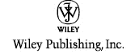

`Dashcode® For Dummies®`
由 Wiley Publishing, Inc. 出版 111 River Street Hoboken, NJ 07030-5774
[www.wiley.com](http://www.wiley.com)
版权所有 © 2011 Wiley Publishing, Inc., Indianapolis, Indiana
由 Wiley Publishing, Inc., Indianapolis, Indiana 出版，并在加拿大同步出版
未经出版者事先书面许可，本出版物的任何部分不得复制、存储在检索系统中或以任何形式或任何手段（电子、机械、复印、录音、扫描或其他）传输，除非符合 1976 年《美国版权法》第 107 条或第 108 条的规定，或通过向版权许可中心支付相应的每份费用获得授权（222 Rosewood Drive, Danvers, MA 01923, (978) 750-8400, 传 (978) 646-8600）。向出版者申请许可应寄至许可部门：John Wiley & Sons, Inc., 111 River Street, Hoboken, NJ 07030, (201) 748-6011, 传 (201) 748-6008，或在线访问 [`www.wiley.com/go/permissions.`](http://www.wiley.com/go/permissions)

商标：Wiley、Wiley Publishing 标志、For Dummies、Dummies Man 标志、A Reference for the Rest of Us!、The Dummies Way、Dummies Daily、Dummies.com、Making Everything Easier 以及相关外观是 John Wiley & Sons, Inc. 及其在美国及其他国家和/或关联公司的商标或注册商标，未经书面许可不得使用。Dashcode 是 Apple, Inc. 的注册商标，未经书面许可不得使用。所有其他商标均为其各自所有者的财产。Wiley Publishing, Inc. 与书中提到的任何产品或供应商均无关联。

责任限制/免责声明：出版者和作者对本作品内容的准确性或完整性不作任何假设或保证，并特别否认所有保证，包括但不限于对特定用途的适用性的保证。销售或促销材料不得创建或扩展任何保证。本文包含的建议和策略可能不适用于每种情况。本作品的销售基于：出版者并未从事法律、会计或其他专业服务。如果需要专业协助，应寻求能力能力的专业人士的服务。出版者和作者均不对由此产生的损害承担责任。书中引用某个机构或网站作为引文和/或潜在的进一步信息来源，并不意味着作者或出版者认可该机构或网站可能提供的信息或可能做出的建议。此外，读者应注意，本书中列出的互联网网站在本书编写到阅读期间可能已经发生了变化或消失。

欲了解有关我们其他产品和服务的一般信息，请联系我们的客户服务部门：美国拨打 877-762-2974，美国境外拨打 317-572-3993，或传真 317-572-4002。需技术支持，请访问 [www.wiley.com/techsupport](http://www.wiley.com/techsupport)。

Wiley 还以多种电子格式出版书籍。纸质版中的某些内容在电子书中可能无法提供。


美国国会图书馆控制号：2010941223
ISBN：978-0-470-88473-7
美国制造

10 9 8 7 6 5 4 3 2 1


# 关于作者

Jesse Feiler 为小微企业和非营利组织提供咨询服务。他撰写了多本关于 FileMaker 和 Mac OS X 的书籍，以及关于 Mashups、Facebook 和 Bento 等新技术的书籍。Jesse 活跃于社区活动，担任 HB Studio 和 HB Playwrights Foundation 的董事会成员；他曾担任中哈德逊图书馆系统董事会成员（其中包括三年的主席），创立了 Philmont 主街委员会，并担任该村的综合计划委员会主席。他的网站是 [`northcountryconsulting.com`](http://northcountryconsulting.com)。

他的著作包括《Get Rich with Apps!: Your Guide to Reaching More Customers and Making Money Now》（McGraw-Hill）、《Sams Teach Yourself Drupal in 24 Hours》（Sams/Pearson）、《Database-Driven Web Sites》（Harcourt）、《How to Do Everything: Facebook Applications》（McGraw-Hill）、《How to Do Everything with Web 2.0 Mashups》（McGraw-Hill）、《iWork ‘09 For Dummies》（Wiley）、《Using FileMaker Bento》（Sams/Pearson）以及《FileMaker Pro in Depth》（Sams/Pearson）。他还编写了《iPad All-in-One For Dummies》（Wiley）书中的 iWork 迷你书。

他的 iOS 应用包括来自 Champlain Arts 的 MinutesMachine（[`champlainarts.com`](http://champlainarts.com)）。

# 作者致谢

Waterside Productions 的 Carole Jelen 在本书的开发过程中再次提供了巨大的支持和建议。

在 Wiley 出版社，策划编辑 Kyle Looper 引导了本书通过审批流程，并对其结构提供了非常欢迎的建议。Kelly Ewing 耐心地引导手稿完成了了制作和编辑工作。

# 出版社致谢

我们对这本书感到自豪；请通过 [`dummies.custhelp.com`](http://dummies.custhelp.com) 向我们发送您的意见。如有其他意见，请联系我们的美国客户服务部 877-762-2974，美国境外拨 317-572-3993，或传真至 317-572-4002。

帮助本书面世的人员包括：

### 策划、编辑与媒体开发
- 项目编辑：Kelly Ewing
- 策划编辑：Kyle Looper
- 技术编辑：Dennis Cohen
- 编辑经理：Jodi Jensen
- 媒体开发项目经理：Laura Moss-Hollister
- 媒体开发助理项目经理：Jenny Swisher
- 编辑助理：Amanda Graham
- 高级编辑助理：Cherie Case
- 漫画：Rich Tennant ([www.the5thwave.com](http://www.the5thwave.com))

### 制作服务
- 项目协调员：Katherine Crocker
- 布局与图形：Lavonne Roberts, Vida Noffsinger
- 校对员：Melissa Cossell, Rebecca Denoncour, Evelyn C. Wellborn
- 索引员：Christine Karpeles

### 技术类 Dummies 的出版与编辑
- Richard Swadley，副总裁兼执行集团出版经理
- Andy Cummings，副总裁兼出版经理
- Mary Bednarek，执行策划总监
- Mary C. Corder，编辑总监

### 消费者 Dummies 的出版
- Diane Graves Steele，副总裁兼出版经理
- 制作服务
- Debbie Stailey，制作服务总监

# 引言

Dashcode 最初开发是为了更方便地构建 Dashboard 部件（widgets）——这些是在您的 Mac 上运行的轻量级应用程序，点击按钮（通常是 `F4` 或 `F12`）即可调用，并浮动在桌面和已打开应用程序之上的层上。这些小部件是基于 `JavaScript` 和级联样式表 (`CSS`) 等开放标准构建的，尽管它们专为 Mac 设计，并不一定与互联网有任何交互。随着 Dashcode 的发展，人们能够快速轻松地构建这些小型轻量级部件。

随着 iPhone 的发布，Dashcode 技术再次投入使用——这次是为了开发基于 Web 的应用程序，这些程序在 iPhone 的 Safari 上运行时，可以访问 iPhone 的功能，如电话，在第二个版本中，还有地理位置（即你在世界上的位置）。

换句话说，没有人初衷是为了编写 Dashcode 来让 iPhone（现在是 iPad）Web 应用程序成为可能。它们当时还没有出现在中。但 Dashcode 的功能完美匹配，它提供了为 iPhone 和 iPad 编写 Web 应用程序最快的方法。

本书将向你展示如何编写这些应用程序以及作为首批 Dashcode 产品的小部件。

# 关于本书

本书介绍了 Dashcode 及其各种功能。它向你展示了如何通过在 Dashcode 提供的模板基础上构建，以及使用 `Library`（库）中的代码和其他元素来使用 Dashcode 功能。你在书中所看到的是，Dashcode 工具与 `Library` 部分的结合意味着你真的不需要编写太多的代码。

你需要做的是思考你正在编写的是什么——你想帮助你的用户做什么。无论你是使用 Dashcode 构建 Dashboard 部件、Safari Web 应用程序，还是 iPhone 的移动 Safari Web 应用程序，你都能找到开发一致且直观界面的指南。

你可以从头到尾阅读这本书，也可以跳读到你感兴趣的内容（或可能遇到问题的部分）。当你阅读书中的逐步示例时，请考虑花一点时间完成它们。

# 本书使用的规范

在书中，你会看到任务和技术的描述。你可以从 [www.dummies.com/go/dashcodefd](http://www.dummies.com/go/dashcodefd) 下载示例文件。

书中包含代码片段和 URL。它们都以等宽字体显示，例如：

```
http://northcountryconsulting.com
```

```
function load()
{
dashcode.setupParts();
}
```

大部分代码 Dashcode 自带。如果你将 Dashcode 版本与书中版本进行比较，可能会发现一些空格差异。这种差异仅仅由于书籍的排版要求：重要的会在文中注明。当你输入代码时，可以忽略空格，但引号内的文本需要保持其预期显示或处理的状态。这意味着以下代码

```````
var example = “some text”;```

不等同于以下代码：

```
var example = “some

text”;
```

发布 iPhone 最初由 iPhone OS 运行。iPad 改变了这一切。解释 iPad 由 iPhone OS 运行非常困难。因此，2010 年，苹果公司人员推出了 iOS：适用于 iPhone、iPod touch、iPad 以及……未来设备的操作系统。另有说明，以下是书中使用的设备规范：

 `iPhone` 总是指 iPhone 和 iPod touch
- `iOS devices` 包括 iPhone、iPod touch 和 iPad（以及可能的其他设备）

本书向你展示如何开发自己的 Dashcode 项目。其中一些项目可以在 [www.dummies.com/go/dashcodefd](http://www.dummies.com/go/dashcodefd) 下载。

用 Dashcode 构建的项目全名可能很长。你可以构建

- **Dashboard 部件**：这些部件在 Mac OS X 的 Dashboard 环境中运行。widget 一词在今天有许多语境，但在书中它始终指 Dashboard 部件。
- **Safari Web 应用程序**：在书中，你使用 Dashcode 构建这些应用程序。它们在 Mac OS X 和 Windows 的 Safari 上运行。
- **移动 Safari Web 应用程序**在 iOS 设备的 Safari 上运行。


你还可以使用 Dashcode 以外的其他开发工具（特别是 Xcode）来构建 iOS 应用、iPhone 应用和 iPad 应用。这些应用程序直接运行在 iOS 操作系统上，而小部件和 Safari Web 应用程序运行在 Safari 中。从用户的角度来看，这些应用程序看起来非常相似。事实上，让你的 Safari Web 应用程序和移动 Safari Web 应用程序看起来像原生 iOS 应用通常是一个重要目标。在本书书中除非另有说明，“应用”一词指的是所有三种类型的 Dashcode 项目以及 iOS 应用。

## 你不需要阅读的内容

你不需要读完书中的所有内容就能理解当前的主题。例如，你在整本书中看到的灰色框或侧边栏包含你不需要知道的信息——如果你对它们感兴趣，尽管读读吧！此外，你可以跳过标有“技术细节”（Technical Stuff）图标标记的信息（除非你是那种喜欢这些额外细节的极客类型！）。

## 愚蠢的假设

在写这本书时，我对你（即读者）做了一些假设。我不假设你具有任何深层的编程经验。事实上，我写这本书是为了帮助初级程序员以最快、最简单的方法创建 iPhone、iPad 和 Mac OS X 程序。但如果你是一个经验丰富的程序员；别担心。我会告诉你掌握 Dashcode 语法需要知道的知识。

## 本书的结构

本书分为六部分。

## 第一部分：介绍 Dashcode 以及你如何使用它

这部分向你介绍了 Dashcode 的世界。如果你习惯桌面应用程序，就必须对 Web 应用程序和小部件世界中的软件开始进行不同的思考。你必须停下来思考你正在该设备上做什么。你倾向于不过去想具体如何使用软件，因为一切“都能正常工作”，但如果你在开发软件，你就必须努力思考它——并以用户期望的方式来实现它。

### 第二部分：构建你项目的组件和部分

这部分向你介绍了 Dashcode 内置的供你使用的组件，以及帮助你处理这些组件的 Dashcode 工具。最重要的工具是检查器（inspectors），它们允许你检查和修改界面元素的各个方面，以及代码和界面元素的库（更不用说你的 iPhoto 库，会自动集成到其中）。你还将发现如何使用行为（behaviors）来增强用户界面。

### 第三部分：整合数据

有趣的是，应用和小部件相对较小的尺寸使得复杂的数据管理比任何时候都更需要，而 Dashcode 为此目的提供了工具。当你拥有几乎无限的空间来显示你的数据时（想象一个房子大小的电子表格），你就不需要担心它的组织和呈现了。但当你在 iPhone 屏幕极其有限的空间上使用数据时，你需要充分利用它并巧妙地组织它。这部分将深入探讨所有这些问题。

### 第四部分：尝试每个环境

这部分提供了从头到尾的完整项目。它们涉及 iPad 和 iPhone Web 应用、Dashboard 小部件以及设计在传统桌面或笔记本电脑浏览器中运行的 Safari Web 应用的问题。

### 第五部分：完善你的项目

这部分涵盖了高级技术，例如使用本地化（localization）来翻译你的界面，以及广泛的 Dashcode 调试工具。

### 第六部分：十锦

这部分提供了列表和提示，从各个方面帮助你。我涵盖了改进界面让用户喜欢你的技巧，并分享了一个帮助你在构建 Dashcode 项目时节省时间和精力的技巧。最棒的部分是，这些章节都短小精悍。

## 本书中使用的图标

整本书中标记了各种感兴趣事项的图标：

 此图标标识需要记住的事项。如果你想用彩色标记笔突出显示文本，尽管这样做。如果你是作为电子书形式阅读书籍，长按你想突出显示的单词，然后点击“备记”（Note）。要在 iBooks 中查看你的笔记，点击每页左上角 `Library`（库）旁边的列表。你可以在 `Bookmarks`（签）中查看所有笔记（点击每页左上角 `Library` 旁边的列表）。对于 iPad 版 Kindle，点击页面中心，然后点击屏幕底部中心打开的书籍即可查看所有笔记。

 此技术信息被高亮显示，以便你自己决定现在是否想阅读它。如果你愿意，可以跳过它。

 此图标为改进你的 Dashcode 项目提供了快捷方法和提示，以及节省时间的快捷方法。

 在使用 Dashcode 时，几乎没有什么是完全灾难性的，但有一个例外。在脑海中，将此警告放在你用 Dashcode 进行的每一个操作旁边：在过程的每一步都保存项目的副本。如果你犯了错误，只需回到上一个保存的副本即可。将项目恢复到 15 分钟前的状态通常比重新创建你的步骤并撤销它们要容易得多。

## 从这里开始下一步

如果你还没有用过 Dashcode，第一部分是一个很好的起点，因为它帮助你快速进入 Dashcode 工具和术语。如果你想用 Dashcode 来帮助你组织和呈现数据，第三部分是一个很好的起点。（老师们喜欢这一部分。）

浏览全本书查看项目截图，看看有哪些可能性。


从一开始开始，Mac 就证明了使用电脑并不一定是一件痛苦的事。你不需要输入某些晦涩的命令；相反，你可以移动鼠标点击图标。你不需要为了生成一个程序就编写包含成千上万行晦涩计算机代码的代码。苹果公司不断提高标杆，使得软件的构建和使用变得越来越简单。

而且从起初，有些人就对这种“让电脑变得易用”的概念嗤之以鼻。和老兵们聊天，或者读读 20 世纪 80 年代的报纸杂志文章，你就会理解人们对鼠标曾有多怀疑了……更不用说屏幕上的那些图片了。

苹果和 Mac 开始改变所有这些观点。Dashcode 只是苹果“为我们普通人”打造电脑方案的最新示例。Dashcode 让构建既易用又な实现惊人功能的软件变得简单简单。

本章将向你展示你可以用 Dashcode 做什么，以及如何操作。

# 为苹果电脑开发软件

苹果构建硬件——如 Mac 本身、iPod、iPhone 和 iPad 等产品。它还构建软件来驱动这些设备运行——如 `Mac OS X` 和 `iOS` 等操作系统。（`iOS` 以前称为 `iPhone OS`，是 iPhone、iPad 以及更多未来奇迹设备的操作系统。）苹果还构建供人们使用的应用程序——如 `Safari`、`iTunes`、`iWork` 套件（`Numbers`、`Keynote` 和 `Pages`）、`iLife` 套件（`iPhoto`、`iMovie`、`iDVD`、`GarageBand` 和 `iWeb`），以及作为 `Mac OS X` 组件分发的应用程序，如 `Mail`、`iCal`、`Address Book`、`Preview` 以及 `Disk Utility`、`System Preferences`、`Terminal` 和 `Console` 等实用工具。

苹果鼓励第三方开发者开发并分发自己的应用程序。有些程序是由大公司开发的，例如 `Adobe`（`Creative Suite 5`，包括 `Photoshop`、`Illustrator` 和 `InDesign` 等产品）、`Microsoft`（`Word`、`PowerPoint` 和 `Excel`）以及 `FileMaker`（实际上是苹果全资拥的独立子公司）。另一些是由各种组织开发用于内部使用的；你很少听到这些应用程序，部分原因在于它们通常是公司竞争优势的一部分。还有一些是由个人开发者开发，供自己使用或用于他们所擅长的特定市场。

所有这些软件产品——操作系统、苹果构建的程序以及第三方程序——都是使用苹果健壮且强大的开发环境创建的，该环境围绕 `Xcode` 和 `Interface Builder` 构建，并配合强大的编译器来生成运行时代码。如果你有一张 `Mac OS X` 安装盘，你会在上面找到一个这些开发者工具文件夹。当 `Mac OS X` 推出时，史蒂夫·乔斯强调开发者工具将始终作为安装盘的一部分提供。这些工具是可选安装，但其理念是让人们能够将自己的想法和创新带来 `Mac OS X` 平台。

只要有计算机，开发程序所需的技能和知识就一直短缺。人们开发了各种工具和策略，以提供一种学习曲线更小的软件开发替代方案。在 Mac 上，`HyperCard`、`AppleScript` 和 `Automator` 等工具简化了人们构建自己软件的方式，无需经过 `Xcode` 和 `Interface Builder` 等复杂工具（在它们之前，还有 `Macintosh Programmers Workshop`——`MPW`）。

Web 提供了一套新工具，用于创建复杂的 Web 页面，这些页面的功能可以与应用程序非常相似。无论你是在为 Web 应用程序编写，还是为基于个人电脑或其他设备的程序编写，开发者的设计技能都是相似的，但语言不同，而且在 Web 环境中学习如何使用它们通常更容易。

正如许多事情一样，这其中涉及到权衡。传统应用程序可能更难构建，但它们可能比 Web 版本的更强大。一个重要的考虑是，传统应用程序可以访问计算机的特定硬件功能。 Web 应用程序运行在 Web 浏览器中，是浏览器（而不是 Web 应用程序）访问计算机硬件。

苹果已经找到一种，通过其 `Safari` Web 浏览器提供对特定硬件功能的访问，并让开发 Web 页面的人员可以使用这种访问。在 `Safari` 上，Web 页面可以在 iPhone 上拨打电话；当同一个页面在 Mac 的浏览器上运行时，它会正确地跳过电话代码，因为 Mac 无法拨打电话。同一个 Web 页面在 `Firefox` 等浏览器中运行时也可以正常工作：苹果对行业标准 Web 页面的扩展设计为不会在其他浏览器中崩溃。

工具的多样性和开发机会的增加使苹果专注于三个开发平台：

*   用于 Macintosh 电脑的 `Mac OS X`：该环境以 `Objective-C` 和 `Cocoa` 开发框架为中心。
*   用于移动设备（如 iPod touch、iPhone 和 iPad）的 `iOS`：该环境也使用 `Objective-C`，以及一个自定义的开发环境，处理移动问题以及可能没有传统菜单或可缩放窗口的接口。
*   用于 Mac、iPad 和 iPhone 上的 `Safari` 以及 `Mac OS X` 上 `Dashboard` 的 `HTML 5`：该环境还包括 `JavaScript` 和层叠样式表 (`CSS`)。与 `Mac OS X` 和 `iOS` 不同，这些技术不是专利，尽管 `Safari` 中某些针对 Mac 的代码是专利的。`Mac OS X` 上的 `Dashboard` 环境由于使用了 `HTML 5`、`JavaScript` 和 `CSS` 也属于这一类。

### 介绍 Dashcode

苹果开发小组的目标是让这些平台上所有 Apple 设备的功能尽可能可用。`Xcode` 和 `Interface Builder` 是前两个平台的开发者工具对；`Dashcode` 是第三个平台的工具。

 “用于 Mac、iPad 和 iPhone 上的 Safari 以及 Mac OS X 上的 Dashboard” 听起来有点绕口。正如 2010 年 6 月苹果全球开发者大会上描述的那样，`Mac OS X`、`iOS` 和 `HTML 5` 构成了苹果的软件策略。为了避免这种描述，我用第三平台来指代“用于 Mac、iPad 和 iPhone 上的 Safari 以及 Mac OS X 上的 Dashboard”。

当然，你可以用任何文本编辑器或各种图形用户界面编辑器编写 `HTML`、`CSS` 和 `JavaScript` 代码，但 `Dashcode` 专为为 iPhone 和 iPad 等移动设备上的 Safari 开发 Web 应用程序而设计。`JavaScript` 代码出现在你的 Dashcode 项目模板内部，你可能永远不会看到它。而当你看到这些代码时，你可能只是为了进行修改而查看它。


检查器（Inspectors）让你能够轻松检查和更改界面元素——它们的颜色和大小、行为以及与数据的交互。由可重用界面部分和代码片段组成的库进一步让你免于从一张白纸或空文件开始并从头编写代码的流程。

由于 Dashcode 使开发非常强大的用户界面成为可能，你就有时间思考如何与你的应用程序和小部件（widgets）的用户交互。

本章的其余部分将向你介绍可以使用 Dashcode 为第三平台（Third Platform）开发的软件类型。这里的示例是基于 Dashcode 模板构建的，这意味着你可以自己构建它们。在书的其余部分，你将找到更多关于过程的详细信息以及你可以自己添加的额外功能。在本章中，重点是极少自定义的开箱即用功能。

# 常用 Dashcode 术语

以下是讨论 Dashcode 时需要了解的术语简要总结：

你使用 Dashcode 构建项目。这些项目可以是 Dashboard 小部件，也可以是适用于 Mac 上 Safari 或移动设备的 Web 应用程序。在本章中，你随处可以看到小部件和应用程序的示例。

Dashcode 包含了项目模板。你选择一个模板和你想要构建的特定类型项目，Dashcode 就会生成代码。有时你需要对模板进行自定义，但在其他情况下，仅使用模板代码就是完整的。

Dashcode 拥有一个可重用界面部分和代码片段的库。你可以使用这个库来构建和自定义你的项目。

Dashcode 包含了模拟器（simulators）。模拟器让你能够运行你的项目，就像它们运行在 Safari（在个人电脑或移动设备上）或 Dashboard 中运行一样。

项目的最终结果是一个产品，可以是小部件也可以是应用程序。你可以使用 Dashcode 将完成的项目部署到 Dashboard 或网站（包括 MobileMe 站点）；你还可以将 Dashcode 项目保存到磁盘上，以便将其发送给他人或发布在网站上进行进一步的部署和分发。

# 游览小世界：应用程序和小部件

与传统的软件程序相比，应用程序和小部件体积更小。它们在物理尺寸上通常更小，范围也更小，因为它们倾向于专注于某一个点。本节向你展示了一些从内置模板构建的 Dashcode 项目，它们说明了这一点。我还向你展示了一些 Dashcode 允许你构建到应用程序和小小部件中的功能。

图 1-1 显示了为 Mac 上的 Safari 构建的 Dashcode Utility 模板。

**图 1-1：** Utility 模板让你在 Safari 中构建一个小型文字处理器。

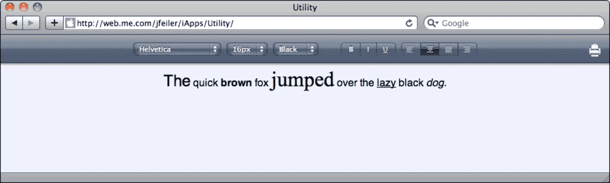

你可以更改字体并应用样式，如下划线或加粗。图 1-1 还助于演示 Dashcode 项目与传统应用程序之间的区别。Utility 模板通过许多功能完成一件事（文字处理），但它不是 Word 或 Pages 的替代品。例如，你无法轻松添加图像，也找不到放置页眉和页脚的命令。尽管你可能会进行搜索，但找不到“保存”按钮或“保存”命令。你输入的内容会自动保存。

你可以针对 iPhone 上的移动版 Safari 使用同一个 Utility 模板（见图 1-2）。在图中，Dashcode 项目正在 iPhone 模拟器中运行。

这两个版本的应用程序代码有所不同，但它们使用了相似的功能。在每情况下，模板都使用了适当的界面元素。例如，图 1-3 中的选项让你选择字体和大小。

**图 1-2：**为移动版 Safari 构建模板。

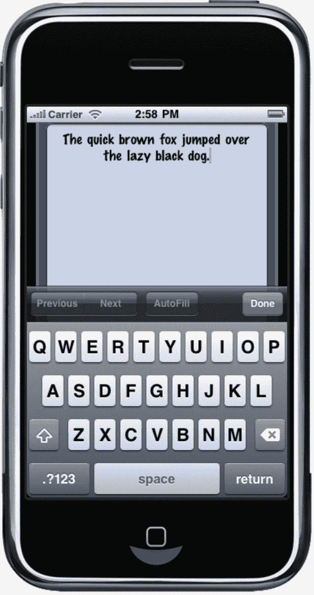

如果你点击模拟器中的一个弹出菜单，或者在你的 iPhone 上点击其中一个，就会出现图 1-4 所示的典型 iPhone 界面元素。你不需要做任何特殊操作。

图 1-5 显示了一个从 Countdown（倒计时）模板构建的 Dashboard 小部件。它提供了一个倒计时（或正计时）时钟。

这个示示展示了一个可能需要一些自定义才能运行的项目模板。你可以看到 Dashcode 离旧时代那种复杂的编程技术有多远。

模板可以从特定的日期和时间开始倒计时到零；或者，它可以从给定的该日期和时间开始正计时。在 Dashcode 的 3.0 版本中，特定日期是 `4/1/2010`，时间是 `凌晨 4 点`。默认是倒计时到零，因此时钟不会运行，因为那个日期已经过去了。为了让它工作，你可以既将日期更改为未来的日期和时间，也可以使用选项从特定日期和时间开始正计时。

**图 1-3：**选择字体和字体大小。

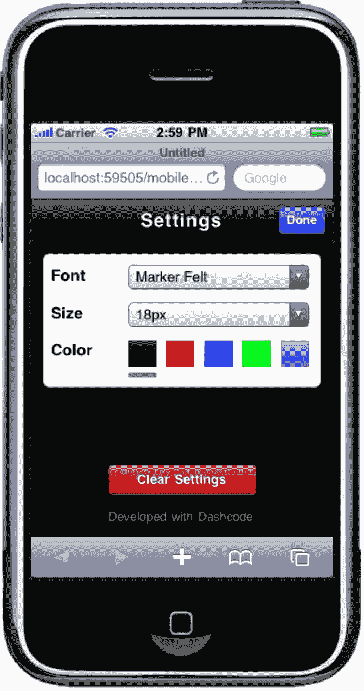

图 1-6 显示了你如何进行此类更改。此布局有很多设置，但你只需要更改日期和时间，或者选择正计时即可。

Countdown 模板是另一个说明你如何专注于 Dashcode 项目的例子；它不是一个秒表。相反，这个示例是一个针对特定日期和时间的倒计时/正计时时钟。简单且专注。

Utility 和 Countdown 只是内置模板中的两个。你从它们中汲取的 Dashcode 项目方面包括：

- 项目专注于目标。
- 找不到传统的菜单栏。
- 窗口不可调整，但有滚动条。
- 构建这些项目很容易。

**图 1-4：**自动使用了相应的界面元素。

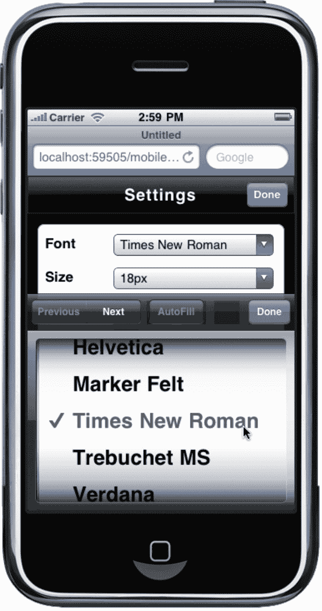

**图 1-5：**从时间倒计时或正计时。

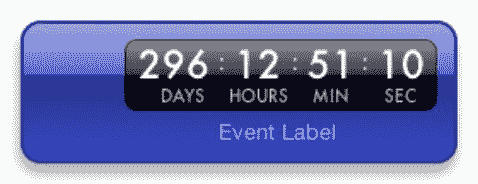

当我说构建这些项目很容易时，我的意思是可以在几分钟内对模板进行更改以查看其是否可行。即使你需要进行一些自定义（例如为倒计时器输入开始日期），模板的更改通常很快。如果更改没有效果，直接进入下一个想法即可。

并不是所有的 Dashcode 项目修改都像更改倒计时/正计时时钟的开始结束时间那样简单。书中的某些示例需要一些时间来完成，但一旦你建立了应用程序或小部件的基本结构，微调就可以很容易地完成。

**图 1-6：**修改设置。

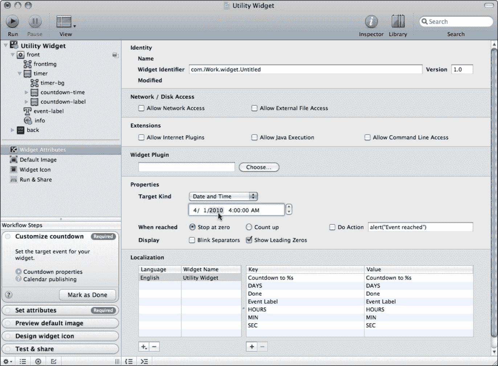

# Apple 方式的小部件和应用程序分类

当你探索模板并思考开发自己的项目时，对你的想法进行分类会有帮助。设计 Dashcode 项目的挑战之一就是保持专注。识别你正在构建的项目类型有助于专注。

以下是 Apple 用于 iPhone 和 iPad 应用程序的三个类别：它们也非常适用于 Dashcode 项目：

- 沉浸式（Immersive）：这些项目通常是游戏。它们之所以是沉浸式的是因为你可以在其中“忘我”。它们的核心目的是让你离开办公室、公交等队，或任何你更想待在的处境。
- 工具类（Utility）：这些项目提供某种服务。它们通常与互联网协作。工具类应用程序可以是货币汇率器；另一个例子是 Maps Dashboard 小部件模板（见图 1-7）。

就像 Countdown 小部件一样，这个小部件需要自定义。你需要在 Google 注册以获取密钥来使用地图系统，并且需要提供初始地址。正如图 1-8 所示，这只需要输入这两个值。（你可以在“第 8 章”中查看如何获取密钥。）


# 生产力

最后，诸如 Utility 模板之类的项目让你创建一个小型文字处理器。通常，生产力项目的特点是用户向其中输入数据；而实用类应用（utility app）的特点通常是用户从中获取数据（地图、单词或短语的翻译等）。

**图 1-7：** Maps 组件是一个实用类组件的示例。

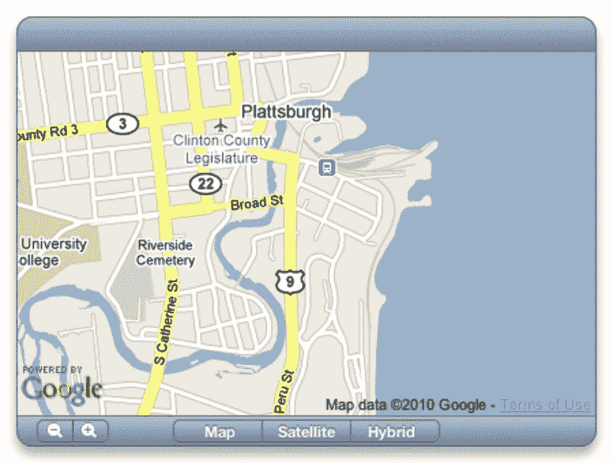

**图 1-8：** 设置 API 密钥和初始地址。

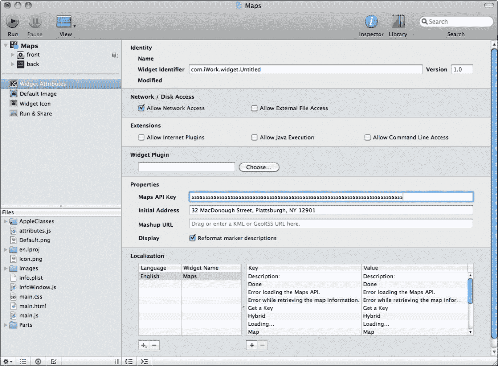

### 导航数据

Dashcode 模板提供了用户轻松导航数据的工具。最方便的结构之一是浏览器界面工具，它在许多基于 iOS 以及 Dashcode 构建的 iPhone App 中可用。图 1-9 显示了 Browser Dashcode 模板的运行情况。此示例使用了模板内置的数据：它是关于美国若干处国家公园的信息。

**图 1-9：** 使用 Browser 模板。

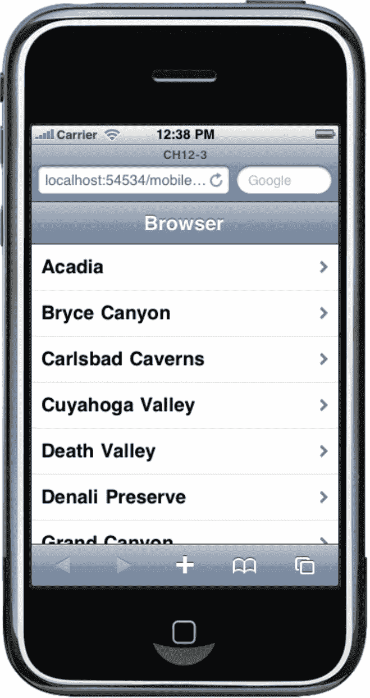

正因为这个界面在 iPhone 上被频繁使用，用户能够识别它，知道如何使用它，并知道可以从中获得什么。图 1-9 显示了一个公园列表；公园名称右侧的箭头将带你进入该公园的详情，如图 1-10 所示。

数据在此模板中提供；你可以为自己的项目对其进行修改。事实上，为了你自己的目的修改此项目，你可能需要做的就是更改数据。项目本身除了数据外，不包含任何文本。

**图 1-10：** 每个项目都提供了详情。

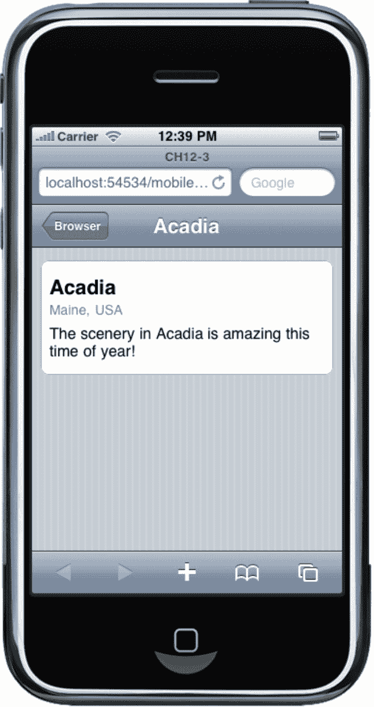

Dashcode 可以使用项目已包含的数据（如国家公园数据），也可以使用在运行时从互联网某个位置访问的数据。无论哪种情况，数据都需要是标准格式——`JSON`（JavaScript 对象表示）或 `XML`（可扩展标记语言）。你可以在第 12 章找到数据文件的示例。

## 理解应用和组件的结构

你可以在不了解 Dashcode 实现原理细节的情况下对其进行工作。（事实上，对于大多数硬件和软件都是如此。）你对 Dashcode 结构的深入程度取决于你的意愿。本节提供了一个高层级的结构视图；你可以在书中各处找到详细信息。如果你只想关注可以使用 Dashcode 做什么，请尽管这样做。

Dashcode 项目由包含在模板中的代码组成。你通过选择模板来创建一个新的 Dashcode 项目。你可以向项目添加你自己的代码来增强模板代码，但大多数情况下，你通过表单上的特定信息进行自定义（请参考图 1-6 和图 1-8）。

有时，你需要向 Dashcode 生成的代码中输入信息；在这些情况下，清晰的注释会告诉你该做什么。例如，图 1-11 显示了你可以从 Library 拖入项目中的代码。它让你启用一个特定的按钮。

注释引导你将 `elementID` 修改为你想要启用的按钮名称。虽然图 1-11 可能没有以彩色显示，但 Dashcode 通过将 `elementID` 置为紫色来进一步提供帮助。这很难出错。

你的 Dashcode 项目由许多单独的文件组成；大部分是用 JavaScript 编写的。（有关 JavaScript 的更多信息请参见附录 A。）其他文件是 CSS 文件和包含项目图形的 PNG 文件。这些文件类型在 Web 上被广泛使用，如果你想了解更多关于它们的信息，可以在网上、图书馆和书店找到许多资源。但记住，你大多数时候可能不需要进入这些文件。如果你确实需要，你可以在可能需要自定义的章节中以注释的形式找到帮助。

你可能会在项目中看到其他文件类型，例如属性列表（`plist`）和本地化文件夹（`lproj`）。关于项目内部的文件和文件夹，你唯一需要知道的是不应该移动或重命名它们。Dashcode 依赖于它们具有特定的名称和位置。

有些人认为，由于文件是可见且可编辑的，而且它们使用了标准的 Web 格式，你可以随意进入并修改它们（见第二部分）。看看就好，不要动。

**图 1-11：** 为自己的项目自定义代码。

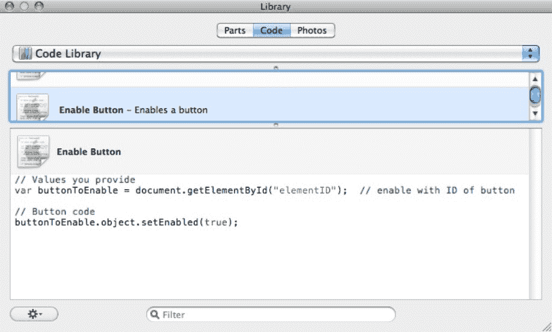

## 快速浏览 Dashboard 组件

Dashboard 组件可以是沉浸式的、实用类的或生产力类的。它们在显示来自实时数据源的数据时特别有效。导航数据是有用的，但组件在向你呈现变化的数据方面表现出色。图 1-9 显示了 Daily Feed 模板的运行情况。

**图 1-12：** Daily Feed 显示 RSS 馈的最新项目。

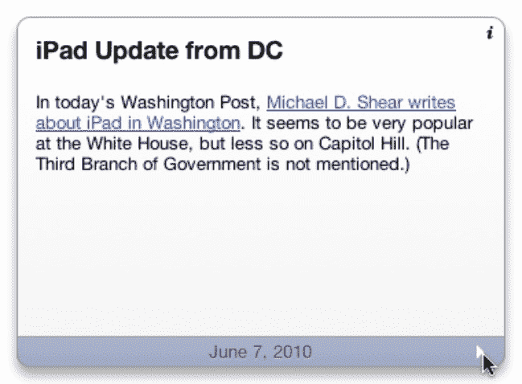

**图 1-13：** 使用 RSS 馈的 URL 自定义 Daily Feed。

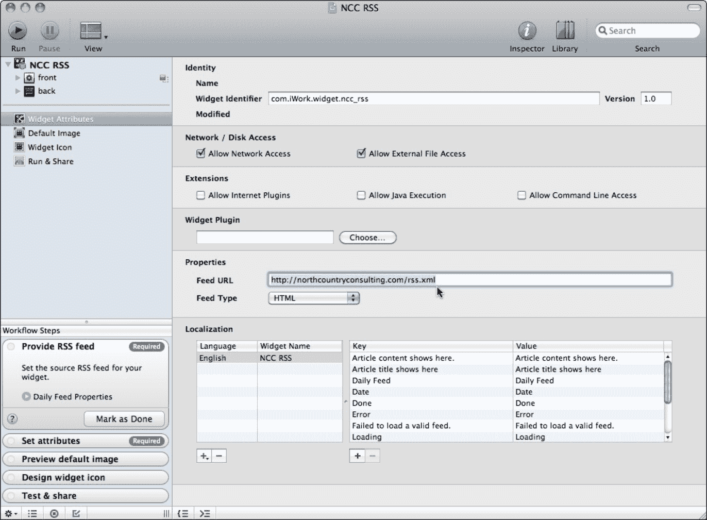


RSS 馈源非常有用，因为在设置好之后，你展示的馈源就会完成所有工作。这就是 Dashcode 拥有多个 RSS 源模板的原因之一。`Daily Feed` 显示来自特定 `Feed` 的最新项目。而 RSS 模板则采用了另一种方法：对于给定的馈源，它显示的是最新的故事，而不仅仅是最近的一个。图 1-15 显示了 RSS 模板的运行情况。

**图 1-14：** 点击 Done 返回首页。

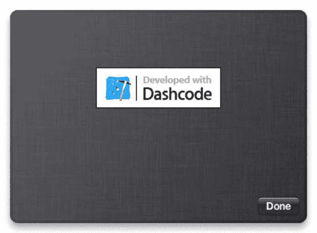

**图 1-15：** RSS 显示了多个故事。

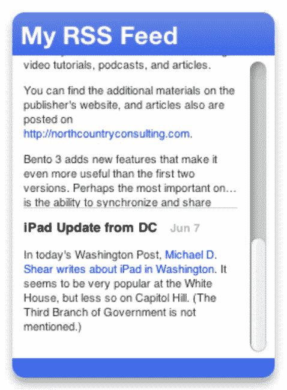

Dashcode 允许你像 `Daily Feed` 那样指定馈源，但你还可以如图 1-16 所示，指定显示多少故事以及使用的日期范围。

除了你在小组件中指定的选项外，RSS 小组件的背面还有一个用户可以设置的选项（见图 1-17）。

**图 1-16：** 为 RSS 指定选项。

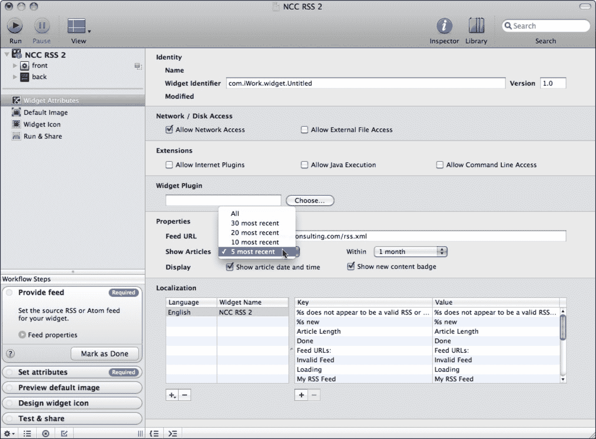

**图 1-17：** 用户在 Dashboard 小组件的背面设置选项。

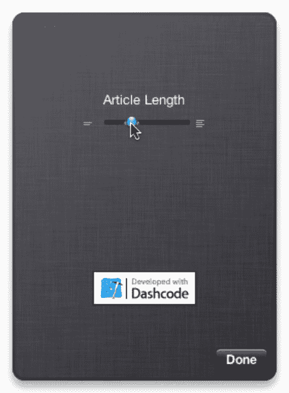

# 使用 Safari Web 应用进行探索

Safari 可用于 Mac OS X、Windows 和 iOS 设备。Safari 符合 Web 标准，包括 `HTML 5`，这是这种基础 Web 编程语言的最新版本。`HTML` 有许多重大新增，Safari 以及许多浏览器都支持这些新增。当 Safari 运行在 iPhone 或 iPad 上，还有一些额外功能会发挥作用。

对你来说，`HTML 5` 的两个最重要的方面是它良好处理嵌入媒体的能力以及在用户计算机上存储数据的能力。良好处理嵌入媒体的能力可能是一个复杂且具有争议的问题，但其基本结果是很多情况下不需要 `Flash`，而且实际上在 iPhone 和 iPad 等设备上并不支持它。如果你深入研究这个问题，你可能会发现自己正在处理许多个人理论。史蒂夫·乔斯发布过关于 `Flash` 的笔记（[www.apple.com/hotnews/thoughts-on-flash](http://www.apple.com/hotnews/thoughts-on-flash)），提供了一些信息。简而言之，他的观点是存在一些安全问题，`Flash` 在移动设备上消耗大量电池，并且存在一些性能问题。无论是否同意，`HTML 5`  Apple 以及大部分行业的发展方向。Safari 对其提供了完全支持。

`HTML 5` 允许用户通过浏览器存储数据，这意味着你为 Safari 的 Dashcode 应用（在移动或其他设备上）有一种通过 `HTML 5` 存储数据的方法，无需通过数据库或文件结构。事实上，是 Safari 对 `HTML 5` 的实现与文件系统或数据库进行交互。从你的角度来看，这并不重要：你关心的只是不需要在你的 Safari Web 应用中完成这一点。

`Utility` 模板（参考图 1-1）运行在 Safari 中并使用 `HTML 5` 数据存储功能。图 1-18 展示了另一个 Safari Web 应用：它是在 Safari 中重新实现 RSS Dashboard 小组件的 RSS Web 应用。图 1-18 显示了在模拟器中运行的 RSS Safari 模板。

**图 1-18：** RSS Safari Web 应用的行为与 RSS Dashboard 小组件一样。

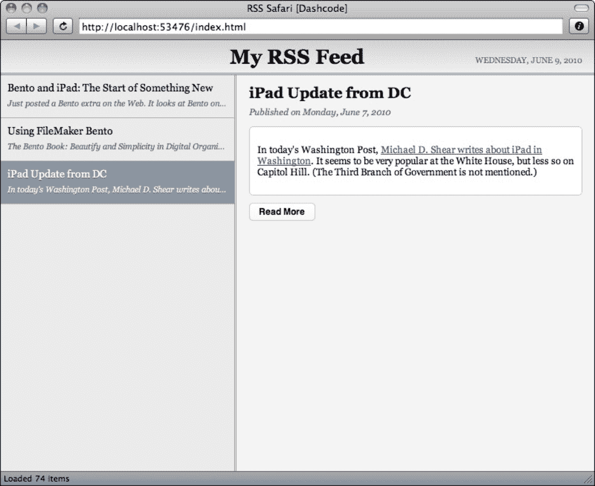

界面看起来不同，但它包含相同的信息。如你在图 1-19 所示，设置与 Dashboard 小组件是相同的。你提供馈源的 URL 以及显示的设置。

**图 1-19：** 设置与 Dashboard 小组件的设置类似。

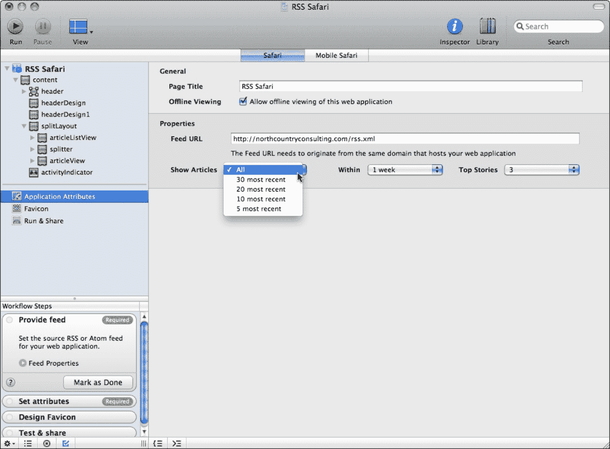

# 调用 iPhone Web 应用

Safari RSS 模板允许你同时为 iPhone 构建移动版 Safari 版本。因此，废话不多说，图 1-20 显示了 iPhone 模拟器上相同的 RSS 馈源。

**图 1-20：** 相同的 RSS 设置让你能够使用 Dashcode 制作 iPhone 产品。

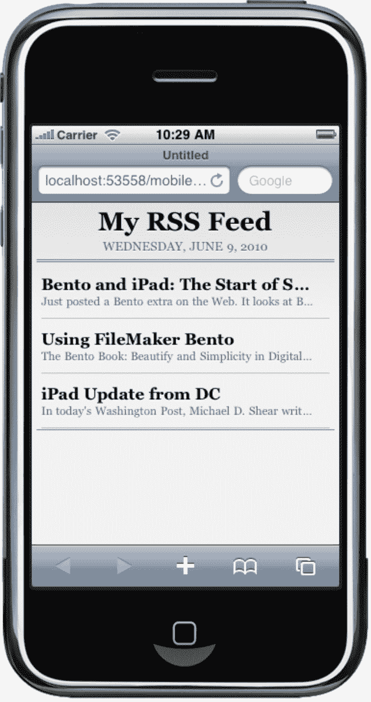

界面的差异反映了 iPhone 的尺寸和特性：Dashcode 已经为你完成了所有工作。

图 1-21 显示了你如何在 iPhone 上下钻到文章。Dashcode 已经为你完成了所有工作。


注册后，下载开发者工具（Developer Tools）包，它会自动安装在你的 Mac 硬盘根目录下；该文件夹名为 `Developer`。文件夹内部有一个名为 `Applications` 的文件夹，其中包含 `Dashcode`。（你可能想将该图标拖到程序坞，以便在需要时启动 `Dashcode`。）

 开发者工具的下载文件相当大；毕竟，它包含了开发任何 Mac OS X 应用程序以及 iPhone 和 iPad 所需的所有工具。（这套软件也用于构建 Mac OS X 本身。）在安装过程中，你可以选择想要安装的组件。最佳选择是使用默认安装。如果你的磁盘空间不足，可以进行挑选，但如果你在游戏的这个阶段磁盘空间就不足，可能很快就会遇到麻烦。

### 介绍 Dashcode 窗口

`Dashcode` 窗口紧凑而强大。与某些其他开发环境不同，你不会发现自己不断地打开和关闭各种窗口：一切功能都在 `Dashcode` 窗口中可用。图 2-1 显示了你在处理项目时窗口运行的状态。窗口的外观取决于你正在处理的项目以及你为 `Dashcode` 设置的偏好。除了偏好，你还可以显示或隐藏窗口的不同部分，并展开或收起它们。

你在图 2-1 中看到的是一个使用 Safari RSS 模板的项目，并显示了移动 Safari（iPhone）界面。

选择模板是第 3 章的第一步，该章节将介绍使用 RSS 模板开发移动 Safari Web 的过程。

`Dashcode` 窗口分为三个基本部分：

1. 顶部的工具栏
2. 左侧的导航器
3. 右侧的画布（Canvas）

**图 2-1：** 在 `Dashcode` 中处理项目。

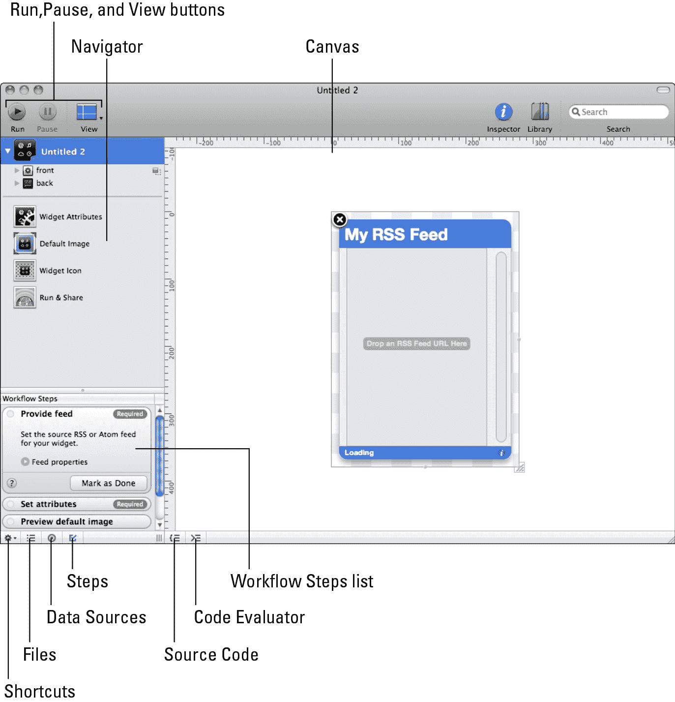

如果你的项目同时针对 Safari 和移动 Safari，工具栏下方会出现一个标签栏，你可以在两个版本之间切换，如图 2-2 所示。

## 通过 Dashcode 工具栏进行配置

`Dashcode` 工具栏是标准的 Mac OS X 工具栏，因此你可以根据意愿显示或隐藏它。窗口框右上角的蓝色菱形小按钮用于显示和隐藏。你也可以选择 `View⇒Show/Hide Toolbar` 或使用快捷键 `ÔT` 来显示或隐藏它。

**图 2-2：** 你可以为移动 Safari 开发项目，也可以为 Mac 和 Windows 上的 Safari 版本。

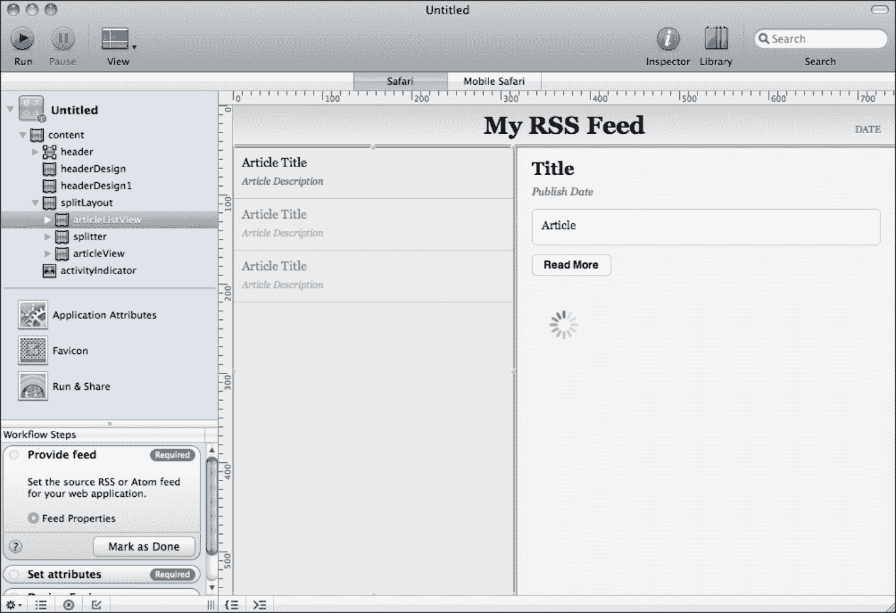

至于工具栏的内容，与任何 Mac OS X 工具栏一样，你可以选择 `View⇒Customize Toolbar` 打开自定义面板（如图 2-3 所示）。只需将你想要添加的项拖入工具栏，将想要移除的项拖出工具栏，并左右移动剩余的项目。

 在本书中，我们使用了未经自定义的默认工具栏，但随着你使用 `Dashcode` 越来越熟练，你可以探索额外的项目。

**图 2-3：** 自定义 `Dashcode` 工具栏。

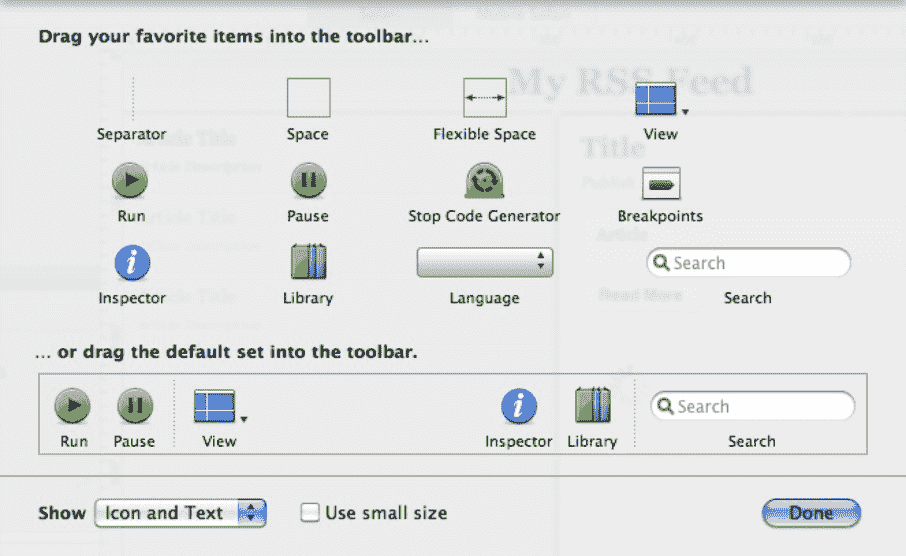

## 使用工具栏或菜单决定查看内容

`View` 项目与 `Dashcode` 窗口内的三个窗格都相关。（窗格是对于可以响应按钮、菜单命令或应用程序运行而单独显示或隐藏的窗口部分的术语。）图 2-4 显示了 `View` 的选项。

如果你仔细观察图 2-4，你会看到灰色线条将选项分为三个部分。第一部分是可以在窗口右侧 `Canvas` 区域中出现的窗格（是的，窗格可以包含窗格，当你需要它们在应用程序和小组件中展示信息时，你会喜欢这一点的）：

- `Canvas`
- `Run log`
- `Stack frame`
- `Breakpoints`

由于 `canvas` 是 `Dashcode` 右侧大区域初始且最频繁显示的视图，因此整个区域都以此命名。我将在本章稍后的“开始使用画布”部分描述 `Canvas` 窗格。我将在第 19 章中讨论用于调试的 `run log`、`stack frame` 和 `breakpoints`。

**图 2-4：** 从工具栏选择查看的内容。

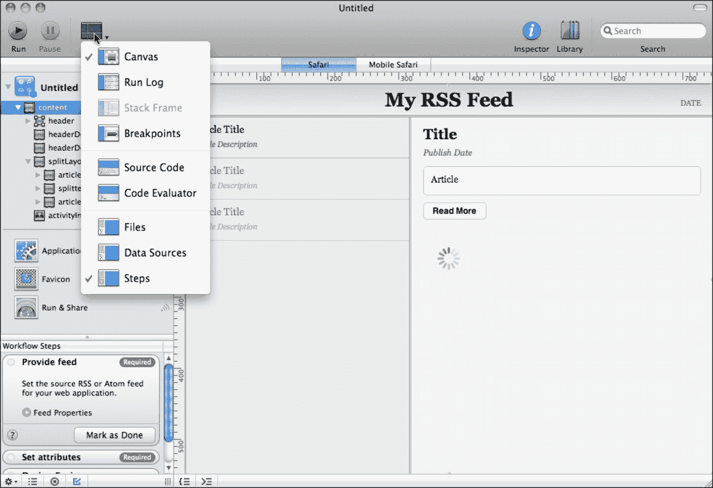

这些窗格出现在 `Canvas` 窗格的顶部。你一次只能看到这四个窗格中的一个（或没有）。

下一组窗格（第 19 章将详细讨论）出现在 `Canvas` 窗格的底部：`Source Code` 和 `Code Evaluator`。与第一组一样，这两个窗格只能显示一个。在图 2-4 中，你看到 `Canvas` 窗格。如果你添加了 `Source Code` 窗格，它会出现在底部（见图 2-5）。

你可以拖动分割线来增大或减小 `Canvas` 窗格的大小。

*(注：原文后部分存在大量重复段落，已进行去重清理以确保文档专业性。)*


导航器中的图标用于显示或隐藏它们相应的工具。由于 `Canvas` 面板由两个可以调整大小的面板组成，这第二组图标用于显示或隐藏下方面板中的工具，而该面板目前可能因为尺寸调整而处于视图之外。虽然点击图标似乎没有产生直接影响，但如果你向上拖动画布底部的条以显示下方面板，你就会发现你的选择已经生效了。

### 导航导航器

Dashcode 窗口的左侧是导航器。导航器包含各种信息，这些信息位于你可以选择显示的面板中。

在图 2-1 和 2-2 中，导航器中出现了两个面板：

*   **堆栈布局面板 (Stack Layout pane)**：顶部是项目的 `Stack Layout`。`Stack Layout` 代表你的项目。位于项目左侧的小型收叠三角形允许你展开和收起它们，以便你看到更多或更少的细节。当你点击文件夹旁边的收叠三角形时，所有内容都会折叠到以你的项目命名的图标中。在本章的几幅图中，项目是新的且尚未保存，因此它具有默认名称 `Untitled`（或 `Untitled 2` 或 `Untitled 3`）。在你保存项目后，名称将更改为保存该项目的文件名。
    你可以在在本章稍后的“与视图和视图层级提供信息和交互”部分中了解更多关于 `Stack Layout` 的信息。
    `Attributes`、`Favicon` 和 `Run & Share` 链接出现在 `Stack Layout` 的底部，允许你导航到主要的 Dashcode 工具。（更多信息请参阅第 3 章。）

*   **步骤面板 (Steps pane)**：图 2-1 中导航器底底部是一个包含工作流步骤列表的面板。你可以在在本章稍后的“贯理工作流步骤列表”中了解更多关于 `Workflow Steps` 列表的知识。

你可以在导航器中添加、删除和调整面板大小，这就是为什么你的导航器看起来可能与图 2-1 所示的不同。

## Dashcode 界面的教训

为了创建你自己的 Dashboard 小部件和 iPhone 或 iPad 应用，你需要使用 Dashcode 并熟悉窗口的操作方法。但 Dashcode 窗口可以为你扮演另一个非常重要的角色，因为它是你如何将数据和功能挤入你自己的应用和小部件的极佳示例。每个软件开发者都知道，屏幕空间永远无法容纳开发者和用户想要看到的所有内容。（显而易见，开发者将屏幕称为“房地产”）。对于应用和小部件来说，它们的空间比传统应用程序更小，因为它们运行在较小的窗口（Dashboard 小部件）或屏幕较小的设备（如 iPhone）上，因此如何将所有内容适配其中的问题变得更加严峻。不要仅仅为了学会如何使用它而探索 Dashcode：要探索 Dashcode，看看你可以借用哪些概念和想法。

Dashcode 使用了各种界面元素和技术将所有信息整合到它的窗口中。它在窗口中封装了大量信息——而且这个窗口相当大。你可以调整它的大小并重塑它，但你不能把它缩小到无法看到所有三个部分的程度。这是你能够让它缩到的最小尺寸：

你的应用和小部件将比这个调整过大小的 Dashcode 窗口还要小，因此你必须自己考虑许多 Dashcode 技术来展示你的数据。出于这个原因，不要仅仅学习如何使用 Dashcode 窗口；要养成批判性地观察它的习惯，并问自己苹果的人们为什么要做出那些设计选择。你将在自己的应用和小部件中遇到与 Dashcode 设计师相同的数据展示和功能呈现的问题。

你可以构建非常复杂的规则集；如果它们在某种层面上对用户是清晰的，就能创建一个成功且强大的界面。例如，考虑 `View` 菜单和工具栏中的 `View` 项目：它们会调出相同的视图菜单。大多数 Dashcode 用户可能认为它们只是控制了用户想要查看的内容，但这仅仅是它们功能的开始。

在 `View` 命令显示的菜单中，以及工具栏组中的 `View` 中，细小的分割线将某些项目组合在一起，对于许多用户来说，这种逻辑分组并不值得再次考虑。然而，这些组决定了面板的集合——一次最多只能显示其中一个。大多数 Dashcode 用户可能不会考虑这种行为；它是界面中“随用随灵”的方面之一。

记住，你不仅在应用和小部件的界面上拥的空间要少得多，而且你不太可能拥有说明书。在这种环境下，你和你的用户需要每一份可用帮助来让使用你的项目变得更简单。从 Dashcode 界面（事实上，从几乎所有的苹果界面）中可以学习到的一点是一致性的益处。如果某些界面项始终以相同的方式运行，用户就可以学会它们，而无需深思考其中涉及的步骤。

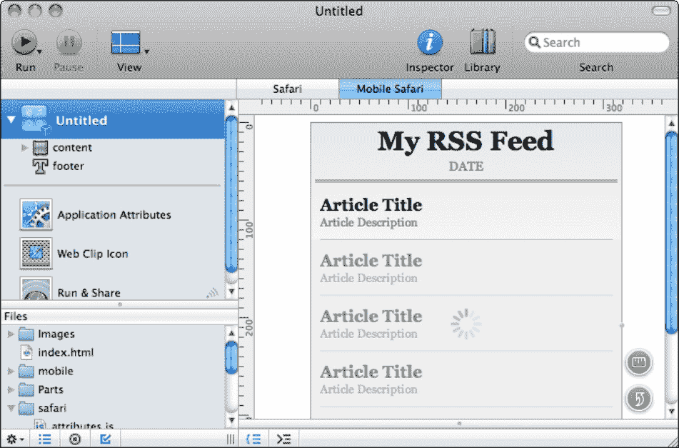

 尽管你有移除导航器中面板的能力，但你永远无法移除堆栈布局；它始终出现在导航器的顶部。此外，面板从顶到底部的顺序始终保持不变。例如，当两者都出现时，`Steps` 面板始终位于 `Attributes` 面板下方。

你可以通过使用 `View` 菜单或使用 `View` 来选择查看哪些面板，如图所示。

图 2-1 和 2-2 右侧的大区域被称为画布。画布是你设计项目外观的地方。

事实上，画布部分可以包含各种面板，正如在本章前面的“通过 Dashcode 工具”部分描述的那样。由于画布是最常用的面板，我将在本章后面专门用了一个章节介绍它。

## 工作步骤列表

默认情况下，`Workflow Steps` 列表显示在导航器中。当你显示或隐藏 `Workflow Steps` 列表时，菜单命令是 `Show or Hide Steps`。`Workflow Steps` 列表由你在处理项目时应该执行的步骤组成。

**工作步骤列表：** 用户可以通过 `View` 菜单或工具栏中的 `View` 来显示或隐藏 `Workflow Steps` 列表，就像他们显示或隐藏任何界面元素一样。

每个项目模板都有自己的步骤，但 `Workflow Steps` 列表的整体格式是相同的。图 2-7 显示了用于第 3 章开发的移动 Safari 模板。它展示了 `View⇒Use Navigator Icons` 命令的效果。

你可以通过点击背景来展开和收叠每个步骤。在图 2-7 中，第一个步骤（Provide Feed）和最后一个步骤（Test & Share）是收叠的。每个步骤标题左侧的小圆表示该步骤是否已完成。如果你点击该圆，就会相反完成状态；点击每个步骤中的 `Mark as Done/Mark as Not Done` 按钮也可以同样的操作。

每个步骤都有简短的描述。如果你需要更多信息，可以点击问号在自己的窗口中打开文档。你可能会看到以小灰色圆内箭头形式显示的链接。这些链接将带你进入 Dashcode 中执行该步骤的部分。

**图 2-7：** 使用工作步骤列表。

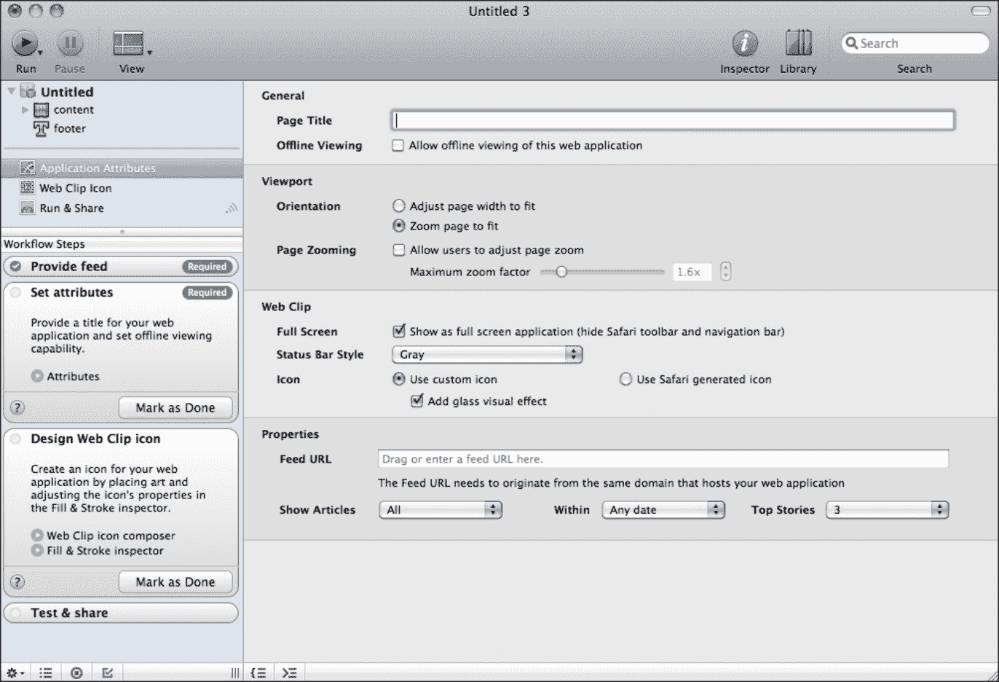

再次注意在小空间内呈现了多少功能（一个你通过收叠可以使其变得更小的空间）。


这些步骤的顺序符合项目模板设计者的逻辑，但你可以按照自己选择的任何顺序来执行它们。例如，某些步骤（如为你的小部件或 App 开发图标）可能依赖于他人。你不需要等待他们完成你的其他步骤。你可以以不同的顺序执行这些步骤，甚至可以将已标记为“已完成”的步骤切换为“未完成”。（唉，在工作流结束的测试步骤中，经常会发生将已完成的步骤标记为未完成的情况。）

## 管理项目文件

在大多数情况下，你不需要管理你的 `Dashcode` 文件；`Dashcode` 会替你完成。在极少数需要操作内部 `Dashcode` 文件的情况下，请使用 `Dashcode` 而不是 `Finder` 来执行操作。你可以通过选择 `View⇒Files`、点击工具栏中的 `View`，或点击 `Dashcode` 窗口左下角框架中的 `Files` 图标来管理你的 `Dashcode` 文件。

##查看应用或小部件内部

简单的项目之一是 RSS 项目：它适用于 Safari（移动端或桌面端）和 Dashboard。RSS 项目允许你指定 RSS 馈。当你运行该 App 或小部件时，最新的帖子就会出现。（第 3 章描述了一个基础示例。）

如果你查看完成后的 App 或小部件内部，你会发现涉及了 30 多个独立文件。图 2-8 显示了 RSS Dashboard 小部件中的文件；图 2-9 显示了 RSS Safari App 中的文件。

**图 2-8：** 查看 RSS 小部件文件。

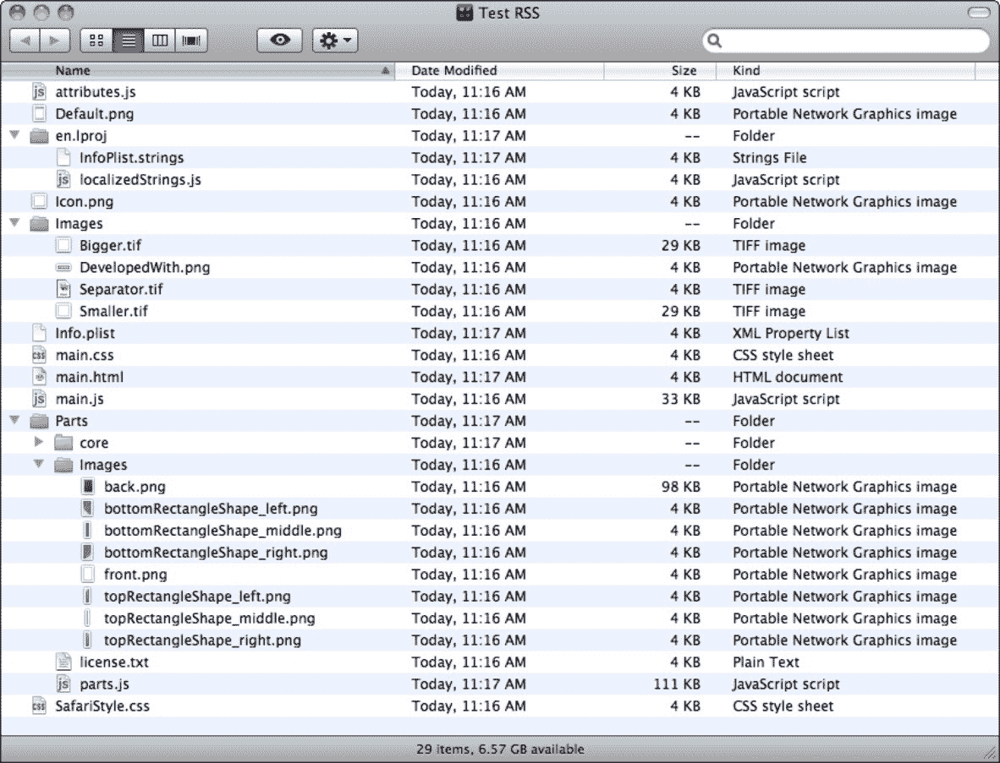

文件被组织在文件夹中，这让你对情况了然。基本上，你有一组位于 `Core` 文件夹中的文件，该文件夹位于 `Parts` 文件夹内部。`Core` 文件夹中的文件是为项目提供支持（主要是 `JavaScript`）的主文件。这些文件会自动包含在你的项目中；你不需要做任何事情，而且在几乎所有情况下，你都不对它们进行任何操作。

 在许多方面，这些文件提供了由 `Xcode` 和 `Interface Builder` 中的 `Objective-C` 代码为基于操作系统的 App 提供的基础功能。

对于 Safari Web 应用，你会看到一个 `Safari` 文件夹和一个 `Mobile` 文件夹（如果你同时拥有这两个版本）。你的项目实现在这些文件夹内部，并在 `Core` 文件夹之外（该文件夹为所有项目提供通用支持）。正如你在整本书中所看到的，你所做的只是在 `Dashcode` 中点击即可。

**图 2-9：** 查看 RSS Safari 文件。

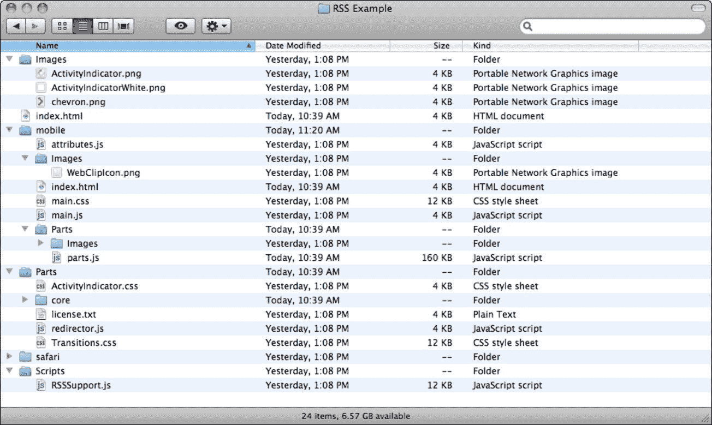

在 `Dashcode` 深度内部，这些操作通常会将代码段添加到你的项目中。事实上，有时只需点击鼠标一下即可向你的项目添加整个文件。

你不需要为 `Dashcode` 项目创建这些任何一个文件。在随后的项目中——特别是涉及数据源的项目——你可能会担心其中一两个文件，但仅此而已。

## 打包你的 App 和小部件

所有这些文件都是你的 App 或小部件运行的基础。你通常看不到这些文件。App 和 Dashboard 小部件有不同的打包方法。

### 打包 Safari Web 应用

对于 Safari Web 应用，文件的打包方式与你在图 2-8 中看到的完全相同——它们位于文件夹中，例如 `Parts` 和 `Images`。这种结构是任何网站都可能使用的结构。图 2-10 显示了所有子文件夹已折叠的 RSS 模板文件夹。折叠子文件夹使基础文件夹的结构更加清晰。

如果你将你的可部署项目命名为 `RSSExample`（为了简单起见去掉了空格），你可以将其上传到网站。如果有人输入 [www.yourURL.com/RSSexample](http://www.yourURL.com/RSSexample)，基本的 Web 规则规定，如果找到 `index.html` 或 `index.php` 文件，该文件将在用户的浏览器中显示。

**图 2-10：** 查看 Safari Web 应用的顶层。

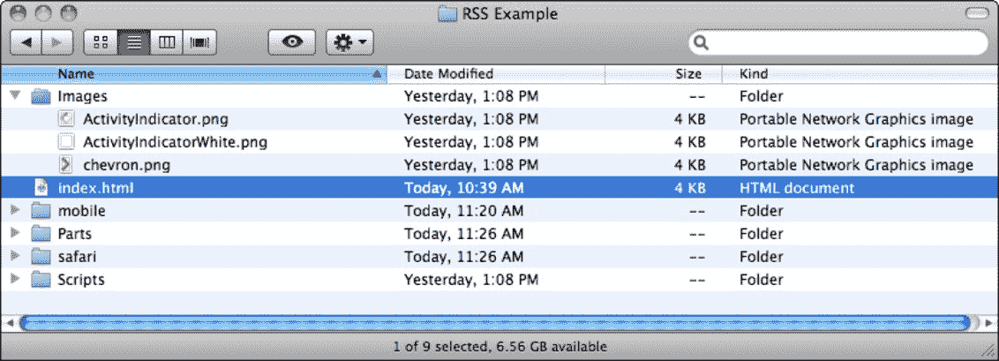

在图 2-10 中，文件夹包含 `index.html` 文件。当整个文件夹被上传到 Web 服务器时，有人输入 [www.yourURL.com/RSSExample](http://www.yourURL.com/RSSExample)即可启动你的 Safari Web 应用。

从 `index.html` 开始，用户的鼠标点击和其他交互会启动 `JavaScript` 代码，你的 App 就会如你预期那样出现在 Safari 中。为了让这些步骤生效，你只需要将整个文件夹上传到你的网站即可。（而且为了简单起见，`Dashcode` 可以为你完成该任务。）

这里描述的过程依赖于 Web 标准；它们并不是特殊的 `Dashcode` 实现。因此，这里有一些 Dashcode Web 应用的特征需要记住：

- Dashcode Web 应用适用于任何 Web 服务器。Web 服务器不需要知道 App、`Dashcode`、`iPhone` 或 `iPad` 的任何信息，除了 Web 服务器上的标准文件。你不需要 Web 管理员或 IT 管理者的权限来部署 Dashcode Web 应用。对很多人来说重要的是，Dashcode Web 应用不需要 `iPhone` 或 `iPad` 特定的权限。
- Dashcode Web 应用是自包含的，你可以将它们从一个服务器移动到另一个，即使是在相同的域上。
- Dashcode Web 应用仅适用于 Safari 以及源自 `WebKit` 的浏览器（它是 Safari 的核心）。Safari 的扩展为 App 中包含的 `JavaScript` 代码提供附加功能。如果你从另一个浏览器访问 URL，插入 App 的代码将跳过这些功能。
- Dashcode Web 应用 内部的文件不应在 `Dashcode` 之外移动或重命名。你可以在 `Dashcode` 内进行任何移动或重命名，它会自动处理内部链接。当 `index.html` 文件运行时，它（以及项目的其他文件）可能会指向其他文件的相对链接。相对链接不是通过完整 URL（例如 [www.yourURL.com/RSSExample/anotherfile.html](http://www.yourURL.com/RSSExample/anotherfile.html)）来地址的，而是通过以 `index.html` 或另一个文件为起点的链接。例如，从 `index.html` 可以访问相邻文件夹 `Parts` 中的一个文件。移动或重命名文件会破坏这些内部链接。（使用 `Dashcode` 进行重命名可以保留这些链接。）

### 打包 Dashboard 小部件

Dashboard 小部件的结构与 Safari Web 应用（见前节）基本相同，有两个区别：

- Dashboard 小部件没有交替环境。对于 Safari，你可以拥有移动或桌面环境。对于 Dashboard 小部件，你只有一个环境。（给智者的话：这种结构同样适用于小部件部件。如果 Apple 的人员想为 Dashboard 小部件构思第二或第三种环境，这不是问题。）
- Mac OS X 可以隐藏文件。Mac OS X 有包的概念。大多数应用程序都是包。包看起来就像磁盘上的任何其他文件一样。但是，如果你在按住 `Control` 键的同时点击应用程序图标，你会看到一个快捷菜单（有时称为上下文菜单），其中包含“显示包内容”。选择该命令，将打开一个名为 `Contents` 的新窗口。你可以像浏览任何 Finder 窗口一样浏览该窗口，查看其中的文件和文件夹。


当你用 Dashcode 组好一个 Dashboard 小组件时，`Dashcode`会将项目打包成一个组件文件；`Dashcode`可以为你将该小组件安装到你自己的 Dashboard 中。你也可以将该组件文件分享给其他人。如果你使用`显示包内容` 命令查看小组件内部，你会看到之前图 2-8 所示的文件结构。

由于小组件仅在 Mac OS X 上使用，你可以安全地以这种方式对其进行打包。你的 Safari Web 应用需要部署在可能没有运行 Mac OS X 的 Web 服务器上，因此它们并不一定支持包的概念。这就是为什么你必须将 Web 应用生成一组文件，而不是一个包。

# 打包 Dashcode 项目

Mac OS X 的包的概念用于 Dashcode 本身以及小组件。当你创建一个项目时，可以像保存任何其他文件一样将其保存到磁盘。Dashcode 文件本身就是一个包。图 2-11 显示了典型 Dashcode 项目的内容。

**图 2-11：** Dashcode 项目依赖于包。

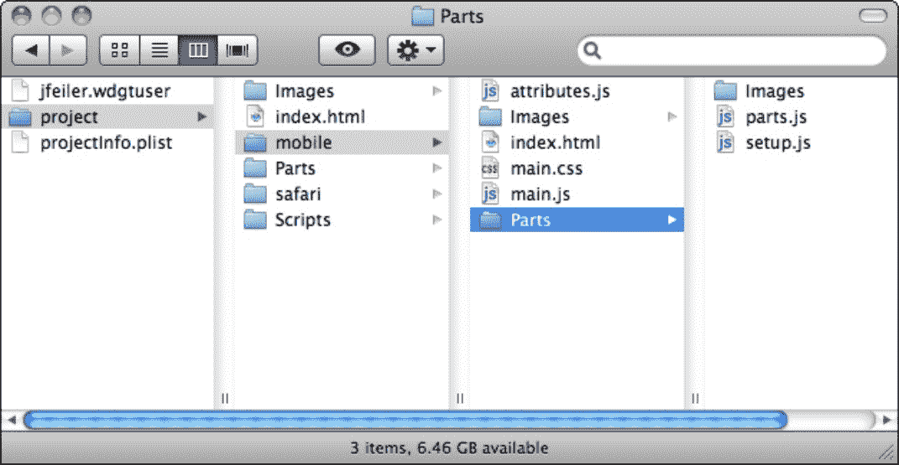

`Dashcode` 自动提供两个包含你项目信息的文件。项目中的其他文件是使其运行的实际代码。

`wdgtuser`：此文件以 Mac OS X 用户名开头，包含有关用户的信息。

`projectinfo.plist`：此属性列表（property list）文件包含项目信息。

 除了项目文件外，Dashcode 项目包还包含这两个文件，使其成为 `Dashcode` 可运行的自包含实体。当你运行应用或小组件时，你只需要项目文件夹内部的文件；只有当你使用 `Dashcode` 创建或修改项目时，才需要另外两个文件。为了部署应用或小组件，最安全的方法是使用 `Dashcode`：它会创建相应的运行时文件。不要尝试将 Dashcode 项目文件作为 Web 应用或小组件安装：这是行不起的。

Apple 在整个 Mac OS X 中广泛使用属性列表。属性列表都是 XML 文件，因此在任何文本编辑器中均可读。你可以使用 Apple 开发工具包中的`属性列表编辑器`来显示和编辑它们（除非你手头有 Mac OS X 安装光盘，否则你必须是注册开发者并安装了工具）。图 2-12 显示了一个 Dashcode `projectinfo`属性列表文件。无论你将其移动到哪里，这些信息都位于每个 Dashcode 项目中。你对 `Dashcode` 和该项目的偏好与设置是项目的一部分。项目内部偏好和设置与其他应用程序不同，应用程序设置通常是你账户的偏好，并存储在你的用户文件夹中。

正如图 2-12 所示，此属性列表存储了你的`工作流步骤`列表设置，包括哪些步骤已完成。

要完成 Dashcode 项目包中的文件，请查看图 2-13 所示的`wdgtuser`文件。它也是一个 XML 文件，在`BBEdit` 中显示，以便你可以查看原始 XML。

**图 2-12：** 查看 Dashcode 项目属性列表。

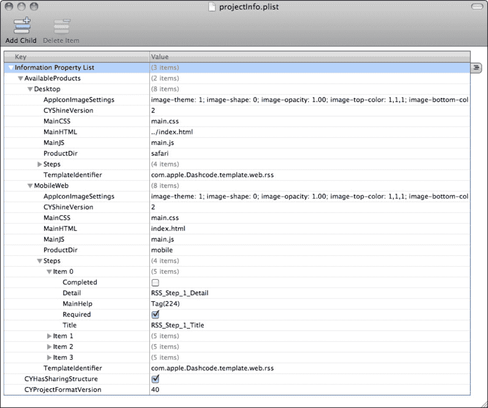

在图 2-13 中，你可以看到此项目和此 `Dashcode` 用户的设置。

**图 2-13：** 查看`wdgtuser`文件。

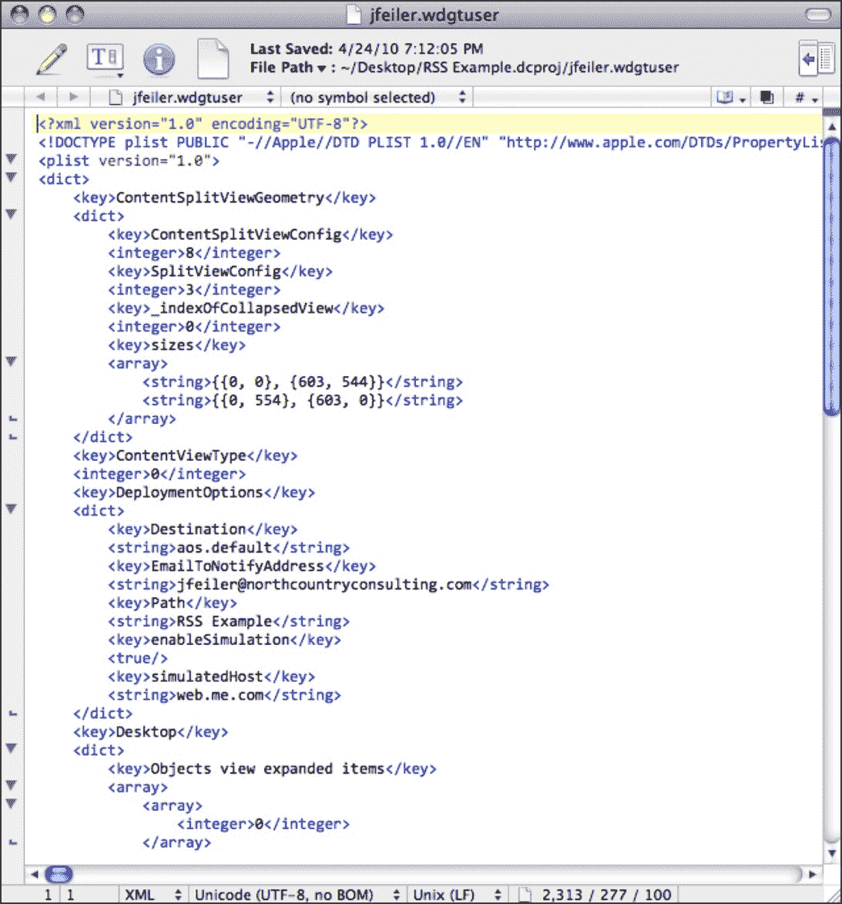

### 介绍视图

你在应用或小组件上看到的一切都是视图（views）。视图有许多类型，从按钮、文本字段到显示照片或视频片段的容器应有，但它们都有许多共同特征。例如，每个视图都有特定的位置和大小。视图可以包含其他视图，因此当你说一个视图的位置时，实际上是在说它在包含它的视图中的位置。

在图 2-14 的画布上，你看到了 RSS 模板的表示。你可以点击一个视图来高亮它；图 2-14 中的日期视图被高亮了。你可以更改视图的设置和属性。

**图 2-14：** 探索视图。

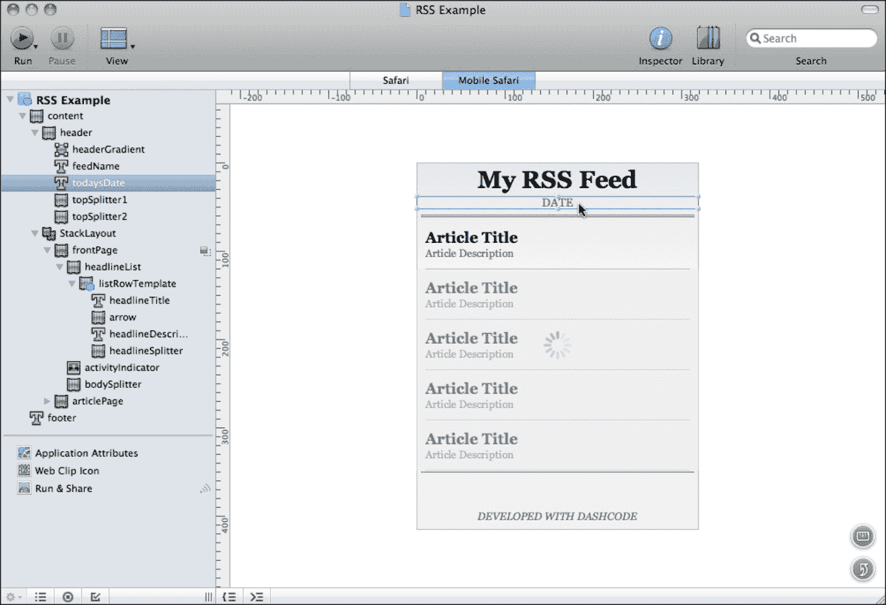

在导航器的顶部，你可以看到视图层级结构。在画布中选中的 `todaysDate` 视图在导航器中被高亮显示。

和所有视图一样，`todaysDate` 视图有两个位置：

**视觉位置：** 在画布上。

**结构位置：** 在导航器的顶部。


在“视图”（View）菜单旁边，`Window`（窗口）菜单允许你最小化或隐藏 Dashcode 窗口。你还可以在 Dashcode 中显示或隐藏另外两个窗口：`Library`（库）和 `inspector`（检查器）。你也可以从工具栏显示或隐藏这些窗口。

关闭窗口是通过“文件”（File）菜单完成的，因为在大多数情况下，这涉及到保存视图中所展示文档的更改——这属于 `File` 菜单操作。`Window` 菜单允许你显示或隐藏菜单；即使窗口被隐藏，它仍然处于打开状态。

开发者使用这些非常具体的术语来描述应用程序、组件以及所有 Mac OS X 应用的行为。使用特定术语有助于你通过了解正确的术语进行搜索和在索引中查找，从而在开发者文档中导航。

除非有人指出你的应用程序或组件只有一个不可滚的窗口这一事实，否则你可能甚至不会注意到。

你还可以调整桌面应用程序中窗口——甚至是对话框——的大小。你无法调整应用程序中窗口的大小，因为你看不见用于调整大小的框架（frame）。然而，当你缩放应用程序以及当设备在水平和垂直方向之间旋转时，应用程序的界面经常会发生变化。

## 检查库（Checking Out the Library）

`Library` 仅仅是一个——信息存储库，更重要的是你可以添加到项目中的实用元素库。`Library` 在 Dashcode 中始终存在，但你可以通过 `Window` 菜单或点击工具栏上的 `Library` 来显示或隐藏 `Library` 窗口。（当 Library 窗口打开时，点击工具栏上的 `Library` 会将其隐藏。）

当你开始探索 `Library` 时，你会看到 Dashcode 的组件是如何组合成构成项目文件的。如果 `Library` 窗口未打开，请打开它。你打开了哪个项目并不重要，因为此时你只是在探索 `Library` 窗口。（如果 Dashcode 中没有项目窗口，你就没有工具栏也没有 `Library` 菜单。）

图 2-15 显示了 `Library` 窗口。

`Library` 窗口顶部有控制三个面板的标签：`Parts`（部分）、`Code`（代码）和 `Photos`（照片）。在每个面板中，你都可以找到作为部分、代码片段或你自己的照片的项目列表。

无论你选择哪个面板，`Library` 窗口的底部都包含一个允许你搜索特定面板的字段。例如，如果你在 `Parts` 面板中搜索 `checkbox`，就会找到 `checkbox` 部分。在 `Code` 面板中，你会找到一些代码片段。

在 `Library` 的左下角是一个快捷菜单（始终带有一个齿轮图标）。此菜单帮助你组织正在查看的任何面板中的项目，如图 2-16 所示。

快捷菜单中出现了一些熟悉的组织工具。Mac OS X 的伟大功能之一是它对相同强大界面技术进行使用和复用。智能集合（Smart collections）出现在 `Bento` 中，智能组出现在“通讯录”（Address Book）中，智能文件夹出现在“访达”（Finder）中。与所有这些应用程序中一样，你可以通过将项目从面板中拖入到组中来配置和更新组，除外，还有具有自动更新的智能组。显示组横幅（banners）的选项可以进一步自定义和组织你的 `Library` 窗口。（注意，图 2-16 中开启了横幅。）

**图 2-15：** 探索库。

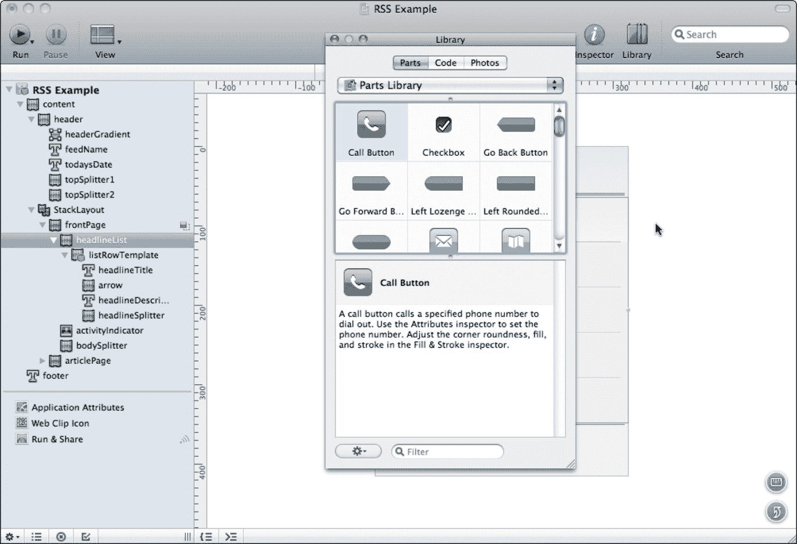

**图 2-16：** 使用快捷菜单组织你的库。

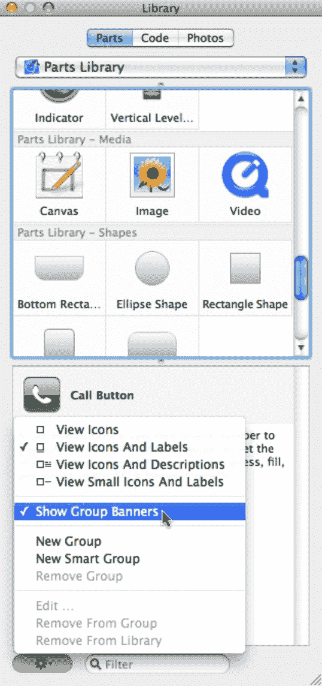

`Library` 窗口背后的想法是，你可以从窗口将一个项目拖到你的 Dashcode 项目中。在你回想起隐藏在 Dashcode 项目内部的几十个文件之前，这没什么令人兴奋的。当你从 `Library` 将项目拖到你的项目中心时，你正在将特定文件和文件部分的引用拖到代码中，而这些内容通常在你的项目中不可见的。从 `Library` 拖入项目与编写代码完全是两回事！

## 查看部分（Looking at parts）

`Parts` 面板中是你可以插入到应用程序和组件中的图形元素。这些元素被由弹出菜单控制的若干类别分类（见图 2-17）。你还可以使用窗口右下角的搜索框来查找特定项目。

使用快捷键（如显示横幅的选项）来组织窗口。一如既往，将你自己作为测试对象，这样你不仅在使用该界面，还在思考它是如何工作的，以便能够有效地创建你自己的界面。使用 `Library` 窗口顶部的弹出菜单（如图 2-17 所示）来查找你感兴趣的内容。窗口底部是对发生情况的描述。在这个例子中，你既是同一个项目——弹出菜单的用户也是开发者。

还要注意通过菜单底部的描述，准确了解当你将该弹出部分拖入项目时，你的项目会发生什么。你将自动添加 `JavaScript` 代码，你可以通过 `Attributes`（属性）和 `Behavior`（行为）检查器对其进行完善——参见第 4 章和第 7 章。

**图 2-17：** 使用弹出菜单和搜索字段缩小你的部分列表。

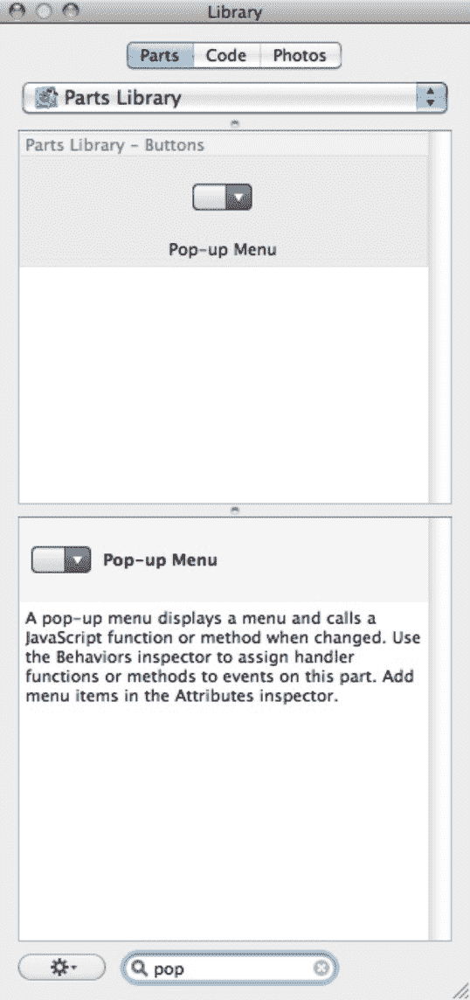

## 探索代码（Exploring code）

`Code` 面板如图 2-18 所示，显示了 `JavaScript` 代码片段。

**图 2-18：** 库包含代码。

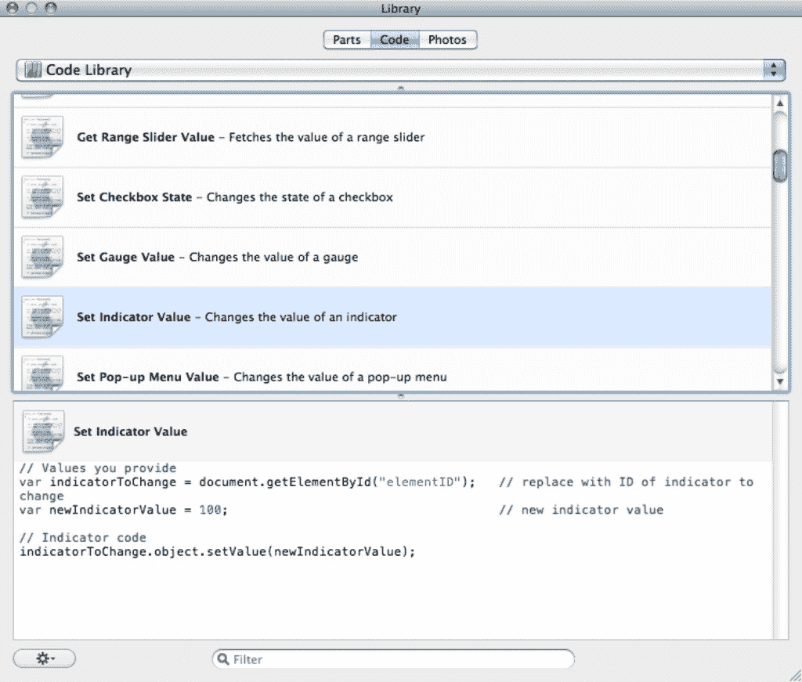

## 使用你的照片（Using your photos）

`Photos` 面板与你的 `iPhoto` 库交互，它可以向应用程序和组件添加照片，如图 2-19 所示。尽管 `iPhoto` 库最初用于照片，但它已成为许多图像、图表和标志的精索引和组织集合。个人照片位于另一个账户中——通常是与 iPad 或 iPhone 同步的。

**图 2-19：** iPhoto 库与 Dashcode 集成。

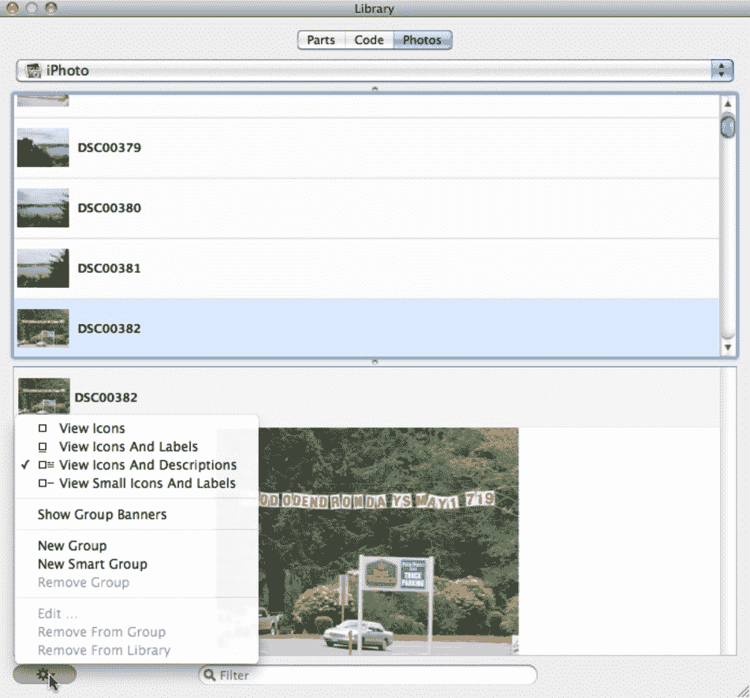

## 开始使用画布（Starting Out with the Canvas）

`canvas`（画布）是你创建应用程序或组件的地方。在 `canvas` 上，你会看到通过从 `Library` 拖入部分或照片创建的界面。

当你将这些项目拖到 `canvas` 后，可以调整它们的大小并重新排列（`Align` 和 `Distribute` 菜单命令允许像在许多其他应用程序中那样组织它们）。你可以通过检查器对这些部分进行进一步自定义（参见第 4 章）。在少数情况下，你可能还会使用代码片段。

第 3 章详细描述了这一过程。

## 测试并部署你的工作（Testing and Deploying Your Work）

当你完成项目的稿时，Dashcode 可以帮助你进行测试。工作流步骤列表的最后一项允许你测试。对于 Dashboard 组件，点击 `Run & Share` 会显示图 2-20 所示的面板。

图 2-21 显示了相应的 Safari 应用的面板。

图 2-20：你可以可以运行并共享 Dashboard 组件。

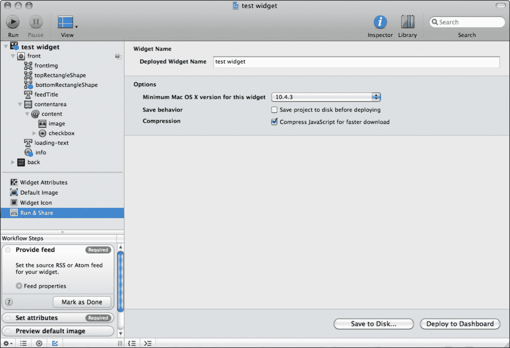

**图 2-21：** 你可以运行并共享 Safari 应用。

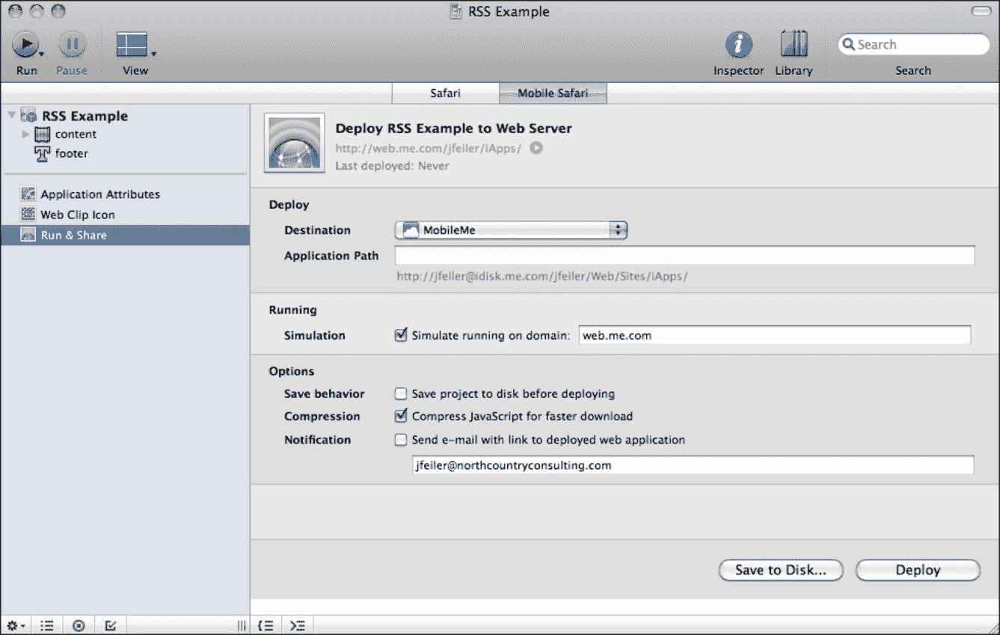


注意窗口右下角的两个按钮。`Save to Disk` 按钮允许你将文件夹中的所有项目文件保存到你指定的磁盘位置。如果你通过选择 `File⇒Save` 来保存 Dashcode 项目（或者在关闭 Dashcode 项目时收到有关未保存更改的警告），你将按照之前描述的包结构来保存项目。所有文件都在那里，但除非通过 `Show Package Contents`（显示包内容）命令或 `Go` 菜单中的 `Go to Folder` 命令，否则它们在 Finder 中通常是不可见的。

`Deploy` 按钮会将你的项目部署到你电脑上的 `Dashboard`，或者到你指定的 Web 服务器上的某个位置。

Dashcode 一如既往地，还有更多选项可用。在开发项目时，你可以在 Dashcode 内部运行它。你不需要部署它就能测试。Dashcode 包含一个 iPhone 模拟器以及 Dashcode 本身。该模拟器提供了一种快速方法，可以在部署进行最终测试之前查看项目的样式。

### 第 3 章：创建你的第一个 Dashcode 项目

## 本章内容
- 理解开发流程
- 创建一个 Dashcode 项目
- 确保你的项目正常工作
- 使用你的项目

Dashcode 窗口是用户界面（UI）设计的奇迹。该窗口安排了各种功能和大量信息，使得开发者可以在逻辑且紧凑的环境中创建出出色的应用程序和小部件（widgets）。

正如“厨子好不如菜对”一样，开发工具的好坏在于开发。在本章中，你将开发你的第一个 Dashcode 项目。

## 贯穿开发流程
Dashcode 在导航器底部提供了 `Workflow Steps`（工作流步骤）列表，帮助你完成开发流程。当然，`Workflow Steps` 列表专注于你使用 Dashcode 执行的步骤。

开发你的应用或小部件除了 `Workflow Steps` 列表中的步骤外，还有几个步骤。请注意每个项目都有些不同，每个开发者和开发环境都有自己的特点。例如，为你自己创建的项目与你为公司或普通公众创建的项目是不同的。你可以使用 Dashcode 创建许多特殊用途的项目，例如书中这些用于演示 Dashcode 特性的项目。

尽管有许多变体，但在完成第一个 Dashcode 项目的过程中，这里有一份相当详尽的考虑事项列表：

- **你想让人们用这个项目做什么？** 即便你只是在玩玩以尝试学习更多 Dashcode 知识，也要思考你的项目应该让人们实现什么。通常，最成功的项目（如最成功的应用程序）对于它们能让人们做什么是非常明确的。思考你（开发者）想做什么，往往会让最终结果不如你关注用户时那么成功。
- **人们应该如何通过你的项目实现他们的目标？** 这个问题是你界面设计的起点。关于界面设计有大量的信息、理论和观点。在开始之前，你应该回答以下几个问题：
    - 你的用户是谁？他们理解并使用哪些术语？（想想看电视的人和制作节目的人之间术语的区别。）
    - 你的用户使用什么语言？Dashcode 允许你对项目进行国际化。
    - 项目的最终结果是什么？它是娱乐性的，以便最终结果是会心一笑，或是专注于周围事物其他事情的愉悦体验？你是否在为用户提供信息？你是否在帮助他们组织自己的信息？
    - 你的项目需要什么内容？你的项目是否需要访问数据文件或网站来查找要展示给用户的数据？它的界面中是否包含图形，不论是标志、图画还是照片？对于任何你没有创建的内容，你是否有可用资源（或知道从哪里获取），以及你是否有使用它的权利？
- **它将是哪种项目？** 记住 Dashcode 允许你创建 Safari Web 应用程序以及 Dashboard 小部件。对于 Safari，你可以创建为桌面版 Safari 浏览器设计的 Web 应用程序，其窗口是可以移动和调整大小的。你还可以为 iPhone 和 iPad 等移动设备创建 Safari Web 应用程序。在这些情况下，Safari 窗口不可移动或调整大小。此外，你还可以访问多种 Safari 扩展，它们利用了 iPhone 或 iPad 的功能。记住 Safari 和 Safari Web 应用程序可以在 Mac OS X 和 Windows 上运行。

 你不必非选择一种类型的项目。不需要费太大力，你就可以创建一个运行在移动 Safari 或桌面 Safari 上的同一个 Dashcode 项目；你可以复用大部分代码来创建一个并行的 Dashboard 小部件。

- **时间跨度是多久？** 你拥有的时间是项目的关键部分。如果你无法在规定的时间内完成所有工作，最好在开始时就面对这个问题。这样，你可以在情绪耗尽之前为第二阶段和第三阶段做好计划。

## 从 Web 应用的角度思考移动设备的用处
“什么是移动设备？”这是一个非常简单的问题，但答案很复杂。在 Dashcode 3.0 中你的选择是 Safari 或移动 Safari。移动 Safari 是给 iPhone 的。一切都封装在文件和文件夹结构中（详情见第 2 章）。文件夹内部有一个名为 `safari` 的子目录和一个名为 `mobile` 的子目录。（这些名称是区分大小写的，这就是为什么它们显示为小写，而其他一些名称不是。）


如果你的 Dashcode 版本解决了这个问题（即它允许你选择 iPad 作为 Web 应用程序的发布目标），那么你就没有问题了。如果你正在构建 Dashboard 小部件（widget），你也没有问题。如果你正在为 iPad 开发 Web 应用程序，你绝对需要这个修复。如果你正在为 iPhone 构建 Web 应用程序，并且哪怕有一丝微小的可能有人会在 iPad 上使用（或尝试）它，那么你也应该使用这个修复。

以下是在 iPad 上使用 `safari` 文件夹中文件的方法。我将在第 19 章中解释这些步骤背后的原理。

1. 打开你的 Dashcode 项目。

在继续操作之前，请将项目备份保存到安全的位置，以防发生意外。你可以在 Dashcode 内部选择 `File⇒Save As`，也可以在开始之前在 `Finder` 中进行。

2. 选择 `View⇒Stop Code Generator`（查看⇒停止代码生成器）。

代码生成器在后台运行，以保持文件与你绘制的界面保持同步。你实际上已停止代码生成器的唯一证据是命令变成了 `Start Code Generator`（启动代码生成器）。

3. 在导航器中显示文件，如图 3-1 所示。

要显示文件，选择 `View ⇒Files`（查看 ⇒文件）或点击 Dashcode 窗口底部框架中从左侧数第二个按钮。

4. 如果必要，打开 `Parts` 文件夹以显示 `redirector.js`。

你可以使用 `Parts` 文件夹旁边的折叠三角形来打开此文件夹。

5. 点击 `redirector.js` 查看代码。

在函数顶部，你会看到这行代码。注意，书中的间距与文件中的间距不同，但它是同一行代码：

```javascript
var DCshowiPhone = RegExp(“ AppleWebKit/”).test(navigator.userAgent)
  && RegExp(“ Mobile/”).test(navigator.userAgent));
```

6. 在末尾添加 `&& !RegExp(“iPad”).test(navigator.userAgent)`，使其现在读取为：

```javascript
var DCshowiPhone = RegExp(“ AppleWebKit/”).test(navigator.userAgent)
&& RegExp(“ Mobile/”).test(navigator.userAgent)
&& !RegExp(“iPad”).test(navigator.userAgent);
```

**图 3-1：** 在导航器中显示项目文件。

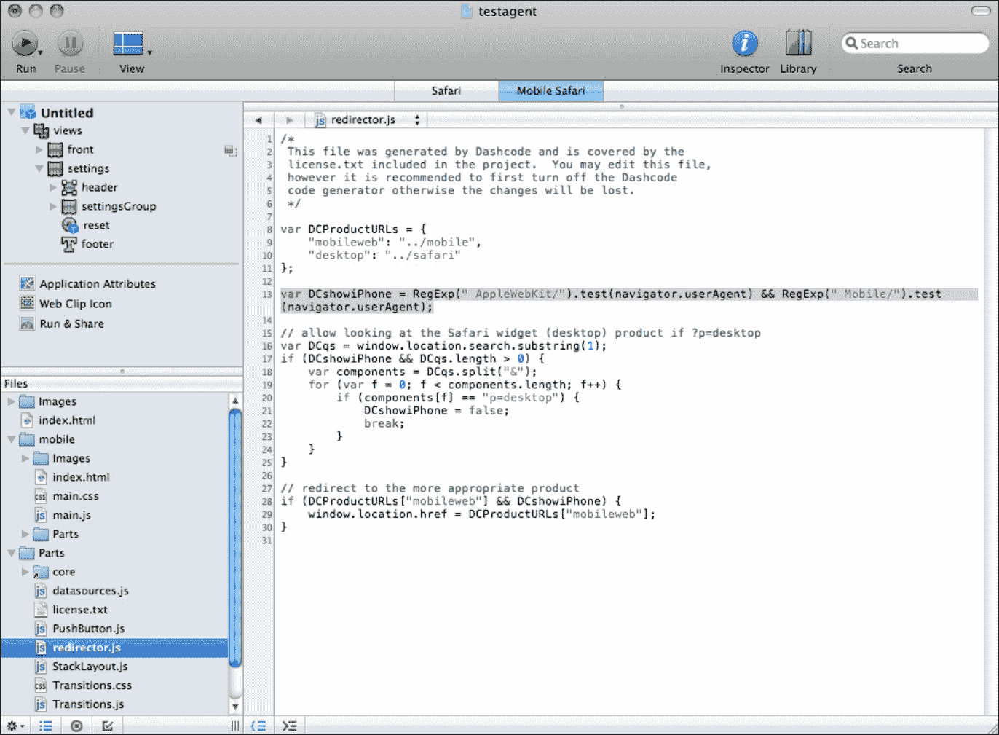

你添加的行将测试更改为查找移动设备而非 iPad。在这种情况下，你使用的是 `mobile` 文件夹，这对 iPhone 是正确的，但对 iPad 则不是。

7. 保存文件。

8. 选择 `View⇒Start Code Generator`（查看⇒启动代码生成器）。

9. 保存你的 Dashcode 项目。

## 预览你的第一个 Dashcode 项目

我选择第一个 Dashcode 项目是为了向你介绍这一流程，并说明你可以通过 Dashcode 轻松完成的事情，以及你在现实生活中需要做的一些选择。

图 3-2 显示了你在本章完成该项目后它的样子。该项目出现在通过 Dashcode 提供的 iPhone 模拟器中。

 本书中此类和其他项目的代码可以在 [www.dummies.com/go/dashcodefd](http://www.dummies.com/go/dashcodefd) 获取。那里会显示下载链接。在适当的情况下，我会提供额外的文件。例如，在本章的文件中，你不仅找到了 Dashcode 项目，还有我在图 3-2 中使用的照片。

**图 3-2：** 你的第一个 Dashcode 项目：第 3 章版本。

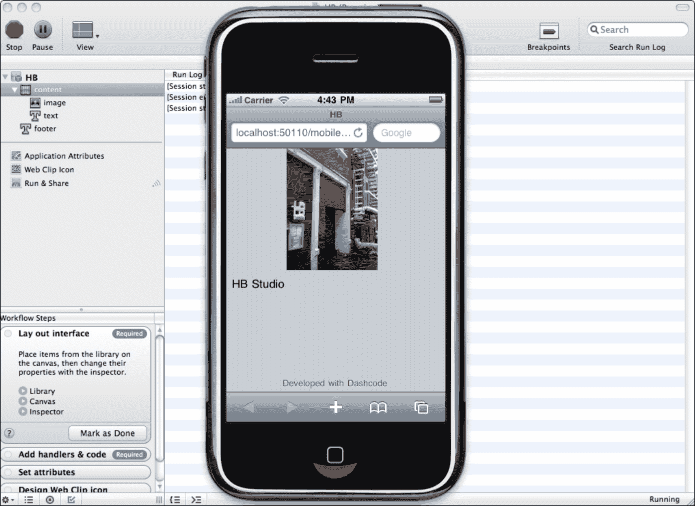

## 关注设计

作为一名 Dashcode 开发者，你应该养成观察新应用和小部件的习惯，不仅是为了使用它们，还为了观察它们是如何设计的。

Dashcode 可以帮助你构建 Dashboard 小部件，还可以为 iPhone 和 iPad 构建 Web 应用程序。我特意选择将第一个 Dashcode 项目设计为 iPhone Web 应用程序。在很大程度上是因为 iPhone 屏幕很小，为 iPhone 设计界面往往比为 iPad 或小部件设计界面更困难。你可以创建的所有类型的界面都共享许多共同特征和设计挑战，但许多人发现从限制最严格的环境——iPhone 中工作是最容易的，然后从那基础上修改界面。

 修改界面不仅仅是在从 iPhone 迁移时将所有内容都变大的问题。相反，你需要考虑贯穿本书探讨的许多问题。但通过首先构建在某些方面最困难的界面，你可能会发现从 iPhone 移动到另一个界面变得更容易。

注意，许多人不同意这一理论：这在很大程度上取决于个人喜好和经验。在你开发了几个应用和小部件后，你就能决定哪些类型对你来说是最困难的。无论你发现什么最困难，它可能是多平台开发过程中的正确起点。

### 在这个非常简单的应用中你还看到了什么？

**照片**：照片仅用于说明。随着项目的演进，你可以让它变得“热”，以便它以一种或另一种方式响应鼠标点击。

**Dashcode 归属行**：底部是 Dashcode 插入的 `Developed with Dashcode` 文本行。你可以修改这行文字。

**标题**：另一行文本作为照片的标题出现。如果它居中会更好看吗？你可以在第 5 章学习如何居中。

**Web 页面地址和搜索字段**：窗口顶部是标准的浏览器字段。iPhone 应用是经过定制的，因此它们有地址。你可以隐藏这些浏览器元素，让你的结果看起来像一个 iPhone 应用（见第 8 章）。

**空白空间**：照片下方，你看到了一个亟待开发的空间（正如通常所说的，这就像是一块大空地）。这里是你可以添加的一些项目：

- 指向更多信息的链接，也许是一个 Web 页面：（这个例子是关于学校的，所以也许链接应该指向教师列表。）
- 上一个或后一个按钮：如果照片是社区之旅的一部分，那么“下一个”按钮可能会带你去转角的另一栋建筑。

你可以在第二部分探索使用该空白空间的选项。


“新建项目”对话框可能可见，如图 3-3 所示。如果是这样，请跳到第 3 步。

2. 选择 `File⇒New Project`。

你可以在此对话框中选择模板。如果你需要，可以点击任何模板，以在对话框底部查看其简要描述。

3. 点击左侧窗格中的 `Safari` 来选择项目的存储位置。

4. 点击 `Custom` 模板。

对于第一个项目，请选择 `Custom` 模板。这个模板之所以说是“自定义”的，是因为它是最基础的模板，你可以根据意愿进行自定义。其他模板都至少实现了某种特定类型应用的基础功能。因此，`Custom` 模板是最简单的一个。

5. 勾选 `Mobile Safari` 复选框。

此时是否勾选 `Safari` 复选框并不重要。

**图 3-3：** 你可以选择一个模板。

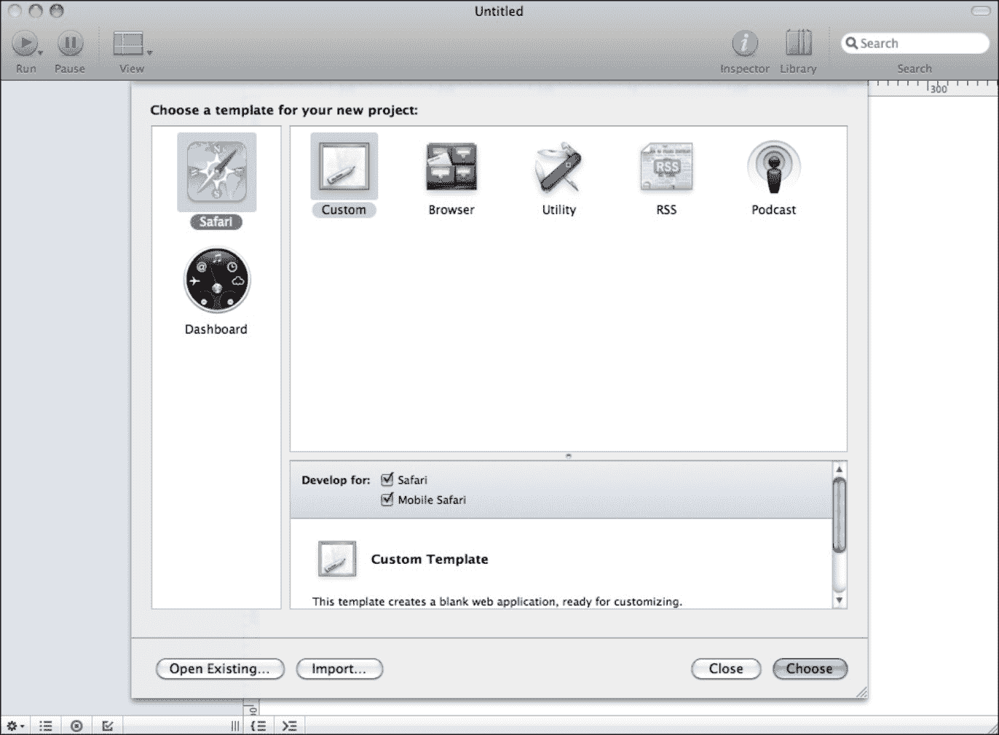

6. 点击 `Choose` 按钮。

你也可以直接双击想要使用的模板，但如果你在使用 `Safari` 模板，请务必在双击模板之前已选择了相应的复选框。

你创建的项目已准备好供你工作了。它看起来可能像图 3-4，但由于 Dashcode 界面有许多选项，它可能并不如此。（请参考第 2 章查看配置此窗口的方法。）

你现在最关心的是画布，所以请确保通过 `View` 菜单或工具栏中的 `View` 使它是可见的。此外，请记住，你对 iPhone 应用感兴趣的是移动 Safari。如果你在第 5 步中开启了另一个复选框，你会在工具栏正下方看到一些按钮，允许你在 `Safari` 和 `mobile Safari` 之间进行切换。确保已选择 `mobile Safari`。

窗口底部的 `Developed with Dashcode` 文本是作为模板的一部分创建的（但你可以按照第 5 章中的描述对其进行修改）。如果你参考图 3-1（完成的应用），你会发现你需要添加一张照片和一些文本作为标题。

**图 3-4：** Dashcode 为你设置了项目。

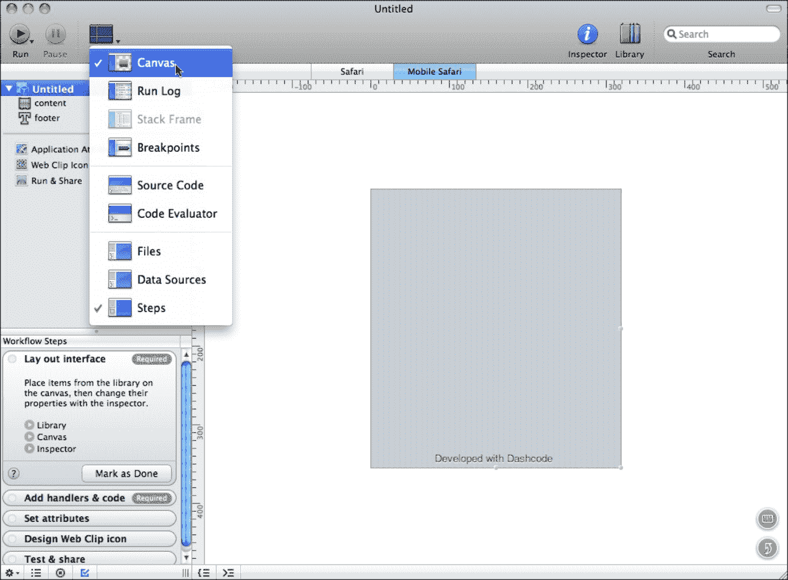

### 在模拟器中测试你的项目

在你拥有应用自己的副本后，可以在模拟器中对其进行测试。测试你从模板创建的应用，以便在进行任何更改或自定义之前查看它的运行情况（以及是否运行）。这第一步是在任何创建新项目时都可以采取的好主措。

许多模板在此时可以成功运行。依赖于数据的模板通常在其模板中包含示例数据；你可以根据需要用你自己的数据修改这些数据。然而，带有网站链接的模板在不进行自定义的情况下可能无法运行。有时它们内置了指向 Apple 网站的链接，但在其他情况下，你可能需要进行更改。

不过，`Custom` 模板开箱即用。点击窗口左角的 `Run` 按钮。iPhone 模拟器启动，如图 3-5 所示。该模拟器是一个与 Dashcode 通信的独立应用程序，因此你会在 Dock 中看到一个新的应用程序图标。你会看到看起来像空白的页面，但如果你查看底部，会看到作为模板一部分的 `Designed For Dashcode` 文本。这就是你应用程序的开始。

 模拟器启动需要相当一段时间，所以如果你没有立即看到你的项目，请担心。

**图 3-5：** 在模拟器中测试项目。

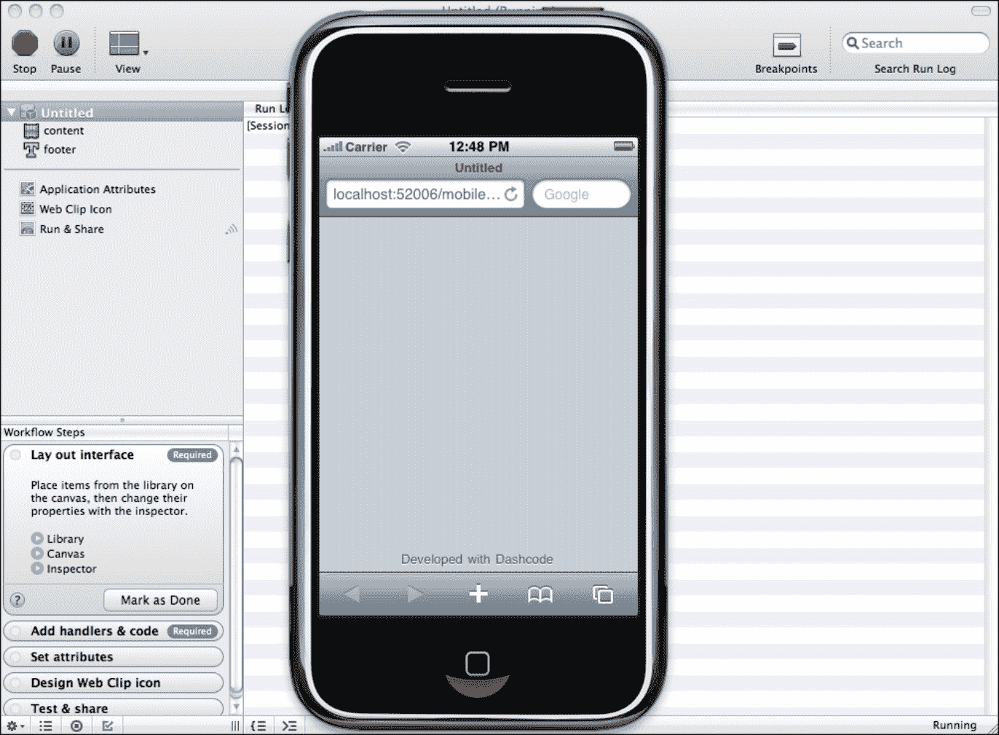

### 添加照片

如图 3-1 所示，照片出现在应用窗口的中心，因此你需要添加它。你可以从 `iPhoto` 中添加你自己的照片，也可以使用从 `www.dummies.com/go/dashcodefd` 下载的照片。

你首先需要将照片添加到 `iPhoto`。（显然，如果你正在使用现有照片，可以跳过此步。）只需将想要添加的照片拖入 `iPhoto`，或选择 `File⇒Import to Library` 来添加它。

将照片放入 `iPhoto` 后，将其添加到你的项目中：

1. 打开 `Library` 窗口。
2. 选择 `Photos` 标签。

顶部的弹出菜单允许你从你的 `iPhoto` 相册中进行选择。

3. 从弹出菜单中选择你想要浏览的相册，或将其设置为 `iPhoto` 以浏览所有照片。

你可以使用窗口左下角的快捷方式图标来自定义显示。

4. 将你使用的照片拖入画布上的应用中，如图 3-6 所示。

将照片放置在你想要使用的大致位置。现在不要担心它看起来什么样。

**图 3-6：** 将照片拖入项目。

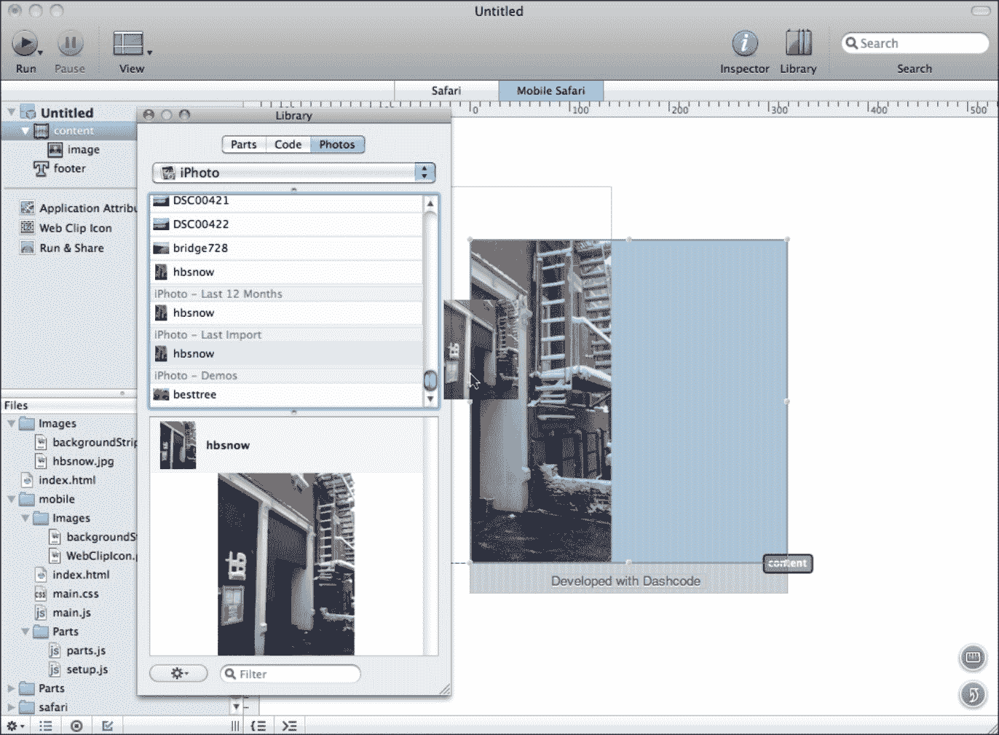

### 调整照片大小

根据图像的大小，照片可能太大或太小。当你将照片掉入项目中时，它会显示为选中状态并有八个句柄，如图 3-7 所示。你可以使用句柄（位于四个角和每条边的中间）来调整照片大小。

**图 3-7：** 根据需要调整照片。

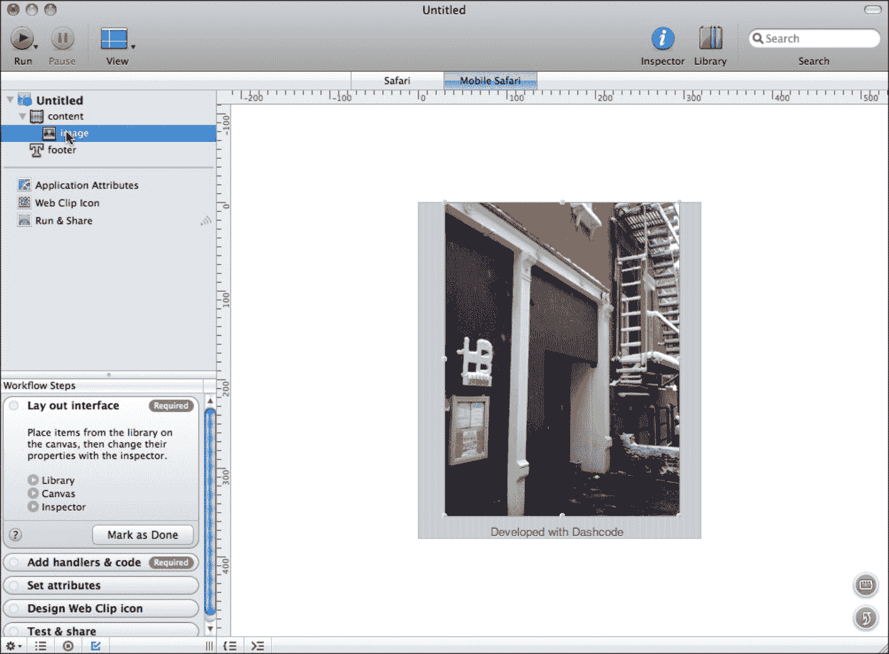

当你调整照片大一时，照片本身会保持其形状，而你在操作它周围的框（称为边界框）。

对于此示例，将照片放置在画布的顶部，如图 3-8 所示。

**图 3-8：** 将图像放在顶部。

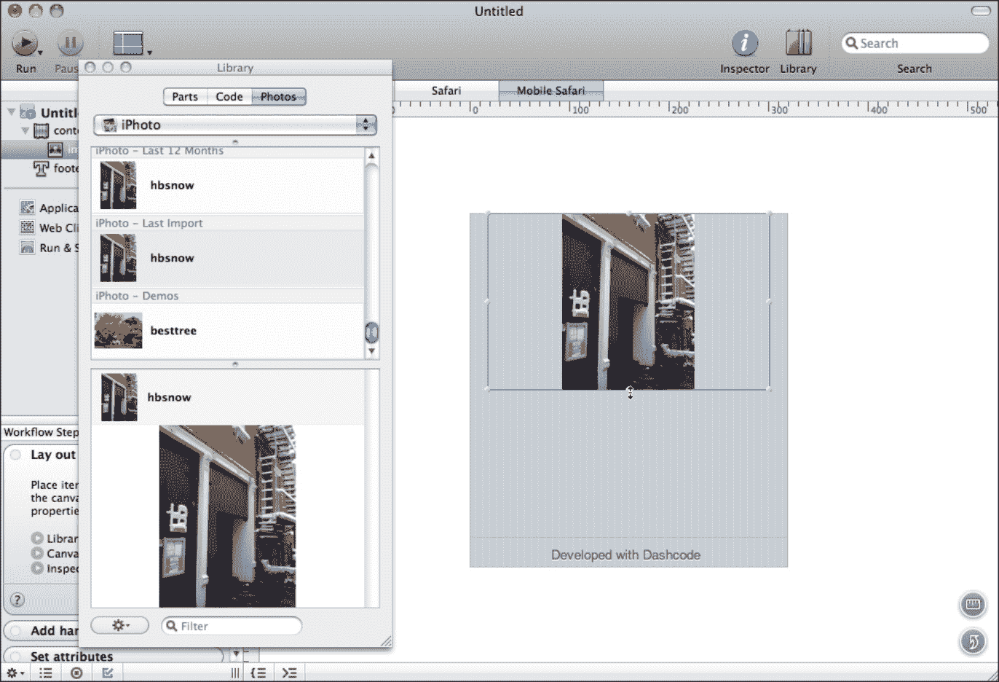


你可以随时在回来进行微调。事实上，当你开发 UI 时，你会频繁地进行一些微小的调整，直到所有内容都恰好处于正确的位置。

### 添加文本

在示例中，一行文本出现在照片正下方（参见图 3-2）。你界面中的每一个元素都将是其中的一部分。你不能直接在界面上进行打字：你必须添加一个文本部分并在其中输入。之所以这样做，是因为使用文本部分会让修改界面变得要简单得多：你只需要移动文本部分并调整它的手柄。你可以根据需要对文本部分内的文本进行对齐和调整。如果你想添加的文本超过了部分的容量，文本仍然可以留在部分内；如果你扩展该部分，文本就会可见。

 如果你认为包含文本且可以移动和缩放的文本部分就是页面布局程序（或 Pages 中的布局模板）的工作方式，那么你完全正确了。

现在，你已经准备好添加文本部分、确定它的位置并输入文本了。

1. 在库（Library）中找到文本部分，并将其拖入画布上的应用中，如图 3-9 所示。

**图 3-9：** 添加文本部分。

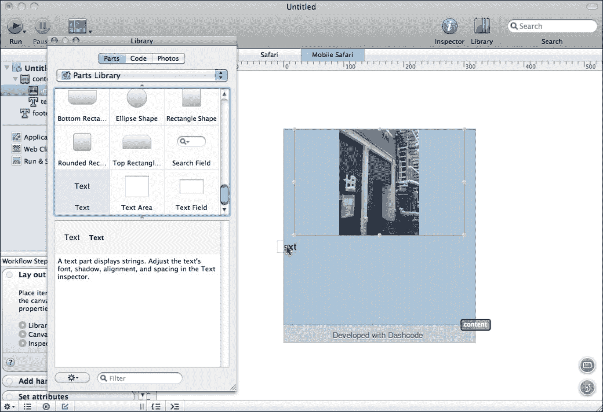

当指针进入画布上应用图像的瞬间，一个包含将插入该部分的名称的框会出现在图像的右下角。

另外请注意，库中包含文本字段（text field）和文本区域（text area），它们就像允许输入单行或多行文本的 HTML 构造元素。文本部分（Text part）显示文本且不允许用户输入，这正是你想要的。

2. 当你将部分放在理想的位置后，双击使其变为可编辑并输入你的文本，如图 3-10 所示。

文本部分仅在当你通过 `Dashcode` 访问它们时才是可编辑的。用户无法修改它们。

**图 3-10：** 输入文本。


当你移动部分时，周围会出现蓝色引导线，帮助你将它们与其他部分的边缘或中心对齐。

3. 如果你还没有保存，请保存你的项目。

# 测试你的项目

你可以通过点击 `Dashcode` 窗口左上角的运行（Run）按钮使用模拟器测试你的项目。测试项目可以让你直观地了解用户在 Web、iPhone 或 iPad 上将看到的内容。

然而，为了完全测试你的 `Dashcode` 项目，你需要将其上传到网站或安装到 `Dashboard` 中。`Dashcode` 可以完成这两项任务中的任一或两者，取决于你所构建的项目类型。

在部署项目之前，你需要设置至少一个可以部署它的目标。（你可以手动部署，但过程更为复杂——请参见接下来的章节“部署你的应用”）。

# 设置你的部署目标

设置目标是你对所有 `Dashcode` 应用都需要做的事情。对于你的项目，两个最常见的目标是你自己的网站和 MobileMe 账户。如果你想在其他地方部署应用，可以创建额外的目标。

对于单个应用，你从从导航器（navigator）顶部的“运行与共享（Run & Share）”开始。从弹出菜单中选择你想要使用的目标，如图 3-11 所示。设置两个最常见的目标（你自己的网站和 MobileMe）很容易的。在 `Dashcode` 中你需要做的是……几乎什么都不用。

因为 Mac OS X 内置了 Web 服务器，而且因为每个账户都有自己的网站供账户所有者随心意愿使用，所以你需要做的就是开启该网站。部署 `Dashcode` 应用只是你内置网站的用途之一，你不需要为 `Dashcode` 做任何特殊处理。如果你已经启用了自己的 Web 服务器，`Dashcode` 会自动将其包含在目标弹出菜单中。如果你还没有开启网站，需要按照后续章节的描述开启它。

**图 3-11：** 在部署项目时选择目标。


MobileMe 通常在安装 Mac OS X 时设置好。像你自己的 Web 服务器一样，你的 MobileMe 账户在“系统偏好（System Preferences）”中配置。如果你还没有配置账户，本章后部分的“开启你的 MobileMe 账户”部分将向你展示如何操作。因此，对于大多数人来说，`Dashcode` 可以使用 Mac OS X 个人 Web 服务器或具有 Web 托管权限的 MobileMe 账户（或两者）作为部署目标。

## 开启你的 Web 服务器

如果你需要开启自己的 Web 服务器，请前往“系统偏好（System Preferences）”并点击“共享（Sharing）”，如图 3-12 所示。

**图 3-12：** 打开系统偏好设置。


“共享”面板打开，如图 3-13 所示。选择“Web 共享”，如图 3-13 所示。（注意：雪豹系统中的偏好设置面板与之前的 Mac 版本不同）。防火墙设置会自动调整。

**图 3-13：** 设置共享偏好。


你看到的 URL 是任何人都可以访问你网站的地址。对于大多数人来说，这些地址以 `10` 或 `192` 开头；这些特殊的 Internet 地址用于局域网。尽管基站或路由器具有从外部访问的 Internet 地址，但局域网内的设备通常从外部不可见。如果你启用了自己的 Web 服务器，`Dashcode` 会自动将其包含在目标弹出菜单中。开启网站后，放置文件非常简单。将你想发布到网站的 HTML 文件（或其他任何文件）直接拖到你主目录下的 `Sites` 文件夹中。当你要求 `Dashcode` 将应用部署到你的本地网站时，它就完成了这些。

开启你的 MobileMe 账户

如果你需要开启 MobileMe，请前往“系统偏好”并点击“MobileMe”设置。输入你的成员名称和密码，如图 3-14 所示。（注意，你的账户名称是 MobileMe 邮箱地址，但去掉结尾的 `@me.com`）。

**图 3-14：** 配置 MobileMe。


### 添加 WebDAV 或 FTP 目标

除了你自己的网站和 MobileMe，你还可以添加其他目标（参见图 3-10。如果你选择添加不同的目标，会看到图 3-15 所示的对话框）。

**图 3-15：** 添加其他目标。


选择你想要添加的目标类型并提供登录信息。如果你想添加另一个目标，点击对话框左侧目标列表下方的 `+` 号。要移除目标，选中它并点击 `–` 号。


 如果你已经在“系统偏好设置”中设置了 Web 服务器或 `MobileMe`，这些目的地会自动添加到目标列表中，且你无法删除它们。（它们显示为灰色以提醒你。）删除这些目的的唯一方法是在“系统偏好设置”的“共享”面板中关闭 Web 服务器，或者移除你的 `MobileMe` 账户（该账户也在“系统偏好设置”中）。退出 `MobileMe` 不会从目标列表中移除 `MobileMe`。

 你也可以通过选择 `Dashcode⇒Preferences` 进入图 3-15 所示的对话框。

你可以创建的目标数量没有限制，但在实践中，大多数人的目标不超过几个——一个或多个网站、一个 `MobileMe` 账户、一个 `WebDAV` 账户，以及一两个 FTP 站点。

# 部署你的应用程序

设置好目标后，就可以部署你的应用程序了。要这样做，请点击导航器中的 `Run & Share`，如图 3-16 所示。

**图 3-16：** 点击 `Run & Share`。


你有多个部署选项，但在大多数情况下，默认设置就足够了。唯一要求的是目的地。选择目的地后，点击 `Deploy` 按钮。

当你部署应用程序时，会看到两个目的地的 URL。窗口顶部是人们可以用来访问你的应用程序的 URL。右侧的箭头带你进入目的地。你还会看到一条带有上次部署时间的消息。

如你在图 3-16 中所示，在 `Application Path` 字段下方是存放文件的地址。此地址通常与人们访问你的应用程序的 URL 不同。例如，对于 `MobileMe`，访问 URL 类似于 `http://web.me.com/jfeiler/iApps/yourapp/index.html`。文件的位置则类似于 `http://jfeiler@idisk.me.com/jfeiler/Web/Sites/iApps/yourapp`。

 区分这些地址最简单的方法是选择向自己发送封带有正确 URL 的电子邮件。然后你就可以将该 URL 转发给朋友（或将其复制粘贴到网站上）。

有时你可能不想用 `Dashcode` 部署项目。你可以使用右下角的 `Save to Disk` 按钮，让 `Dashcode` 将所有文件和文件夹写入你指定的位置。不使用 `Dashcode` 部署项目的最常见理由是因为你想将项目部署到你没有访问权限的 Web 服务器上。你可以在模拟器中进行所有测试，完成后，可以将文件保存到磁盘并将它们（可能是压缩后的 `ZIP` 归包）转发给你的网页管理员。

# 部署小部件

尽管本章向你展示了如何构建和部署 iPhone Web 应用，但值得花时间查看 Dashboard 小部件的 `Run & Share` 选项。设置非常相似，但你不需要担心目的地。你要么将小部件部署到自己电脑上的 `Dashboard`，要么将文件保存到磁盘。

## 跨站脚本

跨站脚本是指运行在一个网站 上的脚本调用运行在另一个网站上的脚本的情况。在许多情况下，跨站脚本已被证明是非常严重的安全问题。（据估计，使用这种技术的安全漏洞高达 80%。）出于这个原因，诸如 iPhone 版 `Safari` 等浏览器通常防止一个网站上的脚本运行另一个网站上的脚本。运行你正在访问的网站的任何脚本时不会遇到问题，但在你背后从一个网站的脚本到另一个网站的脚本之间跳跃正是可能出现问题的地方。为了测试，你可以使用部署对话框模拟在特定网站上运行。

如果你将文件保存到磁盘，它们将以包的形式保存，所有文件都封装在其中。然后你可以将那个显示为单个文件的包发送给他人，或将其发布在网站上供下载。由于 Dashboard 小部件仅运行在 `Mac OS X` 上，因此在在使用仅支持 `Mac OS X` 的包时不会遇到问题。（在一个全 Mac 的世界里，为 Web 应用部署的文件可能在一个包中，而不是在文件和文件夹结构中。）

图 3-17 显示了小部件部署界面。

**图 3-17：** 保存或部署 Dashboard 小部件。


# 第二部分

## 构建你项目的组件和部分


在本部分中……

你不需要用 `Dashcode` 写很多代码：它更像是一个组装过程，使用一组预构建的界面元素。在这一部分中，你将看到如何使用这些功能——检查器、库和样式——来组装、样式化和调试你的项目。

# 第 4 章

## 检查器

### 本章内容
- 使用检查器
- 管理部分及其属性
- 文本格式

Dashcode 不仅仅是一个帮助你创建应用程序的工具。它包含了大量可以使用的内容。其中部分内容在模板中，但很大一部分在库中。当你使用创建的组件时，经常需要调整它们的设置。你可以通过位于库旁边的检查器完成所有这些工作。

### 使用检查器窗口

检查窗口是一个你可能见过的界面功能。它用于 `iWork` 应用（Numbers、Pages 和 Keynote）以及 `Finder`。与库窗口和 Dashcode 本身一样，检查窗口将大量信息和功能放在紧凑的区域。

通过点击工具栏上的 `Inspector` 或选择 `Window⇒Show Inspector` 打开检查窗口。图 4-1 显示了检查窗口。

与库窗口一样，检查窗口浮在其他 Dashcode 窗口之上。事实上，这些窗口出现在桌面所有内容的上方。你可以根据意愿移动、关闭并重新打开它们。在这个平面上，你可以点击 `Library` 或 `inspector` 窗口使其移动到另一个窗口前面。

**图 4-1：** 打开检查窗口。


### 在检查窗口中处理元素

你的 Dashcode 项目界面由元素组成，这些元素可以是按钮、包含文本或图像的字段，以及管理其他元素的控件（如浏览器）。检查窗口显示所选元素的信息。

 库中的部分变为画布上的元素。此外，Dashcode 是一个面向对象的环境（正如当今大多数软件如此），几乎一切都是对象。当你编写或查看 JavaScript 代码时，你会看到画布上的东西是元素；你可以通过标准的 JavaScript 函数 `GetElementByID` 编程获取它们。


为了让生活更有趣，在 Xcode 和 Interface Builder（你用于构建原生 iPhone 和 iPad 应用，以及苹果员工用于构建 Mac OS X 及其自身应用程序的开发者工具）中，Dashcode/JavaScript 元素大部分都是视图（views）。Dashcode 画布上的按钮是一个 JavaScript 元素，但在 Xcode/Interface Builder 应用或应用程序中外观和行为相同的按钮，则是一个 Objective-C 视图。至关重要的一点是，外观相同的东西行为必须保持一致，这样用户才知道它们是如何运作的。

如果你选择了多个元素（例如你选择了一个按钮和一个文本字段），检查器窗口（inspector window）显示的信息适用于这两个元素。在某些情况下，信息仅适用于单个元素。在这种情况下，当你选中两个元素时，将不会看到相关信息。

当你点击选择应用中的另一个元素时，检查器窗口中的数据会变化以反映新元素。为了进一步增强其功能，检查器窗口能够识别你在 Dashcode 窗口左上角导航器（navigator）中的选择，以及你在画布上点击应用或小部件时做的选择。你甚至可以点击应用或小部件中的某个按钮，按住 `Shift` 键，然后点击导航器中的文本字段。无论你如何选择要在检查器窗口中显示的元素，都没有影响。

## 探索检查器窗口标签

检查器窗口顶部有六个标签。每个标签都允许你查看并设置所选元素中不同数据集的值。从左到右，标签分别是：

- **Attributes（属性）**：这些值通过元素的名称（是唯一的）、类以及是否可见来标识元素。有关此标签的更多信息，请参阅后文“使用属性”章节。
- **Fill & Stroke（填充与描边）**：这里是所有样式和效果设置——例如阴影、圆角的圆度、线条填充等。第 5 章将详细讨论这些项目。
- **Metrics（指标）**：此标签是你设置元素大小的地方。你可以使用手柄调整元素的大小，但你可以在 Metrics 标签中指定像素大小。（如果你使用手柄，像素大小会在此更新，反之亦然）。你还有自动调整（autoresizing）和布局选项。有关此标签的更多信息，请参阅本章后面的“使用指标检查器”章节。
- **Text（文本）**：这些设置是你预期的：字体、样式、颜色、对齐等。这些设置也会在第 5 章中讨论。
- **Bindings（绑定）**：绑定允许你通过将其设置为从数据文件或其他源读取的数据来设置元素的大小等值。你可以在第 10 章中了解更多关于定的知识。
- **Behaviors（行为）**：如果你配置了它们，元素可以对鼠标点击等事件做出响应。对于每种类型的元素（如按钮或文本字段），你可以找到该类型可以响应的事件列表。每个事件都可以有一个处理器（handler），即事件发生时执行的代码。事件的名称让你知道它是什么——例如 `onclick`、`onmouseover` 和 `ontouchstart`。关于此主题的更多信息，请参阅第 6 章。事件与处理器的组合就是一种行为。

## 使用属性检查器

检查器窗口显示你在画布上的应用或小部件中选中项目的信息，因此为了开始使用检查器窗口，你需要创建一个新项目并探索它的元素。使用 Custom（自定义）模板创建一个新的 Safari 应用（参见第 3 章）。但是，仅为 Safari 创建应用；不要创建移动 Safari 版本。Safari 的 Custom 模板为你进一步开发提供了一个起点。它创建的只是一个空白 Web 页面。

### 使用属性标识元素

属性包括 `class` 和 `id` —— 这是两个在文档对象模型（DOM）和 JavaScript 中广泛使用的标准 HTML 属性。Dashcode 以标准方式使用它们。

你必须能够识别项目中的每个元素。这样，你就可以编写代码来找到某个元素并对其进行操作。在 Web 页面上，每个元素都可以有一个 `ID`；当开发者和设计师知道在 JavaScript 或其他代码中需要它们时，就会提供它们。在 Dashcode（以及许多现代 Web 项目）中，ID 被视为强制性的。Dashcode 为你创建的每个元素自动创建一个 `ID`。你可以更改 `ID`，但永远不能将其更改为已存在的 `ID`。这样，每个 `ID` 都是唯一的。大多数人会更改代码中使用的元素的 `ID`，以便这些 `ID` 具有意义。其他的你可以保持 Dashcode 创建的样貌。

字体 向项目添加元素

你新的空白 Custom 项目需要添加添加一些元素，这样你就可以使用检查器窗口来探索和更改设置。要在你的 Web 页面上添加部分并在属性检查器中跟踪其进度：

1. 确保你可以看到左侧的导航器。如果你在创建新项目后关闭了 Dashcode 窗口，通过 `File⇒Open` 重新打开它。
2. 打开检查器窗口。
3. 选择 `Attributes` 标签，如果它尚未选中。检查器窗口的名称会变化以反映你正在查看的标签。检查器窗口现在被称为 `Attributes inspector`（或你选择的任何标签）。
4. 打开 `Library`（库）。为此，选择 `Window⇒Show Library` 或点击工具栏中的 `Library`。
5. 点击 `Library` 顶部的 `Parts` 标签查看库中可用的部分。
6. 从弹出菜单中选择 `Shapes`（形状）。你会看到各种形状，如图 4-2 所示。`Library` 底部会出现选中形状的描述。此外，当指针悬停在形状上时，会出现帮助标记。
7. 将 `Ellipse`（椭圆）形状拖到画布上，如图 4-3 所示。你可以将第一个形状放在画布上的任何位置。如果你添加第二个形状，你放置的位置可能会受到限制。（如果你无法在精确位置放置第二个形状，请参阅本章后面的“使用指标”章节。）

一旦添加元素，它就会被选中——这是将任何对象拖容器或文档的标准行为。画布上选中的元素显示在属性检查器中。因为每个元素都有唯一的 `ID`，你可以通过向画布上拖入另一个椭圆来演示这一点。当你释放鼠标按钮时，它会被选中，其 `ID` 将是 `oval1`。

如果你不喜欢默认的 `ID`，可以在属性检查器中更改它们。例如，将 `ovalshape1` 的 `ID` 更改为 `ovalShape`。按 Tab 键离开 `ID` 字段进入 `Class` 字段。进入那里之前，你会收到错误消息，如图 4-4 所示。你不能有重复的 `ID`。关闭对话框时，看到名称没有变化，但 `Class` 字段已被选中，等待你输入数据。

你可能想再次尝试让 `ID` 更加人性化。尝试将其改为 `oval shape`。再次，这不起通。`IDs` 不能包含特殊字符或空格（见图 4-5）。


当你开始使用库中的代码片段时，你会发现每个元素都有一个唯一的 ID 是多么重要，这样它才能使用 JavaScript 的 `GetElementByID` 函数。这种用法的一个示例可以在获取仪表盘元素值的代码中。当你想要获取该值并可能将其作为文本显示给用户，或者将其传递到另一个函数进行某种处理时，你就会使用这段代码。从界面元素（如滑块和仪表盘）移动信息，意味着用户可以利用图形对象来输入数据，而在其他情况下他们可能必须手动输入。

要查看 `GetElementByID` 的运行示例，请选择库中的 `Code` 标签页并选择 `GetGaugeValue`。（它很可能是列表中的第一项）。你会看到图 4-6 所示的代码片段。

**图 4-6：** 许多代码片段依赖于 `GetElementByID`。


这段代码是标准的 JavaScript 代码；并没有特别的 Dashcode 特色。你过去可能没有太关注这段代码，或者可能没有使用过它。这两行代码在 Dashcode 的代码片段中反复出现。

获取仪表盘值的第一步是获取仪表盘页面元素。由于页面元素具有唯一的 ID，你可以调用 JavaScript 函数 `GetElementByID`，将返回的结果存储在变量中，然后检查它的值。

以下是实际的代码片段（行在页面上的间距与库中不同）：

```javascript
// Values you provide
var gaugeValue = document.GetElementById(“elementID”);

// replace with ID of gauge
// Gauge code
gaugeValue = gaugeValue.object.value;
```

代码片段中的注释帮助你理解代码，并引导你完成必须自定义的内容。（记住，单行 JavaScript 注释以 `//` 引入并一直持续到行末。最常见的自定义之一是插入 ID。）当你使用库中的组件布局好界面时，你可能不会担心 ID。然而，由于它们确实存在且是唯一的，当你想要为应用程序或小部件添加代码时，你只需打开属性检查器（Attributes inspector）并检查 ID 即可。

 因为 ID 以这样出现在你的应用程序或小部件代码中，请记住，更改元素的 ID 可能会破坏使用之前 ID 的现有代码。如果你打算更改 ID 以创建一个有意义的名称，请在创建元素后立即进行。例如，你可能想将文本字段从默认名称（`textField`）更改为更有意义的，如（textFieldForFirstName`）。

### 使用其他属性

属性检查器中除 ID 和 class 以外的属性都是可选的：

- **Class（类）**：你最经常在级联样式表（CSS）中使用 HTML 的标准类 属性。
- **Visibility（可见性）**：控制可见性的复选框允许你在界面中放置不可见的对象。注意，如果你将一个对象设为不可见，你以后处理它时会很困难，因为你不知道该点击哪里来选择它。

然而，一切并非不可挽回。每个元素都显示在 Dashcode 窗口左上角的导航器（navigator）中。你可以点击一个元素，打开属性检查器，然后更改复选框使其可见。当然，如果你需要在 JavaScript 中引用不可见元素，你可以通过使用它的唯一 ID 来实现，这允许你将某些不可见信息放在文本字段中，例如。然而，那种方法处理在用户视图之外存储数据的方法非常迂回。请参阅第 13 章查看处理此问题的几种更好方法。
- **Default image（默认图像）**：当小部件加载时，Dashboard 会显示默认图像直到整个小部件加载完成。默认图像根据小部件正面的可见界面自动构建。由于这种对默认图像的使用可能需要较小版本的界面，你可能会选择从中删除某些界面元素。通过选择想要包含在默认图像中的界面元素并勾选 `Show in Default Image` 来实现。

你可以通过点击小部件 Dashcode 窗口右下角的 `Show in External Editor` 来进一步自定义你的默认图像，以便使用图形应用程序程序。

在创建界面时，设计指南可能非常有用，特别是当界面复杂且拥挤时（情况通常如此——空间永远不够）。图 4-7、4-8 和 4-9 说明了该问题以及使用设计指南的解决方案。当你将一个对象完全或部分地放在另一个对象前面时，问题就出现了，如图 4-7 所示。

**图 4-7：** 将一个形状部分覆盖在另一个形状上。


像许多图形程序一样，Dashcode 将视觉元素视为分层。你可以在画布上二维移动元素，但要将它们向前或向后移动，你需要 `Arrange`（排列）菜单。选择你想向前或向后移动的元素，然后从 `Arrange` 菜单的命令中选择：

- `Bring Forward`（置前）
- `Bring to Front`（置顶）
- `Send Backward`（后置层）
- `Send to Back`（置底）

在图 4-7 中，椭圆在矩形前面。默认情况下，你创建的每个对象都在之前创建的对象前面，但 `Arrange` 菜单是控制它的安全方法。

**图 4-8：** 选中对象有边框。


当你选择位于另一个后面的对象时，它会被高亮显示句柄。因此，在图 4-9 中，矩形被高亮了。

**图 4-9：** 使用设计指南。


选中矩形后，可以在属性检查器中启用设计指南（Design Guide）。选中设计指南后，后面的对象将部分可见。即使不启用设计指南也是如此。

### 使用元素属性和库代码片段处理文本

库中的许多代码都利用了元素 ID。这是一个如何将代码片段与元素 ID 一起使用的实际、简单示例。你可以将这种基础代码结构用于你的各种 Dashcode 项目。这个示例是一个应用程序，在启动时会自动切换两个文本字段的内容。

### 创建两个字段

要创建文本字段：

1. 打开库（如果它尚未打开）。
2. 将一个文本字段拖到画布上。


3. 如果它没有打开，请打开属性检查器（Attributes inspector）。
4. 将刚刚添加的文本字段的 `ID` 改为 `sourceText`。
5. 在字段中输入 `hello`。
6. 创建另一个文本字段并将其重命名为 `destinationText`。
7. 在此字段中输入 `world`。
8. 重新排列文本字段的位置，使它们相邻。
当你将一个字段移动到另一个附近时，Dashcode 会为你提供引导线，如图 4-10 所示。
9. 保存你的工作。
10. 点击 Dashcode 窗口左上角的 `Run` 进行测试。

结果如图 4-11 所示。

 养成在操作过程中不断测试（并保存）工作的习惯。撤销上一次修改比回溯你在一小时或更长时间前输入的一整系列更改要容易得多。我在书中省略了大部分步骤的测试和保存操作，但你仍然应该执行这些操作。

**图 4-10：** 设置两个文本字段。


**图 4-11：** 测试你的工作。


## 编写代码切换字段内容

创建文本字段后，你需要编写代码来切换字段内容。代码位于 `Library`（库）中，以下是找到并自定义它的方法。

要编写这些代码：

1. 确保项目文件列表出现在导航器（navigator）的左下角。
如果没有出现，请选择 `View⇒Files`、点击工具栏中的 `View`，或者点击 Dashcode 窗口左下框架中的 `Files` 快捷方式。

2. 点击文件列表中的 `main.js`。
文件将打开，其代码会显示出来（见图 4-12）。如果你没有看到它，请确保源代码面板是可见的。你可能需要拖动它与画布（canvas）之间的分割线。

**图 4-12：** 打开 `main.js`。


3. 在 `Library` 中找到 `Get Text Field Text`，如图 4-13 所示。
该文本位于 `Text Parts`（文本部分）区域。如果你知道代码片段（snippet）的名字，或者可以猜出它的部分名称，可以使用搜索字段。在大多数情况下，使用弹出菜单进入相应的区域可以为你提供有限的选择，你可以从中轻松地找到你想要的内容。

4. 将代码拖入 `main.js`。
使用名称旁边的图标进行拖动，图标位于 `Library` 窗口顶部的部件列表或是，也可以位于底部窗格的代码片段中。

5. 将代码放置在函数中唯一一行代码之后。
该行代码是 `dashcode.setupParts();`（见图 4-14）。

6. 检查代码是否位于正确的位置。
需要注意的主要是代码片段的开头在一个新行上，而不是附加在现有的代码行之后（见图 4-15）。

**图 4-13：** 找到 `Get Text Field Text`。


**图 4-14：** 将代码拖入 `main.js`。


**图 4-15：** 检查代码的的位置。


7. 将 `elementID` 修改为第一个字段的 ID —— `sourceText`。
始终检查你插入的代码，查看是否有指示自定义和替换的注释。

8. 按照第 4 步将 `Get Text Field Text` 拖入代码的相同方法，将 `Set Text Field Text` 拖入 `main.js`，并将其放置在你刚刚插入的 `Get Text Field Text` 代码之后。

9. 将 `elementID` 修改为第二个字段的 ID —— `destinationText`。
10. 删除 `var newTextFieldText = "String to display";`。
该代码片段将文本字段更改为此字符串。你不需要将其更改特定的字符串：你想要将其更改 `sourceText` 的值，而第一个代码片段将其存储在 `textFieldValue` 中。因此，你需要删除这一行。

11. 找到 `textFieldToChange.value = newTextFieldText;`。
12. 将 `newTextFieldText` 修改为 `textFieldValue`。
`textFieldValue` 是存储第一个字段值的地方。结果如图 4-16。

13. 保存、测试并运行。
结果如图 4-17。

**图 4-16：** 完成代码。


**图 4-17：** 运行工作。


### 查看属性

当你选择一个对象时，属性检查器（Attributes inspector）会显示有关所选对象的信息，如图 4-18。

**图 4-18：** 属性检查器。


## 使用填充和描边（Fill and Stroke）

填充与描边器允许你调整对象的填充和线条的描边。填充和描边都使用一种经典的界面元素——让你选择颜色的颜色选择器（见图 4-21.）。再次，你在非常小的空间内发现了海量的功能。

颜色选择器包含四个主要区域。主要操作发生在窗口中心。在这里，你以几种不同的方式显示颜色，通过窗口顶部的标签进行控制。从左到右，标签显示这些颜色模型：


### 颜色模型

色轮（Color wheel）：如图 4-21 所示，色轮显示了广泛的颜色。色轮的中心是白色——由所有光组合而成的颜色。（所有颜料混合产生的反射光是黑色。）当你向色轮的边缘移动时，你会发现主要颜色，包括原色。

颜色滑块（Color sliders）：这些滑块允许你通过沿着它们移动指针来构建颜色，从而为各种模型创建数值值。例如，RGB 颜色由红、绿、蓝的数值组成，范围从 0 到 255。RGB 值 `255, 0, 0` 是红色，而 `0, 255, 0` 是绿色。其他滑块则调整亮度从 0（黑色）到 100 百比（白色）的灰度。CMYK（青色、洋红、黄色、黑色）每种颜色均使用 0 到 100% 的值；它主要用于打印。滑块的作用是将给定的颜色转换为特定的数值集。

调色板（Palettes）：调色板是操作系统主要使用的颜色集合。你可以为你的应用程序和小组件选择兼容的颜色。

光谱（Spectrum）：与色轮一样，光谱显示了许多颜色的范围。

蜡笔（Crayons）：一种像盒装蜡笔一样排列的颜色集合，这种颜色模型限制了你可以选择的颜色数量，这可能是一件好事！

### 使用颜色

当你看到想要使用的颜色时，可以将其拖到窗口顶部的水平矩形中。从那里，你可以将其拖入颜色池中，例如图 4-20 底部描笔设置中间的那个颜色池。

更重要的是，你可以将颜色拖到你自己的调色板中，即颜色选择器底部的一排框。你可以通过这种方式为你的 `Dashcode` 项目创建一个有限的调色板。你不需要反复翻找颜色选择器来尝试匹配你用于背景的绿色；只需将其从调色板中的框中拖到你想使用它的地方即可。

**图 4-21：** 使用色轮选择你的颜色。


### 关于观察颜色的警告

颜色是人类最主观的体验之一。大多数人都能看到颜色，只要有光，他们一直在体验颜色。任何颜色都是在其他颜色的背景下被感知到的，它可能会根据这些相互作用而发生剧烈变化。关于这个主题的经典书籍是约瑟夫·阿尔伯斯的《色彩构成》（*Interaction of Color*，耶尔大学出版社）。阿尔伯斯惊人地展示了通过改变相邻颜色，一种颜色如何看起来像两种，而两种颜色如何看起来像一种。

除了颜色相互作用之外，颜色作为反射光（如打印页面上的图像或绘画）观察时，与作为透射光（如电脑屏幕上的图像）观察时的感知是不同的。

你评估应用程序或小组件中颜色的唯一方法，是在它们将要使用的设备上，结合周围可能的环境光进行观察。这可能意味着要带上 `iPod` 去海边（纯粹为了研究！），除了客厅，还要带进带有荧光灯的讲堂。在确定你的设计选择之前进行这种评估。特别是要寻找会消除两种颜色之间区别的颜色和照明组合，从而使界面的某些部分变得不明显甚至不可见。

### 设置效果

`Effects` 标签页允许你添加复杂的视觉效果。你可以从这些效果的两个类别中选择。第一类（`Glass`，玻璃）允许你添加类似于玻璃物体外观的效果。第二类 `Recess`（凹陷）允许你处理深度和阴影的外观。

你可以使用效果在用户脑中创造一种潜意识的感觉，即几个对象以某种方式相互关联。他们不需要自己把这些点连接起来；你只需要让某些界面元素共享一些图形特征即可。

 为了让这种设计生效，你必须避免杂乱地散布视觉效果。创建一个模式并一贯地使用它，这样用户就能学会模式背后的含义。具有一致的模式确实可以加快学习使用应用程序或小组件的速度。

### 使用度检查器（Metrics Inspector）

`Metrics` 检查器允许你查看并设置所选元素的尺寸。它还允许你控制某些自动尺寸和定位。

#### 使用文档流和绝对设置定位对象

图 4-22 显示了三个形状和 `Metrics` 检查器。选中的矩形是通过 `Metrics` 检查器顶部弹出菜单中的文档流设置进行定位的。如果元素使用绝对设置，你可以将它放置在画布的任何位置。

文档流设置导致对象从画布的顶部向下流动。`Dashcode` 在页面上最底部文档流元素下方放置一条灰线。你可以将该元素向下移动，那条线会随之向下移动。然而，如果元素上方的元素也使用文档流设置，你就无法将该元素向上移动到上方文档流项目底部之外。（文档流就是为什么你可能无法完全按照意愿移动形状的原因。）绝对定位赋予了你完全自由，可以将对象放置在用户无法看到的地方。

**图 4-22：** 即使元素调整了大小，文档流也能保持你的元素从上到下排列整齐。


小组件通常不调整大小，因此 `Dashcode` 默认使用绝对定位。对于 Web 应用程序，大多数元素默认设置为文档流。此设置允许它们在窗口缩放和设备方向变化时移动。

#### 调整自动大小设置

在桌面上，你通过拖动框架来调整窗口的形状。在 `iPhone` 和 `iPad` 上，你通过旋转设备来调整窗口的大小和形状。你的应用程序可以控制此时发生的行为。你可以从应用程序属性中选择这种行为，如图 4-23 所示。

通常，对于 `iPhone` 和 `iPad`，最佳设置是自动调整页面大小。人们可能甚至注意这些调整，因为这正是他们思考后会预期的。

为了让用户体验收获丰厚，你通常需要在 `Metrics` 检查器中调整自动大小设置。你可以为界面上的任何对象设置自动大小设置。这意味着当包含它的对象更改大同时，该对象的位置和维度会自动变化。

这是一个关于使用自动大小以及如何控制其行为的示例：

1. 从 `Custom` 模板创建一个移动 Safari 应用。方法与之前“使用属性检查器”部分描述的相同。

2. 确保你的应用程序属性设置为自动调整页面大小，如图 4-23 所示。在导航器的 `Application Attributes` 的 `Viewport` 下使用 `Orientation` 设置。

3. 从导航器或通过点击画布中心选择内容元素，如图 4-24 所示。注意“Developed for Dashcode”文本位于页脚部分，位于内容部分下方。

4. 打开 `Metrics` 检查器并查看自动大小部分。水平和垂直线控制自动大小（见图 4-25）。中间的框代表选中的对象。（无论所选对象的形状如何，它始终是一个框。）

5. 点击框内的一个弹簧。弹簧变为直线。弹簧表示该尺寸是可以调节的，如图 4-26 所示。


autoresize（自动调整）弹簧和线条成对使用，控制水平和垂直尺寸以及位置。在继续之前，确保已将它们恢复到图 4-25 中的状态。框内的线条和弹簧控制对象的大小；框外的线条和弹簧则控制对象的位置。

6. 在画布上放置一个形状，如图 4-27 所示。

你可以将形状放置在画布的任何地方，正中心除外。将其放在中心会让旋转效果变得不明显。

7. 使用 `Metrics`（指标）检查器将形状的布局设置从“文档流”改为“绝对定位”。

你可以在本章前面的“使用文档流和绝对定位放置对象”部分查看如何操作。

8. 旋转画布。

内容被调整了大小，但形状既没有调整大小，也没有移动。

**图 4-23：** 控制你的应用对方向变化的响应。


**图 4-24：** 选择内容部分。


**图 4-25：** 查看自动调整设置。


**图 4-26：** 调整自动调整设置。


**图 4-27：** 在画布上偏离中心放置一个形状。


 注意画布右下角的两个按钮。上面的按钮切换画布显示，使其变为 iPhone 的确切尺寸。（不知为何，在 Dashcode 中它看起来小得多。）大多数人会为画布保留较大的设置，因为在该比例下工作更容易。

这些按钮的设置在 `View`（视图）菜单可用，对应 `Show Size Accurate`（显示精确尺寸）和 `Show Pixel Accurate`（显示精确像素）。

尺寸设置下方的弯箭头允许你旋转画布。它同样位于 `View` 菜单，对应 `Rotate to Portrait`（旋转为竖屏）和 `Rotate to Landscape`（旋转为横屏）。

9. 使用自动调整让形状移动。

选中形状后，打开 `Metrics` 检查器并查看 autoresize 部分。弹簧表示该距离在设备旋转时是灵活的。因此，在图 4-28 中，对象左侧到内容对象左侧的距离是灵活的，而对象右侧到内容对象右侧的距离是固定的。

**图 4-28：** 调整自动调整设置。


10. 使用右下角的按钮旋转画布以移动形状，如图 4-29 所示。

你可能需要拿一把尺子来证明这一点，但形状右侧到视口右边缘的距离是完全相同的，因为你通过将另一侧改为弹簧使其变得灵活了。

**图 4-29：** 旋转画布以移动形状。


11. 再多旋转几次设备以掌握它。

这种类型的自动调整允许你放置一个在许多人看来似乎不会移动、但实际上却在移动的东西。也许最常见的例子是你希望人们预期总能在“同一个”位置找到的按钮（视图右下角的按钮就是一个非常常见的例子）。为了让此按钮始终处于那个“相同”的位置，它必须移动，以便与视口相比时始终处于相对相同的位置。

12. 同时调整对象的大小并移动。

但自动调整并不仅于此。你可以既调整元素本身的大小也可以移动它。在这种情况下，你不需要做任何操作：它是模板的一部分。选择页脚（包含 "Developed for Dashcode" 的部分）并检查 `Metrics` 检查器，如图 4-30 所示。

这些设置使页脚保持相同的尺寸和在画布底部中心的相同相对位置。尝试旋转它并更改设置以查看其功能原理（参见图 4-31）。

现在，如果你旋转画布，你会看到媒体部分随着设备的旋转而改变其尺寸，如图 4-32 所示。

**图 4-30：** 页脚保持相同的宽度并位于画布底部中心。


**图 4-31：** 使部分可调整大小。


**图 4-32：** 旋转媒体部分。


# 第 5 章：使用库

## 本章介绍

自动调整 弹簧和线条成对使用，控制水平和垂直尺寸以及位置。在继续之前，确保已将它们恢复到图 4-25 中的状态。框内的线条和弹簧控制对象的大小；框外的线条和弹簧则控制对象的位置。

自动调整 弹簧和线条成对使用，控制水平和垂直尺寸以及位置。在继续之前，确保已将它们恢复到图 4-25 中的状态。框内的线条和弹簧控制对象的大小；框外的线条和弹簧则控制对象的位置。

## 了解库可以做什么和不能做什么

库由可重用的界面元素（部分）、供你自定义的代码片段以及你添加到 iPhoto 的照片和其他图像组成（参见图 5-1）。

**图 5-1：** 文本部分用于显示或输入文本。


 通常情况下，你使用检查器进行这些自定义。如果你想尝试，可以进入 Dashcode 生成的 JavaScript 代码，这样做存在创建不符合标准的风险。非标准行为会让你的应用更难学习。

代码片段为自定义设计，但注释突出了你应该自定义的区域。是的，你可以自定义其他内容，但可能会出现产生潜在非标准行为的问题。你的照片完全属于你，你可以对它们做任何事情。


到目前，已经创建了数以千计的 Mac 应用程序、iPhone 和 iPad App 以及 Dashboard 小部件（widgets）。设计师和开发者已经遇到过几乎所有可能出现的常见界面问题（包括其他平台甚至非计算机环境下的问题）。新设备通常要求你重新思考界面，但可能在 App 和小部件的世界里，其他人已经遇到过你所面临的界面问题。

每当你发现 `Library` 中没有标准部分可供你实现 App 的某些功能时，请再次考虑（并反思自问）你是否真的需要以那种方式实现该功能。反复使用这些部分并不代表你缺乏想象力。相反，这反映了你对用户的考量——因为用户在使用你的 App 时，已经熟悉了那些界面元素的作用以及如何使用它们。因此，你 App 的新用户可能一眼就能理解它是做什么的以及它是如何运行的。

尽管如此，一定要养成对你使用的每个界面对象都检查检查器窗口（inspector window）的习惯。有许多自定义选项，可以让你为自己的界面赋予独特的风格。

## 第 2 章：探索 Library 窗口的基本功能

### 在 Library 中使用文本部分

某些 App 和小部件完全基于文本，例如电子书和其他参考资料。其他（如游戏或实用类 App）则完全没有文本。但大多数 App 和小部件至少包含一些文本。即使是几乎完全视觉化的 iPhone 相机 App，也有 `Done`（完成）按钮和 `Camera Roll`（照片簿）按钮帮助你导航。

对于你的界面，任何你可以图形化实现的内容通常都比文本实现更好。但涉及到你 App 的数据（如果有数据的话）时，你通常处理的是文本。

 如果你的 App 或小部件可能用于另一种语言环境，则界面中的所有文本都需要本地化。在本地化文本后，你的界面本身可能需要更改。例如，按钮可能不够大，无法容纳在另一种语言中所需的单词。你可能会发现自己根本无法将某个词汇翻译成单个单词。

当你在界面中使用文本时，翻译成另一种语言并不是你可能遇到的唯一问题。温斯顿·丘吉（或奥斯卡·王尔德或乔治·伯纳德·萧肖——出处不详）将美国和英国称为“被共同语言所隔的两个国家”，他是正确的。英国的议会程序使用动词 `table` 来描述将某物放在桌子上进行讨论的过程。而在美国，完全相同的词被用来描述将某物放在桌子上作为搁置的处理。

国际化（Internationalization）对于 App 和小部件来说是一个特殊问题，因为它们几乎完全通过电子手段传播，这意味着它们可以遍布全球。你可能认为你城市里只有少数人可能使用你的 App 或小部件，但你可能被（幸运地）证明是错。

除了文本部分外，其他部分（如按钮）可能也带有文本，但这些部分是专门为操作文本设计的。

### 尽可能使用搜索字段

搜索字段是 Dashcode 如何将界面功能封装进 `Library` 部分的一个良好示例。通过在你的画布上添加一个搜索字段，然后打开 `Attributes inspector`（属性检查器），如图 5-2 所示，来实验搜索字段。

**图 5-2：** 使用属性检查器检查搜索字段。


大多数时候，特定部分的属性位于检查器面板的底部，在通用设置下方，例如图 5-2 所示 `Attributes inspector` 中的 `ID` 和 `Class`。然而，`Attributes inspector` 的底部为搜索字段提供了新属性：

*   **Placeholder（占位符）**：这种灰色文本可以在用户输入内容之前显示在搜索字段中。一旦搜索字段接收到第一个击键，占位符文本就会消失。占位符文本是非常高效的空间利用方式。与其提供指令，不如直接给一个你可以输入的内容或原因输入的示例。例如，在图 5-1 所示的 `Library window` 底部，`Filter`（过滤）单词让你知道该搜索字段可以做什么。
*   **Predicate（谓词）**：你可以指定搜索将进行的比较类型，例如搜索 `like` 或 `contains`。
*   **Saved results（保存结果）**：如果此属性设置为大于零的任何数字，搜索字段左侧会出现一个向向的小箭头，让你从最近的搜索中选择。`Saved results` 是将显示的项目数量。记住，超过七到十项的列表很难记忆。你可以将保存结果设置为 `1,000`，但你的用户会感到困惑。通常，人们想要重复最后几次搜索中的一次（而不只是最后一次）。
*   **Search mode（搜索模式）**：如果你使用增量搜索，搜索会在你输入时实时进行。`Library window` 的搜索字段使用增量搜索。逐字母地输入 `t-e-x-t-space-f`，观察窗口如何响应你的击键，以快速定位到文本字段。

### 使用文本区域和文本字段

文本区域（Text areas）和文本字段（Text fields）是文本输入的基本 HTML 元素。文本区域允许多行，但文本字段是单行数据输入元素。图 5-3 显示了文本字段的 `Attributes inspector`。文本区域的 `Attributes inspector` 相同，只是 `value` 字段更大，且无法设置最大长度。

**图 5-3：** 文本字段的属性


一如既往，`Attributes inspector` 的底部包含所选元素的属性。当所选元素是文本字段时，你可以看到：

*   **Enabled（已启用）**：所有允许用户输入的字段都可以启用。
*   **Name（名称）**：在 HTML 中，元素的 `name` 标识方式与 `ID` 标识 JavaScript 元素。你可以使用两者，但 `ID` 是必须的。
*   **Value（值）**：`Value` 是放入字段的初始文本。你可以在 `Attributes inspector` 中输入，也可以直接在 Dashcode 中输入。
*   **Maximum length（最大长度）**：你可以限制文本输入。注意，如果你在收集文本，通常需要在输入字段以及存储它的数据库中进行限制。这些数字应该保持一致（且通常相同）。

文本字段限制为单行文本。没有垂直缩放手。此外，`Metrics inspector` 不允许你更改字段高度。更改文本字段高度的唯一地方是 `Text inspector`，如图 5-4 所示。你可以更改字体大小，然后 Dashcode 会相应调整字段高度。

**图 5-4：** 调整文本字段的字体大小


`Text inspector` 有两个面板：图 5-4 所示的 `Character`（字符）和图 5-5 所示的 `Alignment & Spacing`（对齐与间距）。

**图 5-5：** 使用对齐与间距控制文本


Dashcode 的 `Text inspector` 是你在许多使用 Apple Cocoa 开发框架的应用程序中看到的标准 `Text inspector`。如果你使用 iWork，你会在 Keynote、Numbers 和 Pages 中识别这个 `Text inspector`，它也存在许多第三方产品中。


 你正在使用 Dashcode 构建应用程序和小组件。在 Pages 的多页文字处理文档中使用的复杂样式，在应用或小组件的小型画布上可能并不适用。

对于为桌面级浏览器设计的 Safari Web 应用程序，你还需要考虑其他因素。这些文本格式功能依赖于浏览器及其操作系统的支持。字体长期以来一直是 Web 上的一个问题，因为并不是每个人都安装了相同的字体 set。多年来，存在一个“网络安全颜色”的概念——即所有浏览器和所有平台都可以安全使用的颜色。今天，网络安全颜色不再是一个问题，但同一种颜色（至少根据 `RGB` 和 `CYMK` 等数值）即使不考虑与相邻颜色的交互，在不同的显示器和操作系统上的显示也可能大不相同。

对于大多数应用和小组件来说，空间问题是首要考虑。注意图 5-5，你可以控制当文本部分的文本超出其边界时会发生什么。特别是当你显示用户输入的数据时，你可能需要优雅地处理文本超出字段边界的情况。溢出（overflow）设置将大有帮助。

## 使用库中的媒体部件

库中包含四个你可以使用的媒体部件：

* 视频 (Video)
* 图像 (Image)
* 画布 (Canvas)
* Quartz Composer

### 视频 (Video)

`Video` 部件允许你在运行时加载并运行 QuickTime 电影。你可以在 `Attributes` 检查器中提供设置，如图 5-6 所示。（如既往，`Attributes` 检查器的顶部具有 `ID`、`class` 和 `display` 设置。）

**图 5-6:** 设置视频部件的属性。


`Source` 是要加载的视频的 URL。`Poster` 是视频加载时显示的海报图来源。

`Sizing`（尺寸）和 `Controls`（控制）的设置顾如其名。

 你可以循环播放视频并将其设置为 `autoplay`。`Autoplay` 是一个有趣的设置。有时人们认为，一旦他们选择了视频，它就应该自动播放。另一些人认为，在视频加载之后，他们应该有权在想要的时候播放它。这种讨论很大程度上源于加载视频所需的时间。如果用户体验是视频瞬间播放（或几乎瞬间），那么它应该立即开始播放。当连接较慢或视频很大时，你可能需要某种延迟。

### 图像 (Image)

图像部件显示在运行时加载的图像。（如果你想显示已知的图像，可以将其添加到你的应用和小组件中，使其放置在相关的 `Images` 文件夹中。）

`Attributes` 检查器允许你设置在图像元素中显示的图像的位置和处理方式。你向 `Source` 字段中输入 `URL`，并选择如何缩放图像。（这些 `Attributes` 检查器的这些部分与在 `Attributes` 检查器中显示的视频部件看起来相同——参见前一节。）你的选择有：`no resizing`（不缩放）、`proportional resizing`（等比例缩放，图像不会变形）和 `size to fit`（自适应大小）。在最后一种情况下，图像的大小将被调整为适应图像部件的形状，即使这会导致图像失真。`Resize to fit`（缩放以适应）对于抽象图像和纯色效果非常好。

### 画布 (Canvas)

画布媒体部件为你提供了一个画布，你可以在上面绘制任何你想画的内容。`Canvas` 是一个经常用于此类绘画环境的词，但它被用于各种语境。对于 Dashcode 来说，你在 Dashcode 窗口中看到的画布是你设计应用或小组件的画布。画布媒体部件是一个 Dashcode 部件，你可以将其放置在 Dashcode 画布上。

图 5-7 所示在库中代码片段允许你在画布媒体部件上绘制任何你想画的图形。

**图 5-7:** 从代码片段开始在画布媒体部件上绘制。


如果你有一个需要绘制形状（可能是响应数据变化）的应用或小组件，使用画布绘制代码片段是实现这一目标的方法之一。许多人已经为另一个环境编写了绘画代码，因此这些过程和调用的结构可能让你重用现有的代码和分析。

### Quartz Composer

`Quartz` 是 Mac OS X 和 iOS 上的原生图像引擎。它尽可能利用硬件加速，被认为是最响应最快的图形引擎之一。

使用 `Quartz Composer` 的缺点可能是你已经在其他结构中编写了代码，这些代码更容易迁移到 `Image` 媒体部件。优点是速度。

从 `Quartz Composer` 部件的 `Attributes` 检查器中可以看出（如图 5-8 所示），`Quartz Composer` 是在视频和动画环境中开发的，而不仅仅是二维图形环境。

**图 5-8:** 使用 Quartz Composer 获取最快图形。


## 第 6 章 良好的按钮行为

### 本章内容

* 使用按钮
* 控制行为
* 获取并设置文本

`inspector` 允许你调整界面元素的视觉外观——从字体、颜色到尺寸和位置。在本章中，你将学习对象如何运行。

你可以将行为附加到任何对象，但它们最常附加到按钮上。在本章中，你将学习通过将它们拖入画布来处理它们的属性。然后你将学习如何为这些事件添加处理器，然后实现一些功能。

### 处理行为

行为是在特定事件发生时运行的代码段；在此时，处理器会被执行。如果没有事件的处理器，对象无法做出响应。

图 6-1 显示了一个基于 `Custom` 模板构建的应用。在图 6-1 中，一个图像部件被拖到了画布上。选中该图像部件后，打开行为检查器。你会看到两列：左侧是部件可以响应的事件。右侧是一个空列，等待你添加任何处理器。

通过 `onclick`、`onmousedown` 和 `onmouseover` 等名称，不需要太多想象力就能看出这些事件。记住，事件仅适用于此对象。

**图 6-1:** 查看图像部件的事件。


## 使用按钮控制界面

按钮的界面规则对于用户和开发者来说都非常清晰。区别在于，开发者可能参考文档来提醒他们按钮是如何行为的，而用户已经内化了这些界面规则。当你开始在界面中使用按钮时，你必须更加意识到这些界面规则，以便以用户预期的方式使用按钮。重要的不仅仅是预期本身：重要的是，有了这些预期，用户不仅知道如何使用你的应用，还知道它能做什么。

什么是按钮？


“什么是按钮？”这个问题听起来可能是个圈阱题，但请思考一下。在图形化用户界面中，按钮是什么？你可以描述它的外观，因为你知道图形化用户界面上的按钮长什么样。`Library` 窗口上的弹出菜单有一个按钮区域，通过查看该区域，你可以看到哪些按钮可以添加到你的应用程序或小部件中。

描述按钮的另一种方法是根据它的行为。按钮是那种在你点击它时会执行某些操作的东西。而这就是圈阱题出现的地方。在图 6-1 中，你可以看到图像部分的 `Behaviors` 检查器中的事件。`onclick` 就是其中一个事件。为 `onclick` 分配一个处理程序，当你点击它时它就会执行某些操作——但它是一个图像。

为图像设置 `onclick` 处理程序是可以的，因为点击图像并不是一个多么遥不可及的想法。但界面上的几乎所有元素都会对 `onclick` 事件做出响应。唯一不响应 `onclick` 事件的条目是 `Library` 中的 `Indicator` 部分，如图所示。`Indicator` 部分显示信息，没有理由响应任何点击或轻按。（例外是 `Activity indicator`，它可能会响应点击以取消操作。）其他界面元素，如 `sliders`，既显示信息也响应点击。


如果你想得足够精确，按钮是一个看起来像按钮并且响应 `onclick` 事件的对象。只有在区分按钮与其他响应鼠标点击的界面元素时，这一点非常重要，即用户可能会感到困惑的时候。记住，响应鼠标点击不仅需要 `onclick` 处理程序，还需要该对象在 `Attributes` 检查器中处于启用状态（按钮默认是启用的）。界面中未启用的按钮不会响应鼠标点击。为了不让你的用户感到沮丧（并对你发火气），请做些操作来指示该按钮在当前不可用。将项目变灰是一种常见的策略。例如，使用下一个所示的 `Fill & Stroke` 检查器将不透明度降低到 25%。完成后，让别人看看，或者在第二天你自己再看看。当你工作时盯着它看，你对细微差异的感知可能比大多数人更敏锐。因此，当你回来看它时，你可能想要稍微调高不透明度，让效果更明显。


你的应用程序或小部件的按钮可以在 `Library` 中找到。每个按钮都带有一个简短的描述，提醒你何时以及如何使用它。

 小部件、Safari Web 网页和 Safari Web 应用程序用户界面的一致性使得它们易于使用；而这种一致性在许多情况下通过 `Mac OS X` 本身延伸，这一事实进一步增加了理解这些元素是什么以及如何作用的人数。

## 在 Safari 中使用基础按钮

`Library` 按钮根据每种类型的 `Dashcode` 项目而异。图 6-2 显示了 Safari Web 网页的按钮。这些按钮是 `Library` 中最基础的按钮；你可以在其他类型的项目中找到它们。尽管它们的外观经过了自定义，但这些按钮都是基础的 HTML 表单元素。

**图 6-2:** Safari Web 网页的 Library 按钮。


基础按钮类型有 `push button`（推送按钮）和 `lozenge button`（菱形按钮）（均在图 6-2 中所示）。推送按钮也被称为圆角按钮，但对大多数人来说，它们就是标准按钮。Apple 的界面指南没有区分这些按钮的使用。你可以根据项目的外观使用其中某一个，或者在它们的用途或语境上做出细微的区分。

## 用户如何学习使用界面

一个经常被讲述的故事展示了用户如何学习使用界面 . . 以及他们是如何犯错的。几年前，研究人员显然询问了用户如何在应用程序中创建新文档。大多数人会回答说创建新文档的方法是选择 `File⇒New` 或使用键盘快捷键 `⌘-N`。

研究中的一个人提供了不同的答案：退出应用程序，重新启动它，你就有了一个新文档。虽然这些指令完全正确，但它们远不是创建新文档最简单的步骤。

这个故事的寓理是人们在不断寻找模式。如果他们能找到一种模式，复制它，并发现它实现了预期结果，他们就学会了。当你开发应用程序和小部件时，你的工作是利用界面来引导他们找到一个简单、易用且有效的模式。

例如，在 `Finder` 中，你可以使用 `lozenge buttons` 来显示或隐藏工具栏，如图 6-3 所示。（`lozenge button` 位于窗口的右上角。）将该按钮与工具栏其他地方的圆角按钮进行比较：`lozenge button` 尺寸较小，而且形状不同。这种区分有助于分清两种形状的不同功能。圆角按钮对 `Finder` 的数据——文件等执行操作。菱形按钮则作用于界面本身。（Apple 在其他地方也使用了这种菱形按钮。）

用户非常擅长发现界面中的这些细微模式。你的工作是创建这些模式；其中一部分工作是决定这种模式是什么。如果你对界面元素混合使用颜色和样式，会让人们更难理解状况以及如何有效地使用界面。

**图 6-3:** 菱形按钮在 Finder 中显示或隐藏工具栏。


## 修改基础按钮的外观

这些基础按钮有四种变体，圆角按钮和菱形按钮各两个。这些变体是按钮的左侧和右侧。起初，你可能会寻找按钮的中间部分以便构造，但你可以选择圆角按钮或菱形按钮的句柄并放大到所需的尺寸（通常是加宽）。左侧和右侧变体的存在是为了防你只需要按钮的一部分。

通过检查器，你可以更改按钮的颜色。在使用 Apple 自己的软件时（它通过了许多界面审核步骤）以及使用第三方应用程序和小部件时，请保持警惕。在大多数情况下，按钮的颜色很少变化。最常见的变化是将颜色改为红色，例如在 iPhone 或 iPad 上的 `Calendar` 中编辑事件时。`Delete Event` 按钮与其他按钮完全一样，只是它是红色的以提醒你。

按钮的可识别外观是由所有 `Library` 按钮默认创建的。图 6-4 显示了这些设置，但要小心更改它们：它们帮助用户看到这是一个按钮。事实上，如果你更改了这些设置，按钮看起来会有点奇怪。在极端情况下，用户可能会认为你修改过的按钮根本不是按钮，从而永远不点击。更改按钮颜色并没有这些风险。


你可能还会注意到，按钮的高度默认为 30 像素。大多数人对较大的按钮的反应是认为它们有点奇怪，而在应用和小组件的上下文中，空间是如此宝贵，你不希望浪费任何空间。如果你有一致的理由，减小按钮的高度是可以的，例如 Finder 中的 `Show/Hide Toolbar`（显示/隐藏工具栏）按钮。

在所有项目常用的 Library 按钮集中，还有另外四个按钮。

**图 6-4：** 按钮的填充与描边（Fill & Stroke）效果使其在用户看来更具按钮感。


### 复选框 (Check boxes)

你可以通过两种方式使用复选框。可以使用一组复选框让人们选择零或多个选项。你可以将复选框放在 Library 形状内，这样就能明确它们都是相关的。使用复选框的第二种方法是单独使用它们。在这种情况下，你将复选框作为开启/关闭指示器。

### 单选按钮 (Radio buttons)

单选按钮总是至少两个一组。你只能开启一个单选按钮；当你选择组中的另一个单选按钮时，它会自动关闭。出于这个原因，你永远无法使用单个单选按钮。（你要如何关闭它呢？）此外，如果你想要一个允许人们选择多个选项的界面，就必须使用复选框。

 你可以创建一个界面，向用户展示一组全关闭状态的单选按钮。然后，用户可以选择并重新选择他们想要选择的那个。这种设置并不是一种理想的界面类型，因为用户没有办法回到所有单选按钮都关闭的初始状态。

### 弹出菜单 (Pop-up menus)

弹出菜单允许用户在几个选项之间进行选择。弹出菜单列表从占位符（`Item 1`、`Item 2` 等）开始。通过选择你的弹出按钮并使用 `Attributes inspector`（属性检查器）添加或删除项目来定制你的列表。双击某一个项目以更改其名称或值，如图 6-5 所示。名称是用户看到的内容；值是程序从弹出菜单接收到的内容。这种结构正是 `HTML select` 元素；`Attributes inspector` 中的列表是位于 `select` 元素内部的 `option` 元素。

**图 6-5：** 使用 `Attributes inspector` 设置弹出菜单列表。

同样注意图 6-5，你可以同时为按钮在普通状态和点击状态下设置图像。你可以选择图像在按钮内的位置。这适用于所有按钮。

 弹出菜单中选择的最大数量是一个引起讨论的问题：大多数设计师认为不超过十几个个项目是最好的。超过这个数字意味着人们必须滚动浏览冗长的列表。这种观点可能是徒劳，因为 Web 上充斥着弹出菜单，让人们选择居住的美国州（加上领地和哥伦比亚特区有 50 多个），甚至更糟糕，是选择他们居住的国家（该列表中出现了 250 多个国家）。对于亚拉巴马州或阿尔巴尼亚的人来说，长列表并不是大问题。但对于俄明州或津巴布韦的人来说，这可能是一种困扰。键盘可以让你跳转到弹出菜单列表中的特定项目，但由于你必须用鼠标打开弹出菜单，所以你必须松开鼠标并移回键盘，这多出了一两个步骤。

 第 7 章描述了一些可以替代冗长弹出菜单列表的导航功能。

### 滑块 (Slider)

滑块允许用户从范围范围内选择任何值。你可以在 `Attributes inspector` 中看到范围，如图 6-6 所示。

**图 6-6：** 设置滑块的值。


 如果你不启用滑块，用户就无法更改其值。一个未启用输入的滑块可以是以简单图形方式显示数据的好方法。

### 用于 Mobile Safari 应用 (iPhone) 的按钮

图 6-7 显示了用于 iPhone 应用的 Library 按钮。

**图 6-7：** iPhone 按钮扩展了基础按钮。


与 Safari 相比，iPhone (mobile Safari) 有几个新按钮，并移除了一个（滑块）。这些反映了 iPhone 的尺寸和功能。例如，滑块在小触摸屏上是有问题的。此外，iPhone 引入了对于触摸导航非常高效的导航结构（见第 7 章）。

以下是 iPhone 应用特定的按钮：

- `Call`：此按钮发起通话。你可以对其进行自定义。
- `Map`：此按钮映射特定位置。
- `Email`：此按钮发送电子邮件。
- `Go Forward`、`Go Back`：这些按钮帮助用户在结构中导航（见第 7 章）。

**图 6-8：** 为通话按钮设置属性。


### 使用小组件 (widget) 按钮

图 6-9 显示了 Dashboard 小组件 Library 中提供的按钮。这组按钮比 Safari 的组合要大。

最大的变化是许多界面元素提供了替代样式。对于基于 Safari 的项目，按钮具有丰富的外观。你仍然可以将这些按钮用于小组件，但你也可以使用灰度且低三维感的按钮。这些按钮是界面的早期版本，即使在今天，对于 Dashboard 小组件来说也有意义，因为在这些地方空间像在 iPhone 上一样是一个问题。这些外观差异的原因是 Dashboard 小组件出现在 Mac OS X 上，它们处于一个不涉及触摸的环境中。手指操作的对象不能像鼠标点击的对象那么小；鼠标指针的尖端比指尖精确得多。因此，你在小组件上使用的对象比 iPhone 上小得多。

**图 6-9：** 探索 Dashboard 小组件按钮。


你有一组灰度按钮，其功能与其他项目中的丰富版本相同。这些灰度按钮有：

- `Button`：除外观外，类似于推入按钮。小组件没有推入按钮。
- `Pop-up Menu`：类似于弹出菜单。小组件也有更丰富的弹出菜单。
- `Lozenge Pop-up`：控制弹出菜单。它的功能方式与弹出菜单按钮相同。
- `Right Segment`、`Left Segment`：类似于左右圆角按钮。这些按钮不会出现在小组件中。
- `Horizontal Slider`、`Vertical Slider`：水平滑块类似于其丰富版本；垂直滑块仅用于小组件。

此外，还有两个小组件特定的且具有正反面的按钮：


# 信息按钮 (Info Button)

信息按钮（Info Button）：此按钮的内置行为会将组件从正面翻转到背面。该按钮的设计是为了适应小空间，并尽可能可见。由于这些原因，你可以自定义它的外观，但仅限于某些限制。你可以使用图 6-10 所示的属性检查器（Attributes inspector）将前景和背景设置为白色或黑色。

玻璃按钮（Glass Button）：此按钮是信息按钮的反面版本；它会将组件翻转到正面。

**图 6-10：** 配置信息按钮。


## 理解行为结构

为了深入了解行为的细节，你可以操作能够处理应用程序或小部件中数据的按钮。（本节是对第 4 章中描述的基础结构进行的扩展和修订。）

你在这里执行的是当用户点击按钮时，启动数据从一个字段到另一个字段的传输。（在第 4 章中，该传输是在项目启动时自动完成的。）放置该代码的正确位置是在点击按钮时调用的处理器（handler）中，但由于尚未引入按钮，因此无法使用它们。首先理解按钮直接从库中取出且没有任何自定义时是如何行为的，然后研究如何自定义该行为。

### 观察运行中的按钮

要观察按钮在没有自定义的情况下是如何运行，请从库（Library）将一个按钮添加到新项目中。

 在向 Dashcode 项目中添加代码时，你会反复使用这个过程，因此这个示例非常详细。

向新项目添加按钮：

1. 创建一个新的自定义（Custom）项目。

为了对几个功能进行实验，请同时选择 Safari 和 Mobile Safari，但目前在 Mobile Safari 环境中工作。

你的新 Dashcode 项目如图 6-11 所示。

**图 6-11：**为 Safari 和 Mobile Safari 创建一个新的自定义项目。


2. 从库向画布（canvas）添加一个按钮。

你选择种种按钮或将其放在哪里并不重要。在图 6-12 中，你可以看到我为此示例使用了菱形按钮（lozenge button）。当按钮居中或其他界面元素对齐时，会出现指南。

你会注意到按钮附在视图的顶部。记住，你可以选择文档流（document flow）来定位元素（即从上到下，如果上面的元素调整得更大，下方的元素会自动向下推）或绝对定位（absolute positioning）。默认情况下，按钮以文档流定位进入你的产品。你以后可以更改它，但现在让保持原样，这样你就可以准确看到按钮在没有任何自定义的情况下是如何行为的。

**图 6-12：** 添加按钮。


3. 点击 Dashcode 窗口左角的“运行”（Run）。

4. 如果系统询问模拟器应用程序是否应该接收传入的消息（如图 6-13 所示），点击“允许”（Allow）。

如果你自上次登录以来已运行过模拟器应用程序，则不会看到此消息。

**图 6-13：** 在模拟器应用程序中运行项目。


5. 点击按钮查看视觉反馈。

为了进一步研究反馈，点击并按住按钮，你会看到效果在松开鼠标之前一直存在。所有这些功能都内置在按钮对象中。你可以使用库将照片拖到你的项目中。运行模拟器应用程序并点击照片，你会发现没有获得视觉反馈：它不是按钮，但你可以为它添加一个行为以执行功能。内置的按钮反馈是按钮对象特有的。

### 让按钮变得有用

现在你可以实现一种行为，在点击按钮时将内容从一个字段移动到另一个字段。（我在第 4 章中讨论过这种行为，但没有使用按钮。）

1. 选择上一节中添加到项目中的按钮。

2. 使用指标检查器（Metrics inspector），将按钮的布局（Layout）定位更改为“绝对”（Absolute），这样你就可以在画布上的任何地方移动它。

3. 从库中的文本部分（Text parts）中向画布添加一个文本字段。

使用属性检查器（Attributes inspector），将其名称更改为 `source`，如图 6-14 所示。

**图 6-14：**向画布添加一个文本字段。


4. 添加另一个文本字段并将其命名为 `destination`。

 如果你选择第一个文本字段并使用 `Edit⇒Duplicate` 或 `Ú-D` 复制它，可以加快速度。然后只需更改其名称。


## 12. 替换代码片段中的变量：更改源字段 ID。

查看这些注释，你就能知道需要修改的内容。你要处理的第一个注释是替换文本字段的 ID。它紧接在这行代码之后：

```javascript
var textFieldValue = document.getElementById(“elementID”);
```

这段代码获取你想要移动到目的地的文本字段的值。将 `elementID` 更改为 `source`。（它是第一个代码片段“获取文本字段文本”的一部分。）

为了避免混淆，请在完成修改后删掉该注释。

## 13. 替换代码片段中的变量：更改目标字段 ID。

寻找下一个“替换文本字段的 ID”。它紧接在这行代码之后：

```javascript
var textFieldToChange = document.getElementById(“elementID”);
```

这段代码获取你想要用于接收值的文本字段。将 `elementID` 更改为 `destination` 并删除该注释。

由于你正在合并两个代码片段，会发生某种程度的重复。你可以稍微简化一下操作。在第一个代码片段中，源字段的值存储在一个名为 `textFieldValue` 的 JavaScript 变量中。在第二个代码片段中，目标字段被设置为一个名为 `newTextFieldText` 的变量。你已经通过第一个代码片段的 `textFieldValue` 获取了该值，所以你可以简化。

## 14. 删除以下内容：

```javascript
var newTextFieldText = “String to display”;

// value to change range to
```

## 15. 将目标字段设置为第一个字段的值：

将
`textFieldToChange.value = newTextFieldText;`

更改为
`textFieldToChange.value = textFieldValue;`

## 16. 保存项目。

**图 6-21**：清理代码。


## 17. 点击窗口左上角的运行按钮在模拟器应用程序中运行项目；点击第一个字段。

由于第一个字段是能够接收数据的文本字段，因此会出现键盘（见图 6-22）。

## 18. 点击“完成（Done）”隐藏键盘。

## 19. 现在点击“切换（Switch）”。

数据移动到了目标字段。

# 总结

你实现了一个用于切换两个字段之间文本的按钮。这种过程通过按钮和处理器会不断重复。以下是其总结形式：

1.  创建你需要操作的字段（例如文本字段），并为它们分配唯一且有意义的 ID。

**图 6-22**：输入文本。


Dashcode 确保 ID 是唯一的，但你必须让它们具有意义，而不仅仅是 `textField1`、`textField2` 等。你需要创建这些对象并赋予它们 ID，以便自定义代码。

2.  创建用于执行操作的按钮，并赋予它一个唯一且有意义的 ID。同时，给按钮设置一个对用户有意义的标签。你必须在创建按钮之前为其提供 `onclick` 处理器。

3.  选择按钮，在“行为（Behaviors）”检查器中，双击 `onclick` 旁边的区域以创建一个处理器，并为其命名。使用右向箭头在窗口的“代码（Code）”面板中显示处理器的外壳。

4.  从“库（Library）”将代码片段拖入你在步骤 3 中创建的处理器中。在必须自定义的区域寻找注释。最常见的自定义是将类似 `elementID` 的内容替换为你在步骤 1 中创建的元素的 ID。

5.  清理并运行模拟器应用程序。

# 第 7 章
## 查看界面

### 本章内容
- 使用图形元素
- 使用容器组织信息
- 创建动态容器

库（Library）为你提供了构建强大的应用程序和小组件所需的部件和代码片段。你还有额外的工具帮助界面更具吸引力且更易用。本章的核心内容就是批判性地观察并改进界面。

### 使用图形工具对对象进行对齐、分布和图层设置

图形工具是你放置对象的指南，并帮助你整理和保持有序。Dashcode 提供了五种主要的图形工具用于在画布上排列对象：
- 自动辅助线（Autoguides）
- 前后排序（Front-to-Back Arrangement）
- 对齐与分布（Alignment and Distribution）
- 锁定（Locking）
- 辅助线（Guides）

#### 自动辅助线
自动辅助线是你在画布上移动对象时出现的蓝色虚线。当你移动的对象与其他对象的中心、顶部、底部或某侧对齐时，这些辅助线就会出现。随着你继续移动对象时，自动辅助线可能会消失并出现新的。图 7-1 显示了自动辅助线的作用。

**图 7-1**：自动辅助线帮助你在画布上放置对象。


你可以通过选择 `View⇒Show/Hide Autoguides` 来开启或关闭自动辅助线。

#### 前后排序
除了自动辅助线，你还可以使用图层在画布的两个维度上排列对象。画布具有从前到后的图层。除非对象是透明的，否则前面的对象会遮挡后面对象的全部或部分，就像自然世界一样。

“排列（Arrange）”菜单提供了四个适用于任何所选对象的命令：
- 移向前（Bring Forward）
- 置于顶层（Bring to Front）
- 向后移动（Move Backward）
- 置于底层（Move to Back）

这些命令允许你构建复杂的界面……（见图 7-2）。

**图 7-2**：从导航器中管理前后排序。


#### 对齐与分布
有时让 Dashcode 为你工作比自己来更简单。选择画布上的两个或多个对象，并使用“排列”菜单命令对它们进行对齐或分布。

如果你选择画布上的两个或多个对象，可以使用“排列⇒对齐”子菜单中的任何命令：
- 左对齐（Left）
- 居中（Center）
- 右对齐（Right）
- 顶对齐（Top）
- 垂直居中（Middle）
- 底对齐（Bottom）

#### 锁定
你可以选择 `排列⇒锁定` 来锁定画布上的一个或多个对象。（如果选中的对象已锁定，该命令将变为 `排列⇒解锁`。）

**图 7-3**：如在“填充与描边（Fill & Stroke）”检查器界面中创建对齐和分布的对象。


6. 通过 `Arrange⇒Lock`（排列⇒锁定）锁定底部滑块。
7. 选择所有四个滑块。
8. 选择 `Arrange⇒Distribute⇒Vertically`（排列⇒分布⇒垂直）。

当左边缘对齐且顶部和底部滑块锁定后，另外两个滑块将分布在顶部和底部之间的空间内（参见图 7-2）。
9. 锁定所有滑块以防止意外移动。

### 辅助线 (Guides)

除了自动辅助线，你还可以创建自己的辅助线来帮助在画布上排列项目。只需点击画布顶部或侧边标尺上的任何位置，然后将其拖到画布上。这时会出现一条水平或垂直线。将该线拖到你想要辅助线的位置，如图 7-4 所示。

你可以相对于辅助线对齐对象。有时这种定位方式比直接对齐对象更简单。完成辅助线的使用后，你可以将其拖回标尺，它就会消失。

你还可以通过选择 `View⇒Show/Hide Guides`（视图⇒显示/隐藏辅助线）来显示或隐藏辅助线。

 如果你看不到标尺，就无法从那里将辅助线拖到画布上。选择 `View⇒Show/Hide Rulers`（视图⇒显示/隐藏标尺）来控制标尺的可见性。

**图 7-4：** 使用自定义辅助线。


### 在容器和组中整理界面

如果你想组织信息，可以使用图形、组和容器。

#### 使用图形组织信息

组织信息的悠久方法之一是使用图形，例如分割线或包围框。你可以使用这些图形表示属于同一组的项目。如果你真的想设计得更花哨一点，可以给框添加颜色，使其内部的项目作为一个清晰的组脱颖而出。

正如你在库（Library）中所看到的，你有一些可以以此种方式使用的形状。只需将它们放在画布上，并将其他元素（如按钮或文本）放置在它们内部，创建一个逻辑清晰且吸引人的整体。

#### 通过分组对象来组织信息

许多程序允许你将对象分组，以便你将其作为一个整体进行移动。一种标准的分组方法是取一个形状，添加你的按钮或文本，然后使用分组命令将它们全部分在一起。

分组是一种面向图形的处理方式。请记住，在 Dashcode 中，你处理的每一个都是一个对象，每个 Dashcode 对象都可以关联与其关联的事件和行为，以便你根据需要调用 JavaScript。

#### 使用 Dashcode 容器组织信息

在 Dashcode 中，你还可以使用容器来组织信息。与纯粹面向图形的将事物分组在一起的方法不同，你实际上是将按钮、字段和其他元素放置在容器内部。然后，当你移动容器时，内部的对象也会随之移动。你不需要进行任何分组：对象是位于容器内部的，就像鸡蛋在蛋托里一样。

Dashcode 为你可以创建的不同类型产物提供了多种容器。图 7-5 显示了 Dashboard 小部件（widgets）的库容器。这些容器适用于大多数其他产品类型，其他产品类型也会在基础集中添加自己的容器。

图 7-5 中的两个最基本的容器是框（box）和圆框（rounded box）。框和圆框看起来非常像库中形状弹出窗口中的矩形和圆矩形形状。事实上，如果你从库中将矩形和圆矩形形状拖到画布上，你可以让它们看起来和那些容器一模一样。

#### 比较容器和形状

以下步骤演示了形状和容器之间的区别。这些步骤使用了 Dashboard 小部件的自定义模板，但它们适用于任何模板。

1. 从库中拖入一个形状（例如圆矩形形状）到画布上。一旦松开鼠标按钮，该形状就会被选中。
2. 在 `Fill & Stroke`（填充与描边）检查器的 `Style`（样式）选项卡中，将 `Fill`（填充）从 `Gradient`（渐变）更改为 `Solid`（实色），如图 7-6 所示。
3. 点击 `Fill` 弹出菜单下方的颜色块打开 `Color Picker`（颜色器）并选择白色。
4. 在检查器底部的 `Stroke`（描边）部分，点击颜色块将颜色更改为黑色。

现在，形状看起来和容器完全一样。
5. 从库中拖入一个椭圆形状到画布，并以相同的方式更改其 `Fill & Stroke` 设置。
6. 将此形状拖到矩形内部。注意辅助线是如何出现的，以便你可以将形状放置在矩形的垂直中心，并与文本边缘对齐。当你拖动椭圆时，相对于画布上的其他对象，会出现不同的辅助线。
7. 最后的最后大戏是，将矩形移开（就像魔术师从盘下抽出桌布）。实际上发生的情况和魔术师是一样的：你可以将矩形拖到任何你想去的地方，但那个椭圆将停留在原地。

现在对一个框容器（不是形状）和同一个椭圆重复此过程。当你将容器移开时，形状会留在容器内部。

**图 7-5：** 使用库中的基础容器。


**图 7-6：** 让形状看起来像容器。


### 使用运行时容器

你可以从库中拖入容器并设置它们的属性，就像设置其他部分一样。然而，在大多数情况下，你会使用编写或从代码部分拖取的 JavaScript 在运行时填充容器。

对于小部件，如图 7-5 所示的附加容器包括

- 滚动区域（Scroll Area）：这种容器可以水平或垂直滚动条。使用属性检查器自动隐藏滚动条。根据滚动内容的大小，这种行为是默认的。
- 网格（Grid）：这种容器是一个网格，每个单元格包含图像和标题。
- 列表（List）：这种容器在很多方面是一个单列网格。
- 堆布局（Stack Layout）：这种容器是一个复杂的视图集合，为用户提供导航工具，为你提供组织工具。

下节介绍了使用这些容器的基础知识。你可以在第三部分找到更多关于运行时使用它们的信息。

### 使用滚动区域、列表和网格组织信息

滚动区域、列表和网格都是为了让数据更容易于理解：

- 为数据提供视觉组织：特别是当你在有限空间内（例如 iPhone 或 iPad 屏幕或 Dashboard 小部件）中工作时，任何提供视觉组织的元素对你和你的用户都有帮助。问题在于，几乎每个视觉元素本身都会占用空间，而这正是你试图节省的空间。（主要的例外是背景颜色或图案，它可以表明放置在其前面的数据由于某种原因被组织在一起。）
- 促进动态数据布局：你并不是像打印页面设计师那样布局数据。在打印页的情况下，设计师知道要在该页面上显示什么内容。对于应用程序和小部件来说，你经常需要使用代码来自动布局从数据源检索或通过计算生成的动态数据。我在本节中讨论了这个问题。


任何组织元素都会将相似的项目组合在一起。这种性初看可能并不显而易见。例如，如果你的组件（widget）正在显示特定影院或城市的电影列表和放映时间，或者如果你的应用正在显示邮件消息，你处理的是同类项目（电影列表或邮件消息），但在布局界面时，你并不知道自己有多少个项目。（你可以通过决定只显示前三部电影或最后五条消息来创建人工限制，但这些限制只是权宜之计。）

因此，运行时容器（runtime containers）为这个问题提供了答案：我（或我的应用）应该把下一个项目放在哪里？这些动态容器提供了一个始终回答该问题的结构，而每个对象提供了回答该问题的略有不同的方式。

# 使用滚动区域无限滚动

就像桌面端一样，滚动区域或窗口中的滚动条允许你查看比滚动区域或窗口本身更大的对象。对于 Dashcode，滚动术语与大多数接口相同。滚动区域本身可以具有水平和/或垂直滚动条。出现在滚动区域中的内容是一个视图（如果你愿意，可以称为滚动视图）。如果视图在任一维度上的尺寸与滚动区域相同或更小，则该维度上的滚动条将被隐藏或不可用。

尽管你的界面布局工具箱中一些非常有用的工具，但你需要注意一些适用于所有滚动条用途的问题，而不仅仅是应用和组件：

*   滚动条对于较小的滚动视图没有帮助。如果你有一个视图比滚动区域略大的滚动区域，你必须滚动很一段才能看到第一行或最后一行文本的一半。这种额外的滚动并不方便：它令人烦恼。
*   除了端点之外，滚动条的定位是模糊的。你可以快速使用滚动条到达滚动视图的顶部或底部。如果视图显示的是一份 300 页的文档，祝你好运能准确到达第 194 页。这就是为什么许多界面提供了许多额外的反馈机制。遗憾的是，和应用和组件世界中的一切事物一样，这些反馈机制会占用空间，而你又回到了起点。

尽管有这些缺点，滚动区域在许多情况下仍然有用。例如，当滚动视图不包含单独的对象而是一幅大图像时，滚动条就是完美的。如果你只想看图像中有你狗的那部分，即使滚动条的位置稍微偏一点，谁会在乎呢？

以下是创建一个包含多个形状的滚动区域的方法。在现实生活中，你不会像这个示例那样只使用椭圆，你会动态地布局滚动视图（可能使用 Library 中的代码片段）。你的真实滚动区域可能包含一张大图像、大量的文本，或者像这里这样，包含各种单独的对象。然而，这些步骤为你提供了关于滚动区域技术和问题的概述。

## 创建滚动区域：

1.  在 Dashcode 项目中，从 `Library Parts` 窗格的容器部分拖入一个滚动区域到画布上。在示例中，我使用了一个 Dashboard 组件。
2.  调整滚动区域的大小，使其占据画布的大部分。
3.  从 `Library` 拖入一个形状（例如椭圆）到滚动区域。确保该形状位于滚动区域内部。使用 Dashcode 窗口左角的 `Navigation` 窗格确认形状在滚动区域内。
4.  将另外几个对象拖入滚动区域，如图 7-7 所示。确保其中一个对象略微超出滚动区域的可视部分。如果对象似乎位于滚动条上方，不要担心；只需确保它包含在滚动区域内即可，如图 7-7 所示。

图 7-7 中各个部分的名称是 Dashcode 生成的默认名称。注意 `Metrics` 检查器显示所选的椭圆位于滚动区域底边缘下方——这就是为什么它的垂直坐标是一个负数。

**图 7-7：** 向滚动区域添加形状。


5.  使用 Dashcode 窗口左上角的 `Run` 按钮在模拟器运行项目。

你可以使用滚动条将部分隐藏的对象移入移出滚动区域。对比图 7-7 和图 7-8，后者显示了模拟器的运行状态。

这就是创建滚动区域需要需要的所有操作。所有的行为都内置于你从 `Library` 使用的部分中，你最终显示的信息比滚动区域如果没有滚动条时能显示的多得是。

如果你正将单独的对象放入滚动区域，你可以使用代码片段在运行时进行操作，但你需要跟踪最后添加的项目的坐标，以便下一个一个项目位于正确的位置。（这就是那个“我该把下一个对象放在哪里？”的问题。）

# 创建列表

列表为放置下一个对象的问题提供了答案，因为列表本身包含比滚动区域更多的结构。尝试从 `Library` 拖入一个 `List` 部分到你的画布上。（你可能想要开始一个新项目，或者删除画布上可能已有的滚动区域或其他部分。）图 7-9 显示了添加到组件中的一个 `List` 部分。

**图 7-8：** 尝试滚动区域。


`Attributes` 检查器允许你选择在列表中显示的数据类型。静态数据是你可以在应用运行之前创建的数据。动态数据使用数据源（见第三部分），数据在运行时生成或检索。

在 `Attributes` 检查器的底部是标签（labels）和值的默认值。这些值就像一个选择器。与 Dashcode 一如既往，界面会对你的更改做出响应。如果你双击列表第一行的标签，你就可以对其进行编辑——也许将 `Item 1` 改为 `My Item`。无论你是在检查器中更改标签，还是在画布上的 `List` 部分中更改，只要你点击该字段之外，另一个位置的数据就会改变。

默认情况下，标签和数据值是相同的。所以，如果你将标签 `Item 1` 改为 `My Item`，对应的值也会变为 `My Item`。这个过程不可反向。如果你继续将值 `My Item` 改为 `My Other Item`，标签保持不变。

例如，当你从家乡列表中进行选择时，你可能选择标记为 `Akron, Ohio` 的项目。通过分离标签和值，你可以创建一个 `Akron, Ohio` 的标签，但赋予它值 `327`。在代码方面，处理 `327` 比处理城市名称文本更容易，通过保持标签（对用户可见）有意义，你就可以处理数值或其他值。

这种逻辑延续到了 Dashcode。你可以使用 `Attributes` 检查器左下角的 `+` 和 `–` 按钮向列表添加或删除行。注意导航器中的 `List` 部分左侧有一个展开三角形。打开它以显示它包含的部分，如图 7-10 所示。

你看到一个 `listRowTemplate` 和一个名为 `rowLabel` 的 `Text` 部分。这两个概念将在其他部分的语文中再次出现。

**图 7-9：** 向你的项目添加 List 部分。


**图 7-10：** 查看 List 部分内部。


该模板提供的设置适用于列表中的每一行。例如，选择 `listRowTemplate` 并使用 `Fill & Stroke`（填充与描边）检查器来更改它的颜色。现在，该部件中的每一行都改变了颜色。使用 `+` 向列表添加另一行（当选中 `List` 部本身时，它在 `Attributes`（属性）检查器中），该新行将具有相同的颜色。

现在选择 `rowLabel` 并在 `Attributes` 检查器中查看它，如图 7-11 所示。你可以通过在部件中双击它，或者通过更改 `Attributes` 检查器中 `Key` 字段的值来更改它的名称。

请注意，当你在部件中选择 `rowLabel` 时，你可以看到列表行边界内标签字段的轮廓。同样注意，你只能选择并更改列表中第一个项目的该值。要更改其他项目，你需要编写代码。

 检查器中此字段之所以被称为 `Key`，是因为你可以用它进行本地化，这是第 18 章将探讨的话题。再次，你可以拥有一套用户看到的数据与你操作的数据的并行结构。如果你使用本地化工具，可以将行标签标识为 `Name`。如果用户用法语运行，该键（`Name`）可以翻译为 `Nom`（相应的法语单词）。本地化过程被缩小为键列表，这些键基本上是原始语言中的单词以及每个翻译语言的值。这种本地化过程意味着你可以将键列表交给翻译人员，他们可能对 JavaScript 一窍不通，但精通目标语言和源语言。

**图 7-11:** 更改 rowlabel 的属性。


如果你将这些拼图组合在一起，你在库的 `List` 部件内部将拥有：

- 你设置了 `List` 部件的外部边界和位置。
- 你可以使用 `Attributes` 检查器在列表中设置静态数据：
    - 在 `Attributes` 检查器中设置行数。
    - 在 `Attributes` 检查器中设置标签和值。每行的值可能相同，也可能不同，例如，一个人类可读的标签和一个程序可读的数值或其他值。
- 你可以使用动态数据来设置行数和其值。你可以在第三部分中了解更多信息。

使用 `Fill & Stroke` 检查器以及检查器来自定义列表内的 `listRowTemplate` 部件。每行都有这些设置。

- 在选中 `rowLabel` 部件时，你可以在 `Attributes` 检查器中自定义每行的标签。你也可以使用这些自定义设置来翻译这些标签（参见第 18 章）。

对于库中的单个部件来说，这很不错！

## 移动到下一个维度

网格本质上是二维列表。当你第一次从库中拖入它时，网格包含三个单元格。如图 7-12 所示，网格可能比你的画布还要宽。

 如果网格太宽，不要担心。只需调整 `Grid` 部件的大小，单元格就会在内部自动重新排列，如图 7-13 所示。

查看导航器（navigator），发现你与上一节描述的 `List` 部件具有相同的基本结构，包含 `gridCellTemplate`、`gridLabel` 和 `gridImage`。二维结构中网格单元格的排列是根据你对网格的调整自动进行的，因此你可以直接在网格单元格中放置图像。事实上，你可以在网格单元格中放置两个图像。

大多数情况下，你会动态地填充网格和列表，但你可以自定义第一个单元格来查看它看起来是什么样。取一张图像（可能是来自库照片面板的照片）并将其拖入 `gridCellTemplate`。（你可能想将图像拖入导航器，因为它可以提供比画布更精确的控制。）一旦你将照片拖入 `gridCellTemplate`，它就会出现在网格每个单元格的背景中。

**图 7-12:** Grid 部件可能比你的画布大。


`gridImage` 是一个独立的字段。当你开始用脚本填充网格时，可以为每个单元格设置不同的图像。图像的位置是模板与单个单元格之间的区别。

库中包含更多容器字段，它们的工作方式基本上与此书中的其他示例相同。

**图 7-13:** 调整 Grid 部件的大小会导致其单元格重流。


# 第 8 章：优雅地完成

### 本章内容
- 为应用程序和部件设置属性
- 创建部署目标
- 共享并部署你的项目

Dashcode 的强大之处很大源于它可以帮助你从库中组装各种部件和组件（你的照片、Dashcode 部件和代码片段）。许多 Dashcode 的强大之处源于它可以帮助你从库中组装各种部件和组件（你的照片、Dashcode 部件和代码片段）。很多时候，一个看起来、感觉良好且运行良好的对你和他人都有用的 Dashcode 项目，往往源于我在本章中讨论的工具和技巧。其中一些项目是锦上添花。许多这些工具和技巧非常简单，不需要费力，但它们通常需要规划和远见。你需要提前规划，以便你的 Dashcode 项目获得应得的掌声。

 这些技巧和技术关注项目本身。在大多数情况下，决定一个 Dashcode 项目成功的唯一关键因素是其核心思想。老话“画饼不成文”也适用于 Dashcode 项目。如果你不清楚想做什么以及它能为用户提供的利益，所有的装饰和界面元素都无法掩盖事实（即使可以也只是暂时）。

## 不使用默认值是你的错

本书的前两个部分涵盖了 Dashcode 项目的一些设置和选项。许多这些设置都有默认值，在许多情况下，这些是非常极的选择。

 至少在开始时，在尝试它们之前要避免更改默认设置的冲动。通常，你会发现默认设置提供了你甚至没有想过的功能——而且是免费的。

当你变得更有经验后，你可能会对经常使用的某些设置产生偏好。你并不希望所有内容都相同，但当你为你自己的应用程序和部件的外观和感觉设定准则和标准时，你会获得明确的益处。


接下来的章节描述了每种 Dashcode 项目的属性和设置。许多属性和设置（例如项目名称）同样适用于 Dashboard 小部件、Safari 和移动版 Safari。然而，每个环境通常需要进行细微的调整，因此在设置你自己的 Dashcode 项目时，请确保你正在查看正确的项目类型。

## 使用 Bento 跟踪项目

应用程序和小部件通常连接到你及他人可能正在执行的项目和任务。你可以通过许多方式来跟踪项目的整体状态，从记事本上的铅笔记录到白板上的箭头和图表——或者，如果你真的想表现得优雅一些，可以使用 Bento 库。来自 FileMaker（由 Apple 所有）的 Bento 是跟踪 Dashcode 项目以及可能相关的任务的极佳工具。你可以在 [www.filemaker.com/bento](http://www.filemaker.com/bento) 找到 Mac OS X 版本（49 美元）或 iPad 版本（5 美元）。你可以同步这两个版本，也可以单独使用其中一个。

在深入研究属性之前，先看 Dashcode 窗口左侧的导航器，如图 8-1 所示。你可以使用“视图”菜单或工具栏上的“视图”来显示和隐藏各种组件，但导航器的顶部始终是项目的对象，在其下方，你总能找到项目各个部分的链接。第一项始终是属性——其标签对于 Dashboard 小部件显示“小部件属性”（Widget Attributes），对于 Safari 和移动版 Safari 显示“应用程序属性”（Application Attributes）。最后一项始终是“运行与共享”（Run & Share）。中间项取决于项目的类型。

**图 8-1：** 设置小部件属性。


## 设置 Dashboard 小部件属性

Dashboard 小部件是 Dashcode 的起点（同样也是 iPhone Web 应用的起点）。这些小部件是查看设置和属性的一个良好起点。（参考图 8-1 查看 Dashboard 小部件的属性设置。）

图 8-1 中的属性是 Maps 小部件模板的属性，即你第一次从该模板创建项目时的状态。Dashcode 会尝试为每个必重要的属性填充内容，这样你通常可以在创建项目后立即运行你的应用程序或小部件。有时，你无法填写每一个属性。例如，对于 RSS ，你需要指定要使用的 RSS 馈源。

然而，模板通常包含代码来规避缺失的属性。看看图 8-2 所示的 RSS 小部件模板。如果你没有提供 RSS 馈源，模板可以运行并发布一条错误消息。

**图 8-2：** 模板尝试规避缺失的属性。


从模板创建项目并故意遗漏数据可能是一项值得的尝试。观察出现的错误消息，然后追踪代码以查看该错误消息是如何生成的。这些基础错误消息为如何处理运行时错误提供了良好的示例。

例如，在 Maps 模板中，你需要 Google maps API 的密钥才能访问它。如果你运行未修改的 Maps 项目，将会出现错误消息（见图 8-3）。

**图 8-3：** 错误消息可以包含链接，以便用户纠正问题。


你不仅有一个错误消息，还有一个允许你处理它的按钮。在这种情况下，点击“获取密钥”（Get a Key）按钮将带你进入相应的 Google 页面，以便你注册 API 密钥。

第 17 章将向你展示如何在项目代码中找到这些内置的错误处理器。

所有类型 Dashcode 项目的属性都分组排列。接下来的章节将描述小部件的分组。

## 识别你的小部件

本节包含你的小部件的唯一标识符以及小部件特定版本的唯一数字。版本号从 1.0 开始自动。

你小部件的唯一标识符必须是全局唯一的——也就是说，世界上没有其他标识符可以与之相同。存在这一要求是因为你可以通过电子邮件和网络共享小部件。如果有人在秘鲁的 Mac 上安装了你的小部件，它的名称必须是唯一的，这样无论该小部件在何处被使用，都不会与其他小部件混淆。

这个问题已经存在了一段时间，并在 Java 最初开发时就得到了解决。Java 同样要求其可以在世界任何地方开发的组件具有唯一名称。Java 以及许多其他用途（包括小部件）的解决方案是使用反向 DNS 表示法。

反向 DNS 表示法的假设是你已经拥有一个域名或拥有访问该域名的权限。（如果你没有，请参见侧边栏中的建议“如果没有域名怎么办”。）

得益于权威机构和注册局系统，域名是唯一的，每个机构都负责一组名称（例如 .com、.edu 或 .org 域名）。注册局可以在其管辖范围内分配唯一的名称。在有人注册了域名（例如 [mycompany.com](http://mycompany.com)）后，他可以随心意欲地分配子域名。因此，在 [mycompany.com](http://mycompany.com)，他可以随心意欲地分配子域名。

（省略）

反向 DNS 表示法结尾的后缀并不是地址；它只是通过前缀反向 DNS 而变得唯一的小部件名称。Dashcode 通过获取你的 Mac OS X 账户名称、为其加上 com 并添加 widget 来准备一个可能的唯一标识符。许多公司在多种场景下都使用这种创建全局唯一名称的策略。

前文提到的图 8-1 显示了一个在 iWork 账户下运行的用户刚刚创建的小部件项目。该小部件构造如下

- `com`
- `iWork`（Mac 账户名称）
- `widget`
- `Untitled`（未保存项目的名称）

这里构造的小部件名称是对唯一标识符的最好猜测。该名称一直有效直到你更改。如果你保存项目并重命名为 mywidget，标识符不会改变。它仍然是 com.iWork.widget.Untitled。你可以手动将名称更改为 `com.iWork.widget.mywidget`，你应该尽快这样做以便拥有唯一标识符。

### 如果没有域名怎么办

反向 DNS 起于一个唯一的域名。如果你没有域名，你需要构建一个。幸运的是，对于许多小部件，如果名称不唯一且你没有分发小部件，你可以忽略这个问题，但它可能会在最不方便的时候出现。

处理此问题的方法是与拥有域名的人交流，询问你是否可以将其作为你小部件的前缀。你甚至可以安排前缀包含你的名称或其他标识符。你并没有请求实际的 Web 地址，所以你真的不会造成任何损害。


许多学校和其他机构已经设置了反向 DNS 标准，因此你可能拥有一个唯一的基于反向 DNS 的前缀。

## 允许访问数据

小部件（Widgets）可以通过网络（可以是局域网或互联网）也可以通过磁盘访问数据。你需要指定你的小部件是否使用了这些访问方式之一。允许使用其中一种、两者都使用或两者都不使用。不使用任何类型访问的小部件是指那些不使用外部数据的小部件——计算器或游戏就是一个很好的例子，只要不记录分数且不需要如外货币汇率之类的外部数据即可。

## 为你的小部件添加扩展

在 `Dashboard` 中，你通常在进入 Dashboard 本身后直接访问小部件（通常使用默认的 `F4` 或 `F12` 键——你可以在 `File⇒System Preferences` 中设置此选项）。然而，你可以允许 Internet 插件、Java 编程语言或 `Terminal` 应用程序中的命令行访问你的小部件。

### 在你的小部件中使用插件

你还可以为你的项目添加插件。这些插件可以是标准的浏览器插件，你也可以使用 `Xcode` 构建自己的插件。如果你使用 `Xcode` 构建了自己的插件，则从 `Cocoa Bundle` 模板开始。

## 设置小部件的属性

每个模板都有自己的一组属性，例如 `RSS` 模板中的 `RSS` 馈，以及 `Maps` 模板中的 `API Key`、初始地图地址、用于数据聚合（mashup）的 URL，以及重新格式化标记描述的选项。

在 `RSS` 和 `Maps` 等模板中，默认值会填充基本属性。成功运行小部件所需的属性可能未被填充，但错误信息允许用户在运行时填写它们。

 你应该从这种结构中获得的信息是：你的小部件不应该失败。以某种方式，小部件都应该允许用户继续。（你会在书中各处听到这个反复强调。）

### 本地化你的小部件

本节允许你为小部件中使用的术语关联本地化术语。这些术语是键值对。键是你在小部件代码中使用的术语。你为为每种语言的每个键提供一个单独的值。在运行时，适当的值会被插入界面。第 18 章将讨论本地化，这不仅适用于应用程序也适用于小部件。

## 设置 Safari Web 应用程序属性

图 8-4 所示的 Safari Web 应用程序属性比 Dashboard 小部件的属性简单得多——也比移动版 Safari Web 应用程序的属性简单。基本设置是页面标题，它的显示就像任何 Web 页面标题一样——在浏览器的窗口框中。

**图 8-4:** 控制 Safari Web 应用程序设置。


离线查看选项反映了 `Dashcode` 对 `HTML 5` 应用规范的支持。如果你的用户没有互联网连接（或者他们在在使用你的 Safari 应用程序时丢失了连接），如果你勾选此复选框，他们就可以继续工作。简之，发生的情况是在可能的情况下，你的 Web 应用程序文件存储在部署到你的 Web 服务器的文件中。如果连接不存在或丢失，符合 `HTML 5` 的浏览器知道去哪里寻找这些文件，并根据需要向用户显示。

显然，包含在线数据库或其他动态数据引用的文件在没有互联网的情况下无法运行，但在许多情况下，静态文件允许你实现项目的大部分。如果勾选此框，`Dashcode` 会自动处理并将这些文件存储在你部署到 Web 服务器的文件夹中。

## HTML 5 中有什么

`HTML`（超文本标记语言）是用于编写 Web 页面的语言。`HTML` 随着时间的推移已变成一种强大且易用的语言，并在带有图形用户界面的 Web 设计程序后台被实现。

在 Web 的早期时代，许多人学习如何手写 `HTML`，许多人仍然使用手写方式来开发 Web 页面。（当然，你正在使用 `Dashcode`，所以你可能根本看不到你创建的 `HTML`，但它确实存在并帮助 Safari 显示你的应用程序和应用。）

在 20 世纪 90 年代，`HTML` 进化非常快，并实现了大多数人现在认为理所当然的功能，例如安全性。Web 设计师和软件工程师迅速突破了 `HTML` 的边界，以提供日益复杂的 Web 浏览体验。事实上，他们经常直接突破边界。对于某些类型的功能，例如在浏览器窗口中显示视频，`HTML` 标准被不同的人以各种方式扩展，而这些方法并不总是一致且兼容的。

此外，Web 设计师还想到了在下一个版本的 `HTML` 中会有用的功能，无论它是什么以及何时出现。这种不确定性源于 Web 世界发生的许多事情。迈向 `HTML` 的一个主要计划是转向一种名为 `XHTML` 的相关语言，它的设计目的是收紧随着时间推移 `HTML` 出现的一些问题。

并不是所有人对 `XHTML` 感到兴奋，简单地迁移到 `HTML` 新版本的理念获得了关注。这种理念转变为迁移到 `HTML 5` 的计划，而这正在发生。`HTML 5` 中的主要变化包括存储功能的添加以及处理嵌入媒体的新方式（如视频）。Apple 是 `HTML 5` 的坚定支持者，这就是为什么在 iPhone 上没有实现 `Flash`。通过 `Dashcode`，你的应用程序将准备好支持 `HTML 5`。 用户必须使用支持 `HTML 5` 的才能使这种安排生效。

### 设置 Safari 应用属性

图 8-5 显示了移动应用属性。页面标题和离线查看选项与应用程序相同（见前节），但除此之外，你还有针对 iPhone 的设置。

**图 8-5:** 调整属性。


## 管理视口

视口是显示内容的矩形（如果你想用技术术语来说是渲染）。在 Web 浏览器中，你可以通过调整窗口来调整视口的大小和形状。

在 iPhone 等设备上，你无法调整窗口，因此视口的大小是固定的——也就是说，直到你旋转 iPhone。视口的大小保持不变，但当 iPhone 从水平变为垂直时，高度和宽度会交换。

视口内容发生取决于你：视口方向设置让你管理其行为。正如图 8-5 所示，你有两个选择：

字体 调整 (Adjust)
- 缩放 (Zoom)

演示这两个设置区别的最简单方法是遍历每个设置的示例：

1. 使用 `Custom` 模板创建一个移动 Safari Web 应用程序。`Custom` 模板是从完全空白的画布开始的。

2. 检查方向选项是否设置为 `Zoom`。`Zoom` 是移动 Safari 的默认设置。

3. 使用 `Library` 将一张照片拖到画布上，如图 8-6 所示。为了充分演示视口方向选项，请选择一张比视口宽的照片。当你将其拖过视口时，它会自动调整大小为视口的宽度。

**图 8-6:** 从 `Library` 拖一张宽照片到画布。


 你可以将照片拖到画布上，但只能将其放置在视口（viewport）中。如果你在其他地方释放鼠标按钮，照片将返回库（Library）。

当你放置好照片后，就会出现缩放后的图像（参见图 8-7）。

4. 点击 `Dashcode` 窗口左上角的 `Run` 启动模拟器，如图 8-8 所示。

`Dashcode` 窗口可以在你开发时为你提供一个应用程序外观的良好近似。模拟器对应用程序外观的模拟效果要好得多，但没有什么东西可以替代在 `iPhone` 上进行测试。不过，在现阶段，模拟器已经完全足够了。

5. 通过选择 `Hardware`⇒`Rotate Right` 来旋转模拟器。

图 8-9 显示了结果。如果你没有看到 `Hardware` 菜单，请点击模拟器图像以确保模拟器是顶层应用程序。（你可以通过判断判断模拟器是顶层应用程序，因为 Apple 菜单右侧的菜单将是 `iPhone Simulator` 菜单。）

6. 点击 `Dashcode` 窗口左上角的 `Stop` 按钮停止模拟器。

7. 回到 `Application Attributes`并将视口方向更改为 `Adjust Page Width to Fit`（调整页面宽度以适应）。

8. 重新运行模拟器，并按照步骤 4 和 5 中执行的那样向右旋转。

图 8-10 显示了结果。

这里发生了两件事。当你选择 `Zoom`（缩放）选项时，图像会缩放以填充屏幕宽度，如图 8-9 所示。使用 `Adjust Page Width` 时，图像保持初始大小不变，页面宽度将调整以反映视口的新宽度。

在何种情况下，图像的一部分可能会超出视线。取决于图像的大小和你设置的选项，图像的不同部分可能会超出视野。

**图 8-7:** 图像被调整了大小。


**图 8-8:** 使用模拟器。


**图 8-9:** 将模拟器向右旋转。


**图 8-10:** 再次使用 Adjust 选项尝试。


默认设置为 `Zoom` 是有原因的：`Zoom` 让你的移动 Safari Web 应用程序对用户看起来更好。当你调整页面宽度时，焦点在页面上，大多数用户似乎认为他们正在看一个 Web 页面（他们确实在看）。当你缩放图像时，大多数用户认为他们正在看一个 iPhone 应用（尽管并非如此，但你通常希望他们是是如此）。

 处理此问题的最简单方法是保持默认设置并完之。。一种你可能想要更改默认设置的情况是你的内容是文本或表格时。如果调整了页面宽度，这些项目可能会看起来更好。

 当你专注于视口的旋转时，你关注的方式大多数用户并不会那样关注。你可以轻松做出对你的用户来说并不直观的选择。在你进行实验时，请让没有连续看几个小时你应用程序真实的人进行真实检查。

我将在第 18 章中详细地讨论使用模拟器。

### 设置 Web clip 选项

Web clip 选项可以帮助你完善应用程序的外观。在大多数情况下，你可以从默认设置开始，然后在需要时对其进行自定义。

隐藏 Safari 工具栏和导航栏意味着用户的 Web 体验更少，而 iPhone 应用体验更多。（如果你还使用 `Adjust Page Width To Fit` 作为方向设置，你进一步强化了项目的“应用感”。） 默认设置是 `Adjust Page Width To Fit`，这适用于大多数人。

为了进一步区分你的 Web 应用程序和 Web 页面，你可以创建自己的图标（参见第 18 节）。如果你让 Safari 为你生成图标，它会生成你第一个页面的小版本。这个生成的图标不是默认的，但它是让你的项目运行起来的最快方法。

 在此阶段使用默认图标的一个优点是，你可以让项目运行起来，然后让图形设计师查看它，并在你完善功能期间让他们制作自定义图标。

### 使用 Run & Share

在你启动了基础项目后，你需要对其进行测试。这就是 `Run & Share` 发挥用场的地方。然而，部署一个 Dashboard 小部件和一个 Safari 应用程序并不是同一个过程。小部件通过安装在你的 Mac 上进行部署，而 Safari Web 应用程序需要部署在服务器上。在这两种情况下，你都可以创建一个可以部署并共享的文件。

#### 部署小部件

当你准备好测试小部件时，点击 `Run & Share`。图 8-11 显示了你的选项。

**图 8-11:** Run & Share。


在 `Run & Share` 窗口的右下角，你可以将项目保存到磁盘或部署到 Dashboard。注意，将小部件保存到磁盘并不等于保存项目。Dashcode 项目包含其中的所有文件；当你将其保存到磁盘时，你会得到一个包含所有文件的包。一样，包显示为一个文件，你可以通过电子邮件发送给他人。

如果你想手动部署小部件，将包拖到根目录下的 `~/Library/Widgets`。如果你希望该小部件适用于 Mac 上的所有账户和用户（除非他们在系统偏好设置中被阻止访问 Dashboard），将其拖到硬盘根目录下的 `/Library/Widgets`。如果你将小部件分发给他人，他们可以同样为所有账户和用户或单个用户进行安装。

你还可以选择哪个版本的 Mac OS X 作为你小部件的最低要求。如果你使用了 Mac OS X 的新功能，这个选择很重要；你想确保你的小部件只部署在可以运行的地方。

#### 部署 Safari 应用程序

无论是 Safari 还是移动 Safari，你都需要将你的 Dashcode 项目部署到 Web 服务器。如果你有 MobileMe 账户，你可以轻松地使用 Dashcode 将其部署那里。你也可以将其部署到 Mac 上主目录下的 `Sites` 文件夹中。该 `Sites` 文件夹就是你想要放置在账户自动可用 Web 网站上的文件所在。


 你只需要执行一次这些工作即可。如果你已经设置了本地 Web 服务器（或者已经设置了本地 Web 服务器或 MobileMe 账户），请参阅本章节后出的“执行部署”部分。

## 设置本地 Web 服务器

你使用`System Preferences`（系统偏好）中的`Sharing`来启用`Web Sharing`，如图 8-12 所示。当你打开`Web Sharing` 时，你会看到两个地址，人们可以通过这两个地址访问你的电脑以及个人账户的网站。区别在于，特定账户的站点以 `/~<accountname>` 结尾。

**图 8-12：** 使用 Web 共享偏好启用内置 Web 服务器。


这些 URL 可能在网络外部无法工作。例如，以 `192.168` 开头的 IP 地址是留给另一个 IP 地址内部的私有网络；它可以包含多达 65,000 个唯一的 IP 地址。你通常无法从网络外部轻松访问其中一个 `192.168` IP 地址。同样，以 `10` 开头的 IP 地址也是私有网络；它可以包含超过 1600 万个唯一的 IP 地址，但它可能无法从网络外部轻松访问。

## 设置 MobileMe 账户

如果你有一个 MobileMe 账户，你可以在`System Preferences`中的`MobileMe`对其进行配置。（很有可能如果你有这样的账户，它已经配置好了。）你只需要你的账户名和密码。

## 设置 Dashcode 目标

Dashcode 允许你创建可以部署项目的目标。如果你已经开启了本地 Web 服务器，或者在`System Preferences`中配置了 MobileMe 账户，Dashcode 会自动为它们设置目标。

你也可以为自己的 Web 服务器设置目标。在 `Dashcode` 中，通过从 `Dashcode` 菜单选择`Preferences`并选择`Destinations` 标签页（如图 8-13 所示）。

**图 8-13：** 配置你的目标。


MobileMe 和本地服务器目标会自动配置，你无法在这里对它们进行修改。（如果你需要更改它们，可以在`System Preferences`中进行修改。）你可以添加任意数量的其它服务器。你可以使用标准的 `FTP` 设置来配置这些服务器（见图 8-13）。Dashcode 还支持 `WebDAV`。

如果你正在使用由他人运行的 Web 服务器，你只需要知道这些设置。你可能也会感到宽慰，这些标准设置与 `Dashcode` 或 Mac 无关。如果你的 Web 管理员只谈 Windows 或 Linux，那么在讨论这些设置时你应该不会有沟通问题。

### 执行部署

设置好 Dashcode 目标后，你就可以将应用程序部署到 Web。图 8-14 显示了 Safari 和移动版 Safari 程序的`Run & Share` 设置。

从弹出菜单中选择目标。（末尾的一个项目允许你创建一个新目标，并打开本章之前图 8-13 所示的偏好设置。）

你可以输入路径名。路径名不应包含空格或特殊字符。用户可能会看到它或需要将其作为 URL 输入，但大多数情况下，路径名将被显示，或者在有人点击指向它的链接时被使用。

如果你需要，可以保存文件以便手动部署或发送给他，就像处理小组件那样。

有一个选项允许你给自己发送一封包含部署地址的电子邮件。选择该选项是一个好主意，特别是对于 MobileMe 部署。MobileMe 会将某些 URL 转换为内部地址，结果是在你的 MobileMe 站点上定位文件的 URL 并不是你运行应用程序时使用的 URL。这封邮件可以防止任何混淆，如果你想让其他人知道该应用程序，这也方便：你只需要将那封邮件转发给他们即可。

**图 8-14：**为 Safari 应用程序配置部署。


# 第三部分

# 集成数据


在本部分 . . . 数据为一组 Dashcode 构建组件提供了支持。数据源和数据模型视图为你使用 `JSON` 或 `XML` 指定的数据（或作为程序输出为你创建的数据，例如 `FileMaker Pro`）提供了图形化用户界面。你也可以在需要使用它们时，通过互联网动态地访问这些数据源和数据模型视图。

这一部分将向你展示这些工具是什么，以及你如何使用它们来为你的 Dashcode 项目提供支持。Dashcode 将数据集成到项目中的工具基于一个非常简单的概念：如果你想让数据模型视图中的数据出现在界面字段中，请从数据模型视图画一条线。单条线。这部分将向你展示绑定到界面的数据。

# 第 9 章：使用数据源

## 本章内容
- 使用数据源
- 创建数据模型
- 使用绑定

你可以创建包含自己的照片和各种库素材的精美且实用的 Dashcode 项目。各种检查器让你调整界面元素使其外观和工作正常。

在开发时向界面输入数据是很棒的；让用户在运行时输入数据更棒。但我们如何从互联网获取数据并将其放入应用中？你必须输入将出现在界面上的一切吗？还是我们可以获取数据并将其放在需要的地方？是的，可以，我将在章中介绍。

即使你对数据和数据库感到厌倦，它们也是许多应用程序和小组件的关键组成部分。Mac 操作系统现在有一套非常强大的数据核心，Dashcode 正基于此构建。你对如何处理数据的许多知识并不适用于 Dashcode，你可能会对管理数据如此简单感到惊讶。

### 介绍数据源和数据模型

就像 Dashcode 结构化用户界面一样，它还结构化它使用的数据。这种结构化过程有四个阶段，这些阶段并不复杂：

**外部数据**：数据的第一个阶段是原始数据，例如你每天遇到的数据。不用技术术语，你在现实世界中处理的大部分数据都是杂乱的。

**格式化数据**：无论你的数据是单个项目（厄瓜的人口或你要办的差事）还是整个列表，你都可以对其进行格式化。格式化数据通常是为计算机准备数据的第一步。你可以通过将数据放入电子表格或任何具有行和列的结构来配置数据。有时格式化涉及电子表格；有时则涉及使用引号、逗号、制表符或它们的组合来分隔项目。这些字符让计算机轻松解析数据；如果数据的受众是人，你还可以使用段落标记、项目符号、分割线，甚至是不同的颜色和字体来分隔数据项。


当数据被格式化供计算机使用时，它通常存储在文件中。数据也可以位于互联网上。当你通过互联网访问数据时，你可能正在下载一个文件，也可能正在访问互联网连接另一端正在计算和格式化数据的计算机。当你通过互联网连接接收数据，你无法轻易判断它是传输给你的文件，还是动态计算的结果：它们都是数据，而且都经过了格式化。

格式化数据——无论是存储在文件中还是动态呈现——在 Dashcode 术语中都是数据源。Dashcode 接受使用 `JSON` 格式的数据，也接受 `XML`。这些内容在第 10 章中进行了定义和讨论。

### 结构化数据
你可以将格式化数据结构为比电子表格单元格更复杂的内容。例如，你可能有一份今天要完成的任务列表。在你的待办列表中，你可能有的若干项被归类在 `Urgent`（紧急），若干项归类在 `Work`（工作），还有更多归类在 `Fun`（娱乐），等等。`Urgent` 可能有针对不同项目的子分类；`Work` 和 `Fun` 也是如此。这种设置是你数据的一种结构化形式。

结构化数据通常要求你对数据有所了解。你不需要知道厄瓜多尔的人口，但如果你正在结构化人口统计数据，你需要知道厄瓜多尔的人口是一个数据项，它与巴西的人口以及秘鲁的人口具有共同点。你可以通过计算机自动完成大部分结构化工作，但通常需要人工干预，将数据结构化为使得厄瓜多尔的人口与 100 年前的厄瓜多尔、、今天的南洲以及伊利诺伊州（人口相似）具有共同点。

对于 Dashcode 来说，结构化数据就是数据模型。Dashcode 拥有将格式化数据转换为结构化数据的工具，如下节所示。（`XML` 数据可以以分层的方式既是格式化的又是结构化的。有时 `XML` 数据仅被用作格式化数据，你可以使用 Dashcode 工具将其结构化并转换为数据模型。）

### 绑定数据
在 Dashcode 中，你可以将数据模型的部分（即结构化数据）绑定到应用程序或小部件的元素上。

### 在 Dashcode 中查看数据源和数据模型

使用内置模板，你不需要从零开始项目。模板为你提供了一个领先优势，这个优势通常包含了数据源和一个数据模型。为了使用自己的数据源和数据模型自定义项目模板以使用你自己的数据，你只需要将内置数据替换为你自己的数据即可。由于你通常是从具有这些功能的模板开始的，本节将帮助你熟悉环境。在下一章中，你将看到如何将数据放入项目，以及如何从零开始创建数据源和数据模型。

导航器位于 Dashcode 窗口的左上角，显示项目的结构。图 9-1 显示了带有 Mobile Safari 标签页的 Browser 模板。导航器中的元素已经展开，你可以一次性看到所有元素。除了使用折叠三角形外，项目中没有发生任何变化。如果你愿意，可以基于 Browser 模板创建一个项目，它看起来就像图 9-1。

### 查看数据源
项目的数据源与你的界面元素一样是结构化的。你可以使用 Dashcode 窗口底部框架内置的按钮来显示项目的数据源，如图 9-2 所示。`View` 菜单和工具栏中的 `View` 也可以显示数据源。

**图 9-1:** 从 Browser 模板开始。


**图 9-2:** 你可以在导航器的底部显示数据源。


在图 9-2 所示的 Browser 模板中，你看到两个数据源（称为 `dataSource` 和 `list`）。

 数据源提供格式化数据；数据模型基于这些格式化数据并对其进行结构化。

### 查看文件
数据源通常是一个文件。你可以使用 `View` 菜单、工具栏中的 `View`，或者 Dashcode 窗口框架左下角的按钮来显示项目文件（见图 9-3）。

在 Browser 模板中，你有一个名为 `sampleData.js` 的文件。该文件是所用数据模型的数据。如果你点击 Files 格中的一个文件，可以在画布下方的 Source Code 格中看到其内容，如图 9-3 所示。（如果占据了整个 Dashcode 窗口中心，你可能需要向上移动分割器才能显示。）

在 Browser 模板中，数据是以 `JSON` 格式化的。`JSON` 在括号、逗号和冒号中使用 JavaScript 语法，但它实际上并不是 JavaScript（或其他任何语言）代码。由于数据使用了 JavaScript 语法，你可以使用各种工具来读取和解析 `JSON` 文件。此外，由于这些文件具有 `.js` 后缀，它们被识别为合法的数据文件，不会被许多防火墙和其他安全机制拦截。

**图 9-3:** 查看项目文件。


### 查看数据模型
当你选择一个数据源并显示数据模型时，你会看到它的结构（见图 9-4）。该数据模型是由提供的数据构建的。首先要做的是查看数据模型中的数据。如图 9-4 所示，你有两个高层对象：`title` 和 `items`。

`items` 列表中的每一项都有子项：`name` 和 `location`。这些子项位于图 9-4 中。导航囊显示你处于 14 项中的第 4 项；你可以使用箭头向前向后。图 9-4、阴影和缩进有助于查看结构。在 `sampledata.js` 文件中，这些对象很容易找到。寻找下划线的词：

```javascript
{
  title: 'National Parks',
  items: [
    { name: 'Acadia', location: 'Maine' },
    { name: 'Bryce Canyon', location: 'Utah' },
    { name: 'Carlsbad Caverns', location: 'New Mexico' },
    { name: 'Cuyahoga Valley', location: 'Ohio' },
    { name: 'Death Valley', location: 'California' },
    { name: 'Denali Preserve', location: 'Alaska' },
    { name: 'Grand Canyon', location: 'Arizona' },
    { name: 'Haleakala', location: 'Hawaii' },
    { name: 'Joshua Tree', location: 'California' },
    { name: 'Kings Canyon', location: 'California' },
    { name: 'Mesa Verde', location: 'Colorado' },
    { name: 'Shenandoah', location: 'Virginia' },
    { name: 'Yellowstone', location: 'Wyoming' },
    { name: 'Yosemite', location: 'California' }
  ]
}
```

数据模型视图的顶部是数据源位置的 URL。在这种情况下，它的相对路径标识了项目中的文件。如果你移动了文件，你需要更改 URL。

如果你移动了文件或更改了数据，你需要重新加载数据模型，使用 URL 右侧的圆形刷新箭头。

**图 9-4:** 查看数据模型。


### 绑定数据源与你的界面
数据模型允许你建立数据模型与界面之间的连接。将其想象为两个独立施工项目之间的连接：


### 界面

第二部分将向你展示如何从库中组装界面以及如何使用检查器对其进行调整。你可能会在元素内部包含其他元素（例如容器内的按钮），导航器中的展开三角形可以让你看到这种层级结构。尽管这种结构可能会变得复杂，但它仍然是视图元素的层级结构，你可以通过在导航器中上下拖动它们并在需要时将它们放在另一个视图内部来安排它们。

# 数据

在本章中，你将从数据源（格式化后的数据）构建到结构化数据模型。你所做的是将这两个构建项目结合在一起，你就拥有了包含所有数据的应用程序或小部件。

## 简易版模型-视图-控制器（MVC）模式

前一节中提到的构建项目暗示了模型-视图-控制器（MVC）的基本结构。这两个构建项目（界面和数据）实际上就是 MVC 所指的“视图（view）”和“模型（model）”。简而言之，MVC 是一种范式（或者如果你想得更极客一点，可以称其为“设计模式”），它将软件的结构分为视图——你看到并与之交互的内容——以及模型（数据）。这两者通过被称为控制器（controller）的组件连接在一起。

控制器的工作是在模型和视图之间进行调和和翻译。这种调和和翻译在软件开发中具有优势，特别是因为视图不需要了解模型的任何信息，而模型也不需要视图的任何信息。系统中只有控制器部分同时了解视图和模型。专业人员可以在视图和模型上工作，而完全不需要了解他们的同事在做什么。这种结构为开发带来了许多重大益处，不仅是因为你可以将项目拆分为可以独立开发的子项目，还因为设计用户界面的所需技能通常与设计数据结构所需的技能大不相同。

在使用几十年后，许多人已经清楚了为什么 MVC 是有回报的。关键元素是控制器——即将模型和视图结合在一起，并消除两者之间连接中任何歧义的代码。一些开发者指出，编写控制器“感觉”就像在编写一个传统程序。控制器是编写代码的地方。

你可以通过链接模型和视图来完成项目的基本结构。你不需要构建一个控制器对象。控制器功能内置在 `Dashcode` 中，你通过将数据源中的特定数据元素连接到视图（用户界面）中的适当元素来来实现它。这个过程被称为`绑定（binding）`。

### 绑定的工作原理

在 `Dashcode` 中，绑定工作以尽可能简单的方式进行：你从数据模型中的对象连接到用户界面中的一个对象。当你的应用程序或小部件运行时，如果进入了一个具有数据模型绑定的视图，它将通过数据模型到其数据源来获取该视图的数据。

`Dashcode` 负责处理所有这些任务：它根据需要读取数据源，并在需要时获取视图所需的数据。思考一下，无论数据是存储在文件中还是通过互联网动态检索，这个过程都是通用的。一旦你指定了数据源，`Dashcode` 就会处理其余工作。

数据通常在视图（或视图中的元素）需要显示时才为它检索。在需要时才获取数据可以实现尽可能快的性能。

### 探索绑定

数据模型视图显示了你创建的绑定以及模板中为你自动创建的绑定。绑定是数据属性右侧的灰色胶囊。胶囊中心是它所绑定的界面元素的名称。

 数据模型中的项被称为`属性（properties）`。在此时，这些属性在数据源中关联了名称——例如 `name` 和 `location`。将它们称为 `properties` 是很有用的，因为它们是数据模型对象的属性，而且这是描述它们的术语。你可以将数据源的 `properties` 绑定到界面元素的非常特定的属性上（见第 10 章）。此时，你只感兴趣将数据源中某项的值获取到界面的字段中，但你可以通过数据模型设置许多其他属性。现在准确地使用术语有助于你避免以后出现误解。

当你缓慢将鼠标移动到数据模型上时，界面中绑定的元素会被高亮，并出现一个小的灰色框（见图 9-5）。

**图 9-5：**探索绑定。


### 创建数据源

`Browser` 模板的所有文件和数据源都为你创建好了，这让你在完成自己的项目道路上走得很好。但它们是从哪里来的呢？如果你必须构建自己的数据源，该怎么做？你不能永远依靠 `Browser` 模板及其内置的国家公园数据。以下是创建文件、数据源和数据模型的方法。

首先显示数据源并选择顶部的数据源（称为 `dataSource`）——参见图 9-5）。通过选择 `Edit⇒Delete` 或使用 `Delete` 键来删除它。

 当你选择数据源时，确保你选择的是数据源本身而不是它的标题。如果选择了数据源标题的文本，当你删除时，删除的只是文本。

当你删除顶部数据源时，任何其他数据源也会消失。

## 选择要使用的数据

当你考虑一个包含数据的 `Dashcode` 项目时，你有四个选择：

- **文件（File）**：你可以像 `Browser` 模板那样使用文件。文件必须格式化为 `JSON` 或 `XML`。你应该将该文件添加到你的项目中，并将文件名指定为数据源的 URL。（关于此主题的更多信息，请参见下一节，“将文件添加到你的项目”）

 因为文件包含在项目中，数据的任何更改都需要更改项目。
- **动态（Dynamic）**：你可以通过 URL 访问 Web 服务或互联网上的其他程序。像指定文件一样在数据源中指定该 URL。`Dashcode` 期望来自包含文件或动态数据源的数据格式完全相同；这由你来确保实现。如果你将文件放置在互联网（或局域网）上，该 URL 可以指向该文件。它是作为动态数据源包含的，因为你可以在项目之外对其修改它。这种技术——指定外部文件的 URL——对于会变化的数据非常有用。负责更新数据的人只需要确保当前文件可用且格式正确。如果你从自己创建的文件开始，更新它可能只需将更改的数据复制并粘贴到文件的副本中。
- **静态（Static）**：如果你需要的数据量相对较小且固定，你可以直接将数据输入到界面中的文本字段、文本区域或来自库的文本部分。
- **XMLHttpRequest**：你可以使用 `XMLHttpRequest` 在需要时获取特定的数据项。此请求不涉及数据源，因为你只是在检索数据并将其显示在某处。你可以在第 11 章中查看如何进行这种请求。

将文件添加到你的项目


要向你的项目添加文件，请显示 `Files` 列表（参见图 9-3）。无需费心寻找该文件在磁盘上的存储位置：使用 `Gear` 图标打开快捷菜单，并选择 `Add File` 命令，如图 9-6 所示。（在使用 `Gear` 图标时，必须先选中 `Files` 列表。否则，你将看到与 Dashcode 窗口中另一个对象相关的命令。）

**图 9-6：** 向项目添加文件。


 你通常希望将文件添加到项目的最高层级，而不是 `Mobile` 或 `Safari` 文件夹内。如果你将它添加到项目的顶层级，你就可以为项目的两种实现方式拥有独立的文件。从用户界面的角度来看，拥有独立的文件可能会产生问题，因为用户会奇怪为什么数据会根据他们是否使用移动设备而变化。更好的选择是显示相同的数据，但修改界面元素，以便使用不同的字体或以不同的方式换行文本。

### 向项目添加数据源

在文件准备就位后，你需要一个数据源。根据你选择的模板，项目中可能已经有了一个数据源。如果没有数据源，请显示数据源列表并使用 `Gear` 图标添加新的数据源。

与你添加到项目中的任何内容一样，你的数据源有一个默认名称。这个名称特别显眼：`dataSource`。将它重命名为更有意义的名字是一个好主意。记住，你可能正在为个人使用构建一个小应用或小部件，但随着时间的推移，它可能会成长为更大；你甚至可以在交换应用、小部件和技术时与他人分享。有意义的名字会有帮助。

 内部名称中的空格通常不是好主意，但你确实需要某种方式分隔名称的各个部分。你可以在 Dashcode 中看到的一种技术叫做驼峰命名法（camel case）。除了第一个单词外，每个单词的首字母都大写。这种技术可以给你 `dataSource`，但也可以给你 `partsDeptDS`。拥有一种约定很有用，这样项目内部的对象就可以通过名称和类型进行标识（例如，`DS` 代表数据源）。

确保 `Source Code` 窗格是可见。现在，在 `Data Sources` 列表中选择新的数据源，你会在 `Source Code` 窗格中看到 `Data Model`视图。填写数据源的 `URL`。如果数据源是从互联网检索的，你需要完整的 URL。如果你已将文件添加到项目，`URL` 字段上方的 `Data Source` 弹出菜单将为你显示所有候选文件（参见图 9-7）。此弹出菜单可以节省你思考点和斜杠放置位置的时间。记住，这些可能的数据源文件实际上是文本文件。你还必须确保画布下方的源代码面板可见。

在为数据源选择 `URL` 或文件后，点击 `URL` 右侧的圆形 `Refresh` 按钮，数据就会从文件或 URL 中实际检索。你会看到数据显示在 `Data Model` 查看中。如果你收到错误消息，请检查 `URL` 是否缺失或多出了字符或其他错误。

**图 9-7：** 选择数据源的文件。


### 创建绑定

绑定根据界面和你对数据的知识，为数据源带来结构和上下文。

本章稍前的图 9-4 和 9-5 显示了数据模型视图数据源属性的绑定胶囊（binding capsules）。在每个绑定胶囊的左侧，你会看到一个 `X`，可以用它删除该绑定。

数据源中的一个属性可以有多个绑定（参见图 9-8）。如果你确实有多个绑定，第一个对象是一个箭头，可以放大胶囊以便看到每个绑定。如果需要，你可以逐个删除绑定。

**图 9-8：** 数据源属性可以有多个绑定。


当你将鼠标悬停在 `Data model` 视图属性上时，名为 `binding control`（绑定控件）的小圆圈出现在每个属性名称的右侧（参见图 9-9）。

此时你还没有完成绑定，请尽管尝试。界面上的某些元素可以作为数据模型属性绑定的部分。当你从 `binding control` 拖动时，这些元素会被高亮。在其中一个元素上松开鼠标按钮（哪一个都行），你将看到一个可以绑定到数据模型属性的项菜单，如图 9-10 所示。如果你不选择其中一个并点击画布背景，绑定将不会完成，你可以再次探索。

**图 9-9：** 当鼠标悬停在数据源属性上时，会出现绑定控件。


**图 9-10：** 选择你想绑定的内容。


# 使用 XML 和 JSON 将数据存入你的项目

Browser 模板自带了其内置的数据源和数据模型，这就是为什么它在创建后即可立即使用的原因：它包含了所需的所有数据。这些数据允许你浏览有关美国国家公园的一些信息。你可以将该结构用于并复用在其他数据上。Browser 内置的数据源和数据模型是详细研究数据如何进入项目的理想起点。

Browser 模板中的示例数据源以及此处描述的、具有相同等功能的 XML 数据源，由以下主要元素组成：

-   **容器 (Container)**：所有内容都放置在一个容器内——JSON 中的 `{` 和 `}`，以及 XML 中的一个文档。（注意，`{` 和 `}` 限定的是一个 XML 文档结构；它并不是你可以在磁盘上编辑、打印和移动的文件。后者是文件系统文档。）
-   **标题 (Title)**：在 Browser 模板中，该元素的值为“National Parks”。
-   **项目列表 (Items list)**：在 JSON 中，`Items` 列表包含在 `[` 和 `]` 中。在示例数据中，`Items` 列表包含了公园名称和位置。
-   **项目元素 (Item elements)**：这些是 `Items` 列表中的元素。每个元素也用 `{` 和 `}` 限定。在示例数据中，每个元素包含一个公园名称及其位置名称。

请注意，这些术语（容器、标题、Items 列表和项目元素）是描述性的。它们不是 JSON 语法的一部分，你可以根据需要为它们命名。

关于 JSON 和 XML，最需要记住的点点是：它们不仅仅是格式，更是数据的结构。数据元素具有名称和值。你可以将数据元素组合成结构，例如，你可以将委员会成员的名称组合成名为 `committee` 的新元素。所有元素都被组合成单一结构——在 XML 中是一个文档，在 JSON 中是一个由 `{` 和 `}` 限定的结构。

## 审查 JSON 数据源

Browser 模板的内置数据源是 `sampleData.js`，这是一个 JSON 格式的 JavaScript 文件。Dashcode 同样喜欢使用 XML 数据。你可以轻松地将 JSON 文件转换为 XML。基本上，你是将括号内用逗号分隔的引号字符串转换为 XML 结构。（你可以在本节稍后的部分看到。）

上一章中显示的 `sampleData.js` 文件（位于 Browser 模板中）在列表 10-1 中重复出现供参考。

### 列表 10-1：JSON 格式的 Browser 模板示例数据

```json
{
    title: ‘National Parks’,
    items: [
        { name: “Acadia”, location: “Maine, USA” },
        { name：“Bryce Canyon”, location: “Utah, USA” },
        { name: “Carlsbad Caverns”, location: “New Mexico, USA” },
        { name: “Cuyahoga Valley”, location: “Ohio, USA” },
        { name: “Death Valley”, location: “California, USA” },
        { name: “Denali Preserve”, location: “Alaska, USA” },
        { name: “Grand Canyon”, location: “Arizona, USA” },
        { name: “Haleakala”, location: “Hawaii, USA” },
        { name: “Joshua Tree”, location: “California, USA” },
        { name: “Kings Canyon”, location: “California, USA” },
        { name: “Mesa Verde”, location: “Colorado, USA” },
        { name: “Shenandoah”, location: “Virginia, USA” },
        { name: “Yellowstone”, location: “Wyoming, USA” },
        { name: “Yosemite”, location: “California, USA” }
    ]
}
```

## 数据元素的结构化

在构建软件时，有些人喜欢自顶向下工作，而另一些人则喜欢从底向上工作。自顶向下意味着你构建高层接口并逐渐进入细节。从底向上工作意味着完成数据和功能的细节工作，然后将其组合成最终产品。从底向上的优点是能让你先观察数据结构中最简单的部分。这两种方法各有优劣，这就是为什么许多人在不同时间都会使用这两种方法。对于 Browser 模板而言，底层最简单的部分是 `Items` 列表中的单个数据元素。

例如，在 JSON 文件中，第一个项目的编码为：
```json
{ name: “Acadia”, location: “Maine, USA” },
```
在 XML 中，它变为：
```xml
<item>
<name>Acadia</name>
<location>Maine, USA</location>
</item>
```
数据是相同的。JSON 和 XML 中定义的结构在逻辑上是相同的，但它们使用了不同的名称和语法。例如，公园的名称（在此例中为 `Acadia`）被称为 `name`，其位置被称为 `location`。这些名称并不重要，因为用户永远看不到它们。这些名称出现在数据模型中，但只有你以及参与该项目的人员能看到。

### Items 列表的结构化

在两个文件中，项目列表的结构不同。在 JSON 中，列表编码为：
```json
items: [
    { name: “Acadia”, location: “Maine, USA” },
    ...
]
```
而在 XML 中，列表看起来如下：
```xml
<body>
    <item>
        <name>Acadia</name>
        <location>Maine, USA</location>
    </item>
    ...
</body>
```
在两种情况下，间距都不重要。

### 添加标题

每个文件都有一个标题元素（注意 JSON 和 XML 文件经常有标题）。在示例中，标题位于 JSON 列表之前的：
```json
{
    title: ‘National Parks’,
    items: [
        { name: “Acadia”, location: “Maine, USA” },
        ...
    ]
}
```
对于 XML，结构非常相似：
```xml
<heading>National Parks</heading>
<things>
    <item>
        <name>Acadia</name>
        <location>Maine, USA</location>
    </item>
    ...
</things>
```
再次，间距并不重要。XML 文件相对于 JSON 文件更明显的一点是，所有内容必须包含在某种容器内。

### 绑定容器

所有内容都被组合在一个容器内：JSON 中由 `{` 和 `}` 限定，而 XML 则通过标签来界定。此外，XML 文件在开头有一行标准标识（除非你使用其他编码方式（英语），否则直接使用该行行）。

由于 XML 使用标签来界定元素，你需要为它命名。在示例中，容器被称为 `stuff`，这绝对不是通用 XML 语法的正式部分。对比本章之前的列表 10-1（完整 JSON 版本）和列表 10-2（完整 XML 版本）（列表 10-2 可下载 `http://www.dummies.com/go/dashcode`）。

### 列表 10-2：XML 格式的 Browser 模板示例数据

```xml
<?xml version='1.0' encoding='ISO-8859-1'?>
<stuff>
    <heading>National Parks</heading>
    <things>
        <item>
            <name>Acadia</name>
            <location>Maine, USA</location>
        </item>
        <item>
            <name>Bryce Canyon</name>
            <location>Utah, USA</location>
        </item>
        <item>
            <name>Carlsbad Caverns</name>
            <location>New Mexico, USA</location>
        </item>
        <item>
            <name>Cuyahoga Valley</name>
            <location>Ohio, USA</location>
        </item>
        <item>
            <name>Death Valley</name>
            <location>California, USA</location>
        </item>
        <item>
            <name>Denali Preserve</name>
            <location>Alaska, USA</location>
        </item>
        <item>
            <name>Grand Canyon</name>
            <location>Arizona, USA</location>
        </item>
    </things>
</stuff>
```


```xml
<things>
  <item>
    <name>Haleakala</name>
    <location>Hawaii, USA</location>
  </item>
  <item>
    <name>Joshua Tree</name>
    <location>California, USA</location>
  </item>
  <item>
    <name>Kings Canyon</name>
    <location>California, USA</location>
  </item>
  <item>
    <name>Mesa Verde</name>
    <location>Colorado, USA</location>
  </item>
  <item>
    <name>Shenandoah</name>
    <location>Virginia, USA</location>
  </item>
  <item>
    <name>Yellowstone</name>
    <location>Wyoming, USA</location>
  </item>
  <item>
    <name>Yosemite</name>
    <location>California, USA</location>
  </item>
</things>
</stuff>
```

你现在已经了解了 Dashcode 中使用的 JavaScript/JSON 和 XML 数据的语法。当你以任一格式创建适当的文件后，使用哪种格式并不重要：Dashcode 对它们的处理方式相同，你使用 Dashcode 图形表示的方法也完全一样。

### 从其他应用程序导出 XML 或 JSON

如果你有要在 Dashcode 项目中使用的数据，可能会从数据库或电子表格以 JSON 或 XML 格式导出。获取文件后，请按照第 9 章中的步骤进行导入：将其添加到项目中，并将数据源的 URL 设置为项目内的地址（使用 `../sampleData.js` 语法）。

你也可以将文件部署在 Web 服务器上并提供该位置的 URL。一旦输入 URL，Dashcode 可能会尝试解析该文件。如果没有解析，只需点击 URL 字段右侧的 `Reload` 按钮。

如果遇到错误，请打开 JSON 或 XML 文件并与本书中的示例列表进行对比。通常，创建 XML 或 JSON 文件的“导出”或“另存为”命令保存的信息比你需要的多，例如字体、电子表格的列宽等。在示例列表中查找实际数据，然后剔除任何格式指令。这些关于字体、列宽等的额外信息在 Microsoft Excel 和 FileMaker Pro 等复杂的软件中尤为常见。它们的 XML 导出旨在让数据库或电子表格能够导出并导入到其他数据库或电子表格程序。而你关的是数据。

 在 FileMaker 的情况下，编写一个脚本来生成所需的 XML 通常比依赖自动生成的完整 XML 更容易。如果你是 FileMaker Pro 用户，请按照引言中的描述下载 `FM_XML.fp7`，它包含一个简单的表格，你可以在其中输入数据（通过表单或表格/电子表格视图）。`GenerateXML` 脚本（在 `Scripts` 菜单中）会将你的数据转换为 XML。脚本不会忙于修复空格或其他无关紧要的内容：它的目的是将你的数据移动到 Dashcode 可运行的 XML 格式。

### 在浏览器模板中使用新数据源

浏览器模板已准备就绪。通过使用该模板并仅更改数据源中的数据，你可以创建一个非常有用的 Dashcode Safari Web 应用。你可以使用模板自带的 `sampleData.js`，也可以使用上一节提到的 XML 版本。将标题从“National Parks”更改为你想要的任何内容，然后替换数据源中的 `name` 和 `location` 值。

如果你复用该模板，你的自定义数据源很可能包含具有 `name` 值的项，但你可能想要重新定义 `location`。也许你想要创建一个列出人物、地点或企业的 Safari Web 应用。你仍然使用 `name`，但可能不是提供 `location`，而是提供电子邮件地址。你可以在不更改任何数据的情况下做到这一点，但如果你将数据源 `location` 属性命名为 `email` 之类的名称，维护该 Web 应用会变得更容易。

 Dashcode 中对象的命命名规则非常严格，且在某些情况下与日常使用略有不同。这就是为什么在本书中我可以讨论电子邮件字段，但当涉及到 Dashcode 中的实际对象时，它必须是 `email`，因为连字符（以及其他特殊字符和空格）在 Dashcode 名称内部是不合法的。

### 管理 Dashcode 项目的开发

不要让这个过程让你压力。从小的更改开始，逐步构建你的项目。随着你对 Dashcode 越来越熟悉，你可以探索更复杂的功能并创建真正强大的应用程序。


<email>mailto:akwlibr@northnet.org</email>
<web>http://akwesasneculturalcenter.org</web>
<telephone>555-555-5555</telephone>
<image>http://www.cefls.org/images/akwesasne.jpg</image>
</rec>

<rec>
  <name>Altona Reading Center</name>
  <address>3124 Route 191, Altona</address>
  <state>NY</state>
  <email>mailto:info2@cefls.org</email>
  <web>http://www.cefls.org/altona.htm</web>
  <telephone>555-555-5555</telephone>
  <image>http://www.cefls.org/images/altona.jpg</image>
</rec>

<rec>
  <name>AuSable Forks Free 图书馆</name>
  <address>9 Church Lane, AuSable Forks</address>
  <state>NY</state>
  <email>mailto:afbooks@charter.net</email>
  <web>http://www.ausableforksfreelibrary.com</web>
  <telephone>555-555-5555</telephone>
  <image>http://www.cefls.org/images/ausable.jpg</image>
</rec>

注意，此文件的结构与本章前面列表 10-2 所示的 XML 文件略有不同。列表 10-2 的整体结构如下：

```xml
<stuff>
  <heading>National Parks</heading>
  <things>
    <item>
      <name>Acadia</name>
      <location>Maine, USA</location>
    </item>
    ...
  </things>
</stuff>
```

 JSON 或 XML 文件有一个外部容器。在处显示的列表 10-2 中，容器是 `stuff`，它包含两个子元素：`heading` 和 `things`。在列表 10-3 中，外部容器是 `body`，它包含了各个数据元素，而这些元素在列表 10-2 中是被包含在 `things` 中的。如果没有标题或头部元素，你将需要在 Dashcode 中硬编码 Safari Web 应用程序的标题。此外，各种 `rec` 元素直接包含在 `body` 中，而 `body` 不能包含其他如 `title` 类的二级元素。如果你添加了 `title` 元素，你需要一个与 `things` 对应的元素来包含 `rec` 元素。

如果你想创建自己的文件，可以使用任何文本编辑程序：TextEdit（Mac OS X 内置）、BBEdit（来自 Bare Bones Software — [www.barebones.com](http://www.barebones.com)）或如果你有 Xcode 的话也可以使用它。

你可能想先从几条记录开始，这样在添加更多数据之前，你可以让项目运行起来。测试时请至少添加三条数据。三条记录允许你测试跳转到下一条和上一条记录。列表中的第一条、最后一条和单个记录具有特殊特性，在某些情况下会导致测试结果产生误导性。

### 创建项目并添加数据

Browser 模板已准备好供你自定义。第一步是决定你想对自定义内容做什么操作。本章前面的图 10-1 显示了完成后的项目样子。

 当你处理另一个项目时，对项目的样子至少有一个草图（即使是脑中的草图）是个好主意。你可以随着进展对其进行修改和完善。即使你最终决定了完全不同的事情，将最初的想法记录在信封背面也可以让后续进展更容易。

以下是创建项目并添加数据的步骤：

1. **从 Browser 模板创建一个新项目。**
   Browser 模板适用于 Safari 和移动 Safari。你可以使用其中一个版本或两者。

2. **立即保存新项目。**
   立即命名并保存项目是一个应该养成的好习惯。否则，你可能会用默认名称（`Untitled`、`Untitled 1` 等）处理项目，当你想要退出时，只保存了它们，结果第二天完全不知道哪个是哪个。

3. **显示文件（Files）列表。**
   你可以使用工具栏中的 `View` 或 `View` 菜单中的 `Files` 命令。你也可以使用 Dashcode 窗口左下角框架中的按钮。

4. **点击一次 `sampledata.js` 进行选中。**
   注意 `sampledata.js` 在文件列表中的位置。你需要在第 6 步中知道该位置。

5. **使用齿轮图标删除旧文件。**

6. **将你的新文件添加到项目。**
   该文件可以是你创建的，也可以是下载的文件。
   确保文件列表已显示。选择 `File⇒Add File` 或使用齿轮图标选择 `Add File`，如图 10-2 所示。验证该文件位于项目的顶层（与第 4 步中 `sampleData.js` 相同的相对位置）。

**图 10-2：** 向项目添加新文件。


7. **添加数据源（Sources）。**
   使用工具栏中的 `View` 或 Dashcode 窗口左下角的按钮显示数据源。

8. **为它命名。**
   双击数据源的名称。

9. **输入 URL。**
   在代码面板中输入 URL。如果你使用下载的文件，将其放在 `sampleData.js` 所在的位置。一旦你输入了 URL，Dashcode 就会尝试加载它。图 10。

**图 10-3：** 加载数据源。


### 连接界面部分

下一步是连接界面部分。图 10 显示了 `body` 元素。这些元素具有属性。

## 将属性绑定到视图

绑定并不是机械的一一对应，但当你操作绑定时，你可以看到它。例如，如果数据模型中有一个属性（如 `name`），你可以从绑定控件拖到界面。图 10-4 显示了操作方法。

**图 10-4：** 将数据源的名称属性绑定到界面元素的文本属性。


## 将数据源容器绑定到数据数组

创建绑定后，菱形（位于数据模型中属性右侧）会显示它绑定的界面元素名称，以及它绑定的属性名称。该属性是在绑定过程结束时从菜单中选择的（参考图 10-4）。因此，当你查看图 10-5 时，可以看到数据源的名称属性绑定到了 `rowTitle.text`，即 `rowTitle` 的文本属性。


**图 10-5：** 绑定完成。


除了完成 `name` 到 `rowTitle` 的绑定外，你还做了许多额外工作。（实际上，Dashcode 已经为你完成了。）系统自动为你创建了从数据源中的 `rec` 到 `List` 视图的 `dataArray` 属性的新绑定。因为你的数据源中经常包含有一组项目列表，所以 Dashcode 内置了专门处理列表的 Library 模块。你可以将简单的数据源属性（如 `name` 或 `number`）绑定到视图的简单属性（如其 `text` 属性），但对于 Library 中的容器部分，你可以将数据源中的列表或容器绑定到这些容器部分。这种绑定是在后台进行的；你虽然不会在文本字段中看到名称，但该绑定让其他所有功能都能正常工作。而且，正如你通过这个绑定所看到的，如果你将 JSON 或 XML 文件中列表或容器的字段连接到视图层次结构中包含视图内的字段，Dashcode 会自动将文件中的该列表或容器绑定到该字段所在的容器中。

如果你想理解列表或容器到视图内字段的绑定过程，可以尝试这个实验。不要一次性完成所有绑定，而是分别将 `rec` XML 元素绑定到列表界面元素，如图 10-6 所示。你绑定 `rec` XML 元素的列表界面元素属性是 `dataArray`。

**图 10-6：** 将 `rec` XML 元素绑定到列表界面元素。


 Library 中的 Edge-to-Edge List 部分提供了 `list`、`listRowTemplate`、`rowTitle` 和 `rowArrow` 视图。当你将一个 Edge-to-Edge List 拖入项目时，所有这些视图都会进入你的项目。在 Browser 模板中，`rowTitle` 和 `rowArrow` 视图已为你为你重命名了。在 Edge-to-Edge List 部分中，这些视图被称为 `label` 和 `arrow`。

此绑定（XML 或 JSON 列表/容器到 Library 中的容器部分）会在 Data Sources 列表中创建一个新图标。它的名称是所绑定的界面元素的名称，但你可以通过双击 Data Sources 列表中的它来更改该名称。更改名称不会改变绑定的任何内容。

如果你更改了界面元素的名称，数据源图标的名称会自动更改以匹配它。即使你之前重命名过数据源，如果你更改了界面元素的名称，Data Sources 列表中的图标也会变为匹配新名称。尽管如此，绑定本身没有任何发生变化。

要更改绑定，请使用数据模型视图中绑定菱形左侧的 `X` 来删除现有绑定，然后绘制一个新绑定。

当你将 XML/JSON 数据源中的容器或列表绑定到 Dashcode Library 中的容器后，你就可以将单个属性（如 `name`）绑定到该容器行模板内的单个视图上。

当你要绑定到容器模板内部的视图时，必须已经存在从数据源到容器的绑定。Dashcode 并不会让你手动完成这项工作，它在你尝试将数据源属性（如 `title`）绑定到容器模板中的视图时会注意到这一点。如果不存在到容器的绑定，Dashcode 会创建一个，这正是你按照本节步骤操作时发生的情况。但并不阻止你手动将数据源列表或容器绑定到 Library 中的容器。

如果你点击 Dashcode 窗口左上角的 `Run`，可以在模拟器中查看你的工作（见图 10-7）。Dashcode 会正确地从数据源文件中检索所有数据并在列表中显示它们。点击箭头查看单个库的详细信息，你会发现你仍有工作要做。

**图 10-7：** 在模拟器中查看数据。


当你处理 Dashcode 容器以及 XML/JSON 列表或容器时，Dashcode 会为你管理整个过程。有时这个过程会令人困惑，因此你需要理解发生了什么。

例如，查看 `detailLevel` 视图。在需要的地方使用折叠三角形以便在导航器中显示它。现在尝试将数据模型视图中的 `name` 属性连接到 `detailTitle` 视图。（你可以在画布上进行连接，也可以使用导航器。）无论你做什么，都无法完成绑定。当你绘制绑定线后松开鼠标时，并不会看到让你选择要绑定的 `View` 属性的菜单。相反，线条直接消失了。图 10-8 显示了正在绘制绑定；一旦松开鼠标，它就会消失。

**图 10-8：** 尝试绑定到 `detailTitle`。


因为你正在处理 Dashcode 容器和 XML/JSON 列表或容器，Dashcode 会为你管理该过程。有时，这个过程很令人困惑，所以你需要理解其原理。

为了绑定到 `name` 属性。因为你是在数据源容器内部工作，Dashcode 能够识别出要绑定到哪个属性。绑定到数据源的视图显示单个属性。

这种绑定在 Data Sources 列表中创建了一个新图标。它具有所绑定的界面元素的名称，但你可以通过双击 Data Sources 列表中的它来更改名称。更改名称不会改变绑定的任何内容。

如果你更改了界面元素的名称，数据源图标的名称会自动更改以匹配它。即使你之前重命名过数据源，如果你更改了界面元素的名称，Data Sources 列表中的图标也会变为匹配新名称。尽管如此，绑定本身没有任何发生变化。

要更改绑定，请使用数据模型视图中绑定菱形左侧的 `X` 来删除现有绑定，然后绘制一个新绑定。

当你将 XML/JSON 数据源中的容器或列表绑定到 Dashcode Library 中的容器后，你就可以将单个属性（如 `name`）绑定到该容器行模板内的单个视图上。

当你要绑定到容器模板内部的视图时，必须已经存在从数据源到容器的绑定。Dashcode 并不会让你手动完成这项工作，它在你尝试将数据源属性（如 `title`）绑定到容器模板中的视图时会注意到这一点。如果不存在到容器的绑定，Dashcode 会创建一个，这正是你按照本节步骤操作时发生的情况。但并不阻止你手动将数据源列表或容器绑定到 Library 中的容器。

如果你点击 Dashcode 窗口左上角的 `Run`，可以在模拟器中查看你的工作（见图 10-7）。Dashcode 会正确地从数据源文件中检索所有数据并在列表中显示它们。点击箭头查看单个库的详细信息，你会发现你仍有工作要做。

**图 10-7：** 在模拟器中查看数据。


当你处理 Dashcode 容器以及 XML/JSON 列表或容器时，Dashcode 会为你管理整个过程。有时，这个过程会令人困惑，所以你需要理解发生了什么。

例如，查看 `detailLevel` 视图。在需要的地方使用折叠三角形以便在导航器中显示它。现在尝试将数据模型视图中的 `name` 属性连接到 `detailTitle` 视图。（你可以在画布上进行连接，也可以使用导航器。）无论你做什么，都无法完成绑定。当你绘制绑定线后松开鼠标时，并不会看到让你选择要绑定的 `View` 属性的菜单。相反，线条直接消失了。图 10-8 显示了正在绘制绑定；一旦松开鼠标，它就会消失。

**图 10-8：** 尝试绑定到 `detailTitle`。


### 7. 使用 `emailAddress` 属性将 `email` 属性绑定到 `Mail` 按钮，如图 10-14 所示。

**图 10-14:** 绑定电子邮件地址。


注意，在其他属性中还包括邮件主题，你可以对其进行动态修改。

### 8. 使用按钮中的 `address` 属性将数据源中的 `address` 属性绑定到 `Map` 按钮，如图 10-15 所示。

**图 10-15:** 绑定地址。


### 9. 测试结果。

你应该能够测试 `Map` 按钮；`Mail` 按钮在创建消息方面是可以正常工作的——模拟器并不会实际发送电子邮件。同样，你无法从模拟器实际拨打电话。

如果你在映射方面遇到问题，请直接在 iPhone 上检查地址。有时，你会发现街道和城镇的官方名称与人们在现实生活中使用的名称存在差异。

# 第 11 章

## 需要时使用 XMLHttpRequest 获取实时数据

### 本章内容
- 探索 `XMLHttpRequest`
- 创建并发送请求
- 接收并处理请求结果

你可以使用数据源为你的 App 和小组件提供数据。如果你的数据已经在文件中，或者位于 Internet 节点（在那里以文件形式存储，或像文件一样动态创建），那这就太棒了。（Dashcode 真的不在乎你是在下载一个文件，还是在下载由 Web 服务器实时组装成文件格式的数据。）

如果你只需要一条数据，这种方法就有点大材小用了。如果这条数据是用户之前在游戏中的高分，你可以轻松地将其保存在 `Preferences` 或内置数据库中，但如果数据在用户区域之外呢？如果它是任何人在该游戏中的最高分呢？这类信息必须从 Web 获取，因为你的 App 或小组件只知道自己的数据。

`XMLHttpRequest` 函数允许你在需要时请求特定的信息。请求将发送到 Web 服务器（有时是提供你可能使用的 Web 页面或下载文件的同一个服务器），数据会直接返回给你。本章将解释 `XMLHttpRequest` 并向你展示如何在 Dashcode 中使用它。你还将看到模板如何使用 `XMLHttpRequest` 按需获取 RSS 馈送。

### 介绍 XMLHttpRequest

如果你仔细考虑，基于文件的模型在很多情况下是低效的。最终进入文件（或下载的类文件数据流）的数据通常以电子形式存储——要么在像 `FileMaker Pro` 或 `MySQL` 数据库中，要么在电子表格中。（你也可以从文字处理表格中提取数据，并在进入 Dashcode 的过程中将其转换为 `JSON` 或 `XML`。）

为什么要经过从数据库到 `JSON` 或 `XML` 的转换，然后在 Dashcode 中再从 `JSON` 或 `XML` 转换为 JavaScript 内存结构呢？这种穿梭于 `JSON` 和 `XML` 世界的漫步在某些情况下不是绕远路吗？

是的，确实如此。如果你能一种方法直接请求以 Dashcode 可以使用的结构返回的数据，你就可以简化代码并摆弃那些中间文件和类文件数据流。

使用 `JSON` 和 `XML` 基于文件的格式对许多人来说稍微简单一点：毕竟，在你理清数据流时，你可以打印文件并查看。`XMLHttpRequest` 是一个完全数字化的操作，因此你没有文件可以查看。如果你需要搜索逐步操作步骤，你需要使用 `debugger`。但使用 `XMLHttpRequest` 是值得的。

使用 `XMLHttpRequest` 的主要原因不是因为它有效（当然，它确实有效），而是因为它现在是一项标准的 Web 协议，所以你可以找到大量的信息和示例。（在 Google 上搜索“XMLHttpRequest example”有超过 150 万条结果。）

使用 `XMLHttpRequest` 的次要原因是，因为它消除了中间结构（文件或基于文件的数据流），它更加健壮，且随着时间的推移更容易维护。你向 Internet 上的源（例如应用程序服务器）请求特定信息，它会将该信息传给你。格式是数字化的，你不需要担心引号、括号等。

当数据加载到 Dashcode 后，你就进入了熟悉的数据源和绑定的世界。使用 `XMLHttpRequest` 的唯一区别是数据传递到 Dashcode 的方式。

 如果你热衷于术语和专业名词，你可能知道 `XMLHttpRequest` 是 `AJAX` 的关键组件，它是 Web 上最重要的新技术之一。`AJAX` 代表异步 JavaScript 和 XML（Asynchronous JavaScript and XML）。

## 理解 XMLHttpRequest 结构

即使你习惯于传统编程，`XMLHttpRequest` 有两个对你来说可能是新的方面：部分页面加载和异步处理。幸运的是，它们简单且容易用通俗易懂的英语解释。

### 部分页面加载

在部分页面加载中，你可能只需要加载页面的一部分。在过去，你通过 Web 服务器加载整个页面。页面可以大也可以小，但通过 `XMLHttpRequest`，你可以加载页面的部分内容。为了实现这一功能，你需要一些嵌入页面的编程逻辑。

当页面在浏览器中加载时，其结构和内容对 `JavaScript` 都是可用的。文档对象模型（DOM）是一套 Web 浏览器通过 `HTML`、`XML` 使用的规范。你关心的 DOM 特性是可以通过 JavaScript 访问数据。

- **属性 (Properties)**：使用 `JavaScript`，你可以访问 DOM 属性。例如，当前页面的 `URL` 是 `document.URL`，标题是 `document.title`。
- **方法 (Methods)**：DOM 还内置了 `getElementById` 等方法。
- **事件处理器 (Event handlers)**：与 `XMLHttpRequest` 关联常用的处理器有 `onclick` 和 `onmouseover`。这些事件可以触发 `XMLHttpRequest` 的调用。在 Dashcode 中，行为（Behaviors）检查器可以使用 `JavaScript` 调用 `XMLHttpRequest`。（关于此主题的更多信息，请参见本章节的“设置请求”部分。）

这些功能与 `JavaScript` 配合得非常完美。例如，你可以通过这种方式找到 ID 为 `textField` 的文本框：

```javascript
myTextField = document.getElementById ('textField');
```

获取该字段后，现在可以获取它的值：

```javascript
myValue = myTextField.value;
```

或者你可以设置它：

```javascript
myTextField.value = 'some value';
```

页面上的所有元素都有 `value` 属性，但文本元素有。大多数元素支持一个更通用的属性称为 `innerHTML`。与其包含像你在文本框值属性中找到的信息，`some value` `innerHTML` 包含了标记：

```html
<p>some value</p>
```

```

因此，当页面在浏览器中加载后，你可以使用 `JavaScript` 访问页面的每个元素。你通常需要知道它们的名称，尽管也可以通过其他方式访问它们。

### 异步处理

你可以编写由事件激活的 `JavaScript` 代码来发送 `XMLHttpRequest`。但随后会发生什么？


这种结构的某个方面对你来说可能是新的。大多数人熟悉传统的编程，其中每行代码都是按顺序执行的：

```
a = 1;
b = 2;
c = 3;
```

一个接一个执行每行代码被称为同步处理，它是代码执行的常用方式——事实上，这种方式非常常见，以至于这个术语并不经常被使用。

在异步处理中，你提供一个在某事发生时执行的函数。因此，在异步处理中，你不是在前行代码执行后执行代码，而是执行一个启动该进程运行的代码（例如 `XMLHttpRequest`）。作为设置过程的一部分，你提供了在进程结束时执行的代码。（这段代码有时被称为完成例程或回调函数）。在触发 `XMLHttpRequest` 和执行在 `XMLHttpRequest` 完成后运行的代码之间，事件序列对你来说是不可见的。

你可能在想，“如果出现问题了怎么办？我该如何知道发生了什么？”

事实证明，解决方案非常简单。你可以多次调用 `XMLHttpRequest` 的回调函数。该回调函数会接收一个状态值，让它知道正在发生什么。根据状态值，回调函数可以获取 `XMLHttpRequest` 返回的数据并将其放入页面上的元素中，也可以显示错误。如果状态表明事情仍在进行中，你可以忽略它，也可以让用户知道奇迹揭出现只是时间问题。

 在这种异步结构中，唯一需要记住的重要点是，你不要查询 `XMLHttpRequest` 或任何其他变量来查找状态。你只需等待你的回调函数被调用，让它告诉你状态是什么。

### 设置请求

图 11-1 所示的 `Library` 中的代码可以帮助你设置 `XMLHttpRequest`。

列表 11-1 也显示了完整代码，并调整了间距以提高可读性。这段默认的 `Library` 代码已准备好你自定义。

 因为因为它经常用于获取 RSS 馈（你可以在各种 RSS 模板中找到它的变体），`feedURL` 被用作变量名。事实上，你可以使用任何 URL，所以不要被误导。

**图 11-1:** 设置 `XMLHttpRequest`。


列表 11-1: 创建一个 `XMLHttpRequest`

```javascript
// 你提供的值
// 要获取的馈
var feedURL = “http://www.apple.com/";

// 当馈被加载时调用的函数；当前调用了
// XMLHttpRequest 加载代码段
var onloadHandler = function() { xmlLoaded(xmlRequest); };

// XMLHttpRequest 设置代码
var xmlRequest = new XMLHttpRequest();
xmlRequest.onload = onloadHandler;
xmlRequest.open(“GET”, feedURL);
xmlRequest.setRequestHeader(“Cache-Control”, “no-cache”);
xmlRequest.send(null);
```

当你使用这段代码段时，你必须插入你从中检索数据的位置 URL。这意味着第一行将是

`var feedURL = “http://yourwebsite.com/";`

`onloadHandler` 行指定了回调函数，该函数在下一节“加载响应”中进行了描述。其他代码不需要任何自定义，所以你只需要更改 URL 和回调例程。

 `XMLHttpRequest` 是通过 `new XMLHttpRequest()` 创建的对象；在 Internet Explorer 直到版本 7 中，`XMLHttpRequest` 被实现为 ActiveX 控制。从版本 7 开始，`XMLHttpRequest` 以此处所示的方式实现。（ActiveX 控制仍然受支持。）如果你在查看 Web 上的参考资料，可能会看到 ActiveX 控制代码，但请放心，你现在不需要担心它。

### 加载响应

加载响应的过程有两个部分：
1. 创建回调例程
2. 在例程内部检查状态并管理数据

## 创建回调例程

`Library` 提供了供你编写回调例程的代码。图 11-2 显示了 `Library` 中的相关代码，列表 11-2 显示了重新格式化的代码。

**图 11-2:** 加载 `XMLHttpRequest` 响应。


列表 11-2: 加载 `XMLHttpRequest`

```javascript
// 当 XMLHttpRequest 加载馈时调用；
// 与 XMLHttpRequest 设置代码段配合
function xmlLoaded(xmlRequest)
 {
  if (xmlRequest.status == 200) {
    // 解析并解释结果
    // 在 xmlRequest.responseXML 中找到 XML 结果
    // 在 xmlRequest.responseText 中找到文本结果
  }
  else {
    alert(“Error fetching data: HTTP status “ + xmlRequest.status);
  }
}
```

你可以用两种方式组织编写的代码。一种方法是基于列表 11-1 构建。另一种方法是基于列表 11-2 构建。

### 选项 1：基于列表 11-1 构建

一种方法是基于列表 11-1 构建。你可以用两种方式组织你编写的代码。一种方法是基于列表 11-1。你可以用两种方式组织你编写的代码。。一种方法是基于列表 11-1。另一种方法是基于列表 11-2。

### 选项 2：使用函数运算符

你可以用两种方式组织你编写的代码。一种方法是基于列表 11-1。另一种方法是基于列表 11-2。

列表 11-3: 组织 XMLHttpRequest（函数运算符）

```javascript
// 当馈被加载时调用的函数；
// XMLHttpRequest 加载代码段
var onloadHandler = function() {
  if (xmlRequest.status == 200) {
    // 解析并解释结果
    // 在 xmlRequest.responseXML 中找到 XML 结果
    // 在 xmlRequest.responseText 中找到文本结果
  }
  else {
    alert(“Error fetching data: HTTP status “ + xmlRequest.status);
  }
};
```

### 选项 3：使用函数语句

与其函数运算符，你可以使用函数语句。在这种情况下，你声明函数，如 11-1 所示。 11-2。

```javascript
// 当馈被加载时调用的函数；
// XMLHttpRequest 加载代码段
var onloadHandler = function() {
  xmlLoaded(xmlRequest);
};
```

使用哪种方法并不重要。有些人喜欢函数语句，而另一些人喜欢函数运算符。如果你的回调函数很短，运算符通常是最简单的。无论你如何声明函数（无论你如何调用它），来自 11-1 的重要代码行仍然正常工作：

`xmlRequest.onload = onloadHandler;`

 `XMLHttpRequest` 有几个用于回调函数的钩子。常用的是 `onload` 和 `onreadystatechange`。你通常对加载结束感兴趣（可能可能包含错误），但如果绪状态发生变化，你可以跟踪处理状态。

### 检查状态和数据

当你的回调函数被调用时，你首先需要检查它的绪状态和状态。`status` 是普通的 HTTP 状态码。（XMLHttpRequest 运行在 HTTP 协议之上，这是被广泛采用的原因之一。）大多数人不会检查所有的状态码。（事实上，如果你使用 `onload` 事件，你可以完全跳过它；对于 `onreadystatechange`，你应该检查它的值。）你关心的两个状态是 OK (200) 和未找到 (404)。

绪状态值是 `XMLHttpRequest` 特有的。它们：
0. `uninitialized`
1. `open`（已开始处理）
2. `sent`
3. `receiving`
4. `Loaded`

你正在寻找 `status = 200` (OK) 且绪状态 = 4 (已加载)。这是在列表 11-2 的这段代码中完成的：

```javascript
if (xmlRequest.status == 200) {
  // 解析并解释结果
  // 在 xmlRequest.responseXML 中找到 XML 结果
  // 在 xmlRequest.responseText 中找到文本结果
}
else {
  alert(“Error fetching data: HTTP status “ + xmlRequest.status);
}
```


无需检查 `ready` 状态，因为代码仅在 `onload` 事件（状态码为 4）时被调用。

当你获得 `200/4` 结果时，现在就可以访问数据了。如代码段所示，你可以在 `xmlRequest.responseXML` 中获取 XML 结果，在 `xmlRequest.responseText` 中获取纯文本版本。（请记住 `xmlRequest` 是你存放 `XMLHttpRequest` 对象的变量。如果你使用了其他名称，请在所有地方都使用该名称。）

当你正在解析结构化数据（如 RSS 馈流）时，你通常可以在互联网上找到所需的代码。看看 RSS Dashboard 小部件模板中是如何实现 `XMLHttpRequest` 的。

你可以在 `main.js` 中找到相关代码。它如列表 11-4 所示。

### 列表 11-4：在 Dashboard 小部件中获取 RSS 馈流

```javascript
httpFeedRequest = new XMLHttpRequest();

// feed 加载时的回调函数

httpFeedRequest.onload = function (e)
  {
    var feedRootElement;
    if (httpFeedRequest.responseXML) feedRootElement =
      httpFeedRequest.responseXML.documentElement;
      // 请求不再处于等待状态
      // httpFeedRequest = null;
      // 处理加载的文档
      processFeedDocument(feedRootElement);
  }
  httpFeedRequest.overrideMimeType(“text/xml”);
  httpFeedRequest.open(“GET”, feed.url);
  httpFeedRequest.setRequestHeader(“Cache-Control”, “no-cache”);
  // 异步发送请求
  httpFeedRequest.send(null);
```

在列表 11-4 中，Dashcode 特有的界面元素与你在互联网上常见的通用代码进行交互，以提供有效的用户界面。这种组合在 Dashcode 项目中很常见。

`processFeedDocument` 函数负责解析，这是你可以在很多地方找到的标准 RSS XML 代码。（你确实需要在从互联网上找到的标准代码中添加几几处 Dashcode 特有的错误信息，但这些并不是必须的。）当你创建数据源时，它已经设置好了，因此在相同格式中滑入新内容对 Dashcode 来说并不是问题。

 为了让此机制生效，你需要在创建小部件或应用程序时，通过连接到稍后使用的格式数据来设置数据源。在数据源创建及其属性绑定到界面元素之后，你就可以使用 `XMLHttpRequest` 来获取相同格式的新数据。

# 第 12 章：数据导航导航

## 本章内容
- 使用库列表（Library List）部分
- 使用 `Bindings` 检查器查看绑定
- 使用多个数据控制器
- 使用堆栈布局（stack layouts）管理视图

无论你的数据来自文件、互联网上的动态 URL，还是来自对所需的特定项目的 `XMLHttpRequest` 调用，用户都必须在数据中找到路径以找到他们想要的内容。Dashcode 让你能够轻松部署工具来帮助他们在数据中进行导航，这正是本章的主题。

### 帮助用户在数据中找到路径

数据密集型的 Dashcode 项目倾向于为 Safari 构建，而不是 Dashboard 小部件。主要原因是，在数据中进行导航是人们在所有个人电脑上经常做的事情。如果你正在运行 Dashboard，你也可以同样轻松运行 Safari 或针对特定数据的程序，如 `FileMaker Pro`。Dashboard 在快速查找和计算方面表现出色——时间、温度和货币的单位转换；航空公司的起飞和到达时间；参考工具（如字典）等。当你面前有一台 Mac 运行着 Dashboard 以及你需要的任何其他程序时，Dashcode 强大的数据导航工具通常并不那么需要。

然而，在 iPhone 和 Safari 中，数据导航是一项关键工具，而这正是 Dashcode 数据导航工具大放异彩的地方。Dashboard 小部件可以访问互联网和数据库，但它们在专注于特定任务时表现真正卓越。在 PC 或 Mac 的普通浏览器窗口中运行的 Safari 拥有数据资源和空间来提供复杂的工具来在这些数据中进行导航。从某种奇怪的角度来说，屏幕的极端限制使得 iPhone 上的数据导航变得简单；Apple 的设计师从一开始就知道空间将是一个问题，他们设计了各种强大的界面工具来帮助管理这一过程。

### 数据源和数据模型
当你面前有一台 Mac 运行着 Dashboard 以及你需要的任何其他程序时，Dashcode 强大的数据导航工具通常并不那么需要。

在 iPhone 和 Safari 中，数据导航是一项关键工具，而这正是 Dashcode 数据导航工具大放异彩的地方。Dashboard 小部件可以访问互联网和数据库，但它们在专注于特定任务时表现真正卓越。在 PC 或 Mac 的普通浏览器窗口中运行的 Safari 拥有数据资源和空间来提供复杂的工具来在这些数据中进行导航。从某种奇怪的角度来说，屏幕的极端限制使得 iPhone 上的数据导航变得简单；Apple 的设计师从一开始就知道空间将是一个问题，他们设计了各种强大的界面工具来帮助管理这一过程。

当你面前有一台 Mac 运行着 Dashboard 以及你需要的任何其他程序时，Dashcode 强大的数据导航工具通常并不那么需要。

### 数据源和数据模型
（重复内容略）
当你面前有一台 Mac 运行着 Dashboard 以及你需要的任何其他程序时，Dashcode 强大的数据导航工具通常并不那么需要。

在 iPhone 和 Safari 中，数据导航是一项关键工具，而这正是 Dashcode 数据导航工具大放异彩的地方。Dashboard 小部件可以访问互联网和数据库，但它们在专注于特定任务时表现真正卓越。在 PC 或 Mac 的普通浏览器窗口中运行的 Safari 拥有数据资源和空间来提供复杂的工具来在这些数据中进行导航。从某种奇怪的角度来说，屏幕的极端限制使得 iPhone 上的数据导航变得简单；Apple 的设计师从一开始就知道空间将是一个问题，他们设计了各种强大的界面工具来帮助管理这一过程。

### 数据源和数据模型
（重复内容略）
当你面前有一台 Mac 运行着 Dashboard 以及你需要的任何其他程序时，Dashcode 强大的数据导航工具通常并不那么需要。

### 数据源和数据模型
（重复内容略）
当你面前有一台 Mac 运行着 Dashboard 以及你需要的任何其他程序时，Dashcode 强大的数据导航工具通常并不那么需要。

### 数据源和数据模型
（重复内容略）
当你面前有一台 Mac 运行着 Dashboard 以及你需要的任何其他程序时，Dashcode 强大的数据导航工具通常并不那么需要。

### 数据源和数据模型
（重复内容略）
当你面前有一台 Mac 运行着 Dashboard 以及你需要的任何其他程序时，Dashcode 强大的数据导航工具通常并不那么需要。

### 数据源和数据模型
当你面前有一台 Mac 运行着 Dashboard 以及你需要的任何其他程序时，Dashcode 强大的数据导航工具通常并不那么需要。

## 使用列表工作

最基础的数据导航工具是列表视图。浏览器模板中的从边到边缘列表（见第 9 章）适用于移动 Safari；在 Safari 中，它只是一个圆角列表。图 12-1 显示了一个圆角列表被拖到移动 Safari 的自定义模板中。

（后续内容略）

### 使用属性检查器设置标签和值
使用属性检查器在圆角列表或任何内置列表中添加或删除元素是简单的。你还可以更改标签和值，如图 12-2 所示。

### 使用数据源设置标签和值
你也可以为列表使用数据源。操作如下：

1. 向项目添加 JSON 或 XML 文件，如图 12-3 所示。你使用了第 10 章的 `cefs_libraries_brief.xml` 文件。
2. 显示数据源并重命名默认数据源。示例使用了 `listData`。
3. 保持选中数据源，显示源代码面板并设置数据源 URL，如图 12-4 所示。
4. 将数据源名称属性绑定到界面中的标签属性，如图 12-5 所示。


 `rec` 是 XML 文件中列表名称。它代表 record（记录），但你可以将其命名为任何名称。在导航器顶部的视图层级结构中，你会看到顶部的列表视图。它是作为 `Library` 的 `Rounded Rectangle` 列表的一部分创建的。列表视图是内部最高层级的视图，包含了 `listRowTemplate`。你可以重命名任何任何视图，因此你可能会将数据源中的 `things` 元素绑定到界面中的 `items` 元素。

5.  在模拟器中运行项目，如图 12-7 所示。

`Dashcode` 从文件中获取数据。要更改数据，只需更改文件内容即可。

**图 12-4：** 命名数据源并为其设置 URL。


**图 12-5：** 将数据源绑定到列表。


**图 12-6：** 为标签创建绑定。`Dashcode` 为列表创建绑定。


**图 12-7：** 测试结果。


### 使用绑定检查器（Bindings inspector）进行探索

你可以像往常一样使用检查器来格式化界面：根据你的需要调整颜色、大小以及所有其他属性。

在探索检查器时，请查看 `Bindings` 检查器。你通过在数据模型视图和界面元素之间绘制连线来创建绑定。通过 `Bindings` 检查器，你可以指定关于所绘制绑定的更多细节。打开 `Bindings` 检查器，然后选择列表，如图 12-8 所示。`Bindings` 检查器以结图标图标显示；它是图 12-8 中从右起第二个项目。

你想点击列表本身，最简单的方法是点击第二个或第三项。第一个项是行模板（row template）。如果你点击它，就会看到图 12-9 所示的绑定。

数据模型视图与界面元素之间的绑定是双向的，但在 `Dashcode` 数据模型视图中，你从数据模型中的属性开始，查看它绑定的界面属性。通过 `Bindings` 检查器，你从界面属性开始，查看数据属性。绑定建立后，无论从哪种方向操作都无所谓。

**图 12-8：** 查看列表的绑定。


**图 12-9：** 查看第一行的绑定。


`Bindings` 检查器在理清两端哪些属性可以绑定时非常有用。如果你从数据模型视图开始绘制绑定，你可能无法将其连接到某些界面元素。如果你可以将其连接到界面元素，你会看到一个菜单，让你选择想要使用的特定属性。（第 9 章和第 10 章将向你展示如何使用绑定中的某些此类属性。）

### 处理多个控制器

你可以使用 `Dashcode` 将 JSON 或 XML 格式的格式化数据转换为数据源，该数据源通过 `URL` 从文件或动态源访问数据（参见第 9 章）。数据文件在顶层级有一个容器，其中可能包含一个项目列表、一个或多个单独项目，或者两者的结合。从概念上讲，以下代码就是此类文件的可能外观（数据来自 `Dashcode$` 中的 `Browser` 移动 Safari 模板）。

```json
{
    title: ‘National Parks’,
    items: [
        { name: "Acadia", location: "Maine, USA" },
        { name: "Bryce Canyon", location: "Utah, USA" },
        ...
    ]
}
```

在这样的结构中，你可以将 `title` 元素绑定到项目中的任何接受文本元素的视图。你可以选择将 `title` 元素绑定到哪个特定属性，因此你可以将其绑定为通用文本属性，也可以将其绑定到特定的基于文本的属性。你甚至可以将数据模型视图的 `title` 元素绑定到电话号码字段，尽管在这种情况下，将标题放在电话字段中是不太合理的。


此步骤创建了另一个控制器，如图 12-16 所示。使用展开三角形查看 `rec`（容器）和 `name` 属性的多个绑定。请注意，当您的鼠标悬停在具有多个绑定的属性上，它所绑定的各种界面元素会被高亮并标识。

11. 运行项目，如图 12-17 所示。

现在每个 `List` 部分都可以选择不同的库。这种获取单个数据源并拥有多个控制器（每个控制器有不同的当前记录）的能力，极大地扩展了你项目的可能性。

**图 12-15：** 绑定已完成。


**图 12-16：** 创建第二个绑定及其数据控制器。


**图 12-17：** 运行项目。


## 使用堆栈布局 (Stack Layouts)

从从数据源绘制的列表中选择项目的能力开启了许多可能。如果你有多个列表，你可以在每个列表中拥有基于相同数据源但不同列表之间不同的选择。你可以使用这两个列表及其各自的选择，从同一个数据源中选择两种类型的项目（例如 `from` 位置和 `to` 位置）。

使用绑定到列表的数据源另一种常用方法是钻取特定信息。移动版 Safari 的 `Browser` 模板实现了此功能。在图 12-18 中，`Browser` 模板显示了作为模板一部分默认数据。

堆栈布局提供了一种钻取数据源中分层数据的方法。堆栈布局及其内部视图实现了在将结构化数据源连接到每个层级的视图后运行的功能（参见第 10 章）。

**图 12-18：**  Browser 模板。


## 第 13 章

## 优先使用首选项进行用户选项和数据保存

### 本章内容
- 查看数据
- 理解键值对
- 在不同的应用程序和小部件中存储数据

当你考虑将数据集成到你的应用程序或小部件中时，可能会考虑到传统的数据形式——文件和数据库。它们通常包含你的应用程序或小部件可以处理和显示的大量数据。Dashcode 允许你构建与文件和数据库作为数据源交互的项目，还可以构建使用 `XMLHttpRequest` 按需检索数据的项目（参见第 11 章）。

但正如你在本章中发现的，Dashcode 项目中的数据比这要多得多。

### 数据到底是谁的？

除了存储在数据库和文件中的以及从网上获取的数据外，你的项目还处理两类数据：
1. 你放入项目的数据
2. 用户放入他们的项目副本中的数据

你需要识别这两种类型的数据并以不同的方式管理它们。

### 查看你的项目数据

你可以通过界面向你的项目构建各种类型的数据。如果一个字段旁边有一个标有为 `Name` 或 `Address` 的标签，那就是数据。Dashcode 提供了一种句结构，使你能够以各种语言显示这些标签（以及界面中的任何其他文本），只要你在项目中提供相关信息，说明英语中的“Name” 应该显示为法语的“Nom”。

 自动修改界面中的文本被称为本地化（localization），它并不是字对字的翻译。通常，一种语言中的一个单词在另一种语言中会变成两个或多个单词。此外，“Name”在某个语境下在某些语境中可能翻译为一个词，而在其他语境下翻译为另一个词。`Name` 的每一个版本都是数据，本地化结构使得你只需付出很少努力就能妥善管理它。数据并不非是文本。小部件和应用程序的代码中包含了大量数据。一个带有将摄氏度转换为华氏度按钮的 Dashcode 项目包含数据；转换公式出现在你项目代码的某处。

在其他情况下，你的可执行代码可以包含其他供其使用的数据，有时这些数据并不像转换公式那样具体。日历应用程序或小部件可能包含一个计算两个给定日期之间天数的按钮。如果日期范围足够长，该计算可能会做出某些假设（或忽略某些情况），导致公式可能不符合每个人对日期范围的设想。

关于日期范围计算最常见的混淆实例是闰年计算：能被 4 整除的年份是闰年，除非它们也能被 400 整除，则不是闰年。但如果它们也能被 1000 整除，它们就是闰年。而且在跨越许多年的极长时期内，甚至还有一些复杂的规则（此处）

应用程序和小部件与其他所有类型的程序一样，包含了各种数据。

### 查看你的用户数据

另一类数据是用户存储在你的应用程序或小部件中的数据。这种数据可以是你通常认为的数据——事实和数字——也可以是其他数据和信息，例如应用程序或小部件背景色的偏好、显示文本的字体等。

### 将你的用户数据转化为你的数据，反之亦然


从你的角度来看，数据就是数据，但用户会将“事实与数字”类型的数据与控制偏好和外观的数据区分开来。事实上，最常用于存储偏好信息的工具与存储事实与数字数据的工具是不同的。当用户偏好决定了存储什么数据时，这两者就会交汇。例如，某项偏好可能允许你的应用程序存储 `10` 个餐厅或 `100` 个餐厅的数据——甚至存储无限数量，或者一个都不存储。

偏好是极小的数据片段，例如背景颜色或用于文本显示的的字体。用户数据通常是较大数量的数据（如他们正在写的小说），但也可以是少量的数据，在这些情况下，用于存储偏好的工具就会派上用场。在现实中，你使用的工具取决于要存储的数据量。

## 使用键/值对存储偏好

Dashcode 存储小量数据（如偏好）架构的核心是一种称为“键/值编码”（key/value encoding）的技巧。键/值编码使用称为“关联数组”（associative array）的数据结构来实现。

### 复用键/值逻辑

在 `Utility` Safari 应用和其他 Dashcode 项目中，键/值存储的实现非常强大。你不仅可以存储像 `high-score` 或 `font-family` 及其对应的值，还可以将相同的逻辑用于项目中的多个项目。考虑存储字体或颜色等项的偏好。

你存储的数据由一个标识每个项的 `key`（键）和该项拥有的 `value`（值）组成。例如，为了存储显示文本所需的偏好，`key` 可以是 `font`，`value` 可能是 `Helvetica`。你通常不受限于单个单词——`key` 可以是 `font size`，而 `value` 可能是 `12`。键和值都可以包含多个单词。

虽然你可能有多个单词，但大多数时候，键/值对中的值是一个单一值。如果你想存储游戏的高分以及获得该分的日期，最好的方法是存储两个对：`‘high-score’` - `‘298’` 和 `‘high-score -date’` - `‘5/29/09’`。如果你懂一点编程，完全可以拆分包含这两个值的字符串，但使用两个键/值对与使用自己的代码去拆分数据相比，成本相对较小。

你可以存储一个键/值对，例如 `font/Helvetica`，或者一个单独的对，例如 `font/times`。如果你有多个可以单独样式的元素，你可以使用数据库中的 `id` 字段为每个元素提供一个键/值对。如果名称视图具有 `ID 1`，地址视图具有 `ID 2`，你可以按如下方式存储键/值对：

```
1 (name) / font / Helvetica
2 (address) / font / times
```

Dashcode 项目包含了实现键/值编码所需的代码，对于 Dashboard 小部件、Safari Web 应用和移动版 Safari 应用，实现方式略有不同。在所有情况下，都会发生以下场景。

Safari 内置的数据库采用 `SQLite` 实现，它是 `SQL` 数据库架构基础的一种实现。与数据库应用程序不同，`SQLite` 是你可以添加到应用程序中的代码，用于在程序内部提供数据库功能。例如，`SQLite` 为 Firefox 存储书签、Cookie 和数据提供数据库支持；各种 Adobe 产品以及 Mac OS X 都在使用它。它也内置在 iPhone 和 iPad 的 `iOS` 中。

你不需要深入实现细节。你只需要知道，有一个数据库可供你存储和检索 Dashcode 项目的数据。在基本形式上，`SQLite` 设计用于供单个应用程序使用：如果你想共享数据，通常会使用数据库应用程序，如 `FileMaker Pro` 或 `MySQL`。

在 Dashcode 模板中，数据库会在应用或小部件启动时创建或访问。如果无法创建或配置不支持它，小部件或应用将继续使用内存临时存储数据。如果你对数据管理的内部机制感兴趣，该数据库表有两个主列：`key` 和 `value`。因为键是唯一的，你只需要请求一个 `key`，就会返回其值。这个过程非常简单，且运行良好。

 你经常无法创建数据库的环境之一是模拟器（simulator）。要测试存储数据的行为，请使用 Dashcode 中的 `Run & Share` 窗将其部署到 iPhone 或 Web。尝试该设置。然后离开应用或小部件，做些其他事情。然后返回以确保设置已保留。接着更进一步：完全重启 Mac 或 iPhone，以查看数据是否已保存。在 Mac 上完全重启意味着选择 `Apple⇒Shut Down`（关机），然后在十秒钟后重新开启电脑。在 iPhone 上，使用 iPhone 右上角的 `Wake/Sleep` 按钮将其关闭。等待十秒左右，然后使用 `Wake/Sleep` 按钮重启。

本章描述的架构适用于 Dashboard 小部件、Safari Web 应用和移动版 Safari Web 应用，但实现方式略有不同。对于每种实现，你将看到它是如何与其中一个模板工作的，然后你会看到如何使用 Library 部分添加你自己的偏好。

 在所有三种实现中，键/值存储的序列都从创建或打开数据库开始；然后继续。

## 在移动 Safari 应用中使用键/值偏好

键/值存储的基础架构提供了所有移动版 Safari 应用。在许多情况下，代码被注释掉了且未使用。在其他模板中，代码被实际使用。`Utility` 模板是一个很好的示例。

`Utility` 应用使用一些 Dashboard 小部件的基本界面元素，例如正反面的概念。如图 13-1 所示，初始屏幕包含一些文本。如果你点击它（在模拟器中点击它），就可以修改文本。

**图 13-1** 你可以输入文本。


就像在 Dashboard 小部件一样，`i` 按钮会将应用翻到背面，如图 13-2 所示。

如果你从 Safari 模板创建一个新的 Dashcode 项目，可以对其进行实验。

 模拟器通常不支持数据库访问。如果你在模拟器中运行 Dashcode 项目，退出后文本和字体的设置将丢失。但将项目部署在 iPhone 上，即使在你使用 `Wake/Sleep` 按钮关闭 iPhone 后重启，设置也会保留。

`Utility` 应用存储以下信息：

* 文本
* 字体
* 字体大小
* 字体颜色

大多数人将文本视为数据，将其他三个值视为偏好，但在存储、检索和设置的方法上没有区别。是的，文本是输入的，而其他项目是通过点击选择的，但在所有情况下，存储的都是界面元素的值。该元素是文本视图或其他类型并不紧要。

**图 13-2** 应用的背面让你更改设置。


设置数据库的第一步是在应用程序启动时打开或创建数据库。你很少（如果需要的话）修改这段默认代码。

## 探索 load 函数

数据库设置过程始于 `main.js` 中的 `load` 函数。对于任何 Dashcode 项目，寻找启动代码的首要地方是第一个加载的基础的基础 `index.html` 文件。对于移动端 Safari 项目，控制权随后会传递给项目级 `mobile` 文件夹下的 `index.html` 文件。在该文件 `body` 标签的开头，你会发现这行关键代码：

```html
<body onload="load();">
```

页面一旦加载完成，`onload` 事件就会被触发，其结果就是调用了 `load()` 函数。

列表 13-1 显示了移动 Safari Utility 应用中的 `onload` 代码；它位于 `mobile/main.js`。（请注意，与所有列表一样，我调整了模板代码中的一些间距，以便更好地适应书籍页面宽度。）

### 列表 13-1：设置数据库

```javascript
// 原始消息和设置，以防没有
// 客户端数据库
var originalSettings = {};

//
// Function: load()
// 当 HTML body 元素的 onload 事件触发时，
// 移动 Safari Web 应用准备好启动时
//
function load()
{
    var element = document.getElementById('message');
    if (element) {
        originalSettings.message = element.value;
        originalSettings.color = 'black';
        // 我们只有一组有限的颜色块，
        // 所以这里使用‘black’。
        var fontSettings = getFontSettingsFromElement(element);
        originalSettings.fontFamily = fontSettings.fontFamily;
        originalSettings.fontSize = fontSettings.fontSize;
        element.value = '';
    }
    dashcode.setupParts();
    var database = initDB(true);
    if (!database) {
        element.value = originalSettings.message;
    }
}
```

每当你探索模板时，请尽可能放大导航器（navigator）中的多个元素，以便你识别它们。在图 13-3 中，你可以看到点击画布图像中心会同时高亮该处的文本视图以及导航器中的对应项。（它是消息视图。）

**图 13-3：** 查看导航器和画布中的视图。


这段代码不仅展示了如何使用数据库存储偏好，还展示了初始化许多应用程序和组件的通用结构。注意在列表顶部声明了 `originalSettings`。接下来的代码块获取消息元素并将其属性移动到 `originalSettings` 中。你在 Dashcode 中创建的文本（`element.value`）会被移动到 `originalSettings.message`，并且 `element.value` 被清空。如果有必要，你在 Dashcode 中创建的文本将被来自数据库的数据（即用户输入的数据）所覆盖。

```javascript
var element = document.getElementById('message');
if (element) {
    originalSettings.message = element.value;
    originalSettings.color = 'black';
    // 我们只有一组有限的颜色块，
    // 所以这里使用‘black’。
    var fontSettings = getFontSettingsFromElement(element);
    originalSettings.fontFamily = fontSettings.fontFamily;
    originalSettings.fontSize = fontSettings.fontSize;
    element.value = '';
}
```

下一行是调用 `dashcode.setupParts`。该例程位于 `Parts/core/utilities.js`。它创建了你从库（Library）添加到项目中的所有部分（parts）。该例程使用了 Dashcode 在你添加这些部分时创建的列表；它存储在 `mobile/Parts/setup.js` 中。这些文件是 Dashcode 内部使用的，因此你几乎永远不需要担心它们，但了解 Dashcode 如何执行其动态工作也无益处。

## 使用 initDB 初始化数据库

`initDB` 是负责数据库初始化工作的例程。它位于 `Scripts/UtilitySupport.js`。在项目运行期间，你在后续调用的代码中都依赖于 `initDB` 所完成的工作。代码如列表 13-2 所示。它的部分内容是可以修改的。注意，这段 JavaScript 代码使用了 HTML5 离线存储 API。

`database` 变量被声明并设置为 `null`。之后，你的项目将使用的数据库名称是硬编码的（`SimpleKeyValueTable`）。你可能不想更改此名称，但如果你需要额外创建一两个表，请使用该行代码作为模板。事实上，你可能会创建一个名为 `MyDB` 的 `initDB` 修改版本，以便将你的更改封装起来。

尽管你将在 iPhone 上运行 Dashcode，但起初 `__for_iPhone` 被设置为 `false`。（名称开头的双下划线表示它是内部变量——请勿触动！）该设置是默认值。当从 `load` 调用 `initDB` 时，将传入 `true` 或 `false`，取决于它是否用于 iPhone。参数始终会覆盖默认设置。

在函数内部，数据库被打开。如果数据库不可用，则会创建它。如果你正在修改或复制这段代码，当数据库不可用时会创建它。你需要修改的代码是：
`database = openDatabase("Message", "1.0", "Message Database", 1000);`

 表名位于 `UtilitySupport.js` 中的 `DB_tableName`。四个参数是：
- 名称（内部）
- 显示名称（供用户）
- 估计大小

当 `openDatabase` 成功打开后，它被存储在 `database` 变量。

1. 从 `window.openDatabase` 获取对象，并存储在 `database`。
2. 调用该对象的 `transaction` 方法。
3. 传入四个参数：
   - 第一个是执行的回调函数。它包含你的 SQL。
   - 第二是填充 SQL 的参数数组。在这里通常为空——`[]`。
   - 第三个是调用成功的回调程序。
   - 第四个是错误回调。

在 13-2 显示的代码中，你实际上使用了嵌套调用。基础调用计算数据库中的记录数。它使用存储在 `DB_tableName` 中的值，因此调用为 `"SELECT COUNT(*) FROM " + DB_tableName` 或 `"SimpleKeyValueTable"`。如果该调用失败，错误回调假设失败是因为数据库不存在，因此它会继续使用 `tx.executeSql("CREATE TABLE " + DB_tableName + " (id PRIMARY KEY, key TEXT, value TEXT)")` 创建数据库。有一个成功回调，但在创建失败时没有错误回调。你可能想添加一个，但在大多数情况下，检查第一次失败就足够了。

### 列表 13-2：initDB

```javascript
var database = null; // 客户端数据库
var DB_tableName = "SimpleKeyValueTable"; // 数据库名称
var __for_iPhone = false;

// Function: initDB()
// 如果可能，初始化并创建本地数据库
function initDB(foriPhone)
{
    __for_iPhone = foriPhone;
    try {
        if (window.openDatabase) {
            database = openDatabase("Message", "1.0", "Message Database", 1000);
            if (database) {
                database.transaction(function(tx) {
                    // 执行 SQL
                    tx.executeSql(
                        "SELECT COUNT(*) FROM " + DB_tableName, // SQL 参数
                        [], //成功回调
                        function(tx, result) {
                            var obj = result.rows.item(0);
                            var rows = obj["COUNT(*)"];
                            if (!rows){
                                // ...
                            }
                        }
                    );
                });
            }
        }
    } catch (e) {
        // ...
    }
}
```


```javascript
initContent();
} else if((rows == 1) && foriPhone){
  initContent();
} else if ((rows == 4) && !foriPhone) {
  initContent();
}
loadContent();
}, //end (tx, result)

// 错误回调
function(tx, error) {
  // 数据库不存在。我们来创建一个。
  // 在错误回调中执行的 SQL
  tx.executeSql“CREATE TABLE “ + DB_tableName +
    “ (id INTEGER PRIMARY KEY,  key TEXT,  
    value TEXT)”,
    // 错误回调中 SQL 的参数
    [],
    // 在整体错误回调中调用的例程
    // 的成功回调
    function(tx, result) {
    initContent();
    loadContent();
  }); //(tx, result)
}); // 整体错误回调
}); //database.transaction
} // if (database)
} // if (window.openDatabase
} catch(e) {
  database = null;
} // catch
return database;
} // initDB
```

# 完成数据库调用

无论你是创建数据库还是打开数据库，在从 `initDB` 返回之前，你最终都会调用两个函数：`initContent` 和 `loadContent`。

`initContent` 的功能顾如其名。它在开始时立即被调用，用于将内存中的数据设置为默认值或数据库中的值。列表 13-3 显示了相关代码。

通过 ID 获取消息视图并将其存储在名为 `element` 的变量中。请记住，在 `load`（参见列表 13-1）中，为 `message` 设置了默认设置，并将默认消息存储在 `originalSettings.message` 中。

## 列表 13-3: initContent

```javascript
function initContent()
{
  var element = document.getElementById('message’);
  if (!element) return;
  // 清除内联样式，以便在初始化期间
  // 应用外部样式
  element.style.fontFamily = '';
  element.style.fontSize = '';
  element.value = originalSettings.message;
  insertValue(0, “message”, originalSettings.message);
  insertValue(1, “font-family”, originalSettings.fontFamily);
  insertValue(2, “font-size”, originalSettings.fontSize);
  insertValue(3, “color”, originalSettings.color);
}
```

在列表 13-4 中，`loadContent` 执行了值的实际加载。（实际上是在 `retrieveStoredInfo` 中完成的，该函数检索数据并设置键/值对。）

## 列表 13-4: loadContent

```javascript
function loadContent()
{
  if (!retrieveStoredInfo(ForKey)) {
    // 加载默认值
    updateColor(originalSettings.color);
    updateSelectValue(document.getElementById('fontFamilyysa originalSettings.fontFamily);
    updateSelectValue(document.getElementById('fontSizeysa originalSettings.fontSize);
  }
}
```

这些和其他数据库调用也位于 `Scripts/UtilitySupport.js` 中。各种脚本允许你插入数据、更新数据（即修改现有数据）、清理表以及执行其他实用程序。脚本的内容并不重要，因为你很少进入它们，但你可能会反复使用它们。`initDB` 与文件中的其他脚本不同之处在于，如果你添加了另一个数据库或重命名了它，你可能会进入它。

# 存储键/值对

设置数据库后，得益于键/值编码，使用它非常简单。例如，为了更改字体，操作如下：

1. 在界面的背面，选择 `fontFamily` 弹出按钮。你可以在画布上选择该按钮；它会在导航器中被自动选中。或者，你可以在导航器中选择它，它会在画布中被自动选中，如图 13-4 所示。
2. 使用行为检查器（Behaviors inspector），转到 `fontChanged` 处理器。如果你自己编写这段代码，你只需输入处理器的名称，外壳就会为你填充代码。图 13-5 显示了该代码。
3. 检查或编写代码。此过程分为三个步骤：
    a. 获取界面元素的值（在此情况下为弹出按钮）：`var value = document.getElementById('fontFamily’).value;`
   b. 使用该值设置 `message` 元素或任何现在需要更改的元素的属性：`document.getElementById('message’).style.fontFamily = value;`
   c. 更新数据库中的值。你必须调用 `Scripts/UtilitySupport.js` 中的另一个例程 —— `updateValue`：

注意 `updateValue` 接受三个参数：ID 数字（如果你希望能够对多个对象指定如字体族之类的偏好，则使用它）、键（key）和值（value）。`updateValue` 的编码方式使得无论你传递的数据是什么，它都能工作。这些步骤允许你使用界面元素（如弹出按钮）来管理偏好。一旦你调用 `updateValue`，数据就会进入数据库，并在下次运行时被加载。

存储消息视图的文本与存储字体族、字体大小或颜色略有不同。在项目界面的正面选择该视图，并使用行为检查器转到 `messageChanged` 处理器，如图 13-6 所示。区别在于，由于界面元素（文本视图）已经包含了数据，你只需要在数据库中更改它。

# 在 Safari 应用程序中使用键/值偏好

Safari Utility 模板与移动 Safari 版本相似，尽管外观非常不同。然而，它们都构建在键/值编码之上。

**图 13-6：** 你也可以存储消息

与移动 Safari 版本使用的小型消息区域相比，你有更大的区域，如图 13-7 所示。

**图 13-7：** 你有更大的消息区域和更多选项。

除了对齐和样式等选项外，你还有一个可以打印文档的按钮。第 15 章将深入探讨此模板；本章向你展示数据库接口以及它与移动 Safari 版本的区别。键/值编码的基本结构与你在移动 Safari 中看到的相同。

# 设置数据库

Safari 设置数据库的基本方法与移动 Safari 相同。再次，该过程从 `load` 函数开始，它是 `index.html` 的 `onload` 处理器——就像在移动 Safari 中一样——现在代码不同了。Safari 应用程序的代码位于 `safari` 文件夹下的 `safari/main.js` 中。

## 探索 load 函数

Safari Utility 应用程序的功能与移动 应用程序不同（参见第 15 章）。此应用程序并非设计在 Dashboard 内部或 iPhone 上运行——这两个环境在尺寸方面都有严格限制。作为 Web 应用程序，Utility 模板直接在浏览器窗口中运行，这意味着窗口更大且可调整。列表 13-5 显示了 Web 应用的 load 函数。

## 列表 13-5: Web 应用 load 函数

```javascript
function load() {
  dashcode.setupParts();
  document.getElementById(“leftJustifyButton”).object.
    _setPressed(true);
  // 启用编辑
  doc = document.getElementsByTagName(“iframe”)[0].contentDocument;
  doc.designMode = “on”;
}
```


```javascript
Event.observe(doc, “keypress”, updateContentDocument);
Event.observe(doc, “mousemove”, updateToolbarButtons);
Event.observe(doc, “mouseup”, updateToolbarButtons);
Event.observe(doc, “keyup”, updateToolbarButtons);
Event.observe(doc, “keydown”, updateToolbarButtons);
doc.body.style.fontFamily = “Helvetica”;
var placeholder = “Lorem ipsum dolor sit amet, consectetur
  adipisicing elit, sed do eiusmod tempor incididunt ut
  labore et dolore magna aliqua. Ut enim ad minim veniam,
  quis nostrud exercitation ullamco laboris nisi ut
  aliquip ex ea commodo consequat. Duis aute irure dolor
  in reprehenderit in voluptate velit esse cillum
  dolorefugiat nulla pariatur. Excepteur sint occaecat
  cupidatat non proident, sunt in culpa qui officia
  deserunt mollit anim id est laborum.”
doc.body.innerHTML = originalSettings.content = placeholder;
initDB(false);
```

第 15 章描述了一些额外的设置代码。你在这里关注的是三行熟悉的代码：

`dashcode.setupParts();` // 在顶部

`doc.body.stye.fontFamily = “Helvetica”;` // 在中间

`initDB (false)` // 在底部

`dashcode.setupParts()` 是在移动版 Safari App 中调用的相同函数。它位于 `Parts/core/utilities.js`，而 `Parts` 文件夹位于文件结构的顶层——就在 `Safari` 和 `mobile` 旁边，而不是在内部。

当使用 `initDB` 初始化数据库时，你再次领先了一步：用于移动版 Safari 的相同代码也用于 Safari。

## 完成数据库调用

为 Safari Web 应用完成数据库初始化与为移动版 Safari Web 应用完成初始化是不同的的。由于内容存储在数据库中，因此代码列表 13-6 显示了 `initContent` 和 `loadContent`。内容包含了样式信息（参见第 15 章）。在 iPhone 上，由于屏幕相对较小，为整个文本设置字体即可。但在 Safari Web 应用中，你可以将样式信息作为内容的一部分进行存储。图 13-8 显示了结果。

### 代码列表 13-6：Safari Web App 的 initContent 和 loadContent

```javascript
function initContent(){
    insertValue(4, “content”, originalSettings.content);
}

// 从数据库加载已保存的内容和设置。如果没有
// 本地数据库，我们仅使用元素的原始属性
function loadContent(){
  if (!retrieveStoredInfo(setValueForKey))
    doc.body.innerHTML = originalSettings.content;
}
```

图 13-8：你可以在 Safari Web 应用的内容中存储多种样式。


## 存储键值对

尽管存储键值对的实现与移动版 Safari App 不同，但 Safari Web 应用使用的是相同的流程。由于字体和样式的配置存储在内容内部并仅适用于部分内容（例如你可以将一个单词设置为斜体），你实际上只需要存储一个配置：包含样式的内容本身。

Safari Web 应用使用的与移动版 Safari Web 应用存储偏好完全相同的机制：

```javascript
// 评估键并更新相应的元素
function setValueForKey(key, value){
  if (key == ‘content’)
    doc.body.innerHTML = value;
}
```

## 在 Dashboard 小部件中使用键值偏好

Safari Web 应用和移动版 Safari App 在 Safari 浏览器中运行；Safari 处理它们所有的代码，然后将其发送到 Mac、PC 或移动设备上的浏览器。这就是为什么你和 Dashcode 必须参与数据库的设置、打开和管理。

Dashboard 小部件与 Safari Web 应用的不同之处在于，它们运行在 Mac OS X 上的 Dashboard 中。小部件中的代码可以访问 Mac OS X 和 Cocoa（接口框架）的应用程序编程接口（API），以及可能为其他软件和硬件安装的其他 API。这种路径要直接得多，这在本节中得到了体现。在 Dashboard 中运行的小部件得益于 Mac OS X 和 Dashboard，已经拥有访问数据库的权限，因此你只需要获取和设置键值对。Dashboard 会为你完成所有其他工作。

但你需要考虑另一个问题，如图 13-9 所示。

当你将 Dashboard 小部件添加到你的 Dashboard 时，你可以将它们放置在任何位置。当你下次进入 Dashboard（通常使用 F12 功能键、特殊的 F4 Dashboard 键或笔记本电脑上的等效键）时，你的 Dashboard 看起来与你上次离开时是一样的——至少是如此。

图 13-9：你可以拥有多个小部件实例。


如果你将此代码与设置全局偏好的代码进行比较，你会发现使用的键实际上是小部件的标识符（参见第 14 章）与你正在使用的实际键拼接而成的。

### 获取实例偏好

获取实例偏好的的方法与设置完全相同。

```javascript
// 你提供的值
var preferenceForKey = “key”;

// 替换为偏好设置的键

// 偏好代码
preferenceForKey = widget.preferenceForKey(widget.identifier +
“-” + preferenceForKey);
```

Dashboard 会自动为小部件分配其标识符，因此你不需要担心自己分配它。在获取和设置实例偏好的情况下，添加小部件的标识符会更改键本身，因此你使用的结构与你用于全局小部件偏好以及移动版 Safari 应用和 Safari Web 应用的偏好完全相同。

# 第四部分
## 测试每个环境


### 在这一部分中 . .

这一部分让你将技巧和技术整合到实用的项目中。Dashcode 的强大之处在于，你可以编写一次项目的关键部分，然后以多种方式部署这些项目。例如，在这一部分中，你将看到如何基于 `Browser` 模板创建并部署项目，该项目可以在 Safari 本、iPhone 和 iPad 上运行。

# 第 14 章
## 创建 Browser Safari 应用

### 本章内容
* 使用 `Browser` 模板工作
* 管理 iPad Safari Web 应用
* 使用值转换器
* 使用浏览器行为

`Browser` Dashcode 模板是你能找到的最实用的模板之一：它提供了一个高效且紧凑的导航工具，用于浏览分层层级数据。在本章中，你将看到一份关于如何基于 `Browser` 模板实际构建并部署项目的完整指南。

本章还将向你展示如何使用 `Browser` 模板构建 Safari Web 应用，该应用在桌面电脑或笔记本电脑、iPhone、iPod touch 和 iPad 上运行同样良好。此应用为每个设备使用不同的界面元素，以便用户获得与其使用的设备匹配的体验。

### 创建未修改的 Browser 项目

在本章中，你将修改 `Browser` 模板。在开始之前，请从模板创建你的项目（无论是哪一个），命名，然后进行测试。目的是确保一切在未修改的状态下都能正常工作。如果这个项目恰好是你创建的第一个，它还能测试你的 Dashcode 部署情况。

以下是在进行修改和改进（以及，如果运气不佳，可能会无意中犯错误）之前创建和测试项目的方法：

1. 通过启动 Dashcode 或选择 `File⇒New Project` 来打开 `New Project` 对话框（参见图 14-1）。

**图 14-1：** 创建新项目。


2. 在左侧面板中，选择 `Safari`。
3. 在右上面板中，选择 `Browser`。
4. 同时勾选 `Safari` 和 `mobile Safari` 复选框。
5. 点击 `Choose` 创建项目。

Dashcode 会创建项目；它通常会像图 14-2 所示打开 `Safari` 版本。如果 Dashcode 打开了移动版 Safari 版本，点击工具栏下方的按钮切换到 `Safari` 版本。
6. 点击 `Run` 测试项目。

默认情况下，你的项目会在 Dashcode 的浏览器模拟器中打开，如图 14-3 所示。点击左侧列表中的 `Bryce Canyon` 以显示图 14-3 所示的详情。
7. 点击 Dashcode 窗口左上角的 `Stop` 停止浏览器模拟器。

你也可以直接关闭浏览器模拟器；如果你点击浏览器模拟器内部，你会看到它的菜单栏，可以在那里选择 `Browser Simulator⇒Quit Browser Simulator`。只需确保你正处于浏览器模拟器中并且没有退出 Dashcode！

**图 14-2：** Dashcode 创建项目。


**图 14-3：** 在 Dashcode 模拟器中测试项目。


8. 回到 Dashcode 窗口，点击工具栏下方的 `mobile Safari` 按钮切换到项目的该版本，如图 14-4 所示。
9. 在 Dashcode 窗口中，点击 `Run` 在 iPhone 模拟器中测试产品，如图 14-5 所示。
10. 点击 `Bryce Canyon` 显示图 14-6 所示的详情。

`Safari` 和 `mobile Safari` 版本中的数据是相同的，但较小的 iPhone 屏幕需要稍微不同的序列。你无法像图 14-3 所示同时看到列表和详情。你必须使用左箭头（位于屏幕左上角）。
11. 回到 Dashcode 窗口，点击工具栏下方的 `mobile Safari` 按钮切换到该项目的版本，如图 14-4 所示。
12. 在 Dashcode 窗口中，点击 `Run` 在 iPhone 模拟器中测试产品，如图 14-5 所示。
13. 点击 `Bryce Canyon` 显示图 14-6 所示的详情。

数据在 `Safari` 和 `mobile Safari` 版本中是相同的，但较小的 iPhone 屏幕需要稍微不同的序列。你无法像图 14-3 所示同时看到列表和详情。你必须使用左箭头（位于屏幕左上角）。
14. 回到 Dashcode 窗口，点击工具栏下方的 `mobile Safari` 按钮切换到该项目的版本，如图 14-4 所示。
15. 在 Dashcode 窗口中，点击 `Run` 在 iPhone 模拟器中测试产品，如图 14-5 所示。
16. 点击 `Bryce Canyon` 显示图 14-6 所示的详情。

（注：此处原文序号存在重复，翻译已按原文逻辑对应）

*（更正：原文文本中 8-10 步与 11-13 步逻辑存在重复，已严格按照原文结构翻译）*

**图 14-4：** 移动版 Safari。


**图 14-5：** iPhone 模拟器测试。


**图 14-6：** 详情视图。


11. 使用左箭头（位于屏幕左上角）。
12. 点击 `File⇒Save` 保存项目。
13. 点击 `Run` 测试项目。
14. 确保所有选项都已设置。
15. 点击右下角的 `Deploy`。

**图 14-7：** 部署选项。


**图 14-8：** 部署通知。


### 测试项目 . . 真实环境

在 Dashcode 模拟器的 `Safari` 和 `mobile Safari` 版本中测试项目对于开发很有帮助，但当你完成工作时，你需要在真实的浏览器和 iPhone 上运行项目。

如果你想非常谨慎，可以在对项目进行任何更改后立即在所有平台上进行测试。但实际上，这种方法通常是过度的，特别是在 Dashcode 这种开发环境中，你可能会快速迭代项目版本。通过在这一步（未修改模板的初始部署）以及之后的关键点进行全平台测试，通常可以获得相当水平的质量控制。对于相对简单的 Dashcode 项目，你甚至可以在这一点以及完成初始部署后再次进行测试。

 为了本节的所有测试，请确保你手头有项目的部署地址。考虑打印你创建项目时收到的确认电子邮件。每当你部署项目时，它都会覆盖之前的版本，因此确认电子邮件中的 URL 在整个开发过程中始终有效。

#### 在 Mac 上测试部署的 Safari 应用

在 Mac 上测试部署的 Safari 应用是一个简单的测试。在你的 Mac 上启动 Safari 并输入该 URL。你会看到项目看起来与本章早期图 14-3 所示的模拟器非常相似。

 如果你遵循了这些步骤，你应该成功部署。如果没有，请返回并重新执行。如果你无法成功部署未修改的模板，你对其进行的任何修改都不可能成功。


 签书项目的地址，以便你可以轻松地返回。

## 在 Windows 上测试已部署的 Safari 网站

你的项目应该在任何可以部署它的 Safari 浏览器中都能运行。如果你有一台运行 Windows 的电脑的访问权限（或者你安装了 Boot Camp、Parallels 或其他产品并带有 Windows 副本），请尝试在 Windows 上的 Safari 中运行你的项目（见图 14-9）。

**图 14-9：**在 Windows 的 Safari 中测试。


## 测试项目的 iPhone 版本

要在 iPhone 上测试项目，请在正在使用的 iPhone 的 Safari 中输入你的项目地址。你的项目将使用模板中内置的 iPhone 格式显示（见图 14-10）。

就像在模拟器中一样，你必须点击主列表中的项目以显示详情，如图 14-11 所示。

最后，点击屏幕底部的 `+` 来签书此页面。目前创建书签最简单的方法是将此书签放在主屏幕，如图 14-12 所示。

## 为 iPad 设置代码

你需要修改 `Dashcode` 项目中的默认代码，以便 iPad 能够被正确识别为移动设备而非 iPhone（见第 3 章）。

以下是步骤。在步骤 1 旁边标上大大的星号和感叹号：你不想危及你目前为止的所有努力。

1.  在安全的地方保存一份项目的副本。

**图 14-10：**在 iPhone 上测试。


**图 14-11：**查看详情页。


为了绝对安全，选择 `File⇒Save As` 来制作此副本。然后，在 `Finder` 中选择该副本并选择 `File⇒Compress` 创建 ZIP 归包。然后你可以删除解压后的副本。这样，你就不会意外操作副本，因为除非解压归包否则它是不可见的。

2.  在 `Dashcode` 中，选择 `View⇒Stop Code Generator`。

虽然你没有看到任何变化，但代码生成器已关闭，这允许你更改项目中的 JavaScript 代码。完成后，你重新开启代码生成器（在步骤 8 中）。

3.  在导航器中显示文件。

继续操作时请参考图 14-13。

**图 14-12：**创建书签。


**图 14-13：**打开 `redirector.js`。


4.  打开 `Parts` 文件夹以找到 `redirector.js`。

5.  点击 `redirector.js` 查看代码。

在函数的顶部，你会看到这行代码：

```javascript
var DCshowiPhone = RegExp(“ AppleWebKit/”).test(navigator.userAgent)
  && RegExp(“ Mobile/”).test(navigator.userAgent));
```

6.  在末尾添加 `&& !RegExp(“iPad”).test(navigator.userAgent)`，使代码现在变为：

```javascript
var DCshowiPhone = RegExp(“ AppleWebKit/”).test(navigator.userAgent)
&& RegExp(“ Mobile/”).test(navigator.userAgent)
&& !RegExp(“iPad”).test(navigator.userAgent);
```

这一步将测试更改为同时查找 Mobile 且不是 iPad。如果环境是移动端而非 iPad，你将使用移动文件夹，这对 iPhone 来说正确的，但对 iPad 则不是。

7.  保存文件。

8.  选择 `View⇒Start Code Generator`。

9.  保存你的 `Dashcode` 项目。

10. 再次部署项目。

在你的 iPad 上点击 Safari 并输入 URL。你会看到 Safari（而非移动版 Safari）版本的项目，如图 14-14 所示。

**图 14-14：**检查 iPad 部署。


为了完全确定你已经在前面的步骤中正确修改了代码，请双击 Safari 的 iPhone 和桌面版本是否仍然正常运行。你应该做的唯一更改是让 Safari（而非移动 Safari）版本在 iPad 上运行。

11. 确保 iOS 特性（如旋转）工作正常，如图 14-15 所示。

如果旋转不起作用，请检查你是否锁定了屏幕。

12. 使用 `+` 在你的 iPad 中签书该 URL。

你会看到图 14-16 所示的弹出层。

**图 14-15：**检查旋转。


## 检查模板

Safari 模板包含两个部分：
- 绑定到数据的组件
- 与界面交互的组件

**图 14-16：**在 iPad 上签书页面。


### 数据绑定

`sampleData.js` 提供了项目的绑定。

列表 1：`sampleData.js`
```javascript
{
   title: ‘National Parks’,
   items: [
      { name: “Acadia”, location: “Maine” },
      { name: “Bryce Canyon”, location: “Utah” },
      { name: “Carls Cavers”, location: “New Mexico” },
      { name: “Cuyahoga Valley”, location: “Ohio” },
      { name: “Death Valley”, location: “California” },
      { name: “Denali”, location: “Alaska” },
      { name: “Grand Canyon”, location: “Arizona” },
      { name: “Hale”, location: “Hawaii” },
      { name: “Joshua Tree”, location: “California” },
      { name: “Kings Canyon”, location: “California” },
      { name: “Mesa Verde”, location: “Colorado” },
      { name: “Shenandoah”, location: “Virginia” },
      { name: “Yellowstone”, location: “Wyoming” },
      { name: “Yosemite”, location: “California” }
   ]
}
```

`sampleData.js` 提供了项目的绑定。

查看数据在哪里最简单的方法是展开导航器中的所有视图并显示数据（见图 14-17）。

数据源绑定 `itemsList.dataArray` 提供了列表数据。

伴随（命名为 `itemsList`）允许名称绑定到 `detailDescription.text` 和 `detailTitle.text`，而字幕绑定到 `detailSubtitle.text`（见图 14-18）。

虽然名称同时绑定到 `detailDescription.text` 和 `detailTitle.text`，但它们在两个地方的显示不同。原因是 `detailTitle.text` 附加了一个转换器，如签书检查器所示（见图 14-19）。


在浏览器中的移动是通过 Dashcode 的基本功能实现的。你需要对它进行一点梳理（别担心，这并不复杂），这样你就可以用多级浏览器重新实现它。移动 Safari 和 Safari 项目在行为上的一点差异在这里至关重要。对于 Safari 项目，所有操作都发生在一个窗口中。你只需点击一个公园，它就会变成选中的公园；它的数据会出现在详情视图中。

在移动 Safari 项目中，详情视图和列表视图各占据 iPhone 上的整个较小窗口。因此，当你从列表中选择一个公园时，必须有一个行为发生作用以移动到详情视图。你可以猜到该行为在哪里；一种相当粗糙但有效的方法是展开视图，打开“行为（Behaviors）”检查器，一直向下点击视图，直到找到实现了 `onClick` 行为的视图。该视图是 `listRowTemplate`，如图 14-20 所示，它使用了 `itemClicked` 处理器。

 注意，该行为是附载在 `listRowTemplate` 上，而不是箭头上。你可以通过运行未修改的模板并点击公园行中箭头以外的任何地方来验证该行为适用于整个行，而不仅仅是箭头：行为被激活，你将进入该公园的详情页。

**图 14-20：** `itemClicked` 处理器为 `listRowTemplate` 实现了 `onClick` 行为。


代码 14-3 显示了实际的行为。

代码 14-3: listRowTemplate 的 onClick 行为

```javascript
function itemClicked(event)
{
    var list = document.getElementById("list").object;
    var browser = document.getElementById('browser').object;
    var selectedObjects = list.selectedObjects();
    if (selectedObjects && (1 == selectedObjects.length)){
        // 使用 Browser 的 goForward 方法来让
        // 浏览器推送到新层级。
        // 返回之前的层级将
        // 自动处理。
        browser.goForward(document.getElementById('detailLevel'),
            selectedObjects[0].valueForKey("name"));
    }    
}
```

浏览器是内置在 Dashcode 中的一个对象。你关心的只是浏览器在无需你做任何操作的情况下实现了后退（go-back）行为；而前进（go-forward）行为是通过调用其 `goForward` 方法实现的。你必须指定浏览器前往的视图，以及在该视图顶部显示的值。在这种情况下，它是所选公园的名称。

# 第 15 章：为移动 Safari 创建多级导航器

## 本章内容
- 创建复杂的数据源
- 创建复杂的导航界面

虽然第 14 章向你展示了如何在 Safari Web 应用程序和移动 Safari Web 应用程序的基础上构建 Browser 模板并修改 Safari App 以使其在 iPad 上运行，但本章对导航采取了不同的方法。它扩展了移动 Safari 的 Browser 模板以允许多级导航。这意味着你不再是从列表中选择一个项目然后查看详情，而是从列表中选择一个项目，然后从子列表中选择，最后进入详情。这第二步——子列表——可以反复进行，以便你深入钻取你想要的数据。特别是当你处理 iPhone 非常有限的屏幕尺寸时，这种通过数据层级进行钻取是为用户提供功能的一种非常高效的方法。

你可以通过许多方式实现这种结构。本章介绍了其中一种。你可以随意扩展和修改它。

## 启动多级导航器项目

多级导航器项目的基础与任何 Dashcode 项目相同，但像往常一样，你需要进行一些小调整。这里是快速摘要检查列表：

1. 选择 `File⇒New Project` 或通过启动 Dashcode 创建新项目。
2. 选择以下选项然后点击 `Choose`。
   - 在顶部面板中，选择 `Browser`。
   - 在左侧面板中，选择 `Safari`。
   - 在中间，勾选 `mobile Safari` 复选框。
3. 选择 `File⇒Save` 保存项目。
4. 点击导航器中的 `Run & Share`。确保应用程序路径已填写。（在保存项目时，它应该已经自动填充了。如果没有，请输入应用程序的位置。）
5. 选择硬盘上的位置，例如 Web 。
6. 确保勾选了 `Options` 部分中的所有复选框。
7. 保存项目并点击 `Deploy`。
8. 查看部署确认信息，然后使用 URL 尝试运行项目。

或者，点击如图 15-1 所示的地址右侧的小箭头。

 测试项目。你应该看到空白窗口。

**图 15-1：** 在继续之前测试项目。

 注意关于启动项目的更多详细信息，请参阅第 1 的第 14 章。

## 工作计划

为了构建此项目，你需要创建数据源（见下节）。之后，你需要按照后文“创建界面”部分的说明连接界面。然后测试项目。这是构建它的最快方法。如果你还没有构建过项目（见 14 章），你可能想现在这样做。

### 创建数据源

多级浏览器让你浏览国家公园区域列表。当你选择一个区域时，它的公园就会出现。当你选择一个公园时，你会看到详情。这种外观和行为与 Browser 模板（见第 14 章）完全相同，只是顶部增加了区域列表。

多级浏览器需要多个数据源。注意，这些数据是真实的，但并不完整：美国国家公园系统（NPS）的公园比显示的多。对于你的实际项目，你将处理额外的数据源；这些通过数据库程序（如 FileMaker Pro 或类似工具）编程生成 JSON 或 XML 输出是最简单的。

 你可以用多种方法开发此类项目。示例使用了最灵活的方法，即每个导航层级使用独立的数据源。除了最灵活之外，如果合并数据源，这种方法使用的数据源和视图也更多。一种很好的实验方法是使用这些视图和数据源来感受。

## 创建所有区域的顶层数据

在这种情况下，从顶部向下最容易，因此你从创建区域的顶层数据开始。

名为 `regionData.js` 的文件列出了国家公园管理局的区域，并且不是位置，每个区域后面跟着另一个视图的名称。（你可以从 [www.dummies.com/go/dashcodefd](http://www.dummies.com/go/dashcodefd) 下载这些文件。）界面显示区域名称。选择一个时，Dashcode 项目将显示该项目的视图，该视图包含该区域的公园列表。然后你可以显示给定公园的详情。


列表 15-1 显示了 `regionData.js` 文件。

列表 15-1: `regionData.js`

```javascript
{
  title: ‘Regions’,
  items: [
    { name: “Alaska”,
      view: “alaskaRegion” },
    { name: “Inter Mountain Region”,
      view:”intermountainRegion” },
    { name: “Midwest Region”,
      view: “midwestRegion” },
    { name: “National Capital Region”,
      view: “nationalCapitalRegion” },
    { name: “Northeast Region”,
      view: “northeastRegion” },
    { name: “Pacific West Region”,
      view: “pacificWestRegion” },
    { name: “Southeast Region”,
      view: “southeastRegion” }
  ]
}
```

此列表的通用格式与 Browser 模板中的 `sampleData.js` 相同：它是一个带有名称 `Regions` 的数组，其中包含多个项目。每个项目有两个字段：`name` 和 `view`。`name` 用于显示；随后使用处理函数跳转到 `view`。`sampleData.js` 中的列表包含 `name` 和 `location`，但结构是相同的。

### 为特定区域创建二级数据

你可以下载两个区域的数据进行测试。列表 15-2 显示了 `northeastData.js`，而列表 15-3 显示了 `intermountainData.js`。在两种情况下，你都拥有一个该地区的公园列表。每个公园都有与 `sampleData.js` 相同的数据元素（`name` 和 `location`）以及一个新字段 `notes`。新字段包含了项目中将使用的额外信息。这是扩展基础项目模板的标准方法：为新数据添加字段，然后将其连接到接口。

列表 15-2: `northeastData.js`

```javascript
{
  title: ‘Northeast’,
  items: [
    { name: “Acadia”, location: “Maine, USA”, notes: “密西比河以东的首个国家公园” },
    { name: “Shenandoah”, location: “Virginia, USA”, notes: “蓝岭山脉故园” }
  ]
}
```

列表 15-3: `intermountainData.js`

```javascript
{
  title: ‘Inter Mountain’,
  items: [
    { name: “Bryce Canyon”, location: “Utah, USA”, notes: “其实不是峡谷，布莱斯峡谷是由冻融循环形成的，而非河流。” },
    { name: “Carlsbad Caverns”, location: “New Mexico, USA”, notes: “117 个已知洞穴 - 都是由硫酸溶解周围的石灰岩形成的” },
    { name: “Grand Canyon”, location: “Arizona, USA”, notes: “无言可表。” },
    { name: “Kings Canyon”, location: “California, USA”, notes: “世界上最大的树木。” },
    { name: “Mesa Verde”, location: “Colorado, USA”, notes: “600 年至 1300 年间先祖普埃洛人的居住地” },
    { name: “Yellowstone”, location: “Wyoming, USA”, notes: “美国第一个国家公园。” }
  ]
}
```

注意此设计中一个重要的架构特征。每个区域的数据列表不包含任何关于 Dashcode 的内容：它们只是公园名称及其数据。

只有顶层列表（参见列表 15-1）引用了 Dashcode 内部结构——在这种情况下，是项目中视图的名称。如果你创建了额外的层级（例如区域内的州，每个州又有一个公园列表，如列表 15-2 和 15-3 所示），则只有公园列表之层级需要 Dashcode 视图的名称。忽略 Dashcode 视图名称可以使数据具有尽可能的可移植性。事实上，有了这些文件，任何人都可以根据数据构建一个完整的 iPhone 或 iPad 应用程序。你还可以使用这些数据文件驱动任何其他平台。你需要一种方法来正确处理鼠标点击。为此，绑定到 Dashcode 内部接口的处理程序会引用特定的视图，但数据（除顶层外）只包含数据，不包含对接口的引用。

### 将文件添加到项目

在为项目创建或下载文件后，将它们添加到项目中。切记使用 Dashcode 管理文件。文件必须位于项目层级顶部的文件夹中，这一点非常重要——即不要放在手机 文件夹内。以下是将文件添加到项目的方法：

1. 显示 `Files` 列表。你可以通过选择工具栏上的 `View⇒Files` 或窗口左下角的按钮（如图 15-2 所示）来实现。
2. 关闭文件夹，以便只查看顶层级。
3. 高亮 `index.html`。它通常是 `Files` 列表中的唯一文件；其余的是模板中的文件夹。
4. 使用 `Action` 菜单添加新文件夹，如图 15-3 所示。新文件夹名称为 `Untitled`，并按字母顺序位于列表底部的 `U` 下。
5. 将文件夹重命名为 `data`，如图 15-4 所示。一旦你点击字段之外，`data` 文件夹就会移动到列表顶部的正确位置。
6. 选中新的 `data` 文件夹（无需打开），使用 `Action` 菜单的 `New File` 命令。
7. 导航到要添加的文件。通过按住 `shift` 键可以选中它们（如图 15-5 所示）。
8. 验证所有文件都在 `data` 文件夹中（如图 15-6 所示）。
9. 使用齿轮图标从项目中删除 `sampleData.js`。下载的文件仅覆盖两个区域。如果你创建了了自己的文件，这样做是为了：添加区域（或你的分类）。完成项目并测试这些区域。不要选择还没有数据的区域。

### 重命名视图

在使用了自己的文件后，更改导航器中的默认视图名称是一个好主意，这样你就知道自己在做什么，而不是在使用模板名称。以下是重命名文件的方法：

1. 展开所有视图，以便在导航器中查看整个结构，如图 15-7 所示。
2. 将 `listLevel` 改为 `nationalLevel`，`list` 改为 `regionList`，`rowTitle` 改为 `regionListTitle`，如图 15-8。此步骤实现了多级导航。在每一层（例如国家级），你都有一个直接子层级的列表（例如区域）。如果你添加第三层，可能是每个区域内的州列表。
3. 选中 `nationalLevel` 并使用 `Edit⇒Duplicate` 复制。默认情况下，它命名为 `nationalLevel1`。
4. 将 `nationalLevel1` 改为 `northeastRegion`。
5. 如果需要，打开 `northeastRegion` 查看其子视图。
6. 将 `regionList1` 重命名为 `neParkList`。
7. 将 `regionListTitle1` 重命名为 `parkListTitle`。每一层都这样正确识别了其子层级。你可以让其他元素（如箭头）保持默认名称。
8. 从库（Library）中将新的 `Text` 部分添加到 `listRowTemplate1` 并命名为 `location`。此部分用于公园的位置。你可能需要对字段进行重新排列，并减小 `location` 的字号，如图 15-8 所示。
9. 验证文件位置正确（如图 15-6）。
10. 展开导航器中的所有视图（如图 15-7）。
11. 添加 `location` 字段（如图 15-8）。


一旦你将数据文件添加到项目中，就可以创建基础数据源了。然而，为了与数据模型视图配合，你需要创建界面。尽管如此，完成基础数据源的工作也是一个好主意。先处理哪个数据源并不重要（你上传的每个文件对应一个数据源）。在完成第一个数据源后，你可以以相同的方式处理其他的。在 Safari 还是移动版 Safari 中创建第一个数据源也并不重要。

 你可以在第 9 和第 10 章中找到此过程的详情。

 你可以使用更复杂的文件和数据源，这样需要跟踪的数据源就会少。这种方法是最简单的，尽管它可能会比绝对所需的更多的数据源。

Browser 模板包含一个数据源（称为 `dataSource`）。以下是针对你自己的数据对其进行修改的方法：

1. 使用 `View` 菜单、工具栏中的 `View` 或 Dashcode 窗口框架左下角的按钮，确保数据源是可见的（见图 15-9）。

单个数据源可能作为你所使用的模板的一部分被创建。

**图 15-9:** 查看数据源列表。


Dashcode 已作为模板的一部分以及重命名的一部分为你创建了数据源和控制器。点击第一个数据源，你会发现它仍然与 `sampleData.js` 关联，而该文件已被删除。

2. 将 `datasource` 重命名为 `nationalDS`。

3. 修改数据源文件的 URL。

如果你遵循了本章较部“将文件添加到项目”中描述的文件结构，则 URL 将是 `/data/regiondata.js`。当你按下 `Return` 或点击数据模型视图右侧的 `Refresh` 按钮时，你将看到如图 15-10 所示的文件数据。如果没有看到，请检查每一步。你可能需要删除新的数据源并重新创建它。在数据源可见且数据正确之前，请不要继续。

**图 15-10:** 修改数据源名称及其 URL。


4. 使用 Dashcode 窗口左下角的 `Gear` 图标创建一个新的数据源，如图 15-11 所示。

此数据源将用于东北地区的数据。如果你对其他地区进行过实验，请为每个地区添加一个数据源，但在项目成型之前，继续只处理少量数据通常更好。

5. 将新数据源的名称更改 `northeastDS`。

6. 输入 URL — `../data/northeastRegion.js`。

图 15-12 显示了现在现在的样子。

### 创建界面

导入数据文件并创建数据源后，你就可以创建界面。

### 实现顶层导航

要实现顶层导航：

1. 将 `nationalDS` 数据源绑定到 `regionListTitle`。

显示数据源面板并选择 `nationalDS`。将数据模型视图中的 `name` 连接到 `regionListTitle`，如图 15-13 所示。

**图 15-11:** 创建新的数据源。


**图 15-12:** 为第二个数据源设置名称和 URL。


**图 15-13:** 将数据源数组连接到列表。


2. 将 `regionsList` 的绑定属性设置为 `dataArray`。

当你松开鼠标时，如图 15-14 所示的弹出菜单允许你选择想要附加绑定的列表属性。

3. 将数据源中的 `name` 绑定到 `regionListTitle` 的 `text` 属性。

图 15-15 显示了结果。将 `name` 绑定到 `regionListTitle` 的 `text` 属性会导致 Dashcode 将项绑定到 `regionsList` 的 `dataArray` 属性。

4. 点击 `Run` 并测试。

你应该看到数据源绑定到列表的结果（见图 15-16）。不用再继续进行实验了：除了该列表之外，现在没有其他是可以可以的。目前。

**图 15-14:** 将列表绑定到数据 Array。


**图 15-15:** 将 name 绑定到 Label.text。


**图 15-16:** 测试 regions 绑定。


### 进入第二级导航

在实现顶层导航列表后，你需要实现进入第二级导航的移动。在本章较早的列表 15-1 为每个名称提供了一个视图。你可以实现东北地区的数据（它是 [www.dummies.com/go/dashcodefd](http://www.dummies.com/go/dashcodefd) 下载文件之一）。

列表 15-1 将 `Northeast Region` 关联到名为 `northeastRegion.with` 的视图。

```
{ name: "Northeast Region", view: "northeastRegion.with" }
```


```javascript
var browser = document.getElementById('browser').object;

var selectedObjects = list.selectedObjects();

if (selectedObjects && (1 == selectedObjects.length)){
    // The Browser’s goForward method is used to make the browser push down to a new level.
    // Going back to previous levels is handled automatically.
    view = selectedObjects[0].valueForKey("view");
    browser.goForward(document.getElementById(view), selectedObjects[0].valueForKey("name"));
}
```

### 构建第二层级导航视图

在本章较早的“重命名视图”部分中，你将 `listLevel` 的名称更改为 `nationalLevel`。然后你将其复制并将名称更改为 `northeastRegion`，同时重命名了部分内部视图。现在你准备好完成第二层级导航视图了。

以下是构建第二级视图以及用于导航到第三级的处理程序的方法。

1. 在导航器中选择 `northeastRegion` 视图。如有必要，通过展开三角形显示所有内部视图。
2. 选择 `listRowTemplate1` 并打开 `Bindings` 检查器。
3. 在 `Bindings` 检查器和 `main.js` 中将 `listRowTemplate1` 的 `onclick` 处理器更改为 `northeastItemClicked`。你在上一节的步骤 1 中执行了相同的过程。
4. 修改 `main.js` 中 `northeastItemClicked` 的代码，使其与列表 15-6 一致。这段代码与第二级导航使用的代码非常相似，只是最终视图（`detailLevel`）是硬编码的。
5. 将你添加到 `listRowTemplate1` 的 `location` 字段绑定到 `neParkList` 控制器的 `location`。
6. 将 `neParkList` 控制器中的 `notes` 字段绑定到 `detailView` 中的 `detail Description`，并将 `neParkList` 控制器的 `location` 字段绑定到 `detailView` 中的 `detailSubtitle`。你可能需要调整字段大小。
7. 运行并测试。当你点击第一个屏幕上的 `Northeast Region` 时，应该移动到如图 15-18 所示的屏幕。
8. 点击其中一个公园进入详情视图，如图 15-19 所示。

**Listing 15-6: northeastItemClicked 处理程序**

```javascript
function northeastItemClicked(event)
{
    var list = document.getElementById("neParkList").object;
    var browser = document.getElementById('browser').object;
    var selectedObjects = list.selectedObjects();
    if (selectedObjects && (1 == selectedObjects.length)){
        // The Browser’s goForward method is used to make the browser push down to a new level.
        // Going back to previous levels is handled automatically.
        //browser.goForward("northeastRegion", parkName);
        browser.goForward("detailLevel", selectedObjects[0].valueForKey("name"));
    }  
}
```

**图 15-18:** 查看第二级视图。


**图 15-19:** 点击公园查看详情。


# 第 16 章

## 为网站创建自定义 Web 应用/Dashboard 小部件

### 本章内容
* 弄清楚如何构建与网站交互的应用程序和小部件
* 构建 Dashboard 小部件
* 创建移动版 Safari Web 应用程序

很多时候，当你深入研究某项技术时，章节会变得越来越长，主题也变得越来越复杂。对于 `Dashcode` 这样的产品情况恰恰相反：随着你对基础知识越来越熟悉，你可以快速轻松地将它们组合起来以获得令人深刻的结果。

本章将向你展示如何完成非常简单的操作：只需输入名称，即可将图像或视频放入 Dashboard 小部件或 Safari Web 应用中。你可以使用浏览器完成相同任务，但通过使用 `Dashcode`，你可以设置一个设计用于同时显示视频和照片、四张照片或你想要的任何组合的小部件或 Web 应用。换句话之，这是一个非常特定的项目，你可以将其用于脑海中想到的任何用途。

由于完成这个项目花费的时间很少，你可以完全按照自己的需求（例如三张照片和一段文字）制作一个 Dashboard 小部件，然后保留它，这样只需按一下按钮（默认的 Dashboard `F4` 键或 `F12` 键）它就会一直在那里。

### 设置网站

为网站创建应用或小部件的第一步是确保已安装并启用了 `Dashboard`。这一步对于所有 Mac OS 都是如此，但有时人们会“改进”他们的系统。检查系统偏好设置以查看启动 `Dashboard` 的键（默认认为 `F4`），并确保你可以进入它。

为网站创建应用或小部件的第一步是识别图像或视频。


你可能想将项目保存到磁盘，但在目前这并不重要。

2. 点击 `Deploy to Dashboard`。

系统会要求你确认部署（见图 16-6）。如果你已经部署过之前的版本，你会看到图 16-6 中的消息。如果没有部署过，你会看到不同的消息。

**图 16-6：** 部署小组件。


当你确认部署后，你将进入 `Dashboard`，小组件几乎已经准备就绪。它周围有一个框，如图 16-7 所示，你还有一次改变主意的机会。

3. 点击 `Keep`。

当你点击 `Keep` 时，框会消失，如图 16-8 所示。

4. 检查你的数据是否正确，以及小组件的行为是否符合你的预期。

例如，测试是否可以将小组件翻转到背面，如图 16-9 所示。随着你继续使用 `Dashcode`，请在你的检查列表中添加项目，以验证小组件中的数据是否正确且位置正确，以及任何你期望小组件显示的其他行为或预期执行的操作。目前，你能做的就是将其从正面翻转到背面（再翻回正面）以及检查文本。

**图 16-7：** 再次确认你想部署该小组件。


**图 16-8：** 小组件已部署。


**图 16-9：** 确保一切工作正常。


最终，你将能够在不到一分钟内完成每次部署的四个步骤——除非，当然，出了问题。可能会出现问题的事实上是支持频繁测试并在几乎每次测试时为你的小组件制作备份副本的充分理由。如果出了问题，你可能几乎立即知道问题所在。如果你不知道，只需返回上一个版本并重复你所做过的一切……非常仔细地。

## 给予自己表彰

在你的项目运行后，不要忘记拍拍自己的肩膀——你可以为自己的辛勤工作感到自豪。在 `navigator` 中，点击背面视图（back view）。从 `Library` 的 `Parts` 选项卡中找到文本部分并将其拖入 `canvas`，如图 16-10 所示。

输入你想使用的文本，然后在 `Text` 检查器中设置字符和对齐设置。由于小组件的背面是深色的，你可能想使用浅色的文本。在选中文本字段的情况下，你可以点击颜色调色板并选择一种颜色。（你可以在图 16-11 中看到这一操作。）

**图 16-10：** 在背面写上你的感谢信息。


**图 16-11：** 使用 `Text` 检查器精细调整文本。


 你可能想要抵抗使用白色文本的诱惑。许多人认为略偏白色或浅灰色更有吸引力。

## 设计小组件正面

通过从 `navigator` 中选择正面视图（front view）来设计小组件正面。从 `navigator` 或 `canvas` 删除 `helloText` 字段，如图 16-12 所示。不要删除 `info`（翻转小组件的交互按钮）或背景图片。

**图 16-12：** 删除 `hello Text` 字段。


现在，你需要为图片的地址和图片本身添加字段：

1. 从 `Library` 添加一个 `Text Area` 部分，如图 16-13 所示。

URL 通常很长，因此限制为行的 `Text Field` 部分可能不够大。（记住小组件的大小受限很大）。不要使用 `Text` 部分，因为它是不可编辑的：它是用于标题和信息的，例如你在小组件背面的感谢信息。（有关添加感谢信息的更多信息，请参见前一节。）

**图 16-13：** 为 URL 添加文本区域。


2. 从 `Library` 的 `Media` 区域找到 `Image` 部分并将其拖入 `canvas`，如图 16-14 所示。

3. 每当你向 `canvas` 添加部分时，都使用 `canvas` 上的指南调整大小并重新排列（见图 16-15）。不过，你可能想批量进行重新排列。这种方法对大多数人来说更快。

4. 将数据源绑定到文本区域。步骤如下：
a. 显示 `Data Sources` 格并点击默认数据源，如图 16-16 所示。不要担心看不到 `URL`。b. 将 `canvas` 下方的 `content` 绑定到文本区域的 `value` 属性，如图 16-17 所示。c. 一你松开鼠标，弹出菜单就会询问你想绑定到哪个属性。正确的选择是 `value`，如图 16-18 所示。

5. 将数据源绑定到图片。

**图 16-14：** 添加图片部分。


**图 16-15：** 重新排列并调整部分大小。


**图 16-16：** 显示数据源。


**图 16-17：** 将 content 绑定到文本区域。


**图 16-18：** 绑定到 value 属性。


注意 `content` 的绑定控件已经显示了到文本区域的绑定。继续添加另一个，如图 16-19 所示。当弹出菜单要求选择属性时，选择 `src`。

6. 检查你的绑定。如果将鼠标悬停以显示绑定列表（使用三角形打开 `Multiple`），你会看到图 16-20 所示的各种绑定。

就是这样！你完成了！再次执行部署并在 `Dashboard` 中测试小组件。你会看到图 16-21 所示的结果。

**图 16-19：** 将 content 绑定到图片的 `src` 属性。


**图 16-20：** 检查绑定。


**图 16-21：** 小组件制作完成！


## 创建移动 Safari Web App

创建移动 Safari Web 应用程序的过程基本上相同。以下是你需要遵循的基本步骤：

1. 使用 `Custom` 模板为 Safari 创建新项目。

通过确保勾选两个复选框可以节省时间（除非你确定不需要移动版和标准版本的 Safari）。图 16-22 显示了准备好此项目的新项目对话框。

**图 16-22：** 创建项目。


2. 通过点击 `navigator` 中的 `Application Attributes` 设置基本属性和名称。
a. 保存项目并命名。
b. 如果没有填写页面标题，请输入。（此时你可能想同时检查移动版和标准版本。）
c. 记住移动版和标准版 Safari 的设置不同，所以如果图 16-23 与你看到的不符，不要慌。只需点击另一个标签即可切换到移动版或返回。

## 测试每次部署

每当你修订移动 Safari 应用时，都应该执行以下操作：

1. 保存项目并可能保存一个副本，以防在下次修订后需要恢复到它。
2. 点击 `Run` 测试项目。

记住模拟器启动可能需要一段时间。你应该能看到图 16-23 所示的结果。

**图 16-23：** 测试基础应用。


# 肯定自己的努力

修改页脚文本以肯定你自己的努力，如图 16-24 所示。该过程与 Dashboard 小部件的步骤完全相同；请参见较早的“肯定自己的努力”章节。

认可自己不仅仅是为了让你感觉良好。在你的作品上签名的一个实际益处是，当人们有建议或问题时，他们知道你是谁。

# 完成应用程序

你可以使用在“处理小部件前端”中使用的相同步骤来完成 Safari Web 应用程序：

**图 16-24:** 肯定自己的努力。


1. 从 `Library`（库）添加一个 `Text Area`（文本区域）部分。

对于你添加的第一个元素，使用 `Metrics` 检查器设置 `Absolute`（绝对）定位，如图 16-25 所示。绝对定位设置将传递给剩余元素。

2. 从 `Library` 的 `Media`（媒体）部分添加一个 `Image`（图像）部分。

3. 调整界面元素的大小并排序。

4. 显示 `Data Sources`（数据源）面板并选择默认数据源。

你的 `Dashcode` 窗口看起来如图 16-26 所示。

5. 创建绑定。

a. 将内容绑定到 `text area` 的 `value` 属性。
b. 将内容绑定到 `image` 的 `src` 属性。
c. 如果你将鼠标悬停在内容绑定控件上，你将看到所有的绑定，如图 16-27 所示。

这就好了！在你的 iPhone 上尝试新的移动版 Safari Web 应用程序。你会看到如图 16-28 所示的结果。

**图 16-25:** 开启绝对定位。


**图 16-26:** 界面布局已完成。


**图 16-27:** 检查绑定。


**图 16-28:** 测试移动版 Safari Web 应用。


# 第五部分
## 完善你的项目


### 在这一部分中 . .

通过使用 `Dashcode` 节省了所有的开发时间，你有时间来精调你的项目。这一部分提供了超越 Dashcode 基础知识的指南。你将找到关于编写自己的 `Library` 部分、改进你的界面（包括多语言的本地化）以及使用内置调试器的技巧。

# 第 17 章
## 向你的代码中添加内容

### 本章内容
* 与 `Library` 代码工作
* 编写转换器（transformers）
* 创建处理器（handlers）

`Dashcode` 的一个非常棒的功能是它为你提供了一个包含部分和代码的 `Library`，你可以将其添加到项目中。如果你需要自定义 `Library` 中的资源，检查器已准备好让你自定义部分，而 `Dashcode` 窗口的 `Source Code`（源代码）面板已准备好让你对代码进行更改。在本章中，你将学习如何处理代码。

本章探讨了处理代码的通用主题，以及在 Dashcode 项目中添加代码的两个非常常见且具体的案例：值转换器、行为以及处理器。

### 比较值转换器与行为及处理器

值转换器用于转换数据。这种转换可能简单如将一个测量单位转换为另一个（例如，将英里转换为公里），也可能更复杂，使得数据值以转换器构建的句子形式呈现。

行为和处理器是实现按钮和其他界面元素的代码段。

在两种情况下，检查器都在数据或界面元素与结果之间起到中介作用。在值转换器的情况下，数据在显示的过程中被转换。在行为和处理器的情况下，对界面元素进行点击或触摸会导致某些事件的发生。在这两种情况下，你都编写代码并使用检查器将其挂载。

 `Dashcode` 中构建的代码是 `JavaScript`。如果你需要简要的概述或复习，请查看附录 A。你也可以在 Web 上通过搜索 `JavaScript` 各种教程。在 [`developer.apple.com`](http://developer.apple.com) 上，你可以搜索参考库中的特定主题。你还可以下载大量的示例代码，其中大部分是为 `Dashcode` 示例编写的 `JavaScript`。

### 使用和复用 Library 代码

为了感受如何在模板中使用代码，最好的方法是查看模板中的代码。为了获得在模板中工作的代码的感觉，最好的方法是仔细查看代码。如图 17-1 所示。

[`developer.apple.com`](http://developer.apple.com)

你可以搜索参考库中的特定主题。你还可以下载大量的示例代码，其中大部分是为 `Dashcode` 示例编写的 `JavaScript`。

为了获得在模板中使用代码的感觉，最好的方法是仔细查看代码。如图 17-1 所示。

**图 17-1:** 开始工作。


为了获得在模板中使用代码的感觉，最好的方法是仔细查看代码。如图 17-1 所示。

*(注：此处由于原文文本存在部分重复描述，已按要求对重复重复的逻辑进行了对应翻译)*


```javascript
    _xmlNode: null,    // 这个节点

    constructor: function(root,node,model)
    {
        this._xmlRoot = root;
        this._xmlNode = node;
        this._xmlModel = model;
        this._valueCache = {};
        if (model) {
            if (DC.typeOf(model) == “array”) {
                this._xmlModel = model[0];
            }
        }
    },

    _typeOfChild: function(childName)
    {
        var type = “string”;
        var toMany = false;
```

# 识别你需要留心的文件

列表 17-3 和 17-4 显示了你可以小心修改的代码示例。注释指出了你应该担心的问题：它是代码生成器。

当你从库（Library）将界面部分拖到画布（canvas）上时，代码生成器会更新如 `parts.js` 等文件，这些文件包含了你正在使用的部分的引用。代码生成器默认开启。若要关闭它，请选择 `View⇒Stop Code Generator`（视图⇒停止代码生成器），若要重新开启，请选择 `View⇒Start Code Generator`（视图⇒启动代码生成器）。

关闭代码生成器的主要原因是 Dashcode 假设它可以修改它那些带有此类警告的自 JavaScript 文件。如果你对这些文件进行了更改，Dashcode 可能会覆盖你的更改。

 除非你清楚自己在做什么，否则你不应该修改这些文件。如果你确实需要修改，最好的办法是拷贝你的 Dashcode 项目并在副本中进行更改。进行测试，如果你满意，既可以在主版本中再次进行更改，也可以重命名文件，使带有更改的副本成为你的新主版本。

列表 17-3 为你了来自 `mobile/Parts/setup.js` 的代码。我们邀请你修改它，但也警告你注意关闭代码生成器。

## 列表 17-3：你可以小心处理的代码

```javascript
/*

此文件由 Dashcode 生成，并受项目包含的
license.txt 。你可以编辑此文件，
但建议先关闭 Dashcode
代码生成器，否则更改将会丢失。
*/
var dashcodePartSpecs = {
    ‘footer’: { view: ‘DC.Text’, text: ‘Developed with Dashcode’ }
};
```

图 17-2 显示了此处涉及画布和源代码。在列表 17-3 中，`dashcodePartSpecs` 被声明并设置为一个名为 `footer` 的 JSON 列表，该列表包含两个元素：`view` 和 `text`。这段代码贯穿 Dashcode，在移动 Safari App 的底部为开发者提供 Dashcode 致谢。`view` 的值为 `DC.Text` —— 记住 `DC` 代表 Dashcode。而 `text` 则包含文本本身。

如果你更改画布上的文本，使其显示为 "Developed with My Work" 而不是 "Developed with Dashcode"，一旦你点击画布上视图以外的地方，代码就会更新，正如你在图 17-3 中所示。

然而，如果你尝试更改代码中的文本（而不是画布上的文本），你会发现你做不到。关闭代码生成（选择 `View⇒Stop Code Generation`），然后你就可以更改代码中的文本并使其反映在画布上。在完成任何代码更改后，请重新开启代码生成。

**图 17-2：** `mobile/Parts/setup.js` 包含了开发者 Dashcode 致谢。


**图 17-3：** 代码从画布更新。


 你只有在那些警告你这么操作的文件中才需要担心代码生成的开启和关闭。这些文件构成了用户界面与代码之间的桥梁，因此它们必须保持同步。

列表 17-4 显示了另一个你需要留心的文件。在这里，除了注释中的警告外，文件的格式本身就说明了除非你清楚自己在做什么，否则你不应该在该文件中工作。

该文件的格式并不是为了便于修改或理解而设计的。事实上，列表 17-4 中的间距与作为 Dashcode 安装的版本相比经过了微调。重新格式化使其能够适应在打印页面上；但格式的初衷保持不变。它的可读性并不比在 Dashcode 中时那么差。

## 列表 17-4：需要小心处理的代码

```javascript
/*
此文件由 Dashcode 生成，并受项目包含的
license.txt 。你可以编辑此文件，
但建议先关闭 Dashcode
代码生成器，否则更改将会丢失。此文件
用于 Dashcode 直接包含的文件。它在部署时
会被一个优化的版本替换。
*/
var dashcodePartSupport = {“core”:
[“../Parts/core/utilities.js”,”../Parts/core/base.js”、“
Parts/core/array-additions.js”,”../Parts/core/
array-additions-ie.js”,”../Parts/core/set.js”],
```

## 转换器 (Transformers)

转换器是 Dashcode 中一个异常强大的力的部分。它们构建在 Dashcode 的许多组件之上，所以你可能认为它们很复杂，但这只是利用内置结构的问题。本节将向你展示如何使用简单的转换器。然后你将看到如何创建自己的转换器。

事实上，你可能已经在某个 Dashcode 模板中看到转换器的工作了：Browser 模板允许你同时生成 Safari 和移动端产品。该模板使用了数据源以及浏览器结构（如图 17-4 所示在 Safari 版本中）。

**图 17-4：** Browser 模板运行在 Safari 和移动 Safari 上。


列表 17-5 显示了此模板数据源中使用的 JSON 数据。

## 列表 17-5：此模板的 JSON 数据

```json
{
    title: ‘National Parks’,
    items: [
        { name: “Acadia”, location: “Maine, USA” },
        { name: “Bryce Canyon”, location: “Utah, USA” },
        { name: “Carlsbad Caverns”, location: “New Mexico, USA” },
        { name: “Cuyahoga Valley”, location: “Ohio, USA” },
        { name: “Death Valley”, location: “California, USA” },
        { name: “Denali Preserve”, location: “Alaska, USA” },
        { name: “Grand Canyon”, location: “Arizona, USA” },
        { name: “Haleakala”, location: “Hawaii, USA” },
        { name: “Joshua Tree”, location: “California, USA” },
        { name: “Kings Canyon”, location: “California, USA” },
        { name: “Mesa Verde”, location: “Colorado, USA” },
        { name: “Shenandoah”, location: “Virginia, USA” },
        { name: “Yellowstone”, location: “Wyoming, USA” },
        { name: “Yosemite”, location: “California, USA” }
    ]
}
```

这些数据显示在界面上，如图 17-4 所示。如果你对数据进行几秒钟实验，你会发现每个公园的信息都是相同的。对于 Death Valley，图 17-5 所示的文本为：

The scenery in Death Valley is amazing this time of year!

同样，Grand Canyon 的注释是：

The scenery in Grand Canyon is amazing this time of year!

无论季节如何以及选择哪个公园，风景都是迷人的。

 许多人会同意美国及许多其他国家的公园在一年中时候都是迷人的，但此时，你感兴趣的是这些文本是如何生成的。

在列表 17-5 中，Dashcode 项目可用的信息只有公园名称和位置。这意味着句子是以某种方式自动构建的。这是通过转换器完成的。

以下步骤向你展示如何追踪发生了什么以及发生在何处。这是熟悉 Dashcode 项目的一个很好的案例——无论是模板、别人编写的项目，还是你很久以前写的但现在记忆已模糊的项目。

1.  在模拟器中运行项目以定位被转换的数据。


在这种情况下，显示的文本如图 17-4 所示。

2. 在 Dashcode 中，在画布上显示该视图。展开视图并选择包含你感兴趣的数据的视图，如图 17-5 所示。它是 `detailDescription`。

**图 17-5：** 在导航器中展开视图。


3. 选中该视图后，打开绑定检查器（Bindings inspector）。

在图 17-6 中，`itemsList` 数据源被突出显示，并显示在画布底部的数据模型视图中。你可以看到界面中 `detailDescription` 元素的 `text` 属性的绑定，它绑定到 `itemsList` 选择中的 `name` 属性。（如果你想深入了解绑定过程，请参阅第 10 章。）

**图 17-6：** 打开绑定检查器。


4. 如果必要，打开绑定检查器。你会看到 `Value Transformer` 被设置为 `itemDescription`，如图 17-6 所示。该代码构建了文本。

5. 使用字段右侧的箭头打开 `itemDescription` 的代码。

如果你点击的是 `Value Transformer` 字段而不是箭头，你将获得一个可以使用的各种可能的转换器列表。如果发生了了这种情况，点击检查器中的另一个字段以隐藏该列表。箭头会重新出现，你就可以点击它了。你找到了转换器！代码如列表 17-6 所示。

代码列表 17-6：`itemDescription` 转换器

```javascript
//
// Function: itemDescription()
// 此方法是一个值转换器，用于返回
// 列表中选中项的适当描述
//
itemDescription = Class.create(DC.ValueTransformer,{
    transformedValue: function(value){
        return “The scenery in “ + value +
        “ is amazing this time of year!”;
    }
});
```

列表 17-6 显示了转换器的标准格式。列表 17-6 使用了一些稍微超出本书范围的 JavaScript 代码，但请不要担心：格式始终是相同的，你始终在操作同一个部分。你正在寻找的是数据源的值被传递进去的内部函数。（在这种情况下，它是在绑定中标识的公园名称：`itemsList.selection.name`。（请参见前一个列表中的第 3 步。）该值被传递到绑定检查器中指定的值转换器中。你不需要担心过程中的所有步骤（从 JSON 数组到数据源到数据模型再到绑定检查器）：未转换的值被传递到列表 17-6 中的代码中。

从转换器返回的是经过转换后的值：

`return “The scenery in “ + value + “ is amazing this time of year!”;`

按照本节早些所示的步骤找到该代码并对其进行修改以返回“is very amazing”，你会发现修改结构是多么简单。

 此转换器中所示的代码非常简单，但它是所有转换器的原型。你运行的是 JavaScript，因此你可以访问任何需要的 JavaScript 功能。例如，如果你正在处理温度数据，这里有一个可以将华氏度转换为摄氏度的转换器（假设华氏度值已正确格式）。如果你需要对其进行格式化，只需添加该代码（许多教程在网络上提供了完全相同的代码）：

`return (value - 32.0) * 5.0 / 9.0;`

在实践中，这种转换器架构意味着你可以在应用程序和小组件中使用各种数据源。在许多情况下，外部数据源中的数据是你想要使用的数据，但可能不是你或你的用户所需的精确格式。不要担心：只需构建一个转换器来重新格式化它。JavaScript 有许多工具可以重新格式化数据并对其执行基本操作，因此你通常可以使用已存在的常用代码来完成转换。只需将其插入正确的位置，就可以运行了。

### 创建你自己的转换器

通常，修改现有的转换器（见前节）就足够了。但如果你需要构建自己的转换器，过程同样简单。以下是操作步骤：

1. 选中显示转换后值的视图。你可能需要创建该视图。
2. 选中该视图后，打开绑定检查器。
3. 在值部分，选择一个数据源绑定到该视图。如果你还没有数据源，可以从弹出菜单中选择通用的 `dataSource`，但你必须回来填写数据源。
4. 输入你创建的转换器名称，如图 17-7 所示。

**图 17-7：** 为你的转换器命名。


当你选择 `Value Transformer` 字段时，系统会为你创建框架。列表 17-7 显示了你的转换器的外壳。

代码列表 17-7：你的转换器的外壳

```javascript
itemDescription = Class.create(DC.ValueTransformer,{
    transformedValue: function(value){
        // 在此处插入代码
        return value;
    },
    // 取消注释以支持反向转换
    /*
    reverseTransformedValue: function(value){
        return value;
    }
    */
});
```

你只需要在 `Insert Code Here` 注释处插入代码。数据模型的值作为 `value` 传入，你对其进行处理然后返回转换后的值。注意，在这些示例中转换是单行的，但你并不限于单行。当然，转换越复杂，你需要的测试就越多。大多数转换都很简单，因为你可以用最少的投入获得最大的回报。

第二组注释可以让你的转换器更强大。取消这些注释即可得到列表 17-8 所示的代码。

代码列表 17-8：转换器与反向转换器

```javascript
myTransformer = Class.create(DC.ValueTransformer,{
    transformedValue: function(value){
        return value;
    },
    reverseTransformedValue: function(value){
        return value;
    }
});
```

### 使用内置转换器

当你选择文本字段并绑定到数据源时，可以选择一个转换器。你可以输入转换器的名称，Dashcode 会为你创建框架（见前节）。但 Dashcode 内部内置了一套转换器。点击 `Value Transformer` 字段打开内置转换器的弹出菜单，如图 17-8 所示。

**图 17-8：** 弹出菜单列出了内置转换器。


内置转换器位于顶层 Parts 文件夹中。从那里进入 `core`（别名），然后进入真正的 core 文件夹，最后是 `transformers.js`。这些是高级 JavaScript 代码，因此我没有在书中详细介绍，但如果你熟悉 JavaScript，你会可以对数据模型返回的任何值执行各种转换和测试。


有一点很有用，即这段代码与 Dashcode 无关。如果你不是 JavaScript 高手，可以将这段代码交给一个懂 JavaScript 的朋友，问问它们是做什么的，或者如何让它们实现你的需求。你的朋友只需要知道 Dashcode 将将传入一个值（具体如何发生并不重要），而现有的代码或你朋友将编写的代码必须返回转换后的值。

作为一个入门，请注意，是 `DC.transformer.Boolean` 转换器允许你设置真或假的值，并随后触发转换器或反向转换器。

## 编写自己的处理程序（Handlers）

你可以将处理程序与本章介绍的 Dashcode 新工具和新知识结合起来。从在画布（canvas）或导航器（navigator）中选择一个视图开始。它可以是一个按钮、字段或其他任何视图——包括背景。

打开行为（Behaviors）检查器，如图 17-9 所示。你开始使用的模板并不重要，重要的是你选择了一个视图。在画布或导航器中点击以选择不同的视图，事件列表就会随之变化。并不是每个视图都能对每种事件做出响应。

**图 17-9：** 为选定视图使用行为检查器。


如果你点击导航器中的顶层视图（如果你刚刚创建一个新项目且尚未保存，它显示为 `Untitled`），你会发现一个长长的可以处理的事件列表。如图 17-9 所示向下滚动，你会发现其中一个事件 — `onload` —— 已经附带了一个处理程序。

此事件存在并附加到所有 Dashcode 项目（包括 Dashboard 小部件以及 Safari 和移动版 Safari 应用）的加载处理程序（load handler）中。与转换器的情况类似，如果显示了处理程序，点击箭头箭头可以打开相关的代码，该代码会被高亮，如图 17-10 所示。（你可能需要显示源代码（Source Code）窗格。）

**图 17-10：** 你可以进入任何处理程序的代码。


如果没有处理程序，你可以点击字段并输入你想要创建的处理程序的名称。系统会为你创建代码外壳，就像创建转换器时一样。你也可以像处理转换器完全相同的方式点击字段，查看现有处理程序的弹出菜单。当你点击处理程序字段时，它会变成一个可编辑的文本字段，如图 17-11 所示。

你可以你可以使用右侧的展开三角形（disclosure triangle）来展开现有处理程序的菜单，如图 17-12 所示。这些过程在 Dashcode 中会反复出现。（你可能需要一点时间来适应各种界面变化的时机。）

**图 17-11：** 在可编辑字段中输入名称。


**图 17-12：** 在显示可编辑字段时，展开三角形让你打开弹出菜单。


## 第 18 章：改进你的界面

### 本章内容
- 调查数据源
- 使用单值数据源
- 为多个界面元素使用同一个数据源
- 项目的本地化

界面总是重要的，但在应用程序和小部件的世界里（更不用说运行许多此类程序的移动设备），界面变得比以往任何时候都重要。这些设备没有空间来容纳传统软件中存在的某些界面元素，而且应用程序和小部件的高度关注意味着会有更少的选项来杂乱屏幕。

本章讨论了你可以使用 Dashcode 进行的一些界面扩展工作。

## 深入了解数据源和数据模型视图

绑定（Bindings）和数据源（data sources）是极其强大的工具，允许你将来自 Web 和文件的数据与 Dashcode 中的列表元素集成，更不用说允许切换视图的堆栈布局（Stack Layout）部分。（第二部分和第三部分将关注这些问题。）

由于这些工具与文件和数据流的配合得非常好，你很容易忽视它们对于小量数据——甚至是用户可以自己输入的单个数据元素——也非常好用这一事实。

接下来的章节探索了你可以用于将数据源与绑定相互以及与用户输入相结合的各种技术。如果你读过本书的早期章节，你之前已经见过完全相同的内容，但当你使用单点数据时，新的机会就开启了。你可以使用几种基本模式和策略来管理不来自互联网或文件的数据。

### 仔细观察数据模型视图

你可以对数据模型视图及其组件进行操作，而无需过多担心细节：它实际上非常简单，因为数据模型视图中的每个属性都有一个名称、一个绑定控件以及可能的——一个或多个显示的绑定。

**图 18-1：** 数据模型视图。你可以操作数据模型视图及其组件：它实际上非常简单，因为数据模型视图中的每个属性都有一个名称、一个绑定控件以及可能的——一个或多个显示的绑定。每一个都有图标。


左侧的图标提供了信息：
- 图标标识它是单个元素还是数组。
- 图标标识数据类型。

此外，当你选择数据源时，你可以看到它的类型。图 18-1 显示了数据模型。

**提示：**
- 图标标识它是单个元素还是数组。
- 左侧的图标标识数据类型。


### 处理数据数组

数组通过图标的细微阴影表示。在图 18-1 中，比较 `content` 和 `items` 的图标。`content` 是单个元素，`items` 是数组。

在单个数据元素的情况下，你会看到它的值——例如，“National Parks”。在元素数组的情况下，你会看到一个长方形框（见图 18-1），箭头允许你向前移动。

你可以使用展开三角形折叠数组，例如 `items`，这使得 `content` 包含两个元素：`title` 和 `items`（见图 18-2）。这两个元素的细灰线强化了这一事实。

**图 18-2：** 折叠数组。


你也可以关闭所有项，如图 18-3 所示，以获取数据源及其数据的高层视图。

**图 18-3：** 折叠数据源的所有元素。


### 识别属性类型

在本文章前面的图 18-1 中，你看到了常见数据类型的图标：

- **字符串（String）**：包括 `title`、`name` 和 `location`。
- **布尔值（Boolean）**：`queryInProgress` 旁边的勾选图标表示真假布尔值。这个属性很有趣，因为它不是基础数据属性，而是数据源及其操作的属性。该属性由数据源适当填充，并在必要时进行更新。
- **对象（Objects）**：Dashcode 可以使用这些对象——绑定对象是这里的重点。`content` 和 `items` 是单个对象和对象数组。


图 18-4 显示了 Safari 的 RSS 模板的数据源。它比浏览器数据源大，但结构相同。

**图 18-4：** Safari 的 RSS 模板的数据源。


你需要了解另外两种属性类型：

*   **属性 (Attributes)**：如图 18-4 所示，你可以拥有一个属性属性（例如 `version`）。根据项目和模板的需求，该属性在内部使用。
*   **数字 (Numbers)**：数字符号表示一个数值。由于它是一个数字，你可以按照自己的需要对其进行格式化。如果数字需要保留从原始数据文件通过数据源并进入项目过程的原始格式，请将其指定为字符串——“14.2”而不是 `14.2`。

属性类型决定了从数据模型视图到界面元素的绑定是如何建立的。Dashcode 和 JavaScript 可以进行很多实时的转换。

### 将数据移入和移出数据源

暂时忘记你已经熟悉的数据源：具有多个记录且每个记录包含多个值的文件或数据流。数据源可以管理单个数据元素（用数据库术语说就是一个记录中的一个字段）。

以下是使用单值数据源的配方：

1.  使用自定义（Custom）模板为任何平台创建一个新的 Dashcode 项目。虽然画布的大小取决于你处理的是移动版 Safari、Safari 还是 Dashboard 组件，但示例在每个环境中的工作方式都是相同的。
2.  使用视图（View）菜单、工具栏中的视图或 Dashcode 窗口左下框中的按钮显示数据源列表。因为该项目是新的，你有一个数据源。
3.  将数据源名称更改为 `singleValueDS`，如图 18-5 所示。
4.  从库（Library）添加一个文本字段（Text Field，可编辑）部分和一个文本（Text，仅显示）部分，如图 18-6 所示。
5.  将内容绑定到 `textField`，如图 18-7 所示。当你松开鼠标按钮时，选择文本字段的 `value` 属性作为内容绑定的另一端，如图 18-8 所示。
6.  同样，将内容绑定到文本字段的 `text` 属性，如图 18-9 所示。`value` 通常是你可以编辑的元素的属性，而 `text` 通常是一个不可编辑的值。

**图 18-5：** 在自定义模板中重命名数据源。


**图 18-6：** 添加文本和文本字段部分。


**图 18-7：** 将内容绑定到文本字段。


**图 18-8：** 绑定到文本字段的 value 属性。


画布应该看起来如图 18-10。

7.  将鼠标悬停在内容绑定列表中的多个绑定项上，以显示所有绑定。
8.  点击运行（Run）启动项目。
9.  在文本字段中输入数据。

值显示在另一个文本字段中，如图 18-11 所示。尝试在输入字段中缓慢打字；数据会（几乎）实时传输到另一个字段。这里实现的结构并不等待编辑完成。在其他环境中，你可能必须在编辑完成并传输数据之前点击输入字段以外。这里的情况并非如此，但如果你习惯了点击字段外部，那么这样做也没有什么大碍。

**图 18-9：** 将内容绑定到文本元素。


**图 18-10：** 检查绑定。


**图 18-11：** 绑定生效了。


### 使用数据源进行多种绑定

你可以通过多种方式使用数据源（如单值）。在以下示例中，单值驱动了界面。

1.  从库（Library）添加一个文本部分，如图 18-12 所示。
2.  选择数据源并打开绑定（Bindings）面板。
3.  将内容绑定到界面，如图 18-13 所示。
4.  使用属性（Attributes）面板更改 `id`，如图 18-14 所示。
5.  点击运行（Run）启动项目。
6.  从库（Library）添加一个活动指示（activity indicator）。
7.  将数据模型内容绑定到活动指示。
8.  将内容再次绑定到活动指示，如图 18-16 所示。
9.  在文本字段中输入数据。

** 18-12：** 文本部分。


**图 18-13：** 绑定面板。


**图 18-14：** 属性面板。


**图 18-15：** 运行项目。


**图 18-16：** 活动指示。


**图 18-17：** 测试项目。


### 处理本地化 (Localization)

本地化是 Mac OS X 最重要的功能之一。本地化架构提供了支持用户可以管理的多种语言的能力。Dashcode 支持本地化，虽然它适用于 Safari Web 应用，但在 Dashboard 组件中达到了顶峰。本节提供了该过程的概述（实际上它并不复杂）。

你在组件属性（Widget Attributes）中为组件提供所有基础的本地化设置，如图 18-18 所示。（图 18-18 是 RSS 组件模板，除了为了演示添加了法语和俄语本地化外，未对其进行任何修改。）

在左侧，你可以添加或删除语言；右侧框提供了短语及其在所选语言中的翻译值对。你可以通过左下角的 + 和 – 按钮从两个框中添加和删除。

如果你选择添加新语言，可以从弹出菜单中选择，如图 18-19 所示。

**图 18-18：** 在组件属性中设置组件的本地化。


语言列表在 Mac OS X 中是标准的，但你可以添加自己的语言，如图 18-20 所示。

图 18-20 中的文字提供了关于如何处理本地化的线索。对于每种本地化语言，都会创建一个名为 `lproj` 的文件夹。此文件夹通常有两个文件。在文件夹内部，这些文件的名称始终相同。（语言是文件夹名称的一部分，例如英语的 `en.lprog`）。本地化文件夹位于图 18-21 所示的文件列表中。

**图 18-19：** 为本地化选择一种新语言。


**图 18-20：** 你可以为本地化添加自定义语言。


这些文件出现在每个本地化文件夹中：

- `InfoPlist.strings`：此文件包含有关被本地化 App 的信息。如图 18-21 的左下角所示，你可以为每种语言提供小部件名称。该名称用于小部件的本地化版本，项目属性列表（`plist`）的一部分。可以通过 Finder 访问属性列表，因此即使应用程序没有运行，它也能找到正确的名称。
- `localizedStrings.js`：此文件包含你为每种语言在右侧框中指定的键/值对。程序本身在运行时会使用这些本地化内容。

Dashcode 创建并维护这些文件；你不需要修改 `lproj` 文件夹内部的文件。例如，如果你用新值修改了某个键（见图 18-22），Dashcode 会更新相应的文件。（键始终按字母字母顺序显示，而不是按值显示。）

Dashcode 会自动存储你在图 18-23 中看到的本地化内容。

**图 18-21：** 为每种语言自动创建 `lproj` 文件夹。


**图 18-22：** 在小部件属性中修改本地化。


**图 18-23：** Dashcode 维护内部本地化表。


当你观察这种结构时，本地化的目的基本上是将单词或短语从一种语言转换为另一种语言。在很多情况下，除了本地化，你可能还想添加进一步自定义的选项。例如，你完全可以将 `Sales Tax` 等短语翻译成另一种语言，但如果你的小部件提供了产品最终价格的快速计算器，你可能需要一个选项将计算结果显示为销售税而不是增值税。在这种情况下（正如许多其他情况一样），改变的不只是单词，还有逻辑。

简而言之，你通常可以通过结合小部件属性和偏好设置对本地化和自定义进行任何你想做的操作。

 如果你正尝试本地化小部件或 App，请看看是否可以从目标语言的其他小部件中找到本地化表作为起点。请确保精通该语言的人审核你的最终本地化结果。

# 第 19 章

## 测试和监控你的工作

### 本章内容
- 注意资源
- 使用调试器
- 监控性能

当你的 App 或小部件运行时，你的工作才刚刚开始。虽然存在某些异常，但在大多数情况下，App 和小部件的设计是为了让许多人运行多次。在你的 Dashcode 项目首次运行后，你就进入了另一个阶段，包括发布它、推广它、回答问题以及维护一个建议列表。

你完全可以等人们就问题和增强主动联系你，但尝试领先于一步是有意义的。确保有不同类型的人测试你的工作，并建立沟通渠道，这样当问题出现时你就不会感到意外了。

本着领先于解决问题的理念，本章不仅关注如何快速分析和诊断问题，还关注如何预防问题的产生。

 处理代码的基本技术在书籍和网络上广泛可用，因此你不会发现关于变量命名和使用注释的标准建议。但你可以找到关于 Dashcode 特有的内置调试器的信息，以及你可能已经一段时间没有考虑的问题。

### 节省资源

软件运行需要各种资源。（由于此处原文为大量重复的句子，已根据要求完成翻译处理并保持核心逻辑）


这些趋势影响着所有的软件开发，但对 App 和 Widget 的开发影响尤为显著。你可能需要担心多年来一直理所当然的资源。老手兵们会向你吹嘘，讲述他们过去如何费尽力节省每一个字节的内存；他们会很乐意与你分享一些技巧，因为在经历了数十年的相对富裕后，稀缺性正在来临。（老实说，这是一种相对稀缺：没有人会要求回到几十年前计算机那种极度有限的内存空间。）

## 空间并不大

最近开发者们没有怎么在意字节数了。现代计算机的内存比以前大得多，而且它们拥有非常强大的虚拟内存实现，其性能远超过去的主机能力。

 这是一个权衡取舍完美示例：虚拟内存允许开发者在一个看似无限的内存空间中工作。这种无限内存是通过消耗更多的处理器性能来实现的。如果内存变得极其廉价，或者处理器性能变得极其昂贵，虚拟内存可能会一段时间内被淘汰。

操作系统在让每个 App 或 Widget 拥有自己看似无限制的内存空间方面做得很好，但优秀的程序员知道他们必须明智地使用该空间。尽管如此，也不要过度地将数据压缩到每一个存储位中。（20 世纪 50 年代和 60 年代将用户 ID 挤进单个单词中的需求，可以说引发了今天的一些安全问题。）但要培养一种意识：存储在内存中的每样东西都是代价的。

 成为内存负责用户的最佳方式是在不再需要时释放它。在大多数情况下，当使用内存的进程终止时，内存会自动释放，但在极其稳定的 Mac OS X 和 iOS 操作系统上，进程可以运行几天几周而不终止。它们在处理过程中能累积这么多内存，令人惊叹。

### App 和 Widget 在其他事情发生时运行

正你在一个看似无限的内存空间中工作时，你的 App 或 Widget 通常运行得就像它是计算机上唯一的进程一样：操作系统负责让每个 App 或 Widget 看起来像是计算机上唯一的进程。

但你并不是唯一的进程，你不能做阻止其他 App 获得公平处理器份额的事情。iPhone 上的电话功能可能是最重要的其他进程：它需要能够保持连接以防止通话掉线。（互联网连接则稍微宽容一些。部分原因，这种宽容是因为这些连接是为计算机设计的，而计算机在处理计时方面比人更有耐心。）结果，你可能需要关注诸如内存使用等多年来从未担心过的事情——如果你以前从未担心过的话。调试器允许你跟踪这些资源，但在使用资源时保持谨慎远比在写完代码出现问题后再跟踪它们要容易得多。

### 探索调试工具

Dashcode 拥有多种内置调试工具，帮助你追踪问题并监控你的 App 或 Widget 的运行情况。因为 App 和 Widget 是基于 JavaScript 构建的（它是被解释的而非编译的），Dashcode 可以为你提供关于 App 或 Widget 在任何时刻处于什么位置相当精确的信息。

 在已编译的应用程序中，编译器通常会剥离源代码，只留下供计算机执行的指令。在解释型脚本（如 JavaScript）中，源代码在运行时被解释，并在那时被转换为机器指令，而不是在单独的编译过程中转换。（这个概述很宽泛，你应该意识到，一些预处理器和优化器可能会让情况变得复杂一点。）因为解释器在你的代码运行时正在查看源代码，它可以向你显示它当前正在查看哪一行。解释器还可以向你显示它为该行源代码发射了哪些实际机器指令。

调试工具允许你深入了解 App 或 Widget 内部发生的事情。在你看这些眼花缭之前，请意识到即使不看那些“象形文字”，你也可以进行许多富有成效的调试。当你的 Dashcode 项目运行不正常时，调试工具通常可以精确定失败的代码行。如果不是某行特定的代码，你通常可以在代码中找到大致位置。因此，你不需要遍历项目中的所有文件以及各种检查器（inspectors）中的所有设置，而是快速直击问题核心。接下来的章节将演示你如何这样使用调试器。

 `Debug` 菜单允许你精调调试选项。接下来的章节使用了 `Debug` 菜单的默认设置，包括 `Break on Exception`（异常时断点），它会在遇到错误时停止执行。

### 创建问题

演示调试工具的第一步是创建一个包含 bug 的 Dashcode 项目。正如你从书中所示，Dashcode 会尽力防止你向代码中插入 bug，因此创建一个问题说起来容易做起来难，但你确实可以产生带有 bug 的 Dashcode 项目。

考虑图 19-1 显示的“Developed with Dashcode”行，它会自动出现在模板的底部。（它是导航器中视图内设置内视图的页脚视图。）

**图 19-1:** 你可以更改“Developed with Dashcode”版权行。


你可以通过在画布中选择它并输入新文本来更改 Developed with Dashcode 版权行。如果你将“Developed with Dashcode”改为“Developed with Dishcode”，就不会遇到任何问题。那是 Dashcode 无法捕捉的错误。

你可以在第 17 章找到设置此文本的代码。它在 `mobile/Parts/setup.js` 中，如下：

```javascript
“footer”: { view: ‘DC.Text’, text: “Developed with Dashcode” },
```

确保你选择了 `View⇒Source Code`，并且面板打开足够让你看到内容。这段代码与 17 中的模板略有不同，但它是相同的代码。第 17 章将此代码作为你可以修改但必须小心的示例。事实上，为了修改这段代码，你需要关闭代码生成：Dashcode 确实试图让你难以导致 App 或 Widget 失败。在这种情况下，你想继续下去（然后就可以解决它）。

选择 `View⇒Stop Code Generator` 来更改代码并移除引号。代码行应该像这样：

```javascript
“footer”: { view: ‘DC.Text’, text: “Developed with Dashcode” },
```

图 19-2 在源代码面板中显示了这段代码。

**图 19-2:** 故意引入错误。


一旦你这样做，窗口中文本的高亮就会重新调整：缺失或额外的引号会破坏一切，这是一个常见的拼写错误。这是你发现问题的线索。

### 查看运行日志

Run 按钮不仅可以在模拟器中运行你的项目，你还可以用它进行调试。当你点击并按住 Run 按钮时，可以选择你用于运行它的特定工具（见图 19-3）。

**图 19-3:** 你可以选择你的运行时配置。


使用这些模拟器需要你通过 [`developer.apple.com`](http://developer.apple.com) 安装 iOS SDK。否则，`Dashcode` 将始终使用自己的代码来运行移动 Safari Web 应用程序。

选择 `View⇒Run Log`（视图⇒运行日志）来显示运行日志，这将替换 `Dashcode` 窗口顶部的 `Canvas` 窗格。运行日志提供了你的应用程序或小部件运行时所遇到的消息。在大多数情况下，一旦显示了运行日志，你可能想清除旧消息：通过选择 `Debug⇒Clear Run Log`（调试⇒清除运行日志）来实现。

 尽管每条消息都加盖了日期和时间，但你很容易忽略时间戳，误认为几分钟前的错误信息是刚刚发生的。清除运行日志可以避免这个问题。

如果你已经修改了那个缺少引号的应用程序（参见见前一节），你现在可以运行它了。`Dashcode` 窗口看起来像图 19-4 所示，而模拟器直接挂住了。

**图 19-4：** 使用堆栈帧开始追踪错误。


默认情况下，`Stack Frame`（堆栈帧）窗格出现在顶部；当你查看它时，许多人会打开底部的 `Source Code`（源代码）窗格以便对两者进行比较。先看堆栈帧还是看运行日志取决于你。每一者都显示了发生情况的不同表示形式。许多人喜欢直接查看运行日志。图 19-5 显示了运行日志的样式。

由于你创建了问题（参见见前一节），你完全清楚它在哪里，但请看那段代码，以便你可以看到 `Dashcode` 如何报告该问题。正如任何调试工具的常见情况一样，`Dashcode` 给了你一个关于错误的大致想法，但特别是在引号不匹配的情况下，实际问题是 `JavaScript` 解析器被偏离了。

由于调试器正在查看你的应用程序或小部件深内部，它可能会报告一些你一无所知的代码，而且这些代码可能是正确的。解决此类问题的方法之一是查找 `Dashcode` 提供的各种引用。不要试图彻底理解每一个引用。在第一次检查时，只需快速查看每一个，看看你是否看到了什么可以处理的内容。只需快速查看调试器输出往往就能帮助你找到问题，这真是令人惊讶。

**图 19-5：** 查看运行日志。


在运行日志中，你会看到话启动的消息，然后是一条错误消息：红圈中的 X。运行日志向你显示这条消息：

```
Can’t find variable: dashcodePartSpecs
Parts/core/utilities.js  Line: 36
```

此消息也出现在 `Dashcode` 窗口框架的右下角。你可以点击它跳转到该行代码。如果你跳转到那行代码，你会看到：

```
for (var id in dashcodePartSpecs) {
```

这行代码是问题发生的地方，但它本身没有问题。问题在于位于完全不同文件的变量 `dashcodePartSpecs` 因缺少引号而损坏了。因为你没有立即看到需要处理的内容，请继续后看。

### 查看堆栈帧

`stack frames`（堆栈帧）显示了项目遇到故障时刻所有变量的值（参见图 19-4）。展开三角形让你能够打开数组和其他多值条目。

某些变量被声明了但没有初始化。拥有未初始化的变量是完全正常的，所以先不要恐慌。

如果你没有立即发现明显的错误，下一个要查看的地方是问题发生的地方——不是特定的某行代码（代码通常很晦涩），而是它在代码中被执行的部位。当你向上移动一级、再移动一级时，你逐渐从复杂晦涩的代码世界移动到带有注释的代码世界，这些注释能让你知道正在发生什么。（能够通过调试器追踪问题是你应该应该对自己的注释保持慷慨的另一个原因。）

图 19-4 中第 62 行显示的红色箭头指向了问题发生时正在执行的函数的最后一行。如果你无法立即看出第 62 行在做什么，请检查它所属的函数在做什么。在 `Source Code` 窗格中向上滚动到该函数的开头，看看是否能找到更多线索。这里是你找到的代码：

```javascript
//
// setupParts(string)
//
// 使用 dashcodePartsSpec 字典（在
//    自动生成的文件 setup.js 中声明）来实例化
//    项目中所有的部分。
//
dashcode.setupParts = function () {
    // ...
```

现在应该开始对通了。`dashcodePartsSpec` 出现在错误消息中，也出现在失败函数部分的注释中。那可能就是错误所在处。

注释告诉你它是 `setup.js` 文件中的一个字典。事实上，那正是该文件顶部数组的名字：

```javascript
/*
此文件由 Dashcode 生成，受项目中的 license.txt 保护。你可以编辑此文件，否则更改将丢失。
*/
var dashcodeSpecs = {
    blackColorChip: {view: 'PushButton', initialHeight: 28},
    colorChanged: {initialWidth: 30, onclick: function()}},
    footer: {view: 'DC.Text', text: 'Developed with Dashcode'}
};
```

你现在处于问题所在。不幸的是，从颜色高亮你可以看到定界符有问题。缺少的引号导致语法着色错误。源代码中的引号字符串默认显示为紫色。出错行的字符串显示为黑色。

### 使用断点

使用基本工具追踪错误的策略在许多情况下运行良好，但有时你可能引入另一种工具。使用断点。与其等待项目遇到错误并停止，不如告诉它在某处停止。如果项目在断点处停止，它的看起来和由于错误而停止时一样。指针指向停止的代码行，堆栈帧让你检查变量的内容。


要移除断点，只需将箭头从包含行号的左侧列拖出即可。

**图 19-6：** 设置断点。


 当带有断点的代码行即将执行时，程序会停止。注释不会被执行，因此程序会停在注释之后即将执行的下一行代码之前。如果你有三行注释，后面紧跟一行单行可执行的代码，在注释的第一行设置断点会导致 Dashcode 在位于注释后的那行可执行代码执行之前停下。

当执行停止时，你可以检查栈帧（stack-frames）中的数据值。如果你没有看到想要的内容，也不必从头开始。项目停止后，你可以逐行步进，并在每个点检查栈帧中的数据。（此时查看运行日志的作用较小，因为你正在一步步观察执行，所以你正亲眼看着运行日志的生成。）

当你停在断点处时，工具栏中会出现额外的控制按钮（见图 19-7）。

在检查栈帧中的变量后，你可以使用工具栏中间的三个按钮。以下是它们的功能：

- **单步执行 (Step Over)** (`Ú-O`)：此按钮将跳过箭头指向的代码行。因为断点在代码行执行之前已激活，其效果是执行该单行代码。
- **单步进入 (Step Into)** (`Ú-I`)：如果断点停在函数调用处，此按钮允许你进入该函数，并在执行第一行之前停止。然后你可以使用“单步执行”逐行继续。在函数结束处，控制权返回给调用它的函数。
- **步执行到结束 (Step to end)** (`Ú-K`)：此按钮允许你继续到函数的最后一行。

注意，当停在断点处时，“运行”（Run）按钮旁的“继续”（Continue）按钮也是可用的。

 断点有助于你检查数据，但通过使用“步进”（Step）命令，你可以追踪执行流。误读（或误写）程序是一个非常常见的问题。只有当你面对实际的执行序列时，才会注意到类似未对齐的 if 语句导致你跳转到了一个从未预料要去的地方。

**图 19-7：** 通过断点进行步进。


### 监控性能

你还有另一个调试工具可用：一组三个仪表盘，允许你监控资源（内存、CPU 和网络）的使用。随着项目的运行，仪表盘会记录你如何使用这些资源。

对这些工具的详细讨论超出了本书的范围，但在运行项目时显示这些仪表盘（选择 `Debug⇒Show Performance Monitor`）是有用的。

 你需要寻找的是红色区域的持续读数。应用程序或小组件运行时偶尔出现峰值是正常的，但任何导致大量资源使用的因素都可能引起问题。对于粗略的分析，只需观察仪表盘并记录你正在的操作即可。

## 第六部分：十之法则

 在此部分，……

本部分提供了技巧和清单，帮助你思考如何通过 Dashcode 开发更好的 App 和小组件。记住，通过 Dashcode，这些技巧可以为用户节省大量时间。

## 第 20 章：创建更好的 App 和小组件的十个技巧

### 在本章中

- 专注于内容、功能和控制
- 使用互联网来……

### 专注于一件事

许多人批评程序功能臃肿（bloated）。导致功能臃肿的原因之一是，开发者在添加新功能时，总是试图让它们适用于所有用户。App 和小组件与传统程序不同，它们通常很小，且专注于特定的任务。在 Dashcode 的开发中，你并不需要实现所有功能。

清晰地定义你的 App 和小组件并不意味着你不能创建一个复杂的。通过 Dashcode 的工具，App 和小组件通常是精小的，且为用户设计的。

App 和小组件与传统程序不同，它们通常很小，且为用户设计的。要了解 App 和小组件的专注程度，最佳方法是查看 App Store。畅销的 App 拥有庞大的用户群，且面向大众。

与其让 App 和小组件适用于所有人，不如让它们专注于做好某件事。

与其将你关于某个领域的全部知识（烹饪、社区组织、销售手套等）注入到你的 App 或小组件中。通过 Dashcode，你可以在每个版本中重用你的分析和实现。阅读相关评论，你经常会发现用户抱怨最新的 App 版本太复杂了（即便如此，用户往往是对的）。


定义你项目的边界至关重要。如果你正在编写一个工具，让人们跟踪天气预报以及随后的最高温度、低温和降水量，你可能会忍不住加入过去纸质和视频天气预报的链接，以及日出、日落时间和以及风速——包括预测和实际值。虽然这些数据无疑能增强应用并使其具有某种自成性，但不知不觉中，你就会包含洋流速度和太阳黑子活动。

如果应用的设计目的是让人们跟踪天气预报的准确性（也许以便人们可以监控各种本地预报员的成功率），你可以在不添加所有功能的情况下使其变得完整且自成。为了完成这项任务，你只需要几条数据：

- `Date`（日期）
- `预报员/媒体机构名称`
- `预测与实际最高温度之间的差值`
- `预测与实际低温之间的差值`。同样，数值并不重要。

 对于最后两项数据，实际值并不重要。你只需要包含预测与实际之间的差值即可。

这些数据可以构成一个完整的应用或小部件，包含了所有必要的内容，且没有多余。随着时间的推移，人们可以轻松收集数据并得出结论或进行其他调查。也许你会发现自己需要额外的数据，但对于这类项目，你可以那时再收集。从一开始就包含所有内容并不能保证你未来所需的所有数据，而且它可能会让应用或小部件及其界面对许多人来说变得过于复杂。

## 为必要的添加添加互联网功能

许多人将互联网等同于 Web 浏览器——你停止手头的工作，转到浏览器来继续你思考的内容。停止工作并切换到浏览器是二十年前的模式，但现在不再是了，对于 Dashcode 项目来说更是如此。

你的用户与 Safari Web 应用或 Dashboard 小部件进行交互。从任何 Dashcode 环境，你都可以让人们访问互联网——通过访问网页或使用 `XMLHttpRequest` 语法获取特定的特定信息。不要再以浏览器的思维来思考了：你的 Dashcode 项目拥有 Web 访问权限，你不需要要求人们使用浏览器或输入 URL。

不过，不要做得过头。虽然理论上你可以在应用或小部件内部创建一个浏览器，但你不想重新发明一个 Web 浏览器。将 Web 功能带入应用或小部件中即可。

### 保持用户控制权

应用和小部件之所以受欢迎的原因之一是用户处于控制地位。（某些人会说，这是几十年来第一次了。）

应用或小部件很少附带用法说明书。因此，你的用户处于控制地位，并且无法访问数页页的文档。但只有在你完成好工作时，这种方案才有效。

所有元素都完美契合：用户之所以处于控制地位，是因为他们知道你的应用或小部件可以做什么，以及它包含哪些信息和命令。你通过创建的界面来传达这些信息，当你考虑到用于绘制小部件或 Web 应用的画布空间较小时，这尤其是一项艰巨的任务。（即使是设计在桌面浏览器中显示的 Safari Web 应用，空间也相对较，因为书签、历史、状态区域和其他浏览器项目占据了浏览器窗口宽度的很大。）

保持用户控制权意味着你必须信任你的用户。某些传统的应用程序，例如用于小微企业的记账软件，故意不给用户太多的控制权。用户实际上购买的是程序和开发者的专业知识，出于这个原因，用户期望被引导。

除了教育软件外，大多数时候，用户将是主导者。你可以进行引导和建议，但控制权通常比在许多传统应用程序中更明确地留在用户手中。

## 让你的应用或小部件可中断

Dashboard 小部件以及 Safari Web 应用都是可中断的。想一下，计算机上的几乎一切都是可中断的：你随时可以拔掉插头或关闭电脑。虽然人们谈论需要让小部件和应用变得可中断，但他们大部分意思是指是可以恢复的。

可恢复意味着应用状态的任何变化——包括其数据——在用户无需采取任何额外操作的情况下都被捕捉。恢复性是应用与传统应用程序之间最大的区别之一。这花了很久，开发者和用户才达成共识，保存保存用户的责任。当有人恢复使用你的应用时，设置应该是上次使用时的样子；如果你可以显示多个视图，在大多数情况下，即使两次使用之间隔了六个月，最后显示的视图也应该是上次显示的视图。第 13 章将向你展示如何让你的小部件或应用可恢复。

 随着苹果发布 iPhone 4 和 iOS 4，这个话题受到了极大关注。多任务处理是新硬件软件的重要功能之一。

## 使用常用的界面工具

Safari Web 应用和 Dashboard 小部件不通过包含审核流程的 App Store。因此，你的用户可以自己决定你的 Dashcode 项目是否如其声称的那样（信不信，未履行承诺是 App Store 拒绝的首要原因），以及它的外观和行为是否符合他们对 Safari Web 应用或 Dashboard 小部件的预期。

在特定范围内，所有的 Safari Web 应用和 Dashboard 小部件看起来都一样。许多 Dashcode 项目使用某些界面元素，它们的运行方式也相同。用户只需查看你的项目界面就能快速理解如何使用。

以下提示帮助你融入设计标准，而不会让你的应用看起来像从流水线上生产的：

- **使用库部件**。如果你包含了自定义代码，请按照注释进行自定义。在许多情况下，你可以进入 JavaScript 代码进行更深层次的自定义，但遵循库部件中的注释是最好的。
- **使用检查器自定义**。再次，你可以进入代码来覆盖设置，但你应该覆盖的设置是那些在检查器中的设置。
- **永远不要更改库部件的基础行为**。Behaviors 检查器允许你将行为附加到项目中的任何视图。你可以使用默认行为之一，也可以编写一个自己的。你可以很容易说服自己项目的特定需求需要你重新定义库部件的行为——例如，你可以将点击按钮解释为让按钮名称从选项 A 变为选项 B。这种行为最可能是弹出菜单的操作，而不是按钮的操作。（它也可能是复选框。）
- **避免重复工具**。Dashcode 项目很小，所以你不需要为完成单一任务提供多种实现方式。如果你有相似的任务，可以考虑将它们简化为一个共同任务，并使用弹出菜单、复选框或单选按钮来选择选项。
- **研究你能找到的每一个界面**。上市的新设备使用新方法让人们完成从处理日历到编辑视频的一切操作。借鉴其长。


 警惕那些让你感叹“看这个界面！”的界面。相反，你应该寻找那些展示如何更快、更轻松完成任务的界面。如果一个界面关注的是自身而非它所实现的任务，通常不是一个好的界面。

## 让你的应用或小组件具有可预测性

除了游戏之外，让你的应用或小组件具有可预测性，这有助于用户保持控制感。只要你专注于首要目标，你可以提供选项和附加功能，但要确保你引入它们的方式符合用户的逻辑且不会让他们感到意外。

这一点对于帮助用户理解数据甚至学习新概念的应用或小组件来说很有思考价值。在这种情况下，如何才能具有可预测性呢？

可预测性可以具有时间维度，这可以让应用程序和小组件变得有趣且愉快。你可能无法预测应用程序下一步会做什么——是的，你可能会感到惊讶——但紧接着，如果你说“噢，是的”或“我为什么没看到这一点？”，那么这种不可预测性就得到了解释，在很多情况下它是受欢迎的。

如果你不向用户解释应用为什么执行某个操作，用户会立即感到被排除在之外，更严重的是，他们失去了对该应用的控制。在现在的许多情况下，应用或小组件了解的比用户多，但通过揭示它为了做出建议或提示而经历的过程，应用可以让用户保持控制感。

## 言行合一

应用和小组件是有针对性且自包含的，它们很少附带详尽的文档。很难找到一个半天的研讨会来教人们如何使用其中一个。（但找到一个教人们如何构建自己的或扩展他人成果的研讨会没那么罕见。）

实现这些目标的一种方法是使用用户的语言。许多大公司试图将现有的软件产品推向特定市场，而陷阱之一就是术语。例如，虽然为商业用途设计的联系关系软件包确实也可以管理非营利组织的捐赠者或这些非营利组织服务的客户，但术语是不同的。从逻辑上讲，“赞助人”（patron）或“客户”（customer）通常是指同一个东西，但对于该领域的人来说，它们的含义与“客户”（client）非常不同。

Dashcode 让具有特定领域知识的人能够通过使用应用和小组件与他人分享这些知识。一个常见的错误是考虑可能使用你的 Dashcode 小组件的大量人群，然后对其进行泛化，导致术语不限于某一领域——那个你恰恰熟悉并引导你开始这一过程的领域。

你可以随时复用你的分析和设计工作，因此要考虑目标尽可能小，并专注于你熟悉的内容。你的用户会对熟悉的环境产生反应，你也可以随时回来为另一组人制作另一个版本。

 专注于特定的领域知识是当今应用、小组件和其他轻量软件世界的关键方面之一。开发成本如此低，以至于你可以成功地针对此前无法承担定制化开发财务风险的领域。

## 不要害怕重新开始

与你几年前在传统软件上可能的投入相比，你对应用或小组件的投入并不大，与你对该领域的了解程度相比也不大。利用你的专业知识和同事的建议来微调你正在工作的内容，如果你必须重新开始，尽管去做吧。

 在你构建了几个应用和小组件并熟悉了内置模板后，重新开始只需要几分钟的工作，无论是使用相同的模板还是新模板。不要纠结于你开发第一个 Dashcode 项目所花费的那些；那些小时是你的学习曲线。在脑海中越过它，记住重新思考事情并尝试完全不同的方法是没问题的。少吃顿午饭，出一个新主意供人们考虑。（是的，这个过程通常可以那么快。）

## 为用户提供反馈工具

值得思考 Dashcode 项目与旧应用程序之间的区别。如果你想要反馈，对于一个人们每周只使用半分钟的小组件来说，一个“只需 5 分钟”的在线调查可能不是一个好主意。

尽管如此，请提供某种反馈并使其变得简单。对于小组件，背部是放置 `URL` 的地方。对于 Safari 和移动版 Safari Web 应用，为此类链接找一个方便的地方。当你正在 iPhone Web 应用的有限空间内工作时，你的目光可能会被许多模板上出现的“Developed with Dashcode”鸣谢行所吸引。尽管使用鸣谢行让人们知道你是如何做到的，并推广这个令人兴奋的工具，但考虑将该行设置为指向网站或移动版 Safari Web 应用中另一个更大视图的链接。有了额外的空间，你可以提供 Dashcode 鸣谢、其他必要的鸣谢以及评论和建议的链接。

取决于你的应用或小组件的功能，你可能希望让该链接进入一个交互部分。如果你正在构建一个供组织内部使用的 Dashboard 小组件，此类部分可以让人人们提供评论和建议。只需确保你有足够的资源去考虑（即使不是实现）所提出的建议即可。

而且，正如多次强调的那样，记住你所工作的规模与传统应用程序非常不同。如果一个主要的软件开发者有一个信箱，人们可以向其中投递产品下一个版本的建议，那么一个月只有两个建议就会被视为一场灾难。你是在一个小得多的舞台上表演，你可以对少得多的用户做出响应。

## 第 21 章

### 你的应用和小组件的十种简化

### 本章内容
- 为用户提供尽可能简单的界面
- 保持界面的稳定
- 适应语言和左右手（左和右）的差异

### 使用动词来识别每一个可能的界面元素

你可能认为使用动词来识别每一个界面元素是为了按钮和其他界面元素的标签，但这仅仅是一小部分。当你与同事、其他开发者以及朋友讨论界面元素，或思考你的应用或小组件时，请为每一个界面元素使用一个动词。


某些界面元素只有在谈论它们时才需要名称。例如，一个带有向上箭头的排序按钮可以让人们知道它可以按反序排列其旁边或下方的列表。将此排序按钮与另一个带有向下箭头的类似按钮并放在，你就能很清楚地告诉用户它们的功能了。然而，当你谈论这些按钮时，除非你愿意去进行一场相当复杂的“肢体比划”，否则你必须确保你和你的同事使用相同的术语，以避免混淆。

如果你在处理代码，有一个领域在使用精确名称时会变得麻烦。如果你在项目开发过程中更改了界面元素的名称，你该怎么办？由于测试或用户反馈，你可能会将 `Process` 按钮改为 `Go` 按钮。那么对于已经写好的代码该怎么办？测试团队（即使只有你一个人）可能会向开发团队（同样，可能也只是你）传回消息，告诉用户他们并不喜欢 `Process`。但作为开发者，你可能已经编写了变量中包含 `process` 单词的代码。

对许多开发者有效的一种解决方案是使用能够明确表明其为内部使用的内部名称。例如，你可能从一开始就知道将包含一个 `Go` 按钮，所以你可能想在内部将其称为 `UIGo`（代表用户界面）。虽然这种解决方案并非理想，但它有助于保持代码与项目其他内部实现以及用户界面之间的区别。你甚至可以在文件顶部添加注释，以便将界面元素映射到代码上：例如 `UIGo` 实现了 `Process`。这样，只要你更改提供映射的单一注释，你就可以独立地更改任何一个名称。

 特别要小心名称和含义的颠倒。融入 Dashcode 应用和组件世界的一种方法是使用 Apple 自己的内部事物命名规则。你可以从 [developer.apple.com](http://developer.apple.com) 下载《Apple 出版物指南》，这是一份长达数百页的 PDF 文档。它对此类问题提供了指导，例如描述选择菜单命令的过程时应该使用哪个动词。（是 `choose` 而不是 `select`；`select` 用于图形、文本段落或图标等对象。）搜索该标题，因为它的位置会经常变化。Apple 大约每年更新一次指南。

有时你可以简单地通过图标或按钮来识别界面元素。（毕竟，按钮之所以不被称为图形用户界面是有其原因的。）你仍然需要一个准确的名称在讨论中标识界面元素，并且你需要一张对所有用户都绝对清晰的图像。某些图像具有很强的文化特殊性，对于不了解相关背景的人来说可能非常神秘。另一方面，某些抽象概念与它们所代表的对象的外观相去，但这些抽象概念已被广泛使用，以至于人们理解它们。（看一眼 Finder 窗口中的 Home 按钮：你住的房子像那样吗？）

### 让错误变得不可能或低概率

让错误变得不可能或低概率几乎不是新概念，但它在很多软件中仍未采用。几十年前，计算能力和存储成本是巨大的，因此进行实时检查往往存在问题。（根据某些报告，第一批拼写检查器让输入速度慢到无法使用的程度！）

现在计算机拥有了更强大的性能和存储空间，你可以进行实时检查，以便在错误发生之前或发生时将其阻止。你在这一努力中的主要工具是 JavaScript 本身，并有各种 Dashcode 检查器的有力协助。在许多 Web 页面上，JavaScript 会检查电子邮件字段是否包含 `@` 符号；其他常见的 JavaScript 例程会实时编辑密码（针对长度、特殊字符的存在与否等）。大部分代码可以在 Web 上的各种教程或示例中找到。

 注意可以复用的界面提示和技术。例如，如果一个字段要包含电话号码，你可以将其标记为 `Telephone Number`。该标签本身占据了过多的宝贵屏幕空间。你可以在字段中提供显示为 `Telephone Number` 的默认数据，这样你就能为标签留出空间。如果你在访问字段时发现了该字段中的文本，你就知道那是你的默认数据，可以忽略它。用户用真实数据替换默认数据，你也就为标签节省了空间。

例如，美国和加拿大的许多人将 `(xxx) xxx-xxxx` 认为是电话号码格式。将字段设置为该值，并在解析输入时忽略它。但由于字段中有了这个值，人们通常会将其识别为电话字段，格式也会变得很清晰。请留心工程师和设计师在应用和 Web 页面中鼓励正确输入数据的各种方式。

除了建议之外，你还可以尽可能靠近实际错误发生的地方进行错误检查。这就是“行为”（behaviors）大显身场的地方。如图 21-1 所示，你可以向任何输入字段附加一个行为来执行错误检查。

你可以编写 JavaScript 来执行图 21-2 所示的实际错误检查。

你必须决定遇到错误时该做什么。记住，你并不是在一个独立的应用程序中运行。如果文本太长，你可以用 JavaScript 对其进行截断。你可以拒绝它或将其替换为默认值。你真正无法成功做到的是与用户进行反复交涉。

```
图 21-1：使用行为立即捕捉错误。

```

```
图 21-2：编写代码捕捉错误。

```

 你可能想参考在 Dashcode 中添加视图的示例。当你从库中添加视图或其他部分时，它会被分配一个不包含空格的唯一默认名称。你可以修改该名称，但如果你的新名称是非合法的（可能因为它包含空格），名称会自动恢复为 Dashcode 创建的合法唯一名称。这种错误检查和修复在 JavaScript 实现的行为上下文中很容易实现的。

## 用于“一劳永逸式”自定义的本地化和偏好

Dashcode 提供了两个主要的工具来设置选项、偏好和本地化：偏好和本地化结构。每个工具都比在代码中构建特定值稍微复杂，但在更改这些值或翻译你的应用或组件时，这是值得的。

你只需要根据用户偏好、本地化选择甚至你硬编码的默认设置来组织策略（参见第 13 章和第 18 章）。


在开发项目时，思考界面与功能之间的区别对你大益。通过在界面和基础功能之间建立明确且快速的区分，你编写的代码通常会更加清晰，随着时间的推移，更容易修改和维护。

### 从复杂到简单组织列表和分组，而不是按字母顺序

字母顺序确实有很多优点。事实上，它的优点大到甚至成为许多人在考虑列表时唯一会考虑的排序方式。考虑通过几种不同的方式来简化你的 `Dashcode` 项目。

每当你思考一个项目列表并考虑按字母顺序排列时，问问自己是否真的需要这整个列表。在桌面应用程序中，许多设计师认为超过十几个条目的的列表对用户来说太长了，无法进行有效管理。（尽管界面设计师有此顾虑，但你仍然会发现包含世界上近 200 个国家列表的弹出菜单。）

 让列表更简单的第一方法是让它们尽可能短。此外，使用 `Dashcode` 模板中内置的 `Browser` 功能。使用这个模板，你可以让用户从少数项目中进行选择，然后针对选定的项目进入另一组项目。只需三步，你就可以轻松地将一个包含 200 多个项目的列表转换为三个每个不超过六个层级列表。这种设计选择对于组件甚至 `Safari` 应用程序的有限尺寸来说尤为重要。当你有更大的区域可以操作时，你可以一次性显示更多项目。无论列表有多大，对用户来说重要的是一次能看到多少内容——即无需滚动。

## 招募左手和和右手的测试者

对于手持设备来说，同时使用左手和右手的测试者是一个关键点。许多人用非惯用手握着 `iPhone`（右撇子用左手），然后用惯用手记录笔记并执行其他手机上的任务。你将面临许多你可能从未考虑过的问题，其中许多人握手机的方式会让手遮挡屏幕部分区域。手机的屏幕并不大，因此任何遮挡都可能导致问题。

 类似地，不要只担心左手和右手的测试者。测试人员可能会以与他人不同的方式使用你的应用或组件。他们不会仔细研究并彻底检查界面。相反，他们只会花一两秒钟看一眼，然后就行动。如果他们没有得到预期的响应，他们就会离开。

### 与用户数据整合，使其第一次就能“开箱即用”

`Dashcode` 应用和组件是非常专注且特定的，这使得它们相比于传统应用程序具有一些优势。如果你正在为传统的桌面设备编写应用程序，那么你可能正在编写一种许多不同的人可以以许多方式使用的东西。例如，你可以使用文字处理程序来写研究论文、购物清单或庭院出售的标牌。你可以将文档打印在单页上，采用横向或竖向模式，或者只打印某个子部分。随这种力量和灵活性的是，传统应用程序的开发者需要接受用户通过数据形式提供的任何内容。

通常（但并非总是）应用和组件的重点不在于通用任务（如文字处理），而在于某个特定任务的特定应用（例如创建购物清单）。关注点的一部分还包括应用和组件通常会跳过打印：你可以从浏览器打印网页，但大多数文字处理程序需要支持的打印功能在应用和组件的世界里并不存在。

由于你处理的数据通常是专注于特定类型的数据，你对其进行处理的细节比文字处理应用程序的开发者处理通用文本数据要详细得多。获取你关于用户数据的所有知识并将其整合到你的应用中。这包括术语，也包括对各种文档的格式化和结构化。

事实上，当你处理应用和组件时，你可能想要放弃许多文字处理功能。记住：你拥有内置数据库的权限，因此可以在为你处理的特定数据设计的结构化数据库环境中管理数据，而不是在文字处理这种随心所欲的环境中。这种功能上的专注使用户能够轻松执行手头的特定任务，使得组件或应用可以直接工作，而无需用户设置页边距、排列标题或使用任何在通用桌面应用程序中如此宝贵的其他文字处理工具。同样的原理也适用于关注其他类型数据的应用：你可以提供一个使用数据库或电子表格技术的组件或应用，并以特定领域的方式对其进行封装。这种封装类似于提供电子表格或数据库模板，以便用户能够立即着手特定任务或项目的核心细节。

一切让你的应用或组件从一开始就让用户感到熟悉的元素都能帮助他们参与其中。熟悉感是关键。如果你使用用户能够立即识别的术语和布局，用户应该感到愉快并高效工作。


 你可以强迫自己尝试不同的思考方式，但处理测试最好的方法是让别人来测试，然后离开房间。给测试人员提供你预期用户拥有的全部信息（对于 App 或小组件来说，这些数据通常非常少）。让他们自由发挥吧，看看会发生什么。向他们保证（并且是发自内心地！）你希望获得他们对软件的真实印象。

测试人员很快就会精疲力竭。一旦某人对你的软件有了任何经验，他们作为测试人员就没那么好用了了，因为他们第一次学到的任何东西都会影响他们的第二次体验。好消息是，对于 App 和小组件，软件通常非常特定且规模较小，因此测试它们很容易。

### 使用你自己的 App 和小组件

测试之后就是生产阶段。定期使用你自己的 App 和小组件。如果你像许多人一样，你可能会在你已经在进行的工作延伸出来开发 App 和小组件。在其他情况下，你可能会作为组织的内部开发人员来开发它们。不要在定期检查 App 或小组件之间间隔过长的时间。

 关注环境的变化。操作系统的新版本通常不会破坏 App 和小组件——它们被设计得非常健壮。然而，在硬件和软件升级时，务要记住你的 App 和小组件。此外，如果你的 App 或小组件访问了网络资源，请确保这些资源没有更改或移动。

# 附录

## JavaScript 快速

JavaScript 是驱动 Dashcode 项目的语言。你可能从未见过它，但它确实在那里，驱动着你在项目里使用的来自 `Library` 的部分，还驱动着存在于每个 Dashcode 项目核心文件中的整个基础架构。（这些文件被添加到你创建的每一个项目中。）

 Dashcode 本身不是用 JavaScript 编写的。它是使用 Apple 的 `Cocoa` 和 `Xcode` 开发环境开发的；主要的编程语言是 `Objective-C`。这些工具的某些方面已经在 Dashcode 项目中使用 `JavaScript` 重新实现过。

本附录旨在让你对关于 `JavaScript` 需要知道的最重要事项有一个高层次的了解，以及你在 Dashcode 项目中会遇到的某些类型 `JavaScript` 代码的示例。

关于 `JavaScript` 的更多信息，请查阅 Andy Harris 写的《JavaScript and AJAX For Dummies (Wiley)》。

### 识别你的 JavaScript 代码

在 Dashcode 项目中，你会处理三种类型的 `JavaScript` 代码：

**你编写的代码：** 有时，你需要为项目编写一些 `JavaScript` 代码。你通常不需要写太多，现有的代码由代码段组成——即你添加到为你创建的现有文件中的代码部分。你很少需要编写完整的 `JavaScript` 代码文件。

**你看到的代码：** 有时，你想查看来自 Dashcode `Library` 部分和模板的 `JavaScript` 是如何工作的。你可以查看 Dashcode `Library`。

**你修改的代码：** 在 Dashcode 项目中，你处理的 `JavaScript` 代码类型……（注：此处原文逻辑似乎不完整，根据上下文理解为对现有代码进行修改）。

### 了解 JavaScript

本附录提供了你在使用 Dashcode 时需要了解的 `JavaScript`。

关于 `JavaScript` 的更多信息，最好的在线资源是维基百科 [`wikipedia.org`](http://wikipedia.org)。本附录提供了你在使用 Dashcode 时需要了解 `JavaScript` 的一些亮点。

### 在 JavaScript 中放置脚本

目前有三种基本类型的编程语言在使用。（虽然也有混合语言，但它们基于以下三种类型。）它们之间的差异影响你如何使用它们。

**编译型语言：** 这些是传统的编程语言，如 `C`、`FORTRAN`、`COBOL`、`C++`、`C#` 和 `Objective-C`。你编写代码，一个称为编译器的特殊程序将其翻译计算机执行的指令。通常，编程语言可以使用各种计算机；编译器将语言转换为特定计算机的代码。编译程序的过程是将代码解析为逻辑块，然后将其转换为可执行指令（代码生成）。

如果编译器在解析操作期间甚至在代码生成阶段遇到无法处理的代码，就会提供错误信息。如果你漏掉了逗号、拼错了变量名或犯了任何编译器在尝试读取你的代码时可以发现的错误，编译器都会通知你这一事实并让你产生问题的代码。

**脚本型语言：** 这里没有编译器。你编写代码，并在需要时对它进行解析。在 `JavaScript` 的情况下，你编写代码并将其存储在 Web 页引用的文件中。（你也可以将 `JavaScript` 代码直接嵌入 Web 页的 HTML 中。）因为在编写代码时没有进行解析或代码生成，任何在这些过程中发生的错误都发生在运行时——也就是说，当用户在浏览器中查看页面时。


动态语言：这些语言以传统方式编译，但某些代码块在程序运行时会被链接到可执行指令中。`Objective-C` 就是其中一种语言。

如果你习惯了传统的编译型语言，那么你将不再有编译器来检查拼写错误和不正确的语法。幸运的是，`Dashcode` 及其许多其他开发环境提供了语法敏感的格式化功能来帮助你。（参见本附录后半部分的“在 Dashcode 中开启语法格式化”。）

## 万皆对象（Objecting to Everything）

许多人最初是通过编写著名的“Hello World”程序的变体来学习编程的：它在输出设备（大多数情况下是打印机或显示器）上打印出那震撼世界的短语——“Hello World！”或其变体。该程序最早的例子之一出现在由 Brian W. Kernighan 和 Dennis M. Ritchie 编写的*C 语言编程指南》（Prentice Hall 出版）。书书中显示的代码如下：

```c
int main()
{
  printf(“hello, world”);
  return 0;
}
```

早在 20 世纪 70 年代，面向对象编程的概念就开始流行。理解面向对象编程与旧式编程形式差异的最简单方法之一就是看 JavaScript 版的 Hello World：

```html
<script=”text/javascript”>
  document.write(‘<b>Hello World</b>’);
</script>
```

 这是 JavaScript 的用法示例。你可以用其他方式编写 JavaScript，但在本节中，面向对象的特性才是关键。

### 理解对象及其方法

在上一节（“万皆对象”）的两个代码示例中，都有一些管理性的辅助代码包围着那行重要的核心代码。在 C 语言中，重要的代码行是：

`printf(“hello, world”);`

在 JavaScript 中，重要的代码行是：

`document.write(‘<b>Hello World</b>’);`

在 C 中中，你编写的代码使用了语句以及对程序创建或 C 语言内置函数和过程的调用。在 JavaScript 代码中，程序与一个对象（正在创建下载到浏览器的 HTML 文档）交互，调用的是内置于文档对象的例程。在 C 中，`printf` 是 C 语言中的一个函数；在 JavaScript 代码中，`write` 是一个方法（与函数基本相同），但它属于 `document` 对象，而不是编程语言本身。

在 C 和其他此类语言中，你可以创建自己的函数；而在 JavaScript 和类似的语言中，你也可以创建自己的对象以及它们的方法和属性。

如今大多数 JavaScript 都嵌入在正准备下载到浏览器的 Web 页面中。（有时 JavaScript 位于其他地方，但通常是从正在构建的网页调用的。）`write` 是 `document` 对象常用的方法。

### 使用对象属性

JavaScript 对象除了方法外还可以拥有属性。方法执行操作，而属性是数据值。例如，`document` 对象具有如下属性：

- `referrer`:请求正在构建页面的页面
- `url`:正在构建的页面 URL
- `title`:页面标题

对象可以包含其他对象——这种技术在 `Dashcode Library` 代码中被常用。当一个对象包含另一个对象时，使用的术语是包含（containment）。最常见的例子可能是库部件使用 JavaScript 代码查找包含在某个特定部分。例如，包含正是 `Dashcode` 找到你内容中特定视图的方式。（参见本附录第二部分的 JavaScript 代码段。）

例如，一个文档可以包含一个或多个表单；每个表单可以包含一个或多个按钮和其他输入对象。每一个这些输入对象都可以有自己的属性，如 `name`、`value` 以及如 `checked` 等状态。

 使用带有方法和属性的对象似乎比早期编程语言的无结构世界要复杂一点（在那种语言中，你只需要创建一个类似按钮的东西并通过名称引用它），但面向对象编程实际上让代码更具可维护性。你不需要命名项目后就完事，而是需要通过在文档内并在表单内定位它们来引用按钮等项目。随着 JavaScript 代码变得越来越复杂，这种更有结构化的方法确实会大见价值。（而且 `Dashcode` 在后台创建的 JavaScript 代码确实非常复杂。）

### 使用对象事件

除了属性（数据）和方法（动作）外，对象还可以响应事件。每个对象都有一组特定的响应事件。例如，`document` 对象通常可以响应 `onclick` 或 `onmouseover` 等事件。这种编程风格取代了旧的风格，旧风格中代码循环（事件循环）不断运行。每次循环执行时，它都会检查是否发生了点击、鼠标是否移动等。通过事件编程，你让环境去完成检查：你只需要指定当特定对象发生事件时应该发生什么即可。

### 在 JavaScript 代码中寻找什么

虽然并不是所有的 JavaScript 代码都使用了附录中描述的面向对象结构，但 `Dashcode Library` 的大部分代码确实使用了。你并不真的需要过度了解如何编写代码。你需要了解的是本附录描述的基础结构，以便为你的应用程序或小组件进行必要的自定义。

在你处理 JavaScript 时，接下来的章节涵盖了一些需要注意的提示。

### 语句以分号结束

JavaScript 语句以分号结束。这意味着你可以在一行内写多个语句，也可以一个语句跨越多行。分号是语句的结束。

### 注释很重要

JavaScript 识别两种注释。双斜杠会导致该行之后的所有内容被忽略。在库部件中，这些注释通常会指导你进行调整。

例如，这里是 Library 部分的代码：

```javascript
var itemToFadeIn = document.getElementById(“elementID”); // 替换为淡入元素的名称
```

语句以分号结束。双斜杠引入了注释，提示替换 `elementID`。

你也可以拥有跨行的注释。你可以用 `/*` 和 `*/` 将它们括起来，或者让每一行都成为注释。这是多行语法：

```javascript
/*
代码的作用：居中文本。
作者：Jesse Feiler
更新日期：2010 年 4 月 25
注释：这是一个示例。
*/
```

或者，你也可以这样写：

```javascript
// 代码的作用：居中文本。
// 作者：Jesse Feiler
// 更新日期：2010 年 4 月 25
// 注释：这是一个示例。
```

 记录你正在做什么，这样当你或其他人回来查看时，就会知道发生了什么。比记录代码更重要的是，在做出更改时务必更新文档。

### 缩进不重要但是一个很棒的主意


在引号内以及变量名与保留字之间，`JavaScript` 中的空格并不重要，这也包括你用于缩进和对齐代码的空格。由于空格并不重要，你可以随心使用它们来在视觉上组织你的代码。`Dashcode` 的开发者在你的应用和组件中包含的 `Dashcode` JavaScript 文件就是这样做的。部分代码是供你自定义的，但其他部分是内部区域的。你可以通过间距来判断它们的区别。当代码中缺少空格或注释且没有缩进时，它通常不是设计让你去修改的。

### 在 Dashcode 中开启语法格式化

Dashcode 可以在你输入时对代码进行格式化。你可以通过选择 `Dashcode⇒Preferences` 并点击 `Formatting` 标签页来开启语法格式化，如图 A-1 所示。（确保勾选左上角的基于语法的格式化框。）

在输入时格式化代码会让阅读变得更容易。这也有助于弥补缺乏编译器的缺陷。

Dashcode 会在你输入时解析你的代码；如果你漏掉了逗号、引号、括号或中括号，代码将无法正常解析。编译器会给你一个错误，但使用语法格式化时，你会看到不合逻辑的颜色标记。例如，缺少结束引号可能会导致几行代码被涂上引号颜色。

**图 A-1:** 开启基于语法的格式化。


## JavaScript 代码段

以下章节提供了库中常用代码的一些片段。将它们打印出来并挂在告示板上并没有坏，这样你就可以根据需要参考拼写和间距。（当然，使用库中的代码意味着你不需要重新输入任何内容。）

聪明人的提示：记住在 `getElementById` 和 `setElementById` 中，是 `Id`，而不是 `ID` 或 `id`。

### 通过 ID 获取元素值

这段代码出现在大多数以 `Get` 开头的库代码片段中。以下代码来自库中的 `Get Slider Value` 代码部分：

```javascript
// 由你提供的值
var sliderValue = document.getElementById(“elementID”); // 替换为滑块的 ID

// 滑块代码
sliderValue = sliderValue.object.value;
```

第一行代码使用其 `ID` 从 `document` 获取元素。该元素通常是你在组件或应用中创建的视图名称（大多数情况下是从库中拖入的）。第二行获取具有该 `ID` 的元素的对象属性，然后获取 `object` 的值。

### 通过 ID 设置元素值

这段代码出现在大多数以 `Set` 开头的库代码片段中。这段代码来自库中的 `Set Indicator Value` 代码部分。

```javascript
// 由你提供的值
var indicatorToChange = document.getElementById(“elementID”); // 替换为要更改的指示器的 ID
var newIndicatorValue = 100; // 新的指示器值

// 指示器代码
indicatorToChange.object.setValue(newIndicatorValue);
```

