# C++ 数据抽象与问题求解：墙与镜子 (第7版)


## C++ 保留关键字

C++ 为以下关键字保留并赋予预定义含义。您不得重新定义关键字或将其用于其他目的。以彩色显示的关键字是自 C++11 以来新增的。

| alignas | decltype | namespace | struct |
| :--- | :--- | :--- | :--- |
| alignof | default | new | switch |
| and | delete | noexcept | template |
| and_eq | do | not | this |
| asm | double | not_eq | thread_local |
| auto | dynamic_cast | nullptr | throw |
| bitand | else | operator | true |
| bitor | enum | or | try |
| bool | explicit | or_eq | typedef |
| break | export | private | typeid |
| case | extern | protected | typename |
| catch | false | public | union |
| char | float | register | unsigned |
| char16_t | for | reinterpret_cast | using |
| char32_t | friend | return | virtual |
| class | goto | short | void |
| compl | if | signed | volatile |
| const | inline | sizeof | wchar_t |
| const_cast | int | static | while |
| constexpr | long | static_assert | xor |
| continue | mutable | static_cast | xor_eq |

| 运算符 | 含义 | 结合性 | 用法 |
|---|---|---|---|
| `*` | 乘法 | 左 | `expr * expr` |
| `/` | 除法 | 左 | `expr / expr` |
| `%` | 取模 | 左 | `expr % expr` |
| `+` | 加法 | 左 | `expr + expr` |
| `-` | 减法 | 左 | `expr - expr` |
| `<<` | 按位左移‡ | 左 | `expr << expr` |
| `>>` | 按位右移‡ | 左 | `expr >> expr` |
| `<` | 小于 | 左 | `expr < expr` |
| `<=` | 小于或等于 | 左 | `expr <= expr` |
| `>` | 大于 | 左 | `expr > expr` |
| `>=` | 大于或等于 | 左 | `expr >= expr` |
| `==` | 等于 | 左 | `expr == expr` |
| `!=` | 不等于 | 左 | `expr != expr` |
| `&` | 按位 AND | 左 | `expr & expr` |
| `^` | 按位异或 | 左 | `expr ^ expr` |
| `` `|` `` | 按位 OR | 左 | `expr \| expr` |
| `&&` | 逻辑 AND | 左 | `expr && expr` |
| `\|\|` | 逻辑 OR | 左 | `expr \|\| expr` |
| `? :` | 条件运算符 | 左 | `expr ? expr : expr` |
| `=` | 赋值 | 左 | `lvalue = expr` |
| `*=` | 乘法并赋值 | 左 | `lvalue *= expr` |
| `/=` | 除法并赋值 | 左 | `lvalue /= expr` |
| `%=` | 取模并赋值 | 左 | `lvalue %= expr` |
| `+=` | 加法并赋值 | 左 | `lvalue += expr` |
| `-=` | 减法并赋值 | 左 | `lvalue -= expr` |
| `<<=` | 左移并赋值 | 左 | `lvalue <<= expr` |
| `>>=` | 右移并赋值 | 左 | `lvalue >>= expr` |
| `&=` | AND 并赋值 | 左 | `lvalue &= expr` |
| `\|=` | OR 并赋值 | 左 | `lvalue \|= expr` |
| `^=` | 异或并赋值 | 左 | `lvalue ^= expr` |
| `,` | 逗号 | 左 | `expr, expr` |

‡ 通常用于 I/O 重载


欢迎阅读《使用 C++ 进行数据抽象与问题求解：墙与镜子》第六版。自第一版出版以来，我们都在使用 C++ 以面向对象的方式教授数据抽象方面积累了经验。本版反映了这些经验，以及来自教师和学生的众多评论和建议。

我很高兴介绍我的合著者、罗德岛大学的同事蒂莫西·亨利博士。我们共同对本书进行了急需的修订和全新设计。然而，我们的目标始终是为学生提供数据抽象、面向对象编程及其他现代问题求解技术的卓越基础。所有 C++ 代码均已重写，重点在于安全可靠的编程实践。它还遵循 C++11 标准。

希望您喜欢阅读本书。和您之前的许多人一样，您可以以高效且可持续的方式学习——或教授——数据结构。

# 与我们联系

《墙与镜子》在不断发展。您的评论、建议和纠错将不胜感激。以下是联系我们的几种方式：

- 电子邮件：carrano@acm.org
- Facebook：www.facebook.com/makingitreal
- Twitter：twitter.com/Frank_M_Carrano
- 博客：frank-m-carrano.com/makingitreal


## 致学生

本书涵盖的主题涉及组织数据的各种方式，以便给定应用程序能够高效地访问和操作数据。这些主题对您未来的计算机科学学习至关重要，因为它们为创建复杂可靠的软件提供了所需的知识基础。无论您对设计视频游戏还是机器人控制手术软件感兴趣，数据结构的学习对您的成功都至关重要。即使您现在不学习本书中的所有主题，以后也可能会遇到它们。希望您喜欢阅读本书，并希望它能成为您未来课程的有用参考工具。

标题中的“墙”与“镜子”代表了贯穿本书的两种基本问题求解技术。数据抽象将模块的实现细节与程序的其余部分隔离并隐藏，很像一堵墙可以将您与邻居隔开并隐藏起来。递归是一种重复技术，通过求解完全相同但更小的问题来解决一个问题，很像面对面的镜子中的图像随着每次反射而变小。

请务必浏览本序言的其余部分，了解有助于您学习的功能。为了帮助您学习和复习考试，我们包含了视频教程（VideoNotes）、带答案的检查点问题、页边注释、编程提示、章节摘要和术语表等学习辅助工具。在编程过程中，您将在附录和书籍封面内找到 C++ 参考资料。您应该查阅本序言后面“用于增强学习的功能”部分中给出的本书功能列表。

本书的讲解对您的 C++ 知识做了一些基本假设。你们中的一些人可能需要通过查阅本书的附录来复习这门语言或第一次学习它。本书在特定章节之间的新 C++ 插曲中介绍了 C++ 类和语言的其他相关方面。这些插曲不假设您已经了解其主题。我们假设您没有递归函数的经验，这些函数包含在第 2 章和第 5 章中。

本书中出现的所有 C++ 源代码均可供您使用。本序言后面关于补充材料的描述将告诉您如何获取这些文件，以及 VideoNotes 和其他在线文档。

# 组织结构

本书的组织、排序和主题覆盖节奏通过一次专注于一个概念、提供覆盖主题顺序的灵活性，以及清晰区分抽象数据类型（ADT）的规范与实现，使学习和教学更加容易。为了实现这些目标，我们将材料组织为 21 个章节。大多数章节侧重于 ADT 的规范和使用或其各种实现。您可以选择先覆盖 ADT 的规范，再覆盖其实现，也可以在考虑任何实现问题之前，先处理多个 ADT 的规范和使用。本书的组织使您可以轻松选择您偏好的主题顺序。


## 有什么新内容？

本版的 *墙与镜子* 是对上一版的重大修订，但仍致力于一种教学方法，使初级学生能够轻松理解材料。虽然一切看起来都很新，但您会发现以前版本中您喜欢的内容仍然存在。乍一看，本书的章节更多但更短，增加了第二种颜色，并新增了 C++ 间奏曲。让我们来看看本书的细节。

**组织。** 本书以较短的第 1 章开头，以便专注于抽象数据类型（ADT）的规范。在对问题求解、良好编程实践和 ADT 进行一般性讨论后，我们指定了一个简单的 ADT——袋。我们以一种不令人生畏的方式在 C++ 模板接口中定义了袋的操作。我们将原第一章中的一些章节移到了附录中。

通过将袋作为我们考虑的第一个 ADT，我们使链式数据这一难题对学生来说更加容易理解。在链式节点链中添加或删除第一个节点是最简单的任务，而这些简单的操作正是我们需要用于袋的链式实现的操作。我们考虑的下一个 ADT 是栈，这是一个更有用的数据容器，在其定义之一中具有相同的简单链。此外，许多学生已经熟悉栈。后来，列表的处理涉及添加和删除位于链中现有节点之间的节点等更复杂的操作。

其余内容对《墙与镜子》的以前用户来说会很熟悉，但您通常会发现 ADT 被分为两章而不是一章来介绍。这些章节将规范和实现的讨论分开。我们将在本序言的后面部分描述每一章。总结一下，这种组织

- 将第 1 章替换为使用 ADT 袋介绍 ADT 和模板接口。
- 提供使用 ADT 袋对基于数组的实现和基于链表的实现进行更专注的介绍。
- 通过在介绍 ADT 袋、栈和列表时逐步讨论链式数据，使该主题对学生更加容易理解。
- 将数据抽象作为问题求解工具给予更大的重视。
- 通过将基本 ADT 放在连续章节中，增强了规范与实现之间的分离。
- 首先非正式地指定 ADT，然后在 UML 中指定，最终在 C++ 模板接口中指定。
- 在完全修订的代码中演示安全可靠的编程实践，该代码符合 C++11 标准。
- 在其自己的章节中介绍 ADT 堆。
- 将 ADT 字典（以前称为 ADT 表）的覆盖重新组织为两章。

**C++ 间奏曲。** 我们需要用于演示的 C++ 类和其他 C++ 方面的内容，以前在上一版的第 3、4 和 8 章中介绍，现在出现在 C++ 间奏曲中。七个这些“小章节”贯穿全书，以便在需要时介绍相关的 C++ 主题。请注意，这些间奏曲将 C++ 的细节与数据结构的讨论分开。

**VideoNotes。** 在线教程是 Pearson 的一项功能，为全书提供的演示提供视觉和音频支持。它们为学生提供了另一种回顾和加强关键概念的方式。VideoNotes 允许自定进度教学，并具有易于导航的功能，包括在每个视频中选择、播放、倒带、快进和停止的功能。每当特定概念或问题有可用视频时，本书中就会出现唯一的 VideoNote 图标。有关本教材 49 个 VideoNotes 及其在书中相关位置的详细列表，可在第 xxiii 页找到。购买新教科书即可免费获得 VideoNotes。要购买 VideoNotes 访问权限，请访问

其他功能。《墙与镜子》现在有许多新功能，增强了其对读者和教师的实用性。本版

- 添加第二种颜色以增强插图的效果，区分伪代码和 C++ 代码，并提供视觉趣味。
- 包括注释和编程提示，以强调关键材料并提供编程建议。
- 在新的代码清单元素中区分主要代码片段。
- 用贯穿各章的检查点问题取代章末的自测练习。
- 对章节和小节进行编号，以便于引用。
- 包含从 Python 到 C++ 和从 Java 到 C++ 的过渡指南。

## 增强学习的功能

本书的教学功能和组织经过精心设计，以促进学习，并允许教师轻松将材料调整到特定课程。这些功能不仅帮助学生在第一次阅读材料时，而且在随后的复习中也有所帮助。

**注释** 重要观点以突出显示的段落形式呈现或总结，旨在与周围文本一起阅读。

**编程提示** 只要相关，就会立即介绍改进或便于编程的建议。

**示例** 大量示例阐明新概念。

**检查点问题** 在每章中提出问题，并集成在文本中，以加强刚刚介绍的概念。这些“检查点”问题帮助读者理解材料，因为回答它们需要暂停和反思。这些问题的解答在线提供。

**VideoNotes** 在线教程以比静态教科书更动态的形式提供额外教学。

**页边注释** 页边的简短短语可帮助您复习材料或定位特定内容。

**章节摘要** 每章末尾都有一个关键观点列表，总结了所呈现的内容。

**术语表** 本书中介绍的所有术语的术语表可在线查阅。

**练习和编程项目** 通过解决每章末尾的练习和编程项目，可以获得进一步的练习。不幸的是，即使学生没有注册课程，我们也无法向读者提供这些练习和编程项目的答案。只有采用本书的教师才能从出版商处获得选定的答案。如需这些练习和项目的帮助，您需要联系您的教师。

## 访问教师和学生资源材料

以下项目可在出版社网站 www.pearsonhighered.com/carrano 上找到

- 书中出现的 C++ 代码
- 自书籍出版以来已发现的任何印刷错误的链接
- 如下所述的其他在线内容链接

## 教师资源

以下受保护材料可供采用本书的教师通过登录 Pearson 教师资源中心（可从 www.pearsonhighered.com/carrano 访问）使用

- PowerPoint 讲义幻灯片
- 测试题库
- 教师解答手册
- 书中的图表

此外，教师可以访问本书的配套网站，获取以下在线高级内容，同样可从 www.pearsonhighered.com/carrano 访问

- 教学 VideoNotes
- 检查点问题的答案
- 术语表

请联系您的 Pearson 销售代表获取教师访问代码。联系信息可在 www.pearsonhighered.com/replocator 上找到。

## 学生资源

以下材料可供学生通过登录本书的配套网站（可从 www.pearsonhighered.com/carrano 访问）使用：

- 教学 VideoNotes
- 检查点问题的答案
- 术语表

学生必须使用书前的访问卡注册并进入配套网站。没有访问代码的学生可以按照配套网站上列出的说明购买访问权限。


## 章节概览

本书的读者应当已修完一门编程课程，最好是 C++ 课程。附录 A 涵盖了我们假设读者已掌握的 C++ 基础知识。您可以将此附录用作复习，或作为从其他编程语言过渡到 C++ 的基础。请注意，附录 K 和 L 分别为从 Java 或 Python 过渡的读者提供了一些帮助。

- 第 1 章至第 5 章：第 1 章介绍面向对象概念，并侧重于抽象数据类型（ADT）的规范。我们的 ADT 现在存储由客户端选择数据类型的数据。为实现此目的，每个 ADT 规范都包含一个 C++ 模板接口。例如，第 1 章介绍了 ADT 袋。原在第 1 章中的大部分软件工程材料现已移至附录。

接下来是 C++ 间奏曲 1，介绍 C++ 类。它更详细地介绍了模板接口——如第 1 章所示——并展示如何使用继承来定义从接口派生的类。与早期版本一样，第 2 章介绍递归，第 5 章将其作为问题求解工具进行深入探讨。递归在全书中反复出现。

我们通过将材料分布在多个章节中，明确分离了袋的规范、使用和实现。例如，第 1 章规定袋并提供多个使用示例。第 3 章介绍使用数组的实现。在第 4 章介绍链式节点链并将其用于袋类定义之前，C++ 间奏曲 2 涵盖指针、多态性和动态内存分配。第 3 章和第 4 章在其介绍中都包含递归。

同样，在讨论其他各种 ADT 时，我们在书的大部分章节中将规范与实现分开。您可以选择先学习规定和使用 ADT 的章节，随后再学习实现它们的章节。或者，您可以按章节顺序学习，在学习完每个 ADT 的规范和使用后立即实现它。本前言稍后将列出章节先修要求，以帮助您规划学习路径。

第 3 章不仅仅是实现 ADT 袋。它展示了如何通过最初专注于核心方法来处理类的实现。在定义类时，通常首先实现和测试这些核心方法，并将其他方法的定义留到以后，这样很有用。第 4 章在开发基于链表的 ADT 袋实现时遵循了这种方法。

- 第 6 章和第 7 章：第 6 章讨论栈，并给出使用示例；第 7 章使用数组实现栈，然后再次使用链表实现。这两章之间是 C++ 间奏曲 3，讨论 C++ 异常。第 7 章随后展示了如何在 ADT 栈的实现中使用异常，即当客户端违反方法的前置条件时。

- 第 8 章和第 9 章：接下来的两章介绍 ADT 列表。我们先从抽象层面讨论此容器，然后使用数组和链式节点链对其进行实现。再次，我们使用异常来强制执行方法的前置条件。

- 第 10 章和第 11 章：第 10 章介绍算法复杂度，这是一个我们将在后续章节中融入的话题。第 11 章讨论各种排序技术及其相对复杂度。我们考虑这些算法的迭代和递归两种版本。

- 第 12 章：第 12 章介绍有序列表，探讨链表实现及其效率。然后，我们讨论列表与有序列表之间的关系，并展示如何将列表用作有序列表的基类。请注意，第 12 章之前是 C++ 间奏曲 4，讨论类关系以及类可重用的各种方式。第 12 章立即将该讨论付诸实践。

- 第 13 章和第 14 章：第 13 章介绍 ADT 队列和优先队列，以及这些容器的一些用途。在此过程中，我们给出了同时使用这两个 ADT 的模拟示例，最后总结了面向位置和面向值的 ADT 之间的区别。第 14 章实现队列，并介绍尾指针、循环链式链和循环数组。我们提供了使用有序列表实现优先队列的方法，但请注意，当我们介绍 ADT 堆时，会引入更好的方法。

- 第 15 章至第 17 章：在开始下一章之前，C++ 间奏曲 5 介绍重载运算符和友元访问。在定义本章组中的树类时，我们会重载运算符。第 15 章讨论树——二叉树、二叉搜索树和一般树——及其可能的用途。第 16 章考虑这些树的实现，并简要介绍树排序。C++ 间奏曲 6 在列表的上下文中介绍迭代器。第 17 章介绍 ADT 堆，并展示如何使用数组实现它。然后，我们使用堆来实现优先队列并对数组进行排序。

第 18 章：本章介绍 ADT 字典（前一版中曾称为表）的规范和使用。我们探讨使用数组或二叉搜索树实现字典的方法。然后，我们介绍散列并将其用作字典实现。

第 19 章：第 19 章介绍平衡搜索树。本章包括 2-3 树、2-4 树和红黑树，以及 AVL 树。这些树被视为 ADT 字典的实现。

第 20 章：接下来，我们讨论图，提出两种实现方式，并探讨多种应用。

第 21 章：本章是最后一章，讨论外部直接访问文件中的数据存储。归并排序经过修改以对此类数据进行排序，并使用外部散列和 B 树索引来搜索数据。这些搜索算法是已开发的内部散列方案和 2-3 树的推广。最后，C++ 间奏曲 7 通过讨论 C++ 标准模板库（STL）中可用的容器和算法来结束主要介绍。

附录 A 至 L：附录提供补充信息。如前所述，附录 A 回顾 C++（不包括类）。附录 B、C、D 和 F 包含前一版第 1 章中的章节，即编程的重要方面、统一建模语言（UML）、软件生命周期和算法验证。附录 E 涵盖数学归纳法，附录 G 涵盖外部文件的输入和输出。附录 H 提供 C++ 头文件和标准函数列表，附录 I 考虑 javadoc 注释样式并定义本书中使用的标签。附录 J 只是 ASCII 字符代码表。最后，附录 K 和 L 分别为了解 Java 或 Python 的读者提供简短的 C++ 过渡指南。

## 致谢

本书源自 Paul Helman 和 Robert Veroff 编写的原版《中级问题求解与数据结构：墙与镜》（©1986 年 The Benjamin/Cummings Publishing Company, Inc.）。Helman 教授和 Veroff 教授引入了两个强有力的类比——墙与镜——使我们更容易教授和学习计算机科学。本作品在其组织框架和总体视角的基础上开展，并包含一些源自原版作品的技术和文本内容、示例、图表和练习。

我们衷心感谢以下审稿人，他们仔细阅读了前一版，并提出了坦诚的意见和建议，极大地改进了本版：

- Andrew Danner—斯沃斯莫尔学院
- Karla S. Fant—波特兰州立大学
- Max Fomitchev-Zamilov—宾夕法尼亚州立大学
- Mark Van Gorp—约翰逊县社区学院
- Sarah Gotthold—莱特州立大学
- Renette H. Halverson—中西部州立大学
- Shih-Hsi Liu—加州州立大学
- Jie Hu Meichner—圣克劳德州立大学
- Douglas Niehaus—堪萨斯大学
- Daniel Nohl—本笃会大学
- Nouhad J. Rizk—休斯顿大学
- Garth O. Sorenson—雪学院
- Xiaohui Yuan—北德克萨斯大学
- Chao Zhao—卡梅伦大学

特别感谢 Pearson Education 的支持团队在本书漫长的修订过程中给予帮助：Tracy Johnson、Carole Snyder、Bob Engelhardt 和 Jeff Holcomb。我们的文案编辑 Rebecca Pepper 确保出版物清晰、正确且符合语法。Nesbitt Graphics 的 Rose Kernan 指导了本书的制作。

Steven J. Holtz（任教于明尼苏达大学杜鲁斯分校）的悉心关注极大地改进了前一版。Paul Nagin 和 Janet Prichard 为本书早期版本提供了宝贵材料。他们的贡献延续至本版。

在 Walls and Mirrors 的早期版本开发的各个阶段，还有许多其他人提供了意见。他们的所有评论都很有用，我们深表感谢。按字母顺序，他们是 Karl Abrahamsson、Stephen Algerg、Ronald Alfero、Vicki Allan、Ihsad Almasyhni、James Ames、Claude W. Anderson、Andrew Azzinaro、Tony Baiching、Don Bailey、D'wight Barnett、Jack Beidler、Wolfgang W. Bein、Sto Bell、David Berard、Brian Bershad、John Black、Richard Botting、Wolfram Brumley、Daryl Carr、Philip Carrigen、Stephen Clamage、Michael Clancy、David Clayton、Michael Clernon、Chris Constantino、Shaun Cooper、Sarp Arda Coskun、Charles Denault、Vincent J. DiPippo、Suzanne Dorney、Colleen Dunn、Carl Eckberg、Sebastian Elbaum、Matthew Everett、Karla Steinbruggle Fant、Caroline Fell、Jean Folz、Mike Fullford、Susan Gauch、Martin Granier Sr.、Marguerite Hafe、Randy Hale、George Hamar、Judy Hankins、John Hartnett、Andrew Hayden、Michael Hayden、Sarah Hayden、Lisa Hellertstein、Lasse Hellvig、Karsten Henckell、Lesly Hershman、Mary Lou Hines、Michael Hirsch、Jack Hodges、Larry M. Holt、Stephanie Horoschak、Lily Hou、John Hubbard、Tom Iry、Kris Jensen、Thomas Judson、Edwin J. Kay、Laura Kenney、Roger King、Ladislav Kohout、Jim LaBonte、Jean Lake、Janusz Laski、Elaine Lavallee、Sally Lawrence、Cathie LeBlanc、Greg Lee、Urban LeJeune、Matt Licklider、Adam Lindstrom、John M. Linebarger、Marilyn Lloyd、Ken Lord、Paul Lucker、Ethan Mallove、Manisha Mande、Pierre-Arnoul de Marenffe、John Marsaglia、Tim Martin、Jane Wallace Mayo、Mark McCormick、Dan McCracken、Vivian McDougal、Shirley McGuire、Sue Medeiros、Waled Meleis、Carol Melville、Edalin Michael、James R. Miller、Jim Miller、Guy Mills、Rameen Mohammadi、Cleve Moler、Narayan Murthy、David

Naff, Paul Nagin, Abhaya Nayak, Rayno Niemi, Debbie Noonan, John O'Donnell, Andrew Oldroyd, Larry Olsen, Raymond L. Paden, Roy Pargas, Brenda C. Parker, Thaddeus F. Pawlicki, Keith Pierce, Gary Pollock, Albert Prichard, Lucasz Pruski, George B. Purdy, David Radford, Bina Ramananthany, Steve Ratering, Hal Records, Stuart Regis, Mateen Rizki, J. D. Robertson, Daniel Rosenkrantz, Robert A. Rossi, Jerry Roth, John Rowe, Michael E. Rupp, Sharon Salvetor, Charles Saxon, Chandra Sekharan, Linda Shapiro, Yujian Sheng, Mary Shields, Ren-Ben Shiu, Dmitri Slobodin, Ronnie Smith, Carl Spicola, Richard Snodgrass, Neil Snyder, Ken Sousis, Chris Spannabel, Paul Spirakis, Clinton Staley, Matt Stallman, Mark Stehlik, Benjamin Schromp, Harriet Taylor, David Teague, Virginia Teller, David Tretrault, Hans-Joerg Tiede, Lindsey Triebe I, Dwight Tunista, John Turner, Karen Van Houten, Robert Vincent, Susan Wallace, James E. Warren, Xiaoqiao Wei, Joyce Wells, Jerry Weltman, Nancy Wiegand, Alicia Williams, Howard Williams, Brad Wilson, James Wirth, Wally Wood, Kathie Yerion, Salih Yurtas, Wu Yusong, Rick Zaccone, 和 Alan Zaring。

最后，我们感谢我们的家人和朋友——Doug、Ted、Vandee、Nancy、Sue、Tom、Joanne、Tita、Bobby、Lorraine 和 Marge——让我们拥有远离电脑的生活。

感谢大家。

F. M. C.

T. H.


- 编程问题 28

## 先修知识
- 附录A C++基础回顾
- 附录B 编程中的重要主题
- 附录C 统一建模语言

本章总结了几项基本原则，这些原则是处理大型程序复杂性的基础。讨论既强化了编程的基本原则，也表明编写设计良好、文档完善的程序至关重要。本章还介绍了算法和数据抽象，并说明这些主题与本书以问题求解为主题的关系。数据抽象是一种提高程序模块化的技术——即在程序与其数据结构之间建立“围墙”。在设计解决方案时，你会发现需要支持对数据的多种操作，因此需要定义抽象数据类型（ADT）。只有在明确指定了ADT的操作后，才应考虑用于实现它的数据结构。本章将介绍一个简单的ADT，并用它来演示ADT的一般优势。

在后续章节中，我们将探讨组织和使用数据的方法。当我们关注这些新思想时，请注意我们所审视的所有解决方案如何遵循本章讨论的基本原则。

### 1.1 面向对象概念

没有解决方案设计的编码会增加调试时间

当你编写上一个程序时，是从哪里开始的？在阅读问题规格说明并经历必要的拖延之后，大多数初学者程序员直接开始编写代码。显然，他们的目标是让程序运行起来，最好能得到正确的结果。因此，他们运行程序，检查错误消息，插入分号，修改逻辑，删除分号，祈祷，并以其他方式折磨他们的程序，直到它们能工作。他们大部分时间可能花在检查语法和程序逻辑上。当然，你现在的编程技能比写第一个程序时要好，但你能否使用刚才描述的方法编写一个非常大的程序？也许可以，但有更好的方法。


与通常强调编程问题的计算机科学入门课程不同，本书的重点是问题求解的更广泛问题。在这里，**问题求解**一词是指处理问题陈述并开发解决该问题的计算机程序的整个过程。这个过程要求你经历许多阶段，从理解要解决的问题，到设计概念性解决方案，再到将解决方案实现为计算机程序。在大型软件项目中，问题求解不仅需要开发计算机程序，还需要检查用户工作流程以及用户执行日常任务方式的可能变化。

解决方案指定一组交互对象的系统

**面向对象分析与设计（OOD）**是解决问题的过程。从面向对象的角度来看，**解决方案**是由交互对象类组成的系统的计算机程序。**对象**具有一组与解决方案相关的特征和行为。每个对象负责解决方案的某个方面。具有相同类型的一组对象称为**类**。类的一个对象也称为该类的**实例**。当你创建一个类的对象时，你**实例化**该对象。

OOD帮助我们发现和描述这些对象和类。这些技术为我们从问题陈述转向解决方案提供了起点。

对象是类的实例

### 1.1.1 面向对象分析与设计

OOA探索问题，而非解决方案

面向对象分析（OOA）是理解问题是什么以及解决方案的要求是什么的过程。它是问题求解的初始阶段。在分析期间，你会准确感知**最终用户**期望解决方案是什么以及做什么。解决方案的**需求**描述了解决方案**必须是什么**以及解决方案**必须做什么**——而不强制**如何**设计或实现该解决方案。

指定要做什么，而不是如何做

在OOA期间，你用相关对象的术语来表达问题和解决方案的需求。这些对象可能代表现实世界的对象、软件系统或想法。使用OOA，你描述这些对象及其相互之间的交互。分析工作涉及发现以及理解问题的相关过程。它不涉及思考问题的解决方案，而是专注于思考问题本身。

OOA以其对象为术语探索问题

分析结果作为设计过程的输入。在面向对象设计（OOD）期间，你描述问题的解决方案，满足你在分析期间发现的需求。你用软件对象的术语来表达解决方案，并记录这些对象将如何协作。当对象相互发送消息时，对象进行协作；也就是说，对象相互调用以执行操作。对象之间的交互与对象本身同样重要，需要仔细规划。为了高效地解决问题，对象之间的协作应该是有意义的且最小的。

OOD探索问题的解决方案

在OOD期间，你通常为问题创建一个或多个解决方案模型。有些模型强调对象之间的交互；其他模型显示对象之间的关系。合在一起，这些模型创建了一个可以在C++或任何其他面向对象语言中实现的设计。

OOD探索解决方案的对象及其协作

### 1.1.2 面向对象解决方案的方面

除非另有说明，本书中问题的解决方案是一个计算机程序。程序由协同工作的模块组成。模块是一个自包含的代码单元，可以是单个独立的函数、类方法、类本身、一组紧密协作的多个函数或类，或其他代码块。模块的定义方式完全取决于应用程序的类型和大小。函数和方法实现算法，算法是在有限时间内执行任务的逐步配方。算法经常执行的一个操作是对数据集合进行操作。

模块实现算法，算法通常操纵数据

在设计解决方案时，你的挑战是创建一组良好的模块。这些模块必须存储、移动和修改数据。它们还使用方法相互通信。在构建解决方案时，你必须组织数据集合，以便能够以算法要求的方式轻松地对数据进行操作。事实上，本书的大部分内容都描述了组织数据的方法。

对象封装属性（数据）和行为（操作）

面向对象编程语言允许我们构建对象类。类将单一类型对象的属性——或特征——与对象的操作——或行为——合并为一个单元。类中指定的各个数据项称为数据成员。类中指定的操作称为方法或成员函数。属性通常是数据，而行为或方法通常对该数据进行操作。在C++和Java等编程语言中，类为对象指定属性和操作。

封装隐藏内部细节

封装是一种隐藏内部细节的技术。函数封装行为，而对象既封装数据也封装行为。例如，时钟封装时间——一个属性——以及某些操作，如设置或显示时间。你可以请求时钟执行这些操作，但你无法看到它们是如何完成的（除非你有一个带透明侧面的机械时钟！）。

继承支持软件复用

类可以从其他类继承属性和操作。例如，一旦你定义了时钟的基类，你就可以设计一个闹钟子类，它继承时钟的属性，但添加提供闹钟功能的操作。你可以快速生产一个闹钟，因为时钟部分已经完成。因此，继承——另一种面向对象概念——允许你通过扩展该实现或进行轻微修改，重复使用你先前为相关目的定义的类。

继承可能使编译器在特定情况下无法确定你需要哪个操作。然而，多态性——字面意思是多种形式——使这成为可能


必须在执行时作出决定。也就是说，特定操作的结果取决于执行该操作的对象。例如，你可以在程序中创建一个指向时钟对象 myClock 的指针，使其既可以引用时钟对象，也可以引用闹钟对象。当要求 myClock 显示时间时，编译器无法确定是应使用时钟实现来显示时间，还是应使用闹钟实现，因为它不知道 myClock 引用的对象属于哪个时钟类。多态性允许编译器简单地记下，操作的含义在执行时间之前都是未知的。

> **注意：面向对象编程的三个原则**
>
> - 封装：对象将数据和操作结合在一起。
> - 继承：类可以从其他类继承属性。
> - 多态性：对象可以在执行时确定适当的操作。

## 1.2 实现更好的解决方案

你编写的最后一个程序很可能正确地解决了给定的问题。然而，它是最佳的可能解决方案吗？如果你在分析和设计上花费了很少——甚至没有——时间，那么该解决方案可能令人不满意。如果你重新编写同一个程序，你无疑会产生比第一次尝试更好的解决方案。然而，如果你花些额外时间分析问题并设计解决方案，你可能会得到最佳解决方案。

用于分析和设计的时间是物有所值的时间

假设你生成了三个正确但不同的解决方案。你能识别出每个解决方案中使其优于其他解决方案的方面吗？这些方面是什么？你应该关注什么来创建更好的解决方案？为中等规模的问题创建一组好的模块更多是一门艺术而非科学。这需要程序员具备经验。给定的问题可能没有“最佳”的模块集。某些模块集——及其交互——在特定度量下可能优于其他模块集。此外，对于足够大的问题，几个不同的模块集可能被视为“最佳”，具体取决于所使用的度量。然而，“更好的”设计确实遵循某些原则，我们将在下一节中探讨。

### 1.2.1 内聚性

高度内聚的模块执行一个明确定义的任务

每个模块都应该执行一个明确定义的任务；也就是说，它应该是高度内聚的。高度内聚的模块为设计或解决方案带来多项直接好处。

首先，如果模块命名得当，它就能促进自文档化、易于理解的代码。例如，一个名为 sort 的高度内聚函数应该只执行排序操作。从函数名称就能清楚地看出该函数的作用：如果该函数还打印排序后的值，那么它就不具备内聚性。

其次，高度内聚的模块在其他软件项目中易于复用。如果正在为另一个问题开发解决方案，高度内聚的 sort 函数可以无需更改地使用。如果该函数也打印排序后的值，那么它不太可能成为该任务的合适排序例程。

第三，高度内聚的模块更易于维护。因为高度内聚的 sort 函数只执行排序操作，所以修复逻辑错误更简单。如果该函数也打印排序后的值，打印代码会使该函数的维护变得复杂。高度内聚的模块只有一个可能需要修订的任务。

健壮的模块在异常条件下表现良好

第四，高度内聚的模块更健壮；也就是说，它不太可能受到更改的影响。高度内聚的 sort 函数只有在系统需要不同类型的排序时才需要更改。例如，你可能需要将数据按降序而非升序排序，或者你可能需要更快的排序。

与许多面向对象原则一样，内聚性可以用人类的术语来描述。内聚性低的人“事务太多”。这类人往往会陷入需要完成的所有事情中，而他们所做的任何事情都做不好。他们可以通过将部分职责委托给他人来变得更具内聚性。

> 注意：面向对象设计的一个指导原则是，每个类应该只有一个明确定义的职责。类的方法应该高度内聚，并直接与支持类的职责相关。类的职责在功能上等同于类需要执行的任务。如果一个类有太多职责，则应将其拆分为多个类，每个类承担从原始类中提取的单一职责。

### 1.2.2 耦合性

**耦合性**是模块之间依赖程度的度量。这种依赖例如可能涉及共享数据结构或相互调用方法。理想情况下，设计中的模块应该相互独立。然而，完成工作需要一定程度的耦合。也就是说，模块应该**松散耦合**，并应避免**高度耦合**的模块。

松散耦合的模块是独立的

松散耦合对系统有多方面好处。首先，松散耦合的模块倾向于创建更能适应变化的系统。如果类 A 依赖于——即高度耦合于——类 B，并且类 B 发生了更改，那么这些更改很可能会影响类 A 并使其崩溃。

其次，松散耦合的模块创建的系统更易于理解。如果类 A 依赖于类 B，那么理解类 A 的工作原理需要理解类 B。因此，类 A 难以独立理解。高度耦合的解决方案可能几乎无法理解。

第三，松散耦合的模块提高了该模块的可复用性。如果类 A 依赖于类 B，那么在另一个程序中复用类 A 会因需要同时包含类 B 而变得复杂。复用耦合模块需要将所有模块作为一个整体一起复用。这通常不可取，或不可能。

第四，松散耦合的模块具有更高的内聚性。此外，高度内聚的模块倾向于松散耦合。随着模块关联的内聚程度下降，该模块会执行更多不相关的工作，正如我们在上一节中所见。这会产生副作用，导致该模块与程序其他区域的许多其他模块耦合。

再次意识到，某些耦合是必需的；耦合不能也不应该从设计和解决方案中消除。为了完成工作，对象必须协作。但协作要求对象相互依赖。对象委托给其他对象的任务会在这些对象之间产生耦合。这种耦合是必要的，但应将其降至最低。然而，其他因素可能会影响设计。因此，由于这些其他因素，某些耦合度较高的设计可能优于耦合度较低的其他设计。

> 注意：如果过去你对程序的分析和设计花费很少甚至没有时间，你必须改变这个习惯！面向对象设计的最终结果应该是一个易于转换为特定编程语言结构的模块化解决方案。通过花足够的时间进行分析和设计，你将花费更少的时间来编写和调试程序。

## 图 1-1 排序任务是与 MyProgram 模块分离的模块

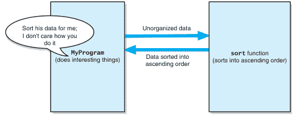

## 1.3 规格说明

当你为问题设计模块化解决方案时，每个模块只说明它做什么，而不说明它如何做。没有一个模块可能“知道”任何其他模块如何执行其任务——它可能只知道该任务是什么。例如，如果解决方案的一部分是对一些数据进行排序，那么其中一个模块可能是排序算法，如图 1-1 所示。其他模块知道排序模块执行排序，但不知道它如何排序。这样一来，解决方案的各个组件就相互隔离。

在实现每个模块之前编写其规格说明

利用这一想法，你可以相对独立地编写各个模块，知道每个模块将做什么，但不一定知道每个模块最终将如何做。编写和理解模块的规格说明是至关重要的。

### 1.3.1 操作契约

模块的契约规定了模块的目的、假设、输入和输出

操作契约记录了方法的使用方式及其限制。你应该在分析期间开始指定此契约，在设计期间完成规格说明，然后在代码中记录契约，特别是在头文件中。这样一来，使用你代码的程序员就可以了解需要遵守什么契约，才能使方法生成正确结果。

你需要为每个方法提供某些信息。方法的接口将指定如何调用该方法以及它期望的参数数量、顺序和类型——如前面所讨论。你还需要指定在调用方法之前应该为真，以及在方法执行完成后将为真什么。

指定模块之间的数据流

在设计期间，明确指定每个模块的目的以及模块之间的数据流同样重要。例如，你应该为每个模块回答以下问题：模块执行前有哪些数据可用？模块做出了什么假设？模块执行后发生了哪些操作，数据是什么样子？因此，你应该详细指定每个模块的假设、输入和输出。

例如，如果你作为程序设计师需要对整数数组进行排序，你可能会为排序函数编写以下规格说明：

```
The function will receive an array of num integers, where num > 0.
The function will return the array with the integers sorted.
```


你可以将这些规范视为你的函数与调用它的模块之间合同的条款。

### 规范是合同的条款

这份合同帮助程序员理解模块在解决方案中对其他模块承担的责任。编写 sort 函数的任何人都必须遵守这份合同。在 sort 函数编写并测试完成后，合同会告诉程序的其余部分如何正确调用 sort 函数，以及调用后的结果。

### 操作合同不应描述模块如何执行其任务

但是请注意，模块的合同并不承诺模块以特定方式执行其任务。如果程序的其他部分对算法做出任何假设，那风险自负。例如，如果你日后重写函数以使用不同的排序算法，你根本不需要修改程序的其他部分。只要新函数遵守原始合同的条款，程序的其他部分就应该对这一更改浑然不觉。

### 操作合同应包含精确的前置条件和后置条件

这对你来说应该不算新鲜。尽管你之前可能没有明确使用过“合同”这一术语，但这个概念应该很熟悉。当你编写函数的前置条件时，你就在编写合同，前置条件是函数开始时必须存在的条件的陈述；同样，当你编写后置条件时，你也在编写合同，后置条件是函数结束时的条件的陈述。例如，遵循前一份合同的 sort 函数可以用伪代码表示为

```
// Sorts an array;
// Precondition: anArray is an array of num integers; num > 0.
// Postcondition: The integers in anArray are sorted.
sort(anArray, num)
```

这些特定的前置条件和后置条件实际上是不完善的，就像初稿合同可能出现的情况一样。例如，sort 是指升序还是降序？num 可以有多大？在实现这个函数时，你可能会假设 sorted 是指升序，并且 num 不会超过 100。想象一下，当另一个人试图使用 sort 将 500 个整数的数组降序排列时可能会出现什么困难。除非你通过修订合同来记录这些假设，否则该用户不会了解你的假设，如下所示：

```
// Sorts an array into ascending order.
// Precondition: anArray is an array of num integers and 1 <= num <= MAX_ARRAY,
// where MAX_ARRAY is a global constant that specifies the maximum size of anArray.
// Postcondition: anArray[0] <= anArray[1] <= ... <= anArray[num - 1];
// num is unchanged.
sort(anArray, num)
```

### 修订后的规范

编写前置条件时，首先描述方法或函数的输入参数，提及其使用的任何全局命名常量，最后列出其所做的任何假设。编写后置条件时，描述模块所做的更改。请注意，对于返回值的方法或函数（从技术上讲，返回值是后置条件的一部分），应该描述该值。

### 精确的文档至关重要

新手程序员往往会忽视精确文档的重要性，尤其是在他们同时担任小型程序的设计师、程序员和用户时。如果你设计了 sort 但没有写下合同的条款，那么在稍后实现该函数时，你还能记住这些条款吗？几周后，你还记得如何排序吗？为了刷新记忆，你宁愿检查程序代码，还是阅读一组简单的前置条件和后置条件？随着程序规模的增大，良好的文档变得更加重要，无论你是独自编写还是团队合作。

> 注意：操作合同完全指定了模块的目的、假设、输入和输出。

> 注意：使用模块的程序组件是该模块的客户端。用户是使用程序的人。

### 1.3.2 异常条件

作为类设计师，你需要决定如何处理异常条件，并将这些决定纳入你的规范中。方法和函数的文档应反映这些决定。

一般来说，你可以用几种方式处理异常情况。你可以

- 假设无效情况不会发生。这个假设听起来可能没有那么天真。方法可以将限制（即客户端必须遵守的前提条件）作为假设（也就是前置条件）来声明。然后，客户端有责任在调用方法之前检查前置条件是否满足。只要客户端遵守限制，无效情况就不会发生。
- 忽略无效情况。当给定无效数据时，方法可以什么都不做。然而，完全不做任何事情会让客户端不知道发生了什么。
- 猜测客户端的意图。与前一种选项类似，这种选择可能会给客户端带来问题。
- 返回一个指示问题的值。例如，方法可以返回一个布尔值，指示其成功或失败。
- 抛出异常。抛出异常通常是 C++ 方法对执行期间发生的异常事件做出反应的一种可取方式。方法可以简单地报告问题，而无需决定如何处理。异常使每个客户端能够根据其特定情况按需采取行动。目前为简单起见，我们将采用这样的理念：方法只有在真正异常的情况下（当不存在其他合理解决方案时）才应抛出异常。你可以在 C++ Interlude 3 中了解异常。

> 注意：模块规范的初稿往往会忽略或忽视你确实需要考虑的情况。你可能会故意做出这些遗漏以简化初稿。一旦你编写了规范的主要部分，就可以专注于使规范完整的细节。

### 1.3.3 抽象

抽象将模块的目的与其实现分离开来。模块化将解决方案分解为模块；抽象在你用编程语言实现之前明确指定每个模块。例如，模块做了什么假设，它会采取什么行动？当被调用时，该模块负责什么任务？这样的规范澄清了你的解决方案设计，因为你可以专注于其高级功能，而不受实现细节的干扰。此外，它们帮助你修改解决方案的一部分而不会显著影响其他部分。例如，你应该能够更改前一个示例中的排序算法，而不会影响解决方案的其余部分。

### 规范不指示如何实现模块

随着问题解决过程的推进，你会逐步细化模块，最终通过编写代码（通常是类及其方法）来实现其操作。将模块的目的与其实现分离称为功能（或过程）抽象。一旦模块编写完成，只要你有其目的的陈述和参数的描述，就可以在不了解其算法细节的情况下使用它。假设模块文档编写得当，你只需了解其规范即可使用它。你不需要查看其实现。

### 完整的规范使你能够在不了解其实现的情况下使用模块

功能抽象对团队项目至关重要。毕竟，在团队环境中，你必须使用他人编写的模块，而且通常不了解其算法。你真的可以在不研究其代码的情况下使用这样的模块吗？事实上，每次使用 C++ 标准库函数（例如 C++ 数学库 cmath 中的 sqrt）时，你都在这样做。因为 sqrt 是预编译的，你无法访问其源代码。而且，sqrt 可能是用 C++ 以外的语言编写的！关于 sqrt 有很多你不知道的事情；然而，只要你知道它的规范，就可以放心地在程序中使用它。如果你将一个浮点表达式传递给 sqrt，它将返回该表达式值的浮点平方根。即使你不了解其实现，也可以使用 sqrt。

现在考虑一组数据和对数据的一组操作。这些操作可能包括向集合添加新数据、从集合中删除数据或搜索某些数据。数据抽象关注操作对数据集合做什么，而不是关注如何实现它们。解决方案的其他模块“知道”可以执行哪些操作，但它们不知道数据如何存储或操作如何执行。

### 指定模块做什么，而不是如何做

例如，你使用过数组，但你是否停下来思考过数组实际上是什么？本书中有许多关于数组的图示。它们可能类似于 C++ 数组在计算机上的实现方式，也可能不类似。无论哪种情况，你都可以在不知道数组“长什么样”——即如何实现的情况下使用数组。虽然不同系统可能以不同方式实现数组，但这些差异对程序员是透明的。

例如，无论数组 years 如何实现，你始终可以使用以下语句将值 1492 存储在数组的位置 index 中：

```
years[index] = 1492;
```

然后使用以下语句显示该值：

```
cout << years[index] << endl;
```

因此，你可以在不了解其实现细节的情况下使用数组，就像你可以在不了解其实现细节的情况下使用函数 sqrt 一样。让我们更详细地探讨这个想法。

### 功能抽象和数据抽象都要求你思考“做什么”，而不是“怎么做”

### 1.3.4 信息隐藏

正如你所看到的，抽象告诉你为每个模块编写描述其外部（即公共）视图的功能规范。然而，抽象还能帮助你识别应该隐藏在公共视图之外的细节——这些细节不应出现在规范中，而应是私有的。信息隐藏原则告诉你不仅要在模块内部隐藏这些细节，还要确保没有其他模块可以篡改这些隐藏的细节。

### 所有模块和 ADT 都应该隐藏某些东西

在编写模块规范时，你必须识别可以在模块内部隐藏的细节。信息隐藏原则不仅涉及隐藏这些细节，还涉及使它们从模块外部不可访问。理解信息隐藏的一种方法是想象围绕程序执行的各项任务的墙壁。这些墙壁防止任务相互纠缠。围绕每个任务的墙壁防止其他任务“看到”该任务是如何执行的。


然而，模块的隔离不能是完全的。尽管 MyProgram 不知道任务 sort 是如何执行的，但它必须知道任务 sort 是什么以及如何启动它。例如，假设你的程序需要对已排序的名称数组进行操作。例如，程序可能需要在数组中搜索给定名称，或按字母顺序显示名称。因此，程序需要一个名为 sort 的函数，用于对名称数组进行排序。尽管程序的其余部分知道 sort 可以对数组进行排序，但它不应该关心 sort 如何完成其任务。

因此，想象墙上有一道细小的缝隙，如图 1-2 所示。这道缝隙不足以让外部世界看到函数的内部工作原理，但项目可以通过缝隙传入和传出函数。这道缝隙就是函数的原型、声明或头部。缝隙包含函数或方法的名称、参数列表和返回类型。例如，你可以将数组传入函数 sort，函数可以将排序后的数组传出给你。传入和传出的内容由函数规范（或合同）的条款来规定：如果你以这种方式使用函数，它将确切地为你做这件事。

### 图 1-2 任务通过墙上的缝隙进行通信

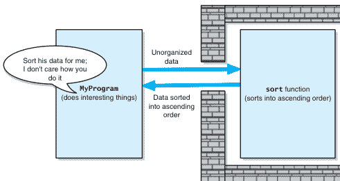

假设开发出了一种更快的排序算法。由于函数 sort 与程序中的其他模块隔离，新算法可以在 sort 函数中实现，而不会影响其他模块。因此，如果 MyProgram 使用任务 sort，并且执行排序的算法和实现发生了变化，MyProgram 不会受到影响。如图 1-3 所示，墙阻止了 MyProgram 的算法依赖于 sort 的算法。

> 注：信息隐藏限制了你需要处理模块和数据的方式。作为模块的用户，你不必担心其实现细节。作为模块的实现者，你不必担心它的用途。

### 1.3.5 最小且完整的接口

类的接口由公开可访问的方法和数据组成。通常，类接口仅包含方法，正如你将看到的，因为公开可访问的数据字段通常会引起问题。类的接口描述了程序员与该类交互的唯一方式。因此，接口是对象之间协作的场所。正是通过其接口，类才与其他类耦合。设计良好的类接口是一项重要技能。

每个类都应该易于理解。因此，在设计类时，你应该保持其方法数量较少。然而，你的类应该为程序员提供轻松完成所需任务的能力。这些愿望是相互冲突的。

类的**完整接口**是指允许程序员完成任何合理任务的接口，前提是给定该类的职责。类的**最小接口**是指仅当方法对该类的职责至关重要时才包含该方法的接口。程序员可以更轻松地学习如何与具有最小接口的类进行交互，因为它需要理解的方法更少。具有最小接口的类也更容易维护。对具有广泛接口的类进行更改可能会影响其许多方法。

你应该根据接口的完整性和最小性来评估类。接口完整很重要。稍次要的是拥有最小接口；有时非必要的方法也太有用，不宜省略。

函数或方法的接口更准确地称为其**签名**。签名由函数的名称、参数的数量、顺序和类型；以及可能适用的任何限定符（如 const）组成。签名与函数的原型非常相似，但不包括其返回类型。当你调用函数或方法时，会使用其接口，向其发送正确数量、顺序和类型的参数。

## 1.4 抽象数据类型

通常，问题的解决方案需要对数据进行操作。此类操作大致可以用三种方式描述：

- 向数据集合添加数据。
- 从数据集合中删除数据。
- 询问数据集合中数据的问题。

当然，操作的细节因应用而异，但总体主题是数据管理。然而，请意识到，并非每个问题都使用或需要所有这些操作。

本书大部分内容关于数据抽象。为了使你能够以抽象的方式思考数据，你应该定义一个抽象数据类型，即 ADT。ADT 是数据的集合以及对数据的一组操作。如果你知道操作的规范，就可以使用 ADT 的操作，而无需了解操作是如何实现的或数据是如何存储的。

最终，某人（也许是你）将通过使用数据结构来实现 ADT，数据结构是你可以在编程语言中定义的一种构造，用于存储数据集合。例如，你可以将数据存储在 C++ 字符串数组、对象数组或数组的数组中。

例如，假设你需要以一种方式存储一组名称，以便能够快速搜索给定名称。提供快速搜索的名称项目集合是简单 ADT 的描述。ADT 操作的描述必须足够严谨，以完全指定其对数据的影响，但既不指定如何存储数据，也不指定如何执行操作。例如，ADT 操作不应指定是将数据存储在连续内存位置还是不连续内存位置。当你实现 ADT 时，会选择特定的数据结构。

当程序必须执行语言不直接支持的数据操作时，你应该先设计一个 ADT 并仔细指定 ADT 操作应做什么（合同）。然后——只有那时——才应该使用数据结构实现这些操作。如果你正确地实现了操作，程序的其余部分就可以假设操作按指定执行——即，合同条款得到遵守。然而，程序不得依赖于支持操作的特定技术。

ADT 并非数据结构的花哨名称

规范指示 ADT 操作做什么，但不指示如何实现它们

在实现之前，仔细指定 ADT 的操作

ADT 和数据结构不相同

- **注：ADT 与数据结构**
  - 抽象数据类型是一组值及其操作的规范。
  - 数据结构是在编程语言中对 ADT 的实现。

### 图 1-4 出售冷水、碎冰和冰块的饮水机

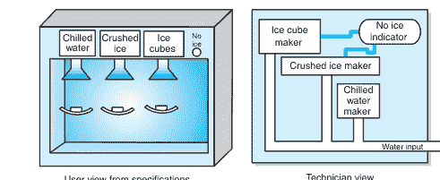

它还有一个指示灯，在没有冰块时会亮起。水类似于数据；操作包括冷却、压碎、制冰块和 isEmpty（或 noIce）。在这个设计层面，饮水机类似于 ADT：你不关心饮水机如何执行其操作，只关心它是否执行。如果你想要碎冰，你真的关心饮水机如何完成任务吗，只要它正确完成即可？因此，在指定饮水机的操作后，你可以设计许多碎冰的用途，而无需了解饮水机如何完成其任务，也不受工程细节的干扰。

然而，最终有人必须建造饮水机。例如，这台机器究竟如何生产碎冰？它可以先制作冰块，然后将其放在两个钢辊之间压碎，或者用锤子将其砸成小块。还有许多其他技术可能。饮水机的内部结构对应于 ADT 在编程语言中的实现，即数据结构。

尽管饮水机的所有者不关心其内部工作原理，但他或她确实希望设计尽可能高效地运行。同样，饮水机的制造商希望设计尽可能容易且廉价地建造。当你选择数据结构来实现 ADT 时，你应该有同样的顾虑。即使你不亲自实现 ADT，而是使用已实现的 ADT，你——就像买冰箱的人一样——也应该至少关心 ADT 的效率。

请注意，钢墙包围着饮水机。墙上的唯一开口是为了容纳机器的输入（水）和输出（冷水、碎冰或冰块）。因此，机器的内部机制不仅对用户隐藏，而且无法访问。此外，一个操作的机制对另一个操作也是隐藏且无法访问的。

这种模块化设计有好处。例如，你可以通过修改 crush 操作的实现来改进它，而不影响其他模块。你也可以向机器添加一个操作，而不影响原有的三个操作。因此，抽象和信息隐藏都在这里发挥作用。

总之，数据抽象在数据结构和访问这些数据结构中数据的程序之间形成了一道 ADT 操作的墙，如图 1-5 所示。如果你处于

### 图 1-5 ADT 操作的墙将数据结构与使用它的程序隔离开来

> 程序不应依赖于 ADT 实现的细节

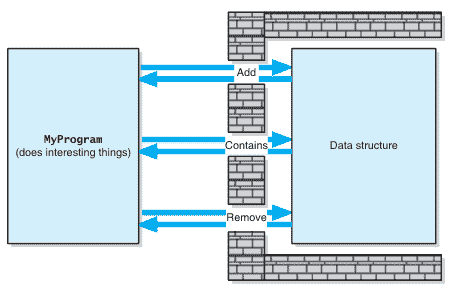


使用抽象数据类型就像使用自动售货机

在程序所在的墙的一侧，你会看到一个能让你与数据结构通信的接口。也就是说，你请求 ADT 操作来操作数据结构中的数据，它们会将这些操作的结果传回给你。

这个过程类似于使用自动售货机。你按下按钮与机器通信并获得回报。机器的外部设计决定了你如何使用它，就像 ADT 的规范规定了其操作是什么以及它们做什么一样。只要你按照自动售货机的设计使用它，就可以忽略其内部技术。只要你同意仅通过使用 ADT 操作来访问数据，你的程序就可以对实现 ADT 的数据结构的任何变化一无所知。

以下页面描述了几种抽象数据类型，重点介绍其操作的规范，而不是其实现。

### 设计 ADT

### 1.4.1 设计 ADT

抽象数据类型的设计应在问题求解过程中自然演变。为了举例说明这一过程可能如何发生，假设你想确定给定年份中所有节假日的日期。一种方法是查看日历。也就是说，你可以考虑年份中的每一天，并确定那一天是否是节假日。以下伪代码是解决此问题的一种可能方案：

```
// Displays the dates of all holidays in a given year:
listHolidays(year)
date = date of first day of year
while (date is before the first day of year + 1)
{
    if (date is a holiday)
        write (date, ", is a holiday")
    date = date of next day
}
```

问题需要什么数据？

这里涉及什么数据？显然，此问题针对日期进行操作，其中日期由月、日和年组成。解决节假日问题你需要哪些操作？你的 ADT 必须指定并限制日期上的合法操作，就像基本数据类型 int 将你限制在加法和比较等操作一样。从前面的伪代码中可以看出，你必须

问题需要哪些操作？

- 确定给定年份第一天的日期。
- 判断一个日期是否在另一个日期之前。
- 判断一个日期是否是节假日。
- 确定给定日期之后的那一天的日期。

因此，你可以为 ADT date 指定以下操作，使用附录 C 中描述的统一建模语言（UML）表示法的伪代码：

```
// Returns the date of the first day of a given year.
+getFirstDay(year: integer): Date
// Returns true if this date is before the given date; otherwise returns false.
+isBefore(otherDate: Date): boolean
// Returns true if this date is a holiday; otherwise returns false.
+isHoliday(): boolean
// Returns the date of the day after this date.
+getNextDay(): Date
```

listHolidays 伪代码现在如下所示：

```
// Displays the dates of all holidays in a given year.
listHolidays(year: integer): void
    date = getFirstDay(year)
    while (date.isBefore(getFirstDay(year + 1)))
    {
        if (date.isHoliday())
            write (date, " is a holiday " )
        date = date.getNextDay()
    }
```

因此，你可以通过识别数据并选择适合你问题的操作来设计 ADT。在指定操作后，你可以使用它们来解决问题，而无需关心 ADT 的实现细节。

### 预约簿

作为 ADT 设计的另一个示例，想象你想创建一个跨度为一年的计算机化预约簿。假设你只在上午 8 点到下午 5 点之间的整点和半点预约。你希望系统在存储日期和时间的同时，还能存储关于每个预约性质的简短说明。

为了解决此问题，你可以定义一个 ADT 预约簿。此 ADT 中的数据项是预约，其中预约由日期、时间和目的组成。操作有哪些？两个明显的操作是

- 为特定日期、时间和目的预约。（你会希望小心不要在已被占用的时间进行预约。）
- 取消特定日期和时间的预约。

除了这些操作之外，你很可能还希望

- 询问在给定时间是否有预约。
- 获取给定时间预约的目的。

最后，ADT 通常具有初始化和销毁操作，我们假设它们存在，但在此阶段不予指定。

因此，ADT 预约簿可以具有以下操作：

```
// Returns true if an appointment exists for the date and time specified,
// false otherwise.
+isAppointment(apptDate: Date, apptTime: Time): boolean

// Inserts the appointment for the date, time, and purpose specified as long as
// it does not conflict with an existing appointment.
// Returns true if successful, false otherwise.
+makeAppointment(apptDate: Date, apptTime: Time,
apptPurpose: string): boolean

// Deletes the appointment for the date and time specified.
// Returns true if successful, false otherwise.
+cancelAppointment(apptDate: Date, apptTime: Time): boolean

// Gets the purpose of the appointment at the given date and time, if one exists.
// Otherwise returns an empty string.
+getAppointmentPurpose(apptDate: Date, apptTime: Time): string
```

你可以使用这些 ADT 操作来设计预约上的其他操作。例如，假设你想更改现有预约簿 apptBook 中某个特定预约的日期或时间。以下伪代码指示如何使用前面的 ADT 操作来完成此任务：

```
// Change the date or time of an appointment.
Get the following data from the user: oldDate, oldTime, newDate, newTime
// Get purpose of appointment
oldPurpose = apptBook.getAppointmentPurpose(oldDate, oldTime)
if (oldPurpose is not the empty string)
{
    // See whether a new date/time is available.
    if (apptBook.isAppointment(newDate, newTime))
    // New date/time is booked
    write("You already have an appointment at ", newTime,
          " on ", newDate)
    else
    // New date/time is available: cancel old appointment; make new one.
    apptBook.cancelAppointment(oldDate, oldTime)
    if (apptBook.makeAppointment(newDate, newTime, oldPurpose))
    write("Your appointment has been rescheduled to ",
          newTime, " on ", newDate)
}
else
write("You do not have an appointment at ", oldTime,
      " on ", oldDate)
```

> 你可以在不了解其实现的情况下使用 ADT

再次注意，你可以在不知道 ADT 如何实现的情况下设计使用 ADT 操作的应用程序。本章末尾的练习提供了你可以使用此 ADT 执行的其他任务的示例。

### 1.4.2 暗示其他 ADT 的 ADT

前两个示例都要求你表示日期；预约簿示例还要求你表示时间。C++ 在 ctime 中具有日期时间对象，你可以使用它们来表示日期和时间。你也可以设计 ADT 以更面向对象的方式表示这些项目。一个 ADT 的设计暗示其他 ADT 并不罕见。事实上，你可以使用一个 ADT 来实现另一个 ADT。

> 你可以使用一个 ADT 来实现另一个 ADT

这个最后的示例还描述了一个为其实现暗示其他 ADT 的 ADT。假设你想设计一个食谱数据库。你可以将此数据库视为一个 ADT。食谱是数据项，食谱上的一些典型操作可能包括以下内容：

```
// Inserts a recipe into the database.
+insertRecipe(aRecipe : Recipe) : boolean
// Deletes a recipe from the database.
+deleteRecipe(aRecipe : Recipe) : boolean
// Gets the named recipe from the database.
+getRecipe(name : string) : Recipe
```

设计的这一级别并未指明 insertRecipe 会将食谱放置在数据库中的哪个位置等细节。

现在想象你想设计一个操作，用于缩放从数据库中检索的食谱。如果食谱是为 n 个人准备的，你希望修改它以供 m 个人食用。假设


该食谱包含诸如 2 1/2 杯、1 汤匙和 1/4 茶匙的度量。也就是说，数量以杯、汤匙和茶匙为单位，以带分数形式给出——即整数和分数。

此问题暗示了另一个抽象数据类型——度量（measurement），具有以下操作：

```
// Returns this measure.
+getMeasure(): Measurement
// Sets this measure to another one.
+setMeasure(m: Measurement)
// Returns this measure multiplied by a fractional scale factor, which has no units.
+scaleMeasure(scaleFactor: float): Measurement
// Returns this measure converted from its old units to new units.
+convertMeasure(oldUnits: MeasurementUnit,
newUnits: MeasurementUnit): Measurement
```

假设你希望抽象数据类型度量执行精确的分数运算。因为我们计划的实现语言 C++ 没有用于分数的数据类型，且浮点运算不精确，因此需要另一个称为分数（fraction）的抽象数据类型。其操作可能包括分数的加法、减法、乘法和除法。例如，你可以将加法指定为

```
// Returns the sum, reduced to lowest terms, of this fraction and the given fraction.
+add(other: Fraction): Fraction
```

此外，在可行时，你可以包括将带分数转换为分数以及反之的操作。当你最终实现抽象数据类型度量时，可以使用抽象数据类型分数。也就是说，你可以使用一个抽象数据类型来实现另一个抽象数据类型。

## 1.5 抽象数据类型袋

想象一个纸袋、一个可重复使用的布袋，甚至一个塑料袋。人们购物、打包午餐或吃薯片时会使用袋子。袋子装有东西；它是一组对象的容器。我们可以将袋子视为一种抽象数据类型。

袋子是一个容器

让我们指定并使用抽象数据类型袋。只需了解其接口，你就可以在程序中使用袋子。你不需要知道袋中条目的表示方式或袋操作的实现方式。这些细节隐藏在袋子的抽象墙壁之后，你的程序不会依赖于这些细节。正如你将看到的，这一重要的程序特征正是数据抽象的核心。

什么使袋子区别于其他抽象数据类型？袋子除了包含其项目之外，几乎不做其他事情。它不会以特定方式对其进行排序，也不阻止重复项目。在描述本章将要设计的抽象数据类型袋的行为时，请记住，我们正在指定一个受实际物理袋启发的抽象。例如，纸袋以无特定顺序且不考虑重复的方式容纳各种尺寸和形状的东西。我们的抽象袋将容纳无序且可能重复的对象，但我们坚持这些对象应具有相同或相关的类型。

注意：袋子是一个容器，包含有限数量的具有相同数据类型且无特定顺序的对象。袋子可以包含重复项目。

### 1.5.1 识别行为

由于袋子包含有限数量的对象，报告它包含多少个对象可能是袋子的一种行为：

- 获取袋中当前的项目数量。

相关的行为是检测袋子是否为空：

- 查看袋子是否为空。

我们应该能够添加和删除对象：

- 将给定对象添加到袋中。
- 如果可能，从袋中移除特定对象的一个出现。
- 从袋中移除所有对象。

请注意，添加操作不指示对象应放在袋子的哪个位置。请记住，袋子不会对其内容进行排序。移除操作在袋中查找特定项目。如果找到，它将其取出。如果袋中包含多个等于被移除对象的对象，它们将保留在袋中。如果操作在袋中找不到特定对象，它就无法移除它，并会说明这一点。最后，第二个移除操作只是清空袋中的所有对象。

特定袋子中有什么？这个问题的答案可以通过以下操作来回答：

- 计算某个对象在袋中出现的次数。
- 测试袋子是否包含特定对象。
- 查看袋中所有对象。

目前我们已有足够的行为。此时，我们会将所有行为写在一张纸上，或者如附录 C 所示，写在图 1-6 所示的 **类-职责-协作（CRC）卡** 上。

### 图 1-6 袋类的 CRC 卡

| 职责 | 袋 |
|---|---|
| 获取袋中当前的项目数量 | |
| 查看袋子是否为空 | |
| 将给定对象添加到袋中 | |
| 如果可能，从袋中移除特定对象的一个出现 | |
| 从袋中移除所有对象 | |
| 计算某个对象在袋中出现的次数 | |
| 测试袋子是否包含特定对象 | |
| 查看袋中所有对象 | |
| 协作 | |
| 袋子可以包含的对象的类 | |

由于袋子是一种抽象数据类型，我们只描述其数据并指定其操作。我们不指示如何存储数据或如何实现其操作。例如，不要考虑数组。你首先需要清楚地了解袋操作的作用：关注操作的作用，而不是如何执行它们。也就是说，在你能在程序中使用袋子之前，你需要一套详细的规范。事实上，你甚至应该在决定编程语言之前指定袋操作。

### 1.5.2 指定数据和操作

在我们能在 C++ 中实现袋子之前，需要描述其数据并详细指定与袋子行为对应的方法。我们将命名方法，选择其参数，决定其返回类型，并编写注释以充分描述它们对袋子数据的影响。当然，我们的最终目标是为每个方法编写 C++ 头文件和注释。但是，我们将首先用伪代码表达方法，然后再用 UML 表示法。

我们 CRC 卡上的第一个行为产生一个返回袋中当前条目数量的方法。相应的方法没有参数并返回一个整数。在伪代码中，我们有以下规范，再次使用 UML 表示法：

```
// Returns the current number of entries in the bag.
+getCurrentSize(): integer
```

我们可以使用一个布尔值方法来测试袋子是否为空，同样没有参数。其伪代码规范是

```
// Returns true if the bag is empty.
+isEmpty(): boolean
```

我们现在想要将给定对象添加到袋中。我们可以将方法命名为 add 并给它一个参数来表示新条目。我们可以编写以下伪代码：

```
// Adds a new entry to the bag.
add(newEntry)
```

我们可能会想将 add 设为 void 方法，但如果袋子已满，我们就无法向其中添加新条目。在这种情况下我们应该怎么做？

- 当 add 无法完成其任务时，我们可以采取以下两种选项：
- * 什么都不做。我们无法添加另一项，因此忽略它并保持袋子不变。
- * 保持袋子不变，但向客户端发出添加不可能的信号。

第一个选项很简单，但会让客户端不知道发生了什么。当然，我们可以将袋子不得已满作为 add 的前置条件。然后客户端有责任避免向已满的袋子添加新条目。

第二个选项更好，而且指定或实现起来也不太难。我们如何向客户端指示添加是否成功？如果添加不成功，我们可以抛出异常，但我们将把这种方法留到以后，改用另一种方式。显示错误消息不是一个好选择，因为你应该让客户端决定所有书面输出。由于添加要么成功要么不成功，我们可以简单地让方法返回一个布尔值。

因此，我们可以更完整地指定 add 方法为

```
+add(newEntry: ItemType): boolean
```

其中 newEntry 的数据类型是 ItemType。在 C++ 间奏 1 中，我们将讨论使用模板和 typedef 语句的实现细节，以使我们的抽象数据类型能够持有灵活的数据类型。

> 使用 UML 描述开发各个阶段的类


涉及从袋中移除条目的两种行为：移除特定条目和移除所有条目。假设我们为方法及其任何参数命名，并开始按如下伪代码指定它们：

```
// Removes one occurrence of a particular entry from the bag, if possible.
remove(anEntry)
```

```
// Removes all entries from the bag.
clear()
```

这些方法的返回类型是什么？
如果给定条目不在袋中，remove 方法将无法移除它。我们将让该方法返回一个布尔值，与 add 方法类似，以便指示是否成功。因此，该方法的 UML 规范为

```
+remove(anEntry: ItemType): boolean
```

clear 方法可以是一个 void 方法：我们只想清空袋子，而不获取其任何内容。因此，我们按如下方式细化其规范：

```
+clear(): void
```

其余行为不会更改袋子的内容。其中一种行为统计给定对象在袋中出现的次数。其伪代码规范为

```
// Counts the number of times a given entry appears in the bag.
getFrequencyOf(anEntry: ItemType): integer
```

另一种方法测试袋子是否包含给定对象。我们按如下伪代码指定它：

```
// Tests whether the bag contains a given entry.
contains(anEntry: ItemType): boolean
```

最后，我们想查看袋子的内容。我们不提供显示袋中条目的方法，而是定义一个将这些条目放入向量的方法。客户端随后可以按任意方式显示其中任何或全部条目。以下是我们最后一种方法的规范。

```
// Gets all entries in the bag.
toVector(): vector
```

在开发袋子方法的先前规范时，我们使用 UML 表示法对其进行了表示。图 1-7 显示了这样做的结果。

## 图 1-7 类 Bag 的 UML 表示法

| Bag |
| :--- |
| +getCurrentSize(): integer |
| +isEmpty(): boolean |
| +add(newEntry: ItemType): boolean |
| +remove(anEntry: ItemType): boolean |
| +clear(): void |
| +getFrequencyOf(anEntry: ItemType): integer |
| +contains(anEntry: ItemType): boolean |
| +toVector(): vector |

请注意，CRC 卡片和 UML 图并未反映所有细节，例如假设和异常情况。但是，在识别出此类条件后，您应指定方法在每种情况下的行为。您应记录关于希望方法如何行为的决定，如我们在以下表格中所做。稍后，您可以将这些非正式描述纳入记录方法的 C++ 注释中。

## 抽象数据类型：袋

- 有限数量的对象，不一定互不相同，无特定顺序，且具有相同的数据类型。
- 此集合中的对象数量。

| Pseudocode | Description |
| --- | --- |
| getCurrentSize() | 任务：报告此袋中当前的对象数量。输入：无。输出：袋中当前的对象数量。 |
| isEmpty() | 任务：查看此袋是否为空。输入：无。输出：根据袋是否为空返回 true 或 false。 |
| add(newEntry) | 任务：将给定对象添加到此袋中。输入：newEntry 是一个对象。输出：根据添加是否成功返回 true 或 false。 |
| remove(anEntry) | 任务：如果可能，从此袋中移除特定对象的一个出现。输入：anEntry 是一个对象。输出：根据移除是否成功返回 true 或 false。 |
| clear() | 任务：从此袋中移除所有对象。输入：无。输出：无。 |
| getFrequencyOf(anEntry) | 任务：统计对象在此袋中出现的次数。输入：anEntry 是一个对象。输出：anEntry 在袋中出现的整数次数。 |
| contains(anEntry) | 任务：测试此袋是否包含特定对象。输入：anEntry 是一个对象。输出：根据 anEntry 是否出现在袋中返回 true 或 false。 |
| toVector() | 任务：获取此袋中的所有对象。输入：无。输出：一个包含袋中当前所有条目的向量。 |

注意：处理异常情况

如前所述，您必须决定如何处理异常情况。ADT 袋的文档应反映这些决定以及前面讨论中的细节。例如，我们对 remove 方法的规范表明，如果客户端尝试从空袋中移除条目，它将返回 false。相反，我们本可以为该方法设置前提条件，即袋不能为空。然后，客户端有责任在调用方法之前检查前提条件是否满足。请注意，客户端可以使用 ADT 袋的其他方法，例如 isEmpty 和 getCurrentSize，来协助完成此任务。

注意：ADT 规范的初稿常常会忽略或忽视您确实需要考虑的情况。您可能会故意做出这些遗漏以简化初稿。一旦您编写了规范的主要部分，就可以专注于使规范完整的细节。

问题 1 使用 UML 表示法编写一个函数的规范，该函数计算 n 个任意整数数组中前五个正整数的和。

### 1.5.3 ADT 的接口模板

随着规范变得更加详细，它们应越来越反映您选择的编程语言。最终，您可以为袋子的方法编写 C++ 头部声明，并将它们组织成实现 ADT 的类的头文件。

清单 1-1 中的 C++ 头文件包含 ADT 袋的方法以及描述其行为的详细注释。如果您不熟悉 C++ 类、模板和虚方法，C++ 插曲 1 将对 C++ 类进行复习，并讨论 C++ 模板、虚方法和抽象基类。通过使用模板和抽象基类，我们可以从第一个 ADT 开始利用封装、多态和继承等面向对象设计概念。

注意：为了强调 ADT 设计与其数据结构实现之间的区别，本教科书在描述我们的 ADT 时使用模板和抽象基类。我们将包含抽象基类的头文件称为客户端接口。程序员在使用您程序中的类时，不应需要比客户端接口更多的内容，因为它完全指定了 ADT 的方法。

在检查清单 1-1 中的接口时，请注意为解决前一节中提到的异常情况所做的决定。特别是，add、remove 和 contains 方法均返回一个值。请注意我们用于指定方法的注释标签，它们以 @ 开头，并在附录 I 中描述。

目前，袋中的项目将是同一类的对象。为了容纳任何单个类类型的条目，袋方法为每个条目使用泛型 ItemType。为了赋予标识符 ItemType 含义，我们必须在类头之前的一行上编写 template<class ItemType>。一旦客户端选择了实际数据类型，编译器将在 ItemType 出现的任何地方使用该数据类型。

类 BagInterface 是一个 C++ 抽象基类。在 C++ 中，抽象基类（或简称抽象类）包含至少一个声明为虚函数且没有实现的方法。抽象类不能被实例化；它只能用作基类。子类必须实现抽象类中指定但未定义的方法。

```
LISTING 1-1 A file containing a C++ interface for bags

/** @file BagInterface.h */
#ifndef BAG_INTERFACE
#define _BAG_INTERFACE
#include <vector>

template<class ItemType>
class BagInterface
{
public:
//# Gets the current number of entries in this bag.
//@return The integer number of entries currently in the bag. */
virtual int getCurrentSize() const = 0;

//# Sees whether this bag is empty.
//@return True if the bag is empty, or false if not. */
virtual bool isEmpty() const = 0;

//# Adds a new entry to this bag.
//@post If successful, newEntry is stored in the bag and
// the count of items in the bag has increased by 1.
//@param newEntry The object to be added as a new entry.
//@return True if addition was successful, or false if not. */
virtual bool add(const ItemType& newEntry) = 0;

//# Removes one occurrence of a given entry from this bag,
// if possible.
//@post If successful, anEntry has been removed from the bag
// and the count of items in the bag has decreased by 1.
//@param anEntry The entry to be removed.
//@return True if removal was successful, or false if not. */
virtual bool remove(const ItemType& anEntry) = 0;

//# Removes all entries from this bag.
//@post Bag contains no items, and the count of items is 0. */
virtual void clear() = 0;

//# Counts the number of times a given entry appears in bag.
//@param anEntry The entry to be counted.
//@return The number of times anEntry appears in the bag. */
virtual int getFrequencyOf(const ItemType& anEntry) const = 0;
(continues)
```


/** Tests whether this bag contains a given entry.
 * @param anEntry The entry to locate.
 * @return True if bag contains anEntry, or false otherwise. */
virtual bool contains(const ItemType& anEntry) const = 0;
/** Empties and then fills a given vector with all entries that
 * are in this bag.
 * @return A vector containing all the entries in the bag. */
virtual vector<ItemType> toVector() const = 0;
}; // end BagInterface

这些操作的规范是ADT袋契约的唯一条款：如果你请求执行这些操作，就会发生这样的事情。规范中未提及如何存储袋或如何执行操作；它们只告诉你可以对袋做什么。ADT规范不包含实现问题至关重要。对ADT规范的这种限制，使你能够在ADT的实现与使用它的程序（即客户端）之间建立一道墙。操作的行为是程序应当依赖的唯一事物。

> 注意：虽然在实现类之前编写接口绝非必需，但这样做能让你以简洁的方式记录规范。随后，你可以使用接口中的代码作为实际类的大纲。拥有接口还为ADT提供了一种独立于特定类定义的数据类型。第3章和第4章将开发袋类的不同实现。按照接口编写的代码，让你能够更轻松地用一个袋的实现替换另一个。

### 1.5.4 使用ADT袋

假设我们雇佣一名程序员，根据我们迄今开发的接口和规范，在C++中实现ADT袋。如果我们假设这些规范足够清晰，程序员可以完成实现，那么我们可以在不知道实现细节的情况下，在程序中使用袋的操作。也就是说，我们不需要知道程序员是如何实现袋的，才能使用它。我们只需要知道ADT袋做什么。

以下示例演示了如何使用袋，并假设我们有一个C++类Bag，它实现了清单1-1中给出的C++抽象类BagInterface。

> 示例。假设你邀请三个朋友到家里看你最喜欢的足球队在电视上的比赛。为了让广告插播更有趣，你编了以下游戏。从一副牌中，你移除整个梅花花色：梅花A、2、3、...、J、Q、K。你随机选取其中六张牌并放入袋中。你的朋友随后猜测袋中有哪些牌。每次他们正确猜中一张牌，该牌就从袋中移除。当袋子空了时，拥有最多牌的朋友获胜。

清单1-2展示了一个玩这个游戏的简单程序。

```
LISTING 1-2 A program for a card guessing game

#include <iostream> // For cout and cin
#include <string> // For string objects
#include "Bag.h" // For ADT bag
using namespace std;

int main()
{
   string clubs[] = { "Joker", "Ace", "Two", "Three",
                      "Four", "Five", "Six", "Seven",
                      "Eight", "Nine", "Ten", "Jack",
                      "Queen", "King" };

   // Create our bag to hold cards.
   Bag<string> grabBag;

   // Place six cards in the bag.
   grabBag.add(clubs[1]);
   grabBag.add(clubs[2]);
   grabBag.add(clubs[4]);
   grabBag.add(clubs[8]);
   grabBag.add(clubs[10]);
   grabBag.add(clubs[12]);

   // Get friend's guess and check it.
   int guess = 0;
   while ( !grabBag.isEmpty() )
   {
      cout << "What is your guess?"
           << " (1 for Ace to 13 for King): ";
      cin >> guess;

      // Is card in the bag?
      if (grabBag.contains(clubs[guess]))
      {
         // Good guess - remove card from the bag.
         cout << "You get the card!\n";
         grabBag.remove(clubs[guess]);
      }
      else
      {
         cout << "Sorry, card was not in the bag.\n";
      } // end if
   } // end while

   cout << "\nNo more cards in the bag. Game over!\n";
   return 0;
} // end main
```

**编程提示：** 在设计完一个类后，尝试在实现该类之前先编写一些使用该类的代码。你不仅能看到你的设计是否适用于当前问题，还能测试自己对设计的理解，并检查记录规范的注释。你可能会发现类设计或规范中存在问题。如果是，请修改你的设计和规范，然后再次尝试使用该类。

- 问题2 什么是抽象数据类型？
- 问题3 设计ADT时应采取哪些步骤？

## 摘要

- 1. 面向对象分析（OOA）用于问题求解的初始阶段，以了解问题是什么以及解决方案的要求是什么。
- 2. 在面向对象设计（OOD）期间，你描述一个问题的解决方案，其要求是在OOA期间发现的。你使用软件对象来表达解决方案。
- 3. 封装是面向对象编程的一种原则，通过隐藏函数和对象的内部细节来实现。函数封装行为，对象——即类的实例——封装数据和行为。
- 4. 继承是面向对象编程相关的另一个概念，允许你通过扩展类定义或进行轻微修改来重用已定义的类。
- 5. 多态是面向对象编程的第三个原则，对象在运行时确定适当的操作。
- 6. 每个模块应具有高内聚性；也就是说，它应执行一个明确定义的任务。
- 7. 耦合是模块间依赖程度的度量。模块应松散耦合。函数或方法应尽可能独立，并执行一个明确定义的任务。
- 8. UML是一种用于表达面向对象设计的建模语言。它提供一种符号来指定数据和操作，并使用图表来显示类之间的关系。
- 9. 操作契约记录了模块的使用方式及其限制。
- 10. 函数或方法应始终包含一个初始注释，说明其目的、前提条件——即模块开始时必须存在的条件——以及后置条件——即模块执行结束时的条件。
- 11. 对于主要涉及数据管理的问题，通过设计类将数据与对该数据的操作封装起来。实践抽象——即关注模块做什么，而不是它如何做。
- 12. 数据抽象是一种控制程序与其数据结构之间交互的技术。它在程序的数据结构周围建立围墙，就像模块性的其他方面在程序的算法周围建立围墙一样。这样的围墙使程序更容易设计、实现、阅读和修改。
- 13. 一组数据管理操作的规范，连同它们操作的数据值，定义了抽象数据类型（ADT）。
- 14. 只有在完全定义ADT之后，才应考虑如何实现它。实现ADT的合适数据结构的选择既取决于ADT操作的细节，也取决于你将使用这些操作的上下文。

## 练习

- 1. 你想购买的商品价格以美元和美分给出。你用现金支付，给店员$d$美元和$c$美分。为一个计算你应找回的零钱（如果有）的函数编写规范。包括目的声明、前置条件和后置条件，以及参数描述。

- 2. 日期由月、日和年组成。考虑表示此类日期的类Date。假设Date将月、日和年表示为整数。例如，1776年7月4日是月7、日4、年1776。
  - a. 为Date类中推进给定日期一天的方法编写规范。包括目的声明、前置条件和后置条件、参数描述以及返回值描述。
  - b. 编写此方法的C++实现。设计并指定你需要的任何其他方法。包括对将来维护你实现的人有帮助的注释。

- 3. 为以下每项任务编写一个基于第1.4.1节所述ADT预约簿的伪代码函数。执行这些任务是否需要向ADT添加操作？
  - a. 更改给定日期和时间的预约目的。
  - b. 显示给定日期的所有预约。

- 4. 假设你刚买了一袋杂货离开商店。你担心易碎物品无法安全到家，因此到达汽车后，你将这些物品放入自己的袋子中。如果Bag是袋类，请编写C++语句，将storeBag中的所有物品移除并放入两个新袋子中的一个，具体如下：将所有面包和鸡蛋放入fragileBag，将所有其他物品放入groceryBag。完成后，storeBag应为空。假设杂货项由字符串表示。

- 5. 假设一个袋子包含表示各种杂货项的字符串。编写一个C++函数，从该袋子中移除并计算给定字符串的所有出现次数。你的函数应返回该数量。使用javadoc风格的注释来完全指定你的函数。考虑给定袋子可能为空或不包含任何给定字符串出现的情况。

- 6. 两个袋子的并集是一个新袋子，包含原始两个袋子的合并内容。为ADT袋设计并实现一个方法union，它作为一个新袋子返回接收方法调用的袋子与作为方法参数的袋子的并集。包括足够的注释来完全指定该方法。

  请注意，两个袋子的并集可能包含重复项。例如，如果对象x在一个袋子中出现五次，在另一个袋子中出现两次，则这些袋子的并集包含x七次。具体来说，假设bag1和bag2是袋子；bag1包含字符串a、b和c；bag2包含字符串b、d和e。表达式bag1.union(bag2)返回一个包含字符串a、b、b、c、d和e的袋子。请注意，union不影响bag1和bag2的内容。


- 两个袋子的交集是一个新袋子，包含在原始两个袋子中都出现的条目。为 ADT 袋子设计并指定一个名为 intersection 的方法，该方法以新袋子形式返回调用该方法的袋子与该方法唯一参数袋子的交集。包含足够的注释以完全指定该方法。

- 请注意，两个袋子的交集可能包含重复项。例如，如果对象 x 在一个袋子中出现五次，在另一个袋子中出现两次，则这些袋子的交集包含 x 两次。具体来说，假设 bag1 和 bag2 是袋子；bag1 包含字符串 a、b 和 c；bag2 包含字符串 b、b、d 和 e。表达式 bag1.intersection(bag2) 返回仅包含字符串 b 的袋子。请注意，intersection 不会影响 bag1 和 bag2 的内容。

- 两个袋子的差集是一个新袋子，包含从一个袋子中移除那些也在第二个袋子中出现的条目后剩下的条目。为 ADT 袋子设计并指定一个名为 difference 的方法，该方法以新袋子形式返回调用该方法的袋子与该方法唯一参数袋子的差集。包含足够的注释以完全指定该方法。

- 请注意，两个袋子的差集可能包含重复项。例如，如果对象 x 在一个袋子中出现五次，在另一个袋子中出现两次，则这些袋子的差集包含 x 三次。具体来说，假设 bag1 和 bag2 是袋子；bag1 包含字符串 a、b 和 c；bag2 包含字符串 b、b、d 和 e。表达式 bag1.difference(bag2) 返回仅包含字符串 a 和 c 的袋子。请注意，difference 不会影响 bag1 和 bag2 的内容。

- 考虑单变量 x 的 ADT 多项式，其操作包括以下内容：

- degree() // 返回多项式的次数。
- coefficient(power) // 返回 x^power 项的系数。
- changeCoefficient(newCoefficient, power) // 将 x^power 项的系数替换为 newCoefficient。

- 对于本题，仅考虑指数为非负整数的多项式。例如，
  p = 4x^3 + 7x^2 - x + 9

- 以下示例演示了在此多项式上的 ADT 操作。

- p.degree() 为 3（具有非零系数的项的最高次幂）
- p.coefficient(3) 为 7（x^3 项的系数）
- p.coefficient(4) 为 0（缺失项的系数隐式为 0）
- p.changeCoefficient(-3, 7) 将多项式 p 更改为 -3x^7 + 4x^3 + 7x^2 - x + 9

- 使用这些 ADT 操作，编写语句以执行以下任务：

- a. 显示具有最高次幂的项的系数。
- b. 将 x^4 项的系数增加 8。
- c. 计算两个多项式的和。

## 编程问题

- 将 Transaction 类添加到附录 C 中图 C-4 的银行示例中。该类跟踪交易的日期、时间、金额和类型（支票或储蓄）。

- 考虑一个程序，它将读取员工数据，按员工识别号对数据进行排序，写出排序后的数据，并计算关于数据的各种统计信息，例如员工的平均年龄。使用 UML 符号为此问题设计模块化解决方案。在设计解决方案期间，您识别了哪些类和方法？为每个模块编写完整的规格，包括前置条件和后置条件。

- 矩阵是数值的矩形数组。您可以相加或相乘两个矩阵以形成第三个矩阵。您可以将矩阵乘以标量，并可以转置矩阵。设计一个表示具有这些操作的矩阵的 ADT。通过说明其参数、描述其目的以及编写其伪代码版本的头部来指定每个 ADT 操作。然后为矩阵的方法编写 C++ 接口。在代码中包含 javadoc 风格的注释。

- 环是带有对当前项引用的项集合。一个操作——我们称之为 advance——将引用移动到集合中的下一项。当引用到达最后一项时，下一个 advance 操作将引用移回第一项。环还具有获取当前项、添加项和移除项的操作。添加项的位置和移除哪项的细节由您决定。设计一个表示对象环的 ADT。通过说明其目的、描述其参数以及编写其伪代码版本的头部来指定每个操作。然后为环的方法编写 C++ 接口。在代码中包含 javadoc 风格的注释。

- 集合是不允许重复项的特殊袋子。通过说明其目的、描述其参数以及编写前置条件、后置条件和伪代码版本的头部来指定对象集合的每个操作。然后为集合编写 C++ 接口。在代码中包含 javadoc 风格的注释。

- 想象一下桌上有一摞书。每本书都又大又重，您只能从摞中移除最上面的一本。您不能从另一本书下面移除一本书。同样，您只能将另一本书放在摞的顶部才能将其添加到摞中。您不能将一本书放在另一本书下面。如果仅按书名表示书籍，请设计一个类，您可以使用它来跟踪桌上摞中的书籍。通过说明其目的、描述其参数以及编写其伪代码版本的头部来指定每个操作。然后为摞的方法编写 C++ 接口。在代码中包含 javadoc 风格的注释。

本页故意留空

## C++ 类

### 目录

- C1.1 一个待解决的问题 32
- C1.1.1 私有数据字段 33
- C1.1.2 构造函数和析构函数 33
- C1.1.3 方法 34
- C1.1.4 防止编译器错误 35
- C1.2 实现解决方案 36
- C1.3 模板 37
- C1.4 继承 40
- C1.4.1 基类和派生类 40
- C1.4.2 重写基类方法 42
- C1.5 虚方法和抽象类 44
- C1.5.1 虚方法 44
- C1.5.2 抽象类 45

### 先决条件

- 附录 A C++ 基础回顾
- 第 1 章 数据抽象：围墙

在本书中，我们使用 C++ 设计抽象数据类型并将其实现为数据结构。本 C++ 间奏章对 C++ 类进行了回顾，然后介绍了其他可用于以灵活方式定义抽象数据类型的 C++ 工具，从而在设计与实现之间保持隔离。回顾类之后，我们将学习类模板。这种 C++ 构造使我们能够以非常通用的方式指定数据结构中所含项的数据类型。例如，如果您花了两周时间开发一个表示整数袋的优秀类，那么如果能轻松使用相同代码来表示字符串袋，岂不是太好了？类模板允许您定义与存储在数据结构中的数据类型无关的类。当客户端准备实例化类的对象时，客户端可以指定对象所持有的数据类型。

C++ 中的头文件（.h）或规范文件提供了一种机制，用于部分将类的设计与源文件（或实现文件 .cpp）中的实现分离开来。头文件还必须包含类的数据字段以及类使用的任何私有方法的描述。客户端不需要知道私有方法或数据字段即可在程序中使用该类。要为 ADT 提供公共接口，可以编写抽象基类，从而将设计与实现分离开来。抽象基类允许客户端在使用我们的类时充分利用多态性。

为了介绍这些概念，让我们来看一个简单的问题，它说明了面向对象编程的三个基本概念：封装、继承和多态性。

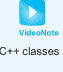

## C1.1 一个待解决的问题

假设一位正在制作电子游戏的朋友请您设计并开发一组类，以表示游戏角色携带的三种类型的盒子。每种类型的盒子只能容纳一件物品。角色可以将物品放入盒子中或查看盒子中的物品。三种类型的盒子是：

- 普通盒子——只能容纳一件物品的普通旧盒子。
- 玩具盒子——带有颜色且只能容纳一件物品的盒子。
- 魔法盒子——只能容纳一件物品，但会神奇地将其更改为盒子中曾经存储的第一件物品的盒子。

让我们先设计一个 ADT 普通盒子。它是三种盒子中最简单的一种，我们可能能够将其实现的某些方面用于另外两种盒子。由于游戏角色只能将物品放入盒子中或查看它们，因此盒子只需要两个公共方法：setItem 用于将物品放入盒子中，getItem 用于获取存储的物品。以下是这些方法的 UML 表示法：

```
+setItem(theItem: ItemType)
+getItem(): ItemType
```

我们可以使用 typedef 语句将 ItemType 定义为盒子中存储的物品类型。例如，要让盒子容纳 double 类型，可以编写

```
typedef double ItemType;
```

要让盒子容纳另一种数据类型，只需将单词 double 替换为新数据类型即可。清单 C1-1 显示了将出现在头文件中的我们的类 PlainBox 的声明。为了节省空间，此处仅显示描述类元素类型的注释，省略了规格、前置条件和后置条件。我们使用了面向对象的封装概念，将数据——盒子中存储的物品——与操作该数据的方法分组在一起：两个构造函数、用于更改物品值的方法 setItem 以及用于返回物品值的方法 getItem。

```
LISTING C1-1 The header file for the class PlainBox
/** @file PlainBox.h */
#ifndef PLAIN_BOX
#define PLAIN_BOX
// Set the type of data stored in the box
typedef double ItemType;
```


```
// Declaration for the class PlainBox
class PlainBox
{
private:
   // Data field
   ItemType item;

public:
   // Default constructor
   PlainBox();

   // Parameterized constructor
   PlainBox(const ItemType& theItem);

   // Method to change the value of the data field
   void setItem(const ItemType& theItem);

   // Method to get the value of the data field
   ItemType getItem() const;
}; // end PlainBox

#endif
```

让我们详细看看这个 C++ 类声明。

### C1.1.1 私有数据字段

数据字段 item 在类声明的私有部分中声明。本教材中每个类的每个数据字段都位于私有部分。这将对数据字段的访问限制在定义它的类中。通常，我们提供方法（例如 setItem 和 getItem）来访问数据字段。这样一来，类就控制了其他类如何以及是否可以访问数据字段。这一设计原则应能使程序不仅更易于调试，而且从一开始就更少逻辑错误。

客户端和派生类不应直接访问类的数据字段。如果类设计者认为派生类可能需要访问或修改基类的数据字段，则仍应将数据字段设为私有，但提供受保护的方法，以便任何派生类都可以访问或修改数据。有关访问修饰符（例如 private 和 protected）的更多信息将在后续的 C++ 间奏中介绍。

在构建更复杂的数据结构时，我们需要保证其完整性。如果将对数据字段的访问限制在仅我们自己的类中，这会更简单。例如，假设有一个类将项目存储在数组中，并维护数组中已用项目的计数。每次我们的类向数组添加或删除项目时，都需要修改项目计数以反映变化。如果我们的类的客户端可以直接访问数组，客户端可以添加和删除数组中的条目，却忽略更新项目计数器。该计数器将无法准确反映数组中的条目数量，从而导致例如数据丢失或程序异常终止。

### C1.1.2 构造函数和析构函数

类有两种特殊方法，称为构造函数和析构函数。**构造函数**为类的新实例分配内存，并可以将对象的数据初始化为指定值。**析构函数**在对象生命周期结束时销毁类的一个实例。一个典型的类有多个构造函数，但只有一个析构函数。对于许多类，可以省略析构函数。在这种情况下，编译器会为你生成一个析构函数。对于本 C++ 间奏中的类，编译器生成的析构函数已足够。C++ 间奏 2 讨论了如何以及为何编写自己的析构函数。

在 C++ 中，构造函数与类同名。构造函数没有返回类型——甚至不是 void——并且不能使用 return 返回值。一个类可以有多个构造函数，PlainBox 类就是如此。其中一个构造函数（即默认构造函数）没有参数。通常，默认构造函数将数据字段初始化为类实现选择的值。其他构造函数有参数。这些带参数的构造函数将数据字段初始化为客户端选择但经构造函数批准的值。编译器通过将客户端提供的参数列表与可用构造函数的参数进行匹配来决定调用哪个构造函数。当实参和形参在数量、数据类型和顺序上对应时，即发生匹配。

> **注意:** 如果未为类定义任何构造函数，编译器会创建一个默认构造函数（即无参数的构造函数）。一旦你定义了构造函数，编译器就不会自行创建任何构造函数。因此，如果你定义了带参数的构造函数但未定义默认构造函数，则你的类将没有默认构造函数。

当你声明类的一个实例时，会隐式调用构造函数。例如，语句 `PlainBox myBox;` 调用默认构造函数，该构造函数创建对象 `myBox` 并将数据字段 `item` 初始化为构造函数定义中给出的值。请注意，调用默认构造函数时，`myBox` 后面不带括号。语句 `PlainBox myBox(specialValue);` 调用带参数的构造函数，如你将看到，该构造函数将数据字段 `item` 初始化为 `specialValue`。因此，`specialValue` 存储在盒子中。

### C1.1.3 方法

如第 1 章所述，方法实现了解决问题的算法。方法原型向希望使用我们类的客户端传达三个重要信息：方法名、参数的数量和类型，以及方法的返回类型。原型描述了抽象墙上的缺口。客户端可使用的方法的原型位于类声明的公共部分。

类中的访问器方法访问（或获取）数据字段的值。其名称通常以单词 get 开头。访问器方法不会更改对象的数据字段。PlainBox 类声明的重要部分是访问器方法 `getItem`，它带有关键字 `const`：

```
ItemType getItem() const;
```

此关键字向编译器和其他程序员发出信号，表明该方法不会更改对象的数据字段。另一种思考 const 方法的方式是：调用此类方法前后，对象保持相同。在方法声明中使用 const 可以保护你作为程序员，在实现方法的算法时，编译器可以检查你的代码，以验证你没有修改任何数据字段。

编程提示：声明为 const 的方法可以访问和使用数据字段，因此将所有访问器方法标记为 const 是合适的，也是个好主意。

类中的修改器方法更改数据字段的值。修改器方法的名称通常以单词 set 开头。方法 setItem 是修改器方法的一个示例。修改器方法不能声明为 const。同样，构造函数不能声明为 const，因为它们必须初始化对象的数据字段。

按常量引用传递参数。方法 setItem 和带参数的构造函数都有一个名为 theItem 的参数，该参数按常量引用传递，如它们的声明所示：

```
void setItem(const ItemType& theItem);
PlainBox(const ItemType& theItem);
```

按常量引用传递参数对类的客户端和实现类的程序员都有多种好处。按引用将参数传递给方法（尤其是当参数是复杂对象时）可以节省时间和内存，因为方法可以在不复制对象的情况下访问或修改该对象。这种技术的风险在于，方法可以访问其类之外声明的数据；该方法已经“突破了墙壁”，可以修改调用该方法的客户端拥有的项目。为了在保持按引用传递效率的同时保护客户端的数据，我们在该参数的声明前使用关键字 const。该方法将参数视为常量，不可修改。对按引用传递的参数使用 const 可以保护客户端对象并减少副作用的可能性。我们的方法仍然可以访问和使用按常量引用传递的对象，但编译器会将对该对象的任何修改标记为错误。

- 注意：安全可靠编程指南
  - 将类声明中的所有数据字段都声明在私有部分。
  - 将不更改对象的任何方法（访问器方法）声明为 const。
  - 将按引用传递的任何参数声明为 const，除非你确定该参数必须由方法修改，在这种情况下，该方法应为受保护或私有。

### C1.1.4 防止编译器错误

在每个程序块中，只能声明一次 C++ 变量。在同一块中对变量进行第二次声明或重新定义会导致编译器错误。例如，假设你有以下循环：

```
for (int index = 0; index < count; index++)
{
    int index = count / 6; // index is redefined in loop - compiler error!
    total += index;
} // end for
```

在循环内重新定义 index 会导致编译时错误，因为 index 已在 for 语句中定义。同样的重新定义限制也适用于整个类。让我们看看如何可能意外重新定义我们的 PlainBox 类。


如果我们想在程序中使用一个 `PlainBox` 对象，例如在我们的 `main` 函数中，就必须在包含 `main` 函数的文件 `main.cpp` 中包含 `PlainBox.h`，以便编译器了解我们类的公共接口。我们还需要在 `PlainBox.cpp` 中包含我们 `PlainBox` 类的头文件，以便编译器在编译类的实现时了解该类的数据字段和方法。

这会产生一个问题，因为编译器会读取我们的 `PlainBox` 定义两次，尽管该类只需要定义一次。我们不知道编译器会先尝试编译哪个文件，因此两个文件都必须包含 `PlainBox.h`。这种重复会导致在再次读取头文件时类被重新定义。我们需要一种方法来防止编译器第二次读取类定义。`#ifndef`、`#define` 和 `#endif` **预处理器指令**提供了解决方案。

你已经熟悉 `#include` 指令，它将另一个文件的内容包含到当前文件中。你使用 `#ifndef` 来条件性地包含类定义。例如，清单 C1-1 中 `PlainBox` 的头文件包含

```
#ifndef _PLAIN_BOX
#define _PLAIN_BOX
```

作为其前两行。指令 `#ifndef` 的意思是“如果 `_PLAIN_BOX` 未定义，那么...”如果编译器尚未定义名称 `_PLAIN_BOX`，它将处理随后的代码，直到到达文件末尾的 `#endif` 指令。

`#define` 指令定义名称 `_PLAIN_BOX`。如果另一个文件包含 `PlainBox` 的类定义，则名称 `_PLAIN_BOX` 将已经被定义。该文件的 `#ifndef` 指令将导致预处理器跳过随后的任何代码；也就是说，代码将对编译器隐藏，因此编译器不会多次看到我们的类定义。

在本教材中，所有头文件都使用这些预处理器指令来防止多次包含类定义。尽管你可以在指令中使用任何名称，但在 `#ifndef` 中要测试的名称和由 `#define` 定义的名称必须相同。我们将此类名称写为大写，并以下划线字符开头。

## C1.2 实现解决方案

在设计完我们的解决方案后，下一步是实现我们在头文件中声明的每个方法。清单 C1-2 显示了类 `PlainBox` 的实现（或源代码）文件。方法实现很简单，但我们应该讨论几个语法项目。

```
/** @file PlainBox.cpp */
#include "PlainBox.h"
PlainBox::PlainBox()
{ // end default constructor
PlainBox::PlainBox(const ItemType& theItem)
{ item = theItem;
} // end constructor
void PlainBox::setItem(const ItemType& theItem)
{
    item = theItem;
} // end setItem

ItemType PlainBox::getItem() const
{
    return item;
} // end getItem
```

头文件 PlainBox.h 包含我们的类声明。我们必须使用预处理器指令 #include 来包含 PlainBox 类声明，以便编译器可以验证我们的方法头并提供对类数据字段的访问。方法头必须与类声明中提供的匹配。包含头文件并不会告诉编译器此处定义的方法是 PlainBox 类的一部分。要做到这一点，你必须在构造函数和方法名称之前加上类名和两个冒号——即，

PlainBox::

之所以有此要求，是因为 C++ 允许源文件包含多个类和独立函数的方法实现。命名空间指示符 PlainBox:: 是一个前缀，用于向编译器指示该方法是 PlainBox 命名空间的一部分。C++ 命名空间是一种语法结构（例如类），允许你在通用名称（例如 PlainBox）下将数据和方法的声明组合在一起。一旦方法被定义为命名空间的一部分，它就可以访问该命名空间中的所有数据和方法。因此，清单 C1-2 中的构造函数和方法可以访问 PlainBox 的数据字段和方法。

> 注：为了更好地模块化我们的代码，本书中的实现文件将仅包含单个类的方法。

## C1.3 模板

此时，我们的 PlainBox 类与你可能在之前的 C++ 课程中实现过的许多类很相似。只要游戏中的角色想在盒子中存储一个 double 值，该类就能正常工作。但是，如果一个角色想存储一个 double，而另一个角色有一个字符串或 MagicWand 对象要存储，我们该怎么办呢？由于我们当前的 PlainBox 类只能存储一个 double，我们将需要创建新类——例如 PlainBoxForStrings 和 PlainBoxForWands——来存储不同的对象类型。这些类的功能将与 PlainBox 类完全相同，因此我们可以只做少量更改来复制代码。例如，我们必须更改每个头文件中的 typedef。对于 PlainBoxForStrings 类，typedef 将是

```
typedef string ItemType;
```

而对于 PlainBoxForWands 类，typedef 将是

```
typedef MagicWand ItemType;
```

我们还需要更改构造函数和命名空间指示符的名称，以反映新的类名。如果我们有一个更复杂的类，这些更改将需要大量工作，并且是一个容易出错的过程。后来，如果我们的朋友更改了 PlainBox 的要求，我们将需要遍历每个 PlainBox 类变体并进行所需的更改。

此场景中问题的根源在于，程序员必须在构建程序之前知道盒子中将存储什么类型的对象。然后，程序员必须为要存储的每种对象类型编写不同的类。每个盒子的功能相同，但数据类型不同。模板使程序员能够将实现的功能与类中使用的数据类型分离开来。清单 C1-3 包含 PlainBox 类模板版本的头文件。

```
LISTING C1-3 Template header file for the PlainBox class

/** @file PlainBox.h */
#ifndef _PLAIN_BOX
#define _PLAIN_BOX
template<class ItemType>; // Indicates this is a template definition
// Declaration for the class PlainBox
class PlainBox
{
private:
// Data field
ItemType item;
public:
// Default constructor
PlainBox();
// Parameterized constructor
PlainBox(const ItemType& theItem);
// Mutator method that can change the value of the data field
void setItem(const ItemType& theItem);
// Accessor method to get the value of the data field
ItemType getItem() const;
}; // End PlainBox
#include "PlainBox.cpp" // Include the implementation file
#endif
```

从清单 C1-3 可以看出，将我们在清单 C1-1 中之前的 PlainBox 类定义更改为模板，只需更改头文件中的一行：typedef 被删除，并替换为一条语句来指示这是一个类模板：`template<class ItemType>;`

但是，我们还必须在 #endif 指令之前包含实现文件，即编写 `#include "PlainBox.cpp"`

此添加是必要的，因为编译器在看到客户端对模板的实例化并知道与数据类型参数 ItemType 对应的实际数据类型之前，不会编译模板类。

> **编程提示：** 在你的开发环境中，不要将实现文件（例如 PlainBox.cpp）添加到项目中。它将在需要时自动包含。

实现文件 PlainBox.cpp 需要做一些更改，但这些更改都遵循一种模式。在每个方法定义之前，你都要编写相同的模板语句：

```
template<class ItemType>;
```

以指示该方法是一个模板。命名空间指示符 PlainBox<ItemType>:: 也必须位于每个方法名称之前，以反映该方法的定义基于 ItemType。这些更改在清单 C1-4 中显示。

```
LISTING C1-4 Implementation file for the PlainBox template class

/* @file PlainBox.cpp */
template<class ItemType>;
PlainBox<ItemType>::PlainBox()
{ // end default constructor

template<class ItemType>;
PlainBox<ItemType>::PlainBox(const ItemType& theItem)
{
   item = theItem;
} // end constructor

template<class ItemType>;
void PlainBox<ItemType>::setItem(const ItemType& theItem)
{
   item = theItem;
} // end setItem

template<class ItemType>;
ItemType PlainBox<ItemType>::getItem() const
{
   return item;
} // end getItem
```

要实例化 PlainBox 的一个实例，你要写出要放入盒子中的项目的数据类型，并用尖括号括起来：

```
PlainBox<double> numberBox; // A box to hold a double
PlainBox<string> nameBox; // A box to hold a string object
PlainBox<MagicWand> wandBox; // A box to hold a MagicWand object
```

这些盒子实例的方法调用方式与之前相同：

```
double health = 6.5;
numberBox.setItem(health);
```


```
string secretName = "Rumpelstiltskin";
nameBox.setItem(secretName);
MagicWand elfWand;
wandBox.setItem(elfWand);
```

> 注意：通过使用模板，你可以定义一个涉及任何类型数据的类，甚至包括在你设计和实现类之后才创建的数据类型。

## C1.4 继承

既然 PlainBox 类已经编写完成，我们将来看另外两个盒子。玩具盒与我们的普通盒子非常相似，但它有一个额外的特性，即颜色，我们可以使用枚举类型 Color 来表示它。我们在创建玩具盒时设置其颜色。游戏中的角色可以询问盒子的颜色，但不能更改它。以下是这些方法的 UML 表示法：

- +getColor(): string
- +setItem(ItemType theItem)
- +getItem(): ItemType

setItem 和 getItem 方法的行为与为 PlainBox 类实现的同名方法完全相同。我们可以通过继承来复用 PlainBox 中的代码。继承允许我们复用和扩展已经完成和测试过的工作。

### C1.4.1 基类和派生类

我们可以将 PlainBox 用作 ToyBox 类的基类（或父类）。你可以把基类看作父类。ToyBox 类是 PlainBox 类的派生类（或子类）。要指示 ToyBox 从 PlainBox 派生，我们在 ToyBox 的类头中使用以下语法：

```
class ToyBox : public PlainBox<ItemType>
```

派生类的任何实例也被视为基类的实例，可以在程序中任何可以使用基类实例的地方使用。另外，当关键字 public 用于基类时，基类中公开定义的任何方法或数据字段都可以在派生类的实例中使用。在 C++ 中，派生类继承其基类的所有成员，除了构造函数和析构函数。也就是说，派生类除了它自己定义的成员外，还拥有基类的数据字段和方法，尽管它只能访问公开定义的成员。派生类还可以修改任何继承的公共方法。

如清单 C1-5 所示，如果不需要修改基类的任何方法，ToyBox 只定义其特有的构造函数和新方法。setItem 和 getItem 方法从 PlainBox 类继承，可以在我们的 ToyBox 类中使用。

| 清单 C1-5 类 ToyBox 的模板头文件 |
| :-: |
| /* @file ToyBox.h */ |
| #ifndef _TOY_BOX |
| #define _TOY_BOX |
| #include "PlainBox.h" |

```
enum Color {BLACK, RED, BLUE, GREEN, YELLOW, WHITE};
template<class ItemType>
class ToyBox : public PlainBox<ItemType>
{
private:
   Color boxColor;
public:
   ToyBox();
   ToyBox(const Color& theColor);
   ToyBox(const ItemType& theItem, const Color& theColor);
   Color getColor() const;
}; // end ToyBox
#include "ToyBox.cpp"
#endif
```

ToyBox 类的实例有两个数据字段——继承的 item 和新的 boxColor。因为派生类的实例可以调用基类中的任何公共方法，ToyBox 的实例拥有 PlainBox 定义的所有方法；新的构造函数；一个新的编译器生成的析构函数；以及一个新方法 getColor。虽然派生类的实例包含继承数据字段的副本，但继承方法的代码不会被复制。
派生类不能直接访问基类的私有成员，即使它们被继承。继承并不意味着访问权。毕竟，你可以继承一个上锁的保险库，却无法打开它。在当前示例中，PlainBox 的数据字段 item 是私有的，因此你只能在 PlainBox 类的定义中引用它，而不能在 ToyBox 类的定义中引用它。但是，ToyBox 类可以使用 PlainBox 的公共方法 setItem 和 getItem 来间接设置或获取 item 的值。

```
LISTING C1-6 Implementation file for the class ToyBox
/** @file ToyBox.cpp */
template<class ItemType>
ToyBox<ItemType>::ToyBox()
{
   PlainBox<ItemType>();
   boxColor = BLACK;
} // end default constructor
template<class ItemType>
ToyBox<ItemType>::ToyBox(const Color& theColor)
{
   PlainBox<ItemType>();
   boxColor = theColor;
} // end constructor
template<class ItemType>
ToyBox<ItemType>::ToyBox(const ItemType& theItem,
                         const Color& theColor)
{
  PlainBox<ItemType>();
  setItem(theItem);
  boxColor = theColor;
} // end constructor

template<class ItemType>
Color ToyBox<ItemType>::getColor() const
{
  return boxColor;
} // end getColor
```

继承使你在定义新类时能够复用软件组件。我们的 ToyBox 类不继承 PlainBox 的构造函数，但它可以使用 PlainBox 的构造函数或方法来初始化 PlainBox 中的私有数据字段。要使用基类的默认构造函数，我们将语句

```
PlainBox<ItemType>();
```

放在每个 ToyBox 构造函数的第一条语句中。这确保基类中的数据字段被正确初始化。只能以这种方式调用默认构造函数。如果我们需要对设置基类数据字段有更多控制权，派生类构造函数必须调用适当的基类变更方法，如第三个 ToyBox 构造函数所示。在这种情况下，基类命名空间指示符应位于方法名称之前，以便编译器知道在哪里找到方法的定义。仅在构造函数中才需要使用命名空间指示符，如我们在实现 MagicBox 类时将看到的那样。

我们的 ToyBox 类的客户端可以以与 PlainBox 类非常相似的方式创建和使用 ToyBox 对象：

```
string favoriteToy = "Jack-in-the-Box";
ToyBox<string> myToyCase(favoriteToy, RED); // A red toy box
string oldToy = myToyCase.getItem(); // oldToy is a Jack-in-the-Box
favoriteToy = "Spinning Top";
myToyCase.setItem(favoriteToy); // myToyCase now holds a Spinning Top
```

### C1.4.2 重写基类方法

你可以向派生类添加任意数量的新成员。虽然你不能修改基类的私有数据字段，也不应修改它们的名称，但你可以重新定义继承的方法；这称为重写基类方法。如果派生类中的方法与基类中的方法具有相同的名称和参数声明——即具有相同的签名——则该方法会重写（或重新定义）基类中的方法。

要了解何时可能需要重新定义基类方法，让我们考虑 MagicBox 类的实现。这个盒子会神奇地将放入其中的任何物品变为它曾经持有的第一个物品的副本。实现此功能的简单方法是只存储第一个物品。对 setItem 的未来调用将不执行任何操作。因此，每次调用 getItem 都会返回盒子中存储的第一个物品。

与玩具盒一样，我们可以从 PlainBox 类派生我们的类，但我们还需要一个数据字段来指示是否已在盒子中存储初始物品。我们可以使用一个布尔字段 firstItemStored，一旦第一个物品存储在盒子中，它就被设置为 true。然后我们可以检查此标志以查看 setItem 应该做什么。如果 firstItemStored 为 false，我们知道传递给 setItem 的参数是我们被要求存储的第一个物品。如果 firstItemStored 为 true，我们知道这不是第一个物品，我们什么也不做。

以下是我们 MagicBox 方法的 UML 表示法：

```
+setItem(ItemType theItem)
+getItem(): ItemType
```

这些方法与 PlainBox 类中的方法类似，但我们需要不同的 setItem 实现来满足此盒子的特殊要求。因此，我们需要重写 PlainBox 中的 setItem 实现。清单 C1-7 给出了我们 MagicBox 类的头文件。它包含私有数据字段 firstItemStored、一个默认构造函数、一个参数化构造函数，以及我们需要的特殊版本的 setItem。

```
LISTING C1-7 Header file for the class MagicBox

/** @file MagicBox.h */
#ifndef _MAGIC_BOX
#define _MAGIC_BOX
#include "PlainBox.h"

template<class ItemType>
class MagicBox : public PlainBox<ItemType>
{
private:
   bool firstItemStored;
public:
   MagicBox();
   MagicBox(const ItemType& theItem);
   void setItem(const ItemType& theItem);
}; // end MagicBox

#include "MagicBox.cpp"
#endif
```

默认构造函数的实现必须调用基类构造函数，然后将数据字段 firstItemStored 初始化为 true，以指示第一个物品尚未存储。setItem 方法必须检查此数据字段，如果未存储任何物品，则调用基类方法 setItem 将参数存储在数据字段 item 中。你可以在清单 C1-8 中看到这些实现。

```
LISTING C1-8 Implementation file for the class MagicBox

/** @file MagicBox.cpp */
template<class ItemType>
MagicBox<ItemType>::MagicBox()
{
   PlainBox<ItemType>();
}
(continues)
```


```
firstItemStored = false; // Box has no magic initially
} // end default constructor

template<class ItemType>
MagicBox<ItemType>::MagicBox(const ItemType& theItem)
{
   firstItemStored = false; // Box has no magic initially
   setItem(theItem);
   // Box has magic now
} // end constructor

template<class ItemType>
void MagicBox<ItemType>::setItem(const ItemType& theItem)
{
   if (!firstItemStored)
   {
      PlainBox<ItemType>::setItem(theItem);
      firstItemStored = true; // Box now has magic
   } // end if

   // end setItem
}
```

为了简化带参构造函数，我们可以调用 setItem 方法来设置盒中存储的第一个项目。但是，MagicBox 类有两个可用的 setItem 方法，一个是它自己的，另一个是基类版本。如前所述，我们会在方法名前加上基类名称空间指示符，以告诉编译器使用基类版本的方法。要使用此类的 setItem 方法，可以像带参构造函数中所示那样直接调用该方法。在方法名前没有名称空间指示符的情况下，编译器假设程序员指的是当前类，并插入代码来调用该版本的方法。

> 问题 1 将带参构造函数修改为调用基类的构造函数，而不是 MagicBox 的构造函数。

## C1.5 虚方法和抽象类

在第 1 章中，当我们为 ADT 袋设计接口时，我们创建了一个描述每个公共方法的抽象类。请回顾，C++ 中的抽象类包含至少一个声明为虚方法且没有实现的方法。抽象类只能作为基类；它不能被实例化。派生类必须定义抽象类指定但尚未实现的方法。

### C1.5.1 虚方法

在方法原型（或头部）前使用关键字 virtual 告诉 C++ 编译器，该方法执行的代码是在运行时确定的，而不是在程序编译时确定的。以这种方式声明的方法称为虚方法。为什么我们应该将方法声明为虚方法？

继承规则允许我们在任何使用基类的地方使用派生类。例如，我们可以声明一个普通盒子变量：

```
PlainBox<string> cardBox;
```

然后我们可以创建一个 MagicBox 对象并将其赋给变量 cardBox：

```
cardBox = MagicBox<string>("Queen of Hearts");
```

后来，玩家可能会在盒中存储不同的字符串，因此我们执行

```
cardBox.setItem("Jack of Spades");
```

因为编译器认为对象 cardBox 的类型是 PlainBox<string>，所以前面的语句中使用的是方法 setItem 的 PlainBox 版本。setItem 的 PlainBox 实现将其参数的值存储在 item 中。因此，当我们的客户端调用方法 getItem 时会出现问题：

```
string myFirstCard = cardBox.getItem();
```

方法 getItem 返回字符串 "Jack of Spades" 而不是 "Queen of Hearts"。这不是客户端期望的行为，因为 cardBox 被赋予了一个 MagicBox 实例。

如果我们在 PlainBox 头文件中通过编写以下内容将 PlainBox 的方法 setItem 声明为虚方法：

```
virtual void setItem(const ItemType& theItem);
```

执行期间调用的 setItem 版本由存储在 cardBox 中的对象的具体类型决定。在我们的示例中，将调用 setItem 的 MagicBox 版本，因为这是 cardBox 中最近存储的对象类型。将此决定推迟到程序执行时是多态性的一个示例，也是面向对象编程的一项关键优势。

为了将我们的盒子示例完全实现为多态代码的演示，并彻底讨论虚方法和抽象类，我们需要使用指针。指针在 C++ Interlude 2 中介绍，因此我们将把进一步的讨论和此示例的完成推迟到那时。

### C1.5.2 抽象类

前一个示例使用了虚方法，以便在程序执行期间在 setItem 方法的两个实现之间做出选择。我们可以利用这一相同的想法来协助我们实现将每个 ADT 设计为描述其功能且与实现独立的公共接口的目标。将我们的 ADT 方法声明为虚方法，允许使用我们的类的应用程序在调用 ADT 的方法时利用多态性。

这种 ADT 与使用 PlainBox 类的前一个示例之间的一个显著区别在于，我们不想提供 ADT 方法的实现。相反，我们希望强制从 ADT 派生的类提供实现。然而，如果我们不提供 ADT 的实现，当我们尝试使用我们的类构建程序时，编译器或链接器会发出错误消息。

我们可以通过将方法编写为纯虚方法来避免此错误。纯虚方法是没有实现的虚方法。现在我们可以说，抽象类是包含至少一个纯虚方法的类。要告诉编译器虚方法是纯虚方法，你在方法原型末尾的分号前写上 = 0，如下例所示：

```
virtual void setItem(const ItemType& theItem) = 0;
```

清单 C1-9 定义了模板类 BoxInterface，它为本节间奏中前面描述的盒子类提供了公共接口。BoxInterface 是一个抽象类，因为它包含至少一个纯虚方法。请记住，抽象类不能直接实例化。

```
/** @file BoxInterface.h */
#ifndef BOX_INTERFACE
#define BOX_INTERFACE
template <class ItemType>
class BoxInterface
{
public:
   virtual void setItem(const ItemType& theItem) = 0;
   virtual ItemType getItem() const = 0;
}; // end BoxInterface
#endif
```

我们可以通过将类头部更改为以下内容来指示我们的类 PlainBox 派生自 BoxInterface：

```
class PlainBox : public BoxInterface<ItemType>
```

在将来，当我们为 ADT 设计公共接口时，我们将把该接口表示为抽象类。当我们在 C++ Interlude 2 中介绍指针时，我们将深入探讨抽象类的重要性和用法。在此之前，我们将仅将抽象类用作 ADT 的设计工具。

## 递归：镜子

- 内容
- 2.1 递归解 48
- 2.2 返回值的递归 50
- 2.2.1 递归值函数：n 的阶乘 50
- 2.2.2 盒子跟踪 54
- 2.3 执行操作的递归 57
- 2.3.1 递归空函数：逆序写字符串 57
- 2.4 数组递归 67
- 2.4.1 逆序写数组的条目 67
- 2.4.2 二分查找 68
- 2.4.3 查找数组中的最大值 72
- 2.4.4 查找数组中第 4 小的值 72
- 2.5 组织数据 76
- 2.5.1 汉诺塔 76
- 2.6 更多示例 79
- 2.6.1 斐波那契数列（繁殖的兔子）79
- 2.6.2 组织游行 82
- 2.6.3 从 n 个事物中选 k 个 83
- 2.7 递归与效率 85
- 摘要 88
- 练习 88
- 编程问题 93

- 先决条件
- 附录 A C++ 基础回顾
- 附录 B 编程中的重要主题
- 附录 C 统一建模语言

本章的目标是确保你对递归有基本的了解，递归是计算机科学家可用的最强大的技术之一。本章假设你之前很少或没有接触过递归。但是，如果你已经学习过递归，可以根据需要复习本章。

通过介绍几个相对简单的问题，本章展示了导致递归解的思考过程。这些问题多种多样，包括计数、搜索和组织数据的示例。除了从概念角度介绍递归之外，本章还讨论了有助于你理解递归机制的技术。这些技术对于跟踪和调试递归函数特别有用。

有些递归解比其非递归对应物中的最佳方案要优雅和简洁得多。例如，经典的汉诺塔问题看起来相当困难，但它有一个极其简单的递归解。另一方面，有些递归解效率极差，正如你将看到的，不应该使用。

第 5 章通过考察更困难的问题，继续对递归进行正式讨论。递归将在本书余下部分出现的许多解中发挥重要作用。

## 2.1 递归解

递归将问题分解为更小的相同问题

递归是一种极其强大的问题求解技术。乍看相当困难的问题往往有简单的递归解。与其他问题求解技术一样，递归将问题分解为几个更小的问题。递归引人注目之处在于，这些更小的问题与原始问题属于*完全相同的类型*，可以说是镜像。

你是否曾经将一面镜子对着另一面镜子，使两面镜子相对而放？你会看到许多自己的影像，每个影像都在另一个后面，并且略小一些。递归就像这些镜像。也就是说，递归解通过求解同一问题的更小实例来解决问题！然后它通过求解同一问题的更小实例来解决这个新问题。最终，新问题会变得如此之小，以至于其解要么显而易见，要么已知。这个解将导致原始问题的解。

例如，假设如果你有问题 $P_2$ 的解，你就可以解决问题 $P_1$，而 $P_2$ 是 $P_1$ 的一个更小实例。再假设，如果你有问题 $P_3$ 的解，你就可以解决问题 $P_2$，而 $P_3$ 是 $P_2$ 的一个更小实例。如果你知道 $P_3$ 的解，因为它足够小而显而易见，你就能解决 $P_2$。然后你可以使用 $P_2$ 的解来解决原始问题 $P_1$。

有些递归解效率低下且不切实际

递归看起来像魔法，尤其是在初学时，但正如你将看到的，它是一种非常真实且重要的问题求解方法，是迭代的替代方案。迭代解涉及循环。你应该从一开始就知道，并非所有递归解都比迭代解更好。事实上，有些递归解因为效率太低而不切实际。然而，递归可以为极其复杂的问题提供优雅而简单的解。

复杂问题可以有简单的递归解

作为递归解中元素的示例，考虑在字典中查找单词的问题。假设你想查找单词“vademeucm”。想象从字典开头开始，按顺序查看每个单词，直到找到“vademeucm”。这正是**顺序搜索**所做的，出于显而易见的原因，你想要一种更快的搜索方式。

这种方法之一是**二分查找**，其精神与你实际使用字典的方式相似。你打开字典——也许翻到靠近中间的位置——然后瞥了一眼

页面，确定词典的哪一“半”包含所需的单词。以下伪代码是正式化这一过程的第一次尝试：

```
// Search a dictionary for a word by using a recursive binary search
if (the dictionary contains only one page)
    Scan the page for the word
else
    Open the dictionary to a point near the middle
    Determine which half of the dictionary contains the word
    if (the word is in the first half of the dictionary)
        Search the first half of the dictionary for the word
    else
        Search the second half of the dictionary for the word
}
```

本解决方案的部分内容故意模糊：如何扫描单页？如何找到词典的中间？找到中间后，如何确定哪一半包含单词？这些问题的答案并不困难，但目前它们只会掩盖解决方案策略。

前面的搜索策略将在词典中搜索单词的问题归约为在词典一半中搜索单词的问题，如图 2-1 所示。请注意两个重要点。首先，一旦你将词典分为两半，你就已经知道如何搜索适当的那一半。你可以使用与搜索原始词典时完全相同的策略。其次，请注意有一种特殊情况与其他所有情况不同：在你多次分割词典，只剩下单页时，分割停止。此时，问题足够小，你可以直接通过扫描剩余的单页来查找单词，从而解决它。这种特殊情况称为基例（base case，或称基础情况、退化情况）。

## 图 2-1 递归解法

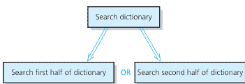

这种策略称为分治法。你先将词典分为两半，然后攻克适当的那一半，从而解决词典搜索问题。你使用相同的分治策略来解决较小的问题。分割过程持续进行，直到你达到基例。正如你将看到的，这种策略在许多递归解法中是固有的。

为了进一步探讨词典问题解法的本质，请考虑一个稍微严谨一些的表述。

```
search(aDictionary: Dictionary, word: string)
if (aDictionary is one page in size)
    Scan the page for word
else
{
    Open aDictionary to a point near the middle
    Determine which half of aDictionary contains word
    if (word is in the first half of aDictionary)
        search(first half of aDictionary, word)
    else
        search(second half of aDictionary, word)
}
```

> 对词典进行二分查找

> 基例是一种你已知其解法的特殊情况

> 二分查找使用分治策略

将解法编写为函数可以得出几个重要观察：

- 1. 函数的一个动作是调用它自身；也就是说，函数 search 调用函数 search。正是这一动作使解法具有递归性。解法策略是将 aDictionary 分为两半，确定哪一半包含 word，然后对适当的那一半应用相同的策略。
- 2. 在函数 search 内部对函数 search 的每次调用都传递一个大小为上一字典一半的字典。也就是说，在每次连续调用 search(aDictionary, word) 时，aDictionary 的大小都会减半。该函数通过解决另一个性质相同但规模更小的搜索问题来解决搜索问题。
- 3. 有一个搜索问题与其他所有问题处理方式不同。当 aDictionary 只包含单页时，你会采用另一种方法：直接扫描该页。搜索单页字典是搜索问题的基例。当你达到基例时，递归调用停止，你直接解决问题。
- 4. 问题规模减小的方式确保你最终会达到基例。

- 递归函数会调用自身
- 每次递归调用都会解决一个相同但规模更小的问题
- 对基例的测试使递归调用能够停止
- 最终，较小的问题中必然有一个是基例

这些事实描述了递归解法的一般形式。尽管并非所有递归解法都能像这个解法那样完美符合这些标准，但相似之处远大于差异。当你尝试构建新的递归解法时，应牢记以下四个问题。

> **注意：构建递归解法的四个问题**
> 1. 如何用同类型的更小问题来定义问题？
> 2. 每次递归调用如何减小问题的规模？
> 3. 问题的哪个实例可以作为基例？
> 4. 随着问题规模减小，你是否会达到这个基例？

现在考虑两个相对简单的问题：计算一个数的阶乘和将字符串逆序输出。它们的递归解法进一步阐明了词典搜索问题解法所提出的观点。这些示例还说明了返回值的递归函数与不返回值的递归函数之间的区别。

## 2.2 返回值的递归

### 2.2.1 返回值的递归函数：n 的阶乘

计算整数 n 的阶乘是一个很好的第一个示例，因为其递归解法易于理解，并且完美符合前面描述的模式。然而，由于该问题有一个简单且高效的迭代解法，你不应在实际中使用递归解法。

如果问题有简单且高效的迭代解法，请勿使用递归

首先，考虑熟悉的 factorial(n) 的迭代定义（通常写作 n!）：

阶乘的迭代定义

```
factorial(n) = n x (n - 1) x (n - 2) x ... x 1 for an integer n > 0
factorial(0) = 1
```

负整数的阶乘未定义。根据此定义编写迭代阶乘函数应该不会有困难。

要递归定义 factorial(n)，首先需要用较小数的阶乘来定义 factorial(n)。为此，只需观察到 n 的阶乘等于 (n - 1) 的阶乘乘以 n；即，

$$
factorial(n) = n \times [(n - 1) \times (n - 2) \times \dots \times 1]
$$
$$
= n \times factorial(n - 1)
$$

递推关系

用 factorial(n - 1) 定义 factorial(n)（这是递推关系的一个示例）意味着，你也可以用 factorial(n - 2) 定义 factorial(n - 1)，以此类推。这一过程与词典搜索解法类似：你通过以完全相同的方式搜索更小的词典来搜索一个词典。

factorial(n) 的定义缺少一个关键要素：基例。如同在词典搜索解法中所做的那样，这里你必须将一种情况与其他所有情况区别对待，否则递归将永不停止。阶乘函数的基例是 factorial(0)，你知道它等于 1。由于 n 最初大于或等于零，并且每次调用 factorial 都会将 n 减 1，你总会达到基例。加上基例后，阶乘函数的完整递归定义是

$$
factorial(n) = \begin{cases} 1 & \text{if } n = 0 \\ n \times factorial(n - 1) & \text{if } n > 0 \end{cases}
$$

阶乘的递归定义

为了确保你理解这个递归定义，请将其应用于 factorial(4) 的计算。因为 4 > 0，递归定义指出

factorial(4) = 4 x factorial(3)

同样，

factorial(3) = 3 x factorial(2)
factorial(2) = 2 x factorial(1)
factorial(1) = 1 x factorial(0)

你已达到基例，定义直接指出

factorial(0) = 1

此时，递归定义的应用停止，你仍不知道原始问题的答案：factorial(4) 是多少？但是，回答这个问题所需的信息现在已可用：

- 因为 factorial(0) = 1，所以 factorial(1) = 1 x 1 = 1
- 因为 factorial(1) = 1，所以 factorial(2) = 2 x 1 = 2
- 因为 factorial(2) = 2，所以 factorial(3) = 3 x 2 = 6
- 因为 factorial(3) = 6，所以 factorial(4) = 4 x 6 = 24

你可以将递归视为一个过程，它将问题分为你可以完成的任务和朋友可以为你完成的任务。例如，如果我让你计算 factorial(4)，你可以先确定自己是否立即知道答案。你立即知道 factorial(0) 是多少——也就是说，你知道基例——但你不立即知道 factorial(4) 的值。然而，如果你的朋友为你计算 factorial(3)，你可以通过将 factorial(3) 与 4 相乘来计算 factorial(4)。因此，你的任务是进行这个乘法，而你朋友的任务是计算 factorial(3)。

你的朋友现在使用与你计算 factorial(4) 时相同的过程来计算 factorial(3)。因此，你的朋友确定 factorial(3) 不是基例，于是请另一个朋友计算 factorial(2)。知道 factorial(2) 使你的朋友能够计算 factorial(3)，当你从朋友那里得知 factorial(3) 的值时，你就可以计算 factorial(4)。


请注意，factorial(4) 的递归定义与迭代定义得出的结果相同，即 4 x 3 x 2 x 1 = 24。要证明两种阶乘定义对所有非负整数都等价，你需要使用数学归纳法。（参见附录 E。）第 5 章讨论了递归与数学归纳法之间的密切联系。

阶乘函数的递归定义说明了两点。(1) 从直观上讲，你可以用 factorial(n - 1) 来定义 factorial(n)。(2) 从机械上讲，你可以应用该定义来确定给定阶乘的值。即使在这个简单的示例中，应用递归定义也需要花费不少工作。当然，这就是计算机派上用场的地方。

一旦你有了 factorial(n) 的递归定义，构建一个实现该定义的 C++ 函数就很容易：

```
/** Computes the factorial of the nonnegative integer n.
 @pre n must be greater than or equal to 0.
 @post None.
 @return The factorial of n; n is unchanged. */
int fact(int n)
{
   if (n == 0)
      return 1;
   else // n > 0; so n-1 > 0. Thus, fact(n-1) returns (n-1)!
      return n * fact(n - 1); // n * (n-1)! is n!
   // end fact
}
```

假设你使用以下语句

```
cout << fact(3);
```

来调用该函数。图 2-2 描绘了此调用所需的计算序列。

图 2-2 fact(3)

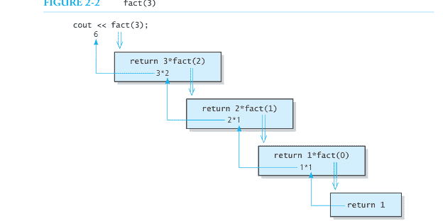

该函数符合本章前面给出的递归解决方案模型，具体如下：

- 1. fact 的一个操作是调用自身。
- 2. 在每次对 fact 的递归调用中，需要计算其阶乘的整数都会减 1。
- 3. 该函数对 0 的阶乘的处理方式与其他所有阶乘不同：它不会生成递归调用。相反，你知道 fact(0) 是 1。因此，当 n 为 0 时，出现基本情况。
- 4. 鉴于 n 是非负的，列表中的第 2 项保证你始终能达到基本情况。

> 注意：递归算法必须有一个基本情况，其解你可以直接得知，无需进行任何递归调用。如果没有基本情况，递归函数将生成无限的调用序列。

函数 fact 的前提条件是 n 为非负值。在递归调用 fact(n-1) 时，n 为正数，因此 n-1 为非负数。由于递归调用满足 fact 的前提条件，你可以预期 fact(n-1) 将返回 n-1 的阶乘。因此，n * fact(n-1) 是 n 的阶乘。第 5 章使用数学归纳法正式证明 fact(n) 返回 n 的阶乘。

如果你曾违反 fact 的前提条件，该函数将无法正确运行。也就是说，如果调用程序向 fact 传递了负值，将发生无限的递归调用序列——仅由系统定义的限制终止——因为该函数永远无法达到基本情况。例如，fact(-4) 将调用 fact(-5)，而 fact(-5) 将调用 fact(-6)，以此类推。

理想情况下，该函数应通过测试负 n 来保护自身。如果 n < 0，该函数可以，例如，返回 0 或设置错误标志。附录 B 在 B.2 节“风格”和 B.5 节“安全编程”中讨论了错误检查；你可能希望此时回顾该讨论。

从直观层面来看，很明显函数 fact 实现了阶乘的递归定义。现在考虑执行此递归函数的机制。逻辑很简单，除了 else 子句中的表达式可能除外。该表达式可以描述如下：

- 1. 乘积 n * fact(n-1) 的每个操作数都会被求值。
- 2. 第二个操作数——fact(n-1)——是对函数 fact 的调用。虽然这是一个递归调用（函数 fact 调用函数 fact），但它其实并没有什么特别之处。想象用对另一个函数的调用——例如标准函数 abs——来替换对 fact 的递归调用。原理是相同的：只需求值该函数。

从理论上讲，求值递归函数并不比求值非递归函数更困难。然而在实践中，手动记账很快就会变得难以应付。下一节介绍了一种跟踪递归函数操作的系统方法。对于计算机来说，记账很简单，但可能会使用比为此类任务分配的更多内存。

> 问题 1 以下函数计算前 n（n >= 1）个整数的和。展示该函数如何满足递归函数的属性。

```
/* Computes the sum of the integers from 1 through n.
 * Pre: n > 0.
 * Post: None.
 * @param n A positive integer.
 * @return The sum 1 + 2 + ... + n. */
```

```
int sumUpTo(int n)
{
    int sum = 0;
    if (n == 1)
        sum = 1;
    else // n > 1
        sum = n + sumUpTo(n - 1);
    return sum;
} // end sumUpTo
```

### 2.2.2 方框跟踪

每次函数调用都会创建一个激活记录

你可以使用方框跟踪来帮助理解递归并调试递归函数。然而，这种机械装置不能替代对递归的直观理解。方框跟踪说明了编译器通常如何实现递归。在阅读下面关于该技术的描述时，请意识到每个方框大致对应一个激活记录，编译器通常在其实现函数调用时使用该记录。C++ 间奏 2 将进一步讨论激活记录。

这里以返回值的递归函数 fact 为例，说明方框跟踪。

- 1. 标记递归函数体中的每个递归调用。函数内部可能会出现多个递归调用，区分它们非常重要。这些标签可帮助你跟踪函数调用完成后必须返回的正确位置。例如，用字母 A 标记函数体中的表达式 fact(n - 1)：

标记函数中的每个递归调用

```
if (n == 0)
    return 1;
else
    return n * fact(n - 1); A
```

执行并求值表达式 n * fact(n - 1) 后，你将返回到点 A。

- 2. 在执行过程中，用一个新方框表示对该函数的每次调用，并在其中记录函数的局部环境。更具体地说，每个方框将包含

每次调用函数时，一个新方框表示其局部环境

- - 参数列表中参数的值。
- - 函数的局部变量。
- - 当前方框中每个递归调用返回值的占位符。将此占位符标记为与步骤 1 中的标记相对应。
- - 函数本身的值。

当你首次创建一个方框时，你只知道输入参数的值。你将根据函数的执行情况填充其他值。例如，你会为调用 fact(3) 创建图 2-3 中的方框。（你将在后面的示例中看到，必须以与值参数和局部变量略有不同的方式处理引用参数。）

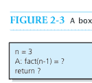

- 3. 从启动递归过程的语句向第一个方框画一条箭头。然后，如步骤 2 所述，在递归调用后创建新方框时，你从发出调用的方框向新创建的方框画一条箭头。为每个箭头标记与步骤 1 中递归调用的标签相对应的标签；该标签指示调用完成后应继续执行的确切位置。例如，图 2-4 显示了语句 cout << fact(3) 中对 fact 的调用生成的前两个方框。

图 2-4 方框跟踪的开始

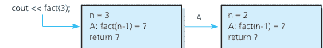

- 4. 如步骤 2 和 3 所述创建新方框和箭头后，开始执行函数体。对函数局部环境中值的每个引用都引用当前方框中的相应值，无论你是如何生成当前方框的。

- 5. 退出函数时，划掉当前方框并沿其箭头返回到调用该函数的方框。此方框现在成为当前方框，箭头上的标签指定函数执行应继续的确切位置。将刚终止的函数调用返回的值替换为当前方框中相应的占位符。

图 2-5 是调用 fact(3) 的完整方框跟踪。在本图的一系列图表中，当前方框是箭头路径上最深的方框，并以蓝色突出显示，而划掉的方框则为虚线并带有灰色阴影。

图 2-5 fact(3) 的方框跟踪

初始调用已发出，方法 fact 开始执行：

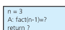

在点 A 处发出递归调用，方法 fact 的新调用开始执行：

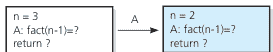

在点 A 处发出递归调用，方法 fact 的新调用开始执行：

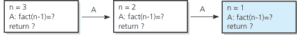

在点 A 处发出递归调用，方法 fact 的新调用开始执行：

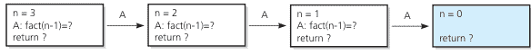


图 2-5 fact(3) 的框跟踪（续）

这是基本情况，因此此次 fact 调用完成并向调用者返回一个值：

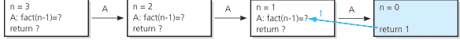

方法值返回到调用框，该框继续执行：

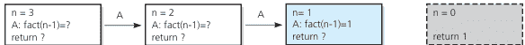

当前 fact 调用完成并向调用者返回一个值：

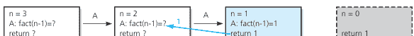

方法值返回到调用框，该框继续执行：

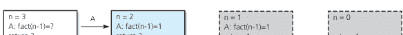

当前 fact 调用完成并向调用者返回一个值：

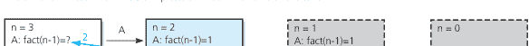

方法值返回到调用框，该框继续执行：

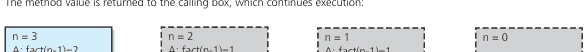

当前 fact 调用完成并向调用者返回一个值：

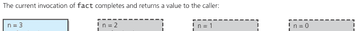

值 6 返回到初始调用。

> > 注意：框跟踪结合合理放置的 cout 语句，可作为调试递归函数的有效辅助。此类语句应报告每个递归调用发生的程序位置，以及进入和退出函数时输入参数和局部变量的值。请务必从函数的最终版本中删除这些 cout 语句

> > 问题 2 编写检查点问题 1 中给出的函数的框跟踪。

## 2.3 执行操作的递归

递归函数不必返回值；它们可以是 void 函数。

### 2.3.1 递归 void 函数：逆序写字符串

现在考虑一个稍微困难一些的问题：给定一个字符串，按逆序写出它。例如，将字符串 "cat" 写为 "tac"。要构建递归解法，你应该提出第 2.1 节末尾注释中的四个问题。

你可以将“逆序写出长度为 n 的字符串”的问题，转化为“逆序写出长度为 n - 1 的字符串”的问题来构建解法。也就是说，解法的每个递归步骤都会使待逆序写出的字符串长度减 1。字符串越来越短这一事实表明，逆序写出一些非常短的字符串可以作为基本情况。一个非常短的字符串是空字符串，即长度为零的字符串。因此，你可以为基本情况选择以下问题：

> 基本情况

*逆序写出空字符串*

解决这个问题的方法是什么都不做——这确实是一个非常直接的解法！（或者，你也可以使用长度为 1 的字符串作为基本情况。）

究竟如何利用“逆序写出长度为 n - 1 的字符串”的问题的解法，来解决“逆序写出长度为 n 的字符串”的问题？这种方法与构建阶乘问题解法所用的方法类似，在后者中，你指定了如何在计算 factorial(n) 时使用 factorial(n - 1)。然而，与阶乘问题不同，字符串问题并未给出一个立即清晰的步骤。显然，任意长度为 n - 1 的字符串都不合适。例如，将长度为 5 的字符串 "apple" 逆序写出，与将长度为 4 的字符串 "pear" 逆序写出，之间没有关系。你必须仔细选择较小的问题，以便能在原问题的解法中使用其解法。

> 如果你能逆序写出 (n - 1) 个字符的字符串，如何逆序写出 n 个字符的字符串？

你选择的长度为 n - 1 的字符串必须是原字符串的子串（部分）。假设你从原字符串中去掉一个字符，留下一个长度为 n - 1 的子串。为了使递归解法有效，能够逆序写出子串的能力，结合执行某项小任务的能力，必须能够逆序写出原字符串。将这种方法与你递归计算阶乘的方式进行比较：能够计算 factorial(n - 1) 的能力，结合将此值乘以 n 的能力，得出了能够计算 factorial(n) 的能力。

你需要决定去掉哪个字符，以及执行哪项小任务。先考虑小任务。由于你正在写出字符，小任务的一个可能候选是写出单个字符。至于应该从字符串中去掉哪个字符，有几种可能的替代方案。其中两种更直观的替代方案是

- 去掉最后一个字符
- 去掉第一个字符

考虑其中第一种替代方案，即去掉最后一个字符，如图 2-6 所示。

图 2-6 递归解法

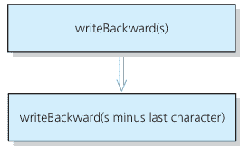

为了使解法有效，你必须先写出字符串中的最后一个字符。因此，你必须在逆序写出字符串其余部分之前写出最后一个字符。给定字符串 s，高层递归解法如下：

```
writeBackward(s: string)
if (the string is empty)
    Do nothing--this is the base case
else
{
    Write the last character of s
    writeBackward(s minus its last character)
}
```

> > 注意：递归解法必须涉及一个或多个较小的问题，每个问题都比原问题更接近基本情况。你必须确保这些较小的问题最终达到基本情况。否则，可能导致一个不终止的算法。

这个问题的解法是概念性的。要获得 C++ 函数，你必须解决一些实现问题。假设函数将接收一个参数：要逆序写出的字符串 s。所有字符（包括空格）都是字符串的一部分。C++ 函数 writeBackward 如下所示：

```
/** writes a character string backward.
@pre  The string s to write backward.
@post None.
@param s The string to write backward. */
void writeBackward(string s)
{
   int length = s.size(); // Length of string
   if (length > 0)
   {
      // Write the last character
      cout << s.substr(length - 1, 1);

      // Write the rest of the string backward
      writeBackward(s.substr(0, length - 1)); // Point A
   } // end if

   // length == 0 is the base case - do nothing
} // end writeBackward
```

请注意，对 writeBackward 的递归调用使用了越来越短的字符串 s 版本，确保将达到基本调用。由于函数在达到基本情况时什么都不做，因此它没有显式处理基本情况。基本情况是隐式的。

你可以使用框跟踪来跟踪 writeBackward 的执行。与函数 fact 的情况一样，每个框包含递归调用的局部环境——在这里，即参数字符串 s 和局部变量 length。跟踪将与图 2-5 中显示的 fact 的跟踪有些不同，因为作为 void 函数，writeBackward 不使用 return 语句返回计算值。图 2-7 跟踪了对带有字符串 "cat" 的函数 writeBackward 的调用。

writeBackward 不返回计算值

图 2-7 writeBackward("cat") 的框跟踪

初始调用已进行，函数开始执行：

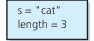

输出行：t

点 A（writeBackward(s)）已达到，并进行递归调用。

新的调用开始执行：

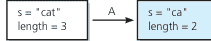

输出行：ta

点 A 已达到，并进行递归调用。

新的调用开始执行：

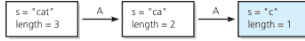

图 2-7 writeBackward("cat") 的框跟踪（续）

输出行：tac

点 A 已达到，并进行递归调用。

新的调用开始执行：

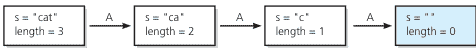

这是基本情况，因此此次调用完成。

控制权返回到调用框，该框继续执行：

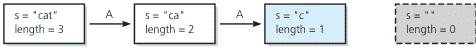

此次调用完成。控制权返回到调用框，该框继续执行：

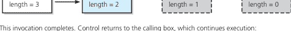

此次调用完成。控制权返回到调用框，该框继续执行：

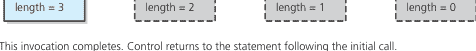

此次调用完成。控制权返回到初始调用之后的语句。

**另一种解法。** 现在考虑该问题的一种略有不同的方法。回顾你可以从字符串中去掉的字符的两种替代方案：最后一个字符或第一个字符。刚才给出的解法去掉了字符串的最后一个字符。现在，基于第二种替代方案构建一个解法将会很有趣：

### *去掉第一个字符*

首先，考虑对前面的伪代码解法进行简单修改，将每个 last 替换为 first。因此，该函数写出第一个字符而不是最后一个字符，然后递归地逆序写出字符串的其余部分。

```
writeBackward(s: string)
if (the string s is empty)
    Do nothing---this is the base case
else
    Write the first character of s
    writeBackward(s minus its first character)
}
```

这个解法能实现你想要的效果吗？如果你思考这个函数，你会发现它按正常的从左到右方向写出字符串，而不是逆序。毕竟，伪代码中的步骤是


- 写出 s 的第一个字符
- 写出 s 的其余部分

这些步骤只是写出字符串 s。将函数命名为 writeBackward 并不能保证它真的会将字符串逆序写出——递归真的并非魔法！

你可以使用以下递归表达式正确地逆序写出 s：

- 逆序写出去掉第一个字符后的 s
- 写出 s 的第一个字符

换句话说，只有在你逆序写出 s 的其余部分*之后*，才写出 s 的第一个字符。

这种方法得出以下伪代码解决方案：

```
writeBackward2(s: string)
    if (the string s is empty)
        Do nothing--this is the base case
    else
        writeBackward2(s minus its first character)
        Write the first character of s
}
```

writeBackward2 到 C++ 的翻译与原始 writeBackward 函数的翻译类似，作为练习留给读者。

仔细跟踪两个伪代码函数 writeBackward 和 writeBackward2 的操作很有教益。首先，向每个函数添加语句以提供对跟踪有用的输出，如下所示：

```cpp
writeBackward(s: string)
    cout << "Enter writeBackward with string: " << s << endl;
    if (the string is empty)
        Do nothing--this is the base case
    else
        cout << "About to write last character of string "
             << s << endl;
        Write the last character of s
        writeBackward(s minus its last character) // Point A
    cout << "Leave writeBackward with string: " << s << endl;
```

> cout 语句
> 可帮助你跟踪
> 递归函数的
> 逻辑

```cpp
writeBackward2(s: string)
    cout << "Enter writeBackward2 with string: "
         << s << endl;
    if (the string is empty)
        Do nothing--this is the base case
    else
        writeBackward2(s minus its first character) // Point A
        cout << "About to write first character of string: "
             << s << endl;
        Write the first character of s
    cout << "Leave writeBackward2 with string: " << s << endl;
```

图 2-8 和 2-9 显示了修订后的伪代码函数 writeBackward 和 writeBackward2 的输出，初始字符串为 "cat"。

## 图 2-8 伪代码中 writeBackward("cat") 的框跟踪

初始调用已进行，函数开始执行：


### 输出流：

```
Enter writeBackward with string: cat
About to write last character of string: cat
t
```

已到达点 A，进行递归调用。新的调用开始执行：


### 输出流：

```
Enter writeBackward with string: cat
About to write last character of string: cat
t
Enter writeBackward with string: ca
About to write last character of string: ca
a
```

已到达点 A，进行递归调用。新的调用开始执行：

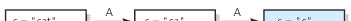

### 输出流：

```
Enter writeBackward with string: cat
About to write last character of string: cat
t
Enter writeBackward with string: ca
About to write last character of string: ca
a
Enter writeBackward with string: c
About to write last character of string: c
c
```

已到达点 A，进行递归调用。新的调用开始执行：

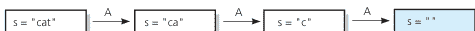

此调用完成执行，并返回。

### 输出流：

```
Enter writeBackward with string: cat
About to write last character of string: cat
t
Enter writeBackward with string: ca
About to write last character of string: ca
a
Enter writeBackward with string: c
About to write last character of string: c
c
Enter writeBackward with string:
Leave writeBackward with string:
```

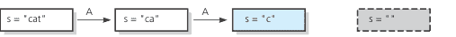

此调用完成执行，并返回。

### 输出流：

```
Enter writeBackward with string: cat
About to write last character of string: cat
t
Enter writeBackward with string: ca
About to write last character of string: ca
a
Enter writeBackward with string: c
About to write last character of string: c
c
Enter writeBackward with string:
Leave writeBackward with string:
Leave writeBackward with string: c
```

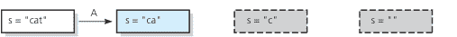

此调用完成执行，并返回。

### 输出流：

```
Enter writeBackward with string: cat
About to write last character of string: cat
t
Enter writeBackward with string: ca
About to write last character of string: ca
a
Enter writeBackward with string: c
About to write last character of string: c
c
Enter writeBackward with string:
Leave writeBackward with string:
Leave writeBackward with string: c
Leave writeBackward with string: ca
```

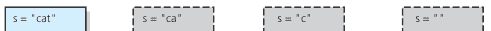

此调用完成执行，并返回。

### 输出流：

```
Enter writeBackward with string: cat
About to write last character of string: cat
t
Enter writeBackward with string: ca
About to write last character of string: ca
a
Enter writeBackward with string: c
About to write last character of string: c
c
Enter writeBackward with string:
Leave writeBackward with string:
Leave writeBackward with string: c
Leave writeBackward with string: ca
Leave writeBackward with string: cat
```

你需要熟悉这两个函数之间的差异。两个函数所做的递归调用为参数 s 生成不同的值序列。尽管如此，两个函数都能正确地逆序写出字符串参数。它们通过在递归调用的不同时间点写出字符串中的不同字符，来补偿 s 值序列的差异。就图 2-8 和 2-9 的框跟踪而言，writeBackward 在生成新框之前（即在新递归调用之前）写出一个字符，而 writeBackward2 在划掉一个框之后（即在从递归调用返回之后）写出一个字符。将这些差异结合起来，结果是两个采用不同策略来完成相同任务的函数。

放置得当但临时的 cout 语句可以帮助你调试递归函数

```cpp
abc(...);
cout << "Calling function abc from point A.\n";
abc(...); // This is point A
cout << "Calling function abc from point B.\n";
abc(...); // This is point B
```

调试函数后，移除 cout 语句

意识到 cout 语句不应出现在函数的最终版本中。

## 图 2-9 伪代码中 writeBackward2("cat") 的框跟踪

初始调用已进行，函数开始执行：


### 输出流：

```
Enter writeBackward2 with string: cat
```

已到达点 A，进行递归调用。新的调用开始执行：

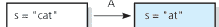

### 输出流：

```
Enter writeBackward2 with string: cat
Enter writeBackward2 with string: at
```

已到达点 A，进行递归调用。新的调用开始执行：

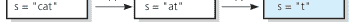

### 输出流：

```
Enter writeBackward2 with string: cat
Enter writeBackward2 with string: at
Enter writeBackward2 with string: t
```

已到达点 A，进行递归调用。新的调用开始执行：

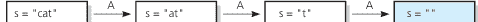

此调用完成执行，并返回。

### 输出流：

```
Enter writeBackward2 with string: cat
Enter writeBackward2 with string: at
Enter writeBackward2 with string: t
Enter writeBackward2 with string: 
Leave writeBackward2 with string:
```

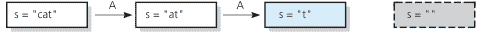

此调用完成执行，并返回。

### 输出流：

```
Enter writeBackward2 with string: cat
Enter writeBackward2 with string: at
Enter writeBackward2 with string: t
```


## 图 2-9 伪代码中 writeBackward2("cat") 的框跟踪（续）

Enter writeBackward2 with string:
Leave writeBackward2 with string:
About to write first character of string: t
Leave writeBackward2 with string: t

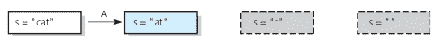

此调用完成执行，并返回。

输出流：

Enter writeBackward2 with string: cat
Enter writeBackward2 with string: at
Enter writeBackward2 with string: t
Enter writeBackward2 with string:
Leave writeBackward2 with string:
About to write first character of string: t
t
Leave writeBackward2 with string: t
Leave writeBackward2 with string: at
About to write first character of string: at
a
Leave writeBackward2 with string: at

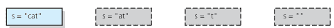

此调用完成执行，并返回。

输出流：

Enter writeBackward2 with string: cat
Enter writeBackward2 with string: at
Enter writeBackward2 with string: t
Enter writeBackward2 with string:
Leave writeBackward2 with string:
About to write first character of string: t
t
Leave writeBackward2 with string: t
Leave writeBackward2 with string: at
About to write first character of string: at
a
Leave writeBackward2 with string: at
About to write first character of string: cat
c
Leave writeBackward2 with string: cat

问题 3 给定一个整数 n > 0，编写一个递归函数 countDown，它输出整数 n, n - 1, ..., 1。提示：你可以完成什么任务，以及可以请朋友为你完成什么任务？

## 2.4 与数组的递归

当你使用数组时，递归可以是一个实用且强大的工具。作为我们的第一个示例，我们将数组的内容逆序写出。然后我们将探讨几个涉及搜索数组的问题。


### 2.4.1 以逆序写出数组的条目

此问题的解决方案与我们在 2.3.1 节中编写逆序字符串时的第一个解决方案非常相似。我们可以编写以下伪代码：

```
writeArrayBackward(anArray: char[])
    if (the array is empty)
        Do nothing--this is the base case
    else
    {
        Write the last character in anArray
        writeArrayBackward(anArray minus its last character)
    }
```

我们如何将去掉最后一个字符的 anArray 传递给 writeArrayBackward？我们可以传递数组中剩余的字符数。在每次递归调用中，我们将此数字减 1。或者，我们可以传递最后一个字符的索引。也就是说，如果 last 是此索引，writeArrayBackward 将作用于数组 anArray[0..last]，即从 anArray[0] 到 anArray[last] 的部分。随后的递归调用将作用于子数组 anArray[0..last - 1]。此思想的更一般变体还传递第一个数组字符的索引。因此，我们不再假设此索引为 0，而是将 anArray[first..last] 传递给 writeArrayBackward。

我们可以按如下方式编写函数 writeArrayBackward：

```
/** Writes the characters in an array backward.
   @param anArray  The array contains size characters, where size > 0.
   @param first    The index of the first character in the array.
   @param last     The index of the last character in the array. */
void writeArrayBackward(const char anArray[], int first, int last)
{
    if (first <= last)
    {
        // Write the last character
        cout << anArray[last];

        // Write the rest of the array backward
        writeArrayBackward(anArray, first, last - 1);
    } // end if

    // first > last is the base case - do nothing
} // end writeArrayBackward
```

问题 4 在 writeArrayBackward 的先前定义中，为什么当 first 的值超过 last 的值时会出现基本情况？
问题 5 编写一个递归函数，计算并返回数组中前 n（n >= 1）个实数的乘积。
问题 6 说明你为上一个问题编写的函数如何满足递归函数的属性。
问题 7 编写一个递归函数，计算并返回数组 anArray[first..last] 中整数的乘积。

### 2.4.2 二分查找

搜索是一项经常发生的重要任务。通常，搜索是针对数组中的特定条目。我们现在将考察几个具有递归解决方案的搜索问题。我们的目标是进一步加深你对递归的理解。

本章最初通过直观的方法介绍二分查找算法，从高层次上展示了一种在字典中查找单词的方法。我们现在将充分开发此算法，并说明一些重要的编程问题。

回顾字典问题的先前解决方案：

```
search(aDictionary: Dictionary, word: string)
if (aDictionary is one page in size)
    Scan the page for word
else
    {
    Open aDictionary to a point near the middle
    Determine which half of aDictionary contains word
    if (word is in the first half of aDictionary)
        search(first half of aDictionary, word)
    else
        search(second half of aDictionary, word)
    }
```

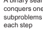

现在稍微修改问题，在整数数组 anArray 中搜索给定值（即目标值）。数组（如同字典）必须已排序，否则二分查找不适用。因此，假设

```
anArray[0] anArray[1] anArray[2] ... anArray[size - 1]
```

其中 size 是数组的大小。针对数组问题的高级二分查找为

```
binarySearch(anArray: ArrayType, target: ValueType)
if (anArray is of size 1)
    Determine if anArray's value is equal to target
else
    {
    Find the midpoint of anArray
    Determine which half of anArray contains target
    if (target is in the first half of anArray)
        binarySearch(first half of anArray, target)
    else
        binarySearch(second half of anArray, target)
    }
```

尽管该解决方案在概念上是正确的，但在实现算法之前，你必须考虑几个细节：

- 1. 你如何将 anArray 的一半传递给 binarySearch 的递归调用？你可以在每次调用时传递整个数组，但让 binarySearch 仅搜索 anArray[first..last]，即从 anArray[first] 到 anArray[last] 的部分。因此，你还会将整数 first 和 last 传递给 binarySearch：

```
binarySearch(anArray, first, last, target)
```

按照此约定，新的中点由以下给出

```
mid = (first + last) / 2
```

然后 binarySearch( anArray 的第一半, target ) 变为

```
binarySearch(anArray, first, mid - 1, target)
```

而 binarySearch( anArray 的第二半, target ) 变为

```
binarySearch(anArray, mid + 1, last, target)
```

数组的两半为 anArray[first..mid-1] 和 anArray[mid+1..last]；两半都不包含 anArray[mid]

- 2. 你如何确定数组的哪一半包含 target？以下的一种可能实现

```
if (target is in the first half of anArray)
```

为

```
if (target < anArray[mid])
```

确定 anArray[mid] 是否是你要查找的目标

但是，target 与 anArray[mid] 之间没有相等性测试。此遗漏可能导致算法遗漏 target。在前一折半算法将 anArray 分成两半后，anArray[mid] 不在数组的任何一半中。（在这种情况下，两半并不构成一个整体！）因此，你现在必须确定 anArray[mid] 是否是你要查找的值；因为之后它将不在剩余的一半中。折半标准与终止条件（基本情况）之间的交互作用很微妙，并且常常是错误的根源。我们需要重新考虑基本情况。

- 3. 基本情况应该是什么？按当前编写，binarySearch 仅在出现大小为 1 的数组时终止；这是唯一的基本情况。通过更改折半过程，使 anArray[mid] 保留在两半中的一半，可以正确实现二分查找，使其仅具有这一个基本情况。但是，拥有两个不同的基本情况可能更清晰，如下所示：

  - first > last。当目标不在原始数组中时，你将达到此基本情况。
  - target == anArray[mid]。当目标在原始数组中时，你将达到此基本情况。

这些基本情况与你以前遇到的任何基本情况都有些不同。从某种意义上说，算法根据其达到的基本情况来确定问题的答案。许多搜索问题都有这种特点。

- 4. binarySearch 如何指示搜索结果？如果 binarySearch 在数组中成功定位目标，它可以返回等于目标的数组值的索引。由于此索引永远不会为负，如果在数组中未找到目标，binarySearch 可以返回一个负值。

以下的 C++ 函数 binarySearch 实现了这些想法。binarySearch 的两个递归调用标记为 X 和 Y，以便在以后对此函数的框跟踪中使用。


/** Searches the array anArray[first] through anArray[last]
for a given value by using a binary search.
@pre 0 <= first, last <= SIZE - 1, where SIZE is the
maximum size of the array, and anArray[first] <=
anArray[first + 1] <= ... <= anArray[last].
@post If target is not in the array anArray[index] contains
the given value; otherwise index == -1.
@param anArray The array to search.
@param first The low index to start searching from.
@param last The high index to stop searching at.
@param target The search key.
@return Either index, such that anArray[index] == target, or -1.
*/
int binarySearch(const int anArray[], int first, int last, int target)
{
   int index;
   if (first > last)
      index = -1; // target not in original array
   else
   {
      // If target is in anArray,
      // anArray[first] <= target <= anArray[last]
      int mid = (first + last) / 2;
      if (target == anArray[mid]) // target found at anArray[mid]
         index = mid;
      else if (target < anArray[mid])
      {
         // Point X
         index = binarySearch(anArray, first, mid - 1, target);
      }
      else
      {
         // Point Y
         index = binarySearch(anArray, mid + 1, last, target);
      } // end if
   } // end if

   return index;
} // end binarySearch

请注意，如果目标值出现在数组中，它一定位于由 first 和 last 界定的数组片段中。也就是说，以下成立：

anArray[first] <= target <= anArray[last]

图 2-10 展示了 binarySearch 在搜索包含 1、5、9、12、15、21、29 和 31 的数组时的框迹。请注意，图中两个对 binarySearch 的递归调用的标签 X 和 Y 是如何出现的。本章末尾的练习 16 要求你使用此函数执行其他框迹。

> 注意：开发递归解法时，必须确保较小问题的解确实能给出原问题的解。例如，binarySearch 之所以有效，是因为每个较小的数组都是有序的，且所查找的值位于其首尾值之间。

还需要考虑另一个实现问题——一个专门涉及 C++ 的问题。请记住，数组从不按值传递给函数，因此也不会被复制。C++ 的这一特性在像 binarySearch 这样的递归函数中特别有用。如果数组 anArray 很大，可能需要多次递归调用 binarySearch。如果每次调用都复制 anArray，将浪费大量内存和时间。另一方面，由于 anArray 未被复制，除非你将 anArray 指定为 const（如 binarySearch 所做的那样），否则函数可以修改数组的值。

由于数组参数始终按引用传递，除非你将数组指定为 const，否则函数可以修改它

### 图 2-10 使用 anArray = <1, 5, 9, 12, 15, 21, 29, 31> 的 binarySearch 框迹：(a) 对 9 的成功搜索；(b) 对 6 的不成功搜索

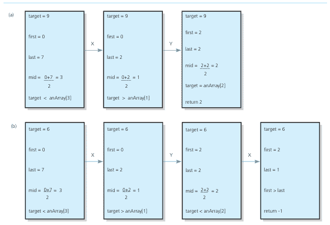

带有数组参数的递归函数的框迹需要新的考量。由于数组 anArray 既不是值参数也不是局部变量，它不是函数局部环境的一部分，因此整个数组 anArray 不应出现在每个框中。因此，如图 2-11 所示，你在框外表示 anArray，对 anArray 的所有引用都会影响这一个表示。

在框迹中将引用参数表示在框外

> 注意：请注意，C++ 中中点 mid 的计算方式是

```
int mid = first + (last - first) / 2;
```

而不是

```
int mid = (first + last) / 2;
```

正如伪代码所暗示的那样。如果你要搜索至少包含 2^30（约 10 亿）个元素的数组，first 和 last 的和可能会超过 int 可能的最大值 2^30 - 1。因此，first + last 的计算会溢出为负整数，并导致 mid 为负值。如果将这个负值的 mid 用作数组索引，它将越界并导致结果错误。计算 first + (last - first) / 2 在代数上等价于 (first + last) / 2，并避免了此错误。

### 图 2-11 带有引用参数的框迹

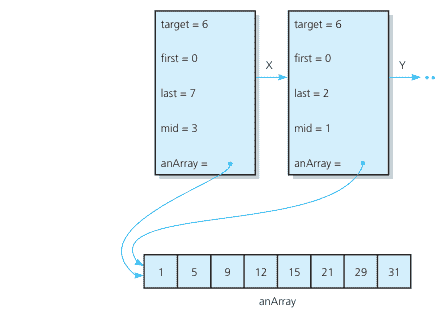

### 2.4.3 在数组中查找最大值

假设你有一个整数数组 anArray，想要找到最大值。你可以不太费力地构建一个迭代解法，但让我们来考虑一个递归表达式：

```
if (anArray has only one entry)
maxArray(anArray) is the entry in anArray
else if (anArray has more than one entry)
maxArray(anArray) is the maximum of
maxArray(left half of anArray) and maxArray(right half of anArray)
```

maxArray 在每一步都会解决其两个子问题

请注意，此策略符合之前二分查找算法所使用的分治模型。也就是说，我们通过分解问题并解决子问题来进行，如图 2-12 所示。然而，此算法与二分查找算法之间存在差异。虽然二分查找算法在每一步只解决一个子问题，但 maxArray 会解决两个子问题。由于两个子问题都递归求解，这种方法称为多路递归。maxArray 解决子问题后，必须协调两个解——即，它必须找到两个最大值中的最大值。图 2-13 说明了找到包含 1、6、8 和 3 的数组中最大整数所需的计算（此处表示为 <1, 6, 8, 3>）。

> 问题 7 定义递归 C++ 函数 maxArray，该函数返回数组中的最大值，并遵循刚才给出的伪代码。

### 2.4.4 查找数组中第 k 小的值

我们以一个更难的问题结束对搜索的讨论。虽然你现在可以跳过此示例，但第 11 章将在排序算法中用到它的某些方面。

### 图 2-12 最大值问题的递归解法

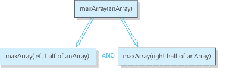

### 图 2-13 maxArray(<1, 6, 8, 3>) 生成的递归调用

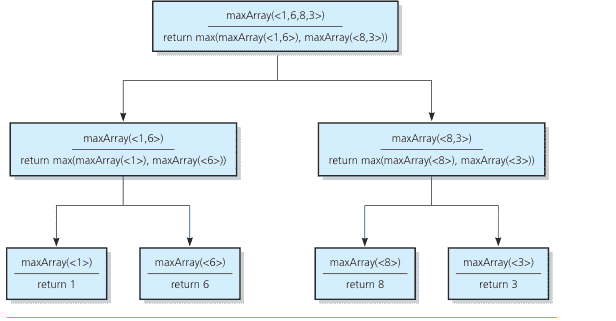

前两个示例介绍了在任意数组中查找最大值以及在有序数组中查找任意值的递归技术。本示例描述了在任意数组 anArray 中查找第 k 小值的递归解法。你会对这样的值感兴趣吗？统计学家通常希望得到数据集的中位数。有序数据集的中位数位于集合的中间。在无序数据集中，小于中位数的值的数量大约等于大于中位数的值的数量。因此，如果你有 49 个值，第 25 小的值就是中位数。显然，你可以通过对数组排序来解决这个问题。那么第 k 小的值将是 anArray[k-1]。虽然这种方法是合法的解法，但它做了比问题要求更多的工作；更高效的解法是可能的。这里概述的解法在不完全排序数组的情况下找到第 k 小的值。到目前为止，你知道通过将问题的解写成一个或多个同类型较小问题的解来递归求解问题，而这种“较小”的概念确保你总能到达基例。对于之前的所有递归解法，递归调用之间问题规模的减少是可预测的。例如，阶乘函数总是将问题规模减少 1；二分查找总是将问题规模减半。此外，除了二分查找之外，之前所有问题的基例都具有静态、预定义的大小。因此，只需知道原问题的大小，你就可以确定在到达基例之前所需的递归调用次数。你即将看到的查找第 k 小值的解法偏离了这些技术。虽然你用较小的问题来求解问题，但这个问题小多少取决于数组中的值，无法预先预测。此外，基例的大小也取决于数组中的值，就像二分查找一样。（请记住，当中间值就是所查找的值时，你会到达二分查找的一个基例。）此解法的不可预测性源于问题本身：数组中任何预定义部分的值的排名与整个数组中值的排名之间的关系不足以确定第 k 小的值。例如，假设 anArray 包含图 2-14 所示的值。请注意，位于 anArray[3] 的 6 是 anArray 前半部分中第三小的值，而位于 anArray[4] 的 8 是 anArray 后半部分中第三小的值。你能从这些观察中得出关于 anArray 中第三小值位置的任何结论吗？答案是否定的；关于数组部分的这些事实不允许你对整个数组得出任何有用的结论。你还应该尝试其他固定分割方案。

> 对于之前的所有示例，你知道每次递归调用所减少的问题规模

> 你无法预先预测查找第 k 小值问题的递归解法中较小问题或基例的大小

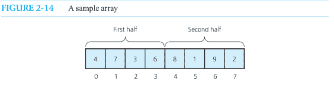

- 递归解法通过以下步骤进行
- 1. 在数组中选择一个 **基准值**
- 2. 巧妙地安排，或 **分区**，数组中关于此基准值的值
- 3. 将策略递归地应用于其中一个分区

> 将 anArray 分为三部分：值 < p，以及值 >= p

假设你想在数组片段 anArray[first .. last] 中找到第 k 小的值。设基准值 p 为数组片段中的任意值。（暂时忽略如何选择 p。）你可以将 anArray[first .. last] 的值分为三个区域：S1（包含小于或等于 p 的值）、基准值本身，以及 S2（包含大于或等于 p 的值）。这种分区意味着 S1 中的所有值都不大于 S2 中的所有值。图 2-15 说明了这种分区。

anArray[first .. pivotIndex-1] 中的所有值都小于或等于 p，而 anArray[pivotIndex+1 .. last] 中的所有值都大于或等于 p。请注意，区域 S1 和 S2 的大小既取决于 p，也取决于 anArray[first .. last] 中的其他值。这种分区引出三个较小的问题，其中一个问题的解将解决原问题：

- 1. 如果 S1 包含 k 个或更多值，则 S1 包含数组片段 anArray[first .. last] 中的 k 个最小值。在这种情况下，第 k 小的值必须在 S1 中。由于 S1 是数组片段 anArray[first .. pivotIndex-1]，当 k < pivotIndex - first + 1 时会发生这种情况。


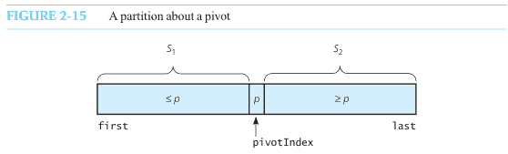

- 2. 如果 \(S_1\) 包含 \(k-1\) 个值，则第 \(k^{th}\) 小的值必须是主元 \(p\)。这是基本情况；当 \(k = \text{pivotIndex} - \text{first} + 1\) 时发生。
- 3. 如果 \(S_1\) 包含少于 \(k-1\) 个值，则 anArray[first..last] 中第 \(k^{th}\) 小的值必须在 \(S_2\) 中。因为 \(S_1\) 包含 \(\text{pivotIndex} - \text{first}\) 个值，所以 anArray[first..last] 中第 \(k^{th}\) 小的值是 \(S_2\) 中第 \((k - (\text{pivotIndex} - \text{first} + 1))^{th}\) 小的值。当 \(k > \text{pivotIndex} - \text{first} + 1\) 时发生此情况。

递归定义可以总结此讨论。令

kSmall(k, anArray, first, last) = anArray[first..last] 中第 \(k^{th}\) 小的值

在选择主元值 \(p\) 并将 anArray[first..last] 划分为 \(S_1\) 和 \(S_2\) 后，有 kSmall(k, anArray, first, last) 等于

- * 当 k < pivotIndex - first + 1 时，kSmall(k, anArray, first, pivotIndex - 1)
- * 当 k = pivotIndex - first + 1 时，p
- * 当 k > pivotIndex - first + 1 时，kSmall(k - (pivotIndex - first + 1), anArray, pivotIndex + 1, last)

总存在一个主元，并且因为它既不属于 \(S_1\) 也不属于 \(S_2\)，所以每一步被搜索的数组段大小至少减少 1。因此，你最终将达到基本情况：所需的值是一个主元。高层伪代码解决方案如下。

anArray[first..last] 中第 \(k^{th}\) 小的值

```
// Returns the kth smallest value in anArray[first..last].
kSmall(k: integer, anArray: ArrayType,
       first: integer, last: integer): ValueType
    Choose a pivot value p from anArray[first..last]
    Partition the values of anArray[first..last] about p
    if (k < pivotIndex - first + 1)
        return kSmall(k, anArray, first, pivotIndex - 1)
    else if (k == pivotIndex - first + 1)
        return p
    else
        return kSmall(k - (pivotIndex - first + 1), anArray,
                      pivotIndex + 1, last)
```

此伪代码与 C++ 函数相差不大。剩下的唯一问题是如何选择主元值 \(p\) 以及如何围绕所选的 \(p\) 划分数组。对 \(p\) 的选择是任意的。数组中的任何 \(p\) 都可用，尽管选择的顺序会影响你多快达到基本情况。第 11 章给出了围绕 \(p\) 划分值的算法。在那里，你将看到如何将函数 kSmall 转换为排序算法。

## 2.5 组织数据

给定以某种方式组织的数据，你可能需要以另一种方式组织它。因此，你实际上会改变数据的某些方面，而不是例如简单地搜索它。本节的问题称为汉诺塔。虽然这个经典问题可能没有直接的实际应用，但我们考虑它是因为其解决方案很好地说明了递归的使用。

### 2.5.1 汉诺塔

很久很久以前，在遥远的东方——越南河内市——皇帝的智者去世了，去见他的祖先了。皇帝需要一位替代的智者。皇帝自己也是个相当聪明的人，他设计了一个谜题，宣布解开谜题的人可以担任智者一职。

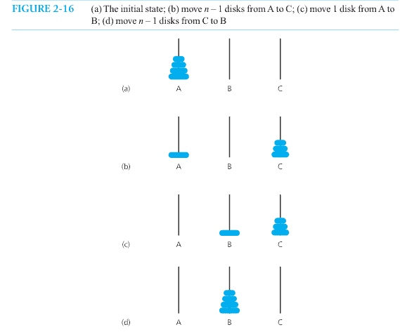

皇帝的谜题由 n 个盘子（他没有说具体有多少个）和三根杆子组成：A（源杆）、B（目标杆）和 C（备用杆）。盘子大小不同，中间有孔，以便可以套在杆子上。由于重量很大，盘子只能放在比自己大的盘子之上。最初，所有盘子都在杆 A 上，如图 2-16a 所示。谜题是将盘子一个接一个地从杆 A 移到杆 B。在转移过程中，也可以使用杆 C，但同样，盘子只能放在比自己大的盘子之上。

由于智者一职众所周知是个差事，所以有很多申请人。学者和农民都把他们的解决方案呈给了皇帝。许多解决方案长达数千步，许多包含深层嵌套的循环和控制结构。“我看不懂这些步骤，”皇帝吼道。“一定有解决这个谜题的简单方法。”

果然如此。一位伟大的佛教僧人从山里出来见皇帝。“我的孩子，”他说，“这个谜题太简单了，几乎能自行解决！”皇帝的安保主管想把这个奇怪的人赶出去，但皇帝让他继续说下去。

“如果你只有一个盘子（即 n = 1），将其从杆 A 移到杆 B。”到目前为止还好，但即使是村里的傻瓜也能做对这一部分。“如果你有多个盘子（即 n > 1），只需”

- 1. 忽略底部的盘子，为 n − 1 个盘子解决问题，稍作修改：杆 C 是目标杆，杆 B 是备用杆。（参见图 2-16b。）

- 2. 做完这些后，n − 1 个盘子将在杆 C 上，最大的盘子将留在杆 A 上。因此，通过将大盘子从 A 移到 B 来解决 n = 1 的问题（回想一下，即使是村里的傻瓜也能做到）。（参见图 2-16c。）

- 3. 现在你要做的就是将 n − 1 个盘子从杆 C 移到杆 B：也就是说，以杆 C 为源杆、杆 B 为目标杆、杆 A 为备用杆来解决问题。
  （参见图 2-16d。）

沉默了片刻，最后皇帝不耐烦地说：“好吧，你到底要不要告诉我们你的解决方案？”僧人只是报以了了然的微笑，然后消失了。

皇帝显然不是递归思维者，但你应该意识到僧人的解决方案是完全正确的。解决方案的关键在于这样一个观察：通过解决三个更小的（就盘子数量而言）汉诺塔问题，可以解决 n 个盘子的汉诺塔问题。令 towers(count, source, destination, spare) 表示将 count 个盘子从源杆 source 移动到目标杆 destination，使用 spare 作为备用杆的问题。请注意，即使源杆上有超过 count 个盘子，这个定义也是有意义的；在这种情况下，你只关心最上面的 count 个盘子，忽略其他的。同样，在开始之前，目标杆和备用杆上可能已经有盘子；你也忽略这些盘子，只是只能将较小的盘子放在它们之上。

你可以这样重述皇帝的问题：从杆 A 上有 n 个盘子、杆 B 和 C 上没有盘子的初始状态开始，求解 towers(n, A, B, C)。你可以这样陈述僧人的解决方案：

### 步骤 1. 从初始状态开始——所有盘子都在杆 A 上——求解问题

```
towers(n - 1, A, C, B)
```

也就是说，忽略底部（最大的）盘子，将顶部的 n − 1 个盘子从杆 A 移到杆 C，使用杆 B 作为备用。完成后，最大的盘子将留在杆 A 上，所有其他盘子将在杆 C 上。

### 步骤 2. 现在，最大的盘子在杆 A 上，所有其他盘子在杆 C 上，求解问题

```
towers(1, A, B, C)
```

也就是说，将最大的盘子从杆 A 移到杆 B。由于这个盘子比备用杆 C 上已有的盘子大，你实际上无法使用备用杆。不过，幸运的是——而且显而易见的是——在这个基本情况下你不需要使用备用杆。完成后，最大的盘子将在杆 B 上，所有其他盘子将留在杆 C 上。

### 步骤 3. 最后，最大的盘子在杆 B 上，所有其他盘子在杆 C 上，求解问题

```
towers(n - 1, C, B, A)
```

也就是说，将 n − 1 个盘子从杆 C 移到杆 B，使用 A 作为备用。请注意，目标杆 B 上已经有最大的盘子，你忽略它。完成后，你就解决了原始问题：所有盘子都将在杆 B 上。

问题 towers(count, source, destination, spare) 有以下伪代码解决方案：

```
solveTowers(count, source, destination, spare)
if (count == 1)
    Move a disk directly from source to destination
else
    solveTowers(count - 1, source, spare, destination)
    solveTowers(1, source, destination, spare)
    solveTowers(count - 1, spare, destination, source)
}
```

这个递归解决方案遵循与你在本章前面看到的递归解决方案相同的基本模式：

- 1. 你通过解决其他汉诺塔问题来解决一个汉诺塔问题。
- 2. 这些其他汉诺塔问题比原始问题更小；它们需要移动的盘子更少。特别是，在每次递归调用中，盘子数量减少 1。
- 3. 当问题只有一个盘子时——即基本情况——解决方案可以直接轻松求解。
- 4. 问题变小的方式确保你将达到基本情况。

汉诺塔问题的解决方案满足递归解决方案的四个标准

求解汉诺塔问题需要你递归地求解许多更小的汉诺塔问题。

图 2-17 说明了求解三个盘子问题时产生的递归调用及其顺序。

三个盘子的解决方案

现在考虑此算法的 C++ 实现。请注意，由于大多数计算机没有手臂（在撰写本文时），该函数通过向人类提供指令来移动盘子。因此，表示杆子的参数类型为 char，相应的参数可以是 'A'、'B' 和 'C'。调用 solveTowers(3, 'A', 'B', 'C') 会产生以下输出：

```
Move top disk from pole A to pole B
Move top disk from pole A to pole C
Move top disk from pole B to pole C
Move top disk from pole A to pole B
Move top disk from pole C to pole A
Move top disk from pole C to pole B
Move top disk from pole A to pole B
```

### 图 2-17 solveTowers(3, A, B, C) 产生的递归调用顺序

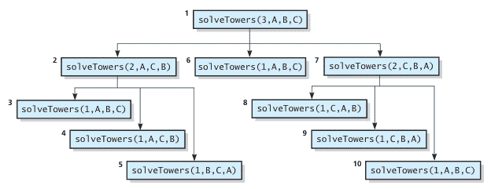


C++ 函数如下：

```
void solveTowers(int count, char source, char destination, char spare)
{
   if (count == 1)
   {
      cout << "Move top disk from pole " << source
           << " to pole " << destination << endl;
   }
   else
   {
      solveTowers(count - 1, source, spare, destination); // X
      solveTowers(1, source, destination, spare); // Y
      solveTowers(count - 1, spare, destination, source); // Z
   } // end if
} // end solveTowers
```

问题 8 跟踪函数 solveTowers 的执行过程，以求解两个盘子的汉诺塔问题。

## 2.6 更多示例

接下来的三个问题要求你统计某些事件、事件组合或事物的数量。它们是具有多个基本情况的递归解决方案的良好示例。然而，这些解决方案效率极低，因此不实用。不要让这种低效率让你气馁。递归可以很有用且高效，即使并非总是如此。你目前的目标是通过研究简单问题来理解递归。

### 2.6.1 斐波那契数列（繁殖的兔子）

兔子繁殖力非常强。如果兔子不死亡，它们的数量很快就会失控。假设我们采纳以下“事实”，这些事实来自对随机选取的兔子最近的一项调查：

- 兔子永不死亡。
- 兔子在出生后恰好两个月达到性成熟；也就是说，在其生命第三个月初。
- 兔子总是以一对一雄一雌的形式出生。每个月初，每对性成熟的雄雌兔会生下恰好一对一雄一雌的幼兔。

假设你最初只有一对新生的一雄一雌兔。第 6 月初会有多少对兔子（计算第 6 月初发生的出生）？由于 6 是一个相对较小的数字，你可以轻松得出答案：

- 第 1 月：1 对，即最初的兔子。
- 第 2 月：仍为 1 对，因为兔子尚未性成熟。
- 第 3 月：2 对；最初的兔子已达到性成熟并生下了第二对。
- 第 4 月：3 对；最初的兔子再次生育，但第 3 月初出生的那对尚未性成熟。
- 第 5 月：5 对；第 3 月存活的所有兔子（2 对）现在都已性成熟。将它们的后代与第 4 月存活的兔子（3 对）相加，得到 5 对。
- 第 6 月：8 对；来自第 4 月存活兔子的 3 对新生幼兔加上第 5 月存活的 5 对兔子。

现在你可以构建一个递归解法来计算 rabbit(n)，即第 n 月存活的兔子对数。你必须确定如何使用 rabbit(n - 1) 来计算 rabbit(n)。观察可知，rabbit(n) 等于第 n 月初之前存活的兔子对数与第 n 月初出生的兔子对数之和。在第 n 月初之前，有 rabbit(n - 1) 对兔子。并非所有这些兔子在第 n 月初都已性成熟。只有那些在第 n - 2 月存活的兔子在第 n 月初准备好繁殖。也就是说，第 n 月初出生的兔子对数为 rabbit(n - 2)。因此，你得到以下递推关系：

rabbit(n) = rabbit(n - 1) + rabbit(n - 2)

图 2-18 兔子问题的递归解法

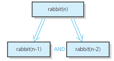

这个递推关系——与之前的一些示例一样——通过求解多个同类型的更小问题来解决问题。这并未增加太多概念难度，但在选择基本情况时必须非常小心。诱惑在于简单地说 rabbit(1) 应该是基本情况，因为根据问题描述，其值为 1。但 rabbit(2) 呢？将递归定义应用于 rabbit(2) 将得到

rabbit(2) = rabbit(1) + rabbit(0)

因此，递归定义需要指定第 0 月存活的兔子对数——这是一个未定义的量。

一种可能的解决方案是定义 rabbit(0) 为 0，但这种方法显得生硬。一个稍微更具吸引力的替代方案是将 rabbit(2) 本身视为值为 1 的特殊情况。因此，递归定义有两个基本情况，rabbit(2) 和 rabbit(1)。递归定义变为

rabbit(n) = { 1 if n is 1 or 2; rabbit(n - 1) + rabbit(n - 2) if n > 2 }

顺便提一下，rabbit(1)、rabbit(2)、rabbit(3) 等等这一系列数字被称为斐波那契数列，它模拟了许多自然界的现象。

根据前面的定义，编写一个计算 rabbit(n) 的 C++ 函数很容易：

```
/* Computes a term in the Fibonacci sequence.
   Pre: n is a positive integer.
   Post: None.
   param: The given integer.
   return: The nth Fibonacci number. */
int rabbit(int n)
{
    if (n == 2)
        return 1;
    else // n > 2, so n - 1 > 0 and n - 2 > 0
        return rabbit(n - 1) + rabbit(n - 2);
} // end rabbit
```

图 2-19 rabbit(7) 生成的递归调用

```
rabbit(7)
return rabbit(6) + rabbit(5)

├── rabbit(6)
│   return rabbit(5) + rabbit(4)
│   ├── rabbit(5)
│   │   return rabbit(4) + rabbit(3)
│   │   ├── rabbit(4)
│   │   │   return rabbit(3) + rabbit(2)
│   │   │   ├── rabbit(3)
│   │   │   │   return rabbit(2) + rabbit(1)
│   │   │   │   ├── rabbit(2)
│   │   │   │   │   return 1
│   │   │   │   └── rabbit(1)
│   │   │   │       return 1
│   │   │   └── rabbit(2)
│   │   │       return 1
│   │   └── rabbit(3)
│   │       return rabbit(2) + rabbit(1)
│   │       ├── rabbit(2)
│   │   │   return 1
│   │   └── rabbit(1)
│   │           return 1
│   └── rabbit(4)
│       return rabbit(3) + rabbit(2)
│       ├── rabbit(3)
│       │   return rabbit(2) + rabbit(1)
│       │   ├── rabbit(2)
│       │   │   return 1
│       │   └── rabbit(1)
│       │           return 1
│       └── rabbit(2)
│           return 1
└── rabbit(5)
    return rabbit(4) + rabbit(3)
    ├── rabbit(4)
    │   return rabbit(3) + rabbit(2)
    │   ├── rabbit(3)
    │   │   return rabbit(2) + rabbit(1)
    │   │   ├── rabbit(2)
    │   │   │   return 1
    │   │   └── rabbit(1)
    │   │           return 1
    │   └── rabbit(2)
    │       return 1
    └── rabbit(3)
        return rabbit(2) + rabbit(1)
        ├── rabbit(2)
        │   return 1
        └── rabbit(1)
            return 1
```

你实际上应该使用这个函数吗？图 2-19 说明了 rabbit(7) 生成的递归调用。想想 rabbit(10) 会生成多少次递归调用。最好情况下，函数 rabbit 也是低效的。因此，对于较大的 n 值，使用它是不可行的。本章末尾将更详细地讨论这个问题，届时你将看到一些从同一递推关系生成更高效解法的技术。

> 注：一个频繁重新计算某些值的递归解法可能效率非常低。在这种情况下，迭代可能优于递归。

### 2.6.2 组织游行

你被要求组织七月四日游行，游行将由排成一列的乐队和花车组成。去年，相邻的乐队试图互相比赛演奏。为了避免这个问题，赞助商要求永远不要将一个乐队紧挨着另一个乐队放置。你有多少种方式组织长度为 n 的游行？

假设你有至少 n 支行进乐队和 n 个花车可供选择。在计算组织游行的方式数量时，假设例如乐队-花车和花车-乐队是不同的游行，算作两种方式。

游行可以以花车或乐队结束。组织游行的方式数量仅仅是各类型游行数量之和。也就是说，设

- P(n) 为组织长度为 n 的游行的方式数
- F(n) 为长度为 n 且以花车结束的游行数量
- B(n) 为长度为 n 且以乐队结束的游行数量

那么

P(n) = F(n) + B(n)

首先，考虑 F(n)。你只需将一个花车放在任何可接受的长度为 n - 1 的游行末尾，就能得到一个以花车结束的长度为 n 的游行。因此，以花车结束的可接受长度为 n 的游行数量正好等于可接受长度为 n - 1 的游行总数；也就是说，

F(n) = P(n - 1)

以花车结束的可接受长度为 n 的游行数量

接下来，考虑 B(n)。游行以乐队结束的唯一方式是末尾前一个单位是花车。（如果是乐队，就会有两个相邻的乐队。）因此，组织一个以乐队结束的可接受长度为 n 的游行的唯一方法是先组织一个以花车结束的长度为 n - 1 的游行，然后在末尾添加一个乐队。因此，以乐队结束的可接受长度为 n 的游行数量正好等于以花车结束的可接受长度为 n - 1 的游行数量：

B(n) = F(n - 1)

以乐队结束的可接受长度为 n 的游行数量

你利用之前的事实 F(n) = P(n - 1) 得到

B(n) = P(n - 2)

因此，你分别用较小的问题 P(n - 1) 和 P(n - 2) 求解了 F(n) 和 B(n)。然后你使用

P(n) = F(n) + B(n)

得到

P(n) = P(n - 1) + P(n - 2)

可接受长度为 n 的游行数量

这个递推关系的形式与繁殖兔子问题的解法相同。


正如你在兔子问题中看到的，需要两个基例，因为递推关系用两个更小的问题来定义一个问题。就像你对兔子问题所做的那样，你可以为基例选择 n = 1 和 n = 2。虽然两个问题对其基例使用相同的 n 值，但没有理由期望它们对这些基例使用相同的值。也就是说，没有理由期望 rabbit(1) 等于 P(1) 且 rabbit(2) 等于 P(2)。

### 需要两个基例是因为存在两个更小的问题

稍加思考会发现，对于游行问题，

P(1) = 2（长度为 1 的游行有花车和乐队。）P(2) = 3（长度为 2 的游行有花车-花车、乐队-花车和花车-乐队。）

总之，该问题的解为

P(1) = 2 P(2) = 3 P(n) = P(n - 1) + P(n - 2) 对于 n > 2

### 递归解法

本示例展示了关于递归的以下要点：

- 有时你可以通过将问题分解为几种情况来解决问题——例如，以花车结尾的游行和以乐队结尾的游行。
- 你用于基例的值至关重要。尽管 P 和 rabbit 的递推关系相同，但它们的基例（当 n = 1 或 2 时）不同。这种差异导致当 n 大于 2 时 rabbit(n) 和 P(n) 不同。例如，rabbit(20) = 6,765，而 P(20) = 17,711。n 的值越大，差异越大。你应该思考为什么会这样。

### 2.6.3 从 n 个事物中选 k 个

一个摇滚乐队希望巡演 n 个城市。不幸的是，时间只允许访问 k 个城市。乐队的经纪人考虑从 n 个可能性中访问 k 个城市的不同选择。由于时间紧迫，乐队成员不关心访问相同 k 个城市的顺序。

设 g(n, k) 为从 n 个城市中选出 k 个城市的组数。如果我们考虑城市 C，要么访问 C，要么不访问。如果我们访问城市 C，则需要从剩余的 n - 1 个城市中选择 k - 1 个其他城市进行访问。因此，包含 C 的城市组数为 g(n - 1, k - 1)。另一方面，如果我们不访问城市 C，则需要从剩余的 n - 1 个城市中选择 k 个城市进行访问。不包含 C 的城市组数为 g(n - 1, k)。因此，我们可以通过求解两个同类型的更小计数问题来计算 g(n, k)；即，

g(n, k) = g(n - 1, k - 1) + g(n - 1, k)

从 n 个事物中选 k 个的方法数等于从 n - 1 个事物中选 k - 1 个的方法数与从 n - 1 个事物中选 k 个的方法数之和。

我们仍需找到基例，并证明两个更小的问题最终都会达到一个基例。首先，如果乐队有时间访问所有 n 个城市——也就是说，如果 k 等于 n——那么只有一组包含所有城市。因此，第一个基例是

g(k, k) = 1

如果 k < n，递归定义中的第二项 g(n - 1, k) 将达到这个基例，因为在递归的每个连续阶段，n - 1 都会减小直到达到 k。然而，第一项 g(n - 1, k - 1) 不会达到这个基例。由于 n - 1 和 k - 1 以相同的速率减小，它们永远不会相等。事实上，第一项趋近于另一个平凡的选择问题。正如只有一组包含所有城市（k = n）一样，也只有一组包含零个城市（k = 0）。因此，第二个基例是

g(n, 0) = 1 并且将由第一项 g(n - 1, k - 1) 达到。（或者，你可以将第二个基例定义为 g(n, 1) = n。）

注意：当你通过求解两个（或更多）更小的问题来解决问题时，每个更小的问题必须比原问题更接近基例。

为了完整性，我们在此递归解中添加最后一部分：

g(n, k) = 0 如果 k > n

尽管在本问题的上下文中 k 不可能大于 n，但添加这种情况使递归解更具普遍适用性。

总之，以下递归解解决了从 n 个事物中选 k 个的问题：

| 条件 | 值 |
| --- | --- |
| k = 0 | 1 |
| k = n | 1 |
| k > n | 0 |
| 0 < k < n | g(n - 1, k - 1) + g(n - 1, k) |

你可以轻松地从此递归定义推导出以下函数：

```cpp
/** Computes the number of groups of k of n things.
 * @pre n and k are nonnegative integers.
 * @post None.
 * @param n The given number of things.
 * @param k The given number to choose.
 * @return g(n, k). */
int getNumberOfGroups(int n, int k)
{
   if ( (k == 0) || (k == n) )
      return 1;
   else if (k > n)
      return 0;
   else
      return g(n - 1, k - 1) + g(n - 1, k);
} // end getNumberOfGroups
```

与兔子函数一样，这个函数效率低下且不实用。图 2-20 显示了计算 g(4, 2) 所需的递归调用次数。

注意：当递归函数包含多个递归调用时，你通常需要多个基例。

问题 9 计算 g(4, 2)。

从 n 个事物中递归选择的 k 个事物的组数

### 图 2-20 g(4, 2) 生成的递归调用

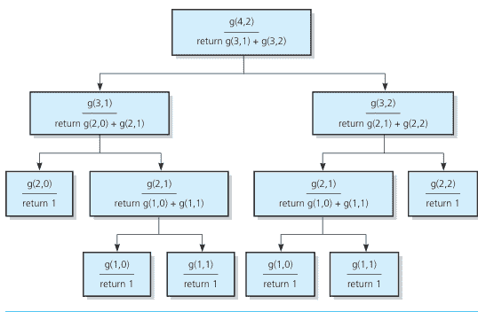

## 2.7 递归与效率

递归是一种强大的问题求解技术，它甚至可以为最复杂的问题产生非常简洁的解决方案。与迭代解法相比，递归解法通常更容易理解和描述。通过使用递归，你通常可以编写简单、简短的解决方案实现。

本章的首要关注点一直是让你对递归有扎实的理解，以便你能够独立构建递归解法。因此，我们的大多数示例都很简单。不幸的是，本章中的许多递归解法效率如此之低，以至于你不应该使用它们。递归函数 binarySearch 和 solveTowers 是显著的例外，因为它们非常高效。

导致某些递归解法效率低下的两个因素是：

- 函数调用相关的开销
- 某些递归算法固有的低效性

这些因素中的第一个并不特指递归函数，而是普遍适用于所有函数。在 C++ 和其他高级编程语言的大多数实现中，函数调用会产生一定量的簿记开销。如前所述，每个函数调用都会产生一个激活记录，它类似于框追踪中的一个框。递归函数会放大这种开销，因为对函数的单个初始调用可以生成大量递归调用。例如，调用 factorial(n) 会生成 n 个递归调用。另一方面，使用递归（与模块化一样）可以大大澄清复杂的程序。这种澄清通常足以弥补额外的开销。

> 导致某些递归解法效率低下的因素
> 递归可以澄清复杂的解决方案
> 如果递归解法效率低下且你有一个清晰、高效的迭代解法，则不应使用递归解法

然而，你不应该仅仅为了使用递归而使用递归。例如，你在实践中可能不应该使用递归 *阶乘* 函数。根据本章前面所述的迭代定义，你可以轻松编写一个迭代 *阶乘* 函数。迭代函数与递归函数几乎一样清晰，而且效率更高。当使用递归没有任何收益时，没有理由承担递归的开销。*当问题没有简单的迭代解法时，递归才真正有价值。*

关于递归与效率的第二点是，某些递归算法固有地低效。这种低效与开销的问题截然不同。它与编译器恰好如何实现递归函数无关，而是与算法所采用的技术有关。

例如，回顾本章前面你所见过的乘法兔子问题的递归解法：

> 递归版本的 rabbit 固有地低效

```
rabbit(n) = { 1 if n is 1 or 2; rabbit(n - 1) + rabbit(n - 2) if n > 2 }
```

图 2-19 中的图示说明了 *兔子*(7) 的计算过程。此前，你被要求思考 *兔子*(10) 的图示会是什么样子。如果你思考过这个问题，可能已经得出结论：这样的图示将占据本章的大部分篇幅。*兔子*(100) 的图示将占据整个宇宙的大部分！

*兔子* 的根本问题是它反复计算相同的值。例如，在 *兔子*(7) 的图示中，你可以看到 *兔子*(3) 被计算了五次。当 *n* 适度较大时，许多值被重新计算了数以万亿计的次数。这种巨大的计算量使解法不可行，即使每次计算只需要微不足道的工作量。

> 你可以使用 rabbit 的递推关系来构建一个高效的迭代解法

然而，不要得出递推关系毫无用处的结论。解决兔子问题的一种方法是基于相同的递推关系构建一个迭代解法。迭代解法是向前进行而不是向后，并且每个值只计算一次。你可以使用以下迭代函数来计算 *兔子*(*n*)，即使 *n* 的值非常大。

```cpp
/** Iterative solution to the rabbit problem. */
int iterativeRabbit(int n)
{
    // Initialize base cases:
    int previous = 1; // Initially rabbit(1)
    int current = 1; // Initially rabbit(2)
    int next = 1; // Result when n is 1 or 2

    // Compute next rabbit values when n > 3
    for (int i = 3; i <= n; i++)
    {
        // current is rabbit(i - 1), previous is rabbit(i - 2)
        next = current + previous; // rabbit(i)
        previous = current; // Get ready for next iteration
        current = next;
    } // end for

    return next;
} // end iterativeRabbit
```

> 如果发现递归解法更容易，但使用迭代解法更高效，则将递归转换为迭代

因此，迭代解法可能比递归解法更高效。然而，在某些情况下，发现递归解法可能比发现迭代解法更容易。因此，你可能需要将递归解法转换为迭代解法。如果你的递归函数只调用自身一次而不是多次，则此转换过程更容易。在决定你的函数是否调用自身多次时要小心。尽管递归函数 *兔子* 调用自身两次，但


函数 binarySearch 只调用自身一次，尽管你在 C++ 代码中看到了两次调用。这两次调用出现在一个 if 语句中；其中只有一次会被执行。

当孤立的递归调用是函数执行的最后一个动作时，将递归解转换为迭代解会更容易。这种情况称为 **尾递归**。例如，函数 writeBackward 表现出尾递归，因为其递归调用是函数执行的最后一个动作。在你得出这显而易见的结论之前，请考虑函数 fact。尽管其递归调用出现在函数定义的最后，fact 的最后一个动作是乘法。因此，fact 不是尾递归的。

回顾 writeBackward 的定义：

```cpp
void writeBackward(string s)
{
   int length = s.size();
   if (length > 0)
   {
      // Write last character
      cout << s.substr(length - 1, 1);
      writeBackward(s.substr(0, length - 1)); // Write rest
   } // end if
} // end writeBackward
```

由于此函数是尾递归的，其最后一次递归调用只是用改变后的参数重复函数的动作。你可以使用迭代来执行这个重复动作，这通常简单且更高效。例如，以下是 writeBackward 的迭代定义：

```cpp
/** Iterative version. */
void writeBackward(string s)
{
   int length = s.size();
   while (length > 0)
   {
      cout << s.substr(length - 1, 1);
      length--;
   } // end while
} // end writeBackward
```

由于尾递归函数通常比其迭代对应物效率低，并且将尾递归函数转换为等效的迭代函数相当机械，一些编译器会自动将尾递归替换为迭代。消除其他形式的递归通常更复杂，如果有必要，这是你需要承担的任务。

一些递归算法，例如 rabbit，本质上效率低下，而其他递归算法，例如 二分查找，效率极高。你将在更高级的算法分析课程中学习如何确定递归算法的相对效率。第 10 章简要介绍了其中一些技术。

第 5 章通过考察几个具有简单递归解的难题，继续讨论递归。本书的其他章节也习惯性地使用递归。

问题 10 在本章中你见过的以下递归函数中，找出表现出尾递归的函数：fact、writeBackward、writeBackward2、rabbit、游行问题中的 P、getNumberOfGroups、maxArray、binarySearch 和 kSmall。

## 摘要

- 1. 递归是一种通过解决同类型的更小问题来解决问题的技术。
- 2. 构建递归解时，请牢记以下四个问题：
  - a. 如何将问题定义为同类型的更小问题？
  - b. 每次递归调用如何减小问题的规模？
  - c. 问题的哪个实例可以作为基础情况？
  - d. 随着问题规模减小，你是否会达到这个基础情况？
- 3. 构建递归解时，如果满足前置条件，你可以假设递归调用的结果是正确的。
- 4. 你可以使用框跟踪来跟踪递归函数的动作。这些框类似于许多编译器用于实现递归的激活记录。尽管框跟踪很有用，但它不能取代对递归的直观理解。
- 5. 递归允许你解决一些问题——例如汉诺塔——其迭代解难以概念化。即使是最复杂的问题，通常也有简单的递归解。此类解比迭代解更容易理解、描述和实现。
- 6. 由于其本质上效率低下的算法和函数调用的开销，某些递归解比相应的迭代解效率低得多。在这种情况下，迭代解可能更可取。然而，你可以使用递归解来推导迭代解。
- 7. 如果你能使用迭代轻松、清晰且高效地解决问题，那么你应该这样做。

## 练习

- 1. 以下递归函数 getNumberEqual 在包含 n 个整数的数组 x 中查找整数 desiredValue 的出现次数。它返回 x 中等于 desiredValue 的整数个数。例如，如果 x 包含十个整数 1、2、4、5、6、7、8、9 和 12，则 getNumberEqual(x, 10, 4) 返回值 2，因为 4 在 x 中出现了两次。

  ```cpp
  int getNumberEqual(const int x[], int n, int desiredValue)
  {
      int count = 0;
      if (n <= 0)
          return 0;
      else
      {
          if (x[n - 1] == desiredValue)
              count = 1;
          return getNumberEqual(x, n - 1, desiredValue) + count;
      } // end else
  } // end getNumberEqual
  ```

  通过列出递归解的标准并说明该函数如何满足每个标准，来证明该函数是递归的。

- 2. 对本章中出现的以下递归函数调用执行框跟踪。清楚地指示每个后续递归调用。
  - a. rabbit(5)
  - b. countDown(5)（你在检查点问题 3 中编写了 countDown。）

- 3. 编写一个递归函数，计算至少包含 n 个整数的数组中前 n 个整数的和。提示：从第 n 个整数开始。

- 4. 给定两个整数 start 和 end，其中 end 大于 start，编写一个递归 C++ 函数，返回从 start 到 end（包含两端）的整数之和。

- 5. a. 修改在第 2.3.1 节中讨论的函数 writeBackward，使其基础情况为长度为 1 的字符串。
  - b. 编写一个 C++ 函数，实现第 2.3.1 节中给出的伪代码函数 writeBackward2。

- 6. 描述以下递归函数的问题：

  ```cpp
  void printNum(int n)
  {
      cout << n << endl;
      printNum(n - 1);
  } // end printNum
  ```

- 7. 给定整数 n > 0，编写一个递归 C++ 函数，输出整数 1、2、..., n。

- 8. 给定整数 n > 0，编写一个递归 C++ 函数，返回 1 到 n 的平方和。

- 9. 编写一个递归 C++ 函数，以逆序输出正十进制整数的各位数字。

- 10. a. 编写一个递归 C++ 函数 writeLine，重复写入一个字符以形成 n 个字符的一行。例如，writeLine('*', 5) 生成一行 *****。
  - b. 现在编写一个递归函数 writeBlock，使用 writeLine 写入 m 行，每行 n 个字符。例如，writeBlock('*', 5, 3) 生成以下输出

  ```
  *****
  *****
  *****
  *****
  ```

- 11. 以下程序产生什么输出？

  ```cpp
  int getValue(int a, int b, int n);
  int main()
  {
      cout << getValue(1, 7, 7) << endl;
      return 0;
  } // end main
  int getValue(int a, int b, int n)
  {
      int returnValue = 0;
      cout << "Enter: a = " << a << " b = " << b << endl;
      int c = (a + b)/2;
      if (c == a + b)
      returnValue = c;
      else
      returnValue = getValue(a, c-1, n);
      cout << "Leave: a = " << a << " b = " << b << endl;
      return returnValue;
  } // end getValue
  ```

- 12. 以下程序产生什么输出？

  ```cpp
  int search(int first, int last, int n);
  int mystery(int n);
  int main()
  {
      cout << mystery(30) << endl;
      return 0;
  } // end main

  int search(int first, int last, int n)
  {
      int returnValue = 0;
      cout << "Enter: first = " << first << " last = "
           << last << endl;
      int mid = (first + last)/2;
      if ( (mid * first == n) && (n < (mid+1) * (mid+1)) )
          returnValue = mid;
      else if (mid * mid > n)
          returnValue = search(first, mid-1, n);
      else
          returnValue = search(mid+1, last, n);
      cout << "Leave: first = " << first << " last = "
           << last << endl;
      return returnValue;
  } // end search

  int mystery(int n)
  {
      return search(1, n, n);
  } // end mystery
  ```

- 13. 考虑以下函数，它将正十进制数转换为八进制并显示结果。

  ```cpp
  void displayOctal(int n)
  {
      if (n > 0)
      {
          if (n / 8 > 0)
              displayOctal(n / 8);
          cout << n % 8;
      } // end if
  } // end displayOctal
  ```

  描述该算法的工作原理。使用 n = 100 跟踪该函数。

- 14. 考虑以下程序：

  ```cpp
  int f(int n);
  int main()
  {
      cout << "The value of f(8) is " << f(8) << endl;
      return 0;
  } // end main
  /* @pre n >= 0. */
  int f(int n)
  {
      cout << "Function entered with n = " << n << endl;
      switch (n)


```
{
 case 0: case 1: case 2:
     return n + 1;
 default:
     return f(n-2) * f(n-4);
 } // end switch
} // end f
```

显示程序的精确输出。如果有，你可以向函数 f 传递什么参数值来导致程序永远运行？

- 15. 考虑以下函数：

```cpp
void recurse(int x, int y)
{
    if (y > 0)
    {
        if (x > 0)
        {
            y--;
            y--;
            cout << x << " " << y << endl;
            recurse(x, y);
            cout << x << " " << y << endl;
        } // end if
    } // end if
} // end recurse
```

使用 x = 5 和 y = 3 执行该函数。如果 x 是引用参数而不是值参数，输出会受到什么影响？

- 16. 对递归函数 binarySearch（出现在第 2.4.2 节）进行框追踪，针对数组 1, 5, 9, 12, 15, 21, 29, 31，分别针对以下每个搜索值：

  - a. 5
  - b. 13
  - c. 16

- 17. 想象你有 101 只达尔马提亚犬；没有两只达尔马提亚犬有相同数量的斑点。假设你创建了一个包含 101 个整数的数组：第一个整数是第一只达尔马提亚犬的斑点数，第二个整数是第二只达尔马提亚犬的斑点数，依此类推。你的朋友想知道你是否有一只带有 99 个斑点的达尔马提亚犬。因此，你需要确定数组是否包含整数 99。

  - a. 如果你打算使用二分查找来查找 99，在搜索之前，你会对数组做什么（如果有的话）？
  - b. 二分查找将首先检查数组中哪个整数的索引？
  - c. 如果你所有的达尔马提亚犬都有超过 99 个斑点，二分查找将需要恰好多少次比较来确定 99 不在数组中？

- 18. 本问题考虑计算 x^n（其中 n >= 0）的几种方法。

  - a. 编写一个迭代函数 power1 来计算 n >= 0 时的 x^n。
  - b. 编写一个递归函数 power2 来计算 x^n，使用以下递推公式：

    x^0 = 1
    x^n = x * x^(n-1) 当 n > 0 时

  - c. 编写一个递归函数 power3 来计算 x^n，使用以下递推公式：

    x^0 = 1
    x^n = (x^(n/2))^2 当 n > 0 且 n 是偶数时
    x^n = x * (x^(n/2))^2 当 n > 0 且 n 是奇数时

  - d. 计算 3^30 时，函数 power1、power2 和 power3 各会执行多少次乘法？
  - e. 计算 3^30 时，power2 和 power3 各会进行多少次递归调用？

- 19. 修改递归 rabbit 函数，使其在视觉上易于跟踪执行流程。不要只添加 "Enter" 和 "Leave" 消息，而是根据当前递归调用的“深度”缩进跟踪消息。例如，调用 rabbit(4) 应产生以下输出

```
Enter rabbit: n = 4
    Enter rabbit: n = 3
        Enter rabbit: n = 2
        Leave rabbit: n = 2 value = 1
        Enter rabbit: n = 1
        Leave rabbit: n = 1 value = 1
    Leave rabbit: n = 3 value = 2
    Enter rabbit: n = 2
    Leave rabbit: n = 2 value = 1
Leave rabbit: n = 4 value = 3
```

注意此输出如何对应图 2-19。

- 20. 考虑以下递推关系：
  f(1) = 1; f(2) = 1; f(3) = 1; f(4) = 3; f(5) = 5;
  对于所有 n > 5，f(n) = f(n - 1) + 3 * f(n - 5)。

  - a. 计算以下 n 值的 f(n)：6、7、12、15。

  - b. 如果你很仔细，而不是从头开始计算 f(15)（就像递归 C++ 函数计算它的方式一样），你本可以先计算 f(6)，然后是 f(7)，接着是 f(8)，依此类推直到 f(15)，并在计算时记录这些值。这种顺序会让你免去重复计算同一值的麻烦。（回忆本章末尾讨论过的 rabbit 函数的迭代版本。）

    请注意，在计算过程中，你永远不需要记住所有先前计算过的值——只需记住最后五个值即可。利用这些观察结果，编写一个 C++ 函数来计算任意 n 值的 f(n)。

- 21. 编写以下递归函数的迭代版本：fact、writeBackward、binarySearch 和 kSmall。

- 22. 使用不变式证明第 2.7 节中出现的函数 iterativeRabbit 是正确的。（有关不变式的讨论，请参见附录 F。）

- 23. 考虑求两个正整数 a 和 b 的最大公约数（gcd）的问题。此处介绍的算法是欧几里得算法的一种变体，基于以下定理：

  定理。如果 a 和 b 是正整数，且 a > b，并且 b 不是 a 的约数，则 gcd(a, b) = gcd(b, a mod b)。

  gcd(a, b) 与 gcd(b, a mod b) 之间的这种关系是递归解法的核心。它指定了如何用同一类型的另一个问题来求解计算 gcd(a, b) 的问题。另外，如果 b 能整除 a，则 b = gcd(a, b)，因此基础情况的合适选择是 (a mod b) = 0。

此定理导出以下递推定义：

\( gcd(a, b) = \begin{cases} b & \text{如果 } (a \bmod b) = 0 \\ gcd(b, a \bmod b) & \text{否则} \end{cases} \)

以下函数实现了此递归算法：

```
int gcd(int a, int b)
{
   if (a % b == 0) // Base case
      return b;
   else
      return gcd(b, a % b);
} // end gcd
```

- a. 证明该定理。
- b. 如果 b > a 会发生什么？
- c. 问题如何变小？（也就是说，你是否总是趋向于基础情况？）为什么基础情况是合适的？

- 24. 设 c(n) 为从整数 1 到 n-1 中可以选择的不同整数组的数量，使得每组中的整数之和为 n（例如，n = 4 [ 1 + 1 + 1 + 1 ] = [ 1 + 1 + 2 ] = [ 2 + 2 ]）。在以下变体下，为 c(n) 编写递推定义：

  - a. 你计算排列。例如，1, 2, 1 和 1, 1, 2 是两个各自和为 4 的组。
  - b. 你忽略排列。

- 25. 考虑以下递推定义：

\( Acker(m, n) = \begin{cases} n + 1 & \text{如果 } m = 0 \\ Acker(m - 1, 1) & \text{如果 } n = 0 \\ Acker(m - 1, Acker(m, n - 1)) & \text{否则} \end{cases} \)

此函数称为 Ackermann 函数，因其随 m 和 n 的大小而快速增长而备受关注。Acker(1, 2) 是多少？用 C++ 实现该函数并对 Acker(1, 2) 进行框追踪。（注意：即使 m 和 n 的值适中，Ackermann 函数也需要许多递归调用。）

## 编程问题

- 1. 实现一个递归函数来计算 a^n，其中 a 是实数，n 是非负整数。
- 2. 将第 2.4.3 节讨论的算法 maxArray 实现为 C++ 函数。你还能描述哪些其他 maxArray 的递推定义？
- 3. 为字符串数组实现本章介绍的 binarySearch 算法。
- 4. 将第 2.4.4 节讨论的算法 kSmall 实现为 C++ 函数。使用数组的第一个值作为枢轴。

*此页故意留空*

# 第 3 章
基于数组的实现

### 目录
- 3.1 方法 96
- 3.1.1 核心方法 97
- 3.1.2 使用固定大小数组 98
- 3.2 ADT Bag 的基于数组的实现 98
- 3.2.1 头文件 99
- 3.2.2 定义核心方法 100
- 3.2.3 测试核心方法 103
- 3.2.4 实现更多方法 105
- 3.2.5 移除条目的方法 107
- 3.2.6 测试 110
- 3.3 在实现中使用递归 112
- 3.3.1 方法 getIndexOf 112
- 3.3.2 方法 getFrequencyOf 113
- 小结 114
- 练习 114
- 编程问题 115

### 先修知识
- 附录 A C++ 基础回顾
- 第 1 章 数据抽象：墙
- C++ 间奏 1 C++ 类
- 第 2 章 递归：镜像（仅用于第 3.3 节）

你已经看到，在设计解决方案期间，必须支持对数据的多种操作，因此需要定义抽象数据类型（ADT）。只有在明确指定 ADT 的操作后，才应考虑用于实现它的数据结构。本章探讨涉及将数组用作基础数据结构的实现问题。


## 3.1 方法

ADT 是数据的集合以及对该数据的一组操作。规范说明 ADT 操作的功能，但不说明如何实现它们。

我们已经说过，数据的集合及其上的一组操作称为抽象数据类型，或 ADT。例如，假设你想要存储一组可以快速搜索的名称。名称的集合，以及添加名称、删除名称和搜索名称的操作，可以形成一个解决此问题的 ADT。

此前，我们强调了抽象数据类型的规范。当你设计一个 ADT 时，你关注其操作的功能，但忽略如何实现它们。也就是说，ADT 操作的描述必须足够严谨，以完全指定其对数据的影响，但不得指定如何存储数据或如何执行操作。例如，ADT 的操作不应指定是将数据存储在连续内存位置还是不连续内存位置。结果应是一组明确指定的 ADT 操作。

一旦 ADT 的操作被明确指定，你如何实现它？也就是说，你如何存储 ADT 的数据并执行其操作？你首先选择特定的数据结构来存储数据。请回顾，数据结构是你可以在编程语言中定义的一种构造，用于存储一组数据。例如，C++ 数组是数据结构。

你对实现问题的第一反应可能是选择一个数据结构，然后编写符合 ADT 操作的函数来访问它。尽管这种观点并不错误，但希望你已经学会不要立即编写代码。一般来说，你应该通过逐层抽象来细化 ADT，从而得到越来越具体的 ADT 描述。

你在实现过程中做出的选择会影响代码的执行时间。目前，我们的分析将是直观的，但第 10 章将向你介绍定量技术，你可以使用这些技术来权衡涉及的权衡。

请回顾，客户端——即使用 ADT 的程序——应该只能看到作用于数据的一堵可用操作之墙，如第 1 章中的图 1-5 所示。你选择用于包含数据的数据结构以及 ADT 操作的实现都隐藏在这堵墙后面。到现在，你应该意识到这堵墙的优势，并采取措施防止客户端直接访问——无论是故意还是意外——数据结构，如图 3-1 所示。为什么这种访问是不希望的？公共数据字段允许客户端绕过抽象之墙并直接访问 ADT 的数据。例如，假设你使用数组 items 来存储 ADT 的数据。在使用 ADT 的程序中，你可能会，例如，意外地通过编写

```
firstItem = items[0];
```

来访问数组中的第一个元素，而不是调用 ADT 操作。如果你更改为 ADT 的另一种实现，你的程序将不正确。要更正你的程序，你需要找到并更改所有 items[0] 的出现——但首先你必须意识到 items[0] 是错误的！此外，通过违反这堵墙，客户端可能会损坏 ADT 的数据。例如，如果数据以某种方式排序，ADT 的操作将确保顺序得到维护。但如果客户端可以直接更改数据，该顺序可能会被破坏。

注意：将 ADT 实现为 C++ 类为你提供了一种强制执行 ADT 墙的方法，从而防止以使用 ADT 操作以外的任何方式访问数据结构。然后客户端无法损坏 ADT 的数据。此外，客户端独立于 ADT 实现的细节，因为它只遵守 ADT 的规范。

### 图 3-1 违反 ADT 操作之墙


### 3.1.1 核心方法

实现 ADT 的类的定义可能相当复杂。一般来说，你不应该先定义整个类然后再尝试测试它。相反，你应该识别一组核心方法，在继续其余类定义之前先实现和测试它们。通过将其他方法的定义留到以后，你可以集中注意力并简化任务。但是，哪些方法应该属于这一组？一般来说，此类方法应与类的目的核心相关，并允许合理的测试。我们有时会将一组核心方法称为核心组。

例如，在处理像袋子这样的容器时，在创建容器并将项目放入其中之前，你无法测试大多数方法。因此，将对象添加到容器是一项基本操作。如果 add 方法不能正确工作，测试其他方法（如 remove）就没有意义。因此，add 方法将是我们首先实现的核心方法组的一部分。

要测试 add 是否正确工作，我们需要一个允许我们查看容器数据的方法。对于 ADT 袋子，toVector 方法服务于此目的，因此它是核心方法。任何构造函数也是基本的，并且在核心组中。同样，核心方法可能调用的其他方法也是核心组的一部分。此类方法可能是 ADT 中的公共方法或私有“辅助”方法。

> 注意：像 add 和 remove 这样可以更改容器底层数据结构的方法，很可能具有最复杂的实现。一般来说，你应该在类中先定义此类方法，然后再定义其他方法。但是，由于在 add 正确之前无法测试 remove，你应该推迟其实现，直到 add 完成并彻底测试之后。

编程提示：定义类时，实现并测试一组核心方法。从添加对象到容器的方法和/或具有复杂实现的方法开始。

### 3.1.2 使用固定大小数组

当实现表示数据集合的 ADT 时，你需要存储数据项并跟踪其数量。在 **基于数组的实现** 中，你将项目存储在数组中。项目将占用数组的多少部分？可能全部，但这不太可能。也就是说，你需要跟踪已分配用于包含数据的数组元素和未来可用的元素。数组的最大长度——其物理大小——是一个已知的固定值，例如 MAX_SIZE。你可以在变量中跟踪集合中当前的项目数量——即集合的逻辑大小。这种方法的一个明显好处是，实现报告此值的操作将很容易。

当你将第一个条目添加到数组时，你通常将其放在数组的第一个元素中——即索引为 0 的元素。然而，这并不是要求，尤其是对于实现容器的数组。例如，某些容器实现可以通过忽略索引为 0 的数组元素并使用索引 1 作为数组中的第一个元素而受益。有时你可能想要在使用数组开头的元素之前先使用结尾的元素。对于 ADT 袋子，我们没有理由与众不同，因此袋子中的对象可以从数组的索引 0 开始。

另一个考虑是容器的条目是否应占用数组的连续元素。要求 add 方法将对象连续放入数组当然是合理的，但我们为什么要关心，这真的是一个问题吗？这是一个问题，因为我们需要为计划的实现建立某些真理，即 **断言**，以便每个方法的操作不会对其他方法造成不利影响。例如，toVector 方法必须 "知道" add 将条目放在了哪里。我们现在的决定也将影响以后从容器中删除条目时必须发生的事情。如果我们坚持袋子的条目占用连续的数组元素，remove 方法会确保它们保持连续吗？

add 将新条目放入最后一个可用数组元素后会发生什么？除非先从数组中删除一个条目，否则后续添加将不可能。遇到已满数组的 add 方法应该向其客户端发出信号或分配一个更大的数组。在本章中，add 将返回一个布尔值以指示是否成功。在本章之后的 C++ 间奏 2 中，你将学习如何调整数组大小。与返回值不同，方法可以通过抛出异常向其客户端发出信号。C++ 间奏 3 将讨论这种方法。


## 3.2 ADT 袋子的基于数组的实现

我们现在将通过使用数组存储其条目来实现 ADT 袋子作为一个类，使之前的讨论具体化。请回顾第 1 章，ADT 袋子的操作是

- +getCurrentSize(): 整数
- +isEmpty(): 布尔值
- +add(newEntry: ItemType): 布尔值
- +remove(anEntry: ItemType): 布尔值
- +clear(): 无
- +getFrequencyOf(anEntry: ItemType): 整数
- +contains(anEntry: ItemType): 布尔值
- +toVector(): 向量

这些操作将成为我们类中的公共方法。每个方法都需要访问袋子条目的数组和袋子中当前的条目数量。因此，我们将数组和一个计数器作为类的数据成员。由于数组的长度


数组定义了袋的容量——即其最大尺寸——我们将定义一个值为此大小的常量。为了向类的客户端隐藏这些数据成员，我们将它们设为私有。因此，我们在类的头文件中定义以下私有数据成员：

```
static const int DEFAULT_CAPACITY = 50;
ItemType items[DEFAULT_CAPACITY]; // Array of bag items
int itemCount; // Current count of bag items
int maxItems; // Max capacity of the bag
```

图 3-2 说明了这些数据成员，假设是一个整数袋。

### 图 3-2 基于数组的 ADT 袋实现


> **注意：数据成员应设为私有**
>
> 通过将类的数据成员设为私有，你可以控制客户端如何访问或更改它们的值。这样做也能更轻松地调试程序的逻辑。如果客户端能够直接操作这些数据（因为数据是公共的），你将不知道在哪里查找错误。

## 3.2.1 头文件

在选择数据成员，并了解我们在第 1 章中开发的 BagInterface 的详细信息后，我们可以编写袋类的头文件，如清单 3-1 所示。我们将类命名为 ArrayBag，并为其提供一个默认构造函数，这对于本示例已足够。请注意常量 DEFAULT_CAPACITY 被赋予了一个较小的值。它使我们能够轻松地完全填充一个袋，以验证我们的类在这种情况下能够优雅地表现。在你学习完 C++ 插曲 2 后，你将能够添加另一个构造函数，使客户端能够在程序执行期间设置袋的容量。我们预先包含了数据字段 maxItems，以期待这一增强。

还要注意，我们声明了一个私有方法 getIndexOf。该方法返回数组 items 中包含给定条目的元素的索引。如你稍后将看到，我们可以使用 getIndexOf 来使方法 contains 和 remove 更加时间高效。你很可能要在开始实现公共方法之后，才会决定将 getIndexOf 添加到头文件中。

```
/* Header file for an array-based implementation of the ADT bag.
@file ArrayBag.h */
#ifndef _ARRAY_BAG
#define _ARRAY_BAG
#include "BagInterface.h"
template<class ItemType>
class ArrayBag : public BagInterface<ItemType>
{
private:
    static const int DEFAULT_CAPACITY = 6; // Small size to test for a full bag
    ItemType items[DEFAULT_CAPACITY]; // Array of bag items
    int itemCount; // Current count of bag items
    int maxItems; // Max capacity of the bag
    // Returns either the index of the element in the array items that
    // contains the given target or -1, if the array does not contain
    // the target.
    int getIndexOf(const ItemType& target) const;

public:
    ArrayBag();
    int getCurrentSize() const;
    bool isEmpty() const;
    bool add(const ItemType& newEntry);
    bool remove(const ItemType& anEntry);
    void clear();
    bool contains(const ItemType& anEntry) const;
    int getFrequencyOf(const ItemType& anEntry) const;
    vector<ItemType> toVector() const;
}; // end ArrayBag

#include "ArrayBag.cpp"
#endif
```

> 编程提示：当方法不更改类的数据成员时，将其设为 const 方法，以防止实现错误。

## 3.2.2 定义核心方法

第 3.1.1 节建议我们将方法 add 和 toVector 视为核心方法并首先定义它们。由于我们希望检查 add 是否正确递增袋中条目的计数，我们还应实现 getCurrentSize 和 isEmpty。因此，我们将这两个方法添加到核心方法组中，并附上适当的构造函数。

在为类 ArrayBag 定义方法时，我们将它们放入文件 ArrayBag.cpp 中，该文件如下开始：

```
/** Implementation file for the class ArrayBag. * File ArrayBag.cpp */
```

```
#include "ArrayBag.h"
```

**构造函数。** 以下默认构造函数将袋中当前项目数初始化为零，同时也初始化袋的容量：

```
template<class ItemType>
ArrayBag<ItemType>::ArrayBag()
{
    itemCount = 0;
    maxItems = DEFAULT_CAPACITY;
} // end default constructor
```

虽然你可以简单地使用赋值语句为数据成员赋值，就像我们在这里所做的那样，但更可取的是使用初始化器。每个初始化器使用函数表示法，由数据成员名称后跟括号括起来的初始值组成——例如，itemCount(0)。如果你编写多个初始化器，请用逗号分隔它们。冒号位于第一个（或唯一）初始化器之前。因此，ArrayBag 默认构造函数的更好定义是

```
template<class ItemType>
ArrayBag<ItemType>::ArrayBag() : itemCount(0), maxItems(DEFAULT_CAPACITY)
{
} // end default constructor
```

通常，构造函数的实现仅由初始化器组成，因此其主体为空，如本例所示。请注意，你可以将这些初始化器与构造函数一起使用，但不能与其他方法一起使用。

> 编程提示：当类有多个数据成员时，构造函数按照它们在类定义中出现的顺序进行初始化，而不是按照它们在构造函数定义中出现的顺序。在两种情况下，你都应使用相同的顺序以避免混淆，即使初始化顺序并不重要。

**方法 add。** 要向未满的袋中添加新项目，我们可以通过编写以下语句将其放在数组中最后一个项目之后：

```
items[itemCount] = newEntry;
```

如果我们向空袋添加，itemCount 将为零，赋值将针对 items[0]。如果袋包含一个条目，额外条目将被赋给 items[1]，以此类推。这样，数组中不需要移动其他项目。每次向袋中添加后，我们都会增加计数器 itemCount。图 3-3 描绘了此插入。如果 add 成功，它返回 true。否则——例如，如果袋已满——add 返回 false，如其定义所示：

```
template<class ItemType>
bool ArrayBag<ItemType>::add(const ItemType& newEntry)
{
   bool hasRoomToAdd = (itemCount < maxItems);
   if (hasRoomToAdd)
   {
      items[itemCount] = newEntry;
      itemCount++;
   } // end if

   return hasRoomToAdd;
} // end add
```

> 注意：袋中的条目没有特定顺序。因此，方法 add 可以将新条目放入数组 items 的任何方便元素中。在 add 的先前定义中，该元素是紧随最后一个已用元素之后的元素。

### 图 3-3 将新条目插入基于数组的袋中


> **注意：** 基于数组的 ADT 实现限制了你可以存储的项目数量。因此，实现应在插入新项目之前检查数组是否有可用空间，如果插入不可能，客户端应采取适当措施。

> **编程提示：** 局限于方法实现的变量不应是类的数据成员。

**方法 toVector。** 我们初始核心方法组中的方法 toVector 获取袋中的条目，并以向量的形式将其返回给客户端。toVector 中的一个简单循环将袋的条目添加到此向量中。

```
template<class ItemType>
vector<ItemType> ArrayBag<ItemType>::toVector() const
{
   vector<ItemType> bagContents;
   for (int i = 0; i < itemCount; i++)
      bagContents.push_back(items[i]);
   return bagContents;
} // end toVector
```

> **注意：** 类 vector 位于标准模板库（STL）中，并在附录 A 中描述。

**方法 getCurrentSize 和 isEmpty。** 我们核心方法组中的最后两个方法具有以下简单定义：

```
template<class ItemType>
int ArrayBag<ItemType>::getCurrentSize() const
{
   return itemCount;
} // end getCurrentSize

template<class ItemType>
bool ArrayBag<ItemType>::isEmpty() const
{
   return itemCount == 0;
} // end isEmpty


问题 1 当方法 add 无法向数组中添加另一个条目，因为数组已满时，数组中的条目会发生什么？问题 2 如果 ArrayBag 的客户端创建一个包含五个条目的 vector，当该 vector 作为参数传递给方法 toVector 后，这些条目会发生什么？

### 3.2.3 测试核心方法

准备就绪。定义核心方法后，你应该对其进行测试。但是 BagInterface 中的其他方法呢？由于 ArrayBag——如清单 3-1 所示——遵循 BagInterface 中的规范，C++ 编译器将查找此接口中声明的每个方法的定义。我们应该等到完成它们的定义才开始测试吗？绝对不！边写边测试方法可以更容易地发现逻辑错误。但是，与其为 BagInterface 中的每个方法编写完整的实现，不如为我们选择暂时忽略的方法提供不完整的定义。

方法的不完整定义称为存根。存根只需让语法检查器满意即可。例如，对于每个返回值的方法，你可以通过添加返回虚拟值的 return 语句来避免语法错误。返回布尔值的方法应返回 false，例如。这个结果是合理的，因为该方法不执行其指定的行为。另一方面，void 方法可以只是一个空函数体。

例如，方法 remove 最终将返回 true 或 false，因此其存根必须包含一个 return 语句，并可能如下所示：

```cpp
template<class ItemType>
bool ArrayBag<ItemType>::remove(const ItemType& anEntry)
{
   return false; // STUB
} // end remove
```

void 方法 clear 的存根可以是

```cpp
template<class ItemType>
void ArrayBag<ItemType>::clear()
{
   // STUB
} // end clear
```

请注意，如果你打算在测试程序中调用存根，存根应通过显示消息来报告它已被调用。

> 编程提示：在完成抽象数据类型的实现之前，不要等待开始测试。通过编写存根（即所需方法的不完整定义），你可以在开发早期就开始测试。

测试程序。清单 3-2 包含一个程序，用于在开发的这个阶段测试类 ArrayBag 的核心方法 add、toVector、getCurrentSize 和 isEmpty。main 函数使用默认构造函数创建一个空袋，并将其传递给函数 bagTester。该函数调用另一个函数 displayBag，用于测试方法 toVector 和 getCurrentSize。

### 清单 3-2 测试类 ArrayBag 核心方法的程序

```cpp
#include <iostream>
#include <string>
#include "ArrayBag.h"

using namespace std;

void displayBag(ArrayBag<string>& bag)
{
   cout << "The bag contains " << bag.getCurrentSize()
        << " items." << endl;
   vector<string> bagItems = bag.toVector();
   int numberOfEntries = (int)bagItems.size();
   for (int i = 0; i < numberOfEntries; i++)
   {
      cout << bagItems[i] << " ";
   } // end for
   cout << endl << endl;
} // end displayBag

void bagTester(ArrayBag<string>& bag)
{
   cout << "isEmpty: returns " << bag.isEmpty()
        << "; should be 1 (true)" << endl;
   displayBag(bag);
   string items[] = {"one", "two", "three", "four", "five", "one"};
   cout << "Add 6 items to the bag: " << endl;
   for (int i = 0; i < 6; i++)
   {
      bag.add(items[i]);
   } // end for
   displayBag(bag);
   cout << "isEmpty: returns " << bag.isEmpty()
        << "; should be 0 (false)" << endl;
   cout << "getCurrentSize: returns " << bag.getCurrentSize()
        << "; should be 6" << endl;
   cout << "Try to add another entry: add(\"extra\") returns "
        << bag.add("extra") << endl;
} // end bagTester

int main()
{
   ArrayBag<string> bag;
   cout << "Testing the Array-Based Bag:" << endl;
   cout << "The initial bag is empty." << endl;
   bagTester(bag);
   cout << "All done!" << endl;
   return 0;
} // end main
```

输出
```
Testing the Array-Based Bag:
The initial bag is empty.
isEmpty: returns 1; should be 1 (true)
The bag contains 0 items:
Add 6 items to the bag:
The bag contains 6 items:
one two three four five one
isEmpty: returns 0; should be 0 (false)
getCurrentSize: returns 6; should be 6
Try to add another entry: add("extra") returns 0
All done!
```

> 注意：如果你为类定义了构造函数但没有定义默认构造函数，编译器不会为你生成一个。在这种情况下，诸如 ArrayBag<string> aBag; 之类的语句是非法的。

### 3.2.4 实现更多方法

既然我们可以成功地向袋中添加条目，就可以定义其他方法了。虽然我们不会在这里这样做，但你应该在完成每个新定义时对其进行测试。

> 编程提示：在定义每个方法时对其进行测试尤其重要，尤其是当其逻辑不明显时。但是，即使是最简单的方法也可能出现粗心的错误，这可能导致数小时令人沮丧的调试，以调试依赖于所谓正确方法的其他方法。

方法 getFrequencyOf()。要计算给定对象在袋中出现的次数，我们计算该对象在数组 items 中出现的次数。使用 while 循环遍历数组索引从 0 到 itemCount - 1，我们将给定条目与数组中的每个对象进行比较。每次找到匹配项时，我们递增一个计数器。当循环结束时，我们只需返回计数器的值。

方法定义如下：

```cpp
template<class ItemType>
int ArrayBag<ItemType>::getFrequencyOf(const ItemType& anEntry) const
{
 int frequency = 0;
 int curIndex = 0; // Current array index
 while (curIndex < itemCount)
 {
 if (items[curIndex] == anEntry)
 {
 frequency++;
 } // end if
 curIndex++; // Increment to next entry
 } // end while
 return frequency;
 } // end getFrequencyOf
```

方法 contains。定义方法 contains 的一种简单方法是让它调用我们刚刚定义的方法 getFrequencyOf。如果给定条目的出现频率大于零，则袋中必须包含该条目。如果频率为零，则袋中不包含该条目。因此，你可以按如下方式定义 contains：

```cpp
template<class ItemType>
bool ArrayBag<ItemType>::contains(const ItemType& target) const
{
 return getFrequencyOf(target) > 0;
} // end contains
```

虽然此方法可行，但它通常会做比必要更多的工作。毕竟，getFrequencyOf 必须检查袋中的每个条目，而 contains 可以在找到与给定条目相同的条目后立即停止查找条目。也就是说，其逻辑可以由以下伪代码描述：

```
contains(anEntry)
while (anEntry is not found and we have more array elements to check)
{
 if (anEntry equals the next array entry)
 anEntry is found in the array
}
```

该循环在以下两种条件之一下终止：要么 anEntry 在数组中已被找到，要么整个数组已被搜索但未找到。

基于此伪代码，方法 contains 的定义如下：

```cpp
template<class ItemType>
bool ArrayBag<ItemType>::contains(const ItemType& anEntry) const
{
 bool found = false;
 int curIndex = 0; // Current array index
 while (!found && (curIndex < itemCount))
 {
 if (anEntry == items[curIndex])
 {
 found = true;
 } // end if
 curIndex++; // Increment to next entry
 } // end while
 return found;
} // end contains
```

问题 3 从 contains 调用方法 getFrequencyOf 的优点和缺点分别是什么？

> **注意：测试其他方法**

在为类 ArrayBag 定义其他方法时，你应该对其进行测试。虽然你可以只关注这些其他方法，但你真的应该逐步构建测试程序。这样，你可以测试迄今为止定义的所有方法。通过为常量 DEFAULT_CAPACITY 使用较小的值，你可以轻松地测试当袋变满时会发生什么。

> **注意：两种循环**

要计算条目在数组中出现的次数，方法 getFrequencyOf 使用一个遍历数组所有条目的循环。事实上，循环体执行 itemCount 次。相比之下，要指示给定条目是否出现在数组中，方法 contains 中的循环会在发现所需条目时立即结束。该循环体执行一到 itemCount 次。你应该能够编写执行确定次数或可变次数的循环。

### 3.2.5 移除条目的方法

我们一直将方法 remove 的定义推迟到现在，因为它比其他方法需要更多的思考。然而，方法 clear 相对简单，尽管我们将其留到最后。


**方法 remove。** 我们现在想要从袋中移除一个给定条目——称其为 anEntry。如果该条目在袋中出现多次，我们将只移除其中一次。移除哪一次是未指定的。我们将简单地移除在搜索过程中遇到的 anEntry 的第一次出现。遵循 BagInterface 中的规范，我们将返回 true 或 false 以指示移除是否成功。

假设袋不为空，我们搜索数组 items，直到在数组中找到 anEntry 或记录其在数组中的位置。图 3-4 说明了成功搜索后的数组。

**图 3-4** 搜索字符串“Alice”成功后的数组 items


图 3-5 (a) 删除 items[index] 中的条目并递减 itemCount 后，数组项中的间隙；(b) 移动后续条目以避免间隙；(c) 移动后的数组


现在考虑如何从数组中移除已定位的项。你可以将其清空，但这种策略可能导致数组中出现间隙，如图 3-5a 所示。一个充满间隙的数组有三个重大问题：

- itemCount - 1 不再是数组中最后一项的索引。你需要另一个变量 lastPosition 来包含此索引。
- 因为项分布稀疏，方法 contains 可能不得不查看数组的每个元素，即使只有少数项存在。
- 当 items[maxItems - 1] 被占用时，即使存在的项少于 maxItems，袋子也可能看起来已满。

我们可以通过将每个后续条目复制到数组中的前一个元素来消除该间隙，从被移除项后面的条目开始，一直到最后一条目，如图 3-5b 所示。移动这些条目的结果如图 3-5c 所示。然而，这种耗时的方法并非必要。

请记住，我们不需要保持袋子条目的任何特定顺序。因此，在移除条目后，我们不移动条目，而是可以用数组中的最后一条目替换被移除的条目，如下所示。在 items[index] 中定位 anEntry 后，如图 3-6a 所示，我们将 items[itemCount - 1] 中的条目复制到 items[index]（图 3-6b）。然后通过递减 itemCount 来忽略 items[itemCount - 1] 中的条目。

以下伪代码详细说明了从袋子中移除给定条目所需的步骤。请注意，在将 itemCount 用作索引之前先递减它，我们只计算一次 itemCount - 1，而不是两次。

```
Search the array items for anEntry
if (anEntry is in the bag at items[index])
{
    Decrement the counter itemCount
    items[index] = items[itemCount]
    return true
}
else
return false
```

对 anEntry 的初始搜索与方法 contains 中执行的搜索相同。在这里调用 contains 没有多大帮助，因为我们不仅想知道袋子是否包含 anEntry，还想知道如果包含，它在数组中的位置。显然，我们可以稍微修改 contains 中的循环，但更好的方法是将循环放在一个私有方法中，该方法可以被 contains 和 remove 调用。这个方法是 getIndexOf，我们之前在头文件中声明过，其定义如下：

```
template<class ItemType>
int ArrayBag<ItemType>::getIndexOf(const ItemType& target) const
{
   bool found = false;
   int result = -1;
   int searchIndex = 0;
   // If the bag is empty, itemCount is zero, so loop is skipped
   while (!found && (searchIndex < itemCount))
   {
      if (items[searchIndex] == target)
      {
         found = true;
         result = searchIndex;
      }
      else
      {
         searchIndex++;
      }  // end if
   }  // end while
   return result;
}  // end getIndexOf
```

图 3-6 在移除条目时避免数组中的间隙


方法 remove 现在具有以下定义：

```
template<class ItemType>
bool ArrayBag<ItemType>::remove(const ItemType& anEntry)
{
   int locatedIndex = getIndexOf(anEntry);
   bool canRemoveItem = !isEmpty() && (locatedIndex > -1);
   if (canRemoveItem)
   {
      itemCount--;
      items[locatedIndex] = items[itemCount];
   } // end if
   return canRemoveItem;
} // end remove
```

> **编程提示：方法 getIndexOf 应该是公有的还是私有的？**
> 
> 你可能会认为，方法 getIndexOf 因为返回数组中条目的索引，对客户端可能有用。虽然这可能是事实，但有重要原因说明该方法应该是私有的。我们将数组 items 声明为私有，因为它是我们基于数组实现的细节。客户端不能在不调用我们类的公有方法的情况下访问此数组中的条目。这些条目的索引也是实现细节，对客户端没有用处，因为它无法按名称访问数组 items。任何返回私有数组索引的方法都应声明为私有。

- **问题 4** 修改方法 contains 的定义，使其调用方法 getIndexOf。
-
- **问题 5** 我们是否应该修改方法 contains 的规范，使得如果它在袋子中定位到给定条目，则返回该条目的索引？
-
- **问题 6** 修改方法 getIndexOf 的定义，使其不使用布尔变量。

方法 clear。方法 clear 可以通过将 itemCount 设置为零来使袋子看起来为空。因此，我们有此方法的以下定义：

```
template<class ItemType>
void ArrayBag<ItemType>::clear()
{
   itemCount = 0;
} // end clear
```

## 3.2.6 测试

要测试我们完成的类，可以将以下语句添加到清单 3-2 中出现的方法 bagTester：

```
cout << "contains(\"three\"): returns " << bag.contains("three")
     << "; should be 1 (true)" << endl;
cout << "contains(\"ten\"): returns " << bag.contains("ten")
     << "; should be 0 (false)" << endl;
cout << "getFrequencyOf(\"one\"): returns "
     << bag.getFrequencyOf("one") << " should be 2" << endl;
cout << "remove(\"one\"): returns " << bag.remove("one")
     << "; should be 1 (true)" << endl;
cout << "getFrequencyOf(\"one\"): returns "
     << bag.getFrequencyOf("one") << " should be 1" << endl;
cout << "remove(\"one\"): returns " << bag.remove("one")
     << "; should be 1 (true)" << endl;
cout << "remove(\"one\"): returns " << bag.remove("one")
     << "; should be 0 (false)" << endl;
displayBag(bag);
cout << "After clearing the bag, ";
bag.clear();
cout << "isEmpty: returns " << bag.isEmpty()
     << "; should be 1 (true)" << endl;
```

> 注意：诸如 bag.itemCount 和 bag.items[4] 这样的引用在客户端中是非法的，因为 itemCount 和 items 位于类的私有部分。

> 注意：要实现一个 ADT，给定 ADT 操作的与实现无关的规范，你首先必须选择一个数据结构来包含数据。接下来，在头文件中声明一个类。ADT 的操作是类中的公有方法，ADT 的数据由通常为私有的类成员组成。然后在实现文件中实现类的方法。使用该类的程序只能通过使用 ADT 的操作来访问数据。

> 注意：在实践中，在选择 ADT 的实现时，你必须询问基于数组的实现的固定大小限制在特定应用程序的上下文中是否会带来问题。这个问题的答案取决于两个因素。显而易见的因素是，对于给定的应用程序，你是否可以预先预测 ADT 在任一时刻的最大项数。如果不能，那么操作——因此整个程序——很可能会失败，因为特定应用程序上下文中的 ADT 所需的存储超过了数组所能提供的存储。
> 
> 另一方面，如果对于给定的应用程序，你可以预先预测 ADT 在任一时刻的最大项数，那么你必须探索一个更微妙的因素：通过声明足够大的数组来容纳这个最大项数，是否会浪费存储？考虑一种情况，即最大项数很大，但你怀疑这个数字很少会被达到。例如，假设一个袋子最多可以包含 10,000 个项，但袋子中实际项数很少超过 50。如果在编译时声明 10,000 个数组位置，那么大部分时间至少有 9,950 个数组位置会被浪费。
> 
> 我们可以通过在执行期间分配更大或更小的数组来避免上述两种情况。下一个 C++ 间歇将向你展示如何操作。


## 3.3 在实现中使用递归

上一章给出了几个关于如何使用递归处理数组的示例。如果你检查我们刚刚开发的 ArrayBag 的定义，你会看到两个可以用递归替换的循环。一个在公共方法 getFrequencyOf 中，另一个在私有方法 getIndexOf 中。让我们来看看细节。

### 3.3.1 方法 getIndexOf

我们从搜索数组中给定条目的私有方法开始。迭代定义按顺序依次检查数组中的每个条目，直到找到所需条目或未成功到达数组末尾。假设 searchIndex 是下一个要检查的数组元素的索引。我们有两个基本情况：

- 如果 items[searchIndex] 是我们要查找的条目，则完成。
- 如果 searchIndex 等于 itemCount，则完成，因为该条目不在数组中。

递归步骤是从 items[searchIndex + 1] 开始搜索数组的其余部分。为了实现此递归，getIndexOf 需要将 searchIndex 作为参数。由于该方法是私有的，我们无需为其定义另一个私有方法来调用。但是，我们必须按如下修改头文件中的其声明：

```cpp
int getIndexOf(const ItemType& target, int searchIndex) const;
```

然后我们可以为该方法编写以下递归定义：

```cpp
template<class ItemType>
int ArrayBag<ItemType>::getIndexOf(const ItemType& target, int searchIndex) const
{
   int result = -1;
   if (searchIndex < itemCount)
   {
      if (items[searchIndex] == target)
      {
         result = searchIndex;
      }
      else
      {
         result = getIndexOf(target, searchIndex + 1);
      }  // end if
   }  // end if

   return result;
}  // end getIndexOf
```

因为我们更改了该方法的头部，因此需要查找并更改 ArrayBag 其他方法中对 getIndexOf 的调用。因此，我们将在方法 remove 和 contains 中的调用从

```cpp
getIndexOf(anEntry);
```

到

```cpp
getIndexOf(anEntry, 0);
```

### 3.3.2 方法 getFrequencyOf

方法 getFrequencyOf 也会搜索数组，方式与 getIndexOf 类似，但与 getIndexOf 不同，getFrequencyOf 必须检查数组中的每个条目。也就是说，如果数组条目与我们要查找的条目匹配，搜索不会结束。

假设 searchIndex 是下一个要检查的数组元素的索引。此搜索的递归定义只有一个基本情况：如果 searchIndex 等于 itemCount，则完成。但是，我们有两个递归步骤：

- 如果 items[searchIndex] 是我们要查找的条目，则该条目的出现频率比其在数组其余部分中的出现频率多 1。
- 如果 items[searchIndex] 不是我们要查找的条目，则该条目的出现频率与其在数组其余部分中的出现频率相同。

正如我们必须为 getIndexOf 添加另一个参数一样，这里的递归方法也需要将 searchIndex 作为参数。但是，getFrequencyOf 是公共方法，因此我们无法更改其签名。相反，getFrequencyOf 必须调用一个完成递归任务的私有方法。因此，让我们在头文件的私有部分添加以下声明：

```cpp
int countFrequency(const ItemType& target, int searchIndex) const;
```

方法 getFrequencyOf 只是调用此私有方法，因此其定义如下：

```cpp
template<class ItemType>
int ArrayBag<ItemType>::getFrequencyOf(const ItemType& anEntry) const
{
   return countFrequency(anEntry, 0);
} // end getFrequencyOf
```

私有方法 countFrequency 的递归定义如下：

```cpp
template<class ItemType>
int ArrayBag<ItemType>::countFrequency(const ItemType& target,
                                       int searchIndex) const
{
   int frequency = 0;
   if (searchIndex < itemCount)
   {
      if (items[searchIndex] == target)
      {
         frequency = 1 + countFrequency(target, searchIndex + 1);
      }
      else
      {
         frequency = countFrequency(target, searchIndex + 1);
      } // end if
   } // end if
   return frequency;
} // end countFrequency
```

## 总结

- 1. 通过使用类来实现抽象数据类型（ADT），你可以封装 ADT 的数据和操作。这样一来，你就可以向使用 ADT 的程序隐藏实现细节。特别是，通过将类的数据成员设为私有，你可以更改类的实现而不影响客户端。
- 2. 给定一种以实现无关的方式指定 ADT 的接口，从该接口派生一个类并在头文件中声明该类。选择一种数据结构来包含 ADT 的数据。然后在实现文件中实现类的方法。
- 3. 你应该将类的数据成员设为私有，以便控制客户端如何访问或更改数据。
- 4. ADT 的基于数组的实现将 ADT 的数据存储在数组中。
- 5. 通常，你不应该先定义整个类然后再尝试测试它。相反，你应该先确定一组核心方法，在继续其余类定义之前同时实现和测试它们。
- 6. 存根是类方法的不完整定义。通过为某些方法使用存根，你可以在类完全定义之前开始测试。
- 7. 客户端必须使用 ADT 的操作来操作 ADT 的数据。

## 练习

- 1. 考虑一个整数袋。编写一个客户端函数，计算袋 aBag 中整数的和。
- 2. 编写一个客户端函数 replace，用另一个给定项替换给定袋中的给定项。该函数应返回一个布尔值，以指示替换是否成功。
- 3. 上一练习描述了函数 replace。此操作存在于 ADT 袋之外；也就是说，它不是 ADT 袋操作。相反，其实现是使用 ADT 袋的操作来编写的。
- a. 以这种方式实现 replace 的优点和缺点分别是什么？
- b. 将操作 replace 添加到 ADT 袋的优点和缺点分别是什么？
- 4. 设计并实现一个表示矩形的 ADT。包括典型操作，例如设置和获取矩形的尺寸，以及查找矩形的面积和周长。
- 5. 设计并实现一个表示三角形的 ADT。ADT 的数据应包括三角形的三条边，也可以包括三角形的三个角。这些数据应位于实现 ADT 的类的私有部分。

  至少包括两个初始化操作：一个为 ADT 的数据提供默认值，另一个将此数据设置为客户端提供的值。这些操作是类的构造函数。ADT 还应包括查看 ADT 数据值、更改 ADT 数据值、计算三角形面积以及确定三角形是直角三角形、等边三角形还是等腰三角形的操作。
- 6. 为类 ArrayBag 编写方法 toVector 的递归基于数组的实现。
- 7. 编写一个客户端函数，将两个袋合并为一个新的第三个袋。不要销毁原来的两个袋。
- 8. 为 ArrayBag 指定并定义一个从袋中删除随机条目的方法。
- 9. 向类 ArrayBag 添加一个构造函数，用于从给定的条目数组创建袋。

## 编程问题

- 1. 设计并实现一个表示一天中时间的 ADT。将时间表示为 24 小时制的小时和分钟。小时和分钟是实现 ADT 的类的私有数据成员。包括至少两个初始化操作：一个为时间提供默认值，另一个将时间设置为客户端提供的值。这些操作是类的构造函数。还应包括设置时间、将当前时间增加若干分钟，以及以 12 小时制和 24 小时制显示时间的操作。
- 2. 设计并实现一个表示日历日期的 ADT。你可以将日期的月、日和年表示为整数（例如，4/1/2014）。包括按一天推进日期的操作，以及使用数字或单词表示月份来显示日期的操作。作为增强，还包括星期几的名称。
- 3. 设计并实现一个表示美元和美分的美元价格的 ADT。完成实现后，编写一个客户端函数，计算为价格为 y 的商品支付 x 的客户应找回的零钱。
- 4. 设计并实现一个表示银行账户的 ADT。ADT 的数据应包括客户姓名、账户号码和账户余额。初始化操作应将数据设置为客户端提供的值。包括存款和取款、向余额添加利息以及显示账户统计信息的操作。
- 5. 向类 ArrayBag 添加并集、交集和差集方法。第 1 章的练习 6、7 和 8 描述了这些操作。
- 6. 使用数组实现你在第 1 章编程问题 5 中指定的 ADT 集合。
- 7. 使用数组实现你在第 1 章编程问题 6 中指定的 ADT 堆栈。
- 8. 使用数组实现第 1 章练习 9 中描述的 ADT 多项式。


- 9. 实现第 1 章第 1.4.1 节中描述的 ADT 预约簿。编写一个程序来演示你的新类。

- 10. 为分数指定并实现一个 ADT。提供加、减、乘、除这些数的操作。所有算术运算的结果都应为最简形式，因此请包含一个私有方法 reduceToLowestTerms。第 2 章的练习 23 将帮助你了解此方法的详细信息。为简化分数符号的确定，你可以假设分数的分母为正数。

- 11. 为带分数指定并实现一个 ADT，每个带分数包含一个整数部分和一个最简形式的分数部分。假设前一题中描述的 ADT 分数已存在。提供加、减、乘、除带分数的操作。所有算术运算的结果的分数部分都应为最简形式。还应包含一个将分数转换为带分数的操作。

- 12. 按照第 1 章第 1.4.2 节的描述实现 ADT 食谱簿。在此过程中，实现 ADT 度量。根据需要添加操作。例如，你应该向食谱簿添加一个缩放食谱的操作。

- 13. 你可以使用集合或袋来创建拼写检查器。集合或袋充当词典，包含一组拼写正确的单词。要查看一个单词是否拼写正确，请查看它是否包含在词典中。使用此方案为外部文件中的单词创建拼写检查器。为简化任务，请将词典限制在可管理的大小。

- 14. 重复上一项目以创建拼写检查器，但这次将要检查拼写的单词放入一个袋中。词典（包含拼写正确单词的集合或袋）与要检查的单词袋之间的差异是一个拼写错误单词的袋。

## 指针、多态和内存分配

## C++ 间奏曲 2

### 目录

- C2.1 变量的内存分配与方法的早期绑定 118
- C2.2 待解决的问题 118
- C2.3 指针与程序的自由存储区 120
- C2.3.1 释放内存 122
- C2.3.2 避免内存泄漏 123
- C2.3.3 避免悬空指针 127
- C2.4 虚方法与多态 128
- C2.5 数组的动态分配 130
- C2.5.1 可调整大小的基于数组的袋 131

### 先决条件

- 第 3 章 基于数组的实现

本 C++ 间奏曲讨论变量和数组的内存分配，并向你介绍指针，以完成在第一个 C++ 间奏曲中开始的关于多态的讨论。指针是程序员的强大工具，但你必须小心正确使用它们。本间奏曲解释了指针的必要性，并展示何时以及如何安全地使用它们。指针的某些方面未在本间奏曲中涵盖，但这些功能要么在本教材中不必要，要么会引入不安全的做法。

我们将介绍在执行期间而非编译期间进行内存分配，并展示指针如何参与此过程。我们还将讨论如果数组已满，如何在执行期间创建一个新的更大的数组。你将在本间奏曲末尾看到此过程的示例。

在我们在此处以及全书的讨论中，都将强调安全可靠的编程实践。为开始讨论，让我们考虑如何为局部变量和参数分配内存。

### C2.1 变量的内存分配与方法的早期绑定

当你声明一个普通变量 x 具有数据类型 int 时，C++ 编译器会分配一个可容纳整数的内存单元。你使用标识符 x 来引用此单元。要将值 5 放入该单元，你可以编写

```
int x = 5;
```

要显示单元中的值，你可以编写

```
cout << "The value of x is " << x << endl;
```

如第 2 章所讨论，函数的局部声明变量（如 x）与其参数和一些簿记数据一起放入激活记录中。这些激活记录存储在应用程序内存中称为运行时堆栈的区域。每次调用函数时，都会在运行时堆栈上自动创建一个激活记录。当函数结束时，激活记录被销毁，释放用于局部变量和参数的内存。此时，函数的局部变量及其值对你的程序不再可访问。你的程序随后返回到调用函数的位置，并执行函数调用后的语句。方法的行为也相同。

当你创建一个对象时，该对象的数据成员的存储也会放入当前执行的函数或方法的激活记录中。下面的语句

```
PlainBox<string> myPlainBox;
MagicBox<string> myMagicBox = MagicBox<string>();
```

展示了两种不同的调用默认构造函数的方式，分别用于创建 PlainBox 和 MagicBox 的实例。当这些对象被实例化时，它们的数据字段会像基本数据类型一样放在运行时堆栈上。回顾 C++ 间奏曲 1，这些数据字段的名称是 item 和 firstItemStored。

编译器还知道，如果你通过编写下面的代码在这些对象上调用 setItem 方法

```
myPlainBox.setItem("Fun Item");
myMagicBox.setItem("Secret Item");
```

则应为 myPlainBox 调用 PlainBox 版本的 setItem 方法，并为 myMagicBox 调用 MagicBox 版本的 setItem 方法。这种选择是早期绑定的一个示例，是在编译期间做出的，在执行期间无法更改。

自动内存管理和早期绑定不足的两种情况

大多数时候，这种自动内存管理和早期绑定就是你程序所需的全部。但是，当它们不足时，可能会出现两种情况：

- 你想利用多态。

- 你必须访问创建对象之外的函数或方法中的对象。

### C2.2 待解决的问题

假设你的朋友对你在 C++ 间奏曲 1 中讨论的三个盒子方面的工作印象深刻，因此请你继续帮助开发视频游戏。她希望你编写一个函数，该函数接受两个参数：三种盒子类型中的任意一个对象和一个 string 类型的项目。该函数应通过调用盒子的 setItem 方法将项目放入盒子中。

### 图 C2-1 一组类的 UML 类图


由于 ToyBox 和 MagicBox 派生自 PlainBox，如图 C2-1 所示，你可能会认为以下函数定义就足够了：

```
void placeInBox(PlainBox<string>& theBox, string theItem)
{
   theBox.setItem(theItem);
} // end placeInBox
```

参数 theBox 可以接受任何 PlainBox 对象或派生自 PlainBox 的类的对象作为参数。然后可以在以下语句序列中使用此函数：

```
string specialItem = "Riches beyond compare!";
string otherItem = "Hammer";

PlainBox<string> myPlainBox;
placeInBox(myPlainBox, specialItem);

MagicBox<string> myMagicBox;
placeInBox(myMagicBox, otherItem);
placeInBox(myMagicBox, specialItem); // specialItem is stored!
cout << myMagicBox.getItem() << endl; // "Riches beyond compare!"
```

早期绑定示例

虽然这段代码可以编译，但它的运行结果不符合你的预期。由于 otherItem 已经存储在魔法盒中，specialItem 不应该替换该项目。不幸的是，当显示存储在魔法盒中的项目时，输出是 Riches beyond compare。原因是，在我们的函数中，语句

```
theBox.setItem(theItem);
```

调用的是 PlainBox 版本的 setItem 方法，而不是 MagicBox 版本。在这种情况下，编译器根据参数 theBox 的类型而不是其对应参数的类型来确定要调用的方法版本。以下语句组会产生类似的结果：

```
string specialItem = "Riches beyond compare!";
string otherItem = "Hammer";
```

早期绑定的另一个示例


PlainBox<string> mySpecialBox = MagicBox<string>();
mySpecialBox.setItem(otherItem);
mySpecialBox.setItem(specialItem); // specialItem is stored!
cout << mySpecialBox.getItem() << endl; // "Riches beyond compare!"

在两种情况下，将被调用的 setItem 版本在程序编译时确定。在第二种情况中，即使我们为 mySpecialBox 实例化了一个 MagicBox 对象，变量 mySpecialBox 的类型是 PlainBox，因此会调用 PlainBox 版本的 setItem。相同的决策逻辑也适用于我们的函数 placeInBox。

从编译器的角度来看，这段代码是正确的。编译器假设我们的意图是让参数 theBox 和变量 mySpecialBox 作为 PlainBox 对象行为。我们需要一种方式向编译器传达，要执行的代码不应在程序运行前确定。这称为**后期绑定**，是多态的一个方面。为了解决这个问题，并使我们的函数和简单代码示例按我们的意图执行，我们需要两种工具：指针变量和虚方法。

视频笔记 C++ 内存分配 The new operator allocates memory on the free store

## C2.3 指针与程序的自由存储区

为了利用后期绑定，我们不希望对象位于运行时栈上的激活记录中。我们需要另一个位置。当 C++ 程序开始执行时，除了运行时栈之外，操作系统会为代码（称为**代码存储区**或**文本栈**）以及任何全局变量和静态变量（称为**静态存储区**）预留内存。你的程序还会获得额外内存，称为**堆**或**自由存储区**，程序员可以使用它来存储数据。图 C2-2 说明了这些内存部分。

我们通过使用**new 运算符**在自由存储区上为变量分配内存。为变量分配内存后，new 运算符返回变量在自由存储区中的内存地址，以便程序可以使用它。这个内存地址必须放在一种称为**指针变量**（或简称**指针**）的特殊变量类型中。指针变量包含内存单元的位置，即内存地址。

### 图 C2-2 示例程序内存布局


### 图 C2-3 myBoxPtr 指向 MagicBox 对象且其数据成员 item 被设置后的运行时栈和自由存储区


与运行时栈上的变量不同，后者的内存会自动分配和释放，放置在自由存储区上的变量在创建它们的函数或方法结束后仍会持续存在于内存中。这意味着，当程序员从自由存储区为变量分配内存时，程序员有责任在不再需要该变量时释放该内存。未这样做通常会导致内存泄漏。内存泄漏是指已分配用于使用但不再需要且无法访问或释放的内存。

> 如果你在自由存储区上分配内存，最终必须释放它

要指示变量是指针，我们在指针引用的数据类型后放置字符 *。例如，语句

```
MagicBox<string>* myBoxPtr = new MagicBox<string>();
```

> 在数据类型后写星号以指示指针类型

在自由存储区中创建一个 MagicBox 对象，并将对象的地址放在局部变量 myBoxPtr 中。我们说 myBoxPtr 指向一个 MagicBox 对象。要调用位于自由存储区中的对象的方法，我们使用 -> 表示法：

```
string someItem = "Something Free";
myBoxPtr->setItem(someItem);
```

图 C2-3 显示了上述语句执行后内存和局部变量的状态。

请注意，这个新创建的对象没有程序员定义的名称。访问其方法的唯一方式是间接地通过 new 创建的指针，即使用 myBoxPtr->，如上一示例所示。通常我们会简化图表，只绘制自由存储区中的对象及其指针，如图 C2-4 所示。

1 有些程序员将 * 放在变量名旁边。本教材的作者认为将 * 放在数据类型旁边更清楚地表明该变量是指针类型。

### 图 C2-4 myBoxPtr 及其指向的对象


指针变量只是另一种变量类型，遵循与其他变量类型相同的规则。例如，如果你声明一个指向 ToyBox<string> 对象的指针变量，则它只能指向 ToyBox<string> 对象，而不能指向 MagicBox<string> 对象或 ToyBox<double> 对象，如以下语句所示：

```
ToyBox<string>* toyPtr = new ToyBox <string>(); // Ok
ToyBox<string>* boxPtr = new MagicBox<string>(); // Error!
ToyBox<string>* somePtr = new ToyBox <double>(); // Error!
```

如果你有两个可以指向同一类型对象的指针变量，可以使用赋值运算符 = 使它们指向同一个对象。例如，语句

```
somePtr = toyPtr;
```

使变量 somePtr 指向 toyPtr 指向的同一个 ToyBox 对象。在这种情况下，将赋值运算符视为将右侧指针变量中存储的值复制到左侧指针变量中是有帮助的。由于指针存储对象的地址，被复制的值是自由存储区中对象的位置。对象本身不会被复制。结果是两个指针变量都指向同一个对象，如图 C2-5 所示。

如果你声明了一个指针变量但没有立即为其创建引用对象，则应将指针设置为 nullptr。像以下这样的赋值是必要的，因为 C++ 不会为你初始化指针：

```
ToyBox<int>* myToyPtr = nullptr;
```

### 图 C2-5 指向同一对象的两个指针变量


### C2.3.1 释放内存

当指针变量指向的内存不再需要时，你使用 delete 运算符释放它。然后应将指针变量设置为 nullptr，以表明它不再引用或指向对象：

```
delete somePtr;
somePtr = nullptr;
```

如果在本示例中没有将 somePtr 设置为 nullptr，则 somePtr 将是一个**悬空指针**的示例，因为它仍然包含已释放对象的地址。悬空指针可能是严重错误的根源。

如果使用 new 运算符分配内存，则必须使用 delete 运算符释放它

请始终记住，如果类的某个方法使用 new 创建对象，则类的某个方法最终必须使用 delete 来释放对象的内存。安全可靠编程的一个特征是：任何从自由存储区分配内存的对象也承担在不再需要该内存时释放它的责任。

指针为程序员提供了大量控制内存使用方式和绑定发生时间的能力，我们将在稍后讨论。如果使用不当，它们也可能造成严重问题和难以查找的错误。涉及指针的两种最常见错误是内存泄漏和悬空指针，如本节所示。让我们看看这些问题如何在程序中发生，以便你可以在代码中预防它们。

### C2.3.2 避免内存泄漏

当对象在自由存储区中创建，但程序不再有访问它的方式时，就会发生内存泄漏。由于对象无法访问，因此无法删除，它会占用内存，尽管无法使用。如果程序有多个内存泄漏，它会迅速耗尽内存并崩溃。即使是一个被多次调用的单个语句也可能导致内存泄漏。

考虑以下语句：

```
MagicBox<string>* myBoxPtr = new MagicBox<string>();
MagicBox<string>* yourBoxPtr = new MagicBox<string>();
yourBoxPtr = myBoxPtr; // Results in inaccessible object
```

图 C2-6 跟踪了这些语句的执行。最终，yourBoxPtr 指向与 myBoxPtr 相同的对象，因此 yourBoxPtr 最初指向的对象不再可访问，导致图中 c 部分所示的内存泄漏。

为了防止此泄漏，我们不应创建第二个对象。相反，应将 yourBoxPtr 初始化为 nullptr，或简单地将其设置为 myBoxPtr：

```
MagicBox<string>* myBoxPtr = new MagicBox<string>();
MagicBox<string>* yourBoxPtr = myBoxPtr;
```

更微妙的内存泄漏发生在函数或方法在自由存储区中创建对象并丢失其指针时，无论是未将该指针返回给调用者，还是未将其存储在类数据成员中。Listing C2-1 中的函数就是这种情况。

```
LISTING C2-1 Poorly written function that allocates memory in the free store

void myLeakyFunction(const double& someItem)
{
    ToyBox<double>* someBoxPtr = new ToyBox<double>();
    someBoxPtr->setItem(someItem);
} // end myLeakyFunction
```

参数 someItem 和指针 someBoxPtr 都存储在运行时栈上的激活记录中，因此在函数结束后会自动销毁。由 new ToyBox<double>(RED) 在自由存储区中创建的对象仍位于自由存储区中。由于我们唯一持有的对其引用是 someBoxPtr，而该指针已被销毁，我们不再有办法访问该对象，因此发生了内存泄漏。


## 图 C2-6 (a) 创建第一个对象；(b) 创建第二个对象；(c) 赋值导致不可访问的对象


我们有几种方法来修复这个函数。第一种是在函数终止前删除对象。我们可以通过添加以下行来实现：

```
delete someBoxPtr;
someBoxPtr = nullptr;
```

在函数末尾。如果由 someBoxPtr 指向的 ToyBox 对象仅由该函数需要，那么更好的实现选择是不从自由存储区分配内存，而是使用局部变量，如以下语句所示：

```
ToyBox<double> someBox(); // someBox is not a pointer variable
someBox.setItem(someItem);
```

如果在此函数中创建的对象需要在函数外部使用，则该函数可以返回指向它的指针，以便调用者可以访问该对象。要实现此选项，我们将函数的返回类型从 void 更改为 ToyBox<double>* 并返回 someBoxPtr，它是指向 ToyBox<double> 对象的指针。结果函数定义如下：

```
ToyBox<double>* pluggedLeakyFunction(const double& someItem)
{
    ToyBox<double>* someBoxPtr = new ToyBox<double>();
    someBoxPtr->setItem(someItem);
    return someBoxPtr;
} // end pluggedLeakyFunction
```

您可以通过编写诸如下面的语句来调用此函数：

```
double boxValue = 4.321;
ToyBox* toyPtr = pluggedLeakyFunction(boxValue);
```

现在 toyPtr 指向由 pluggedLeakyFunction 中的 ToyBox 构造函数创建的对象。当函数返回指向其在自由存储区中创建的对象的指针时，使用该指针的程序段必须承担删除该对象的责任。否则，仍可能发生内存泄漏。在记录此类函数时，您应该添加注释以指明此责任。例如，您可以在 pluggedLeakyFunction 的定义前加上以下注释：

```
/* Creates an object in the free store and returns a pointer
 * to it. Caller must delete the object when it is no longer
 * needed. */
```

当然，此注释并不能防止内存泄漏，但它会提醒您的函数用户注意潜在的泄漏风险。该函数仍可能被误用，并通过诸如下面的语句来调用：

```
pluggedLeakyFunction(boxValue); // Misused; returned pointer is lost
```

在这种情况下，指向自由存储区中对象的返回指针丢失，并发生内存泄漏。

防止内存泄漏的最佳方法是不使用返回指向新创建对象的指针的函数。相反，您应该定义一个具有用于此任务的方法的类。该类负责删除自由存储区中的对象，并确保没有内存泄漏。至少，此类类将包含三部分：在自由存储区中创建对象的方法、指向对象的数据字段以及析构函数（即在类实例不再需要时删除对象的方法）。虽然 C++ Interlude 1 介绍了类析构函数，但我们现在必须更多地讨论它们。

> 要防止内存泄漏，请勿使用函数来返回指向新创建对象的指针

每个 C++ 类都有一个析构函数，其名称与类相同，但前面带有波浪号 (~) 字符。对于局部变量对象，当包含该对象的激活记录从运行时堆栈中移除时，会调用析构函数。如果对象是使用 new 创建并存储在自由存储区中，则当客户端使用 delete 运算符释放分配给对象的内存时，会调用析构函数。

通常，编译器生成的析构函数对于类来说就足够了，但如果类本身使用 new 运算符在自由存储区上创建对象，那么实现析构函数以确保释放该对象的内存是一种安全可靠的编程实践。

清单 C2-2 提供了 GoodMemory 类的头文件，演示了如何避免内存泄漏。我们之前函数 pluggedLeakyFunction 中的指针变量现在是 GoodMemory 中的数据字段。只要该字段指向自由存储区中的现有对象，我们就可以访问该对象。

```
LISTING C2-2 Header file for the class GoodMemory
/** @file GoodMemory.h */
#include <string>
#include "ToyBox.h"
using namespace std;
class GoodMemory
{
private:
    ToyBox<string>* someBoxPtr;
public:
    GoodMemory(); // Default constructor
    ~GoodMemory(); // Destructor
    void fixedLeak(const double& someItem);
}; // end GoodMemory
```

因为类 GoodMemory 有一个用作数据字段的指针变量，我们应该定义一个默认构造函数来将指针初始化为 nullptr。此类的析构函数只需删除指针所指向的对象。清单 C2-3 显示了此类的实现文件。

```
LISTING C2-3 Implementation file for the class GoodMemory
/* @file GoodMemory.cpp */
#include "GoodMemory.h"
GoodMemory::GoodMemory() : someBoxPtr(nullptr)
{ // end default constructor
GoodMemory::~GoodMemory()
{ delete someBoxPtr;
} // end destructor
void GoodMemory::fixedLeak(const double& someItem)
{ someBoxPtr = new ToyBox<double>();
someBoxPtr->setItem(someItem);
} // end fixedLeak
```

与原始函数 myLeakyFunction（如清单 C2-1 所示）不同，以下客户端函数使用 GoodMemory 类来保证不会发生内存泄漏：

```
void goodFunction()
{ double boxValue = 4.321; // Original statement
GoodMemory gmObject; // Create a safe memory object
gmObject.fixedLeak(boxValue); // Perform the task
} // end goodFunction
```

编译器在此方面为我们提供了很大帮助。首先，编译器可以检查以确保在调用 fixedLeak 方法之前已创建 GoodMemory 对象。这保证了安全的内存分配和释放。然后，由于变量 gmObject 是局部变量，编译器会在 goodFunction 函数执行结束时自动调用 GoodMemory 析构函数。因此，在自由存储区中分配的内存被释放。

## C2.3.3 避免悬空指针

如前所述，悬空指针是不再引用有效对象的指针变量。四种情况可能导致悬空指针，但我们将只介绍其中三种，因为我们认为第四种是不安全的做法。

可能导致悬空指针的情况

- 如第 C2.3.1 节所述，如果在使用 delete 后不将指针变量设置为 nullptr，则会使指针悬空。

- 同样，如果声明指针变量但不为其赋值，结果就是悬空指针。与任何 C++ 变量一样，当 C++ 创建指针变量时，其值是未定义的。也就是说，C++ 不会自动初始化或清除变量所代表的内存。编译器和程序员无法检查指针变量中的值是否实际指向自由存储区中的对象。该值可能只是创建指针对象时内存中原本的内容。例如，假设您编写了诸如下面的语句：

```
MagicBox<int>* myMagicBoxPtr;
myMagicBoxPtr->getItem();
```

在这里，指针变量 myMagicBoxPtr 未被分配指向的对象。当调用 getItem 方法时，程序将中止——通常会出现段错误——因为程序将 myMagicBoxPtr 中的值视为 MagicBox<int> 对象的地址，并尝试在该地址处查找 getItem 方法。由于 MagicBox<int> 对象不太可能碰巧在那里，程序将异常结束。

如果您需要创建指针变量但没有可供其指向的对象，则应始终将其设置为 nullptr：

```
MagicBox<int>* myMagicBoxPtr = nullptr;
```

然后，您的代码可以将指针变量与 nullptr 进行比较，以查看它是否指向自由存储区中的有效对象，如以下示例所示：

```
if (myMagicBoxPtr != nullptr)
    myMagicBoxPtr->getItem();
```

如果指针不是 nullptr，则可以使用指针来调用方法。

- 第三种可能导致悬空指针的情况比较微妙，防范它的最佳方法是仔细编程。考虑我们在讨论内存泄漏时之前见过的以下语句：

```
MagicBox<string>* myBoxPtr = new MagicBox<string>();
MagicBox<string>* yourBoxPtr = myBoxPtr;
```

执行此代码会导致图 C2-7 所示的内存配置，其中 yourBoxPtr 和 myBoxPtr 都指向同一个对象。我们说 yourBoxPtr 是 myBoxPtr 的别名，因为它们都引用同一个对象。到目前为止，此代码没有任何问题，也没有任何内存泄漏。

假设我们随后执行以下语句：

```
delete myBoxPtr;
myBoxPtr = nullptr;
yourBoxPtr->getItem();
```

2 本教材不将 & 用作“取地址”运算符。因此，指针变量只能赋值给自由存储区中的变量，所以函数不能返回指向已不存在的局部变量的指针。


## 图 C2-7 两个指针引用（指向）同一个对象


这里我们尝试通过在删除 myBoxPtr 指向的对象后将其设置为 nullptr 来实践安全可靠的编程。但是调用 yourBoxPtr->getItem() 会导致程序中止。发生了什么？图 C2-8 显示了此调用之前的内存状态。如您所见，myBoxPtr 指向的对象已被删除，正如它应该做的那样。问题出在 yourBoxPtr 仍然引用自由存储中对象的位置，尽管该对象不再存在。由于该对象不再存在，yourBoxPtr 是一个悬空指针，当我们尝试在该对象上调用方法时，程序会中止。

## 图 C2-8 悬空指针示例


## 编程提示：如何避免悬空指针

- 将指针变量初始设置为 nullptr，或在不再需要它们时设置为 nullptr。如果类有一个指针变量作为数据字段，构造函数应始终初始化该数据字段，使其指向一个对象或 nullptr。清单 C2-3 中的类 GoodMemory 演示了这一保障措施。
- 在使用指针变量调用方法之前，测试它是否包含 nullptr。
- 尽量减少程序中别名的使用。如您将看到，在某些情况下，这并不总是可能或可取的。
- 在确定没有其他别名需要使用它之前，不要删除自由存储中的对象。
- 删除对象时，将引用该已删除对象的所有别名设置为 nullptr。

## C2.4 虚方法和多态

现在我们已经掌握了指针的一些基础知识，可以深入多态的实现。为了允许编译器执行多态所需的后期绑定，必须将基类中的方法声明为虚方法。在 C++ 间奏 1 中，我们开始讨论虚方法——即使用关键字 virtual 表示它们可以被重写的方法。在第 C2.2 节的示例中，PlainBox 是基类，我们在 C++ 间奏 1 的清单 C1-3 中定义了它。当时编写的代码没有按我们期望的方式运行。为纠正该问题，我们必须将 PlainBox 中希望其他类重写的方法声明为虚方法，如清单 C2-4 所示。请注意，只需修订基类（PlainBox）的头文件。将方法 setItem 和 getItem 声明为虚方法，使得方法代码可以进行后期绑定。

```
LISTING C2-4 Revised header file for the class PlainBox
/** @file PlainBox.h */
#ifndef _PLAIN_BOX
#define _PLAIN_BOX
template<class ItemType> // Indicates this is a template
// Declaration for the class PlainBox
class PlainBox
{
private:
// Data field
ItemType item;
public:
// Default constructor
PlainBox();
// Parameterized constructor
PlainBox(const ItemType& theItem);
// Mutator method that can change the value of the data field
virtual void setItem(const ItemType& theItem);
// Accessor method to get the value of the data field
virtual ItemType getItem() const;
}; // End PlainBox
#include "PlainBox.cpp" // Include the implementation file
#endif
```

为了完全实现后期绑定，我们必须在自由存储中创建变量，并使用指针引用它们。因此，我们还必须将第 C2.2 节中第一个早期绑定示例的代码更改为

```cpp
string specialItem = "Riches beyond compare!";
string otherItem = "Hammer";

PlainBox<string>* myPlainBoxPtr = new PlainBox<string>();
placeInBox(myPlainBoxPtr, specialItem);

MagicBox<string>* myMagicBoxPtr = new MagicBox<string>();
placeInBox(myMagicBoxPtr, otherItem);

cout << myMagicBoxPtr->getItem() << endl;
```

后期绑定示例

接下来，我们必须修改函数 placeInBox 以接受指向 PlainBox<string> 对象的指针：

```cpp
void placeInBox(PlainBox<string>* theBox, string theItem)
{
 theBox->setItem(theItem);
} // end placeInBox
```

最后的更改是通过向程序添加以下语句来释放自由存储中变量所使用的内存：

```cpp
delete myPlainBoxPtr;
myPlainBoxPtr = nullptr;
delete myMagicBoxPtr;
myMagicBoxPtr = nullptr;
```

我们的函数 placeInBox 现在将根据其第一个参数所指向的盒子类型调用正确版本的 setItem。

使用虚方法对类的未来使用有重大影响。假设您在编写派生类 MagicBox 之前已经编译了类 PlainBox 及其实现。如果您随后编写 MagicBox，假设可以访问已编译的类 PlainBox，您可以重写 getItem，因为它在 PlainBox 中是虚方法。结果，您将更改 MagicBox 实例的 getItem 行为，尽管 PlainBox 已经编译。也就是说，定义虚方法的类是可扩展的。您可以在不访问祖先源语句的情况下，为派生类添加功能。

## 注：关于虚方法的要点

- 虚方法是派生类可以重写的方法。
- 必须实现类的虚方法。（纯虚方法不包括在此要求中。）
- 派生类不必重写继承的虚方法的现有实现。
- 类的任何方法都可以是虚方法。但是，如果您不希望派生类重写特定方法，则该方法不应是虚方法。
- 构造函数不能是虚函数。
- 析构函数可以且应该是虚函数。虚析构函数确保对象的未来后代可以正确地自行释放内存。
- 虚方法的返回类型不能被重写。

## C2.5 数组的动态分配

在 C++ 中声明数组时，使用诸如下面的语句

```cpp
const int MAX_SIZE = 50;
double myArray[MAX_SIZE];
```

普通 C++ 数组是静态分配的

编译器为数组预留特定数量（在此例中为 MAX_SIZE）的内存单元。此内存分配在程序执行之前发生，因此无法等到执行时才为 MAX_SIZE 赋值。我们已经讨论了当程序有超过 MAX_SIZE 个项要放入数组时，这种固定大小的数据结构所造成的问题。

您刚刚学习了如何使用 new 运算符动态分配内存——即在程序执行期间。尽管第 C2.3 节向您展示了如何为单个变量或对象分配内存，但您实际上可以一次为许多变量分配内存。如果您编写

使用 new 运算符动态分配数组

```cpp
int arraySize = 50;
double* anArray = new double[arraySize];
```

指针变量 anArray 将指向包含 50 个项的数组中的第一个项。与 MAX_SIZE 不同，arraySize 可以在程序执行期间更改。您可以在执行时为 arraySize 赋值，从而确定数组的大小。这很好，但您如何使用这个数组？

无论您如何分配数组——像第一个示例那样静态分配，或像第二个示例那样动态分配——都可以使用索引和熟悉的数组表示法来访问其元素。例如，anArray[0] 和 anArray[1] 是数组 anArray 中的前两个项。

当您动态分配数组时，在不再需要它们时，需要将其内存单元返回给系统。如前所述，您使用 delete 运算符执行此任务。要释放数组 anArray，您编写

```cpp
delete[] anArray;
```

delete 将动态分配的数组返回给系统以供重用

请注意，在对数组应用 delete 时，需要包含方括号。

现在假设您的程序使用了数组 anArray 的所有内容，尽管其大小是在执行期间选择的。您可以分配一个新的更大的数组，将旧数组复制到新数组中，最后释放旧数组。每次数组填满时将其大小加倍是一种合理的方法。以下语句将 anArray 的大小加倍：

```cpp
double* oldArray = anArray; // Copy pointer to array
anArray = new double[2 * arraySize]; // Double array size
for (int index = 0; index < arraySize; index++) // Copy old array
    anArray[index] = oldArray[index];
delete[] oldArray; // Deallocate old array
```

您可以增加动态分配数组的大小

本书后续讨论将同时涉及静态分配和动态分配的数组。我们的基于数组的 ADT 实现将出于简单性考虑使用静态分配的数组。编程问题将要求您创建使用动态分配数组的基于数组的实现。我们将此类数组称为可调整大小的数组。

### 2.5.1 基于可调整大小数组的袋子

我们可以使用可调整大小的数组来实现 ADT 袋子，使袋子永远不会填满——当然，这是在特定计算机的范围内。如果我们查看第 3 章清单 3-1 中给出的类 ArrayBag 的头文件，以及各种方法的实现，我们会发现只需更改 add 方法。当数组——因此也是袋子——填满时，add 可以加倍数组的容量，而不是无法添加项并返回 false。修订后的方法如下。由于袋子永远不会填满，此版本的 add 方法始终可以返回 true。

```cpp
template<class ItemType>
bool ArrayBag<ItemType>::add(const ItemType& newEntry)
{
   bool hasRoomToAdd = (itemCount < maxItems);
   if (hasRoomToAdd)
   {
      ItemType* oldArray = items;
```


items = new ItemType[2 * maxItems];
for (int index = 0; index < maxItems; index++)
    items[index] = oldArray[index];
delete [] oldArray;
maxItems = 2 * maxItems;
} // end if
// We can always add the item
items[maxCount] = newEntry;
itemCount++;
return true;
} // end ResizableArrayBag add

每次在袋已满时将数组项加倍，起初看起来可能没有那么有吸引力。每次扩展数组大小时，都必须复制其内容。当数组是一个小的 50 元素数组时，在完成添加之前，你会将 50 元素数组复制到 100 元素数组。接下来的 49 次添加可以在不复制数组的情况下快速完成。

如果你有一个已满的 50,000 元素数组，必须在复制当前数组中的 50,000 个条目之前，为 100,000 个条目分配内存。这样做花费的时间要长得多，且需要大量得多的内存。你可能只需要存储 50,001 个条目，却会有 49,999 个未使用的数组元素浪费内存。一旦意识到你的数组太大，可以通过分配一个较小的数组并将条目复制到这个新数组来减小其大小。然而，无法预测是否应该这样做。应用程序将来可能需要这些额外的数组元素。

在第 4 章中，我们将考虑另一种 ADT 袋的实现，它没有这个内存分配问题，也永远不会填满。

## 基于链接的实现

### 目录

- 4.1 预备知识 134
- 4.1.1 Node 类 136
- 4.2 ADT 袋的基于链接的实现 137
- 4.2.1 头文件 138
- 4.2.2 定义核心方法 139
- 4.2.3 实现更多方法 143
- 4.3 在基于链接的实现中使用递归 148
- 4.3.1 LinkedBag 中方法的递归定义 148
- 4.4 测试多个 ADT 实现 150
- 4.5 比较基于数组和基于链接的实现 153
- 小结 154
- 习题 155
- 编程问题 156

## 先修知识

- 第 1 章 数据抽象：围墙
- C++ 插曲 1 C++ 类
- 第 2 章 递归：镜子（用于第 4.3 节）
- 第 3 章 基于数组的实现（附带依赖）
- C++ 插曲 2 C++ 指针、多态和内存分配

本章将向你介绍一种使用 C++ 指针的基于链接的数据结构，该指针在 C++ 插曲 2 中有所描述。你将学习如何处理此类结构，以及如何使用其中一种结构来实现一个袋类。本章的内容对于后续章节中的大部分讲解至关重要。

### 4.1 预备知识


让我们考虑一下可以相互链接的组件。每个组件——通常称为节点——既包含一个数据项，也包含指向下一项的*指针*。因为每个节点都必须包含两个信息——数据项和指向下一个节点的指针——所以自然得出结论：每个节点都应该是一个对象。对象的一个成员是数据项，另一个是指针。通常，此类指针是 C++ 指针变量。


图 4-1 展示了一个单个节点，图 4-2 展示了几个链接在一起的节点。在这里，每个节点的数据部分包含一个字符串。我们使用箭头来表示指针，但在节点内部应该使用哪种类型的指针，它又将指向什么呢？你可能会猜测指针应该指向一个字符串，但实际上它必须指向包含该字符串的节点。因为指针可以指向除文件以外的任何数据类型——而且由于节点是对象——指针实际上可以指向节点。因此，例如，类型为 Node 的节点将有一个成员是指向另一个类型为 Node 的节点的指针。例如，语句

定义指向节点的指针
Node<string> * nodePtr;
定义了一个指针变量 nodePtr，它可以指向包含字符串作为其数据项的类型为 Node 的节点。节点应动态分配。例如，
动态分配节点
nodePtr = new Node<string>();
分配一个 nodePtr 指向的节点。要访问节点的成员，你需要使用 C++ 插曲 2 中介绍的 -> 表示法，因为节点没有用户定义的名称。假设我们的节点类具有一个访问器方法 getItem，它返回数据成员 item 的值。要引用 nodePtr 指向的节点中的 item，你需要编写 nodePtr->getItem()。同样，如果我们的节点类具有访问数据成员 next 的方法 getNext，则表达式 nodePtr->getNext() 表示指针 next。例如，如果 nodePtr 指向图 4-2 中的第二个节点，


1 另一种表示法 (*nodePtr).getItem() 是可能的，但本书不会使用它。虽然这种表示法类似于使用点运算符来引用命名结构的成员，但 -> 运算符更能暗示指针。

nodePtr->getItem() 返回字符串 "cd"，而 nodePtr->getNext() 返回指向第三个节点的指针。我们可以通过编写以下内容将此新指针保存在 nodePtr 本身中：

```
nodePtr = nodePtr->getNext();
```

如果我们再次执行上述语句，nodePtr 将指向图 4-2 中的第四个节点。再次执行该语句会使 nodePtr 指向图 4-2 中显示的最后一个节点。这个最后一个节点中成员 next 的值是什么？也就是说，nodePtr->getNext() 返回什么值？我们希望这个值是一个信号，表明我们已到达链接节点的最后一个。如果这个值是 nullptr，我们就可以轻松检测到何时到达了链接节点的末尾。

我们还需要考虑一个细节。到目前为止，没有任何东西指向第一个节点。如果你无法到达第一个节点，就无法到达第二个节点；如果你无法到达第二个节点，就无法到达第三个节点；以此类推。解决方案是拥有一个额外的指针，其唯一目的是指向几个链接节点中的第一个。这样的指针称为 **头指针** 或简单地称为数据结构的头。

头指针指向第一个节点

图 4-3 说明了带有头指针的节点 **链式结构**。请注意，头指针 headPtr 与图中的其他指针不同，因为它不在任何一个节点内。变量 headPtr 只是使你能够访问链的开头。如果没有节点可供它指向，headPtr 应包含什么值？在这种情况下，将 headPtr 赋值为 nullptr 是一个合乎逻辑的选择。

如果 headPtr 是 nullptr，它不指向任何东西

图 4-3 指向多个链接节点中第一个节点的头指针


注意：虽然图 4-3 中显示的所有指针都指向节点，但头指针是一个简单的指针变量，而 next 成员位于节点内。

编程提示：在为 headPtr 赋值之前，必须先创建一个新 Node 对象，这是一个常见的错误想法。这种误解源于这样的信念：如果 headPtr 不指向节点，变量 headPtr 就不存在。这完全不正确；headPtr 是一个等待赋值的指针变量。因此，例如，你可以在不先使用 new 的情况下将 nullptr 赋值给 headPtr。事实上，序列

```
headPtr = new Node; // An incorrect use of new
headPtr = nullptr;
```

如图 4-4 所示，这会销毁指向新创建节点的唯一指针——headPtr——的内容。因此，你不必要地创建了一个新节点，然后使其无法访问。此操作会在你的程序中创建一个 **内存泄漏**，应予以避免！

图 4-4 丢失的节点

### 4.1.1 Node 类

在继续之前，让我们来看看 Node 类的 C++ 代码。清单 4-1 给出了该类的头文件。除了我们之前介绍的数据成员 item 和 next 之外，该类声明了三个构造函数、两个访问器方法（分别用于 item 和 next）以及两个修改器方法（同样分别用于 item 和 next）。请注意，在该类中，指向节点的指针的数据类型为 Node<ItemType>*。

```
/** @file Node.h */
#ifndef _NODE
#define _NODE

template<class ItemType>
class Node
{
private:
   ItemType item; // A data item
   Node<ItemType>* next; // Pointer to next node
public:
   Node();
   Node(const ItemType& anItem);
   Node(const ItemType& anItem, Node<ItemType>* nextNodePtr);
   void setItem(const ItemType& anItem);
   void setNext(Node<ItemType>* nextNodePtr);
   ItemType getItem() const;
   Node<ItemType>* getNext() const;
}; // end Node
#include "Node.cpp"
#endif
```

清单 4-2 显示了 Node 的实现文件。

```
/** @file Node.cpp */
#include "Node.h"
#include <cstddef>


```cpp
template<class ItemType>
Node<ItemType>::Node() : next(nullptr)
{
  // end default constructor
}

template<class ItemType>
Node<ItemType>::Node(const ItemType& anItem) : item(anItem), next(nullptr)
{
  // end constructor
}

template<class ItemType>
Node<ItemType>::Node(const ItemType& anItem, Node<ItemType>* nextNodePtr) :
  item(anItem), next(nextNodePtr)
{
  // end constructor
}

template<class ItemType>
void Node<ItemType>::setItem(const ItemType& anItem)
{
  item = anItem;
}  // end setItem

template<class ItemType>
void Node<ItemType>::setNext(Node<ItemType>* nextNodePtr)
{
  next = nextNodePtr;
}  // end setNext

template<class ItemType>
ItemType Node<ItemType>::getItem() const
{
  return item;
}  // end getItem

template<class ItemType>
Node<ItemType>* Node<ItemType>::getNext() const
{
  return next;
}  // end getNext
```

## 4.2 基于链表的 ADT 袋实现

现在我们有了用于定义链式数据结构的节点类，将使用它来定义 ADT 袋的链式实现。这样做可以让我们探讨创建此类实现的一些基本做法。后续章节将对这些思想进行扩展。

与基于数组的实现不同，链式实现不对数据结构施加固定的最大大小限制——当然，除非受限于系统的存储限制。此外，在 ADT 的插入和删除操作期间，数据项不会移动。

你需要表示 ADT 袋中的项及其大小。图 4-5 指出了一种使用指针表示此数据的可能方法。这里 headPtr 指向一个节点的链式链。


### 图 4-5 ADT 袋的链式实现


包含袋中的项。整型变量 itemCount 是袋中当前的项数。headPtr 和 itemCount 都将是我们类的私有数据成员。

回顾第 1 章中描述 ADT 袋操作的接口 BagInterface。还要记住，在开发此 ADT 的任何实现时都可以使用此接口。该接口中的袋操作（以 UML 表示法给出）如下：

- +getCurrentSize(): 整型
- +isEmpty(): 布尔型
- +add(newEntry: ItemType): 布尔型
- +remove(anEntry: ItemType): 布尔型
- +clear(): 空类型
- +getFrequencyOf(anEntry: ItemType): 整型
- +contains(anEntry: ItemType): 布尔型
- +toVector(): 向量

这些操作对应于我们类中的公共方法。

### 4.2.1 头文件

清单 4-3 给出的头文件声明了类 LinkedBag。私有数据成员是 headPtr（指向包含袋中项的链式链中第一个节点的指针）和 itemCount（用于计算这些项）。类的私有部分还声明了一个私有方法，其用途将在稍后变得清晰。公共部分声明了默认构造函数、拷贝构造函数（其用途将在 4.2.2 节末尾附近讨论）、析构函数以及类的公共方法。公共方法声明与第 3 章中给出的类 ArrayBag 中的声明相同。正如你将看到的，编译器生成的拷贝构造函数和析构函数对于链式实现来说是不够的。

回顾 C++ 插曲 2 中的内容，析构函数应该是虚函数。我们在头文件中使用关键字 virtual 标记了 LinkedBag 的析构函数。如果不这样做，编译器将发出警告。

```cpp
/** ADT bag: Link-based implementation.
@file LinkedBag.h */
#ifndef _LINKED_BAG
#define _LINKED_BAG

#include "BagInterface.h"
#include "Node.h"

template<class ItemType>
class LinkedBag : public BagInterface<ItemType>
{
private:
    Node<ItemType>* headPtr; // Pointer to first node
    int itemCount; // Current count of bag items
    // Returns either a pointer to the node containing a given entry
    // or the null pointer if the entry is not in the bag.
    Node<ItemType>* getPointerTo(const ItemType& target) const;

public:
    LinkedBag();
    LinkedBag(const LinkedBag<ItemType>& aBag); // Copy constructor
    virtual ~LinkedBag(); // Destructor should be virtual
    int getCurrentSize() const;
    bool isEmpty() const;
    bool add(const ItemType& newEntry);
    bool remove(const ItemType& anEntry);
    void clear();
    bool contains(const ItemType& anEntry) const;
    int getFrequencyOf(const ItemType& anEntry) const;
    vector<ItemType> toVector() const;
}; // end LinkedBag

#include "LinkedBag.cpp"
#endif
```

### 4.2.2 定义核心方法

就像我们在第 3 章中定义 ADT 袋的基于数组的实现时所做的那样，我们开始新实现时定义相同的核心方法：构造函数、add、toVector、getCurrentSize 和 isEmpty。我们将为其余方法编写桩，包括拷贝构造函数和析构函数。

### 构造函数。

以下默认构造函数初始化头指针和袋中当前的项数：

```cpp
template<class ItemType>
LinkedBag<ItemType>::LinkedBag() : headPtr(nullptr), itemCount(0)
{
} // end default constructor
```

### 方法 add。

袋不会对其条目进行排序，因此方法 add 可以在包含袋条目的节点链式链中的任何方便位置插入新项。对我们来说，进行此插入最方便的位置是在链的开头，因为第一个节点是我们可以直接访问的唯一节点。图 4-6 说明了如何将新节点添加到现有节点链的开头。

你必须让 headPtr 指向新节点，并且新节点必须指向原先位于链开头的节点。请注意以下定义如何完成此操作：

```cpp
template<class ItemType>
bool LinkedBag<ItemType>::add(const ItemType& newEntry)
{
    // Add to beginning of chain: new node references rest of chain;
    // (headPtr is nullptr if chain is empty)
    Node<ItemType>* newNodePtr = new Node<ItemType>();
    newNodePtr->setItem(newEntry);
    newNodePtr->setNext(headPtr); // New node points to chain
    headPtr = newNodePtr; // New node is now first node
    itemCount++;

    return true;
} // end add
```

在链式链开头插入节点

### 图 4-6 在链式链开头插入


请注意，如果在插入之前袋为空，则 headPtr 为 nullptr，因此新节点的 next 指针被设置为 nullptr。此步骤是正确的，因为新项既是链中的最后一项，也是第一项。

> 编程提示：我们的方法 add 使用运算符 new 创建一个新节点对象并将其放置在堆上。因为 C++ 不像 Java 那样具有垃圾回收机制，所以由我们的类负责确保使用 delete 将对象从堆中删除。如在第二个 C++ 插曲中讨论的那样，类析构函数是我们执行此操作的一个方法。由于我们创建此节点来存储我们正在添加到袋中的项，因此另一个删除节点的机会是在我们从袋中移除该项时。

遍历操作会访问链式链中的每个节点

- 问题 1 考虑一个包含三个节点的链式链，每个节点包含一个字符串。第一个节点包含 "A"，第二个节点包含 "B"，第三个节点包含 "C"。
  - a. 编写 C++ 语句来创建所述的链式链。从包含 nullptr 的头指针 headPtr 开始，为 "C" 创建并附加一个节点，然后为 "B" 创建并附加一个节点，最后为 "A" 创建并附加一个节点。
  - b. 重复部分 a，但改为按 "A"、"B"、"C" 的顺序创建并附加节点。

### 方法 toVector。

回顾，方法 toVector 检索袋中的条目，并以向量的形式将其返回给客户端。toVector 内部的循环将袋的条目添加到此向量中。在基于数组的实现中，此循环只是访问这些条目的数组。在这里，我们必须从链中的节点检索条目。为此，我们必须从一个节点移动到另一个节点；也就是说，我们必须遍历链。在访问每个节点时，我们将其数据项复制到向量中。


让我们为这个循环编写一些高级伪代码，给定图 4-5 中所示的链式结构。

```
Let a current pointer point to the first node in the chain
while (the current pointer is not the null pointer)
    Assign the data portion of the current node to the next element in a vector
    Set the current pointer to the next pointer of the current node
}
```

此解决方案要求你跟踪链式结构中的当前位置。因此，你需要一个指针变量——我们将其命名为 curPtr——它指向当前节点。

注意：指针变量 curPtr 类似于我们在第 3 章的 3.2.4 节中用于跟踪数组中当前条目的整数变量 curIndex。

最初，curPtr 必须指向第一个节点。因为 headPtr 指向第一个节点，只需通过编写 Node<ItemType>* curPtr = headPtr; 将 headPtr 复制到 curPtr 中。

然后，你可以使用表达式 curPtr->getItem() 访问当前节点的数据部分。将数据复制到向量后，通过编写 curPtr = curPtr->getNext(); 将当前指针推进到下一个节点。

图 4-7 说明了此操作。如果上述赋值语句不清楚，请考虑 Node<ItemType>* temp = curPtr->getNext(); curPtr = temp;

然后让自己相信中间变量 temp 是不必要的。

## 图 4-7 赋值 curPtr = curPtr->getNext() 的效果


这些想法引出了 toVector 的以下定义：

```
template<class ItemType>
vector<ItemType> LinkedBag<ItemType>::toVector() const
{
vector<ItemType> bagContents;
Node<ItemType>* curPtr = headPtr;
int counter = 0;
while ((curPtr != nullptr) && (counter < itemCount))
{
   bagContents.push_back(curPtr->getItem());
   curPtr = curPtr->getNext();
} // end while

return bagContents;
// end toVector
```

在循环执行期间，curPtr 指向非空链中的每个节点，因此每个节点的数据部分都被访问并赋值给向量的末尾。访问完最后一个节点后，curPtr 变为 nullptr，循环终止。当袋为空时——即 headPtr 为 nullptr 时——循环会被正确地跳过。请注意，变量 counter 虽然不是必需的，但它提供了一种防止越过链式结构末尾的防御机制。

> **编程提示：** 在我们在 toVector 中使用的 while 语句中，一个常见的错误是将 curPtr->getNext() 而不是 curPtr 与 nullptr 进行比较。当 curPtr 指向非空链的最后一个节点时，curPtr->getNext() 是 nullptr，因此循环会在访问最后一个节点的数据之前终止。此外，当链为空时，headPtr——因此也是 curPtr——是 nullptr，这使得 curPtr->getNext() 的值未定义。此类引用是不正确的，应予以避免。

方法 isEmpty 和 getCurrentSize。我们核心组中的最后两个方法有以下定义，它们与前一章中给出的基于数组的实现中的方法类似。

```
template<class ItemType>
bool LinkedBag<ItemType>::isEmpty() const
{
   return itemCount == 0;
} // end isEmpty

template<class ItemType>
int LinkedBag<ItemType>::getCurrentSize() const
{
   return itemCount;
} // end getCurrentSize
```

> **注意：测试核心方法** 就像我们在前一章中所做的那样，你应该在定义每个方法时对其进行测试。事实上，只需稍作修改，你就可以修改清单 3-2 中给出的程序，并使用它来测试我们刚刚定义的核心方法。该程序中的袋会变满，但在这里不会。在第 4.4 节中，我们将探讨如何修改该程序，以便它可以测试多个袋实现。

> **问题 2** 为什么只需少量更改即可重用清单 3-2 中的代码？你将如何使用文本编辑器或 IDE 的“查找和替换”功能来实现这些更改？
>
> **问题 3** 为什么 LinkedBag 对象不担心变满？

### 4.2.3 实现更多方法

在成功定义核心方法后，我们将继续定义类中剩余的方法。

**方法** getFrequencyOf。要计算给定对象在袋中出现的次数，我们计算该对象在链式结构中出现的次数。为此，我们需要遍历链式结构，并将其每个数据项与给定对象进行比较。每次找到匹配项时，我们都会递增一个计数器。遍历结束时，我们返回计数器的值。

我们将使用的循环类似于我们在方法 toVector 中编写的循环。以下是 getFrequencyOf 的定义：

```
template<class ItemType>
int LinkedBag<ItemType>::getFrequencyOf(const ItemType& anEntry) const
{
   int frequency = 0;
   int counter = 0;
   Node<ItemType>* curPtr = headPtr;
   while ((curPtr != nullptr) && (counter < itemCount))
   {
      if (anEntry == curPtr->getItem())
      {
         frequency++;
      } // end if

      counter++;
      curPtr = curPtr->getNext();
   } // end while

   return frequency;
} // end getFrequencyOf
```


**问题 4** 假设 ADT 袋有一个显示其内容的操作。为类 LinkedBag 编写这样一个方法的 C++ 定义。

**问题 5** 你为上一个问题编写的方法需要多少个赋值操作？

**方法** contains。第 3 章中关于方法 contains 的讨论在此也适用。虽然该方法可以调用我们刚刚定义的方法 getFrequencyOf，但这样做通常会涉及不必要的额外工作。而 getFrequencyOf 必须检查袋中的每个条目，contains 则一旦在袋中找到与给定条目相同的条目就会退出。

我们在前一章中观察到，方法 contains 和 remove 执行针对特定条目的相同搜索。因此，为了避免重复代码，我们在一个私有方法中执行此搜索，contains 和 remove 都可以调用该方法。我们在头文件中声明了这个私有方法，其定义如下。

// 返回包含给定条目的节点的指针
// 如果条目不在袋中，则返回空指针。

```
template<class ItemType>
Node<ItemType>* LinkedBag<ItemType>::getPointerTo(const ItemType& target) const
{
   bool found = false;
   Node<ItemType>* curPtr = headPtr;
   while (!found && (curPtr != nullptr))
   {
      if (target == curPtr->getItem())
         found = true;
      else
         curPtr = curPtr->getNext();
   } // end while
   return curPtr;
} // end getPointerTo
```

方法 contains 的定义很简单：

```
template<class ItemType>
bool LinkedBag<ItemType>::contains(const ItemType& anEntry) const
{
   return (getPointerTo(anEntry) != nullptr);
} // end contains
```

- **问题 6** 如果指针变量 curPtr 在方法 getPointerTo 中变为 nullptr，当袋不为空时，方法 contains 返回什么值？
- **问题 7** 当袋为空时，跟踪方法 contains 的执行过程。
- **问题 8** 修改方法 getPointerTo 的定义，使循环由计数器和 itemCount 的值控制。
- **问题 9** 与之前问题中描述的方法 getPointerTo 的定义相比，其原始定义有什么缺点？
- **问题 10** 为什么方法 getPointerTo 不应设为公有？

**方法** remove。回顾一下，方法 remove 删除给定条目的一次出现，并返回 true 或 false 以指示删除是否成功。就像向链式结构开头添加新节点最容易一样，删除第一个节点也最容易。但是，我们需要删除的条目并不总是在链式结构的第一个节点中。

假设我们在节点 n 中定位了要删除的条目。我们可以用第一个节点中的条目替换该条目，然后删除第一个节点。因此，我们可以用以下伪代码描述 remove 的逻辑：

```
remove(anEntry)
   Find the node that contains anEntry
   Replace anEntry with the entry that is in the first node
   Delete the first node
```

通过使用私有方法 getPointerTo 来定位我们想要删除的条目，我们可以按如下方式定义方法 remove：

```
template<class ItemType>
bool LinkedBag<ItemType>::remove(const ItemType& anEntry)
{
   Node<ItemType>* entryNodePtr = getPointerTo(anEntry);
   bool canRemoveItem = !isEmpty() && (entryNodePtr != nullptr);
   if (canRemoveItem)
```


```
//{
// Copy data from first node to located node
entryNodePtr->setItem(headPtr->getItem());

// Delete first node
Node<ItemType>* nodeToDeletePtr = headPtr;
headPtr = headPtr->getNext();

// Return node to the system
nodeToDeletePtr->setNext(nullptr);
delete nodeToDeletePtr;
nodeToDeletePtr = nullptr;

itemCount--;
}  // end if

return canRemoveItem;
}  // end remove
```

After the method remove deletes a node, the system can use this returned memory and possibly even reallocate it to your program as a result of the new operator. Suppose that this reallocation actually occurs when you ask for a new node for your linked chain. You can be sure that your new node does not still point to your linked chain, because you executed the statement nodeToDeletePtr->setNext(nullptr) before you deallocated the node. Doing this and setting the variable nodeToDeletePtr to nullptr are examples of defensive programming that can avoid devastating, subtle errors later in the program. We take these steps, even though nodeToDeletePtr is a local variable that we do not use again, to clarify our intent to future programmers who revise our method.

> **编程提示：** 请记住，任何使用 new 分配内存的地方，最终都必须使用 delete 将其释放。

> **注意：** 对于指针 p，delete p 会释放 p 所指向的节点；它不会释放 p 本身。指针 p 仍然存在，但包含一个未定义的值。你不应该引用 p 或任何其他仍然指向已释放节点的指针变量。为了帮助你避免这种错误，你可以在执行 delete p 后将 nullptr 赋值给 p。但是，如果除了 p 之外的其他变量指向已释放的节点，错误的可能性仍然存在。

- Question 11 鉴于方法 remove 的先前定义，袋中哪个条目可以在最短时间内删除？为什么？
- Question 12 鉴于方法 remove 的先前定义，袋中哪个条目删除所需时间最长？为什么？

**方法 clear。** 方法 clear 不能简单地将 ItemCount 设置为零，从而忽略链式结构中的所有条目。因为链中的节点是动态分配的，clear 必须将它们释放。因此，该方法的定义如下：

```
template<class ItemType>
void LinkedBag<ItemType>::clear()
{
   while (headPtr != nullptr)
   {
      Node<ItemType>* nodeToDeletePtr = headPtr;
      headPtr = headPtr->getNext();

      // Return node to the system
      nodeToDeletePtr->setNext(nullptr);
      delete nodeToDeletePtr;
   } // end while

   // headPtr is nullptr
   headPtr = nullptr;
   itemCount = 0;
} // end clear
```

析构函数。每个类只有一个析构函数。当对象的生命周期结束时，析构函数会销毁类的一个实例，即一个对象。通常，析构函数在创建对象的代码块结束时被隐式调用。

如果你的类动态分配内存，则必须编写析构函数。

仅使用静态分配内存的类可以依赖编译器生成的析构函数，就像第 3 章中的类 ArrayBag 那样。但是，当类使用动态分配的内存时，如本链式实现所示，你需要编写一个使用 delete 释放该内存的析构函数。LinkedBag 的析构函数可以简单地调用方法 clear，因为它使用 delete 来释放包含袋中条目的链式结构中的每个节点。析构函数的定义如下：

```
template<class ItemType>
LinkedBag<ItemType>::~LinkedBag()
{
   clear();
} // end destructor
```

析构函数的名称是波浪号（~）后跟类名。析构函数不能有参数，没有返回类型——甚至不是 void——并且不能使用 return 返回值。

- Question 13 修改类 LinkedBag 中的析构函数，使其不调用 clear，而是直接删除底层链式结构中的每个节点。

**拷贝构造函数。** LinkedBag 中的第二个构造函数是拷贝构造函数：

```
LinkedBag(const LinkedBag<ItemType>& aBag);
```

**调用拷贝构造函数的情况**

拷贝构造函数会创建一个对象的副本。当你以值传递方式将对象传给函数、从值返回函数返回对象，或定义并初始化对象时，它会被隐式调用，例如

```
LinkedBag bag2(bag1);
```

其中 bag1 已经存在。

**编译器生成的拷贝构造函数执行浅拷贝**

当复制对象仅涉及复制其数据成员的值时，该复制称为浅拷贝。如果浅拷贝足够，你可以省略拷贝构造函数，在这种情况下，编译器会生成一个执行浅拷贝的拷贝构造函数。第 3 章中的类 ArrayBag 就是这样的情况，尽管我们没有提到。该基于数组的 ADT 袋实现使用编译器生成的拷贝构造函数来复制袋项数组和项的数量。

### 图 4-8 (a) 链式结构及其浅拷贝；(b) 链式结构及其深拷贝


对于我们新的基于链式的实现，编译器生成的拷贝构造函数只会复制数据成员 itemCount 和 headPtr。例如，图 4-8a 展示了一个链式结构及其浅拷贝的结果。原始指针 headPtr 及其副本都指向同一个链式结构。换句话说，链中的节点没有被复制。如果你需要创建链式结构的副本，必须编写自己的拷贝构造函数。也就是说，需要深拷贝，如图 4-8b 所示。

因此，拷贝构造函数如下所示。

```
template<class ItemType>
LinkedBag<ItemType>::LinkedBag(const LinkedBag<ItemType>& aBag)
{
   itemCount = aBag.itemCount;
   Node<ItemType>* origChainPtr = aBag.headPtr;
   if (origChainPtr == nullptr)
      headPtr = nullptr;  // Original bag is empty; so is copy
   else
   {
      // Copy first node
      headPtr = new Node<ItemType>();
      headPtr->setItem(origChainPtr->getItem());
      // Copy remaining nodes
      Node<ItemType>* newChainPtr = headPtr;      // Last-node pointer
      while (origChainPtr != nullptr)
      {
         origChainPtr = origChainPtr->getNext();  // Advance pointer
         // Get next item from original chain
         ItemType nextItem = origChainPtr->getItem();
         // Create a new node containing the next item
         Node<ItemType>* newNodePtr = new Node<ItemType>(nextItem);
         // Link new node to end of new chain
         newChainPtr->setNext(newNodePtr);
         // Advance pointer to new last node
         newChainPtr = newChainPtr->getNext();
      } // end while
      newChainPtr->setNext(nullptr); // Flag end of new chain
   } // end if
} // end copy constructor
```

如你所见，拷贝构造函数是一个开销较大的操作。它需要遍历原始链式结构并复制访问的每个节点。

## 4.3 在基于链式的实现中使用递归

可以递归地处理链式结构，有时这也是可取的。本节将探讨如何将先前给出的迭代方法编写为递归方法。这样的递归方法需要将链式结构的头指针作为参数。因此，它们不应该是公共的，因为头指针是类的私有数据成员，客户端不应该——也不应该——访问它。否则，客户端可以直接访问链接节点，从而违反 ADT 的封装墙。

### 4.3.1 LinkedBag 中方法的递归定义

作为本主题的介绍，我们将修改类 LinkedBag 中的两个方法以使用递归。这些方法只是遍历链接节点链，而不对其进行任何更改。

**方法 toVector。** 我们从方法 toVector 开始，因为它具有直接的递归实现。此操作要求我们在将数据从节点复制到向量时遍历链接节点链。遍历链式结构是许多情况下都会出现的操作。

我们已经确定，执行递归的方法必须是私有的，并且必须将头指针作为参数。由于该方法在遍历链式结构时会将数据复制到向量中，因此向量也必须是参数。我们可以在类 LinkedBag 的私有部分声明此方法，如下所示：

```
// Fills the vector bagContents with the data in the nodes of
// the linked chain to which curPtr points.
void fillVector(vector<ItemType>& bagContents, Node<ItemType>* curPtr) const
```

给出此方法的定义后，我们可以按如下方式实现 toVector：

```
template<class ItemType>
vector<ItemType> LinkedBag<ItemType>::toVector() const
{
   vector<ItemType> bagContents;
   fillVector(bagContents, headPtr);
   return bagContents;
} // end toVector
```

因此，在创建向量后，toVector 通过调用 fillVector 将其填充为头指针为 headPtr 的链接节点链中的数据。最后，toVector 将向量返回给客户端。

要定义 fillVector，我们需要以递归的方式思考。如果链为空——即 curPtr 为 nullptr——则无事可做。这是基本情况。在递归步骤中，我们首先将数据 curPtr->getItem() 添加到向量中，然后递归地用从 curPtr->getNext() 开始的链填充向量。该方法的定义如下：

```
template<class ItemType>
void fillVector(vector<ItemType>& bagContents, Node<ItemType>* curPtr) const
```


```
{
   if (curPtr != nullPtr)
   {
      bagContents.push_back(curPtr->getItem());
      fillVector(bagContents, curPtr->getNext());
   } // end if
} // end fillVector
```

尽管 fillVector 有一个引用参数，但该方法是安全的，因为它是私有的。第 16 章中出现了类似情况，并在第 16.3.1 节的注释中进一步讨论。

### 私有方法 getPointerTo.

方法 getPointerTo 在链式结构中定位给定条目。为此，它遍历链式结构，但与 fillVector 的遍历不同，当找到包含给定条目的节点时，此遍历会停止。getPointerTo 的迭代版本有一个参数，即给定条目。我们可以定义一个私有方法来执行递归——就像我们为 toVector 所做的那样——该方法有两个参数：给定条目和头指针。然后 getPointerTo 可以调用这个新的私有方法。但是，由于 getPointerTo 本身就是一个私有方法，我们可以修改它以拥有必要的两个参数。这就是我们在此处采用的方法。当然，我们还需要修改类中其余部分出现的对该方法的调用。

我们首先用以下语句替换类 LinkedBag 头文件中 getPointerTo 的声明：

```
// Locates a given entry within this bag.
// Returns either a pointer to the node containing a given entry or
// the null pointer if the entry is not in the bag.
Node<ItemType>* getPointerTo(const ItemType& target,
Node<ItemType>* curPtr) const;
```

在忘记这样做之前，让我们修改在方法 remove 和 contains 中出现的对该方法的调用。原始调用是 getPointerTo(anEntry)，但现在它们都需要改为 getPointerTo(anEntry, headPtr)。

此方法的递归定义有两个基本情况。一种情况是链为空，导致方法返回 nullPtr。另一个基本情况是当我们在 curPtr->getItem() 中找到所需条目时。在这种情况下，方法返回 curPtr。递归步骤从 curPtr->getNext() 开始搜索链。因此，该方法具有以下定义：

```
template<class ItemType>
Node<ItemType>* getPointerTo(const ItemType& target,
Node<ItemType>* curPtr) const
{
   Node<ItemType>* result = nullptr;
   if (curPtr != nullptr)
   {
      if (target == curPtr->getItem())
         result = curPtr;
      else
         result = getPointerTo(target, curPtr->getNext());
   } // end if
   return result;
} // end getPointerTo
```

其他可以具有递归定义的方法留给你作为练习。

### 问题 14

修改方法 clear，使其调用递归方法来释放链中的节点。

## 4.4 测试多个抽象数据类型（ADT）实现

在第 3 章中，我们开发了一个短程序（如清单 3-2 所示），用于测试我们基于数组的包实现的核心方法。因为在测试我们的实现时使用了 ADT 包方法，所以我们可以使用相同的代码（只需做一些更改）来测试我们的链式实现。你只需将每个 ArrayBag 更改为 LinkedBag 并重新编译程序即可。

但是，如果稍后你更改了基于数组的实现并想重新测试它怎么办？你需要将每个 LinkedBag 改回 ArrayBag。让我们来看看一种修改测试程序的方法，让用户决定测试哪个包实现。通过利用多态性，我们可以在不重复测试代码的情况下做到这一点。

在第 1 章中，我们在抽象类 BagInterface 中描述了我们的 ADT 包。由于 ArrayBag 和 LinkedBag 都共享该类中定义的公共方法，我们将每个类都设为 BagInterface 的子类。在我们的测试程序中，如果将变量 bagPtr 声明为指向实现 BagInterface 中方法的对象的指针，我们可以使用 ArrayBag 或 LinkedBag 的实例作为 bagPtr 引用的对象。我们将 bagPtr 声明为

```
BagInterface<string>* bagPtr;
```

然后我们询问用户要测试哪个实现，如果将 'A' 或 'L' 赋给 char 变量 userChoice，我们可以通过编写以下代码来实例化请求的包类型并运行测试：

```
if (userChoice == 'A')
{
    bagPtr = new ArrayBag<string>();
    cout << "Testing the Array-Based Bag: " << endl;
}
else
{
    bagPtr = new LinkedBag<string>();
    cout << "Testing the Link-Based Bag: " << endl;
} // end if
```

为了适应 bagPtr 的数据类型，我们需要按照以下方式更改测试程序中函数的参数列表：

```
void displayBag(BagInterface<string>* bagPtr)
```

和

```
void bagTester(BagInterface<string>* bagPtr)
```

最后，由于 bagPtr 是一个指针，我们必须更改用于在 bagPtr 的实例上调用方法的表示法。例如，

```
bag.isEmpty()
must be changed to
bagPtr->isEmpty()
```

清单 4-4 是修改后的测试程序的完整清单，用于测试作为 ADT 包实现的类的核心方法。

```
LISTING 4-4 A program that tests the core methods of classes that are derived from the abstract class BagInterface
#include "BagInterface.h"
#include "ArrayBag.h"
#include "LinkedBag.h"
#include <iostream>
#include <string>
#include <cctype>
using namespace std;

void displayBag(BagInterface<string>* bagPtr)
{
   cout << "The bag contains " << bagPtr->getCurrentSize()
        << " items:" << endl;
   vector<string> bagItems = bagPtr->toVector();
   bagPtr->toVector(bagItems);
   int numberOfEntries = bagItems.size();
   for (int i = 0; i < numberOfEntries; i++)
   {
      cout << bagItems[i] << " ";
   }  // end for
   cout << endl << endl;
}  // end displayBag

void bagTester(BagInterface<string>* bagPtr)
{
   cout << "isEmpty: returns " << bagPtr->isEmpty()
        << "; should be 1 (true)" << endl;
   string items[] = {"one", "two", "three", "four", "five", "one"};
   cout << "Add 6 items to the bag: " << endl;
   for (int i = 0; i < 6; i++)
   {
      bagPtr->add(items[i]);
   }  // end for

   displayBag(bagPtr);

   cout << "isEmpty: returns " << bagPtr->isEmpty()
        << "; should be 0 (false)" << endl;
   cout << "getCurrentSize: returns " << bagPtr->getCurrentSize()
        << "; should be 6" << endl;
   cout << "Try to add another entry: add(\"extra\") returns "
        << bagPtr->add("extra") << endl;
}  // end bagTester

int main()
{
   BagInterface<string>* bagPtr = nullptr;
   char userChoice;
   cout << "Enter 'A' to test the array-based implementation\n";
   cout << " or 'L' to test the link-based implementation: ";
   cin >> userChoice;
   if (toupper(userChoice) == 'A')
   {
       bagPtr = new ArrayBag<string>();
       cout << "Testing the Array-Based Bag: " << endl;
   }
   else
   {
       bagPtr = new LinkedBag<string>();
       cout << "Testing the Link-Based Bag: " << endl;
   } // end if
   cout << "The initial bag is empty. " << endl;
   bagTester(bagPtr);
   delete bagPtr;
   bagPtr = nullptr;
   cout << "All done!" << endl;
   return 0;
} // end main
```

示例输出 1
```
Enter 'A' to test the array-based implementation
or 'L' to test the link-based implementation: A
Testing the Array-Based Bag:
The initial bag is empty.
isEmpty: returns 1; should be 1 (true)
Add 6 items to the bag:
The bag contains 6 items:
one two three four five one
isEmpty: returns 0; should be 0 (false)
getCurrentSize: returns 6; should be 6
Try to add another entry: add("extra") returns 0
All done!
```

示例输出 2
```
Enter 'A' to test the array-based implementation
or 'L' to test the link-based implementation: L
Testing the Link-Based Bag:
The initial bag is empty.
isEmpty: returns 1; should be 1 (true)
Add 6 items to the bag:
The bag contains 6 items:
one five four three two one
isEmpty: returns 0; should be 0 (false)
getCurrentSize: returns 6; should be 6
Try to add another entry: add("extra") returns 1
All done!
```

### 问题 15

修改清单 4-4 中的程序，使其先测试基于数组的实现，然后测试基于链式的实现。确保程序没有内存泄漏。


## 4.5 比较基于数组和基于链表的实现

通常，程序员为特定 ADT 考虑的各种实现都有其优缺点。当你必须选择一种实现时，在做出选择之前应该权衡这些优缺点。正如你将看到的，在 ADT 的可能实现之间做出决定是你必须经常做出的决定。作为你通常应该如何进行的示例，我们将比较你所见过的 ADT 袋的两种实现。

- 数组易于使用，但它们具有固定大小

你在第 3 章中看到的基于数组的实现似乎是一种合理的方法。数组易于使用，但如前面所述，数组具有固定大小，袋中的项目数量可能会超过此固定大小。在实践中，在选择 ADT 的实现时，你必须问自己：基于数组的实现的固定大小限制在特定应用程序的上下文中是否会带来问题。这个问题的答案取决于两个因素。一个显而易见的因素是：对于给定的应用程序，你是否可以预先预测 ADT 在任一时刻的最大项目数量。如果你不能，那么很有可能某个操作——因此整个程序——会失败，因为特定应用程序上下文中的 ADT 所需的存储空间超过了数组所能提供的空间。

- 你能预测 ADT 中的最大项目数量吗？

- 数组会浪费存储空间吗？

另一方面，如果对于给定的应用程序，你可以预先预测 ADT 在任一时刻的最大项目数量，那么你必须探索一个更微妙的因素：声明一个足够大的数组来容纳这个最大项目数量是否会浪费存储空间？考虑一种情况：最大项目数量很大，但你怀疑这个数量很少会被达到。例如，假设你的袋最多可以包含 10,000 个项目，但袋中实际项目数量很少超过 50 个。如果你在编译时声明 10,000 个数组位置，那么其中至少 9,950 个大部分时间都会被浪费。在前面两种情况下，第 3 章中给出的基于数组的实现都不是理想的选择。

- 增大动态分配数组的大小可能会浪费存储空间和时间

如果你使用动态分配的数组呢？因为你会使用 new 运算符动态分配存储空间，所以你可以提供袋所需的尽可能多的存储空间（当然，在特定计算机的范围内）。因此，你不必预测袋的最大大小。但是，如果你每次到达数组末尾时都将数组大小加倍——这是扩大数组的一种合理方法——你仍然可能有许多未使用的数组位置。在刚才给出的示例中，你最初可以分配一个包含 50 个位置的数组。如果你的袋中实际上有 10,000 个项目，数组加倍最终会给你一个包含 12,800 个位置的数组，这比你需要的多出 2,800 个。还要记住，每次需要更多空间时，你都会通过复制数组然后释放它来浪费时间。

- 基于数组的实现是小袋的不错选择

现在假设你的袋永远不会包含超过 25 个项目。你可以在数组中为袋分配足够的存储空间，并且知道当袋中只包含少数项目时，你浪费的存储空间很少。就其大小而言，在这种情况下，基于数组的实现是完全可以接受的。

- 链式结构没有固定大小

基于链表的实现可以解决与基于数组的实现的固定大小相关的任何困难。你使用 new 运算符动态分配存储空间，因此你不需要预测袋的最大大小。因为你一次分配一个项目的内存，袋只会分配其所需的存储空间。因此，你不会浪费存储空间。

基于数组和基于链表的实现还有其他差异，这些差异影响实现的时间和内存需求。无论何时你将一组数据存储在数组或链式结构中，数据项都会变得有序；也就是说，存在第一个项目、第二个项目，等等。这种顺序意味着典型项目具有前驱和后继。在数组 anArray 中，anArray[1] 之后的下一个项目的位置是隐式的——它在 anArray[1 + 1] 中。然而，在链式结构中，你通过使用当前节点中的指针来显式确定下一个项目的位置。隐式与显式下一个项目的概念是数组和链式结构之间的主要差异之一。因此，基于数组的实现的一个优势

- 基于数组的实现所需内存少于基于链表的实现。
- 你可以直接访问数组项，访问时间相等。
- 你必须遍历链式结构才能访问第 i 个节点。
- 在链式结构中访问第 i 个节点的时间取决于 i。

是它不必存储关于在哪里查找下一个数据项的显式信息，因此所需内存少于基于链表的实现。
基于数组的实现的另一个、更重要的优势是它可以提供对指定项目的直接访问。例如，如果你使用数组项来实现 ADT 袋，你知道访问 items[0] 或 items[49] 所需的时间是相同的。也就是说，数组的访问时间是常数。

另一方面，如果你使用基于链表的实现，你无法立即访问包含第 i 个项目的节点。要到达相应的节点，你使用 next 指针从链式结构的开头开始遍历，直到到达第 i 个节点。也就是说，你访问第一个节点并获取指向第二个节点的指针，访问第二个节点并获取指向第三个节点的指针，依此类推，直到你最终访问第 i 个节点。显然，访问第一个节点所需的时间少于访问第 50 个节点所需的时间。访问第 i 个节点的时间取决于 i。所选实现类型将影响 ADT 操作的效率。

在本书中，我们将继续比较解决问题的各种方案。第 10 章介绍了一种更正式的方法来讨论算法的效率。在此之前，我们的讨论将是非正式的。

## 摘要

- 1. 你可以将对象（称为节点）相互链接，形成链式数据。每个节点包含一个数据项和指向链中下一个节点的指针。一个外部指针变量（称为头指针）指向第一个节点。链中的最后一个节点在其指针部分包含 nullptr，因此它不指向任何其他节点。

- 2. 你使用 new 运算符动态分配新节点，而使用 delete 运算符释放节点。

- 3. 在链式结构开头插入新节点或删除链式结构的第一个节点，比在链中其他任何位置进行插入和删除都更容易。插入需要更改两个指针：新节点中的指针和头指针。删除需要更改头指针，并对被移除的节点应用 delete 运算符。

- 4. 与数组不同，数组允许你直接访问其任何元素，而链式结构需要遍历才能访问特定节点。因此，数组的访问时间是常数，而链式结构的访问时间取决于节点在链中的位置。

- 5. 使用指针变量 curPtr 遍历链式结构时，你必须小心，不要在 curPtr“越过”链中最后一个节点后引用它，因为此时它的值将是 nullptr。例如，下面的循环

```
while (value > curPtr->getItem())
    curPtr = curPtr->getNext();
```

如果 value 大于链式结构中所有数据值，则是不正确的，因为 curPtr 变为 nullptr。相反，你应该编写

```
while ((curPtr != nullptr) && (value > curPtr->getItem()))
    curPtr = curPtr->getNext();
```

因为 C++ 对逻辑表达式使用短路求值（参见附录 A），如果 curPtr 变为 nullptr，则表达式 curPtr->getItem() 不会被求值。


- 6. 动态分配内存的类需要一个显式拷贝构造函数，用于复制类的实例。当按值将对象传递给函数、从值函数返回对象，或定义并初始化对象时，会隐式调用拷贝构造函数。如果你不定义拷贝构造函数，编译器会为你生成一个。编译器生成的拷贝构造函数仅适用于使用静态分配内存的类。

- 7. 动态分配内存的类需要一个显式析构函数。析构函数应使用 delete 释放与对象关联的内存。如果你不定义析构函数，编译器会为你生成一个。编译器生成的析构函数仅适用于使用静态分配内存的类。

- 8. 虽然你可以使用 new 运算符为数组或链式结构动态分配内存，但以每次一个节点的方式增加链式结构的大小，比增加数组的大小更高效。当增加动态分配数组的大小时，必须将原数组的条目复制到新数组中，然后释放原数组。

## 练习

- 1. 如果 headPtr 是指向至少包含两个节点的链式结构中第一个节点的指针变量，请编写 C++ 语句来删除第二个节点并将其返回给系统。

- 2. 修改类 LinkedBag 中的公共方法 add，使新节点插入到链式结构的末尾。

- 3. 假设类 LinkedBag 没有数据成员 itemCount。修改方法 getCurrentSize，使其计算链式结构中的节点数量：
  - a. 迭代
  - b. 递归

- 4. 修改类 LinkedBag 中的公共方法 getFrequencyOf，使其为递归方法。

- 5. 为类 LinkedBag 添加一个构造函数，用于从给定的条目数组创建一个袋。

- 6. 为 LinkedBag 指定并定义一个方法，用于从袋中删除一个随机条目。

- 7. 比较显示链式结构中每个 n 个节点的数据所需的操作次数与显示数组中每个 n 个项目所需的操作次数。

- 8. 比较显示链式结构中第 n 个节点的数据所需的操作次数与显示数组中第 n 个项目所需的操作次数。

- 9. 比较 ADT 袋操作 remove(anEntry) 的基于数组和基于链表的实现。考虑 anEntry 在数组或链表中的各种位置。

- 10. 在双向链式结构中，每个节点既可以指向前一个节点，也可以指向后一个节点。图 4-9 显示了一个双向链式结构及其头指针。定义一个类来表示双向链式结构中的节点。

- 11. 列出在图 4-9 所示的双向链式结构开头添加节点所需的步骤。

- 12. 列出从图 4-9 所示的双向链式结构开头删除第一个节点所需的步骤。

## 编程问题

- 1. 向类 ArrayBag 添加方法 union、intersection 和 difference。第 1 章练习 6、7 和 8 描述了这些操作。

- 2. 使用链式结构实现你在第 1 章编程问题 5 中指定的 ADT 集合。

- 3. 使用链式结构实现你在第 1 章编程问题 6 中指定的 ADT 栈。

- 4. 使用链式结构实现第 1 章练习 9 中描述的 ADT 多项式。

- 5. 考虑 ADT 多项式的稀疏实现，该实现仅存储系数非零的项。例如，你可以使用图 4-10 所示的链式结构来表示第 1 章练习 9 中修订后的多项式 p。
  - a. 完成稀疏实现。
  - b. 为 ADT 多项式定义一个遍历操作，该操作将允许你添加两个稀疏多项式，而无需显式考虑系数为零的项。

- 6. 定义一个类 DoublyLinkedBag，它使用双向链式结构（如图 4-9 所示）实现 ADT 袋。使用练习 10 定义的节点类。

- 7. 使用本章定义或前面项目中描述的集合和袋类，创建一个拼写检查器。请参阅第 3 章编程问题 13 和 14 中给出的详细信息。

- 8. 使用字符链式结构指定并实现一个 ADT 字符串。包括典型操作，例如查找其长度、将一个字符串追加到另一个字符串、查找字符串中字符最左出现位置的索引，以及测试一个字符串是否是另一个字符串的子串。

### 图 4-9 双向链式结构


### 图 4-10 稀疏多项式


- 9. 当你玩棋盘或纸牌游戏，或使用共享计算资源时，你会获得一次回合，然后等待其他所有人都完成他们的回合。虽然游戏中的玩家数量保持相对静态，但共享计算服务的用户数量会波动。让我们假设会发生这种波动。

  设计一个 ADT 来跟踪一群人中的回合。你应该能够添加或删除人员，并确定现在是谁的回合。

  从给定的人员组开始；为这些人员分配一个初始顺序。（此顺序可以是随机的，也可以由用户指定。）第一个加入组的新人员应在其他所有人都进行了相同次数的回合后获得回合。随后的每个新人员应在最近加入组的人员进行回合后获得回合。

  还要设计一个 ADT 来表示一个人。（你可以对此 ADT 包含的数据量保持保守。）你的第一个 ADT 存储的数据由 ADT 人员的实例组成。

  将你的 ADT 作为 C++ 类实现。编写一个使用（因此也测试）你的 ADT 的程序。你的程序应该处理多个插入和删除操作，并证明人员获得回合是正确的。

- 10. 偶尔，不使用指针的基于链表的结构很有用。这种结构之一使用一个数组，其项目通过数组索引“链接”。图 4-11a 说明了一个节点数组，它表示一个链式结构，其中第一个节点包含字符串 "b"，第二个节点包含 "e"，第三个节点包含 "i"。每个节点有两个成员，item 和 next。next 成员是指向包含链式结构中下一个节点的数组元素的整数索引。请注意，最后一个节点的 next 成员包含 -1。整数变量 head 包含链式结构中第一个节点的索引。

  当前不属于链式结构的数组元素构成了可用节点的空闲列表。这些节点形成另一个链式结构，整数变量 free 包含第一个空闲节点的索引。要将项目插入原始链式结构的开头，请从空闲列表的开头获取一个空闲节点并将其插入链式结构（图 4-11b）。当你从链式结构中删除一个项目时，将节点插入空闲列表的开头（图 4-11c）。这样，你可以避免移动数据项目。

  使用这种基于数组的链式结构实现 ADT 袋。

### 图 4-11 (a) 链式结构的基于数组的实现；(b) 在链式结构开头插入 "D" 之后；(c) 删除 "B" 之后

### (a)

| item | next |
| :--- | :--- |
| B | 1 |
| E | 2 |
| J | -1 |
| | 4 |
| | 5 |
| | 6 |
| | 7 |
| ... | ... |
| | -1 |

*注释：链式结构（行 0-2），空闲列表（行 3-结束）*
head: 0, free: 3

### (b)

| item | next |
| :--- | :--- |
| B | 1 |
| E | 2 |
| J | -1 |
| D | 0 |
| | 5 |
| | 6 |
| | 7 |
| ... | ... |
| | -1 |

head: 3, free: 4

### (c)

| item | next |
| :--- | :--- |
| | 4 |
| E | 2 |
| J | -1 |
| D | 1 |
| | 5 |
| | 6 |
| | 7 |
| ... | ... |
| | -1 |

head: 3, free: 0


## 作为问题求解技术的递归

第 5 章

## 目录

- 5.1 定义语言 160
  - 5.1.1 语法基础 160
  - 5.1.2 两种简单语言 162
- 5.2 代数表达式 164
  - 5.2.1 代数表达式的种类 164
  - 5.2.2 前缀表达式 166
  - 5.2.3 后缀表达式 170
  - 5.2.4 完全加括号的表达式 171
- 5.3 回溯法 172
  - 5.3.1 搜索航空航线 172
  - 5.3.2 八皇后问题 177
- 5.4 递归与数学归纳法的关系 183
  - 5.4.1 递归阶乘函数的正确性 183
  - 5.4.2 汉诺塔的代价 184

- 小结 186
- 习题 186
- 编程问题 189

## 前置知识

第 2 章 递归：镜子

第 2 章介绍了递归的基本概念，而本章将进入计算机科学中一些极其有用且有些复杂的应用。你将看到的问题的递归解决方案远比其非递归对应物中的最佳方案更加优雅和简洁。

本章介绍了两个新概念：形式语法和回溯法。形式语法使你能够定义，例如，语法正确的代数表达式，我们将详细探讨。回溯法是一种涉及对解进行猜测的问题求解技术。本章最后讨论了递归与数学归纳法之间的密切关系；你将学习如何使用数学归纳法来研究算法的性质。

递归的更多应用将出现在后续章节中。

## 5.1 定义语言

英语和 C++ 是你熟悉的两种语言。语言无非是来自有限字母表的符号字符串集合。例如，如果你将 C++ 程序视为一个长字符字符串，你可以定义所有语法正确的 C++ 程序的集合。这个集合就是该语言

```
C++Programs = {string s : s is a syntactically correct C++ program}
```

请注意，虽然所有程序都是字符串，但并非所有字符串都是程序。C++ 编译器是一种程序，其中一项功能是检查给定字符串是否是语言 C++Programs 的成员；也就是说，编译器确定该字符串是否是语法正确的 C++ 程序。当然，对 C++Programs 的这种定义不够描述性，无法用于构建编译器。该定义指定了集合 C++Programs 中字符串的一个特征：这些字符串是语法正确的 C++ 程序。然而，这个定义没有给出确定字符串是否在集合中的规则；也就是说，该定义没有指定什么是语法正确的 C++ 程序。

单词“语言”不一定指编程语言或通信语言。例如，代数表达式的集合构成一种语言

```
AlgebraicExpressions = {string s : s is an algebraic expression}
```

语法说明了构成语言中字符串的规则

语言 AlgebraicExpressions 是满足某些语法规则的字符串集合；然而，该集合的定义并未给出这些规则。

在这两个示例中，构成语言中字符串的规则都缺失。语法说明了语言的规则。你将在本章中看到的语法在本质上是递归的。使用这种语法定义语言的一大好处是，你通常可以根据语法编写一个简单的递归算法，用于确定给定字符串是否在语言中。这种算法称为该语言的识别算法。

由于为集合 C++Programs 提供语法是一项复杂的任务，我们将改为研究一些更简单语言的语法，包括几种常见的代数表达式语言。

语法使用的符号

### 5.1.1 语法基础

语法使用几个特殊符号：

- x | y 表示 x 或 y。
- xy（有时也写作 x · y）表示 x 后跟 y。
- <word> 表示 word 的任何实例，其中 word 是语法中必须在其他地方定义的符号。

为语言提供的语法

```
C++Identifiers = {string s : s is a legal C++ identifier}
```

### 图 5-1 C++ 标识符的语法图


它很简单，因此我们从它开始。如你所知，合法的 C++ 标识符以字母开头，后跟零个或多个字母和数字。在此上下文中，下划线 (_) 被视为字母。表示标识符定义的一种方法是使用语法图，如图 5-1 所示。

语法图对人们来说很方便，但如果你想编写一个识别标识符的函数，语法是更好的起点。语言 C++Identifiers 的语法是

```
<identifier> = <letter>|<identifier><letter>|<identifier><digit>
<letter> = a|b|...|z|A|B|...|Z|_
<digit> = 0|1|...|9
```

C++ 标识符语言的语法

定义读作如下：

> 标识符是一个字母，或一个标识符后跟一个字母；或一个标识符后跟一个数字。

此定义最引人注目的方面是标识符出现在其自身定义中：这种语法是递归的，许多语法也是如此。

许多语法都是递归的

给定字符串 s，你可以使用语法构建以下识别算法来确定它是否在语言 C++Identifiers 中：如果 s 的长度为 1，则当该字符是字母时，它在语言中。（可以说，此语句是基准情况。）如果 s 的长度大于 1，则当 s 的最后一个字符是字母或数字，且 s 去掉其最后一个字符后是一个标识符时，它在语言中。

用于确定字符串是否在语言 C++Identifiers 中的递归值函数的伪代码如下：

```
// Returns true if s is a legal C++ identifier;
// otherwise returns false.
isId(s: string): boolean
    if (s is of length 1)        // Base case
        if (s is a letter)
            return true
        else
            return false
    else if (the last character of s is a letter or a digit)
        return isId(s minus its last character)  // Point X
    else
        return false
```

C++ 标识符的识别算法

图 5-2 包含了该函数对字符串 "A2B" 的跟踪。

### 图 5-2 isId("A2B") 的跟踪

初始调用已进行，函数开始执行。s = "A2B"。在点 X，进行递归调用，isId 的新调用开始执行：s = "A2"。在点 X，进行递归调用，isId 的新调用开始执行：s = "A"。这是基准情况，因此此 isId 调用完成：返回 true。该值返回给调用函数，该函数完成执行：返回 true。该值返回给调用函数，该函数完成执行：返回 true。

### 5.1.2 两种简单语言

现在考虑另外两个简单的语言示例、它们的语法以及由此产生的识别算法。

**回文。** 回文是一种从左到右读与从右到左读相同的字符串。例如，"radar" 和 "deed" 都是回文。你可以按如下方式定义回文语言：

Palindromes = {string s : s reads the same left to right as right to left}

如何使用语法定义语言 Palindromes？你需要设计一条规则，用于确定给定字符串 s 是否是回文。按照递归定义的精神，你应该用确定较小字符串是否是回文的方式来陈述此规则。你的第一直觉可能是选择 s 去掉其最后一个（或第一个）字符作为较小的字符串。然而，这种方法行不通，因为以下陈述之间没有关系：

- s 是回文
- 以及
- s 去掉其最后一个字符是回文

s 是回文，尽管 s 去掉其最后一个字符不是，如 "deed" 所示。同样，s 去掉其最后一个字符可能是回文，尽管 s 不是，如 "deeds" 所示。


一点思考就会发现，你必须成对考虑字符：语句“s 是回文”和“去掉 s 的首尾字符后的字符串是回文”之间存在一种关系。

具体来说，当且仅当满足以下条件时，s 是回文：

- s 的首尾字符相同
- 去掉 s 的首尾字符后的字符串是回文

回文的递归描述

你需要一个基础情形，在去掉足够多的字符对后会到达该情形。如果 s 包含偶数个字符，最终会剩下两个字符，再去掉一对后，将剩下零个字符。长度为 0 的字符串称为空字符串，且是回文。如果 s 包含奇数个字符，最终会剩下一个字符，之后无法再去掉一对。因此，你必须有一个第二个基础情形：长度为 1 的字符串是回文。

长度为 0 或 1 的字符串是基础情形

此讨论引出了回文语言的以下文法：

```
<pal> -> empty string | <ch> | ... | Z <pal> Z
<ch> = a | b | ... | z | A | B | ... | Z
```

回文语言的文法

基于此文法，你可以构造一个用于识别回文的递归值函数。此类函数的伪代码如下：

回文识别算法

```
// Returns true if the string s of letters is a palindrome; otherwise returns false.
isPalindrome(s: string): boolean
if (s is the empty string or s is of length 1)
    return true
else if (s's first and last characters are the same letter)
    return isPalindrome(s minus its first and last characters)
else
    return false
```

## A^n B^n 形式的字符串

记法 A^n B^n 表示由 n 个连续的 A 后跟 n 个连续的 B 组成的字符串。另一种简单的语言由这样的字符串组成：

AnBn = {字符串 s：s 对于某些 n >= 0 都是 A^n B^n 形式}

这种语言的文法实际上与回文的文法非常相似。你必须去掉首尾字符，并检查确认首字符是 A 且尾字符是 B。因此，语言 AnBn 的文法是

A^n B^n 形式字符串语言的文法

```
<language_word> -> empty string | A <language_word> B
```

此语言识别函数的伪代码如下：

A^n B^n 形式字符串的识别算法

```
// Returns true if s is of the form A^n B^n; otherwise returns false.
isAnBn(s: string): boolean
if (the length of s is zero)
    return true
else if (s begins with the character A and ends with the character B)
    return isAnBn(s minus its first and last characters)
else
    return false
```

注意：与递归算法一样，文法必须有精心选择的基础情形。你必须确保，当字符串被分解得足够远时，总能达到文法某个基础情形的形式。

### 问题 1

考虑这些字符串的语言：$, ccSd, ccccSdd, cccccSddd，等等。为这种语言写一个递归文法。

## 5.2 代数表达式

编译器必须执行的任务之一是识别和求值代数表达式。例如，考虑 C++ 赋值语句

```
x = x + z * (w / k + z * (7 * 6));
```

C++ 编译器必须确定右边是否是语法上合法的代数表达式；如果是，编译器必须指示如何计算该表达式的值。

对“语法上合法”的代数表达式有几种常见定义。有些定义强制要求表达式完全加括号——即每对操作数及其运算符周围都要有括号。因此，你必须写 ((a * b) * c)，而不是 a * b * c。一般来说，定义越严格，识别语法上合法的表达式就越容易。另一方面，遵循过于严格的语法规则对程序员来说是一种不便。

本节介绍了三种不同的代数表达式语言。这些语言中的表达式易于识别和求值，但通常使用起来不方便。然而，这些语言为我们提供了文法的良好且非平凡的应用。我们将看到其他代数表达式语言，其成员难以识别和求值，但使用方便。为了避免不必要的复杂性，假设你只有二元运算符 +、-、*、/（没有一元运算符或幂运算）。另外，假设表达式中的所有操作数都是单字母标识符。

### 5.2.1 代数表达式的种类

你在学校学过的代数表达式称为中缀表达式。“中缀”一词表示每个二元运算符都出现在其操作数之间。例如，在表达式中

```
a + b
```

运算符 + 位于其操作数 a 和 b 之间。这种约定需要结合性规则、优先级规则以及使用括号来避免歧义。例如，表达式

```
a + b * c
```

是歧义的。+ 的第二个操作数是什么？是 b 还是 (b * c)？同样，* 的第一个操作数可能是 b 或 (a + b)。规定 * 的优先级高于 + 的规则消除了歧义，它指定 b 是 * 的第一个操作数，(b * c) 是 + 的第二个操作数。如果你想要另一种解释，必须使用括号：

```
(a + b) * c
```

即使有优先级规则，像这样的表达式

```
a / b * c
```

也是歧义的。通常，/ 和 * 的优先级相同，因此你可以将表达式解释为 (a / b) * c 或 a / (b * c)。常见做法是从左到右结合，从而得到第一种解释。

传统中缀约定的两种替代方案是 **前缀** 和 **后缀表达式**。根据这些约定，运算符出现在其操作数之前（前缀）或之后（后缀）。因此，中缀表达式

```
a + b
```

以前缀形式写作

```
+ a b
```

以及以后缀形式写作

```
a b +
```

为了进一步说明这些约定，请考虑刚才讨论的中缀表达式 a + b * c 的两种解释。你将表达式

```
a + b * c
```

以前缀形式写作

```
+ a * b c
```

+ 出现在其操作数 a 和 (* b c) 之前，* 出现在其操作数 b 和 c 之前。同一表达式以后缀形式写作

```
a b c * +
```

* 出现在其操作数 b 和 c 之后，+ 出现在其操作数 a 和 (b c *) 之后。同样，你将表达式

```
(a + b) * c
```

以前缀形式写作

```
* + a b c
```

* 出现在其操作数 (+ a b) 和 c 之前，+ 出现在其操作数 a 和 b 之前。同一表达式以后缀形式写作

```
a b + c *
```

+ 出现在其操作数 a 和 b 之后，* 出现在其操作数 (a b +) 之后。

如果中缀表达式完全加括号，将其转换为前缀或后缀形式很简单。因为每个运算符都对应一对括号，你只需将运算符移动到由左括号 "("（如果要转换为前缀形式）或右括号 ")"（如果要转换为后缀形式）标记的位置即可。该位置位于运算符操作数之前或之后。然后删除所有括号。

例如，考虑完全加括号的中缀表达式

```
((a + b) * c)
```

> 在前缀表达式中，运算符位于其操作数之前
> 在后缀表达式中，运算符位于其操作数之后

要将此表达式转换为前缀形式，首先将每个运算符移动到其对应左括号标记的位置：

((a b)c)
↓ ↓
↑ +

转换为前缀形式

接下来，删除括号以得到所需的前缀表达式：

```
* + a b
```

同样，要将中缀表达式转换为后缀形式，将每个运算符移动到其对应右括号标记的位置：

转换为后缀形式

((ab)c)
↓ ↓
↑ *

然后删除括号：

```
a b + c *
```

当中缀表达式未完全加括号时，这些转换会更复杂。第 6 章讨论了将中缀表达式转换为后缀形式的一般情况。

前缀和后缀表达式的优点是它们永远不需要优先级规则、结合性规则或括号。因此，前缀和后缀表达式的文法非常简单。此外，识别和求值这些表达式的算法相对简单直接。

前缀和后缀表达式永远不需要优先级规则、结合性规则或括号

### 5.2.2 前缀表达式

定义所有前缀表达式语言的文法是

```
<prefix> = <identifier> | <operator> <prefix> <prefix>
<operator> = + | - | * | /
<identifier> = a | b | ... | z
```

基于此文法，你可以构造一个递归算法来识别字符串是否是前缀表达式。如果字符串长度为 1，当且仅当该字符串是单个小写字母时，它才是前缀表达式。长度为 1 的字符串可以作为基础情形。如果字符串长度大于 1，要使其成为合法的前缀表达式，它必须采用以下形式

```
<operator> <prefix> <prefix>
```

因此，算法必须检查

- 字符串的第一个字符是运算符

和

- 字符串的其余部分由两个连续的前缀表达式组成

第一项任务很简单，但第二项有点棘手。你如何判断自己看到的是两个连续的前缀表达式？一个关键观察是，如果在前缀表达式末尾添加任何非空白字符串，则不再是前缀表达式。也就是说，如果 E 是

如果 E 是前缀表达式，而 Y 是任何非空的非空白字符串，那么 E Y 不能是前缀表达式。这是一个微妙的点；本章末尾的练习 17 要求你证明这一点。

如果 E 是前缀表达式，E Y 不能是

基于这一观察，你可以通过观察第一个前缀表达式来开始确定是否有两个连续的前缀表达式。如果你找到了一个，前面的观察意味着这个第一个表达式只有一个可能的终点。

如果你发现第一个前缀表达式在位置 end1 处结束，你接着尝试在位置 end1 + 1 处查找第二个前缀表达式。如果你找到了第二个表达式，必须检查是否已到达所讨论字符串的末尾。

利用这些思想，你可以例如证明 +*ab-cd 是一个前缀表达式。要使 +*ab-cd 成为前缀表达式，它必须采用 +E1E2 的形式，其中 E1 和 E2 是前缀表达式。现在你可以写

- E1 = * E2 E4，其中
- E2 = a
- E4 = b

因为 E1 和 E4 是前缀表达式，所以 E1 是前缀表达式。同样，你可以写

- E2 = - E5 E6，其中
- E5 = c
- E6 = d

你可以看出 E2 是一个前缀表达式。

你可以编写一个函数来测试一个表达式是否为前缀表达式，方法是先构建一个递归值函数 endPre(strExp, first)，用于检查字符串 strExp 中从位置 first 开始的表达式，并定位其找到的第一个前缀表达式的结束位置。如果成功，该函数返回前缀表达式结束位置的索引。如果不存在这样的前缀表达式，endPre 返回 -1。该函数的伪代码如下。

### endPre 确定前缀表达式的结束位置

```
endPre(strExp: string, first: integer): integer
last = strExp.length() - 1
if (first < 0 or first > last)
return -1
ch = character at position first of strExp
if (ch is an identifier)
return first // Index of last character in simple prefix expression
else if (ch is an operator)
{
// Find the end of the first prefix expression
firstEnd = endPre(strExp, first + 1) // Point X
// If the end of the first prefix expression was found, find the end of the second
// prefix expression
if (firstEnd > -1)
return endPre(strExp, firstEnd + 1) // Point Y
else
return -1
}
else
return -1
```

图 5-3 包含了当初始表达式为 +*ab-cd 时 endPre 的跟踪。

### 图 5-3 endPre("+*ab-cd", 0) 的跟踪

进行初始调用 endPre("+*ab-cd", 0)，endPre 开始执行：

```
first last
= 0   = 6
```

strExp 的下一个字符是 +，因此在点 X 处进行递归调用，新的 endPre 调用开始执行：

```
first last   X       first last   X       first last
= 0   = 6      = 1   = 6      = 2   = 6
last = 6       last = 6
firstEnd = 7   firstEnd = 2
X.endPre(...)  X.endPre(...)  ?
```

strExp 的下一个字符是 *，因此在点 X 处进行递归调用，新的 endPre 调用开始执行：

```
first last   X       first last   X       first last
= 0   = 6      = 1   = 6      = 2   = 6
last = 6       last = 6
firstEnd = 7   firstEnd = 2
X.endPre(...)  X.endPre(...)  ?
```

strExp 的下一个字符是 a，这是一个基本情况。当前的 endPre 调用完成执行并返回其值：

```
first last   X       first last       first last
= 0   = 6      = 1   = 6      = 2   = 6
last = 6       last = 6       last = 6
firstEnd = 7   firstEnd = 2   return 2
X.endPre(...)  return 2
```

因为 firstEnd > -1，从点 Y 进行递归调用，新的 endPre 调用开始执行：

```
first last   X       first last       first last
= 0   = 6      = 1   = 6      = 3   = 6
last = 6       Y: endPre(...)  last
firstEnd = 7   Y: endPre(...)  return ?
X.endPre(...)  return ?
```

strExp 的下一个字符是 b，这是一个基本情况。当前的 endPre 调用完成执行并返回其值：

```
first last   X       first last       first last
= 0   = 6      = 1   = 6      = 3   = 6
last = 6       last = 6       last = 6
firstEnd = 7   firstEnd = 2   return 3
X.endPre(...)  return 3   return 3
```

当前的 endPre 调用完成执行并返回其值：

```
first last   X       first last
= 0   = 6      = 1   = 6
last = 6       last = 6
firstEnd = 3   firstEnd = 2
return 3       return 3
```

因为 firstEnd > -1，从点 Y 进行递归调用，新的 endPre 调用开始执行：

```
last firstEnd
= 6   = 3
first = 3
Y: endPre("+*ab-cd", 4)
return ?       first last
               = 4   = 6
               last = 6
```

strExp 的下一个字符是 -，因此在点 X 处进行递归调用，新的 endPre 调用开始执行：


strExp 的下一个字符是 c，这是一个基本情况。当前的 endPre 调用完成执行并返回其值：


因为 FirstEnd > -1，从点 Y 进行递归调用，新的 endPre 调用开始执行：


strExp 的下一个字符是 d，这是一个基本情况。当前的 endPre 调用完成执行并返回其值：


当前的 endPre 调用完成执行并返回其值：


当前的 endPre 调用完成执行并将其值返回给对 endPre 的原始调用：


现在你可以使用函数 endPre 来确定字符串是否包含前缀表达式，方法如下：

```
// See whether an expression is a prefix expression.
// Precondition: strExp contains a string with no blank characters.
// Postcondition: Returns true if the expression is in prefix form; otherwise returns false.
isPrefix(strExp: string): boolean
   lastChar = endPre(strExp, 0)
   return (lastChar >= 0) and (lastChar == strExp.length() - 1)
```

### 前缀表达式的识别算法

一旦确定一个字符串是前缀表达式，如何对其求值？因为每个运算符后面跟着它的两个操作数，你可以在表达式中向前查找它们。然而，这样的操作数本身也可以是前缀表达式，你必须先对它们求值。这些前缀表达式是原始表达式的子表达式，因此必须更“小”。这个问题的递归解决方案似乎很自然。

下面出现在伪代码中的函数对前缀表达式求值。这个算法比对中缀表达式求值的算法更简单。

### 计算前缀表达式的算法

```
// Returns the value of a given prefix expression.
// Precondition: strExp is a string containing a valid prefix expression with no blanks.
evaluatePrefix(strExp: string): Float
  strLength = the length of strExp
  if (strLength == 1)
    return value of the identifier // Base case--single identifier
  else
  {
    op = strExp[0] // strExp begins with an operator
    // Find the end of the first prefix expression--will be the first operand
    endFirst = endPre(strExp, 1)
    // Recursively evaluate this first prefix expression
    operand1 = evaluatePrefix(strExp[1..endFirst]);
    // Recursively evaluate the second prefix expression--will be the second operand
    endSecond = strLength - endFirst + 1
    operand2 = evaluatePrefix(strExp[endFirst + 1, endSecond])
    // Evaluate the prefix expression
    return operand1 op operand2
  }
```

- **问题 2** 写出表示以下中缀表达式的前缀表达式：`(a/b) * c-(d + e) * f`
- **问题 3** 写出表示以下前缀表达式的中缀表达式：`-a/b + c * def`
- **问题 4** 以下字符串是前缀表达式吗？`+- /abc * + def * gh`

## 5.2.3 后缀表达式

定义所有后缀表达式语言的语法是

```
<postfix> = <identifier>|<postfix><postfix><operator>
<operator> = + | -|*|
<identifier> = a | b | ... | z
```

有些计算器要求你在输入要执行的运算之前先输入两个数字。事实上，这样的计算器要求你输入后缀表达式。

这里我们将开发一个将前缀表达式转换为后缀表达式的算法。第 6 章介绍了一个对后缀表达式求值的非递归算法。这两个算法共同为你提供了另一种计算前缀表达式的技术。为了简化转换算法，假设通过使用前缀识别算法，你拥有一个语法正确的前缀表达式。

如果你以递归方式思考，从前缀形式到后缀形式的转换是简单直接的。如果前缀表达式 exp 是一个单个字母，那么

```
postfix(exp) = exp
```


否则，exp 必须采用以下形式

```
<operator><prefix1><prefix2>
```

相应的后缀表达式为

```
<postfix1><postfix2><operator>
```

其中 <prefix1> 转换为 <postfix1>，<prefix2> 转换为 <postfix2>。因此，

```
postfix(exp) = postfix(prefix1) * postfix(prefix2) * <operator>
```

因此，从高层次来看，转换算法如下

```
if (exp is a single letter)
    return exp
else
    return postfix(prefix1) * postfix(prefix2) * <operator>
```

将前缀表达式转换为后缀形式的算法

以下伪代码函数 convert 对该算法进行了细化。字符串 pre 包含前缀表达式。

将前缀表达式转换为后缀形式的递归算法

```
// Converts a prefix expression to postfix form.
// Precondition: The string pre is a valid prefix expression with no blanks.
// Postcondition: Returns the equivalent postfix expression.
convert(preExp: string): string
    prelength = the length of preExp
    ch = first character in preExp
    postExp = an empty string
    if (ch is a lowercase letter)
        // Base case—single identifier
        postExp = postExp + ch        // Append to end of postExp
    else // ch is an operator
    {
        pre has the form <operator> <prefix1> <prefix2>
        endFirst = endPre(preExp, 1)    // Find the end of prefix1
        // Recursively convert prefix1 into postfix form
        postExp = postExp * convert(preExp[1..endFirst])
        // Recursively convert prefix2 into postfix form
        postExp = postExp * convert(preExp[endFirst + 1 .. prelength - 1])
        postExp = postExp * ch        // Append the operator to the end of postExp
    }
    return postExp
```


问题 5 编写表示以下中缀表达式的后缀表达式：

```
(a*b-c)/(d+(e-f))
```

### 5.2.4 带完全括号的表达式

大多数程序员会反对在代数表达式中使用前缀或后缀记法，因此大多数编程语言使用中缀记法。然而，中缀记法需要优先级规则、结合规则以及括号，以避免表达式中的歧义。

通过在每对操作数及其运算符周围加上括号，可以使优先级和结合规则变得不必要，从而避免任何歧义。所有带完全括号的中缀表达式语言的语法如下

```
<infix> = <identifier> | (<infix> <operator> <infix>)
<operator> = + | - | * | /
<identifier> = a | b | ... | z
```

虽然语法简单，但这种语言对程序员来说相当不方便。

因此，大多数编程语言支持一种代数表达式的定义，该定义既包含运算符的优先级规则，也包含结合规则，因此不需要完全带括号的表达式。然而，定义此类语言的语法更为复杂，识别和求值其表达式的算法也比本节中见过的更难。本章末尾的编程问题 8 描述了一种没有从左到右结合规则的此类语法，并要求你编写识别算法。第 6 章末尾的编程问题 8 提供了一种非递归求值算法，用于同时使用优先级和从左到右结合规则的代数表达式。

### 5.3 回溯法

本节探讨了一种有组织的方法，用于对解决方案进行连续猜测。如果某个猜测导致死胡同，你就回到该猜测并用另一个猜测替换它。这种按逆序回溯步骤然后尝试新步骤序列的策略称为回溯法。你可以结合递归和回溯法来解决以下问题。

### 5.3.1 搜索航空公司航线

本示例将向你介绍一种一般类型的搜索问题。在这个特定问题中，你必须从某个起点找到一条通往某个终点的路径。我们将使用递归来解决这个问题。在下一章中，我们将再次在不使用递归的情况下解决它。

高平原航空公司（HPAir）需要一个程序来处理客户从某个出发城市飞往某个目的城市的请求。为了专注于递归，我们将简化问题：对于每个客户请求，只需指示是否存在从出发城市到目的城市的 HPAir 航班序列。

想象三个输入文本文件，按以下方式指定航空公司的所有航班信息：

- HPAir 服务的城市名称
- 城市名称对，每对表示 HPAir 一个航班的出发地和目的地
- 城市名称对，每对表示从某个出发地飞往某个目的地的请求

程序随后应生成如下输出：

```
Request is to fly from Providence to San Francisco.
HPAir flies from Providence to San Francisco.

Request is to fly from Philadelphia to Albuquerque.
Sorry. HPAir does not fly from Philadelphia to Albuquerque.

Request is to fly from Salt Lake City to Paris.
Sorry. HPAir does not serve Paris.
```

图 5-4 HPAir 航线图


表示航班数据。图 5-4 中的航线图表示 HPAir 飞行的航线。从城市 Ci 到城市 Cj 的箭头表示从 Ci 到 Cj 的航班。在这种情况下，Ci 与 Cj 相邻，从 Ci 到 Cj 的路径称为有向路径。请注意，如果 Ci 与 Cj 相邻，并不意味着 Cj 与 Ci 相邻。例如，在图 5-4 中，有从城市 R 到城市 X 的航班，但没有从城市 X 到城市 R 的航班。如你在第 20 章中将看到的，图 5-4 中的图称为有向图。

如果存在从 Ci 到 Cj 的有向路径，则 Ci 与 Cj 相邻

搜索的本质。在处理客户从某个出发城市飞往某个目的城市的请求时，你必须从航线图中确定是否存在从出发地到目的地的路线。例如，通过查看图 5-4 中的航线图，你可以看到，客户可以先飞往城市 W，再飞往城市 Y，最后飞往城市 Z，从而从城市 P 飞往城市 Z；也就是说，存在从 P 到 Z 的有向路径：P -> W -> Y -> Z。因此，你必须开发一个算法，在航线图中搜索从出发城市到目的城市的有向路径。这样的路径可能涉及单个航班或一系列航班。此处开发的解决方案执行穷举搜索。也就是说，从出发城市开始，解决方案将尝试每一种可能的航班序列，直到找到一条到达目的城市的序列，或确定不存在这样的序列。

首先考虑如何手动执行搜索。一种方法是从出发城市 C0 开始，选择一班从出发城市出发的任意航班。该航班将带你前往一个新城市 Ci。如果城市 Ci 正好是目的城市，则任务完成；否则，你必须尝试从 Ci 到达目的城市。为此，你选择一条从 Ci 出发的路径。该航班将带你前往城市 Ci。如果 Ci 是目的地，则任务完成；否则，你必须尝试从 Ci 到达目的城市，以此类推。

递归策略。先从出发城市飞往城市 C，再从城市 C 飞往目的城市，这种从出发城市飞往目的城市的方式具有明显的递归特征。我们可以将此策略重述如下：

```
To fly from the origin to the destination:
Select a city C adjacent to the origin
Fly from the origin to city C
if (C is the destination city)
Terminate—the destination is reached
else
Fly from city C to the destination
```

### 穷举搜索策略的可能结果

考虑应用上述策略的可能结果：

- 1. 你最终到达目的城市，并可以得出结论：可以从出发地飞往目的地。
- 2. 你到达一个城市 C，该城市没有出发航班。
- 3. 你会原地打转。例如，从 C1 你去 C2，从 C2 你去 C3，从 C3 你又回到 C1。你可能会永远继续这三个城市的巡回；也就是说，算法可能不会终止。

如果你总是得到第一种结果，每个人都会很高兴。这种结果对应于递归算法的基本情况。如果你到达目的城市，就不会再生成形式为“从城市 C 飞往目的地”的额外问题，算法随即终止。然而，由于 HPAir 并非在所有城市对之间都有航班，你当然不能指望算法总能找到从出发城市到目的城市的路径。例如，如果图 5-4 中的城市 P 是出发城市，城市 Q 是目的城市，那么算法不可能找到从城市 P 到城市 Q 的路径。

即使存在从出发城市到目的城市的航班序列，上述策略要发现它也需要一点运气——算法在每一步都必须选择“正确”的航班。例如，尽管在图 5-4 中有从城市 P 到城市 Z 的方法，但算法可能找不到它，反而可能达到结果 2 或 3。也就是说，假设算法从城市 P 选择飞往城市 R。从城市 R，算法必须飞往城市 X，而该城市没有出发航班（结果 2）。另一方面，假设算法从城市 P 选择飞往城市 W。从城市 W，算法可能选择飞往城市 S。然后它必须飞往城市 T，再返回 W。从 W，它可能再次选择飞往城市 S，并继续原地打转（结果 3）。

### 使用回溯法从错误选择中恢复

因此，你需要使算法更加复杂，以便如果存在这样的路径，它总能找到从出发地到目的地的路径，否则终止并得出不存在这样的路径的结论。假设早期的策略导致结果 2：你到达一个没有出发航班的城市 C。这当然并不意味着无法从出发地到达目的地；它只意味着无法从城市 C 到达目的地。换句话说，飞往城市 C 是一个错误。在发现这样的错误后，算法可以回溯步骤，即回到在访问城市 C 之前刚刚访问过的城市 C’。一旦回到城市 C’，算法就可以选择飞往除 C 以外的某个城市。请注意，城市 C’ 可能没有其他出发航班。如果是这种情况，那就意味着访问城市 C’ 是一个错误，因此你需要再次回溯——这次回到在访问城市 C’ 之前刚刚访问过的城市。

例如，假设你想在图 5-4 中从城市 P 到达城市 Z，算法可能首先选择从城市 P 飞往城市 R，然后再飞往城市 X。由于城市 X 没有出发航班，算法必须回溯到城市 R，即访问城市 X 之前访问过的城市。一旦回到城市 R，算法会尝试飞往除城市 X 以外的某个城市，但会发现这不可能。因此，算法将再次回溯，这次回到城市 P，即访问城市 R 之前访问过的城市。从城市 P，算法将选择飞往城市 W，这是朝着正确方向迈出的一步！

我们可以通过改进策略来解决这些问题：标记已访问的城市，并且永远不飞往已经访问过的城市。

### 递归搜索算法的改进

```
// Discovers whether a sequence of flights from originCity to destinationCity exists.
searchR(originCity: City, destinationCity: City): boolean
    mark originCity as visited
    if (originCity is destinationCity)
        Terminate—the destination is reached
    else
        for (each unvisited city C adjacent to originCity)
            searchR(C, destinationCity)
```


### 图 5-5 航线图的一部分


现在考虑当算法到达一个没有未访问相邻城市的城市时会发生什么。例如，考虑图 5-5 中的航线图的一部分。当 searchR 到达城市 M 时——即当参数 originCity 的值为 M 时——for 循环不会被进入，因为没有未访问的城市与 M 相邻。因此，searchR 算法返回。此返回的效果是回溯到城市 L，飞往 M 的航线即源自该城市。就之前的伪代码而言，返回是到调用 searchR(M, destinationCity) 发生的点。该点位于 for 循环内，该循环遍历与 L 相邻的未访问城市；即，参数 originCity 的值为 L。

从 M 回溯到 L 后，for 循环将再次执行。这次循环选择城市 K，从而导致递归调用 searchR(K, destinationCity)。从这一点开始，算法要么最终到达目的地城市——并终止——要么再次回溯到城市 L。如果它回溯到 L，for 循环将终止，因为没有更多与 L 相邻的未访问城市，并且将发生来自 searchR 的返回。其效果是回溯到飞往 L 的航线源自的城市。如果算法曾回溯到起始城市且没有剩余未访问城市与其相邻，算法将终止，你可以得出结论：不存在从起点到终点的航线序列。请注意，算法总会以某种方式终止，因为它要么到达目的地城市，要么耗尽可尝试的未访问城市。

> **注意：回溯**
> 在搜索城市之间的航线序列时，必须考虑到算法可能会做出错误选择的可能性。例如，当算法遇到死胡同时，它必须能够回溯，并且必须消除算法会循环的可能性。

航线图上的操作。现在考虑搜索算法必须对航线图执行的操作。算法在访问城市时标记它们，确定一个城市是否已被访问，并确定哪些城市与给定城市相邻。你可以将航线图视为一个 ADT，除了搜索操作本身之外，它至少具有这些操作。其他可取的操作包括将数据放入航线图、将一个城市插入到另一个城市相邻的位置、显示航线图、显示所有城市列表，以及显示与某个城市相邻的所有城市。

### ADT 航线图操作

```
// Reads flight information into the flight map
+readFlightMap(cityFileName: string, flightFileName: string): void
// Displays flight information.
+displayFlightMap(): void
// Displays the names of all cities that HPAir serves.
+displayAllCities(): void
// Displays all cities that are adjacent to a given city.
+displayAdjacentCities(aCity: City): void
// Marks a city as visited.
+markVisited(aCity: City): void
// Clears marks on all cities.
+unvisitAll(): void
// Sees whether a city was visited.
+isVisited(aCity: City): boolean
// Inserts a city adjacent to another city in a flight map
+insertAdjacent(aCity: City, adjCity: City): void
// Returns the next unvisited city, if any, that is adjacent to a given city.
// Returns a sentinel value if no unvisited adjacent city was found.
+getNextCity(fromCity: City): City
// Tests whether a sequence of flights exists between two cities.
+isPath(originCity: City, destinationCity: City): boolean
```

后者操作 isPath 使用 searchR 算法进行判断。如果类 Map 是 ADT 航线图的实现，则其方法 isPath 具有以下 C++ 定义。请注意，NO_CITY 是 Map 定义的一个 City 对象，作为常量供 getNextCity 在找不到未访问相邻城市时返回。

### searchR 的 C++ 实现

```cpp
/** Tests whether a sequence of flights exists between two cities.
 * pre originCity and destinationCity both exist in the flight map.
 * post Cities visited during the search are marked as visited
 *    in the flight map.
 * @param originCity The origin city.
 * @param destinationCity The destination city.
 * @return True if a sequence of flights exists from originCity
 *    to destinationCity; otherwise returns false. */
bool Map::isPath(City originCity, City destinationCity)
{
   bool result, done;

   // Mark the current city as visited
   markVisited(originCity);

   // Base case: the destination is reached
   if (originCity == destinationCity)
      result = true;
   else // Try a flight to each unvisited city
   {
      done = false;
      City nextCity = getNextCity(originCity);
      while (!done && (nextCity != NO_CITY))
      {
          done = isPath(nextCity, destinationCity);
          if (!done)
              nextCity = getNextCity(originCity);
      } // end while
      result = done;
   } // end if
   return result;
} // end isPath
```

> 注意：递归解法生成的子问题最终必须达到基准情况。否则可能导致算法不终止。涉及回溯的解法特别容易出现此类错误。

- **问题 6** 使用图 5-6 中的地图跟踪方法 isPath，针对以下请求。显示递归调用及每个调用的返回。
  - 从 A 飞往 B。
  - 从 A 飞往 D。
  - 从 C 飞往 G。

### 图 5-6 检查点问题 6 的航线图


## 5.3.2 八皇后问题

棋盘包含 64 个方格，形成八行八列。国际象棋中最强大的棋子是皇后，因为它可以攻击其所在行、所在列或对角线上的任何其他棋子。八皇后问题要求你在棋盘上放置八个皇后，使得没有任何皇后可以攻击另一个皇后。

在棋盘上放置八个皇后，使得没有任何皇后可以攻击另一个皇后

一种策略是猜测一个解。然而，根据第 2 章第 2.6.3 节，在 64 个方格的棋盘上安排八个皇后有 C(64, 8) = 4,426,165,368 种方式——数量如此之多，以至于检查所有方式来寻找此问题的解会令人筋疲力尽。尽管如此，一个简单的观察排除了许多布局：没有任何皇后可以位于包含另一个皇后的行或列中。或者，每行和每列可以恰好包含一个皇后。因此，沿行或列的攻击被排除，只剩下 8! = 40,320 种皇后布局需要检查沿对角线的攻击。现在解似乎更可行了。

### 图 5-7

逐列放置一个皇后，以及已放置皇后的攻击范围：(a) 第 1 列中的第一个皇后；(b) 第 2 列中的第二个皇后；(c) 第 3 列中的第三个皇后；(d) 第 4 列中的第四个皇后；(e) 五个皇后可以攻击第 6 列的所有方格；(f) 回溯到第 5 列为皇后尝试另一个方格；(g) 回溯到第 4 列为皇后尝试另一个方格；(h) 再次考虑第 5 列


### 逐列放置皇后

假设你为猜测策略提供了一些组织方式，每列放置一个皇后，从第 1 列的第一个方格开始。图 5-7a 显示了这个皇后及其攻击范围。当你考虑第 2 列时，你排除其第一个方格，因为第 1 行包含一个皇后；你排除其第二个方格，因为存在对角线攻击；最后，如图 5-7b 所示，你在第 2 列的第三个方格放置一个皇后。图中的黑点表示被拒绝的方格，因为该方格中的皇后会受到早期列中另一个皇后的攻击。蓝点表示新皇后可以攻击的其他方格。

### 如果陷入僵局，回溯到上一列

我们继续以这种方式放置皇后，直到到达第 6 列，如图 5-7e 所示。虽然已放置的五个皇后互不攻击，但它们可以攻击第 6 列的任何方格，因此，你无法在第 6 列放置皇后。你必须回退到第 5 列，并将其皇后移动到第 5 列的下一个可能方格，即最后一行，如图 5-7f 所示。当你再次考虑第 6 列时，该列仍然没有可放置皇后的选择。因为你已经穷尽了第 5 列的可能性，你必须回退到第 4 列。如图 5-7g 所示，第 4 列的下一个可能方格在第 7 行。然后你再次考虑第 5 列，并在第 2 行放置一个皇后（图 5-7h）。

在刚才描述的过程中，如何使用递归？考虑一个算法，该算法在前面的列中已正确放置皇后的前提下，在某一列放置一个皇后。


首先，如果没有更多的列需要考虑，你就完成了；这是基准情况。否则，在你成功将皇后放置在当前列之后，你需要考虑下一列。也就是说，你需要用少一列的相同问题来求解；这是递归步骤。因此，你从八列开始，在每个递归步骤中按一列的大小递减考虑更小的问题，并在没有列的问题时到达基准情况。

这个解决方案似乎满足递归解决方案的标准。然而，你不知道是否能成功将皇后放置在当前列。如果可以，你就递归地考虑下一列。如果无法在当前列放置皇后，你需要回溯，如前所述。

八皇后问题可以用多种方式求解。本章的解决方案使用两个类：一个棋盘类用于表示棋盘，一个皇后类用于表示棋盘上的皇后。Queen对象跟踪其行和列位置，并包含指向Board的静态指针。它还具有移动到下一行以及查看是否受到攻击的操作。Board对象跟踪当前棋盘上的Queen对象，并包含诸如placeQueens之类的操作来执行八皇后问题并显示解决方案。

以下伪代码描述了在列中放置皇后的算法，前提是前面的列包含互不攻击的皇后：

```
placeQueens(queen: Queen): void
{
    if (queen's column is greater than the last column)
        The problem is solved
    else
    {
        while (unconsidered squares exist in queen's column and
               the problem is unsolved)
        {
            Find the next square in queen's column that is
               not under attack by a queen in an earlier column
            if (such a square exists)
            {
                Place a queen in the square
                // Try next column
                placeQueens(new Queen(firstRow, queen's column + 1))
                if (no queen is possible in the next column)
                {
                    Delete the new queen
                    Remove the last queen placed on the board and
                    consider the next square in that column
                }
            }
        }
    }
}
```

该解决方案结合了递归与回溯

八皇后问题由方法doEightQueens启动，该方法在棋盘左上角放置一个新皇后并调用placeQueens：

```
doEightQueens()
{
    placeQueens(new Queen(firstRow, firstColumn))
}
```

doEightQueens完成后，如果找到了解决方案，棋盘可能会显示该解决方案。

## 图 5-8 八皇后问题的一个解决方案


图 5-8 指示了前一个算法找到的解决方案。通过修改placeQueens的参数，你可以发现八皇后问题的其他解决方案。本章末尾的编程问题要求你考虑该算法的其他解决方案，以及其他修改。

问题 7 考虑四皇后问题，它与八皇后问题具有相同的规则，但使用 4 x 4 棋盘。通过手动应用回溯法，找出这个新问题的所有解决方案。

### 使用STL类vector实现八皇后

迄今描述的解决方案中的Board类可以用多种方式表示。最简单的表示是二维数组；然而，这样的数组会浪费空间，因为64个方格中只有8个被使用。另一种方法是使用仅包含皇后的方格的一维数组。由于算法使用回溯法，动态数组是最佳选择。STL中的vector容器常用于替代数组类型，因为它允许元素数量动态变化并提供几个内置方法。索引通过数组类型的下标或at方法提供，该方法还提供范围检查。

如清单5-1所示，Board类包含指向Queen对象的指针的vector，以及操作棋盘上皇后的几个方法。Queen类出现在清单5-2中。

```cpp
/* Board.h */
#ifndef BOARD
#define BOARD
#include "Queen.h"
#include <vector>
#include <cassert>
#include <iostream>
using namespace std;

static const int BOARD_SIZE = 8;

class Board
{
private:
    vector<Queen*> queens; // Array of pointers to queens on the board

    /* Sees whether a queen exists in position (inRow, inCol). */
    bool isQueen(int inRow, int inCol) const;

    /** Attempts to place queens on board, starting with the designated queen. */
    bool placeQueens(Queen* queenPtr);

    /** Removes the last queen from the board, but does not deallocate it. */
    void removeQueen();

    /** Places a queen on the board. */
    void setQueen(const Queen& queenPtr);

public:
    /** Supplies the Queen class with a pointer to the board. */
    Board();

    /** Clears the board and removes pointer from queens. */
    ~Board();

    /** Clears board. */
    void clear();

    /** Displays board. */
    void display() const;

    /** Initiates the Eight Queens problem. */
    void doEightQueens();

    /** @return The number of queens on the board. */
    int getNumQueens() const;

    /** @return A pointer to the queen at the designated index. */
    const Queen* getQueen(int index) const;
}; // end Board
#endif
```

### 清单 5-2 Queen类

```cpp
class Board; // Forward declaration of Board class

/** The Queen class. */
class Queen
{
public:
    /** Places a queen in upper-left corner of board. */
    Queen();

    /** Places a queen in supplied location. */
    Queen(int inRow, int inCol);

    /** @return Column number. */
    int getCol() const;

    /** @return Row number. */
    int getRow() const;

    // Moves queen to next row.
    void nextRow();

    /** Sees whether the queen is under attack by another queen.
    @return True if another queen is in the same row or the same
    diagonal; otherwise, returns false. */
    bool isUnderAttack() const;

    /** Saves a pointer to the board for all queens. */
    static void setBoard(const Board* bPtr);

private:
    int inRow; // Row (or prospective row) of queen if it is on the board
    int inCol; // Column (or prospective column) of queen if it is on
    the board

    // All queens share the same board
    static const Board* boardPtr;
}; // end Queen
```

placeQueens的实现如下：

```cpp
bool Board::placeQueens(Queen* queenPtr)
{
// Base case: Try to place a queen in a nonexistent column.
if (queenPtr->getCol() >= BOARD_SIZE)
{
    delete queenPtr;
    return true;
} // end if

bool isQueenPlaced = false;
while ((!isQueenPlaced && queenPtr->getRow() < BOARD_SIZE))
{
// If the queen can be attacked, try moving it
// to the next row in the current column
if (queenPtr->isUnderAttack())
    queenPtr->nextRow();
else
{
// Put this queen on the board and try putting a
// new queen in the first row of the next column
setQueen(queenPtr);
Queen* newQueenPtr = new Queen(0, queenPtr->getCol() + 1);
isQueenPlaced = placeQueens(newQueenPtr);
}

// If it wasn't possible to put the new queen in the next column,
// backtrack by deleting the new queen and moving the last
// queen placed down one row
if (!isQueenPlaced)
{
    delete newQueenPtr;
    removeQueen();
    queenPtr->nextRow();
} // end if
} // end while
return isQueenPlaced;
// end placeQueens
```

## 5.4 递归与数学归纳法的关系

递归与数学归纳法之间存在非常强的关系。递归通过指定一个或多个基准情况的解决方案，然后展示如何从同类型较小问题的解决方案推导出任意大小问题的解决方案来求解问题。同样，数学归纳法通过证明关于基准情况（通常是0或1）的属性，然后证明如果该属性对小于n的自然数成立，则它对任意自然数n也必须成立，从而证明关于自然数的属性。

鉴于递归与数学归纳法之间的相似性，归纳法常被用来证明递归算法的属性，这不足为奇。什么类型的属性？例如，你可以证明算法确实执行了你预期的任务。作为示例，我们将证明第2章的递归阶乘算法确实计算了其参数的阶乘。数学归纳法的另一个用途是证明递归算法执行一定量的工作。例如，我们将证明第2章的汉诺伊塔问题的解决方案，在从N个磁盘开始时，正好进行2^n - 1次移动。

> 你可以使用归纳法来证明递归算法要么是正确的，要么执行一定量的工作

### 5.4.1 递归阶乘函数的正确性

以下伪代码描述了一个计算非负整数n阶乘的递归函数：

```
fact(n: integer): integer
    if (n == 0)
        return 1
    else
        return n * fact(n - 1)
```

你可以证明函数fact返回以下值

factorial(0) = 0! = 1
factorial(n) = n! = n × (n - 1) × (n - 2) × ... × 1   如果 n > 0

证明是关于n的归纳法。

**基准。** 证明该属性对n = 0成立。也就是说，你必须证明fact(0)返回1。但这只是函数的基准情况：fact(0)按其定义返回1。


你现在必须建立：对于任意 k，属性成立 => 对于 k + 1，属性成立

### 归纳假设。
假设该属性对 n = k 成立。也就是说，假设 factorial(k) = k! = k x (k - 1) x (k - 2) x ... x 1

### 归纳结论。
证明该属性对 n = k + 1 成立。也就是说，你必须证明 fact(k + 1) 返回的值为

(k + 1) x k x (k - 1) x (k - 2) x ... x 2 x 1

根据函数 fact 的定义，fact(k + 1) 返回的值为

(k + 1) x factorial(k)

但根据归纳假设，fact(k) 返回的值为

k x (k - 1) x (k - 2) x ... x 2 x 1

因此，fact(k + 1) 返回的值为

(k + 1) x k x (k - 1) x (k - 2) x ... x 2 x 1

这就是你需要证明的内容，以建立：对于任意 k，属性成立 => 对于 k + 1，属性成立

归纳证明至此完成。

### 5.4.2 汉诺塔的代价

在第 2 章中，你看到了汉诺塔问题的以下解法：

```
solveTowers(count, source, destination, spare)
    if (count == 1)
        Move a disk directly from source to destination
    else
        solveTowers(count - 1, source, spare, destination)
        solveTowers(1, source, destination, spare)
        solveTowers(count - 1, spare, destination, source)
}
```

我们现在提出以下问题：如果从 N 个盘子开始，solveTowers 解决问题需要多少步移动？

令 moves(N) 为从 N 个盘子开始所做的移动次数。当 N = 1 时，答案很简单：

moves(1) = 1

当 N > 1 时，moves(N) 的值不那么明显。然而，检查 solveTowers 算法会发现有三个递归调用。因此，如果你知道 solveTowers 从 N - 1 个盘子开始做了多少步移动，你就能算出它从 N 个盘子开始做了多少步移动；也就是说，

moves(N) = moves(N-1) + moves(1) + moves(N-1)

因此，你得到了 N 个盘子所需移动次数的递推关系：

```
moves(1) = 1
moves(N) = 2 × moves(N-1) + 1   if N > 1
```

> 汉诺塔求解 N 个盘子所需移动次数的递推关系

例如，你可以按如下方式确定 moves(3)：

```
moves(3) = 2 × moves(2) + 1
         = 2 × (2 × moves(1) + 1) + 1
         = 2 × (2 × 1 + 1) + 1
         = 7
```

> 汉诺塔求解 N 个盘子所需移动次数的封闭式公式

虽然递推关系提供了一种计算 moves(N) 的方法，但封闭式公式——例如代数表达式——会更令人满意，因为你可以代入任何给定的 N 值并得到移动次数。然而，递推关系很有用，因为有从中推导出封闭式公式的技术。由于这些技术目前与我们无关，我们凭空给出公式，并使用数学归纳法证明其正确性。

前一个递推关系的解是

```
moves(N) = 2^N - 1   for all N >= 1
```

注意，2^3 - 1 与刚才为 moves(3) 计算出的值 7 一致。

证明 moves(N) = 2^N - 1 是通过对 N 进行归纳。

### 基础步骤。
证明该属性对 N = 1 成立。这里 2^1 - 1 = 1，与递推关系规定的 moves(1) = 1 一致。

你现在必须建立

```
property is true for an arbitrary k => property is true for k + 1
```

### 归纳假设。
假设该属性对 N = k 成立。也就是说，假设

```
moves(k) = 2^k - 1
```

### 归纳结论。
证明该属性对 N = k + 1 成立。也就是说，你必须证明 moves(k + 1) = 2^(k+1) - 1。现在

```
moves(k + 1) = 2 × moves(k) + 1    from the recurrence relation
             = 2 × (2^k - 1) + 1    by the inductive hypothesis
             = 2^(k+1) - 1
```

这就是你需要证明的内容，以建立

```
property is true for an arbitrary k => property is true for k + 1
```

归纳证明至此完成。

不要产生证明程序属性是件容易事的错误印象。这两个证明已经是相当容易的了。然而，结构良好的程序远比结构差的程序更适合采用这些技术。

附录 E 提供了关于数学归纳法的更多信息。

> 注意：本章中你遇到的一些算法的微妙之处表明，需要数学技术来证明其正确性。在解决方案的各个组件设计过程中应用这些技术，可以帮助在错误出现在程序之前消除逻辑错误。其中一种技术是数学归纳法；另一种是使用循环不变式，附录 F 将讨论此问题。

## 摘要

- 1. 文法是定义语言的工具，语言是符号串的集合。通过使用文法来定义语言，你通常可以构建直接基于文法的识别算法。文法通常是递归的，因此可以简洁地描述庞大的语言。
- 2. 为了说明文法的用法，我们定义了几种不同的代数表达式语言。这些语言各有相对的优缺点。前缀和后缀表达式虽然对人们来说难以使用，但具有简单的文法并消除了歧义。另一方面，中缀表达式对人们来说更易于使用，但需要括号、优先级规则和结合规则来消除歧义。因此，中缀表达式的文法更为复杂。
- 3. 回溯是一种解决策略，既涉及递归，也涉及一系列最终导致解的猜测。如果某个猜测导致死胡同，你会按逆序回溯步骤，替换该猜测，并再次尝试完成解。
- 4. 数学归纳法与递归之间存在密切关系。你可以使用归纳法来证明关于递归算法的属性。例如，你可以证明递归算法是正确的，并推导出它所需的工作量。

## 练习

- 1. 跟踪以下递归函数：
  - a. 使用字符串 abcdeba 跟踪 isPal
  - b. 使用字符串 AABB 跟踪 isAnBn
  - c. 使用表达式 -*abcd 跟踪 endPre
- 2. 考虑以下文法定义的语言：
  ```
  <S> = $|<W> | $<S>
  <W> = abb<a | <W> bb
  ```
  写出该语言中所有包含七个或更少字符的字符串。
- 3. 为由一个或多个字母组成的字符串语言编写递归文法。每个字符串的第一个字母必须是大写，字符串中的所有其他字母必须是小写。
- 4. 考虑一种仅包含点和划的字符串语言。该语言中的所有字符串至少包含四个字符，并以两个点或两个划开头。如果前两个字符是点，则最后一个必须是划；如果前两个字符是划，则最后一个必须是点。为该语言编写递归文法。
- 5. 考虑一种仅包含 X、Y 和 Z 的字符串语言。该语言中的字符串必须以 X 开头。如果字符串中存在 Y，则它必须是字符串的最后一个字符。
  - a. 为该语言编写递归文法。
  - b. 写出该语言所有可能的两个字符的字符串。
- 6. 考虑一种单词语言，其中每个单词都是点和划的字符串。以下文法描述了这种语言：
  ```
  <word> = <dot>|<dash><word>|<word><dot>
  <dot> = .
  <dash> = -
  ```
  - a. 写出该语言中所有三个字符的字符串。
  - b. 字符串 ...--- 是否属于这种语言？解释。
  - c. 写出一个包含比点更多划的七个字符字符串，且属于该语言。说明你如何知道你的答案是正确的。
  - d. 为递归识别函数 isIn(str) 编写伪代码，如果字符串 str 属于该语言则返回 true，否则返回 false。
- 7. 考虑以下文法：
  ```
  <word> = R|<D><D><word><S>
  <D> = Q|P
  <S> = 1
  ```
  为递归函数编写伪代码，如果字符串属于该语言则返回 true，否则返回 false。
- 8. 考虑以下文法：
  ```
  <G> = empty string |<E><V><E>|<E><G><V>
  <E> = &|#
  <V> = W|A
  ```
  - a. 为递归函数编写伪代码，如果字符串属于该语言则返回 true，否则返回 false。
  - b. 字符串 &W#W 是否属于这种语言？
- 9. 设 L 为语言 L = {S | S 形式为 A^n B^2n，其中 n > 0}

  因此，字符串属于 L 当且仅当它以一系列 A 开头，后面跟着数量为两倍的一系列 B。例如，AABBBB 属于 L，但 ABBB、ABBABB 和空字符串不属于。
  - a. 为语言 L 给出一个文法。
  - b. 编写一个递归函数，用于确定字符串 strExp 是否属于 L。
- 10. *a+b-c++/de-fg 是前缀表达式吗？根据前缀表达式的文法进行解释。
- 11. ab!c*efg*h/+d- 是后缀表达式吗？根据后缀表达式的文法进行解释。
- 12. 考虑以下文法定义的语言：
  ```
  <S> = <L>|<D><S><S>
  <L> = A|B
  <D> = 1|2
  ```
  - a. 写出该语言中所有三个字符的字符串。
  - b. 写出该语言中包含超过三个字符的一个字符串。


13. 考虑以下字符串语言：字母 A、字母 B、字母 C 后跟属于该语言的字符串，以及字母 D 后跟属于该语言的字符串。例如，以下字符串属于该语言：A、CA、CCA、DCA、B、CB、CCB、DB 和 DCCB。

- a. 为该语言编写一个文法。
- b. CAB 是否属于该语言？解释。
- c. 为该语言编写一个递归识别算法。

14. 考虑以下文法定义的语言：

```
<word> = $ | a<word>a | b<word>b | - | y<word>y | z<word>z
```

等价地，

\( L = \{s \text{reverse}(s) : s \text{ is a string of letters of length } \ge 0 \} \)

请注意，这种语言与回文语言非常相似，但这里有一个特殊的中间字符。

本章给出的识别回文的算法可以轻松地改编为这种语言。该算法是递归的，从字符串 str 的两端向中间处理，基于以下事实：

- 没有字符的字符串不属于该语言。
- 只有一个字符的字符串属于该语言，前提是该字符为 $。
- 较长的字符串属于该语言，前提是两端是相同的字母，且内部子串（从 str 的第二个字符到倒数第二个字符）属于该语言。

描述一个递归识别算法，该算法从左到右处理字符串，一次读取一个字符，不保存字符串以供将来参考。编写一个 C++ 函数来实现你的算法。

15. 考虑以下递归函数：

```
int p(int x)
{
    if (x <= 3)
        return x;
    else
        return p(x-1) * p(x-3);
} // end p
```

令 m(x) 为执行 p(x) 所执行的乘法运算次数。

- a. 编写 m(x) 的递归定义。
- b. 使用数学归纳法证明你在 a 部分中的答案是正确的。

16. 考虑仅由小写字母组成的回文，例如“level”和“deed”，但不包括“RadaR”、“ADA”或“101”。令 c(n) 为长度为 n 的回文数量。

- a. 编写 c(n) 的递归定义。
- b. 使用数学归纳法证明你在 a 部分中的答案是正确的。

17. 对于单字母操作数，证明以下内容：如果 E 是前缀表达式，而 Y 是非空非空白字符串，那么 E Y 不能是合法的前缀表达式。（提示：对 E 的长度使用归纳法证明。）

18. 第 2 章给出了 g(n, k) 的以下定义，其中 n 和 k 假设为非负整数：

\( g(n, k) = \begin{cases} 1 & \text{if } k = 0 \\ 1 & \text{if } k = n \\ 0 & \text{if } k > n \\ g(n - 1, k - 1) + g(n - 1, k) & \text{if } 0 < k < n \end{cases} \)

通过对 n 进行归纳法证明，以下是 g(n, k) 的封闭形式：

\( g(n, k) = \frac{n!}{(n - k)!k!} \)

## 编程问题

- 1. 为八皇后问题完成类 Queen 和 Board。

- 2. 修改你刚才为八皇后问题编写的程序，使其回答以下问题：

  - a. 发生了多少次回溯？也就是说，程序从棋盘上移除皇后多少次？
  - b. 调用 isUnderAttack 多少次？
  - c. 递归调用 placeQueens 多少次？

- *3. 你可以通过将皇后放在第一列的第二个方格而不是第一个方格来开始八皇后问题。然后你可以调用 placeQueens 从第二列开始。这个修改应该引导你得到一个新解。编写一个程序，找出八皇后问题的所有解。¹

- 4. 你知道如何在迷宫中找到出路吗？写完这个程序后，你就再也不会迷路了！假设迷宫是一个方形的矩形数组，其中一些方格被阻塞以表示墙壁。迷宫有一个入口和一个出口。例如，如果 x 表示墙壁，迷宫可能如下所示：

```
xxxxxxxxxxxxxxxxxx x
x x x x x x x x x
x xxxxx xxxxxxx x
x xxxxx xxxxxxx x
x xxxxx xxxxxxx x
x x x x x x x x
x xxxxxxxxxx x x x
xxxxxxxxxxxxxxxxx x
xxxxxxxxxxxxxxxxxoxxxxxxxxxx
```

一个生物（在上图中用 o 表示）坐在迷宫入口（底行）内部。假设生物只能向四个方向移动：北、南、东、西。在图中，北是上，南是下，东是右，西是左。问题是，如果可能，将生物从入口移动到出口（顶行）。生物移动时，应标记其路径。在迷宫行程结束时，你应该看到正确路径和错误尝试。编写一个程序来解决这个问题。

迷宫中的方格有几种状态：CLEAR（方格畅通）、WALL（方格被阻塞，代表墙壁的一部分）、PATH（方格位于通往出口的路径上）和 VISITED（方格已被访问，但走那条路走到了死胡同）。

这个问题使用两个必须交互的 ADT。ADT creature 表示生物的当前位置，并包含移动生物的操作。生物应能一次移动一个方格，向北、南、东、西移动。它还应能报告其位置并标记其踪迹。

ADT maze 表示迷宫本身，它是方形的二维矩形排列。你可以从顶部开始将方格行编号为零，并从左侧开始将方格列编号为零。然后，你可以使用行号和列号来唯一标识迷宫中的任何方格。ADT 显然需要一个数据结构来表示迷宫。它还需要诸如迷宫的高度和宽度（以方格数计）、方格边长以及入口和出口的行和列坐标等数据。

ADT maze 还应包含例如操作：根据我们将详细说明的描述性数据创建特定迷宫、显示迷宫、确定特定方格是否属于墙壁、确定特定方格是否属于路径，等等。

搜索算法及其支持函数位于 ADT creature 和 maze 之外。因此，迷宫和生物将作为参数传递给这些函数。如果你在迷宫入口，可以使用以下搜索算法系统地找到出路。这涉及回溯——即在走到死胡同时沿原路返回。

- 步骤 1. 首先检查你是否在出口。如果是，你就完成了（一个非常简单的迷宫）；如果不是，转到步骤 2。
- 步骤 2. 尝试通过调用函数 goNorth 移动到正北方的方格（步骤 3）。
- 步骤 3. 如果 goNorth 成功，你就完成了。如果不成功，尝试通过调用函数 goWest 移动到正西方的方格（步骤 4）。
- 步骤 4. 如果 goWest 成功，你就完成了。如果不成功，尝试通过调用函数 goSouth 移动到正南方的方格（步骤 5）。
- 步骤 5. 如果 goSouth 成功，你就完成了。如果不成功，尝试通过调用函数 goEast 移动到正东方的方格（步骤 6）。
- 步骤 6. 如果 goEast 成功，你就完成了。如果不成功，你也完成了，因为从入口到出口不存在路径。

函数 goNorth 将按以下方式检查从当前方格正北方方格开始的所有路径。如果正北方的方格畅通、在迷宫内部且之前未被访问过，则移动到该方格并将其标记为路径的一部分。（注意，你是从南边移动过来的。）检查你是否在出口。如果是，你就完成了。否则，尝试从这里找到通往出口的路径，方法是尝试从该方格出发的所有路径，除了向南的路径（向南会把你带回你刚才来的方格），具体如下。调用 goNorth；如果不成功，调用 goWest，如果也不成功，调用 goEast。如果 goEast 不成功，则将该方格标记为已访问，移回南边的方格，并返回。

以下伪代码描述了 goNorth 算法：

```
goNorth(maze, creature)
if (the square to the north is clear, inside the maze, and unvisited)
{
    Move to the north
    Mark the square as part of the path
    if (at exit)
```


```
success = true
else
{
    success = goNorth(maze, creature)
    if (success)
    {
        success = goWest(maze, creature)
        if (success)
        {
            success = goEast(maze, creature)
            if (success)
            {
                Mark square visited
                Backtrack south
            }
        }
    }
}
else
success = false
return success
```

`goWest` 函数将按如下方式检查从当前方块以西的方块开始的所有路径。如果正西的方块是畅通的、在迷宫内部且之前未被访问过，则移入该方块并将其标记为路径的一部分。（请注意，您是从东边移动过来的。）检查您是否已到达出口。如果是，则任务完成。否则，尝试通过除向东外的所有离开该方块的路径来寻找从这里到达出口的路径（向东会将您带回刚才来的方块中）（如下所示）。调用 `goNorth`；如果不成功，则调用 `goWest`；如果仍不成功，则调用 `goSouth`。如果 `goSouth` 不成功，则将该方块标记为已访问，移回东边的方块，并返回。函数 `goEast` 和 `goSouth` 与 `goWest` 和 `goNorth` 类似。

表示迷宫的输入数据很简单。例如，之前给出的迷宫由以下输入行表示，这些行可以放在文本文件中：

```
20 7 <- width and height of the maze in squares
0 18 <- row and column coordinate of maze exit
6 12 <- row and column coordinate of maze entrance
xxxxxxxxxxxxxxxxx x
x x x x x x x x x
x xxxxx xxxxx xx x
x xxxxx xxxxxxx xx x
x xxxxx xxxxxx xx x
x xxxxxxxxxx xx x
xxxxxxxxxxxxx xxxx
xxxxxxxxxxxxx xxxxxxx
```

文件中前三行数字数据之后，接下来的每一行都对应迷宫中的一行，每行中的每个字符都对应迷宫中的一列。`x` 表示被阻塞的方块（墙的一部分），空格表示畅通的方块。这种表示法很方便，因为您在设计迷宫时可以看到它的样子。

- 5. 编写一个程序来识别和求值前缀表达式。首先设计并实现一个前缀表达式类。该类应包含识别和求值前缀表达式的方法。本章讨论了实现这些方法所需的算法。
- 6. 为练习 5 中的语言实现一个识别算法。
- 7. 实现本章描述的算法，将前缀表达式转换为后缀形式。
- 8. 以下是一种语法，当优先级规则消除歧义时，它允许您在中缀代数表达式中省略括号。例如，a + b * c 表示 a + (b * c)。但是，当否则会产生歧义时，语法要求使用括号。也就是说，当多个运算符具有相同优先级时，语法不允许从左到右的结合。例如，a / b * c 是非法的。请注意，定义引入了因子和项。

```
<expression> = <term>|<term> + <term>| <term> - <term>
<term> = <factor>|<factor>*<factor>|<factor>/<factor>
<factor> = <letter>|(<expression>)
<letter> = a | b | ... | z
```

识别算法基于一组递归子任务：查找表达式 -> 查找项 -> 查找因子。之所以构成递归链，是因为查找表达式使用查找项，而查找项又使用查找因子。查找因子要么检测基本情况，要么使用查找表达式，从而形成递归链。识别算法的伪代码如下：

```
FIND AN EXPRESSION
// The grammar specifies that an expression is either a single term
// or a term followed by a + or a -, which then must be followed by a second term.
Find a term
if (the next symbol is + or -)
    Find a term
FIND A TERM
// The grammar specifies that a term is either a single factor or
// a factor followed by a * or a /, which must then be followed by a second factor.
Find a factor
if (the next symbol is * or /)
    Find a factor
FIND A FACTOR
// The grammar specifies that a factor is either a single letter (the base case) or
// an expression enclosed in parentheses.
// if (the first symbol is a letter)
    Done
else if (the first symbol is a '(')
    Find an expression starting at the character after '('
    Check for ')'
else
    No factor exists
```

根据给定的语法设计并实现一个中缀表达式类。包括一个识别合法中缀表达式的方法。

# 第 6 章
## 栈

### 内容

- 6.1 抽象数据类型栈 194
- 6.1.1 在解决方案设计过程中开发 ADT 194
- 6.1.2 ADT 栈的规格说明 196
- 6.2 栈的简单用途 201
- 6.2.1 检查平衡括号 201
- 6.2.2 识别语言中的字符串 203
- 6.3 代数表达式中的栈 205
- 6.3.1 求值后缀表达式 205
- 6.3.2 将中缀表达式转换为等价的后缀表达式 206
- 6.4 使用栈搜索航班地图 210
- 6.5 栈与递归的关系 216

- 小结 218
- 练习 218
- 编程问题 221

### 先修知识

- 第 1 章 数据抽象：围墙
- C++ 间奏曲 1 C++ 类

迄今为止，在本书中，我们已讨论了与解决方案设计相关的数据抽象，介绍了 C++ 类作为隐藏解决方案实现的一种方式，介绍了可调整大小的数组和链接节点作为许多 ADT 实现中使用的数据结构，并开发了递归作为构建算法时有用的问题解决技术。本书其余部分的主要关注点是涉及数据管理的问题解决方面——即识别和实现一些更常见的数据管理操作。

我们对数据管理的研究有三个目标。第一个是识别有用的操作集——即识别抽象数据类型。第二个目标是考察使用这些抽象数据类型的应用。第三个目标是为抽象数据类型构建实现——即开发数据结构和类。您将会发现，抽象数据类型的操作性质，以及您将使用它的应用，极大地影响其实现的选择。

第 1 章中讨论的 ADT 袋不组织其数据。但是，您可以按位置或按值组织数据。通常，这些组织方式适用于性质截然不同的应用。例如，如果应用程序需要询问队列中第一个人的问题，则应按位置组织数据。另一方面，如果应用程序需要询问名为 Smith 的员工的问题，则应按值组织数据。在本书其余部分中，您将看到几个使用这两种数据组织方式的 ADT。

本章介绍了一种名为栈的著名 ADT。您将看到栈上的操作如何使其具有后进先出（LIFO）行为。本章考虑的栈的几个应用中有两个是求值代数表达式和搜索两点之间的路径。最后，本章讨论了栈与递归之间的重要关系。栈的实现留到下一章。


## 6.1 抽象数据类型栈

您可以用来解决特定问题的抽象数据类型的规范可以在问题解决方案的设计过程中浮现出来。以下示例中开发的 ADT 正好是一个重要的 ADT：ADT 栈。

### 6.1.1 在解决方案设计过程中开发 ADT

当您在键盘上输入一行文本时，很可能会出错。如果使用退格键来纠正这些错误，每次退格都会擦除之前输入的字符。连续的退格会按顺序应用，从而擦除多个字符。例如，如果您输入如下行

```
abcc<--ddde<--<--eg--fg
```

其中 `<-` 表示退格字符，则更正后的输入将是

```
abcdefg
```

程序如何读取原始行并获得正确的输入？在设计此问题的解决方案时，您最终必须决定如何存储输入行。按照 ADT 方法，您应该推迟此决定，直到您更清楚需要对数据执行哪些操作。

解决方案的第一个尝试导致以下伪代码：

```
// 读取一行，并在过程中纠正错误
// 当未到行尾时
{
    读取一个新字符 ch
    if (ch 不是 '<-')
        将 ch 添加到 ADT
    else
        从 ADT 中移除（丢弃）最近添加的项
}
```

解决方案的初稿


此解决方案提请注意 ADT 必须包含的两个操作：

- 向 ADT 添加新项。
- 从 ADT 中移除最近添加的项。

## 所需的两个 ADT 操作

请注意，如果在 ADT 为空时执行 ← 操作（即 ADT 中不包含任何字符），则潜在的麻烦潜伏其中。如果发生这种情况，你有三种选择：(1) 让程序终止并写入错误消息，(2) 抛出异常，或 (3) 让程序忽略 ← 并继续。这些选择都是合理的，因此假设你决定忽略 ← 并继续。因此，算法变为

## “读取并纠正”算法

```
// Read the line, correcting mistakes along the way
// (not end of line)
{
    Read a new character ch
    if (ch is not a '←')
        Add ch to the ADT
    else if (the ADT is not empty)
        Remove from the ADT the item that was added most recently
    else
        Ignore the '←'
}
```

从这段伪代码中，你可以识别出 ADT 所需的第三个操作：

- 查看 ADT 是否为空。

## 另一个所需的 ADT 操作

此解决方案将更正后的输入行放在 ADT 中。现在假设你想显示该行。乍一看，你似乎可以使用已识别的 ADT 操作来完成此任务，如下所示：

## 编写该行时的错误开端

```
// Display the line
while (the ADT is not empty)
{
    Remove from the ADT the item that was added most recently
    Display ... Uh-oh!
}
```

这段伪代码之所以不正确，有两个原因：

- 当你从 ADT 中移除一项时，该项就消失了，因此你无法显示它。你本应做的是查看最近添加到 ADT 的项。访问器操作返回一项——使你能够查看它——但不会更改 ADT 的数据。只有在获取并显示该项后，才应将其从 ADT 中移除。
- 输入行的最后一个字符是最近添加到 ADT 的项。你肯定不希望先写入它。解决这一特定困难的问题留给你作为练习。

## 尝试解决方案不正确的原因

如果只解决第一个困难，以下伪代码将以逆序显示输入行：

## 逆序写入算法

```
// Display the line in reverse order
while (the ADT is not empty)
{
    Get the item that was added to the ADT most recently and assign it to ch
    Display ch
    Remove from the ADT the item that was added most recently
}
```

## 另一个所需的 ADT 操作

因此，ADT 需要第四个操作：

- 获取最近添加到 ADT 的项。

虽然你尚未考虑 ADT 的实现，但你知道必须能够执行四个特定操作。这些操作定义了所需的 ADT，而这个 ADT 碰巧是众所周知的。它通常被称为 **栈**。

### 6.1.2 ADT 栈的规范

我们已为 ADT 栈识别了以下操作：

- 查看栈是否为空。
- 向栈添加新项。
- 从栈中移除最近添加的项。
- 获取最近添加到栈的项。

“栈”一词旨在唤起人们对日常生活中事物的联想，例如学校食堂里的一叠盘子、书桌上的一叠书，或需要处理的一叠作业。在常见的英语用法中，“stack of”和“pile of”是同义词。然而，对计算机科学家来说，栈并非任意一堆。栈具有这样一个属性：最后放入栈的项将是第一个被移除的项。该属性通常称为 **先进先出** 或简称为 **LIFO**。

**LIFO：最后插入栈的项是第一个移出的项**

如图 6-1 所示，食堂里的一叠盘子是抽象数据类型栈的一个非常好的类比。随着新盘子的添加，旧盘子会掉入表面下方的更深处。在任何特定时间，只有最后放在栈上的盘子在表面之上且可见。该盘子位于 **栈顶**，并且是接下来必须移除的盘子。通常，盘子的移除顺序与添加顺序完全相反。

栈的 LIFO 属性似乎本质上是不公平的。想想那个终于拿到食堂栈中最后一块盘子的可怜人，那块盘子可能六年前就放在那里了。或者，你希望成为电影栈中第一个到达的人吗——与电影排队（line）不同。你将是最后被允许进入的人！这些例子说明了栈在日常生活中不太普遍的原因。我们在日常生活中通常希望的属性是先进先出，即 FIFO。队列（你将在第 13 章中学习）是具有 FIFO 属性的 ADT。大多数人更愿意在电影队列（在英国称为 line）中等待，而不是在电影栈中等待。然而，虽然栈的 LIFO 属性不适用于许多日常情况，但它正是计算机科学中大量问题所需要的。

图 6-1 食堂里的一叠盘子


注意 ADT 栈与食堂盘子栈之间的类比是多么贴切。操作 ADT 栈上数据的操作是 *唯一* 此类操作，它们对应于你可以对一叠盘子做的唯一事情。你可以判断盘子栈是否为空，但不能知道栈上有多少盘子；你可以检查顶部的盘子，但不能检查其他盘子；你可以将盘子放在栈顶，但不能放在其他位置；你可以从栈顶移除盘子，但不能从其他位置移除。如果不允许你执行这些操作中的任何一项，或者允许你执行任何其他操作，则 ADT 就不是栈。

虽然食堂盘子栈暗示在添加或移除盘子时其他盘子会移动，但不要对 ADT 栈有这种预期。栈操作仅涉及顶部项，并暗示栈中的其他项保持顺序。ADT 栈操作的实现可能会移动栈的项，也可能不会。下一章中给出的实现不会移动数据项。

**完善 ADT 栈的规范。** 以下 ADT 栈摘要提供了一些关于我们希望如何指定其操作的细节。此处给出的栈操作名称是惯用名称。

| Data |
|---|
| • 有限数量的对象，不一定互不相同，具有相同的数据类型，并按添加时间排序。 |

| Operations |
|---|
| Pseudocode | Description |
|---|---|
| isEmpty() | 任务：查看此栈是否为空。输入：无。输出：如果栈为空，则为 True；否则为 false。 |
| push(newEntry) | 任务：将 newEntry 添加到此栈的顶部。输入：newEntry。输出：如果操作成功，则为 True；否则为 false。 |
| pop() | 任务：移除此栈的顶部。即，移除最近添加的项。输入：无。输出：如果操作成功，则为 True；否则为 false。 |
| peek() | 任务：返回此栈的顶部。即，获取最近添加的项。该操作不会更改栈。输入：无。输出：栈的顶部。 |

图 6-2 显示了栈类的 UML 图。

**在解决方案中使用 ADT 栈。** 回想一下，第 1 章敦促你在考虑其实现之前先关注模块的规范。在编写 ADT 的操作以

图 6-2 栈类的 UML 图

| Stack |
|---|
| |
| +isEmpty(): boolean |
| +push(newEntry: ItemType): boolean |
| +pop(): boolean |
| +peek(): ItemType |

## 完善的算法

伪代码形式后，你应该尝试将它们用作检查设计的依据。这样的测试可以突出你的规范或设计中的任何不足之处。例如，你可以使用前面的栈操作来完善本章前面开发的算法。

```
```
// Reads an input line, recognizing the character '←' as a backspace that erases the
// previously typed character.
// Returns a stack of the corrected characters read.
readAndCorrect(): Stack
   aStack = a new empty stack
   Read newChar
   while (newChar is not the end-of-line symbol)
   {
      if (newChar is not a '←')
         aStack.push(newChar)
      else if (!aStack.isEmpty())
         aStack.pop()
      Read newChar
   }
   Return aStack
// Displays the input line in reverse order by writing the contents of the stack aStack.
displayBackward(aStack: Stack)
   while (!aStack.isEmpty())
   {
      newChar = aStack.peek()
      aStack.pop()
      Write newChar
   }
Advance to new line
```
```

你应该能够在不知道栈操作实现，甚至不知道栈长什么样的情况下使用栈操作。因为使用 ADT 涉及在实现周围建立一堵墙，你的程序可以独立于栈的实现来使用栈。只要程序正确使用 ADT 的操作——即，只要它遵守操作契约——它就会工作，无论你如何实现 ADT。

然而，为了使程序做到这一点，操作契约必须被精确地编写。也就是说，在实现 ADT 的任何操作之前，你应该详细指定其使用前的要求和最终效果。然而，请意识到，在程序设计期间，规范的第一次尝试通常是非正式的，并且只有在随后的编写过程中才会变得精确。


前置条件和后置条件。例如，ADT 栈的先前规范留下了以下未回答的问题：

- pop 对空栈会有什么影响？
- 当栈为空时，peek 会做什么？

栈的非正式规范未回答的问题

注意：当栈为空时，pop 和 peek 等操作必须采取合理的行动。

接口。清单 6-1 给出的接口形式化了我们对 ADT 栈的规范，并回答了关于 pop 和 peek 的先前问题。

```
LISTING 6-1 A C++ interface for stacks

/* @file StackInterface.h */
#ifndef _STACK_INTERFACE
#define _STACK_INTERFACE

template<class ItemType>
class StackInterface
{
public:
   /** Sees whether this stack is empty.
       @return True if the stack is empty, or false if not. */
   virtual bool isEmpty() const = 0;

   /** Adds a new entry to the top of this stack.
       @post  If the operation was successful, newEntry is at the top of the
              stack.
       @param newEntry  The object to be added as a new entry.
       @return True if addition is successful or false if not. */
   virtual bool push(const ItemType& newEntry) = 0;

   /** Removes the top of this stack.
       @post  If the operation was successful, the top of the stack
              has been removed.
       @return True if removal is successful or false if not. */
   virtual bool pop() = 0;

   /** Returns the top of this stack.
       @pre  The stack is not empty.
       @post The top of the stack has been returned, and
              the stack is unchanged.
       @return The top of the stack. */
   virtual ItemType peek() const = 0;
}; // end StackInterface
#endif
```

**问题 1** 如果按顺序将字母 A、B、C、D 压入字符栈，然后弹出它们，它们将以什么顺序从栈中删除？

**问题 2** 在执行以下操作序列后，最初为空的栈 stack1 和 stack2 “看起来”是什么样子？

```
stack1.push(1)
stack1.push(2)
stack2.push(3)
stack2.push(4)
stack1.pop()
stackTop = stack2.peek()
stack2.push(stack1.pop())
stack1.push(5)
stack2.pop()
stack1.push(6)
```

**公理（可选）。** 大多数人都能理解直观的规范，例如先前给出的栈操作规范。但是，某些 ADT 比栈复杂得多且不那么直观。对于此类 ADT，您应该采用更严谨的方法来定义其操作的行为。您必须提供一组数学规则——称为 **公理**——来精确指定 ADT 中每个操作的行为。

公理是一条数学规则

公理是 ADT 操作的真实陈述。例如，您熟悉代数运算的公理；特别是，您了解以下乘法规则：

乘法公理

- (a × b) × c = a × (b × c)
- a × b = b × a
- a × 1 = a
- a × 0 = 0

这些规则或公理对 a、b 和 c 的任何数值都成立，并描述了乘法运算符 × 的行为。

公理指定了 ADT 的行为

同样，您可以编写一组公理，完全描述 ADT 栈操作的行为。例如，

*新创建的栈是空的*

是一个公理，因为它对所有新创建的栈都成立。如果我们用伪代码表达式 New Stack() 表示新创建的栈，则可以用 ADT 栈操作简洁地陈述此公理，如下：

```
(new Stack()).isEmpty() = true
```

为了正式捕捉“最后插入栈 aStack 的项目是第一个被移除的项目”这一直观概念，您可以编写如下公理：

公理示例

```
(aStack.push(newItem)).pop() = aStack
```

也就是说，如果将 newItem 压入 aStack 然后弹出它，您将得到原始栈 aStack。以下公理正式定义了 ADT 栈。

> **注意：ADT 栈的公理**
> 
> (new Stack()).isEmpty() = true
> (new Stack()).pop() = false
> (new Stack()).peek() = error
> (aStack.push(item)).isEmpty() = false
> (aStack.push(item)).peek() = item
> (aStack.push(item)).pop() = true

## 6.2 栈的简单用途

一旦您已令人满意地指定了 ADT 的行为，就可以设计仅通过其操作来访问和操作 ADT 数据的应用程序，而无需考虑其实现。因此，即使我们尚未讨论其实现，也可以使用 ADT 栈的操作。本节介绍了两个相当简单的示例，栈的 LIFO 属性适用于这些示例。


### 6.2.1 检查平衡大括号

C++ 使用花括号“{”和“}”来分隔语句组。例如，大括号开始和结束方法的主体。如果将 C++ 程序视为字符串，则可以使用栈来验证程序是否包含平衡的大括号。例如，字符串

```
abc{defg{ijk{l{mn}}op}qr
```

中的大括号是平衡的，而字符串

```
abc{def}{ghij{kl}m
```

中的大括号不平衡。您可以通过从左到右遍历字符串来检查字符串是否包含平衡的大括号。在从左到右移动时，将每个连续的右大括号“}”与最近遇到的未匹配左大括号“{”匹配；也就是说，“{”必须位于当前“}”的左侧。如果满足以下条件，则大括号是平衡的：

- 1. 每次遇到“{”时，它与已遇到的“}”匹配。
- 2. 当到达字符串末尾时，您已匹配每个“{”。

平衡大括号的要求

该解决方案要求您跟踪每个未匹配的“{”，并在每次遇到“}”时丢弃一个。执行此任务的一种方法是将每个遇到的“{”压入栈中，并在每次遇到“}”时弹出一个。因此，初步的伪代码解决方案是

解决方案的初始草稿

```
for (each character in a string)
{
    if (the character is a '{')
        aStack.push('{')
    else if (the character is a '}')
        aStack.pop()
}
```

虽然此解决方案正确地跟踪了大括号，但缺少检查条件 1 和 2 是否满足——即大括号是否确实平衡。要在遇到“}”时验证条件 1，必须在从栈中弹出之前检查栈是否为空。如果为空，则终止循环并报告字符串不平衡。要验证条件 2，请检查在到达字符串末尾时栈是否为空。

因此，检查 aString 中是否有平衡大括号的伪代码解决方案变为

```
// Checks the string aString to verify that braces match.
// Returns true if aString contains matching braces, false otherwise.
checkBraces(aString: string): boolean
    aStack = a new empty stack
    balancedSoFar = true
    i = 0
    while (balancedSoFar and i < length of aString)
    {
        ch = character at position i in aString
        i++
        // Push an open brace
        if (ch is a '{')
            aStack.push('{')
        // Close brace
        else if (ch is a '}')
        {
            if (!aStack.isEmpty())
                aStack.pop() // Pop a matching open brace
            else
                balancedSoFar = false // No matching open brace
        }
        // Ignore all characters other than braces
    }
    if (balancedSoFar and aStack.isEmpty())
        aString has balanced braces
    else
        aString does not have balanced braces
```

检查字符串是否有平衡大括号的详细伪代码解决方案

图 6-3 显示了将此算法应用于几个简单示例时生成的栈。

### 图 6-3 检查平衡大括号的算法跟踪

| 输入字符串 | 算法执行时的栈 | 详细信息 |
| :--- | :--- | :--- |
| `{a{b}c}` | 1: `{`<br>2: `{{`<br>3: `{`<br>4: 空 | 1. 压入 (<br>2. 压入 (<br>3. 弹出<br>4. 弹出<br>栈为空 => 平衡 |
| `{a{bc}` | 1: `{`<br>2: `{{`<br>3: `{` | 1. 压入 (<br>2. 压入 (<br>3. 弹出<br>栈非空 => 不平衡 |
| `{ab}c}` | 1: `{`<br>2: `{` | 1. 压入 (<br>2. 弹出<br>遇到下一个 "}" 时栈为空 => 不平衡 |


### 问题 3

对于以下每个字符串，跟踪平衡大括号算法的执行过程，并显示每一步栈的内容。

- a. x{{yz}}
- b. {x[y(z)]}
- c. {{{x}}}

> 注意：push 操作可能会因实现相关的原因而失败。例如，在基于数组的实现中，如果数组已满，push 会失败。出于安全失败编程的精神，实现此平衡大括号算法的函数应检查 push 的返回值。

### 旁注：无需栈的解决方案

你可能已经想到，这个问题存在更简单的解决方案。你只需记录当前未匹配的左大括号数量即可。无需实际将左大括号存储在栈中。然而，基于栈的解决方案在概念上很有用，因为它提供了更多栈的合理用途。例如，本章末尾的练习 7 要求你扩展此处给出的算法，以检查括号和方括号是否平衡，而不仅仅是大括号。

2 每次遇到左大括号时，你递增计数；每次遇到右大括号时，你递减计数。如果此计数 ever 低于零，或者在到达字符串末尾时大于零，则字符串不平衡。

## 6.2.2 识别语言中的字符串

考虑识别某个字符串是否属于该语言的问题

```
L = {ss' : s is a possibly empty string of characters other than $, s' = reverse(s)}
```

例如，字符串 ASA、ABCSCBA 和 $ 属于 L，但 ABSAB 和 ABCSCB 不属于。（第 5 章的练习 14 介绍了一种类似的语言。）这种语言类似于你在第 5 章中看到的回文语言，但该语言中的字符串有一个特殊的中间字符。

栈在判断给定字符串是否属于 L 时很有用。假设你遍历字符串的前半部分，并将每个字符压入栈中。当你到达 $ 时，可以撤销此过程。对于字符串后半部分的每个字符，你从栈中弹出一个字符。然而，你必须将弹出的字符与字符串中的当前字符匹配，以确保字符串的后半部分是前半部分的逆序。栈必须在——且仅在——你到达字符串末尾时为空；否则，字符串的某个“半部分”比另一个长，因此该字符串不属于 L。

以下算法采用此策略。为避免不必要的复杂性，假设 aString 包含恰好一个 $。

```
recognizeString(aString: string): boolean
aStack = a new empty stack
// Push the characters that are before the $ (that is, the characters in s) onto the stack
i = 0
ch = character at position i in aString
while (ch is not a '$')
{
    aStack.push(ch)
    i++
    ch = character at position i in aString
}
// Skip the $
i++
// Match the reverse of s
inLanguage = true // Assume string is in language
while (inLanguage && i < length of aString)
{
    if (!aStack.isEmpty())
    {
        stackTop = aStack.peek()
        aStack.pop()
        ch = character at position i in aString
        if (stackTop equals ch) // Characters match
            i++
        else
            inLanguage = false // Characters do not match (top of stack is not ch)
    }
    else
        inLanguage = false // Stack is empty (first half of string is shorter than second half)
}
if (inLanguage && aStack.isEmpty())
    aString is in language
else
    aString is not in language
```

你可以在应用程序中使用 ADT 的操作，而无需被实现细节分散注意力

注意：在上述两个示例中，请注意你如何能够专注于手头的任务，而不受数组等实现细节的干扰。需要担心的事情更少，当你在 checkBraces 和 recognizeString 等应用程序中使用 ADT 的操作时，逻辑出错的可能性就更小。同样，当你最终在 C++ 中实现 ADT 的操作时，也不会被这些应用程序分散注意力。此外，由于 checkBraces 和 recognizeString 不依赖于你做出的任何实现决策，因此它们不会因你的决策而改变。这些论述假设你在实现 ADT 的操作时不会更改其规范。然而，软件开发不是一个线性过程。你可能在实现过程中意识到需要细化规范。显然，对任何模块规范的更改都会影响该模块的任何已设计用途。

总结来说，你可以独立于其实现来指定 ADT 的行为。给出这样的规范，并且在不知晓 ADT 将如何实现的情况下，你可以设计使用 ADT 的操作来访问其数据的应用程序。

### 问题 4

跟踪前一节中描述的语言识别算法对以下每个字符串的执行过程，并显示每一步栈的内容。

- a. a$a
- b. ab$ab
- c. ab$5a
- d. ab$ba

## 6.3 将栈与代数表达式一起使用

本节包含两个可通过使用 ADT 栈来整洁解决的问题。请始终牢记，你正在使用 ADT 栈来解决问题。你只能使用栈操作，但不能假设任何特定的实现。你仅在最后一步才选择特定的实现。

> 你对 ADT 操作的使用不应依赖于其实现

第 5 章介绍了指定代数表达式语法的递归语法。请回顾，前缀表达式和后缀表达式避免了中缀表达式求值中固有的歧义。我们现在将考虑基于栈的解决方案，以求解求值中缀表达式和后缀表达式的问题。为避免分散注意力的编程问题，我们将仅允许二元运算符 *、/、+、- 和 -，并禁止指数运算和一元运算符。

我们将采用的策略是：首先开发求值后缀表达式的算法，然后开发将中缀表达式转换为等效后缀表达式的算法。这两个算法合起来提供了一种求值中缀表达式的方法。这种策略消除了对直接求值中缀表达式的算法的需求，而这是编程问题 8 所考虑的一个稍微困难一些的问题。

> 要对中缀表达式求值，首先将其转换为后缀形式，然后对后缀表达式求值

### 6.3.1 求值后缀表达式

如在第 5 章中提到，某些计算机要求你输入后缀表达式。例如，要计算

```
2 * (3 + 4)
```

使用后缀计算器时，你会输入序列 2、3、4、+ 和 *，这对应于后缀表达式

```
2 3 4 + *
```

请回顾，后缀表达式中的运算符作用于紧随其前的两个操作数。因此，计算器必须能够检索最近输入的操作数。ADT 栈提供了这种功能。事实上，每次输入操作数时，计算器都会将其压入栈中。当你输入运算符时，计算器将其应用于栈顶的两个操作数，从栈中弹出操作数，并将操作结果压入栈中。图 6-4 显示了计算器对前一组操作数和运算符的操作。最终结果 14 位于栈顶。

你可以将计算器的操作形式化，以获得一个求值后缀表达式的算法，该表达式作为字符串输入。为避免用编程细节模糊算法，请假设

- 该字符串是语法正确的后缀表达式
- 不存在一元运算符
- 不存在指数运算符
- 操作数是表示整数值的单个小写字母

> 简化假设


FIGURE 6-4 计算后缀计算器在求值表达式 2 * (3 + 4) 时对栈的影响

| Key entered | Calculator action | Stack (bottom to top): |
| :--- | :--- | :--- |
| 2 | push 2 | 2 |
| 3 | push 3 | 2 3 |
| 4 | push 4 | 2 3 4 |
| + | operand2 = peek (4)<br>pop<br>operand1 = peek (3)<br>pop<br>result = operand1 + operand2 (7)<br>push result | 2 3 4<br>2 3<br>2<br>2 7 |
| * | operand2 = peek (7)<br>pop<br>operand1 = peek (2)<br>pop<br>result = operand1 * operand2 (14)<br>push result | 2 7<br>2<br>14 |

A pseudocode algorithm that evaluates postfix expressions

The pseudocode algorithm is then

```
for (each character ch in the string)
{
    if (ch is an operand)
        Push the value of the operand ch onto the stack
    else // ch is an operator named op
    {
        // Evaluate and push the result
        operand2 = top of stack
        Pop the stack
        operand1 = top of stack
        Pop the stack
        result = operand1 op operand2
        Push result onto the stack
    }
}
```

Upon termination of the algorithm, the value of the expression will be on the top of the stack. Programming Problem 5 at the end of this chapter asks you to implement this algorithm.

> **Question 5** Evaluate the postfix expression `a b - c +`. Assume the following values for the identifiers: `a = 7`, `b = 3`, and `c = -2`. Show the status of the stack after each step.

### 6.3.2 Converting Infix Expressions to Equivalent Postfix Expressions

Now that you know how to evaluate a postfix expression, you will be able to evaluate an infix expression if you first can convert it into an equivalent postfix expression. The infix expressions here are the familiar ones, such as (a + b) * c / d - e. They allow parentheses, operator precedence, and left-to-right association.

Will you ever want to evaluate an infix expression? Certainly—you have written such expressions in programs. The compiler that translated your programs had to generate machine instructions to evaluate the expressions. To do so, the compiler first transformed each infix expression into postfix form. Knowing how to convert an expression from infix to postfix notation not only will lead to an algorithm to evaluate infix expressions, but also will give you some insight into the compilation process.

If you manually convert a few infix expressions to postfix form, you will discover three important facts:

- The operands always stay in the same order with respect to one another.
- An operator will move only “to the right” with respect to the operands; that is, if in the infix expression the operand x precedes the operator op, it is also true that in the postfix expression the operand p precedes the operator op.
- All parentheses are removed.

> Facts about converting from infix to postfix

As a consequence of these three facts, the primary task of the conversion algorithm is determining where to place each operator.

The following pseudocode describes a first attempt at converting an infix expression to an equivalent postfix expression postfixExp:

```
Initialize postfixExp to the empty string
for (each character ch in the infix expression)
{
   switch (ch)
   {
      case ch is an operand:
         Append ch to the end of postfixExp
         break
      case ch is an operator:
         Save ch until you know where to place it
         break
      case ch is a ‘(’ or a ‘)’:
         Discard ch
         break
   }
}
```

> First draft of an algorithm to convert an infix expression to postfix form

You may have guessed that you really do not want simply to discard the parentheses, as they play an important role in determining the placement of the operators. In any infix expression, a set of matching parentheses defines an isolated subexpression that consists of an operator and its two operands. Therefore, the algorithm must evaluate the subexpression independently of the rest of the expression. Regardless of what the rest of the expression looks like, the operator within the subexpression belongs with the operands in that subexpression. The parentheses tell the rest of the expression that

> You can have the value of this subexpression after it is evaluated; simply ignore everything inside.

Parentheses are thus one of the factors that determine the placement of the operators in the postfix expression. The other factors are precedence and left-to-right association.

In Chapter 5, you saw a simple way to convert a fully parenthesized infix expression to postfix form. Because each operator corresponded to a pair of parentheses, you simply moved each operator to the position marked by its close parenthesis and finally removed the parentheses.

The actual problem is more difficult, however, because the infix expression is not always fully parenthesized. Instead, the problem allows precedence and left-to-right association, and therefore

Five steps in the process to convert from infix to postfix form

requires a more complex algorithm. The following is a high-level description of what you must do when you encounter each character as you read the infix string from left to right.

- 1. When you encounter an operand, append it to the output string postfixExp. Justification: The order of the operands in the postfix expression is the same as the order in the infix expression, and the operands that appear to the left of an operator in the infix expression also appear to its left in the postfix expression.
- 2. Push each “(” onto the stack.
- 3. When you encounter an operator, if the stack is empty, push the operator onto the stack. However, if the stack is not empty, pop operators of greater or equal precedence from the stack and append them to postfixExp. You stop when you encounter either a “(” or an operator of lower precedence or when the stack becomes empty. You then push the current operator in the expression onto the stack. Thus, this step orders the operators by precedence and in accordance with left-to-right association. Notice that you continue popping from the stack until you encounter an operator of strictly lower precedence than the current operator in the infix expression. You do not stop on equality, because the left-to-right association rule says that in case of a tie in precedence, the leftmost operator is applied first—and this operator is the one that is already on the stack.
- 4. When you encounter a “)”, pop operators off the stack and append them to the end of postfixExp until you encounter a matching “(”. Justification: Within a pair of parentheses, precedence and left-to-right association determine the order of the operators, and step 3 has already ordered the operators in accordance with these rules.
- 5. When you reach the end of the string, you append the remaining contents of the stack to postfixExp.

For example, Figure 6-5 traces the action of the algorithm on the infix expression a - (b + c * d) / e, assuming that the stack aStack and the string postfixExp are initially empty. At the end of the algorithm, postfixExp contains the resulting postfix expression a b c d * + e / -

You can use the previous five-step description of the algorithm to develop a fairly concise pseudocode solution, which follows. The symbol • in this algorithm means concatenate (join), so postfixExp • x means concatenate the string currently in postfixExp and the character x—that is, follow the string in postfixExp with the character x.

FIGURE 6-5 A trace of the algorithm that converts the infix expression a - (b + c * d) / e to postfix form

| ch | aStack (bottom to top) | postfixExp |
|---|---|---|
| a | a | a |
| - | - | a |
| ( | - ( | a |
| b | - ( b | ab |
| + | - ( + | ab |
| c | - ( + c | abc |
| * | - ( + * | abc |
| d | - ( + * d | abcd |
| ) | - ( + * | abcd+ |
| | - ( + | abcd+* |
| | - | abcd+*+ |
| / | - / | abcd+*+ |
| e | - / e | abcd+*+e |
| | - / | abcd+*+e/- |

```
for (each character ch in the infix expression)
{
  switch (ch)
  {
    case operand: // Append operand to end of postfix expression—step 1
      postfixExp = postfixExp • ch
      break
    case '(': // Save (" on stack—step 2
      aStack.push(ch)
      break
    case operator: // Process stack operators of greater precedence—step 3
      while (!aStack.isEmpty() && aStack.peek() is not a '(' and
             precedence(ch) <= precedence(aStack.peek()))
      {
        Append aStack.peek() to the end of postfixExp
        aStack.pop()
      }
      aStack.push(ch) // Save the operator
      break
    case ')': // Pop stack until matching '('—step 4
      while (aStack.peek() is not a '(')
      {
        Append aStack.peek() to the end of postfixExp
        aStack.pop()
      }
      aStack.pop() // Remove the open parenthesis
      break
  }
}
// Append to postfixExp the operators remaining in the stack—step 5
while (!aStack.isEmpty())
{
  Append aStack.peek() to the end of postfixExp
  aStack.pop()
}
```

A pseudocode algorithm that converts an infix expression to postfix form

Because this algorithm assumes that the given infix expression is syntactically correct, it can ignore the return values of the stack operations. Programming Problem 7 at the end of this chapter asks you to remove this assumption.

Note: Algorithms that evaluate an infix expression or transform one to postfix form must determine which operands apply to a given operator. Doing so allows for precedence and left-to-right association so that you can omit parentheses.

Question 6 Convert the infix expression a / b * c to postfix form. Be sure to account for left-to-right association. Show the status of the stack after each step.

Question 7 Explain the significance of the precedence tests in the infix-to-postfix conversion algorithm. Why is a >= test used rather than a > test?


## 6.4 使用栈搜索航班地图

使用栈来组织穷举搜索

上一章介绍了 HPAI 问题，即我们搜索航空公司的航班地图，以查看是否可以从某个出发城市飞往某个目的地城市。当时，我们找到了该问题的递归解法。现在我们将使用栈而不是递归来再次解决该问题。这样做将揭示栈与递归之间的紧密关系。

让我们回顾上一章中关于此问题的一些讨论。给定图 6-6 所示的 HPAI 航班地图，你可以先飞往城市 W，再飞往城市 Y，最后飞往城市 Z，从而从城市 P 飞往城市 Z。我们需要通过尝试每一种可能的航班序列来找到这条路径，直到找到一条到达目的地城市的序列，或确定不存在这样的序列。你将看到，ADT 栈在组织此搜索中很有用。

如果我们要手动执行搜索，可以从出发城市 C0 开始，选择一条飞往新城市 C1 的任意出发航班。如果城市 C1 恰好是目的地城市，则搜索结束；否则，我们必须尝试从 C1 飞往目的地城市。通过重复此策略，我们会遇到三种可能的结果，就像你在上一章中看到的那样。

### 穷举搜索策略的可能结果

- 1. 你最终到达目的地城市。

- 2. 你到达一个没有出发航班的城市 C。

- 3. 你永远地打转。

### 使用回溯来从错误选择中恢复

即使存在从出发城市到目的地城市的航班序列，我们也可能找不到它，而是遇到结果 2 或 3。就像我们在递归解法中所做的那样，如果我们到达了一个没有出发航班的城市 C——即结果 2——我们将回溯到在访问城市 C 之前刚刚访问的城市 C'。回到城市 C' 后，我们将选择飞往除 C 以外的某个城市的航班。如果城市 C' 没有其他出发航班，我们将再次回溯——这次回溯到在访问城市 C' 之前刚刚访问的城市。为了避免结果 3，我们在访问城市时对其进行标记，就像在第 5 章中所做的那样，并且永远不会多次访问同一个城市。

为了实现此策略，算法必须维护其访问城市的顺序信息。首先注意，当算法从城市 C 回溯时，它必须退回到在 C 之前最近访问过的城市。这一观察表明，你必须使用栈来维护已访问城市的序列。也就是说，每次决定访问一个城市时，就将其名称压入栈中。例如，如果你想在图 6-6 中从城市 P 飞往城市 Z，算法可能会先选择从城市 P 飞往城市 R，然后再飞往城市 X。图 6-7 的 a、b、c 部分说明了这些航班的栈。你从栈顶城市的相邻城市中选择下一个要访问的城市。

### 图 6-6 航班地图


### 图 6-7 旅行过程中的城市栈（a）从 P 开始；（b）到达 R；（c）到达 X；（d）返回 R；（e）返回 P；（f）到达 W


栈。当你需要从栈顶城市回溯时（例如，因为没有从城市 X 出发的航班），你只需从栈中弹出一个城市，如图 6-7d 所示。弹出后，栈顶城市——R——是你在 X 之前最近访问过的当前路径上的城市。无法从城市 R 飞往除城市 X 以外的其他城市，因此你再次回溯，这次回溯到城市 P，通过弹出栈，如图 6-7e 所示。图 6-7f 显示了随后飞往 W 后的栈状态。

目前为止开发的算法如下。

```
aStack = a new empty stack
aStack.push(originCity) // Push origin city onto aStack
while (a sequence of flights from the origin to the destination has not been found)
{
    if (you need to backtrack from the city on the top of the stack)
        aStack.pop()
    else
    {
        Select a destination city C for a flight from the city on top of the stack
        aStack.push(C)
    }
}
```

请注意，在算法的任何时刻，栈的内容都对应于当前正在考虑的航班序列。栈顶城市是你当前正在访问的城市，其直接“下方”是之前访问过的城市，依此类推，直到底部城市，即序列中第一个访问的城市——也就是出发城市。换句话说，在 while 循环中，

> 栈包含从栈底的出发城市到栈顶城市的有向路径。

因此，你可以随时根据需要沿序列尽可能回溯。

现在考虑何时从栈顶城市回溯的问题。你已经看到一种需要回溯的情况。当栈顶城市没有出发航班时，你必须从该城市回溯。另一种需要回溯的情况与之前描述的原始策略的第三种可能结果——绕圈子——的问题有关。你绝不希望访问搜索已经访问过的城市。因此，当没有更多未访问的城市可飞时，你必须从城市回溯。为了理解原因，请考虑两种情况：

### 当没有更多未访问城市时回溯

- 如果你已经访问过城市 C，并且它仍然在栈的某个位置——也就是说，它是你当前正在探索的城市序列的一部分——你就不想再次访问 C。任何从 C 经过 $C_p, C_2, \dots, C_p$ 返回 C，然后再到 $C'$ 的序列，都可以直接跳过中间城市，从 C 直接飞往 $C'$。

例如，假设算法从图 6-6 中的 P 开始，在尝试寻找通往 Y 的路径时，访问了 W、S 和 T。现在，算法没有理由考虑从 T 到 W 的航班，因为 W 已经在栈中了。任何你可以通过从 W 到 S，再从 S 到 T，然后返回 W 才能飞到的城市——例如城市 Y——你都可以直接从 W 飞往，而无需先经过 S 和 T。因为你不允许算法第二次访问 W，它将从 S 和 T 回溯到 W，然后从 W 直接飞往 Y。图 6-8 显示了如果允许重复访问栈会是什么样子，以及在不允许重复访问时回溯后栈的样子。请注意，回溯到 W 与第二次访问 W 非常不同。

### 不访问城市超过一次的两个原因

- 如果你已经访问过城市 C，但它不再在栈中——因为你从它那里回溯并将其从栈中弹出——你就不想再次访问 C。这种情况很微妙；请考虑两种情况，取决于你从该城市回溯的原因。

如果你从 C 回溯是因为它没有出发航班，那么你当然永远不想再尝试经过 C。例如，如果从图 6-6 中的 P 开始，算法去 R，然后去 X，它将从 X 回溯到 R。此时，虽然 X 不再在栈中，但你当然不想再次访问它，因为你知道没有从 X 出发的航班。

现在假设你从城市 C 回溯是因为它所有相邻城市都已被访问。这种情况意味着你已经尝试了从 C 出发的所有可能航班，但未能找到到达目的地城市的方法。因此，没有理由再次前往 C。例如，假设从图 6-6 中的 P 开始，算法执行以下序列：访问 R，访问 X，回溯到 R（因为没有从 X 出发的航班），回溯到 P（因为没有更多未访问的 R 相邻城市），访问 W，访问 Y。此时，栈包含 P-W-Y，Y 在栈顶，如图 6-8b 所示。你需要选择从 Y 出发的航班。你不想从 Y 飞往 R，因为你已经访问过 R 并尝试了从 R 出发的所有可能航班。

在两种情况下，第二次访问城市都不会带来任何好处，实际上，它可能导致你绕圈子。

### 图 6-8 城市栈（a）允许重复访问，（b）不允许重复访问时回溯后


要实现不访问同一城市超过一次的规则，你只需在城市被访问时对其做标记。在选择下一个要访问的城市时，只考虑栈顶城市相邻的未标记城市。算法因此变为

标记已访问的城市

```
aStack = a new empty stack
Clear marks on all cities
aStack.push(originCity) // Push origin city onto the stack
Mark the origin as visited
while (a sequence of flights from the origin to the destination has not been found)
{
   // Loop invariant: The stack contains a directed path from the origin city at
   // the bottom of the stack to the city at the top of the stack
   if (no flights exist from the city on the top of the stack to unvisited cities)
      aStack.pop() // Backtrack
   else
   {
      Select an unvisited destination city C for a flight from the city on the top of the stack
      aStack.push(C)
      Mark C as visited
   }
}
```

搜索算法的下一个草稿

最后，你需要细化 while 语句中的条件。也就是说，你需要细化算法对从源点到终点是否存在路径的最终判定。循环不变式（即栈包含从栈底的源点城市到栈顶城市的有向路径）意味着，如果栈顶城市是终点城市，算法可以得出肯定结论。另一方面，算法只有在穷尽所有可能性之后才能得出否定结论——也就是说，算法已回溯到源点，且从源点没有剩余的未访问城市可飞往。此时，算法会将源点城市从栈中弹出，栈将变为空。

经过此细化后，算法如下所示：

```
// Searches for a sequence of flights from originCity to destinationCity
searchFlights(originCity: City, destinationCity: City): boolean
aStack = a new empty stack
Clear marks on all cities
aStack.push(originCity) // Push origin onto the stack
Mark the origin as visited
while (!aStack.isEmpty() && destinationCity is not at the top of the stack)
{
   // Loop invariant: The stack contains a directed path from the origin city at
   // the bottom of the stack to the city at the top of the stack
   if (no flights exist from the city on the top of the stack to unvisited cities)
      aStack.pop() // Backtrack
   else
   {
      Select an unvisited destination city C for a flight from the city on the top of the stack
      aStack.push(C)
      Mark C as visited
   }
}
if (aStack.isEmpty())
   return false // No path exists
else
   return true // Path exists
```

搜索算法的最终版本

## 图 6-9 在给定图 6-6 的航班地图下，搜索算法的追踪

| 动作 | 原因 | 栈内容（从栈底到栈顶） |
|---|---|---|
| 压入 P | 初始化 | P R |
| 压入 R | 下一个未访问的相邻城市 | P R |
| 压入 X | 下一个未访问的相邻城市 | P R X |
| 压入 X | 没有未访问的相邻城市 | P R X |
| 弹出 R | 没有未访问的相邻城市 | P R |
| 压入 R | 下一个未访问的相邻城市 | P R |
| 压入 W | 下一个未访问的相邻城市 | P W |
| 压入 S | 下一个未访问的相邻城市 | P W S |
| 压入 T | 下一个未访问的相邻城市 | P W S T |
| 弹出 T | 没有未访问的相邻城市 | P W S |
| 弹出 S | 没有未访问的相邻城市 | P W |
| 压入 Y | 下一个未访问的相邻城市 | P W Y |
| 压入 Z | 下一个未访问的相邻城市 | P W Y Z |

注意，算法没有指定未访问城市的选择顺序。算法使用什么选择标准其实并不重要，因为选择不会影响最终结果：要么存在一系列航班，要么不存在。然而，选择会影响算法考虑的具体航班。例如，假设算法总是从栈顶城市飞往字母顺序最早的未访问城市。在此假设下，图 6-9 给出了在图 6-6 的地图下算法动作的追踪，其中 P 为源点城市，Z 为终点城市。算法以成功终止。

回顾第 5 章中搜索算法必须对航班地图执行的以下操作。

```
// Marks a city as visited.
markVisited(city: City): void

// Clears marks on all cities.
unvisitAll(): void

// Returns the next unvisited city, if any, that is adjacent to a given city:
// Returns a sentinel value if no unvisited adjacent city was found.
getNextCity(fromCity: City): City

// Tests whether a sequence of flights exists between two cities.
isPath(originCity: City, destinationCity: City): boolean
```

假设类 Map 实现航班地图的 ADT，类 Stack 实现栈操作，则 Map 的方法 isPath 的定义如下，并使用 searchS 算法。如前所述，在第 5 章中提到，NO_CITY 是 Map 定义的一个 City 对象，作为常量供 getNextCity 在找不到未访问的相邻城市时返回。

/** Tests whether a sequence of flights exists between two cities.
Nonrecursive stack version.
@pre originCity and destinationCity both exist in the flight map.
@post Cities visited during the search are marked as visited in the flight map.
@param originCity The origin city.
@param destinationCity The destination city.
@return True if a sequence of flights exists from originCity to destinationCity; otherwise returns false. */

```cpp
bool Map::isPath(City originCity, City destinationCity)
{
    bool success;
    Stack aStack;
    unvisitAll(); // Clear marks on all cities
    // Push origin city onto aStack and mark it as visited
    aStack.push(originCity);
    markVisited(originCity);
    City topCity = aStack.peek();
    while (!aStack.isEmpty() && (topCity != destinationCity))
    {
        // The stack contains a directed path from the origin city
        // at the bottom of the stack to the city at the top of
        // the stack
        // Find an unvisited city adjacent to the city on the
        // top of the stack
        City nextCity = getNextCity(topCity);
        if (nextCity == NO_CITY)
        {
            aStack.pop(); // No city found; backtrack
        }
        else
        {
            // Visit city
            aStack.push(nextCity);
            markVisited(nextCity);
        } // end if
        if (!aStack.isEmpty())
            topCity = aStack.peek();
    } // end while
    return !aStack.isEmpty();
} // end isPath
```

本章末尾的编程问题 11 提供了实现细节，将使你能够完成 HPAir 问题的解决方案。

### 注意：STL 类 stack

标准模板库（STL）包含容器 stack，它是一个模板类。然而，该类的一些方法名称与我们在此处使用的略有不同。在下一章编写自己的实现之前，你可以使用 STL stack 来实现本章给出的算法。或者，你可以使用本章末尾编程问题 1 中描述的类 OurStack。你可以在 C++ Interlude 7 中了解更多关于 STL 的信息。

问题 8 使用图 6-10 中的地图追踪方法 isPath，针对以下请求。显示每一步后栈的状态。
- a. 从 A 飞往 B。
- b. 从 A 飞往 D。
- c. 从 C 飞往 G。

## 图 6-10 检查点问题 8 的航班地图


## 6.5 栈与递归的关系

我们已经两次解决了 HPAir 问题：一次在上一章使用递归，又一次在上一节使用 ADT 栈。我们现在想探讨这两种方法如何组织对一系列航班的搜索。你将看到，ADT 栈在递归概念中有隐藏的存在，事实上，栈在大多数计算机对递归的实现中都起着积极的作用。

考虑两种搜索算法如何实现其共同策略的三个关键方面。

- 访问新城市。递归算法 searchR 通过调用 searchR(C, destinationCity) 访问新城市 C。算法 searchS 通过将 C 压入栈来访问城市 C。注意，如果你使用框追踪来追踪 searchR 的执行，调用 searchR(C, destinationCity) 会生成一个框，其中城市 C 与 searchR 的参数 originCity 相关联。例如，图 6-11 显示了在从城市 P 到城市 Z 的路径搜索中，searchR 的框追踪状态和 searchS 的栈在对应点的状态。

- 回溯。两种搜索算法都尝试访问与当前城市相邻的未访问城市。注意，这个当前城市是 searchR 框追踪中最深（最右侧）框中与参数 originCity 关联的值。同样，当前城市位于 searchS 栈的顶部。在图 6-11 中，这个当前城市是 X。如果当前城市没有相邻的未访问城市，算法必须回溯到前一个城市。算法 searchR 通过从当前递归调用返回来回溯。你在框追踪中通过划掉最深的框来表示此操作。算法 searchS 通过显式从其栈中弹出来回溯。例如，从图 6-11 所示的状态，两种算法都回溯到城市 R，然后回溯到城市 P，如图 6-12 所示。

## 图 6-11 访问城市 P，然后是 R，然后是 X：(a) 框追踪与 (b) 栈

### (a) 递归搜索的框追踪：


### (b) 基于栈的搜索：


### 图 6-12 从城市 X 回溯到 R 到 P：(a) 框迹与 (b) 栈


**终止。** 搜索算法在到达目的地城市或穷尽所有可能性时终止。当回溯到起始城市后，不再有未访问的相邻城市时，所有可能性均已穷尽。对于 searchR，当框迹中所有框都已划掉且返回到算法最初调用点时，会出现这种情况。对于 searchS，当栈变为空时，起始城市没有相邻的未访问城市。

因此，这两个搜索算法确实执行相同的操作。事实上，只要它们使用相同的规则来选择未访问城市——例如，按字母顺序遍历当前城市的相邻城市列表——它们将始终按相同顺序访问相同的城市。算法之间的相似性远非巧合。事实上，使用栈总是可以捕捉递归函数的操作。

栈与递归之间紧密联系被明确利用的一个重要上下文是编译器对递归函数的实现。编译器通常使用栈来实现递归函数，其方式与框迹非常相似。当发生对函数的递归调用时，实现必须记住某些信息。这些信息本质上与你放在框中的相同局部环境——参数和局部变量的值以及对递归调用发出点的引用。

> 通常，栈用于实现递归函数

在执行期间，编译后的程序必须管理这些信息框，即激活记录，就像你在纸上管理它们一样。正如 HPAir 示例所指示的，管理激活记录所需的操作正是栈提供的操作。当发生递归调用时，会创建一个新的激活记录并将其压入栈中。此操作对应于在序列的最深点创建一个新框。当从递归调用返回时，栈被弹出，将包含适当局部环境的激活记录带到栈顶。此操作对应于划掉最深的框并沿箭头返回到前一个框。虽然我们大大简化了该过程，但大多数递归实现都基于激活记录栈。

> 每个递归调用都会生成一个被压入栈中的激活记录

你可以使用类似的策略来实现递归算法的非递归版本。如第 2 章所述，你可能需要将递归算法重构为非递归形式以使其更高效。前面的讨论应该让你了解从程序中删除递归的技术。你将在更高级的课程（如编译器构造）中将递归删除作为正式主题遇到。

> 在实现递归算法的非递归版本时，可以使用栈

## 摘要

- 1. ADT 栈操作具有后进先出（LIFO）行为。
- 2. 操作代数表达式的算法是栈的一个重要应用。栈的后进先出特性正是求值后缀表达式的算法组织操作数所需要的。同样，将中缀表达式转换为后缀形式的算法使用栈来根据优先级规则和从左到右的结合性组织运算符。
- 3. 你可以使用栈来确定两个城市之间是否存在航班序列。栈跟踪已访问城市的序列，并使搜索算法能够轻松回溯。但是，按从起点到终点的正常顺序显示城市序列很别扭，因为起点城市在栈底，而终点城市在栈顶。
- 4. 递归与栈之间存在着强烈的关系。大多数递归实现以类似于框迹的方式维护一个激活记录栈。
- 5. 对 ADT 的正式数学研究使用公理系统来指定 ADT 操作的行为。

## 练习

- 1. 编写伪代码语句，按该顺序创建一个包含字符串 "Jamie"、"Jane" 和 "Jill" 的栈，并将 "Jamie" 放在栈顶。
- 2. 鉴于练习 1 中创建的栈，三个弹出操作将以什么顺序从栈中删除字符串？
- 3. 假设你有一个栈 aStack 和一个空的辅助栈 auxStack。展示如何仅使用 ADT 栈操作完成以下每项任务。
    - a. 按逆序显示 aStack 的内容；即，最后显示栈顶。
    - b. 计算 aStack 中的项目数量，保持 aStack 不变。
    - c. 从 aStack 中删除指定项目的每个出现，保持剩余项目的顺序不变。
- 4. 图 6-13 中铁路调车系统的图通常用于说明栈的表示法。识别图中的三个栈并展示它们之间的关系。你如何使用此系统来构造任何可能的铁路车厢排列？
- 5. 假设 ADT 栈包含一个 remove(n) 方法，用于从栈中删除最顶部的 n 个条目。通过编写注释和标题来指定此方法。考虑当栈中不包含至少 n 个条目时，该方法可能的各种行为方式。
- 6. 第 6.1.1 节描述了一个读取字符串并沿途纠正错误的算法。
    - a. 对于以下输入行，跟踪算法的执行并显示每个步骤中栈的内容：
      abc<-de<--fg-h

### 图 6-13 练习 4 的铁路调车系统


    - b. 基于栈的算法的特性使得按逆序显示字符串很简单，但按正确顺序显示则有些困难。编写一个伪代码算法，按正确的前向顺序显示字符串。
    - c. 将读取并纠正算法实现为 C++ 函数，但将栈作为函数局部变量而不是参数。让函数构建一个包含按前向顺序排列的更正输入字符的字符串，并返回它。
- 7. 修改平衡括号问题的解决方案，使表达式可以包含三种类型的分隔符：(, ), [, ] 和 { }。因此，{ab(c[d])e} 是有效的，但 {ab(c)) 不是。
- 8. 对于以下每个字符串，跟踪第 6.2.2 节中描述的语言识别算法的执行，并显示每个步骤中栈的内容。
    - a. xySyy
    - b. ySyx
    - c. xySy
    - d. xySx
    - e. xxSxx
- 9. 编写一个伪代码函数，使用栈来确定字符串是否在语言 L 中，其中
    - a. L = { s : s 包含相同数量的 A 和 B }
    - b. L = { s : s 为某个 n >= 0 的形式 A^n B^n }
- 10. 编写一个函数，使用栈来确定字符串是否在语言 L 中，其中
    L = { ss' : s 是字符串，s' 是 reverse(s) }
    注意：以下字符串不在语言中：空字符串、少于两个字符的字符串以及奇数个字符的字符串。
- 11. 使用本章给出的算法求值以下后缀表达式。显示算法每个步骤后栈的状态。假设标识符的以下值：a = 7, b = 3, c = 12, d = -5, e = 1。
    - a. a b c + -
    - b. a b c - d * +
    - c. a b + c - d e * +
- 12. 使用本章给出的算法将以下中缀表达式转换为后缀形式。显示算法每个步骤后栈的状态。
    - a. a - b + c
    - b. a - (b / c * d)
    - c. a / (b * c)
    - d. a / (b - c / (d + e)) * f
    - e. (a + b) * c
    - f. a * (b / c / d) + e
    - g. a - (b + c)
    - h. a - (b + c * d) / e


- 13. 使用图 6-10 中的地图（参见检查点问题 8）执行 HPAir 算法，处理以下请求。

  - a. 从 A 飞往 F。
  - b. 从 A 飞往 G。
  - c. 从 F 飞往 H。
  - d. 从 D 飞往 A。
  - e. 从 I 飞往 G。

- 14. 第 5 章第 5.1.2 节定义了“回文”。编写一个伪代码算法，使用栈来测试给定字符串是否为回文。

- 15. 你可以使用栈的公理来证明，由以下操作序列定义的栈

```
Create an empty stack
Push a 5
Push a 7
Push a 3
Pop (the 3)
Push a 9
Push a 4
Pop (the 4)
```

你可以将其写成

```
((((((new Stack()).push(5)).push(7)).push(3)).pop()).push(9)).push(4)).pop()
```

与由以下序列定义的栈完全相同

```
Create an empty stack
Push a 5
Push a 7
Push a 9
```

你可以将其写成

```
((new Stack.).push(5)).push(7)).push(9)
```

的栈完全相同。

同样，你可以使用公理来证明

```
((((((new Stack.).push(1)).push(2)).pop()).push(3)).pop()).pop()).isEmpty()
```

为真。

  - a. 将栈表示为一系列没有任何 pop 操作的 push 操作，称为规范形式：

```
( ... (new Stack.).push()).push()) ... ).push()
```

  证明任何栈都等于一个规范形式的栈。

  - b. 证明规范形式是唯一的。即，一个栈恰好等于一个规范形式的栈。

  - c. 使用公理正式证明

```
((((((((new Stack.).push(6)).push(9)).pop()).pop())).push(2)).pop()).push(3)).push(1)).pop()).peek()
```

等于 3。

## 编程问题

- 1. 使用标准模板库中的类 stack，定义并测试从 StackInterface 派生的类 OurStack，如清单 6-1 所示。类 stack 具有以下方法，你可以使用它们来定义 OurStack 的方法。

```
stack(); // Default constructor
bool empty() const; // Tests whether the stack is empty
ItemType& top(); // Returns a reference to the top of the stack
void push(const ItemType& newEntry); // Adds newEntry to the top of the stack
void pop(); // Removes the top of the stack
```

为避免访问，请使用以下包含语句：

```
#include <stack>
```

在以下任何问题中需要栈时，请使用编程问题 1 要求你编写的类 OurStack。

- 2. 实现练习 7 中扩展的平衡大括号问题的解决方案。

- 3. 编写一个使用栈来测试给定字符串是否为回文的函数。练习 14 要求你为这样的函数编写算法。

- 4. 第 6.2.2 节描述了语言
L = {s$s'：s 是可能为空的、由除了 $ 以外的字符组成的字符串，s' = reverse(s)}
的识别算法。实现该算法。

- 5. 设计一个后缀计算器类。使用本章给出的算法来计算输入到计算器中的后缀表达式。仅使用运算符 +、-、* 和 /。假设后缀表达式在语法上是正确的。

- 6. 考虑由单操作数、运算符 +、-、* 和 / 以及括号组成的简单中缀表达式。假设一元运算符非法，且表达式中不包含嵌入的空格。设计并实现一个中缀计算器类。使用本章给出的算法来计算输入到计算器中的中缀表达式。你必须先将中缀表达式转换为后缀形式，然后计算得到的后缀表达式。

- 7. 本章描述的中缀转后缀转换算法假设给定的中缀表达式在语法上是正确的。在不做此假设的情况下修改编程问题 6。

- 8. 重复编程问题 6，但使用以下算法来计算中缀表达式 infixExp。该算法使用两个栈：一个栈 opStack 包含运算符，另一个栈 valStack 包含操作数和中间结果的值。注意，该算法将括号视为优先级最低的运算符。

```
for (each character ch in infixExp)
{
    switch (ch)
    {
        case ch is an operand, that is, a digit
            valStack.push(ch)
            break
        case ch is a '('
            opStack.push(ch)
            break
        case ch is an operator
            if (opStack.isEmpty())
                opStack.push(ch)
            else if (precedence(ch) > precedence(opStack.peek()))
                opStack.push(ch)
            else
            {
                while (!opStack.isEmpty() and
                       precedence(ch) <= precedence(opStack.peek()))
                    Execute
                    opStack.push(ch)
            }
            break
        case ch is a ')'
            while (opStack.peek() is not a '(')
                Execute
                opStack.pop()
            break
    }
}
while (!opStack.isEmpty())
    Execute
result = valStack.peek()
```

注意 Execute 表示：

```
operand2 = valStack.peek()
valStack.pop()
operand1 = valStack.peek()
valStack.pop()
op = opStack.peek()
opStack.pop()
result = operand1 op operand2
valStack.push(result)
```

为你的实现选择以下两种方法之一：

- 运算符栈 opStack 包含字符，但操作数栈 valStack 包含整数。
- 栈 opStack 包含表示运算符的整数代码，因此两个栈都包含整数。

- 9. 编程问题 8 中给出的中缀求值算法假设给定的中缀表达式在语法上是正确的。在不做此假设的情况下重复编程问题 8。

- 10. 使用栈，编写函数 solveTowers 的非递归版本，如第 2 章中定义。

- 11. 完成 HPAir 问题的解决方案。程序的输入由三个文本文件组成，如下：

  - cityFile
    每行包含 HPAir 服务的一个城市名称。名称按字母顺序排列。

  - flightFile
    每行包含一对城市名称，表示 HPAir 航班的出发地和目的地。

  - requestFile
    每行包含一对城市名称，表示从某个出发地飞往某个目的地的请求。

你可以做出以下假设：

- 每个城市名称最多包含 15 个字符。城市名称对之间用逗号分隔。
- HPAir 最多服务 20 个城市。
- 输入数据是正确的。

例如，输入文件可能如下所示：

```
cityFile: Albuquerque
          Chicago
          San Diego

flightFile: Chicago, San Diego
            Chicago, Albuquerque
            Albuquerque, Chicago

requestFile: Albuquerque, San Diego
              Albuquerque, Paris
              San Diego, Chicago
```

对于此输入，程序应产生以下输出：

```
Request is to fly from Albuquerque to San Diego.
HPAir Flies from Albuquerque to San Diego.

Request is to fly from Albuquerque to Paris.
Sorry. HPAir does not serve Paris.

Request is to fly from San Diego to Chicago.
Sorry. HPAir does not fly from San Diego to Chicago.
```

首先，将 ADT 飞行图实现为 C++ 类 Map。使用 isPath 的栈版本。因为 getNextCity 是搜索算法在飞行图上执行的主要操作，你应该选择一个能高效确定哪些城市与给定城市相邻的实现。如果有 n 个城市，编号为 1、2、..., n，你可以使用 n 个链节点链来表示飞行图。如果且仅当从城市 i 到城市 j 存在有向路径时，就在列表 i 上为城市 j 放置一个节点。这种数据结构称为邻接表。图 6-14 说明了图 6.6 中飞行图的邻接表。第 20 章在介绍图的表示方法时将进一步讨论邻接表。届时，你将了解为什么邻接表是当前程序的良好选择。

为简化读取输入文本文件，请定义一个包含以下方法的类：

```
// Returns a name from the next line in a text file.
// +getName(): string

// Returns a pair of two names from the next line in a text file.
// +getNamePair(): Pair
```

- 12. 在 HPAir 问题的实现中（参见上一个编程问题），查找与城市 i 相邻的下一个未访问城市的搜索总是从邻接表中第 i 个链的开头开始。这种方法实际上有点低效，因为一旦搜索访问了一个城市，该城市就永远不会再变成未访问状态。修改程序，使查找下一个城市的搜索从上次搜索结束的地方开始。即，维护一个指向邻接表的尝试下一个指针数组。


## 图 6-14 编程问题 11 中图 6-6 所示航班图的邻接表


- 13. 实现 HPAir 问题的扩展版本。除了“出发”和“目的”城市外，每行输入还包含航班号（整数）和航班费用（整数）。修改 HPAir 程序，使其为每个请求生成完整的行程，包括每个航班的航班号、每个航班的费用以及行程的总费用。

例如，输入文件可能如下所示

```
cityFile:         Albuquerque
                      Chicago
                      San Diego

flightFile:       Chicago,    San Diego   703 325
                      Chicago,    Albuquerque 111 250
                      Albuquerque, Chicago     178 250

requestFile:      Albuquerque, San Diego
                      Albuquerque, Paris
                      San Diego,   Chicago
```

对于此输入，程序应生成以下输出：

```
Request is to fly from Albuquerque to San Diego.
Flight #178 from Albuquerque to Chicago    Cost: $250
Flight #703 from Chicago to San Diego      Cost: $325
Total Cost ............ $575
Request is to fly from Albuquerque to Paris.
Sorry. HPAir does not serve Paris.
Request is to fly from San Diego to Chicago.
Sorry. HPAir does not fly from San Diego to Chicago.
```

当非递归 isPath 方法找到从出发城市到目的城市的一系列航班时，其栈中包含相应的城市路径。报告此路径的绊脚石在于，城市在栈中出现的顺序是相反的；也就是说，目的城市位于栈顶，出发城市位于栈底。例如，如果使用程序在图 6-6 中查找从城市 P 到城市 Z 的路径，栈的最终内容将是 P-W-Y-Z，且 Z 在栈顶。你希望首先显示出发城市 P，但它位于栈底。如果将自己限制在栈操作中，以正确顺序写出路径的唯一方法是先通过将栈弹出到临时栈来反转栈，然后在从临时栈弹出城市时写出它们。请注意，这种方法要求对路径上的每个城市进行两次处理。

显然，栈不是以正确顺序写出城市路径问题的合适 ADT；合适的 ADT 是可遍历栈。除了标准栈操作 isEmpty、push、pop 和 peek 之外，可遍历栈还包括 traverse 操作。traverse 操作从栈的一端开始，访问栈中的每个项目，直到到达栈的另一端。对于此项目，你希望 traverse 从栈底开始并向栈顶移动。

- 14. 为查找每个请求的最低成本行程，对前一个编程问题需要做哪些修改？如何将时间考虑因素纳入问题中？

本页故意留空

## 异常

### 目录

- C3.1 背景 228
- C3.1.1 待解决的问题 228
- C3.2 断言 229
- C3.3 抛出异常 230
- C3.4 处理异常 233
- C3.4.1 多个 catch 块 235
- C3.4.2 未捕获的异常 236
- C3.5 程序员定义的异常类 239

### 先决条件

C++ 插曲 1 C++ 类

异常提供了一种机制，在 C++ 和其他编程语言中，当发生错误、异常情况或其他事件时中断程序执行。**异常**是一个对象，它向程序的其余部分发出信号，表明发生了意外情况。我们的代码可以根据异常的类型以及异常通过其方法告诉我们的内容，对异常做出适当反应。当我们检测到异常并对其做出反应时，我们就在**处理**该异常。

有些异常表明你的代码中存在错误。通过纠正这些错误，你可以避免异常，不再需要担心它们。事实上，你的最终代码不会给出可能发生异常的任何迹象。此外，如果你的代码完全正确，异常不会发生。另一方面，你可以故意引发异常。事实上，编写 C++ 标准库代码的程序员就是这样做的。至少，我们需要知道异常，以便可以使用标准库中的方法。

当发生异常时，我们应该怎么做？我们是否应该在自己的程序中故意引发异常，如果应该，该如何做？这些是本插曲将回答的一些问题。当我们在下一章实现 ADT 栈时，这些知识将尤为重要。

### C3.1 背景

理想情况下，每次调用方法时都满足其前置条件。如你所见，情况并非总是如此。客户端可能要求方法从容器中移除一个项目，但容器可能为空。我们如何处理这种不寻常或异常的状况？在迄今为止的实现中，方法返回 false 以指示它无法执行其任务。这个值告诉客户端，某个前置条件未满足，或者方法因其他原因失败。然后，客户端有责任检查返回值，以确保在继续之前方法已完成其任务。

有时，当不寻常的情况阻止方法完成其任务时，方法无法返回布尔值。例如，ADT 栈的方法 peek 返回栈顶项目的副本。其原型是

```
virtual ItemType peek() const = 0;
```

如果栈为空，此方法应该怎么做？只有当栈包含布尔值时，即 ItemType 为 bool 类型时，返回布尔值才是可能的。无论栈中数据的类型如何，只有当返回值是栈中不包含的特殊值时，才会指示问题。我们需要一种一致的机制来让客户端知道方法无法执行其任务——这种机制不依赖于栈中存储的数据类型。在深入了解此类机制的细节之前，让我们看看另一个例子。

### C3.1.1 待解决的问题

回顾之前 C++ 插曲中我们为朋友开发的视频游戏。我们的下一项任务是创建一个函数，在多个盒子中搜索给定字符串。该函数有三个参数：PlainBox<string> 对象的数组、表示数组中 PlainBox 对象数量的整数，以及要在每个盒子中定位的字符串。该函数将返回包含该字符串的盒子的副本。清单 C3-1 显示了我们对此函数的第一次尝试。

```
PlainBox<string> findBox(PlainBox<string> boxes[], int size, string target)
{
   int index = 0;
   bool found = false;
   while (!found && (index < size))
   {
      if (target == boxes[index].getItem())
         found = true;
      else
         index++;
   } // end while
   return boxes[index];
} // end findBox
```

此版本的 findBox 满足基本要求：它搜索盒子数组并返回包含目标字符串的盒子。如果包含目标字符串的盒子不在数组中，我们就会遇到问题。如果未找到目标，函数的 while 循环在 index 等于 size 时结束，size 是数组中的条目数。然后函数将返回 boxes[size]，这是未定义的。当客户端尝试使用这个“盒子”时，将出现问题。

我们可以通过测试 found 来修复代码，以确保在从数组中返回盒子之前已找到目标。使用简单的 if 语句是不够的，因为当目标未找到时，我们仍然面临返回什么的问题。下一节给出了修复代码的一种方法。

### C3.2 断言

第 3 章和附录 B 将断言定义为关于程序逻辑某个方面的真理陈述。你可以通过注释或使用 C++ 函数 assert 来表达断言。通过使用断言，你可以对程序中的变量和对象进行断言。此类断言的形式是布尔表达式，该表达式在程序的特定点应为真。如果断言为假，assert 函数将停止程序执行。断言可用于在尝试执行函数或方法的主体之前验证方法的前置条件。

在程序中使用 assert 之前，必须首先包含其头文件：

```
#include <cassert>
```

要调用 assert 函数，请将布尔条件作为其参数提供：

```
assert(someBooleanCondition);
```

当程序执行到达此语句时，会测试布尔条件（即断言）。如果断言为真，程序将继续正常执行。如果断言为假，程序将停止并显示错误消息。

assert 语句是验证方法前置条件或后置条件的简便方法。例如，在实现栈方法 peek 时，我们可以执行

> 使用 assert 语句测试前置条件或后置条件

```
assert (!isEmpty());
```

然后再尝试返回栈顶。

我们的 findBox 函数可以在返回 boxes[index] 之前通过调用 assert 来测试是否找到了盒子：

```
assert(found);
```

如果未找到目标，断言为假且程序停止。这防止了程序尝试使用不存在的盒子。清单 C3-2 显示了使用断言的修订版 findBox 函数。

### 清单 C3-2 带有断言的修订版 findBox 函数

```
PlainBox<string> findBox(PlainBox<string> boxes[], int size, string target)
{
   int index = 0;
   bool found = false;
(continues)
```


while (found && (index < size))
{
    if (target == boxes[index].getItem())
        found = true;
    else
        index++;
} // end while
assert(found); // Verify that there is a box to return
return boxes[index];
} // end findBox

在测试和调试程序时，使用断言非常有用。如果未满足前置条件，它们可以防止任何函数或方法的执行。一旦出现问题条件就立即停止程序，这是一种很好的调试技术，可以缩小查找错误的范围。

尽管断言很有用，但它们可能不是最终交付程序的最佳解决方案。函数前置条件的违反可能是客户端可以修复的简单错误。这种情况不值得终止程序执行。我们需要另一种方式来让客户端知道发生了错误或异常情况，并允许其修复或处理该情况。这里应该使用异常。

> Programming Tip: 关于程序逻辑某个方面的真实陈述称为断言。你可以将断言表示为注释，也可以使用 assert 函数。在程序中包含断言，可以促进调试过程。

## C3.3 抛出异常

在本 C++ 间歇章节中我们所看到的示例有一个共同问题——如何让客户端知道在执行过程中发生了错误、异常情况或事件。迄今介绍的两种解决方案——返回布尔值或使用 assert 停止程序——是截然不同的技术。

返回布尔值要求客户端检查函数的返回值，以查看函数是否成功。我们无法强制客户端这样做。如果客户端未检查返回值，即使函数未完成其任务，执行也可能继续。即使客户端检查了返回值并发现函数不成功，客户端也不知道函数失败的原因。客户端只知道函数失败了。

使用断言的函数可以减轻客户端检查是否成功完成的需要。使用断言时，发生错误时程序会停止，客户端无法执行任何进一步任务。对于对客户端目标不重要或客户端可以轻松修复的错误，断言是一种极端的解决方案。

然而，向函数的客户端传递或返回信息的另一种方式是抛出异常。抛出的异常会绕过正常执行，控制权立即返回给客户端。异常可以包含有关错误或异常情况的信息，帮助客户端解决问题并可能再次尝试该函数。

你可以通过执行以下形式的 throw 语句来抛出异常：

```
throw ExceptionClass(stringArgument);
```

### 图 C3-1 C++ 异常类层次结构


使用 throw 语句抛出异常

这里，ExceptionClass 是你想要抛出的异常类型，而 stringArgument 是 ExceptionClass 构造函数的一个参数，用于提供可能导致异常的更详细描述。当 throw 语句执行时，会创建一个类型为 ExceptionClass 的新对象，异常被抛出并传播到调用函数的位置，且 throw 语句之后的函数语句不会执行。

C++ 有两个函数可以抛出的异常系列。你可以选择其中之一，也可以派生出自己的类。尽管 throw 语句中的异常类不需要派生自标准 C++ 异常类，但这样做是良好的编程实践。图 C3-1 显示了 C++ 提供的异常类系列。

派生自 runtime_error 或其派生类之一的异常，是由仅在运行时可检测到的错误抛出的，例如除以零或数值溢出。如果抛出此类异常，程序将停止，就像断言失败时一样。然而，与断言不同，当抛出 runtime_error 异常时，异常可以包含一条消息，该消息会显示给用户，提供有关错误和程序停止原因的详细信息。

派生自 logic_error 异常类的类表示程序逻辑中的错误，例如未满足的前置条件或未满足的后置条件，这些错误可以在程序执行前检测到。在我们的 findBox 示例中，如果我们想要抛出异常以指示未找到目标字符串，可以编写：

```
if (!found)
    throw logic_error("Target not found in a box");
```

当我们抛出异常时，首先使用 if 语句测试错误或异常情况。然后，如果发生了这种情况，我们使用 throw 语句抛出包含给客户端的消息的异常。

要限制函数或方法可以抛出的异常，你在其头部中包含一个 throw 子句。这也能让客户端知道该函数可能会抛出异常。throw 子句由关键字 throw 后跟用逗号分隔并用括号括起来的异常类型列表组成。例如，这里是添加了 throw 子句的我们的 findBox 函数原型：

```
PlainBox<string> findBox(PlainBox<string> boxes[], int size,
 string target) throw(logic_error);
```

清单 C3-3 显示了抛出 logic_error 异常的完整 findBox 函数。稍后在本间歇章节中，我们将派生一个异常类来处理此特定错误。不过，首先我们将看看客户端如何处理抛出的异常。

### 清单 C3-3 抛出异常的修订版 findBox 函数

```cpp
PlainBox<string> findBox(PlainBox<string> boxes[], int size,
                         string target) throw(logic_error)
{
   int index = 0;
   bool found = false;
   while (!found && (index < size))
   {
      if (target == boxes[index].getItem())
         found = true;
      else
         index++;
   } // end while

   if (!found)
      throw logic_error("Target not found in a box!");

   return boxes[index];
} // end findBox
```

> **编程提示：** 在函数规范中包含 throw 子句可确保函数只能抛出那些异常。函数尝试抛出任何其他异常都会导致运行时错误。省略 throw 子句允许函数抛出任何异常。

> **注意：标准异常**
> 头文件 <stdexcept> 定义了 C++ 标准库中函数可以抛出的几个标准异常。此头文件包含两种异常：运行时异常和逻辑异常。
> 
> 运行时异常包括
> 
> | 异常 | 描述 |
> |---|---|
> | overflow_error | 发生了算术溢出 |
> | range_error | 发生了范围错误 |
> | underflow_error | 发生了算术下溢 |
> 
> 逻辑异常包括
> 
> | 异常 | 描述 |
> |---|---|
> | invalid_argument | 函数调用中使用了无效参数 |
> | length_error | 尝试创建一个过大的对象 |
> | out_of_range | 函数参数的值不在范围内 |

> **注意：javadoc 标记 @throws**
> 位于方法头部之前的 javadoc 注释应为方法可能抛出的每个异常包含一行单独的内容。这些行中的每一行都以 @throws 标记开头，并应按异常名称的字母顺序排列。

> **注意：何时抛出异常**
> - 如果你能以合理的方式解决异常情况，你的代码应该这样做，而不是抛出异常。
> - 如果对异常情况有多种可能的解决方案，并且你希望客户端选择其中之一，你应该抛出异常。
> - 如果你检测到程序员错误地使用了你的方法，你可以抛出一个运行时异常。请记住，此操作将停止程序执行。

## C3.4 处理异常

在上一节中，我们了解了在发生错误或异常情况时如何引发异常。在本节中，我们将从客户端的角度探讨如何捕获异常，并介绍如何响应或**处理**异常。

> **注意：** 你不能处理标准类 `runtime_error` 或其任何派生类的异常。你只能处理 `logic_error` 类及其派生类的异常。

> **注意：** 你不应该仅仅为了让客户端无需处理异常而抛出运行时异常。

要处理异常，你需要编写包含两部分的代码。第一部分是 **try 块**，包含可能导致或抛出异常的语句。第二部分由一个或多个 **catch 块** 组成，必须紧跟在 try 块之后。每个 catch 块包含用于响应或**捕获**特定类型异常的代码。

以下是 try 块后跟一个 catch 块的一般语法：

```
try
  < statement(s) that might throw an exception >
catch (ExceptionClass identifier)
  < statement(s) that react to an exception of type ExceptionClass >
```

`try` 块中的语句执行方式与没有该块时相同。如果未发生异常且 `try` 块完成，执行将继续执行 catch 块之后的语句。但是，如果 try 块中的某个语句导致 catch 块中指定类型的异常，则其余的 `try` 块将被放弃，执行立即转移到 catch 块中的语句。异常已被捕获。catch 块中的语句执行，完成后，执行将继续执行最后一个 catch 块之后的语句。

> **注意：** 如果异常没有适用的 catch 块，函数的执行将结束并发生异常程序终止。


> 注意：如果在 try 块执行过程中发生异常，将调用该块中所有局部对象的析构函数。这确保了该块中分配的所有资源都会被释放，即使该块未完全执行。通常情况下，不应在 try 块内使用 new 运算符。异常会使得难以判断内存是否已分配，以及如果已分配，是否已释放。

> 编程提示：try 块的一个重要实现细节是，其中应尽可能少地包含语句——理想情况下，仅包含可能抛出异常的那条语句。保持 try 块足够小，可降低在抛出异常时重要代码未执行或已分配内存未释放的风险。

catch 块的语法类似于函数定义。它既指定 catch 块将处理的异常类型，也指定一个标识符。这个标识符——称为 catch 块参数——为捕获的异常提供一个可在 catch 块内使用的名称。虽然 catch 块不是函数，但抛出异常就像调用 catch 块，仿佛它是一个函数。catch 块参数表示由 throw 语句提供的实际异常对象。

catch 块中执行的步骤因情况而异，可以简单到不执行任何操作或显示错误消息，也可以复杂到执行更新变量并重试抛出异常的函数的测试。C++ 标准库中的每个异常类都定义了访问器方法 what，该方法返回在抛出异常时创建的描述性字符串。catch 块的主体可以显示此字符串，以指示异常的性质。

> 注意：参数类型为 ExceptionClass 的 catch 块可以捕获 ExceptionClass 类及其任何派生类的异常。指定参数类型为 exception 的 catch 块可以捕获任何可抛出的异常。

清单 C3-4 显示了调用我们的 findBox 函数并捕获任何抛出的 logic_error 异常的示例代码。catch 块向用户显示一条消息，表明发生了不寻常的情况，并为 findBox 创建一个 PlainBox 对象，以便 catch 块之后的语句能正确执行。

```
LISTING C3-4 Trying the function findBox
// Create and initialize an array of boxes
PlainBox<string> myBoxes[5]; // Array of PlainBox objects
myBoxes[0] = PlainBox<string>("ring");
myBoxes[1] = PlainBox<string>("hat");
myBoxes[2] = PlainBox<string>("skirt");
myBoxes[3] = PlainBox<string>("sock");
myBoxes[4] = PlainBox<string>("shoe");
PlainBox<string> foundBox;
```

```
// Try to find a box containing glasses
try
{
    foundBox = findBox(myBoxes, 5, "glasses");
}
catch(logic_error logErr)
{
    cout << logErr.what() << endl;    // Display error message to user
    foundBox = PlainBox<string>("nothing"); // Fix problem
} // end try-catch
// Because we catch the exception and fix the problem, the following
// statement should work even if the target is not found
cout << foundBox.getItem();
Output
Target not found in a box!
nothing
```

### C3.4.1 多个 catch 块

try 块中的单条语句可能导致多种类型的异常。因此，一个 try 块可以关联多个 catch 块。当多个 catch 块跟在 try 块之后时，执行的 catch 块是按出现顺序第一个其参数与抛出异常类型匹配的块。因此，必须按顺序排列 catch 块，以便在更通用的异常类之前捕获最具体的异常类。例如，以下 catch 块的顺序是错误的：

```
string str = "Sarah";
try
{
    str.substr(99, 1);
    <other statements appear here...>
}
catch (exception e)    // WRONG ORDER!!
{
    cout << "Something else was caught" << endl;
}
catch (out_of_range e)
{
    cout << "out_of_range exception caught" << endl;
} // end try-catch
```

编译器可能会发出类似以下的警告消息：

> 'class std::out_of_range' : 由基类 ('class exception') 捕获
> 在第 n 行

此警告意味着，try 块中抛出的任何 out_of_range 异常都将由第一个 catch 块（参数类型为 exception）捕获，因此第二个 catch 块永远不会被执行。为了使代码在不发出警告的情况下编译，必须互换这两个 catch 块。

> **编程提示：** 按特异性顺序排列 catch 块，先捕获最具体的异常。由于所有异常类都以 exception 为祖先，应尽量避免在 catch 块中使用 exception。如果必须捕获类型为 exception 的异常，请在最后一个 catch 块中进行。

### C3.4.2 未捕获的异常

让我们看看当抛出异常但未被捕获时会发生什么。清单 C3-5 中的程序通过简单替换对字符串进行编码。它将字符串中的每个字母替换为字母表中靠后三位的字符。当到达字母表末尾时，它会回绕到开头。例如，a 被替换为 d，b 被替换为 e，w 被替换为 z。此时，它通过回绕到字母表开头来获取替换字母。因此，x 被替换为 a，y 被替换为 b，z 被替换为 c。

图 C3-2 显示了此代码中发生异常时的控制流。当函数 encodeChar 通过方法调用 str.replace(99, 1, 1, newChar) 尝试访问 str 中的第 99 个字符时，会抛出 out_of_range 异常。因为 encodeChar 不处理

```
LISTING C3-5 A program with an uncaught exception

#include <iostream>
#include <string>
using namespace std;

// Encodes the character at index i of the string str.
void encodeChar(int i, string& str)
{
   int base = static_cast<int>('a');
   if (isupper(str[i]))
      base = int('A');
   char newChar = (static_cast<int>(str[i]) - base + 3) % 26 + base;
   str.replace(i, 1, 1, newChar); // Method replace can throw exception
   // end encodeChar
}

// Encodes numChar characters within a string.
void encodeString(int numChar, string& str)
{
   for (int j = numChar - 1; j >= 0; j--)
      encodeChar(j, str);
} // end encodeString

int main()
{
   string str1 = "Sarah";
   encodeString(99, str1);
   return 0;
} // end main
```

### 图 C3-2 未捕获异常的控制流

```
str             numChar
S a r a h       99

void encodeChar(int i, string& str)
{
   int base = static_cast<int>('a');
   if (isupper(str[i]))
      base = int('A');

   char newChar = (static_cast<int>(str[i]) - base + 3) % 26 + base;
   str.replace(i, 1, 1, newChar);
} // end encodeChar
```

> out_of_range 异常在此处发生，未被处理，因此向上传播回 encodeString

```
void encodeString(int numChar, string& str)
{
   for (int j = numChar-1; j >= 0; j--)
      encodeChar(j, str);
} // end encodeString
```

> out_of_range 异常在此处未被处理，因此向上传播回 main

```
int main()
{
   string str1 = "Sarah";
   encodeString(99, str1);
   return 0;
} // end main
```

> out_of_range 异常在 main 中未被处理；导致程序异常终止

```
Output:
abnormal program termination
```

异常，函数随即终止，异常在调用 encodeChar 的位置向上传播回 encodeString。函数 encodeString 也不处理该异常，因此它也会终止，异常继续向上传播回 main。由于 main 是程序的主函数，它不处理该异常，程序执行将伴随错误消息异常终止。

此代码没有任何指示表明函数 encodeChar 可能抛出 out_of_range 异常。但是，encodeChar 的文档应指示它可能抛出的任何异常。因此，在记录函数或方法时，还应包括可能发生的任何异常。

我们可以在函数调用序列的任何点捕获 out_of_range 异常。例如，我们可以按如下方式重写函数 encodeChar 以捕获该异常。

```
void encodeChar(int i, string& str)
{
   int base = static_cast<int>('a');
   if (isupper(str[i]))
      base = int('A');
```


```cpp
char newChar = (static_cast<int>(str[i]) - base + 3) % 26 + base;
try
{
    str.replace(i, 1, newChar);
}
catch (out_of_range e)
{
    cout << "No character at position " << i << endl;
    // end try-catch
} // end encodeChar
```

main 中的调用 encodeString(99, str) 会导致 encodeChar 被调用 99 次，因此异常被抛出 98 - str.length() 次。encodeChar 的以下输出是结果。

- 位置 99 处没有字符
- 位置 98 处没有字符
- 位置 97 处没有字符
- ...

当异常未被处理时，程序在异常第一次发生时终止。处理异常允许代码继续执行。

虽然 out_of_range 异常是在函数 encodeChar 中抛出的，但那不一定是处理异常的最佳位置。例如，如果客户端调用了 encodeString(10000, str)，encodeChar 打印的消息将出现 9999 - str.length() 次！在这种情况下，try 和 catch 块出现在函数 encodeString 中而不是 encodeChar 中更合理，如下所示：

```cpp
void encodeString(int numChar, string& str)
{
    try
    {
        for (int i = numChar - 1; i >= 0; i--)
            encodeChar(i, str);
    }
    catch (out_of_range e)
    {
        cout << "The string does not contain " << numChar;
        cout << " characters." << endl;
        cout << e.what() << endl;
    } // end try-catch
} // end encodeString
```

现在当 encodeChar 抛出 out_of_range 异常时，异常会传播回函数 encodeString，该函数结束 try 块中语句的执行并执行 catch 块中的语句。表达式 e.what() 调用异常 e 的 what 方法，因此它表示一个描述异常的字符串。对于此示例，将显示以下输出。

- 字符串不包含 10 个字符。
- 无效的字符串位置

消息只打印一次，因为 for 循环在 try 块内部，当异常发生时该块会被放弃。如果 try 块被放在 for 循环内部，encodeChar 将在循环的每次迭代中被调用——因此异常会被抛出并处理——结果将是多份消息的副本。

### 编程提示：当异常可能在循环中发生时

当异常可能在循环中发生时，你必须决定是将 try 块放在循环体内（在这种情况下，每次循环周期都会捕获异常，如第一个示例所示），还是将整个循环放在 try 块内（在这种情况下，异常只会被捕获一次，如第二个示例所示）。两种选择都不比另一种更好，但如果你做出了错误的选择，客户端可能无法获得必要的信息。

### 注意：有时 catch 块会故意终止程序执行

有时 catch 块会故意终止程序执行。当块不这样做，而是完成其执行时，最后一个 catch 块之后出现的任何语句将接下来执行。

## C3.5 程序员定义的异常类

你可能会发现 C++ 标准库中已定义了一个适合你程序异常需求的异常类。你也可能想定义自己的异常类。通常，C++ 异常类 exception 或其派生类之一是程序员定义的异常类的基类。遵循此做法可为使用异常提供标准化接口。如果你遵循此做法，则需要使用 std 命名空间。

异常类通常由带有字符串参数的构造函数组成。例如，你可以定义类 TargetNotFoundException 如下：

```cpp
#include <stdexcept>
#include <string>
using namespace std;
class TargetNotFoundException: public exception
{
public:
   TargetNotFoundException(const string& message = "")
      : exception("Target not found: " + message.c_str())
   { } // end constructor
}; // end class TargetNotFoundException
```

构造函数为 throw 语句提供了一种识别导致异常的条件的方法。例如，语句

```cpp
throw TargetNotFoundException( target + " not found in a box" );
```

调用 TargetNotFoundException 的构造函数。传递给构造函数的消息由从类 exception 继承的方法 what 返回。因此，诸如以下的 catch 块可以访问该消息：

```cpp
catch(TargetNotFoundException except)
{
   cout << except.what() << endl;
}
```

如果 target 在此块执行时具有值 "glasses"，则输出为

未找到目标：在盒子中未找到眼镜！

虽然字符串消息很有帮助，但有时我们想向客户端返回更多信息以帮助解决问题。我们可以向异常类添加一个私有数据字段来存储其他错误详细信息。还需要构造函数中的第二个参数来接收这些详细信息的初始值，以及一个公共访问器方法，以便客户端可以检索它们。当方法抛出此异常时，它将调用构造函数并将额外数据和消息作为其两个参数发送。

### 编程提示：使用异常

在函数中抛出异常：

- 确定必须检查哪些错误、前置条件、后置条件和异常情况以及在哪里检查它们，以便你的函数可以正确执行其任务。
- 检测错误、前置条件、后置条件或异常情况。通常这是通过 if 语句完成的。
- 如果发生了错误条件，请使用 throw 语句抛出异常。作为异常类构造函数的参数，传递描述错误原因的字符串。
- 向函数头添加 throws 子句，指示函数抛出的异常。
- 派生自定义异常类以更好地识别导致错误的条件。虽然这样做是可选的，但很可取。

处理异常或使用可能抛出异常的函数

- 将可能抛出异常的语句放在 try 块中。try 块中的语句越少越好。不要在 try 块中使用 new 创建对象。
- 在 try 块之后，为 try 块中的语句可能抛出的每种异常类型放置 catch 块。按从最具体的异常类到更一般的异常类的顺序放置 catch 块。

## ADT 栈的实现

# 第 7 章

- 目录
- 7.1 基于数组的实现 242
- 7.2 基于链接的实现 245
- 7.3 使用异常的实现 249
- 小结 251
- 习题 251
- 编程问题 252

- 先修知识
- 第 3 章 基于数组的实现
- C++ 间奏 2 指针、多态和内存分配
- 第 4 章 基于链接的实现
- 第 6 章 栈
- C++ 间奏 3 异常

本章使用我们在第 3 章和第 4 章中为 ADT 袋描述的技术来实现 ADT 栈。我们首先将使用数组，然后使用链接节点链来存储栈的条目。你应该会发现这些实现的简单性和高效性，从而感到高兴。然后我们将修改这些实现以使用异常作为方法信号异常情况的一种方式，例如尝试从空栈中获取条目。

## 7.1 基于数组的实现

图 7-1a 显示了包含栈条目的数组的草图。栈顶条目应该在数组的哪个位置？由于条目在栈顶添加或删除，如果我们将栈底固定在索引 0 并使用索引 top 跟踪栈顶的位置，就可以避免移动当前条目。然后，如果 items 是数组且 items[top] 是栈顶条目，items 和 top 可以是我们栈类的私有数据成员。图 7-1b 说明了这些细节。请注意，此图中栈顶位于索引 2。我们可以在索引 [3] 处添加新条目然后递增 top，或者通过将 top 递减到 1 来删除索引 [2] 中的栈顶条目。

我们的类将有一个默认构造函数来初始化私有数据成员 items 和 top。但是，由于我们计划在静态分配的内存中存储栈的条目，编译器生成的析构函数和拷贝构造函数将足够。另一方面，如果我们使用动态分配的数组，则必须定义析构函数和拷贝构造函数。

清单 7-1 显示了 ADT 栈基于数组实现的头文件。描述方法的注释在第 6 章的清单 6-1 中。

### 图 7-1 使用数组存储栈的条目：(a) 初步草图；(b) 实现细节


### 清单 7-1 基于数组的栈的头文件

```cpp
/* ADT stack: Array-based implementation.
   File ArrayStack.h */
#ifndef _ARRAY_STACK
#define _ARRAY_STACK
#include "StackInterface.h"
const int MAX_STACK = maximum-size-of-stack;
template<class ItemType>
class ArrayStack : public StackInterface<ItemType>
{
private:
   ItemType items[MAX_STACK]; // Array of stack items
   int top;    // Index to top of stack
```


```cpp
public:
    ArrayStack(); // Default constructor
    bool isEmpty() const;
    bool push(const ItemType& newEntry);
    bool pop();
    ItemType peek() const;
}; // end ArrayStack
#include "ArrayStack.cpp"
#endif
```

前一个头文件中声明的方法的实现如清单 7-2 所示。这些定义很简单，但请注意，方法 peek 使用 assert 来强制执行其前提条件，即栈中至少包含一个条目。本章稍后，我们将修改 peek，如果客户端在栈为空时调用它，则抛出异常。

### 清单 7-2 基于数组的栈的实现文件

```cpp
/** @file ArrayStack.cpp */
#include <cassert> // For assert
#include "ArrayStack.h" // Header file
template<class ItemType>
ArrayStack<ItemType>::ArrayStack() : top(-1)
{ } // end default constructor
// Copy constructor and destructor are supplied by the compiler
template<class ItemType>
bool ArrayStack<ItemType>::isEmpty() const
{
   return top < 0;
} // end isEmpty
template<class ItemType>
bool ArrayStack<ItemType>::push(const ItemType& newEntry)
{
   bool result = false;
   if (top < MAX_STACK - 1) // Does stack have room for newEntry?
   {
      top++;
      items[top] = newEntry;
      result = true;
   } // end if
   return result;
} // end push
template<class ItemType>
bool ArrayStack<ItemType>::pop()
{
    bool result = false;
    if (!isEmpty())
    {
        top--;
        result = true;
    } // end if
    return result;
} // end pop

template<class ItemType>
ItemType ArrayStack<ItemType>::peek() const
{
    assert (!isEmpty()); // Enforce precondition

    // Stack is not empty; return top
    return items[top];
} // end peek
// end of implementation file
```

使用栈的程序可以如下开始：

```cpp
#include <iostream>
#include <string>
#include "ArrayStack.h"

using namespace std;

int main()
{
    StackInterface<string>* stackPtr = new ArrayStack<string>();
    string anItem = "";
    cout << "Enter a string: ";
    cin >> anItem; // Read an item
    stackPtr->push(anItem); // Push item onto stack
    ...
```

### 私有数据成员对客户端隐藏

通过将栈实现为类，并将 items 和 top 声明为私有，你可以确保客户端不能违反 ADT 的边界。如果你没有在类中隐藏实现，或者将数组 items 设为公有，客户端可以直接访问 items 中的条目，而不是使用 ADT 栈操作。因此，客户端可以访问栈中的任何条目，而不仅仅是栈顶条目。你可能会觉得这种能力很有吸引力，但实际上它违反了 ADT 栈的规范。如果你确实需要随机访问 ADT 中的所有项目，请不要使用栈！

最后，请注意 push 将 newEntry 作为常量引用参数接收。因此，push 将 newEntry 用作其实际参数的别名，并且不会进行副本。

> **问题 1** 在第 6 章中，第 6.2 节出现的算法涉及字符串。在什么条件下，你会为这些算法中的栈选择基于数组的实现？

## 7.2 基于链接的实现

许多应用程序需要栈的基于链接的实现，以便栈可以动态地增长和缩小。图 7-2 说明了这种实现，其中 topPtr 是指向链接节点头的指针。

与我们为基于数组的实现所做的一样，我们从基于 StackInterface 的头文件开始，如清单 7-3 所示。指针 topPtr 指向第 4 章中我们在 LinkedBag 类实现中使用的 Node 类的一个实例。

由于节点的内存是动态分配的，你必须为基于链接的栈实现编写拷贝构造函数和虚析构函数。如你在第 4 章中所见，如果栈的浅拷贝就足够了，你可以省略拷贝构造函数，在这种情况下，编译器会生成一个执行浅拷贝的拷贝构造函数。基于数组的实现就是这种情况。

如果我们没有为 LinkedStack 类编写自己的拷贝构造函数，编译器生成的拷贝构造函数只会复制指针 topPtr。因此，topPtr 及其副本都将指向相同的链接节点；栈本身不会被复制。你必须编写一个拷贝构造函数，它显式地复制链接栈中的所有节点。

### 图 7-2 栈的基于链接的实现


### 清单 7-3 类 LinkedStack 的头文件

```cpp
/** ADT stack: Link-based implementation.
 @file LinkedStack.h */
#ifndef _LINKED_STACK
#define _LINKED_STACK
#include "StackInterface.h"
#include "Node.h"
template<class ItemType>
class LinkedStack : public StackInterface<ItemType>
{
private:
   Node<ItemType>* topPtr; // Pointer to first node in the chain;
                           // this node contains the stack's top
public:
// Constructors and destructor:
   LinkedStack(); // Default constructor
   LinkedStack(const LinkedStack<ItemType>& aStack); // Copy constructor
   virtual ~LinkedStack(); // Destructor
// Stack operations:
   bool isEmpty() const;
   bool push(const ItemType& newItem);
   bool pop() throw( );
   ItemType peek() const;
}; // end LinkedStack
#include "LinkedStack.cpp"
#endif
```

你需要一个显式拷贝构造函数和一个虚析构函数

清单 7-4 给出了 LinkedStack 的实现文件。请注意 LinkedStack 和 LinkedBag（如第 4 章所示）的拷贝构造函数之间的相似之处。

### 清单 7-4 类 LinkedStack 的实现文件

```cpp
/** @file LinkedStack.cpp */
#include <cassert> // For assert
#include "LinkedStack.h" // Header file
template<class ItemType>
LinkedStack<ItemType>::LinkedStack() : topPtr(nullptr)
{ } // end default constructor
template<class ItemType>
LinkedStack<ItemType>::
LinkedStack(const LinkedStack<ItemType>& aStack)
{
   // Point to nodes in original chain
   Node<ItemType>* origChainPtr = aStack.topPtr;

   if (origChainPtr == nullptr)
      topPtr = nullptr;   // Original bag is empty
   else
   {
      // Copy first node
      topPtr = new Node<ItemType>();
      topPtr->setItem(origChainPtr->getItem());

      // Point to first node in new chain
      Node<ItemType>* newChainPtr = topPtr;

      // Copy remaining nodes
      while (origChainPtr != nullptr)
      {
         // Advance original-chain pointer
         origChainPtr = origChainPtr->getNext();

         // Get next item from original chain
         ItemType nextItem = origChainPtr->getItem();

         // Create a new node containing the next item
         Node<ItemType>* newNodePtr = new Node<ItemType>(nextItem);

         // Link new node to end of new chain
         newChainPtr->setNext(newNodePtr);

         // Advance pointer to new last node
         newChainPtr = newChainPtr->getNext();
      }  // end while

      newChainPtr->setNext(nullptr);   // Flag end of chain
   }  // end if
}  // end copy constructor

template<class ItemType>
LinkedStack<ItemType>::~LinkedStack()
{
   // Pop until stack is empty
   while (!isEmpty())
      pop();
}  // end destructor

template<class ItemType>
bool LinkedStack<ItemType>::isEmpty() const
{
   return topPtr == nullptr;
}  // end isEmpty

template<class ItemType>
bool LinkedStack<ItemType>::push(const ItemType& newItem)
{
   Node<ItemType>* newNodePtr = new Node<ItemType>(newItem, topPtr);
   topPtr = newNodePtr;
   newNodePtr = nullptr;

   return true;
} // end push

template<class ItemType>
bool LinkedStack<ItemType>::pop()
{
   bool result = false;
   if (!isEmpty())
   {
      // Stack is not empty; delete top
      Node<ItemType>* nodeToDeletePtr = topPtr;
      topPtr = topPtr->getNext();

      // Return deleted node to system
      nodeToDeletePtr->setNext(nullptr);
      delete nodeToDeletePtr;

      nodeToDeletePtr = nullptr;

      result = true;
   } // end if

   return result;
} // end pop

template<class ItemType>
ItemType LinkedStack<ItemType>::peek() const
{
   assert(!isEmpty()); // Enforce precondition

   // Stack is not empty; return top
   return topPtr->getItem();
} // end peek
// end of implementation file
```

**问题 3** 在第 6 章中，第 6.2 节出现的算法涉及字符串。在什么条件下，你会选择基于链接的实现？

### 注：比较实现

你已经看到了 ADT 栈的两种实现，一种使用数组，另一种使用链接节点来包含栈中的项目。第 4 章第 4.5 节的讨论同样适用于此。如果栈中的项目数不超过数组的固定大小，基于数组的实现是一个合理的选择。例如，当我们读取和更正输入行时，如果系统只允许行长度为 80 个字符，你可以合理地使用静态分配的数组来表示栈。对于可能很大但通常不大的栈，基于数组的实现会浪费存储。在这种情况下，基于链接的实现是更好的选择。


### 编程提示：构造函数中的初始化器与设置方法

第 3 章建议你在构造函数中使用初始化器而不是赋值语句来初始化类的数据成员的值。这一建议仍然很好，初始化器清楚地显示了初始化。但是，如果你编写设置方法来更改数据成员的值，你就有机会确保所赋的值是有效的。当这些值由客户端提供时，这样做尤其重要。在这种情况下，构造函数可以调用设置方法来初始化数据成员。因此，在构造函数中初始化数据成员的值时，我们有以下建议：

- 如果数据成员的值没有限制，请使用初始化器。
- 如果数据成员的值需要验证，请使用设置方法。

请注意，即使你不想为特定数据成员提供公共设置方法，也可以为构造函数调用定义一个私有方法，或者让构造函数自行执行验证。

验证客户端给你的任何数据

## 7.3 使用异常的实现

我们对 ADT 栈的规范似乎能够处理所有情况。如果你尝试向已满的栈中添加一个项，方法 push 将返回 false。如果你尝试从空栈中移除一个条目，方法 pop 将返回 false。当你尝试查看空栈的栈顶时会发生什么？方法 peek 期望你不会这样做，如其前置条件所述。然而，我们的实现通过在其定义开始处使用以下语句来处理对该方法的误用：

```
assert(!isEmpty());
```

如果栈为空，assert 将发出错误消息并停止执行。

与使用 assert 不同，如果违反了前置条件，peek 可以抛出异常——也就是说，当栈为空时调用它。让我们定义 peek 可以使用的类 PrecondViolatedExcep。清单 7-5 和 7-6 显示了这个类。

### 清单 7-5 类 PrecondViolatedExcep 的头文件

```
//** File PrecondViolatedExcep.h **

#ifndef _PRECOND_VIOLATED_EXCEP
#define _PRECOND_VIOLATED_EXCEP

#include <stdexcept>
#include <string>

using namespace std;

class PrecondViolatedExcep: public logic_error
{
public:
   PrecondViolatedExcep(const string& message = "");
}; // end PrecondViolatedExcep

#endif
```

### 清单 7-6 类 PrecondViolatedExcep 的实现文件

```
/* #if File PrecondViolatedExcep.cpp */
#include "PrecondViolatedExcep.h"

PrecondViolatedExcep::PrecondViolatedExcep(const string& message):
    logic_error("Precondition Violated Exception: " + message)
{
} // end constructor
```

我们现在通过添加 throw 子句来修改头文件 ArrayStack.h 和 LinkedStack.h 中 peek 的声明，如下所示：

```
ItemType peek() const throw(PrecondViolatedExcep);
```

在实现文件中，我们将相同的 throw 子句添加到 peek 的头部，然后用以下 if 语句替换两个 peek 定义中的 assert 语句：

```
if (isEmpty())
    throw PrecondViolatedExcep("peek() called with empty stack");
```

因此，例如，LinkedStack 中 peek 的定义是

```
template<class ItemType>
ItemType LinkedStack<ItemType>::peek() const throw(PrecondViolatedExcep)
{
    // Enforce precondition
    if (isEmpty())
        throw PrecondViolatedExcep("peek() called with empty stack");
    // Stack is not empty; return top
    return topPtr->getItem();
} // end getTop
```

对 peek 的上述修改对于基于数组和基于链接的栈实现是相同的。

> **注意：** 在基于链接的栈实现中，方法 push 和复制构造函数都会分配新节点。如果系统没有可用的备用内存，此分配可能会失败。在这种情况下，将抛出标准异常 bad_alloc。但是，在我们的简单示例中，除非你的计算机系统内存大小受到严格限制，否则这种情况不太可能发生。为简单起见，我们不会担心这种情况。

> **问题 4** 定义异常类 MemoryAllocationException，然后修改类 LinkedStack 中方法 push 的定义，使其在无法分配新节点时抛出此异常。

## 总结

- 1. 你可以使用数组来实现栈。如果栈底位于数组的第一个元素中，那么在添加或移除条目时，不会移动栈条目。
- 2. 你可以使用带有头指针的链接节点链来实现栈。链的第一个节点应包含栈顶，以提供最简单、最快速的添加和移除操作。
- 3. 你应该调用 `assert` 或抛出异常来强制执行方法 `peek` 的前置条件。

## 练习

- 1. 讨论与基于链接的实现相比，基于数组的 ADT 栈实现的优缺点。
- 2. 考虑第 1、3 和 4 章中描述的 ADT 袋。
  - a. 你能否使用袋来包含栈的条目来实现 ADT 栈？为什么或为什么不能？
  - b. 你能否使用栈来包含袋的条目来实现 ADT 袋？为什么或为什么不能？
- 3. 在程序调试期间，显示栈内容的操作可能很有用。向 ADT 栈添加一个 `display` 方法，使其
  - a. 该方法仅使用 ADT 栈操作；也就是说，它独立于栈的实现。
  - b. 该方法假设并使用 ADT 栈的基于链接的实现。
  - c. 该方法假设并使用 ADT 栈的基于数组的实现。
- 4. 重复上一个练习，但定义方法 `toVector` 而不是方法 `display`。
- 5. 向本章给出的 ADT 栈添加一个 void 方法 `remove(n)`，该方法从栈中移除并丢弃最顶部的 n 个条目。为此方法编写基于链接的实现。
- 6. 重复上一个练习，但改为编写基于数组的实现。
- 7. 给定的 ADT 栈基于链接的实现的析构函数调用 `pop`。虽然易于编写，但由于重复的方法调用，此析构函数可能效率低下。为析构函数编写另一种实现，该实现直接释放链接节点而不调用 `pop`。
- 8. 为链接栈实现一个内存安全的复制构造函数。如果内存分配失败，此构造函数应释放故障前分配的所有内存，然后抛出异常。
- 9. 想象一个基于数组的 ADT 栈实现，它从数组末尾开始存储栈的条目。描述你如何定义栈操作，使得 push 和 pop 操作不需要移动数组中的现有条目。
- 10. 想象一个基于链接的 ADT 栈实现，它将栈的顶部条目存储在链接节点链的末尾。描述你如何定义栈操作，使得不需要遍历链。
- 11. 虽然当 LinkedStack 中的方法或构造函数无法分配新节点时，我们通常不会抛出自己的异常，但你可以这样做。定义异常 `MemoryAllocationException`，并修改 `LinkedStack` 的复制构造函数，使其在 new 运算符无法分配内存时抛出 `MemoryAllocationException`。从构造函数抛出异常需要非常小心，因为你必须确保在抛出异常之前正确释放构造函数分配的任何内存。
  - 测试你修改后的 `LinkedStack` 版本。

## 编程问题

- 1. 编写一个使用可调整大小的数组来表示栈项的 ADT 栈实现。每当栈变满时，将数组大小加倍。保持栈底条目位于数组的开头。
- 2. 重复编程问题 1，但保持栈底条目位于数组的末尾。
- 3. 重复编程问题 1，但保持栈顶条目位于数组的开头。
- 4. 重复编程问题 1，但保持栈顶条目位于数组的末尾。
- 5. 重复前四个编程问题中的任何一个，但在数组第一次加倍之后，如果当前栈条目占用的数组位置少于一半，则将数组大小减半。
- 6. 假设当基于数组的栈变满时，你不是将数组大小加倍，而是将数组大小增加某个正整数 k。实现并演示这样的栈，它允许客户端在创建栈时指定 k。
- 7. 重复上一个编程问题，但每次栈变满时，按序列 3k、5k、7k、... 的下一个值增加数组大小，其中 k 为客户端指定的正整数。
- 8. 编写练习 10 所描述的 ADT 栈实现。
- 9. ADT 栈允许你在不移除栈顶条目的情况下查看它。对于某些栈应用，你还需要在不移除栈顶条目的情况下查看其下方的条目。我们将此类操作命名为 peek2。如果 peek2 失败，因为栈中包含少于两个条目，它应该抛出异常。编写一个包含 peek 和 peek2 的 ADT 栈的基于链接的实现。
- 10. 使用本章描述的 ADT 栈实现，重复第 6 章中的任何编程问题（第一个除外）。


# 第 8 章

## 目录

- 8.1 指定 ADT 列表 254
- 8.2 使用列表操作 259
- 8.3 为 ADT 列表使用接口模板 261
- 小结 263
- 练习 263
- 编程问题 264

## 前提知识

- 第 1 章 数据抽象：墙壁
- C++ 间奏曲 1 C++ 类

日常清单为我们组织思绪、计划或任务提供了一种方式。每个清单都有一个第一个条目、一个最后一个条目，并且通常还有中间的条目。条目在清单中有位置，因此它们是有序的。在计算机科学中，ADT 列表提供了一种组织数据的方式。与日常清单一样，ADT 列表中的条目有位置并且是有序的。这种顺序不是由列表本身决定的，而是由其客户端决定的。

本章指定 ADT 列表，并给出了一些如何使用它的示例。

## 8.1 指定 ADT 列表

考虑你可能会遇到的列表，例如家务清单、重要日期清单、地址清单或图 8-1 中所示的杂货清单。当你写杂货清单时，你把新物品放在哪里？假设你写了一个整齐的一列清单，你可能会将新物品添加到列表的末尾。你也可以将物品添加到列表的开头，或者按字母顺序排列它们。无论如何，列表上的物品按顺序排列。列表有一个第一个物品和一个最后一个物品。除了第一个和最后一个物品，每个物品都有一个唯一的前驱和一个唯一的后继。第一个物品——列表的头部或前端——没有前驱，最后一个物品——列表的尾部或末端——没有后继。

虽然图 8-1 中列表上的六个物品有顺序，但它们不一定按名称排序。也许物品出现的顺序是它们在杂货店货架上出现的顺序，但更可能的是，它们出现的顺序是你写清单时想到它们的顺序。

列表包含同一类型的物品！你可以有一个杂货物品列表或一个电话号码列表。你可以对列表上的物品做什么？你可以清点列表上的物品，向列表添加物品，从列表中移除物品，或查看（检索）一个物品。列表上的物品，连同你可以对物品执行的操作，构成一个 ADT：ADT 列表。

> 注意：ADT 列表只是物品的容器，其顺序由你指示，其位置通过编号引用。

你按位置引用列表项

你必须在不考虑如何实现操作的情况下，指定列表操作的行为。例如，你需要决定在哪里添加新物品，以及检索或移除哪个物品。各种可能的决定会导致几种类型的列表。你可能决定只在列表末尾、只在列表开头，或在列表开头和末尾添加、移除和检索物品。这些列表的规范（在一端或两端操作物品）留作练习，因为它们对于实际杂货清单来说并不真正充分。相反，我们将讨论一个更通用的列表，它允许你访问列表上的任何位置的物品。也就是说，你可以查看位置 i 处的物品，移除位置 i 处的物品，或在列表的位置 i 插入一个物品。此类操作是 ADT 列表的一部分。其他操作，如检查列表是否为空或返回列表长度，也很有用。

图 8-1 杂货清单


- **注意：ADT 列表操作**
  - 测试列表是否为空。
  - 获取列表上的条目数量。
  - 在列表的给定位置插入条目。
  - 从列表的给定位置移除条目。
  - 从列表中移除所有条目。
  - 查看（获取）列表给定位置上的条目。
  - 替换（设置）列表给定位置上的条目。

图 8-2 显示了此 ADT 的 UML 图，并提供了其操作的更多细节。

### 图 8-2 ADT 列表的 UML 图


为了更准确地了解操作的工作原理，让我们将它们应用于以下杂货物品：

milk, eggs, butter, apples, bread, chicken

Milk 将是列表上的第一个物品，chicken 将是最后一个物品。首先，考虑如何使用 ADT 列表操作构建此列表。一种方法是首先创建一个空列表 alist，然后使用一系列插入操作将物品一次一个地追加到列表中，如下所示：

```
alist = a new empty list
alist.insert(1, milk)
alist.insert(2, eggs)
alist.insert(3, butter)
alist.insert(4, apples)
alist.insert(5, bread)
alist.insert(6, chicken)
```

对于这个简单示例，我们假设列表可以包含我们添加到其中的所有物品。

在前一个示例中，我们实际上将每个新物品插入到列表的末尾。尽管如此，列表的插入操作可以将新物品放置在列表的任何位置，而不仅仅是前端或末端。然而，在现有物品之间插入的效果从前一个示例中并不明显。例如，如果你从前面的杂货清单开始，并执行操作

```
alist.insert(4, nuts)
```

列表 alist 应变为

milk, eggs, butter, nuts, apples, bread, chicken

在插入之前，所有位置编号大于或等于 4 的物品，在插入后其位置编号都会增加 1。一般来说，如果将新物品插入位置 i，则每个位置在 i 或之后的物品的位置都会增加 1。

同样，移除操作规定，如果从位置 i 删除一个物品，则每个位置大于 i 的物品的位置都会减少 1。因此，例如，如果 alist 是列表 milk, eggs, butter, nuts, apples, bread, chicken

并且你执行操作

```
alist.remove(5)
```

列表变为

milk, eggs, butter, nuts, bread, chicken

在移除之前，所有位置编号大于 5 的物品，在删除后其位置编号都会减少 1。

这些示例说明，我们可以指定 ADT 操作的效果，而无需指示如何存储数据。以下 ADT 列表摘要提供了其操作合同的更多细节。像往常一样，这些操作的规范是 ADT 列表操作合同的唯一条款。操作的行为是程序应当依赖的唯一事项。

### 抽象数据类型：列表

### 数据

- 有限数量的对象，不一定不同，具有相同的数据类型，并按其位置排序，顺序由客户端决定。

### 操作

| 伪代码 | 描述 |
| :--- | :--- |
| `isEmpty()` | 任务：查看此列表是否为空。<br>输入：无。<br>输出：如果列表为空，则为 True；否则为 false。 |
| `getLength()` | 任务：获取此列表中当前的条目数。<br>输入：无。<br>输出：列表中当前的条目数整数。 |
| `insert(newPosition, newEntry)` | 任务：在给定位置向此列表插入一个条目。在现有条目之前插入会导致新条目之后的条目重新编号。<br>输入：newPosition 是一个整数，指示插入的位置，newEntry 是新条目。<br>输出：如果 1 <= newPosition <= getLength() + 1 且插入成功，则为 True；否则为 false。 |
| `remove(position)` | 任务：从此列表中移除给定位置的条目。在最后一个条目之前移除会导致被删除条目之后的条目重新编号。输入：position 是要移除的条目的位置。输出：如果 1 <= position <= getLength() 且移除成功，则为 True；否则为 false。 |
| `clear()` | 任务：从此列表中移除所有条目。输入：无。输出：无。列表为空。 |
| `getEntry(position)` | 任务：获取此列表中给定位置的条目。输入：position 是要获取的条目的位置；1 <= position <= getLength()。输出：所需的条目。 |
| `setEntry(position, newEntry)` | 任务：替换此列表中给定位置的条目。输入：position 是要替换的条目的位置；1 <= position <= getLength()，newEntry 是替换条目。输出：无。指示的条目被替换。 |

请注意，插入和移除操作的返回值为 ADT 提供了一种简单的机制，用于向其客户端传达操作失败。例如，如果你尝试从五个物品的列表中移除第十个物品，remove 将返回 false。同样，如果列表已满或 position 超出范围，insert 将返回 false。通过这种方式，客户端可以以与实现无关的方式处理错误情况。

> 注意：列表操作分为本书前面介绍的三大类：
>
> - 操作 insert 向数据集合添加数据。
> - 操作 remove 从数据集合移除数据。
> - 操作 isEmpty()、getLength() 和 getEntry 询问数据集合中数据的问题。
>
> 操作 setEntry 替换数据集合中的现有数据，因此你可以将其视为先移除再添加数据。

> 问题 1 ADT 列表的规范未提及两个或多个物品具有相同值的情况。这些规范是否足以覆盖这种情况，还是必须进行修订？

> 问题 2 为一个列表编写规范，其操作 insert、remove、getEntry 和 setEntry 始终在列表末尾执行。

公理（可选）。ADT 列表操作的先前规范相当非正式。例如，它们依赖于你了解“物品在位置 i 上”的含义，在


列表。但是，你可以编写一组公理，完全描述列表操作的行为。例如，

*新创建的列表为空*

是一个公理，因为它对所有新创建的列表都成立。你可以用 ADT 列表操作的术语简洁地陈述这个公理，如下：

```
(new List()).isEmpty() = true
```

The statement

*如果你将项目 x 插入列表的第 i 个位置，则检索第 i 个项目将得到 x*

对所有列表都成立，因此它是一个公理。你可以用 ADT 列表操作的术语陈述这个公理，如下：

```
(alist.insert(i, x)).getEntry(i) = x
```

也就是说，getEntry 返回 insert 放在 aList 第 i 个位置的项目 x。

以下公理正式定义了 ADT 列表：

使用公理来确定一系列 ADT 操作的效果

- 注：ADT 列表的公理
- 1. (new List()).isEmpty() = true
- 2. (new List()).getLength() = 0
- 3. alist.getLength() = (alist.insert(i, x)).getLength() - 1
- 4. alist.getLength() = (alist.remove(i)).getLength() + 1
- 5. (alist.insert(i, item)).isEmpty() = false
- 6. (new List()).remove(i) = false
- 7. (alist.insert(i, x)).remove(i) = alist
- 8. (new List()).getEntry(i) = error
- 9. (alist.insert(i, x)).getEntry(i) = x
- 10. alist.getEntry(i) = (alist.insert(i, x)).getEntry(i + 1)
- 11. alist.getEntry(i + 1) = (alist.remove(i)).getEntry(i)
- 12. (new List()).setEntry(i, x) = error
- 13. (alist.setEntry(i, x)).getEntry(i) = x

一组公理并不会使 ADT 操作的前置条件和后置条件变得多余。例如，前面的公理并未描述当你尝试将一个项目插入包含两个项目的列表的第 50 个位置时 insert 的行为。处理这种情况的一种方法是在 insert 的前置条件中包含限制

```
1 <= position <= getLength() + 1
```

在 insert 的前置条件中。另一种方法——即我们在之前的 ADT 列表规范中采用的方法——并不限制位置，而是当位置超出上述范围时让方法返回 false。因此，你需要同时拥有一组公理和一组前置条件及后置条件，才能完全定义 ADT 操作的行为。

你可以使用公理来确定一系列 ADT 操作的结果。例如，如果 alist 是一个字符串列表，而 s 和 t 是字符串，那么以下操作序列

```
alist.insert(1, t)
alist.insert(1, s)
```

会对 aList 产生什么影响？我们将通过使用 getEntry 来查看这些项目，证明 s 是列表中的第一个项目，t 是第二个项目。

你可以用另一种方式写出前面的操作序列，即

```
(alist.insert(1, t)).insert(1, s)
```

或

```
tempList = alist.insert(1, t)
tempList.insert(1, s)
```

现在按如下方式获取列表 tempList.insert(1, s) 中的第一个和第二个项目：

```
(tempList.insert(1, s)).getEntry(1) = s       by axiom 9
```

和

```
(tempList.insert(1, s)).getEntry(2)
  = tempList.getEntry(1)
  = (alist.insert(1, t)).getEntry(1)
  = t       by axiom 10
        by definition of tempList
        by axiom 9
```

因此，s 是列表中的第一个项目，t 是第二个项目。

## 8.2 使用列表操作

我们现在考虑一些如何使用 ADT 列表操作的简单示例。回顾一下，探索此类用途是确认你对 ADT 规范理解的一种方法，并在实现 ADT 之前给你一个改变设计选择的机会。你可以用定义 ADT 列表的操作来编写客户端函数，即使你不知道列表数据是如何存储的。

### 显示列表上的项目。

假设你想显示列表上的项目。由于此任务不是 ADT 列表操作，我们为使用 ADT 操作的客户端函数 displayList 编写伪代码，如下：

```
// Displays the items on the list alist.
displayList(Alist)
for (position = 1 through alist.getLength())
{
  dataItem = alist.getEntry(position)
  Display dataItem
}
```

请注意，只要 ADT 列表正确实现，displayList 函数就会执行其任务。在这种情况下，getEntry 会成功检索每个列表项目，因为 position 的值始终有效。


**替换项目。** 现在假设我们在 ADT 列表的规范中未包含操作 setEntry。要用新项目替换列表中给定位置的条目，我们需要编写一个客户端函数。以下伪代码定义了这样的函数 replace：

```
// Replaces the ith entry in the list aList with newEntry.
// Returns true if the replacement was successful, otherwise return false.
replace(aList, i, newEntry)
   success = aList.remove(i)
   if (success)
      success = aList.insert(i, newItem)
   return success
```

如果 remove 成功，它会将 success 设置为 true。通过测试 success，replace 仅在删除实际发生时才尝试插入。然后 insert 设置 success，replace 将其返回给调用它的函数。如果 remove 因任何原因（包括 i 的值不正确）而不成功，它会将 success 设置为 false。replace 函数随后忽略插入并返回 success。

**注意：** 请注意，前两个算法仅依赖于列表操作的规范，而不依赖于其实现。这些算法不依赖于你 *如何* 实现列表。无论你是使用数组还是其他数据结构来存储列表数据，它们都能工作。这是抽象数据类型的一个明确优势。此外，通过以可用 ADT 操作的术语来思考，你不会被实现细节所分散注意力。

**按字母顺序创建姓名列表。** 让我们在想到朋友名字时创建一个姓名列表。此外，让我们按字母顺序将名字放在列表上。由我们决定将每个名字放在列表中的正确位置。ADT 列表不会选择其条目的顺序。

以下伪代码语句将 Amy、Ellen、Bob、Drew、Aaron 和 Carol 的名字放入一个按字母顺序排列的列表中。每条语句末尾的注释显示语句执行后的列表。

```
aList = a new empty list
aList.insert(1, "Amy")       // Amy
aList.insert(2, "Ellen")     // Amy Ellen
aList.insert(2, "Bob")       // Amy Bob Ellen
aList.insert(3, "Drew")      // Amy Bob Drew Ellen
aList.insert(1, "Aaron")     // Aaron Amy Bob Drew Ellen
aList.insert(4, "Carol")     // Aaron Amy Bob Carol Drew Ellen
```

最初将 Amy 放在列表开头，将 Ellen 放在列表末尾（位置 2）后，我们插入

- - 在位置 2 将 Bob 插入 Amy 和 Ellen 之间
- - 在位置 3 将 Drew 插入 Bob 和 Ellen 之间
- - 在位置 1 将 Aaron 插入 Amy 之前
- - 在位置 4 将 Carol 插入 Bob 和 Drew 之间

第 11 章中，你将了解到，这种将每个名字插入已按字母顺序排列的名称集合的方式称为插入排序。如果我们现在通过编写

```
aList.remove(4)
```

来删除位置 4（Carol）处的条目，那么 Drew 和 Ellen 将分别位于位置 4 和 5。因此，alphaList.getEntry(4) 将返回 Drew。

最后，假设我们想替换列表中的一个名字。我们不能用任意名字替换一个名字，并期望列表仍然保持字母顺序。通过编写 alphaList.setEntry(3, "Ben"); 将 Bob 替换为 Ben

会保持字母顺序，但将 Bob 替换为 Nancy 则不会。列表的字母顺序源于我们最初关于在列表中放置名字位置的决定。顺序并非作为列表操作的结果自动产生。也就是说，是客户端而不是列表来维护顺序。然而，我们可以设计一个按字母顺序维护其数据的 ADT。你将在第 12 章中看到这样的 ADT 示例。

问题 3 编写一个伪代码函数 swap(alist, i, j)，它交换列表中当前位于位置 i 和 j 的项目。用 ADT 列表操作的术语定义该函数，使其独立于列表的任何特定实现。假设列表实际上在位置 i 和 j 处有项目。这个假设对你的解决方案有什么影响？（参见本章末尾的练习 2。）

问题 4 以下 ADT 列表操作序列会产生什么购物清单？

```
aList = a new empty list
aList.insert(1, "butter")
aList.insert(1, "eggs")
aList.insert(1, "milk")
```

问题 5 假设 myList 是一个包含五个对象 a b c d e 的列表。

- a. 执行 myList.insert(5, w) 后，myList 包含什么？
- b. 从原始五个条目开始，执行 myList.insert(6, w) 后，myList 包含什么？
- c. 本问题 a 部分和 b 部分中的哪些操作要求数组中的条目移动？

## 8.3 ADT 列表的接口模板

我们现在将通过编写一个 C++ 接口来正式化我们对 ADT 列表的规范，该接口在清单 8-1 中给出。

```
LISTING 8-1 A C++ interface for lists
/* Interface for the ADT list
   @file List_Interface.h */
#ifndef _LIST_INTERFACE
#define _LIST_INTERFACE

template<class ItemType>
class ListInterface


```cpp
{
    public:
    /** Sees whether this list is empty.
     @return True if the list is empty; otherwise returns false. */
    virtual bool isEmpty() const = 0;

    /** Gets the current number of entries in this list.
     @return The integer number of entries currently in the list. */
    virtual int getLength() const = 0;

    /** Inserts an entry into this list at a given position.
     @pre None.
     @post If 1 <= position <= getLength() + 1 and the insertion is
     successful, newEntry is at the given position in the list,
     other entries are renumbered accordingly, and the returned
     value is true.
     @param newPosition The list position at which to insert newEntry.
     @param newEntry The entry to insert into the list.
     @return True if insertion is successful, or false if not. */
    virtual bool insert(int newPosition, const ItemType& newEntry) = 0;

    /** Removes the entry at a given position from this list.
     @pre None.
     @post If 1 <= position <= getLength() and the removal is successful,
     the entry at the given position in the list is removed, other
     items are renumbered accordingly, and the returned value is true.
     @param position The list position of the entry to remove.
     @return True if removal is successful, or false if not. */
    virtual bool remove(int position) = 0;

    /** Removes all entries from this list.
     @post List contains no entries and the count of items is 0. */
    virtual void clear() = 0;

    /** Gets the entry at the given position in this list.
     @pre 1 <= position <= getLength().
     @post The desired entry has been returned.
     @param position The list position of the desired entry.
     @return The entry at the given position. */
    virtual ItemType getEntry(int position) const = 0;

    /** Replaces the entry at the given position in this list.
     @pre 1 <= position <= getLength().
     @post The entry at the given position is newEntry.
     @param position The list position of the entry to replace.
     @param newEntry The replacement entry. */
    virtual void setEntry(int position, const ItemType& newEntry) = 0;
}; // end ListInterface
#endif
```

## SUMMARY

- 1. 抽象数据类型（ADT）列表按位置维护其数据。列表中的每个条目由其位置标识，该位置由一个整数给出，从1开始。因此，列表中的数据有顺序，但该顺序由列表的客户端决定，而非列表本身。
- 2. 你可以将新条目插入列表中，位置范围从1到当前列表长度加1。因此，你可以在第一个条目之前、最后一个条目之后或两个当前条目之间插入新条目。
- 3. 将新条目插入列表会重新编号列表中新条目之后的任何现有条目。
- 4. 你可以移除当前位于位置1到当前列表长度范围内的条目。因此，你可以移除第一个条目、最后一个条目或任何内部条目。
- 5. 从列表中移除条目会重新编号列表中被删除条目之后的任何现有条目。

## EXERCISES

- 1. 考虑一个整数的ADT列表。编写一个伪代码函数，计算列表aList中整数的和。你的函数定义应独立于列表的实现。
- 2. 实现函数swap，如检查点问题3所述，但移除列表中第i个和第j个项目存在的假设。返回一个值，指示交换是否成功。
- 3. 使用你在练习2中编写的函数swap，编写一个函数，反转列表aList中项目的顺序。
- 4. 第8.2节描述了函数displayList和replace。它们的定义是用ADT列表操作编写的。
  - a. displayList和replace的实现方式有什么优点和缺点？
  - b. 将displayList和replace定义为ADT列表的操作有什么优点和缺点？
- 5. 假设ADT列表有一个方法getPosition，返回给定条目在列表中的位置。为该方法编写规格说明。
- 6. 在客户端级别编写一个伪代码函数getPosition，返回给定列表中给定条目的位置。
- 7. 假设ADT列表有一个方法contains，测试列表是否包含给定条目。为该方法编写规格说明。
- 8. 在客户端级别编写一个伪代码函数contains，测试给定列表是否包含给定条目。
- 9. ADT列表方法remove从列表中移除给定位置的条目。假设ADT列表有另一个方法remove，从列表中移除给定条目。为该方法编写规格说明。如果列表包含重复条目，你的方法会做什么？
- 10. 在客户端级别编写一个伪代码函数remove，从给定列表中移除给定条目。
- 11. 使用本章第8.1节“公理”中给出的ADT列表公理，证明以下操作序列对非空字符列表的效果与以下序列相同：
  将A插入位置2
  将B插入位置2
  将C插入位置2
  与以下序列效果相同：
  将C插入位置2
  将B插入位置3
  将A插入位置4
- 12. 使用ADT列表实现函数f(n)，重复第2章的练习20。

## PROGRAMMING PROBLEMS

- 1. 用ADT列表操作编写ADT多项式操作的伪代码实现，如第1章练习9中定义。
- 2. 据说圣诞老人保存着调皮孩子和好孩子的名单。调皮名单上是那些会在袜子里收到煤块的人的名字。好名单上是那些会收到礼物的人。列表中的每个对象包含一个名字（字符串）和该人礼物列表（一个ADT列表的实例）。为好名单中的对象设计一个ADT。通过说明目的、描述参数、编写前置条件、后置条件以及伪代码版本的头部，来指定每个ADT操作。然后编写一个包含javadoc风格注释的ADT模板接口。

# 第9章

### 列表实现

### 目录

- 9.1 基于数组的ADT列表实现 266
- 9.1.1 头文件 266
- 9.1.2 实现文件 268
- 9.2 基于链接的ADT列表实现 272
- 9.2.1 头文件 272
- 9.2.2 实现文件 274
- 9.2.3 链表方法中使用递归 281
- 9.3 比较实现 285
- 小结 286
- 练习 286
- 编程问题 287

### 先决条件

- 第3章 基于数组的实现
- C++间奏2 指针、多态和内存分配
- 第4章 基于链接的实现
- C++间奏3 异常
- 第8章 列表

在前一章中明确指定了ADT列表的操作后，我们现在考虑用于实现它的数据结构。本章探讨了列表的两种实现，并比较了它们的优缺点。

## 9.1 基于数组的ADT列表实现

设计抽象数据类型时，你关注其操作的功能，但忽略如何实现它们。既然我们已为ADT列表明确指定了操作，就可以将其实现为一个C++类。回顾列表操作的UML形式如下：

```
+isEmpty(): boolean
+getLength(): integer
+insert(newPosition: integer, newEntry: ItemType): boolean
+remove(position: integer): boolean
+clear(): void
+getEntry(position: integer): ItemType
+setEntry(position: integer, newEntry: ItemType): void
```

你需要表示列表上的项目及其长度。你的第一个想法可能是将列表的项目存储在一个名为items的数组中。事实上，你可能会认为“列表”只是数组的一个花哨名称。然而，这种信念并不完全正确。基于数组的实现是一种自然选择，因为数组和列表都通过数字标识其项目。但是，ADT列表具有数组没有的操作，例如getLength。本章稍后你将看到一个不使用数组的ADT列表实现。

使用基于数组的实现，你可以将列表的第k个条目存储在`items[k - 1]`中。列表会占用数组的多少部分？可能全部，但可能不是。也就是说，你需要跟踪已分配给列表的数组元素和未来可用的元素。数组的最大长度——其物理大小或容量——是一个已知的固定值，例如`maxItems`。你可以在变量`itemCount`中跟踪列表上的当前条目数——即列表的长度或逻辑大小。这种方法的一个明显好处是，实现操作`getLength`将很容易。因此，我们可以使用以下语句来定义基于数组的ADT列表实现的数据成员：

数据成员

```
static const int DEFAULT_CAPACITY = 100;
ItemType items[DEFAULT_CAPACITY]; // Array of list items
int itemCount; // Current count of list items
int maxItems; // Maximum capacity of the list
```

图9-1说明了这些数据成员。为了对类的客户端隐藏它们，我们将把这些数据成员设为私有。

### 9.1.1 头文件

既然我们已为类`ArrayList`选择了数据成员，我们就编写其头文件，如清单9-1所示。我们从前一章开发的模板接口`ListInterface`派生`ArrayList`。我们提供一个默认构造函数，并且由于我们计划使用静态

### 图9-1 基于数组的ADT列表实现


allocated array, the compiler-generated destructor and copy constructor will be sufficient. The only other detail that ListInterface does not specify is the behavior of the methods getEntry and setEntry should their caller violate their precondition. That is, what should we do if these methods are given an out-of-bounds list position? We can throw an exception in this case, and to this end, we use the class PrecondViolatedExcep as defined in Listings 7-5 and 7-6 of Chapter 7.

> 注意：通过为 ArrayList 定义数据成员 maxItems，我们使类实现者能够动态地而非静态地分配数组项。因此，程序员可以轻松定义一个允许客户端选择数组大小的构造函数。

```
LISTING 9-1 The header file for the class ArrayList

/** ADT List: Array-based implementation.
@file ArrayList.h */

#ifndef _ARRAY_LIST
#define _ARRAY_LIST

#include "ListInterface.h"
#include "PrecondViolatedExcep.h"

template<class ItemType>
class ArrayList : public ListInterface<ItemType>
{
private:
   static const int DEFAULT_CAPACITY = 100;
   ItemType items[DEFAULT_CAPACITY]; // Array of list items
   int itemCount;              // Current count of list items
   int maxItems;               // Maximum capacity of the list

public:
   ArrayList();
   // Copy constructor and destructor are supplied by compiler

   bool isEmpty() const;
   int getLength() const;
   bool insert(int newPosition, const ItemType& newEntry);
   bool remove(int position);
   void clear();

   /** @throw PrecondViolatedExcep if position < 1 or
       position > getLength(). */
   ItemType getEntry(int position) const throw(PrecondViolatedExcep);

   /** @throw PrecondViolatedExcep if position < 1 or
       position > getLength(). */
   void setEntry(int position, const ItemType& newEntry) throw(PrecondViolatedExcep);
}; // end ArrayList

#include "ArrayList.cpp"
#endif
```

### 9.1.2 实现文件

像往常一样，我们将从向容器添加条目的方法或方法，以及任何帮助我们验证这些添加正确性的方法开始实现。对于 ArrayList，我们想要定义方法 insert。方法 isEmpty 和 getLength 定义起来会很简单，并且在测试时很有用。我们还想调用方法 getEntry 来检查列表的内容。当然，我们需要定义构造函数。让我们从这些方法作为核心组开始。

### 构造函数和方法 isEmpty 与 getLength

默认构造函数将数据成员 itemCount 初始化为零，maxItems 初始化为 DEFAULT_CAPACITY：

```
template<class ItemType>
ArrayList<ItemType>::ArrayList() : itemCount(0),
                                    maxItems(DEFAULT_CAPACITY)
{ // end default constructor
}
```

方法 isEmpty 测试 itemCount 是否为零，getLength 只是返回 itemCount 的值：

```
template<class ItemType>
bool ArrayList<ItemType>::isEmpty() const
{
   return itemCount == 0;
} // end isEmpty

template<class ItemType>
int ArrayList<ItemType>::getLength() const
{
   return itemCount;
} // end getLength
```

### 方法 insert

要在数组 items 的给定位置插入新条目，必须通过将该位置及之后的条目向数组末尾移动来为新条目腾出空间。图 9-2 描绘了此插入过程。部分 a 显示了在位置 3 添加新条目之前的列表。从列表末尾开始，我们将 items[i - 1] 中的条目复制到 items[i]，i 的值从 k 递减到 3，如图 9-2b 所示。最后，我们将新条目插入到 items[newPosition - 1]，在本示例中即 items[2]。图 9-2c 显示了此步骤后的列表。

```
template<class ItemType>
bool ArrayList<ItemType>::insert(const int newPosition,
                                 const ItemType& newEntry)
{
   bool ableToInsert = (newPosition >= 1) &&
                       (newPosition <= itemCount + 1) &&
                       (itemCount < maxItems);
   if (ableToInsert)
   {
      // Make room for new entry by shifting all entries at
      // positions >= newPosition toward the end of the array
      // (no shift if newPosition == itemCount + 1)
      for (int pos = itemCount; pos >= newPosition; pos--)
         items[pos] = items[pos - 1];

      // Insert new entry
      items[newPosition - 1] = newEntry;
      itemCount++;  // Increase count of entries
   } // end if

   return ableToInsert;
} // end insert
```


将数组项移动以插入一个条目

**图 9-2** 插入时移动项：(a) 插入前的列表；(b) 复制项以在位置 3 腾出空间；(c) 结果。


一旦为剩余方法编写了桩，就可以开始测试这些方法。然而，要彻底测试 insert，我们需要方法 getEntry，我们将在下一节定义它。

- **问题 1** 给定一个非空的 ArrayList 实例列表，在什么位置插入新条目所需的操作最少？请解释。
- **问题 2** 描述 ArrayList 方法 insert 的一种实现，该实现将位置 1 的条目放在数组的最后一个元素中，将位置 2 的条目放在倒数第二个元素中，依此类推。
- **问题 3** 先前给出的 insert 原始版本与问题 2 中描述的版本相比，在所需操作数量方面有何不同？

### 方法 getEntry

此方法只需返回 items[position] 中的值，但我们决定通过在 position 越界时抛出异常来强制执行该方法的前置条件。为了测试方法 insert，你可以编写一个不抛出异常但仅返回所需列表条目的 getEntry 临时版本。然后，你可以按如下方式完成其定义：

```
template<class ItemType>
ItemType ArrayList<ItemType>::getEntry(int position) const
throw(PrecondViolatedExcep)
{
    // Enforce precondition
    bool ableToGet = (position >= 1) && (position <= itemCount);
    if (ableToGet)
        return items[position - 1];
    else
    {
        string message = "getEntry() called with an empty list or ";
        message += "invalid position.";
        throw(PrecondViolatedExcep(message));
    } // end if
} // end getEntry
```

一个客户端。此时，在为剩余方法编写桩之后，你应该测试核心方法组。以下 main 函数演示了如何测试方法 insert 和 getEntry，但它假设你将 Listing 9-1 中给出的类定义中的 DEFAULT_CAPACITY 值更改为 5：

```
int main()
{
    ListInterface<string>* listPtr = new ArrayList<string>();
    string data[] = {"one", "two", "three", "four", "five", "six"};
    cout << "isEmpty: returns " << listPtr->isEmpty()
         << "; should be 1 (true) " << endl;
    for (int i = 0; i < 6; i++)
    {
        if (listPtr->insert(i + 1, data[i]))
            cout << "Inserted " << listPtr->getEntry(i + 1)
                 << " at position " << (i + 1) << endl;
        else
            cout << "Cannot insert " << data[i] << " at position " << (i + 1)
                 << endl;
    } // end for

    return 0;
} // end main
```

请注意，你不能编写诸如 listPtr->itemCount 或 listPtr->items[4] 这样的引用，因为 itemCount 和 items 位于类的私有部分。

类的客户端不能直接访问类的私有成员

### 方法 setEntry

方法 setEntry 的定义与 getEntry 类似，因此我们接下来实现它：

```
template<class ItemType>
void ArrayList<ItemType>::setEntry(int position, const ItemType& newEntry)
    throw(PrecondViolatedExcep)
{
    // Enforce precondition
    bool ableToSet = (position >= 1) && (position <= itemCount);
    if (ableToSet)
        items[position - 1] = newEntry;
    else
    {
        string message = "setEntry() called with an empty list or ";
        message += "invalid position.";
        throw(PrecondViolatedExcep(message));
    } // end if
} // end setEntry


### remove 方法。

现在考虑如何从列表中删除一个条目。你可以将其清空，但这种策略可能会导致数组中出现空隙，如图 9-3a 所示。充满空隙的数组有三个显著问题：

- itemCount - 1 不再是数组中最后一个条目的索引。你需要另一个变量 lastPosition 来包含此索引。
- 因为条目分布分散，方法 getEntry 可能不得不查看数组的每个单元格，即使只存在少数条目。
- 当 items[maxItems - 1] 被占用时，即使存在的条目少于 maxItems，列表也可能看起来已满。

因此，你真正需要做的是移动数组中的条目，以便删除不会留下空隙，如图 9-3b 所示。这种数据移动类似于方法 insert 所做的移动，但方向相反。

方法 remove 的定义如下：

```
template<class ItemType>
bool ArrayList<ItemType>::remove(int position)
{
   bool ableToRemove = (position >= 1) && (position <= itemCount);
   if (ableToRemove)
   {
      // Remove entry by shifting all entries after the one at
      // position toward the beginning of the array
      // (no shift if position == itemCount)
      for (int fromIndex = position, toIndex = fromIndex - 1;
           fromIndex < itemCount; fromIndex++, toIndex++)
        items[toIndex] = items[fromIndex];
      itemCount--;  // Decrease count of entries
   } // end if
   return ableToRemove;
} // end remove
```

图 9-3 (a) 删除可能导致空隙；(b) 移动条目以防止在位置 3 处出现空隙；(c) 结果


clear 方法。要清除列表中的所有条目，我们的最终方法只需将 itemCount 设置为零：

```
template<class ItemType>
void ArrayList<ItemType>::clear()
{
   itemCount = 0;
} // end clear
```

类 ArrayList 的完整实现文件可从本书网站在线获取。

> 问题 4 虽然方法 remove 不能从空列表中删除条目，但它并未显式检查空列表。该方法如何避免尝试从空列表中删除？

## 9.2 基于链接的 ADT 列表实现

我们现在考虑如何使用 C++ 指针而不是数组来实现 ADT 列表。与基于数组的实现不同，基于链接的实现在插入和删除操作期间不会移动条目。它也不会对列表施加固定的最大长度——当然，除非受系统存储限制的影响。

再次，我们需要表示列表中的条目及其长度。图 9-4 指示了一种使用指针表示此数据的可能方法。这里 headPtr 指向包含列表中条目的链接节点，其中第一个节点包含列表中位置 1 的条目，依此类推。整数 itemCount 是列表中当前的条目数。headPtr 和 itemCount 都将是我们类的私有数据成员。

### 9.2.1 头文件

让我们将我们的列表类命名为 LinkedList，并按清单 9-2 所示编写其头文件。此文件与清单 9-1 中给出的 ArrayList 的头文件有相似之处，但让我们指出其中的区别。这里我们包括分别在第四章的清单 4-1 和第七章的清单 7-5 中定义的类 Node 和 PrecondViolatedExcep 的头文件。

私有部分声明了两个数据成员——headPtr 和 itemCount——以及一个私有方法 getNodeAt，我们将使用它根据节点在链中的位置来定位链接节点链中的任何节点。与提供对指定元素直接访问的数组不同，链接节点链要求 get、插入和删除操作遍历它直到到达指定节点。虽然你可以在方法 getEntry 中编写必要的循环，但你很快就会发现，方法 insert 和 remove 也需要相同的循环。那时，你应该意识到

图 9-4 基于链接的 ADT 列表实现


### 清单 9-2 类 LinkedList 的头文件

```
/* ADT List: Link-based implementation.
   file LinkedList.h */
#ifndef _LINKED_LIST
#define _LINKED_LIST
#include "ListInterface.h"
#include "Node.h"
#include "PrecondViolatedExcep.h"
template<class ItemType>
class LinkedList : public ListInterface<ItemType>
{
private:
   Node<ItemType>* headPtr; // Pointer to first node in the chain
   // (contains the first entry in the list)
   int itemCount; // Current count of list items
   // Locates a specified node in a linked list.
   // @pre  position is the number of the desired node;
   //      position >= 1 and position <= itemCount.
   // @post The node is found and a pointer to it is returned.
   // @param position The number of the node to locate.
   // @return A pointer to the node at the given position.
   Node<ItemType>* getNodeAt(int position) const;
public:
   LinkedList();
   LinkedList(const LinkedList<ItemType>& aList);
   virtual ~LinkedList();
   bool isEmpty() const;
   int getLength() const;
   bool insert(int newPosition, const ItemType& newEntry);
   bool remove(int position);
   void clear();
   /** @throw PrecondViolatedExcep if position < 1 or
       position > getLength(). */
   ItemType getEntry(int position) const throw(PrecondViolatedExcep);
   /** @throw PrecondViolatedExcep if position < 1 or
       position > getLength(). */
   void setEntry(int position, const ItemType& newEntry)
      throw(PrecondViolatedExcep);
}; // end LinkedList
#include "LinkedList.cpp"
#endif
```

getNodeAt 是一个私有方法

定义一个私有方法来执行遍历会很方便。虽然我们现在声明 getNodeAt，但在开始编写实现文件后，将私有方法的声明添加到头文件中并不罕见。

方法 getNodeAt 不是 ADT 操作，因为它返回指向节点的指针；由于节点是实现细节，你不希望任何客户端调用它。这样的客户端应该能够在不知道实现所使用的节点的情况下使用 ADT。ADT 的实现定义程序其余部分不应访问的变量和方法是完全合理的。你可以将方法 getNodeAt 视为标记为“仅限内部使用”。因此，getNodeAt 是一个私有方法，只有 ADT 操作的实现才会调用它。

基于链接的实现需要副本构造函数和析构函数

因为我们正在声明基于链接的实现，所以必须为我们的类提供副本构造函数和析构函数。公共方法的声明与类 ArrayList 相同。


### 9.2.2 实现文件

我们的核心方法包括为 ArrayList 定义的相同方法——即构造函数和方法 insert、getEntry、isEmpty 和 getLength。后两个方法的主体与其 ArrayList 版本相同，因为它们仅涉及数据字段 itemCount。然而，正如在编码方法 getEntry 和 insert 时将变得明显的那样，私有方法 getNodeAt 将是必需的。

构造函数。因为编译器生成的默认构造函数不一定会将 headPtr 和 itemCount 初始化为适当的值，所以你必须提供自己的默认构造函数。初始化器足以设置 headPtr 和 itemCount 的值，因为是我们而不是客户端选择这些值。构造函数的定义如下：

```
template<class ItemType>
LinkedList<ItemType>::LinkedList() : headPtr(nullptr), itemCount(0)
{ } // end default constructor
```

这是我们需要的唯一构造函数。

方法 getEntry。与 ArrayList 中的 getEntry 类似，我们将使该方法通过在 position 越界时抛出异常来强制执行其前置条件。请注意其定义与本章前面给出的基于数组的版本相似：

```
template<class ItemType>
ItemType LinkedList<ItemType>::getEntry(int position) const
throw(PrecondViolatedExcep)
{
   // Enforce precondition
   bool ableToGet = (position >= 1) && (position <= itemCount);
   if (ableToGet)
   {
      Node<ItemType>* nodePtr = getNodeAt(position);
      return nodePtr->getItem();
   }
   else
   {
      string message = "getEntry() called with an empty list or ";
      message = message + "invalid position.";
      throw(PrecondViolatedExcep(message));
   } // end if
} // end getEntry


### 方法 getNodeAt

私有方法 getNodeAt 通过遍历链来定位给定位置的节点。然后它返回指向所定位节点的指针。遍历从链的第一个节点开始，从一个节点移动到另一个节点，并在过程中计数，直到到达所需的节点：

```
template<class ItemType>
Node<ItemType>* LinkedList<ItemType>::getNodeAt(int position) const
{
    // Debugging check of precondition
    assert( (position >= 1) && (position <= itemCount) );
    // Count from the beginning of the chain
    Node<ItemType>* curPtr = headPtr;
    for (int skip = 1; skip < position; skip++)
        curPtr = curPtr->getNext();
    return curPtr;
} // end getNodeAt
```

由于 getNodeAt 是私有方法且仅由类中的其他方法调用，那些方法负责遵守其前置条件。因此，如果前置条件被违反，我们无需抛出异常。相反，我们在调试期间简单地使用断言。

### 方法 insert

如您所知，您可以将新条目插入列表的第一个条目前、最后一个条目后，或两个相邻条目之间。对于第 4 章中基于链接的 ADT bag 实现和第 7 章中基于链接的 ADT stack 实现，我们始终将新节点插入到链式节点链的开头。ADT list 要求我们以其他方式操作链。让我们探讨这些方式。

既然我们知道如何在节点链的开头插入新节点，让我们考虑在两个现有的相邻节点之间插入一个节点，这两个节点由指针变量 prevPtr 和 curPtr 指向，如图 9-5a 所示。如果指针变量 newNodePtr 指向新节点，则使新节点指向 curPtr 当前指向的节点（图 9-5b）。您还必须更改将在新节点之前的节点中的指针值，使其指向新节点，如图 9-5c 所示。如图所示，您可以使用一对赋值语句完成插入：

```
newNodePtr->setNext(curPtr); prevPtr->setNext(newNodePtr);
```

### 在节点之间插入节点

现在，变量 curPtr 和 prevPtr 是如何获得适当值的？给定 newPosition（列表中新条目的所需位置），您遍历链直到找到新项的适当位置。私有方法 getNodeAt 将为您执行此遍历。因此，

```
prevPtr = getNodeAt(newPosition - 1); curPtr = prevPtr->getNext();
```

然后，您使用 new 运算符创建一个新节点，newNodePtr 指向该节点。您初始化其数据部分，然后将节点插入链中，如前所述。

图 9-6 显示在链末尾插入新节点。这种插入可能是一种特殊情况，因为一对赋值语句的意图是

```
newNodePtr->setNext(curPtr); prevPtr->setNext(newNodePtr);
```

是将新节点插入 curPtr 和 prevPtr 指向的节点之间。如果要在链末尾插入新节点，curPtr 应该指向哪个节点？在这种情况下，将 curPtr 的值视为 nullPtr 是合理的，因为在遍历列表时，curPtr 在越过链末尾时会变为 nullPtr。请注意，如果 curPtr 的值为 nullPtr 且 prevPtr 指向链中的最后一个节点，则前一对赋值语句确实会将新节点插入到链末尾。因此，在链末尾插入不是一种特殊情况。

总结一下，插入过程需要三个高级步骤：

- 1. 创建新节点并在其中存储新数据。
- 2. 确定插入点。
- 3. 通过更改指针将新节点连接到链式链中。

这些步骤和前面的讨论在 insert 的以下定义中实现：

```
template<class ItemType>
bool LinkedList<ItemType>::insert(int newPosition,
                                  const ItemType& newEntry)
{
   bool ableToInsert = (newPosition > 1) &&
                       (newPosition <= itemCount + 1);
   if (ableToInsert)
   {
      // Create a new node containing the new entry
      Node<ItemType>* newNodePtr = new Node<ItemType>(newEntry);

      // Attach new node to chain
      if (newPosition == 1)
      {
         // Insert new node at beginning of chain
         newNodePtr->setNext(headPtr);
         headPtr = newNodePtr;
      }
      else
      {
         // Find node that will be before new node
         Node<ItemType>* prevPtr = getNodeAt(newPosition - 1);

         // Insert new node after node to which prevPtr points
         newNodePtr->setNext(prevPtr->getNext());
         prevPtr->setNext(newNodePtr);
      } // end if

      itemCount++;  // Increase count of entries
   } // end if

   return ableToInsert;
} // end insert
```

如果您尚未开始测试核心组中的方法，现在应该开始测试。

- Question 5 给定一个非空列表，它是 LinkedList 的一个实例，在什么位置插入新条目需要的操作最少？解释。
- Question 6 在前面的 insert 方法中，第二条语句测试 newPosition 的值。它测试的布尔表达式应该是 isEmpty() || (newPosition == 1) 吗？解释。
- Question 7 insert 方法如何强制执行 getNodeAt 的前置条件？

### 方法 remove

要从列表中删除任何条目，您必须能够从链式节点链中删除任何节点。您已经知道如何删除链中的第一个节点，因为

图 9-5 在链式链的现有节点之间插入新节点

(a) 插入新节点之前


(b) newNodePtr->setNext(curPtr) 执行后


(c) prevPtr->setNext(newNodePtr) 执行后


图 9-6 在链式链末尾插入新节点


第 4 章中基于链接的 ADT bag 实现和第 7 章中基于链接的 ADT stack 实现都这样做。让我们考虑删除内部节点。

如图 9-7 所示，您可以通过更改前驱 N 的节点中的指针值来删除 curPtr 指向的节点 N。您需要设置此指针，使其指向 N 之后的节点，从而在链上绕过 N。（虚线表示旧的指针值。）请注意，此指针更改不会直接影响节点 N。节点 N 仍然存在，并且它指向删除前所指向的同一节点。但是，该节点已有效地从链中删除。例如，遍历链将永远无法到达节点 N。

要完成此指针更改，首先请注意，如果您只有指向 N 的指针 curPtr，则无法直接访问前驱 N 的节点。毕竟，您不能沿链中的链接向后跟随。因此，您必须拥有图 9-7 中的指针变量 prevPtr。它指向前驱 N 的节点，并使您能够更改该节点的 next 指针，从而从链中删除节点 N。以下赋值语句是您删除 curPtr 指向的节点所需的全部内容：

```
prevPtr->setNext(curPtr->getNext());
```

前一种技术对任何节点 N 都有效吗，无论它出现在链式链中的什么位置？没有，如果要删除的节点是链中的第一个节点，则无效，但对于链中的最后一个节点有效。因此，删除链中的第一个节点是一种特殊情况。既然我们已经知道如何删除第一个节点，让我们考虑删除最后一个节点。

图 9-8 显示删除 curPtr 指向的节点，该节点恰好是最后一个节点。仅靠该指针是不够的，因为您必须使变量 prevPtr 指向倒数第二个节点。您将倒数第二个节点中的指针设置为 nullPtr。我们刚才用于删除内部节点的同一条语句将完成此指针更改，因为 curPtr->getNext() 的值是 nullPtr：

```
prevPtr->setNext(curPtr->getNext());
```


要移除链表的第一个节点，请记住必须将 headPtr 的值更改为指向第二个节点。因此，第二个节点成为链表的新第一个节点。你通过使用赋值语句对 headPtr 进行此更改：

```
headPtr = headPtr->getNext();
```

移除第一个节点是一种特殊情况

与删除内部节点的情况一样，指针绕过旧节点，尽管该节点仍然存在。还要注意，如果要删除的节点是链表中的 *唯一* 节点——因此它既是第一个节点也是最后一个节点——前面的赋值语句将值 nullptr 赋给变量 headPtr。请记住，headPtr 中的值 nullptr 表示空链表，因此该赋值语句正确地处理了链表中唯一节点的移除。

然而，被移除的节点仍然存在。假设 curPtr 指向它，更改 curPtr 的值会将被移除的节点置于一种悬而未决的状态。它仍然需要存储空间，程序将无法再访问它。你会产生内存泄漏。因此，在更改 curPtr 的值之前，你应该使用以下语句：

```
curPtr->setNext(nullptr);
delete curPtr;
curPtr = nullptr;
```

通过使用 delete 删除节点并将其内存返回给系统，将被移除的节点归还给系统。

总结一下，删除过程有三个高级步骤：

- 1. 定位要删除的节点。
- 2. 通过更改指针将此节点从链式链表中断开连接。
- 3. 将节点归还给系统。

从链表中删除节点的三个步骤

你将在 remove 的以下定义中看到这些步骤和前面的讨论的实现：

```
template<class ItemType>
bool LinkedList<ItemType>::remove(int position)
{
   bool ableToRemove = (position >= 1) && (position <= itemCount);
   if (ableToRemove)
   {
      Node<ItemType>* curPtr = nullptr;
      if (position == 1)
      {
         // Remove the first node in the chain
         curPtr = headPtr; // Save pointer to node
         headPtr = headPtr->getNext();
      }
      else
      {
         // Find node that is before the one to delete
         Node<ItemType>* prevPtr = getNodeAt(position - 1);

         // Point to node to delete
         curPtr = prevPtr->getNext();

         // Disconnect indicated node from chain by connecting the
         // prior node with the one after
         prevPtr->setNext(curPtr->getNext());
      } // end if

      // Return node to system
      curPtr->setNext(nullptr);
      delete curPtr;
      curPtr = nullptr;
      itemCount--; // Decrease count of entries
   } // end if
   return ableToRemove;
} // end remove
```

**clear 方法。** 要从列表中移除所有条目，可以调用 remove 方法。因为最容易移除的是第一个条目，clear 方法可以反复调用 remove(1)，直到列表为空。此操作之所以有效，是因为在移除列表中的第一个条目后，剩余条目会重新编号。因此，要移除所有条目，可以反复移除第一个条目。因此，clear 具有以下定义：

```
template<class ItemType>
void LinkedList<ItemType>::clear()
{
while (!isEmpty())
remove(1);
} // end clear
```

- **问题 8** 基于链接的 clear 方法实现包含以下循环：
  `while (!isEmpty()) remove(1);`
- a. 你能否正确地将该循环替换为 `for (int position = getLength(); position >= 1; position--) remove(1);`
- b. 如果将 remove(1) 替换为 remove(position)，你对部分 a 的回答会有所不同吗？
- c. 如果将 for 语句替换为 `for (int position = 1; position <= getLength(); position++)`，你对部分 a 和 b 的回答会有所不同吗？

**析构函数。** 因为 clear 方法会反复调用 remove 直到列表为空，而 remove 会释放它移除的节点，所以析构函数可以简单地调用 clear：

```
template<class ItemType>
LinkedList<ItemType>::~LinkedList()
{
clear(); // end destructor
}
```

**问题 9** 修改 LinkedList 类中的析构函数，使其直接删除底层链式链表中的每个节点，而不调用 clear 或 remove。

**其余方法。** 这种基于链接的 ADT 列表实现不能使用编译器生成的拷贝构造函数，因为它只会复制数据成员 headPtr 和 itemCount。相反，它还必须复制节点及其内容。第 4 章中 ADT 包的基于链接的实现和第 7 章中 ADT 栈的基于链接的实现都有与我们为列表所需的拷贝构造函数非常相似的拷贝构造函数。因此，我们将其定义作为练习留给你，同时也包括 setEntry 方法。

## 9.2.3 在 LinkedList 方法中使用递归

在 LinkedList 类的一些方法实现中使用递归，可以作为迭代方法的一个有吸引力的替代方案。第 4 章第 4.3 节开发了递归方法 fillVector 和 getPointerTo。这两个方法都考虑了链表的第一个节点，然后递归地考虑了链表的其余部分。一般来说，我们可以说，你可以通过处理链表的第一个节点，然后递归地处理其余部分来处理链式链表。因此，要在给定位置向链式节点链表中添加新节点，你使用以下逻辑：

```
if (the insertion position is 1)
    Add the new node to the beginning of the chain
else
    Ignore the first node and add the new node to the rest of the chain
```

向链表（或子链表）的开头添加节点是此递归的基本情况。幸运的是，链表的开头是添加节点最容易的位置。

如果 position 是新节点所需的位置，newNodePtr 指向新节点，subChainPtr 最初指向链表，后来指向链表的其余部分，我们可以对前面的逻辑添加一些细节，如下所示：

```
if (position == 1)
{
    newNodePtr->setNext(subChainPtr);
    subChainPtr = newNodePtr;
    Increment itemCount;
}
else
    Using recursion, add the new node at position position - 1 of the subchain pointed
    to by subChainPtr->getNext();
```

第 4.3 节中的私有方法 getPointerTo 返回了链表中给定条目的指针。由于该操作遍历了链表但没有修改它，其递归表述很简单。然而，列表的 insert 方法确实修改了链表。让递归方法进行这些更改是一个挑战。

### insert 方法。

在描述插入操作为什么有效之前，让我们先看看插入操作的递归实现。你在第 4.3 节中学到，你需要编写一个私有方法来执行递归，并编写一个公有方法——通常是实现 ADT 操作的那个方法——来调用这个私有方法。因此，我们有以下方法定义：

```
// The public method insert:
template<class ItemType>
bool LinkedList<ItemType>::insert(int newPosition, const ItemType& newEntry)
{
    bool ableToInsert = (newPosition >= 1) &&
                        (newPosition <= itemCount + 1);
    if (ableToInsert)
    {
        // Create a new node containing the new entry
        Node<ItemType>* newNodePtr = new Node<ItemType>(newEntry);
        headPtr = insertNode(newPosition, newNodePtr, headPtr);
    } // end if

    return ableToInsert;
} // end insert
```

```
// The private method insertNode:
// Adds a given node to the subchain pointed to by subChainPtr
// at a given position. Returns a pointer to the augmented subchain.
template<class ItemType>
Node<ItemType>* LinkedList<ItemType>::insertNode(int position,
                                                 Node<ItemType>* newNodePtr, Node<ItemType>* subChainPtr)
{
   if (position == 1)
   {
      // Insert new node at beginning of subchain
      newNodePtr->setNext(subChainPtr);
      subChainPtr = newNodePtr;
      itemCount++; // Increase count of entries
   }
   else
   {
      Node<ItemType>* afterPtr =
         insertNode(position - 1, newNodePtr, subChainPtr->getNext());
      subChainPtr->setNext(afterPtr);
   } // end if

   return subChainPtr;
} // end insertNode
```

私有递归方法 insertNode 将新节点添加到 subChainPtr 指向的子链表的给定位置。我们将在下一部分跟踪并解释其逻辑。

### 跟踪向列表开头添加节点。

考虑图 9-9a 中链表所代表的列表。让我们使用类似于以下调用的方式在链表开头添加新条目：

myList->insert(1, newEntry);

```
myList->insert(1, newEntry);
```

公有方法 insert 将创建一个包含 newEntry 的新节点（图 9-9b），然后使用以下调用调用私有方法 insertNode：

insertNode(1, newNodePtr, headPtr);

```
insertNode(1, newNodePtr, headPtr);
```

参数 headPtr 中的指针被复制到参数 subChainPtr，因此它也指向链表中的第一个节点，如图 9-9c 所示。

新节点链接到原始链表的开头，如图 9-9d 所示。

请注意，subChainPtr 现在指向链表开头的新节点。但是，headPtr 保持不变，尽管它是与参数 subChainPtr 对应的参数。私有方法现在返回 subChainPtr 的值，公有方法 insert 将该值赋给 headPtr。完成添加后的链表如图 9-9e 所示。

### 跟踪向列表内部添加节点。

当添加不是在原始链表的开头时会发生什么？让我们跟踪当我们向图 9-9a 给出的链表添加新的第三个节点时会发生什么。公有方法 insert 创建一个新节点，并使用以下调用调用私有方法 insertNode：

insertNode(3, newNodePtr, headPtr);

```
insertNode(3, newNodePtr, headPtr);
```

与前面的示例一样，参数 headPtr 中的指针被复制到参数 subChainPtr，因此它也指向链表中的第一个节点，如图 9-10a 所示。由于插入不在位置 1，因此会发生另一次递归调用：

insertNode(2, newNodePtr, subChainPtr->getNext());

```
insertNode(2, newNodePtr, subChainPtr->getNext());
```


### 图 9-9 在链表开头递归添加节点


第三个参数是指向链表第二个节点的指针。该指针被复制到参数 subChainPtr，如图 9-10b 所示。我们尚未到达插入点，因此递归过程再次重复：

```
insertNode(1, newNodePtr, subChainPtr->getNext());
```

现在 subChainPtr 指向链表的第三个节点，如图 9-10c 所示，我们已到达链表中插入的所需位置。由于这是基本情况，不会发生其他递归调用。

给定节点被插入到 subChainPtr 所指向的子链表的开头，如图 9-10d 所示，然后私有方法 insertNode 返回对新节点的引用。语句

```
Node<ItemType>* afterPtr = insertNode(1, newNodePtr, subChainPtr->getNext());
```

### 图 9-10 在链表现有节点之间递归添加节点

(a) insertNode(3, newNodePtr, headPtr) 开始执行时


(b) 递归调用 insertNode(2, newNodePtr, subChainPtr->getNext()) 开始执行时


(c) 递归调用 insertNode(1, newNodePtr, subChainPtr->getNext()) 开始执行时


(d) 新节点链接到子链表开头后（基本情况）


> 私有方法返回 subChainPtr 中的指针

(e) 返回的指针被赋值给 afterPtr 后


(f) subChainPtr->setNext(afterPtr) 执行后


在调用 insertNode 的公共方法 insert 中，执行现已恢复。insertNode 返回的指向新节点的指针被赋值给 afterPtr，如图 9-10e 所示。此时，subChainPtr 引用第二个节点，与图中 b 部分一样。insertNode 中接下来要执行的语句是

```
subChainPtr->setNext(afterPtr);
```

该语句将第二个节点中的下一个指针更改为引用新节点，如图 9-10f 所示。私有方法 insertNode 现在返回对第二个节点的引用。如果我们继续跟踪，将看到该方法使第一个节点指向第二个节点，并使 headPtr 指向第一个节点，尽管这些指针已经就位。

注意：对节点链表进行递归添加会定位并记住插入点之前的节点。在插入点之后的链表部分链接到新节点后，递归会将记住的节点重新链接回链表。

问题 10 使用递归，修改类 LinkedList 中的析构函数，使其删除底层链式结构中的每个节点。

## 9.3 比较实现

选择基于数组的实现或基于链表的实现的原因与前面章节中讨论的相同。虽然本章给出的基于数组的实现看起来合理——毕竟，数组表现得像列表，且数组易于使用——但它使用静态分配的内存。因此，如果数组已满，它会阻止 insert 操作向列表中添加条目。如果此限制不可接受，则必须调整数组大小或使用基于链表的实现。

基于数组和基于链表的实现还有其他差异，这些差异影响它们的时间和内存需求。如我们在第 4 章第 4.5 节中讨论的，访问数组元素的时间是常数，而你无法立即访问链式结构中的第 i 个节点。例如，基于数组的 getEntry 方法几乎是即时的，无论你访问列表中的哪个项目。然而，基于链表的 getEntry 需要 i 步才能访问列表中的第 i 个项目。

访问链式结构中第 i 个节点的时间取决于 i

你已经知道，ADT 列表的基于数组的实现要求你在向列表中插入或从列表中删除条目时移动数据。例如，如果你从包含 20 个条目的列表中删除第一个条目，则必须移动 19 个条目。一般来说，从包含 n 个条目的列表中删除第 i 个条目需要 n - i 次移动。因此，remove 需要 n - 1 次移动来删除第一个条目，但不需要移动即可删除最后一个条目。insert 方法有类似的要求。

你可以直接访问数组项，访问时间相等

相比之下，在链式结构中插入或删除条目时，你不需要移动数据。因此，如果 ADT 列表具有基于链表的实现，则 insert 和 remove 方法需要基本相同的努力——无论列表的长度或列表中的操作位置如何——一旦你知道插入或删除的位置。然而，找到这个位置需要进行列表遍历，所需时间将取决于操作在列表中的位置。请记住，私有方法 getNodeAt 执行此遍历。如果你检查 getNodeAt 的定义，你会发现 getNodeAt(i) 需要 i 次赋值操作。因此，getNodeAt 的努力程度随 i 增加。

基于链表的实现的插入和删除不需要移动数据，但需要遍历

## 摘要

- 1. 使用数组可实现 ADT 列表的直接实现，但它比 ADT 袋或 ADT 栈的实现要稍微复杂一些。
- 2. 数组提供对其任何元素的直接访问，因此像 getEntry 这样的方法可以快速检索列表中的任何条目。
- 3. 向基于数组的列表添加条目或从中删除条目通常要求其他条目在数组中移动一个位置。这种数据移动会降低这些操作的时间效率，尤其是在列表很长且添加或删除的位置靠近列表开头时。
- 4. 向链式结构插入条目或从中删除条目不需要移动数据。因此，一旦知道插入或删除的位置，ADT 列表的基于链表的实现的 insert 和 remove 方法需要基本相同的努力——无论列表的长度或列表中的操作位置如何。然而，找到这个位置需要进行列表遍历，所需时间将取决于操作在列表中的位置。
- 5. 对于 ADT 列表的基于链表的实现，向列表开头添加条目和删除列表的第一个条目被视为特殊情况。
- 6. 在基于链表的列表末尾添加或删除条目需要遍历底层链式结构。
- 7. 在基于链表的列表中任何位置添加或删除条目最多需要更改底层链式结构中的两个指针。
- 8. 基于数组的 getEntry 方法几乎是即时的，无论你访问列表中的哪个项目。然而，基于链表的 getEntry 需要 i 步才能访问列表中的第 i 个项目。

## 练习

- 1. 为类 ArrayList 和 LinkedList 中的每个类添加一个构造函数，以创建包含给定数组中条目的列表。
- 2. 为类 LinkedList 定义方法 setEntry。
- 3. 为类 LinkedList 定义拷贝构造函数。
- 4. 重复上一个练习，但在定义中使用递归。
- 5. 为类 ArrayList 和 LinkedList 中的每个类实现方法 getPosition，如第 8 章练习 5 中所述。
- 6. 重复上一个练习，但在定义中使用递归。
- 7. 为类 ArrayList 和 LinkedList 中的每个类实现方法 contains，如第 8 章练习 7 中所述。
- 8. 重复上一个练习，但在定义中使用递归。
- 9. 为类 ArrayList 和 LinkedList 中的每个类实现方法 remove，如第 8 章练习 9 中所述。


- 10. 重复上一题，但在定义中使用递归。

- 11. 为类 LinkedList 的私有方法 getNodeAt 编写递归定义。

- 12. 双端列表除了具有列表的操作外，还有在其开头和结尾进行操作的操作，如第8章第8.1节所示。例如，你可以添加、删除以及获取双端列表的第一个和最后一个条目。为双端列表编写 C++ 接口。

## 编程问题

- 1. 编写一个程序来彻底测试类 ArrayList 和 LinkedList。在程序执行期间，程序应让用户选择要测试的类。在显示结果后，用户应有机会选择另一个类或退出。

- 2. 编写 ADT 列表的基于数组的实现，根据需要扩展列表条目数组的大小，以便列表始终能容纳新条目。

- 3. 重复上一道编程问题，但也根据需要减小数组的大小以容纳多次删除。当数组大小大于 20 且列表中的条目数少于数组大小的一半时，将数组大小减小到其当前大小的四分之三。

- 4. 修订 ADT 列表的基于数组的实现，在可能的地方使用递归。

- 5. 修订 ADT 列表的基于链接的实现，在可能的地方使用递归。

- 6. 向链接节点链添加节点或从中删除节点，当操作在链的开头时需要特殊情况。为了消除特殊情况，你可以在链的开头添加一个虚拟节点。虚拟节点始终存在但不包含列表条目。因此，链永远不会为空，头指针永远不会包含 nullPtr，即使列表为空。修改本章介绍的类 LinkedList，在链中添加一个虚拟节点。

- 7. 使用列表实现第1章习题9中描述的 ADT 多项式。然后编写一个充分演示你新类的程序。

- 8. 使用列表来包含包的条目，实现第1章中指定的包类。然后编写一个充分演示你新类的程序。

- 9. 使用列表来包含栈的条目，实现第6章中指定的栈类。然后编写一个充分演示你新类的程序。

- 10. 实现第8章编程问题2中描述的圣诞老人好孩子名单对象的 ADT。然后为圣诞老人编写一个程序来维护他的两个名单：一个是淘气孩子，一个是好孩子。

- 11. 流行的社交网络 Facebook 由马克·扎克伯格和他的哈佛大学同学于 2004 年创立。当时，他是一名学习计算机科学的大二学生。

  设计并实现一个维护简单社交网络数据的应用程序。网络中的每个人都应该有一个包含姓名、可选图像、当前状态和好友列表的个人资料。你的应用程序应允许用户加入网络、离开网络、创建个人资料、修改个人资料、搜索其他个人资料以及添加好友。

- 12. **尾指针** 是指向链接节点链中最后一个节点的指针变量。为习题12中指定的双端列表类编写基于链接的实现，该实现同时使用头指针和尾指针。

- 13. 第6章编程问题11中描述的 HPAir 问题的解决方案使用邻接表来表示航班图。重复此问题的解决方案，但将邻接表定义为列表的列表，而不是链接链的数组。使用具有基于链接实现的列表。

# 第10章

### 算法效率

### 目录

- 10.1 什么是好的解决方案？ 290
- 10.2 衡量算法效率 291
- 10.2.1 算法的执行时间 292
- 10.2.2 算法增长率 293
- 10.2.3 分析与大 O 表示法 294
- 10.2.4 保持视角 298
- 10.2.5 搜索算法的效率 300
- 小结 301
- 习题 302
- 编程问题 303

### 先修课程

- 第1章 数据抽象：墙壁
- 第2章 递归：镜子
- 第4章 基于链接的实现
- 第9章 列表实现（用于第10.2.4节）

本章将向你展示如何分析算法效率。分析算法的基本数学技术是计算机科学更高级主题的核心，并为你提供了一种方式来形式化这样一个概念：一个算法比另一个算法高效得多。作为示例，你将看到对一些你之前学过的算法的分析，包括搜索数据的算法。下一章介绍排序算法，它们提供了分析效率的更多示例。

## 10.1 什么是好的解决方案？

在本教材中，计算机程序是你解决方案采取的最终形式，因此我们应该考虑什么构成一个好的计算机程序。假设你编写程序来执行某项任务。在执行该任务时，程序会产生真实且切实的**成本**。这种成本包括程序所需的计算时间和内存、使用该程序的人遇到的困难，以及程序行为不正确的后果。

然而，刚才提到的成本并不能给出全貌。它们仅涉及解决方案开发后的生命周期。在评估解决方案是否良好时，你还必须考虑开发解决方案所需的精力，以及程序部署后所做的任何更改（错误修复或扩展）。这些也会产生成本。解决方案的总成本必须考虑分析、设计、编写、调试和测试它的人的时间价值。解决方案的成本还必须包括维护、修改和扩展它的成本。

因此，在计算解决方案的总成本时，你必须包括一系列多样的因素。如果你采用这种成本的多维视角，那么根据以下标准评估解决方案是合理的：

> 如果解决方案在其整个生命周期内产生的总成本最小，则该解决方案是好的。

假设两个算法执行相同的任务，例如搜索。比较算法并得出其中一个更好的结论是什么意思？更快的那个不一定更好。多个组件会影响计算机程序的成本，包括人力时间成本——即开发、维护和使用该程序的人的时间——以及程序执行成本，即其**效率**，由程序执行所需的计算机时间和内存量来衡量。

当今的程序比以往任何时候都更大、更复杂。通常，许多人参与其开发。因此，良好的结构和文档至关重要。此外，故障相关的成本很高。人们不应该将他们的生计——甚至生命——托付给只有其作者才能理解和维护的程序。因此，社会既需要结构良好的程序，也需要正式验证其正确性的技术。

同时，不要产生解决方案的执行时间不再重要的印象。恰恰相反，在许多情况下，效率是决定解决方案是否可用的首要因素。然而，解决方案的效率只是你必须考虑的许多方面之一。如果两个解决方案的效率大致相同，其他因素应主导比较。然而，当解决方案的效率显著不同时，这种差异可能成为压倒性关注点。

你在开发底层算法时应最关注效率。解决方案组件的选择——即对象以及这些对象之间交互的设计——而不是你编写的代码，对效率有最显著的影响。本书倡导一种解决问题的哲学，即将解决方案的成本视为多维的。这种哲学在当今世界是合理的，在未来的岁月里也可能是合理的。

效率只是解决方案成本的一个方面

> **注意：** 解决方案各成本的相对重要性自计算机早期以来已发生变化。在最初，计算机时间相对于人力时间的成本极高。在这种环境下，有一种成本明显超越了所有其他成本：计算机资源。如果两个程序执行相同的任务，那么需要更少时间和内存的那个程序更好。
> 
> 自计算机早期以来，计算成本已大幅下降。因此，设计师和程序员的时间价值在解决方案成本中是一个比计算时间更显著的因素。这些发展使得“执行最快的解决方案始终是最好的”这一观念过时了。


## 10.2 衡量算法的效率

设计良好的算法能降低用程序实现算法、维护程序以及修改程序的人力成本。培养良好的问题解决能力和编程风格过去重要，现在依然重要。然而，算法的效率同样重要。效率是在选择算法及其实现时应当考虑的一个标准。


算法比较是计算机科学的核心主题。衡量算法的效率非常重要，因为针对特定应用选择的算法往往会产生重大影响。响应式文字处理器、超市结账系统、自动取款机、视频游戏和生命支持系统都依赖于高效算法。

> 选择算法时应考虑效率

算法分析是计算机科学的一个领域，它提供了对比不同算法效率的工具。请注意使用“算法”而非“程序”这一术语；重要的是要强调，分析主要关注效率上的显著差异——这些差异通常只能通过更优的算法获得，而很少通过代码中的巧妙技巧获得。由于巧妙编码技巧带来的计算成本降低，往往会因程序可读性降低而增加的人力成本而被抵消。分析应关注算法效率上的显著差异，这些差异可能会主导解决方案的总成本。否则，可能会导致你选择一个比另一个算法快一小部分秒的算法，但实现和维护它却需要多花很多小时。

> 算法比较应关注效率上的显著差异

时间和内存的高效利用都很重要。计算机科学家使用类似的技术来分析算法的时间效率和空间效率。由于本教材中涵盖的算法都没有显著的空间需求，我们的重点主要放在时间效率上。如何比较两个解决相同问题的算法的时间效率？一种可能的方法是实现这两个算法并运行程序。这种方法至少有三个根本性问题：

> 将程序而非算法进行比较的三个困难

- 算法是如何编码的？如果算法 A1 运行得比算法 A2 快，这可能是更好编程的结果。因此，如果你比较程序的运行时间，你实际上是在比较算法的实现，而不是算法本身。你不应该比较实现，因为它们对编程风格等因素敏感，这些因素往往会模糊哪个算法本质上更高效的问题。
- 应该使用哪台计算机？算法所需的特定操作可能导致 A1 在一台计算机上比 A2 运行得快，而在另一台计算机上则相反。你应该独立于特定计算机来比较算法的效率。
- 程序应该使用什么数据？也许这个列表中最重要的困难是为程序选择使用的数据。总是存在这样的危险：你可能会选择问题的实例，其中一个算法运行得不寻常地快。例如，在比较有序数组的顺序查找和二分查找时，你可能会搜索一个碰巧是数组中最小元素的项目。在这种情况下，顺序查找比二分查找更快地找到该项目，因为该项目在数组的第一位，因此是顺序查找检查的第一个项目。任何效率分析都必须独立于特定数据。

> 算法分析应独立于特定实现、计算机和数据

为了克服这些困难，计算机科学家采用数学技术，独立于特定实现、计算机或数据来分析算法。你通过计算特定解决方案中的显著操作数量来开始此分析，如下一节所述。

> 注：一般来说，你应避免仅通过研究特定实现的运行时间来分析算法。运行时间受编程风格、特定计算机以及程序运行的数据等因素的影响。

### 10.2.1 算法的执行时间

计算算法的操作是评估其效率的一种方法

前几章通过查看每个解决方案所需的操作数量，非正式地比较了给定问题的不同解决方案。例如，第 4 章比较了基于数组和基于链接的 ADT Bag 实现。基于数组的 bag 可以在一步内直接访问其第 i 个项目，因为该项目存储在 items[i - 1] 中。然而，基于链接的 bag 必须从头开始遍历链接节点链，直到到达第 i 个节点，因此需要 i 个步骤。

算法的执行时间与其所需的操作数量相关。这通常用算法必须处理的项目数 n 来表示。计算算法的操作（如果可能）是评估其效率的一种方法。让我们考虑几个其他示例。

遍历链接节点。作为遍历链接节点链的示例，考虑显示此类链中的数据。如果 headPtr 指向链中的第一个节点，以下 C++ 语句显示其数据：

```
Node<ItemType>* curPtr = headPtr;      <- 1 assignment
while (curPtr != nullptr)              <- n + 1 comparisons
{
    cout << curPtr->getItem() << endl;  <- n writes
    curPtr = curPtr->getNext();         <- n assignments
} // end while
```

显示 n 个节点的链接链中的数据所需的时间与 n 成正比

如果我们有 n 个节点，这些语句需要 n + 1 次赋值、n + 1 次比较和 n 次写操作。如果每次赋值、比较和写操作分别需要 a、c 和 w 个时间单位，则这些语句需要 (n + 1) × (a + c + n × w) 个时间单位。因此，写入 n 个节点所需的时间与 n 成正比。这个结论直觉上是合理的：显示或遍历 100 个节点的链接链比显示或遍历 10 个节点的链接链花费的时间更长。

> 注：你必须遍历链接链才能访问其第 i 个节点。因此，访问时间与 i 成正比。另一方面，你可以直接访问数组项目，每个项目的访问时间相等。

### 汉诺塔。

第 2 章递归地证明了带有 n 个盘子的汉诺塔问题的解需要 2^n - 1 次移动。如果每次移动需要相同的时间 m，则解需要 (2^n - 1) × m 个时间单位。如你很快将看到，随着盘子数量的增加，此时间需求会迅速增加。

### 嵌套循环。

考虑一个包含以下形式的嵌套循环的算法：

```
for (i = 1 through n)
   for (j = 1 through i)
      for (k = 1 through 5)
         Task
```

如果任务 T 需要 t 个时间单位，则关于 k 的最内层循环需要 5 × t 个时间单位。关于 j 的循环需要 5 × t × i 个时间单位，而关于 i 的最外层循环需要

$\sum_{i=1}^{n} (5 \times t \times i) = 5 \times t \times (1 + 2 + \cdots + n) = 5 \times t \times n \times (n + 1)/2$
个时间单位。


### 问题 1 以下循环包含多少次数组项目的比较？

```
for (j = 1; j <= n-1; j++)
{
    i = j + 1;
    do
    {
        if (theArray[i] < theArray[j])
            swap(theArray[i], theArray[j]);
        i++;
    } while (i <= n);
} // end for
```

### 问题 2 重复问题 1，将语句 i = j + 1 替换为 i = j。

### 10.2.2 算法增长率

如你所见，前面的示例将算法的时间需求作为问题规模的函数来推导。衡量问题规模的方法取决于应用——典型示例包括链接链中的节点数、汉诺塔问题中的盘子数、数组的大小或栈中的项目数。因此，我们得出了诸如以下的结论：

将算法的时间需求作为问题规模的函数来衡量

*算法 A 解决规模为 n 的问题需要 $n^2 / 5$ 个时间单位*

*算法 B 解决规模为 n 的问题需要 $5 \times n$ 个时间单位*

在比较两个算法的效率之前，前两个陈述中的时间单位必须相同。如果我们写了

*算法 A 解决规模为 n 的问题需要 $n^2 / 5$ 秒*

我们之前的讨论表明，这样的陈述存在困难：算法在哪台计算机上需要 $n^2 / 5$ 秒？算法的哪种实现需要 $n^2 / 5$ 秒？什么数据导致算法需要 $n^2 / 5$ 秒？

你具体想了解算法时间需求的什么？最重要的是了解算法的时间需求作为问题规模的函数增长得有多快。诸如以下的陈述

*算法 A 的时间需求与 $n^2$ 成正比*

*算法 B 的时间需求与 $n$ 成正比*

每个都表达了算法的比例时间需求，即增长率，并使你能够比较算法 A 与另一个算法 B。虽然你无法从这些陈述中确定算法 A 或算法 B 的精确时间需求，但你可以确定对于大型问题，B 所需的时间明显少于 A。也就是说，B 的时间需求——作为问题规模 n 的函数——以比 A 的时间需求更慢的速率增加，因为 n 的增加速率比 $n^2$ 慢。即使 B 实际上需要 $5 \times n$ 秒而 A 实际上需要 $n^2 / 5$ 秒，随着 n 的增加，B 最终也将需要比 A 明显少得多的时间。图 10-1 说明了这一事实。因此，一个

为大型问题比较算法效率


诸如“A 所需时间与 n^2 成正比”之类的结论，正是描述算法固有效率的那种陈述，它独立于特定计算机和实现等因素。

图 10-1 随问题规模 n 变化的时间需求


图 10-1 还显示，A 的时间需求在 n 超过 25 之前不会超过 B。算法效率通常仅对大规模问题才是关注点。小规模问题的时间需求通常不足以引起重视。因此，我们的分析假设 n 取较大值。

> 注：比较各种解决方案的效率时，只关注显著差异。这一规则与计算机程序成本的多维视图一致。

## 10.2.3 分析与大 O 表示法

*如果算法 A 所需时间与 f(n) 成正比*

算法 A 被称为阶 f(n)，记作 O(f(n))。函数 f(n) 称为算法的增长率函数。由于该表示法使用大写字母 O 表示阶，因此称为大 O 表示法。如果规模为 n 的问题所需时间与 n 直接成正比，则该问题为 O(n)——即阶 n。如果时间需求与 n^2 直接成正比，则该问题为 O(n^2)，以此类推。

以下定义正式化了这些思想：

> 注：算法阶的定义 如果存在常数 k 和 n0，使得算法 A 求解规模为 n（n >= n0）的问题所需时间不超过 k × f(n) 时间单位，则称算法 A 为阶 f(n)，记作 O(f(n))。

O(f(n)) 定义中的 n >= n0 要求正式化了“足够大问题”的概念。一般来说，许多 k 和 n0 的值都可以满足该定义。

以下示例说明了该定义：

- 假设某个算法求解规模为 \(n\) 的问题需要 \(n^2 - 3 \times n + 10\) 秒。如果存在常数 \(k\) 和 \(n_0\)，使得  
  \(k \times n^2 > n^2 - 3 \times n + 10 \text{ 对所有 } n \ge n_0\) 成立，  
  则该算法为 \(O(n^2)\)。事实上，如果 \(k\) 为 3 且 \(n_0\) 为 2，  
  \(3 \times n^2 > n^2 - 3 \times n + 10 \text{ 对所有 } n \ge 2\) 成立，  
  如图 10-2 所示。因此，对于 \(n \ge n_0\)，该算法所需时间不超过 \(k \times n^2\) 时间单位，故为 \(O(n^2)\)。

- 如前所述，在 10.2.1 节中，我们发现显示链式结构的前 \(n\) 个项目需要  
  \((n + 1)(a + c) + n \times w\)  
  时间单位。因为当 \(n \ge 1\) 时 \(2 \times n \ge n + 1\)，  
  \((2 \times n) \times (a + c) + n \times w \ge (n + 1) \times (a + c) + n \times w \text{ 对 } n \ge 1\) 成立，  
  对不等式左侧提取 \(n\) 后，得到  
  \((2 \times a + 2 \times c + w) \times n \ge (n + 1) \times (a + c) + n \times w \text{ 对 } n \ge 1\) 成立，  
  因此，此任务为 \(O(n)\)。这里，\(k\) 为 \(2 \times a + 2 \times c + w\)，\(n_0\) 为 1。

- 同样，汉诺塔问题的解需要 \((2^n - 1) \times m\) 时间单位。因为  
  \(m \times 2^n > (2^n - 1) \times m \text{ 对 } n \ge 1\) 成立，  
  该解为 \(O(2^n)\)。

\(O(f(n))\) 定义中的 \(n \ge n_0\) 要求意味着，时间估计对于足够大的问题是正确的。换句话说，时间估计对于最多有限个问题规模来说过小。例如，函数 \(\log n\) 当 \(n\) 为 1 时取值为 0。因此，\(k \times \log n\) 对所有常数 \(k\) 都为 0 这一事实暗示了不现实的时间需求；推测，所有算法即使求解规模为 1 的问题也需要超过 0 个时间单位。因此，如果 \(f(n)\) 为 \(\log n\)，你可以忽略 \(n = 1\) 的问题。

图 10-2 \(3 \times n^2\) 和 \(n^2 - 3 \times n + 10\) 的图像


## 一些常见函数的增长阶

为了进一步突显算法比例增长率的重要性，请参考图 10-3 中的表格和图表。部分 a 的表格给出了不同 n 值下一些常见增长率函数的近似值，这些函数按增长顺序排列：

$O(1) < O(\log_2 n) < O(n) < O(n \times \log_2 n) < O(n^2) < O(n^3) < O(2^n)$

该表展示了函数值增长的相对速度。图 10-3b 以图形方式表示了增长率函数。

## 增长率函数的直观解释

这些增长率函数具有以下直观解释：

- 1  
  增长率函数为 1 意味着问题的时间需求是常数，因此与问题的规模 n 无关。

- log2 n  
  对数算法的时间需求随问题规模增大而缓慢增加。如果将问题规模平方，其时间需求仅加倍。稍后你将看到，第 2 章中学习的递归二分查找算法具有这种行为。回顾一下，二分查找将数组对半分割，然后搜索其中一半。典型的对数算法通过求解问题的较小常数分数部分来解决问题。  
  
  对数的底数不影响对数增长率，因此可以在增长率函数中省略它。本章末尾的练习 8 要求你说明为什么这是正确的。

- n  
  O(n)（即线性）算法的时间需求随问题规模直接增加。如果将问题规模平方，其时间需求也随之平方。

- n x log2 n  
  O(n x log2 n) 算法的时间需求比线性算法增长得更快。此类算法通常将问题分解为较小的子问题并分别求解。下一章将探讨这种算法类型的一个示例——归并排序。

- n^2  
  O(n^2)（即平方）算法的时间需求随问题规模快速增加。使用两个嵌套循环的算法通常是平方级的。此类算法仅适用于小规模问题。下一章将介绍几种平方级排序算法。

- n^3  
  O(n^3)（即立方）算法的时间需求随问题规模增加的速度比平方级算法更快。使用三个嵌套循环的算法通常是立方级的，且仅适用于小规模问题。

- 2^n  
  随着问题规模增大，指数算法的时间需求通常增长过快，无法在实际中使用。

如果算法 A 所需时间与函数 f 成正比，而算法 B 所需时间与增长较慢的函数 g 成正比，那么显然，对于足够大的问题，B 始终比 A 高效得多。对于大规模问题，比例增长率在决定算法效率方面占据主导地位，超过所有其他因素。

## 增长率函数的性质。

大 O 表示法的几个数学性质有助于简化算法分析。在讨论这些性质时，请记住 O(f(n)) 意为“是阶 f(n)”或“具有阶 f(n)”。O 不是一个函数。

图 10-3 增长率函数的比较：（a）表格形式；（b）图形形式

| 函数 | 10 | 100 | 1,000 | 10,000 | 100,000 | 1,000,000 |
|---|---|---|---|---|---|---|
| 1 | 1 | 1 | 1 | 1 | 1 | 1 |
| log2 n | 3 | 6 | 9 | 13 | 16 | 19 |
| n | 10 | 10^2 | 10^3 | 10^4 | 10^5 | 10^6 |
| n x log2 n | 30 | 664 | 9,965 | 10^5 | 10^6 | 10^7 |
| n^2 | 10^2 | 10^4 | 10^6 | 10^8 | 10^10 | 10^12 |
| n^3 | 10^3 | 10^6 | 10^9 | 10^12 | 10^15 | 10^18 |
| 2^n | 10^3 | 10^30 | 10^301 | 10^3,010 | 10^30,103 | 10^301,030 |


- 1. 可以忽略算法增长率函数中的低阶项。例如，如果一个算法是 O(n^2 + 4n + 3)，那么它也是 O(n^2)。通过查看图 10-3a 中的表格，你可以看到 n^2 项比 4n 或 3 大得多，尤其是当 n 取较大值时。对于较大的 n，n^2 + 4n + 3 的增长率与 n^2 的增长率相同。这里重要的是 f(n) 的增长率，而不是 f(n) 的值。因此，即使一个算法是 O(n^2 + 4n + 3)，我们也说它只是 O(n^2)。一般来说，你通常可以得出结论：算法是 O(f(n))，其中 f 是与图 10-3 中列出的函数类似的函数。

## 增长率函数的一些性质


- 2. 可以忽略算法增长率函数高阶项中的乘法常数。例如，如果一个算法是 `O(5 x n^2)`，它也是 `O(n^2)`。这一观察源自 `O(f(n))` 的定义，如果你令 `k = 5`。

- 3. `O(f(n)) + O(g(n)) = O(f(n) + g(n))`。你可以合并增长率函数。例如，如果一个算法是 `O(n^2) + O(n)`，它也是 `O(n^2 + n)`，通过应用属性 1，你可以简单地将其写为 `O(n^2)`。乘法也有类似规则。

这些属性意味着，你只需要对时间需求进行估算就能获得算法的增长率；你不需要对算法的时间需求做出精确陈述，幸运的是，推导精确的时间需求往往很困难，有时甚至不可能。

算法解决同一规模的不同问题可能需要不同的时间。

### 最坏情况和平均情况分析

特定算法解决同一规模的不同问题可能需要不同的时间。例如，算法搜索 n 个项目所需的时间可能取决于项目的性质。通常你会考虑算法解决规模为 n 的问题所需的最大时间——即最坏情况。最坏情况分析得出结论：如果在最坏情况下，算法 A 解决规模为 n 的问题所需的时间不超过 `k x f(n)` 个时间单位（除了 n 的有限个值外），则算法 A 是 `O(f(n))`。虽然最坏情况分析可能会产生悲观的时间估算，但这并不意味着你的算法总是很慢。相反，你已经证明该算法永远不会比你的估算更慢。然而，要意识到，算法的最坏情况在实践中可能很少发生，甚至根本不会发生。

### 平均情况分析试图确定算法解决规模为 n 的问题所需的平均时间

在平均情况分析中，如果算法 A 解决规模为 n 的问题所需的平均时间不超过 `k x f(n)` 个时间单位（除了 n 的有限个值外），则 A 是 `O(f(n))`。一般来说，平均情况分析比最坏情况分析困难得多。一个困难是确定遇到给定规模的各种问题的相对概率；另一个是确定各种数据值的分布。最坏情况分析更容易计算，因此更常见。

> 注意：在操作大 O 表示法时，请记住 `O(f(n))` 表示一个不等式。它不是一个函数，而只是一个表示“为 `f(n)` 阶”或“具有 `f(n)` 阶”的符号。

- 问题 3 具有以下增长率函数的算法是什么阶？
- a. `8 x n^2`
- b. `7 x log n + 20`
- c. `7 x log n + n`

## 10.2.4 保持视角

### 基于数组的 getEntry 是 `O(1)`

在继续对特定算法进行其他分析之前，关于视角的几句话是合适的。你知道可以直接访问数组中的第 n 个项目。这种访问与 n 无关：访问第 100 个项目所需的时间与访问数组中第一个项目所需的时间相同。对于包含 n 个项目的 ADT 列表，检索操作 getEntry 的基于数组的实现是 `O(1)`。然而，基于链表的 getEntry 实现需要 n 个步骤来遍历链直到到达第 n 个项目，因此是 `O(n)`。

### 基于链表的 getEntry 是 `O(n)`

在分析过程中，你应该始终牢记，你只关心效率上的显著差异。getEntry 的两种实现之间的效率差异是否显著？随着列表大小的增长，基于链表的实现可能需要更多时间来检索所需条目，因为其节点可能离链的开头更远。相比之下，无论列表有多大，基于数组的实现始终需要相同的常量时间来检索任何特定项目。因此，无论你认为什么时间差异是显著的，只要列表足够大，就会达到这个差异。在这个例子中，请注意，只有当问题足够大时，两种实现之间的效率差异才值得考虑。例如，如果列表永远不超过 25 个项目，那么两种实现之间的差异根本不显著。

> 在选择 ADT 的实现时，请考虑特定 ADT 操作在给定应用中出现的频率

现在考虑一个应用程序——例如文字处理器的拼写检查器——它经常从列表中检索项目，但很少插入或删除项目。因为基于数组的列表的 getEntry 比基于链表的列表的 getEntry 更快，所以你应该为该应用程序选择基于数组的列表实现。另一方面，如果一个应用程序需要频繁插入和删除但很少检索项目，你应该选择基于链表的列表实现。给定应用程序中 ADT 的最合适实现在很大程度上取决于应用程序执行这些操作的频率。本章后面将介绍更多这方面的示例。

> 一些很少使用但关键的操作必须高效

然而，某些 ADT 操作的响应时间可能至关重要，即使你很少使用它们。例如，空中交通控制系统可能包含一个紧急操作来解决两架飞机即将发生的碰撞。显然，即使很少使用，此操作也必须快速执行。因此，在为 ADT 选择实现之前，你应该了解特定应用程序需要哪些操作，应用程序大约执行每个操作的频率，以及应用程序对每个操作所需的响应时间。

在下一节中，我们将比较一个 `O(n)` 的搜索算法和一个 `O(log n)` 的搜索算法。虽然 `O(log n)` 搜索算法在大型数组上所需的时间明显少于 `O(n)` 算法在小型数组上所需的时间——例如 `n < 25`——但时间需求可能根本不会有显著差异。事实上，完全有可能，因为大 O 定义中常数 `k` 的大小等因素，`O(n)` 算法在小问题上运行得更快。只有在大型问题上，算法较慢的增长率才必然给它带来显著优势。图 10-1 说明了这一现象。

> 如果问题规模始终很小，你可能可以忽略算法的效率

因此，一般来说，如果给定问题的最大规模很小，那么该问题的任何两种解决方案的时间需求可能不会有显著差异。如果你知道你的问题规模始终很小，不要过度分析；只需选择最容易理解、验证和编码的算法。

> 权衡算法的时间需求和内存需求之间的权衡

在评估算法效率时，你经常需要仔细权衡解决方案的执行时间需求和内存需求之间的权衡。你很少能做出像“这种方法是执行任务的最佳方法”这样强烈的陈述。一个需要相对较少计算机时间的解决方案通常也需要相对较多的内存。甚至可能无法说一种解决方案比另一种解决方案耗时更少。解决方案 A 可能比解决方案 B 更快地完成任务的某些组件，而解决方案 B 可能比解决方案 A 更快地完成任务的其他组件。通常你必须根据特定应用程序来分析解决方案。

> 比较算法的风格和效率

总之，同时检查算法的风格和效率很重要。分析应仅关注效率上的重大差异，而不应奖励节省毫秒的编码技巧。效率上的任何更细微差异可能会与编码问题相互作用，你不应允许它们干扰编程风格的发展。如果你发现一个比其他算法显著更高效的算法，你应该选择它，除非你知道最大问题规模相当小。如果你只解决小问题，一个效率较低的算法可能更合适。也就是说，其他因素，例如算法的简单性，


可能比效率上的微小差异更为重要。实际上，分析算法的时间效率隐含地假设算法用于解决大规模问题。这一假设使你能够关注增长率，因为无论其他因素如何，只要待解决的问题足够大，增长率慢的算法所需时间就少于增长率快的算法。

### 分析算法时间效率侧重于大规模问题

注意：如果问题较小，请不要过度分析。在这种情况下，首要考虑应是简单性。例如，如果你正在搜索一个只包含少量项目（例如少于25个）的数组，那么像顺序搜索这样的简单O(n)算法是合适的。

### 10.2.5 搜索算法的效率

### 顺序搜索。最坏情况：O(n)；平均情况：O(n)；最佳情况：O(1)

作为分析算法时间效率的另一个示例，请考虑两种搜索算法的效率：顺序搜索和数组的二分搜索。

**顺序搜索。** 对包含n个项目的数组进行顺序搜索时，你从第一个项目开始逐个查看，直到找到所需项目或到达数据集合的末尾。在最佳情况下，所需项目是你检查的第一个，因此只需要一次比较。因此，在最佳情况下，顺序搜索是O(1)。在最坏情况下，所需项目是你检查的最后一个，因此需要n次比较。因此，在最坏情况下，该算法是O(n)。在平均情况下，你在集合中间找到所需项目，进行n / 2次比较。因此，在平均情况下，该算法是O(n)。

如果找不到所需项目，算法的阶是多少？算法的阶是否取决于初始数据是否已排序？这些问题留给你在本节末尾的检查点问题4中解答。

**二分搜索。** 数组的二分搜索是否比顺序搜索更高效？第2章介绍的二分搜索算法通过反复将数组对半分割，在已排序数组中查找特定项目。该算法确定项目必须位于哪一半（如果它确实存在），并丢弃另一半。因此，二分搜索算法搜索越来越小的数组：给定数组的大小大约是先前搜索数组大小的一半。

在每次分割时，算法进行一次比较。当它搜索包含n个项目的数组时，算法进行多少次比较？确切答案当然取决于所查找项目在数组中的位置。然而，你可以计算二分搜索所需的最大比较次数——即最坏情况。比较次数等于算法将数组对半分割的次数。假设对于某个k，n = 2^k。搜索需要以下步骤：

- 1. 检查大小为n的数组的中间项目。
- 2. 检查大小为n / 2的数组的中间项目。
- 3. 检查大小为n / 2^2的数组的中间项目，依此类推。

要检查数组的中间项目，你必须先将数组对半分割。如果你将包含n个项目的数组对半分割，然后将其中一半再对半分割，并继续分割一半直到只剩一个项目，那么你已经进行了k次分割。这是因为 n / 2^k = 1。（记住，我们假设 n = 2^k。）在最坏情况下，算法执行k次分割，因此进行k次比较。因为 n = 2^k，

```
k = log2 n
```

因此，当 n = 2^k 时，该算法在最坏情况下是 O(log(n))。

如果n不是2的幂呢？你可以轻松找到最小的k，使得

2^(k-1) < n < 2^k

（例如，如果n是30，那么k = 5，因为 2^4 = 16 < 30 < 32 = 2^5。）该算法仍然最多需要k次分割才能得到只有一个项目的子数组。现在可以得出：

- k - 1 < log_2 n < k
- k < 1 + log_2 n < k + 1
- k = 1 + log_2 n 向下取整

因此，当 n ≠ 2^k 时，该算法在最坏情况下仍然是 O(log(n))。一般来说，对于任何n，该算法在最坏情况下都是 O(log n)。

### 二分搜索在最坏情况下是 O(log(n))

二分搜索比顺序搜索快吗？快得多！例如 log_2 1,000,000 ≈ 20，因此对100万个已排序项目进行二分搜索最多需要20次比较，而对相同项目进行顺序搜索可能需要100万次比较！对于大型数组，二分搜索相对于顺序搜索具有巨大优势。

然而，请注意，保持数组有序需要开销成本，这可能非常大。下一章将探讨对数组排序的成本。

注意：如果你正在搜索一个非常大的数组，O(n)算法可能效率太低，无法使用。

### 问题4 考虑对n个数据项进行顺序搜索。

- a. 如果数据项按升序排列，你如何在不总是进行n次比较的情况下确定所需项目不在数据集合中？
- b. 当所需项目不在数据集合中时，顺序搜索算法的阶是多少？请对已排序和未排序数据分别进行此操作，并考虑最佳、平均和最坏情况。
- c. 证明如果顺序搜索算法在数据集合中找到所需项目，则算法的阶不取决于数据项是否已排序。

## 摘要

- 1. 使用大O表示法，你可以将算法的时间需求作为问题规模的函数，利用增长率函数来衡量。这种方法使你能够分析算法的效率，而无需考虑计算机速度和编程技能等超出你控制范围的因素。
- 2. 当你比较算法的固有效率时，你会在问题较大时检查它们的增长率函数。只有增长率函数中的显著差异才有意义。
- 3. 最坏情况分析考虑算法在给定规模问题上所需的最大工作量，而平均情况分析考虑其所需的预期工作量。
- 4. 分析算法的时间需求将帮助你为抽象数据类型选择实现。如果你的应用程序频繁使用特定的ADT操作，则你的实现应至少对这些操作高效。

## 练习

- 1. 使用大O表示法，指出以下每项任务在最坏情况下的时间需求。描述你所做的任何假设。
  - a. 到达聚会后，你与在那里的每个人握手。
  - b. 房间里的每个人与房间里的其他每个人握手。
  - c. 你爬一段楼梯。
  - d. 你沿着扶手滑下去。
  - e. 进入电梯后，你按一个按钮来选择楼层。
  - f. 你乘坐电梯从一楼上到第n层。
  - g. 你读两遍一本书。

- 2. 描述一种从楼梯底部爬到顶部的方法，其时间不优于 O(n^2)。

- 3. 使用大O表示法，指出以下每项任务在最坏情况下的时间需求。
  - a. 使用for循环计算前n个偶数的和
  - b. 显示数组中所有n个整数
  - c. 显示已排序链式结构中所有n个整数
  - d. 显示链式结构数组中所有n个名称
  - e. 显示一个数组元素
  - f. 显示链式结构中的最后一个整数
  - g. 使用顺序搜索在包含n个项目的数组中搜索特定值
  - h. 使用二分搜索在包含n个项目的数组中搜索特定值
  - i. 将一个项目添加到包含n个项目的栈中
  - j. 将一个项目添加到包含n个项目的袋中

- 4. 假设某个特定算法的实现以C++形式出现为

```cpp
for (int pass = 1; pass < n; pass++)
{
    for (int index = 0; index < n; index++)
    {
        for (int count = 1; count < 10; count++)
        {
            ...
        } // end for
    } // end for
} // end for
```

前面的代码仅显示了算法中的重复，而未显示循环内发生的计算。然而，这些计算与n无关。该算法的大O是多少？请证明你的答案。

- 5. 考虑以下C++函数f，它调用函数swap。假设swap存在，并且仅交换其两个参数的内容。不要关心f的目的。

```cpp
void f(int theArray[], int n)
{
    for (int j = 0; j < n; ++j)
    {
        int i = 0;
        while (i < j)
        {
            if (theArray[i] < theArray[j])
```


```cpp
swap(theArray[i], theArray[j]));
    i++;
} // end while
} // end for
} // end f
```

f 执行多少次比较？

- 6. 对于大型数组，在最坏情况下，顺序查找是否比二分查找更快？解释。

- 7. 证明任何多项式 f(x) = c_n x^n + c_{n-1} x^{n-1} + ... + c_1 x + c_0 都是 O(x^n)。

- 8. 证明对于所有常数 a, b > 1，f(n) 是 O(log_a n) 当且仅当 f(n) 是 O(log_b n)。因此，在书写 O(log n) 时可以省略底数。提示：对所有常数 a, b > 1，使用恒等式 log_a n = log_b n / log_b a。

- 9. 证明 7n^2 + 5n 不是 O(n)。

- 10. 考虑一个长度为 n、包含随机顺序的正整数和负整数的数组。编写 C++ 代码，将整数重新排列，使负整数出现在正整数之前。你的解决方案应使用

  - a. O(n^2) 次操作
  - b. O(n) 次操作

## 编程问题

对于以下编程问题，你需要在 C++ 中计时一段代码。例如，以下语句对函数 doSomething 的执行进行计时：

```
#include <ctime>
clock_t start = clock();
doSomething();
clock_t finish = clock();
double overallTime = static_cast<double>(finish - start) / CLOCKS_PER_SEC;³
```

- 1. 考虑以下两个循环：
  // Loop A
  for (i = 1; i <= n; i++)
  for (j = 1; j <= 10000; j++)
  sum = sum + j;
  
  // Loop B
  for (i = 1; i <= n; i++)
  for (j = 1; j <= n; j++)
  sum = sum + j;
  
  每个循环的大 O 是多少？设计并实现一个实验，找到一个 n 值，使得 Loop B 比 Loop A 更快。

- 2. 重复上一个项目，但对 Loop B 使用以下内容：
  // Loop B
  for (i = 1; i <= n; i++)
  for (j = 1; j <= n; j++)
  for (k = 1; k <= j; k++)
  sum = sum + k;

- 3. 编写一个 C++ 程序，实现以下三种算法，并对各种 n 值对它们进行计时。程序应显示各种 n 值下每种算法的运行时间表。

```
// Algorithm A
sum = 0
for i = 1 to n
    sum = sum + i
```

```
// Algorithm B
sum = 0
for i = 1 to n
{
    for j = 1 to i
        sum = sum + 1
}
```

```
// Algorithm C
sum = n * (n + 1) / 2
```

对于以下每个问题，你需要一个 ADT 袋的实现，其方法 remove 移除一个随机条目而不是特定条目。

- 4. 假设台球桌上有几个编号的台球。每一步，你从桌上移除一个台球。如果被移除的球编号为 n，则用 n 个编号为 n / 2 的球替换它，除法结果截断为整数。例如，如果你移除 5 号球，则用五个 2 号球替换它。使用大 O 表示法，编写该算法的时间要求，初始时台球桌上只有 n 号球。编写一个程序模拟此过程。使用正整数的袋表示台球桌上的球。对各种 n 值对程序的实际执行进行计时，并将其性能作为 n 的函数绘制出来。将你的结果与预测的时间要求进行比较。

- 5. 重复上一个项目，但用 n 个编号小于 n 的随机编号球替换 n 号球。

- 6. 在神话中，九头蛇是一头多头怪物。每当英雄砍下一个头，就会在原处长出两个更小的头。幸运的是，如果头足够小，英雄可以将其砍下而不长出两个新头。要杀死九头蛇，英雄只需砍掉所有头即可。编写一个程序模拟九头蛇。我们将使用字符串而不是头。因此，一袋字符串代表九头蛇。每次你从袋中移除一个字符串时，删除该字符串的第一个字母，并将剩余字符串的两个副本放回袋中。例如，如果你移除 HYDRA，则向袋中添加两个 YDRA 副本。如果你移除一个单字母单词，则不向袋中添加任何内容。开始时，从键盘读取一个单词并将其放入空袋中。当袋子变为空时，九头蛇死亡。使用大 O 表示法，以初始字符串中的字符数 n 为预测该算法的时间要求。然后，对各种 n 值对程序的实际执行进行计时，并将其性能作为 n 的函数绘制出来。

# 第 11 章
### 排序算法及其效率

### 内容

| 节 | 页码 |
|---------|------|
| 11.1 基本排序算法 | 306 |
| 11.1.1 选择排序 | 306 |
| 11.1.2 冒泡排序 | 309 |
| 11.1.3 插入排序 | 311 |
| 11.2 更快的排序算法 | 313 |
| 11.2.1 归并排序 | 313 |
| 11.2.2 快速排序 | 318 |
| 11.2.3 基数排序 | 327 |
| 11.3 排序算法比较 | 329 |
| 小结 | 330 |
| 练习 | 330 |
| 编程问题 | 331 |

### 前提知识

- 第 2 章 递归：镜子
- 第 5 章 作为问题解决技术的递归
- 第 10 章 算法效率

本章探讨了排序数据这一重要主题。你将学习一些简单的算法（你可能以前见过），以及一些更复杂的递归算法。排序算法为效率分析提供了多样且相对容易的示例。

## 11.1 基本排序算法


本章中的排序是内部排序

排序是将一组数据组织成升序¹或降序的过程。排序需求在许多情况下都会出现。你可能只是想在将一组数据包含在报告之前对其进行排序。然而，通常你必须将排序作为某些算法的初始化步骤。例如，搜索数据是计算机执行的最常见任务之一。当要搜索的数据集合很大时，需要一种高效的搜索技术——例如二分查找算法。然而，二分查找算法要求数据已排序。因此，对未排序的数据集合进行二分查找之前，必须先对数据进行排序。因此，好的排序算法非常有价值。

你可以将排序算法分为两类。内部排序要求数据集合完全装入计算机的主内存。本章中的算法是内部排序算法。当数据集合无法一次性全部装入计算机主内存，而必须驻留在二级存储（如磁盘）上时，使用外部排序。第 21 章探讨外部排序。

要排序的数据项可能是整数、字符串，甚至是对象。很容易想象对一组整数或字符串排序的结果，但请考虑一组对象。如果每个对象只包含一个数据成员，那么对对象排序与对一组整数排序并无不同。然而，当每个对象包含多个数据成员时，你必须知道哪个数据成员决定了整个对象在数据集合中的顺序。这个数据成员称为排序键。例如，如果对象代表人，你可能希望按姓名、年龄或邮政编码排序。无论你选择哪个排序键，排序算法都只根据一个数据成员（即排序键）对整个对象进行排序。

为简单起见，本章中的示例对数字或字符串等数量进行排序。本章中的所有算法都将数据排序为升序。将这些算法修改为将数据排序为降序很简单。最后，每个示例都假设数据驻留在数组中。

### 11.1.1 选择排序

选择最大项

想象一些你可以一次性查看的数据。要对其排序，你可以选择最大项并将其放在正确位置，选择次大项并将其放在正确位置，依此类推。对于扑克玩家来说，这个过程类似于查看整手牌，并一次选择一张牌按正确顺序排列。选择排序将这些直观概念形式化。要将数组排序为升序，首先搜索最大项。因为你希望最大项位于数组的最后位置，所以将最后一项与最大项交换，即使这些项碰巧相同。现在，忽略数组的最后一项（也是最大项），在数组的其余部分中搜索最大项，并将其与最后一项交换，该最后一项是原始数组中的倒数第二项。继续此过程，直到你已选择并交换了数组中 n 项中的 n – 1 项。剩余的项现在位于数组的第一个位置，已处于正确位置，因此不再考虑。

图 11-1 提供了一个选择排序示例。从五个整数开始，选择最大值——37——并将其与最后一个整数——13——交换。（随着图中项的排序，它们会被蓝色遮蔽。本章将贯彻此惯例。）接下来，从数组的前四个整数中选择最大整数——29——并将其与数组中的倒数第二个整数——13——交换。请注意，下一个选择——14——已经在其正确位置，但算法忽略了这一事实，并执行 14 与自身的交换。一般来说，偶尔执行不必要的交换比不断询问交换是否必要更高效。最后，选择 13 并将其与数组第二个位置的项——10——交换。数组现在已排序为升序。


图 11-1 对五个整数数组进行选择排序

灰色元素为被选中的元素；蓝色元素构成数组的已排序部分。

| 步骤 | 数组 |
| :--- | :--- |
| 初始数组： | 29 10 14 37 13 |
| 第 1 次交换后： | 29 10 14 13 37 |
| 第 2 次交换后： | 13 10 14 29 37 |
| 第 3 次交换后： | 13 10 14 29 37 |
| 第 4 次交换后： | 10 13 14 29 37 |

问题 1 跟踪选择排序对以下数组进行升序排序的过程：20 80 40 25 60 30

问题 2 重复上一题，但将数组降序排列。

清单 11-1 提供了一个 C++ 函数及其调用的两个函数，用于对包含 n 个元素的数组 theArray 执行选择排序，假设 ItemType 是数组元素的数据类型。

```
LISTING 11-1 An implementation of the selection sort

/* Finds the largest item in an array.
// Pre: The size of the array is >= 1.
// Post: The arguments are unchanged.
// param theArray The given array.
// param Size The number of elements in theArray.
// Return: The index of the largest entry in the array. */
int findIndexOfLargest(const ItemType theArray[], int size);

/* Sorts the items in an array into ascending order.
// Pre: None.
// Post: The array is sorted into ascending order; the size of the array
//       is unchanged.
// param theArray The array to sort.
// param n The size of theArray. */
void selectionSort(ItemType theArray[], int n)
{   // last = index of the last item in the subarray of items yet
    //       to be sorted;
    // largest = index of the largest item found
    for (int last = n - 1; last > 0; last--)
    {
        // At this point, theArray[last+1..n-1] is sorted, and its
        // entries are greater than those in theArray[0..last].
        // Select the largest entry in theArray[0..last]
        int largest = findIndexOfLargest(theArray, last+1);

        // Swap the largest entry, theArray[largest], with
        // theArray[last]
        std::swap(theArray[largest], theArray[last]);
    } // end for
} // end selectionSort

int findIndexOfLargest(const ItemType theArray[], int size)
{
    int indexSoFar = 0; // Index of largest entry found so far
    for (int currentIndex = 1; currentIndex < size; currentIndex++)
    {
        // At this point, theArray[indexSoFar] >= all entries in
        // theArray[0..currentIndex - 1]
        if (theArray[currentIndex] > theArray[indexSoFar])
            indexSoFar = currentIndex;
    } // end for

    return indexSoFar; // Index of largest entry
} // end findIndexOfLargest
```

分析。正如你从前面的算法中所见，排序通常涉及比较、交换或移动元素。分析此类算法的第一步是统计这些操作。通常，这些操作比控制循环或操作数组索引的操作更昂贵，尤其是当待排序的数据比整数或字符更复杂时。因此，我们的方法忽略这些附带操作。你应该让自己相信，忽略此类操作不会影响最终结果。（参见练习 1。）

显然，函数 selectionSort 中的 for 循环执行 n - 1 次。因此，selectionSort 分别调用 findIndexOfLargest 和 swap 各 n - 1 次。每次调用 findIndexOfLargest 会导致其循环执行 last 次（即当 size 为 last + 1 时，执行 size - 1 次）。因此，当 last 的取值从 n - 1 到 1 时，对 findIndexOfLargest 的 n - 1 次调用会导致 findIndexOfLargest 中的循环总共执行

(n - 1) + (n - 2) + ... + 1 = n x (n - 1)/2

次。因为 findIndexOfLargest 循环的每次执行都进行一次比较，所以对 findIndexOfLargest 的调用需要

n x (n - 1)/2

次比较。

对 swap 的 n - 1 次调用导致 n - 1 次交换。每次交换需要三次赋值，即数据移动。因此，对 swap 的调用需要

3 x (n - 1)

次移动。

综上，对 n 个元素进行选择排序需要

\( n \times (n - 1) / 2 + 3 \times (n - 1) = n^2/2 + 5 \times n / 2 - 3 \)

次主要操作。通过应用第 10 章中给出的增长率函数的性质，你可以忽略低阶项得到 \( O(n^2 / 2) \)，然后忽略乘数 1/2 得到 \( O(n^2) \)。因此，选择排序是 \( O(n^2) \)。

选择排序是 \( O(n^2) \)

虽然选择排序不依赖于数据的初始排列，这是该算法的一个优点，但它仅适用于较小的 n，因为 \( O(n^2) \) 增长迅速。虽然该算法需要 \( O(n^2) \) 次比较，但只需要 \( O(n) \) 次数据移动。当数据移动代价高昂而比较代价不高时，选择排序可能比其他方法更好。如果每个数据项很长但排序键很短，就可能出现这种情况。

> 注意：如果你要对一个非常大的数组进行排序，\( O(n^2) \) 算法可能效率太低，不宜使用。

### 11.1.2 冒泡排序

下一个排序算法你可能已经见过。**冒泡排序**比较相邻元素，如果它们顺序不正确，则交换它们。这种排序通常需要对数据进行多次遍历。在第一次遍历中，你比较数组中的前两个元素。如果它们顺序不正确，则交换它们。然后你比较下一对元素——即数组中位置 2 和 3 的元素。如果它们顺序不正确，则交换它们。你以同样的方式继续，每次比较并交换两个元素，直到到达数组末尾。

图 11-2a 说明了对五个整数数组进行冒泡排序的第一次遍历。你比较第一对元素——29 和 10——并交换它们，因为它们顺序不正确。接下来你考虑第二对元素——29 和 14——并交换这些元素，因为它们顺序不正确。第三对元素——29 和 37——顺序正确，因此你不交换它们。最后，你交换最后一对元素——37 和 13。

当你对连续的元素对进行排序时，最大的元素会“冒泡”到数组的顶部（末尾）

虽然第一次遍历后数组尚未排序，但最大的元素已“冒泡”到数组末尾的正确位置。在冒泡排序的第二次遍历中，你返回数组开头，以与第一次遍历完全相同的方式考虑元素对。但是，你不包括数组的最后一个——也是最大的——元素。也就是说，第二次遍历考虑数组的前 n – 1 个元素。第二次遍历后，数组中第二大的元素将位于数组倒数第二个位置的正确位置，如图 11-2b 所示。现在，忽略最后两个已排序的元素，你继续进行后续遍历，直到数组排序完成。

图 11-2 对五个整数数组进行冒泡排序的前两次遍历

| (a) 第 1 次遍历 | (b) 第 2 次遍历 |
| :--- | :--- |
| 初始数组：29 10 14 37 13 | |
| 10 29 14 37 13 | 10 14 29 13 37 |
| 10 14 29 37 13 | 10 14 29 13 37 |
| 10 14 29 37 13 | 10 14 29 13 37 |
| 10 14 29 13 37 | 10 14 13 29 37 |
| 10 14 29 13 37 | 10 14 13 29 37 |

冒泡排序通常需要多次遍历数组，直到数组排序完成。

虽然冒泡排序最多需要 n – 1 次遍历来排序数组，但对特定数组可能只需更少的遍历。因此，如果在任何一次遍历中没有发生交换，你可以终止该过程。以下 C++ 函数 bubbleSort 使用一个布尔变量来指示在特定遍历期间是否发生交换。该函数使用前面的 swap 函数。

清单 11-2 冒泡排序的实现

```
void bubbleSort(ItemType theArray[], int n)
{
   bool sorted = false;   // False when swaps occur
   int pass = 1;
   while ((!sorted) && (pass < n))
   {
      // At this point, theArray[n+1-pass..n-1] is sorted
      //     and all of its entries are > the entries in theArray[0..n-pass]
      sorted = true;       // Assume sorted
      for (int index = 0; index < n - pass; index++)
      {
         // At this point, all entries in theArray[0..index-1]
         //     are < theArray[index]
         int nextIndex = index + 1;
         if (theArray[index] > theArray[nextIndex])
         {
            // Exchange entries
            std::swap(theArray[index], theArray[nextIndex]);
            sorted = false;   // Signal exchange
         }  // end if
      }  // end for
      // Assertion: theArray[0..n-pass-1] < theArray[n-pass]
      pass++;
   }  // end while
}  // end bubbleSort
```

问题 3 跟踪冒泡排序对以下数组进行升序排序的过程：25 30 20 80 40 60。

问题 4 重复上一题，但将数组降序排列。


**分析。** 如前所述，冒泡排序最多需要对数组进行 n - 1 趟。第 1 趟需要 n - 1 次比较和最多 n - 1 次交换；第 2 趟需要 n - 2 次比较和最多 n - 2 次交换。一般来说，第 i 趟需要 n - i 次比较和最多 n - i 次交换。因此，在最坏情况下，冒泡排序总共需要 (n - 1) + (n - 2) + ... + 1 = n x (n - 1)/2 次比较和相同次数的交换。回想一下，每次交换需要三次数据移动。因此，在最坏情况下，总共有 2 x n x (n - 1) = 2 x n^2 - 2 x n 次主要操作。因此，冒泡排序算法在最坏情况下是 O(n^2)。最佳情况发生在原始数据已经排序的情况下：bubbleSort 使用一趟，在此期间发生 n - 1 次比较且没有交换。因此，冒泡排序在最佳情况下是 O(n)。

冒泡排序：最坏情况：O(n^2) 最佳情况：O(n)

### 11.1.3 插入排序

再次想象整理一手牌，但这次你一次拿起一张牌并将其插入到合适的位置；在这种情况下，你正在执行 **插入排序**。第 8 章在按字母顺序排列的名称列表上下文中介绍了插入排序算法。在该示例中，我们反复调用方法 `insert` 将字符串添加到列表中的适当排序顺序。

你可以使用插入排序策略来排序驻留在数组中的项目。这种插入排序版本将数组分为两个区域：已排序和未排序，如图 11-3 所示。最初，整个数组是未排序区域，就像发给你的牌放在桌上的一堆未排序的牌一样。在每一步中，插入排序取未排序区域的第一个项目，并将其放置在已排序区域中的正确位置。这一步类似于从桌上拿一张牌并将其插入到你手中的合适位置。但是，第一步是平凡的：将 `theArray[0]` 从未排序区域移动到已排序区域实际上不需要移动数据。因此，你可以通过将初始已排序区域视为 `theArray[0]` 而将初始未排序区域视为 `theArray[1..n - 1]` 来省略此第一步。已排序区域中的项目彼此排序这一事实是算法的一个断言。因为在每一步中，已排序区域的大小增长 1，未排序区域的大小缩小 1，所以当算法终止时，整个数组将被排序。

从未排序区域取出每个项目并将其插入到已排序区域中的正确顺序

图 11-4 说明了对五个整数数组进行插入排序。最初，已排序区域是 theArray[0]，即 29，未排序区域是数组的其余部分。你取未排序区域的第一个项目——10——并将其插入到已排序区域中的合适位置。此插入

图 11-3 插入排序将数组分为两个区域


图 11-4 对五个整数数组进行插入排序

| | | | | | | |
|---|---|---|---|---|---|---|
| 初始数组： | 29 | 10 | 14 | 37 | 13 | 复制 10 |
| | 29 | 29 | 14 | 37 | 13 | 移动 29 |
| | 10 | 29 | 14 | 37 | 13 | 插入 10；复制 14 |
| | 10 | 29 | 29 | 37 | 13 | 移动 29 |
| | 10 | 14 | 29 | 37 | 13 | 插入 14；复制 37；将 37 插入其自身之上 |
| | 10 | 14 | 29 | 37 | 13 | 复制 13 |
| | 10 | 14 | 14 | 29 | 37 | 移动 37, 29, 14 |
| 排序后的数组： | 10 | 13 | 14 | 29 | 37 | 插入 13 |

需要你移动数组项以腾出空间来容纳插入的项。然后你取新未排序区域的第一个项目——14——并将其插入到已排序区域中的合适位置，以此类推。

- Question 5 跟踪插入排序如何将检查点问题 3 中的数组排序为升序。
- Question 6 重复上一个问题，但将数组排序为降序。

清单 11-3 包含一个 C++ 函数，用于对 n 个项目的数组执行插入排序。

```
LISTING 11-3 An implementation of the insertion sort
/** Sorts the items in an array into ascending order.
@pre None.
@post theArray is sorted into ascending order; n is unchanged.
@param theArray  The given array.
@param n  The size of theArray.  */
void insertionSort(ItemType theArray[], int n)
{
   // unsorted = first index of the unsorted region,
   // loc = index of insertion in the sorted region,
   // nextItem = next item in the unsorted region.
   // Initially, sorted region is theArray[0].
   // unsorted region is theArray[1..n-1].
   // In general, sorted region is theArray[0..unsorted-1],
   //    unsorted region theArray[unsorted..n-1]
   for (int unsorted = 1; unsorted < n; unsorted++)
   {
      // At this point, theArray[0..unsorted-1] is sorted.
      // Find the right position (loc) in theArray[0..unsorted]
      // for theArray[unsorted], which is the first entry in the
      // unsorted region; shift, if necessary, to make room
      ItemType nextItem = theArray[unsorted];
      int loc = unsorted;
      while ((loc > 0) && (theArray[loc - 1] > nextItem))
      {
         // Shift theArray[loc - 1] to the right
         theArray[loc] = theArray[loc - 1];
         loc--;
      } // end while
      // At this point, theArray[loc] is where nextItem belongs
      theArray[loc] = nextItem; // Insert nextItem into sorted region
   } // end for
} // end insertionSort
```

**分析。** 函数 insertionSort 中的外部 while 循环执行 n - 1 次。该循环包含一个内部 for 循环，对于从 1 到 n - 1 的 unsorted 值，该循环最多执行 unsorted 次。因此，在最坏情况下，该算法执行
1 + 2 + ... + (n - 1) = n * (n - 1) / 2
次。此外，内部循环移动数据项的次数最多相同。外部循环每次迭代移动数据项两次，即 2 * (n - 1) 次。合计，在最坏情况下，有
n * (n - 1) + 2 * (n - 1) = n^2 + n - 2
次主要操作。

因此，插入排序算法在最坏情况下是 O(n^2)。对于小数组——例如，少于 25 个项目——插入排序的简单性使其成为合适的选择。但是，对于大数组，插入排序可能效率低下到不可接受——除非数组已经排序。在这种情况下，内部 for 循环会立即退出，使排序在最佳情况下是 O(n)。

插入排序在最坏情况下是 O(n^2)

插入排序在最佳情况下是 O(n)

## 11.2 更快的排序算法

如果你需要排序小数组，或者只需要一次性排序大数组，那么之前的排序算法就是你真正需要的全部。对于极大的数组——特别是那些必须更新并再次排序的数组——你需要更快的算法。我们现在来研究一些这些更复杂的技术。

视频笔记 更快的排序算法

### 11.2.1 归并排序

两种重要的分治排序算法，归并排序和快速排序，具有优雅的递归公式并且效率很高。这里的介绍是在排序

分治法

图 11-5 带有辅助临时数组的归并排序


数组的上下文中，但——正如你将在第 21 章中看到的——归并排序推广到外部文件。用数组 theArray[first..last] 来表达算法将很方便。

将数组对半分，递归地排序其两半，然后合并两半

归并排序是一种递归排序算法，无论数组项的初始顺序如何，始终提供相同的性能。假设你将数组分为两半，分别排序每一半，然后将排序后的两半合并为一个排序数组，如图 11-5 所示。在图中，两半 <1, 4, 8> 和 <2, 3> 被合并以形成数组 <1, 2, 3, 4, 8>。此合并步骤将数组一半中的一个项与另一半中的一个项进行比较，并将较小的项移动到临时数组。此过程持续进行，直到一半中没有更多项可供考虑。此时，你只需将剩余项移动到临时数组。最后，你将临时数组复制回原始数组。

归并排序需要一个与原始数组一样大的第二个数组

虽然归并排序的合并步骤生成一个排序数组，但你如何在合并步骤之前对数组两半进行排序？归并排序通过使用归并排序来对数组两半进行排序——也就是说，通过递归调用自身。因此，归并排序的伪代码是

```
// Sorts theArray[first..last] by
// 1. Sorting the first half of the array
// 2. Sorting the second half of the array
// 3. Merging the two sorted halves
mergeSort(theArray: ItemArray, first: integer, last: integer)
   if (first < last)
   {
      mid = (first + last) / 2     // Get midpoint
      // Sort theArray[first..mid]
      mergeSort(theArray, first, mid)
      // Sort theArray[mid+1..last]
      mergeSort(theArray, mid + 1, last)
   }
```


```
// Merge sorted halves theArray[first..mid] and theArray[mid+1..last]
merge(theArray, first, mid, last)
} // if first > last, there is nothing to do
```

显然，归并排序算法中大部分工作都在合并步骤，但该算法真的能排序吗？递归调用会不断将数组分成小片段，直到每个片段只包含一个元素；显然，只有一个元素的数组是有序的。然后，算法将这些小片段合并成更大的有序片段，直到得到一个有序数组。图 11-6 说明了对六个整数数组进行归并排序时的递归调用和合并步骤。

## 图 11-6 对六个整数数组进行归并排序


## 清单 11-4 归并排序的实现

```
const int MAX_SIZE = maximum-number-of-items-in-array;
/* Merges two sorted array segments theArray[first..mid] and
theArray[mid+1..last] into one sorted array.
@pre first <= mid <= last. The subarrays theArray[first..mid] and
theArray[mid+1..last] are sorted in increasing order.
@post theArray[first..last] is sorted.
@param theArray The given array.
@param first The index of the beginning of the first segment in
theArray.
@param mid The index of the end of the first segment in theArray;
mid + 1 marks the beginning of the second segment.
@param last The index of the last element in the second segment in
theArray.
//@note This function merges the two subarrays into a temporary
// array and copies the result into the original array. */
void merge(ItemType theArray[], int first, int mid, int last)
{
   ItemType tempArray[MAX_SIZE]; // Temporary array
   // Initialize the local indices to indicate the subarrays
   int first1 = first; // Beginning of first subarray
   int last1 = mid; // End of first subarray
   int first2 = mid + 1; // Beginning of second subarray
   int last2 = last; // End of second subarray
   // While both subarrays are not empty, copy the
   // smaller item into the temporary array
   int index = first1; // Next available location in tempArray
   while ((first1 <= last1) && (first2 <= last2))
   {
      // At this point, tempArray[first..index-1] is in order
      if (theArray[first1] <= theArray[first2])
      {
         tempArray[index] = theArray[first1];
         first1++;
      }
      else
      {
         tempArray[index] = theArray[first2];
         first2++;
      } // end if
      index++;
   } // end while
   // Finish off the first subarray, if necessary
   while (first1 <= last1)
   {
      // At this point, tempArray[first..index-1] is in order
      tempArray[index] = theArray[first1];
      first1++;
      index++;
   } // end while
   // Finish off the second subarray, if necessary
   while (first2 <= last2)
   {
      // At this point, tempArray[first..index-1] is in order
      tempArray[index] = theArray[first2];
      first2++;
      index++;
   } // end while
   // Copy the result back into the original array
   for (index = first; index <= last; index++)
      theArray[index] = tempArray[index];
   // end merge
}

/* Sorts the items in an array into ascending order.
@pre theArray[first..last] is an array.
@post theArray[first..last] is sorted in ascending order.
@param theArray The given array.
@param first The index of the first element to consider in theArray.
@param last The index of the last element to consider in theArray.*/
void mergeSort(ItemType theArray[], int first, int last)
{
   if (first < last)
   {
      // Sort each half
      int mid = first + (last - first) / 2; // Index of midpoint
      // Sort left half theArray[first..mid]
      mergeSort(theArray, first, mid);
      // Sort right half theArray[mid+1..last]
      mergeSort(theArray, mid + 1, last);
      // Merge the two halves
      merge(theArray, first, mid, last);
   } // end if
} // end mergeSort
```

- **问题 7** 通过绘制类似于图 11-6 中所示的图表，跟踪归并排序对以下数组进行升序排序的过程：25 30 20 80 40 60。

- **问题 8** 证明归并排序算法满足第 2 章中描述的递归的四个标准。

**分析。** 由于算法的合并步骤需要付出最多的努力，让我们从这里开始分析。每个合并步骤都会合并 theArray[first...mid] 和 theArray[mid+1...last]。图 11-7 提供了一个需要最大比较次数的合并步骤示例。如果要合并的两个数组片段中的项目总数为 n，那么合并这些片段最多需要 n-1 次比较。（例如，在图 11-7 中，片段中有六个项目，需要五次比较。）此外，从原始数组到临时数组有 n 次移动，从临时数组回到原始数组也有 n 次移动。因此，每个合并步骤需要 3 × n − 1 次主要操作。

## 图 11-7 归并排序中合并步骤的最坏情况示例


## 图 11-8 给定八个项目的数组时，mergeSort 的递归调用层次


每次对 mergeSort 的调用都会递归地调用自身两次。如图 11-8 所示，如果对 mergeSort 的原始调用位于第 0 层，那么递归第 1 层会出现两次对 mergeSort 的调用。这些调用中的每一个随后又会调用 mergeSort 两次，因此递归第 2 层会出现四次对 mergeSort 的调用，以此类推。递归有多少层？我们可以按如下方式计数。

每次对 mergeSort 的调用都将数组对半分割。第一次对半分割会产生两个片段。接下来的递归调用会将这两个片段各自对半分割，从而产生原始数组的四个片段；再下一轮递归调用会将这四个片段各自对半分割，产生八个片段，以此类推。递归调用会持续进行，直到数组片段每个只包含一个项目——也就是说，直到共有 n 个片段，其中 n 是原始数组中的项目数。如果 n 是 2 的幂（n = 2^k），则递归会增长 k = log2 n 层深。例如，在图 11-8 中，mergeSort 有三层递归调用，因为原始数组包含八个项目，且 8 = 2^3。如果 n 不是 2 的幂，则 mergeSort 有 1 + log2 n（向下取整）层递归调用。

对 mergeSort 的原始调用（位于第 0 层）会调用一次 merge。然后 merge 会合并所有 n 个项目，并需要 3 × n − 1 次操作，如前所示。在递归第 1 层，会出现两次对 mergeSort 的调用，因此也会出现两次对 merge 的调用。这些调用中的每一次 merge 都会合并 n/2 个项目，并需要 3 × (n/2) − 1 次操作。这两次 merge 调用一共需要 2 × (3 × (n / 2) − 1) 或 3 × n − 2 次操作。在递归第 m 层，会出现 2^m 次对 merge 的调用；这些调用中的每一次都会合并 n / 2^m 个项目，因此需要 3 × (n / 2^m) − 1 次操作。这 2^m 次 merge 调用一共需要 3 × n − 2^m 次操作。因此，递归的每一层都需要 O(n) 次操作。因为递归层数要么是 log2 n，要么是 1 + log2 n，所以归并排序在最坏情况和平均情况下都是 O(n × log n)。你应该查看上一章中的图 10-3，以确信 O(n × log n) 比 O(n^2) 快得多。

归并排序是 O(n * log n)

另一种分治算法

尽管归并排序在时间方面是一种极其高效的算法，但它确实有一个缺点：合并步骤需要一个辅助数组。这种额外的存储和必要的条目复制是缺点。

### 11.2.2 快速排序

考虑伪代码函数 kSmall 的前两个步骤，该函数用于解决查找数组 theArray[first..last] 中第 k 小项目的问题，并在第 2 章的第 2.4.4 节中讨论过：


## 图 11-9 围绕主元的分区


- 从 theArray[first..last] 中选择一个主元值 p
- 围绕 p 对 theArray[first..last] 的值进行分区

请回顾，此分区（如图 11-9 所示）具有如下属性：\(S_1 = \text{theArray}[\text{first}..\text{pivotIndex} - 1]\) 中的所有项都小于或等于主元 \(p\)，而 \(S_2 = \text{theArray}[\text{pivotIndex} + 1..\text{last}]\) 中的所有项都大于或等于 \(p\)。虽然此属性并不意味着数组已排序，但它确实蕴含一个极其有用的事实：当数组被正确排序时，\(S_1\) 内的项仍保留在 \(S_1\) 内，尽管它们相互之间的相对位置可能会改变。同样，当数组排序时，\(S_2\) 内的项仍保留在 \(S_2\) 内，尽管它们的相对位置可能会改变。最后，主元项保留在最终排序数组中的其位置。

分区在数组项之间诱导出递归解所需的关系。围绕主元 \(p\) 排列数组项会生成两个更小的排序问题——对数组左侧部分（\(S_1\)）排序，对数组右侧部分（\(S_2\)）排序。主元与数组项之间的关系意味着，一旦你解决了左侧和右侧排序问题，就解决了原始排序问题。也就是说，在进行递归调用之前对数组进行分区，将主元放置在其正确位置，并确保当较小的数组片段被排序时，其项将与数组其余部分保持适当关系。此外，快速排序算法最终会终止：左侧和右侧排序问题确实是更小的问题，并且每个问题都比原始排序问题更接近基础情况（即包含一个项的数组），因为主元不属于 \(S_1\) 或 \(S_2\) 中的任何一个。

快速排序算法的伪代码初稿如下：

```
```
// Sorts theArray[first..last].
quickSort(theArray: ItemArray, first: integer, last: integer): void
{
    if (first < last)
    {
        Choose a pivot item p from theArray[first..last]
        Partition the items of theArray[first..last] about p
        // The partition is theArray[first..pivotIndex..last]
        quickSort(theArray, first, pivotIndex - 1) // Sort S1,
        quickSort(theArray, pivotIndex + 1, last) // Sort S2,
    } // if first >= last, there is nothing to do
}
```
```

快速排序将数组分为小于或等于主元的项和大于或等于主元的项。

### 分区将主元放置在数组中的正确位置

对数组进行分区。现在考虑 kSmall 和 quickSort 都必须调用的分区函数。围绕主元项对数组片段进行分区实际上是这两个问题中最困难的部分。

### 在分区前将所选主元放置在 theArray[last] 中

分区函数将接收数组片段 theArray[first..last] 作为参数。该函数必须将数组片段中的项安排成两个区域：S1 包含小于或等于主元的项，S2 包含大于或等于主元的项。因此，如你在图 11-9 中所见，S1 是片段 theArray[first..pivotIndex - 1]，S2 是片段 theArray[pivotIndex + 1..last]。你应该使用什么主元？为此选择存在多种策略，如你稍后将看到，因此让我们暂时假设已选择一个主元，并继续开发分区。无论选择哪个主元，都让我们将其与最后一个条目 theArray[last] 交换，以便在分区数组时将其移开。图 11-10a 显示了此步骤后的数组。从数组开头开始，向末尾移动（图中从左到右），查找第一个大于或等于主元的条目。在图 11-10b 中，该条目是 5，出现在索引 indexFromLeft 处。以类似方式，从倒数第二个条目开始，向数组开头移动（图中从右到左），查找第一个小于或等于主元的条目。在图 11-10b 中，该条目是 2，出现在索引 indexFromRight 处。现在，如果 indexFromLeft 小于 indexFromRight，交换这两个索引处的条目。图 11-10c 显示了此步骤的结果。小于主元的 2 已向数组开头移动，而大于主元的 5 已向相反方向移动。

## 图 11-10 快速排序期间数组的分区


继续从左和从右进行搜索。图 11-10d 显示，从左的搜索在 4 处停止，从右的搜索在 1 处停止。由于 indexFromLeft 小于 indexFromRight，交换 4 和 1。数组现在如图 11-10e 所示。分区的任一部分都允许包含等于主元的条目。

再次继续搜索。图 11-10f 显示，从左的搜索在 6 处停止，而从右的搜索越过 6 在 1 处停止。由于 indexFromLeft 不小于 indexFromRight，无需交换，搜索结束。唯一剩下的步骤是通过交换 a[indexFromLeft] 和 a[last] 将主元放置在子数组 S1 和 S2 之间，如图 11-10g 所示。完成的分区如图 11-10h 所示。

请注意，之前的搜索不得超出数组的两端。你很快将看到一种实现此要求的便捷方法。

### 等于主元的条目

请注意，子数组 S1 和 S2 都可以包含等于主元的条目。这对你来说可能有点奇怪。为什么不总是将等于主元的任何条目放入同一个子数组中？这种策略往往会使一个子数组比另一个更大。然而，为了提高快速排序的性能，我们希望子数组的大小尽可能接近相等。

请注意，当从左和从右的搜索遇到等于主元的条目时，都会停止。这意味着，此类条目不会保持原位，而是会被交换。这也意味着，此类条目有机会落入每个子数组中。

### 选择主元

理想情况下，主元应该是数组中的中位数，这样子数组 S1 和 S2 将各自拥有相同或几乎相同数量的条目。查找中位数的一种方法是排序数组，然后获取中间的值。但排序数组正是原始问题，因此这种循环逻辑注定失败。因此，与其通过查找数组中所有值的中位数来获得最佳主元，不如我们至少尝试避免选择糟糕的主元。

我们将选取数组中三个条目的中位数作为主元：第一个条目、中间条目和最后一个条目。完成此任务的一种方法是仅对这三个条目进行排序，并将这三个条目中的中间条目用作主元。图 11-11 显示了数组在其第一个、中间和最后一个条目排序前后的状态。主元是 5。这种主元选择策略称为三数取中主元选择。

这种主元选择方案假设数组至少有三个条目。如果只有三个条目，主元选择会对它们进行排序，因此不需要分区方法或快速排序。因此，我们现在假设数组包含至少四个条目。

以下伪代码描述了如何对至少包含四个条目的数组中的第一个、中间和最后一个条目进行排序。例如，它将把图 11-11a 中的数组转换为图 11-11b 中的数组。


## 图 11-12 (a) 排序了其第一个、中间和最后一个条目的数组；(b) 定位主元并即将进行分区的数组


```
```
// Arranges the first, middle, and last entries in an array into ascending order.
sortFirstMiddleLast(theArray: ItemArray, first: integer, mid: integer,
                    last: integer): void
    if (theArray[first] > theArray[mid])
        Interchange theArray[first] and theArray[mid]
    if (theArray[mid] > theArray[last])
        Interchange theArray[mid] and theArray[last]
    if (theArray[first] > theArray[mid])
        Interchange theArray[first] and theArray[mid]
```
```

### 调整分区算法

三数取中主元选择表明我们的分区方案需要一些微小调整。以前，我们在分区前将主元与数组中的最后一个条目交换。但在这里，数组的第一个、中间和最后一个条目已排序，因此我们知道最后一个条目至少和主元一样大。因此，最后一个条目属于子数组 S2。我们可以简单地让最后一个条目保持原位。为了将主元移开，我们可以将其与倒数第二个条目 a[last - 1] 交换，如图 11-12 所示。因此，分区算法可以从索引 last - 2 开始从右向左搜索。

还要注意，第一个条目至少和主元一样小，因此它属于子数组 S1。因此，我们可以让第一个条目保持原位，并让分区算法从索引 first + 1 开始从左向右搜索。图 11-12b 显示了此时（即分区前）数组的状态。

这种方案提供了一个副好处，即简化了两个搜索的循环。从左的搜索查找大于或等于主元的条目。该搜索将终止，因为最坏情况下它会在主元处停止。从右的搜索查找小于或等于主元的条目。该搜索将终止，因为最坏情况下它会在第一个条目处停止。因此，循环无需做任何特殊处理来防止搜索超出数组两端。

搜索循环结束后，我们需要将主元定位在子数组 S1 和 S2 之间。我们通过交换条目 a[indexFromLeft] 和 a[last - 1] 来实现这一点。

> 注：快速排序在分区过程中重新排列数组中的条目。每个分区都会将一个条目——主元——放置在其正确的排序位置。主元前后的两个子数组中的条目将保留在各自的子数组中。


以下伪代码描述了针对至少包含四个条目的数组的分区算法：

```
// Partitions theArray[first..last].
partition(theArray: ItemArray, first: integer, last: integer): integer
// Choose pivot and reposition it
mid = first + (last - first) / 2
sortFirstMiddleLast(theArray, first, mid, last)
Interchange theArray[mid] and theArray[last - 1]
pivotIndex = last - 1
pivot = theArray[pivotIndex]
// Determine the regions S1 and S2,
indexFromLeft = first + 1
indexFromRight = last - 2
done = false
while (not done)
  // Locate first entry on left that is >= pivot
  while (theArray[indexFromLeft] < pivot)
    indexFromLeft = indexFromLeft + 1
  // Locate first entry on right that is <= pivot
  while (theArray[indexFromRight] > pivot)
    indexFromRight = indexFromRight - 1
  if (indexFromLeft < indexFromRight)
  {
    Move theArray[indexFromLeft] into S1,
    Interchange theArray[indexFromLeft] and theArray[indexFromRight]
    indexFromLeft = indexFromLeft + 1
    indexFromRight = indexFromRight - 1
  }
  else
    done = true
}
// Place pivot in proper position between S1 and S2, and mark its new location
Interchange theArray[pivotIndex] and theArray[indexFromLeft]
pivotIndex = indexFromLeft
return pivotIndex
```

### 问题 9
跟踪快速排序的分区算法，对以下数组进行分区：38 16 40 39 12 27

快速排序的一个函数。在完成快速排序的 C++ 代码之前，我们需要考虑小数组。你已经看到，在调用分区方法之前，数组应至少包含四个条目。但仅仅同意只在大数组上使用快速排序是不够的。刚才给出的快速排序伪代码表明，即使对大数组进行分区，最终也会导致涉及仅包含两个条目的数组的递归调用。快速排序的代码需要筛选出这些小数组，并采用另一种方法对它们进行排序。插入排序是小数组的一个好选择。事实上，对多达十个条目的数组使用它而不是快速排序是合理的。清单 11-5 中的函数实现了快速排序，并牢记这些观察结果。它假设一个常量 MIN_SIZE，用于指定我们将使用快速排序的最小数组的大小。

### 清单 11-5 执行快速排序的函数

```
/* Sorts an array into ascending order. Uses the quick sort with
median-of-three pivot selection for arrays of at least MIN_SIZE
entries, and uses the insertion sort for other arrays.
Pre: theArray[first..last] is an array.
Post: theArray[first..last] is sorted.
@param first The first index in theArray.
@param last The last element to consider in theArray. */
void quickSort(TemplateItemType theArray[], int first, int last)
{
   if (last - first + 1 < MIN_SIZE)
      insertionSort(theArray, first, last);
   else
   {
      // Create the partition: S1 | Pivot | S2
      int pivotIndex = partition(theArray, first, last);

      // Sort subarrays S1 and S2
      quickSort(theArray, first, pivotIndex - 1);
      quickSort(theArray, pivotIndex + 1, last);
   }  // end if
}  // end quickSort
```

### 分析。
quickSort 函数的主要工作发生在分区步骤中。分区最多需要 n 次比较，因此，与合并一样，它将是一个 O(n) 任务。理想情况是枢轴移动到数组中心，因此分区形成的两个子数组大小相同。如果对 quickSort 的每次递归调用都形成子数组大小相等的分区，那么快速排序将类似于归并排序，即递归调用将数组对半分割。因此，quickSort 的递归调用次数减少。与前面的归并排序分析一样，你可以得出结论：quickSort 的递归调用有 log2 n 或 1 + log2 n 级。每次 quickSort 调用涉及 m 次比较和最多 m 次交换，其中 m 是要排序的子数组中的项目数。显然 m <= n - 1。因此，快速排序将是 O(n log n)，这将是其最佳情况。

快速排序：最坏情况：O(n^2)，平均情况：O(n log n)

然而，这种理想情况可能并不总是发生。每个分区都可能有一个空子数组。虽然一个递归调用无事可做，但另一个调用必须对 n - 1 个条目而不是 n / 2 进行排序。这种情况是最坏情况，因为非空子数组在每次 quickSort 递归调用中仅减少 1 的大小，因此 quickSort 的递归调用次数将达到最大。结果是 n 级递归调用，而不是 log n。因此，在最坏情况下，快速排序是 O(n^2)。

对快速排序平均情况行为的正式分析将显示它是 O(n log n)。虽然归并排序始终是 O(n log n)，但快速排序在实践中可能更快，并且不需要归并排序用于合并所需的额外内存。此外，在大数组上，你可以预期快速排序的运行速度会比插入排序快得多。然而，在其最坏情况下，快速排序所需的时间大约与插入排序相同。

快速排序的平均情况行为远好于其最坏情况行为，这一事实使其区别于本章中考虑的其他排序算法。如果数组中数据的原始排列是“随机”的，那么快速排序的性能至少与任何已知的涉及比较的排序算法一样好。

归并排序的效率介于快速排序的可能性之间：有时快速排序更快，有时归并排序更快。虽然归并排序的最坏情况行为与快速排序的平均情况行为处于同一数量级，但在大多数情况下，快速排序的运行速度会比归并排序快一些。然而，在其最坏情况下，快速排序将比归并排序慢得多。

> 注：枢轴的选择会影响快速排序的效率。某些枢轴选择方案可能导致最坏情况行为，如果数组已经排序或近乎排序。在实践中，近乎排序的数组出现的频率可能比你想象的更高。幸运的是，三数取中枢轴选择避免了排序数组的最坏情况行为。

> 注：快速排序常用于对大数组进行排序，因为它在实践中通常极快，尽管其理论最坏情况行为不尽理想。虽然最坏情况并不典型，但即使发生最坏情况，快速排序对中等大小的数组的性能也是可以接受的。

> 注：当你确信要排序的数组中的数据是随机排列时，快速排序是合适的。虽然快速排序的最坏情况行为是 O(n^2)，但最坏情况在实践中很少发生。

## 旁注：快速排序与归并排序和 kSmall 的比较

quickSort 和 mergeSort 算法在精神上相似，但 quickSort 在其递归调用之前完成其工作，而 mergeSort 在其递归调用之后完成其工作。也就是说，虽然 quickSort 具有以下形式

```
quickSort(theArray, first, last)
if (first < last)
{
    Prepare array for recursive calls
    quickSort(S1, region of theArray)
    quickSort(S2, region of theArray)
}
```

mergeSort 具有一般形式

```
mergeSort(theArray, first, last)
if (first < last)
{
    mergeSort(Left half of theArray)
    mergeSort(Right half of theArray)
    // Tidy up after the recursive calls
}
```

quickSort 中的准备工作是将数组分区为区域 S1 和 S2。然后算法独立地对 S1 和 S2 进行排序，因为 S1 中的每个项目都位于 S2 中每个项目的左侧。另一方面，在 mergeSort 中，递归调用之前不做任何工作：算法将数组的每一半相对于其自身进行排序。然而，算法仍必须处理两半之间项目的交互作用。也就是说，算法必须在递归调用后合并数组的两半。

现在回顾第 2 章中描述的伪代码函数 kSmall，它返回数组中第 k 小的值：

```
kSmall(k, theArray, first, last): ItemType
    Choose a pivot value p from theArray[first..last]
    Partition the values of theArray[first..last] about p
    if (k < pivotIndex - first + 1)
        return kSmall(k, theArray, first, pivotIndex - 1)
    else if (k == pivotIndex - first + 1)
        return p
    else
        return kSmall(k - (pivotIndex - first + 1), theArray,
                      pivotIndex + 1, last)
```

对 kSmall 的递归调用仅作用于包含所需项目的数组部分，如果所需项目是枢轴，则根本不会调用它。另一方面，quickSort 会在数组的两个未排序部分上递归调用。图 11-13 说明了这一差异。

### 问题 10
假设你使用归并排序对大整数数组进行排序。接下来，你使用二分查找来确定给定整数是否出现在数组中。最后，你显示排序后数组中的所有整数。

- a. 一般来说，哪种算法更快：归并排序还是二分查找？用大 O 表示法解释。

- b. 一般来说，哪种算法更快：二分查找还是显示整数？用大 O 表示法解释。


### 图 11-13 kSmall 与 quickSort


### 11.2.3 基数排序

此处包含基数排序，因为它与我们描述的其他排序截然不同，因为它不比较数组的条目。

再次想象你正在整理一手牌。这次你一次拿起一张牌，按点数将其排列成 13 个可能的组，顺序为：2、3、...、10、J、Q、K、A。将这些组合并，将牌面朝下放在桌上，使 2 在最上面，A 在最下面。现在再次一次拿起一张牌，按花色将其排列成四个可能的组，顺序为：梅花、方块、红桃、黑桃。合在一起，这些组就构成了一手排好序的牌。

基数排序利用形成组然后合并它们的思想来对数据集合进行排序。该排序将每个数据项视为字符串。作为基数排序的第一个简单示例，请考虑这个三字母字符串集合：

ABC, XYZ, BWZ, AAC, RLT, JBX, RDT, KLT, AEO, TLJ

排序首先根据最右边（最低有效）字母组织数据。虽然没有字符串以 A 或 B 结尾，但有两个字符串以 C 结尾。将这两个字符串放入一个组。继续遍历字母表，你形成以下组：

(ABC, AAC) (TLJ) (AEO) (RLT, RDT, KLT) (JBX) (XYZ, BWZ)

每个组中的字符串都以相同的字母结尾，并且组按该字母排序。此外，每个组内的字符串保留其来自原始字符串列表的相对顺序。

现在按以下方式将组合并为一个。按当前顺序取第一组中的项目，接着按当前顺序取第二组中的项目，依此类推。得到以下组：

ABC, AAC, TLJ, AEO, RLT, RDT, KLT, JBX, XYZ, BWZ

接下来，像之前一样形成新组，但这次使用每个字符串的中间字母而不是最后一个字母：

### 按最右字母对字符串分组

### 合并组

### 按中间字母对字符串分组

- (AAC) (ABC, JBX) (RDT) (AEO) (TLJ, RLT, KLT) (BWZ) (XYZ)

现在每个组中的字符串都有相同的中间字母，并且组按该字母排序。与之前一样，每个组内的字符串保留其来自所有字符串上一组的相对顺序。

再次将这些组合并为一个组，同时保留每个组内项目的相对顺序：

### 合并组

- AAC, ABC, JBX, RDT, AEO, TLJ, RLT, KLT, BWZ, XYZ

现在根据每个字符串的第一个字母形成新组：

### 按首字母对字符串分组

- (AAC, ABC, AEO) (BWZ) (JBX) (KLT) (RDT, RLT) (TLJ) (XYZ)

最后，合并组，再次保持每个组内的相对顺序：

### 排序后的字符串

- AAC, ABC, AEO, BWZ, JBX, KLT, RDT, RLT, TLJ, XYZ

字符串现在已按排序顺序排列。

在之前的示例中，所有字符串长度相同。如果字符串长度不一，可以根据需要在右侧用空格填充，将它们视为长度相同。

要对数值数据进行排序，基数排序将数字视为字符串。你可以将数字视为在左侧用零填充，使它们看起来长度相同。然后根据最右边的数字形成组，合并组，根据倒数第二位数字形成组，合并它们，依此类推，就像在之前的示例中所做的那样。图 11-14 显示了八个整数的基数排序。

### 图 11-14 八个整数的基数排序

| 数据 | 描述 |
|---|---|
| 0123, 2154, 0222, 0004, 0283, 1560, 1061, 2150 | 原始整数 |
| (1560, 2150) (1061) (0222) (0123, 0283) (2154, 0004) | 按第四位数字分组 |
| 1560, 2150, 1061, 0222, 0123, 0283, 2154, 0004 | 合并 |
| (0004) (0222, 0123) (2150, 2154) (1560, 1061) (0283) | 按第三位数字分组 |
| 0004, 0222, 0123, 2150, 2154, 1560, 1061, 0283 | 合并 |
| (0004, 1061) (0123, 2150, 2154) (0222, 0283) (1560) | 按第二位数字分组 |
| 0004, 1061, 0123, 2150, 2154, 0222, 0283, 1560 | 合并 |
| (0004, 0123, 0222, 0283) (1061, 1560) (2150, 2154) | 按第一位数字分组 |
| 0004, 0123, 0222, 0283, 1061, 1560, 2150, 2154 | 合并（已排序） |

以下伪代码描述了对 n 个 d 位十进制整数进行基数排序的算法：

```
radixSort(theArray: ItemArray, n: integer, d: integer): void
for (j = d down to 1)
{
    Initialize 10 groups to empty
    Initialize a counter for each group to 0
    for (i = 0 through n - 1)
{
  k = jth digit of theArray[i]
  Place theArray[i] at the end of group k
  Increase kth counter by 1
}
Replace the items in theArray with all the items in group 0,
followed by all the items in group 1, and so on.
}
```

> **问题 11** 追踪基数排序将以下数组按升序排序的过程：3812 1600 4012 3934 1234 2724 3333 5432

分析。从基数排序的伪代码可以看出，该算法每次形成组需要 n 次移动，再将它们合并为一个组需要 n 次移动。该算法执行这些 2 x n 次移动 d 次。因此，基数排序需要 2 x n x d 次移动来对 n 个 d 个字符的字符串进行排序。但是，请注意不需要比较。因此，基数排序是 O(n)。

> 尽管基数排序是 O(n)，但它不适合作为通用排序算法

尽管效率高，基数排序仍存在一些困难，使其不适合作为通用排序算法。例如，要对大写字母字符串进行基数排序，需要容纳 27 个组——一个用于空格，一个用于每个字母。如果原始数据集包含 n 个字符串，则每个组必须能够容纳 n 个字符串。对于较大的 n，如果同时对原始数据和生成的组使用数组，此要求需要大量内存。但是，可以通过为 27 个组中的每个组使用链接节点链来节省内存。因此，基数排序更适合于链而不是数组。

## 11.3 排序算法比较

图 11-15 汇总了本章中出现的排序算法在最坏情况和平均情况下所需的时间。出于参考目的，此处还包括另外两种算法——树排序和堆排序，尽管您将分别在第 15 章和第 17 章学习它们。

### 图 11-15 八种排序算法所需时间的近似增长率

| | 最坏情况 | 平均情况 |
|---|---|---|
| 选择排序 | n² | n² |
| 冒泡排序 | n² | n² |
| 插入排序 | n² | n² |
| 归并排序 | n x log n | n x log n |
| 快速排序 | n² | n x log n |
| 基数排序 | n | n |
| 树排序 | n² | n x log n |
| 堆排序 | n x log n | n x log n |

> **注意：** 标准模板库 (STL) 在库头文件 <algorithm> 中提供多个排序函数。有关 STL 和这些函数的更多信息，请参阅 C++ 间奏曲 7。

## 摘要

- 1. 选择排序、冒泡排序和插入排序都是 O(n^2) 算法。尽管在特定情况下一种可能比另一种快，但对于大型问题，它们都很慢。然而，对于小型数组，插入排序是一个不错的选择。

- 2. 快速排序和归并排序是两种非常高效的递归排序算法。在平均情况下，快速排序是已知最快的排序算法之一。然而，快速排序的最坏情况表现显著慢于归并排序。幸运的是，快速排序的最坏情况在实践中很少发生。归并排序在平均情况下不如快速排序快，但其性能在所有情况下都始终良好。归并排序的缺点是需要额外的存储空间，其大小等于要排序的数组大小。

- 3. 基数排序的不同之处在于它不通过比较数组条目来排序。因此，它并不总是适用，这使其不适合作为通用排序算法。但是，当基数排序适用时，它是一个 O(n) 算法。

## 练习

- 1. 本章对选择排序的分析忽略了控制循环或操作数组索引的操作。通过计算*所有*操作来修订此分析，并证明该算法仍然是 O(n^2)。

- 2. 追踪插入排序将以下数组按升序排序的过程：
    20 80 40 25 60 40

- 3. 追踪选择排序将以下数组按升序排序的过程：
    7 12 24 4 19 32

- 4. 追踪冒泡排序将以下数组按降序排序的过程：
    12 23 5 10 34

- 5. 将选择排序、冒泡排序和插入排序应用于
    - a. 按降序排序的数组：8 6 4 2
    - b. 按升序排序的数组：2 4 6 8

- 6. 使用冒泡排序对包含 25 个条目的数组进行排序，在最坏情况下需要多少次比较？
    - a. 最坏情况？
    - b. 最好情况？

- 7. 找出一个使冒泡排序表现出最坏行为的数组。

- 8. 修改函数 selectionSort，使其根据一个 int 数据成员（作为排序键）对类实例的数组进行排序。假设该类包含一个名为 getSortKey 的成员方法，用于返回整数排序键。

- 9. 编写 selectionSort、bubbleSort 和 insertionSort 的递归版本。

- 10. 追踪归并排序算法将以下数组按升序排序的过程。按发生顺序列出对 mergeSort 和 merge 的调用。
    20 80 40 25 60 30


## 编程问题

- 11. 使用归并排序对数组进行排序时，
  - a. 对 mergeSort 的递归调用是否取决于数组中的值、数组中的项目数量，还是两者都取决？请解释。
  - b. 在 mergeSort 的哪个步骤中，数组中的项目实际上被交换（即排序）？请解释。

- 12. 跟踪快速排序算法，观察它如何将以下数组排序为升序。列出发生 quicksort 和 partition 调用的情况。

  20 80 40 25 60 10 15

- 13. 假设你从归并排序算法中移除了对 merge 的调用，从而得到

  // MysteryAlgorithm for theArray[0..n-1].
  mystery(theArray: ItemArray, n: integer): void
  if (n > 1)
  {
      mystery(leftHalf(theArray))
      mystery(rightHalf(theArray))
  }

  这个新算法做什么？

- 14. 如果使用三数取中 pivot 选择，当 quickSort 对大小为 n 的数组进行排序时，需要多少次递归调用？

- 15. 描述 mergeSort 的迭代版本。

- 16. 用于评估排序算法的一个标准是稳定性。如果排序算法不交换具有相同排序键的项目，则该算法是稳定的。因此，具有相同排序键（可能在其他方面不同）的项目将保持彼此相对位置。例如，你可能希望获取一个按姓名排序的学生数组，然后按毕业年份重新排序。使用稳定的排序算法按年份对数组进行排序，将确保在每个年份内，学生仍按姓名排序。某些应用程序要求使用稳定的排序算法。其他应用程序则不要求。本章描述的哪些排序算法是稳定的？

- 17. 讨论基数排序时，我们先按等级再按花色对一手牌进行排序。要为本示例实现基数排序，可以使用两个字符表示一张牌，如果使用字母 T 表示 10。例如，S2 是黑桃 2，H10 是红桃 10。
  - a. 跟踪本示例的基数排序。
  - b. 假设你没有使用 T 表示 10——也就是说，假设 H10 是红桃 10——并且你在两个字符的字符串右侧用空格填充以形成三个字符的字符串。在这种情况下，基数排序将如何对整副牌进行排序？

- 1. 向 insertionSort 和 mergeSort 函数添加一个计数器，用于计算进行的比较次数。使用各种大小的数组运行这两个函数。比较次数的差异在什么大小时变得显著？这个大小与这些算法阶数预测的大小相比如何？

- 2. 修改 quickSort 函数，使其始终选择数组中的第一个项目作为 pivot。向 partition 函数添加一个计数器，用于计算进行的比较次数。使用各种大小的数组，将修改后的函数与原始函数进行比较。比较次数的差异在什么大小时变得显著？对于哪种 pivot 选择策略，比较次数的差异会变得显著？

- 3. 快速排序有多种分区策略。你还能想到哪些其他策略？它们与上一个编程问题中研究的两种策略相比如何？

- 4. 考虑第 8 章和第 9 章中描述的 ADT 列表。向列表添加一个 sort 方法。

- 5. 重复编程问题 4，但假设 ADT 列表是链式实现的。在 sort 方法的定义中使用归并排序。实现任何适合于此列表实现的其他排序算法。

- 6. 重复编程问题 4，但假设字符串列表是链式实现的。在 sort 方法的定义中使用基数排序。

- 7. 你可以使用一个包含 100 个项目的 count 数组来统计数组中每个整数出现的次数，从而对范围在 1 到 100 之间的大型整数数组进行排序。完善这种排序算法（称为桶排序）的细节，并编写一个实现它的 C++ 函数。桶排序的阶数是多少？为什么桶排序不适用于通用排序算法？

- 8. Shell 排序（以其发明者 Donald Shell 命名）是一种改进的插入排序。与插入排序中始终交换相邻项目不同，Shell 排序可以交换数组中相距较远的项目。Shell 排序将数组排列成使得每隔 h 个项目形成一个按递减值排序的子数组。例如，如果 h 是 5，则每隔 5 个项目形成一个排序的子数组。最终，如果 h 是 1，则整个数组将被排序。h 的一个可能序列从 n / 2 开始，将 n 减半直到变为 1。通过使用此序列，并在 insertionSort 中将 1 替换为 h、将 0 替换为 h - 1，我们得到了以下 Shell 排序函数：

```cpp
void shellSort(ItemType theArray[], int n)
{
   for (int h = n / 2; h > 0; h = h / 2)
   {
      for (int unsorted = h; unsorted < n; unsorted++)
      {
         ItemType nextItem = theArray[unsorted];
         int loc = unsorted;
         while ( (loc > h) && (theArray[loc - h] > nextItem) )
         {
            theArray[loc] = theArray[loc - h];
            loc = loc - h;
         } // end while
         theArray[loc] = nextItem;
      } // end for
   } // end for
} // end shellSort
```

向 insertionSort 和 shellSort 函数添加一个计数器，用于计算进行的比较次数。使用各种大小的数组运行这两个函数。比较次数的差异在什么大小时变得显著？

- 9. 编写一个程序来显示本章中描述的排序的运行时间。在各种大小的数组上测试排序。相同大小的数组应包含相同的条目。使用 <ctime> 中的 clock 函数来计时每个排序。有关如何计时代码的示例，请参见第 10 章编程问题的开头。

## 类关系与复用

### 目录

- C4.1 再论继承 333
- C4.1.1 类的公有、私有和保护部分 338
- C4.1.2 公有、私有和保护继承 340
- C4.1.3 Is-a 和 As-a 关系 340
- C4.2 包含：Has-a 关系 342
- C4.3 再论抽象基类 343

### 先修知识

- 第 1 章 数据抽象：围墙
- C++ 间奏 1 C++ 类
- C++ 间奏 2 指针、多态和内存分配
- 第 6 章 栈
- 第 8 章 列表

C++ 类提供了一种通过封装抽象数据类型的数据和操作来强制执行数据抽象围墙的方法。然而，面向对象方法远远超出了封装。继承、多态和包含允许你从现有类定义新类。本间奏描述了使可重用软件组件集合成为可能的技术。请意识到，关于这些技术还有更多可以而且应该讨论的内容。请将本间奏视为对 C++ 间奏 1 中开始介绍的材料的改进和扩展。

### C4.1 再论继承

当你想到继承时，可能会想象从某个失散多年的富有亲戚那里继承一百万美元的遗产。然而，在面向对象世界中，继承描述的是类从先前定义的类中派生属性的能力。这些属性就像你从父母那里获得的遗传特征：有些特征是相同的，有些是相似但不同的，还有一些是新的。

### 图 C4-1 继承：计时器之间的关系


一个类可以派生另一个类的行为和结构

事实上，继承是类之间的关系。一个类可以派生另一个类的行为和结构。例如，图 C4-1 说明了各种计时器之间的一些关系。例如，数字时钟包括汽车仪表盘上的时钟、市中心银行招牌上的时钟以及微波炉上的时钟。所有数字时钟都具有相同的底层结构，并执行诸如以下操作：

- 设置时间
- 推进时间
- 显示时间

数字闹钟是一种数字时钟

数字闹钟是一种还具有闹钟方法的数字时钟，例如

- 设置闹钟
- 启用闹钟
- 响铃
- 静音闹钟

也就是说，数字闹钟具有数字时钟的结构和操作，此外，还有一个闹钟以及操纵闹钟的操作。

继承使现有类的复用成为可能

你可以将数字时钟组和数字闹钟组视为类。数字闹钟类是数字时钟类的派生类（或子类）。数字时钟类是数字闹钟类的基类（或超类）。继承使你在定义新类时能够复用软件组件。例如，在设计布谷鸟钟时，你可以复用模拟时钟的设计和实现。

派生类继承其基类的成员

在 C++ 中，派生类继承其基类的所有成员，除了构造函数和析构函数。也就是说，派生类除了自己定义的成员外，还具有基类的数据成员和方法。派生类还可以修改任何继承的方法。例如，根据图 C4-1，布谷鸟钟是模拟时钟的后代，就像教室墙上的时钟一样。


## 图 C4-2 多重继承


布谷鸟钟继承了模拟时钟的结构和行为，但通过增加布谷鸟，修改了其每小时报时的方式。

有时，派生类会有多个基类。例如，如图 C4-2 所示，你可以从数字时钟类和收音机类派生出时钟收音机类。这种关系称为**多重继承**。必须谨慎使用多重继承，因为基类可能具有同名方法。例如，假设数字时钟和收音机都实现了 turnOn 方法。当客户端在数字时钟收音机中调用 turnOn 方法时，你无法知道调用的是哪个 turnOn 方法。在本教材中，如果使用多重继承，派生类仅从一个基类继承代码；任何其他基类都应为抽象基类。

在 C++ 间奏 1 中，我们使用普通盒子、玩具盒和魔盒作为对象。在设计玩具类 ToyBox 时，我们决定玩具盒只是一个带颜色的普通盒子。这一认识的意义在于，PlainBox——普通盒子类——已经存在。因此，我们可以让 PlainBox 成为 ToyBox 的基类，并实现了 ToyBox 而无需重新发明基本盒子。为此，清单 C4-1 回顾了来自清单 C1-3 的 PlainBox 类定义。

> 继承减少了向现有对象添加功能所需的工作量

## 清单 C4-1 PlainBox 类，最初给出于清单 C1-3

```cpp
template<class ItemType>
class PlainBox
{
private:
   ItemType item;
public:
   PlainBox();
   PlainBox(const ItemType& theItem);
   void setItem(const ItemType& theItem);
   ItemType getItem() const;
}; // end PlainBox
```

我们的派生类 ToyBox 继承了 PlainBox 类的所有成员——构造函数和析构函数除外——并做了一些更改。我们添加了一个保存盒子颜色的数据成员，以及访问和设置颜色的方法。

> 派生类可以向其继承的成员中添加新成员

你可以向派生类添加任意数量的新成员。虽然你不能修改祖先的私有数据成员，也不应重用它们的名称，但你可以**重新定义**其他继承的方法。如果派生类中的方法与基类中的方法具有相同的名称和参数声明，则该方法重新定义了基类中的非虚方法。

> 派生类可以重新定义其基类的继承方法

在 C++ 间奏 1 中实现派生类 MagicBox 时，我们重新定义了 getItem 方法，使其始终返回盒中存储的第一个项目。图 C4-3 说明了 PlainBox 和 MagicBox 之间的关系。

## 图 C4-3 派生类 MagicBox 继承基类 PlainBox 的成员，并重新定义和添加成员


清单 C4-2 显示了 MagicBox 类的声明，该声明最初给出于 C++ 间奏 1 的清单 C1-7。

## 清单 C4-2 MagicBox 类，最初给出于清单 C1-7

```cpp
template<class ItemType>
class MagicBox : public PlainBox<ItemType>
{
   private:
      bool firstItemStored;
   public:
      MagicBox();
      MagicBox(const ItemType& theItem);
      void setItem(const ItemType& theItem);
   }; // end MagicBox
```

在 class MagicBox 后添加冒号和 public PlainBox 表示 PlainBox 是 MagicBox 的基类，或者等价地说，MagicBox 是 PlainBox 的派生类。

### 派生类的实例具有其基类的所有行为

MagicBox 类的实例有两个数据成员——继承的 item 和新的 firstItemStored。因为派生类的实例可以调用基类中的任何公共方法，MagicBox 的实例拥有 PlainBox 定义的所有方法：新的构造函数；由编译器生成的新析构函数；以及重新定义的 setItem 方法。虽然派生类的实例包含继承数据成员的副本，但继承方法的代码不会被复制。

### 派生类从基类继承私有成员，但不能直接访问它们

派生类不能直接访问基类的私有成员，即使这些成员被继承。继承并不意味着访问权。毕竟，你可以继承一个上锁的保险柜却无法打开它。在当前示例中，PlainBox 的数据成员 item 是私有的，因此你只能在 PlainBox 类的定义中引用它，而不能在 ToyBox 或 MagicBox 的定义中引用它。但是，ToyBox 或 MagicBox 类可以使用 PlainBox 的公共方法 setItem 和 getItem 间接设置或获取 item 的值。

### 派生类的方法可以调用基类的公共方法

在 MagicBox 的实现中，你可以使用 MagicBox 从 PlainBox 继承的公共方法。例如，重新定义的 setItem 方法调用继承的 setItem 方法版本，你可以通过编写 PlainBox::setItem 来指示。这种表示法对于区分两个方法版本是必要的。因此，你可以使用作用域解析运算符 :: 访问基类成员，即使它已被重新定义。MagicBox 的 setItem 方法的实现如下

```cpp
template<class ItemType>
void MagicBox<ItemType>::setItem(const ItemType& theItem)
{
    if (firstItemStored)
    {
        PlainBox<ItemType>::setItem(theItem);
        firstItemStored = true; // Box now has magic
    } // end if
} // end setItem
```

派生类的客户端也可以调用基类的公共成员。例如，如果你编写

```cpp
MagicBox<string> myMagicBox("Volleyball");
string magicBoxItem = myMagicBox.getItem();
```

myMagicBox 的 item（"Volleyball"）由 MagicBox 从 PlainBox 继承的 getItem 方法返回。如果新方法与祖先方法同名——例如 setItem——则新类的实例将使用新方法，而祖先类的实例将使用原始方法。因此，如果 myMagicBox 是 PlainBox 对象，调用 myMagicBox.setItem(...) 将调用 PlainBox 的 setItem，而 myMagicBox.setItem(...) 将调用 MagicBox 的 setItem，如图 C4-4 所示。因为编译器可以在编译时（而非执行时）确定使用哪个 setItem 版本，这种情况称为早期绑定，如 C++ 间奏 2 中所述。早期绑定的另一个术语是静态绑定。

### 注：继承与构造函数和析构函数的执行顺序

派生类的构造函数在基类的构造函数之后执行。例如，如果你定义 MagicBox 的实例，其构造函数在 PlainBox 的构造函数之后执行。派生类的析构函数在基类的析构函数之前执行。例如，MagicBox 的析构函数在 PlainBox 的析构函数之前执行。这对你编写的构造函数和析构函数以及编译器生成的构造函数和析构函数均适用。

早期绑定可能导致问题。例如，下面的语句

```cpp
PlainBox<string>* cardBoxPtr = new PlainBox<string>("Queen of Hearts");
cardBoxPtr->setItem("Jack of Spades");
```

调用 PlainBox 的 setItem 版本。不幸的是，如果 cardBoxPtr 指向 MagicBox 的实例——例如，如果你编写了

```cpp
PlainBox<string>* cardBoxPtr = new MagicBox<string>("Queen of Hearts");
```

## 图 C4-4 早期或静态绑定：编译器确定调用哪个方法版本


该语句

```cpp
cardBoxPtr->setItem("Jack of Spades");
```

仍然调用 PlainBox 的 setItem 版本，而不是 MagicBox 的版本。在这种情况下，编译器根据指针 cardBoxPtr 的类型而不是 cardBoxPtr 指向的对象的类型来确定要调用的方法版本。

仅在 MagicBox 中重新定义 setItem——就像我们之前做的那样——是不够的。如前所述，在 C++ 间奏 1 的第 C1.5 节和 C++ 间奏 2 的第 C2.4 节中简要讨论过，你还需要告诉编译器 PlainBox 的派生类可能会修改 setItem，以便编译器可以针对这种情况进行处理。你可以通过将 setItem 设为 PlainBox 中的虚方法来实现这一点。回顾一下，要使特定方法成为虚方法，只需在基类定义中的方法声明前写入关键字 virtual 即可。例如，PlainBox 类如下所示

```cpp
class PlainBox
{
public:
    // Everything as before, except setItem
    virtual ItemType setItem() const;
}; // end PlainBox
```

### 晚期绑定意味着适当的方法版本在执行时决定

setItem 的实现与之前给出的相同。

现在，当 cardBoxPtr 指向 MagicBox 的实例时，语句

```cpp
cardBoxPtr->setItem("Jack of Spades");
```

### 多态方法具有多种含义

调用 MagicBox 的 setItem 版本。因此，适当的方法版本是在执行时而不是在编译时，根据 cardBoxPtr 指向的对象的类型来决定的。回顾 C++ 间奏 2，这种情况称为晚期绑定。晚期绑定的另一个术语是动态绑定。像 setItem 这样的方法称为多态方法。也就是说，特定操作的结果取决于操作作用的对象。我们还说 MagicBox 的 setItem 版本覆盖了 PlainBox 的版本。

### 虚方法是可以被覆盖的方法

如果派生类中的虚方法与基类中的虚方法具有相同的声明，则它可以覆盖基类中的虚方法。覆盖方法类似于重新定义方法。但是，你只能覆盖虚方法。请注意，你可以在派生类中省略 virtual。派生类中任何与祖先虚方法（例如 setItem）具有相同声明的方法，即使没有显式标识也是虚方法，尽管用 virtual 标记在风格上是可取的。

### 在基类中是虚方法的方法在任何派生类中都是虚方法

每个类都有一个虚方法表（VMT），对程序员不可见。对于类中的每个方法，VMT 都包含指向实现该方法的实际指令的指针。对于非虚方法，编译器可以建立此指针，因为它知道该方法的定义。对于虚方法，编译器无法完成 VMT。相反，在程序执行期间对构造函数的调用会设置该指针，如图 C4-5 所示。也就是说，构造函数在 VMT 中建立指向适用于该对象的虚方法版本的指针。因此，VMT 是实现晚期绑定的机制。


## C4.1.1 类的公共、私有和保护部分

除了公共和私有部分外，类还可以有保护部分。通过创建保护部分，类设计者可以对类的客户端隐藏成员，但使其对派生类可用。也就是说，派生类可以直接引用其基类的保护成员，但基类或派生类的客户端不能。


## 图 C4-5 当 cardBoxPtr 指向 (a) PlainBox 的实例；(b) MagicBox 的实例时的虚方法表

(a) PlainBox<string>* cardBoxPtr = new PlainBox<string>("Queen of Hearts");


(b) PlainBox<string>* cardBoxPtr = new MagicBox<string>("Queen of Hearts");


例如，PlainBox 有一个私有成员 item，派生类 MagicBox 无法直接引用它。如果改为将 item 声明为 protected，MagicBox 将能够直接通过名称访问 item。但是，MagicBox 或 PlainBox 的客户端无法直接访问 item。我们可以按如下方式修改 MagicBox 的 setItem 方法的实现：

```
template<class ItemType>
void MagicBox<ItemType>::setItem(const ItemType& theItem)
{
   if (firstItemStored)
   {
      item = theItem;      // item has protected access
      firstItemStored = true; // Box now has magic
   } // end if
} // end setItem
```

以下总结区分了类的 public、private 和 protected 部分，图 C4-6 说明了它们的访问情况。

## 图 C4-6 客户端和派生类对类的 public、private 和 protected 部分的访问


- **注意：类的访问类别**
  - Public 成员可由任何人使用。
  - Private 成员仅可由类的方法使用。
  - Protected 成员仅可由类的方法或任何派生类的方法使用。

通常，类的数据成员应设为私有。

### 注意：样式准则
作为保持信息隐藏并防止派生类直接与基类数据成员耦合的一般样式准则，你应将类的所有数据成员设为私有，并在需要时通过定义 public 或 protected 的访问器或修改器方法来提供对它们的间接访问。尽管类的 public 成员对任何人开放，但其 protected 成员仅可由其自身方法或派生类的方法独占使用。

### C4.1.2 public、private 和 protected 继承

存在多种继承方式。无论继承种类如何，派生类都可以访问基类的所有 public 和 protected 成员，但不能访问其 private 成员。你可以通过指定三种继承方式之一来控制类的继承成员如何传递给后续派生类。派生类的定义以如下方式开始：

```
class DerivedClass : kindOfInheritance BaseClass
```

其中 kindOfInheritance 是 public、private 或 protected 之一。你在本插曲前面看到的继承是 public 继承。以下总结描述了三种继承方式。

- **注意：继承种类**
  - **Public 继承**：基类的 public 和 protected 成员分别保持为派生类的 public 和 protected 成员。
  - **Protected 继承**：基类的 public 和 protected 成员成为派生类的 protected 成员。
  - **Private 继承**：基类的 public 和 protected 成员成为派生类的 private 成员。
- 在所有情况下，基类的 private 成员仍保持为基类私有，派生类无法访问。

在三种继承方式中，public 继承最为重要，也是我们在后续章节中最常使用的一种。你使用 public 继承来扩展类的定义。你使用 private 继承来基于另一个类实现一个类。Protected 继承不常用，因此我们不会介绍它。

以下部分描述了何时适合使用 public 和 private 继承。

### C4.1.3 Is-a 和 As-a 关系

正如你刚才所见，继承提供了类之间的祖先/后代关系。其他关系也是可能的。在从现有类设计新类时，识别它们的关系非常重要，以便你可以确定是否使用继承，以及如果使用，哪种继承最能反映这种关系。存在三种基本关系。在本节中，我们讨论涉及继承的 is-a 和 as-a 关系。我们将在 C4.2 节中讨论另一种重要关系 has-a。

### Is-a 关系。

在本插曲前面，我们使用 public 继承从 PlainBox 派生了 MagicBox 类。只有当两个对象类之间存在 is-a 关系时，才应使用 public 继承。在此示例中，魔法盒是一个普通盒子，如图 C4-7 所示。也就是说，基类 PlainBox 成立的任何内容对于派生类 MagicBox 也成立。无论在何处可以使用 PlainBox 类型的对象，也都可以使用 MagicBox 类型的对象。此特性称为对象类型兼容性。通常，派生类与其所有祖先类类型兼容。因此，你可以使用派生类的实例代替其基类的实例，但反之则不行。

特别是，在调用方法时，参数的对象类型可以是相应参数对象类型的后代。例如，假设你的程序使用 PlainBox 和 MagicBox 类，并包含以下普通函数（不属于任何类的成员）：

```
void displayBoxItem(PlainBox<string> thing)
{
   cout << "The item stored in the box is "
        << thing.getItem() << ".\n";
} // end displayBoxItem
```

如果定义 myPlainBox 和 myMagicBox 如下：

```
PlainBox<string> myPlainBox("Basketball");
MagicBox<string> myMagicBox("Volleyball");
```

以下对 displayBoxItem 的调用是合法的：

```
displayBoxItem(myPlainBox); // myPlainBox's item is displayed
displayBoxItem(myMagicBox); // myMagicBox's item is displayed
```

第一个调用并不特别，因为参数 myPlainBox 和参数 thing 具有相同的数据类型。第二个调用更有趣：参数 myMagicBox 的数据类型是参数 thing 数据类型的后代。因为魔法盒是普通盒子，它可以表现得像普通盒子。也就是说，myMagicBox 可以执行普通盒子的行为，因此你可以在任何可以使用 myPlainBox 的地方使用 myMagicBox。请注意，对象类型兼容性适用于值参数和引用参数。

### As-a 关系。

考虑实现 ADT 栈的类 Stack 与实现 ADT 列表的类 List 之间的关系。因为 Stack 对象不应具有 List 行为，因此在此情况下 public 继承不合适。栈不是列表。当 public 继承不合适时，如果你的类需要访问另一个类的 protected 成员，或者需要重新定义该类中的方法，你可以在你的类之间形成 *as-a 关系*；也就是说，你可以使用 private 继承。

- Public 继承实现 is-a 关系
- 你可以在任何可以使用基类实例的地方使用派生类实例
- 因为魔法盒是普通盒子，你可以在任何可以使用普通盒子的地方使用它
- 如果两个类之间的关系不是 is-a，则不应使用 public 继承

要使用 private 继承从 List 派生 Stack，请使用以下标题开始 Stack 类的定义：

```
class Stack : private List
```

List 的 public 成员——以及 protected 成员（如果 List 有的话）——将成为 Stack 的 private 成员。因此，在 Stack 的实现中，你可以使用 List 来存储栈的条目，并通过 List 的方法操作它们。我们说 Stack *作为 List* 实现 ADT 栈。Stack 的后代和客户端都无法访问 List 的任何成员。因此，底层列表对栈的客户端是隐藏的。

如果 public 继承不合适，且你的类不需要访问另一个类的 protected 成员，或者不需要重新定义该类中的方法，则 *has-a* 关系更可取且更简单。我们将在下一部分讨论。

### C4.2 包含：Has-a 关系

如图 C4-8 所示，圆珠笔 *has a* 圆珠作为其笔尖。虽然你希望在 Pen 类的定义中使用 Ball，但不应使用 public 继承，因为笔不是球。事实上，你根本不使用继承来实现 *has-a 关系*。相反，你可以在 Pen 类中定义一个数据成员 point，其类型为 Ball，如下所示：

```
class Pen
{
private:
    Ball point;
    ... // end Pen
};
```

请记住，数据成员可以是当前正在定义的类（本例中为 Pen）之外的任何类的实例。Pen 的实例拥有或包含一个 Ball 的实例。因此，*has-a* 关系的另一个名称是 **containment**。

当你继续检查圆珠与笔的关系时，你可能会意识到，如果笔被销毁，圆珠也应被销毁，因为它不再有用途。当对象实例无法独立于包含类存在时，这种包含称为

Has-a，或 containment，是指类具有一个作为数据成员的对象。

## 图 C4-8 笔拥有或包含一个圆珠


组合。我们在链表实现的ADT中见过这一点。例如，当LinkedBag、LinkedStack或LinkedList的实例被销毁时，用于存储容器对象的节点不再需要，也会被销毁。在我们ADT的数组实现中，包含项目的数组会被销毁。

另一种包含形式是**聚合**。在聚合关系中，被包含的项目可以独立于包含类而存在。我们的PlainBox类有一个名为item的ItemType实例。如果我们的普通盒子被销毁，程序可以继续使用item。聚合的另一个例子可以在我们的ADT bag、ADT stack和ADT list的实现中找到：存储在bag、stack或list中的项目在我们使用完容器并将其销毁后仍然继续存在。

> **编程提示：** 优先使用包含而非继承。当存在*is-a*关系时，即派生类的实例可以替代基类的实例时，使用公有继承。当你想要重用另一个类的部分实现时，使用私有继承。

> **注意：包含以及构造函数和析构函数的执行顺序**
> 类的成员对象的构造函数按类定义中列出的顺序在类的构造函数之前执行。例如，Ball的构造函数在Pen的构造函数之前执行。类的成员对象的析构函数在类的析构函数之后执行。例如，Ball的析构函数在Pen的析构函数之后执行。

> **注意：构造函数和析构函数的执行顺序**
> 考虑继承和包含两者，类的构造函数按以下顺序执行：
> - 1. 其基类构造函数执行。
> - 2. 其成员对象的构造函数按声明顺序执行。
> - 3. 其构造函数体执行。
> 类的析构函数按相反顺序执行：
> - 1. 其析构函数体执行。
> - 2. 其成员对象的析构函数按声明顺序执行。
> - 3. 其基类析构函数执行。

## C4.3 再述抽象基类

想象一个CD播放器（CDP）和一个DVD播放器（DVDP）。这两种设备共享多个特性。每种设备都涉及光盘。你可以插入、移除、播放和停止这些光盘。你还可以从光盘的当前位置向前或向后跳过。其中一些操作对两种设备来说本质上是相同的，而其他操作——特别是播放操作——则不同但相似。

如果你要对这两种设备进行规格说明，你可以从描述公共操作开始。

```
// Inserts a disc into the player:
+insert()
// Removes a disc from the player:
+remove()
// Plays the disc.
+play()
// Stops playing the disc.
+stop()
// Skips ahead to another section of the disc.
+skipForward()
// Skips back to an earlier section of the disc.
+skipBackward()
```

这些操作可以构成一个通用光盘播放器（GDP）。
如果GDP、CDP和DVDP是类，GDP可以是CDP和DVDP的基类，如图C4-9所示。虽然GDP可以实现`insert`和`remove`等操作，这些操作适用于CDP和DVDP，但它只能表明这些设备具有`play`操作。例如，CDP继承GDP提供的操作，但重写`play`操作以适应CD，如图C4-10所示。如果需要，CDP可以重写GDP的任何操作或定义额外的操作。我们可以对DVDP做出类似的评论。因此，

- * CDP是播放声音的GDP。
- * DVDP是播放声音和视频的GDP。

因为GDP无法实现其`play`操作，我们不希望有它的实例。因此，GDP只是一个没有实例的类，作为其他类的基础。如果一个类从不拥有实例，其方法不需要实现。然而，这样的方法必须是虚函数，以便派生类可以提供自己的实现。一个具有未定义函数体的虚函数称为**纯虚函数**，并在类定义中写为

```
virtual prototype = 0;
```

纯虚函数的实现被推迟到派生类中。

### 图C4-9 CDP和DVDP有一个抽象基类


### 图C4-10 CDP和DVDP派生自GDP


第1章将抽象基类定义为包含至少一个没有实现的虚函数的类。我们现在可以将该定义重述为包含至少一个纯虚函数的类。抽象基类没有实例，仅用作其他类的基础。因此，GDP类是一个抽象基类，因为它没有实现所有方法。任何未能实现所有纯虚函数的派生类也是抽象基类，不能有实例。

> 包含至少一个纯虚函数的类是抽象基类

抽象基类可以提供一个构造函数，它不能是纯的，因为构造函数不能是虚函数。抽象基类中的析构函数不应该是纯的，因为派生类会调用它，因此即使它只是一个空函数体，也应该实现。通常，推荐使用虚析构函数。

> 抽象基类有派生类但没有实例

正如你所见，抽象基类是指定ADT的绝佳场所。通过将构成ADT公共接口的方法定义为纯虚函数，我们强制任何派生类实现这些方法，从而确保各种实现之间具有共同的接口。例如，清单C4-3包含了C++ Interlude 1中的盒子抽象基类，并添加了一个虚析构函数。

### 清单C4-3 一个作为ADT box接口的抽象类

```
template <class ItemType>
class BoxInterface
{
public:
   virtual ~BoxInterface() {} // Empty implementation
   virtual void setItem(const ItemType& theItem) = 0;
   virtual ItemType getItem() const = 0;
}; // end BoxInterface
```

我们可以通过将类头更改为以下内容来指示我们的PlainBox类派生自BoxInterface：

```
class PlainBox : public BoxInterface<ItemType>
```

我们还可以定义一个新类JewelryBox，它提供BoxInterface中方法的替代实现。其类头将是

```
class JewelryBox : public BoxInterface<ItemType>
```

图C4-11显示了盒子类族。

### 图C4-11 盒子类族的UML类图


如果我们定义几个BoxInterface类型的指针变量，可以让它们指向任何派生类的实例：

```
BoxInterface<string>* someBoxPtr = new PlainBox<string>("Ace");
BoxInterface<string>* anotherBoxPtr = new JewelryBox<string>("Emerald");
BoxInterface<string>* funBoxPtr = new MagicBox<string>("Stone");
```

对于创建的每个对象，我们可以调用setItem或getItem方法，特定于实例化类的实现将执行，即使指针是BoxInterface类型：

```
cout << someBoxPtr->getItem() << endl; // Uses PlainBox getItem
cout << anotherBoxPtr->getItem() << endl; // Uses JewelryBox getItem
cout << funBoxPtr->getItem() << endl; // Uses MagicBox getItem, which
// is PlainBox getItem
```

关于抽象基类的关键点总结如下。

> **注意：抽象基类**
> 
> 抽象基类：
> 
> - 按定义是包含至少一个纯虚函数的类。
> - 仅用作派生类的基础，因此为其派生类定义最小接口。
> - 没有实例。
> - 一般来说，除了析构函数和提供对私有数据成员访问的方法外，应省略实现。也就是说，抽象基类中的虚函数通常应为纯虚函数。
> - 必须实现任何非纯虚函数，从而提供默认实现，以防派生类选择不提供自己的实现。


# 已排序列表及其实现

第 12 章

## 目录

- 12.1 指定 ADT 已排序列表 348
  - 12.1.1 ADT 已排序列表的接口模板 350
  - 12.1.2 使用已排序列表操作 351
- 12.2 基于链表的实现 352
  - 12.2.1 头文件 353
  - 12.2.2 实现文件 354
  - 12.2.3 基于链表的实现的效率 357
- 12.3 使用 ADT 列表的实现 357
  - 12.3.1 包含 357
  - 12.3.2 公有继承 362
  - 12.3.3 私有继承 366
- 小结 367
- 习题 368
- 编程问题 371

## 先修知识

- 第 8 章 列表
- 第 10 章 算法效率
- C++ 间曲 4 类关系与复用

最常见的计算任务之一是按照指定顺序维护一组数据。许多例子立刻浮现在脑海中，例如按姓名排序的学生、按打击率排序的棒球运动员、按资产排序的公司。这些示例中的项目处于 **排序顺序** 中。相比之下，购物清单上的项目可能按照它们在杂货店货架上出现的顺序排列，但可能并未按名称排序。这些项目仅按其在列表中的位置排序。

ADT 已排序列表按排序顺序维护项目

ADT 已排序列表按排序顺序维护其条目。维护排序数据的问题不仅仅是对数据进行排序。通常，您需要将某个新数据项插入到其正确的排序位置。同样，您通常需要删除某个数据项。例如，假设您的大学维护当前注册学生的字母顺序列表。教务处必须向此列表添加和删除姓名，因为学生不断入学和离校。这些操作应保留数据的排序顺序。

本章指定 ADT 已排序列表，然后以多种方式实现它。本章的主要目标之一是向您展示如何从现有的列表类开发已排序列表类。

## 12.1 指定 ADT 已排序列表

ADT 列表将给定集合中条目的排列交由客户端处理。客户端可以按满足其需求的任何顺序维护条目。回顾一下，要使用 ADT 列表的插入操作，您必须同时指定新条目及其在列表中的所需位置。ADT 已排序列表与 ADT 列表不同之处在于，排序插入按值而非位置插入和删除项目。例如，已排序列表插入操作根据新条目的值确定其正确位置。由于已排序列表负责组织其条目，因此它没有按位置插入新条目的操作。如果允许您指定新条目的位置，您可能会破坏已排序列表条目的顺序。

> 注：ADT 已排序列表是一个项目容器，它按值确定并维护其条目的顺序。为简单起见，我们将允许已排序列表包含重复项。坚持要求已排序列表仅包含唯一项要复杂一些，我们将把这种变体留作练习。

对于这个 ADT，我们还需要哪些操作？我们已经提到，您可以向已排序列表添加条目。由于已排序列表确定新条目的位置，您可以向 ADT 询问此位置。也就是说，您可以询问现有条目的位置，或者如果将拟议条目添加到列表中，它将出现的位置。您还可以向 ADT 询问特定位置的条目。显然，您应该能够删除条目。我们可以按给定条目的值删除特定条目，也可以按其在已排序列表中的位置删除条目。我们将包含这两个删除操作。

让我们列出已排序列表的操作——包括获取当前条目数等常见操作——并更仔细地指定它们。请注意，涉及条目位置的已排序列表操作中，没有任何操作会破坏列表的排序顺序。

- 注：ADT 已排序列表操作
  - 测试已排序列表是否为空。
  - 获取已排序列表中的条目数。
  - 将条目插入已排序列表。
  - 从已排序列表中删除给定条目。
  - 从已排序列表中删除给定位置的条目。
  - 从已排序列表中删除所有条目。
  - 查看（获取）列表中给定位置的条目。
  - 获取已排序列表中给定条目的位置。

### 图 12-1 ADT 已排序列表的 UML 图


图 12-1 显示了此 ADT 的 UML 图，以下对其操作的摘要为其操作契约提供了更多细节：

## 抽象数据类型：已排序列表

### 数据
* 数量有限的对象，不一定互不相同，具有相同的数据类型并按其值排序。

### 操作

| 伪代码 | 说明 |
| :--- | :--- |
| insertSorted(newEntry) | 任务：将条目按其正确顺序插入此已排序列表，以便列表保持排序状态。<br>输入：newEntry 是新条目。<br>输出：无。 |
| removeSorted(anEntry) | 任务：从此已排序列表中删除 anEntry 的第一个或唯一出现。<br>输入：anEntry 是要删除的条目。<br>输出：如果找到并删除了 anEntry，则返回 true；否则返回 false。在后一种情况下，列表保持不变。 |
| getPosition(anEntry) | 任务：获取 anEntry 在此已排序列表中的第一个或唯一出现的位置。<br>输入：anEntry 是要定位的条目。<br>输出：如果 anEntry 出现在已排序列表中，则返回其位置。否则，返回 anEntry 在列表中应出现的位置，但为负整数。 |

以下操作的行为与 ADT 列表相同，并在第 8 章中描述：
* isEmpty()
* getLength()
* remove(position)
* clear()
* getEntry(position)

前两个方法很简单，但让我们更仔细地看看 getPosition。给定已排序列表中的一个条目，方法 getPosition 返回该条目在列表中的位置编号，正如您所期望的那样。我们从 1 开始编号条目，就像对 ADT 列表所做的那样。但是，如果给定的条目不在已排序列表中呢？在这种情况下，getPosition 返回条目在列表中应占据的位置编号。但是，返回的数字为负，以指示该条目不在列表中。例如，如果 missingObject 不在已排序列表中但应位于位置 3，则 getPosition(missingObject) 将返回 -3。

已排序列表也具有一些，但不是全部，ADT 列表的操作。我们已经提到，在给定位置添加条目是不可能的，因为否则客户端可能会破坏已排序列表的顺序。出于同样的原因，列表的 setEntry 方法对已排序列表不可用。但是，ADT 列表的其他操作对已排序列表也很有用，包括检索或删除给定位置条目的操作。方法 getEntry 和 remove 都以位置编号作为参数，但它们不会改变已排序列表中条目的相对顺序。

**问题 1** ADT 已排序列表的规范未提及两个或多个项目具有相同值的情况。这些规范是否足以覆盖这种情况，还是必须修订？

**问题 2** 为操作 insertSorted 编写规范，要求已排序列表不得包含重复项。

### 12.1.1 ADT 已排序列表的接口模板

给定的 C++ 接口（如清单 12-1 所示）形式化了我们对 ADT 已排序列表的初始规范。

```
LISTING 12-1 A C++ interface for sorted lists

/* Interface for the ADT sorted list
@file SortedListInterface.h */

#ifndef SORTED_LIST_INTERFACE
#define SORTED_LIST_INTERFACE

template<class ItemType>
class SortedListInterface
{
public:
/** Inserts an entry into this sorted list in its proper order
so that the list remains sorted.
@pre None.
@post newEntry is in the list, and the list is sorted.
@param newEntry The entry to insert into the sorted list. */
virtual void insertSorted(const ItemType& newEntry) = 0;
/** Removes the first or only occurrence of the given entry from this
sorted list.
@pre None.
```


```cpp
@post If the removal is successful, the first occurrence of the
given entry is no longer in the sorted list, and the returned
value is true. Otherwise, the sorted list is unchanged and the
returned value is false.
@param anEntry The entry to remove.
@return True if removal is successful, or false if not. */
virtual bool removeSorted(const ItemType& anEntry) = 0;
/** Gets the position of the first or only occurrence of the given
entry in this sorted list. In case the entry is not in the list,
determines where it should be if it were added to the list.
@pre None.
@post The position where the given entry is or belongs is returned.
The sorted list is unchanged.
@param anEntry The entry to locate.
@return Either the position of the given entry, if it occurs in the
sorted list, or the position where the entry would occur, but as a
negative integer. */
virtual int getPosition(const ItemType& anEntry) = 0;
// The following methods are the same as those given in ListInterface
// in Listing 8-1 of Chapter 8 and are completely specified there.
/** Sees whether this list is empty. */
virtual bool isEmpty() const = 0;
/** Gets the current number of entries in this list. */
virtual int getLength() const = 0;
/** Removes the entry at a given position from this list. */
virtual bool remove(int position) = 0;
/** Removes all entries from this list. */
virtual void clear() = 0;
/** Gets the entry at the given position in this list. */
virtual ItemType getEntry(int position) const = 0;
}; // end SortedListInterface
#endif
```

### 12.1.2 使用排序列表操作

示例。为了演示前一节指定的抽象数据类型排序列表的操作，我们首先创建一个字符串的排序列表。我们首先声明并分配一个排序列表，假设SortedList是接口SortedListInterface所指定操作的一个实现：

```
SortedListInterface<string>* nameListPtr = new SortedList<string>();
```

接下来，我们以任意顺序添加姓名，意识到抽象数据类型会按字母顺序组织它们：

```
nameListPtr->insertSorted("Jamie");
nameListPtr->insertSorted("Brenda");
nameListPtr->insertSorted("Sarah");
nameListPtr->insertSorted("Tom");
nameListPtr->insertSorted("Carlos");
```

列表现在包含以下条目：

- Brenda
- Carlos
- Jamie
- Sarah
- Tom

假设列表如上所示，以下是对排序列表的操作示例：

```
nameListPtr->getPosition("Jamie") returns 3, the position of Jamie in the list
nameListPtr->getPosition("Jill") returns -4, because Jill belongs at position 4 in the list
nameListPtr->getEntry(2) returns Carlos, because he is at position 2 in the list
```

现在通过编写以下代码删除Tom和列表中的第一个姓名：

```
nameListPtr->remove("Tom");
nameListPtr->remove(1);
```

列表现在包含

- Carlos
- Jamie
- Sarah

删除最后一个条目Tom，没有改变列表中其他条目的位置，但删除第一个条目改变了位置。Carlos现在位于位置1，而不是位置2。

> 注意：抽象数据类型排序列表可以在给定条目作为参数的情况下添加、删除或定位条目。排序列表有几个与抽象数据类型列表操作相同的操作，即getEntry（按位置）、removeSorted（按位置）、clear、getLength和isEmpty。但是，排序列表不允许你按位置添加或替换条目。
>
> 问题3 假设wordListPtr指向一个未排序的单词列表。使用抽象数据类型列表和抽象数据类型排序列表的操作，创建这些单词的排序列表。
> 问题4 假设你在上一问题中创建的排序列表不为空，编写C++语句，以
> a. 显示排序列表中的最后一个条目。
> b. 将排序列表的第一个条目再次添加到排序列表中。

## 12.2 基于链接的实现

与所有抽象数据类型一样，你有多种方式来实现排序列表。例如，你可以将排序列表的条目存储在数组、链接节点链、向量实例或抽象数据类型列表实例中。我们首先将考虑链接节点链，然后是抽象数据类型列表的实例。最后，我们将使用继承来开发一种完全不同的实现。

### 12.2.1 头文件

使用链接节点链来存储排序列表条目的实现，与你在第9章中学习的抽象数据类型列表的链接式实现有若干共同之处。具体来说，它具有相同的数据字段、相似的构造函数、若干相同的方法，以及相同的类Node定义。让我们从头文件开始，该头文件在清单12-2中给出。类LinkedSortedList为排序列表声明了三个新的公共方法——insertSorted、removeSorted和getPosition——每个方法都以列表条目作为其参数。如你将看到的，为了实现这些方法，你需要私有方法getNodeBefore。它接受一个条目作为其参数，并返回指向包含（或应包含）该条目的节点之前的节点的指针。由于其余方法的定义与第9章中给出的LinkedList中的相同，并且其中两个方法涉及条目的位置，你还需要第9章中定义的私有方法getNodeAt。如你将看到的，我们将使用私有方法copyChain为拷贝构造函数提供递归实现。


```
Listing 12-2 The header file for the class LinkedSortedList.
/* ADT sorted list: Link-based implementation.
@file LinkedSortedList.h */
#ifndef _LINKED_SORTED_LIST
#define _LINKED_SORTED_LIST
#include "SortedListInterface.h"
#include "Node.h"
#include "PrecondViolatedExcep.h"

template<class ItemType>
class LinkedSortedList : public SortedListInterface<ItemType>
{
private:
   Node<ItemType>* headPtr; // Pointer to first node in the chain
   int itemCount;           // Current count of list items

   // Locates the node that is before the node that should or does
   // contain the given entry.
   // @param anEntry  The entry to find.
   // @return Either a pointer to the node before the node that contains
   //    or should contain the given entry, or nullptr if no prior node exists.
   Node<ItemType>* getNodeBefore(const ItemType& anEntry) const;

   // Locates the node at a given position within the chain.
   Node<ItemType>* getNodeAt(int position) const;

   // Returns a pointer to a copy of the chain to which origChainPtr points.
   Node<ItemType>* copyChain(const Node<ItemType>* origChainPtr);

public:
   LinkedSortedList();
   LinkedSortedList(const LinkedSortedList<ItemType>& aList);
   virtual ~LinkedSortedList();
   void insertSorted(const ItemType& newEntry);
   bool removeSorted(const ItemType& anEntry);
   int getPosition(const ItemType& newEntry) const;
   // The following methods are the same as given in ListInterface:
   bool isEmpty() const;
   int getLength() const;
   bool remove(int position);
   void clear();
   ItemType getEntry(int position) const throw(PrecondViolatedExcep);
}; // end LinkedSortedList
#include "LinkedSortedList.cpp"
#endif
```

### 12.2.2 实现文件

我们类LinkedSortedList的默认构造函数和析构函数与类LinkedList中的几乎具有相同的定义。因此，我们将它们的实现留给你。你也可以参照LinkedList中的拷贝构造函数来建模，但我们将在定义中使用递归。我们首先让拷贝构造函数调用私有方法copyChain，该方法将具有递归定义：

```
template<class ItemType>
LinkedSortedList<ItemType>::LinkedSortedList(const LinkedSortedList<ItemType>& aList)
{
   headPtr = copyChain(aList.headPtr);
} // end copy constructor
```

私有方法copyChain首先测试其指针参数。如果它包含nullptr，则副本链的指针设置为nullptr，并且itemCount设置为零。否则，该方法创建一个包含给定链中第一个节点数据的新节点。然后，该方法递归地将新节点插入到链的副本中。每次插入后，该方法递增itemCount并返回指向新链的指针。copyChain的定义如下

```
template<class ItemType>
Node<ItemType>* LinkedSortedList<ItemType>::copyChain(const Node<ItemType>* origChainPtr)
{
   Node<ItemType>* copiedChainPtr;
   if (origChainPtr == nullptr)
   {
      copiedChainPtr = nullptr;
      itemCount = 0;
   }
   else
   {
      // Build new chain from given one
      Node<ItemType>* copiedChainPtr = new Node<ItemType>(origChainPtr->getItem());
      copiedChainPtr->setNext(copyChain(origChainPtr->getNext()));
      itemCount++;
   } // end if
   return copiedChainPtr;
} // end copyChain
```


### 图 12-2 将字符串插入到链式节点的有序链中的位置


方法 insertSorted。向有序列表添加条目需要找到新条目在列表中的位置。由于条目已排序，您需要将新条目与有序列表中的条目进行比较，直到遇到一个不小于新条目的条目。图 12-2 描绘了一串链式节点，每个节点包含按字母顺序排序的字符串。该图显示了其他字符串“Ally”、“Cathy”、“Luke”、“Sue”和“Tom”将被插入链中的位置，以及到达这些位置所需进行的比较。

您可以从图中看出，在字符串比较中，Ally 小于 Bob，因此它将被插入链的开头。要查看 Luke 的插入位置，您会发现 Luke 大于 Bob 和 Jill 但小于 Mike。因此，Luke 在链中应位于 Mike 之前。另一方面，Sue 已经在某个节点中。您会发现 Sue 大于 Bob、Jill 和 Mike，但不大于 Sue。因此，您会将新条目 Sue 插入到现有条目 Sue 之前。最后，Tom 大于列表中的所有当前名称，因此您会将它添加到链的末尾。

> 注意：给定一个按升序排列条目的有序列表，您将新条目插入到第一个不小于新条目的条目之前。

如前几章所述，向链的开头添加新节点与在链中其他位置添加的方式不同。在开头添加很容易，因为 headPtr 引用链中的第一个节点。要在其他任何位置添加，您需要一个指向最终将出现在新节点之前的节点的指针。因此，在遍历链式节点以发现新条目所属位置时，必须保留对当前考虑节点之前的节点的引用。

以下高级算法描述了我们的策略：

```
// Adds a new entry to the sorted list.
add(newEntry)
    Allocate a new node containing newEntry
    Search the chain until either you find a node containing newEntry or you pass
    the point where it should be
    Let prevPtr point to the node before the insertion point
    if (the chain is empty or the new node belongs at the beginning of the chain)
        Add the new node to the beginning of the chain
    else
        Insert the new node after the node referenced by prevPtr
    Increment the length of the sorted list
```

假设我们在头文件中指定了私有方法 getNodeBefore，可以使用上述算法定义 insertSorted 方法，如下所示：

```cpp
template<class ItemType>
void LinkedSortedList<ItemType>::insertSorted(const ItemType& newEntry)
{
   Node<ItemType>* newNodePtr = new Node<ItemType>(newEntry);
   Node<ItemType>* prevPtr = getNodeBefore(newEntry);

   if (isEmpty() || (prevPtr == nullptr)) // Add at beginning
   {
      newNodePtr->setNext(headPtr);
      headPtr = newNodePtr;
   }
   else // Add after node before
   {
      Node<ItemType>* aftPtr = prevPtr->getNext();
      newNodePtr->setNext(aftPtr);
      prevPtr->setNext(newNodePtr);
   } // end if

   itemCount++;
} // end insertSorted
```

**私有方法 getNodeBefore。** 我们仍需要实现私有方法 getNodeBefore 以定位包含给定条目的节点之前的节点（无论该节点是否应包含或已包含该条目）。遍历列表时，我们需要两个指针。显然，我们需要一个指向当前节点的指针，以便将其条目与所需条目进行比较。但我们也必须保留一个指向前一个节点的指针，因为方法返回的就是这个指针。在以下实现中，这些指针为 curPtr 和 prevPtr。

```cpp
template<class ItemType>
Node<ItemType>* LinkedSortedList<ItemType>::
   getNodeBefore(const ItemType& anEntry) const
{
   Node<ItemType>* curPtr = headPtr;
   Node<ItemType>* prevPtr = nullptr;
   while ((curPtr != nullptr) && (anEntry > curPtr->getItem()))
   {
      prevPtr = curPtr;
      curPtr = curPtr->getNext();
   } // end while

   return prevPtr;
} // end getNodeBefore
```

本章末尾的编程问题要求您完成此有序列表的实现。


问题 7 假设您使用前面的方法 insertSorted 向有序列表添加一个条目。如果该条目已在列表中，该方法会将其插入到列表中的哪个位置？在条目的第一次出现之前，在条目的第一次出现之后，在条目的最后一次出现之后，还是其他位置？

问题 8 如果在方法 getNodeBefore 的 while 语句中将 > 改为 >=，上一个问题的答案会是什么？

### 12.2.3 链式实现的效率

insertSorted 的性能取决于方法 getNodeBefore 的效率。后者方法通过遍历节点链来定位插入点。此遍历为 O(n)，使得向有序列表添加成为 O(n) 操作。除了 isEmpty 和 getLength（它们是 O(1) 操作）之外，有序列表方法均为 O(n)。我们将这些观察留给您作为练习 11 来展示。

## 12.3 使用 ADT 列表的实现

如前几章所述，ADT 有序列表的链式实现重复了 ADT 列表相应实现中的大部分内容。我们能否避免这种工作重复并重用列表实现的部分内容？这个问题的答案是肯定的，您很快就会看到。

您当然可以使用 ADT 列表来创建和维护字符串的字母列表。因此，在实现 ADT 有序列表时考虑使用 ADT 列表是很自然的。基本上，您可以使用以下三种技术之一来实现：

- 封装
- 公有继承
- 私有继承

在大多数情况下，这三种方法中有一种或多种不适用于特定问题；通常，其中一种方法会是最佳选择。但是，我们将使用有序列表来演示所有三种技术。

### 12.3.1 封装

有序列表可以在列表中维护其条目，如图 12-3 所示。您在实现有序列表的类中使用列表作为数据字段。如 C++ 间奏 4 中所述，这种方法使用一种

### 图 12-3 包含其条目列表的有序列表实例


### 图 12-4 SortedListHasA 由 LinkedList 类的一个实例组成


称为组合的封装类型，并说明了有序列表类与列表类之间的 *has-a* 关系。如果我们将新类命名为 SortedListHasA 并使用 LinkedList 的一个实例（如第 9 章清单 9.2 所示），图 12-4 使用 UML 符号说明了这两个类之间的关系。

**头文件。** 清单 12-3 声明了类 SortedListHasA，使其 *拥有一个* 私有数据成员，该成员是包含有序列表中项目的 LinkedList 实例。我们的类将从接口 SortedListInterface 派生，如前面在清单 12-1 中给出。

```
LISTING 12-3 The header file for the class SortedListHasA

/** ADT sorted list using the ADT list.
 *   @file SortedListHasA.h */
#ifndef _SORTED_LIST_HAS_A
#define _SORTED_LIST_HAS_A

#include "SortedListInterface.h"
#include "ListInterface.h"
#include "Node.h"
#include "PrecondViolatedExcep.h"

template<class ItemType>
class SortedListHasA : public SortedListInterface<ItemType>
{
private:
   ListInterface<ItemType>* listPtr;

public:
   SortedListHasA();
   SortedListHasA(const SortedListHasA<ItemType>& sList);
   virtual ~SortedListHasA();

   void insertSorted(const ItemType& newEntry);
   bool removeSorted(const ItemType& anEntry);
   int getPosition(const ItemType& newEntry) const;

   // The following methods have the same specifications
   // as given in ListInterface in Chapter 8:
```


```cpp
bool isEmpty() const;
int getLength() const;
bool remove(int position);
void clear();
ItemType getEntry(int position) const throw(PrecondViolatedExcep);
}; // end SortedListHasA
#include "SortedListHasA.cpp"
#endif
```

### 构造函数和析构函数。

构造函数创建 LinkedList 的实例，并将其引用赋给指针变量 listPtr：

```cpp
template<class ItemType>
SortedListHasA<ItemType>::SortedListHasA()
{
   listPtr = new LinkedList<ItemType>();
} // end default constructor
```

拷贝构造函数创建一个新列表，然后将给定排序列表中的条目复制到新列表中：

```cpp
template<class ItemType>
SortedListHasA<ItemType>::SortedListHasA(const SortedListHasA<ItemType>& sList)
{
   listPtr = new LinkedList<ItemType>();
   for (int position = 1; position <= sList.getLength(); position++)
      listPtr->insert(position, sList.getEntry(position));
} // end copy constructor
```

请注意，我们调用 LinkedList 的 insert 方法。虽然这个特定的定义效率不高，但递归 O(n) 实现是可能的。本章末尾的练习 7 要求你探索这种可能性。

析构函数只是调用 clear 方法，该方法将释放列表：

```cpp
template<class ItemType>
SortedListHasA<ItemType>::~SortedListHasA()
{
   clear();
} // end destructor
```

### insertSorted 方法。

ADT 排序列表的其余方法实现都很简单，因为列表完成了大部分工作。要向排序列表添加新条目，我们首先使用 getPosition 方法，这是排序列表的一个操作。我们假设它已经实现，尽管我们还没有编写它。回想一下，getPosition 查找排序列表中现有条目的位置，或者我们应该插入不在排序列表中新条目的位置。该方法设置其返回整数的符号，以指示条目是否已经存在于列表中。由于我们允许排序列表中有重复条目，我们可以忽略这个符号。请注意，以下实现使用标准方法 fabsl 来丢弃此符号。它还使用 ADT 列表的 insert 方法。

```cpp
template<class ItemType>
void SortedListHasA<ItemType>::insertSorted(const ItemType& newEntry)
{
   int newPosition = fabs(getPosition(newEntry));
   listPtr->insert(newPosition, newEntry);
} // end insertSorted
```

### removeSorted 方法。

removeSorted 方法可以调用 getPosition 来确定给定条目在排序列表中存在的位置或应属的位置。然而，这次我们确实需要知道条目是否存在于列表中。如果不存在，我们无法删除它，因此在这种情况下 removeSorted 将返回 false。否则，返回的位置将为正，removeSorted 可以调用列表的 remove 方法来删除该条目。我们将 removeSorted 的实现留给你在检查点问题 11 中完成。

### getPosition 方法。

实现 getPosition 比实现前两个方法稍微困难一些。要决定条目在排序列表中的位置或应属位置，我们需要将其与列表中已有的条目进行比较，从第一个条目开始。如果给定条目在列表中，我们显然会比较条目直到找到匹配项。然而，如果它不在列表中，我们希望在它在排序列表中应属的位置停止搜索。我们利用对象的排序顺序，使用与第 12.2.2 节中描述的类似逻辑。

检查点问题 12 要求你定义 getPosition。你可以通过使用 getLength 和 getEntry 方法来实现。


- **问题 9** 使用 SortedListHasA 类的 insertSorted 方法重复检查点问题 7。
- **问题 10** SortedListHasA 的客户端可以调用 ADT 列表的 insert 方法吗？请解释。
- **问题 11** 为 SortedListHasA 类定义 removeSorted 方法。
- **问题 12** 为 SortedListHasA 类定义 getPosition 方法。

### 其余方法。

ADT 排序列表的 isEmpty、getLength、remove、clear 和 getEntry 等每个方法都与 ADT 列表中的规格相同。每个方法都可以简单地调用相应的列表方法。例如，remove 方法在 SortedListHasA 中具有以下实现：

```cpp
template<class ItemType>
bool SortedListHasA<ItemType>::remove(int position)
{
   return listPtr->remove(position);
} // end remove
```

### 效率问题。

也许除了 getPosition 中的一些微妙逻辑外，你可以快速编写前面的实现，并且几乎不会出错。节省人类时间是使用现有类构建另一个类的一个吸引人的特点。但是，该实现是否高效地使用计算机时间？在这个特定的实现中，多个方法调用 getPosition，因此它们的效率取决于 getPosition 的效率。

getPosition 方法调用列表方法 getLength，这是一个 O(1) 操作。因此，我们无需担心它。另一方面，一个循环通过调用 getEntry 一次检查列表中的一个条目，直到找到所需条目。因此，getPosition 的效率部分取决于 getEntry 的效率。然而，getEntry 的效率取决于你使用的 ADT 列表的实现。对于基于链接的实现，getEntry 是 O(n)。由于 getPosition 在循环中调用 getEntry，getPosition 在最坏情况下是 O(n^2)。请注意，每次 getEntry 检索列表中的下一个条目时，它都从链的开头开始搜索。这就是 getPosition 效率低下的原因。

- **问题 13** 假设在 SortedListHasA 的实现中不使用 LinkedList，而是使用 ArrayList。什么大 O 表示法可以描述 getPosition 方法的性能？
- **问题 14** 举出在 SortedListHasA 类实现中使用封装的一个优点和一个缺点。

图 12-5 和 12-6 总结了 ADT 列表和排序列表的基于数组和基于链接的实现中操作的效率。验证这些结果留作练习。如你所见，使用封装实现排序列表很容易编写，但如果底层列表使用链接节点链来存储其条目，则效率不高。

### 图 12-5 ADT 列表操作在基于数组和基于链接的实现中的最坏情况效率

| ADT 列表操作 | 基于数组 | 基于链接 |
|---|---|---|
| insert(newPosition, newEntry) | O(n) | O(n) |
| remove(position) | O(n) | O(n) |
| getEntry(position) | O(1) | O(n) |
| setEntry(position, newEntry) | O(1) | O(n) |
| clear() | O(1) | O(n) |
| getLength(), isEmpty() | O(1) | O(1) |

### 图 12-6 使用 ADT 列表实例实现时 ADT 排序列表操作的最坏情况效率

| ADT 排序列表操作 | 列表实现 基于数组 | 基于链接 |
|---|---|---|
| insertSorted(newEntry) | O(n) | O(n²) |
| removeSorted(anEntry) | O(n) | O(n²) |
| getPosition(anEntry) | O(n) | O(n²) |
| getEntry(position) | O(1) | O(n) |
| remove(givenPosition) | O(n) | O(n) |
| clear() | O(1) | O(n) |
| getLength(), isEmpty() | O(1) | O(1) |

> **注意：使用封装实现 ADT 排序列表**
> 当你使用 ADT 列表的实例来包含 ADT 排序列表中的条目时，必须使用列表的操作来访问排序列表的条目，而不是直接访问它们。当底层列表使用链接节点链来存储其条目时，这种排序列表的实现虽然易于编写，但效率低下。

### 12.3.2 公有继承

列表是你按位置编号引用的项目容器。如果你将这些项目保持在排序顺序中，你就会得到一个排序列表吗？忽略名称差异，ADT 列表的大多数操作与 ADT 排序列表的相应操作_几乎_相同。然而，插入和删除操作不同，并且 ADT 排序列表有一个额外的操作 getPosition。

你可以先使用 getPosition 确定新项目在排序列表中应属的位置，然后将项目插入排序列表。接着，你使用列表的 insert 操作将项目插入列表中的该位置。你使用类似的方法从排序列表中删除项目。

> is-a 关系意味着公有继承

因此，排序列表似乎是一个列表，让我们看看是否可以使用公有继承。图 12-7 显示类 SortedListISA 作为类 LinkedList 的后代。此图表示使用公有继承的 C++ 实现。SortedListISA 继承 LinkedList 的成员，添加 getPosition 方法，并修订插入和删除操作。

现在，类 SortedListISA 具有 ADT 列表的有用操作，例如 getEntry、remove、clear、isEmpty 和 getLength——这些是它从类 list 继承的——此外还有 insertSorted、removeSorted 和 getPosition 方法。然而，它也从 LinkedList 继承了 insert 和 setEntry。通过使用这两个面向位置的方法中的任何一个，客户端可能会破坏排序列表的顺序。为了防止这种情况发生，SortedListISA 必须重写它们。

### 图 12-7 SortedListISA 作为 LinkedList 的后代


### 头文件。

清单 12-4 显示了类 SortedListISA 的头文件。请再次注意，我们使用的是公有继承。你可能会想知道为什么我们不使用 SortedListInterface。这样做将要求我们使用多重继承，虽然可能，但超出了我们当前的范围。由于 LinkedList 派生自 ListInterface，你可以将 SortedListISA 视为 ListInterface 的孙类。

### 清单 12-4 类 SortedListISA 的头文件

```cpp
/** ADT sorted list using ADT list.
 @file SortedListISA.h */
#ifndef _SORTED_LIST_ISA
#define _SORTED_LIST_ISA

#include "LinkedList.h"
#include "Node.h"
#include "PrecondViolatedExcep.h"

template<class ItemType>
class SortedListISA : public LinkedList<ItemType>
```


```cpp
{
    public:
    SortedListIsA();
    SortedListIsA(const SortedListIsA<ItemType>& sList);
    virtual ~SortedListIsA();
    void insertSorted(const ItemType& newEntry);
    bool removeSorted(const ItemType& anEntry);
    int getPosition(const ItemType& anEntry) const;
    // The inherited methods remove, clear, getEntry, isEmpty, and
    // getLength have the same specifications as given in ListInterface.
    // The following methods must be overridden to disable their
    // effect on a sorted List:
    bool insert(int newPosition, const ItemType& newEntry);
    void setEntry(int position, const ItemType& newEntry)
        throw(PrecondViolatedExcept);
}; // end SortedListIsA
#include "SortedListIsA.cpp"
#endif
```

方法定义。让我们来看看排序列表方法的实现。默认构造函数和析构函数很简单；拷贝构造函数通过使用初始化器调用 LinkedList 的拷贝构造函数：

```cpp
template<class ItemType>
SortedListIsA<ItemType>::SortedListIsA()
{
} // end default constructor
template<class ItemType>::
SortedListIsA<ItemType>::SortedListIsA(const SortedListIsA<ItemType>& sList):
    LinkedList<ItemType>(sList)
{
} // end copy constructor
template<class ItemType>
SortedListIsA<ItemType>::~SortedListIsA()
{
} // end destructor
```

insertSorted 方法首先调用 getPosition 来获取新条目的预期位置，忽略该位置的符号，并使用结果和 LinkedList 的 insert 方法来完成其任务。请注意，由于我们将在 SortedListIsA 中重写 insert，我们必须小心不要调用该实现，而是调用基类的实现。

```cpp
template<class ItemType>
void SortedListIsA<ItemType>::insertSorted(const ItemType& newEntry)
{
    int newPosition = fabs(getPosition(newEntry));
```

调用 LinkedList 版本的 insert

```cpp
// We need to call the LinkedList version of insert, since the
// SortedListIsA version does nothing but return false
LinkedList<ItemType>::insert(newPosition, newEntry);
} // end insertSorted
```

removeSorted 方法采用与 insertSorted 类似的方法，但它不忽略 getPosition 返回值的符号。无论新条目是否是排序列表中已有条目的重复项，插入都会发生。但是，你不能删除列表中不存在的条目！

```cpp
template<class ItemType>
bool SortedListIsA<ItemType>::removeSorted(const ItemType& anEntry)
{
   bool ableToRemove = false;
   if (!LinkedList<ItemType>::isEmpty())
   {
      int position = getPosition(anEntry);
      ableToRemove = position > 0;
      if (ableToRemove)
         ableToRemove = LinkedList<ItemType>::remove(position);
   } // end if

   return ableToRemove;
} // end removeSorted
```

getPosition 方法使用列表的 getEntry 方法顺序访问列表中的每个条目，直到找到匹配项或到达所查找条目若在列表中应处于的位置。

```cpp
template<class ItemType>
int SortedListIsA<ItemType>::getPosition(const ItemType& anEntry) const
{
   int position = 1;
   int length = LinkedList<ItemType>::getLength();

   while ( (position <= length) &&
           (anEntry > LinkedList<ItemType>::getEntry(position)) )
   {
      position++;
   } // end while

   if ( (position > length) ||
        (anEntry != LinkedList<ItemType>::getEntry(position)) )
      position = -position;
   } // end if

   return position;
} // end getPosition
```

> **编程提示：** 注意，我们在从 LinkedList 继承的方法调用前加上了 LinkedList<ItemType>:: 命名空间限定符。当我们从 insertSorted 调用 insert 时，我们必须确保调用的是 LinkedList 的 insert 版本，而不是 SortedListIsA 中重写的版本。毕竟，后者方法除了返回 false 之外什么也不做。但是请注意，我们并未重写 remove、clear、getEntry、isEmpty 和 getLength 方法。由于这些方法在 SortedListIsA 的头文件中没有显式出现，如果你在没有 LinkedList<ItemType>:: 限定符的情况下调用它们，C++ 编译器会假设它们是客户端函数而不是类方法。你可能会得到语法错误。调用这些方法的另一种方式是使用 this-> 而不是 LinkedList<ItemType>:: 来限定它们的调用。例如，你可以写 `if (this->isEmpty())` 而不是 `if (LinkedList<ItemType>::isEmpty())`

## 重写的方法。

请记住，我们从 LinkedList 继承了两个方法——insert 和 setEntry——但我们不希望它们成为 ADT 排序列表的公共方法。尽管我们在 insertSorted 的定义中调用了 insert，但我们不希望客户端能够通过在排序列表中的任何特定位置插入一项来破坏我们条目的排序顺序。为此，我们重写 insert 使其始终返回 false：

```cpp
template<class ItemType>
bool SortedListIsA<ItemType>::
insert(int newPosition, const ItemType& newEntry)
{
   return false;
} // end insert
```

重写 insert 防止按位置向排序列表插入元素

这种方法确保 SortedListIsA 的客户端永远无法使用 insert 按位置向 SortedListIsA 对象添加元素。我们以类似的方式重写 setEntry。

**注意：** 请记住，公有继承使你能够在任何可以使用基类对象的地方使用派生类对象。但是，你不能以使用列表的同样方式使用排序列表，并期望维护排序列表中存储的值的排序顺序。此外，排序列表的面向值的特性不支持列表的所有操作。因此，排序列表并不真正是一个列表，因而公有继承不合适。

排序列表不是列表；不要使用公有继承

**编程提示：** 只有当两个类具有 is-a 关系时，才应使用公有继承。

**问题 15** 如果在 insertSorted 方法中将 insert 的调用前面加上 this-> 而不是 LinkedList<ItemType>::，会发生什么？请解释。

## 效率问题。

如果将 SortedListIsA 的实现与 SortedListHasA 的实现进行比较，你会注意到语法上有细微差别，但方法的基本逻辑是相同的。两个类都使用 ADT 列表的方法来定义其操作。相应方法的性能几乎相同。

### 12.3.3 私有继承

如果你的新类与现有类之间不存在 `is-a` 关系，则不应使用公有继承。相反，如果你想从现有类继承成员，可以使用私有继承。私有继承使你能够使用基类的方法，而不向客户端提供访问权限。

清单 12-5 中的头文件声明了类 `SortedListAsA`。请注意，它是使用私有继承从类 `LinkedList` 派生的。除了此添加和类名之外，此头文件与清单 12-3 中 `SortedListHasA` 的头文件相同。

### 清单 12-5 类 SortedListAsA 的头文件

```cpp
/* ADT sorted list using ADT list.
@file SortedListAsA.h */
#ifndef _SORTED_LIST_AS_A
#define _SORTED_LIST_AS_A

#include "SortedListInterface.h"
#include "Node.h"
#include "PrecondViolatedExcept.h"

template<class ItemType>
class SortedListAsA: public SortedListInterface<ItemType>,
                     private LinkedList<ItemType>
{
public:
   SortedListAsA();
   SortedListAsA(const SortedListAsA<ItemType>& sList);
   virtual ~SortedListAsA();
   // The rest of the public section is the same as in SortedListHasA in Listing 12-3.
   ...
}; // end SortedListAsA

#include "SortedListAsA.cpp"
#endif
```

因为 `SortedListAsA` 的客户端无法访问基类 `LinkedList` 的方法，所以你需要提供一套完整的排序列表操作。对于公有继承，这不是必需的。但是，这种缺乏访问权限也意味着我们不必重写诸如 `setEntry` 之类的不希望客户端拥有的继承方法。

`SortedListAsA` 的实现可以使用 `LinkedList` 的公共成员。事实上，方法 `insertSorted`、`removeSorted` 和 `getPosition` 的实现与公有继承时相同。其余方法只是调用 `LinkedList` 中的相应方法。例如，方法 `getEntry` 具有以下定义：

```cpp
template<class ItemType>
ItemType SortedListAsA<ItemType>::getEntry(int position) const
throw(PrecondViolatedExcept)
```


```
{
    return LinkedList<ItemType>::getEntry(position);
} // end getEntry
```

结合私有继承（as-a）和包含（has-a），LinkedList 对排序列表的客户端是隐藏的。也就是说，你可以使用私有继承或包含来在排序列表的实现中隐藏底层列表。然而，请注意，与公有继承不同，私有继承不允许你在可以使用 LinkedList 实例的任何地方使用 SortedListAsA 实例；也就是说，SortedListAsA 和 LinkedList 不具有对象类型兼容性。图 12-8 中的 UML 图显示了两个类之间的继承关系。符号 <<implementation>> 是一个构型，用于指示 SortedListAsA 类是基于 LinkedList 类实现的。你可以使用构型来标识任何 UML 图中元素的独特特征。

## 图 12-8 基于 LinkedList 类实现的 SortedListAsA 类


## 摘要

- 1. ADT 排序列表按排序顺序维护其条目。是它，而不是客户端，决定条目的放置位置。
- 2. ADT 排序列表可以添加、删除或定位条目，前提是将条目作为参数给出。
- 3. ADT 排序列表具有与 ADT 列表相应操作相同的几个操作。但是，排序列表不允许你按位置添加或替换条目。
- 4. 链式链接节点提供了排序列表的一种相当高效的实现。
- 5. 将列表作为数据字段的排序列表类被认为使用了包含。虽然这样的类易于编写，但如果 ADT 列表的实现效率低下，其效率可能会受到影响。
- 6. 尽管排序列表看起来像是一个列表，但使用公有继承从列表类派生排序列表类是不合适的。这样做要求你重写 ADT 列表的一些方法，而排序列表类的客户端不应该能够使用这些方法。此外，公有继承会使两个类具有对象类型兼容性，但你不能在任何使用列表的地方使用排序列表。
- 7. 私有继承提供了一种合理的包含替代方案，用于在 ADT 排序列表的实现中使用 ADT 列表。然而，通常包含更可取。

## 练习

1. 考虑类 Sphere 和 Ball，如下所示：

```
class Sphere
{
public:
    ...
    double getArea() const; // Surface area
    void displayStatistics() const;
    ... }; // end Sphere

class Ball : public Sphere
{
public:
    ...
    double getArea() const; // Cross-sectional area
    void displayStatistics() const;
    ... }; // end Ball
```

假设 displayStatistics 的每个版本的实现都会调用方法 getArea。

- a. 如果 mySphere 是 Sphere 的实例且 myBall 是 Ball 的实例，以下每个对 displayStatistics 的调用会调用哪个版本的 getArea？解释你的答案。
  
  mySphere.displayStatistics();
  myBall.displayStatistics();

- b. 如果语句
  
  Sphere* spherePtr;
  Ball* ballPtr;
  
  声明了 spherePtr 和 ballPtr，以下每个对 displayStatistics 的调用会调用哪个版本的 getArea？解释你的答案。
  
  spherePtr->displayStatistics();
  spherePtr = ballPtr;
  spherePtr->displayStatistics();
  ballPtr->displayStatistics();

2. 定义并实现一个类 Pen，它将 Ball 的一个实例作为其成员之一。为类 Pen 提供多个成员，例如数据成员 color 和方法 isEmpty 及 write。

3. 考虑以下类：

- LandVehicle 表示陆地车辆。其公有方法包括 wheelCount 和 speed。
- MotorizedLandVehicle 表示带有电机的陆地车辆。其公有方法包括 engineCapacity 和 fuelType。

- a. speed 的实现可以调用之前提到的哪些方法？
- b. engineCapacity 的实现可以调用之前提到的哪些方法？

4. 假设练习 3 中描述的类，并考虑一个包含以下语句的 main 方法：

LandVehicle landVeh;
MotorizedLandVehicle motorVeh;

a. 这些对象中哪些可以调用方法 wheelCount？

b. 这些对象中哪些可以调用方法 fuelType？

5. 考虑以下类：

```
class Expr
{
    private:
    char Array[MAX_STRING+1];
    public:
    ...
    int getLength() const;
    virtual void display() const;
}; // end Expr

class AlgExpr : public Expr
{
    public:
    bool isExpression() const;
    bool isBlank(int first, int last) const;
}; // end AlgExpr

class InfixExpr : public AlgExpr
{
    public:
    bool isExpression() const;
    int valueOf() const;
    void display() const;
    ...
    protected:
    int endFactor(int first, int last) const;
    int endTerm(int first, int last) const;
    int endExpression(int first, int last) const;
    private:
    Stack<int> values;
    Stack<char> operators;
}; // end InfixExpr
```

类 AlgExpr 表示代数表达式，包括前缀表达式、后缀表达式和中缀表达式。其方法 isExpression 只是检查表达式中的有效字符，但不考虑字符的顺序。

类 InfixExpr 表示中缀表达式。其 isExpression 调用 isBlank，其 display 调用 valueOf。

- a. isBlank 应该是 public、protected 还是 private？解释。
- b. 如果 inExpr 是 main 方法中 InfixExpr 的一个实例，inExpr 可以调用 endExpression 吗？解释。
- c. 你会对类做哪些小的更改以确保调用正确的 isExpression 版本？

6. 假设练习 5 中描述的类，并考虑一个包含以下语句的 main 方法

   Expr expr;
   AlgExpr aExp;
   InfixExpr inExp;

   a. 这些对象中哪些可以正确调用方法 getLength？
   b. 这些对象中哪些可以正确调用方法 isExpression？
   c. 这些对象中哪些可以正确调用方法 valueOf？
   d. 通过编写一个方法声明和对其的调用来给出对象类型兼容性的示例，该声明和调用可以出现在此 main 方法中。

7. 回顾第 12.3.1 节中类 SortedListHasA 的拷贝构造函数。其定义使用循环。用递归定义替换该定义，并证明它是 O(n)。

8. 考虑一个 ADT 前置列表，它将插入、删除和检索限制在列表的第一个项目上。定义并实现一个作为 FrontList 派生类的 ADT 栈类。

9. 定义一个描述典型人物的抽象基类 Person。接下来，定义一个描述典型学生的派生类 Student。最后，从 Student 派生一个描述典型研究生的类 GradStudent。

10. 设计并实现以下类：
    a. 一个表示通用员工的抽象基类 Employee。包括检索员工信息的方法。
    b. Employee 的一个名为 hourlyEmployee 的子类，描述按小时获得报酬的员工。包括一个名为 getPay 的公有方法，该方法返回该员工当月的报酬以及任何其他相关方法。
    c. Employee 的一个名为 NonHourlyEmployee 的子类，描述每月获得固定工资的员工。包括一个名为 getPay 的公有方法，该方法返回该员工当月的报酬。包括任何其他相关方法。

11. 确认图 12-5 和 12-6 中的结果。

12. 想象一个整数 ADT 排序列表的未知实现。该 ADT 将其项目组织为升序。假设你刚刚将 n 个整数读入名为 data 的一维整数数组中。编写一些使用 ADT 排序列表操作的 C++ 语句，将数组排序为升序。

13. 编写伪代码，仅使用 ADT 排序列表操作将两个排序列表合并为一个新的第三个排序列表。

14. 为 ADT 排序列表定义一组公理，并使用它们来证明，由以下操作序列定义的字符排序列表

   sList = 一个空的排序列表
   sList.insertSorted('S')
   sList.insertSorted('T')
   sList.insertSorted('R')
   sList.removeSorted('T')

   与由以下序列定义的排序列表完全相同

   sList = 一个空的排序列表
   sList.insertSorted('T')
   sList.insertSorted('R')
   sList.removeSorted('T')
   sList.insertSorted('S')


## 编程问题

- 1. 完成类 LinkedSortedList 的实现。
- 2. 为基于数组的 ADT 排序列表实现定义一个类。考虑对 getPosition 使用递归实现。insertSorted 和 removeSorted 应该调用 getPosition 吗？
- 3. 完成类 SortedListHasA 的实现。
- 4. 完成类 SortedListAsA 的实现。
- 5. 考虑练习 8 中描述的类 FrontList。以以下每种方式实现 FrontList：
  - a. 将列表的条目存储在 LinkedList 的一个实例中。
  - b. 使用公有继承从 LinkedList 派生 FrontList。
  - c. 使用私有继承从 LinkedList 派生 FrontList。
- 6. 如第 9 章第 9.21 节和第 9.22 节所述，类 LinkedList 不包含返回给定条目位置编号的方法 getPosition。定义 LinkedList 的一个派生类，该类具有方法 getPosition，以及按值而非按位置插入和删除项目的方法。这个新的插入方法应始终将新条目插入列表的开头。虽然列表中的项目未排序，但这个新 ADT 类似于包含方法 getPosition 的 ADT 排序列表。
- 7. 考虑一个 ADT 循环列表，它类似于 ADT 列表，但将其第一个条目视为紧接在最后一个条目之后。例如，如果循环列表包含六个项目，则检索或删除第八个项目实际上涉及列表的第二个项目。然而，让循环列表中的插入行为与列表中的插入完全相同。将 ADT 循环列表定义并实现为 LinkedList 的派生类。
- 8. 第 6 章编程问题 13 描述了 ADT 可遍历栈。除了标准操作——isEmpty、push、pop 和 peek——之外，可遍历栈还包括操作 traverse。该操作从栈底开始，显示栈中的每个项目，直到到达栈顶。将 ADT 可遍历栈定义并实现为 ArrayStack 的派生类，如第 7 章第 7.1 节所示。
- 9. 为从 ListInterface 派生的 ADT 排序列表定义一个模板接口。然后定义从新接口派生的类 SortedListHasA。
- 10. 因为代数表达式是字符串，所以你可以从字符串类派生一个代数表达式类。定义这样的类。包括一个 isExpression 操作，它使用第 5 章编程问题 8 中给出的识别算法，以及一个 valueOf 操作，它使用第 6 章编程问题 8 中给出的求值算法。

*本页故意留空*

# 队列和优先队列

### 目录

- 13.1 ADT 队列 374
- 13.2 ADT 队列的简单应用 377
- 13.2.1 读取字符串 377
- 13.2.2 识别回文 377
- 13.3 ADT 优先队列 379
- 13.3.1 跟踪你的作业 380
- 13.4 应用：仿真 381
- 13.5 面向位置和面向值的 ADT 389
- 小结 390
- 练习 390
- 编程问题 392

### 先修课程

- 第 6 章 栈
- 第 8 章 列表（非重点）
- 第 12 章 排序列表及其实现（非重点）

与栈的行为表现为后进先出不同，队列的行为表现为先进先出。本章定义了队列的操作，并讨论了它们的几种用途。正如你将看到的，队列在日常生活中很常见。它们的先进先出行为使它们成为涉及等待的情况的合适 ADT。队列在仿真中也很重要，仿真是一种分析复杂系统行为的技术。本章使用队列来模拟排队人群的行为。

有时，对象的重要性取决于将其放入容器的时间以外的标准。在这种情况下，你可以为每个对象分配一个优先级，并按优先级而非按时间顺序组织它们。优先队列会为你完成此操作。

本章探讨了两个 ADT：队列和优先队列。我们将在下一章考虑它们的实现。

## 13.1 ADT 队列

### 视频笔记 ADT 队列

FIFO：队列中第一个插入的项目是第一个移出的项目

队列就像一排人。第一个加入队列的人是第一个被服务的人，也就是第一个离开队列的人。新项目进入队列的后部（或尾部），项目从队列的前部离开。队列的操作仅在其两端进行。这一特征使队列具有先进先出（FIFO）行为。相比之下，你可以将栈视为只有一个端，因为所有操作都在栈顶执行。这一特征使栈具有后进先出行为。

作为抽象数据类型，队列具有以下操作：

### 注：ADT 队列操作

- 测试队列是否为空。
- 将新条目添加到队列的后部。
- 移除队列前部的条目（即最早添加的条目）。
- 获取最早添加到队列的条目。

### 队列在日常生活中出现

队列适用于许多现实世界的情况。你排队（即排队）购买电影票、在书店结账或使用自动取款机。队列前面的人被服务，而新人在队列后部加入。即使你打电话给航空公司查询航班状态，你的电话实际上也会进入队列，等待下一个可用的客服。

### 队列在计算机科学中有应用

队列在计算机科学中也有应用。当你打印文章时，计算机发送行的速度比打印机打印的速度快。这些行被保存在打印机的队列中，打印机按 FIFO 顺序移除它们。如果你与其他计算机共享打印机，你的打印请求会进入队列等待轮到它。

由于所有这些应用都涉及等待，人们研究它们以了解如何减少等待时间。此类研究称为仿真，通常使用队列。稍后，本章将研究银行中客户排队的仿真。

以下操作合同更详细地指定了 ADT 队列，图 13-1 显示了类 Queue 的 UML 图。请注意，添加或移除条目的操作的常规名称分别为 enqueue（发音为“N-Q”）和 dequeue（发音为“D-Q”）。

### 图 13-1 类 Queue 的 UML 图

| 队列 |
| :--- |
| +isEmpty(): boolean |
| +enqueue(newEntry: ItemType): boolean |
| +dequeue(): boolean |
| +peekFront(): ItemType |

### 抽象数据类型：队列

#### 数据

- 有限数量的对象，不一定不同，具有相同的数据类型，并按添加时间排序。

#### 操作

| 伪代码 | 描述 |
| :--- | :--- |
| isEmpty() | 任务：查看此队列是否为空。<br>输入：无。<br>输出：如果队列为空，则为 true；否则为 false。 |
| enqueue(newEntry) | 任务：将 newEntry 添加到此队列的后部。<br>输入：newEntry。<br>输出：如果操作成功，则为 true；否则为 false。 |
| dequeue() | 任务：移除此队列的前部。即，移除最早添加的项目。<br>输入：无。<br>输出：如果操作成功，则为 true；否则为 false。 |
| peekFront() | 任务：返回此队列的前部。即，获取最早添加的项目。该操作不更改队列。<br>输入：无。<br>输出：队列的前部。 |

图 13-2 说明了这些操作对整数队列的影响。请注意，enqueue 在队列后部添加一个项目，peekFront 查看队列前部的项目，而 dequeue 移除队列前部的项目。

### 图 13-2 队列的一些操作

| 操作 | 操作后的队列 |
| :--- | :--- |
| aQueue = 一个空队列 | |
| aQueue.enqueue(5) | 5 |
| aQueue.enqueue(2) | 5 2 |
| aQueue.enqueue(7) | 5 2 7 |
| aQueue.peekFront() | 5 2 7（返回 5） |
| aQueue.dequeue() | 2 7 |
| aQueue.dequeue() | 7 |
| aQueue.dequeue() | |

**问题 1** 如果你按顺序将字母 A、B、C 和 D 添加到字符队列中，然后移除它们，它们将以什么顺序离开队列？


问题2 在以下操作序列之后，最初为空的队列 queue1 和 queue2 “看起来”是什么样子？
queue1.enqueue(1)
queue1.enqueue(2)
queue2.enqueue(3)
queue2.enqueue(4)
queue1.dequeue()
queue2.dequeue()
queue1.enqueue(queue2.peekFront())
queue2.enqueue(queue1.peekFront())
queue1.enqueue(5)
queue2.dequeue()
queue2.enqueue(6)

将这些结果与第6章中的检查点问题2进行比较。

一个接口。清单13-1包含一个C++模板，完成了我们对ADT队列的规范。

```
LISTING 13-1 A C++ interface for queues
/** @file QueueInterface.h */
#ifndef _QUEUE_INTERFACE
#define _QUEUE_INTERFACE

template<class ItemType>
class QueueInterface
{
public:
   /** Sees whether this queue is empty.
   @return True if the queue is empty, or false if not. */
   virtual bool isEmpty() const = 0;

   /** Adds a new entry to the back of this queue.
   @post If the operation was successful, newEntry is at the
      back of the queue.
   @param newEntry  The object to be added as a new entry.
   @return True if the addition is successful or false if not. */
   virtual bool enqueue(const ItemType& newEntry) = 0;

   /** Removes the front of this queue.
   @post If the operation was successful, the front of the queue
      has been removed.
   @return True if the removal is successful or false if not. */
   virtual bool dequeue() = 0;

   /** Returns the front of this queue.
   @pre The queue is not empty.
   @post The front of the queue has been returned, and the
      queue is unchanged.
   @return The front of the queue. */
   virtual ItemType peekFront() const = 0;
}; // end QueueInterface

#endif
```

## 13.2 ADT队列的简单应用

本节介绍了ADT队列的两个简单应用。这些应用程序独立于其实现使用ADT队列操作。

### 13.2.1 读取字符串

当你在键盘上输入字符时，系统必须按你输入的顺序保留它们。它可以为此目的使用队列，如以下伪代码所示：

```
// Read a string of characters from a single line of input into a queue
aQueue = a new empty queue
while (not end of line)
    Read a new character into ch
    aQueue.enqueue(ch)
}
```

> 使用ADT队列
> 队列可以按你输入的顺序保留字符

一旦字符进入队列，系统就可以根据需要处理它们。例如，如果你输入了整数247——没有任何错误，但前面或后面可能有空格——队列将包含数字和可能的空格。系统可以通过计算 10 x (10 x 2 + 4) + 7 将数字2、4和7转换为十进制值247。

以下伪代码函数一般执行此转换：

```
// Converts digits in a queue aQueue into a decimal integer
getInteger(aQueue: Queue): integer
    // Get first digit, ignoring any leading blanks
    do
        aQueue.dequeue(ch)
    } while (ch is blank)
    // Assertion: ch contains first digit
    // Compute the integer n from digits in queue
    n = 0
    done = false
    do
        n = 10 * n + (integer that ch represents)
        done = aQueue.isEmpty()
        if (!done)
            aQueue.dequeue(ch)
    } while (!done and ch is a digit)
    return n
```

### 13.2.2 识别回文

回顾第5章第5.1.2节，回文是一个从左到右读和从右到左读都相同的字符串。在第6章中，你学习过可以使用栈来反转出现顺序。到现在你应该意识到，可以使用队列来保留出现顺序。因此，可以同时使用队列和栈来判断一个字符串是否是回文。

当你从左到右遍历字符串时，可以将每个字符添加到队列和栈中。图13-3说明了针对字符串"abcd"的此操作结果，该字符串不是一个

### 图13-3 将字符a、b、c、d插入队列和栈的结果


回文。你可以看到，字符串中的第一个字符在队列的前面，字符串中的最后一个字符在栈的顶部。因此，从队列中移除的字符将按它们在字符串中出现的顺序出现，而从栈中移除的字符将按相反顺序出现。

知道这一点后，你可以比较队列前面和栈顶部的字符。如果字符相同，可以将它们移除。重复此过程，直到栈和队列都变为空，在这种情况下原始字符串是回文，或者两个字符不相同，在这种情况下字符串不是回文。

以下是针对回文语言的非递归识别算法的伪代码版本：

```
// Tests whether a given string is a palindrome.
// isPalindrome(someString: string): boolean

// Create an empty queue and an empty stack
aQueue = a new empty queue
aStack = a new empty stack

// Add each character of the string to both the queue and the stack
length = length of someString
for (i = 1 thru length)
{
    nextChar = i^th character of someString
    aQueue.enqueue(nextChar)
    aStack.push(nextChar)
}

// Compare the queue characters with the stack characters
charactersAreEqual = true
while (aQueue is not empty and charactersAreEqual)
{
    queueFront = aQueue.peekFront()
    stackTop = aStack.peek()
    if (queueFront equals stackTop)
    {
        aQueue.dequeue()
        aStack.pop()
    }
    else
        charactersAreEqual = false
}
return charactersAreEqual
```

问题3 对本节描述的回文识别算法，对以下每个字符串进行跟踪：
a. abcda
b. radar

问题4 通过将前 length / 2 个字符添加到队列，然后将剩余字符压入栈中，来改进本节描述的回文识别算法。

## 13.3 ADT优先队列

想象一个去医院急诊室（ER）的人。当任何病人进入医院时，工作人员会在数据库中创建关于该人的记录，以便护士、医生和账单部门日后检索。此外，工作人员必须跟踪急诊室病人，并决定每个人何时接受治疗。

急诊室工作人员应该为他们的病人使用什么ADT？ADT有序列表将按姓名字母顺序或按ID号数字顺序方便地治疗急诊室病人。队列将使病人按到达顺序接受治疗。无论哪种情况，刚因急性阑尾炎被送往急诊室的齐瑟女士都得等待埃布尔先生去除刺。显然，急诊室工作人员应该为等待治疗的病人分配某种紧急程度或优先级。下一位可用的医生应该治疗优先级最高的病人。急诊室工作人员需要的ADT应该按需提供这个病人。

优先级的另一个例子是你的每日或每周任务列表。假设你本周的“待办”列表包含以下项目：

- 给梅布尔姨妈寄生日卡。
- 开始撰写世界历史研究论文。
- 读完《墙与镜》第13章。
- 为周六晚上制定计划。

当你查看列表时，你很可能会先处理对你来说优先级最高的任务。

优先级值例如表示病人接受治疗的优先级或任务完成的优先级。你应该为这个优先级值使用什么数量？存在许多合理的可能性，包括简单的1到10排名。我们任意决定，最大的优先级值表示最高优先级。优先级值成为你插入ADT的项目的一部分。然后你要求ADT提供优先级最高的项目。

这样的ADT称为优先队列。更正式地说，优先队列是提供以下操作的ADT：

你可以按优先级组织数据

你通常会对任务列表进行优先级排序

**注意：ADT优先队列操作**

- 测试优先队列是否为空。
- 根据优先级值，将新条目添加到优先队列的排序位置。
- 从优先队列中移除优先级值最高的条目。
- 获取优先队列中优先级值最高的条目。


优先队列按优先级值排序。以下操作合同更详细地指定了抽象数据类型优先队列，图 13-4 显示了类 PriorityQueue 的 UML 图。

## 抽象数据类型：优先队列

### 数据
- 有限数量的对象，不一定互不相同，具有相同的数据类型并按优先级排序。

### 操作
| 伪代码 | 描述 |
|---|---|
| isEmpty() | 任务：检查此优先队列是否为空。<br>输入：无。<br>输出：如果优先队列为空，则为 true；否则为 false。 |
| add(newEntry) | 任务：将 newEntry 添加到此优先队列。<br>输入：newEntry。<br>输出：如果操作成功，则为 true；否则为 false。 |
| remove() | 任务：从此优先队列中删除优先级最高的条目。<br>输入：无。<br>输出：如果操作成功，则为 true；否则为 false。 |
| peek() | 任务：返回此优先队列中优先级最高的条目。该操作不会更改优先队列。<br>输入：无。<br>输出：优先级最高的条目。 |

## 图 13-4 类 PriorityQueue 的 UML 图


### 13.3.1 跟踪你的作业

教授和老板喜欢布置需要在特定日期前完成的任务。使用优先队列，我们可以按照应该完成这些作业的顺序来组织它们。假设我们按截止日期对作业进行排序。截止日期最早的任务将具有最高优先级。我们可以定义一个名为 Assignment 的任务类，其中包含一个表示任务截止日期的数据字段 date。图 13-5 显示了这样的类图。

## 图 13-5 类 Assignment 的 UML 图


以下伪代码展示了如何使用优先队列来组织你的作业和其他职责，以便你知道应该先完成哪一个：

```
assignmentLog = a new priority queue using due date as the priority value
project = a new instance of Assignment
essay = a new instance of Assignment
taxes = a new instance of Assignment
project.add(assignment)
essay.add(assignment)
assignmentLog.add(project)
assignmentLog.add(essay)
assignmentLog.add(task)
cout << "I should do the following first: "
cout << assignmentLog.peek()
```

## 13.4 应用：模拟

> 模拟模型
> 系统的
> 行为

模拟——计算机的一个主要应用领域——是一种用于模拟自然系统和人造系统行为的技术。通常，模拟的目标是生成统计数据，以总结现有系统的性能或预测拟议系统的性能。在本节中，我们将考虑一个简单示例，以说明一种重要的模拟类型。

**一个待解决的问题**。斯普林菲尔德第一城市银行行长辛普森女士听到客户抱怨在市中心杂货店内的分行办理业务需要等待很长时间。因为她担心失去这些客户而转投另一家银行，她正在考虑是否为该分行雇佣第二位出纳员。

在辛普森女士雇佣另一位出纳员之前，她希望了解客户在该分行唯一出纳员处等待服务的平均时间的近似值。辛普森女士听说你擅长解决问题，因此前来向你寻求帮助。你如何为辛普森女士获取这些信息？

**注意事项**。你可以拿着秒表在银行大厅站一整天，但这项工作并不特别有趣。此外，你应该采用一种方法，这种方法还能让辛普森女士预测如果银行雇佣一定数量的额外出纳员，她能期望多大的改进。她当然不想先试雇出纳员，然后监控银行的表现，再做最终决定。

你得出结论，获取所需信息的最佳方法是使用计算机模型来模拟银行的行为。模拟银行等系统的第一步是构建一个数学模型，以捕捉系统的相关信息。例如，银行雇佣了多少名出纳员？客户到达的频率如何？客户的交易需要多长时间？

如果模型准确描述了现实世界系统，模拟可以得出关于系统整体性能的准确预测。例如，模拟可以预测客户在接受服务前需要等待的平均时间。模拟还可以评估对现实世界系统的拟议更改，例如预测在银行雇佣更多出纳员的影响。客户平均等待时间的大幅减少可能会证明雇佣额外出纳员的成本是合理的。

与辛普森女士讨论问题后，你决定希望模拟能够确定

- 客户从当前单一出纳员处开始接受服务前的平均等待时间
- 每增加一名新出纳员，客户等待时间的减少量

模拟时间和事件。模拟的核心是模拟时间的概念。想象一个秒表，用于测量模拟过程中流逝的时间。例如，假设银行模型规定只有一名出纳员。在时间 0（即银行营业日的开始）时，模拟系统处于初始状态，没有客户。随着模拟的运行，秒表滴答走过时间单位——也许是分钟——并且某些事件会发生。在时间 20，银行的第一位客户到达。因为没有排队，客户直接走到出纳员面前并开始办理业务，该业务大约需要 6 分钟才能完成。在时间 22，第二位客户到达。因为第一位客户尚未完成她的业务，第二位客户必须在队列中等待。在时间 26，第一位客户完成她的业务，第二位客户可以开始办理他的业务。图 13-6 说明了模拟中的这四个时间点。

为了收集所需信息，你需要在指定的模拟时间段内运行此模拟。在运行过程中，你需要跟踪某些统计数据，例如客户等待服务的平均时间。请注意，在图 13-6 的小示例中，第一位客户等待 0 分钟即可开始办理业务，第二位客户等待 4 分钟即可开始办理业务——平均等待时间为 2 分钟。

先前讨论中未涉及的一点是如何确定某些事件何时发生。例如，为什么我们说第一位客户在时间 20 到达，第二位客户在时间 22 到达？在研究像我们银行这样的现实世界系统后，数学家学会了使用概率论的技术来模拟人们到达等事件。这种统计信息被纳入系统的数学模型中，并用于以反映现实世界的方式生成事件。模拟使用这些事件，因此被称为事件驱动模拟。请注意，目标是反映系统的长期平均行为，而不是预测特定事件的发生。这个目标足以满足我们模拟的需求。

虽然用于反映现实世界的事件生成技术很有趣且很重要，但它们需要相当高的数学水平。因此，我们简单地假设我们已经有一个可供使用的事件列表。特别是，对于银行问题，我们假设一个文件包含每位客户的到达时间——一个到达事件——以及客户到达出纳员后办理业务的持续时间。例如，数据

示例到达时间和交易时间

| 到达时间 | 交易时长 |
| :--- | :--- |
| 20 | 6 |
| 22 | 4 |
| 23 | 2 |
| 30 | 3 |

## 图 13-6 时间 (a) 0；(b) 20；(c) 22；(d) 26 时的银行排队


这表明第一位客户在模拟开始后 20 分钟到达，她的交易——一旦开始——需要 6 分钟；第二位客户在模拟开始后 22 分钟到达，他的交易需要 4 分钟；以此类推。假设输入文件按到达时间排序。

在模拟中，使用包含预定义事件信息的数据文件很常见。它允许我们使用同一组事件来尝试许多不同的场景或银行出纳员配置，以确保公平比较。

请注意，文件不包含离开事件；数据不指定客户何时会完成交易并离开。事实上，在运行模拟之前无法确定客户的离开时间，因此模拟必须确定离开何时发生。通过使用到达时间和交易时长，模拟可以轻松确定在


客户离开。要计算离开时间，我们将交易时长加上客户开始交易的时间。

例如，如果我们使用之前的数据手动运行模拟，我们将按如下方式计算离开时间：

| 时间 | 事件 |
| :--- | :--- |
| 20 | 客户 1 进入银行并开始交易<br>确定客户 1 的离开事件发生在时间 26 |
| 22 | 客户 2 进入银行并排在队尾 |
| 23 | 客户 3 进入银行并排在队尾 |
| 26 | 客户 1 离开；客户 2 开始交易<br>确定客户 2 的离开事件发生在时间 30 |
| 30 | 客户 2 离开；客户 3 开始交易<br>确定客户 3 的离开事件发生在时间 32 |
| 30 | 客户 4 进入银行并排在队尾 |
| 32 | 客户 3 离开；客户 4 开始交易<br>确定客户 4 的离开事件发生在时间 35 |
| 35 | 客户 4 离开 |

客户的等待时间是指从进入银行到开始交易之间经过的时间，即客户在队列中花费的时间。所有客户的这个等待时间的平均值是你想要获得的统计量。

总之，此模拟涉及两种类型的事件：

- **到达事件**表示新客户到达银行。输入文件指定到达事件发生的时间。因此，它们是外部生成的事件。当客户到达银行时，会发生两种情况之一。如果客户到达时柜员空闲，客户会前往柜员处并立即开始交易。如果柜员繁忙，新客户必须排在队尾等待服务。
- **离开事件**表示已完成交易的客户离开银行。模拟确定离开事件发生的时间。因此，它们是内部生成的事件。当客户完成交易时，他或她离开，排队中的下一个人（如果有的话）开始交易。

事件循环。执行模拟的算法的主要任务是反复确定事件发生的时间，并在事件发生时处理它们。在模拟和游戏应用程序中，此过程称为事件循环。该算法在高层次上描述如下：

### 模拟算法的第一次尝试

```
// Initialize
currentTime = 0
Initialize the line to "no customers"
while (currentTime <= time of the final event)
{
if (an arrival event occurs at time currentTime)
    Process the arrival event
if (a departure event occurs at time currentTime)
    Process the departure event
// When an arrival event and departure event occur at the same time,
// arbitrarily process the arrival event first
currentTime++
}
```

但你真的想将 currentTime 递增 1 吗？对于时间驱动的模拟，你会这样做，在这种模拟中，你会随机确定到达和离开时间，并将这些时间与 currentTime 进行比较。视频游戏使用这种方法，因为事件几乎可以在每个时间单位内发生或需要处理，通常是一帧。在这种情况下，你会将 currentTime 递增 1 来模拟时钟的滴答声。

### 时间驱动的模拟模拟时钟的滴答声

但是，请记住，此模拟是事件驱动的，因此你有一个包含预定到达时间和交易时间的文件。因为你只关心到达和离开事件发生的时间，并且事件之间不需要采取任何操作，你可以将 currentTime 从一个事件的时间直接推进到下一个事件的时间。因此，你可以按如下方式修改伪代码解决方案：

### 事件驱动的模拟只考虑某些事件的时间，在这里是到达和离开

因此，你可以按如下方式修改伪代码解决方案：

### 模拟算法的第一次修订

```
Initialize the line to "no customers"
while (events remain to be processed)
    currentTime = time of next event
    if (event is an arrival event)
        Process the arrival event
    else
        Process the departure event
    // When an arrival event and a departure event occur at the same time,
    // arbitrarily process the arrival event first
}
```

你必须确定下一个到达或离开的时间，以便可以实现该语句

```
currentTime = time of next event
```

要做出此决定，你必须维护一个事件列表。事件列表包含将要发生但尚未发生的所有到达和离开事件。事件列表中事件的时间按升序排列，因此下一个要处理的事件始终在列表的开头。算法只是从列表开头获取事件，推进到指定的时间，并处理该事件。因此，困难在于成功管理事件列表。

### 事件列表包含所有未来的到达事件和离开事件

管理和处理客户及事件。随着客户的到达，他们会排在队尾。当前客户（即排在队首的客户）正在接受服务，而你接下来要从系统中移除的也是这位客户。因此，使用队列 bankQueue 来表示银行中的客户队列是很自然的。对于这个问题，你需要在队列中存储的关于每个客户的唯一信息是到达时间和交易时长。

到达事件和离开事件按时间排序，我们总是希望移除并处理下一个应该发生的事件——即最高优先级的事件。ADT 优先队列就是以这种方式使用的。我们的事件可以存储在优先队列 eventListQueue 中。我们可以使用模拟数据文件中的到达事件初始化 eventListPQueue，并在生成离开事件时稍后添加它们。

但是，你如何确定离开事件的时间呢？请注意，下一个离开事件始终对应柜员当前正在服务的客户。一旦客户开始服务，他或她的离开时间就是

time of departure = time service begins + length of transaction

请记住，客户的交易时长与到达时间一起包含在事件列表中。因此，一旦客户开始服务，你就会在事件列表中放置一个对应于该客户的离开事件。图 13-7 说明了此模拟中使用的一个典型到达事件和离开事件实例。

### 图 13-7 (a) 一个典型的到达事件实例；(b) 一个典型的离开事件实例

| | 类型 | 时间 | 长度 |
|---|---|---|---|
| (a) 到达事件 | A | 20 | 6 |
| (b) 离开事件 | D | 26 | - |

### 处理每个事件需要完成两项任务

现在考虑当事件发生时间到达时，你如何处理该事件。你必须执行两种一般类型的操作：

- 更新银行队列：添加或移除客户。
- 更新事件列表：添加或移除事件。

### 到达事件的算法

总之，你按如下方式处理到达事件：

```
// TO PROCESS AN ARRIVAL EVENT
// Update the event list
Remove the arrival event for customer C from the event list
// Update the bank line
// if (bank line is empty and teller is available)
{
    Departure time of customer C is current time + transaction length
    Add a departure event for customer C to the event list
    Mark the teller as unavailable
}
else
    Add customer C to the bank line
```

### 新客户始终进入队列并在队首接受服务

当客户 C 到达银行时，如果队列为空且柜员没有在服务其他客户，客户 C 可以直接前往柜员处。等待时间为 0，你将向事件列表插入一个离开事件。如果队列中有其他客户，或者柜员正在协助另一位客户，客户 C 必须排在队尾。

### 离开事件的算法

你按如下方式处理离开事件：

```
// TO PROCESS A DEPARTURE EVENT
// Update the event list
Remove the departure event from the event list
// Update the bank line
// if (bank line is not empty)
```


```
{
    Remove customer C from the front of the bank line
    Customer C begins transaction
    Departure time of customer C is current time + transaction length
    Add a departure event for customer C to the event list
}
else
    Mark the teller as available.
```

当客户完成交易并离开银行时，如果银行队列不为空，下一位客户 C 离开队列并前往柜员台。你将为客户 C 插入一个离开事件到事件列表中。

```
// Performs the simulation.
simulate(): void
Create an empty queue bankQueue to represent the bank line
Create an empty priority queue eventListPQueue for the event list
tellerAvailable = true
// Create and add arrival events to event list
while (data file is not empty)
{
    Get next arrival time a and transaction time t from file
    newArrivalEvent = a new arrival event containing a and t
    eventListPQueue.add(newArrivalEvent)
}
// Event loop
while (eventListPQueue is not empty)
{
    newEvent = eventListPQueue.peek()
    // Get current time
    currentTime = time of newEvent
    if (newEvent is an arrival event)
        processArrival(newEvent, eventListPQueue, bankQueue)
    else
        processDeparture(newEvent, eventListPQueue, bankQueue)
}
```

事件驱动模拟的最终伪代码

```
// Processes an arrival event.
processArrival(arrivalEvent: Event, eventListPQueue: PriorityQueue,
               bankQueue: Queue)
// Remove this event from the event list
eventListPQueue.remove()
customer = customer referenced in arrivalEvent
if (bankQueue.isEmpty() && tellerAvailable)
{
    departureTime = currentTime + transaction time in arrivalEvent
    newDepartureEvent = a new departure event with departureTime
    eventListPQueue.add(newDepartureEvent)
    tellerAvailable = false
}
else
    bankQueue.enqueue(customer)
```

```
// Processes a departure event.
processDeparture(departureEvent: Event, eventListPQueue: PriorityQueue,
bankQueue: Queue)
// Remove this event from the event queue
eventListPQueue.remove()
if (!bankQueue.isEmpty())
{ // Customer at front of line begins transaction
customer = bankQueue.peek()
bankQueue.dequeue()
departureTime = currentTime + transaction time in customer
newDepartureEvent = a new departure event with departureTime
eventListPQueue.add(newDepartureEvent)
}
else tellerAvailable = true
```

图 13-8 开始对先前给出的数据进行此算法的跟踪，并显示队列和优先队列的变化。检查点问题 6 要求你完成跟踪。还有几个必须决定的实现细节，例如如何表示客户和事件。本章末尾的编程问题 6 要求你完成此模拟的实现。

### 图 13-8 银行模拟算法的跟踪（针对给定数据）

| 时间 | 银行队列（前 -> 后） | 事件优先队列（前 -> 后） |
| :--- | :--- | :--- |
| 0 | | A 20 6, A 22 4, A 23 2, A 30 3 |
| 20 | | A 22 4, A 23 2, D 26 -, A 30 3 |
| 22 | A 22 4 | A 23 2, D 26 -, A 30 3 |
| 23 | A 22 4, A 23 2 | D 26 -, A 30 3 |
| 26 | A 23 2 | A 30 3, D 30 - |
| 30 | A 30 3 | D 32 - |
| 32 | | D 35 - |

问题 5 在银行模拟问题中，为什么在模拟开始之前读取整个输入文件并创建所有到达和离开事件的列表是不切实际的？

问题 6 完成图 13-8 开始的银行队列模拟的手动跟踪。显示每个步骤中队列和事件列表的状态。

## 13.5 面向位置和面向值的 ADT

在我们迄今所见的抽象数据类型中，栈、列表和队列的操作是根据其数据项的位置定义的。我们称它们为 **面向位置的 ADT**。栈和队列极大地限制了其操作可以影响的位置；只能访问其端点位置。列表消除了这一限制。

### 列表、栈和队列 ADT 的操作涉及项的位置

ADT 排序列表是 **面向值的 ADT** 的一个示例。当将新项添加到排序列表时，排序列表会根据其值确定项的位置。与列表不同，排序列表无法被告知将其项放在哪里。优先队列也是如此，因为它根据条目的优先级对其进行排序，优先级是每个条目的一部分值。

虽然栈和队列对其条目进行排序，并且你不指定栈或队列应将其项放在哪里，但条目的位置不是根据其值确定的。因此，我们不将栈和队列分类为面向值。

> 注：ADT 栈、队列、列表、排序列表和优先队列都对其条目进行排序。栈、队列和列表是面向位置的；排序列表和优先队列是面向值的。ADT 袋不对其条目进行排序；它既不是面向位置的，也不是面向值的。

栈与队列实际上非常相似。如果你将它们的操作配对，这种相似性就很明显了，如下所示：

- 栈 isEmpty 和队列 isEmpty 检查 ADT 中是否存在任何项。
- push 和 enqueue 将新项插入 ADT 的一端（分别是顶部和后部）。
- pop 和 dequeue：pop 操作移除最新的项，该项位于栈顶，而 dequeue 移除第一项，该项位于队列前部。
- 栈 peek 和队列 peekFront：peek 操作检索最新的项，该项位于栈顶，而 peekFront 检索队列前部的第一项。

### 栈和队列操作的比较

ADT 列表允许你在列表的任何位置插入、移除和检查项。因此，它在三个面向位置的 ADT 中具有最灵活的操作。你可以将列表操作视为栈和队列操作的通用版本，如下所示：

- getLength：如果你忽略栈和队列版本的 isEmpty 只能告诉项是否存在的限制，你将获得一个可以计算存在项数量的操作。
- insert：如果你忽略 push 和 enqueue 只能将新项插入一个位置的限制，你将获得一个可以将新项插入列表任何位置的操作。
- remove：如果你忽略 pop 和 dequeue 只能从一个位置移除项的限制，你将获得一个可以从列表任何位置移除项的操作。
- getEntry：如果你忽略 peek 和 peekFront 只能从一个位置检索项的限制，你将获得一个可以从列表任何位置检索项的操作。

### ADT 列表操作概括了栈和队列操作

问题 7 对于以下每种情况，哪个 ADT（1 到 6）最合适？（1）队列；（2）栈；（3）列表；（4）排序列表；（5）优先队列；（6）以上都不是

- a. 熟食柜台前拿号排队等候的顾客
- b. 按字母顺序排列的姓名列表
- c. 需要排序的整数
- d. 递归函数框跟踪中的方框
- e. 按商店中商品出现顺序排列的杂货清单
- f. 收银机小票上的物品
- g. 允许你使用退格键更正输入错误的文字处理器
- h. 使用回溯的程序
- i. 按时间顺序排列的想法列表
- j. 在繁忙机场上空盘旋等待降落的飞机
- k. 拨打客户服务电话时被置于等待状态的人
- l. 雇佣最新雇员后解雇该雇员的雇主

## 摘要

- 1. 队列操作的定义赋予 ADT 队列先进先出（FIFO）行为。
- 2. 现实世界系统的模型通常使用队列。本章中的事件驱动模拟使用队列来模拟银行中的客户队列。
- 3. 模拟的核心是模拟时间的概念。在时间驱动模拟中，模拟时间以单个时间单位推进，而在事件驱动模拟中，模拟时间推进到下一个事件的时间。要实现事件驱动模拟，你需要维护一个包含尚未发生的事件的事件列表。事件列表按事件时间排序，因此下一个要发生的事件始终位于列表头部。
- 4. 优先队列具有检索或移除优先级最高的项的操作。
- 5. ADT 分为面向位置或面向值。面向位置的 ADT 按项的位置组织其项，而面向值的 ADT 按项的值组织项。

## 练习

1. 考虑第 13.2.2 节中描述的回文识别算法。算法是否需要查看整个队列和栈？也就是说，你能减少循环必须执行的次数吗？

2. 考虑语言
L = {s$s' : s is a possibly empty string of characters other than $, s' = reverse(s)}
如第 6 章所定义。为该语言编写一个同时使用队列和栈的识别算法。因此，在遍历输入字符串时，将 s 的每个字符插入队列，将 s' 的每个字符插入栈。假设每个输入字符串包含且仅包含一个 $。


- 3. 以下伪代码的输出是什么？其中 num1、num2 和 num3 是整型变量？

```
num1 = 5
num2 = 1
num3 = 4
aQueue.enqueue(num2)
aQueue.enqueue(num3)
aQueue.dequeue()
aQueue.dequeue()
aQueue.enqueue(num1 - num2)
num1 = aQueue.peek()
aQueue.dequeue()
num2 = aQueue.peek()
aQueue.dequeue()
cout << num2 << " " << num1 << " " << num3 << endl
```

- 4. 修改第 6 章的中缀表达式转后缀表达式算法，使其使用队列来表示后缀表达式。

- 5. 编写一个客户端函数，返回队列的尾部，同时保持队列不变。该函数可以调用 ADT 队列的任何方法。它还可以声明新的 Queue 对象。返回类型为 ItemType，并接受一个 Queue 对象作为参数。

- 6. 考虑一种使用 ADT 列表来表示队列中项目的队列实现。当 ADT 列表的实现为以下情况时，讨论队列插入和删除操作的效率：

  - a. 基于数组
  - b. 基于链表

- 7. 在程序调试期间，显示队列内容的操作可能很有用。向 ADT 队列添加一个 display 操作，使 display 仅使用 ADT 队列操作，因此它与队列的实现无关。

- 8. 为 ADT 优先队列编写 C++ 模板接口 PriorityQueueInterface。

- 9. 考虑 ADT 队列的一种小变体。在这种变体中，新项目可以从任一端添加和删除。这种 ADT 通常称为 **双端队列**，或 **deque**。通过说明每个方法的目的；描述其参数；并编写前置条件、后置条件及其头部的伪代码版本来指定 deque 的每个方法。然后为这些方法编写一个包含 javadoc 风格注释的 C++ 模板接口。

- 10. 使用前一练习中描述的 deque 来解决第 6 章第 6.1.1 节中给出的读取并纠正问题。在该问题中，你在键盘上输入文本，并使用 Backspace 键纠正输入错误。每个 Backspace 删除最近输入的字符。你的伪代码解决方案应提供按在键盘上输入的顺序排列的更正后的字符串。

- 11. 使用以下数据，手动跟踪本章描述的银行排队模拟的执行过程。每行数据包含一个到达时间和一个事务时间。显示每个步骤中队列和事件列表的状态。

| | |
|---|---|
| 5 | 9 |
| 7 | 5 |
| 14 | 5 |
| 30 | 5 |
| 32 | 5 |
| 34 | 5 |

注意，在时间 14 时，到达事件和离开事件的执行之间存在平局。

- 12. 在银行模拟问题的解决方案中，事件列表可以是队列吗？事件列表可以是列表或排序列表吗？

- 13. 考虑第 6 章 HPAir 问题中航班图的基于栈的搜索。你可以用队列替换 searchS 使用的栈。也就是说，你可以将每个 push 调用替换为 enqueue 调用，将每个 pop 调用替换为 dequeue 调用，并将每个 peek 调用替换为 peekFront 调用。当你在图 6-6 的航班图中从 P 飞往 Z 时，跟踪结果算法。在对队列的每个操作后，指示队列的内容。

- 14. 如第 6 章所指出，你可以使用公理以数学正式的方式定义 ADT 操作。考虑以下 ADT 队列的公理，其中 aqueue 是任意队列，item 是任意队列项目：

```
(new Queue()).isEmpty() = true
(new Queue()).dequeue() = false
(new Queue()).peekFront() = error
(new Queue()).enqueue(item).dequeue() = new Queue()
(new Queue()).enqueue(item).peekFront() = item
(aQueue.enqueue(item)).isEmpty() = false
(aQueue.enqueue(item)).dequeue() = true
```

  如果 aQueue 不为空，

```
(aQueue.enqueue(item)).dequeue() = (aQueue.dequeue()).enqueue(item)
```

和

```
(aQueue.enqueue(item)).peekFront() = aQueue.peekFront()
```

  - a. 注意 peekFront 定义的递归性质。基本情况是什么？递归步骤是什么？isEmpty 测试的意义是什么？为什么队列操作 peekFront 具有递归性质，而 ADT 栈的栈操作 peek 则不是？

  - b. 将栈表示为一系列没有任何 pop 操作的 push 操作称为规范形式。（参见第 6 章的练习 15。）ADT 队列是否存在规范形式？也就是说，你能否将队列表示为一系列没有任何 dequeue 操作的 enqueue 操作？证明你的答案。

## 编程问题

- 1. 使用标准模板库中的类 queue，定义并测试从 QueueInterface 派生的类 OurQueue，如清单 13-1 所示。类 queue 具有以下方法，你可以使用它们来定义 OurQueue 的方法：

```
queue(); // Default constructor
bool empty() const; // Tests whether the queue is empty
void push(const ItemType& newEntry); // Adds newEntry to the back of the queue
void pop(); // Removes the front of the queue
ItemType& front(); // Returns a reference to the front of the queue
```

要访问 queue，请使用以下 include 语句：

```
#include <queue>;
```

- 2. 使用标准模板库中的类 priority_queue，定义并测试从 PriorityQueueInterface 派生的类 OurPriorityQueue，如练习 8 中开发的那样。类 priority_queue 具有以下方法，你可以使用它们来定义 OurPriorityQueue 的方法：

```
priority_queue(); // Default constructor
bool empty() const; // Tests whether the priority queue is empty
void push(const ItemType& newEntry); // Adds newEntry to the priority queue
void pop(); // Removes the entry having the highest priority
ItemType& top(); // Returns a reference to the entry having the highest priority
```

要访问 priority_queue，请使用以下 include 语句：

```
#include <priority_queue>;
```

在以下任何问题中，每当需要队列或优先队列时，请使用编程问题 1 和 2 要求你编写的类 OurQueue 和 OurPriorityQueue。

- 3. 实现第 13.2.2 节中描述的回文识别算法。

- 4. 实现你为解决练习 2 而编写的识别算法，使用编程问题 1 中描述的类 OurQueue 和第 6 章编程问题 1 中描述的类 OurStack。

- 5. 使用每个组的一个队列来实现数组的基数排序。基数排序在第 11 章第 11.2.3 节中讨论。

- 6. 实现本章描述的银行事件驱动模拟。到达事件的队列将表示银行中的客户队列。在优先队列中维护到达事件和离开事件，按事件时间排序。对事件列表使用基于链表的实现。

输入是一个包含到达时间和事务时间的文本文件。文件的每一行包含客户的到达时间和所需事务时间。到达时间按递增时间排序。

你的程序必须统计客户数量并跟踪他们的累计等待时间。这些统计数据足以在处理完最后一位客户后计算平均等待时间。显示已执行事件的跟踪以及计算统计数据的摘要（到达总数和在队列中等待的平均时间）。例如，下表左侧列所示的输入文件应产生右侧列所示的输出。

| 输入文件 | 处理左侧文件的输出 |
| :--- | :--- |
| 1 5 | 模拟开始 |
| 2 5 | 正在处理时间 1 的到达事件 |
| 4 5 | 正在处理时间 2 的到达事件 |
| 20 5 | 正在处理时间 4 的到达事件 |
| 22 5 | 正在处理时间 6 的离开事件 |
| 24 5 | 正在处理时间 11 的离开事件 |
| 26 5 | 正在处理时间 16 的离开事件 |
| 28 5 | 正在处理时间 20 的到达事件 |
| 30 5 | 正在处理时间 22 的到达事件 |
| 88 3 | 正在处理时间 24 的到达事件 |
| | 正在处理时间 25 的离开事件 |
| | 正在处理时间 26 的到达事件 |
| | 正在处理时间 28 的到达事件 |
| | 正在处理时间 30 的到达事件 |


正在处理时间：30 的离开事件
正在处理时间：35 的离开事件
正在处理时间：40 的离开事件
正在处理时间：45 的离开事件
正在处理时间：50 的离开事件
正在处理时间：88 的到达事件
正在处理时间：91 的离开事件
模拟结束

最终统计：
处理的总人数：10
平均等待时间：5.6

- 7. 修改并扩展你在编程问题 6 中编写的事件驱动模拟程序。

  - a. 添加一个显示事件列表的操作，并使用它来检查练习 11 中的手动跟踪。

  - b. 向模拟添加一些统计信息。例如，计算排队的最大等待时间、队列的平均长度和队列的最大长度。

  - c. 修改模拟，使其考虑三个柜员，每个柜员都有一条独立的队列。你应该牢记应该有

    - 三个队列，每个柜员一个
    - 处理到达事件时选择队列的规则（例如，进入最短的队列）
    - 三个不同的离开事件，每个队列一个
    - 事件列表中打破平局的规则

在多组输入数据上运行此模拟和原始模拟。统计信息如何比较？

  - d. 银行正在考虑以下变更：不再为三个柜员设置三条独立的队列（每个柜员一条），而是为三个柜员设置一条单队列。排在队列前面的人将去第一个可用的柜员处。修改 c 部分的模拟以考虑这种变化。在多组输入数据上运行两种模拟。各种统计信息（平均值和最大值）如何比较？你可以得出什么结论，关于单队列与独立队列相比？

- 8. 管理机动车管理局（MVD）的人们遇到了一个问题。他们担心人们在排队等候的时间不够长，无法体会拥有和驾驶汽车的特权。当前的安排如下：

  - 当人们走进门时，必须排队登记。
  - 一旦登记完毕，他们要么被告知排队办理注册续期，要么等待被叫去办理驾照续期。
  - 一旦完成所需的交易，他们必须去排队等候出纳员。
  - 当他们终于来到出纳员队列的前面时，如果他们预计用支票付款，会被告知所有支票都必须获得批准。为此，有必要去支票审批员的桌子，然后重新进入出纳员队列的末尾。

编写一个事件驱动模拟，帮助 MVD 收集统计信息。输入的每一行将包含

  - 所需的交易代码（L 表示驾照续期，R 表示注册续期）
  - 支付方式代码（$ 表示现金，C 表示支票）
  - 到达时间（整数）
  - 姓名

写出每个事件的具体细节（何时、谁、做什么等）。然后显示这些最终统计信息：

  - 驾照续期的总次数以及在 MVD 花费的平均时间（从到达到完成付款）以续办驾照
  - 注册续期的总次数以及在 MVD 花费的平均时间（从到达到完成付款）以续办注册

将以下细节纳入你的程序中：

  - 定义以下事件：到达、登记、续办驾照、续办注册、以及处理出纳员（付款或了解支票审批情况）。
  - 在出现平局的情况下，让事件的顺序由刚才给出的事件列表决定——也就是说，到达事件的优先级最高。
  - 假设各种交易所需的时间如下：

| 交易 | 时间 |
|---|---|
| 登记 | 10 秒 |
| 续办驾照 | 90 秒 |
| 注册汽车 | 60 秒 |
| 找出纳员（付款） | 30 秒 |
| 找出纳员（支票未获批准） | 10 秒 |

  - 尽管这听起来可能很荒谬，但等待驾照续期的人是按字母顺序被叫的。不过请注意，一旦他们的交易开始，就不会被推回。
  - 为了此模拟的目的，你可以假设支票会立即获批。因此，带着未获批准的支票来到出纳员队列前面的规则是，带着已获批准的支票去出纳员队列的末尾。

*此页故意留空*

## 队列和优先队列实现

# 第 14 章

### 目录

- 14.1 ADT 队列的实现。397
- 14.1.1 使用 ADT 列表的实现 398
- 14.1.2 基于链接的实现 400
- 14.1.3 基于数组的实现 405
- 14.1.4 比较实现 410
- 14.2 ADT 优先队列的一个实现 411
- 摘要 412
- 练习 412
- 编程问题 413

### 先修知识

第 13 章 队列和优先队列

上一章详细讨论了 ADT 队列并介绍了 ADT 优先队列。本章将介绍队列的几种实现并比较它们的优缺点。

我们将考虑优先队列的一个实现，但我们可以在以后编写一个更高效的实现，届时我们将在第 17 章中探索 ADT 堆。

## 14.1 ADT 队列的实现

与栈一样，队列可以采用基于数组或基于链接的实现。然而，我们也可以使用 ADT 列表的实现来定义一个队列类。这样的类很容易编写，因为大部分工作由列表类完成。如果你需要立即使用一个队列类，可以采用这种方法。然而，结果可能不如可能的那样时间高效。

我们将首先使用第 9 章清单 9-2 中给出的 LinkedList 类的一个实例来存储队列的条目。然后我们将编写一个基于链接的实现，因为它比基于数组的实现更直接一些，后者我们将最后研究。

### 14.1.1 使用 ADT 列表的实现

你可以使用 ADT 列表来存放队列中的元素。如果你需要快速定义一个队列类并且已经有一个列表类，这种方法尤其有用。图 14-1 说明了这样的队列。如果列表中位置 1 的元素表示队列的前端，你可以将方法 dequeue 实现为列表操作 remove(1)，将方法 peekFront 实现为列表操作 getEntry(1)。同样，如果你让列表末尾的元素表示队列的后端，你可以将操作 enqueue(newEntry) 实现为列表操作 insert(getLength() + 1, newEntry)。


包含此类 ADT 队列类定义的头文件出现在清单 14-1 中，实现文件在清单 14-2 中。

```
LISTING 14-1 The header file for the class ListQueue

/** ADT queue: ADT list implementation.
@file ListQueue.h */

#ifndef _LIST_QUEUE
#define _LIST_QUEUE

#include "QueueInterface.h"
#include "LinkedList.h"
#include "PrecondViolatedExcep.h"

template<class ItemType>
class ListQueue : public QueueInterface<ItemType>
{
private:
   LinkedList<ItemType>* listPtr; // Pointer to list of queue items
public:
   ListQueue();
   ListQueue(const ListQueue& aQueue);
   ~ListQueue();
   bool isEmpty() const;
   bool enqueue(const ItemType& newEntry);
   bool dequeue();
   //** throw PrecondViolatedExcep if queue is empty. */
   ItemType peekFront() const throw(PrecondViolatedExcep);
}; // end ListQueue
#include "ListQueue.cpp"
#endif
```

```
LISTING 14-2 The implementation file for the class ListQueue

/** ADT queue: ADT list implementation.
 @file ListQueue.cpp */

 #include "ListQueue.h" // Header file

 template<class ItemType>
 ListQueue<ItemType>::ListQueue()
 {
    listPtr = new LinkedList<ItemType>();
 } // end default constructor

 template<class ItemType>
 ListQueue<ItemType>::ListQueue(const ListQueue& aQueue) :
    listPtr(aQueue.listPtr)
 {
 } // end copy constructor

 template<class ItemType>
 ListQueue<ItemType>::~ListQueue()
 {
 } // end destructor

 template<class ItemType>
 bool ListQueue<ItemType>::isEmpty() const
 {
    return listPtr->isEmpty();
 } // end isEmpty

 template<class ItemType>
 bool ListQueue<ItemType>::enqueue(const ItemType& newEntry)
 {
    return listPtr->insert(listPtr->getLength() + 1, newEntry);
 } // end enqueue

 template<class ItemType>
 bool ListQueue<ItemType>::dequeue()
 {
    return listPtr->remove(1);
 } // end dequeue

 template<class ItemType>
 ItemType ListQueue<ItemType>::peekFront() const
 throw(PrecondViolatedExcep)


```
{
   if (isEmpty())
      throw PrecondViolatedExcep("peekFront() called with empty queue.");
   // Queue is not empty; return front
   return listPtr->getEntry(1);
} // end peekFront
// End of implementation file
```

实现文件中尤为注意的是构造函数、拷贝构造函数和析构函数的定义。构造函数创建一个列表的新实例。省略此步骤是一个容易疏忽的问题，会导致执行错误而不是语法错误。拷贝构造函数使用初始化器 `listPtr(new ListPtr)` 来调用列表的拷贝构造函数。最后，即使析构函数的函数体为空，列表的析构函数也会被调用。本章末尾的练习8要求你考虑此实现的效率。

### 14.1.2 基于链接的实现

基于链接的队列实现使用一串链接节点，与你之前见过的其他基于链接的实现类似。然而，队列带来了一个挑战，因为我们不仅要能够从队列前端移除条目，还要能够将条目添加到队列后端。从链式链的开头移除一个节点很容易，但要在链式链的末尾添加一个新节点，我们需要一个指向链式链最后一个节点的指针。实现这一点的一种方法是从第一个节点开始，遍历链式链直到到达最后一个节点。一种更高效的方法是使用 **尾指针** 来引用链式链的末尾——就像头指针引用链式链的开头一样。图14-2说明了一条同时具有头指针和尾指针的链接节点链。就像头指针 `frontPtr` 一样，`backPtr` 位于链式链之外。

图14-2 具有头指针和尾指针的链接节点链


线性链式链或循环链式链可以表示队列

图14-3表明，如果让最后一个节点指向第一个节点，你实际上只需要一个外部指针——指向后端——就足够了。这种数据结构是链接节点的 **循环链**。请注意，循环链中的节点的next指针永远不包含 `nullptr`。我们将把图14-2这样的链称为 **线性链**，无论它有多少个外部指针。这样的链确实有一个节点，其next指针是 `nullptr`。

图14-3 具有一个外部指针的链接节点循环链


> 注意：如果使用仅带有头指针的线性链来实现队列，入队操作将效率低下。队列中的每次添加都需要遍历到链的末尾。随着队列长度增加，遍历时间——因此也是入队的时间要求——将会增加。

本章末尾的编程问题1要求你考虑循环链实现的细节。这里我们将使用同时具有头指针和尾指针的链来开发ADT队列的一个实现，如图14-2所示。

清单14-3显示了我们类定义的头文件。

```
LISTING 14-4 The header file for the class LinkedQueue

/* ADT queue: Link-based implementation.
   @file LinkedQueue.h */

#ifndef _LINKED_QUEUE
#define _LINKED_QUEUE

#include "QueueInterface.h"
#include "Node.h"
#include "PrecondViolatedExcep.h"

template<class ItemType>
class LinkedQueue : public QueueInterface<ItemType>
{
private:
   // The queue is implemented as a chain of linked nodes that has
   // two external pointers, a head pointer for the front of the queue
   // and a tail pointer for the back of the queue.
   Node<ItemType>* backPtr;
   Node<ItemType>* frontPtr;

public:
   LinkedQueue();
   LinkedQueue(const LinkedQueue& aQueue);
   ~LinkedQueue();

   bool isEmpty() const;
   bool enqueue(const ItemType& newEntry);
   bool dequeue();

   /** @throw PrecondViolatedExcep if the queue is empty */
   ItemType peekFront() const throw(PrecondViolatedExcep);
}; // end LinkedQueue

#include "LinkedQueue.cpp"
#endif
```

enqueue方法。将指向新节点的newNodePtr插入表示队列的链式链的后端，需要进行三个指针更改：新节点中的next指针、当前后端节点中的next指针，以及外部指针backPtr。图14-4说明了将项目添加到非空队列期间的这些更改，并指示它们可以发生的顺序。执行此添加的语句如下：

```
newNodePtr->setNext(nullptr);
backPtr->setNext(newNodePtr);
backPtr = newNodePtr;
```

将项目添加到空队列是一种特殊情况，如图14-5所示。如果newNodePtr指向新节点，则以下语句将节点添加到空链中：

```
frontPtr = newNodePtr;
backPtr = newNodePtr;
```

这些语句很容易从以下认识中得出：链式链只有一个节点，该节点既是链式链中的第一个节点，也是最后一个节点。

图14-5 将项目添加到空队列中：(a) 入队前；(b) 入队后


因此，我们有以下enqueue方法的定义：

```
template<class ItemType>
bool LinkedQueue<ItemType>::enqueue(const ItemType& newEntry)
{
   Node<ItemType>* newNodePtr = new Node<ItemType>(newEntry);
   // Insert the new node
   if (isEmpty())
   {
      frontPtr = newNodePtr;        // The queue was empty
   }
   else
   {
      backPtr->setNext(newNodePtr); // The queue was not empty
   }
   backPtr = newNodePtr;           // New node is at back
   return true;
} // end enqueue
```

dequeue方法。移除队列前端涉及删除链式链的第一个节点。这是一个比移除最后一个节点更简单的操作，幸运的是，我们不必执行后者。图14-6说明了从包含多个项目的队列中移除前端项目的过程。请注意，你只需更改外部指针frontPtr。从只有一个项目的队列中移除是一种特殊情况，它将外部指针backPtr和frontPtr设置为nullptr。

dequeue方法的以下定义展示了如何实现这两种情况：

```
template<class ItemType>
bool LinkedQueue<ItemType>::dequeue()
{
   bool result = false;
   if (!isEmpty())
   {
      // Queue is not empty; remove front
      // Node<ItemType>* nodeToDeletePtr = frontPtr;
      if (frontPtr == backPtr)
      {
         // Special case: one node in queue
         frontPtr = nullptr;
         backPtr = nullptr;
      }
      else
      {
         frontPtr = frontPtr->getNext();
         // Return deleted node to system
         nodeToDeletePtr->setNext(nullptr);
         delete nodeToDeletePtr;
         nodeToDeletePtr = nullptr;
      }
      result = true;
   } // end if
   return result;
} // end dequeue
```

图14-6 从包含多个项目的队列中移除一个项目


**检索。** peekFront方法在检查队列不为空后，仅返回值frontPtr->getItem()。我们将此实现的其余部分作为练习留给你。（参见本章末尾的练习1至3。）

- **问题 1** 当使用链接节点链来实现队列时，为什么尾指针是可取的？
- **问题 2** 如果使用仅带有尾指针的循环链，如图14-3所示，如何访问第一个节点中的数据？
- **问题 3** 如果ADT队列有一个名为clear的方法来移除队列中的所有条目，那么在之前的基于链接的实现中，它的定义会是什么？

### 14.1.3 基于数组的实现

对于固定大小的队列不会带来问题的应用程序，你可以使用数组来表示队列。队列的一种天真的基于数组的实现可能包括以下定义，如图14-7a所示：

```
const int MAX_QUEUE = maximum size of queue;
...
ItemType items[MAX_QUEUE]; // Array of queue items
int front; // Index to front of queue
int back; // Index to back of queue
```


这里，front和back分别是队列中前端和后端条目的索引。最初，front为0，back为-1。要向队列添加新项目，请递增back并将项目放在items[back]中。要移除项目，只需递增front。当back小于front时，队列为空。当back等于MAX_QUEUE - 1时，队列已满。

这种策略的问题是右移漂移——也就是说，经过一系列添加和移除后，队列中的项目会向数组末端漂移，使其看起来已满。换句话说，即使队列只包含少量项目，back也可能等于MAX_QUEUE - 1。图14-7b说明了这种情况。

解决此问题的一种可能方案是，在每次从队列移除项目后或每当back等于MAX_QUEUE - 1时，将数组条目向左移动。此方案保证队列始终可以包含最多MAX_QUEUE个项目。然而，移动并不真正令人满意，因为它将主导实现的成本。

> **问题 4** 假设我们更改图14-7所示的队列的天真基于数组的实现，使队列的后端位于items[0]中。尽管从前端反复移除不再会导致右移漂移，但此实现会造成什么其他问题？

通过将数组视为循环数组，可以实现一个更优雅的解决方案，如图14-8所示。要移除项目，请递增队列索引front；要插入项目，请递增


### 图 14-8 作为队列实现的循环数组


后。图 14-9 说明了三个连续队列操作对 front、back 和数组的影响。请注意，front 和 back 会沿数组顺时针“前进”。

当 front 或 back 其中之一超过 MAX_QUEUE - 1 时，它应绕回到 0。这种绕回消除了之前朴素实现中出现的向右漂移问题，因为在这里循环数组没有末尾。你在递增 front 和 back 时使用模运算（即 C++ 的 % 运算符）来获得循环队列的绕回效果。例如，你可以使用以下语句将 newEntry 添加到队列中：

```
Adding to a queue
back = (back + 1) % MAX_QUEUE;
items[back] = newEntry;
```

请注意，如果在添加 newEntry 之前 back 等于 MAX_QUEUE - 1，则第一条语句 back = (back + 1) % MAX_QUEUE 会将 back 绕回到索引 0。同样，你可以使用以下语句移除队列前端的条目：

```
Deleting from a queue
front = (front + 1) % MAX_QUEUE;
```

要初始化队列，请将 front 设置为 0，将 back 设置为 MAX_QUEUE - 1。

### 图 14-9 图 14-8 中队列上三个连续操作的效果


### 图 14-10 (a) 队列变为空时 front 超过 back；(b) 队列变为满时 back 追上 front


此方案唯一的困难是检测队列何时为空或满。将以下条件作为队列空条件似乎是合理的：

**front 在 back 前方一个位置**

front 和 back 无法用于区分队列满和队列空条件

通过计数队列项，你可以检测队列满和队列空条件

因为这似乎表明，如图 14-10a 所示，当队列变为空时 front “超过”了 back。然而，此条件也可能表示队列已满：因为队列是循环的，当队列变为满时，back 实际上可能会“追上” front。图 14-10b 说明了这种情况。

显然，你需要一种方法来区分这两种情况。一种方法是记录队列中项的数量。在向队列添加项之前，检查计数是否等于 MAX_QUEUE；如果是，则队列已满。在从队列移除项之前，检查计数是否等于零；如果是，则队列为空。

**头文件。** 清单 14-4 包含了使用循环数组的 ADT 队列的基于数组的实现的头文件，如刚才所述。由于数据存储在静态分配的内存中，编译器生成的析构函数和拷贝构造函数已足够。1

1 如果你使用动态分配的数组，则必须提供析构函数和拷贝构造函数。

```
LISTING 14-4 The header file for the class ArrayQueue

/** ADT queue: Circular array-based implementation.
#file ArrayQueue.h */
#ifndef _ARRAY_QUEUE
#define _ARRAY_QUEUE
#include "QueueInterface.h"
#include "PrecondViolatedExcep.h"

const int MAX_QUEUE = 50;

template<class ItemType>
class ArrayQueue : public QueueInterface<ItemType>
{
private:
   ItemType items[MAX_QUEUE]; // Array of queue items
   int front;                 // Index to front of queue
   int back;                  // Index to back of queue
   int count;                 // Number of items currently in the queue

public:
   ArrayQueue();
   // Copy constructor and destructor supplied by compiler
   bool isEmpty() const;
   bool enqueue(const ItemType& newEntry);
   bool dequeue();
   /** @throw PrecondViolatedExcep if queue is empty. */
   ItemType peekFront() const throw(PrecondViolatedExcep);
}; // end ArrayQueue
#include "ArrayQueue.cpp"
#endif
```

**实现文件。** 清单 14-5 包含了 ArrayQueue 方法的定义，如实现文件中所示。

```
LISTING 14-5 The implementation file for the class ArrayQueue

/** ADT queue: Circular array-based implementation.
#file ArrayQueue.cpp */
#include "ArrayQueue.h"   // Header file

template<class ItemType>
ArrayQueue<ItemType>::ArrayQueue() : front(0), back(MAX_QUEUE - 1), count(0)
{  } // end default constructor

template<class ItemType>
bool ArrayQueue<ItemType>::isEmpty() const
{
   return count == 0;
} // end isEmpty
```

```
template<class ItemType>
bool ArrayQueue<ItemType>::enqueue(const ItemType& newEntry)
{
   bool result = false;
   if (count < MAX_QUEUE)
   // Queue has room for another item
   back = (back + 1) % MAX_QUEUE;
   items[back] = newEntry;
   count++;
   result = true;
   } // end if

   return result;
} // end enqueue

template<class ItemType>
bool ArrayQueue<ItemType>::dequeue()
{
   bool result = false;
   if (!isEmpty())
   {
   front = (front + 1) % MAX_QUEUE;
   count--;
   result = true;
   } // end if

   return result;
} // end dequeue

template<class ItemType>
ItemType ArrayQueue<ItemType>::peekFront() const
throw(PrecondViolatedExcep)
{
   // Enforce precondition
   if (isEmpty())
   throw PrecondViolatedExcep("peekFront() called with empty queue");

   // Queue is not empty; return front
   return items[front];
   // end peekFront
}
```

问题 5 如果 ADT 队列有一个名为 clear 的方法，用于移除队列中的所有条目，那么在之前的基于数组的实现中，它的定义应该是什么？

**变体。** 之前的循环数组方法有几种常用变体，不需要记录队列中条目的数量。一种方法使用布尔变量 isFull 来区分满和空条件。然而，维护此变量的开销与维护计数器的开销差不多。isFull 标志可以替代计数器。一种更快的实现为数组项声明了 MAX_QUEUE + 1 个位置，但仅使用其中 MAX_QUEUE 个位置来存储队列项。你牺牲了一个

### 图 14-11 更高效的循环实现：(a) 满队列；(b) 空队列


数组位置，并让 front 成为队列前端位置之前的位置的索引。如图 14-11 所示，如果

```
front equals (back + 1) % (MAX_QUEUE + 1)
```

则队列已满；但如果

```
front equals back
```

则队列为空。

使用额外的数组位置更节省时间

这种方法没有维护计数器或布尔变量的开销，因此在时间上更高效。编程问题 3 和 4 进一步讨论了这两种替代实现。

## 14.1.4 比较实现

我们建议了 ADT 队列的几种实现，它们将队列的条目存储在 ADT 列表的实例中、带有头指针和尾指针的链式节点链中、只有一个外部指针的循环链中、数组中或循环数组中。你已经了解了其中三种实现的细节。我们所有的 ADT 队列实现最终要么基于数组，要么基于链接。

在基于数组和基于链接的实现之间做出选择的原因与前面章节中讨论的相同。此处的讨论与第 4 章第 4.5 节中的讨论类似。我们在此重申要点，以队列为背景。

固定大小 动态大小

基于静态分配数组的实现会在数组已满时阻止入队操作向队列添加项。这种队列适用于操作系统中的许多数据结构，例如缓冲区。如果此限制不可接受，则必须使用动态分配的数组或基于链接的实现。

**重用已实现的类可节省时间**

假设你决定使用基于链接的实现。你应该选择使用链式链的实现，还是使用 ADT 列表的基于链接的实现？因为链式链实际上表示 ADT 列表中的项，使用 ADT 列表来表示队列不如直接使用链式链高效。然而，ADT 列表方法编写起来简单得多。

如果你决定使用链式链而不是 ADT 列表来表示队列，你应该使用线性链还是循环链？我们将此问题留给你在编程问题 1 中回答。


## 14.2 ADT 优先队列的一个实现

虽然我们可以将优先队列的条目放入数组或链式节点链中，但这样做就像实现第 12 章中已经完成的 ADT 有序列表。与其重复那些实现，不如使用有序列表来包含优先队列的条目。清单 14-6 中的头文件定义了一个优先队列类，其私有数据成员是 LinkedSortedList 类的一个实例，如第 12 章清单 12-2 所示。

```
LISTING 14-6 A header file for the class SL_PriorityQueue.

/* ADT priority queue: ADT sorted list implementation.
@file SL_PriorityQueue.h */
#ifndef SL_PRIORITY_QUEUE_
#define SL_PRIORITY_QUEUE_

#include "PriorityQueueInterface.h"
#include "LinkedSortedList.h"
#include "PrecondViolatedExcep.h"

template<class ItemType>
class SL_PriorityQueue : public PriorityQueueInterface<ItemType>
{
private:
   LinkedSortedList<ItemType>* slistPtr; // Pointer to sorted list of
                                      // items in the priority queue
public:
   SL_PriorityQueue();
   SL_PriorityQueue(const SL_PriorityQueue& pq);
   ~SL_PriorityQueue();
   bool isEmpty() const;
   bool add(const ItemType& newEntry);
   bool remove();
   //@throw PrecondViolatedExcep if priority queue is empty.
   ItemType peek() const throw(PrecondViolatedExcep);
}; // end SL_PriorityQueue

#include "SL_PriorityQueue.cpp"
#endif
```

在实现类 SL_PriorityQueue 之前，我们需要考虑有序列表的行为。LinkedSortedList 以有序顺序维护有序列表中的条目。它通过相互比较条目来实现这一点。对于优先队列，我们希望这些比较基于条目的优先级。假设每个条目都是一个将其优先级作为数据成员的对象。你将在 C++ 间奏 5 中学习如何使比较运算符（如 >）基于其两个操作数的特定方面进行比较。目前，让我们假设比较是根据优先级进行的。请注意，最高优先级值可以是最大值，也可以是最小值，具体取决于手头的应用。

为了让你了解如何实现这个类，让我们来看看 add 和 remove 操作的定义：

```
template<class ItemType>
bool SL_PriorityQueue<ItemType>::add(const ItemType& newEntry)
{
   slistPtr->insertSorted(newEntry);
   return true;
} // end add

template<class ItemType>
bool SL_PriorityQueue<ItemType>::remove()
{
   // The highest-priority item is at the end of the sorted list
   return slistPtr->remove(slistPtr->getLength());
} // end remove
```

我们将把此实现的其余部分作为练习留给你。但是，请注意，我们将在第 17 章介绍 ADT 堆时讨论一种更高效的实现。

> **问题 6** 为 ADT 优先队列的有序列表实现定义方法 peek。

## 摘要

- 1. 队列的入队和出队操作需要高效访问队列的两端。因此，基于链表的队列实现使用同时具有头指针和尾指针的线性链式链。或者，你可以使用循环链式链。
- 2. 基于数组的队列实现容易出现向右漂移。这种现象可能使队列看起来已满，但实际上并未满。移动数组中的元素是补偿向右漂移的一种方法。更高效的解决方案是使用循环数组。
- 3. 如果使用循环数组实现队列，则必须能够区分队列已满和队列为空的条件。你可以通过计算队列中的元素数量、使用布尔变量 isFull 或留空一个数组位置来做出此区分。
- 4. 你可以使用数组、链式节点链或有序列表来包含优先队列中的条目。通过使用 ADT 堆，可以实现更高效的实现，我们将在本书后面部分讨论。

## 练习

- 1. 实现清单 14-3 中声明的类 LinkedQueue 的拷贝构造函数。提示：查看第 7 章清单 7-4 中 ADT 栈的拷贝构造函数。
- 2. 重复上一个练习，但改为实现一个内存安全的拷贝构造函数。如果内存分配失败，此构造函数应释放故障前分配的所有内存，然后抛出异常。
- 3. 清单 14-3 中声明的类 LinkedQueue 的析构函数可以反复调用 dequeue。虽然易于编写，但由于反复调用方法，此析构函数可能效率低下。编写另一个析构函数实现，直接释放链式链而不调用 dequeue。
- 4. 在程序调试期间，显示队列内容的操作很有用。向 ADT 队列添加一个 display 操作，使 display 假设并使用 ADT 队列的基于链表的实现。
- 5. 考虑一个名为 getNumberOfElements 的方法，它返回队列中的元素数量而不更改队列。返回类型为 int，且不接受任何参数。
  - a. 将 getNumberOfElements 添加到本章给出的基于数组的 ADT 队列中。
  - b. 将 getNumberOfElements 添加到本章给出的基于链表的 ADT 队列中。
- 6. 证明第 14.1.3 节中描述的使用额外数组元素的队列实现比计数器变体更高效，尽管它在测试中似乎执行了两次额外的加法：

  front equals (back + 1) % (MAX_QUEUE + 1)
- 7. 考虑类 ListQueue，它使用 ADT 列表来表示队列中的项目来实现 ADT 队列。当 ADT 列表的实现为
  - a. 基于数组
  - b. 基于链表
时，讨论队列 enqueue 和 dequeue 操作的效率。
- 8. 如清单 14-1 所示，类 ListQueue 将队列的 front 维护在队列条目列表的末尾，并将队列的 back 放在该列表的开头。请注意，该列表是类 LinkedList 的一个对象。如果我们将队列的 front 维护在列表的开头，将队列的 back 维护在列表的末尾，则对 enqueue 和 dequeue 操作的效率有何影响？
- 9. 完成类 SL_PriorityQueue 的实现，如第 14.2 节所述。
- 10. 实现类 SL_PriorityQueue，假设低值表示更高优先级。这种优先队列在操作系统和其他类似应用中很有用。当底层有序列表具有基于链表的实现时，使用最低值表示最高优先级会使优先队列操作更高效。描述此优势成立的原因。

## 编程问题

- 1. 编写一个基于链表的队列实现，使用循环链式链来表示队列中的项目。你需要一个单一的尾指针。完成后，将你的实现与本章中使用带有两个外部指针的线性链式链的实现进行比较。哪种实现更容易编写？哪种更容易理解？哪种更高效？
- 2. 编写一个基于数组的队列实现，使用可调整大小的循环数组来表示队列中的项目。
- 3. 修订本章给出的基于数组的队列实现。不要计算队列中的项目数量，而是使用布尔变量 isFull 来区分已满和空条件。
- 4. 本章描述了另一种基于数组的队列实现，它不使用任何特殊数据成员（如 count 或 isFull（见上一个编程问题））来区分已满和空条件。在此实现中，你为数组元素声明 MAX_QUEUE + 1 个位置，但仅使用其中 MAX_QUEUE 个位置作为队列项。你通过将 front 设为队列前端前一个位置的索引来牺牲一个数组位置。如果 front 等于 (back + 1) % (MAX_QUEUE + 1)，则队列已满；如果 front 等于 back，则队列为空。实现这种基于数组的方法。
- 5. 上一章的练习 9 定义了双端队列，即 dequeue。使用循环数组来包含 dequeue 中的项目来实现 ADT dequeue。
- 6. 重复上一个编程问题，但在链式链中维护 dequeue 的条目。
- 7. 实现 ADT dequeue，如上一章练习 9 所述，作为 ArrayQueue 的派生类，如清单 14-4 和 14-5 所示。


## 重载运算符和友元访问

## C++ 插曲 5

### 目录

- C5.1 重载运算符 415
- C5.1.1 重载 = 用于赋值 417
- C5.1.2 重载 + 用于连接 419
- C5.2 友元访问和重载 << 421

### 先决条件

- 第 4 章 链式实现
- 第 8 章 列表
- 第 9 章 列表实现

C++ 提供了许多运算符，例如 +、-、*、/、=、==、<、> 和 <<，这些运算符是为原始数据类型定义的。例如，在处理整数时，符号 + 表示加法运算，= 用于赋值运算，== 用于相等性比较。当我们使用类定义新的 C++ 数据类型时，这些符号没有定义如何添加或比较类的两个对象。这个 C++ 插曲描述了 C++ 为你提供的工具，用于扩展当前的运算符定义，以便它们可以应用于你创建的类。


### C5.1 重载运算符

C++ 中的标准算术运算符实际上具有多种含义。虽然表达式 2 + 3 和 2.0 + 3.0 中的加法运算符看起来相同，但实际上并不相同。因为像 2 和 3 这样的整数具有与 2.0 和 3.0 这样的浮点数不同的内部表示，所以添加两个整数的算法必须与添加两个浮点数的算法不同。C++ 可以使用两个不同的符号来指定整数加法和浮点加法，但它只使用一个符号，即 +。+ 运算符的实际含义——即它指定的加法类型——由其操作数的数据类型暗示。具有多种含义的运算符是重载的，是简单多态形式的示例。

重载运算符具有多种含义

如前所述，你通过使用类在 C++ 中定义新数据类。此类数据类型的客户端应该能够像使用语言的标准数据类型一样自然地使用它们。特别是，客户端应该能够以有意义的方式将类的实例与 C++ 运算符结合使用。要使特定运算符能够正确地对类的实例进行操作，你通常必须为运算符定义新含义；也就是说，你必须重载它。

假设 mylist 和 yourlist 是 LinkedList 的两个实例，如第 9 章清单 9-2 所示，你编写

```cpp
if (mylist == yourlist)
    cout << "The lists are equal.\n";
```

你必须为 LinkedList 提供 == 的定义，因为编译器不会提供默认解释。为此，让我们声明，如果列表 myList 与列表 yourList 相等，当且仅当

两个列表相等，当且仅当它们具有相同的长度和项目

- mylist 和 yourlist 具有相同的大小，且
- mylist 上的每个项目都与 yourlist 上的相应项目相同

要重载运算符，你定义一个运算符方法，其名称形式为

```
operator symbol
```

其中 symbol 是你想要重载的运算符。对于 == 运算符，你将方法命名为 operator== 并声明一个参数：将出现在运算符右侧的对象。当前对象表示运算符左侧的对象。对于 LinkedList，你将在头文件中的类定义中添加以下声明

```cpp
bool operator==(const LinkedList<ItemType>& rightHandSide) const;
```

要理解此表示法，请注意，我们也可能声明了一个客户端函数 isEqualTo，它将类型为 LinkedList 的参数与当前对象进行比较以确定相等性。此类函数的声明如下：

```cpp
bool isEqualTo(const LinkedList<ItemType>& rightHandSide) const;
```

要使用 isEqualTo 比较列表 mylist 和 yourlist，你将编写

```cpp
if (mylist.isEqualTo(yourlist))
    cout << "The lists are equal.\n";
```

你可以像处理 isEqualTo 一样处理 operator==；也就是说，你可以编写

```cpp
if (mylist.operator==(yourlist))
    cout << "The lists are equal.\n";
```

因为 operator== 只是一个方法名。但是，你也可以使用更自然的简写表示法 mylist == yourlist，编译器将理解你指的是 operator== 方法。

此方法的 LinkedList 实现如下

```cpp
template <class ItemType>
bool LinkedList<ItemType>::operator==(const
    LinkedList<ItemType>& rightHandSide) const
{
   bool isEqual = true; // Assume equal

   // First check whether the number of items is the same
   if (ItemCount != rightHandSide.getLength())
      isEqual = false;
else
{ // Then compare items
    Node<ItemType>* leftSidePtr = headPtr;
    Node<ItemType>* rightSidePtr = rightHandSide.headPtr;
    while ((leftSidePtr != nullptr) && (rightSidePtr != nullptr) && isEqual)
    {
        ItemType leftItem = leftSidePtr->getItem();
        ItemType rightItem = rightSidePtr->getItem();
        isEqual = (leftItem == rightItem);
        leftSidePtr = leftSidePtr->getNext();
        rightSidePtr = rightSidePtr->getNext();
    } // end while
} // end if
return isEqual;
} // end operator==
```

必须为 ItemType 定义 == 运算符

请注意，此方法依赖于列表中项目的 == 运算符。如果这些项目本身是类的实例，则该类必须重载 ==。你可以以类似的方式重载关系运算符（<、<=、>、>=）。

现在假设你希望第 8 章清单 8-1 中给出的所有 ListInterface 实现都提供 == 运算符的实现。你需要将以下声明添加到接口 ListInterface

```cpp
virtual bool operator==(const ListInterface<ItemType>& rightHandSide) const = 0;
```

ListInterface 的每个实现都将提供 == 的定义，从而允许你比较任何两个 ListInterface 对象。进行此比较的挑战在于，只能对右侧的列表使用 ListInterface 方法，从而影响比较具有两种不同实现的列表时的相等性检查效率。例如，如果我们有一个基于数组的列表，希望将其与基于链接的列表进行比较，那么在访问条目时，我们无法利用底层链式结构的节点结构。相反，我们需要使用 getEntry 来访问条目，但每次调用 getEntry 都会从列表开头迭代直到到达所需条目。

其他关系运算符的实现以类似的方式完成。

### C5.1.1 重载 = 用于赋值

重载赋值运算符 (=) 与重载相等运算符类似，但它带来了额外的考虑。再次假设 myList 和 yourList 是 LinkedList 的两个实例。如果你在列表 yourList 中放入多个项目，然后编写

```cpp
myList = yourList;
```

没有重载赋值运算符，你会得到浅拷贝

你可能期望 myList 是 yourList 的精确副本。然而，如果没有重载赋值运算符，你会得到 yourList 的浅拷贝而不是深拷贝，如第 4 章图 4-8 所示。虽然浅拷贝对于静态分配的数据结构可能足够，但对于动态分配的结构（例如链式实现 LinkedList 中的链接节点链）来说，深拷贝是必要的。LinkedList 对象（yourList）的浅拷贝只会复制数据成员 itemCount（列表 yourList 的长度）和 headPtr（指向 yourList 第一个项目的指针）。列表中的项目不会被复制。

要为类 LinkedList 提供赋值运算符，你将添加以下声明

```cpp
LinkedList<ItemType>& operator=(const LinkedList<ItemType>& rightHandSide);
```


到 LinkedList 头文件中的类定义。参数 rightHandSide 表示要复制的对象——即将出现在赋值运算符右侧的对象。该方法不是 void，而是返回一个值，以支持诸如

```
myList = yourList;
```

如你所见，该方法返回调用对象的引用。

在实现此方法时，你必须处理一些微妙之处。假设 myList 和 yourList 各包含若干项。如果你写

```
myList = yourList;
```

赋值运算符必须首先释放 myList（即左侧对象）。myList 中原有的项会怎样？只要 myList 最终包含 yourList 中项的副本，你可能并不在意。不过，如果你使用的是基于链接的列表，你就应该在意。在将 yourList 中的项复制到 myList 之前，你需要释放 myList 中的节点。如果不这样做，就会导致内存泄漏——即分配给 myList 的内存未归还给系统且无法访问。因此，将 yourList 赋值给 myList 必须执行以下步骤：

```
Deallocate memory assigned to myList
for (each item in yourList)
    Allocate a new node for myList
    Set the node's data portion to a copy of the item in yourList
}
```

这里的任务与你为 LinkedList 编写析构函数和拷贝构造函数时实现的任务类似。要释放 LinkedList 节点当前使用的内存，可以调用 clear。在复制底层节点链时，可以通过定义一个私有或受保护的方法 copyListNodes 来避免与拷贝构造函数的冗余，该方法可供拷贝构造函数和赋值运算符调用。

通过检查特殊情况使赋值运算符具有故障安全性

现在假设你写 myList = myList;

注意我们之前的伪代码在这里告诉你要做什么：释放 myList，然后复制 myList。在释放 myList 之后，就没有东西可复制了！你的实现应该通过询问 = 运算符左侧的调用对象是否与右侧的对象相同来测试这种特殊情况。如果是，你的赋值运算符应该什么都不做——它应该是故障安全的。

你可以通过比较两个列表对象的地址（而不是比较列表中的项）来进行此测试。在 C++ 中，this 是指向调用对象的指针。因此，你写

```
if (this != &rightHandSide)
```

用于比较 = 运算符左右两侧对象的地址。注意 & 符号的位置，以这种方式使用时，它表示“地址”。我们可以将上述语句读作“如果此对象的地址不等于 rightHandSide 的地址，那么……”在本教材中，这是唯一需要将 & 符号用作“地址”运算符的情况。

LinkedList 重载赋值运算符的基于链接的实现如下：

```
template <class ItemType>
LinkedList<ItemType>& LinkedList<ItemType>::operator=(const
LinkedList<ItemType>& rightHandSide)
{
   // Check for assignment to self
   if (this != &rightHandSide)
   {
       this->clear(); // Deallocate left-hand side
       copyListNodes(rightHandSide); // Copy list nodes
       itemCount = rightHandSide.itemCount; // Copy size of list
   } // end if

   return *this;
} // end operator=
```

赋值运算符要求我们返回与 rightHandSide 相同类型的对象，因此必须返回一个 LinkedList 对象。返回的对象被放置到赋值语句的左侧。由于我们对 operator = 的实现将 rightHandSide 的副本放入左侧的当前（即调用）对象中，因此我们应该返回当前对象，它由 *this 表示。

> **注意：** 在 C++ 中，this 是指向调用对象的指针。因此，*this 是调用对象。

如果在同一语句中声明并初始化对象，编译器将调用拷贝构造函数而不是 = 运算符。例如，myList 的声明在

```
LinkedList<string> myList = yourList;
```

构造对象 myList。该语句等价于：

```
LinkedList<string> myList(yourList);
```

## C5.1.2 重载 + 以实现连接

如前一节所讨论，+ 运算符既用于整数加法，也用于浮点数加法。在 C++ 中，+ 运算符还用作连接运算符来追加字符串。这种能力说明了程序员对运算符重载的一个担忧——一个符号可以表示多种不同的操作。这些操作之间不必密切相关，因此阅读使用重载运算符的代码可能会很困难。

假设你被要求维护他人编写的代码，并在某个方法中发现了以下语句：

```
theThing = myThing + yourThing;
```

你能否快速判断 + 是执行标量加法（即添加两个整数或浮点数），还是连接两个字符串？在不知道变量 myThing 和 yourThing 的数据类型的情况下，你无法确定 + 执行什么操作。在编写良好的程序中，大多数变量都在其使用处附近声明，从而有助于澄清语句，但情况并非总是如此。

当你选择重载运算符时，不应更改符号的含义。你的定义应仅针对新数据类型（即你的类）扩展符号的当前操作。在处理列表时，+ 符号的连接定义比标量加法更合适，因此让我们看看将一个列表追加到另一个列表需要什么。让我们假设上一条语句中的 theThing、myThing 和 yourThing 都是列表对象。

基于链接的列表。如果我们选择为 ADT 列表的基于列表的实现重载 + 运算符，我们将向类定义添加以下声明：

```
LinkedList<ItemType>& operator+(const LinkedList<ItemType>& rightHandSide) const;
```

此连接运算符的实现具有以下逻辑：

```
concatList = a new, empty instance of LinkedList
concatList.itemCount = itemCount + rightHandSide.itemCount
leftChain = a copy of the chain of nodes in this list
rightChain = a copy of the chain of nodes in the list rightHandSide
Set the last node of leftChain to point to the first node of rightChain
concatList.headPtr = leftChain.headPtr
return concatList
```

现在，语句

```
theThing = myThing + yourThing;
```

使用前一节定义的赋值运算符将返回的列表 concatList 赋值给 theThing。

在实现 + 运算符后，我们还应实现 += 运算符，因为它提供了使用 + 运算符进行自我赋值的简写形式。这可能是一种更高效的方法，因为我们在追加 rightHandSide 的副本之前不需要复制我们的列表。

## 基于数组的列表。

针对基于数组的列表的 + 运算符实现面临不同的挑战。例如，结果列表的容量应该是以下哪项？

- 两个操作数列表的容量之和
- 第一个（左侧）列表的容量
- 合并列表中实际项的数量
- 合并列表中实际项数量的两倍，以留出增长空间

创建新的 ArrayList 对象后，我们可以将第一个列表的条目复制到第一个数组元素中，然后将第二个列表的条目放置在随后的元素中。

## 注：重载运算符的一些准则

- 重载运算符与编写名为 `operator symbol` 的方法相同，其中 `symbol` 是你想要重载的运算符。
- 重载的运算符通常放置在类声明的 public 部分。
- 当你决定重载运算符时，请确保新操作与运算符已有的用法紧密匹配。如果不可能，请考虑创建一个名称不是 `operator symbol` 的方法来执行该操作。
- 常见的重载运算符包括赋值（=）、相等（== 和 !=）以及关系（<、<=、>、>=）运算符。
- 除了 `.* :: ?: sizeof`，你可以重载任何 C++ 运算符。
- 你不能通过重载已有 C++ 运算符之外的符号来定义新运算符。
- 你不能更改 C++ 运算符的标准优先级。
- 你不能更改重载运算符的参数数量，因为它们代表运算符的操作数。
- 重载运算符的至少一个操作数必须是类的实例。


## C5.2 友元访问与重载 <<

Functions and classes can be friends of a class

在 C++ 中，一个类可以通过将其他函数和类声明为 **友元** 来提供对其私有和受保护部分的额外访问。将非成员函数声明为类的友元允许该函数访问类的所有私有和受保护成员。让我们看一个示例，其中我们需要将函数声明为我们类的友元。

The output stream operator << is used to output a stream of data to either the display or a file. We commonly stream integers, floating-point numbers, and strings to the display or a file, using <<. Occasionally, you may even have streamed a pointer to the display to help with troubleshooting or just to see what happened. C++ has defined the stream operator's action for each of those data types.

输出流运算符 << 用于将数据流输出到显示器或文件。我们通常使用 << 将整数、浮点数和字符串流式传输到显示器或文件。偶尔，您甚至可能已将指针流式传输到显示器以帮助故障排除或只是查看发生了什么。C++ 已为每种这些数据类型定义了流运算符的操作。

Trying to stream a list to the display using statements such as

```
LinkedList<string> myList;
cout << myList;
```

results in a syntax error because there is no << operation defined for the LinkedList class. Notice that the syntax of the previous cout statement differs from the syntax of previous binary operators we have overloaded. The expression cout << myList is shorthand for

```
cout.operator<<(myList)
```

这会导致语法错误，因为 LinkedList 类未定义 << 操作。请注意，前面的 cout 语句的语法与我们之前重载的二元运算符的语法不同。表达式 cout << myList 是以下内容的简写：

Thus, when we define << for our LinkedList class, we are actually overloading the operator<< method in the ostream class of which cout is an instance. Therefore, we need to define an operation for << in a different manner than the way we overloaded previous operators.

因此，当我们为 LinkedList 类定义 << 时，我们实际上是在重载 cout 所属的 ostream 类中的 operator<< 方法。因此，我们需要以不同于之前重载运算符的方式为 << 定义操作。

Before discussing how to overload the output stream operator, let's consider what our list should look like if it is displayed or written to a file. If our list contained the four items Ace, Jack, Queen, and King, we could display them on a single line

Ace Jack Queen King

or on multiple lines with a position label:

- 1. Ace
- 2. Jack
- 3. Queen
- 4. King

在讨论如何重载输出流运算符之前，让我们考虑一下如果列表被显示或写入文件，它应该是什么样子。如果我们的列表包含四个项目 Ace、Jack、Queen 和 King，我们可以将它们显示在一行上

Ace Jack Queen King

或在带有位置标签的多行上显示：

- 1. Ace
- 2. Jack
- 3. Queen
- 4. King

For our example, let's choose the second form of output. We could use public methods to display the list in this form, but we would need to call getEntry—which iterates through the list from the beginning—to display each item. It is more efficient to access the data directly. Thus, in defining << for our LinkedList class, we should grant the operator<< method in the ostream class access to the private and protected data of LinkedList.

在我们的示例中，让我们选择第二种输出形式。我们可以使用公共方法以这种形式显示列表，但我们需要调用 getEntry——它从头开始遍历列表——来显示每个项目。直接访问数据更高效。因此，在为 LinkedList 类定义 << 时，我们应该授予 ostream 类中的 operator<< 方法访问 LinkedList 私有和受保护数据的权限。

We grant this access by making the operator<< method a friend of LinkedList by placing the following two statements in its declaration in the header file:

```
template<class friendItemType>
friend ostream& operator<<(ostream& outputStream,
                               const LinkedList<friendItemType>& outputList);
```

我们通过将 operator<< 方法设为 LinkedList 的友元来授予此访问权限，方法是在头文件中其声明处放置以下两条语句：

The keyword friend indicates that this method has access to private and protected data members and methods of our class as well as to those that are public. Notice that the method returns an ostream object and that the first parameter is also an ostream object. This is because we are overloading an operator method from the ostream class. Also, since the operator is not part of the LinkedList class, we cannot use the same template type ItemType in the declaration; we must declare another template type—friendItemType in our example.

关键字 friend 表示该方法可以访问我们类的私有和受保护数据成员和方法，以及公共成员。请注意，该方法返回一个 ostream 对象，且第一个参数也是一个 ostream 对象。这是因为我们正在重载 ostream 类中的运算符方法。另外，由于运算符不是 LinkedList 类的一部分，我们不能在声明中使用相同的模板类型 ItemType；我们必须声明另一个模板类型——在我们的示例中为 friendItemType。

We again must use the different template type when we implement the method:

```
template<class friendItemType>
ostream& operator<<(ostream& outStream,
    const LinkedList<friendItemType>& outputList)
{
    int position = 1;
    Node<friendItemType>* curPtr = outputList.headPtr;
    while (curPtr != nullptr)
    {
        outStream << position << ": " << curPtr->getItem() << endl;
        curPtr = curPtr->getNext();
        position++;
    } // end while

    return outStream;
} // end operator<<
```

在实现该方法时，我们再次必须使用不同的模板类型：

### A friend method

### 友元方法

Because the operator<< method is already part of the ostream class, we don't need to include it in our namespace by writing LinkedList<ItemType>:: before the method name.

由于 operator<< 方法已经是 ostream 类的一部分，我们不需要在方法名称前写上 LinkedList<ItemType>:: 来将其包含在我们的命名空间中。

Note that the method accesses the private data member headPtr of the class LinkedList. Although this access violates the principle of information hiding, it is done in a controlled fashion: The class LinkedList explicitly grants this access by declaring the method as a friend.

请注意，该方法访问了 LinkedList 类的私有数据成员 headPtr。虽然这种访问违反了信息隐藏原则，但它是以受控方式完成的：LinkedList 类通过将该方法声明为友元来明确授予此访问权限。

We can extend the concept of friend methods by creating friend classes. Granting a class access as a friend of another class allows all of the methods contained in the friend class to have access to the private and protected parts of the granting class. This feature is particularly useful when one class is used in the implementation of another class. For example, we have seen link-based implementations of ADTs that have a node declared as a separate class. For example, the LinkedList class uses the class Node. An alternative is to implement the node as a class whose data members and methods are private and to declare the LinkedList class as a friend class. For example, you could define a node for the ADT list as follows:

我们可以通过创建友元类来扩展友元方法的概念。将一个类作为另一个类的友元授予访问权限，允许友元类中包含的所有方法访问授予类的私有和受保护部分。当一个类用于另一个类的实现时，此功能特别有用。例如，我们已经看到将节点声明为单独类的基于链接的 ADT 实现。例如，LinkedList 类使用 Node 类。另一种方法是将节点实现为其数据成员和方法为私有的类，并将 LinkedList 类声明为友元类。例如，您可以为 ADT 列表定义一个节点，如下所示：

### Friend classes

### 友元类

```
template<class ItemType>
class ListNode        // A node on the list
{
private:
    ItemType item;          // A data item on the list
    Node<ItemType>* next;   // Pointer to next node

    Node();
    Node(const ItemType& nodeItem, Node<ItemType>* nextNode);

    // Friend class - can access private parts
    friend class LinkedList<ItemType>;
}; // end ListNode
```

### The class LinkedList is a friend of ListNode

### 类 LinkedList 是 ListNode 的友元

The class LinkedList has the same access privileges to the node's data members item and next as ListNode does. Friends of a base class do not have access to the private and protected parts added by a derived class—only to the private and protected members that appear in the base class.

LinkedList 类对节点的数据成员 item 和 next 具有与 ListNode 相同的访问权限。基类的友元无法访问派生类添加的私有和受保护部分——只能访问出现在基类中的私有和受保护成员。

### A friend of a base class is not a friend of a derived class

### 基类的友元不是派生类的友元

## Note: Some key points about friends

## 注：关于友元的一些要点

- Friend methods can access the private and protected parts of the class.
- 友元方法可以访问类的私有和受保护部分。
- Friend methods are not members of the class.
- 友元方法不是类的成员。
- When a class is declared as a friend of a class C, all of its methods have access to the private and protected parts of the class C.
- 当一个类被声明为类 C 的友元时，其所有方法都可以访问类 C 的私有和受保护部分。
- Friendship is not inherited. The private and protected members declared in a derived class are not accessible by friends of the base class.
- 友元关系不被继承。在派生类中声明的私有和受保护成员不可被基类的友元访问。

*This page intentionally left blank*

*本页故意留空*

## Chapter 15 Trees

# 第 15 章 树

### Contents

### 目录

- 15.1 Terminology 426
- 15.1 术语 426
- 15.1.1 Kinds of Trees 428
- 15.1.1 树的种类 428
- 15.1.2 The Height of Trees 430
- 15.1.2 树的高度 430
- 15.1.3 Full, Complete, and Balanced Binary Trees 431
- 15.1.3 满、完全和平衡二叉树 431
- 15.1.4 The Maximum and Minimum Heights of a Binary Tree 433
- 15.1.4 二叉树的最大和最小高度 433

- 15.2 The ADT Binary Tree 435
- 15.2 二叉树 ADT 435
- 15.2.1 Traversals of a Binary Tree 436
- 15.2.1 二叉树的遍历 436
- 15.2.2 Binary Tree Operations 438
- 15.2.2 二叉树操作 438
- 15.2.3 An Interface Template for the ADT Binary Tree 441
- 15.2.3 二叉树 ADT 的接口模板 441

- 15.3 The ADT Binary Search Tree 442
- 15.3 二叉搜索树 ADT 442
- 15.3.1 Binary Search Tree Operations 443
- 15.3.1 二叉搜索树操作 443
- 15.3.2 Searching a Binary Search Tree 445
- 15.3.2 搜索二叉搜索树 445
- 15.3.3 Creating a Binary Search Tree 446
- 15.3.3 创建二叉搜索树 446
- 15.3.4 Traversals of a Binary Search Tree 447
- 15.3.4 二叉搜索树的遍历 447
- 15.3.5 The Efficiency of Binary Search Tree Operations 448
- 15.3.5 二叉搜索树操作的效率 448

- Summary 449
- 摘要 449
- Exercises 450
- 练习 450
- Programming Problems 453
- 编程问题 453

### Prerequisites

### 先决条件

- Chapter 2 Recursion: The Mirrors
- 第 2 章 递归：镜像
- Chapter 4 Link-Based Implementations (incidental)
- 第 4 章 基于链接的实现（相关）
- Chapter 5 Recursion as a Problem-Solving Technique
- 第 5 章 递归作为解决问题的技术
- Chapter 6 Stacks (incidental)
- 第 6 章 栈（相关）
- Chapter 8 Lists (incidental)
- 第 8 章 列表（相关）
- Chapter 10 Algorithm Efficiency
- 第 10 章 算法效率
- Chapter 13 Queues and Priority Queues (incidental)
- 第 13 章 队列和优先队列（相关）

The previous chapters discussed ADTs whose operations fit into at least one of these general categories:

前面的章节讨论了 ADT，其操作至少符合以下一般类别之一：

- Operations that insert data into a data collection
- 将数据插入数据集合的操作
- Operations that remove data from a data collection
- 从数据集合中删除数据的操作
- Operations that ask questions about the data in a data collection
- 询问数据集合中数据的操作

The ADTs *list*, *stack*, and *queue* are all position oriented, and their operations have the form

ADT *列表*、*栈* 和 *队列* 都是面向位置的，其操作形式如下：

- Insert a data item into the *i*<sup>th</sup> position of a data collection.
- 将数据项插入数据集合的第 *i*<sup>th</sup> 位置。
- Remove a data item from the *i*<sup>th</sup> position of a data collection.
- 从数据集合的第 *i*<sup>th</sup> 位置删除数据项。
- Ask a question about the data item in the *i*<sup>th</sup> position of a data collection.
- 询问数据集合第 *i*<sup>th</sup> 位置的数据项的问题。

As you have seen, the ADT list allows the value of *i* to range from 1 to the number of items in the list, while the ADTs stack and queue are more restrictive. For example, the operations of the ADT stack are limited to inserting into, removing from, and asking a question about one end—the top—of the stack. Thus, although they differ with respect to the flexibility of their operations, lists, stacks, and queues manage an association between data items and positions.

如您所见，ADT 列表允许 *i* 的值从 1 范围到列表中的项目数，而 ADT 栈和队列则更具限制性。例如，ADT 栈的操作仅限于向栈的一端（即栈顶）插入、从中删除以及询问问题。因此，尽管它们在操作灵活性方面有所不同，但列表、栈和队列都管理数据项与位置之间的关联。

As Section 13.5 of Chapter 13 discussed, the ADT sorted list is value oriented. Its operations are of the form

如第 13 章第 13.5 节所讨论，ADT 排序列表是面向值的。其操作形式如下：

- Insert a data item containing the value *x*.
- 插入包含值 *x* 的数据项。
- Remove a data item containing the value *x*.
- 删除包含值 *x* 的数据项。
- Ask a question about a data item containing the value *x*.
- 询问包含值 *x* 的数据项的问题。

Although these operations—like position-oriented operations, fit into the three general categories of operations listed earlier—like insert data, remove data, and ask questions about data—they are based on the values of data items instead of their positions.

尽管这些操作——与面向位置的操作一样——符合前面列出的三类一般操作（如插入数据、删除数据和询问数据问题），但它们基于数据项的值而不是它们的位置。

Lists, stacks, and queues are linear in their organization of data, in that items are one after another. In this chapter, we organize data in a nonlinear, hierarchical form, whereby an item can have more than one immediate successor. We present two major ADTs: the binary tree and the binary search tree. As you will see, the binary tree is a position-oriented ADT, but it is not linear. Thus, you will not reference items in a binary tree by using a position number. Our discussion of the ADT binary tree provides important background for the more useful binary search tree, which is a value-oriented ADT. Although a binary search tree is also not linear, it has operations similar to those of a sorted list, which is linear.

列表、栈和队列在数据组织上是线性的，即项目一个接一个。在本章中，我们以非线性、层次结构的形式组织数据，其中一个项目可以有多个直接后继。我们介绍两种主要 ADT：二叉树和二叉搜索树。如您将看到，二叉树是面向位置的 ADT，但它不是线性的。因此，您不会使用位置号来引用二叉树中的项目。我们对 ADT 二叉树的讨论为更有用的二叉搜索树（一种面向值的 ADT）提供了重要背景。虽然二叉搜索树也不是线性的，但它具有与线性的排序列表类似的操作。

## 15.1 Terminology

### 15.1 术语


Trees are hierarchical

树是层次结构的

You use **trees** to represent relationships. Previous chapters informally used tree diagrams to represent the relationships between the calls of a recursive algorithm. For example, the diagram of the *rabbit* algorithm’s recursive calls in Figure 2-19 of Chapter 2 is actually a tree. Each box called *rabbit* is represented by a box, or node, or **vertex**, in the tree. The lines between the nodes (boxes) are called **edges**. For this tree, the edges indicate recursive calls. For example, the edges from *rabbit*(7) to *rabbit*(6) and *rabbit*(5) indicate that subproblem *rabbit*(7) makes calls to *rabbit*(6) and *rabbit*(5).

您使用 **树** 来表示关系。前面的章节非正式地使用树图来表示递归算法调用之间的关系。例如，第 2 章图 2-19 中 *rabbit* 算法的递归调用图实际上是一棵树。树中每个名为 *rabbit* 的框都由一个框、节点或 **顶点** 表示。节点（框）之间的线称为 **边**。对于这棵树，边表示递归调用。例如，从 *rabbit*(7) 到 *rabbit*(6) 和 *rabbit*(5) 的边表示子问题 *rabbit*(7) 调用 *rabbit*(6) 和 *rabbit*(5)。

All trees are **hierarchical** in nature. Intuitively, “hierarchical” means that a “parent-child” relationship exists between the nodes in the tree. If an edge is between node *n* and node *m*, and node *n* is above node *m* in the tree, then *n* is the **parent** of *m*, and *m* is a **child** of *n*. In the tree in Figure 15-1a, nodes B and C are children of node 4. Children of the same parent—for example, B and C—are called **siblings**. The three children D, E, and F of node B, for example, are siblings. The leftmost child D is called the **oldest child**, or **first child**, of B.

所有树在本质上都是 **层次结构** 的。直觉上，“层次结构”意味着树中节点之间存在“父子”关系。如果边在节点 *n* 和节点 *m* 之间，且节点 *n* 在树中位于节点 *m* 之上，则 *n* 是 *m* 的 **父节点**，*m* 是 *n* 的 **子节点**。在图 15-1a 的树中，节点 B 和 C 是节点 4 的子节点。同一父节点的子节点——例如 B 和 C——称为 **兄弟节点**。例如，节点 B 的三个子节点 D、E 和 F 是兄弟节点。最左侧的子节点 D 称为 B 的 **最年长子节点** 或 **第一个子节点**。


### 图 15-1 (a) 一棵树；(b) 图 a 中树的子树


树中每个节点最多有一个父节点，且恰好有一个节点——称为树的**根**——没有父节点。节点 $A$ 是图 15-1a 中树的根。没有子节点的节点称为树的**叶子**。该树的叶子是 $C$、$D$、$E$ 和 $F$。

节点间的父子关系推广为**祖先**和**后代**关系。在图 15-1a 中，$A$ 是 $D$ 的祖先，因此 $D$ 是 $A$ 的后代。并非所有节点都通过祖先或后代关系相关：例如，$B$ 和 $C$ 就不存在这种关系。然而，任何树的根都是该树中每个节点的祖先。树中的一个**子树**是树中任意一个节点及其所有后代的集合。节点 $n$ 的一个**子树**是以 $n$ 的某个子节点为根的子树。例如，图 15-1b 显示了图 15-1a 中树的一棵子树。这棵子树以 $B$ 为根，是节点 $A$ 的一棵子树。

由于树本质上是分层的，你可以用它们来表示本身也是分层的信息——例如，组织结构图和家谱，如图 15-2 所示。然而，你可能会感到困惑地发现，图 15-2b 家谱中代表 Bart 父母（Homer 和 Marge）的节点，实际上是代表 Bart 的节点的子节点。也就是说，家谱中代表 Bart 祖先的节点，在我们的树中却是 Bart 节点的后代！

> 子树是任意一个节点及其所有后代

### 图 15-2 (a) 组织结构图；(b) 家谱


### 15.1.1 树的种类

形式上，一般树是一个或多个节点的集合 T，且 T 被划分为不相交的子集：

- 一个单节点 r，即根
- 一般树的集合，称为 r 的子树

因此，图 15-1 和 15-2a 中的树都是一般树。

n 叉树是节点的集合 T，要么为空，要么被划分为不相交的子集：

- 一个单节点 r，即根
- n 个可能为空的集合，它们是 r 的 n 叉子树

每个节点最多有 n 个子节点。图 15-1 中的树是一个 n = 3 的 n 叉树。n 叉树不是一般树的一种特殊类型，因为 n 叉树可以为空，而一般树不能。

如果 n 叉树有这样的限制，即每个节点最多有两个子节点，那么它是一棵二叉树。本章将主要关注二叉树。形式上，二叉树是节点的集合 T，要么为空，要么被划分为不相交的子集：

### 二叉树的形式定义

- 一个单节点 r，即根
- 两个可能为空的集合，它们是二叉树，称为 r 的左子树和右子树

图 2-19 和 15-2b 中的树都是二叉树。注意，二叉树中每个节点最多有两个子节点。

下面对二叉树定义的以下直观重述很有用：

### 二叉树的直观定义

T 是二叉树，当且仅当满足以下条件之一：

- T 没有节点，或
- T 具有如下形式


其中 r 是一个节点，T_L 和 T_R 都是二叉树。

请注意，形式定义与这个直观定义一致：如果 r 是 T 的根，那么二叉树 T_L 是节点 r 的左子树，T_R 是节点 r 的右子树。如果 T_L 不为空，其根是 r 的左子节点；如果 T_R 不为空，其根是 r 的右子节点。请注意，如果一个节点的两棵子树都为空，那么该节点是一个叶子。

**示例：代数表达式。** 作为使用二叉树以分层形式表示数据的示例，请参考图 15-3。本图中的二叉树表示涉及二元运算符 +、-、× 和 / 的代数表达式。要表示类似 a - b 的表达式，你将运算符放在根节点中，并将操作数 a 和 b 分别放入根的左子节点和右子节点中。（参见图 15-3a。）图 15-3b 表示表达式 a - b / c；一棵子树表示子表达式 b / c。图 15-3c 中也存在类似情况，它表示 (a - b) × c。这些树的叶子包含表达式的操作数，而其他树节点包含运算符。这些树中不出现括号。二叉树为运算提供了一个层次结构——也就是说，树指定了求值表达式的一个明确顺序。树中位置较低的运算符首先被求值。

**注意：** 虽然存在各种各样的树，但它们要么是一般树，要么是 n 叉树。

### 图 15-3 表示代数表达式的二叉树


树的节点通常包含值。二叉搜索树是一种二叉树，从某种意义上说，它根据节点中的值进行排序。对于每个节点 n，二叉搜索树满足以下三个属性：

- n 的值大于其左子树 T_L 中的所有值；
- n 的值小于其右子树 T_R 中的所有值；
- T_L 和 T_R 都是二叉搜索树。

### 二叉搜索树的属性

图 15-4 是二叉搜索树的一个示例。正如其名称所示，二叉搜索树以一种便于查找特定数据项的方式组织数据。第 16 章将详细讨论二叉搜索树，第 19 章将介绍几种其他改进数据搜索的树。

### 图 15-4 名称的二叉搜索树


- 问题 1 图 15-1a 中的树是什么类型的树？
- 问题 2 重复上一个问题，但改用图 15-3c 中的树。
- 问题 3 给定图 15-3c 中的树，哪个节点或哪些节点是
  - a. b 的祖先？
  - b. X 的后代？
  - c. 叶子？

- 问题 4 给定图 15-4 中的树，哪个节点或哪些节点是
  - a. 树的根？
  - b. 父节点？
  - c. 本问题 b 部分中父节点的子节点？
  - d. 兄弟节点？

### 15.1.2 树的高度

树有多种形状。例如，尽管图 15-5 中的二叉树都包含相同的节点，但它们的结构截然不同。尽管这些树都有七个节点，但有些比其他树“更高”。树的高度是从根到叶子的最长路径上的节点数。例如，图 15-5 中的树高度分别为 3、5、7 和 7。许多人对高度的直观概念会使他们说这些树的高度为 2、4、6 和 6。确实，许多作者定义高度以符合这种直觉。然而，本书使用的高度定义使得许多树的算法和属性的表述更加简洁。

定义树高度还有其他等价方法。一种方法使用节点 n 的层级的以下定义：

### 节点的层级

- 如果 n 是 T 的根，则它位于第 1 层。
- 如果 n 不是 T 的根，则其层级比其父节点的层级大 1。

例如，在图 15-5a 中，节点 A 位于第 1 层，节点 B 位于第 2 层，节点 D 位于第 3 层。

树 T 的高度按其节点的层级定义如下：

### 按层级定义的树高度

- 如果 T 为空，其高度为 0。
- 如果 T 不为空，其高度等于其节点的最大层级。

将此定义应用于图 15-5 中的树，你会发现它们的高度分别为 3、5 和 7，如之前所述。

### 图 15-5 具有相同节点但不同高度的二叉树


### 高度的递归定义

对于二叉树，使用高度的等价递归定义通常很方便：

- 如果 T 为空，其高度为 0。
- 如果 T 是非空二叉树，那么因为 T 具有如下形式


T 的高度比其根的较高子树的高度大 1；也就是说，
height(T) = 1 + max{height(T_L), height(T_R)}

- 问题 5 图 15-5 中 b、c 和 d 部分的树中所有节点的层次分别是多少？
- 问题 6 图 15-4 中树的高度是多少？

### 15.1.3 满、完全和平衡二叉树

在高度为 h 的满二叉树中，所有位于小于 h 的层次上的节点都有两个子节点。图 15-6 描绘了一棵高度为 3 的满二叉树。满二叉树中的每个节点都有高度相同的左子树和右子树。在高度为 h 的二叉树中，满二叉树的叶子节点尽可能多，且它们都位于层次 h 上。直观地说，满二叉树没有缺失的节点。

图 15-6 高度为 3 的满二叉树


在证明满二叉树的属性（例如它们有多少个节点）时，以下满二叉树的递归定义很方便：

- 如果 T 为空，则 T 是高度为 0 的满二叉树。
- 如果 T 非空且高度 h > 0，当其根的子树都是高度为 h - 1 的满二叉树时，T 是满二叉树。

该定义密切反映了二叉树的递归性质。

高度为 h 的完全二叉树是一棵二叉树，它一直满到层次 h - 1，且层次 h 从左到右填充，如图 15-7 所示。更正式地说，高度为 h 的二叉树 T 是完全二叉树，当且仅当

图 15-7 完全二叉树


1. 层次 h - 2 及以上的所有节点都有两个子节点，且
2. 当层次 h - 1 的一个节点有子节点时，同一层次上其左侧的所有节点都有两个子节点，且
3. 当层次 h - 1 的一个节点只有一个子节点时，它是左子节点

满二叉树是完全二叉树

该定义的第 2 部分和第 3 部分形式化了层次 h 从左到右填充的要求。请注意，满二叉树是完全二叉树。

完全二叉树是平衡的

最后，如果任何节点的右子树高度与其左子树高度之差不超过 1，则该二叉树是高度平衡的，或简称为平衡的。图 15-7 和图 15-5a 中的二叉树是平衡的，但图 15-5 中的其他树不是平衡的。完全二叉树是平衡的。

## 注：树术语摘要

| 术语 | 定义 |
| :--- | :--- |
| 一般树 | 由一个或多个节点组成的集合，划分为一个根节点和若干是根的一般子树的子集。 |
| 节点 n 的父节点 | 树中位于节点 n 正上方的节点。 |
| 节点 n 的子节点 | 树中位于节点 n 正下方的节点。 |
| 根 | 树中唯一没有父节点的节点。 |
| 叶子 | 没有子节点的节点。 |
| 高度 | 从根到叶子的最长路径上的节点数。 |
| 兄弟节点 | 拥有共同父节点的节点。 |
| 节点 n 的祖先 | 从根到 n 的路径上的一个节点。 |
| 节点 n 的子孙 | 从 n 到叶子的路径上的一个节点。 |
| 节点 n 的子树 | 由 n 的一个子节点（如果有）及其子孙组成的树。 |
| 节点 n 的左（右）子节点 | 在二叉树中，位于节点 n 正下方并位于左侧（右侧）的节点。 |
| 节点 n 的左（右）子树 | 在二叉树中，节点 n 的左（右）子节点（如果有）及其子孙。 |
| n 叉树 | 由节点组成的集合，要么为空，要么划分为一个根节点和最多 n 个是根的 n 叉子树的子集。每个节点最多有 n 个子节点。 |
| 二叉树 | 由节点组成的集合，要么为空，要么划分为一个根节点和一个或两个是根的二叉子树的子集。每个节点最多有两个子节点，即左子节点和右子节点。 |
| 二叉搜索树 | 一种二叉树，其中任何节点 n 的值大于 n 左子树中每个节点的值，但小于 n 右子树中每个节点的值。 |
| 满二叉树 | 高度为 h 且没有缺失节点的二叉树。所有叶子都在层次 h 上，其他所有节点都有两个子节点。 |
| 完全二叉树 | 高度为 h 且一直满到层次 h - 1，并且层次 h 从左到右填充的二叉树。 |
| 平衡二叉树 | 任何节点的左子树和右子树的高度之差不超过 1 的二叉树。 |

### 15.1.4 二叉树的最大高度和最小高度

你可以通过给每个内部节点（非叶子）恰好一个子节点，来最大化具有 n 个节点的二叉树的高度，如图 15-5 的 c 和 d 部分所示。此过程将产生高度为 n 的树。图 15-5d 中高度为 n 的 n 节点树严格类似于链接节点的链。

n 是具有 n 个节点的二叉树的最大高度

> 注：n 节点二叉树的最大高度是 n。

获得具有 n 个节点的最小高度二叉树稍微困难一些。作为第一步，考虑给定高度 h 的二叉树可以有多少个节点。例如，如果 h = 3，可能的二叉树包括图 15-8 中的那些。因此，高度为 3 的二叉树可以有三到七个节点。此外，图 15-8 显示，3 是具有四、五、六或七个节点的二叉树的最小高度。同样，具有超过七个节点的二叉树需要高度大于 3。

除最后一层外，最小高度二叉树的每一层都必须包含尽可能多的节点。

直观地说，要在给定 n 个节点的情况下最小化二叉树的高度，必须尽可能完全地填充树的每一层。完全树满足此要求，尽管最后一层的节点是否从左到右填充无关紧要。事实上，除了部分 a 中的树外，图 15-8 中的树都是完全树。如果给定高度 h 的完全二叉树要拥有尽可能多的节点，它应该是满二叉树，如图中部分 e 所示。

图 15-8 高度为 3 的二叉树


图 15-9 计算高度为 h 的满二叉树中的节点

| 层次 | 该层次的节点数 | 该层次及所有先前层次的节点总数 |
|---|---|---|
| 1 | $1 = 2^0$ | $1 = 2^1 - 1$ |
| 2 | $2 = 2^1$ | $3 = 2^2 - 1$ |
| 3 | $4 = 2^2$ | $7 = 2^3 - 1$ |
| 4 | $8 = 2^3$ | $15 = 2^4 - 1$ |
| $\vdots$ | $\vdots$ | $\vdots$ |
| h | $2^{h-1}$ | $2^h - 1$ |

图 15-9 按层次计算了满树的节点，并演示了以下事实，其证明留作练习：

- **注：关于满二叉树的事实**
  - 高度为 $h \ge 0$ 的满二叉树有 $2^h - 1$ 个节点。
  - 不能在不增加高度的情况下向满二叉树添加节点。
  - 高度为 $h$ 的二叉树最多可以有 $2^h - 1$ 个节点。

> **注：** 具有 $n$ 个节点的二叉树的最小高度是 $\lceil \log_2(n+1) \rceil$。

要证明上述事实，我们令 h 为使 $n \le 2^h - 1$ 成立的最小整数，并建立以下断言：

1. 高度 $\le h - 1$ 的二叉树有 $< n$ 个节点。
   我们知道，高度为 $h - 1$ 的二叉树最多有 $2^{h-1} - 1$ 个节点。如果可能 $n \le 2^{h-1} - 1$，那么 h 就不是使 $n \le 2^h - 1$ 成立的最小整数。因此，n 必须大于 $2^{h-1} - 1$，或者说，$2^{h-1} - 1 < n$。因为高度为 $h - 1$ 的二叉树最多有 $2^{h-1} - 1$ 个节点，所以它必须少于 n 个节点。

2. 存在高度为 h 的 n 节点完全二叉树。
   考虑高度为 $h - 1$ 的满二叉树。它必须有 $2^{h-1} - 1$ 个节点。正如你刚才看到的，$n > 2^{h-1} - 1$，因为 h 被选择使得 $n \le 2^h - 1$。你可以向满树添加节点

图 15-10 填充树的最后一层


   从左到右，直到你有 n 个节点，如图 15-10 所示。因为 n = 2^h - 1 且高度为 h 的二叉树不能有超过 2^h - 1 个节点，所以当层次 h 填满时，你将达到 n 个节点。

3. 具有 n 个节点的二叉树的最小高度是使 n <= 2^h - 1 成立的最小整数 h。

如果 h 是使 n <= 2^h - 1 成立的最小整数，且如果一棵二叉树的高度 <= h - 1，那么根据事实 1 它少于 n 个节点。因为根据事实 2 存在一棵高度为 h 且恰好有 n 个节点的二叉树，h 必须尽可能小。

前面的讨论意味着

```
2^(h-1) - 1 < n <= 2^h - 1
2^(h-1) - 1 < n + 1 <= 2^h
h - 1 < log2(n + 1) <= h
```

现在 h 要么是 log2(n + 1)，要么满足不等式 h - 1 < log2(n + 1) < h。在后一种情况下，log2(n + 1) 不能是整数，因此我们将其向上取整得到 h。无论哪种情况，我们都有 h 是 |log2(n + 1)|。因此，我们已经确立 |log2(n + 1)| 是具有 n 个节点的二叉树的最小高度。

> 注：具有 n 个节点的完全树和满树的高度为 |log2(n + 1)|，正如你刚才看到的，这是理论最小值。

完全树和满树具有最小高度

## 问题 7 考虑图 15-8 中的二叉树。

- a. 哪些是完全二叉树？
- b. 哪些是满二叉树？
- c. 哪些是平衡二叉树？
- d. 哪些具有最小高度？
- e. 哪些具有最大高度？

## 15.2 二叉树抽象数据类型

作为抽象数据类型，二叉树具有添加和删除节点、设置或检索树根中的数据以及测试树是否为空的操作。通过使用这些基本操作，你可以构建一棵二叉树。

访问二叉树中每个节点的遍历操作是典型的。访问节点意味着“对节点做某事”。第 4 章介绍了线性结构的遍历概念。


链式节点链：从链的第一个节点开始，您依次访问每个节点，直到到达链的末尾。然而，二叉树的遍历可以以几种不同的顺序访问树的节点。我们接下来将详细介绍遍历操作。

### 15.2.1 二叉树的遍历

二叉树的遍历算法会访问树中的每个节点。在访问节点时，您会对节点执行某些操作，例如显示或修改节点的内容。为了进行本次讨论，假设访问节点仅意味着显示节点的数据部分。

牢记二叉树的递归定义，您可以按如下方式构建递归遍历算法。根据定义，二叉树 T 要么为空，要么采用以下形式：


如果 T 为空，遍历算法不执行任何操作——空树是基础情况。如果 T 不为空，遍历算法必须执行三项任务：它必须显示根节点 r 中的数据，并且必须遍历两个子树 T_L 和 T_R，它们各自都是比 T 更小的二叉树。我们可以使用以下伪代码来总结此逻辑：

```
if (T is not empty)
{
    Display the data in T's root
    Traverse T's left subtree
    Traverse T's right subtree
}
```

虽然我们任意地在遍历子树之前访问了树的根节点，但该算法实际上有三种访问 r 的时机选择：它可以在遍历 r 的两个子树之前访问 r——就像我们刚才做的那样；在遍历了 r 的左子树 T_L 但尚未遍历 r 的右子树 T_R 之后访问 r；或者在遍历了 r 的两个子树之后访问 r。

这些选择分别导致先序遍历、中序遍历和后序遍历。图 15-11 显示了给定二叉树的这些遍历结果。

每种遍历都会恰好访问二叉树中的每个节点一次。因此，对于 n 个节点的树，会发生 n 次访问。每次访问对每个节点执行相同的操作，与 n 无关，因此时间复杂度为 O(1)。因此，每种遍历的时间复杂度均为 O(n)。

### 先序遍历

递归先序遍历算法如下：

```
// Traverses the given binary tree in preorder.
// Assumes that "visit a node" means to process the node's data item.
preorder(binTree: BinaryTree): void
{
    if (binTree is not empty)
    {
        Visit the root of binTree
        preorder(Left subtree of binTree's root)
        preorder(Right subtree of binTree's root)
    }
}
```

图 15-11 二叉树的三种遍历


(a) Preorder: 60, 20, 10, 40, 30, 50, 70   (b) Inorder: 10, 20, 30, 40, 50, 60, 70   (c) Postorder: 10, 30, 50, 40, 20, 70, 60

（节点旁的数字表示遍历顺序。）

图 15-11a 中树的先序遍历按以下顺序访问节点：60, 20, 10, 40, 30, 50, 70。如果将先序遍历应用于表示代数表达式的二叉树（例如图 15-3 中的任何树），并在访问节点时显示它们，您将得到表达式的前缀形式。²

### 中序遍历

递归中序遍历算法如下：

```
// Traverses the given binary tree in inorder.
// Assumes that "visit a node" means to process the node's data item.
inorder(binTree: BinaryTree): void
{
    if (binTree is not empty)
    {
        inorder(Left subtree of binTree's root)
        Visit the root of binTree
        inorder(Right subtree of binTree's root)
    }
}
```

图 15-11b 中树的中序遍历结果为：10, 20, 30, 40, 50, 60, 70。如果将中序遍历应用于二叉搜索树，您将按节点的数据值顺序访问节点。图 15-11b 中的树就是这种情况。

### 后序遍历

最后，递归后序遍历算法如下：

```
// Traverses the given binary tree in postorder.
// Assumes that "visit a node" means to process the node's data item.
postorder(binTree: BinaryTree): void
{
    if (binTree is not empty)
    {
        postorder(Left subtree of binTree's root)
        postorder(Right subtree of binTree's root)
        Visit the root of binTree
    }
}
```

图 15-11c 中树的后序遍历结果为：10, 30, 50, 40, 20, 70, 60。如果将后序遍历应用于表示代数表达式的二叉树（例如图 15-3 中的任何树），并在访问节点时显示它们，您将得到表达式的后缀形式。³

> 注意：虽然遍历意味着访问 ADT 中的每个项目，但如果在访问每个项目时不仅仅是显示它，遍历可能比您想象的更困难。例如，您可能会将项目复制到另一个数据结构中，甚至修改它。因此，遍历的细节高度依赖于应用程序，这使得在 ADT 框架内定义遍历成为一项困难的操作。

访问节点。您可以为访问节点期间的每个所需任务设置不同的遍历操作，例如 preorderTraverseAndDisplay、preorderTraverseAndCopy 等等。或者，ADT 二叉树的遍历方法在访问节点时可以调用一个由客户端定义并作为参数传递的函数。我们将采用后一种方法，因为它更通用。

例如，如果 ADT 二叉树具有 preorderTraverse 操作，您可以对二叉树 binTree 这样调用它：

```
binTree.preorderTraverse(display);
```

其中 display 是一个客户端函数，用于显示作为参数传递给它的数据。假设二叉树 binTree 存储字符串对象。您会定义函数 display 以显示 string 类型的数据：

```
void display(string someItem)
{
   cout << someItem << endl;
} // end display
```

现在，调用 binTree.preorderTraverse(display) 每次访问树中的节点时都会调用 display。

尽管 ADT 操作 preorderTraverse 调用了客户端提供的函数，但程序与 ADT 实现之间的“围墙”并未被打破。因为 display 位于围墙的客户端一侧，该函数只能通过使用 ADT 操作来访问数据。

下一章将讨论遍历操作的实现细节。

> 问题 8 图 15-5 中 a、b、c 部分的二叉树的先序遍历、中序遍历和后序遍历分别是什么？

### 15.2.2 二叉树操作

ADT 二叉树具有以下操作：

> 注意：ADT 二叉树操作
> - 测试二叉树是否为空。
> - 获取二叉树的高度。
> - 获取二叉树中的节点数量。
> - 获取二叉树根节点中的数据。
> - 设置二叉树根节点中的数据。
> - 将包含给定数据项的新节点添加到二叉树中。
> - 从二叉树中删除包含给定数据项的节点。
> - 从二叉树中删除所有节点。
> - 检索二叉树中的特定条目。
> - 测试二叉树是否包含特定条目。
> - 以先序、中序或后序遍历二叉树中的节点。

以下契约更详细地指定了这些操作，二叉树类的 UML 图如图 15-12 所示。

| | |
|---|---|
| 抽象数据类型：二叉树 | |
| **数据** | |
| * 按层次排序的有限数量的对象。 | |
| **操作** | |
| 伪代码 | 描述 |
| `isEmpty()` | 任务：测试此二叉树是否为空。<br>输入：无。<br>输出：如果二叉树为空，则为真；否则为假。 |
| `getHeight()` | 任务：获取此二叉树的高度。<br>输入：无。<br>输出：二叉树的高度。 |
| `getNumberOfNodes()` | 任务：获取此二叉树中的节点数量。<br>输入：无。<br>输出：二叉树中的节点数量。 |
| `getRootData()` | 任务：获取此二叉树根节点中的数据。<br>输入：无。假设树不为空。<br>输出：根节点的数据。 |
| `setRootData(newData)` | 任务：如果树不为空，则用 newData 替换此二叉树根节点中的数据项。但是，如果树为空，则将数据项为 newData 的新根节点插入树中。<br>输入：newData 是数据项。<br>输出：无。 |
| `add(newData)` | 任务：将包含给定数据项的新节点添加到此二叉树中。<br>输入：newData 是数据项。<br>输出：如果添加成功，则为真；否则为假。 |
| `remove(data)` | 任务：从此二叉树中删除包含给定数据项的节点。<br>输入：data 是数据项。<br>输出：如果删除成功，则为真；否则为假。 |


| 方法 | 描述 |
| :--- | :--- |
| clear() | 任务：从此二叉树中移除所有节点。输入：无。输出：无。（二叉树为空。） |
| getEntry(anEntry) | 任务：获取此二叉树中的特定条目。输入：anEntry 是所需的数据项。输出：二叉树中与 anEntry 匹配的条目。如果未找到该条目，则抛出异常。 |
| contains(data) | 任务：测试给定的数据项是否出现在此二叉树中。输入：data 是数据项。输出：如果二叉树包含给定的数据项，则为 True，否则为 false。 |
| preorderTraverse(visit) | 任务：以先序遍历此二叉树，并为每个节点调用一次函数 visit。输入：visit 是客户端定义的函数，用于对每个访问节点中的数据执行操作或与数据进行操作。输出：无。 |
| inorderTraverse(visit) | 任务：以中序遍历此二叉树，并为每个节点调用一次函数 visit。输入：visit 是客户端定义的函数，用于对每个访问节点中的数据执行操作或与数据进行操作。输出：无。 |
| postorderTraverse(visit) | 任务：以后序遍历此二叉树，并为每个节点调用一次函数 visit。输入：visit 是客户端定义的函数，用于对每个访问节点中的数据执行操作或与数据进行操作。输出：无。 |

### 图 15-12 类 BinaryTree 的 UML 图

| BinaryTree |
| :--- |
| +isEmpty(): boolean |
| +getHeight(): integer |
| +getNumberOfNodes(): integer |
| +getRootData(): ItemType |
| +setRootData(newData: ItemType): void |
| +add(newData: ItemType): boolean |
| +remove(data: ItemType): boolean |
| +clear(): void |
| +getEntry(anEntry: ItemType): ItemType |
| +contains(data: ItemType): boolean |
| +preorderTraverse(visit: (item: ItemType): void): void |
| +inorderTraverse(visit: (item: ItemType): void): void |
| +postorderTraverse(visit: (item: ItemType): void): void |

示例。你可以使用 add 操作来构建图 15-5a 中的二叉树，其中节点标签表示字符数据：

使用 ADT 二叉树操作构建二叉树

```
tree = new empty binary tree
tree.add('A')
tree.add('B')
tree.add('C')
tree.add('D')
tree.add('E')
tree.add('F')
tree.add('G')
```

鉴于 add 方法的规范，你没有理由期望前面的语句实际上会生成图中的二叉树。假设操作成功，我们只知道二叉树有七个包含给定数据的节点。我们对 add 的规范故意模糊，为实现类 BinaryTree 的程序员提供灵活性。它还使 BinaryTree 作为基类更有用，如你在下一章中将看到的那样。

### 15.2.3 ADT 二叉树的接口模板

我们通过编写清单 15-1 中给出的接口模板，正式化了 ADT 二叉树的规范。

```
LISTING 15-1 An interface template for the ADT binary tree

/** Interface for the ADT binary tree.
 @file BinaryTreeInterface.h */

#ifndef BINARY_TREE_INTERFACE
#define BINARY_TREE_INTERFACE

template<class ItemType>
class BinaryTreeInterface
{
public:
   /** Tests whether this binary tree is empty.
    @return True if the binary tree is empty, or false if not. */
   virtual bool isEmpty() const = 0;

   /** Gets the height of this binary tree.
    @return The height of the binary tree. */
   virtual int getHeight() const = 0;

   /** Gets the number of nodes in this binary tree.
    @return The number of nodes in the binary tree. */
   virtual int getNumberOfNodes() const = 0;

   /** Gets the data that is in the root of this binary tree.
    @pre  The binary tree is not empty.
    @post The root's data has been returned, and the binary tree is unchanged.
    @return The data in the root of the binary tree. */
   virtual ItemType getRootData() const = 0;

   /** Replaces the data item in the root of this binary tree
    with the given data, if the tree is not empty. However, if
    the tree is empty, inserts a new root node containing the
    given data into the tree.
    @pre None.
    @post The data in the root of the binary tree is as given.
    @param newData The data for the root. */
   virtual void setRootData(const ItemType& newData) = 0;

   /** Adds a new node containing the given data to this binary tree.
    @param newData The data for the new node. */
   @post The binary tree contains a new node.
   @return True if the addition is successful, or false not. */
   virtual bool add(const ItemType& newData) = 0;

   /** Removes the node containing the given data item from this binary tree.
    @param data The data value to remove from the binary tree. */
   @return True if the removal is successful, or false not. */
   virtual bool remove(const ItemType& data) = 0;

   /** Removes all nodes from this binary tree. */
   virtual void clear() = 0;

   /** Gets a specific entry in this binary tree.
    @post The desired entry has been returned, and the binary tree
    is unchanged. If no such entry was found, an exception is thrown.
    @param anEntry The entry to locate.
    @return The entry in the binary tree that matches the given entry.
    @throw NotFoundException if the given entry is not in the tree. */
   virtual ItemType getEntry(const ItemType& anEntry) const
   throw(NotFoundException) = 0;

   /** Tests whether a given entry occurs in this binary tree.
    @post The binary search tree is unchanged.
    @param anEntry The entry to find.
    @return True if the entry occurs in the tree, or false if not. */
   virtual bool contains(const ItemType& anEntry) const = 0;

   /** Traverses this binary tree in preorder (inorder, postorder) and
    calls the function visit once for each node.
    @param visit A client-defined function that performs an operation on
    or with the data in each visited node. */
   virtual void preorderTraverse(void visit(ItemType&)) const = 0;
   virtual void inorderTraverse(void visit(ItemType&)) const = 0;
   virtual void postorderTraverse(void visit(ItemType&)) const = 0;
}; // end BinaryTreeInterface

#endif
```


## 15.3 ADT 二叉搜索树

查找特定项是 ADT 二叉树不太适合执行的操作之一。二叉搜索树是一种二叉树，它通过按值组织数据来纠正这一缺陷。回顾二叉搜索树中的每个节点 n 满足以下三个属性：

- n 的值大于其左子树 TL 中的所有值
- n 的值小于其右子树 TR 中的所有值
- TL 和 TR 都是二叉搜索树。

这种数据组织使你可以根据值而不是位置在二叉搜索树中搜索特定数据项。

**示例。** 让我们考虑一个节点包含人名的二叉搜索树。假设这些对象是 Alan、Bob、Elisa、Jane、Nancy、Tom 和 Wendy。图 15-13 说明了我们可以用这些名称形成的一个二叉搜索树。

### 图 15-13 名称的二叉搜索树


然而，许多不同的二叉搜索树可以包含相同的数据。例如，除了图 15-13 中的树之外，图 15-14 中的每棵树都是名称 Alan、Bob、Elisa、Jane、Nancy、Tom 和 Wendy 的有效二叉搜索树。虽然这些树的形状不同，但每棵树都满足二叉搜索树的要求。

> 对于相同的数据，可能存在多个不同的二叉搜索树

### 图 15-14 与图 15-13 具有相同数据的二叉搜索树


#### 15.3.1 二叉搜索树操作

作为一种 ADT，二叉搜索树具有与你在前面章节中学习的 ADT 相似的操作，因为它们涉及插入、删除和检索数据。与面向位置的 ADT 栈、列表和队列不同，但与 ADT 排序列表类似，插入、删除和检索操作是按值而不是按位置进行的。另一方面，其他操作——包括


二叉树的遍历操作——你刚才看到的那些——不加改动地适用于二叉搜索树，因为二叉搜索树本身就是一棵二叉树。

定义抽象数据类型二叉搜索树的操作如下：

- **注意：抽象数据类型二叉搜索树操作**
- 测试二叉搜索树是否为空。
- 获取二叉搜索树的高度。
- 获取二叉搜索树中的节点数量。
- 获取二叉搜索树根节点中的数据。
- 将新项插入二叉搜索树。
- 从二叉搜索树中移除给定项。
- 从二叉搜索树中移除所有条目。
- 从二叉搜索树中检索给定项。
- 测试二叉搜索树是否包含特定条目。
- 以先序、中序或后序遍历二叉搜索树中的项。

为简单起见，我们将坚持二叉搜索树包含唯一数据。以下契约更详细地指定了插入和移除操作。二叉搜索树类的UML图将与二叉树类的UML图几乎相同，因此我们不在此处编写。

## 抽象数据类型：二叉搜索树

### 数据
- 按层级顺序排列的有限数量的对象。

### 操作
| 伪代码 | 描述 |
| :--- | :--- |
| add(newEntry) | 任务：将newEntry插入此二叉搜索树，使二叉搜索树的属性得以维持。输入：newEntry是要插入的数据项。假设树中的条目互不相同且与newEntry不同。输出：如果插入成功则为True，否则为false。 |
| remove(anEntry) | 任务：从此二叉搜索树中移除给定条目，使二叉搜索树的属性得以维持。输入：anEntry是要移除的条目。输出：如果移除成功则为True，否则为false。 |

方法isEmpty、getHeight、getNumberOfNodes、getRootData、clear、getEntry、contains、preorderTraverse、inorderTraverse和postorderTraverse的规范与二叉树相同。

**示例。** 如果nameTree是图15-13和15-14中的任意一棵二叉搜索树，且其节点包含字符串，则语句

`string name = nameTree.getEntry(nancy);`

其中nancy是包含"Nancy"的字符串变量，该语句定位包含"Nancy"的节点并将其数据赋给name。无论getEntry搜索哪棵树，结果都相同。然而，getEntry查找nancy所需的时间取决于树的形状，如你将看到的。如果字符串变量hal包含"Hal"，并且你通过调用nameTree.add(hal)将其插入nameTree，那么你以后将能够检索hal，并且仍然能够检索nancy。如果你使用nameTree.remove(Jane)移除jane，你仍然能够检索对象nancy和hal。最后，如果displayName是显示其字符串参数的客户端函数，nameTree.inorderTraverse(displayName)将按字母顺序显示nameTree所代表的人员的姓名。同样，无论你遍历哪棵树都无关紧要。

- 问题9 证明图15-13和15-14中的每棵树都是二叉搜索树。
- 问题10 证明图15-13和15-14中每棵二叉搜索树的中序遍历结果相同。
- 问题11 图15-13和15-14中每棵二叉搜索树的先序遍历和后序遍历分别是什么？先序遍历结果相同吗？后序遍历结果相同吗？

### 15.3.2 搜索二叉搜索树

再次考虑图15-13中的二叉搜索树。树中的每个节点都包含一个人名。假设你想在二叉搜索树中定位Elisa。树的根节点包含Jane，因此如果Elisa存在于树中，它必定在Jane的左子树中，因为字符串"Elisa"在字母表中排在字符串"Jane"之前。由于二叉搜索树天生具有递归性，为树上的操作制定递归算法是很自然的。因此，你知道Jane的左子树也是一棵二叉搜索树，所以你使用完全相同的策略来搜索这棵子树中的Elisa。这棵二叉搜索树的根节点包含Bob，并且由于字符串"Elisa"大于字符串"Bob"，Elisa必定在Bob的右子树中。那个右子树也是一棵二叉搜索树，而且Elisa恰好位于这棵树的根节点中。因此，搜索已定位到Elisa。

二叉搜索树的搜索算法

```
// Searches the binary search tree for a given target value.
search(bstTree: BinarySearchTree, target: ItemType)

if (bstTree is empty)
    The desired item is not found
else if (target == data item in the root of bstTree)
    The desired item is found
else if (target < data item in the root of bstTree)
    search(Left subtree of bstTree, target)
else
    search(Right subtree of bstTree, target)
```

如你将看到的，这个搜索算法是二叉搜索树上其他操作的基础。树的形状绝不影响搜索算法的有效性。该算法只要求树是一棵二叉搜索树。然而，搜索算法在某些树上的效率高于其他树。例如，对于图15-14b中的树，search在定位Wendy之前会检查每个节点。事实上，这棵二叉搜索树实际上与排序列表的链式表示具有相同的结构，在效率上没有优势。相比之下，对于图15-13中的满树，搜索算法仅检查包含Jane、Tom和Wendy姓名的节点。这些姓名正是二叉搜索图15-15中排序数组时会检查的姓名。

### 图15-15 按排序顺序排列的姓名数组

| Alan | Bob | Elisa | Jane | Nancy | Tom | Wendy |
| :---: | :---: | :---: | :---: | :---: | :---: | :---: |
| 0 | 1 | 2 | 3 | 4 | 5 | 6 |

二叉搜索树的形状影响其操作的效率。二叉搜索树越平衡，它就越远离线性结构，搜索算法的行为就越接近对数组的二叉搜索（也就越远离线性搜索的行为）。在本章后面，你将了解更多关于二叉搜索树的形状如何影响搜索效率，以及插入和移除操作如何影响这种形状。

> **问题12** 使用图15-14c中的树，跟踪搜索二叉搜索树的算法，以查找
> 
> a. Elisa
> 
> b. Kyle
> 
> 在每种情况下，按搜索访问节点的顺序列出节点。

### 15.3.3 创建二叉搜索树

假设你想将Frank插入图15-13的二叉搜索树中。第一步，想象你实际上想搜索字符串“Frank”。搜索算法首先搜索以Jane为根的树，然后搜索以Bob为根的树，接着搜索以Elisa为根的树。然后它搜索以Elisa的右子节点为根的树。由于这棵树为空，如图15-16所示，搜索算法已达到基准情况，并将终止并报告Frank不存在。搜索在Elisa的右子树中查找Frank是什么意思？首先，这意味着如果Frank是Elisa的右子节点，search本会在那里找到Frank。

使用搜索确定插入点

这一观察表明，将Frank作为Elisa的右子节点插入是一个很好的位置。因为Elisa没有右子节点，插入很简单，只需添加一个新的叶节点。更重要的是，Frank应该位于这个位置——search会在这里查找Frank。具体来说，将Frank作为Elisa的右子节点插入将保留树的二叉搜索树属性。因为，在搜索Frank时，你会遵循一条通往Elisa右子节点的路径，你可以确信Frank与树中其上方的名称具有正确的关系。

> **注意：** 使用搜索来确定在树中插入新名称的位置总是会导致简单的插入。无论你向树中插入什么新项，search总是会在空子树处终止。因此，search总是告诉你将项作为新叶节点插入。


图 15-16 查找 Frank 时搜索算法终止的空子树


示例。让我们创建图 15-13 中所示的二叉搜索树。以下伪代码语句从空二叉搜索树开始，一次添加一个条目，直到得到所需的树：

```
nameTree = a new, empty binary search tree
nameTree.insert("Jane")
nameTree.insert("Bob")
nameTree.insert("Alan")
nameTree.insert("Elisa")
nameTree.insert("Tom")
nameTree.insert("Nancy")
nameTree.insert("Wendy")
```

一旦我们将 Jane 插入空树，Jane 就成为树的根。将 Bob 插入树中不会改变根，因此唯一可能的二叉搜索树将 Bob 放置为根的左子节点。为什么？因为 "bob" 小于 "jane"。当我们插入下一个名字 Alan 时，它成为 Bob 的左子节点。请注意，每次插入都会在该时间点创建树的一个新叶子。但是，它在最终树中可能不再是叶子。

**问题 13** 从空二叉搜索树开始，按给定顺序插入以下字母时会形成什么二叉搜索树？J, N, B, A, W, E, T

**问题 14** 将包含字母 A、C、E、F、L、V 和 Z 的节点排列成两个二叉搜索树：一个具有最大高度，另一个具有最小高度。

### 15.3.4 二叉搜索树的遍历

二叉搜索树的遍历与二叉树的遍历相同。但是，二叉搜索树的中序遍历特别值得注意。回顾本章前面介绍的其算法：

```
// Traverses the given binary tree in inorder.
// Assumes that "visit a node" means to process the node's data item.
inorder(binTree: BinaryTree): void
if (binTree is not empty)
{
    inorder(Left subtree of binTree's root)
    Visit the root of binTree
    inorder(Right subtree of binTree's root)
}
```

> 注：二叉搜索树的中序遍历按排序后的搜索键顺序访问树的节点。

使用中序遍历按搜索键顺序访问二叉搜索树的节点

前面事实的证明是对树的高度 h 进行归纳。设 T 表示树。基础情况：h = 0。当 T 为空时，算法不访问任何节点。这正是树中零个名称的正确排序顺序！

归纳假设：假设对于所有 k（0 < k < h），定理都成立。也就是说，假设对于所有 k（0 < k < h），中序遍历按排序后的搜索键顺序访问节点。

归纳结论：你必须证明当 k = h > 0 时定理成立。T 的形式为


因为 T 是二叉搜索树，左子树 TL 中的所有条目都小于根 r 中的条目，右子树 TR 中的所有条目都大于 r 中的条目。中序算法将访问 TL 中的所有节点，然后访问 r，最后访问 TR 中的所有节点。因此，唯一需要关注的是中序遍历是否在子树 TL 和 TR 内部按正确的排序顺序访问节点。但是，因为 T 是高度为 h 的二叉搜索树，每个子树都是高度小于 h 的二叉搜索树。因此，根据归纳假设，中序遍历按正确的排序搜索键顺序访问每个子树 TL 和 TR 中的节点。证明至此完成。

### 15.3.5 二叉搜索树操作的效率

你已经见过各种形状的二叉搜索树。例如，尽管图 15-13 和 15-14 中的二叉搜索树各有七个节点，但它们的形状和高度不同。你已经看到，要在图 15-14b 中定位 Wendy，需要检查所有七个节点，但在图 15-13 中只需检查三个节点（Jane、Tom 和 Wendy）即可定位 Wendy。现在，让我们考虑二叉搜索树的高度与检索、插入和删除操作效率之间的关系。

检索、插入或删除操作所需的最大比较次数是树的高度

这些操作中的每一个都会将指定值 v 与树中路径上的节点条目进行比较。该路径始终从树的根开始，在每个节点 n 处，根据 v 与 n 中值的比较结果，沿左分支或右分支前进。该路径在包含 v 的节点处终止，或者如果 v 不存在，则在空子树处终止。因此，每个检索、插入或删除操作所需的比较次数等于该路径上的节点数。这意味着每个操作可能需要的最大比较次数是树中最长路径上的节点数。换句话说，这些操作可能需要的最大比较次数等于二叉搜索树的高度。

> 注：二叉树的高度 回顾，n 个节点的二叉树的高度范围从 log2(n + 1) 到 n。

如果二叉搜索树的高度是 log2(n + 1)，则其操作的效率为 O(log n)。但是，二叉搜索树的实际高度会是多少呢？决定二叉搜索树高度的因素是你对树执行插入和删除操作的顺序。回顾一下，从空树开始，如果按 Alan、Bob、Elisa、Jane、Nancy、Tom、Wendy 的顺序插入名称，你将得到一个最大高度的二叉搜索树，如图 15-14b 所示。另一方面，如果按 Jane、Bob、Tom、Alan、Elisa、Nancy、Wendy 的顺序插入名称，你将得到一个最小高度的二叉搜索树，如图 15-13 所示。

> 按排序顺序插入会产生最大高度的二叉搜索树

在实际应用中，你应该预期会遇到哪种情况？可以从数学上证明，如果插入和删除操作以随机顺序发生，二叉搜索树的高度将非常接近 log2 n。因此，从这个意义上说，前面的分析并不过分乐观。但是，在实际应用中，现实地预期插入和删除操作会以随机顺序发生吗？在许多应用中，答案是肯定的。然而，也有某些应用，这种假设是可疑的。例如，准备用于插入操作的前面名称序列的人可能会决定通过将要插入的名称排序来“帮你忙”。如前所述，这种安排会导致最大高度的树。因此，虽然在许多应用中你可以预期二叉搜索树的表现非常出色，但你应该警惕由于特定应用程序的某些特性而导致性能不佳的可能性。

> 按随机顺序插入会产生近似最小高度的二叉搜索树

如果你怀疑操作可能不会以随机顺序发生，你能做些什么吗？同样，如果你有大量项目并且需要确保树的高度接近 log2 n，你能做些什么吗？第 19 章介绍了基本二叉搜索树的变体，这些变体保证始终保持平衡，因此具有最小高度。

图 15-17 总结了 ADT 二叉搜索树的检索、插入、删除和遍历操作的阶数。

图 15-17 ADT 二叉搜索树的检索、插入、删除和遍历操作的大 O

| 操作 | 平均情况 | 最坏情况 |
|---|---|---|
| 检索 | O(log n) | O(n) |
| 插入 | O(log n) | O(n) |
| 删除 | O(log n) | O(n) |
| 遍历 | O(n) | O(n) |

## 总结

- 1. 二叉树提供数据的层次化组织，这在许多应用中很重要。
- 2. 遍历树是一个有用的操作。直觉上，遍历树意味着访问树中的每个节点。因为“访问”的含义取决于应用程序，你可以将客户端定义的访问函数传递给遍历操作。
- 3. 二叉搜索树允许你使用类似二分查找的算法来搜索具有指定值的项目。
- 4. 二叉搜索树有多种形状。n 个节点的二叉搜索树的高度范围从最小的 log2(n + 1) 到最大的 n。二叉搜索树的形状决定其操作的效率。二叉搜索树越接近平衡树（并且越远离线性结构），搜索算法的行为就越接近二分查找（并且越远离线性查找的行为）。
- 5. 二叉搜索树的中序遍历按排序后的搜索键顺序访问树的节点。


## 练习

- 1. 考虑图 15-18 中的树。哪个节点或哪些节点是
  - a. 树的根？
  - b. 父节点？
  - c. 部分 b 中父节点的子节点？
  - d. 兄弟节点？
  - e. 50 的祖先？
  - f. 20 的后代？
  - g. 叶子节点？

- 2. 图 15-18 中树的高度是多少？

- 3. 为 ADT 二叉搜索树操作编写前置条件和后置条件。

## 图 15-18 用于练习 1、2、6、7、11 和 23 的树


- 4. 图 15-19 中二叉树的前序、中序和后序遍历分别是什么？

- 5. 考虑一个方法 isLeaf，如果二叉树是单节点树——即仅由一个叶子组成——则返回 true，否则返回 false。
  - a. 说明方法 isLeaf。
  - b. 如果 isLeaf 不是二叉树类的方法，该类的客户端能否实现 isLeaf？请解释。

- 6. 从空二叉搜索树开始，应按什么顺序插入元素才能得到图 15-18 中的二叉搜索树？

- 7. 使用图 15-18 中的二叉搜索树，跟踪搜索算法在搜索时的过程
  - a. 30
  - b. 15
  在每种情况下，列出搜索访问节点的顺序。

- 8. 图 15-19 中的树是二叉搜索树吗？请解释。

## 图 15-19 用于练习 4 和 8 的树


- 9. 从空二叉搜索树开始，按给定顺序插入以下值时，会形成什么二叉搜索树？
  - a. W, T, N, J, E, B, A
  - b. W, T, N, A, B, E, J
  - c. A, B, W, J, N, T, E
  - d. B, T, E, A, N, W, J

- 10. 考虑图 15-20 中的二叉搜索树。数字仅用于标记节点以便引用；它们不表示节点的内容。
  - a. 无需进行中序遍历，哪个节点必须包含紧随根节点值之后的值？请解释。
  - b. 中序遍历将按什么顺序访问此树的节点？按访问顺序列出节点标签以指示此顺序。

## 图 15-20 用于练习 10 的二叉搜索树


- 11. 考虑图 15-18 中的二叉搜索树。按顺序插入节点 80、65、75、45、35 和 25 后，会得到什么树？

- 12. 如果二叉搜索树允许重复项，则拥有一个确定重复项之间关系的约定非常重要。与树根重复的项应全部位于左子树或全部位于右子树，并且当然，此属性必须对每个子树都成立。为什么此约定对有效使用二叉搜索树至关重要？

- 13. 考虑一个非空二叉树，包含两种节点：最小节点和最大节点。每个节点最初关联一个整数值。这棵树是极小极大树，并有一个值，定义如下：
  - 如果根是最小节点，树的值等于以下三者的最小值：
    - 根中存储的整数
    - 左子树的值，但仅当其非空时
    - 右子树的值，但仅当其非空时
  - 如果根是最大节点，树的值等于上述三值的最大值。
  - a. 计算图 15-21 中极小极大树的值。每个节点都标记了其初始值。
  - b. 设计一个表示和求值这些树的通用解决方案。

- 14. 给定一组数据项的二叉搜索树可以有多种符合二叉搜索树定义的不同结构。如果给定一个数据项列表，是否总是至少存在一棵前序遍历与列表中项的顺序匹配的二叉搜索树？是否存在多于一棵具有给定前序遍历的二叉搜索树？

- 15. 可能有多少种形状不同的 n 节点二叉树？可能有多少种形状不同的 n 节点二叉搜索树？（编写递归定义。）

- 16. 为二叉搜索树编写伪代码，访问所有数据位于给定值范围内（例如 100 到 1,000 之间的所有值）的节点。

- 17. 使用数学归纳法证明，高度 h >= 0 的满二叉树有 2^h - 1 个节点。

- 18. 使用数学归纳法证明，高度 h 的二叉树中节点的最大数量是 2^h - 1。


- 19. 二叉树在第 n 层最多可以有多少个节点？使用数学归纳法证明你的答案。利用此事实完成以下任务：
  - a. 重写高度 h 的完全树的正式定义。
  - b. 推导公式

$$
\sum_{i=1}^{h} 2^{i-1}
$$

的封闭形式。

这个和的意义是什么？

- 20. 使用数学归纳法证明，有 n 个节点的二叉树恰好有 n + 1 个空子树。

- 21. 如果每个非叶节点恰好有两个子节点，则二叉树是严格二叉树。使用基于叶节点数量的数学归纳法证明，有 n 个叶节点的严格二叉树恰好有 2n - 1 个节点。

- 22. 考虑遍历二叉树的两种算法。两者都是非递归算法，使用额外容器 C 进行记账。两种算法都有以下基本形式：

```
Put the root of the tree in C
while ( C is not empty )
{
    Remove a node from C and name it N
    Visit N
    if ( N has a left child )
        Put the child in C
    if ( N has a right child )
        Put the child in C
}
```

两种算法的区别在于从容器 C 中选择要移除的节点 N 的方法：

- 算法 1：从 C 中移除最新（最近添加）的节点。
- 算法 2：从 C 中移除最早（最早添加）的节点。

- a. 每种算法将按什么顺序访问图 15-13 中树的节点？
- b. 对于每种算法，描述适合记账容器 C 的 ADT。ADT 应包含什么数据？对 ADT 所需内存要节约。另外，请注意树的遍历不应以任何方式更改树。

- 23. 假设你遍历图 15-18 中的二叉搜索树，并将每个访问节点中的数据项写入文件。你计划稍后读取此文件，并使用 ADT 二叉搜索树操作 add 创建一棵新的二叉搜索树。在创建文件时，应按什么顺序遍历树，以便新树与原树具有完全相同的形状和节点？

## 编程问题

- 1. 开发一个可用于测试 BinaryTreeInterface 实现的程序。

- 2. 重复上一题，但假设实现表示的是二叉搜索树。

- 3. 为普通树开发一个接口模板。普通树有哪些合理的方法？

- 4. 重复上一题，但考虑 n 叉树。

*本页故意留空*

# 第 16 章
树实现

## 目录

- 16.1 二叉树中的节点 456
- 16.1.1 基于数组的表示 456
- 16.1.2 基于链接的表示 458
- 16.2 ADT 二叉树的基于链接的实现 459
- 16.2.1 头文件 459
- 16.2.2 实现 462
- 16.3 ADT 二叉搜索树的基于链接的实现 471
- 16.3.1 ADT 二叉搜索树操作的算法 471
- 16.3.2 类 BinarySearchTree 481
- 16.4 将二叉搜索树保存到文件 483
- 16.5 树排序 486
- 16.6 普通树 487
- 小结 488
- 练习 489
- 编程问题 491

## 先修知识

- 第 4 章 基于链接的实现
- 第 5 作为问题求解技术的递归
- 第 6 章 栈（用于可选的非递归遍历）
- 第 9 章 列表实现
- 第 10 章 算法效率
- 第 12 章 有序列表及其实现
- C++ 间奏 5 重载运算符和友元访问
- 第 15 章 树


上一章讨论了各种树，但重点介绍了 ADT 的二叉树和二叉搜索树。本章将向你展示如何使用 C++ 的构造来实现这两个 ADT。在每种情况下，数据结构都将是树类的私有数据成员。

## 16.1 二叉树中的节点


实现树的第一步是选择一种数据结构来表示其节点。由于每个节点都必须包含数据和指向节点子节点的“指针”（即树中的其他节点），因此将每个节点设为对象是很自然的。因此，我们将使用 C++ 类来定义树中的节点。如果将这些节点放在数组中，节点中的“指针”就是数组索引。但是，如果节点是链式链的一部分，我们使用 C++ 指针将它们链接在一起。

### 16.1.1 基于数组的表示

让我们将节点类命名为 TreeNode。基于数组的树实现使用节点数组，因此这样的树类可能具有以下数据成员：

```
TreeNode<ItemType> tree[MAX_NODES]; // Array of tree nodes
int root; // Index of root
int free; // Index of free list
```

变量 root 是数组 tree 中树根的索引。如果树为空，root 为 -1。

由于插入和删除导致树发生变化，其节点可能不在数组的连续元素中。因此，此实现要求你建立一组可用节点，称为空闲列表。要将新节点插入树中，你首先从空闲列表中获取一个可用节点。如果从树中删除一个节点，你将其放入空闲列表，以便以后可以重用该节点。数据成员 free 是空闲列表中第一个节点的索引。我们稍后将讨论空闲列表。

> 空闲列表跟踪可用节点

虽然这些数据成员适用于任何树，但我们希望将讨论限制在二叉树上，并考虑其节点类。如清单 16-1 所示的类 TreeNode 就是这样一个类。

```
LISTING 16-1 The class TreeNode for an array-based implementation of the ADT binary tree

template<class ItemType>
class TreeNode
{
private:
    ItemType item; // Data portion
    int leftChild; // Index to left child
    int rightChild; // Index to right child
public:
    TreeNode();
    TreeNode(const ItemType& nodeItem, int left, int right);
    // Declarations of the methods setItem, getItem, setLeft, getLeft,
    // setRight, and getRight are here.
    . . .
}; // end TreeNode
```

基于数组的二叉树中的每个节点都有一个数据项和两个数组索引，分别指向每个子节点。节点中的 leftChild 和 rightChild 都是该节点子节点的索引。如果节点没有左子节点，leftChild 为 -1；如果节点没有右子节点，rightChild 为 -1。由于 root 是二叉树根节点的索引，tree[root].getLeft() 是 leftChild，即 r 的左子树根节点的索引；tree[root].getRight() 是 rightChild，即 r 的右子树根节点的索引。

空闲列表。尽管数据成员 free 是空闲列表中第一个节点的索引，但下一个可用节点不一定位于索引 free + 1 处。当从树中删除一个节点并将其返回到空闲列表时，它可能位于数组中的任何位置。因此，我们通过任意将每个节点的 rightChild 成员设为空闲列表中下一个节点的索引来“链接”可用节点。因此，空闲列表和树本身都是基于数组的，但节点是通过数组索引而不是 C++ 指针链接的。虽然空闲列表是一种线性数据结构，但树不是。

图 16-1 包含一个二叉树及其用于此基于数组实现的数据成员。请注意树中节点的链接方式。例如，tree[1] 中的 Bob 的右子节点是 Elisa。Elisa 在 tree[4] 中，tree[1].rightChild 是 4。由于 Elisa 是树中的叶子节点，tree[4].leftChild 和 tree[4].rightChild 中的链接均为 -1。同样，Alan 和 Nancy 位于叶子节点中。空闲列表中的节点是链接的，但由于此树未经历过删除，空闲列表恰好位于连续的数组元素中。

当树是完全二叉树时，基于数组的二叉树实现更具吸引力。在这种情况下，链接父节点和子节点的索引不存储，因此数据结构比树不完全时更简单。在第 17 章中，你将看到完全二叉树的基于数组的表示在 ADT 优先队列的实现中很有用。我们不会使用任何其他基于数组的树实现。

> > 注意：如果你使用完全二叉树的基于数组的实现，必须确保树在插入或删除后仍然保持完全。

> > 问题 1 用数组表示第 15 章图 15-18 中的二叉树。

### 图 16-1 (a) 名称二叉树；(b) 使用数组树的实现


| 项目 | 左子节点 | 右子节点 |
|---|---|---|
| Jane | 1 | 2 |
| Bob | 3 | 4 |
| Tom | 5 | -1 |
| Alan | -1 | -1 |
| Elisa | -1 | -1 |
| Nancy | -1 | -1 |
| ? | -1 | 7 |
| ? | -1 | 8 |
| ? | -1 | 9 |
| . | . | . |
| . | . | . |
| . | . | . |

### 16.1.2 基于链接的表示

你可以使用 C++ 指针来链接树中的节点。这是实现树最常见的方法。清单 16-2 显示了用于 ADT 二叉树基于链接实现的类 BinaryNode。

```
LISTING 16-2 The header file containing the class BinaryNode for a link-based implementation of the ADT binary tree

/** A class of nodes for a link-based binary tree.
@file BinaryNode.h */
#ifndef _BINARY_NODE
#define _BINARY_NODE
template<class ItemType>
class BinaryNode
{
private:
   ItemType        item;          // Data portion
   BinaryNode<ItemType>* leftChildPtr;  // Pointer to left child
   BinaryNode<ItemType>* rightChildPtr; // Pointer to right child
public:
   BinaryNode();
   BinaryNode(const ItemType& anItem);
   BinaryNode(const ItemType& anItem,
              BinaryNode<ItemType>* leftPtr,
              BinaryNode<ItemType>* rightPtr);
   void setItem(const ItemType& anItem);
   ItemType getItem() const;
   bool isLeaf() const;
   BinaryNode<ItemType>* getLeftChildPtr() const;
   BinaryNode<ItemType>* getRightChildPtr() const;
   void setLeftChildPtr(BinaryNode<ItemType>* leftPtr);
   void setRightChildPtr(BinaryNode<ItemType>* rightPtr);
}; // end BinaryNode
#include "BinaryNode.cpp"
#endif
```

### 图 16-2 二叉树的基于链接的实现


鉴于清单 16-2 中的类 BinaryNode，基于链接的二叉树类将声明一个数据成员——指针 rootPtr——用于指向树的根节点。如果树为空，rootPtr 包含 nullptr。对于非空二叉树，rootPtr->getLeftChildPtr() 指向根的左子树，rootPtr->getRightChildPtr() 指向根的右子树。如果这些子树中的任何一个为空，则指向它的指针将是 nullptr。图 16-2 说明了二叉树的根及其两个子节点。

## 16.2 ADT 二叉树的基于链接的实现

我们将从 BinaryTreeInterface 派生我们的基于链接的二叉树类，它指定了 ADT 二叉树的公共方法，并出现在第 15 章的清单 15-1 中。树中的节点将是先前在清单 16-2 中给出的类 BinaryNode 的实例。

### 16.2.1 头文件

清单 16-3 中的头文件声明了类 BinaryNodeTree，以期进行其基于链接的实现。请注意公共方法将调用以递归执行其操作的受保护方法。这些方法需要指针作为参数。因此，它们不应是公共的，也不应可供类的客户端使用。毕竟，客户端不应有权访问节点指针。虽然这些方法可以是私有的，但它们是受保护的，以便派生类可以使用它们。

某些方法不应是公共的

公共部分声明的构造函数比过去更多，允许客户端在各种情况下定义二叉树。例如，你可以构造一个二叉树

- 为空
- 从其根节点的数据构造，根节点是其唯一节点
- 从其根节点的数据及其两个子树构造

例如，以下语句调用这三个构造函数：

```
BinaryNodeTree<string> tree1;
BinaryNodeTree<string> *tree2Ptr = new BinaryNodeTree<string>("A");
BinaryNodeTree<string> *tree3Ptr = new BinaryNodeTree<string>("B");
BinaryNodeTree<string> *tree4Ptr =
new BinaryNodeTree<string>("C", tree2Ptr, tree3Ptr);
```

公共构造函数的示例用法


这里 tree1 是一棵空二叉树；tree2Ptr 和 tree3Ptr 各自指向仅包含根节点的二叉树。这两个根节点分别包含字符串 "A" 和 "B"；tree4Ptr 指向一棵二叉树，其根包含 "C"，并拥有由 tree2Ptr 和 tree3Ptr 指向的子树。

编程提示：在前面的示例中，如果你在 tree2Ptr 或 tree3Ptr 的数据类型中使用 BinaryTreeInterface 而不是 BinaryNodeTree，那么在调用第三个构造函数之前，你必须先将变量强制转换为 BinaryNodeTree。例如，假设你按如下方式定义 tree2Ptr：
`BinaryTreeInterface<string>* tree2Ptr = new BinaryNodeTree<string>("A");`
然后你将按如下方式定义 tree4Ptr：
`BinaryNodeTree<string>* tree4Ptr = new BinaryNodeTree<string>("C", static_cast<BinaryNodeTree<string>*>(tree2Ptr), tree3Ptr);`

BinaryNodeTree 还声明了一个重载的赋值运算符。当然，你也可以重载其他运算符。

```
LISTING 16-3 A header file for the link-based implementation of the class BinaryNodeTree
/* ADT binary tree: Link-based implementation.
   File BinaryNodeTree.h. */

#ifndef _BINARY_NODE_TREE
#define _BINARY_NODE_TREE

#include "BinaryTreeInterface.h"
#include "BinaryNode.h"
#include "PrecondViolatedExcep.h"
#include "NotFoundException.h"

template<class ItemType>
class BinaryNodeTree<ItemType> : public BinaryTreeInterface<ItemType>
{
private:
   BinaryNode<ItemType>* rootPtr;

protected:
   ////////////////////////////////////////////////////////
   //      Protected Utility Methods Section:
   //      Recursive helper methods for the public methods.
   ////////////////////////////////////////////////////////
   int getHeightHelper(BinaryNode<ItemType>* subTreePtr) const;
   int getNumberOfNodesHelper(BinaryNode<ItemType>* subTreePtr) const;
   // Recursively deletes all nodes from the tree.
   void destroyTree(BinaryNode<ItemType>* subTreePtr);
   // Recursively adds a new node to the tree in a left/right fashion to
   // keep the tree balanced.
```

```
BinaryNode<ItemType>* balancedAdd(BinaryNode<ItemType>* subTreePtr,
BinaryNode<ItemType>* newNodePtr);
// Removes the target value from the tree by calling moveValuesUpTree
// to overwrite value with value from child.
BinaryNode<ItemType>* removeValue(BinaryNode<ItemType>* subTreePtr,
const ItemType target, bool& success);
```

```
// Copies values up the tree to overwrite value in current node until
// a leaf is reached; the leaf is then removed, since its value is
// stored in the parent.
BinaryNode<ItemType>* moveValuesUpTree(BinaryNode<ItemType>* subTreePtr);
```

```
// Recursively searches for target value in the tree by using a
// preorder traversal.
BinaryNode<ItemType>* findNode(BinaryNode<ItemType>* treePtr,
const ItemType& target,
bool& success) const;
```

```
// Copies the tree rooted at treePtr and returns a pointer to
// the copy.
BinaryNode<ItemType>* copyTree(const BinaryNode<ItemType>* treePtr) const;
```

```
// Recursive traversal helper methods:
void preorder(void visit(ItemType&),
BinaryNode<ItemType>* treePtr) const;
void inorder(void visit(ItemType&),
BinaryNode<ItemType>* treePtr) const;
void postorder(void visit(ItemType&),
BinaryNode<ItemType>* treePtr) const;
```

```
public:

// Constructor and Destructor Section.

BinaryNodeTree();
BinaryNodeTree(const ItemType& rootItem);
BinaryNodeTree(const ItemType& rootItem,
const BinaryNodeTree<ItemType>* leftTreePtr,
const BinaryNodeTree<ItemType>* rightTreePtr);
BinaryNodeTree(const BinaryNodeTree<ItemType>& tree);
virtual ~BinaryNodeTree();
```

```
// Public BinaryTreeInterface Methods Section.

bool isEmpty() const;
int getHeight() const;
int getNumberOfNodes() const;
ItemType getRootData() const throw(PrecondViolatedExcep);
void setRootData(const ItemType& newData);
bool add(const ItemType& newData); // Adds a node
bool remove(const ItemType& data); // Removes a node
void clear();
```

```
ItemType getEntry(const ItemType& anEntry) const
    throw(NotFoundException);
bool contains(const ItemType& anEntry) const;

////////////////////////////////////////
// Public Traversals Section.
////////////////////////////////////////
// void preorderTraverse(void visit(ItemType&)) const;
void inorderTraverse(void visit(ItemType&)) const;
void postorderTraverse(void visit(ItemType&)) const;

////////////////////////////////////////
// Overloaded Operator Section.
////////////////////////////////////////
// BinaryNodeTree& operator=(const BinaryNodeTree& rightHandSide);
} // end BinaryNodeTree

#include "BinaryNodeTree.cpp"
#endif
```

### 16.2.2 实现

虽然我们不会在此提供完整的实现文件，但将考察其最重要的部分。

构造函数。公有构造函数在实现文件中具有以下定义：

```
template<class ItemType>
BinaryNodeTree<ItemType>::BinaryNodeTree() : rootPtr(nullptr)
{ } // end default constructor

template<class ItemType>
BinaryNodeTree<ItemType>::BinaryNodeTree(const ItemType& rootItem)
{
   rootPtr = new BinaryNode<ItemType>(rootItem, nullptr, nullptr);
} // end constructor

template<class ItemType>
BinaryNodeTree<ItemType>::BinaryNodeTree(const ItemType& rootItem,
   const BinaryNodeTree<ItemType>* leftTreePtr,
   const BinaryNodeTree<ItemType>* rightTreePtr)
{
   rootPtr = new BinaryNode<ItemType>(rootItem,
      copyTree(leftTreePtr->getRootPtr()),
      copyTree(rightTreePtr->getRootPtr()));
} // end constructor
```

默认构造函数使用初始化器将 rootPtr 的值设置为 nullptr。第二个构造函数将 rootPtr 设置为包含给定数据项的新节点。第三个构造函数也使 rootPtr 指向一个新节点，但该节点包含给定数据项以及指向给定子树副本的指针。我们将在讨论拷贝构造函数时接下来介绍方法 copyTree。

拷贝构造函数和析构函数。拷贝构造函数和析构函数隐式地使用遍历。由于遍历是递归操作，拷贝构造函数和析构函数各自调用一个递归方法。如前所述，公有 ADT 方法通常本身不是递归的，而是调用一个私有或受保护的递归方法。我们这样做是为了向客户端隐藏底层数据结构。

拷贝构造函数调用的受保护方法 copyTree 使用递归前序遍历来复制树中的每个节点。通过在遍历访问每个节点时立即复制它，copyTree 可以制作原始树的精确副本。为了使副本与原始树不同，新节点必须使用新指针相互链接。也就是说，你不能简单地复制原始树节点中的指针。结果是树的深拷贝。

因此，copyTree 具有以下定义：

```
template<class ItemType>
BinaryNode<ItemType>* BinaryNodeTree<ItemType>::copyTree(const BinaryNode<ItemType>* treePtr) const
{
   BinaryNode<ItemType>* newTreePtr = nullptr;
   // Copy tree nodes during a preorder traversal
   if (treePtr != nullptr)
   {
      // Copy node
      newTreePtr = new BinaryNode<ItemType>(treePtr->getItem(),
                                           nullptr, nullptr);
      newTreePtr->setLeftChildPtr(copyTree(treePtr->getLeftChildPtr()));
      newTreePtr->setRightChildPtr(copyTree(treePtr->getRightChildPtr()));
   } // end if
   // Else tree is empty (newTreePtr is nullptr)
   return newTreePtr;
} // end copyTree
```

要复制一棵树，请以前序遍历它，并将访问的每个项插入到新节点中

拷贝构造函数如下所示：

```
template<class ItemType>
BinaryNodeTree<ItemType>::BinaryNodeTree(const BinaryNodeTree<ItemType>& treePtr)
{
   rootPtr = copyTree(treePtr.rootPtr);
} // end copy constructor
```

同样，析构函数调用的受保护方法 destroyTree 使用递归后序遍历来删除树中的每个节点。后序遍历在此很合适，因为只有在先遍历并删除节点的两个子树之后，才能删除该节点。因此，destroyTree 具有以下定义：

```
template<class ItemType>
void BinaryNodeTree<ItemType>::destroyTree(BinaryNode<ItemType>* subTreePtr)
{
   if (subTreePtr != nullptr)
   {
      destroyTree(subTreePtr->getLeftChildPtr());
      destroyTree(subTreePtr->getRightChildPtr());
      delete subTreePtr;
   } // end if
} // end destroyTree
```

然后析构函数只需调用 destroyTree(rootPtr)。


### 方法 getHeight。

公共方法 getHeight 调用受保护的递归方法 getHeightHelper。根于特定节点的子树的高度为 1——即该节点本身——加上该节点最高子树的高度。因此，我们定义受保护方法 getHeightHelper 如下：

```
template<class ItemType>
int BinaryNodeTree<ItemType>::
getHeightHelper(BinaryNode<ItemType>* subTreePtr) const
{
   if (subTreePtr == nullptr)
      return 0;
   else
      return 1 + max(getHeightHelper(subTreePtr->getLeftChildPtr()),
                     getHeightHelper(subTreePtr->getRightChildPtr()));
} // end getHeightHelper
```

公共方法 getHeight 仅包含以下语句

```
return getHeightHelper(rootPtr);
```

方法 getNumberOfNodes 具有类似的定义。

问题 2 公共方法 getNumberOfNodes 和受保护的辅助方法 getNumberOfNodesHelper 的定义是什么？
问题 3 公共方法 setRootData 的定义是什么？
问题 4 公共方法 getRootData 的定义是什么？请回顾，该方法有一个前置条件。

### 方法 add。

公共方法 add 的规范说明是将包含给定数据的新节点添加到二叉树中。它未指明新节点应位于树中的何处。因此，我们在定义该方法时具有灵活性。此外，BinaryNodeTree 的派生类既可以重写 add 以更改其行为，又可以遵守其规范。

让我们添加新节点，使生成的树保持平衡。再次，我们可以使用递归来实现目标。公共方法 add 可以创建一个包含作为参数传递给它的数据的新节点。然后，该方法可以将此节点传递给一个受保护的递归方法，该方法将其添加到树中的适当位置。受保护方法必须返回指向树根的指针。如果我们将受保护方法命名为 balancedAdd，则公共 add 方法具有以下定义：

```
template<class ItemType>
bool BinaryNodeTree<ItemType>::add(const ItemType& newData)
{
   BinaryNode<ItemType>* newNodePtr = new BinaryNode<ItemType>(newData);
   rootPtr = balancedAdd(rootPtr, newNodePtr);
   return true;
} // end add
```

现在我们需要定义受保护方法 balancedAdd。请注意，add 方法向 balancedAdd 传递两个参数：指向将添加节点的树（或子树）根的指针，以及指向新节点的指针。要将节点添加到树中，我们将节点添加到根较短的子树。这是递归步骤，因为子树是一棵二叉树。基础情况发生在子树为空时。

balancedAdd 的定义如下：

```
template<class ItemType>
BinaryNode<ItemType>* BinaryNodeTree<ItemType>::
balancedAdd(BinaryNode<ItemType>* subTreePtr,
            BinaryNode<ItemType>* newNodePtr)
{
   if (subTreePtr == nullptr)
      return newNodePtr;
   else
   {
      BinaryNode<ItemType>* leftPtr = subTreePtr->getLeftChildPtr();
      BinaryNode<ItemType>* rightPtr = subTreePtr->getRightChildPtr();

      if (getHeightHelper(leftPtr) > getHeightHelper(rightPtr))
      {
         rightPtr = balancedAdd(rightPtr, newNodePtr);
         subTreePtr->setRightChildPtr(rightPtr);
      }
      else
      {
         leftPtr = balancedAdd(leftPtr, newNodePtr);
         subTreePtr->setLeftChildPtr(leftPtr);
      } // end if

      return subTreePtr;
   } // end if
} // end balancedAdd
```

例如，balancedAdd 中的以下语句将新节点添加到右子树：

```
rightPtr = balancedAdd(rightPtr, newNodePtr);
subTreePtr->setRightChildPtr(rightPtr);
```

对 balancedAdd 的递归调用添加新节点并返回指向修订后子树的指针。但是，我们需要将此子树链接到树的其余部分。对 setRightChildPtr 的调用完成此操作。将新节点添加到左子树的操作以类似方式执行。请注意，此类插入类似于将新节点递归添加到链接节点的线性链中，如第 9 章第 9.2.3 节中所讨论。回顾该节将有助于您了解此处的过程。

## 图 16-3 将节点添加到最初为空的二叉树中


问题 5 在图 16-3 所示的二叉树中，下一个新节点将放置在哪里？

### 遍历。

由于遍历是递归的，公共遍历方法各调用一个执行实际递归的受保护方法。例如，公共方法 inorderTraverse 调用受保护方法 inorder。与 inorderTraverse 类似，inorder 将函数 visit 作为参数。该函数将树项指定为引用参数，使客户端不仅可以检查该项，还可以修改它。inorder 的第二个参数是

## 图 16-3 将节点添加到最初为空的二叉树中


指针 treePtr，由于递归调用，最终指向树中的每个节点。inorder 的定义如下：

### 启用递归遍历的受保护方法

```
template<class ItemType>
void BinaryNodeTree<ItemType>::
inorder(void visit(ItemType&), BinaryNode<ItemType>* treePtr) const
{
   if (treePtr != nullptr)
   {
      inorder(visit, treePtr->getLeftChildPtr());
      ItemType theItem = treePtr->getItem();
      visit(theItem);
      inorder(visit, treePtr->getRightChildPtr());
   } // end if
} // end inorder
```

现在公共方法 inorderTraverse 的定义仅包含调用

```
inorder(visit, rootPtr);
```

其他遍历具有类似的定义。

**编程提示：我们为何编写**
`ItemType theItem = treePtr->getItem();`
`visit(theItem);`
而非
`visit(treePtr->getItem());`
在 `inorder` 的定义中？因为 `visit` 具有引用参数，我们需要一个可引用的左值。变量 `theItem` 为此目的服务。

问题 6 定义受保护方法 postorder。

### 非递归遍历（可选）。

在离开遍历话题之前，让我们开发一个非递归遍历算法，以进一步说明第 6 章中讨论的栈与递归之间的关系。具体来说，我们将为二叉树的链式实现开发一个非递归中序遍历。

非递归遍历在概念上困难的部分是确定访问特定节点后下一步应去往何处。为了深入了解此问题，请考虑递归 inorder 方法的工作原理：

```
if (treePtr != nullptr)
{
   inorder(visit, treePtr->getLeftChildPtr()); // Point 1
   ItemType theItem = treePtr->getItem();
   visit(theItem);
   inorder(visit, treePtr->getRightChildPtr()); // Point 2
} // end if
```

该方法将其递归调用标记为点 1 和点 2。

在方法执行过程中，指针 treePtr 的值实际上标记了树中的当前位置。每次 inorder 进行递归调用时，遍历都会移动到另一个节点。就递归方法隐式的栈而言，对 inorder 的调用将新

## 图 16-4 递归中序遍历期间 treePtr 遍历给定树时隐式栈的内容

（符号 →60 表示“指向包含 60 的节点的指针。”）


递归 inorder 的隐式栈为非递归遍历提供了洞察

treePtr 的值——即指向新当前节点的指针——压入栈中。在任何给定时间，栈都包含从树根到当前节点 n 的路径上节点的指针，其中指向 n 的指针位于栈顶，指向根的指针位于栈底。请注意，n 可能为“空”——即，treePtr 在栈顶可能为 nullptr 值。这种情况对应于递归的基础情况。

图 16-4 部分跟踪了 inorder 的执行并显示了隐式栈的内容。跟踪的前四个步骤显示 treePtr 首先指向 60，然后指向 20，然后指向 10，然后变为 nullptr。这些步骤的递归调用来自 inorder 中的点 1。

现在考虑当 inorder 从递归调用返回时会发生什么。遍历通过从节点 n 回退到其父节点 p（即发出对 n 的递归调用的节点）来重走其步骤。因此，指向 n 的指针从栈中弹出，指向 p 的指针来到栈顶，如图 16-4 跟踪中的步骤 5 所示。在此例中，n 碰巧为空，因此 nullptr 从栈中弹出。

接下来发生什么取决于刚刚遍历的是 p 的哪个子树。如果您刚刚完成了 p 左子树的遍历——即，如果 n 是 p 的左子节点，因此返回到点 1——则返回到 inorder 中的点 1——控制权返回到访问节点 p 的语句。图 16-4 跟踪中的步骤 6 和 10 即为这种情况。图 16-5a 更详细地说明了步骤 9 和 10。

访问节点 p 后，从点 2 进行递归调用并遍历 p 的右子树。但是，如图 16-5b 所示，如果您刚刚遍历了 p 的右子树——即，如果 n 是 p 的右子节点，因此返回到点 2——则控制权返回到方法末尾。结果，会再次返回，指向 p 的指针从栈中弹出，您沿树返回到 p 的父节点，即发出对 p 的递归调用的节点。在后一种情况下，节点 p 未被访问——它在从点 2 发出对 n 的递归调用之前已被访问。


# 图 16-5 遍历 (a) 左子树 (图 16-4 中的步骤 9 和 10) 和 (b) 节点 20 的右子树


因此，当从递归调用返回时，`inorder` 的递归版本会得出两个事实：

- 使用隐式递归指针栈来查找遍历必须回溯到的节点 p。
- 一旦遍历回溯到节点 p，它要么访问 p（例如，显示其数据），要么继续向上回溯树。如果 p 的左子树刚刚被遍历，则访问 p；如果其右子树刚刚被遍历，则回溯。采取适当操作仅仅是控制返回到的点（1 或 2）的结果。

> 从对 inorder 的递归调用返回时的操作

你可以使用迭代方法和显式栈来直接模仿此操作，只要某个辅助记录设备跟踪节点的哪个子树刚刚被遍历。但是，你可以使用以下观察结果，既消除对辅助记录设备的需求，又在某种程度上加快遍历速度。考虑图 16-6 中的树。在你完成以节点 R 为根的子树遍历后，无需返回到节点 C 和 B，因为这些节点的右子树已经被遍历。你可以直接返回到节点 A，它是 R 最近的尚未遍历其右子树的祖先。

在右子树遍历完后不返回到某个节点的策略实现起来很简单：只有在遍历节点的左子树之前，才将指向该节点的指针放入栈中，而在遍历其右子树之前不放入。因此，在图 16-6 中，当你位于节点 R 时，栈中包含 A 和 R，R 在栈顶。节点 B 和 C 不在栈中，因为你已经访问过它们并且当前正在遍历它们的右子树。另一方面，A 在栈中，因为你当前正在遍历它的左子树。当你从节点 R 返回时，节点 B 和 C 因此被跳过，因为你已经处理完它们的右子树且不需要返回到这些节点。因此，你从栈中弹出 R 的指针并直接转到节点 A，它的左子树刚刚被遍历。然后你访问 A，从栈中弹出它的指针，并遍历 A 的右子树。

# 图 16-6 避免返回到节点 B 和 C


### 非递归中序遍历

这种非递归遍历策略由以下伪代码捕获，假设采用基于链接的实现。本章末尾的练习 9 要求你针对图 16-4 中的树跟踪此算法。

```
// Nonrecursively traverses a binary tree in inorder:
// traverse(visit: ItemType): void inorder:
// Initialize
curPtr = rootPtr // Start at root
done = false
while (!done)
{
    if (curPtr != nullptr)
    {
        // Place pointer to node on stack before traversing the node's left subtree
        nodeStack.push(curPtr)
        // Traverse the left subtree
        curPtr = curPtr->getLeftChildPtr()
    }
    else // Backtrack from the empty subtree and visit the node at the top of
         // the stack; however, if the stack is empty, you are done
    {
        if (!nodeStack.isEmpty())
        {
            nodeStack.peek(curPtr)
            visit(curPtr->getItem())
            nodeStack.pop()
            // Traverse the right subtree of the node just visited
            curPtr = curPtr->getRightChildPtr()
        }
        else
        {
            done = true
        }
    }
}
```

消除递归可能比这里给出的示例更复杂。然而，一般情况超出了本书的范围。

## 16.3 ADT 二叉搜索树的基于链接的实现


由于二叉搜索树是一种二叉树，其实现可以使用与二叉树实现相同的节点对象。在规划基于链接的实现时，我们将使用前面在清单 16-2 中给出的类 BinaryNode。

我们在第 15 章第 15.3.2 节中介绍的递归搜索算法是二叉搜索树上插入、删除和检索操作的基础。以下用于二叉搜索树操作的算法假设采用本章前面讨论过的基于链接的二叉树实现。还要牢记二叉搜索树中的数据项是唯一的这一假设。

### 16.3.1 ADT 二叉搜索树操作的算法

添加新条目。如第 15 章第 15.3.3 节所示，你将新条目插入二叉搜索树的位置与搜索算法查找它的位置相同。例如，如果要将 Kody 插入图 16-7a 所示的二叉搜索树，你首先会搜索该树

> 使用搜索来确定插入点

图 16-7 (a) 二叉搜索树；(b) 查找 Kody 时搜索算法终止的空子树；(c) 将 Kody 作为新叶插入后的树


查找 Kody。搜索算法将在 Nancy 的空左子树处终止，如图 16-7b 所示。然后你将把 Kody 插入为 Nancy 的左子节点，如图 16-7c 所示。

因为 Nancy 没有左子节点，所以插入很简单，只需让 Nancy 的左子指针指向 Kody。因为搜索不在二叉搜索树中的条目总是以空子树结束，你总是将新项作为新叶插入。因为添加叶子只需更改父节点中的相应指针，插入所需的工作几乎与相应的搜索所需的工作相同。

我们首先按如下方式定义公共方法 add：

```
template<class ItemType>
bool BinarySearchTree<ItemType>::add(const ItemType& newData)
{
   BinaryNode<ItemType>* newNodePtr = new BinaryNode<ItemType>(newData);
   rootPtr = insertInorder(rootPtr, newNodePtr);
   return true;
} // end add
```

该方法创建一个新节点，并将指向树和新节点的指针传递给实际执行插入操作的递归方法。以下高级伪代码描述了此插入过程：

### 插入算法的初稿

```
// Inserts a new node into a binary search tree.
insertInorder(subTreePtr: BinaryNodePointer,
              newNodePtr: BinaryNodePointer): BinaryNodePointer

   Search the tree pointed to by subTreePtr for the item in the node pointed
   to by newNodePtr
   if (the search terminates at parentNode's left subtree)
      Set leftChildPtr of parentNode to newNodePtr
   else
      Set rightChildPtr of parentNode to newNodePtr
```

必须将父节点 parentNode 的相应指针（leftChildPtr 或 rightChildPtr）设置为指向新节点。搜索算法的递归性质提供了一种优雅的设置指针的方法，前提是你返回可能更改后的指针。情况与你在第 9 章中看到的 ADT 列表的递归插入方法非常相似。如果插入前树为空，则指向树根的外部指针将为 nullptr，且方法不会进行递归调用。因此，你将返回指向新节点的指针。我们的伪代码细化如下：

### 插入算法的细化

```
// Inserts a new item into the binary search tree to which subTreePtr points.
insertInorder(subTreePtr: BinaryNodePointer,
              newNodePtr: BinaryNodePointer): BinaryNodePointer

   if (subTreePtr is nullptr)
      return newNodePtr
   else if (subTreePtr->getItem() > newNodePtr->getItem())
   {
      tempPtr = insertInorder(subTreePtr->getLeftChildPtr(), newNodePtr)
      subTreePtr->setLeftChildPtr(tempPtr)
   }
   else
```

# 图 16-8 (a) 向空树插入；(b) 查找 Frank 在叶节点处终止；(c) 在叶节点处插入


```
tempPtr = insertInorder(subTreePtr->getRightChildPtr(), newNodePtr)
subTreePtr->setRightChildPtr(tempPtr)
}
return subTreePtr
```

当 subTreePtr 为 nullptr 时，insertInorder 返回指向新节点的指针。对于最初为空的树，add 将返回的指针赋给 rootPtr，如图 16-8a 所示。对于非空树，add 将返回的指针赋给空子树父节点中当前值为 nullptr 的指针 leftChildPtr 或 rightChildPtr。因此，父节点中的相应指针被设置为指向新节点。图 16-8 的 b 和 c 部分说明了插入的一般情况。

你可以使用公共方法 add 来创建二叉搜索树。例如，从空树开始，如果按顺序插入名字 Jane、Bob、Alan、Elisa、Tom、Nancy 和 Wendy，你将得到第 15 章图 15-13 中的二叉搜索树。有趣的是，名字 Jane、Bob、Alan、Elisa、Tom、Nancy 和 Wendy 构成了图 15-13 中树的前序遍历。因此，如果你取二叉搜索树的前序遍历输出，并将其与 insertInorder 一起用于创建二叉搜索树，你将得到一棵重复的树。这一结果不应让你感到惊讶，因为 ADT 二叉树的复制构造函数使用了前序遍历来复制树。

通过以不同顺序插入前面的名字，你将得到不同的二叉搜索树。例如，按字母顺序插入前面的名字，你将得到第 15 章图 15-14b 中的二叉搜索树。

**问题 7** 从空二叉搜索树开始，你应该按什么顺序插入项才能得到第 15 章图 15-18 中的二叉搜索树？


## 删除算法的初稿

**删除条目。** 从二叉搜索树中删除条目比添加条目要复杂一些。首先，你使用搜索算法定位指定的项目，然后，如果找到了它，就必须将其从树中删除。算法的初稿如下：

```
// Removes the given target from a binary search tree.
// Returns true if the removal is successful or false otherwise.
removeValue(target: ItemType): bool
Locate the target by using the search algorithm
if (target is found)
    Remove target from the tree
    return true
else
    return false
```

## 包含要删除项的节点 N 的三种情况

这里的关键任务是从树中删除目标。假设 removeValue 在特定节点 N 中定位到了目标，需要考虑三种情况：

- N 是叶子节点
- N 只有一个子节点
- N 有两个子节点

## 情况 1：将叶子节点父节点中的指针设置为空指针

情况 1。第一种情况最简单。要删除包含目标的叶子节点，只需将其父节点中的指针设置为空指针。

## 情况 2：只有一个子节点的节点的两种可能性

情况 2。第二种情况稍微复杂一些。如果 N 只有一个子节点，则有两种可能性：

- N 只有左子节点
- N 只有右子节点

## 让 N 的父节点收养 N 的子节点

这两种可能性是对称的，因此只需说明左子节点的解决方案即可。在图 16-9a 中，L 是 N 的左子节点，P 是 N 的父节点。N 可以是 P 的左子节点或右子节点。如果你从树中删除了 N，L 将没有父节点，P 也将少一个子节点。假设你让 L 取代 N 的位置，成为 P 的一个子节点，如图 16-9b 所示。这种收养是否保留了二叉搜索树的性质？

例如，如果 N 是 P 的左子节点，那么以 N 为根的子树中的所有数据项都小于 P 中的项。因此，以 L 为根的子树中的所有数据项也都小于 P 中的项。因此，在移除 N 并让 P 收养 L 之后，P 左子树中的所有项仍然小于 P 中的项。这种策略因此保留了二叉搜索树的性质。如果 N 是 P 的右子节点，也可以进行类似的论证，因此无论哪种情况，二叉搜索树的性质都得以保留。

## 情况 3：N 有两个子节点

情况 3。三种情况中最困难的一种是：要删除的项位于有两个子节点的节点 N 中，如图 16-10 所示。正如你刚才看到的，当 N 只有一个子节点时，子节点会替换 N。但是，当 N 有两个子节点时，这些子节点不能同时替换 N：N 的父节点只能容纳 N 的一个子节点作为 N 的替代品。需要一种不同的策略。

事实上，你根本不会删除 N。你可以找到另一个更容易删除的节点，并删除它而不是 N。这种策略听起来像是在作弊，但请记住，客户端只期望从 ADT 中删除某个特定条目。由于程序与 ADT 实现之间存在隔离，它无权期望删除树中的某个特定节点。

那么，考虑一种替代策略。要从二叉搜索树中删除位于有两个子节点的节点 N 中的项，请执行以下步骤：

## 删除节点有两个子节点的项

1. 定位另一个比节点 N 更容易从树中删除的节点 M。
2. 将 M 中的项复制到 N，从而有效地移除了树中原本位于 N 的项。
3. 从树中移除节点 M。

### 图 16-9

(a) N 只有左子节点——N 可以是 P 的左子节点或右子节点；(b) 移除节点 N 之后


什么样的节点 M 比节点 N 更容易删除？因为你知道如何删除没有子节点或只有一个子节点的节点，M 可以是这样的节点。不过，你必须小心。你可以选择任何节点并将其数据复制到 N 吗？不可以，因为你必须保留树作为二叉搜索树的状态。例如，如果在图 16-11a 的树中，你将 M 的数据复制到 N，那么图 16-11b 的结果将不再是二叉搜索树。将哪个数据项复制到节点 N 时，才能保留树作为二叉搜索树的状态？N 左子树中的所有条目都小于 N 中的条目，N 右子树中的所有条目都大于 N 中的条目。当你用节点 N 中的条目 y 替换条目 x 时，必须保留此属性。值 y 有两个合适的可能性：它可以在条目的排序顺序中紧随 x 之后，也可以紧随 x 之前。如果 y 紧随 x 之后，显然 N 左子树中的所有条目都小于 y，因为它们都小于 x，如图 16-11 所示。此外，N 右子树中的所有条目都大于或等于 y，因为它们大于 x，并且根据假设，树中 x 和 y 之间没有条目。类似的论证说明，如果 y 在排序顺序中紧位于 x 之前，那么它大于或等于 N 左子树中的所有条目，并且小于 N 右子树中的所有条目。

### 图 16-10

N 有两个子节点


### 图 16-11 (a) 并非任何节点都可以；(b) 不再是二叉搜索树


N 条目的中序后继位于 N 右子树中的最左节点

因此，你可以将紧随 N 条目之后的项或紧位于 N 条目前的项复制到 N 中。假设，你任意决定使用条目 y 紧随 N 的条目 x 之后的节点。这个条目称为 x 的中序后继。如何定位这个节点？因为 N 有两个子节点，其数据项的中序后继位于 N 右子树的最左节点。也就是说，要找到包含 y 的节点，你沿着 N 的右子节点指针到达其右子节点 C，C 必须存在，因为 N 有两个子节点。然后，你沿着以 C 为根的树，在每个节点处向左分支，直到遇到一个没有左子节点的节点 S。你将

### 图 16-12 搜索键 x 可以被 y 替换


### 图 16-13 复制搜索键为 N 的搜索键的中序后继的项


此节点 S 中的项复制到节点 N 中，然后，因为 S 没有左子节点，你可以像图 16-13 所示，使用两种简单情况之一将 S 从树中移除。

删除算法的更详细的高层描述如下：

```
// Removes the given target from a binary search tree.
// Returns true if the removal is successful, or false otherwise.
removeValue(subTreePtr: BinaryNodePointer, target: ItemType): boolean
   Locate the target by using the search algorithm; it occurs in node N
   if (target is found in node N)
   {
      removeNode(N) // Defined next
      return true
   }
   else
      return false

// Removes the item in a given node of a binary search tree.
removeNode(N: BinaryNode)
   if (N is a leaf)
      Remove N from the tree
   else if (N has only one child)
   {
      if (N was a left child of its parent P)
         Make C the left child of P
      else
         Make C the right child of P
   }
   else // Node has two children
   {
      Find S, the node that contains N's inorder successor
      Copy the item from node S into node N
      Remove S from the tree by using the previous technique for a leaf or a node
      with one child
   }
```

## 删除算法的第二稿

在以下改进中，搜索算法被调整并直接插入到 removeValue 中。另外，removeNode 方法使用 findSuccessorNode 方法来查找包含节点 N 的中序后继的节点 S。findSuccessorNode 方法返回 S 中的项，然后从树中删除节点 S。返回的项随后替换节点 N 中的项，从而将其从二叉搜索树中移除。


## 删除算法的最终草稿

```cpp
// Removes the given target from the binary search tree to which subTreePtr points.
// Returns a pointer to the node at this tree location after the value is removed.
// Sets success to true if removal is successful, or false otherwise.
removeValue(subTreePtr: BinaryNodePointer, target: ItemType,
            success: boolean): BinaryNodePointer
if (subTreePtr == nullptr)
{
   success = false
   return nullptr
}
else if (subTreePtr->getItem() == target)
{
   // Item is in the root of some subtree
   subTreePtr = removeNode(subTreePtr) // Remove the item
   success = true
   return subTreePtr
}
else if (subTreePtr->getItem() > target)
{
   // Search the left subtree
   tempPtr = removeValue(subTreePtr->getLeftChildPtr(), target, success)
   subTreePtr->setLeftChildPtr(tempPtr)
   return subTreePtr
}
else
{ // Search the right subtree
   tempPtr = removeValue(subTreePtr->getRightChildPtr(), target, success)
   subTreePtr->setRightChildPtr(tempPtr)
   return subTreePtr
}
```

```cpp
// Removes the item in the node, N, to which nodePtr points.
// Returns a pointer to the node at this tree location after node N is deleted.
removeNode(nodePtr: BinaryNodePointer): BinaryNodePointer
if (N is a leaf)
{ // Remove leaf from the tree
   delete nodePtr
   nodePtr = nullptr
   return nodePtr
}
else if (N has only one child C)
{ // C replaces N as the child of N's parent
   if (C is a leftChild)
      nodeToConnectPtr = nodePtr->getLeftChildPtr()
   else
      nodeToConnectPtr = nodePtr->getRightChildPtr()
   delete nodePtr
   nodePtr = nullptr
   return nodeToConnectPtr
}
else // N has two children
{ // Find the inorder successor of the entry in N: it is in the left subtree rooted
   // at N's right child
   tempPtr = removeLeftmostNode(nodePtr->getRightChildPtr(), newNodeValue)
   nodePtr->setRightChildPtr(tempPtr)
   nodePtr->setItem(newNodeValue) // Put replacement value in node N
   return nodePtr
}

// Removes the leftmost node in the left subtree of the node pointed to by nodePtr.
// Sets inorderSuccessor to the value in this node.
// Returns a pointer to the revised subtree.
removeLeftmostNode(nodePtr: BinaryNodePointer,
inorderSuccessor: ItemType&): BinaryNodePointer
if (nodePtr->getLeftChildPtr() == nullptr)
// This is the node you want; it has no left child, but it might have a right subtree
inorderSuccessor = nodePtr->getItem()
return removeNode(nodePtr)
else
return removeLeftmostNode(nodePtr->getLeftChildPtr(), inorderSuccessor)
```

现在，公共方法 remove 调用 removeValue，并将从该调用中接收到的指针赋值给 rootPtr，如以下伪代码所示：

```cpp
// Removes the given data from this binary search tree.
remove(target: ItemType): boolean
success = false
rootPtr = removeValue(rootPtr, target, success)
return success
```

让我们看看递归调用是如何工作的。假设我们有图 16-14a 中的树，并且要删除 Dave。我们调用 remove，它调用 removeValue。假设 removeValue 递归地在节点 N 中定位 Dave，它调用 removeNode 来删除 N。removeNode 对其参数 nodePtr 所做的任何更改都由 removeNode（图 16-14b）返回，然后由 removeValue 返回。因为 Dave 不在树的根中，所以 removeValue 的返回是由于递归调用。该方法现在将 removeNode 返回的指针——以及对 removeValue 的递归调用——赋值给节点 N 父节点的左子指针。结果如图 16-14c 所示。

请注意，在 removeNode 方法的情况下，与其参数 nodePtr 对应的参数要么是 N 父节点的指针之一（如图 16-14 所示），要么是指向根的外部指针（在 N 是原始树根的情况下）。无论哪种情况，nodePtr 都指向 N。因此，通过使用参数 nodePtr 调用方法 removeNode 而对 nodePtr 所做的任何更改都必须返回，以便您可以更改节点 N 父节点中的指针或根指针。

> **注意：** 方法 removeValue、removeNode、removeLeftmostNode 位于抽象墙之后，因为它们是 protected 的。因此它们可以使用指针作为参数，并且在必要时，可以使用引用参数（success 或 inorderSuccessor）。每个方法接收一个指向其要执行过程的子树根的指针作为参数。当该过程完成时，该方法会像镜子一样，将当前是该子树根的节点的指针反射回父节点。
>
> **注意** 我们所做的是安全编程：
> - 方法中只使用一个引用参数，传递给它的参数局部于调用方法。
> - 调用方法可以选择是否用返回的指针替换它作为参数传递的指针——在这里应该这样做。
> - 这三种方法中的每一种都执行单一且明确定义的任务。

递归方法 removeLeftmostNode（由 removeNode 在 N 有两个子节点时调用）也使用此策略来删除包含要删除项的节点的中序后继。

本章末尾的练习 12 描述了一种更简单的删除算法。但是，该算法倾向于增加树的高度，正如您稍后将看到的，高度增加会降低搜索树的效率。

### 图 16-14 递归删除节点 N


### 问题 8 鉴于第 15 章图 15-18 中的二叉搜索树，跟踪从树中删除以下每个值时的删除算法。每次都从原始树开始。

- a. 70
- b. 20
- c. 60

### 检索条目。通过改进搜索算法，您可以实现操作 getEntry。回顾第 15 章第 15.3.2 节，搜索算法是

```cpp
// Searches a binary search tree for a given target value.
search(binTree: BinarySearchTree, target: ItemType)
   if (binTree is empty)
      The desired item is not found
   else if (target == data item in the root of binTree)
      The desired item is found
   else if (target < data item in the root of binTree)
      search(Left subtree of binTree, target)
   else
      search(Right subtree of binTree, target)
```

我们可以按如下方式改进此算法：

```cpp
// Locates the node in the binary search tree to which subTreePtr points that contains
// the value target. Returns either a pointer to the located node or nullptr if such a
// node is not found.
findNode(subTreePtr: BinaryNodePointer, target: ItemType): BinaryNodePointer
   if (subTreePtr == nullptr) // Not found
      return nullptr
   else if (subTreePtr->getItem() == target) // Found
      return subTreePtr
   else if (subTreePtr->getItem() > target)
      // Search left subtree
      return findNode(subTreePtr->getLeftChildPtr(), target)
   else
      // Search right subtree
      return findNode(subTreePtr->getRightChildPtr(), target)
```

findNode 是 search 的改进版

操作 getEntry 必须在存在所需值时返回该项；否则必须抛出异常 NotFoundException。因此，该方法调用 findNode 并检查其返回值。如果找到所需目标，getEntry 返回它。如果 findNode 返回 nullptr，getEntry 抛出异常。

> **注意：遍历**
>
> 二叉搜索树的遍历与二叉树的遍历相同。回顾第 15 章，二叉搜索树的中序遍历将按照节点的条目按排序顺序访问树的节点。

### 16.3.2 类 BinarySearchTree

清单 16-4 给出了类 BinarySearchTree 的 C++ 链式定义。请注意实现递归算法的 protected 方法。这些方法不是 public 的，因为客户端无法访问节点指针。这些方法可以是 private 的，但将它们设为 protected 使派生类能够直接使用它们。

如第 15 章第 15.3.1 节所述，ADT 二叉树和 ADT 二叉搜索树有许多共同的方法。这一观察不应让您感到惊讶，因为二叉搜索树是一种二叉树。出于这个原因，我们从 BinaryNodeTree 派生了 BinarySearchTree。

### 清单 16-4 类 BinarySearchTree 链式实现的头文件

```cpp
/** Link-based implementation of the ADT binary search tree.
 @file BinarySearchTree.h */
#ifndef _BINARY_SEARCH_TREE
#define _BINARY_SEARCH_TREE
#include "BinaryTreeInterface.h"
#include "BinaryNode.h"
#include "BinaryNodeTree.h"
#include "NotFoundException.h"
#include "PrecondViolatedExcep.h"
template<class ItemType>
class BinarySearchTree : public BinaryNodeTree<ItemType>
{
private:
   BinaryNode<ItemType>* rootPtr;
protected:
   ////////////////////////////////////////////////////////
   //      Protected Utility Methods Section:
   //      Recursive helper methods for the public methods.
   ////////////////////////////////////////////////////////
   // Recursively finds where the given node should be placed and
   // inserts it in a leaf at that point.
   BinaryNode<ItemType>* insertInorder(BinaryNode<ItemType>* subTreePtr,
                                        BinaryNode<ItemType>* newNode);
   // Removes the given target value from the tree while maintaining a
   // binary search tree.
   BinaryNode<ItemType>* removeValue(BinaryNode<ItemType>* subTreePtr,
                                      const ItemType target,
                                      bool& success);
   // Removes a given node from a tree while maintaining a
   // binary search tree.
   BinaryNode<ItemType>* removeNode(BinaryNode<ItemType>* nodePtr);
   // Removes the leftmost node in the left subtree of the node
   // pointed to by nodePtr.
   // Sets inorderSuccessor to the value in this node.
   // Returns a pointer to the revised subtree.
   BinaryNode<ItemType>* removeLeftmostNode(BinaryNode<ItemType>* subTreePtr,
                                             ItemType& inorderSuccessor);
```


```cpp
// Returns a pointer to the node containing the given value,
// or nullPtr if not found.
BinaryNode<ItemType>* findNode(BinaryNode<ItemType>* treePtr,
                               const ItemType& target) const;

public:
// Constructor and Destructor Section.
BinarySearchTree();
BinarySearchTree(const ItemType& rootItem);
BinarySearchTree(const BinarySearchTree<ItemType>& tree);
virtual ~BinarySearchTree();

// Public Methods Section.
bool isEmpty() const;
int getHeight() const;
int getNumberOfNodes() const;
ItemType getRootData() const throw(PrecondViolatedException);
void setRootData(const ItemType& newData) const
   throw(PrecondViolatedException);
bool add(const ItemType& newEntry);
bool remove(const ItemType& anEntry);
void clear();
ItemType getEntry(const ItemType& anEntry) const
   throw(NotFoundException);
bool contains(const ItemType& anEntry) const;

// Public Traversals Section.
void preorderTraverse(void visit(ItemType&)) const;
void inorderTraverse(void visit(ItemType&)) const;
void postorderTraverse(void visit(ItemType&)) const;

// Overloaded Operator Section.
BinarySearchTree<ItemType>&
operator=(const BinarySearchTree<ItemType>& rightHandSide);
}; // end BinarySearchTree
#include "BinarySearchTree.cpp"
#endif
```

## 16.4 将二叉搜索树保存在文件中

想象一个维护你朋友和亲戚姓名、地址和电话号码的程序。在程序运行期间，你可以输入一个姓名并获取该人的地址和电话号码。如果你终止程序执行，程序必须以一种稍后可以恢复的形式保存其人员数据库。

### 图 16-15 插入 60、20、10、40、30、50 和 70 后的初始为空的二叉搜索树


如果程序使用二叉搜索树来表示数据库，它必须将树的数据保存在文件中，以便稍后恢复树。这里将考虑两种保存和恢复二叉搜索树的不同算法。第一个算法将二叉搜索树恢复到其原始形状。第二个算法将二叉搜索树恢复到平衡形状。

### 保存二叉搜索树并将其恢复到原始形状

第一个算法将二叉搜索树恢复到保存前完全相同的形状。例如，考虑图 16-15 中的树。如果你以先序方式保存该树，你将得到序列 60、20、10、40、30、50、70。如果你随后使用 add 方法将这些值插入到最初为空的二叉搜索树中，你将得到原始树。

使用先序遍历将二叉搜索树保存在文件中，通过使用 add 将其恢复到原始形状

### 保存二叉搜索树并将其恢复到平衡形状

在你将二叉搜索树保存在文件后，你是否一定希望恢复的树具有其原始形状？回想一下，你可以使用给定的数据项集来创建形状不同的多个二叉搜索树。虽然二叉搜索树的形状对 ADT 操作的正确性完全没有影响，但它会影响这些操作的效率。如果二叉搜索树是平衡的，则可确保操作高效。

平衡的二叉搜索树提高了 ADT 操作的效率

将二叉搜索树恢复到平衡形状的算法出人意料地简单。事实上，你甚至可以保证恢复的树具有最小高度——这是比平衡更强的条件。为了对解决方案获得一些洞察，考虑一个满树，因为它是平衡的。如果你使用中序遍历将满树保存在文件中，文件将按排序顺序排列，如图 16-16 所示。

对于某个高度 h，具有恰好 n = 2^h - 1 个节点的满树，其根中包含数据项的精确中间值。根的左子树和右子树各是具有 2^(h-1) - 1 个节点的满树（即 n - 1 的一半，因为 n 是奇数，或者等价地，n / 2）。因此，如果你预先知道或可以确定 n，你可以使用以下递归算法来创建具有 n 个节点的满二叉搜索树。

### 构建满二叉搜索树

```
// Builds a full binary search tree from n sorted values in a file.
// Returns a pointer to the tree's root.
readFullTree(n: integer): BinaryNodePointer
if (n > 0)
{
    // Get the root
    treePtr = pointer to new node with nullPtr as its child pointers
    rootItem = next item from file
    treePtr->setItem(rootItem)
```

### 图 16-16 使用中序遍历将满树保存在文件中


// Construct the left subtree
leftPtr = readFullTree(treePtr->getLeftChildPtr(), n / 2)
treePtr->setLeftChildPtr(leftPtr)
// Construct the right subtree
rightPtr = readFullTree(treePtr->getRightChildPtr(), n / 2)
treePtr->setRightChildPtr(rightPtr)
return treePtr
}
else
return nullPtr

令人惊讶的是，你可以通过从文件中顺序读取排序数据来直接构建树。

构建满二叉搜索树的算法很简单，但如果要恢复的树不是满树——即，对于某个 h，它没有 n = 2^h - 1 个节点——你该怎么办？首先想到的是，恢复的树应该是完全树——除了最后一层外都是满的，且最后一层从左到右填充。实际上，因为你只关心最小化恢复树的高度，所以最后一层的节点放在哪里并不重要，如图 16-17 所示。

readFullTree 方法即使在树不是满树的情况下也是本质正确的。但是，在计算树根的左子树和右子树的大小时，你需要稍微小心。如果 n 是奇数，两个子树的大小都是 n / 2，如之前所述，根会自动被计入。但是，如果 n 是偶数，你必须处理根以及根的一个子树将比另一个子树多一个节点的事实。在这种情况下，你可以任意选择将额外节点放在左子树中。以下算法进行了这些补偿：

```
// Builds a minimum-height binary search tree from n sorted values in a file.
// Returns a pointer to the tree's root.
readTree(n: integer): BinaryNodePointer
if (n > 0)
    // Get the root
    treePtr = pointer to new node with nullPtr as its child pointers
    rootItem = next item from file
    treePtr->setItem(rootItem)
    // Construct the left subtree
    leftPtr = readFullTree(treePtr->getLeftChildPtr(), n / 2)
    treePtr->setLeftChildPtr(leftPtr)
    // Construct the right subtree
    rightPtr = readFullTree(treePtr->getRightChildPtr(), (n - 1) / 2)
    treePtr->setRightChildPtr(rightPtr)
    return treePtr
else
    return nullPtr
```

你应该追踪这个算法，并说服自己它对于 n 的偶数和奇数值都是正确的。

总结来说，如果数据是排序的——即，它是由中序遍历生成的——并且你知道树中节点的数量 n，你可以轻松地将树恢复为平衡二叉搜索树。你需要知道 n，以便确定中间项，进而确定树根左子树和右子树中的节点数量。知道这些数字很简单，只需在遍历树时计数节点，然后将数字保存在恢复操作可以读取的文件中。

请注意，如果你还有一个公共方法来调用它，readTree 将是 BinarySearchTree 的一个适当受保护方法。

> 注意：你可以使用 readTree 算法来恢复不平衡的二叉搜索树。练习 18 要求你尝试使用数组而不是文件。

> 问题 9 考虑伪代码操作 readTree。
> - a. 当你对包含六个整数 2、4、6、8、10、12 的文件执行 readTree 时，会得到什么二叉搜索树？
> - b. 得到的树的高度是最小的吗？该树是完全树吗？它是满树吗？

## 16.5 树排序

你可以使用 ADT 二叉搜索树来高效地对数组进行排序。为了简化讨论，我们将像在第 11 章中的排序算法那样，将整数数组排序为升序。


该算法的基本思想很简单：

```
// Sorts the integers in an array into ascending order.
treeSort(anArray: array, n: integer)
   Insert anArray's entries into a binary search tree bst
   Traverse bst in inorder. As you visit bst's nodes, copy their data items into successive
   locations of anArray
```

对二叉搜索树 bst 进行中序遍历，会按升序访问 bst 节点中的整数。

树排序可以非常高效。如第 15 章中的图 15-17 所示，向二叉搜索树中每次插入在平均情况下需要 O(log n) 次操作，在最坏情况下需要 O(n) 次操作。因此，树排序的 n 次插入在平均情况下需要 O(n log n) 次操作，在最坏情况下需要 O(n^2) 次操作。树的遍历对 n 个条目各执行一次复制操作，因此为 O(n)。因为 O(n) 小于 O(n log n) 和 O(n^2)，树排序在平均情况下为 O(n log n)，在最坏情况下为 O(n^2)。

树排序使用二叉搜索树 bst

树排序在平均情况下为 O(n log n)，在最坏情况下为 O(n^2)

问题 10 追踪树排序算法对以下数组进行升序排序的过程：20 80 40 20 50 60 30。

## 16.6 普通树

本章以对普通树及其与二叉树关系的简要讨论结束。考虑图 16-18 中的普通树。例如，节点 A 的三个子节点 B、C 和 D 是兄弟节点。最左侧的子节点 B 是 A 的最年长子节点，即第一个子节点，如第 15 章第 15.1 节所述。实现此树的一种方法是使用我们为基于链接的二叉树所用的 BinaryNode 对象。也就是说，每个节点有两个指针：左指针指向节点的最年长子节点，右指针指向节点的下一个兄弟节点。因此，你可以使用图 16-19a 中的数据结构来实现图 16-18 中的树。请注意，图 16-19a 中的结构也表示图 16-19b 中所示的二叉树。

回顾第 15 章，n叉树是二叉树的推广，其节点每个最多可有 n 个子节点。图 16-18 中的树可以是 n = 3 的 n叉树，而不是普通树。你当然可以使用刚才描述的实现来处理 n叉树。但是，因为你知道每个节点的最大子节点数，可以让每个节点直接指向其子节点。图 16-20 说明了图 16-18 中树的这种表示。这棵树比图 16-19b 中的树更矮。

图 16-18 普通树


图 16-19 (a) 图 16-18 中普通树的基于链接的实现；(b) 部分 a 所表示的二叉树


图 16-20 图 16-18 中 n叉树的一个实现


练习 17 进一步讨论了普通树。

## 摘要

- 1. 二叉树的实现通常基于链接。但是，如果二叉树是完全二叉树，则可以采用高效的基于数组的实现。
- 2. 二叉树中的节点是一个引用数据项和两个子节点的对象。
- 3. 由于二叉树具有递归性质，递归在其实现操作时很有用。通常，递归方法不是公共的，因为它们需要作为底层数据结构一部分的参数。这些方法可以是私有的或受保护的，但作为受保护方法，它们可供从二叉树类派生的类使用。
- 4. ADT 二叉搜索树具有与 ADT 二叉树相同的若干方法。但是，其插入、删除和检索操作的定义与 ADT 二叉树不同。
- 5. 二叉搜索树上的操作可以非常高效。但是，在最坏情况下——当树趋近于线性形状时——其操作性能会下降，并可与线性链式结构相比。如果必须为给定应用避免这种情况，则应使用第 19 章介绍的平衡方法。
- 6. 树排序算法通过使用二叉搜索树的插入和遍历操作，高效地对数组进行排序。
- 7. 如果在对二叉搜索树的节点进行中序遍历的同时将其数据保存到文件中，则可以将树恢复为高度最小的二叉搜索树。如果在对二叉搜索树的节点进行前序遍历的同时将其数据保存到文件中，则可以将树恢复为其原始形式。
- 8. 可以使用二叉树来表示普通树或 n叉树。但是，n叉树可以有指向其所有子节点的节点。

## 练习

- 1. 考虑第 15 章图 15-20 中的二叉搜索树。数字仅用于标记节点以便引用；它们不表示节点的内容。
  - a. 哪个节点必须包含根节点值的中序后继？解释。
  - b. 哪个节点必须包含根节点值的中序前驱？解释。
- 2. 将包含字母 A、C、E、F、L、V 和 Z 的节点排列成两棵二叉搜索树：一棵具有最大高度，另一棵具有最小高度。
- 3. 考虑第 15 章图 15-18 中的二叉搜索树。
  - a. 按该顺序插入条目 80、65、75、45、35 和 25 后，会得到什么树？
  - b. 在插入部分 a 提到的节点后，删除条目 50 和 20 会得到什么结果？
- 4. 考虑第 15 章图 15-19 中的二叉搜索树。按顺序删除 M、D、G 和 T 后，树是什么样子？
- 5. 如果从二叉搜索树中删除一个项，然后将其重新插入树中，是否会改变树的形状？
- 6. 假设 ADT 二叉树具有以下操作
  ```
  replace(item: ItemType, replacementItem: ItemType): boolean
  ```
  如果可能，它会定位包含 item 的二叉树节点，并用 replacementItem 替换 item。
  - a. 将 replace 操作添加到本章给出的 ADT 二叉树的基于链接的实现中。该操作应替换一个项而不改变树结构。
  - b. 将 replace 操作添加到 ADT 二叉搜索树的基于链接的实现中。确保树仍然是二叉搜索树。
  - c. 在 BinarySearchTree 的客户端中实现 replace 方法。
- 7. 考虑二叉搜索树 bst 的基于数组的实现。图 16-1 为特定二叉搜索树提供了这种表示。
  - a. 描绘第 15 章图 15-14a 中二叉搜索树的基于数组的实现中的数组。假设树项为字符串。
  - b. 显示以下顺序操作对本练习部分 a 中数组的影响。
    ```
    bst.add("Doug");
    bst.add("Nancy");
    bst.add("Bob");
    bst.add("Sarah");
    ```
  - c. 对图 15-14b 中的树重复本练习的部分 a 和 b。
  - d. 为这种基于数组的实现编写中序遍历算法。
- 8. ADT 中的重复项可能表示完全相同的项，或者更微妙地，表示因为它们的类重载了相等运算符（仅比较某些字段，而其他字段存在差异）而匹配的对象。如果允许二叉搜索树中存在重复项，则拥有确定重复项之间关系的约定非常重要。与树根重复的项应全部位于左子树或全部位于右子树，并且，当然，此属性必须对每个子树成立。
  - a. 为什么这个约定对有效使用二叉搜索树至关重要？
  - b. 本章指出，可以通过用紧随或紧前于要删除项的项来替换它，从而从二叉搜索树中删除一个项。但是，如果允许重复项，则中序后继和中序前驱之间的选择不再是任意的。将重复项放在左子树或右子树的约定如何影响此选择？
- 9. 完成图 16-4 开始的非递归中序遍历算法的追踪。显示遍历过程中隐式栈的内容。
- 10. 用 C++ 实现本章介绍的二叉树非递归中序遍历算法。
- 11. 第 15 章的练习 13 介绍了极小极大树。它有最小节点和最大节点。练习的部分 b 要求你设计表示和评估这些树的解决方案。用 C++ 实现你的设计。
- 12. 设计另一种从二叉搜索树中删除项的算法。当节点 N 有两个子节点时，此算法与本章描述的算法不同。首先，让 N 的右子节点以删除只有一个子节点的节点的相同方式占据被删除节点 N 的位置。接下来，将 N 的左子节点（及其子树，如果有）重新连接到包含 N 值的中序后继的节点的左侧。
- 13. 编写迭代方法以对二叉搜索树执行插入和删除操作。
- 14. 树的层序遍历一次处理（访问）一层节点，从左到右，从根节点开始。设计一个对二叉树执行层序遍历的算法。
- 15. 如果预先知道你经常在访问不同项之前多次连续访问二叉搜索树中的某个给定项，那么你最终会反复搜索同一项。避免此问题的一种方法是在实现中添加一个额外的记账组件。也就是说，你可以维护一个最后访问指针，它始终引用任何二叉搜索树操作访问的最后一项。每次执行此类操作时，可以在执行操作前检查最近访问的项的搜索键。

通过向类添加数据成员 lastAccessed，修改 ADT 二叉搜索树的实现以添加此新功能。


- 16. 第 4 章的练习 10 介绍了双向链表。对二叉搜索树的类比是，除了指向节点子节点的指针外，还要在每个二叉节点中维护父节点指针。也就是说，除了根节点外，每个节点都会有一个指向其在树中父节点的指针。这种二叉树称为双向链接二叉树。为该树编写插入和删除操作。

- 17. 一般树中的一个节点可以有任意数量的子节点。
  - a. 描述一个一般树的 C++ 实现，其中每个节点包含一个子节点指针数组。为该实现编写一个递归先序遍历方法。这种实现的优点和缺点是什么？
  - b. 考虑图 16-19 所示的一般树实现。每个节点有两个指针：左指针指向节点的最年长子节点，右指针指向节点的下一个兄弟节点。为该实现编写一个递归先序遍历方法。
  - c. 二叉树 T 中的每个节点最多有两个子节点。比较部分 b 所述的 T 的最年长子节点/下一个兄弟节点表示法，与本章所述的二叉树的左子节点/右子节点表示法。一种表示法是否简化了 ADT 操作的实现？这两种表示法是否会相同？

- 18. 给定一个不平衡的二叉搜索树，使用中序遍历将其数据复制到数组中。然后使用第 16.4 节给出的 readTree 算法创建一个平衡的二叉搜索树，但使用你的数组而不是文件。

- *19. 向类 BinaryNodeTree 添加一个重载的 == 运算符。

## 编程问题

- 1. 完成本章第 16.2.2 节中开始的类 BinaryNodeTree 的实现。

- 2. 实现类 BinarySearchTree，如清单 16-4 所示。

- 3. 编写一个使用动态内存分配的基于数组的 ADT 二叉树实现。使用类似图 16-1 的数据结构。

- 4. 重复上一个问题，但定义一个二叉搜索树。

- 5. 编写一个程序，维护一个包含朋友和亲戚数据（如姓名和生日）的数据库。你应该能够输入、删除、修改或搜索这些数据。最初，你可以假设姓名是唯一的。程序应该能够将数据保存到文件中以供以后使用。
- 设计一个表示数据库的类和另一个表示人的类。将人员的二叉搜索树用作数据库类的数据成员。
- 你可以通过添加一个列出满足给定条件的所有人的操作来增强此问题。例如，你可以列出在给定月份出生的人。你还应该能够列出数据库中的所有人。

- *6. 实现 ADT 队列操作，以及指向双向链接二叉搜索树的队列的有序遍历操作，如图 16-21 所示。双向链接二叉树在练习 16 中解释。你将需要包含父节点指针的二叉搜索树的插入和删除操作。

## 图 16-21 指向双向链接二叉搜索树的队列


## 迭代器

### 内容

- C6.1 迭代器 493
- C6.1.1 常见迭代器操作 494
- C6.1.2 使用迭代器操作 496
- C6.1.3 实现迭代器 497
- C6.2 高级迭代器功能 499

### 先决条件

- 第 9 章 列表实现
- C++ 间奏 5 重载运算符和友元访问

迭代器是一个遍历数据集合的对象。在遍历过程中，你可以查看数据项并对其进行处理。你可以比较迭代器，看它们是否指向集合中的同一项，并且 C++ 提供了特殊函数，允许你在使用迭代器时对集合执行其他操作，例如搜索和计数。迭代器通常通过重载与迭代器执行的功能相对应的运算符来实现。容器可以实例化一个迭代器并将其交给客户端，以便用于遍历包含的数据集合。

### C6.1 迭代器


你会如何数这一页上的行数？你可以用手指在数数时指向每一行。你的手指会让你记住页面上的位置。如果你在某一行暂停，你的手指就会停在当前行，并且会有上一行和下一行。如果你把这一页看作是行列表，那么你在数行时就会遍历该列表。

迭代器是一个程序组件，它使你能够遍历数据集合，例如列表中的数据，从第一个条目开始。在一次完整的遍历（或迭代）中，每个数据项都会被考虑一次。你通过反复要求迭代器给你集合中下一个条目的引用来控制迭代的进度。你还可以在遍历集合时通过添加、删除或简单更改条目来修改集合。

> 迭代器是一个遍历相似对象集合的对象

你对迭代很熟悉，因为你编写过循环。例如，如果 `nameList` 是一个字符串列表，你可以编写以下 for 循环来显示整个列表：

```
int listSize = nameList.getLength();
for (int position = 1; position <= listSize; position++)
    cout << nameList.getEntry(position) << endl;
```

这里循环遍历列表中的条目。除了简单地显示每个条目外，我们还可以对它做其他事情或用它做其他事情。

请注意，前面的循环处于客户端级别，因为它使用 ADT 操作 getEntry 来访问列表。对于列表的基于数组的实现，getEntry 可以直接快速地检索所需的数组条目。但是，如果链接节点链表示列表的条目，getEntry 必须从一个节点移动到另一个节点，直到找到所需的节点。例如，要检索列表中的第 n 个条目，getEntry 将从链中的第一个节点开始，然后移动到第二个节点、第三个节点，依此类推，直到到达第 n 个节点。在循环的下一次重复中，getEntry 将通过再次从链中的第一个节点开始并逐个节点移动，直到到达第 n + 1 个节点，来检索列表中的第 n + 1 个条目。这浪费了时间。

> 注意：迭代器
> 迭代器是一个程序组件，它逐个步骤或遍历数据集合。迭代器在遍历或迭代过程中跟踪其进度。它可以告诉你每个下一个条目是否存在，如果存在，则返回对它的引用。在迭代的一个周期中，每个数据项都会被考虑一次。

迭代是如此常见的操作，以至于我们可以将其作为 ADT 列表的一部分。这样做将使你能够比在客户端级别实现更高效的实现。请注意，第 3 章和第 4 章中 ADT bag 的操作 toVector 执行遍历，并且是由 ADT 控制的遍历示例。客户端可以调用 toVector，但一旦开始，就无法控制其遍历。

但是 toVector 只返回列表的条目。如果我们在遍历时想对它们做其他事情怎么办？我们不想每次想到使用迭代的另一种方法时就向 ADT 添加另一个操作。我们需要一种方法，让客户端能够遍历数据集合并检索或修改条目。遍历应该跟踪其进度；也就是说，它应该知道自己在集合中的位置以及是否已访问每个条目。迭代器提供了这样的遍历。

C++ 提供了丰富的工具库来构建迭代器，但在这个间奏中，我们专注于实现简单迭代器所需的功能，这些迭代器遍历项目集合、检索集合中的项目，并比较两个迭代器以确定它们是否访问集合中的同一条目。此类迭代器称为输入迭代器。

#### C6.1.1 常见迭代器操作

虽然不是必需的，但 C++ 中的迭代器通常通过使用重载运算符来提供基本功能。访问迭代器当前引用的项目的迭代器操作通常通过重载 C++ 解引用运算符 * 来实现。例如，你可以为迭代器 i 定义 * 运算符，使得 *i 是 i 引用的项目。

迭代器还具有在集合中向前移动迭代器的操作。通常，这些操作采用重载运算符 ++ 的形式。双向迭代器还重载 --


operator to allow you to move backward through the collection. Lastly, the operators == and != are usually overloaded to compare iterators for equality.

> **注意：常见迭代器操作**

| 操作 | 描述 |
| :--- | :--- |
| * | 返回迭代器当前引用的项目 |
| ++ | 将迭代器移动到集合中的下一个项目 |
| -- | 将迭代器移动到集合中的前一个项目（仅用于双向迭代器或随机访问迭代器） |
| == | 比较两个迭代器是否相等 |
| != | 比较两个迭代器是否不相等 |

通过允许您为迭代器类重载这些运算符，C++ 在无需进一步编程的情况下为您提供了下一节中介绍的高级迭代器操作。但是，要启用此功能，您必须采取的一个额外步骤是将迭代器类从 C++ 模板类 iterator 派生。此模板没有任何方法。相反，它是通过将迭代器类别标记作为模板类型来标识您正在创建的迭代器类别。

例如，要为类 LinkedList 声明一个输入迭代器，我们将使用以下行：

```
template <class ItemType>
class LinkedIterator : public iterator<input_iterator_tag, int>
```

其中 input_iterator_tag 指示此迭代器实现输入迭代器功能。指定的第二个模板类型 int 标识用于衡量两个迭代器之间距离的值的类型。这些值通常是整数。两个迭代器之间的距离是两个迭代器当前位置之间的元素数或位置数。例如，如果一个迭代器指向列表中的第一个项目，而另一个迭代器指向同一列表中的第五个项目，则它们的距离为 4。

> **注意：C++ 迭代器类别**

| 类别 | 标记 | 操作 |
| :--- | :--- | :--- |
| 输入迭代器 | input_iterator_tag | 相等/不相等 (==, !=)，访问集合条目 (*) |
| 输出迭代器 | output_iterator_tag | 更改集合条目 (*) |
| 前向迭代器 | forward_iterator_tag | 与输入和输出迭代器相同，并具有默认构造函数 |
| 双向迭代器 | bidirectional_iterator_tag | 与前向迭代器相同，但也可以向后遍历集合 (--) |
| 随机访问迭代器 | random_iterator_tag | 与双向迭代器相同，并添加对迭代器之间算术 (+, -, +=, -=) 和关系 (<, <=, >, >=) 操作的支持。支持 [] 运算符以直接访问集合条目。 |

## C6.1.2 使用迭代器操作

在讨论迭代器类及其实现的细节之前，我们应该研究 LinkedList 的客户端将如何使用这些迭代器。C++ 中的标准容器实现了两个特殊方法，begin 和 end，分别返回指向第一个条目和最后一个条目的迭代器。这些迭代器在从一个条目移动到下一个条目时，性能量级应为 O(1)。让我们看看如果在我们的 LinkedList 类中实现了这些方法，客户端如何使用它们。

到目前为止，如果我们想显示列表 myList 中的所有条目，我们需要执行这个 O(n^2) 操作：

```cpp
int currentPosition = 1;
while (currentPosition <= myList.getLength())
{
    cout << myList.getEntry(currentPosition); // O(n) operation
    currentPosition++;
} // end while
```

现在假设 LinkedIterator 是 LinkedList 的迭代器类，并且 LinkedList 定义了 begin 和 end 方法并按如下方式声明它们：

```cpp
LinkedIterator<ItemType> begin() const;
LinkedIterator<ItemType> end() const;
```

我们可以使用 LinkedIterator 对象重写上面的代码片段：

```cpp
LinkedIterator<ItemType> currentIterator = myList.begin();
while (currentIterator != myList.end())
{
    cout << *currentIterator; // O(1) operation
    ++currentIterator;
} // end while
```

第一行创建一个 LinkedIterator 对象 currentIterator，它指向列表中的第一个条目。while 循环测试检查 currentIterator 是否指向列表末尾的条目。然后，对于列表中的每个条目，我们使用 * 运算符解引用迭代器以访问并显示迭代器当前位置处的条目。然后递增迭代器以引用列表中的下一个条目，以便进行下一次迭代。

请注意，++ 运算符位于迭代器名称之前。我们使用这个前缀运算符将其与整数的算术递增区分开来，后者使用后缀 ++ 运算符。迭代器可以实现后缀 ++ 运算符，但我们选择不这样做，以避免读取代码时可能出现的混淆。

> **注意：使用 ++ 和 -- 运算符**
> 在 C++ 中，运算符 ++ 和 -- 可以以前缀或后缀形式使用，以表示对相应变量的递增或递减。为了区分算术变量的递增或递减与迭代器位置，我们对前者操作使用 ++ 和 -- 作为后缀运算符，对后者操作使用它们作为前缀运算符。

LinkedList 类中 begin 和 end 方法的实现很简单：

```cpp
template <class ItemType>
LinkedIterator<ItemType> LinkedList<ItemType>::begin()
{
    return LinkedIterator<ItemType>(this, headPtr);
} // end begin
```

```cpp
template <class ItemType>
LinkedIterator<ItemType> LinkedList<ItemType>::end()
{
    return LinkedIterator<ItemType>(this, nullptr);
} // end end
```

在 begin 方法中，我们将迭代器引用发送到列表对象和包含列表项的链中的第一个节点。给予迭代器直接访问 LinkedList 数据成员的权限违反了抽象屏障，必须谨慎执行。设计良好的迭代器仅遍历集合并访问存储在集合中的项目；它们不应更改集合的结构。

## C6.1.3 实现迭代器

清单 C6-1 是类 LinkedIterator 的头文件，这是一组专为与我们的 LinkedList 类协同工作而设计的输入迭代器。它是一个与 LinkedList 分离的独立类。构造函数有两个参数，即迭代器遍历的列表和迭代器引用的初始节点。第二个参数由 LinkedList 类的 begin 和 end 方法用于初始化迭代器的位置。

### 清单 C6-1 类 LinkedIterator 的头文件

```
#ifndef _LINKED_ITERATOR
#define _LINKED_ITERATOR

#include <iterator>

#include "Node.h"

template <class ItemType>
class LinkedList;

template <class ItemType>
class LinkedIterator : public iterator<input_iterator_tag, int>
{
private:
   // ADT associated with iterator
   const LinkedList<ItemType>* containerPtr;

   // Current location in collection
   Node<ItemType>* currentItemPtr;

public:
   LinkedIterator(const LinkedList<ItemType>* someList,
                  Node<ItemType>* nodePtr);

   /** Dereferencing operator overload.
       @return The item at the position referenced by iterator.  */
   const ItemType operator*();

   /** Prefix increment operator overload.
       @return The iterator referencing the next position in
       the list.  */
   LinkedIterator<ItemType>& operator++();

   /** Equality operator overload.
   @param  LinkedList  The iterator for comparison.
   @return True if this iterator references the same list and
   the same position as rightHandSide, false otherwise.  */
   bool operator==(const LinkedIterator<ItemType>& rightHandSide) const;
/* Inequality operator overload.
@param rightHandSide The iterator for comparison.
@return True if this iterator does not reference the same
list and the same position as rightHandSide,
false otherwise. */
   bool operator!=(const LinkedIterator<ItemType>& rightHandSide) const;
}; // end LinkedIterator
#include "LinkedIterator.cpp"
#endif
```

除了基类规范和类构造函数之外，此头文件中还有另外两行与以前的头文件不同。在声明 LinkedIterator 类之前，以下两行提供了类 LinkedList 的前置声明：

template<class ItemType>
class LinkedList;

这些行是必要的，因为 LinkedList 必须在 begin 和 end 方法中实例化 LinkedIterator<ItemType> 类的对象，但 LinkedIterator 类必须拥有 LinkedList<ItemType> 的完整声明才能实例化自身。为了解决这些循环引用，我们包含此前置声明。当编译器开始编译 LinkedIterator 类时，它将读取这些语句并知道 LinkedList<ItemType> 也是一个类。然后编译器可以使用占位符来表示 LinkedList 的详细信息。

LinkedIterator 的实现如清单 C6-2 所示。

### 清单 C6-2 类 LinkedIterator 的实现文件

```
#include "LinkedIterator.h"

template <class ItemType>
LinkedIterator<ItemType>::LinkedIterator(const LinkedList<ItemType>* someList,
               Node<ItemType>* nodePtr)
   : containerPtr(someList), currentItemPtr(nodePtr)
{
} // end constructor

template <class ItemType>
const ItemType LinkedIterator<ItemType>::operator*()
{
   return currentItemPtr->getItem();
} // end operator*

template <class ItemType>
LinkedIterator<ItemType> LinkedIterator<ItemType>::operator++()
```


currentItemPtr = currentItemPtr->getNext();
return *this;
} // end prefix operator++
template <class ItemType>
bool LinkedIterator<ItemType>::operator==(const
LinkedIterator<ItemType>& rightHandSide) const
{
return ((containerPtr == rightHandSide.containerPtr) &&
(currentItemPtr == rightHandSide.currentItemPtr));
} // end operator==
template <class ItemType>
bool LinkedIterator<ItemType>::operator!=(const
LinkedIterator<ItemType>& rightHandSide) const
{
return ((containerPtr != rightHandSide.containerPtr) ||
(currentItemPtr != rightHandSide.currentItemPtr));
} // end operator!=

迭代器方法的实现使用 Node 类的方法。例如，解引用 * 运算符返回对当前节点调用 getItem 的结果，而 ++ 运算符使用 getNext 将迭代器推进到下一个位置。请注意，++ 运算符将当前对象返回给调用者。这是 C++ 标准中 ++ 运算符的一部分，但客户端很少使用返回值。

另一种方法是仅使用可以访问数据结构公共方法的迭代器，但这样你就会失去直接访问结构所带来的效率。最佳方法是在设计 ADT 的同时为你的类设计迭代器，以便你可以协调功能并确保迭代器不会更改类的结构。

## C6.2 高级迭代器功能

将我们的迭代器派生自 C++ 模板类 iterator，使得迭代器可以用于 C++ 提供的许多标准函数，这些函数简化了许多常见算法的处理，例如显示集合中的项目、搜索集合以及计算集合中某个项目出现的次数。

for_each 函数。前面在这一节中，我们介绍了一个使用迭代器来访问并显示字符串列表中每个项目的 while 循环。C++ 提供了一个名为 for_each 的函数，可以以更简单的方式完成此操作。for_each 函数的语法是：

```
for_each(start_iterator, end_iterator, function_to_perform);
```

其中 start_iterator 和 end_iterator 是集合中应处理的第一个和最后一个位置的迭代器，而 function_to_perform 是一个具有一个参数的函数，参数类型与集合中存储的条目类型相同。这与第 15 章讨论 ADT 二叉树遍历时的 visit 函数类似。该函数应用于从 start_iterator 到 end_iterator 的集合中的每个项目。

要使用 for_each 函数，我们必须创建一个应用于集合中每个项目的函数。在此示例中，项目是字符串，我们希望显示每一个：

```
void displayOneItem(string itemToDisplay)
{
    cout << itemToDisplay << endl;
} // end displayOneItem
```

然后我们可以调用 `for_each` 函数来显示集合中的所有项目，如下所示：

```
for_each(myList.begin(), myList.end(), displayOneItem);
```

通过这一条语句，C++ 会处理所有细节。编译器将插入代码，从 `myList` 的第一个位置开始，将每个项目发送到函数 `displayOneItem` 进行显示，直到所有项目都被处理。

> 注：调用大多数使用迭代器处理集合的特殊函数时使用的语法遵循以下形式
> `function_name(start_iterator, end_iterator, special_parameters);`
> 其中 `special_parameters` 表示函数执行其任务所需的一个或多个参数。

### find 函数。

要搜索集合中的指定目标条目，请使用函数 `find`。如果目标存在于集合中，此函数将返回指向目标的迭代器。如果目标不在集合中，`find` 将返回指向最后一个位置的迭代器：

```
// Find the entry "Ace" in the collection myList
// Iterator<string> myCard = find(myList.begin(), myList.end(), "Ace");
```

### count 函数。

另一个有用的函数是 count。此函数返回一个整数，表示指定值在起始迭代器和结束迭代器之间的集合中出现的次数：

```
// Count the number of occurrences of "Ace" in collection myList
int aceCount = count(myList.begin(), myList.end(), "Ace");
```

### advance 函数。

要将迭代器向前移动特定数量的位置，可以使用 advance 函数。它的形式略有不同：

```
advance(someIterator, distanceToAdvance);
```

例如，如果我们需要指向 myList 第五个元素的迭代器，将使用以下语句：

```
// Iterator to first position in myList
// Iterator<string> myIterator = myList.begin();
// Advance from first position to fifth (4 positions ahead)
advance(myIterator, 4);
```

### distance 函数。

要确定还剩下多少条目需要处理，可以使用 distance 函数确定从当前位置到集合末尾的距离：

```
int numberRemaining = distance(myIterator, myList.end());
```

### equal 函数。

如果要确定两个列表中的元素是否相同，无论是整个列表还是列表中的子范围，都可以使用 equal 函数。假设 myList 和 yourList 是 LinkedList<string> 的两个实例。要确定 myList 中的所有条目是否等于 yourList 中的第一个条目，将编写：

```
bool same = equal(myList.begin(), myList.end(), yourList.begin());
```

此函数仅关注一系列位置。要比较的条目数 n 由前两个迭代器参数之间的距离确定。第三个迭代器参数指定第二个集合中用于比较的起始位置。第二个集合中的条目数可以大于第一个集合中的条目数，但只比较 n 个条目。

### 注：一些使用迭代器的有用 C++ 函数

- 使用函数 `function_to_perform` 处理集合中从 `start_iterator` 位置到 `end_iterator` 位置的条目：
  - `for_each(start_iterator, end_iterator, function_to_perform);`
- 返回 `start_iterator` 和 `end_iterator` 之间 `target` 第一次出现位置的迭代器：
  - `iteratorType someIterator = find(start_iterator, end_iterator, target);`
- 返回 `start_iterator` 和 `end_iterator` 之间 `target` 出现的次数：
  - `int numberOccur = count(start_iterator, end_iterator, target);`
- 比较集合 1 中从 `start1_iterator` 到 `end1_iterator` 的条目与集合 2 中从 `start2_iterator` 开始的条目：
  - `bool result = equal(start1_iterator, end1_iterator, start2_iterator);`
- 将 `someIterator` 从当前位置向前移动 `distanceToAdvance` 个位置：
  - `advance(someIterator, distanceToAdvance);`
- 确定从 `someIterator` 到 `anotherIterator` 的距离或位置数：
  - `int theDistance = distance(someIterator, anotherIterator);`

*此页故意留空*

# 堆

- 内容
- 17.1 堆 ADT 503
- 17.2 堆的基于数组的实现 506
- 17.2.1 基于数组的堆操作算法 508
- 17.2.2 实现 512
- 17.3 堆优先队列 ADT 的堆实现 516
- 17.4 堆排序 519
- 摘要 522
- 练习 522
- 编程问题 523

- 先修知识
- 第 13 章 队列和优先队列
- 第 15 章 树
- 第 16 章 树的实现

第 15 章介绍了二叉树和二叉搜索树 ADT。本章将介绍堆 ADT，它是一种特殊的完全二叉树，为优先队列 ADT 提供了高效的实现。你也可以使用堆来对数组进行排序，其效率与使用快速排序或归并排序一样高。

## 17.1 堆 ADT

堆是一棵完全二叉树，要么为空，要么其根

堆是一种特殊的完全二叉树

- 包含一个值，该值大于或等于其每个子节点中的值，并且
- 其子树为堆


堆与二叉搜索树相似，但与二叉搜索树在两个重要方面有所不同：

- 虽然你可以将二叉搜索树视为已排序，但堆的顺序要弱得多。
- 虽然二叉搜索树有多种不同的形状，但堆始终是完全二叉树。

在我们对堆的定义中，根包含值最大的项。这样的堆也称为**最大堆**。另一方面，**最小堆**将值最小的项放在其根中。图17-1给出了最大堆和最小堆的示例。练习1和8以及编程问题3进一步探讨了最小堆。

### 图17-1 (a) 最大堆和 (b) 最小堆


ADT堆具有以下操作：

> **注意：ADT堆操作**
> - 测试堆是否为空
> - 获取堆中的节点数
> - 获取堆的高度
> - 获取堆中的项
> - 获取堆根中的项
> - 将新项插入堆中
> - 移除堆根中的项
> - 移除堆中的所有节点
>
> 根据堆是最大堆还是最小堆，移除和检索操作分别涉及堆中最大或最小的项。

### 图17-2 类Heap的UML图

| 堆 |
| --- |
| +isEmpty(): boolean |
| +getNumberOfNodes(): integer |
| +getHeight(): integer |
| +peekTop(): ItemType |
| +add(newData: ItemType): boolean |
| +remove(): boolean |
| +clear(): void |

以下契约更详细地指定了这些操作，堆类的UML图如图17-2所示。

### 抽象数据类型：堆

- 分层排序的有限数量的对象。

| 伪代码 | 描述 |
|---|---|
| isEmpty() | 任务：查看此堆是否为空。
输入：无。
输出：如果堆为空，则为真；否则为假。 |
| getNumberOfNodes() | 任务：获取此堆中的节点数。
输入：无。
输出：堆中的节点数。 |
| getHeight() | 任务：获取此堆的高度。
输入：无。
输出：堆的高度。 |
| peekTop() | 任务：获取此堆根（顶部）中的数据。
输入：无。假设堆不为空。
输出：堆根中的项。如果堆是最大堆，则此项是堆中最大的值。对于最小堆，该项是最小值。 |
| add(newData) | 任务：将newData插入此堆。
输入：newData是要插入的数据项。
输出：如果插入成功，则为真；否则为假。 |
| remove() | 任务：移除此堆根中的项。
输入：无。
输出：如果移除成功，则为真；否则为假。 |
| clear() | 任务：移除此堆中的所有节点。
输入：无。
输出：堆为空。 |

清单17-1中出现了最终确定ADT堆操作契约的接口。

```
LISTING 17-1 An interface for the ADT heap

/* Interface for the ADT heap.
   #file HeapInterface.h */

#ifndef HEAP_INTERFACE
#define HEAP_INTERFACE

template<class ItemType>
class HeapInterface
{
public:

/** Sees whether this heap is empty.
 @return True if the heap is empty, or false if not. */
virtual bool isEmpty() const = 0;

/** Gets the number of nodes in this heap.
 @return The number of nodes in the heap. */
virtual int getNumberOfNodes() const = 0;

/** Gets the height of this heap.
 @return The height of the heap. */
virtual int getHeight() const = 0;

/** Gets the data that is in the root (top) of this heap.
 For a maxheap, the data is the largest value in the heap;
 for a minheap, the data is the smallest value in the heap.
 @pre The heap is not empty.
 @post The root's data has been returned, and the heap is unchanged.
 @return The data in the root of the heap. */
virtual ItemType peekTop() const = 0;

/** Adds a new node containing the given data to this heap.
 @param newData  The data for the new node.
 @post The heap contains a new node.
 @return True if the addition is successful, or false if not. */
virtual bool add(const ItemType& newData) = 0;

/** Removes the root node from this heap.
 @return True if the removal is successful, or false if not. */
virtual bool remove() = 0;

/** Removes all nodes from this heap. */
virtual void clear() = 0;
}; // end HeapInterface
#endif
```

> 注意：不要将ADT堆与称为堆的内存单元集合混淆。当您使用new运算符时，此内存可用于分配给您的程序。包含此可用内存的堆不是ADT堆的实例。

> 问题1 第16章图16-16中的完全二叉树是堆吗？为什么？

## 17.2 基于数组的堆实现

由于堆是二叉树，如果您知道堆的最大大小，可以使用第16章第16.1.1节中讨论的二叉树的基于数组的实现。但是，由于堆是完全二叉树，您可以使用更简单的基于数组的实现来节省内存。如您在第15章中所见，高度为h的完全树在第h-1层是满的，且第h层从左到右填充。

### 图17-3 (a) 完全二叉树的逐层编号；(b) 其基于数组的实现


| | items |
|---|---|
| 0 | Jane |
| 1 | Bob |
| 2 | Tom |
| 3 | Alan |
| 4 | Elisa |
| 5 | Nancy |
| 6 | |
| 7 | |

图17-3a显示了一棵完全二叉树，其节点按照逐层方案编号。根编号为0，根的子节点——即树的下一层节点——从左到右编号为1和2。下一层的节点从左到右编号为3、4和5。您将这些节点按数字顺序放入数组items中。也就是说，items[i]包含编号为i的节点，如图17-3b所示。现在，给定任意节点items[i]，您可以轻松定位其子节点和父节点：

- 其左子节点（如果存在）是items[2 * i + 1]
- 其右子节点（如果存在）是items[2 * i + 2]
- 其父节点（如果存在）是items[(i - 1) / 2]

请记住，只有items[0]中的根没有父节点。

这种基于数组的表示要求完全二叉树。如果树中间缺少节点，编号方案就会出错，节点之间的父子关系将变得模糊。这一要求意味着对树的任何更改都必须保持其完全性。

正如您将看到的，堆的基于数组的表示在ADT优先队列的实现中很有用。

> 如果二叉树是完全的并保持完全，您可以使用内存高效的基于数组的实现

- 问题2 图17-1a所示的最大堆由什么数组表示？
- 问题3 图17-1b所示的最小堆由什么数组表示？
- 问题4 您可以使用什么标准来判断items[i]中的节点是否为叶节点？

### 问题5 以下数组表示什么完全二叉树？

| 5 | 1 | 2 | 8 | 6 | 10 | 3 | 9 | 4 | 7 |
|---|---|---|---|---|---|---|---|---|---|
| 0 | 1 | 2 | 3 | 4 | 5 | 6 | 7 | 8 | 9 |

### 问题6 上一问题中的数组表示堆吗？

### 17.2.1 基于数组的堆操作算法

让我们假设我们的堆类具有以下私有数据成员：

- items：堆项的数组
- itemCount：等于堆中项数的整数
- maxItems：等于堆最大容量的整数

数组items对应完全二叉树的基于数组的表示，例如图17-3b所示的数组。我们将假设我们正在处理整数的最大堆。

**从堆中检索项。** 首先考虑堆的peekTop操作。堆中最大的项在哪里？因为每个树节点中的项大于或等于其任一子节点中的项，最大的项必须在树的根中——即堆的顶部。因此，peekTop操作只需执行以下步骤：

```
// Return the item in the root
return items[0]
```

**从堆中移除项。** 虽然peekTop操作返回堆中最大的项（我们知道它在根中），但堆操作remove必须将其移除。如图17-4a所示，移除堆的根会留下两个不相交的堆。因此，您不想实际移除根。相反，您移除树的最后一个节点并将您的项放在根中，如图17-4b所示。这一步的结果不一定是堆。但是，它是一个完全二叉树，其左子树和右子树都是堆。唯一的问题是根中的项通常位置不对。这种结构称为半堆。

因此，您需要一种将半堆转换为堆的方法。一种策略允许根中的项沿树向下滤，直到到达一个它不会位置不对的节点；也就是说，该项将停留在第一个节点，其中它大于或等于其每个子节点中的项。为了实现这一点，您首先将半堆根中的项与其子节点中的项进行比较。如果根中的项小于其子节点中较大的项，则将根中的项与该较大的项交换。为方便起见，我们将包含较大项的子节点称为较大子节点。这一步的结果如图17-4c所示。虽然在本示例中，值5仅经过一次交换就滤到了其正确位置，但通常可能需要更多交换。

我们需要记住，在移除根之前，数组表示原始堆。remove操作将仅在此数组内移动项。图17-5显示了图17-4中堆和半堆的数组。从图17-5a中的堆到图17-5b中的半堆的转换通过以下步骤完成：

```
// Copy the item from the last node and place it into the root
items[0] = items[itemCount - 1]

// Remove the last node
itemCount--
```


### FIGURE 17-4 (a) 移除堆根后的不相交堆；(b) 半堆；(c) 恢复的堆


将图 17-5b 中的半堆转换为图 17-5c 中的堆，可通过以下递归算法完成。请注意，如果算法不是从半堆开始，则无法正常工作。

```
// Converts a semiheap rooted at index rootIndex into a heap.
heapRebuild(rootIndex: integer, items: ArrayType, itemCount: integer)

// Recursively trickle the item at index rootIndex down to its proper position by
// swapping with its larger child; if the child is larger than the item.
// If the item is a leaf, nothing needs to be done.
if (the root is not a leaf)
{
   // The root must have a left child; assume it is the larger child
   largerChildIndex = 2 * rootIndex + 1   // Left child index

   if (the root has a right child)
   {
      rightChildIndex = largerChildIndex + 1   // Right child index
      if (items[rightChildIndex] > items[largerChildIndex] )
         largerChildIndex = rightChildIndex   // Larger child index
   }
   // If the item in the root is smaller than the item in the larger child, swap items
   if (items[rootIndex] < items[largerChildIndex])
   {
      Swap items[rootIndex] and items[largerChildIndex]
```

remove 的最后一步将半堆转换为堆

完全树中的每个非叶节点都有左子节点

```
// Transform the semiheap rooted at largerChildIndex into a heap
heapRebuild(largerChildIndex, items, itemCount)
}
}
// Else root is a leaf, so you are done
```

图 17-6 说明了 heapRebuild 的递归调用。

### FIGURE 17-5 图 17-4a 中堆的数组表示；(b) 图 17-4b 中的半堆；(c) 图 17-4c 中恢复的堆


### FIGURE 17-6 对 heapRebuild 的递归调用


现在，堆的 remove 操作如下使用 heapRebuild：

```
// Copy the item from the last node into the root
items[0] = items[itemCount - 1]
// Remove the last node
itemCount--
// Transform the semiheap back into a heap
heapRebuild(0, items, itemCount)
```

简要考虑 remove 的效率。由于树存储在数组中，删除节点需要交换数组条目，而不仅仅是更改几个指针。这些交换可能会让您担心，但它们不一定表示算法效率低下。最多，您需要交换多少个数组条目？在 remove 将树中最后一个节点的项复制到根之后，heapRebuild 会将此项沿树向下 trickle，直到找到其合适的位置。此项从根沿单一路径向下移动，最多到达叶节点。因此，heapRebuild 必须交换的数组项数量不超过树的高度。如您在第 15 章中所知，具有 n 个节点的完全二叉树的高度始终为 ⌈log₂(n + 1)⌉。由于每次交换需要三次数据移动，

3 x ⌈log₂(n + 1)⌉ + 1

次数据移动。因此，remove 是 O(log n)，这实际上非常高效。

## 向堆中添加项。

新项插入到树的底部，并向上 trickle 到其合适的位置，如图 17-7 所示。向上 trickle 节点很容易，因为 items[i] 中节点的父节点始终存储在 items[(i - 1) / 2] 中——当然，除非该节点是根。


add 的伪代码如下：

```
// Insert newData into the bottom of the tree
items[itemCount] = newData
// Trickle new item up to the appropriate spot in the tree
newDataIndex = itemCount
inPlace = false
while ((newDataIndex > 0) and !inPlace)
{
   parentIndex = (newDataIndex - 1) / 2
   if (items[newDataIndex] < items[parentIndex])
```

```
inPlace = true
else
{
 Swap items[newDataIndex] and items[parentIndex]
 newDataIndex = parentIndex
 }
}
itemCount++
```

insert 是 O(log n)

insert 的效率与 remove 类似。最坏情况下，insert 需要从叶节点到根节点的路径上交换数组条目。因此，交换次数不能超过树的高度。由于树的高度（完全树）始终为 \(\lfloor \log_2(n + 1) \rfloor\)，insert 也是 O(log n)。

- Question 7 第 16 章图 16-16 中的完全二叉树是半堆吗？
- Question 8 考虑图 17-1a 中的最大堆。插入 12 然后删除 12 后，绘制堆。
- Question 9 执行以下伪代码操作序列后，最初为空的堆 myHeap 包含什么？
- myHeap.add(2)
- myHeap.add(3)
- myHeap.add(4)
- myHeap.add(1)
- myHeap.add(9)
- myHeap.remove()
- myHeap.add(7)
- myHeap.add(6)
- myHeap.remove()
- myHeap.add(5)

### 17.2.2 实现

类 ArrayMaxHeap 的头文件在清单 17-2 中，该类是基于数组的堆 ADT 实现。此堆是最大堆。

```
LISTING 17-2 The header file for the class ArrayMaxHeap
/** Array-based implementation of the ADT heap.
 @file ArrayMaxHeap.h */
#ifndef _ARRAY_MAX_HEAP
#define _ARRAY_MAX_HEAP

#include "HeapInterface.h"
#include "PrecondViolatedExcep.h"

template<class ItemType>
class ArrayMaxHeap : public HeapInterface<ItemType>
{
```

```
private:
    static const int ROOT_INDEX = 0;    // Helps with readability
    static const int DEFAULT_CAPACITY = 21; // Small capacity to test for a full heap
    ItemType* items;    // Array of heap items
    int itemCount;    // Current count of heap items
    int maxItems;    // Maximum capacity of the heap

    // Most of the private utility methods use an array index as a parameter
    // and in calculations. This should be safe, even though the array is an
    // implementation detail, since the methods are private.

    // Returns the array index of the left child (if it exists).
    int getLeftChildIndex(const int nodeIndex) const;

    // Returns the array index of the right child (if it exists).
    int getRightChildIndex(const int nodeIndex) const;

    // Returns the array index of the parent node.
    int getParentIndex(const int nodeIndex) const;

    // Tests whether this node is a leaf.
    bool isLeaf(int nodeIndex) const;

    // Converts a semiheap to a heap.
    void rebuildSubtree(int subTreeRootIndex);

    // Creates a heap from an unordered array.
    void heapCreate();

public:
    ArrayMaxHeap();
    ArrayMaxHeap(const ItemType someArray[], const int arraySize);
    virtual ~ArrayMaxHeap();

    // HeapInterface Public Methods:
    bool isEmpty() const;
    int getNumberOfNodes() const;
    int getHeight() const;
    ItemType peekTop() const throw(PrecondViolatedExcep);
    bool add(const ItemType& newData);
    bool remove();
    void clear();
}; // end ArrayMaxHeap

#include "ArrayMaxHeap.cpp"
#endif
```

一些方法定义。让我们来看看 ArrayMaxHeap 中一些方法的定义，从私有方法开始。为了使代码更易读，我们建立了私有方法 getLeftChildIndex、getRightChildIndex 和 getParentIndex。这些方法的实现源于我们在 17.2 节开头的观察。例如，节点 items[i] 的左子节点是 items[2 * i + 1]，因此方法 getLeftChildIndex 具有以下定义：

```
template<class ItemType>
int ArrayMaxHeap<ItemType>::getLeftChildIndex(const int nodeIndex) const
{
```

```
return (2 * nodeIndex) + 1;
} // end getLeftChildIndex
```

递归私有方法 heapRebuild 密切遵循本章前面给出的伪代码，因此让我们假设已对其进行编码，并查看使用它的方法。第二个构造函数从条目数组创建堆。为此，该构造函数可以调用私有方法 heapCreate，而 heapCreate 则需要调用 heapRebuild。请考虑细节。

请注意，heapCreate 没有参数，但可以访问我们类的私有数据。特别是，heapCreate 可以使用数组 items 和计数器 itemCount。这两个数据成员将同时作为 heapCreate 的输入和输出。因此，如果构造函数将值放入 itemCount 和数组 items 中，它可以调用 heapCreate 将数组中的值重新排列为堆。

因此，我们可以按如下方式定义构造函数：

```
template<class ItemType>
ArrayMaxHeap<ItemType>::ArrayMaxHeap(const ItemType someArray[], const int arraySize):
    itemCount(arraySize), maxItems(2 * arraySize)
{
    // Allocate the array
    items = new ItemType[2 * arraySize];

    // Copy given values into the array
    for (int i = 0; i < itemCount; i++)
        items[i] = someArray[i];

    // Reorganize the array into a heap
    heapCreate();
} // end constructor
```

我们使用初始化列表来设置 itemCount 和 maxItems 的初始值。在分配数组 items 后，我们将给定数组 someArray 中的值复制到 items。最后，我们调用 heapCreate。

现在 heapCreate 必须从数组 items 中的值形成堆。实现此转换的一种方法是使用堆的 add 方法将项逐个插入堆中。但是，从数组中的项构建堆的更高效技术是可能的。

例如，假设数组的初始内容如图 17-8a 所示。首先，您将数组视为完全二叉树，从根开始，按从左到右的顺序将数组项分配给树节点。图 17-8b 显示了生成的树。接下来，通过反复调用 heapRebuild 将此树转换为堆。每次调用 heapRebuild

### FIGURE 17-8 (a) 数组的初始内容；(b) 数组对应的完全二叉树

| 6 | 3 | 5 | 9 | 2 | 10 |
|---|---|---|---|---|---|
| 0 | 1 | 2 | 3 | 4 | 5 |


将一个半堆——一棵其子树都是堆但根可能位置不当的树——转换为堆。但是，堆中是否存在任何供 heapRebuild 处理的半堆呢？虽然图 17-8b 中的树不是半堆，但如果你查看其叶子，你会发现半堆——也就是说，每个叶子都是一个半堆。事实上，每个叶子都是一个堆，但为了简单起见，忽略这一事实。

你首先从右到左对叶子调用 heapRebuild。然后你向上移动树，知道当你到达节点 n 时，其子树都是堆，因此 heapRebuild 将根在 n 的半堆转换为堆。以下伪代码步骤将 itemCount 个项目的数组 items 转换为堆：

```
for (index = itemCount - 1 down to 0)
{
    // Assertion: The tree rooted at index is a semiheap
    heapRebuild(index)
    // Assertion: The tree rooted at index is a heap
}
```

实际上，你可以在之前的 for 语句中将 itemCount - 1 替换为 itemCount / 2。因此，我们的伪代码变为

```
for (index = itemCount / 2 down to 0)
{
    // Assertion: The tree rooted at index is a semiheap
    heapRebuild(index)
    // Assertion: The tree rooted at index is a heap
}
```

本章末尾的练习 11 要求你解释为什么可以进行此改进。图 17-9 追踪了图 17-8a 中数组的此算法。由于数组包含六个项目，for 语句中的 index 从 5 / 2 开始，即 2。

### 图 17-9 将数组转换为堆

| 步骤 | 数组 | 数组的树表示 |
|---|---|---|
| 原始数组 | 6 3 5 9 2 10 | 树图 |
| heapRebuild(2) 之后 | 6 3 10 9 2 5 | 树图 |
| heapRebuild(1) 之后 | 6 9 10 3 2 5 | 树图 |
| heapRebuild(0) 之后 | 10 9 6 3 2 5 | 树图 |

我们现在将此伪代码翻译为 C++ 以获得方法 heapCreate：

```
template<class ItemType>
void ArrayMaxHeap<ItemType>::heapCreate()
{
   for (int index = itemCount / 2; index >= 0; index--)
      heapRebuild(index);
} // end heapCreate
```

编程问题 1 要求你完成类 ArrayMaxHeap 的实现文件。
最后，我们将定义方法 peekTop，因为如果堆为空，它必须抛出异常。
你可能会想直接返回 items[0]，因为它始终包含堆顶，但如果你这样做，即使堆可能为空，peekTop 也会返回一个值。因此，你需要让 peekTop 测试空堆，如下面的定义所示：

```
template<class ItemType>
ItemType ArrayMaxHeap<ItemType>::peekTop() const throw(PrecondViolatedExcep)
{
   if (isEmpty())
      throw PrecondViolatedExcep("Attempted peek into an empty heap.");
   return items[0];
} // end peekTop
```

问题 10. 在检查点问题 5 所示的数组上执行以下伪代码语句：

```
for (index = n - 1 down to 0)
   heapRebuild(index)
```

## 17.3 优先队列 ADT 的堆实现

### 优先队列操作与堆操作类似

第 13 章的第 13.3 节介绍了优先队列 ADT，第 14 章的第 14.2 节提供了基于排序列表的实现。当时，我们提到使用堆来定义优先队列会产生更高效的实现。

一旦你实现了堆 ADT，优先队列 ADT 的实现就很简单，因为优先队列操作与堆操作完全类似。优先队列项中的优先级值对应于堆中的一个项。因此，优先队列的实现可以重用 ArrayMaxHeap。为此，我们可以将 ArrayMaxHeap 的实例用作优先队列类的数据成员，或者我们可以使用继承。虽然堆为优先队列提供了出色的实现，但优先队列不是堆。由于 ArrayMaxHeap 与优先队列类之间不存在 is-a 关系，因此公有继承不合适。但我们可以使用私有继承，这也是我们将要做的。让我们假设我们有一个优先队列 ADT 的接口，如第 13 章的练习 8 要求你编写的那样，以便我们也可以从中派生新类。

清单 17-3 包含优先队列类的头文件。

### 清单 17-3 类 Heap_PriorityQueue 的头文件

```
/* ADT priority queue: Heap-based implementation.
   File: Heap_PriorityQueue.h */
#ifndef HEAP_PRIORITY_QUEUE
#define HEAP_PRIORITY_QUEUE

#include "ArrayMaxHeap.h"
#include "PriorityQueueInterface.h"

template<class ItemType>
class Heap_PriorityQueue : public PriorityQueueInterface<ItemType>,
                           private ArrayMaxHeap<ItemType>
{
public:
    Heap_PriorityQueue();
    bool isEmpty() const;
    bool add(const ItemType& newEntry);
    bool remove();
    // @pre The priority queue is not empty.
    ItemType peek() const throw(PrecondViolatedExcep);
}; // end Heap_PriorityQueue

#include "Heap_PriorityQueue.cpp"
#endif
```

清单 17-4 中的每个方法定义都调用 ArrayMaxHeap 中的相应方法。注意方法 peek 如何处理由堆的 peekTop 方法抛出的异常，以便给出的消息提及优先队列而不是底层堆。

### 清单 17-4 类 Heap_PriorityQueue 的实现

```
/** Heap-based implementation of the ADT priority queue.
@file Heap_PriorityQueue.cpp  */

#include "Heap_PriorityQueue.h"

template<class ItemType>
Heap_PriorityQueue<ItemType>::Heap_PriorityQueue()
{
   ArrayMaxHeap<ItemType>();
}  // end constructor

template<class ItemType>
bool Heap_PriorityQueue<ItemType>::isEmpty() const
{
   return ArrayMaxHeap<ItemType>::isEmpty();
}  // end isEmpty

template<class ItemType>
bool Heap_PriorityQueue<ItemType>::add(const ItemType& newEntry)
{
   return ArrayMaxHeap<ItemType>::add(newEntry);
}  // end add

template<class ItemType>
bool Heap_PriorityQueue<ItemType>::remove()
{
   return ArrayMaxHeap<ItemType>::remove();
}  // end remove

template<class ItemType>
ItemType Heap_PriorityQueue<ItemType>::peek() const throw(PrecondViolatedExcep)
{
   try
   {
      return ArrayMaxHeap<ItemType>::peekTop();
   }
   catch (PrecondViolatedExcep e)
   {
      throw PrecondViolatedExcep("Attempted peek into an empty priority queue.");
   }  // end try/catch
}  // end peek
```

### 堆实现需要知道优先队列的最大大小

### 堆与二叉搜索树作为优先队列的比较。

堆与二叉搜索树作为优先队列的实现相比如何？如果你知道优先队列中项目的最大数量，堆是更好的实现。

### 堆始终是平衡的

因为堆是完全的，所以它始终是平衡的，这是其主要优势。如果二叉搜索树是平衡的，那么对于 n 个项目，两种实现都将具有相同的平均性能：它们都将是 O(log n)。然而，二叉搜索树的高度在插入和删除条目期间可能会增加，远远超过 log n，并将实现的效率在最坏情况下降低到 O(n)。堆实现避免了这种性能下降。在第 19 章中，你将看到如何保持搜索树平衡，但执行此操作的操作远比堆操作复杂。

### 有限且不同的优先级值。

如果你有有限数量的不同优先级值，例如整数 1 到 20，许多项目可能具有相同的不同优先级值。你可以将优先级值相同的项目按遇到它们的顺序放置。

### 队列堆

队列堆适应这种情况，每个不同的优先级值对应一个队列。要将项目插入优先队列，如果堆中尚未存在该项目优先级值的队列，则将其添加到堆中。然后将项目插入相应的队列。要从优先队列中删除项目，你删除堆中最高优先级值对应的队列前端的项目。如果此删除使队列为空，则从堆中删除该队列。本章末尾的编程问题 7 进一步讨论了不同的优先级值。

问题 11 考虑基于堆的优先队列 ADT 实现。假设 pQueue 是一个最初为空的优先队列，在以下伪代码操作序列之后，底层堆包含什么？

- pQueue.add(5)
- pQueue.add(9)
- pQueue.add(6)
- pQueue.add(7)
- pQueue.add(3)
- pQueue.add(4)
- pQueue.add(8)
- pQueue.remove()
- pQueue.add(9)
- pQueue.add(2)
- pQueue.remove()


## 17.4 堆排序

正如其名称所暗示的，**堆排序**算法使用堆来对一组无特定顺序的项目数组进行排序。假设我们有一个堆和一个大小为堆中项目数量的空数组。调用 peekTop 可以获取堆中的最大项，我们可以将该项放在数组的末尾。调用 removeTop 则从堆中移除该项。通过反复调用 peekTop 和 removeTop，我们可以将堆中的项目按降序移出，并将其放入数组中依次递减的位置。结果是一个按升序排列的数组。

虽然这种方法可行，但它使用的内存和时间超过了必要量。让我们重新开始，使用一组未排序的值数组。我们的第一步是将数组转换为堆。回顾第 17.2.2 节中我们对堆 ADT 实现的私有方法 heapCreate。该方法将数组项（即堆类的数据成员）转换为堆。heapCreate 的主体仅为以下循环：

```
for (int index = itemCount / 2; index >= 0; index--)
heapRebuild(index);
```

作为 ArrayMaxHeap 类的成员，heapCreate 和 heapRebuild 都可以访问类的数据成员，包括数组项及其条目数 itemCount。要在堆排序中使用 heapRebuild，我们必须修改它，使其将数组及其大小作为参数。让我们将 heapRebuild 声明为 ArrayMaxHeap 之外的函数，如下所示：

```
void heapRebuild(int index, ItemType anArray[], int n)
```

在将数组转换为堆后，堆排序将数组划分为两个区域——堆区域和已排序区域——如图 17-10 所示。堆区域位于 anArray[0.. last]，已排序区域位于 anArray[last + 1.. n - 1]。最初，堆区域是整个 anArray，已排序区域为空。

### 从项目数组构建堆

此版本的 heapRebuild 不在 ArrayMaxHeap 中


算法的每一步都将一个项目从堆区域移动到已排序区域。在此过程中，以下陈述为真——它们是算法的不变式：

- 已排序区域包含 anArray 中的最大值，并且它们按排序顺序排列——即，anArray[n - 1] 是最大项，anArray[n - 2] 是第二大项，依此类推。
- 堆区域中的项目形成一个堆。

### 堆排序的不变式

为了使不变式成立，该项必须是堆区域中值最大的项，因此它必须位于堆的根节点。为了完成移动，你将堆根节点中的项与堆中的最后一项交换——即，你交换 anArray[0] 与 anArray[last]——然后递减 last 的值。结果，刚刚从根节点交换到 anArray[last] 的项成为已排序区域中最小的项（并且位于已排序区域的第一个位置）。移动后，你必须将堆区域重新转换为堆，因为新的根节点可能位置不当。你可以使用 heapRebuild 将当前位于根节点的项下滤，以此完成此转换，使堆区域再次成为一个堆。

以下算法总结了这些步骤：

```
// Sorts anArray[0..n-1].
heapSort(anArray: ArrayType, n: integer)
// Build initial heap
for (index = n / 2 down to 0)
{
  // Assertion: The tree rooted at index is a semiheap
  heapRebuild(index, anArray, n)
  // Assertion: The tree rooted at index is a heap
}
// Assertion: anArray[0] is the largest item in heap anArray[0..n-1]
// Move the largest item in the Heap region--the root anArray[0]--to the beginning
// of the Sorted region by swapping items and then adjusting the size of the regions
Swap anArray[0] and anArray[n - 1]
heapSize = n - 1 // Decrease the size of the Heap region, expand the Sorted region
while (heapSize > 1)
{
  // Make the Heap region a heap again
  heapRebuild(0, anArray, heapSize)
  // Move the largest item in the Heap region--the root anArray[0]--to the beginning
  // of the Sorted region by swapping items and then adjusting the size of the regions
  Swap anArray[0] and anArray[heapSize - 1]
  heapSize-- // Decrease the size of the Heap region, expand the Sorted region
}
```

如果我们从图 17-9 所示的数组开始，堆排序的第一步与图中所示相同，它们将数组转换为堆。图 17-11 从该点开始跟踪堆排序。堆排序的 C++ 实现留作练习。

堆排序效率的分析与第 11 章中给出的选择排序类似。两种算法在最坏和平均情况下均为 O(n * log n)。堆排序相对于归并排序的优势在于它不需要第二个数组。快速排序在平均情况下也是 O(n * log n)，但在最坏情况下是 O(n^2)。尽管快速排序的最坏情况效率较差，但它通常是首选的排序算法。

Question 12 跟踪堆排序，将以下数组按升序排序：25 30 20 80 40 60

### 图 17-11 从图 17-9 中的堆开始的堆排序跟踪

将 anArray 转换为堆后

| | 堆 | | | | | |
|---|---|---|---|---|---|---|
| 10 | 9 | 6 | 3 | 3 | 2 | 5 |
| 0 | 1 | 2 | 3 | 4 | 5 | |


交换 anArray[0] 与 anArray[5] 并减小堆区域大小后

| 堆 | | | | | | 已排序 |
|---|---|---|---|---|---|---|
| 5 | 9 | 6 | 3 | 3 | 2 | 10 |
| 0 | 1 | 2 | 3 | 4 | 5 | 5 |


调用 heapRebuild(0, anArray, 4) 后

| 堆 | | | | | | 已排序 |
|---|---|---|---|---|---|---|
| 9 | 5 | 6 | 3 | 3 | 2 | 10 |
| 0 | 1 | 2 | 3 | 4 | 5 | 5 |


交换 anArray[0] 与 anArray[4] 并减小堆区域大小后

| 堆 | | | | | 已排序 | |
|---|---|---|---|---|---|---|
| 2 | 5 | 6 | 3 | 3 | 9 | 10 |
| 0 | 1 | 2 | 3 | 4 | 4 | 5 |


调用 heapRebuild(0, anArray, 3) 后

| 堆 | | | | | 已排序 | |
|---|---|---|---|---|---|---|
| 6 | 5 | 2 | 3 | 3 | 9 | 10 |
| 0 | 1 | 2 | 3 | 4 | 4 | 5 |


交换 anArray[0] 与 anArray[3] 并减小堆区域大小后

| 堆 | | | | 已排序 | | |
|---|---|---|---|---|---|---|
| 3 | 5 | 2 | 6 | 6 | 9 | 10 |
| 0 | 1 | 2 | 3 | 4 | 4 | 5 |


调用 heapRebuild(0, anArray, 2) 后

| 堆 | | | | 已排序 | | |
|---|---|---|---|---|---|---|
| 5 | 3 | 2 | 6 | 6 | 9 | 10 |
| 0 | 1 | 2 | 3 | 4 | 4 | 5 |


交换 anArray[0] 与 anArray[2] 并减小堆区域大小后

| 堆 | | | 已排序 | | | |
|---|---|---|---|---|---|---|
| 2 | 3 | 5 | 6 | 6 | 9 | 10 |
| 0 | 1 | 2 | 3 | 4 | 4 | 5 |


调用 heapRebuild(0, anArray, 1) 后

| 堆 | | 已排序 | | | |
|---|---|---|---|---|---|
| 3 | 2 | 5 | 6 | 9 | 10 |
| 0 | 1 | 2 | 3 | 4 | 5 |


交换 anArray[0] 与 anArray[1] 并减小堆区域大小后

| 堆 | 已排序 | | | | |
|---|---|---|---|---|---|
| 2 | 3 | 5 | 6 | 9 | 10 |
| 0 | 3 | 3 | 4 | 5 | |


数组已排序

| | | | | | |
|---|---|---|---|---|---|
| 2 | 3 | 5 | 6 | 9 | 10 |
| 0 | 1 | 2 | 3 | 4 | 5 |

## SUMMARY

- 1. 由于堆是一棵完全二叉树，它具有基于数组的高效实现。
- 2. 最大堆的根包含堆中的最大值。最小堆的根包含堆中的最小值。
- 3. 要移除堆根中的值，你首先用堆中最后一个节点的值替换该值。这一步很可能会导致一个半堆。删除最后一个节点后，你通过下滤步骤将半堆转换为堆。
- 4. 要向堆中添加一个项目，你向堆中插入一个新叶子，使其保持为完全二叉树。然后你使用上滤步骤重新定位新值。
- 5. 当你知道任何给定时间将存储的最大项目数量时，使用基于数组表示的完全二叉树的堆是优先队列的一个良好实现。
- 6. 堆排序将数组转换为堆以定位数组中的最大项。这一步使堆排序能够以高效的方式对数组进行排序。
- 7. 堆排序像归并排序一样，具有良好的最坏情况和平均情况表现，但这两种算法在平均情况下都不如快速排序。堆排序相对于归并排序的优势在于它不需要第二个数组。

## EXERCISES

- 1. 给定图 17-12a 中的最小堆 myHeap，展示每个以下伪代码操作后它会是什么样子：

  - a. myHeap.add(8)
  - b. myHeap.add(5)
  - c. myHeap.remove()


- 2. 给定图 17-12b 中的最大堆 myHeap，展示每个以下伪代码操作后它会是什么样子：

  - a. myHeap.add(16)
  - b. myHeap.add(14)
  - c. myHeap.remove()


- 3. 重复检查点问题 10，但改用数组 9, 12, 4, 8, 3, 11, 6, 15。

- 4. 证明最大堆的根包含树中的最大值。

- 5. 将项目插入堆的顺序是否会影响生成的堆？解释。

- 6. 修改 ADT 堆方法 add 和 heapRebuild 的伪代码，使它们不交换项目。

- 7. 假设你有两个优先级值相同的项目。将这些项目插入优先队列的顺序如何影响它们被移除的顺序？如果你需要优先级值相等的条目按照先到先得的原则服务，你可以做什么？

- 8. 假设你希望优先队列的 remove 操作移除优先级值最小而不是最大的条目。你将使用最小堆。将最大堆实现转换为最小堆实现。

- 9. 假设你希望在最大堆中维护最小值项目的索引。也就是说，除了 getTop 操作外，你可能还希望支持 getMin 操作。在 add 和 remove 操作中维护此索引有多困难？

- 10. 假设在将多个项目放入优先队列后，你需要调整其中一个的优先级值。例如，任务优先队列中的某个任务可能变得更紧急或不那么紧急。如果单个值发生变化，如何调整堆？

- 11. 证明在方法 heapCreate 的伪代码中，你可以将语句
  for (index = n - 1 downto 0)
  替换为
  for (index = n / 2 downto 0)

- 12. 跟踪 heapSort 对检查点问题 5 中给出的数组的操作。

- 13. 在 C++ 中实现 heapSort。

- 14. 修改 heapSort，使其将数组按降序排列。

## 编程问题

- 1. 完成第 17.2.2 节中描述的类 ArrayMaxHeap 的实现文件。

- 2. 在 HeapInterface 的实现中使用二叉搜索树。树中的最大条目将出现在哪里？此实现的效率如何？

- 3. 使用数组实现一个最小堆类。将你的类命名为 ArrayMinHeap。

- 4. 考虑将两个堆合并为一个堆的问题。
  - a. 编写一个高效算法来合并两个堆，一个大小为 n，另一个大小为 1。你的算法的 Big O 性能如何？
  - b. 编写一个高效算法来合并两个大小相等的堆 n。你的算法的 Big O 性能如何？
  - c. 编写一个高效算法来合并两个任意大小的堆为一个堆。你的算法的 Big O 性能如何？
  - d. 实现你在 c 部分中编写的算法。

- 5. 第 2 章第 2.4.4 节讨论了在 n 个值的数组中查找第 k 小值的问题。设计一个使用最小堆来解决此问题的算法。使用编程问题 3 中定义的类 ArrayMinHeap，在客户端级别将你的算法实现为一个函数。

- 6. 实现第 13 章第 13.3 节开头描述的待办事项列表。使用清单 17-3 和 17-4 中给出的类 Heap_PriorityQueue。

- 7. 假设你想要实现一个优先级值为 1 到 20 的整数的优先队列。
  - a. 按本章描述，将优先队列实现为队列的堆。
  - b. 另一个解决方案使用 20 个队列的数组，每个优先级值一个队列。使用此方法实现优先队列。

- 8. 编写一个交互式程序，用于监控大医院中患者的流动。程序应考虑入院和出院的患者，并应允许访问特定患者的信息。此外，程序应管理三个手术室的排程。医生提出的请求包括患者姓名和 1 到 10 之间的优先级值，该值反映手术的紧急程度。患者按优先级值被选入手术室，优先级相同的患者按照先到先得的原则服务。

  用户应使用单字母或单词命令来控制程序。在设计解决方案时，尝试识别必须对数据执行的基本操作（请原谅这个双关语），然后再选择合适的数据结构进行实现。这种方法将使你能够在程序主体部分和实现之间保持隔离。

- 9. 使用二叉搜索树来包含其项目，实现一个优先队列类。讨论此实现的适用性和效率。

## 字典及其实现

# 第 18 章

## 目录

- 18.1 ADT 字典 526
- 18.1.1 ADT 字典的接口 530
- 18.2 可能的实现 531
- 18.2.1 ADT 字典的基于排序数组的实现 534
- 18.2.2 ADT 字典的基于二叉搜索树的实现 536
- 18.3 选择实现 538
- 18.3.1 三种场景 539
- 18.4 哈希 544
- 18.4.1 哈希函数 547
- 18.4.2 解决冲突 549
- 18.4.3 哈希的效率 554
- 18.4.4 什么是好的哈希函数？ 557
- 18.4.5 字典遍历：哈希下的低效操作 559
- 18.4.6 使用哈希和分离链法实现 ADT 字典 559
- 摘要 563
- 练习 563
- 编程问题 565

## 先决条件

- 第 4 章 基于链接的实现
- 第 10 章 算法效率
- 第 11 章 排序算法及其效率
- 第 12 章 排序列表及其实现
- 第 15 章 树
- 第 16 章 树实现

本章讨论 ADT 字典，它适用于必须按值管理数据的问题。将介绍几种字典实现——它们使用数组、链式结构、二叉搜索树和一种称为哈希的新技术——以及它们的优缺点。

为了在各种可能的字典实现之间做出明智的选择，你必须分析每种实现支持字典操作的效率。例如，我们分析了基于数组和基于链接的字典实现的时间效率，并得出结论：在许多应用中，这些实现支持字典操作的效率并不尽如人意。这一结论促使使用更复杂的字典实现。


## 18.1 ADT 字典

当我们在第 11 章开始讨论对数据集合进行排序时，我们介绍了排序键的概念。例如，你可能希望根据姓名、年龄或邮政编码对关于人员的数据集合进行排序。你选择的标准称为排序键。同样，你可能希望在同一数据集合中搜索姓名、地址或电话号码。你为这次搜索选择的标准称为搜索键。

正如你所想象的，需要值导向操作的应用极其普遍。例如，任务

- 查找 John Smith 的电话号码
- 删除 ID 号为 12908 的员工的所有信息

涉及值而不是位置。我们在第 12 章首次遇到了一个值导向的 ADT，即排序列表。第 15 章介绍了二叉搜索树，它也是一个值导向的 ADT。本节描述了另一个值导向的 ADT，即字典。

考虑图 18-1 中给出的世界某些主要城市的数据。每个城市都列出了某些信息，数据集合的设计使你能够查找这些信息。对于

图 18-1 某些城市的数据集合

| 城市 | 国家 | 人口 |
|---|---|---|
| 布宜诺斯艾利斯 | 阿根廷 | 13,170,000 |
| 开罗 | 埃及 | 14,450,000 |
| 开普敦 | 南非 | 3,092,000 |
| 伦敦 | 英格兰 | 12,875,000 |
| 马德里 | 西班牙 | 4,072,000 |
| 墨西哥城 | 墨西哥 | 20,450,000 |
| 孟买 | 印度 | 19,200,000 |
| 纽约市 | 美国 | 19,750,000 |
| 巴黎 | 法国 | 9,638,000 |
| 悉尼 | 澳大利亚 | 3,665,000 |
| 东京 | 日本 | 32,450,000 |
| 多伦多 | 加拿大 | 4,657,000 |


例如，如果你想知道伦敦的人口，你可以从上往下扫描城市名称列，直到找到伦敦。由于城市按字母顺序排列，你也可以模拟二分查找。你可以从列的中间附近开始搜索，确定伦敦位于哪一半，然后对适当的一半递归应用二分查找。如你所知，二分查找比从头开始扫描整个城市名称列要高效得多。

然而，如果你想找出数据集中哪些城市在西班牙，你别无选择，只能扫描整个数据集。城市名称的字母顺序对这个问题完全没有帮助。数据排列有助于查找给定城市，但其他类型的问题需要对数据进行完整扫描。

ADT字典（也称为映射或表）也允许你轻松查找信息，并为此目的提供特殊操作。通常，ADT字典中的项目是包含多个数据项的对象。你可以通过基于指定搜索键进行搜索来促进项目的检索。例如，在城市字典中，如果你经常需要检索关于某个城市的信息，可以将City指定为搜索键。你可以设计字典的实现，以便快速检索搜索键与某个指定值匹配的项目。但是，如果你需要基于不是搜索键的值来检索项目，则必须检查整个字典。因此，搜索键的选择向ADT实现者传达了以下信息：

The ADT dictionary uses a search key to identify its items

ADT字典使用搜索键来标识其项目

Arrange the data to facilitate the search for an item, given the value of its search key.

根据其搜索键的值安排数据，以便于查找项目。

The basic operations that define the ADT dictionary are as follows:

定义ADT字典的基本操作如下：

**Note: ADT dictionary operations**

**注意：ADT字典操作**

- Test whether a dictionary is empty.
- Get the number of items in a dictionary.
- Insert a new item into a dictionary.
- Remove the item with a given search key from a dictionary.
- Remove all items from a dictionary.
- Get the item with a given search key from a dictionary.
- Test whether a dictionary contains an item with a given search key.
- Traverse the items in a dictionary in sorted search-key order.

- 测试字典是否为空。
- 获取字典中的项目数量。
- 将新项目插入字典。
- 从字典中删除具有给定搜索键的项目。
- 从字典中删除所有项目。
- 从字典中获取具有给定搜索键的项目。
- 测试字典是否包含具有给定搜索键的项目。
- 按排序后的搜索键顺序遍历字典中的项目。

For simplicity, we will assume that all items in the dictionary have distinct search keys. This assumption can affect our design in one of several ways:

为简单起见，我们将假设字典中的所有项目都具有不同的搜索键。这一假设可能以多种方式之一影响我们的设计：

- Distinct search keys can be a precondition of the insertion operation
- The insertion operation can deny an attempt to insert a new entry whose search key already exists in the dictionary
- The insertion operation can replace an existing entry whose search key matches the search key of a new entry with the new entry

- 不同的搜索键可以是插入操作的前置条件
- 插入操作可以拒绝尝试插入其搜索键已在字典中存在的新条目
- 插入操作可以用新条目替换其搜索键与新条目的搜索键匹配的现有条目

We will choose the first option.

我们将选择第一个选项。

The following operation contract specifies in more detail an ADT dictionary of items with distinct search keys. Figure 18-2 shows a UML diagram for a class of dictionaries.

以下操作契约更详细地指定了具有不同搜索键的项目的ADT字典。图18-2显示了字典类的UML图。

## ABSTRACT DATA TYPE: DICTIONARY

## 抽象数据类型：字典

### DATA

### 数据

- A finite number of objects, each associated with a search key.

- 有限数量的对象，每个对象关联一个搜索键。

### OPERATIONS

### 操作

| Pseudocode | Description |
| :--- | :--- |
| isEmpty() | Task: Sees whether this dictionary is empty. Input: None. Output: True if the dictionary is empty; otherwise false. |
| getNumberOfItems() | Task: Gets the number of items in this dictionary. Input: None. Output: The number of items in the dictionary. |
| add(searchKey, newItem) | Task: Inserts an item into this dictionary according to the item's search key. Input: newItem is the data item to be inserted; searchKey is the item's associated search key and differs from all search keys presently in the dictionary. Output: True if the insertion is successful, or false if not. |
| remove(searchKey) | Task: Removes the item with the given search key from this dictionary. Input: searchKey is the search key of the item to be removed. Output: True if the removal is successful, or false if not. |
| clear() | Task: Removes all entries from this dictionary. Input: None. Output: None. |
| getItem(searchKey) | Task: Gets an item with a given search key from this dictionary. Input: searchKey is the search key of the item to be retrieved. Output: The item associated with the given search key. |
| contains(searchKey) | Task: Sees whether this dictionary contains an item with a given search key. Input: searchKey is the search key of the desired item. Output: True if the dictionary contains the designated item, or false if not. |
| traverse(visit) | Task: Traverses this dictionary and calls a given client function once for each item. Input: The client function visit, which exists outside of the ADT implementation. Output: visit's action occurs once for each item in the dictionary and possibly alters the item. |

| 伪代码 | 描述 |
| :--- | :--- |
| isEmpty() | 任务：查看此字典是否为空。输入：无。输出：如果字典为空，则为真；否则为假。 |
| getNumberOfItems() | 任务：获取此字典中的项目数量。输入：无。输出：字典中的项目数量。 |
| add(searchKey, newItem) | 任务：根据项目的搜索键将项目插入此字典。输入：newItem是要插入的数据项；searchKey是项目关联的搜索键，且与字典中当前的所有搜索键不同。输出：如果插入成功，则为真；否则为假。 |
| remove(searchKey) | 任务：从此字典中删除具有给定搜索键的项目。输入：searchKey是要删除的项目的搜索键。输出：如果删除成功，则为真；否则为假。 |
| clear() | 任务：从此字典中删除所有条目。输入：无。输出：无。 |
| getItem(searchKey) | 任务：从此字典中获取具有给定搜索键的项目。输入：searchKey是要检索的项目的搜索键。输出：与给定搜索键关联的项目。 |
| contains(searchKey) | 任务：查看此字典是否包含具有给定搜索键的项目。输入：searchKey是所需项目的搜索键。输出：如果字典包含指定项目，则为真；否则为假。 |
| traverse(visit) | 任务：遍历此字典，并为每个项目调用一次给定的客户端函数。输入：客户端函数visit，它存在于ADT实现之外。输出：visit的操作对字典中的每个项目发生一次，并可能更改该项目。 |

Various sets of dictionary operations are possible

可能有多种字典操作集

Our dictionary assumes distinct search keys

我们的字典假设搜索键不同

You should realize that these operations are only one possible set of dictionary operations. The client may require either a subset of these operations or other operations not listed here to fit the application at hand. It may also be convenient to modify the definitions of some of the operations. For example, these operations assume that no two dictionaries have the same search keys. However, in many applications it is quite reasonable to expect duplicate search keys. If this is the case, you must redefine several of the operations to eliminate the ambiguity that would arise from duplicate search keys. For example, which item should getItem return if several items have the specified search key? You should tailor your definition of the ADT dictionary to the problem at hand.

你应该意识到，这些操作只是一种可能的字典操作集。客户端可能需要这些操作的一个子集，或者这里未列出的其他操作，以适应手头的应用程序。修改某些操作的定义也可能很方便。例如，这些操作假设没有两个字典具有相同的搜索键。但是，在许多应用程序中，预期会有重复的搜索键是非常合理的。如果是这种情况，你必须重新定义几个操作，以消除重复搜索键可能产生的歧义。例如，如果有多个项目具有指定的搜索键，getItem应该返回哪个项目？你应该根据手头的问题定制ADT字典的定义。

### FIGURE 18-2 UML diagram for a class of dictionaries

### 图18-2 字典类的UML图


Other dictionaries could allow duplicate search keys

其他字典可能允许重复的搜索键

Although just the operations add, remove, and getItem in the previous set of operations are sufficient for some applications, you cannot do several significant things without additional operations. For instance, you cannot display all the dictionary items, because you cannot retrieve a data item unless you know the value of its search key. Thus, you cannot display the entire dictionary until you can traverse the dictionary.

尽管前一组操作中仅add、remove和getItem操作对某些应用程序来说就足够了，但没有额外的操作，你无法完成几件重要的事情。例如，你无法显示所有字典项目，因为除非你知道数据项的搜索键值，否则无法检索数据项。因此，在你能够遍历字典之前，无法显示整个字典。

traverse visits all dictionary items

traverse访问字典中的所有项目

The traverse operation visits each item in the dictionary once. In defining this operation, you must specify the order in which the traversal should visit the items. One common specification is to visit the items in sorted order by search key, but perhaps you do not care about the order in which the items are visited. As you will see, the way you define traverse—if you request it at all—can affect the way you implement the dictionary.

traverse操作访问字典中的每个项目一次。在定义此操作时，你必须指定遍历访问项目的顺序。一种常见的规范是按搜索键的排序顺序访问项目，但也许你不关心访问项目的顺序。如你将看到的，你定义traverse的方式（如果你确实请求它的话）会影响你实现字典的方式。

> **Note: Search keys**
> 
> The concept of a search key for the dictionary items is essential to the implementation of the dictionary. It is important that the value of the search key remain the same as long as the item is stored in the dictionary. Changing the search key of an existing entry in the dictionary could make that entry or other dictionary entries impossible to find. Thus, the client should not be able to modify the value of an entry's search key once that entry is in the dictionary.

> **注意：搜索键**
> 
> 字典项目的搜索键概念对于字典的实现至关重要。重要的是，只要项目存储在字典中，搜索键的值就应保持不变。更改字典中现有条目的搜索键可能会使该条目或其他字典条目无法找到。因此，一旦条目在字典中，客户端就不应该能够修改条目的搜索键值。

Like the traversal operations for the ADT binary tree, traverse has a visit function as its argument. Because visit can do any number of things—including access the dictionary via the ADT operations—traverse is a versatile operation. We illustrate this versatility with three brief examples, in which the dictionary contains the data for the cities listed in Figure 18-1.

与ADT二叉树的遍历操作类似，traverse将visit函数作为其参数。因为visit可以执行任何数量的操作——包括通过ADT操作访问字典——所以traverse是一个多功能操作。我们用三个简短的例子来说明这种多功能性，其中字典包含图18-1中列出的城市的数据。

**Examples:** Each of the following tasks will use the city's name as the search key. The class City contains all the information for a city, including its name, country, and population. The class has accessor and mutator methods for each these pieces of data.

**示例：** 以下每个任务都将使用城市名称作为搜索键。City类包含城市的所有信息，包括其名称、国家和人口。该类为每个数据项都具有访问器和修改器方法。

### Tasks that use the city's name as the search key

### 使用城市名称作为搜索键的任务

- **Display, in alphabetical order, the name of each city and its population.**

- **按字母顺序显示每个城市的名称和人口。**

This task requires you to write the city names in alphabetical order. Since the city names are the search keys, traverse must visit items alphabetically by search key. You pass the method the name of the function displayItem, which appears in pseudocode as follows:

此任务要求你按字母顺序写出城市名称。由于城市名称是搜索键，traverse必须按搜索键的字母顺序访问项目。你将函数displayItem的名称传递给该方法，其伪代码如下：

```
displayItem(anItem: ItemType): void

    Display anItem.getName()
    Display anItem.getPopulation()
```


虽然 traverse 的访问顺序对第一个任务很重要，但对下一个任务无关紧要。

- 将每个城市的人口增加 10 个百分点。要执行此任务，你将函数 updatePopulation 的名称传递给 traverse，我们用伪代码定义如下：

```
updatePopulation(anItem: ItemType): void
anItem.setPopulation(1.1 * anItem.getPopulation())
```

### 18.1.1 ADT 字典的接口

为了完成对 ADT 字典的规范说明，我们编写清单 18-1 所示的接口。请注意，该接口在语句中指定了两个数据类型参数——键类型 KeyType 和项类型 ItemType：

```
template<class KeyType, class ItemType>
```

这些参数使得字典数据项的数据类型可以与其搜索键的数据类型不同。

```
LISTING 18-1 An interface for the ADT dictionary
/** An interface for the ADT dictionary. */
#ifndef _DICTIONARY_INTERFACE
#define _DICTIONARY_INTERFACE
#include "NotFoundException.h"
template<class KeyType, class ItemType>
class DictionaryInterface
{
public:
/** Sees whether this dictionary is empty.
@return True if the dictionary is empty;
otherwise returns false. */
virtual bool isEmpty() const = 0;
/** Gets the number of items in this dictionary.
@return The number of items in the dictionary. */
virtual int getNumberOfItems() const = 0;
/** Inserts an item into this dictionary according to the item's
search key.
@pre The search key of the new item differs from all search
keys presently in the dictionary.
@post If the insertion is successful, newItem is in its
proper position within the dictionary.
@param searchKey The search key associated with the item to be inserted.
@param newItem The item to add to the dictionary.
@return True if item was successfully added, or false if not. */
virtual bool add(const KeyType& searchKey, const ItemType& newItem) = 0;
/** Removes an item with the given search key from this dictionary.
@post If the item whose search key equals searchKey
existed in the dictionary, the item was removed.
@param searchKey The search key of the item to be removed.
@return True if the item was successfully removed; or false if not. */
virtual bool remove(const KeyType& searchKey) = 0;

/** Removes all entries from this dictionary. */
virtual void clear() = 0;

/** Retrieves an item with a given search key from a dictionary.
@post If the retrieval is successful, the item is returned.
@param searchKey The search key of the item to be retrieved.
@return The item associated with the search key.
@throw NotFoundException if the item does not exist. */
virtual ItemType getItem(const KeyType& searchKey) const
throw (NotFoundException) = 0;

/** Sees whether this dictionary contains an item with a given
search key.
@post The dictionary is unchanged.
@param searchKey The search key of the item to be retrieved.
@return True if an item with the given search key exists in the
dictionary. */
virtual bool contains(const KeyType& searchKey) const = 0;

/** Traverses this dictionary and calls a given client function once
for each item.
@post The given function's action occurs once for each item in the
dictionary and possibly alters the item.
@param visit A client function. */
virtual void traverse(void visit(ItemType&)) const = 0;
}; // end DictionaryInterface
#endif
```

**Question 1** 使用 ADT 字典操作，在客户端层面编写一个 replace 函数的伪代码，该函数将搜索键为 x 的字典项替换为另一个搜索键也为 x 的项。

## 18.2 可能的实现

在之前的章节中，ADT 实现通常要么基于数组，要么基于链接。也就是说，你使用数组或链接节点链来存储 ADT 的项。这样的实现被称为 **线性**，因为它们在数据结构中一个接一个地表示项，从而反映了图 18-1 中城市数据的扁平列表式外观。字典的线性实现当然是可能的，并分为四类：

- 按搜索键排序，基于数组
- 按搜索键排序，基于链接
- 未排序，基于数组
- 未排序，基于链接

四类线性实现

未排序的实现不按特定顺序存储项；它们可以将新项插入到任何方便的位置。请注意，add 操作有两个参数：一个数据项和该项的搜索键。排序的实现必须根据搜索键的值将新项插入到其适当位置。无论排序还是未排序，字典不仅必须存储这两部分数据——搜索键和数据项——还必须在两者之间建立关联。为此，我们将每个项及其搜索键封装为一个名为 Entry 的新类的对象，如图 18-3 所示。

## 图 18-3 字典条目


基于数组和基于链接的线性实现具有图 18-4 所示的基本结构。两种实现都维护字典中当前项的计数。此图中的两个实现恰好都是排序的。正如你将看到的，未排序和排序实现各有相对的优缺点。

## 图 18-4 图 18-1 中数据的 ADT 字典两个排序线性实现的数据成员：(a) 基于数组；(b) 基于链接


> **注意：** 基于数组的 ADT 字典的线性实现必须在按排序顺序插入和删除条目时移动数据。这些移动可能代价高昂，尤其是对于大型字典。
>
> 尽管基于链接的 ADT 字典的线性实现消除了移动数据的需求，但它在插入和删除操作上的效率并不比基于数组的实现更高，因为你无法以合理的方式执行二分查找。

类 Entry 的头文件在清单 18-2 中。请注意，与 DictionaryInterface 类似，类 Entry 指定了两个数据类型参数。我们将 Entry 的实现作为练习留给你。

```
LISTING 18-2 A header file for a class of dictionary entries
/* A class of entry objects for an array-based implementation of the
   ADT dictionary.
   @file Entry.h */
#ifndef _ENTRY
#define _ENTRY
template <class KeyType, class ItemType>
class Entry
{
private:
   ItemType item;
   KeyType searchKey;
protected:
   void setKey(const KeyType& searchKey);
public:
   Entry();
   Entry(const ItemType newEntry, KeyType searchKey);
   ItemType getItem() const;
   KeyType getKey() const;
   void setItem(const ItemType& newEntry);
   bool operator==(const Entry<KeyType, ItemType>& rightHandItem) const;
   bool operator>(const Entry<KeyType, ItemType>& rightHandItem) const;
}; // end Entry
#include "Entry.cpp"
#endif
```

> **注意：关于类 Entry 的观察**
>
> 类 Entry 有两个数据成员：一个字典项和一个关联的搜索键。它还为项部分提供了 set 方法和 get 方法，但只为搜索键提供了公共 get 方法。这种设计防止我们意外更改 Entry 对象的搜索键，因为这样做会破坏字典的完整性。但是，Entry 确实有一个受保护的 setKey 方法。此方法是必需的，以便 Entry 的任何派生类的构造函数可以初始化搜索键。
>
> 请注意，该类重载了运算符 == 和 >。虽然我们不需要这些重载运算符来实现基于数组的字典，但当我们将字典的条目存储在二叉搜索树中时，将使用它们。

在学习 ADT 的这个阶段，你有其他字典实现选择。例如，你可以使用 ADT 列表、排序列表或二叉搜索树来实现 ADT 字典。如图 18-5 所示，二叉搜索树实现是一种非线性实现示例，相较于线性实现具有多项优势。这些优势之一是可以重用第 16 章中讨论的 ADT 二叉搜索树的实现。基于 ADT 列表和排序列表的实现也共享这一优势，我们将其作为练习留给你考虑。

二叉搜索树实现是非线性的


# 图 18-5 用于图 18-1 中数据的 ADT 字典的二叉搜索树实现的数据成员


我们还将考虑一种重要的无序实现，它使用一种称为哈希的技术。尽管基于数组，但这种实现与您在本书中见过的任何实现都不同。

### 18.2.1 ADT 字典的基于排序数组的实现

无论字典是按搜索键对其条目进行排序还是保持无序，基于数组的实现都具有与您见过的其他 ADT 的基于数组的实现相似的数据成员，即一个数据项数组、项计数和最大项数。我们已经看到，数据项将是 Entry 对象，它同时包含搜索键和其他一些数据。

对于排序字典，操作 traverse 应按搜索键已排序的顺序访问字典的数据项。请注意，我们已在清单 18-3 给出的字典类的头文件中指定了此行为。另请注意，此字典要求其搜索键唯一。此要求将简化我们的实现，但本章末尾的练习 7 和 8 要求您删除此限制。

类 ArrayDictionary 的声明中没有任何不寻常之处，但它确实声明了两个私有方法——destroyDictionary 和 findEntryIndex。前者方法可以由析构函数和公有方法 clear 调用。后者方法定位数组 items 中具有给定搜索键的条目。此方法对公有方法 remove、getItem 和 contains 很有用。请注意，这两个私有方法都执行多个公有方法所需的操作，使我们能够避免在公有方法的定义中出现重复代码。

```
LISTING 18-3 A header file for the class ArrayDictionary
/** An array-based implementation of the ADT dictionary
that organizes its data items in sorted search-key order.
Search keys in the dictionary are unique.
@file ArrayDictionary.h */
#ifndef _ARRAY_DICTIONARY
#define _ARRAY_DICTIONARY
#include "DictionaryInterface.h"
#include "Entry.h"
#include "NotFoundException.h"
template <class KeyType, class ItemType>
class ArrayDictionary : public DictionaryInterface<KeyType, ItemType>
{
private:
   static const int DEFAULT_CAPACITY = 21; // Small capacity to test for
                                           // a full dictionary
   Entry<KeyType, ItemType>* items;        // Array of dictionary entries
   int itemCount;                          // Current count of dictionary items
   int maxItems;                           // Maximum capacity of the dictionary
   void destroyDictionary();
   int findEntryIndex(int firstIndex, int lastIndex,
                      const KeyType& searchKey) const;

public:
   ArrayDictionary();
   ArrayDictionary(int maxNumberOfEntries);
   ArrayDictionary(const ArrayDictionary<KeyType, ItemType>& dict);
   virtual ~ArrayDictionary();

   bool isEmpty() const;
   int getNumberOfItems() const;
   bool add(const KeyType& searchKey, const ItemType& newItem);
   bool remove(const KeyType& searchKey);
   void clear();
   ItemType getItem(const KeyType& searchKey) const
      throw (NotFoundException);
   bool contains(const KeyType& searchKey) const;
   /** Traverses the items in this dictionary in sorted search-key order
   and calls a given client function once for each item. */
   void traverse(void visit(ItemType&)) const;
}; // end ArrayDictionary
#include "ArrayDictionary.cpp"
#endif
```

要求按排序搜索键顺序遍历字典，这提供了按搜索键对数组项进行排序的一个理由。虽然我们可以在每次调用 traverse 时对项进行排序，但保持此数组的排序顺序除了避免排序步骤之外还有其他优势。排序数组的一个重要优势是，私有方法 findEntryIndex 在查找特定搜索键时可以执行递归二分查找。请注意，清单 18-3 中此方法的声明提供两个索引作为参数，以指示要搜索的数组部分。

公有方法 add 负责保持数组项的排序。让我们来看看它的定义。

```
template <class KeyType, class ItemType>
bool ArrayDictionary<KeyType, ItemType>::add(const ItemType& newItem,
const KeyType& searchKey)
{
   bool ableToInsert = (itemCount < maxItems);
   if (ableToInsert)
   {
      // Make room for new entry by shifting all entries at
      // positions >= newPosition toward the end of the array
      // (no shift if newPosition == itemCount + 1). Performing
      // a binary search doesn't help here, because we need to
      // shift the entries while looking for the insertion location.
      int index = itemCount;
      // Short-circuit evaluation is important
      while ((index > 0) && (searchKey < items[index-1].getKey()) )
      {
         items[index] = items[index-1];
         index--;
      } // end while

      // Insert new entry
      items[index] = Entry<KeyType, ItemType>(newItem, searchKey);
      itemCount++; // Increase count of entries
   } // end if

   return ableToInsert;
} // end add
```

本章末尾的编程问题 1 要求您完成 ArrayDictionary 的实现。

- 问题 2 解释方法 add 的前面定义中的 while 循环如何在数组 items 中定位新条目的插入点。
- 问题 3 为什么在方法 add 的前面定义的 while 循环中，短路求值很重要？
- 问题 4 我们提到，remove 方法调用私有方法 findEntryIndex 来定位要删除的条目。假设已找到该条目，remove 在获取该条目的索引后需要做什么？
- 问题 5 ArrayDictionary 的方法 traverse 的定义是什么？

### 18.2.2 ADT 字典的二叉搜索树实现

尽管 ADT 字典的线性实现对于特定应用来说很好，但它们不适合作为通用类。以下基于链接的非线性实现使用二叉搜索树来表示 ADT 字典中的项。也就是说，字典类将使用组合，因此将拥有一个二叉搜索树作为其数据成员之一。这样，我们的类就重用了第 16 章中的类 BinarySearchTree。

头文件。清单 18-4 中的头文件声明了类 TreeDictionary。与 ArrayDictionary 类似，TreeDictionary 存储 Entry 对象，这些对象封装了带有相应搜索键的数据项。此类的大部分内容与 ArrayDictionary 相同或相似，除了私有部分。正是在那里，我们声明了二叉搜索树 itemTree，以及一个帮助遍历操作的方法。

```
/** A binary search tree implementation of the ADT dictionary
   that organizes its data items in sorted search-key order.
   Search keys in the dictionary are unique.
@file TreeDictionary.h */

#ifndef _TREE_DICTIONARY
#define _TREE_DICTIONARY

#include "DictionaryInterface.h"
#include "BinarySearchTree.h"
#include "Entry.h"
#include "NotFoundException.h"

template <class KeyType, class ItemType>
class TreeDictionary : public DictionaryInterface<KeyType, ItemType>
{
private:
   // Binary search tree of dictionary entries
   BinarySearchTree<Entry<KeyType, ItemType> > itemTree;

   void traversalHelper(Entry<KeyType, ItemType>& theEntry);

public:
   TreeDictionary();
   TreeDictionary(int maxNumberOfEntries);
   TreeDictionary(const TreeDictionary<KeyType, ItemType>& dict);
   virtual ~TreeDictionary();
   
   // The declarations of the public methods appear here and are the
   // same as given in Listing 18-3 for the class ArrayDictionary.
   ...
}; // end TreeDictionary

#include "TreeDictionary.cpp"
#endif
```

方法实现。TreeDictionary 中的几个方法只是调用 BinarySearchTree 中类似的方法。例如，方法 add 从传递给它的项和搜索键创建一个 Entry 对象，然后尝试将该对象添加到 BinarySearchTree 的 add 方法中。结果定义如下：

```
template <class KeyType, class ItemType>
bool TreeDictionary<KeyType, ItemType>::add(const ItemType& newItem,
                                           const KeyType& searchKey)
{
   return itemTree.add(Entry<KeyType, ItemType>(newItem, searchKey));
} // end add
```


remove、getItem 和 contains 这三个方法都接收一个搜索键作为其唯一参数。每个方法都必须在二叉搜索树中查找具有特定搜索键的 Entry 对象。例如，TreeDictionary 的方法 remove 将如何调用 BinarySearchTree 的方法 remove？毕竟，它需要一个 Entry 对象作为其参数。

BinarySearchTree 的方法使用 == 或 > 运算符之一来比较 Entry 对象。这些运算符正是 Entry 所重载的那些。因此，我们可以控制 BinarySearchTree 将如何进行这些比较。因为我们要查找特定的搜索键，所以重载 == 运算符以仅检查 Entry 对象的搜索键部分。例如，Entry 中重载的 == 运算符的定义如下：

```
template <class KeyType, class ItemType> bool Entry<KeyType, ItemType>::operator==( const Entry<KeyType, ItemType>& rightHandItem) const { return (searchKey == rightHandItem.getKey()); } // end operator==
```

既然 BinarySearchTree 可以仅基于搜索键来比较 Entry 对象，那么 TreeDictionary 的方法 remove 将如何调用 BinarySearchTree 的 remove 呢？因为 BinarySearchTree 的 remove 期望一个 Entry 对象作为参数，TreeDictionary 的 remove 会创建一个具有特定搜索键和任意项部分的 Entry 对象，并将其传递给被调用的方法。要创建这个 Entry 对象，可以编写以下表达式：

```
Entry<KeyType, ItemType>(ItemType(), searchKey)
```

其结果是调用 Entry 的第二个构造函数，传入以下两个参数：对 ItemType 默认构造函数的调用结果，以及传递给 TreeDictionary 的 remove 作为参数的搜索键。因此，TreeDictionary 中 remove 方法的定义如下：

```
template <class KeyType, class ItemType> bool TreeDictionary<KeyType, ItemType>::remove(const KeyType& searchKey) { return itemTree.remove(Entry<KeyType, ItemType>(ItemType(), searchKey)); } // end remove
```

我们将其余实现留作练习，供你完成。

> 注：通常，二叉搜索树可以相当高效地支持抽象数据类型字典操作。然而，在最坏情况下，当树接近线性形状时，字典操作的性能可与基于链接的线性实现相媲美。如果给定的应用程序无法容忍性能不佳，则应使用本章第 18.4 节或第 19 章中介绍的字典实现。

## 18.3 选择实现

本章的一个主要目标是说明特定应用程序的需求如何影响实现的选择。此处的讨论详细阐述了第 10 章第 10.2.4 节中提出的评论。有些应用程序需要前面给出的所有抽象数据类型字典操作；其他应用程序则需要其中的子集或额外的操作。在选择抽象数据类型字典的实现之前，你作为问题求解者应仔细分析当前应用程序真正需要哪些操作。想要所有可能的操作很诱人，但这是一种糟糕的策略，因为通常一种实现对某些操作的支持比另一种实现更高效。因此，如果你包含一个永远不会使用的操作，最终可能会得到一个不太适合你目的的抽象数据类型实现。

需要哪些操作？

除了知道给定应用程序需要哪些操作之外，抽象数据类型实现者还应大致了解应用程序将以何种频率执行每个操作。虽然有些应用程序可能需要每个操作的许多次出现，但其他应用程序可能不需要。例如，如果你维护一个主要城市的字典——例如图 18-1 中的那些城市——你预计将执行远多于添加或删除的检索操作。因此，如果你很少向字典添加项目，只要经常使用的操作是高效的，就可以容忍导致添加操作低效的实现。当然，如第 10 章所述，如果抽象数据类型操作在生死攸关的情况下是必要的，那么即使你很少需要它，该操作也必须是高效的。因此，操作的必要频率、其预期发生频率以及所需的响应时间是影响你为特定应用程序选择哪种抽象数据类型实现的一些因素。然而，你应当意识到除了效率之外的其他因素，如第 10 章所讨论的。

每个操作需要多频繁？

### 18.3.1 三种场景

现在考虑几种不同的应用程序场景，每种场景都需要特定的字典操作组合。对抽象数据类型字典的各种实现进行分析，将说明算法分析的一些基本关注点。你将看到，给定一个应用程序，如何选择一种能以合理高效的方式支持所需字典操作组合的实现。

### 场景 A：无特定顺序的插入和遍历

Mary 的女生联谊会计划为当地慈善机构筹款。厌倦了之前的筹款活动，Mary 建议举行一次头脑风暴会议，以发现一种新的赚钱策略。随着联谊会成员提出他们的想法，Mary 通过将每个新想法添加到字典中来记录它们。稍后，她将打印字典中当前所有想法的报告。假设报告的组织无关紧要——项目可以是排序的，也可以是未排序的。还假设检索、删除或按排序顺序遍历等操作要么不发生，要么发生频率极低，以至于不会影响你对实现的选择。

无序是高效的。

对于此应用程序，保持项目的排序顺序没有优势。事实上，通过不保持排序顺序，添加操作可以非常高效。对于任何无序线性实现，你可以将新项目插入到任何方便的位置。对于无序的基于数组的实现，你可以轻松地在数组的最后一个项目之后插入新项目——即在位置 items[itemCount] 处。图 18-6a 显示了 itemCount 更新后的插入结果。对于基于链接的实现，你可以简单地在链式结构的开头插入新项目。如图 18-6b 所示，头指针指向新项目，而新项目指向链中以前的第一个项目。因此，你可以快速地将新项目插入到字典的任何无序实现中；事实上，添加操作是 O(1)：无论字典的大小如何，对于任何实现都需要恒定时间。

你应该选择基于数组的实现还是基于链接的实现？如你在其他抽象数据类型中所见，如果你无法很好地估计字典的最大可能大小，那么使用动态分配内存的实现是合适的。Mary 的头脑风暴会议很可能属于此类。另一方面，如果你知道字典的最大大小并不远大于其预期大小，那么选择主要是风格问题。

图 18-6 无序线性实现的插入：(a) 基于数组；(b) 基于链接


基于数组的实现比基于链接的实现需要更少的空间，因为不存储显式指针。然而，相对于数据项的大小，这个指针的额外成本在大多数情况下都是微不足道的，因为大型数据项是典型的。

你应该在此应用程序的字典实现中使用二叉搜索树吗？因为这种实现对字典项目进行排序，它所做的工作超过了应用程序所需的工作。事实上，如你在第 15 章中所见，二叉搜索树的插入在平均情况下是 O(log n)；它比 O(1) 的线性插入更慢。

### 场景 B：检索

当你使用文字处理器的同义词词典查找单词的同义词时，你使用的是检索操作。如果抽象数据类型字典表示同义词词典，那么每个字典项都是一条记录，既包含单词（即搜索键），也包含该单词的同义词。频繁的检索操作需要一种字典实现，使你能够根据搜索键高效地搜索某个项目。通常，你无法更改同义词词典，因此不需要插入或删除操作。

基于数组的排序实现可以使用二分查找

对于基于数组的实现，如果数组是排序的，你可以使用二分查找来检索特定单词的同义词。另一方面，对于基于链接的实现，你必须从链式结构的开头开始遍历，直到遇到该单词。二分查找执行此检索所需的时间远少于遍历链式结构所需的时间。此时脑海中浮现两个问题：

### 问题

- 链式结构可以进行二分查找吗？
- 数组的二分查找比链式结构的顺序搜索高效多少？

你可以对链式结构进行二分查找吗？可以，但效率太低，不切实际。考虑二分查找算法的第一步：

> 查看字典中的“中间”项目


如果 $n$ 个项在链表中，你如何可能找到中间的那个？你可以从链表的开头开始遍历，直到访问了 $n / 2$ 个项。但是，正如你将在前面提出的第二个问题的答案中看到的，仅仅这一步往往比对数组进行整个二分查找还要耗时。此外，在每个递归步骤中，你都会遇到寻找“中间”项的相同问题。因此，对线性链表实现执行二分查找是不实际的。这一观察极其重要。

另一方面，如果 $n$ 个项在数组 $items$ 中，中间项位于位置 $n / 2$ 并可以直接访问。因此，对数组进行二分查找所需的时间远少于必须检查字典中每个项的算法。“远少于时间”是什么意思？如你所知，如果没有二分查找的能力，你可能不得不检查字典中的每个项，无论是为了定位具有特定搜索键的项，还是为了检测该项是否不存在。换句话说，如果字典的大小为 $n$，你将不得不检查多达 $n$ 个项；因此，这样的搜索是 $O(n)$。使用二分查找能好多少？回顾第 10 章，二分查找在最坏情况下是 $O(\log n)$，而 $O(\log n)$ 算法比 $O(n)$ 算法高效得多。例如，$\log_2 1,024 = 10$ 且 $\log_2 1,048,576 = 20$。对于大型字典，二分查找具有巨大的优势。

由于同义词词典可能很大，你必须选择一个使二分查找变得实际的实现。正如你刚才看到的，这一观察排除了线性链表实现。这里排序数组实现是可行的，因为你知道同义词词典的大小。

使用二叉搜索树的实现也是以检索为主的应用程序的良好选择。如你在第 15 章中看到的，如果树是平衡的，搜索二叉搜索树是 $O(\log n)$。因为同义词词典不会改变，你可以创建一棵保持平衡的平衡树，并确保高效搜索。虽然二叉搜索树中的指针会增加空间成本，如场景 A 所提到的，当数据项较大时，这个成本相对微不足道。

## 场景 C：按排序顺序进行插入、删除、检索和遍历。

如果你当地的图书馆已将其图书目录计算机化，当你访问此目录时，你执行检索操作。图书馆员工使用插入和删除操作来更新目录，并使用遍历将整个目录保存到文件中。大概，检索是最频繁的操作，但其他操作也不至于可以忽略不计。如果它们可以忽略，那么这个场景就和场景 B 一样了！

要将搜索键为 $X$ 的项插入字典，你必须首先确定该项在字典排序顺序中的位置。同样，要从字典中删除具有 $X$ 作为其搜索键的项，你必须首先找到该项。因此，添加和删除操作都执行以下步骤：

- 1. 在字典中找到合适的位置。
- 2. 向此位置插入（或从此位置删除）。

如果字典实现是基于数组而不是链表的，步骤 1 将高效得多。对于基于数组的实现，你可以使用二分查找来确定——在插入的情况下——新项 $X$ 应该在哪里，以及——在删除的情况下——该项之前位于何处。另一方面，对于基于链表的实现，你从场景 B 的讨论中知道二分查找是不实际的，因此你必须从链表的开头开始遍历。你还在场景 B 中看到，对数组进行二分查找所需的时间比遍历链表要少得多。

因此，由于它便于二分查找，基于数组的实现在添加和删除的步骤 1 上更优。然而，如你可能猜到的，基于链表的实现更适合步骤 2，即实际插入或删除项。在基于数组的实现下，添加必须移动数组项以给新项腾出空间，如图 18-7a 所示。最坏的情况将要求移动每个数组项。

- 基于链表的实现中二分查找不实际
- 如果你知道字典的最大大小，排序数组实现适合频繁检索
- 如果你不知道字典的最大大小，请在实现中使用二叉搜索树
- 添加和删除都执行这两个步骤
- 步骤 1 使用基于数组的实现
- 步骤 2 使用基于链表的实现

## 图 18-7 排序线性实现的插入：(a) 基于数组；(b) 基于指针


排序数组实现在插入和删除期间移动数据

另一方面，在基于链表的实现下，你只需更改最多两个指针即可完成这一步骤，如图 18-7b 所示。删除操作也有类似情况。它必须移动数组项以填充删除项时创建的空隙，但只需更改最多两个指针即可从链表中删除一个项。

排序线性实现在此处相当可比，但都不合适

当你将步骤 1 和步骤 2 放在一起考虑时，你会发现排序数组实现和排序链表实现的添加或删除都需要大约相同的时间——它们都是 O(n)。两种实现都不特别擅长支持这两个操作。然而，二叉搜索树实现结合了两种线性实现的最佳特性。因为它是基于链表的，你避免了移动数据，并且字典可以根据需要动态增长。你也可以高效地从二叉搜索树中检索项。

> 注意：在设计 ADT 以解决特定问题时，不要包含不必要的操作。实现的正确选择取决于请求的操作组合，如果你请求一个不需要的操作，你可能会得到一个不能最好地支持你实际所做事情的实现。

尽管存在某些困难，字典的线性实现可能是合适的

摘要。虽然字典的线性实现不如二叉搜索树实现复杂，并且通常执行其操作需要更多时间，但它们仍然对许多应用程序有用。由于线性实现概念上易于理解，它们适合只包含少量条目的字典。在这种情况下，效率不如简单性和清晰度那么重要。即使字典很大，线性实现对于可以使用未排序字典且删除操作很少的应用程序来说，仍然可能是合适的。

## 注意：比较 ADT 字典的线性实现

- ADT 字典的未排序数组实现可以高效地在数组末尾插入项。然而，删除通常需要移动数据，以便数组中不留空隙。因为项是未排序的，检索将需要顺序搜索。
- 排序数组实现通常在插入和删除期间都需要移动数据。然而，检索可以使用高效的二分查找，因为项是排序的。
- 未排序链表实现可以高效地在链表开头插入项。删除将需要顺序搜索但不需要数据移动。检索也将需要顺序搜索。
- 排序链表实现在插入和删除期间都需要顺序搜索但不需要数据移动。检索也将需要顺序搜索。

总的来说，ADT 字典的非线性二叉搜索树实现可能比线性实现更好。如果一个 n 节点二叉搜索树具有最小高度——即高度 [log2(n + 1)]——ADT 字典的二叉搜索树实现确实在线性实现失败的地方取得了成功：你可以以与二分查找相当的效率，在检索操作以及添加和删除操作的第一步中定位项。此外，二叉搜索树的基于链表的实现允许动态分配其节点，因此它可以处理最大大小未知的字典。

> 总的来说，二叉搜索树实现比线性实现更好

此实现还高效地执行插入和删除操作的第二步：实际插入或删除节点只需进行少量指针更改——如果要删除的节点有两个子节点，则还需短暂遍历到中序后继——而不是像基于数组的实现所要求的那样可能移动所有字典条目。因此，二叉搜索树实现结合了两种线性实现的最佳方面，同时避免了它们的缺点。

然而，如第 15 章所示，二叉搜索树的高度取决于你在树上执行添加和删除操作的顺序，并且可以大到 n。如果插入和删除操作以随机顺序发生，二叉搜索树的高度将非常接近其最小值。然而，你确实需要注意树高度可能增加以及随之而来的性能下降。如果你改用一种保持平衡的二叉搜索树变体——如下一章将描述的那样——你可以将树的高度保持在 log2 n 附近。

> 平衡二叉搜索树提高了 ADT 字典操作的效率

图 18-8 总结了本章迄今讨论的字典实现的插入、删除、检索和遍历操作的阶数。

## 图 18-8 各种实现的 ADT 字典操作的平均情况阶数

| | 插入 | 删除 | 检索 | 遍历 |
|---|---|---|---|---|
| 未排序数组 | O(1) | O(n) | O(n) | O(n) |
| 未排序链表 | O(1) | O(n) | O(n) | O(n) |
| 排序数组 | O(n) | O(n) | O(log n) | O(n) |
| 排序链表 | O(n) | O(n) | O(n) | O(n) |
| 二叉搜索树 | O(log n) | O(log n) | O(log n) | O(n) |


## 注：视角

你可能会好奇，既然抽象数据类型字典的二叉搜索树实现如此出色，我们为何还要研究线性实现。共有三个原因。首要也是最重要的原因是视角。第10章第10.2.4节提到了过度分析问题的危险。如果问题规模较小，可能解决方案之间的效率差异微不足道。特别是，如果字典规模较小，线性实现就足够了，而且易于理解。

第二个原因是效率：线性实现在某些情况下可以非常高效。例如，对于场景A，线性实现是最佳的，其中主要操作是无特定顺序的插入和遍历。对于场景B，其中主要操作是检索，如果已知最大项目数，基于排序数组的实现就足够了。对于这些情况，出于对简单性的考虑，建议使用线性实现而不是二叉搜索树，即使对于大型字典也是如此。

第三个原因是动机。通过了解线性实现不足的场景，你被迫超越数组并考虑其他实现，例如二叉搜索树。实际上，同时查看线性实现和二叉搜索树实现，能让你更清楚地看到这些不足之处。

## 18.4 哈希

二叉搜索树为抽象数据类型字典提供了出色的实现，第19章讨论的平衡搜索树也是如此。它们允许你非常高效地执行所有字典操作。例如，如果字典包含10,000个项目，操作`getItem`、`add`和`remove`各自大约需要log2 10,000 = 13个步骤。尽管这种效率令人印象深刻，但确实存在搜索树实现不足的情况。

众所周知，时间可能至关重要。例如，当某人拨打911紧急系统时，系统会检测来电者的电话号码并搜索数据库以查找来电者的地址。同样，航空交通管制系统在给定航班号的情况下会搜索航班信息数据库。显然，这些搜索必须快速。

要几乎即时地定位（以及插入或删除）一个项目，需要一种截然不同的策略——想象一个包含N个项目的数组表——每个数组槽能够容纳一个字典项目——以及一个看似神奇的盒子，称为“地址计算器”。每当你有想要插入字典的新项目时，地址计算器会告诉你应该将其放在数组的哪个位置。图18-9说明了这种场景。

因此，你可以轻松地向字典执行插入操作，如下所示：

```
add(newItem: ItemType): boolean

i = the array index that the address calculator gives you for newItem’s search key
table[i] = newItem
```

此add操作为O(1)；也就是说，它需要常数时间。

你也对getItem和remove操作使用地址计算器。如果你想检索具有特定搜索键的项目，只需请地址计算器告诉你它会将此类项目插入到哪里。因为你之前已使用刚才给出的add算法插入了该项目，所以如果所需项目存在于字典中，它将位于地址计算器指定的数组位置。

### 图 18-9 地址计算器


因此，getItem操作的伪代码如下：

```
getItem(searchKey: KeyType): ItemType throw NotFoundException
    i = the array index that the address calculator gives you for an item whose search
        key equals searchKey
    if (table[i].getKey() == searchKey)
        return table[i]
    else
        throw NotFoundException
```

同样，remove操作的伪代码为：

```
remove(searchKey: KeyType): boolean
    i = the array index that the address calculator gives you for an item whose search
        key equals searchKey
    if (table[i].getKey() == searchKey)
    {
        Remove the item from table[i]
        isSuccessful = true
    }
    else
        isSuccessful = false
    return isSuccessful
```

因此，你似乎可以几乎即时地执行getItem、add和remove操作。你永远不需要搜索项目；相反，你只需让地址计算器确定项目应放置的位置。执行这些操作所需的时间为O(1)，仅取决于地址计算器执行此计算的速度。

如果要实现这样的方案，你当然必须能够构建一个地址计算器，它只需很少的工作就能告诉你给定项目应放置的位置。地址计算器实际上并不像看起来那样神秘；事实上，存在许多可以近似刚才描述的理想化行为的地址计算器。此类地址计算器通常称为**哈希函数**。刚才描述的方案是一种称为**哈希**的技术的理想化描述，而数组表称为**哈希表**。

哈希函数告诉你在称为哈希表的数组中将项目放置在何处。

要了解哈希函数的工作原理，请考虑前面提到的911紧急系统。如果系统为每个人都有一条记录，其搜索键是该人的电话号码，则可以将这些记录存储在搜索树中。虽然搜索树很快，但通过将记录存储在数组表中，可以更快地访问特定记录，如下所示。你将电话号码为t的人的记录存储在table[t]中。然后，给定搜索键t，记录的检索几乎是即时的。例如，你可以将电话号码123-4567的记录存储在table[1234567]中。如果你能为table[]腾出1000万个内存位置，这种方法是可行的。然而，你无需如此挥霍地使用内存，因为911系统是区域性的。例如，如果你只考虑一个电话交换机，你可以将号码123-4567的记录存储在table[4567]中，并使用一个包含10,000个位置的数组table[]即可。

将1234567转换为数组索引4567是哈希函数的一个简单示例。哈希函数h必须接受任意整数x，并将其映射为可用作数组索引的整数。在我们的示例中，此类索引的范围是0到9999。也就是说，h是一个函数，对于任何整数x，

```
h(x) = i, where i is an integer in the range 0 through 9999
```

哈希函数将整数映射为数组索引

由于数据库包含特定交换机中每个电话号码的条目，数组table[]已完全填满。从这个意义上说，我们的示例并不典型地代表哈希应用，仅用于说明哈希函数的概念。如果数组中的条目少得多呢？例如，考虑一个航空交通管制系统，它根据每个当前航班的四位航班号存储一个条目。你可以将航班4567的条目存储在table[4567]中，但即使只有50个当前航班，你仍然需要一个包含10,000个位置的数组。

不同的哈希函数可以节省内存。例如，如果你允许最多101个航班的空间，使得数组table[]的索引范围是0到100，那么所需的哈希函数h应将任何四位航班号映射为0到100范围内的整数。

如果你有这样的哈希函数h——稍后你将看到几种哈希函数的建议——那么字典操作就很容易编写。例如，在getItem算法中，步骤

```
i = the array index that the address calculator gives you for an item whose search key equals searchKey
```

可以简单地实现为

```
i = h(searchKey)
```

在前面的示例中，searchKey将是航班号。

尽管字典操作似乎几乎是即时的，但哈希真的像听起来那么好吗？如果它真的这么好，就几乎没有理由开发所有那些其他字典实现了。哈希将轻松击败它们！

为什么哈希并不像看起来那么简单？你首先可能会注意到，由于哈希方案将项目存储在数组中，它似乎会受到与固定大小实现相关的常见问题的影响。显然，哈希表必须足够大，以容纳你想要存储的所有项目。然而，这并不是实现难点的关键，因为——正如你稍后将看到的——有方法可以允许哈希表动态增长。但是，即使假设要存储的项目数永远不会超过哈希表的大小，该实现确实存在一个主要陷阱。

完美哈希函数将每个搜索键映射到哈希表的唯一位置

理想情况下，你希望哈希函数将每个搜索键x映射到一个唯一的整数i。理想情况下的哈希函数称为完美哈希函数。事实上，如果你知道字典中实际出现的所有可能搜索键，就可以构建完美哈希函数。对于911示例，你拥有此知识，因为每个人都在数据库中，但对于航空交通管制示例则没有。通常，你不会预先知道搜索键的值。

如果你知道所有搜索键，则可能实现完美哈希函数

在实践中，哈希函数可以将两个或多个搜索键x和y映射到同一个整数。也就是说，哈希函数告诉你将两个或多个项目存储在同一个数组位置table[i]中。这种情况称为冲突。因此，即使哈希表table[0 .. 100]中存在少于101个项目，h也很可能告诉你将多个项目放入同一个数组位置。例如，如果两个项目的搜索键为4567和7597，并且


h(4567) = h(7597) = 22

> 当哈希函数将多个项映射到同一数组位置时，就会发生冲突

$h$ 会告诉你将这两个项放入同一数组位置 table[22]。也就是说，搜索键 4567 和 7597 发生了冲突。

即使数组中任何一时刻可容纳的项数很少，要完全避免冲突的唯一方法是让哈希表足够大，使每个可能的搜索键值都有自己的位置。例如，如果社会安全号码是搜索键，则需要为 000000000 到 999999999 范围内的每个整数分配一个数组位置。这种情况肯定需要大量存储空间！由于预留大量存储空间通常不切实际，因此需要冲突解决方案来使哈希可行。此类方案通常要求哈希函数将项均匀地分布在整个哈希表中。

- 总结来说，典型的哈希函数必须
  - 易于且快速计算
  - 将项均匀地分布在整个哈希表中

> 哈希函数的要求

请注意，哈希表的大小会影响哈希函数将项均匀分布在整个表中的能力。哈希函数的要求将在本章后面详细讨论。

现在考虑几种哈希函数和冲突解决方案。

## 18.4.1 哈希函数

只需考虑以任意整数作为参数的哈希函数即可。为什么？如果搜索键不是整数，可以简单地将搜索键映射为一个整数，然后对其进行哈希。在本节末尾，你将看到将字符串转换为整数的一种方法。

> 哈希函数对整数进行操作即可

有许多方法可以将任意整数转换为某个范围内的整数，例如 0 到 100。因此，构建哈希函数有多种方法。然而，其中许多函数并不合适。下面是几种针对正整数的简单哈希函数。

**选择数字。** 如果你的搜索键是九位数的员工 ID 号 001364825，可以选择第四位数字和最后一位数字，得到 35 作为哈希表的索引。也就是说，

$h(001364825) = 35$（选择第四位和最后一位数字）

因此，通过使用**数字选择**来定义哈希函数，你会将搜索键为 001364825 的项存储在 table[35] 中。

你确实需要注意在特定情况下选择哪些数字。例如，社会安全号码的前三位数字基于分配号码的地理区域。如果只选择这些数字，你会将同一州的所有人都映射到哈希表的同一位置。

数字选择哈希函数简单快速，但通常不能均匀地分布哈希表中的项。哈希函数确实应该利用整个搜索键。

> 数字选择不能在哈希表中均匀分布项

**折叠。** 改进之前选择数字方法的一种方式是将数字相加。所得过程称为**折叠**。例如，你可以将 001364825 中的所有数字相加，得到

$0+0+1+3+6+4+8+2+5 = 29$（将数字相加）

因此，你会将搜索键为 001364825 的项存储在 table[29] 中。请注意，如果将九位数搜索键的所有数字相加，

$0 \le h(search key) \le 81$

也就是说，你只会使用哈希表中 table[0] 到 table[81]。要改变这种情况或增大哈希表的大小，可以将搜索键中的数字分组并将各组相加。例如，你可以从搜索键 001364825 中形成三个三位数组，并按如下方式相加：

```
001 + 364 + 825 = 1,190
```

对于这个哈希函数，

```
0 <= h(search key) <= 3 x 999 = 2,997
```

### 对单个搜索键应用多个哈希函数

显然，如果 2,997 大于你想要的哈希表大小，可以更改选择的分组。也许不那么明显的是，你可以对搜索键应用多个哈希函数。例如，你可以在相加之前先从搜索键中选择一些数字，或者可以从之前的结果 2,997 中选择数字，或者通过将 29 和 97 相加再次对其应用折叠。

### 模运算

模运算提供了一种简单有效的哈希函数，我们将在本章余下部分使用它。例如，考虑函数²

```
h(x) = x mod tableSize
```

其中哈希表有 tableSize 个元素。特别是，如果 tableSize 为 101，h(x) = x mod 101 将任何整数 x 映射到 0 到 100 的范围内。例如，h 将 001364825 映射为 12。

### 字典大小应为质数

对于 h(x) = x mod tableSize，许多 x 映射到 table[0]，许多 x 映射到 table[1]，以此类推。也就是说，会发生冲突。然而，你可以通过选择质数作为 tableSize，将字典项均匀地分布在 table[] 的所有位置上——从而减少冲突。例如，前一个示例中的 101 是质数。表大小的选择将在本章后面详细讨论。目前，请意识到 101 在这里被用作质数表大小的一个简单示例。对于典型的哈希表，101 远远太小了。

### 将字符串转换为整数

如果你的搜索键是一个字符串——例如姓名——可以在应用哈希函数 h(x) 之前将其转换为整数。为此，你可以先为字符串中的每个字符分配一个整数值。例如，对于单词 "NOTE"，你可以分别为字母 N、O、T、E 分配 ASCII 值 78、79、84 和 69。或者，如果你将值 1 到 26 分配给字母 A 到 Z，你可以为 N 分配 14，为 O 分配 15，为 T 分配 20，为 E 分配 5。

如果你现在简单地将这些数字相加，会得到一个整数，但它不会对字符串具有唯一性。例如，单词 "TONE" 会给出相同的结果。相反，你可以将每个字符的数值写成二进制并将结果连接起来。如果你将值 1 到 26 分配给字母 A 到 Z，你会得到单词 "NOTE" 的以下结果：

- N 是 14，二进制为 01110
- O 是 15，二进制为 01111
- T 是 20，二进制为 10100
- E 是 5，二进制为 00101

连接二进制值会给你以下二进制整数

```
011100111110100001001
```

它的十进制值为 474,757。你可以对 x = 474,757 应用哈希函数 x mod tableSize。

现在考虑计算 474,757 的更高效方法。与其将之前的二进制数转换为十进制，不如求值以下表达式

```
14 x 32^3 + 15 x 32^2 + 20 x 32^1 + 5 x 32^0
```

此计算是可能的，因为我们已将每个字符表示为 5 位二进制数，且 2^5 等于 32。

通过对该表达式进行因式分解，可以最小化算术运算次数。这种技术称为 Horner 法则，其结果为

```
((14 x 32 + 15) x 32 + 20) x 32 + 5
```

虽然这两个表达式的值相同，但任一情况下的结果都可能非常大，超出典型计算机可表示的范围；也就是说，可能会发生溢出。如果你使用哈希函数

```
h(x) = x mod tableSize
```

你可以通过在 Horner 法则中计算每个带括号的表达式后应用模运算符来防止溢出。此算法的实现留作练习。

### Horner 法则最小化计算次数

编程提示：你可以在程序中使用以下名为 getHashIndex 的哈希函数。C++ 间曲 7 将讨论标准模板库 (STL) 并解释该函数如何使用 STL。

```
template <class KeyType, class ItemType>
int HashedDictionary<KeyType, ItemType>::
getHashIndex(const KeyType& key) const
{
   // We are creating a hash function type called hashFunction that hashes
   // a search key. First we create an unordered_map object for our KeyType
   // and ItemType.
   std::tr1::unordered_map<KeyType, ItemType> mapper;
   // Then we invoke the method hashFunction to return the hash function
   // for the KeyType and assign it to "hashFunction".
   typename std::tr1::unordered_map<KeyType, ItemType>::
   hasher hashFunction = mapper.hash_function();
   // Need static cast because hashFunction returns an unsigned long,
   return static_cast<int>(hashFunction(searchKey) % hashTableSize);
} // end getHashIndex
```

### 18.4.2 解决冲突

考虑冲突引起的问题。假设你想要将搜索键为 4567 的项插入哈希表，如前面所述。哈希函数 h(x) = x mod 101 告诉你将新项放在 table[22] 中，因为 4567 mod 101 等于 22。然而，假设 table[22] 已经包含一个项，如图 18-10 所示。如果你之前因为 7597 mod 101 等于 22 而将 7597 放入了 table[22]，那么你应该将新项放在哪里？你当然不想以字典已满为由禁止插入。即使在只包含一个项的字典中插入时，也可能发生冲突！


### 图 18-10 碰撞


## 解决碰撞的两种方法

解决碰撞的两种常用方法。一种方法将新项放入哈希表中的另一个位置。第二种方法改变哈希表的结构，使每个位置 table[i] 可以容纳多个项。接下来描述的碰撞解决方案体现了这两种方法。

### 从哈希位置开始顺序搜索字典

方法 1：开放寻址。在尝试将新项插入字典时，如果哈希函数指示哈希表中某个位置已被占用，你会查找——或探测——另一个空的或开放的位置来放置该项。你检查的位置序列称为探测序列。

这种方案被认为采用开放寻址。当然，关注点在于，插入项后必须能够高效地找到字典项。也就是说，remove 和 getItem 操作必须能够复现 add 使用的探测序列，并且必须高效地做到这一点。

各种开放寻址方案之间的区别在于用于探测空位置的技术。我们简要描述三种这样的技术。

线性探测。在这种简单的解决碰撞方案中，你从原始哈希位置开始顺序搜索哈希表。更具体地说，如果 table[h(searchKey)] 被占用，你会检查字典位置 table[h(searchKey)+1]、table[h(searchKey)+2]，依此类推，直到找到可用位置。图 18-11 说明了四个全部哈希到哈希表同一位置 table[22] 的项的放置情况，假设哈希函数 h(x) = x mod 101。通常，如果有必要，你会从最后一个数组位置绕回到第一个数组位置。

### 三种状态：已占用、空闲、已删除

在没有删除操作的情况下，该方案下 getItem 的实现很简单。你只需遵循 add 使用的相同探测序列，直到找到要搜索的项；到达一个空位置（表示该项不存在）；或访问每个表位置。

然而，删除操作会稍微复杂化问题。remove 操作本身不是问题。你只需像在 getItem 中一样找到所需项，并将其从哈希表中删除，使该位置变为空。但是，当 getItem 需要定位某项时会发生什么呢？remove 在探测序列中创建的新空位置可能导致 getItem 过早停止，错误地指示失败。你可以通过将表位置置于以下三种状态之一来解决这个问题：已占用

### 图 18-11 线性探测，h(x) = x mod 101


（当前正在使用）、空闲（未曾使用）或已删除（曾被占用但现在可用）。然后修改 getItem 操作，使其在遇到已删除状态的位置时继续探测。同样，修改 add 以将项插入处于空闲或已删除状态的位置。

线性探测方案的一个问题是，项倾向于在哈希表中聚集在一起。也就是说，表中包含一组连续占用的位置。这种现象称为一次聚集。聚集可以彼此靠近，并且实际上会合并成更大的聚集。大的聚集倾向于变得更大。因此，哈希表的一部分可能相当密集，即使另一部分只有相对较少的项。

> 注：一次聚集会导致长时间的探测搜索，从而降低哈希的整体效率。

问题 6 编写使用线性探测实现哈希表时 remove 操作的伪代码。

二次探测。你可以通过对刚才描述的线性探测方案进行调整，几乎消除一次聚集。你不再从原始哈希位置 table[h(searchKey)] 探测连续的表位置，而是检查位置 table[h(searchKey) + 1^2]、table[h(searchKey) + 2^2]、table[h(searchKey) + 3^2]，依此类推，直到找到可用位置。图 18-12 说明了这种开放寻址方案（称为二次探测），针对的是图 18-11 中出现的相同项。

不幸的是，当两个项哈希到同一位置时，二次探测对每个项使用相同的探测序列。由此产生的现象——称为二次聚集——延迟了碰撞的解决。尽管二次探测的研究仍不完整，但二次聚集似乎不是问题。

### 图 18-12 二次探测，h(x) = x mod 101


哈希地址和步长决定探测序列

双重哈希。双重哈希是另一种开放寻址方案，能大幅减少聚集。线性探测和二次探测使用的探测序列都与键无关。例如，无论哈希键是什么，线性探测都会按顺序检查哈希表中的位置。相比之下，双重哈希定义了与键相关的探测序列。在这种方案中，探测序列仍按线性顺序搜索哈希表，从位置 h1(key) 开始，但第二个哈希函数 h2 决定所采取步长的大小。虽然你像往常一样选择 h1，但必须遵循以下 h2 准则：

步长函数 h2 的准则

- h2(key) ≠ 0
- h2 ≠ h1

显然，你需要一个非零步长 h2(key) 来定义探测序列。此外，h2 必须不同于 h1，以避免聚集。

主哈希函数和次哈希函数

例如，设 h1 和 h2 为定义的主哈希函数和次哈希函数：
h1(key) = key mod 11
h2(key) = 7 - (key mod 7)

假设哈希表仅包含 11 个项，这样你可以轻松看到这些函数对哈希表的影响。如果 key = 58，h1 将 key 哈希到字典位置 3（58 mod 11），而 h2 指示探测序列应采取步长为 5（7 - 58 mod 7）。换句话说，探测序列将是 3、8、2（绕回）、7、1（绕回）、6、0、5、10、4、9。另一方面，如果 key = 14，h1 将 key 哈希到表位置 3（14 mod 11），而 h2 指示探测序列应采取步长为 7（7 - 14 mod 7），因此探测序列将是 3、10、6、2、9、5、1、8、4、0。

这些探测序列中的每一个都会访问所有表位置。如果哈希表的大小和探测步长的大小互质，即它们的最大公约数为 1，则总会发生这种现象。由于哈希表的大小通常是质数，它将与所有表大小互质。

图 18-13 说明了将 58、14 和 91 插入最初为空的哈希表。因为 h1(58) 是 3，你将 58 放入 table[3]。然后你发现 h1(14) 也是 3，所以为了避免碰撞，你按 h2(14) = 7 步长并将 14 放入 table[3 + 7]，即 table[10]。最后，h1(91) 是 3，h2(91) 是 7。

### 图 18-13 在插入 58、14 和 91 期间的双重哈希


因为 table[3] 被占用，你探测 table[10] 并发现它也被占用。你最终将 91 存储在 table[(10 + 7) % 11]，即 table[6] 中。

虽然使用超过两个哈希函数可能是可取的，但此类方案难以实现。

> 问题 7 当 h1(key) = key mod 11、h2(key) = 7 - (key mod 7) 且 key = 19 时，双重哈希使用的探测序列是什么？

**增大哈希表的大小。** 使用任何开放寻址方案时，随着哈希表填充，碰撞的概率会增加。到某个时候，更大的哈希表变得可取。如果你为哈希表使用动态分配的数组，可以在字典变得太满时增大其大小。

你不能像在前几章中那样简单地将数组大小加倍，因为哈希表的大小必须保持为质数。此外，你不能简单地将项从原始哈希表移动到新哈希表。如果你的哈希函数是 x mod tableSize，它会随着 tableSize 的变化而改变。因此，你需要在将项放入新哈希表之前，对旧哈希表中的每个项应用新哈希函数。

> **注：重哈希** 创建适当大小的新、更大的哈希表后，你使用字典方法 add 将原始哈希表中的每个项添加到新表中。该方法使用新表的大小计算哈希索引并处理任何碰撞。扩大哈希表并为其内容计算新哈希索引的过程称为重哈希。你可以看出，增大哈希表的大小比增大普通数组的大小需要多得多的工作。重哈希是一项不应频繁执行的任务。


- 每个哈希表位置可以容纳多个项目
- 桶是哈希表的一个元素，它本身是一个数组
- 每个哈希表位置是链式链接的
- 链式分离法成功解决了冲突

## 方法 2：重构哈希表。

解决冲突的另一种方法是改变数组表——即哈希表——的结构，使其能够在同一位置容纳多个项目。我们描述了两种此类改变哈希表的方法。

### 桶。

你可以定义哈希表，使每个位置 table[i] 本身就是一个数组——称为桶——你可以将哈希到 table[i] 的项目存储在这个数组中。当然，这种方法的问题是选择每个桶的大小 b。如果 b 太小，你只是将冲突问题推迟到 b + 1 个项目映射到某个数组位置时才出现。如果你试图使 b 足够大，以便每个数组位置能够容纳可能映射到它的最大项目数，那么你很可能会浪费大量存储空间。

### 链式分离法。

比使用桶更好的方法是将哈希表设计为链式链表的数组。在这种称为链式分离法的冲突解决技术中，每个条目 table[i] 都是指向包含哈希函数映射到位置 i 的项目的链式节点链的指针，如图 18-14 所示。链式分离法提供了一种成功解决冲突的方法。使用链式分离法时，字典的大小是动态的，可以超过哈希表的大小，因为每个链式链可以根据需要尽可能长。如你将在下一节中看到，这些链的长度影响检索和删除的效率。尽管如此，链式分离法是最时间高效的冲突解决方案。

我们将在本章第 18.4.6 节讨论使用哈希和链式分离法实现 ADT 字典的方法。

## 图 18-14 链式分离法


问题 8 如果 h(x) = x mod 7 且使用链式分离法解决冲突，那么在发生以下插入后哈希表是什么样子：8, 10, 24, 15, 32, 177 假设每个项目只包含一个搜索键。

### 18.4.3 哈希的效率

哈希平均情况效率分析涉及负载因子 alpha (α)，它是字典中当前项目数与数组字典最大大小的比率。即，

α = Current number of table items / tableSize

负载因子衡量哈希表的填满程度

$\alpha$ 是衡量哈希表填满程度的指标。随着表的填充，$\alpha$ 增加，冲突的机会增加，因此搜索时间增加。因此，随着 $\alpha$ 增加，哈希效率降低。

与早期字典实现的效率不同，哈希的效率不仅取决于字典中项目数 $n$。虽然对于固定的 tableSize，效率随 $n$ 增加而降低，但对于给定的 $n$，你可以选择 tableSize 来提高效率。因此，在确定哈希表大小时，你应该估算最大可能的 $n$ 并选择 tableSize，使 $\alpha$ 保持较小。如你将很快看到，$\alpha$ 不应超过 2/3。

特定搜索的哈希效率还取决于搜索是否成功。一般来说，不成功的搜索比成功的搜索需要更多时间。以下分析使我们能够比较冲突解决技术。

不成功的搜索通常比成功的搜索需要更多时间

### 线性探测。

对于线性探测，搜索所需的近似平均比较次数为

$$\frac{1}{2} [1 + \frac{1}{1 - \alpha}]$$ 用于成功搜索，以及

$$\frac{1}{2} [1 + \frac{1}{(1 - \alpha)^2}]$$ 用于不成功的搜索

不要让哈希表太满

随着冲突增加，探测序列长度增加，导致搜索时间增加。例如，对于三分之二满的字典 ($\alpha = 2/3$)，平均不成功的搜索最多可能需要五次比较或探测，而平均成功的搜索最多可能需要两次比较。为了保持效率，防止哈希表填满非常重要。

### 二次探测和双重哈希。

二次探测和双重哈希的效率由以下给出

$$\frac{-\log_e(1 - \alpha)}{\alpha}$$ 用于成功搜索，以及

$$\frac{1}{1 - \alpha}$$ 用于不成功的搜索

开放寻址方案需要对插入和删除次数进行良好估计

平均而言，这两种技术所需的比较次数都比线性探测少。例如，对于三分之二满的字典，平均不成功的搜索最多可能需要三次比较或探测，而平均成功的搜索最多可能需要两次比较。因此，对于二次探测和双重哈希，你可以使用比线性探测更小的哈希表。然而，由于它们是开放寻址方案，当你无法预测将发生的插入和删除次数时，所有三种方法都会受到影响。如果你的哈希表太小，它会填满，搜索效率会降低。

### 链式分离法。

由于字典的 add 操作将新项放在哈希表中的链式链开头，因此它是 O(1)。但是，getItem 和 remove 操作不那么快。它们都需要搜索链式链中的项目，因此理想情况下，你希望这些链尽可能短。

插入是瞬时的

对于链式分离法，tableSize 是链的数量，而不是字典项目的最大数量。因此，字典当前项目数 $n$ 超过 tableSize 是完全可能的，甚至很可能。也就是说，负载因子 $\alpha$，即 $n / \text{tableSize}$，可以超过 1。因为 tableSize 是链式链的数量，$n / \text{tableSize}$——即 $\alpha$——是每个链式链的平均长度。

### 检索和删除的平均情况效率

哈希表的一些搜索不成功是因为相关链为空。此类搜索几乎是瞬时的。但是，对于非空链的不成功搜索，getItem 和 remove 必须检查整个链，即平均情况下检查 \(\alpha\) 个项目。另一方面，成功的搜索必须检查非空链。在平均情况下，搜索将在链中间找到项目。也就是说，在确定链式链不为空后，搜索将检查 \(\alpha / 2\) 个项目。

因此，在链式分离法下，检索和删除操作的效率为

\(1 + \frac{\alpha}{2}\) 用于成功搜索，以及

\(\frac{1}{\alpha}\) 用于不成功的搜索

即使链式链通常很短，你仍然应该估计最坏情况。如果你严重低估了 tableSize，或者大多数字典项目碰巧哈希到同一位置，那么链中的项目数量可能相当大。事实上，在最坏情况下，字典中所有 \(n\) 个项目都可能在同一个链式链中！

如你所见，检索或删除操作所需的时间可以从几乎为零——如果要搜索的链式链为空或只有几个项目——到搜索包含字典中所有项目的链所需的时间，如果所有项目都哈希到同一位置。

**技术比较。** 图 18-15 绘制了刚才讨论的冲突解决方案的相对效率。当哈希表大约半满时——即当 \(\alpha\) 为 0.5 时——这些技术的效率几乎相等。随着字典填充和 \(\alpha\) 接近 1，链式分离法是最有效的技术。这是否意味着我们应该放弃所有其他搜索算法，转而支持使用链式分离法的哈希？

## 图 18-15 四种冲突解决方法的相对效率


不。这里的分析是平均情况分析。虽然使用哈希实现的 ADT 字典通常可能比使用搜索树实现的更快，但在最坏情况下可能会慢得多。如果你既能承受偶尔的慢速搜索，也能承受较大的 tableSize——即较小的 $\alpha$——那么哈希可以是一个有吸引力的字典实现。然而，如果你正在为你所在城市的毒物控制中心进行生死攸关的搜索，搜索树实现至少能为其最坏情况行为提供一个保证的上限。

此外，虽然分离链接是最时间高效的冲突解决方案，但你确实需要承担链式链表中指针的存储开销。如果字典中的数据项较小，指针会增加显著的存储开销，你可能需要考虑更简单的冲突解决方案。另一方面，如果数据项较大，增加一个指针的开销微不足道，因此分离链接是一个不错的选择。

> 在最坏情况下，字典的哈希实现可能比其他实现慢得多

## 注：维护哈希的性能

冲突及其解决通常会导致负载因子 $\alpha$ 增加，字典操作的效率降低。为了保持效率，你应将 $\alpha$ 的大小限制如下：

- $\alpha < 0.5$ 用于开放寻址
- $\alpha < 1.0$ 用于分离链接

如果负载因子超过这些界限，你必须使用再哈希来增加哈希表的大小。

### 18.4.4 什么是好的哈希函数？

在结束对哈希的介绍之前，请更详细地考虑为给定应用程序选择哈希函数以执行地址计算的问题。关于这个主题已经写了大量内容，其中大部分超出了本书的数学水平。但是，本节将对主要问题进行简要总结。

- 哈希函数是否易于且快速计算？如果哈希方案要几乎即时且在常数时间内执行字典操作，你当然必须能够快速计算哈希函数。大多数常见的哈希函数只需要一次除法（如模运算）、一次乘法，或者对搜索键的内部表示进行某种“位级”操作。在这些情况下，哈希函数易于且快速计算的要求都得到了满足。

> 你无法完全避免冲突

- 哈希函数是否将数据均匀地分布在整个哈希表中？除非你使用完美哈希函数——这通常不切实际——否则你通常无法完全避免冲突。例如，为了从分离链接方案中获得最佳性能，每个条目 table[i] 应该指向一个包含大约相同数量项的链；也就是说，每个链应该包含大约 $n / tableSize$ 个项（因此没有链应该包含显著多于 $n / tableSize$ 个项）。为了实现这一目标，你的哈希函数应该将搜索键均匀地分布在整个哈希表中。

- 哈希函数对随机数据的分布效果如何？如果每个搜索键值出现的概率相等，哈希函数是否会将搜索键均匀分布？例如，考虑九位员工 ID 号作为搜索键，哈希表 table[0 .. 39]，以及哈希函数 $h(x) = (\text{first two digits of } x) \mod 40$。如果所有员工 ID 号出现的概率相等，给定的 ID 号 $x$ 是否有相同的概率映射到 40 个数组位置中的任何一个？对于这个哈希函数，答案是否定的。只有以 19、59 和 99 开头的 ID 号才映射到 table[19]，而只有以 20 和 60 开头的 ID 号才映射到 table[20]。一般来说，三个不同的 ID 前缀——即 ID 号的前两位数字——映射到数组位置 0 到 19 中的每一个，而只有两个不同的前缀映射到数组位置 20 到 39 中的每一个。因为所有 ID 号出现的概率相等——因此前缀 00 到 99 出现的概率也相等——给定的 ID 号映射到 0 到 19 位置之一的概率比映射到 20 到 39 位置之一的概率高出 50%。结果，数组位置 0 到 19 中的每个位置平均包含的项数比位置 20 到 39 中的每个位置多 50%。

一个不能均匀分布随机数据的函数

```
h(x) = (first two digits of x) mod 40
```

因此，哈希函数

一个能均匀分布随机数据的函数

```
h(x) = x mod 101
```

实际上确实将随机数据均匀地分布在数组 table[0 .. 100] 中。

- 哈希函数对非随机数据的分布效果如何？即使哈希函数能均匀分布随机数据，它也可能在处理非随机数据时遇到困难。一般来说，无论你选择什么哈希函数，数据总有可能带有某种不幸的模式，导致分布不均。虽然无法保证哈希函数能均匀分布所有数据，但你可以大大增加这种行为发生的可能性。

例如，考虑哈希表 h[0 .. 39] 和哈希函数 h(x) = first two digits of x。如果每个 ID 号出现的概率相等，h 会将搜索键均匀地分布在数组中。但如果每个 ID 号出现的概率不相等呢？例如，一家公司可能会按部门分配员工 ID，如下所示：

- 10xxxxx 销售
- 20xxxxx 客户关系
- ...
- 90xxxxx 数据处理

在这种分配下，只有 100 个数组位置中的 9 个会包含任何项。此外，对应于最大部门（例如销售部门，对应 table[10]）的位置包含的项数会比对应于最小部门的位置更多。这种方案当然不能均匀分布数据。

已经进行了大量研究，探讨你应该使用哪种类型的哈希函数来防范数据中的各种模式。这项研究的结果实际上属于更高级课程的范畴，但这里可以指出两个一般原则：

### 哈希函数的一般要求

- 哈希函数的计算应涉及整个搜索键。因此，例如，计算整个 ID 号的模运算比仅使用其前两位数字要安全得多。

- 如果哈希函数使用模运算，基数应该是质数；也就是说，如果 h 的形式为

```
h(x) = x mod tableSize
```

那么 tableSize 应该是一个质数。这种 tableSize 的选择是防范数据中许多微妙模式的保障（例如，搜索键的数字很可能是彼此的倍数）。虽然每个应用程序可能有其自身特定的模式，因此应单独分析，但为 tableSize 选择质数是防范数据中某些常见模式的简便方法。

## 18.4.5 字典遍历：哈希下的低效操作

对于许多应用程序，哈希提供了 ADT 字典最高效的实现。一个重要的字典操作——按排序顺序遍历——在哈希实现字典时性能较差。如前所述，一个好的哈希函数会尽可能随机地将项分布在整个数组中，因此哈希到 table[i] 的搜索键与哈希到 table[i + 1] 的搜索键之间不存在顺序关系。结果，如果你必须按排序顺序遍历字典，你首先需要对项进行排序。如果频繁需要排序，哈希将比搜索树少吸引力得多的实现方式。

哈希到 table[i] 和 table[i + 1] 的项没有顺序关系

按排序顺序遍历字典实际上只是哈希不支持好的一整类操作的一个例子。你经常希望在字典上执行的许多类似操作都要求项是有序的。例如，考虑一个必须查找搜索键最小或最大的字典项的操作。如果你使用搜索树实现，这些项分别位于树的最左节点和最右节点。但是，如果你使用哈希实现，你不知道这些项在哪里——你将不得不搜索整个字典。另一种类似的操作是范围查询，它要求你检索所有搜索键落入给定值范围内的项。例如，你可能希望检索所有搜索键在 129 到 755 范围内的项。使用搜索树执行此任务相对容易（参见下一章的练习 3），但如果你使用哈希，则没有有效的方法来回答范围查询。

### 哈希与平衡搜索树

一般来说，如果应用程序需要这些有序操作中的任何一种，你可能应该使用搜索树。虽然使用哈希实现字典而不是平衡搜索树时，getItem、add 和 remove 操作会更高效一些，但平衡搜索树本身支持这些操作也非常高效，因此在大多数情况下，这些操作的速度差异可以忽略不计（而搜索树相对于哈希在有序操作上的优势则是显著的）。

然而，在外部存储的上下文中，情况就不同了。对于外部存储的数据，哈希的 getItem 实现与搜索树实现之间的速度差异可能非常显著，如你在第 21 章中将看到的。在外部环境中，同时使用哈希实现的 getItem 操作和搜索树实现的有序操作并不罕见。

### 18.4.6 使用哈希和分离链接实现 ADT 字典

现在让我们使用哈希来实现 ADT 字典。我们将使用分离链接来解决冲突。

哈希表。回顾图 18-14，要使用分离链接，你需要创建一个哈希表，其中包含指向表示字典条目的链式链表节点的指针。虽然链中的每个节点可以包含类 Entry 的对象，如列表 18-2 之前给出的那样——就像你可能在本章前面提到的任何基于链表的实现中所做的那样——我们将从 Entry 派生一个新类 HashedEntry 并添加一个指针字段，如图 18-16 所示。列表 18-5 显示了这个新类的声明。请注意，HashedEntry 就像类 Node（我们在之前的平衡链表实现中使用过）和类 Entry 的组合。特别是，它具有 Entry 的数据成员和方法，以及 Node 的指针数据字段和方法 getNext 和 setNext。


## 图 18-16 使用分离链接时的字典条目


## 清单 18-5 类 HashedEntry

```cpp
/* A class of entry objects for a hashing implementation of the
   ADT dictionary.
*/
#if !defined HASHED_ENTRY_H
#define HASHED_ENTRY_H

#include "Entry.h"

template<class KeyType, class ItemType>
class HashedEntry : public Entry<KeyType, ItemType>
{
private:
   HashedEntry<KeyType, ItemType>* nextPtr;

public:
   HashedEntry();
   HashedEntry(ItemType newEntry, KeyType searchKey);
   HashedEntry(ItemType newEntry, KeyType searchKey,
               HashedEntry<KeyType, ItemType>* nextEntryPtr);
   void setNext(HashedEntry<KeyType, ItemType>* nextEntryPtr);
   HashedEntry<KeyType, ItemType>* getNext() const;
}; // end HashedEntry

#endif // end HashedEntry.h
```

现在，我们的字典类 HashedDictionary 的数据成员是

```cpp
HashedEntry<KeyType, ItemType>** hashTable; // Array of pointers to entries
int itemCount; // Count of dictionary entries
int hashTableSize; // Table size must be prime
static const int DEFAULT_SIZE = 101;
```

数组 hashTable 包含指向字典中 itemCount 个条目的指针。字段 hashTableSize 是该数组的大小。构造函数将把该字段的值设置为 DEFAULT_SIZE 或客户端给定的值。我们再次注意，该值必须是质数。传递给构造函数的任何值都需要检查是否为质数，如果不是，则替换为质数。

add 方法。要将新条目插入字典，请将其放在哈希函数指示的链的开头。假设哈希表中指针的初始值均为 nullptr，以下伪代码描述了 add 操作的算法：

```
add(newItem: ItemType, searchKey: KeyType): boolean
p = pointer to a new HashedEntry object containing newItem and searchKey
i = h(searchKey)
if (hashTable[i] == nullptr)
    hashTable[i] = p
else
{
    // Add new entry to beginning of chain
    p->setNext(hashTable[i])
    hashTable[i] = p
}
return true
```

回顾，我们假设传递给 add 的搜索键不在字典中。
HashedDictionary 实现文件中 add 的定义如下：

```cpp
template <class KeyType, class ItemType>
bool HashedDictionary<KeyType, ItemType>::add(const ItemType& newItem,
                                                        const KeyType& searchKey)
{
    // Create entry to add to dictionary
    HashedEntry<KeyType, ItemType>* entryToAddPtr =
        new HashedEntry<KeyType, ItemType>(newItem, searchKey);

    // Compute the hash index into the array
    int itemHashIndex = getHashIndex(searchKey);

    // Add the entry to the chain at itemHashIndex
    if (hashTable[itemHashIndex] == nullptr)
    {
        hashTable[itemHashIndex] = entryToAddPtr;
    }
    else
    {
        entryToAddPtr->setNext(hashTable[itemHashIndex]);
        hashTable[itemHashIndex] = entryToAddPtr;
    } // end if

    return true;
} // end add
```

remove 方法。要根据其搜索键从字典中删除条目，请按以下伪代码所示进行操作：

```
remove(searchKey: KeyType): boolean
i = h(searchKey)
if (hashTable[i] != nullptr)
    Search the chain pointed to by hashTable[i] for searchKey
    if (searchKey is in the first node)
    {
        p = hashTable[i]
        hashTable[i] = hashTable[i]->getNext()
        delete p
        return true
    }
    else
    {
        curPtr = pointer to the entry containing searchKey
        prevPtr = pointer to the previous entry in the chain
        prevPtr->setNext(curPtr->getNext())
        delete curPtr
        return true
    }
else
return false
```

HashedDictionary 中 remove 的定义如下：

```cpp
template <class KeyType, class ItemType>
bool HashedDictionary<KeyType, ItemType>::remove(const KeyType& searchKey)
{
   bool itemFound = false;

   // Compute the hashed index into the array
   int itemHashIndex = getHashIndex(searchKey);
   if (hashTable[itemHashIndex] != nullptr)
   {
      // Special case - first node has target
      if (searchKey == hashTable[itemHashIndex]->getKey())
      {
         HashedEntry<KeyType, ItemType>* entryToRemovePtr =
         hashTable[itemHashIndex];
         hashTable[itemHashIndex] = hashTable[itemHashIndex]->getNext();
         delete entryToRemovePtr;
         entryToRemovePtr = nullptr; // For safety
         itemFound = true;
      } // end if
      else // Search the rest of the chain
      {
         HashedEntry<KeyType, ItemType>* prevPtr = hashTable[itemHashIndex];
         HashedEntry<KeyType, ItemType>* curPtr = prevPtr->getNext();
         while ((curPtr != nullptr) && !itemFound)
         {
            // Found item in chain so remove that node
            if (searchKey == curPtr->getKey())
            {
               prevPtr->setNext(curPtr->getNext());
               delete curPtr;
               curPtr = nullptr; // For safety
               itemFound = true;
            } // end if
            else // Look at next entry in chain
            {
               prevPtr = curPtr;
               curPtr = curPtr->getNext();
            } // end if
         } // end while
      } // end if
   } // end if
   return itemFound;
} // end remove
```

类 HashedDictionary 其余实现留作练习。

## 摘要

- 1. ADT 字典支持面向值的操作，例如“检索约翰·史密斯的所有信息。”
- 2. 字典的线性实现（基于数组和基于链表）仅在有限情况下才足够，例如字典较小或针对某些操作时。在这些情况下，线性实现的简单性可能是一种优势。然而，字典的线性实现不适合作为通用、可重用的类。
- 3. ADT 字典的非线性链式实现（二叉搜索树）结合了两种线性实现的优点。链式实现允许字典动态增长，并允许通过指针更改而非数据移动来进行数据的插入和删除。此外，二叉搜索树允许在查找指定值的项目时使用类似二分查找的算法。这些特性使得非线性字典实现在许多应用中远优于线性实现。
- 4. 哈希作为字典实现，计算数据项应放置的位置，而不是搜索它。哈希允许非常高效的检索、插入和删除。
- 5. 哈希函数应极易计算——只需少量操作——并且应将搜索键均匀地分布在整个哈希表中。
- 6. 当两个不同的搜索键哈希到同一数组位置时，会发生冲突。解决冲突的两种方法是探测和链接。
- 7. 分离链接是最时间高效的冲突解决方案。
- 8. 哈希不高效地支持要求表项有序的操作——例如，按排序顺序遍历表。
- 9. 当遍历等字典操作对特定应用不重要时，如果你知道字典项目的最大数量，并且有足够的存储空间，哈希是一种比平衡搜索树实现更简单、更快的字典实现。然而，树实现是动态的，不需要你估计表项的最大数量。

## 练习

- 1. 实现类 Entry，如清单 18-2 所示，然后完成 ADT 字典的基于排序数组的实现。
- 2. 考虑一个操作 replace(replacementItem, searchKey)，它（如果可能）定位字典中具有给定搜索键的项目。如果字典包含这样的项目，该方法将其替换为 replacementItem。
  - a. 为本章中描述的类 ArrayDictionary、TreeDictionary 和 HashedDictionary 编写 replace 的实现。
  - b. 对于 TreeDictionary，在什么情况下 replace 可以替换一个项目而不改变二叉搜索树的结构？（参见第 16 章的练习 6。）
- 3. 想象一个像英语字典一样运行的应用程序。用户输入一个单词，程序提供该单词的定义。因此，字典只需要检索操作。作为英语字典，ADT 字典的哪种实现最高效？
- 4. 当你使用文字处理器的拼写检查器时，它会将文档中的单词与字典中的单词进行比较。你可以根据需要向字典添加新单词。因此，这个字典需要频繁的检索和偶尔的插入。作为拼写检查器的字典，ADT 字典的哪种实现最高效？


- 5. C++ 编译器使用 *符号表* 来跟踪程序中使用的标识符。当编译器遇到一个标识符时，它会搜索符号表以查看该标识符是否已经出现过。如果标识符是新的，则将其插入表中。因此，符号表只有插入和检索操作。作为符号表，ADT 字典的哪种实现最高效？

- 6. 考虑向 ADT 字典添加操作，以形成两个给定字典的并集和交集。每个操作返回一个新字典。并集应将两个字典中的所有条目合并到第三个字典中。交集应是两个字典共有条目的字典。

  在每个给定字典中，搜索键不重复。但是，一个字典中的条目可能与第二个字典中的条目具有相同的搜索键。针对这种情况，提出并讨论指定这两个操作的方法。

- 7. 本章给出的 ADT 字典实现做出以下假设：在任何时候，字典中最多包含一个具有给定搜索键的项。尽管特定应用所需的 ADT 定义可能不允许重复项，但测试重复项可能比简单地假设不会出现重复项更明智。为什么？

  修改字典实现，使其测试并禁止任何重复项。哪些字典操作受到影响？对未排序线性实现有什么影响？

- 8. 尽管在 ADT 字典中禁止重复搜索键对某些应用是合理的，但允许重复的应用同样合理。
  - a. 插入具有相同搜索键的相同项有什么影响？对删除和检索操作有什么影响？
  - b. 插入不相同但具有相同搜索键的项有什么影响？具体来说，add、remove 和 getItem 的实现会如何？

- 9. 假设你想为 ADT 字典支持两个删除操作——例如，removeByName 和 removeByID。描述这些操作的高效实现。

- 10. 重复练习 9，但改用二叉搜索树来组织一个搜索键，并使用排序链表来组织第二个搜索键。

- 11. 可以使用堆而不是二叉搜索树作为 ADT 字典的实现吗？

- 12. 当实现使用哈希和线性探测来解决冲突时，编写字典操作 add、remove 和 getItem 的伪代码。

- 13. 当实现使用哈希和分离链法来解决冲突时，编写 remove 操作的伪代码。

- 14. ADT 字典的哈希表实现成功与否取决于良好哈希函数的选择。良好的哈希函数是易于计算且能均匀分布可能数据的函数。评论以下哈希函数的适用性。哪些模式会映射到同一位置？
  - a. 哈希表大小为 2,048。搜索键是英文单词。哈希函数为 h(key) = (key 的字母在字母表中的位置之和) mod 2048
  - b. 哈希表大小为 2,048。键是以字母开头的字符串。哈希函数为 h(key) = (key 首字母在字母表中的位置) mod 2048

    因此，"BUT" 映射到 2。如果字符串是随机的，这个哈希函数有多合适？如果字符串是英文单词呢？
  - c. 哈希表长度为 10,000 个条目。搜索键是 0 到 9999 范围内的整数。哈希函数为

    h(key) = (key*random) 截断为整数

    其中 random 表示一个复杂的随机数生成器，返回 0 到 1 之间的实数值。
  - d. 哈希表长度为 10,000 个条目（HASH_TABLE_SIZE 为 10000）。搜索键是 0 到 9999 范围内的整数。哈希函数由以下 C++ 函数给出：

    ```cpp
    int hashIndex(int x)
    {
        for (int i = 1; i <= 1000000; i++)
            x = (x * x) % HASH_TABLE_SIZE;
        return x;
    } // end hashIndex
    ```

## 编程问题

- 1. 完成 Listing 18-3 中给出的类 ArrayDictionary 的实现。

- 2. 完成 Listing 18-4 中给出的类 TreeDictionary 的实现。

- 3. 编写本章描述的 ADT 字典的排序链表、未排序数组和未排序链表实现。

- 4. 编写分别使用第 8 章和第 12 章描述的 ADT 列表和排序列表的未排序及排序 ADT 字典实现。

- 5. 重复第 16 章的编程问题 5，使用 ADT 字典作为数据库。

- 6. 开发一个可用于测试 ADT 字典实现的程序。

- 7. 通过重用本章第 18.2.2 节中描述的类 TreeDictionary，实现练习 5 中描述的符号表。

- 8. 考虑任何可以至少以两种方式组织的数据集合。例如，你可以按姓名或社会安全号码对员工排序，按书名或作者对图书排序。请注意，数据库中存在关于员工或图书的其他信息，但这些信息不用于组织这些项目。本程序假设搜索键（例如，书名或图书作者）是唯一的且为字符串。因此，在前面的示例中，社会安全号码必须是字符串而不是整数，且每位作者只允许有一本书。选择任何符合这些要求的数据集，并创建一个文本文件。

  程序行为。当程序开始执行时，它应读取你的文本文件。然后，它应通过你设计的界面提供一些典型的数据库管理操作，全部由用户控制。例如，你应该能够添加项目、删除项目、显示（即检索）项目，并按搜索键顺序显示所有项目。你应该能够使用两个搜索键中的任意一个来指定要删除或显示的项目。

  实现说明。数据库中的项目应为包含两个搜索键和其他数据的对象，所有这些都出现在文本文件中。因此，你需要设计并实现这些项目的类。

  虽然你的程序可以从这些对象中创建两个字典——一个按一个搜索键（例如员工姓名）组织，另一个按另一个搜索键（例如社会安全号码）组织——但由于两个字典中所有数据的重复，这种方法可能会浪费大量内存。

  更好的方法是修订 ADT 字典以提供根据两个搜索键的操作。例如，你希望能够按姓名和社会安全号码删除。字典实现的底层数据结构应为二叉搜索树。实际上，你需要两个二叉搜索树，以便可以按两种方式组织数据：例如，按姓名和社会安全号码。

  为避免重复数据，请将数据存储在 ADT 列表中，并让二叉搜索树中的每个节点包含列表中实际数据项的位置，而不是数据项本身。

  你的程序可以针对数据库类型（员工、图书等）特定，也可以更通用。例如，你可以要求搜索键描述出现在文本文件中，以确定用户界面显示的内容。

- 9. 重复编程问题 7，但使用第 18.4.6 节中描述的类 HashedDictionary，该类使用分离链法解决冲突。使用第 18.4.1 节关于哈希函数中描述的哈希函数 h(x) = x mod tableSize 和涉及 Horner 法则的算法，将变量转换为整数 x。因为只有在搜索键不存在时才将项添加到字典中，插入所需的时间会增加吗？

- 10. 重复编程问题 9，但这次
  - a. 使用线性探测作为冲突解决方案。
  - b. 使用双重哈希作为冲突解决方案。
  - c. 使用二次探测作为冲突解决方案。

- 11. 重复编程问题 9，但动态分配哈希表。如果哈希表超过一半已满，则将其大小增加到大于 2 x tableSize 的第一个质数。

- 12. 重复编程问题 9，但尝试链式的变体。例如，哈希表可以指向二叉搜索树，而不是链式条目链。


# 第 19 章
平衡查找树

## 目录

- 19.1 平衡查找树 568
- 19.2 2-3 树 569
  - 19.2.1 遍历 2-3 树 572
  - 19.2.2 在 2-3 树中查找 572
  - 19.2.3 向 2-3 树中插入数据 575
  - 19.2.4 从 2-3 树中删除数据 579
- 19.3 2-3-4 树 585
  - 19.3.1 搜索和遍历 2-3-4 树 587
  - 19.3.2 向 2-3-4 树中插入数据 587
  - 19.3.3 从 2-3-4 树中删除数据 591
- 19.4 红黑树 592
  - 19.4.1 搜索和遍历红黑树 594
  - 19.4.2 向红黑树中插入和从中删除数据 594
- 19.5 AVL 树 597
- 小结 600
- 习题 600
- 编程问题 602

## 先修知识

- 第 15 章 树
- 第 16 章 树的实现
- 第 18 章 字典及其实现

虽然第 18 章描述了使用二叉搜索树实现 ADT 字典的优点，但当树失去平衡时，这种实现的效率会下降。本章介绍了各种其他查找树，它们在所有情况下都保持平衡，从而使字典操作的效率可与二分查找媲美。

## 19.1 平衡查找树

如你在上一章中所见，ADT 字典的二叉搜索树实现的效率与树的高度相关。add、remove 和 getItem 操作沿着从树根到包含所需项目的节点（或者，在 add 操作的情况下，到将成为新项目父节点的节点）的路径进行。在路径上的每个节点，你将给定值与节点中的搜索键进行比较，并确定接下来搜索哪个子树。因为这样的路径上的最大节点数等于树的高度，所以字典操作可能需要的最大比较次数也等于这个高度。

如你所知，n 个节点的二叉搜索树的高度范围从最大 n 到最小 ⌊log(n + 1)⌋。因此，在二叉搜索树中定位特定项目需要介于 n 和 ⌊log(n + 1)⌋ 之间的比较次数。因此，二叉搜索树的搜索效率可能低到如同对链式链接节点进行顺序搜索，也可能高到如同对排序数组进行二分查找。开发二叉搜索树实现字典的主要原因是效率：我们希望以与对数组进行二分查找同样高效的方式对链式结构进行搜索。因此，我们当然希望二叉搜索树表现出最佳行为。

什么影响二叉搜索树的高度？如你在第 15 章和第 16 章中所学，树的高度对插入或删除项目的顺序非常敏感。例如，考虑一个包含项目 10、20、30、40、50、60 和 70 的二叉搜索树。如果你按升序将项目插入树中，你将得到一个最大高度的二叉搜索树，如图 19-1a 所示。另一方面，如果你按 40、20、60、10、30、50、70 的顺序插入项目，你将得到一个最小高度的平衡二叉搜索树，如图 19-1b 所示。

如你所见，如果你使用第 16 章中的算法来维护二叉搜索树，插入和删除可能导致树失去平衡并趋近于线性形状。这样的树不比一串链接的线性节点更好。出于这个原因，在许多应用中，使用基本二叉搜索树的几种变体之一是可取的。这样的树可以在不损害其平衡的情况下吸收插入和删除，并且比最小高度二叉搜索树更容易维护。此外，你可以几乎与搜索最小高度二叉搜索树一样高效地搜索这些树。本章讨论了较为知名的查找树，以让你了解可能性。我们继续假设树中的条目是唯一的——也就是说，没有重复项。

二叉搜索树的高度对插入和删除的顺序敏感

各种查找树可以在插入和删除的情况下保持其平衡

### 图 19-1 (a) 最大高度的二叉搜索树；(b) 最小高度的二叉搜索树


## 19.2 2-3 树

2-3 树是这样一种树：每个内部节点（非叶节点）有两个或三个子节点，且所有叶节点都在同一层级。例如，图 19-2 显示了一棵高度为 3 的 2-3 树。有两个子节点的节点称为 **2-节点**——二叉树中的节点都是 2-节点——有三个子节点的节点称为 **3-节点**。

### 图 19-2 高度为 3 的 2-3 树


2-3 树不是二叉树，因为一个节点可以有三个子节点；尽管如此，2-3 树确实类似于满二叉树。如果某个特定的 2-3 树只包含 2-节点——根据定义，这是一种可能性——那么它就像一棵满二叉树，因为它的所有内部节点都有两个子节点，且所有叶节点都在同一层级。另一方面，如果 2-3 树的一些内部节点确实有三个子节点，那么该树将包含比同样高度的满二叉树更多的节点。因此，高度为 h 的 2-3 树至少拥有与高度为 h 的满二叉树一样多的节点；也就是说，它总是至少有 2^h+1 - 1 个节点。换句话说，n 个节点的 2-3 树的高度永远不会大于 ⌈log2(n + 1)⌉，即 n 个节点的二叉树的最小高度。

基于这些观察，2-3 树可能作为 ADT 字典的实现很有用。确实，如果 2-3 树对其节点进行排序以使其作为搜索树有用，情况便是如此。正如我们区分二叉树和二叉搜索树一样，我们可以区分“2-3 树”和“2-3 搜索树”。前面的描述定义了 2-3 树，接下来给出的递归定义将定义 2-3 搜索树。然而，大多数人不做这种区分，并使用术语“2-3 树”来表示“2-3 搜索树”，我们也将如此。下面的 2-3 树递归定义指定了其节点的顺序，使其成为搜索树：

VideoNote 2-3 树

2-3 树不是二叉树

2-3 树永远不会比最小高度二叉树更高

### 注：2-3 树

如果满足以下条件之一，则 T 是高度为 h 的 2-3 树：

- T 为空，在这种情况下 h 为 0。
- T 的形式为：r 是包含一个数据项的节点，TL 和 TR 都是高度为 h - 1 的 2-3 树。在这种情况下，r 中的项必须大于左子树 TL 中的每个项，且小于右子树 TR 中的每个项。
- T 的形式为 ，其中 r 是包含两个数据项的节点，TL、TM 和 TR 是高度为 h - 1 的 2-3 树。在这种情况下，r 中较小的项必须大于左子树 TL 中的每个项，且小于中间子树 TM 中的每个项。r 中较大的项必须大于中间子树 TM 中的每个项，且小于右子树 TR 中的每个项。

### 注：在 2-3 树节点中放置数据项的规则

前面的 2-3 树定义暗示了关于如何在其节点中放置数据项的以下规则：

- 2-节点（有两个子节点）必须包含一个数据项，该项大于左子节点的项（或项）且小于右子节点的项（或项），如图 19-3a 所示。
- 3-节点（有三个子节点）必须包含两个数据项 S 和 L，它们满足以下关系，如图 19-3b 所示：S 大于左子节点的项（或项）且小于中间子节点的项（或项）；L 大于中间子节点的项（或项）且小于右子节点的项（或项）。
- 叶节点可以包含一个或两个数据项。

### 图 19-3 2-3 树中的节点：(a) 2-节点；(b) 3-节点


因此，2-3 树中的项是有序的。例如，图 19-4 中的树是一棵 2-3 树。


图 19-4 2-3 树


清单 19-1 为 2-3 树声明了一个节点类。当节点只包含一个数据项时，你可以将其放在 smallItem 中，并使用 leftChildPtr 和 midChildPtr 指向节点的子节点。为保险起见，你可以将 nullPtr 放在 rightChildPtr 中。

```
LISTING 19-1 A header file for a class of nodes for a 2-3 tree

/* A class of nodes for a link-based 2-3 tree.
#ifndef TriNode.h
#define _TRI_NODE

template<class ItemType>
class TriNode
{
private:
   ItemType smallItem, largeItem;   // Data portion
   TriNode<ItemType>* leftChildPtr; // Left-child pointer
   TriNode<ItemType>* midChildPtr;  // Middle-child pointer
   TriNode<ItemType>* rightChildPtr; // Right-child pointer

public:
   TriNode();
   TriNode(const ItemType& anItem);
   TriNode(const ItemType& anItem, TriNode<ItemType>* leftPtr,
           TriNode<ItemType>* midPtr, TriNode<ItemType>* rightPtr);

   bool isLeaf() const;
   bool isTwoNode() const;
   bool isThreeNode() const;

   ItemType getSmallItem() const;
   ItemType getLargeItem() const;

   void setSmallItem(const ItemType& anItem);
   void setLargeItem(const ItemType& anItem);

   TriNode<ItemType>* getLeftChildPtr() const;
   TriNode<ItemType>* getMidChildPtr() const;
   TriNode<ItemType>* getRightChildPtr() const;
   void setLeftChildPtr(TriNode<ItemType>* leftPtr);
   void setMidChildPtr(TriNode<ItemType>* midPtr);
   void setRightChildPtr(TriNode<ItemType>* rightPtr);
}; // end TriNode
#include "TriNode.h"
#endif
```

### 19.2.1 遍历 2-3 树

2-3 树上遍历、检索、插入和删除操作的算法都是递归的。你可以通过将这些递归算法的基本情况定义为叶子而非空子树，来避免分散注意力的实现细节。因此，这些算法必须假设它们不会接收空树作为参数。

你可以通过对二叉树执行类似中序遍历的操作，以有序方式遍历 2-3 树：

```
// Traverses a nonempty 2-3 tree in sorted order
// inorder(23Tree: Two3Tree): void
if (23Tree's root r is a leaf)
    Visit the data item(s)
else if (r has two data items)
    inorder(left subtree of 23Tree's root)
    Visit the first data item
    inorder(middle subtree of 23Tree's root)
    Visit the second data item
    inorder(right subtree of 23Tree's root)
else // r has one data item
    inorder(left subtree of 23Tree's root)
    Visit the data item
    inorder(right subtree of 23Tree's root)
```

### 19.2.2 搜索 2-3 树

2-3 树中项的排序与二叉搜索树的排序类似，这使你能够高效地在 2-3 树中搜索特定项。事实上，2-3 树的检索操作与二叉搜索树的检索操作非常相似，如下面的伪代码所示：

```
// Locates the value target in a nonempty 2-3 tree. Returns either the located
// entry or throws an exception if such a node is not found.
findItem(23Tree: Two3Tree, target: ItemType): ItemType
if (target is in 23Tree's root node r)
    // The item has been found
    treeItem = the data portion of r
    return treeItem // Success
else if (r is a leaf)
    throw NotFoundException // Failure
// Else search the appropriate subtree
else if (r has two data items)
{
    if (target < smaller item in r)
        return findItem(r's left subtree, target)
    else if (target > larger item in r)
        return findItem(r's middle subtree, target)
    else return findItem(r's right subtree, target)
}
else // r has one data item
{
    if (target < r's data item)
        return findItem(r's left subtree, target)
    else
        return findItem(r's right subtree, target)
}
```

你可以以大约相同的效率搜索 2-3 树和最短的二叉搜索树，因为

- 具有 n 个节点的二叉搜索树的高度不能小于 ⌈log2(n + 1)⌉
- 具有 n 个节点的 2-3 树的高度不能大于 ⌈log3(n + 1)⌉
- 2-3 树中的节点最多包含两个项

然而，搜索 2-3 树并不比搜索二叉搜索树更高效。这一观察可能会让你感到惊讶，毕竟，2-3 树的节点可以有三个子节点，因此 2-3 树确实可能比最短的可能二叉搜索树更矮。虽然这是事实，但这种高度优势被将给定值与两个值而不是仅一个值进行比较所需的额外时间所抵消。换句话说，虽然你在搜索 2-3 树时可能访问更少的节点，但你可能需要在每个节点上进行更多的比较。因此，搜索 2-3 树以查找给定项所需的比较次数，大约等于搜索尽可能平衡的二叉搜索树所需的比较次数。这个数大约是 log2 n。

如果你可以以大约相同的效率搜索 2-3 树和平衡的二叉搜索树，那么为什么还要使用 2-3 树呢？因为尽管在插入和删除操作面前维护二叉搜索树的平衡是困难的，但维护 2-3 树的形状相对简单。例如，考虑图 19-5 中的两棵树。第一棵树是一个二叉搜索 2-3 树是 O(log n)

图 19-5 (a) 平衡的二叉搜索树；(b) 具有相同条目的 2-3 树


图 19-6 (a) 图 19-5a 的二叉搜索树在插入值序列 32 到 39 之后；(b) 图 19-5b 的 2-3 树在相同插入之后


维护 2-3 树的形状相对容易

搜索树，第二棵是 2-3 树。两棵树包含相同的数据项。二叉搜索树尽可能平衡，因此你可以以大约相同的效率在这两棵树中搜索某一项。然而，如果你对二叉搜索树执行一系列插入操作——使用第 16 章的插入算法——树可能会很快失去平衡，如图 19-6a 所示。在此示例中，我们按数字顺序插入了值 32 到 39。如你很快将看到，你可以对 2-3 树执行相同的插入序列，而不会导致树的形状退化——它将保留其结构，如图 19-6b 所示。

插入到图 19-5a 的二叉搜索树中的新值（32 到 39）在图 19-6a 中沿着单一路径出现。这些插入将二叉搜索树的高度从 4 增加到 12——增加了 8。另一方面，新值已分布在图 19-6b 的 2-3 树中。因此，生成的树的高度仅比图 19-5b 中原始 2-3 树的高度大 1。接下来，我们将演示将这些值插入原始 2-3 树的过程。

### 19.2.3 将数据插入 2-3 树

因为 2-3 树的节点可以有两个或三个子节点，并可以包含一个或两个值，所以你可以在保持树形状的同时向其中插入项。以下段落非正式地描述了从图 19-5b 的原始树生成图 19-6b 中所示 2-3 树的插入序列。

- **插入 39。** 与二叉搜索树一样，向 2-3 树插入节点的第一步是定位搜索要插入的值时将终止的节点。为此，你可以使用先前给出的 findItem 算法的搜索策略；不成功的搜索总是会在叶子处终止。对于图 19-5b 的树，搜索 39 在叶子 <40> 处终止。（我们将使用这种尖括号表示法来表示节点及其内容。）因为该节点只包含一个项，你可以简单地将新项插入此节点。结果是图 19-7 中的 2-3 树。

向 2-节点叶子插入很简单

图 19-7 将 39 插入图 19-5b 的树之后


- **插入 38。** 以类似的方式，你会在图 19-7 的树中搜索 38，并发现搜索在节点 <39 40> 处终止。如图 19-8a 所示，你不能将 38 放入此节点，因为一个节点不能包含三个值。然而，你将这三个值按最小值（38）、中间值（39）和最大值（40）排列。你可以将中间值（39）移至节点的父节点 p，并将剩余值 38 和 40 分离为两个节点，将其作为子节点附加到 p，如图 19-8b 所示。因为你选择将 <38 39 40> 的中间值上移，父节点正确地分隔了其子节点的值；也就是说，38 小于 39，而 39 小于 40。插入的结果是图 19-8c 中的 2-3 树。

向 3-节点插入会导致其分裂

图 19-8 将 38 插入图 19-7 的树的步骤：(a) 找到的节点没有空间；(b) 节点分裂；(c) 生成的树


插入 37。将 37 插入图 19-8c 中的树很容易，因为 37 应该放在当前只包含一个值 38 的叶节点中。此插入的结果是图 19-9 中的 2-3 树。

图 19-9 将 37 插入图 19-8c 中的树之后


插入 36。对 36 的搜索在图 19-9 中的树的节点 <37 38> 处终止，但该节点没有空间容纳 36，如图 19-10a 所示。因此，你将三个值 36、37 和 38 排列为最小值 (36)、中间值 (37) 和最大值 (38)，与之前所做的一样。然后，你尝试将中间值 (37) 移至节点的父节点 <30 39>，并使父节点拥有包含最小值 (36) 和最大值 (38) 的子节点，如图 19-10b 所示。然而，节点 <30 39> 不能包含三个值并拥有四个子节点。这种情况很熟悉，略有不同之处在于拥挤的节点不是叶节点，而是拥有四个子节点。与之前一样，你将节点划分为其最小值 (30)、中间值 (37) 和最大值 (39)，然后将中间值移至节点的父节点。

由于你正在拆分一个内部节点，现在必须考虑它的四个子节点——也就是说，节点 <10 20>、<36 38>、<38> 和 <40> 会怎样？解决方案是将左侧子节点对——<10 20> 和 <36>——附加到最小值 (30)，并将右侧子节点对——<38> 和 <40>——附加到最大值 (39)，如图 19-10c 所示。此插入的最终结果是图 19-10d 中的 2-3 树。

图 19-10 (a)、(b)、(c) 将 36 插入图 19-9 中的树的步骤；(d) 生成的树


插入 35、34 和 33。这些插入中的每一个都与之前的相似。图 19-11 显示了这三次插入后的树。

图 19-11 将 35、34 和 33 插入图 19-10d 中的树后的树


> 问题 1 为确保你完全理解插入算法，请将 32 插入图 19-11 中的 2-3 树。结果应为图 19-6b 所示的树。再次，将此树与图 19-6a 所示的二叉搜索树进行比较，并注意 2-3 树插入策略的显著优势。

插入算法。让我们考虑将一个项插入 2-3 树的一般策略。首先，你定位搜索新项将终止的叶节点。如果叶节点不包含两个项，则将新项插入叶节点，然后完成。但是，如果叶节点已经包含两个项，则必须将其拆分为两个节点 n1 和 n2。如图 19-12 所示，你将最小项 S 放入 n1，将最大项 L 放入 n2，并尝试将中间项 M 移至原始叶节点的父节点。如果父节点有空间容纳新项——如这里所示——节点 n1 和 n2 成为父节点的子节点，然后你就完成了。父节点现在只有三个子节点并包含两个项。

> 当叶节点将包含三个项时，将其拆分为两个节点

图 19-12 在 2-3 树中拆分叶节点，当该叶节点是 (a) 左子节点；(b) 右子节点


当内部节点将包含三个项时，将其拆分为两个节点并容纳其子节点

另一方面，如果父节点无法容纳向上移动的项，则必须按以下方式拆分父节点。你拆分包含三个项的内部节点 n，使用刚才为叶节点描述的过程，但还必须处理 n 的四个子节点。如图 19-13 所示，你将 n 拆分为 n1 和 n2，将 n 的最小项 S 放入 n1，将 n 的两个最左侧子节点附加到 n1，将 n 的最大项 L 放入 n2，将 n 的两个最右侧子节点附加到 n2，并将 n 的中间项 M 移至 n 的父节点。

图 19-13 在 2-3 树中拆分内部节点，当该节点是 (a) 左子节点；(b) 右子节点


在此之后，拆分节点并将项移至父节点的过程会递归继续，直到到达一个在插入前只有一个项，因此在接收新项后只有两个项的节点。请注意，在之前的插入序列中，树的高度从未从其原始值 3 增加。一般来说，只要从根到插入新项的叶节点的路径上至少有一个节点只包含一个项，插入就不会增加树的高度。因此，2-3 树的插入策略比基本二叉搜索树的策略更有效地推迟了树高度的增长。

当根节点将包含三个项时，将其拆分为两个节点并创建一个新根节点

当 2-3 树的高度确实增长时，它是从顶部开始增长的。如果从树根到插入新项的叶节点的路径上的每个节点都包含两个项，则 2-3 树的高度将增加。在这种情况下，拆分节点并将项移至节点父节点的递归过程最终将到达根 r。当发生这种情况时，你必须将 r 拆分为 r1 和 r2，就像处理任何其他内部节点一样。但是，你必须创建一个新节点，该节点包含 r 的中间项，并成为 r1 和 r2 的父节点。因此，新节点是树的新根，如图 19-14 所示。

图 19-14 拆分 2-3 树的根


以下高级算法总结了整个插入策略：

```
// Inserts a new item into a 2-3 tree whose items are distinct and differ from the
// new item
insertItem(23Tree: TwoThreeTree, newItem: ItemType)
Locate the leaf, leafNode, in which newItem belongs
Add newItem to leafNode
if (leafNode has three items)
    split(leafNode)
// Splits node n, which contains two items. Note: If n is
// not a leaf, it has four children.
split(n: TwoThreeNode)
if (n is the root)
    Create a new node p
else
    Let p be the parent of n
Replace node n with two nodes, n1 and n2, so that p is their parent
Give n1 the item in n with the smallest value
Give n2 the item in n with the largest value
if (n is not a leaf)
{
    n1 becomes the parent of n's two leftmost children
    n2 becomes the parent of n's two rightmost children
}
Move the item in n that has the middle value up to p
if (p now has three items)
    split(p)
```

**问题 2** 将 5、40、10、20、15 和 30（按给定顺序）插入最初为空的 2-3 树，结果是什么？请注意，将一个项插入空 2-3 树将创建一个包含插入项的单个节点。

**问题 3** 将 3 和 4 插入你在上一个问题中创建的 2-3 树，结果是什么？

### 19.2.4 从 2-3 树中删除数据

2-3 树的删除策略是其插入策略的逆操作。正如 2-3 树通过在节点即将过满时拆分节点来将插入操作分布到整个树中一样，它也通过在节点变为空时合并节点来将删除操作分布到整个树中。为说明 2-3 树的删除策略，请考虑从图 19-15a 中的树删除 70、100 和 80。

删除 70。通过搜索图 19-15a 中的树，你发现 70 在节点 <70 90> 中。因为你总是希望从叶节点开始删除过程，第一步是将 70 与其中序后继（排序顺序中紧随其后的值）交换。因为 70 是节点中两个值中较小的一个，其中序后继 (80) 是该节点中间子树中的最小值。请注意，内部节点中某个项的中序后继总是在叶节点中。交换后，树如图 19-15b 所示。值 80 位于搜索树的合法位置，因为它大于其节点左子树中的所有值，且小于其节点右子树中的所有值。值 70 不在合法位置，但这无关紧要，因为下一步是从叶节点中删除该值。

> 将要删除的值与其中序后继交换


## 图 19-15 (a) 2-3 树；(b)、(c)、(d)、(e) 删除 70 的步骤；(f) 得到的树


一般而言，从叶子中删除一个值后，叶子中可能仍保留另一个值（因为在删除前叶子包含两个值）。如果是这种情况，则已完成，因为 2-3 树的叶子可以包含单个值。然而，在本示例中，一旦从叶子中删除 70，该叶子将不再包含任何值，如图 19-15e 所示。

### 合并节点

随后删除该节点，如图 19-15d 所示。此时可以看到，已删除节点的父节点包含两个值（80 和 90），但只有两个子节点（60 和 100）。在 2-3 树中不允许这种情况。可以通过将较小的值（80）从父节点移入左子节点来解决此问题，如图 19-15c 所示。删除叶子节点并从叶子的兄弟节点移下一个值的操作称为**将叶子与其兄弟合并**。此删除操作得到的 2-3 树如图 19-15f 所示。

### 重新分配值

删除 100。搜索策略发现，100 位于图 19-15f 所示树的叶子 <100> 中。当从此叶子中删除该值时，该节点变为空，如图 19-16a 所示。然而，在此情况下，无需合并节点，因为兄弟节点 <60 80> 可以提供一个值。也就是说，兄弟节点有两个值，而 2-3 树只要求其至少有一个值。但是，如果你只是将值 80 移入空节点——如图 19-16b 所示——你会发现搜索树顺序被破坏：90 的右子节点中的值应大于 90，但实际是 80。相反，你将 <60 80> 中的较大值（80）移入父节点，并将值 90 从父节点移入先前为空的节点，如图 19-16c 所示。这种分配保留了搜索树顺序，因此你已完成删除。得到的 2-3 树如图 19-16d 所示。

## 图 19-16 (a)、(b)、(c) 从图 19-15f 所示树中删除 100 的步骤；(d) 得到的树


### 删除 80。

搜索策略发现，80 位于图 19-16d 所示树的一个内部节点中。你必须将 80 与其中序后继 90 交换，如图 19-17a 所示。当从叶子中删除 80 时，该节点变为空，如图 19-17b 所示。因为空节点的兄弟节点只有一个值，所以无法像之前删除 100 时那样重新分配值。相反，你必须合并节点，将值 90 从父节点移下并删除空叶子，如图 19-17c 所示。

然而，你尚未完成，因为父节点不包含任何数据且只有一个子节点。你必须对这个没有值的内部节点递归应用删除策略。首先，你应该检查该节点的兄弟节点是否可以提供一个值。因为兄弟节点 <30> 只包含单个值 30，所以无法重新分配——你必须合并节点。两个内部节点的合并与叶子的合并相同，只是空节点的子节点 <60 90> 必须被收养。因为空节点的兄弟节点只包含一个值——因此根据 2-节点的规则，它只能有两个子节点——所以只有在将值 50 从兄弟节点的父节点移下后，它才能成为 <60 90> 的父节点。树现在如图 19-17d 所示。请注意，此操作保留了树的搜索属性。

现在，合并节点的父节点不再包含任何数据项且只有一个子节点。通常，你会对这个节点应用递归删除策略，但此情况特殊，因为该节点是根节点。因为根节点为空且只有一个子节点，你可以直接删除它，使 <30 50> 成为树的根节点，如图 19-17e 所示。此删除导致树的高度减小了 1。

总结，我们已从图 19-15a 所示的 2-3 树中删除了 70、100 和 80，并得到了图 19-17c 和 19-18a 所示的 2-3 树。相比之下，从图 19-5a 所示的平衡二叉搜索树中删除 70、100 和 80 后，得到的是图 19-18b 所示的树。请注意，删除操作仅影响了二叉搜索树的一部分，导致其失去平衡。左子树完全未受影响，因此树的整体高度未减小。

## 图 19-17 从图 19-16d 所示树中删除 80 的步骤


## 图 19-18 从 (a) 图 19-15a 所示的 2-3 树和 (b) 图 19-5a 所示的二叉搜索树中删除 70、100 和 80 的结果


### 删除算法。

总之，要从 2-3 树中删除项目 I，首先定位包含它的节点 n。如果 n 不是叶子，则查找 I 的中序后继并将其与 I 交换。由于交换，删除始终从叶子开始。如果叶子除了 I 之外还包含一个项目，则只需删除 I 即可完成。另一方面，如果叶子只包含 I，则删除 I 会使叶子不再包含任何数据项。在这种情况下，你必须执行一些额外工作以完成删除。

你首先检查现在为空的叶子的兄弟节点。如果兄弟节点有两个项目，则如图 19-19a 所示，在兄弟节点、空叶子和叶子的父节点之间重新分配项目。如果叶子的任何兄弟节点都没有两个项目，则通过将一个项目从叶子的父节点移入兄弟节点（它之前只有一个项目，因此有空间容纳另一个项目）并删除空叶子，将叶子与相邻的兄弟节点合并。此情况如图 19-19b 所示。

### 重新分配值

通过像刚才描述的那样从节点 n 移下一个项目，可能会导致 n 不再包含任何数据项且只有一个子节点。如果是这种情况，则对 n 递归应用删除算法。因此，如果 n 有一个带有两个项目（以及三个子节点）的兄弟节点，则在 n、兄弟节点和 n 的父节点之间重新分配项目。你还将兄弟节点的一个子节点给 n，如图 19-19c 所示。

如果 n 没有带有两个项目的兄弟节点，则如图 19-19d 所示，将 n 与一个兄弟节点合并。也就是说，你将一个项目从父节点移下，并让兄弟节点收养 n 的唯一子节点。（此时你知道兄弟节点之前只有一个项目和两个子节点。）然后删除空叶子。如果合并导致 n 的父节点不再包含任何项目，则对其递归应用删除过程。

### 合并节点

如果合并持续进行，导致树的根节点不包含任何项目——且只有一个子节点——则直接删除根节点。当发生此步骤时，树的高度减小 1，如图 19-19e 所示。

从 2-3 树中删除数据的算法的高级描述如下：

```
// Removes the given data item from a 2-3 tree. Returns true if successful
// or false if no such item exists.
removeItem(23Tree: TwoThreeTree, dataItem: ItemType): boolean
    Attempt to locate dataItem
    if (dataItem is found)
    {
        if (dataItem is not in a leaf)
            Swap dataItem with its inorder successor, which will be in a leaf leafNode
        // The removal always begins at a leaf
        Remove dataItem from leaf leafNode
        if (leafNode now has no items)
            fixTree(leafNode)
        return true
    }
    else
        return false
// Completes the removal when node n is empty by either deleting the root,
// redistributing values, or merging nodes. Note: If n is internal, it has one child.
fixTree(n: TwoThreeTree)
    if (n is the root)
        Delete the root
    else
    {
        Let p be the parent of n
        if (some sibling of n has two items)
            Distribute items appropriately among n, the sibling, and p
    }
```

2-3 树删除算法


# 图 19-9 (a) 重新分配值；(b) 合并叶子；(c) 重新分配值和子节点；(d) 合并内部节点；(e) 删除根节点


```
if (n is internal)
    Move the appropriate child from sibling to n
}
else // Merge the node
{
    Choose an adjacent sibling s of n
    Bring the appropriate item down from p into s
    if (n is internal)
        Move n's child to s
    Remove node n
    if (p is now empty)
        fixTree(p)
}
}
```

前面描述的 2-3 树插入和删除算法的 C++ 实现相当复杂。实现被留作一项具有挑战性的练习（编程问题 2）。你可能会担心插入和删除算法在维护树的 2-3 结构过程中所带来的开销。也就是说，在搜索策略定位到某个元素或新元素的位置后，插入和删除算法有时需要执行额外工作，例如拆分和合并节点。然而，这项额外工作并非真正需要担心的问题。严谨的数学分析将表明，在插入或删除后维护 2-3 树结构所需的额外工作并不显著。换句话说，在分析 insertItem 和 removeItem 算法的效率时，只需考虑定位元素（或插入位置）所需的时间即可。鉴于 2-3 树始终是平衡的，你可以在所有情况下以二分查找的对数效率搜索 2-3 树。因此，基于 2-3 树的 ADT 字典实现保证具有高效的操作。虽然尽可能平衡的二叉搜索树可以最大限度地减少 ADT 字典操作所需的工作量，但其平衡性难以维护。2-3 树是一种折中方案：虽然搜索它可能不如搜索高度最小的二叉搜索树高效，但它相对容易维护。

> 2-3 树始终是平衡的

> 基于 2-3 树的字典实现的所有操作均为 O(log n)

> 问题 4 从你在检查点问题 1 中创建的 2-3 树中删除 10 的结果是什么？

## 19.3 2-3-4 树

如果 2-3 树如此出色，那么节点可以拥有超过三个子节点的树是否更好呢？在某种程度上，答案是肯定的。2-3-4 树类似于 2-3 树，但它还允许 4-节点，即拥有四个子节点和三个数据项的节点。例如，图 19-20 显示了一棵高度为 3 的 2-3-4 树，它包含与图 19-6b 中的 2-3 树相同的元素。如你将看到的，你可以对 2-3-4 树执行插入和删除操作，所需步骤比 2-3 树更少。

2-3-4 树

### 注：2-3-4 树

如果满足以下条件之一，则 T 是高度为 h 的 2-3-4 树：

- T 为空，在这种情况下 h 为 0。


其中 r 是包含一个数据项的节点，T_L 和 T_R 都是高度为 h - 1 的 2-3-4 树。在这种情况下，r 中的项必须大于左子树 T_L 中的每个项，且小于右子树 T_R 中的每个项。

- T 采用以下形式


其中 r 是包含两个数据项的节点，T_L、T_M 和 T_R 都是高度为 h - 1 的 2-3-4 树。在这种情况下，r 中较小的项必须大于左子树 T_L 中的每个项，且小于中间子树 T_M 中的每个项。r 中较大的项必须大于 T_M 中的每个项，且小于右子树 T_R 中的每个项。

- T 采用以下形式


其中 r 是包含三个数据项的节点，T_L、T_ML、T_MR 和 T_R 都是高度为 h - 1 的 2-3-4 树。在这种情况下，r 中最小的项必须大于左子树 T_L 中的每个项，且小于中间左子树 T_ML 中的每个项。r 中间的项必须大于 T_ML 中的每个项，且小于中间右子树 T_MR 中的每个项。r 中最大的项必须大于 T_MR 中的每个项，且小于右子树 T_R 中的每个项。

### 注：在 2-3-4 树节点中放置数据项的规则

2-3-4 树的前面定义隐含了以下关于如何在其节点中放置数据项的规则：

- 2-节点拥有两个子节点，必须包含一个满足前面图 19-3a 所示关系的单个数据项。
- 3-节点拥有三个子节点，必须包含两个满足前面图 19-3b 所示关系的数据项。
- 4-节点拥有四个子节点，必须包含三个数据项 S、M 和 L，它们满足以下关系，如图 19-21 所示：S 大于左子节点的项，且小于中间左子节点的项；M 大于中间左子节点的项，且小于中间右子节点的项。L 大于中间右子节点的项，且小于右子节点的项。
- 叶子节点可以包含一个、两个或三个数据项。

# 图 19-21 2-3-4 树中的 4-节点


虽然 2-3-4 树的插入和删除操作比 2-3 树更高效，但由于其 4-节点中包含额外的数据成员，2-3-4 树的存储需求更大，正如类 QuadNode 的开头所示：

2-3-4 树比 2-3 树需要更多的存储空间

2-3-4 树中的一个节点

```
template<class ItemType>
class QuadNode
{
private:
   ItemType smallItem, middleItem, largeItem; // Data portion
   QuadNode<ItemType>* leftChildPtr; // Left-child pointer
   QuadNode<ItemType>* leftMidChildPtr; // Middle-left child pointer
   QuadNode<ItemType>* rightMidChildPtr; // Middle-right child pointer
   QuadNode<ItemType>* rightChildPtr; // Right-child pointer
   // Constructors, accessor methods, and mutator methods are here.
   ...
}; // end QuadNode
```

然而，如你稍后将看到，你可以将 2-3-4 树转换为一种特殊的二叉树，从而减少存储需求。

### 19.3.1 搜索和遍历 2-3-4 树

2-3-4 树的搜索算法和遍历算法是 2-3 树相应算法的简单扩展。例如，要在图 19-20 的树中搜索 31，你会搜索根节点的左子树，因为 31 小于 37；搜索节点 <30 35> 的中间子树，因为 31 在 30 和 35 之间；并在 <32 33 34> 的左子节点指针处终止搜索，因为 31 小于 32——推断 31 不在树中。练习 8 要求你完成搜索和遍历 2-3-4 树的细节。

### 19.3.2 将数据插入 2-3-4 树

2-3-4 树的插入算法与 2-3 树的插入算法类似，通过将其中一个项移动到其父节点来拆分节点。对于 2-3 树，搜索算法会从根节点追踪到叶子节点的路径，然后在拆分节点时从叶子节点回溯。为了避免到达叶子节点后的回溯路径，2-3-4 树的插入算法会在从根节点向下到叶子节点的过程中一旦遇到 4-节点就立即拆分它。因此，当 4-节点被拆分且一个项被移动到节点的父节点时，父节点不可能是 4-节点，因此它可以容纳另一个项。

遇到 4-节点时立即拆分它们

作为算法的示例，请考虑图 19-22a 中的树。这个单节点树是将 60、30 和 10 插入最初为空的 2-3-4 树后的结果。我们现在将更多数据插入此树中。

插入 20。在确定插入位置时，你从根节点开始，遇到 4-节点 <10 30 60>，并通过将中间值 30 向上移动来拆分它。因为该节点是根节点，你创建一个新根节点，将 30 移入其中，并附加两个子节点，如图 19-22b 所示。你继续检查根节点的左子树来搜索 20，因为 20 小于 30。插入结果是图 19-22c 中的树。

# 图 19-22 将 20 插入单节点 2-3-4 树 (a) 原始树；(b) 拆分节点后；(c) 插入 20 后


插入 50 和 40。插入 50 和 40 不需要拆分节点，结果是图 19-23 中的树。

# 图 19-23 将 50 和 40 插入图 19-22c 的树后


插入 70。在搜索图 19-23 中 70 的插入位置时，你遇到 4-节点 <40 50 60>，因为 70 大于 30。你通过将 50 向上移动到节点的父节点 <30> 来拆分这个 4-节点，得到图 19-24a 中的树。然后你将 70 插入叶子节点 <60>，如图 19-24b 所示。

# 图 19-24 将 70 插入图 19-23 的树的步骤：(a) 拆分 4-节点后；(b) 插入 70 后


插入 80 和 15。这些插入不需要拆分节点，并得到图 19-25 中的树。

### 图 19-25 将 80 和 15 插入图 19-24b 中的树之后


插入 90。当你在图 19-25 中搜索 90 的插入点时，你会遍历根的右子树，因为 90 大于 50，并遇到 4-节点 <60 70 80>。你将此 4-节点拆分为两个节点，并将 70 移至根，如图 19-26a 所示。最后，因为 90 大于 70，你将 90 插入叶子 <80> 中，得到图 19-26b 中的树。

### 图 19-26 将 90 插入图 19-25 中的树的步骤


插入 100。当你开始搜索图 19-26b 时，你会立即在树的根处遇到一个 4-节点。你将此节点拆分为两个节点，并将 50 移至新根，如图 19-27a 所示。继续搜索后，你将 100 插入 <80 90> 中，得到图 19-27b 中的树。

### 图 19-27 将 100 插入图 19-26b 中的树的步骤


插入期间拆分 4-节点。正如你刚才所见，你会在从根到将容纳要插入的新项的叶子的搜索过程中，一遇到每个 4-节点就立即拆分它。结果，每个 4-节点要么

- 是根，
- 有一个 2-节点父节点，或
- 有一个 3-节点父节点

图 19-28 说明了如何拆分作为树根的 4-节点。你之前已经看过两个这样的示例：我们在图 19-22a 中拆分了 <10 30 60>，得到图 19-22b 中的树。我们还在将 100 插入图 19-26b 中的树期间拆分了 <30 50 70>，得到图 19-27a 中的树。

### 图 19-28 将 2-3-4 树插入期间拆分作为根的 4-节点


图 19-29 说明了当你拆分父节点为 2-节点的 4-节点时可能出现的两种情况。例如，当你在将 70 插入图 19-23 中的树期间拆分 <40 50 60> 时，你会得到图 19-24a 中的树。

### 图 19-29 将 2-3-4 树插入期间拆分父节点为 2-节点的 4-节点，当 4-节点为 (a) 左子节点；(b) 右子节点时


图 19-30 说明了当你拆分父节点为 3-节点的 4-节点时可能出现的三种情况。例如，当你在将 90 插入图 19-25 中的树期间拆分 <60 70 80> 时，你会得到图 19-26a 中的树。

- 问题 5 将 25 插入图 19-27b 中的 2-3-4 树。
- 问题 6 将 3 和 4 插入你在上一个问题中创建的 2-3-4 树。

### 图 19-30 将 2-3-4 树插入期间拆分父节点为 3-节点的 4-节点，当 4-节点为 (a) 左子节点；(b) 中间子节点；(c) 右子节点时


### 19.3.3 从 2-3-4 树中删除数据

2-3-4 树的删除算法与 2-3 树的删除算法开头相同。你首先定位包含要删除的项 I 的节点 n。然后，你找到 I 的中序后继，并将其与 I 交换，这样删除总是在叶子处进行。如果该叶子是 3-节点或 4-节点，你只需删除 I。如果你可以确保 I 不出现在 2-节点中，你可以在从根到叶子的单次遍历中执行删除，这与从 2-3 树删除不同。也就是说，你不需要从叶子回溯并重构树。

事实上，你可以通过在搜索 I 期间遇到的每个 2-节点转换为 3-节点或 4-节点，来保证 I 不出现在 2-节点中。根据 2-节点的父节点及其最近兄弟节点的配置，可能存在几种情况。（任意地，一个节点的最近兄弟节点是其左兄弟节点，除非该节点是左子节点，在这种情况下，其最近兄弟节点在其右侧。）也就是说，父节点或兄弟节点可能是 2-节点、3-节点或 4-节点。例如，如果你遇到的下一个节点是 2-节点，且其父节点和最近兄弟节点都是 2-节点，则应用图 19-28 说明的转换，但方向相反；然而，如果父节点是 3-节点，则应用图 19-29 说明的转换，但方向相反；如果父节点是 4-节点，则应用图 19-30 说明的转换，但方向相反。

从 2-3-4 树删除的详细内容留给你作为一项具有挑战性的练习（练习 8）。

将每个 2-节点转换为 3-节点或 4-节点

### 2-3 树和 2-3-4 树之所以有吸引力，是因为它们的平衡易于维护

> **注：2-3 树与 2-3-4 树**
> 
> 2-3 树和 2-3-4 树的优势在于其易于维护的平衡，而非更短的高度。即使 2-3 树比平衡二叉搜索树更矮，高度的减少也会被搜索算法在每个节点可能需要的更多比较次数所抵消。2-3-4 树的情况类似，但其插入和删除算法只需一次树遍历，因此比 2-3 树的算法更高效。这种努力的减少使 2-3-4 树比 2-3 树更具吸引力。

### 2-3-4 树的插入和删除算法所需步骤少于 2-3 树

### 允许节点拥有超过四个子节点是适得其反的

> **注：节点拥有超过四个子节点？**
> 
> 我们是否应该考虑节点拥有超过四个子节点的树？尽管每个节点可以拥有 100 个子节点的树会比 2-3-4 树更矮，但其搜索算法在每个节点需要更多比较次数来确定搜索哪个子树。因此，允许树的节点拥有许多子节点是适得其反的。然而，当此类搜索树实现在外部存储中时是合适的，因为在节点之间移动远比比较节点中的数据值要昂贵。在这种情况下，需要一棵尽可能矮的搜索树，即使要为此在每个节点进行额外比较。第 21 章将进一步讨论外部搜索树。

## 19.4 红黑树

### 2-3-4 树所需存储多于二叉搜索树

2-3-4 树很有吸引力，因为它是平衡的，并且其插入和删除操作只需从根到叶子一次遍历。另一方面，2-3-4 树所需存储多于包含相同数据的二叉搜索树，因为 2-3-4 树有必须容纳最多三个数据项的节点。然而，典型的二叉搜索树可能不是平衡的。

### 红黑树具有 2-3-4 树的优势，但所需存储更少

你可以使用一种特殊的二叉搜索树——红黑树——来表示 2-3-4 树，该树保留了 2-3-4 树的优势，但没有存储开销。其思想是将 2-3-4 树中的每个 3-节点和 4-节点表示为等效的二叉搜索树。为了区分原始 2-3-4 树中出现的 2-节点和从 3-节点及 4-节点生成的 2-节点，你使用红色和黑色子指针。让原始 2-3-4 树中的所有子指针均为黑色，并使用红色子指针链接拆分 3-节点和 4-节点时生成的 2-节点。

> **注：在红黑树中，红色指针链接现在包含原本在 3-节点或 4-节点中的值的 2-节点。**

图 19-31 指示了如何将 4-节点和 3-节点表示为二叉树。因为将 3-节点表示为二叉树有两种可能的方式，所以 2-3-4 树的红黑表示不是唯一的。图 19-32 给出了图 19-20 中 2-3-4 树的红黑表示。在所有这些图中，蓝色虚线表示红色指针，黑色实线表示黑色指针。


### 图 19-31 4 节点的红黑表示 (a)；3 节点的红黑表示 (b)


### 图 19-32 表示图 19-20 中 2-3-4 树的红黑树


红黑树中的节点与二叉搜索树中的节点类似，但它还必须存储指针颜色，如以下 C++ 语句所示：

```
enum Color {RED, BLACK};

template<class ItemType>
class RedBlackNode : public BinaryNode<ItemType>
{
private:
   Color leftColor, rightColor;
public:
   // Get and set methods for leftColor and rightColor
   // ...
}; // end RedBlackNode
```

红黑树中的节点

> 注：即使有指针颜色，红黑树中的节点所需的存储空间也少于 2-3-4 树中的节点。请记住，图 19-31 中的变换意味着节点结构的变化。

问题 7 为什么红黑树中的节点所需内存少于 2-3-4 树中的节点？

### 19.4.1 搜索和遍历红黑树

因为红黑树是二叉搜索树，所以可以使用二叉搜索树的算法来搜索和遍历它。只需忽略指针的颜色即可。

### 19.4.2 向红黑树插入和从中删除

因为红黑树实际上表示的是 2-3-4 树，所以只需调整 2-3-4 插入算法以适应红黑表示即可。回顾在搜索 2-3-4 树时，你会拆分遇到的每个 4 节点，因此只需用红黑表示重新表述该过程即可。例如，图 19-31a 显示了 4 节点的红黑表示。因此，要识别其红黑形式中的 4 节点，请查找具有两个红色指针的节点。

假设 4 节点是 2-3-4 树的根。图 19-28 显示了如何将根拆分为 2 节点。通过将此图与图 19-31a 进行比较，你会发现，要对红黑树执行等效操作，只需将其根的指针颜色更改为黑色，如图 19-33 所示。

### 图 19-33 拆分作为根的 4 节点的红黑表示


拆分 4 节点的等效项只需进行简单的颜色更改

称为旋转的指针更改会产生更短的树

图 19-29 显示了如何拆分其父节点为 2 节点的 4 节点。如果使用图 19-31 给出的红黑表示法重新表述此图，则得到图 19-34。请注意，此情况在红黑树中也只需要颜色更改。

最后，图 19-30 显示了如何拆分其父节点为 3 节点的 4 节点。图 19-35 显示了红黑树中的此过程，使用图 19-31 描述的变换。请注意，图 19-30 中拆分前的每个配置都有两个红黑表示，如图 19-35 所示。如你所见，每对表示都会转换为相同的红黑表示。在图 19-35 给出的六种可能性中，只有两种需要简单的颜色更改。其他可能性还需要对指针本身进行更改。这些称为旋转的指针更改会产生更短的树。

删除算法以类似的方式从 2-3-4 树删除算法推导而来。因为红黑树上的插入和删除操作通常只需要颜色更改，所以它们比 2-3-4 树上的相应操作更高效。

练习 11 要求你完成插入和删除算法的细节。

问题 8 哪个红黑树表示图 19-27a 中的 2-3-4 树？

### 图 19-34 拆分其父节点为 2 节点的 4 节点的红黑表示，当 4 节点为 (a) 左子节点；(b) 右子节点


### 图 19-35 拆分其父节点为 2 节点的 4 节点的红黑表示


### 图 19-35 拆分其父节点为 2 节点的 4 节点的红黑表示（续）


## 19.5 AVL 树

AVL 树——以其发明者 Adel'son-Vel'skii 和 Landis 命名——是一种平衡二叉搜索树。因为平衡二叉树中任何节点的左子树和右子树的高度差不超过 1，所以搜索 AVL 树几乎可以与搜索最小高度二叉搜索树一样高效。本节将向你介绍 AVL 树的概念——它是平衡二叉树最古老的形式——并将详细内容留给另一门课程。

AVL 树是一种平衡二叉搜索树

事实上，可以重新排列任何 n 个节点的二叉搜索树，以获得高度最小（log2 n + 1）的二叉搜索树。例如，回顾第 16 章第 16.4 节中开发的使用文件保存和恢复二叉搜索树的算法。你可以从任意二叉搜索树开始，将其值保存在文件中，然后从这些相同的值构建一棵高度最小的新二叉搜索树。虽然这种方法在偶尔保存和恢复的字典上下文中可能合适，但每次插入或删除导致树不平衡时都需要执行此操作，工作量太大。反复重建树的成本可能远远超过搜索最小高度树的好处。

AVL 算法是一种折中方案。它维护一棵高度接近最小值的二叉搜索树，但所需工作量远少于将树高度保持在确切最小值所需的工作量。AVL 算法的基本策略是监控二叉搜索树的形状。你像对待任何二叉搜索树一样插入或删除节点，但在每次插入或删除后，你会检查树是否仍然是 AVL 树。也就是说，你确定树中是否有任何节点的左子树和右子树高度差超过 1。例如，假设图 19-36a 中的二叉搜索树是一系列插入和删除的结果。根 <30> 的左子树和右子树的高度差为 2。你可以通过重新排列其节点来恢复这棵树的 AVL 属性——即其平衡性。例如，你可以旋转树，使节点 <20> 成为根，左子节点为 <10>，右子节点为 <30>，如图 19-36b 所示。请注意，你不能任意重新排列树的节点，因为在重新平衡过程中必须注意不要破坏搜索树的有序性属性。

AVL 树维护接近最小值的高度

每次插入或删除后不一定需要旋转。例如，你可以将 40 插入图 19-36b 中的 AVL 树，并且仍然拥有一棵 AVL 树，如图 19-36c 所示。但是，当需要旋转来恢复树的 AVL 属性时，旋转将是两种可能类型之一。

旋转恢复平衡

让我们来看每种类型的示例。

假设你将包含 60 的新节点插入 AVL 树，得到图 19-37a 中的树。在节点 <20> 处发生不平衡；也就是说，该节点的左子树和右子树高度差超过 1。需要向左进行一次单旋转才能得到图 19-37b 中的平衡树：<40> 成为 <20> 的父节点，<20> 将 <30> 作为其右子节点。图 19-37c 以更一般的形式显示了此旋转。例如，它显示在旋转之前，根的左子树和右子树

### 图 19-36 (a) 不平衡的二叉搜索树；(b) 旋转后的平衡树；(c) 插入后的平衡树


图 19-37 (a) 旋转前；(b) 执行一次降低树高度的单次左旋转后；(c) 旋转的一般形式


图 19-38 (a) 旋转前；(b) 执行一次不影响树高度的单次左旋转后；(c) 旋转的一般形式


节点 <40> 的子树高度分别为 h 和 h + 1。旋转后，树是平衡的，并且在此特定情况下，高度从 h + 3 降低到了 h + 2。

图 19-38 展示了单次左旋转的示例，该旋转恢复了树的平衡但不影响其高度。类似的单次右旋转将产生这些示例的镜像。

可能需要更复杂的旋转。例如，考虑图 19-39a 中的树，它是 AVL 树中节点添加或删除后的结果。节点 <40> 的左子树和右子树高度相差超过 1。需要双旋转来恢复此树的平衡。图 19-39b 显示了围绕 <20> 的左旋转结果，图 19-39c 显示了围绕 <40> 的右旋转结果。图 19-39d 以更一般的形式说明了这种双旋转。这些图形的镜像将提供其他可能双旋转的示例。

可以证明，n 个节点的 AVL 树高度始终非常接近理论最小值 ⌊log2 (n + 1)⌋。因此，基于 AVL 树的字典实现是一种保证类似二分查找效率的实现。然而，通常使用 2-3-4 树或红黑树的实现会更简单。

基于 AVL 树的字典实现比其他实现更困难

图 19-39 (a) 旋转前；(b) 旋转过程中；(c) 执行一次降低树高度的双旋转后；(d) 双旋转的一般形式


## 摘要

- 1. 2-3 树和 2-3-4 树是二叉搜索树的变体。2-3 树的内部节点可以有两个或三个子节点。2-3-4 树的内部节点可以有两个、三个或四个子节点。允许子节点数量变化，使得插入和删除算法能够轻松维护树的平衡。

- 2. 2-3-4 树的插入和删除算法只需从根到叶子进行一次遍历，因此比 2-3 树的相应算法更高效。

- 3. 红黑树是 2-3-4 树的一种二叉树表示，所需存储空间少于 2-3-4 树。红黑树的插入和删除操作比 2-3-4 树上的相应操作更高效。

- 4. AVL 树是一种保证始终保持平衡的二叉搜索树。插入和删除算法会在树开始偏离平衡形状时执行旋转。

## 练习

- 1. 考虑对初始为空的搜索树执行以下操作序列：
Insert 10
Insert 100
Insert 30
Insert 80
Insert 50
Remove 10
Insert 60
Insert 70
Insert 40
Remove 80
Insert 90
Insert 20
Remove 30
Remove 70

这些操作执行后，如果树是以下类型，树的样子是什么？

a. 二叉搜索树？
b. 2-3 树？
c. 2-3-4 树？
d. 红黑树？
e. AVL 树？

- 2. 使用 2-3 树而不是二叉搜索树实现 ADT 字典有什么优势？为什么通常不维护完全平衡的二叉搜索树？

- 3. 编写一个伪代码函数，为 2-3 树执行范围查询。也就是说，该函数应访问给定值范围内的所有项。例如，您的函数应访问 100 到 1,000 之间的所有值。

图 19-40 练习 4 的 2-3 树


- 4. 给定图 19-40 中的 2-3 树，绘制将 \( k, b, c, y, \) 和 \( w \) 插入树后得到的树。

- 5. 给定图 19-41 中的 2-3 树，绘制从树中移除 \( t, e, k, \) 和 \( d \) 后得到的树。

- 6. 将 \( o, d, j, h, s, g, \) 和 \( a \) 按给定顺序插入仅包含值为 \( n \) 的单个节点的 2-3-4 树中，绘制得到的 2-3-4 树。

- 7. 假设图 19-5b 中的树是一棵 2-3-4 树，并向其中插入 39、38、37、36、35、34、33 和 32。得到的 2-3-4 树是什么？

- *8. 为 2-3-4 树的插入、删除、检索和遍历操作编写伪代码。

- 9. 图 19-32 是一棵表示图 19-20 中 2-3-4 树的红黑树。绘制另一棵也表示同一棵 2-3-4 树的红黑树。

- 10. 图 19-42 中的红黑树表示哪棵 2-3-4 树？

- 11. 为红黑树的插入、删除、检索和遍历操作编写伪代码。

- 12. 编写一个 C++ 函数，将 2-3-4 树转换为红黑树。

图 19-41 练习 5 的 2-3 树


图 19-42 练习 10 的红黑树


## 编程问题

- 1. 使用 2-3-4 树实现 ADT 字典。

- *2. 使用 2-3 树实现 ADT 字典。（此实现比 2-3-4 实现更困难。）

- 3. 使用红黑树实现 ADT 字典。

- 4. 使用用平衡搜索树实现的字典，重复第 16 章的编程问题 5。

## 目录

- 20.1 术语 604
- 20.2 作为 ADT 的图 606
- 20.2.1 实现图 608
- 20.3 图遍历 611
- 20.3.1 深度优先搜索 611
- 20.3.2 广度优先搜索 613
- 20.4 图的应用 615
- 20.4.1 拓扑排序 615
- 20.4.2 生成树 618
- 20.4.3 最小生成树 621
- 20.4.4 最短路径 624
- 20.4.5 回路 627
- 20.4.6 一些困难问题 629
- 摘要 631
- 练习 632
- 编程问题 635

## 先修课程

- 第 5 章 将递归作为解决问题的技术
- 第 6 章 栈
- 第 15 章 树

图是一个重要的数学概念，不仅在计算机科学中，而且在许多其他领域都有重要应用。您可以将图视为数学构造、数据结构或抽象数据类型。本章介绍了图，使您可以以这三种方式之一来看待图。它还介绍了与计算机科学家相关的图的主要操作和应用。

## 20.1 术语

您无疑熟悉图：折线图、柱状图和饼图都很常用。图 20-1 中的简单折线图是本章所考虑的图类型的一个示例：一组由线连接的点。显然，图提供了一种说明数据的方式。然而，图也表示数据项之间的关系，而这正是图在此处的重要特征。

图 G 由两个集合组成：顶点（或节点）集合 V 和连接顶点的边集合 E。例如，图 20-2a 中的校园地图是一个图，其顶点代表建筑物，其边代表建筑物之间的人行道。对图的此定义比折线图的定义更一般。事实上，带有点和线的折线图是图一般定义的一个特例。

图 20-1 普通折线图


图 20-2 (a) 作为图的校园地图；(b) 子图


子图由图的顶点子集和边子集组成。图 20-2b 显示了图 20-2a 中图的一个子图。如果图的两个顶点由一条边连接，则它们相邻。在图 20-2b 中，图书馆和学生会相邻。两个顶点之间的路径是一条边的序列，它从一个顶点开始并在另一个顶点结束。例如，图 20-2a 中有一条路径，它从宿舍开始，首先通向图书馆，然后通向学生

- G = (V, E)；也就是说，图是顶点和边的集合
- 相邻顶点由一条边连接
- 两个顶点之间的路径是一条边的序列


### 图 20-3 图形为 (a) 连通；(b) 不连通；和 (c) 完全


学生会，最后返回图书馆。虽然一条路径可能多次经过同一个顶点，就像刚才描述的那条路径一样，但一条**简单路径**则不可以。路径 宿舍–图书馆–学生会 是一条简单路径。一个**环**是一条起点和终点相同的路径；一个**简单环**是一条不经过其他顶点多次的环。路径 图书馆–学生会–体育馆–宿舍–图书馆 是图 20-2a 中图的一个简单环。如果每对不同顶点之间都有路径，则称图为**连通图**。也就是说，在连通图中，你可以通过路径从任意一个顶点到达任何其他顶点。图 20-3a 显示了一个连通图。请注意，连通图不一定每对顶点之间都有边。图 20-3b 显示了一个**不连通图**。

- 简单路径只经过每个顶点一次
- 环是一条起点和终点相同的路径
- 连通图在每对不同顶点之间都有路径
- 完全图在每对不同顶点之间都有边
- 完全图是连通的
- 多重图有多条边，因此不是图
- 加权图的边带有数值标签
- 有向图中的每条边都有方向

在**完全图**中，每对不同顶点之间都有边。图 20-3c 中的图是完全图。显然，完全图也是连通的，但反之不成立；请注意，图 20-3a 中的图是连通的，但不是完全图。

因为图具有一组边，所以图中顶点之间不能有重复边。然而，**多重图**（如图 20-4a 所示）确实允许多条边。因此，多重图不是图。图的边不能起点和终点都是同一个顶点。图 20-4b 显示了这样一条边，它称为**自环**或**环**。

你可以为图的边**加标签**。当这些标签表示数值时，该图称为**加权图**。图 20-5a 中的图是一个加权图，其边标记了城市之间的距离。

前面所有的图都是**无向图**的示例，因为边不指示方向。也就是说，你可以沿着无向图中顶点之间的边向任一方向通行。相比之下，**有向图**（或称 **digraph**）中的每条边都有方向，称为

### 图 20-4 (a) 多重图不是图；(b) 图中不允许自环


### 图 20-5 (a) 加权图；(b) 有向图


> 在有向图中，如果存在从顶点 x 到顶点 y 的有向边，则顶点 y 与顶点 x 相邻

**有向边**。虽然无向图中每对不同顶点之间只有一条边，但有向图中一对顶点之间可以有两条边，方向相反。例如，图 20-5b 中的航空公司航线图是一个有向图。普罗维登斯和纽约之间有双向航班，但虽然有从旧金山到阿尔伯克基的航班，却没有从阿尔伯克基到旧金山的航班。你可以通过将每条边替换为两个方向相反的有向边，将无向图转换为有向图。刚才给出的无向图定义也适用于有向图，只需做出考虑方向的更改。例如，有向路径是两个顶点之间的一系列有向边，例如图 20-5b 中从普罗维登斯出发，经纽约，最终到达旧金山的有向路径。然而，对于有向图，相邻顶点的定义并不那么明显。如果存在从顶点 x 到顶点 y 的有向边，则 y 与 x 相邻。（或者，y 是 x 的后继，x 是 y 的前驱。）然而，这不一定意味着 x 与 y 相邻。因此，在图 20-5b 中，阿尔伯克基与旧金山相邻，但旧金山与阿尔伯克基不相邻。

## 20.2 图作为抽象数据类型

> 顶点可以具有值

你可以将图视为抽象数据类型。插入和删除操作对图与你学过的其他抽象数据类型有些不同，因为它们可以作用于顶点或边。你可以定义抽象数据类型图，使其顶点包含或不包含值。顶点不包含值的图仅表示顶点之间的关系。这样的图并不罕见，因为许多问题不需要顶点值。然而，以下抽象数据类型图操作确实假设图的顶点包含值。

- **注意：抽象数据类型图操作**
  - 测试图是否为空。
  - 获取图中顶点的数量。
  - 获取图中边的数量。
  - 查看两个给定顶点之间是否存在边。
  - 在图中插入一个顶点，前提是该图的顶点值各不相同，且都不同于新顶点的值。
  - 在图中两个给定顶点之间插入一条边。
  - 从图中移除特定顶点以及该顶点与其他顶点之间的任何边。
  - 从图中移除两个给定顶点之间的边。
  - 从图中检索包含给定值的顶点。

此抽象数据类型有多种变体。例如，如果图是有向的，你可以将前面操作中的“边”替换为“有向边”。你还可以向抽象数据类型添加遍历操作。图遍历算法将在第 20.3 节中讨论。清单 20-1 包含一个接口，更详细地指定了无向图的抽象数据类型操作。

### 清单 20-1 无向连通图的 C++ 接口

```
/* An interface for the ADT undirected, connected graph.
// File: GraphInterface.h
*/
#ifndef _GRAPH_INTERFACE
#define _GRAPH_INTERFACE
template<class LabelType>
class GraphInterface
{
public:
/** Gets the number of vertices in this graph.
@pre None.
@return The number of vertices in the graph. */
virtual int getNumVertices() const = 0;
/** Gets the number of edges in this graph.
@pre None.
@return The number of edges in the graph. */
virtual int getNumEdges() const = 0;
/** Creates an undirected edge in this graph between two vertices
that have the given labels. If such vertices do not exist, creates
them and adds them to the graph before creating the edge.
@param start A label for the first vertex.
@param end A label for the second vertex.
@param edgeWeight The integer weight of the edge.
@return True if the edge is created, or false otherwise. */
virtual bool add(LabelType start, LabelType end, int edgeWeight) = 0;
/** Removes an edge from this graph. If a vertex has no other edges,
it is removed from the graph since this is a connected graph.
@pre None.
@param start A label for the first vertex.
@param end A label for the second vertex.
@return True if the edge is removed, or false otherwise. */
virtual bool remove(LabelType start, LabelType end) = 0;
/** Gets the weight of an edge in this graph.
@return The weight of the specified edge.
If no such edge exists, returns a negative integer. */
virtual int getEdgeWeight(LabelType start, LabelType end) const = 0;
/** Performs a depth-first search of this graph beginning at the given
vertex and calls a given function once for each vertex visited.
@param start A label for the first vertex.
@param visit A client-defined function that performs an operation on
or with each visited vertex. */
virtual void depthFirstTraversal(LabelType start, void visit(LabelType&)) = 0;
/** Performs a breadth-first search of this graph beginning at the given
vertex and calls a given function once for each vertex visited.
@param start A label for the first vertex.
@param visit A client-defined function that performs an operation on
or with each visited vertex. */
virtual void breadthFirstTraversal(LabelType start, void visit(LabelType&)) = 0;
}; // end GraphInterface
#endif
```

### 20.2.1 实现图

图的两种最常见实现是邻接矩阵和邻接表。对于编号为 0、1、... n-1 的 n 个顶点的图，其邻接矩阵是一个 n×n 的数组 matrix，使得如果从顶点 i 到顶点 j 有边，则 matrix[i][j] 为 1（真），否则为 0（假）。图 20-6 显示了一个有向图及其邻接矩阵。请注意，对角线元素 matrix[i][i] 为 0，尽管有时将这些元素设置为 1 可能很有用。你应该选择对你的应用最方便的值。

当图是加权图时，你可以让 matrix[i][j] 成为从顶点 i 到顶点 j 的边的权重标签，而不仅仅是 1，并在没有从顶点 i 到顶点 j 的边时让 matrix[i][j] 等于无穷大。例如，图 20-7 显示了一个加权无向图及其邻接矩阵。请注意，无向图的邻接矩阵是对称的；也就是说，matrix[i][j] 等于 matrix[j][i]。

我们对邻接矩阵的定义未提及顶点中的值（如果有）。如果你需要将值与顶点关联，可以使用第二个数组 values 来表示 n 个顶点值。数组 values 是一维的，values[i] 是顶点 i 中的值。

对于编号为 0、1、... n-1 的 n 个顶点的图，其**邻接表**由 n 个链式结构组成。第 i 个链式结构中有顶点 j 的节点，当且仅当图中存在从顶点 i 到顶点 j 的边。该节点可以包含顶点 j 的值（如果有）。如果顶点没有值，则节点需要包含某些指示顶点身份的信息。图 20-8 显示了一个有向图及其邻接表。例如，你可以看到，顶点 0（P）有指向顶点 2（R）和顶点 5（W）的边。因此，邻接表中的第一个链式结构包含 R 和 W 的节点。

图 20-9 显示了一个无向图及其邻接表。无向图的邻接表将每条边视为两个方向相反的有向边。因此，边


图 20-6 (a) 有向图及 (b) 其邻接矩阵


| | 0 | 1 | 2 | 3 | 4 | 5 | 6 | 7 | 8 |
|---|---|---|---|---|---|---|---|---|---|
| 0 P | 0 | 0 | 1 | 0 | 0 | 0 | 1 | 0 | 0 |
| 1 Q | 0 | 0 | 0 | 0 | 0 | 0 | 0 | 1 | 0 |
| 2 R | 0 | 0 | 0 | 0 | 0 | 0 | 0 | 1 | 0 |
| 3 S | 0 | 0 | 0 | 0 | 1 | 0 | 0 | 0 | 0 |
| 4 T | 0 | 0 | 0 | 0 | 0 | 0 | 1 | 0 | 0 |
| 5 W | 0 | 0 | 0 | 1 | 0 | 0 | 0 | 0 | 1 |
| 6 X | 0 | 0 | 0 | 0 | 0 | 0 | 0 | 0 | 0 |
| 7 Y | 0 | 0 | 1 | 0 | 0 | 0 | 0 | 0 | 1 |
| 8 Z | 0 | 0 | 0 | 0 | 0 | 0 | 0 | 0 | 0 |

图 20-7 (a) 加权无向图及 (b) 其邻接矩阵


| | A | B | C | D |
|---|---|---|---|---|
| 0 A | 8 | ∞ | ∞ | 6 |
| 1 B | 8 | ∞ | 9 | ∞ |
| 2 C | ∞ | 9 | ∞ | ∞ |
| 3 D | 6 | ∞ | ∞ | ∞ |

在图 20-9a 中，A 和 B 之间的边表现为图 20-9b 中从 A 到 B 以及从 B 到 A 的边。图 20-9a 中的图恰好是加权的；你可以将边权重包含在邻接表的节点中，如图 20-9b 所示。

图的这两种实现——邻接矩阵或邻接表——哪种更好？答案取决于你的特定应用程序如何使用图。例如，最常执行的两个图操作是

- 1. 确定是否存在从顶点 i 到顶点 j 的边
- 2. 查找给定顶点 i 的所有邻接顶点

邻接矩阵对第一个操作的支持比邻接表稍微高效一些。要使用邻接矩阵确定是否存在从 i 到 j 的边，你需要

图的两个常见操作

图 20-8 (a) 有向图及 (b) 其邻接表


图 20-9 (a) 加权无向图及 (b) 其邻接表


- 邻接表通常比邻接矩阵需要的空间更少
- 邻接矩阵对操作 1 的支持更高效

只需检查 matrix[i][j] 的值。但是，如果你使用邻接表，则必须遍历第 i 个链式链表，以确定是否存在与顶点 j 对应的顶点。

另一方面，第二个操作由邻接表支持得更高效。要确定给定顶点 i 的所有邻接顶点，如果给定邻接矩阵，则必须遍历数组的第 i 行；但是，如果给定邻接表，则只需遍历第 i 个链式链表。对于具有 n 个顶点的图，邻接矩阵的第 i 行始终有 n 个条目，而第 i 个链式链表的节点数仅等于与顶点 i 邻接的顶点数，这个数字通常远小于 n。

现在考虑这两种实现的空间需求。表面上看，邻接矩阵可能似乎比邻接表需要更少的内存，因为矩阵中的每个条目只是一个整数，而每个列表节点既包含标识顶点的值，也包含一个指针。然而，邻接矩阵始终有 n^2 个条目，而邻接表中的节点数等于有向图中的边数，或者对于无向图则是边数的两倍。尽管邻接表也有 n 个头指针，但它通常比邻接矩阵需要更少的存储空间。

邻接表对操作 2 的支持更高效

因此，在为特定应用程序选择图实现时，你必须考虑诸如你将在图上最频繁执行哪些操作以及图可能包含多少条边等因素。例如，第 5 章和第 6 章介绍了 HPAir 问题，即确定航空公司是否提供从出发城市到目的城市的一系列航班。该问题的航班图实际上是一个有向图，并在本章前面的图 20-8a 中出现过。图 20-6b 和 20-8b 分别显示了该图的邻接矩阵和邻接表。由于最频繁的操作是查找给定城市（顶点）的所有邻接城市（顶点），因此邻接表将是航班图更高效的实现。邻接表还比邻接矩阵需要更少的存储空间，你可以将此作为练习来演示。

## 20.3 图遍历

视频笔记 图操作

第 6 章中 HPAir 问题的解决方案涉及对图 20-8a 中图的穷举搜索，以确定从源顶点（城市）到目标顶点（城市）的有向路径。算法 search5 从给定顶点开始，遍历到其他顶点的边，直到它找到所需的顶点或确定两个顶点之间不存在（有向）路径。

图遍历访问它能到达的所有顶点

使 search5 与标准图遍历区别开来的是，search5 在首次遇到指定目标顶点时停止。另一方面，图遍历算法不会停止，直到它访问了所有能到达的顶点。也就是说，从顶点 v 开始的图遍历将访问所有顶点 w，其中 v 和 w 之间存在路径。与树遍历不同，树遍历始终访问树中的所有节点，图遍历不一定访问图中的所有顶点，除非图是连通的。事实上，图遍历访问图中的每个顶点当且仅当图是连通的，无论遍历从哪里开始。（参见练习 18。）因此，你可以使用图遍历来确定图是否连通。

图遍历访问所有顶点当且仅当图是连通的

如果图不连通，从顶点 v 开始的图遍历将只访问图顶点的一个子集。这个子集称为包含 v 的连通分量。你可以通过反复从未访问的顶点开始遍历来确定图的所有连通分量。

连通分量是从给定顶点开始的遍历期间访问的顶点子集

如果图包含环，图遍历算法可能会无限循环。为了防止这种不幸，算法必须在访问期间标记每个顶点，并且绝不能多次访问同一个顶点。

接下来介绍两种基本的图遍历算法，它们适用于有向图或无向图。这些算法以不同的顺序访问顶点，但如果它们都从同一个顶点开始，它们将访问同一组顶点。图 20-10 显示了这两个算法从顶点 v 开始时的遍历顺序。

### 20.3.1 深度优先搜索

DFS 遍历在回溯之前尽可能远离顶点

从给定顶点 v 开始，图遍历的深度优先搜索（DFS）策略沿着从 v 出发的路径尽可能深入图中，然后再回溯。也就是说，访问一个顶点后，如果可能，DFS 会访问一个未访问的邻接顶点。

图 20-10 (a) 深度优先搜索；(b) 广度优先搜索的访问顺序


递归 DFS 遍历算法

```
// Traverses a graph beginning at vertex v by using a
// depth-first search: Recursive version.
dfs(v: Vertex)
    Mark v as visited
    for (each unvisited vertex u adjacent to v)
        dfs(u)
```

选择访问邻接顶点的顺序

深度优先搜索算法并未完全指定它应该访问与 v 邻接的顶点的顺序。一种可能性是按排序顺序（即字母顺序或数值递增顺序）访问与 v 邻接的顶点。当邻接矩阵表示图时，或者当邻接表中每个链式链表的节点按排序顺序链接时，这种可能性很自然。

如图 20-10a 所示，DFS 遍历算法标记然后访问顶点 v、u、q 和 r 中的每一个。当遍历到达一个顶点（例如 r），该顶点没有未访问的邻接顶点时，它会回溯并访问（如果可能）一个未访问的邻接顶点。因此，遍历回溯到 q 然后访问 s。继续以这种方式，遍历按图中给出的顺序访问顶点。

迭代 DFS 遍历算法使用栈

```
// Traverses a graph beginning at vertex v by using a
// depth-first search: Iterative version.
dfs(v: Vertex)
    s = a new empty stack
    Push v onto the stack and mark it
    s.push(v)
    Mark v as visited
    // Loop invariant: there is a path from vertex v at the
    // bottom of the stack s to the vertex at the top of s
    while (!s.isEmpty())
```


图 20-11 含有环的连通图


```
{
    if (no unvisited vertices are adjacent to the vertex on the top of the stack)
        s.pop() // Backtrack
    else
    {
        Select an unvisited vertex u adjacent to the vertex on the top of the stack
        s.push(u)
        Mark u as visited
    }
}
```

dfs 算法与第 6 章中的 search5 类似，但 search5 中的 while 语句在栈顶为 destinationCity 时终止。

作为 DFS 遍历的另一个示例，请考虑图 20-11 中的图。图 20-12 显示了先前函数 dfs 从顶点 a 开始访问该图中顶点时栈的内容。由于图是连通的，DFS 遍历将访问每个顶点。事实上，遍历访问顶点的顺序如下：a、b、c、d、e、f、g、h、i。

深度优先遍历出发的顶点是它最近访问的顶点。这种“最后访问，先探索”的策略既体现在迭代 dfs 使用的显式顶点栈中，也体现在递归 dfs 通过其递归调用生成的隐式顶点栈中。

### 20.3.2 广度优先搜索

在访问给定顶点 v 之后，图遍历的广度优先搜索（BFS）策略会在访问任何其他顶点之前，先访问与 v 相邻的每个可访问顶点。如图 20-10b 所示，访问 v 之后，BFS 遍历算法会标记然后访问顶点 u、w 和 x 中的每一个。由于没有其他顶点与 v 相邻，BFS 算法会（如果可能）访问与 u 相邻的所有未访问顶点。因此，遍历会访问 q 和 t。继续以这种方式，遍历会按图中给出的顺序访问顶点。

> BFS 遍历在继续前进之前会访问与某个顶点相邻的所有顶点

BFS 遍历在访问完与 v 相邻的所有可能顶点之前，不会从与 v 相邻的任何顶点出发。而 DFS 是“最后访问，先探索”策略，BFS 则是“先访问，先探索”策略。因此，广度优先搜索使用队列并不令人惊讶。该算法的迭代版本如下。

图 20-12 从顶点 a 开始对图 20-11 中的图进行深度优先遍历的结果

| 已访问节点 | 栈（从底到顶） |
| :--- | :--- |
| a | a |
| b | ab |
| c | abc |
| d | abcd |
| g | abcdg |
| e | abcde |
| (回溯) | abcdg |
| f | abcdgf |
| (回溯) | abcdg |
| (回溯) | abcd |
| h | abcdh |
| (回溯) | abcd |
| (回溯) | abc |
| (回溯) | ab |
| (回溯) | a |
| i | ai |
| (回溯) | a |
| (回溯) | (空) |

迭代 BFS 遍历算法使用队列

```
// Traverses a graph beginning at vertex v by using a
// breadth-first search: Iterative version.
bfs(v: Vertex)
q <- a new empty queue
// Add v to queue and mark it
q.enqueue(v)
Mark v as visited
while (!q.isEmpty())
{
   q.dequeue(w)
   // Loop invariant: there is a path from vertex w to every vertex in the queue q
   for (each unvisited vertex u adjacent to w)
   {
      Mark u as visited
      q.enqueue(u)
   }
}
```

图 20-13 显示了 bfs 从顶点 a 开始访问图 20-11 中图的顶点时队列的内容。一般来说，广度优先搜索会访问与深度优先搜索相同的顶点，但顺序不同。在此示例中，BFS 遍历按以下顺序访问所有顶点：a、b、f、i、c、e、g、d、h。

BFS 遍历的递归版本不如 DFS 遍历的递归版本简单。本章末尾的练习 19 要求你思考原因。

图 20-13 从顶点 a 开始对图 20-11 中的图进行广度优先遍历的结果

| 已访问节点 | 队列（从前到后） |
|---|---|
| a | a |
| b | (空) |
| f | b f |
| i | b f i |
| c | f i c |
| e | f i c e |
| g | i c e g |
| d | c e g d |
| h | (空) |

## 20.4 图的应用

图有许多有用的应用。本节概述了其中一些常见应用。

### 20.4.1 拓扑排序

没有环的有向图（如图 20-14 所示）具有一种自然顺序。例如，顶点 a 在 b 之前，而 b 在 c 之前。这种图在日常生活中具有重要意义。如果顶点代表学术课程，则该图表示课程的先修结构。例如，课程 a 是课程 b 的先修课，而课程 b 又是课程 c 和 e 的先修课。你应该按什么顺序修完所有七门课程，以满足所有先修要求？没有环的有向图的顶点存在一种线性顺序，称为拓扑顺序，它回答了这个问题。在拓扑顺序的顶点列表中，如果图中存在从 x 到 y 的有向边，则顶点 x 在顶点 y 之前。

图 20-14 没有环的有向图


图 20-15 按拓扑顺序 (a) a、g、d、b、e、c、f 和 (b) a、b、g、d、e、f、c 排列的图 20-14 中的图


给定图中的顶点可能有多个拓扑顺序。例如，图 20-14 中顶点的两个拓扑顺序是

- a、g、d、b、e、c、f

和

- a、b、g、d、e、f、c

如果将有向图的顶点按线性且拓扑顺序排列，则所有边都将指向同一方向。图 20-15 显示了图 20-14 中图的两个版本，分别对应上述两个拓扑顺序。

将顶点排列为拓扑顺序称为 **拓扑排序**。查找拓扑顺序有几种简单的算法。首先，你可以找到一个没有后继的顶点。从图中移除该顶点及所有指向它的边，并将其添加到顶点列表的开头。将每个随后没有后继的顶点添加到列表的开头。当图为空时，顶点列表将处于拓扑顺序。以下伪代码描述了此算法：

### 一个简单的拓扑排序算法

```
// Arranges the vertices in graph theGraph into a
// topological order and places them in list aList.
topSort1(theGraph: Graph, aList: List)
   n = number of vertices in theGraph
   for (step = 1 through n)
   {
      Select a vertex v that has no successors
      aList.insert(0, v)
      Remove from theGraph vertex v and its edges
   }
```

遍历结束后，顶点列表 aList 将处于拓扑顺序。图 20-16 为图 20-14 中的图追踪了此算法。得到的拓扑顺序是图 20-15a 所表示的顺序。

另一种算法是迭代深度优先搜索算法的简单修改。首先，将所有没有前驱的顶点压入栈。每次从栈中弹出一个顶点时，将其添加到顶点列表的开头。此算法的伪代码如下：

### DFS 拓扑排序算法

图 20-16 对图 20-14 中的图执行 topSort1 的追踪

图 theGraph 列表 aList

图 theGraph 列表 aList


从 theGraph 中移除 f；将其添加到 aList

- f


从 theGraph 中移除 c；将其添加到 aList

- c f


从 theGraph 中移除 e；将其添加到 aList

- e c f


从 theGraph 中移除 b；将其添加到 aList

- b e c f


从 theGraph 中移除 d；将其添加到 aList

- d b e c f


从 theGraph 中移除 g；将其添加到 aList

- g d b e c f


从 theGraph 中移除 a；将其添加到 aList

- a g d b e c f

```
// Arranges the vertices in graph theGraph into a
// topological order and places them in list aList.
topSort2(theGraph: Graph, aList: List)
s = a new empty stack
for (all vertices v in the graph)
    if (v has no predecessors)
        s.push(v)
        Mark v as visited
    }
while (!s.isEmpty())
    {
    if (all vertices adjacent to the vertex on the top of the stack have been visited)
        {
        s.pop(v)
        aList.insert(0, v)
        }
    else
        {
```


选择栈顶顶点相邻的一个未访问顶点 u
s.push(u)
将 u 标记为已访问
}
}

遍历结束后，顶点列表 alist 将处于拓扑顺序中。图 20-17 为图 20-14 中的图追踪了该算法。得到的拓扑顺序即图 20-15b 所表示的顺序。

| 操作 | 栈 s（从底部到顶部） | 列表 alist（从开头到结尾） |
| :--- | :--- | :--- |
| 压入 a | a | |
| 压入 g | a g | |
| 压入 d | a g d | |
| 压入 e | a g d e | c |
| 压入 c | a g d e c | c |
| 弹出 c，将 c 添加到 alist | a g d e | f c |
| 压入 f | a g d e f | e f c |
| 弹出 f，将 f 添加到 alist | a g d e | d e f c |
| 弹出 e，将 e 添加到 alist | a g d | g d e f c |
| 弹出 d，将 d 添加到 alist | a g | g d e f c |
| 弹出 g，将 g 添加到 alist | a | b g d e f c |
| 压入 b | a b | a b g d e f c |
| 弹出 b，将 b 添加到 alist | a | |
| 弹出 a，将 a 添加到 alist | (空) | |

### 20.4.2 生成树

树是无环的无向连通图。

树是一种特殊的无向图，即连通且无环的图。图 20-3a 中的每个顶点都可以是不同树的根。虽然所有树都是图，但并非所有图都是树。树的节点（顶点）具有层次结构，而这并非所有图都需要。

连通无向图 G 的生成树是 G 的一个子图，包含 G 的所有顶点以及足够多的边以形成一棵树。例如，图 20-18 显示了图 20-11 中图的一个生成树。图 20-18 中的虚线表示从图中省略以形成树的边。给定图可能有多个生成树。

如果你有一个含有环的连通无向图，并不断删除边直到没有环，那么你将得到该图的一个生成树。判断图是否包含环相对简单。一种判断方法基于关于无向图的以下观察：

- 1. 具有 n 个顶点的连通无向图至少必须有 n – 1 条边。要确立这一事实，请回顾，连通图中任意两个顶点之间都存在路径。假设从 n 个顶点开始，你选择一个顶点，并在它与任何其他顶点之间画一条边。接下来，在此第二个顶点与任何其他未连接顶点之间画一条边。如果你继续此过程直到没有未连接顶点，你将得到类似于图 20-19 中图的连通图。如果图有 n 个顶点，则它有 n – 1 条边。此外，如果你删除一条边，图将不再连通。

关于无向图的观察，可帮助你检测环

### 图 20-18 图 20-11 中图的一个生成树


### 图 20-19 各具有四个顶点和三条边的连通图


- 2. 具有 n 个顶点且恰好有 n – 1 条边的连通无向图不能包含环。要理解这一点，请从前一条观察开始：要使具有 n 个顶点的图连通，它至少必须有 n – 1 条边。如果连通图确实有一个环，你可以删除环上任意一条边，图仍然是连通的。因此，如果具有 n 个顶点和 n – 1 条边的连通图确实包含一个环，删除环上的一条边将留下一个只有 n – 2 条边的连通图，根据观察 1，这是不可能的。

- 3. 具有 n 个顶点且超过 n – 1 条边的连通无向图必须包含至少一个环。例如，如果你向图 20-19 中的任何图添加一条边，你将在图中创建一个环。这一事实较难确立，留作练习。（参见本章末尾的练习 17。）

因此，你可以通过简单地计算连通图的顶点和边数来判断它是否包含环。

计算图的顶点和边数以判断它是否包含环

因此，作为无环连通无向图的树，必须用 n – 1 条边连接其 n 个节点。因此，要获得 n 个顶点的连通图的生成树，你必须沿环删除边，直到只剩下 n – 1 条边。

确定图的生成树的两种算法基于之前的遍历算法，如下所示。一般来说，这些算法对于任何特定图都会产生不同的生成树。

DFS 生成树。确定连通无向图生成树的一种方法是使用深度优先搜索遍历图的顶点。在遍历图时，标记你所遵循的边。遍历完成后，图的顶点和标记的边形成一棵生成

### 图 20-20 以顶点 a 为根的图 20-11 中图的 DFS 生成树


DFS 生成树算法按以下顺序访问顶点：a、b、c、d、e、f、g、h、i。数字表示算法标记边的顺序。

树，称为**深度优先搜索（DFS）生成树**。（或者，你可以从图中删除未标记的边以形成生成树。）对之前的 dfs 迭代和递归版本进行简单修改，即可得到创建 DFS 生成树的算法。例如，递归算法如下：

### DFS 生成树算法

```
// Forms a spanning tree for a connected undirected graph
// beginning at vertex v by using depth-first search.
// Recursive version.
dfsTree(v: Vertex)
    Mark v as visited
    for (each unvisited vertex u adjacent to v)
        Mark the edge from u to v
        dfsTree(u)
    }
```

当你将此算法应用于图 20-11 中的图时，你将得到图 20-20 中所示的以顶点 a 为根的 DFS 生成树。该图指示算法访问顶点和标记边的顺序。你应该通过追踪算法来追踪这些结果。

**BFS 生成树。** 确定连通无向图生成树的另一种方法是使用广度优先搜索遍历图的顶点。在遍历图时，标记你所遵循的边。遍历完成后，图的顶点和标记的边形成一棵生成树，称为**广度优先搜索（BFS）生成树**。（或者，你可以从图中删除未标记的边以形成生成树。）你可以修改之前的 bfs 迭代版本，在将 u 添加到队列之前标记 w 和 u 之间的边。结果是创建 BFS 生成树的以下迭代算法。

```
// Forms a spanning tree for a connected undirected graph
// beginning at vertex v by using breadth-first search.
// Iterative version.
bfsTree(v: Vertex)
    q = a new empty queue
    // Add v to queue and mark it
    q.enqueue(v)
    Mark v as visited
    while (!q.isEmpty())
    {
      q.dequeue(w)
      // Loop invariant: there is a path from vertex w to
      // every vertex in the queue q
      for (each unvisited vertex u adjacent to w)
      {
        Mark u as visited
        Mark edge between w and u
        q.enqueue(u)
      }
    }
```

### 图 20-21 以顶点 a 为根的图 20-11 中图的 BFS 生成树


BFS 生成树算法按以下顺序访问顶点：a、b、f、i、c、e、g、d、h。数字表示算法标记边的顺序。

当你将此算法应用于图 20-11 中的图时，你将得到图 20-21 中所示的以顶点 a 为根的 BFS 生成树。该图指示算法访问顶点和标记边的顺序。你应该通过追踪算法来复现这些结果。

### 20.4.3 最小生成树

想象一个发展中国家雇佣你设计其电话系统，以便该国所有城市都可以互相呼叫。显然，一个解决方案是在每对城市之间铺设电话线。然而，你的工程团队确定，由于该国多山地形，在某些城市对之间无法铺设线路。团队的报告包含图 20-22 中的带权无向图。图中的顶点代表 n 个城市。两个顶点之间的边表示在它们所代表的城市之间铺设电话线是可行的，每条边的权重代表电话线的安装成本。请注意，如果该图不连通，你将无法用电话线网络连接所有城市。然而，图 20-22 中的图是连通的，因此问题可行。如果你在图中每条边连接的每对城市之间安装电话线，你肯定会解决问题。然而，此解决方案可能成本过高。从观察 1 开始


### 图 20-22 带权、连通、无向图


连通无向图的最小生成树具有最小的边权重和

### 最小生成树算法

如前一节所述，n 个顶点的图要保持连通所需的最少边数为 n - 1。因此，n - 1 是连接 n 个城市所需的最少线路数。

如果安装每条线路的成本相同，问题就简化为寻找图的任意生成树。总安装成本——即生成树的成本——是生成树中各边成本之和。然而，如图 20-22 所示，安装每条线路的成本各不相同。由于可能存在多个生成树，且不同树的成本可能不同，因此需要通过选择成本最低的生成树来解决问题；也就是说，必须选择边权重（成本）之和最小的生成树。这样的树称为最小生成树，且不一定唯一。虽然某个特定图可能存在多个最小生成树，但它们的成本相等。

一种简单的算法，称为 Prim 算法，它从任意顶点开始寻找最小生成树。最初，树仅包含起始顶点。在每个阶段，算法从以树中顶点开始、以不在树中的顶点结束的边中选择一条成本最低的边。然后将该顶点和最低成本边加入树中。以下伪代码描述了该算法：

```
// Determines a minimum spanning tree for a weighted,
// connected, undirected graph whose weights are
// nonnegative, beginning at any vertex v.
primsAlgorithm(v: Vertex)
Mark vertex v as visited and include it in the minimum spanning tree
while (there are unvisited vertices)
{ Find the least-cost edge (v, w) from a visited vertex v to some unvisited vertex u
  Mark u as visited
  Add the vertex u and the edge (v, u) to the minimum spanning tree
}
```

图 20-23 追踪了从顶点 a 开始对图 20-22 中图运行 Prim 算法的过程。加入树中的边显示为实线，而正在考虑的边显示为虚线。

Prim 算法确定的生成树是否最小并不明显。然而，证明 Prim 算法的正确性超出了本书的范围。

### 图 20-23 从顶点 a 开始对图 20-22 中图运行 primsAlgorithm 的追踪


### 20.4.4 最短路径

再次考虑一张航空路线图。带权有向图可以表示这张地图：顶点是城市，边表示城市之间现有的航班。边权重表示城市（顶点）之间的里程；因此，权重不为负数。例如，你可以将图 20-5 中的两个图组合起来，得到这样的带权有向图。

带权图中两个顶点之间的最短路径具有最小的边权重和

对于带权有向图，通常需要知道两个特定顶点之间的最短路径。带权图中两个给定顶点之间的**最短路径**是指边权重之和最小的路径。虽然我们使用“最短”一词，但要意识到权重可以是距离以外的度量，例如每趟航班的美元成本或每趟航班的小时数。路径边权重之和称为路径的**长度**或**权重**或**成本**。

例如，图 20-24a 中从顶点 0 到顶点 1 的最短路径不是 0 和 1 之间的边——其成本为 8——而是从 0 到 4 再到 2 再到 1 的路径，成本为 7。为方便起见，起始顶点（即源点）标记为 0，其他顶点标记为 1 到 n - 1。请注意图 20-24b 中图的邻接矩阵。

### 寻找顶点 0 到所有其他顶点的最短路径

以下算法归功于 E. Dijkstra，它实际上确定了给定源点到所有其他顶点的最短路径。该算法使用一个名为 vertexSet 的选定顶点集合和一个名为 weight 的数组，其中 weight[v] 是从顶点 0 到顶点 v 且仅通过 vertexSet 中顶点的最短（最便宜）路径的权重。

如果 v 在 vertexSet 中，则最短路径仅涉及 vertexSet 中的顶点。然而，如果 v 不在 vertexSet 中，则 v 是路径上唯一不在 vertexSet 中的顶点。也就是说，路径以从 vertexSet 中某个顶点到 v 的边结束。

最初，vertexSet 仅包含顶点 0，而 weight 包含从顶点 0 到所有其他顶点的单边路径的权重。也就是说，对于所有 v，weight[v] 等于 matrix[0][v]，其中 matrix 是邻接矩阵。因此，最初 weight 是 matrix 的第一行。

在此初始化步骤之后，你找到一个不在 vertexSet 中且使 weight[v] 最小的顶点 v。你将 v 加入 vertexSet。对于所有不在 vertexSet 中的（未选定）顶点 u，你检查 weight[u] 的值以确保它们确实是最小值。也就是说，你能否通过新选定的顶点 v 来降低 weight[u]——即从顶点 0 到顶点 u 的路径权重？

为做出此判断，将从 0 到 u 的路径分为两部分，并按如下方式计算它们的权重：

```
weight[v] = weight of the shortest path from 0 to v
matrix[v][u] = weight of the edge from v to u
```

然后将 weight[u] 与 weight[v] + matrix[v][u] 进行比较，并令

```
weight[u] = the smaller of the values weight[u] and weight[v] + matrix[v][u]
```

### 图 20-24 (a) 带权有向图及 (b) 其邻接矩阵


| | 0 | 1 | 2 | 3 | 4 |
|---|---|---|---|---|---|
| 0 | ∞ | 8 | ∞ | 9 | 4 |
| 1 | ∞ | ∞ | 1 | ∞ | ∞ |
| 2 | ∞ | 2 | ∞ | 3 | ∞ |
| 3 | ∞ | ∞ | 2 | ∞ | 7 |
| 4 | ∞ | ∞ | 1 | ∞ | ∞ |

Dijkstra 最短路径算法的伪代码如下：

```
// Finds the minimum-cost paths between an origin vertex
// (vertex 0) and all other vertices in a weighted directed
// graph theGraph. theGraph's weights are nonnegative
shortestPath(theGraph: Graph, weight: weightArray)
// Step 1: initialization
// Create a set vertexSet that contains only vertex 0
n = number of vertices in theGraph
for (v = 0 through n - 1)
   weight[v] = matrix[0][v]
// Step 2 through n
// Invariant: For v not in vertexSet, weight[v] is the
//    smallest weight of all paths from 0 to v that pass
//    through only vertices in vertexSet before reaching
//    v. For v in vertexSet, weight[v] is the smallest
//    weight of all paths from 0 to v.
//    For v outside vertexSet, and the shortest paths
//    from 0 to v lies entirely in vertexSet.
for (step = 2 through n)
   Find the smallest weight[v] such that v is not in vertexSet
   Add v to vertexSet
   // Check weight[u] for all u not in vertexSet
   for (all vertices u not in vertexSet)
      if (weight[u] > weight[v] + matrix[v][u])
         weight[u] = weight[v] + matrix[v][u]
}
```

### 最短路径算法

循环不变式指出，一旦顶点 v 被放入 vertexSet，weight[v] 就是从 0 到 v 的绝对最短路径的权重，并且不会改变。

图 20-25 追踪了对图 20-24a 中图运行该算法的过程。算法采取以下步骤：

- 步骤 1。vertexSet 最初包含顶点 0，weight 最初是图的邻接矩阵的第一行，如图 20-24b 所示。

- 步骤 2。weight[4] = 4 是 weight 中的最小值，忽略 weight[0]，因为 0 在 vertexSet 中。因此，v = 4，将 4 加入 vertexSet。对于不在 vertexSet 中的顶点——即 u = 1、2 和 3——检查从 0 到 4 然后沿边到 u 是否比直接从 0 沿边到 u 更短。对于顶点 1 和 3，这样并不更短

### 图 20-25 对图 20-24a 中图应用最短路径算法的追踪

| 步骤 | v | 顶点集合 | [0] | [1] | [2] | [3] | [4] |
|---|---|---|---|---|---|---|---|
| 1 | - | 0 | 0 | 8 | ∞ | 9 | 4 |
| 2 | 4 | 0, 4 | 0 | 8 | 5 | 9 | 4 |
| 3 | 2 | 0, 4, 2 | 0 | 7 | 5 | 8 | 4 |
| 4 | 1 | 0, 4, 2, 1 | 0 | 7 | 5 | 8 | 4 |
| 5 | 3 | 0, 4, 2, 1, 3 | 0 | 7 | 5 | 8 | 4 |


### 图 20-26 通过检查图来检查 weight[u]：(a) 步骤 2 中的 weight[2]；(b) 步骤 3 中的 weight[1]；(c) 步骤 3 中的 weight[3]；(d) 步骤 4 中的 weight[3]


将顶点 4 包含在路径中。但是，对于顶点 2 请注意 weight[2] = ∞ > weight[4] + matrix[4][2] = 4 + 1 = 5。因此，将 weight[2] 替换为 5。您也可以通过直接检查图来验证此结论，如图 20-26a 所示。

**步骤 3。** weight[2] = 5 是 weight 中的最小值，忽略 weight[0] 和 weight[4]，因为 0 和 4 在 vertexSet 中。因此，v = 2，所以将 2 添加到 vertexSet。对于不在 vertexSet 中的顶点——即 u = 1 和 3——检查从 0 到 2 然后沿边到 u 是否比直接从 0 到 u 沿边更短。（参见图 20-26b 和 20-26c。）

请注意

weight[1] = 8 > weight[2] + matrix[2][1] = 5 + 2 = 7。因此，将 weight[1] 替换为 7。
weight[3] = 9 > weight[2] + matrix[2][3] = 5 + 3 = 8。因此，将 weight[3] 替换为 8。

**步骤 4。** weight[1] = 7 是 weight 中的最小值，忽略 weight[0]、weight[2] 和 weight[4]，因为 0、2 和 4 在 vertexSet 中。因此，v = 1，所以将 1 添加到 vertexSet。对于顶点 3（vertexSet 中唯一不在其中的顶点），请注意 weight[3] = 8 < weight[1] + matrix[1][3] = 7 + ∞，如图 20-26d 所示。因此，保持 weight[3] 不变。

**步骤 5。** vertexSet 中唯一剩余的顶点是 3，因此将其添加到 vertexSet 并停止。

weight 中的最终值是最短路径的权重。这些值出现在图 20-25 的最后一行。例如，从顶点 0 到顶点 1 的最短路径的代价为 weight[1]，即 7。此结果与我们之前关于图 20-24 的观察一致。我们当时看到最短路径是从 0 到 4 到 2 到 1。另外，从顶点 0 到顶点 2 的最短路径的代价为 weight[2]，即 5。该路径是从 0 到 4 到 2。

只要算法的循环不变式为真，weight 中的权重就是最小可能的。循环不变式为真的证明是通过对步骤进行归纳，并作为一道难题留给读者练习。（参见练习 20。）

### 20.4.5 电路

电路只是某类问题陈述中常见的循环的另一种名称。回顾一下，图中的循环是一条起点和终点相同的路径。典型的电路要么访问每个顶点一次，要么访问每条边一次。

图的最早应用可能出现在 18 世纪初，当时欧拉提出了一个桥梁问题。河中的两个岛屿通过几座桥梁彼此相连并连接到河岸，如图 20-27a 所示。桥梁对应于图 20-27b 中伪图的边，陆地对应于顶点。该问题询问是否可以从顶点 v 出发，恰好经过每条边一次，然后终止于 v。欧拉证明了对于这种特定的边和顶点配置不存在解。

为简单起见，我们将考虑无向图而不是伪图。无向图中从顶点 v 出发、恰好经过图中每条边一次并终止于 v 的路径称为欧拉回路。欧拉表明，当且仅当每个顶点连接的边数为偶数时，欧拉回路才存在。直观地讲，如果你沿着一条边到达一个顶点，你必须能够沿着另一条边离开该顶点。如果不能，你将无法到达所有顶点。

> 欧拉回路从顶点 v 开始，恰好经过每条边一次，并终止于 v

### 图 20-27 (a) 欧拉的桥梁问题和 (b) 其伪图表示


### 图 20-28 铅笔和纸上的图画


### 图 20-29 基于图 20-28 图画的连通无向图


寻找欧拉回路就像在不抬起笔或重新绘制线条的情况下绘制图 20-28 中的每个图，并回到起点。图 20-28a 没有解，但你应该能轻松为图 20-28b 找到一个。图 20-29 包含基于图 20-28 的无向图。在图 20-29a 中，顶点 h 和 i 各自连接奇数条边（三条），因此不可能存在欧拉回路。另一方面，图 20-29b 中的每个顶点连接偶数条边，使得欧拉回路可行。还要注意这些图是连通的。如果图不连通，则无法通过所有顶点的路径。

让我们为图 20-29b 中的图找到一个欧拉回路，任意从顶点 a 开始。该策略使用深度优先搜索，在遍历时标记边而不是顶点。回顾一下，深度优先搜索从 a 开始尽可能深入地遍历图中的路径。通过标记边而不是顶点，你将返回到起始顶点；也就是说，你将找到一个循环。在此示例中，如果按字母顺序访问顶点，则循环为 a, b, e, d, a，如图 20-30a 所示。显然这不是所需的回路，因为我们没有访问每条边。然而，我们还没有完成。

要继续，沿着循环 a, b, e, d, a 找到第一个连接未访问边的顶点。在我们的示例中，所需的顶点是 e。从该顶点开始应用我们修改后的深度优先搜索。得到的循环是 e, f, j, i, e。接下来，将此循环与之前找到的循环连接。也就是说，当你在第一个循环中到达 e 时，先沿着第二个循环行进，然后再继续第一个循环。得到的路径是 a, b, e, f, j, i, e, d, a，如图 20-30b 所示。

我们组合循环中第一个连接未访问边的顶点是 i。从 i 开始，我们的算法确定循环 i, h, d, c, g, h, l, i。将此循环连接到我们的组合循环，得到欧拉回路 a, b, e, f, j, i, h, d, c, g, h, l, i, e, d, a。（参见图 20-30c。）

### 图 20-30 确定图 20-29b 中图的欧拉回路的步骤


### 20.4.6 一些难题

接下来的三个图应用的解决方案超出了本书的范围。

旅行售货员问题。汉密尔顿回路是一条从顶点 v 开始、恰好经过图中每个顶点一次并终止于 v 的路径。确定任意图是否包含汉密尔顿回路可能很困难。这个问题的一个著名变体——旅行售货员问题——涉及表示路线图的加权图。每条边都有相关成本，例如城市之间的里程或从一个城市开车到下一个城市所需的时间。售货员必须从起点城市出发，恰好访问其他每个城市一次，然后返回起点城市。但是，行进的回路必须是最便宜的。

> 汉密尔顿回路从顶点 v 开始，恰好经过每个顶点一次，并终止于 v

### 图 20-31 三个公用事业问题


不幸的是，对于这位旅行者来说，解决这个问题并非易事。虽然存在解，但速度相当慢，且目前没有更好的解。

三个公用事业问题。想象三栋房子 A、B 和 C 以及三种公用事业 X、Y 和 Z（例如电话、水和电），如图 20-31 所示。如果房子和公用事业是图中的顶点，是否可以用不相互交叉的边将每栋房子连接到每种公用事业？这个问题的答案是否定的。

平面图可以绘制成任意两条边不相交

如果存在至少一种在平面上绘制图的方式使得任意两条边不相交，则该图是平面图。三个公用事业问题的推广用于确定给定图是否为平面图。做出此确定有许多重要应用。例如，图可以表示电子电路，其中顶点表示组件，边表示组件之间的连接。是否可以设计电路使得连接不相交？这些问题的解决方案也超出了本书的范围。

四色问题。给定一个平面图，如果使用最多四种颜色，你可以给顶点着色，使得没有相邻顶点具有相同的颜色？例如，图 20-11 中的图是平面图，因为它的边没有交叉。你可以使用仅三种颜色来解决该图的着色问题。将顶点 a、c、g 和 h 着红色，将顶点 b、d、f 和 j 着蓝色，并将顶点 e 着绿色。

我们问题的答案是肯定的，但证明很困难。事实上，这个问题在 1970 年使用计算机求解之前就已经提出了一个多世纪。

- 问题 1 描述图 20-32 中的图。例如，它们是有向的吗？连通的吗？完整的吗？加权的吗？
- 问题 2 使用深度优先策略和广度优先策略遍历图 20-32a 中的图，从顶点 0 开始。按每次遍历访问顶点的顺序列出顶点。
- 问题 3 为图 20-32a 中的图写出邻接矩阵。
- 问题 4 向图 20-14 中的有向图添加一条从顶点 d 到顶点 b 的边。写出新图中顶点的所有可能拓扑顺序。
- 问题 5 具有五个顶点和四条边的连通无向图是否可能包含简单循环？解释。


第6题 绘制图20-33中以顶点0为根的DFS生成树。

第7题 绘制图20-33中以顶点0为根的最小生成树。

第8题 从顶点0到图20-24a中图的每个顶点的最短路径是什么？（注意图20-25中这些路径的权重。）

### 图20-32 检查点问题1、2和3的图


### 图20-33 检查点问题6和7以及练习1和4的图


## 摘要

- 1. 图的两种最常见实现是邻接矩阵和邻接表。两者各有相对的优缺点。选择应取决于给定应用程序的需求。

- 2. 图搜索是栈和队列的重要应用。深度优先搜索（DFS）是一种图遍历算法，使用栈来跟踪已访问顶点的序列。它在回溯之前会尽可能深入图中。广度优先搜索（BFS）使用队列来跟踪已访问顶点的序列。它在进一步遍历图之前会访问所有可能的相邻顶点。

- 3. 拓扑排序生成无环有向图中顶点的线性顺序。如果图中存在从顶点x到顶点y的有向边，则顶点x在顶点y之前。

- 4. 树是无环的连通无向图。连通无向图的生成树是包含图中所有顶点以及足够边以形成树的子图。DFS和BFS遍历分别生成DFS生成树和BFS生成树。

- 5. 加权无向图的最小生成树是边权重之和最小的生成树。虽然特定图可以有多个最小生成树，但它们的边权重之和相同。

- 6. 加权有向图中两个顶点之间的最短路径是边权重之和最小的路径。

- 7. 无向图中的欧拉回路是从顶点v开始，恰好经过图中每条边一次，并终止于顶点v的回路。

- 8. 无向图中的哈密顿回路是从顶点v开始，恰好经过图中每个顶点一次，并终止于顶点v的回路。

## 练习

当有多个顶点可供访问时，以下练习中的遍历应按排序顺序访问顶点。

- 1. 给出以下图的邻接矩阵和邻接表：
  - a. 图20-33中的加权图
  - b. 图20-34中的有向图

- 2. 证明图20-8b中的邻接表比图20-6b中的邻接矩阵占用更少的内存。

- 3. 考虑图20-35并回答以下问题：
  - a. 邻接矩阵会是对称的吗？
  - b. 提供邻接矩阵。
  - c. 提供邻接表。

- 4. 分别使用深度优先策略和广度优先策略遍历图20-33（从顶点0开始）和图20-36（从顶点a开始）。列出每次遍历访问顶点的顺序。

- 5. 通过修改DFS遍历算法，编写判断图是否包含环的算法的伪代码。

- 6. 使用本章给出的拓扑排序算法topSort1，写出图20-37中每个图的顶点拓扑顺序。

- 7. 跟踪DFS拓扑排序算法topSort2，并指示图20-37中每个图的顶点生成的拓扑顺序。

- 8. 通过移除前驱而非后继来修改拓扑排序算法topSort1。跟踪图20-37中每个图的新算法。

- 9. 跟踪DFS和BFS生成树算法，从图20-11图的顶点a开始，并证明生成树分别是图20-20和图20-21中的树。

### 图20-34 练习1的图


### 图20-35 练习3的图


### 图20-36 练习4和10的图


- 10. 为图20-36中的图绘制以顶点a为根的DFS和BFS生成树。然后为该图绘制以顶点a为根的最小生成树。

- 11. 对于图20-38中的图：
  - a. 绘制所有可能的生成树。
  - b. 绘制最小生成树。

- 12. 编写确定无向图DFS生成树的迭代算法的伪代码。将你的算法基于遍历算法dfs。

- 13. 从以下顶点开始，为图20-22中的图绘制最小生成树：
  - a. 顶点g
  - b. 顶点c

- *14. 跟踪图20-39中图的最短路径算法，设顶点0为源点。

- *15. 用C++实现最短路径算法。如何修改此算法使任何顶点都可以作为源点？

### 图20-37 练习6、7和8的图


### 图20-38 练习11的图


### 图20-39 练习14的图


- *16. 确定图20-40中图的欧拉回路。为什么存在这样的回路？

- *17. 证明具有n个顶点和超过n-1条边的连通无向图必须包含至少一个简单环。（参见第20.4.2节的观察3。）

- *18. 证明图遍历算法访问图中每个顶点当且仅当图是连通的，无论遍历从何处开始。

- *19. 虽然DFS遍历算法具有简单的递归形式，但递归BFS遍历算法并不直接。
  - a. 解释为什么此说法正确。
  - b. 编写BFS遍历算法递归版本的伪代码。

- *20. 通过对步骤进行归纳证明，证明Dijkstra最短路径算法的循环不变式为真。

### 图20-40 练习16的图


## 编程问题

- 1. 编写一个从GraphInterface派生的C++类，如清单20-1所示。使用邻接矩阵表示图。

- 2. 重复上一道编程问题，但使用邻接表而不是邻接矩阵表示图。

- 3. 重复编程问题1和2，但允许图可以是加权或非加权，以及有向或无向。

- 4. 通过添加isConnected和hasCycle等ADT操作来扩展编程问题3。还应包括对无环有向图执行拓扑排序、确定连通图的DFS和BFS生成树以及确定连通无向图的最小生成树的操作。

- 5. HPAir问题是第6章编程问题11至14的主题。通过将ADT航班图实现为你为编程问题3编写的图类的派生类来修订这些问题。

*本页故意留空*

## 外部存储中的数据处理
第21章

## 目录

- 21.1 外部存储概览 638
- 21.2 外部文件中的数据排序 640
- 21.3 外部字典 646
  - 21.3.1 外部文件索引 648
  - 21.3.2 外部散列 651
  - 21.3.3 B树 654
  - 21.3.4 遍历 662
  - 21.3.5 多重索引 664
- 摘要 665
- 练习 666
- 编程问题 669

## 先修知识

- 附录G 文件
- 第11章 排序算法及其效率
- 第18章 字典及其实现
- 第19章 平衡搜索树

之前的所有字典实现都假设数据项驻留在计算机的内部内存中。然而，许多现实世界的应用程序需要一个非常大的字典，以至于远远超过了可用内部内存的容量。在这种情况下，你必须将字典存储在磁盘等外部存储设备上，并在那里执行字典操作。

本章通过使用直接访问文件作为外部存储的模型，探讨了外部环境中的数据管理问题。特别是，本章讨论了如何通过修改归并排序算法来对外部文件中的数据进行排序，以及如何使用之前开发的散列和搜索树方案的推广来搜索外部文件。


## 21.1 外部存储概览

当程序从 C++ 文件读取数据并向其中写入数据时，您会使用外部存储。同样，例如，当您使用文字处理程序并选择“保存”时，程序会将当前文档保存到文件中。此操作使您可以退出程序，然后稍后使用它来检索文档进行修订。这是外部存储的一个优势：它存在于程序执行期间之外。从这个意义上说，它是“永久”的，而不是像内部内存那样易失性的。

### 程序执行后外部存储仍然存在

外部存储的另一个优势是，一般而言，其容量远大于内部内存。如果您有一百万个数据项的集合，每个数据项都是中等大小的对象，您可能无法一次将整个集合存储在内部内存中。另一方面，如此多的数据可以轻松地存储在外部磁盘上。因此，在处理这种规模的集合时，您不能简单地在想要操作数据时将所有数据读入内存，然后在完成后将其写回磁盘。相反，您必须想出在数据驻留在外部时对其进行操作的方法——例如，对其进行排序和搜索。

### 一般而言，外部存储比内部内存更大

一般而言，您可以创建用于顺序访问或直接访问的文件。要访问顺序访问文件中给定位置存储的数据，必须将文件窗口移过中间的所有数据。从这个意义上说，顺序访问文件类似于链式结构。要访问链中的特定节点，必须从链的开头开始遍历，直到到达所需节点。相比之下，直接访问文件允许您直接访问给定位置的数据。直接访问文件类似于数组，因为您可以直接访问 data[i] 处的元素，而无需先访问 data[i] 之前的元素。

### 直接访问文件对于外部字典至关重要

如果没有直接访问文件，就不可能在外部环境中高效地支持字典操作。包括 C++ 在内的许多编程语言都支持文件的顺序访问和直接访问。然而，为了进行与语言无关的讨论，我们将构建一个直接访问文件模型，以说明不支持此类文件的编程语言可能如何实现它们。这个模型将是对现实的简化，但将包含本讨论所需的特性。

想象一下，计算机的内存被分为两部分：内部内存和外部内存，如图 21-1 所示。假设正在执行的程序及其非文件数据驻留在计算机的内部内存中，计算机系统的永久文件驻留在外部内存中。进一步假设外部存储设备具有磁盘的特性（尽管某些系统使用其他设备）。

文件由数据记录组成。数据记录可以是从简单值（例如整数）到聚合结构（例如员工记录）的任何内容。为简单起见，假设任何一个文件中的数据记录都是同一类型。

### 文件包含组织成块的记录

文件的记录被组织成一个或多个块，如图 21-2 所示。块的大小——即它可以包含的数据位数——由计算机的硬件配置和系统软件共同决定。一般而言，单个程序无法控制此大小。因此，块中的记录数量是文件中记录大小的函数。例如，整数记录文件每个块包含的记录数量将多于员工记录文件。

图 21-1 内部内存和外部内存


图 21-2 划分为记录块的文件


就像给数组的元素编号一样，您可以按线性顺序给文件的块编号。使用直接访问文件时，程序可以通过指定块号从文件中读取给定块，同样，它可以将数据写入特定块。在这方面，直接访问文件类似于数组的数组，文件中的每个块类似于单个数组元素，而该元素本身是一个包含多个记录的数组。

### 直接访问输入和输出涉及块而非记录

在这个直接访问模型中，所有输入和输出都在块级别而不是记录级别进行。也就是说，您可以读取和写入记录块，但不能读取或写入单个记录。读取或写入块称为块访问。

本章的算法假设存在用于读取和写入块的命令。伪代码语句

```
buf.readBlock(dataFile, i)
```

将读取文件 dataFile 的第 $i^{th}$ 块并将其放入对象 buf 中。该对象必须能容纳文件 dataFile 中每个块包含的许多记录。例如，如果每个块包含 100 个员工记录，buf 必须至少存储 100 个员工记录。对象 buf 称为缓冲区，它是临时存储数据的位置，数据在从一个进程或位置传输到另一个过程中会经过此位置。

### 缓冲区临时存储数据

一旦系统将块读入 buf，程序就可以处理块中的记录——例如，检查或修改它们。此外，因为对象 buf 中的记录只是文件 dataFile 中记录的副本，如果程序修改了 buf 中的记录，则必须将 buf 写回 dataFile，以便文件也反映这些修改。我们假设语句

```
buf.writeBlock(dataFile, i)
```

将把 buf 的内容写入文件 dataFile 的第 $i^{th}$ 块。如果 dataFile 包含 n 个块，则语句

```
buf.writeBlock(dataFile, n + 1)
```

将向 dataFile 追加一个新块，因此文件可以动态增长，就像 C++ 文件一样。

同样，请注意，这些输入和输出命令只允许您读取和写入整个块。因此，即使您只需要操作文件中的单个记录，也必须访问整个块。例如，假设您想给员工 Smith 加薪 1,000 美元。如果 Smith 的记录在第 $i$ 块中（如何确定正确的块将在本章后面讨论），您将执行以下步骤：

### 更新块中记录的一部分

```
// Read block i from file dataFile into buffer buf
buf.readBlock(dataFile, i)
Find the entry buf.getRecord(j) that contains the
record whose search key is 'Smith'

// Increase the salary portion of Smith's record
(buf.getRecord(j)).setSalary((buf.getRecord(j)).getSalary() + 1000)

// Write changed block back to file dataFile
buf.writeBlock(dataFile, i)
```

### 减少块访问次数

读取或写入数据块所需的时间通常远长于将数据块读入计算机内部内存后对其数据进行操作所需的时间！例如，您通常可以在比将块读入缓冲区所需的时间更短的时间内检查缓冲区 buf 中的每个记录。因此，您应该减少所需的块访问次数。例如，在前面的伪代码中，您应该在将 buf 写入文件之前尽可能多地处理 buf 中的记录。您应该很少关注将数据块读入内部内存后对其进行操作所需的时间。

有趣的是，包括 C++ 在内的几种编程语言都有命令，使您看起来可以一次访问一个记录。然而，一般而言，系统实际上在块级别执行输入和输出，并可能向程序隐藏这一事实。例如，如果编程语言包含语句

```
rec.readRecord(dataFile, i) // Reads the ith record of file dataFile into rec.
```

系统可能会访问包含第 i 个记录的整个块。因此，我们的输入和输出模型对现实的近似相当合理。

### 考虑算法效率时，文件访问时间是主导因素

在大多数外部数据管理应用程序中，块访问所需的时间通常占主导地位，超过所有其他因素。本章其余部分将讨论如何对外部存储的数据进行排序和搜索。目标是减少所需的访问次数。

## 21.2 对外部文件中的数据进行排序

本节考虑对驻留在外部文件中的数据进行排序的以下问题：

### 排序问题

外部文件包含 1,600 个员工记录。您希望按社会安全号码对这些记录进行排序。每个块包含 100 条记录，因此文件包含 16 个块 B1、B2，一直到 B16。假设程序一次只能访问足够的内部内存来操作大约 300 条记录（三个块的容量）。


### 视频笔记 对文件数据进行排序

对文件进行排序听起来可能不是一项困难的任务，因为您之前在这本书中已经见过几种排序算法。然而，这里存在一个根本性的区别：文件太大，无法一次全部装入内部内存。这一限制带来了一定的问题，因为前面介绍的排序算法假设所有要排序的数据一次性全部可用于内部内存中（例如，它们都在一个数组中）。幸运的是，然而，我们可以针对归并排序的修改版本去除这一假设。

归并排序算法的基础是，您可以轻松地将两个已排序的数据记录段（例如数组）合并成第三个已排序段，该段是两者的组合。例如，如果 S1 和 S2 是已排序的记录段，合并的第一步是比较第一条记录


每个片段并选择排序键较小的记录。如果选择来自 S1 的记录，下一步是将 S1 的第二条记录与 S2 的第一条记录进行比较。此过程持续进行，直到所有记录都被考虑。关键观察是，在任何步骤中，合并都不需要超出任一片段的前沿。

这一观察使归并排序适用于外部文件排序问题，前提是你对算法进行适当修改。假设待排序的 1,600 条记录位于文件 F 中，且不允许修改此文件。你有两个工作文件 F1 和 F2。当算法终止时，其中一个工作文件将包含排序后的记录。该算法分为两个阶段：阶段 1 对每个记录块进行排序，阶段 2 执行一系列合并操作。

**阶段 1。** 从 F 读取一个块到内部内存，使用内部排序对其记录进行排序，并在从 F 读取下一个块之前将排序后的块写出到 F1。处理完 F 的所有 16 个块后，F1 包含 16 个**已排序的运行** R1、R2，一直到 R16，也就是说，F1 包含 16 个记录块，每个块内的记录彼此排序，如图 21-3a 所示。

**阶段 2。** 阶段 2 是一系列合并步骤。每个合并步骤将成对的已排序运行合并为更大的已排序运行。每个合并步骤后，每个已排序运行中的块数翻倍，因此已排序运行的总数减半。例如，如图 21-3b 所示，第一个

图 21-3 (a) 文件 F1 中的十六个已排序运行，每个运行一个块；(b) 文件 F2 中的八个已排序运行，每个运行两个块；(c) 文件 F1 中的四个已排序运行，每个运行四个块；(d) 文件 F2 中的两个已排序运行，每个运行八个块


合并步骤将 F1 中的八对已排序运行（R1 与 R2、R3 与 R4、...、R15 与 R16）合并为八个已排序运行，每个运行两个块长，并写入 F2。下一个合并步骤将 F1 中的四对已排序运行（R1 与 R2、R3 与 R4、...、R7 与 R8）合并为四个已排序运行，每个运行四个块长，并写回 F2，如图 21-3c 所示。下一步将 F1 中的两对已排序运行合并为两个已排序运行，并写入 F2。（参见图 21-3d。）最后一步将两个已排序运行合并为一个，并写入 F1。此时，F1 将包含原始文件的所有记录，且已按顺序排列。

## 阶段 2 中合并已排序的运行

鉴于这一总体策略，你如何在阶段 2 的每个步骤中合并已排序的运行？问题描述仅提供了足够的内部内存，一次最多处理 300 条记录。然而，在阶段 2 的后续步骤中，每个运行包含的记录超过 300 条，因此你必须一次合并一个运行的一部分。为完成此合并，你必须将程序的内部内存划分为三个数组，in1、in2 和 out，每个数组可容纳 100 条记录（块大小）。你将运行的块大小片段读入两个 in 数组，并将其合并到 out 数组中。每当一个 in 数组耗尽——即，当其所有条目都已复制到 out 时——你将运行的下一片段读入一个 in 数组；每当 out 数组变满时，你将新已排序运行的此已完成片段写入其中一个文件。

考虑如何执行第一个合并步骤。你从运行 R1 和 R2 的一对开始此步骤，它们分别位于文件 F1 的第一个块和第二个块中。（参见图 21-3a。）因为在这个第一个合并步骤中，每个运行只包含一个块，所以整个运行可以放入其中一个 in 数组。你可以将 R1 和 R2 读入数组 in1 和 in2，然后将 in1 和 in2 合并到 out。但是，虽然合并 in1 和 in2 的结果是一个两个块长（200 条记录）的已排序运行，out 只能容纳一个块（100 条记录）。因此，在合并过程中当 out 变满时，你将

图 21-4 (a) 合并单个块；(b) 合并长运行


其内容写入 F2 的第一个块，如图 21-4a 所示。然后将 in1 和 in2 合并到 out 的操作恢复。只有在 in1 和 in2 中的所有记录都耗尽后，out 数组才会第二次变满。此时，将 out 的内容写入 F2 的第二个块。你以同样的方式合并 F1 中剩余的七对，并将生成的运行追加到 F2。

这个第一个合并步骤在概念上比其他步骤稍微容易一些，因为初始运行的大小只有一个块，因此每个运行都可以完全放入其中一个 in 数组。在后续步骤中，当要合并的运行大于单个块时，你该怎么办？例如，考虑这样一个合并步骤：你必须合并每个包含四个块的运行，以形成每个包含八个块的运行。（参见图 21-3c。）这些运行中要合并的第一对位于 F1 的块 1 到 4 和块 5 到 8 中。

算法将 R1 的第一个块（即文件的第一个块 B1）读入 in1，并将 R2 的第一个块（即 B5）读入 in2，如图 21-4b 所示。然后，与之前一样，算法将 in1 和 in2 合并到 out。这里的复杂之处在于，一旦你完成从 in1 或 in2 移动所有记录，就必须从相应的运行中读取下一个块。例如，如果你先完成 in2，则必须在合并继续之前将 R2 的下一个块（即 B6）读入 in2。因此，算法必须检测 in 数组何时耗尽，以及 out 数组何时变满。

合并来自 F1 的任意大小已排序运行 R1 和 R2 到 F2 的算法的高级描述如下：

```
Read the first block of R1 into in1
Read the first block of R2 into in2
while (either in1 or in2 is not exhausted)
{
  Select the smaller "leading" record of in1 and in2 and place it into
  the next position of out (if one of the arrays is exhausted, select the
  leading record from the other)
  if (out is full)
  Write its contents to the next block of F2
  if (in1 is exhausted and blocks remain in R1)
  Read the next block into in1
  if (in2 is exhausted and blocks remain in R2)
  Read the next block into in2
}
```

合并已排序运行的伪代码

下面给出了外部排序算法的伪代码版本。请注意，它使用了前一节介绍的 readBlock 和 writeBlock，并假设有一个名为 copyFile 的函数来复制文件。为避免进一步的复杂性，该解决方案假设文件中的块数是 2 的幂。此假设使算法在合并阶段的每个步骤中始终能够将已排序运行配对，避免了会掩盖算法的特殊文件结束测试。还要注意，该算法使用两个临时文件，并将最终排序后的临时文件复制到指定的输出文件。

```
// Sorts a file by using an external merge sort.
// Precondition: unsortedFileName is the name of an external
//   file to be sorted. sortedFileName is the name that the
//   function will give the resulting sorted file.
// Postcondition: The new file named sortedFileName is sorted.
//   The original file is unchanged. Both files are closed.
// Calls: blockSort, mergeFile, and copyFile.
```

一个伪代码归并排序函数

```
// Simplifying assumption: The number of blocks in the
// unsorted file is an exact power of 2.
externalMergesort(unsortedFileName: string,
                  sortedFileName: string)
```

```
Associate unsortedFileName with the file variable inFile
and sortedFileName with the file variable outFile
// Phase 1: Sort file block by block and count the blocks
blockSort(inFile, tempFile1, numberOfBlocks)
// Phase 2: Merge runs of size 1, 2, 4, 8, ..., numberOfBlocks/2
// (uses two temporary files and a toggle that keeps files for each merge step)
toggle = 1
for (size = 1 through numberOfBlocks/2 with increments of size)
{
    if (toggle == 1)
        mergeFile(tempFile1, tempFile2, size, numberOfBlocks)
    else
    {
        mergeFile(tempFile2, tempFile1, size, numberOfBlocks)
        toggle = -toggle
    }
}
// Copy the current temporary file to outFile
if (toggle == 1)
    copyFile(tempFile1, outFile)
else
    copyFile(tempFile2, outFile)
```

请注意，externalMergesort 调用 blockSort 和 mergeFile，而 mergeFile 调用 mergeRuns。这些函数的伪代码如下。

```
// Sorts each block of records in a file.
// Precondition: The file variable inFile is associated
// with the file to be sorted.
// Postcondition: The file associated with the file variable
// outFile contains the blocks of inFile. Each block is
// sorted; numberOfBlocks is the number of blocks processed.
// Both files are closed.
// Calls: readBlock and writeBlock to perform direct access
// input and output, and sortBuffer to sort an array.
blockSort(inFile: File, outFile: File, numberOfBlocks: integer)
```

```
Prepare inFile for input
Prepare outFile for output
numberOfBlocks = 0
while (more blocks in inFile remain to be read)
{
    numberOfBlocks++
    buffer.readBlock(inFile, numberOfBlocks)
    sortArray(buffer) // Sort with some internal sort
    buffer.writeBlock(outFile, numberOfBlocks)
}

Close inFile and outFile
```


```
// Merges blocks from one file to another.
// Precondition: inFile is an external file that contains
// numberOfBlocks sorted blocks organized into runs of
// runSize blocks each.
// Postcondition: outFile contains the merged runs of
// runSize blocks. Both files are closed.
// Calls: mergeRuns
mergeFile(inFile: File, outFile: File,
          runSize: integer, numberOfBlocks: integer)
Prepare inFile for input
Prepare outFile for output
for (next = 1 to numberOfBlocks with increments of 2 * runSize)
{
    // Invariant: Runs in outFile are ordered
    mergeRuns(inFile, outFile, next, runSize)
}
Close inFile and outFile
```

```
// Merges two consecutive sorted runs in a file.
// Precondition: fromFile is an external file of sorted runs
// open for input. toFile is an external file of sorted runs
// open for output. start is the block number of the first
// run to be merged; this run contains size blocks.
// Run 1: Block start to block start + size - 1
// Run 2: Block start + size to start + (2 * size) - 1
// Postcondition: The merged runs from fromFile are appended
// to toFile. The files remain open.
mergeRuns(fromFile: File, toFile: File,
          start: integer, size: integer)
// Initialize the input buffers for runs 1 and 2
in1.readBlock(fromFile, first block of Run 1)
in2.readBlock(fromFile, first block of Run 2)
// Merge until one of the runs is finished. Whenever an
// input buffer is exhausted, the next block is read.
// Whenever the output buffer is full, it is written.
while (neither run is finished)
{
    // Invariant: out and each block in toFile are ordered
    Select the smaller "leading edge" of in1 and in2, and
    place it in the next position of out
    if (out is full)
        out.writeBlock(toFile, next block of toFile)
    if (in1 is exhausted and blocks remain in Run 1)
        in1.readBlock(fromFile, next block of Run 1)
    if (in2 is exhausted and blocks remain in Run 2)
        in2.readBlock(fromFile, next block of Run 2)
}
// Assertion: Exactly one of the runs is complete
// Append the remainder of the unfinished input
// buffer to the output buffer and write it
while (in1 is not exhausted)
    // Invariant: out is ordered
    Place next item of in1 into the next position of out

while (in2 is not exhausted)
    // Invariant: out is ordered
    Place next item of in2 into the next position of out

out.writeBlock(toFile, next block of toFile)
// Finish off the remaining complete blocks

while (blocks remain in Run 1)
    {
    // Invariant: Each block in toFile is ordered
    in1.readBlock(fromFile, next block of Run 1)
    in1.writeBlock(toFile, next block of toFile)
    }

while (blocks remain in Run 2)
    {
    // Invariant: Each block in toFile is ordered
    in2.readBlock(fromFile, next block of Run 2)
    in2.writeBlock(toFile, next block of toFile)
    }
```

### VideoNote 管理外部数据

## 21.3 外部字典

本节讨论在外部存储中组织记录的技术，以便您可以高效地执行ADT字典操作，例如检索、插入、删除和遍历。尽管本讨论仅涉及该主题的表面，但您已经有了先发优势：两种最重要的外部字典实现是哈希和2-3树的变体，您在第18章和第19章中学习过它们。

简单的外部字典实现：按搜索键顺序存储的记录

假设您有一个直接访问文件，其中的记录将作为字典项。该文件已按本章前面所述分成块。最简单的字典实现之一按搜索键顺序存储记录，也许可以使用前一节开发的外部归并排序算法对文件进行排序。排序后，您可以使用以下算法轻松按排序顺序遍历文件：

### 按排序顺序遍历

```
// Traverses the sorted file dataFile in sorted order;
// calling function visit once for each item.
traverse(dataFile: File, numberOfBlocks: integer,
         recordsPerBlock: integer, visit: FunctionType)
// Read each block of dataFile into an internal buffer buf
for (blockNumber = 1 through numberOfBlocks)
    {
    buf.readBlock(dataFile, blockNumber)
    // Visit each record in the block
    for (recordNumber = 1 through recordsPerBlock)
        Visit record buf.getRecord(recordNumber-1)
    }
```

要在排序文件上执行检索操作，可以使用以下二分查找算法：

```
// Searches blocks first through last of the file dataFile
// for the record whose search key equals searchKey
// Returns the record if found, else throws NotFoundException.
getItem(dataFile: File, recordsPerBlock: integer,
        first: integer, last: integer,
        searchKey: KeyType): ItemType

if (first > last or nothing is left to read from dataFile)
    throw NotFoundException
else
{
    // Read the middle block of dataFile into array buf
    mid = (first + last)/2
    buf.readBlock(dataFile, mid)
    if ((searchKey > (buf.getRecord(0)).getKey()) &&
        (searchKey <= (buf.getRecord(recordsPerBlock-1)).getKey()) )
    {
    // Desired block is found
    Search buffer buf for record buf.getRecord(j) whose search key equals searchKey
    if (record is found)
        return buf.getRecord(j)
    else
        throw NotFoundException
    }
    // Else search appropriate half of the file
    else if (searchKey < (buf.getRecord(0)).getKey())
        return getItem(dataFile, recordsPerBlock, first, mid-1, searchKey)
    else
        return getItem(dataFile, recordsPerBlock, mid+1, last, searchKey)
}
```

检索算法递归地将文件分成两半，并将中间块读入内部对象buf。分割文件段需要知道该段的第一个块和最后一个块的编号。您将这些值作为参数，连同文件变量，传递给getItem。

一旦将文件段的中间块读入buf，您就确定搜索键等于searchKey的记录是否可能在此块中。您可以通过将searchKey与buf中最小的搜索键（即buf.getRecord(0)）以及buf中最大的搜索键（即buf.getRecord(recordsPerBlock-1)）进行比较来做出此判断。如果searchKey不在buf中最小和最大搜索键的值之间，则必须递归搜索文件的一半（搜索哪一半取决于searchKey是小于还是大于刚刚检查的块中的搜索键）。另一方面，如果searchKey在buf中块的最小和最大搜索键的值之间，则必须在buf中搜索该记录。因为块buf中的记录是排序的，您可以对块内的记录使用二分查找。但是，块buf中的记录数量通常较少，因此与从文件读取块所需的时间相比，顺序扫描块所需的时间微不足道。因此，通常只需简单地顺序扫描块。

这种外部ADT字典实现与基于内部排序数组的实现差别不大。因此，它具有许多相同的优点和缺点。其主要优点是，由于记录是按顺序排序的，您可以使用二分查找来定位包含给定搜索键的块。该实现的主要缺点是

## 图21-5 跨越块边界的移动


对于外部ADT字典实现，添加和删除操作可能需要许多昂贵的文件访问，因为移动记录（与基于数组的实现一样，添加和删除操作必须移动字典项）。在外部文件中移动记录通常比移动数组项昂贵得多。文件可能包含大量大型记录，这些记录组织成几千个块。因此，移动可能需要大量的块访问，成本高得令人望而却步。

例如，考虑图21-5。如果将新记录插入块k，则不仅必须移动块k中的记录，还必须移动之后每个块中的记录。因此，您必须将一些记录移动到块边界之外。因此，对于这些块中的每一个，您都必须将块读入内存，使用诸如

```
buf.setRecord(i+1, buf.getRecord(i))
```

这样的语句移动其记录，并将块写回文件，以便文件反映更改。这种大量的块访问使得外部排序数组实现仅适用于插入和删除操作很少的字典。

### 21.3.1 为外部文件建立索引

两种最好的外部字典实现是内部哈希和搜索树方案的变体。这些实现的内部版本和外部版本之间最大的区别在于，在外部版本中，为数据文件组织索引通常比组织数据文件本身更有利。数据文件的索引在概念上与您熟悉的其他索引类似。例如，考虑图书馆目录。您不必为了寻找某本书名而搜遍整个图书馆，只需搜索目录即可。目录通常按标题（或作者）按字母顺序组织，因此找到相应条目很简单。每本书的条目都包含一个指示（例如国会图书馆编号），说明在书架上的哪个位置可以找到这本书。

使用目录为图书馆中的书籍建立索引至少有三个好处：

### 图书馆目录的优点

- 由于每个目录条目远小于它所代表的书籍，大型图书馆的整个目录可以放入一个小空间。因此，读者可以快速找到特定的书籍。
- 图书馆可以以任何方式组织书架上的书籍，而不必考虑读者扫描书架寻找特定书籍有多容易。要找到特定的书籍，读者在目录中搜索相应的条目。
- 图书馆可以拥有不同类型的目录，以便于不同类型的搜索。例如，它可以有一个按标题组织的目录和另一个按作者组织的目录。


现在考虑如何使用数据文件的索引，以与图书馆目录相同的优势。如图21-6所示，你可以让数据文件保持无序状态，并维护一个有组织的索引。当你需要在数据文件中定位特定记录时，你搜索索引以找到相应的条目，它会告诉你在数据文件中哪里可以找到所需的记录。

数据文件的索引只是另一个文件，称为**索引文件**，它为数据文件中的每个记录包含一个**索引记录**，就像图书馆目录为图书馆中的每本书包含一个条目一样。索引记录有两个部分：一个键，它包含与数据文件中其对应记录的搜索键相同的值，以及一个“指针”，它显示包含此数据记录的数据文件中的块号。（尽管名字叫指针，索引记录的指针包含一个整数，而不是C++指针。）因此，你可以通过搜索索引文件来查找键等于searchKey的索引记录，从而确定数据文件中哪个块包含搜索键等于searchKey的记录。

数据文件的索引

维护数据文件的索引具有与图书馆目录提供的好处类似的益处：

### 索引文件的优势

- 一般来说，索引记录将比数据记录小得多。虽然数据记录可能包含许多组件，但索引记录只包含两个：一个键（也是数据记录的一部分）和一个单整数指针（即块号）。因此，就像图书馆目录只占用其索引图书所占空间的一小部分一样，索引文件的大小只是数据文件大小的一小部分。如你将看到的，索引文件的小尺寸通常允许你用比操作数据文件更少的块访问次数来操作它。
- 因为你不需要以任何特定顺序维护数据文件，所以你可以在任何方便的位置插入新记录，例如在文件末尾。如你将看到的，这种灵活性消除了在插入和删除期间移动数据记录的需要。
- 你可以同时维护多个索引。就像图书馆可以有一个按标题组织的目录和另一个按作者组织的目录一样，你可以有一个按一个搜索键索引数据文件的索引文件（例如，由<name, pointer>记录组成的索引文件），以及第二个按另一个搜索键索引数据文件的索引文件（例如，由<socSec, pointer>记录组成的索引文件）。这种**多重索引**将在本章末尾简要讨论。

### 组织索引文件，但不组织数据文件

虽然你不组织数据文件，但你必须组织索引文件，以便能够快速搜索和更新它。在考虑如何使用哈希或搜索树方案组织索引文件之前，首先考虑一种较不复杂的组织方式，它说明了索引的概念。具体来说，让索引文件简单地按顺序存储索引记录，按其键排序，如图21-7所示。

图21-6 带有索引的数据文件


图21-7 带有排序索引文件的数据文件


例如，要执行检索操作，你可以对索引文件使用二分查找，如下所示：

```
// Searches the file dataFile for the record whose search key equals searchKey.
// Returns the record if found, else throws NotFoundException.
getItem(indexFile: File, dataFile: File,
searchKey: Key_Type): ItemType
if (no blocks are left in indexFile to read)
throw NotFoundException
else
// Read the middle block of indexFile into object buf
mid = number of middle block of indexFile
buf.readBlock(indexFile, mid)
if ((searchKey >= (buf.getRecord(0)).getKey()) &&
(searchKey <= (buf.getRecord(indexRecordsPerBlock-1)).getKey()))
{
// Desired block of index file found
// Search buf for index file record whose key value equals searchKey
if ((index record buf.getRecord(j) is found)
{
blockNum = number of the data file block to which buf.getRecord(j) points
data.readBlock(dataFile, blockNum)
Find data record whose search key equals searchKey
return data.getRecord(k)
}
else
throw NotFoundException
else if (indexFile is one block in size)
throw NotFoundException // No more blocks in file
// Else search appropriate half of index file
else if (searchKey < (buf.getRecord(0)).getKey())
    return getItem(first half of indexFile, dataFile,
                   searchKey)
else
    return getItem(second half of indexFile, dataFile,
                   searchKey)
}
```

因为索引记录远小于数据记录，所以索引文件包含的块远少于数据文件。例如，如果索引记录的大小是数据记录的十分之一，而数据文件包含1,000个块，则索引文件只需要大约100个块。因此，使用索引将getItem中的块访问次数从大约log2 1000 ≈ 10减少到大约1 + log2 100 ≈ 8。（多出的一次块访问是在你找到适当的索引记录后访问数据文件。）

> 索引文件减少了字典操作所需的块访问次数

对于添加和删除操作，块访问次数的减少更为显著。如前面本节讨论的外部字典实现，例如，如果你向数据的第一个块插入记录或从中删除记录，你必须移动每个块中的记录，这需要访问数据文件的所有1,000个块。（参见图21-5。）

> 移动索引记录而非数据记录

然而，当你使用索引方案执行插入或删除操作时，你只需要移动索引记录。当你使用索引文件时，你不会以任何特定顺序保持数据文件，因此你可以将新数据记录插入数据文件中的任何方便位置。这种灵活性意味着你可以简单地将新数据记录插入文件末尾或之前删除留下的空位（如你将看到的）。因此，你永远不需要移动数据文件中的记录。然而，你确实需要移动索引文件中的记录，以便在其正确的排序位置为相应的索引条目创建一个空位。因为索引文件包含的块远少于数据文件（前例中为100个块对1,000个块），所需的最大块访问次数大大减少。移动索引记录而非数据记录的次要好处是减少单次移动的时间要求。因为索引记录本身更小，语句buf.setRecord(i+1, buf.getRecord(i))所需的时间减少了。

在索引方案下，删除操作也能获得类似的好处。一旦你搜索了索引文件并找到了要删除的数据记录，你可以简单地在数据文件中留出其位置为空，因此不需要移动任何数据记录。你可以跟踪数据文件中的空位，以便将新数据记录插入这些空位，如前面所述。唯一需要移动的是在索引文件中，以填补删除与已删除数据记录对应的索引记录时创建的空白。

> 带有排序索引文件的无序数据文件比排序数据文件更高效，但其他方案更好

尽管这种方案比维护排序数据文件有所改进，但在许多应用中它远非令人满意。插入或删除索引记录可能需要的100次块访问通常是不可接受的。当你使用哈希或搜索树来组织索引文件时，可以实现远优于此的实现。

### 21.3.2 外部哈希

外部哈希方案与第18章中描述的内部方案非常相似。在内部哈希方案中，数组表（即哈希表）的每个条目包含一个指向哈希到该位置的项链表开头的指针。在外部哈希方案中，表的每个条目仍然包含一个指向链表开头的指针，但这里每个链由索引记录块组成。换句话说，你对索引文件进行哈希而不是对数据文件进行哈希，如图21-8所示。

> 你对索引文件进行哈希而不是对数据文件进行哈希


**图 21-8 哈希索引文件**


说明。（在许多应用中，数组表本身非常大，以至于你必须将其保存在外部存储中——例如，保存在索引文件的前 K 个块中。为了避免这个额外细节，你可以在此假设数组表是一个内部数组。）

与每个条目 table[i] 关联的是索引文件块的一个链式结构，如图 21-8 所示。table[i] 的链式结构中的每个块包含索引记录，其键（因此其对应的数据记录的搜索键）哈希到位置 i。要形成这些链式结构，你必须在每个块中为块指针保留空间——即链中下一个块的整数块编号，如图 21-9 所示。也就是说，在这个链式结构中，指针是整数，而不是 C++ 指针。指针值 -1 用作空指针。

## 外部哈希下的索引文件检索

检索操作的伪代码如下：

```
// Searches the data file for the record whose search key equals searchKey.
// Returns the record if found, else throws NotFoundException.
getItem(indexFile: File, dataFile: File,
        searchKey: KeyType): ItemType
```

**图 21-9 带指针的单个块**


```
// Apply the hash function to the search key
i = h(searchKey)
// Find the first block in the chain of index blocks -
// these blocks contain index records that hash into location i
p = table[i]
// if p == -1, no values have hashed into location i
if (p == -1)
    buf.readBlock(indexFile, p)
// Search for the block with the desired index record
while (p != -1 and buf does not contain an index record whose key value equals searchKey)
{
    p = number of next block in chain
    // if p equals -1, you are at the last block in the chain
    if (p == -1)
        buf.readBlock(indexFile, p)
}
// Retrieve the data item if present
if (p == -1)
{
    // buf.getRecord(j) is the index record whose key value equals searchKey
    blockNum = number of the data-file block to which buf.getRecord(j) points
    data.readBlock(dataFile, blockNum)
    Find data.getRecord(k) whose search key equals searchKey
    return data.getRecord(k)
}
else
    throw NotFoundException
```

## 外部哈希下的索引文件插入

外部哈希的插入和删除操作版本也与内部哈希版本相似。主要区别在于，在外部环境中，你必须同时插入或删除一条数据记录及其对应的索引记录。

要插入一条搜索键为 searchKey 的新数据记录，请执行以下步骤：

- 1. 将数据记录插入数据文件。由于数据文件是无序的，新记录可以放在你想要的任何位置。如果之前的删除操作在数据文件中间留下了一个空闲槽，你可以将其插入其中。如果没有空闲槽，则将新数据记录插入最后一个块的末尾，或者，如果必要，在数据文件末尾追加一个新块并将记录存储在那里。无论哪种情况，都让 p 表示包含此新数据记录的块的编号。

- 2. 将相应的索引记录插入索引文件。你需要向索引文件插入一个键值为 searchKey 且指针值为 p 的索引记录。（回顾，p 是你在其中插入新数据记录的数据文件块的编号。）由于索引文件是哈希的，你首先对 searchKey 应用哈希函数，令 i = h(searchKey)

然后，你将索引记录 <searchKey, p> 插入条目 table[i] 指向的块链中。你可以将此记录插入链中包含空闲槽的任何块中，或者，如果必要，可以分配一个新块并将其链接到链的开头。

## 外部哈希下的索引文件删除

要删除搜索键为 searchKey 的数据记录，请执行以下步骤：

- 1. 在索引文件中搜索相应的索引记录。你对 searchKey 应用哈希函数，令 i = h(searchKey)

然后，你搜索条目 table[i] 指向的索引块链，查找键值等于 searchKey 的索引记录。如果找不到这样的记录，你可以得出结论：数据文件不包含搜索键等于 searchKey 的记录。但是，如果你找到索引记录 <searchKey, p>，则在记下块编号 p 后将其从索引文件中删除，该块编号指示了在数据文件中可以找到要删除的数据记录的位置。

- 2. 从数据文件中删除数据记录。你知道数据记录位于数据文件的块 p 中。你只需访问此块，在块中搜索该记录，删除该记录，并将块写回文件。

请注意，对于 getItem、add 和 remove 等每个操作，块访问次数都非常低。你永远不需要访问超过一个数据文件块，最坏情况下，你需要访问索引文件沿单个哈希链的所有块。你可以采取措施，使每个链的长度保持相当短（例如，一两个块长），这与内部哈希的情况一样。你应该使数组表的大小足够大，以使链的平均长度接近一个块，并且哈希函数应将键均匀分散。如果必要，你甚至可以使用下一节中描述的技术，将每个链结构化为外部平衡搜索树。

当你需要在大型外部字典上执行检索、插入和删除操作时，哈希实现是首选。然而，与内部哈希的情况一样，此实现不适用于某些其他操作，例如有序遍历、检索最小或最大项，以及需要有序数据的范围查询。当将这些类型的操作添加到基本字典操作时，你应该使用搜索树实现而不是哈希。

## 为基本字典操作选择外部哈希

## 将索引文件组织为外部 2-3 树

### 21.3.3 B 树

搜索外部字典的另一种方法是将其组织为平衡搜索树。正如你可以将外部哈希应用于索引文件一样，你可以将索引文件（而非数据文件）组织为外部搜索树。此处开发的实现是第 19 章中 2-3 树的推广。

你可以通过使用块编号作为子指针，将外部文件的块组织成树结构。例如，在图 21-10a 中，块被组织成一棵 2-3 树。文件的每个块都是树中的一个节点，包含三个子指针，每个子指针都是子节点的整数块编号。子指针值 -1 扮演空指针的角色，因此，例如，叶节点将包含三个值为 -1 的子指针。

如果将索引文件组织为 2-3 树，则每个节点（索引文件的块）将包含一条或两条索引记录，每条记录的形式为 <key, pointer>，以及三个子指针。索引记录的指针部分与索引文件的树结构无关；指针指示数据文件中包含搜索键等于 key 的数据记录的块。（参见图 21-10b。）为了避免混淆，索引文件树结构中的指针将被称为子指针。

**图 21-10 (a) 组织为 2-3 树的块；(b) 2-3 树的单个节点**


你必须在树中组织索引记录，使其键遵循与内部 2-3 树相同的搜索树排序属性。这种组织使你可以按以下方式检索具有给定搜索键值的数据记录：

```
// Searches the data file for the record whose search key equals searchKey.
// Returns the record if found, else throws NotFoundException.
// rootNum is the block number (of the index file) that contains the root of the tree.
getItem(indexFile: File, dataFile: File, rootNum: integer,
    searchKey: KeyType): ItemType {
    if (no blocks are left in the index file to read)
        throw NotFoundException
    else {
        // Read from index file into internal array buf the block that contains the root of the 2-3 tree
        buf.readBlock(indexFile, rootNum)
        // Search for the index root whose key value equals searchKey
        if (searchKey is in the root) {
            blockNum = number of the data-file block that index record specifies
            data.readBlock(dataFile, blockNum)
            Find data.getRecord(k) whose search key equals searchKey
            return data.getRecord(k)
        }
    }
```


```
// Else search the appropriate subtree
else if (the root is a leaf)
    throw NotFoundException
else
{
    child = block number of root of appropriate subtree
    return getItem(indexFile, dataFile, child, searchKey)
}
}
```

你也可以以与内部版本类似的方式执行插入和删除操作，但需要同时向索引文件和数据文件中插入记录以及从两者中删除记录（如前面所述的外部散列方案所做的那样）。在向索引文件插入和从中删除记录的过程中，你必须像对待内部版本一样拆分和合并树的节点。你向数据文件中插入和从中删除记录的方式——请记住，该文件以任何方式都不是有序的——与外部散列实现中描述的完全相同。因此，你可以使用 2-3 树的外部版本相当好地支持字典操作。

### 外部 2-3 树已足够，但仍可改进

不过，你可以将 2-3 树推广为一种更适合外部环境的结构。回顾第 19 章中关于节点可以有多个子节点的搜索树的讨论。每个节点增加更多子节点会降低搜索树的高度，但在查找值时会增加每个节点的比较次数。

### 保持外部搜索树的高度较低

然而，在外部环境中，保持搜索树高度较低的优势远大于在每个节点执行额外工作的劣势。在外部环境中遍历搜索树时，每访问一个节点都必须执行一次块访问。由于访问外部文件中一个块所需的时间通常远大于读取该块后处理其中数据所需的时间，因此首要关注点是减少所需的块访问次数。这一事实意味着，你应尽量降低树的高度，即使为此需要在每个节点进行更多比较。因此，在外部搜索树中，你应允许每个节点拥有尽可能多的子节点，仅以块大小为限制因素。

某个固定大小的块可以容纳多少个子节点？如果一个节点要有 m 个子节点，显然你必须能在节点中容纳 m 个子指针。然而，除了子指针之外，节点还必须包含索引记录。在回答块可以容纳多少个子节点的问题之前，你必须先考虑这个相关问题：如果搜索树中的节点 N 有 m 个子节点，它必须包含多少个键值——以及因此多少个索引记录？

### 二叉搜索树：每个节点的记录数和子节点数

在二叉搜索树中，如果节点 N 有两个子节点，它必须包含一个键值，如图 21-11a 所示。你可以将节点 N 中的键值视为分隔 N 两个子树中键值的界限——N 左子树中的所有键值都小于 N 的键值，而 N 右子树中的所有键值都大于 N 的键值。在为给定键值搜索树时，N 中的键值会告诉你应该走哪个分支。

### 2-3 树：每个节点的记录数和子节点数

同样，如果 2-3 树中的节点 N 有三个子节点，它必须包含两个键值。（参见图 21-11b。）这两个值分隔了 N 三个子树中的键值——左子树中的所有键值都小于 N 较小的键值，N 中间子树中的所有键值都介于 N 的两个键值之间，而 N 右子树中的所有键值都大于 N 较大的键值。与二叉搜索树一样，这一要求使得搜索算法可以在任何给定节点知道应该走哪个分支。

### 一般搜索树：每个节点的记录数和子节点数

一般而言，如果搜索树中的节点 N 要有 m 个子节点，它必须包含 m - 1 个键值，以正确分隔其子树中的值。（参见图 21-11c。）假设你将 N 的子树表示为 S0、S1，一直到 Sm-1，并将 N 中的键值表示为 K1、K2，一直到 Km-1（且 K1 < K2 < ... < Km-1）。N 中的键值必须按以下方式分隔其子树中的值：

图 21-11 (a) 具有两个子节点的节点；(b) 具有三个子节点的节点；(c) 具有 m 个子节点的节点


- 子树 \( S_i \) 中的所有值必须小于键值 \( K_i \)。
- 对于所有 \( i, 1 \le i \le m-2 \)，子树 \( S_i \) 中的所有值必须介于键值 \( K_i \) 和 \( K_{i+1} \) 之间。
- 子树 \( S_{m-1} \) 中的所有值必须大于键值 \( K_{m-1} \)。

如果树中的每个节点都遵守此属性，你可以使用搜索树检索算法的通用版本来搜索树，如下所示：

```
// Searches the data file for the record whose search key equals searchKey.
// Returns the record if found, else throws NotFoundException.
getItem(indexFile: File, dataFile: File, rootNum: Integer,
        searchKey: keyType): ItemType
    if (no blocks are left in the index file to read)
        throw NotFoundException
    else
    { // Read from index file into internal array buf the
      // block that contains the root of the tree
      buf.readBlock(indexFile, rootNum)
      // Search for the index record whose key value equals searchKey
      if (searchKey is one of the Ki in the root)
      {
          blockNum = number of the data-file block that index record specifies
          data.readBlock(dataFile, blockNum)
          Find data record getRecord(k) whose search key equals searchKey
          return data.getRecord(k)
      }
      // Else search the appropriate subtree
      else if (the root is a leaf)
          throw NotFoundException
      else
      {
          Determine which subtree Si to search
          child = block number of the root of Si
          return getItem(indexFile, dataFile, child, searchKey)
      }
}
```

### 使用通用外部搜索树进行检索

现在回到搜索树节点可以有多少个子节点的问题——也就是说，m 可以有多大？如果你希望将索引文件组织成搜索树，那么存储在每个节点中的项目将是形式为 <key, pointer> 的记录。因此，如果树中的每个节点（请记住，它是索引文件的一个块）要有 m 个子节点，它必须足够大，以容纳 m 个子指针和 m − 1 个形式为 <key, pointer> 的记录。你应选择 m 为最大整数，使得 m 个子指针（请记住，它们是整数）和 m − 1 个 <key, pointer> 记录可以装入文件的一个块中。实际上，如果你始终为 m 选择奇数，算法会有些许简化。也就是说，你应选择 m 为最大奇数整数，使得 m 个子指针和 m − 1 个索引记录可以装入一个块中。

### 每个节点的子节点数

图 21-12 (a) 内部节点具有五个子节点的满树；(b) 单个节点的格式


图 21-13 度为 5 的 B 树


这种搜索树称为度为 m 的 B 树，具有以下特征：

- 所有叶节点都在同一层级。
- 每个节点包含 ⌈m/2⌉ – 1 到 m – 1 个记录，每个内部节点的子节点数比其记录数多一个。此规则有一个例外：树的根节点可以只包含一个记录，并且可以只有两个子节点。这一例外是由接下来描述的插入和删除算法所要求的。

2-3 树是度为 3 的 B 树。此外，B 树插入和删除算法维护树结构的方式是 2-3 树拆分和合并节点策略的直接推广。接下来将通过一个示例来说明这些算法。假设索引文件被组织成度为 5 的 B 树——也就是说，树中除根节点外的内部节点最多可有 5 个子节点，最少可有 3 个子节点。（通常，B 树的度会更高，但图表会变得难以处理！）

### 向 B 树中插入。

要将搜索键为 55 的数据记录插入到图 21-13 所示的树中，请执行以下步骤：

1. 将数据记录插入数据文件。首先，在数据文件中找到可以插入新记录的块 p。与外部散列实现一样，块 p 可以是任何有空闲槽位的块，也可以是一个新块。
2. 将相应的索引记录插入索引文件。你现在必须将索引记录 <55, p> 插入索引文件，该文件是度为 5 的 B 树。第一步是通过确定搜索 55 将在哪里终止，来定位该索引记录所属的叶节点。

假设这是图 21-14a 所示的叶节点 L。从概念上讲，你将新索引记录插入到 L 中，导致其包含五条记录（图 21-14b）。由于一个节点只能包含四条记录，你必须将 L 拆分为 L1 和 L2。与 2-3 树中节点拆分的操作类似，L1 获得两个键值最小的记录，L2 获得两个键值最大的记录，而键值居中的记录（56）被移动到父节点 P。（参见图 21-14c。）


### 图 21-14 (a 至 d) 插入 55 的步骤；(e) 分裂根节点


在此示例中，P 现在有六个子节点和五条记录，因此必须分裂为 P1 和 P2。中间键值（56）的记录被上移至 P 的父节点 Q。然后必须适当分配 P 的子节点，这与 2-3 树在分裂内部节点时的情况相同。（参见图 21-14d。）

此时插入已完成，因为 P 的父节点 Q 现在仅包含三条记录且只有四个子节点。不过，一般而言，插入可能导致分裂一直传播到根节点（图 21-14e）。如果必须分裂根节点，新根将仅包含一条记录且只有两个子节点——B 树的定义允许这种情况。

## 从 B 树中删除

要从 B 树中删除具有给定搜索键的数据记录，请执行以下步骤：

- 1. 在索引文件中定位索引记录。使用搜索算法定位具有所需键值的索引记录。如果该记录不在叶节点中，则将其与其中序后继交换。假设图 21-15a 所示的叶节点 L 包含具有所需键值 73 的索引记录。在记录该索引记录中指针的值 p 后（步骤 2 中需要 p 来删除数据记录），从 L 中删除该索引记录（图 21-15b）。因为 L 现在只包含一个值（请回顾，节点必须至少包含两个值），且 L 的兄弟节点无法让出一个值，因此将 L 与其一个兄弟节点合并，并从父节点 P 下移一条记录（图 21-15c）。请注意，此步骤类似于 2-3 树的合并步骤。然而，P 现在只有一个值和两个子节点，且其兄弟节点无法让出记录和子节点，因此必须将 P 与其兄弟节点 P1 合并，并从 P 的父节点 Q 下移一条记录。因为 P 是内部节点，其子节点必须由 P1 认领。（参见图 21-15d。）

此次合并后，P 的父节点 Q 只剩下两个子节点和一条记录。然而，在这种情况下，Q 的兄弟节点 Q1 可以让出一条记录和一个子节点，因此在 Q1、Q 和父节点 S 之间重新分配子节点和记录以完成删除。（参见图 21-15e。）如果删除一直传播到根节点，使其只剩下一条记录和两个子节点，则操作完成，因为 B 树的定义允许这种情况。如果未来的删除导致根节点只有一个子节点且没有记录，则删除根节点，使树的高度降低 1，如图 21-15f 所示。索引记录的删除已完成，现在必须删除数据记录。

### 图 21-15 (a 至 c) 删除 73 的步骤；(f) 删除根节点


### 图 21-15 (a 至 e) 删除 73 的步骤；(f) 删除根节点（续）


- 2. 从数据文件中删除数据记录。在删除索引记录之前，已记录其指针的值 p。数据文件的块 p 包含要删除的数据记录。因此，只需访问块 p，删除数据记录，并将块写回文件。插入和删除算法的高级伪代码与 2-3 树类似，并作为练习留给读者。

仅访问每条记录的搜索键，而不访问数据文件

## 21.3.4 遍历

现在考虑按排序顺序遍历的操作，这是哈希不支持的高效操作之一。通常，应用程序只要求遍历显示记录的搜索键。如果是这种情况，B 树实现可以高效地支持该操作，因为不需要访问数据文件。可以通过使用 B 树的中序遍历按排序顺序访问搜索键，如下所示：

```
// Traverses in sorted order an index file that is organized as a B-tree of degree m.
// blockNum is the block number of the root of the B-tree in the index file.
```

```
traverse(blockNum: integer, m: integer)
if (blockNum != -1)
{
 // Read the root into internal array buf
 buf.readBlock(indexFile, blockNum)
 // Traverse the children
 // Traverse S0
 Let p be the block number of the 0th child of buf
 traverse(p, m)
 for (i = 1 through m - 1)
 {
 Display key Ki of buf
 // Traverse Si
 Let p be the block number of the ith child of buf
 traverse(p, m)
 }
}
```

B 树索引文件的中序遍历

此遍历以最少可能的块访问次数完成任务，因为索引文件的每个块只读取一次。然而，该算法假设有足够的内部内存来容纳 h 个块的递归栈，其中 h 是文件的高度。在许多情况下，此假设是合理的——例如，索引包含 1600 万条数据记录的文件的 255 度 B 树，其高度不超过 3。当内部内存无法容纳 h 个块时，必须使用不同的算法。（参见练习 12。）

如果遍历必须显示整个数据记录（而不仅仅是搜索键），则 B 树实现就不那么吸引人了。在这种情况下，遍历 B 树时，必须访问数据文件的相应块。遍历变为

访问整个数据记录

```
// Traverses in sorted order a data file that is indexed with a B-tree of degree m.
traverse(blockNum: integer, m: integer)
if (blockNum != -1)
{
 // Read the root into internal array buf
 buf.readBlock(indexFile, blockNum)
 // Traverse S0
 Let p be the block number of the 0th child of buf
 traverse(p, m)
 for (i = 1 through m - 1)
 {
 Let p.i be the pointer in the ith index record of buf
 data.readBlock(dataFile, p.i)
 Extract from data the data record whose search key equals Ki
 Display the data record
 // Traverse Si
 Let p be the block number of the ith child of buf
 traverse(p, m)
 }
}
```

使用 B 树索引的数据文件的排序顺序遍历

一般而言，前面的遍历是不可接受的

此遍历要求在显示每个数据记录之前读取数据文件的一个块；也就是说，数据文件块访问次数等于数据记录的数量。一般而言，如此大量的块访问次数是不可接受的。如果必须频繁执行此类遍历，可能会修改 B 树方案，使数据文件本身保持近乎有序。

## 21.3.5 多重索引

在结束外部实现的讨论之前，让我们考虑数据文件的多重索引。第 18 章中的编程问题 8 要求你支持内存中存储数据的多种组织方式。此类问题对于外部存储的数据也很常见。例如，假设数据文件包含一组员工记录，需要对其执行两种类型的检索：

```
// Retrieves the item whose search key contains the name aName.
retrieval(aName: NameType): ItemType
// Retrieves the item whose search key contains the
// Social Security Number ssn.
retrievalS(ssn: SSNType): ItemType
```

多个索引文件允许多种数据组织

解决此问题的一个方法是为数据文件维护两个独立的索引文件。例如，可以有一个包含形式为 <name, pointer> 的索引记录的索引文件，以及第二个包含形式为 <socSec, pointer> 的索引记录的索引文件。这些索引文件可以都是哈希的，也可以都是 B 树，或者两者各一个，如图 21-16 所示。选择取决于要对每个搜索键执行的操作。同样，如果应用程序需要对 socSec 进行极快的检索，并且还需要按 socSec 排序顺序遍历和 socSec 范围查询等操作，那么拥有两个 socSec 索引文件（一个哈希，另一个 B 树）可能是合理的。

### 图 21-16 多个索引文件


虽然你可以仅使用其中一个索引来执行每个检索操作（也就是说，使用 name 索引进行 retrieveN，使用 socSec 索引进行 retrieveS），但插入和删除操作必须更新两个索引。例如，按名称删除操作 remove(Jones) 要求以下步骤：

- 1. 在名称索引文件中搜索 Jones 并删除该索引记录。
- 2. 从数据文件中删除相应的数据记录，并记录该记录的 socSec 值 ssn。
- 3. 在 socSec 索引文件中搜索 ssn 并删除该索引记录。

按名称删除必须更新两个索引

一般来说，多重索引的代价是更多的存储空间，以及每次修改数据文件时更新每个索引的额外开销。

本章从很高的层面介绍了管理外部存储中数据的基本原则。实现算法的细节在很大程度上取决于你的具体计算系统。特定情况通常要求对这里描述的技术进行变体，或采用完全不同的方法。在未来的课程和工作经验中，你无疑会学到更多关于这些技术的内容。

问题 1 假设有两个文件，每个文件包含 1,600 条员工记录。每个文件中的记录组织为十六个 100 条记录的块。一个文件是顺序访问，另一个是直接访问。描述如何向每个文件末尾追加一条记录。

问题 2 对包含 16 个块的外部文件进行外部归并排序的跟踪。假设数组 in1、in2 和 out 各长度为一个块。按发生顺序列出对各种函数的调用。

问题 3 当搜索键小于索引中所有键时，跟踪索引外部文件的检索算法。假设索引文件按搜索键排序顺序存储索引记录，包含 20 个块，每个块 50 条记录。还假设数据文件包含 100 个块，每个块包含 10 条员工记录。按发生顺序列出对各种函数的调用。

问题 4 重复检查点问题 3，但这次假设搜索键等于索引中第 12 块第 26 条记录的键。还假设索引的第 26 条记录指向数据文件的第 98 块。

摘要

| 1. | 外部文件被分割为块。每个块通常包含许多数据记录，块通常是内部存储器和外部存储器之间传输的最小单位。也就是说，要访问一条记录，必须访问包含它的块。 |
| 2. | 可以在不访问前面块的情况下访问直接访问文件的第 i 个块。就此而言，直接访问文件类似于数组。 |
| 3. | 在处理（例如，检查或更新）一条记录之前，必须将其从外部文件读入内部存储器。一旦修改了记录，必须将其写回文件。 |
| 4. | 与其他计算机操作相比，块访问通常非常慢。因此，必须仔细组织文件，以便只使用少量块访问即可执行任务。否则，响应时间可能非常差。 |
| 5. | 可以修改第 11 章介绍的归并排序算法，使其能够对外部记录文件进行排序，而无需一次将所有记录都放入内部存储器中。 |
| 6. | 数据文件的索引是一个文件，它为数据文件中的每条记录包含一个索引记录。索引记录同时包含相应数据记录的搜索键和数据文件中包含该数据记录的块号。 |
| 7. | 如果向数据文件插入或删除记录，必须对索引文件做出相应更改。如果数据文件有多个索引文件，必须更新每个索引文件。因此，多重索引有开销。 |
| 8. | 可以使用哈希或 B 树来组织索引文件。这些方案允许你仅使用少量块访问来执行基本字典操作。 |
| 9. | 虽然外部哈希通常允许比 B 树更快地执行检索、插入和删除，但它不支持排序遍历或范围查询等操作。这一缺陷是多重索引的一个动机。 |
| 10. | 可以为同一数据文件拥有多个索引文件。这种多重索引允许你高效地执行不同类型的操作，例如按名称检索和按社会安全号码检索。 |

练习

- 1. 假设存在 readBlock 和 writeBlock 函数，编写一个伪码程序，将数据移位以在排序文件的某个指定位置腾出一个空隙。特别注意将一个块中的最后一项移出并移入下一个块的第一个位置的细节。可以假设文件的最后一条记录位于块 lastBlock 的记录 lastRec 中，且 lastBlock 未满。（注意，此假设允许在不为文件分配新块的情况下进行移位。）

- 2. 使用 B 树或外部哈希方案索引的外部数据文件的块管理问题，与管理内部结构的内存问题类似。当像数据文件这样的外部结构需要更多内存（例如，插入新记录）时，它会从系统管理的空闲列表中获取一个新块。也就是说，如果文件包含 n 个块，系统可以为其分配第 (n + 1) 个块。当文件不再需要一个块时，可以将其释放并返回给系统。

外部存储管理的复杂之处在于，分配给文件的块可能在数据中夹杂着可用空间。例如，在从数据文件中间删除一条记录后，包含该记录的块将有至少一条记录的可用空间。因此，你必须能够跟踪有一条或多条记录可用空间的块，并识别块何时完全为空（以便将其返回给系统）。

假设存在 allocateBlock 和 returnBlock 函数，它们从系统获取空块并将空块返回给系统，请编写以下外部内存管理函数的伪码实现：

```
getSlot(dataFile: File, blockNum: integer,
recNum: integer)
// Makes record recNum in block blockNum of dataFile available.
// The block is returned to the system if it becomes empty.
freeSlot(dataFile: File, blockNum: integer,
recNum: integer)
```

哪种数据结构适合支持这些操作？你可以假设能够区分块中不包含记录和包含记录的槽位。可以通过在记录中采用空值约定，或添加空/满标志来做出此区分。

- 3. 描述使用带哈希索引文件的外部实现的字典的插入和删除伪码算法。

- 4. 对最初为空的字典 book 执行以下操作序列，该字典实现为度为 5 的 B 树。注意，向空 B 树插入会创建一个包含插入项的单个节点。

```
book.add(10)
book.add(100)
book.add(30)
book.add(80)
book.remove(10)
book.add(60)
book.add(70)
book.add(40)
book.remove(80)
book.add(90)
book.add(20)
book.remove(30)
book.remove(70)
```

- 5. 给定一个度为 5 且高度为 3 的 B 树，
  - a. 节点的最大数量（包括根节点）是多少？
  - b. 最多可以存储多少条记录？

- 6. 给定图 21-17 中的度为 7 的 B 树，绘制插入 m、o、y、r、c、i、k、w 和 h 后得到的 B 树。

- 7. 给定图 21-18 中的度为 7 的 B 树，绘制删除 s、t、p、m、k 和 e 后得到的 B 树。

- 8. 描述在外部 B 树中查找项的中序后继的伪码算法。

- 9. 描述使用组织为 B 树的索引文件实现的 ADT 字典的插入和删除伪码算法。

- 10. 为 B 树编写一个范围查询函数的伪码。（参见第 19 章练习 3。）假设只需要键值（而非整个数据记录）。


## 图 21-17 练习 6 的 B 树


## 图 21-18 练习 7 的 B 树


- 11. 将对适当内存管理函数的调用（参见练习 2）集成到 B 树和哈希方案下 add 和 remove 的伪代码中。（参见练习 3 和 9。）

- 12. 本章介绍的 B 树遍历算法假设内部内存足够大，可以容纳包含最多 h 个块的递归栈，其中 h 是 B 树的高度。如果你所在的环境不满足此假设，请修改遍历算法，使递归栈包含块编号而不是实际块。你的算法需要执行多少次块访问？

- 13. a. 编写遍历和范围查询的 B 树伪代码实现，这些操作需要访问完整的数据记录，而不仅仅是搜索键。你的函数需要多少次块访问？

- b. 为减少这些操作所需的块访问次数，经常使用基本 B 树结构的各种修改。此类结构的核心思想是保持数据文件本身有序。首先，假设你可以将数据文件保持在顺序排序状态——即，每个块内的记录已排序，且 B_{i+1} 中的记录小于 B_i 中的记录，其中 i = 2, 3，依此类推，直到文件中的块数。重写你的遍历和范围查询操作实现，以利用这一事实。这些操作现在需要多少次块访问？

- c. 由于在频繁插入和删除的情况下维护顺序排序的数据文件效率太低，因此通常采用折中方案。一种可能的折中方案如下。如果数据记录属于块 B 且 B 已满，则分配一个新块并将其链接到 B，从而允许将新记录插入到其适当的排序位置。困难在于，你现在必须将 B 树中的每个索引记录视为指示可能包含相应数据记录的块链中第一个（可能多个）块。根据此实现重写 add、remove、getItem、traverse 和 rangeQuery 操作。这对它们的效率有何影响？

- 14. 编写内部归并排序的迭代（非递归）版本，如第 11 章所示，基于本章描述的外部版本。即，在数组的每一趟中合并大小翻倍的已排序序列。

## 编程问题

- 1. a. 使用 seekg 和 seekp 函数，在 C++ 中实现第 21.2 节给出的 externalMergesort 算法。假设要排序的文件是 int 类型的文件，且每个块包含一个整数。进一步假设该文件包含 2^n 个整数，其中 n 为某个整数。

- b. 现在假设每个块包含许多整数。编写模拟 readBlock 和 writeBlock 的 C++ 函数。使用这些函数实现 externalMergesort。

- c. 扩展你的 externalMergesort 实现，删除文件包含 2^n 个块的限制。

- 2. 使用排序索引文件实现 ADT 字典，如第 21.3.1 节所述。

- 3. 使用排序索引文件实现一个使用 STL map 容器的 ADT 字典。

- 4. 使用编程问题 3 的外部字典实现一个简单的字典应用程序，例如第 18 章练习 4 中描述的应用程序。

- 5. 使用哈希索引文件实现 ADT 字典，如第 21.3.2 节所述。

- 6. 使用 B 树实现 ADT 字典，如第 21.3.3 节所述。

- 7. 使用外部字典重复第 18 章的编程问题 8。

*此页故意留空*

## 标准模板库

- C7.1 STL 容器 671
- C7.1.1 容器适配器 673
- C7.1.2 序列容器 674
- C7.1.3 关联容器 678
- C7.2 STL 算法 682

本插曲概述了每个 STL 容器和 STL 算法库中可用的一些有用方法。我们不试图描述整个库。

## C7.1 STL 容器


在本教材中，我们一直在设计和实现持有对象集合的容器。每个 ADT 都是受到待解决问题的启发，并旨在高效解决该特定问题。虽然每个 ADT 可以在各种情况下使用，但在选择使用哪个时，我们需要考虑每个 ADT 的优缺点。

C++ 自带一个容器库，实现了许多常用的 ADT。这些类在标准模板库（STL）中定义。本教材中介绍的许多 ADT 在 STL 中都有对应的类。例如，STL 定义了一个与第 7 章介绍的 LinkedStack 类相似的栈类。就像我们设计的 ADT 一样，STL 中的每个容器都有需要在决定使用哪个时考虑的优缺点。

你可能会问，既然 STL 已经提供了 ADT，为什么我们在本教材中花了这么多时间来开发 ADT。这样做有很多原因；这里仅列举几点：

- 开发简单的 ADT 为学习开发其他 ADT（尤其是不在 STL 中的 ADT）奠定基础。
- STL 容器不属于类层次结构，因此无法像我们的 ADT 那样利用多态性。
- 你可能会发现自己在使用一种不提供任何预定义 ADT 的语言。你需要有能力自行开发 ADT，因此必须了解开发过程。
- 如果你所使用的语言定义的 ADT 不足，你可能需要开发自己的 ADT 或增强现有的 ADT。

STL 通过使用三个基本项目（容器、迭代器和算法）为预定义 ADT 提供支持。容器是持有其他项目的对象，例如列表。迭代器提供了一种遍历容器内容的方法，并在 C++ 插曲 6 中描述。算法（如排序算法）作用于容器。STL 容器作为模板实现，类似于我们在本教材中实现的 ADT。

你已经熟悉一个 STL 类——vector 类——我们在第 3 章中使用它来实现 ADT bag 的 toVector 方法。此外，许多入门 C++ 课程使用 STL 类 vector 而不是数组，作为存储多个相似类型项目的简单方法。

STL 中有三种类型的容器：

- 容器适配器提供对集合的高效、受限、基于位置的访问。它们被视为适配器，因为它们使用其他 STL 容器来实现其操作。
- 序列容器提供对集合的高效顺序访问。此组中的容器在插入和删除的效率方面提供各种权衡。
- 关联容器提供对集合的高效基于键的访问。这些容器中的每一个都组织和访问搜索键，以提供高效的操作组。

每种容器类型实现类似的操作，但效率侧重点不同。你会发现，其中许多操作在本教材定义的 ADT 中都有对应的操作，但 STL 名称可能不同。

所有 STL 容器都定义的两个操作是 empty 和 size。它们分别对应本书 ADT 中的 isEmpty 和 getLength。对于序列容器和关联容器，容器大小是它可以容纳的条目数。如果容器为空，它不仅没有任何条目，而且无法容纳任何条目。要向容器添加新条目，你必须使用 add 操作期间增加容器大小的方法之一，或者在序列容器的情况下，使用 resize 方法调整容器大小。

| 操作 | 描述 | 效率 |
| :--- | :--- | :--- |
| 构造函数 | 创建一个容器；序列容器允许用户指定初始大小。 | 因情况而异 |
| 析构函数 | 销毁容器中的所有条目，然后销毁容器。 | O(n) |
| operator= | 将右侧容器中的条目赋值给左侧容器。 | O(n) |
| bool empty() | 如果容器为空（大小为 0），则返回 true。 | O(1) |
| uint size() | 返回容器中的位置数。 | O(1) |

uint 是无符号整数的数据类型


从集合中移除条目的操作在失败时会抛出异常。

要使用 STL 类之一，必须包含相应的头文件，该头文件与 STL 类同名。例如，要使用类 stack，代码中必须包含以下语句：

```
#include <stack>
```

要实例化 STL 容器，必须提供它将持有的项的类型，就像我们实例化 ADT 一样。例如，以下语句创建一个可容纳 10 个字符串的 vector：

```
vector<string> cities(10); // Create a vector to hold 10 strings
```

所有 STL 容器都属于 std:: 命名空间。因此，如果代码中不使用以下语句

```
using namespace std;
```

在代码中，必须在对容器的任何引用前加上 std::，如下所示。

```
std::vector<std::string> cities(10); // Create a vector to hold 10 strings
```

在我们的 ADT 中，我们使用 ItemType 表示集合中存储项的类型。STL 头文件使用 value_type 或简单的 T 表示集合中的项。如果集合类似于我们的 ADT 字典，具有键和项类型，STL 分别使用 key_type 和 mapped_type。

## C7.1.1 STL 容器适配器

STL 容器适配器类包括 stack、queue 和 priority_queue。它们分别对应 ADT 的栈、队列和优先队列，并经过优化，使下列操作的时间复杂度为 O(1)。这些容器会在添加条目时增长以容纳新条目。移除条目时，容器大小会减少。因此，每个容器的大小都正好等于当前其中的条目数。

| 操作 | 描述 |
| :--- | :--- |
| `value_type& top()` | 返回对栈顶条目的引用。 |
| `void push(value_type& item)` | 将项压入栈顶。 |
| `void pop()` | 移除栈顶条目。 |

| 操作 | 描述 |
| :--- | :--- |
| `value_type& front()` | 返回对队列头部条目的引用。 |
| `value_type& back()` | 返回对队列尾部（最后一个）条目的引用。 |
| `void push(value_type& item)` | 将项添加到队列尾部。 |
| `void pop()` | 移除队列头部条目。 |

| 操作 | 描述 |
| :--- | :--- |
| `value_type& top()` | 返回对优先队列头部条目的引用。 |
| `void push(value_type& item)` | 将项插入优先队列。 |
| `void pop()` | 移除优先队列头部条目。 |

清单 C7-1 提供了如何使用 STL stack 的示例。

```cpp
#include <iostream>
#include <stack>
using namespace std;
int main()
{
    stack<int> aStack;
    // Right now, the stack is empty
    if (aStack.empty())
        cout << "The stack is empty." << endl;
    for (int j = 0; j < 5; j++)
        aStack.push(j); // Places items on top of stack
    while (!aStack.empty())
    {
        cout << aStack.top() << " ";
        aStack.pop();
    } // end while
    return 0;
} // end main
Output
The stack is empty.
4 3 2 1 0
```

## C7.1.2 序列容器

序列容器中的元素按线性序列排序，可按位置访问、插入和移除。与传统数组的排列类似，序列容器中的位置从 0 编号到 size - 1。这些容器的前端位于位置 0，尾部位于位置 size - 1。

STL 序列容器包括：array、vector、deque、list 和 forward_list。让我们逐一考虑这些容器。

**序列容器 array。** 作为最近 C++11 标准的一部分，STL array 提供了一个固定大小的容器，其实现为传统数组，因此与其他 STL 容器不同，STL array 容器无法增长或缩小大小。你可以像访问传统数组中的元素一样访问 STL array 中的单个元素，即使用运算符 [ ]。STL array 相对于传统 C++ 数组的一个优势是 at 方法允许进行范围检查。例如，声明为

```
int myArray[5];
```

允许程序员使用类似 myArray[24] 的表达式访问超出数组分配内存的元素。这会导致不可预测的结果，是程序中常见的错误来源。

声明为

```
array<int> mySTLArray(5);
```

如果程序员使用表达式 mySTLArray[24]，也会出现同样的问题。在可能访问数组边界外元素的情况下，最好使用类似 mySTLArray.at(24) 的表达式。该表达式会抛出 out_of_bounds 异常，你可以捕获该异常，从而修复错误并允许程序安全继续执行。

STL array 的另外两个重要特性是其 size 方法——使你能够确定数组中有多少个位置——以及可用于数组遍历的迭代器，如 C++ Interlude 6 中所述。

| 操作 | 描述 | 效率 |
|---|---|---|
| value_type& front() | 返回对数组头部条目的引用。 | O(1) |
| value_type& back() | 返回对数组尾部（最后一个）条目的引用。 | O(1) |
| value_type& at( size_type n ) | 与 [ ] 行为相同，但执行边界检查。 | O(1) |
| void fill( const value_type& val ) | 用 val 填充数组元素。 | O(n) |
| iterator begin() | 返回指向容器中第一个元素的迭代器。 | O(1) |
| iterator end() | 返回指向容器中最后一个元素的迭代器。 | O(1) |
| reverse_iterator rbegin() | 返回指向容器中最后一个元素的反向迭代器。 | O(1) |
| reverse_iterator rend() | 返回指向容器中第一个元素的反向迭代器。 | O(1) |

其他 STL 序列容器有许多共同操作，但优化方式不同。例如，vector 和 deque 允许使用 [ ] 运算符高效访问特定位置，但 list 更适合排序。虽然这些容器可以带初始大小构造，但它们也会随着条目的添加和移除而增长和缩小。如果你意识到需要向容器中添加大量条目，resize 方法允许你调整元素数量。

| 函数 | 描述 | 效率 |
|---|---|---|
| `void push_back(value_type& item)` | 将项添加到容器尾部（增长容器）。 | O(1) |
| `void pop_back(value_type& item)` | 从容器中移除尾部条目（缩小容器）。 | O(1) |
| `void resize(uint newSize)` | 将容器大小调整为 newSize 个元素。 | O(n) |
| `void clear()` | 销毁容器中的所有条目，并将容器大小调整为 0。 | O(n) |
| `void insert(uint position, value_type& item)` | 在位置处插入项并增长容器。 | 不定 |
| `void insert(iterator itPosition, value_type& item)` | 在 itPosition 处插入项并增长容器。 | 不定 |
| `void erase(uint position)` | 从容器中移除位置处的元素（缩小容器）。 | 不定 |
| `void erase(iterator itPosition)` | 从容器中移除 itPosition 处的元素（缩小容器）。 | 不定 |
| `iterator begin()` | 返回指向容器中第一个元素的迭代器。 | O(1) |
| `iterator end()` | 返回指向容器中最后一个元素的迭代器。 | O(1) |
| `reverse_iterator rbegin()` | 返回指向容器中最后一个元素的反向迭代器。 | O(1) |
| `reverse_iterator rend()` | 返回指向容器中第一个元素的反向迭代器。 | O(1) |

STL 类 vector。STL 类 vector 使用动态数组实现，因此可根据需要增大尺寸。你可以像访问 STL array 一样，使用 [ ] 或 at 访问 vector 中的单个元素。由于 vector 存储为连续内存位置中的数组，因此 vector 适合按位置或迭代访问元素，以及在尾部添加或移除元素。

| 操作 | 描述 | 效率 |
|---|---|---|
| `value_type& at(size_type n)` | 与 [ ] 行为相同，但执行边界检查。 | O(1) |

STL 容器 deque。STL 容器 deque 允许使用 [ ] 访问单个元素，并能高效地在头部和尾部添加和移除条目。与我们的 ADT deque 不同，STL deque 允许从容器内部进行插入（insert）和移除（erase）。

STL deque 不使用连续内存位置，而是将其条目序列存储在多个内部跟踪的内存块中。虽然这使得 STL deque 实现更复杂，但它能更高效地增长尺寸，因为可以分配额外内存而无需将所有现有条目复制到新元素中。


| OPERATION | DESCRIPTION | EFFICIENCY |
| :--- | :--- | :--- |
| `value_type& at(size_type n)` | 与 `[ ]` 行为相同，但执行边界检查。 | O(1) |
| `void push_front(value_type& item)` | 将项添加到双端队列的前部（增长容器）。 | O(1) |
| `void pop_front(value_type& item)` | 从双端队列中移除前部条目（缩小容器）。 | O(1) |

STL 类 list。STL 类 list 通常使用某种形式的双向链表实现。它针对条目的插入和删除进行了优化，但不提供下标访问，因为元素访问效率较低。提供双向迭代器来访问 list 条目。STL list 可以高效地在容器中的任何位置插入和删除条目。如果使用迭代器（正向或反向）来确定位置，此性能会得到提升。STL list 的特性非常适合排序和合并操作，并且它具有实现这些算法的方法。STL list 不提供按位置直接访问元素。除前部或后部以外的元素访问必须使用迭代器来完成。

STL 容器 forward_list。另一个 C++11 STL 容器是 forward_list。它与 STL list 的效率相似。由于 STL forward_list 实现为单向链表，它在使用正向迭代器的操作中表现更好，并且比 STL list 占用更少的存储空间。STL forward_list 为排序、合并和元素访问提供了与 STL list 相同的功能。

| OPERATION | DESCRIPTION | EFFICIENCY |
| :--- | :--- | :--- |
| `void push_front(value_type& item)` | 将项添加到列表的前部（增长容器）。 | O(1) |
| `void pop_front(value_type& item)` | 从列表中移除前部条目（缩小容器）。 | O(1) |
| `void remove(value_type& val)` | 移除列表中等于 val 的所有项。 | O(n) |
| `void sort()` | 将列表按升序排序。 | O(n) |
| `void merge(list<value_type>& rhs)` | 通过将条目放置在正确的排序位置，将 rhs 与当前列表合并，生成包含所有条目的排序列表。 | O(n) |
| `void slice(iterator position, list<value_type>& rhs)` | 通过将 rhs 中的条目放置在位置 position 处，将其插入当前列表；其他形式指定条目数量。 | O(n) |
| `void reverse()` | 反转列表中条目的顺序。 | O(n) |

清单 C7-2 包含一个示例，该示例使用 STL list 来维护杂货清单。每个条目都插入到列表的前部，然后对列表进行排序。

```
LISTING C7-2 Example of using the STL list

#include <iostream>
#include <string>
#include <list>
using namespace std;

int main()
{
    list<string> groceryList; // Create an empty list
    list<string>::iterator myPosition = groceryList.begin();

    groceryList.insert(myPosition, "apples");
    groceryList.insert(myPosition, "bread");
    groceryList.insert(myPosition, "juice");
    groceryList.insert(myPosition, "carrots");

    cout << "Number of items on my grocery list: "
         << groceryList.size() << endl;

    groceryList.sort();

    cout << "Items are: " << endl;
    myPosition = groceryList.begin();
    while (myPosition != groceryList.end())
    {
        cout << *myPosition << endl;
        ++myPosition;
    } // end while

} // end main
```

输出
Number of items on my grocery list: 4
Items are:
apples
bread
carrots
juice

## C7.1.3 关联容器

STL 关联容器根据搜索键存储其条目，类似于我们的基于值的 ADT 字典。有两种基本的关联容器——set 和 map——各有多种变体。STL set 使用要存储的条目作为键，并使用二叉树作为其结构。STL map 使用单独的条目作为键，类似于我们的 ADT 字典所使用的技术。STL set 和 STL map 都期望唯一的键，并且根据这些键按升序存储条目。

STL multiset 和 STL multimap 分别是 STL set 和 STL map 的变体，允许搜索键出现多次。STL 容器 unordered_set、unordered_map、unordered_multiset 和 unordered_multimap 是相应有序 STL 容器的基于哈希的实现。2

由于基于哈希，无序关联容器在基于搜索键直接访问条目时速度更快。有序关联容器更适合基于迭代器的访问。STL map 和 STL unordered_map 容器允许使用 [ ] 运算符直接访问条目。

2 无序哈希容器是 C++11-TR1（技术报告 1）的一部分，并且应以 tr1:: 命名空间标识符开头，即使在程序中包含了 using namespace std; 语句。

| OPERATION | DESCRIPTION | EFFICIENCY |
| :--- | :--- | :--- |
| `void clear()` | 销毁容器中的所有条目，并将容器大小调整为 0。 | O(n) |
| `void insert(value_type& item)` | 插入项并增长容器。 | O(log n) |
| `void erase(value_type& item)` | 从容器中移除与 item 匹配的所有条目（缩小容器）。 | O(log n) |
| `void erase(iterator& position)` | 从容器中移除位置处的条目（缩小容器）。 | O(1) |
| `iterator find(value_type& item)` | 返回引用 item 的迭代器。 | O(log n) |
| `uint count(value_type& item)` | 计算容器中 item 出现的次数。对于 set，最多为 1；对于 multiset 可能会变化。 | O(log n) |
| `iterator lower_bound(value_type& item)` | 返回引用第一个不小于 item 的元素的迭代器。 | O(log n) |
| `iterator upper_bound(value_type& item)` | 返回引用第一个大于 item 的元素的迭代器。 | O(log n) |
| `iterator begin()` | 返回指向容器第一个元素的迭代器。 | O(1) |
| `iterator end()` | 返回指向容器最后一个元素的迭代器。 | O(1) |
| `reverse_iterator rbegin()` | 返回指向容器最后一个元素的反向迭代器。 | O(1) |
| `reverse_iterator rend()` | 返回指向容器第一个元素的反向迭代器。 | O(1) |

通常，STL map 及其变体的操作与 STL set 的行为相同，尽管参数不同，因为 STL map 为容器中存储的每个映射值使用一个键。对于插入操作，STL map 期望一个 pair_type，其中包含键及其映射的条目值。

例如，以下代码声明了一个键类型为 char、映射类型为 int 的 map。然后它在 map 中存储多个值，并使用迭代器显示它们：

```cpp
#include <iostream>
#include <map>
using namespace std;

int main ()
{
    map<char, int> myMap;
    myMap.insert(pair<char, int>('A', 100));
    myMap.insert(pair<char, int>('B', 200));
    myMap.insert(pair<char, int>('C', 300));
    map<char, int>::iterator mapIterator;

    for (mapIterator = myMap.begin(); mapIterator != myMap.end(); ++mapIterator)
        cout << "Key: " << mapIterator->first;
    cout << " Value: " << mapIterator->second << endl;

    return 0;
} // end main
```

作为 insert 语句的替代方案，您可以使用 [ ] 运算符：

```
myMap['A'] = 100;
myMap['B'] = 200;
myMap['C'] = 300;
```

STL map 的其他操作使用 key_type 参数或迭代器来标识要操作的条目。

| OPERATION | DESCRIPTION | EFFICIENCY |
| :--- | :--- | :--- |
| void clear() | 销毁容器中的所有条目，并将其大小更改为 0。 | O(n) |
| void insert(pair_type& item) | 插入项（增长容器）。 | O(log n) |
| uint erase(key_type& item) | 从容器中移除与 item 匹配的所有条目（缩小容器）。 | O(log n) |
| void erase(iterator& position) | 从容器中移除位置处的条目（缩小容器）。 | O(1) |
| iterator find(key_type& item) | 返回引用 item 的迭代器。 | O(log n) |
| uint count(key_type& item) | 计算容器中 item 出现的次数。对于 set，此计数最多为 1；对于 multiset 可能会变化。 | O(log n) |
| iterator lower_bound(key_type& item) | 返回引用第一个不小于 item 的条目的迭代器。 | O(log n) |
| iterator upper_bound(key_type& item) | 返回引用第一个大于 item 的条目的迭代器。 | O(log n) |
| iterator begin() | 返回指向容器第一个条目的迭代器。 | O(1) |
| iterator end() | 返回指向容器最后一个条目的迭代器。 | O(1) |
| reverse_iterator rbegin() | 返回指向容器最后一个条目的反向迭代器。 | O(1) |
| reverse_iterator rend() | 返回指向容器第一个条目的反向迭代器。 | O(1) |

如前所述，关联容器的无序变体是基于哈希的——它们使用哈希函数来确定插入到容器中的条目的位置。在实例化无序关联容器时，您可以使用要插入的数据类型的默认哈希函数，也可以指定自己的哈希函数。大多数情况下，默认哈希函数会产生可接受的结果，但如果您正在测试自己的哈希算法，则可以选择将其传递给无序关联容器的构造函数。

由于哈希函数难以编写，利用 STL 提供的哈希函数通常很有帮助。当前的 C++ 标准 C++11 没有提供独立的哈希函数。必须先实例化一个无序关联容器（通常是 unordered_map）。然后，可以使用该容器的哈希函数来哈希任何正确类型的键。第 18 章的第 18.4.1 节包含一个编程提示，演示了一种在 getHashIndex 函数中使用此哈希的方法。

让我们来看看在第 18 章讨论的 HashedDictionary 类中实现 getHashIndex 函数的一种略有不同的方法。在 getHashIndex 中使用 unordered_map 哈希函数时，需要执行两个步骤：实例化一个 unordered_map 对象，并创建一个表示哈希函数的变量。我们可以在 HashedDictionary 的头文件中完成这两项任务。


在我们的头文件的私有部分中，我们实例化映射器对象：

```
std::tr1::unordered_map<KeyType, ItemType> mapper;
```

虚拟对象 mapper 的唯一目的是让我们能够访问其哈希函数。
然后我们调用方法 hash_function，并将其返回的引用存储在变量 hashFunction 中：

```
typename std::tr1::unordered_map<KeyType, ItemType>::hasher hashFunction =
mapper.hash_function();
```

返回的引用指向用于对我们的 KeyType 进行哈希的哈希函数。请注意，变量 hashFunction 的类型是 hasher。在 C++11 标准中，哈希函数是这种类型的函数。
它们具有一个 KeyType 类型的单个参数，并返回一个表示键的哈希值的无符号整数。
需要关键字 typename，以便编译器理解该语句基于模板参数。

因为 hashFunction 在头文件中定义并初始化，所以它可用于 HashedDictionary 类中的任何方法。
使用它时，我们需要使用取模运算符，因为 hashFunction 返回的无符号整数范围是 0 到 UINT_MAX（即最大无符号整数）。
应用取模运算符后，我们可以将结果强制转换为字典所需的索引类型。
因此，我们有以下语句：

```
int hashIndex = static_cast<int>(hashFunction(searchKey) % hashTableSize);
```

清单 C7-3 中的代码给出了在哈希函数不是抽象数据类型 (ADT) 一部分时如何使用哈希函数的示例。
此示例为字符串对象创建哈希函数。由于映射的键类型决定了哈希函数，因此映射值的类型不重要；因此我们使用 int。

```
LISTING C7-3 Alternative definition of a hashing function

#include <iostream>
#include <string>
#include <tr1/unordered_map> // Note header name since this is in tr1
using namespace std;

// Create a type since this is a long name to use (optional)
typedef std::tr1::unordered_map<string, int> StringKeyMap;

// Create a dummyMap object so we can get its hash function
StringKeyMap dummyMap;

// Capture the hash function for use in program
StringKeyMap::hasher myHashFunction = dummyMap.hash_function();

int main ()
{
   cout << "Hashing a String: " << myHashFunction("Hashing a String:") << endl;
   cout << "Smashing a String: " << myHashFunction ("Smashing a String:") << endl;
   return 0;
} // end main

Output
Hashing a String: 2084157801917477989
Smashing a String: 14048775086903850803
```

### C7.2. STL 算法

STL 容器库的优势之一是头文件 <algorithm> 中定义的一组函数。
这些函数旨在对任何带有迭代器的容器中的元素范围进行操作。
在 C++ 插曲 6 中，您见过其中一些：for_each、find、count、advance 和 distance。
在大多数情况下，容器的类型并不重要，但它必须支持迭代器。
这使得不同类型的容器之间可以进行比较。
例如，存储在 vector 中的条目可以与存储在 map 中的条目进行比较。

第一组算法在范围内搜索和比较项目。
虽然它们可能会更改值，但不会修改容器的结构。
多个算法，例如 for_each、find_if 和 count_if，在遍历过程中将辅助函数应用于每个条目，其方式与第 15 章中介绍的树遍历类似。
下表仅显示每个函数的一种形式。
大多数函数有多种形式，允许对要处理的容器条目范围以及用于比较的函数进行更多自定义。
此外，STL 映射操作，例如 upper_bound 和 lower_bound 可以用作函数并应用于其他容器类型。

| 操作 | 描述 |
|---|---|
| void for_each(iterator start, iterator end, Function fun) | 将 fun 应用于 start 和 end 指定的范围。 |
| iterator find(iterator start, iterator end, value_type& val) | 返回指向 start 和 end 指定范围中 val 的迭代器。 |
| iterator find_if(iterator start, iterator end, PredFunction fun) | 返回指向 start 和 end 之间使谓词函数 fun 为 true 的条目的迭代器。 |
| uint count(iterator start, iterator end, value_type& val) | 计算 start 和 end 之间 val 出现的次数。 |
| uint count_if(iterator start, iterator end, PredFunction fun) | 计算 start 和 end 之间使谓词函数 fun 为 true 的条目数。 |
| bool equal(iterator start1, iterator end1, iterator start2) | 将 start1 和 end1 之间的条目与从 start2 开始的条目进行比较。如果所有项目都匹配，则返回 true。 |
| value_type& min(value_type& item1, value_type& item2) | 返回 item1 和 item2 中的最小值。 |
| value_type& min_element(iterator start, iterator end) | 返回 start 到 end 范围内的最小值。 |
| value_type& max(value_type& item1, value_type& item2) | 返回 item1 和 item2 中的最大值。 |
| value_type& max_element(iterator start, iterator end) | 返回 start 到 end 范围内的最大值。 |

序列修改算法会更改容器中由两个迭代器指定范围内存储的条目。
条目可以是：

- 使用 fill 替换为特定值
- 使用 copy 或 move 复制或移动到新位置
- 使用 remove 根据指定条件删除，或
- 使用 transform 对其应用操作

下表列出了几种更常见的操作以及调用它们所使用的语法。

| 操作 | 描述 |
| :--- | :--- |
| `iterator copy(iterator start1, iterator end1, iterator start2)` | 将 start1 到 end1 范围内的条目复制到同一容器或另一容器中从 start2 开始的位置。返回指向最后一个复制条目的迭代器。 |
| `iterator copy_backward(iterator start1, iterator end1, iterator start2)` | 将 start1 到 end1 范围内的条目复制到从 start2 开始的位置（如果范围在同一容器中重叠，则使用）。从 end1 - 1 开始复制条目。返回指向最后一个复制条目的迭代器。 |
| `void swap(value_type& item1, value_type& item2)` | 交换两个对象 item1 和 item2 的值。 |
| `iterator transform(iterator start1, iterator end1, iterator start2, UnaryOperator op)` | 将给定的一元运算符 op 应用于 start1 到 end1 范围内的项目，并将结果放置在从 start2 开始的元素中。返回指向结果容器中最后一个元素的迭代器。 |
| `iterator transform(iterator start1, iterator end1, iterator operand2, iterator start2, BinaryOperator bop)` | 将 start1 到 end1 范围内的项目用作 bop 的左操作数，将从 operand2 开始的条目用作右操作数。将结果放置在从 start2 开始的元素中。返回指向结果容器中最后一个元素的迭代器。 |
| `void fill(iterator start1, iterator end1, value_type& val)` | 将 start1 到 end1 范围内的所有条目设置为值 val。 |

STL 算法库还提供了一些用于对容器中元素范围执行排序或堆操作的操作。
它还包括 partition 和 nth_element 等操作，可用于实现用户开发的排序算法。

| 操作 | 描述 |
| :--- | :--- |
| `void sort(iterator start, iterator end)` | 将 start 到 end 范围内的条目按升序排序。 |

```
void stable_sort(iterator start,
 iterator end)
```

将 start 到 end 范围内的条目按升序排序，但在排序中具有稳定性——即，相等值的相对顺序保持不变。

```
iterator partition(iterator start,
 iterator end,
 PredFunction fun)
```

重新排列 start 到 end 范围内的所有条目，使使谓词函数为 true 的所有条目都位于使函数为 false 的条目之前。

```
iterator partition_stable(iterator start,
 iterator end,
 PredFunction fun)
```

与 partition 的行为相同，但在排序中具有稳定性——即，相等值的相对顺序保持不变。

```
void nth_element(iterator start,
 iterator nth,
 iterator end)
```

重新排列 start 到 end 范围内的条目，使位置 nth 处的条目处于正确的排序位置——即，它位于排序序列中的第 nth 位置。

```
void make_heap(iterator start,
 iterator end)
```

重新排列 start 到 end 范围内的条目以形成一个堆。

```
void push_heap(iterator start,
 iterator end)
```

假设 start 到 end - 1 范围内的条目形成一个堆，并将位置 end 处的条目放置在堆中的正确位置，将堆扩展到位置 end。

```
void pop_heap(iterator start,
 iterator end)
```

将位置 start 处的值移动到位置 end - 1，并在 start 到 end - 2（包含）的范围内重建堆。

```
void sort_heap(iterator start,
 iterator end)
```

假设 start 到 end - 1 范围内的条目形成一个堆，并将堆转换回排序后的容器。


## C++ 基础回顾

# 附录 A

- 内容
- A.1 语言基础 686
- A.1.1 注释 686
- A.1.2 标识符和关键字 687
- A.1.3 基本数据类型 687
- A.1.4 变量 688
- A.1.5 字面常量 688
- A.1.6 命名常量 689
- A.1.7 枚举 690
- A.1.8 typedef 语句 690
- A.1.9 赋值和表达式 691

- A.2 使用 iostream 进行输入和输出 693
- A.2.1 输入 693
- A.2.2 输出 694
- A.2.3 操纵符 695

- A.3 函数 696
- A.3.1 标准函数 699

- A.4 选择语句 699
- A.4.1 if 语句 699
- A.4.2 switch 语句 701

- A.5 迭代语句 702
- A.5.1 while 语句 702
- A.5.2 for 语句 702
- A.5.3 do 语句 703

- A.6 数组和向量 704
- A.6.1 一维数组 704
- A.6.2 多维数组 706
- A.6.3 向量 707

- A.7 字符串 709
- A.8 类 711
- A.8.1 头文件 711
- A.8.2 实现文件 713
- A.8.3 使用类 Sphere 715
- A.8.4 继承 716
- A.9 库 717

## 先决条件

了解一种现代编程语言

本书假设您已经知道如何使用一种现代编程语言编写程序。如果该语言是 C++，您可能可以跳过本附录，并在需要时将其作为参考返回。如果您了解 Java 或 C 等语言，本附录将向您介绍 C++。另外，附录 K 和 L 分别涵盖 C++ 到 Java 和 Python。

无法在这些页面中涵盖 C++ 的所有内容。相反，本附录侧重于本书中使用的语言部分。首先，我们将了解数据类型、变量、表达式、运算符和简单输入/输出的基础知识。我们将继续介绍函数、决策结构、循环结构、数组和字符串。本书中根据需要出现的各种 C++ 插曲将涵盖类、指针、异常和文件。

## A.1 语言基础

让我们从允许您执行简单计算的语言元素开始。例如，图 A-1 中的 C++ 程序计算球体的体积。运行此程序会产生以下输出，其中用户的响应显示为蓝色：

```
Enter the radius of the sphere: 19.1
The volume of a sphere of radius 19.1 is 29186.927734
```

典型的 C++ 程序由多个模块组成，其中一些由您编写，一些从标准库中包含。C++ 提供源代码包含设施，允许系统在程序编译前自动在程序的指定点包含文件的内容。例如，我们的示例程序使用标准库来执行输入和输出操作。该程序的第一行是包含指令，它命名标准头文件 iostream，使程序能够使用输入/输出模块。第二行通知编译器使用标准命名空间（参见 C++ 插曲 1 中的第 C.1.2 节）。

每个 C++ 程序都必须包含一个名为 main 的函数

C++ 程序是函数的集合，其中一个函数必须称为 main。程序执行总是从 main 函数开始。以下段落概述了 C++ 的基础知识，并按行号引用图 A-1 中的简单程序。请注意，此简单程序仅包含 main 函数。

### A.1.1 注释

每个注释行以两个斜杠开头

C++ 中的每个注释行都以两个斜杠 // 开头，并持续到行尾。您也可以使用字符 /* 开始多行注释，并用 */ 结束它。但是，以 /* 开始并以 */ 结束的注释不能包含另一个以 /* 开始并以 */ 结束的注释。

### 图 A-1 一个简单的 C++ 程序

```
1. Enables input and output -------> #include <iostream>
2. Opens the standard namespace ---> using namespace std;
3. Begins the function main -------> int main()
4. A comment ----------------------> // Computes the volume of a sphere of a given radius.
5. Begins body of function -------> {
6. Defines a constant --------------> const double PI = 3.14159;
7. Declares a variable -------------> double radius;
8. Displays a prompt to the user ---> cout << "Enter the radius of the sphere: ";
9. Reads radius --------------------> cin >> radius;
10. Declares and computes volume --> double volume = 4 * PI * radius * radius * radius / 3;
11. Displays results ---------------> cout << "The volume of a sphere of radius "
12. Statement continues ------------> << radius << " inches is " << volume
13. Statement continues ------------> << " cubic inches.\n";
14. Normal program termination -----> return 0;
15. Ends body of function -------> } // end program
```

附录 I 讨论以 /** 开始并以 */ 结束的文档注释。我们在本书中在类、方法和函数开头使用这种注释样式。

### A.1.2 标识符和关键字

C++ 标识符是字母、数字和下划线的序列，必须以字母或下划线开头。C++ 区分大写和小写字母，因此键入标识符时要小心。

您使用标识符来命名程序的各个部分。但是，某些标识符被 C++ 保留为关键字，您不应将其用于其他目的。本书封面内列出了所有 C++ 保留关键字。本书中出现在 C++ 语句内的关键字以彩色显示。

> C++ 区分大小写

### A.1.3 基本数据类型

C++ 中的基本数据类型分为四类：布尔型、字符型、整型和浮点型。除布尔型外，每个类别都包含多种数据类型。对于大多数应用程序，您可以使用

- bool 用于布尔值
- char 用于字符值
- int 用于整数值
- double 用于浮点值

### 图 A-2 基本数据类型

| 类别 | 按类别划分的可用数据类型 | | |
| :--- | :--- | :--- | :--- |
| 布尔型 | bool | | |
| 字符型 | char | signed char | unsigned char |
| 有符号整型 | short | int | long |
| 无符号整型 | unsigned short | unsigned int | unsigned long |
| 浮点型 | float | double | long double |

布尔值可以是 true 或 false。字符由其 ASCII 整数值表示，这些值在附录 J 中列出。整数值可以是有符号的，例如 –5 和 +98，也可以是无符号的，例如 5 和 98。浮点类型用于既有整数部分又有小数部分的实数。布尔型、字符型和整型称为整型。整型和浮点型称为算术类型。

大多数数据类型都有多种形式和大小。虽然您可能不需要超过之前给出的四种类型，但图 A-2 列出了可用的基本数据类型供您参考。

数据类型的大小影响其值的范围。例如，长整数的大小可以大于短整数。数据类型的大小——因此其特定范围——取决于您使用的特定计算机和 C++ 版本。但是，C++ 提供了一种确定这些范围的方法，您将在稍后的第 A.1.6 节中看到。

### A.1.4 变量

变量（其名称为 C++ 标识符）表示包含特定数据类型值的内存位置。您通过在变量名前加上数据类型来声明变量的数据类型，如下所示

```
double radius; // Radius of a sphere
```

请注意，您可以在同一行上写注释来描述变量的用途。

此声明也是定义，因为它为变量 radius 分配内存。但是，内存没有特定的初始值，因此被认为是未初始化的。图 A-1 中的程序在声明 radius 时没有初始值，后来通过 cin >> radius 读取其值。

尽可能，您应该避免未初始化的变量。也就是说，您应该在首次声明变量的数据类型时对其进行初始化，或者，在首次为其赋值时声明变量的数据类型。例如，volume 首次出现在图 A-1 第 10 行的语句中

```
double volume = 4 * PI * radius * radius * radius / 3;
```

因为我们没有在程序中更早声明 volume 的数据类型——从而避免了未初始化的值——所以我们在同一语句中声明其数据类型并为其赋值。

### A.1.5 字面常量

您使用字面常量来指示程序中的特定值。图 A-1 第 10 行中的 4 和 3 是用于计算中的字面常量示例。您也可以使用字面常量来初始化变量的值。例如，如前所述，您使用 true 和 false 作为布尔变量的值。


## 图 A-3 一些特殊字符常量

| 常量 | 名称 |
| :--- | :--- |
| `\n` | 换行 |
| `\t` | 制表符 |
| `\'` | 单引号 |
| `\"` | 双引号 |
| `\0` | 零 |

编写十进制整数常量时，不使用逗号、小数点或前导零。此类常量的默认数据类型为 int（如果足够小）或 long。

编写浮点常量（默认类型为 double）时，需包含小数点。

可以通过编写 e 或 E 后跟 10 的幂来指定可选的 10 的幂乘数。例如，1.2e-3 表示 1.2 × 10⁻³。

字符常量用单引号括起来——例如 'A' 和 '2'——默认类型为 char。字符串常量是用双引号括起来的字符序列。

图 A-3 列出了几种使用反斜杠表示法命名的字符。当你想在字符串常量中嵌入这些字符之一时，这种表示法非常有用。例如，图 A-1 中的程序在字符串 "cubic inches, \n" 中使用了换行符 \n，以回车结束输出行。你将在本附录后面关于输出的讨论中了解 \n 的这种用法。你还可以使用反斜杠表示法来指定单引号作为字符常量（ '\\'' ）或字符串中的双引号。

> 编程提示：不要以零开头编写十进制整数常量。以零开头的常量要么是八进制常量，要么是十六进制常量。

## A.1.6 命名常量

与变量不同，变量的值在程序执行期间可以改变，而命名常量的值不变。命名常量的声明类似于已初始化变量的声明，但关键字 const 位于数据类型之前。例如，语句

```
const double PI = 3.14159;
```

将 PI 声明为命名浮点常量，如图 A-1 中的示例程序所示。一旦声明了像 PI 这样的命名常量，你就可以使用它，但不能为其赋予另一个值。使用命名常量可以使程序既易于阅读又易于修改。

标准头文件 <climits> 包含 INT_MIN 和 LONG_MAX 等命名常量，用于指定与安装相关的整型数据类型的最大值和最小值。同样，标准头文件 <cfloat> 包含用于指定与安装相关的浮点数据类型的最大值和最小值的命名常量。你使用 #include 预处理指令来访问这些头文件。

1 八进制和十六进制常量也可用，但本书未使用。八进制常量以 0 开头，十六进制常量以 0x 或 0X 开头。

## A.1.7 枚举

枚举提供了另一种命名常量的方法

枚举提供了另一种命名整数常量的方法。例如，语句

```
enum {SUN, MON, TUE, WED, THU, FRI, SAT};
```

等价于以下语句

```
const int SUN = 0;
const int MON = 1;
...
const int SAT = 6;
```

默认情况下，分配给常量（称为枚举常量）的值从零开始且连续。不过，你可以为任意或所有枚举常量赋予显式值，如

```
enum {PLUS = '+', MINUS = '-'};
```

通过命名枚举，你可以创建一种整型数据类型

通过命名枚举，你可以创建一个不同的整型类型。例如，

```
enum Season {WINTER, SPRING, SUMMER, FALL};
```

这将创建一个名为 Season 的类型。声明为

```
Season whichSeason;
```

可以取值 WINTER、SPRING、SUMMER 或 FALL。使用命名枚举而非 int 可以使程序更易于理解。

## A.1.8 typedef 语句

你使用 typedef 语句为现有数据类型指定另一个名称。这样，你可以使程序更易于修改和阅读。例如，语句

```
typedef double Real;
```

typedef 语句为现有数据类型指定另一个名称，使程序更易于更改；它将 Real 声明为 double 的同义词，并允许你互换使用 Real 和 double。

假设你按如下方式使用 Real 修改图 A-1 中的程序：

```
int main()
{
    typedef double Real;
    const Real PI = 3.14159;
    Real radius;

    cout << "Enter the radius of the sphere: ";
    cin >> radius;
    Real volume = 4 * PI * radius * radius * radius / 3;
    ...
}
```

乍一看，这个程序似乎并不比原始版本更有优势，但假设你决定通过将 PI、radius 和 volume 声明为 long double 而非 double 来提高计算精度。在程序的原始版本（图 A-1）中，你需要找到并更改每个 double 为 long double。在修订后的程序中，你只需将 typedef 语句更改为

```
typedef long double Real;
```

typedef 语句不会创建新数据类型

请意识到，typedef 不会创建新数据类型，而只是为数据类型声明一个新名称。新数据类型不仅需要一个名称，还需要一组操作。不过，C++ 确实提供了一种创建自定义数据类型的方法，如 C++ Interlude 1 中所述。

## A.1.9 赋值与表达式

你通过组合变量、常量、运算符和括号来形成一个 **表达式**。赋值语句
volume = 4 * PI * radius * radius * radius / 3;

将赋值运算符 = 右侧的算术表达式的值赋给先前声明的变量 volume，假设 PI 和 radius 已有值。赋值语句
double volume = 4 * PI * radius * radius * radius / 3;

它出现在图 A-1 的第 10 行，同时也声明了 volume 的数据类型，因为之前未声明过。

接下来将讨论可在赋值语句中使用的各种表达式。

### 算术表达式。

你可以使用算术运算符和括号组合变量和常量来形成算术表达式。算术运算符包括

- + 二元加法或一元正号
- - 二元减法或一元负号
- * 乘法
- / 除法
- % 取余（除法后的余数）

运算符 *、/ 和 % 具有相同的 **优先级**，且高于 + 和 -；一元运算符的优先级高于二元运算符。以下示例演示了运算符优先级：

运算符具有固定优先级

- a / b / c 表示 a / (b/c)（/ 的优先级高于 -）
- -5 / a 表示 -(5/a)（一元运算符 - 的优先级）
- a / -5 表示 a/(-5)（一元运算符 - 的优先级）

算术运算符和大多数其他运算符是左结合的。也就是说，同一优先级的运算符在表达式中从左到右执行。因此，
a / b * c 表示 (a / b) * c

运算符要么是左结合的，要么是右结合的

赋值运算符和所有一元运算符都是右结合的，如你稍后将看到。你可以使用括号来覆盖运算符优先级和结合性。

### 关系表达式和逻辑表达式。

你可以使用括号；关系（比较）运算符 <、<=、> 和 >=；以及相等运算符 ==（等于）和 !=（不等于）来组合变量和常量，从而形成关系表达式。此类表达式根据指定关系的有效性为 true 或 false。例如，表达式 5 == 4 的值为 false，因为 5 不等于 4。请注意，相等运算符的优先级低于关系运算符。

逻辑表达式从左到右求值

你可以使用算术类型的变量和常量、关系表达式以及逻辑运算符 &&（与）和 ||（或）来形成逻辑表达式，其值为 true 或 false。C++ 从左到右求值逻辑表达式，并在整个表达式的值显现时立即停止。有时，逻辑表达式的值在完全检查之前就已显现；也就是说，C++ 使用短路求值。例如，C++ 在不求值 (a < b) 的情况下确定以下每个表达式的值：

```
(5 == 4) && (a < b) // False since (5 == 4) is false
(5 == 5) || (a < b) // True since (5 == 5) is true
```

> 编程提示：请记住，= 是赋值运算符；== 是相等运算符。

### 条件表达式。

表达式 expression1 ? expression2 : expression3 的值根据 expression1 为 true 还是 false 分别取 expression2 或 expression3 的值。例如，语句

```
larger = (a > b) ? a : b ;
```

将 a 和 b 中较大的值赋给 larger，因为如果 a 大于 b，则表达式 a > b 为 true，否则为 false。

数据类型之间的转换在赋值和表达式求值期间均会发生

### 隐式类型转换。

赋值和表达式求值期间可能会发生一种数据类型到另一种数据类型的自动转换。对于赋值，在赋值发生之前，赋值运算符右侧表达式的数据类型会转换为左侧项的数据类型。当浮点值转换为整型值时，会被截断——而不是四舍五入。

在表达式求值期间，任何 char 或 short 类型的值都会转换为 int。同样，如果 int 可以表示特定枚举的所有值，则任何枚举常量值都会转换为 int；否则，它会转换为 unsigned。这些转换称为整型提升。在这些转换之后，如果运算符的操作数数据类型不同，则层次结构中较低的数据类型会转换为较高的数据类型（int 最低）：

```
int → unsigned → long → unsigned long → float → double → long double
```

例如，如果 a 是 long 且 b 是 float，则 a + b 为 float。仅在加法之前将 a 的 long 值的副本转换为 float，因此存储在 a 中的值保持不变。

### 显式类型转换。

你可以使用 static_cast 显式地从一种数据类型转换为另一种数据类型，记法如下：static_cast<type>(expression)，它将 expression 转换为数据类型 type。例如，static_cast<int>(14.9) 将 double 值 14.9 转换为 int 值 14。因此，序列

```
double volume = 14.9;
cout << static_cast<int>(volume);
```

显示 14 但不更改 volume 的值。

### 其他赋值运算符。

除了赋值运算符 = 之外，C++ 还提供多个双字符赋值运算符，它们在赋值前执行另一个操作。例如，

```
a += b means a = a + b
```

其他运算符，如 -=、*=、/= 和 %=，具有类似的含义。


另外两个运算符，++ 和 --，提供方便的递增和递减操作：
a++ 表示 a += 1，即 a = a + 1

运算符 ++ 和 -- 对于递增和递减变量很有用。

同样，
a-- 表示 a -= 1，即 a = a - 1

运算符 ++ 和 -- 既可以跟在操作数后面（如您刚才所见），也可以放在前面。例如，++a 的效果与 a++ 相同，但当操作与赋值结合使用时，结果会不同。例如，

```
b = ++a means a = a + 1; b = a
```

在这里，++ 运算符在将 a 的新值赋给 b 之前作用于 a。相比之下，

```
b = a++ means b = a; a = a + 1
```

赋值运算符在 ++ 运算符作用于 a 之前，将 a 的旧值赋给 b。也就是说，++ 运算符在赋值之后作用于 a。运算符 ++ 和 -- 经常用于循环和数组索引中，如您将在本附录后面看到。当我们将这些运算符与算术变量一起使用时，将运算符写在变量之后。

除了这里描述的运算符之外，C++ 还提供了几个其他运算符。所有 C++ 运算符及其优先级的摘要出现在本书的封面内侧。

## A.2 使用 iostream 进行输入和输出

典型的 C++ 程序从键盘读取输入，并将输出写入显示器。这种输入和输出由流组成，流只是字符序列，这些字符来自输入或输出（I/O）设备，或发送到这些设备。

输入流的数据类型是 istream，输出流的数据类型是 ostream。

iostream 库提供这些数据类型和三个默认流变量：cin 用于标准输入流，cout 用于标准输出流，cerr 用于标准错误流（也是一种输出流）。您的程序通过包含 iostream 头文件来访问 iostream 库。本节简要介绍简单的输入和输出。

### A.2.1 输入

C++ 提供输入运算符 >>，用于将整数、浮点数和字符读入数据类型为基本数据类型之一的变量中。输入运算符以输入流作为其左操作数，以将包含读取值的变量作为其右操作数。

输入运算符 >> 从输入流读取

```cpp
cin >> x;
```

从标准输入流读取 x 的值。>> 运算符是左结合的。因此，

```cpp
cin >> x >> y
```

表示

```cpp
(cin >> x) >> y
```

也就是说，这两个表达式都从输入流读取 x 的字符，然后读取后续字符作为 y。

输入运算符 >> 跳过空白字符

输入运算符 >> 跳过空白字符，例如输入数据行中值之间可能出现的空格、制表符和换行符。例如，在以下程序片段之后

```cpp
int ia = 0;
int ib = 0;
double da = 0;
double db = 0;
cin >> ia >> da >> ib;
cin >> db;
```

读取数据行

```
21 -3.45 -6 475.1e-2 <eol>
```

变量 ia 包含 21，da 包含 -3.45，ib 包含 -6，db 包含 4.751。随后尝试从 cin 读取将超出行尾（<eol>）并从下一行数据读取（如果存在）。如果 >> 处理的相应变量没有数据，或者变量的数据类型与可用数据的类型不匹配，则会发生错误。例如，在前一个程序片段读取数据行后

```
-1.23 456.1e-2 -7 8 <eol>
```

变量 ia 包含 -1，da 包含 0.23，ib 包含 456，db 包含 0.001。数据行的其余部分留给后续读取（如果有）。另一个示例是，如果该片段尝试读取以 .21 开头的数据行，读取将终止，因为 ia 是 int 类型，而 .21 不是。

像 cin >> x 这样的表达式在读取操作完成后具有一个值。如果操作成功，该值为 true；否则为 false。您可以使用本附录后面描述的选择和迭代语句来检查此值。

您也可以使用 >> 运算符从输入流读取单个字符到字符变量中。同样，任何空白字符都会被跳过。例如，在以下程序片段之后

```cpp
char ch1 = ' ';
char ch2 = ' ';
char ch3 = ' ';
cin >> ch1 >> ch2 >> ch3;
```

读取数据行

```
xy z
```

ch1 包含 'x'，ch2 包含 'y'，ch3 包含 'z'。

您可以使用 C++ 方法 get 在将单个字符读入字符变量时读取空白字符。以下任一语句

使用 get 读取空白字符

```cpp
cin.get(ch1);
```

或

```cpp
ch1 = cin.get();
```

从输入流读取下一个字符到 char 变量 ch1，即使它是空格、制表符或换行符。

本附录后面的 A.7 节描述了如何读取字符串。

### A.2.2 输出

输出运算符 << 向输出流写入

C++ 提供输出运算符 <<，用于写入字符串和数据类型为基本类型之一的变量的内容。例如，以下程序片段

```cpp
int count = 5;
double average = 20.3;
cout << "The average of the " << count
     << " distances read is " << average
     << " miles.\n";
```

产生以下输出：

读取的 5 个距离的平均值为 20.3 英里。

> 您需要在程序输出中明确引入所需的换行符和空白字符

与输入运算符一样，输出运算符也是左结合的。因此，前面的语句将字符串 "The average of the" 追加到输出流，然后追加表示 count 值的字符，依此类推。

请注意换行符 \n 的用法，您可以方便地将其嵌入字符串中。另请注意，输出运算符不会自动在写入的值之间引入空白字符；您必须显式地这样做。以下语句提供了另一个示例：

```cpp
int x = 2;
int y = 3;
char ch = 'A';
cout << x << y << ch << "\n"; // Displays 23A
```

虽然您可以使用输出运算符显示单个字符，但也可以使用 put 方法完成此任务。此外，您可以将字符指定为 char 变量或 ASCII 码。因此，以下语句

```cpp
char ch = 'a';
cout.put(ch); // Displays a
cout.put('b'); // Displays b
cout.put(99); // Displays c, which is 99 in ASCII
cout.put(ch+3); // Displays d
cout.put('\n'); // Carriage return
```

显示 abcd，后跟一个回车符。

本附录后面的 A.7 节提供了关于写入字符串的更多信息。

### A.2.3 操纵符

C++ 使您能够比前面讨论所指示的更多地控制输出格式和输入期间空白字符的处理。这些技术中的大多数都适用于输出格式。

例如，假设您已计算出绩点平均分，并希望以小数点右侧一位数字的形式显示它。如果浮点变量 gpa 包含 4.0，则语句

```cpp
cout << "My GPA is " << gpa << "\n";
```

写入 4，不带小数点。许多操纵符会影响输出的外观。您可以将这些与 cout 一起使用：

> 使用操纵符指定程序输出的外观

```cpp
cout << manipulator;
```

其中 manipulator 可以是图 A-4 中列出的任何值。操纵符是您与输入和输出运算符一起使用的预定义值或函数。例如，

> 操纵符也会影响程序输出的外观

```cpp
cout << showpoint;
```

使用 showpoint 操纵符，使所有浮点输出都带有小数点。

| 操纵符 | 含义 |
| :--- | :--- |
| endl | 插入新行并刷新流 |
| fixed | 在浮点输出中使用固定小数点 |
| left | 左对齐输出 |
| right | 右对齐输出 |
| scientific | 在浮点输出中使用指数（e）表示法 |
| setfill(f) | 将填充字符设置为 f |
| setprecision(n) | 将浮点精度设置为整数 n |
| setw(n) | 将字段宽度设置为整数 n |
| showpoint | 在浮点输出中显示小数点 |
| showpos | 正整数显示 + |
| ws | 提取空白字符 |

即使使用 showpoint 操纵符，gpa 也可能显示为 4.00000 而不是 4.0。您可以使用操纵符函数 setprecision 指定小数点右侧出现的数字位数，并可以使用操纵符 endl 插入换行符并刷新输出流。因此，

```cpp
cout << showpoint;
cout << setprecision(1) << gpa << endl;
```

显示 4.0，后跟一个回车符。

setprecision 对输出流的影响会持续到遇到另一个 setprecision 为止。但是，除了 setprecision 之外，操纵符只影响 <<（或 >>）操作的下一个字符的外观。例如，

```cpp
cout << right; // Right-align output
cout << "abc" << setw(6) << "def" << "ghi";
```

显示 abc defghi

虽然在程序中包含 iostream 时可使用诸如 endl 之类的操纵符值，但要使用任何操纵符函数，还必须包含 iomanip。

## A.3 函数

如前所述，C++ 程序是函数的集合。通常，每个函数应执行一个明确定义的任务。例如，以下函数返回两个整数中的较大值：

```cpp
int computeMax(int x, int y)
{
   if (x > y)
      return x;
   else
      return y;
} // end computeMax
```

C++ 程序是函数的集合

函数定义实现函数的任务


函数定义（如刚才所示）采用以下形式：

```
type name(parameter-declaration-list)
{
   body
}
```

定义中左花括号之前的部分指定返回类型、函数名和参数列表。花括号之间的部分是函数体。

有值函数（即返回值的函数）的返回类型是函数将返回的值的数据类型。有值函数的函数体必须包含以下形式的语句：

```
return expression;
```

有值函数必须使用 return 返回一个值，其中 expression 为要返回的值。

每个参数都代表函数的输入或输出。声明参数时，需写出数据类型和参数名，并用逗号将其与其他参数声明分隔，如下所示：

```
int x, int y
```

调用（或称用）函数 computeMax 时，需传递与参数在数量、顺序和数据类型上对应的实参。例如，以下语句包含对 max 的两次调用：

```
int a = 0;
int b = 0;
int c = 0;
cin >> a >> b >> c;
int largerAB = computeMax(a, b);
cout << "The largest of " << a << ", " << b << ", "
     << "and " << c << " is " << computeMax(largerAB, c) << ".\n";
```

调用函数时，需传递与参数在数量、顺序和数据类型上对应的实参。

按所示形式，computeMax 的定义表明其实参是按值传递的。也就是说，函数会对实参的值（例如 a 和 b）制作局部副本，并在函数定义中出现 x 和 y 的地方使用这些副本。因此，函数无法修改你传递给它的实参。在此示例中，这一限制是可取的，因为 x 和 y 是输入参数，而 computeMax 不会更改它们。

按值传递的实参会在函数内被复制。

或者，实参可以按引用传递。函数不会复制此类实参；相反，每当参数出现在函数定义中时，它都会引用实参的位置。这样，函数就可以更改实参的值，从而实现输出参数。

按引用传递的实参不会被复制，而是在函数内直接访问。

例如，请考虑函数 computeMax 的以下变体：

```
void computeMax(int x, int y, int& larger)
{
   larger = ((x > y) ? x : y);
} // end computeMax
```

computeMax 是一个 void 函数，而非有值函数。也就是说，其返回类型为 void，且不使用 return 语句返回值。4 相反，computeMax 在输出参数 larger 中返回 x 和 y 中较大的一个。紧跟在 larger 的数据类型 int 之后的 & 表示 larger 是一个引用参数。因此，computeMax 将访问并修改与 larger 对应的实参，而函数则会制作并使用与值参数 x 和 y 对应的实参值的副本。

void 函数不使用 return 返回值。

4 而有值函数必须包含形式为 return expression 的语句，void 函数则不能包含此类语句。不过，void 函数可以包含不带表达式的 return。此类语句会导致函数返回到其调用之后的语句。本书不在 void 函数中使用 return。

输出实参应为引用实参。

以下语句演示了如何调用 computeMax：

```cpp
int a = 0;
int b = 0;
int larger = 0;
cin >> a >> b;
computeMax(a, b, larger);
cout << "The larger of " << a << " and " << b
     << " is " << larger << ".\n";
```

输入实参应为值实参或常量引用实参。

如果函数的输入实参是一个大对象（如你将在本书中遇到的对象），你可能不希望函数复制它。因此，你不会按值传递该实参。然而，由于它是输入实参，你也不希望函数能够修改它。常量引用参数是标记为 const 的引用参数。函数使用传递给此类参数的实际实参，而非其副本，但无法修改它。

例如，对于以以下内容开头的函数 f：

```cpp
void f(const int& x, int y, int& z)
```

x 是常量引用参数，y 是值参数，z 是引用参数。在此，x 和 y 适合作为输入参数，因为 f 不能更改它们，而 z 是输出参数。请注意，z 也可以是输入参数。也就是说，与 z 对应的实参既可以向函数提供一个值，也可以从函数返回一个值。此类实参必须按引用传递。

注意：使用引用参数时需谨慎，因为你可能会无意中更改实参。另一方面，常量引用参数可以安全使用。

函数声明以分号结尾。

如果你编写另一个调用 computeMax 的函数 f，则必须将 f 的定义放在 computeMax 的定义之后，或在 f 的定义之前加上 computeMax 的函数声明。例如，你可以使用以下任一语句来声明函数 computeMax：

```cpp
void computeMax(int x, int y, int& max);
```

或

```cpp
void computeMax(int, int, int&);
```

函数声明提供函数参数的数据类型及其返回类型。在函数声明中，参数名是可选的，尽管从风格角度来看它们很有帮助。然而，在函数定义中，参数名是必需的。虽然函数声明以分号结尾，但函数定义中不会出现分号。

每个函数的声明通常出现在程序开头。

典型的 C++ 程序包含程序中每个函数的函数声明。这些声明出现在程序的最前面，通常附有描述每个函数用途、参数和假设的注释。清单 A-1 演示了函数声明、函数定义和 main 函数的位置：

```
LISTING A-1 A program that contains a function declaration
#include <iostream>
using namespace std;
/* Returns the larger of two given integers.
@param x An integer.
@param y An integer.
@return The larger of x and y. */
int computeMax(int x, int y); // A function declaration

int main()
{
    int a = 0;
    int b = 0;
    cout << "Please enter two integers: ";
    cin >> a >> b;

    int largerAB = computeMax(a, b);
    cout << "The larger of " << a << " and " << b
        << " is " << largerAB << ".\n";
} // end main

int computeMax(int x, int y)
{
    return (x > y) ? x : y;
} // end computeMax
```

## A.3.1 标准函数

C++ 提供了许多标准函数，例如平方根函数 sqrt 和输入函数 get。附录 H 对标准函数进行了汇总，并指明你需要在程序中包含哪个头文件才能访问它们。例如，图 A-5 中列出的标准函数有助于字符处理，并需要头文件 cctype。因此，当你想要使用 isupper 和 toupper 等函数时，需要在程序中包含以下语句：

```
#include <cctype>
```

对于字符变量 ch，如果 ch 是大写字母，则 isupper (ch) 为真，而 toupper (ch) 返回字母 ch 的大写版本，但不会实际更改 ch。

## A.4 选择语句

选择语句允许你根据表达式的值在多种行动方案中进行选择。在这类语句中，C++ 提供了 if 语句和 switch 语句。

### A.4.1 if 语句

可以用两种方式编写 if 语句：

```
if (expression)
statement1
```

if 语句有两种基本形式


## 图 A-5 (a) 标准分类函数和 (b) 标准转换函数的选集

| (a) 函数 | 当 ch 为何时返回 true |
|---|---|
| isalnum(ch) | 字母或数字 |
| isalpha(ch) | 字母 |
| isdigit(ch) | 数字 |
| islower(ch) | 小写字母 |
| isupper(ch) | 大写字母 |

| (b) 函数 | 返回 |
|---|---|
| tolower(ch) | ch 的小写形式 |
| toupper(ch) | ch 的大写形式 |
| toascii(ch) | ch 的 int 类型 ASCII 码 |

if 语句中表达式周围的圆括号是必需的

```
if (expression)
statement1
else
statement2
```

其中 statement1 和 statement2 表示除声明以外的任何 C++ 语句。此类语句可以是复合语句，复合语句或块是用大括号括起来的语句序列。如果 expression 的值为 true，则执行 statement1。否则，if 语句的第一种形式不执行任何操作，而第二种形式执行 statement2。请注意，expression 周围的圆括号是必需的。

例如，以下 if 语句分别比较两个整数变量 a 和 b 的值：

```
if (a > b)
    cout << a << " is larger than " << b << "\n";
cout << "This statement is always executed.\n";
```

```
if (a > b)
{
    largerAB = a;
    cout << a << " is larger than " << b << "\n";
}
else
{
    largerAB = b;
    cout << b << " is larger than " << a << "\n";
} // end if
```

```
cout << largerAB << " is the larger value.\n";
```

### 可以嵌套 if 语句

可以以多种方式嵌套 if 语句，因为 statement1 或 statement2 本身也可以是 if 语句。以下示例用于确定三个整数变量 a、b 和 c 中的最大值，展示了一种常见的嵌套 if 语句的方式：

```
if ((a >= b) && (a >= c))
largest = a;
else if (b > c) // a is not largest at this point
largest = b;
else
largest = c;
```

注意：值不为零的算术表达式被视为 true；值为零的表达式被视为 false。

## A.4.2 switch 语句

当必须在两种以上的行动方案中进行选择时，if 语句可能会变得笨拙。如果选择是根据整型表达式的值来做出的，可以使用 switch 语句。

switch 语句根据整型表达式的值提供多种操作的选择。

例如，以下语句确定一个月的天数。int 变量 month 将月份指定为 1 到 12 之间的整数，如果年份是闰年，则布尔变量 leapYear 为 true。

```
switch (month)
{
// 30 days hath Sept., Apr., June, and Nov.
case 9: case 4: case 6: case 11:
daysInMonth = 30;
break;
// All the rest have 31
case 1: case 3: case 5: case 7:
case 8: case 10: case 12:
daysInMonth = 31;
break;
// Except February
case 2: // Assume leapYear is true if a leap year, else is false
if (leapYear)
daysInMonth = 29;
else
daysInMonth = 28;
break;
default:
cout << "Incorrect value for month.\n";
} // end switch
```

圆括号必须括住整型 switch 表达式——在此示例中为 month。case 标签的形式为

case expression:

其中 expression 是常量整型表达式。对 switch 表达式求值后，执行继续于与 switch 表达式具有相同值的 case 标签处。随后的语句会一直执行，直到遇到 break 或 return，或 switch 语句结束。

除非使用 break 或 return 终止某个 case，否则 switch 语句的执行将继续。虽然这种操作可能有用，但省略前面示例中的 break 语句是不正确的。

没有 break 语句时，某个 case 的执行将继续进入下一个 case

如果没有 case 标签与 switch 表达式的当前值匹配，则执行 default 标签后的语句（如果存在 default）。如果不存在 default，则 switch 语句退出。

## A.5 迭代语句

C++ 有三种语句——while、for 和 do 语句——用于通过迭代（即循环）实现重复。每种语句控制另一个 C++ 语句（即循环体）执行的次数。循环体不能是声明，通常是复合语句。

### A.5.1 while 语句

while 语句在表达式为 true 时持续执行

while 语句的一般形式为

```
while (expression)
statement
```

只要 expression 的值为 true，就会执行 statement。因为在执行 statement 之前会先对 expression 求值，所以 statement 可能根本不会执行。请注意，expression 周围的圆括号是必需的。

假设你想要计算从键盘输入的正整数之和。

由于这些整数是正数，可以使用负值或零来表示整数列表的结束。以下 while 语句完成此任务：

```
int nextValue = 0;
int sum = 0;

cin >> nextValue;
while (nextValue > 0)
{
    sum += nextValue;
    cin >> nextValue;
} // end while
```

如果读取的第一个值是 0，则 while 语句的循环体将不会执行。

请记住，如果输入操作成功，表达式 cin >> nextValue 的值为 true，否则为 false。因此，可以将前面的语句修改为

```
int nextValue = 0;
int sum = 0;
while ( (cin >> nextValue) && (nextValue > 0) )
    sum += nextValue;
```

### A.5.2 for 语句

for 语句在一个位置列出初始化、测试和更新步骤

for 语句提供计数循环，其一般形式为

```
for (initialize; test; update)
statement
```

其中 initialize、test 和 update 是表达式。通常，initialize 是一个赋值表达式，用于初始化控制循环的计数器。此初始化仅发生一次。然后，如果 test（通常是逻辑表达式）为 true，则执行 statement。接下来执行表达式 update，通常递增或递减计数器。这一事件序列重复进行，从对 test 求值开始，直到 test 的值为 false。

例如，以下 for 语句显示从 1 到 n 的整数：

```
for (int counter = 1; counter <= n; counter++)
    cout << counter << " ";
cout << endl; // This statement is always executed
```

如果 n 小于 1，则 for 语句根本不会执行。因此，前面的语句等效于以下 while 循环：

```
int counter = 1;
while (counter <= n)
{
    cout << counter << " ";
    counter++;
} // end while
cout << endl; // This statement is always executed
```

一般来说，for 语句的逻辑等效于

```
initialize;
while (test)
{
    statement;
    update;
}
```

请注意，在 for 语句中，第一个表达式 initialize 必须是算术类型或指针类型。* 请注意，以下示例中的 char 被视为算术类型：

```
for (char ch = 'z'; ch >= 'a'; ch--)
    // ranges from 'z' to 'a'
```

for 语句的 initialize 和 update 部分各自可以包含由逗号分隔的多个表达式，从而执行多个操作。例如，以下循环使用乘法将浮点数值提升为整数幂：

```
// Floating-point power equals floating-point x raised to int n;
// assumes int exponent
for (power = 1.0, exponent = 1; exponent <= n; exponent++)
    power *= x;
```

power 和 exponent 在循环体第一次执行前都会被赋值。这里的逗号是逗号运算符的一个示例，它从左到右对其操作数表达式求值。

与 while 语句相比，for 语句可以更容易地理解循环是如何控制的，因为循环的初始化、测试和更新步骤被整合到一个语句中。C++ 程序员使用 for 语句来处理集合或数据序列的循环。

> for 语句等效于 while 语句

### A.5.3 do 语句

当希望至少执行一次循环体时，请使用 do 语句。其一般形式为

```
do
    statement
while (expression);
```

在这里，statement 会一直执行，直到 expression 的值为 false。

> do 语句至少循环一次


例如，假设你执行一系列语句，然后询问用户是否要再次执行它们。do 语句很合适，因为你在决定是否重复之前先执行这些语句：

```cpp
char response;
do
{
    // A sequence of statements
    ...
    cout << "Do it again?";
    cin >> response;
} while ( (response == 'Y') || (response == 'y') );
```

## A.6 数组和向量

- 数组是一种存储相同类型数据的容器

数组是一种存储相同数据类型的数据项（或条目）的容器。数组的内存位置（或元素）是有序的。数组有第一个元素、第二个元素，以此类推，也有最后一个元素。也就是说，数组拥有有限数量的元素。因此，在编写程序并执行之前，你必须知道特定数组所需的最大元素数量。由于你可以直接且以任意顺序访问数组元素，因此数组是一种直接访问（或随机访问）数据结构。

- 你可以直接且以任意顺序访问数组元素

### A.6.1 一维数组

当你决定在程序中使用数组时，必须声明它，并在声明时指明其条目的数据类型及其大小。以下语句声明了一个名为 maxTemps 的一维数组，它包含给定一周的每日最高气温：

```cpp
const int DAYS_PER_WEEK = 7;
double maxTemps[DAYS_PER_WEEK];
```

方括号表示法 [] 将 maxTemps 声明为数组。该数组最多可包含七个浮点值。

- 使用索引指定数组中的特定元素

你可以使用一个表达式（称为索引或下标，并用方括号括起来）直接引用 maxTemps 中的任何浮点条目。在 C++ 中，数组索引必须是 0 到 size - 1 范围内的整数值，其中 size 是数组中的元素数量。maxTemps 的索引范围是 0 到 DAYS_PER_WEEK - 1。例如，该数组中的第五个元素是 maxTemps[4]。如果 k 是一个值为 4 的整数变量，则 maxTemps[k] 是数组中的第五个元素，maxTemps[k+1] 是第六个元素。此外，maxTemps[k++] 在给 k 加 1 之前访问 maxTemps[k]。请注意，引用一维数组中的元素时使用一个索引。

- 数组索引的整数值大于或等于 0

图 A-6 说明了数组 maxTemps，它目前只包含五个温度值。数组中的最后一个值在 maxTemps[4] 中；maxTemps[5] 和 maxTemps[6] 的值未初始化，因此未知。

你可以使用枚举常量作为索引，因为它们具有整数值。例如，请考虑以下定义：

- 可以将枚举常量用作数组索引

```cpp
enum Day {SUN, MON, TUE, WED, THU, FRI, SAT};
```

根据此定义，maxTemps[THU] 与 maxTemps[4] 具有相同的含义。你也可以在处理数组的循环中使用枚举常量，如以下 for 语句所示：

```cpp
for (Day dayIndex = SUN; dayIndex <= SAT; dayIndex++)
    cout << maxTemps[dayIndex] << endl;
```

### 图 A-6 最多包含七个元素的一维数组


显然，在访问数组元素之前，必须为其赋值。你必须使用之前描述的索引表示法一次为一个数组元素赋值。请注意，如果 a 和 b 是相同类型的数组，则赋值 a = b 是非法的。

maxTemps 的数据类型是派生类型，即通过使用声明运算符（如 []）从基本类型派生出来的类型。使用 typedef 为派生类型命名通常很有用。因此，你可以编写：

```cpp
const int DAYS_PER_WEEK = 7;
typedef double ArrayType[DAYS_PER_WEEK];
ArrayType maxTemps;
```

并使 ArrayType 在整个程序中可用。

**初始化。** 你可以在首次声明数组时初始化其元素。例如，

> 你可以在声明数组时初始化它

```cpp
double maxTemps[DAYS_PER_WEEK] = {82.0, 71.5, 61.8, 75.0, 88.3};
```

该语句将 maxTemps 的前五个元素初始化为列出的值，并将最后两个元素初始化为零。

**将数组传递给函数。** 如果你想要一个计算一维数组中前 n 个元素平均值的函数，可以这样声明该函数：

```cpp
double getAverageTemp(double temperatures[], int n);
```

因为编译器不知道数组能容纳多少个项目，你还必须将数组的大小或要处理的数组项目数量传递给函数。传统上，数组作为第一个参数列出，项目数量作为第二个参数。例如，你可以这样调用该函数：

```cpp
double avg = getAverageTemp(maxTemps, 5);
```

其中 maxTemps 是之前定义的数组。

> 数组始终按引用传递给函数

无论你如何编写其参数，数组都不会按值传递给函数。数组始终按引用传递。此限制避免了可能复制许多数组条目的情况。因此，函数 getAverageTemp 可以修改 maxTemps 的元素，即使该数组是函数的输入。为防止此类更改，你可以通过在类型前加上 const 来将数组参数指定为常量引用参数，如下所示：

```cpp
double getAverageTemp(const double temperatures[], int n);
```

### 图 A-7 二维数组


### A.6.2 多维数组

你可以使用具有一个索引的一维数组来存储简单的数据集合。例如，你可以将 52 个温度值线性地一个接一个地排列。这些温度的一维数组可以表示这种组织方式。

- 数组可以有多个维度

你也可以声明多维数组。你使用多个索引来指定多维数组中的元素。假设你想要表示 52 周内每天的最低温度。以下语句声明了一个名为 minTemps 的二维数组：

```cpp
const int DAYS_PER_WEEK = 7;
const int WEEKS_PER_YEAR = 52;
double minTemps[DAYS_PER_WEEK][WEEKS_PER_YEAR];
```

这些语句指定了两个索引的范围：第一个索引范围是 0 到 6，而第二个索引范围是 0 到 51。大多数人将二维数组视为图 A-7 所示的矩形排列（或矩阵），形成行和列。ArrayType 定义中给出的第一个维度是行数。因此，minTemps 有 7 行和 52 列。该矩阵中的每一列都表示特定一周的七个每日最低温度。

要引用二维数组中的元素，必须指示包含该元素的行和列。你通过编写两个索引（每个都用方括号括起来）来指示行和列。例如，minTemps[1][51] 是第 2 行和第 52 列中的元素。在温度示例的上下文中，该元素包含第 52 周第 2 天（星期一）记录的最低温度。一维数组索引的规则也适用于多维数组的索引。

- 在二维数组中，第一个索引表示行，第二个索引表示列

作为在程序中使用二维数组的示例，请考虑以下程序片段，它确定先前描述的数组 minTemps 中的最小值。我们使用枚举常量来引用一周中的天数。

```cpp
enum Day {SUN, MON, TUES, WED, THURS, FRI, SAT};

// Initially, assume the lowest temperature is first in the array
double LowestTemp = minTemps[0][0];
Day dayOfWeek = SUN;
int weekOfYear = 1;

// Search array for lowest temperature
for (int weekIndex = 0; weekIndex < WEEKS_PER_YEAR; weekIndex++)
{
    for (Day dayIndex = SUN; dayIndex <= SAT; dayIndex++)
    {
        if (LowestTemp > minTemps[dayIndex][weekIndex])
        {
            LowestTemp = minTemps[dayIndex][weekIndex];
            dayOfWeek = dayIndex;
            weekOfYear = weekIndex + 1;
        } // end if
    } // end for
} // end for

// At this point, LowestTemp is the smallest value in minTemps and
// occurs on the day and week given by dayOfWeek and weekOfYear,
// that is, LowestTemp == minTemps[dayOfWeek][weekOfYear - 1].
```

虽然你可以声明超过两个维度的数组，但通常超过三个维度是不寻常的。然而，处理此类数组的技术与处理二维数组的技术类似。

**编程提示：** 引用多维数组元素时，不要使用逗号分隔的索引。例如，myArray[3,6] 不引用数组元素 myArray[3][6]。表达式 3,6 是一个逗号表达式，其值为列出的最后一项，即 6。因此，虽然 myArray[3,6] 是合法的，但其含义是 myArray[6]，它引用元素 myArray[0][6]。

**初始化。** 你可以像初始化一维数组一样初始化二维数组的元素。你按行列出初始值。例如，语句

```cpp
int x[2][3] = { { 1, 2, 3 },
             { 4, 5, 6 } }; // 2 rows, 3 columns
```

该语句初始化二维数组 x，使其显示为

| 1 | 2 | 3 |
|---|---|---|
| 4 | 5 | 6 |

也就是说，这些语句按顺序初始化元素 x[0][0]、x[0][1]、x[0][2]、x[1][0]、x[1][1] 和 x[1][2]。通常，当你为多维数组赋予初始值时，最后一个（或最右侧）索引增加得最快。

### A.6.3 向量

另一种可以存储相同类型数据项的容器是 **向量**。向量类似于一维数组，但向量为程序员提供了简单数组中没有的其他功能。向量是名为 vector 的标准 C++ 类的一个对象。这个类是

标准模板库，或称 STL。STL 是一组可在程序中使用的数据类型。这些数据类型并非官方 C++ 语言的一部分，但已被添加到内置数据类型中。A.9 节讨论了诸如 STL 之类的库及其有用性。

要在程序中使用 vector，必须以以下语句开头：

```cpp
#include <vector>
using namespace std;
```

可以用三种方式声明 vector：

- 如果知道要在 vector 中包含多少个元素，可以将其持有的数据类型放在尖括号中，将元素个数放在圆括号中：

```cpp
vector<double> firstVector(10); // Vector to hold 10 doubles
vector<string> myVector(12); // Vector to hold 12 strings
```

声明 vector 时指定的大小仅为其初始大小。如您将看到，添加条目时，vector 可以增长。

- 声明 vector 时，可以通过编写第二个参数来放入初始值：

```cpp
vector<int> intVector(5, -1); // Vector to hold 5 integers, initialized to -1
```

分配 vector 中的元素时，它们会被赋予第二个参数的值。

- 也可以通过省略大小和圆括号来创建空 vector（即不含元素的 vector）：

```cpp
vector<char> letterVector; // An empty vector of characters
```

### 使用 [] 访问 vector 条目，就像访问数组一样

可以使用 [] 运算符存储或访问 vector 中的项，就像使用数组时一样。与数组一样，标识 vector 中元素的下标从 0 开始，到 s - 1 结束，其中 s 是 vector 的当前大小。以下语句是访问 vector 中现有值并更改现有条目值的示例：

```cpp
double x = firstVector[5]; // Places sixth entry in x
myVector[3] = "This is a sample string."; // Sets fourth entry's value
```

### size 返回 vector 中的元素数量

通过调用 size 方法，可以确定 vector 是否已满。这是 vector 相对于数组的一项重要优势。

如果 vector 已满或没有元素——也就是说，如果它是像之前的 letterVector 那样不带元素创建的——仍然可以使用 push_back 方法添加新值。push_back 方法接受一个参数，并将其添加到 vector 最后一个元素之后。换句话说，它将值推入 vector 的末尾。

### push_back 将其参数放入 vector 末尾的新元素中

此前，我们声明了一个可容纳 double 类型数据的十元素 vector firstVector。如果该 vector 已满，并且需要添加额外值 2.3 和 3.4，可以使用 push_back 方法：

```cpp
firstVector.push_back(2.3); // Grow vector and store value
firstVector.push_back(3.4); // Grow vector and store value
```

此时，调用 size 方法将返回 12，因为已向 vector 添加了两个额外元素。

### pop_back 从 vector 中移除最后一个元素

还可以通过移除 vector 的最后一个元素或所有元素来减小其大小。若仅移除最后一个元素，可以使用 pop_back 方法。该方法会缩短 vector，但不会返回被移除元素中的条目。必须在调用 pop_back 之前保存该条目。例如，以下语句确定 vector myVector 的当前大小，保存最后一个元素中的值，然后从 vector 中移除最后一个元素：

```cpp
int length = myVector.size(); // Find the current number of elements
string last = myVector[length - 1]; // Get the string in the last element
myVector.pop_back(); // subscripts start at 0
// Reduce the number of elements
```

随后调用 myVector.size() 将返回 length - 1，因为最后一个元素已被移除。

要移除 vector 中的所有元素并使其为空，请使用 clear 方法：

```cpp
myVector.clear(); // myVector is now an empty vector
```

vector 被清除后，必须使用 push_back 方法来添加新条目。

C++ 间奏曲 7 提供了关于 vector 的更多信息，包括这些方法和其他方法。

### clear 移除 vector 中的所有元素，使其大小为 0

## A.7 字符串

此前，您已看到 C++ 提供诸如下面这样的字符串字面量：

> "这是一个字符串。"

可以声明并使用包含此类字符串的变量，然后使用熟悉的运算符像操作整数一样自然地操作字符串。我们的介绍仅包含字符串可能操作中的一部分。

C++ 标准库提供了 string 数据类型。要使用此库，请在程序中包含以下语句：

```cpp
#include <string>
using namespace std;
```

在您的程序中。

可以声明一个名为 title 的 string 变量，并通过编写以下内容将其初始化为空字符串：

```cpp
string title;
```

声明 string 变量时，可以通过编写以下内容将其初始化为字符串字面量：

```cpp
string title = "Walls and Mirrors";
```

随后可以使用类似以下的赋值语句将另一个字符串赋给 title：

```cpp
title = "J Perfect's Day";
```

在上述每个示例中，title 的长度均为 17。可以使用 length 或 size 方法来确定字符串的当前长度。因此，title.length() 和 title.size() 均为 17。

可以使用与数组相同的索引表示法来引用字符串中的单个字符。因此，在上述示例中，title[0] 包含字符 J，title[16] 包含字符 y。

可以使用熟悉的比较运算符来比较字符串。不仅可以判断两个字符串是否相等，还可以发现两个字符串中哪一个排在前面。

两个字符串的排序类似于字母顺序排序，但使用的是 ASCII 表而非字母表。因此，以下关系均为真：

- "dig" < "dog"
- "Star" < "star"（因为 'S' < 's'）
- "start" > "star"
- "d" > "abc"

可以使用 + 运算符将两个字符串连接起来形成另一个字符串。也就是说，将一个字符串放在另一个字符串后面，形成另一个字符串。例如，如果

```cpp
string str1 = "Com";
```

以下语句

```cpp
string str2 = str1 + "puter";
str1 += "puter";
```

将字符串 "Computer" 赋给 str2 和 str1。同样，可以将单个字符追加到字符串，如

```cpp
str1 += 's';
```

可以使用 `substr(position, length)` 方法来操作字符串的一部分。

```cpp
substr(position, length)
```

第一个参数指定子字符串的起始位置（请记住，0 是字符串中第一个字符的位置）。第二个参数是子字符串的长度。例如，

```cpp
title.substr(2, 7)
```

是字符串 "Perfect"。

要对 C++ 字符串执行输入和输出，必须通过编写以下语句包含 iostream 库：

```cpp
#include <iostream>
```

在您的程序中。例如，随后可以通过执行以下内容显示字符串变量的内容：

```cpp
title = "Walls and Mirrors";
cout << title << "\n";
```

结果是 Walls and Mirrors。运算符 << 写入整个字符串，包括空格。

可以将一串字符读入字符串变量。例如，当语句

```cpp
cin >> title;
```

读取数据行

```
Jamie Perfect's Diary
```

它将字符串 "Jamie" 赋给 title。输入行中的空白字符会终止字符串的读取操作。要读取整行输入（包括其空白字符），请编写

```cpp
getline(cin, title);
```


## A.8 类

面向对象编程，或 OOP，将程序视为不是一系列动作，而是一组称为 **对象** 的组件，这些组件相互作用以产生某个结果。同一类的一组对象属于一个 **类**，类是定义对象数据类型的编程构造。第 1 章更多地介绍了 OOP；在这里，我们想讨论如何在 C++ 中编写类。

### C++ 类定义新数据类型

对象包含数据，并可以对该数据执行某些操作或与该数据一起执行操作。与特定对象关联的类描述其数据和操作。也就是说，类就像是创建某些对象的蓝图。对象的操作，或 **行为**，在类中由 **方法** 定义，方法只是类中的函数。这些方法连同类的数据，被称为类的 **成员**。

我们可以用球作为对象的示例。因为想到篮球、排球、网球或足球，可能会让人联想到比赛的画面而不是对象本身，所以让我们通过想象一个球体来抽象球的概念。给定半径的球体具有体积和表面积等属性。作为对象的球体应该能够报告其半径、体积、表面积等等。也就是说，球体对象具有返回这些值的方法。

在 C++ 中，类具有以下形式：

```
class Sphere
{
private:
    // Declarations of private data members and methods
    // Definitions of private methods
    ...

public:
    // Definitions of public methods
    ...
};
```

默认情况下，类中的所有成员都是 **私有** 的——它们不能被任何使用该类的程序直接访问——除非你将其指定为 **公共**。但是，明确指示类的私有和公共部分是良好的编程实践，也是本书将遵循的做法。你应始终将类的数据成员声明为私有。

大多数方法都是公共的，但私有方法——只有类可以调用——也很有帮助，你将会看到。类的方法定义可以调用类的任何其他方法或使用其任何数据成员，无论它们是私有还是公共。

类具有称为 **构造函数** 和 **析构函数** 的特殊方法，用于创建和销毁其对象。**构造函数** 创建并初始化类的新对象，或 **实例**。**析构函数** 在对象生命周期结束时销毁类的一个实例。一个典型的类有多个构造函数，但只有一个析构函数。对于许多类，你可以省略析构函数。在这种情况下，编译器会为你生成一个析构函数。目前，编译器生成的析构函数就足够了。C++ 间奏 2 讨论了如何以及为何编写自己的析构函数。

- 对象是类的一个实例
- 构造函数创建并初始化一个对象
- 析构函数销毁一个对象

在 C++ 中，构造函数与类同名。构造函数没有返回类型——甚至不是 **void**——并且不能使用 **return** 返回值。构造函数可以有参数。我们将在稍后更详细地讨论构造函数，届时我们将查看类定义的示例。

### A.8.1 头文件

你应将每个类定义放在其自己的 **头文件** 或 **规范文件** 中——按惯例，其名称以 .h 结尾。清单 A-2 所示的头文件 Sphere.h 包含球体对象的类定义。

### 清单 A-2 头文件 Sphere.h

```
/* @file Sphere.h */
const double PI = 3.14159;
/** Definition of a class of Spheres. */
class Sphere
{
private:
    double theRadius; // The sphere's radius
public:
    /** Default constructor: Creates a sphere and initializes
    its radius to a default value.
    Precondition: None.
    Postcondition: A sphere of radius 1 exists. */
    Sphere();
    /** Constructor: Creates a sphere and initializes
    its radius.
    Precondition: initialRadius is the desired radius.
    Postcondition: A sphere of radius initialRadius exists. */
    Sphere(double initialRadius);
    /** Sets (alters) the radius of this sphere.
    Precondition: newRadius is the desired radius.
    Postcondition: The sphere's radius is newRadius. */
    void setRadius(double newRadius);
    /** Gets this sphere's radius.
    Precondition: None.
    Postcondition: Returns the radius. */
    double getRadius() const;
    /** Gets this sphere's diameter.
    Precondition: None.
    Postcondition: Returns the diameter. */
    double getDiameter() const;
    /** Gets this sphere's circumference.
    Precondition: PI is a named constant.
    Postcondition: Returns the circumference. */
    double getCircumference() const;
    /** Gets this sphere's surface area.
    Precondition: PI is a named constant.
    Postcondition: Returns the surface area. */
    double getArea() const;
    /** Gets this sphere's volume.
    Precondition: PI is a named constant.
    Postcondition: Returns the volume. */
    double getVolume() const;
}; // end Sphere
// End of header file.
```

头文件中的注释指定了方法

你应始终将类的数据成员放在其私有部分中。通常，你会提供方法——例如 setRadius 和 getRadius——来访问数据成员。这样，你可以控制程序的其余部分如何以及是否访问数据成员。这一设计原则应使程序不仅更易于调试，而且从一开始就更少逻辑错误。

类的数据成员应为私有

某些方法声明，例如 `double getRadius() const;`，带有 const 标记。此类方法不能更改类的数据成员。将 getRadius 设为 const 方法是一种防呆技术，可确保它仅返回球体半径的当前值，而不会更改它。

const 方法不能更改类的数据成员

### A.8.2 实现文件

让我们通过检查其构造函数来开始实现类 Sphere。

构造函数。构造函数为对象分配内存，并可以将对象的数据初始化为特定值。一个类可以有多个构造函数，类 Sphere 就是这种情况。

Sphere 中的第一个构造函数是默认构造函数：

默认构造函数定义上没有参数

```
Sphere::Sphere() {
    theRadius = 1.0;
} // end default constructor
```

默认构造函数定义上没有参数。通常，默认构造函数将数据成员初始化为类实现选择的值。例如，实现将 theRadius 设置为 1.0。第 3 章将向你展示在构造函数中初始化数据成员的另一种方法，这种方法优于使用赋值语句。

请注意构造函数名称前的限定符 Sphere::。实现任何方法时，都要用其类类型后跟作用域解析运算符 :: 来限定其名称，以将其与可能同名的其他方法区分开来。

当你声明类的一个实例时，会隐式调用构造函数。例如，语句 `Sphere unitSphere;` 调用默认构造函数，该构造函数创建对象 unitSphere 并将其半径设置为 1.0。请注意，unitSphere 后面不带括号。

Sphere 中的下一个构造函数是 `Sphere(double initialRadius);`。

它创建一个半径为 initialRadius 的球体对象。此构造函数只需将私有数据成员 theRadius 初始化为 initialRadius。其实现如下：

```
Sphere::Sphere(double initialRadius) {
    theRadius = initialRadius;
} // end constructor
```

你可以通过编写如下声明来隐式调用此构造函数：

```
Sphere mySphere(5.1);
```

在这种情况下，对象 mySphere 的半径为 5.1。

我们可以通过以下方式编写前一个构造函数的定义，以确保给定的半径不是负数：

```
Sphere::Sphere(double initialRadius)
{
   if (initialRadius > 0)
      theRadius = initialRadius;
   else
      theRadius = 1.0;
} // end constructor
```

> 注意：如果你从类中省略所有构造函数，编译器会为你生成一个默认构造函数——即一个没有参数的构造函数。但是，编译器生成的默认构造函数可能不会将数据成员初始化为你认为合适的值。如果你定义了一个带有参数的构造函数但省略了默认构造函数，编译器不会为你生成一个。因此，你将无法编写诸如
> Sphere defaultSphere;
> 这样的语句。

实现文件包含类的方法定义

通常，你将类的构造函数和其他方法的实现放在以 .cpp 结尾的实现文件中。清单 A-3 包含类 Sphere 的实现文件。请注意，在方法定义中，你可以引用类的数据成员或调用其其他方法，而无需在成员名称前加上 Sphere::。特别是，请注意构造函数如何调用方法 setRadius 以避免重复确保半径为正的代码。

### 清单 A-3 实现文件 Sphere.cpp

```
/* @file Sphere.cpp */
#include "Sphere.h" // Include the header file
using namespace std;
Sphere::Sphere()
{
   theRadius = 1.0;
} // end default constructor
Sphere::Sphere(double initialRadius)
{
   setRadius(initialRadius); // Sphere:: not needed here
} // end constructor
void Sphere::setRadius(double newRadius)
{
   if (newRadius > 0)
      theRadius = newRadius;
   else
      theRadius = 1.0;
} // end setRadius
```


double Sphere::getRadius() const
{
   return theRadius;
} // end getRadius

double Sphere::getDiameter() const
{
   return 2.0 * theRadius;
} // end getDiameter

double Sphere::getCircumference() const
{
   return PI * getDiameter();
} // end getCircumference

double Sphere::getArea() const
{
   return 4.0 * PI * theRadius * theRadius;
} // end getArea

double Sphere::getVolume() const
{
   double radiusCubed = theRadius * theRadius * theRadius;
   return (4.0 * PI * radiusCubed) / 3.0;
} // end getVolume

// End of implementation file.

A local variable such as radiusCubed should not be a data member

> **Note: Local variables**
>
> You should distinguish between a class's data members and any local variables that the implementation of a method requires. It is inappropriate for such local variables to be data members of the class.

## A.8.3 Using the Class Sphere

The following simple program demonstrates the use of the class Sphere:

```
#include <iostream>
#include "Sphere.h"

using namespace std;

int main()
{
   Sphere unitSphere; // Radius is 1.0
   Sphere mySphere(5.1); // Radius is 5.1

   unitSphere.displayStatistics();
   mySphere.setRadius(4.2); // Resets radius to 4.2
   cout << mySphere.getDiameter() << endl;

   return 0; // end main
}
```

An object such as mySphere can, on request, reset the value of its radius; return its radius; and compute its diameter, surface area, circumference, and volume. These requests to an object are called messages and are simply calls to methods. Thus, an object responds to a message by acting on its data. To invoke an object's method, you qualify the method's name—such as setRadius—with the object variable—such as mySphere.

Notice that the previous program included the header file Sphere.h, but did not include the implementation file Sphere.cpp. You compile a class's implementation file separately from the program that uses the class. The way you tell the operating system where to locate the compiled implementation depends on the particular system. Section A.9 of this appendix and C++ Interlude 1 provide more information about header and implementation files.

The previous program is an example of a client of a class. A client of a particular class is simply a program or module that uses the class. We will reserve the term user for the person who uses a program.

## A.8.4 Inheritance

A brief discussion of inheritance is provided here, because it is a common way to create new classes in C++. Further discussions of inheritance occur as needed throughout the book.

A class derived from the class Sphere

Suppose we want to give our spheres a color, knowing that we have already developed the class Sphere. Instead of writing an entirely new class of spheres that have a color, we can reuse the Sphere implementation and add color characteristics and operations by using inheritance. Here is a declaration of the class SphereInColor that uses inheritance:

```cpp
#include "Sphere.h"
enum Color {RED, BLUE, GREEN, YELLOW};
class SphereInColor : public Sphere
{
private:
    Color sphereColor;
public:
    SphereInColor(Color initialColor);
    SphereInColor(Color initialColor, double initialRadius);
    void setColor(Color newColor);
    Color getColor() const;
}; // end SphereInColor
```

The class Sphere is called the base class or superclass, and SphereInColor is called the derived class or subclass of the class Sphere.

Any instance of the derived class is also considered to be an instance of the base class and can be used in a program anywhere that an instance of the base class can be used. Also, when the keyword public precedes the name of the base class in the new class's header, any of the publicly defined methods or data members that can be used with instances of the base class can be used with instances of the derived class. The derived class instances also have the additional methods and data members that are publicly defined in the derived class definition.

The implementation of the methods for the class SphereInColor is as follows:

```cpp
SphereInColor::SphereInColor(Color initialColor): Sphere()
{
    sphereColor = initialColor;
} // end constructor

SphereInColor::SphereInColor(Color initialColor, double initialRadius)
    : Sphere(initialRadius)
{
    sphereColor = initialColor;
} // end constructor
```

```cpp
void SphereInColor::setColor(Color newColor)
{
    sphereColor = newColor;
} // end setColor
```

```cpp
Color SphereInColor::getColor() const
{
    return sphereColor;
} // end getColor
```

Notice how the constructors for the class SphereInColor invoke the base-class constructors Sphere() and Sphere(initialRadius). The derived class needs the initialization of the data members in the base class that the base-class constructors can provide. The derived-class constructors then add initializations that are specific to the derived class.

Here is a function that uses the class SphereInColor:

```cpp
void useSphereInColor()
{
    SphereInColor ball(RED);
    ball.setRadius(5.0);
    cout << "The ball diameter is " << ball.getDiameter();
    ball.setColor(BLUE);
    ...
} // end useSphereInColor
```

An instance of a derived class can invoke public methods of the base class

This function uses the constructor and the method setColor from the derived class SphereInColor. It also uses the methods setRadius and getDiameter that are defined in the base class Sphere.

## A.9 Libraries

One of the advantages of modular programming is that you can implement modules independently of other modules. You might also find it possible for several different programs to use a particular module. As a result, you can build a library of modules that you can include in future programs.

Any library—a C++ standard library or one that you write—has a corresponding header that provides information about the contents of the library. For standard libraries, the header is simply an abstraction that the compiler may map to a filename or handle in a different manner. Thus, when using the standard libraries, you do not see the .h extension that ends the names of our own header files.

You have already seen some standard libraries, such as the one that provides input and output services. To use the modules contained in a library, you use the #include directive with the name of the header associated with the library. For example, you write

```
#include <iostream>
using namespace std;
```

Appendix H provides a list of available headers.

User-defined libraries are typically organized into two files. One file, the header file, contains a definition for each class in the library that is available to your program. This file could also contain, for example, function declarations, constant definitions, typedef statements, enumerations, and other include statements. By convention, the name of a header file associated with a user-defined library ends in .h. The other file—the implementation file—contains definitions of the class methods that the header file declares. Typically, the name of an implementation file ends in .cpp.

The assumption, of course, is that the files are in source form—that is, they need to be compiled. It certainly would be more efficient to compile the method definitions once, independently of any particular program, and then later merge the results of the compilation with any program that you desire. In fact, you should compile the implementation file and then include the header file in source form in your program by using an #include directive such as

```
#include "MyHeader.h"
```

You use double quotes instead of angle brackets to enclose the name of a header file that you have written. The mechanics of incorporating the compiled implementation file into your program are system dependent.

Thus, your program can use previously compiled C++ statements, which are no longer available to you in source form. Maybe you did not even write these statements, just as you did not write the standard C++ functions such as sqrt. That is, you use a library in the same spirit in which you use standard functions. Because the header file indicates what is available to you, you must think of a library in terms of what it can do for you and not how it is implemented. You should think of all of your modules in this way, even if you eventually implement them yourself.

## SUMMARY

- 1. Each comment line in C++ begins with two slashes // and continues until the end of the line.
- 2. A C++ identifier is a sequence of letters, digits, and underscores that must begin with either a letter or an underscore.
- 3. You can use a typedef statement to declare new names for data types. These names are simply synonyms for the data types; they are not new data types.
- 4. You define named constants by using a statement of the form

     const type identifier = value;
- 5. Enumeration provides another way to name integer constants and to define an integral data type, as in

     enum Day {SUN, MON, TUE, WED, THU, FRI, SAT};
- 6. C++ uses short-circuit evaluation for expressions that contain the logical operators && (and) and || (or). That is, evaluation proceeds from left to right and stops as soon as the value of the entire expression is apparent.
- 7. The output operator << places a value into an output stream, and the input operator >> extracts a value from an input stream. You can imagine that these operators point in the direction of data flow. Thus, in cout << myVar, the operator points away from the variable myVar—data flows from myVar to the stream—whereas in cin >> myVar, the operator points to the variable myVar—data flows from the stream into myVar.
- 8. The general form of a function definition is

     type name(parameter-declaration-list)
     {
        body
     }

     A valued function returns a value by using the return statement. Although a void function does not return a value, it can use return to exit.


- 调用函数时，实际参数必须在数量、顺序和类型上与形参对应。

- 函数会对按值传递的任何参数制作本地副本。因此，函数不会改变这些参数。此类参数因此为输入参数。函数不会复制按引用传递的参数。相反，每当参数出现在函数定义中时，它都会引用实际参数位置。这样一来，函数可以改变参数的值，从而实现输出参数。但是，函数不会复制常量引用参数，也无法更改它。如果复制输入参数开销较大，则应将其设为常量引用参数，而不是值参数。

- if 语句的一般形式为

  ```
  if (expression)
      statement1
  else
      statement2
  ```

  如果 expression 为真，则执行 statement1；否则执行 statement2。

- switch 语句的一般形式为

  ```
  switch (expression)
  {
      case constant1:
          statement1;
          break;
      ...
      case constantn:
          statementn;
          break;
      default:
          statement
  }
  ```

  根据 expression 的值执行相应的语句。通常，break（有时是 return）紧跟在每个 case 之后的语句或语句块之后。省略 break 会导致执行继续到下一个 case 之后的语句。

- while 语句的一般形式为

  ```
  while (expression)
      statement
  ```

  只要 expression 为真，statement 就会执行。因此，statement 可能永远不会执行。

- for 语句的一般形式为

  ```
  for (initialize; test; update)
      statement
  ```

  其中，initialize、test 和 update 都是表达式。通常，initialize 是仅发生一次的赋值表达式。然后，如果 test（通常是逻辑表达式）为真，则执行 statement。接下来执行表达式 update，通常递增或递减计数器。这一系列事件重复发生，从对 test 的求值开始，直到 test 为假。

- 15. do 语句的一般形式为

  ```
  do
  statement
  while (expression);
  ```

  在这里，statement 会一直执行，直到 expression 的值为假。请注意，statement 至少执行一次。还要注意必需的分号。

- 16. 数组是包含具有相同数据类型的项目的容器。可以使用从零开始的索引来引用这些项目。数组始终按引用传递给函数。

- 17. 字符串是字符序列。可以操作整个字符串、子字符串或单个字符。

- 18. 必须小心，确保数组索引不超过数组的大小。C++ 不会检查数组索引的范围。类似的说明也适用于字符串。

- 19. 对象封装了数据及其上的操作。在 C++ 中，对象是类的实例，类是程序员定义的数据类型。

- 20. C++ 类至少包含一个构造函数（初始化方法）和一个析构函数（在对象生命周期结束时销毁对象的清理方法）。

- 21. 如果未为类定义构造函数，编译器会为你生成一个默认构造函数（即无参数的构造函数）。如果未定义析构函数，编译器也会为你生成一个。第 4 章说明了何时需要编写自己的析构函数。

- 22. 类的成员默认为私有，除非将其指定为公有。类的客户端（即使用该类的程序）不能使用私有成员。但是，方法的实现可以使用它们。应将类的数据成员设为私有，并提供公有方法来访问部分或全部数据成员。

- 23. 由于某些类在许多程序中都有应用，应采取措施方便其使用。可以在头文件和实现文件中定义和实现类，程序在需要使用该类时可以包含这些文件。

- 24. 典型的 C++ 程序使用通过 #include 指令包含的头文件。头文件包含类定义、函数声明、常量定义、typedef 语句、枚举和其他 #include 语句。程序可能还需要一个实现文件，其中包含之前编译并放入库中的函数定义。操作系统会定位所需的实现文件，并以系统相关的方式将其与程序合并。

## 编程中的重要主题

- 内容
- B.1 模块化 722
- B.2 风格 723
- B.2.1 私有数据成员的使用 723
- B.2.2 引用参数的正确使用 724
- B.2.3 方法的正确使用 724
- B.2.4 避免模块中的全局变量 726
- B.2.5 错误处理 726
- B.2.6 可读性 726
- B.2.7 文档 728
- B.3 可修改性 729
- B.3.1 命名常量 730
- B.3.2 typedef 语句 730
- B.4 易用性 730
- B.5 安全编程 731
- B.5.1 防范输入数据中的错误 732
- B.5.2 防范程序逻辑中的错误 734
- B.6 调试 736
- B.6.1 调试函数和方法 737
- B.6.2 调试循环 737
- B.6.3 调试 if 语句 737
- B.6.4 使用 cout 语句 737
- B.6.5 使用特殊转储函数 737
- B.7 测试 738
- B.7.1 测试级别 738
- B.7.2 测试类型 738
- B.7.3 开发测试数据 738
- B.7.4 测试技术 739
- B.7.5 驱动程序的使用 740

## 先决条件

- 附录 A C++ 基础回顾
- 第 1 章 数据抽象：墙

**什么**是优秀解决方案的具体特征？如何构建优秀解决方案？本附录为这些非常困难的问题提供了一些答案。
我们将讨论的编程主题对你来说应该很熟悉。然而，初学者程序员通常并不真正认识到它们的重要性。在第一门编程课程之后，许多学生仍然只想“让它运行起来。”接下来的讨论应该帮助你认识到这些主题到底有多重要。
初学者程序员最普遍的误解之一是，计算机程序只被计算机“读取”。因此，他们往往只考虑计算机是否能够“理解”程序——也就是说，程序是否能够编译、执行并产生正确的输出？当然，事实是，其他人通常也必须阅读和修改程序。在典型的编程环境中，许多人共享一个程序。一个人可能编写一个程序，其他人将其与其他人编写的其他程序结合使用，一年后，另一个人可能会修改该程序。因此，必须非常小心地设计一个易于阅读和理解的程序。
你应始终牢记以下七个编程主题：模块化、风格、可修改性、易用性、安全编程、调试和测试。

**人们也会阅读程序**

**关键编程主题**

## B.1 模块化

正如本书不断强调的那样，你应在问题解决过程的所有阶段都力求模块化，从解决方案的初始设计开始。随着程序规模和复杂性的增长，许多编程任务会变得更加困难。模块化减缓了难度增长的速度。更具体地说，模块化对编程的以下方面产生了积极影响：

### 模块化有助于编程

- **构建程序。** 小型模块化程序和大型模块化程序之间的主要区别仅在于各自包含的模块数量。由于模块是独立的，编写一个大型模块化程序与编写许多小型独立程序并无太大区别，尽管模块之间的相互关系使设计变得复杂得多。另一方面，处理大型非模块化程序更像是同时处理许多相互关联的程序。模块化还允许团队编程，即几名程序员独立地在自己的模块上工作，然后将它们合并为一个程序。

### 模块化隔离错误

- **调试程序。** 调试大型程序可能是一项艰巨的任务。想象一下，你正在尝试一个 10,000 行的程序，最终让它编译通过。这两项任务都不会太有趣。现在想象一下，你执行程序，在输出几百行后，你注意到一个错误的数字。你应该预计花上一两天时间，在发现诸如数组索引过大等问题之前，追踪程序的复杂细节。
模块化的一大优势在于，调试大型程序的任务被简化为调试许多小型程序。当你开始编写模块时，你应几乎可以肯定到目前为止编写的所有其他模块都是正确的。也就是说，在认为模块完成之前，你应该对其进行广泛测试，包括单独测试和与其他模块结合测试，通过调用它并使用精心选择的实际参数来诱导模块的所有可能行为。如果测试彻底，你可以相当肯定，任何问题都是最后添加的模块中的错误造成的。模块化隔离了错误。


正式的理论技术可用于验证程序的正确性。模块化程序适合这种验证过程。

- **阅读程序。** 阅读大型程序的人可能会在其细节中迷失。正如模块化设计帮助程序员应对解决问题的复杂性一样，模块化程序也有助于其读者理解程序的工作原理。模块化程序易于遵循，因为读者无需阅读任何代码即可大致了解正在发生的事情。编写良好的函数仅从其名称、初始注释以及它调用的其他函数的名称，就可以相当好地理解。程序的读者只有在需要详细了解程序运行方式时，才需要研究实际代码。程序可读性将在下一节关于风格的内容中进一步讨论。

- **修改程序。** 可修改性在本附录的 B.3 节中有更详细的讨论，但由于程序的模块化程度直接影响其可修改性，在此简要提及是合适的。程序需求的小变更应该只需要代码中的小变更。如果情况并非如此，那么该程序很可能编写不佳，特别是它不是模块化的。为了适应需求的小变更，模块化程序通常只需要更改其中的少数几个模块，特别是当模块是独立的（称为松耦合）并且每个模块执行单个明确定义的任务（称为高内聚）时。这一点在迭代开发技术中尤为重要，这种技术会在每次迭代时产生程序需求的变更，正如附录 D 将讨论的那样。

在对程序进行更改时，最好一次只做几个。通过保持模块化设计，你可以将相当大的修改减少为对程序隔离部分的一组小而相对简单的修改。模块化隔离了修改。

- **消除冗余代码。** 模块化设计的另一个优势是，你可以识别出程序中许多不同部分出现的计算，并将其实现为函数或类方法。因此，该计算的代码只出现一次，从而同时提高了可读性和可修改性。

## B.2 风格

我们现在考虑编程中的以下七个风格问题：私有数据成员的使用、引用参数的正确使用、方法的正确使用、模块中避免全局变量、错误处理、可读性和文档。诚然，以下大部分讨论反映了作者的个人品味；当然，其他良好的编程风格也是可能的。大多数雇佣程序员的组织都会发布风格指南，以便每个编程团队都能生成其他团队可以轻松阅读和维护的代码。

### B.2.1 私有数据成员的使用

每个对象都有一组方法，表示对象可以执行的操作。对象还包含用于存储信息的数据成员。你应该通过将所有数据成员设为私有，来隐藏使用该对象的模块对这些数据成员的精确表示。这样做支持信息隐藏原则。对象的实现细节对外部隐藏，方法提供了与对象交换信息的唯一机制。当涉及特定数据成员的唯一操作是检索和修改时，对象应提供一个简单的方法——称为访问器（accessor）——用于返回数据成员的值，以及另一个方法——称为修改器（mutator）——用于设置数据成员的值。例如，Person 对象可以通过 getName 方法返回该人的姓名，并通过 setName 方法更改该人的姓名，从而提供对数据成员 theName 的访问。

### B.2.2 引用参数的正确使用

方法以受控的方式通过其参数与程序的其余部分进行交互。值参数（在 C++ 中，如果在参数的数据类型后不编写 &，则为默认参数）将值传递给方法。与值参数对应的每个参数的值都会被复制到该参数中，该参数是方法局部的。方法对这些参数所做的任何更改都不会反映回调用程序中的实际参数。调用程序与方法之间的这种通信是单向的，并支持隔离模块的概念。因此，应尽可能使用值参数。但是，按值传递大对象效率不高，因为需要进行复制。

引用参数从方法返回值

何时以及何种情况下适合使用引用参数？由于引用参数成为相应参数的别名（另一个名称），方法内对参数的更改也会发生在调用模块中的参数上。需要引用参数的明显情况是，当方法需要向调用模块返回多个值时。每当你使用参数将值从方法传出时，该参数必须是引用参数。

假设你正在编写一个需要访问大对象 x 的方法，且 x 的值不应被更改。你考虑按值传递 x；但是，为了提高程序的效率，你希望避免复制 x 所带来的计算机时间和存储开销。

当复制参数代价高昂时，应使用按常量引用传递，而不是按值传递

那么按引用传递 x 呢？按引用传递 x 的问题是，它会关于方法与程序其余部分的关系传递错误信息。由于引用参数用于将值从方法传回其调用模块，如果参数的值保持不变，程序就更难以阅读。如果需要进行修改，程序也更容易出错。这种情况类似于使用一个值永不改变的变量，而实际上你应该使用常量。解决方案是在参数声明前加上 const，这将防止方法更改相应的参数。因此，我们既拥有了按引用传递的效率（不进行复制），又拥有了按值传递的保护（参数仅为输入）。这称为按常量引用传递。如果对象大且复杂，请使用按常量引用传递；否则按值传递效果良好。

### B.2.3 方法的正确使用

为了减少模块之间的耦合，你应该限制方法可以进行的调用。方法只应调用其他方法：

为了降低耦合，限制方法可以执行的操作

- 在同一类中定义
- 属于参数对象
- 属于在方法中创建的对象
- 属于作为数据成员包含在同一类中的对象

例如，假设我们有以下代表建筑、电器和灯的三个类的代码：

建筑与灯耦合

```
// Original Solution
class Building
{
private:
    Appliance appliance;
public:
    void turnOnLight()
    {
        appliance.getLamp().turnOn(); // Improper method use
    } // end turnOnLight
}; // end Building
class Appliance
{
private:
    Lamp light;
public:
    Lamp getLamp()
    {
        return light;
    } // end getLamp
}; // end Appliance
class Lamp
{
public:
    void turnOn();
}; // end Lamp
```

在此，Building 类的 turnOnLight 方法未遵循这些规则。它调用了 Lamp 类的 turnOn 方法，尽管 Lamp 对象不是 Building 类的一部分，也未作为参数传递给 turnOnLight 方法。此代码已将 Building 类与 Lamp 类耦合。

一种更好的设计应解耦 Building 类和 Lamp 类，如下所示：

```
// Revised Solution
// class Building
{
private:
    Appliance appliance;
public:
    void turnOnLight()
    {
        appliance.turnOnLamp();
    } // end turnOnLight
}; // end Building
class Appliance // Improved Appliance class
{
private:
    Lamp light;
public:
    void turnOnLamp()
    {
        light.turnOn();
    } // end turnOnLamp
}; // end Appliance
class Lamp
{
public:
    void turnOn();
}; // end Lamp
```

Building 类和 Lamp 类未耦合

现在，建筑请求电器打开灯，电器打开其灯光。

假设灯的开关被替换为调光开关。我们需要给 Lamp 类的 turnOn 方法一个指示，说明要调暗多少光线。在原始代码段中查找对 turnOn 的调用可能会很困难，因为 Building 类没有对 Lamp 对象的显式访问权限。你可以在 Building 类中搜索 Lamp 的实例，但找不到任何实例。这种依赖关系使解决方案更难以修改。


在修订后的代码段中，Appliance 类将 Lamp 对象作为数据成员。如果需要，您可以轻松找到对该对象的调用。

## B.2.4 模块中避免使用全局变量

封装和信息隐藏概念的主要优势之一是创建隔离的模块。当模块访问全局变量时，这种隔离性会被牺牲，因为模块操作的效果不再是自包含的或仅限于输出参数。也就是说，这样的模块具有副作用。因此，当全局变量出现在模块中时，错误和修改的隔离性都会大大受损。

## B.2.5 错误处理

程序应检查其输入和逻辑中的错误，并在遇到错误时尝试优雅且一致地行为。方法应检查某些类型的错误，例如无效输入或参数值。当方法遇到错误时应采取什么操作？根据上下文，面对错误时的适当操作可以从忽略错误数据并继续执行到终止程序不等。一种常见的技术是让方法向调用模块返回一个布尔值，以指示它已遇到错误。因此，方法将错误处理留给调用模块。一般来说，当发生错误时，方法应返回值或抛出异常，而不是显示消息。

## B.2.6 可读性

为了使程序易于遵循，它应具有良好的结构和设计、良好的标识符选择、良好的缩进和空行使用以及良好的文档。本书中的程序展示了这些要点。您应避免那些以牺牲大量人工时间为代价来节省少量计算机时间的巧妙编程技巧。

选择描述其用途的标识符——即自文档化的标识符。区分关键字（如 int）和用户定义的标识符。本书采用以下约定：

- 关键字为小写并以颜色显示。
- 标准函数名为小写。
- 用户定义的标识符同时使用大写和小写字母，如下所示：
  - 类名为名词，标识符中的每个单词首字母大写。
  - 方法名和函数名为动词或动词短语，首字母小写，后续内部单词首字母大写。
  - 变量以小写字母开头，标识符中的后续单词首字母大写。
  - 在 `typedef` 语句中声明的数据类型和枚举名称均以大写字母开头。
  - 命名常量和枚举值全部大写，并使用下划线分隔单词。

- 作为学习辅助，还建议采用另外两种命名约定：
  - 在 `typedef` 语句中声明的数据类型以 Type 结尾。
  - 异常名称以 Exception 结尾。

使用良好的缩进风格以增强程序的可读性。程序的布局应使读者能够轻松识别程序的模块。在方法或函数定义之间使用空行。此外，在这些定义中，应缩进单独的代码块。这些块通常是——但不限于——控制结构（如 `while` 循环或 `if` 语句）内执行的操作。

您可以从多种良好的缩进风格中进行选择。缩进风格的四个最重要的一般要求是：

- 块应缩进足够，以便清晰突出。
- 缩进应保持一致：始终以相同的方式缩进相同类型的结构。
- 缩进风格应提供一种合理的方法来处理**右漂**问题，即嵌套块顶到页面右边距的问题。
- 在复合语句中，开括号和闭括号应对齐，并且各自应单独占一行：

```
{
    statement_1;
    statement_2;
    .
    .
    .
    statement_n;
}
```

- 为防止未来出错，应将每个控制结构的主体设为复合语句，即使它只包含一行代码。当在控制结构的单语句主体周围包含开括号和闭括号时，您可以在未来需要时使该控件包含多个语句。程序员常见的错误是在控制结构的单语句主体中包含第二条语句，以为它会在该控制结构的主体内执行。由于空间限制，本书并不总是遵循这种风格。

在这些指南中，有个人品味的余地。以下是您将在本书中看到的风格摘要：

- for 或 while 语句用于简单操作时写作
  `while (expression) statement`
  用于复合操作时写作
  ```
  while (expression)
  {
    statements
  } // end while
  ```
- do 语句用于简单操作时写作
  `do statement;`
  `while (expression);`
  用于复合操作时写作
  ```
  do
  {
    statements
  } while (expression);
  ```
- if 语句用于简单操作时写作
  `if (expression)`
  `  statement_1;`
  `else`
  `  statement_2;`
  用于复合操作时写作
  ```
  if (expression)
  {
      statements
  }
  else
  {
      statements
  }
  ```

- if 语句的一种特殊用途需要另一种风格。在三个或更多不同操作路径之间进行选择的嵌套 if 语句，例如

```
if (condition1)
    action1;
else if (condition2)
    action2;
else if (condition3)
    action3;
```

写作如下

```
if (condition1)
    action1;
else if (condition2)
    action2;
else if (condition3)
    action3;
```

这种缩进风格更好地反映了该结构的本质，它类似于广义的 switch 语句：

```
case condition1: action1; break;
case condition2: action2; break;
case condition3: action3; break;
```

- 即使括号不是语法必需，也会使用括号来提高可读性。例如，在以下结构中

```
while (expression)
{
    if (condition)
        statement1
    else
        statement2
} // end while
```

括号在语法上不是必需的，因为 if 是单条语句。然而，括号突出了 while 循环的作用域。

## B.2.7 文档

程序应有良好的文档，以便他人可以轻松地阅读、使用和修改它。当今使用了许多可接受的文档风格，您应包含的内容通常取决于特定程序或您的个人情况。

本书将使用一种特殊的文档注释形式，称为 javadoc 风格注释，因为它起源于 JavaTM 编程语言。这些注释以 /** 开头，以 */ 结尾，并包含对文档不同部分进行分类的标记。有几种实用程序可用于读取这些注释并生成基于 HTML 的文档。其中一种程序称为 doxygen。当空间允许时，本书中的源代码将以这种风格注释，并可由 doxygen 读取。

使用 javadoc 风格注释（以及像 doxygen 这样的文档系统）的优势在于，您可以在对源代码进行更改时编辑其文档。文档直接存在于源代码中——作为 javadoc 风格注释——这使得保持文档的最新状态变得非常容易和方便。

以下是任何程序文档的基本特征（括号中为相关的注释标记）：

- 注：程序文档的基本特征
- 1. 每个源代码文件顶部的初始注释，包括：
  - a. 文件名 (@file)
  - b. 用途说明
  - c. 作者 (@author)
  - d. 日期 (@date)
  - e. 可选的文件版本号 (@version)
- 2. 每个类的初始注释，包括：
  - a. 类名及其头文件 (@class)
  - b. 用途说明
- 3. 每个方法或函数的初始注释，包括：
  - a. 用途说明
  - b. 参数列表中每个参数的描述 (@param)
  - c. 前置条件 (@pre)
  - d. 后置条件 (@post)
  - e. 抛出的异常 (@throw)
  - f. 返回值 (@return)
- 4. 每个方法或函数体中的标准 C++ 注释，用于解释重要特性或微妙逻辑

初学者往往会低估文档的重要性，因为注释不影响程序的逻辑。到现在，您应该意识到人们也会阅读程序。您的注释必须足够清晰，以便其他人可以在程序中使用您的模块或修改它。因此，您的一些注释是为想要使用您的模块的人编写的，而另一些则是为将修改其实现的人编写的。您应意识到不同类型的注释。

初学者还倾向于将文档编写作为最后一步。但是，您应该在开发程序时编写文档。因为编写大型程序的任务可能持续数周，您可能会发现，上周编写时看似显而易见的模块，下周修改时却显得令人困惑。为什么不现在就编写文档，从而从自己的文档中受益，而不是推迟到以后呢？

有关 javadoc 风格注释和 doxygen 文档系统的使用详情，请参见附录 I。

> 编写注释时，请考虑谁会阅读您的注释

> 通过现在而不是以后编写文档，您将从自己的文档中受益

## B.3 可修改性

在程序开发的每次迭代后，设计都可能在一定程度上发生变化。这种趋势要求您的程序以易于修改的方式编写。本节提供了两个示例，说明如何使程序易于修改：命名常量和 typedef 语句。


## 使用命名常量可使程序更易于修改

### B.3.1 命名常量

使用命名常量是增强程序可修改性的一种方法。例如，数组必须具有预定义的固定大小这一限制会带来一些困难。假设一个程序使用数组来处理你所在大学计算机科学专业学生的考试成绩。编写程序时，计算机科学专业学生有 202 人，因此数组通过以下方式声明：

```
int scores[202];
```

该程序以多种方式处理数组。例如，它读取成绩、写入成绩并计算平均成绩。每个任务的伪代码都包含类似以下结构：

```
for (index = 0 through 201)
```

如果专业学生人数发生变化，不仅需要修改 scores 的声明，还必须更改处理数组的每个循环以反映新的数组大小。此外，程序中的其他语句可能依赖于数组的大小。这里一个 202，那里一个 201——该改哪个？另一方面，如果你使用类似以下的命名常量：

```
const int NUMBER_OF_MAJORS = 202;
```

你可以使用以下方式声明数组：

```
int scores[NUMBER_OF_MAJORS];
```

并以以下形式编写处理循环的伪代码：

```
for (index = 0 through NUMBER_OF_MAJORS - 1)
```

如果你编写的表达式依赖于常量 NUMBER_OF_MAJORS（例如 NUMBER_OF_MAJORS - 1）来表示数组大小，那么只需更改常量的定义并重新编译，即可更改数组大小。

### B.3.2 typedef 语句

typedef 语句可使程序更易于修改

假设你的程序执行 float 类型的浮点运算，但你发现需要比 float 变量提供的更高精度。例如，要将相关的 float 声明更改为 long double，你需要找到所有此类声明并决定是否进行更改。

你可以通过使用 typedef 语句来简化此更改，该语句为现有数据类型提供另一个名称。例如，语句

```
typedef float RealType;
```

将 RealType 声明为 float 的同义词，并允许你互换使用 RealType 和 float。如果你将前一个程序中所有相关项声明为 RealType 而不是 float，则可以使程序更易于修改和阅读。要修改计算的精度，只需将 typedef 语句更改为

```
typedef long double RealType;
```

## B.4 易用性

### 提示用户输入

另一个需要考虑用户的领域是用户界面的设计。人类通常处理程序的输入和输出。以下是几个显而易见的要点：

- 在交互式环境中，程序应始终以非常明确的方式提示用户输入，以表明它期望什么。例如，提示符“？”远不如提示符“请输入您的账户号码”有启发性。你绝不应该假设你的程序的用户知道程序需要什么响应。

- 程序应始终回显其输入。无论程序从用户还是从文件读取数据，都应在输出中包含它读取的值。这种包含有两个目的：首先，它让用户可以检查输入的数据——作为防止拼写错误和数据传输错误的保障。这种检查在交互式输入的情况下特别有用。其次，当输出包含生成输出的输入记录时，输出更有意义且更具自解释性。

- 输出应标记清晰且易于阅读。以下输出

```
1800 6 1
Jones, Q. 223 2234.00 1088.19 N, J Smith, T. 111
110.23 T I, Harris, V. 44 44000.00 22222.22
```

比以下输出更容易被误解：

```
CUSTOMER ACCOUNTS AS OF 1800 HOURS ON JUNE 1
```

```
Account status codes: N=new, J=joint, I=inactive
```

| 姓名 | 账号 | 支票账户 | 储蓄账户 | 状态 |
|------|------|----------|----------|------|
| Jones, Q. | 223 | $ 2234.00 | $ 1088.19 | N, J |
| Smith, T. | 111 | $ 110.23 | | I |
| Harris, V. | 44 | $4400.00 | $22222.22 | ------- |

良好用户界面的这些特征仅是基础。几个更微妙的要点区分了仅可用的程序和用户友好的程序。学生往往忽视良好的用户界面，但通过在此处投入一点额外时间，你可以产生巨大影响：即优秀程序与仅解决问题的程序之间的区别。例如，考虑一个要求用户以某种固定格式输入一行数据的程序，项目之间恰好有一个空格。允许项目之间有任意数量空格的自由格式输入对用户来说会方便得多。添加跳过空格的代码所需时间很少，那么为什么要要求用户遵循精确格式呢？一旦你做出了这点额外努力，该代码将成为你程序和技术库的永久部分，你的程序的用户将永远不需要考虑输入格式。

## B.5 容错编程

容错程序是指无论任何人如何使用它，都能合理运行的程序。不幸的是，这个目标通常无法实现。更现实的目标是预测人们可能滥用程序的方式，并仔细防范这些滥用行为。

本讨论考虑两种类型的错误。第一种是输入数据错误。例如，假设程序期望一个非负整数但读取了 -12。当程序遇到这种问题时，不应产生错误结果或带有模糊错误消息地中止。相反，容错程序会提供诸如以下的消息：

```
-12 is not a valid number of children.
Please enter this number again.
```

第二种错误是程序逻辑错误。虽然讨论这种类型的错误属于下一节关于调试的内容，但检测程序逻辑错误也是容错编程的一个特征。一个看似运行正确的程序可能会在某个时刻出现意外行为，即使它读取的数据是有效的。例如，程序可能没有考虑到引发意外行为的特定数据，即使你尽力测试了程序的逻辑。或者，也许你修改了程序，而该修改使你在程序其他部分所做的某个假设失效。无论遇到什么困难，程序都应内置防范此类错误的保障措施。它应能自我监控，并能指示出现问题，表明你不应信任结果。

### B.5.1 防范输入数据错误

假设你正在计算年收入在 10,000 美元至 100,000 美元之间的人群的统计数据。这些收入档按最近的千美元取整：10,000 美元、11,000 美元，依此类推至 100,000 美元。原始数据是一个或多个形如 G N 的行的文件

其中 N 是收入落在 G 千美元组中的人数。如果有几个人编译了数据，则可能出现多个相同 G 值的条目。当用户输入数据时，程序必须累加并记录每个 G 值对应的人数。从问题的上下文来看，G 是 10 到 100 之间（包含）的整数，N 是非负整数。

作为防范输入错误的示例，请考虑此问题的输入函数。编写此函数的第一次尝试将说明程序未能达到容错理想状态的几种常见方式。最终，你将看到一个比原始方案更接近此理想状态的输入函数。该函数的第一次尝试可能如下

```
const int LOW_END = 10; // 10-thousand-dollar income
const int HIGH_END = 100; // 100-thousand-dollar income
const int TABLE_SIZE = HIGH_END - LOW_END + 1;
typedef int TableType[TABLE_SIZE];

/** Reads and organizes income statistics.
@param incomeData A TableType of income statistics.
@pre The calling module gives directions to the user.
Input data is error-free, and each input line has the form
G N, where N is the number of people with an income in the
G-thousand-dollar group and LOW_END <= G <= HIGH_END.
An input line with values of zero for both G and N
terminates the input.
@post incomeData[G - LOW_END] is the total number of people
with an income in the G-thousand-dollar group for each
value of G in the data that are displayed. */
void readData(TableType incomeData)
{
    bool terminateInput = false;
    int group, number; // input values

    // Clear array
    for (group = LOW_END; group <= HIGH_END; group++)
        incomeData[group - LOW_END] = 0;
    do
    {
        cout << "Please enter group and number of ";
        cout << " people in group, separated by a space. ";
        cin >> group >> number;


```
terminateInput = (group == 0) && (number == 0);
// Group and number are not both 0
cout << "Income group " << group << " contains "
     << number << " people.\n";
incomeData[group - LOW_END] += number;
} while (!terminateInput); // end do-while
} // end readData
```

此函数存在一些问题。如果输入行包含意外数据，程序将不会表现得合理。请考虑两种具体可能性：

- 输入行上的第一个整数（函数将其赋值给 group）不在 LOW_END 到 HIGH_END 的范围内。此时引用 incomeData[group - LOW_END] 是不正确的，因为它访问了数组边界之外的数组元素。当用户尝试通过为 group 和 number 都输入零来结束输入时，也会发生此错误。
- 输入行上的第二个数字（函数将其赋值给 number）为负数。尽管 number 为负值是无效的，因为收入组中不能有负数个的人，但函数仍会将 number 加到该组的数组条目中。因此，数组 incomeData 将不正确。

函数读取 group 和 number 的值后，必须检查 group 是否在 LOW_END 到 HIGH_END 的范围内，以及 number 是否为正数。如果任一值不在该范围内，必须处理输入错误。

假设你不在将 number 加到数组元素 incomeData[group - LOW_END] 之前检查 number 的值，而是先执行加法，然后查看和是否为正数。这种方法是不够的，因为你可能会将负值加到 incomeData 的某个条目中，而该条目本身并未变为负数。例如，如果 number 为 -4,000，而数组 incomeData 中对应的条目为 10,000，则和为 6,000。因此，number 的负值可能未被发现，并使程序其余部分的结果无效。

当函数检测到无效数据时，可能的处理方式之一是设置错误标志并终止。另一种可能性是设置错误标志，忽略错误的输入行，然后继续。哪种操作是正确的，实际上取决于程序读取数据后如何使用这些数据。

以下 readData 函数力求尽可能通用，并使使用它的程序尽可能易于修改。当函数在输入中遇到错误时，它会设置一个标志，忽略该数据行，并继续执行。通过设置标志，函数将在发生输入错误时确定适当操作（例如中止或继续）的任务留给调用模块。因此，你可以在多种场景中使用相同的输入函数，并可轻松修改遇到错误时采取的操作。

> 测试无效输入数据
> 包含容错编程的函数

```
/** Reads and organizes income statistics.
@param incomeData A TableType of income statistics.
@pre The calling program gives directions to the user.
Each input line contains exactly two integers in the form G N,
where N is the number of people with income in the G-thousand-dollar group LOW_END <= G <= HIGH_END. An input line with
values of zero for both G and N terminates the input.
@post incomeData[G - LOW_END] is the total number of people with
an income in the G-thousand-dollar group. The values read are
displayed. If either G or N is erroneous (either G < LOW_END,
G > HIGH_END, or N < 0), the function ignores the data line and
continues execution.
@return False if either G or N are erroneous (either G < LOW_END,
```

```
bool readData(TableType incomeData)
{
    int group = -1;
    int number = -1;    // Input values
    bool dataCorrect = true; // No data error found as yet
    bool userFinished = false;
    for (group = LOW_END; group <= HIGH_END; group++)
        incomeData[group - LOW_END] = 0;
    do
    {
        cout << "Please enter group and number of ";
        cout << "people in group, separated by a space: ";
        cin >> group >> number;
        cout << "Input line specifies that income group "
             << group << " contains " << number
             << " people.\n";
        if ((group >= LOW_END) && (group <= HIGH_END) &&
            (number >= 0))
        // Input data is valid - add it to tally
            incomeData[group - LOW_END] += number;
        else if ((group == 0) && (number == 0))
            userFinished = true; // User signaled input is finished
        else
        {
            // Error in input data:
            // Set error flag and ignore input line
            dataCorrect = false;
        } // end if
    } while (dataCorrect && !userFinished); // end do-while
    return dataCorrect;
} // end readData
```

尽管此输入函数在面对大多数常见输入错误时表现优雅，但它并非完全容错。如果输入行只包含一个整数会怎样？如果输入行包含非整数会怎样？如果函数逐字符读取输入，将字符转换为整数，并检查输入行的结束，那么它会更加容错。在大多数场景中，这种处理方式略显极端。但是，如果输入数据的人经常因输入非整数而出错，你可以轻松修改输入函数，因为该函数是一个独立的模块。无论如何，函数的初始注释都应包含其对数据的任何假设，并说明什么可能导致程序异常中断。

## B.5.2 防范程序逻辑错误

现在考虑程序应防范的第二种错误：其自身逻辑中的错误。这些是你在调试程序时可能未捕获的错误，或者是通过程序修改引入的错误。

不幸的是，程序无法可靠地告知你它出了什么问题。（你能依赖程序告诉你，其用于告知你出了问题的机制本身出了问题吗？）不过，你可以在程序中构建检查，以确保在程序正确实现其算法时，某些条件始终成立。例如，前一个示例中数组 incomeData 的所有整数都必须大于或等于零。尽管我们认为函数 readData 不应检查 incomeData 条目的有效性，而应检查 number，但它可以在检查 number 的同时也进行此检查。例如，如果函数发现数组 incomeData 中的某个条目超出了可信范围，它可以向用户发出潜在问题的信号。

### 函数应强制执行其前置条件

使程序容错的另一种一般方法是让每个函数检查其前置条件。例如，请考虑以下函数 factorial，它返回一个整数的阶乘：

```
/* Computes the factorial of an integer.
@param n The given integer.
@pre n >= 0.
@post None.
// Return n * (n - 1) * ... * 1, if n > 0, or 1, if n == 0. */
int factorial (int n)
{
    int fact = 1;
    for (int i = n; i > 1; i--)
        fact *= i;
    return fact;
} // end factorial
```

此函数的初始注释包含一个前置条件——即所做假设的信息，这始终应如此。只有在满足前置条件时，该函数返回的值才有效。如果 n 小于零，函数将返回错误的值 1。

在编写此函数的程序上下文中，假设 n 永远不会为负数可能是合理的。也就是说，如果程序的其余部分正常工作，它将仅使用正确的 n 值调用 factorial。具有讽刺意味的是，这一最后观察为 factorial 检查 n 的值提供了充分理由。如果 n 小于零，检查产生的警告表明程序其他地方可能出了问题。

函数 factorial 应检查 n 是否小于零的另一个原因是，该函数在其程序上下文之外也应正确。也就是说，如果你将该函数借用到另一个程序中使用，当你错误地传递一个负数 n 时，函数应警告你。比仅在注释中陈述前置条件更强的检查是可取的。


### 函数应检查其参数的值

在此示例中，factorial 可以检查 n 的值，如果为负数，则返回零，因为阶乘永远不会为零。使用 factorial 的程序随后可以检查此异常值。或者，如果参数为负数，factorial 可以中止执行。许多编程语言（包括 C++）都支持一种称为异常的错误处理机制。模块通过抛出异常来指示已发生错误。模块通过捕获另一个模块抛出的异常并执行代码来处理错误条件，从而对该异常做出反应。C++ Interlude 3 提供了有关异常的更多信息。

C++ 还提供了一个方便的函数 assert(expression)，如果 expression 为零，它既会显示一条信息性消息，又会中止程序。你可以使用 assert 来检查程序中的错误条件和前置条件的有效性。C++ Interlude 3 提供了有关 assert 的更多信息。


## B.6 调试

使用断点、单步执行、监视和临时 cout 语句来查找逻辑错误

无论你编写程序时多么小心，程序中总会包含需要追踪的错误。幸运的是，模块化、清晰且文档完善的程序通常易于调试。防失效技术（用于防范某些错误并在遇到时报告）也是调试的极大帮助。

如果没有系统的方法，在大型程序中找到一个小错误确实可能是一项艰巨的任务。许多人在调试程序时会遇到困难，或许是因为他们认为自己的程序确实在执行它应该做的事情。例如，在收到第 1098 行的运行时错误消息时，一个人可能会说：“这不可能。第 1098 行的语句甚至没有被执行，因为它在 else 子句中，我确定它没有被执行。” 然而，正确的方法是使用可用的调试设施跟踪程序的执行，或者添加 cout 语句以显示 if 语句的哪个部分被执行了。通过这样做，你验证 if 语句中表达式的值。例如，如果表达式是 0，而你期望它是 1，那么下一步是确定它是如何变成 0 的。

你如何找到程序中某事物变成不应该是什么样子的点？典型的集成开发环境（IDE）允许你通过单步执行程序中的语句或设置执行将停止的断点来跟踪程序的执行。你也可以通过设置监视或插入临时 cout 语句来检查特定变量的内容。调试的关键就是简单地使用这些技术来告诉你正在发生什么。这听起来可能很平凡，但真正的诀窍是以有效的方式使用这些调试辅助工具。毕竟，你不会只是在程序的随机点放置断点、监视和 cout 语句，并让它们报告随机信息。

系统地检查程序的逻辑以确定错误发生的位置

主要思想是系统地定位程序中导致问题的点。程序的逻辑暗示某些条件在程序的各个点应该为真。如果程序的结果与你的预期不同，则会发生错误。要纠正错误，你必须找到程序中这种差异显现的第一个点。通过在程序的战略位置（例如循环和函数的入口和退出点）插入断点和监视或 cout 语句，你可以系统地隔离错误。

这些诊断技术应该告诉你，程序中某个给定点之前或之后事情是否开始出错。因此，在使用初始诊断集运行程序后，你应该能够在两个点之间捕获错误。例如，假设在调用方法 M 之前一切正常，但在调用 M 之前某处出了问题。这种信息允许你将注意力集中在这两个点之间。你继续这个过程，直到最终搜索仅限于几条语句。程序中确实没有地方让错误藏身。

> 编程提示：关于程序逻辑某个方面的真实陈述称为断言。你可以将断言表示为注释，或通过使用 assert 宏来表示。在程序中包含断言，可以促进调试过程。

在适当位置放置断点、监视和 cout 语句，并使它们报告适当信息的能力，部分来自于对问题的逻辑思考，部分来自于经验。以下是一些一般准则。

### B.6.1 调试函数和方法

你应该使用监视或 cout 语句检查传递给函数或方法的参数在其开头和结尾处的值。理想情况下，你应该在将每个主要函数或方法用于程序之前分别对其进行调试。

### B.6.2 调试循环

你应该检查循环开头和结尾处的关键变量的值，如本示例中的注释所示：

```cpp
// Check values of start and stop before entering loop
for (index = start; index <= stop; index++)
{
    // Check values of index and key variables
    // at the beginning of iteration
    ...
    // Check values of index and key variables
    // at the end of iteration
}
// End for
// Check values of start and stop after exiting loop
```

### B.6.3 调试 if 语句

在 if 语句之前，你应该检查其表达式中变量的值。你可以使用断点或 cout 语句来确定 if 语句采取哪个分支，如本示例所示：

```cpp
// Check variables within expression before executing if
if (expression)
{
    cout << "Condition is true (value of expression is 1).";
    ...
}
else
{
    cout << "Condition is false (value of expression is 0).";
    ...
} // end if
```

### B.6.4 使用 cout 语句

有时 cout 语句比监视更方便。此类 cout 语句应同时报告关键变量的值以及变量具有这些值的程序位置。你可以使用注释来标记位置，如下所示：

```cpp
// This is point A
cout << "At point A in the method computeResults:\n"
     << "x = " << x << ", y = " << y << endl;
```

当你的程序最终正常工作时，请记住禁用或删除这些语句。

### B.6.5 使用特殊的转储函数

通常你希望检查其值的变量是数组或其他更复杂的数据结构。如果是，你应该编写转储函数以高度可读的方式显示数据结构。在追踪错误时，你可以轻松地将调用每个转储函数的单条语句从程序的一个点移动到另一个点。你在这些函数上花费的时间通常证明是值得的，因为你可以在调试程序的不同部分时反复调用它们。

希望，这次讨论已经传达了在调试中有效使用诊断辅助工具的重要性。即使是最好的程序员也必须花一些时间进行调试。因此，要成为一名真正优秀的程序员，你必须是一名优秀的调试人员。

## B.7 测试

程序测试再多也不为过

需要对程序进行测试，以确保它们正确解决当前的需求。没有计划，良好的测试无法进行。软件很复杂，确定其是否正确工作并不容易。软件测试非常重要，以至于一些迭代开发过程主张在编写任何代码之前开发测试。

### B.7.1 测试级别

单元测试检查单个模块

应进行多个级别的测试。第一个测试级别称为单元测试，它在单个模块上进行。你应该先测试单个方法，然后测试类。第二个测试级别称为集成测试，它测试模块之间的交互。下一个测试级别称为系统测试，在其中测试整个程序。最后，一种称为验收测试的特殊类型的测试显示系统整体是否符合其要求。

单元测试是你可能以前做过的事情。它与前一节调试部分讨论的一些想法密切相关。对函数进行测试以确保其符合其要求。通常对于小型程序，测试不会超出此级别。

集成测试一起检查解决方案的许多部分

执行集成测试的一种方法是确保程序中的各种对象正确实现你设计中的交互。集成测试可能具有挑战性，因为程序中的对象可以以多种方式交互。很难确保它们只做它们设计要做的事情，而不做更多。

系统测试检查解决方案与其他系统的集成

系统测试涉及在程序设计运行的环境中运行程序。在这里，对程序进行测试以确保它与外部系统正确交互。外部系统可能是其他程序——例如政府税收系统——或硬件设备。

### B.7.2 测试类型

可以对系统应用两种测试：

- 开箱测试。使用开箱、白盒或玻璃盒测试时，你了解模块的工作原理来设计测试。你会仔细选择方法的实际参数，以执行方法中的所有代码行。例如，你必须确保 if 和 switch 语句的所有分支都被执行。

- 闭箱测试。使用闭箱、黑盒或功能测试时，你知道被测试方法的名称，以及其参数列表、返回类型和操作契约。仅使用这些信息，你在一系列有效输入上开发测试，然后将输出与手动计算的结果进行比较。选择一些超出其有效范围的实际参数来测试模块如何处理错误输入。

### B.7.3 开发测试数据

你使用的测试数据必须测试广泛的条件。它应包括有效的典型输入和有效数据极限处的值——称为边界值——以及那些


在正常执行中永远不应该发生。例如，假设你正在测试一个简单的线性搜索算法：

```cpp
for (int i = 0; i < size; i++)
{
    if (array[i] == target)
        return i;
} // end for
```

> 始终仔细测试边界值

- 小于 index[0]（数组开头处的边界）
- 等于 index[0]（数组开头处的边界）
- 等于数组中间的某个条目
- 在数组存储的值范围内，但不等于任何值
- 等于 index[size - 1]（数组末尾处的边界）
- 大于 index[size - 1]（数组末尾处的边界）

> 用于测试搜索的值

你还应该使用以下内容测试此算法：

- 空数组
- 包含一个条目的数组
- 包含多个条目的数组

对于每项测试，你都应该手动跟踪数据，以便事先知道结果。这样，测试数据可以作为模块的输入，你可以将输出与已知结果进行比较。

### B.7.4 测试技术

如调试部分所述，断言语句可用于检查断言。但是，断言语句不足以对系统进行全面测试。需要采用其他技术。

一种常见的技术是编写一段测试模块的代码。在完成系统测试后，你可以简单地将其注释掉——而不是删除它——因为在下一次迭代中进行修改后，还需要进行更多测试。或者，你可以通过我们接下来讨论的技术之一，全局地打开和关闭这些测试代码块。

> 使用后禁用，但不要删除测试代码

第一种技术使用全局布尔变量来访问 if 语句体内包含的测试代码。将变量设置为 false 会将测试代码关闭“off”，将其设置为 true 则启用测试。例如，以下测试已被禁用：

```cpp
const bool TESTING = false; // Disables testing code
if (TESTING)
{
    ... // Testing code
} // end if
```

你可以定义多个不同的布尔变量来打开“on”和关闭“off”不同的测试。所需的只是更改布尔变量的值并重新编译。

第二种更高效的技术是使用编译器的预处理器。你定义一个保护测试代码的宏。然后将测试代码放在测试该宏是否已定义的预处理器指令中。例如：

```cpp
#define TESTING
#ifdef TESTING
... // Testing code in here.
#endif
```

要关闭测试，请注释掉宏的定义（// #define TESTING）并重新编译。由于不再定义该宏，测试代码不会包含在可执行文件中。这有优势，即测试代码被完全从可执行文件中移除，使其更小。同样，你可以定义多个不同的宏，以便打开“on”和关闭“off”不同的测试代码块。

### B.7.5 使用桩

> 桩是一个不完整的方法，它承认已被调用

在实现类的所有方法之前测试该类通常很有用。与其简单地省略某些方法，不如部分实现它们，使每个方法都承认已被调用。这样的方法称为 **桩**。桩允许你看到方法在程序整体流程的正确位置被调用。

例如，假设一个类有一个整数数组 data 作为数据成员，以及一个名为 sortData 的方法。你可以为 sortData 编写以下桩：

```cpp
void sortData() // Stub
{
    cout << "sortData has been called\n"
    data[0] = 1;
    data[1] = 2;
    data[2] = 3;
} // end sortData
```

> sortData 是一个桩

桩 sortData 不仅指示它已被调用，还将数据更改为排序形式。因此，此桩也可用于简单的集成测试。稍后，你可以使用合适的排序算法实现 sortData。

### B.7.6 使用驱动程序

鉴于前面的类——我们将其命名为 Example——以下 main 函数创建一个 Example 对象，然后调用其方法：

```cpp
int main()
{
    Example t;
    t.dump();
    t.sortData();
    t.dump();
    return 0; // end main
}
```

> 驱动程序是测试另一个模块的模块

注意 Example 类的 dump 方法的使用，其目的是显示 Example 对象中的数据。首先，main 转储对象 t，然后对 t 的数据进行排序，最后再次转储 t。这个 main 函数称为 **驱动程序**。它在算法上没有任何有趣的功能；它只是测试一个 Example 对象。

从前面的讨论可以明显看出，测试需要大量的计划，而且并不容易。与编程中的许多事情一样，做好测试需要一些时间和经验。

## 统一建模语言

- 内容
- C.1 用例 741
- C.2 UML 序列图 742
- C.3 UML 类图 744
- C.4 保持 UML 的视角 748

### 先决条件

C++ 间奏曲 4 类关系与复用

统一建模语言以可视化方式表示面向对象设计

统一建模语言，即 UML，是一种用于表达面向对象设计的建模语言。UML 为多种类型的图表以及设计各个方面的基于文本的描述提供规范。图表在展示问题领域中元素的特定、有趣方面方面特别有用。

## C.1 用例

用例是一个文本故事；场景描述了从用户角度在特定情况下系统的行为

用例是描述所提议解决方案的一组文本场景或故事。用例不是面向对象的，但它是问题分析的重要部分。单个用例通常有多个场景。主成功场景（或“幸福路径”）描述了当一切顺利时系统如何满足用户的目标。其他备选场景描述了当特定事情不顺利或适用特殊情况时，用户与系统之间的交互。

主成功场景示例

例如，假设客户想要从其支票账户取款。主成功场景可能如下所示：

客户提出从银行账户取款的请求。银行识别并验证客户。银行从客户处获取账户类型（储蓄或支票）、账户号码和取款金额。银行验证账户余额大于取款金额。银行为交易生成收据。银行为客户点出正确的金额。银行将收据和钱交给客户。客户离开银行。

场景是从系统用户的角度编写的。这样，分析将集中在系统为满足用户目标所承担的责任上。也就是说，分析将集中在系统需要完成什么以满足其用户的目标。

请注意，场景不描述系统的工作原理。例如，“银行识别并验证客户”并未指示这将如何发生。重点应放在用户与系统之间的交互上，而不是系统的用户界面上，后者将在设计阶段探讨。

备选场景应仅为有趣或棘手的故事编写。例如，这样的一个场景描述了客户身份验证失败时会发生什么：

备选场景示例

客户提出从银行账户取款的请求。银行识别但未能验证客户。银行拒绝处理客户请求。客户离开银行。

其他备选场景可能包括因账户余额不足或银行手头现金不足而拒绝取款请求。

从用例中的场景出发，你可以通过列出用例中的名词来生成对象列表。（这就是分析变得面向对象的地方。）例如，bank、money、customer、account、account type、account number、transaction amount 和 receipt 都出现在主成功场景中。最终解决方案可能不会使用所有发现的对象。

- **注意：面向对象分析中的用例**
  1. 用涉及满足用户目标的解决方案的场景来描述问题领域
  2. 在场景中发现值得注意的对象、属性和关联

## C.2 UML 序列图

UML 序列图显示对象随时间的交互

创建用例并列出潜在对象后，你需要探索这些对象如何相互交互。你可以通过使用对用例场景进行建模的 UML 序列图来实现这一点。UML 序列图（或交互图）显示两个或多个对象如何在单个场景中随时间相互交互。此图允许你可视化场景中对象之间发送的消息以及这些消息发生的顺序。除了提供逻辑流程的感觉外，该图在定义对象责任时也很重要：对象必须“记住”或跟踪什么，以及对象必须为其他对象做什么？许多责任在用例中有所描述。图 C-1 显示了先前给出的主成功场景的 UML 序列图。

虽然用例的开发是面向对象分析（OOA）的一部分，但序列图的创建是面向对象设计（OOD）的一部分。序列图从左到右水平显示场景的对象，并按发生顺序垂直显示它们的操作。UML 将对象表示为一个带方角的框，包含对象名称（如果有），后跟冒号和对象类型，全部下划线。在图 C-1 中，类型为 Bank 的对象名为 bank，类型为 Customer 和 Account 的对象无名。

UML 序列图将对象表示为一个框

序列图中的每个对象都有一条生命线，由对象框下方向前延伸的垂直虚线表示。每条生命线可以有一个或多个激活条，每个激活条由生命线上的一个开放框表示。激活条指示对象何时处于活动状态——并表示对象类的一个责任。类需要一个方法来处理该责任。要表示对象之间消息的发送，你从调用对象的激活条绘制一条实箭头到被调用对象生命线上新激活条的顶部


### FIGURE C-1 主要成功场景的序列图


object. 这样的箭头标记有一个 **消息表达式**，指明对象需要执行什么任务。消息表达式对应于处理该任务的方法的名称。消息表达式还可能包括执行该任务所需的 **参数**。最终，这些参数将对应于方法参数。当对象完成任务时，与该任务关联的激活条结束。如果任务返回对调用对象有意义的内容，则可能会显示一条指向调用对象激活条的虚线箭头。您可以用接收返回值的变量名称来标记此箭头。

在图 C-1 中，客户通过提供其名称和标识符（作为参数传递）向银行请求授权，以调用 authorize 消息。然后银行处理此消息——由银行对象生命周期关联的激活条指示——并通过向 Customer 对象中的变量 OK 返回一个值来指示客户是否已通过身份验证。请注意，您应该以通用的、与语言无关的方式编写消息。Bank 类将按如下方式声明 authorize 消息：

```cpp
class Bank
{
public:
  ...
  bool authorize(string name, string identifier);
  ...
}; // end Bank
```

对象生命线上的激活条表示对象类的对象生命周期责任

### FIGURE C-2 显示创建新对象的序列图


对象还可以向自身发送消息，如图 C-1 中的 generateReceipt 和 countCash 消息所示。请注意依附的激活条，它们指示 Bank 类正在调用其自身的成员方法。

序列图还可以显示新对象的创建。在图 C-2 中，创建了一个新账户。此图可以表示用例中备选场景的一部分，其中客户进入银行但尚未拥有账户。在 UML 中，符号 <<create>> 称为一种刻板符号。刻板符号使用左双书名号和右双书名号（《和》），但手绘序列图时，您可以简单地将消息箭头标记为 create。刻板符号用于标识任何 UML 图中元素的独特特征。

UML 序列图是一份设计文档，为实现解决方案的程序员提供多个层面的指导。它展示了对象将如何动态交互（协作）以解决用例场景。特别是，序列图显示

- 哪些对象协作以解决特定的用例场景
- 场景中对象之间传递的消息的同步性质，提供任务完成的顺序
- 哪个对象负责哪个任务或哪些任务，通过处理特定消息

> **注意：UML 序列图**
> * 在单个场景中提供对象之间发送的消息流的可视化表示
> * 指示对象的职责
> * 指示对象之间的协作

刻板符号标识元素的特殊特征

## C.3 UML 类图

我们将介绍的最后一个设计元素是 UML 类图，或静态图。类图显示单个类的属性和操作，以及多个类之间如何相互关联。这些设计元素在解决方案中创建后不会改变——也就是说，它们是静态的或不变的。

图 C-3 所示的类图表示一类银行。每个图由一个方角框组成，框内居中包含类名。图 C-3a 显示了最简单的类图：一个只有名称而没有属性或操作的类。图 C-3b 在中间部分显示了银行的属性，在底部显示了其操作。如果类没有属性，如图 C-3c 所示，则必须存在空的中间部分。

UML 类图显示对象类之间不变的关系

### FIGURE C-3 一类银行的三种可能类图


类图以与语言无关的方式表示对象类的概念模型。也就是说，图不规定如何实现类。它只是为您提供一个可供参考的设计。但是，您可以选择指定与类的属性和操作相关的许多特性。这些特性在 C++ 中易于实现，并增加了设计中给出的信息量。

类的属性的 UML 语法为

```
[visibility] name [:type][=defaultValue] [{property}]
```

其中

- 方括号内的所有元素均为可选。
- 可见性可以是 +（表示公共可访问性）、-（表示私有可访问性）或 #（表示受保护可访问性）。（C++ 间奏 4 介绍了受保护可访问性。）如果省略，可见性默认为私有可访问性。
- name 是属性的名称。
- type 是属性的数据类型。
- defaultValue 是属性的默认值。
- property 表示适用于此属性的某个属性。

至少应给出属性的名称。defaultValue 仅在设计描绘该属性适合默认值的情况下给出。在某些情况下，可能适合省略属性的类型，将此细节留到实现阶段。

UML 规定为属性的类型使用与编程语言无关的名称。本文将遵循 UML 建议，使用 integer 表示整数存储，float 表示浮点数存储，boolean 表示布尔存储，string 表示字符串存储。

属性的 property 可以具有以下值之一：

- changeable 表示正常的、可修改的属性，通常省略。
- frozen 表示常量或一次写入属性。

图 C-3b 中 Bank 类的属性现在可以写成

```
-name: string
-routingNum: integer
```

这些属性的可见性为私有，并遵循面向对象编程的信息隐藏原则。

类的操作的 UML 语法更为复杂：

```
[visibility] name [(parameterList)] [:type] [{property}]
```

UML 类的属性语法

UML 类的操作语法

其中

- 方括号内的所有元素均为可选。
- 可见性与属性中指定的相同，但如果省略，操作默认为公共可访问性。
- name 是操作的名称。
- type 是操作返回的结果的数据类型。如果操作不返回任何内容，type 可以省略或指定为 void。此处适用与属性类型相同的与语言无关的类型。
- property 表示适用于此操作的某个属性。与我们相关的唯一属性是 query，它指示该操作不会修改调用对象中的任何数据成员。
- parameterList 要么为空（在这种情况下仍需要括号），要么包含传递给操作的逗号分隔参数列表。每个参数的语法如下：

```
[direction] name: type [=defaultValue]
```

其中

- 方括号内的所有元素均为可选。
- direction 显示参数是用于输入（in）、输出（out）还是输入和输出（inout）。
- name 是参数的名称。
- type 是参数的数据类型。此处适用与属性类型相同的与语言无关的类型。
- defaultValue 是调用此操作时未提供相应实际参数时此参数的值。

在图 C-3b 中，Bank 类的操作可以写成

```
+authorize(in name: string, in identifier: string): void {query}
-createAccount()
```

authorize 操作具有公共可访问性，而 createAccount 操作是私有的。因为 authorize 操作的设计指定了 query 属性，所以该操作不会更改调用对象中的任何数据。

UML 为类图中的类之间提供了几种类型的关系。例如，图 C-4 显示了银行系统的静态（类）图。因为银行为其客户提供支票账户和储蓄账户，所以图显示了五类对象：Bank 类、Customer 类、Account 类、Checking 类和 Savings 类。这些类通过相互发送消息来协作。通过这些协作，类以各种方式相互关联。

关联表示类相互了解

例如，Bank 类和 Customer 类具有由无箭头实线指示的关联关系。关联（以及其他关系）末端的数字称为多重度，是可选的。每个银行对象与零个或多个客户关联，但每个客户与一个银行关联。每个客户可以拥有任意类型的多个账户，但一个账户只能属于一个客户。

聚合表示一个类包含另一个类的实例

Bank 类和 Account 类处于一种称为聚合（或包含）关系的部分/整体关系中，该关系由包含类附近的空心菱形箭头表示。在聚合关系中，包含对象和被包含对象的生命周期不一定相同。银行“生存”时间比其包含的账户更长。另一种部分/整体关系称为组合，它在包含类附近使用实心菱形箭头。这


## 图 C-4 银行系统的 UML 类图


关系表示一种更强的包含，其中容器和被包含对象的生命周期相同。例如，圆珠笔是笔尖带有珠子的笔。当笔“死亡”时，珠子也随之“死亡”。因此，笔及其珠子处于组合关系。通过查看多重性，我们可以说银行存储——即包含——零个或多个账户。Customer 和 Account 类之间也存在聚合关系。

组合是聚合的一种更强形式；容器和被包含对象的生命周期相同

银行的每个账户都存储其账户号和当前余额，并允许客户查询当前余额、提取资金和存入资金。Account 类指定了所有账户共有的这些属性和操作。Account 类通过泛化关系与 Checking 和 Savings 类相关联，该关系由指向一般（或父）类的开放三角形箭头表示。泛化关系表示继承。祖先类 Account 的属性和操作被后代类 Checking 和 Savings 继承。

请注意，图 C-4 中 Account 类名为斜体。这表示一个抽象基类。Account 类中的 getBalance 操作也是斜体。这表明 getBalance 在 Account 类中未实现，而必须在后代类中实现。事实上，Checking 和 Savings 类各自实现了继承的 getBalance 操作。当从父类对象调用时，该操作将表现出多态行为。设计和实现中的许多这些要点将在 C++ 间奏 4 中详细介绍。

- 注：UML 类（静态）图
- 显示单个类的属性和操作
- 显示解决方案中类之间不变的关系

## C.4 保持 UML 的正确视角

UML 图不是文档

虽然可以将 UML 视为记录问题解决方案的工具，但不应该这样使用。相反，你应该使用 UML 在 OOA 期间快速绘制当前问题的各个方面以更好地理解它，并在 OOD 期间创建一组可以协作解决该问题的对象。通常，小型程序员团队会在白板上绘制多个 UML 图，在解决图中的问题后，拍摄数字照片以供日后参考。这些设计图被视为与分析和设计相关的工件或文档。然而，最终实现——即解决方案——可能与原始设计不完全匹配。因此，设计图可能无法记录解决方案。

UML 是一种探索和沟通工具

UML 是创建解决方案设计的有用工具。它使程序员能够探索和理解问题领域，并开发出接近所需解决方案的设计。虽然 UML 不一定比其他技术产生更好的设计，但如果它可以独立于编程语言，以软件对象的概念来建模问题领域，则很有用。因为 UML 为拟议系统提供了可视化表示，人类作为视觉生物，可以从使用它中受益。毕竟，一图胜千言。UML 使编程团队成员能够相互进行可视沟通，从而对正在构建的系统获得共同理解。

## 软件生命周期

## 附录 D

### 内容

- D.1 迭代和演进式开发 749
- D.2 理性统一过程开发 750
- D.2.1 启动阶段 751
- D.2.2 细化阶段 751
- D.2.3 构建阶段 752
- D.2.4 过渡阶段 752
- D.3 瀑布开发方法怎么样？ 753

### 先决条件

对软件的一般了解

软件生命周期描述软件开发的阶段

本附录探讨大型软件在其生命周期中“经历”什么。软件生命周期描述软件从构思到替换再到从硬盘文件删除所经历的阶段。我们将查看从项目构思到部署到最终用户的开发阶段。除了这个开发过程之外，软件还需要维护以纠正错误并扩展其功能以执行新任务。最终，软件将被退役。开发好的软件是一件复杂的事情。在过去几十年中，已经开发出许多技术来尝试控制这种复杂性。其中一些技术比其他技术更成功。

迭代开发在多次迭代后形成一个解决方案；每次迭代都在上一次迭代的基础上进行，直到实现完整的解决方案

## D.1 迭代和演进式开发

对问题的迭代开发通过许多短的、固定长度的迭代进行，每次迭代都会循环分析、设计、实现、测试和集成问题领域的一小部分。早期的迭代构建系统的核心。后续的迭代在该核心基础上构建。经过多次迭代后，整个解决方案即被开发出来。为了管理每次迭代所花费的时间，在项目开始时为每次迭代分配一个预定的持续时间——称为时间框。典型的时间框为两

对每次迭代的评审会影响下一次迭代

到四周的长度。在不到两周内可以开发的系统部分通常太小而无法有意义。超过四周，部分系统就会变得太大。在每次迭代结束时，部分系统应该是功能完整且经过完全测试的。每次迭代对前一次迭代产生的部分系统进行的更改相对较少，因此可以快速进行。因此，你不会在可能对系统需求有误解的事情上花费太多精力。

此过程以增量方式创建解决方案。因此，最终用户和开发人员有许多机会检查它是否解决了正确的问题。由于每次迭代都会产生一个功能性的部分系统，开发人员可以让最终用户提供反馈。此反馈会影响下一次迭代，并可以改变开发方向，从而达到更正确的解决方案。图 D-1 说明了迭代开发的进展。我们看到，早期的迭代可能完全偏离目标，反映了解决方案的需求没有被清楚理解。这不是任何人的错；即使是请求构建软件的人，即领域专家，也可能无法看出最终系统需要什么。后续的迭代可能不会变化那么大，因为最终系统的需求将变得更加稳定并与正确的解决方案保持一致。以增量的方式，正确的解决方案被创建出来。

## 图 D-1 迭代开发朝着正确系统的进展


迭代开发使你能够调整解决方案以适应不断变化的环境

迭代增量开发使程序员能够让需求分析和设计随时间演变，以满足不断变化的环境。因此，该过程有时被称为演进式开发。

- **注：迭代和演进式开发**
- 在项目开始时确定时间框长度
- 保持时间框长度短（两到四周）
- 从迭代 n 获取最终用户和领域专家反馈，以影响迭代 n + 1 的方向

RUP 为软件开发过程提供结构

## D.2 理性统一过程开发

本节介绍广泛使用的理性统一过程（RUP），作为考察开发过程各阶段的基础。RUP 为你之前学习的分析和设计工具的使用提供了结构。由于 RUP 是一个庞大而复杂的过程，其大部分运作机制超出了本文的范围。因此，我们将简单介绍该过程。


RUP 将开发组织为四个阶段：

- 启动阶段—可行性研究、项目愿景、时间和成本的粗略估计
- 细化阶段—完善的项目愿景、核心系统的迭代开发、系统需求的开发、更准确的时间和成本估计
- 构建阶段—剩余系统的迭代开发
- 移交阶段—系统的测试和部署

我们将了解每个阶段的特点。图 D-2 显示了 RUP 开发阶段与迭代的关系。

### FIGURE D-2 RUP 开发阶段


### D.2.1 启动阶段

在启动阶段，我们定义项目范围并决定项目是否可行。如果团队已经为类似问题实现了解决方案，并且该解决方案明显可行，则启动阶段可能非常简短。

至少，启动阶段必须定义一组初始系统需求并选择迭代时间盒的长度。在定义初始需求时，你会生成一组核心用例场景，并确定解决方案中哪些元素涉及最大风险。这一组场景和解决方案中最高风险的方面是细化阶段首次迭代的重点。请注意，启动阶段不是迭代。你不应试图在启动阶段开发所有——甚至大部分——用例场景。通常，在启动阶段只会详细编写大约 10% 的用例场景。

启动阶段定义项目的范围和可行性

细化阶段开发核心系统解决方案并处理高风险元素

### D.2.2 细化阶段

在细化阶段，系统的核心架构经过迭代开发，系统的高风险元素得到处理，并且大部分系统需求被定义。核心架构由对系统至关重要的软件组件组成。例如，附录 C 中图 C-4 的统一建模语言（UML）类图中表示的对象将构成该银行系统的核心架构。

细化阶段跨越两个或更多迭代。如果细化阶段只有一个迭代，则无法发挥反馈作用。在逐步和自适应地开发正确解决方案时，需要多个迭代。

解决方案失败的常见原因是高风险元素没有得到妥善处理。在细化阶段早期，需要处理和解决高风险元素。如果这些

细化阶段完善系统的需求和成本

元素无法解决，则必须更改项目范围以移除它们，或者必须放弃项目。无论哪种情况，都只会浪费很少的时间、金钱和精力。将高风险元素留到项目开发后期处理，可能导致时间和成本超支——以及时间和成本估计不准确——因为解决高风险问题将消耗大量资源。此外，如果这些问题导致项目失败，损失将很大。因此，你应该尽早处理高风险问题。

每个迭代都从系统需求的面向对象分析和上一次迭代测试的输入开始。这种分析会产生一组用例场景，用于分析、设计、实现和测试。这些场景会被检查对象和属性。会绘制 UML 序列图和类图，以清晰地显示对象的协作、对系统的职责以及它们之间的关系。然后对该设计进行编码和测试。如果这次迭代不是最初的几个之一，代码可能需要集成到现有子系统中。最终测试后，最终用户和领域专家使用系统来为后续迭代提供反馈。

### D.2.3 构建阶段

构建阶段开发剩余系统

构建阶段在大部分系统需求形式化后开始。此阶段的每个迭代仍然包括分析、设计、实现和测试。然而，在系统开发的这个阶段，分析和设计组件需要较少关注，而精力更多地集中在实现和测试上。

### D.2.4 移交阶段

在移交阶段，会进行 Beta 测试和系统开发

移交阶段在系统投入其设计运行的环境时开始。这可能包括与高级最终用户进行 Beta 测试，或使用几种其他技术之一来将系统移入生产环境。

图 D-3 显示了在分析、设计、实现和测试各个阶段中所做工作的相对水平示例。此示例仅暗示工作水平；请不要字面理解。

### FIGURE D-3 每个开发阶段中所做工作的相对量


### D.3 瀑布开发方法怎么样？

RUP 对你来说可能是新的，另一种开发过程——瀑布方法——也是如此，在该方法中，解决方案是通过依次经过需求分析、设计、实现、测试和部署等阶段来开发的。我们认为瀑布方法不如 RUP。然而，你在职业生涯中无疑会遇到只了解瀑布方法的程序员。出于这个原因，你应该知道它是什么。

瀑布方法通常会导致以下行为：
系统分析师生成一组指定拟议系统需求的文档。需求文档被传递给设计团队，设计团队生成一组设计文档，设计文档被传递给程序员，程序员对设计进行编码。代码被传递给测试团队，测试团队验证代码是否正确实现了系统分析师在流程开始时指定的系统需求。

请注意，阶段是一个接一个发生的。如果系统分析师不了解系统及其环境的所有方面，那么他们很可能会指定错误的内容。此类方面包括系统的最终用户及其需求、必须使用的其他计算机系统、全球商业环境等等。错误的需求分析会创建一个设计，当其实现时，会导致针对错误问题的正确系统。换句话说，系统解决了需求分析定义的问题，但需求分析描述的是错误的问题。

试图前期指定拟议系统需求的困难在于，系统需求是不可预测的。当今世界的大多数事物，尤其是高科技和商业领域，都是高度投机性的。变化是恒定的。这意味着任何系统的需求都可能随时发生变化。开发过程必须允许正在开发的系统演变并适应不断变化的环境。瀑布方法要求分析师全知全能。为了让系统成功，不应该对其开发使用瀑布方法。然而，使用迭代、增量、演进式开发过程，可以让反馈指导系统向正确解决方案的适应。

> 瀑布方法已过时，不应使用

小心不要将瀑布方法强加于 RUP 开发阶段。例如，RUP 的启动阶段不等同于瀑布需求阶段。在启动阶段，会指定一些但不是所有系统需求，程序员还会确保系统可行，估计开发系统的成本，并识别可能导致项目失败的重大高风险问题。试图在启动阶段开发所有用例场景，会使其与瀑布方法相同。

此外，RUP 的细化阶段不等同于瀑布设计阶段。在细化阶段，会完成一些但不是所有设计，程序员还会进行分析、编码和测试。如果细化阶段退化为只有一个迭代，开发过程实际上就变成了瀑布方法。同样，RUP 的构建阶段不仅仅是关于实现，也不等同于瀑布实现阶段。


计算机科学中许多定理或不变式的证明都使用一种称为数学归纳法（或简称归纳法）的技术。归纳法是数学中的一种原理，就像一排竖立的多米诺骨牌。如果你推倒第一张多米诺骨牌，所有多米诺骨牌都会一个接一个地倒下。是什么让我们能得出这个结论？如果你知道当一张多米诺骨牌倒下时，下一张多米诺骨牌也会倒下，那么你知道推倒第一张多米诺骨牌会导致它们全部依次倒下。更正式地说，如果你能证明以下两个事实成立，就可以证明所有多米诺骨牌都会倒下：

- 第一张多米诺骨牌倒下。
- 对于任何 \( k \ge 1 \)，如果第 \( k^{th} \) 张多米诺骨牌倒下，那么第 \( (k + 1)^{th} \) 张多米诺骨牌也会倒下。

数学归纳法原理是一个公理，表述如下：

### Axiom E-1. 数学归纳法原理。

涉及整数 \( n \) 的性质 \( P(n) \) 对所有 \( n \ge 0 \) 成立，前提是以下条件成立：

1. \( P(0) \) 成立。
2. 如果对于任何 \( k \ge 0 \)，\( P(k) \) 成立，那么 \( P(k + 1) \) 成立。

对 \( n \) 进行归纳证明是指使用数学归纳法原理的证明。这样的证明包含 Axiom E-1 给出的两个步骤。第一步称为 *基础*，或 *基础情况*。第二步是 *归纳步骤*。我们通常将归纳步骤分为两部分：*归纳假设*（“如果对于任何 \( k \ge 0 \)，\( P(k) \) 成立”）和 *归纳结论*（“那么 \( P(k + 1) \) 成立”）。

## Example 1

下面给出的递归函数（此处以伪代码形式呈现）用于计算 \( x^n \)：

```
pow2(x: integer, n: integer)
if (n == 0)
    return 1
else
    return x * pow2(x, n-1)
```

你可以通过对 \( n \) 进行如下归纳证明，证明 pow2 对所有 \( n \ge 0 \) 都返回 \( x^n \)。

### 基础。

证明当 n = 0 时性质成立。也就是说，你必须证明 pow2(x, 0) 返回 x^0，即 1。从 pow2 的定义可以看出，pow2(x, 0) 为 1，从而确立了基础。

现在你必须确立归纳步骤。通过假设当 n = k 时性质成立（归纳假设），你必须证明当 n = k + 1 时性质也成立（归纳结论）。

### 归纳假设。

假设当 n = k 时性质成立。也就是说，假设 pow2(x, k) = x^k

### 归纳结论。

证明当 n = k + 1 时性质成立。也就是说，你必须证明 pow2(x, k + 1) 返回值 x^(k + 1)。根据函数 pow2 的定义，pow2(x, k + 1) = x * pow2(x, k)

根据归纳假设，pow2(x, k) 返回值 x^k，因此 pow2(x, k + 1) = x * x^k = x^(k + 1)

这就是你需要证明的内容，以确立归纳步骤。

归纳证明至此完成。我们证明了 Axiom E-1 中的两个步骤成立，因此数学归纳法原理保证 pow2 对所有 n >= 0 都返回 x^n。（证明结束。）

## Example 2

证明当 n >= 1 时，1 + 2 + ... + n = n(n + 1)/2

令 Sn 表示和 1 + 2 + ... + n 会很有帮助。

### 基础。

有时，当 n = 0 时要证明的性质是平凡的，本例即是如此。你可以改用 n = 1 作为基础。（实际上，你可以使用任何 n >= 0 的值作为基础，但 0 或 1 是典型值。）你需要证明和 S1（即 1）等于 1(1 + 1)/2。这一事实显而易见。

### 归纳假设。

假设当 n = k 时公式成立；也就是说，假设 Sk = k(k + 1)/2。

### 归纳结论。

证明当 n = k + 1 时公式成立。为此，你可以按以下步骤进行：

```
S_{k+1} = (1 + 2 + ... + k) + (k + 1) (definition of S_{k+1})
= S_k + (k + 1) (definition of S_k)
= k(k + 1)/2 + (k + 1) (inductive hypothesis)
= (k(k + 1) + 2(k + 1))/2 (common denominator)
= ((k + 1)(k + 2))/2 (factorization)
```

最后一个表达式在 n 为 k + 1 时即为 n(n + 1)/2。因此，如果 Sk 的公式成立，则 S_{k+1} 的公式也成立。因此，根据数学归纳法原理，当 n >= 1 时该公式成立。（证明结束。）

## Example 3

证明当 n >= 5 时，2^n > n^2。

### 基础。

这是一个基础情况不是 n = 0 或 1，而是 n = 5 的例子。显然，当 n = 5 时该关系成立，因为

2^5 = 32 > 5^2 = 25

### 归纳假设。

假设当 \( n = k \ge 5 \) 时关系成立——也就是说，假设当 \( k \ge 5 \) 时 \( 2^k > k^2 \)。

### 归纳结论。

证明当 \( n = k + 1 \) 时关系成立——也就是说，证明当 \( k \ge 5 \) 时 \( 2^{k+1} > (k + 1)^2 \)。为此，你可以按以下步骤进行：

```
\( (k + 1)^2 = k^2 + (2k + 1) \) (square \( k + 1 \))
\( < k^2 + k^2 \) when \( k \ge 5 \) (\( 2k + 1 < k^2 \))
\( < 2^k + 2^k \) when \( k \ge 5 \) (inductive hypothesis)
\( = 2^{k+1} \)
```

因此，根据数学归纳法原理，当 \( n \ge 5 \) 时 \( 2^n > n^2`。（**证明结束.**）

有时，Axiom E-1 中的归纳假设不够充分。也就是说，你可能需要假设比 \( P(k) \) 更多的内容。以下公理是数学归纳法原理的一种更强形式：

### Axiom E-2. 数学归纳法原理（强形式）。

涉及整数 \( n \) 的性质 \( P(n) \) 对所有 \( n \ge 0 \) 成立，前提是以下条件成立：

1. \( P(0) \) 成立。
2. 如果对于任何 \( k \ge 0 \)，\( P(0), P(1), \dots, P(k) \) 都成立，那么 \( P(k + 1) \) 成立。

请注意，Axiom E-2 的归纳假设（“如果对于任何 \( k \ge 0 \)，\( P(0), P(1), \dots, P(k) \) 都成立”）包含了 Axiom E-1 的归纳假设（“如果对于任何 \( k \ge 0 \)，\( P(k) \) 成立”）。

## Example 4

证明大于 1 的每个整数都可以写成质数的乘积。

回顾，质数是指只能被 1 和其自身整除的数。归纳证明如下：

### 基础。

你必须证明的陈述涉及大于 1 的整数。因此，基础情况是 \( n = 2 \)。然而，2 是质数，因此它平凡地是质数的乘积。

### 归纳假设。

假设该性质对每个整数 \( 2, 3, \dots, k \) 成立，其中 \( k \ge 2 \)。

### 归纳结论。

证明当 \( n = k + 1 \) 时性质成立；也就是说，证明 \( k + 1 \) 可以写成质数的乘积。

如果 \( k + 1 \) 是质数，则无需再证明任何内容。然而，如果 \( k + 1 \) 不是质数，则它必须能被一个整数 \( x \) 整除，其中 \( 1 < x < k + 1 \)。因此，

```
\( k + 1 = x \times y \)
```

其中 \( 1 < y < k + 1 \)。请注意，\( x \) 和 \( y \) 均小于或等于 \( k \)，因此归纳假设适用。也就是说，\( x \) 和 \( y \) 各自都可以写成质数的乘积。显然，乘积 \( x \times y`（即等于 \( k + 1 \)）必须是质数的乘积。因为该公式对 \( n = k + 1 \`成立，所以根据数学归纳法原理，它对所有 \( n \ge 2 \`都成立。（**证明结束.**）

## Example 5

第 2 章讨论了以下递归定义：

```
rabbit(1) = 1
rabbit(2) = 2
rabbit(n) = rabbit(n - 1) + rabbit(n - 2) when n > 2
```

证明

$rabbit(n) = (a^n - b^n)/\sqrt{5}$

其中 $a = (1 + \sqrt{5})/2` 和 $b = (1 - \sqrt{5})/2 = 1 - a`。

### 基础。

因为 $rabbit(0)` 未定义，所以从 $n = 1` 开始。一些代数运算表明 $rabbit(1) = (a^1 - b^1)/\sqrt{5} = 1`。然而，请注意 $rabbit(2)` 也是一种特殊情况。也就是说，你不能使用此处给出的递归关系从 $rabbit(1)` 计算出 $rabbit(2)`。因此，此归纳证明的基础必须包含 $n = 2`。

当 $n = 2` 时，进一步的代数运算将表明 $rabbit(2) = (a^2 - b^2)/\sqrt{5} = 1`。因此，当 $n` 为 1 或 2 时，公式成立。

### 归纳假设。

假设公式对所有满足 $1 \le n \le k` 的 $n` 成立，其中 $k` 至少为 2。

### 归纳结论。

证明公式对 $n = k + 1` 成立。为此，你可以按以下步骤进行：

```
rabbit(k + 1) = rabbit(k) + rabbit(k - 1) (recurrence relation)
= [(a^k - b^k) + (a^{k-1} - b^{k-1})]/\sqrt{5} (inductive hypothesis)
= [a^{k-1}(a + 1) - b^{k-1}(b + 1)]/\sqrt{5} (factorization)
= [(a^{k-1}(a^2) - b^{k-1}(b^2)]/\sqrt{5} (a + 1 = a^2; b + 1 = b^2)
= (a^{k+1} - b^{k+1})/\sqrt{5}
```

因为公式对 $n = k + 1` 成立，所以根据数学归纳法原理，它对所有 $n > 2` 都成立。（**证明结束.**）

请注意，前一个证明要求你证明 $a + 1 = a^2` 和 $b + 1 = b^2`。虽然简单的代数运算将证明这些等式的有效性，但在因式分解步骤之后，我们究竟是如何发现它们的？一些归纳证明的经验将使你有信心去确定和验证证明中所需的辅助关系——例如 $a + 1 = a^2`。在这里，在引入因子 $(a + 1)` 和 $(b + 1)` 之后，我们观察到如果这些因子分别等于 $a^2` 和 $b^2`，我们就可以完成证明。因此，我们尝试证明 $a + 1 = a^2` 和 $b + 1 = b^2`；确实，我们成功了。归纳证明通常需要大胆的代数运算！


## 算法验证

### 前提条件

附录 E 数学归纳法

> 你可以证明某些算法的正确性

正式的、理论的技术可用于证明算法的正确性。尽管该领域的研究尚不完善，但提及验证过程的某些方面是有用的。

断言是关于算法中特定条件的陈述。前置条件和后置条件只是关于方法和函数开始和结束时的条件的断言。不变式是在算法特定点始终为真的条件。循环不变式是在算法循环每次执行前后都为真的条件。如你将看到的，循环不变式可以帮助你编写正确的循环。通过使用不变式，你可以在开始编码之前检测错误，从而减少调试和测试时间。总体而言，不变式可以为你节省时间。

证明算法的正确性就像证明几何定理一样。例如，要证明某个方法或函数是正确的，你将从其前置条件开始——这些条件类似于几何中的公理和假设——并展示算法的步骤导致后置条件。为此，你将考虑算法中的每个步骤，并表明步骤前的断言会导致步骤后的特定断言。

通过证明单个语句的有效性，你可以证明语句序列、然后是方法和函数、类，最后是程序的正确性。例如，假设你表明断言 A1 为真且语句 S1 执行，那么断言 A2 为真。还假设你已表明断言 A4 和语句 S5 导致断言 A4。你可以得出结论：如果断言 A1 为真，执行语句序列 S1 和 S5 将导致断言 A4。继续以这种方式，你最终将能够表明程序是正确的。

显然，如果你在验证过程中发现错误，你将纠正算法，并可能修改分析和/或设计。因此，当你使用不变式时，你的算法在开始编码之前可能包含更少的错误。结果，你将花费更少的时间调试程序。

你可以正式证明特定构造（如 if 语句、循环和赋值）是正确的。一种重要的技术是使用循环不变式来证明迭代算法的正确性。例如，我们将证明以下简单循环计算数组 item 中前 n 个元素的和：

```
// Computes the sum of item[0], item[1], . . . , item[n-1]
// for any n >= 1
int sum = 0;
int j = 0;
while (j < n)
{
    sum += item[j];
    j++;
} // end while
```

在循环开始执行之前，sum 为 0，j 为 0。循环执行一次后，sum 为 item[0]，j 为 1。一般来说，

sum 是元素 item[0] 到 item[j-1] 的和

循环不变式

此语句对此循环是不变的。

正确循环的不变式在以下点为真：

- 初始化后，但在循环开始执行之前
- 循环每次迭代之前
- 循环每次迭代之后
- 循环终止后

对于前面的示例，这些点如下：

```
int sum = 0;
int j = 0;
while (j < n)
{
    sum += item[j];
    j++;
} // end while
The invariant is true here
The invariant is true here
The invariant is true here
The invariant is true here
```

你可以使用这些观察来证明迭代（循环控制）算法的正确性。对于前面的示例，你必须表明以下四个点均为真：

### 建立算法正确性的步骤

- 1. **不变式最初必须为真**，即在循环第一次开始执行之前。在前面的示例中，sum 最初为 0，j 最初为 0。在这种情况下，不变式指出 sum 包含元素 item[0] 到 item[j-1] 的和；不变式为真，因为此范围内没有元素。
- 2. **循环的执行必须保持不变式。** 也就是说，如果不变式在循环的任何给定迭代之前为真，你必须表明它在迭代之后也为真。在示例中，循环将 item[j] 加到 sum，然后将 j 增加 1。因此，循环执行一次后，最近添加到 sum 的元素是 item[j-1]；也就是说，迭代后不变式为真。
- 3. **不变式必须捕获算法的正确性。** 也就是说，你必须表明如果不变式在循环终止时为真，则算法是正确的。当前面示例中的循环终止时，j 包含 n，且不变式为真：sum 包含元素 item[0] 到 item[n-1] 的和，即你打算计算的和。
- 4. 循环必须终止。

也就是说，你必须表明循环在有限次迭代后会终止。在示例中，j 从 0 开始，并在每次循环执行时增加 1。因此，对于任何 n >= 1，j 最终将等于 n。这一事实和 while 语句的性质保证循环将终止。

你不仅可以使用不变式来表明循环是正确的，还可以使用它们来表明循环是错误的。例如，假设前面 while 语句中的表达式是 j <= n 而不是 j < n。前面演示的步骤 1 和 2 将相同，但步骤 3 将不同。当循环终止时，j 将包含 n + 1，并且因为不变式为真，sum 将包含元素 item[0] 到 item[n] 的和。因为这不是所需的和，你知道你的循环有问题。

请注意步骤 1 到 4 与数学归纳法之间的清晰联系。1 表明不变式最初为真，这建立了基例，类似于表明自然数的某个属性对 0 为真。表明循环的每次迭代都保持不变式是归纳步骤。此步骤类似于表明如果某个属性对任意自然数 k 为真，则该属性对自然数 k + 1 也为真。执行完刚才描述的四个步骤后，你可以得出结论：不变式在循环的每次迭代后都为真——就像数学归纳法允许你得出某个属性对每个自然数都为真的结论一样。

识别循环不变式将帮助你编写正确的循环。你应该将不变式作为注释写出，该注释要么在每个循环之前，要么在每个循环开始处，视情况而定。例如，在前面的示例中，你可以编写以下内容：

```
// Invariant: 0 <= j <= n and
// sum = item[0] + ... + item[j-1]
while (j < n)
...
```

### 在程序中声明循环不变式

你应该确认以下不相关循环的不变式是正确的。请记住，每个不变式必须在循环开始之前和每次循环迭代之后（包括最后一次）都为真。此外，你可能会发现，如果暂时将 for 循环转换为等效的 while 循环，更容易理解 for 循环的不变式：

```
// Compute n! for an integer n >= 0
int factorial = 1;
// Invariant: factorial == (j-1)!
for (int j = 1; j <= n; j++)
    factorial *= j;
```

### 循环不变式示例

```
// Compute an approximation of e^x for a real x
double term = 1.0;
double series = 1.0;
int k = 1;
// Invariant: series == x^0/0!+x^1/1!+ ... +x^k/(k-1)! and
// term == x^k/k!
while (k < n)
{
    term *= x / k;
    series += term;
    k++;
} // end while
```

*此页故意留空*

# 附录 G

## C++ 文件基础

### 内容

- G.1 文件输入和输出 763
- G.2 文本文件 764
  - G.2.1 打开和关闭文本文件 764
  - G.2.2 读取和写入文本文件 765
  - G.2.3 操作文本文件 770
- G.3 二进制文件 772

### 前提条件

- 附录 A C++ 基础回顾

### G.1 文件输入和输出

自你编写第一个程序起，你就一直在使用文件。事实上，你的 C++ 源程序位于一个文件中，你可能使用文本编辑器创建了该文件。你可以在程序之外、独立于任何特定程序创建和访问此类文件。文件还可以包含由程序读取或写入的数据。正是这种类型的文件是我们在此关注的。

文件是驻留在辅助存储（通常是磁盘）中的一系列字节。文件很有用，因为它们可以很大，并且在程序执行终止后仍然存在。相比之下，变量例如，仅表示在创建它们的程序内可访问的内存。当程序执行终止时，操作系统会重用此内存并更改其内容。

因为文件在程序执行后仍然存在，它们不仅为人类用户提供永久记录，还允许程序之间进行通信。程序 A 可以将其输出写入文件，程序 B 稍后可以将其用作输入。但是，在程序执行后被丢弃的文件并不罕见。第 16 章讨论了这样一个文件，它可以帮助平衡二叉搜索树。在程序执行期间，当你有太多数据无法一次方便地全部保留在内存中时，你也可以将此类文件用作暂存区。

文件分类如下。**文本文件**是按行逻辑组织的字符文件。你创建的（使用编辑器）用于包含 C++ 程序的文件是文本文件。因为文本文件由字符组成，并且按位置号访问字符通常不方便，你通常顺序处理文本文件。不是文本文件的文件称为**二进制文件**，有时也称为**一般文件**或**非文本文件**。


## G.2 文本文件

文本文件旨在方便与人们进行交流。因此，这些文件灵活且易于使用，但在计算机时间和存储方面不如二进制文件高效。

文本文件的一个特殊之处在于，它们看起来被分成了行。这种错觉常常是许多混淆的根源。实际上，文本文件——像任何其他文件一样——是一串字节。也就是说，文本文件是一串字符。一个特殊的行尾字符通过使文件表现得好像被分成了行，从而创造了文本文件包含行的错觉。

文本文件包含字符行

当你通过在键盘上输入数据来创建文本文件时，每次按下 Enter 或 Return 键，你都会向文件中插入一个行尾字符。当输出设备（例如打印机或显示器）在文本文件中遇到行尾字符时，设备会移动到下一行的开头。在 C++ 中，这个行尾符号是字符 '\n'。

文件以特殊的文件结束符号结束

此外，你可以将文件中最后一个组件后面的特殊文件结束字符视为存在。这样的符号在文件中可能实际存在，也可能不存在，但 C++ 的行为就好像它存在一样。预定义常量 EOF（即“文件结束”）在你的程序中表示这个符号。本书假设所有文本文件——包括空文件——都以行尾符号和文件结束符号结尾。图 G-1 描绘了带有这些特殊符号的文本文件。

FIGURE G-1 带有行尾和文件结束符号的文本文件


eoln 是行尾符号
eof 是文件结束符号

任何使用文件的程序都必须访问标准 C++ 文件流库。你可以通过在程序中包含以下语句来启用此访问：

```
#include <fstream>
using namespace std;
```

使用流变量访问文件

C++ 文件命名空间库提供三种流类型：ifstream 用于输入文件流，ofstream 用于输出文件流，fstream 用于同时支持输入和输出的文件流。你使用其中一种类型的流变量来访问文件。文件有时被称为流，因为你可以将文件视为流入或流出程序的字符流。

在程序中使用文件，有三个简单的步骤：

- 打开文件。
- 从文件读取数据或向文件写入数据。
- 关闭文件。

### G.2.1 打开和关闭文本文件

在使用文件之前，必须对其进行初始化，即打开它

打开文件。在从文件读取或向文件写入之前，你需要打开它。也就是说，你需要初始化文件并将其名称与流变量关联。打开文件的一种方法是在声明流变量时提供文件名。例如，

```
ifstream inFile("Ages.DAT"); // Input file
```

声明一个名为 inFile 的输入流变量，并将其与名为 Ages.DAT 的文件关联。文件名可以是像这里那样的字面常量，也可以是字符串变量。一旦文件打开，你就不再需要文件名；它仅用于将磁盘上的文件与你在程序中使用的流变量关联起来。

或者，你可以通过编写以下方式声明一个输入流变量：

```
ifstream inFile;
```

然后稍后使用 open 方法将其与文件名关联：

```
inFile.open("Ages.DAT");
```

无论你以何种方式打开文件，都可以通过编写以下内容来检查流变量，以查看该过程是否成功：

你可以检查文件是否打开成功

```
if (!inFile) processError(); // Deal with failure to open file
```

文件窗口标记文件中的当前位置

**关闭文件。** 你通过使用 close 方法来关闭特定文件——即将其与流变量分离并释放系统资源：

```
myFile.close();
```

一旦文件关闭，除非程序再次打开它，否则它将不可用于输入或输出。

### G.2.2 读取和写入文本文件

程序中与每个文件关联的是一个**文件窗口**，它标记文件中的当前位置。打开文件会将文件窗口定位在文件的第一个字节上，如图 G-2 所示。由于文本文件中的每个字节都是一个字符，文本文件的文件窗口会在字符之间移动。以下各节描述了文件窗口的行为。

以输入方式打开文本文件会将文件窗口定位在文件的第一个字符上

FIGURE G-2 以输入方式打开现有文本文件后的文件窗口


### 字符输入。

假设你已声明一个名为 inFile 的输入流变量，并通过编写以下内容将其与文本文件的名称关联：

```
ifstream inFile(fileName);
```

其中 fileName 是一个字符串变量。当你使用文件进行输入时，文件窗口位于你将要读取的下一个字节上。因此，打开文件后，你就可以读取第一个字节了，如图 G-2 所示。当你从文本文件中读取字符时，文件窗口会按顺序从一个字符移动到下一个字符。读取几个字符后，你将看到图 G-3 中所示的文件窗口。

输入运算符 >> 和诸如 get 等方法（其与 cin 的用法在附录 A 中描述过）也用于文件。对于字符变量 ch 和流变量 inFile，以下任一语句

```
inFile >> ch; // Preferred technique.
```

或

```
inFile.get(ch);
```

表示

ch = 文件窗口处的值
将文件窗口前移到下一个组件

如图 G-4 所示。

FIGURE G-4 inFile >> ch 对文本文件 inFile 的影响


你可以使用 peek 方法来检测文件窗口何时到达行尾或文件尾。该方法返回文件窗口中的字符，但不会将窗口移动到下一个字符。例如，循环

```
while (inFile.peek() != '\n') // Loop until end of line.
    cout << (inFile.get()); // Get character from infile and display it.
```

显示文本文件的一行，而循环

```
while (inFile.peek() != EOF) // Loop until end of entire file.
    cout << (inFile.get()); // Get character from infile and display it.
```

显示整个文本文件的内容。

总结一下，考虑图 G-4 中出现的文本文件 inFile。如果 ch 是字符变量，以下序列中的语句按所示方式为 ch 赋值：

```
ifstream inFile(fileName);
inFile >> ch; // ch = 'a'.
inFile.get(ch); // ch = 'b' - alternate technique 1.
ch = inFile.get(); // ch = 'c' - alternate technique 2.
inFile.ignore(10, '\n'); // Skip 'd' and end-of-file symbol.
inFile >> ch; // ch = 'e'.
ch = inFile.peek(); // ch = 'f'.
inFile >> ch; // ch = 'f'.
inFile >> ch; // ch = '\n'.
inFile >> ch; // Skip end-of-file symbol.
inFile.ignore(1); // Error: attempted read beyond end of file.
inFile >> ch;
```

你也可以以与使用 cin 时相同的方式使用 getline、get 和 read，将文件中的字符作为字符串读取。

### 字符输出。

假设你已声明一个名为 outFile 的输出流变量，并将其与文本文件的名称关联，如下所示：

```
ofstream outFile(fileName);
```

如果你正在创建一个新文件，文件窗口将定位在新文件的开头（也是结尾），该文件为空。如果文件已存在，打开它会擦除文件中的数据，并将窗口定位在现在空文件的开头——也是结尾。

输出运算符 << 和诸如 put 等方法（其与 cout 的用法在附录 A 中描述过）也用于文件。对于字符变量 ch 和流变量 outFile，以下任一语句

```
outFile << ch; // Preferred technique.
```

或

```
outFile.put(ch);
```

表示

> 在文件窗口位置写入 ch 的值 将文件窗口前移

FIGURE G-5 当 ch 包含字符 X 时，outFile << ch 对文本文件 outFile 的影响

| 在 outFile << ch; 之前 | 在 outFile << ch; 之后 |
|---|---|
| R Z W Y [ ] ... | R Z W Y X [ ] ... |

你也可以使用 << 或 write 方法（如附录 A 中所述）将字符串写入文本文件。


文本文件中的数值数据。如你所知，可以将整数和浮点值从标准输入流读入具有算术数据类型的变量。你也知道标准输入流是一个字符序列。同样，文本文件也是一个字符序列，因此整数和浮点值可以从文本文件读取并写入文本文件，这不应让你感到惊讶。虽然本演示使用 int 值来说明概念，但其他算术数据类型可类推。

当程序从文本文件读取到 int 变量时，系统期望一组可转换为整数的字符序列。例如，如果文本文件包含字符序列 2、3、4，并且你从文本文件读取到 int 变量 x，系统会将这三个字符转换为整数 234 的计算机内部表示，并将该值赋给 x。更准确地说，文本文件包含字符 2、3 和 4 的 ASCII 码——它们分别是十进制值 50、51 和 52。然而，这些代码在文件中以二进制形式出现，如图 G-6a 所示。如果将这些字符读入整数变量 x，x 将包含整数 234 的计算机内部表示，其二进制形式如图 G-6b 所示。因此，文本文件中数字的表示与这些数字所象征的数值在内存中的表示不同。

FIGURE G-6

(a) 文本文件中以二进制表示的 ASCII 字符 2、3 和 4；(b) 整数 234 的内部二进制表示


总结一下，如果 inFile 是与包含有效整数的文本文件关联的输入流变量，且 x 是 int 变量，则语句

```
inFile >> x;
```

具有以下效果：

- 跳转到第一个非空白字符
- 将从 inFile 窗口当前位置开始、直到下一个非数字字符 c 之前的字符序列转换为整数
- 将此整数值赋给 x
- 移动文件窗口，使其位于字符 c 之上

图 G-7 说明了这些步骤。请注意，如果序列以 +、– 或 0 到 9 以外的字符开头，读取将终止。例如，系统无法将序列 w123 转换为整数。但是，它会从序列 123wrt 中读取整数 123。

当程序将诸如 234 之类的整数值写入文本文件时，系统首先将整数从计算机的内部二进制表示（0000000011101010）转换为字符序列 2、3、4，然后将这些字符写入文件。对于输出流变量 outFile 和整数变量 x，语句

```
outFile << x;
```

具有以下效果：

- 将 x 的值转换为字符序列
- 将此字符序列追加到文件
- 将文件窗口定位到最后一个写入字符之后

以下函数读取并显示整数文本文件的全部内容：

```
void echoFile(string fileName)
{
    ifstream inFile(fileName);
    int x = 0;
    while (inFile >> x)    // Read fails at end of file.
        cout << x << " ";
    cout << endl;
    inFile.close();
} // end echoFile
```

该函数忽略文件中的行尾符号，并将所有整数显示在同一行上。

假设你想要显示文件中的每一行，而不考虑每行的整数数量。你可以使用 peek 和 ignore 方法来实现这一点。请注意，你始终以引用参数的形式将流变量传递给函数。

// Skips blanks in a text file.
void skipBlanks(ifstream& inFile)
{
    while (inFile.peek() == ' ')  // While the current character is a blank:
        inFile.ignore(1);         // Ignore character, advance file window.
} // end skipBlanks

// Displays one line of a text file.
void echoLine(ifstream& inFile)
{
    int x = 0;
    while (inFile.peek() != '\n') // While the current character is not eol:
    {
        inFile >> x; // Read the next integer into x.
        cout << x << " "; // Display the number to user.
        skipBlanks(inFile); // Skip blanks following number.
    } // end while

    inFile.ignore(1); // Advance beyond \n.
    cout << "\n"; // For user display.
} // end echoLine

// Displays the contents of a text file.
void echoFile(string fileName)
{
    ifstream inFile(fileName);
    skipBlanks(inFile);
    while (inFile.peek() != EOF)
        echoLine(inFile);
    inFile.close();
} // end echoFile

## G.2.3 操作文本文件

复制文本文件。假设你想要复制与流变量 originalFile 关联的文本文件。复制文本文件需要一些工作，并提供了你刚刚学习过的语句的一个很好示例。以下函数采用的方法一次复制一个字符，同时考虑行尾符号和文件结束符号：

/** Makes a duplicate copy of a text file.
@pre  The name of an existing external text file and the name of the
      text file to be created are given as strings.
@post The original text file is duplicated.
@param originalFileName  Name of file to copy.
@param copyFileName   Name of final copy. */
void copyTextFile(string originalFileName, string copyFileName)
{
    ifstream originalFile(originalFileName); // Input file
    ofstream copyFile(copyFileName); // Output file

    char ch = ' ';

    // Copy characters one at a time from given file to new file.
    while (originalFile.get(ch)) // Fails at end of file.
        copyFile << ch; // Write character to new file.

    // Close the files.
    originalFile.close();
    copyFile.close();
} // end copyTextFile

请注意，此函数复制每个行尾符号，就像复制任何其他字符一样。为此，表达式

```
originalFile.get(ch)
```

是必要的，因为

```
originalFile >> ch
```

会跳过空白符，包括行尾符号。

### 向文本文件追加内容

打开文件时，除了文件名外，还可以指定第二个参数。第二个参数的形式为

```
ios::mode
```

其中 *模式* 具有 in、out 或 app 等值。迄今为止，此参数一直被省略，因为 ifstream 文件默认以输入方式打开，而 ofstream 文件以输出方式打开。你可以先以追加模式打开 ofstream 文件 outFile，从而向其中追加一个组件。语句

```
ofstream outFile("Sample.DAT", ios::app);
```

或语句

```
ofstream outFile;
outFile.open("Sample.DAT", ios::app);
```

都会为输出准备文件，并将文件窗口定位到文件最后一个组件之后。因此，文件的旧内容将被保留，你可以写入更多组件。

### 顺序搜索文本文件

为简单起见，假设该文件为每个员工包含两行连续的行。第一行包含员工姓名，下一行包含诸如薪水之类的数据。

给定员工姓名，你可以在文件中搜索该姓名，然后确定该人的其他信息。顺序搜索按名称在文件中出现的顺序检查名称，直到找到所需名称。以下函数执行此类顺序搜索。如果找到该人，则返回该员工的薪水；否则，返回 -1.0。

```
double getSalary(ifstream& fileToSearch, string desiredName)
{
   bool found = false;
   string nextName;
   double nextSalary = -1.0;
   ifstream inFile(fileToSearch);

   while ( !found && getline(inFile, nextName) )
   {
      inFile >> nextSalary; // Salary for nextName.
      inFile.ignore();      // Ignores remaining whitespace in line.
      if (nextName == desiredName)
         found = true;
   } // end while

   inFile.close(); // Always close file before return statement.
   return nextSalary;
} // end getSalary
```

该函数需要查看文件中的所有名称，然后才能确定某个特定名称不存在。如果名称按字母顺序排列，你可以确定搜索何时越过了本应包含所需名称（如果存在）的文件位置。这样，你可以在无谓地搜索文件其余部分之前终止搜索。

### 直接访问文本文件

虽然你通常顺序处理文本文件，但可以直接访问给定位置存储的字符，而无需先读取前面的字符。

文本文件中的字符按在文件中出现的顺序从零开始顺序编号。seekg 方法根据字符编号提供对文件中任何字符的访问。例如，

```
myFile.seekg(15)
```


将文件窗口前进到编号为 15 的字符，即文件中的第 16 个字符。紧随该操作之后，您可以读取该字符。

您还可以通过指定——作为 seekg 的第二个参数——相对于文件开头、文件中的当前位置或文件末尾来定位字符。

```
ios::mode
```

其中 mode 是 beg、cur 或 end 之一。因此，

```
myFile.seekg(2, ios::cur)
```

定位到文件窗口当前位置之后的第二个字符。

### G.3 二进制文件

不是文本文件的文件称为二进制（或一般或非文本）文件。与文本文件一样，二进制文件是一组组合在一起的字节序列，构成文件组件。重要的是要强调，每个文件组件都是一个不可分割的实体。例如，整数二进制文件的每个组件都是计算机内部表示中的一个整数。如果将整数值 234 写入二进制文件，系统会将 234 的计算机内部表示（即二进制中的 0000000011101010）写入文件，而不是三个 ASCII 字符 2、3、4（它们在二进制中分别为 00110010、00110011 和 00110100）。类似的说明也适用于浮点数二进制文件。如果您使用文本编辑器查看该文件，将看到乱码。您不是通过使用编辑器（如对文本文件所做的那样）来创建二进制文件，而是通过运行程序。

```
ofstream outFile(myFileName, ios::binary);
```

将流变量 outFile 与名称为字符串变量 myFileName 的外部二进制文件关联。二进制文件末尾也有文件结束符，与文本文件一样。但是，二进制文件不存在行的概念，尽管二进制文件可能包含碰巧看起来像行结束符的数据。除这里指出的差异外，C++ 对二进制文件的处理方式与对文本文件相同。

## C++ 头文件和标准函数

附录 H

以下是常用 C++ 头文件列表。其他头文件将在需要时在章节中介绍。

### cassert

该库仅包含函数 assert。您使用

```
assert(assertion);
```

来测试断言的有效性。如果 assertion 为 false，assert 会写入错误消息并终止程序执行。您可以通过在 include 指令之前放置指令 #define NDEBUG 来禁用程序中所有 assert 的出现。

### cctype

该库中的大多数函数将给定的 ASCII 字符分类为字母、数字等。另外两个函数在大写和小写字母之间进行转换。

如果 ch 属于指定组，分类函数返回 true 值；否则返回 false。

| 函数 | 描述 |
| :--- | :--- |
| isalnum(ch) | 如果 ch 是字母或十进制数字，则返回 true |
| isalpha(ch) | 如果 ch 是字母，则返回 true |
| iscntrl(ch) | 如果 ch 是控制字符（ASCII 127 或 0 到 31），则返回 true |
| isdigit(ch) | 如果 ch 是十进制数字，则返回 true |
| isgraph(ch) | 如果 ch 是可打印且非空白，则返回 true |
| islower(ch) | 如果 ch 是小写字母，则返回 true |
| isprint(ch) | 如果 ch 是可打印的（包括空白），则返回 true |
| ispunct(ch) | 如果 ch 是标点字符，则返回 true |
| isspace(ch) | 如果 ch 是空白字符：空格、制表符、回车、换行或换页符，则返回 true |
| isupper(ch) | 如果 ch 是大写字母，则返回 true |
| isxdigit(ch) | 如果 ch 是十六进制数字，则返回 true |
| toascii(ch) | 返回 ch 的 ASCII 码 |
| tolower(ch) | 如果 ch 是大写字母，则返回 ch 的小写版本；否则返回 ch |
| toupper(ch) | 如果 ch 是小写字母，则返回 ch 的大写版本；否则返回 ch |

### cmath

该库中的 C++ 函数计算某些标准数学函数。这些函数被重载以容纳 `float`、`double` 和 `long double`。除非另有说明，每个函数有一个参数，返回类型与参数类型相同（`float`、`double` 或 `long double` 之一）。

- `acos(x)` 返回反余弦
- `asin(x)` 返回反正弦
- `atan(x)` 返回反正切
- `atan2(x, y)` 返回 x/y 的反正切
- `ceil(x)` 向上取整
- `cos(x)` 返回余弦
- `cosh(x)` 返回双曲余弦
- `exp(x)` 返回 e 的 x 次幂
- `fabs(x)` 返回绝对值
- `floor(x)` 向下取整
- `fmod(x, y)` 返回 x 对 y 取模的结果
- `log(x)` 返回自然对数
- `log10(x)` 返回以 10 为底的对数
- `modf(x, iptr)` 对于参数 x 和 iptr，返回 x 的小数部分，并将 iptr 设置为指向 x 的整数部分
- `pow(x, y)` 返回 x 的 y 次幂
- `sin(x)` 返回正弦
- `sinh(x)` 返回双曲正弦
- `sqrt(x)` 返回平方根
- `tan(x)` 返回正切
- `tanh(x)` 返回双曲正切

### cstdlib

- `abort()` 异常终止程序执行
- `abs(x)` 返回整数的绝对值
- `atof(s)` 将字符串参数转换为浮点数
- `atoi(s)` 将字符串参数转换为整数
- `exit(x)` 终止程序执行，将 x 返回给操作系统
- `rand()` 返回一个伪随机整数
- `srand(x)` 将伪随机数生成器初始化为 x
- `srand()` 将伪随机数生成器初始化为 1

### cstring

该库使您能够操作以 \0 结尾的 C 字符串。除非另有说明，这些函数在修改适当参数的同时，还返回指向结果字符串的指针。参数 ch 是一个字符，n 是一个整数，其他参数是字符串。

- `strncat(tos, fromS, n)` 将 fromS 中最多 n 个字符复制到 toS 的末尾并追加 '\0'
- `strcmp(str1, str2)` 如果 str1 < str2 则返回负整数，如果 str1 == str2 则返回零，如果 str1 > str2 则返回正整数
- `strcmpi(str1, str2)` 行为类似于 strcmp，但忽略大小写
- `strncmp(str1, str2, n)` 行为类似于 strcmp，但比较每个字符串的前 n 个字符
- `strncpy(tos, fromS, n)` 将 fromS 的 n 个字符复制到 toS，根据需要截断或用 '\0' 填充
- `strspn(str1, str2)` 返回 str1 中不在 str2 中的初始连续字符的数量
- `strcspn(str1, str2)` 返回 str1 中在 str2 中的初始连续字符的数量
- `strlen(str)` 返回 str 的长度，不包括 '\0'
- `strlwr(str)` 将 str 中的任何大写字母转换为小写，而不改变其他字符
- `strupr(str)` 将 str 中的任何小写字母转换为大写，而不改变其他字符
- `strchr(str, ch)` 返回 ch 在 str 中首次出现的位置的指针；否则返回空指针
- `strrchr(str, ch)` 返回 ch 在 str 中最后一次出现的位置的指针；否则返回空指针
- `strpbrk(str1, str2)` 返回 str1 中也出现在 str2 中的第一个字符的指针；否则返回空指针
- `strstr(str1, str2)` 返回 str2 在 str1 中首次出现的位置的指针；否则返回空指针
- `strtok(str1, str2)` 查找 str1 中后面跟有 str2 的下一个标记，返回指向该标记的指针，并在 str1 中该标记后立即写入空指针

### fstream

定义支持文件 I/O 的 C++ 类。

### iomanip

该库中的操纵符影响流操作的格式。请注意，iostream 包含其他操纵符。

- `setbase(b)` 将数字基数设置为 b = 8、10 或 16
- `setfill(f)` 将填充字符设置为 f
- `setprecision(n)` 将浮点精度设置为整数 n
- `setw(n)` 将字段宽度设置为整数 n

### iostream

该库中的操纵符影响流操作的格式。请注意，iomanip 包含其他操纵符。

- `dec` 指示后续操作使用十进制表示
- `endl` 插入换行符 \n 并刷新输出流
- `ends` 将空字符 \0 插入输出流
- `flush` 刷新输出流
- `hex` 指示后续 I/O 操作使用十六进制表示
- `oct` 指示后续 I/O 操作使用八进制表示
- `ws` 从输入流中提取空白字符

### stdexcept

定义多个可针对特定异常条件抛出或扩展的异常类。

### string

该库使您能够操作 C++ 字符串。此处描述了该库提供的部分方法。此外，您可以将以下运算符与 C++ 字符串一起使用：=、+、+=、[]、<、<<、>>、<、<= 和 >>。请注意，字符串中的位置从 0 开始。

- `erase()` 使字符串为空
- `erase(pos, len)` 删除从位置 pos 开始且包含 len 个字符的子字符串
- `find(subString)` 返回子字符串 subString 在字符串中的位置
- `length()` 返回字符串中的字符数（与 size 相同）
- `replace(pos, len, str)` 用字符串 str 替换从位置 pos 开始且包含 len 个字符的子字符串
- `size()` 返回字符串中的字符数（与 length 相同）
- `substr(pos, len)` 返回从位置 pos 开始且包含 len 个字符的子字符串


## C++ 文档系统

## 附录 I

记录程序从来不是一项非常愉快的任务。随着 javadoc 文档系统的出现，为 Java 程序编写注释至少变得不那么乏味了。受 javadoc 启发，其他人开发了实用软件来处理其他编程语言（包括 C++）的文档。像 doxygen (doxygen.org) 和 DOC++ (docpp.sourceforge.net) 这样的文档工具读取 C++ 源代码，并从代码中嵌入的 javadoc 风格注释生成基于 HTML 的文档。本书内容假设由 doxygen 准备文档。

doxygen 工具提取类的头部、所有公共方法的头部以及以特定形式编写的注释。不提取方法体和私有成员。

要提取注释，注释必须满足两个条件：

- 注释必须紧跟在公共类定义或公共方法头部之前。
- 注释必须以 `/**` 开头并以 `*/` 结尾，是 C++ 多行注释 `/* ... */` 的一种特殊形式。

在注释中，doxygen 标记用于标识文档的不同方面，例如程序员姓名、方法的参数和返回值。标记以符号 `@` 开头。本附录将仅描述部分可用标记。请注意，某些 doxygen 标记与 javadoc 使用的标记不同。

- @author 列出类程序员的姓名。
- @file 标识包含类的文件名。
- @param 按名称标识方法的参数并包含其描述。
- @post 标识方法的后置条件。
- @pre 标识方法的前置条件。
- @return 描述方法的返回值。
- @throws 列出方法可能抛出的异常。

为方法中的每个参数编写一个 @param 标记。应按参数在方法头中出现的顺序列出这些标记。在 @param 标记之后，给出参数的名称和描述。例如，对于参数 customer，你可以写

```
@param customer The string that names the customer.
```

为每个返回值的方法编写 @return 标记，即使你已在方法描述中说明了该值。尝试在此处对该值说得更具体一些。此标记必须在注释中的任何 @param 标记之后。不要对 void 方法和构造函数使用此标记。

其次，如果方法可能抛出异常，请使用 @throws 标记对其命名。按名称字母顺序列出多个异常。

以下是方法的示例注释。我们通常以对方法目的的简要描述开始此类注释。这是我们的约定；javadoc 没有针对此的标记。

```
/** Adds a new entry to a roster.
@param newEntry The object to be added to the roster.
@param newPosition The position of newEntry within the roster.
@pre None.
@post If the addition is successful, the roster contains the new entry;
otherwise, the roster is unchanged.
@return True if the addition is successful, or false otherwise. */
```

以下是位于文件 someClass.h 中的示例类定义的开头：

```
/** An example of a class.
@file someClass.h
@author Jim Student */
```

### 编程提示：注释

- 在类和方法头部之前使用 `/** ... */` 注释来记录其用途和规范。在注释中使用标记来标识文档的各个方面。
- 在类声明或方法定义体中，使用 `//` 来注释描述实现细节的内容。
- 在调试期间使用 `/* ... */` 来暂时禁用代码的一部分。

## ASCII 字符代码

| Code | Character | Code | Character | Code | Character | Code | Character |
| :--- | :--- | :--- | :--- | :--- | :--- | :--- | :--- |
| 0 | NUL | 32 | (空白) | 64 | @ | 96 | ` (反引号) |
| 1 | SOH | 33 | ! | 65 | A | 97 | a |
| 2 | STX | 34 | " | 66 | B | 98 | b |
| 3 | ETX | 35 | # | 67 | C | 99 | c |
| 4 | EOT | 36 | $ | 68 | D | 100 | d |
| 5 | ENQ | 37 | % | 69 | E | 101 | e |
| 6 | ACK | 38 | & | 70 | F | 102 | f |
| 7 | BEL | 39 | ' (撇号) | 71 | G | 103 | g |
| 8 | BS | 40 | ( | 72 | H | 104 | h |
| 9 | HT | 41 | ) | 73 | I | 105 | i |
| 10 | LF | 42 | * | 74 | J | 106 | j |
| 11 | VT | 43 | + | 75 | K | 107 | k |
| 12 | FF | 44 | , (逗号) | 76 | L | 108 | l |
| 13 | CR | 45 | - | 77 | M | 109 | m |
| 14 | SO | 46 | . | 78 | N | 110 | n |
| 15 | SI | 47 | / | 79 | O | 111 | o |
| 16 | DLE | 48 | 0 | 80 | P | 112 | p |
| 17 | DC1 | 49 | 1 | 81 | Q | 113 | q |
| 18 | DC2 | 50 | 2 | 82 | R | 114 | r |
| 19 | DC3 | 51 | 3 | 83 | S | 115 | s |
| 20 | DC4 | 52 | 4 | 84 | T | 116 | t |
| 21 | NAK | 53 | 5 | 85 | U | 117 | u |
| 22 | SYN | 54 | 6 | 86 | V | 118 | v |
| 23 | ETB | 55 | 7 | 87 | W | 119 | w |
| 24 | CAN | 56 | 8 | 88 | X | 120 | x |
| 25 | EM | 57 | 9 | 89 | Y | 121 | y |
| 26 | SUB | 58 | : | 90 | Z | 122 | z |
| 27 | ESC | 59 | ; | 91 | [ | 123 | { |
| 28 | FS | 60 | < | 92 | \\ | 124 | \| |
| 29 | GS | 61 | = | 93 | ] | 125 | } |
| 30 | RS | 62 | > | 94 | ^ | 126 | ~ |
| 31 | US | 63 | ? | 95 | _ (下划线) | 127 | DEL |

注意：代码 0 到 31 以及 127 是用于不打印的控制字符。

*此页故意留空*

## 面向 Java 程序员的 C++

- K.1 一般概念 781
- K.2 数据类型、变量、常量和数组 782
- K.3 流程控制和函数 783
- K.4 类 785
- K.5 基本输入和输出 787

本附录介绍了初学者可能遇到的 Java 和 C++ 之间的一些差异。虽然还有许多其他差异，但它们要么不适用于本文中使用的代码和示例，要么在需要时会加以说明。本附录应与附录 A 配合使用，以充分了解 C++ 提供的功能。

## K.1 一般概念

从 Java 过渡到 C++ 并不太困难，因为大部分语法和许多概念都相同。C++ 让你对如何以及在哪里创建变量和对象有更大的控制权。因此，C++ 程序员可以创建在速度和存储使用方面灵活且高效的程序。这种灵活性和更大的控制权要求你在管理数据和内存时格外小心，因为 C++ 不提供垃圾回收。

Java 和 C++ 都是编译型语言。虽然 Java 程序被编译为 Java 虚拟机 (JVM) 的字节码，但 C++ 程序被编译为特定于操作系统的目标代码。这意味着你需要为希望程序运行的每个操作系统重新编译 C++ 代码。本书中的代码遵循最近的 ANSI C++11 标准，因此如果你的编译器支持标准，你应该能够在所选的任何操作系统上编译和运行程序。

Java 类和接口可以分组到存储在同一目录层次结构中的包中。编译 Java 代码时，编译器会搜索此层次结构以查找你使用的类。包中的任何类或方法都会在程序执行期间由编译器和随后的 JVM 自动找到。如果你需要包外的类，必须使用 Java import 语句导入它。

C++ 编译器更严格，要求程序员在使用之前在文件中声明所有函数、类和变量。由于类和常量通常在多个程序和程序的多个位置中使用，C++ 提供了一种称为预处理器的机制，允许你在单独的头文件中指定类和数据，然后将该文件包含在你的程序中。预处理器的命令或指令是以字符 # 开头的行，例如

```
#include <iostream> // Include the declaration of the iostream classes
#include "MyClass.h" // Include the declaration of MyClass
```

请注意，系统文件使用 < >，而用户定义的文件使用 " " 来界定文件名。附录 A 的第 A.8.1 节、C++ 间奏 1 以及本附录的第 K.4 节展示了如何开发 C++ 类声明。

虽然 Java 和 C++ 都是面向对象的语言，但 C++ 有许多元素反映了其在命令式语言 C 中的根源。命令式编程语言不使用类来对数据及其上的操作进行分组。相反，它是一系列语句和函数——不属于类的方法。因此，C++ 程序中的变量、常量和函数可以在文件中的任何位置声明；你不必像在 Java 中那样在类中声明它们。这种能力的唯一限制是，函数不能在另一个函数内部声明它们。

注释。注释是任何程序的重要组成部分，C++ 支持与 Java 相同的注释标准：

```
// This is a comment that appears on its own line.
int sum = 0; // This is a comment that appears within a C++ statement
/* The following multiline comment ends in */
/** This is a special multiline comment used for documentation systems
such as doxygen. It begins with "/". See Appendix I for details. */
/* This is a multiline comment that begins with "/".
This style is often used to temporarily disable a group of
statements during debugging. */
```

### K.2 数据类型、变量、常量和数组

C++ 使用与 Java 类似的原始数据类型和变量声明。Java 类型 char、int、float 和 double 在 C++ 中使用，行为与 Java 相同。在 C++ 中，int 可以使用 short、long、signed 和 unsigned 进行修饰。所有 Java 变量都初始化为零（如果是原始数据类型）或 null（如果是对象引用）。相比之下，你必须初始化所有 C++ 变量。如果不这样做，并且使用了未初始化的变量，则方程或语句的结果是不可预测的。

布尔类型。Java 和 C++ 数据类型之间一个非常重要的差异出现在布尔变量上。在 Java 中，boolean 是一种具有 true 或 false 值的独立类型。在 C++ 中，类似的数据类型是 bool。它也具有 true 或 false 值，但在 C++ 中，true 和 false 是特殊整数。也就是说，bool 类型的变量实际上是整数。这会影响用作 if 语句、for 循环或 while 循环中的谓词或测试子句的语句类型，如下一节所示。C++ 中 false 的值为 0，整数值 0 在布尔测试中可以被视为 false。true 的值为 1，任何非零整数都被视为 true。

字符串类型。Java 有一个特殊的 String 类来表示字符串。C++ 还提供了一个特殊的 string 类（注意小写 s），它实现了许多相同的功能。要使用此类，你必须写

```
#include <string>
```


作为你程序中的第一行之一。有关 C++ 类 string 的更多信息，请参见附录 A 中的第 A.7 节。

### 常量。

Java 中的常量在类或方法内使用以下语法声明：

```
public static final int MAX_SIZE = 20;
```

这将创建一个值为 20 的公共可访问常量 MAX_SIZE。C++ 中的类似语句使用关键字 const 来指示常量值：

```
const int MAX_SIZE = 20;
```

C++ 中的常量在其声明作用域内的任何位置都可用。如果在类或文件外声明常量，则该常量可用于文件中在其之后定义的任何函数或类，并且被认为是全局的，尽管它仅限于该文件。

Java 有一个名为 null 的常量，用于指示对象未分配给变量。C++ 为此目的使用 nullptr。

### 数组。

虽然你在 Java 和 C++ 中使用类似的语句来声明和引用数组，但它们的实现非常不同。Java 中的数组是对象，并带有一个名为 length 的公共数据字段，其中包含数组中的位置数量。如果程序尝试访问数组末尾之后的位置，将抛出异常。

C++ 数组不是对象，而是声明为数组的数据类型的内存位置序列。C++ 数组中的条目使用 [ ] 访问，与 Java 中一样。C++ 数组没有跟踪数组中位置数量的数据字段，最重要的是，C++ 允许程序员访问数组中不存在的位置。这是 C++ 程序中非常常见的错误来源，也是你必须非常小心的领域之一。附录 A 第 A.6.3 节中讨论的 STL 类 vector 是 C++ 数组的替代方案，提供了 Java 数组的一些功能。

以下语句在 Java 中声明一个包含 20 个整数的数组：

```
int[] myArray = new int[MAX_SIZE];
```

此语句在 C++ 中执行相同的操作：

```
int myArray[MAX_SIZE];
```

你也可以使用类似于 Java 的语法来声明 C++ 数组：

```
int myArray[] = new int[MAX_SIZE];
```

一个区别是方括号的位置，但你在使用完数组后也必须负责删除数组。你可以使用 delete 语句来完成此操作：

```
delete[] myArray;
```

请注意 delete 运算符后面的 []，用于指示 myArray 是一个数组。在 C++ 插曲 2 中，我们讨论了 C++ 中 new 和 delete 运算符的使用。

## K.3 流程控制与函数

### 流程控制。

由于 Java 的语法源自 C++，C++ 中流程控制语句的结构与你在 Java 中熟悉的相同。这适用于 if、if-else 和 switch 等选择语句。这也适用于 while、do-while 和 for 等循环语句。C++ 中的显著差异与控制选择或重复的测试表达式有关。

考虑以下 Java if-else 语句，它将整数 x 与 6 进行比较，如果 x 为 6，则 y 增加 10，否则增加 20：

```
if (x == 6)
    y += 10;
else
    y += 20;
```

由于 C++ 中 if-else 语句的语法相同，我们可以将此语句放入 C++ 程序中，它的行为将相同。

测试 x == 6 是一个谓词表达式，如果变量 x 等于 6，则返回 true，否则返回 false。在 Java 中，此类谓词表达式返回 boolean 类型的值。Java 流程控制语句要求其测试表达式具有 boolean 值，因此你必须使用谓词表达式作为测试表达式。

C++ 流程控制语句不限制其测试表达式的数据类型。流程控制决策是基于表达式返回零还是非零来做出的。如果测试表达式返回零，则测试为 false。任何非零值都被视为 true。上面示例中的相等运算符返回 true，即 1。如果 x 的值为 6。否则，它返回 false，即 0。if-else 语句根据这些值确定其行动方针。

C++ if-else 语句的这种行为为你构建流程控制语句的测试提供了很大的灵活性。它也可能造成混淆和微妙的逻辑错误。例如，考虑以下 if-else 语句：

```
if (x = 6)
    y += 10;
else
    y += 20;
```

乍一看，这可能看起来与前面的示例相同，但仔细检查后你会发现，测试表达式是赋值语句 x = 6。Java 编译器会将其视为错误拒绝，因为它不是谓词表达式。C++ 编译器会接受此语句，当程序运行时，if-else 语句将按以下方式求值：

```
if (x == 6) // The variable x is assigned the value of 6.
    y += 10; // 6 is non-zero, so it is "true"; increment y by 10.
```

每次执行此代码时，x 都会被赋值为 6，y 都会增加 10。x 的原始值被 if 子句的测试表达式覆盖，永远不会被使用！追踪此类微妙错误曾让这位作者彻夜难眠。在 C++ 流程控制语句中执行相等性测试时，请务必检查测试使用的是 == 而不是 =。

### 函数。

如前所述，C++ 函数不需要是类的一部分。因此，你不需要像 Java 方法那样在 C++ 函数前加上访问修饰符。除此之外，C++ 函数的声明和调用语法与 Java 方法相似。函数可以在 C++ 文件内的任何位置定义，但不能在另一个函数内部定义。

以下是一个名为 realCube 的 C++ 函数示例，它带有一个 double 类型的参数并返回一个数字的立方：

```
double realCube(double x)
{
    return x * x * x;
} // end realCube
```

文件中在 realCube 之后定义的任何函数都可以调用 realCube。但是，如果一个函数在 realCube 之前定义并需要调用它，该怎么办？在这种情况下，编译器会发出错误，指出 realCube 未定义。C++ 要求每个函数、常量、变量或类在被调用之前必须先定义。

在只有少数几个函数的简单程序中，很容易按与需要顺序相反的顺序定义函数，以便编译器在需要之前看到每个函数定义。在更复杂的程序中，这种顺序更难甚至不可能实现。

编译器需要的函数定义部分是函数头，C++ 提供了一种机制，允许程序员将函数头与函数的实际定义分开提供给编译器。这种机制就是函数原型，由函数头后跟一个分号组成。例如，函数 realCube 的函数原型是

```
double realCube(double x);
```

为了消除 C++ 文件中函数在定义之前被需要的可能性，常见的做法是在文件开头列出函数原型。在较大的程序中，函数原型放在头文件中，如第 K.1 节所述。然后你将头文件包含到程序中。原型在类的创建中也很重要，如下一节所示。

请注意，你可以将函数作为参数传递给另一个函数或方法。这在第 15 章的第 15.2.1 节中讨论。

## K.4 类

Java 类中实现的许多面向对象概念也适用于 C++ 类。本附录仅涵盖你在简单类中可能遇到的一些语法差异。有关 C++ 类的更多信息见附录 A 的第 A.8 节以及 C++ 插曲 1 和 2。

考虑以下 Java 类：

```
public class PlainBox
{
   private String item;

   public PlainBox()
   {  } // end default constructor

   public PlainBox(String theItem)
   {
      item = theItem;
   } // end constructor

   public void setItem(String theItem)
   {
      item = theItem;
   } // end setItem

   public String getItem()
   {
      return item;
   } // end getItem
} // end PlainBox class
```

虽然可以在单个文件中定义 C++ 类，但我们将使用两个文件，因为这是一种更常见且更灵活的方法。第一个文件是类头文件；它包含数据字段


为类及其中定义的所有方法的原型。它是对类的描述，通常不包含可执行代码。例如，这里是 C++ 类 PlainBox 的头文件：

```cpp
/* @file PlainBox.h */
#include <string> // Needed because we use string objects.
using namespace std; // Strings are part of the system std library.
class PlainBox // This is a class declaration for PlainBox.
{
private: // Items defined below have private access.
   string item;
public: // Items defined below have public access.
   // Prototypes for constructors and methods.
   PlainBox();
   PlainBox(string theItem);
   void setItem(string theItem);
   string getItem();
}; // end PlainBox - Note semicolon after declaration.
```

请注意，每个数据成员和方法不需要具有访问修饰符。私有数据成员和方法被分组在一起，公共方法也彼此分组。每个访问修饰符后面跟一个冒号。可以有多个 private、protected 或 public 节，但这并不常见。类声明必须在右花括号后以分号结束，如上所示。

类的实现文件（或源文件）通常与头文件同名，但以 .cpp 结尾以表明它是 C++ 文件。实现文件包含随附头文件中声明的方法的定义。以下是 C++ 类 PlainBox 的实现文件：

```cpp
/* @file PlainBox.cpp */
#include "PlainBox.h" // We need to tell the compiler about our data
PlainBox::PlainBox() // fields and methods.
{
} // end default constructor
PlainBox::PlainBox(string theItem)
{
   item = theItem;
} // end constructor
void PlainBox::setItem(string theItem)
{
   item = theItem;
} // end setItem
string PlainBox::getItem()
{
   return item;
} // end getItem
```

此实现文件首先包含头文件，以便编译器拥有类声明并了解该类的数据字段和方法。然后我们定义每个方法。在实现文件中，没有用于括住所有方法的“主”花括号集。每个方法单独定义。为了让编译器知道某个方法属于 PlainBox 类，我们在方法名前添加了前缀 PlainBox::。请注意，前缀位于方法返回类型之后。前缀只是方法名称的扩展。

要在 Java 中创建 PlainBox 对象，可以使用以下语句：

```
PlainBox myBox = new PlainBox("Jewelry");
```

C++ 也提供多种创建对象的形式：

```
PlainBox myBox = PlainBox("Jewelry");
PlainBox myBox("Jewelry");
```

这些语句在 C++ 中是等价的，并创建一个局限于创建它的函数或方法的 PlainBox 对象。在这些示例中未使用 C++ 关键字 new。

以下示例确实使用关键字 new 来创建一个 PlainBox 对象，该对象将存在直到程序员专门将其删除：

```
PlainBox *someBoxPtr = new PlainBox("Jewelry");
```

语法与 Java 非常相似，只是 PlainBox 后跟 * 字符。* 表示 someBoxPtr 是指向 PlainBox 对象的指针，而不是对象本身。指针将在 C++ Interlude 2 中详细讨论。

如果 C++ 中的对象使用 new 运算符实例化（如上例所示），则程序员有责任在不再需要该对象时将其从内存中删除，因为 C++ 不提供垃圾回收。要删除 someBoxPtr 指向的对象，请使用以下语句

```
delete someBoxPtr; // Frees memory used by the object.
someBoxPtr = nullptr; // A safety precaution.
```

每次使用 new 运算符创建对象时，都必须编写相应的 delete 运算符来释放对象的内存。否则，您的应用程序将发生内存泄漏。

### K.5 基本输入和输出

虽然在系统级别，Java 和 C++ 以类似方式处理键盘输入和控制台显示输出，但用于完成这些任务的高级结构差异很大。

要让 Java 应用程序接受来自键盘的输入，请使用 System.in 创建一个 Scanner 对象并使用它来接受用户输入。向显示器输出是通过调用 System.out 对象的 print 或 println 方法来完成的。以下代码创建一个 Scanner 对象，为用户显示提示，接受用户的响应，并将响应回显给用户：

```
Scanner keyboard = new Scanner(System.in);
System.out.print("How many apples are in a box? ");
int applesPerBox = keyboard.nextInt();
System.out.print("You entered " + applesPerBox + " apples per box. ");
```

C++ 没有 System.in 或 System.out 对象；相反，您分别使用 cin 和 cout 对象进行键盘输入和控制台显示输出。要使用 cin 和 cout，请在程序开头包含以下语句：

```cpp
#include <iostream>
using namespace std;
```

以下 C++ 语句与前面的 Java 语句等效：

```cpp
cout << "How many apples are in a box? ";
int applesPerBox = 0;
cin >> applesPerBox;
cout << "You entered " << applesPerBox << " apples per box. " << endl;
```

请注意使用输出流运算符 << 将字符串字面量和变量发送到输出对象 cout。同样，输入流运算符 >> 将来自输入对象 cin 的输入发送到变量。如果将它们想象为指向数据流方向的箭头，就很容易记住使用哪个运算符。

常量 endl 在 iostream 中定义，表示换行符。有关 iostream 库以及 C++ 中基本输入和输出的更多信息，请参见附录 A 中的第 A.2 节。

## 面向 Python 程序员的 C++

## 附录 L

- 内容
- L.1 一般概念 789
- L.2 语言元素比较 790
- L.3 函数 792
- L.4 类 793

本附录介绍了初学者可能遇到的 Python 与 C++ 之间的一些差异。虽然还有许多其他差异，但它们要么不适用于本教材中使用的代码和示例，要么会在需要时进行解释。本附录应与附录 A 配合使用，以充分了解 C++ 提供的功能。

## L.1 一般概念

从 Python 编程语言过渡到 C++ 类似于从高中毕业并接受军队基础训练。Python 是一种弱类型、解释型语言，具有可读的语法。另一方面，C++ 是一种强类型、编译型语言，其语法遵循严格的标点规则。好消息是，完成新兵训练后，您有机会成为陆军游骑兵或海军海豹突击队。本教材可以帮助您成为一名出色的计算机科学家和 C++ 程序员。

Python 程序是解释执行的，可以在任何安装有 Python 解释器的计算机上运行。Python 解释器甚至已用 JavaScript 编写，因此您可以在网页浏览器窗口中运行 Python 代码！另一方面，C++ 程序被编译为特定于操作系统的目标代码。这意味着，您需要为希望程序运行的每个操作系统重新编译 C++ 代码。本书中的代码遵循最近的 ANSI/ISO C11 标准，因此如果您的编译器支持该标准，您应该能够在所选的任何操作系统上编译和运行程序。

### L.2 语言元素比较

在编写 C++ 程序时，有几个重要的差异需要牢记。

**注释。** 注释是任何程序的重要组成部分，C++ 支持使用不同分隔符的单行和多行注释：

```
// This is a comment that appears on its own line.
int sum = 0; // This is a comment that appears within a C++ statement.
/* The following comment begins with /* and ends with */.
** This is a special multiline comment used for documentation systems
such as doxygen. See Appendix I for details. */
// The following comment begins with // and ends with /.
/* This is a multiline comment that is often used to temporarily
disable a group of statements during debugging. */
```

**语句。** C++ 中的空格和缩进没有意义。C++ 语句以分号结束。块（称为复合语句）中的语句类似于 Python 中的套件，并由花括号 { } 分组。

**变量。** 在 Python 中，变量一旦赋值即可使用。C++ 中的变量必须在使用前声明并指定类型。虽然 C++ 编译器不要求这样做，但变量在使用前也应赋予初始值。一旦变量声明了给定类型，它在声明作用域内始终保持该类型。

**关系运算符。** C++ 中的变量一次只能与一个关系运算符一起使用。Python 表达式（如 5 < x < 10）在 C++ 中必须写成 (5 < x) && (x < 10)。运算符 && 用于逻辑 AND，|| 用于逻辑 OR。

**谓词表达式。** 条件和迭代流程控制语句中的谓词表达式必须放在括号中。

**赋值语句。** C++ 不允许多重赋值。无法使用 Python 语句（如 x, y = 5, 6）。

**迭代语句。** C++ 有 while 语句，其行为类似于 Python 的 while 语句。C++ 的 for 语句是 while 语句的一种特例。要像使用 Python 形式语句一样使用 C++ for 语句，必须使用迭代器（将在 C++ Interlude 6 中解释）。C++ 有 do-while 语句，这是一种后测试循环。Python 没有等效语句。

**基本输入和输出。** 在 Python 应用程序中，您使用 raw_input 函数接受来自键盘的输入。该函数返回一个字符串。如果需要整数或其他数据类型的值，必须使用另一个函数将字符串转换为所需的输入。向显示器输出是通过调用 print 函数来完成的。例如，以下 Python 代码为用户显示提示，接受整数响应，并将响应回显给用户：

```
userNumber = int(raw_input("How many apples are in a box? "))
print "You entered %d apples per box."%(userNumber)
```

C++ 分别使用两个对象 cin 和 cout 进行键盘输入和控制台显示输出。要使用 cin 和 cout，应在程序开头包含以下语句：

```cpp
#include <iostream>
using namespace std;
```


以下 C++ 语句与前面的 Python 语句等价：

```
cout << "How many apples are in a box? ";
int applesPerBox = 0;
cin >> applesPerBox;
cout << "You entered " << applesPerBox << " apples per box." << endl;
```

注意输出流运算符 << 的用法，用于将字符串字面量和变量发送到输出对象 cout。同样，输入流运算符 >> 用于将输入对象 cin 的输入发送到变量。如果将它们想象为指向数据流方向的箭头，就很容易记住使用哪个运算符。

常量 endl 在 iostream 中定义，表示换行符。有关 iostream 库和 C++ 中基本输入和输出的更多信息，请参见附录 A 的第 A.2 节。

示例。清单 L-1 给出了一个使用刚才讨论的语句和表达式的简短交互式 Python 程序。清单 L-2 显示了等效的 C++ 程序。C++ 程序从 main 函数开始执行。在这个示例中，你也可以看到用户输入和输出的一些差异。

```
LISTING L-1 Short Python program to test and modify a user-entered value

small, large = 1, 1000
print "Your number was between %d and %d large."%(small, large)
userNumber = int (raw_input ("Enter something: "))
if small < userNumber < large :
    print "Your number was between %d and %d large."%(small, large)
elif userNumber < small :
    while userNumber <= small :
        userNumber = userNumber + 1
else :
    while True :
        userNumber = userNumber - 1
        if userNumber < 1000 :
            break
        print "I fixed your number to be between %d and %d!"%(small, large)
```

```
LISTING L-2 Short C++ program equivalent to the Python program in Listing L-1.

#include <iostream>
using namespace std;
int main()
{
    int small = 1;
    int large = 1000;
    int userNumber = 0;
    cout << "Enter something: ";
    cin >> userNumber;
if ( (small < userNumber) && (userNumber < large) )
{
    cout << "Your number was between " << small << " and ";
    cout << large << endl;
}
else if (userNumber < 1)
{
    while (userNumber <= 1)
    {
        userNumber++;
    }
}
else
{
    do
    {
        userNumber--;
    } while (userNumber >= 1000);
    cout << "I fixed your number to be between " << small << " and ";
    cout << large << endl;
}
```

## L.3 函数

与变量一样，C++ 函数是强类型的。定义 C++ 函数时，参数会被赋予类型。如果函数返回值，函数必须指明返回值的类型。这些信息在函数的头部（即第一行）中给出。如果函数不返回值，其返回类型为 void。函数定义紧随头部之后，并用 { } 括起来，与其他 C++ 块一样。

以下是一个计算其单个参数立方的简短 Python 函数：

```
def realCube(x) :
    return x * x * x
```

以下是等效的 C++ 函数：

```
double realCube(double x)
{
    return x * x * x;
}
```

请注意，函数及其参数都被赋予了类型。C++ 函数将在附录 A 的第 A.2 节中更详细地讨论。

文件中在 realCube 之后定义的任何函数都可以调用 realCube。但是，如果一个函数在 realCube 之前定义并且需要调用它，该怎么办？在这种情况下，编译器会发出错误，指出 realCube 未定义。C++ 要求每个函数、常量、变量或类在被调用之前必须先定义。

在只有少数函数的简单程序中，很容易对函数定义进行排序，以便编译器在遇到函数调用之前看到每个定义。在更复杂的程序中，要做到这一点更加困难，甚至不可能。但是，编译器在处理对函数的调用之前只需要函数的头部，而 C++ 提供了一种方法让你满足编译器的要求。你只需在调用函数的程序开头写出函数的头部，后面跟一个分号——即其原型。例如，函数 realCube 的原型是

```
double realCube(double x);
```

然后你可以将函数定义放在程序中的任何位置。

在较大的程序中，函数原型被放入一个或多个头文件中，如附录 K 的第 K.1 节所述。然后你将头文件包含到程序中。原型在类的创建中也很重要，如下一节所示。附录 A 的第 A.8.1 节也讨论了头文件。

请注意，你可以将函数作为参数传递给另一个函数或方法。这在第 15 章的第 15.2.1 节中讨论。

## L.4 类

Python 类允许类的客户端访问所有数据字段和方法。在 C++ 中，这称为**公共访问**，且仅推荐用于方法。在 Python 中，当你创建一个仅供类方法使用的类成员时，通常会在成员名称前加上两个下划线 __ 。这只是对程序员的一个信号；Python 解释器不会强制执行此约定。C++ 允许类设计者通过将某些数据字段和方法标记为**私有**来限制对它们的访问，编译器通过仅允许类方法访问私有成员来强制执行此限制。

C++ 中的类具有构造函数，类似于 Python 类中的 __init__ 方法。

在 Python 类中编写方法时，你会在数据字段名称前加上 self 以指示它们是类的实例变量。如果在类的方法内部引用，C++ 类中的实例变量不需要特殊前缀。

以下是一个简单的 Python 类 PlainBox：

```
class PlainBox
    def __init__(self, theItem):
        self.item = theItem

    def setItem(self, theItem):
        self.item = theItem

    def getItem(self) :
        return self.item
```

你也可以以更接近 C++ 类的形式定义同一个类：

```
class PlainBox
    __item = ""

    def __init__(self, theItem):
        self.__item = theItem

    def setItem(self, theItem):
        self.__item = theItem

    def getItem(self) :
        return self.__item
```

虽然可以在 C++ 的单个文件中定义类，但我们将使用两个文件，因为这是一种更常见且更灵活的方法。第一个文件是类头文件；它包含类的数据字段以及类中定义的所有方法的原型。它是类的描述，通常不包含可执行代码。例如，以下是前一个 Python 类的 C++ 版本的头文件：

```
/* @ file PlainBox.h */
#include <string> // Needed because we use string objects.
using namespace std; // Strings are part of the system std library.
class PlainBox // This is a class declaration for PlainBox.
{
private: // Items defined below have private access.
string item; // Items defined below have public access.
public: // Prototypes for constructors and methods:
PlainBox();
PlainBox(string theItem);
void setItem(string theItem);
string getItem();
}; // end PlainBox - Note semi-colon after declaration.
```

请注意，每个数据成员和方法不需要带有访问修饰符。私有数据成员和方法被分组在一起，公共方法彼此分组。每个访问修饰符后面跟一个冒号。可以有多个私有、受保护或公共节，但这并不常见。类声明必须在右花括号后以分号结束，如上所示。

类的实现文件（或源文件）通常与头文件同名，但以 .cpp 结尾以表明它是 C++ 文件。实现文件包含随附头文件中声明的方法的定义。以下是 C++ 类 PlainBox 的实现文件：

```
/* @ file PlainBox.cpp */
#include "PlainBox.h" // We need to tell the compiler about our data
// fields and methods.
PlainBox::PlainBox()
{ // end default constructor
PlainBox::PlainBox(string theItem)
{ // end constructor
void PlainBox::setItem(string theItem)
{ // end setItem
string PlainBox::getItem()
{ return item;
} // end getItem
```


将前缀 PlainBox:: 添加到方法名。请注意，前缀位于方法返回类型之后。前缀仅是方法名的扩展。

在 Python 中创建 PlainBox 对象，可以使用以下语句：

```
myBox = PlainBox("Jewelry");
```

C++ 提供了多种创建对象的形式：

```
PlainBox myBox = PlainBox("Jewelry");
PlainBox myBox("Jewelry");
```

这些语句在 C++ 中是等价的，它们创建一个局限于创建它的函数或方法的 PlainBox 对象。在这些示例中，未使用 C++ 关键字 new。

以下示例使用关键字 new 创建一个 PlainBox 对象，该对象将一直存在，直到程序员专门将其删除：

```
PlainBox* someBoxPtr = new PlainBox("Jewelry");
```

请注意，PlainBox 后跟 * 字符，以指示 someBoxPtr 是指向 PlainBox 对象的指针，而不是对象本身。指针在 C++ Interlude 2 中有更详细的讨论。

如果在 C++ 中使用 new 运算符（如上例所示）实例化对象，那么当该对象不再需要时，程序员有责任将其从内存中删除。在 Python 中，垃圾回收会删除未使用的对象并释放这些对象所占用的内存。C++ 不提供垃圾回收，因此您必须释放未使用的内存。要删除 someBoxPtr 指向的对象，请使用以下语句

```
delete someBoxPtr; // Frees memory used by the object.
someBoxPtr = nullptr; // A safety precaution.
```

每次使用 new 运算符创建对象时，都必须编写相应的 delete 语句来释放对象的内存。否则，您的应用程序会发生内存泄漏。

关于 C++ 类的更多信息见附录 A 第 A.8 节、第 1 章，以及 C++ Interludes 1 和 4。

*此页故意留空*

## 索引

- *, 指针变量, 121
- .h, 头文件, 32, 99–100
- ==, 相等运算符, 416–417, 495
- !=, 不等运算符, 495
- ( ), 代数表达式, 165–166, 171–172, 207–208
- ( ), 谓词表达式, Python, 790
- *, 返回项运算符, 495
- – –, 移到上一项（前缀）运算符, 495, 496
- , cpp 实现文件, 32
- ;, 函数声明, 698
- @throws Javadoc 标记, 232
- { }, 复合语句, 700, 790
- { }, 检查平衡, 201–203
- – –, 析构函数, 146
- +, 连接运算符, 重载, 419–420
- ++, 移到下一项（后缀）运算符, 495, 496
- < >, 数据类型, 39
- <>, 输出流运算符, 421–423
- =, 赋值运算符, 重载, 417–419
- #define, 34–35
- #endif, 34–35
- #ifndef, 34–35

### A

- 抽象类, 44–46, 343–346
- 抽象数据类型 (ADT), 11–26, 96–98, 194–201, 241–255, 254–259, 348–352, 357–367, 373–395, 435–449, 503–506, 526–531, 606–611
  - 基于数组的实现, 96–98, 242–244
  - 公理, 200–201, 257–259
  - 二叉搜索树, 442–449
  - 二叉树, 435–442
  - 核心方法, 97–98
  - 数据结构与, 12–14
  - 设计, 14–16
  - 字典, 526–531
  - 图, 606–611
  - 堆, 503–506
  - 实现, 12, 16–17, 241–252
  - 输入行存储, 194
  - 后进先出 (LIFO) 属性, 196–197
  - 基于链接的实现, 245–249
  - 列表规范, 254–259, 348–352
  - 操作, 15–16, 255–257, 348–350, 351–352, 438–441, 443–445, 527–529, 607
  - 面向位置, 389
  - 优先队列, 379–381
  - 队列, 373–395
  - 解决方案设计, 194–196
  - 栈, 194–201, 241–252
  - 遍历操作, 436–438, 447–448, 529
  - 统一建模语言 (UML), 14–15, 20
  - 面向值, 389
- 访问时间, 154
- 访问器方法, 54
- 激活记录, 54
- 加法运算符, 102, 131–132, 139–140, 380, 440, 444, 464–465, 505, 528
- 添加新条目/项目, 471–473, 511–512
  - 二叉搜索树, 471–473
  - 堆, 511–512
- 邻接表和矩阵, 608–611
- ADT 包, 17–26, 98–111, 131–132, 137–148
  - 基于数组的实现, 98–111
  - 类-职责-协作者 (CRC), 18
  - 构造函数, 100–101, 139
  - 核心方法, 100–105, 139–142
  - 头文件 (h), 99–100, 138–139
  - 识别行为, 18–19
  - 接口模板, 22–24
  - 基于链接的实现, 137–148
  - 方法, 100–110, 139–148
  - 操作, 21
  - 可调整大小的数组, 131–132
  - 规范, 19–22
  - 测试方法, 110–111, 142
- advance 函数, 500
- 聚合, 343
- 代数表达式, 164–172, 205–209, 428–429
  - 二叉树与, 428–429
  - 将中缀转换为后缀, 206–209
  - 中缀, 164–166, 205
  - 用于的括号 (), 165–166, 171–172, 207–208
  - 后缀, 165–166, 170–171, 205–206
  - 前缀, 165–170
  - 带有的栈, 205–209
- 算法分析, 3, 289–304, 305–332, 385–388, 471–481, 508–512, 577–579, 583–585, 622–625, 640–646, 682–684, 759–761
  - 添加（插入）新条目/项目, 471–473, 511–512, 583–585
  - 分析, 291–300, 308–309, 311, 313–314, 317–319, 324–325
  - 基于数组的实现, 508–512
- 算法 (续)
  - 平均情况分析, 298
  - 平衡树, 577–579, 583–585
  - 大 O 表示法, 294–298
  - 二分查找, 300–301
  - 二叉搜索树, 471–481
  - 立方, 296
  - Dijkstra 最短路径, 624–625
  - 效率, 298–304, 305–332
  - 事件驱动模拟, 385–388
  - 执行时间, 292–293
  - 指数, 296
  - 图应用, 622–625
  - 图遍历, 611
  - 增长率函数 (f(n)), 294, 297
  - 增长率, 293–294
  - 堆, 508–512, 683–684
  - 插入, 471–473, 577–579
  - 线性, 296
  - 归并排序, 314–319, 640–646
  - 嵌套循环, 292–294
  - 阶, 294
  - 父子关系, 471–480
  - 视角与, 298–300
  - Prim 最小生成树, 622–623
  - 优先队列与, 385–388
  - 二次, 296
  - 递推关系, 474–481, 508–511, 583–585
  - 检索条目/项目, 481, 508
  - 搜索与比较, 682–683
  - 搜索, 300–301
  - 序列修改, 683
  - 解决方案成本与, 290
  - 排序, 305–322, 683–684
  - 标准模板库 (STL), 682–684
  - 链接节点遍历, 292
  - 验证, 759–761
  - 最坏情况分析, 298
- 列表名称的字母顺序, 260–261
- 祖先, 树关系, 427
- 算术表达式, 691
- 基于数组的实现, 95–116, 153–154, 242–244, 266–272, 405–410, 456–458, 506–516, 534–536
  - 抽象数据类型 (ADT) 方法, 96–98, 242–244
  - 添加新条目/项目, 511–512
  - 断言, 98
  - 包, 98–111
  - 二叉树, 456–458
  - 循环数组策略, 405–407
  - 核心方法, 97–98, 100–105
  - 字典, 534–536
  - 固定大小, 98
  - 头文件 (h), 99–100, 242–243, 266–267, 407–408, 512–513, 535
  - 堆, 506–516
  - 与基于链接的实现相比, 153–154, 410
  - 列表, 266–272
  - 方法, 100–114, 243–244, 268–272, 408–409, 513–516
  - 节点, 456–458
  - 队列, 405–410
  - 递归, 112–114
  - 移除条目/项目, 107–110, 508–511
  - 检索条目/项目, 508
  - 向右漂移策略, 405
  - 栈, 242–244
  - 测试方法, 103–105, 110–111, 270
- ArrayBag 类, 99–105
- ArrayDictionary 类, 535–536
- ArrayQueue 类, 408–409
- 数组, 67–75, 130–132, 320, 486–487, 515–516, 673, 704–707, 783
  - 分配, 130–132
  - 二分查找, 68–72, 486–487
  - 带引用参数的盒子, 71–72
  - const 声明, 71
  - C++, 130–132, 704–707
  - 动态分配, 130–132
  - 堆, 转换为, 515–516
  - Java 编程, 783
  - 最大值, 72–73
  - 多维, 706–707
  - 一维, 704–705
  - 分区, 74–75, 320
  - 传递给函数, 705
  - 递归与, 67–75
  - 可调整大小, 131–132
  - 最小值, 72–75
  - 静态分配, 130
  - STL 操作, 675
  - 目标值, 68
  - 树排序, 486–487
  - 逆序写入, 67
- as-a 关系, 340, 341–342
- ASCII 字符代码, 779
- 断言, 98, 229–230, 759
- 赋值, 380–381, 417–419, 691–693
  - C++, 691–693
  - operator=, 重载, 417–419
  - 使用优先队列跟踪, 380–381
- 关联容器, 678–681
- AVL 树, 597–599
- 公理, 200–201, 257–259

### B

- 回溯, 172–183, 211–212, 216
  - 航线搜索, 172–177, 211–212
  - 有向路径 (图), 173
  - 八皇后问题, 177–183
  - 穷举搜索, 173–177, 211–212
  - 航班图操作, 175–176
  - 实现与, 180–183
  - 递归与, 172–183
  - 栈, 211–212, 216
- 逆序, 57–66
- 包, ADT 容器, 17–24
- BagInterface 类, 23–24, 151
- 平衡二叉树, 432, 597
- 平衡搜索树, 567–602, 654–662
  - 2–3 树, 569–585
  - 2–3–4 树, 585–592
  - AVL 树, 597–599
  - B 树, 654–662
  - 字典与, 654–662
  - 外部组织使用, 654–662
  - 插入数据, 575–579, 587–591, 594–596, 597–599, 659–660
  - 红黑树, 592–596
  - 移除数据, 579–585, 591, 594–596, 597–599, 660–662
  - 旋转, 597–599
  - 搜索, 572–574, 587, 594
  - 分割节点, 589–591, 594–596
  - 遍历, 572, 587, 594
  - 树高度与平衡, 567–568, 597–599
- balancedAdd 方法, 464–465
- 基（退化）情况, 49
- 基类 (超类), 40–44
- 大 O 表示法, 算法效率与, 294–298
- 二进制文件, 763, 772
- 二分查找, 48–49, 68–72, 300–301, 486–487
  - 数组, 68–72, 486–487
  - 算法, 300–301
  - 递归解法, 48–49
- 二叉搜索树, 429, 442–449, 471–487, 518, 533–534, 536–538
  - 抽象数据类型 (ADT), 442–449
  - 添加新条目, 471–473
  - 算法, 471–481


### 二叉搜索树类
- 481-483
- 创建, 446-447
- 由...实现的字典, 533-534, 536-538
- ...的效率, 448-449
- 头文件 (.h), 482-483, 537
- 与堆的比较, 518
- 中序后继, 476-477
- 基于链接的实现, 471-483
- 操作, 443-445
- ...的父子关系, 429, 471-480
- ...的指针, 471-473
- 删除和检索条目, 474-481
- 保存到文件中, 483-486
- 搜索, 445-446
- 对数组排序, 486-487
- ...的遍历, 447-448

### 二叉树
- 428-429, 431-442, 456-471
- 抽象数据类型 (ADT), 435-442
- 代数表达式与, 428-429
- 基于数组的实现, 456-458
- 平衡, 432
- 完全, 431-432
- 构造函数, 462
- 拷贝构造函数, 463
- 析构函数, 463
- 满, 431
- 头文件 (.h), 458-462
- 实现, 456-471
- ...的接口模板, 441-442
- 节点的层级与, 431-432
- 基于链接的实现, 458-471
- ...的方法, 464-465
- ...中的节点, 431-435, 438, 456-459, 465-467
- 操作, 438-441
- ...的父子关系, 428
- ...的遍历, 436-438, 465-471
- 树高, 431-435

### 二叉搜索树类
- 481-483

### 块
- 记录组织与, 638-640
- 块访问, 639

### 布尔数据类型
- 782

### 框跟踪
- 54-57, 71-72

### 广度优先搜索 (BFS) 策略
- 613-615, 620-621

### 断点
- 736

### 冒泡排序算法
- 309-311

### 桶
- 554

### 缓冲区
- 639

### C++
- 31-46, 117-132, 160-161, 333-346, 415-423, 493-501, 685-720, 763-772, 773-776, 777-778, 781-788, 789-796
- 抽象类, 44-46, 343-346
- 数组, 130-132, 704-707
- 类, 31-46, 711-717
- 类关系, 333-346
- 编译错误预防, 35-36
- 构造函数, 33-34, 711
- 包含, 342-343
- 数据字段, 33
- 析构函数, 33-34
- 分布式系统, 777-778
- 动态分配, 130-132
- 文件, 763-772
- 自由存储区 (堆), 120-128
- 友元访问, 421-423
- 函数, 696-699
- 头文件 (.h), 32, 711-713, 773-776
- 标识符, 160-161
- 实现文件 (.cpp), 32, 713-716
- 继承, 40-46, 333-342, 716-717
- 使用 istream 进行输入/输出, 693-696
- 迭代语句, 702-704
- 迭代器, 493-501
- Java 编程, 781-788
- 语言, 160-161, 686-693
- 库, 717-718
- 操纵符, 696-697
- 内存分配, 118-120
- 方法, 34-35, 44-46, 118-120
- 命名空间, 37
- 重载运算符, 415-423
- 多态, 3-4, 128-130
- 指针, 120-128
- 保护, 338-340
- Python 编程与, 789-796
- 复用, 333-346
- 选择语句, 699-702
- 解决方案实现, 36-37
- 规格说明文件, 32
- 标准函数, 773-776
- 静态分配, 130
- 字符串, 709-710
- 模板, 31, 37-40
- 向量, 707-709
- 虚方法, 44-46, 128-130
- catch 块, 233-236
- 捕获异常, 233-236
- 类别标签，迭代器, 495

### 子节点
- 树关系, 426

### 从 n 个事物中选 k 个
- 83-85

### 电路
- 627-630
- 图应用, 627-630
- 欧拉, 627-629
- 哈密顿, 629
- 用于...的平面图, 630

### 循环数组策略
- 405-407

### 循环链
- 400

### 类图
- 744-747

### 类关系
- 333-346
- 抽象基类, 343-346
- as-a 关系, 340, 341-342
- 包含, 342-343
- has-a 关系, 342-343
- 继承, 333-338, 340
- is-a 关系, 340-341
- 私有数据成员, 338-340
- 保护区段, 338-340
- 公共类区段, 338-339
- 虚方法表 (VMT), 338-339

### 类-职责-协作者 (CRC)
- 18

### 类
- 2-3, 31-46, 215, 239-240, 422, 711-727, 785-787, 793-795
- 抽象, 44-46
- 基类 (超类), 40-42
- C++, 31-46, 711-717
- 构造函数, 33-34, 713-714
- 数据字段, 33
- 派生类 (子类), 40-42
- 友元, 422
- 头文件 (.h), 711-713
- 实现文件, 713-716
- 继承, 3, 40-46, 716-717
- 实例, 2, 711
- Java 编程, 785-787
- 成员函数, 3, 711
- 方法, 3, 711
- 面向对象, 2, 711
- 私有, 711
- 程序员定义的异常, 239-240
- 公有, 711
- Python, 793-795
- 标准模板库 (STL), 215
- 模板, 31

### clear 方法
- 110, 145-146, 257, 272, 280, 440, 505, 528

### 闭式公式
- 185

### 集群
- 551

### 代码 (文本) 存储
- 120

### 冲突
- 解决, 549-554

### 注释
- 686-687, 778, 790

### 编译错误预防
- C++, 35–36

### 组合
- 342–343

### 复合语句 ( { }
- 700, 790

### 计算机科学建模
- 参见 模拟

### 连接运算符 +
- 重载, 419–420

### 条件表达式
- 692

### 连通分量
- 611

### 连通图
- 605, 618–619

### const 声明
- 34–35, 71

### 常量
- 688–689, 783

### 构造函数
- 33–34, 100–101, 139, 146–148, 245–246, 274, 343, 359, 462–463, 711, 713–714
- 基于数组的实现, 100–101
- 二叉树实现, 462–463
- C++ 类, 33–34, 711, 713–714
- 拷贝, 146–148, 245–249, 463
- 使用...的拷贝方法, 100–101, 139
- 包含与, 343, 359
- ...的执行顺序, 343
- 基于链接的实现, 139, 146–148, 245–246, 274, 359, 462–463
- 列表, 274
- 有序列表实现, 359
- 栈, 245–246

### 容器
- 671–681
- 适配器, 673–674
- 关联, 678–681
- 序列, 674–678

### 包含
- 342–343, 357–362
- 聚合, 343
- 组合, 342–343
- 构造函数/析构函数与, 343, 359
- 效率与, 360–362
- 执行顺序与, 343
- has-a 关系, 342–343
- 头文件 (.h), 358–359
- 基于链接的实现与, 357–362
- ...的方法, 359–362
- 有序列表, 357–362

### contains() 方法
- 106, 143–144, 440, 528

### 将字符串转换为整数
- 548–549

### 拷贝构造函数
- 146–148, 245–249, 463

### copyChan() 方法
- 354–355

### 核心组
- 97

### 核心方法
- 97–98, 100–105, 139–142
- add, 101–102, 139–140
- ADT 方法, 97–98
- 基于数组的实现, 97–98, 100–105
- 袋实现, 100–105, 139–142
- 构造函数, 100–101, 139
- getCurrentSize, 102, 142
- ...的初始化器, 101
- isEmpty, 102, 142
- 基于链接的实现, 139–142
- 测试, 103–105, 142
- toVector, 102, 140–142

### count 函数
- 500

### 耦合模块
- 5

### cout 语句
- 64, 737

### 立方算法
- 296

### 循环
- 图路径, 605

## D
### 悬空指针
- 123, 127–130

### 数据抽象
- 1–29
- 抽象数据类型 (ADT), 11–26
- 面向对象概念, 2–4
- 规格说明, 2–5

### 数据字段
- 6–11

### C++ 数据字段
- 33

### 数据流
- 3

### 数据组织者
- 3

### 数据组织
- ...的递归, 76–85

### 数据处理
- 参见 外部存储

### 数据记录
- 638

### 数据规格说明
- ADT, 19–22

### 数据结构
- ADT, 12–14

### 数据类型参数
- 38

### 调试
- 722, 736–738

### 深拷贝
- 147–148

### 默认构造函数
- 34

### 退化 (基础) 情况
- 49

### delete 运算符
- 122–123, 131

### 深度优先搜索 (DFS) 策略
- 611–613, 619–620

### Deque STL 操作
- 677

### dequeue 方法
- 374–375, 403–404

### 派生类 (子类)
- 40–42, 334–336

### 后代
- 树关系, 427

### 设计
- ADT, 14–16

### 析构函数 (–)
- 33–34, 146, 245–246, 280, 343, 359, 463
- 二叉树实现, 463
- C++, 33–34
- ...的包含, 343, 359
- ...的执行顺序, 343
- 基于链接的实现, 146, 245–246, 280, 359, 463
- 有序列表实现, 359
- 栈, 245–246
- 虚, 245–246

### 字典
- 525–566, 646–665
- 抽象数据类型 (ADT), 526–531
- 基于数组的实现, 534–536
- 平衡搜索 (B-树), 654–662
- 二叉搜索树实现, 533–534, 536–538
- 外部文件组织, 646–665
- 哈希, 544–562, 651–654
- 头文件 (.h), 533, 535, 537
- ...的实现, 531–544, 559–562
- 索引文件, 648–651, 664–665
- 遍历和哈希的低效性, 559
- ...的接口, 530–531
- 线性实现, 531–534
- 多重索引, 664–665
- 操作, 527–529
- 插入、检索、删除和遍历的顺序, 539–534
- 对...的视角, 538–539, 544
- ...的搜索键, 526–527, 529
- 遍历操作, 529, 539–544, 559, 662–664

### Dijkstra 最短路径算法
- 624–625

### 有向无环图
- 638

### 有向边
- 605–606

### 有向图 (有向图)
- 173, 605–606

### 有向路径
- 173, 211

### 不连通图
- 605

### disj() 列表函数
- 259

### 迭代器之间的距离
- 495

### distance 函数
- 500

### 分治策略
- 49–50, 314

### 文档
- 编程与, 703–704
- 编程与, 728–729, 777–778

### 双端队列 (deque)
- 391

### 双重哈希
- 552–553, 555

### 驱动程序
- 740

### 转储函数
- 737–738

### 数组的动态分配
- 130–132

### 动态 (晚期) 绑定
- 338

## E
### 早期绑定
- 118–120

### 边
- 426, 604–609, 611, 616, 618–624, 627–628

### 效率
- 85–87, 360–362, 448–449, 554–557


- 算法，289–304，305–332
- 大 O 表示法，294–298
- 二叉搜索树，448–449
- 包含和，360–362
- 执行时间，292–293
- n 的阶乘，50–54，85–86
- 增长率，293–294
- 哈希，554–557
- 负载因子，554–555
- ...的测量，291–300
- 普遍和，298–300
- 递归和，85–87
- 搜索算法，300–301
- 解代价和，290
- 有序列表实现，360–362
- 排序算法，305–332
- 尾递归，87
- 封装，面向对象编程和，3–4
- 入队方法，374–375，402–403
- Entry 类，533
- 枚举，C++，690
- equal() 函数，500–501
- 相等运算符 ==，495
- 错误处理，725–735
- 错误预防，35–36，732–735
- 编译错误，35–36
- 输入数据错误，732–734
- 逻辑错误，734–735
- 欧拉回路，627–628
- 事件类模拟，384–388
- 事件列表，385
- 事件循环，384–385
- 演进式开发，750
- 异常，227–240，249–250
- 使用异常的 ADT 栈实现，249–250
- 断言，229–230
- 捕获，233–236
- 处理，227，233–239
- javadoc 标记 @throws，232
- 方法和，228
- out_of_range，236–238
- 程序员定义的类，239–240
- 运行时错误，232
- 抛出，230–233
- 未捕获，236–239
- 执行顺序，构造函数和析构函数，343
- 执行时间，算法效率和，292–293
- 穷举搜索，173–177，210–215
- 显式类型转换，692
- 指数算法，296

- 表达式，C++，691–693
- 可扩展方法，130
- 外部排序算法，306
- 外部存储，637–669
- 用于...的平衡搜索树 (B-树)，654–662
- ...中的数据处理，637–699
- 字典，646–665
- 文件，638–646
- 哈希，651–654
- 文件索引，648–651，664–665
- 归并排序算法，640–646
- 多重索引，649，664–665
- ...中的数据排序，640–646
- 遍历，662–664

### F

- n 的阶乘，50–54，85–86，183–184
- 故障安全编程，731–735
- 斐波那契数列问题，79–82
- 文件，483–486，638–640，648–654，654–665，665–734，772
- 访问，771
- 添加到，771
- 二进制，763，772
- 块，638–640
- 缓冲区，639
- C++，763–772
- 数据，638，640–646
- 直接访问文件，638
- 外部存储，638–646，648–654，664–665
- 哈希，651–654
- 索引，648–651，664–665
- 输入/输出，763
- 操作，770–772
- 多重索引，649，664–665
- 打开和关闭，764–765
- 读取和写入，765–770
- 在...中保存二叉搜索树，483–486
- 搜索，771
- 顺序访问文件，638
- ...中的数据排序，640–646
- 文本，763–772
- find 函数，500
- findBox 类，229–230，232
- findSuccessorNode 方法，477–478
- 固定大小数组，98
- 航班图，175–176，210–216，624–627
- 回溯，175–176
- 最短路径，624–627
- 用于...搜索的栈，210–216
- 流程控制，783–784

- 折叠，547–548
- for 语句，702–703
- for_each 函数，499–500
- 空闲列表，456–458
- 自由存储 (堆)，120–128
- 友元访问，重载运算符<< 和，421–423
- 友元类，422
- 友元方法，422
- 满二叉树，431
- 功能 (过程) 抽象，9
- 函数，3，7–9，10，324，499–501，545–549，696–699，705，784–785，792–793
- 参数，697–698
- C++，696–699
- 哈希，545–549
- 信息隐藏，9–10
- 迭代器，499–501
- Java 编程，784–785
- 模块和，3，7–9，10
- 参数，697–698
- 向...传递数组，705
- 后条件和前条件，7
- Python，792–793
- 快速排序算法，324
- 用于...的分号 (;)，698
- 标准，699
- valid()，697–698
- void，697
- 基本数据类型，687–688

### G

- 一般树，428，487–488
- getCurrentSize 方法，102，142
- getEntry 方法，257，269–270，274，298–299，440，481
- getFrequencyOf 方法，105–106，113–114，143
- getHeight 方法，439，464，505
- getIndexOf 方法，109–110，112
- getItem 方法，33，34，134，528
- getLeftChildIndex 方法，513–514
- getLength 方法，256
- getNext 方法，134–135
- getNodeAt 方法，275
- getNodeBefore 方法，356，357
- getNumberOfItems 方法，528
- getNumberOfNodes 方法，440，505
- getParentIndex 方法，514
- getPointerTo 方法，149
- getPosition 方法，349–350，364
- getRightChildIndex 方法，514
- getRootData 方法，440
- 全局变量避免，726
- GoodMemory 类，125–128
- 语法，160–162
- 图，603–635
- 抽象数据类型 (ADT)，606–611
- ...的邻接表和邻接矩阵，608–611
- 广度优先搜索 (BFS) 策略，613–615，620–621
- 回路，627–630
- 连通，605，618–619
- 深度优先搜索 (DFS) 策略，611–613，619–620
- 有向图 (有向图)，605–606
- 不连通，605
- 边，604–606
- ...的实现，608–611
- ...的接口，607–608
- 最小生成树，621–624
- 多重图，605
- 操作，607
- 路径，604–605，624–627
- 平面图，630
- 最短路径，624–627
- 生成树，618–624
- 子图，604
- 拓扑排序，615–618
- 遍历，611–615
- 无向图，605
- 带权图，605
- 增长率函数 f(n)，294，297
- 增长率，算法效率和，293–294

### H

- 哈密顿回路，629
- 处理异常，227，233–239
- has-a 关系，342–343
- 哈希表，545，553–554，559
- 哈希，544–562，651–654，680–681
- 冲突解决方案，547–549
- 技术比较，556–557
- 将字符串转换为整数，548–549
- 字典和，544–562，651–654
- 使用...的字典实现，559–562
- 双重，552–553，555
- ...的效率，554–557
- 使用...的外部文件组织，651–654
- 折叠，547–548
- ...的哈希函数，545–549，557–559
- ...的哈希表，545，553–554
- 字典遍历的低效性和，559
- 线性探测，550，555
- 负载因子，554–555
- ...的模运算，548
- 开放寻址，550–553
- 探测序列，550–552，555
- 二次探测，551–552，555
- 再哈希，553
- 解决冲突，549–554
- 链地址法，554，555–556，559–562
- STL 函数，680–681
- 列表的头 (前端)，254
- 头指针，135
- 堆 (h) 文件，32，99–100，138–139，242–243，266–267，272–274，353–354，358–359，362–363，366，401–402，407–408，458–462，482–483，711–713，773–776
- 抽象数据类型 (ADT)，99–100，242–243
- 基于数组的实现，99–100，242–243，266–267，407–408，512–513，535
- 袋实现，99–100
- 二叉搜索树实现，482–483，537
- 二叉树实现，458–462
- 完全和，358–359
- C++ 类，32，711–713，773–776
- 字典，533，535，537
- 线性实现，533
- 基于链接的实现，138–139，272–274，353–354，358–359，401–402，458–462，482–483
- 列表实现，266–267，272–274
- 私有继承和，366
- 公有继承和，362–363
- 队列实现，401–402，407–408
- 有序列表实现，353–354，358–359，362–363，366
- 栈实现，242–243
- 标准函数和，773–776
- heapSort 运算符，135–136
- heapCreate 方法，514，516
- heapRebuild 方法，514–515
- 堆，503–524，683–684
- 抽象数据类型 (ADT)，503–506
- 添加新项，511–512
- ...的算法，508–512，683–684
- 数组转换为，515–516
- 基于数组的实现，506–516
- 与二叉搜索树相比，518
- 有限的、不同的优先级值，518
- 头 (h) 文件，512–513
- 堆排序，519–521
- ...的实现，506–518
- ...的接口，505–506
- 最大堆和最小堆，504
- 方法，513–516
- 操作，504–505
- 由...实现的优先级队列，516–518
- 队列和，518
- 删除和检索项，508–511
- 排序，519–521

- 标识符，C++，160–161，687
- if 语句，699–701，737
- 实现，12，16–17，36–37，95–116，133–158，241–252，265–288，347–371，397–413，455–492，497–499，506–518，531–544，559–562，608–611，713–716，794–795
- 抽象数据类型 (ADT)，12，16–17，241–252
- ...的邻接矩阵，608–611
- ...的邻接表，608–611
- 基于数组的，95–116，242–244，266–272，405–410，456–458，506–516，534–536
- 回溯和，180–183
- 二叉搜索树，471–483，533–534，536–538
- 二叉树，456–471
- C++ (cpp) 文件，32，713–716
- C++ 解决方案，36–37
- ...的比较，153–154，285，410
- 字典，531–544，559–562
- 异常和，249–250
- 图，608–611
- 用于...的哈希，559–562
- 堆，506–518
- 迭代器，497–499
- 线性的，531–534
- 基于链接的，133–158，245–249，272–285，400–410，410，458–483
- 列表，265–288，347–371，398–400
- 优先级队列，411–412，516–518
- 私有/公有数据成员，99，110，149，244
- Python 编程，794–795


- 队列, 397-413
- 的选择, 538-544
- 用于的分离链接法, 559-562
- 排序列表, 347-371
- 栈, 241-252
- 遍历和, 465-471
- 树, 455-492

隐式类型转换, 692
外部文件索引, 648-651, 664-665
归纳假设和结论, 184, 185
不等运算符 !=, 495
无限递归, 53
中缀表达式, 164-166, 205-209
信息隐藏, 9-10
继承, 3-4, 40-46, 333-342, 362-367, 716-717
- 基类 (超类), 40-44
- C++ 类, 40-46, 716-717
- 类关系, 333-342
- 派生类 (子类), 40-42, 334-336
- 动态 (晚期) 绑定, 338
- 多重, 335
- 面向对象编程, 338
- 与, 3-4
- 重写方法, 42-44, 365
- 私有, 340, 366-367
- 受保护, 340
- 公有, 340, 362-365
- 重定义方法, 335-337
- 与...的关系, 333-342
- 排序列表实现, 362-367
- 静态 (早期) 绑定, 337-338
初始化器, 101
中序后继, 476-477
中序遍历, 437, 448
inorderTraverse 方法, 440
输入数据错误预防, 732-734
输入迭代器, 494
输入行存储, 194
输入/输出, 693-696, 787-788, 790-791
- 用于的 iostream, 693-696
- Java 编程, 787-788
- Python 编程, 790-791
insert 方法, 256, 268-269, 275-277, 281-282
插入数据项, 311-314, 471-473, 575-579, 587-591, 594-596, 597-660
- 算法, 471-473, 577-579
- 平衡搜索树, 575-579, 587-591, 594-596, 597-660
- 外部 B-树, 599-660
- 树的旋转, 用于, 597-599
- 节点分裂, 589-591, 594-596
- 排序算法, 311-314
插入排序算法, 311-314
insertSorted 方法, 349, 355-356, 357, 363-365
类的实例, 2, 711
实例化, 2
集成开发环境 (IDE), 736-738
接口, 6, 10-11, 22-24, 199, 261-262, 350-351, 376, 441-442, 505-506, 530-531, 607-608
- 袋, 22-24
- 二叉树, 441-442
- 完整, 11
- 字典, 530-531
- 图, 607-608
- 堆, 505-506
- 列表, 261-262, 350-351
- 方法, 6
- 最小, 11
- 模块规范, 6, 10-11
- 队列, 376
- 签名, 11
- 排序列表, 350-351
- 栈, 199
- 模板, 22-24, 261-262, 350-351, 376, 441-442
内部排序算法, 306
不变式, 759
is-a 关系, 340-341
isEmpty 方法, 102, 142, 197, 256, 268, 374-375, 380, 439, 504, 528
itemCount 方法, 514-515
迭代, 与递归相比, 48
迭代语句, 702-704, 790
迭代开发, 749-750
迭代器, 493-501
- 类别标记, 495
- 之间的距离, 495
- 相等运算符 ==, 495
- 用于的函数, 499-501
- 的实现, 497-499
- 不等运算符 !=, 495
- 输入, 494
- 移动到下一项 (后缀) 运算符 ++, 495, 496
- 移动到前一项 (前缀) 运算符 --, 495, 496
- 操作, 494-497
- 作为程序组件, 493-494
- 返回项运算符 *, 495

## J
Java 编程, 781-788
- 数组, 783
- 布尔数据类型, 782
- 类, 785-787
- 注释, 782
- 常量, 783
- 流程控制, 783-784
- 函数, 784-785
- 输入/输出, 787-788
- 字符串数据类型, 782-783

## K
关键字, 687

## L
语言, 160-164, 203-205, 686-693
- 赋值, 691-693
- C++, 160-161, 686-693
- 注释, 686-687
- 常量, 688-689
- 枚举, 691-693
- 表达式, 691
- 标识符和类型, 687-688
- 语法, 160-162
- 标识符, 160-161, 687
- 关键字, 687
- 字面常量, 688-689
- 命名常量, 689
- 回文, 162-163
- 识别算法, 160-163
- 栈, 203-205
- A*B 形式的字符串, 163
- 字符串, 在其中的识别, 203-205
- typedef 语句, 690
- 变量, 688
后进先出 (LIFO) 属性, 196-197
晚期绑定, 120
叶子, 树关系, 427, 428
leftChildPtr 运算符, 472-473
库, C++, 717-718. 另请参阅 标准模板库 (STL)
线性算法, 296
线性链, 400
线性实现, 531-534
线性探测, 550, 555
基于链接的实现, 133-158, 245-249, 272-285, 352-357, 400-405, 410, 458-483
- 抽象数据类型 (ADT), 245-249
- 与基于数组的实现相比, 153-154, 285, 410
- 袋, 137-148
- 二叉搜索树, 471-483
- 二叉树, 458-471
- 用于的构造函数, 139, 146-148, 274, 462
- 拷贝构造函数, 146-148, 245-246, 354-355, 463
- 用于的核心方法, 139-142
- 析构函数 (~ 用于), 146, 280, 463
- 头文件 (h), 138-139, 272-274, 353-354, 401-402, 458-462
- 列表, 272-285
- 用于的方法, 139-148, 274-285, 354-357, 402-405, 464
- 多重 ADT, 150-152
- 节点类, 136-137
- 节点和, 134-136, 458-459
- 用于的指针, 134-136, 400-401
- 队列, 400-405, 410
- 递归和, 148-149, 281-285
- 队列项的移除, 404-405
- 排序列表, 352-357
- 栈, 245-249
- 测试, 142, 150-152
- 遍历操作, 465-471
- 访问者 (~ 用于), 245-246
基于链接的实现, 重载运算符和, 416-420
节点的链式链, 135
LinkedBag 类, 138-140, 146-149
LinkedIterator 类, 496-500
LinkedList 类, 272-285, 416-422
LinkedQueue 类, 401-404
LinkedSortedList 类, 353-356
ListQueue 类, 398-400
列表, 253-264, 265-288, 347-371, 398-400, 608-611, 677-678
- 抽象数据类型 (ADT) 规范, 254-259
- 邻接, 608-611
- 字母顺序, 260-261
- 基于数组的实现, 266-272
- 公理, 257-259
- 在其中显示项, 259
- 图实现, 608-611
- 头 (前), 254
- 的实现, 265-288, 347-371
- 用于的接口模板, 261-262
- 基于链接的实现, 272-285
- 操作, 255-257, 259-261
- 前驱和后继, 254
- 使用的队列实现, 398-400
- 递归和, 281-285
- 替换项, 260
- 排序, 347-371
- STL 操作, 677-678
- 追加到的跟踪, 282-285
字面常量, 688-689
负载因子, 554-555
局部环境, 54
逻辑错误预防, 734-735
逻辑异常, 691-692
循环不变式, 759-760
循环, 107, 292-293, 737

## M
MagicBox 类, 32, 43-44
操纵符, C++, 696-697
Map 和 multiset STL 操作, 680-681
数学归纳法, 183-186, 755-758
MAX_QUEUE 声明, 405-407, 409-410
最大堆, 504
三数中值主元选择, 321-322
成员函数, 3, 711
内存泄漏, 121, 123-126, 136
内存, 118-128. 另请参阅 外部存储
- 分配, 118-120
- 代码 (文本) 存储, 120
- 死锁, 122-123
- 早期绑定, 118-120
- 自由存储 (堆), 120-128
- 用于的指针, 120-128
- 运行时栈, 118
- 静态存储, 120
- 变量, 118-122
归并排序算法, 314-319, 640-646
消息, 对象协作作为, 3, 34-35, 100-114, 118-120, 128-130, 139-149, 228, 243-244
方法, 138-139, 149-228, 243-244, 268-272, 274-285, 328, 333-348, 354-357, 359-362, 363-365, 402-405, 422, 513-516, 711, 724-726
- 访问器, 34
- ADT 袋实现, 100-110, 139-148
- ADT 栈实现, 243-244
- 基于数组的实现, 100-114, 243-244, 268-272, 513-516
- C++ 类, 34-35, 44-46, 118-120, 711
- 封装和, 359-362
- 核心, 100-105, 139-142
- 动态 (晚期) 绑定, 338
- 异常和, 228
- 友元, 422
- 堆, 513-516
- 继承和, 333-348
- 接口, 6
- 基于链接的实现, 139-149, 274-285, 354-357, 359-362, 402-405
- 列表实现, 268-272, 274-285
- 修改器, 35
- 重写, 328, 365
- 通过常量引用传递参数, 35
- 多态和, 128-130, 328
- 公有继承和, 363-365
- 编程中的使用, 724-726
- 纯虚, 45
- 队列, 402-405
- 递归和, 112-114, 148-149, 281-285
- 重定义, 335-337
- 移除条目/项, 107-110, 404-405
- 排序, 354-357, 359-362, 404-405
- 静态 (早期) 绑定, 337-338
- 测试, 103-105, 110-111, 142
- 虚, 44-46, 128-130
最小, 504
最小生成树, 621-624
编程的可修改性, 729-730
模块化, 编程和, 722-723
模块, 3-4, 6-11
- 抽象, 8-9
- 的内聚性, 4
- 的耦合度, 5
- 数据抽象, 9
- 数据流, 6
- 功能 (过程) 抽象, 9
- 信息隐藏, 9-10
- 接口, 6, 10-11
- 操作契约, 6-8
- 后置条件和前置条件, 7
- 解决方案结果和, 4-5
- 规范, 6-11
- 函数和, 3, 7, 9-10
哈希的模运算, 548
移动到下一项 (后缀) 运算符 ++, 495, 496
移动到前一项 (前缀) 运算符 --, 495, 496
多重图, 605
多路递归, 72
多重继承, 335
变异方法, 35

## N
n 叉树, 428
命名常量, 689, 730
命名空间, C++, 37
嵌套循环, 292-294
new 运算符, 120-123
节点类, 136-137
nodePtr 运算符, 134-135
节点, 134-136, 292, 426-427, 430-435, 438, 456-459, 465-467, 589-591, 594-596, 597-599
- 使用的基于数组的实现, 456-458
- 平衡搜索树, 589-591, 594-596, 597-599
- 二叉树, 和 431-435, 438, 456-459, 465-467
- 异常, 465-467, 和 292
- 空闲列表, 456-458
- 层级, 430
- 使用的基于链接的实现, 134-136, 458-459, 465-467
- 链式链, 135, 292
- 数量, 433-435
- 父子关系, 426-427
- 树的旋转和, 597-599
- 用于数据插入的分裂, 589-591, 594-596
- 子树, 427
- 链式的遍历, 292, 465-467
- 树高和, 430-435
- 树, 426-427, 430-435, 456-459
- 访问, 438, 465-467
非递归遍历, 467-471
nullptr 运算符, 122-123, 127-128, 134-135, 472-473

## O
对象类型兼容性, 341
面向对象, 2-4
面向对象分析 (OOA), 2-4
面向对象分析与设计 (OOAD), 2
面向对象设计 (OOD), 3
面向对象编程 (OOP), 711
对象, 2, 227
开放寻址, 550-553
打开和关闭文本文件, 764-765
操作, 15-16, 21, 175-176, 197-200, 255-257, 259-261, 348-350, 351-352, 374-375, 379-380, 438-441, 443-445, 494-497, 504-505, 527-529, 607, 672-673. 另请参阅 遍历操作
- 抽象数据类型 (ADT), 15-16, 21, 197-200
- 数组, 675
- 袋, 21
- 二叉搜索树, 443-445
- 二叉树, 438-441
- 双端队列操作, 677
- 字典, 527-529
- 航班图, 175-176
- 图, 607
- 堆, 504-505
- 迭代器, 494-497
- 列表, 255-257, 259-261, 677-678
- map 和 multimap, 680-681
- 优先队列, 379-380, 674
- 队列, 374-375, 673
- set 和 multiset, 679-680
- 排序列表, 348-350, 351-352
- 栈, 197-200, 673
- 标准模板库 (STL), 672-673
- 向量, 676
算法的阶, 294
out_of_range 异常, 236-238
重载运算符, 415-423
- 赋值运算符 =, 417-419
- 连接运算符 +, 419-420
- 相等比较运算符 ==, 416-417
- 友元访问和, 421-423
- 基于链接的列表和, 417-420
- 用于的方法, 416-417
- 输出流运算符 <<, 421-423
重写基类, 42-44
重写方法, 338, 365

## P
回文, 162-163, 377-378
游行组织问题, 82-83
参数化构造函数, 34
参数, 35, 697-698
父节点, 树关系, 426
父子关系, 426-429, 471-480
分区, 74-75, 319-320, 322-324
- 算法的调整, 322-324
- 数组, 74-75, 320
- 主元, 关于, 319-320
通过常量引用传递参数, 35
将数组传递给函数, 705
路径, 448, 604-606, 624-627
- 环, 605
- 有向, 606
- 边和, 604-606
- 图, 604-606, 624-627
- 最短, 624-627
- 树, 464
- 顶点和, 604-605
peek 操作, 197-198, 243-244, 249-250, 380
peekFront 方法, 374-375, 404
peekTop 方法, 505, 516
完美哈希函数, 546
主元选择, 321-322
主元值, 74-75, 319-320
PlainOld 类, 32-33, 36-37, 38, 129-130, 335, 793-795
平面图, 630
指针, 120-128, 400-401, 471-473
- 变量的算术 (*) 符号, 121
- 二叉搜索树实现, 471-473
- 悬空, 123
- 悬空, 123, 127-130
- 为其释放内存, 122-123
- delete 运算符, 122-123
- 头, 135
- headPtr 运算符, 135-136
- 自由存储 (堆) 和, 120-128
- 基于链接的实现和, 134-136, 400-401, 471-473
- 内存泄漏和, 121, 123-126, 135
- new 运算符和, 120-122
- newPtr, 134-135
- nullptr, 122-123, 127-128
- 队列实现, 400-401
- 尾, 400
多态方法, 338
多态, 面向对象编程和, 3-4
pop 操作, 197-198
面向位置的 ADT, 389
后置条件, 7
后缀表达式, 165-166, 170-171, 205-209
后缀运算符 ++, 495, 496
后序遍历, 436, 437-438


## P
### postorderTraverse 方法, 440
### 前置条件, 7
### 前驱, 列表, 254
### 谓词表达式 ( ), Python, 790
### 前缀表达式, 165-170
### 前缀运算符 --, 495, 496
### 前序遍历, 436-437
### preorderTraverse 方法, 440
### 预处理器指令, 36
### Prim 算法, 622-623
### 优先队列, 379-388, 411-412, 516-518, 674
- 抽象数据类型 (ADT), 379-381
- 使用的事件循环, 384-385
- 堆实现, 516-518
- 实现, 411-412
- 操作, 379-380
- 使用的模拟, 381-388
- 有序列表和, 411-412
- STL 操作, 674
- 赋值跟踪, 380-381
### 优先级值, 379
### PriorityQueue 类, 380
### 私有/公共指定符, 40-41, 99, 110, 149, 244, 338-340, 711, 723, 793
- 基于数组的实现, 99, 110
- 数组, 40-41, 711
- 继承和, 338-340
- 实现和, 99, 110, 149, 244
- 基于链接的实现, 149
- 编程和, 723, 793
- 栈, 244
### 私有继承, 340, 366-367
### 探测序列, 550-552, 555
### 问题求解, 2, 159-192
- 代数表达式, 164-172
- 回溯, 172-183
- 语法, 160-162
- 语言, 160-164
- 数学归纳法, 183-186
- 回文, 162-163
- 识别算法, 160-163
- 作为递归, 159-192
- A'B 形成的字符串, 163
### 程序模块, 3
### 程序员定义的异常类, 239-240
### 编程, 4, 685-740, 781-788, 789-796
- C++, 685-740
- 与 Python 相比的 C++ 元素, 790-792
- 调试, 736-738
- 文档, 728-729
- 使用的驱动程序, 740
- 易用性和, 730-731
- 错误处理, 726
- 故障安全, 731-735
- 全局变量避免, 726
- 输入数据错误预防, 732-734
- 集成开发环境 (IDE), 736-738
- Java, 781-788
- 方法, 正确使用, 724-726
- 可修改性, 729-730
- 模块化, 722-723
- 命名常量, 730
- 面向对象 (OOP), 4, 711
- 使用的私有数据成员, 723
- 程序逻辑错误预防, 734-735
- Python, 789-796
- 可读性, 726-728
- 使用的引用参数, 734
- 语句, 691-693, 699-701, 790
- 使用的桩, 740
- 风格, 723-729
- 测试, 738-740
### 受保护的类节, 338-339
### 公共类节, 40
### 公有继承, 340, 362-365
### 纯虚方法, 45, 344-345
### push 操作, 197-198
### Python 编程, 789-796
- 与之相比的 C++ 元素, 790-792
- 类, 793-795
- 注释, 790
- 注释语句 { }, 790
- 函数, 792-793
- 实现文件, 794-795
- 输入/输出, 790-791
- 迭代语句, 790
- 谓词表达式 ( ), 790
- 关系运算符, 790

## Q
### 二次算法, 296
### 二次探测, 551-552, 555
### Queue 类, 374, 376-378
### 队列, 373-395, 397-413, 516-518
- 抽象数据类型 (ADT), 373-395
- 基于数组的实现, 405-410
- 循环数组策略, 405-407
- 实现比较, 410
- 双端 (deque), 391
- 堆和, 516-518
- 实现, 397-413
- 接口模板, 376
- 基于链接的实现, 400-405
- 用于实现的列表, 398-400
- 操作, 374-375
- 从中识别的回文, 377-378
- 面向位置的 ADT, 389
- 优先级, 379-388, 411-412, 516-518
- 读取字符串, 377
- 右漂移策略, 405
- 使用的模拟, 374, 381-388
- STL 操作, 673
- 面向值的 ADT, 389
### 快速排序算法, 319-327
- 分析, 324-325
- 用于的函数, 324
- 与归并排序相比, 326
- 分区, 319-320, 322-324
- 枢轴值和选择, 319-322

## R
### 基数排序算法, 327-329
### Rational 统一过程 (RUP), 750-752
### 编程的可读性, 726-728
### 读写文本文件, 765-770
### 读取字符串, 377
### 识别算法, 160-163
### 递归, 47-93, 112-114, 148-149, 159-192, 216-217, 281-285
- 航空公司路线搜索, 172-177
- 使用的基于数组的实现, 112-114
- 数组和, 67-75
- 回溯和, 172-183, 216
- 从 n 个事物中选择 k 个, 83-85
- 分治策略, 49-50
- 效率和, 85-87
- 八皇后问题, 177-183
- n 的阶乘, 50-54, 85-86, 183-184
- 斐波那契数列问题, 79-82
- 无限, 53
- 与迭代相比, 48
- 基于链接的实现和, 148-149, 281-285
- 列表方法和, 281-285
- 数学归纳法和, 183-186
- 用于的方法, 112-114, 148-149
- 多路, 72
- 组织数据, 76-85
- 游行组织问题, 82-83
- 执行操作, 57-66
- 使用的问题求解技术, 159-192
- 返回值, 50-57
- 搜索, 48-49, 172-177, 216-217
- 解, 48-50
- 栈关系, 216-217
- 尾递归, 87
- 终止, 217
- 汉诺塔问题, 76-79, 184-185
- 列表添加跟踪, 282-285
- 空函数, 57-66
### 红黑树, 592-596
- 2-3-4 树表示, 592-593
- 向其中插入数据, 594-596
- 从中移除数据, 594-596
- 搜索, 594
- 分裂节点, 594-596
- 遍历, 594
### 引用参数, 734
### 再哈希, 553
### 关系运算符, 691-692, 790
### remove 方法, 107-110, 144-145, 260, 271, 276, 278-280, 380, 440, 444, 505
### removeNode 方法, 477-480
### removeSorted 方法, 349, 364
### removeValue 方法, 477-480
### RemoveDuplicates 方法, 107-110, 404-405, 474-481, 508-511, 579-585, 591, 594-596, 597-599, 660-662
- 算法, 474-481, 508-511, 583-585
- 包, 107-110
- 平衡搜索树, 579-585, 591, 594-596, 597-599, 660-662
- 二叉搜索树, 474-481
- 外部 B 树, 660-662
- 堆, 508-511
- 队列, 404-405
- 用于的树旋转, 597-599
### replace 函数, 260
### 可调整大小的数组, 131-132
### 检索条目/项目, 481, 508
### 返回项目运算符 *, 495
### 返回值, 50-57
- 框跟踪, 54-57
- n 的阶乘, 50-54
- 无限递归和, 53
### 复用, 333-334. 另请参阅 类关系
### rightChildPtr 运算符, 472-473
### 右漂移队列实现策略, 405
### 根, 树关系, 427
### AVL 树旋转, 597-599
### 运行时错误, 232
### 运行时堆栈, 118

## S
### 搜索和比较 STL 算法, 682-683
### 搜索键, 526-527, 529
### 搜索, 48-49, 68-72, 172-177, 210-217, 300-301, 445-446, 486-487, 572-574, 587, 594, 611-615
- 算法, 300-301
- 数组, 68-72, 486-487
- 回溯和, 172-177
- 平衡搜索树, 572-574, 587, 594
- 二叉搜索树, 300-301
- 广度优先 (BFS) 策略, 445-446
- 广度优先 (BFS) 策略, 613-615
- 深度优先 (DFS) 策略, 611-613
- 效率, 300-301
- 穷举, 173-177, 210-215
- 图遍历, 611-615
- 递归解, 48-49
- 顺序, 48, 300
- 栈, 210-217
- searchSTL 算法, 214-215
### 二次聚集, 551
### 选择数字, 547
### 选择排序算法, 306-309
### 选择语句, 699-702
### 分离链接, 554-556, 559-562
### 序列容器, 674-678
### 序列图, 742-744
### 序列修改算法, 683
### 顺序访问文件, 638
### 顺序搜索, 48, 300
### 集合和多集 STL 操作, 679-680
### setEntry 方法, 257, 270
### setItem 方法, 33, 35, 118-120
### setRootData 方法, 440
### 浅拷贝, 146-147
### 最短路径, 使用图查找, 624-627
### 兄弟节点, 树关系, 426
### 签名, 11
### 模拟, 374, 381-388
- 用于的算法, 385-388
- 银行问题, 381-382
- 事件列表, 385
- 事件循环, 384-385
- 事件驱动, 384-388
- 用于的优先队列, 381-388
- 处理客户和事件, 385-386
- 时间和事件, 382-384
- 时间驱动, 385
### SLPPriorityQueue 类, 411-412
### 软件, 749-753
- 演进式开发, 750
- 迭代开发, 749-750
- 生命周期, 749-753
- Rational 统一过程 (RUP), 750-752
- 瀑布开发方法, 753
### 解, 2-5, 36-37, 48-50, 194-196, 290
- 用于的 ADT 栈设计, 194-196
- 算法效率和, 290
- C++ 实现, 36-37
- 内聚性和, 4-5
- 耦合性和, 5
- 分治策略, 49-50
- 输入行存储, 194
- 模块和, 4-5
- 面向对象要求, 2-4
- 递归, 48-50
- 用于的搜索, 48-49
### 排序函数, STL, 329
### 排序函数, 306
### 有序列表, 347-371, 411-412
- 抽象数据类型 (ADT), 357-367
- ADT 规范, 348-352
- 构造函数/析构函数和, 359
- 容器, 357-362
- 效率和, 360-362
- 头文件 (h), 353-354, 358-359, 366
- 实现, 347-371
- 继承, 362-367
- 接口模板, 350-351
- 基于链接的实现, 352-362
- 用于的方法, 354-357, 359-362
- 操作, 348-350, 351-352
- 使用的优先队列实现, 411-412
- 私有继承, 366-367
- 公有继承, 362-365
- SortedList 类, 350-352
- SortedListSA 类, 362-365
- SortedListTSA 类, 358-360
- SortedListTSA 类, 362-365
### 排序, 305-332, 519-521, 615-618, 640-646, 683-684
- 算法, 305-332, 519-521, 683-684
- 冒泡, 309-311


- 排序（续）
  - 方法比较，326，329
  - 数据文件，640–646
  - 外部排序，306，640–646
  - 更快的算法，314–329
  - 图应用，615–618
  - 堆排序，519–521
  - 实现，307–308，310–311，313，316–317
  - 插入排序，311–314
  - 内部排序，306
  - 归并排序，314–319
  - 快速排序，319–327
  - 基数排序，327–329
  - 选择排序，306–309
  - 拓扑排序，615–618

- 生成树，618–624
  - 广度优先搜索（BFS），620–621
  - 连通图，605，618–619
  - 深度优先搜索（DFS），619–620
  - 最小生成树，621–624
  - Prim算法，622–623

- 规格说明文件，C++，32
- 球类，714–716
- stack STL类，215
- 栈，195–225，241–252，673
  - 抽象数据类型（ADT），194–201，241–252
  - ADT操作，197–200
  - 算法表达式和，205–209
  - 基于数组的实现，242–244
  - 公理，200–201
  - 回溯，211–212，216
  - 平衡花括号 { }，201–203
  - 异常，249–250
  - 使用的穷举搜索，210–215
  - 使用的航班地图搜索，210–216
  - 实现，241–252
  - 接口，199
  - 语言识别，203–205
  - 后进先出（LIFO）属性，196–197
  - 基于链表的实现，245–249
  - 递归关系，216–217
  - 搜索，210–217
  - 标准模板库（STL）类，215
  - STL操作，673
  - 字符串和，201–205

- 标准函数，699，773–776
- 标准模板库（STL），215，329，671–684
  - 算法，682–684
  - 数组操作，675
  - 关联容器，678–681
  - 类，215
  - 容器操作，672–673
  - 容器，671–681
  - 双端队列操作，677
  - 哈希函数，680–681
  - 堆算法，683–684
  - 列表操作，677–678
  - 映射和多重映射操作，680–681
  - 优先队列操作，674
  - 队列操作，673
  - 搜索和比较算法，682–683
  - 序列容器，674–678
  - 序列修改算法，683
  - 集合和多重集合操作，679–680
  - 排序函数，329
  - 排序算法，683–684
  - 栈操作，673
  - 向量操作，676

- 语句，417–419，691–693，699–701，790
  - 赋值，417–419，691–693
  - 迭代，702–704，790
  - 溢出，417–419
  - 选择，699–702

- 静态（早期）绑定，337–338
- 数组静态分配，130
- 静态存储，120
- 刻板印象，367
- 字符串数据类型，782–783
- 字符串，57–66，163，201–205，377–378，709–710
  - A'B'构造，163
  - 平衡花括号 { }，201–203
  - C++，709–710
  - 语言识别，203–205
  - 回文，162–163，377–378
  - 队列和，377–378
  - 读取字符，377
  - 递归void函数，57–66
  - 栈和，201–205
  - 倒序写入，57–66

- 桩，103，740
- 子类（派生类），40–42
- 子图，604
- 子串，使用void函数，57
- subTreePtr，473
- 子树，427，428
- 后继，列表，254
- 超类（基类），40–42
- switch语句，701–702

## T

- 尾指针，400
- 尾递归，87
- 目标值，68
- 模板，31，37–40，261–262，350–351，376，441–442
  - 尖括号 <>，39
  - 二叉树接口，441–442
  - C++类，31，37–40
  - 数据类型参数，38
  - 列表接口，261–262
  - 队列接口，376
  - 有序列表接口，350–351

- 测试，103–105，110–111，142，150–152，270，738–740
  - 基于数组的实现，103–105，110–111，270
  - 袋方法，110–111，142
  - 开发测试数据，738–739
  - 用于测试的驱动程序，740
  - 基于链表的实现，142，150–152
  - 列表实现，270
  - 多重ADT实现，150–152
  - 编程，738–740
  - 用于测试的桩，740

- 文本文件，763–772
- 抛出异常，8，230–233
- throw语句，231
- 时间和事件，模拟，382–384
- 时间驱动模拟，385
- 时间框，749–750
- 拓扑排序，615–618
- toVector方法，102，140–142，148–149
- 汉诺塔问题，76–79，184–185
- 玩具盒类，32，40–42
- 追踪列表添加，282–285
- 跟踪赋值，380–381
- 遍历，292，436–438，447–548，465–471，529，539–544，559，572，587，594，611–615，662–664
  - 平衡搜索树，572，587，594
  - 二叉搜索树，447–448
  - 二叉树，436–438，465–471
  - 广度优先搜索（BFS）策略，613–615
  - 连通分量，611
  - 深度优先搜索（DFS）策略，611–613
  - 字典，529，539–544，559，662–664
  - 使用的外部组织，662–664
  - 图遍历算法，611
  - 图，611–615
  - 与哈希的低效性，559
  - 中序，437，448，572
  - 基于链表的实现和，465–471
  - 链接节点，292，465–467
  - 非递归，467–471
  - 与插入、检索和删除的顺序，539–544
  - 后序，436，437–438
  - 前序，436–437
  - 访问节点，438，465–467
  - traverse方法，470，528，529，531，535

- TreeDictionary类，537–538
- 树高，430–435，448，567–568
  - AVL树，597–599
  - 平衡和，567–568，597–599
  - 二叉树，431–435
  - 节点层级和，430–432
  - 最大和最小，433–434
  - 节点数量，433–435
  - 旋转和，597–599

- 树，425–453，454–492，567–602，618–624
  - 抽象数据类型（ADT），435–449
  - 代数表达式和，428–429
  - 基于数组的实现，456–458
  - 二叉搜索，567–602
  - 二叉搜索，429，442–449，471–486
  - 二叉树，428，431–442，426–471
  - 广度优先搜索（BFS）生成，620–621
  - 深度优先搜索（DFS）生成，619–620
  - 一般树，428，487–488
  - 图应用，618–624
  - 高度，430–445，456–568
  - 层次关系，426–427
  - 实现，455–492
  - 基于链表的实现，458–483
  - 最小生成树，621–624
  - n叉树，428
  - 节点（顶点），426–427，430，456–459
  - 父子关系，426–428
  - 保存到文件，483–486
  - 对数组排序，486–487
  - 生成树，618–624
  - 子树，427，428
  - 遍历，436–438，447–448

- try块，233–234
- 2-3树，569–585
  - 算法，577–579，583–585
  - 插入数据，575–579
  - 删除数据，579–585
  - 搜索，572–574
  - 遍历，572

- 2-3-4树，585–593
  - 插入数据，587–591
  - 红黑树表示，592–593
  - 删除数据，591
  - 搜索，587
  - 分裂4-节点，589–591
  - 遍历，587

- typedef语句，690，730

## U

- 未捕获异常，236–239
- 无向图，605
- 统一建模语言（UML），14–15，741–748
  - ADT设计和，14–15
  - 类图，744–747
  - 透视和，748
  - 时序图，742–744
  - 用例（场景），741–742

## V

- 面向值的ADT，389
- 值函数，697
- 值，68，72–76，379，518
  - 数组，68，72–76
  - 有限，不同优先级，518
  - 堆，518
  - 最大值，72–73
  - 分区，74–75
  - 枢纽，74–75
  - 优先级，379
  - 最小值，72–75
  - 目标，68

- 变量，118–128，688
  - 断言（*）符号，121
  - C++，688
  - 释放内存，122–123
  - 内存分配，118–120
  - new运算符，120–123
  - 指针，120–128
  - 向量类，180–181

- 向量，676，707–709
- 向量，426，另见节点
- 顶点，图，604–605，615–618
- 虚析构函数（~），245–246
- 虚方法表（VMT），338–339
- 虚方法，44–46，128–130
- 访问节点，438，465–467
- void函数，57–66，697–698
  - C++，697–698
  - cout语句，64
  - 使用的递归操作，57–66
  - 去除第一个字符，60–61
  - 子串用于，57
  - writeBackward函数，59–66
  - 将字符串逆序写入，57–66

## W

- 瀑布开发方法，753
- 加权图，605
- while语句，702
- writeArrayBackward函数，67
- writeBackward函数，59–66

*本页故意留空*

## C++ Operators

Operators within the same box have the same precedence, which is higher than operators in lower boxes.

| 运算符 | 含义 | 结合性 | 用法 |
|:---|:---|:---|:---|
| :: | 全局 | 右 | :: name |
| :: | 作用域解析 | 左 | class_name::member_name |
| -> | 成员选择 | 左 | pointer->member |
| . | 成员选择 | 左 | object.member |
| [] | 数组索引 | 左 | array_name[expr] |
| () | 函数调用 | 左 | function_name(expr_list) |
| () | 类型构造 | 左 | type(expr_list) |
| ++ | 后自增 | 右 | lvalue++ |
| -- | 后自减 | 右 | lvalue-- |
| typeid | 类型识别 | 右 | typeid (type)<br>typeid (expr) |
| dynamic_cast | 检查转换 | 右 | dynamic_cast<type>(expr) |
| static_cast | 检查转换 | 右 | static_cast<type>(expr) |
| reinterpret_cast | 未检查转换 | 右 | reinterpret_cast<type>(expr) |
| const_cast | const转换 | 右 | const_cast<type>(expr) |
| sizeof | 类型大小 | 右 | sizeof (type) |
| sizeof | 对象大小 | 右 | sizeof expr |
| ++ | 前自增 | 右 | ++lvalue |
| -- | 前自减 | 右 | --lvalue |
| ~ | 按位取反 | 右 | ~expr |
| ! | 逻辑非 | 右 | !expr |
| + | 一元加 | 右 | +expr |
| - | 一元减 | 右 | -expr |
| * | 解引用 | 右 | *expr |
| & | 取地址 | 右 | &lvalue |
| () | 强制转换 | 右 | (type) expr |
| new | 分配 | 右 | new type<br>new (expr_list) type<br>new (expr_list) type(expr_list) |
| delete | 释放 | 右 | delete pointer<br>delete[] pointer |

