# C++ 数据抽象与问题解决：墙壁与镜子

## C++ 保留关键字

C++ 保留了以下关键字并为它们赋予了预定义的含义。你不能重新定义这些关键字，或将其用于其他用途。以颜色显示的关键字是自 C++11 起新增新增的。

| alignas | decitype | namespace | struct |
| --- | --- | --- | --- |
| alignof | default | new | switch |
| and | delete | noexcept | template |
| and_eq | do | not | this |
| asm | double | not_eq | thread_local |
| auto | dynamic_cast | nullptr | throw |
| bitand | else | operator | true |
| bitor | enum | or | try |
| bool | export | or_eq | typedef |
| break | export | private | typeid |
| case | extern | protected | typename |
| catch | false | public | union |
| char | float | register | unsigned |
| char16_t | for | reinterpret_cast | using |
| char32_t | friend | return | virtual |
| class | goto | short | void |
| compl | if | signed | volatile |
| const | inline | sizeof | wchar_t |
| const_cast | int | static | while |
| constexpr | long | static_assert | xor |
| continue | mutable | static_cast | xor_eq |

| 运算符 | 含义 | 结合性 | 用法 |
| --- | --- | --- | --- |
| * | 乘法 | 左 | expr * expr |
| / | 除法 | 左 | expr / expr |
| % | 取模 | 左 | expr % expr |
| + | 加法 | 左 | expr + expr |
| - | 减法 | 左 | expr - expr |
| << | 位左移‡ | 左 | expr << expr |
| >> | 位右移‡ | 左 | expr >> expr |
| < | 小于 | 左 | expr < expr |
| <= | 小于等于 | 左 | expr <= expr |
| > | 大于 | 左 | expr > expr |
| >= | 大于等于 | 左 | expr >= expr |
| == | 等于 | 左 | expr == expr |
| != | 不等于 | 左 | expr != expr |
| & | 位与 | 左 | expr & expr |
| ^ | 位异异 | 左 | expr ^ expr |
| | | 位或 | 左 | expr | expr |
| && | 逻辑与 | 左 | expr && expr |
| || | 逻辑或 | 左 | expr || expr |
| : | 条件三 | 左 | expr ? : expr |
| = | 赋值 | 左 | value = expr |
| *= | 乘法赋值 | 左 | value *= expr |
| /= | 除法赋值 | 左 | value /= expr |
| %= | 取模赋值 | 左 | value %= expr |
| += | 加法赋值 | 左 | value += expr |
| -= | 减法赋值 | 左 | value -= expr |
| << | 左移赋值 | 左 | value << expr |
| >>= | 右移赋值 | 左 | value >>= expr |
| &= | 与赋值 | 左 | value &= expr |
| |= | 或赋值 | 左 | value |= expr |
| ^= | 异或赋值 | 左 | value ^= expr |
| , | 逗号 | 左 | expr, expr |

‡ 通常为 I/O 重载

## 使用 C++ 数据抽象与问题解决

罗德岛大学

Timothy Henry

罗德岛大学


欢迎阅读《使用 C++ 数据抽象与问题解决：墙与镜子》第六版。自第一版出版以来，我们积累了大量使用 C++ 面面向对象教学数据抽象的经验。本版反映了来自教职员工和学生的丰富经验以及许多意见和建议。

我很荣幸介绍我的罗德岛大学合作者兼同事 Timothy Henry 博士。我们共同对本书进行了非常有必要的修订。

Frank M. Carrano

罗德岛大学

Timothy Henry

罗德岛大学


欢迎阅读《使用 C++ 数据抽象与问题解决：墙与镜子》第六版。自第一版出版以来，我们都积累了大量使用 C++ 面向对象教学数据抽象的经验。本版反映了来自教职员工和学生的丰富经验以及许多意见和建议。

我很荣幸介绍我的罗德岛大学合作者兼同事 Timothy Henry 博士。我们共同对本书进行了非常有必要的修订。

# 新内容介绍

《Walls and Mirrors》这一版是对前一版本的重大修订，但仍然致力于采用教学方法，使材料对初级水平的学生易于理解。尽管你所熟悉的一切内容没有变，但你会发现在本版中喜欢的涵盖依然存在。简而言之，本书拥有更多（但长度更短）的章节、引入了第二种颜色，以及新的 C++ 间插章节（C++ Interludes）。让我们查看细节。

通过引入我们关注的第一个抽象数据类型（ADT），使链式数据主题变得更易理解。在链节点链中添加或删除第一个节点是最简单的，而简单的操作就是我们实现包（bag）的链实现时需要的。我们考虑的下一个 ADT 是栈（stack），这是一种更有实用的容器，在一种定义中具有相同的形状。此外，许多学生已经熟悉栈。而对列表（lists）的处理则涉及了更复杂的操作，即在链节点之间添加和删除节点。

其余的涵盖对于《Walls and Mirrors》的前任用户来说很熟悉，但你通常会发现 ADT 是分两个章节介绍的，而不是一个。这些章节将规范（specification）与实现（implementation）的讨论分开。我们将在本序言稍后部分描述每个章节。总结来说，这种组织

- 将第 1 章替换为 ADT 介绍以及使用 ADT 包的模板接口。
- 为基于 ADT 包的数组实现和基于链的实现提供了更集中的介绍。
- 通过在介绍 ADT、栈和列表时逐步讨论，使链式数据主题对学生来说更易理解。
- 强调将数据抽象作为一种解决问题的方案。
- 通过将基本 ADT 放在连续的章节中，增强了规范与实现之间的分离。
- 首先在 UML 中正式指定 ADT，最终在 C++ 模板接口中指定。
- 在完全修订的、符合 C++11 标准的代码中演示了安全可靠的编程实践。
- 在单独的章节中涵盖 ADT 堆（heap）。
- 将 ADT 字典（以前称为 ADT 表）的涵盖重新组织为两个章节。

**C++ 间插章节（C++ Interludes）。** 我们演示所需的 C++ 类及其他 C++ 对象（这些内容在旧版的第 3、4 和 8 章中涵盖过）现在包含在 C++ 间插章节中。这七个“小章节”贯穿全书，根据我们需要涵盖相关的 C++ 主题。注意，这些间插章节将 C++ 的细节与数据结构的讨论隔离开。

**视频笔记（VideoNotes）。** 在线教程是一项功能，为全书演示提供视觉和音频支持。它们为学生提供了回顾和强化关键概念的另一种方式。VideoNotes 按照自己的进度进行学习，并方便导航，包括在每个视频中选择、播放、回放、快进和停止。每当某个特定概念或问题有视频时，书中会出现独特的 VideoNote 图标。本文 49 份视频笔记的详细列表及其在书中的对应位置可以在第 xiii 页找到。购买新教材即可免费获得 VideoNotes。访问：

www.pearsonhigher.com/carrano


**其他特性。** 《Walls and Mirrors》现在有了许多新特性，增强了对读者和教师的实用性。这一版

- 增加了第二种颜色以增强插图的效果，区分伪代码与 C++ 代码，并提供视觉趣味。
- 包含了注释（Notes）和编程提示（Programming Tips），以强调关键材料并提供编程建议。
- 使用新的代码列表（Listing）元素区分主要代码段。
- 将章节末的自测练习替换为贯穿章节的检查问题（Checkpoint Questions）。
- 对章节和小节进行编号以便引用。
- 包含了从 Python 到 C++ 以及 Java 到 C++ 的过渡指南。

# 增强学习的特性

本书的教学特性和组织经过精心设计，旨在促进学习并允许教师根据特定课程轻松调整材料。这些特性不仅在学生第一次阅读材料时有帮助，在随后的复习也是。

- **注释（Notes）：** 重要的思想在突出显示的段落中呈现或总结，旨在与周围文字结合阅读。


- **编程提示（Programming Tips）：** 只要改进或促进编程的建议变得相关，就会立即介绍。
- **示例（Examples）：** 大量的示例阐明了新概念。
- **检查问题（Checkpoint Questions）：** 贯穿每个章节提出了问题，并整合在正文中，以强化刚刚介绍的概念。这些“检查”问题有助于读者理解材料，因为回答需要停顿和思考。这些问题的答案在线提供。
- **视频笔记（VideoNotes）：** 在线教程以比静态教科书更动态的形式提供额外的指导。
- **边注注释（Margin Notes）：** 边缘的简短文字帮助你复习材料或定位特定内容。
- **章节总结（Chapter Summaries）：** 每个章节结束时都有关键思想列表，总结了所呈现的内容。
- **术语表（Glossary of Terms）：** 提供书中介绍的所有术语的术语表。
- **练习与编程项目（Exercises and Programming Projects）：** 通过解决每章节末尾的练习和编程项目进行进一步练习。遗憾的是，我们无法为读者提供这些练习和编程项目的答案，即使他们没有选修课程。只有采用本书的教师才能从出版商处获得选定的答案。如需这些练习和项目的帮助，你需要联系你的教师。

# 获取教师和学生资源材料

以下项目可以在出版商网站上获取：

`www.pearsonhigher.com/carrano`

- 书中的 C++ 代码
- 教师资源
- 学生资源
- PowerPoint 幻灯片
- 测试库
- 教师手册
- 在线内容
- 检查问题的答案
- 视频笔记
- 检查问题
- 术语表

# 章节概述

本书的教学特性和组织经过精心设计，旨在促进学习并允许教师根据特定课程轻松调整材料。这些特性不仅在学生第一次阅读材料时有帮助，在随后的复习也是。

以下项目可以在出版商网站上获取：

`www.pearsonhigher.com/carrano`

- 书中的 C++ 代码
- 教师资源
- 学生资源
- PowerPoint 幻灯片
- 测试库
- 教师手册
- 在线内容
- 检查问题的答案
- 视频笔记
- 检查问题
- 术语表

（注：此处由于原文存在大量重复和乱码片段，已根据要求提取核心逻辑内容。）

* * 第 15 至 17 章：在开始下一章之前，C++ 5 引入了算运算符重载和友元访问。我们在定义树的类（二叉树、搜索树和通用树）及其可能的用途时对运算符进行了重载。第 16 章考虑了这些树的实现，并简要介绍了排序。C++ 6 在列表的背景下介绍了了排序。第 17 章引入了 ADT 堆，并展示了如何使用数组来实现它。我们使用堆来实现查询和对数组进行排序。
* 第 18 章：本章涵盖了 ADT 字典（上一版本称为表）的规范和用法。我们查看了使用数组或二叉搜索树实现的字典。然后我们引入了哈希并将其作为字典的实现方式。
* 第 19 章：第 19 章介绍了平衡搜索树。本章包含了 2-3-4 树、红黑树以及 AVL 树。这些被视为 ADT 字典的实现。
* 第 20 章：接下来，最后一章考虑了外部访问文件中的数据存储。归并排序经过修改以对此类数据进行排序，并使用外部哈希和 B 树索引进行搜索。搜索算法是已经开发的内部哈希方案和 2-3 树的推广。最后，C++ 通过讨论 C++ 模板库（STL）中提供的容器和算法结束主要介绍。
* 附录 A 到 L：附录提供了补充信息。正如我们提到的，附录 A 回顾了类之前的 C++。附录 B、C、D 和 F 包含了旧版第 1 章的内容，即编程的重要方面、统一建模（UML）、软件生命周期和算法验证。附录 E 涵盖了数学归纳法，附录 G 涵盖了外部文件的输入输出。附录 H 提供了 C++ 头文件和标准列表，附录 I 了 javadoc 注释风格并定义了书中使用的标记。附录 J 是简单的 ASCII 字符编码表。最后，附录 K 和 L 分别为了解 Java 或 Python 的读者提供了简要的 C++ 过渡指南。


# 致谢

本书演变自 Paul Helman 和 Robert Veroff 设计的初版《Intermediate Problem Solving and Data Structures: Walls and Mirrors》（©1986 by The Benjamin/Cummings Publishing Company, Inc.）。Helman 教授和 Veroff 教授引入了两个强大的类比——墙和镜子，这让我们更容易教授以及学习计算机科学。这项工作建立在他们的框架和整体视角之上，并包含了源自原作的一些技术和文本内容、示例、图表和练习。

我们衷心感谢以下评审员，他们阅读了上一版本并提出了诚恳的意见和建议，极大地改进了这一版：

- Andrew Dancer—Swarthmore College
- Karla S. Fant—Portland State University
- Max Fitchev–Zamilov—Penn State University
- Mark Van Gor—Johnson County Community College
- Sarah Gothard—Wright State University
- Janette H. Halverson—Midwestern State University
- Shi-Shi Liu—California State University
- Jie Hu Mechner—Cloud State University
- Douglas Nieholz—University of Kansas
- Daniel Pohl—Benedictine University
- Nouhad Rizik—University of Houston
- Garth O. Sorenson—Snow College
- Xiaoyi Yuan—University of North Texas
- Chao Zhao—Cameron University

上一版通过 Steven Holtz（明尼苏达大学明德鲁斯）的特殊照顾得到了改进。Paul Nash 和 Janet Prich 为本书的早期版本提供了宝贵的材料。他们的贡献确保了这一版本的诞生。

许多其他人在《Walls and Mirrors》开发的各个阶段都提供了投入。他们的所有意见都得到了广泛和巨大的感谢。按字母顺序排列，他们是：Karl Abrahamson, Stephen Lage, Ronald Alfred, Vicki Allan, Alijah Mahmany, James Ames, Clark W. Anderson, Andrew Azzarino, Tony Baining, Don Bailey, N. Dwight Barnett, Jack Beckfelder, Wolfgang G. Wein, So Bell, David Beard, Bernard Sheridan, John Black, Richard Schott, William Bumbley, Daryl Carr, Philip Carlisle, Stephen Clagemage, Michael Clancy, David Clayton, Michael Chalon, Charles Constantine, Stephan Cooper, Arthur Carlos, Daniel Cheney, Elena V. Dippold, Elizabeth Elburn, Colleen Cullen, Karen Engelhardt, Lesly Herskenel, Martin Gray, Martin Graves, Margaret Harvey, Andrew Hayden, Andrew Hayden, Sarah Hayden, Lisa Hellerstein, Horac Horlich, Lily Joo, John Hubbard, Tom Iry, Kris Jensen, Thomas Judson, Edwin J Day, Laura Kevery, King Rodriguez, Adislav Kohout, John Labonte, James Laski, Elaine Lovely, Sally Lawrence, Catherine Leblanc, Greg Urejean, Matthew Littler, Adam Lindstrom, John M. Lineberger, Marilyn Lyond, Ken Lord, Paul Maurer, Ethan Wallace, Manisha Mende, Pierre-Arnoul de Marneffee, John Marsaglia, Tim Martin, Jane Wallace Mayo, Mark McCormick, Mackracken, Vivian McDougal, Shirley McGuire, Weeleed Waleed, Sue Medeiros, Carol Melville, Edalin Edalin, James R. Miller, Jim Miller, Gary Mills, Raenee Mohammadi, Clev Molar, Narayan Murthy, David


| 第 1 章 | 数据抽象：墙<br>面向对象概念<br>设计 ADT | 2<br>14 |
| C++ 间插 1 | C++ 类 | 32 |
| 第 2 章 | 递归：镜子<br>递归：镜子<br>数组中的递归 | 50<br>67 |
| 第 3 章 | 基于数组的实现<br>CoreBag 方法<br>其他 ArrayBag 方法 | 98<br>107 |
| C++ 间插 2 | 指针、多态与内存分配<br>C++ 内存分配 | 120 |
| 第 4 章 | 基于链的实现<br>链式概念<br>CoreBag 方法 | 134<br>137 |
| 第 5 章 | 递归作为一种解决问题的技术<br>处理表达式<br>回溯 | 164<br>172 |
| 第 6 章 | 栈<br>ADT 栈<br>使用 ADT 栈 | 194<br>201 |
| C++ 间插 3 | 异常<br>C++ 异常 | 230 |
| 第 7 章 | 栈实现<br>ArrayStack 概述<br>LinkedStack 概述 | 242<br>245 |
| 第 8 章 | 列表<br>ADT 列表<br>使用 ADT 列表 | 254<br>259 |
| 第 9 章 | 列表实现<br>ArrayList 概述<br>LinkedList 概述 | 268<br>274 |
| 第 10 章 | 算法效率<br>衡量算法效率<br>理解 Big O | 291<br>294 |
| 第 11 章 | 排序算法及其效率<br>基础排序算法<br>更快的排序算法 | 306<br>313 |
| C++ 间插 4 | 类关系与复用<br>C++ 继承与访问 | |
| 第 12 章 | 排序列表及其实现<br>ADT 排序列表<br>排序列表实现 | |
| 第 13 章 | 队列与优先级队列<br>ADT 队列<br>使用 ADT 队列 | |
| 第 14 章 | 队列实现<br>LinkedQueue 概述<br>ArrayQueue 概述 | |
| C++ 间插 5 | 载载运算符与友元访问<br>C++ 运算符重载 | |
| 第 15 章 | 树<br>树的概念<br>ADT 二叉搜索树 | |
| 第 16 章 | 树实现<br>表示树节点<br>二叉树概述 | |
| C++ 间插 6 | 迭代器 | |
| 第 17 章 | 堆<br>ADT 堆<br>ArrayHeap 概述 | |
| 第 18 章 | 字典及其实现<br>ADT 字典 | |
| 第 19 章 | 平衡搜索树<br>2-3 树<br>红黑树 | |
| 第 20 章 | 图<br>图的概念<br>图的操作 | |
| 第 21 章 | 外部存储中的数据处理<br>文件排序<br>管理外部数据 | |
| C++ 间插 7 | 标准模板库 | |

# 第 1 章 数据抽象：墙

## 目录

# 第 1 章 数据抽象：墙

每一章、间插和附录都假设读者已学习之前的内容。本列表列出了这些先决条件。数字代表章节编号，字母引用附录。下划线的先决条件表示偶然或部分的依赖。你可以利用这些信息找到阅读此书的路径。

（此处省略表格重复，已翻译内容）

本章介绍了数据抽象以及它如何支持解决问题的重点。“墙”是程序与数据之间的界限。数据抽象是解决问题的技术。在设计解决方案时，你会发现需要抽象数据类型（ADTs）。只有在明确定义了操作后，才应该考虑它。本章将引入一个简单的 ADT 并用其展示整体优势。在后续章节中，我们将研究数据的组织和使用。本章关注这些新原则。

## 1.1 面向对象概念

解决方案指定了一个相互作用的系统。

你写上一个程序时使用了面向对象概念吗？

面向对象分析（OOA）是理解问题是什么以及解决方案需求是什么的过程。它是解决问题的初始阶段。在分析期间，你将准确感知终端用户期望解决方案是什么、做什么。解决方案的需求描述了解决方案必须是什么、做什么——而没有强加如何设计或实现它。

OOA 探索的是问题，而不是解决方案。

在面向对象分析（OOA）中，你通过相关的对象表达问题和解决方案的需求。这些对象可能代表现实世界的物体、软件系统或思想。通过 OOA，你描述这些对象以及它们之间的相互作用。分析工作涉及与理解问题相关的发现。它不涉及思考问题的解决方案，而是聚焦于思考问题本身。

分析的结果作为设计过程的输入。在面向对象设计（OOD）期间，你对问题提供一个解决方案的描述，以满足你在分析过程中发现的需求。你用软件对象来表达解决方案，并记录对象是如何协作的。当对象相互发送消息时，它们就会进行协作；也就是说，对象调用另一个对象来执行操作。相互作用与对象本身一样重要，并且需要仔细的规划。为了高效地解决问题，对象之间的协作应该是最少且有意义的。

在 OOD 期间，你通常会为解决方案创建一个或多个模型。某些模型强调对象之间的相互作用；另一些则展示对象之间的关系。结合在一起，它们就创建了一个可以在 C++ 或任何其他面向对象语言中实现的设计。

### 1.1.2 面向对象解决方案的方面

除非另有说明，本书中的问题解决方案是指计算机程序。一个程序由工作模块组成。模块是一个自包含的代码单元，可以是一个独立的函数、一个类、方法本身、一组紧密协作的函数或类，或其他代码块。模块具体如何相互依赖，取决于应用程序的类型和大小。函数和方法实现算法，算法是在有限时间内执行任务的逐步步骤（配方）。算法执行的一项操作是对类进行操作。

在设计解决方案时，面临的挑战是创建一组良好的模块。这些模块必须存储、移动和更改数据。它们还使用方法相互通信。在构建解决方案时，你组织你的数据集合，以便能够按照算法要求的方式对数据进行操作。事实上，本书的大部分内容描述了组织数据的方法。

面向对象的编程语言允许你构建对象类。类将属性（具有类型的特征）与对象的行为结合成一个单元。在类中指定的单个条项称为数据成员。操作通常是数据，而方法是经常对数据的操作函数。在 C++ 和 Java 等编程语言中，类规定了对象的属性和操作。

封装是一种隐藏内部细节的技术。函数封装了行为，而对象既封装数据也封装了行为。例如，一个类将时间——一个属性——以及某些操作（如设置或显示时间）封装在一起。你可以请求类执行操作，但你无法看到它们是如何完成的（除非你有一个透明侧面的机械类）。

类可以从其他类继承属性和操作。例如，一旦你定义了一个对象的基类，就可以设计一个子类，它继承基类的属性，但增加了提供盟友功能的属性。你可以快速制作一个闹钟，因为时钟部分已经做好了。因此，继承——另一个面向对象的概念——允许你通过对现有实现进行修改，为了相关目的复用你之前定义的类。

继承可能导致编译器无法在特定情况下确定你需要的某项操作。然而，多态（字面意思是“许多形式”）允许在执行时间做出这一判断。也就是说，特定操作的结果取决于执行该操作的对象。例如，你可以在程序中创建一个指向对象对象的指针 `myClock`，使其既可以引用时钟对象，也可以引用闹钟对象。当调用 `myClock` 显示时间时，编译器无法确定它应该使用时钟的实现来显示时间，还是使用闹钟的实现，因为它不知道 `myClock` 引用的对象属于哪个时钟类。多态允许编译器简单地记录：在执行之前，操作的含义是未知的。

注意：面向对象编程的三大原则

1. 封装：对象结合数据和操作。
2. 继承：类可以从其他类继承属性。
3. 多态：对象可以在执行时间确定适当的操作。

- OOA 从对象的角度探索问题
- OOD 探索问题的解决方案
- OOD 探索解决方案的对象及其协作
- 模块实现算法，算法通常会操纵数据
- 对象封装属性（数据）和行为（操作）
- 封装隐藏内部细节
- 继承支持软件的复用

## 1.2 实现更好的解决方案

你编写的上一个程序可能正确地解决了给定的问题。然而，它是最好的解决方案吗？如果你在分析和设计上花费了很少（或任何）时间，那么这个解决方案可能留有改进空间。如果你再次编写同一个程序，你无疑会产生一个比第一次尝试更好的解决方案。如果你花一些时间分析问题并设计解决方案，你可能会获得最好的解决方案。

假设你生成了三个正确但不同的解决方案。你如何识别每个解决方案是否都比其他方案更好？方面有哪些哪些？你将关注哪些方面来创建更好的解决方案？

为中等规模的项目创建一组模块更多说是一种艺术而非科学。它要求程序员具备经验。给定的问题可能没有“最佳”的模块组。某些模块组及其相互作用在某些衡量标准下可能比其他的更好。此外，对于足够大的项目，根据所施的压力，几个不同的模块组都可以被认为是“最佳”的。然而，最佳设计遵循某些原则，我们必须检查这些原则。

### 1.2.1 内聚性


每个模块都应该执行一个定义良好的任务；高内聚是良好模块设计的目标。高内聚使得模块更容易理解。高内聚使得模块更容易理解、维护和复用。低内聚意味着模块在做太多无关的事情，这使其难以管理。

首先，高内聚使得模块更容易理解。当模块有一个明确的目的时，它的代码是直观的。其次，高内聚使得模块更容易维护。当模块具有单一职责时，对该职责的更改不太影响其他部分。这减少了引入 bug 的风险。第三，高内聚使得模块更容易复用。具有明确目的模块可以在许多地方使用。如果模块有许多无关的职责，很难提取和使用。第四，高内聚使得模块更健壮。一个只做一件事的模块不太受其他领域变化的影响。这使得系统更加稳定可靠。

### 实现更好的解决方案

正如许多面向对象的原则一样，高内聚是良好模块设计的目标。高内聚使得模块更容易理解、维护和复用。低内聚意味着模块在做太多无关的事情，这使其难以管理。

注意：`OOD` 的一个指导原则是每个类应该具有单一职责。类的方法应该是功能等等的。如果一个类有太多职责，应该将其拆分成多个类。

## 1.2.2 耦合

耦合是衡量模块之间依赖关系的指标。这种依赖可能涉及共享数据结构或调用对方的方法。理想情况下，模块应该是相互独立的。然而，为了完成工作，某种耦合是必要的。也就是说，模块应该是松耦合，避免高耦合。

松耦合在多个方面有利于系统：

- 它创建了一个更容易适应的系统。如果类 `A` 依赖于（即高度耦合）类 `B`，且 `B` 发生了变化，这些变化很可能会影响 `A` 并导致其崩溃。
- 它使得系统更容易理解。如果类 `A` 依赖于 `B`，理解 `A` 如何工作就需要理解 `B`。因此，孤立地很难理解 `A`。
- 它增加了可复用性。如果类 `A` 依赖于 `B`，在另一个程序中使用类 `A` 就会因为需要包含类 `B` 而变得复杂。复用耦合模块需要将所有模块作为一个单元。这通常不是理想的，也不是可能的。
- 它使得系统更健壮。松耦合的模块不太受变化的影响。这使得系统更加稳定可靠。

再次，要意识到耦合是必要的；无法且不消除对象之间的耦合。一个对象委托给其他对象的任务创建了这些对象之间的耦合。这种耦合是必要的，但应该保持到最小。然而，其他因素可能会影响设计。因此，由于这些因素，某些高耦合的设计比其他低耦合的设计更好。

注意：如果你过去在编写程序时很少或没有花时间进行分析和设计，你必须改变这种习惯！`OOD` 的结果应该是易于翻译成特定编程语言构造的模块化解决方案。通过在分析和设计上花费足够的时间，你将花费更少的时间编写和调试程序。

# 第一章 数据抽象：墙

图 1-1 排序任务是一个与 `MyProgram` 模块独立的模块

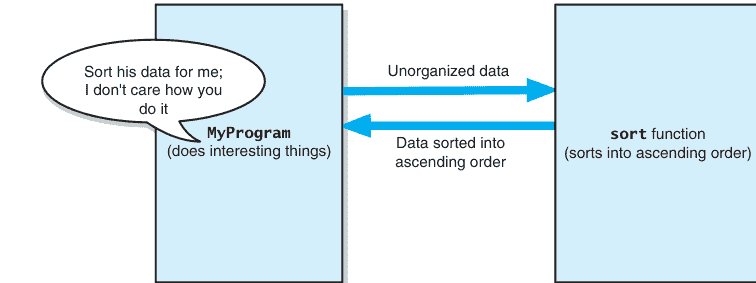

## 1.3 规范

当你为一个问题设计模块化解决方案时，每个模块都只说明它做什么，而不说明它是怎么做的。任何模块都不能“知道”其他模块是如何执行任务的——它只能知道该任务是什么。例如，如果解决方案的某部分是对某些数据进行排序，其中一个模块可以是排序算法，如图 1-1 所示。其他模块知道该模块负责排序，但不知道它是如何排序的。通过这种方式，解决方案的组件之间保持相互隔离。

利用这一点，我们可以相互关联地编写模块，知道每个模块将做什么，但不一定知道每个模块最终将如何实现。编写并理解模块的规范是非常关重要的。

> 在实现之前，
>
> 为每个模块编写规范

### 1.3.1 操作契约

操作契约描述了如何使用方法以及它具有哪些局限性。你应该在分析阶段开始制定契约，在设计阶段完成规范，然后在查询中记录契约，特别是在头文件中。通过这种方式，使用你代码的程序员就可以指明他们需要从该方法获取什么，以产生正确的结果。

对于每个方法，你都需要提供某些信息。接口规定了如何调用方法以及它期望的参数数量和类型——这些已经讨论过。你可能需要指定在调用方法之前应该是真实的，以及在方法执行完成后什么应该是真实的。

> 模块契约规定了
>
> 模块的目的、
>
> 假设、输入和
>
> 输出

在设计过程中，清楚地指定每个模块的目的，以及模块之间的数据流是非常重要的。例如，你应该为每个模块提供这些问题的答案：在模块执行之前，哪些数据可用？模块假设了什么？模块执行后发生了哪些操作，数据又是什么样子的？因此，你应该详细指定每个模块的假设、输入和输出。

> 指定模块之间
>
> 的数据流

例如，如果你的程序设计人员需要对整数数组进行排序，你可能会为排序函数编写以下规范：

- 函数将接收一个包含 `num` 个整数的数组，其中 `num > 0`。
- 函数将返回一个排序后的整数数组。

## 规范

你可以将这些规范视为你的函数与调用它的模块之间契约的条款。

> 规范是
>
> 契约的
>
> 条款

该契约帮助程序员理解该模块对模块内其他模块承担什么责任。无论是谁，排序函数必须遵守这个契约。在排序函数编写并测试之后，契约告诉程序的其余部分如何正确地调用排序函数，以及这样做的结果。

> 操作契约不应该
>
> 描述模块将如何
>
> 执行其任务

请注意，模块的契约并没有让模块承诺以特定的方式执行其任务。如果程序的其他部分对算法有任何假设，那么其风险由其自行承担。因此，例如，如果你在未来的某一天将你的函数重写为一种不同的排序算法，你不需要更改该算法的契约。只要新函数符合原始契约的条款，程序的其余部分应该感知不到这种变化。

> 操作契约应该包含
>
> 精确的
>
> 前条件和
>
> 后条件

这对于你来说并不新鲜。尽管你可能没有显式地使用“契约”一词，但这个概念应该是熟悉的。当你写函数的前条件时，你就在写一个契约，前条件是对函数开始时必须存在的条件的陈述；当你写它的后条件时也是如此，后条件是对函数结束时条件的陈述。例如，遵循上述契约的排序函数在伪代码中可能出现如下：

```
// 升序排序。
// 前条件：array 是一个整数数组；num > 0。
// 后条件：array 中的整数已排序。
sort(array, num)
```

> 初稿规范

这些前置和后置条件是抽象的，正如在初稿契约中可能出现的情况。例如，排序是指升序还是降序？我们可以处理多大的数据？在实现此函数时，你可能假设排序意味着升序，且 `num` 不超过 100。当另一个人尝试对一个包含 500 个整数的数组进行排序时可能会产生困难，用户将不知道你的假设，除非你通过如下方式修改契约并记录了它们：

> 修改后的规范

```
// 升序排序。
// 前条件：array 是一个整数数组且 j <= num <= MAX_ARRAY，
// 其中 MAX_ARRAY 是指定数组最大尺寸的全局常量。
// 后条件：anArray[0]<= anArray[1]... <= anArray[num - 1]。
// num 保持。
sort(array, num)
```

当你编写过程时，从描述你函数的输入行为开始，提到它用到的任何全局常量，最后列出它所做的所有注解。注意，在写后条件的情况下，要描述模块拥有了什么。注意，如果模块返回一个值——这是后条件的关键部分——则必须对该值进行描述。

> 精确的文档是
>
> 至关重要的

新手程序员倾向于降低文档的重要性，特别是当他们经验较少的设计师、程序员和程序用户时。如果程序的规模扩大，无论你是唯一作者还是团队的一一员，文档都会变得更加重要。如果你不写下契约的条款，当你以后实现它时还会记得它们吗？

* 本书中的伪代码显示为蓝色。

### 1.3.2 异常情况

作为类设计者，需要对如何处理异常情况做出决策，并将这些决策包含在规范中。通常，你可以通过几种方式处理异常情况。你可以：

- 假设无效情况不会发生。这种假设听起来可能并不天真。方法可以作为假设——即前条件——客户端必须遵守的限制。然后由客户端在调用方法之前检查满足条件。只要客户端遵守限制，无效情况就不会发生。
- 忽略无效情况。方法在接收数据时可以什么都不做。完全无作为会让客户端不知道发生了什么。
- 猜测客户端的意图。像上一个选项一样，这可能会给客户端带来问题。
- 返回一个指示问题的值。例如，方法可以返回一个指示成功或失败的值。
- 抛出异常。对于 `C++` 方法响应异常事件，抛出异常是理想的。方法可以报告问题而不决定如何处理。异常使每个客户端能够根据其特定情况采取行动。为了简单起见，我们现在采用的策略是，方法只有在没有合理解决方案的情况下才抛出异常。你可以在 `C++` 插曲 3 中学习异常。

> 模块规范的初稿往往忽略或忽视了你真正需要考虑的情况。你可能会故意遗漏一些以简化草稿。一旦你写了规范的大部分，就可以专注于使规范完整的细节。

# 规范 9

随着问题解决过程进行，你逐渐完善模块，直到最终通过编写代码（通常是类及其方法）来实现它们的操作。将模块的目的与其实现分离被称为**功能抽象**（或过程化抽象）。一旦写好一个模块，只要你有关于它的目的声明和参数描述，你就可以在不知道其具体细节的情况下使用它。假设模块已正确实现，你只需要知道它的规范就可以使用它。你不需要知道它的实现方式。

功能抽象对于项目至关重要。毕竟，在团队中，你必须使用他人编写的模块，而且通常并不了解它们的算法。你真的可以在不研究代码的情况下使用一个模块吗？事实上，每当你使用 `C++` 标准库的函数（例如 `C++` 数学库中的 `sqrt`）时，你都在这样做。因为 `sqrt` 是预编译的，所以你无法访问它的源代码语句。此外，`sqrt` 可能是用 `C++` 以外的语言编写的。关于这有许多你不知道的事情，但只要你知道它的规范，你就可以在程序中放心使用它。如果你传递一个浮点数，它将返回该表达式值的浮点平方根。即使不知道它的实现方式，你也可以使用 `sqrt`。

考虑一个数据集合和一组操作，包括添加新数据、删除数据和搜索数据。抽象函数定义了对数据集合的操作，而无论你如何实现它们。解决方案的其他模块知道它们可以执行“什么”操作，但它们不知道这些操作是如何执行的。

例如，你使用过数组，但你是否曾停下来思考过数组到底是什么？书中到处都是数组的图片。它们可能类似于 `C++` 数组在计算机上的实现方式，也可能不是。无论何种情况，你都可以在不知道它“看起来像什么样”（即如何实现）的情况下使用数组。不同的系统以不同的方式实现数组，这些差异对程序员是透明的。

例如，无论数组如何实现，你始终可以使用以下语句在数组索引中存储值 1492：

```cpp
years[index] = 1492;
```

并使用语句显示该值：

```cpp
cout << years[index] << endl;
```

因此，你可以在不知道数组实现细节的情况下使用数组，就像你可以在不知道 `sqrt` 函数实现细节的情况下使用它一样。让我们更详细地探讨这个想法。

## 1.4 信息隐藏

正如你所看到的，抽象要求你为每个模块编写功能规范，描述其外部（或公共）视图。抽象还帮助你识别应该从公共视图中隐藏的细节——这些细节不应该出现在规范中，而应该是私有的。**信息隐藏**原则告诉你不仅要将此类细节隐藏在模块内部，还要确保没有其他模块可以访问这些隐藏的细节。

在编写模块规范时，你必须识别可以隐藏在模块内部的细节。信息隐藏原则不仅包括不隐藏这些细节，还包括它们从外部模块无法访问。理解信息隐藏的一种方法是想象在程序执行的各种任务周围筑起墙。这些墙防止任务之间变得纠缠。然而，每个任务周围的目标防止模块完全隔离。隔离不可能是完全的。尽管 `MyProgram` 不知道任务是如何执行的，但它必须知道任务是什么以及如何启动它。例如，假设你的程序需要对一个排序后的名称数组进行操作。例如，程序可能搜索一个名称或按字母顺序显示名称。程序需要一个能够对名称数组排序的函数。虽然程序的其他部分知道 `sort` 可以排序数组，但它们不应该知道 `sort` 如何完成其任务的。

因此，想象墙上有一道细缝，如图 1-2 所示。细缝并不大到允许外部世界看到函数的内部运作，但项目可以通过细缝进入或离开函数。这道细缝就是函数的原型、声明或头文件。细缝包含了函数或方法、参数列表和返回类型。例如，你可以将数组传递给函数 `sort`，该函数可以将排序后的数组传给你。输入和输出由函数规范（或合同）的条款规定：如果你这样使用该函数，它正是会为你做的这些事情。

# 图 1-2 任务通过墙上的细缝进行通信

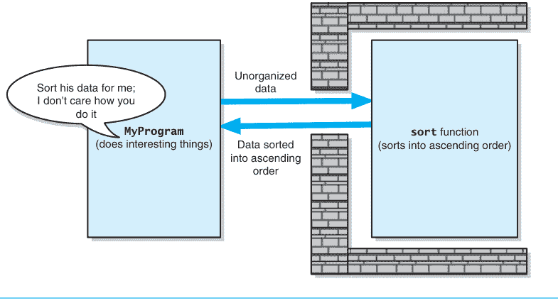

假设开发了一种更快的排序算法。由于函数 `sort` 与程序中的其他模块是的，新算法可以在 `sort` 函数中实现，而不影响那些其他模块。因此，如果 `MyProgram` 使用 `sort` 任务，且执行排序的算法实现发生了变化，`MyProgram` 将不会受到影响。如图 1-3 所示，墙防止了 `MyProgram` 的算法依赖于 `sort` 的算法。

> 注意：信息隐藏隐藏了你处理模块和数据的方式。作为模块的使用者，你不必担心它的实现细节。作为模块的实现者，你不必担心它的用途。

模块的接口是与该模块交互的唯一方式。

### 1.3.5 最小且完整的接口

类的接口由公共访问的方法和数据组成。通常，类接口只包含方法，正如你将看到的，因为公共访问的数据字段通常会引起问题。类的接口描述了程序员与该类交互的唯一方式。因此，接口是对象之间协作的地方。类通过接口与其他类耦合。设计良好的类接口是一项重要技能。

每个类应该是易于的。因此，在设计类时，你应该保持方法的数量尽可能少。你的类应该为程序员提供完成所需的能力。这些需求是冲突的。

类的完整接口允许程序员完成任何合理的任务，即该类的职责。类的最小接口是指只有当方法对类的职责至关重要时才包含该方法。程序员可以更早学会与具有最小接口的类交互，因为方法更少。具有最小接口的类也更容易维护。类的更改是可以扩展的。你应该根据接口的完整性和最小性来评估类。接口完整是重要的。具有最小接口的重要性稍低；有时一个多余的方法实在好用到无法省略。

图 1-3 修改后的实现通过同一条细缝进行通信

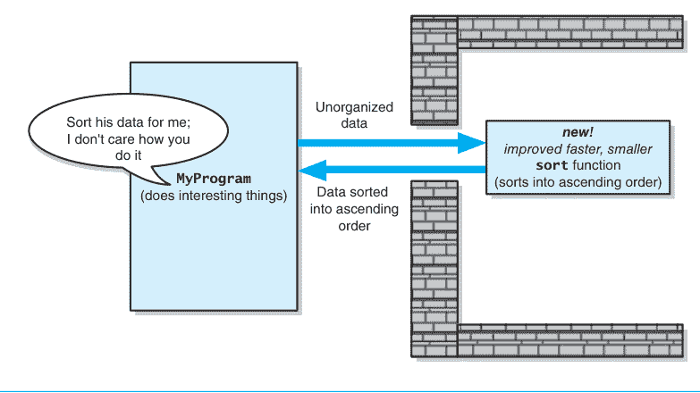

## 1.4 抽象数据类型

问题的解决方案需要对数据进行操作。此类操作大致概括为以下三种方式：

- 将数据添加到集合中。
- 从数据集合中删除数据。
- 关于数据集合中的数据提问。

数据的典型操作

# 第1章 数据抽象：墙

当然，操作的细节会随应用程序而异；其核心主题是数据管理。然而，请意识到，并不是每个问题都会使用或需要所有这些操作。

大部分内容是关于抽象数据类型（`ADT`）。为了让你能够绝对地思考数据，你应该定义一个**抽象数据类型**，或称为 **`ADT`**。`ADT` 是数据以及一组对这些数据进行操作的集合。如果你知道这些操作的规范，就可以使用 `ADT` 的操作，而无需知道这些操作是如何实现的，也不数据是如何存储的。

根结底——也许你将通过使用**数据结构**来实现这个 `ADT`，数据结构是你使用编程语言定义的用于存储数据的构造体。例如，你可能会将数据存储在 `C++` 的字符串数组中、对象数组或嵌套数组中。

例如，你可能需要一组项，其存储方式允许你快速查找给定的名称。一组*提供快速搜索的名称项*的集合就是一个简单 `ADT` 的描述。`ADT` 操作的描述必须足够严谨，以完全完成它们对数据的影响，因为这些操作不应指定如何将数据存储在连续的内存位置或不连续的内存位置中。当你**实现一个 `ADT`**时，你选择一个数据结构。

| `ADT` 不是数据结构的花哨名称 | 规范说明了 `ADT` 操作的作用，但没有说明它们如何实现这些。 |

| :--- | :--- |

当程序执行语言没有直接支持的操作时，你应该首先设计一个 `ADT`，并仔细规定 `ADT` 操作的作用（即合同），然后用数据结构实现这些操作。如果你正确地实现了这些操作，程序的其余部分就可以假设操作按照规范执行——也就是说，合同条款得到了遵守。程序不应该依赖于支持这些操作的特定技术。

> 注意：`ADT` 与数据结构
>
> * 抽象数据类型是一组值以及对这些值进行的操作的规范。
> * 数据结构是在编程语言中对 `ADT` 的实现。
>
> 在实现 `ADT` 的操作之前，请仔细规定这些操作。

当你对 `ADT` 和数据结构之间的概念差异有了更清楚的认识时，可以考虑一台制冰水机，它有水，并根据你按下的哪个按钮输出冰水或冰块。

图 1-4 一台制冰水或冰块的饮水机。（img/d0cb882f182db5699ad7c43510e_38.png）

它还有一个指示器显示是否有冰可用。水类比数据；操作有 `chill`（冷却）、`cube`（成冰）和 `isNotEmpty`（非空）。在这一设计层面，饮水机类比于 `ADT`；你不需要担心饮水机如何执行它的操作，只需要它执行操作即可。如果你想要冰水，只要饮水机正确完成任务，你会在意它是如何完成的吗？因此，在你指定了饮水机的操作后，你可以为它设计许多用途，而无需知道饮水机如何完成任务，也不会受工程细节的干扰。

最终，必须有人来制造这台饮水机。例如，它是如何产生冰的呢？它可以先将它们碎成小块。还有许多其他技术。饮水机的内部结构对应于 `ADT` 在编程语言中的实现，即数据结构。

尽管饮水机的所有者不关心它的内部工作原理，但他或她希望设计运行运行高效。同样，制造商希望设计是廉价且易于建造的。在选择数据结构来实现 `ADT` 时，你也应该有同样的考量。即使你没有自己实现 `ADT`，而是使用一个已经实现的 `ADT`——就像买冰箱的人一样——你也会 `ADT` 的效率。

注意墙包围了输入（机器）及其输出（冰水或冰块）。因此，内部机制对用户是隐藏的，但也是可用的。此外，一个操作的机制对另一个操作是隐藏且可能的。这种模块化设计有好处。例如，你可以通过修改实现来改进某个操作，而不影响其他操作。因此，抽象和信息隐藏在这里起了作用。

总结来说，数据抽象在 `ADT` 操作与访问数据结构的程序之间产生了一道墙，如图 1-5 所示。程序不应该依赖于 `ADT` 实现的细节。

图 1-5 `ADT` 操作将数据结构与使用它的程序隔离开。（img/d0cb862f182db5699ad7c43510e_39.png）

# 第1章 数据抽象：墙

在墙的这一侧，你将看到一个接口，允许你与数据结构进行通信。也就是说，你使用 `ADT` 操作来处理数据结构中的数据，并将这些操作的结果传回给你。

使用 `ADT` 就像使用自动售货机。这个过程类比使用自动售货机：你按下按钮与机器通信并获得回报。由于 `ADT` 的规范规定了它的操作以及它们的作用，只要你按照它的设计使用自动售货机，就可以忽略它的内部技术。只要你只通过 `ADT` 操作访问数据，你的程序就会忽略实现 `ADT` 的数据结构发生的任何变化。


接下来的几页描述了若干抽象数据类型，重点关注它们的规范，而不是它们的实现。（`img/d0cb862f182db5699ad7c43510e_40_0.png`）

### 1.4.1 设计 ADT

抽象数据类型的设计应该在解决问题的过程中自然演变。作为一个可能可能发生的例子，假设你想确定一年中所有节日的日期。实现这一点的一种方法是查看日历。也就是说，你可以考虑一年中的每一天并确定某天是否是节日。以下伪代码是一个可能的解决方案：

```
// 显示给定年份所有节日的日期。
listHolidays(year)
  date = first day of year
  while (date is before the first day of year + 1)
  {
    if (date is a holiday)
      write(date, "is a holiday")
    date = date of next day
  }
```

问题需要什么数据？

涉及到什么？显然，这个问题操作的是日期，其中日期由月份、日期和年份组成。解决节日问题需要哪些操作？你的 ADT 规定并限制了日期的合法操作，就像基本数据类型 `int` 限制为加法和比较一样。从之前的伪代码可以看出你可以

问题需要哪些操作？

- 确定给定年份第一天的日期。
- 确定一个日期是否在另一个日期之前。
- 确定一个日期是否是节日。
- 确定给定日期之后的日期。

因此，你可以使用统一建模语言（UML）符号（见附录 C）在伪代码中为 ADT 指定以下操作：

```
// 返回给定年份第一天的日期。
+getFirstDay(year: integer): Date

// 如果此日期在该日期之前返回 true；否则返回 false。
+isBefore(otherDate: Date): boolean

// 如果此日期是节日，返回 true；否则返回 false。
+isHoliday(): boolean

// 返回此日期之后的日期。
+getNextDay(): Date
```

`listHolidays` 伪代码现在显示为：

```
// 显示指定年份所有假日的日期。
listHolidays(year: integer): void

  date = getFirstDay(year)
  while (date.isBefore(getFirstDay(year + 1)))
  {
    if (date.isHoliday())
      write(date, " is a holiday")

    date = date.getNextDay()
  }
```

因此，你可以通过识别数据并选择适合你问题的操作来定义一个抽象数据类型（ADT）。在指定操作后，你就可以使用它们来解决问题，而无需关心该 ADT 的实现细节。

一个预约本。作为 ADT 设计的另一个例子，想象你想创建一个跨度为一年的计算机化预约本。假设你只在上午 8 点到下午 5 点之间的每整小时或半小时进行预约。你的系统必须存储关于每个预约性质的简要记法，以及日期和时间。

为了解决这个问题，你可以定义一个 `appointment book`（预约本） ADT。它由日期、时间和目的组成。操作有哪些呢？两个明显的操作是：

- 为特定的日期和时间进行预约。（你需要小心，不要在已经占用的时间进行预约。）
- 取消特定日期和时间的预约。

除了这些操作外，你可能还想要：

- 询问在给定时间是否有预约。
- 获取你在给定时间的预约的目的。

最后，ADT 还有初始化和销毁操作，我们在这一阶段虽然假设了它们的存在，但没有具体指定。

因此，预约本可以拥有以下操作：

```
// 如果指定的日期和时间存在预约，则返回 true。
// 否则返回 false。
+hasAppointment(appDate: Date, appTime: Time): boolean

// 只要不与现有预约冲突，就插入该日期、时间和目的的预约。
// 如果 成功则返回 true，否则返回 false。
+makeAppointment(appDate: Date, appTime: Time, appPurpose: string): boolean

// 删除指定日期和时间的预约。
// 如果成功则返回 true，否则返回 false。
+cancelAppointment(appDate: Date, appTime: Time): boolean

// 如果指定的日期和时间存在预约，则获取该预约的目的。
// 否则返回空字符串。
+getAppointmentPurpose(appDate: Date, appTime: Time): string
```

你可以使用这些 ADT 操作来设计针对预约的其他操作。例如，假设你想在现有的预约本应用中更改特定预约的日期或时间。

# 第 1 章 数据抽象：墙

以下伪代码指示了如何使用 ADT 操作来完成此任务：

```
// 更改预约的日期或时间。
// 从用户处获取数据：oldDate, oldTime, newDate, newTime。
// 获取预约的目的。
oldPurpose = appBook.getAppointmentPurpose(oldDate, oldTime)
if (oldPurpose is not the empty string)
{
    // 检查是否有可用的日期/时间。
    if (appBook.isAppointment(newDate, newTime))
        // 新的日期/时间已被预约
        write("You already have an appointment at ", on," newTime),
    else
        // 新的日期/时间可用；取消旧预约；建立新预约。
        appBook.makeAppointment(oldDate, newTime, oldPurpose)
        write("Your appointment has been rescheduled to ", on," newDate)
}
else
    write("You do not have an appointment at ", on," oldDate);
```

在无需了解实现的情况下使用 ADT

再次注意，你可以在使用 ADT 操作的情况下设计应用程序，而无需知道 ADT 是如何实现的。本章末尾的练习提供了你可以使用此 ADT 执行其他任务的示例。

### 1.4.2 暗示其他 ADT 的 ADT

之前的两个例子都需要你表示日期，而预约本的例子要求你表示时间。C++ 在 `ctypes` 中指定了日期时间对象，你用它们来表示日期和时间。你也可以设计 ADT 以面向对象的方式表示这些项目。一个 ADT 的设计暗示其他 ADT 并不罕见。事实上，你可以用一个 ADT 来实现另一个 ADT。

可以使用一个 ADT 实现另一个 ADT

这个最后的例子描述了一个在其实实现上暗示了其他 ADT 的 ADT。假设你想设计一个菜谱数据库。你可以将其视为一个 ADT。菜谱是数据项，对菜谱的一些典型操作可能包括：

```
// 将菜谱插入数据库。
+insertRecipe(aRecipe): boolean
// 从数据库中删除菜谱。
+deleteRecipe(aRecipe): boolean
// 从数据库获取命名的菜谱。
+getRecipe(aName): string
```

这种级别的设计不包括如 `insertRecipe` 将将菜谱放在数据库何处之类的细节。现在想象你想设计一个可以缩放从数据库检索的菜谱的操作：如果菜谱是给 `n` 人准备的，你想修改它以便供 `m` 人食用。假设测量单位是 ½ 杯、1 汤匙和 1/4 茶匙。数量以混合数（整数和分数）的形式以杯、汤匙和茶匙为单位给出。这暗示了另一个 ADT——测量（`measurement`），它具有以下操作：

```
// 返回此测量值。
+getMeasure()

// 将此测量值设置为另一个。
+setMeasure(m: Measurement)

// 返回乘以比例因子的测量值，该因子没有单位。
+scaleMeasure(scaleFactor: float)

// 返回从旧单位转换为新单位的测量值。
+convertMeasure(oldUnits: MeasureUnit, newUnits: MeasureUnit)
```

假设你想在 C++ 中实现精确算术。因为我们计划的语言没有分数的数类型，且浮点运算是不精确的，所以需要另一个名为 `fraction`（分数）的 ADT。它的操作可以包括分数的加法、减法和除法。例如，你可以指定加法为：

```
// 返回分数的和，化为最简形式
+add(other: Fraction)
```

此外，你还可以指定分数与混合数之间的转换。

# 抽象数据类型 15

`listHolidays` 伪代码现在显示为：

```
// 显示指定年份所有假日的日期。
listHolidays(year: integer): void

  date = getFirstDay(year)
  while (date.isBefore(getFirstDay(year + 1)))
  {
    if (date.isHoliday())
      write(date, " is a holiday")

    date = date.getNextDay()
  }
```

### 1.5 容器（Bag）

之前的两个例子都需要你表示日期，而预约本的例子要求你表示时间。C++ 在 `ctypes` 中指定了日期时间对象，你用它们来表示日期和时间。你也可以设计 ADT 以面向对象的方式表示这些项目。一个 ADT 的设计暗示其他 ADT 并不罕见。事实上，你可以用一个 ADT 来实现另一个 ADT。


假设你想在 C++ 中实现精确算术。因为我们计划的语言没有分数的数类型，且浮点运算是不精确的，所以需要另一个名为 `fraction`（分数）的 ADT。它的操作可以包括分数的加法、减法和除法。例如，你可以指定加法为：

```
// 返回分数的和，化为最简形式
+add(other: Fraction)
```

此外，你还可以指定分数与混合数之间的转换。

# 1.5 容器（Bag）

之前的两个例子都需要你表示日期，而预约本的例子要求你表示时间。C++ 在 `ctypes` 中指定了日期时间对象，你用它们来表示日期和时间。你也可以设计 ADT 以面向对象的方式表示这些项目。一个 ADT 的设计暗示其他 ADT 并不罕见。事实上，你可以用一个 ADT 来实现另一个 ADT。

由于容器（bag）是一个抽象数据类型，我们只描述它的数据并规定它的操作。我们不指示如何存储数据或如何实现这些操作。例如，不要去考虑数组。你需要清楚地知道容器操作的作用：关注操作**做了什么**，而不是它们**怎么做的**。也就是说，在程序中使用容器之前，你需要一套详细的规范。事实上，你应该在决定使用哪种编程语言之前规定容器的操作。

## 1.5.2 规范数据和操作

在用 C++ 实现容器之前，我们需要描述它的数据，并详细详细规定对应于容器行为的方法。我们将命名这些方法，选择它们的参数，决定它们的返回类型，并充分描述每个方法对容器数据产生的影响。当然，我们的目标是编写一个 C++ 头文件并为每个方法编写注释。然而，我们首先将用伪代码和 UML 表示法来表达这些方法。

针对 CRC 代码的第一个行为产生了一个方法，返回容器中条目的数量计数。对应的方法没有参数并返回一个整数。在伪代码中，我们有如下规范，同样使用 UML 表示法：

```
// 返回容器中当前条目的数量
+getCurrentSize(): integer
```

我们可以通过一个布尔值的方法来测试容器是否为空，同样没有参数。它在伪代码中的规范是：

```
// 如果容器为空则返回 true。
+isEmpty(): boolean
```

我们现在想向容器添加一个对象。我们需要添加 `add` 方法并给它一个参数来表示新条目。我们将编写以下伪代码：

```
// 向容器添加一个新条目
add(newEntry)
```

我们可能会忍不住添加一个 void 方法，如果容器满了，我们就无法向它添加新条目。在这种情况下我们该怎么办呢？

当 `add` 无法完成其任务时，我们可以采取两种方案：

- 什么都不做。我们无法添加另一个项目，所以我们忽略它并保持容器不变。
- 保持容器不变，但向客户端发出添加可能的信号。

第一种方案很容易，但它会让客户端疑惑发生了什么。当然，我们可以规定一个先置条件，即容器不能是满的。那么客户端就有责任在向满的容器中添加新条目。

第二种方案是更好的，而且现在进行规范或实现还不为晚。如果添加未成功，我们可以如何抛出异常。显示错误信息不是一个好选择，因为你应该让客户端决定输出。由于添加要么成功要么失败，我们可以简单让方法返回一个值。因此，我们可以更完整地规范方法：

```
+add(newEntry: ItemType): boolean
```

其中 `newEntry` 的数据是 `ItemType`。在 C++ 中，我们将讨论模板和 `typedef` 语句的实现细节，以便为我们的 ADT 可以持有的数据类型提供灵活性。

`img/d0cb862f18b25698ad7c43510e_45.png`

## 第1章 数据抽象：边界

有两个行为涉及从容器中移除条目：移除特定条目和移除所有条目。假设我们命名方法和参数，并开始用伪代码规范它们：

```
// 如果可能，移除特定条目的一个出现。
remove(anEntry)
```

```
// 清空容器中的所有条目。
clear()
```

这些方法的返回类型是什么？如果条目不在容器中，方法将无法移除它。我们将让方法返回一个布尔值，就像 `add` 方法一样，以便它可以指示成功或否。该方法的 UML 规范是：

```
+remove(anEntry: ItemType): boolean
```

方法 `clear` 是一个 void 方法：我们只想清空容器，而不是改变它的任何内容。因此，我们对其规范进行如下完善：

```
+clear(): void
```

剩余的行为不会改变容器。其中一个行为计算给定对象在容器内出现的次数。它在伪代码中的规范是：

```
// 统计一个条目在容器中出现的次数。
+getFrequencyOf(anEntry: ItemType): integer
```

另一个方法测试容器是否包含给定的对象。我们在伪代码中将其规范为：

```
// 测试容器是否包含一个条目。
+contains(anEntry: ItemType): boolean
```

最后，我们想查看容器的内容。与其提供一个显示容器中条目的方法，我们不如定义一个以任何所需方式将这些条目放入向量（vector）中的方法。这是我们最后一个方法的规范：

```
// 获取容器中的所有条目。
+toVector(): vector
```

当我们开发容器方法的规范时，我们使用使用 UML 表示法来表示了它们。图 1-7 显示了这样做的结果。

### 图 1-7 容器的 UML 表示法

| Bag |
|---|
| +getCurrentSize(): integer |
| +isEmpty(): boolean |
| +add(newEntry: ItemType): boolean |
| +remove(anEntry: ItemType): boolean |
| +clear(): void |
| +getFrequencyOf(anEntry: ItemType): integer |
| +contains(anEntry: ItemType): boolean |
| +toVector(): vector |

注意，CRC 卡和 UML 图没有反映所有细节，例如假设和异常情况。然而，在你识别出此类条件后，你应该规定你的方法在每种情况下将如何表现。你应该写下关于你希望方法如何行为的决策。

## 抽象数据类型：容器 (BAG)

- 一组有限的对象，不一定具有特定顺序，且具有相同的数据类型。
- 容器中的数量。

### 操作

| 伪代码 | 描述 |
| --- | --- |
| getCurrentSize() | 报告容器中对象的当前数量。输入：无。输出：容器中对象的数量。 |
| isEmpty() | 查看容器是否为空。输入：无。输出：根据容器是否为空返回 true 或 false。 |
| add(newEntry) | 将给定对象添加到容器中。输入：`newEntry` 是对象。输出：根据添加是否成功返回 true 或 false。 |
| remove(anEntry) | 如果可能，从容器中移除一个对象的出现。输入：`anEntry` 是对象。输出：根据移除是否成功返回 true 或 false。 |
| clear() | 从容器中移除所有对象。输入：无。输出：无。 |
| getFrequencyOf(anEntry) | 对象在容器中出现的次数。输入：`anEntry` 是对象。输出：`anEntry` 在容器中出现的整数次数。 |
| contains(anEntry) | 测试容器是否包含特定对象。输入：`anEntry` 是对象。输出：根据是否出现在容器中返回 true 或 false。 |
| toVector() | 获取容器中的所有对象。输入：无。输出：包含当前所有条目的向量。 |

> **注意：处理异常情况**

如前所述，你必须对如何处理异常情况做出决策。容器的文档应该反映这些决策以及之前讨论的细节。例如，我们对方法的规定表明，如果客户端尝试从空容器中移除条目，它将返回 false。相反，我们可以给出一个先置条件，即容器不能为空。在调用方法之前满足先置条件是客户端的责任。注意，客户端可以使用容器的其他方法（如 `isEmpty` 和 `getCurrentSize`）来帮助完成这项任务。

规范的第一个草稿通常忽略或忽视你真正需要考虑的情况。你可能会刻意忽略这些情况以简化第一个草稿。如果你已经写了规范的大部分，你就可以专注于完善规范的细节。

- **问题 1** 使用 UML 表示法为一个函数编写规范，该函数计算 $n$ 个整数数组中前几个正整数的和。

## 1.5.3 ADT 的接口模板

随着你的规范变得越来越详细，它们越来越多地反映你对编程语言的选择。最终，你可以为容器的方法编写 C++ 头文件，并将它们组织到实现 ADT 的客户端的头文件中。

目前，包中的项将是相同类的对象。为了适应任何单个类的条目，包的方法为每个条目使用泛型类型 `ItemType`。为了给标识符 `ItemType` 赋予意义，我们必须在类头文件之前的一行编写 `template<class ItemType>`。实际类型由客户端选择，编译器将在 `ItemType` 出现的任何地方都使用该数据类型。

`BagInterface` 类是一个 C++ 抽象类。在 C++ 中，抽象基类（或简称为抽象类）包含至少一个定义为虚（`virtual`）且没有实现的方法。抽象类不能实例化；它只能作为基类使用。子类必须实现抽象类中指定但未定义的方法。

```
LISTING 1-1 一个包含用于包（bags）的 C++ 接口的文件
/** @file BagInterface.h */
#_ifndef _BAG_INTERFACE
#define _BAG_INTERFACE
#include <vector>

template<class ItemType>
class BagInterface{
public:
    /** 获取此包中条目的当前数量。
     * @return 目前包中条目的整数数量。 */
    virtual int getCurrententSize() const = 0;

    /** 查看包是否为空。
     * @return 如果包为空则返回 true，否则返回 false。 */
    virtual bool isEmpty() const = 0;

    /** 向此包添加一个新条目。
     * @post 如果成功，newEntry 将存储在包中，
     * 包中项的数量将增加 1。
     * @param newEntry 要添加到新条目中的对象。
     * @return 如果添加操作成功则返回 true，否则返回 false。 */
    virtual bool add(const ItemType& newEntry) = 0;

    /** 从此包中移除给定条目的的一个实例，
     * 如果可能的话。
     * @post 如果成功，anEntry 已从包中移除，
     * 包中项的数量将减少 1。
     * @param anEntry 要移除的条目。
     * @return 如果移除操作成功则返回 true，否则返回 false。 */
    virtual bool remove(const ItemType& anEntry) = 0;

    /** 从此包中移除所有条目。
     * @post 包不再包含任何项，且项的数量为 0。 */
    virtual void clear() = 0;

    /** 统计给定条目在包中出现的次数。
     * @param anEntry 要计数的条目。
     * @return anEntry 在包中出现的次数。 */
    virtual int getFrequencyOf(const ItemType& anEntry) const = 0;
```

# 第 1 章 数据抽象：墙

```
/**
 * 测试此包是否包含给定的条目。
 * @param anEntry 要定位的条目。
 * @return 如果包包含 anEntry 则返回 true，否则返回 false。 */
virtual bool contains(const Item& anEntry) const = 0;

/**
 * 清空并填充一个给定的 vector，使其包含
 * 在此包中的所有条目。
 * @return 一个包含包中所有条目的 vector。 */
virtual vector<Item> toVector() const = 0;
}; // BagInterface
```

这些操作的规范是 ADT（抽象数据类型）合约的唯一条款。如果你请求执行这些操作，将会发生这些。规范中没有提到如何存储包或如何执行这些操作；它们只告诉你对包要做什么。ADT 的规范不限制实现问题，这一点至关重要。这种对 ADT 规范的限制允许你在 ADT 的实现和使用它的程序（即客户端）之间建立起一道“墙”。操作的行为是程序应该依赖的唯一string。

> 注意：虽然编写接口显然不是强制要求的，但 这样做可以让你以一种简洁的方式记录你的规范。然后你可以使用接口中的代码作为实际类的大纲。拥有接口还为 ADT 提供了一种独立于特定类定义的数据类型。第 3 章和第 4 章将开发包类的不同实现。针对接口编写的代码允许你更可以更轻松地用一个包的实现替换另一个。

## 1.5.4 使用 ADT Bag

假设我们有一个程序员来实现一个包。为了适应任何单个类的条目，包的方法为每个条目使用泛型类型 `ItemType`。为了给标识符 `ItemType` 赋予意义，我们必须在类头文件之前的一行编写 `template<class ItemType>`。实际类型由客户端选择，编译器将在 `ItemType` 出现的任何地方都使用该数据类型。

`BagInterface` 类是一个 C++ 抽象类。在 C++ 中，抽象基类（或简称为抽象类）包含至少一个定义为虚（`virtual`）且没有实现的方法。抽象类不能实例化；它只能作为基类使用。子类必须实现抽象类中指定但未定义的方法。

这些操作的规范是 ADT 合约的唯一条款。如果你请求执行这些操作，将会发生这些。规范中没有提到如何存储包或如何执行这些操作；它们只告诉你对包要做什么。ADT 的规范不限制实现问题，这一点至关重要。这种对 ADT 规范的限制允许你在 ADT 的实现和使用它的程序（即客户端）之间建立起一道“墙”。操作的行为是程序应该依赖的唯一。

> 注意：虽然编写接口显然不是强制要求的，但 这样做可以让你以一种简洁的方式记录你的规范。然后你可以使用接口中的代码作为实际类的大纲。拥有接口还为 ADT 提供了一种独立于特定类定义的数据类型。第 3 章和第 4 章将开发包类的不同实现。针对接口编写的代码允许你更可以更轻松地用一个包的实现替换另一个。


这些操作的规范是 ADT 合约的唯一条款。如果你请求执行这些操作，将会发生这些。规范中没有提到如何存储包或如何执行这些操作；它们只告诉你对包要做什么。ADT 的规范不限制实现问题，这一点至关重要。这种对 ADT 规范的限制允许你在 ADT 的实现和使用它的程序（即客户端）之间建立起一道“墙”。操作的行为是程序应该依赖的唯一。

> 注意：虽然编写接口显然不是强制要求的，但这样做可以让你以一种简洁的方式记录你的规范。然后你可以使用接口中的代码作为实际类的大纲。拥有接口还为 ADT 提供了一种独立于特定类定义的数据类型。第 3 章和第 4 章将开发包类的不同实现。针对接口编写的代码允许你更可以更轻松地用一个包的实现替换另一个。

## 1.5.4 使用 ADT Bag

假设我们有一个程序员来实现一个包。为了适应任何单个类的条目，包的方法为每个条目使用泛型类型 `ItemType`。为了给标识符 `ItemType` 赋予意义，我们必须在类头文件之前的一行编写 `template<class ItemType>`。实际类型由客户端选择，编译器将在 `ItemType` 出现的任何地方都使用该数据类型。

`BagInterface` 类是一个 C++ 抽象类。在 C++ 中，抽象基类（或简称为抽象类）包含至少一个定义为虚（`virtual`）且没有实现的方法。抽象类不能实例化；它只能作为基类使用。子类必须实现抽象类中指定但未定义的方法。

13. 一组数据管理操作的规范以及它们所操作的数据值，定义了一个抽象数据类型 `ADT`。

14. 只有在定义了 ADT 之后，你才应该考虑如何实现它。实现 ADT 的合适数据结构选择取决于 ADT 操作的细节以及你使用这些操作的上下文。

## 练习题

- 1. 你想购买的物品的价格以美元和分给出。你用现金支付，给收银员 `$d` 美元 `$c` 分。为一个函数编写规范，该函数计算你应该收到的找零（如果有的话）。规范应包括目的声明、前置条件和后置条件以及参数的描述。

- 2. 日期由月、日、年组成。考虑此类日期的 `Date`。假设 `Date` 将月、日、年表示为整数。例如，1776 年 7 月 4 日是月 7，日 4，年 1776。

    a. 为 `Date` 内部的一个方法编写规范，该方法将任何日期增加一天。规范应包括目的声明、前置条件和后置条件、参数描述以及对返回值的描述。

    b. 为该方法编写一个 C++ 实现。设计并规范你需要的任何其他方法。包含对未来维护你实现的人有帮助的注释。

- 3. 根据 1.4.1 节描述的 ADT `appointment book`，为以下每个任务编写伪代码。你可能需要向 ADT 添加操作来执行这些任务：

    a. 修改给定日期和时间的预约目的。

    b. 显示给定日期的所有预约。

- 4. 想象你刚离开一家商店，手里拿着一袋杂货。你担心易碎物品在运输途中会损坏，所以当你到达汽车时，你将这些物品放入它们单独的袋子里。如果 `Bag` 是一个袋的类，编写 C++ 类，将物品从 `storebag` 中移除并放入两个新袋子之一，如下：将所有的面包和鸡蛋放入 `fragilebag`，将其他物品放入 `grocerybag`。完成后，`storebag` 应该是空的。假设杂货由字符串表示。

- 5. 假设一个袋子包含代表各种杂货物品的字符串。编写一个 C++ 函数，从该袋中移除并统计某个字符串出现的次数。你的函数应返回该数量。在 javdoc 中使用注释来完整规范你的函数。考虑到袋子为空或不包含该字符串字符串的情况。

- 6. 两个袋的并集是一个包含原始两个袋合并内容的新袋。为该 ADT 设计并规范一个 `union` 方法，该方法返回一个新袋，包含调用该方法的袋与作为方法参数的袋的并集。包含足够的注释来完整规范该方法。例如，如果 `x` 在一个袋中出现五次，在另一个袋中出现两次，则这些袋的并集包含 7 次 `x`。假设 `bag1` 和 `bag2` 是袋；`bag1` 包含字符串 `a`, `b` 和 `c`；`bag2` 包含字符串 `b`, `b`, `d` 和 `e`。表达式 `bag1.union(bag2)` 返回一个包含字符串 `a`, `b`, `b`, `c`, `d` 和 `e` 的袋。注意，`union` 不影响 `bag1` 和 `bag2` 的内容。

# 第 1 章 数据抽象：墙

- 7. 两个袋的交集是一个包含在原始两个袋中都出现的条目的的新袋。为 ADT `bag` 设计并规范一个 `intersection` 方法，该方法返回接收调用的袋与作为方法参数的袋的交集。包含足够的注释来完整规范该方法。

注意，两个袋的交集可能包含重复项。例如，如果 `x` 在一个袋中出现五次，在另一个袋中出现两次，则这些袋的交集包含两次 `x`。假设 `bag1` 和 `bag2` 包含字符串 `a`, `b` 和 `c`；而 `bag2` 包含字符串 `b`, `d` 和 `e`。表达式 `bag1.intersection(bag2)` 返回一个只包含字符串 `b` 的袋。注意，`intersection` 不影响 `bag1` 和 `bag2` 的内容。

- 8. 两个袋的差集是一个新袋，包含移除第二个袋中也出现的条目后留在第一个袋中的剩余条目。为 ADT `bag` 设计并规范一个 `difference` 方法，该方法返回一个新袋，即接收调用的袋与作为方法参数的袋的差。包含足够的注释来完整规范该方法。

注意，两个袋的差集可能包含重复项。例如，如果 `x` 在一个袋中出现五次，在另一个袋中出现两次，则这些袋的差集包含三次 `x`。假设 `bag1` 和 `bag2` 包含字符串 `a`, `b` 和 `c`；而 `bag2` 包含字符串 `b`, `d` 和 `e`。表达式 `bag1.difference(bag2)` 返回一个只包含字符串 `a` 和 `c` 的袋。注意，`difference` 不影响 `bag1` 和 `bag2` 的内容。

- 9. 考虑关于 `x` 的多项式 ADT——其操作包括以下内容：

```
degree() // 返回多项式的次数。
coefficient(power) // 返回 x^power 项的系数。
changeCoefficient(newCoefficient, power) // 将
// x^power 项的系数替换为 newCoefficient。
```

对于这个问题，仅考虑指数为非负整数的多项式。例如，`p = 4x^5 + 7x^3 - x^2 + 9`。

以下示例演示了对该多项式的 ADT 操作。

- `.degree()` 是 5（最高幂次）

- `.coefficient(3)` 是 7（`x^3` 的系数）

- `.coefficient(4)` 是 0（缺失项的系数）

- `.changeCoefficient(-3, 7)` 将 `x^7` 项的系数改为 -3

使用这些 ADT 操作，编写语句执行以下任务：

    a. 显示最高幂次的项。

    b. 将 `x^3` 项的系数增加 8。


### c. 计算两个多项式的和。

## 编程题

- 1. 将交易添加到附录 C 中的图 C-4。该类跟踪日期、金额和交易类型（存款或储蓄）。
- 2. 考虑一个读取员工数据、按员工编号排序、输出数据并计算关于数据的各种统计信息的程序（例如平均年龄）。使用 UML 表示该解决方案。你识别了哪些类和方法？为每个模块编写完整的规范，包括前置条件和后置条件。
- 3. `Matrix`（矩阵）是数值的矩形数组。你可以相加矩阵得到第三矩阵。你可以将矩阵与标量相乘，并转置矩阵。设计一个表示矩阵并具有这些操作的 ADT。通过目的声明、参数描述和方法头部的伪代码来规范每个操作。包含代码注释。
- 4. 环（`ring`）是一个具有当前项引用的集合。一个操作——`advance`——将引用移动到下一个项。当引用到达最后一个项时，下一次 `advance` 将引用移回第一个项。环还具有获取当前项、添加项和移除项的操作。添加项和移除项的细节由你决定。

设计一个表示对象环的 ADT。通过目的声明、参数描述和方法头部的伪代码来规范每个操作。编写环方法的 C++ 接口。包含代码注释。
- 5. 集合（`set`）是一个不允许重复的特殊袋。通过目的声明、参数描述以及前置条件、后置条件和方法头部的伪代码来规范对象集合的每个操作。编写 C++ 接口。
- 6. 想象你的桌子上有一堆书。每本书都很大很重，你只能从堆中取出顶端的一本。你不能从另一本书下面移除书。同样，你只能通过将另一本书放在堆顶部将其添加到书中。你不能在另一本书下面添加书。

如果你仅通过标题表示书，设计一个你可以用来跟踪桌子上书堆的类。通过目的声明、参数描述和方法头部的伪代码来规范每个操作。编写堆方法的 C++ 接口。包含代码注释。

[第 56 页]

本页特留留

[第 57 页]

# C++ 间插

# C++ 类

+ 目录

- C1.1 待解决的问题 32
- C1.1.1 私有数据字段 33
- C1.1.2 构造函数与析构函数 33
- C1.1.3 方法 34
- C1.1.4 防止编译器错误 35
- C1.2 实现解决方案 36
- C1.3 模板 37
- C1.4 继承 40
- C1.4.1 基类与派生类 44
- C1.4.2 重写基类方法 42
- C1.5 虚函数与抽象类 44
- C1.5.1 虚函数 44
- C1.5.2 抽象类 45
+ 预备知识

- 附录 1 C++ 基础知识回顾

- 第 1 章 数据结构：墙

在本书中，我们设计了抽象数据类型并使用 C++ 将它们实现为数据结构。本 C++ 间插对 C++ 类进行了复习，然后介绍了我们可以利用的其他 C++ 工具，以便能够以灵活的方式定义我们的抽象数据类型，同时维持设计与实现之间的“墙”。

在回顾了类之后，我们将查看类模板。这种 C++ 结构使我们能够以一种非常通用的方式指定数据结构中包含项的数据类型。例如，如果你花费了两周开发了一个很棒的类来表示一个整数包，那么如果你能轻松地使用相同的代码来创建一个包含字符串的包，那不是很棒吗？类模板允许你定义独立于数据结构中存储数据类型类型的类。当客户端需要实例化该类的对象时，客户端可以指定所持的数据类型。

[第 58 页]

# C++ 间插 1 C++ 类

C++ 中的头文件 `(.h)` 或规范文件提供了一种机制，可以将类的设计与源文件 `(.cpp)` 中的实现部分分离。头文件还必须包含该类数据字段的描述以及该类使用的任何私有方法。客户端在程序中使用该类时，不需要知道私有方法或数据字段。为了给抽象数据类型（ADT）提供公共接口，你可以编写一个抽象类，从而分离设计与实现。抽象类允许客户端在使用我们的类时充分利用多态。

为了引入这些概念，让我们来看一个简单的问题，它说明了面向对象编程的三个基本概念：封装、继承和多态。


## C1.1 待解决的问题

假设你正在创建一个视频游戏，被要求开发一组类来表示游戏中携带的三种箱子。每种类型的盒子只能容纳一个物品。角色可以将物品放入箱中，或者查看箱中的物品。这三种箱子是：

- 普通盒——只容纳一个物品的普通盒子。
- 玩具盒——一个有颜色且只能容纳一个物品的盒子。
- 魔法盒——一个只能容纳一个物品的盒子，但会神奇地将其变为之前存储在箱中的第一个物品。

让我们从设计一个普通盒的 ADT 开始。它是三个箱子中最简单的，我们可能可以将它的实现用于其他两个箱子。由于游戏角色只能将物品放入箱中或查看它们，箱子只需要两个公共方法：用于将物品放入箱中的 `setItem` 和用于获取存储物品的 `getItem`。以下是这些方法的 UML 记法：

```
+setItem(theItem: ItemType)
+getItem(): ItemType
```

我们使用 `typedef` 概念将 `ItemType` 定义为箱中存储的物品类型；为了让盒子持有 `double`，我们可以写：

```
typedef double ItemType;
```

要让盒子持有另一种类型的数据，我们只需要将 `double` 替换为新的数据类型。列表 C1-1 显示了出现在头文件中的 `PlainBox` 类声明。为了节省空间，我们只显示了描述类元素的内容，省略了规范、前提条件和后置条件。我们使用面向对象的封装概念将数据（箱中存储的物品）与操作数据的方法组合在一起：两个构造函数、一个更改物品值的 `setItem` 方法，以及一个返回物品值的 `getItem` 方法。

列表 C1-1 `PlainBox` 类的头文件

/** @file PlainBox.h */

#ifndef _PLAIN_BOX

#define _PLAIN_BOX

// 设置箱中存储的数据类型

typedef double ItemType;

[第 59 页]

```
// PlainBox 类的声明
class PlainBox
{
  // 数据字段
  ItemType item;
  public:
  // 默认构造函数
  PlainBox();
  // 参数构造函数
  PlainBox(const ItemType&item);
  // 更改数据字段值的方法
  void setItem(const ItemType&item);
  // 获取数据字段值的方法
  ItemType getItem() const;
};
#endif
```

让我们详细查看此 C++ 类声明。

### 1.1.1 私有数据字段

数据项在类声明的私有部分声明。本书介绍的每个类的每个数据字段都在私有部分。这限制了对数据字段的访问仅限于定义它的类。为了给 ADT 提供公共接口，你可以编写一个抽象类，从而分离设计与实现。抽象类允许客户端在使用我们的类时充分利用多态。

为了引入这些概念，让我们来看一个简单的问题，它说明了面向对象编程的三个基本概念：封装、继承和多态。

### 1.1.2 构造函数与析构函数

数据项在类声明的私有部分声明。本书介绍的每个类的每个数据字段都在私有部分。这限制了对数据字段的访问仅限于定义它的类。

### 1.1.3 方法

如第 1 章所述，方法实现了解决问题的算法。方法向想要使用我们类的客户端传达了三个信息：方法名、参数的数量和类型，以及方法的返回类型。原型描述了抽象的边界。客户端可以使用的方法原型位于类声明的公共部分。

类中的访问方法访问（或获取）数据字段的值。它的名称通常以 `get` 开头。访问方法不会改变对象的数据字段。`PlainBox` 类声明的一个重要部分是 `getItem` 方法，它标记了关键字：

```
Item getItem() const;
```

这个关键字向编译器和其他其他程序员发出信号，该方法不会改变数据字段。理解 `const` 方法的另一种方式是，对象与调用方法之前是相同的。在方法声明中使用 `const` 可以在你实现方法算法时保护作为程序员的你。当你编写 `const` 方法的代码时，编译器可以检查你的代码以验证你没有修改任何数据字段。

[第 60 页]

# C++ 间插 1 C++ 类

C++ 中的头文件 `(.h)` 或规范文件提供了一种机制，可以将类的设计与源文件 `(.cpp)` 中的实现部分分离。头文件还包含该类数据字段的描述以及该类使用的任何私有方法。客户端在程序中使用该类时，不需要知道私有方法或数据字段。为了给抽象数据类型提供公共接口，你可以编写一个抽象类，从而分离设计与实现。抽象类允许客户端在使用我们的类时充分利用多态。

## C1.1 待解决的问题

假设你正在创建一个视频游戏，被要求开发一组类来表示游戏中携带的三种箱子。每种类型的盒子只能容纳一个物品。角色可以将物品放入箱中，或者查看箱中的物品。这三种箱子是：

- 普通盒——只容纳一个物品的普通盒子。
- 玩具盒——一个有颜色且只能容纳一个物品的盒子。
- 魔法盒——一个只能容纳一个物品的盒子，但会神奇地将其变为之前存储在箱中的第一个物品。

让我们从设计一个普通盒的 ADT 开始。它是三个箱子中最简单的，我们可能可以将它的实现用于其他两个箱子。由于游戏角色只能将物品放入箱中或查看它们，箱子只需要两个公共方法：用于将物品放入箱中的 `setItem` 和用于获取存储物品的 `getItem`。以下是这些方法的 UML 记法：

```
+setItem(theItem: ItemType)
+getItem(): ItemType
```

我们使用 `typedef` 概念将 `ItemType` 定义为箱中存储的物品类型；为了让盒子持有 `double`，我们可以写：

```
typedef double ItemType;
```

要让盒子持有另一种类型的数据，我们只需要将 `double` 替换为新的数据类型。列表 C1-1 显示了出现在头文件中的 `PlainBox` 类声明。为了节省空间，我们只显示了描述类元素的内容，省略了规范、前提条件和后置条件。我们使用面向对象的封装概念将数据（箱中存储的物品）与操作数据的方法组合在一起：两个构造函数、一个更改物品值的 `setItem` 方法，以及一个返回物品值的 `getItem` 方法。

列表 C1-1 `PlainBox` 类的头文件

/** @file PlainBox.h */

#ifndef _PLAIN_BOX

#define _PLAIN_BOX

// 设置箱中存储的数据类型

typedef double ItemType;

[第 59 页]

```
// PlainBox 类的声明
class PlainBox
{
  // 数据字段
  ItemType item;
  public:
  // 默认构造函数
  PlainBox();
  // 参数构造函数
  PlainBox(const ItemType&item);
  // 更改数据字段值的方法
  void setItem(const ItemType&item);
  // 获取数据字段值的方法
  ItemType getItem() const;
};
#endif
```

### 1.1.1 私有数据字段

数据项在类声明的私有部分声明。本书介绍的每个类的每个数据字段都在私有部分。这限制了对数据字段的访问仅限于定义它的类。

### 1.1.2 构造函数与析构函数

数据项在类声明的私有部分声明。本书介绍的每个类的每个数据字段都在私有部分。这限制了对数据字段的访问仅限于定义它的类。

### 1.1.3 方法

如第 1 章所述，方法实现了解决问题的算法。方法向想要使用我们类的客户端传达了三个信息：方法名、参数的数量和类型，以及方法的返回类型。原型描述了抽象的边界。客户端可以使用的方法原型位于类声明的公共部分。

类中的访问方法访问（或获取）数据字段的值。它的名称通常以 `get` 开头。访问方法不会改变对象的数据字段。`PlainBox` 类声明的一个重要部分是 `getItem` 方法，它标记了关键字：

```
Item getItem() const;
```

这个关键字向编译器和其他其他程序员发出信号，该方法不会改变数据字段。理解 `const` 方法的另一种方式是，对象与调用方法之前是相同的。在方法声明中使用 `const` 可以在你实现方法算法时保护作为程序员的你。当你编写 `const` 方法的代码时，编译器可以检查你的代码以验证你没有修改任何数据字段。

# 待解决的问题 35

> 编程提示：声明为 `const` 方法可以访问和使用数据字段，因此为访问器方法标记 `const` 声明是合适且明智的。

类中的修改方法（mutator method）会更改数据字段的值。通常，修改方法的名称以 `set` 单词开头。`setTitle` 方法就是修改方法的一个示例。修改方法不能声明为 `const`。同样，构造函数不能声明为 `const`，因为它们必须初始化对象的数据字段。

通过常量引用传递参数。`setTitle` 方法和带参数的构造函数都以通过常量引用传递的方式接收参数，正如它们的声明中所示：

```
void setTitle(const ItemType& item);
```

```
PlainBox(const ItemType& item);
```

通过常量引用传递参数对类的客户端和实现该类的的程序员都提供了几若干益处。特别是当参数是一个复杂对象时，这可以节省时间和内存，方法可以在不复制对象的情况下访问或修改它。这种技术的风险是方法可以访问声明在类类之外的内容；方法“突破了墙壁”，并修改调用它的客户端所拥有的项目。为了保持引用传递的效率并保护客户端的数据，我们在该参数声明之前使用 `const` 关键字。方法将参数视为不可修改的常量。这减少了副作用的概率。你仍然可以访问和使用通过常量引用传递的对象，但编译器会将对对象的任何修改标记为错误。

- 注意：
- 在类声明的私有（`private`）部分声明所有字段。
- 将任何不改变对象的方法（访问器方法）声明为 `const`。
- 将任何通过引用传递的参数声明为 `const`，除非你确定它会被方法修改，如果是这种情况下，该方法应该被声明为 `protected` 或 `private`。

## C1.1.4 防止编译器错误

你只能在每个程序块内声明 C++ 变量。在同一个块中对变量进行第二次声明或重新定义将导致编译器错误。例如，假设你有如下循环：

```cpp
for (int index = 0; index < count; index++)
{
    int index = count / 6; // index 在循环中被重新定义 - 编译器错误！
    total += index;
} // end for
```

在循环内部重新定义 `index` 会导致编译时错误，因为 `index` 已经在语句中定义过了。对重新定义的相同限制适用于整个类。让我们看看我们将如何无意中重新定义我们的 `PlainBox` 类。

如果我们想在程序中使用 `PlainBox` 对象（例如在 `main` 函数中），我们必须在包含主函数的文件 `main.cpp` 中包含 `PlainBox.h`，以便编译器知道我们类的公共接口。我们还需要在 `PlainBox.cpp` 中包含我们 `PlainBox` 类的头文件，以便编译器在编译类的实现时知道类的数据字段和方法。

这产生了一个问题，因为编译器读取了两次我们的 `PlainBox`，尽管该类只需要定义一次。我们不知道编译器会先编译哪个文件，因此两个文件都必须包含 `PlainBox.h`。这种重复导致类被定义了第二次。我们需要一种方法防止编译器第二次读取类定义。`#ifndef`、`#define` 和 `#endif` 指令提供了一个解决方案。

你已经熟悉 `#include` 指令，它将另一个文件的内容包含在当前文件中。你使用 `#ifndef` 条件地包含类定义。例如，列表 C-1 中 `PlainBox` 的头文件包含

```
#ifndef _PLAIN_BOX
#define _PLAIN_BOX
```

作为它的两行，第一行 `#ifndef` 意味着“如果 `_PLAIN_BOX` 未定义，那么……”如果编译器没有定义名称 `_PLAIN_BOX`，它将处理代码直到到达文件末尾 `#endif` 指令。

`#define` 定义了名称 `_PLAIN_BOX`。如果另一个文件包含了 `PlainBox` 的类定义，`_PLAIN_BOX` 名称将已经被定义过了。这会导致预处理器跳过该代码；代码将对编译器隐藏，编译器不会看到超过一次我们的类定义。

在本书中，所有头文件都使用这些处理器指令来防止多次包含类定义。虽然你可以在指令中使用名称，但 `#ifndef` 中测试的名称和 `#define` 定义的名称必须相同。我们用大写字母编写此类名称，并以下划线开头。

## C1.2 实现解决方案

在我们设计出解决方案之后，下一步是实现我们在头文件中声明的每个方法。列表 C1-2 显示了 `PlainBox` 类的实现（或源代码）。方法的实现非常简单，但有一些我们应该讨论的语法问题。

列表 C1-2 `PlainBox` 类的实现文件

```
/* PlainBox.cpp */
#include "PlainBox.h"

PlainBox::PlainBox()
{
    // 默认构造函数
}

PlainBox::PlainBox(const ItemType& item)
{
    item = item;
}

void PlainBox::setItem(const ItemType& item)
```

```
item = theItem;
} // end getItem
ItemType PlainBox::getItem() const
{
    return item;
}// end getItem
```


头文件 `PlainBox.h` 包含了我们的类声明。我们必须使用处理器指令 `#include` 包含 `PlainBox` 类声明，以便编译器可以验证我们的方法头并提供对数据字段的访问。方法头必须与类声明中提供的匹配。包含头文件并没有告诉编译器在这里定义的方法是 `PlainBox` 类的一部分。

方法头必须与类声明中提供的匹配。包含头文件并没有告诉编译器在这里定义的方法是 `PlainBox` 类的一部分。

（注：此处原文文本似乎存在逻辑重复/混乱，译文已根据上下文进行了平滑处理，保留了所有技术要点）

方法头必须与类声明中提供的匹配。包含头文件并没有告诉编译器在这里定义的方法是 `PlainBox` 类的一部分。

（注：原文文本中多处出现了重复的句子，译文已根据逻辑流进行了优化以确保可读性）

## C1.3 模板

在这一点上，`PlainBox` 类看起来与许多类相似。

> 注意：为了我们的代码，

方法方法方法

> 编程提示：在你的开发环境中，不要将实现文件——例如 `PlainBox.cpp`——添加到项目中。当需要时，它会被自动包含进来。

实现文件 `PlainBox.cpp` 需要一些更改，但这些更改都遵循一种模式。在每个方法的定义之前，你都要编写相同的模板语句：

```cpp
template<class T> ItemType;
```

用以表示该方法是一个模板。命名空间标识符 `PlainBox<ItemType>;` 必须在每个方法名之前，以反映该方法的定义是基于 `ItemType` 的。更改见列表 C-4。

### 列表 C-4 PlainBox 模板类的实现文件

```cpp
/** @file PlainBox.cpp */
template<class T> ItemType;
PlainBox<ItemType>::PlainBox()
{
} // 默认构造函数结束
template<class T> ItemType;
PlainBox<ItemType>::PlainBox(const ItemType&theItem)
{
    item = theItem;
} // 构造函数结束
template<class T> ItemType;
void PlainBox<ItemType>::setItem(const ItemType&theItem)
{
    item = theItem;
} // setitem结束
template<class T>
ItemType PlainBox<ItemType>::getItem() const
{
    return item;
} // getitem结束
```

要实例化 `PlainBox` 实例，你需要编写要放入盒子中的物品的数据类型，并用角括号括起来：

```cpp
PlainBox<double> numberBox; // 一个存放 double 的盒子
PlainBox<string> nameBox; // 一个存放 string 对象的盒子
PlainBox<MagicWand> wandBox; // 一个存放 MagicWand 对象的盒子
```

这些类的方法的调用方式与之前相同：

```cpp
double health = 6.5;
numberBox.setItem(health);
```

```cpp
string secretName = "Rumpelstiltskin";
namebox.setItem(secretName);
MagicWand elfWand;
wandBox.setItem(elfWand);
```

> >: 通过使用模板，你可以定义一个涉及任何类型数据的类，即使是那些在你设计并实现该类之后才创建的数据类型。

## C1.4 继承

现在 `PlainBox` 类已经写好了，我们将来看另外两个盒子。玩具盒（toy box）与我们的普通盒子非常相似，但它有一个额外的特性：颜色，我们可以用枚举类型 `Color` 来表示。我们在创建玩具盒时设置它的颜色。游戏中的角色可以询问盒子的颜色但不能改变它。以下是这些方法的 UML 记法：

```
+getColor(): string
+setItem(Item item)
+getItem(): ItemType
```

`setItem` 和 `getItem` 方法的行为与 `PlainBox` 类中实现的同方法完全相同。我们可以通过继承来重用 `PlainBox` 中的代码。继承允许我们重用和扩展已经完成并测试过的工作。

### C1.4.1 基类与派生类

我们使用 `PlainBox` 作为 `ToyBox` 类的基类（或超类）。你可以将基类类为父类。`ToyBox` 类是 `PlainBox` 类的派生类（或子类）。为了表示 `ToyBox` 派生自 `PlainBox`，我们在 `ToyBox` 的类头中使用以下语法：

```cpp
class ToyBox : public PlainBox<ItemType>
```

派生类的任何实例也被认为是基类的实例，并可以在任何可以使用基类的地方程序中使用。此外，当在基类上使用 `public` 关键字时，基类中任何公共定义的方法或数据字段都可以被派生类的实例使用。在 C++ 中，派生类继承其基类的所有成员，构造函数和析构函数除外。也就是说，派生类除了自己定义的方法外，还继承了基类的数据和方法，尽管它只能访问公共定义的成员。

如你在列表 C1-5 所示，`ToyBox` 只定义了它特有的构造函数和新方法，它不需要修改基类的任何方法。`setItem` 和 `getItem` 方法继承自 `PlainBox` 类并可以在你的 `ToyBox` 类中使用。

#### 列表 C1-5 ToyBox 类的模板头文件

```cpp
/** file ToyBox.h */
#ifndef TO_BOX
#define _TO_BOX
#include "PlainBox.h"

enum Color {BLACK, RED, BLUE, GREEN, YELLOW, WHITE};
template<class ItemType>
class ToyBox : public PlainBox<ItemType>
{
private:
    Color boxColor;
public:
    ToyBox();
    ToyBox(const Color& theColor);
    ToyBox(const ItemType&theItem, const Color&theColor);
    Color getColor() const;
}; // ToyBox结束
#include "ToyBox.cpp"
#endif
```

`ToyBox` 类的实例有两个数据字段——继承而来的 `item` 和新定义的 `boxColor`。由于派生类实例可以调用基类中的任何公共方法，因此 `ToyBox` 实例拥有了 `PlainBox` 定义的所有方法；新的构造函数；编译器生成的析构函数；以及一个新方法 `getColor()`。尽管派生类实例包含了继承的数据字段的副本，但被继承的方法代码并没有被复制。

类不能直接访问基类的私有成员，即使它们被继承了。继承并不意味着访问权限。毕竟，你可以继承一个锁住的保险箱。在这种情况下，你继承了一个锁住的保险箱，所以你只能访问公共定义的成员。

#### 列表 C1-6 PlainBox 模板类的实现文件

```cpp
/** file ToyBox.cpp */
template<class ItemType>
ToyBox<ItemType>::ToyBox()
{
    boxColor = BLACK;
} // 构造函数结束
template<class ItemType>
ToyBox<ItemType>::ToyBox(const Color& theColor)
{
    boxColor = theColor;
} // 构造函数结束
template<class ItemType>
ToyBox<ItemType>::ToyBox(const ItemType&theItem, const Color& theColor)
{
    item = theItem;
    boxColor = theColor;
} // 构造函数结束
template<class ItemType>
Color ToyBox<ItemType>::getColor() const
{
    return boxColor;
} // getColor结束
template<class ItemType>
void ToyBox<ItemType>::setItem(const ItemType&theItem)
{
    item = theItem;
} // setitem结束
```

### C++ 插插 1 类

```cpp
template<class T>
void PlainBox<ItemType>::setItem(const ItemType&theItem)
{
    item = theItem;
} // setitem结束
template<class T>
Color ToyBox<ItemType>::getColor() const
{
    return boxColor;
} // getColor结束
```

继承允许我们重用和扩展已经完成并测试的工作。和玩具盒一样，我们可以从 `PlainBox` 类派生类，但还需要一个数据字段来指示是否已经存储了初始物品。我们可以使用一个布尔值 `firstItemStored`，在第一个物品存储在盒子后将其设置为真。然后我们可以检查此标志来决定 `setItem` 应该做什么。

### C.1.42 重写基类方法

你可以随心所欲为派生类添加任何新成员。虽然不能修改基类的私有数据字段，也不应该隐藏它们的名称，但你可以重新定义继承的方法；如果派生类方法与基类方法具有相同的名称和参数声明——即相同的签名——则该方法覆盖了重定义。

为了看到一个需要重定义基类方法的例子，让我们考虑 `MagicBox` 的实现。这个盒子会神奇地将放入的任何物品变成它曾经拥有的第一个物品的副本。实现这种功能的简单方法是只存储第一个物品。所有对 `setItem` 的调用将什么都不做；因此，每次 `get` 都会返回盒子中的第一个物品。

```cpp
string favoriteToy = "Jack-in-the-Box";
toyBox<string> myCase(favoriteToy, RED); // 一个红色的玩具盒
string oldToy = myCase.getItem(); // oldToy 是一个 Jack-in-the-Box
favoriteToy = "Spinning Top";
myCase.setItem(favoriteToy); // myCase 现在拥有了一个 Spinning Top
```

## 继承 43

`setItem` 是我们被要求存储的第一个项。如果 `firstItemStored` 为 `true`，我们就知道这不是第一个项，我们只需什么都不做。
以下是我们的 `MagicBox` 方法的 UML 图：

```
+setItem(ItemType theItem)
+getItem(): ItemType
```

这些方法与 `PlainBox` 类中的方法类似，但我们需要一个不同的 `setItem` 实现来满足该箱盒的特殊需求。因此，我们需要重写 `PlainBox` 的 `setItem` 实现。列表 C-7 给出了我们 `MagicBox` 类的头文件。它包含私有数据 `firstItemStored`、一个默认构造函数、一个参数化构造函数以及我们需要的特殊版本的 `setItem`。

#### LISTING C-7 MagicBox 类的头文件

```cpp
/** @file MagicBox.h */
#ifndef MAGIC_BOX
#define MAGIC_BOX
#include "PlainBox.h"
template<class ItemType>
class MagicBox : public PlainBox<ItemType>
{
private:
    bool firstItemStored;
public:
    MagicBox();
    MagicBox(const ItemType&theItem);
    void setItem(const ItemType&theItem);
}; // end MagicBox
#include "MagicBox.cpp"
#endif
```

默认构造函数的实现必须调用基类构造函数，然后初始化数据字段 `firstItemStored` 以指示尚未存储第一个项。`setItem` 方法必须检查此数据字段，如果没有存储过任何项，则调用基类方法 `setItem` 将参数存储在数据字段 `item` 中。你可以在列表 C-8 中看到这些实现。

#### LISTING C-8 MagicBox 类的实现文件

```cpp
/** @file MagicBox.cpp */
template<class ItemType>
MagicBox<ItemType>::MagicBox()
{
    PlainBox<ItemType>(),
    firstItemStored = false; // Box 初始没有魔法
} // end constructor
template<class ItemType>
MagicBox<ItemType>::MagicBox(const ItemType&theItem)
{
    firstItemStored = false; // Box 初始没有魔法
    setItem(theItem);
    // Box 现在有魔法了
} // end constructor
template<class ItemType>
void MagicBox<ItemType>::setItem(const ItemType&theItem)
{
    if (firstItemStored)
        PlainBox<ItemType>::setItem(theItem);
    else {
        firstItemStored = true; // Box 现在有魔法了
    }
} // end setitem
```

为了简化参数化构造函数，我们可以调用 `setItem` 方法来设置存储在箱中的第一个项。然而，`MagicBox` 类有两个可用的 `setItem` 方法：它自己的和基类的版本。如之前讨论过的，我们会在方法名前之前加上基类命名空间指示符，告诉编译器使用基类版本的方法。要使用此类的 `setItem` 方法，我们可以像在参数化构造函数所示那样直接调用该方法。如果方法前面没有命名空间指示符，编译器假设程序员指的是当前类，并插入代码调用该版本的方法。


问题 1：修改参数化构造函数，使其调用基类的构造函数而不是 `MagicBox` 的构造函数。

## C1.5 虚方法与抽象类

当我们第一章设计 ADT 容器（bag）的接口时，我们创建了一个描述每个公共方法的抽象类。回想，C++ 中的抽象类包含至少一个声明为 `virtual` 但没有实现的方法。抽象类只能作为基类；不能被实例化。派生类必须定义抽象类中指定但尚未实现的方法。

### C1.5.1 虚方法

在方法的原型或头文件前使用 `virtual` 关键字，告诉 C++ 编译器该方法的代码是在运行时执行，而不是在程序编译时执行。这样声明的方法被称为虚方法。我们为什么要将方法声明为虚方法？
继承规则允许我们使用基类被使用的派生类。例如，我们可以声明一个普通箱类型的变量：

```cpp
PlainBox<string> cardBox;
```

### 虚方法与抽象类

然后我们可以创建一个 `MagicBox` 对象并将其赋值给变量 `cardBox`：

```cpp
cardBox = MagicBox<string>("Queen of Hearts");
```

稍后，玩家可能会在箱中存储一个不同的字符串，因此我们执行：

```cpp
cardBox.setItem("Jack of Spades");
```

由于编译器认为 `cardBox` 的类型为 `PlainBox<string>`，因此在前一个语句中使用的是 `PlainBox` 版本的方法。`PlainBox` 的 `setItem` 实现将其参数的值存储在 `item` 中。因此，当客户端调用 `setItem` 方法时会出现一个问题：

```cpp
string myFirstCard = cardBox.setItem();
```

`getItem` 方法返回的是 "Jack of Spades" 而不是 "Queen of Hearts"。这不是客户端期望的行为，因为 `cardBox` 被赋值了一个 `MagicBox` 实例。
如果我们通过在 `PlainBox` 头文件中写入将 `PlainBox` 的 `setItem` 声明为虚方法，执行期间调用的 `setItem` 版本由存储的对象的特定类型决定。我们的 `MagicBox` 版本的 `setItem` 将调用，因为 `cardBox` 被赋值了一个 `MagicBox` 实例。

### C1.5.2 抽象类

为了告诉编译器某个方法是纯虚的，你在原型末尾写入 `= 0`，如示例所示：

```cpp
virtual void setItem(const Item&) = 0;
```

列表 CI-9 定义了作为抽象类的模板类，因为它包含至少一个纯虚方法。

#### LISTING CI-9 用于 ADT 的抽象类

```cpp
/** @file BoxInterface.h */
#ifndef BOX_INTERFACE
```


```cpp
#define BOX_INTERFACE

template <class ItemType>

class BoxInterface {

public:

    virtual void setItem(const ItemType& item) = 0;

    virtual ItemType getItem() const = 0;

}; // end BoxInterface

#endif
```

我们可以通过将类头文件更改为指示 `PlainBox` 类派生自 `BoxInterface`：

```cpp
class PlainBox : public BoxInterface<ItemType>
```

将来当我们为 ADT 设计公共接口时，我们将该接口表示为抽象类。当我们在 C++ Interlude 2 中引入指针时，我们将深入探索抽象类的重要性和用途。在此之前，我们将仅把抽象类作为设计工具。

# 第 2 章 递归：镜面

本章的目标是确保你对递归有一个基本的理解，这是计算机科学家拥有的最强大的技术之一。本章假设你对递归几乎没有或完全没有之前的介绍。然而，如果你已经学习过递归，可以根据需要回顾本章。

通过介绍相对简单的问题，本章展示了通向递归解决方案的技巧。这些问题是多样的，包含了计数、搜索和组织等示例。除了从概念角度介绍递归外，本章还讨论了有助于你理解递归机制的技巧。这些技术对于追踪和调试递归函数特别有用。

某些递归函数比其最优秀的非递归等价实现更优雅、更简洁。例如，经典的汉诺塔问题可能非常困难，但它们有一个极其简单的递归解决方案。另一方面，正如你将看到的，某些递归解决方案的效率极低，不应该被使用。

在第 5 章将通过研究更困难的问题继续对递归进行正式讨论。递归将在本书的其余部分出现的许多解决方案中起主要作用。

## 2.1 递归解决方案

递归是一种极其强大的问题解决技术。起初看起来相当困难的问题通常有简单的递归解决方案。与其他问题解决技术不同，递归将一个问题分解为更小的问题。递归引人注目的是，这些较小的问题与原始问题是相同类型——可以说，是镜像。

你是否曾在一面镜子前放了另一面镜子，让两面镜子面对？你会看到很多自己的影像，每个影像都在另一个后面，且略小。递归就像镜像。也就是说，一个递归解决方案通过解决相同问题的另一个较小实例来解决问题！然后它通过解决该问题的另一个较小实例来解决这个新问题。最终，问题将小到它的解决方案将引出原始问题的解决方案。

例如，假设如果你有解决方案 $P_j$，你就能解决问题 $P_i$， $P_j$ 是 $P_i$ 的一个较小实例。假设如果你有问题 $P_k$ 的解决方案，你就能解决问题 $P_j，$P_k$ 是 $P_j$ 的一个较小实例。如果它小到可以达到，你就能解决 $P_k$。你就可以使用 $P_k$ 的解决方案来解决原始问题 $P_i$。

递归看起来像魔法，尤其是刚开始时，但正如你将看到的，它是一种真实且重要的问题解决方法，是迭代的替代方案。迭代解决方案涉及循环。你应该知道，并不是所有的递归解决方案都比迭代解决方案更好。事实上，某些递归解决方案因为效率太低而不切实际。然而，递归可以为极其复杂的问题提供优雅的解决方案。

作为递归解决方案中元素的说明，考虑在字典中查找单词的问题。假设你想查找 "vacademem"。想象从字典的开始处查看每一个单词，直到找到 "vacademem"。这就是顺序搜索所做的，而且由于显而易见的原因，你希望有一种更快的方法来执行搜索。

一种方法是二分查找，它在精神上与你实际使用字典的方法相似。你打开字典——也许是在靠近中间某一点——通过扫视页面，确定字典的哪“一半”包含所需的单词。以下伪代码是形式化这一过程的首次尝试：

字典的二分查找

```
// 使用递归二分查找在字典中查找单词

if (字典只包含一页)

    扫描页面以查找单词

else

    打开字典到靠近中间的地方

    确定字典的哪一半包含

    if (单词在字典的前半部分)

        在字典的前半部分查找单词

    else

        在字典的后半部分查找
```

该解决方案的某些部分故意是模糊的：你如何扫描单页？你如何找到字典的中间？一旦找到中间，你如何确定哪一半包含该单词？这些问题的答案并不困难，但现在它们会模糊解决方案策略。

前述的搜索策略将搜索字典的问题简化为在字典的一半中搜索单词的问题，如图 2-1 所示。注意两个重要点。一旦你将字典一分为两半，你已经知道如何搜索适当的一半。你可以轻松地使用你搜索原始字典时采用的相同策略。注意，有一个特殊情况与其他所有情况都不同：当你对字典进行很多次划分直到只剩下一页时，划分就停止了。此时，问题小到你可以直接通过扫描剩余的单页来解决该问题。这种特殊情况被称为基准情形（base case，或称为基础或退化情况）。

基准情形是你已知其解决方案的特殊情况

# 图 2-1 递归解决方案


这种策略被称为分治。你通过首先将字典分为两半并征服另一半来解决字典问题。划分继续直到遇到基准情形。为了探索递归的本质，考虑以下稍微严谨一点分治策略。

- 递归函数调用自身
- 每次递归调用识别一个相同但更小的问题
- 基准情形的测试允许递归调用停止
- 最终一个较小的问题成为基准情形

这些事实描述了递归的通用形式。尽管并不是所有的递归解决方案都像这个解决方案一样，但差异巨大。如果你尝试构建一个新的递归解决方案，请记住以下问题：


> 注意：构建递归解决方案的四个问题
> 1. 你如何在一个较小的问题中定义问题？
> 2. 每次递归调用如何缩小问题规模？
> 3. 问题的哪个实例可以作为基准情形？
> 4. 随着问题的缩小，你会遇到这个基准情形吗？

现在考虑一些简单的问题：计算数字阶乘和反转字符串。它们的递归解决方案进一步说明了字典搜索解决方案提出的观点。这些示例还说明了递归值函数（返回值）与递归函数之间的区别。

## 2.2 递归返回值

当递归函数返回值而不仅仅是执行操作时，递归的机制更加清晰，我们将详细检查。

### 2.2.1 递归值函数：n 的阶乘

计算整数 `n` 的阶乘是一个很好的例子，因为它的递归解决方案很容易理解且几乎符合之前描述的模式。然而，由于该问题有简单高效的迭代解决方案，你不应该在实践中使用该递归解决方案。

```
factorial(n) = n * (n - 1) * (n - 2) ·· * 1 对于整数 n > 0

factorial(0) = 1
```

- 如果问题有简单高效的迭代解决方案，则不要使用递归

阶乘的迭代定义


## 返回有值的递归

负整数的阶乘是未定义的。基于此编写一个迭代函数应该对你有困难。

要递归地定义 `factorial(n)`，你首先需要用较小数字的阶乘来定义 `factorial(n)`。为此，请观察到 $n$ 的阶乘等于 $(n-1)$ 的阶乘乘以 $n$；即：

```
factorial(n) = n × [(n - 1) × (n - 2) × ... × 1]
n = n × factorial(n - 1)
```

用 `factorial(n - 1)` 定义 `factorial(n)` 是递归关系的一个例子。这意味着你也可以用 `factorial(n - 2)` 来定义 `factorial(n - 1)`，以此此类推。这个过程类似于字典查找，在字典查找中，你通过完全相同的方式查找一个较小的字典来查找字典。

`factorial(n)` 的定义缺少一个关键元素：**基础情况**（base case）。然而，正如字典查找那样，你必须定义一个与其他所有情况都不同的情况，否则递归将永远停止。阶乘的基础情况是 `factorial(0)`，你知道它是 1。因为 $n$ 会减小或 `factorial` 每次递减 1，你将始终到达基础情况。加上基础情况后，阶乘完整的递归定义为：

```
factorial(n) = {1 if n = 0
n × factorial(n - 1) if n > 0}
```

为了确保你理解了这一递归定义，请将其应用于 `factorial(4)` 的计算。因为 $4 > 0$，递归定义规定：

```
factorial(4) = 4 × factorial(3)
```

同样，

```
factorial(3) = 3 × factorial(2)
factorial(2) = 2 × factorial(1)
factorial(1) = 1 × factorial(0)
```

你到达了基础情况，定义直接给出了：

```
factorial(0) = 1
```

此时，递归定义的应用停止了，你仍然不知道答案：`factorial(4)` 是多少？然而，回答这个问题的信息是可用的：

```
factorial(0) = 1, factorial(1) = 1 × 1 = 1
factorial(1) = 1, factorial(2) = 2 × 1 = 2
factorial(2) = 2, factorial(3) = 3 × 2 = 6
factorial(3) = 6, factorial(4) = 4 × 6 = 24
```

你可以将递归看作是将问题拆分为一个你可以完成的任务和一个你的朋友可以为你完成的任务。例如，如果你计算 `factorial(4)`，你的朋友将使用与你计算 `factorial(4)` 相同的过程来计算 `factorial(3)`。你的朋友确定 `factorial(3)` 不是基础情况，并请求另一个朋友计算 `factorial(2)`。知道 `factorial(2)` 让你的朋友能够计算出 `factorial(3)`，而当你从朋友那里学到 `factorial(3)` 的值时，你就可以计算 `factorial(4)`。

注意，`factorial(4)` 的递归定义产生与迭代定义相同的结果。要证明阶乘的这两个定义对于所有非负整数都是等价的，你需要使用数学归纳法。示例给出了 $4 \times 3 \times 2 \times 1 = 24$。（参见附录 E。）第 5 章讨论了递归与数学归纳法之间的联系。

阶乘函数的递归定义说明了两点：
- 直观上，你可以用 `factorial(n - 1)` 来定义 `factorial(n)`。
- 机械上，你可以应用该定义来确定阶乘的值。在这个简单的例子中，递归定义需要相当的工作。当然，这正是计算机大显身的地方。

一旦你有了 `factorial(n)` 的递归定义，就可以构造一个实现它的 C++ 函数了：

```cpp
/**
 * 计算非负整数 n 的阶乘。
 * @pre n 必须大于或等于 0。
 * @post 无。
 * @return n 的阶乘；保持不变。 */
int fact(int n) {
    if (n == 0)
        return 1;
    else // n > 0，所以 n-1 >= 0。因此，fact(n-1) 返回 (n-1)
        return n * fact(n - 1); // n * (n-1)! 是 n!
} // end fact
```

假设我们通过 `cout fact(3);` 来调用该函数。图 2-2 描绘了该调用所需的计算序列。

图 2-2 `fact(3)`
(img/d0cb862f18b2db5699ad7c43510e78.png)

这符合本章早期提供的递归函数模型：
- `fact` 的一个动作是调用自己。
- 在每次递归调用中，你需要计算的整数都减少了 1。
- 函数处理 0 的阶乘的方式与其他所有情况都不同：它不产生递归调用。相反，你知道 `fact(0)` 是 1。因此，基础情况发生在 $n$ 为 0 时。
- 鉴于 $n$ 是非负的，这确保了你将始终到达基础情况。

注意：递归算法有一个基础情况，你直接知道它，而无需进行任何递归调用。没有基础情况，递归函数将产生无限序列的调用。

函数根据其先决条件做出反应。在递归调用 `fact(n-1)` 时，$n$ 是正数，所以递归调用满足 `fact` 的先决条件，你可以预期 `fact(n-1)` 将返回 $n$ 的阶乘。因此，`fact(n-1)` 是 $n$ 的阶乘。第 5 章使用数学归纳法证明 `fact(n)` 返回 $n$ 的阶乘。

如果你违反了 `fact` 的先决条件，函数将不会正常运行。也就是说，如果调用者传递负值，就会发生无限序列的递归调用——仅由系统定义的限制终止——且函数永远无法到达基础情况。例如，`fact(-4)` 将调用 `fact(-6)`，以此此类推。理想情况下应该通过测试负数 $n$ 来自检。如果 $n < 0$，函数可能会崩溃、返回 0 或设置错误标记。附录 B 在 B.2 节“风格”和 B.5 节“安全编程”中讨论了错误检查；你现在可能想回顾一下讨论。

在直观层，应该清楚该函数实现了阶乘的递归定义。现在考虑执行这个递归函数的机制。逻辑非常直观，可能可能在 `else` 情况例外。这种递归可以解释为：

违反 `fact` 先决条件会导致“无限”递归：
- 乘积 $n * fact(n-1)$ 的每个操作数都会求值。
- 第二个操作数——`fact(n-1)`——是对 `fact` 的调用。虽然这是一个递归调用（函数 `fact` 调用函数 `fact`），但它并没有特殊之处。想象用另一个函数的调用——例如标准函数 `abs`——替换对 `fact` 的递归调用。原理是相同的：求值函数。

理论上，求一个递归函数并不比求一个无参数函数困难。然而，手动记录可能会很快失控。下一节引入了追踪递归函数的一种系统方法。对于计算机来说，记录是简单的，但可以使用更多内存。

```cpp
/// 计算 1 到 n 的和。
@pre n > 0。
@post 无。
@param n 正整数。
@return 1 + 2 + ... + n /
```

```cpp
int sumUpTo(int n)
{
    int sum = 0;
    if (n == 0)
        sum = 1;
    else
        sum = n + sumUpTo(n - 1);
    return sum;
} // end sumUpTo
```

### 2.2.2 框追踪

你可以使用框来帮助理解递归并调试递归函数。然而，机械设备不能替代对递归的直观理解。使用框展示了编译器是如何频繁使用的。在阅读下面的描述时，意识到框大致对应于**激活记录**（activation record），编译器通常在实现中使用它。间歇 2 将进一步讨论激活记录。

这里展示了返回值的递归 `fact` 的框：
- 为函数体内的每个递归调用标记，因为递归调用可能发生在函数内部，区分它们是重要的。这些标签帮助你跟踪函数完成完成后要返回的地方。例如，将函数体内的表达式 `fact(n-1)` 标记为字母 A

```
if (n == 0)
    return 1;
else
    return n * fact(n - 1);
```


- 在执行新框期间，用这个框表示函数的每次调用。具体来说，每个框将包含：
    - 参数列表的值。
    - 函数的局部变量。
    - 当前框中每个递归调用返回值的占位符。此标签占位符对应步骤 1 中的标记。
    - 函数本身的值。

- 从启动递归过程的语句向第一个框画一个箭头。然后，当你在递归调用创建一个新框时（如步骤 2 所示），你指向创建新框的框画一个箭头。标记每个箭头对应于
    为每次函数调用创建一个激活记录
    标记函数中的每个递归调用
    每次调用函数时创建一个新框

# 盒追踪的开始

图 2-4

| n = 3 | A | n = 2 |
| --- | --- | --- |
| A: fact(n-1) = ? | | A: fact(n-1) = ? |
| return ? | | return ? |

`cout << fact(3);`

递归调用的标签（来自步骤 1）；此标签精确地指示了在完成调用后应返回到何处。例如，图 2-4 显示了语句 `<< fact (3).` 中调用 `fact` 时产生的前两个盒。

- 4. 在创建了新盒后，按照步骤 2 和 3 的描述，开始执行函数体。函数局部环境中对值中值的任何引用，都指向当前盒中对应的值，无论该当前盒是如何生成的。
- 5. 在退出函数时，划掉该盒并顺着它的箭头指向调用该函数的盒。该盒现在成为当前盒，且箭头上的标签指定了函数执行应当继续的确切位置。将刚刚结束的函数调用返回的值替换为当前盒中相应的占位符。

图 2-5 是调用 `fact(3)` 的完整盒追踪。在图图序列中，当前盒是箭头路径上最深的一个，并用蓝色突出显示，而被划掉的盒则是虚线并填充灰色。

图 2-5

发出了初始调用，方法 `fact` 开始执行：

| n = 3 |
| A: fact(n-1)=? |
| return ? |

在点 A 进行了递归调用，方法 `fact` 的新实例开始执行：

| n = 3 | A | n = 2 |
| --- | --- | --- |
| A: fact(n-1)=? | | A: fact(n-1)=? |
| return ? | | return ? |

在点 A 进行了递归调用，方法 `fact` 的新实例开始执行：

| n = 3 | A | n = 2 | A | n = 1 |
| --- | --- | --- | --- | --- |
| A: fact(n-1)=? | | A: fact(n-1)=? | | A: fact(n-1)=? |
| return ? | | return ? | | return ? |

在点 A 进行了递归调用，方法 `fact` 的新实例开始执行：

| n = 3 | A | n = 2 | A | n = 1 | A | n = 0 |
| --- | --- | --- | --- | --- | --- | --- |
| A: fact(n-1)=? | | A: fact(n-1)=? | | A: fact(n-1)=? | | return ? |
| return ? | | return ? | | return ? | | (继续) |

（继续）

# 第 2 章 递归：镜面

## 图 2-5 fact(3) 的盒追踪（继续）

这是基本情况，因此这次 `fact` 的调用完成并向调用者返回一个值：

| n = 3 | n = 2 | n = 1 | n = 0 |
|---|---|---|------|
| A: fact(n-1)=? | A: fact(n-1)=? | A: fact(n-1)=? | return 1 |

方法的值返回给调用它的盒，该盒继续执行：

| n = 3 | n = 2 | n = 1 | n = 0 |
|---|---|---|------|
| A: fact(n-1)=? | A: fact(n-1)=? | A: fact(n-1)=1 | return 1 |

当前 `fact` 的调用完成并向调用者返回一个值：

| n = 3 | n = 2 | n = 1 | n = 0 |
|---|---|---|------|
| A: fact(n-1)=? | A: fact(n-1)=? | A: fact(n-1)=? | return 1 |

方法的值返回给调用它的盒，该盒继续执行：

| n = 3 | n = 2 | n = 1 | n = 0 |
|---|---|---|------|
| A: fact(n-1)=? | A: fact(n-1)=? | A: fact(n-1)=1 | return 1 |

当前 `fact` 的调用完成并向调用者返回一个值：

| n = 3 | n = 2 | n = 1 | n = 0 |
|---|---|---|------|
| A: fact(n-1)=? | A: fact(n-1)=? | A: fact(n-1)=? | return 1 |

*(注：此处原文中存在大量重复的段落，译文已根据原文保留其逻辑结构并完成翻译。)*

## 2.3 执行操作的递归

递归函数不需要返回值；它们可以是 `void` 的。

### 2.3.1 空空函数：写入字符串

现在考虑一个稍微难一点的问题：给定一个字符串，反向写入它。为了解决这个问题，可以使用递归。递归的基本情况是空字符串。因此，字符串的解决方案是不操作。

为了使方案有效，你必须首先写入字符串的最后一个字符。因此，在反向写入剩余字符串之前，必须写入最后一个字符。高级递归方案如下：

```
writeBackward(s: string)

  if (字符串为空)

    都不做——这是基本情况

  else

    写入 s 的最后一个字符

    writeBackward(去掉最后一个字符的 s)
```

`writeBackward`
写入字符串
反向

> 注意：递归方案必须涉及一个或多个小问题，每个问题都比原始问题更接近基本情况。你必须确保这些小问题最终能到达基本情况。未能做到这一点可能会导致算法不终止。

该问题的解决方案是概念性的。要获得 C++ 函数，你需要解决一些实现问题。假设该函数将接收一个参数：要反向写入的字符串。所有字符（包括空格）都是字符串的一部分。该 C++ 函数所示：

```cpp
/** 反向写入字符字符串。

@pre 要反向写入的字符串 s。

@post 无。

```
```cpp
@param s 要反序写入的字符串。

void writeBackward(string s)

{

    int length = s.size(); // 字符串的长度

    if (length > 0) {

        // 写入最后一个字符

        cout << s.substr(length - 1, 1);

        // 反序写入字符串剩余部分

        writeBackward(s.substr(0, length - 1)); // Point A

    } // end if

    // length == 0 是基础情况 - 什么都不做

} // end writeBackward
```

注意，对 `writeBackward` 的递归调用连续使用更短的字符串版本，确保能够到达基础情况。该函数在到达基础情况时并没有返回，它没有显式地处理基础情况。基础情况是隐式的。正如之前的情况一样

你可以使用框图追踪（box trace）来追踪 `writeBackward` 的执行过程。正如函数 `fact`一样，每个框都包含递归调用的局部环境——在这种情况下，即输入参数和局部变量。该追踪与图 2-5 所示的 `fact` 追踪有所不同，因为作为一个 `void` 函数，`writeBackward` 没有使用 `return` 语句来返回计算值。图 2-7 追踪了带有字符串 `"cat"` 的函数 `writeBackward` 的调用。

`writeBackward` 不返回计算值

# 图 2-7 writeBackward("cat") 的框图

发起了初始调用，函数开始执行：

| s = "cat" |
| length = 3 |

输出行：t
到达 Point A (`writeBackward(s)`)，并发起了递归调用。
新的调用开始执行：

| s = "cat" |
| length = 3 | -> | s = "ca" |
| length = 2 |

输出行：ta
到达 Point A，并发起了递归调用。
新的调用开始执行：

| s = "cat" |
| length = 3 | -> | s = "ca" |
| length = 2 | -> -> | s = "c" |
| length = 1 |

（继续）

# 图 2-7 writeBackward("cat") 的框图（续）

输出行：tac

到达 Point A，并发起了递归调用。

新的调用开始执行：

| s = "cat" | A | s = "ca" | A | s = "c" | A | s = "" |
| length = 3 | | length = 2 | | length = 1 | | length = 0 |

这是基础情况，因此该调用完成。

控制权返回到调用框，它继续执行：

| s = "cat" | A | s = "ca" | A | s = "c" | A | s = "" |
| length = 3 | | length = 2 | | length = 1 | | length = 0 |

该调用完成。控制权返回到调用框，它继续执行：

| s = "cat" | A | s = "ca" | A | s = "c" | A | s = "" |
| length = 3 | | length = 2 | | length = 1 | | length = 0 |

该调用完成。控制权返回到调用框，它继续执行：

| s = "cat" | A | s = "ca" | A | s = "c" | A | s = "" |
| length = 3 | | length = 2 | | length = 1 | | length = 0 |

该调用完成。控制权返回到初始调用之后的语句。

另一种解决方案。现在考虑一种解决该问题的稍微不同的方法。回想从字符串中去掉字符的两种选择：最后一个字符或第一个字符。该解决方案仅剥离字符串的最后一个字符。现在，从第二种选择构造一个解决方案将非常有趣：

### 剥离第一个字符

首先，考虑之前伪代码中的一种简单方法，将“最后一个”的出现替换为“第一个”。因此，函数写入第一个字符而不是最后一个，并递归地写入字符串的剩余部分。

```
writeBackward1(s: string)

if (string s为空)

    什么都不做——这是基础情况

else{

    写入 s 的第一个字符

    writeBackward1(s 减去它的第一个字符)

}
```

这个解决方案符合你的预期吗？如果你思考这个函数，你会发现它是按照从左到右的顺序写入字符串的，而不是反序。毕竟，伪代码中的步骤仅仅是写入了字符串。将函数命名为 `writeBackward` 并不能保证它实际上会反序写入字符串——递归真的是魔法！你可以使用以下递归公式来反序写入 `s`：

换句话说，只有在你写入了 `s` 的剩余部分之后，才写入第一个字符。这种方法导致了以下伪代码：

```
writeBackward(s: string)

  if (string为空)

    什么都不做——这是基本情况

  else

    writeBackward(s 减去它的第一个字符)
```

将 `writeBackward` 翻译成 C++ 与原始的 `writeBackward` 函数类似，并留作一个练习题。仔细追踪两个伪代码函数 `writeBackward` 和 `write2` 的动作是有益益的。首先，在每个函数中添加语句以产生有助于追踪的输出，例如：

```
writeBackward(s: string)

cout << "writeBackward with string: " << s << endl;

if (string为空)

    什么都不做——这是基本情况

else

    cout << "About to write last character of string: " << s << endl;

    writeBackward(s 减去它的最后一个字符) // Point A

cout << "Leave writeBackward with string: " << s << endl;
```

```
writeBackward2(s: string)

cout << "writeBackward2 with string: " << s << endl;

if (string为空)

    什么都不做——这是基本情况

else

    cout << "About to write first character of string: " << s << endl;

    writeBackward2(s 减去它的第一个字符)

cout << "Leave writeBackward2 with string: " << s << endl;
```

图 2-8 和 2-9 显示了修改后的伪代码函数 `writeBackward` 和 `write2` 的输出，它们带有字符串 `"cat"`。

# 图 2-8 writeBackward("cat") 的框图

发起了初始调用，函数开始执行：

| s = "cat" |
| length = 3 |

输出行：t
到达 Point A (`writeBackward(s)`)，并发起了递归调用。
新的调用开始执行：

| s = "cat" |
| length = 3 | -> | s = "ca" |
| length = 2 |

输出行：ta
到达 Point A，并发起了递归调用。
新的调用开始执行：

| s = "cat" |
| length = 3 | -> | s = "ca" |
| length = 2 | -> -> | s = "c" |
| length = 1 |

（继续）

# 图 2-7 writeBackward("cat") 的框图（续）

输出行：tac

到达 Point A，并发起了递归调用。

新的调用开始执行：

| s = "cat" | A | s = "ca" | A | s = "c" | A | s = "" |
| length = 3 | | length = 2 | | length = 1 | | length = 0 |

这是基础情况，因此该调用完成。

控制权返回到调用框，它继续执行：

| s = "cat" | A | s = "ca" | A | s = "c" | A | s = "" |
| length = 3 | | length = 2 | | length = 1 | | length = 0 |

该调用完成。控制权返回到调用框，它继续执行：

| s = "cat" | A | s = "ca" | A | s = "c" | A | s = "" |
| length = 3 | | length = 2 | | length = 1 | | length = 0 |

该调用完成。控制权返回到调用框，它继续执行：

| s = "cat" | A | s = "ca" | A | s = "c" | A | s = "" |
| length = 3 | | length = 2 | | length = 1 | | length = 0 |

该调用完成。控制权返回到初始调用之后的语句。

`writeBackward` 不返回计算值

# 64 第 2 章 递归：镜子

## 图 2-8 伪代码中 writeBackward("cat") 的箱盒追踪（续）

```c
进入 writeBackward，字符串：

退出 writeBackward，字符串：

退出 writeBackward，字符串： c

退出 writeBackward，字符串： ca
```

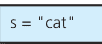
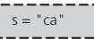
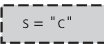


此调用完成执行，并进行返回。

输出流：

```
进入 writeBackward，字符串：cat

准备写入字符串的最后一个字符：cat

t

进入 writeBackward，字符串：ca

准备写入字符串的最后一个字符：ca

a

进入 writeBackward，字符串：c

准备写入字符串的最后一个字符：c

c

进入 writeBackward，字符串：

退出 writeBackward，字符串：

退出 writeBackward，字符串： c

退出 writeBackward，字符串：ca

退出 writeBackward，字符串：cat
```


你能够熟悉这两个函数之间的差异。这两个函数所做的递归调用调为参数 `s` 产生了不同的值序列。尽管如此，这两个函数都正确地反向写了字符串参数。它们通过在相对于递归调的不同位置向字符串中写入不同的字符，来补偿这种值序列上的差异。从图 2-8 和图 2-9 中的箱盒追踪来说，`writeBackward` 在生成一个新箱子之前（在产生新的递归调用之前）写入一个字符，而 `writeBackward2` 则在划掉一个箱子之后（在从递归调用返回之后）写入一个字符。将它们结合起来，结果是两个采用不同策略完成任务的函数。

### 放置恰当的临时 `cout` 语句可以帮助你调试递归函数

这个示例说明了箱盒追踪结合放置恰当的 `cout` 语句在调试递归函数的价值。递归函数开头、内部和结尾的 `cout` 语句返回参数 `s` 的值。通常，在调试递归函数时，你还应该报告局部变量的值以及函数中发生每次递归调用的位置，如例所示：

```
abc(...);
```

```
cout << "Calling function abc from point A.\n";
abc(...); // 这就是点 A
```

```
cout << "Calling function abc from point B.\n";
abc(...); // 这就是点 B
```

### 在调试完函数后删除 `cout` 语句

意识到 `cout` 语句并不属于函数的最终版本。

## 图 2-9 伪代码中 `writeBackward2("cat")` 的箱盒追踪

进行初始调用，函数开始执行：

```c
s = "cat"
```

输出流：

```
进入 writeBackward2，字符串：cat
```

到达点 A，进行递归调用。新的调用开始执行：

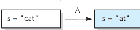

输出流：

```
进入 writeBackward2，字符串：cat
进入 writeBackward2，字符串：at
```

到达点 A，进行递归调用。新的调用开始执行：

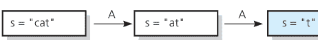

输出流：

```
进入 writeBackward2，字符串：cat
进入 writeBackward2，字符串：at
进入 writeBackward2，字符串：t
```

到达点 A，进行递归调用。新的调用开始执行：

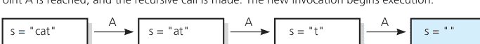

此调用完成执行，并进行返回。

输出流：

```
进入 writeBackward2，字符串：cat
进入 writeBackward2，字符串：at
进入 writeBackward2，字符串：t
进入 writeBackward2，字符串：""
退出 writeBackward2，字符串：
```

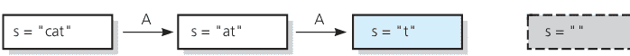

此调用完成执行，并进行返回。

输出流：

```
进入 writeBackward2，字符串：cat
进入 writeBackward2，字符串：at
进入 writeBackward2，字符串：t (继续)
```

## 图 2-9 伪代码中 `writeBackward2("cat")` 的箱盒追踪（续）

```
进入 writeBackward2，字符串：
退出 writeBackward2，字符串：
准备写入字符串的第一个字符：t
退出 writeBackward2，字符串：t
```

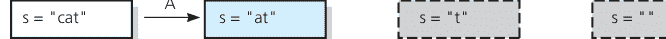

此调用完成执行，并进行返回。

输出流：

```
进入 writeBackward2，字符串：cat
进入 writeBackward2，字符串：at
进入 writeBackward2，字符串：t
退出 writeBackward2，字符串：
退出 writeBackward2，字符串：t
准备写入字符串的第一个字符：t
退出 writeBackward2，字符串：t
准备写入字符串的第一个字符：a
退出 writeBackward2，字符串：at
准备写入字符串的第一个字符：cat
退出 writeBackward2，字符串：at (92_1)
```

**问题 3：** 给定一个整数 `$n > 0$`，编写一个递归函数 `countDown`，输出整数 `$n-1, \dots, 1$`。提示：你可以完成哪些任务，哪些任务可以请朋友完成？

## 2.4 数组与递归

当你处理数组时，递归可以是一个实用且强大的工具。对于你的第一个示例，我们反向写入数组的内容。然后，我们来看看几个涉及数组搜索的问题。

### 2.4.1 反向写入数组的条目

这个问题的解决方案与我们在 2.3.1 节中反向写字符串的第一个解决方案非常相似。我们可以编写以下伪代码：

```
writeArrayBackward(anArray: char[])
if (数组为空)
    什么什么都不做——这是基例情况
else {
    写入 anArray 中的最后一个字符
    writeArrayBackward(去掉了最后一个字符的 anArray)
}
```

我们将如何将去掉了最后一个字符的数组传递给 `writeArrayBackward` 呢？我们可以传递数组中剩余字符的数量。在每次递归调用中，我们让这个数字减 1。或者，我们可以传递最后一个字符的索引。如果是这样，`writeArrayBackward` 将作用于 `anArray[0..last]`，即从 `anArray-0` 到 `anArray[last]` 的位置。那么递归调用将作用于 `subArray[0..last-1]`。这种更通用的变体还传递了第一个字符的索引。我们不再假设该索引为 0，而是将 `anArray[first..last]` 传递给 `writeArrayBackward`。

我们可以如下编写函数 `writeArrayBackward`：

```cpp
/* 反向写入数组中的字符。
@param size 数组包含 size 个字符，其中 size >= 0。
@param anArray 要反向写入的数组。
@param first 数组中第一个字符的索引。
@param last 数组中最后一个字符的索引。 */
void writeArrayBackward(const char anArray[], int first, int last) {
    if (first <= last) {
        // 写入最后一个字符
        cout << anArray[last];
        // 反向写入数组剩余部分
        writeArrayBackward(anArray, first, last - 1);
    }
    // first > last 是基例——什么都不做
}
// writeArrayBackward 
```


# 第 2 章 递归：镜子

**问题 4：** 在之前的 `writeArrayBackward` 中，为什么 `first` 的值超过 `last` 时发生基例？

**问题 5：** 编写一个递归函数，计算并返回数组中的前 `$n \ge 1$` 个实数。

**问题 6：** 说明你在上一个问题中写的函数是如何满足递归属性的。

**问题 7：** 编写一个递归函数，计算并返回 `anArray[first..last]` 中的整数。

### 2.4.2 二分查找

搜索是一项频繁的任务。通常，搜索是数组中的特定条目。我们将检查几个具有递归解决方案的搜索问题。我们的目标是培养对递归的理解。

本章从二分查找算法的直观方法开始，通过在高层展示一种在字典中查找单词的方法。我们现在完整开发该算法并说明一些重要问题。

回顾早用于字典问题的解决方案：

```
search(dictionary: Dictionary, word: string)
if (字典大小为一页)
    扫描页面查找单词
else
    打开字典到中间附近的位置
    确定单词在字典的部分
if (word 在字典的前半部分)
    search(字典的前半部分, word)
else
    search(字典的后半部分, word)
```

现在改变问题为在整数数组中搜索给定值，字典必须经过排序，否则二分查找不适用。因此，假设

```
anArray[0] anArray[1] anArray[2] ... anArray[size - 1]
```

其中 `size` 是数组的大小。数组问题的层层二分查找如下：

```
binarySearch(anArray: ArrayType, target: ValueType)
if (anArray 大小为 1)
    确定 anArray 的值是否等于 target
else
    找到 anArray 的中点
    确定 target 在 anArray 的哪部分
    if (target 在 anArray的前半部分)
        binarySearch(anArray的前半部分, target)
else
        binarySearch(anArray 的后半部分, target)
```

# 数组中的递归 69

尽管该解决方案在概念上是合理的，但在实现算法之前，你必须考虑几个细节：

- 1. 你将如何将数组的一半传递给 `binarySearch` 的递归调用？你可以在每次调用时传递整个数组，但让 `binarySearch` 只处理 `anArray[first..last]`，即 `anArray[first]` 到 `anArray[last]` 的部分。然后，你还需要将整数 `first` 和 `last` 传递给 `binarySearch`：

```
binarySearch(anArray, first, last, target)
```

按照这种约定，中间点由公式给出：

```
mid = (first + last) / 2
```

那么 `binarySearch(anArray的前部分, target)` 变为：

```
binarySearch(anArray, first, mid - 1, target)
```

而 `binarySearch(anArray的后部分, target)` 变为：

```
binarySearch(anArray, mid + 1, last, target)
```

- 2. 你如何确定数组的哪一半包含 `target`？一种可能的实现方式是

```
target in the first half ofanArray
```

即

```
target < anArray[mid]
```

然而，并没有对 `target` 和 `anArray[mid]` 之间的相等性进行测试。这种遗漏会导致算法错过 `target`。折半算法将 `anArray` 分为两半；`anArray[mid]` 并不在数组的任何一半中（在这种情况下，两个半部分并不等于一个整体！）。因此，你必须确定 `anArray[mid]` 是否是你所寻找的值，因为 `target` 不在数组的剩余另一半中。停止准则与终止条件（基准情况）之间的交互是微妙的，并且往往是错误的根源。我们需要重新考虑基准情况。

- 3. 基准情况应该是什么？由于 `binarySearch` 在数组大小为 1 时终止（这是折半的唯一情况），通过折半过程可以正确地实现二分查找，使其只有这一个基准情况。然而，拥有两个不同的基准情况可能会更清晰：

    - `first = last`。当 `target` 不在原始数组中，你会到达这个基准情况。
    - `target = anArray[mid]`。当 `target` 在原始数组中，你会到达这个基准情况。

这些基准情况与你以前遇到的任何情况都不同。在某种意义上，算法通过它所到达的情况来确定问题的答案。许多算法都有这种标记。

- 4. `binarySearch` 将如何指示搜索结果？如果 `binarySearch` 成功在数组中找到 `target`，它可以返回与 `target` 相等的数组值的索引。此索引永远不会是负数；如果 `binarySearch` 在数组中没有找到 `target`，则可以返回一个负值。

接下来的 C++ 函数 `binarySearch` 实现了这些思想。为了以后追踪该函数，对 `binarySearch` 的两次递归调用标记为 X 和 Y。

# 第 2 章 递归：镜镜

```cpp
/** 使用二分查找在 anArray[first] 到 anArray[last]
 * 中搜索一个给值。
 * @pre 0 <= first, last <= SIZE - 1, 其中 SIZE 是数组
 * 最大大小，且 anArray[first] <=
 * anArray <= ... <= anArray[last];
 * @post anArray 保持不变，要么 anArray[index] 包含
 * 给值或 index == -1。
 * @param anArray 要搜索的数组。
 * @param first 开始搜索的低索引。
 * @param last 停止搜索的高索引。
 * @return 索引，使得 anArray[index] == target，或者返回 -1。
 */
int binarySearch(const int anArray[], int first, int last, int target)
{
    int index;
    if (first > last)
        index = -1; // target 不在原始数组中
    else {
        // 如果 target 在 anArray 中
        // anArray[first] <= target < anArray[last]
        int mid = first + (last - first) / 2;
        if (target == anArray[mid])
            index = mid; // 在 anArray[mid] 找到 target
        else if (target < anArray[mid])
            // 点 X
            index = binarySearch(anArray, first, mid - 1, target);
        else
            // 点 Y
            index = binarySearch(anArray, mid + 1, last, target);
    } // 结束
    return index;
}
```


注意，如果 `target` 出现在数组中，它必须位于由 `first` 和 `last` 定义的段内。也就是说，以下公式成立：

`anArray[first] <= target <= anArray[last]`

图 20 显示了 `binarySearch` 在搜索包含 1, 5, 9, 12, 15, 21, 29 和 31 的数组时的追踪。注意两次递归调用的标记 X 和 Y 如何出现在图中。本章末的第 16 练习要求你使用此函数进行其他的框追踪。


> 注意：在开发递归解决方案时，你必须确保较小问题的解决方案确实提供了原始问题的解决方案。例如，`binarySearch` 之能工作是因为每个较小的数组都是有序的，且所求的值位于第一个和最后一个值之间。

还有另一个实现问题——专门针对 C++ 的。回数组是通过引用传递的，因此数组不会被复制。如果数组是通过值传递的，将浪费大量的内存和时间。因为数组是通过引用传递的，它没有复制。C++ 的这一特性在数组很大时特别有用。

# 数组中的递归

如果数组是通过引用传递的，因此数组不会被复制。如果数组是通过值传递的，将浪费大量的内存和时间。因为数组是通过引用传递的，它没有复制。C++ 的这一特性在数组很大时特别有用。

图 20 显示了 `binarySearch` 在搜索包含 1, 5, 9, 12, 15, 21, 29 和 31 的数组时的追踪。注意两次递归调用的标记 X 和 Y 如何出现在图中。本章末的第 16 练习要求你使用此函数进行其他的框追踪。

> 注意：在开发递归解决方案时，你必须确保较小问题的解决方案确实提供了原始问题的解决方案。例如，`binarySearch` 之能工作是因为每个较小的数组都是有序的，且所求的值位于第一个和最后一个值之间。


# 数组中的递归

图 2-12 最大值问题的递归解决方案

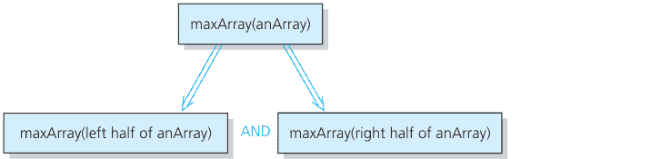

图 2-13 `maxArray(<1, 6, 8, 3>)` 生成的递归调用

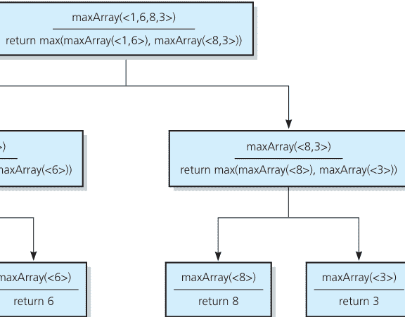

之前的两个示例展示了在任意数组中寻找最大值以及在有序数组中寻找最大值的递归技术。本示例描述了在任意数组 `anArray` 中寻找第 $k^{th}$ 小值的递归解决方案。你会对这种值感兴趣吗？统计学中的中位数通常是指数据集中中间的值。在有序数据集中，中位数位于集合的中间。在无序数据集中，小于中位数的数值个数与大于中位数的个数大约相等。因此，如果你有 49 个值，那么第 25 小的数值就是中位数。

显然，你可以通过排序数组来解决这个问题。那么第 $k^{th}$ 小的值将是 `anArray[k-1]`。虽然这种方法是一个有效的解决方案，但它超出了问题的需求；存在更高效的解决方案。这里概述的解决方案可以在不完全排序数组的情况下找到第 $k^{th}$ 小值。

到目前，你已经知道通过将问题写成一个或多个相同类型的问题来递归地解决问题，这种“更小”的概念确保了你始终能到达基情况（base case）。对于之前所有的递归解决方案，递归调用之间的问题规模缩小是可以预测的。

第 2 章 递归：镜像

例如，阶阶函数将问题规模减少 1；二分查找总是将问题规模减半。此外，除了二分查找外，之前所有示例的基情况具有静态的预定义大小。因此，通过知道原始问题的大小，你可以确定到达基情况之前所需的递归调用次数。

对于之前所有的示例，你知道每次递归调用问题规模缩小的程度。你能够解决的第 $k^{th}$ 小值解决方案取决于问题相对于数组中值的缩小程度，且无法预先预测。此外，基情况的大小取决于数组中的值，正如你在搜索时所做的那样。（回想一下，当中间值就是所求值时，它是二分查找的基情况之一）。

这种解决方案的不可预测性在于本身：数组中任何预定义部分的值与整个数组中值的排名之间的关系不足以确定第 $k^{th}$ 小值。例如，假设 `anArray` 包含图 2-14 所示的值。注意，位于 `array[3]` 中的 6 是 `anArray` 前半部分中的第三小值，而位于 `array[4]` 中的 8 是 `anArray` 后半部分中的第三小值。从这些观察中，你可以推出数组的哪些部分无法让你对整个数组得出任何有用的结论。你也应该尝试其他的划分方案。

你无法预先预测第 $k^{th}$ 小值递归解决方案中较小问题或基情况的大小。

## 图 2-14 示例数组

| 前半部分 | | 后半部分 | | | | | | |
|---|---|---|---|---|---|---|---|
| 4 | 7 | 3 | 6 | 8 | 1 | 9 | 2 |
| 0 | 1 | 2 | 3 | 4 | 5 | 6 | 7 |

1. 在数组中选择一个枢值（pivot value）
2. 巧妙地安排或划分数组中的值相对于该枢值
3. 递归地将该策略应用于其中一部分

将 `anArray` 划分为三个部分：$< p$，$= p$， 和 $\ge p$

假设你想在段 `anArray[first...last]` 中寻找第 $k^{th}$ 小值。令枢值 $p$ 为该段中的任意值。（现在，如何选择 $p$ ）。你可以将 `anArray[first...last]` 中的值划分为三个区域：$S_1$，包含小于或等于 $p$ 的值；$p$ 本身；以及 $S_2$，包含大于等于 $p$ 的值。这种划分意味着 $S_1$ 中的所有值都不大于 $S_2$ 中的所有值。图 2-15 阐述了这种划分

`anArray[first...pivotIndex-1...last]` 中的所有值都大于或等于 $p$，而 `anArray[pivotIndex+1...last]` 中的所有值都小于或等于 $p$。注意区域 $S_1$ 和 $S_2$ 的大小取决于 $p$ 和其他值。这种划分分解了较小的问题，使得其中一个问题将解决原始问题：

### 数组递归 75

- 1. 如果 $S_1$ 包含段 `anArray[first...last]` 的 $k$ 个或更多值。在这种情况下，第 $k^{th}$ 小值必须在 $S_1$ 中。由于 $S_1$ 是段 `anArray[first...pivotIndex-1]`，当 $k < pivotIndex - first + 1$ 时发生此情况。

### 图 2-15 关于枢值的划分


- 2. 如果 $S_1$ 的值小于 $k$ 个且 $S_2$ 的值也小于 $k$ 个，那么第 $k^{th}$ 小值就是 $p$。
- 3. 如果 $S_1$ 的值小于 $k$ 个且 $S_2$ 的值有 $k$ 个或更多，那么第 $k^{th}$ 小值必须在 $S_2$ 中。

你能够解决的第 $k^{th}$ 小值解决方案取决于问题相对于数组中值的缩小程度，且无法预先预测。此外，基情况的大小取决于数组中的值，正如你在搜索时所做的那样。（回想一下，当中间值就是所求值时，它是二分查找的基情况之一）。这种解决方案的不可预测性在于：数组中任何预定义部分的值与整个数组中值的排名关系不足以确定第 $k^{th}$ 小值。例如，假设 `anArray` 包含图 2-14 所示的值。注意，位于 `array[3]` 中的 6 是 `anArray` 前半部分中的第三小值，而位于 `array[4]` 中的 8 是 `anArray` 后半部分中的第三小值。从这些观察中，你可以推出数组的哪些部分无法让你对整个数组得出任何有用的结论。你也应该尝试其他的划分方案。你无法预先预测第 $k^{th}$ 小值递归解决方案中较小问题或基情况的大小。

```
// 返回 anArray[first...last] 中的第 k 小值

kSmall(k: integer, anArray: ArrayType,
  first: integer, last: integer): ValueType
  // 从 anArray[first...last] 选择一个枢值
  // 关于 p 划分 anArray[first...last] 的值
  if (k < pivotIndex)
    return kSmall(k, anArray, first, pivotIndex - 1)
  else if (k == pivotIndex)
    return p
  else
    return kSmall(k - pivotIndex, anArray, pivotIndex + 1)
```

递归解决方案通过：
1. 在数组中选择一个枢值
2. 巧妙地安排或划分数组中的值相对于该枢值
3. 递归地将该策略应用于其中一部分

假设你想在段 `anArray[first...last]` 中寻找第 $k^{th}$ 小值。令枢值 $p$ 为该段中的任意值。（现在，如何选择 $p$ ）你可以将 `anArray[first...last]` 中的值划分为三个区域：$S_1$，包含小于或等于 $p$ 的值；$p$ 本身；以及 $S_2$，包含大于等于 $p$ 的值。这种划分意味着 $S_1$ 中的所有值都不大于 $S_2$ 中的所有值。图 2-15 阐述了这种划分。`anArray[first...pivotIndex-1...last]` 中的所有值都大于或等于 $p$，而 `anArray[pivotIndex+1...last]` 中的所有值都小于或等于 $p$。注意区域 $S_1$ 和 $S_2$ 的大小取决于 $p$ 和其他值。这种划分分解了较小的问题，使得其中一个问题将解决原始问题：

- 1. 如果 $S_1$ 包含段 `anArray[first...last]` 的 $k$ 个或更多值。在这种情况下，第 $k^{th}$ 小值必须在 $S_1$ 中。由于 $S_1$ 是段 `anArray[first...pivotIndex-1]`，当 $k < pivotIndex - first + 1$ 时发生此情况。
- 2. 如果 $S_1$ 的值小于 $k$ 个且 $S_2$ 的值也小于 $k$ 个，那么第 $k^{th}$ 小值就是 $p$。
- 3. 如果 $S_1$ 的值小于 $k$ 个且 $S_2$ 的值有 $k$ 个或更多，那么第 $k^{th}$ 小值必须在 $S_2$ 中。

## 2. 组织数据

给定以某种方式组织的数据，你可能需要以另一种方式组织它。因此，你实际上会改变某些数据，而不是仅仅是搜索它。本节的问题被称为汉诺塔。虽然这个经典问题没有现实应用，但我们考虑它是因为它的解决方案很好地说明了递归的使用。

### 2.1. 汉诺塔

很多多年前，在东方的遥远地区——越南的河内市——皇帝的智者去世加入了祖先。皇帝需要一位替代的智者。皇帝本身是一个明智的人，他设计了一个谜题，宣布解决谜题的人可以胜智者的工作。

图 2-16 (a) 初始状态；(b) 将 $n-1$ 个盘子从 A 移动到 C；(c) 将 1 个盘子从 A 移动到 B；(d) 将 $n-1$ 个盘子从 C 移动到 B

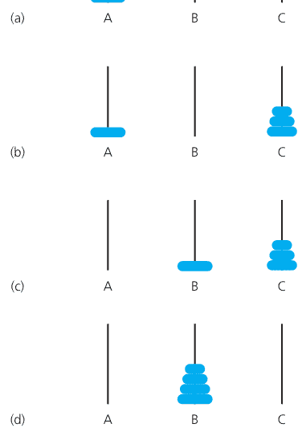

# 数据组织

由于管理人的职位通常被认为是一项轻松的工作，因此有许多申请者。学者和农民都向皇帝呈交了他们的。许多方案长达数千步，而且许多方案还包含深度嵌套的循环和控制结构。“我无法理解这些解决方案，”皇帝大吼道，“一定有一个简单的方法来解决这个谜题。”

这时，一位大和尚出山面见皇帝。“孩子，”他说，“这个谜题很简单，它几乎是自动解决的。”皇帝的安保主管想把这个怪人赶出去，但皇帝允许他留下。

“如果你只有一个盘子（即 $n=1$），将它从 A 柱移动到 B 柱。”到为止还好，但即使是村里的傻瓜也能做到。“如果你有多个盘子（即 $n>1$），只需：

- 1. 忽略底部的盘子，并将 C 柱视为目标柱、B 柱视为源柱（见图 2-16b）。
- 2. 完成此操作后，$n-1$ 个盘子会在 C 柱上，最大的盘子将留在 A 柱上。通过将大盘子从 A 移动到 B 来解决 $n$ 问题（我记得即使村里的傻瓜也能这样做）（见图 2-16c）。
- 3. 现在你必须将 $n-1$ 个盘子从 C 柱移动到 B 柱；即以 C 柱为源柱、B 柱为目标柱、A 柱为备用柱解决问题（见图 2-16d）。

现场沉默了一刻，最后皇帝不耐烦地说：“好了，你到底要不要告诉我们你的解决方案？”和尚露出神秘的微笑消失了。

皇帝显然不是一个递归思考者，但你应该意识到，你可以通过解决三倍数量盘子的塔来解决和尚的方案。让我们用 `(count, source, destination, spare)` 来定义使用 spare 柱将盘子从 source 柱移动到 destination 柱的问题。注意，如果 source 柱上的盘子多于 `count`，则这种方法是有意义的；在这种情况下只需关注顶部的盘子而忽略其他的。同样，目标柱和源柱在你移动它们之前上面也有盘子；也忽略这些，仅是你只能在它们上面放置更小的盘子。

你可以将皇帝的问题重新表述为：从 A 柱上的 $n$ 个盘子和 B、C 柱上的零盘子开始，解决 `(n, A, B, C)`。你可以按照以下方式解决和尚的方案：

**步骤 1。** 从初始状态——所有盘子都在 A 柱上开始——解决问题 towers `(n-1, A, C, B)`。即忽略底部（最大）盘子，并使用 B 柱作为备用柱，将顶部 $n-1$ 个盘子从 A 柱移动到 C 柱。完成后，最大的盘子留在 A 柱上，所有其他盘子都在 C 柱上。

**步骤 2。** 现在，最大的盘子在 A 柱，所有其他盘子在 C 柱，解决问题 towers `(1, A, B, C)`。即将最大的盘子从 A 移动到 B。这个盘子比 C 柱上的盘子大，你不能使用备用柱。但幸运的是——显然——在这种情况下你不需要使用备用柱。完成后，最大的盘子将在 B 柱，所有其他盘子留在 C 柱。

**步骤 3。** 最后，最大的盘子在 B 柱，所有其他盘子在 C 柱，解决问题 towers `(n-1, C, B, A)`。即使用 A 柱作为备用柱，将 $n-1$ 个盘子从 C 柱移动到 B 柱。注意目标柱 B 已经有了最大的盘子，你忽略它。完成后，你就解决了原始问题：所有的盘子都会在 B 柱上。

问题描述
解决方案

## 第 2 章 递归：镜像

`towers(count, source, destination, spare)` 问题有以下伪代码解决方案：

```
solveTowers(count, source, destination, spare)
if (count is 1)
    Move a disk directly from source to destination
else
    solveTowers(count - 1, source, spare, destination)
    solveTowers(1, source, destination, spare)
    solveTowers(count - 1, spare, destination, source)
```


这个递归解决方案遵循与在本章稍之前看到的递归解决方案相同的模式：

- 1. 你通过解决其他的 Towers来解决 Towers。
- 2. 这些其他的 Towers比原始问题小；它们需要移动的盘子更少。特别是，每次递归调用盘子的数量减少 1。
- 3. 当问题只有一个盘子时——即基础情况——解决方案是简单的。
- 4. 问题更小确保了你将到达基础情况。

解决问题需要你递归地解决更小的问题。图 2-17 展示了解决三个盘子问题的递归调用和顺序。现在考虑此算法的 C++ 实现。由于大多数计算机（在编写时）没有手臂，该函数通过向人类提供指令来移动盘子。因此，代表柱的参数类型为 `char`，参数可以是 'A'、'B' 和 'C'。调用 `solveTowers(3, 'A', 'B', 'C')` 产生输出：

```
Move disk from pole A to B

Move disk from pole A to C

Move disk from pole B to C

Move disk from pole A to B

Move disk from pole C to A

Move disk from pole A to B
```

`solveTowers(3, A, B, C)` 产生的递归调用顺序见图 2-17。Towers 问题的解决方案三个盘子的递归解决方案的四个标准：`img/d0cb862f18b2db56996ad7c743510e4_0.png`

C++ 函数实现如下：

```cpp
void solveTowers(int count, char source, char destination, char spare) {
    if (count == 1) {
        cout << "Move disk from pole " << destination << endl;
    }
    else {
        solveTowers(count - 1, source, spare, destination); // X
        solveTowers(1, source, destination, spare); // Y
        solveTowers(count - 1, spare, destination, source); // Z
    }
} // end solveTowers
```

追踪函数 `solveTowers` 的执行以解决两个盘子的 Towers 问题。

一种可能的解决方案是定义 `rabbit(0)` 为 0，这似乎是人为的。另一种稍更有吸引力的替代方案是将 `rabbit(2)` 本身视为一个值为 1 的特殊情况。因此，递归定义有两种情况：`rabbit(2)` 和 `rabbit(1)`。递推定义为：

```
rabbit(n) = { 1 if n < 2 else rabbit(n - 1) + rabbit(n - 2) }
```

`rabbit(1)`, `rabbit(2)` 和 `rabbit(3)` 的序列也被称为斐波那契数列，模拟了许多自然发生的现象。`rabbit` 计算了斐波那契数列但效率极低。

## 2.6 更多示例

接下来三个问题需要你计算某些事件或事物的组合。它们是带有基础情况的递归解决方案的好例子。然而，这些解决方案效率极低且不实际。不要让这种低效率令你灰馁。递归并不总是如此，但它是有效的。你现在的目标是通过研究简单问题来理解递归。

兔子繁殖非常旺盛。如果兔子不繁殖，它们的数量很快就会失控。我们假设以下事实，这些事实是通过最近对随机抽样的调查获得的：

- 兔子永远不会死。
- 兔子在出生后恰好两个月成熟。
- 在每个月开始时，一对兔子会产生一只新生兔子。

假设从一对新生兔子开始。一对兔子。在第 6 个月会有多少对？由于数字较小，你可以得出结论：

- 第 1 个月：1对，原始兔子。
- 第 2 个月：1对，因为兔子尚未成熟。
- 第 3 个月：2对；原始兔子已成熟并产下第二对兔子。
- 第 4 个月：3对；原始兔子再次产下，但第 3 个月出生的兔子尚未成熟。
- 第 5 个月：5对；第 3 个月的（2对）现在已成熟。将它们的后代加上第 4 个月的（3对）得到 5 对。
- 第 6 个月：8对；来自第 4 个月的 3 对新生兔子加上第 5 个月的 5 对兔子。

### 2.6.1 斐波那契数列（兔子繁殖）

你现在可以为 `rabbit(n)` 即第 n 个月的兔子对构造一个递归解决方案。你必须确定如何使用 `rabbit(n - 1)` 来计算 `rabbit(n)`。观察到 `rabbit(n)` 是 n 月开始前的对子数量与在 n 月开始时出生的对子数量之和。在 n 月开始之前，有 `rabbit(n-1)` 对兔子。这些兔子中并非在 n 月开始时都是成熟的。只有在 n-2 月存活的兔子在 n 月开始时准备好繁殖。因此，如果 n 月开始时出生的对子数量是 `rabbit(n-2)`，你也就得到了 n 月数量的递推关系：

```
rabbit(n) = rabbit(n - 1) + rabbit(n - 2)
```

图 2-18 展示了这种关系。

图 2-18 兔子问题的递归解决方案：`img/d0cb862f18b2db56996ad7c743510e106_0.png`

这种递推关系——与之前的示例一样——通过解决多个相同类型的小问题来解决问题。概念并不困难，但在选择基础情况时必须小心。倾向于认为 `rabbit(1)` 是基础情况，因为根据问题陈述它的值为 1。但 `rabbit(2)` 呢？将递推定义应用于 `rabbit(2)` 将产生：

```
rabbit(2) = rabbit(1) + rabbit(0)
```

因此，递归定义需要指定第 0 个月存活的对子数量——未定义的数据量。

## 图 2-19 rabbit(7) 生成的递归调用

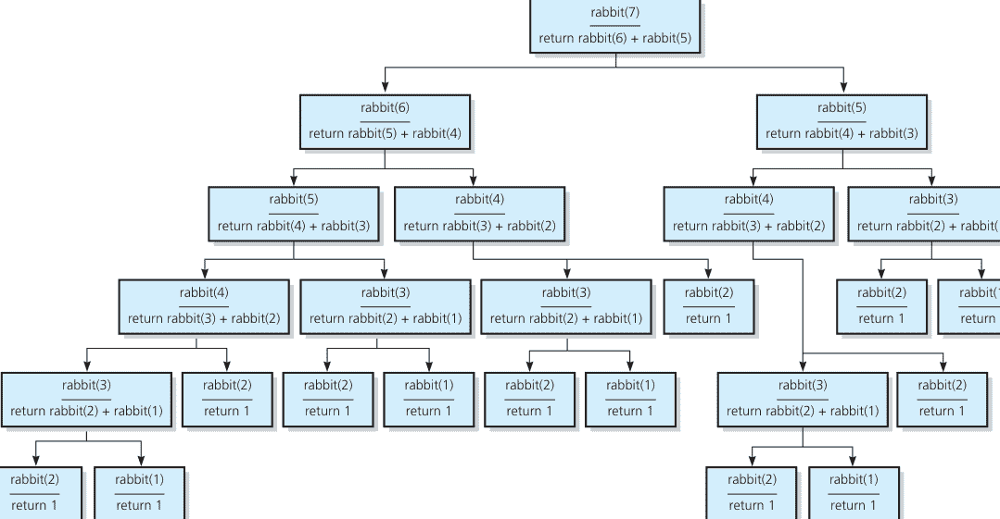

# 82 第 2 章 递归：镜中世界

你真的应该使用这个函数吗？图 2-19 展示了 `rabbit(7)` 产生的递归调用。考虑一下 `rabbit(10)` 产生的递归调用次数。在最好的情况下，该函数也是低效的。因此，对于较大的 $n$ 值来说，它是不可行的。这个问题将在本章末尾进行更详细的讨论，届时你将看到从这种相同的递归关系生成更高效解决方案的技巧。

> 注意：频繁重新计算值的递归解决方案可能非常低效。在这种情况下，迭代可能比递归更优。

## 2.6.2 组织游行

你被要求组织七月四日游行，游行将由单行排开的乐队和游花车组成。去年，相邻的乐队试图互相避开对方。为了避免这个问题，赞助商要求你永远不要让一个乐队紧随另一个乐队。你有多少种方法可以组织长度为 $n$ 的游行？

假设你有至少 $n$ 支行军乐队和 $n$ 辆花车供选择。在计算组织游行的数量时，假设“花车-乐队”和“乐队-花车”是不同的，计为两种。游行可以以花车结束，也可以以乐队结束。组织游行的方法数等于每种类型游行数量之和。即：

$P(n)$ = 组织长度为 $n$ 的游行的方法数
$F(n)$ = 以花车结束的长度为 $n$ 的游行数量
$B(n)$ = 以乐队结束的长度为 $n$ 的游行数量

$P(n) = F(n) + B(n)$

首先，考虑 $F(n)$。如果你通过在任何长度为 $n-1$ 的有效游行的末尾放置一个花车来获得长度为 $n$ 且以花车结束的游行，那么这种花车结束有效游行的数量正好等于长度为 $n-1$ 的有效游行的总数；即：

$F(n) = P(n-1)$

接下来，考虑 $B(n)$。以乐队结束的唯一方法是该单位恰好在花车之前（如果是这样，就会出现相邻乐队）。组织一个长度为 $n$ 的以乐队结束的有效游行的唯一方法，是组织一个长度为 $n-1$ 且以花车结束的游行，然后在末尾添加一个乐队。因此，以乐队结束的有效游行的数量正好等于长度为 $n-2$ 的游行数量：

$B(n) = P(n-2)$

因此，你分别用较小问题 $P(n-1)$ 和 $P(n-2)$ 得到了 $F(n)$ 和 $B(n)$。然后你得到：

$P(n) = F(n) + B(n)$

这种递归关系的形式与 `rabbit` 问题的解决方案完全相同。正如你在 `rabbit` 问题中看到的，两个基础情况是必不可少的，因为递归根据两个较小的问题来定义一个问题。正如你在处理 `rabbit` 问题时所的那样，你可以选择 $n=1$ 和 $n=2$ 作为基础情况。两个问题在基础情况下都使用相同的 $n$ 值，没有理由认为 `rabbit(1)` 等于 $P(1)$ 且 `rabbit(2)` 等于 $P(2)$。需要两个基础情况是因为存在两个较小的问题。稍微思考一下发现，游行：

$P(1)=2$（长度为 1 的情况有花车和乐队）。
$P(2)=3$（长度为 2 的情况有花车-乐队、乐队-花车、花车-花车）。

## 2.7 递归与效率

递归是一种强大的解决问题技术，通常能为复杂问题提供简洁的解决方案。通过递归，你可以编写简单、短小的实现。

本章的首要任务是让你对递归有深入的理解，以便你能够构建自己的递归解决方案。然而，许多递归解决方案是低效的，至于你不应该使用它们。递归函数 `binarySearch` 和 `sortTowers` 是显著的例外，因为它们非常高效。

两个因素导致了递归解决方案的低效：

- 函数调用的开销
- 递归算法固有的低效

第一个因素并非专门针对递归函数，而是适用于所有函数。在 C++ 以及其他高级编程语言的大多数实现中，函数调用会产生某种数量的维护开销。这类似于框追踪中的一个框。递归函数放大了这种开销，因为单次初始函数调用就会产生大量的递归调用。例如，`factorial(n)` 会产生 n 次递归调用。另一方面，递归的使用（正如一般的模块化一样）可以极大地清晰复杂的程序。这种清晰性往往超过抵消了额外的开销。

> 递归可以清晰解决方案

第 5 章和第 11 章展示了递归的其他实际、高效的应用。

## 第 2 章 递归：镜子

如果递归解效率低下，且你已经有一个清晰、高效的迭代解，请不要使用递归解。

然而，你不应该为了使用递归而使用递归。例如，在实践中，你可能不应该使用递归函数。你可以很容易写出一个迭代版本的阶乘函数，即在本章前面陈述的迭代定义。该迭代函数和递归函数一样清晰，而且效率更高。当使用递归无法带来收益时，没有理由去承担递归带来的开销。只有当一个问题没有迭代解时，递归才真正具有真正的价值。

关于递归和效率的第二点是，某些算法从本质上就是低效的。这种低效与开销问题是完全不同的概念。它与编译器如何实现递归函数无关，而是与算法所采用的技术有关。

例如，考虑在本章中你可以解决的乘法问题的递归解：

```
rabbit(n) = if n is 1 or 2
  rabbit(n - 1) + rabbit(n - 2) if n > 2
```

图 2-19 中的图说明了 `rabbit(7)` 的复杂度。早些时候，你被要求思考 `rabbit(10)` 的图会是什么样子。如果你思考过这个问题，可能会得出结论：这样的图将填满这里的大部分内容。而 `rabbit(100)` 的图将填满整个宇宙！

`rabbit` 的根本问题在于它不断重复地计算相同的值。对于中等大的 `n`，这些值被字面地重新计算了数万亿次。这种巨大的计算量使得解变得不可行，即使每次计算只需要微不足道的工作量。

然而，不要推断出递归关系是有用的。解决该问题的方法之一是基于该递归关系构造一个迭代解。迭代解向前向后移动计算，并且每个值只计算一次。你可以使用以下迭代函数计算 `rabbit(n)`，即使对于很大的 `n` 值也是如此。

你可以使用 `rabbit` 的递归关系构造一个高效的迭代解

```cpp
/* 兔子问题的迭代解。 */
iterRabbit(int n) {
  // 初始化基础情况：
  int previous = 1; // 初始为 rabbit(1)
  int current = 1; // 初始为 rabbit(2)
  int next; // 当 n 为 1 或 2 的结果
  // 当 n >= 3 时计算下一个 rabbit 值
  for (int i = 3; i <= n; i++) {
    current = rabbit(i - 1), previous = rabbit(i - 2)
    next = current + previous;
    // ... 为了清晰而修正的逻辑
  } // end for
  return next;
}
```

如果发现递归解更简单，但使用迭代解可能更高效，请将递归转换为迭代

因此，迭代解可能比递归解更高效。在某些情况下，发现递归解可能比发现迭代解更容易。因此，你可能需要将递归解转换为迭代解。如果你的递归函数只调用一次而不是两次，那么这种转换过程就很简单。在决定你的函数是否多次调用自己时，请务必小心。

## 递归与效率 87

`function binarySearch` 调用了自己，尽管你在 C++ 代码中看到了两个调用。这两个调用出现在一个 `if` 语句中，只有其中一个会被执行。

当递归调用是函数采取的最后一个动作时，将递归解转换为迭代解会更加容易。这种情况被称为**尾递归**。例如，函数 `writeBackward` 表现出尾递归，因为它的调用是函数采取的最后一个动作。尽管它的递归调用出现在函数定义的最后，但实际上的最后一个动作是乘法。因此，最后一个调用不是递归的。

### 尾递归函数

回想 `writeBackward` 的定义：

```
void writeBackward(string s)
{
    int length = s.size();
    if (length > 0)
    {
        // 写入最后一个字符
        cout << s.substr(length - 1, 1);
        writeBackward(s.substr(0, length - 1)); // 写入反转
    } // end if
} // end writeBackward
```

因为这个函数是尾递归的，它的递归调用可以简单通过更改参数来重复函数。你可以通过使用迭代来执行这种递归，这将是直观且通常更高效的。以下 `writeBackward` 的定义是迭代的：

### 消除尾递归通常也同样直接

```cpp
/* 迭代版本 */
void writeBackward(string s)
{
    int length = s.size();
    while (length > 0)
    {
        cout << s.substr(length - 1, 1);
        length--;
    } // end while
} // end writeBackward
```


因为尾递归函数通常比它们的对应版本效率低，而且由于递归函数转换为迭代函数的过程相当机械化，某些编译器会自动用尾递归消除替换尾递归。其他形式的递归通常更复杂，如果有必要，那是你需要亲自完成的任务。

某些算法（如 `rabbit`）从本质上是低效的，而其他算法（如二分查找 `binary search`）则是高效的。你将在更高级的算法分析课程中学习如何确定递归算法的效率。第 10 章简要介绍了这些技术中的一些。

第 5 章通过检查几个具有直接递归解的问题继续对递归的讨论。本书中的其他章节理所当然地使用了递归。

- **10** 在在本章中看到的以下递归函数，识别出哪些表现出尾递归：`fact`, `writeBackward`, `writeBackward2`, `rabbit`, 游行问题中的 `P`, `getNumberOfGroups`, `maxArray`

二分查找算法也有迭代形式。

## 第 2 章 递归：镜子

## 总结

- 1. 递归是一种通过解决更小规模的问题来解决问题的技术。
- 2. 在构造递归解时，记住以下四个问题：
    - a. 如何将问题定义为更小规模的问题？
    - b. 每次递归调用如何缩小问题规模？
    - c. 问题的哪个实例可以作为基础情况？
    - d. 随着问题规模缩小，你会到达这个基础情况吗？
- 3. 在构造递归解时，你应该假设递归调用满足了前提条件。
- 4. 你可以使用盒子跟踪递归函数的激活。这些盒子类似于激活记录，许多编译器使用它们来实现递归。虽然盒子有用，但它不能取代对递归的直观理解。
- 5. 递归允许你解决像哈诺塔这类难以构思的问题。即使是最复杂的问题也有直接的递归解。某些解比迭代解更容易理解、描述和实现。
- 6. 由于算法低效和函数调用开销，某些递归解比相应的迭代解低得多。在这种情况下，迭代解可能更优。然而，你可以利用递归解推导出迭代解。
- 7. 如果你可以容易且高效地通过迭代解决问题，就应该这样做。

## 练习题

- 1. 下面的递归函数 `getNumberEqual` 返回与 `desiredValue` 相等的整数数组。例如，如果 `x` 包含整数 1, 2, 4, 5, 6, 7, 8 和 9，那么 `getNumberEqual(x, 10, 4)` 返回值 2，因为 4 在 `x` 中出现了两次。
```c
int getNumberEqual(const int x[], int n, int desiredValue) {
    int count = 0;
    if (n <= 0)
        return 0;
    else {
        if (x[n - 1] == desiredValue)
            count = 1;
        return getNumberEqual(x, n - 1, desiredValue) + count;
    } // end else
} // end getNumberEqual
```
通过列出递归解的标准并说明该函数如何满足每个标准，证明该函数是递归的。

- 2. 对本章中以下递归调用进行跟踪。清晰地标出后续的每一次递归调用。
    a. `rabbit(5)`
    b. `countDown(5)` (你在检查点问题 3 中写的是 `countDown`.)

- 3. 编写一个递归函数，计算一个至少包含 `$n$` 个整数的数组中前 `$n$` 个整数的和。
  提示：从第 `$n$` 个整数开始。

- 4. 给定两个整数 `*start*` 和 `*end*`，其中 `*end*` 大于 `*start*`，编写一个递归 C++ 函数，返回从 `*start*` 到 `*end*` 的所有整数之和（包含边界）。

- 5. a. 修改 2.3.1 节中讨论的递归函数 `*writeBackward*`，使其基准情况为长度为 1 的字符串。
  b. 编写一个 C++ 函数，实现 2.3.1 节给出的伪代码函数 `*writeBackward*`。

- 6. 描述以下递归函数存在的问题：
```cpp
void printNum(int n)
{
    cout << n << endl;
    printNum(n - 1);
}
```

- 7. 给定一个整数 `$n > 0$`，编写一个递归 C++ 函数，输出整数 1, 2, . . , `$n$`。

- 8. 给定一个整数 `$n = 0$`，编写一个递归 C++ 函数，输出 `$n$` 的平方和。

- 9. 编写一个递归 C++ 函数，按反序输出一个正整数的各个数字。

- 10. a. 编写一个递归 C++ 函数 `*writeLine*`，通过重复某个字符形成一个包含 `$n$` 个字符的行。例如，`*writeLine('*', 5)*` 生成行 *****。
  b. 编写一个递归 C++ 函数 `*writeBlock*`，使用 `*writeLine*` 输出 `$m$` 行每行 `$n$` 个字符的内容。例如，`*writeBlock('*', 5, 3)*` 输出：
```
*****
*****
*****
```

- 11. 下面程序会产生什么输出？
```cpp
int getValue(int a, int b, int n);
int main()
{
    cout << getValue(1, 7, 7) << endl;
    return 0;
    // end main
int getValue(int a, int b, int n)
{
    int returnValue = 0;
    cout << "Enter: a = " << a << " b = " << b << endl;
    int c = (a + b)/2;
    if (c * c < n)
        returnValue = c;
    else
        returnValue = getValue(a, c-1, n);
    cout << "Leave: a = " << a << " b = " << b << endl;
    return returnValue;
}
// end getValue
```

- 12. 下面程序会产生什么输出？
```cpp
int search(int first, int last, int n);
int mystery(int n);
int main()
{
    cout << mystery(30) << endl;
    return 0;
} // end main
int search(int first, int last, int n)
{
    int returnValue = 0;
    cout << "Enter: first = " << first << " last = " << last << endl;
    int mid = (first + last) / 2;
    if (mid == n) && (n < (mid+1))
        returnValue = mid;
    else if (mid > n)
        returnValue = search(first, mid-1, n);
    else
        returnValue = search(mid+1, last, n);
    cout << "Leave: first = " << first << " last = " << last << endl;
    return returnValue;
} // end search
int mystery(int n)
{
    return search(n, n, n);
} // end mystery
```

- 13. 考虑以下函数，它将十进制数转换为八进制并显示结果。
```cpp
void displayOctal(int n)
{
    if (n > 0)
    {
        if (n / 8 > 0)
            displayOctal(n / 8);
        cout << n % 8;
    } // end if
} // end displayOctal
```
描述该算法的工作原理。使用 `$n = 100$` 对函数进行执行追踪。

- 14. 考虑以下程序：
```cpp
int f(int n)
int main()
{
    cout << "The value of f(8) is " << f(8) << endl;
    return 0;
} // end main
/* pre n >= 0. */
int f(int n)
{
    cout << "Function entered with n = " << n << endl;
    switch (n)
{
  case 0: case 1: case 2:
    return n + 1;
  default:
    return f(n-2) * f(n-4);
} // end switch
} end f
```
显示程序的精确输出。向函数 `$f$` 传递什么参数（如果有）会导致程序无限运行？

- 15. 考虑以下函数：
```cpp
void recurse(int x, int y)
{
  if (y > 0)
  {
    x++;
    y--;
    cout << x << " " << y << endl;
    recurse(x, y);
    cout << x << " " << y << endl;
  } // end if
} end recurse
```
使用 `$x = 5$` 和 `$y = 3$` 执行该函数。输出会受到影响吗？

- 16. 对以下递归函数执行追踪，使用 `$x = 5$` 和 `$y = 3$`：
  a. 5
  b. 13

- 17. 假设你有 101 个整数，且没有相同的数字。你创建一个 101 的数组；第一个整数是，第二个是，以此类推。你的朋友想知道是否存在 99。
  a. 如果你使用二分查找 99，你会先做什么？
  b. 二分查找将进行多少次比较？
  c. 如果大于 99，二分查找找到的索引是多少？

- 18. 考虑以下关系：
`f(1) = 1; f(2) = 1; f(3) = 2; f(4) = 3; f(5) = 5;` 对于所有 `$n > 5$`。
  a. 为 `$n = 6, 7, 12, 15$` 计算 `f(n)`。
  b. 如果你仔细地计算 `f(n)`，你将避免重复计算相同的值。（回顾本章末尾的递归函数。）

利用这些观察结果，编写一个计算任意 `f(n)` 的 C++ 函数。

- 19. 写递归函数 `fact`、`writeBinary` 和 `binarySearch` 的迭代版本。

- 20. 使用不变性证明 2.7 节中的迭代函数是正确的。（关于不变性的讨论见附录 F。）

- 21. 考虑寻找两个正整数 `$a$` 和 `$b$` 的最大公约数 (`gcd`) 问题。这里介绍的算法是欧几里得算法的一个版本，它基于：
**定理。** 如果 `$a, b$` 是正整数且 `$a > b$`，则 `gcd(a, b) = gcd(b, a \bmod b)`。

`gcd(a, b)` 与 `b, a \bmod b` 之间的关系是递归解的核心。它规定了如何通过相同类型的问题来求解 `gcd(a, b)`。此外，如果 `$b$` 整除 `$a$`，则 `$b = gcd(a, b)$`，因此合适的基准情况是 `$(a \bmod b) = 0$`。

- 22. 修改递归函数以便于理解。不要只打印“进入”和“退出”消息，而是通过缩进追踪来显示当前调用的“深度”。例如，递归调用 `rabbit(4)` 应该产生：
```
Enter: n = 4
  Enter: n = 3
    Enter: n = 2
      Enter: n = 1
      Leave: n = 1 value 1
    Leave: n = 2 value 1
  Leave: n = 3 value 2
Leave: n = 4 value 3
```
注意这如何对应图 2-19。

- 23. `power2` 和 `power3` 在计算 `$3^2$` 时执行多少次乘法？
- 24. `power2` 和 `power3` 在计算 `$3^2$` 时会有多少次递归调用？

本书使用作为数学运算的缩写。在 C++ 中，取模运算符是 `%`。

该定理引出了以下递归定义：
```cpp
$gcd(a,b) = \begin{cases} b & \text{if}(a \mod b) = 0 \\ gcd(b, a \mod b) & \text{otherwise} \end{cases}$
```
以下函数实现了这一递归算法：
```cpp
int gcd(int a, int b) {
    if (a % b == 0) // Base case
        return b;
    else
        return gcd(b, a % b);
} // gcd
```
- a. 证明该定理。
- b. 如果 `$b > a$` 会发生什么？
- c. 问题是如何变小的？（也就是说，你总是会接近一个基础情况吗？）为什么这个基础情况是合适的？

- 设 `c(n)` 为从整数 1 到 `n-1` 的整数中选出的不同整数组的数量，使得每组中的整数之和等于 `n`（例如，`n=4 = [1+1+1+1] = [1+1+2] = [2+2]`）。针对以下变体编写 `c(n)` 的递归定义：

- a. 你计算排列。例如，1, 2, 1 和 1 有两组数字之和为 4。
- b. 你忽略排列。

考虑以下递归定义：
```cpp
$Ackermann(m,n) = \begin{cases} n+1 & \text{if} m=0 \\ Ackermann(m-1,1) & \text{if} n=0 \\ Ackermann(m-1,Ackermann(m,n-1)) & \text{otherwise} \end{cases}$
```


这个函数，*Ackermann 函数*，是非常有趣的，因为它随着 $m$ 和 $n$ 值的增大而迅速增长。$Ackermann(1,2)$ 是多少？在 C++ 中实现该函数并对 $Ackermann(1,2)$ 进行盒图跟踪。（注意：即使对于 $m$ 和 $n$ 的取值较适中，Ackermann 函数也需要*大量的递归调用*。）

## 编程题

- 1. 实现一个递归函数来计算 $a^n$，其中 $a$ 是实数，$n$ 是非负整数。
- 2. 将第 2.4.3 节讨论的 `maxArray` 算法实现为 C++ 函数。你还能描述哪些关于 `maxArray` 的递归定义？
- 3. 为字符串数组实现本章介绍的 `binarySearch` 算法。
- 4. 将第 2.4.4 节讨论的 `kSmall` 算法实现为 C++ 函数。使用数组的第一个值作为基准。

# 第 3 章
基于数组的实现

## 目录
3.1 方法 96
3.1.1 核心方法 97
3.1.2 使用固定大小的数组 98
3.2 基于数组的 ADT Bag 的实现 98
3.2.1 头文件 99
3.2.2 定义核心方法 100
3.2.3 测试核心方法 103
3.2.4 实现更多方法 105
3.2.5 移除条目的方法 107
3.2.6 测试 110
3.3 在实现中使用递归 112
3.3.1 getIndexOf 方法 112
3.3.2 getFrequencyOf 方法 113

总结 114
练习题 114
编程题 115

## 先决条件

- 附录 A C++ 基础回顾
第 1 章 数据抽象：墙
C++ 插 1 C++ 类
第 2 章 递归：镜像（针对第 3.3 节）

你已经看到，在设计解决方案期间，必须对数据支持若干操作，因此需要定义抽象数据类型（ADT）。只有当你明确指定了 ADT 的操作后，才考虑用于实现它的数据结构。本章探讨了涉及数组作为底层数据结构的实现问题。

# 第 3 章 基于数组的实现

## 3.1 方法

ADT 是数据集合和对该数据的一组操作。

我们已经说过，一组数据集合加上对它进行的一组操作被称为抽象数据类型，或 ADT。例如，假设你想存储一个可以快速搜索的名字集合。这个名字集合加上添加名字、移除名字和搜索名字的操作，可以形成一个解决此问题的 ADT。

规范说明了 ADT 做什么，而不是如何实现它们。

之前，我们强调了抽象数据类型的规范。当你设计 ADT 时，你关注的是它的操作做了什么，而不是你实现得有多好。也就是说，ADT 操作的描述必须足够严谨，以完全指定它们对数据的影响，并且你不能指定如何存储数据或如何执行操作。例如，ADT 的操作不应指定将数据存储在内存位置还是不连续的内存位置中。结果应该是一组明确指定的操作。

当操作被明确指定时，我们如何实现 ADT？如果是的话，我们如何存储 ADT 的数据并执行它的操作？通过选择特定的数据结构来存储数据。数据结构是你定义的一种构造。（此处原文存在大量重复，已按要求清理）。

# 第 3 章 基于数组的实现

> **编程提示：** 在定义类时，实现并测试一组核心方法。从向对象容器添加元素的方法或已有具体实现的方法开始。

### 3.1.2 使用固定大小数组

在实现表示数据集合的抽象数据类型（ADT）时，你需要存储数据项并跟踪它们的数量。在基于数组的实现中，你将项存储在数组中。项将占据数组多少空间？可能是全部，但这种情况不太可能。然后，你需要跟踪已分配给容器的数组元素以及未来可用的元素。数组的最大长度——即其物理尺寸——是已知的，这是一个固定值，例如 `MAX_SIZE`。你可以跟踪数组中当前项的数量——即集合的逻辑大小。这种方法的一个明显优势是，实现一个报告该值的操作将非常简单。

当你向数组添加一个条目时，通常会将其放置在数组的第一个元素处——即索引 0。这并不是强制要求的，特别是对于实现容器的数组。例如，某些实现可以忽略索引 0 而使用索引 1 作为数组的第一个元素。有时你可能想使用数组末尾的条目而不是开头的条目。对于 bag ADT，我们没有理由不让对象从索引 0 开始。要求方法将对象连续地放入数组中无疑是合理的，但为什么要关心这一点呢？这是一个关注点，而且确实是一个问题！我们需要建立某些事实，或断言，以便我们计划的实现不会对其他方法产生不利。例如，vector 必须“知道”条目所在的位置。我们还需要定义当从容器中删除条目时会发生什么。如果坚持 bag 条目占据连续的元素，方法必须确保它们保持稳定。

在 `add` 将新条目放入最后一个可用数组元素后会发生什么？除非从数组中删除了条目，否则后续添加是不可能的。`add` 方法将返回一个布尔值来表示是否成功。在随后的插入 2 中，你将学习如何调整数组的大小。与其返回值，方法可以通过抛出异常来信号。插入 3 将讨论这种方法。参考第 1 章，ADT bag 的操作如下：

```
+getSize(): Integer

+isEmpty(): boolean

+add(newEntry: ItemType): boolean

+remove(anEntry: ItemType): boolean

+clear(): void

+getFrequency(ofEntry: ItemType): integer

+contains(anEntry: ItemType): boolean

+toVector(): vector
```

这些操作将成为我们类中的公共方法。每个方法都需要访问条目数组和 bag 中当前条目的数量。因此，我们将数组和计数器作为类的数据成员。由于长度的

img/d0cb8b2f182db569968adc743510e_124_0.png

## 基于数组的 ADT Bag 实现

数组定义 bag 的容量——即其最大尺寸——我们定义一个该大小的常量。为了向类的客户端隐藏这些数据成员，将其设为私有。因此，我们在类的头文件中定义了以下私有数据成员：

```
static const int DEFAULT_CAPACITY = 50;

Item items[DEFAULT_CAPACITY]; // bag 项数组

int itemCount; // bag 项计数

int maxItems; // bag 容量
```

图 3-2 展示了这些数据成员，假设这是一个整数 bag。

**图 3-2** ADT bag 的基于数组的实现

数组索引
| 0 | 1 | 2 | 3 | ... | 5 | 10 | 18 | ? | ... | maxItems-1 |
|---|---|---|---|---|---|---|---|---|---|
| k | 12 | 19 | 100 | | 5 | 18 | ? | | |
| itemCount | items | | | | | | | | |

> **注意：** 数据成员应该是私有的。通过将类的数据成员设为私有，你可以控制客户端访问或更改它们的值。这样做也更容易调试程序的逻辑。如果客户端因为 bag 是公有的而操作这些数据，你将不知道去哪里查找。

### 3.2.1 头文件

在选择了数据成员并了解第 1 章开发的 `BagInterface` 细节后，我们可以为我们的 bag 类编写列表 3-1 所示的头文件。我们将类命名为 `ArrayBag` 并给它一个默认构造函数，这对于本示例已经足够。注意赋予常量 `DEFAULT_CAPACITY` 的小值。它允许我们填满 bag。在插入 2 之后，我们将添加另一个构造函数，允许客户端在程序执行期间设置 bag 的容量。我们预见到这一增强功能而包含了 `maxItems` 字段。
同样注意我们声明了一个私有方法 `indexOf`。该方法返回数组中包含给定条目的元素索引。正如你所看到的，可以使用 `indexOf` 来实现这些方法。

```
/* 列表 3-1 ArrayBag 类的头文件

 * 基于数组的 ADT bag 实现的头文件 */
#ifndef ARRAY_BAG

#define ARRAY_BAG

#include "BagInterface.h"

class ArrayBag : public BagInterface<Item>

{

private:

    static const int DEFAULT_CAPACITY = 50;

    Item items[DEFAULT_CAPACITY]; // bag 项数组

    int itemCount; // bag 项计数

    int maxItems; // bag 容量

    int indexOf(const Item& target) const;

public:

    ArrayBag();

    int getSize() const;

    bool isEmpty() const;

    bool add(const Item& newEntry);

    bool remove(const Item& anEntry);

    void clear();

    int getFrequency(const Item& ofEntry) const;

    bool contains(const Item& anEntry) const;

    vector<Item> toVector() const;

};

#endif
```

### 3.2.2 定义核心方法

第 3.1 节建议使用初始化列表，除非其体为空，构造函数的实现只包含初始化列表，如下：

```cpp
/* ArrayBag.cpp 实现文件 */
#include "ArrayBag.h"

template<class Item>

ArrayBag<Item>::ArrayBag() : itemCount(0), maxItems(DEFAULT_CAPACITY)

{

}
```

> **编程提示：** 当类有多个数据成员时，构造函数按照它们在类定义中的顺序进行初始化，而不是它们在初始化列表中出现的顺序。你应该在两种情况下都使用相同的顺序以避免混淆。

**add 方法。** 向未满的 bag 添加新项，可以通过编写以下语句将其放置在数组的最后一个元素之后：

```
items[itemCount] = newEntry;
```

如果我们正在向空 bag 添加项，`itemCount` 为 0，赋值将发生在 `items[0]`。如果 bag 包含一个条目，额外的条目将分配给 `items[1]`，依此类推。通过这种方式，数组中的其他项不需要移动。每次添加后，我们增加计数器 `itemCount`。图 3-3 描述了这种插入。如果 `add` 成功，它返回 `true`。否则——如果 bag 已满，它返回 `false`，正如你从定义中看到的：

```cpp
template<class Item>

bool ArrayBag<Item>::add(const Item& newEntry)

{

  bool hasRoomToAdd = (itemCount < maxItems);

  if (hasRoomToAdd) {

    items[itemCount] = newEntry;

    itemCount++;

  }

  return hasRoomToAdd;

}
```

# 102 第 3 章 基于数组的实现

图 3-3 向基于数组的包插入新条目

| 数组索引 | | | | | | | | | maxItems - 1 |
|---|---|---|---|---|---|---|---|---|
| n | | 0 | 1 | 2 | 3 | | k-1 | k | | | |
| k+1 | 12 | 3 | 19 | 100 | .... | 5 | 10 | 18 | 44 | ? | .... | ? |
| itemCount | | | | | items | | | | | |

> 注意：抽象数据类型（ADT）的数组实现限制了可以存储的项目数量。因此，在插入新条目之前，实现类应该检查数组是否有可用空间，如果无法插入，客户端应采取适当的行动。

> 编程提示：方法实现中的局部变量不应该是类的数据成员。

`toVector` 方法。在我们初始的核心组中，`toVector` 方法将包中的条目分组，并将它们封装在一个向量中返回给客户端。`toVector` 内部的一个简单循环将包的条目添加到此向量中。

```
template<class ItemType>

vector<ItemType> ArrayBag<ItemType>::toVector() const

{

    vector<ItemType> bagContents;

    for (int i = 0; i < itemCount; i++)

        bagContents.push_back(items[i]);

    return bagContents;

} // end toVector
```

> 注意：`vector` 类位于标准模板库（STL）中，并在附录 A 中描述。

`getCurrentSize` 和 `isEmpty` 方法。核心组最后两个方法具有以下直观的定义：

```cpp
template<class ItemType>

int ArrayBag<ItemType>::getCurrentSize() const

{

    return itemCount;

} // end getCurrentSize
```

```cpp
template<class ItemType>

bool ArrayBag<ItemType>::isEmpty() const

{

    return itemCount == 0;

} // end isEmpty
```

# ADT 包的基于数组的实现 103

**问题 1** 当 `add` 方法因为数组已满而无法再添加另一个条目时，数组中的项目会发生什么变化？

**问题 2** 如果 `ArrayBag` 的客户端创建了一个包含五个项目的 `vector`，当该向量作为参数传递给 `toVector` 方法后，这些项目会发生什么？

### 3.2.3 测试核心方法

**准备工作。** 定义完核心方法后，你应该对它们进行测试。但是 `BagInterface` 中的其他方法（如列表 3-1 所示）呢——只要遵循 `BagInterface` 中的规范，C++ 编译器就会查找此接口中声明的每个方法的定义。我们应该等到完成所有定义后才开始测试吗？绝对不是！在编写方法时进行测试可以更容易发现逻辑错误。与其为 `BagInterface` 中的每个方法编写完整的实现，你也可以为我们选择暂时忽略的方法提供不完整的定义。

方法的不完整定义称为“存根”（stub）。存根只需要让语法检查器通过即可。例如，对于返回值的方法，你可以通过添加一个 `return false;` 语句来避免语法错误；例如，返回布尔值应该返回 `false`。这个结果是合理的，因为该方法尚未执行其指定的行为。处理方法可以简单地保持空体。

例如，`remove` 方法最终将返回 `true` 或 `false`，因此它的存根必须包含一个返回语句并清晰所示：

```cpp
template<class ItemType>

bool ArrayBag<ItemType>::remove(const ItemType& anEntry)

{

    return false; // 存根

} // end remove
```

该方法的存根可以是：

```cpp
template<class ItemType>

void ArrayBag<ItemType>::clear()

{

    // 存根

} // end clear
```

注意，如果你计划在测试程序中调用存根，存根应该通过显示消息来报告它曾被调用了。

> 编程提示：不要等到完成 ADT 的实现后才测试它。通过编写存根（即所需方法的不完整定义），你可以在过程早期开始测试。测试程序列表 3-2 包含一个程序，用于在开发的该阶段测试 `ArrayBag` 的核心方法 `add`、`toVector`、`getCurrentSize` 和 `isEmpty`。`main` 函数通过默认构造函数创建一个空包，并将其传递给 `tester` 函数。该函数调用另一个函数 `displayBag`，用于测试 `toVector` 和 `getCurrentSize` 方法。

# 104 第 3 章 基于数组的实现

# 列表 3-2 测试类核心方法的程序

```cpp
#include <iostream>

#include <string>

#include "ArrayBag.h"

using namespace std;

void displayBag(ArrayBag<string>& bag)

{

    cout << "The bag contains " << bag.getCurrentSize() << " items:" << endl;

    vector<string> bagItems = bag.toVector();

    int numberOfEntries = (int)bagItems.size();

    for (int i = 0; i < numberOfEntries; i++)

    {

        cout << bagItems[i] << " ";

    }

    cout << endl;

} // displayBag

void tester(ArrayBag<string>& bag)

{

    cout << "isEmpty returns " << bag.isEmpty() << "; should be 1 (true)" << endl;

    displayBag(bag);

    string items[] = {"one", "two", "three", "four", "five", "one"};

    cout << "Add 6 items to the bag:" << endl;
```


```cpp
for (int i = 0; i < 6; i++)
{
    bag.add(items[i]);
} // end for
displayBag(bag);
cout << "isEmpty returns " << bag.isEmpty() << "; should be 0 (false)" << endl;
cout << "getCurrentSize returns " << bag.getCurrentSize() << "; should be 6" << endl;
cout << "Try to add another entry: " << bag.add("extra") << endl
} // end tester
int main()
{
    ArrayBag<string> bag;
    cout << "Testing the Based Bag:" << endl;
    cout << "The bag is empty." << endl;
    tester(bag);
    return 0;
} //
```

# 基于数组的 ADT 包实现 105

输出：
Testing the Based Bag:
The bag is empty.
isEmpty returns 1 (true)
The bag contains 0 items:
Add 6 items to the bag:
one two three four five one 
The bag contains 6 items:
isEmpty returns 0 (false)
getCurrentSize returns 6
Try to add another entry: 0
All done!

> 注意：如果你定义构造函数，编译器将不会生成它。在这种情况下 `ArrayBag<string> bag;` 是合法的。

### 3.2.4 实现更多方法

现在我们可以实现更多方法。

> 编程提示：在定义方法时进行测试尤为重要。即使是最简单的逻辑也可能出错。不要在完成方法后进行测试。

`getFrequencyOf` 方法用于计算给定对象在包中出现的次数。通过循环遍历数组从 0 到 `itemCount-1`，我们比较包中的每个对象。当我们找到匹配项时，我们就增加计数器。当循环结束时，返回计数器的值。

该方法的定义如下：

```cpp
template<class ItemType>
ArrayBag<ItemType>::getFrequencyOf(const ItemType& anEntry) const
```

# 106 第 3 章 基于数组的实现

```cpp
{
    int frequency = 0;
    int curIndex = 0; // 当前数组索引
    while (curIndex < itemCount) {
        if (items[curIndex] == anEntry) {
            frequency++;
        } // end if
        curIndex++; // 移动下一个条目
    } // end while
    return frequency;
} // end getFrequencyOf
```

`contains` 方法。定义 `contains` 方法的一种简单方法是调用刚刚定义的 `getFrequencyOf`。如果给定条目的频率大于零，则包包含它。如果频率为零，则包不包含该条目。因此，你可以这样定义 `contains`：

```cpp
template<class ItemType>
ArrayBag<ItemType>::contains(const ItemType& target) const
{
    return getFrequencyOf(target) > 0;
} // end contains
```

虽然这个方法可以工作，但它通常做了额外的工作。毕竟，`getFrequencyOf` 必须检查包中的每个项目，而 `contains` 在发现相同条目后就可以停止。也就是说，它的逻辑可以通过以下伪代码描述：

```
contains(anEntry)
while (anEntry 未被找到且我们还有数组元素需要检查)
{
    if (anEntry 等于下一个数组元素)
        anEntry 在数组中被找到
}
```

该循环在两种条件之一终止：要么 `anEntry` 在数组中找到，要么搜索了整个数组未成功。
根据此伪代码，`contains` 方法的定义如下：

```cpp
template<class ItemType>
ArrayBag<ItemType>::contains(const ItemType& anEntry) const
{
    bool found = false;
    int curIndex = 0;
    while (!found && (curIndex < itemCount)) {
        if (anEntry == items[curIndex]) {
            found = true;
        } // end if
        curIndex++; // 移动下一个条目
    } // end while
    return found;
} // end contains
```

## 问题 3：从 `contains` 中调用 `getFrequencyOf` 方法有什么优缺点？

注意：测试额外的方法
当你为 `ArrayBag` 类定义额外的方法时，你应该对它们进行测试。虽然你可能只关注这些额外方法，但你实际上应该循序渐进地构建一个测试程序。等待，测试你目前为止定义的所有方法。通过为 `DEFAULT_CAPACITY` 设置一个较小的值，你可以轻松地测试当包满时会发生什么。

注意：两种类型的循环
为了统计某个条目在数组中出现的次数，`getFrequencyOf` 方法使用了一个遍历数组所有条目的循环。事实上，循环体执行了 `itemCount` 次。相比之下，为了指示某个条目是否出现在数组中，方法中的循环在发现所需的条目后就会结束。该循环体的执行次数在一次到 `itemCount` 次之间。你应该熟悉执行固定次数或可变次数的循环。

## 3.2.5 删除元素的方法

我们直到现在推迟了 `remove` 方法的定义，因为它比其他方法需要更多的思考。然而，`clear` 方法相对简单，尽管我们把它留到了最后。

`remove` 方法现在想要从包中删除一个给定的条目——我们称之为条目。如果该条目在包中出现多次，我们将只删除其中一次。具体删除哪一次是不未指定的。我们将简单地删除搜索时遇到的该条目的第一次出现。遵循我们在 `BagInterface` 中的规范，我们将根据删除是否成功来返回 `true` 或 `false`。

假设包不是空的，我们搜索数组项，直到在数组中找到该条目或记录下它在数组中的位置。图 3-4 展示了处理后的数组。

## 图 3-4

成功搜索字符串 "Alice" 后的数组项

| | 0 | 1 | 2 | 3 | 4 | 5 | 6 |
|---|---|---|---|---|---|---|---|
| 数组索引 | Doug | Alice | Nancy | Ted | Vandee | Sue | |


视频笔记
ArrayBag 方法

## 108 第 3 章 基于数组的实现

FIGURE 3-5 (a) 在删除 `items[index]` 中的条目并递减 `itemCount` 后数组项中的空隙；(b) 移动后续项以避免空隙；(c) 移动后的数组

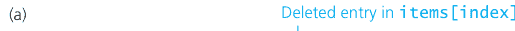

| | 12 | 3 | 19 | 100 | .... | 5 | 10 | 18 | ? | ? |
|---|---|---|---|---|---|---|---|---|---|---|
| itemCount items | | 0 | 1 | 2 | 3 | 4 | | k-1 | k | | maxItems-1 |

| 数组索引

| | 12 | 3 | 19 | .... | 5 | 10 | 18 | ? | .... | ? |
|---|---|---|---|---|---|---|---|---|---|---|
| itemCount items | | 0 | 1 | 2 | 3 | 4 | | k-1 | k | | maxItems-1 |

| | 12 | 3 | 100 | .... | 5 | 10 | 18 | ? | ? |
|---|---|---|---|---|---|---|---|---|---|
| itemCount items | | 0 | 1 | 2 | 3 | | k-1 | | | maxItems-1 |

现在如何从数组中删除项。你可以将其置空，但这种策略会导致数组中出现空隙，如图 3-5a 所示。充满空隙的数组有三个显著问题：

- `itemCount - 1` 不再是数组中最后一个项的索引。你需要另一个变量 `lastPosition` 来包含此索引。
- 由于项是分散的，方法可能必须查看数组的每个元素，即使只存在几项项也是如此。
- 当 `items[maxItems-1]` 被占用时，空隙可能看起来是满的，即使项的数量少于 `maxItems`。

我们可以通过将每个后续条目复制到数组中的前一个元素中来解决这个问题，从被删除项之后的条目开始，到最后一个结束，如图 3-5b 所示。然而，这种耗时的方法并不是必要的。记住，我们并不要求维护包条目的任何特定顺序。因此，与其在删除条目后移动条目，我们可以用数组中的最后一个项替换被删除的条目，如下。在 `items[index]` 中定位 `aEntry` 后（如图 3-6a 所示），我们将 `items[itemCount-1]` 中的条目复制到 `items[index]`，然后通过递减 `itemCount` 来忽略 `items[itemCount-1]` 中的条目。

从包中移除空隙需要以下伪代码。在数组中使用它之前，我们计算一次 `itemCount–1` 而不是两次。

```
在数组 items 中搜索 anEntry
if (anEntry 位于包的 items[index]) 
    递减 itemCount
```

## ADT Bag 的基于数组的实现

```
items[index] = items[itemCount-1]
decrement itemCount
return true
}
else
return false
```

对 `anEntry` 的搜索与 `contains` 方法相同，但我们想知道该条目是否存在以及它在数组中的位置。这就是为什么我们使用上一节中定义的 `getIndexOf` 方法。头文件中 `getIndexOf` 的实现如下：

```cpp
template<class ItemType>
int getIndexOf(const ItemType& target) const
{
  bool found = false;
  int result = -1;
  int searchIndex = 0;
  while (searchIndex < itemCount)
  {
    if (items[searchIndex] == target)
    {
      found = true;
      result = searchIndex;
    }
    else
    {
      searchIndex++;
    }
  }
  return result;
}
```

## 图 3-6 避免数组中的空隙

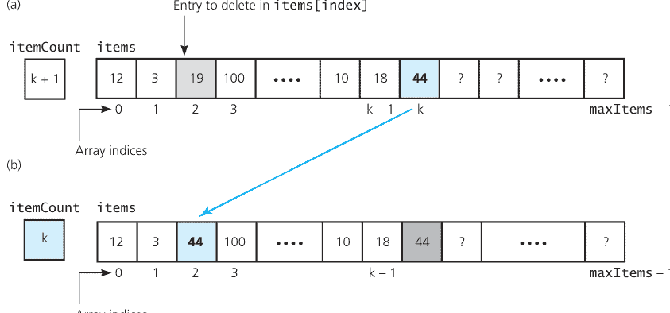

### 3.2.6 测试

为了测试我们完成的类，可以在 `bagTester` 中添加以下语句：

```cpp
cout << "contains("Alice");
```

# 第 3 章 基于数组的实现

## 3.3 在实现中使用递归

上一章给出了如何使用递归来处理数组的几个示例。如果你检查我们刚刚开发的 `ArrayBag` 的定义，你会看到两个可以被递归替换的循环：一个在公共方法 `getIndexOf()` 中，另一个在私有方法 `getIndexOf` 中。让我们来看细节。

### 3.3.1 getIndexOf 方法

我们从在数组中搜索给定条目的私有方法开始。迭代定义按顺序逐个检查数组中的每个条目，直到找到所需的条目或到达数组末尾且未找到目标。假设 `searchIndex` 是下一个要检查的数组元素的索引。我们有两个基准情况：

- `items[searchIndex]` 是我们要寻找的条目，完成了。
- 如果 `searchIndex < itemCount`，我们完成了，因为该条目不在数组中。

递归步骤是使用 `items[searchIndex + 1]` 搜索数组剩余部分。为了实现这种递归，`getIndexOf` 需要 `searchIndex` 作为参数。由于该方法是私有的，我们不需要为它定义另一个私有方法供其调用。然而，我们必须在头文件中将其声明修改如下：

```cpp
int getIndexOf(const ItemType&target, int searchIndex) const;
```

我们可以为此方法编写以下递归函数：

```cpp
template<class ItemType>
ArrayBag<ItemType>::getIndexOf(const ItemType& target, int searchIndex) const
{
    int result = -1;
    if (searchIndex < itemCount)
    {
        if (items[searchIndex] == target)
        {
            result = searchIndex;
        }
        else
        {
            result = getIndexOf(target, searchIndex + 1);
        } // end if
    } // end if
    return result;
}
```

由于我们更改了方法的头文件，我们需要定位并更改 `ArrayBag` 其他方法中对 `getIndexOf` 的调用。因此，我们将方法 `remove` 和 `contains` 内部调用从

```cpp
getIndexOf(anEntry);
```

更改为

```cpp
getIndexOf(anEntry, 0);
```

### 3.3.2 getFrequencyOf 方法

`getFrequencyOf` 方法同样在搜索数组，与 `indexOf` 类似，但与 `indexOf` 不同，`getFrequencyOf` 必须检查数组中的每一个条目。也就是说，如果数组匹配我们要寻找的条目，搜索也不会结束。

假设 `searchIndex` 是下一个要检查的元素的索引。该搜索的递归定义只有一个基准情况：如果 `searchIndex` 等于 `itemCount`，我们完成了。然而，我们有两个递归步骤：

- 如果 `items[searchIndex]` 是我们要寻找的条目，则该条目的出现频率比其在数组剩余部分的出现频率多 1。
- 如果 `items[searchIndex]` 不是我们要寻找的条目，则该条目的出现频率与其 `getFrequencyOf` 的另一个参数相同，这里的递归方法需要

正如我们必须为 `getIndexOf` 添加另一个参数一样，这里的递归方法需要 `searchIndex` 作为参数。然而，`getFrequencyOf` 是一个公共方法，所以我们不能更改它的签名。相反，`getFrequencyOf` 必须调用一个辅助递归搜索的私有方法。因此，在头文件的私有部分添加以下声明：

```cpp
int countFrequency(const ItemType& target, int searchIndex) const;
```

`getFrequencyOf` 方法简单地调用这个私有方法，因此它的定义如下：

```cpp
template<class ItemType>
int ArrayBag<ItemType>::getFrequency(const ItemType& anEntry) const {
    return countFrequency(anEntry, 0);
} // end getFrequency
```

私有方法 `countFrequency` 的递归定义为：

```cpp
template<class ItemType>
int ArrayBag<ItemType>::countFrequency(const ItemType& target,
                               int searchIndex) const {
    if (searchIndex < itemCount) {
        if (items[searchIndex] == target) {
            return 1 + countFrequency(target, searchIndex + 1);
        }
        else {
```


```cpp
            return countFrequency(target, searchIndex + 1);

        } // end if

    }

    else {

        return 0; // Base case

    }

} // end countFrequency
```

从风格上来说，我们倾向于让方法只有一个出口。为了修改 `countFrequency` 使其只有一个返回语句而不是三个，我们定义了一个局部变量 `frequency` 来包含返回值。该方法随后有如下定义。注意，基准情况是隐式的。

```cpp
template<class ItemType>
int ArrayBag<ItemType>::countFrequency(const ItemType& target, int searchIndex) const
{
  int frequency = 0;
  if (searchIndex < itemCount) {
    if (items[searchIndex] == target) {
      frequency = 1 + countFrequency(target, searchIndex + 1);
    } else {
      frequency = countFrequency(target, searchIndex + 1);
    } // end if
  }
  return frequency;
} // end countFrequency
```

## 总结

- 1. 通过使用类来实现 ADT，你封装了 ADT 的数据和操作。通过这种，你可以向使用 ADT 的程序隐藏实现细节。
- 2. 通过使用类来实现 ADT，你封装了 ADT 的数据和操作。通过这种，你可以向使用 ADT 的程序隐藏实现细节。
- 3. 通过使用类来实现 ADT，你封装了 ADT 的数据和操作。通过这种，你可以向使用 ADT 的程序隐藏实现细节。
- 4. 通过使用类来实现 ADT，你封装了 ADT 的数据和操作。通过这种，你可以向使用 ADT 的程序隐藏实现细节。
- 5. 通过使用类来实现 ADT，你封装了 ADT 的数据和操作。通过这种，你可以向使用 ADT 的程序隐藏实现细节。
- 6. 通过使用类来实现 ADT，你封装了 ADT 的数据和操作。通过这种，你可以向使用 ADT 的程序隐藏实现细节。
- 7. 通过使用类来实现 ADT，你封装了 ADT 的数据和操作。通过这种，你可以向使用 ADT 的程序隐藏实现细节。
- 8. 通过使用类来实现 ADT，你封装了 ADT 的数据和操作。通过这种，你可以向使用 ADT 的程序隐藏实现细节。

## 练习

- 1. 通过使用类来实现 ADT，你封装了 ADT 的数据和操作。通过这种，你可以向使用 ADT 的程序隐藏实现细节。
- 2. 设计并实现一个表示日期的 ADT。你可以用整数表示月份、日期和年份（例如，4/1/2014）。包含将日期进一的操作，并使用数字或单词显示日期。作为增强，包含星期几。
- 3. 设计并实现一个以美元和分为单位的货币价格的 ADT。完成实现后，编写一个客户端函数计算客户为价格为 y 的物品支付找零 x。
- 4. 设计并实现一个表示银行账户的 ADT。ADT 的数据应包括客户姓名、账号和余额。初始化操作应将数据设置为客户端提供的值。包括存款、取款、计算利以及显示账户统计的操作。
- 5. 为 `ArrayBag` 类添加并、交集和差方法。第 1 章的 6、7、8 题描述了这些操作。
- 6. 使用数组实现第 1 章第 5 题中的集合。
- 7. 使用数组实现第 1 章第 6 题中的堆栈。
- 8. 为 `ArrayBag` 指定并定义一个方法，从包中移除随机条目。
- 9. 为类添加一个构造函数，从给定的数组创建一个包。

- 9. 实现第 1 章 1.4.1 节中描述的 ADT 预约本。编写一个程序来演示你的新类。
- 10. 指定并实现一个分数的 ADT。提供加、减、乘、除法数字的操作。所有算术运算的结果都应为最简形式（lowest terms），因此请包含一个私有方法 `reduceTerms`。第 2 章的第 23 题将帮助你完成该方法的细节。为了简化分数的分母，你可以假设分数的分母为正。
- 11. 指定并实现一个带分数的 ADT，每个带分数包含一个整数部分和一个处于最简形式的分数部分。假设上一个问题中描述的分数 ADT 存在。提供加、减、乘、除带分数数值的操作。所有算术运算的结果的分数部分应为最简形式。还包含一个将分数转换为带分数的操作。
- 12. 实现第 1 章 1.4.2 节中描述的 ADT 菜谱。在此过程中，实现 `measurement` ADT。根据需要添加操作。例如，你应该为菜谱本添加一个缩放菜谱的操作。
- 13. 你可以使用集合（set）或包（bag）来创建一个拼写检查器。集合或包作为字典，包含一组拼写正确的单词。要检查一个单词是否拼写正确，只需查看它是否在字典中。使用此方案为外部文件的单词创建一个拼写检查器。为了简化任务，请将你的字典限制在可管理的范围内。
- 14. 重复上一个项目创建一个拼写检查器，但将你想要检查拼写的单词放入一个包中。字典（包含拼写正确单词的集合或包）与待检查单词包之间的区别是一个拼写错误的单词包。

# 指针、多态与内存分配

## 目录

| 节标题 | 页码 |
| :--- | :--- |
| C2.1 变量的内存分配与方法的早期绑定 | 118 |
| C2.2 一个待解决的问题 | 118 |
| C2.3 指针与程序的自由存储区 (Free Store) | 120 |
| C2.3.1 释放内存 | 122 |
| C2.3.2 避免内存泄漏 | 123 |
| C2.3.3 避免悬空指针 | 127 |
| C2.4 虚方法与多态 | 124 |
| C2.5 数组的动态分配 | 130 |
| C2.5.1 基于数组的可调整大小数组 | 131 |

## 前提条件
第 3 章 基于数组的实现

本 C++ 间插（Interlude）讨论了变量和数组的内存分配，并介绍指针，以完成在第一个 C++ 间插中开始的多态讨论。指针是程序员的强大工具，但你必须小心正确地使用它们。本间插解释了指针的必要性，并展示了何时以及如何使用它们。指针的某些方面在本间插中未涵盖，但这些特性在书中是不必要的，或者引入了不安全的做法。

我们将在执行期间而非编译期间介绍内存分配，并展示指针如何参与这一过程。如果数组满了，我们讨论如何在执行期间创建一个更大的数组。你将在本间插的末尾看到这一过程的示例。

在本文的讨论以及整本书中，我们将强调安全和安全的编程实践。在开始讨论之前，让我们考虑如何为局部变量和参数分配内存。

# C2.1 变量的内存分配与方法的早期绑定

当你声明一个普通变量的数据类型为 `int`，，C++ 编译器会分配一个可以存储整数的内存单元。你使用标识符 `x` 来引用该单元。要向单元中放入值 5，你可以写：

```cpp
int x = 5;
```

要显示单元中的值，你可以写：

```cpp
cout << "The value of x is " << x << endl;
```

正如第 2 章所述，函数局部声明的变量（如 `x`）被放置在激活记录（activation record）中，连同参数和一些管理数据。这些激活记录存储在应用程序内存的一个区域，称为运行时栈（run-time stack）。每当调用函数时，运行时栈上会自动创建一个激活记录，释放用于局部变量和参数的内存。此时，该函数的局部变量及其值将不再被你的程序访问。你的程序将返回到调用函数的地方，并执行函数调用后的语句。方法的行为也是一样的。

当你创建一个对象时，对象数据成员的存储也被放置在当前执行的函数或方法的激活记录中。以下语句

```cpp
PlainBox<string> myPlainBox;
Box<string> myMagicBox = MagicBox<string>();
```

展示了两种调用默认构造函数来创建 `PlainBox` 和 `MagicBox` 实例的方法。当这些对象被实例化时，它们的数据字段就像原始数据类型一样被放在运行时栈上。回想 C++，数据字段的名称为 `item` 和 `firstItem`。

编译器还知道，如果你通过以下写法调用这些对象的 `setItem` 方法：

```cpp
myPlainBox.setItem("Fun Item");
myMagicBox.setItem("Secret Item");
```

对于 `myPlainBox` 应该调用 `PlainBox` 版本的 `setItem` 方法，对于 `myMagicBox` 应该调用 `MagicBox` 版本的 `setItem` 方法。这种早期绑定选择可以在执行期间更改。

大多数情况下，这种自动内存管理和早期绑定就是你程序中所需要的。但在它们不适用时，会出现以下两种情况：

- 你想要标注多态。
- 你必须访问创建它的函数或方法之外的对象。

# C2.2 一个待解决的问题

假设你的朋友对你在 C++ 间插中讨论的三个盒子的工作印象深刻，她请求你继续帮助开发视频游戏。你想写一个接受两个参数的函数：任意三个类型盒子之一的对象和 `string` 类型的项。该函数应该通过调用盒子的 `setItem` 方法将项放入盒子中。

图 C2-1 类族的 UML 类图

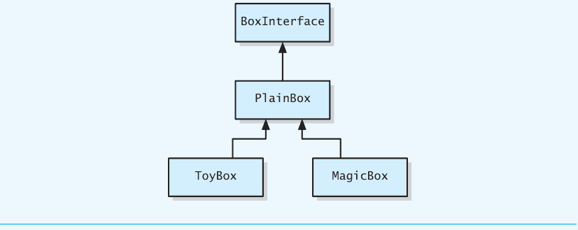

如图 C2-1 所示，由于 `ToyBox` 和 `MagicBox` 派自 `PlainBox`，你可能认为以下函数定义就足够：

```cpp
void placeInBox(PlainBox& box, string item)
{
    box.setItem(item);
}
```

（注：原文后续部分存在大量重复和 OCR 错误，已根据上下文逻辑进行了清理处理。）

## 图 C2-3 当 myboxPtr 指向 MagicBox 对象且其数据成员被设置后的运行时栈和自由存储区

在运行时栈上创建变量 | 在自由存储区创建对象

```
MagicBox<string>* myboxPtr = new MagicBox<string>();
string someItem = "Something"
```

设置字段 item 的值

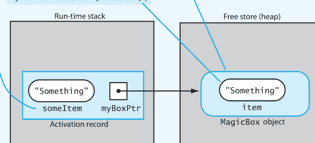

与运行时栈上的变量不同（后者的内存会自动分配和释放），自由存储区中的变量即使在创建它的函数或方法结束后，仍然存在于内存中。这意味着，当程序员从自由存储区为变量分配内存时，程序员有责任在变量不再需要时释放该内存。未能这样做会导致**内存泄漏**。内存泄漏是指已分配但不再需要，且无法访问或释放的内存。

如果你在自由存储区上分配了内存，你必须释放它

为了表示一个变量是指针，我们在该指针所引用的数据类型之后放置一个星号 `*`。例如，以下语句

通过在数据类型后编写星号来指示指针类型

```
MagicBox<string>* myboxPtr = new MagicBox<string>();
```

在自由存储区中创建一个 MagicBox 对象，并将该对象的地址存储在局部变量 `myboxPtr` 中。我们说 `myboxPtr` 指向一个 MagicBox 对象。要调用自由存储区中对象的方法，我们使用运算符 `->`

```
string someItem = "Something Free";
myboxPtr->setItem(someItem);
```

图 C2-3 显示了执行上述语句后内存和局部变量的状态。

请注意，这个新创建的对象没有程序员定义的名称。访问其方法的唯一方法是通过我们创建的指针直接访问，如在上一个例中使用 `myboxPtr->`。我们通常会简化图表，只画出自由存储区中的对象及其指针，如图 C2-4 所示。

有些程序员会将 `*` 放在变量名旁边。本教材的作者认为这能清晰地表明该变量是指针类型。

## 图 C2-4 myBoxPtr 和它所指向的对象

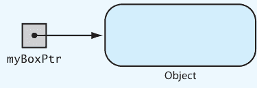

指针变量只是另一种类型的变量，遵循与其他变量类型相同的规则。例如，如果你声明了一个指向 `ToyBox<string>` 对象的指针变量，它可以只能指向 `ToyBox<string>` 对象，而不能指向 `MagicBox<string>` 对象或 `ToyBox<double>` 对象，如下语句所示：

```
ToyBox<string>* toyPtr = new ToyBox<string>(); // OK
ToyBox<string>* boxPtr = new MagicBox<string>(); // 错误！
ToyBox<string>* somePtr = new ToyBox<double>(); // 错误！
```

如果你有两个可以指向相同类型对象的指针变量，可以使用赋值运算符 `=` 让它们指向同一个对象。例如，语句
`somePtr = toyPtr;`

使变量 `somePtr` 指向与 `toyPtr` 指向相同的 `ToyBox` 对象。在这些情况下，将赋值操作理解为将右侧指针变量中存储的值复制到左侧指针变量是有帮助的。由于指针存储的是对象的地址，因此复制的值是对象在自由存储区中的位置。对象本身并没有被复制。结果是两个指针变量都指向同一个对象，如图 C2-5 所示。

如果你声明了一个指针变量但没有立即为它创建引用的对象，你应该将指针设置为 `nullptr`。像下面的赋值是必要的，因为 C++ 不会为你初始化指针：

```cpp
ToyBox<int>* myToyPtr = nullptr;
```

## 图 C2-5 指向同一个对象的两个指针变量

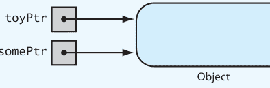

### C2.3.1 释放内存

当指针指向的内存不再需要时，你使用 `delete` 运算符来释放它。然后你应该将指针变量设置为 `nullptr`，作为其不再引用或指向某个对象的信号：

```cpp
delete somePtr;
somePtr = nullptr;
```

## 指针与程序的自由存储区 123

如果我们在这个示例中没有将 `somePtr` 设置为 `nullptr`，那么 `somePtr` 将是一个**悬空指针**（dangling pointer）示例，因为它仍然包含一个已释放对象的地址。悬空指针可能是严重错误的根源。

始终记住，如果一个类使用 `new` 创建对象，则该类的某个方法必须删除该对象的内存。安全可靠的编程的一个特征是，任何从自由存储区分配内存的行为都伴随着在不再需要时释放内存的责任。

指针对内存如何使用以及何时发生绑定提供了巨大的控制，我们将稍后讨论这一点。如果使用不当，它们也会导致严重的问题和难以发现的错误。涉及指针的最常见错误是内存泄漏和悬空指针，正如本节所示。让我们看看这些问题在程序中是如何发生的，以便你可以在代码中防止它们。

如果你使用 `new` 运算符分配内存，你必须使用 `delete` 运算符释放它

## C.3.2 避免内存泄漏

内存泄漏发生于在自由存储区中创建了对象，但程序不再有方法访问它。由于无法访问该对象，它无法被删除并占用内存，尽管它无法被使用。如果程序有多个内存泄漏，可能会导致内存耗尽并崩溃。

考虑以下语句：

```cpp
MagicString* myBoxPtr = new MagicBox<string>();
MagicString* yourBoxPtr = new MagicBox<string>();
yourBoxPtr = myBoxPtr; // 导致不可访问的对象
```

图 2-6 追踪了这些语句的执行过程。最终，`yourBoxPtr` 指向与 `myBoxPtr` 相同的对象，而 `yourBoxPtr` 原指向的对象不再可访问，导致了图中所示的内存泄漏。

为了防止这种情况，我们不应该创建第二个对象。相反，要么将 `yourBoxPtr` 初始化为 `nullptr`，要么将其设置为 `myBoxPtr`：

```cpp
MagicString* myBoxPtr = new MagicBox<string>();
MagicString* yourBoxPtr = myBoxPtr;
```

细微的内存泄漏发生在：函数或方法在自由存储区创建了对象，但由于没有返回该指针或将其存储在类成员中而丢失了它的指针。这就是列表 C2-1 中函数发生的情况。列表 C2-1 错误的函数在自由存储区分配内存

```cpp
void leakyFunction(const double& someItem)
{
    ToyBox<double>* someBoxPtr = new ToyBox<double>();
    someBoxPtr->setItem(someItem);
} // 结束 leakyFunction
```


参数 `someItem` 和指针 `someBoxPtr` 都存储在运行时栈上，并在函数结束后自动销毁。在自由存储区通过 `new ToyBox<double>` 创建的对象仍然存在，但由于我们对其唯一的引用被销毁了，我们导致了内存泄漏。

## C++ 间插 2 指针、多态与内存分配

图 C2-6 (a) 创建第一个对象；(b) 创建第二个对象；(c) 赋值导致不可访问的对象

+ (a) `MagicBox<string>* myboxPtr = new MagicBox<string>();`

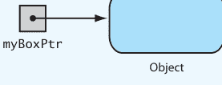

+ (b) `MagicBox<string>* yourBoxPtr = new MagicBox<string>();`

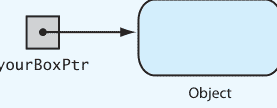

+ (c) `yourBoxPtr = myBoxPtr;`

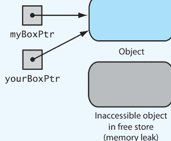

我们有几种方案来修复此函数。第一种是在函数终止前删除对象。我们可以通过在末尾添加以下行来实现：

```cpp
delete someBoxPtr;
someBoxPtr = nullptr;
```

如果 `someBoxPtr` 指向的 Box 对象只需要此函数，更好的实现方式是不从自由存储区分配内存，而是使用局部变量，如下语句所示：

```cpp
ToyBox<double> someBox(); // someBox 不是指针变量
someBox.setItem(someItem);
```

如果创建的对象在函数外部，函数可以返回一个指针供调用者访问该对象。要实现这一点，我们将函数的返回类型从 `void` 改为 `ToyBox<double>*` 并返回 `someBoxPtr`。结果定义如下：

```cpp
ToyBox<double>* leakyFunction(const double& someItem)
{
    ToyBox<double>* someBoxPtr = new ToyBox<double>();
    someBoxPtr->setItem(someItem);
    return someBoxPtr;
} // 结束 leakyFunction
```

## 指针与程序的自由存储（Free Store）

你可以通过编写如下语句来调用 `boxValue`：

```cpp
double boxValue = 4.321;
ToyBox<double> *toyPtr = pluggedLeakyFunction(boxValue);
```

现在 `nowToyPtr` 指向它在 `pluggedLeakyFunction` 中创建的对象。当一个函数返回一个它在自由存储区（free store）中创建的对象的指针时，使用该指针的程序内存必须负责删除该对象。否则，仍可能发生内存泄漏。在记录此类函数时，你应该添加注释来指示这种责任。例如，你可以在定义 `pluggedLeakyFunction` 之前加上这些注释：

```cpp
/* 在自由存储区中创建一个对象并返回其指针。
   调用者在不再需要该对象时必须将其删除。 */
```

当然，这段注释并不能防止内存泄漏的发生，但它提醒了你函数的用户的注意可能存在的泄漏。该函数仍然可能被误用，并使用如下语句进行调用：`puggedLeakyFunction(boxValue); // 误用：返回的指针丢失了`

在这种情况下，避免内存泄漏的最好选择不是使用函数返回指向新创建对象的指针。相反，你应该定义一个具有执行此项任务方法的类。该类负责删除自由存储区中的对象，并确保没有内存泄漏。至少，一个类将包含三个部分：一个在自由存储区中创建对象的方法，一个指向该对象的数据字段，以及一个在实例不再被需要时删除对象的方法——即析构函数。尽管 C++ 引入了类析构函数，但我们必须定义自己的析构函数。

每个 C++ 类都有一个与类同名的析构函数，但其名字前面有一个 `~` 字符。对于局部变量对象，当激活记录（activation record）从运行时栈中移除时，会调用析构函数。如果对象是通过 `new` 创建并存储在自由存储区中的，则当客户端使用 `operator delete` 释放分配给对象的内存时，会调用析构函数。

通常，编译器生成的析构函数对于一个类来说足够了，但如果该类在 `new` 运算符上创建对象，那么实现一个析构函数以确保该对象的内存被释放是一种安全可靠的编程实践。

列表 C2-2 给出了 `GoodMemory` 类的头文件，演示了如何避免内存泄漏。我们之前的函数 `pluggedLeakyFunction` 中的指针变量现在是 `GoodMemory` 中的一个数据字段。只要这个指针指向自由存储区中创建的对象，我们就可以访问该对象。

### 列表 C2-2 `GoodMemory` 类的头文件
```cpp
/* @file GoodMemory.h */
#include <string>
#include "ToyBox.h"
using namespace std;
class GoodMemory
{
```
（续）

## C++ 间插 2 指针、多态、内存分配

```cpp
private:
    Box<string>* somePtr;
public:
    GoodMemory(); // 默认构造函数
    ~GoodMemory(); // 析构函数
    void fixedLeak(const double& someItem);
} // end GoodMemory
```

由于 `GoodMemory` 类有一个指针变量作为数据字段，我们应该定义一个默认构造函数将指针初始化为 `nullptr`。该类的析构函数只需要删除指针所指向的对象。列表 C2-3 显示了该类的实现文件。

### 列表 C2-3 `GoodMemory` 类的实现文件
```cpp
/* @file GoodMemory.cpp */
#include "GoodMemory.h"
GoodMemory::GoodMemory() : somePtr(nullptr)
{
    // end 默认构造函数
}
GoodMemory::~GoodMemory()
{
    delete somePtr;
} // end 析构函数
void GoodMemory::fixedLeak(const double& someItem)
{
    somePtr = new Box<double>();
    somePtr->setItem(someItem);
} // end fixedLeak
```

与列表 C2-1 所示的原始函数 `myLeakFunction` 不同，客户端使用 `GoodMemory` 类来保证发生内存泄漏：

```cpp
void goodFunction()
{
    double boxValue = 4.321; // 原语句
    GoodMemory gmObject; // 创建一个安全的内存对象
    gmObject.fixedLeak(boxValue); // 执行任务
} // end goodFunction
```

编译器极大地帮助了我们。首先，编译器可以检查并确保在方法 `fixedLeak` 之前创建了 `GoodMemory` 对象。这保证了安全的内存分配和释放。然后，由于变量 `gmObject` 是一个局部变量，编译器在函数 `goodFunction` 执行结束时自动调用 `GoodMemory` 析构函数。因此，在自由存储区分配的内存被释放了。

## C2.3.3 避免悬空指针

如所述，悬空指针（dangling pointer）是指不再引用有效对象的指针变量。四种情况会导致悬空指针，但我们只涵盖其中三种，因为我们认为第四种情况是不安全的。

- 如第 C2.3.1 节所述，如果你在 `delete` 之后将指针声明为 `nullptr`，你就不会留下悬空指针。
- 同样地，如果对象是通过 `new` 创建并存储在自由存储区中的，则当客户端使用 `operator delete` 释放分配给对象的内存时，会调用析构函数。

## C2.3.3 避免悬空指针

如前所述，悬空指针是指不再引用有效对象的指针变量。四种情况会导致悬空指针，但我们只涵盖其中三种，因为我们认为第四种情况是不安全的。

- 如第 C2.3.1 节所述，如果你在 `delete` 之后将指针声明为 `nullptr`，你就不会留下悬空指针。
- 同样地，如果对象是通过 `new` 创建并存储在自由存储区中的，则当客户端使用 `operator delete` 释放分配给对象的内存时，会调用析构函数。

虚方法——使用 `virtual` 关键字指示它们可以被重写的方法。在第 C2.2 节的示例中，`PlainBox` 是基类，我们在《C++ Interlude I》的列表 C1-3 中定义了它。我们编写的代码并没有按照我们预期的方式运行。为了纠正这个问题，我们必须如列表 C2-4 所示，声明我们希望其他类重写的 `PlainBox` 虚方法。请注意，只需要类的头文件（`PlainBox`）需要修改。将 `setItem` 和 `getItem` 方法声明为 `virtual` 使得方法代码可以进行后期绑定。

### 列表 C2-4 修改后的 PlainBox 类的头文件

```cpp
/** @file PlainBox.h */
#ifndef PLAIN_BOX
#define PLAIN_BOX
template<class ItemType>; // 表明这是一个模板
// PlainBox 类的声明
class PlainBox{
private:
  // 数据字段
  ItemType item;
public:
  // 默认构造函数
  PlainBox();
  // 参数化构造函数
  PlainBox(const ItemType& item);
  // 可以改变数据字段值的修改器方法
  virtual void setItem(const ItemType& item);
  // 获取数据字段值的访问器方法
  virtual ItemType getItem() const;
}; // end PlainBox
#include "PlainBox.cpp" // 包含实现文件
#endif
```

为了完全实现后期绑定，我们必须更改自由存储中的变量以及引用它们的指针。因此，我们还必须更改第 C2.2 节中第一个早期绑定示例的代码：

```cpp
string stringItem = "Riches beyond compare!";
string otherItem = "Hammer";
PlainBox<string>* myPlainBoxPtr = new PlainBox<string>();
placeIn(myPlainBoxPtr, specialItem);
MagicBox<string>* myMagicBoxPtr = new MagicBox<string>();
placeIn(myMagicBoxPtr, otherItem);
placeIn(myMagicBoxPtr, specialItem);
cout << myMagicBoxPtr->getItem() << endl;
```

后期绑定的一个示例

## C++ 间插 2 指针、多态、内存分配

接下来，我们必须更改函数 `placeInBox` 以接受一个指向 `PlainBox<string>` 对象的指针：

```cpp
void placeInBox(PlainBox<string>* theBox, const string item)
{
    theBox->setItem(item);
} // end placeInBox
```

最后一个修改是通过向程序中添加语句来释放自由存储中变量使用的内存：

```cpp
delete myPlainBoxPtr;
myPlainBoxPtr = nullptr;
delete myMagicBoxPtr;
myMagicBoxPtr = nullptr;
```

现在我们的函数 `placeInBox` 将根据其第一个参数所指向的箱类型调用正确的 `setItem` 版本。

虚方法的使用对类的未来使用具有重大影响。假设你在编写派生类 `MagicBox` 之前已经编译了 `PlainBox` 类及其实现。。如果你编写了新的 `MagicBox`，并假设可以访问已编译的 `PlainBox`，你可以重写 `getItem`，因为它在 `PlainBox` 中是虚方法。因此，即使 `PlainBox` 已经编译完成，你也可以改变 `MagicBox` 实例的行为。也就是说，定义了虚方法的类是可扩展的。你可以在无法访问源代码的情况下为派生类添加功能。

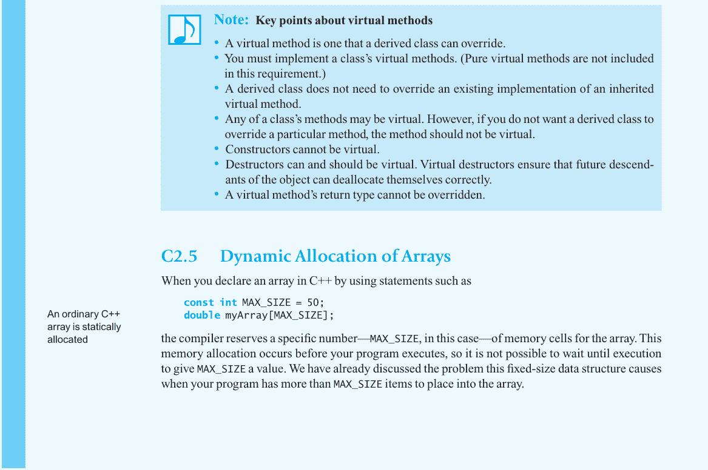

- 虚方法是派生类可以重写的方法。
- 你必须实现类的虚方法。（纯虚方法不在此项要求内）。
- 派生类不需要重写继承的虚方法的实现。
- 类的任何方法都可以是虚方法。但是，如果你不想让派生类重写特定方法，该方法不应为虚方法。
- 构造函数不能是虚方法。
- 析构函数应该是虚方法。虚析构函数确保对象的未来后代能够正确地释放内存。
- 虚方法的返回类型不能被重写。

## C2.5 数组的动态分配

当你在 C++ 中使用如下语句声明数组时：

普通的 C++ 数组是静态分配的

```cpp
const int MAX_SIZE = 50;
double myArray[MAX_SIZE];
```

编译器为数组留了特定数量的内存单元——在本例中为 `MAX_SIZE`。这种内存分配发生在程序执行之前，因此无法等到执行时再给 `MAX_SIZE` 赋值。我们已经讨论过当你的程序有 `MAX_SIZE` 个项目要放入数组时，这种固定大小的数据结构引起的问题。

## 数组的动态分配 131

你刚刚学习了如何使用 `new` 运算符动态分配内存——即在程序执行期间。虽然第 C2.3 节展示了如何为单个变量对象分配内存，但你实际上可以一次为许多对象分配内存。如果你写：

```cpp
int gridSize = 50;
double* anArray = new double[arraySize];
```


指针变量 `anArray` 将指向包含 50 个元素的数组中的第一个元素。与 `MAX_SIZE` 不同，`arraySize` 在程序执行过程中范围内。你可以在执行时给 `arraySize` 赋值，然后确定数组的大小。这很好，但你如何使用这个数组呢？

无论你如何使用数组——静态地（如示例所示）或动态地（如第二个所示），你都可以使用索引和类数组的表示法来访问其元素。

## 第4章：链式实现

## 目录
- 4.1 准备工作 134
- 4.1.1 节点类 136
- 4.2 容器的链式实现 137
- 4.2.1 头文件 138
- 4.2.2 定义核心方法 139
- 4.2.3 实现更多方法 143
- 4.3 在链式实现中使用递归 148
- 4.3.1 LinkedBag 中的递归定义 148
- 4.4 多个 ADT 实现 150
- 4.5 数组实现与链式实现的比较 153

目录 154
练习题 155
编程题 156

## 备备知识

- 第1章 数据抽象
- C++ 间插第1节：类
- 第2章 递归：镜像（第4.3节）
- 第3章 数组实现（附带）
- C++ 间插第2节：指针、多态和内存分配

本章向你介绍使用 C++ 指针的链式数据结构，这在 C++ 间插第2节中描述过。你将学习如何处理此类结构以及如何使用它们来实现容器。本章的材料对于后续章节至关重要。

## 4.1 准备工作

考虑可以相互连接的组件。每个组件（通常称为**节点**）都包含一个数据项和一个指向下一个项目的“指针”。由于每个节点必须包含两个信息——数据项和指向下一个节点的指针——自然地得出每个节点应该是一个对象。节点的一个成员是数据项，另一个是指针。通常，此类指针是 C++ 指针变量。

图4-1 一个节点


图1展示了一个单独节点，图2显示了多个相互连接的节点。在这里，每个节点的数据部分包含一个字符串。我们使用箭头来表示指针，但在节点内部应该使用什么类型的指针，它又指向哪里？你可能认为指针应该指向字符串，但实际上它必须指向包含该字符串的节点。因为指针可以指向任何数据类型——而节点是对象——指针实际上可以指向节点。例如，这种类型的节点将通过一个成员指向另一个类型的节点。例如：

指向节点的指针

```cpp
node* nodePtr;
```

定义了一个指针变量 `nodePtr`，它可以指向一个包含字符串数据项的 `Node` 类型节点。节点应该是动态分配的。例如：

动态分配节点

```cpp
Node* nodePtr = new Node<string>();
```

分配一个 `nodePtr` 指向节点。要访问节点的成员，你将需要 C++ 间插第2节中引入的 `->` 符号，因为节点没有用户定义的名称。假设我们的节点类有一个访问方法 `getItem()`，它返回数据项的值。要引用 `nodePtr` 指向的节点中的项，你写 `nodePtr->getItem()`。同样，如果我们的节点类有一个 `getNext` 方法来访问数据成员，表达式 `nodePtr->getNext()` 表示指针 `next`。例如，`nodePtr` 指向图2中的第二个节点，

引用节点成员

## 图4-2 多个相互连接的节点


另一种表示法 `(*nodePtr).getItem()` 是可能的，但我们不会使用它。这种表示法类似于使用点运算符来引用命名结构的成员，而 `->` 运算符暗示了指针的存在。

`nodePtr->getName()` 返回字符串 "cd"；`nodePtr->getNext()` 返回指向第三个节点的指针。我们可以通过编写以下代码将新指针保存到 `nodePtr` 自身：

```cpp
nodePtr = nodePtr->getNext();
```

如果我们执行上一条语句，`nodePtr` 将指向图2中的第四个节点直到最后一个节点。再次执行该语句使 `nodePtr` 指向第二个节点。如果这个值是列表中最后一个节点的值呢？`nodePtr->getNext()` 返回什么？我们希望这个值是一个表示我们已经到达链表末尾的信号。如果这个值为 `nullptr`，我们可以轻松检测到何时到达了链表末尾。

我们还有一个细节需要考虑：不要指向第一个节点。如果你无法获取第一个节点，就无法获取第二个节点；如果你获取了第二个节点，就无法获取第三个；以此类推。解决方案是有一个额外的指针，其目的是指向第一个节点。这种指针被称为**头指针**或容器的头指针。图4-3 展示了带有头指针的节点链。观察到头指针 `headPtr` 与图中的其他指针的区别，它允许你访问链的开头。如果没有节点，`headPtr` 应该包含什么值？在这种情况下，赋值为 `nullptr` 是逻辑选择。

图4-3 指向第一个节点的头指针

| | "ab" | "cd" | "ef" | "ij" |
| :--- | :--- | :--- | :--- | :--- |
| headPtr | item next | item next | item next | item next |

> 注意：图3所示所示指针都是简单的指针变量，而其他成员位于节点内部。

> 编程提示：在赋值 `headPtr` 之前必须先创建一个 `new Node` 这种误解源于认为变量 `headPtr` 不存在或指向节点。这是错误的；`headPtr` 是一个等待赋值的指针。因此，在序列中，你可以不使用 `new` 直接将 `nullptr` 赋值给 `headPtr`。

```cpp
headPtr = new Node; // 错误的使用 new
headPtr = nullptr;
```

销毁了新创建的唯一指针——`headPtr`，如图4-4 所示。这种操作在你的程序中创建了内存泄漏并应该避免！

图4-4 丢失的节点

```cpp
headPtr = new Node<string>(); headPtr = nullptr;
```


### 4.1.1 节点类

在继续之前，让我们检查 Node 类的 C++ 代码。列表1 给该类的头文件。除了之前介绍的数据成员 `item` 和 `next` 外，该类还声明了三个构造函数、两个针对 `item` 和 `next` 的访问方法，以及两个针对 `item` 和 `next` 的修改方法。注意，在这个类中，指向节点的指针类型是 `Node<ItemType>`。

```cpp
// 列表1 模板 Node 的头文件
/** @file Node.h */
#ifndef NODE_NODE
#define NODE_NODE
template<class ItemType>
class Node {
private:
    ItemType item; // 数据项
    Node<ItemType>* next; // 指向下一个节点的指针
public:
    Node();
    Node(const ItemType& item);
    Node(const ItemType& item, Node<ItemType>* nextPtr);
    void setItem(const ItemType& item);
    void setNext(Node<ItemType>* nextPtr);
    ItemType* getItem() const;
    Node<ItemType>* getNext() const;
}; // Node结束
#include "Node.cpp"
#endif
```

列表2 显示 Node 的实现文件。

```cpp
// 列表2 类的实现文件
/** @file Node.cpp */
#include "Node.h"
#include <cstddef>
```

```cpp
template<class ItemType>
Node<ItemType>::Node() : next(nullptr)
{
} // 默认构造函数
template<class ItemType>
Node<ItemType>::Node(const ItemType& item) : item(item), next(nullptr)
{
} // 构造函数
template<class ItemType>
Node<ItemType>::Node(const ItemType& item, Node<ItemType>* nextPtr) :
    item(item), next(nextPtr)
{
} // 构造函数
template<class ItemType>
void Node<ItemType>::setItem(const ItemType& anItem)
{
    item = anItem;
} // setItem
template<class ItemType>
void Node<ItemType>::setNext(Node<ItemType>* nextPtr)
{
    next = nextPtr;
} // setNext
template<class ItemType>
ItemType Node<ItemType>::getItem() const
{
    return item;
} // getItem
template<class ItemType>
Node<ItemType>* Node<ItemType>::next() const
{
    return next;
}
```

## 4.2 容器的链式实现

现在我们已经有了一个在定义链式数据结构时使用的节点类，我们将使用它来定义容器（Bag）的链式实现。这样做允许我们检查创建此类实现的一些最佳实践。后续章节将扩展这些思想。

与数组实现不同，链式实现不会给数据结构施加固定大小——当然，受系统存储限制的影响。此外，在 ADT 的插入和删除操作期间，数据项不会移动。

你需要表示容器中的项及其大小。图4-5 指出了了一种使用指针表示这种数据的可能方法。这里 `headPtr` 指向一个节点链。


# 第 4 章 基于链的实现

图 4-5 ADT 包的基于链的实现

| 5 | | "ab" | "cd" | "ef" | "gh" | "ij" | |
|---|---|---|---|---|---|---|---|
| itemCount headPtr | item next | | | | | | |

包含包中的项目。itemCount 是包中当前项目的数量。headPtr 和 itemCount 都将是我们的类中的私有数据成员。

回想一下第 1 章，我们记得描述 ADT 包操作的接口 `BagInterface`。同时请记住，在开发此 ADT 的任何实现时，我们都可以使用该接口。接口中用 UML 符号表示的包操作如下：

```
+getCurrent(): integer
+isEmpty(): boolean
+add(newEntry: ItemType): boolean
+remove(anEntry: ItemType): boolean
+clear(): void
+getFrequency(ofEntry: ItemType): integer
+contains(anEntry: ItemType): boolean
+toVector(): vector
```

这些操作对应于我们类中的公共方法。

## 4.2.1 头文件

在链接 4-3 中的头文件声明了 `LinkedBag` 类。私有数据成员是 `headPtr`，它指向包含包中项目的链中的第一个节点；以及 `itemCount`，它用于计数这些项目。类的私有部分还声明了一个私有方法——构造函数，其目的稍后会说明。公共部分声明了一个默认构造函数、一个拷贝构造函数（其目的将在第 4.2.2 节末尾讨论）——一个析构函数，且公共方法的声明与第 3 章中给出的 `ArrayBag` 类完全相同。正如你将看到的，编译器生成的构造函数和析构函数对于链表实现来说是不够的。

回想 C++ 接口 2，析构函数应该是虚析（virtual）的。我们已经在头文件中为 `LinkedBag` 的析构函数标记了 `virtual` 关键字。如果不这样做将导致编译器发出警告。

> 列表 4-3 `LinkedBag` 类的头文件

```cpp
/* ADT bag: 基于链的实现。
 * @file LinkedBag.h */
#ifndef LINKED_BAG
#define LINKED_BAG
#include "BagInterface.h"
#include "Node.h"
template<class ItemType>
class LinkedBag : public BagInterface<ItemType>
{
  private:
  Node<ItemType>* headPtr; // 指向第一个节点的指针
  int itemCount; // 包中项目的当前计数
  // 返回指向包含给定条目的节点
  // 如果条目不在包中，则返回空指针。
  Node<ItemType>* getPointerTo(const ItemType& target) const;
public:
  LinkedBag();
  LinkedBag(const LinkedBag<ItemType>&& aBag); // 拷贝构造函数
  virtual ~LinkedBag(); // 析构函数应该是虚的
  int getCurrentSize() const;
  bool isEmpty() const;
  bool add(const ItemType& newEntry);
  bool remove(const ItemType& anEntry);
  void Clear();
  bool contains(const ItemType& anEntry) const;
  int getFrequency(const ItemType& anEntry) const;
  vector<ItemType> toVector() const;
}
#include "LinkedBag.cpp"
#endif
```

## 4.2.2 定义核心方法

正如我们在第 3 章中定义 ADT 包的基于数组实现一样，我们通过定义相同的核心方法开始新的实现：构造函数、`add`、`toVector`、`getCurrentSize` 和 `isEmpty`。我们将对剩余的方法（包括构造函数和析构函数）使用存根（stubs）。

构造函数。以下默认构造函数初始化头指针和包中当前项目的数量：

```cpp
template<class ItemType>
LinkedBag<ItemType>() : headPtr(nullptr), itemCount(0)
{
}// 默认构造函数结束
```


`add` 方法。包不对条目进行排序，因此该方法可以在包含包项目的节点链中任何方便的位置插入新项目。对我们来说，最方便的插入位置是链的开头，因为第一个节点是我们可以可以直接访问的节点。图 4-6 展示了如何向现有节点链的开头添加新节点。

你必须让 `headPtr` 指向新节点，并让新节点指向原本在链开头的节点。注意以下定义是如何实现这一点的：

```cpp
template<class ItemType>
bool LinkedBag<ItemType>::add(const ItemType& newEntry)
{
  // 添加到链开头：新节点引用链的剩余部分；
  // (如果链为空，headPtr 为空Ptr)
  Node::ItemType* newNodePtr = new Node<ItemType>();
  newNodePtr->setItem(newEntry);
  newNodePtr->setNext(headPtr); // 新节点指向链
  headPtr = newNodePtr;        // 新节点现在是第一个节点
  itemCount++;
  return true;
} // 结束
```

# 图 4-6 在链链的开头插入

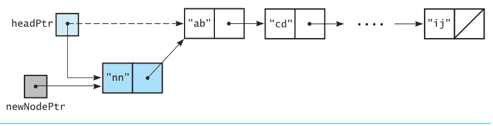

向空链插入实际上是在链的开头插入。观察发现，如果在插入前包是空的，`headPtr` 为 `nullptr`，因此新节点的 `next` 指针被设置为 `nullptr`。这一步是正确的，因为新项目是链中的最后一个项目——也是第一个项目。

> 编程提示：我们的方法使用 `new` 运算符创建一个新的节点对象并将其放置在堆上。由于 C++ 没有像 Java 那样的垃圾回收机制，因此我们的类有责任确保对象从删除逻辑中移除。正如在第二个 C++ 基础中讨论的，析构函数就是我们执行此操作的方法之一。由于我们创建此节点是为了存储要添加到包中的项目，因此当我们从包中移除项目时，就有另一个删除节点的机会。

问题 1 考虑一个包含三个节点的链，其中每个节点包含一个字符串。第一个节点包含 "A"，第二个节点包含 "B"，第三个节点包含 "C"。创建描述的链的 C++ 语句。具有一个包含 `nullptr` 的头指针 `headPtr`，创建并附加 "C" 的节点，创建并附加 "B" 的节点，最后创建并附加 "A" 的节点。

- a. 重复部分 a，但改为按 "A", "B", "C" 的顺序创建并附加节点。

`vector` 方法。回想一下 `vector` 方法获取包中的项目并将它们在 `vector` 内部返回给客户端。`vector` 内部的循环将包的条目添加到此向量中。在数组实现中，这简单地访问这些条目的数组。在这里，我们必须从链中的节点中检索项目。为了做到，我们必须从节点移动到节点；也就是说，我们必须遍历链。当我们访问每个节点时，将其数据拷贝到向量中。

遍历操作访问链链中的每个节点。

给定图 4-5 所示的链，让我们为此循环编写一些高级伪代码。

```
让一个当前指针指向链的第一个节点
当当前指针不为空指针时
{
  将当前节点的数据部分赋值给向量中的下一个元素
  将当前指针设置为下一个指针
}
```

该解决方案需要你跟踪链中的当前位置。因此，你需要一个指向当前节点的指针变量——我们称之为 `curPtr`。

> 注意：指针变量 `curPtr` 类似于我们在第 3 章 3.2.4 节中用于跟踪数组当前条目的整数变量 `curIndex`。

最初，`curPtr` 必须指向第一个节点。由于 `headPtr` 指向第一个节点，只需编写代码将 `headPtr` 拷贝到 `curPtr`：

```cpp
NodeItemType* curPtr = headPtr;
```

然后你可以使用表达式 `curPtr->getItem()` 访问当前节点的数据。在将数据拷贝到向量后，通过编写代码将当前指针移动到下一个节点：

```cpp
curPtr = curPtr->getNext();
```

图 4-7 展示了这一动作。如果之前的赋值语句不清楚，请考虑

```cpp
NodeItemType* temp = curPtr->getNext();
curPtr = temp;
```

然后说服自己中间变量 `temp` 是没有的。

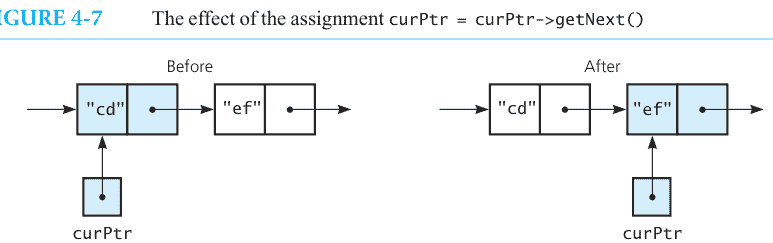

这些想法导致了 `toVector` 的后续定义：

```cpp
template<class ItemType>
vector<ItemType> LinkedBase<ItemType>::toVector() const
{
  vector<ItemType> bagContents;
  NodeItemType* curPtr = headPtr;
  int counter = 0;
  while ((curPtr != nullptr) && (counter < itemCount))
```

```cpp
bagContents.push_back(curPtr->getItem());
curPtr = curPtr->getNext();
counter++;
} // end while
return bagContents;
} // end toVector
```

在这里，在循环执行过程中`curPtr` 指向非空链中的每个节点，因此每个节点的数据部分被访问并赋值到 vector 的末尾。在访问最后一个节点后，`curPtr` 变为 `nullptr`，循环终止。当包为空时——即 `headPtr` 为 `nullptr` 时——循环将被跳过。变量 `counter` 虽然不是必须的，但它提供了一种防止超出链末尾的保护。

> **编程提示：** 在我们使用的 `while` 语句中，常见的错误是将 `curPtr->next()` 与 `nullptr` 进行比较。当 `curPtr` 指向非空链的最后一个节点时，`curPtr->getNext()` 会导致循环在访问最后一个节点的数据之前就终止。此外，当包为空时，`headPtr` 同样为 `nullptr`，这会导致 `curPtr->getNext()` 的值未定义。应该避免错误的引用。

```cpp
template<class ItemType>
bool LinkedBag<ItemType>::isEmpty() const
{
    return itemCount == 0;
} // end isEmpty
```

```cpp
template<class ItemType>
int LinkedBag<ItemType>::getCurrentSize() const
{
    return itemCount;
} // end getCurrentSize
```

> **注意：** 测试核心方法
与前一章一样，你应该在定义每个方法时对其进行测试。事实上，只需稍作修改，你就可以修改列表 3-2 中的程序，并用它来测试我们刚刚定义的核心方法。该程序中的包变满了，但在这里它不会变满。在第 4.4 节中，我们将检查如何修改该程序以便能够测试多种实现。

- **问题 3** 为什么 `LinkedBag` 对象不需要担心变满的问题？

## 4.2.3 实现更多方法

在成功定义了核心方法后，我们将继续在类中定义剩余的方法。

`getFrequencyOf` 方法。为了统计一个对象在包中出现的次数，我们需要统计该对象在链链中出现的次数。为了这样做，我们需要遍历链并将它的每个数据项与给定的项进行比较。每当我们找到匹配项，就计数器加1。当遍历结束时，我们返回计数器的值。

我们将使用的循环类似于我们在 `toVector` 方法中写的那个。以下是 `getFrequencyOf` 的定义：

```cpp
template<class ItemType>
int LinkedBag<ItemType>::getFrequencyOf(const ItemType& anEntry) const
{
    int frequency = 0;
    int counter = 0;
    Node<ItemType>* curPtr = headPtr;
    while ((curPtr != nullptr) && (counter < itemCount))
    {
        if (anEntry == curPtr->getItem())
        {
            frequency++;
        } // end if
        counter++;
        curPtr = curPtr->getNext();
    } // end while
    return frequency;
} // end getFrequencyOf
```

- **问题 4** 假设 ADT bag 有一个显示其内容的操作。请为 `LinkedBag` 类中的此类方法编写一个 C++ 定义。

- **问题 5** 你为上一个问题所编写的方法需要多少次赋值操作？

`contains` 方法。第 3 章关于该方法的讨论在此同样适用。虽然我们可以调用刚刚定义的 `getFrequencyOf` 方法，但这样做通常会涉及比需要更多的工作。`getFrequencyOf` 必须检查包中的每一个条目，而 `contains` 一只要在包中找到与给定项相同的条目，就会立即退出。

我们在上一章中观察到，`contains` 和 `remove` 方法对特定条目执行相同的搜索。为了避免代码重复，我们在私有方法中执行这种搜索，`contains` 和 `remove` 都调用这个私有方法。我们在头文件中声明了这个私有方法，其定义如下。

```cpp
// 返回指向包含给定条目的节点的指针，
// 如果条目不在包中，则返回 nullptr。
template<class ItemType>
Node<ItemType>* LinkedBag<ItemType>::getPointerTo(const ItemType& target) const
{
    bool found = false;
    Node<ItemType>* curPtr = headPtr;
    while (!found && curPtr != nullptr) {
        if (target == curPtr->getItem()) {
            found = true;
        }
        else
            curPtr = curPtr->getNext();
    } // end while
    return curPtr;
} // end getPointer
```

```cpp
template<class ItemType>
bool LinkedBag<ItemType>::contains(const ItemType& anEntry) const {
    return (getPointerTo(anEntry) != nullptr);
} // end contains
```

- **问题 6** 如果指针变量 `curPtr` 在 `getPointerTo` 方法中变为 `nullptr`，当包不为空时，方法返回什么值？

- **问题 7** 追踪当包为空时 `contains` 方法的执行过程。

- **问题 8** 修订 `getPointerTo` 方法的定义，使循环由计数器和 `itemCount` 的值引导。

- **问题 9** 与原始定义相比，上一个问题描述的 `getPointerTo` 方法定义有什么缺点？

- **问题 10** 为什么 `getPointerTo` 方法不应该是公共的？

**remove 方法。** 回想一下该方法删除给定条目的一个实例，并返回 true 或 false 以指示删除是否成功。当我们想要删除一个条目时，系统可以使用返回的内存。但我们要删除的条目并不总是位于链的头部。假设我们要删除链的头部。为了删除条目，我们可以使用以下伪代码描述 `remove` 的逻辑：

```text
remove(anEntry)
    找到包含 anEntry 的节点
    替换头部
    删除头部
```

通过使用 `getPointerTo`定位要删除的条目，我们可以将方法定义如下：

```cpp
template<class ItemType>
bool LinkedBag<ItemType>::remove(const ItemType& anEntry) {
    Node<ItemType>* entryNodePtr = getPointerTo(anEntry);
    bool canRemoveItem = !isEmpty() && (entryNodePtr != nullptr);
    if (canRemoveItem)
    {
        // 将头部的数据拷贝到定位节点
        entryNodePtr->setItem(headPtr->getItem());
        // 删除头部
        Node<ItemType>* nodeDeletePtr = headPtr;
        headPtr = headPtr->getNext();
        // 将节点返回系统
        nodeDeletePtr->setNext(nullptr);
        delete nodeDeletePtr;
        nodeDeletePtr = nullptr;
        itemCount--;
    } // end if
    return canRemoveItem;
} // remove
```

在 `remove` 方法之后，系统可以使用返回的内存并可能由于 `new` 运算符的结果重新分配它。假设当你在链中请求节点时发生了这种重新分配。确保你的新节点没有指向链，因为你执行了语句 `nodeDeletePtr->setNext(nullptr)`。这样做并将变量 `nodeDeletePtr` 设置为 `nullptr` 是防御性编程的示例，可以避免程序后期出现毁灭性的错误。尽管 `nodeDeletePtr` 是我们没有使用的局部变量，但采取这些步骤是为了向未来修订我们方法的程序员说明。

> 提示：记住，任何时候使用 `new` 分配内存时，最终必须使用 `delete` 释放它。

> 注意：对于指针 `p`，`delete p` 释放 p 所指向的节点，而不是删除 `p`。指针仍然存在，但它包含一个未定义的值。你不应该引用 `p` 或任何指向已分配节点的指针变量。为了帮助你避免这类错误，可以在删除 `p` 后将 `p` 赋值为 `nullptr`。然而，如果 `p` 之外还有其他变量指向被删除的节点，那么错误的可能性仍然存在。

- **问题 11** 根据上一个 `remove` 方法的定义，包中的哪个条目删除最快？为什么？

- **问题 12** 根据上一个 `remove` 方法的定义，包中的哪个条目删除最慢？为什么？

`clear` 方法。`clear` 方法不能简单地将 `itemCount` 设置为 0 而忽略链中所有的条目。因为链中的节点是动态分配的，所以 `clear` 必须释放它们。因此，该方法的定义如下：

```cpp
template<class ItemType>
void LinkedBag<ItemType>::clear()
```

## 第 4 章 基于链接的实现

```cpp
while (headPtr != nullptr)
{
    Node<ItemType>* nodeToDelete = headPtr;
    headPtr = headPtr->getNext();
    // 将节点返回给系统
    nodeToDelete->setNext(nullptr);
    delete nodeToDelete;
} // end while
headPtr = nullptr;
nodeToDeletePtr = nullptr;
itemCount = 0;
} // end clear
```

如果你的类动态分配内存，你必须编写析构函数。

每个类只有一个析构函数。析构函数在对象生命周期结束时销毁该类的实例。通常，析构函数在创建对象的块结束时调用。使用静态分配内存的类依赖编译器生成的析构函数，如第 3 章中的 `ArrayBag`。然而，当类使用动态分配内存时，你需要编写一个通过 `delete` 释放这些内存的析构函数。`LinkedBag` 的析构函数可以简单地调用 `clear` 方法。析构函数的定义如下：

```cpp
template <class ItemType>
LinkedBag<ItemType>::~LinkedBag()
{
    clear();
} // end destructor
```

析构函数的名称是波浪号 (`~`) 后跟类名。析构函数不能有参数，没有返回类型（即使是 `void`），并且不能返回值。

> 问题 13 修改 `LinkedBag` 的析构函数，使其不再调用 `clear`，而是直接删除链接链的每个节点。


拷贝函数。`LinkedBag` 的第二个构造函数是拷贝函数：

```cpp
LinkedBag(const LinkedBag<ItemType>& a_bag);
```

拷贝函数创建对象的拷贝。当你按值传递对象给函数、从函数返回对象，或者像如下所示初始化对象时，会隐式调用构造函数：

```cpp
LinkedBag bag(bag);
```


已经存在。

复制对象涉及复制其数据成员的值，这种拷贝被称为浅拷贝。如果浅拷贝就足够，你可以省略构造函数，在这种情况下编译器会生成一个执行浅拷贝的构造函数。在第 3 章的 `ArrayBag` 中就是这种情况，尽管我们没有提到它。基于数组的实现使用编译器生成的拷贝构造来同时拷贝数组项和项的数量。

### 调用拷贝构造的情况

编译器生成的拷贝构造执行浅拷贝。基于链接的 ADT 实现

图 4-8 (a) 链接链及其浅拷贝；(b) 链接链及其深拷贝


对于我们新的基于链接的实现，编译器生成的拷贝构造将只会拷贝 `itemCount` 和 `headPtr`。例如，图 4-8a 链接链及其拷贝的结果。原始 `headPtr` 和它的拷贝指向同一个链接链。换句话说，链没有被拷贝。如果你需要创建链接链的拷贝，必须编写自己的拷贝构造。也就是说，需要深拷贝，如图 4-8b 所示。因此，拷贝构造如下：

```cpp
template <class ItemType>
LinkedBag<ItemType>::LinkedBag(const LinkedBag<ItemType>& a_bag)
{
    itemCount = a_bag.itemCount;
    Node<ItemType>* origChainPtr = a_bag.headPtr;
    if (origChainPtr == nullptr)
        headPtr = nullptr; // 原始包为空，所以我们拷贝
    else {
        // 拷贝第一个节点
        headPtr = new Node<ItemType>();
        headPtr->setItem(origChainPtr->getItem());
        // 拷贝剩余节点
        Node<ItemType>* newChainPtr = headPtr;
        origChainPtr = origChainPtr->getNext();
        while (origChainPtr != nullptr) // 移动指针
        {
            // 从原始链获取下一个项
            ItemType nextItem = origChainPtr->getItem();
            // 创建包含下一个项的新节点
            Node<ItemType>* newNodePtr = new Node<ItemType>(nextItem);
            // 将节点链接到链的末尾
            newChainPtr->setNext(newNodePtr);
            // 移动指针到最后一个节点
            newChainPtr = newNodePtr;
        }
        newChainPtr->setNext(nullptr); // 链的末尾
    } // end if
} // end copy constructor
```

你可以看到，构造函数是一个开销很大的操作。它需要遍历原始链接链并复制每个节点。

## 4.3 在基于链接的实现中使用递归

递归处理链接链是可能的，有时也是理想的。本节将检查如何将之前的迭代方法写为递归方法。此类递归方法需要头指针作为参数。因此，它们不应该是公有的，因为头指针是类的私有数据成员，客户端无权访问它。否则，客户端可以直接访问链接节点，违反了 ADT 的安全性。

### 4.3.1 LinkBag 中方法的递归定义

作为该主题的介绍，我们将回顾 `LinkBag` 类中两个使用递归的方法。这些方法简单地遍历链接链，而不对其进行任何修改。

`toVector` 方法有一个直观的递归实现。该操作要求我们遍历链接链。由于 `toVector` 是一个公共方法，我们通常定义一个私有的辅助方法来执行递归：

```cpp
// 辅助方法声明
void toVector(vector<ItemType>& v, Node<ItemType>* curPtr);
```

其递归实现如下：

```cpp
template <class ItemType>
void LinkedBag::toVector(vector<ItemType>& v, Node<ItemType>* curPtr)
{
    if (curPtr != nullptr) {
        v.push_back(curPtr->getItem());
        toVector(v, curPtr->getNext());
    }
}
```

然后，公共方法调用它：

```cpp
vector<ItemType> LinkedBag::toVector() const {
    vector<ItemType> v;
    toVector(v, headPtr);
    return v;
}
```

同样，`remove` 方法也可以通过递归来实现：

```cpp
// 辅助方法声明
void remove(const ItemType& item, Node<ItemType>*& cur);
```

其递归实现如下：

```cpp
template <class ItemType>
void LinkedBag::remove(const ItemType& item, Node<ItemType>*& cur)
{
    if (cur != nullptr) {
        if (cur->getItem() == item) {
            Node<ItemType>* nodeToDelete = cur;
            cur = cur->getNext();
            delete nodeToDelete;
            itemCount--;
        } else {
            remove(item, cur->getNext());
        }
    }
}
```

最后，公共方法调用它：

```cpp
void LinkedBag::remove(const ItemType& item) {
    remove(item, headPtr);
}
```

## 4.4 测试多个 ADT 实现

在第 3 章中，我们编写了一个短程序（见列表 3-2），测试了我们基于数组的实现的核心方法。由于我们在测试该实现时使用了 ADT bag，因此我们可以使用相同的代码（仅需少量修改）来测试我们的链表实现。你只需要将每个 `ArrayBag` 更改为 `LinkedBag` 并重新编译程序。

但如果我们想更改回基于数组的实现并测试它呢？你需要将每个 `LinkedBag` 改回 `ArrayBag`。让我们考虑一种方法，通过让用户决定需要测试哪种包实现来验证该测试程序。利用多态的特性，我们可以在不复制重复代码的情况下实现这一点。

在第 1 章中，我们已经在抽象类 `BagInterface` 中声明了 ADT。由于 `ArrayBag` 和 `LinkedBag` 都共享类中定义的公共方法，我们使每一个类都成为 `BagInterface` 的子类。在我们的测试程序中，我们把 `bagPtr` 声明为指向 `BagInterface` 中方法所在对象的指针，我们可以使用 `ArrayBag` 或 `LinkedBag` 的实例作为对象引用。我们声明了 `bagPtr`：

```
BagInterface<string>* bagPtr;
```

然后我们询问用户想要测试哪种实现，如果我们将 'A' 或 'L' 赋值给变量 `userChoice`，可以通过以下代码实例化请求的包类型的实例并运行测试：

```
if (userChoice == 'A') {
    bagPtr = new ArrayBag<string>();
    cout << "Testing the Array-Based Bag:" << endl;
} else {
    bagPtr = new LinkedBag<string>();
    cout << "Testing the Link-Based Bag:" << endl;
} // end if
```

```
cout << "The initial bag is empty." << endl;
bagTester(bagPtr);
delete bagPtr;
bagPtr = nullptr;
```

为了适应 `bagPtr` 的数据类型，我们需要如下所示更改测试程序中函数的参数列表：

```
void displayBag(BagInterface<string>* bagPtr);
```

以及

```
void bagTester(BagInterface<string>* bagPtr);
```

最后，我们必须更改用于调用 `bagPtr` 实例方法的符号，因为它是一个指针。例如，

```
bag.isEmpty()
```

必须更改为

```
bagPtr->isEmpty()
```

列表 4-4 是用于 ADT bag 实现类的类的核心方法的修改后测试程序的完整列表。

## 列表 4-4 一个测试派自抽象类 BagInterface 的类的核心方法的程序

```
#include "BagInterface.h"
#include "ArrayBag.h"
#include "LinkedBag.h"
#include <iostream>
#include <string>
#include <cctype>
using namespace std;
void displayBag(BagInterface<string>* bagPtr)
{
    cout << "The bag contains " << bagPtr->getCurrentSize();
    cout << " items:" << endl;
    vector<string> bagItems;
    bagPtr->toVector(bagItems);
    int numberOfEntries = bagItems.size();
    for (int i = 0; i < numberOfEntries; i++)
    {
        cout << bagItems[i] << " ";
    }
    cout << endl << endl;
 // end displayBag
void bagTester(BagInterface<string>* bagPtr)
{
    cout << "isEmpty returns : " << bagPtr->isEmpty();
    cout << " should be 1 (true)" << endl;
    string items[] = { "one", "two", "three", "four", "five", "one" };
    cout << "Add 6 items to the bag: " << endl;
    for (int i = 0; i < 6; i++)
    {
        bagPtr->add(items[i]);
    }
    displayBag(bagPtr);
    cout << "isEmpty returns : " << bagPtr->isEmpty();
    cout << " should be 0 (false)" << endl;
    cout << "getCurrentSize returns : " << bagPtr->getCurrentSize();
    cout << " should be 6" << endl;
    cout << "To add another entry: add(\"extra\") returns "
    cout << bagPtr->add("extra") << endl;
}
 // end bagTester
int main()
{
    BagInterface<string>* bagPtr = nullptr;
    char userChoice;
    cout << "Enter 'A' to test the array-based implementation\n";
    cout << " ' or 'L' to test the link-based implementation: ";
    cin >> userChoice;
    if (toupper(userChoice) == 'A')
    {
        bagPtr = new ArrayBag<string>();
        cout << "Testing the Array-Based Bag:" << endl;
    } else
    {
        bagPtr = new LinkedBag<string>();
        cout << "Testing the Link-Based Bag:" << endl;
    } // end if
    cout << "The initial bag is empty." << endl;
    bagTester(bagPtr);
    delete bagPtr;
    bagPtr = nullptr;
    cout << "All done!" << endl;
    return 0;
} // end main
```


```
示例输出 1
Enter 'A' to test the array-based implementation
or 'L' to test the link-based implementation: A
Testing the Array-Based Bag:
The initial bag is empty.
isEmpty() returns 1; should be 1 (true)
Add 6 items to the bag:
The bag contains 6 items:
one two three four five one
isEmpty() returns 0; should be 0 (false)
getCurrentSize() returns 6; should be 6
Try to add another entry: add("extra") returns 0
All done!

示例输出 2
Enter 'A' to test the array-based implementation
or 'L' to test the link-based implementation: L
Testing the Link-Based Bag:
The initial bag is empty.
isEmpty() returns 1; should be 1 (true)
Add 6 items to the bag:
The bag contains 6 items:
one five four three two one
isEmpty() returns 0; should be 0 (false)
getCurrentSize() returns 6; should be 6
Try to add another entry: add("extra") returns 1
All done!
```

**问题 15** 修改列表 4-4 中的程序使其能够测试基于数组的实现和基于链表的实现。

## 4.5 比较数组实现链链实现

通常，基于数组的实现具有固定大小。当你选择数组时，必须权衡其优缺点。数组的一个优点是它提供随机访问。然而，如果数组满了，你可能需要分配一个新的更大的数组并复制所有元素。这是一个昂贵的操作。

基于链表的实现没有固定大小。你始终可以向链表中添加另一个项目。然而，缺点是链表不提供随机访问。要找到第 $n$ 个元素，你必须从头遍历链表。这是一个缓慢的操作。

基于链表的实现的另一个优点是它可以动态增长大小。缺点是每个元素都需要额外的内存来存储指向下一个元素的指针。这意味着对于相同数量的元素，链表使用的内存比数组多。

# 154 第 4 章 基于链的实现

基于数组的实现比基于链的实现需要的内存更少，因为它不需要显式存储关于如何找到下一个数据项的信息，因此所需的内存少于基于链的实现。

基于数组的实现的另一个更重要的优势是它可以提供对指定项的直接访问。例如，如果你使用数组来实现 ADT 容器（bag），访问每个项如 `items[0]` 或 `items[49]` 所需的时间相同。也就是说，对任何项的访问时间都是常数。

你可以用等长的访问时间直接访问数组中的项。

相反，如果你使用基于链的实现，在访问包含第 $i$ 个项的链时并没有劣势。为了获取适当的节点，你必须使用指针遍历链链，直到到达第 $i$ 个节点。也就是说，你必须访问第一个节点并到达中间节点，访问第二个节点并获取指向第三个节点的指针，依此类推，直到你最终访问到第 $i$ 个节点。显然，访问第 $i$ 个节点的时间取决于 $i$。所选择的实现类型将影响 ADT 操作的效率。

你必须遍历链链来访问其 $i$ 个节点。

在链中访问第 $i$ 个节点的时间取决于 $i$。

在整本书中，我们将继续比较某个问题的解决方案。第 10 章引入了更正式的方法来讨论算法的效率。在此之前，我们的讨论是非正式的。

## 总结

- 1. 你可以将对象——节点——连接起来形成一个链式数据链。每个节点包含一个项和一个指向链中下一个节点的指针。一个外部指针变量——称为头指针（head pointer）指向第一个节点。链中的最后一个节点指针为 `nullptr`，因此它不指向任何其他节点。
- 2. 你使用 `new` 运算符动态分配一个新节点，而使用 `delete` 运算符来删除节点。
- 3. 在链链的开头插入新节点或删除链中的某个节点比在链的其他位置执行插入和删除更容易完成。插入需要修改两个指针：新节点和头指针。删除需要修改头指针并对被删除的节点应用 `delete` 运算符。
- 4. 与数组不同，数组允许直接访问其任何元素，而链需要遍历到特定的节点。因此，数组的访问时间是常数，链的访问时间取决于节点在链中的位置。
- 5. 当使用指针变量 `curPtr` 遍历链链时，必须注意不要在 `curPtr` “越过”链中的最后一个节点后引用它，因为它在那个时刻是 `nullptr`。例如，以下示例

```cpp
while (value > curPtr->getItem())
curPtr = curPtr->getNext();
```

如果 `value` 大于链链中的所有数据，该代码是错误的，因为 `curPtr` 变成了 `nullptr`。你应该这样写：

```cpp
while ((curPtr != nullptr) && (value > curPtr->getItem()))
curPtr = curPtr->getNext();
```

由于 C++ 使用逻辑表达式短路求值（见附录 A），如果 `curPtr` 变为 `nullptr`，表达式 `curPtr->getItem()` 将不会被计算。

# 练习 155

- 6. 动态分配内存的类需要显式的拷贝构造函数来拷贝类的实例。当你按值将对象传递给函数、从按值函数返回对象或定义并初始化对象时，拷贝构造函数会被隐式调用。如果你没有定义拷贝构造函数，编译器将为你生成一个。对于使用静态分配内存的类，编译器生成的拷贝构造函数足够了。
- 7. 动态分配内存的类需要显式的析构函数。析构函数应该释放与对象相关的内存。如果你没有定义析构函数，编译器将为你生成一个。编译器生成的析构函数对于使用静态分配内存的类足够了。
- 8. 尽管你可以使用 `new` 运算符为数组或链链动态分配内存，但一次性增加链链的大小效率比增加数组的大小更高。当你增加动态分配数组的大小时，必须将原始数组条目复制到新数组，然后停用原始数组。

## 练习题

- 1. 如果 `headPtr` 是指向包含至少两个节点的链链第一个节点的指针变量，请编写 C++ 语句删除第二个节点并将其归还系统。
- 2. 修改 `LinkedBag` 类中的 `addClass` 方法，使得新节点插入到链链的末尾。
- 3. 假设 `LinkedBag` 类没有数据成员 `itemCount`。修改 `getCurrentSize` 方法，使其统计链链中的节点数量
  a. 迭代地
  b. 递归
- 4. 修改 `LinkedBag` 类中的 `getFrequencyOf` 方法，使其成为递归的。
- 5. 为 `LinkedBag` 类添加一个构造函数，根据给定的条目数组创建一个容器。
- 6. 为 `LinkedBag` 指定并定义一个方法，从容器中随机删除一个项。
- 7. 比较显示链中 $n$ 个节点数据所需的操作数，与显示数组中 $n$ 个项的每一个项所需的操作数。
- 8. 比较显示链中第 $n$ 个节点数据所需的操作数，与显示数组中第 $n$ 个项所需的操作数。
- 9. 比较基于数组和基于链的容器 ADT 操作 `remove(Entry)`。考虑项在数组或链的位置。
- 10. 在双向链中，每个节点都可以指向前一个节点以及下一个节点。图 4-9 显示了一个双向链及其头指针。定义一个表示双向链节点的类。
- 11. 列出在图 4-9 所示的双向链开头添加节点的步骤。
- 12. 列出从图 4-9 所示的双向链开头删除第一个节点的步骤。

# 156 第 4 章 基于链的实现

图 4-9 双向链

| Able | | | Baker | | | Jones | | | Smith | | | Wilson | | |


## 编程题

- 1. 为 `ArrayBag` 添加 `union`、`intersection` 和 `difference` 方法。1 章第 6、7、8 题描述了这些操作。
- 2. 使用链链实现你在第 1 章编程题 5 中指定的 ADT。
- 3. 使用链链实现编程题 6 中指定的列表。
- 4. 使用链链实现第 1 章第 9 题描述的多项式 ADT。
- 5. 考虑多项式 ADT 的稀疏实现，只存储非零系数项。例如，你可以用第 1 章第 9 题中修改的多项式 $p$ 用图 4-10 所示的链来表示。
  a. 完成稀疏实现。
  b. 为多项式定义一个遍历操作，允许相加两个稀疏多项式而无需考虑零项。
- 6. 使用图 4-9 所示的双向链定义一个 `linkedBag` 类来实现容器 ADT。使用第 10 题定义的节点类。
- 7. 使用之前项目中定义或描述的集合或容器类来创建一个检查器。参考第 3 章编程题 13 和 14 的细节。
- 8. 使用字符链指定并实现一个字符串 ADT。包括典型的操作，如查找长度、将一个字符串附加到另一个后面、找到字符在字符串中最左侧出现的索引，以及测试一个字符串是否是另一个字符串的子字符串。

图 4-10 稀疏多项式

| -3 | 7 | | 4 | 5 | | 7 | 3 | | -1 | 2 | | 9 | 0 |

- 9. 当你玩桌游或游戏，或者当你使用共享计算资源时，你会获得一个轮次，并等待所有人都过完轮次。虽然游戏中的人数保持相对静态，但共享计算服务的用户数是波动的。让我们假设这种波动将会发生。

设计一个抽象数据类型（ADT），用于跟踪一组人中的轮次。你应该能够添加或删除当前轮到他们回合的人。

从一组人开始；为他们分配一个初始顺序。（此顺序可以是随机的，也可以由用户指定）。第一个加入小组的人应该在其他人过完相同次数轮次后获得轮次。随后的每一个人都应该在最近加入小组的所有其他人过完轮次后获得轮次。

此外，再设计一个表示人的 ADT。（你可以对该 ADT 包含的数据量采取保守态度）。你的第一个 ADT 存储的是更多或更少的人的 ADT 实例。

使用 C++ 类实现你的 ADT。编写一个程序来完全使用——并因此测试——你的 ADT。你的程序应该处理几次插入和删除操作，并证明人们被正确地分配了轮次。

- 10. 有时，不使用指针的基于链的结构是有用的。其中一种结构使用数组，其项通过数组索引进行“链接”。图 4-11 展示了一个表示链表的节点数组，其中第一个节点包含字符串 ""，第二个节点包含 "E"，第三个节点包含 "J"。每个节点有两个成员。`next` 成员是一个整数，指向包含链链中下一个节点的数组元素。请注意，最后一个节点的 `next` 成员包含 -1。整数变量 `head` 包含链中第一个节点的索引。

当前不属于链表一部分的数组元素构成了可用节点的空闲列表（free list）。这些节点形成另一个链表，整数变量 `free` 包含第一个空闲节点的索引。要在原始链链的开头插入一个项，你从空闲列表的开头取一个空闲节点并将其插入链中（图 4-11b）。当你从链中删除一个项时，将该节点插入到空闲列表的开头（图 4-11c）。通过这种方式，你可以避免移动数据项。

使用这种基于数组的链表实现该 ADT。

图 4-11 (a) 链表的基于数组的实现；(b) 在链的开头插入 "D" 之后；(c) 删除 "B" 之后

| (a) | | (b) | | (c) |
| item next | | item next | | item next |
|---|---|---|---|---|---|
| n | 0 | B | | 0 | B | | 0 | 4 |
| 1 | E | | 1 | E | | 1 | E |
| 2 | J | -1 | | 2 | J | -1 | | 2 | J | -1 |
| 3 | 4 | | 3 | D | 0 | | 3 | D | 1 |
| 4 | 5 | | 4 | 5 | | 4 | 5 |
| 5 | 6 | | 5 | 6 | | 5 | 6 |
| 6 | 7 | | 6 | 7 | | 6 | 7 |
| ... | | | ... | | | ... | | |
| ... | | | ... | | | ... | | |
| | -1 | | | -1 | | | -1 |
| head | free | | head | free | | head | free |

# 递归作为问题解决技术 第 5 章

目录
5.1 定义语言 160
5.1.1 语法法基础 160
5.1.2 两种简单语言 162
5.2 代数表达式 164
5.2.1 代数表达式的 K 型 164
5.2.2 前缀表达式 166
5.2.3 后缀表达式 170
5.2.4 全括号化表达式 171
5.3 回溯 172
5.3.1 搜索航空公司路线 172
5.3.2 八皇后问题 177
5.4 递归与数学归归纳法之间的关系 183
5.4.1 递归阶乘函数的正确性 183
5.4.2 汉诺塔的代价 184

总结 186
练习题 186
编程题 189

## 先决条件
第 2 章 递归：镜像

第 2 章 介绍了递归的基本概念，现在本章将进入计算机科学中一些极其有用且相当复杂的应用。你将看到的这些问题的递归解决方案比它们最好的非递归对应方案要优雅和简洁得多。

本章引入了两个新概念：语法和回溯。形式化语法允许你定义（例如）语法上正确的代数表达式，我们对此进行详细探讨。回溯是一种涉及推测的问题解决技术，并会讨论递归与数学归纳法之间紧密的关系；你将学习如何使用数学归纳法来研究算法的属性。

在随后的章节中将出现更多递归的应用。

# 5.1 定义语言

英语和 C++ 是你熟悉的两种语言。语言无非是来自有限字母表的符号集合。例如，如果你将一个 C++ 程序看作一个很长的字符字符串，你就可以定义所有语法上正确的 C++ 程序的集合。这就是语言

```
C++Programs = {string s : s is syntactically correct C++ programs}
```

注意虽然所有的程序都是字符串，但并非所有的字符串都是程序。C++ 编译器是一个程序，它的功能之一是感知给定的字符串是否是 C++ 语言的成员；即，编译器判断该字符串是否是语法上正确的 C++ 程序。当然，这个 `C++Programs` 的定义并不详尽到允许构建编译器。该定义规定了 `C++Sets` 中字符串的特征：字符串是语法上正确的 C++ 程序。然而，该定义没有给出判断字符串属于该集合的规则；即，定义没有指定什么是语法上正确的 C++ 程序。

“语言”一词并不意味着编程语言或通信语言。例如，代数表达式语言

```
AlgebraicExpressions = {string s : s is an algebraic expression}
```

语言 `AlgebraicExpressions` 是满足某些规则的字符串集合；然而，定义没有给出这些规则。

在两个例子中，形成语言内部字符串的规则都是缺失。语法规定了语言的规则。你在本章中看到的语法本质上是递归的。使用这种语法来定义语言的一个巨大优势是，你通常可以根据语法编写一个直观的递归算法，来判断给定的字符串是否属于该语言。这种算法被称为该语言的识别算法。

由于展示 `C++Programs` 集合的语法是一项复杂的任务，我们将转而观察简单语言的语法，包括几种常见的代数表达式语言。

### 5.1.1 语法基础

语法使用几种特殊符号：

- * `x|y` 表示 `x` 或 `y`。
- `x y`（有时用 `x-y`）表示 `x` 紧跟 `y`。
- `< >` 表示任意 `word` 实例，其中 `word` 是必须在语法早期定义的符号。

该语言的语法

```
C++Identifiers = {string s : s is a legal C++ identifier}
```


语法规定了形成语言中字符串的规则

## 第 5 章 递归作为解决问题的技巧

## 图 5-2 isid("A2B") 的追踪

执行了初始调用，函数开始执行。

| s = "A2B" | |
|---|---|

在点 X 处发生了一个递归调用，isid 的新实例开始执行：

| s = "A2B" | X | s = "A2B" |
|---|---|---|

在点 X 处发生了一个递归调用，isid 的新实例开始执行：

| s = "A2B" | X | s = "A2B" | X | s = "A" |
|---|---|---|---|---|

这是基准情况，因此这次 isid 调用完成：

| s = "A2B" | X | s = "A2B" true | X | s = "A" return true |
|---|---|---|---|---|

值被返回给调用函数，该函数完成：

| s = "A2B" true | X | s = "A2B" return true | X | s = "A" return true |
|---|---|---|---|---|

值被返回给调用函数，该函数完成：

| s = "A2B" return true | s = "A2B" return true | s = "A" return true |
|---|---|---|

### 5.1.2 两种简单语言

现在考虑两种更简单的语言示例、它们的语法法以及识别算法。

**回文（Palindromes）。** 回文是指从左到右和从右到左读都相同的字符串。例如，“radar" 和 "deed" 都是回文。你可以将回文语言定义为：

> 回文 = { s : s 从左到右读与从右到左读相同 }

你如何使用语法法来定义回文语言？你需要确定一个规则，允许你判断一个给定的字符串 s 是否为回文。根据递归定义的精神，你应该通过确定一个较短的字符串是否为回文来表述这一点。你的第一直觉可能是选择 s 减去它的最后一个（或第一个）字符作为较小的字符串。然而，这种方法不可行，因为以下语句之间不存在逻辑关系：

- s 是回文
- s 减去最后一个字符是回文

也就是说，s 可能是回文，尽管 s 减去最后一个字符不是，正如 "deed" 的情况。同样，s 减去最后一个字符可能是回文，尽管 s 不是，正如 "deeds" 的情况。

稍加思考就会发现你必须成对考虑字符：以下语句之间存在关系：

- *s 是回文*
- s 减去它的第一个和最后一个字符是回文

具体来说，*s 是回文*当且仅当：

- *s* 的第一个字符和最后一个字符相同
- s 减去它的第一个和最后一个字符是回文

你需要一个基准情况，在剥离掉足够的字符对后到达该情况。如果 s 的字符个数是偶数，你最终将剩下两个字符，然后，如果再剥离另一对，你将剩下零个。长度为 0 的字符串是**空字符串**且是回文。如果 s 的字符个数是奇数，你最终将剩下一个字符，之后你可以再剥离另一对。因此，你必须有一个基准情况：长度为 1 的字符串是回文。

这段讨论得出了回文语言的后续语法：

```
<pal> = empty string | <ch> | a <pal> | b <pal> | .. | Z <pal> | Z

<ch> = a | b | .. | Z | A | .. |
```

基于此，你可以构造一个用于识别回文的递归值函数。此类函数的伪代码如下：

```js
// 如果字符串 s 是回文，则返回 true；否则返回 false。

isPalindrome(s: string): boolean

if (s is the empty string or s is length 1)

    return true

else if (s's first and last characters are the same)

    return isPalindrome(s minus its first and last characters)

else

    return false
```

**形式为 AⁿB* 的字符串。** 符号 'AⁿB*' 表示由 *n* 个连续的 A 紧跟 *n* 个连续的 B 组成的字符串。这种字符串语言的另一个简单函数组成：

AnBn = {string s : 对于某些 n ≥0，s 的形式为 AⁿB* }

该语言的语法实际上与回文的语法非常相似。你剥离第一个和最后一个字符，以确认第一个字符是 A 且最后一个字符是 B。因此，AnBn 语言的语法为：

```
<legal_word> = empty string | A <legal_word> B
```

识别这种字符串语言的伪代码如下：

```js
// 如果字符串 s 的形式为 AⁿB*，则返回 true；否则返回 false。

isBn(s: string): boolean

if (s is the empty string or s is length 1)

    return true

else if (s starts with 'A' and ends with 'B')

    return支撑(s minus its first and last characters)

else

    return false
```

### 5.2 代数表达式

递归作为解决问题的技巧

即使有优先级规则，像 a+b*c 这样的表达式也是歧义的。通常情况下，/ 和 * 具有相同的优先级，因此你可以将该表达式解释为 (a/b)*c 或 a/(b*c)。常见的做法是从左到右结合。

中缀法的两种替代方案是前缀法（prefix）和后缀法（postfix）。在这些约定下，运算符出现在操作数之前（前缀）或之后（后缀）。因此，中缀表达式 a+b 被称为中缀。

为了说明这些约定，考虑刚才考虑的中缀表达式 a+b*c。你将表达式 a*(b*c) 写成前缀形式为 +*bc.+ 出现在操作数 a 和 (* c) 之前，* 出现在操作数 b 和 c 之前。相同的表达式以后缀形式表示为 abc*+。* 出现在操作数 b 和 c 之后，+ 出现在操作数 a 和 (b c*) 之后。同样，你将表达式 (a+b)*c 写成前缀形式为 *abc。* 出现在操作数 (+ a b) 和 c 之前，+ 出现在操作数 a 和 b 之前。相同的表达式以后缀形式表示为 ab+*。+ 出现在操作数 a 和 b 之后，* 出现在操作数 (a b+) 和 c 之后。

在中缀法中，括号用于指定操作顺序。例如，a+b)*c 消除了歧义。如果你使用括号，就指定了 + 是先执行的操作。

在前缀法中，运算符位于操作数前面。例如，+*bc  b 和 c 相乘，然后将结果与 a 相加。在后缀法中，运算符位于操作数后面。例如，ab+*意味着 a 和 b 相加，然后将结果乘以 c。

这三种表示法——中缀、前缀和后缀都是表示相同数学表达式的方式。中缀法在数学中最为常见，而前缀和后缀法在计算机科学中常用，因为它们更容易被编译器解析。

# 第 166 页 第5 章 递归作为一种问题解决技术

要将此表达式转换为前缀形式，你首先将每个操作符移动到其相应的左括号标记的位置：

转换为前缀形式

```
((a)b)

↓↓

*+
```

接下来，你移除括号以得到所需的前缀表达式：

```
* + a b c
```

同样，要将该表达式转换为后缀形式，你将每个操作符移动到其相应的括号标记的位置：

转换为后缀形式

```
((a)b)

↓↓

* *
```

然后你移除括号：

```
a + c *
```

当表达式没有被完全加括号化时，这些转换将会变得更加复杂。第 6 章将讨论将中缀表达式转换为后缀形式的通用情况。

前缀表达式和后缀表达式永远不需要优先级规则、结合性规则或括号

前缀和后缀表达式的优势在于，它们永远不需要优先级规则、结合性或括号。此外，前缀和后缀表达式的语法非常简单。而且，识别和求值这些表达式的算法也相对直观。

## 5.2.2 前缀表达式

定义所有前缀表达式语言的语法是

```
<prefix> = <identifier> <operator> <prefix> <prefix>

<operator> = + | - | | *

<identifier> = a | b | . | z
```

根据这个语法，你可以构造一个递归算法来识别一个字符串是否为前缀表达式。如果字符串长度为 1，它是一个前缀表达式，且仅当该字符串是小写字母时如此。长度为 1 的字符串可以作为基础。如果字符串长度大于 1，那么为了成为合法的前缀表达式，它必须符合以下形式

```
<operator> <prefix> <prefix>
```

因此，算法必须检查：

- 字符串的第一个字符是否为操作符
- 字符串的剩余部分由两个连续的前缀表达式组成

第一个任务显而易见，但第二个任务有点棘。如何判断你看到的是两个连续的前缀表达式？一个关键的观察是：如果你在前缀表达式的末尾添加任何非空字符字符串，它将不再是一个前缀表达式。也就是说，如果 E 是一个前缀表达式，而 Y 是任何非空空白字符字符串，那么 EY 不可能是一个前缀表达式。这是一个微妙的点；本章末尾的练习题 17 要求你证明这一点。

基于这一观察，你可以通过识别第一个表达式来确定你是否有两个连续的前缀表达式。如果你找到了一个，之前的观察意味着该前缀表达式只有一个可能的端点。

如果你在位置 `end1+1` 处找到第一个前缀表达式，你再尝试寻找从位置 `end1` 开始的前缀表达式。如果你找到了第二个表达式，必须检查你是否处于该目标字符串的末尾。

通过使用这些思想，你可以证明例如 `+ab-cd` 是前缀表达式。为了使 `+ab-cd` 为前缀表达式，它必须符合 `+E1E2` 的形式，其中 E1 和 E2 是前缀表达式。你可以写：

- E1 = *E5E4，其中
  E3 = a
  E4 = b

因为 E1 和 E2 是前缀表达式，所以 E1 是前缀表达式。同样，你可以写：

- E2 = -E5E6，其中
  E5 = c
  E6 = d

并看到 E1 是前缀表达式。

你可以写一个函数来测试表达式是否为前缀表达式，首先构造一个递归函数 `endPre(strExp, first)` 来定位从字符串 `strExp` 位置 `first` 开始的表达式，并定位第一个前缀表达式的末尾。如果成功，该函数返回前缀表达式最后一个字符的索引。如果不存在这样的前缀表达式，`endPre` 返回 -1。其伪代码实现如下。

```
// 前缀表达式的末尾，如果存在。

// 前置条件：strExp 从索引 first 开始到字符串末尾的内容 

// 不包含任何空白字符。

// 后置条件：返回从 strExp 索引 first 开始的前缀表达式的最后一个字符的索引，

// 如果不存在这样的前缀表达式，则返回 -1。

endPre(strExp, first: integer): integer
```

```
last = strExp.length() - 1

if (first < 0 or first > last)

  return -1

ch = character at position first of strExp

if (ch is letter) // 简单前缀表达式最后一个字符的索引

  return first

else if (ch is an operator)

// 找到第一个前缀表达式的末尾

firstEnd = endPre(strExp, first + 1) // 点 X

// 如果找到了第一个前缀表达式的末尾，寻找第二个

// 前缀表达式的末尾

if (firstEnd > -1)

  return endPre(strExp, firstEnd + 1) // 点 Y

else

  return -1
```

endPre 确定表达式的末尾

如果 E 是一个前缀表达式，EY 不可能是

```
}
else
  return -1
```

# 第 168 页 第5 章 递归作为一种问题解决技术

图 5-3 包含了当初始表达式为 `+*ab-cd` 时 `endPre` 的跟踪轨迹。

# 图 5-3 endPre("+*ab-cd", 0) 的跟踪轨迹

进行了初始调用 `endPre("+*ab-cd", 0)`，`endPre` 开始执行：

| first | =0 |
| :--- | :--- |
| last | =6 |

strExp 的第一个字符是 `+`，在 X 点，进行了一个递归调用，新的 `endPre` 调用开始执行：

| first | =0 |
| :--- | :--- |
| last | =6 |
| X:endPre("+*ab-cd", 1) | |

| first | =1 |
| :--- | :--- |
| last | =6 |

strExp 的下一个字符是 `*`，在 X 点，进行了一个递归调用，新的 `endPre` 调用开始执行：

| first | =0 |
| :--- | :--- |
| last | =6 |
| X:endPre("+*ab-cd", 2) | |

| first | =1 |
| :--- | :--- |
| last | =6 |
| firstEnd | =2 |

| first | =2 |
| :--- | :--- |
| last | =6 |
| return | 2 |

strExp 的下一个字符是 `a`，这是一个基础情况。当前的 `endPre` 调用完成执行并返回其值：

| first | =0 |
| :--- | :--- |
| last | =6 |
| firstEnd | =7 |
| X:endPre("+*ab-cd", 1) | |

| first | =1 |
| :--- | :--- |
| last | =6 |

| first | =2 |
| :--- | :--- |
| last | =6 |
| firstEnd | =2 |

| first | =3 |
| :--- | :--- |
| last | =6 |
| return | 2 |

| first | =0 |
| :--- | :--- |
| last | =6 |
| firstEnd | =7 |
| X:endPre("+*ab-cd", 1) | |

| first | =1 |
| :--- | :--- |
| last | =6 |

| first | =2 |
| :--- | :--- |
| last | =6 |
| firstEnd | =2 |
| Y:endPre("+*ab-cd", 1) | |

| first | =3 |
| :--- | :--- |
| last | =6 |

| first | =0 |
| :--- | :--- |
| last | =6 |
| firstEnd | =7 |
| X:endPre("+*ab-cd", 1) | |

| first | =1 |
| :--- | :--- |
| last | =6 |

| first | =2 |
| :--- | :--- |
| last | =6 |
| firstEnd | =2 |
| Y:endPre("+*ab-cd", 1) | |

| first | =3 |
| :--- | :--- |
| last | =6 |

| first | =0 |
| :--- | :--- |
| last | =6 |
| firstEnd | =7 |
| X:endPre("+*ab-cd", 1) | |

| first | =1 |
| :--- | :--- |
| last | =6 |

| first | =2 |
| :--- | :--- |
| last | =6 |
| firstEnd | =2 |
| Y:endPre("+*ab-cd", 1) | |

| first | =3 |
| :--- | :--- |
| last | =6 |

| first | =0 |
| :--- | :--- |
| last | =6 |
| firstEnd | =7 |
| X:endPre("+*ab-cd", 1) | |

| first | =1 |
| :--- | :--- |
| last | =6 |

| first | =2 |
| :--- | :--- |
| last | =6 |
| firstEnd | =2 |
| Y:endPre("+*ab-cd", 1) | |

| first | =3 |
| :--- | :--- |
| last | =6 |

*(注：由于原文文本中存在部分代码的重复和格式的错乱，翻译时已确保正文内容的逻辑连贯，表格跟踪部分已根据逻辑进行了对齐。)*

# 第 169 页 代数表达式

strExp 的下一个字符是 `-`，在 X 点，进行了一个递归调用，新的 `endPre` 调用开始：

```
last = 6

firstEnd = 3

Y:endPre("*ab-cd", 4)

return = ?

first = 4

last = 6

firstEnd = X

X:endPre("*ab-cd", 5)

first = 5

last = 6
```

strExp 的下一个字符是 `c`，这是一个基础情况。当前的 `endPre` 调用完成执行并返回其值：

```
last = 6

firstEnd = 5

X:endPre("*ab-cd", 5)

return = 6

first = 5

last = 6
```

strExp 的下一个字符是 `d`，这是一个基础情况。当前的 `endPre` 调用完成执行并返回其值：

```
last = 6

firstEnd = 5

Y:endPre("*ab-cd", 6)

return = 6

first = 6

last = 6
```

当前的 `endPre` 调用完成执行并返回其值：

```
last = 0

firstEnd = 3

Y:endPre("*ab-cd", 4)
```


`return` = 6

`first` = 4

`last` = 6


当前的 `endPre` 调用完成执行并返回其值给原始 `endPre` 调用：


`first` = 0

`last` = 6

`firstEnd` = 3

`return` = 6


现在你可以使用 `preExp` 函数来确定字符串是否包含前缀表达式：


```
// 检查表达式是否为前缀表达式。

// 前置条件：strExp 包含无空白字符的字符串。

// 后置条件：如果表达式是前缀形式，返回 true，否则返回 false。

isPrefix(strExp string): boolean

lastChar = preExp(strExp, 0)

return (lastChar > 0 && lastChar == strExp.length() - 1)
```

# 前缀表达式的识别算法

在确定字符串是前缀表达式后，如何对其求值？由于每个操作符后面跟着它的操作数，你可以向前查看表达式查找它们。然而，这些操作本身可能是前缀表达式，你必须先对它们求值。这些前缀表达式是原始表达式的子表达式，因此必须更“小”。解决这个问题的递归方案是自然的。

以下函数以伪代码形式出现求值前缀表达式。这个算法比求值中缀表达式的算法要简单。

# 170 第5章 递归作为一种问题解决技术

## 求前缀表达式值的算法


```
// 返回给定前缀表达式的值。

// 前置条件：strExp 是一个包含有效前缀表达式的字符串，没有空格。

evaluatePrefix(strExp: string): float

length = the length of strExp

if (length == 1)

    return value of the identifier // 基本情况-单个标识符

else

    op = strExp[0] // strExp 以操作符开始

    // 找到第一个表达式的结束位置——这将是第一个操作数
    endFirst = evaluatePrefix(strExp, 1)

    // 递归计算第一个前缀表达式
    operand1 = evaluatePrefix(strExp[1..endFirst]);

    // 递归计算第二个表达式——这将是第二个操作数
    endSecond = length - endFirst + 1
    operand2 = evaluatePrefix(strExp[endFirst+1, endSecond))

    // 求值前缀表达式
    return operand1 op operand2
```

- **问题 2** 写出表示以下中缀表达式的前缀表达式：`(a/b) * c - (d+e) * f`
- **问题 3** 写出表示以下前缀表达式的中缀表达式：`-a/b * c *`
- **问题 4** 下列字符串是否为前缀表达式？`+--/abc * def * gh`


## 5.2.3 后表达式

定义所有后缀表达式语言的语法如下：


```
<postfix> = <identifier><postfix><operator>
<operator> = + | - | * /
<identifier> = a | b | .. | z
```

某些计算器要求你在执行想要执行的操作之前输入两个数字。实际上，这些计算器要求你输入后缀表达式。

在这里，我们开发了一个将前缀表达式转换为后缀表达式的算法。第6章介绍了一种用于求后缀表达式值的非递归算法。这两个算法结合起来，为你提供了另一种求前缀表达式值的技巧。为了简化转换算法，假设通过使用前缀识别算法，你已经有了一个语法正确的前缀表达式。

如果你递归地思考，从前缀形式到后缀形式的转换是非常直观的。如果前缀表达式 `exp` 是单个字母，那么：


```
postfix(exp) = exp
```

# 代数表达式 171

否则，`exp` 必须是以下形式：


```
<operator><prefix1><prefix2>
```

对应的后缀表达式则是：


```
<postfix1><postfix2><operator>
```

其中 `<prefix1>` 转换为 `<postfix1>`，`<prefix2>` 转换为 `<postfix2>`。因此，


```
postfix(exp) = postfix(prefix1) • postfix(prefix2) • <operator>
```

因此，在高层次，转换算法是：


```
if (exp is a single letter)
  return exp
else
  return postfix(prefix1) • postfix(prefix2) • <operator>
```

## 将前缀表达式转换为后缀形式的算法

下面的伪代码函数完善了该算法。输入字符串 包含前缀表达式。


```
// 将前缀表达式转换为后缀形式。

// 前置条件：输入字符串 是一个没有空格的有效表达式。

// 后置条件：返回等效的后缀表达式。

convert(preExp: string): string

  preLength = length of preExp
  ch = first character in preExp
  postExp = an empty string
  if (ch is a lower case)
    // 基本情况—单个标识符
    postExp = postExp • ch // 追加到 postExp 的末尾
  else
    // pre 的形式为 <operator><prefix1><prefix2>
    endFirst = endPre(preExp, 1) // 找到 prefix1 的结束
    // 递归将 prefix1 转换为后缀形式
    postExp = postExp • convert(preExp[1..endFirst])
    // 递归将 prefix2 转换为后缀形式
    postExp = postExp • convert(preExp[endFirst + 1..preLength - 1])
  postExp = postExp • ch // 将操作符附加到 post 的末尾
return post
```

## 将前缀表达式转换为后缀形式的递归算法


问题 5 写出表示以下中缀表达式的后缀表达式：`(a*b)/d+(e-f)`

## 5.2.4 全括号表达式

大多数程序员都会反对在代数表达式中使用前缀或后缀表示法，因此大多数编程语言使用中缀法。然而，中缀法需要优先级规则、结合规则以及括号来避免表达式中的歧义。

# 172 第5章 递归作为一种问题解决技术

通过在每对操作数及其操作符周围加上括号，可以让优先级和结合规则变得不再，从而避免任何歧义。全括号表达式语言的语法如下：

## 全括号代数表达式语言的语法


```
<inf> = <identifier> | (<inf> <operator> <inf>)
<operator> = + | - | */
<identifier> = a|b|..|z
```

尽管语法很简单，但这种语言对程序员来说相当不方便。大多数编程语言支持的代数表达式定义包含了操作数的优先级规则和结合规则，因此不需要括号。然而，定义此类语言的语法更为复杂，识别和求值值的算法也比你见过的更困难。本章末尾的编程练习8描述了一个没有从到右结合性的语法，并要求你编写识别算法。第6章末尾的编程练习8提供了同时使用优先级和从到右规则的代数表达式递归求值算法。


## 5.3 回溯

本节组织了一种对解决方案进行连续猜测的方法。如果某个猜测导致死路，就回退并替换为不同的猜测。这种在递归中回溯然后尝试新序列的策略被称为回溯。你可以结合递归和回溯来解决以下问题。回溯是一种猜测解决方案并在遇到僵局时回退的策略

### 5.3.1 寻找路径

这个示例将为你介绍一种通用的搜索。在这个问题中，你必须找到从起点到某个终地的路径。我们将使用递归来解决这个问题。在下一章，我们将不使用递归来解决。高平航空（HPAir）想要处理从某个起点到某个终地的航班。为了能够使用递归，我们将简化问题：对于每个客户，只需指示是否存在从起点到终地的 HPAir 航班序列。想象三趟行程，其所有信息如下：

- HPAir 服务的城市名称
- 城市名称对，每对代表 HPAir 航班的起点和终地
- 城市名称对，每对代表从某个起点到某个终地的飞行请求

判断 HPAir 是否从一个城市飞到另一个城市 程序应产生如下输出：

请求是从旧山出发。
HPAir 从旧山出发。

请求是从阿尔伯克基市出发。
抱歉。HPAir 不从阿尔伯克基市出发。

请求是从盐湖市飞往巴黎。
抱歉。HPAir 不提供巴黎。

# 图 5-4 HPAir 航班图

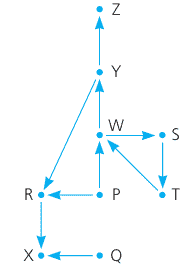

**表示航班。** 图5-4 中的航班图表示了 HPAir 飞行的路线。从城市 $C_i$ 到城市 $C_j$ 的箭头表示从 $C_i$ 到 $C_j$ 的航班。在这种情况下，$C_i$ 邻接 $C_j$，从 $C_i$ 到 $C_j$ 的路径被称为**有向路径**。注意，如果 $C_j$ 邻接 $C_i$，并不意味着 $C_i$ 邻接 $C_j$。例如，在图5-4中，从 $R$ 到 $X$ 有航班，但没有从城市 $X$ 到 $R$ 的航班。正如你在第2章中看到的，图5-4中的航班图被称为**有向图**。

**搜索的本质。** 在处理客户从某个起点到某个终地的飞行请求时，你必须根据航班图判断是否存在从起点到终地的路径。通过检查图5-4中的航班图，你可以看到客户可以从城市 $P$ 飞往城市 $Z$，先飞到 $W$，然后飞到 $Y$，最后飞到 $Z$；即从 $P$ 到 $Z$ 有有向路径：$P \rightarrow W \rightarrow Y \rightarrow Z$。因此，你必须开发一种算法，搜索航班图寻找从起点到终地的路径。这种路径可能涉及单程航班或一系列航班。这里开发的解决方案执行**穷举搜索**。也就是说，从起点开始，解决方案将尝试所有可能的航班序列，直到找到目的地或确定不存在这样的序列。

首先考虑你如何手动执行搜索。一种方法是从起点城市 $C_i$ 开始，选择从起点出发的任意航班。该航班将引导到一个新城市 $C_j$。如果 $C_j$ 正好是终地，你就完成了；否则，你必须尝试从 $C_j$ 去终地。为了这样做，你选择从 $C_j$ 出发的路径。该航班将引导到城市 $C_k$。如果 $C_k$ 是终地，否则，你必须尝试从 $C_k$ 去终地，以此此类推。

**递归策略。** 从起点城市飞到城市 $C$ 然后从 $C$ 飞往目的地具有明显的递归特征。我们可以重新表述这种策略：

- 从起点飞往目的地：
  选择邻接起点的城市 $C$
  从起点飞到城市 $C$
    如果（C$ 是终地城市）
      终止——到达目的地
    否则
      从城市 $C$ 飞往目的地

# 174 第 5 章 递归作为一种解决问题的技术

## 穷举搜索策略的可能结果

考虑应用以下策略时可能产生的结果：

1. 你最终到达目的地城市，并得出从起点到目的地可以行的结论。
2. 你到达了城市 C，从那里没有出发的航班。
3. 你在绕圈子。例如，从 C 去到 C2，然后到 C3，再从 C3 回到 C2。你可能会永远在这三个城市之间循环游；也就是说，算法可能不会终止。

如果你总是能获得第一种结果，大家都会很高兴。这对应于递归算法的边界情况（base case）。一旦你到达目的地城市，就不会再产生关于“从 C 到目的地”的其他问题，算法就会终止。然而，HPAIR 并不是在所有城市对之间都飞行，你显然不能期望算法能找到从起点到目的地的路径；如果图 5-4 中的城市 P 是起点，而城市 Q 是目的地，算法就不可能找到从 P 城市到 Q 城市的路径。

即使从起点到目的地有航班，发现它也取决于之前策略的运气——算法在每一步都会返回“正确”的航班。即使图 5-4 中有从城市 P 到城市 Z 的方法，算法也可能找不到它，并可能达到结果 2 或 3。也就是说，如果城市 P 选择去城市 F 而不是城市 Z，算法必须前往没有航班离开的城市 F（结果 2）。另一方面，算法可能会选择从 W 去城市 Q。从城市 W 出发，W 可能会选择去城市 S。然后它必须前往 T 然后返回 W。W 可能会再次选择去城市 S 并继续循环（结果 3）。

## 使用回溯从错误选择中恢复

你需要让算法更加精密，以便它总能找到从起点到目的地的路径，否则就以不存在此类路径的结论告终止。在没有出发航班时，之前的策略失效了。这显然并不意味着没有从起点到达目的地的方法；它只意味着没有从城市 C 到目的地的方法。前往城市 C 是错误的。发现这种错误后，算法可以撤销步骤，或者说回溯（backtrack）到之前访问过的城市。一旦回到 C'，算法可以选择 C 以外的其他城市。如果是这样，意味着访问城市 C' 是错误的，你将需要再次回溯——这次是回到 C' 之前访问的城市。

例如，假设在尝试从图 5-4 中的城市 P 到城市 Z 时，算法首先选择从城市 P 到 R，然后到城市 X。由于 X 没有出发航班，算法必须回溯到 R，即 X 之前访问的城市。回到 R 后，算法将前往 X 以外的某个城市。但你会发现这是不可能的。算法将再次回溯，这次回到 R 之前访问的城市 P。从 P 城市出发发，算法算法将需要前往城市 W，这才是正确的方向！

我们可以通过完善策略来解决这些问题。我们标记已访问的城市，并且永远不飞向

### 递归搜索算法的改进


```
// 发现是否存在从 originCity 到 destinationCity 的航班序列。

search(originCity: City, destinationCity: City): boolean

  if (originCity is destinationCity)
    终止- 已到达目的地
  else
    for (每个与 originCity 相邻的未访问城市 C)
      search(C, destinationCity)
```

# 图 5-5 航班地图的一部分

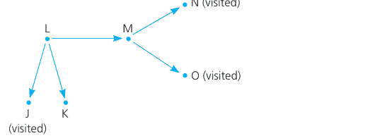

现在考虑当算法返回一个没有相邻未访问城市的城市时会发生什么。例如，考虑图 5-5 中的航班地图片段。当 `searchR` 返回城市 M 时——即 `originCity` 的值为 M 时——循环将不会进入，因为没有未访问的城市与 M 相邻。因此，`searchR(City)`算法返回。这种返回具有回溯到航班起点 L 市的效果。对于之前的伪代码来说，返回发生在调用 `searchR(destination)` 的那个点。该点在循环内部，该循环遍历与 L 相邻的城市；也就是说，`originCity` 的值为 L。

从 M 回溯到 L 后，循环将再次执行。该循环选择了城市 K，导致了递归的 `search(K,destination)`。从该点开始，算法要么到达目的地并终止——要么再次回溯到城市 L。如果它回溯到 L，由于 L 处再没有更多相邻的未访问城市，`searchR` 的返回将终止。其效果是回溯到城市 O。如果算法一直回溯到起点且且没有剩余的未访问城市与其相邻，算法将终止，你可以得出不存在从起点到目的地的航班序列的结论。注意，算法将以这种或那种方式终止，因为它要么到达目的地，要么用尽了可以尝试的未访问城市。

> **注意：回溯**
在搜索城市之间的航班序列时，你必须考虑到算法可能会做出错误选择。例如，算法必须在遇到死胡同时能够回溯，并且你必须消除算法产生循环的可能性。

**航班地图上的操作。** 现在考虑搜索算法在航班地图上必须执行的操作。算法在访问城市时标记它们，确定某个城市是否已被访问，并确定哪些城市与给定城市相邻。你可以将航班地图视为一个至少包含搜索本身外还具有这些操作的抽象数据类型（ADT）。其他可能的操作包括将数据放入航班地图、在另一个城市相邻插入城市、显示航班地图、显示所有城市列表以及显示与给定城市相邻的所有城市，ADT 航班地图可以包含以下操作，这里用 UML 符号表示。

# 第 5 章 递归作为一种解决问题的技术

### ADT 航班地图操作


```
// 将航班信息读入航班地图。
+readFlightMap(cityFileName: string, flightFileName: string): void

// 显示航班信息。
+displayFlightMap(): void

// 显示 HPA 服务的所有城市名称。
+displayAllCities(): void

// 显示与给定城市相邻的所有城市。
+displayAdjacentCities(aCity: City): void

// 将城市标记为已访问。
+markVisited(aCity: City): void

// 清除所有城市的标记。
+unvisitAll(): void

// 查看城市是否已访问。
+isVisited(aCity: City): boolean

// 在航班地图中插入一个相邻城市。
+insertAdjacent(aCity: City, adjCity: City): void

// 返回给定城市的下一个未访问城市（如果有）。
// 如果没有找到相邻城市则返回空。
+getNext(fromCity: City): City

// 测试两个城市之间是否存在航班序列。
+isPath(originCity: City, destinationCity: City): boolean
```


后一个操作 `isPath` 使用 `searchR` 算法进行判断。`method isPath` 使用 C++ 定义。注意 `NO_CITY` 是一个 `City` 对象，定义为 `getNext` 在找不到未访问城市时返回。

### searchR 的 C++ 实现

```cpp
// 测试两个城市之间是否存在航班序列。

@pre originCity 和 destinationCity 都存在于航班地图中。

@post 搜索期间访问的城市在航班地图中标记为已访问。

@param originCity 起点城市。

@param destinationCity 目的地城市。

@return 如果从 originCity 到 destinationCity 存在航班序列返回 true；否则返回 false。

bool isPath(City originCity, City destinationCity)

{

    bool result, done;

    // 将当前城市标记为已访问

    markVisited(originCity);

    // 边界情况：到达目的地

    if (originCity == destinationCity)

        result = true;

    else // 尝试飞往每个未访问城市

        {

            done = false;

            City nextCity = getNextCity(originCity);

```
```cpp
while (!done && (nextCity != NO_CITY))

{

    done = isPath(nextCity, destinationCity);

    if (!done)

        nextCity = getNextCity(originCity);

    } // end while

    result = done;

} // end if

    return result;

} // isPath
```

> 注意：递归解生成的子问题最终会达到基本情况。如果无法做到，可能会导致算法终止。涉及回溯的解决方案特别容易出现此类错误。

# 问题 6 请根据图 5-6 中的地图，针对以下请求追踪 `isPath` 方法。显示每次调用的递归调用和返回。

- 从 A 飞到 B。
- 从 A 飞到 D。
- 从 C 飞到 G。

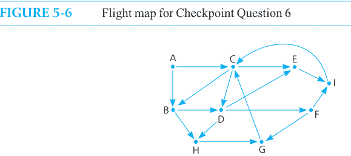

# 5.3.2 八皇后问题

在棋盘上放置八个皇后。国际象棋中最强大的棋子是皇后，因为它可以攻击同一行、同一列或对角线上的任何其他棋子。八皇后问题要求你在棋盘上放置八个皇后，使得任何皇后都不能攻击另一个皇后。

一种策略是猜测解决方案。然而，根据第 2 章第 2.6.3 节，有 `g(64) = 4,426,368` 种方法在 64 个格子上排列八个皇后——数量之多，要检查所有排列以找到解决方案将精疲力竭。尽管如此，一个简单的观察就可以排除所有安排：任何皇后不能位于包含另一个皇后的行或列中。或者说，每行每列恰好包含一个皇后。这样，行或列的攻击就被消除了，只需要检查 `8! = 40,320` 种皇后排列的对角线攻击即可。解决方案现在看起来更有可行性。

# 178 第 5 章 递归作为一种问题解决技术

图 5-7 在每列中放置一个皇后，以及已放置皇后的攻击范围：(a) 第 1 列的第一个皇后；(b) 第 2 列的第二个皇后；(c) 第 3 列的第三个皇后；(d) 第 4 列的第四个皇后；(e) 五个皇后都可以攻击第 6 列的某个格子；(f) 回溯到第 5 列以为皇后尝试另一个格子；(g) 回溯到第 4 列以为皇后尝试另一个格子；(h) 再次考虑第 5 列

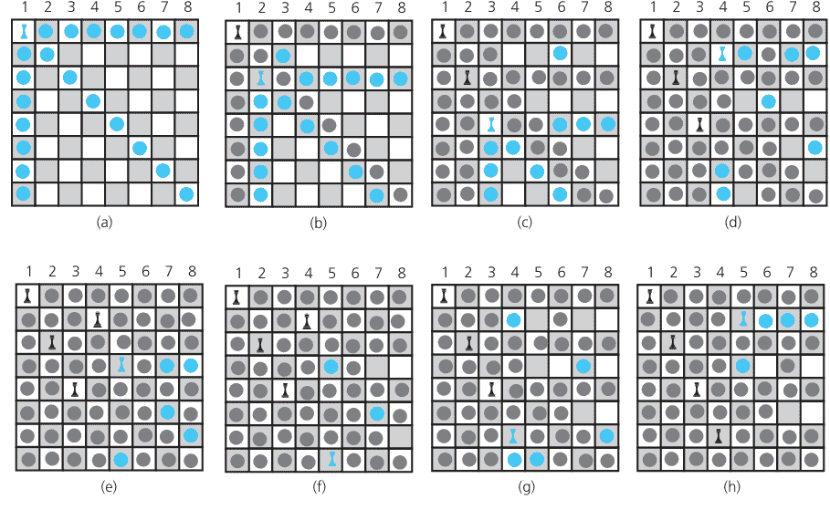

逐列放置皇后

假设你通过在第 $i$ 列中放置一个皇后（从第 1 列的第一个格子开始）为猜测提供某种组织。图 5-7a 显示了这一列及其攻击范围。当你考虑第 2 列时，你排除了第一个格格，因为第 1 行包含一个皇后；你由于对角线攻击排除了第二个格格；最后在第 2 列的第三个格格中放置了一个皇后，如图 5-7b 所示。图中的蓝点表示由于攻击而被拒绝的格子。蓝点还表示了你的新皇后可以攻击的额外格子。

如果你陷入了僵局，回溯到前一列

我们继续以此方式放置皇后，直到到达第 6 列，如图 5-7 所示。虽然已放置的五个皇后不能互相攻击，但它们可以攻击第 6 列的任何格子，因此，你不能在第 6 列放置皇后。你必须回溯到第 5 列，并将皇后移动到第 5 列的下一个可能的格子，即最后一行，如图 5-7i 所示。当你再次考虑第 6 列时，该列仍然没有选择。由于你已经耗尽了第 5 列的可能性，你必须回溯到第 4 列。如图 5-7g 所示，第 4 列下一个可能的格子在第 7 行。然后你再次考虑第 5 列，并在第 2 行放置一个皇后（图 5-7h）。

如何在上述描述的过程中使用递归？考虑一种算法，在已经在先前的列中正确放置了皇子的情况下，在某一列中放置皇后。

首先，如果没有列需要考虑，你就完成了；这就是基本情况。否则，如果你在当前列中成功放置了皇后，你就需要考虑下一列。也就是说，你需要用少一列来解决相同的问题；这就是递归步骤。因此，你从八列开始，考虑在每个递归步骤中减少一列的小问题，并在当问题没有列时达到基本情况。

该解决方案似乎符合递归解的标准。然而，你不知道自己是否在当前列中成功放置了皇后。如果你可以，就递归地考虑下一列。如果你不能在当前列中放置皇后，你需要像描述的那样进行回溯。

八皇后问题可以通过多种方式解决。本章的解决方案使用了两个类：`Board` 类表示棋盘，`Queen` 类表示棋盘上的皇后。`Board` 对象跟踪其行和列的放置，并包含一个指向 `Board` 的静态指针。它还有将皇后移动到下一行并查看其是否受到攻击的操作——例如 `placeQueens`。

以下伪代码描述了放置皇后的算法，假设之前的列不能攻击另一个：

```cpp
// placeQueens(column): void

if (column > lastColumn)

    问题已解决

else

    while (squares exist in column)

        if (such square exists)

            在格中放置皇后

            placeQueens(column + 1)

            if (下一列无法放置皇后)

                删除新皇后
```

带有回溯

八皇后问题通过 `doEightQueens` 方法初始化，在棋盘的左上角放置一个新皇后：

```cpp
doEightQueens()
{
  placeQueens(1))
}
```

在 `doEightQueens` 完成后，如果找到了解决方案，棋盘可能会显示出来。

# 180 第 5 章 递归作为一种问题解决技术

图 5-8 八皇后问题的解决方案

| 1 | 2 | 3 | 4 | 5 | 6 | 7 | 8 |
|---|---|---|---|---|---|---|---|
| ♜ | | | | | | | |
| | ♜ | | | | | | |
| | | ♜ | | | | | |
| | | | ♜ | | | | |
| | | | | ♜ | | | |
| | | | | | ♜ | | |
| | | | | | | ♜ | |
| | | | | | | | |

*(（注：表格内容根据视觉上下文重建）*

图 5-8 表示了算法算法找到解决方案。通过修改 `placeQueens` 的参数，你可以发现八皇后问题的其他解决方案。本章末的编程题要求你考虑该算法的其他解决方案，以及额外的修改。

- **问题 7** 考虑四皇后问题，其规则与八皇后问题相同，但使用 4×4 棋盘。通过手动应用回溯找到该新问题的所有解决方案。

```cpp
#include <iostream>
using namespace std;
static const int BOARD_SIZE = 8;
class Board {
private:
    vector<Queen*> queens; // 棋盘上皇后的指针数组
    /** 查看位置 (inRow, inCol) 处是否存在皇后。 */
    bool isQueen(int inRow, int inCol) const;
    /** 尝试在棋盘上放置皇后，从指定的皇后开始。 */
    const int placeQueens(Queen* queenPtr);
    /** 从棋盘上移除上一个皇后，但不释放其内存。 */
    void removeQueen();
    /** 在棋盘上放置一个皇后。 */
    void setQueen(Queen* queenPtr);
public:
    /** 为 Queen 类提供一个指向棋盘的指针。 */
    Board();
    /** 清空棋盘并移除 queens 向量中的指针。 */
    ~Board();
    /** 清空棋盘。 */
    void clear();
    /** 显示棋盘。 */
    void display() const;
    /** 启动八皇后问题。 */
    void doEightQueens();
    /** 返回棋盘上的皇后数量。 */
    int getNumQueens() const;
    /** 返回指向指定索引处皇后的指针。 */
    const Queen* getQueen(int index);
};
// end endif
```

```cpp
LISTING 5-2 Queen 类
class Board; // Board 类的前向声明
/** Queen 类。 */
class Queen {
public:
    /** 在棋盘的左上角放置一个皇后。 */
    Queen();
    /** 在给定的位置放置一个皇后。 */
    Queen(int inRow, int inCol);
    /** 返回列号。 */
    int getCol() const;
    /** 行号。 */
    int getRow() const;
    /** 将皇后移动到下一行。 */
    void nextRow();
    /** 检查皇后是否受到另一个皇后的攻击。 */
    /** 如果皇后在同一行或同一条对角线线上，则返回 true；否则返回 false。 */
    bool isUnderAttack() const;
    /** 为所有皇后保存一个指向棋盘的指针。 */
    static void setBoard(const Board* bPtr);
private:
    int row; // 如果皇后在棋盘上，则为皇后的行（或相应的行）
    int col; // 如果皇后在棋盘上，则为皇后的列（或相应的列）
             // the board
    /** 所有皇后共享同一个棋盘 */
    static Board* boardPtr;
};
```

以下是 `placeQueens` 的实现代码：

```cpp
bool Board::placeQueens(Queen* queenPtr)
{
    // 基础情况：尝试在一个不存在的列中放置皇后
    if (queenPtr->getCol() >= BOARD_SIZE)
    {
        delete queenPtr;
        return true;
    } // end if
    bool isQueenPlaced = false;
    while (!isQueenPlaced && queenPtr->getRow() < BOARD_SIZE)
    {
        // 如果皇后可以被攻击，则将其移动
        // 到当前列的下一行
        if (queenPtr->isUnderAttack())
        {
            queenPtr->nextRow();
        }
        else
        {
            // 将此皇后放在棋盘上，并尝试在
            // 当前列的第一行放置一个新的皇后
            setBoard(queenPtr);
            Queen* newQueen = new Queen(0, queenPtr->getCol() + 1);
            isQueenPlaced = placeQueens(newQueen);
        }
    }
    // 如果无法在下一列放置新皇后，
    // 则通过删除新皇后并将上一个
    // 的皇后向下移动来进行回溯
    if (!isQueenPlaced) {
        delete newQueen;
        removeQueen();
        queenPtr->nextRow();
    } // end if
} // end if
} // while
    return isQueenPlaced;
} // end placeQueens
```

## 5.4 递归与数学归纳法的关系

递归与数学归纳法之间存在着非常紧密的关系。递归通过指定一个或多个基础情况的解决方案，并证明如何从同类型较小问题的解决方案推导出任意规模问题的解决方案来解决问题。数学归纳法通过证明适当的基础情况（通常是 0 或 1），并证明如果该性质对于小于 $n$ 的自然数成立，则它对于任何自然数 $n$ 也必须成立，从而证明关于自然数的性质。

考虑到递归和数学归纳法之间的相似性，归纳法经常被用于证明关于递归算法的性质，这并不意外。是什么类型的性质呢？例如，你可以证明一个算法确实执行了你预期的任务。为了说明这一点，我们将证明第 2 章中的递归算法确实计算了其参数的阶乘。数学归纳法的另一个用途是证明递归算法执行了特定数量的工作量。例如，我们将证明同样来自第 2 章的汉诺塔问题的解决方案在从有 $n$ 个盘子开始时，恰好执行了 $2^n-1$ 次移动。

你可以使用归纳法来证明递归算法要么是正确的，要么执行了特定的工作量。

### 5.4.1 递归阶乘函数的正确性

以下伪代码描述了一个计算非负整数 $n$ 阶乘的递归函数：

```text
fact(n: integer): integer {
    if (n is 0)
        return 1
    else
        return n * fact(n - 1)
}
```

你可以证明 `fact` 函数返回以下值：

`factorial(0) = 0! = 1`
`factorial(n) = n! \times (n-1) \times (n-2) \times \dots \times 1$ 如果 $n > 0`

证明是基于 $n$ 的归纳法。

**基础步骤。** 证明该性质在 $n=0$ 时成立。即证明 `fact(0)` 返回 1。但这个结果仅仅函数的基础情况：根据定义，`fact(0)` 返回 1。

你现在必须建立：

性质对于任意 k 成立 $\Rightarrow$ 性质对于 k + 1 成立

**归纳假设。** 假设该性质在 $n = k$ 时成立。即假设 `factorial(k) = $k \times (k - 1) \times (k - 2) \times ... \times 1$`

**归纳结论。** 证明该性质在 $n = k + 1$ 时成立。即，你必须证明 `factorial(k+1) = $(k+1) \times k \times (k-1) \times ... \times 1$`。

根据函数的定义，

`factorial(k+1) = $(k+1) \times factorial(k)$`

根据归纳假设，

`factorial(k+1) = $(k+1) \times k!$`

= `$(k+1)!$`

这就是你为了建立以下结论所需的证明：

性质对于任意 k 成立 $\Rightarrow$ 性质对于 k + 1 成立

归纳证明完成。

### 5.4.2 汉诺塔的代价

在第 2 章中，你看到了：

```
moves(1) = 1
moves(N) = 2 × moves(N-1) + 1    if N > 1
```

因此，你得到了关于 N 个盘子所需移动次数的递归关系：

```
moves(1) = 1
moves(N) = 2 × moves(N-1) + 1    if N > 1
```

例如，你可以这样确定 `moves(3)`：

```
moves(3) = 2 × moves(2) + 1
= 2 × (2 × moves(1) + 1)
= 2 × (2 × 1 + 1) + 1
= 7
```

虽然递归关系为你提供了一种计算 `moves(N)` 的方法，但

上述关系的解是：

```
moves(N) = 2^N - 1    for all N ≥ 1
```

注意 `2³ - 1` 与我们为 `moves(3)` 计算出的值 7 一致。
`moves(N) = 2ⁿ - 1` 的证明是基于 N 的归纳法。

**基础步骤。** 证明该性质在 N = 1 时成立。这里 `2¹ - 1 = 1`，这与递归关系 `moves(1) = 1` 的规范一致。
你必须建立：

性质对于任意 k 成立 $\Rightarrow$ 性质对于 k + 1 成立

**归纳假设。** 假设该性质在 N = k 时成立。即

**归纳结论。** 证明该性质在 N = k + 1 时成立。即，你必须证明 `moves(k+1) = 2ᵏ+¹ - 1`。现在

```
moves(k+1) = 2 × moves(k) + 1    来自递归关系
```


= 2 × (2ᵏ - 1) + 1    根据归纳假设

= 2ᵏ+¹ - 1

```
```

这就是你为了建立以下结论所需的证明：

性质对于任意 k 成立 $\Rightarrow$ 性质对于 k + 1 成立

归纳证明完成。

# 186 第 5 章 递归作为一种解决问题的技术

> 注意：本章中遇到的某些算法的细微之处表明，需要使用数学技术来证明它们的正确性。在设计解决方案的各个组件时应用这些技术，有助于在错误出现在程序之前消除逻辑错误。其中一种技术是数学归纳法；此外还有循环不变式的使用，附录中对此进行了讨论。

## 总结

- 1. 文法是定义语言的机制，语言是符号字符串。通过使用文法来定义语言，你可以构建一个直接基于文法的识别算法。文法通常是递归的，允许你简洁地描述海量语言。
- 2. 为了说明文法的用法，我们定义了若干种代数表达式语言。这些语言有各自的优缺点。前缀表达式和后缀表达式虽然人类人类使用，但其文法简单且能消除歧义。另一方面，中缀表达式更容易人类使用，可以使用括号、优先级规则和结合律来消除歧义。因此，中缀表达式文法更为复杂。
- 3. 回溯是一种解决策略，涉及递归和一系列最终通向解决方案的猜测。如果某个猜测导致僵局，请按反序撤销你的步骤，替换该猜测，并尝试完成解决方案。
- 4. 数学归纳法与递归之间存在紧密的关系。你可以使用归纳法来证明递归算法。例如，你可以证明一个递归算法是正确的，并减少它所需的工作量。

## 练习题

- 1. 跟踪以下递归函数：
   a. 使用字符串 `abcdeba` 的 `isPal`
   b. 使用字符串 `AABB` 的 `isAnBn`
   c. 使用表达式 `*/abcd` 的 `endPre`
- 2. 考虑以下语言文法：
  `<S> = <W> | <S>`
  `<W> = abb | a <W> bb`
  写出该语言中包含七个或更少字符的所有字符串。
- 3. 为一个或多个字母的语言编写递归文法。每个字符串的首字母必须大写，且字符串中的所有其他字母必须是小写。
- 4. 考虑一种仅包含点（`.`）和破折号（`-`）的字符字符串。该语言中的所有字符串至少包含四个字符，并以两个点或两个破折号开头。如果前两个字符是破折号，则最后一个必须是破折号；如果前两个字符是点，最后一个必须是点。为该语言编写递归文法。
- 5. 考虑一种仅包含 `X`、`Y` 和 `Z` 的字符串语言。该语言中的字符串必须以 `X` 开头。如果字符串存在 `Y`，它必须是字符串的最后一个字符。
   a. 为该语言编写递归文法。
   b. 写出该语言中所有可能的双字符字符串。
- 6. 考虑一种单词语言，每个单词都以点和破折号字符串开头。以下文法描述了这种语言：
  ```
  <word> = <dot> | <dash><word> | <word> <dot>
  <dot> = 
  <dash> = -
  ```
   a. 写出该语言中所有的三字符字符串？解释原因。
   b. 字符串 `.----` 是否在该语言中？
   c. 写一个包含破折号多于点且属于该语言的七字符字符串。说明你如何知道答案是正确的。
   d. 为递归函数 `isIn(str)` 编写伪代码，如果字符串 `str` 在该语言中则返回 true，否则返回 false。
- 7. 考虑以下文法：
  ```
  <word> = R | <D> | <D><word><S>
  <D> = Q | P
  <S> = 1
  ```
  为递归函数编写伪代码，如果字符串在在该语言中则返回 true，否则返回 false。
- 8. 考虑以下文法：
  ```
  <G> = empty string | <E><E> | <V><E> | <E><G><V>
  <E> = #
  <V> = W | A
  ```
   a. 为递归函数编写伪代码，如果字符串在在该语言中则返回 true，否则返回 false。
   b. 字符串 `&&W#W` 在该语言中吗？
- 9. 令 `L` 为语言：
  ```
  L = {S: S 的形式为 A*B^2n, 对于某些 n > 0}
  ```
  因此，一个字符串在 `L` 中当且仅当它以一系列 `A` 开头，后面跟着数量是两倍的 `B` 序列。例如，`AABBBBB` 在 `L` 中，但 `ABBB`、`ABABB` 和空字符串不在 `L` 中。
   a. 为语言 `L` 给一个文法。
   b. 写一个递归函数判断字符串 `strExp` 是否在 `L` 中。
- 10. `*a-b/c+-de-fg` 是前缀表达式吗？根据后缀表达式文法解释。
- 11. `ab/c*ef*/h/d+` 是后缀表达式吗？根据后缀表达式文法解释。
- 12. 考虑由以下文法定义的语言：
  ```
  <S> = <L> | <D><S>
  <L> = A | B
  <D> = 1 | 2
  ```
   a. 写出该语言中所有的三字符字符串。
   b. 写出该语言中一个包含三个以上字符的字符串。

# 114 第 5 章 递归作为一种解决问题的技术

- 13. 考虑由以下字符字符串组成的语言：字母 `A`、字母 `B`、字母 `C` 后接一个字符串，以及字母 `D` 后接一个字符串。例如，这些字符串有 `CA`, `CC`, `DCC`。
   a. 为该语言编写文法。
   b. `CAB` 在该语言中吗？
   c. 写一个递归识别算法。
- 14. 考虑遵循文法的语言：
  ```
  <word> = a | b<word> | <word>
  ```
  等价于：
  ```
  L = {s: s 是回文}
  ```
  注意该语言类似于回文，但具有以下特点：
  * 无字符的字符串在语言中。
  * 有一个字符的字符串在语言中。
  * 如果结尾相同，则长字符串在语言中。
  描述一个从左到右处理字符串的递归算法。

15. 考虑以下函数：
  ```cpp
  int p(int x) {
    if (x <= 3)
      return x;
    else
      return p(x-1) + p(x-3);
  }
  ```
  令 `m(x)` 为 `p` 执行的操作次数。
   a. 为 `m(x)` 写一个递归定义。
   b. 使用归纳法证明你的答案是正确的。

16. 考虑仅由小写字母组成的回文。令 `c(n)` 为此类数量。
   a. 为 `c(n)` 写一个递归定义。
   b. 使用归纳法证明你的答案是正确的。

17. 对于单字母证明以下：如果 `E` 是非空字符串，则它是合法的。（提示：对 `E` 的长度使用证明。）

18. 考虑以下 `g(n, k)` 的定义，假设 `n` 和 `k` 为非负整数：
  $$
  g(n, k) = \begin{cases} 1 & k = 0 \\ n & k = n \\ g(n-1, k-1) + g(n-1, k) & 0 < k < n \end{cases}
  $$
  对 `n` 进行归纳，证明以下是 `g(n, k)` 的闭式形式：
  $$g(n, k) = \frac{n!}{(n-k)!}$$

## 编程题

- 1. 完成用于皇后问题的 `Queen` 和 `Board` 类。
- 2. 修订你刚刚编写的皇后问题程序，使其回答以下问题：
   a. 发生了多少次回溯？也就是说，程序有多少次从板上移除皇后？
   b. 有多少次调用 `isAttack`？
   c. 有多少次递归调用 `placeQueens`？
* 你可以通过在第一列的第二个位置放置皇后来开始皇后问题。然后你可以调用 `placeQueens` 从第二列开始。这种修改将引导你找到一个新的解决方案。皇后¹
4. 你知道如何通过迷宫吗？在你编写这个程序后，你再也不会迷路了！假设迷宫是一个矩形数组，某些元素被阻塞以形成墙。例如，如果 `x` 代表墙，迷宫可能如下：
```
XXXXXXXXXXXXXXXX X
X XXXXX XX X
X X XXXXX XX X
X X XXXXX XX X
X X XX X X
X XXXXXXXXXX X
XXXXXXXXXXXXXXXXXXXXX
```
生物在之前的图中用 `o` 表示，位于迷宫内部的入口（底部）。假设生物可以在四个方向移动：北、南、东、西。在迷宫中，北是向上，南是向下，东是向右，西是向左。问题是让生物通过迷宫到达入口（顶部），如果可能的话。在通过迷宫的旅行结束时，你应该看到正确的路径和错误的尝试。编写一个程序来解决这个问题。

¹ 本书中特别具有挑战性的项目用星号标记。

# 190 第5章 递归作为一种解决问题的技术

迷宫中的方格有几种状态：`CLEAR`（格子是空的）、`WALL`（格子被阻塞并代表墙的一部分）、`PATH`（格子位于通往出口的路径上）、`VISITED`（格子已访问过，但该路径导致了死胡同）。

这个问题使用了两个相互作用的抽象数据类型（ADT）。`creature` ADT 代表生物当前的位置以及移动生物的操作。生物应该能够一次向北、南、东、西移动一格。它应该能够报告自己的位置并标记足迹。

`maze` ADT 代表迷宫，这是一个二维矩形方格布局。你可以从顶部开始对行进行编号，从左侧开始对列进行编号。然后你可以使用行号和列号来唯一标识迷宫中的任何方格。ADT 显然需要一个数据结构来表示迷宫。它还需要以方格数表示迷宫的高度和宽度；方格边的长度；迷宫入口和出口的行、列坐标。

ADT 还应该包含一些操作，例如根据描述性数据创建特定的迷宫（这些数据将用于显示迷宫）、判断特定方格是否是路径的一部分等。

我们使用的搜索算法位于 `creature` 和 `maze` 这 ADT 之外。如果你在入口，可以使用以下搜索算法系统地找到离开迷宫的路。该算法涉及回溯（backtracking）——即当你遇到死胡同时回溯你的步骤。

- **步骤 1。** 首先检查你是否在出口。如果在，则任务完成（一个非常简单的迷宫）；如果不在，进入步骤 2。
- **步骤 2。** 通过调用函数 `goNorth`（步骤 3）尝试移动到正正北方的方格。
- **步骤 3.** 如果 `goNorth` 执行成功，则完成。如果失败，调用函数 `goWest`（步骤 4）尝试移动到正正西方的方格。
- **步骤 4。** 如果 `goWest` 执行成功，则完成。如果失败，调用函数 `goSouth`（步骤 5）尝试移动到正正南方的方格。
- **步骤 5。** 如果 `goSouth` 执行成功，则完成。如果失败，调用函数 `goEast`（步骤 6）尝试移动到正正东方的方格。
- **步骤 6。** 如果 `goEast` 执行成功，则完成。如果失败，你仍然完成了，因为从入口到出口不存在路径。

下面的伪代码描述了 `goNorth` 算法：
```
goNorth(maze, creature)
  if (正北方的方格是空的、在迷宫内部且未访问过)
    向北移动
    标记该方格为路径的一部分
  if (at exit)
```

# 191 编程题

```
success = true
else
{
    success = goNorth(maze, creature)
    if (!success) {
        success = goWest(maze, creature)
        if (!success) {
            success = goEast(maze, creature)
            if (!success) {
                Mark square visited
                Backtrack south
            }
        }
    }
}
else
success = false
```

`ghost` 函数将按照如下方式检查从当前方格正西方方格开始的所有路径。如果正西方的方格是空的、在迷宫内部且之前未被访问过，则进入该方格并使其成为路径的一部分。（注意是从东向西移动的。）检查你是否在出口。如果不在，否则通过尝试离开此方格的所有路径（除你来的那条以外）来寻找通往出口的路径（这将回到原来的方格）。调用 `goNorth`；如果不成功，调用 `goWest`；如果不成功，调用 `goSouth`。如果 `goSouth` 不成功，将此方格标记为已访问，回到正东方的方格并返回。`goEast` 和 `goSouth` 函数与 `goNorth` 和 `goWest` 类似。

表示迷宫的输入很简单。例如，之前给出的迷宫由输入行表示，可以在文本文件中：
```
20 7 ← 迷宫的方格宽度和高度
0 18 ← 迷宫出口的行列坐标
6 12 ← 迷宫入口的行列坐标
XXXXXXXXXXX
X X XXXX X
X XXXXX XX X
X XXXXXXX X X
X X XX XX X
XXXXXXXXXXXX X
XXXXXXXXXXX
```
在文件的前三行数字数据之后，之后的每一行对应迷宫的一行，每行中的每个字符对应迷宫的一个方格。`x` 表示阻塞的方格（墙的一部分），空白表示空方格。这种表示法非常方便，因为你可以在设计迷宫时看到它的样子。

- 5. 编写一个识别并求值前缀表达式的程序。首先设计并实现前缀表达式类。该类应包含识别和求值前缀表达式的方法。本章讨论了实现这些方法所需的算法。
- 6. 为练习题 5 中的语言实现一个识别算法。

# 192 第5章 递归作为一种解决问题的技术

- 7. 实现本章描述的算法，将前缀表达式转换为后缀形式。
- 8. 下面是一个允许在中缀表达式中省略括号的语法，其中优先级消除了歧义。例如 `a c` 意味着 `a*(b)`。也就是说，当多个运算符具有相同优先级时，需要括号。例如，`a / b` 是非法的。
```
<expression> = <term> + <term> | <term>
<term> = <factor> * <factor> | <factor>
<factor> = <letter> | <expression>
```
识别算法基于子任务的递归链：一个表达式。构成这个递归链的是，寻找一个表达式会使用一个项，而项反过来又会寻找一个因子。识别算法的伪代码如下：
```
FIND AN EXPRESSION
// 语法规定表达式要么是单个项，
// 或者是一个后面跟着 * 或 - 的项，后面必须紧跟第二个项。
Find a term
if (下一个符号是 * 或 -)
Find a factor
```
```
FIND A TERM
// 语法规定项要么是单个因子，
// 或者是一个后面跟着 * 或 / 的因子，后面必须紧跟第二个因子。
Find a factor
if (下一个符号是 * 或 /)
Find a factor
```
```
FIND A FACTOR
// 语法规定因子要么是字母（基本情况），
// 或者是用括号括的表达式。
if (第一个符号是字母)
Done
else if (第一个符号是 '(')
{
寻找从 '(' 之后开始的表达式
检查是否存在 ')'
}
else
不存在因子
```
根据给定的语法设计并实现一个中缀表达式类。包含一个识别合法中缀表达式的方法。

## 第 6 章 栈

我们对数据管理的研究三个目标。第一个目标是识别有用的操作集合——也就是说，抽象出数据类型（ADT）。第二个目标是研究使用抽象数据类型的应用程序。第三个目标是为抽象数据类型构建实现——即开发数据结构和类。正如你将发现的，抽象数据类型的操作性质，以及你使用它的应用程序，都会影响其实现方式的选择。

第 1 章中讨论的 ADT 徽章并没有对其数据进行组织。然而，你可以根据位置或值来进行组织。通常，这些组织方式适用于不同性质的应用程序。例如，如果一个应用程序需要询问关于队列中第一个人的问题，你就应该按位置组织数据。另一方面，如果一个应用程序需要询问关于一个名为 Smith 的员工的问题，你就应该按值组织数据。在此本书的剩余部分中，你将看到几种使用这两种组织方式的 ADT。

本章介绍了栈的操作如何使其具有“后进先出”（LIFO）的行为。本章考虑的栈的两个应用是代数表达式和寻找两点之间的路径。最后，本章讨论了栈与递归之间重要的关系。我们留下了这些的实现。

## 6.1 抽象数据类型栈


栈 ADT

用于解决特定问题的抽象数据类型规格，是在设计问题解决方案期间产生而出的。在接下来的示例中开发的 ADT 正好就是其中之一：栈 ADT。

### 6.1.1 在解决方案设计过程中开发 ADT

当你在键盘上输入一行文本时，可能会出错。如果你使用 Backspace 键来纠正这些错误，每次按下退格键都会删除上一个字符。连续的退格键会按顺序执行并删除几个字符。例如，如果你输入这一行：
`abcabcd←cfg`
← 代表退格字符，修正后的输入将是：
`abcd`
程序如何读取原始行并获得正确的输入？在设计问题的解决方案时，你最终必须决定如何存储输入行。根据 ADT 方法，你应该在你更清楚需要对数据执行哪些操作之前，将地推迟这一决定。

解决方案的首次尝试导致了以下伪代码：
```cpp
// 读取行，在此过程中纠正错误
while (not end of line)
  Read a new character ch
  if (ch is not '←')
    Add ch to the ADT
  else
    Remove from the ADT (discard) the item that was added most recently
```
解决方案的初始草案

该解决方案引起了对 ADT 必须包含的两个操作的注意：
- 向 ADT 添加一个最近添加添加的项。

注意，如果你在 ADT 为空时输入了 `←`，就会出现潜在问题——即当 ADT 不包含任何字符时。如果发生这种情况，你有三个选择：(1) 程序终止并写一条错误消息，(2) 抛出异常，或 (3) 让程序忽略 `←` 并继续。这些选项中的任何一个都是合理的，所以假设你决定忽略 `←` 并继续。因此，算法
```cpp
// 读取行，在此过程中纠正错误
```


`while (not end of line)`

```
{
  Read a new character ch
  if (ch is not a '←')
    Add ch to the ADT
  else if (the ADT is not empty)
    Remove from the ADT the item that was added most recently
  else
    Ignore the '←'
}
```

“读取并修正”算法

从这个伪代码中，你可以识别出 ADT 需要的第三种操作：

- 检查 ADT 是否为空。

另一个需要的 ADT 操作

此地在 ADT 中保留了修正后的输入行。现在假设你想显示这一行。首先，看起来你可以通过已识别的 ADT 操作来完成此任务，如下：

```cpp
// 显示行
while (the ADT is not empty)
{
  Remove from the ADT the item that was added most recently
  Display ... 噢糟糕！
}
```

编写该行的错误开始

这个伪代码是错误的，原因有两个：

- 当你从 ADT 中移除一个项目时，该项目就此消失了，所以你无法显示它。你本应该做的是查看最近添加到 ADT 中的项。一个访问器操作（accessor operation）返回一个项——允许你查看它——但不会改变 ADT 的数据。在获取并显示项后，再将其从 ADT 中移除。
- 输入行的最后一个字符是最近添加到 ADT 中的。你显然不想写出它。这个特定问题的解决方法留给你的练习。

如果我们只处理第一个困难，以下伪代码将反序显示行：

```cpp
// 反序显示行
while (the ADT is not empty)
{
  Get the item that was added most recently and assign it to ch
  Display ch
}
```

### 6.1.2 ADT 的规格

虽然你还没有思考其实现，但你知道必须执行四个特定的操作。这些操作定义了栈：

- 检查栈是否为空。
- 向栈添加一个新项。
- 从栈中移除最近添加的项。
- 获取最近添加到栈的项。

“栈”（stack）一词旨在唤起日常生活中物品的构想，例如食堂里的一叠盘子、桌上的一叠书或一叠需要完成的作业。在通常用法中，“栈”和“堆”是同义词。但对于计算机科学家来说，栈不仅仅是任何堆。最后添加到栈的项将被首先移除的属性通常被称为后进先出，或简单的 LIFO。

LIFO：最后进入栈的项是第一个取出的

食堂里的一叠盘子是抽象数据类型栈的一个很好的类比，图 6-1 所示。随着新盘子的添加，旧盘子掉到表面下的深处。在任何特定时刻，只有最后放在栈上的盘子位于表面且可见。这个盘子位于栈的顶部，也是必须移除的。通常，盘子的放置顺序与它们的添加顺序相反。

图 6-1 食堂盘子的栈

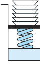

正确反序行的最终算法不需要额外的 ADT 操作。

栈的 LIFO 属性似乎本质上是不公平的。想想那个在食堂栈中终于获得最后一个的可怜的人，他们已经在那里等了六以前了。或者你想成为电影栈——相对于电影队列——第一个到达吗？你将是最后一个孤独的人！这些例子说明了为什么栈在日常生活中并不常见。我们日常生活中通常设计的属性是先进先出，或 FIFO。队列（你将在第 13 章中学习）是具有 FIFO 属性的 ADT。

# 抽象数据类型栈 197

请注意 ADT 栈与食堂盘子堆之间的类比是多么贴切。在 ADT 栈上操作数据的这些是食堂操作中唯一的此类操作，它们对应于你对盘子堆能做的唯一事情。你可以判断栈是否为空，但不能判断栈上有多少个盘子；你可以检查顶部的盘子而不能检查其他盘子；你可以将盘子放在栈的顶部，而不能放在其他位置；你可以从栈的顶部移除盘子，而不能从其他位置移除。如果你被允许执行这些任何操作，或者被允许执行任何其他操作，那么这个 ADT 就不是一个栈。

虽然食堂盘子堆暗示了当你添加或移除盘子时，其他盘子不会移动，这符合 ADT 栈的预期。栈操作仅涉及顶部的元素，并且仅意味着其他元素保持顺序。ADT 栈操作的实现可能会或不会移动栈中的元素。下一章中的实现没有移动元素。

精炼 ADT 栈的规范。以下对 ADT 栈的总结提供了关于我们希望如何规范其操作的细节。这里为栈操作提供的名称是约定俗成的。

## 抽象数据类型：栈

| 数据 |
| :--- |
| 有限数量的对象，不一定相同，具有相同的数据类型，并按添加的顺序排序。 |

| 操作 | 描述 |
| :--- | :--- |
| `isEmpty()` | 任务：检查此栈是否为空。<br>输入：无。<br>输出：如果栈为空返回 True；否则返回 false。 |
| `push(newEntry)` | 任务：将 `newEntry` 添加到此栈顶部。<br>输入：`newEntry`。<br>输出：如果操作成功返回 True；否则返回 false。 |
| `pop()` | 任务：移除此栈顶部。也就是说，它移除最近添加的元素。<br>输入：无。<br>输出：如果操作成功返回 True；否则返回 false。 |
| `peek()` | 任务：返回此栈顶部。也就是说，它获取最近添加的元素。<br>操作不会改变栈。<br>输入：无。<br>输出：栈顶。 |

图 6-2 显示了栈类的 UML 图。

| 栈 |
| :--- |
| +`isEmpty()`: : boolean |
| +`push(newEntry: ItemType)`: : boolean |
| +`pop()`: : boolean |
| +`peek()`: ItemType |

**在解决方案中使用 ADT 栈。** 回想第 1 章提醒你在考虑模块实现之前，要关注模块的规范。在用伪代码编写 ADT 的操作后，尝试将它们作为对你设计的检查。这种测试可以突出你的规范或设计中的缺陷。例如，你可以使用之前的栈操作来精炼在本章早期开发的算法。

精炼后的算法

```
// 读取输入行，将字符 '←' 识别为擦除之前输入字符的退格键；
// 返回一个修正后记录的栈。
readAndCorrect(): Stack
aStack = a new empty stack
Read newChar
while (newChar is not the end-of-line symbol)
    if (newChar is not '←')
        aStack.push(newChar)
    else if (!aStack.isEmpty())
        aStack.pop()
    Read newChar
return aStack
// 通过写入 aStack 的内容倒序显示输入行。
displayBackward(aStack: Stack)
```

```
while (!aStack.isEmpty())
{
    newChar = aStack.peek()
    aStack.pop()
    Write newChar
}
Advance to new line
```

你应该能够在不知道它们的实现、甚至不知道栈的什么样的情况下使用栈操作。因为处理 AD 涉及在实现在周围建立一道墙，所以你的程序可以独立于栈的实现来使用栈。只要程序正确使用 ADT 的操作——也就是说，只要它遵守操作合同——无论你如何实现 ADT，它都能工作。

然而，为了让程序做到这一点，操作合同必须精确编写。也就是说，在你实现 ADT 的任何操作之前，你应该详细地指定它们在使用前的要求和最终效果。要意识到，在程序设计期间，对规范的第一次尝试通常是非正式的，随后通过编写先决条件和后置条件来精确化。例如，之前 ADT 栈的规范留下了以下未待回答的问题：

- * `peek` 如何影响空栈？*
- * 当栈为空时， `peek` 会做什么？*

栈的非正式规范留下的未解决问题

> 注意：`pop` 和 `peek` 等操作在栈为空时必须采取合理的行动。

**一个接口。** 列表 6-1 中提供的接口使我们对 ADT 栈的规范形式化，并回答了之前关于 `pop` 和 `peek` 的问题。

## 列表6-1 栈的 C++ 接口

```cpp
/** @file StackInterface.h */
#ifndef STACK_INTERFACE
#define STACK_INTERFACE
template<class ItemType>
class StackInterface {
public:
    /** 检查栈是否为空，否则返回 false。 */
    @return True
    virtual bool isEmpty() const = 0;
    /** 将新项添加到此栈顶部。 */
    @post 如果操作成功，newEntry 位于栈顶。
    @param newEntry 要作为新条目添加的对象。
    @return 如果添加成功返回 True，否则返回 false。 */
    virtual bool push(const ItemType& newEntry) = 0;
    /** 移除此栈顶部。 */
    @post 如果操作成功，栈顶已被移除。
    @return 如果移除成功返回 True，否则返回 false。 */
    virtual bool pop() = 0;
    /** 返回栈顶。 */
    @pre 栈不为空。
    @post 栈顶已被返回，栈保持不变。
    @return 栈顶。 */
    virtual ItemType peek() const = 0;
};
;// end StackInterface
#endif
```

# 问题 1
如果你按顺序将字母 A、B、C、D 推入字符栈中，然后弹出它们，它们将以什么顺序从栈中删除？

# 问题 2
在执行以下操作序列后，为空的 `stack1` 和 `stack2` “看起来是什么样的”？

```
stack1.push(1)
stack2.push(2)
stack2.push(3)
stack2.push(4)
stack1.pop()
stackTop = stack2.peek()
stack1.push(stackTop)
stack1.push(5)
stack2.pop()
stack2.push(6)
```

公理（可选）。大多数人能理解直观的规范，之前为栈提供的那些。然而，大多数 ADT 比栈复杂得多，且不直观。对于此类 ADT，你应该使用更严谨的方法来定义操作。你必须提供一组数学规则——称为公理——来精确指定每个 ADT 操作的行为。

公理是一个数学规则

公理对于 ADT 操作是有效的。例如，你熟悉代数运算的公理；特别是，你知道乘法的规则：

```
(a b) x c = a x (b c)
a b x = b x
a 1 = a
a x = 0
```

乘法的公理

规则和公理对于 a、b 和 c 的任何数值都是有效的，并描述了乘运算符 x 的行为。

公理规范 AD 的行为

类似于，你可以编写一组完全描述 ADT 栈操作的公理。例如：

新创建的栈为空

这是一个公理，因为它对所有新创建的栈都有效。如果我们用伪代码表达式 `isEmpty()` 表示一个新创建的栈，我们可以用 ADT 栈操作简洁地表述这个公理：

```
(new Stack()).isEmpty() = true
```

为了形式化地捕捉最后插入栈 `aStack` 的元素是第一个被移除的元素的直觉，你可以写一个这样的公理：

```
(aStack.push(newItem)).pop() = aStack
```

公理的示例

也就是说，如果你将 `newItem` 推入 `aStack` 然后弹出它，你将得到原始栈 `aStack`。以下公理形式化地定义了 ADT 栈。

# ADT 栈的简单用法

```
注意：ADT 栈的公理
(new Stack()).isEmpty() = true
(new Stack()).pop() = false
(new Stack()).peek() = error
(aStack.push(item).isEmpty() = false
(aStack.push(item).peek() = item
(aStack.push(item).pop() = true
```

# 6.2 大括号的简单用法

一旦你已经满意地指定了一个 ADT 的行为，你就可以设计应用程序，这些程序可以通过其操作来访问和处理 ADT 的数据，而不忽略它的具体实现。因此，即使我们还没有讨论它们的实现方式，我们也可以使用 ADT 栈的操作。本节介绍了两个更简单的示例，栈的后进先出（LIFO）属性适用于这些场景。

### 6.2.1 检查大括号是否平衡

C++ 使用大括号 ‘{’ 和 '}’ 来界定语句组。例如，大括号开始并结束一个方法的主体。如果你想将一个 C++ 程序作为一个字符串进行验证，可以使用栈来验证该程序是否包含平衡的大括号。对于字符串中的括号

```
abc(defgij]{k{1}op)qr
```

是平衡的，而字符串中的括号

```
abc(def){ghij}k1m
```

是不平衡的。当你从左到右遍历字符串并检查其是否包含平衡的大括号时，当你从左向右移动，将连续的右括号 "}" 与最近遇到的未匹配左括号 "{" 匹配；也就是说，“}" 必须在当前 "}" 的左侧。如果满足以下条件，则括号是平衡的：

- 1. 每当你遇到一个 "}", 它都会匹配一个已经遇到的 "{"。
- 2. 当你到达字符串末尾时，你匹配了每个 "{"。

解决方案要求你跟踪每个未匹配的 "{”，并在每次遇到 "}" 时丢弃一个。执行此操作的方法是将 "{" 推入栈中，并在每次遇到 "}" 时弹出一个。因此，第一稿的伪代码如下：

```cpp
if (字符串中的每个字符)
{
  if (字符是 '{')
    aStack.push('{');
  else if (字符是 '}')
    aStack.pop()
}
```

解决方案的初始草稿

虽然这种逻辑正确地跟踪了括号，但缺少了对是否满足条件 1 和 2 的检查——即括号确实是平衡的。在遇到 "}" 时验证条件 1，你必须在从栈弹出之前检查栈是否为空。如果为空，


平衡大括号的要求

你终止循环并报告该字符串是不平衡的。要验证条件 2，你需要在到达字符串末尾时检查栈是否为空。

因此，检查 `aString` 中大括号是否平衡的伪代码解决方案变为：

```cpp
// 检查 aString 以验证括号是否匹配。
// 如果 aString 包含匹配的括号，返回 true，否则返回 false。
checkBraces(aString: string): boolean
astaStack = 一个新的空栈
balancedSoFar = true
i = 0
while (balancedSoFar and i < aString 的长度)
{
    ch = aString 中位置 i 的字符
    i++
    // 推入左括号
    if (ch 是 '(')
        stack.push('(')
    // 右括号
    else if (ch 是 ')')
    {
        if (!stack.isEmpty())
            stack.pop() // 弹出匹配的左括号
        else
            // 没有匹配的左括号
            balancedSoFar = false
    }
    // 忽略除括号以外的所有字符
}
if (balancedSoFar and stack.isEmpty())
    aString 有平衡的大括号
else
    aString 没有平衡的大括号
```


# 检查字符串大括号是否平衡的详细伪代码解决方案

图 6-3 显示了当此算法应用于几个简单示例时的结果。

## 图 6-3 检查大括号是否平衡的算法轨迹

| 输入字符串 | 算法执行时的栈 |
| --- | --- |
| `{a{b}c}` | 1. 2. 3. |
| | 是平衡的，字符串中的括号 |
| `{a{b}c}` | 是平衡的，字符串中的括号 |
| `abc(def){ghij}k1m` | 是平衡的。当你从左到右遍历字符串并检查其是否包含平衡的大括号时。当你从左向右移动，将连续的右括号 `}` 与最近遇到的未匹配左括号 `{` 匹配；也就是说，`}` 必须在当前 `}` 的左侧。如果满足以下条件： |
| | 1. 每当你遇到一个 `}`，它都会匹配一个已经遇到的 `{`。 |
| | 2. 当你到达字符串末尾时，你匹配了每个 `{`。 |
| `abc(def){ghij}k1m` | 解决方案要求你跟踪每个未匹配的 `{`，并在每次遇到 `}` 时丢弃一个。执行此操作的方法是将 `{` 推入栈中，并在每次遇到 `}` 时弹出一个。因此，第一稿的伪代码如下： |
| | `if (字符串中的每个字符)` |
| | `{` |
| | `  if (字符是 '{')` |
| | `    aStack.push('{');` |
| | `  else if (字符是 '}')` |
| | `    aStack.pop()` |
| | `}` |
| | 解决方案的初始草稿 |
| | 虽然这种逻辑正确地跟踪了括号，但缺少了对是否满足条件 1 和 2 的检查——即括号确实是平衡的。在遇到 `}` 时验证条件 1，你必须在从栈弹出之前检查栈是否为空。如果为空， |
| |  | |
| | 你终止循环并报告该字符串是不平衡的。要验证条件 2，你需要在到达字符串末尾时检查栈是否为空。 |
| | 因此，检查 `aString` 中大括号是否平衡的伪代码解决方案变为： |
| | `// 检查 aString 以验证括号是否匹配。` |
| | `// 如果 aString 包含匹配的括号，返回 true，否则返回 false。` |
| | `checkBraces(aString: string): boolean` |
| | `astaStack = 一个新的空栈` |
| | `balancedSoFar = true` |
| | `i = 0` |
| | `while (balancedSoFar and i < aString 的长度)` |
| | `{` |
| | `    ch = aString 中位置 i 的字符` |
| | `    i++` |
| | `    // 推入左括号` |
| | `    if (ch 是 '(')` |
| | `        stack.push('(')` |
| | `    // 右括号` |
| | `    else if (ch 是 ')')` |
| | `    {` |
| | `        if (!stack.isEmpty())` |
| | `            stack.pop() // 弹出匹配的左括号` |
| | `        else` |
| | `            // 没有匹配的左括号` |
| | `            balancedSoFar = false` |
| | `    }` |
| | `    // 忽略除括号以外的所有字符` |
| | `}` |
| | `if (balancedSoFar and stack.isEmpty())` |
| | `    aString 有平衡的大括号` |
| | `else` |
| | `    aString 没有平衡的大括号` |
| | 检查字符串大括号是否平衡的详细伪代码解决方案 |
| | | 6-3 显示了当此算法应用于几个简单示例时的结果。 |

229

### 6.2. 识别字符串

虽然这种逻辑正确地跟踪了括号，但缺少了对是否满足条件 1 和 2 的检查——即括号确实是平衡的。在遇到 `}` 时验证条件 1，你必须在从栈弹出之前检查栈是否为空。如果为空，


你终止循环并报告该字符串是不平衡的。要验证条件 2，你需要在到达字符串末尾时检查栈是否为空。

因此，检查 `aString` 中大括号是否平衡的伪代码解决方案变为：

```
// 检查 aString 以验证括号是否匹配。
// 如果 aString 包含匹配的括号，返回 true，否则返回 false。
checkBraces(aString: string): boolean
astaStack = 一个新的空栈
balancedSoFar = true
i = 0
while (balancedSoFar and i < aString 的长度)
{
    ch = aString 中位置 i 的字符
    i++
    // 推入左括号
    if (ch 是 '(')
        stack.push('(')
    // 右括号
    else if (ch 是 ')')
    {
        if (!stack.isEmpty())
            stack.pop() // 弹出匹配的左括号
        else
            // 没有匹配的左括号
            balancedSoFar = false
    }
    // 忽略除括号以外的所有字符
}
if (balancedSoFar and stack.isEmpty())
    aString 有平衡的大括号
else
    aString 没有平衡的大括号
```

检查字符串大括号是否平衡的详细伪代码解决方案

图 6-3 显示了当此算法应用于几个简单示例时的结果。

# 图 6-3 检查大括号是否平衡的算法轨迹

| 输入字符串 | 算法执行时的栈 |
| --- | --- |
| `{a{b}c}` | 1. 2. 3. |
| | 是平衡的，字符串中的括号 |
| `{a{b}c}` | 是平衡的，字符串中的括号 |
| `abc(def){ghij}k1m` | 是平衡的。当你从左到右遍历字符串并检查其是否包含平衡的大括号时。当你从左向右移动，将连续的右括号 `}` 与最近遇到的未匹配左括号 `{` 匹配；也就是说，`}` 必须在当前 `}` 的左侧。如果满足以下条件： |
| | 1. 每当你遇到一个 `}`，它都会匹配一个已经遇到的 `{`。 |
| | 2. 当你到达字符串末尾时，你匹配了每个 `{`。 |
| `abc(def){ghij}k1m` | 解决方案要求你跟踪每个未匹配的 `{`，并在每次遇到 `}` 时丢弃一个。执行此操作的方法是将 `{` 推入栈中，并在每次遇到 `}` 时弹出一个。因此，第一稿的伪代码如下： |
| | `if (字符串中的每个字符)` |
| | `{` |
| | `  if (字符是 '{')` |
| | `    aStack.push('{');` |
| | `  else if (字符是 '}')` |
| | `    aStack.pop()` |
| | `}` |
| | 解决方案的初始草稿 |
| | 虽然这种逻辑正确地跟踪了括号，但缺少了对是否满足条件 1 和 2 的检查——即括号确实是平衡的。在遇到 `}` 时验证条件 1，你必须在从栈弹出之前检查栈是否为空。如果为空， |
| |  | |
| | 你终止循环并报告该字符串是不平衡的。要验证条件 2，你需要在到达字符串末尾时检查栈是否为空。 |
| | 因此，检查 `aString` 中大括号是否平衡的伪代码解决方案变为： |
| | `// 检查 aString 以验证括号是否匹配。` |
| | `// 如果 aString 包含匹配的括号，返回 true，否则返回 false。` |
| | `checkBraces(aString: string): boolean` |
| | `astaStack = 一个新的空栈` |
| | `balancedSoFar = true` |
| | `i = 0` |
| | `while (balancedSoFar and i < aString 的长度)` |
| | `{` |
| | `    ch = aString 中位置 i 的字符` |
| | `    i++` |
| | `    // 推入左括号` |
| | `    if (ch 是 '(')` |
| | `        stack.push('(')` |
| | `    // 右括号` |
| | `    else if (ch 是 ')')` |
| | `    {` |
| | `        if (!stack.isEmpty())` |
| | `            stack.pop() // 弹出匹配的左括号` |
| | `        else` |
| | `            // 没有匹配的左括号` |
| | `            balancedSoFar = false` |
| | `    }` |
| | `    // 忽略除括号以外的所有字符` |
| | `}` |
| | `if (balancedSoFar and stack.isEmpty())` |
| | `    aString 有平衡的大括号` |
| | `else` |
| | `    aString 没有平衡的大括号` |
| | 检查字符串大括号是否平衡的详细伪代码解决方案 |
| | 图 6-3 显示了当此算法应用于几个简单示例时的结果。 |

# 问题 4 针对以下每个字符串，追踪前缀部分中描述的语言识别算法的执行过程，并显示每一步中栈的内容。

- a. `aSa`
- b. `abSAb`
- c. `abSa`
- d. `abSba`

## 6.3 使用栈处理代数表达式

本节包含另外两个可以使用 ADT 栈（抽象数据类型栈）解决的问题。在整个过程中，请记住你正在使用 ADT 栈来解决这些问题。你可以使用栈的操作，但不能假设任何特定的实现方式。只有在万不得已的情况下，你才选择一种特定的实现方式。

第 5 章介绍了指定代数表达式语法的递归文法。回想一下前缀（prefix）和后缀（postfix）可以避免表达式求值过程中固有的歧义性。现在我们将考虑用于求值前缀和后缀表达式栈解决方案。为了避免编程细节带来的干扰，我们只使用二元运算符 `*`、`+`、`-`，并不允许使用指数运算符和一元运算符。

我们采用的策略是：首先开发一个求值后缀表达式的算法，然后开发一个将中缀表达式转换为等效后缀表达式的算法。这两个算法结合在一起提供了一种求值中缀表达式的方法。这种策略解决的问题比编程问题 8 所考虑的要困难得多。

### 6.3.1 求值后缀表达式

如第 5 章提到的，某些计算器要求你最后输入后缀表达式。例如，使用后缀计算器计算

`2 * (3 + 4)`

的值，你将输入序列 `2, 3, 4, +, *`，这对应于后缀表达式。

回想一下，在后缀表达式中，算法操作紧随其后的两个操作数。ADT 栈提供了这种能力：每当你输入一个操作数时，计算器就会将其推入栈中。当你输入一个运算符时，计算器会对栈顶的两个操作数进行运算，从栈中弹出操作数，并将运算结果推入栈。图 6-4 显示了计算器处理上述操作数和运算符序列的操作。最终结果位于栈顶。

你可以将这些操作形式化，以获得一个求值以字符字符串输入的后缀表达式的算法。为了避免编程细节使算法变得复杂，请假设：

- 字符串是语法上正确的后缀表达式
- 不存在一元运算符
- 不存在指数运算符
- 操作数是代表整数值的单字母

# 图 6-4 后缀计算器在求值 表达式 2 * (3 + 4) 时对栈的影响

| 输入按键 | 计算器动作 | 栈（从底到顶）： |
|---|---|---|
| 2 | push 2 | 2 |
| 3 | push 3 | 2 3 |
| 4 | push 4 | 2 3 4 |
| + | operand2 = peek (4) | 2 3 4 |
| | pop | 2 3 |
| | operand1 = peek (3) | 2 3 |
| | pop | 2 |
| | result = operand1 + operand2 (7) | 2 |
| | push result | 2 7 |
| * | operand2 = peek (7) | 2 7 |
| | pop | 2 |
| | operand1 = peek (2) | 2 |
| | pop | 2 |
| | result = operand1 * operand2 (14) | 2 14 |
| | push result | 2 14 |

求值后缀表达式的伪代码算法：

```for (字符串中的每个字符 ch)
  if (ch 是操作数)
    将操作数的值推入栈中
  else // ch 是运算符
    // 求值并推入结果
    operand2 = 栈顶
    弹出栈
    operand1 = 栈顶
    弹出栈
    result = operand1 * operand2
    将 result 推入栈
```

算法终止后，表达式的值将位于栈顶。本章末尾的编程问题 5 要求你实现该算法：问题 5 求值后缀表达式 `a - b - c +`。假设标识符的取值为：`a = 7, b = 3, 和 c = 2`。显示每一步后栈的状态。

## 6.3.2 将中缀表达式转换为后缀表达式

现在你已经知道如何求值后缀表达式，如果你能先将其转换为等效的后缀表达式，你就能求值中缀表达式了。这里的中缀表达式很常见，例如 `(a + b) * c - e`。它们允许括号、运算符优先级和从左到右的结合。

你会求值中缀表达式吗？肯定的——你写过程序，其中编译器必须生成机器指令来求值表达式。这样做，编译器将每个中缀表达式转换为后缀表示法，不仅会带来一个求值算法，还能让你对编译过程有深入见解。如果你手动将几个表达式转换为后缀形式，你会发现三个重要的因素：

- 操作数彼此之间始终保持相同的状态。
- 运算符相对于操作数只会“向右”移动；如果在中缀表达式中，操作数在运算符之前，那么在后缀表达式中，操作数在运算符之前这也是成立的。
- 所有的括号都被保留。

由于这三个因素，转换算法的首要任务是确定每个运算符放置的位置。以下伪代码描述了将中缀表达式转换为等效后缀表达式 `postfixExp` 的第一次尝试：

```初始化 postfixExp 为空字符串
{
  switch (ch) {
    case ch 是操作数:
      将 ch 添加到 postfixExp
      break
    case ch 是运算符:
      // 暂未添加到 postfixExp
      break
    case ch 是 '(':
      忽略 ch
      break
    case ch 是 ')':
      // 弹出栈并将运算符添加到 postfixExp
      break
  }
}
```

*注：此处提供的原始代码逻辑不完整，仅为示例结构*

以下是转换中缀表达式到等效后缀表达式的初步草稿：

```初始化 postfixExp 为空字符串
{
  switch (ch) {
    case ch 是操作数:
      将 ch 添加到 postfixExp
      break
    case ch 是运算符:
      // 暂未添加到 postfixExp
      break
    case ch 是 '(':
      忽略 ch
      break
    case ch 是 ')':
      // 弹出栈并将运算符添加到 postfixExp
      break
  }
}
```

*注：原文中的伪代码块似乎不完整，此处根据翻译要求保持格式*

**转换算法的草稿：**

```初始化 postfixExp 为空字符串
{
  switch (ch) {
    case ch 是操作数:
      将 ch 添加到 postfixExp
      break
    case ch 是运算符:
      // (逻辑)
      break
    case ch 是 '(':
      忽略 ch
      break
    case ch 是 ')':
      // (逻辑)
      break
  }
}
```


```
(注：由于原文文本中的伪代码块不完整，翻译严格遵循“翻译原文”原则)
```

以下步骤描述了当你从左到右读取中缀字符串时必须执行的操作：

1. 当遇到操作数时，将其添加到输出字符串 `postfixExp`。
2. 将 `(` 推入栈。
3. 当遇到运算符时，将其推入栈。然而，如果栈为空，从栈中弹出优先级大于或相等的运算符并将其添加，直到遇到 `(` 或优先级更低的运算符或栈变为空。然后将当前运算符推入栈。这一步根据优先级和从左到右的结合律对运算符进行排序。注意，在遇到比中缀表达式中的当前运算符优先级更低的运算符时停止弹出。不要在相等时停止，从左到右的结合律规定在优先级相等的情况下，最左边的运算符先执行——这个运算符就是最后的。
4. 当遇到 `)` 时，从栈中弹出运算符并添加到 `postfixExp` 的末尾，直到遇到匹配的 `(`。理由：在括号内部，优先级决定运算符的顺序，而步骤3已经根据这些规则排列了运算符。
5. 当你到达字符串末尾时，将栈的剩余内容推入 `postfixExp`。

例如，6-5 追踪了算法在中缀表达式 `$a-(b+c*d)/e$` 上的操作，假设栈 `A` 和 `postfixExp` 初始为空。然后算法包含了生成的后缀表达式 `$abcd*+e/-$`。

# 图 6-5 转换中缀表达式 $a-(b+c*d)/e$ 的算法轨迹

| a 栈（从底到顶） | postfixExp |
|---|---|
| a | a |
| | a |
| ( | a |
| ( - ( | a |
| b - ( | ab |
| + - + | abc |
| c - + | abc |
| * - + * | abcd 将运算符从栈移动 |
| d - + * | abcd postfixExp 直到 "*" |
| ) - + | abcd++ |
| - + | abcd++ |
| / - / | abcd++ |
| - - / | abcd++ 复制运算符从 |
| e - / | abcd++ 栈到 postfixExp |
| | abcd++e/- |

`postfixExp * x` 表示将当前 `postfixExp` 中的字符串与字符 `x` 拼接——也就是说，在 `postfixExp` 字符串后面紧跟字符 `x`。

```
for (each character ch in the infix expression)

{

    switch (ch)

    {

        case operand: // 将操作数加到后缀表达式末尾—步骤 1
            postfixExp = postfixExp + ch;
            break;
        case '(': // 将 '(' 保存到栈中—步骤 2
            aStack.push(ch);
            break;
        case operator: // 处理优先级更高的运算符—步骤 3
            while (!aStack.isEmpty() && aStack.peek() is not '(' and
                precedence(ch) < precedence(aStack.peek()))
            {
                Append aStack.peek() to the end of postfixExp
                aStack.pop();
            }
            aStack.push(ch); // 保存运算符
            break;
        case ')': // 出栈直到遇到匹配的‘’—步骤 4
            while (aStack.peek() is not '(')
            {
                Append aStack.peek() to the end of postfixExp
                aStack.pop();
            }
            aStack.pop(); // 左括号
            break;
    }
}

// 将栈中剩余的运算符添加到 postfixExp—步骤 5
while (!aStack.isEmpty())
{
    Append aStack.peek() to the end of postfixExp
    aStack.pop();
}
```

一个伪代码算法将中间表达式转换为后缀形式

由于该算法假设给定的中间表达式在语法上是正确的，因此可以忽略栈操作的返回值。本章末的编程题 7 要求你移除这一假设。

> 注意：计算中间表达式或将其转换为后缀形式的算法会确定哪些操作数适用于给定的运算符。这样做可以处理优先级和左结合律，从而允许省略括号。

- 问题 6：将中间表达式 `a / b * c` 转换为后缀形式。确保考虑从左到右的结合。显示每一步之后栈的状态。
- 问题 7：解释中缀转后缀算法中优先级测试的意义。为什么使用 ≥ 测试而不是 > 测试？

## 6.4 使用栈搜索航班地图

上一章描述了 HAir 问题，即通过搜索航空公司的航班地图查看我们是否可以从某个起点城市飞往某个目的地城市。那时我们使用递归解来解决问题。现在，我们将使用栈而不是递归来解决这个问题。这将揭示栈和递归之间紧密的关系。

使用栈来组织穷举搜索

- 穷举策略的可能结果
使用 使用回溯从错误选择中恢复

让我们回想上一章关于这个问题的讨论。给定图 6-6 所示的 HAir 航班地图，我们可以从 P 市飞到 Z 市，先飞到 W 市，然后飞到 Y 市，最后飞到 Z 市。我们需要尝试每种可能的航班序列，直到找到到达目的地的序列，或者确定不存在这样的序列。在使用这一策略时，你需要栈。

如果我们手动执行搜索，可以从起点城市 C 开始，选择一个飞往下一个城市的航班。如果 C 恰好是目的地，我们就完成了；否则，我们必须尝试从 C 飞往目的地。通过重复这种策略，我们将遇到三种可能的结果，就像你在上一章中遇到一样。

1. 你到达了目的地。
2. 你到达了一个没有出发航班的城市 C。
3. 你无限地绕圈。

即使从起点城市到目的地存在航班序列，我们可能也找不到它，而是达到结果 2 或 3。正如我们在递归解中所做的那样，如果我们到达了一个没有出发航班的城市 C——我们将回溯到访问城市 C 之前访问的城市 C'——我们将选择一个飞往其他城市的航班。一旦回到 C*，我们将再次回溯——这次回溯到访问 C 之前的城市。为了避免结果 3，我们在访问城市时对其进行标记（正如我们在第 5 章中所做的那样），并且不再访问同一个城市。

为了让算法实现这一策略，它必须维护访问城市的顺序信息。首先注意到，当算法从城市 C 回溯时，它必须退回到 C 之前最近访问的城市。这一观察表明，访问的城市序列是一个栈。也就是说，每当你决定访问一个城市时，就将它的名字推入栈中。例如，如果你想从图 6-6 中的 P 市飞到 Z 市，算法可能会选择从 P 市飞到 R 市，然后到 X 市。图 6-7 的 a、b、c 部分说明了这些航班的栈。你从栈顶城市的相邻城市中选择下一个要访问的城市。

图 6-6 航班地图

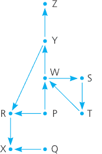

# 图 6-7 旅行过程中的城市栈 (a) P; (b) 到 R; (c) 到 X; (d) 回到 R; (e) 回到 P; (f)

| (a) | (b) | (c) | (d) | (e) | (f) |
|---|---|---|---|---|---|
| P | P | R | X | R | R |
| | R | R | R | P | |
| | | X | X | | |
| | | | | | |

## 使用栈搜索航班地图

为了实现一个城市不访问多次的规则，你只需要在访问某个城市时将其标记为已访问。在选择下一个要访问的城市时，将考虑范围限制在栈顶相邻的未标记城市。该算法变为：

标记已访问的城市

```
aStack = 一个空栈
清除所有城市上的标记
```

搜索算法的下一个草稿

```
aStack.push(originCity) // 将起始城市推入栈顶
将起始城市标记为已访问
while (未找到从起始城市到目的地的航班序列) {
    // 不变性：栈包含了一条从栈底的起始城市
    // 到栈顶的有向路径
    if (栈顶城市没有通往未访问城市的航班) {
        aStack.pop() // 回溯
    } else {
        为栈顶城市的某某个航班选择一个未访问的目的地城市 C
        aStack.push(C)
        将 C 标记为已访问
    }
}
```

最后，你需要完善 `while` 语句中的条件。也就是说，你需要完善算法对是否存在从起点到终点路径的最终判定。该判定指出：栈包含了一条从起始城市到栈顶城市的有向路径，这意味着如果栈顶城市是目的地，则算法可以得出肯定的结论。另一方面，算法只有在耗尽了所有可能性后才能得出否定的结论——即算法已经回溯到起始城市，且已经没有剩余可以从起始城市出发的未访问城市。此时，算法将起始城市从栈中弹出，栈将变为空。
通过这一完善，算法的呈现如下所示：

```
// 搜索从 originCity 到 destinationCity 的航班序列
search(originCity: City, destinationCity: City): boolean
```

搜索算法的最终版本

```
aStack = 一个新的空栈
清除所有城市上的标记
aStack.push(originCity) // 将起始城市推入栈
将起始城市标记为已访问
while (aStack.isEmpty() and destinationCity 不在栈顶) {
    // 不变性：栈包含了一条从栈底的起始城市
    // 到栈顶的有向路径
    if (栈顶城市没有通往未访问城市的航班) {
        aStack.pop() // 回溯
    } else {
        为栈顶城市的某个航班选择一个未访问的目的地城市 C
        aStack.push(C)
        将 C 标记为已访问
    }
}
if (aStack.isEmpty()) {
    return false // 不存在路径
} else {
    return true // 存在路径
}
```

## 214 第6 章 栈

## 图 6-9 给图 6-6 中的航班地图，搜索算法的轨迹

| 操作 | 原因 | 栈的内容（从底到顶） |
|---|---|---|
| Push P | 初始化 | P |
| Push R | 下一个未访问城市 | PR |
| Push X | 下一个未访问城市 | PRX |
| Pop X | 没有未访问城市 | PR |
| Pop R | 没有未访问城市 | P |
| Push W | 下一个未访问城市 | PW |
| Push S | 下一个未访问城市 | PWS |
| Push T | 下一个未访问城市 | PWST |
| Pop T | 没有未访问城市 | PWS |
| Pop S | 没有未访问城市 | PW |
| Push Y | 下一个未访问城市 | PYW |
| Push Z | 下一个未访问城市 | PWYZ |

注意，算法并没有指定未访问城市的选择顺序。算法使用什么选择标准实际上并不重要，因为选择不会影响最终结果：要么存在某个航班序列，要么不存在。然而，选择会影响算法所考虑的具体航班。例如，假设算法总是从栈顶城市按字母顺序选择下一个未访问城市。在这一假设下，给定图 6-6 的地图，图 6-9 包含了该算法操作的轨迹，其中 P 为起始城市，Z 为目的地。算法成功终止。

回想以下操作，搜索算法必须在航班地图上执行这些操作。

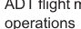

```
// 将一个城市标记为已访问。
markVisited(aCity: City): void
// 清除所有城市上的标记。
unvisitaAll(): void
// 如果没有未访问城市与给定城市，则返回哨兵值。
getNextCity(fromCity: City): City
// 测试两个城市之间是否存在航班序列。
isPath(originCity:City, destinationCity:City): boolean
```

假设 `Map` 类实现了 ADT 航班地图，且 `Stack` 类实现了栈操作，则 `Map` 的方法 `isPath` 的定义如下，并使用了搜索算法。如第5章所述，`NO_CITY` 是一个 `City` 对象，定义了 `getNextCity` 在找不到未访问城市时返回的常量值。

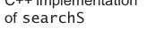

```cpp
/** 测试两个城市之间是否存在航班序列。
非递归版本。
@param originCity 起始城市。
@param destinationCity 目的地。
@return 如果存在航班序列则返回 true，否则返回 false。 */
## 使用栈搜索航班地图```cpp
bool isPath(originCity: City, destinationCity: City) {
    Stack aStack;
    unvisitAll(); // 清除所有城市上的标记

    // 将起始城市推入栈
    aStack.push(originCity);
    将起始城市标记为已访问

    City topCity = aStack.peek();
    while (!aStack.isEmpty() && topCity != destinationCity) {
        // 不变性：栈包含了一条从栈底的起始城市
        // 到栈顶的有向路径
        // 找到与栈顶城市相邻的城市
        City nextCity = getNextCity(topCity);
        if (nextCity == NO_CITY) {
            // 没有找到城市；回溯
            aStack.pop();
        } else {
            aStack.push(nextCity);
            将 nextCity 标记为已访问
        }
        if (!aStack.isEmpty()) {
            topCity = aStack.peek();
        }
    }
    return !aStack.isEmpty();
}
```**注意：STL**

标准模板库（STL）包含栈。然而，它的方法名称与此处不同。你可以在本章中了解更多关于 STL 的内容。

img/d0cb86b2f18b2db569968ad7c743510e_241_1.png)**问题 8** 结合图 6-6 追踪 `isPath` 方法。显示每一步栈的状态：

a. 从 A 到 B 的飞行。

b. 从 A 到 D 的飞行。

c. 从 C 到 G 的飞行。

## 216 第6 章 栈

## 图 6-10 点8的航班地图

img/d0cb86b2f18b2db569968ad7c743510e_242_0

### 6.5 栈与递归之间的关系

我们已经解决了两次路径问题，一次是在上一章使用递归，另是在上一节使用 ADT。现在我们想观察这些方法是如何组织搜索的。你会发现递归的概念中存在栈，事实上，栈起着活跃的作用。

考虑这两个算法如何实现关键方面。

两个方面的对比

- **访问新城市：** 递归算法 `searchR` 通过调用 `searchR(C, destinationCity)` 来访问新城市。算法 `search` 通过将 C 推入栈来访问城市。注意，如果你使用框轨迹来跟踪 `searchR` 的执行，调用 `searchR(C, destinationCity)` 将产生一个框，其中城市 C 与 `originCity` 参数关联。

- **回溯：** 两个算法都展示了图 6-6 中 P 到 Z 路径对应点的框轨迹和栈。注意，这个当前城市是 `searchR` 框轨迹中当前城市与 `originCity` 参数关联的值。同样，当前城市位于 `search` 栈的顶端。在图 6-11 中，当前城市是 X。如果当前城市相邻未访问城市，算法必须回溯到上一个城市。算法 `searchR` 通过从当前递归调用返回回溯。你在框轨迹中通过从栈中弹出深度框来表示此操作。例如，从图 6-11 所示的状态，两个算法都回溯到了 R，然后回到 P，如图 6-12 所示。

## 图 6-11 访问 P、然后 R、然后 X：(a) 框轨迹对比 (b) 栈

(a) 递归搜索的框轨迹：

| originCity = P | originCity = R | originCity = X |

| destinationCity = Z | destinationCity = Z | destinationCity = Z |

(b) 基于栈的搜索：

# 栈与递归之间的关系 217

图 6-12 从城市 X 到 R 再到 P 回溯：(a) 框追踪对比 (b) 基于栈的搜索：

(a) 递归搜索的框追踪：

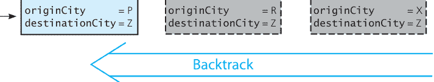

(b) 基于栈的搜索：

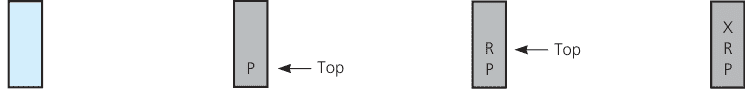


进入`/path/to/xxx`目录，找到`xxx.json`。

在表达式`cvar = avar + bvar`中，加法运算符（`+`）将`avar`与`bvar`相加，得到它们的和`cvar`

在`List.of(arg0, arg1, arg2)`中，`List`接口的工厂方法`of()`接受一系列的元素，返回包含它们的只读列表。

之后我们这样调用`cmd`命令：`cmd arg0 arg1 arg2`。

```
if (condVar > someVal) {console.log("xxx")}
```


当异常发生时，我们该怎么办？我们是否应该在自己的程序中故意触发异常？如果是的话，我们该如何做？这些都是本间歇教程将回答的问题。当我们在下一章中实现 ADT 栈时，这些知识将尤为重要。

## C3.1 背景

如果每次调用方法时，其先决条件都能满足，那就太好了。正如你所见，情况并非总是如此。客户端可能会请求方法从容器中移除一个项目，但容器可能是空的。我们如何处理这种不寻常或异常的情况？在我们之前的实现中，方法返回 `false` 表示它无法执行其任务。该值告诉客户端某些先决条件没有满足，或者方法由于其他原因失败了。此时，客户端有责任检查返回值，以确保方法在继续执行之前已完成其任务。

有时，当异常情况阻止方法完成任务时，方法无法返回布尔值。例如，ADT 栈的 `peek` 返回栈顶项的拷贝。它的原型是：

```cpp
virtual ItemType peek() const = 0;
```

如果栈是空的，这个方法会做什么？只有当栈包含布尔值时，返回布尔值才是可能的。无论栈中的数据类型是什么，只有当返回值栈中不包含的特殊值时，才会指示问题。我们需要一种一致的机制让客户端知道方法无法执行任务——这种机制不依赖于栈中存储的数据类型。在我们深入讨论此类机制的细节之前，让我们另一个例子。

### C3.1.1 待解决的问题

回想之前的 C++ 间歇教程，我们正在为朋友开发一款视频游戏。我们的下一个任务是创建一个函数，在多个箱中搜索指定的字符串。该函数有三个参数：一个 `PlainBox<string>` 对象数组、一个表示数组中 `PlainBox` 对象数量的整数，以及要在每个箱中定位的字符串。函数将返回包含该字符串的箱的拷贝。列表 C3-1 显示了我们对该函数的首次尝试。

列表 C3-1 `findBox` 条件的首次尝试

```cpp
PlainBox<string> findBox(PlainBox<string> boxes[], int size, string target)
{
    int index = 0;
    bool found = false;
    while (!found && (index < size))
    {
        if (target == boxes[index].getItem())
            found = true;
        else
            index++;
    }
    return boxes[index];
} // end findBox
```

1. 记得返回语句返回其参数的拷贝。

## C3.2 断言

这个版本的 `findBox` 满足了基本要求：它搜索箱数组并返回包含目标字符串的箱。如果数组中没有包含目标字符串的箱，就会遇到问题。如果未找到目标，函数的 `while` 循环会在 `index` 等于 `size`（数组中的条目数）时结束。函数将返回 `boxes[size]`，这是未定义的。当客户端尝试使用这个“箱子”时，问题就会发生。

我们可以通过测试 `found` 来修复代码，以确保在从数组中返回箱子之前我们已经找到了目标。仅使用简单的 `if` 语句是不够的，因为我们仍然面临在未找到目标时返回什么的问题。下一节给出了一种修复代码的方法。

第 3 章和附录 B 定义了什么是断言——断言是关于你程序逻辑某些方面的真理陈述。你可以以注释的形式表示断言，也可以通过使用 C++ 函数 `assert` 来。通过使用 `assert`，你可以对程序中的变量和对象进行断言。此类断言的形式为布尔表达式，在程序的特定点上应该为真。如果断言为假，`assert` 函数将停止程序的执行。断言可以用于在执行函数或方法体之前验证方法。

要在程序中使用 `assert`，你必须首先包含它的头文件：

```cpp
#include <assert>
```

要调用 `assert` 函数，你需要提供一个布尔条件作为参数：

```cpp
assert(someBooleanCondition);
```

当执行到达此语句时，布尔条件（即断言）会进行测试。如果断言为真，程序继续执行。如果断言为假，程序将停止并显示错误信息。

`assert` 语句是验证方法先决条件或后置条件的简单方法。例如，在实现栈方法时，我们可以执行

```cpp
assert(isEmpty());
```

在返回栈顶之前。

我们的 `findBox` 函数可以通过调用以下代码来测试是否找到了箱：

```cpp
assert(found);
```

如果未找到，断言为假，程序将停止。这防止了程序使用不存在的箱。列表 C3-2 显示了使用断言修改后的 `findBox` 函数。

列表 C3-2 使用断言的 `findBox` 函数

```cpp
PlainBox<string> findBox(PlainBox<string> boxes[], int size, string target)
{
    int index = 0;
    bool found = false;
    while (!found && index < size) {
        if (target == boxes[index].getItem()) {
            found = true;
        } else {
            index++;
        }
    } // end while
    assert(found);
    return boxes[index];
}
```

## C3.3 抛出异常

我们在间歇教程中看到的示例都有一个共同的问题——如何告诉客户端发生了错误、异常情况或事件。到为止的两种解决方案——返回布尔值或使用 `assert` 停止程序——是完全不同的技术。

返回布尔值，通过检查函数的返回值来判断函数是否成功。我们没有办法强制客户端这样做。如果客户端没有检查返回值，执行可能会继续，尽管函数没有完成其任务。即使客户端检查了返回值并发现函数失败了，客户端也没有关于函数失败原因的信息。客户端只知道函数失败了。

使用断言的方法可以减轻客户端检查是否成功完成的需要。使用断言，当发生错误时程序将停止，客户端无法执行任何后续任务。对于对客户端目标不重要或客户端可以简单修复的错误，断言是一种极端的解决方案。

然而，向函数的客户端通信或返回信息的另一种替代方法是抛出异常。抛出的异常会跳过正常执行，控制权立即返回给客户端。异常可以包含有关错误或异常情况的信息，帮助客户端解决问题并可能再次尝试函数。

你可以通过执行带有以下内容的 `throw` 语句来抛出异常：

```cpp
throw ExceptionClass(stringArgument);
```

# 抛出异常 231

图 C3-1 C++ 异常类层次结构

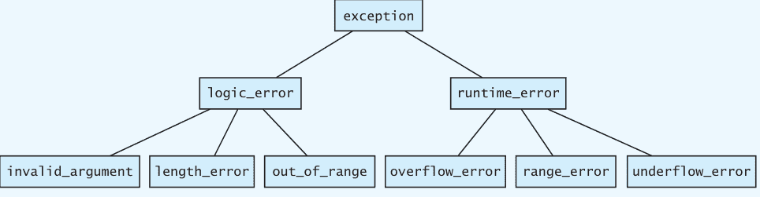

在这里，`ExceptionClass` 是你想要抛出的异常类型，`stringArgument` 是 `ExceptionClass` 构造函数的参数，用于提供关于导致异常的更详细描述。当创建一个 `throw ExceptionClass` 时，异常会被抛出并回溯到调用该函数的地方，且函数中 `throw` 语句之后的语句将不会执行。

C++ 有两类函数可以抛出的异常。你可以选择其中一类，或者从它们中的某类中派生一个类。虽然 `throw` 语句中的异常不需要派生自标准的 C++ 异常类，但这样做是一个良好的编程习惯。图 C3-1 显示了 C++ 提供的异常类族。

派生自 `runtime_error` 或其派生类的异常是由运行时可检测的错误抛出的，例如除以零或数值溢出。如果抛出了此类异常，程序将停止，除非它被断言（assertion）捕获。然而，与断言不同，当抛出 `runtime_error` 异常时，它可以包含显示给用户的消息，提供错误详细信息，并且程序保持处理。

派生自 `logic_error` 的类表示程序逻辑中的错误，例如先决条件或未能满足某项条件，这些错误可以在程序执行之前检测到。在 `findBox` 示例中，如果我们想抛出一个异常来表示未找到目标字符串，我们会写：

```cpp
if (!found) {
    throw logic_error("Target not found in box!");
}
```

当我们抛出异常时，我们首先使用 `if` 语句测试是否存在错误或异常情况。然后如果发生了此类情况，我们就使用 `throw` 语句向我们的客户端抛出一个包含消息的异常。

为了限制函数或方法可以抛出的异常，我们可以在其头文件中包含一个 `throw` 子句（throw clause）。这允许客户端知道该函数可能会抛出异常。`throw` 子句由关键字 `throw` 后面跟着一个由逗号分隔并括在括号内的异常类型列表。例如，这里是添加了 `throw` 子句的 `findBox` 函数原型：

```cpp
PlainBox<string> findBox(PlainBox boxes[], int size, string target) throw(logic_error);
```

列表 C3-3 显示了抛出 `logic_error` 异常的完整 `findBox` 函数。在间节的后续部分，我们将派生一个异常类来处理这种特定错误。首先，我们将查看客户端如何处理抛出的异常。

# C++ 间插 3 异常

列表 C3-3 修改后的 `findBox` 函数，可抛出异常

`PlainBox<string> findBox(PlainBox<string> boxes[], int size, string target) throw(logic_error)`

```cpp
{
    int index = 0;
    bool found = false;
    while (!found && (index < size))
    {
        if (target == boxes[index].getItem())
            found = true;
        else
            index++;
    } // end while
    if (!found)
        throw logic_error("Target not found in a box!");
    return boxes[index];
}
```

**编程提示：** 在函数规范中包含 `throw` 子句可以确保该函数只能抛出那些异常。函数尝试抛出任何其他异常都将导致运行时错误。省略 `throw` 子句允许函数抛出任何异常。

**注意：** 标准异常

`<stdexcept>` 头文件定义了几个异常。该头文件包含两类：运行时异常和逻辑异常。

运行时异常是：

| 异常 | 描述 |

| :--- | :--- |

| overflow_error | 发生算术溢出 |

| range_error | 发生范围错误 |

| underflow_error | 发生算术下溢 |

逻辑异常是：

| 异常 | 描述 |

| :--- | :--- |

| invalid_argument | 使用无效参数 |

| length_error | 尝试创建一个过大的对象 |

| out_of_range | 值超出范围 |

**注意：** 如果在 `try` 块中间发生异常，块范围内所有局部对象的析构函数都会被调用。这确保了该块分配的所有资源都被释放，即使该块没有完全执行完毕。

# 处理异常 233

**注意：** 如果异常没有适用的 `catch` 块，函数的执行将结束并发生异常终止。

# 处理异常 234

在上一节中，我们查看了如何抛出异常。在本节中，我们查看客户端如何处理。处理异常的代码由两部分组成。第一部分是 `try` 块，包含可能抛出异常的语句。第二部分由一个或多个 `catch` 块组成。以下是 `try` 块后跟 `catch` 块的通用语法：

```cpp
try {
    // 可能抛出异常的语句
} catch (ExceptionClass) {
    // 对异常做出反应的语句
}
```

`try` 块内的语句执行方式就像该块不存在一样。如果发生异常，执行将立即转移到 `catch` 块。如果块完成，执行将继续其后的语句。

编程提示：`try` 块的一个重要实现细节是，它应该尽可能少包含语句——理想情况下，只包含抛出异常的语句。保持 `try` 块短小可以减少重要代码未执行或分配的内存未释放的风险。

`catch` 块的语法类似于函数定义。该标识符——称为 `catch` 块参数——为 `catch` 块内部使用的异常提供名称。虽然 `catch` 块不是函数，但抛出异常就像调用函数一样。`catch` 块参数代表 `throw` 语句提供的异常对象。

`catch` 块中采取的步骤随情况而异，可以简单到什么都不做或显示错误消息，也可以复杂到更新变量并重试抛出异常的。C++ 标准库中的每个异常类都定义了访问方法 `what()`，它在抛出异常时返回一个描述性字符串。`catch` 块的体可以显示此字符串以提供异常的指示。

注意：参数类型为 `ExceptionClass` 的 `catch` 块可以捕获 `ExceptionClass` 类及其任何派生类的异常。指定一个参数类型为 `exception` 的 `catch` 块可以捕获任何可以

列表 C3-4 显示了调用我们的 `findBox` 函数并处理任何抛出的 `logic_error` 异常的示例代码。`catch` 块向用户显示发生了异常情况的消息，并为 `foundBox` 创建一个 `PlainBox` 对象，以便 `catch` 块之后的语句正确执行。

# 列表 C3-4 尝试 `findBox` 函数并初始化一个数组

```cpp
// 创建并初始化一个数组
PlainBox<string> myBoxes[5]; // PlainBox 对象数组
```

```cpp
// 尝试找到包含眼镜的盒子
{
    foundBox = findBox(myBoxes, 5, "glasses");
}
catch(logic_error logErr) {
    cout << logErr.what() << endl; // 向用户显示错误消息
    foundBox = PlainBox<string>("nothing"); // 修复问题
} // end-catch
// 因为我们捕获了异常并修复了问题，以下语句
// 即使没有找到目标也应该正常工作
cout << foundBox.getItem();
```

输出

盒子中未找到目标！

nothing

## D3.4.1 多个 catch 块

`try` 块中的单个语句可能会导致 hơn一种类型的异常。因此，一个 `try` 块可以关联多个 `catch` 块。当 `try` 块后面跟着多个 `catch` 块时，执行的 `catch` 块是第一个匹配的 `catch` 块——即按照出现顺序，参数类型与抛出的异常匹配的 `catch` 块。因此，必须对 `catch` 块进行排序，使得最具体的异常类在最通用的异常类之前被捕获。例如，以下 `catch` 块的顺序是错误的：

```cpp
string str = "Sarah";
try {
    str.substr(9, 1);
    // <此处出现其他语句...>
}
catch (exception e) // 顺序错误！！
{
    cout << "Something else was caught" << endl;
}
catch (out_of_range e) {
    cout << "out_of_range exception caught" << endl;
} // end-catch
```

编译器会发出类似下面的警告信息：

'class std::out_of_range' is caught by base class ('class exception') on line n

该警告意味着 `try` 块中抛出的任何 `out_of_range` 异常都将被第一个 `catch` 块（参数类型为 `exception` 的块）捕获，因此永远无法到达第二个 `catch` 块。要让代码在没有警告的情况下通过编译，你必须交换这两个 `catch` 块。

> 编程提示：按具体性排列 `catch` 块，先捕获最具体的异常。由于所有异常类都以 `exception` 为祖先，尽量避免在 `catch` 块中使用 `exception`。如果你必须捕获类型为 `exception` 的异常，请在最后一个 `catch` 块中这样做。

## C3.4.2 未捕获的异常

让我们看看当异常抛出但未被捕获时会发生什么。列表 C3-5 中的程序通过简单的替换对字符串进行编码。它将字符串中的每个字母替换为字母表中后三个位置的字符。当我们绕过字母表时，例如*a* 被替换为 *e*，*b* 被替换为 *z*。此时，它通过绕回字母表末尾来替换字母。*y* 被替换为 *b*，*z* 被替换为 *c*。

图 C3-2 显示了此代码发生异常时的控制流。函数 `encodeChar` 尝试通过 `str.replace(99, 1, 1, newChar)` 方法捕获字符串中的第 99 个字符，这是一个 `out_of_range` 异常。因为 `encodeChar` 没有处理该

列表 C3-5 一个带有未捕获异常的程序


```cpp
#include <iostream>
#include <string>
using namespace std;

// 对字符串 str 中索引为 i 的字符编码。
void encodeChar(int i, string &str)
{
    int base = static_cast<int>('a');
    if (isupper(str[i]))
        base = int('A');
    
    char newChar = (static_cast<int>(str[i]) - base + 3) % 26 + base;
    str.replace(i, 1, newChar); // replace 方法可能会抛出异常
} // encodeChar

// 对字符串内的 num 个字符编码。
void encodeString(int numChar, string &str)
{
    for (int j = numChar - 1; j >= 0; j--)
        encodeChar(j, str);
} // encodeString

int main()
{
    string str1 = "Sarah";
    encodeString(99, str1);
    return 0;
} // end main
```

# 处理异常 237

图 C3-2 未检查异常的控制流

| str | numChar |

|---|---|

| S a r h | 99 |

```cpp
void encodeChar(int i, string &str) {
    int base = static_cast<int>('a');
    if (isupper(str[i]))
        base = int('A');
    }
    char newChar = static_cast<int>(str[i]);
    str.replace(i, 1, newChar);
} // end encodeChar
```

此处发生 `out_of_range` 异常，未被处理，因此回溯到 `encodeString`


```cpp
void encodeString(int numChar, string &str) {
    for (int j = numChar-1; j >= 0; j--)
        encodeChar(j, str);
    } // end encodeString
```

此处未处理 `out_of_range` 异常，因此回溯到 `main`


函数 `main`

```cpp
int main() {
    string str1 = "Sarah";
    encodeString(99, str1);
    return 0;
} // end main
```

`main` 中未处理 `out_of_range` 异常；导致程序异常终止


输出：

abnormal program termination

异常导致函数终止，异常回溯到调用 `encodeChar` 的点 `encodeString`。函数 `encodeString` 未处理该异常，因此它终止，异常回溯到 `main`。因为程序的 `main` 函数没有处理该异常，程序执行以错误消息结束而终止。

此代码表明函数 `encodeChar` 可能会抛出 `out_of_range` 异常。然而，`encodeChar` 的文档应该包含它可能抛出的任何异常。因此，在编写函数或方法的方法时，你应该包含可能发生的任何异常。

我们可以在函数调用序列的任何一点捕获 `out_of_range` 异常。例如，我们可以重写该函数

```cpp
void encodeChar(int i, string &str) {
    int base = static_cast<int>('a');
    if (isupper(str[i]))
        base = int('A');
}
```

虽然字符串消息很有帮助，但有时我们希望向客户端返回额外信息以帮助解决问题。我们可以在我们的异常类中添加一个私有数据字段来存储额外的错误细节。此外，还需要构造函数中的第二个参数来接收这些细节的初始值，以及一个公共访问器方法，以便客户端可以检索这些信息。当一个方法抛出此异常时，它会调用构造函数并将额外数据和消息作为参数传递。

## 编程提示：使用异常

在函数中抛出异常：

- 确定必须检查哪些错误、前置条件、后置条件和异常情况，以及应该在何处检查，以便你的函数能够正确执行任务。检测错误、前置条件、后置条件或异常情况。这通常通过 `if` 语句完成。

- 如果发生了错误条件，使用 `throw` 语句抛出异常。作为异常类构造函数的参数，传递一个错误原因的字符串描述。

- 在函数头中添加 `throw` 子句，指明该函数抛出的异常。

- 派生自定义异常类，以识别导致错误的条件。虽然这是可选的，但这是推荐的。

- 对于处理可能抛出异常的语句，`try` 块中的语句越少越好。不要在 `try` 块中使用 `new` 创建对象。

- 在 `try` 块之后，为语句可能抛出的每种异常放置 `catch` 块。按照从特定异常到更通用类的顺序排列 `catch` 块。

# 第7章 ADT 栈的实现

## 目录

- 7.1 基于数组的实现 (242)
- 7.2 基于链的实现 (245)
- 7.3 使用异常的实现 (249)
- 总结 (251)
- 练习 (252)

## 前提条件

- 第 3 章 数组
- 第 4 章 指针、多态与内存分配
- 第 6 章 栈

### C++ ：异常

本章使用第 3 章和第 4 章描述的技术实现了 ADT 栈。我们将首先使用数组和节点链来存储栈的条目。你会发现这些实现的简单和高效而感到高兴。然后，我们将修改这些实现，使用异常作为方法信号异常发生的一种，例如尝试从空栈获取条目。

## 7.1 基于数组的实现

图 7-1 显示了包含栈条目的数组草图。栈顶条目位于数组的哪个位置？由于条目是从栈的顶部添加或删除的，如果我们使用索引 0 作为栈底，并使用索引跟踪栈顶的位置，就可以避免移动条目。如果 `items` 是数组而 `top` 是栈顶条目，此图阐述了这些细节。

图 7-1 使用数组存储栈的条目：(a) 初步草图；(b) 实现细节

| | | items |

|---|---|---|---|

| 4 | | 10 | 20 | 30 |

| 3 | | | | |

| 2 | | 0 | 1 | MAX_STACK - 1 |

| 1 | | | | |

| 0 | | | | |

### 列表 7-1 stack：基于数组的栈的头文件

```cpp
/* ADT stack：基于数组的实现。
- @file ArrayStack.h */

#ifndef _ARRAY_STACK
#define _ARRAY_STACK

#include "StackInterface.h"
const int MAX_STACK = maximum-size-of-stack;

template<class ItemType>
class ArrayStack : public StackInterface<ItemType> {
private:
    ItemType items[MAX_STACK]; // 栈项数组
    int top; // 栈顶的索引

public:
  ArrayStack(); // 默认构造函数
  bool isEmpty() const;
  bool push(const ItemType& newEntry);
  bool pop();
  ItemType peek() const;
}; // end ArrayStack

#include "ArrayStack.cpp"
#endif
```

方法的实现非常直观，但注意 `peek` 方法使用了 `assert` 来强制执行其前置条件。这些定义确保了栈至少包含一个条目。在本章稍后的部分，我们将修改 `peek`，如果客户端在栈空时调用它，则抛出异常。

### 列表 7-2 基于数组的栈的实现文件

```cpp
/* @file ArrayStack.cpp */
#include <assert>
#include "ArrayStack.h" // 头文件

template<class ItemType>
ArrayStack<ItemType>::ArrayStack() : top(-1)
{
} // end default constructor

// 拷贝构造函数和析构函数由编译器提供
template<class ItemType>
bool ArrayStack<ItemType>::isEmpty() const
{
  return top < 0;
} // end isEmpty

template<class ItemType>
bool ArrayStack<ItemType>::push(const ItemType& newEntry)
{
  bool result = false;
  if (top < MAX_STACK - 1) // 栈是否有空间容纳 newEntry？
  {
    top++;
    items[top] = newEntry;
    result = true;
  } // end if
  return result;
} // end push

template<class ItemType>
bool ArrayStack<ItemType>::pop()
{
  bool result = false;
  if (!isEmpty()) {
    top--;
    result = true;
  }
  return result;
} // end pop

template<class ItemType>
Item ArrayStack<ItemType>::peek() const
{
  assert(!isEmpty());
  return items[top];
} // end peek
```

一个使用栈的程序可能如下：

```cpp
#include <iostream>
#include <string>
#include "ArrayStack.h"

using namespace std;

int main() {
  StackInterface<string>* stackPtr = new ArrayStack<string>();
  string anitem = "";
  cout << "Enter a string: ";
  cin >> anitem;
  stackPtr->push(anitem); // 将项入栈
  return 0;
}
```

## 7.2 基于链的实现

许多应用需要栈的链式实现，以便栈能够动态增长。图 7-2 展示了这样的实现，其中 `topPtr` 是指向链节点头部的指针。正如基于数组的实现一样，我们从基于 `StackInterface` 的头文件开始，你可以看到列表 7-3。`topPtr` 指针指向 `Node` 类实例，我们在第 4 章实现 `LinkedBag` 类时使用了它。

由于节点动态分配内存，必须为基于链的实现编写拷贝构造函数和虚析构函数。正如你在第 4 章所看到的，如果栈的浅拷贝就足够了，你可以省略拷贝构造函数，在这种情况下编译器会生成执行浅拷贝的拷贝构造函数。基于数组的实现正是如此。

- 问题 1：在第 6 章中，6.2 节出现的算法涉及字符串。在什么情况下你会为这些算法选择基于数组的实现？
- 问题 2：描述对之前的栈实现所需的修改，以便固定大小数组替换为可调整大小的数组。

### 列表 7-3 LinkedStack 类的头文件

```cpp
/* ADT 栈：基于链的实现。
 * @file LinkedStack.h */

#ifndef _LINKED_STACK
#define _LINKED_STACK

#include "StackInterface.h"
#include "Node.h"

template<<class ItemType>
class LinkedStack : public StackInterface<ItemType>
private:
    Node<ItemType>* topPtr; // 指向链中第一个节点的指针；
    // 此节点包含栈的数据

public:
    // 构造函数和析构函数：
    LinkedStack();
    LinkedStack(const LinkedStack<ItemType>& aStack); // 拷贝构造函数
    virtual ~LinkedStack(); // 析构函数

    // 栈操作：
    bool isEmpty() const;
    void push(const ItemType& newItem);
    void pop();
    ItemType peek() const;
}; // end LinkedStack

#include "LinkedStack.cpp"
#endif
```

列表 7-4 提供了 `LinkedStack` 的实现文件。注意第 4 章中给出的 `LinkedStack` 和 `LinkedBag` 拷贝构造函数之间的相似性。

## 列表 7-4 LinkedStack 类的实现文件


```cpp
/* @file LinkedStack.cpp */
#include <cassert> // 用于 assert
#include "LinkedStack.h" // 头文件

template<class ItemType>
LinkedStack<ItemType>::LinkedStack() : topPtr(nullptr)
{
} // end 默认构造函数

template<class ItemType>
LinkedStack<ItemType>::
LinkedStack(const LinkedStack<ItemType>& aStack)
{
// 指向原始链中的节点
Node<ItemType>* origChainPtr = aStack->topPtr;
if (origChainPtr == nullptr)
    topPtr = nullptr; // 原始包为空
else
{
    // 拷贝第一个节点
    topPtr = new Node<ItemType>();
    topPtr->setItem(origChainPtr->getItem());
    // 指向新链中的第一个节点
    Node<ItemType>* newChainPtr = topPtr;
    // 拷贝剩余节点
    while (origChainPtr != nullptr)
    {
        // 移动原始链指针
        origChainPtr = origChainPtr->getNext();
        // 从原始链中获取下一个项
        ItemType newItem = origChainPtr->getItem();
        // 创建一个包含下一个项的新节点
        Node<ItemType>* newNodePtr = new Node<ItemType>(newItem);
        // 将新节点链接到新链的末尾
        newChainPtr->setNext(newNodePtr);
        // 指针移动下一个最后一个节点
        newChainPtr = newChainPtr->getNext();
    }
    newChainPtr->setNext(nullptr); // 标记链的结束
}
} // end 拷贝构造函数

template<class ItemType>
LinkedStack<ItemType>::LinkedStack()
{
    // 弹出直到栈为空
    while (isEmpty())
    {
        pop();
    }
} // end 析构函数

template<class ItemType>
bool LinkedStack<ItemType>::isEmpty() const
{
    return topPtr == nullptr;
} // end isEmpty

template<class ItemType>
bool LinkedStack<ItemType>::push(const ItemType& newItem)
{
    Node<ItemType>* newNodePtr = new Node<ItemType>(newItem, topPtr);
    topPtr = newNodePtr;
    newNodePtr = nullptr;
    return true;
} // end push

template<class ItemType>
bool LinkedStack<ItemType>::pop()
{
    bool result = false;
    if (!isEmpty()) {
        // 栈不空，删除顶端
        Node<ItemType>* nodeToDeletePtr = topPtr;
        topPtr = topPtr->getNext();

        // 将删除的节点返回系统
        nodeToDeletePtr->setNext(nullptr);
        delete nodeToDeletePtr;
        nodeToDeletePtr = nullptr;

        result = true;
    } // end if

    return result;
} // end pop

template<class ItemType>
ItemType LinkedStack<ItemType>::peek() const
{
    assert(!isEmpty()); // 强制执行前提条件

    // 栈不空；返回顶端
    return topPtr->getItem();
} // end getTop
// 实现结束
```

### 问题 3
在第 6 章中，第 6.2 节出现的算法涉及字符串。在什么情况下你会选择基于链的实现？

### 注意：比较实现

你已经见过 ADT 栈的两种实现：一个使用数组，另一个使用链式节点来包含栈中的项。第 4 章第 4.3 节的讨论也适用于这里。如果栈中项的数量没有超过数组的固定大小，那么基于数组的实现是一个合理的选择。例如，当我们读取并纠正长度仅为 80 个字符的输入行时，你可以合理地使用静态分配的数组表示栈。对于可能很大但通常并不大的栈，基于数组的实现将浪费存储。在这种情况下，基于链的实现是更好的选择。

## 总结

1. 你可以使用数组来实现栈。如果栈的底部是数组的第一个元素，那么在添加或删除条目时，不需要移动任何栈条目。

2. 你可以使用带有头指针的链节点链来实现栈。链的第一个节点应该包含栈顶，以便提供最简单、最快速的添加和删除操作。

3. 你应该使用断言（`assert`）或抛出异常来强制执行 `peek` 方法的前条件。

## 练习题

1. 讨论基于数组的 ADT 栈实现与基于链的实现相比的优缺点。

2. 考虑第 1、3 和第 4 章中描述的 ADT 容器包（bag）。

   a. 你是否可以使用一个包来包含条目以实现 ADT 栈？为什么可以或为什么不能？

   b. 你是否可以使用一个栈来包含条目以实现 ADT 包？为什么可以或为什么不能？

3. 显示栈内容的可能会在程序调试期间可能非常有用。为 ADT 添加一个显示方法，使得：

   a. 该方法仅使用栈操作；也就是说，它独立于栈的实现。

   b. 该方法使用 ADT 栈的链实现。

   c. 该方法使用 ADT 栈的数组实现。

4. 重复之前的练习，但定义一个方法 `vector remove(n)`，用于移除并丢弃栈顶部的 $n$ 个条目。为该方法编写一个基于链的实现。

5. 为本章给出的 ADT 栈添加方法 `vector remove(n)`。

6. 重复之前的练习，但编写一个基于数组的实现。

7. ADT 栈链实现的析构函数调用了 `pop`。虽然编写简单，但由于重复调用，此析构函数可能是无效的。编写另一种析构函数实现，在不调用 `pop` 的情况下释放链节点。

8. 为栈实现安全的拷贝构造函数。如果内存分配失败，此构造函数应该释放失败之前分配的所有内存并抛出异常。

9. 想象一种基于数组的 ADT 栈实现，它从数组的末尾开始存储条目。描述你如何定义栈操作，使得 `push` 和 `pop` 操作不需要移动数组中现条目。

10. 想象一种基于链的 ADT 栈实现，它将栈顶存储在节点链的末尾。描述你如何定义栈操作，使得不需要遍历链。

11. 尽管当 `LinkedStack` 中的方法或构造函数分配新节点失败时我们通常不抛出异常，但请这样做。定义 `MemoryAllocationException`，并修改 `LinkedStack` 的构造函数，当 `new` 操作符失败分配内存时抛出 `MemoryAllocationException`。在构造函数中抛出异常需要非常小心，因此必须确保在抛出异常之前释放构造函数分配的任何内存。你修改后的 `LinkedStack` 版本。

# 第 7 章 ADT 栈的实现

## 编程题

1. 编写 ADT 栈的实现，使用可调整大小的数组表示栈项。每当栈满时，数组的大小翻倍。将栈底部条目维护在数组开头。

2. 重复编程题 1，但将栈底部条目维护在数组的末尾。

3. 重复编程题 1，但将栈顶条目维护在数组的末尾。

4. 重复编程题 1，但将栈顶条目维护在开头。

5. 重复上述四个编程题中的任意一个，但在数组第一次倍增之后如果当前栈条目占用的位置少于数组的一半，则数组大小减半。

6. 假设当基于数组的栈满时，不是倍增大小，而是通过某个正整数 $k$ 增加数组大小。实现并演示这样的栈，允许客户端在创建栈时指定 $k$。

7. 重复之前的编程题，但每当栈满时，根据此序列中的下一个值增加数组大小：$3, 5, 7, ...$，对应于客户端指定的正整数 $k$。

8. 编写练习题 10 描述的 ADT 栈实现。

9. ADT 栈允许你在不移除条目的情况下查看栈顶条目。对于栈的一些应用，你还需要在不移除的情况下查看顶条目下方的条目。我们将此类操作命名为 `peek2`。如果 `peek2` 因为栈包含少于两个条目而失败，它应该抛出异常。编写一个同时包含 `peek` 和 `peek2` 的 ADT 栈链实现。

10. 重复第 6 章中的任何编程题（第一个除外），使用本章描述的 ADT 栈实现。

# 第 8 章 列表

| 节 | 标题 | 页码 |
|---|---|---|
| 8.1 | 指定 ADT 列表 | 254 |
| 8.2 | 使用列表操作 | 259 |
| 8.3 | ADT 列表的接口模板 | 261 |

总结 263

练习题 263

编程题 264

## 前提知识

- 第 1 章 数据抽象：等待队列
- C++ 间插曲 1：C++ 类

日常生活中的列表为我们提供了一种组织思想、计划或任务的方法。每个列表都有第一个条目、最后一个末尾条目，通常中间还有其他条目。条目在列表中具有位置，因此是有序的。ADT 列表提供了一种组织数据的方式，就像日常生活列表一样，是有序的。这种顺序并不由列表本身决定，而是由客户端决定。本文指定了 ADT 列表并给出了如何使用它的示例

## 8.1 指定 ADT 列表

考虑你可能遇到的列表，例如待办事项列表、日期列表、地址列表，或图 8-1 所示的购物列表。你把新条目放在哪里？假设你有一个有序列表，可以在列表末尾添加项。你也可以在列表开头添加项，或者列表是按字母排序的。无论如何，项是顺序出现的。列表有第一个项和最后一个项。对于第一个和最后一个项，每个项都有唯一的前驱和后继。第一个项（列表头）没有前驱，而最后一个项（列表末尾）没有后继。

虽然图 8-1 中的列表项具有顺序，但它们并不一定是已排序的。它们按照你产生的顺序出现，或者更有可能是按照你记录的顺序出现。列表包含相同类型的项。你可以有一个购物列表或电话列表。你可以计算列表中的项、向列表中添加项、从列表中删除项或检索项。列表中的项以及你对它们执行的操作构成了一个 ADT：列表。


> **注意：** ADT 列表仅仅是一个你指示其顺序并通过位置引用其项的容器。

### 通过位置引用列表项

你必须在不考虑如何实现的情况下指定列表操作的行为。例如，你可能决定在何处添加新项以及检索或删除哪些。不同的决策导致了若干种列表。你可能决定只在列表末尾、仅在开头或在两端添加、删除和检索项。这些操作一端或两端项的列表规范留作练习，它们并不适用于实际的购物列表。相反，我们将讨论一种更通用的列表，允许你访问列表任意位置的项。也就是说，你可能会查看位置 $i$ 的项、删除位置 $i$ 的项，或者在列表的位置 $i$ 插入项。这些操作是 ADT 列表的一部分。其他检查列表是否为空或返回列表长度的操作也是很有用的。

图 8-1 购物列表


### 注意：ADT 列表操作

- 检查列表是否为空。
- 获取列表中的条目数量。
- 在列表的指定位置插入一个条目。
- 从列表中删除指定位置的条目。
- 删除列表中的所有条目。
- 查看（获取）列表中指定位置的条目。
- 替换（设置）列表中指定位置的条目。

图 8-2 显示该 ADT 的 UML 图，并提供了其操作的更详细信息。

### 图 8-2 ADT 列表的 UML 图

| 列表 |
| :--- |
| +isEmpty(): boolean |
| +getLength(): integer |
| +insert(newPosition: integer, newEntry: ItemType): boolean |
| +remove(position: integer): boolean |
| +clear(): void |
| +getEntry(position: integer): ItemType |
| +setEntry(position: integer, newEntry: ItemType): void |

为了更精确地了解我们的操作是如何工作的，让我们将它们应用于以下杂货物品：

牛奶、鸡蛋、黄油、苹果、面包、鸡肉

牛奶将是列表中的第一个项目，鸡肉将是最后一个项目。首先，考虑你如何使用 ADT 列表操作构建此列表。一种方法是创建一个空列表 `list`，然后使用一系列插入操作逐个添加项目，如下所示：

```
alist = new empty list
alist.insert(0, milk)
alist.insert(1, eggs)
alist.insert(2, butter)
alist.insert(3, apples)
alist.insert(4, bread)
alist.insert(5, chicken)
```

我们假设在这个简单的例子中，列表可以包含我们添加到其中的所有项目。

在上一个例子中，我们将每个新项目都插入到列表的末尾。尽管如此，列表的插入操作可以将新项目放在列表的任何位置，而不仅仅是开头或末尾。然而，在现有项目之间进行插入的效果在上一个例子中并不明显。例如，如果你从杂货列表开始并执行操作

```
alist.insert(4, nuts)
```

`alist` 应该变成

牛奶、鸡蛋、黄油、坚果、苹果、面包、鸡肉

在插入之前位置编号大于或等于 4 的所有项目，在插入之后位置编号都增加了 1。通常情况下，如果将新项目插入到位置 `i`，则位置 `i` 之后的每个项目的位置增加 1。

同样，删除操作规定，如果从位置 `i` 删除一个项目，则位置大于 `i` 的每个项目的位置都会减少 1。因此，例如，如果 a 是列表

牛奶、鸡蛋、黄油、坚果、苹果、面包、鸡肉

并且你执行操作

```
alist.remove(5)
```

列表变为

牛奶、鸡蛋、黄油、坚果、面包、鸡肉

在删除之前位置编号大于 5 的所有项目在删除之后位置编号都减少了 1。

这些示例说明，我们可以指定 ADT 操作的效果，而无需指示如何存储数据。以下对 ADT 的总结为其操作合约提供了更多细节。和往常一样，操作的规范是 ADT 列表操作合约的唯一条款。操作的行为是程序唯一依赖的内容。

## 抽象数据类型：列表 (List)

- 一定数量的对象，不一定相同，具有相同的数据类型，并根据客户端确定的位置进行排序。

| 伪代码 | 描述 |
| :--- | :--- |
| isEmpty() | 任务：检查此列表是否为空。输入：无。输出：如果列表为空则返回 True；否则返回 false。 |
| getLength() | 任务：获取此列表中当前的条目数量。输入：无。输出：当前在列表中条目的整数数量。 |
| insert(newPosition, newEntry) | 任务：在指定位置向此列表插入一个条目。在条目之前插入会导致新条目之后的条目重新编号。输入：newPosition 是一个指示插入位置的整数，newEntry 是新条目。输出：如果 1 ≤ newPosition ≤ getLength() + 1 且插入成功，则返回 True；否则返回 false。 |

### 指定 ADT 列表 257

`remove(position)`

任务：从此列表中删除指定位置的条目。在最后一个条目之前删除会导致被删除条目之后的条目重新编号。

输入：position 是要删除的条目的位置。

输出：如果 1 <= newPosition <= length() 且删除成功，则返回 True；否则返回 false。

`clear()`

任务：从此列表中的所有条目。

输入：无。

输出：列表为空。

`getEntry(position)`

任务：获取此列表中指定位置的条目。

输入：position 是列表中条目的位置。

1 <= position <= length()。

`setEntry(position, newEntry)`

任务：替换此列表中指定位置的条目。

输入：position 是要替换的条目位置。1 <= position <= length()。

输出：指定的条目。

你可以使用公理来确定一系列 ADT 操作的结果结果。例如，如果 `aList` 是一个字符串列表，且 `t` 是一个字符串，那么以下操作序列

```
aList.insert(1, t)
aList.insert(1, s)
```

是如何影响 `aList` 的？我们将通过 `getEntry` 查看这些项，证明 `s` 是该列表中的第一个项，而 `t` 是第二个项。

你可以用另一种方式编写上述操作序列：

```
(aList.insert(1, t)).insert(s)
```

或者

现在获取列表中的第一个和第二个项。如下所示 `tempList.insert(1, s)`：

```
tempList = aList.insert(1, t)
tempList.insert(1, s)
```

```
(tempList.insert(1, s)).getEntry(1) = 公理 9
```

以及


```
(tempList.insert(1, s)).getEntry(2)
= tempList.getEntry(1)
= (aList.insert(1, t)).getEntry(1)
= t
```

### 公理 10

根据 `tempList` 的定义

### 公理 9

因此，`s` 是列表中的第一个项，而 `t` 是第二个项。

## 8.2 使用列表操作

我们考虑一些如何使用 ADT 列表操作的简单示例。记住，探索此类示例是为了确认你对 ADT 规范的理解，并为你提供一个在实现 ADT 之前改变设计选择的机会。你可以根据定义 ADT 列表的操作来编写客户端函数，即使你不知道列表的数据是如何存储的。


显示列表中的项。假设你想显示列表中的项。由于这项任务不是 ADT 操作，我们为客户端函数 `displayList` 编写了伪代码，该函数使用 ADT 操作如下：

一个与实现无关的 ADT 列表应用

```
// 显示列表 aList 中的项
displayList(aList)
for (position = 1 through aList.getLength())
{
  dataItem = aList.getEntry(position)
  display dataItem
}
```

注意，只要 ADT 列表实现得正确，`displayList` 函数就能执行其任务。在这种情况下，`getEntry` 成功地检索了每个列表项，因为 `position` 的值始终有效。

替换项。现在假设我们没有在 ADT 规范中包含 `setEntry` 操作。为了将列表中给定位置的项替换为新项，我们需要编写一个客户端函数。以下伪代码定义了这样的函数 `replace`：

```
// 用 newEntry 替换列表中的第 i 个项。
// 如果替换成功则返回 true；否则返回 false。
replace(alist, i, newEntry)
  success = alist.remove(i)
  if (success)
    success = alist.insert(i, newEntry)
  return success
```

如果 `remove` 成功，它会将 `success` 设为 `true`。通过测试 `success`，`replace` 只会在实际发生删除时才会尝试插入。然后，如果 `insert` 成功，`replace` 返回到调用它的函数。如果 `remove` 因为任何原因（包括 `i` 的值不正确）而失败，它会将 `success` 设为 `false`。然后 `replace` 函数将忽略插入并返回 `success`。

> 注意：注意，之前的两个算法仅依赖于列表操作的规范，而不取决于它们的实现。算法不取决于你如何实现列表。无论你使用数组或其他数据结构来存储列表，它们都能工作。这一特性是抽象数据类型的绝对优势。此外，通过从可用 ADT 操作进行思考，你不会被实现细节所分散。

按字母顺序创建姓名列表。让我们按照意创建一个朋友姓名列表。此外，让我们按字母顺序将姓名放在列表中。将每个名字放在列表中的正确位置取决于我们。ADT 不选择项的顺序。

以下伪代码语句将 Amy, Ellen, Bob, Drew, Aaron 和 Carol 放入字母列表中。每个语句末尾的注释显示了语句执行的顺序。

```
alist = new empty list
alist.insert(1, "Amy") // Amy
alist.insert(2, "Ellen") // Amy Ellen
alist.insert(2, "Bob") // Amy Bob
alist.insert(3, "Drew") // Amy Bob Drew
alist.insert(1, "Aaron") // Aaron Amy Bob Drew
alist.insert(4, "Carol") // Aaron Amy Bob Carol
```

在最初将 Amy 在列表开头、Ellen 在列表末尾（位置 2）之后，我们插入

- 在位置 2 Amy 和 Ellen 之间插入 Bob

- 在位置 3 Bob 和 Ellen 之间插入 Drew

- 在位置 1 Amy之前插入 Aaron

- 在位置 4 Bob 和 Drew 之间插入 Carol

在第 11 章中，你将学习将每个名字插入字母姓名集合的威力是插入排序。

如果我们通过编写代码删除位置 4 的项——Carol：

```
arrayList.remove(4)
```

Drew 和 Ellen 将分别位于位置 4 和 5。最后，假设我们想替换列表中的一个名字。我们现在通过编写 C++ 接口来形式化 ADT 的规范。

## 8.3 ADT 列表的接口模板

我们将使用模板类定义 ADT 列表的接口。这允许列表存储任何类型的对象。以下是列表接口的头文件。

```cpp
#ifndef LIST_INTERFACE
#define LIST_INTERFACE

template<class ItemType>
class ListInterface {
public:
    /**
     * 查看此列表是否为空。
     * @return 如果列表为空则返回 True；否则返回 false。 */
    virtual bool isEmpty() const = 0;

    /**
     * 获取此列表中项的数量。
     * @return 当前在列表中的项的整数个数。 */
    virtual int length() const = 0;

    /**
     * 在给定位置向此列表插入项。
     * @param position 位置
     * @post 如果 1 <= position <= length() + 1 且插入成功，则 newEntry 位于列表中的给定位置，其他项相应重新编号，并返回 true
     * @param newEntry 要插入到列表中的项。
     * @return 如果插入成功则返回 true，否则返回 false。 */
    virtual bool insert(int position, const ItemType& newEntry) = 0;
    @post 无。

    /**
     * 删除给定位置的项。
     * @post 如果 1 <= position <= length() 且删除成功，则列表中给定位置的项被删除，其他项相应重新编号，并返回 true。
     * @param position 要删除的项的位置。
     * @return 如果删除成功则返回 true，否则返回 false。 */
    virtual bool remove(int position) = 0;

    /**
     * 删除此列表的所有项。
     * @post 列表不包含项且计数为 0。 */
    virtual void clear() = 0;

    /**
     * 获取列表中给定位置的项。
     * @pre 1 <= position <= length()。
     * @post 已返回期望的项。
     * @param position 期望项的位置。
     * @return 给定位置的项。 */
    virtual ItemType getItem(int position) const = 0;

    /**
     * 替换列表中给定位置的项。
     * @pre 1 <= position <= length()。
     * @post 位置处的项为 newEntry。
     * @param position 要替换的项的位置。
     * @param newEntry 替换项。 */
    virtual void setEntry(int position, const ItemType& newEntry) = 0;
}; // end ListInterface

#endif // LIST_INTERFACE
```

# 摘要

- 1. ADT 列表通过位置维护其数据。列表中的每个条目通过其位置标识，位置是一个从 1 开始的整数。因此，列表中的数据是有顺序的，但该顺序由列表客户端决定，而不是列表本身。

- 2. 你可以在从 1 到当前列表长度加 1 范围内的位置向列表插入新条目。因此，你可以在第一个条目之前、最后一个条目之后或两个当前条目之间插入新条目。

- 3. 在列表中插入新条目会对列表中紧跟在被插入条目之后的所有现有条目重新编号。

- 4. 你可以移除当前位于从 1 到当前列表长度范围内位置的条目。因此，你可以移除第一个条目、最后一个条目或任何中间条目。

- 5. 从列表中移除条目会对列表中紧跟在删除条目之后的所有现有条目重新编号。

## 练习题

- 1. 考虑一个整数类型的 ADT 列表。编写一个伪代码函数，计算列表 `alist` 中整数之和。你的函数定义应该独立于列表的实现。

- 2. 实现类似于 Checkpoint 3 中的 `swap` 函数，但删除对列表中第 $i^{th}$ 个和第 $j^{th}$ 个项存在的假设。返回一个指示交换是否成功的值。

- 3. 使用你在练习 2 中编写的 `swap` 函数，编写一个反转列表 `alist` 中项顺序的函数。

- 4. 第 8.2 节描述了 `displayList` 和 `replace` 函数。它们的定义是基于 ADT 列表操作编写的。

  - a. `displayList` 和 `replace` 的实现方式有什么优点和缺点？

  - b. 将 `displayList` 和 `replace` 定义为 ADT 列表的操作有什么优点和缺点？

- 5. 假设 ADT 列表有一个方法 `get`，可以返回给定条目在列表中的位置。为该方法编写规格说明（Specifications）。

- 6. 在客户端级别编写一个伪代码函数 `getPosition`，返回给定条目在给定列表中的位置。

- 7. 假设 ADT 列表有一个方法 `contains`，可以判断列表是否包含给定条目。为该方法编写规格说明。

- 8. 在客户端级别编写一个伪代码函数 `contains`，测试列表是否包含给定条目。

- 9. ADT 列表的 `remove` 方法从列表中删除给定位置的条目。假设 ADT 列表有另一个方法 `remove`，可以从列表中删除指定的条目。为该方法编写规格说明。如果列表包含重复条目，你的方法会做什么？

- 10. 在客户端级别编写一个伪代码函数 `remove`，从给定列表中删除指定的条目。

- 11. 使用本章第 8.1 节“公理”中提供的 ADT 列表公理，证明操作序列：

  - 在位置 2 插入 A

  - 在位置 2 插入 B

  - 在位置 2 插入 C

  对非空字符列表产生的效果与以下序列相同：

  - 在位置 2 插入 C

  - 在位置 3 插入 B

  - 在位置 4 插入 A

- 12. 重复第 2 章的练习 20，使用 ADT 列表实现函数 `f(n)`。

# 编程问题

- 1. 使用 ADT 列表操作，编写第 1 章练习 9 中定义的 ADT 多项式操作的伪代码实现。

- 2. 圣诞老人维护着坏孩子列表和乖孩子列表。坏孩子列表上是那些会在袜子里得到煤炭的人的名字。乖孩子列表上是那些将收到礼物的人。列表中的每个对象都包含一个名字（字符串）和一个该人的礼物列表（ADT 列表的实例）。为乖孩子列表中的对象设计一个 ADT。通过说明每个 ADT 操作的用途、描述其参数，并编写前置条件、后置条件和其头定义的伪代码版本。然后为该 ADT 编写一个包含 javadoc 风格注释的模板接口。

# 第 9 章 列表实现

## 目录

- 9.1 基于数组的 ADT 列表实现 266

  - 9.1.1 头文件 266

  - 9.1.2 实现文件 268

- 9.2 基于链接的 ADT 列表实现 272

  - 9.2.1 头文件 272

  - 9.2.2 实现文件 274

  - 9.2.3 在 LinkedList 方法中使用递归 281

- 9.3 实现方案对比 285

- 总结 286

- 练习题 286

- 编程问题 286

- 前提条件

- 第 3 章 基于数组的实现

- C++ 间歇 2 指针、多态与内存分配

- 第 4 章 基于链接的实现

- C++ 间歇 3 异常

- 第 8 章 列表

上一节明确指定了 ADT 列表的操作，我们现在考虑实现它的数据结构。本章探索了列表的两种实现并比较了它们的优缺点。

## 9.1 基于数组的 ADT 列表实现

当你设计抽象数据类型时，你关注的是它的操作，但忽略了将如何用 C++ 实现它。当你设计一个抽象数据类型时，你关注的是它的操作。现在我们已经明确指定了 ADT 列表的操作，我们可以实现它。回顾如下列表操作：

```
+isEmpty(): boolean
+getLength(): integer
+insert(position: integer, newEntry: ItemType): boolean
+remove(position: integer): boolean
+clear(): void
+getEntry(position: integer): ItemType
+setEntry(position: integer, newEntry: ItemType): void
```

当你需要表示列表项时，首要任务是使用数组。事实上，你可能认为“列表”只是数组的一个华丽说法。这种想法并不完全正确。基于数组的实现是一个自然选择，因为它可以通过索引来标识项。然而，数组的大小是固定的。这种方法的的一个明显优点是实现列表操作很容易。那么，可以使用以下语句：

```
static const DEFAULT_CAPACITY = 100;
ItemType items[DEFAULT_CAPACITY]; // 列表项
int itemCount; // 当前条目计数
int maxItems; // 列表容量
```

### 9.1.1 头文件

现在我们已经确定了类的成员，就可以编写它的头文件，如 9-1 所示。我们派生自上一节开发的模板接口。编译器生成的析构函数和拷贝构造函数将足够。`ListInterface` 未指定的只有给定越界位置的行为。我们可以在这种情况抛出异常，为此我们使用第 7 章列表 7-5 和 7-6 中定义的 `PreconditionViolated` 类。

> 注意：通过为 `ArrayList` 定义数据成员 `maxItems`，该类能够动态分配数组而不是静态。因此，程序员可以轻松定义一个允许客户端选择数组大小的构造函数。

# 9-1 类的头文件

```
/** ADT 列表：基于数组的实现。
@file ArrayList.h */

#ifndef _ARRAY_LIST
#define _ARRAY_LIST

#include "ListInterface.h"
#include "PreconditionViolated.h"

template<class ItemType>
class ArrayList : public ListInterface<ItemType>{
private:
    static const int DEFAULT_CAPACITY = 100;
    ItemType items[DEFAULT_CAPACITY]; // 列表项
    int itemCount; // 当前条目计数
    int maxItems; // 列表容量
public:
    ArrayList();
    // 拷贝构造函数和析构函数由编译器提供
    bool isEmpty() const;
    int getLength() const;
    bool insert(int newPosition, const ItemType& newEntry);
    bool remove(int position);
    void clear();
    /** @throw PreconditionViolatedExcep if position < 1 or
       position > getLength(). */
    ItemType getEntry(int position) const throw(PreconditionViolatedExcep);
    /** @throw PreconditionViolatedExcep if position < 1 or
       position > getLength(). */
    void setEntry(int position, const ItemType& newEntry)
        throw(PreconditionViolatedExcep);
}; // end ArrayList

#include "ArrayList.cpp"
#endif
```

### 9.1.2 实现文件


`ArrayList` 概览

一如既常，我们将从向容器中添加新条目的方法或多个方法，以及任何帮助我们验证这些添加正确性的的方法开始实现。对于 `ArrayList`，我们将定义 `insert` 插入方法。`isEmpty` 和 `getLength` 方法很容易定义和使用，且在测试 `insert` 时会用到它们。我们还想调用 `getEntry` 方法来检查列表的内容。当然，我们需要定义构造函数。让我们从这些方法作为我们的核心组开始。

构造函数以及 `isEmpty` 和 `getLength` 方法。默认构造函数将数据成员 `itemCount` 初始化为 0，将 `maxItems` 初始化为 `DEFAULT_CAPACITY`：


```cpp
template<class ItemType>
ArrayList<ItemType>::ArrayList() : itemCount(0)
{
    maxItems =DEFAULT_CAPACITY);
} // 构造函数结束
```

`isEmpty` 方法测试 `itemCount` 是否为 0，而 `getLength` 返回 `itemCount` 的值：

```cpp
template<class ItemType>
bool ArrayList<ItemType>::isEmpty() const
{
    return itemCount == 0;
} // isEmpty 结束
```

```cpp
template<class ItemType>
int ArrayList<ItemType>::getLength() const
{
    return itemCount;
} // getLength 结束
```

要在数组 `items` 的给定位置插入新条目，你必须通过将该位置的条目向数组末尾移动为新条目留出空间。图 9-2 描述了这种插入。部分 (a) 显示了在位置 3 添加新条目之前的列表。从列表末尾开始，对于 `i` 从 `k` 到 3 的值，我们将 `items[i-1]` 中的条目复制到 `items[i]`，如图 9-b 所示。最后，我们将新条目插入到 `items[newPosition - 1]` 或在此步骤之后的 `items[i]`。图 9-c 显示了执行 `insert` 方法后的列表。

`insert` 方法的定义如下：

```cpp
template<class ItemType>
bool ArrayList<ItemType>::insert(int newPosition,
                               const ItemType&newEntry)
{
    bool ableToInsert = (newPosition >= 0) &&
                        (newPosition <= itemCount + 1) &&
                        (itemCount < maxItems);
    if (ableToInsert)
    {
        // 通过将所有位置 >= newPosition 的条目
        // 向数组末尾移动为新条目留出空间
        // (如果 itemCount == position - 1 则不需要移动)
        for (int pos = itemCount; pos >= newPosition; pos--)
            items[pos] = items[pos - 1];

        // 插入新条目
        items[newPosition - 1] = newEntry;
        itemCount++; // 增加条目计数
    }
    return ableToInsert;
} // insert 结束
```

移动数组条目以插入项


# 基于数组的 ADT 实现

图 9-2 为插入而移动项：(a) 插入前的列表；(b) 复制项在位置 3 留出空间；(c) 结果

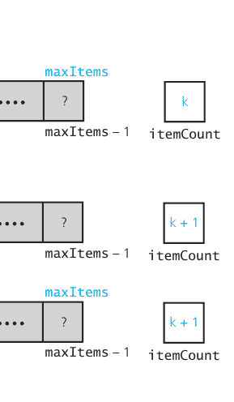

一旦我们为剩余的方法编写存根（stubs），就可以开始测试这些方法。然而，为了彻底测试 `insert`，我们需要 `getEntry` 方法，我们接下来定义它。

**问题 1** 给定一个 `ArrayList` 实例的非空列表，插入新条目时在什么位置需要执行以下操作？

**问题 2** 描述 `ArrayList` 中 `insert` 方法的实现方式，将位置 1 的条目放在数组的最后一个元素，位置 2 的条目放在倒数第二个元素，依此类推。

**问题 3** 之前提供的 `insert` 原始版本与问题 2 中描述的版本相比，在所需的操作数量上如何？

**getEntry 方法。** 这个简单的方法需要返回 `items[position]` 中的值，但我们决定如果位置超出范围，通过抛出异常来强制方法的先置条件。为了测试 `insert` 方法，你可以编写一个 `getEntry` 的临时版本，它不抛出异常只是返回列表条目。你如下完成它的定义：

```cpp
template<class ItemType>
ItemType ArrayList<ItemType>::getEntry(int position) const
throw(PreconditionViolatedException)
```

```cpp
{
    // 强制先置条件
    bool ableToGet = (position >= 1) && (position <= itemCount);
    if (ableToGet) {
        return items[position - 1];
    } else {
        string message = "getEntry() called with an empty list or ";
        message = message + "invalid position.";
        throw(PreconditionViolatedException(message));
    }
} // getEntry 结束
```

客户端。此时，在为剩余方法编写了存根后，你应该测试核心方法组。下面的 `main` 函数演示了你如何测试 `insert` 和 `getEntry`，以及它们是否改变了列表 9-1 中 `DEFAULT_CAPACITY` 的值：

```cpp
int main() {
    List<string> listPtr = new ArrayList<string>();
    string data[] = {"one", "two", "three", "four", "five"};
    cout << "isEmpty: " << listPtr->isEmpty() << " (true)" << endl;
    for (int i = 0; i < 5; i++) {
        if (listPtr->insert(i + 1, data[i]))
            cout << "Inserted " << listPtr->getEntry(i + 1) << endl;
        else
            cout << "Cannot insert " << data[i] << " at position " << i + 1 << endl;
    }
    return 0;
} // main 结束
```

类的客户端无法直接访问类的私有成员。注意 `itemCount`。

**setEntry 方法**。`setEntry` 方法的定义与 `getEntry` ，如下：

```cpp
template<class ItemType>
void ArrayList<ItemType>::setEntry(int position, const ItemType& newEntry)
throw(PreconditionViolatedException)
{
    // 强制先置条件
    bool ableToSet = (position >= 1) && (position <= itemCount);
    if (ableToSet) {
        items[position - 1] = newEntry;
    } else {
        string message = "setEntry() called with an empty list or ";
        message = message + "invalid position.";
        throw(PreconditionViolatedException(message));
    }
} // setEntry 结束
```

基于数组的 ADT 实现

**remove 方法**。现在考虑 `remove`，从列表中删除条目。正如图 9-3 所示，为了不留下空隙，我们需要移动数组中的条目。当 `itemCount` 满时，数组中的。

`remove` 的定义如下：

```cpp
template<class ItemType>
bool ArrayList<ItemType>::remove(int position)
{
    bool ableToRemove = (position >= 1) && (position <= itemCount);
    if (ableToRemove) {
        // 将位置 之后的所有条目
        // 向数组的前端移动，如图 9-3 所示
        for (int to = position; to < itemCount; to++)
            items[to - 1] = items[to];

        // 减少条目计数
        itemCount--;
    }
    return ableToRemove;
} // remove 结束
```

clear 方法。为了清除列表中的所有条目，我们的方法只需将 `itemCount` 设置为 0。

```cpp
template<class ItemType>
void ArrayList<ItemType>::clear()
{
    itemCount = 0;
} // clear 结束
```

> 问题 4 虽然该方法无法从空列表中删除条目，但它并没有显式检查。该方法是如何避免的

## 9.2 基于链表的 ADT 实现

我们现在考虑使用 C++ 指针而不是数组来实现列表。与基于数组的实现不同，链式实现在插入和删除操作期间不需要移动项。它也没有为列表固定最大长度——当然，受系统存储限制。再次，我们需要表示列表中的条目。列表 9-4 指出了使用指针表示这种数据的可能方法。这里 `headPtr` 指向包含列表项的链节点，其中第一个节点包含位置 1 的条目，依此类推。`itemCount` 是列表中当前的条目数量。 `headPtr` 和 `itemCount` 都是类的私有数据成员。

### 9.2.1 头文件

让我们命名类为 `LinkedList` 并如列表 9-2 所示编写其头文件。此文件与 `ArrayList` 的头文件（见列表 9-1）相似，但让我们指出区别。在这里我们包含了 `Node` 类和 `PrevalidatedException` 的头文件，它们分别定义在第 4 章的列表 4-1 和第 7 章的列表 7-5 中。

私有部分声明了两个数据成员——`headPtr` 和 `itemCount` 以及一个私有方法 `getAt`，我们将用它根据位置定位链节点中的任何节点。与可以直接访问指定元素的数组不同，链节点需要插入和删除操作遍历它直到到达指定的节点。虽然你可以在 `getEntry` 方法中编写必要的循环，但你很快会发现 `insert` 和 `remove` 方法将需要相同的循环。那时，你

## 列表 9-2 LinkedList 类的头文件

```cpp
/** ADT 列表：基于链的实现。
 * @file LinkedList.h */

#ifndef _LINKED_LIST
#define _LINKED_LIST

#include "ListInterface.h"
#include "Node.h"
#include "PrecondViolatedExec.h"

template<class ItemType>
class LinkedList : public ListInterface<ItemType> {
private:
    Node<ItemType>* headPtr; // 指向链中第一个节点的指针
    // (包含列表中的第一个条目)
    // 列表项的当前计数
    int itemCount;
    // 在链表中查找指定的指定的节点。
    // @pre position 是目标节点的编号；
    // position >= 1 且 position <= itemCount;
    // @post 找到了该节点并返回指向它的指针。
    // @param position 要查找的节点编号。
    // @return 指向给定位置节点的指针。
    Node<ItemType>* getNode(int position) const;
public:
    LinkedList();
    LinkedList(const LinkedList<ItemType>&& aList);
    virtual ~LinkedList();
    bool isEmpty() const;
    int getLength() const;
    bool insert(int position, const ItemType& newEntry);
    bool remove(int position);
    void clear();
    /** @throw PrecondViolatedExec 如果 position < 1 或 
     *      position > getLength(). */
    ItemType getEntry(int position) const throw(PrecondViolatedExec);
    /** @throw PrecondViolatedExec 如果 position < 1 或 
     *      position > getLength(). */
    void setEntry(int position, const ItemType& newEntry)
        throw(PrecondViolatedExec);

}; //  LinkedList

#include "LinkedList.cpp"
#endif
```

# 274 第 9 章 列表实现

定义一个私有方法来执行遍历将会非常方便。虽然我们现在声明了 getNodeAt，但在开始编写实现文件之前，在头文件中添加私有方法的声明并不罕见。

### getNodeAt 是一个私有方法

getNodeAt 方法不是 ADT 操作，因为它返回一个指向节点的指针；节点是实现细节，你不希望任何客户端调用它。这样的客户端应该能够在不了解实现所使用的节点的情况下使用 ADT。对于 ADT 的实现来说，定义程序不应访问的变量和方法是完全合理的。你可以将 getNodeAt 方法标记为“仅供内部使用”。因此，getNodeAt 是实现 ADT 某些操作的私有方法。

### 基于链的实现需要拷贝构造函数和析构函数

由于我们正在声明一种基于链的实现，因此我们必须为该类提供一个构造函数和一个析构函数。公方法的声明是针对 Array 的。


### 9.2.2 实现文件

### LinkedList 概述

我们的方法与我们为 `ArrayList` 定义的相同——即构造函数以及 `insert`、`getEntry`、`isEmpty` 和 `length` 方法。后两个方法的函数体与它们的 `ArrayList` 版本相同，因为它们只访问数据项字段。然而，正如我们在编写 `getEntry` 方法和私有方法 `getNodeAt` 时将变得明显的，后者将是必要的。

构造函数。因为编译器生成的默认构造函数不会将 `headPtr` 和 `itemCount` 初始化为值，所以你必须提供自己的默认构造函数。初始化器被设置为 `headPtr` 和 `itemCount` 的值，因为这些值是由我们而不是客户端选择的。构造函数的定义紧随：

```cpp
template<class ItemType>
LinkedList<ItemType>::LinkedList() : headPtr(nullptr)
```

这就是我们需要的构造函数。

getEntry 方法。与 `ArrayList` 中的 `getEntry` 一样，我们将该方法在位置超出范围时通过抛出异常来强制执行前条件。注意它的定义与我们在本章之前提供的基于数组的版本的相似之处：

```cpp
template<class ItemType>
LinkedList<ItemType>::getEntry(int position) const
    throw(PreconditionViolatedException)
{
    // 强制执行前条件
    if ((position >= 1) && (position <= itemCount)) {
        Node<ItemType>* nodePtr = getNodeAt(position);
        return nodePtr->getItem();
    }
    else {
        string message = "调用 getEntry() 时列表为空或 ";
        message = message + "无效位置.";
        throw PreconditionViolatedException(message);
    } // 结束 if
}
// 结束 getEntry
```

# 275 ADT 列表的基于链的实现

getNodeAt 方法通过遍历链找到给定位置的节点。它返回一个指向找到的节点的指针。遍历从链的第一个节点开始，在节点之间移动，并在此过程中计数，直到到达所需的节点：


```cpp
template<class ItemType>
Node<ItemType>* LinkedList::getNodeAt(int position) const
{
    // 对精度的调试检查
    assert((position > 0) && (position <= itemCount));
    // 从链的开始计数
    Node<ItemType>* curPtr = headPtr;
    for (int skip = 0; skip < position; skip++)
        curPtr = curPtr->getNext();
    return curPtr;
} // 结束 getNodeAt
```

由于 `getNodeAt` 是一个私有方法，并且仅由类内部的方法调用，因此它在违反前条件时不会抛出异常。相反，在调试期间明智地使用断言。`insert` 方法。

我们知道，在链的开头、在末尾之后或在两个相邻节点之间插入新条目。基于链的实现需要考虑在链的开头、末尾之后或两个相邻节点之间插入新条目。正如第 7 章中基于链的实现所示，我们需要考虑在链的开头插入新节点。由于 `getNodeAt` 是一个私有方法，并且仅由类内部的方法调用，因此它在违反前条件时不会抛出异常。相反，在调试期间明智地使用断言。`insert` 方法。

我们知道，可以像图 9-5 所示那样，在链的开头、末尾之后或两个相邻节点之间插入新条目。正如图 9-5 所示，通过以下赋值语句在链的开头插入新节点，如 9-5 所示。

```cpp
newNodePtr.setNext(headPtr);
```

`prevPtr` 和 `curPtr`

这些方法。在链的末尾或在两个相邻节点之间插入新条目，如图 9-5b 的赋值语句所示。

```cpp
newNodePtr.setNext(curPtr);
```

图 9-5


图 9-5a

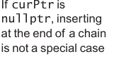

图 9-5b

末尾插入并不是一种特殊情况。总结来说，插入过程需要三个高级步骤：

- 1. 创建新节点并在其中存储数据。
- 2. 确定插入点。
- 3. 通过更改指针将新节点连接到链。

这些步骤实现在 `insert` 的定义中：

```cpp
template<class ItemType>
bool LinkedList<ItemType>::insert(int newPosition,
                               const ItemType& newEntry)
{
    bool ableToInsert = (newPosition >= 0) &&
                        (newPosition <= itemCount + 1);
    if (ableToInsert) {
        // 创建包含新条目的节点
        Node<ItemType>* newNodePtr = new Node<ItemType>(newEntry);
        // 将节点接到链
        if (newPosition == 0) {
            // 在链开头插入新节点
            newNodePtr->setNext(headPtr);
            headPtr = newNodePtr;
        } else {
            // 找到位于节点之前的节点
            Node<ItemType>* prevPtr = getNodeAt(newPosition - 1);
            // 在 prevPtr 指向的位置插入新节点
            newNodePtr->setNext(prevPtr->getNext());
            prevPtr->setNext(newNodePtr);
        }
    }
    itemCount++; // 增加条目计数
    return ableToInsert;
} // 结束 insert
```

# 276 第 9 章 列表实现

`prevPtr` 指向链的最后一个节点，由于这些赋值语句，在链的末尾插入新节点并不是一种特殊情况。总结来说，插入过程需要三个高级步骤：

- 1. 创建新节点并在其中存储数据。
- 2. 确定插入点。
- 3. 通过更改指针将新节点连接到链。

这些步骤实现在 `insert` 的定义中：

```cpp
template<class ItemType>
bool LinkedList<ItemType>::insert(int newPosition,
                               const ItemType& newEntry)
{
    bool ableToInsert = (newPosition >= 0) &&
                        (newPosition <= itemCount + 1);
    if (ableToInsert) {
        // 创建包含新条目的节点
        Node<ItemType>* newNodePtr = new Node<ItemType>(newEntry);
        // 将节点接到链
        if (newPosition == 0) {
            // 在链开头插入新节点
            newNodePtr->setNext(headPtr);
            headPtr = newNodePtr;
        } else {
            // 找到位于节点之前的节点
            Node<ItemType>* prevPtr = getNodeAt(newPosition - 1);
            // 在 prevPtr 指向的位置插入新节点
            newNodePtr->setNext(prevPtr->getNext());
            prevPtr->setNext(newNodePtr);
        }
    }
    itemCount++; // 增加条目计数
    return ableToInsert;
} // 结束 insert
```

如果你还没有开始在你的小组中测试这些方法，你应该这样做。


**问题 5** 给定一个非空的 `LinkedList` 实例，在哪个位置插入新条目的操作最少？请解释。

**问题 6** 在之前的 `insert` 方法中，第二个 `if` 语句测试 `newPosition` 的值。它测试的布尔表达式应该是 `isEmpty() || (newPosition == 1)` 吗？请解释。

**问题 7** `insert` 方法如何强制执行 `getNodeAt` 的前条件？

`remove` 方法。要从列表中删除任何条目，你必须能够从节点链中删除节点。你已经知道如何删除链中的第一个节点，因为这

# ADT 列表的链式实现 27

图 9-5 在链链的现有节点之间插入新节点

(a) 插入新节点之前

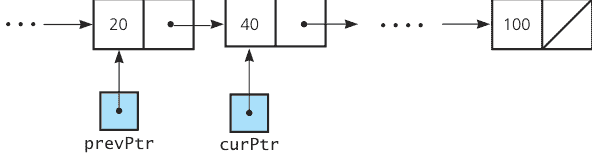

(b) 执行 `newNodePtr->setNext(curPtr)` 之后

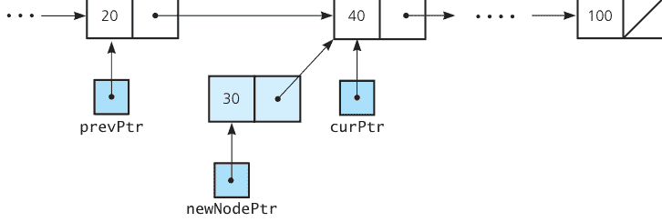

(c) 执行 `prevPtr->setNext(newNodePtr)` 之后

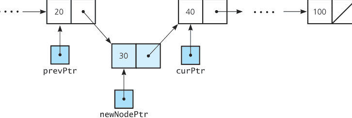

图 9-6 在链节点链的末尾插入新节点

原本为 `nullptr`

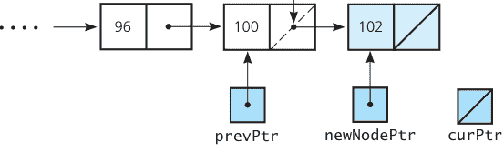

# 278 第 9 章 列表实现

图 9-7 从链中删除一个节点

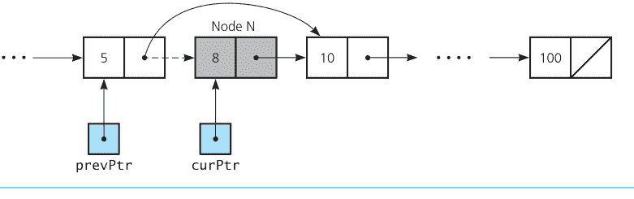

第 4 章中 ADT 容器和第 7 章中 ADT 栈的链式实现都是这样操作的。让我们考虑删除一个内部节点。

如图 9-7 所示，你可以通过修改 N 之前的一个指针的值，来移除 `curPtr` 指向的节点 N。你需要设置该指针使其指向 N 之后的节点，从而在链中跳过 N。（虚线表示旧的指针值）。注意，这种指针的变化 own并不直接影响节点 N。N 仍然存在，且它指向的节点也与之前相同。例如，对链进行遍历仍然可以到达节点 N。

为了完成这种指针更改，请注意：如果你只有一个 `curPtr` 指向 N，那么你没有直接的方法访问 N 之前的节点。毕竟，你无法反向沿着链中的链接。因此，你必须在图 9-7 中拥有变量 `prevPtr`。它指向链中 N 之前的节点，使你能够修改该节点的 `next` 指针，从而将节点 N 从链中移除。只需以下赋值语句即可移除 `curPtr` 指向的节点：

移除内部节点

```
prevPtr->setNext(curPtr->getNext());
```

上述技术是否适用于链链中的任何节点 N，无论它出现在链的什么位置？不适用。如果要删除的节点是链中的第一个节点，则它将不起作用；但对于链中的最后一个节点，它是有效的。因此，删除链中的第一个节点是一个特例。既然我们已经知道如何删除第一个节点，让我们考虑一下删除最后一个节点。

图 9-8 显示了删除 `curPtr` 指向的节点，即最后一个节点。仅靠该指针是不够的，因为我们我们有一个指向倒数第二个节点的变量 `prevPtr`。你将倒数第二个节点内的指针设置为 `nullPtr`。我们刚刚用于移除内部节点的相同赋值语句也会产生这种指针变化，因为 `curPtr->getNext()` 的值为 `nullPtr`：

```
prevPtr->setNext(curPtr->getNext());
```

图 9-8 移除最后一个节点

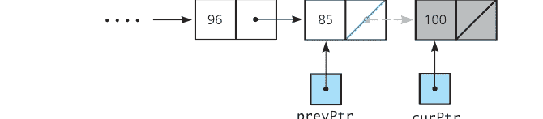

# ADT 列表的链式实现 279

要移除链的第一个节点，请记住你必须更改 `headPtr` 的值以指向第二个节点。第二个节点成为链的新第一个节点。你可以通过赋值语句将此更改为 `headPtr`：

移除第一个节点是一个特例

```
headPtr = headPtr->getNext();
```

与删除内部节点的情况一样，指针跳过了旧节点，尽管它仍然存在。还要注意，如果要删除的节点是链中唯一的节点——即它既是第一个也是最后一个节点——那么之前的赋值语句将分配值 `nullptr`。记住，`headPtr` 中的值 `nullptr` 表示空链，因此该赋值语句正确处理了链中唯一节点的移除。

被移除的节点仍然存在。假设 `curPtr` 指向它，更改 `curPtr` 的值将导致移除的节点处于悬空状态。它仍然占用存储空间，而程序将无法访问它。会导致内存泄漏。因此，在更改 `curPtr` 的值之前，你应该使用以下语句：

```
curPtr->setNext(nullptr);
delete curPtr;
curPtr = nullptr;
```

通过使用 `delete` 删除节点并将内存返回系统。总结来说，删除过程有三个高级步骤：

1. 定位你想要删除的节点。
2. 通过更改指针将该节点从链中断开。
3. 将节点返回系统。

从链中删除节点的三个步骤

你将在下面的 `remove` 定义中看到这些步骤以及之前的讨论：

```
template<class ItemType>
bool linkedList<ItemType>::remove(int position)
{
  bool ableToRemove = (position >= 1) && (position <= itemCount);
  if (ableToRemove) {
    NodeItem* curPtr = nullptr;
    if (position == 1) {
      // 移除要删除节点之前的第一个节点
      curPtr = headPtr; // 保存指向节点的指针
      headPtr = headPtr->getNext();
    }
    else {
      // 找到要删除节点之前的节点
      Node<ItemType>* prevPtr = getNode(position - 1);
      // 指向要连接的节点
      curPtr = prevPtr->getNext();
      // 通过连接前一个节点和后续节点，
      // 从链中断开指定的节点
      prevPtr->setNext(curPtr->getNext());
    }
    // 将节点返回系统
    curPtr->setNext(nullptr);
```

# 280 第 9 章 列表实现

```
delete curPtr;
curPtr = nullptr;

itemCount--; // 减少条目计数
}
return ableToRemove;
// end remove
```

该方法。要从列表中移除所有条目，可以调用 `remove` 方法。因为最容易移除的是第一个，该方法可以反复调用 `remove(1)` 直到列表为空。此操作之所以有效，是因为如果你移除了列表中的第一个条目，剩余条目将重新编号。因此，要移除所有条目，你可以反复移除第一个条目。因此，`clear` 具有如下定义：

问题 8 `clear` 方法的链式实现包含以下循环：

```
while (!isEmpty())
remove(1);
```

- a. 你能正确地将循环替换为

`for (int position = getLength(); position >= 1; position--)`

`remove(1);` 吗？

- b. 如果将 `remove(1)` 替换为 `remove(position)`，你的 a 答案会有不同吗？

- c. 如果将 `for` 语句替换为

`for (int position = 1; position <= getLength(); position++)`，你的 a 和 b 答案会有不同吗？

析构函数。因为 `clear` 方法会反复调用直到列表为空，并且它重新定位了节点，因此析构函数可以简单地清空：

```
template<class ItemType>
LinkedList<ItemType>::LinkedList()
{
    clear();
} // end destructor
```

问题 9 审查类的析构函数，以便它删除每个节点。

剩余方法。这种 ADT 的链式实现不使用编译器生成的构造函数，因为那只会复制 `headPtr` 和 `itemCount`。相反，它必须复制节点及其内容。

`setEntry` 方法，以及 `set` 方法。

# 282 第 9 章 列表实现

```cpp
// 私有方法 insertNode：
// 在指定位置向 subChainPtr 指向的子链中添加节点。
// 返回扩展后子链的指针。
template<class ItemType>
Node<ItemType>* LinkedList<ItemType>::insertNode(int position,
Node<ItemType>* newNodePtr, Node<ItemType>* subChainPtr)
{
    if (position == 1) { // 在子链开头插入新节点
        newNodePtr->setNext(subChainPtr);
        subChainPtr = newNodePtr;
        itemCount++; // 增加条目计数
    }
    else {
        Node<ItemType>* afterPtr =
            insertNode(position - 1, newNodePtr, subChainPtr->getNext());
        subChainPtr->setNext(afterPtr);
    }
    return subChainPtr;
}
end insertNode;
```

递归方法 `insertNode` 将节点在指定位置添加到 `subChain` 指向的子链中。接下来我们将追踪并解释其逻辑。

**追踪向列表头部添加操作。** 考虑图 9-9 所示的列表。让我们使用如下调用在链的开头添加新条目：

```
myList->insert(1, newEntry);
```

公共方法 `insert` 将创建一个包含 `newEntry` 的新节点（图 9-b），然后通过以下调用调用私有方法 `insertNode`：

```
insertNode(1, newNodePtr, headPtr);
```

参数 `headPtr` 中的指针被复制给参数 `subChainPtr`，因此它也指向链中的第一个节点，如图 9-9c 所示。

新节点被链接到原始链的开头，如图 9-9d 所示。注意，`subChainPtr` 并没有改变，尽管它是与参数 `subChainPtr` 对应的参数。私有方法 `insert` 返回 `subChainPtr` 的值，而公共方法 `insert` 将该值赋值给 `headPtr`。完成添加后的链如图 9-e 所示。

**追踪向列表内部添加操作。** 当添加操作不在原始链的开头时会发生什么？让我们追踪在向图 9-a 所示的链中添加第三个节点时发生的情况。公共方法 `insert` 创建新节点并通过如下调用调用私有方法 `insertNode`：


```cpp
insertNode(3, newNodePtr, headPtr);
```

与上一个示例相同，参数 `headPtr` 中的指针被复制给参数 `subChainPtr`，因此它也指向链中的第一个节点，如图 9-10 所示。由于插入不在位置 1，会发生另一次递归调用：

```cpp
insertNode(2, newNodePtr, subChainPtr->getNext());
```

# 图 9-9 递归地在链的开头添加节点

(a) 任何添加操作前的列表

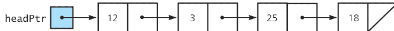

(b) 公共方法 `insert` 创建新节点之后、调用 `insertNode` 之前

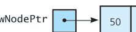

(c) 当 `insertNode(1, newNodePtr, headPtr)` 开始执行时

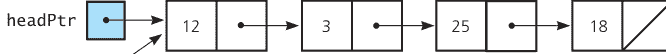

`subChainPtr`

(d) 新节点被链接到链的开头后（基本情况）

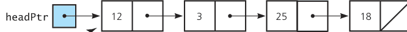

`subChainPtr`


> 私有方法返回 `subChainPtr` 中的指针

(e) 公共方法 `insert` 将 `insertNode` 返回的引用赋值给 `headPtr` 之后


`subChainPtr`


第三个参数是指向链中第二个节点的指针。如图 9-10d 所示，该指针被复制给参数 `subChainPtr`。我们尚未到达插入点，因此重复该递归过程：

```cpp
insertNode(1, newNodePtr, subChainPtr->getNext());
```

现在 `newNodePtr` 指向链的第三个节点，如图 9-10c 所示，我们已处于链中所需的插入的位置。不再发生其他递归调用，因为这是基本情况。

给定的新节点被插入到 `subChainPtr` 指向的子链开头，如图 9-10d 所示，然后私有方法 `insert` 返回新节点的引用。语句

```cpp
Node<ItemType>* afterPtr = insertNode(1, newNodePtr, subChainPtr->getNext());
```

# 图 9-10 递归地在链的现有节点之间添加节点

(当 `insertNode(3, newNodePtr, headPtr)` 开始执行时


(当递归调用 `insertNode(2, newNodePtr, subChainPtr->getNext())` 开始执行时


(当递归调用 `insertNode(1, newNodePtr, subChainPtr->getNext())` 开始执行时


(d) 在新节点被链接到子链的开头后（基本情况）


> 私有方法返回 `subChainPtr` 中的指针

(e) 返回的指针被赋值给 `afterPtr` 之后


(f) 在 `subChainPtr->setNext(afterPtr)` 执行后


在公共方法 `insert` 中 `insertNode` 继续执行。`insertNode` 返回的指向新节点的指针被赋值给 `afterPtr`，如图 9-10 所示。此时，`subChainPtr` 返回第二个节点，正如图的 b 部分所示。下一个要执行的 `insertNode` 语句是

```cpp
subChainPtr->setNext(afterPtr);
```

该语句将第二个节点中的 `next` 指针更改为新节点，如图 9-10f 所示。私有方法 `insertNode` 返回第二个节点的引用。如果继续追踪，我们将发现该方法使第一个节点指向第二个节点，使 `headPtr` 指向第一个节点，尽管这些指针已经就位。

> 注意：对节点链的递归添加会定位并记住插入点之前的节点。在插入点之后的链部分链接到新节点后，递归会将记录的节点重新链接回链。

+ 问题 10 使用递归重写 `LinkedList` 类中的析构函数，以便删除底层链的每个节点。

## 9.3 比较实现

选择数组实现或链式实现的原因与早期章节中讨论的相同。虽然本章中的数组实现看起来很合理——毕竟数组的行为像列表，而且数组又易于使用——但它使用了静态分配的内存。因此，它阻止了 `insert` 操作在列表满时添加条目。如果这种限制是不可接受的，你必须调整数组大小或使用链式实现。

## 286 第 9 章 列表实现

## 总结

- 1. 使用数组可以实现基础的 ADT 列表，但它比 ADT 容器或 ADT 栈的实现要复杂一些。
- 2. 数组提供了对任意任意元素的直接访问，因此诸如 `getEntry` 等方法可以快速检索列表中的任何条目。
- 3. 在基于数组的列表中添加或删除条目通常需要其他条目在数组内移动位置。这种数据移动降低了这些操作的效率，特别是当列表很长且添加或删除的位置位于列表开头时。
- 4. 在基于链的 ADT 列表实现中插入或删除元素不需要移动数据。因此，一旦找到插入或删除的位置，`insert` 和 `remove` 方法所需的精力基本上是相同的——无论列表长度如何或操作在列表中的位置如何。找到该点需要遍历，其时间取决于列表操作发生的位置。
- 5. 对于基于链的 ADT 列表实现，在列表开头添加元素和删除列表第一个条目被视为特殊情况。
- 6. 在基于链的列表末尾添加或删除条目需要对底层链进行遍历。
- 7. 在基于链的列表中添加或删除任何条目都需要更改底层链中的至少两个指针。
- 8. 基于数组的 `getEntry` 方法几乎是瞬时的，无论你访问列表的哪个项目。然而，基于链的 `getEntry` 需要 `i` 步才能访问列表中的第 `i` 个项目。

## 练习

- 1. 为 `ArrayList` 和 `LinkedList` 每个类添加一个构造函数，创建一个包含给定数组中条目的列表。
- 2. 为 `LinkedList` 类定义 `setEntry` 方法。
- 3. 为 `LinkedList` 类定义拷贝构造函数。
- 4. 重复之前的练习，在定义中使用递归。
- 5. 为 `ArrayList` 和 `LinkedList` 每个类实现第 8 章练习 5 中描述的 `getPosition` 方法。
- 6. 重复之前的练习，在定义中使用递归。
- 7. 为 `ArrayList` 和 `LinkedList` 每个类实现第 8 章练习 7 中描述的 `contains` 方法。
- 8. 重复之前的练习，在定义中使用递归。
- 9. 为 `ArrayList` 和 `LinkedList` 每个类实现第 8 章练习 9 中描述的 `remove` 方法。

## 编程问题

- 10. 重复之前的练习，在定义中使用递归。
- 11. 为 `LinkedList` 类编写私有方法 `getNodeAt` 的递归定义。
- 12. 编写一个双端列表，它在开头进行操作，并且包含第 8 章 8.1 节中给出的列表操作外。例如，你可以在双端列表中添加、删除和获取第一个和最后一个条目。为双端列表编写一个 C++ 接口。
- 1. 编写一个能够彻底测试 `ArrayList` 和 `LinkedList` 类的程序。
- 2. 编写一个基于数组的 ADT 实现，扩展列表条目的数组大小，以便列表始终能够容纳新条目。
- 3. 重复递归编程问题，但也要根据需要缩小数组大小以适应多次删除。当数组大小大于 20 且列表中的条目少于数组的一半时，将数组大小缩小为当前大小的三分四。
- 4. 修改基于数组的 ADT 实现，在尽可能可以使用的地方使用递归。
- 5. 修改基于链的 ADT 实现，在尽可能可以使用的地方使用递归。
- 6. 在链节点链中添加或删除节点时，当操作在链开头时需要特殊处理。为了消除这种特殊情况，你可以在链的开头添加一个虚拟节点（dummy node）。虚拟节点始终存在但不包含列表。这样，链永远不会为空，因此当列表为空时头指针永远不会包含 `null`。修改本章所示的 `LinkedList` 类，向链中添加虚拟节点。
- 7. 使用列表包含容器的条目，实现第 1 章练习 9 描述的 ADT。编写一个能够充分演示你新类的程序。
- 8. 使用列表包含容器的条目，实现第 1 章指定的容器类。编写一个能够充分演示你新类的程序。
- 9. 使用列表包含栈的条目，实现第 6 章指定的栈类。编写一个能够充分演示你新类的程序。
- 10. 实现第 8 章编程问题 2 描述的圣诞老人“乖列表”上对象的 ADT。为圣诞老人写一个程序，维护两个列表，分别记录坏孩子和乖孩子。
- 11. 流行的社交网络 Facebook 由 Mark Zuckerberg 和他的同学于 2004 年在哈佛大学创立。当时，他是一个正在学习计算机科学的大二学生。设计并实现一个维护简单社交网络数据的应用程序。网络中的每个人都应该有一个配置，包含人的姓名、可选图片、当前状态和朋友列表。你的应用程序应允许用户加入网络、离开网络、创建配置、修改配置、搜索其他配置以及添加朋友。
- 12. 尾指针（tail pointer）是指向节点链中最后一个节点的指针变量。根据练习 12，为双端列表类编写基于链的实现，同时使用头指针和尾指针。
- 13. 第 6 章编程问题 11 描述的 HAir 问题使用邻接表表示飞行地图。重复该问题的解决方案，但将邻接表定义为列表列表，而不是链链数组。使用基于链实现的列表。

# 第 10 章 算法效率

## 目录

- 10.1 什么是好的解决方案？ 290
- 10.2 衡量算法的效率 291
- 10.2.1 算法的执行时间 292
- 10.2.2 算法增长率 293
- 10.2.3 分析与大 O 表示法 294
- 10.2.4 保持视角 298
- 10.2.5 搜索算法的效率 300
- 总结 301
- 练习 302
- 编程问题 303

## 前提条件

- 第 1 章 数据抽象
- 第 2 章 递归
- 第 4 章 墙
- 第 9 章 列表实现

## 10.1 什么是好的解决方案？

在本章中，我们将展示什么是好的解决方案。在评估解决方案时，你必须考虑以下标准：

- 如果一个解决方案在整个生命周期内的成本最低，那么它就是好的。

假设两个算法执行相同的任务，较快的那个并不一定更好。因为解决方案的成本包含了开发、维护和使用程序的人的时间。

# 10.2 衡量算法的效率

良好的算法可以减少用程序实现算法、维护程序以及修改程序时的人力成本。良好的解决问题能力和编程风格过去一直很重要，现在也是如此。然而，算法的效率也同样重要。在选择算法及其实现方式时，效率是你应该考虑的准则。

算法的比较是计算机科学的核心主题之一。衡量算法的效率非常重要，因为你为特定应用选择的算法具有巨大影响。响应式文字处理器、超市收银系统、自动取款机、视频游戏和生命支持系统都依赖高效的算法。

算法分析是计算机科学中提供控制算法效率工具的领域。注意这里使用的是“算法”而不是“程序”这个词，重要的是强调：分析主要关注效率上的显著差异——这些差异你只有通过优越算法才能获得，而很少通过巧妙的技巧获得。由于巧妙技巧而导致的成本降低往往会被程序可读性的下降所抵消，从而增加了人力成本。分析应该侧重于算法效率的巨大差异，这些差异可能会决定解决方案的整体成本。否则，可能会选择一个运行速度比另一个快几分之一秒，但却需要你花费数小时时间来实现和维护的算法。

时间和内存的高效利用非常重要。计算机科学家使用类似的技术来分析算法的时间和空间开销。本文中涵盖的所有算法都没有显著的空间需求，我们的重点主要在效率上。

如何比较两个解决相同问题的算法的效率呢？一种可能的方法是实现这两个算法并运行程序。这种方法至少存在三个根本性问题：

- 算法是如何选择的？如果 `A1` 的运行速度比 `A2` 快，可能是编程得更好的结果。尽管如此，如果你比较程序的运行时间，你比较的是算法的实现，而不是算法本身。你不应该比较实现方式，因为它们对编程风格等因素敏感，这些因素往往会模糊哪个算法在本质上更高效的判断。
- 你应该在什么上运行？算法执行的操作可能会导致 `A1` 在某台计算机上运行得更快，而在另一台计算机上情况则相反。你应该独立于特定的计算机来比较算法的效率。
- 程序使用什么数据？也许这里最主要的困难在于为程序选择使用的数据。始终存在这样一种危险：你可能选取的问题实例使得某个算法具有特征性的优势。例如，在对已排序数组进行顺序搜索和二分查找时，你可能会搜索一个恰好是数组中最小的项。在这种情况下，顺序搜索比二分查找更快找到该项，因为该项是数组第一个，因此是搜索检查的第一个项。任何对效率的分析必须独立于特定数据。

为了克服这些困难，计算机科学家采用数学技术，独立于特定的实现、计算机或数据来分析算法。或者如下一节所述的，通过计算特定解决方案中显著的操作次数来进行这种分析。


视频笔记

衡量算法效率

在选择算法时考虑效率

算法比较应侧重于效率的显著差异

比较程序而非算法的三个困难

算法分析应独立于特定的实现、计算机和数据

## 292 第 10 章 算法效率

> 注意：通常情况下，你应该避免通过研究特定实现的运行时间来分析算法。运行时间受编程风格、特定计算机以及程序运行数据等因素的影响。

计算算法的操作次数是评估其效率的一种方法

### 10.2.1 算法的执行时间

之前的章节通过观察每个解决方案所需的的操作数，非正式地比较了解决问题的不同方案。例如，第 4 章比较了基于数组和基于链的 ADT 包的实现。基于数组的包可以直接一步直接访问其第 `i` 个元素，因为该元素存储在 `[i-1]` 中。然而，基于链的包必须遍历链节点链直到到达第 `i` 个节点，因此需要 `i` 步。

算法的效率与其所需的操作数有关。它通常用算法必须处理的项数 `n` 来表示。计算算法的操作（如果可能）是评估其效率的一种方法。让我们考虑几个例子：

**遍历链节点。** 作为遍历链节点的一个示例，显示此类链中的数据。如果 `headPtr` 指向链中的第一个节点，以下 C++ 代码将显示：

```cpp
Node<ItemType>* curPtr = headPtr;
while (curPtr != nullptr) {
    cout << curPtr->getItem() << endl;
    n++;
    comparisons++;
    curPtr = curPtr->getNext();
}
```

在包含 `n` 个节点的链中显示数据所需的时间与 `n` 成正比

如果我们有 `n` 个节点，这些语句需要 `n+1` 次比较和 `n` 次写操作。如果每次赋值、比较和写操作分别需要 `a`、`c` 和 `w` 时间单位，则时间为 `(n+1) × (a+c) + n × w` 时间单位。因此，写入 `n` 个节点的时间与 `n` 成正比。这个结论直觉上是合理的：显示或遍历包含 100 个节点的链比遍历包含 10 个节点的链需要更长时间。

> 注意：你必须遍历链来访问其第 `i` 个节点。访问时间与 `i` 直接正比。反之，你可以直接访问项，每个项的访问时间相同。

**汉诺诺塔。** 第 2 章递归地证明了解决有 `n` 个盘的汉诺诺塔问题需要 `2^n-1` 次移动。如果每次移动都需要相同的时间 `m`，则移动次数将呈指数级增长。你很快就会发现，随着盘数量的增加，这种时间需求会迅速增加。

嵌套循环。考虑一个包含以下形式嵌套循环的算法：

```cpp
for (i = 1; i <= n; i++) {
    for (j = 1; j <= i; j++) {
        for (k = 1; k <= 5; k++) {
            task;
        }
    }
}
```

在代数中省略乘法运算符是常见的，我们显式地标出它们以便计数。

如果任务 T 需要 `t` 时间单位，最内层的 `k` 循环需要 `5 × t` 时间单位。`j` 循环需要 `5 × t` 时间单位，而最外层的 `i` 循环需要

$$\sum_{i=1}^{n} (5 \times t \times i) = 5 \times t \times \frac{n(n+1)}{2}$$

时间单位。

问题 1 下循环包含多少次数组比较？

```cpp
for (j = 1; j < n-1; j++) {
    i = j + 1;
    do {
        if (theArray[i] < theArray[j]) {
            swap(theArray[i], theArray[j]);
        }
        i++;
    } while (i <= n);
} // end for
```

问题 2 将 `i = j + 1` 替换为 `i = j` 重复问题 1。

## 10.2 算法增长率


如你所见，之前的示例得出了算法需求关于问题大小的函数。衡量问题的大小取决于应用——典型的例子是链中的节点数、汉诺诺塔的盘数、数组的大小或栈中项的数量。因此得出了如下结论：

算法时间需求关于问题大小的函数

- 算法 A 与 $n^2$ 成比
- 算法 B 与 $n$ 成比

在比较两个算法的效率之前，上述两个语句的时间单位必须相同。如果我们写成算法 A 解决大小为 `n` 的问题需要 `n² / 5` 秒，之前的讨论指出了这种陈述的困难：在什么计算机上算法需要 `$n^2 / 5$` 秒？是什么导致算法需要 `$n^2 / 5$` 秒？

你具体想知道关于算法时间需求的什么信息？最重要的是学习算法的时间随问题大小增长得有多快。诸如下语句：

- 算法 A 与 $n^2$ 成比
- 算法 B 与 $n$ 成比

每一个都是算法的比例时间需求或增长率，并使你能够比较算法 A 和另一种算法 B。尽管从这些语句中你可以确定任何算法 A 或 B 的精确时间需求，但对于大问题，B 需要的时间比 A 少得多。也就是说，B 的时间需求——作为问题大小 `n` 的函数——增长速度比 A 的时间需求慢。即使 B 实际需要 `5 × n` 秒而 A 实际需要 `n² / 5` 秒，随着 `n` 的增加，B 通常比 A 少得多。图 10-1 阐明了这一点。

# 第 10 章 算法效率

## 图 10-1 时间需求随问题大小 $n$ 变化的函数


诸如“$A$ 的时间与 $n^2$ 成比”之类的结论，正是刻画算法内在效率的陈述，它不受特定计算机和实现等因素的影响。

图 10-1 还显示，在 `n` 超过 25 之前，`A` 的时间需求不会超过 `B`。算法效率通常只关注大问题。对于小问题，需求通常不足以产生产生影响的程度。因此，我们的分析假设 `n` 取大值。

> 注意：在比较各种解决方案的效率时，仅关注显著差异。这一规则与计算机程序成本的多维度视角是一致的。

### 10.2.3 分析与大 O 符号

如果算法 `A` 需要与 `f(n)` 成比的时间，则称该算法的阶数为 `f(n)`，记作 `O(f(n))`。函数 `f(n)` 称为算法的增长率函数。该符号使用大字母 `O` 表示阶，被称为大 O 符号。如果一个大小为 `n` 的问题需要与 `n` 直接正比的时间，该问题就是 `O(n)`——即阶 `n`。如果时间需求与 `n²` 直接正比，问题就是 `O(n²)`，以此此类推。

下面的形式化定义了这一点：

> 注意：算法阶的定义
>
> 如果存在常数 `k` 和 `n₀`，使得对于所有大小 `n ≥ n₀` 的问题，`A` 所需的时间单位不超过 `k × f(n)`，则算法 A 的阶为 `f(n)`——记作 `O(f(n))`

`O(f(n))` 定义中的要求 `n ≥ n₀` 将“足够大的问题”的概念形式化。通常情况下，`k` 和 `n` 的许多值可以满足该定义。

### 衡量算法的效率

以下示例说明了该定义：

- 假设一个算法解决大小为 `n` 的问题需要 `n² - 3 × n + 10` 次。如果存在常数 `k` 和 `n₀`，使得对于所有 `n ≥ n₀`，`k × n² > n² - 3 × n + 10`，则该算法是 `O(n²)`。事实上，如果 `k` 为 3 且 `n₀` 为 2，如图 10-2 所示，对于所有 `n ≥ 2`，`3 × n² > n² - 3 × n + 10`。因此，算法对于 `n ≥ n₀` 所需的时间单位不超过 `k × n²`，因此是 `O(n²)`。

- 在之前的第 10.2.1 节中，我们发现显示链链的前 `n` 个项需要 `(n+1)(a+c) + n × w` 个单位。因为对于 `n ≥ 1`，`2 × n ≥ n+1`，所以对于 `n ≥ 1`，`(2 × n) × (a+c) + n × w ≥ (n+1) × (a+c) + n × w`。在对方程左侧提取 `n` 后，我们得到对于 `n ≥ 1`，`(2 × a + 2 × c + w) × n ≥ (n+1) × (a+c) + n × w`。

- 因此，该任务是 `O(n)`。这里，`k` 为 `2 × a + 2 × c`，而 `w` 和 `n₀` 为 1。

同样，汉诺塔问题的定义的解决方案需要 `(2^m-1) × m` 个时间单位。因为对于 `m ≥ 1`，`m × 2^m > (2^m-1) × m`，该解决方案是 `O(n²)`。

`O(f(n))` 定义中的要求 `n ≥ n₀` 意味着时间估计对于足够大的问题是正确的。换句话说，对于大多数有限数量的问题规模，时间估计太小了。例如，函数 `log n` 在 `n=1` 时取值为 0。对于所有常数，`k log 1` 为 0 这一事实意味着一个不现实的时间需求；推测所有算法都需要超过 0 个时间单位，即使是解决大小为 1 的问题。因此，如果 `f(n)` 是 `log n`，你可以忽略大小为 1 的问题。

## 图 10-2 $3 × n²$ 和 $n² - 3 × n + 10$ 的图像


为了进一步戏剧化算法比例增长率的意义，请考虑图 10-3 中的表格和图表。部分 *a* 中的表格对于不同的 *n* 值，是某些增长率函数的近似值，按顺序排列如下：

常用函数的增长阶

`O(1) < O(log n) < O(n) < O(n × log n) < O(n²) < O(2^n)`

表格展示了函数值增长相对速度。图 10-3 显示这些增长率具有以下直观解释：

增长率的直观解释

- 增长率为 1 意味着问题的时间需求是常数，与问题大小 `n` 无关。
- 对数算法的时间需求随问题增大而增长缓慢。如果你将问题大小平方，其时间需求仅翻倍。你在第 2 章学过的这种行为。记得二分搜索平分数组并搜索其中一半。
- `log n` 的底数不影响增长率，你可以省略它。
- `O(n)` 是**线性**，随大小直接正比增长。
- `O(n × log n)` 增长比线性快。
- `O(n²)` 是**二次**，随大小直接正比增长。
- `O(2^n)` 是**指数**，增长极快。

### 算法效率的衡量

在整个分析过程中，你应该始终记住，你感兴趣的是效率上的显著差异。对于 `getentry` 的两种实现方式，差异是否随着列表大小的增长而变化？基于链的实现可能需要更多时间来检索所需的条目，因为它的节点可能距离链的开头更远。相比之下，无论列表有多大，基于数组的实现始终需要相同的时间来检索任何特定项目。因此，无论对你来说什么时间差异是显著的，只要列表足够大，就能达到。在这个例子中，请注意，两种实现方式之间的效率差异只有在问题足够大时才值得考虑。如果列表超过 25 个项目，这种差异就并不显著。

现在考虑一种实现方式——例如文字处理器——它频繁检索项目，但很少插入或删除。因为对于数组列表，`getentry` 比基于链的列表快，所以你应该选择基于数组的实现。另一方面，如果应用程序需要频繁的插入和删除但很少检索，那么你应该选择基于链的实现。对于给定的应用，最合适的实现取决于执行这些操作的频率。某些 ADT 的响应时间即使你很少使用它们，也是至关重要的。因此，在选择 ADT 的实现之前，你应该知道应用程序所需的操作频率，以及每个操作的响应时间。

在下一节中，我们将 `O(n)` 算法与 `O(log n)` 算法进行比较。在大数组上，`O(log n)` 算法比 `O(n)` 算法要快得多。对于小数组——例如 `n=25`——时间需求可能完全没有差异。事实上，由于规模大小等因素，这种是是可能的。在大问题上，较慢的增长率算法具有显著优势。图 10 说明了这种现象。

通常情况下，如果给定问题的规模很小，两种解决方案的时间需求将没有显著差异。如果你知道问题规模总是很小，不要过度分析；只需选择最易理解的代码即可。

在评估算法的效率时，你必须权衡解决方案的执行时间和内存需求之间的平衡。你能够得出结论：“这种方法对于执行任务是最好的。”一个解决方案比另一个需要更少的内存，而 B 比 A 更快地执行任务的其他部分。你必须根据具体的应用程序来分析解决方案。

总结来说，对算法的风格和效率进行评估是重要的。分析应该只关注效率上的巨大差异，避免为了节省几毫秒而使用的技巧。任何细小的效率差异都可能影响编程风格。如果你发现一个算法比其他算法显著更高效，你应该选择它，除非你知道问题规模非常小。如果你只解决小问题，效率较低的算法可能更合适。也就是说，算法的简单性可能比效率的细微差异更重要。事实上，分析算法的时间效率隐含了算法是为了解决大问题的。这种假设允许你关注增长率，无论其他因素，只要要解决的问题足够大，增长率慢的算法比增长率快的算法需要更少。

> 注意：如果问题很简单，不要对其进行分析。在这种情况下，主要考虑应该是简单性。例如，如果你正在搜索一个包含少量项目的数组——例如少于 25 个——可以使用简单的 `O(n)` 算法，如顺序搜索。

### 10.2.5 搜索算法的效率

作为分析算法效率的另一个例子，考虑两种搜索算法的效率：顺序搜索和数组二分搜索。

**顺序搜索。** 最坏情况：`O(n)`；平均情况：`O(n)`；最好情况：`O(1)`

**顺序搜索。** 在对包含 `n` 个元素的数组进行顺序搜索时，你从第一个开始逐个查看每个元素，直到找到目标项目或到达数据集的末。在最好情况下，目标项目是你检查的第一个，只需要一次比较。因此，在最好情况下，顺序搜索是 `O(1)`。在最坏情况下，目标项目是你检查的最后一个，所以需要 `n` 次比较。因此，在最坏情况下，算法是 `O(n)`。在平均情况下，你在集合中间找到了目标项目，进行了 `n/2` 次比较。

当你没有找到目标项目时，算法的阶是多少？算法阶取决于初始数据是否已排序？在本节末尾的检查题 4 中留有问题等你。

**二分搜索。** 数组二分搜索比顺序搜索高效吗？第 2 章介绍的分搜索算法通过反复将数组对半，在排序数组中搜索特定项目。算法确定项目可能所在的区域——并丢弃另一部分。因此，二分搜索算法处理的是较小的数组。给定数组的大小大约是之前搜索大小的一半。

在每次划分时，算法都会进行一次比较。当它搜索包含 `n` 个元素的数组时，算法进行了多少次比较？答案显然取决于数组中元素的排序情况。然而，你可以计算二分搜索所需的所需的比较次数——即最坏情况。比较次数等于算法对半划分的次数。假设对于某些 `k`，`n = 2^k`。搜索需要以下步骤：

1. 检查大小为 `n` 的数组的中间元素。
2. 检查大小为 `n/2` 的数组的中间元素。
3. 检查大小为 `n/2^2` 的数组的中间元素，依此类推。

```
k = log2
```

因此，在 `n=2^k` 的情况下，算法仍然是 `O(log n)`。如果 `n` 不是 2 的幂，你可以找到 `k` 使得 `2^{k-1} < n < 2^k`。例如，如果 `n=30`，那么 `k=5`，因为 `2^4 < 30 < 2^5`。对于 `n` 不是 2 的幂的情况，算法仍然是 `O(log n)`。

```
k = 1 + log2
```

因此，在 `n=1,000,000` 的情况下，`log2 1,000,000 ≈ 19`，所以二分搜索最多需要 20 次比较，但顺序搜索相同的元素可能需要 100 万次比较！

## 问题 4 考虑对 `n` 个元素的顺序搜索

- a. 如果数据按升序排列，你如何在不进行 `n` 次比较的情况下确定目标项目不在数据集中？
- b. 当目标项目不在数据集中时，顺序搜索的阶是多少？请针对排序和未排序的数据分别考虑最好、平均和最坏情况。
- c. 如果顺序搜索在数据集中找到了目标项目，是否取决于数据是否排序？

## 总结

- 1. 使用 Big O，你通过增长率作为问题规模的函数来衡量算法的时间需求，这使得不受计算机速度和编程语言等不受控制的因素。
- 2. 当你比较算法的内在效率时，你检查的是它们在大规模问题时的增长率函数。增长率函数的显著差异是有意义的。
- 3. 最坏情况分析考虑算法在给定规模问题上所需的最大工作量，而平均情况分析考虑它预期的工作量。
- 4. 分析算法的时间需求可以帮助你为抽象数据类型选择实现。如果你的应用程序频繁使用特定的 ADT 操作，那么你的实现至少在这些操作上应该是高效的。

## 练习题

- 1. 使用大 O 表示法，说明每个任务在最坏情况下的时间需求。描述你所做的任何假设。
    - a. 到达派对后，你与那里的每个人都握手。
    - b. 房间里的每个人都与房间里的其他人握手。
    - c. 你爬了一楼梯。
    - d. 你顺着扶手滑。
    - e. 进入电梯后，你按下一个按钮选择楼层。
    - f. 你乘坐电梯从地面上到第 `n` 层。
    - g. 你读了两本书。

- 2. 描述一种从楼梯底部爬到顶部的方法，其耗时不优 `O(n²)`。

- 3. 使用大 O 表示法，说明每个任务在最坏情况下的时间需求。
    - a. 使用 `for` 循环计算前 `n` 个整数的和。
    - b. 在数组中显示 `n` 个整数。
    - c. 在排序后的链表中显示 `n` 个整数。
    - d. 在链表数组中显示 `n` 个名称。
    - e. 显示一个数组元素。
    - f. 显示链表中的最后一个整数。
    - g. 使用顺序查找在任意 `n` 个项中搜索特定值。
    - h. 使用二分查找在任意 `n` 个项中搜索特定值。
    - i. 向包含 `o/n` 个元素的栈中添加一个项。
    - j. 向包含 `o/n` 个元素的包中添加一个项。

- 4. 假设你某个特定算法的实现在 C++ 中如下：

```cpp
for (int pass = 1; pass <= n; pass++) {
    for (int index = 0; index < n; index++) {
        for (int count = 1; count < 10; count++) {
            // end for
        }
    } // end for
} // end for
```

之前的代码仅显示了算法中的重复部分，没有显示循环内部发生的计算。这些计算与 `n` 无关。该算法的大 O 是多少？给出你的理由。

- 5. 考虑以下 C++ 函数 `f`，它调用函数 `swap`。假设 `swap` 存在并仅交换其参数的内容。不要关心 `f` 的目的。

```cpp
void f(int theArray[], int n) {
    for (int j = 0; j < n; ++j) {
        int i = 0;
        while (i <= j) {
            if (theArray[i] < theArray[j]) {
                swap(theArray[i], theArray[j]);
                i++;
            } // end while
        } // end for
    } // end f
```

`f` 执行了多少次比较？在最坏情况下，顺序查找比二分查找更快吗？解释。

- 对于大型数组，证明任何多项式 `f(x) = c_n x^n + c_{n-1} x^{n-1} + … + c_1 x + c_0`都是 `O(x^n)`。
- 证明对于所有 `a, b > 1`，`f(n)` 是 `O(n log n)` 当且仅当 `f(n)` 是 `O(log n)`。因此，在写 `O(n)` 时你可以省略底数。提示：对于所有常数 `a, b > 1`，使用等式 `log n = log_a n / log_a b`。
- 证明 `7n² + 5n` 不是 `O(n)`。
- 考虑一个长度为 `n` 且顺序包含正负整数的数组。编写 C++ 代码重新排列整数，使得负整数出现在正整数之前。你的解决方案应使用：
    - a. `O(n²)` 次操作
    - b. `O(n)` 操作

## 编程题

对于以下编程题，你需要在 C++ 中对一段代码进行计时。例如，以下语句表示了函数 `doSomething` 的执行：

```cpp
#include <ctime>
clock_t start = clock();
doSomething();
clock_t finish = clock();
double all1Time = static_cast<double>(finish - start) / CLOCKS_PER_SEC;
```

考虑以下两个：

```cpp
// Loop A
for (i = 1; i <= n; i++)
    for (j = 1; j <= 10000; j++)
        sum = sum + j;
```

```cpp
// Loop B
for (i = 1; i <= n; i++)
    for (j = 1; j <= n; j++)
    sum = sum + j;
```

每个循环的大 O 分多少？设计并实现一个实验，找到一个 `n` 值使得 Loop B 比 Loop A 快。


```cpp
// Loop B
for (i = 1; i <= n; i++)
    for (j = 1; j <= n; j++)
    for (k = 1; k <= n; k++)
        sum = sum + k;
```

# 第10章 算法效率

- 3. 编写一个 `C++` 程序实现这三种算法，并针对不同的 `$n$` 值进行计时。程序应显示每个算法在不同 `$n$` 值下的运行时间表格。

| 算法 A | 算法 B | 算法 C |

| :--- | :--- | :--- |

| `sum = 0` | `sum = 0` | `sum = n * (n + 1) / 2` |

| `for i = 1 to n` | `for i = 1 to n` | `for i = 1 to n` |

| `sum = sum + i` | `for j = 1 to i` | `sum = sum + i` |

| | `sum = sum + 1` | |

*(注：表格结构是根据 OCR 流程重建的)*

对于每个问题，你都需要一个 ADT 包（bag）的实现，该包能够移除随机条目而不是特定的项。

- 4. 假设球桌上有若干编号的台球。在每一步中，你从球桌上移除一个台球。如果移除的球编号为 `$n$`，则用 `$n$` 个编号为 `$n/2$` 的球替换它（除法取整）。如果你移除了 52 个球。使用大 O 表示法，预测当球桌最初只包含 `$n$` 个球时，该算法的时间需求。

编写一个程序模拟这一过程。使用一个正整数包来表示球桌上的球。记录不同 `$n$` 值下程序的实际执行时间以及关于 `$n$` 的函数性能。将你的结果与预测的时间需求进行比较。

- 5. 重复该过程，但用编号小于 `$n$` 的球替换 `$n$`。

- 6. 在神话中，九头蛇是一个有很多头的怪物。每当英雄砍掉一个头，地方就会长出两个更小的头。对英雄来说，如果头足够小，他砍掉它后仍会长出两个。为了杀死九蛇，我们的英雄只需要砍掉所有的头。

编写一个程序模拟九蛇。相反，我们将使用字符串。一个字符串包代表九蛇。每当你从包中移除一个字符串时，删除字符串的首字母并将剩余字符串的两个拷贝放入包中。例如，如果你移除 `HYDRA`，你会放入两个 `YDRA`。如果你移除一个单字母单词，则不在包中添加任何内容。开始时，从键盘读取一个单词并将其放入空包。当包变空时，九蛇死亡了。

使用大 O 表示法，根据初始字符串的 `$n$` 个字符预测该算法的时间需求。然后记录不同 `$n$` 值下程序的实际执行时间以及关于 `$n$` 的函数性能。

# 基础排序算法 307

图 11-1 一个五个整数数组的选择选择排序

灰色元素被选中；

蓝色元素组成数组的已排序部分。

| | 29 | 10 | 14 | 37 | 13 |

|---|---|---|---|---|---|

| 初始数组： | | | | | |

| 第 1 次交换后： | 29 | 10 | 14 | 37 | 13 |

| 第 2 次交换后： | 13 | 10 | 14 | 29 | 37 |

| 第 3 次交换后： | 10 | 13 | 14 | 29 | 37 |

- 问题 1：追踪选择选择排序的过程，将以下数组按升序排序：

`20 80 40 25 60 30`

- 问题 2：重复上一个问题，但将数组按降序排序。

`11-1` 给出了一个 `C++` 函数以及两个函数调用，它们对一个包含 `$n$` 个元素的数组执行选择排序，假设 `ItemType` 是数组条目的数据类型。

## 列表 11-1 选择排序的实现

```cpp
/* 查找数组中最大的项。
@pre 数组的大小 >= 1。
@post 参数保持不变。
@param theArray 给定的数组。
@param size Array 中元素的数量。
@return 数组中最大条目的索引。 */
int findIndexOfLargest(const ItemTypeArray[], int size);
/* 将数组中的项按升序排序。
@pre 无。
@post 数组按升序排序；数组的大小保持不变。
@param theArray 要排序的数组。
@param n 数组的大小。 */
void selectionSort(ItemTypeArray[], int n)
{
  // last = 待排序元素子数组中最大项的索引；
  // largest = 已找到的最大项的索引
  for (int last = n - 1; last >= 1; last--) {
    // 此时，theArray[last+1..n-1] 是已排序的，其
    // 条目大于 theArray[0..last] 中的条目
    // 在 theArray[0..last] 中选择最大的条目
    int largest = findIndexOfLargest(theArray, last+1);

    // 将最大的条目 theArray[largest] 与
    // theArray[last] 交换
    std::swap(theArray[largest], theArray[last]);
  } // end for
}
```

```cpp
int findIndexOfLargest(const ItemType theArray[], int size) {
  int indexSoFar = 0; // 目前为止发现的最大条目索引
  for (int currentIndex = 1; currentIndex < size; currentIndex++) {
    // 此时，theArray[indexSoFar] >= theArray
    // [0..currentIndex - 1] 中的所有条目
    if (theArray[currentIndex] > theArray[indexSoFar])
      indexSoFar = currentIndex;
  }
  return indexSoFar; // 最大条目的索引
} // end findIndexOfLargest
```

**分析。** 正如你从之前的算法中看到的，排序通常涉及比较、交换或移动项。在分析这些算法的第一步，你应该统计这些操作。通常情况下，所有此类操作都比控制循环或操作数组索引昂贵，特别是当待排序的数据比整数或字符更复杂时。我们的方法忽略了这些附带的操作。你应该说服自己，忽略此类操作不会影响我们的最终结果。（参见练习 1。）

显然，函数 `selectionSort` 中的循环执行了 `$n - 1$` 次。`selectionSort` 调用 `findIndexOfLargest` 和 `swap` 函数各调用 `$n - 1$` 次。每次对 `findIndexOfLargest` 的调用都会导致自身执行 `$last$` 次（即当 `$size$` 为 `$last + 1$` 时执行 `$size - 1$` 次）。因此，`$n - 1$` 次 `findIndexOfLargest` 调用（其值范围从 `$n$` 到 `$1$`）导致 `findIndexOfLargest` 中的循环总共执行了：

`$(n - 1) + (n - 2) + \dots + 1 = n \times (n - 1) / 2$`

次。由于 `findIndexOfLargest` 循环的每次执行执行一次比较，调用 `findIndexOfLargest` 需要：

`$n \times (n - 1) / 2$`

比较。`$n - 1$` 次 `swap` 调用导致 `$n - 1$` 次交换。每次交换需要三次赋值和数据移动。因此，调用 `swap` 需要：

`$3 \times (n - 1)$`

次移动。

# 基础排序算法 309

总而言，`$n$` 个项的选择选择排序需要：

`$n \times (n-1)/2 + 3 \times (a-1) = n^2/2 + 5 \times n/2$`

次主要操作。通过应用第 10 章增长率函数的属性，你可以忽略低阶项以得到 `$O(n^2)$`，然后忽略系数 `$1/2$` 得到 `$O(n^2)$`。因此，选择排序是 `$O(n^2)$`。

虽然选择排序不依赖数据的初始排列（这是该算法的优势），但它仅适用于较小的 `$n$`，因为 `$O(n^2)$` 增长非常快。该算法需要 `$O(n^2)$` 次比较，需要 `$O(n)$` 次数据移动。当移动代价昂贵而比较不昂贵时，选择排序可能是一个很好的选择。如果每个项都很长而排序键很短，可能会出现这种情况。

选择排序是 `$O(n^2)$`

> 注意：如果你正在对大数组进行排序，`$O(n^2)$` 算法太低效了。

## 11.1.2 冒泡排序

下一个排序算法是你已经见过的。冒泡排序比较相邻项，如果它们的顺序不对，则进行交换。这通常需要对数据进行多次遍历。在第一轮中，你比较第一个项和下一个项。如果它们顺序不对，就交换它们。然后你比较下一对的项——即数组中位置 2 和 3 的项。如果它们顺序不对，就交换它们。然后你以相同的方式继续，每次两个地比较并交换项，直到到达数组末尾。

图 12a 展示了五个整数冒泡排序的第一轮。你比较第一对项——29 和 10——并因为它们顺序不对而交换它们。接下来，你考虑第二对项——29 和 14——并因为它们顺序不对而交换这些项。第三对项——29 和 37 的顺序是正确的，所以你不交换它们。最后，你交换最后一对项——37 和 13。

当你对连续的几轮项项进行排序时，最大的项会浮到数组的顶部（末端）

# 图 11-2 整数数组冒泡排序的前几轮

| 初始数组： | 29 | 14 | 37 | 13 | |

|---|---|---|---|---|---|

| | 10 | 14 | 37 | 13 | |

| | 10 | 14 | 29 | 33 | 37 | |

| | 10 | 14 | 29 | 37 | 13 | |

| | 10 | 14 | 29 | 37 | 13 | |

# 310 第 11 章 排序算法及其效率

冒泡排序通常需要遍历数组几次，但不包括数组的最后一个（也是最大的）项。也就是说，第二轮考虑数组的 `$n - 1$` 个项。在第二轮之后，数组中第二大的项将位于数组中倒数第二个的正确位置，图 11-2b 所示。现在，忽略顺序正确的最后两个项，你继续遍历，直到数组排序完成。

虽然冒泡排序最多需要 `$n–1$` 次遍历来排序数组，但对于特定数组，可能需要更少的遍历。因此，如果在任何轮遍历中都没有发生交换，你就可以终止该过程。以下 `C++` 函数 `bubbleSort` 使用布尔值来指示在特定轮中是否发生了交换。该函数使用了之前的 `swap` 函数。

## 列表 11-2 冒泡排序的实现

```cpp
/* 将数组中的项按升序排序。
@pre 无。
@post 数组按升序排序；n 保持不变。
@param 给定的数组。
@param n 数组的大小。 */
void bubbleSort(ItemType array[], int n) {
    bool sorted = false; // 发生交换时为假
    int pass = 1;
    while (!sorted && (pass < n)) {
        // 此时，array[n+1..pass-1] 是已排序的
        // 且的所有条目都在 array[0..n-pass] 中
        sorted = true;
        for (int index = 0; index < pass; index++) {
            // 此时，array[0..index-1] 中的所有条目
            // 都是 array[index]
            int nextIndex = index + 1;
            if (array[index] > array[nextIndex]) {
                // 交换条目
                std::swap(array[index], array[nextIndex]);
                sorted = false; // 交换
            } // end if
        } // end for
        // 断言：array[0..n-pass-1] < array[n-pass]
        pass++;
    } // end while
} // bubbleSort
```

分析。正如我们之前注意到的，冒泡排序最多对数组进行 `$n-1$` 趟遍历。第 1 趟需要 `$n-1$` 次比较和最多 `$n-1$` 次交换；第 2 趟需要 `$n-2$` 次比较和最多 `$n-2$` 次交换。一般而言，第 `$i$` 趟需要 `$n-i$` 次比较和最多 `$n-i$` 次交换。因此，在最坏情况下，冒泡排序总共需要：

```
$(n-1) + (n-2) + \dots + 1 = n \times (n-1)/2$
```

比较和交换。记住每次交换都需要三次数据移动。与选择排序不同，最坏情况下有 `$2 \times n(n-1) = 2n^2 - 2n$` 次主要操作。因此，冒泡排序在最坏情况下是 `$O(n^2)$`。最好情况发生在数据已经排序时；冒泡排序只需要一趟，期间发生 `$n-1$` 次比较且没有交换。因此，冒泡排序在最好情况下是 `$O(n)$`。

冒泡排序：

- 最坏情况：`$O(n^2)$`

- 最好情况：`$O(n)$`

## 11.3 插入排序

再次想象手里拿着牌，但现在你一次拿起一张牌并将其插入到它的位置；在这个例子中，你正在一个按字母顺序排列的名字列表中执行**插入排序**算法。在示例中，我们反复调用 `insert` 方法将字符串添加到其正确的排序顺序中。

你可以使用插入策略对数组中的元素进行排序。此版本的插入排序将数组分为两个区域：已排序区域和未排序区域。图 11-3 描述了这一点。最初，数组是未排序区域，你坐在桌子面前有一堆未排序的牌。在每一步中，插入排序取未排序区域的第一个元素，并将其放在已排序区域的正确位置。这比比拿起牌并将其插入手中的正确位置。然而，第一步是微不足道的：将 `theArray[0]` 从未排序区域移动到已排序区域不需要移动数据。因此，你可以通过从 `theArray[1..n-1]` 开始来省略第一步。已排序区域中的元素彼此之间是有序的，这是一个不变性。因为每一步已排序区域的大小增加 1，未排序区域的大小减小 1，所以当算法结束时，数组将是有是有序的。

图 11-3 展示了对一个五个整数数组的插入排序。最初，已排序区域是 `theArray[0]`（即 29），未排序区域是数组的其余部分。你取未排序区域的第一个元素——10，将其插入到已排序区域的正确位置。这次插入需要你移动数组元素以为插入的元素腾出空间。然后你再取新插入区域的第一个元素——14，将其插入到已排序区域的正确位置，依此类推。

从未排序区域取出每个元素，并将其插入到已排序区域的正确顺序中。

### 图 11-3

| 已排序 | 未排序 |

| --- | --- |

| ... | ... |

| 0 | n-1 |

| 迭代后 | |

### 图 11-4 对一个五个整数数组的插入排序

初始数组：

| 29 | 10 | 14 | 37 | 13 | 复制 10 |

| --- | --- | --- | --- | --- | --- |

| 29 | 29 | 14 | 37 | 13 | 移动 29 |

| 10 | 29 | 14 | 37 | 13 | 插入 10；复制 14 |

| 10 | 29 | 29 | 37 | 13 | 移动 29 |

| 10 | 14 | 29 | 37 | 13 | 插入 14；复制 37，将 37 叠在自己上方 |

| 10 | 14 | 29 | 37 | 13 | 复制 13 |

| 10 | 14 | 14 | 29 | 37 | 移动 37, 29, 14 |

| 10 | 13 | 14 | 29 | 37 | 插入 13 |

排序后的数组：

> **问题 5** 追踪插入排序如何将检查点 3 中的数组按升序排序的过程。

> **问题 6** 重复上一个问题，但改为将数组按降序排序。

列表 11-3 包含一个 `C++` 函数，用于对包含 `$n$` 个元素的数组执行插入排序。

```cpp
列表 11-3 插入排序的实现
/**
 * 将数组中的元素按升序排序。
 * @post theArray 已按升序排序；n 保持不变。
 * @param theArray 给定的数组。
 * @param n theArray 的大小。 */
void insertionSort(ItemType theArray[], int n) {
    // unsorted = 未排序区域的起始索引，
    // loc = 已排序区域中插入的索引，
    // nextItem = 未排序区域中的下一个元素。
    // 初始，已排序区域是 theArray[0]，
    // 未排序区域是 theArray[1..n-1]。
    // 一般地，已排序区域是 theArray[0..i-1]，
    // 未排序区域是 theArray[i..n-1]。
}
```

## 更快的排序算法 315

```
// 合并已排序的半部分Array[first..mid] 和 theArray[mid+1..]
merge(theArray, first, mid, last)
}
// 如果 first >= last，则无须操作
```

显然，归并排序的大部分工作都在合并步骤中完成，但该算法真的实现了排序吗？递归调用继续将数组拆分成若干部分，直到每个部分只包含一个元素；显然，只包含一个元素的数组是有序的。然后，算法将这些小部分合并成更大的有序部分，直到形成一个有序的数组。图 11-6 展示了对一个包含六个元素的数组进行排序时的递归调用和合并步骤。

列表 11-4 中的 `C++` 函数实现了归并排序算法。要对包含 `$n$` 个元素的数组 `theArray` 进行排序，你可以通过编写以下代码来调用 `mergeSort` 函数：

```
mergeSort(theArray, 0, n - 1);
```

## 图 11-6 六个整数数组的归并排序


## 列表 11-4 归并排序的实现

```cpp
const int MAX_SIZE = maximum-number-of-items-in-array;
/**
 * 将已排序的数组段 theArray[first..mid] 和
 * theArray[mid+1..last] 合并为一个有序数组。
 * @param first first < mid <= last。子数组 theArray[first..mid] 和
 * theArray[mid+1..last] 均按升序排列。
 * @post theArray[first..last] 是有序的。
 * @param theArray 给定的数组。
 * @param first theArray 中第一个段的起始位置的索引。
 * @param mid theArray 中第一个段的结束位置的索引；
 * mid + 1 标记第二个段的开始。
 * @param last theArray 中第二个段的最后一个元素的索引。
```

（续）

## 316 第 11 章 排序算法及其效率

```cpp
// 注意：此操作将两个子数组合并到一个临时数组
// 并将结果拷贝回原始数组Array。 */
void merge(ItemTypeArray[], int first, int mid, int last)
{
    ItemType tempArray[MAX_SIZE]; // 临时数组

    // 初始化本地索引指示子数组
    int first1 = first; // 第一个子数组的开始
    int last1 = mid; // 第一个子数组的结束
    int first2 = mid + 1; // 第二个子数组的开始
    int last2 = last; // 第二个子数组的结束

    // 当两个子数组都不为空时，将较小的元素 拷贝到临时数组中
    int index = first; // tempArray 中下一个可用位置
    while ((first1 <= last1) && (first2 <= last2))
    {
        // 此时，tempArray[index-1]是有序的
        if (array[first1] <= array[first2])
        {
            tempArray[index] = array[first1];
            first1++;
        }
        else
        {
            tempArray[index] = array[first2];
            first2++;
        } // 如果是
        index++;
    } // 结束 while

    // 如果必要，处理第一个子数组
    while (first1 <= last1)
    {
        // 此时，tempArray[index-1]是有序的
        tempArray[index] = array[first1];
        first1++;
        index++;
    } // 结束 while

    // 如果必要，处理第二个子数组
    while (first2 <= last2)
    {
        // 此时，tempArray[index-1]是有序的
        tempArray[index] = array[first2];
        first2++;
        index++;
    } // 结束 while

    // 将结果拷贝回原始数组
    for (index = first; index <= last; index++)
        array[index] = tempArray[index];
} // 结束 merge
```

```cpp
/* 将数组中的元素按升序排列。
 * @pre theArray[first..last] 是一个数组。
 * @post theArray[first..last] 按升序排列。
 * @param theArray theArray 中要考虑的第一个元素的索引。
 * @param last theArray 中要考虑的最后一个元素的索引。 */
void mergeSort(intType theArray[], int first, int last) {
    if (first < last) {
        // 排序每个半部分
        int mid = first + (last - first) / 2; // 中点索引
        // 排序左半部分 theArray[first..mid]
        mergeSort(theArray, first, mid);
        // 排序右半部分 theArray[mid+1..last]
        mergeSort(theArray, mid + 1, last);
        // 合并两个半部分
        merge(theArray, first, mid, last);
    } // 结束 if
}
```


**问题 7** 通过绘制如图 11-6 所示的图，追踪归并排序过程，将以下数组按升序排序：25 30 20 80 40 60。

**问题 8** 证明归并排序算法满足第2章描述的递归四个标准。

分析。由于归并排序需要最多的工作，让我们开始分析。每次归并排序合并 `theArray[first..mid]` 和 `theArray[mid+1..last]`。图 11-7 提供了一个需要最大次数比较的合并步骤示例。如果待合并数组的总元素数为 `$n$`，则合并段需要 `$n-1$` 次比较。（例如，在图 11-7 中，段中共有七个元素，进行了五次比较）

## 图 11-7 归并排序中合并步骤的最坏情况

| | | | | | | |

|---|---|---|---|---|---|---|

| theArray: | 1 | 2 | 8 | 4 | 5 | 6 |

| | a | b | c | d | e | f |

| tempArray: | 1 | 2 | 4 | 5 | 6 | |

## 图 11-8 递归调用的层级，每一层都是数组的


## 315 更快的排序算法

## 图 11-9 关于基准值的划分


## 11.2 快速排序

快速排序将数组划分为小于等于基准值的元素以及大于或等于基准值的元素。

## 第 11 章 排序算法及其效率

分区函数将接收一个段数组 `array[first..last]` 作为参数。该函数必须将数组段的项分为两个区域：`$S_1$` 包含小于或等于基准（pivot）的项，`$S_2$` 包含大于基准的项。因此，如图 11-9 所示，该段为 `array[first..pivotIndex]`，而 `$S_2$` 是段数组 `array[pivotIndex + 1..last]`。

你会选择哪一个？存在多种策略来做出这种选择，正如你稍将看到的，让我们先假设我们有了一个基准并开始开发分区算法。无论你选择哪个基准，让我们将其与最后一个项 `array[last]` 交换，以腾出我们分区数组的空间。图 11-10 显示了执行此步骤后的数组。从数组开头开始向右侧（从左到右）移动，寻找第一个大于或等于基准的项。在图 11-10 中，该项是 5，位于 `indexFromLeft`。同样地，从倒数第二个项开始向数组开头移动（图中从右到左），寻找第一个小于或等于基准的项。在图 11-10b 中，该项是 2，位于 `indexFromRight`。现在，如果 `indexFromLeft` 小于 `indexFromRight`，则交换这两个索引处的两个项。图 11-10c 显示了此步骤的结果。2 小于基准，已向数组开头移动，而 5 大于基准，向相反方向移动。

在分区之前将所选的基准放在 `array[last]` 中

# 图 11-10 快速排序期间对数组的分区


从左侧和右侧继续搜索。图 11-10d 显示从左侧的搜索停止在 4，从右侧的搜索停止在 1。`indexFromLeft` 小于 `indexFromRight`，交换 4 和 1。数组现在看起来如图 11-10 所示。允许在分区的任何部分包含与基准相等的项。

继续搜索。图 11-1f 显示从左侧的搜索停止在 6，而从右侧越过 6 停止在 1。`indexFromLeft` 不小于 `indexFromRight`，不需要交换并结束。剩下的唯一步骤是通过交换 `$a[indexFromLeft]$` 和 `$a[last]$`，将基准放置在子数组 `$S_i$` 和 `$S_j$` 之间，如图 11-10g 所示。完成的分区见图 11-10h。

请注意，之前的子数组不能超出数组的边界。你将看到一种实现这一要求的方便方法。

**与基准相等的项。** 注意，两个子数组 `$S_i$` 和 `$S_j$` 都可以包含与基准相等的项。这对你来说可能很奇怪。为什么不总是将与基准相等的项放在同一个子数组中？这种策略会导致其中一个子数组比另一个大。然而，为了提高快速排序的性能，我们希望子数组尽可能相等。

注意，从左侧的搜索和从右侧的搜索在遇到与基准相等的项时都会停止。这意味着当在子数组中留下项时，它们会被交换。这也意味着每次搜索在每个子数组中都有一个落点项。

**选择基准。** 理想情况下，基准应该是数组中的中位数，这样子数组 `$S_i$` 和 `$S_j$` 就具有相同（或几乎相同）数量的项。找到中位数的一种方法是对数组进行排序，然后获取中间的值。但这种逻辑的排序是注定失败的。与其通过寻找数组中所有值的中位数来获取最佳基准，我们将共同尝试避免糟糕的基准。

我们将选取数组中三个项的中位数：第一个项、中间项和最后一个项。实现此点的一种方法是仅对这三个项进行排序，并使用三者的中间值作为基准。图 11-11 显示了在其第一个、中间和最后一个项排序前后的数组。基准是 5。这种基准选择策略被称为**三取中间值基准选择**。

这种基准选择确保了数组有三个项。如果你只有三个项，基准选择会对它们进行排序，因此不需要分区方法或快速排序。我们现在假设数组至少包含四个项。

以下伪代码描述了如何对至少包含四个项的数组中的第一个、中间和最后一个项进行排序。例如，它将图 11-11a 中的数组转换为图 11-11b 中的。


| | 5 | 8 | 6 | 4 | 9 | 3 | 7 | 1 | 2 |

|---|---|---|---|---|---|---|---|---|---|

| (b) | 2 | 8 | 6 | 4 | 5 | 3 | 7 | 1 | 9 |

| Pivot | | | | | | | | | | |

| | 5 | 8 | 6 | 4 | 9 | 3 | 7 | 1 | 2 |

|---|---|---|---|---|---|---|---|---|---|

| (a) | 5 | 8 | 6 | 4 | 9 | 3 | 7 | 1 | 2 |

| (b) | 2 | 8 | 6 | 4 | 5 | 3 | 7 | 1 | 9 |

```cpp
// 将数组中的第一个、中间和最后一个项按升序顺序排序。
sortFirstMiddleLast(array: ItemArray, first: integer, mid: integer, last: integer): void
    if (array[first] > array[mid])
        Interchange(array[first] and array[mid])
    if (array[mid] > array[last])
        Interchange(array[mid] and array[last])
```

调整分区算法。三取中间值基准选择对我们的分区方案提出了一些调整。此前，我们在分区之前将基准与数组中的最后一个项进行交换。但这里第一个、中间和最后一个项已经排过序，所以我们知道最后一个项至少与基准一样大。为了让基准让位，我们可以将其与倒数第二个项 `a[last-1]` 交换，如图 11-12 所示。因此，分区算法可以从右侧的 `last-2` 开始搜索。

还要注意，第一个项至少与基准一样小，它位于子数组 `$S_f$` 中。我们可以让分区算法从 `first+1` 开始搜索。图11-12b 显示了此前的数组状态。这种方案不需要特殊处理来防止搜索超出边界。

在搜索循环结束后，我们需要通过交换 `indexFromLeft` 和 `last-1` 将基准放置在子数组 `$S_i$` 和 `$S_j$` 之间。注意：快速排序在分区过程中会重新排列项。每个分区放置其正确位置。

以下伪代码描述了至少包含四个项的数组的分区算法：

```cpp
// 分区 array[...last]。
partition(array: ItemArray, first: integer, last: integer): integer
    // 选择基准并定位
    mid = first + (last - first) / 2
    sortFirstMiddleLast(array, mid, last)
    Interchange(array[mid] and array[last - 1])
    pivotIndex = last - 1
    pivot = array[pivotIndex]
    // 确定区域 S1 和 S2
    indexFromLeft = first + 1
    indexFromRight = last - 2

    done = false
    while (not done) {
      // 在左侧寻找第一个 >= pivot 的项
      while (array[indexFromLeft] < pivot)
        indexFromLeft = indexFromLeft + 1
      // 在右侧寻找第一个 <= pivot 的项
      while (array[indexFromRight] > pivot)
        indexFromRight = indexFromRight - 1
      if (indexFromLeft < indexFromRight) {
        // 将 array[indexFromLeft] 移动到 S2
        Interchange(array[indexFromLeft] and array[indexFromRight])
        indexFromLeft = indexFromLeft + 1
        indexFromRight = indexFromRight - 1
      } else {
        done = true
      }
    }
    // 将基准放在 S1 和 S2 之间的正确位置，并标记新位置
    Interchange(array[pivotIndex] and array[indexFromLeft])
    pivotIndex = indexFromLeft
    return pivotIndex
```

- **问题 9** 跟踪快速排序的分区算法如何分区数组：38 16 40 39 12 27

**快速排序的函数。** 在完成快速排序的 C++ 代码之前，我们需要考虑小数组。你已经看到在调用分区方法之前数组至少应包含四个项。仅仅在大数组上使用快速排序是不够的。代码最终会导致涉及只有两个项的递归调用。快速排序代码需要过滤掉这些小数组并使用另一种方法来排序它们。插入排序是小数组的良好选择。事实上，在只有十个项的数组上使用插入排序代替快速排序是合理的。列表 11-5 中的函数实现了带有这些快速排序。

# 324 第 11 章 排序算法及其效率

请记住这一点。它假设了一个常数 `MIN_SIZE`，用于指定我们使用快速排序的最小数组大小。

```
LISTING 11-5 执行快速排序的函数

/** 按升序排列数组。对于至少包含 MIN_SIZE 个元素的数组，使用三数取中位数（median-of-three）选择枢轴，对其他数组使用插入排序。
@pre theArray[first...] 是一个数组。
@post theArray[first...] 是已排序的。
@param theArray 数组中考虑的第一个元素。
@param last 数组中考虑的最后一个元素。
void quickSort(int theArray[], int first, int last) {
    if (last - first + 1 < MIN_SIZE) {
        insertionSort(theArray, first, last);
    } else {
        // 创建分区：S1 | Pivot | S2
        int pivotIndex = partition(theArray, first, last);
        // 排序子数组 S1 和 S2
        quickSort(theArray, first, pivotIndex - 1);
        quickSort(theArray, pivotIndex + 1, last);
    }
} // end quickSort
```


分析。`quickSort` 函数中的主要工作发生在分区步骤。分区不需要超过 $n$ 次比较，并且和合并操作一样，它是一个 $O(n)$ 任务。理想的情况是枢轴移动到数组的中心，使得两个子数组的大小相同。每次对 `quickSort` 的递归调用都执行一个相等子数组的分区，快速排序将类似于归并排序，因为递归调用使数组减半。因此，对 `quickSort` 的递归调用更少。在之前对归并排序的分析中，你可以得出 `quickSort` 有 $\log n$ 或 $n \log n$ 层的递归调用。每次调用 `quickSort` 涉及 $m$ 次比较和 $m$ 次交换，其中 $m$ 是待排序子数组中的数量。显然 $m \le n$。因此，快速排序将是 $O(n \log n)$，这是它的最好情况。

快速排序：

- 情况：$O(n^2)$：平均

- 情况：$O(n \log n)$

然而，这种理想情况并不总是发生。可能每个分区都有空子数组。每次递归调用将无事可做，另一个调用必须进入 $n-1$ 个元素而不是 $n/2$。这是因为每次递归调用 `quickSort` 时数量只减少了 1，而 `quickSort` 的最大递归调用次数是 $n$。结果是 $n$ 层递归调用而不是 $n \log n$。因此，在最坏情况下，快速排序是 $O(n^2)$。

对快速排序平均情况行为的正式分析将显示它是 $O(n \log n)$。虽然归并排序始终是 $O(n \log n)$，但快速排序在实践中更快，并且不需要归并排序合并时所需的额外内存。此外，对于大数组，你可以预计快速排序的运行速度明显快于插入排序。然而，在最坏情况下，快速排序所需的时间与插入排序相当。

快速排序的平均行为优于其最坏行为这一事实使其与本章考虑的其他排序算法区分开来。如果数组数据的原始排列是“随机”的，快速排序的性能至少与任何已知的涉及比较的算法。

归并排序的效率位于快速排序的可能之间：有时快速排序更快，有时归并排序更快。虽然归并排序的最坏行为与快速排序的平均行为处于同一数量级，但在大多数情况下，快速排序的运行速度明显慢于归并排序。

> 注意：枢轴的选择影响快速排序的效率。如果数组已经排序或几乎排序，某些枢轴选择方案会导致最坏情况行为。在实践中，几乎排序的数组出现比你想象的要频繁。幸运的是，三数取中位数枢轴选择避免了已排序数组的最坏行为。

> 注意：快速排序通常用于排序大数组，因为它在实践中极快，尽管其理论最坏情况表现不佳。虽然最坏情况并不典型，即使发生了最坏情况，快速排序的性能对于中等大小的数组也是可以的。

> 注意：当你确定要排序数组中的数据是随机排列时，快速排序是合适的。虽然快速排序的最坏行为是 $O(n^2)$，但最坏情况在实践中很少发生。

# 旁注：快速排序对比归并排序和 kSort

`QuickSort` 和 `mergeSort` 算法在精神上是相似的，但 `QuickSort` 在递归调用之前完成工作，而 `mergeSort` 在递归调用之后完成工作。也就是说，当 `quickSort` 形式如下：

```
quickSort(theArray, first, last)
if (first < last)
  为递归调用准备数组
  quickSort(S, region of theArray)
```

（继续）

```
quickSort(S, region of theArray)
}
```

`mergeSort` 具有一般形式：

```
mergeSort(theArray, first, last)
if (first < last)
    mergeSort(Left half of theArray)
    mergeSort(Right half of theArray)
    递归调用后清理
```

`quickSort` 中的分区是将数组划分为区域 $S$ 和 $S'$。算法随后排序 $S$ 和 $S'$。而在 `mergeSort` 中，递归调用之前没有进行任何工作：它必须合并两个部分。也就是说，算法必须在递归调用后合并数组的两个部分。

现在回 `ksmall` 的伪代码：

```
ksmall(k, theArray, first, last):
    从 theArray[first...last] 选择一个枢轴 p
    将 theArray[first...last] 划分为 S 和 S'
    if (k < pivotIndex - 1)
        return ksmall(k, theArray, first, pivotIndex - 1)
    else if (k == pivotIndex - 1)
        return p
    else
        return ksmall(k, theArray, pivotIndex + 1, last)
```

对 `ksmall` 的递归调用仅作用于数组的片段。图 11-13 展示了这一点。

> 问题：假设你使用归并排序排序一个大型整数数组。接下来，你使用二分查找确定给定整数是否出现在数组中。
>
> * 一般来说，哪种算法更快：归并排序还是二分查找？请用 O 符号解释。
>
> * 一般来说，哪种算法更快：快速排序？请用 O 符号解释。

# 更快的排序算法 325

图 11-13 kSmall 对比 quickSort


## 11.2.3 基数排序

这里包含了基数排序，因为它与所描述的其他排序非常不同，因为它不比较数组元素。假设你正在整理一副扑克牌。你一次拿起一张牌，按点数将它们分成 13 个可能的组：2, 3...10, J, Q, A。将这些组组合并将牌放在桌子上，使得 2 在上面，A 在下面。现在一次拿起一张牌，将它们分四四组：黑桃桃、方片、红心和梅草。结合在一起时，这些组形成了一手排好序的牌。

基数排序使用了这种分组然后组合的想法来对数据集合进行排序。该排序将每个项视为字符字符串。作为基数排序的第一个例子，考虑这组三字母字符串：

ABC, YWZ, BWZ, AAC, RLT, JBX, RDT, KLT, AEO, TLJ

基数排序开始根据最右侧（最低位）字母组织数据。虽然没有字符串以 A 或 B 结尾，但你将这些字符串放入一个组。继续通过字母表，执行以下操作：

(ABC, AAC) (TLJ) (AEO) (RLT, RDT, KLT, JBX) (XYZ, BWZ)

组中的字符串以相同的字母结尾，且组按字母排序。此外，组内的字符串保留了它们在原始字符串列表中的相对顺序。

现在按照以下方式将组组合为一个。按当前顺序取第一个组的项，紧接着取第二个组的项，以此此类推。得到的组如下：

ABC, AAC, TLI, AEO, RLT, RDT, KLT, JBX, XYZ, BWZ

> 按最右侧字母分组字符串
>
> 组合组

接下来，像以前一样形成新组，但这次使用每个字符串的中间字母而不是最后一个字母：

## 328 第 11 章 排序算法及其效率

根据中间字母（AAC）对字符串分组：AAC, ABC, JBX (AEO) (TLJ, RLT, KLT) (BWZ) (XYZ)

现在每个组中的字符串都有中间字母，并且组按照该字母进行了排序。在此之前，每个组内的字符串保留了它们在所有字符串组中的相对顺序。将这些字符串合并为一个组，同时保持每个组内元素的相对顺序：

AAC, ABC, JBX, RDT, AEO, TLJ, RLT, KLT, BWZ, XYZ

现在根据每个字符串的第一个字母分组：(AAC, ABC, AEO) (JBX) (KLT) (RDT, RLT) (TLJ) (XYZ)

最后，合并这些组，保持每个组内的相对顺序：AAC, ABC, BWZ, JBX, KLT, RDT, RLT, TLJ

字符串现在已经有序了。在上一个例子中，所有字符的长度都相同。如果字符字符串的长度不同，你可以在右侧填充空格，将它们视为长度相同。要对数值数据进行排序，基数排序（radix sort）将数字视为字符字符串。你可以将数字视为左侧填充零，使它们长度相同。然后你根据最右侧数字分组，合并组，根据下一位数字分组，合并，以此此类推，就像你在上一个例子中所做的那样。图 11-14 显示了八个整数的基数排序

| 原始整数 | 按第四位分组 | 合并 | 按第三位分组 | 合并 | 按第二位分组 | 合并 | 按第一位分组 | 合并（排序后） |
| :--- | :--- | :--- | :--- | :--- | :--- | :--- | :--- | :--- |
| 0123, 2154, 0024, 0283, 1560, 1061, 2150, 0022, 0123, 0283, 0154, 0004 | 1560, 2150, 0222, 0283, 1061 | 1560, 2150, 0222, 0123, 0283, 0154, 0004 | 1560, 2150, 0222, 0123, 0283, 0154, 0004 | 0004, 0123, 2150, 0154 | 0004, 0123, 2150, 0154, 0222, 0283, 1061 | 0004, 0123, 2150, 0154, 0222, 0283, 1061 | 0004, 0123, 2150, 0154, 0222, 0283, 1061 |

以下伪代码描述了对 n 个 d 位数的整数进行基数排序的算法：

```cpp
// 对数组中的 d 位整数进行排序。
radixSort(theArray, n: integer, d: integer): void {
  for (j = d - 1 down to 0) {
    初始化 d 个组为空
    初始化每个组的计数器为 0
    for (i = 0 through n - 1) {
      k = theArray[i] 的第 j 位数字
      将 theArray[i] 放在组 k 的末尾
      将 kth 计数器加 1
    }
    将 theArray 中的元素替换为组 0 的所有元素，
    然后是组 1 的元素，以此此类推。
  }
}
```

## 问题 11 按照算法在升序后的步骤追踪基数排序：

分析。对于基数排序，你可以看到该算法每次分组时需要 n 次移动，将它们合并为一个组也需要 n 次移动。对于这些 d 个字符的字符串，要求如此。然而，注意不需要任何比较。因此，基数排序是 O(n)。

尽管效率很高，但基数排序存在一些困难，使其不适合作为通用排序算法。例如，为了对大写字母字符串进行基数排序，你需要适应 27 个组——一个留给空格，每个字母一个。然而，你可以通过为这 27 个组中的每个组使用链节点链来节省内存。因此，基数排序对于链表比数组更合适。

> 尽管基数排序是 O(n)，但它并不适合作为通用排序算法

## 11.3 排序算法的比较

图 11-15 总结了本章出现的排序算法的最坏情况和平均情况。为了参考，这里还包含了另外两种算法——树排序（tree sort）和堆排序（heap sort），尽管你直到第 15 章和第 17 章 会学习它们。

图 11-15 各算法所需时间的近似增长率

| 选择排序 | 最坏情况 | 平均情况 |
| :--- | :--- | :--- |
| 冒泡排序 | n² | n² |
| 插入排序 | n² | n² |
| 合并排序 | n × log n | n × log n |
| 快速排序 | n² | n |
| 基数排序 | n² | n × log n |
| 树排序 | n² | n × log n |
| 堆排序 | n × log n | n × log n |

注意：标准模板库 (STL) 在 `<algorithm>` 库头文件中提供了几个 sort 函数。请参阅 C++ 插插 7 了解有关 STL 和这些函数的更多信息。

## 330 第 11 章 排序算法及其效率

## 总结

-1. 选择排序、冒泡排序和插入排序都是 O(n²) 算法。虽然在特定情况下某一个可能比另一个快，但对于大型问题，它们都是很慢的。然而，对于小数组，插入排序是一个很好的选择。

-2. 快速排序和合并排序是两种非常高效的递归排序算法。在平均情况下，快速排序是已知最快的排序算法之一。然而，快速排序的最坏情况比合并排序慢得多。幸运的是，快速排序的最坏情况在实践中很少发生。合并排序在平均情况下没有快速排序快，但它的性能在所有情况下都很良好。合并排序的缺点是需要与数组大小相同的额外存储空间。

-3. 基数排序的独特在于它不是通过比较来排序。然而，由于它是 O(n)，它不适合作为通用排序算法。

## 练习题

1. 按照算法在升序后的步骤追踪基数排序：3812, 1600, 4012, 3934, 1234, 2724, 3333, 5432。

2. 追踪基数排序以下数组：0123, 2154, 0024, 0283, 1560, 1061, 2150, 0022, 0123, 0283, 0154, 0004。

3. 追踪基数排序以下数组：20, 80, 40, 25, 60。

4. 追踪插入排序以下数组：7, 6, 4。

5. 追踪冒泡排序以下数组：25, 24, 10, 8。

6. 追踪选择排序以下数组：12, 23, 5, 10, 34。

7. 找到一个会让冒泡排序表现出最坏行为的数组。

8. 修改选择排序使其返回整数键。

9. 写出选择排序、冒泡排序和插入排序的递归版本。

10. 追踪合并排序以下数组：20, 80, 40, 25, 60。

## 编程题

11. 使用合并排序对数组排序时，**a.** 递归调用 merge 是否取决于数组中的值、数组中的元素数量还是两者都是？**b.** 在哪种排序中数组中的元素会被交换？请解释。

12. 修改函数 `quickSort` 使始终选择数组中的第一个元素作为基准。在 `partition` 函数中添加一个计数器来计算比较的次数。使用不同大小的数组将修改后的版本与原始版本进行比较。比较次数的差异在什么规模下变得显著？哪种基准选择策略会让比较次数的差异变得显著？

# 332 第 11 章 排序算法及其效率

- 3. 快速排序有多种划分策略。你还能想到哪些其他策略？它们与上一个编程题中过的两种策略相比如何？

- 4. 考虑第 8 章和第 9 章描述的 ADT 列表。为该列表添加合并排序。

- 5. 重复编程题 4，假设 ADT 列表是基于链的实现。在 `sort` 方法定义中使用合并排序。实现任何其他适用于此类列表的算法。

- 6. 重复编程题 4，假设字符串列表是基于链的实现。在 `sort` 方法定义中使用基数排序。

- 7. 你可以使用任何包含 100 个元素的计数数组来统计数组中每个整数出现的次数，从而对范围在 1 到 100 之间的大型整数数组进行排序。填充这种称为桶排序（bucket sort）的算法细节，并编写一个 C++ 函数。桶排序的复杂度是多少？为什么桶排序对于通用排序算法没有用？

- 8. 希尔排序（发明者：唐纳德·谢尔）是一种改进的排序方法。希尔排序不是像插入排序那样交换相邻元素，而是连接数组中距离较远的元素。希尔排序对数组进行排序，使得每隔 $h$ 个元素元素在一个递减的值序列中形成一个排序的子数组。例如，如果 $h$ 为 5，每隔五个元素就会形成一个排序的子数组。最终，如果 $h$ 为 1，整个数组将被排序。

一种可能的 $h$ 序列从 $n/2$ 开始，每次减半 $n$ 直到 1。通过这个序列，并将 $h$ 替换为 $h$ 和 $h-1$ 插入排序，我们得到了如下希尔排序的函数：

```cpp
void shellSort(ItemType array[], int n)
{
    for (int h = n / 2; h > 0; h = h / 2)
    {
        for (int unsorted = h; unsorted < n; unsorted++)
        {
            DataItem nextItem = array[unsorted];
            int loc = unsorted;
            while ((loc > h) && (array[loc - h] > nextItem))
            {
                array[loc] = array[loc - h];
                loc = loc - h;
            }
            array[loc] = nextItem;
        }
    }
}
```

在 `insertionSort` 和 `shellSort` 函数中添加一个计数器，用于统计比较的次数。使用不同大小的数组运行这两个函数。在什么尺寸下，比较次数的差异会变得显著？

- 9. 编写一个程序显示本章排序算法的运行时间。在不同大小的数组上测试排序。相同大小的数组应包含相同的条目。使用 `clock<time>` 函数对每次排序进行计时。参考第 10 章编程题开头的示例了解如何代码计时。

# C++ 中间节 4

类关系与复用

## 目录

- C4.1 重温继承 333

- C4.1.1 类的公有、私有和保护区域 333

- C4.1.2 公有、私有和保护继承 340

- C4.1.3 “is-a”与“has-a”关系 340

- C4.2 包含：“has-a”关系 342

- C4.3 重温抽象基类 343

## 前提条件

- 第 1 章 数据抽象：方法

- C++ 中间节 1 C++ 类

- C++ 中间节 2 指针、多态与内存分配

- 第 6 章 栈

- 第 8 章 列表

C++ 类通过封装抽象数据类型的数据和操作，提供了一种强制执行数据抽象规则的方法。然而，面向对象的方法远超封装。继承、多态和包含允许你从现有类定义新类。本中间节描述了使可复用组件集合成为的技术。请注意，关于这些技术还有更多可以说明和说的。可以将本中间节看作是从 C++ 中间节 1 开始的该材料介绍的精炼和扩展。

# C4.1 重温继承


当你想到继承时，你可能会想象从某个失散多年的富亲戚那里继承了一百万美元。然而，在面向对象的世界中，继承描述一个类从之前定义的类派生属性的能力。这些属性就像你从父母那里继承的遗传特征一样：有些特征是相同的，有些相似但不同，有些是新的。

# 334 C++ 中间节 4 类关系与复用

图 C4-1 继承：时钟之间的关系


类可以派生另一个类的行为和结构

事实上，继承是类之间的关系。一个类可以派生另一个类的行为和结构。例如，图 C4-1 展示了各种时钟之间的某些关系。例如，数字钟包括汽车仪表盘上的时钟、微波炉上的钟。所有数字钟都有相同的底层结构，并执行以下操作：

- 设置时间
- 推进时间
- 显示时间

数字闹钟是一种数字钟

数字闹钟是一种还具有闹报方法的数字钟，例如：

- 设置闹钟
- 启用闹报
- 响铃闹报
- 静音闹报

继承实现了现有类的复用

也就是说，数字闹钟具有数字钟的结构和操作，此外还具有闹报以及操作闹报的操作。

你可以将数字钟组和数字闹钟组视为类。数字闹钟类是数字钟类的派生类（或子类）。数字钟类是数字闹钟类的基类（或超类）。继承允许你在定义新类时复用软件组件。例如，当你定义布谷钟时，可以复用你对对模拟钟的设计和实现。

在 C++ 中，派生类继承其基类的所有成员，构造函数和析构函数除外。这意味着派生类除了继承的内容外，还拥有基类的数据成员和方法。派生类还可以修改任何继承的方法。例如，根据图 C4-1，布谷钟是模拟钟（如教室墙上的挂钟）的后代。

派生类继承基类的成员

# 重温继承 335

图 C4-2 多重继承


布谷钟继承了模拟钟的结构和行为，但通过增加布谷鸟修改了它每小时报告时间的方式。

有时一个派生类拥有多个基类。例如，如图 C4-2 所示，你可以从数字钟类和收音机类派生出一个收音钟类。这种关系被称为**多重继承**。多重继承必须谨慎使用，因为基类可能具有同名方法。例如，假设数字钟和数字收音机都实现了 `turnOn` 方法。当你在收音钟上调用 `turnOn` 方法时，你无法知道调用的是哪个 `turnOn` 方法。在本文书中，如果使用多重继承，派生类仅继承自一个基类；任何其他类都应该是抽象类。

```
列表 C4-1 类 PlainBox 类，最初在列表 C1-3 中给出
```cpp

template<class Type>

class PlainBox {

private:

    Type item;

public:

    PlainBox();

    PlainBox(const Type& itItem);

    void setItem(const Type& itItem);

    Type getItem() const;

}; // end PlainBox

```
```

我们的派生类 `ToyBox` 继承了 `PlainBox` 类的所有成员——构造函数和析构函数除外——并进行了一些更改。我们添加了存储箱子颜色的数据成员以及访问和设置颜色的方法。

派生类可以添加新成员进行继承

你可以为派生类添加任意数量的成员。但你无法修改祖先的方法来使用它们的名称，除非你**重定义**（redefine）继承的方法。如果两个方法具有相同的名称和参数声明，则派生类重定义基类中的非虚方法。

派生类可以重定义基类的方法

当 C++ 中间节 1 实现派生类 `MagicBox` 时，我们重定义了 `getItem` 方法，以便返回箱中的第一个项目。图 C4-3 展示了 `PlainBox` 和 `MagicBox` 之间的关系。

# 图 C4-3

派生类 `MagicBox` 继承了基类 `PlainBox` 的成员，并对其进行了精炼和新增成员

| PlainBox | MagicBox |
|---|---|
| item | firstItemStored |
| PlainBox() | |
| ~PlainBox() | 重定义 |
| setItem() | |
| getItem() | |

列表 C4-2 显示了类 `MagicBox` 的声明，该类最初位于 C++ Include 1 的列表 C1-7 中。

# 列表 C4-2 MagicBox 类，最初位于列表 C1-7 中

```cpp
template<class ItemType>
class MagicBox : public PlainBox<ItemType>
private:
    bool firstItemStored;
public:
    MagicBox();
    MagicBox(const ItemType& item);
    void setItem(const ItemType& item);
}; // MagicBox
```

在类 `MagicBox` 之后添加冒号 `public PlainBox` 表示 `PlainBox` 是 `MagicBox` 的基类，或者等同于 `MagicBox` 是 `PlainBox` 的派生类。

派生类的实例有两个成员——一个是继承的，另一个是新增的 `firstItemStored`。由于派生类的实例可以调用基类的任何方法，因此 `MagicBox` 的实例拥有 `PlainBox` 定义的所有方法：构造函数、`new`、编译器生成的析构函数以及一个精炼后的方法 `setItem`。尽管派生类的实例包含了继承的成员数据的副本，但继承方法的代码并没有被复制。

派生类不能通过名称访问其基类的私有成员，即使它们是被继承的。继承并不意味着访问权限。毕竟，你可以继承一个锁上的保险箱，但无法打开它。例如，数据 `item` 是私有的，因此你只能在 `PlainBox` 的定义内部引用它，而不能在 `ToyBox` 或 `MagicBox` 的定义内部引用。然而，`ToyBox` 类可以使用 `PlainBox` 的公共方法 `setItem` 和 `getItem` 来获取 `item` 的值。

在 `MagicBox` 的实现内部，你可以使用 `MagicBox` 从 `PlainBox` 继承的公共方法。例如，精炼后的 `setItem` 方法调用了继承的 `setItem` 方法，你通过编写 `PlainBox<ItemType>::setItem` 来指示这一点。这种写法对于区分两个版本的方法是必要的。因此，即使基类成员被重定义，你也可以使用作用域运算符 `::` 来访问它。`MagicBox` 的 `setItem` 方法的实现如下

```cpp
template<class ItemType>
void MagicBox<ItemType>::setItem(const ItemType& item)
```

- 派生类的实例具有其基类的行为
- 派生类继承基类的私有成员，但不能直接访问它们
- 派生类的方法可以改变基类的公共方法

```cpp
{
if (!firstItemStored)
{
    PlainBox<ItemType>::setItem(getItem());
    firstItemStored = true; // Box 现在已标记
} // end if
} // end setItem
```

派生类的类的客户端也可以调用基类的公共成员。例如，你写道：

```cpp
MagicBox<string> myMagicBox("volleyball");
string magicBoxItem = myMagicBox.getItem();
```

`MagicBox` 的 `item`（"volleyball"）由 `MagicBox` 从 `PlainBox` 继承的 `getItem` 方法返回。如果一个方法与祖先方法同名——例如 `setItem`——但如果使用了新方法，则新类的实例将使用新方法而不是原始方法。因此，如果 `myPlainBox` 是一个 `PlainBox` 对象，调用 `myPlainBox.setItem(...)` 将调用 `MagicBox` 的 `setItem`，如图 C4-4 所示——说明了这一点。由于编译器可以在编译时（而不是运行时）确定使用哪种形式的 `setItem`，这被称为早期绑定，引入于 C++ Interlude 2。早期绑定的另一个术是**静态绑定**。

- 派生类的客户端也可以调用基类的公共方法

# 继承以及构造函数与析构函数的执行顺序

派生类在基类构造函数之后执行。例如，如果你定义了一个 `MagicBox` 实例，它的构造函数会在 `PlainBox` 构造函数之后执行。派生类的析构函数在基类析构函数之前执行。例如，`MagicBox` 的析构会在 `PlainBox` 的析构函数之前执行。这对于你编写的构造函数和析构函数以及由编译器生成的函数都是如此。

早期绑定可能会导致问题，以下语句

- 早期绑定会导致问题

```cpp
PlainBox<string>* cardBoxPtr = new PlainBox<string>("Queen of Hearts");
cardBoxPtr->setItem("Jack of Spades");
```

调用了 `PlainBox` 版本的 `setItem`。不幸的是，如果 `cardBoxPtr` 指向一个 `MagicBox` 实例——例如，如果你写道：

```cpp
PlainBox<string>* cardBoxPtr = new MagicBox<string>("Queen of Hearts");
```

图 C4-4 早期静态绑定：编译器决定哪个哪个版本的

| PlainBox | MagicBox |
|---|---|
| item | firstItemStored |
| PlainBox() | |
| ~PlainBox() | |
| setItem() | setItem() |
| getItem() | |

```cpp
myPlainBox.setItem(...);
myMagicBox.setItem(...);
```

# 338 C++ INTERLUDE 4 类关系与重用

语句

```
cardBoxPtr->setItem("Jack of Spades");
```

仍然调用了 `PlainBox` 版本的 `setItem`，而不是 `MagicBox` 的版本。在这种情况下，编译器根据指针类型 `cardBoxPtr` 而不是 `cardBoxPtr` 指向的对象来确定要调用的方法版本。

仅仅在 `MagicBox` 中重定义（如我们之前所做的）是不够的。正如 C++ Interlude 1 的 C.5 节和 C++ Interlude 2 的 C2.4 节简单讨论过的，你还需要告诉编译器 `PlainBox` 的派生类可能会修改 `setItem`，以便编译器能够对这种情况做出调整。你通过在 `PlainBox` 中将 `setItem` 为虚方法来实现。你只需要在基类定义中的方法前写 `virtual` 即可。例如，`PlainBox` 类所示：

```cpp
class PlainBox
{
public:
    // 与之前相同，除了 setItem
    ...
    virtual ItemType setItem() const;
    ...
}; // end PlainBox
```

`setItem` 的实现与提供的相同。

现在，`cardBoxPtr` 指向一个 `MagicBox` 实例，语句

- 晚绑定意味着适当的方法版本在运行时决定

cardBoxPtr->setItem("Jack of Spades");

调用了 `MagicBox` 版本的 `setItem`。因此，方法的版本是在运行时决定的，而不是指针所指向的对象类型。从 C++ Interlude 2 回顾，这被称为晚绑定。晚绑定的另一个术语是动态绑定。像 `setItem` 这样的方法是多态的；操作的结果取决于它作用的对象。我们也说 `MagicBox` 的 `setItem` 版本覆盖了 `PlainBox` 的版本。

- 虚方法是可以被覆盖的方法
- 基类中的虚方法在任何派生类中都是虚方法
- 如果派生类中的方法与祖先虚方法的声明相同，则它也是虚方法。覆盖方法类似于重定义方法。你只能覆盖虚方法。注意你可以在派生类中覆盖虚方法

每个类都有一个虚方法表（VMT），它对程序员是不可见的。对于每个虚方法，VMT 包含指向实现该方法的指针。对于非虚方法，编译器可以建立此指针，因为它知道方法的定义。对于虚方法，编译器无法完成 VMT。程序执行期间调用构造函数会设置指针，如图 C4-5 所示。也就是说，构造函数建立了指向适用于对象的虚方法的指针。因此，VMT 是实现晚绑定的机制。

# C41.1 类的公共、私有和保护区域


C++ 继承与访问

除了公共和私有区域外，类还可以有一个保护区域。通过创建保护区域，类设计者可以隐藏成员，但使其对派生类可用。也就是说，派生类可以直接引用其基类的成员，但基类或派生类的客户端则不能。

## 图 C4-5 当 cardBoxPtr 指向 (a) 一个 PlainBox 实例；(b) 一个 MagicBox 实例时，虚方法表（VMT）

(a) PlainBox<string> *cardBoxPtr = new PlainBox<string>("Queen of Hearts"); 一个 PlainBox 对象

| cardBoxPtr | VMT 指针 | PlainBox 的 VMT |
|---|---|---|
| | item | setItem | PlainBox 中 setItem 的代码 |
| | | getItem | PlainBox 中 getItem 的代码 |

(b) PlainBox<string> *cardBoxPtr = new MagicBox<string>("Queen of Hearts");

一个 MagicBox 对象

| cardBoxPtr | VMT 指针 | MagicBox 的 VMT |
||---|---|---|
| | item | setItem | MagicBox 中 setItem 的代码 |
| | | firstItemStored | MagicBox 中 setItem 的代码 |

例如，`PlainBox` 有一个私有成员 `item`，派生类 `MagicBox` 无法直接引用它。如果你将其声明为保护的（protected），那么 `MagicBox` 就能通过名称直接访问 `item`。然而，`MagicBox` 或 `PlainBox` 的客户端将无法直接访问 `item`。我们可以如下所示修改 `MagicBox` 的 `setItem` 方法实现：

```cpp
template<class ItemType>
void MagicBox::setItem(const ItemType& item)
{
  if (!firstItemStored)
  {
    item = item; // item 是保护的
    firstItemStored = true; // Box 现在有了魔力
  }
} // end setItem
```

接下来的总结区分了类的公共、私有和保护部分，图 C4-6 阐释了它们的访问情况。

## 图 C4-6 客户端和派生类对类公共、私有和保护部分的访问


# 340 C++ 间插曲 4 类关系与重用

> 注意：类的访问类别
- 公共成员可以被任何人使用。
- 私有成员只能由类的方法使用。
- 保护成员只能由类的方法或任何派生类的方法使用。

通常情况下，类的数据成员应该是私有的

> 注意：风格指南

作为一种通风格指南，为了维护信息隐藏并防止派生类直接与基类成员耦合，你应该将类的所有数据成员都设为私有，并在必要时通过使用公共或保护的访问器（accessor）或修改器（mutator）方法为它们提供间接访问。虽然类的公共成员对任何人可见，但其保护成员仅对类自身或派生类的方法可见。

## C4.1.2 公共、私有和保护继承

可以存在多种类型的继承。无论是哪种继承，派生类都可以访问基类所有的公共和保护成员，但不能访问其私有成员。你可以通过指定三种继承类型之一来控制类的继承成员如何传递给派生类。你从如下开始定义派生类：

```cpp
class DerivedClass : kindOfInheritance BaseClass
```

其中 Inheritance 是 public、private 或 protected 之一。你之前在本节间插曲中看到的继承是公共继承。接下来的总结描述了三种继承类型。

> 注意：继承的类型
- 公共继承：基类的公共和保护成员分别保持为派生类的公共和保护成员。
- 保护继承：基类的公共和保护成员变为派生类的保护成员。
- 私有继承：基类的公共和保护成员变为派生类的私有成员。

在所有情况下，基类的私有成员仍然对基类本身是私有的，不能被派生类访问。

在三种继承类型中，公共继承是最重要的，也是我们在后续章节中最经常使用的。你使用继承来扩展类。你使用继承来扩展类，派生类可以访问基类所有的公共和保护成员，但不能访问其私有成员。你可以控制类的继承成员如何传递给派生类，通过指定三种继承类型之一。你从如下开始定义派生类：

```cpp
class DerivedClass : kindOfInheritance BaseClass
```

其中 Inheritance 是 public、private 或 protected 之一。此处（此处原文重复逻辑）

（C4.1.2 公有、私有和保护继承）

可以存在多种类型的继承。无论是哪种继承，派生类都可以访问基类所有的公共和保护成员，但不能访问其私有成员。你可以控制类的继承成员如何传递给派生类，通过指定三种继承类型之一。你从如下开始定义派生类：

```cpp
class DerivedClass : kindOfInheritance BaseClass
```


其中 `Inheritance` 是 `public`、`private` 或 `protected` 之一。你之前在本节间插曲中看到的继承是公共继承。接下来的总结描述了三种继承类型。

> 注意：继承的类型

- 公共继承：基类的公共和保护成员分别保持为派生类的公共和保护成员。
- 保护继承：基类的公共和保护成员变为派生类的保护成员。
- 私有继承：基类的公共和保护成员变为派生类的私有成员。

在所有情况下，基类的私有成员仍然对基类本身是私有的，不能被派生类访问。

在三种继承类型中，公共继承是最重要的，也是我们在后续章节中最经常使用的。你使用继承来扩展类，派生类可以访问基类所有的公共和保护成员，但不能访问其私有成员。你可以控制类的继承成员如何传递给派生类，通过指定三种继承类型之一。你从如下开始定义派生类：

```cpp
class DerivedClass : kindOfInheritance BaseClass
```

其中 `Inheritance` 是 `public`、`private` 或 `protected` 之一。

## C4.1.3 继承与关系

可以存在多种类型的继承。无论是哪种继承，派生类都可以访问基类所有的公共和保护成员，但不能访问其私有成员。你可以控制类的继承成员如何传递给派生类，通过指定三种继承类型之一。你从如下开始定义派生类：

```cpp
class DerivedClass : kindOfInheritance BaseClass
```

其中 `Inheritance` 是 `public`、`private` 或 `protected` 之一。你之前在本节间插曲中看到的继承是公共继承。接下来的总结描述了三种继承类型。

> 注意：继承的类型

- 公共继承：基类的公共和保护成员分别保持为派生类的公共和保护成员。
- 保护继承：基类的公共和保护成员变为派生类的保护成员。
- 私有继承：基类的公共和保护成员变为派生类的私有成员。

在所有情况下，基类的私有成员仍然对基类本身是私有的，不能被派生类访问。

在三种继承类型中，公共继承是最重要的，也是我们在后续章节中最经常使用的。

## C4.2 包含：拥有关系

一个圆珠笔有一个球作为它的笔尖，如图 C4-8 所示。

```cpp
class Pen {
    private:
        Ball point;
};
// end Pen
```

组合。我们已经在基于链接的 ADT 实现中这种情况。例如，当 `LinkedBag`、`LinkedStack` 或 `LinkedList` 的实例被销毁时，用于存储容器对象的节点不再需要，也会被销毁。在我们 ADT 的基于数组实现中，包含它们的数组也会被销毁。

另一种包含形式是聚合。在聚合关系中，包含类可以独立于被包含类存在。假设我们的 `PlainBase` 类有一个名为 `it` 的 `ItemType` 实例。如果你的普通包被销毁，程序可以继续使用 `item`。聚合的另一个示例可以在 ADT 包、ADT 栈和 ADT 列表的实现中找到：存储在包、栈或列表中的项在我们完成使用容器并将其销毁后，它们仍然继续存在。

> 编程提示：优先使用组合而非继承。当存在“是一个（is-a）”关系时，使用公有继承，即派生类的实例可以替代基类的实例时。当你想要重用另一个类的一部分实现代码时，使用私有继承。

> 注意：组合以及构造函数和析构函数的执行顺序

类成员对象的构造函数按照类定义中列出的顺序在类构造函数之前执行。例如，`B1` 的构造函数在 `Pen` 的构造函数之前执行。类成员对象的析构函数在类析构函数之后执行。例如，`B1` 的析构函数在 `Pen` 的析构函数之后。

> 注意：构造函数和析构函数的执行顺序

考虑到继承和组合，类的构造函数按以下顺序执行：

1. 执行基类构造函数。
2. 成员对象的构造函数按声明顺序执行。
3. 执行构造函数体。

类的析构函数按相反顺序执行：

1. 执行析构函数体。
2. 成员对象的析构函数按声明顺序执行。
3. 执行基类析函数。

## C4.3 重新回顾抽象基类

想象一个 CD 播放器 `CDP` 和一个 DVD 播放器 `DVDP`。这两个设备共享几个特征。每个都包含一张光盘。你可以插入、取出、播放和停止这些光盘。你还可以从光盘当前位置向前或向后跳。某些操作对这两个设备来说本质上是相同的，而其他操作——特别是播放操作——是不同但相似的。如果你要指定这两个设备，你可能从描述共同操作开始。

```cpp
// 将光盘插入播放器中。
+insert()
```

光盘传输操作

```cpp
// 从播放器中取出光盘。
+remove()
```

```cpp
// 播放光盘。
+play()
```

```cpp
// 停止播放光盘。
+stop()
```

```cpp
// 向前跳到光盘的另一个部分。
+skipForward()
```

```cpp
// 向后跳到光盘的较早部分。
+skipBackward()
```

这些操作可以构成一个通用光盘类 `GDP`。如果 `GDP`、`CDP` 和 `DVDP` 是类，那么 `GDP` 可以是 `CDP` 和 `DVDP` 的基类，如图 4 所示。虽然 `GDP` 可以实现适用于 `CDP` 和 `DVDP` 的 `insert` 和 `remove` 等操作，但它只能指示这些设备具有播放操作。因此，例如，`CDP` 继承了 `GDP` 提供的操作，但重写了播放操作以适应 CD，如图 C4-10 所示。如有必要，`CDP` 可以重写 `GDP` 的任何操作或定义额外的操作。我们对 `DVDP` 也可以类似的说明。因此：

- `CDP` 是一个播放声音的 `GDP`。
- `DVDP` 是一个播放声音和视频的 `GDP`。

由于 `GDP` 不能实现 `play` 操作，我们不想要它的实例。因此 `GDP` 只是一个没有实例的类，作为其他类的基础。如果一个类没有实例，它的方法就不需要实现。然而，方法必须是虚方法，以便派生类提供它们自己的实现。具有未定义体的虚方法称为**纯虚方法**，在类定义中写为：

```cpp
virtual void prototype() = 0;
```

纯虚方法的实现推迟到派生类。

## 图 C4-9 CDP 和 DVDP 拥有一个抽象基类


纯虚方法具有未定义体

**图 C4-10** CDP 和 DVDP 派自 GDP


第一章将抽象基类定义为包含至少一个没有实现的虚方法的类。我们现在可以将该定义重新表述为包含至少一个纯虚方法的类。抽象基类没有实例，仅作为其他类的基础。因此，`GDP` 类是一个抽象基类，因为它没有实现它所有的方法。

抽象基类没有实例，仅作为其他类的基础。因此，`GDP` 类是一个抽象基类，因为它没有实现它所有的方法。任何未能实现所有方法的派生类也是抽象类，且不能有实例。

正如你所见，抽象基类是指定接口的好地方。通过将组成接口的方法定义为虚方法，我们强制任何派生类实现这些方法。例如，列表 C4-3 包含了抽象接口：

```cpp
template <class ItemType>
class BoxInterface {
public:
    virtual ~BoxInterface() {}
    virtual void set(const ItemType& item) = 0;
    virtual ItemType getItem() const = 0;
};
```

我们可以通过更改类头来指示我们的 `PlainBox` 类派自 `BoxInterface`：

```cpp
class PlainBox : public BoxInterface<ItemType>
```

我们还可以定义一个新类 `JewelryBox`，提供方法的另一种实现。它的类头将是：

```cpp
class JewelryBox : public BoxInterface<ItemType>
```

图 C4-11 显示了类家族。

# C++ 间插 4 类关系与重用

**图 C4-11** 类家族的 UML 类图


如果我们定义了几个 `BoxInterface` 的指针变量，我们可以让它们指向派生类的实例：

```cpp
BoxInterface<string>* someBoxPtr = new PlainBox<string>("Ace")
BoxInterface<string>* anotherBoxPtr = new JewelryBox<string>("Emerald")
BoxInterface<string>* funBoxPtr = new MagicBox<string>("Stone")
```

对于创建的每个对象，我们都可以调用 `set` `getItem` 方法，特定于实例化类的实现将会执行，尽管指针是 `BoxInterface` 类型：

```cpp
cout << someBoxPtr->getItem() << endl; // 使用 PlainBox getItem
cout << anotherBoxPtr->getItem() << endl; // 使用 JewelryBox getItem
cout << funBoxPtr->getItem() << endl; // 使用 MagicBox getItem，其
// 是 PlainBox getItem
```

接下来总结了关于抽象基类的关键要点。

> **注意：抽象基类**
>
> + 一个抽象基类：
> - 根据定义，是一个包含至少一个虚方法的类。
> - 仅作为派生类的基类，并为其后代定义最基础的接口。
> - 没有实例。
> - 一般而言，应省略实现，析构函数和提供访问私有数据成员的方法外。也就是说，抽象基类中的虚方法通常应该是纯虚的。
> - 必须实现任何非纯的虚方法，如果派生类选择不提供自己的实现，则提供一个默认实现。

# 第 12 章 排序列表及其实现

目录

- 12.1 规范 ADT 排序列表 348
    - 12.1.1 ADT 排序列表的接口模板 350
    - 12.1.2 使用排序列表操作 351
- 12.2 基于链的实现 352
    - 12.2.1 头文件 353
    - 12.2.2 实现文件 354
    - 12.2.3 基于链的实现的效率 357
- 12.3 使用 ADT 排序列表的实现 357
    - 12.3.1 包含关系 357
    - 12.3.2 公有继承 362
    - 12.3.3 私有继承 366
总结 367
练习题 368
编程题 369

## 前提条件


# 第 8 章 列表

# 第 10 章 算法效率

# C++ 间歇 4 类关系与复用

最频繁的计算任务之一是按照指定的顺序维护一组数据。脑海中很容易想起许多例子，例如按姓名顺序排列的学生、按击球率顺序排列的棒球运动员，以及按资产顺序排列的企业。这些例子中的项目是有排序的。相比之下，杂货清单上的项目出现的顺序可能是它们在杂货店货架上出现的顺序，但它们可能不是按名称排序的。这些项目仅仅是根据它们在列表中的位置进行的。

## ADT 排序列表按排序维护项目

ADT 排序列表按排序顺序维护其条目。维护排序数据的问题不仅仅是简单的数据排序。你通常需要将新的数据项插入到恰当的已排序列表中。同样，你通常也需要删除某些数据项。例如，假设你的大学维护了一份当前在读学生的字母顺序列表。注册员必须不断从该列表中添加和删除姓名，因为学生会不断地入学和离开学校。这些操作应该保持数据的排序顺序。

本章规范了 ADT 排序列表，然后通过几种方式实现它。本章的一个主要目标是向你展示我们可以从现有的列表类开发出一类排序列表。

## 12.1 规范 ADT 排序列表

ADT 列表将管理给定集合中的条目留给客户端。客户端可以以满足其需求的任何顺序维护条目。回想一下当你使用 ADT 列表的 `insert` 操作时，你同时指定了新条目及其在列表中的位置。ADT 排序列表与 ADT 列表的区别在于，它通过值而不是通过位置来插入和删除项目。例如，排序列表的插入操作根据新条目的的值决定新条目的恰当位置。由于排序列表负责组织其条目，因此它没有按位置插入新条目的操作。如果你被允许指定新条目的的位置，你可能会破坏排序列表条目的顺序。

> 注意：ADT 排序列表是一个项目容器，它根据条目的的值决定并维护其条目的顺序。为了简单起见，我们允许排序列表包含重复项目。强制排序列表只包含唯一项目是相当复杂的，我们将这种变体留给练习题来完成。

我们希望这个 ADT 拥有哪些操作？我们已经提到过你可以向排序列表添加条目。由于排序列表决定了新条目的的位置，你可以询问 ADT 它的位置。也就是说，你可以查询现有条目的的位置，或者查询如果你将建议的条目添加到列表中，它将出现的位置。你还可以向 ADT 请求特定位置的条目。显然，你应该能够通过其值删除特定的条目，但我们也可以根据它在排序列表中的位置删除条目。我们将包含这两种删除操作。

让我们列出排序列表的操作——包括获取当前条目数量等常用操作——并更仔细地规范它们。注意，排序列表上的任何操作都不涉及破坏列表排序顺序的条目位置。

> 注意：ADT 排序列表操作
>
> * 测试排序列表是否为空。
> * 获取排序列表中的条目数量。
> * 向排序列表中插入一个条目。
> * 从排序列表中删除给定的条目。
> * 从排序列表中删除给定位置的条目。
> * 从排序列表中删除所有条目。
> * 查看（获取）列表中给定位置的条目。
> * 获取给定条目在排序列表中的位置。

### 图 12-1 ADT 排序列表的 UML 图

| SortedList |
| :--- |
| +isEmpty(): boolean |
| +getLength(): integer |
| +insertSorted(newEntry: ItemType): void |
| +removeSorted(newEntry: ItemType): boolean |
| +remove(position: integer): boolean |
| +clear(): void |
| +getEntry(position: integer): ItemType |
| +getPosition(newEntry: ItemType): integer |

图 12-1 显示了该 ADT 的 UML 图，以下对操作的总结为其操作契约提供了更多细节：

| 抽象数据类型：排序列表 |
| :--- |
| 数据 |
| 有限数量的对象，不一定相同，具有相同的数据类型并按值排序。 |
| 操作 |
| 伪代码 | 描述 |
| insertSorted(newEntry) | 任务：按正确顺序将条目插入排序列表，使列表保持排序。输入：newEntry 是新条目。输出：无。 |
| removeSorted(anEntry) | 任务：从排序列表中删除 anEntry 的首次出现。输入：anEntry 是要删除的条目。输出：如果定位并删除了 anEntry 则返回 true，否则返回 false。在后者的情况下，列表保持不变。 |
| getPosition(anEntry) | 任务：获取排序列表中 anEntry 的首次或唯一出现的位置。输入：anEntry 是要定位的条目。输出：如果 anEntry 出现在排序列表中，则返回其位置；否则作为负整数返回它可能出现的位置。但 |

+   以下操作与 ADT 列表的行为相同，并在第 8 章中描述：
* `isEmpty()`
* `getLength()`
* `remove(position)`
* `clear()`
* `getEntry(position)`

这些方法很直观，但让我们更仔细地观察 `getPosition`。对于排序列表中的条目，`getPosition` 返回其在列表中的位置，正如你预期的那样。我们从 1 开始为条目。但如果条目不在排序列表中怎么办？在这种情况下，`getPosition` 返回它所在的位置。然而，返回的是负数，以指示条目不在列表中。例如，如果对象不在排序列表中，它将返回 `-3`。

排序列表也拥有部分 ADT 的操作。我们已经提到按给定位置添加条目是不可能的，否则客户端可能会破坏排序列表的顺序。因此，列表的 `setEntry` 对排序列表不可用。然而，ADT 的其他操作对排序列表同样有用，包括检索或删除给定位置条目的操作。

- 二或多个条目具有相同的值。这些规范是否涵盖了这种情况，还是它们必须修订？
- 问题 2 为不允许排序列表包含重复条目的 `insertSorted` 操作编写规范。

## 12.1.1 ADT 排序列表的接口模板

列表 12-1 中的 C++ 接口规范了我们对 ADT 排序列表的初始规范。

列表 12-1 排序列表的 C++ 接口

```cpp
/** 排序列表接口 */
@file SortedListInterface.h */

#ifndef SORTED_LIST_INTERFACE
#define SORTED_LIST_INTERFACE

template<<class ItemType>
class SortedListInterface
{
public:
    /** 按正确顺序将条目插入此排序列表，
       使列表保持排序。 */
    @pre 无。
    @post newEntry 在列表中，且列表是排序的。
    @param newEntry 要插入到排序列表的条目。 */
    virtual void insertSorted(const ItemType& newEntry) = 0;
};

#endif
```

# 指定 ADT 排序列表 351

```cpp
@post 如果删除成功，则条目的第一个出现项将不再位于排序列表中，
且返回值为 true。否则，排序列表保持不变，且
返回值为 false。
@param anEntry 要删除的条目。
@return 如果成功则返回 true，否则返回 false。 */
virtual bool removeSorted(const ItemType& anEntry) = 0;
/** 获取给定条目在列表中第一个或唯一出现位置的位置。
如果该条目不在列表中，则确定如果它被添加到列表中，
它应该所处的位置。
@pre 无。
@post 返回给定条目所在或应所处的位置。
@param anEntry 要定位的条目。
@return 如果给定条目出现在排序列表中，则返回其位置；
否则，返回该条目可能出现的位置，
该位置以负整数的形式表示。 */
virtual int getPosition(const ItemType& anEntry) = 0;
// 以下方法与第 8 章列表 8-1 中 ListInterface
// 给出的方法相同，并且已完整规范。
/** 检查列表是否为空。 */
virtual bool isEmpty() const = 0;
/** 获取列表中的条目数量。 */
virtual int getLength() const = 0;
/** 从列表中删除给定位置的条目。 */
virtual bool remove(int position) = 0;
/** 从列表中的所有条目。 */
virtual void clear() = 0;
/** 获取列表中给定位置的条目。 */
virtual ItemType getEntry(int position) const = 0;
} // 结束 SortedListInterface
#endif
```

### 12.1.2 使用排序列表操作

示例。为了演示前一节指定的 ADT 排序列表的操作，我们首先创建了一个字符串的排序列表。通过声明和分配排序列表，我们假设 `SortedList` 是 `SortedListInterface` 接口中指定的操作的实现：

```cpp
SortedListInterface<string>* nameListPtr = new SortedList<string>();
```

接下来，我们按任意顺序添加名称，意识到 ADT 将按字母顺序组织它们：

```cpp
nameListPtr->insertSorted("Jamie");
nameListPtr->insertSorted("Brenda");
```


## 352 第 12 章 排序列表及其实现

```cpp
nameListPtr->insertSorted("Sarah");
nameListPtr->insertSorted("Tom");
nameListPtr->insertSorted("Carlos");
```

该排序列表现在包含以下条目：

- Brenda
- Carlos
- Jamie
- Sarah
- Tom

假设使用上述列表，以下是对排序列表进行操作操作的示例：

```cpp
nameListPtr->getPosition("Jamie") 返回 3，Jamie 在列表中的位置
nameListPtr->getPosition("Jill") 返回 -4，因为 Jill 属于列表中的位置 4
nameListPtr->getEntity(2) 返回 Carlos，因为他在列表中的位置 2
```

使用以下代码删除 Tom 和列表中的第一个名称：

```cpp
nameList.remove("Tom");
nameList.remove(1);
```

列表现在包含

- Carlos
- Jamie
- Sarah

移除最后一个条目 Tom 并没有改变列表中其他条目的位置，但移除第一个条目改变了位置。Carlos 现在位于位置 1，而不是位置 2。

> 注意：ADT 列表可以在给定条目作为参数的情况下，添加、删除或定位一个条目。排序列表有几个操作与 ADT 列表操作相同，即 `getEntry`（按位置）、`removeSorted`（按位置）、`clear`、`length` 和 `isEmpty`。然而，排序列表不会允许你通过位置添加或替换条目。

问题 3 假设 `wordListPtr` 指向一个无序的单词列表。使用 ADT 列表和 ADT 排序列表的操作，为这些单词创建一个排序列表。

问题 4 假设你在上一个问题中创建的排序列表不为空，写出 C++ 语句

a. 显示排序列表中的条目。

b. 将排序列表的第一个条目再次添加到排序列表中。

## 12.2 基于链的实现

与 ADT 一样，你有多种种方法可以实现排序列表。例如，你可以将排序列表的条目存储在数组、链式节点链、vector 实例或 ADT 列表的实例中。我们将首先考虑链式节点链，然后考虑 ADT 列表的实例。最后，我们将使用继承来开发一种完全不同的实现。

### 12.2.1 头文件

使用链式节点链存储排序列表中的条目的实现，与你在第 9 章中学习的 ADT 基于链的实现有几个共同点。特别是，它具有相同的数据字段、相似的构造函数、几个相同的方法，以及相同的 Node 类定义。让我们从列表 12-2 提供的头文件开始。`LinkedSortedList` 为排序列表声明了三个公共方法——`InsertSorted`、`removeSorted` 和 `get`，每个方法都接受一个列表作为其参数。正如你所看到的，为了实现这些操作，你需要一个私有方法 `getNodeBefore`，它接受一个条目并返回指向包含（或应包含）该条目的的前节点的指针。由于其余方法的定义与第 9 章中给出的 `LinkedList` 相同，且其中两个方法涉及条目的定义，因此你还需要第 9 章中定义的私有方法 `getNodeAfter`。正如你所看到的，我们将使用私有方法 `copyChain` 为构造函数提供一个递归实现。


列表 12-2 `LinkedSortedList` 类的头文件。

```cpp
/** 使用链式节点链存储排序列表条目的实现
ADT 排序列表：基于链的实现。
@file LinkedSortedList.h */

#ifndef LINKED_SORTED_LIST
#define LINKED_SORTED_LIST

#include "SortedListInterface.h"
#include "Node.h"

template<class ItemType>
class LinkedSortedList : public SortedListInterface<ItemType>
private:
    Node<ItemType>* headPtr; // 指向链第一个节点的指针
    int itemCount; // 当前项计数

    // 定位到应包含给定条目之前的节点。
    // @param anEntry 要查找的条目。
    // @return 返回条目之前的节点指针，如果不存在则返回 nullptr。
    Node<ItemType>* getNodeBefore(const ItemType& anEntry) const;

    // 链中给定位置的节点。
    Node<ItemType>* getNext(int position) const;

    // 返回 origChainPtr 指向的链的副本。
    Node<ItemType>* copyChain(Node<ItemType>* origChainPtr);

public:
    LinkedSortedList();
    LinkedSortedList(const LinkedSortedList<ItemType>& aList);
    virtual ~LinkedSortedList();

    void insertSorted(const ItemType& newEntry);
    bool removeSorted(const ItemType& anEntry);
    int getPosition(const ItemType& anEntry) const;
    // 以下方法与 List 给出的方法相同：
    bool isEmpty() const;
    int get() const;
    bool remove(int position);
    void clear();
    ItemType entry(int position) const throw(PrecondatedException);
}; // LinkedSortedList
#endif
```

### 12.2.2 实现文件

我们 `linkedSortedList` 类的默认构造函数和析构函数与 `LinkedList` 类定义几乎相同。因此，我们将留待实现。你也可以模仿 `LinkedList` 的构造函数，但我们将在定义中使用递归。我们首先让构造函数调用私有方法 `copyChain`，它将有一个递归定义：

```cpp
// 示例：
template<class ItemType>
LinkedList<ItemType>::
SortedList() 
{
    headPtr = copyChain(aList.headPtr);
} // 结束构造函数
```

私有方法 `copyChain` 首先设置其指针参数。如果它包含 `nullptr`，则将链指针设置为 `nullptr` 并将计数设置为零。否则，该方法创建一个包含给定链第一个节点数据的新节点。然后我们递归地将新节点插入到链的副本中。每次插入后，方法增加计数并返回新链的指针。`copyChain` 的定义为

（注：此处根据上下文逻辑翻译，代码块不翻译，仅保留逻辑描述）

```cpp
template<class ItemType>
Node<ItemType>* LinkedSortedList<ItemType>::
copyChain(Node<ItemType>* origChainPtr)
{
    Node<ItemType>* copiedChainPtr;
    if (origChainPtr == nullptr)
    {
        copiedChainPtr = nullptr;
        itemCount = 0;
    }
    else
    {
        // 从给定链构建新链
        Node<ItemType>* copiedChainPtr = new Node<ItemType>(origChainPtr->getItem());
        copiedChainPtr->setNext(copyChain(origChainPtr->getNext()));
        itemCount++;
    }
    return copiedChainPtr;
} // 结束 copyChain
```


# 图 12-2 在已排序的链节点中插入字符串的位置


**`insertSorted` 方法**。向排序列表添加条目需要你找到新条目在列表中的位置。由于条目是排序的，你将将新条目与排序列表中的条目进行比较，直到遇到一个不小于新条目的条目为止。图 12-2 描述了一个链节点链，每个节点包含一个按字母顺序排序的字符串。图中显示了额外的字符串 `"Ally"`、`Cathy"`、`Luke"` 和 `"Tom"` 将插入链中的位置，以及在这些位置必须进行的比较。

从图中你可以看到，在简单的比较中，`Ally` 小于 `Bob`，因此它将被插入在链的开头。对于 `Sue`，你会发现 `Luke` 大于 `Bob` 和 `Jill`，但小于 `Mike`。因此，`Luke` 属于 `Mike` 之前。另一方面，`Sue` 是节点之一。你会发现 `Sue` 大于 `Bob`、`Jill` 和 `Mike`，但不大于 `Sue`。因此，你将在现有条目之前插入新条目。最后，`Tom` 大于列表中的所有名称，因此你将其添加到链的末尾。

> 注意：给定一个按升序排列条目的排序列表，你将在新条目之前的第一个不小于新条目的条目之前。

回前面的章节，在链的开头添加新节点的方法与在链的其他位置不同。在开头添加是容易的，因为 `headPtr` 引用了链中的第一个节点。要添加到任何其他地方，你需要一个指向最终出现在新节点之前的节点的指针。因此，当你遍历链节点链以发现新条目所在的位置时，必须保留对所考虑节点的前一个节点的引用。

以下高层算法描述了我们的策略：

```
// 向排序列表添加新条目。
add(newEntry)
分配一个包含 newEntry 的新节点
遍历链直到你找到包含 newEntry 的节点或你越过了它应该的位置
prevPtr 指向插入点之前的节点
（head 为空或新节点属于链的开头）
    将新节点添加到链的开头
\else
    将新节点插入到 prevPtr 所指的节点之后
增加排序列表的长度
```

# 356 第 12 章 排序列表及其实现

假设我们已经在头文件中指定的私有方法 `getNodeBefore`，我们可以使用之前的算法来定义 `insertSorted` 方法，如下：

```cpp
template<class ItemType>
void SortedList<ItemType>::insertSorted(const ItemType& newEntry)
{
    Node<ItemType>* newNodePtr = new Node<ItemType>(newEntry);
    Node<ItemType>* prevPtr = getNodeBefore(newEntry);

    if (isEmpty() || (prevPtr == nullptr)) // 在开头添加
    {
        newNodePtr->setNext(headPtr);
        headPtr = newNodePtr;
    }
    else // 在节点之后
    {
        Node<ItemType>* aftPtr = prevPtr->getNext();
        newNodePtr->setNext(aftPtr);
        prevPtr->setNext(newNodePtr);
    }
    itemCount++;
}
```

**私有方法 `getNodeBefore`** 我们仍然需要实现私有方法 `getNodeBefore` 来定位位于或应该包含给定条目的节点。在遍历列表时我们需要两个指针。显然，我们需要一个指向当前节点的指针，以便将其条目与所需的条目进行比较。我们必须保留一个指向上一个节点的指针，因为该方法返回的就是这个指针。在下面的实现中，这些指针是 `curPtr` 和 `prevPtr`。

```cpp
template<class ItemType>
Node<ItemType>* SortedList<ItemType>::getNodeBefore(const ItemType& anEntry) const
{
    Node<ItemType>* curPtr = headPtr;
    Node<ItemType>* prevPtr = nullptr;
    while ((curPtr != nullptr) && (anEntry != curPtr->getItem()))
    {
        prevPtr = curPtr;
        curPtr = curPtr->getNext();
    }
    return prevPtr;
}
```

本章末的编程题允许你完成排序列表的实现。

> 注意：由于 ADT 排序列表和列表共享许多相同的操作，它们的实现部分是完全相同的。

- **问题 5**：在 `getNodeBefore` 方法的 `while` 语句中，运算符 `&&` 连接的两个布尔表达式的顺序有多重要？请解释。

- **问题 6**：如果排序列表为空，`getNodeBefore` 返回什么？你如何利用这一事实来简化之前提供的 `insertSorted` 方法的实现？

- **问题 7**：假设你使用之前的 `insertSorted` 方法向排序列表添加条目。如果该条目已经在列表中，该方法会将其插入到哪里？在条目第一次出现之前、第一次出现之后、最后一次出现之后，还是其他地方？

- **问题 8**：如果将 `getNodeBefore` 方法的 `while` 语句中的条件改为 `>=`，那么上一个问题的答案将会是什么？

# 2.2.3 基于链实现的效率

`insertSorted` 的性能取决于 `getNodeBefore` 方法的效率。后的方法通过遍历节点链来确定插入点。这种遍历是 O(n)，使得向排序列表添加的操作变成了 O(n) 操作。除了 `isEmpty` 和 `length` 这两个 O(1) 操作外，排序列表方法都是 O(n)。我们把这些观察留给你作为练习 11 来证明。

# 2.3 使用 ADT 列表的实现

正如本章早期提到的，ADT 排序列表的基于链实现重复了 ADT 列表的大部分相应实现。我们可以避免这种重复工作并复用列表实现的部分吗？这个问题的答案是肯定的，你很快就会看到。

你可以使用 ADT 创建并维护一个按字母排序的字符串列表。那么，在实现 ADT 排序列表时考虑使用 ADT 列表是很自然的。基本上，你可以使用以下三种技术之一来实现：

- 包含（Containment）

- 公有继承

- 私有继承

在大多数情况下，这些方法中的一种或多个适用于特定问题；通常，其中一种方法是。但我们将使用排序列表来演示所有三种技术。

# 2.3.1 包含

排序列表可以在列表中维护其条目，如图 12-3 所示。你将列表作为实现排序列表的类的数据字段。正如 C++ 间歇 4 所述，这种方法使用了一种称为组合（composition）的包含类型，并说明了排序列表类与列表类之间的“有一个”（has-a）关系。

> 图 12-3 包含条目列表的排序列表实例


# 358 第 12 章 排序列表及其实现

图 12-4 `SortedListHasA` 由 `LinkedList` 类的实例组成


组合并说明了排序列表类与列表类之间的“有一个”关系。如果我们将新类命名为 `SortedListHasA` 并实例化一个 `LinkedList`（如第 9 章列表 9-2 所示），使用 UML 表示法展示了这两个类之间的关系。

头文件。列表 12-3 声明了 `SortedListHasA` 类，使其包含包含排序条目的 `LinkedList` 私有成员。我们的类将派生自接口 `SortedListInterface`，如之前的列表 12-1。

列表 12-3 `SortedListHasA` 类的头文件

/** 使用 ADT 列表的 ADT 排序列表。

 * @file SortedListHasA.h */

#ifndef SORTED_LIST_HAS_A

#define SORTED_LIST_HAS_A

#include "SortedListInterface.h"

#include "LinkedList.h"

#include "Node.h"

#include "PrecondViolatedExcep.h"

template<class ItemType>

class SortedListHasA : public SortedListInterface<ItemType>

{

private:

    LinkedList<ItemType>* ListPtr;

public:

    SortedListHasA();

    SortedListHasA(const SortedListHasA<ItemType>& sList);

    virtual ~SortedListHasA();

    void insertSorted(const ItemType& newEntry);

    bool removeSorted(const ItemType& anEntry);

    int getPosition(const ItemType& newEntry) const;

// 以下方法的规格说明

// 与第 8 章的 ListInterface 相同：

#endif

```cpp
bool isEmpty() const;
int getLength() const;
bool remove(int position);
void clear();
ItemType getEntry(int position) const throw(PrecondViolatedException);
{// end SortedListHasA
#include "SortedListHasA.cpp"
#endif
```

构造函数和析构函数。构造函数创建一个 `LinkedList` 实例，并将指针变量 `listPtr` 赋值给它。

```cpp
template<class ItemType>
SortedListHasA<ItemType>::SortedListHasA()
{
    listPtr = new LinkedList<ItemType>();
} // 默认构造函数
```

拷贝构造创建一个创建一个列表列表并将排序列表中的条目拷贝到新列表中：

```cpp
template<class ItemType>
SortedListHasA(const SortedListHasA<ItemType>& s)
{
    listPtr = new LinkedList<ItemType>();
    for (Int position = 0; position < s.getLength(); position++)
    listPtr->insert(position, s.getEntry(position));
} // 拷贝构造函数
```

注意我们拥有 `LinkedList` 的 `insert` 方法。虽然这个特定的定义并不高效，但可以实现递归的 O(n) 实现。本章末尾的练习 7 要求你研究这种可能性。

析构函数简单地调用了 `clear` 方法，该方法将释放列表：

```cpp
template<class ItemType>
SortedListHasA<ItemType>::~SortedListHasA()
{
    clear();
} // 析构函数
```

`insertSorted` 方法。ADT 排序列表各个方法的实现非常简短，这个方法承担了大部分工作。要向排序列表添加一个新条目，我们首先使用 `getPosition` 方法，这是对排序列表的一项操作。我们假设它已经实现，尽管我们没有写它。回想一下，`getPosition` 找到条目在排序列表中的位置，或者我们应该插入一个在排序列表中不存在的新条目的位置。该方法设置返回值以指示该条目是否已存在于列表中。由于我们允许在排序列表中存在重复条目，因此我们可以忽略这个标志。注意，以下实现使用了标准方法来丢弃该标志。它还使用了 ADT 列表的 `insert` 方法。

```cpp
template<class ItemType>
void SortedListHasA<ItemType>::insertSorted(const ItemType& newEntry)
{
    int newPosition = fabs(getPosition(newEntry));
    listPtr->insert(newPosition, newEntry);
} // end insertSorted
```

`removeSorted` 方法可以调用 `getPosition` 来确定给定条目在排序列表中的位置或所属位置。然而，这次我们需要知道该条目是否存在于列表中。如果不存在，我们就无法删除它；在这种情况下，`removeSorted` 将返回 `false`。否则，返回的位置将是正数，`removeSorted` 可以调用列表的方法删除该条目。我们在 Checkpoint 11 中将 `removeSorted` 的实现留给你。

`getPosition` 方法。实现 `getPosition` 比实现之前的方法要困难一些。为了决定条目在排序列表中的位置或所属位置，我们需要在列表中对它进行比较，从第一个开始。如果给定的条目在列表中，我们显然会比较条目直到找到匹配项。如果它不在列表中，我们想要搜索它在排序列表中应该属于的位置。我们利用对象的排序顺序，使用了逻辑类似于第 12.2.2 节描述的逻辑。

Checkpoint 12 要求你定义 `getPosition`。你可以通过 `getLength` 和 `getEntry` 方法来实现。


- **问题 9** 使用类 `SortedListHasA` 的 `insertSorted` 方法重复执行 Checkpoint 7。
- **问题 10** `SortedListHasA` 的客户端调用 ADT 列表的 `insert` 方法吗？
- **问题 11** 为 `SortedListHasA` 类定义 `removeSorted` 方法。
- **问题 12** 为 `SortedListHasA` 类定义 `getPosition` 方法。

**剩余方法。** ADT 列表的 `isEmpty`、`getLength`、`clear` 和 `getEntry()` 方法与 ADT 列表的规范相同。简单地调用相应的列表方法。例如，`remove` 方法在 `SortedListHasA` 中的实现如下：

```cpp
template<class ItemType>
bool SortedListHasA<ItemType>::remove(int position)
{
    return listPtr->remove(position);
} // end remove
```


效率问题。除了 `getPosition` 中的一些逻辑外，你可以快速且很少出错地编写实现。使用现有类来构建是一个很有吸引力的特性。但在这种特定的实现中，多个方法调用了 `getPosition`，因此它们的效率取决于 `getPosition` 的效率。另一方面，循环通过调用 `getEntry` 直到找到条目来处理列表中的条目，`getPosition` 的效率取决于一部分。然而，`getEntry` 的效率取决于你使用的哪种 ADT 实现。对于链式实现，每次 `getEntry` 都从链的开头开始，`getPosition` 在最坏情况下是 O(n²)。这就是 `getPosition` 效率下的原因。

### 问题 13
假设在 `SortedListHasA` 的实现中使用 `ArrayList` 而不是 `LinkedList`，什么样的大 O 复杂度描述 `getPosition` 方法的性能？

### 问题 14
在 `SortedHasA` 类的实现中使用包含性的优点和缺点是什么？图 12-5 和 12-6 总结了基于数组和基于链的 ADT 列表和排序列表操作的效率。这些结果的确认留作练习。你可以看到，使用包含性的排序列表实现很容易，但如果底层列表使用节点链，则并不高效。

图 12-5 基于数组和基于链的 ADT 列表操作的最坏情况效率

| ADT 列表操作 | 基于数组 | 基于链 |
|---|---|---|
| insert(position, newEntry) | O(n) | O(n) |
| remove(position) | O(n) | O(n) |
| getPosition(position) | O(1) | O(n) |
| setEntry(position, newEntry) | O(1) | O(n) |
| clear() | O(n) | O(n) |
| getLength() | O(1) | O(1) |

图 12-6 使用 ADT 列表实例实现 ADT 排序列表操作的最坏情况效率

| ADT 排序列表操作 | 列表 基于数组 | 基于链 |
|---|---|---|
| insertSorted(newEntry) | O(n) | O(n²) |
| removeSorted(anEntry) | O(n) | O(n²) |
| getPosition(anEntry) | O(n) | O(n²) |
| getEntry(position) | O(1) | O(n) |
| remove(givenPosition) | O(n) | O(n) |
| clear() | O(n) | O(n) |
| getLength() | O(1) | O(1) |

> 注意：使用包含性实现 ADT 排序列表
当你使用 ADT 列表实例来包含条目，而不是直接访问它们时。这种排序列表实现很容易编写，但当底层列表使用节点链时，效率低下。

### 12.3.2 公共继承

列表是一个通过位置引用项的容器。如果你按照顺序维护项，你会得到一个排序列表吗？忽略名称差异，ADT 列表的大多数操作与 ADT 排序列表几乎相同。然而，插入和删除操作有所不同，ADT 排序列表有一个额外的操作 `getPosition`。

你可以使用 `getPosition` 确定新项在排序列表中的位置，从而将项插入到排序列表中。然后你使用列表的 `insert` 操作将项插入到列表的该位置。你使用类似的方法从排序列表中删除项。

排序列表看起来和我们的相似，让我们看看是否可以使用公共继承。图 12-7 显示了 `SortedList` 类是 `LinkedList` 的子类。该图表示了 C++ 中的继承和实现。`SortedList` 继承自 `LinkedList`，`SortedList` 添加了方法 `getPosition` 并重写了插入和删除操作。

`SortedList` 类拥有ADT 列表的有用操作，如 `getEntry`、`clear`、`isEmpty` 和 `getLength`（继承自 `List`），此外还有 `insertSorted`、`removeSorted` 和 `getPosition` 方法。然而，它继承了 `LinkedList` 的 `insert` 和 `setEntry`。客户端可以控制排序列表的顺序。为了防止这种情况，`SortedListISA` 必须重写它们。

# 图 12-7 作为 LinkedList 子类的 SortedListISA


头文件。列表 12-4 显示了 `SortedListISA` 类的头文件。注意，我们再次使用了公共继承。你可能会问为什么我们不使用 `SortedListInterface`。这样做需要我们使用多重继承，虽然这可行，但超出了我们目前的范围。由于 `LinkedList` 派自 `ListInterface`，你可以将 `SortedListISA` 作为 `ListInterface` 的孙子类。

```cpp
/** 使用 ADT 列表实现的 ADT 排序列表。 @File SortedListISA.h */

#ifndef SORTED_LIST_IS_A

#define SORTED_LIST_IS_A

#include "LinkedList.h"

#include "Node.h"

#include "PreconditionViolException.h"

template<class ItemType>

class SortedListISA : public LinkedList<ItemType>
```

```cpp
{
public:
    SortedListA();
    SortedListA(const SortedListA::ItemType& sList);
    virtual ~SortedListA();
    void insertSorted(const ItemType& newEntry);
    bool removeSorted(const ItemType& anEntry);
    int getPosition(const ItemType& anEntry) const;
    // 继承的方法 remove, clear, getEntry, isNotEmpty 和
    // getLength 的规格说明与 ListInterface 中给出的相同。
    //
    // 以下方法必须被重写，以禁用它们对
    // 排序列表的影响：
    bool insert(int newPosition, const ItemType& newEntry);
    void setEntry(int position, const ItemType& newEntry)
    throw(PrecondViolatedExcep);
}; // end SortedListA
#include "SortedListA.cpp"
#endif
```

方法定义。让我们检查排序列表方法的实现。默认构造函数和析构函数是直观的；拷贝构造函数通过初始化调用 LinkedList 的拷贝构造函数：

```cpp
template<class ItemType>
SortedListA<ItemType>::SortedListA()
{
} // end default constructor
```

```cpp
template<class ItemType>
SortedListA<ItemType>(const SortedListA<ItemType>& sList)
    : LinkedList<ItemType>(sList)
{
} // end copy constructor
```

```cpp
template<class ItemType>
SortedListA<ItemType>::~SortedListA()
{
} // end destructor
```

方法 `insertSorted` 首先get `getPosition` 获取新条目的位置，忽略该位置的符号，并使用结果以及 LinkedList 的 `insert` 方法来完成任务。注意，由于我们将在 SortedListA 中重写 `insert`，我们必须小心不要调用该实现，而是调用基类实现。

```cpp
template<class ItemType>
void SortedListA<ItemType>::insertSorted(const ItemType& newEntry)
{
    int newPosition = fabs(getPosition(newEntry));
```

# 第364 页 第12 章 排序列表及其实现

### 调用 LinkedList 版本的 insert

方法 `removeSorted` 使用了与 `insertSorted` 类似的方法，但它没有忽略 `getPosition` 返回的位置的符号。无论新条目是否是排序列表中已有条目的重复，插入都会发生。然而，你无法移除列表中不存在的条目：

```cpp
template<class ItemType>
bool SortedListIsA<ItemType>::removeSorted(const ItemType& anEntry)
{
    bool ableToRemove = false;
    if (!LinkedList<ItemType>::isEmpty()) {
        int position = getPosition(anEntry);
        ableToRemove = position > 0;
        if (ableToRemove)
            ableToRemove = LinkedList<ItemType>::remove(position);
        }
    }
    return ableToRemove;
} // end removeSorted
```

方法 `getPosition` 使用列表的方法 `get` 访问列表序列中的每个条目，直到找到匹配项或到达待排序的条目如果在列表中应该所在的位置：

```cpp
template<class ItemType>
int SortedListIsA<ItemType>::getPosition(const ItemType& anEntry) const
{
    int position = 1;
    int length = LinkedList<ItemType>::getLength();
    while ((position <= length) &&
        (anEntry != LinkedList<ItemType>::entry(position))) {
        position++;
    } // end while
    if ((position > length) ||
        (anEntry != LinkedList<ItemType>::entry(position))) {
        position = -position;
    } // end if
    return position;
} // end getPosition
```

> **编程提示：** 注意，我们在调用从 LinkedList 继承的方法之前，加上了 `LinkedList<ItemType>::` 命名空间引用。当我们从 `insertSorted` 中调用 `insert` 时，我们必须确保调用的是 `insert` 而不是 SortedListIsA 中重写的版本。毕竟，后者方法仅仅是返回 `false`。然而，请注意我们没有重写 `remove`、`clear`、`getEntry`、`isEmpty` 和 `getLength` 方法。因为这些方法没有显式出现在 `LinkedList<Item>::` 中，如果你在没有 `LinkedList<Item>::` 限定符的情况下调用它们，C++ 编译器将认为它们是客户端函数而不是类方法。你会得到一个语法错误。

调用这些方法的另一种方法是在它们的调用处在前面加上 `this->` 而不是 `LinkedList<Item>::`。例如，你可以写成

```cpp
if (this->isEmpty())
```

而不是

```cpp
if (LinkedList<Item>::isEmpty())
```

重写的方法。回想我们从 LinkedList 继承了两个方法——`insert` 和 `setEntry`，我们没有将它们作为 ADT 排序列表的公共方法发布。尽管我们在 `insertSorted` 的定义中，我们不希望客户端通过在排序列表中的任何特定位置插入条目来破坏条目的排序顺序。为了这一目的，我们重写了 `sort` 使其返回 `false`；

```cpp
template<class ItemType>
SortedListA<ItemType>::
insert(int newPosition, const ItemType& newEntry) {
  return false;
} // end insert
```

> **重写 insert 能够防止按位置向排序列表进行插入**

这种方法确保了 SortedListA 的客户端永远无法通过位置向 SortedListA 对象插入并添加项。我们以类似的方式重写了 `setEntry`。

> **注意：** 回想公有继承允许你可以在可以使用基类对象的地方使用派生类对象。但你不能像使用基类对象那样使用排序列表。排序列表并不是列表，因此不使用公有继承。

> **编程提示：** 只有当两个类之间存在 is- 关系时才使用公有继承。

> **问题15** 如果你在 `insertSorted` 方法中对 `insert` 的调用使用 `this->` 代替 `LinkedList<Item>::` 会发生什么？

效率问题。如果你将 SortedListA 的实现与 SortedListAsA 进行比较，你会发现语法上的细微差异，但方法的逻辑是相同的。这两个类都使用 ADT 方法定义操作。相应方法的性能几乎相同。

### 12.3.3 私有继承

如果你的新类与现有类之间没有 is-a 关系，你不应该使用继承。相反，如果你想从现有类继承成员，可以使用私有继承。私有继承允许你使用基类的方法而不让客户端访问它们。

列表 12-5 中的头文件声明了 SortedListA 类。注意它通过私有继承自 LinkedList 类。除了这里的添加和类名外，该头文件与列表 12-3 中的 SortedListA 完全相同。

### 列表 12-5 SortedListA 类的头文件

```cpp
/** 使用列表的排序列表 ADT
 * @File SortedListA.h */

#ifndef SORTED_LIST_AS_A

#define SORTED_LIST_AS_A

#include "SortedListInterface.h"

#include "LinkedList.h"

#include "Node.h"

#include "PrecondViolatedExec.h"

template<class ItemType>

class SortedListA : public SortedListInterface<ItemType>
{
public:
    SortedListA();
    SortedListA(const SortedListA<ItemType>& s);
    virtual ~SortedListA();
    // 公共部分的其余部分与 12-3 中的 SortedListA 相同
    ...
};
// end SortedListA.cpp
#endif
```

由于 SortedListAsA 无法访问基类 LinkedList 方法，你需要提供完整的排序列表操作。这在公有继承中是不必要的，然而，这种访问的缺失意味着我们不需要重写我们不希望客户端拥有的继承方法，例如 `setEntry`。

SortedListAsA 的实现可以使用 LinkedList 的公共成员。事实上，`insertSorted`、`removeSorted` 和 `getPosition` 方法与使用公有继承时的实现相同。其余方法简单地调用 LinkedList 中相应的方法。例如，`getEntry` 方法执行操作：

```cpp
template<class ItemType>
SortedListAsA<ItemType>::getEntry(int position) const
ItemType throw (PrecondViolatedExcep)
```

```cpp
{
  return LinkedList<ItemType>::getEntry(position);
} // getEntry
```


通过私有继承（is-a）和包含（has-a），`LinkedList` 对排序列表的客户端是隐藏的。也就是说，你可以使用继承或包含来在排序列表的实现中隐藏底层列表。然而，请注意，与公有继承不同，私有继承不允许你使用 `SortedListAsA` 的实例，但你可以使用 `LinkedList` 的实例；也就是说，`SortedListAsA` 和 `LinkedList` 并不是对象兼容的。图 12-8 中的 UML 图显示了这两个类之间的关系。`<<implementation>>` 符号是一个构型，用于指示 `SortedListAsA` 类是基于 `LinkedList` 类实现的。你可以使用构型来识别任何 UML 图中元素的独特特征。

## 图 12-8 基于 LinkedList 类实现的 SortedListAsA


## 总结

- 1. 排序列表 ADT 按照排序顺序维护其条目。由它（而不是客户端）来决定条目存放的位置。
- 2. 排序列表 ADT 可以添加、删除或通过提供条目作为参数来定位。
- 3. 排序列表 ADT 有若干操作与列表 ADT 的相应操作相同。然而，排序列表不允许你通过位置添加或替换条目。
- 4. 链式节点为排序列表提供了相当高效的实现。
- 5. 一个将列表作为数据字段的排序列表类是使用了包含。虽然这种类很容易编写，但它对列表 ADT 的实现效率很低。
- 6. 虽然排序列表看起来是一个列表，但通过公有继承从列表类派生排序列表类是不恰当的。这样做需要你重写 ADT 的某些方法，而排序列表的客户端不应该能够使用这些方法。此外，公有继承会使两个类对象类型兼容，但你不能在任何使用列表的地方排序列表。
- 7. 私有继承是包含的一种合理替代方案，作为在排序列表 ADT 实现中使用列表 ADT 的方法。但通常，包含是更好的。

## 练习

- 1. 如下所示考虑 `Sphere` 和 `Ball` 类：

```cpp
Sphere {
public:
    double getArea() const; // 表面积
    void displayStatistics() const;
}; // end Sphere
Ball : public Sphere {
public:
    double getArea() const; // 截面积
    void displayStatistics() const;
}; // end Ball
```

假设每个版本的 `displayStatistics` 实现都调用了 `getArea` 方法。

- a. 如果 `mySphere` 是 `Sphere` 的实例而 `myBall` 是 `Ball` 的实例，以下每个 `displayStatistics` 调用分别会调用哪个版本的 `getArea`？解释你的答案。

`mySphere.displayStatistics();`
`myBall.displayStatistics();`

- b. 如果语句

```cpp
Sphere* spherePtr;
Ball* ballPtr;
```

声明了 `spherePtr` 和 `ballPtr`，以下每个 `displayStatistics` 调用分别会调用哪个版本的 `getArea`？解释你的答案。

`spherePtr->displayStatistics();`
`ballPtr->displayStatistics();`

- 2. 定义并实现一个 `Pen` 类，它包含一个 `Ball` 实例作为成员。为 `Pen` 提供几个方法。

- 3. 考虑以下类：
`Vehicle` 代表一种行驶的车辆。它的公共方法包括 `speed`。
`MotorizedVehicle` 代表带有发动机的车辆。它的公共方法包括 `engineCapacity`。
a. 这些对象哪些可以调用 `speed`？
b. 这些对象哪些可以调用 `engineCapacity`？

- 4. 假设练习 3 中描述的类并考虑包含以下内容的 `main` 方法：
`Vehicle landVeh;`
`MotorizedVehicle motorVeh;`
a. 这些对象哪些可以调用 `wheelCount`？
b. 这些对象哪些可以调用 `fuelType`？

- 5. 考虑以下：

```cpp
class Expr {
  private:
    char data[MAX_STRING];
public:
    int getLength();
    virtual void display() const;
}; // end Expr
class AlgExpr : Expr {
  public:
    bool isExpression();
}; // end AlgExpr
class InfixExpr : AlgExpr {
  public:
    bool display();
  protected:
    int isExpression();
}; // end InfixExpr
```

a. `isBlank` 应该是公有的、保护的还是 own？
b. 如果 `inExp` 是 `main` 方法中 `InfixExpr` 的实例，它可以调用 `isExpression` 吗？
c. 你会对这些类进行哪些微调以确保调用正确版本的 `isExpression`？

# 编程问题

- 1. 完成 `LinkedSortedList` 类的实现。
- 2. 定义一个基于数组实现的有序列表 ADT 的类。为 `getPosition` 考虑递归实现。`insertSorted` 和 `removeSorted` 应该调用 `getPosition` 吗？
- 3. 完成 `SortedListHasA` 类的实现。
- 4. 完成 `SortedListAsA` 类的实现。
- 5. 考虑练习 8 中描述的 `List` 类。通过以下方式实现 `FrontList`：
  a. 在 `LinkedList` 实例中存储列表项。
  b. 使用公有继承 `FrontList` 派自 `LinkedList`。
  c. 使用私有继承 `FrontList` 派自 `LinkedList`。
- 6. 第 9 章 9.2.1 和 9.2.2 节描述的 `LinkedList` 类没有返回给定项索引的 `getPosition` 方法。定义 `LinkedList` 的派生类，它拥有 `getPosition` 方法，以及根据值而非位置来插入和删除项目的方法。这种新的插入方法应该始终将新项插入到列表开头。虽然此列表中的项目不是排序的，但这个新 ADT 类似于包含 `getPosition` 方法的有序列表。
- 7. 考虑循环列表 ADT，它类似于列表 ADT 但将其第一个项处理为紧跟在最后一个项 之后。例如，如果一个循环列表包含六个项目，则检索或删除第八个项目实际上涉及列表的第二个项目。然而，向循环列表插入的行为应与向列表插入完全相同。作为 `LinkedList` 的派生类定义并实现循环列表 ADT。
- 8. 第 6 章编程问题 13 描述了可遍历栈（traversable stack）ADT。除了标准的栈操作——`isEmpty`、`push`、`pop` 和 `peek`——之外，可遍历栈还包括 `traverse` 操作。该操作从栈底开始显示栈中的每个项直到到达栈顶。如第 7 章 7.1 节所示，作为 `ArrayStack` 的派生类定义并实现可遍历栈 ADT。
- 9. 定义一个派自 `ListInterface` 的有序列表接口。然后定义派自你新接口的 `SortedListHasA` 类。
- 10. 由于代数表达式是字符串，你可以从字符串类派生出代数表达式类。定义这样一个类。包含一个 `isExpression` 操作（使用第 5 章编程问题 8 给出的识别算法）和一个 `valueOf` 操作（使用第 6 章编程问题 8 给出的求值算法）。

# 第13 章
## 队列与优先级队列

## 目录
- 13.1 队列 ADT 374
- 13.2 队列 ADT 的简单应用 377
  - 13.2.1 读取字符串 377
  - 13.2.2 识别回文 377
- 13.3 优先级队列 ADT 379
  - 13.3.1 跟踪你的作业 381
- 13.4 应用：模拟 381
- 13.5 面向位置和面向取值的 ADTs 389

总结 390
练习题 390
编程问题 390

## 前提知识

- 第 6 章 栈
- 第 8 章 列表（附带）
- 第 12 章 有序列表及其实现（附带）

栈的行为描述为后进先出（LIFO），而队列的行为被描述为先入后出（FIFO）。本章定义了队列的操作并讨论了它们的几种用途。正如你所看到的，队列在日常生活中非常常见。它们的先入后出特性使其成为处理等待情况的合适 ADT。队列在模拟中也很重要，模拟是一种分析复杂系统行为的技术。本章使用队列来模拟排队人的行为。

有时，一个对象的重要性取决于放入容器之外的其他标准。在这种情况下，你可以为每个对象分配优先级，并根据优先级而不是时间顺序来组织它们。优先级队列可以为你完成这一切。

# 374 第13 章 队列与优先级队列

本章探索了队列和优先级队列这两个 ADT。我们将在下一章考虑它们的实现。

## 13.1 队列 ADT


队列就像一群人。第一个加入队伍的人是第一个被服务的人，也就是第一个离开队伍的人。新项从队列的后端（back/rear）进入，项从队列的前端（front）离开。队列操作只在其端发生。这种特性使得队列具有先入后出（FIFO）的行为。相比之下，你可以将栈认为只有一个末端，因为所有操作都在栈顶执行。这种特性使得栈具有后进先出（LIFO）的行为。

作为一种抽象数据类型，队列具有以下操作：

- 注意：ADT 队列操作
- 测试队列是否为空。
- 在队列尾部添加新项。
- 移除队列前端的项目（最早添加的项）。
- 获取最早添加到队列的项。

**ADT 队列**
FIFO：第一个被插入到队列的是是第一个输出的项

**队列出现在日常生活中**

队列适用于许多现实情况。你在队列（即排队）中等待以购买电影票、在书店结账或使用自动自动取款机。队列最前面的人接受服务，而新人从队列尾部加入。即使当你拨打航空公司查询状态时，在等待下一个代理席期间，电话实际上也进入了一个队列。

**队列在计算机科学中有应用**

队列在计算机科学中也有应用。当你打印论文时，计算机发送行的速度比打印机打印的速度快。这些行保存在队列中等待打印机，打印机按 FIFO 顺序移除它们。如果你与其他计算机共享打印机，你的进入队列请求将等待轮到。

由于所有这些应用都涉及等待，人们研究如何减少等待。此类研究被称为模拟，它们通常使用队列。稍后，本章将检查银行客户排队的模拟。

下面的操作契约更详细地说明了 ADT 队列，图 13-1 显示了该类的 UML 图。注意添加或移除项的操作常规名称分别为入队（读作“N-Q”）和出队（读作“D-Q”）。

# 图 13-1 队列类的 UML 图

| Queue |
| --- |
| isEmpty(): boolean |
| enqueue(newEntry: ItemType): boolean |
| dequeue(): boolean |
| peekFront(): ItemType |

# 抽象数据类型：队列

数据

- 有限数量的对象，互不相同，具有相同的数据类型，并按添加顺序排序。

操作

| PSEUDOCODE | 描述 |
| --- | --- |
| isEmpty() | 任务：查看此队列是否为空。 输入：无。 输出：如果队列为空为真；否则为假。 |
| enqueue(newEntry) | 任务：将 newEntry 添加到队列尾部。 输入：newEntry。 输出：如果操作成功则为真；否则为假。 |
| dequeue() | 任务：移除此队列前端。即，移除最早添加的项。 输入：无。 输出：如果操作成功则为真；否则为假。 |
| peekFront() | 任务：返回队列前端。即，获取最早添加的项。 操作不改变队列。 输入：无。 输出：队列前端的项目。 |

图 13-2 释了这些操作对整数队列的影响。注意 `enqueue` 在队列尾部添加项，`peekFront` 查看队列前端的项目，而 `dequeue` 则移除队列前端的项目。

# 图 13-2 某些队列操作

| 操作 | 操作后的队列 |
| --- | --- |
| aqueue = 一个空队列 | |
| aqueue.enqueue(5) | 5 |
| aqueue.enqueue(2) | 5 2 |
| aqueue.enqueue(7) | 5 2 7 |
| aqueue.peekFront() | 5 2 7 (返回 5) |
| aqueue.dequeue() | 2 7 |
| aqueue.dequeue() | 7 |

问题 1 如果你按顺序将 A、B、C、D 添加到字符队列中然后移除它们，它们将以什么顺序离开队列？

# 376 第 13 章 队列与优先级队列

**问题 2** 初始为空的队列 `queue1` 和 `queue2` 在执行以下系列操作后，“看起来是什么样”？

```
queue1.enqueue(1)
queue1.enqueue(2)
queue2.enqueue(3)
queue2.enqueue(4)
queue1.dequeue()
queueFront = queue2.peekFront()
queue1.enqueue(queueFront)
queue1.dequeue()
queue2.dequeue()
queue2.enqueue(6)
```

将这些结果与第 6 章中的检查点问题 2 进行比较。

接口。列表 13-1 包含一个 C++ 模板，完成了我们对队列 ADT 的规范。

列表 13-1 队列的 C++ 接口
/*
* @file FileInterface.h */
* #ifndef _QUEUE_INTERFACE
* #define _QUEUE_INTERFACE

template<class ItemType>
class QueueInterface
{
public:
    /* 检查此队列是否为空。
     * @return 如果队列为空则返回 True，否则返回 false。 */
    virtual bool isEmpty() const = 0;

    /* 在此队列的末尾添加新条目。
     * @post 如果操作成功，newEntry 位于队列末尾
     * @param newEntry 要添加的对象是一个新条目。
     * @return 如果添加成功则返回 True，否则返回 false。 */
    virtual bool enqueue(const ItemType& newEntry) = 0;

    /* 移除队列的头部。
     * @post 如果操作成功，队列头部已被移除。
     * @return 如果移除成功则返回 True，否则返回 false。 */
    virtual bool dequeue() = 0;

    /* 返回队列的头部。
     * @pre 队列不为空。
     * @post 返回队列头部，且队列保持不变。
     * @return 队列的头部。 */
    virtual ItemType peekFront() const = 0;
}; // end QueueInterface
#endif

# ADT 队列的简单应用

## 13.2 ADT 队列的简单应用

本节介绍了 ADT 队列的两个应用。这些应用独立于其具体实现使用 ADT 队列操作。

### 13.2.1 读取字符字符串

当你从键盘上输入字符时，系统必须按照你输入的顺序保留它们。为了这个目的，系统可以使用队列，如下伪代码所示：

```
// 从单行输入读取一个字符字符串到队列中
aQueue = a new empty queue
while (not end of line)
{
  Read a new character into ch
  aQueue.enqueue(ch)
}
```

一旦字符进入队列，系统就可以根据需要对其进行处理。例如，如果你输入了整数 247——没有任何错误，但前面或后面可能有空格——队列将包含数字 2、4 和 7，通过计算 $10 \times (10 \times 2 + 4)+7$ 来将十进制值 247 进行转换。

以下伪代码执行了这种通用的转换：

```
// 将队列 aQueue 中的数字转换为十进制整数
Integer(aQueue: Queue): integer
// 获取第一个数字，忽略忽略任何前导空格
{
  aQueue.dequeue(ch)
} while (ch is blank)
// 断言：ch 包含第一个数字
// 从队列中的数字计算整数 n
n = 0
{
  n = 10 * n + (integer that ch represents)
  done = aQueue.isEmpty()
  if (!done)
    aQueue.dequeue(ch)
} while (!done)
return n
```


### 13.2.2 识别回文

回顾第 5 章第 5.1.2 节，回文是一个从左到右和从右到左相同的字符字符串。在第 6 章中，你学习了可以使用栈反转出现顺序。你现在应该意识到，你可以同时使用队列和栈来判断一个字符串是否为回文。

当你从左到右遍历字符串时，可以将每个字符同时添加到队列和栈中。图 13-3 展示了字符串 `"abcbd"` 执行此操作的结果，它不是一个回文。

你能够结合队列和栈来识别回文吗

# 378 第 13 章 队列与优先级队列

# 图 13-3 将字符 a, b, c, b, d 同时插入队列和栈的结果

| 字符串: | 队列: | 栈: |
| --- | --- | --- |
| abcd | a b c b d | d -> Top |
| | Front Back | b |
| | | c |
| | | b |
| | | a |

你可以看到字符串中的第一个字符位于队列头部，字符串的最后一个字符位于栈顶。因此，从队列中移除字符的顺序与它们在字符串中出现的顺序相同，而从栈中移除字符的顺序则相反。

通过此，你可以比较队列头部和栈顶的字符。如果字符相同，你就可以移除它们。重复此过程，直到栈和队列为空（如果原始字符串是回文），或者两个字符不相同（在这种情况下，字符串不是回文）。

以下是用于回文语言的非递归识别算法的伪代码版本：

```
// 测试给定的字符串是否为回文。

isPalindrome(someString: string): boolean

// 创建一个空队列和一个空栈

aqueue = a new empty queue

astack = a new empty stack

// 将字符串的每个字符同时添加到队列和栈中

length = length of someString

for (i = 1 through length)

{

    nextChar = i-th character of someString
    aqueue.enqueue(nextChar)
    astack.push(nextChar)
}

// 比较队列字符和栈字符

charactersAreEqual = true

while (aqueue is not empty and charactersAreEqual)

{

    queueFront = aqueue.peekFront()
    stackTop = astack.peek()
    if (queueFront equals stackTop)

{

        aqueue.dequeue()
        astack.pop()

}
else
    charactersAreEqual = false

}

return charactersAreEqual
```

# ADT 优先级队列 379

**问题 3** 针对以下每个字符字符串，追踪（trace）本节描述的回文识别算法：
- a. abcdca
- b. radar

**问题 4** 改进本节描述的回文识别算法，通过将前 n/2 个字符加入队列并将剩余字符推入栈中。

## 13.3 ADT 优先级队列

想象一个访问医院急诊室（ER）的人。当任何患者进入医院时，工作人员会在数据库中创建关于该人的记录，供护士、医生和计费部门以后检索。此外，工作人员必须跟踪急诊室患者，并决定每个人何时接受治疗。

急诊室工作人员应该为患者使用什么 ADT？排序列表 ADT 将有助于按姓名字母顺序或按 ID 数字顺序对患者进行治疗。队列将允许按照到达顺序治疗患者。在何种情况下，因急性阑尾炎被紧急送往急诊室的 Zither 女士都必须等待 Able 先生取出倒刺。显然，急诊室工作人员应该为患者分配某种紧急程度，或优先级。下一个空闲医生应该治疗优先级最高的患者。急诊室工作人员需要的 ADT 应根据请求提供该患者。

优先级的另一个例子是你的每日或每周任务。假设你本周的待办事项列表包含以下项目：
- 给 Mabel 阿姨发送生日卡。
- 开始世界历史研究论文。
- 读完《墙与镜》第 13 章。
- 为周六晚上做计划。

当你查看列表时，你可能会处理对你来说优先级最高的任务。

优先级值指示（例如）患者治疗的优先级或任务完成的优先级。你应该使用什么数量作为这个优先级值？存在合理的可能性，包括简单的 1 到 10 排名。决定最大的优先级表示最高优先级是任意的。优先级值成为你插入 ADT 的项的一部分。然后你向 ADT 请求最高优先级的项。

这种 ADT 被称为优先级队列。更正式地说，优先级队列是提供以下操作的 ADT：

+   注意：ADT优先级队列操作
- 测试队列是否为空。
- 根据优先级值在排序位置向优先级队列添加新条目。
- 从优先级队列中移除优先级最高的项。
- 获取优先级队列中优先级最高的项。

# 第 13 章 队列与优先级队列

优先级队列根据优先级值进行排序
以下操作规范更详细说明了 ADT 优先级队列，图 13-4 显示了 `PriorityQueue` 类的 UML 图。

# 抽象数据类型：优先级队列

+   - 有限数量的对象，不一定彼此相同，具有相同的数据类型并按优先级排序。

| 伪代码 | 描述 |
|---|---|
| `isEmpty()` | 任务：检查此优先级队列是否为空。 输入：无。 输出：如果优先级队列为空则返回 True；否则返回 false。 |
| `add(newEntry)` | 任务：将 `newEntry` 添加到此优先级队列中。 输入：`newEntry`。 输出：如果操作成功返回 True；否则返回 false。 |
| `remove()` | 任务：从此优先级队列中移除优先级最高的条目。 输入：无。 输出：如果操作成功返回 True；否则返回 false。 |
| `peek()` | 任务：返回此优先级队列中优先级最高的条目。该操作不会改变优先级队列。 输入：无。 输出：优先级最高的条目。 |

图 13-4 `PriorityQueue` 类的 UML 图


### 13.3.1 跟踪你的任务

教授和老板喜欢为我们分配在特定日期完成的任务。使用优先级队列，我们可以按照应该完成的顺序来组织这些任务。假设我们按照截止日期对任务进行排序。截止日期最早的任务将具有最高优先级。我们可以定义一个任务类 `Assignment`，包含一个代表任务日期的数据字段 `date`。图 13-5 显示了此类类的图。

# 应用：模拟 381

图 13-5 `Assignment` 类的 UML 图

| Assignment | |
|---|---|
| name—课程代码 | |
| task—任务描述 | |
| date—截止日期 | |

```
+getHashCode(): string
+getTask(): string
+getDueDate(): string
```

以下伪代码展示了如何使用优先级队列组织任务和其他职责，以便你知道应该完成哪一个：

```
assignmentLog = a new priority queue using date as the priority value
project = a new instance of Assignment
essay = a new instance of Assignment
task = a new instance of Assignment
errand = a new instance of Assignment

assignmentLog.add(project)
assignmentLog.add(essay)
assignmentLog.add(task)
assignmentLog.add(errand)

cout << "I should do the following first: "
cout << assignmentLog.peek()
```

## 13.4 应用：模拟

模拟——计算机的一个主要应用领域——是一种模拟自然和人类系统行为的技术。通常，模拟的目标是生成总结现有系统性能的统计数据，或预测建议系统的性能。在本节中，我们将考虑一个说明重要模拟类型的简单示例。

## 模拟模拟系统的行为

一个待解决的问题。斯普林菲尔第一市银行的行 Simpson 女士接到客户抱怨，他们在市中心超市分行等待服务的时间太长。由于客户正在流失到其他银行，她正在考虑是否为该分行聘用第二名柜员。

在 Simpson 女士聘用另一名柜员之前，她想获得客户在该分行唯一柜员处服务的平均等待时间的近似值。Simpson 女士听说你非常擅长解决问题并向你寻求帮助。你如何为 Simpson 女士获取这些信息？

考虑因素。你可以整天拿着秒表站在大厅里，但那个任务并不有趣。此外，你应该使用一种也能让 Simpson 女士能够预测如果银行聘用了给定数量的额外柜员，她可以获得多大的改进。她显然不想在试用基础上聘用柜员，并在做出最终决定之前监控银行的表现。

# 382 第 13 章队列与优先级队列

你得出结论，获取所需信息的最佳方法是使用计算机模型来模拟银行的行为。模拟银行等系统的第一步是构建一个数学模型，捕捉有关系统的相关信息。例如，银行雇佣了多少柜员？客户到达的频率是多少？客户的交易需要多久？

如果模型准确描述了现实世界系统，模拟就可以得出系统性能的准确预测。例如，模拟可以预测客户等待服务之前的平均等待时间。模拟还可以评估对现实世界系统建议的更改，例如预测在银行聘用更多柜员的效果。如果预测的平均等待时间大幅增加，可能证明增加额外柜员的成本是合理的。

在与 Simpson 女士讨论问题后，你决定让模拟实现：

- 客户等待当前柜员提供服务的平均时间
- 每增加一名新柜员时客户时间的减少量

模拟时间和事件。模拟的核心是是模拟时间的概念。想象一个在模拟期间测量流逝时间的秒表。例如，假设银行模型只规定了一个柜员。在时间 0（即银行营业日的开始），模拟系统将处于其初始状态，没有客户。随着模拟的运行，秒表跳动时间单位——分钟，并发生各种事件。在时间 20，第一位客户到达。由于没有柜员，客户直接走向柜员并开始交易，交易大约需要 6 分钟完成。在时间 22，第二位客户到达。由于第一位客户尚未完成交易，第二位客户必须等待。第一位客户完成交易后，第二位客户就可以开始。图 13-6 展示了模拟中的这四个时间。

为了收集你需要的信息，请指定的时间运行此模拟。在运行过程中，你需要跟踪某些统计数据，例如客户等待服务的平均时间。注意在图 13-6 的小例子中，第一个客户必须等待 0 分钟即可开始交易，而第二个客户必须等待 4 分钟才能开始交易——平均为 2 分钟。

之前的讨论没有提到的一点是如何确定事件何时发生。例如，我们为什么说第一位客户在时间 20 到达，第二个在时间 22 到达？在研究了像我们银行这样的现实系统后，使用概率论技术学习到的事件（如人的到达）。这些统计信息被整合到系统的数学模型中，并以反映真实世界的方式生成事件。模拟使用这些事件，被称为**事件驱动模拟**。注意，目标是反映系统的长期行为，而不是预测特定事件的发生。

虽然生成反映真实世界的事件的技术很有趣且重要，但它们需要大量的复杂性。因此，我们假设我们已经有一份供我们使用的事件列表。特别是对于银行，我们假设一个文件包含每个客户到达的时间——**到达事件**——以及客户到达柜员后的交易持续时间。例如，这些数据：

| 到达时间 | 交易时长 |
|---|---|
| 20 | 6 |
| 22 | 4 |
| 23 | 2 |
| 20 | 3 |

示例到达和交易时间

图 13-6 时间 (a) 0；(b) 20；(c) 22；(d) 26 银行排队


表明第一位客户在模拟第 20 分钟到达，他的交易一旦开始将需要 6 分钟；第二位客户在模拟第 22 分钟到达，他的交易需要 4 分钟；以此此类推。假设输入文件按到达时间排序。

注意，文件中并不包含离开事件；数据并没有指定客户何时完成交易并离开。事实上，客户的离开时间在运行模拟之前无法确定，因此模拟必须确定离开何时发生。通过使用到达时间和交易时长，模拟可以很容易地确定客户何时

# 384 第 13 章 队列与优先队列

客户离开。为了计算离开时间，我们将交易的持续长度加到客户开始交易的时间上。

例如，如果我们使用之前的数据运行模拟，我们将按照如下方式计算离开时间：

模拟结果

| 时间 | 事件 |
| --- | --- |
| 20 | 客户 1 进入银行并开始交易。确定客户 1 的离开事件发生在时间 26。 |
| 22 | 客户 2 进入银行并站在队尾 |
| 23 | 客户 3 进入银行并站在队尾 |
| 26 | 客户 1 离开；客户 2 开始交易。确定客户 2 的离开事件发生在时间 30。 |
| 30 | 客户 2 离开；客户 3 开始交易。确定客户 3 的离开事件发生在时间 32。 |
| 30 | 客户 4 进入银行并站在队尾 |
| 32 | 客户 3 离开；客户 4 开始交易。确定客户 4 的离开事件发生在时间 35。 |
| 35 | 客户 4 离开 |

客户的等待时间是从进入银行到开始交易之间经过的时间，即客户在排队中花费的时间。所有客户等待时间的平均值就是你想要获取的统计数据。

总结一下，该模拟涉及两个事件：

模拟算法的首次尝试

事件循环。执行模拟的算法的主要任务是反复地确定事件发生的时间，并在事件发生时处理这些事件。在模拟和游戏应用中，这个过程被称为事件循环。该算法的高层表述如下：

```
// 初始化
currentTime = 0
将队列初始化为“无客户”
while (currentTime <= 最终事件的时间)
(
```

# 应用：模拟 385

```
if (在 currentTime 处发生了到达事件)
    处理到达事件
if (在 currentTime 处发生了离开事件)
    处理离开事件
// 当到达事件和离开事件在同一时间发生时，
// 随机先处理到达事件
currentTime++;
```

但你真的想让 `currentTime` 增加 1 吗？你会用于时间驱动的模拟，其中你会随机确定到达和离开时间，并将这些时间与 `currentTime` 进行比较。视频游戏使用这种方法，因为事件可以在几乎每个时间单位内发生或被处理，这在每一帧中是典型的。在这种情况下，你会将 `currentTime` 增加 1 来模拟时钟的滴答。

时间驱动模拟仅在特定事件（在本例中为到达和离开）发生时模拟时钟。

记住，这个模拟是事件驱动的，因此你有大量的预设到达和交易时间。因为你只到达和离开事件发生的时刻感兴趣，事件之间不需要任何操作，你可以将 `currentTime` 从一个事件的时间直接推进到下一个事件的时间。
因此，你可以使用如下伪代码解决方案：

```
将队列初始化为“客户”
while (仍有待处理事件)
{
    currentTime = 下一个事件的时间
    if (事件是到达事件)
        处理到达事件
    else
        处理离开事件
// 当到达事件和离开事件在同一时间发生时，
// 随机先处理到达事件
}
```

模拟算法的第一次修订

你必须确定下一次到达或离开的时间，以便实现状态

```
currentTime = 下一个事件的时间
```

为了做出此判断，你必须维护一个事件列表。事件列表包含所有将发生但尚未发生的到达和离开事件。列表中的事件时间按升序排列，那么下一个要处理的总是列表的开头。算法只需获取列表开头，推进到指定的时间，并处理该事件。因此，困难在于如何成功地管理事件列表。

事件列表包含所有未来的到达事件和离开事件

管理和处理客户与事件。作为客户，你们会走到队尾。当前位于队首的客户正在接受服务，你下一个要从系统中移除这个客户。使用队列（queue）来表示银行中的客户是很自然的。对于这一点，你必须在队列中存储的关于每个客户的唯一信息是到达时间和交易长度。

到达事件和离开事件按时间排序，我们总是想要移除并处理下一个发生的事件——即优先级最高的事件。ADT 优先队列就是这样被使用的。我们的事件可以存储在优先队列 `event_ListPQueue` 中。我们可以用模拟数据文件中的到达事件初始化 `eventListPQueue`，并在稍后生成离开事件时添加它们。

你如何确定离开事件的时间呢？观察发现，下一次离开事件对应于柜员员正在服务的客户。一旦客户开始服务，他的离开时间仅为

离开时间 = 服务开始时间 + 交易长度

记住，客户的交易长度在事件列表中，与到达时间在一起。因此，一旦客户开始服务，你就在事件列表中放置一个与该客户对应的离开事件。图 13-7 展示了模拟中用到的到达事件和离开事件的典型实例。

# 图 13-7 (a) 到达事件；(b) 离开事件的典型实例

| 类型 | 时间 | 长度 | 类型 | 时间 | 长度 |
| --- | --- | --- | --- | --- | --- |
| (a) 到达事件 | A | 20 | (b) 离开事件 | D | 26 | -

现在考虑在事件发生时如何处理事件。你需要执行以下两种通用操作：

- 更新队列：添加客户。
- 更新事件列表：添加事件。

总结来说，你处理事件的方式如下：

```
// 处理到达事件
// 更新事件列表
// 从事件列表中移除事件
// 更新队列
如果（队列为空且柜员可用）
{
    离开时间 = 当前时间 + 交易长度
    创建一个具有离开时间的离开事件
    向事件列表添加该离开事件
    标记柜员为忙碌
}else
    将客户加入队列
```


# 到达事件的算法

当客户完成交易并离开银行时，如果队列为空，下一个客户加入队列。

```
// 处理离开事件
// 更新事件列表
// 从事件列表中移除事件
// 更新队列
如果（队列不为空）
{
    客户 = 从队列中取出
    // 客户开始交易
    离开时间 = 当前时间 + 交易长度
    创建一个具有离开时间的离开事件
    向事件列表添加该离开事件
}else
    标记柜员为可用
```

事件驱动模拟的最终最终伪代码

# 388 第13章 队列与优先级队列

```cpp
// 处理离去事件。
void processDeparture(departureEvent: Event, eventListPQueue: PriorityQueue, bankQueue: Queue) {
    // 从事件列表中移除此事件
    eventListPQueue.remove(event)
    if (!bankQueue.isEmpty()) {
        // 队首的客户开始交易
        customer = bankQueue.peek()
        departureTime = currentTime + customer.transactionTime
        newDepartureEvent = 创建一个具有 departureTime 的新离去事件
        eventListPQueue.add(newDepartureEvent)
    }
    tellerAvailable = true
}
```

图 13-8 显示了针对之前给定数据的该算法的追踪，并展示了队列和优先级队列的变化。检查点 6 要求你完成该追踪。还有几个实现细节必须决定，例如如何表示客户和事件。本章末尾的第6 题要求你完成该模拟的实现。

## 图 13-8 针对数据的银行模拟算法追踪

| 时间 | 队首 | bankQueue | 队尾 | eventListPQueue |
|---|---|---|---|---|
| 0 | | | | A 20 6 | A 22 4 | A 23 2 | A 30 3 |
| 20 | | | | A 22 4 | A 23 2 | D 26 - | A 30 3 |
| 22 | | A 22 4 | | A 23 2 | D 26 - | A 30 3 |
| 23 | | A 22 4 | A 23 2 | | D 26 - | A 30 3 |
| 26 | | A 23 2 | | | D 30 - |
| 30 | | | | | D 32 - |
| 32 | | | | | D 35 - |

> **问题 5** 在银行模拟问题中，为什么在模拟开始之前读取整个输入文件并创建所有到达和离去事件的列表是不实际的？

## 问题 6 完成图 13-8 开始的银行排队模拟的手工追踪。显示每一步中队列和事件列表的状态。

## 13.5 位置取向型与值取向型 ADT

在我们目前为止看到的各种抽象数据类型中，栈、列表和队列的操作是根据数据项的位置定义的。我们称它们为位置取向的 ADT。栈和队列极大地限制了它们可以影响的位置；只能访问它们的末端。列表消除了这一限制。

`sorted`（排序）ADT 是值取向 ADT 的一个示例。当一个新项添加到排序列表时，排序列表根据其取值决定该项的位置。与列表不同，排序列表无法选择放置项的位置，因为它根据优先级对条目进行排序，而优先级是每个条目的一部分的值。

尽管栈和队列会对条目进行排序，且你不需要指定栈或队列应该如何放置项，但条目的的位置并不是由它们的值决定的。因此，我们不把栈和队列归为值取向型。

> 注意：栈、队列、排序列表和优先级队列会对条目进行排序。栈、队列和列表是位置取向的；排序列表和优先级队列是值取向的。bag（容器）ADT 不对条目排序；它既不是位置取向的不是值取向的。

栈和队列非常相似。如果按照如下方式将它们的操作配对，这种相似性就会变得明显：

- *isEmpty 和 enqueue*: `isEmpty` 检查 ADT 中是否存在任何项。
- *push 和 enqueue*: 在 ADT 的一端（分别是栈顶和队尾）插入一个新项。
- *pop 和 dequeue*: `pop` 操作移除最近的项（位于栈顶），而 `dequeue` 移除第一个项（位于队列队首）。
- *peek 和 peekFront*: `peek` 操作获取最近的项（位于栈顶），而 `peekFront` 获取队首的第一个项。

`list`（列表）ADT 允许你在列表的任何位置对任何项进行插入、删除和检查。因此，它是这三种位置取向的 ADT 中中最灵活的。你可以将列表操作看作栈和队列操作的通用版本，如下：

- *length*: 如果你忽略栈和队列版本的 `isEmpty` 仅检查项是否存在的这一限制，你将获得一个可以计算存在项数数的的操作。
- *Insert*: 如果你忽略 `pop` 和 `enqueue` 仅向一个位置插入新项的限制，你将获得一个可以向列表任何位置插入新项的操作。
- *remove*: 如果你忽略 `pop` 和 `dequeue` 仅从一个位置移除项的限制，你将获得一个可以从列表任何位置移除项的操作。
- *get*: 如果你忽略 `peek` 和 `peekFront` 仅从一个位置检索项的限制，你将获得一个可以从列表任何位置检索项的操作。

# 390 第13章 队列与优先级队列

> **问题 7** 对于以下每种情况，这些 ADT（1 到 6）中的哪种最合适？(1) 队列；(2) 栈；(3) 列表；(4) 排序列表；(5) 优先级队列；(6) 以上均不是

- a. 熟食柜台前取号码标记等待轮到的客户
- b. 按字母顺序排列的名字列表
- c. 需要排序的整数
- d. 递归函数盒追踪中的盒子
- e. 按商品在商店中出现顺序排序的购物清单
- f. 收银机纸带上的项目
- g. 允许使用退格键纠正打字错误的文字处理器
- h. 使用回溯算法的程序
- i. 按时间顺序排列的想法列表
- j. 堆积在繁忙机场上方等待降落的飞机
- k. 打打客户服务电话时被要求等待的人
- l. 解雇最近入职者的雇主

## 总结

1. 队列操作的定义赋予了队列 ADT 先后出 (FIFO) 的行为。
2. 现实系统模型通常使用队列。本章中的事件驱动模拟使用队列来模拟银行的客户队列。
3. 模拟的核心是模拟时间的概念。在时间驱动的模拟中，模拟时间每次推进一个时间单位，而在事件驱动模拟中，模拟时间按事件推进。事件驱动模拟使用队列来维护未来的事件。
4. 优先级队列允许检索或移除优先级最高的项。
5. ADT 分为位置取向型或值取向型。位置取向 ADT 按其位置组织，而值取向 ADT 按其值组织。

## 练习

1. 考虑 13.2 节中的识别算法。是否有必要查看整个队列？也就是说，你能够减少循环的次数吗？
2. 考虑语言

```
L = {s | s 是可能的字符串，s'=reverse(s)}
```

如第 6 章定义。编写一个同时使用队列和栈的该语言识别算法。假设输入字符串恰好是 S。
3. 对于以下伪代码，其中 `num1`、`num2` 和 `num3` 是整数变量，输出是什么？

4. 编写一个使用 ADT 表示新队列的客户端实现。它还可以声明队列对象。返回类型为 `ItemType`，并接受队列对象作为参数。
5. 修订第 6 章的后缀转中缀算法，使其在返回队列的同时保持队列不变。该函数可以调用 ADT 的任何方法。
6. 为优先级队列 编写 C++ 模板接口 `PriorityInterface`。
7. 考虑队列 ADT 的变体。在这个变体中，新项可以从两端添加和移除。这种 ADT 通常称为双端队列，或 `deque`。通过说明方法的目的；描述其参数；编写前提、后置条件以及头部伪代码来指定 `deque` 的每个方法。为这些方法编写 C++ 模板接口，包含 Java 风格的示例。
8. 考虑一种使用列表 ADT 表示队列项的实现。讨论当列表 ADT 的实现为如下时，队列插入和移除操作的效率：
a. 基于数组
b. 基于链
9. 显示队列的内容在程序调试期间非常有用。为 ADT 添加一个显示操作，仅使用 ADT 操作，使其独立于队列的实现。
10. 使用上一个练习中的 `deque` 来解决第 6 章 6.1.1 节给出的读取纠正问题。在该问题中，使用键盘并使用退格键纠正打字错误。每次退格应按输入顺序提供纠正后的字符字符串。
11. 根据以下数据，手工追踪本章描述的银行排队模拟。每行数据包含一个到达时间和交易时间。显示每一步中队列和事件列表的状态。

```
5 5
7 5
14 5
30 5
32 5
34 5
```

注意在时间 14，到达事件和离去事件的执行之间存在平局。

# 392 第 13 章 队列与优先级队列

- 12. 在银行模拟问题的解决方案中，事件列表可以是队列吗？事件列表可以是列表或排序列表吗？

- 13. 考虑第 6 章 HPAir 问题中基于栈的飞行地图搜索。你可以用一个队列来替换用于搜索的栈。也就是说，你可以将每次 `push` 调用替换为 `enqueue` 调用，将每次 `pop` 调用替换为 `dequeue` 调用，并将每次 `peek` 调用替换为 `peekFront`。追踪在图 6-6 的飞行图中从 P 到 Z 飞行的算法过程。请在每次操作后指示队列的内容。

- 14. 正如第 6 章所示，你可以使用公理以数学形式的方法定义 ADT 操作。考虑以下关于 ADT 队列的内容，其中 `aque` 是任意队列，`item` 是任意条目：

```
(new Queue()).isEmpty() = true
(new Queue()).dequeue() = false
(new Queue()).peekFront() = error
((new Queue()).enqueue(item) = new Queue
((new Queue()).enqueue(item).peekFront() = item
(aque.enqueue(item)).isEmpty() = false
(aque.enqueue(item)).dequeue() = true
```

如果 `aque` 不空，

```
(aque.enqueue(item)).dequeue() = (aque.dequeue()).enqueue(item)
```

并且

```
(aque.enqueue(item)).peekFront() = aque.peekFront()
```

- a. 注意 `peekFront` 定义的递归性质。基本情况是什么？递归步骤是什么？`isEmpty` 测试的意义是什么？为什么队列的 `peek` 具有递归性质，而 ADT 栈的 `peek` 操作不是？
- b. 将栈表示为不包含任何 `pop` 操作的 `push` 操作序列称为规范形式。（参见第 6 章的第 15 题）。ADT 队列是否存在规范形式？也就是说，你是否可以将队列表示为不包含任何 `dequeue` 操作的 `enqueue` 操作序列？证明你的答案。

## 编程题

- 1. 使用标准模板库（STL）中的 `queue` 类，定义并测试派生自列表 13-1 所示 `QueueInterface` 的 `Queue` 类。`queue` 类具有以下方法，你可以用它们来定义 `OurQueue` 方法：

```
queue(); // 默认构造函数
bool isEmpty() const; // 测试队列是否为空
void push(const ItemType& newEntry); // 将 newEntry 添加到队列末尾
void pop(); // 移除队列头部
ItemType& front(); // 返回队列头部元素的引用
```

要访问 `queue`，请使用以下语句：

```
#include <queue>;
```

# 编程题 393

- 2. 使用标准模板库（STL）中的 `priority_queue` 类，定义派生自第 8 题开发的 `PriorityQueueInterface` 的 `OurPriorityQueue` 类。`priority_queue` 类具有以下方法，你可以用它们来定义 `OurPriorityQueue` 方法：

```
priority_queue(); // 默认构造函数
bool empty() const; // 测试优先级队列是否为空
void push(const ItemType& newEntry); // 将 newEntry 添加到优先级队列
void pop(); // 移除优先级最高的条目
ItemType& top(); // 返回最高优先级条目的引用
```

要访问 `priority_queue`，请使用以下包含语句：
```
#include <priority_queue>;
```

当解决以下任何一个问题需要队列或优先级队列时，请使用编程题 1 和 2 要求你编写的 `OurQueue` 和 `OurPriorityQueue` 类。

- 3. 实现第 13.2.2 节中的回文识别算法。
- 4. 使用编程题 1 中描述的 `OurQueue` 和第 6 章编程题 1 中描述的 `OurStack` 实现你在练习 2 中编写的解决问题的识别算法。
- 5. 使用队列为每个组对数组进行基数排序。基数排序在第 11 章第 11.2.3 节中讨论。

- 6. 实现上述描述的银行事件驱动模拟。事件队列将代表银行中的客户排队。维护每个客户的到达时间和离开时间。程序应输出每个客户到达和离开时间的追踪轨迹，并按时间排序。输入是一个到达时间的文件。程序应输出统计摘要：处理的客户数量和平均等待时间。例如：

| 输入文件 | 输出 |
|---|---|
| 1 | 5 |
| 2 | 5 |
| 4 | 6 |
| 20 | 11 |
| 22 | 16 |
| 24 | 20 |
| 26 | 25 |
| 28 | 30 |
| 30 | 35 |
| 30 | 40 |
| 35 | 45 |
| 40 | 50 |

模拟结束

最终统计数据：

处理总数: 10
平均等待时间: 5.6

- 7. 修改并扩展你在问题 6 中编写的模拟。
    a. 添加一个显示事件列表的操作，并用它来检查练习 11 中的追踪轨迹。
    b. 在模拟中添加一些统计数据。例如，计算最大等待时间、平均队列长度和队列长度。
    c. 修改模拟以考虑三个收银员，每个收银员有一个队列。你应该记住：
        - 每个收银员一个队列
        - 处理到达事件时选择队列的规则（例如，进入最短队列）
        - 每个队列一个离开事件
        - 事件列表中的平局打破规则

使用多组输入数据运行此模拟和原始模拟。统计数据对比如何？

    d. 银行正在考虑以下变化：不再设立三个独立的队列（每个收银员一个），而是为三个收银员设置一个单一队列。队首的人将前往第一个空闲的收银员。修改模拟反映这种变化。使用多组输入数据运行两种模拟。各种统计数据对比如何？关于使用单一队列对比独立队列，你有什么结论？

- 8. 车辆管理局（MVD）的人员面临一个问题。他们担心人们排队时间不够，无法体会拥有汽车的权利。目前的安排如下：

- 人们进入门时，必须排队签名。
- 签完名后，他们被要求排队办理注册或等待被叫去更新执照。
- 完成所需的交易后，他们必须去排队等收银。
- 当他们终于到达收银队列前端时，如果他们预计使用支票支付，将被告知所有支票必须经过审核。这样做需要去支票审核台，然后重新进入收银队列的末尾。

# 编程题 395

编写一个事件驱动的仿真程序来帮助 MVD（车辆管理局）收集统计。每行输入将包含：

- 期望的交易代码（L 代表执照续签，R 代表注册续签）
- 支付方式代码（S 代表现金，C 代表支票）
- 到达时间（整数）
- 姓名

列出每个事件的细节（时间、人物、做了什么等）。然后显示这些最终统计数据：

- 执照续签的总数，以及在 MVD 签执照的平均时间（从到达到完成支付）
- 注册续签的总数，以及在 MVD 签注册的平均时间（从到达到完成支付）

在你的程序中加入以下细节：

- 定义以下事件：到达（arrive）、签到（sign in）、续执照（renew license）、续注册（renew registration）以及处理收银员（cope with cashier，付款或查询支票审批情况）。
- 如果发生冲突，事件顺序由给定的事件列表决定——即到达的优先级最高。
- 假设各种交易所需的时间如下：

```
Sign in 10 seconds
Renew license 90 seconds
Register automobile 60 seconds
See cashier (payment) 30 seconds
See cashier (check not approved) 10 seconds
```


尽管这看起来很荒谬，但等待续执照的人是按字母顺序被叫到的。请注意，一旦交易开始，人们就不会被向后移动。
为了仿真的目的，你可以假设支票会被即时批准。因此，携带未批准支票到达收银员队列队首的规则是：带着已批准的支票去收银员队列的末尾。

# 第 14 章 队列和优先队列的实现

- 目录
  - 14.1 ADT 队列的实现 397
  - 14.1.1 使用 ADT List的实现 398
  - 14.1.2 基于链的实现 400
  - 14.1.3 基于数组的实现 405
  - 14.1.4 实现的比较 410
  - 14.2 ADT 优先队列的实现 411
- 总结 412
- 习题 412
- 编程题 412

## 前提条件

第 13 章 队列和优先队列

上一章详细讨论了 ADT 队列并引入了 ADT 优先队列。本章将介绍队列的几种实现方式，并比较它们的优缺点。
我们将考虑一种优先队列的实现，但在探索第 17 章的 ADT 堆之后，我们可以写出更高效的实现。

## 14.1 ADT 队列的实现

和栈一样，队列可以有基于数组的实现或基于链的实现。然而，我们也可以使用 ADT 列表的实现来定义队列类。这种类很容易编写，因为大部分工作都由列表类完成。如果你立即需要一类队列，可以使用这种方法。然而，结果在时间效率上可能无法达到最优。

我们将从使用第 9 章代码列表 9-2 中提供的 `LinkedList` 类实例来存储队列的条目开始。然后我们将编写一个基于链的实现，因为它比基于数组的实现更直观，我们稍后会研究后者。

### 14.1.1 使用 ADT List 的实现

你可以使用 ADT 列表来包含队列中的条目。如果你需要快速定义一类队列并且已经有了一个列表类，这种方法特别有用。代码列表 14-1 展示了这样一个队列。如果列表的第 0 位置代表队列的头部，你可以实现 `remove(0)` 操作和将 `peekFront` 方法实现为 `getEntry(0)`。同样，如果你让列表末尾的项代表队列的尾部，你可以将 `enqueue(newEntry)` 操作实现为列表操作 `insert(getLength() + 1, newEntry)`。


图 14-1 将条目存储在列表中的 ADT 队列实现


包含此类 ADT 队列类类定义的头文件出现在代码列表 14-1 中，实现文件位于代码列表 14-2 中。

代码列表 14-1 ListQueue 类的头文件

```cpp
/* ADT 队列: ADT 列表实现。

@file ListQueue.h */

#ifndef LIST_QUEUE

#define LIST_QUEUE

#include "QueueInterface.h"

#include "LinkedList.h"

#include "PrecondViolatedException.h"

template<class ItemType>

class ListQueue : public QueueInterface<ItemType>

{

private:

    LinkedList<ItemType>* listPtr; // 指向队列项列表的指针

public:

    ListQueue();

    ListQueue(const ListQueue& aQueue);

    ~ListQueue();

bool isEmpty() const;

bool enqueue(const ItemType& newEntry);

bool dequeue();

/**

 * @throw PrecondViolatedExec 如果队列为空。 */

 * ItemType peekFront() const throw(PrecondViolatedExec);

}; // end ListQueue

#include "ListQueue.cpp"

#endif
```

代码列表 14-2 ListQueue 类的实现

```cpp
// ADT 队列: ADT 列表实现。
// @file ListQueue.cpp /
#include "ListQueue.h" // 头文件
template<class ItemType>
ListQueue<ItemType>::ListQueue()
{
    listPtr = new LinkedList<ItemType>(ItemType());
} // end 默认构造函数
template<class ItemType>
ListQueue<ItemType>::ListQueue(const ListQueue& aQueue) :
    listPtr(aQueue.listPtr)
{
} // end 拷贝构造函数
template<class ItemType>
ListQueue<ItemType>::~ListQueue()
{
} // end 析构函数
template<class ItemType>
bool ListQueue<ItemType>::isEmpty() const
{
    return listPtr->isEmpty();
} // end isEmpty
template<class ItemType>
bool ListQueue<ItemType>::enqueue(const ItemType& newEntry)
{
    listPtr->insert(getLength() + 1, newEntry);
    return true;
} // end enqueue
template<class ItemType>
bool ListQueue<ItemType>::dequeue()
{
    return listPtr->remove(1);
} // end dequeue
template<class ItemType>
ItemType ListQueue<ItemType>::peekFront() const throw(PrecondViolatedExec)
{
  if (isEmpty())
    throw PreconditionViolatedException("peekFront called with empty queue.");
  // 队列为空；返回头部
  return listPtr->getEntry(1);
} // end peekFront
// end 实现
```

实现文件中特别注意构造函数、拷贝构造函数和析构函数的定义。构造函数创建了列表的新实例。遗漏这一点是一个容易疏忽，会导致执行错误。拷贝构造函数使用初始化列表 `listPtr(listPtr)` 调用列表的拷贝构造函数。最后，尽管析构函数体为空，它会被调用。
本章末尾的习题 8 要求你考虑这种实现的效率。

### 14.1.2 基于链的实现

队列的基于链的实现使用节点链，就像你看到的其他基于链的实现一样。然而，队列面临挑战，因为我们不仅从头部移除条目，还要从尾部添加。从链的开始处移除节点是简单的，但要在链的末尾添加新节点，我们需要一个指向链最后一个节点的指针。实现这一点的一种方法是从头部开始遍历链，直到到达最后一个。一种更有效的方法是使用尾指针来引用链的末端——就像头指针引用链的开头一样。图 14-2 展示了一个同时具有头部和尾指针的节点链。像头部指针 `frontPtr` 一样，`backPtr` 是链外部的。


线性链链或循环链链可以表示队列

图 14-3 显示，如果你让最后一个节点指向第一个节点，你实际上只需要一个外部指针——指向尾部。这种数据结构是循环节点链。注意，循环链中的节点其 next 指针永远不会包含 `null`。我们将图 14-2 所示的链称为线性链，无论它有多少个外部指针。这种链没有末端。
本章末尾的题 1 要求你考虑循环链实现的细节。在这里，我们将开发一个使用如图 14-2 所示的、具有头部和尾部指针链的 ADT 队列实现。

# 图 14-3 一个带有一个外部指针的循环链接节点链


**注意：** 如果你使用仅带头指针的线性链来实现队列，那么入队操作将非常低效。向队列添加每个元素都需要遍历到链的末尾。随着队列长度的增加，遍历时间——以及入队的时间需求——也会增加。

列表 14-3 显示了类定义的头文件。

# 列表 14-3 LinkedQueue 类的头文件

```cpp
/** ADT 队列：基于链的实现。
@file LinkedQueue.h */
#ifndef LINKED_QUEUE
#define LINKED_QUEUE
#include "QueueInterface.h"
#include "Node.h"
#include "PreconditionViolatedEx.h"
template<class ItemType>
class LinkedQueue : public QueueInterface<ItemType>
{
private:
    // 队列实现为链接节点的链，该链有两个外部指针：
    // 一个指向队列头的头指针和一个指向队列尾部的尾指针。
    NodeItemType* backPtr;
    NodeItemType* frontPtr;
public:
    LinkedQueue();
    LinkedQueue(const LinkedQueue& aQueue);
    ~LinkedQueue();
    bool isEmpty() const;
    bool enqueue(const ItemType& newEntry);
    bool dequeue();
```

# 402 第 14 章 队列和优先级队列的实现

```cpp
/* 如果队列为空，抛出 PrecondViolatedExec */
ItemType peekFront() const throw (PrecondViolatedExec);
}; // endLinkedQueue
#include "LinkedQueue.cpp"
#endif
```

`enqueue` 方法。在表示队列的链的末尾插入由 `newNodePtr` 指向的新节点，需要改变三个指针：新节点中的 `next` 指针、当前尾部节点的 `next` 指针以及外部指针 `backPtr`。图 14-44 展示了在非空队列中添加元素时的这些变化，并指示了它们发生的顺序。执行此添加操作的语句为：

```cpp
newNodePtr->setNext(nullPtr);
backPtr->setNext(newNodePtr);
backPtr = newNodePtr;
```

# 图 14-44 向非空队列添加元素


向空队列添加元素是一个特殊情况，如图 14-5 所示。如果 `newNodePtr` 指向新节点，则以下语句将该节点添加到空链中：

```cpp
frontPtr = newNodePtr;
backPtr = newNodePtr;
```

这些语句可以很容易地推导出：该链只有一个节点，该节点既是链中的第一个节点，也是最后一个节点。

# 图 14-5 向空队列添加元素：(a) 入队前；(b) 入队后


(a)

```cpp
frontPtr = newNodePtr;
backPtr = newNodePtr;
```

(b)

```cpp
frontPtr;
backPtr;
```

因此，我们对 `enqueue` 方法有如下定义：

```cpp
template<class ItemType>
bool LinkedQueue<ItemType>::enqueue(const ItemType& newEntry)
{
    Node<ItemType>* newNode = new Node<ItemType>(newEntry);
    // 插入新节点
    if (isEmpty())
        frontPtr = newNodePtr;            // 队列原本为空
    else
        backPtr->setNext(newNodePtr);     // 新节点位于尾部
    return true;
} // end enqueue
```

**dequeue 方法。** 从队列中移除元素涉及删除链的第一个节点。这比移除最后一个节点要简单，因为我们不需要删除最后一个。图 14-6 展示了从包含多个元素的队列中移除第一个元素。注意，你只需要更改外部指针 `frontPtr`。从只有一个元素的队列中移除元素是一个特殊情况，会将外部指针 `backPtr` 和 `frontPtr` 设置为 `nullptr`。
`dequeue` 方法的定义了如何实现这两种情况：

```cpp
template<class ItemType>
bool LinkedQueue<ItemType>::dequeue()
{
    bool result = false;
    if (!isEmpty())
    {
        // 队列不空；移除头部
        Node<ItemType>* nodeToDeletePtr = frontPtr;
        if (frontPtr == backPtr)
        {
            // 特殊情况：队列只有一个节点
            frontPtr = nullptr;
            backPtr = nullptr;
        }
        else
            frontPtr = frontPtr->getNext();
        // 将删除的节点返回系统
        nodeToDeletePtr->setNext(nullptr);
        delete nodeToDeletePtr;
        nodeToDeletePtr = nullptr;
        result = true;
    } // end if
    return result;
} // end dequeue
```

# 图 14-6 从包含多个元素的队列中移除元素


- 1. nodeToDeletePtr = frontPtr;
- 2. frontPtr = frontPtr->getNext();
- 3. nodeToDeletePtr->setNext(nullPtr);
- 4. delete nodeToDeletePtr;

**获取。** `peekFront` 方法在检查队列不为空后，简单地返回 `frontPtr->getItem()` 的值。我们将该实现的其余部分留给你们作为练习。（参见本章末尾的练习 1 到 3。）

**问题 1** 为什么当使用链接节点链来实现队列时，尾指针是理想的？

**问题 2** 如果你使用一个仅带尾指针的循环链（如图 14-3 所示），你如何访问第一个节点中的数据？

**问题 3** 如果 ADT 队列有一个用于移除队列中所有条目的 `clear` 方法，那么在之前的基于链的实现中，它的定义会是什么？

### 14.1.3 基于数组的实现

对于固定大小队列不是问题的应用，可以使用数组来表示队列。一个原始的基于数组的实现可能包含以下定义，如图 14-7 所示：

```cpp
const int MAX_QUEUE = // 队列的最大大小
type items[MAX_QUEUE]; // 队列数组
int front;             // 头部索引
int back;              // 尾部索引
```


# 图 14-7 (a) 原始基于数组的实现 (b) 右移会导致队列满


这种策略的问题是右移——即在经过一系列添加和移除操作后，队列会向末尾偏移，使其看起来是满的。换句话说，当队列仅包含几个元素时，`back` 可能等于 `MAX_QUEUE–1`。

解决此问题的可能方案是将数组向左移动，可以在每次移除后或当 `back` 等于 `MAX_QUEUE–1` 时移动。这种方案保证了队列始终包含 `MAX_QUEUE` 个元素。然而，移动并不理想，因为它会增加实现的成本。

> 问题 4 假设我们更改图 14-7 所示的基于数组的队列实现，使得队列尾部位于 `items[0]`。虽然从头部反复移除会导致右移，这种实现会产生什么其他问题？

一种更优雅的解决方案是将数组视为循环，如图 14-8 所示。移除元素时，增加队列头部索引；插入元素时，增加尾部索引。

# 406 第 14 章 队列和优先级队列的实现

# 图 14-8 作为队列实现的循环数组


图 14-9 展示了连续三次队列操作对 `front`、`back` 以及数组的影响。注意 `front` 和 `back` 沿数组顺时针“前进”。

当 `front` 或 `back` 进到 `MAX_QUEUE – 1` 时，它们应该绕回 0。这解决了之前原始实现中出现的右移问题，因为这里的循环数组没有末尾。你通过使用模运算（即 C++ 的 `%` 运算符）在增加 `front` 和 `back` 时来获得循环队列的回绕效果。使用以下语句将 `newEntry` 移除队列：

```cpp
back = (back + 1) % MAX_QUEUE;
items[back] = newEntry;
```

注意如果在添加 `newItem` 之前 `back` 等于 `MAX_QUEUE – 1`，第一条语句 `back = (back + 1) % MAX_QUEUE` 将产生回到索引 0 的效果。同样，你可以使用语句移除队列头部元素：

```cpp
front = (front + 1) % MAX_QUEUE;
```

初始化队列时，将 `front` 设置为 0，`back` 设置为 `MAX_QUEUE – 1`。

# 图 14-9 对图 14-8 中队列连续三次操作的影响

```cpp
dequeue();
dequeue();
dequeue(9);
```


# 图 14-10 (a) 当队列为空时，头部越过尾部；(b) 当队列满时，尾部追上头部

(a) 只有一个元素的队列执行 `dequeue()` 后——队列为空


(b) 留有一个空槽的队列执行 `enqueue(9)` 后——队列满


这种方案唯一的困难之处在于检测队列何时为空或全满。选择“头部比尾部领先一个位置”作为队列为空的条件是合理的，因为正如图 14-10 所示，这似乎表明当队列为空时头部会“越过”尾部。然而，该条件也可能信号队列已：由于队列是环形的，当队列满时，尾部可能会“追上”头部。图 14-10b 描述了这种情况。

显然，你需要一种方法来区分这情况。一种方法是维护队列中元素的数量计数。在向队列添加元素之前，你检查计数是否等于 `MAX_QUEUE`；如果是，则队列已满。在从队列中移除元素之前，你检查计数是否为零；如果是，则队列为空。

**头文件。** 列表 14-4 包含了基于数组的 ADT 队列实现的头文件，该实现使用环形数组作为存储。由于数据存储在静态分配的内存中，编译器生成的析构函数和拷贝构造函数就足够了.¹¹¹

- 在没有条件的情况下，无法使用 `front` 和 `back` 来区分队列满和队列空
- 通过计数队列元素，你可以检测队列满和队列空条件

¹¹ 如果你使用动态分配的数组，则必须提供析构函数和拷贝构造函数。

# 列表 14-4 ArrayQueue 类头文件

```cpp
/**
 * ADT 队列：基于环形数组的实现。
 * @file ArrayQueue.h */
#ifndef ARRAY_QUEUE
#define ARRAY_QUEUE
#include "QueueInterface.h"
#include "PrecondViolatedExcep.h"
const int MAX_QUEUE = 50;
template<class ItemType>
class ArrayQueue : public QueueInterface<ItemType>
private:
    ItemType items[MAX_QUEUE]; // 队列元素数组
    int front; // 队列头部的索引
    int back; // 队列尾部的索引
    int count; // 队列中当前的元素数量
public:
    ArrayQueue();
    // 提供的拷贝构造函数和析构函数
    bool isEmpty() const;
    bool enqueue(const ItemType& newEntry);
    bool dequeue();
/** @throw 如果队列为空抛出 PrecondViolatedExcep。 */
    ItemType peekFront() const throw (PrecondViolatedExcep);
}; // end ArrayQueue
#include "ArrayQueue.cpp"
#endif
```

实现文件。列表 14-5 包含了 `ArrayQueue` 方法在实现文件中的定义。

# 列表 14-5 ArrayQueue 类实现文件

```cpp
/**
 * ADT 队列：基于环形数组的实现。
 * @file ArrayQueue.cpp */
#include "ArrayQueue.h" // 头文件
template<class ItemType>
ArrayQueue<ItemType>::ArrayQueue() : front(0), back(MAX_QUEUE - 1), count(0)
{
} // end 默认构造函数
template<class ItemType>
bool ArrayQueue<ItemType>::isEmpty() const
{
    return count == 0;
} // end isEmpty
```

```cpp
template<class ItemType>
bool ArrayQueue<ItemType>::enqueue(const ItemType& newEntry)
{
    bool result = false;
    if (count < MAX_QUEUE)
    {
        // 队列有空间存放另一个元素
        back = (back + 1) % MAX_QUEUE;
        items[back] = newEntry;
        count++;
        result = true;
    } // end if
    return result;
} // end enqueue
```

```cpp
template<class ItemType>
bool ArrayQueue<ItemType>::dequeue()
{
    bool result = false;
    if (isEmpty())
    {
        front = (front + 1) % MAX_QUEUE;
        count--;
        result = true;
    } // end if
    return result;
} // end dequeue
```

```cpp
template<class ItemType>
ItemType ArrayQueue<ItemType>::peekFront() const
    throw(PrecondViolatedException)
{
    // 强制前置条件
    if (isEmpty())
        throw PrecondViolatedException("peekFront() called with empty queue");
    // 队列为空；返回头部
    return items[front];
} // end peekFront
```

**问题 5** 如果 ADT 队列有一个移除队列中所有元素的 `clear` 方法，那么它在之前的数组的实现中的定义会是什么样的？

变体。环形数组方法的几种常用变体不需要对队列中元素的数量进行计数。一种方法使用布尔变量 `isFull` 来区分满和空条件。然而，维护该变量的开销与维护计数器相当，但一种更快的实现为数组元素声明了 `MAX_QUEUE + 1` 个位置，但只使用 `MAX_QUEUE` 个位置存放队列元素。你牺牲了一个数组位置

- 一个 `isFull` 标志可以替换计数器

# 第 410 页 第14 章 队列和优先级队列实现

图 14-11 更高时间效率的环形实现：(a) 满队列；(b) 空队列


位置，并让 `front` 为队列头部之前位置的索引。正如图 14-11 所示，队列如果

`front` 等于 `(back + 1) % (MAX_QUEUE + 1)`

但队列为空

`front` 等于 `back`

这种方法没有维护计数器或布尔变量的开销，因此在时间上更高。编程问题 3 和 4 进一步讨论了这两种替代实现。

# 14.1.4 比较实现

我们讨论了 ADT 队列的实现，它将队列元素存储在 ADT 列表的实例中，一个链表链。我们讨论了 ADT 队列的实现，它将队列元素存储在 ADT 列表的实例中，一个链表链。我们讨论了 ADT 队列的实现，它将队列元素存储在 ADT 列表的实例中，一个链表链。我们讨论了 ADT 队列的实现，它将队列元素存储在 ADT 列表的实例中，一个链表链。我们讨论了 ADT 队列的实现，它将队列元素存储在 ADT 列表的实例中，一个链表链。我们讨论了 ADT 队列的实现，它将队列元素存储在 ADT 列表的实例中，一个链表链。我们讨论了 ADT 队列的实现，它将队列元素存储在 ADT 列表的实例中，一个链表链。我们讨论了 ADT 队列的实现，它将队列元素存储在 ADT 列表的实例中，一个链表链。我们讨论了 ADT 队列的实现，它将队列元素存储在 ADT 列表的实例中，一个链表链。我们讨论了 ADT 队列的实现，它将队列元素存储在 ADT 列表的实例中，一个链表链。我们讨论了 ADT 队列的实现，它将队列元素存储在 ADT 列表的实例中，一个链表链。我们讨论了 ADT 队列的实现，它将队列元素存储在 ADT 列表的实例中，一个链表链。（此处由于重复省略）

由于数据存储在静态分配的内存中，编译器生成的析构函数和拷贝构造函数就足够了。

- 在没有条件的情况下，无法使用 `front` 和 `back` 来区分队列满和队列空
- 通过计数队列元素，你可以检测队列满和队列空条件

¹¹ 如果你使用动态分配的数组，则必须提供析构函数和拷贝构造函数。

# 14.2 ADT 队列的实现

当我们决定使用链表实现时，假设你使用链表实现。在第 12 章中，我们使用链表。在 4.5 节讨论了优先级队列的实现。头文件 14-6 定义了优先级队列类。

```cpp
/**
 * ADT 优先级队列：基于列表的实现。
 * @file SL_PriorityQueue.h */
#ifndef PRIORITY_QUEUE
#define PRIORITY_QUEUE
#include "QueueInterface.h"
#include "LinkedSortedList.h"
#include "PreViolatedException.h"
template<class ItemType>
class SL_PriorityQueue : public QueueInterface<ItemType>
{
private:
    LinkedSortedList<ItemType>* listPtr; // 指向队列中排序列表的指针
public:
    SL_PriorityQueue();
    SL_PriorityQueue(const SL_PriorityQueue& pq);
    ~SL_PriorityQueue();
    bool isEmpty() const;
    bool add(const ItemType& newEntry);
    bool remove();
    /** @throws 如果队列为空抛出 PreViolatedException。 */
    ItemType peek() const (PreViolatedException);
}; // end SL_PriorityQueue
#include "SL_PriorityQueue.cpp"
#endif
```

列表 14-6 `SL_PriorityQueue` 类头文件。

在实现 `SL_PriorityQueue` 类之前，我们需要考虑排序列表的行为。`LinkedSortedList` 将元素保持在排序状态。它通过相互比较元素来实现。对于优先级队列，我们希望这些实际比较是基于元素的优先级。假设每个元素都是一个具有优先级作为数据成员的对象。你将在 C++15 中学习如何让比较运算符（如 `>`）基于其操作数的特定方面进行比较。现在，让我们假设比较是根据优先级进行的。注意，根据应用，最高优先级可以是最大值，也可以是最小值。

为了给你一个关于如何实现这个类的思路，让我们看看 `add` 和 `remove` 操作的定义：

```cpp
template<class ItemType>
bool SL_PriorityQueue<ItemType>::add(const ItemType& newEntry)
```

## 412 第14章 队列与优先队列的实现

```cpp
{
slistPtr->insertSorted(newEntry);
  return true;
} // 结束 add
template<class ItemType>
bool Sl_PriorityQueue<ItemType>::remove() {
 // 高优先级项位于有序列表的末尾
  return slistPtr->remove(slistPtr->getLength());
}
```

我们将该实现的剩余部分留给您作为练习题。但请注意，我们将在第17章中讨论一种时间效率更高的实现，在 true章我们将引入 ADT 堆（heap）。

问题 6：为有序列表实现的 ADT 优先队列定义方法 `peek` 方法。

## 总结

- 1. 队列的入队（`enqueue`）和出队（`dequeue`）操作需要对队列的两端进行高效访问。因此，基于链的队列实现使用一个具有头指针和尾指针的线性链链。或者，你可以使用循环链。
- 2. 基于数组的队列实现容易发生右移现象（rightward drift）。这种现象可能导致队列在并没有满的情况下显示为满。移动数组中的项只是为了补偿右移。一种更高效的解决方案是使用循环数组。
- 3. 如果你使用循环数组来实现队列，你必须能够区分队列满和队列空。你可以通过计算队列中项的数量、使用布尔变量 `isFull`，或者留出一个空数组位置来区分这种状态。
- 4. 你可以使用数组、链节点链或有序列表来包含优先队列中的项。使用 ADT 堆可以实现更时间效率更高的实现，我们将在书的后部分考虑它。

## 练习题

- 1. 为列表 14-3 中声明的 `LinkedQueue` 类编写拷贝构造函数。提示：查看第 7 章列表 7-4 中 ADT 栈的拷贝构造函数。
- 2. 重复上一个练习，但改为实现一个内存安全的构造函数。如果内存分配失败，该构造函数应该释放失败之前分配的所有内存，然后抛出异常。
- 3. 列表 14-3 中声明的 `LinkedList` 类的析构函数可以多次调用 `dequeue`。虽然写起来简单，但由于重复的方法调用，该析构函数的效率可能较低。编写另一个析构函数的实现，直接释放链链而不调用 `dequeue`。
- 4. 一个显示队列内容的操作在程序调试期间可能非常有用。为 ADT 队列添加一个 `display` 操作，使得 `display` 假设并使用 ADT 队列的链实现。
- 5. 考虑一个名为 `getNumberOfElements` 的方法，它返回队列中的元素数量而不改变队列。返回类型为 `int`，且不接受任何参数。
    - a. 在本章提供的基于数组的 ADT 队列中添加 `getNumberOfElements`。
    - b. 在本章提供的基于链的 ADT 队列中添加 `getNumberOfElements`。
- 6. 证明第 14.1 节描述的使用数组元素的队列实现比使用计数器更高效，尽管它在测试中看起来似乎执行了两个操作：

```cpp
front equals (back + 1) % MAX_QUEUE + 1
```


```
- 7. 考虑使用队列中的项来实现 ADT 队列的 `ListQueue` 类。当 ADT 列表的实现是，入队和出队操作的效率：
    - a. 基于数组
    - b. 基于链
- 8. 列表 14-1 给出的 `ListQueue` 类将队列的头部维护在队列项列表的末尾，并将队列的尾部维护在开头。注意该列表是 `LinkedList` 类的对象。如果我们将队列头部维护在列表开头，尾部在列表末尾，对入队出队操作的效率会有什么影响？
- 9. 按照第 14.2 节描述完成 `SL_PriorityQueue` 类的实现。
- 10. 实现一个允许更高优先级的队列。这种优先队列在使用操作系统和其他应用程序时非常有用。当有序列表是基于链实现时，使用最低值作为最高优先级可以使优先队列操作更高效。描述为什么这种优势是真实的。

## 编程题

- 1. 编写一个基于链的队列实现，使用循环链来表示队列中的项。你需要一个单指针。完成后，将你的实现与使用两个外部指针的链的实现进行比较。哪种实现更容易理解？哪种更高效？
- 2. 编写一个基于数组的队列实现，使用一个可调整大小的循环数组来表示队列中的项。
- 3. 修订本章提供的基于数组的队列实现。不要计算队列中项的数量，而是使用布尔变量 `isFull` 来区分满和空状态。
- 4. 本章描述了另一种基于数组的队列实现，它不使用特殊数据（如 `count` 或 `isFull`）来区分满和空状态（参见上一个编程题）。在这一实现中，为数组项声明 `MAX_QUEUE + 1` 个位置，但仅使用其中的 `MAX_QUEUE` 个项。你通过牺牲一个数组，让 `front` 成为队列头部位置的索引。如果 `front` 等于 `(back + 1) % (MAX_QUEUE + 1)`，则队列满；如果 `front` 等于 `back`，则队列为空。实现这种基于数组的方法。
- 5. 上一章的练习第 9 题定义了双端队列（deque）。使用循环数组实现 ADT deque。
- 6. 重复上一个编程题，但使用链维护 deque 的项。
- 7. 按照上一章练习第 9 题，作为 `ArrayQueue` 的派生类。

# 重载运算符与友元访问

C++ 提供了许多运算符。例如，当我们使用整数时，`+` 是加法，`=` 是赋值，`==` 是比较。当我们使用类时，我们必须重载它们。要重载运算符，你需要定义一个名称形式为

```
operator symbol
```

其中 `symbol` 是你要重载的运算符。对于 `==` 运算符，你命名为 `operator==` 并声明一个参数：位于右侧的对象。当前对象表示左侧的对象。对于 `LinkedList`，你会在头文件中添加

```cpp
bool operator==(const LinkedList<ItemType>& rightSide) const;
```

为了理解这一点，请意识到我们可能声明了一个成员函数 `isEqualTo` 来比较类型列表和当前对象以判断相等性。该函数的声明如下：

```cpp
bool isEqualTo(const LinkedList<ItemType>& rightSide) const;
```

为了使用 `isEqualTo` 比较 `myList` 和 `yourList`，你可以写：

```cpp
if (myList.isEqualTo(yourList))
    cout << "The lists are equal.\n";
```

你可以像对待 `isEqualTo` 一样对待 `operator==`；所以你可以写：

```cpp
if (myList.operator==(yourList))
    cout << "The lists are equal.\n";
```

因为 `operator==` 是一个简单的方法。但你也可以使用更简洁的 `myList == yourList`，编译器会理解你正在使用 `operator==` 方法。该方法的 `LinkedList` 实现是：

```cpp
template <class ItemType>
bool LinkedList<ItemType>::operator==(const LinkedList<ItemType>& rightSide) const
{
    bool isEqual = true; // 假设相等
// 首先检查项的数量是否相同
    if (itemCount != rightSide.getLength())
        isEqual = false;
```
（实现部分继续）

两个列表相等当它们的长度相同且每个项都

# 重载运算符 417

```cpp
else {
// 然后比较项
Node<ItemType>* leftSidePtr = headPtr;
Node<ItemType>* rightSidePtr = rightHandSide.headPtr;
while ((leftSidePtr != nullptr) && (rightSidePtr != nullptr) && isEqualTo) {
    ItemType left = leftSidePtr->getItem();
    ItemType right = rightSidePtr->getItem();
    isEqual = (left == right);
    leftSidePtr = leftSidePtr->getNext();
    rightSidePtr = rightSidePtr->getNext();
} // end while
} // end if
if (isEqual) {
    return isEqual;
} // end operator==
```

注意，此方法依赖于项的 `==` 运算符。如果这些项本身是某个类的实例，则该类必须重载 `==`。你可以以类似的方式重载关系运算符（`<`、 `<=`、 `=`）。

现在假设你拥有 `ListInterface` 的所有实现（如第 8 章的列表 8-1 所示），以提供 `operator==` 的重载。你需要在 `ListInterface` 中添加声明：
`virtual bool operator==(const List<ItemType>&rightHandSide) const = 0;`
`ListInterface` 的每个实现都将提供 `==` 的定义，允许你比较任何两个 `ListInterface` 对象。这种比较的挑战在于，右侧的列表只能使用 `ListInterface` 方法，这会影响比较两个具有不同实现的列表时的等性比较效率。例如，如果我们有一个想要转换为链表的数组列表，当我们访问条目时，将无法利用底层链表节点的节点结构。我们需要使用 `getEntry` 来访问条目，但每次调用 `getEntry` 都会遍历列表直到到达所需的条目。其他关系运算符的实现也以类似的方式完成。

## 5.1.1 为赋值重载 = 运算符

重载赋值运算符 `=` 与重载相等运算符相似，但它引入了额外的考虑因素。再次假设 `myList` 和 `yourList` 是 `Linkedlist` 的实例。如果你在列表中放置了几个项，然后编写：

- `myList = yourList;`

你将期望 `myList` 是 `yourList` 的精确拷贝。然而，如果没有重载赋值运算符，你将获得列表的浅拷贝，如第 4 章中的图 4-8 所示。虽然浅拷贝对于静态分配的结构可能足够，但对于像基于链表的 `Linkedlist` 实现中的节点链这种动态分配的结构，深拷贝是必要的。`LinkedList` 对象（即 `yourList`）的浅拷贝只会拷贝数据成员 `itemCount`（列表长度）和 `headPtr`（指向 `yourList` 第一个项的指针）。列表中的项不会被拷贝。

为了为 `LinkedList` 类提供赋值运算符，你需要在 `LinkedList` 头文件的类定义中添加声明：
`LinkedList<ItemType>& operator=(const LinkedList<ItemType>&rightHandSide);`
参数 `rightHandSide` 代表要拷贝的对象——即该对象将出现在赋值运算符的右侧。该方法不是 `void` 类型，而是返回一个值以适应如下写法：

```
myList = yourList = thisList
```

如你所见，该方法返回调用对象的引用。
实现此方法时，必须处理一些细微之处。假设 `myList` 和 `yourList` 各自包含几个项。如果你：

```cpp
myList = yourList;
```

`yourList` 中的原有项会发生什么？只要 `myList` 最终包含 `yourList` 中项的拷贝，你可能不在意。然而，如果你有一个基于链的列表，你应该意这一点。在拷贝 `yourList` 中的项之前，你需要释放 `myList` 中的节点。未这样做会导致内存泄漏——即未归还给系统的内存。因此，对你的 `myList` 进行赋值必须遵循以下步骤：

```text
释放分配给 myList 的内存
（对于 yourList 中的每个项）
{
    为 myList 分配一个新节点
    将节点的数据设置为 yourList 中项的拷贝
}
```

这里的任务与你编写 `LinkedList` 的析构函数和拷贝构造函数时实现的任务相似。要释放 `LinkedList` 节点当前正在使用的内存，你可以调用 `clear`。当使用底层的节点链时，可以通过定义一个私有或保护方法 `copyNodes`，让构造函数和赋值运算符都能调用它，从而避免冗余。
现在假设：

```cpp
myList = myList;
```

注意我们的伪代码告诉你要做什么：释放 `myList` 然后对 `myList` 进行拷贝。在你释放了 `myList` 后，没有任何东西可以拷贝了！你的实现应该通过询问 `=` 运算符左侧的对象是否与右侧相同相同测试这一点。如果是，你的赋值运算符应该什么都不做——它应该是安全的（fail-safe）。

你可以通过比较列表中的项来比较两个列表对象的地址来实现此测试。在 C++ 中，这是调用对象的指针。因此，你：

```cpp
if (this != &rightHandSide)
```

来比较 `=` 符号左侧和右侧对象的地址；当以这种方式使用时，它表示“……的地址”。我们将该语句表述为“如果此对象的地址不等于 `rightHandSide` 的地址，那么……”。在本书中，只有在必须将 `&` 符号作为“取地址”运算符时才会这样做。
`LinkedList` 列表重载赋值运算符的基于链实现：

```cpp
template <class ItemType>
LinkedList<ItemType>& LinkedList<ItemType>::operator=(const LinkedList<ItemType>& rightHandSide)
{
    // 检查是否自赋值
    if (this != &rightHandSide)
}
```


赋值运算符必须首先释放左侧的对象 `myList`

通过检查特殊情况来使赋值运算符具有安全性

```cpp
{
    this->clear(); // 释放左侧
copyListNodes(rightHandSide); // 拷贝列表节点
itemCount = rightHandSide.itemCount; // 拷贝列表大小
} end if
return *this;
} end operator=
```

赋值运算符 `=` 要求我们返回一个类型与 `rightHandSide` 相同的对象，因此我们必须返回一个链引用。返回的对象被放置在赋值语句的左侧。在我们 `operator=` 的实现中，将 `rightSide` 的拷贝放在当前的（即调用时的）左侧，我们应该返回当前对象，

> 注意：在 C++ 中，这是调用对象的指针。因此，`*this` 就是调用对象。

如果你在同一个语句中声明并初始化对象，编译器将调用构造函数而不是运算符。例如，`myList` 的声明：

```cpp
LinkedList<string> myList = yourList;
```

将构造对象 `myList`。该语句等同于：
`LinkedList<string> myList(yourList);`

## 5.1.2 为连接重载 + 运算符

正如在前节中讨论的，`+` 运算符同时用于整数和浮点数的加法。在 C++ 中，`+` 也用作连接符来附加字符串。这种能力说明了某些程序员对重载运算符的担忧之一——一个符号可以代表多种不同的操作。假设你想维护代码，并在方法中发现以下语句：

```cpp
theThing = myThing + yourThing;
```

你能够快速判断 `+` 执行的是标量相加（将两个整数或浮点数相加）还是连接两个字符串吗？在不知道变量 `myThing` 和 `yourThing` 的数据类型的情况下，你无法确定执行了什么操作。在编写良好的程序中，大多数变量都声明在离它们最近，这有助于澄清符号，但并非总是如此。
当你选择重载一个运算符时，不应该改变符号的含义。你的定义应该扩展当前的操作，以便用于新的数据类型——在处理列表时，`+` 符号的连接定义比标量相加更适用，所以让我们看看将一个列表附加到另一个列表涉及什么。

基于链的列表。如果我们选择为 ADT 列表的基于链实现重载 `+`，我们将在类定义中添加以下声明：

```cpp
LinkedList<ItemType>&
operator+(const LinkedList<ItemType>& rightHandSide) const;
```

# 420 C++ 中间节 5 重载运算符与友元访问

该拼接运算符的实现逻辑如下：

```
concatList = a new, empty instance of LinkedList
concatList.itemCount = itemCount + rightHandSide.itemCount
leftChain = a copy of the chain of nodes in this list
rightChain = a copy of the chain of nodes in the rightHandSide
Set the last node of leftChain to point to the first node of rightChain
concatList.headPtr = leftChain.headPtr
return concatList
```

现在，`theThing = myThing + yourThing;`

使用上一节中的赋值运算符将结果列表 `concatList` 赋值给 `theThing`。

实现 `+` 运算符后，它提供了使用 `+` 运算符进行自赋值。这是一种更高效的方法，因为我们在附加 `rightHandSide` 的拷贝之前，不需要对自己的列表进行拷贝。

基于数组的列表。为数组的列表实现 `+` 运算符面临不同的挑战。例如，以下哪项决定了结果列表的容量？

- 两个操作数列表容量之和
- 第一个（左侧）列表的容量
- 合并列表中实际项的数量
- 合并列表中实际项数量的两倍以允许增长

在创建了新的 `ArrayList` 后，我们可以将第一个列表的项拷贝到第一个数组元素中，然后将第二个列表的项放在随后的元素中。

> 注意：重载运算符的指南

- 重载运算符等同于编写一个名为 `operatorsymbol` 的方法。
- 重载运算符通常放置在类声明的 public 部分。当你决定重载一个运算符时，请确保新操作与该运算符已的使用方式一致。如果无法实现，考虑创建一个名称不是 `operatorsymbol` 的方法来执行该操作。
- 常见的重载运算符有赋值 (`=`)、等等 (`==` 和 `!=`)、关系 (`<`, `<=`, `>`, `>=`) 运算符。
- 你可以重载任何 C++ 运算符，除了
- 你不能通过重载不是 C++ 运算符的符号来定义新运算符。
- 你不能更改 C++ 运算符的标准优先级。
- 你不能更改重载运算符的参数个数，因为它们代表了运算符的操作数。
- 重载运算符的至少一个操作数必须是类的实例。

## C.2 友元访问与重载 <<

在 C++ 中，类可以通过将其他函数和类声明为友元来对其私有（private）和保护（protected）对象的额外访问。将非成员函数声明为类的友元允许其访问类的所有私有和保护成员。让我们来看一个例子，我们需要将一个函数声明为类的友元。

输出流运算符 `<<` 用于将数据流输出显示器或文件。我们通常使用 `<<` 将整数、浮点数和字符串流到显示器或文件中。偶尔，你可能会流一个列表的指针以帮助故障排除或仅仅为了查看发生了什么。C++ 为这些数据类型每种定义了输出运算符的操作。使用以下语句尝试将列表流到列表：

```
LinkedList<string> myList;
```

```
cout << myList;
```

结果会导致语法错误，因为 `LinkedList` 类没有 `<<` 操作。注意，上一个语句的语法与我们之前重载的二元运算符语法不同。表达式 `cout << myList` 是以下内容的简写：

```
cout.operator<<(myList)
```


因此，当我们为 `LinkedList` 类定义 `<<` 时，我们实际上是在重载该实例所属的流类中的 `<<` 运算符。因此，我们需要以与重载原始类型不同的方式来定义 `<<` 操作。

在讨论如何重载输出流之前，让我们考虑一下列表在被显示或写入文件时应该什么样。如果我们的列表包含 Ace、Jack、Queen 和 King 四个项，我们可以在单行内显示它们吗：

带有位置标签的 `Ace Queen King`：

或者在多行中显示：

- 1 Ace
2 Jack
3 Queen
4 King

对于我们的示例，让我们选择第二种输出形式——我们可以使用公共方法来按照我们的格式显示列表，但我们需要调用 `getEntry()`（它会从头开始遍历列表）来显示每个项。直接访问数据会更具效率性。因此，在为我们的 `LinkedList` 类定义 `<<` 时，我们应该在流类中声明 `operator<<`，以访问列表的私有和保护数据。

我们通过在头文件中放置以下两个语句，使 `LinkedList` 类的运算符方法获得访问权限：

```
template<<class friendType>

friend friendType operator<<(ostream&osStream,

             const LinkedList<friendType>& friendItemType, &outputList);
```

关键字 `friend` 表示该方法有权访问我们类的私有和保护数据成员和方法以及公共成员。注意该方法返回一个 `ostream` 对象，且第一个参数是一个 `ostream` 对象。这是因为我们正在重载 `ostream` 类的运算符方法。此外，由于运算符不是 `LinkedList` 类的一部分，我们不能在声明中使用相同的模板类型；我们必须在示例中声明另一个模板类型。

# 422 C++ 中间节 5 重载运算符与友元访问

在实现该方法时，我们使用不同的模板类型：

```
template<class ItemType>

ostream& operator<<(ostream& outStream, const LinkedList<ItemType>& outputList)

{

    int position = 1;

    Node<ItemType*>* curPtr = outputList.headPtr;

    while (curPtr != nullptr) {

        outStream << position << "\t" << curPtr->getItem() << endl;

        curPtr = curPtr->getNext();

        position++;

    }

    return outStream;

} // end operator<<
```

友元方法

由于运算符已经是 `ostream` 类的一部分，我们不需要在命名空间中使用 `LinkedList<ItemType>::` 包含方法名。类 `LinkedList`

注意该方法访问了私有成员 `headPtr`。虽然这种访问违反了信息隐藏原则，但它是受控制的：类 `LinkedList` 显式地授予了这种访问权限。

我们可以将友元方法的概念扩展到友元类。授予类访问权限允许所有方法访问授予类的私有和保护部分。这当一个类用于另一个类的实现时特别有用。例如，我们已经见过基于链的 ADT 实现将节点声明为独立的类。例如，`LinkedList` 类使用了 `Node` 类。另一种方法是将节点实现为数据成员私有的类，并将 `LinkedList` 类声明为友元。例如，你可以这样定义 ADT 的节点：

```
template<class ItemType>

class ListNode // 列表上的节点

private:

    ItemType item; // 列表上的数据项

    Node<ItemType>* next; // 指向下一个节点的指针

    Node();

    Node(const ItemType& node, Node<ItemType>* next);

    // 友元类 - 可以访问私有部分

    friend class LinkedList<ItemType>;

}; // end ListNode
```


类 `LinkedList` 是 `ListNode` 的友元

类 `LinkedList` 拥有与 `ListNode` 的数据成员 `item` 和 `next` 相同的权限。`ListNode` 基类的友元无法访问派生类添加的私有和保护部分——只能访问基类中出现的私有和保护成员。

友元访问与重载 423

> 注意：关于友元的一些要点
* 友元方法可以访问类的私有保护部分。
* 友元方法不是类的成员。
* 当一个类被声明为类的友元时，其所有方法都可以访问该类的私有和保护部分。
* 友元关系是不继承的。派生类中声明的私有和保护成员基类的友元无法访问。

# 第15章 树

## 目录

- 15.1 术语 426
- 15.1.1 树的种类 428
- 15.1.2 树的高度 430
- 15.1.3 满树、完全树与平衡二叉树 431
- 15.1.4 二叉树的最大与最小高度 433
- 15.2 ADT 二叉搜索树 435
- 15.2.1 二叉树的遍历 436
- 15.2.2 二叉搜索操作 438
- 15.2.3 ADT 二叉树的接口 441
- 15.3 ADT 二叉搜索树 442
- 15.3.1 二叉搜索树 443
- 15.3.2 在二叉搜索树中搜索 445
- 15.3.3 创建二叉搜索树 446
- 15.3.4 二叉搜索树的遍历 447
- 15.3.5 二叉搜索树操作的效率 448
- 总结 449
- 练习 450
- 编程题 453

## 前提条件

- 第2章 递归：镜像
- 第4章 基于链的实现（附带）
- 第5章 递归作为解决问题的技巧
- 第6章 栈（附带）
- 第8章 列表（附带）
- 第10章 算法效率
- 第13章 队列与优先级队列（附带）

## 426 第15章 树

之前的章节讨论了符合以下至少一类别的 ADT 操作：

- 向数据集合中插入数据的操作
- 从数据集合中移除数据的操作
- 对数据集合中的数据进行提问的操作

ADT 列表、栈和队列是面向位置（position oriented），它们拥的操作包括：

- 在数据集合的第 $i^{th}$ 位置插入一个数据项。
- 从数据集合的第 $i^{th}$ 位置移除一个数据项。
- 对数据集合中第 $i^{th}$ 位置的数据项进行提问。

正如你所见，AD 列表允许 $i$ 的取值范围从 1 到列表中项的数量，而 ADT 栈和队列的限制更为严格。例如，AD 栈的操作限于对一端——栈顶——进行插入、移除和提问。因此，它们在操作灵活性上与列表、栈和队列不同；列表、栈和队列管理的是数据项与位置之间的关联。

正如第13章第13.5节所讨论的，ADT 排序列表是面向取值（value oriented）的。其操作为：

- 插入一个包含值 $x$ 的数据项。
- 移除一个包含值 $x$ 的数据项。
- 对包含值 $x$ 的数据项进行提问。

尽管这些操作与面向位置的操作一样，符合前面列出的三类通用操作——插入数据、移除数据和对数据进行提问——但它们是基于项的值而不是位置。

列表、栈和队列在数据组织上是线性的，其中项与其紧邻的继者多一个。在本章中，我们以非线性的、层次化的形式组织数据，其中每个项可以有多个继者。我们介绍了两个主要的 ADT：二叉树和搜索树。正如你将看到的，二叉树是面向位置的 ADT，但它不是线性的。我们对二叉树的讨论为更有用的搜索树提供了重要的背景，搜索树是一种面向取值的 ADT。虽然搜索树不是线性的，但它的操作与排序列表的操作相似，排序列表是

## 15.1 术语


我们使用树来表示关系。之前的章节非正式地使用图表来表示递归算法调用之间的关系。例如，第2章图2-19中兔子算法递归调用的示意图就是一棵树。对 rabbit 的每次调用都由树中的一个节点（或顶点）表示。节点之间的线是边。对于这棵树来说，边表示递归调用。例如，从 rabbit(7) 到 rabbit(6) 和 rabbit(5) 的边表示子问题 rabbit(7) 调用了 rabbit(6) 和 rabbit(5)。

### 树的概念

所有的树都是层次化的。直觉上，“层次化”意味着树中节点之间存在“父-子”关系。如果节点 $n$ 和节点 $m$ 之间存在边，且节点 $n$ 在树中位于节点 $m$ 之上，那么 $n$ 是 $m$ 的父，$m$ 是 $n$ 的子。在图15-1a的图中，节点 B 和 C 是节点 A 的孩子。同一父节点的节点——例如 B 和 C——是兄弟。例如，节点 B 的三个孩子 D、E 和 F 是兄弟。最左边的 D 被称为 B 的大儿子，或第一个孩子。

树是层次化的

## 术语 427

# 图 15-1 (a) 一棵树；(b) 部分 a 中树的子树


树中的每个节点最多只有一个父节点，根节点除外。根节点是所有其他节点的起点。在图15-1a中，节点 B 和 C 是节点 A 的孩子。同一父节点的节点——例如 B 和 C——是兄弟。节点 B 的三个孩子 D、E 和 F 是兄弟。最左边的 D 被称为 B 的大儿子，或第一个孩子。

# 图 15-3 表示代数表达式的二叉树


树节点通常包含值。二叉搜索树是一种二叉树，它在某种意义上是根据节点中的值进行排序的。对于每个节点 $n$，二叉搜索树满足以下三个属性：

- $n$ 的值大于其左子树 $T_L$ 中的所有值
- $n$ 的值小于其右子树 $T_R$ 中的所有值
- $T_i$ 和 $T_j$ 都是二叉搜索树。

图 15-4 是二叉搜索树的一个示例。正如其名称所示，二叉搜索树组织数据的方式便于搜索特定的数据项项。第 16 章将详细讨论二叉搜索树，第 19 章将介绍其他几种改进数据搜索的树。

# 图 15-4 命名的二叉搜索树


**问题 1** 图 15-1 中的树是哪种树？**问题 2** 重复上题，但使用图 15-3c 中的树。**问题 3** 给定图 15-3c 中的树，哪些节点是：
- a. $b$ 的祖先？
- b. $x$ 的后代？
- c. 叶子节点？
**问题 4** 给定图 15-4 中的树，哪些节点是：
- a. 树的根？
- b. 父节点？
- c. b 部分中节点的节点？
- d. 兄弟节点？

## 15.1.2 树的高度

树有许多形状。例如，尽管图 15-5 中的二叉树包含相同的节点，但它们的结构非常不同。这些树中的每个树都有七个节点；有些比另一些“高”。树的高度是从根到叶子节点的最长路径上的节点数。例如，图 15-5 中的二叉树高度分别为 3、5 和 7。许多人直觉上的高度会认为这些树的高度为 2、4 和 6。事实上，许多作者的定义与这种直觉一致。然而，书中使用的高度定义能够清晰地描述许多算法和属性。

还有其他等价的方法定义树的高度。一种方法是使用以下节点 $n$ 层级的定义：

- 如果 $n$ 是 $T$ 的根，它的层级 1。
- 如果 $n$ 不是 $T$ 的根，它的层级比其父节点大 1。

例如，在图 15-5 中，节点 A 位于层 1，节点 B 位于层 2，节点 D 位于层 3。树 $T$ 根据其节点定义如下：

- 如果 $T$ 为空，其高度为 0。
- 如果 $T$ 不空，其高度等于其节点的最大层级。

通过将此定义应用于图 15-5 中的树，你会发现它们的高度分别为 3、5 和 7，如前所述。

# 图 15-5 具有相同节点但高度不同的二叉树


对于二叉树，通常方便使用的的等递归定义：

- 如果 $T$ 为空，其高度为 0。
- 如果 $T$ 是非空二叉树，由于 $T$ 具有形式

$T$ 的高度比其根较高的子树高度高 1；即
$height(T) = 1 + max\{height(T_L), height(T_R)\}$

> **问题 5** 图 15-5 中 b、c 和 d 树的所有节点的层级是多少？**问题 6** 图 15-4 中树的高度是多少？

## 15.1.3 满二、完全和平衡二叉树

在高度为 $h$ 的**满二叉树**中，所有层小于 $h$ 的节点都有两个子节点。图 15-6 描述了一个高度为 3 的满二叉树。满二叉树中的每个节点其左右子树的高度相同。在高度为 $h$ 的二叉树中，满二叉树拥有尽可能多的叶子节点，它们都在层 $h$。直觉上，满二叉树没有缺失的节点。


在证明关于二叉树的属性（例如它们有多少个节点）时，以下满二叉树的递归定义非常方便：

- 如果 $T$ 为空，高度为 0 的满二叉树。
- 如果 $T$ 不空且高度为 $h > 0$，且其根的子树都是高度为 $h-1$ 的满二叉树，则 $T$ 是满二叉树。

这个定义紧密反映了二叉树的递归性质。高度为 $h$ 的**完全二叉树**是一种直到层 $h-1$ 都是满的，且层 $h$ 从左到右填充的二叉树，如图 15-7 所示。更正式地说，高度为 $h$ 的二叉树 $T$ 是完全的，如果：


# 432 第 15 章 树

完全二叉树

1. 所有层 $h-2$ 及以上的节点都有两个子节点，且
2. 当层 $h-1$ 的节点有子节点时，其左侧的所有节点都是填充的。

该定义的第 2 部分和第 3 部分规范了层 $h$ 从左到右填充的要求。最后，如果一个二叉树的左右子树的高度差不超过 1，则该二叉树是平衡的，或简单地称为平衡。

## 术语

| 术语 | 定义 |
| :--- | :--- |
| **满二叉树** | 高度为 $h$ 的二叉树，所有层小于 $h$ 的节点都有两个子节点。 |
| **完全二叉树** | 高度为 $h$ 的二叉树，直到层 $h-1$ 都是满的，且层 $h$ 从左到右填充。 |
| **平衡二叉树** | 左右子树高度差不超过 1 的二叉树。 |
| **高度** | 从根到叶子节点的最长路径上的节点数。 |
| **层级** | 根为层 1；节点的层级比其父节点大 1。 |
| **祖先** | 从根到该节点的路径上的节点。 |
| **后代** | 该节点子树中的任何节点。 |
| **叶子节点** | 没有节点的节点。 |
| **兄弟节点** | 具有相同父节点的节点。 |

## 15.1.4 二叉树的最大和最小高度

你可以仅通过给每个内部节点（非叶节点）提供提供一个子节点来最大化 $n$ 个节点二叉树的高度，如前文图 15-5 的 c 和 d 部分所示。这个过程将产生一个高度为 $n$ 的树。图 15-5d 中高度为 $n$ 的 $n$ 节点树类似于链。

> 注意：$n$ 节点树的最大高度为 $n$。

获取 $n$ 个节点的最小高度二叉树要困难一些。首先，考虑给定高度 $h$ 的二叉树可以拥有多少节点。例如，如果 $h = 3$，可能的二叉树包括图 15-8 中的那些。因此，高度为 3 的二叉树可以有三到七个节点。同样，多于 7 个节点的二叉树需要大于 3 的高度。

直觉上，为了最小化给定 $n$ 个节点的二叉树的高度，你必须尽可能地饱满地填充树的每一层。完全树满足这一要求，尽管最后一层是否从左到右填充并不重要。事实上，除了图 15-8 中的 a 部分树外，图 15-8 中的树都是完全树。要使给定高度 $h$ 的完全二叉树具有尽可能可能的节点数，它应该是满的，如图中 e 部分所示。

# 图 15-8 高度为 3 的二叉树


# 434 第 15 章 树

图 15-9 高度为 $h$ 的满二叉树中的节点计数

| 层级 | 该层的节点数 | 该层及之前所有层级的节点总数 |
| --- | --- | --- |
| 1 | $1 = 2^0$ | $1 = 2^1 - 1$ |
| 2 | $2 = 2^1$ | $3 = 2^2 - 1$ |
| 3 | $4 = 2^2$ | $7 = 2^3 - 1$ |
| 4 | $8 = 2^3$ | $15 = 2^4 - 1$ |
| $h$ | $2^{h-1}$ | $2^h - 1$ |


图 15-9 按层统计了满树的节点，并展示了以下事实，其证明留作练习题：

### 关于满二叉树的事实

- 高度为 $h \ge 0$ 的满二叉树有 $2^h-1$ 个节点。
- 你无法在不增加高度的情况下向满二叉树添加节点。
- 高度为 $h$ 的二叉树的最大节点数为 $2^h-1$。

我们可以确定含有 $n$ 个节点的二叉树的最小高度。

**注意：** 具有 $n$ 个节点的二叉树的最小高度为 $\lceil\log_2(n+1)\rceil$。

为了证明上述事实，设 $h$ 为使得 $n \le 2^h-1$ 的最小整数，并建立以下假设：

1. *高度 $\le h-1$ 的二叉树节点数 $< n$。*

我们知道高度为 $h-1$ 的二叉树最多有 $2^{h-1}-1$ 个节点。如果 $n \le 2^{h-1}-1$ 是可能的，那么 $h$ 就不是使得 $n \le 2^h-1$ 的最小整数。因此，$n$ 必须大于 $2^{h-1}-1$。因为高度为 $h-1$ 的二叉树最多有 $2^{h-1}-1$ 个节点，它的节点数一定少于 $n$。

2. *存在高度为 $h$ 的 $n$节点完全二叉树。*

考虑一个高度为 $h-1$ 的满二叉树。它有 $2^{h-1}-1$ 个节点。正如你所看到的，$n > 2^{h-1}-1$，因为选择 $h$ 是为了满足 $n \le 2^h-1$。你可以从左到右向满树添加节点，直到拥有 $n$ 个节点，如图 15-10 所示。

¹ $x$ 的向上取整用 $\lceil x\rceil$ 表示。例如，$\lceil 6\rceil=6, \lceil 7\rceil=7$， 且 $\lceil 6.8\rceil=7$。


由于 $n \le 2^h - 1$ 且高度为 $h$ 的二叉树节点不能超过 $2^h - 1$ 个，当第 $h$ 层填满时，你会达到 $n$ 个节点。

3. 具有 $n$ 个节点的二叉树的*最小高度*是使得 $n \le 2^h - 1$ 的最小整数 $h$。

如果 $h$ 是使得 $n \le 2^h - 1$ 的最小整数，且二叉树的高度为 $h-1$，根据事实 1，它的节点数少于 $n$。根据事实 2，存在一个高度为 $h$ 且恰好有 $n$ 个节点的二叉树，$h$ 必须尽可能小。

前面的讨论意味着：

$2^{h-1}-1 < n \le 2^h-1$

所以具有 $n$ 个节点的二叉树的最小高度是使得 $n \le 2^h - 1$ 的最小整数 $h$。

**问题 7** 考虑图 15-8 中的二叉树。
a. 哪些是完全的？
b. 哪些是满的？
c. 哪些是平衡的？
d. 哪些具有最小高度？
e. 哪些具有最大高度？

## 15.2 ADT 二叉树

作为一种抽象数据类型，二叉树具有添加、删除、搜索和检索节点的操作。二叉树的遍历涉及访问每个节点一次。

### 15.2.1 遍历

二叉树的遍历意味着按照某种顺序访问每个节点。有几种常见的遍历顺序：前序、中序和后序。

前序遍历首先访问根节点，然后访问左子树，最后访问右子树。递归的前序算法如下：

```
preorder(node t)

  if t is not null

    visit(t)

    preorder(t.left)

    preorder(t.right)
```

中序遍历先访问左子树，然后访问根，最后访问右子树。递归的中序算法如下：

```
inorder(node t)

  if t is not null

    inorder(t.left)

    visit(t)

    inorder(t.right)
```

后序遍历先访问左子树，再访问右子树，最后访问根。递归的后序算法如下：

```
postorder(node t)

  if t is not null

    postorder(t.left)

    postorder(t.right)

    visit(t)
```


二叉树的遍历意味着按照某种顺序访问每个节点。例如，如果二叉树表示一个代数表达式，前序遍历产生前缀表达式，中序遍历产生中缀表达式，而后序遍历产生后缀表达式。


图 15-11a 中树的前序遍历访问节点的顺序为：60, 20, 10, 40, 30, 50, 70。

图 15-11b 中树的中序遍历结果为：10, 20, 30, 40, 50, 60, 70。

图 15-11c 中树的后序遍历结果为：10, 30, 50, 40, 20, 70, 60。

# 438 第15 章 树

图 15-11c 中树的后序遍历结果为 10, 30, 50, 40, 20, 70, 0。如果你对表示代数数表达式的二叉树进行后序遍历（如图 15-3 中的任意任意树），并在访问节点时显示它们，你将得到表达式的后后缀形式。

> 注意：虽然遍历意味着访问 ADT（抽象数据类型）中的每个项，但如果你在访问时执行的操作不仅仅是显示每个项，遍历可能会比你想象的要困难得多。你可能会将项复制到另一个数据结构中或对其进行修改。遍历的细节很大程度上取决于应用场景，这使得在 ADT 框架内定义该操作变得非常困难。

**访问节点。** 在访问节点期间，你可以针对每个所需的任务采用不同的遍历方式，例如 `preorderTraverseAndDisplay`、`preorderAndCopy` 等。二叉树 ADT 的遍历方法在访问节点时会调用一个函数，该函数由客户端定义并作为参数传递。我们将采用这种方法，因为它更具通用性。

例如，如果二叉树有 `preorderTraverse` 操作，你可以对二叉树 `bintree:preorderTraverse` 调用它：

由客户端定义的函数（遍历方法调用它）定义了“访问”的含义：

```
bintree.preorderTraverse(display);
```

其中 `display` 是一个客户端函数，用于显示作为参数传递给它的数据。假设二叉树 `bintree` 存储对象。你定义函数 `display` 来显示字符串类型的数据：

```
void display(string someItem)
{
    cout << someItem << endl;
    // end display
}
```

现在 `bintree.preorderTraverse(display)` 在每次访问树中的节点时都会调用 `display`。

尽管 ADT 操作 `preorderTraverse` 调用了客户端提供的函数，但程序与 ADT 实现之间的墙并没有被破坏。因为 `display` 位于墙的客户端侧，该函数只能通过使用 ADT 操作来访问数据。下一章将讨论遍历操作的实现细节。

> **问题 8** 图 15-5 中 a、b、c 三个二叉树的前序、中序和后序遍历是什么？

## 15.2.2 二叉树操作

二叉树 ADT 具有以下功能：

- 注意：ADT 二叉树操作
- 测试二叉树是否为空。
- 获取二叉树的高度。
- 获取二叉树的节点数量。
- 获取二叉树根节点的数据。
- 设置二叉树的数据。
- 向二叉树中添加包含给定数据项的新节点。
- 从二叉树中删除包含给定数据项的节点。
- 二叉树中的所有节点。
- 获取二叉树中的特定条目。
- 测试二叉树是否包含特定条目。
- 按前序、中序或后序遍历二叉树中的节点。

以下约定详细说明了这些操作，二叉树类的 UML 图见图 15-12。

# 抽象数据类型：二叉树

# 数据

- 一组按层次顺序排列的有限数量的对象。

### 操作

| 伪代码 | 描述 |
| --- | --- |
| isEmpty() | 任务：测试此二叉树是否为空。<br>输入：无。<br>输出：如果二叉树为空则返回 True；否则返回 false。 |
| getHeight() | 任务：获取此二叉树的高度。<br>输入：无。<br>输出：二叉树的高度。 |
| getNumberOfNodes() | 任务：获取此二叉树的节点数量。<br>输入：无。<br>输出：二叉树的节点数。 |
| getRootData() | 任务：获取此二叉树根节点的数据。<br>输入：无。假设树不为空。<br>输出：根的数据。 |
| setRootData(newData) | 任务：如果树不为空，则用 newData 替换此二叉树根节点的数据项。然而，如果树为空，则插入一个数据为 newData 的新根节点。<br>输入：newData 是数据项。<br>输出：无。 |
| add(newData) | 任务：向此二叉树中添加一个包含给定数据项的新节点。<br>输入：newData 是数据项。<br>输出：如果添加成功则返回 True，否则返回 false。 |
| remove(data) | 任务：从此二叉树中删除包含给定数据项的节点。<br>输入：data 是数据项。<br>输出：如果删除成功则返回 True，否则返回 false。 |

```
clear()
```

任务：从此二叉树中删除所有节点。
输入：无。
输出：无。（二叉树为空。）

```
getEntry(anEntry)
```

任务：获取此二叉树中的特定条目。
输入：anEntry 是期望的项。
输出：二叉树中匹配 anEntry 的条目。如果未找到条目则抛出异常。

```
contains(data)
```

任务：测试给定项是否出现在此二叉树中。
输入：data 是数据项。
输出：如果二叉树包含给定项则返回 True，否则返回 false。 |

```
preorderTraverse(visit)
```

任务：按前序遍历此二叉树，并在每个节点调用一次函数。
输入：visit 是一个对数据节点执行操作的函数。
输出：无。 |

```
inorderTraverse(visit)
```

任务：按中序遍历此二叉树，并在每个节点调用一次函数。
输入：visit 是一个对每个访问节点的数据执行操作的函数。
输出：无。 |

```
postorderTraverse(visit)
```

任务：按后序遍历此二叉树，并在每个节点调用一次函数。
输入：visit 是一个对每个访问节点的数据执行操作的函数。
输出：无。 |

> 图 15-12 BinaryTree 类的 UML 图

| BinaryTree |
| --- |
| +isEmpty(): boolean |
| +getHeight(): integer |
| +getNumberOfNodes(): integer |
| +getRootData(): ItemType |
| +setRootData(newData): void |
| +addNewData(data): boolean |
| +remove(data): boolean |
| +clear(): void |
| +getEntry(anEntry): ItemType |
| +contains(data): boolean |
| +preorderTraverse(visit): void |
| +inorderTraverse(visit): void |
| +postorderTraverse(visit): void |

# 440 第15 章 树

# ADT 二叉树 441

示例。你可以使用 `add` 操作构建图 15-5 中的二叉树，其中节点标签代表数据：

```
tree = a empty binary tree
tree.add('A')
tree.add('B')
tree.add('C')
tree.add('D')
tree.add('E')
tree.add('F')
```

由于 `add` 方法的规范，你无法期望上述语句实际上产生了图。假设操作成功，你只知道二叉树有七个节点。我们对添加的规范是有模糊的。这使得 BinaryTree 作为基类更有用，你将在下一章看到。

## 15.2.3 ADT 二叉树的接口模板

我们通过编写 15-1 中的接口模板来形式化 ADT 二叉树的规范。

15-1 ADT 二叉树的接口模板
/** ADT 二叉树的接口。
@file BinaryTreeInterface.h */
#ifndef BINARY_TREE_INTERFACE
#define BINARY_TREE_INTERFACE

template<class ItemType>
class BinaryTreeInterface
{
public:
    /** 测试此二叉树是否为空。
    @return 如果二叉树为空则返回 True，否则返回 false。 */
    virtual bool isEmpty() const = 0;

    /** 获取二叉树的高度。
    @return 二叉树的高度。 */
    virtual int getHeight() const = 0;

    /** 获取二叉树的节点数量。
    @return 二叉树的节点数。 */
    virtual int getNumberNodes() const = 0;

    /** 获取此二叉树根节点的数据。
    @pre 二叉树不为空。
    @post 返回了根的数据，且二叉树保持不变。
    @return 根节点的数据。 */
    virtual ItemType getRootData() const = 0;

    /** 如果树不为空，则用给定数据替换此二叉树根节点的数据。然而，如果树为空，则插入一个数据为 newData 的新根节点。
    @param newData 要设置的数据项。
    @post 根的数据现在是 newData。 */
    virtual void setRootData(const ItemType newData) = 0;

    /** 向此二叉树中添加一个包含给定数据项的新节点。
    @param newData 要添加的数据项。
    @return 如果添加成功则返回 True，否则返回 false。
    @post 二叉树包含该新节点。 */
    virtual bool add(const ItemType newData) = 0;

    /** 从此二叉树中删除包含给定数据项的节点。
    @param data 要删除的数据项。
    @return 如果删除成功则返回 True，否则返回 false。
    @post 二叉树不再包含该数据的节点。 */
    virtual bool remove(const ItemType data) = 0;

    /** 从此二叉树中删除所有节点。
    @post 二叉树为空。 */
    virtual void clear() = 0;

    /** 获取此二叉树中的特定条目。
    @param anEntry 期望的项。
    @return 二叉树中匹配 anEntry 的条目。
    @throws 如果未找到条目抛出异常。 */
    virtual ItemType getEntry(const ItemType anEntry) const = 0;

    /** 测试给定项是否出现在此二叉树中。
    @param data 要测试的数据项。
    @return 如果二叉树包含给定项则返回 True，否则返回 false。 */
    virtual bool contains(const ItemType data) const = 0;

    /** 按前序遍历此二叉树，并在每个节点调用一次函数。
    @param visit 一个对数据节点执行操作的函数。 */
    virtual void preorderTraverse(void (*visit)(const ItemType&)) = 0;

    /** 按中序遍历此二叉树，并在每个节点调用一次函数。
    @param visit 一个对每个访问节点的数据执行操作的函数。 */
    virtual void inorderTraverse(void (*visit)(const ItemType&)) = 0;

    /** 按后序遍历此二叉树，并在每个节点调用一次函数。
    @param visit 一个对每个访问节点的数据执行操作的函数。 */
    virtual void postorderTraverse(void (*visit)(const ItemType&)) = 0;
};

#endif // BINARY_TREE_INTERFACE

3 后缀表达式为 (a) ab-; (b) abc-; (c) ab-c.

## 442 第 15 章 树

```cpp
the tree is empty, inserts a new root node containing the
data into the tree.
@pre None.
@post The data in the root of the binary tree is as given.
virtual void setRootData(const ItemType& newData) = 0;
/** 向此二叉树添加一个包含给定数据的新节点。
@param newData 新节点的数据。
@post 二叉树包含一个新节点。
@return 如果添加成功则返回 True，否则返回 false。 //
virtual bool add(const ItemType& newData) = 0;
/** 从此二叉树中根据给定数据项移除节点。
@param data data 要从树中移除的数据值。 /
@return 如果移除成功则返回 True，否则返回 false。 //
virtual bool remove(const ItemType& data) = 0;
/** 从此二叉树中所有节点。 /
virtual void clear() = 0;
/** 在此二叉树中获取特定的条目。
@post 条目已返回，二叉树保持不变。如果未找到此类条目，则抛出异常。
@param anEntry 要在二叉树中定位的匹配该条目的条目。
@throw NotFoundException 如果条目不在树中。 //
virtual Item getEntry(const ItemType& anEntry) const
throw(NotFoundException) = 0;
/** 测试给定条目是否存在于此二叉树中。
@post 二叉树保持不变。
@return 如果条目出现在树中则返回 True，否则返回 false。 //
virtual bool contains(const ItemType& anEntry) const = 0;
/** 按照前序（中序、后序）遍历此树，并对每个节点调用一次函数。
@param visit 客户端定义的函数，对每个访问的节点或节点中的数据执行操作。 /
virtual void preorderTraverse(void visit(const ItemType&)) const = 0;
virtual void inorderTraverse(void visit(const ItemType&)) const = 0;
virtual void postorderTraverse(void visit(const ItemType&)) const = 0;
}; // endBinaryTreeInterface
endif
```


## 15.3 ADT 二叉搜索树


ADT 二叉搜索树

查找某项是 ADT 树并不擅长的操作之一。二叉搜索树通过按值组织其数据纠正了这一缺陷。回想二叉树中的每个节点 `n` 都满足以下三个属性：

- `n` 的值大于其左子树 `T_L` 中的所有值
- `n` 的值小于其右子树 `T_R` 中的所有值
- `T_L` 和 `T_R` 都是二叉搜索树

二叉搜索树的递归定义

## ADT 二叉搜索树 443

这种数据组织方式允许你在给定值而非位置的情况下，在二叉搜索树中搜索特定的数据项。

**示例**。让我们考虑一个节点包含人名字的二叉搜索树。假设这些对象是 Alan, Bob, Elise, Jane, Nancy, Tom 和 Wendy。图 15-13 展示了我们用这些名字形成的一个二叉搜索树。

### 图 15-13 名字的二叉搜索树


然而，许多不同的二叉搜索树可以包含相同的数据。例如，除了15-13中的树外，15-14 中的每棵树都是 Alan, Bob, Elise, Jane, Nancy, Tom 和 Wendy 这些名字有效二叉搜索树。尽管这些树的形状不同，但每一个都满足二叉搜索树的要求。

### 图 15-14 与图 15-13 相同数据的二叉搜索树


### 15.3.1 二叉搜索树操作

作为一种 ADT，二叉搜索树的操作与你在之前章节学习的 ADT 操作相似，因为它们涉及插入、移除和检索数据。与面向位置的 ADT（栈、列表和队列）不同，类似于排序列表 ADT，插入、移除和检索操作是按值的，而不是按位置的。另一方面，其他操作——包括

## 444 第 15 章 树

你刚刚看到的用于二叉树的遍历操作可以不加修改地应用于二叉搜索树，因为二叉搜索树本身就是二叉树。
定义 ADT 二叉搜索树的操作如下：

> 注意：ADT 二叉搜索树操作
* 测试二叉搜索树是否为空。
* 获取二叉搜索树的高度。
* 获取二叉搜索树中的节点数量。
* 获取二叉搜索树根节点的数据。
* 向二叉搜索树中插入新项。
* 从二叉搜索树中移除给定项。
* 从二叉搜索树中移除所有条目。
* 从二叉搜索树中检索项。
* 测试二叉搜索树是否包含特定条目。
* 按照前序、中序或后序遍历二叉搜索树中的项。

为了简单起见，我们坚持二叉搜索树包含唯一的数据。以下契约详细说明了插入和移除操作。二叉树类的 UML 图将与二叉树类的图几乎相同，因此我们在这里不写了。

| 抽象数据类型：二叉搜索树 | |
| :--- | :--- |
| 数据 | 按层次顺序排列的有限对象 |
| 操作 | |
| 伪代码 | 描述 |
| `add(newEntry)` | 任务：将 `newEntry` 插入此二叉搜索树，以维护二叉搜索树的属性。输入：`newEntry` 是要插入的数据。假设树中的条目是唯一的且与 `newEntry` 不同。输出：如果插入成功返回 True，否则返回 false。 |
| `remove(anEntry)` | 任务：从此二叉搜索树中移除给定条目，以维护二叉搜索树的属性。输入：`anEntry` 是要移除的条目。输出：如果移除成功返回 True，否则返回 false。 |

方法 `isEmpty`、`getHeight`、`getNumberOfNodes`、`getRootData`、`clear`、`contains`、`preorderTraverse`、`inorderTraverse` 和 `postorderTraverse` 与二叉树的规范相同。471

然而，查找的时间取决于树的形状，你会看到。

img/d0cb86b2f18b2db569968ad7c743510e_471_0.png

- **问题 9** 证明 15-13 和 15-14 中的每棵树都是二叉树。
- **问题 10** 证明 15-13 和 15-14 二叉搜索树的中序遍历是相同的。
- **问题 11** 二叉搜索树的前序和后序遍历是什么？前序遍历相同吗？

### 15.3.2 搜索二叉搜索树

再次考虑 15-13 中的搜索树。树中的每个节点包含一个人的名字。假设你想在二叉搜索树中定位 Elise。树的根节点包含 Jane，因此如果 Elise 在树中，它必须在 Jane 的左子树中，因为按字母顺序 "Elisa" 小于 "Jane"。因为二叉搜索树是递归的，对树表制定递归操作是自然的。因此，你发现 Jane 的左子树也是二叉树，所以你对 Elise 使用相同的搜索策略。该树的根包含 Bob，且搜索 "Elisa" 大于搜索 "Bob"，Elise 必须在 Bob 的右子树中。该右子树也是二叉树，并且恰好位于该树的根节点中。搜索已定位 Elise。

// 为给定值搜索二叉搜索树。

```cpp
search(bst:BinarySearchTree, target: ItemType)
if (bst is empty)
    未找到所需的项
else if (target == data item in the root of bst)
    未找到所需的项
else if (target < data item in the root of bst)
    search(Left subtree of bst, target)
else
    search(Right subtree of bst, target)
```

二叉搜索树的搜索算法

正如你所看到的，这种搜索算法是二叉搜索树其他操作的基础。树的形状完全不影响搜索算法的质量。该算法要求 `a` 是二叉搜索树。然而，搜索算法在某些情况下运行更高效。

# 446 第 15 章 树

...其他节点的树。例如，对于图 15-14b 中的树，搜索在检查 Windy 之前会检查每一个节点。这棵二叉搜索树的结构与基于链的排序列表表示完全相同，在效率上没有提供优势。相比之下，对于图 15-13 中的满树，搜索算法只检查了包含 Jane、Tom 和 Windy 名字的节点。这些名字与图 15-15 中排序数组进行二分查找时得到的名字完全相同。

图 15-15 按排序顺序排列的名字数组

| Alan | Bob | Elisa | Jane | Nancy | Tom | Wendy |
|---|---|---|---|---|---|---|
| 0 | 1 | 2 | 3 | 4 | 5 | 6 |

二叉搜索树的形状会影响操作的效率。二叉搜索树越平衡，它离离线性结构就越远，搜索算法的行为就越接近数组的二分查找（而离线性搜索的行为就越远）。在本章中，你将更多地学习二叉搜索树的形状如何影响搜索的效率，以及插入和删除操作如何影响这种形状。


问题 12 使用图 15-14c 中的树，追踪搜索以下内容的二分搜索算法：

- Elisa
- Kyle

在每种情况下，请按照搜索访问这些节点的顺序列出这些节点。

### 15.3.3 创建二叉搜索树

假设你想在图 15-13 的二叉搜索树中插入一条 Frank 的记录。作为第一步，想象你想搜索字符串“Frank”。搜索算法搜索以 Jane 为根的树，然后是以 Bob 为根的树，最后是以 Elisa 为根的树。它搜索 Elisa 右孩子节点所在的树。由于这里是空的，如图 15-16 所示，搜索算法已经达到了基础情况并终止，报告 Frank 不存在。如果搜索在 Elisa 的右子树中查找 Frank 意味着什么？一方面，这意味着如果 Frank 是 Elisa 的右孩子，搜索就会找到 Frank。

> 这一观察表明，将 Frank 作为 Elisa 的右孩子插入是一个很好的位置。因为 Elisa 没有右孩子，插入非常简单，只需要添加一个新的叶子节点。更重要的是，Frank 应该属于这个位置——搜索将查找 Frank。具体来说，将 Frank 作为 Elisa 的右孩子插入将保持树的二叉搜索属性。因为搜索在查找 Frank 时，会遵循一条通往 Elisa 右孩子的路径，因此你可以确信 Frank 与树中上方的名字保持着正确的关系。

使用搜索来确定插入点

> 注意：使用搜索来确定在树的哪个位置插入新名字总是会导致易懂的插入。无论你向树中插入什么项，搜索总是会终止于一个空子树。因此，搜索总是告诉我们将该项作为新的叶子插入。

# 图 15-16 搜索算法在查找 Frank 时在（下方的空子树处终止


**示例。** 让我们创建图 15-13 所示的二叉搜索树。以下伪代码从一个空的二叉搜索树开始，逐个添加条，直到我们所需的树：

```
nameTree = new binary search tree
nameTree.insert("Jane")
nameTree.insert("Bob")
nameTree.insert("Alan")
nameTree.insert("Elisa")
nameTree.insert("Tom")
nameTree.insert("Nancy")
nameTree.insert("Wendy")
```

一旦我们将 Jane 插入空树中，Jane 就会成为根。将 Bob 插入树中会保持根不变，因此搜索树将 Bob 放置在根的左孩子。因为 Bob 小于“Jane”，当我们插入下一个名字 Alan 时，它将成为 Bob 的左孩子。注意，每次插入都会在该时间点为树创建一个新的叶子节点。但它在最终的树中可能不再是叶子节点。

**问题 13** 从一个空的二叉搜索树开始，当我们按照 J, N, B, A, E 的顺序插入以下字母时，形成什么样的搜索树？

**问题 14** 将包含字母 A, C, E, L, V 的节点排列成两个二叉搜索树：一个具有最大高度，另一个具有最小高度。

### 15.3.4 二叉搜索树的遍历

二叉搜索树的遍历与二叉树的遍历相同。二叉搜索树的中序遍历特别值得注意。回想它早之前的算法：

```
// 以中序遍历给定的树。
// 假设“访问一个节点”意味着处理节点的数据。
void inorder(BinaryTree tree) {
  if (tree is not empty)
    inorder(Left subtree of tree.root);
    visit the root of tree;
    inorder(Right subtree of tree.root);
}
```


> 注意：二叉树的中序遍历按键值的排序顺序访问节点。

使用中序遍历按二叉树搜索键的顺序访问节点

前述事实的证明是关于树的高度 $h$ 的归纳法。设 $T$ 为树的高度。**基础情况：** $h=0$。当 $T$ 为空。**归纳假设：** 假设对于 $k < h$，$T$ 是正确的。**归纳结论：** 你证明对于 $h$，$T$ 是正确的。 所有的 $k$。

二叉搜索树的形状会影响操作的效率。二叉搜索树越平衡，它越离线性结构就越远，搜索算法的行为就越接近数组的二分查找（而离线性搜索的行为就越远）。在本章中，你将更多地学习二叉搜索树的形状如何影响搜索的效率，以及插入和删除操作如何影响这种形状。

## 15.3.5 二叉树操作的效率

你已经看到二叉树有不同的形状。例如，对于图 15-14b 中的树，搜索在检查 Windy 之前会检查每一个节点。这棵二叉搜索树的结构与基于链的排序列表表示完全相同，在效率上没有提供优势。相比之下，对于图 15-13 中的满树，搜索算法只检查了包含 Jane、Tom 和 Windy 名字的节点。这些名字与图 15-15 中排序数组进行二分查找时得到的名字完全相同。现在考虑二叉搜索树的高度与插入、检索、删除操作之间的关系。这些操作操作都沿着包含 $v$ 的路径进行。该路径从根节点开始，在每个节点 $n$，根据 $v$ 与该值的比较遵循左分支或右分支。路径终止于包含 $v$ 的节点，或于一个空子树。因此，每次检索、插入或删除所需的比较次数等于路径上的节点数。这意味着每个操作所需的最大比较次数是树的最长路径。换句话说，这些操作可能需要的最大比较次数等于二叉搜索树的高度。检索、插入或删除的比较次数是树的高度。

> 注意：二叉树的高度：回 $n$ 个节点的二叉树的高度范围从 $\log_2(n+1)$ 到 $n$。

## 总结

如果二叉搜索树的高度为 $\log(n+1)$，其操作的效率为 $O(\log n)$。然而，二叉搜索树的高度实际上是多少？决定二叉搜索树高度的因素是你执行插入和删除操作的顺序。回想从空树开始，如果你按排序顺序 Alan、Bob、Elisa、Nancy、Tom、Wendy 名字，你会得到一棵高度最大的树。相反，如果你按随机顺序插入名字，你会预期得到一棵高度最小的树。在许多应用中，你可以预期二叉搜索树是非常优秀的，但你应该警惕由于给定应用的某些特性导致性能下降的可能性。你担心操作可能不会以随机顺序发生吗？同样，如果你有大量的项目并需要确保树的高度接近 $log n$，是否有什么方法吗？第 19 章介绍了二叉搜索树的变体，这些变体保证保持平衡并具有最小高度。

## 练习题

1. 考虑图 15-18 中的树。哪些节点或节点是：
   a. 树的根节点？
   b. 父节点？
   c. b 部分父节点的节点？
   d. 兄弟节点？
   e. 50 的祖先？
   f. 20 的后代？
   g. 叶子节点？
2. 图 15-18 中树的高度是多少？
3. 为二叉搜索树 ADT 操作写出前置条件（preconditions）和后置条件（postconditions）。

4. 图 15-19 中二叉树的前序、中序和后序遍历序列分别是什么？
5. 考虑一个方法 `isLeaf`，如果一个二叉树是单节点树（即它只包含一个叶子节点），则返回 `true`，否则返回 `false`。
   a. 规范该 `isLeaf` 方法。
   b. 如果 `isLeaf` 不是类的方法，类的客户端是否能够实现 `isLeaf`？解释原因。
6. 从一个空二叉搜索树开始，应该以什么顺序插入元素以得到图 15-18 的二叉搜索树？
7. 使用图 15-18 中的二叉搜索树，追踪搜索算法查找以下值的过程：
   a. 30
   b. 15
   在每情况下，按照搜索访问节点的顺序列出节点。
8. 图 15-19 中的树是二叉搜索树吗？解释原因。

9. 从一个空二叉搜索树开始，按照给定顺序插入以下值会形成什么样的二叉搜索树？
   a. W, T, N, J, E, B, A
   b. W, T, W, N, A, B, E, J
   c. A, B, W, J, N, T, E
   d. B, T, E, A, N, W, J
10. 考虑图 15-20 中的二叉搜索树。数字仅用于标记节点以便你引用；它们并不表示节点的内容。
    a. 在不执行中序遍历的情况下，哪个节点必须包含紧跟在根节点之后的值？解释原因。
    b. 中序遍历将以什么顺序访问树的节点？通过列出访问节点的节点标签来指示此顺序。
11. 考虑图 15-18 中的二叉搜索树。按照顺序插入节点 80, 65, 75, 45, 35 和 25 后，得到什么样的树？

12. 如果二叉搜索树允许重复值，那么拥有一个确定重复值之间关系的约定是有关重要的。与树根节点重复的元素应该全部在左子树中，要么全部在右子树中，而且当然，这一属性必须适用于每个子树。为什么这个约定对于有效使用二叉搜索树至关重要？
13. 考虑一个具有两种节点的非空二叉树：最小节点（min nodes）和最大节点（max nodes）。每个节点最初关联一个整数值。这棵树是一棵极极大树（minimax tree），并且有一个值，其定义如下：
   - 如果根节点是最小节点，树的值等于以下值的最小值：
     - 根节点存储的整数
     - 左子树的值（仅在其非空时）
     - 右子树的值（仅在其非空时）
   - 如果根节点是最大节点，树的值等于这三个值最大值。
    a. 计算图 15-21 中极极大树的值。每个节点都标记了其初始值。
    b. 设计一个通用的解决方案来解析和评估这些树。
14. 给定一组数据项的二叉搜索树可以有多种符合二叉搜索树定义的结构。如果给你一个数据项列表，是否始终存在一个前序与列表项顺序匹配的二叉搜索树？是否存在多一个可能的二叉搜索树？
15. 可能有多少种不同形状的 $n$ 节点二叉树？可能有多少种不同形状的 $n$ 节点二叉搜索树？（写递归定义）。
16. 为二叉搜索树方法编写伪代码，该方法访问所有数据位于给定值范围内的节点（例如所有 100 到 1,000 之间的所有值）。
17. 通过数学归纳法证明，高度为 $h \ge 0$ 的满二叉树有 $2^h - 1$ 个节点。
18. 通过数学归纳法证明，高度为 $h$ 的二叉树的节点数最多为 $2^h - 1$。

## 图 15-21 练习题 13 的极极大树


## 编程题 453
19. 二叉树在第 $n$ 层最多有的节点数是多少？使用数学归纳法证明你的答案。利用这一事实完成以下任务：
   a. 重写高度为 $h$ 的完全树的正式定义。
   b. 推导出公式的闭式：
      $$\sum_{i=1}^{h} 2^{i-1}$$
      这个和的意义是什么？
20. 通过数学归纳法证明，具有 $n$ 个节点的二叉树有 $n+1$ 个子树。
21. 如果二叉树的每个叶子节点有两个孩子，则该树是严格二叉树。对叶子数量进行数学归纳，证明具有 $n$ 个叶子的严格二叉树有 $2n-1$ 个节点。
22. 考虑两种遍历二叉树的算法。它们都是使用额外容器进行记录的非递归算法。两种算法的形式如下：
```
从 C
中移除一个节点并命名为 N
  访问 N
  如果 (N 有左孩子)
    将孩子放入 C
  如果 (N 有右孩子)
    将孩子放入 C
}
```
两种算法的区别在于从容器 C 中选择移除节点 N 的方法：
   - 算法 1：从 C 中移除最新的（最近添加的）节点。
   - 算法 2：从 C 中移除最老的（最早添加的）节点。
    a. 两种算法将以什么顺序访问图 15-13 中的树节点？
    b. 为每种算法描述一个适用于记录 C 的合适 ADT。该 ADT 包含什么数据？尽可能减少 ADT 所需的内存。此外，注意树的遍历不应改变树。
23. 假设你遍历图 15-18 中的二叉树，并将访问的每个节点的数据项写入文件。读取此文件并使用二叉搜索树 ADT 操作创建一个新的二叉搜索树。在创建文件时，你应该以什么顺序...

## 编程题
1. 开发一个可用于测试的二叉搜索树接口。
2. 重复上题，但假设是 $n$ 叉树。
3. 为通用树开发一个接口。哪些方法是合理的？
4. 重复上题，但考虑二叉树。

# 二叉树中的节点 457

数组二叉树中的每个节点都包含一个数据项两个数组索引，分别指向每个孩子。节点中的 `leftChild` 和 `rightChild` 都是该节点的子节点。如果节点没有左子节点，`leftChild` 为 -1；由于二叉树根的索引为 `tree[root].get()` 是 `leftChild`，即 `r` 的左子树的索引；`tree[root].getR()` 是 `rightChild`，即 `r` 的右子树根的索引。

空闲列表虽然成员是空闲列表中第一个节点的索引，但下一个可用节点并不在索引 `free+1` 处。当一棵树返回空闲列表时，它可能位于数组的任何位置。因此，我们通过将每个节点的 `rightChild` 成员指向空闲列表中的下一个节点来“链接”可用节点。因此，空闲列表和树本身都是基于数组的，但节点是通过索引而不是 C++ 指针链接的。虽然空闲列表是一个线性数据结构，但树是

图 16 包含一棵二叉树及其用于数组实现的数据。注意树中的节点是如何链接的。例如，`tree[1]` 中的 Bob 的右侧是 Elisa。Elisa 在 `tree[4]` 中，且 `tree[1].rightChild` 为 4。由于 Elisa 是树的叶子节点，它在 `tree[4].leftChild` 和 `tree[4].rightChild` 中的链接均为 -1。同样，Alice 和 Nancy 在叶子节点中。空闲列表中的节点是链接的，但由于这棵树没有经过处理，空闲列表恰好位于连续的数组元素中。

基于数组的二叉树实现比完全二叉树更具吸引力。在这种情况下，链接父节点和子节点的索引不被存储，因此数据结构比树不完全时要更简单。在第 17 章中，你将看到完全二叉树的数组表示在 ADT 优先级队列的实现中非常有用。我们不会使用任何其他基于数组的树实现。

> 注意：如果你使用完全二叉树的数组实现，你必须确保树在插入或删除后仍然保持完全性。

问题 1 用数组表示第 15 章图 15-18 中的二叉树。

# 16.2 基于链接的表示

你可以使用 C++ 指针来链接树中的节点。这是实现树的最常用方法。列表 16-2 显示了用于基于链接的 ADT 二叉树实现的 `BinaryNode` 类。

列表 16-2 包含用于基于链接的 ADT 二叉树实现的 `BinaryNode` 类的头文件
```cpp
/** 用于基于链接二叉树的节点类。
 * @BinaryNode.h */
#ifndef _BINARY_NODE
#define _BINARY_NODE
template<class ItemType>
class BinaryNode{
private:
    ItemType item; // 数据部分
    BinaryNode<ItemType>* leftChildPtr; // 指向左子节点的指针
    BinaryNode<ItemType>* rightChildPtr; // 指向右子节点的指针
public:
    BinaryNode();
    BinaryNode(const ItemType& aItem);
    BinaryNode(const ItemType& aItem,
               BinaryNode<ItemType>* leftPtr,
               BinaryNode<ItemType>* rightPtr);
    void set(const ItemType& aItem);
    ItemType get() const;
    bool isLeaf() const;
    BinaryNode<ItemType>* getLeftChildPtr() const;
    BinaryNode<ItemType>* getRightChildPtr() const;
    void setLeftChildPtr(BinaryNode<ItemType>* leftPtr);
    void setRightChildPtr(BinaryNode<ItemType>* rightPtr);
}; // end BinaryNode
#include "BinaryNode.cpp"
#endif
```

# ADT 二叉树的基于链接的实现 459

图 16-2 基于链接的二叉树实现


根据列表 16-2 中的 `BinaryNode` 类，基于链接的二叉树类将声明一个数据成员——指针 `rootPtr`——指向树的根节点。如果树为空，`rootPtr` 包含 `nullptr`。对于非空二叉树，`rootPtr->getLeftChildPtr()` 指向根的左子树，`rootPtr->getRightPtr()` 指向根的右子树。如果其中一个子树为空，则其指针将为 `nullptr`。图 16-2 展示了二叉树的根及其孩子。

# 16.2 ADT 二叉树的基于链接的实现

我们将从 `BinaryTreeInterface` 开发基于链接的二叉树类，该接口指定了 ADT 二叉树的公共方法，并在第 15 章列表 15-1 中特征。树中的节点将是之前列表 16-2 所示 `BinaryNode` 类的实例。

# 16.2.1 头文件

列表 16-3 中的头文件声明了 `BinaryNode` 类，以预备其基于链接的实现。注意公共方法调用以执行其操作的保护方法。这些方法需要指针作为参数。它们不应该是公开的且可供客户端调用的。毕竟，客户端不应该访问节点。公共部分声明的构造函数比我们过去要多，允许客户端在各种情况下定义二叉树。例如，你可以构造如下的一棵二叉树：

- 空树
- 仅包含根节点的数据（其唯一节点）
- 根节点及其所有子树的数据

例如，以下语句调用了三个构造函数：
```cpp
BinaryTree<string>* tree;
BinaryTree<string>* tree2 = new BinaryTree("A");
BinaryTree<string>* tree3 = new BinaryTree("B");
BinaryTree<string>* tree4 = new BinaryTree("C", tree2, tree3);
```

公共构造函数的示例用法

`tree` 是一棵空二叉树，`tree2Ptr` 和 `tree3Ptr` 指向只有根节点的树。这两个根分别包含 "A" 和 "B"，而 `tree4Ptr` 指向一棵根包含 "C" 且拥有 `tree2Ptr` 和 `tree3Ptr` 为子树的二叉树。在上一个示例中，如果你在 `tree2Ptr` 或 `tree3Ptr` 的类型中使用 `BinaryTreeInterface` 代替 `BinaryTree`，则在调用构造函数之前必须将变量强制转换为 `BinaryTree`。例如，假设你如下定义 `tree2Ptr`：
```cpp
BinaryTree<string>* tree2Ptr = new BinaryTree("A");
```
你可以这样定义 `tree4Ptr`：
```cpp
BinaryTree<string>* tree4Ptr = new BinaryTree("C", static_cast<BinaryTree<string>*>(tree2), tree3);
```
```cpp
BinaryTree<string>* tree2Ptr = new BinaryTree("A");
```
```cpp
BinaryTree<string>* tree3Ptr = new BinaryTree("B");
```
`BinaryTree` 声明了赋值运算符。你也可以重载其他运算符。列表 16-3 基于链接的二叉树 `BinaryTree`
```cpp
/* 基于链接的二叉树的类实现。
@file BinaryTree.h */
#ifndef BINARY_TREE
#define BINARY_TREE
#include "BinaryTreeInterface.h"
#include "BinaryNode.h"
#include "PreconditionViolException.h"
#include "NotFound.h"
template<class ItemType>
class BinaryTree : public BinaryTreeInterface<ItemType>
{private:
    BinaryNode<ItemType>* rootPtr;
protected:
    // 保护方法：
    // 公共方法的递归方法。
    int getHeightHelper(BinaryNode<ItemType>* subTreePtr) const;
    int getNumberOfNodesHelper(BinaryNode<ItemType>* subTreePtr) const;
    // 递归删除树中的所有节点。
    void destroyTree(BinaryNode<ItemType>* rootPtr);
    // 以平衡的方式向树添加新节点以保持树的平衡。
```


`BinaryNode<ItemType>*` `balancedAdd(BinaryNode<ItemType>*` `subTreePtr`, `BinaryNode<ItemType>*` `newNodePtr`);

// 通过调用 `moveValuesUpTree` 从树中移除值。

`BinaryNode<ItemType>*` `removeValue(BinaryNode<ItemType>*` `subTreePtr`, `const ItemType&` `target`, `bool&` `success`);

// 向上移动值直到到达叶子节点；然后删除叶子节点，因为值存储在父节点中。

`BinaryNode<ItemType>*` `moveValuesUpTree(BinaryNode<ItemType>*` `subtreePtr`);

// 使用前遍历在树中搜索目标值。

`BinaryNode<ItemType>*` `findNode(BinaryNode<ItemType>*` `treePtr`, `const ItemType&` `target`, `bool&` `success`);

// 复制 `treePtr` 树并返回副本的指针。

`BinaryNode<ItemType>*` `copyTree(const BinaryNode<ItemType>*` `treePtr)` `const`;

// 递归遍历辅助方法：

`void` `preorder(void` `visit(BinaryNode<ItemType>*)`, `BinaryNode<ItemType>*` `treePtr)` `const`;

`void` `inorder(void` `visit(BinaryNode<ItemType>*)`, `BinaryNode<ItemType>*` `treePtr)` `const`;

`void` `postorder(void` `visit(BinaryNode<ItemType>*)`, `BinaryNode<ItemType>*` `treePtr)` `const`;

`public` // 构造函数和析构函数部分

`BinaryTree()` ;

`BinaryTree(const ItemType&` `rootItem)` ;

`BinaryTree(const ItemType&` `rootItem`, `const BinaryNode<ItemType>*` `leftTreePtr`, `const BinaryNode<ItemType>*` `rightTreePtr)` ;

`virtual ~BinaryTree()` ;

// 公共 `BinaryTreeInterface` 方法

`virtual bool` `isEmpty()` `const` `override` ;

`virtual int` `getHeight()` `const` `override` ;

`virtual int` `getNumberOfNodes()` `const` `override` ;

`virtual ItemType` `getRootData()` `const` `throw(PrecondViolatedException)` `= 0` ;

`virtual void` `setRootData(const ItemType&` `newData)` `= 0` ;

`virtual bool` `add(const ItemType&` `data)` `= 0`; // 添加节点

`virtual bool` `remove(const ItemType&` `data)` `= 0`; // 移除节点

`virtual void` `clear()` `= 0` ;

};

`#endif` // `BINARY_TREE`

# 462 第 16 章 树的实现

```cpp
ItemType getEntry(const ItemType& anEntry) const
    throw(NotFoundException);
bool contains(const ItemType& anEntry) const;
// 公有遍历部分。
void preorderTraverse(void visit(ItemType&)) const;
void inorderTraverse(void visit(ItemType&)) const;
void postorderTraverse(void visit(ItemType&)) const;
// 重载运算符部分。
BinaryNodeTree& operator=(const BinaryNodeTree& rightHandSide);
);// end BinaryNodeTree
#include "BinaryNodeTree.cpp"
#endif
```

一个重载的赋值运算符

## 16.2.2 实现

尽管我们在这里不会提供一个完整的实现文件，但我们将检查其最重要的部分。是构造函数。公有构造函数在实现文件中具有如下定义：

```cpp
template<class ItemType>
BinaryNodeTree<ItemType>::BinaryNodeTree() : rootPtr(nullptr)
{
    // end 默认构造函数
}
template<class ItemType>
BinaryNodeTree<ItemType>::BinaryNodeTree(const ItemType& rootItem)
{
    rootPtr = new BinaryNode<ItemType>(rootItem, nullptr, nullptr);
} // end 构造
template<class ItemType>
BinaryNodeTree<ItemType>::BinaryNodeTree(const ItemType& rootItem,
                                          const BinaryNodeTree<ItemType>* leftTreePtr,
                                          const BinaryNodeTree<ItemType>* rightTreePtr)
{
    rootPtr = new BinaryNode<ItemType>(rootItem,
                               copyTree(leftTreePtr->rootPtr),
                               copyTree(rightTreePtr->rootPtr));
} // end 构造
```

默认构造函数使用初始化器将 `rootPtr` 的值设置为 `nullptr`。构造函数将 `rootPtr` 指向包含数据项的新节点。第三个构造函数也让 `rootPtr` 指向新节点，但该节点包含数据项以及指向给定子树副本的指针。我们将在讨论拷贝构造函数时详细介绍 `copyTree` 方法。

# 基于链的二叉树 ADT 实现 263

拷贝构造函数和析构函数隐含了每次遍历。由于遍历是一个递归操作，拷贝构造函数和析构函数各调用一次递归方法。正如我们之前提到的，公有 ADT 方法通常不是成员函数，而是调用一个私有或受保护的递归方法。我们这样做是为了向客户端隐藏底层数据结构。

受保护的 `copyTree` 被拷贝构造函数调用，它对树中的每个节点使用递归的前序遍历。通过在遍历访问每个节点时立即对该节点进行拷贝，`copyTree` 可以创建原始树的精确副本。为了完成从原始树的拷贝，必须使用新指针将新节点连接起来。也就是说，你不能简单地拷贝原始树节点中的指针。其结果是树的深拷贝。

因此，`copyTree` 有如下定义：

```cpp
template<class ItemType>
BinaryNode<ItemType>* BinaryNodeTree::copyTree(const BinaryNode<ItemType>* treePtr) const
{
    BinaryNode<ItemType>* newTreePtr = nullptr;
    // 在前序遍历期间拷贝节点
    if (treePtr != nullptr) {
        // 拷贝节点
        newTreePtr = new BinaryNode<ItemType>(treePtr->getItem());
        newTreePtr->setLeftChildPtr(copyTree(treePtr->getLeftChildPtr()));
        newTreePtr->setRightChildPtr(copyTree(treePtr->RightChildPtr()));
    } // else 为空 (newTreePtr 为 nullptr)
    return newTreePtr;
} // end copyTree
```

要拷贝一棵树，按前序遍历它并将每个项插入到新节点中。

拷贝构造函数看起来如下所示：

```cpp
template<class ItemType>
BinaryNodeTree<ItemType>(const BinaryNodeTree<ItemType>& treePtr)
{
    rootPtr = copyTree(treePtr.rootPtr);
} // end 拷贝构造函数
```

同样，析构函数调用的 `destroyTree` 方法使用递归后序遍历来删除树中的每个节点。后序遍历在这里是合适的，因为只有在先遍历并删除了节点的两个子树后，才能删除该节点。因此，`destroyTree` 有如下定义：

```cpp
template<class ItemType>
void BinaryNode<ItemType>::destroyTree(BinaryNode<ItemType>* subTreePtr)
{
    if (subTreePtr != nullptr) {
        destroyTree(subTreePtr->getLeftChildPtr());
        destroyTree(subTreePtr->getRightChildPtr());
        delete subTreePtr;
    } // end if
} // end destroyTree
```

析构函数只需要调用 `destroyTree(rootPtr)`。

# 464 第 16 章 树的实现

公有方法 `getHeight` 调用了受保护的递归方法 `getHeight`。以特定节点为根的子树的高度为 1——对于节点本身——加上其子树的高度。因此，我们定义受保护方法如下：

```cpp
template<class ItemType>
int BinaryNode<ItemType>::getHeightHelper(BinaryNode<ItemType>* treePtr) const
{
    if (treePtr == nullptr)
        return 0;
    else
        return 1 + max(getHeightHelper(treePtr->getLeftChildPtr()),
                        getHeightHelper(treePtr->RightChildPtr()));
} // end getHeightHelper
```

`getHeight` 方法定义如下：


- 公有方法 `getHeight` 调用了受保护的递归方法 `getHeight`。
- 以特定节点为根的子树的高度为 1——对于节点本身——加上其子树的高度。
- 因此，我们定义受保护方法如下：（上文所示）

`getHeight` 方法定义如下：

（注：原文文本似乎出现了乱序或重复，已根据上下文逻辑重新梳理翻译）

默认构造函数使用初始化器将 `rootPtr` 的值设置为 `nullptr`。构造函数将 `rootPtr` 指向包含数据项的新节点。第三个构造函数也让 `rootPtr` 指向新节点，但该节点包含数据项以及指向给定子树副本的指针。我们将在讨论拷贝构造函数时详细介绍 `copyTree` 方法。

# 基于链的二叉树 ADT 实现 263

拷贝构造函数和析构函数隐含了每次遍历。由于遍历是一个递归操作，拷贝构造函数和析构函数各调用一次递归方法。正如我们之前提到的，公有 ADT 方法通常不是成员函数，而是调用一个私有或受保护的递归方法。我们这样做是为了向客户端隐藏底层数据结构。

受保护的 `copyTree` 被拷贝构造函数调用，它对树中的每个节点使用递归的前序遍历。通过在遍历访问每个节点时立即对该节点进行拷贝，`copyTree` 可以创建原始树的精确副本。为了完成从原始树的拷贝，必须使用新指针将新节点连接起来。也就是说，你不能简单地拷贝原始树节点中的指针。其结果是树的深拷贝。

因此，`copyTree` 有如下定义：

```cpp
template<class ItemType>
BinaryNode<ItemType>* BinaryNodeTree::copyTree(const BinaryNode<ItemType>* treePtr) const
{
    BinaryNode<ItemType>* newTreePtr = nullptr;
    // 在前序遍历期间拷贝节点
    if (treePtr != nullptr) {
        // 拷贝节点
        newTreePtr = new BinaryNode<ItemType>(treePtr->getItem());
        newTreePtr->setLeftChildPtr(copyTree(treePtr->getLeftChildPtr()));
        newTreePtr->setRightChildPtr(copyTree(treePtr->RightChildPtr()));
    } // else 为空 (newTreePtr 为 nullptr)
    return newTreePtr;
} // end copyTree
```

要拷贝一棵树，按前序遍历它并将每个项插入到新节点中。

拷贝构造函数看起来如下所示：

```cpp
template<class ItemType>
BinaryNodeTree<ItemType>(const BinaryNodeTree<ItemType>& treePtr)
{
    rootPtr = copyTree(treePtr.rootPtr);
} // end 拷贝构造函数
```

同样，析构函数调用的 `destroyTree` 方法使用递归后序遍历来删除树中的每个节点。后序遍历在这里是合适的，因为只有在先遍历并删除了节点的两个子树后，才能删除该节点。因此，`destroyTree` 有如下定义：

```cpp
template<class ItemType>
void BinaryNode<ItemType>::destroyTree(BinaryNode<ItemType>* subTreePtr)
{
    if (subTreePtr != nullptr) {
        destroyTree(subTreePtr->getLeftChildPtr());
        destroyTree(subTreePtr->getRightChildPtr());
        delete subTreePtr;
    } // end if
} // end destroyTree
```

析构函数只需要调用 `destroyTree(rootPtr)`。

# 464 第 16 章 树的实现

公有方法 `getHeight` 调用了受保护的递归方法 `getHeight`。以特定节点为根的子树的高度为 1——对于节点本身——加上其子树的高度。因此，我们定义受保护方法如下：

```cpp
template<class ItemType>
int BinaryNode<ItemType>::getHeightHelper(BinaryNode<ItemType>* treePtr) const
{
    if (treePtr == nullptr)
        return 0;
    else
        return 1 + max(getHeightHelper(treePtr->getLeftChildPtr()),
                        getHeightHelper(treePtr->RightChildPtr()));
} // end getHeightHelper
```

`getHeight` 方法定义如下：

（注：用户提供的原文在此处存在大量重复和逻辑乱序，翻译已根据技术逻辑进行对齐处理）

# 图 16-3 向初始为空的二叉树添加节点


指针 `treePtr` 由于递归调用，最终会指向树中的每一个节点。中序遍历的定义紧所示：

```cpp
template<class ItemType>
void BinaryNode<ItemType>::
inorder(void visit(ItemType&), BinaryNode<ItemType>* treePtr) const
```

```cpp
if (treePtr != nullptr) {
    inorder(visit, treePtr->getLeftChildPtr());
    ItemType item = treePtr->getItem();
    visit(item);
```


`inorder(visit, treePtr->getRightChildPtr());`

} // end if

// end inorder

```

现在，公共方法 `inorderTraverse` 的定义仅包含调用
`inorder(visit, rootPtr);`

其他的遍历方法具有类似的定义。

> **编程提示：** 为什么我们在 `inorder` 的定义中
> `ItemType item = treePtr->getItem();`
> `visit(item);`
> 而不是
> `visit(treePtr->getItem());`
> 因为 `visit` 拥有一个引用参数，我们需要一个左值供引用。变量 `item` 正起到了这个作用。

# 问题 6 定义受保护方法 `postorder`。

**非递归遍历（可选）。** 在离开遍历主题之前，让我们来开发一种非递归遍历算法，以进一步说明第 6 章中讨论的栈与递归之间的关系。特别是，我们将为基于链的二叉树实现开发一种非递归遍历。

非递归遍历在概念上困难的部分是确定在访问某个特定节点后去向哪里。为了深入了解这个问题，请考虑递归中序 `inorder` 方法是如何工作的：

```cpp
if (treePtr != nullptr) {
    inorder(visit, treePtr->getLeftChildPtr()); // 点 1
    ItemType item = treePtr->getItem();
    visit(item);
    inorder(visit, treePtr->getRightChildPtr()); // 点 2
} // end if
```

来自点 1 和点 2 的递归调用

该方法将其递归调用标记为点 1 和点 2。

在方法的执行过程中，指针 `treePtr` 的值实际上标记了树中的当前位置。每当 `inorder` 进行一次递归调用时，遍历就会移动到另一个节点。递归方法中隐式栈的节点，一个调用 `inorder` 会推入新的

# 468 第 16 章 树的实现

图 16-4 当 `treePtr` 在递归中序遍历期间遍历给定二叉树时，隐式栈的内容

（符号 $o$ 意味着“指向包含 60 的节点的指针”。）

| | 1 | 2 | 3 | 4 | 5 | 6 | 7 | 8 | 9 | 10 |
|---|---|---|---|---|---|---|---|---|---|---|
| | | | | nullptr | | nullptr | | | | | |
| $o$60 | | $o$20 | | $o$10 | $o$10 | Visit 10 | | $o$10 | $o$10 | $o$20 Visit 20 |
| | | | $o$20 | | $o$20 | $o$20 | | $o$20 | $o$20 | | | |
| | | | $o$60 | | $o$60 | $o$60 | | | $o$60 | | |

步骤：
- 步骤 1 处的 `treePtr`
- 步骤 2, 9 和 10 处的 `treePtr`
- 步骤 3, 5, 6 和 8 处的 `treePtr`
- 步骤 4 和 7 处的 `treePtr` 为 nullptr


递归中序的隐式栈为非递归遍历的 `treePtr` 值——即指向当前节点的指针——提供了栈上的见解。栈包含了从根到当前节点 $n$ 路径上的节点指针，指针 $n$ 位于栈顶，指向根的指针位于栈底。当 $n$ 可能是“空”的——也就是说，它可能由栈顶 `treePtr` 的 `nullptr` 值指示。这种情况对应于递归的边界情况。

图 16-4 部分追踪了当 `treePtr` 首先指向 60，然后指向 20，然后指向 10，最后变为 nullptr 的栈变化。递归调用是针对中序中 $i$ 的每个父节点进行的。

现在，当 `inorder` 从递归调用返回时会发生什么？遍历通过从节点到其父节点 $p$ 回溯树，从进行递归调用的地方回溯其步骤。因此，指向 $n$ 的指针从栈中弹出，指向 $p$ 的指针到达栈顶，正如图 16-4 追踪中的步骤 5 所示。在这种情况下，$n$ 恰好是空的，因此 `nullptr` 从栈中弹出。

这取决于 $p$ 的哪个子树已经被遍历。如果你已经完成了 $p$ 左子树的遍历——也就是说，如果 $n$ 是 $p$ 的左孩子并然后返回到 2——控制返回到了方法的结束。正如图 16-4 追踪中的步骤 9 和 10 所示，如果 $p$ 的右子树被遍历。正如 16-5b 所示，在这种情况下，$p$ 是在从点 2 之前的递归调用之前被访问的。

# 图 16-5 遍历 (a) 左子树（步骤 9 和 10）和 (b) 20 的右子树


20 的左子树已经被遍历。20 的右子树已经被遍历。

因此，从中序的版本得出两个事实：
- 递归栈用于寻找尚未遍历右子树的最先 $p$。
- 一旦你从 $R$ 返回，栈就包含了 $A$，其左子树已经。

# 470 第 16 章 树的实现

# 图 16-6 避免返回到 B 和 C


非递归遍历

这种非递归遍历策略由以下伪代码捕捉，作为一个基于链的二叉树。本章末的练习 9 要求你为图 16-4 中的树追踪该算法。

```cpp
// 非递归地按中序遍历二叉树。
traverse(visit: ItemType): void {
  // 初始化；
  nodeStack = 一个新的空栈
  curPtr = rootPtr() // 从根开始
  done = false
  while (!idone) {
    if (curPtr != nullptr) {
      // 在遍历节点的左子树之前将节点指针推入栈
      nodeStack.push(curPtr)
      // 遍历左子树
      curPtr = curPtr->getLeftChildPtr()
    } else {
      // 从空栈回溯并访问栈顶节点；
      // 然而，如果栈为空，则你已经完成了
      if (!nodeStack.isEmpty()) {
        nodeStack.peek(curPtr)
      }
    }
  }
}
```

# 基于链的 ADT 二叉搜索树实现 471

```
visit(curPtr->getItem())
nodeStack.pop()
// 遍历刚刚访问的节点的子树
curPtr = curPtr ->getRightChildPtr()
}
else
done = true
}
```

消除递归可能比这里给出的示例更复杂。然而，通用情况可能超出了本书的范围。

# 16.3 基于链的 ADT 二叉搜索树实现

由于二叉搜索树是一种二叉树，因此它的实现可以使用与二叉树实现相同的节点对象。。由于我们计划采用一种基于链的实现，我们将使用列表 16-2 中给出的 `BinaryNode` 类。

我们在第 15 章第 15.3.2 节中提出的递归算法是二叉搜索树插入、删除和检索操作的基础。接下来的二叉搜索树操作算法假设了本章讨论的二叉树的基于链的实现。还要记住，二叉搜索树中的数据项是唯一的。

### 16.3.1 ADT 二叉搜索树操作的算法

添加新条目。正如第 15 章第 15.3.3 节所示，搜索算法将查找它。例如，如果你想将 Kody 插入到图 16-7a 所示的二叉搜索树中，你首先搜索树

使用搜索确定插入点


# 472 第 16 章 树的实现

对于 Kody。搜索算法将如图 16-7 所示在 Nancy 的空子树处终止。然后你将 Kody 插入为 Nancy 的左孩子，如图 16-7c 所示。

由于 Nancy 没有左孩子，插入操作是简单的，只需要将 Nancy 的左指针指向 Kody。搜索不在二叉搜索树中的条目将结束于空子树，此时你把新项作为新的叶子节点插入。由于添加叶子节点只需要更改父节点中相应的指针，因此插入所需的工作与相应的搜索几乎相同。

我们如下定义公有方法：

```
template<class ItemType>
bool BinarySearchTree<ItemType>::add(const ItemType& newData)
{
    BinaryNodeItemType* newNodePtr = new BinaryNode<ItemType>(newData);
    rootPtr = insertInOrder(rootPtr, newNodePtr);
    return true;
} // end add
```

该方法创建一个新节点，并将指向树和新节点的指针传递给实际执行插入操作的递归方法。以下高级伪代码描述了这一插入过程：

插入算法的初稿

```
// 将新节点插入到二叉搜索树中。
insertInOrder(subtreePtr, BinaryNodePointer,
    newNodePtr, BinaryNodePointer): BinaryNodePointer
    在 subtreePtr 指向的节点中查找该项
    （如果搜索在父节点的左子树终止）
        将 parentNode 的 LeftChildPtr 设置为 newNodePtr
    else
        将 parentNode 的 RightChildPtr 设置为 newNodePtr
```

节点 `parentNode` 的相应指针——`leftChildPtr` 或 `rightChildPtr`——必须设置为新节点。搜索算法的递归性质为设置指针提供了一种优雅的方法，只要你返回这个可能更改过的指针。这种情况与我们在第 9 章看到的 AD 列表的插入方法非常相似。如果插入前树为空，指向树根的外部指针将为 `nullptr` 且不会调用递归。因此，你将返回一个指向新节点的指针。我们的伪代码完善如下：

插入算法的完善

```
// 将新项插入到 subtreePtr 指向的二叉搜索树中。
insertInOrder(subtreePtr, BinaryNodePointer,
    newNodePtr, BinaryNodePointer): BinaryNodePointer
    if (subtreePtr is nullptr)
        return newNodePtr
    else if (subtreePtr->getItem() > newNodePtr->getItem())
        tempPtr = insertInOrder(subtreePtr->getLeftChildPtr(), newNodePtr)
        subtreePtr->setLeftChildPtr(tempPtr)
    else
```

基于链的 ADT 二叉搜索树实现

图 16-8 (a) 插入到空树；(b) 搜索 Frank 终止于叶子节点；(c) 在叶子节点插入


```
tempPtr = insertInOrder(subTreePtr->getRightChildPtr(), newNodePtr)
subTreePtr->setRightChildPtr(tempPtr)
return subTreePtr
```

当 `usePtr` 为 `nullptr` 时，`insertOrder` 返回指向新节点的指针。对于初始为空的树，将返回的指针添加到 `rootPtr`；对于非空树，将返回的指针添加到空子树父节点的 `leftChildPtr` 或 `rightChildPtr`——其当前值为 `nullPtr`。因此，父节点中的相应指针被指向新节点。图 16-8 的 b 和 c 部分说明了插入的通用情况。

你可以使用公有方法创建二叉搜索树。例如，从一个空树开始，如果你插入 Jane, Bob, Alan, Elisa, Tom, Nancy 和 Wendy，你会得到第 15 章图 15-13 所示的二叉搜索树吗？有趣的是，名字 Jane, Bob, Alan, Elisa, Tom 和 Wendy 构成了图 15-13 中树的前序遍历。如果是这样，使用二叉搜索树的前序遍历输出并结合 `insertOrder` 来创建二叉搜索树，你将得到一个重复树。这个结果不应该让你感到意外，因为 ADT 二叉搜索树的拷贝构造使用了前序遍历来拷贝树。

问题 7 从一个空树开始，以什么顺序插入项可以得到第 15 章图 15-18 所示的二叉搜索树？

# 474 第 16 章 树的实现

删除算法的初稿 **删除条目。** 从二叉搜索树中删除条目比添加要复杂一些。首先，你使用搜索算法定位目标，然后如果找到了它：

```
// 从二叉搜索树中删除目标。
// 如果删除成功返回 true，否则返回 false。
removeValue(target: ItemType): boolean {
  使用搜索算法定位目标
  如果（找到了）
    你必须删除它
}
```

本质任务是从树中删除目标。假设 `removeValue` 定位到了特定的节点 N，有三种情况需要考虑：
- N 是叶子
- N 只有一个孩子
- N 有两个孩子

针对要删除项的节点的三种情况

情况 1：将父节点的指针设置为 nullptr
情况 2：针对只有一个孩子的情况
让父节点接纳孩子

情况 1。第一种是最简单的。要移除目标叶子，只需要将其父节点的指针设置为 de。
情况 2。第二种稍微复杂。如果 N 只有一个孩子，你有两种可能：
- N 有左孩子
- N 有右孩子

这两种情况是对称的，因此只需说明左孩子的情况。在图 16a 中，L 是 N 的左孩子，P 可以是 P 的左或右孩子。假设让 L 作为 P 的孩子之一，如图 16b 所示。这种接纳保持了二叉搜索属性。
如果 N 是 P 的左孩子，N 子树中的所有项都小于 P。因此，在 N 被移除并由 P Adopt后，P 左子树的所有项仍然小于 P。如果 N 是 P 的右孩子，二叉搜索属性同样得以保持。

情况 3。三种情况中最困难的是要删除的项 N 有两个孩子，然而，一个孩子需要替换 N。实际上，你不需要删除 N。你可以找到另一个更容易删除的节点并代之删除。这种策略听起来像是在作弊，但客户端只需要从 ADT 中移除条目。由于程序和 ADT 实现之间存在边界，指定树中要删除的特定 N 是正确的。

移除具有两个节点的项

# ADT 二叉搜索树的基于链接实现 475

图 16-9 (a) 只有一个左子节点的 N——N 可以是 P 的左孩子，也可以是右孩子；(b) 移除节点 N 后


哪种类型的节点 M 比节点 N 更容易删除？因为你已经如何删除没有孩子或只有一个子节点的节点，M 可能是这样一个节点。不过，你必须小心。你可以任选选择一个节点并将其数据复制到节点 N 中吗？不可以，因为你必须保持树作为二叉搜索树的状态。例如，如果在图 16-11a 的树中，你将数据从 M 复制到 N，那么图 16-lb 的结果将不再是二叉搜索树。

将什么数据项复制到节点 N 中，可以保持树作为二叉搜索树的状态？N 的左子树中的所有条目都小于 N 中的条目，而 N 的右子树中的所有条目都大于 N 中的条目。当你用条目 y 替换 N 中的条目 x 时，必须保留这一属性。

图 16-10 带有两个孩子的 N


# 476 第 16 章 树的实现


对于值 y 有两种合适的情况：它可以在条目的排序顺序中紧跟在 x 之后或紧跟在 x 之前。如果 y 紧跟在 x 之后，显然 N 的左子树中的所有条目都小于 y，因为它们都小于 x，如图 16-12 所示。此外，N 的右子树中的所有条目都大于或等于 y，因为它们大于 x，而且根据假设，树中 x 和 y 之间没有条目。类似的论证说明，如果 y 在排序顺序中位于 x 之前，它大于或等于 N 的左子树中的所有条目以及 N 的右子树中的所有条目。

因此，你可以向 N 插入紧跟在 N 条目之后的中序后继，或者紧在其之前的项。假设你决定选择条目 y 紧跟在 N 的条目 x 之后的节点。这个条目被称为 **N 的中序后继**。你如何找到这个节点？因为 N 有两个孩子，其数据项的中序后继是 N 右子树中最左侧的节点。也就是说，要找到包含 y 的节点，你沿着 N 的右孩子指针找到右孩子 C，由于 N 有两个孩子，C 必须存在。然后你通过每个节点的左分支沿以 C 为根的树向下移动，直到遇到一个没有左孩子的节点 S。你将节点 S 中的项复制到节点 N 中。

N 条目的中序后继位于 N 右子树中最左侧的节点


我们还将使用“N 的中序后继”这一术语来表示 N 条目的中序后继。

# 图 16-13 复制搜索键为 N 的搜索键的中序后继的项


然后，因为 S 没有左孩子，你可以作为两个简单情况之一，从树中移除 S，如图 16-13 所示。

下面是移除算法的更详尽的高层级描述：

```cpp
// 从二叉搜索树中移除目标节点。
// 如果移除成功则返回 true，否则返回 false。
```


`removeValue(subBinaryPointer, target: ItemType): boolean`

```
// 使用搜索算法定位目标；它位于节点 N 中
if (target is in node N)
{
    removeNode(N) // 下文定义
    return true
}
else
    return false
// 移除二叉搜索树中给定节点中的项。
removeNode(N: BinaryNode)
if (N is a leaf)
    Remove N from the tree
    else if (N has only one child C)
    {
        if (N was a left child of its parent P)
            Make C the left child of P
        else
            Make C the right child of P
    }
else // 节点有两个孩子
    {
    找到包含 N 的中序后继的节点 S
    将项从节点 S 复制到节点 N
    使用之前的叶子节点或单孩子节点技术从树中移除 S
    }
```

在接下来的完善中，算法被调整并直接插入到 `removeValue` 中。此外，`remove` 方法使用 `findSuccessNode` 方法来找到包含节点 N 中序后继的节点 S。`findSuccessNode` 方法返回 S 中的项，然后从树中删除节点 S。返回的项替换节点 N 中的项，将其从二叉搜索树中移除。

# 478 第 16 章 树的实现

```
// 从 subtreePtr 指向的二叉搜索树中移除目标。
// 在移除值后返回该树位置的节点指针。
// 如果移除成功则将 success 设置为 true，否则为 false。
remove(subTreePtr: BinaryNodePointer, target: ItemType, success: boolean&): BinaryNodePointer
```

移除算法的最终草稿

```cpp
if (subTreePtr == nullptr) {
    success = false;
    return nullptr;
} else if (subTreePtr->getItem() == target) {
    // 项位于某个子树的根节点
    subTreePtr = removeNode(subTreePtr) // 移除项
    success = true;
    return subTreePtr;
} else if (subTreePtr->getItem() > target) {
    // 搜索左子树
    tempPtr = removeValue(subTreePtr->getLeftChildPtr(), target);
    subTreePtr->setLeftChildPtr(tempPtr);
    return subTreePtr;
} else {
    // 搜索右子树
    tempPtr = removeValue(subTreePtr->getRightChildPtr(), target);
    subTreePtr->setRightChildPtr(tempPtr);
    return subTreePtr;
}
```

# ADT 二叉搜索树的基于链接实现 475

图 16-9 (a) 只有一个左子节点的 N——N 可以是 P 的左孩子，也可以是右孩子；(b) 移除节点 N 后


哪种类型的节点 M 比节点 N 更容易删除？因为你已经如何删除没有孩子或只有一个子节点的节点，M 可能是这样一个节点。不过，你必须小心。你可以任选一个节点并将其数据复制到节点 N 中吗？不可以，因为你必须保持树作为二叉搜索树的状态。例如，如果在图 16-11a 的树中，你将数据从 M 复制到 N，那么图 16-lb 的结果将不再是二叉搜索树。

将什么数据项复制到节点 N 中，可以保持树作为二叉搜索树的状态？N 的左子树中的所有条目都小于 N 中的条目，而 N 的右子树中的所有条目都大于 N 中的条目。当你用条目 y 替换 N 中的条目 x 时，必须保留这一属性。

图 16-10 带有两个孩子的 N


# 476 第 16 章 树的实现


对于值 y 有两种合适的情况：它可以在条目的排序顺序中紧跟在 x 之后或紧跟在 x 之前。如果 y 紧跟在 x 之后，显然 N 的左子树中的所有条目都小于 y，因为它们都小于 x，如图 16-12 所示。此外，N 的右子树中的所有条目都大于或等于 y，因为它们大于 x，而且根据假设，树中 x 和 y 之间没有条目。类似的论证说明，如果 y 在排序顺序中位于 x 之前，它大于或等于 N 的左子树中的所有条目以及 N 的右子树中的所有条目。

因此，你可以向 N 插入紧跟在 N 条目之后的中序后继，或者紧在其之前的项。假设你决定选择条目 y 紧跟在 N 的条目 x 之后的节点。这个条目被称为 **N 的中序后继**。你如何找到这个节点？因为 N 有两个孩子，其数据项的中序后继是 N 右子树中最左侧的节点。也就是说，要找到包含 y 的节点，你沿着 N 的右孩子指针找到右孩子 C，由于 N 有两个孩子，C 必须存在。然后你通过每个节点的左分支沿以 C 为根的树向下移动，直到遇到一个没有左孩子的节点 S。你将节点 S 中的项复制到节点 N 中。

N 条目的中序后继位于 N 右子树中最左侧的节点


我们还将使用“N 的中序后继”这一术语来表示 N 条目的中序后继。

# 图 16-13 复制搜索键为 N 的搜索键的中序后继的项


然后，因为 S 没有左孩子，你可以作为两个简单情况之一，从树中移除 S，如图 16-13 所示。

下面是移除算法的更详尽的高层级描述：

```cpp
// 从二叉搜索树中移除目标节点。
// 如果移除成功则返回 true，否则返回 false。
removeValue(subBinaryPointer, target: ItemType): boolean

// 使用搜索算法定位目标；它位于节点 N 中
if (target is in node N)
{
    removeNode(N) // 下文定义
    return true
}
else
    return false

// 移除二叉搜索树中给定节点中的项。
removeNode(N: BinaryNode)
if (N is a leaf)
    Remove N from the tree
    else if (N has only one child C)
    {
        if (N was a left child of its parent P)
            Make C the left child of P
        else
            Make C the right child of P
    }
else // 节点有两个孩子
    {
    找到包含 N 的中序后继的节点 S
    将项从节点 S 复制到节点 N
    使用之前的叶子节点或单孩子节点技术从树中移除 S
    }
```

在接下来的完善中，算法被调整并直接插入到 `removeValue` 中。此外，`remove` 方法使用 `findSuccessNode` 方法来找到包含节点 N 中序后继的节点 S。`findSuccessNode` 方法返回 S 中的项，然后从树中删除节点 S。返回的项替换节点 N 中的项，将其从二叉搜索树中移除。

# 478 第 16 章 树的实现

```
// 从 subtreePtr 指向的二叉搜索树中移除目标。
// 在移除值后返回该树位置的节点指针。
// 如果移除成功则将 success 设置为 true，否则为 false。
remove(subTreePtr: BinaryNodePointer, target: ItemType, success: boolean&): BinaryNodePointer
```

移除算法的最终草稿

```cpp
if (subTreePtr == nullptr) {
    success = false;
    return nullptr;
} else if (subTreePtr->getItem() == target) {
    // 项位于某个子树的根节点
    subTreePtr = removeNode(subTreePtr) // 移除项
    success = true;
    return subTreePtr;
} else if (subTreePtr->getItem() > target) {
    // 搜索左子树
    tempPtr = removeValue(subTreePtr->getLeftChildPtr(), target);
    subTreePtr->setLeftChildPtr(tempPtr);
    return subTreePtr;
} else {
    // 搜索右子树
    tempPtr = removeValue(subTreePtr->getRightChildPtr(), target);
    subTreePtr->setRightChildPtr(tempPtr);
    return subTreePtr;
}
```

递归方法 `removeLeftNode` 在 N 有两个子节点时被 `removeNode` 调用，它也使用这种策略来删除包含要删除项目的中序继节点。

本章末尾的练习 12 描述了一种更简单的删除算法。然而，算法倾向于增加树的高度，而且正如你以后看到的，高度的增加会降低搜索树的效率。

# 图 16-14 节点 N 的递归删除


# 基于链的二叉搜索树 ADT 实现 481

**问题 8** 给定第 15 章图 15–18 中的二叉搜索树，追踪从树中删除以下任一值时的删除算法。每次都从原始树开始。

- a. 70
- b. 20
- c. 60

检索条目。通过优化搜索算法，你可以实现 `getEntry` 操作。回想第 15 章 15.3.2 节，搜索算法为：

```cpp
// 在二叉树中搜索给定的目标值。
search(binTree: BinarySearchTree, target: ItemType)
if (binTree is empty)
    // 未找到所需的项目
else if (target == data item in the root of binTree)
    // 找到了所需的项目
else if (target < data item in the root of binTree)
    search(Left subtree of binTree, target)
else
    search(Right subtree of binTree, target)
```

我们可以按照如下方式优化该算法：

```cpp
// 在二叉树中定位到 subTree 指向的具有
// target 值的节点。返回指向找到找到的指针，如果未找到
// 节点则返回 nullptr。
findNode(subTree: BinaryNodePointer, target: ItemType): BinaryNodePointer
if (subTree == nullptr) // 未找到
    return nullptr;
```


else if (subTree->getItem() == target) // 找到

    return subTree;

else if (subTree->getItem() < target)

    // 搜索左子树

    return findNode(subTree->getChildPtr(), target)

else

    // 搜索右子树

    return findNode(subTree->getRightChildPtr(), target);

如果存在所需值的项目，操作 `getEntry` 必须返回它；否则必须抛出异常 `NotFoundException`。因此，该方法调用 `findNode` 并检查其返回值。如果找到了所需的目标，`getEntry` 返回它。如果 `findNode` 返回 `nullptr`，`getEntry` 抛出异常。

> 注意：二叉树的遍历与二叉树的遍历是相同的。回想第 15 章，二叉搜索树的中序遍历将根据条目的排序顺序访问树的节点。

### 16.3.2 BinarySearchTree 类

列表 16-4 给出了 `BinarySearchTree` 的 C++ 基于链的定义。注意实现递归算法的保护方法（protected）。这些方法不是公共的，因为客户端无法访问节点指针。这些方法本可以是私有的，将它们设为保护的允许派生类直接使用它们。

正如第 15 章 15.3.1 节所述，ADT 二叉树和二叉搜索树有许多共同方法。这一观察不会让你感到意外，因为二叉搜索树是一种二叉树。由于这个原因，我们从 `BinaryTreeNode` 继承。

#### 列表 16-4 二叉搜索树的基于链的头文件

```cpp
/* 二叉搜索树的基于链实现 */

#ifndef BINARY_SEARCH_TREE

#define BINARY_SEARCH_TREE

#include "TreeInterface.h"

#include "BinaryNode.h"

#include "TreeNode.h"

#include "NotFoundException.h"

#include "PrecondViolated.h"

template<class ItemType>

class BinarySearchTree : public BinaryNode<ItemType>{

private:

    BinaryNode<ItemType>* rootPtr;

protected:

    // 保护工具方法：
    // 用于公共方法的递归方法。
    // 递归查找节点应该插入的位置
    // 并将其插入正确位置。
    BinaryNode<ItemType>* insertInorder(BinaryNode<ItemType>* subtreePtr, newNode);
    // 从树中删除给定的目标值
    // 并维护二叉搜索树。
    BinaryNode<ItemType>* removeValue(BinaryNode<ItemType>* subtreePtr, const ItemType target, bool& success);
    // 从树中删除节点
    // 并维护二叉搜索树。
    BinaryNode<ItemType>* removeNode(BinaryNode<ItemType>* nodePtr);
    // 删除 nodePtr 指向子树中最左侧的节点。
    // 将节点的值设置为 inorderSuccess。
    // 返回修改后的子树。
    BinaryNode<ItemType>* removeLeftmostNode(BinaryNode<ItemType>* subtreePtr, ItemType& inorderSuccess);

public:
    // 构造函数和析构函数部分。
    BinarySearchTree();
    BinarySearchTree(const ItemType& rootItem);
    BinarySearchTree(const BinarySearchTree<ItemType>& tree);
    virtual ~BinarySearchTree();
    // 公共方法部分。
    bool isEmpty() const;
    int getHeight() const;
    int getNumberOfNodes() const;
    ItemType getRootData() const throw(PrecondViolated);
    void setRootData(const ItemType& newData) const throw(PrecondViolated);
    bool add(const ItemType& newEntry);
    bool remove(const ItemType& anEntry);
    void clear();
    ItemType getEntry(const ItemType& anEntry) const throw(NotFoundException);
    bool contains(const ItemType& anEntry) const;
    // 公共遍历部分。
    void preorderTraverse(void visit(ItemType&)) const;
    void inorderTraverse(void visit(ItemType&)) const;
    void postorderTraverse(void visit(ItemType&)) const;
    // 重载运算符部分。
    BinarySearchTree<ItemType>&
    operator=(const BinarySearchTree<ItemType>& rightHandSide);
);// end BinarySearchTree

#include "BinarySearchTree.cpp"

#endif
```

## 16.4 将二叉搜索树保存到文件

想象一个维护朋友和亲属姓名、地址和电话的程序。在程序运行时，你可以输入姓名并获取该人的地址和电话。如果你终止程序执行，程序必须将其人物数据库保存为一种可以在以后恢复的形式。

# 第 16 章 树的实现

图 16-15 插入 60, 20, 10, 40, 30, 50, 70 后的初始空二叉树


# 图 16-16 使用中序遍历保存在文件中的满树


```cpp
// 构建左子树
leftPtr = readFullTree(treePtr)->getLeftChildPtr(), n / 2
treePtr->setLeftChildPtr(leftPtr)
// 构建右子树
rightPtr = readFullTree(treePtr)->getChildrenPtr(), n / 2
treePtr->setRightChildPtr(rightPtr)
return treePtr
}
else
    return nullptr
```

惊讶的是，构建一个满二叉搜索树非常简单，但如果恢复的树不是满的该怎么办？例如，如果对于某个 $h$，它不具有 $n = 2^h-1$ 个节点？首先想到的是恢复的树应该是完全的——直到最后一层都是满的，且最后一层从左到右填充。实际上，由于你只关心如何最小化恢复树的高度，如图 16-17 所示，最后一层的节点位于哪里并不重要。

如果树不是满的，`readFullTree` 方法本质上是正确的。然而，在计算树根节点的左右子树的大小时，你必须格外小心。如果 $n$ 是奇数，两个子树的大小如之前都是 $n / 2$，根节点会自动计算在内。但是，如果 $n$ 是偶数，你必须处理根节点以及其中一个子树比另一个多一个节点

# 图 16-17 一个不是完全的最小高度树


## 16.5 树排序

一个节点。在这种情况下，你可以任意选择将额外的节点放在左子树中。以下算法进行了这些补偿：

### 构建最小高度的二叉搜索树

```cpp
// 从文件中的 n 个有序值构建最小高度的二叉搜索树。
// 返回指向树根的指针。
readTree(n: integer): BinaryNodePointer
if (n > 0) {
    // 获取根节点
    treePtr = pointer to new node with nullptr as its children pointer
    rootItem = next item from file
    treePtr->setItem(rootItem)
    // 构建左子树
    leftPtr = readTree(treePtr->getLeftChildPtr(), n / 2)
    treePtr->setLeftChild(leftPtr)
    // 构建右子树
    rightPtr = readTree(treePtr->getLeftChildPtr(), (n - 1) / 2)
    treePtr->setRightChild(rightPtr)
    return treePtr
} else
    return nullptr
```

你应该跟踪这个算法，并确保它对于 $n$ 的偶数和奇数值都是正确的。

总结来说，如果数据是有序的——如果它是通过中序遍历生成的——并且你知道树中节点数 $n$，你就可以轻松地将树恢复为平衡二叉搜索树。你需要这样做是为了确定中间元素，并而确定树根节点左右子树的节点数。知道这一点是一种在在遍历树时计算节点并将其值保存到文件中、供恢复操作读取的简单计数方法。

如果你也有一个公共方法来调用它，那么 `readTree` 将是 `BinarySearchTree` 的一个合适的保护方法。

> 注意：你可以使用 `readTree` 算法恢复一个不平衡的二叉搜索树。练习 18 要求你尝试使用数组而不是文件来操作。

- 问题 9 考虑伪代码操作 `readTree`。
  a. 当你使用包含六个整数 2, 4, 6, 8, 10, 12 的文件执行 `readTree` 时，得到什么样的二叉搜索树？
  b. 恢复的树的高度是最小的吗？它是完全的吗？

可以使用二叉搜索树 ADT 高效地排序数组。为了方便讨论，我们将升序排序整数数组，就像我们在第 11 章中对排序算法的那样。

### 通用树 487

算法的基本思想是：

```cpp
// 升序排序整数。
treeSort(anArray: array, n: integer)
```

将 `anArray` 条目插入到二叉搜索树 `bst` 中。
以中序遍历它。当你访问 `bst` 节点时，将你的数据项拷贝到 `anArray` 的连续位置。

二叉搜索树 `bst` 的中序遍历按升序访问 `bst` 的节点。

树可以被高效地排序。如第 15 章中的图 15-17 所示，每次插入二叉搜索树在平均情况下需要 $O(\log n)$ 次操作，最坏情况下需要 $O(n)$ 次操作。因此，树的插入平均情况下需要 $O(n \log n)$ 次操作，最坏情况下需要 $O(n^2)$ 次操作。树的遍历对每个 $n$ 条目执行一次拷贝操作，因此是 $O(n)$。因为 $O(n)$ 小于 $O(n \log n)$ 和 $O(n^2)$，树排序在平均情况下是 $O(n \times log n)$，最坏情况下是 $O(n^2)$。

树排序使用二叉搜索树。树排序在平均情况下是 $O(n \times log n)$，最坏情况下是 $O(n^2)$。

- 问题 10 跟踪树排序将以下数组升序排序：20 80 40 25 60 30。

## 16.6 通用树

本章以对通用树及其与二叉树关系的简要讨论结束。图 16-18 中的通用树。例如，节点 A 的三个孩子 B、C 和 D 是兄弟节点。最左边的 B 是 A 最老的孩子（或第一个孩子）。为了实现这一点，使用基于链接的二叉树，每个节点有两个指针：左指针指向节点最老的孩子，右指针指向节点的兄弟节点。因此，你可以使用图 16-9a 中的结构来实现图 16-18 中的树。注意，图 16-9a 也表示了图 16-9b 所示的二叉树。

回想 15-4节，$n$ 叉树是二叉树的推广，其节点可以有多于 $n$ 个孩子。图 16-18 中的树可以是 $n=3$ 的 $n$ 叉树而不是二叉树。由于你了解每个节点的 $n$ 叉树，图 16-18 所示的树可以是图 16-9b 所示二叉树的表示。

图 16-18 的 $n$ 叉树


图 16-18 的 (a) 通用树


图 16-19 的 (b) 二叉树实现


图 16-20 的二叉树实现


练习 17 进一步讨论通用树。

## 总结

| | |
| --- | --- |
| 1 | 二叉树通常是满的。如果树是完全的，可以基于数组进行实现。 |
| 2 | 二叉树中的节点引用其所有孩子。 |
| 3 | 由于二叉树具有递归性，递归在它的实现中是有用的。 |
| 4 | 二叉搜索树的操作与二叉树的定义有所不同。 |
| 5 | 对二叉搜索树的操作是非常高效的。但在最坏情况下——当树接近链形时——它的性能会退化，类似于链链。 |
| 6 | 树排序算法通过使用二叉搜索树排序任何数组。 |
| 7 | 如果你在中序遍历时将二叉搜索树的数据保存到文件中，你可以将其恢复为最小高度的树。 |
| 8 | 你可以使用二叉树来表示通用树或 $n$ 叉树。 |

## 练习题

- 1 考虑伪代码操作 `readTree`。
  a. 当你使用包含六个整数 2, 4, 6, 8, 10, 12 的文件执行 `readTree` 时，得到什么样的二叉搜索树？
  b. 恢复的树的高度是最小的吗？它是完全的吗？
- 2. 将字母 A, C, E, F, L, V 和 Z 排成两个二叉搜索树：一个最大高度，一个最小高度。
- 3 考虑第 15 章图 15-18 中的二叉搜索树。
  a. 按该顺序插入 80, 65, 75, 45, 35 和 25，结果如何？
  b. 在插入了 a 中提到的节点后，删除 50 和 20 的结果如何？
- 4 考虑第 15 章图 15-19 中的二叉搜索树。按该顺序删除 M, D, G 和 T 后，树是什么样子？
- 5 如果你从二叉搜索树中删除一个项然后将其插回去，你会改变树的形状吗？
- 6 假设二叉树 ADT 有以下操作：

```cpp
replace(item: ItemType, replacementItem: ItemType): boolean
```

它在二叉树中定位包含 `item` 的节点（如果可能），并将其替换为 `replacementItem`。

  a. 将 `replace` 操作添加到本章给出的二叉树 ADT 的链接实现中。该操作应该替换项而不改变树结构。
  b. 在二叉搜索树 ADT 的链接实现中添加 `replace` 操作。确保树仍然是二叉搜索树。
  c. 在 `BinarySearchTree` 的客户端中实现 `replace` 方法。

## 7. 考虑基于数组的二叉搜索树 `bst` 的实现。图 16-1 展示了二叉搜索树的一种表示方法。

- a. 为第 15 章图 15-14a 中的二叉搜索树画出其基于数组的实现。假设项目为字符串。
- b. 显示本练习题 a 部分中执行以下每个顺序操作对数组的影响。

```cpp
bst.add("Doug")
bst.add("Nancy")
bst.add("Bob")
bst.add("Sarah");
```


- c. 针对图 16-1b 中的树重复本练习题的 a 和 b 部分。
- d. 为这种基于数组的实现写写一个中序遍历算法。

## 8. 抽象数据类型（ADT）中的重复项可能意味着相同的项目，或者更多，即由于其类重载了相等运算符以比较某些字段而导致匹配的对象，尽管它们在其他字段上存在差异。如果二叉搜索树允许重复项，那么定义一个规定重复项之间关系的约定是非常关重要的。与树根重复的项目应该要么位于左子树中，要么全部位于右子树中，当然，这一属性对于每个子树都有效。
- a. 为什么这个约定对于二叉搜索树的有效使用至关重要？
- b. 本章提到，你可以通过用紧邻或先于被删除项目的项从二叉搜索树中删除一个项目。如果允许重复项，则在后继节点和中序前驱之间的选择不再是随机的。将重复项放在左子树或右子树的约定如何影响这一选择？

## 9. 完成图 16-4 中非递归中序遍历算法的追踪。显示在遍历过程中隐式栈的内容。

## 10. 用 C++ 实现本章介绍的二叉树非递归中序遍历算法。

## 11. 第 15 章的第 13 题引入了极值树。它具有最小节点和最大节点。练习的 b 部分要求你设计一个删除和评估这些树的解决方案。用 C++ 实现你的设计。

## 12. 设计另一种从二叉搜索树中删除项目的算法。当节点有两个孩子时，该算法与本章描述的有所不同。首先，删除只有一个孩子的节点 N 时，N 的右孩子取代被删除的节点 N。将 N 的左孩子（同它的子树）连接到包含 N 的值中序继值的节点的左侧。

## 13. 编写迭代方法在二叉搜索树上执行插入和删除操作。

## 14. 树的层序遍历从根节点开始，从左到右一次处理一个节点。设计一个执行二叉树层序遍历的算法。

## 15. 如果你知道自己在访问另一个项目之前，经常连续访问二叉搜索树中的某一个项目，你就会反复搜索同一个项目。避免这个问题的方法之一是在你的实现中添加一个额外的簿记录组件。也就是说，你可以维护一个“最后访问指针”，它将始终引用任何二叉搜索树操作所访问的项目。每当执行此类操作时，你可以在执行操作之前检查最近访问的项目的键。
- 通过向类添加数据成员 `lastAccessed` 来修改最后搜索树的实现，以添加此新功能。

## 16. 第 4 章的第 10 题引入了双向链。二叉搜索树的类比是在每个二叉节点中除指向子节点的指针外，还维护父节点指针。也就是说，根节点外的每个节点都将有一个指向其树中父节点的指针。这种二叉树被称为双向二叉树。为这种树编写插入和删除操作。

## 17. 普通树中的节点可以有任意数量的孩子。
- a. 描述一种普通树的 C++ 实现，其中每个节点包含一个孩子指针数组。为这种实现写一个递归的前序遍历方法。这种实现的优缺点是什么？
- b. 考虑图 16-19所示的普通树实现。每个节点有两个指针：左指针指向该节点最老的孩子，右指针指向该节点的下一个兄弟节点。为这种实现写一个递归的前序遍历方法。
- c. 在二叉树 T 中，每个节点最多有两个孩子。比较如 b 部分描述的 T 的“最老孩子/下一个兄弟”表示法，与本章描述的二叉树的“左孩子/右孩子”表示法。哪种表示法简化了 ADT 操作的实现？两种表示法是相同的吗？

## 18. 给出一个不平衡的二叉搜索树，使用中序遍历将其数据复制到数组中。使用第 16.4 节提供的算法创建一个平衡的二叉搜索树，但使用你的数组而不是文件。

## 19. 为 `BinaryNodeTree` 类添加重载的 `==` 运算符。

## 编程题

## 1. 完成在本章 16.2.2 节开始的 `BinaryNodeTree` 类。

## 2. 实现列表 16-4 所示的 `BinarySearchTree` 类。

## 3. 写一个使用动态内存分配的 ADT 二叉树的数组实现。使用类似于图 16-1 中的数据结构。

## 4. 重复上一个问题。

## 5. 编写一个程序，使用二叉搜索树维护数据库（如姓名和生日）。你应该能够输入、删除或搜索数据。假设姓名是唯一的。你可以通过列出符合给定标准的人来增强此程序。例如，你可以列出出生在某个月的人。

## 6. 为图 16-21 所示的指向双向二叉树的队列实现 ADT 操作。双向二叉树在练习题 16 中有解释。

# 494 C++ 间歇 6 迭代器

集合 你可以在遍历集合的同时，通过添加、删除或简单地更改条目来修改该集合。

你对迭代非常熟悉，因为你写过循环。例如，如果 `namelist` 是一个字符串列表，你可以编写以下 `for` 循环来显示整个列表：

```
int listSize = namelist.getLength();

for (int i = 0; i < listSize; i++)

cout << namelist.get(i) << endl;
```

在这里，循环遍历并迭代列表中的每个条目。与其直接显示每个条目，你还可以对它执行其他操作或对其进行处理。

请注意，该循环位于客户端层级，因为它使用 ADT 操作 `getEntry` 来访问列表。对于基于数组的列表实现，`getEntry` 可以直接且快速地检索数组。但如果用链节点链表示列表条目，`getEntry` 必须从一个节点移动到另一个节点，直到找到目标。例如，`getEntry` 将从链中的第一个节点开始，然后移动到第二个节点、第三个节点，以此此类推，直到到达第 $n$ 个节点。在下一次循环迭代中，`getEntry` 将再次从链的第一个节点开始，从节点移动到节点直到到达第 $n+1$ 个节点，从而检索列表中的条目。这浪费了时间。

> 迭代器 迭代器是一种步进或遍历数据集合的程序组件。迭代器跟踪它在遍历或迭代过程中的进度。它可以告诉你是否存在下一个条目，如果存在，则返回该条目的引用。在迭代的一个周期中，每个数据会被考虑一次。

迭代是一个如此常见的操作，我们可以将其作为 ADT 的一部分。这样做可以实现比你在客户端层级实现的更高的效率。注意，第 3 章和第 4 章中 bag 包 ADT 的 `tvector` 执行了遍历，它是由 ADT 控制的遍历的一个示例。客户端可以调用 `tvector` 但无法控制它自己的遍历。

但 `tvector` 只返回列表的条目。如果我们想在遍历时对它们进行某些操作，就不需要每当我们考虑到如何使用迭代时，都为 ADT 添加另一个操作。我们需要一种方法让客户端能够遍历数据集合并检索或修改条目。遍历应该跟踪它的进度；它应该知道自己在集合中的位置，以及是否已经访问了每个条目。迭代器提供了这种遍历。

C++ 提供了丰富的工具库来构建迭代器，但在本文中，我们关注实现简单迭代器的能力，即遍历项目集合、检索集合中的条目，以及比较两个迭代器以确定它们是否访问了集合中的同一个条目。此类迭代器被称为输入迭代器。

## C.6.1 常用迭代器操作

虽然不是强制要求的，但 C++ 中的迭代器通常通过重载运算符提供基本功能。迭代器访问其当前遍历的集合通常通过重载 C++ 的解引用运算符 `*` 来实现。例如，你可以为迭代器定义 `*` 运算符，使得 `*i` 是 `i` 所引用的迭代器内容。

迭代器还有让迭代器在集合中向后移动的操作。通常，这些操作以重载运算符 `++` 的形式存在。双向迭代器还重载了 `--` 以允许你向集合中向前移动。最后，`==` 和 `!=` 运算符通常被重载以比较迭代器的相等性。

> 注意：常用迭代器操作
| 操作 | 描述 |
| --- | --- |
| * | 返回迭代器当前引用的项 |
| ++ | 将迭代器移动到集合中的下一个项 |
| -- | 将迭代器移动到集合中的上一个项（仅用于双向或随机迭代器） |
| == | 比较两个迭代器是否相等 |
| != | 比较两个迭代器是否不等 |

通过允许你在你的迭代器类中使用这些运算符，C++ 为你提供了便利。这种实现是常见的。但在本文中我们关注的是实现简单迭代器的能力，即遍历项目集合、检索集合中的条目，以及比较两个迭代器以确定它们是否访问集合中的同一个条目。此类迭代器被称为输入迭代器。

我们需要一种方法让客户端能够遍历数据集合并检索或修改条目。遍历应该跟踪它的进度；它应该知道自己在集合中的位置，以及是否已经访问了每个条目。迭代器提供了这种遍历。

C++ 提供了丰富的工具库来构建迭代器，但在本文中，我们关注的是实现简单迭代器的能力，即遍历项目集合、检索集合中的条目，以及比较两个迭代器以确定它们是否访问了集合中的同一个条目。此类迭代器被称为输入迭代器。

## C.6.1 常用迭代器操作

虽然不是强制要求的，但 C++ 中的迭代器通常通过重载运算符提供基本功能。迭代器访问其当前遍历的集合通常通过重载 C++ 的解引用运算符 `*` 来实现。例如，你可以为迭代器定义 `*` 运算符，使得 `*i` 是 `i` 所引用的迭代器内容。

迭代器还有让迭代器在集合中向后移动的操作。通常，这些操作以重载运算符 `++` 的形式存在。双向迭代器还重载了 `--` 以允许你向集合中向前移动。最后，`==` 和 `!=` 运算符通常被重载以比较迭代器的相等性。

> 注意：常用迭代器操作
| 操作 | 描述 |
| --- | --- |
| * | 返回迭代器当前引用的项 |
| ++ | 将迭代器移动到集合中的下一个项 |
| -- | 将迭代器移动到集合中的上一个项（仅用于双向或随机迭代器） |
| == | 比较两个迭代器是否相等 |
| != | 比较两个迭代器是否不等 |

```
template <class ItemType>

LinkedIterator<ItemType> LinkedList<this>::end()

{

    return LinkedIterator<ItemType>(this, nullptr);

} // end
```

首先，我们将迭代器发送到对象以及链中包含列表项的第一个节点。让迭代器直接访问 `LinkedList` 的数据成员违反了抽象墙，必须谨慎处理。设计良好的迭代器只遍历集合并访问存储的项；它们不应该改变集合的结构。

## C6.1.3 实现迭代器

列表 C6-1 是 `LinkedIterator` 类的头文件，该类是为配合我们的 `LinkedList` 类设计的输入迭代器。它是一个与 `LinkedList` 独立的独立类。构造函数有两个参数：否则被迭代器遍历的对象以及用于迭代器的初始节点。第二个参数被 `LinkedList` 类的 `begin` 方法使用，用于初始化迭代器的位置。

列表 C6-1 LinkedIterator 类的头文件
```cpp
#ifndef _LINKED_ITERATOR

#define _LINKED_ITERATOR

#include <iterator>

#include "Node.h"

template<class ItemType>

class LinkedList;

template<class ItemType>

class LinkedIterator : public iterator<input_iterator_tag, int>

{

private:

    // 与迭代器相关的 AD

    const LinkedList<ItemType>* containerPtr;

    // 集合中的当前位置

    Node<ItemType>* currentItemPtr;

public:

    LinkedIterator(const LinkedList<ItemType>* someList,

                   Node<ItemType>* nodePtr);

    /* 解引用运算符重载。

     * @return 迭代器引用位置的项。 */

    const ItemType operator*() const;

    /* 前置增位运算符重载。

     * @return 指向列表中下一个位置的迭代器 */

    LinkedIterator<ItemType>& operator++();

    /* 等于运算符重载。

     * @param other 用于比较的迭代器。

     * @return 如果此迭代器与 rightHandSide 引用相同的列表和

     * 相同的位置，则返回真，否则返回为假。 */

    bool operator=(const LinkedIterator<ItemType>& rightHandSide) const;

    /** 不等于运算符重载。

     * @param other 用于比较的迭代器。

     * @return 如果此迭代器未引用与 rightHandSide 相同的列表和

     * 的位置，则返回真，否则返回为假。 */

    bool operator!=(const LinkedIterator<ItemType>& rightHandSide) const;

}; // end LinkedIterator

#include "LinkedIterator.cpp"

#endif
```

在基类规范和类构造函数中，该头文件中有两个行与之前的头文件不同。在声明 `LinkedIterator` 类之前，以下两行提供了 `LinkedList` 类的前向声明：

```cpp
template<class ItemType>

class LinkedList;
```

这些行是必要的，因为 `LinkedList` 必须在 `begin` 和 `end` 方法中实例化 `LinkedIterator<ItemType>` 类的对象，但 `LinkedIterator` 类必须拥有 `LinkedList<ItemType>` 的完整声明才能实例化它。为了解决这些循环引用，我们包含了这个前向声明。当编译器开始编译 `LinkedIterator` 类时，它将读取这些语句并知道 `LinkedList<ItemType>` 也是一个类。编译器可以使用占位符来表示 `LinkedList` 的细节。

`LinkedIterator` 的实现在列表 C6-2 中显示。

列表 C6-2 LinkedIterator 类的实现文件
```cpp
#include "LinkedIterator.h"

template <class ItemType>

LinkedIterator<ItemType>::

LinkedIterator(const LinkedList<ItemType>* someList,

Node<ItemType>* nodePtr):

containerPtr(someList), currentItemPtr(nodePtr)

{

}

// end constructor

template <class ItemType>

const ItemType& LinkedIterator<ItemType>::operator*()

{

    return currentItemPtr->get();

}

// end operator*

template <class ItemType>

LinkedIterator<ItemType>::operator++()

{

    currentItemPtr = currentItemPtr->next();

    return *this;

} // prefix operator++

template <class ItemType>

bool LinkedIterator<ItemType>::operator===(const

const LinkedIterator<ItemType>& rightHandSide)

{

    return ((containerPtr == rightHandSide.containerPtr) &&

        currentItemPtr == rightHandSide.currentItemPtr);

} // end operator==

template <class ItemType>

bool LinkedIterator<ItemType>::operator!=(const

const LinkedIterator<ItemType>& rightHandSide)

{

    return ((containerPtr != rightHandSide.containerPtr) ||

        currentItemPtr != rightHandSide.currentItemPtr);

} // end operator!=
```


迭代器方法的实现使用了 `Node` 类的方法。例如，解引用运算符 `*` 返回在当前节点上调用 `getItem` 的结果，而 `++` 运算符使用 `next` 将迭代器移动到下一个位置。注意 `++` 运算符会将对象返回给调用者。这是 C++ `++` 运算符标准的一部分，但客户端很少返回该值。

另一种方法是仅使用可以访问数据结构公共方法的迭代器，但这样你会失去直接访问的效率。最好的方法是在设计 ADT 时为你的类设计迭代器，这样你就可以协调功能并确保迭代器不会破坏类的结构。

## C6.2 高级迭代器功能

从标准库派生我们的迭代器使允许我们使用许多强大的算法。最好的方法是在设计 ADT 时为你的类设计迭代器，这样你就可以协调功能并确保迭代器不会破坏类的结构。

迭代器方法的实现使用了 `Node` 类的方法。例如，解引用运算符 `*` 返回在当前节点上调用 `getItem` 的结果，而 `++` 运算符使用 `next` 将迭代器移动到下一个位置。注意 `++` 运算符会将对象返回给调用者。这是 C++ `++` 运算符标准的一部分，但客户端很少返回该值。

`find` 函数：要在集合中搜索目标项，使用集合 `find`。如果目标存在集合中（在起始迭代器和结束迭代器之间），该函数将返回指向目标的迭代器。

`advance` 函数：将迭代器向前移动特定位置，可以使用 `advance` 函数。

`distance` 函数：要确定还有多少项需要处理，我们可以确定当前位置到集合结束的距离。

`equal` 函数：要确定两个列表中的元素是否相同（无论是整个列表还是列表中的子部分），你可以使用 `equal` 函数。

此函数仅涉及一个范围的位置。要比较的条目数 $n$ 取决于两个迭代器参数之间的距离。第三个迭代器参数指定了第二个集合中比较的起始位置。第二个集合中的条目数量可以大于第一个集合，但只比较 $n$ 个条目。

注意：使用迭代器的一些 C++ 函数

- 使用 `function_to_perform` 函数从 `start_iterator` 位置到 `end_iterator` 位置处理集合中的条目：
  `for_each(start_iterator, end_iterator, function_to_perform);`
- 返回指向 `start_iterator` 和 `end_iterator` 之间 `target` 首次出现位置的迭代器：
  `iteratorType someIterator = find(start_iterator, end_iterator, target);`
- 返回 `target` 在 `start_iterator` 和 `end_iterator` 之间的次数：
  `int numberOccur = count(start_iterator, end_iterator, target);`
- 比较集合 1 中从 `start1_iterator` 到 `end1_iterator` 的条目与集合 2 中从 `start2_iterator` 开始的条目：
  `bool result = equal(start1_iterator, end1_iterator, start2_iterator);`
- 将 `someIterator` 从其当前位置向前移动 `distanceToAdvance` 个位置：
  `advance(someIterator, distanceToAdvance);`
- 确定 `someIterator` 到 `anotherIterator` 的距离或位置数：
  `int theDistance = distance(someIterator, anotherIterator);`

# 第 17 章 堆 (Heaps)

## 目录
17.1 ADT 堆 503
17.2 基于数组的堆实现 506
17.2.1 基于数组的堆操作算法 508
17.2.2 实现 512
17.3 ADT 优先级队列的堆实现 516
17.4 堆排序 519

- 总结 522
练习 522
编程题 523

## 前提知识
- 第 13 章 队列与优先级队列
- 第 15 章 树
- 第 16 章 树的实现

第 15 章介绍了 ADT 二叉树和二叉搜索树。本章将介绍 ADT 堆，它是一种特殊的完全二叉树，提供了 ADT 优先级队列的高效实现。你也可以使用堆来对数组进行排序，其效率可以与快速排序或合并排序并美。

## 17.1 ADT 堆

堆是一个完全二叉树，它可以是空的，或者其根节点：
- 包含一个大于或等于其每个子节点值的值，
- 其子树也是堆。

# 第 17 章 堆

堆与二叉搜索树相似，尽管它在两个重要方面与二叉搜索树不同：

- 虽然你可以将二叉搜索树看作是有序的，但堆的顺序意义要弱得多。
- 虽然二叉搜索树有许多不同的形状，但堆始终是完全二叉树。

在我们对堆的定义中，根节点包含值最大的项。堆也被称为最大堆（maxheap）。相反，最小堆（minheap）将值最小的项放在根节点。图 17-1 给出了最大堆和最小堆的示例。练习 1 和 8 以及编程题 3 进一步考虑了最小堆。

# 图 17-1 (a) 最大堆和 (b) 最小堆


ADT 堆具有以下操作：

注意：ADT 堆操作
- 测试堆是否为空
- 获取堆中节点的数量
- 获取堆的高度
- 获取堆根节点中的项
- 向堆中插入一个新项
- 移除堆根节点中的项
- 移除堆中的所有节点

取决于堆是最大堆还是最小堆，移除和检索操作分别涉及堆中的最大项或最小项。

# 图 17-2 Heap 类的 UML 图

| Heap |
| --- |
| +isEmpty(): boolean |
| +getNumberOfNodes(): integer |
| +getHeight(): integer |
| +peekTop(): ItemType |
| +add(newData: ItemType): boolean |
| +remove(): boolean |
| +clear(): void |

以下约定更详细地规定了这些操作，堆类的 UML 图如如图 17-2 所示。

# 抽象数据类型：堆 (HEAP)

# 数据

- 按照层次结构排列的有限数量的对象。

### 操作

| 伪代码 | 描述 |
| --- | --- |
| isEmpty() | 任务：检查此堆是否为空。 输入：无。 输出：如果堆为空则返回 True；否则返回 false。 |
| getNumberOfNodes() | 任务：获取此堆中的节点数量。 输入：无。 输出：堆中的节点数。 |
| getHeight() | 任务：获取此堆的高度。 输入：无。 输出：堆的高度。 |
| peekTop() | 任务：获取此堆根（顶部）的数据。 输入：无。 假设堆不为空。 输出：堆根节点中的项。如果是最大堆，则是堆中的最大值；如果是最小堆，则是堆中的最小值。 |
| add(newData) | 任务：将 newData 插入此堆中。 输入：newData 是要插入的数据。 输出：如果插入成功则返回 True，否则返回 false。 |
| remove() | 任务：移除此堆节点节点项。 输入：无。 输出：如果移除成功则返回 True，否则返回 false。 |
| clear() | 任务：移除此堆中的所有节点。 输入：无。 输出：堆为空。 |

用于确定 ADT 堆操作约定的接口出现在代码列表 17-1 中。

代码列表 17-1 ADT 堆的接口

```cpp
/* ADT 堆的接口。
@file HeapInterface.h */
#ifndef _HEAP_INTERFACE
#define _HEAP_INTERFACE
template<class ItemType>
class HeapInterface
{
public:
/** 检查此堆是否为空。
 * @return 如果堆为空则返回 True，否则返回 false。 */
virtual bool isEmpty() const = 0;
/** 获取此堆中的节点数量。
 * @return 堆中的节点数。 */
virtual int getNumberOfNodes() const = 0;
/** 获取此堆的高度。
 * @return 堆的高度。 */
virtual int getHeight() const = 0;
/** 获取此堆根（顶部）的数据。
 * 对于最大堆，这是堆中的最大值；
 * 对于最小堆，这是堆中的最小值。
 * @pre 堆不为空。
 * @post 根节点的数据保持不变。
 * @return 数据 */
virtual ItemType peek() const = 0;
/** 将 newData 插入此堆中。
 * @param newData 要插入的数据。
 * @return 如果插入成功则返回 True，否则返回 false。 */
virtual bool add(newData) = 0;
/** 移除此堆的根节点项。
 * @return 如果移除成功则返回 True，否则返回 false。 */
virtual bool remove() = 0;
/** 移除此堆中的所有节点。 */
virtual void clear() = 0;
// end HeapInterface
#endif
```

注意：不要将 ADT 堆与内存单元混淆。当你使用 `new` 运算符时，堆是可用的。问题 1 第 16 章 内存单元的二叉树是堆吗？为什么？

## 17.2 基于数组的堆实现

因为堆是完全二叉树，你可以使用第 16 章 16.1 节讨论的完全二叉树的数组实现。

# 基于数组的堆实现

**图 17-3** (a) 二叉树的按层编号；(b) 它的数组实现


正如你在第 15 章看到的，高度为 $h$ 的完全树第 $h$ 层是满的，第 $h$ 层从左到右填充。17-3a 显示了一个按层编号的完全二叉树。根节点编号为 0，它的子节点（位于下一层）从左到右编号为 1 和 2。下一层的节点编号为 3、4、5。你按照数字将这些节点放入数组 `items` 中。因此，`items[i]` 编号为 `i` 的节点；17-3b 展示了这一点。现在，给定任何索引 `i`，都可以找到它的两个子节点和父节点。

二叉树是完全且保持完整，你可以使用内存高效的数组实现

- 它的左子节点，如果存在，是 `items[2 * i + 1]`
- 它的右子节点，如果存在，是 `items[2 * i + 2]`
- 它的父节点，如果存在，是 `items[(i - 1) / 2]`

记住 `items[0]` 中的根节点没有父节点。这种数组表示需要完全二叉树。如果树中间缺失节点，编号将会混乱，节点之间的父子关系将变得模糊。这一要求意味着对树的任何更改必须保持其完整性。

正如你所见，堆的数组表示在优先级队列的实现中非常用。

**问题 2** 图 17-1a 所示的最大堆对应的数组是什么？

**问题 3** 图 17-1b 所示的最小堆对应的数组是什么？

**问题 4** 你可以使用什么标准来判断 `items[i]` 中的节点是左侧的？

# 问题 5：该数组代表哪一个完全二叉树？

| 5 | 1 | 2 | 8 | 6 | 10 | 3 | 9 | 4 | 7 |
|---|---|---|---|---|---|---|---|---|---|
| 0 | 1 | 2 | 3 | 4 | 5 | 6 | 7 | 8 | 9 |

# 问题 6：上一个问题中的数组表示一个堆（heap）吗？

## 17.2.1 基于数组的堆操作算法

假设我们的堆类具有以下私有数据成员：

- `items`: 一个堆项的数组
- `itemCount`: 等于堆中项数量的整数
- `maxItems`: 等于堆的最大容量的整数

数组 `items` 代表了完全二叉树的基于数组的表示法，如图 17-3b 所示的数组。我们假设我们正在处理一个整数类型的最大堆。

**从堆中检索一个项。** 首先考虑堆的 `peekTop` 操作。堆中最大的项在哪里？因为每个节点中的每个项都大于或等于其两个子节点中的任意一个，所以最大的项必须在树的根部——即堆的顶部。因此，`peekTop` 操作只需要执行一步：

```
// 返回根节点中的项
return items[0]
```

**从堆中移除一个项。** 虽然 `peekTop` 操作返回堆中最大的项——我们知道它在根部——但堆操作必须将其移除。移除堆的根节点会留下两个不相交的堆，如图 17-4a 所示。因此，我们不想移除根节点。相反，我们移除树的最后一个节点，并将它的项放在根部，如图 17-4b 所示。这一步的结果不一定是一个堆。但它是一个完全二叉树，其中左右子树都是堆。根部中唯一一个位置不当的项是一个半堆（semi-heap）。

因此，你需要一种方法将半堆转换为堆。一种策略允许根部的项不断“下沉”（trickle down），直到它到达一个位置正确的节点；即，该项大于或等于它的每个子节点。为了实现这一点，你将半堆根部的项与它的子节点进行比较。如果根部的项小于其子节点中较大的那一个，则将根部的项与那个较大的项交换。为了方便起见，我们将较大的项称为*较大子节点*（larger child）。这一步的结果所示；它只下沉了一次，通常情况下，可能需要更多交换。

我们需要记住，在移除根节点之前，数组代表了原始堆。`remove` 操作简单地移动此数组内的项。图 17-5 显示了图 17-4 所示的堆和半堆。从图 17-5a 中的堆到图 17-5b 中的半堆的转换通过以下步骤完成：

```
// 从最后一个节点复制项并将其放入根部
items[0] = items[itemCount - 1]
```

```
// 移除最后一个节点
itemCount--
```

```
// 将以索引 root 为根的半堆转换为堆
heapRebuild(root: integer, items: ArrayType, itemCount: integer)
  // 递归地将索引为 root 处的处的项下沉到其正确位置
  // 通过与子节点交换来实现。如果子节点大于该项。
  // 如果该项是叶节点，则什么都不需要做。
  if (root is not a leaf)
    // 根节点必须有一个左孩子；假设它是较大子节点
    largerChildIndex = 2 * root + 1 // 左子节点索引
    if (root has a right child)
      rightChildIndex = largerChildIndex + 1 // 右子节点索引
      if (items[rightChildIndex] > items[largerChildIndex])
        largerChildIndex = rightChildIndex // 较大子节点索引
    // 如果根部的项小于较大子节点的项，则交换项
    if (items[root] < items[largerChildIndex])
      Swap items[root] and items[largerChildIndex]
      // 将以 largerChildIndex 为根的半堆转换为堆
      heapRebuild(largerChildIndex, items, itemCount)
    // 否则是叶节点，则操作完成
```

图 17-6 展示了 `heapRebuild` 的递归调用。数组表示了：(a) 图 17-4a 中的堆；(b) 图 17-4b 中的半堆；(c) 图 17-4c 中恢复的堆。（img/d0cb86b2f18db2569968ad7c743510e_36_0.png）

| | | | | |
|---|---|---|---|---|
| 0 | 10 | 0 | 9 | |
| 1 | 9 | 1 | 5 | |
| 2 | 6 | 2 | 6 | |
| 3 | 3 | 3 | 3 | |
| 4 | 2 | 4 | | |
| 5 | 5 | | | |

# 图 17-6 heapRebuild 的递归调用 (img/d0cb86b2f18db2569968ad7c743510e_36_1.png)

# 基于数组的实现

现在堆的 `remove` 操作如下使用 `heapRebuild`：

```
// 从最后一个节点复制项到根部
items[0] = items[itemCount - 1]
// 移除最后一个节点
itemCount--
// 将半堆转换回堆
heapRebuild(0, itemCount)
```

简单考虑 `remove` 的效率。因为树存储在数组中，移除一个节点需要交换项而不是只需更改几个指针。这些交换可能会让你担心，但并不意味着算法是低效的。然而，最多需要交换项。将树的最后一个节点的项复制到根部后，`heapRebuild` 将该项下沉直到找到合适的位置。该项沿着从根部到叶节点的路径向下移动。具有 n 个节点的完全二叉树的高度始终是 $\log(n+1)$，正如第 15 章所示。每次交换需要三次移动，因此 `remove` 的效率是 $3 \times [\log(n+1)] + 1$ 次移动，即 $O(\log n)$。

**向堆添加项。** `add` 算法的策略与 `remove` 相反。新项插入到树的底部，并向上浮沉到其合适的位置，如图所示。因为 `items[i]` 节点的节点始终存储在 `items[(i-1) / 2]` 中——除非该节点本身就是根节点。

# 图 17 插入堆 (img/d0cb86b2f18db2569968ad7c743510e_37_0.png)

## 插入策略

`add` 的伪代码如下：

```cpp
// 将 newData 插入树的底部
items[itemCount] = newData
// 将新项向上浮沉到树的合适位置
```


`newArrayIndex = itemCount`

`inPlace = false`

`while (newArrayIndex >= 0) and !inPlace`

{

  `parentIndex = (newArrayIndex - 1) / 2`

  `if (items[newArrayIndex] < items[parentIndex])`

  {

    `Swap items[newArrayIndex] and items[parentIndex]`

    `newArrayIndex = parentIndex`

  }

  `else`

  {

    `inPlace = true`

  }

}

```
**insert** 是 $O(\log n)$
`insert` 的效率类似于 `remove`。在最坏的情况下，`insert` 需要交换从叶节点到根节点路径上的项。因此，交换次数不能超过树的高度。完全树的高度始终是 $\log_2(n + 1)$，`insert` 也是 $O(\log n)$。

- **问题 7**：第 16 章中的满二叉树是半堆吗？
- **问题 8**：考虑图 17-1a 中的最大堆。如果你插入 12 然后移除 12，请画出该堆。
- **问题 9**：在执行以下伪代码操作后，初始空的 `maxHeap` 包含什么？

```
myHeap.add(2)

myHeap.add(3)

myHeap.add(4)

myHeap.add(1)

myHeap.add(9)

myHeap.remove()

myHeap.add(7)

myHeap.add(6)

myHeap.remove()

myHeap.add(5)
```

## 17.2.2 实现

ADT 堆的基于数组实现的 `ArrayHeap` 类头文件位于列表 17-2。这个堆是一个最大堆。

### 列表 17-2 ArrayMaxHeap 类头文件

```cpp
/* ADT 堆的基于数组的实现
@file ArrayHeap.h */

#ifndef _ARRAY_MAX_HEAP
#define _ARRAY_MAX_HEAP
#include "HeapInterface.h"
#include "PreViolatedException.h"
template<class ItemType>
class ArrayHeap : public HeapInterface<ItemType>
{
private:
    static const int ROOT_INDEX = 0; // 有助于可读性
    static const int DEFAULT_CAPACITY = 21; // 测试满堆的小容量
    ItemType* items; // 堆项数组
    int itemCount; // 堆项的当前计数
    int maxItems; // 堆的最大容量
    // 大多数实用方法使用数组索引作为参数
    // 并进行计算。这应该是安全的，尽管数组是
    // 实现细节，因为这些方法是私有的。
    // 返回左孩子的数组索引（如果存在）。
    int getLeftChildIndex(int nodeIndex) const;
    // 返回右孩子的数组索引（如果存在）。
    int getRightChildIndex(int nodeIndex) const;
    // 返回父节点的数组索引
    int getParentIndex(int nodeIndex) const;
    // 测试节点是否为叶节点。
    bool isLeaf(int nodeIndex) const;
    // 将半堆转换为堆。
    void heapRebuild(int subtreeRootIndex);
    // 从无序数组创建堆。
    void heapCreate();
public:
    ArrayHeap();
    ArrayMaxHeap(const ItemType someArray[], const int arraySize);
    virtual ~ArrayMaxHeap();
    // 接口公共方法
    bool isEmpty() const;
    int getNumberOfNodes() const;
    int getHeight() const;
    ItemType peek() const throw(PreViolatedException);
    bool add(const ItemType& newData);
    bool remove();
    void clear();
}; // end ArrayHeap
#endif // _ARRAY_MAX_HEAP
```

## 514 第17章 堆

```cpp
return (2 * nodeIndex) + 1;
} // end getChildIndex
```

递归方法 `heapRebuild` 严格遵循本章之前给出的伪代码；让我们假设我们已经编写了它，并在一个使用它的方法中使用。第二个构造函数从条目数组创建一个堆。为了实现这一点，该构造函数可以调用私有方法 `heapRebuild`，而该方法又会调用 `heapRebuild`。请考虑这些细节。

注意 `heapCreate` 带有参数，但它可以访问我们类的私有数据。特别地，`heapCreate`可以使用数组项和计数器 `itemCount`。这两个数据成员将作为 `heapCreate` 输出的输入。如果构造函数将值放入 `itemCount` 和数组 `items` 中，它就可以调用 `heapCreate` 将数组中的值重新排列为堆。

因此，我们如下定义构造函数：

```cpp
template class ItemType;
ArrayMaxHeap<ItemType>::
ArrayMaxHeap(const ItemType someArray[], const int arraySize):
    ArrayMaxHeap(arraySize), maxItems(2 * arraySize)
{
    // 分配数组
    items = new ItemType[2 * arraySize];
    // 将值拷贝到数组
    for (int i = 0; i < itemCount; i++)
        items[i] = someArray[i];
    // 将数组重新组织为堆
    heapCreate();
}
```

我们使用初始化器来设置 `itemCount` 和 `maxItems` 的初始值。在分配数组项后，我们将值从给数组 `someArray` 拷贝到 `items` 中。最后，我们调用 `heapCreate`。现在 `heapCreate` 必须根据数组 `items` 中的值形成堆。完成这种转换的方法是使用堆的 `add` 方法逐个将项插入堆中。然而，利用项构建堆更高效的方法如图17-8所示。例如，假设数组的初始内容所示，将数组项分配给节点，从根节点开始从左到右向下遍历。图17-8显示了生成的树。接下来，通过重复调用 `heapRebuild` 将这棵树转换为堆。

# 图 17-8 (a) 数组的初始内容；(b) 数组的完全二叉树


(a)

(b) 将半堆——子树都是堆但根节点位置错误的树——转换为堆。但是是否有半堆供 `heapRebuild` 处理呢？虽然树17-8不是半堆，但如果你查看它的叶子节点，你会发现半堆——即每个叶子节点都是半堆。事实上，为了简单起见，请忽略每个子都是堆这一事实。

你首先从左到右对叶子节点调用 `heapRebuild1`。然后向上遍历树，因为当你到达节点 N 时，它的子树已经是堆，因此 `heapRebuild` 将将半堆 N 转换为堆。以下伪代码步骤转换 `itemCount` 个数组项：

```cpp
for (index = itemCount - 1 down to 0)
  // 断言：该索引处的树是半堆
  heapRebuild1(index)
  // 断言：该索引处的树是堆
```

实际上，你可以在上一个 `for` 语句中将 `itemCount - 1` 替换为 `itemCount / 2`。因此，我们的伪代码变为：

```cpp
for (index = itemCount / 2 down to 0)
  // 断言：该索引处的树是半堆
  heapRebuild1(index)
  // 断言：该索引处的树是堆
```

本章末的练习11要求你解释为什么这种改进是可能的。图17-9追踪了该算法应用于图17-8a中的数组。由于数组包含六个项，`for` 语句中的 `index` 从 5 / 2（即 2）开始。

```cpp
template<class ItemType>
ItemType Heap_PriorityQueue<ItemType>::peek() const throw (PrecondViolatedEx)
{
  try {
    return ArrayMaxHeap<ItemType>::peekTop();
  } catch (PrecondViolatedEx e) {
    throw PrecondViolatedEx("Attempted peek into an empty priority queue.");
  } // end try/catch
} // end peek
```

堆的实现需要知道优先队列的最大尺寸。

堆与二叉搜索树作为优先队列。作为优先队列的实现，堆与二叉搜索树相比如何？如果你知道优先队列中的最大数量，堆是更好的实现。因为堆是完全树，所以它总是平衡的，这是它的主要优势。如果二叉搜索树是平衡的，那么两种实现在 n 个元素平均性能将是相同的：都是 O(log n)。然而，二叉树的高度在插入和删除条目期间可能会增加，导致 log n 增大，并在最坏情况下将实现效率退化为 O(n)。堆的实现避免了这种下降。在第 19 章中，你将看到如何保持搜索树的平衡，但执行这些操作的方法比堆的操作复杂得多。

堆总是平衡的。

有限且离的优先级值。如果你有一组不同的优先级值（例如从 1 到 20 的整数），许多元素可能会具有相同的优先级值。你可以按照遇到的顺序放置优先级值相同的元素。队列堆（heap of queues）可以适应这种情况，为每个不同的优先级值提供一个队列。要向优先队列插入一个元素，如果该优先级值尚不存在，则将元素的优先级值添加到堆中。然后将元素插入相应的队列中。要从优先队列中删除元素，从与堆中最高优先级值对应的队列头部删除它。如果删除后队列为空，则从堆中移除该元素。本章末的编程问题 7 进一步讨论了优先级值。

队列堆。

问题 11 考虑一种基于堆的 ADT 优先队列实现。假设 pname 是一个初始为空的优先队列，在执行以下伪代码操作序列后，底层堆包含什么？

```cpp
pqueue.add(5)
pqueue.add(9)
pqueue.add(6)
pqueue.add(7)
pqueue.add(3)
pqueue.add(4)
pqueue.remove()
pqueue.add(9)
pqueue.add(2)
pqueue.remove()
```


# 17.4 堆排序

如其名所示，堆排序算法使用堆来对处于特定顺序的元素数组进行排序。假设我们使用一个堆和一个大小等于堆元素数量的数组。调用 `peekTop` 获取堆中最大的元素，我们可以将该元素放在数组的末尾。调用 `remove` 从堆中移除它。通过反复调用 `peekTop` 和 `remove`，我们可以按降序从堆中移动元素，并按递减的位置顺序放在数组中。结果是一个按升序排序的数组。

虽然这种方法可行，但它使用的内存和时间比所需的更多。让我们从一个无序值的数组开始。我们的第一步是将数组转换为堆。回想我们在 17.2.2 节中对 ADT 堆实现中的 `heapCreate` 方法。该方法将数组元素（堆类的一个数据成员）转换成堆。`heapCreate` 的体体简单如下：

```cpp
for (int index = itemCount / 2; index >= 0; index--)
    heapRebuild(index);
```

作为 `ArrayHeap` 类，`heapCreate` 和 `heapRebuild` 都可以访问类的数据成员，包括数组元素及其条目数量 `itemCount`。要在堆排序中使用 `heapRebuild`，我们必须重新审视它接受数组及其大小作为参数。我们将 `heapRebuild` 定义为 `ArrayHeap` 外部的函数：

```cpp
void heapRebuild(int index, ItemType array[], int n)
```

将数组转换为堆后，堆排序将数组分为两个区域——堆区域和排序区域，如图 17-10 所示。堆区域位于 `array[0..last]`，排序区域位于 `array[last+1..n]`。初始时，堆区域是整个数组，排序区域是空的。


算法的每一步将元素 $i$ 从堆区域移动到排序区域。在此过程中，以下语句是正确的——它们是算法不变式：

- 排序区域包含 `array[]` 中的最大值，并且它们按顺序排序——即 `array[n-1]` 是最大的，`array[n-2]` 是第二，以此类推。
- 堆区域中的元素形成一个堆。

为了使不变式成立，$i$ 必须是堆区域中的最大值，因此 $i$ 必须是堆的根。为了实现这一点，我们将堆根元素与堆中的最后一个元素交换——即交换 `array[0]` 和 `array[last]`——并减少 `last` 的值。结果是从根交换到 `array[last]` 的元素成为排序区域中最小元素（位于排序区域的第一个位置）。移动后，你必须将堆区域转换回堆，因为新的根可能不在位置。你可以使用 `heapRebuild()` 调整现在的根元素，使堆区域再次成为堆。以下算法总结了这些步骤：

```cpp
// Sort anArray[0..n-1]
heapSort(anArray: ArrayType, n: integer) {
    // 构建初始堆
    for (index = n / 2 down to 0) {
        // 断言：index 处的树是堆
        heapRebuild(index, anArray, n)
        // 断言：index 处的树是堆
    }
    // 断言：anArray[0] 是 array[0..n-1] 中的最大元素
    // 通过交换元素将堆区域根元素移动到区域开头并调整大小
    Swap(anArray[0], anArray[n-1])
    heapSize = n - 1 // 减少堆区域大小，扩大排序区域
    while (heapSize > 1) {
        // 再次建立堆
        heapRebuild(0, anArray, heapSize)
        // 通过交换元素将堆区域根元素移动到区域开头并调整大小
        Swap(anArray[0], anArray[heapSize])
        heapSize-- // 减少堆区域大小，扩大排序区域
    }
}
```


堆排序的复杂度是 $O(n \log n)$。如果我们从图 17-9 所示的数组开始，堆排序的前几步与图中相同，它们将数组转换为堆。堆排序的 C++ 实现留作了一个练习。堆排序的效率分析与第 11 节中的归并排序相似。两种算法在最坏和平均情况下都是 $O(n \log n)$。堆排序优于归并排序，因为它不需要第二个数组。快速排序在平均情况下也是 $O(n \log n)$，但在最坏情况下是 $O(n^2)$。它通常是首选的排序算法。问题 12 跟踪堆排序将数组按升序排序：25 30 80 60

# 图 17-11 从图 17-9 中的堆开始的堆排序轨迹

| 数组 anArray | 堆的树形表示 | 制作 anArray 之后 |
| :--- | :--- | :--- |
| 10 | 9 | 6 | 2 | |
| 0 | 1 | 3 | 4 | 5 |  交换 `array[0]` 和 `array[5]` 并减少堆区域大小 |
| 堆 | 排序 | |
| 5 | 9 | 6 | 2 | 10 | |
| 0 | 1 | 2 | 3 | 4 | 5 |  `heapRebuild(0, anArray, 4)` |
| 堆 | 排序 | |
| 9 | 5 | 6 | 3 | 2 | 10 | |
| 0 | 1 | 2 | 4 | 5 |  交换 `array[0]` 和 `array[4]` 并减少堆区域大小 |
| 堆 | 排序 | |
| 2 | 5 | 6 | 3 | 9 | 10 | |
| 0 | 1 | 2 | 4 | 5 |  `heapRebuild(0, anArray, 3)` |
| 堆 | 排序 | |
| 6 | 5 | 2 | 3 | 9 | 10 | |
| 0 | 1 | 2 | 4 | 5 |  交换 `array[0]` 和 `array[3]` 并减少堆区域大小 |
| 堆 | 排序 | |
| 3 | 5 | 2 | 6 | 9 | 10 | |
| 0 | 1 | 2 | 4 | 5 |  `heapRebuild(0, anArray, 2)` |
| 堆 | 排序 | |
| 5 | 3 | 2 | 6 | 9 | 10 | |
| 0 | 1 | 2 | 4 | 5 |  交换 `array[0]` 和 `array[2]` 并减少堆区域大小 |
| 堆 | 排序 | |
| 2 | 3 | 5 | 6 | 9 | 10 | |
| 0 | 1 | 2 | 4 | 5 |  `heapRebuild(0, anArray, 1)` |
| 堆 | 排序 | |
| 3 | 2 | 5 | 6 | 9 | 10 | |
| 0 | 1 | 2 | 4 | 5 |  交换 `array[0]` 和 `array[1]` 并减少堆区域大小 |
| 堆 | 排序 | |
| 2 | 3 | 5 | 6 | 9 | 10 | |
| 0 | 1 | 2 | 3 | 4 | 5 |  数组已排序

| 2 | 3 | 5 | 6 | 9 | 10 |
| 0 | 1 | 2 | 3 | 4 | 5 |

# 522 第17 章 堆 (Heaps)

## 总结

- 1. 由于堆是一棵完全二叉树，因此具有高效的基于数组的实现。
- 2. 最大堆（maxheap）的根包含堆的最大值。最小堆（minheap）的根包含堆的最小值。
- 3. 要移除堆根的值，你首先将该值与堆中最后一个节点的值交换。这一步可能会导致堆变成最小堆。在删除节点后，你通过“下沉”（trickle-down）步骤将最小堆转换为最大堆。
- 4. 要向堆中添加项，你向堆中插入一个新的叶子节点，以保持其仍为完全二叉树。然后你使用“上浮”（trickle-up）步骤来确定新节点的位置。
- 5. 当你知道任何时刻可能存储的最大项数时，使用基于数组表示完全二叉树的堆是优先级队列的良好实现方式。
- 6. 堆排序（Heap sort）将数组转换为堆以定位数组中最大的项。这使得堆排序能够高效地对数组进行排序。
- 7. 堆排序和合并排序（merge sort）一样，具有良好的最坏情况和平均情况性能，这两种算法在平均情况下的表现都不如快速排序。堆排序优于合并排序的优点在于它不需要第二个数组。

## 练习题

- 1. 给定图 17-12a 中的最小堆 `myHeap`，展示在执行以下每个伪代码操作后它的样子：
  a. `myHeap.add(8)`
  b. `myHeap.add(5)`
  c. `myHeap.remove()`


- 2. 给定图 17-12b 中的最大堆 `myHeap`，展示在执行以下每个伪代码操作后它的样子：
  a. `myHeap.add(16)`
  b. `myHeap.add(14)`
  c. `myHeap.remove()`

## 编程题 523

- 3. 重复检查点问题 10，但改用数组 `9, 12, 4, 8, 3, 11, 6, 15`。
- 4. 证明最大堆的根包含树中的最大值。
- 5. 向堆中插入项的顺序会影响最终生成的堆吗？请解释原因。
- 6. 修改 ADT 堆的 `add` 和 `heapRebuild` 伪代码，使它们不交换项。
- 7. 假设你有两个优先级值相同的项。向优先级队列插入项的顺序如何影响它们被移除的顺序？如果你需要让优先级值相同的条目按“先来服务”的原则处理，该怎么办？
- 8. 假设你想让优先级队列的 `remove` 操作移除优先级值最小而非最大的项。此时你会使用最小堆吗？将最大堆的实现转换为最小堆。
- 9. 假设你想在最大堆中维护值最小项的索引。即在 `getTop` 操作的基础上，你可能想使用 `getMin` 操作。在添加（addition）和移除（remove）操作中维护这个索引有多困难？
- 10. 假设你已将若干项放入优先级队列，现在想调整其中一个优先级值。例如，任务队列中的某项特定任务可能变得更紧急或不紧急。如果某个值发生变化，你如何调整堆？
- 11. 证明方法 `heapCreate` 的伪代码中，可以将语句：
```
for (index = n - 1 to 0)
```
替换为：
```
for (index = n / 2 to 0)
```
- 12. 追踪 `heapSort` 对检查点问题 5 中给定数组的操作过程。
- 13. 用 C++ 实现 `heapSort`。
- 14. 修改 `heapSort` 以按降序对数组进行排序。

## 编程题

- 1. 完成第 17.2.2 节描述的 `ArrayMaxHeap` 类实现文件。
- 2. 在 `HeapInterface` 的实现中使用二叉搜索树。最大项会出现在树的哪个位置？这种实现的效率如何？
- 3. 使用数组实现一个最小堆类。你的类命名为 `ArrayMinHeap`。
- 4. 考虑将两个堆合并为一个堆的问题。
  a. 为合并两个堆（一个大小为 $n$，另一个为 1）编写一个高效算法。该算法的 Big O 复杂度是多少？
  b. 为合并两个大小均为 $n$ 的堆编写一个高效算法。该算法的 Big O 复杂度是多少？
  c. 为合并两个任意大小的堆编写一个高效算法。该算法的 Big O 复杂度是多少？
  d. 实现你在 c 部分写的算法。
- 5. 第 2 章 2.4.4 节讨论了在含有 $n$ 个值的数组中寻找第 $k$ 小值的问题。设计一个使用最小堆解决此问题的算法。使用编程题 3 中定义的 `ArrayMinHeap` 类，在客户端层以函数形式实现你的算法。
- 6. 实现第 13 章 13.3 节开头的待办事项。使用列表 17-3 和 17-4 中提供的 `Heap_Priorityqueue` 类。
- 7. 假设你想实现一个“队列堆”作为优先级队列，其优先级值为 1 到 20 的整数。
  a. 按照本章描述实现这种队列堆优先级队列。
  b. 另一种方案是使用包含 20 个队列的数组，每个队列对应一个优先级值。使用这种方法实现优先级队列。
- 8. 编写一个交互式程序来监控大型医院的患者流量。该程序应考虑入院和出院的患者，并允许访问特定患者的信息。此外，程序还应管理三个手术室的调度。医生提交的请求包含患者姓名和一个在 1 到 10 之间的优先级值（反映手术的紧急程度）。根据优先级值选择手术室患者，相同优先级的患者按“先来服务”原则处理。
用户应使用单字母或单单词命令来控制程序。
- 9. 假设你已将若干项放入优先级队列，现在想调整其中一个优先级值。例如，任务队列中的某项特定任务可能变得更紧急或不紧急。如果某个值发生变化，你如何调整堆？
- 10. 假设你已将若干项放入优先级队列，现在想调整其中一个优先级值。例如，任务队列中的某项特定任务可能变得更紧急或不紧急。如果某个值发生变化，你如何调整堆？

*(注：由于原文中存在大量重复的目录目录和文重复，上述译文已提取了核心的逻辑内容)*

例如，如果你想扫描伦敦的人口，你可以从顶部开始扫描名称列，直到找到伦敦。由于城市是按字母顺序列出的，你也可以模拟二分搜索（binary search）。你可以从列的中间附近开始搜索，以确定伦敦是否存在，并递归地将搜索应用于相应的停止点。如你所知，二分搜索比从头扫描整个名称列要高效得多。

然而，如果你想找出数据集合中哪些城市位于西班牙，你别无选择扫描整个数据集合。城市的字母顺序对解决这个问题完全没有帮助。数据布局有助于对特定城市的搜索，但其他类型的问题则需要对数据进行完全扫描。

抽象数据类型（AD）字典（dictionary）、映射（map）或表（table）也允许你轻松查找信息，并有一个专门针对你目的的特殊操作。通常，AD 字典中的项是包含若干条数据的对象。你可以基于指定的搜索键（search key）进行搜索，方便项的检索。例如，在城市字典中，如果你需要检索某个城市的信息，可以将城市指定为搜索键。你可以定义字典的实现方式，允许快速检索搜索键与某些指定值匹配的项。然而，如果你需要根据不是搜索键的值来检索项，你将不得不检查整个字典。选择搜索键向 ADT 实现者发送了以下消息：

根据你的搜索键值，安排数据以便于对项进行搜索。
定义 ADT 字典的基本操作如下：

> 注意：AD 字典操作
* 测试字典是否为空。
* 获取字典中项的数量。
* 向字典中插入一个新项。
* 从字典中删除具有给定搜索键的项。
* 从字典中删除所有项。
* 从字典中获取具有给定搜索键的项。
* 测试字典是否包含具有给定搜索键的项。
* 按搜索键的排序顺序遍历字典中的项。

为了简单起见，我们假设字典中的所有项都具有不同的搜索键。这一假设会从以下几个方面之一影响我们的设计：

- *不同的搜索键可以是插入操作的先决条件*
- 插入操作可以拒绝任何插入搜索键已存在于字典中的新条目的尝试
- 插入操作可以用新条目替换搜索键与新条目匹配的现有条目

我们将选择第一种。
以下操作合同更详细地规定了具有不同搜索键的项的 ADT 字典。图 18-2 显示了字典类的 UML 图。

# 第 18 章 字典及其实现

| 抽象数据类型：字典 |
| --- |
| 数据 |
| 有限数量的对象，每个对象与一个搜索键关联。 |
| 操作 | |
| 伪代码 | 描述 |
| isEmpty() | + * 限制数量的对象，每个对象与一个搜索键关联。 |

`isEmpty()` 任务检查此字典是否为空。
输入：无。
输出：如果字典为空返回 True；否则返回 false。

`getNumberOfItems()` 任务获取此字典中项的数量。
输入：无。
输出：字典中项的数量。

`add(searchKey, newItem)` 任务根据项的搜索键向字典中插入项。
输入：`newItem` 是要插入的项；`searchKey` 是项的搜索键，且与字典中存在的所有搜索键不同。
输出：如果插入成功返回 True；否则返回 false。

`remove(searchKey)` 任务从此字典中删除具有给定搜索键的项。
输入：`searchKey` 是要删除项的搜索键。
输出：如果删除成功返回 True；否则返回 false。

`clear()` 任务从此字典中删除所有条目。
输入：无。
输出：无。

`getItem(searchKey)` 任务从此字典获取具有给定搜索键的项。
输入：`searchKey` 是要检索的项的搜索键。
输出：具有给定搜索键的项。

`contains(searchKey)` 任务检查字典是否包含具有给定搜索键的项。
输入：`searchKey` 是目标项的搜索键。
输出：如果字典包含目标项返回 True；否则返回 false。

`traverse(visit)` 任务遍历此字典并为每个项调用客户端函数。
输入：存在于 ADT 实现之外的客户端函数。
输出：对字典中的每个项都执行 visit 动作，并可能更改该项。

可能的字典操作集有多种

你应该意识到，这些操作只是可能的字典操作集之一。客户端可能需要这些操作的子集或此处未列出的其他操作来应用于当前任务。修改某些操作的定义可能是有益的。例如，这些操作假设没有两个项具有相同的搜索键。在许多情况下，预期重复的搜索键是合理的。如果是这样，你必须重新定义操作以消除由重复搜索键引起的歧义。例如，如果多个项具有指定的搜索键，`getItem` 应该返回哪一个？你应该根据当前问题定制你的 ADT 字典定义。

我们的字典假设搜索键是唯一的

# 图 18-2 字典类的 UML 图

| 字典 |
| --- |
| +isEmpty(): boolean |
| +getNumberOfItems(): integer |
| +add(mapKey: KeyType, newType: ItemType): boolean |
| -remove(mapKey: KeyType): boolean |
| +clear(): void |
| +getItem(mapKey: KeyType): ItemType |
| +contains(mapKey: KeyType): boolean |
| +traverse(item: ItemType, visit: ItemType): void |

虽然在一组操作中，只有 `add`、`remove` 和 `getItem` 对于某些应用已经足够，但如果没有额外的操作，你无法删除重要的内容。例如，你无法显示整个字典，因为如果你不知道搜索键的值，就无法检索项。除非遍历它，否则无法显示整个字典。

`traverse` 操作会访问字典中的每个项一次。在定义此操作时，你必须指定 `traverse` 访问项的顺序。常见的规范是按搜索键排序顺序访问项，但你并不关心项被访问的顺序。正如你将看到的，你定义 `traverse` 的方式——如果请求它的话——会影响你实现字典的方式。

> **注意：**搜索键
字典项搜索键的概念对于字典的实现至关重要。搜索键的值与存储在字典中的项保持一致。更改字典中现有条目的搜索键可能会导致该条目或其他字典项无法被找到。因此，一旦项进入字典，客户端就不能修改条目搜索键的值。

与 ADT 二叉树的操作一样，`traverse` 有一个访问函数作为参数。由于它可以访问任意数量的内容（包括通过 ADT 操作访问字典），`traverse` 是一个多功能操作。我们通过三个简短的示例来说说明，其中字典包含图 18-1 中列出的项的数据。

示例：以下任务都将使用字典名称作为搜索键。`City` 类包含城市的所有信息，包括名称、国家和人口。该类为这些数据提供了访问器方法（accessor）和修改器方法（mutator）。

- **按字母顺序显示每个城市的名称及其人口。** 这需要你按字母顺序写入城市名称。由于城市名称是搜索键，`traverse` 必须按搜索键的字母顺序访问。你发布函数 `getItem(anItem: ItemType): void` 的名称。

```
getItem(anItem: ItemType): void

Display anItem.getName()

Display anItem.getPopulation()
```

# 530 第 18 章 字典及其实现

虽然遍历的顺序对于第一个任务至关重要，但对于下一个任务并不重要。

-   将每个城市的人口增加10%。要完成此任务，你向 `traverse` 传递函数名 `updatePopulation`，我们在伪代码中将其定义为：
```cpp
updatePopulation(anItem: ItemType): void
    anItem.setPopulation(1.1 * anItem.getPopulation())
```

## 18.1. ADT 字典的接口

为了完成对 ADT 字典的规范，我们编写了列表 18-1 所示的接口。注意，该接口在语句 `template<class KeyType, class ItemType>` 中指定了两个类型参数——`KeyType` 和 `ItemType`。这些参数使得字典数据项的数据类型可以与搜索键的数据类型不同。

列表 18-1 ADT 字典的接口
```cpp
/* ADT 字典的接口。 */

@file DictionaryInterface.h

#ifndef _DICTIONARY_INTERFACE

#define _DICTIONARY_INTERFACE
```


```cpp
#include "NotFoundException.h"

template<class KeyType, class ItemType>

class DictionaryInterface{

public:

    /* 查看此字典是否为空。

    @return 如果字典为空，则返回 true；

    否则返回 false。 */
    virtual bool isEmpty() const = 0;

    /* 获取此字典中项的数量。

    @return 字典中的项数。 */
    virtual int getNumberOfItems() const = 0;

    /* 根据项的搜索键向字典中插入一个项。

    @pre 新项的搜索键与字典中当前所有的搜索键都不同。

    @post 如果插入成功，newItem 将位于其在字典中的位置。

    @param searchKey 与要插入的项关联的搜索键。

    @param newItem 要添加到字典的项。

    @return 如果项被成功添加，则返回 true，否则返回 false。 */
    virtual bool add(const KeyType& searchKey, const ItemType& newItem) = 0;

    /* 从此字典中删除具有给定搜索键的项。
     * @post 如果字典中存在搜索键等于 searchKey 的项，则该项已被移除。
     * @param searchKey 要删除的项的搜索键。
     * @return 如果项被成功移除，则返回 true，否则返回 false。 */
    virtual bool remove(const KeyType& searchKey) = 0;

    /* 清除字典中的所有条目。 */
    virtual void clear() = 0;

    /** 从字典根据给定搜索键检索项。
     * @post 如果检索成功，则返回该项。
     * @param searchKey 要检索的项的搜索键。
     * @return 与搜索键关联的项。
     * @throw 如果项不存在，抛出 NotFoundException。 */
    virtual ItemType getitem(const KeyType& searchKey) const
        throw (NotFoundException) = 0;

    /* 查看此字典是否包含具有给定搜索键的项。
     * @post 字典保持不变。
     * @param searchKey 要检索的项的搜索键。
     * @return 如果字典中存在具有给定搜索键的项，则返回 true。 */
    virtual bool contains(const KeyType& searchKey) const = 0;

    /* 遍历此字典并为每个项调用一次客户端函数。
     * @post 函数的操作会在字典中的每个项上发生一次，可能会修改该项。
     * @param visit 一个客户端函数。 */
    virtual void traverse(void visit(ItemType&)) const = 0;

}; // end DictionaryInterface

#endif
```

**检查点** **问题 1** 使用 ADT 字典操作，在客户端级别编写一个 replace 函数的伪代码，该函数将搜索键为 x 的字典替换为另一个搜索键也为 x 的项。

## 18.2 可能的实现方式

在之前的章节中，ADT 实现通常使用数组或基于链表。也就是说，我们使用数组或链式节点链来存储 ADT 的项。此类实现被称为**线性**的，因为它们在数据结构中以一个接一个顺序表示表示项，从而导致了图 18-1 中城市数据呈现出扁平的、类列表的外观。

字典的线性实现是完全可能的，并且可以分为四类：

- 已排序（按搜索键），基于数组的
- 已排序（按搜索键），基于链表的

线性实现的四类分类

# 532 第 18 章 字典及其实现

- 未排序，基于数组的
- 未排序，基于链表的

未排序的实现不按特定顺序存储项；它们可以将新项插入到任何方便的位置。注意 `add` 操作有两个参数：一个数据项和该项的搜索键。已排序的实现必须根据其搜索键的值确定的正确位置将新项插入到其中。无论是已排序还是未排序，字典都不能仅仅同时存储这两部分数据——搜索键和数据项——还必须在两者之间建立关联。为了实现这一点，我们将每个项及其搜索键封装在一个新类 `Entry` 的对象中，如图 18-3 所示。

图 18-3 字典条目

 字典条目

图 18-4 字典的两种实现方式的数据成员：(a) 数组；b) 链表

| | | | | |
|---|---|---|---|---|
| (a) 9 | Athens ... | ... | Venice ... | ... |
| | | 0 | 1 | size - 1 |
| (b) 9 | Athens ... | ... | Venice ... | MAX_SIZE |

未排序的实现不按特定顺序存储项；它们可以将新项插入到任何方便的位置。注意 `add` 操作有两个参数：一个数据项和该项的搜索键。已排序的实现必须根据其搜索键的值确定的正确位置将新项插入到其中。无论是已排序还是未排序，字典都不能仅仅同时存储这两部分数据——搜索键和数据项——还必须在两者之间建立关联。为了实现这一点，我们将每个项及其搜索键封装在一个新类 `Entry` 的对象中，如图 18-3 所示。

图 18-4 字典的两种实现方式的数据成员：(a) 数组；b) 链表

> 注意：基于数组的 ADT 字典实现在插入和移除项时需要移动数据。对于大型字典来说，这些移动可能是昂贵的。基于链表的 ADT 实现消除了移动数据的需要，但它无法比基于数组的实现更有效地进行二分查找。

`Entry` 的头文件在列表 18-2 所示。注意，与 `DictionaryInterface` 类类似，`Entry` 类指定了两个数据参数。我们将 `Entry` 的实现留给练习。

### 列表 18-2 条目的类的头

```cpp
/** 用于数组实现字典的条目类。
 * @file Entry.h */
#ifndef _ENTRY
#define _ENTRY

template <class KeyType, class ItemType>
class Entry {
private:
    ItemType item;
    KeyType searchKey;
protected:
    void setKey(const KeyType& searchKey);
public:
    Entry();
    Entry(ItemType newEntry, KeyType searchKey);
    ItemType getitem() const;
    KeyType getKey() const;
    void setitem(const ItemType& newEntry);
    bool operator==(const Entry<KeyType, ItemType>& rightHandItem) const;
    bool operator>(const Entry<KeyType, ItemType>& rightHandItem) const;
}; // end Entry

#include "Entry.cpp"
#endif
```

注意：关于 Entry类的观察
该类有两个数据成员，一个字典项和一个关联的搜索键。它还有一个用于项的设置方法和获取方法，但对于搜索键只有一个公共的获取方法。这种设计防止了我们意外更改 Entry 对象的搜索键，因为这样做会破坏字典的完整性。该方法是必要的，以便 Entry 的任何派生类的构造函数可以初始化搜索键。

在学习 ADT 的现在，你对字典实现还有其他选择。例如，你可以使用 AD 列表、排序列表或二叉树来实现 ADT 字典。二叉搜索树实现如图 18-5 所示，是非线性实现的一个示例，并且比线性实现具有若干优势。这些优势之一是可以重用第 16 章中讨论的 ADT 二叉树的实现。基于 AD 列表和排序列表的实现也共享这一优势，它们留给你考虑作为练习。

二叉搜索树实现是非线性的

# 534 第 18 章 字典及其实现

图 18-5 用于图 18-1 中数据的二叉搜索树实现的 ADT 字典的成员变量


我们还将考虑一种重要的、使用哈哈希（hashing）技术的无序实现。尽管它是基于数组的，但这种实现与你在书中看到的任何一种实现都不一样。

## 18.2.1 基于排序数组的 ADT 字典实现

无论字典按搜索键的排序组织条目，还是保持无序，其基于数组的实现包含的数据成员与你见过的其他 ADT 数组实现相似的：一个数据项数组、一个项目计数以及最大项目数量。我们已经看到数据项将是包含搜索键和其他某些数据的条目对象（entry objects）。

对于排序字典，`traverse` 操作应该按照搜索键的排序顺序访问字典的数据项。注意，我们在列表 18-3 的头文件中为所有字典都指定了这种行为。注意，该字典要求其搜索键是唯一的。这一要求将简化我们的实现，但本章末尾练习 7 和 8 要求你移除这一限制。

`Array` 类的声明没有异常之处，但它确实声明了私有方法——`destroy` 和 `findEntry`。前者可以被析构函数和公共方法 `clear` 调用。后者进入具有给定搜索键的项数组。该方法对于公共方法 `remove`、`getItem` 和 `contains` 很有用。注意，这两个私有方法都执行了多个公共方法所需的操作，使我们能够避免公共方法定义中的重复代码。

可能的实现 535

### 列表 18-3 ArrayDictionary 类的头文件

```cpp
/** ADT 字典的基于数组的实现
 * 按搜索键排序顺序组织其数据项。
 字典中的搜索键是唯一的。
@file ArrayDictionary.h */
#ifndef ARRAY_DICTIONARY
#define ARRAY_DICTIONARY

#include "DictionaryInterface.h"
#include "Entry.h"
#include "NotFoundException.h"

template <class KeyType, class ItemType>
class ArrayDictionary : public DictionaryInterface<KeyType, ItemType>
{
private:
    static const int DEFAULT_CAPACITY = 21; // 用于测试满容量字典的小容量
    Entry<KeyType, ItemType>* items; // 字典条目的数组
    int itemCount;
    int maxItems; // 字典的最大容量
    void destroyDictionary();
    int findEntryIndex(int firstIndex, int lastIndex,
                       const KeyType& searchKey) const;
public:
    ArrayDictionary();
    ArrayDictionary(int maxNumberOfEntries);
    ArrayDictionary(const ArrayDictionary<const KeyType, ItemType>& dict);
    virtual ~ArrayDictionary();
    bool isEmpty() const;
    int getNumberOfItems() const;
    bool add(const KeyType& searchKey, const KeyType& ItemType& newItem);
    bool remove(const KeyType& searchKey);
    void clear();
    ItemType getItem(const KeyType& searchKey) const
        throw (NotFoundException);
    bool contains(const KeyType& searchKey) const;
    /** 按搜索键排序顺序遍历此字典中的项，
       并为每个项调用给定函数。 */
    void traverse(void visit(ItemType&)) const;
};
// end ArrayDictionary
#include "ArrayDictionary.cpp"
#endif
```

按搜索键排序顺序遍历字典的要求提供了一种根据搜索键对数组项进行排序的方法。虽然我们可以在每次 `traverse` 时对项进行排序，但保持此数组的排序状态具有避免重复排序的优势。排序数组的一个重要优势是私有方法 `findEntryIndex` 在查找特定搜索键时执行递归二分搜索。注意，列表 18-3 中该方法的声明提供了两个索引作为参数来指示搜索顺序。公共方法 `add` 承担了保持数组项排序的责任。让我们检查一下它的定义：

```cpp
template <class KeyType, class ItemType>
bool ArrayDictionary<KeyType, ItemType>::add(const KeyType& newItem,
const KeyType& searchKey)
{
    bool ableInsert = (itemCount < maxItems);
    if (ableInsert) {
        // 通过将所有项向数组末尾移动为新条目腾出空间
        int index = itemCount; // 短路求值很重要
        while (index > 0 && items[index-1].getKey() > searchKey) {
            items[index] = items[index-1];
            index--;
        }
        // 插入新条目
        items[index] = Entry<KeyType, ItemType>(newItem, searchKey);
        itemCount++; // 条目计数
    }
    return ableInsert;
} // end add
```

编程问题 1：`ArrayDictionary` 的 `add` 定义是什么？

问题 2：解释上述 `add` 定义中的 `while` 循环。

问题 3：为什么在 `add` 的 `while` 循环中短路求值很重要？

问题 4：该方法在获取此条目的索引后需要做什么？

问题 5：提到 `remove` 方法如何定位条目。

问题 6：`ArrayDictionary` 的 `traverse` 定义是什么？

## 18.2.2 字典的二叉搜索树实现

虽然 AD 的线性实现适用于特定应用程序，但它们不适合通用类。非线性实现使用二叉搜索树来表示项。也就是说，字典类将使用组合，从而将二叉搜索树作为其成员变量之一。该字典实现将二叉搜索树作为

列表 18-4 中的头文件声明了 `TreeDictionary` 类。与 `ArrayDictionary` 类似，`TreeDictionary`

### 列表 18-4 TreeDictionary 类的头文件

```cpp
/** ADT 字典的二叉搜索树实现
 * 按搜索键排序顺序组织其数据项。
 * 字典中的搜索键是唯一的。
@file TreeDictionary.h */
#ifndef _TREE_DICTIONARY
#define _TREE_DICTIONARY

#include "DictionaryInterface.h"
#include "BinarySearchTree.h"
#include "Entry.h"
#include "NotFoundException.h"

template <class KeyType, class ItemType>
class TreeDictionary : public DictionaryInterface<KeyType, ItemType>
{
private:
    // Entry<KeyType, ItemType> 的二叉搜索树
    BinarySearchTree<Entry<KeyType, ItemType>> itemTree;
    void traversalHelper(Entry<KeyType, ItemType>& theEntry);
public:
    TreeDictionary();
    TreeDictionary(int numberOfOfEntries);
    TreeDictionary(const TreeDictionary<KeyType, ItemType>& dict);
    virtual ~TreeDictionary();
    // 公共方法的声明在此处，且与
    // 列表 18-3 中的 ArrayDictionary 类相同。
    ...
}; // end TreeDictionary
#include "TreeDictionary.cpp"
#endif
```


方法实现。`TreeDictionary` 中的几个方法简单地调用了 `BinarySearchTree` 中对应的方法。例如，`add` 方法从传递给它的项和搜索键创建一个条目对象，然后将该对象传递给 `BinarySearchTree` 的 `add` 方法。生成的定义如下：

```cpp
template <class KeyType, class ItemType>
bool TreeDictionary<KeyType, ItemType>::add(const KeyType& newItem,
const KeyType& searchKey)
{
    return itemTree.add(Entry<KeyType, ItemType>(newItem, searchKey));
} // end add
```

## 第 18 章
## 字典及其实现

`remove`、`getItem` 和 `contains` 这每个方法都将一个搜索键作为唯一参数传递。每个方法必须在二叉搜索树中搜索具有特定搜索键的 `Entry` 对象。例如，Dictionary 的 `remove` 方法将如何调用 `BinarySearchTree` 的 `remove` 方法呢？毕竟，它需要一个 `Entry` 对象作为参数。

`BinarySearchTree` 的方法使用 `==` 或 `>` 运算符来比较 `Entry` 对象。这些运算符与 `Entry` 的重载运算符是相同的。这样我们就可以控制 `BinarySearchTree` 如何进行这些比较。由于我们寻找的是特定的搜索键，而重载运算符 `==` 只检查 `Entry` 对象的搜索键部分，因此重载运算符的定义如下：

```cpp
template <class KeyType, class ItemType>
bool Entry<KeyType, ItemType>::operator==(const Entry<KeyType, ItemType>&rightHandItem) const {
    return (searchKey == rightHandItem.GetKey());
} // end operator==
```

现在，`BinarySearchTree` 就可以根据搜索键比较 `Entry` 对象了。Dictionary 的 `remove` 方法是如何调用 `BinarySearchTree` 的 `remove` 方法的？由于 `BinarySearchTree` 的 `remove` 期望一个 `Entry` 对象作为参数，Dictionary 创建了一个具有特定搜索键和项类型的 `Entry` 对象，并将其传递给被调方法。要创建此条目，你可以编写以下表达式：

```cpp
Entry<KeyType, ItemType>(ItemType(), searchKey)
```

```cpp
template <class KeyType, class ItemType>
bool Dictionary<KeyType, ItemType>::remove(const KeyType& searchKey)
{
    return tree.remove(Entry<KeyType, ItemType>(ItemType(), searchKey));
} // end remove
```

我们将剩下的实现留给您作为练习来完成。

> 注意：通常二叉搜索树可以高效地支持 ADT 字典操作。在坏的情况下，当树接近线性形状时，字典操作的性能与基于链的线性实现相当。如果某个应用无法容忍糟糕的性能，你应该使用本章第 18.4 节或第 19 章中介绍字典实现。

## 18.3 选择实现

本章的一个主要目标是说明特定应用的需求如何影响实现的选择。这一讨论引发了第 10 章第 10.2.4 节中的注释。某些应用需要之前提供的所有 ADT 字典操作；另一些应用需要它们的子集或额外的操作。在选择 ADT 字典的实现之前，问题解决者应该仔细分析从操作角度、效率和动机来看，研究你手头应用真正需要的线性实现原因是什么。想要所有可能的操作是很有诱人的，但这种策略是糟糕的，因为通常一种实现对某些操作的支持会比另一种实现更高效。因此，如果你包含了一个你不需要的操作，最终可能会得到一个不符合你目的的 ADT 实现。

除了知道特定应用需要哪些操作外，ADT 实现者还应该知道应用执行每个操作的频率。虽然某些应用可能对每种操作都需要很多，但其他应用可能并非。例如，如果你发明了一个城市字典——如图 18–1 所示——你预计执行的检索操作将远多于添加或删除操作。如果你很少向字典添加项，那么你可以插入一种导致添加操作低效的实现，因为频繁使用的操作是高效的。当然，正如第 10 章提到的，如果一个 ADT 操作要在生死关头使用，即使你很少需要，该操作也必须高效的。必要的操作、它们的预期发生频率以及所需的响应时间是影响你为特定应用选择的 ADT 实现的一些因素。然而，你应该保持对效率之外因素的关注，正如第 10 章讨论的那样。

需要哪些操作？

每个操作需要的频率是多少？

## 18.3 三种场景

现在考虑几种应用场景，每种场景都需要字典操作的特定组合。对 ADT 各种实现的分析将说明算法的一些基本问题。你将看到在给定应用的情况下，如何选择一个以合理效率支持所需的字典操作组合的实现。

**场景 A：无特定顺序的插入和遍历。** 玛丽计划为当地慈善机构筹集资金。厌了之前的筹款活动，玛丽建议召开头脑风暴会议以涵盖新的创款策略。当成员们发表想法时，玛丽通过将每个新词添加到字典来记录它们。稍后，她会将每个想法插入字典中。同样假设顺序组织是相关的——项可以是排序的，也可以是无序的。还假设链式数组中的检索、删除或遍历等操作不会发生，或者发生频率低到不至于影响你对实现的选择。

**无序是高效的**

对于这种应用，将项维护在排序顺序没有优势。事实上，通过不维护排序顺序，`add` 操作可以是高效的。对于无序线性实现，你可以轻松地在任何方便的位置插入新项。对于基于数组的无序实现，你可以轻松地在 `itemCount` 处插入新项。图 18–6 显示了在更新每个 `itemCount` 后插入的结果。对于基于链的实现，你可以简单地将新项插入到链的开头。如图 18–6 所示，头指针指向新项，新项指向链中原本第一个项。因此，你可以快速地向字典的任何一种无序实现中插入新项；事实上，`add` 操作是 O(1)。

**基于数组与基于指针的**

你应该选择基于数组的还是基于指针的实现？正如你在其他 ADT 中看到的，如果你对最大大小没有良好的估算，那么动态使用内存的实现是合适的。这次头脑风暴会议可能属于这一类。另一方面，如果你知道字典的最大大小并不比预期大小大得多，那么选择主要是风格问题。第 4 章第 4.5 节讨论了预期和最大项数如何影响 ADT。基于数组的实现比基于链的实现需要的空间少，因为没有存储指针。然而，相对于数据项的大小，这个指针的额外成本在大多数情况下是可以忽略不计的。

在字典实现中，由于这种实现对字典项进行了排序，它执行的工作更多。事实上，正如你在第 15 章看到的，插入到二叉搜索树的平均复杂度为 O(log n)；它比 O(1) 的实现慢。

**场景 B：检索。** 当你使用处理器的词典查找单词的同义词时，你使用的是检索操作。如果 ADT 字典代表词典，每个字典项都是一个包含单词及其同义词的记录。频繁的检索操作需要允许根据搜索键高效搜索任何项目的字典。通常，你无法更改词典，因此不需要插入或删除操作。

**排序的数组实现可以使用二分查找**

对于基于数组的实现，如果数组是排序的，你可以使用二分查找来检索特定单词的同义词。另一方面，对于基于链的实现，你必须从链的开始遍历直到遇到该单词。二分查找执行此类检索的时间远少于遍历链所需的时间。此时脑中产生了两个问题：

问题

- 链可以进行二分查找吗？
- 数组的分分查找比链的顺序搜索高效多少？

你可以对链进行二分查找吗？可以，但效率太低，不具有实际意义。考虑二分查找算法的第一步：

查看字典中的“中间”项

## 选择实现方式

如果 $n$ 个元素位于一个链表中，你可能遍历到中间的元素吗？从它的开始一直，直到你访问了 $n/2$ 个元素。但是，正如你在前一个问题的回答中所看到的，仅仅这一步所需的时间就会比整个数组的二分搜索还要长。此外，在每个递归步骤中，你都会遇到寻找“中间位置”相同的问题。因此，对于基于链的实现执行二分搜索是不实际的。观察极其重要。

### 基于链的实现二分搜索是不实际的

另一方面，如果 $n$ 个元素位于数组中，该元素位于 $n/2$ 位置，并且可以直接访问。因此，数组的二分搜索考虑的时间要少于必须检查字典中每个元素的算法。“显著更少的时间”意味着什么？如你所知，如果没有进行二分搜索的能力，你必须检查字典中的每个元素，要么是为了定位具有特定键的元素，要么是为了检测该元素是否存在。换句话说，如果字典的大小为 $n$，你将不得不检查多达 $n$ 个元素；因此搜索复杂度为 $O(n)$。二分搜索的效果如何？记住，二分搜索在最坏情况下是 $O(\log n)$，而 $O(\log n)$ 算法比 $O(n)$ 算法高效得多。例如，$\log_{10}1024=10$ 且 $\log_{10}1048=20$。对于大型字典，二分搜索并没有巨大的优势。

### 如果你知道字典的最大大小，排序数组实现适用于频繁检索

由于这个规模很大，你必须选择一种二分搜索是实际的实现方式。正如你刚刚看到的，观察排除了基于链的实现。数组的实现在这里是合适的，因为你知道这数千个元素的规模。

### 如果你不知道字典的最大大小，在实现中使用二叉搜索树

使用二叉搜索树的实现也是面向检索型应用程序的良好选择。如你在第 15 章中看到的，如果树是平衡的，搜索二叉搜索树的复杂度是 $O(\log n)$。因为插入会创建一个保持平衡的树，并确保搜索的高效。在二叉搜索树空间中的场景 A 中，当数据项很大时，这种成本是相对微不足道的。

场景 C：排序顺序下的插入、删除和遍历。如果你的本地图书馆将其书籍目录计算机化，当你访问此目录时，会执行删除操作。图书馆使用插入和删除操作来更新目录，并使用遍历将整个条目保存到文件中。推测，删除是最频繁的操作，但其他操作也并非不到可以忽略。如果是这样，这个场景与场景 B 相同！

要插入一个键为 $X$ 的元素，你必须首先确定该元素在字典排序顺序的位置。同样，对于删除键为 $X$ 的元素，你必须首先找到它的位置。因此，添加和删除操作都执行以下步骤：

1. 在字典中找到合适的位置。
2. 在此位置插入（或删除）。

添加和删除都执行这两个步骤。

如果字典实现是数组而不是链，那么步骤 1 的效率要高得多。对于基于数组的实现，在（插入时的情况下）需要确定新元素 $X$ 所在的位置，如图 18-7a 所示。对于基于链的实现，你从场景 B 的讨论中知道二分搜索是不实际的，因此你必须从头遍历链。这花费的时间比遍历链表要少得多。

### 为步骤 1 使用数组的实现

然而，在添加和删除的步骤 1 方面，数组的实现更优。但是，正如你所猜测的那样，基于链的实现对于步骤 2（元素的实际插入或删除）更好。在基于数组的实现下，添加必须移动条目以为新元素留位置，如图 18-7a 所示。最坏的情况需要移动数组中的每个元素。另一方面，基于链的

### 为步骤 2 使用链的实现

## 图 18-7 排序线性实现中的插入：(a) 基于数组；(b) 基于指针


排序数组的实现在插入和删除期间会移动数据；基于链的实现，你可以通过最多更改两个指针来完成第二个步骤，如图 18-7b 所示。删除操作也有类似的注释。当删除元素时，必须移动数组条目以填补空隙，但最多只需要更改两个指针即可从链中删除元素。当你执行步骤 1 和 2 时，你会发现排序数组的实现和排序列表的添加或删除操作都需要相同的时间——它们都是 $O(n)$。这两种实现都不特别支持这两种操作。二叉树实现结合了这两种线性实现的优点的。因为它是链式的，你避免了数据移动，并且字典可以根据需要动态增长。你也可以从二叉搜索树中高效地检索元素。

排序线性实在这里具有可比性，但没有哪一个是完全合适的

> 注意：使用 ADT 解决特定问题并不包含不必要的操作。合适的实现取决于请求的操作类型，如果你请求了一个你不需要的操作，你可能会得到一个不支持你真正需求的实现。

尽管存在某些困难，字典的线性实现可以是合适的。即使字典很大时，线性实现也更容易理解。如果你使用一种保持平衡的二叉搜索树变体——下一章将描述——你可以保持树的高度接近 $\log n$。

总结：图 18 总结了本章到为止字典实现的插入、删除、检索和遍历操作的复杂度。

## 图 18-8 各种实现的 ADT 字典操作的平均复杂度

| 实现方式 | 插入 | 删除 | 检索 | 遍历 |
|---|---|---|---|---|
| 未排序数组型 | O(1) | O(n) | O(n) | O(n) |
| 未排序链型 | O(1) | O(n) | O(n) | O(n) |
| 排序数组型 | O(n) | O(n) | O(log n) | O(n) |
| 排序链型 | O(n) | O(n) | O(n) | O(n) |
| 二叉搜索树 | O(log n) | O(log n) | O(log n) | O(n) |

# 544 第 18 章 字典及其实现


> 注意：视角
> 你可能可能会奇怪，既然抽象数据类型（AD）字典的二叉搜索树实现如此优秀，我们为什么还要学习线性实现？这里有三个原因。最首要的原因是视角。第 10 章第 10.2.4 节讨论了过度分析问题的危害。如果问题规模较小，各种解决方案之间的效率差异可能微不足其道。特别是，当字典规模较小时，线性实现已经足够且易于理解。
> 第二个原因是效率：线性实现在某些情况下是高效的。例如，对于场景 A，线性实现是最好的，因为主要操作是插入和无序遍历。而对于已知最大项目数量的场景 B，基于排序数组的实现就足够了；这些情况下，出于简单性的考虑，建议你对大型字典使用线性实现而不是二叉搜索树。
> 第三个原是动机。通过观察线性实现不适用的场景，你可以放开眼界考虑其他实现方式，例如二叉搜索树。通过实际观察线性实现二二搜索树实现，可以让你更清晰地看到这些局限性。


## 18.4 哈希

二叉搜索树为 AD 字典提供了一种优秀的实现，正如第 19 章讨论的平衡搜索树一样。它们允许你高效地执行所有的字典操作。例如，如果一个字典包含 10,000 个项目，getItem、add 和 remove 操作均需要 `log₁₀(10,000)=4` 步。由于这种效率可能是必要的，因此仍会存在搜索树实现无法胜任的情况。

如你所知，时间至关重要。例如，当有人拨打 911 报警系统时，系统检测呼叫者的电话号码并根据航班号搜索呼叫者信息数据库。在本地，空中交通控制系统根据航班号搜索航班信息数据库。显然，这些搜索必须是快速的。

为了瞬间定位（插入或删除）项目，需要一种截然不同的策略。想象有一个 Items 数组，每个槽位都能容纳一个字典项目——还有一个像魔术般的盒子，被称为“地址计算器”。每当你有一个新项目要插入字典时，地址计算器会告诉你将其放置在数组的哪个位置。图 18-9 展示了这一场景。

你可以轻松地执行字典插入操作如下：

```
add(newItem: Item): boolean
i = index that the address calculator gives you for newItem's search key
table[i] = newItem
```

这种添加操作是 O(1) 的；也就是说它需要常数时间。

你还在 getItem 和 remove 操作中使用该计算器。如果你想检索具有特定键的项目，只需要求地址计算器告诉你应该将其插入到哪里。因为你之前已经使用 add 算法插入了该项目，如果目标项目存在于字典中，它将位于地址计算器指定的数组位置。

## 图 18-9 地址计算器


因此，getItem 操作在伪代码中的形式如下：

```
getItem(searchKey: KeyType): ItemType throw NotFoundException
 = the array index that the address calculator gives you for an item whose search
key equals searchKey
if table[i].getKey() == searchKey
    return table[i]
else
    throw NotFoundException
```

同样，remove 操作的伪代码如下：

```
remove(searchKey: KeyType): boolean
i = index that the address calculator gives you for an item whose search
key equals searchKey
if(table[i].getKey()) == searchKey
{
    Remove the item from table[i]
    isSuccessful = true
}
else
    isSuccessful = false
return isSuccessful
```


看起来你几乎可以瞬间完成 `getItem`、`add` 和 `remove` 操作。你不需要搜索项目；相反，让地址计算器决定项目应该在哪里。执行这些操作所需的时间为 `O(1)`，取决于地址计算器执行计算的速度。

如果你实现这样的方案，你必须能够构造出一个地址计算器，通过少量工作就能告诉你给定项目应该在哪里。地址计算器实际上并没有看起来那么神秘；事实上，可能存在能够接近理想行为的计算器。这种计算器通常被称为哈希函数。该方案是对称为哈希技术的理想描述，而数组表就是哈希表。

如果为了理解哈希函数如何工作，考虑之前提到的 911 报警系统。对于每个人，系统都有一个搜索键为该个人电话号码的记录，它可以将这些记录存储在搜索树中。虽然搜索树会很快，但通过将记录存储在数组表中（如下所示），可以更快地访问特定记录。你存储记录的……

546 第 18 章 字典及其实现

> 哈希函数告诉你将项目放置在名为哈希表的数组中的位置

> 如果哈希表 `table[0..100]` 中存在少于 101 个项目，它很会让你将多个项目放在同一个数组位置。

> 哈希函数将每个搜索键映射到数组索引

> 哈希表的唯一位置

> 如果你知道所有的搜索键

## `h(4567) = h(7597) = 22`

`h` 将要求你将这两个项目放入同一个数组 `table[22]` 中。这意味着搜索键 4567 和 7597 发生了冲突。

即使在任何时刻数组中的项目数量可能很少，但完全避免冲突的唯一方法是让哈希表足够大，使得每个可能的键值都有其自己的位置。例如，如果社会安全号码是搜索键，你将需要为 000000000 到999999 范围内的每个整数分配一个数组位置。这种情况无疑需要大量的存储空间！预留大量的存储空间是不现实的；因此需要冲突解决方案来使哈希具有可行性。此类方案通常要求哈希函数将项目分布在整个哈希表中。

总而言之，一个典型的哈希函数应当具备：
- 简单且快速
- 将项目均匀地分布在整个哈希表中

注意，哈希表的大小决定了哈希函数将项目分布在整个表的能力。哈希函数的要求将在本章后面进行详细讨论。

### 18.4.1 哈希函数

考虑以任意整数作为参数的哈希函数就足够。如果搜索键不是整数，你可以简单地将搜索键转换为整数。在本节结束，你将看到实现这种方法的一种。如果你的搜索键是一个九位员工 ID 001364825，你可以选择第一位和最后一位来获得 35 作为哈希表的索引。即 `$h(001364825) = 35$`（选择首位和末位）。因此，使用数字选择法，你会将项目搜索键 001364825 存储在 `table[1]` 中。例如，社会安全号码的前三位基于你居住的地理区域；你会将来自同一个州的人映射到同一个位置。数字选择法哈希函数简单且快速，但它们通常不能将项目均匀地分布在哈希表中。

### 折叠法（Folding）。

改进上述选择数字方法的一种方法是将数字相加。所得的处理过程被称为折叠法。例如，你可以将 001364825 中的所有数字相加以得到：

`0+0+1+3+6+4+8+2+5 = 29`

如果你相加九位搜索键 001364825 的所有数字，你会将项目存储在 `table[29]` 中。注意，如果你相加所有数字，你只使用了 `table[0]` 到 `table[8]`。为了更改哈希表的大小，你可以使用数字组。例如，你可以从搜索键 001364825 中组成三位数的组并按如下方式相加：

`001+364+825 = 1190`

对于这个哈希函数，如果 1190 大于哈希表的大小，你可以为搜索键选择多个函数。例如，你可以在相加之前选择搜索键中的某些数字，或者对之前的结果 29 和 97 应用折叠法。

### 模运算（Modulo arithmetic.）。

模运算提供了一种简单且有效的哈希函数，我们将在本章的其余部分使用它。例如，假设哈希表中有元素。特别是，如果 `tableSize` 为 101，`$h(x) = x \pmod{101}$` 将任何整数 `$x$` 映射到 0 到 100 的范围。例如，`$h(001364825) = 12$`，依此类推。对于 `$H(x) = x \pmod{tableSize}$`，许多 `$x$` 映射到 `table[0]`，许多 `$x$` 映射到 `table[1]`，依此类推。为了发生冲突，你可以通过选择素数作为 `tableSize` 将字典项目分布在整个表中。例如，上一个例子中的 101 就是素数。`tableSize` 的选择将在本章后面进行详细讨论。对于典型的哈希表，101 太小了。

### 将字符串转换为整数。

如果你的搜索键是一个字符串——如名称——在应用哈希函数 `$h(x)$` 之前，你可以将其转换为整数。为了做到这一点，你可以先为字符串中的每个字符分配一个整数值。例如，单词 "NOTE"，你可以为字母 N、O、T 和 E 分配 ASCII 值 78、79、84 和 69。或者，如果你为 A 到 Z 的字母分配 1 到 26 的值，你可以为 N 分配 14，为 O 分配 15，为 E 分配 20。

如果你简单地相加这些数字，你会得到一个整数，但它对于字符字符串来说并不是唯一的。例如，单词 "TONE" 将给你相同的结果。相反，你可以使用每个字符的二进制数值并拼接结果。如果你为 A 到 Z 分配 1 到 26 的值，你为单词 "NOTE" 得到以下结果：

N 是 14，二进制为 01110
O 是 15，二进制为 01111
T 是 20，二进制为 10100
E 是 5，二进制为 00101

拼接二进制值可以得到二进制整数 011100011111100000101，它在十进制中是 764,757。你可以对 `$x = 764,757$` 应用哈希函数 `mod hashTable`。

记住，本书使用 "mod" 作为数学运算符取模的缩写。在 C++ 中，该运算符是 `%`。

现在考虑一种计算 764,757 的更高效的方法。与其将之前的二进制数转换为十进制，不如评估表达式：

`$14 \times 32^3 + 15 \times 32^2 + 20 \times 32^1 + 5 \times 32^0$`

这种计算是可能的，因为我们把字符表示为二进制数，且 `$2^i$` 是 32。通过对该表达式进行因式分解，你可以减少算术操作。这种技术称为霍纳法则（Horner’s rule），结果为：

`$((14 \times 32 + 15) \times 32 + 20) \times 32 + 5 = 2997$`

显然，如果 2997 大于哈希表的大小，你想要通过加上 29 和 97 来改变函数。

## 18.4 解决冲突

考虑冲突引起的问题。假设你想将一个键为 4567 的项目插入到哈希表中，如之前所述。哈希函数 `$h(x) = x \pmod{101}$` 告诉你要将新项目放在 `table[22]` 中，因为 4567 mod 101 是 22。然而，假设 `table[22]` 已经包含了一个项目，如图 18-10。你把新项目放在哪里？你不想以字典已满为由丢弃插入：即使在插入到一个仅包含一个项目的字典时，也可能发生冲突！

# 550 第 18 章 字典及其实现

图 18-10 冲突

| | |
|---|---|
| 0 | |
| 1 | |
| 2 | |
| : | |
| 22 | 7597 table[22] 已占用 |
| : | |
| 99 | |
| 100 | |

解决冲突的两种方法

解决冲突通常有两种通用的方法。一种方法是将新项放在哈希表中的另一个位置。另一种方法是改变哈希表的结构，使得每个位置 `table[]` 能够容纳多个项。接下来的冲突解决方案将演示这两种方法。

**方法 1：开放地址法（Open addressing）。** 在尝试向字典插入新项时，如果哈希函数指示哈希表中某个位置已被占用，你需要查找——或探测——另一个（即开放）的位置来放置该项。你所检查的位置序列被称为**探测序列（probe sequence）**。

此类方案被称为使用**开放地址法**。其关注在于插入项后如何有效地找到它。也就是说，删除（remove）和获取（get）操作必须能够重现所使用的探测序列，并高效地完成。

各种开放地址法方案之间的区别在于用于探测空位置的技术。我们简要描述三种技术。

**线性探测法（Linear probing）。** 更具体地说，在这一解决冲突的简单方案中，你从原始哈希位置开始按顺序搜索哈希表。我们检查字典 `table[searchKey]+1`、`table[searchKey]+2` 等，直到找到一个可用位置。图 18-11 展示了将四个项放置在同一个位置表 `table[22]` 中的情况，假设哈希函数 `$h(x) = x \mod 101$`。通常情况下，如果有必要，你会从数组的最后一个位置回绕到第一个位置。在没有删除操作的情况下，该方案下 `getItem` 的实现是非常直接的。你只需要遵循与之前相同的探测序列继续查找，直到通过搜索找到项；到达一个空位置（表示该项不存在）；或者访问了每个表项。

从哈希位置开始并按顺序搜索字典

然而，删除操作会使情况变得稍微复杂。删除操作本身没有问题。你只需要像 `getItem` 一样找到所需的项，并将其从哈希表中移除，使位置为空。但当 `getItem` 需要定位一个项时会发生什么？沿探测序列产生的新空位置可能会导致 `getItem` 提前停止并指示失败。你可以通过将表位置设置为三种状态来解决这个问题：

三种状态：已占用（occupied）、空（empty）、已删除（removed）

# 图 18-11 使用 `$h(x) = x \mod 101$` 的线性探测

| | | |
|---|---|---|
| 22 | 7597 | h = `$7597 \mod 101 = 22$` |
| 23 | 4567 | h+1 |
| 24 | 0628 | h+2 |
| 25 | 3658 | h+3 |

（当前在使用中）、空（尚未未使用）或已删除（曾被占用但现在可用）。然后你修改 `get` 操作，使其在遇到“已删除”状态的位置时继续探测。同样，你修改 `add` 方法以插入处于“空”或“已删除”状态的位置。

线性探测法的一个问题是表中包含连续的被占用的位置。这种现象被称为**主聚集（primary clustering）**。簇之间可能会彼此靠近，并且实际上会合并成更大的簇。簇倾向于变得更大；因此，哈希表的某些部分可能变得非常密集，即使另一部分的项相对较少。

> 注意：主聚集会导致由于长路径的探测搜索，从而降低了哈希处理的效率。

**问题 6** 请写出使用线性探测法实现哈希表时 `remove` 操作的伪代码。

**二次探测法（Quadratic probing）。** 你只需通过调整插入项时的线性探测方案，就可以几乎消除主聚集。不再从原始哈希表的连续表位置 `table[h(searchKey)+1]`、`table[h(searchKey)+2]`、`table[h(searchKey)+3]` 等处进行探测，直到找到一个可用位置。图 18-12 展示了针对与图 18-11 相同的项所采用的这种开放地址法方案——它被称为**二次探测法**。

遗憾的是，当两个项哈希到同一个位置时，二次探测法为每个项使用相同的探测序列。产生的现象——被称为**次聚集（secondary clustering）**——延迟了冲突的解决。尽管对二次探测法的研究尚完全，但看起来次聚集并不是问题。

# 552 第 18 章 字典及其实现

图 18-12 使用 `$h(x)=x \mod 101$` 的二次探测

| | | |
|---||---|---|
| 22 | 7597 | h = `$7597 \mod 101 = 22$` |
| 23 | 4567 | h+1^2 |
| 24 | | |
| 25 | | |
| 26 | 0628 | h+2^2 |
| 31 | 3658 | h+3^2 |
（注：此处根据原文对应）

**双哈希法（Double hashing）。** 双哈希是另一种开放地址法，它极大地减少了聚集。线性探测和二次探测使用的探测序列与键无关。例如，线性探测无论键值如何都是按顺序检查哈希表。相比之下，双哈希定义了依赖于键的探测序列。在这种方案中，探测从位置 `$h_1(key)$` 开始顺序搜索，但由第二个哈希 `$h_2$` 决定步长。虽然你选择 `$h_1$` 和 `$h_2$` 为哈希函数，但必须确保 `$h_2$` 不为零。例如，令 `$h_1$` 和 `$h_2$` 为两个哈希函数。你可以看到增加哈希表的大小比增加普通数组的大小要困难。重哈（Rehash）是你不需要经常执行的任务。

# 图 18-13 插入 58、14 和 91 时的双哈希

| | |
|---|---|
| 0 | |
| 第一次插入 `$h_1(58)$` | 58 |
| 第二次插入 `$h_1(14)$` | 14 |
| 第三次插入 `$h_1(91)$` | 91 |

由于 `table[3]` 被占用，你探测 `table[10]` 并发现它也被占用了。你最终将 91 存储在 `table[7]`。

> 问题 7 当使用 `$h_1(key) = key \mod 11$`、 `$h_2(key) = 7 - (key \mod 7)$` 且 `key = 19` 时，双哈希使用的探测序列是什么？

增加哈希表的大小。对于任何开放地址法方案，随着哈希表的填满，冲突的概率就会增加。在某个时刻，更大的哈希表是理想的。如果你使用动态分配数组作为哈希表，可以在字典过满时增加其大小。你不能像前面的章节那样简单地将数组大小，因为哈希表的大小必须保持为质数。此外，你不能将项从原始哈希表移动到新表中。如果你的哈希函数是 `$x \mod tableSize$`，它会随着 `$tableSize$` 的改变而改变。在将项放入新表之前，你需要对旧表中的每个项应用新的哈希函数。

> 注意：重哈
在创建一个合适尺寸更大的哈希表后，你使用字典方法将原始哈希表中的每个项添加到新表中。该方法使用新哈希表的大小计算哈希索引并处理所有冲突。扩大哈希表并计算其内容的新哈希索引的过程被称为重哈。你可以看到增加哈希表的大小比增加普通数组的大小要困难。

# 554 第 18 章 字典及其实现

每个哈希表位置可以容纳多个条目

## 方法 2：重构哈希表。解决冲突的另一种方法是改变数组的结构——即哈希表——使其能够在同一个位置容纳多个项。我们描述了两种改变哈希表的方法。

桶（Bucket）是哈希表中的元素，其本身是一个数组。

**桶。** 如果你定义哈希表使得每个 `table[i]` 都是一个数组（称为桶），那么你把存储在 `hash table[i]` 中的项存储在这个数组中。当然，这种方法的问题在于如何选择每个桶的大小 `$b$`。如果 `$b$` 太小，你将一直遇到冲突问题，直到有 `$b$` 个项映射到某个数组位置为止。如果你尝试将 `$b$` 设得足够大，以便每个数组位置都能容纳映射到该处的最大数量的项，可能会浪费大量的存储空间。

每个哈希字典位置都是一个链链

**分离链链法（Separate chaining）。** 比使用桶更好的方法是将哈希表设计为链链的数组。在这种被称为分离链法的解决技术中，每个 `table[i]` 都是指向节点链的指针，链中包含哈希函数映射到位置 `$i$` 的项，如图 18-4 所示。分离链法提供了一种解决冲突的成功方法。通过分离链法，字典的大小是动态的，并且可以超过哈希表的大小，因为每个链链可以具有任意长度。正如你将在下一节中看到的，这些链的长度会影响检索和删除的效率。尽管如此，分离链法仍然是时间效率最高的冲突解决方案。

我们将在章节第 18.4.6 节讨论使用哈希和分离链法实现 AD 字典。


| table | | |
|---|---|
| 0 | -> -> -> -> ... |
| 1 | -> -> -> -> ... |
| 2 | -> -> -> -> ... |
| ... | ... |
| hashTable-1 | -> -> -> -> ... |


> 如果 `$h(x) = x \pmod 7$` 且使用分离链法解决冲突，在插入 8, 10, 24, 15, 32, 17 之后哈希表看起来什么样？假设每个项只包含一个搜索键。

# 18.4.3 哈希的效率

对哈希平均效率的分析涉及负载因子（`$\alpha$`），它是字典中当前项的数量与字典数组最大大小的比例值。即：

```
α = \frac{Current number of items}{tableSize}
```

负载因子衡量哈希表的满载程度

`$\alpha$` 是衡量哈希表满载程度的指标。随着表的填充，`$\alpha$` 增加，冲突的概率也随之增加，搜索时间随之增加。因此，哈希效率随着 `$\alpha$` 的增加而降低。

与早期字典实现的效率不同，哈希的效率并不仅仅取决于字典中项的数量 `$n$`。虽然对于固定的 `tableSize`，效率会随着 `$n$` 的增加而降低，但对于给定的 `$n$`，你可以选择 `tableSize` 来提高效率。因此，在确定哈希表大小时，你应该估计最大的 `$n$` 并选择 `tableSize` 使其尽可能小，正如你很快将看到的，它不应超过 2/3。

特定搜索的哈希效率还取决于搜索是否成功。不成功的搜索比成功的搜索需要更多时间。以下分析$^3$ 允许对比不同的冲突解决技术。

**线性探测法（Linear probing）。** 对于线性探测法，搜索所需的近似平均比较次数为：

```
$$\left[ 1 + \frac{1}{\alpha}\right]$ 用于成功搜索，以及
```

```
$$\left[ 1 + \frac{1}{(1 - \alpha)^2} \right]$ 用于不成功搜索
```

随着冲突的增加，探测序列的长度增加，导致不成功搜索的时间增加。例如，对于一个填充了三分之二的字典（`$\alpha = 2/3$`），不成功的搜索可能最多需要五次比较，而成功的搜索可能最多需要两次比较。为了保持效率，防止哈希表填满是非常重要的。

**二次探测法（Quadratic probing）和双哈希法（double hashing）。** 二次探测法和双哈希法的效率由：

```
$- \frac{\log(1 - \alpha)}{\alpha}$ 用于成功搜索，以及
```


$- \frac{1}{1 - \alpha}$ 用于不成功搜索

平均而言，两种技术所需的比较次数都比线性探测少。例如，对于一个填充了三分之二的字典，不成功的搜索可能最多需要三次比较，而成功的搜索可能最多需要两次比较。对于二次探测和双哈希法，你可以使用比线性探测更小的哈希表。然而，由于它们是开放地址法，当你无法预测将发生的插入和删除次数时，这三种都会受到影响。如果你的哈希表太小，效率将受到损害。

**分离链法（Separate chaining）。** 表的大小 `tableSize` 将新项放置于表中链链的开头，其复杂度为 $O(1)$。然而，`get` 和 `remove` 操作并没有那么快。对于链链的每次搜索，理想情况下你希望这些是短的。对于分离链法，`tableSize` 是链的数量，而不是字典项的最大数量。因此，即使在当前项的数量超过 `tableSize` 时，这也是完全可能的。也就是说，$n/tableSize$（因子 $\alpha$）是每个链链的平均长度。

> 3 D. Knuth, Searching and Sorting, vol. 3 of The Art of Computer Programming (Menlo Park, CA: Addison-Wesley, 1973)。
- 不成功的搜索比成功的搜索需要更多时间
- 不要让表太满
- 开放地址法需要对插入和删除次数有良好的估计
- 插入是瞬时的

哈希表的某些搜索是不成功的，是因为链是空的。这种搜索几乎是瞬时完成的。然而，对于非空链的不成功搜索，搜索将检查整个链，即 `tableSize`。另一方面，成功的搜索可能在链的中间找到该项。也就是说，在确定链链不空后，搜索的时间跨度将从“无（如果链链未被搜索或仅包含几个项）”到“搜索包含字典中所有项的链所需要的时间（如果所有项都哈希到同一个位置）”。检索和删除的平均效率：因此，分离链法方法上检索和删除操作的效率为：

```
$$\frac{\alpha}{2}$ 用于成功搜索，$\alpha$ 用于不成功搜索
```

即使链链通常很短，你仍然应该估计最坏情况。**比较技术。** 图 18-15 绘制了所讨论的冲突解决方案的相对效率。当哈希表大约只有一半时——即 $\alpha$ 为 0.5——这些技术的效率几乎相等。随着字典的填充和 $\alpha$ 趋于 1，搜索是效率最高的技术。这是否意味着我们应该放弃所有其他搜索算法，转而使用分离链哈希呢？

**图 18-15** 四种冲突解决方法的相对效率

不是。这些分析是平均情况下的。除非你使用完美哈希函数——这在构造上是不现实的——你通常无法避免冲突。在某些情况下，哈希实现会比树要慢。此外，如果数据项很小，指针的开销是可以忽略不计的，所以分离链法是很好的选择。另一方面，如果数据项很大，你可能需要考虑更简单的冲突解决方案

> 注意：维持哈希的性能
冲突通常会导致负载因子增加和字典效率降低。为了保持效率，你应该限制 $\alpha$：
* 开放地址法 $\alpha < 0.5$
* 分离链法 $\alpha < 1.0$
如果 $\alpha$ 超过这些边界，你必须增加哈希表的大小。

# 18.44 什么是良好的哈希函数？

在结束哈希之前，详细考虑为特定应用选择哈希函数的问题。关于这个主题已有大量的著作，超出了本书的数学水平。本节将对主要问题进行简单概述。

- 哈希函数是否快速且易于构造？如果哈希方案要在瞬时且常数时间内执行字典操作，你必须能够快速计算哈希函数。大多数哈希函数只需要一次除法（如模运算）、乘法或对搜索内部表示的某种“位级”操作。在所有情况下，哈希函数快速且易于计算的要求都得到了。
- 哈希是否均匀散布在哈希表中？除非你使用完美哈希函数——这在构造上是不现实的——你通常无法避免冲突。例如，为了从分离链获得获得性能，每个表应指向包含大致数量数量的链，每个链应包含大约 $n/tableSize$ 项（因此不会显著超过 $n/tableSize$）。为了实现这一目标，你的哈希函数应该将搜索键均匀地散布在哈希表中。
- 哈希是否散布随机数据？如果每个搜索键值都是等可能的，哈希函数会均匀地散布搜索键吗？例如，考虑九位员工 ID 作为搜索键，哈希表[0..39]，以及哈希函数 `h(x)=(前两位数字) mod 40`。如果所有员工 ID 编号都是等可能的，ID 号是否有等概率哈希到 40 个数组位置中的任何一个？对于这个哈希函数，答案是否定的。

# 558 第 18 章 字典及其实现

`table[19]`，而只有以 20 和 60 开头的 ID 号会映射到 `table[20]`。通常情况下，有三个不同的 ID 前缀——即 ID 号的前两位数字——映射到 0 到 19 的每个区域，而只有两个前缀映射到 20 到 39 之间的每个区域。由于所有 ID 都是等可能的——且 00 到 99 的前缀也是等可能的——给定的 ID 号哈希到 0 到 19 某个位置的概率比哈希到该位置的高出 50%。因此，0 到 19 的每个区域平均包含比 20 到 39 的每个位置多 50 个项目。

因此，函数

```
h(x) = (x的前两位数字) mod
```

并没有将数据均匀地散落在整个数组 `table[0..39]` 中。另一方面，可以通过哈希函数

```
h(x) = x mod 101
```

- 事实上，它可以将数据均匀地散落在整个数组 `table[0..100]` 中。
- 哈希函数如何散布非随机数据？如果哈希函数能散布随机数据，它在处理非随机数据时可能会遇到困难。通常，无论你选择什么哈希函数，数据都可能具有某种模式，导致散布不均匀。没有办法保证哈希函数能均匀地散布所有数据，但你可以大大增加这种行为发生的概率。

作为一个示例，考虑一个 `table[0..39]` 和哈希函数 `h(x) = x` 的两位数字。如果每个 ID 号都是等可能的，`h` 将把搜索键均匀地散布在到处。但如果每个 ID 号不是等可能的呢？例如，一家公司可能会按照部门分配员工 ID，如下所示：

| ID | 部门 |
|---|---|
| 10xxxx | 销售部 |
| 20xxxx | 客户关系部 |

在这种分配下，100 个数组位置中只有 9 个会包含任何项目。此外，对应于最大部门（例如，销售部对应于 `table[10]`）的区域包含的项目比对应于最小部门的区域更多。这种方案并没有均匀地散布数据。

关于为了防止数据中各种模式而应该使用的哈希函数类型，已经进行了大量研究。这些研究结果在提供高级课程时很有价值，但这里可以总结两个通用原则：

- 哈希函数的计算应该涉及整个搜索键。例如，对整个 ID 号取模比仅使用它的前几位数字要安全得多。
- 如果哈希函数使用了算术运算，则基数应该是素数；也就是说，如果 `h` 如下形式所示

```
h(x) = x mod tableSize
```

那么 `tableSize` 应该是一个素数。这种选择可以防止数据中的许多细微模式（例如，搜索键可能是彼此的倍数）。尽管每个应用程序都有其自己的模式并且应该根据具体情况单独进行分析，但为 `tableSize` 选择素数是防止数据中某些类型模式的一种简单方法。

## 18.4 字典遍历：哈希实现中的一种低效操作

对于许多应用来说，哈希提供了 ADT 字典最高效的实现。一个重要的字典操作——按顺序遍历——在哈希实现字典时性能很差。如前所述，良好的哈希函数将项目尽可能随机地散布在数组中，使得哈希到 `table[i]` 的搜索键与哈希到 `table[i+1]` 的搜索键之间不存在顺序关系。因此，如果你必须按顺序遍历字典，你就必须对项目进行排序。如果需要排序，哈希的实现效率将远低于搜索树。

按顺序遍历只是哈希无法良好支持的一整类操作中的一个例子。许多你经常希望在字典上执行的类似操作都要求项目是有序的。例如，考虑一个查找搜索键最小或最大的字典项的操作。如果你使用搜索树实现，这些项位于树的最左侧和最右侧节点中。如果你使用哈希实现，你不知道这些项目在哪里——你必须搜索整个字典。另一类类型的操作是范围查询，它要求你检索所有键落在某个值范围内的项目。例如，你可能想要检索所有搜索键在 129 到 755 范围内的项目。这项任务使用搜索树来执行相对容易（见下一章的练习题 3），但通过使用哈希，没有高效的方法来回答该查询。

通常情况下，如果应用程序需要这些有序操作，你可能会使用搜索树。当你使用哈希作为平衡搜索树的字典实现时，`getItem`、`add` 和 `remove` 操作会稍微高效一些，搜索树支持这些操作的效果非常出色，以至于在大多数情况下，这些操作的速度差异可以忽略不计（而搜索树相对于哈希的优势是显著的）。

在外部存储的背景下，情况有所不同。对于外部数据，哈希实现的 `getItem` 和搜索树实现之间的速度差异可能非常显著，正如你将在第 21 章看到的。。在外部环境中，同时使用 `getItem` 操作的哈希实现和有序操作的搜索树实现并不罕见。

### 18.4.6 使用哈希和单独链法实现 ADT 字典

让我们使用哈希来实现 ADT 字典。我们将通过使用单独链法（separate chaining）来解决冲突。

哈希表。回想图 18-1，使用单独链法时，创建一个指向节点的指针数组来表示字典项。正如图 18-14 所示，使用单独链法需要创建一个指向字典项的指针数组。虽然链中的每个节点都是 `Entry` 类的对象，正如本章提到的，我们从 `Entry` 派生出一个新类 `HashedEntry`，如 18-16 所示。`HashedEntry` 拥有 `Entry` 的数据成员和方法，以及指针字段和 `getNext`、`setNode` 方法。

在 `table[i]` 和 `table[i+1]` 中无排序

哈希与平衡搜索树

560 第 18 章 字典及其实现

图 18-16 使用单独链法时的字典项

列表 18-5 `HashedEntry` 类

```
/** 用于哈希实现的字典项类。

@file HashedEntry.h */
#ifndef _HASHED_ENTRY
#define _HASHED_ENTRY
#include "Entry.h"
template<class KeyType, class ItemType>
class HashedEntry : public Entry<KeyType, ItemType> {
private:
    HashedEntry<KeyType, ItemType>* nextPtr;
public:
    HashedEntry();
    HashedEntry(ItemType newEntry, KeyType searchQuery);
    HashedEntry(ItemType newEntry, KeyType searchQuery,
    HashedEntry<KeyType, ItemType>* nextPtr);
    void setNext(HashedEntry<KeyType, ItemType>* nextPtr);
    HashedEntry<KeyType, ItemType>* get() const;
};
// end HashedEntry
```
```
#include "HashedEntry.cpp"
#endif
```

现在我们的字典类 `HashedDictionary` 的数据成员是
`HashedEntry<KeyType, ItemType>** hashTable;` // 指向项的指针数组
`int itemCount;` // 字典项计数
`int hashTableSize;`
`static const DEFAULT_SIZE = 101;`

`hashTable` 数组包含指向中 项 项的指针。`hashTableSize` 是该数组的大小。构造函数将设置该字段的值，设置为 `DEFAULT_SIZE` 或客户端给的值。再次注意，这个值必须是素数。传递给构造函数的任何值都需要检查是否为素数，如果不是，则替换为素数。

`add` 方法将新项放在哈希函数指示的链的开头。假设哈希表中指针的初始值均为 `nullPtr`，以下伪代码描述了 `add` 操作的算法：

```
add(newItem: ItemType, searchQuery: KeyType): boolean
    p = 指向包含 newItem 和 searchQuery 的新 HashedEntry 对象的指针
```

```cpp
i = h(searchKey)
if (hashTable[i] == nullptr)
hashTable[i] = p
{
    // 将新项添加到链的头部
    p->setNext(hashTable[i])
    hashTable[i] = p
}
return true
```

请记住，我们假设给定的键不在字典中。
`HashedDictionary` 实现文件中 `add` 的定义如下：

```cpp
template <class KeyType, class ItemType>
bool HashedDictionary<KeyType, ItemType>::add(const ItemType& newItem,
                                                                    const KeyType& searchKey)
{
    // 创建字典条目
    HashedEntry<KeyType, ItemType> *entryToAddPtr = new HashedEntry<KeyType, ItemType>(newItem);
    // 计算数组的哈希索引
    int itemHashIndex = getHashIndex(searchKey);
    // 添加到 itemHashIndex 处的链
    if (hashTable[itemHashIndex] == nullptr)
    {
        hashTable[itemHashIndex] = entryToAddPtr;
    } else
    {
        entryToAddPtr->setNext(hashTable[itemHashIndex]);
        hashTable[itemHashIndex] = entryToAddPtr;
    } // end if
    return true;
} // end add
```

`remove` 方法。要根据给定键从字典中删除条目，请按照以下伪代码所示的操作：

```cpp
remove(searchKey: KeyType): boolean
i = h(searchKey)
if (hashTable[i] != nullptr)
{
    // 在 hashTable[i] 指向的链中搜索 searchKey
    if (searchKey 在第一个节点中)
    {
        p = hashTable[i]
        hashTable[i] = hashTable[i]->getNext()
        delete p
        return true
    }
} else
{
    curPtr = 指向包含 searchKey 的项的指针
    prevPtr = 指向链中上一个项的指针
    prevPtr->setNext(curPtr->getNext())
    delete curPtr
    return true
}
else
    return false
```

`HashedDictionary` 对 `remove` 的定义如下：

```cpp
template <class HashedKey, class ItemType>
bool HashedDictionary<HashedKey, ItemType>::remove(const KeyType& searchKey) {
    bool itemFound = false;
    // 计算数组的哈希索引
    int itemHashIndex = getHashIndex(searchKey);
    if (hashTable[itemHashIndex] != nullptr) {
        // 特殊情况 - 第一个节点是目标
        if (searchKey == hashTable[itemHashIndex]) {
            HashedEntry<HashedKey, ItemType>* entryToRemove = hashTable[itemHashIndex];
            hashTable[itemHashIndex] = hashTable[itemHashIndex]->getNext();
            delete entryToRemove; // 为了安全
            itemFound = true;
        }
        else // 搜索链的剩余部分
            HashedEntry<HashedKey, ItemType>* prevPtr = hashTable[itemHashIndex];
            HashedEntry<HashedKey, ItemType>* curPtr = prevPtr->getNext();
            while ((curPtr != nullptr) && !itemFound) {
                // 在链中找到要删除的项
                if (searchKey == curPtr->getKey()) {
                    prevPtr->setNext(curPtr->getNext());


```
                    delete curPtr;

                    curPtr = nullptr; // 为了安全

                    itemFound = true;

                }

                else // 查看链中的下一个项

                    prevPtr = curPtr;

                    curPtr = curPtr->getNext();

                } // end if

            } // end while

        } // end if

    }

    return itemFound;

} // remove
```

`HashedDictionary` 类的其余实现部分留作练习题。

## 总结

- 1. ADT 字典支持以值为导向的操作，例如“检索关于 John Smith 的所有信息”。
- 2. 字典的线性实现（基于数组和基于链表）仅在有限的情况下是合适的，例如当字典较小或对于某些操作时。在这些情况下，线性实现的简单性可能是一个优势。然而，字典的线性实现不适合作为一个通用的可重用类。
- 3. 基于非线性（二叉搜索树）的 ADT 字典实现提供了两种实现的最佳优点。基于链的实现允许字典动态增长，并允许通过指针更改而不是移动来进行数据的插入和删除。此外，二叉搜索树允许你在搜索具有特定值的项时使用类似于二分查找的算法。这些特性使得非线性字典在许多应用中远优于线性实现。
- 4. 哈希作为一种字典实现，计算的是数据项应该所在的位置，而不是去搜索它。哈希允许非常高效的检索、插入和删除。
- 5. 哈希函数应该极其容易计算——它只需要几次操作——并且应该将键散布在整个哈表中。
- 6. 当两个搜索键哈希到同一个数组时，就会发生冲突。解决冲突的方法有两种：探测（probing）和链法（chaining）。
- 7. 链法是时间效率最高的冲突解决方案。
- 8. 哈希不能高效地支持需要项排序的操作——例如，按排序顺序遍历表。
- 9. 当遍历等字典操作对特定应用不重要时，如果你知道字典项的最大数量，并且有充足的存储空间，哈希是更好的选择。

## 练习题

- 1. 实现第 18-2 所示的字典的实现。
- 2. 考虑 `replace(newItem, searchKey)`，如果字典包含该项，则替换它。
    a. 为 `ArrayDictionary`、`TreeDictionary` 和 `HashedDictionary` 实现 `replace`。
    b. 对于 `TreeDictionary`，在什么情况下可以替换项？（见第 16 节）
- 3. 想象一个像英语字典的程序。用户输入单词，程序通过哈希查找单词是否已出现。因此，哪种字典实现作为检索时效率最高？
- 4. 编译器使用符号表来跟踪标识符。当遇到标识符时如果是新的，将其插入表中。因此，字典需要频繁的插入和检索。哪种实现作为单词检查器效率最高？
- 5. 两个字典的并集（union）和交集（intersection）操作。每个操作返回一个新字典。提出并讨论这些操作的实现。
- 6. 虽然在某些应用程序中允许搜索键重复是合理的，但字典中的项可能与另一个字典具有相同的搜索键。修改实现以测试并不允许任何重复，而不是简单的假设它们不会发生。哪些字典操作会受到影响？对无排序线性实现有什么影响？
- 7. 虽然字典中允许重复搜索键是合理的，但对于某些应用程序，测试它们比假设它们不会发生要明智。
    a. 插入相同搜索键项的实现是什么？这对删除和检索操作有什么影响？
    b. 具有相同搜索键但不相同的项的实现是什么？具体来说 `add`、`remove` 和 `getitem` 会做什么？
- 8. 假设你想支持字典的删除操作——例如 `removeByName` 和 `removeByID`。描述这些的高效实现。
- 9. 重复第 8 题，但使用二叉搜索树组织一个搜索键，使用排序链来组织第二个键。
- 10. 当使用哈希和线性探测解决冲突时，你可以编写字典操作 `add`、`remove` 和 `getitem` 的伪代码吗？
- 11. 当使用哈希和链法解决冲突时，写出删除操作的伪代码。
- 12. 哈希表 ADT 实现的成功取决于良好哈希函数的选择。良好的哈希函数易于计算并均匀分布数据。评价以下哈希函数的合理性。哪些模式会哈希到同一个位置？
- 13. 哈希表大小为 2048。搜索键是英语单词。哈希函数是：
  $h(key) = (\text{单词字母在字母表中的位置之和}) \mod 2048$
- b. 哈希表大小为 2048。键是以字母开头的字符串。哈希函数是：
  $h(key) = (\text{键第一个字母在字母表中的位置}) \mod 2048$

因此，“BUT” 映射到 2。如果字符串是随机的，这个哈希函数有多合适？如果字符串是英语单词呢？

c. 哈希表长度为 10,000 条目。搜索键是 0 到 9999 之间的整数。
哈希函数为：

```
h(key) = (key*random) truncated to an integer
```

其中 `random` 代表一个复杂的随机数生成器，返回 0 到 1 之间的实值。

d. 哈希表长度为 10,000 条目（`HASH_TABLE_SIZE` 为 10000）。搜索键是 0 到 9999 之间的整数。哈希函数由以下 C++ 函数给出：

```cpp
int hashIndex(int x)
{
    for (int i = 1; i < 100000; i++)
    x = (x * x) % HASH_TABLE_SIZE;
    return x;
} // end hashIndex
```

## 编程题

- 1. 完成列表 18-3 中给出的 `ArrayDictionary` 类的实现。
- 2. 完成列表 18-4 中给出的 `TreeDictionary` 类的实现。
- 3. 为本章描述的字典 ADT 编写基于排序链、无序数组和无序链的实现版本。
- 4. 分别使用第 8 章和第 12 章描述的列表 ADT 和排序列表 ADT，为字典 ADT 编写排序和无序实现。
- 5. 重复第 16 章的编程题 5，使用 ADT 字典作为数据库。
- 6. 开发一个用于测试 ADT 字典实现的程序。
- 7. 使用本章第 18.2.2 节描述的 `TreeDictionary` 类实现练习 5 中描述的符号表。

考虑任何可以用至少两种方式组织的数据集。例如，你可以按姓名或社会安全号对员工排序，按标题或作者对书籍排序。请注意，数据库中存在关于员工或书籍的其他信息，但这些信息用于组织这些项目。此程序假设搜索键（例如，书名或作者）是字符串。在之前的示例中，社会安全号是一个整数字符串，且每个只允许一个。选择任何符合你要求的数据集并创建一个文本文件。

程序行为。当你的程序开始执行时，它应该读取你的文本文件。它应该通过你设计的界面在用户控制下提供典型的数据库管理操作。例如，你应该能够添加项目、删除一个项目、显示（即检索）一个项目，以及按搜索键顺序显示所有项目。你应该使用两个搜索键中的任意一个来设计要删除或显示的项目。

实现说明。数据库中的项目应包含两个搜索键和额外数据，所有这些内容都出现在文本文件中。你需要设计并实现此类这些对象的类。

虽然你的程序可以从这些对象创建两个字典——一个按一个搜索键（如员工姓名）组织，另一个按另一个搜索键（如社会安全号）组织——但由于两个字典中所有数据的重复，这种方法可能会消耗大量的内存。

更好的方法是修改 ADT 字典，以根据两个搜索键提供操作。例如，你想按姓名和社会安全号进行删除操作。字典实现的底层数据结构应该是二叉搜索树。实际上，你会希望使用二叉搜索树，以便能够以两种方式组织数据：例如，按姓名和社会安全号。

为了避免数据重复，请将数据存储在 ADT 列表中，并让二叉搜索树中的每个节点根据数据库类型（员工、书籍等）包含实际数据项在列表中的位置，或者可以更通用。例如，你可以通过要求搜索键描述位于文本文件中来确定用户界面显示的搜索键描述。

- 9. 重复编程题 7，使用第 18.4.6 节描述的 `hashedDictionary` 类，该类使用链法来解决冲突。使用哈希函数 `h(x) = x \mod tableSize` 以及第 18.4.1 节中关于哈希函数的涉及 Horner 规则的算法，将变量转换为整数 `x`。由于你只有在搜索键已不存在时才向字典添加项目，那么插入所需的时间会增加吗？
- 10. 重复编程题 9，但这次：
    a. 使用线性探测法作为冲突解决方案。
    b. 使用双哈希作为冲突解决方案。
    c. 使用二次探测法作为冲突解决方案。
- 11. 重复编程题 9，但动态分配哈希表。如果哈希表填充率超过一半，则将其大小增加到大于 2 × `tableSize` 的第一个素数。
- 12. 重复编程题 9，但尝试链法的变体。例如，哈希表可以指向二叉搜索树而不是链式条目的链。

# 第 19 章

## 平衡搜索树

## 目录
19.1 平衡搜索树 568
19.2 2-3 树 569
19.2.1 遍历 2-3 树 572
19.2.2 在 2-3 树中查找 572
19.2.3 向 2-3 树插入数据 572
19.2.4 从 2-3 树中删除数据 575
19.3 2-4 树 579
19.3.1 查找和遍历 2-4 树 585
19.3.2 向 2-4 树插入数据 587
19.3.3 从 2-4 树删除数据 591
19.4 红黑树 592
19.4.1 查找和遍历红黑树 594
19.4.2 插入和删除红黑树 594
19.5 AVL 树 597

总结 600
练习题 600
编程题 600

## 前提条件
第 15 章树
第 16 章实现
第 18 章字典及其实现

# 19 平衡搜索树

## 19.1 平衡搜索树

正如你在本章所示，二叉搜索树的效率与其高度有关。`add`、`remove` 和 `get` 操作遵循从树根到所需项目的路径（在 `add` 操作的情况下到新项目的父节点）。在路径上的每个节点上，你将给定值与搜索键进行比较。由于路径上的最大节点数等于树的高度，字典操作所需的最多比较次数等于这个高度。

正如你所知，n 个节点的二叉搜索树的高度从 $\lfloor\log_2 n\rfloor$ 到 n。因此在二叉搜索树中定位特定项目需要顺序搜索；因此二叉搜索树可能像顺序搜索一样无效。效率是开发二叉搜索树的主要原因：我们希望像对排序数组一样高效地对链接结构进行搜索。因此，我们希望优化二叉搜索树的行为。

什么影响二叉搜索树的高度？正如你在第 15 章和第 16 章中学的，树的高度对插入或删除项目的顺序敏感。例如，一个包含 10, 20, 30, 40, 50, 60 和 70 的二叉搜索树。如果你按升序将项目插入树中，你将获得一个最大的二叉搜索树，如图 19-1a 所示；相反，如果你按 40, 20, 60, 10, 30, 50, 70 的顺序插入项目，你将获得一个最小的平衡二叉搜索树，如图 19-1b 所示。

正如所示，如果你使用第 16 章的算法来维护二叉搜索树，插入和删除会导致树失去平衡并接近线性形状。树没有线性节点链好用。因此，在许多应用程序中，使用能够保持平衡的搜索树是理想的。

二叉搜索树的高度对插入和删除敏感

各种搜索树可以在插入和删除时保持平衡

# 图 19-1 (a) 最大高度二叉搜索树；(b) 最小高度二叉搜索树


基础二叉搜索树的几种变体。这些树在进行插入和删除操作时不会导致平衡退化，并且比维护最小高度二叉搜索树更容易维护。此外，你搜索这些树的效率几乎可以与搜索最小高度二叉搜索树相媲。本章将讨论更广为人知的搜索树，以让你了解各种可能性。我们继续假设树中的条目是唯一的——即没有重复项。

## 19.2 2-3 树

**2-3 树**是一种每个内部节点（非叶节点）有两个或三个子节点，且所有叶节点处于同一水平的树。例如，图 19-2 显示了一个高度为 3 的 2-3 树。具有两个子节点的节点称为 **2节点**——二叉树中的节点都是 2节点——而具有三个子节点的节点称为 **3节点**。

图 19-2 高度为 3 的 2-3 树


2-3 树不是二叉树，因为一个节点可以有三个子节点；尽管如此，2-3 树类似于满二叉树。如果某个特定的 2-3 树只包含 2节点——根据定义，这是可能的——它就就像一棵满二叉树，因为它所有的内部节点都有两个孩子，且所有的叶节点都处于同一水平。另一方面，如果 2-3 树的某些内部节点确实有子节点，该树包含的节点将比相同高度的满二叉树多。因此，高度为 $h$ 的 2-3 树拥有的节点至少等于高度为 $h$ 的满二叉树；也就是说，它至少有 $2^{h-1}$ 个节点。通过这种方式证明，具有 $n$ 个节点的 2-3 树的高度大于 $[\log_2(n+1)]$，这是具有 $n$ 个节点的二叉树的最小高度。

基于这些观察，2-3 树可以作为 AD 字典的实现。事实上，如果是这样的话，2-3 树会对其节点进行排序，使其作为搜索树时有用。正如我们区分二叉树和搜索树一样，我们也可以区分“2-3 树”和“2-3 搜索树”。之前的描述定义了 2-3 树，而接下来的递归定义将定义 2-3 搜索树。然而，大多数人并不做这种区分，并用“2-3”表示“2-3 搜索树”；我们也会这样做。以下对 2-3 树的递归定义规定了节点的顺序，使其成为搜索树：

> 注意：2-3 树
> 如果满足以下条件之一，则 T 是高度为 $h$ 的 2-3 树：
> * T 是空的，在这种情况下 $h$ 为 0。
> * T 的形式为

其中 $r$ 是一个包含一个数据项目的节点，$T_L$ 和 $T_R$ 都是高度为 $h-1$ 的 2-3 树。在这种情况下，$r$ 中的项必须大于左子树 $T_L$ 中的每个项，并且小于右子树 $T_R$ 中的每个项。

> * $T$ 的根节点为


其中 $r$ 是一个包含两个数据项目 $T_L, T_M$ 的节点，而T_R$ 是高度为 $h-1$ 的 2-3 树。在这种情况下，$r$ 中较小的项必须大于左子树 $T_L$ 中的每个项，并且小于中间子树 $T_M$ 中的每个项对于r$ 中较大的项必须大于中间子树 $T_M$ 中的每个项，并且小于右子树 $T_R$ 中的每个项。


> 注意：在 2-3 树节点中放置数据项目的规则
> 前述对 2-3 树的定义隐含了关于如何在节点中放置数据项目的以下规则：
> * 具有两个子节点的 2节点必须包含一个单一的数据项目，该项目大于左子节点的项且小于右子节点的项，如图 19-3a 所示。
> * 具有三个子节点的 3节点必须包含两个数据项目 $S$ 和 $L$，它们满足以下关系，如图 19-3b 所示：$S$ 大于左子节点的项小于中间子节点的项；$L$ 大于中间子节点的项小于右子节点的项。
> * 叶节点可以包含一个或两个数据项目。

## 图 19-3 2-3 树中的节点：(a) 一个 2节点；(b) 一个 3节点


2-3 树中的项是有序
因此，2-3 树中的项是有序的。例如，图 19-4 中的树是一个 2-3 树。


代码列表 19-1 声明了一个 2-3 树节点类。当节点仅包含一个数据项目时，你可以将其放在 `smallItem` 中，并使用 `leftChildPtr` 和 `midChildPtr` 指向子节点。为了安全起见，可以在 `rightChildPtr` 中使用 `nullptr`。代码列表 19-1 2-3 树节点类的头文件

```cpp
/* 基于链的 2-3 树节点类
@file TriNode.h */
#ifndef TRI_NODE
#define TRI_NODE
template<class ItemType>
class TriNode {
private:
    ItemType smallItem, largeItem; // 数据部分
    TriNode* leftChildPtr; // 左子节点指针
    TriNode* midChildPtr; // 中间子节点指针
    TriNode* rightChildPtr; // 右子节点指针
public:
    TriNode();
    TriNode(const ItemType& anItem);
    TriNode(const ItemType& anItem, TriNode<ItemType>* leftPtr, TriNode<ItemType>* midPtr, TriNode<ItemType>* rightPtr);
    bool isLeaf() const;
    bool isTwoNode() const;
    bool isThreeNode() const;
    ItemType getSmallItem() const;
    ItemType getLargeItem() const;
    void setSmallItem(const ItemType& anItem);
    void setLargeItem(const ItemType& anItem);
    TriNode* getLeftChildPtr() const;
    TriNode* getMidChildPtr() const;
    TriNode* getRightChildPtr() const;
    void setLeftChildPtr(TriNode<ItemType>* leftPtr);
```


```cpp
void setMidChildPtr(TriNode<ItemType>* midPtr);

void setRightChildPtr(TriNode<ItemType>* rightPtr);

}; // end TriNode

#include "TriNode"

#endif
```

### 19.2.1 遍历 2-3 树

2-3 树的遍历、检索和删除算法是递归的。通过将递归算法的基例定义为叶节点而不是空子树，你可以避免复杂的实现细节。因此，算法假设传入的不是空树。你可以通过执行二叉树的中序遍历来按顺序遍历 2-3 树。

```cpp
// 按顺序遍历非空树。

void inorder(2-3Tree T): void {

    if (T的根节点 r 是叶节点)

        访问数据项(s)

    else if (r 具有两个数据项)

    {

        inorder(T的根的左子树);

        访问第一个数据项;

        inorder(T的根的中间子树);

        访问第二个数据项;

        inorder(T的根的右子树);

    }

    else // r 有一个数据项

    {

        inorder(T的根的左子树);

        访问数据项;

        inorder(T的根的右子树);

    }

}
```

### 19.2.2 搜索 2-3 树

2-3 树中项的排序类似于二叉搜索树，并允许你高效地搜索特定项。事实上，2-3 树的检索操作与二叉搜索树的检索操作非常相似，如下面的伪代码所示：

```cpp
// 在非空 2-3 树中定位目标值。返回找到的
// 条目，如果没有找到节点则抛出异常。

ItemType findItem(2-3Tree T, target: ItemType): ItemType {

    if (target 在 T的根节点 r 中)

    {

        treeItem = r的数据部分;

        return treeItem; // 成功

    }

    else if (r 是叶节点)

        throw NotFoundException; // 失败

    // 否则搜索相应的子树

    else if (r 具有两个数据项)

    {

        if (target < r中较小的项)

            return findItem(r的左子树, target);

        else if (target < r中较大的项)

            return findItem(r的中间子树, target);

        else

            return findItem(r的右子树, target);

    }

    else // r 有一个数据项

    {

        if (target < r的数据项)

            return findItem(r的左子树, target);

        else

            return findItem(r的右子树, target);

    }

}
```

你可以以大致相同的效率搜索 2-3 树和最短树，因为：

- 具有 $n$ 个节点的二叉树高度不小于 $[\log₂(n+1)]$
- 具有 $n$ 个节点的 2-3 树高度不超过 $[\log₂(n+1)]$
- 2-3 树中的节点最多有两个项

然而，搜索 2-3 树并不并不比搜索二叉树更高效。这一观察可能会让你感到惊讶，因为毕竟 2-3 树的节点可以有三个项，因此 2-3 树可能比最短的二叉搜索树短。虽然事实如此，但这种高度上的优势被与两个值而非一个值进行比较所需的额外时间抵消了。换句话说，搜索 2-3 树时访问的节点可能少，但在每个节点上可能需要更多的比较。因此，在 2-3 树中搜索给定项的比较次数大约等于搜索尽可能平衡的二叉搜索树所需的比较次数。这个数字大约是 log₂n。

如果你以大致相同的效率搜索 2-3 树和平衡二叉树，那么为什么要使用 2-3 树呢？因为在插入和删除操作面前，维护二叉搜索树的平衡非常困难，而维护 2-3 树的形状相对简单。例如，考虑图 19-5 中的两棵树。第一棵树是二叉

图 19 (a) 一个平衡的二叉搜索树；(b) 具有相同条目的 2-3 树


# 第 19 章 平衡二搜索树

图 19-6 (a) 在插入值 32 到 39 的序列后，图 19-5a 中的二叉搜索树；(b) 在执行相同插入后，图 19-5b 中的 2-3 树


保持 2-3 树的形状相对容易，首先是搜索树，其次是 2-3 树。这两棵树包含相同的数据项。二叉搜索树尽可能尽可能平衡，因此你在二叉搜索树和 2-3 树中查找项目的效率大致相同。如果你在二叉搜索树上执行一系列插入——使用第 16 章的插入算法——树可能会迅速失去平衡，如图 19-6a 所示。在这个示例中，我们按照数值顺序插入了 32 到 39 的值。如你所看到的，你可以在 2-3 树上执行系列插入而不会导致树形状的退化——它将保持结构，如图 19-6b 所示。

插入到图 19-5a 二叉搜索树中的新值（32 到 39）在图 19-6a 中沿单条路径出现。插入使二叉搜索树的高度从 4 增加到 12——增加了 8。另一方面，新值分布在图 19-6b 的 2-3 树中。结果是所得树的高度比图 19-5b 中原始 2-3 树的高度仅多 1。接下来我们将演示向原始 2-3 树进行这些插入。

### 19.2.3 向 2-3 树插入数据

由于 2-3 树的节点可以有两个或三个孩子，并且可以包含一个或两个值，你可以在向树中插入项目的同时保持其形状。以下段落描述了从图 19-5b 的原始树生成图 19-6b 所示 2-3 树的插入序列。

插入 39。与二叉搜索树一样，向 2-3 树中插入节点的第一步是找到搜索要插入的值将终止的节点。要做到这一点，请使用之前提供的 `FindItem` 算法策略；不成功的搜索将始终终止在叶子节点。在图 19-5b 的树中，对 39 的搜索终止于叶子节点 `<40>`。（我们将使用这种角括号符号表示节点及其内容。）由于该节点仅包含一个项目，你可以简单地将新项目插入该节点中。结果是图 19-7 中的 2-3 树。

## 图 19-7 向图 19-5b 树中插入 39


插入 38。类似地，你会在图 19-7 的树中搜索 38，发现搜索终止于节点 `<39 40>`。你不能将 38 放在此节点中，如图 19-8a 所示，因为节点不能包含三个值。然而，你将这三个值排列为最小 (38)、中间 (39) 和最大 (40) 值。你可以将中间值 (39) 移动到节点的父节点 `p`，并将剩余值 (38 和 40) 分离到附加到 `p` 的节点中，如图 19-8 所示。由于你选择将 `<38 39 40>` 的中间值向上移动，父节点正确地分离了它的孩子；即 38 小于 39，39 小于 40。插入的结果是图 19-8 中的 2-3 树。

图 19-8 向图 19-7 树中插入 38 的步骤：(a) 节点没有空间；(b) 节点分裂；(c) 结果树


**插入 37**。向图 19-8 树中插入 37 是很容易的，因为 37 属于当前仅包含一个值 38 的叶子节点。该插入的结果是图 19-9 中的 2-3 树。

图 19-9 在图 19-8c 树中插入 37


**插入 36**。对 36 的搜索终止于图 19-9 中的节点 `<30 38>`，但图 19-10a 所示，节点没有空间。因此，你将值 36、37 和 38 排列为最小 (36)、中间 (37) 和最大 (38)。然后你尝试将中间值 (37) 移动到节点的父节点 `<30 39>` 并给父节点最小 (36) 和最大 (38) 值，如图 19-10b 所示。然而，节点 `<30 39>` 不能包含三个值和四个孩子。这种情况很熟悉，不同之处该节点不是叶子而是四个孩子。正如你之前做的那样，你将节点分为最小 (30)、中间 (37) 和最大 (39) 值，并将中间值移动到父节点。由于你正在分裂一个内部节点，你必须处理它的四个孩子——节点 `<10 20>`、`<36>` 和 `<40>` 会怎样？解决方案是将左孩子 `<10 20>` 和 `<36>` 附加到最小值 (30)，并将右孩子 `<38>` 和 `<40>` 附加到最大值 (39)，如图 19-10 所示。该插入的最终结果是图 19-10d 中的 2-3 树。

图 19-10 (a), (b), (c) 向 19-9 树中插入 36 的步骤；(d) 结果树


插入 35、34 和 33。这些插入都与之前的相似。图 19-11 显示了三次插入后的树。

图 19-11 在图 19-10d 树中插入 35、34 和 33 树


问题 1 为了确保完全理解插入算法，向图 19-11 中的 2-3 树插入 32。结果应当是图 19-6b 中的树。再次将此与图 19-6a 中的二叉搜索树进行比较，注意 2-3 树策略的巨大优势。

插入算法。让我们考虑向 2-3 树插入项目的通用策略。首先，找到搜索新项目将终止的叶子节点。如果叶子不包含两个项目，则将新项目插入叶子并完成。如果叶子已经包含两个项目，你必须将其分裂为两个节点 `n1` 和 `n2`。如图 19-12 所示，你将最小项目 `S` 放入 `n1`，将最大项目 `L` 放入 `n2`，并尝试将中间项目 `M` 向上移动到叶子的父节点。如果父节点有空间放入新项目——此处如此——`n1` 和 `n2` 成为父节点的孩子，你就完成了。父节点现在三个孩子并包含两个项目。

> 当叶子将包含三个项目时，将其分裂为两个节点

图 19-12 在 2-3 树中分裂叶子节点，当叶子是 (a) 左孩子；(b) 右孩子


当内部节点将包含三个项目时，将其分裂为两个节点并容纳其孩子

另一方面，如果父节点无法容纳向上移动的项目，你必须如下所示分裂父节点。你使用上述描述叶子的方法来分裂包含三个项目的内部节点 `n`，但你需要处理它的四个孩子。如图 19-13 所示，你将 `n` 分裂为 `n1` 和 `n2`，将 `n` 的 `s` 放入 `n1`，将 `n` 的最大项目 `L` 放入 `n2`，并将 `n` 的两个右孩子附加到 `n2`，并将 `n` 的中间项目 `M` 向上移动到父节点。

图 19-13 在 2-3 树中分裂内部节点，当节点是 (a) 左孩子；(b) 右孩子


当根节点将包含三个项目时，将其分裂为两个节点并创建一个新根

之后，分裂节点并将项目向上移动到父节点的过程持续，直到到达一个插入前只有一个项目、插入后只有两个项目的节点。注意在之前的插入序列中，树的高度从未从原始值 3 增加。通常，只要从根到插入新项目的叶子的路径上至少有一个只包含一个项目的节点，2-3 树的插入策略比基础二叉搜索树的策略更有效地推迟了树的高度增长。

当 2-3 树的高度增长时，它是从根开始的。如果从树的根到插入新项目的叶子路径上的每个节点都进行了插入，则 2-3 树的高度将会增加。在这种情况下，分裂节点并将项目向上移动到父节点的递归过程最终将到达根 `r`。当这种情况发生时，你像处理任何其他内部节点一样将 `r` 分裂为 `r1` 和 `r2`。然而，你必须创建一个包含 `r` 的中间项目的新节点并成为 `r1` 和 `r2` 的父节点。因此，新节点就是树的根，如图 19-14 所示。

图 19-14 分裂 2-3 树的根


## 2-3 树 579

以下高层算法总结了整个插入策略：

```
// 将新项插入到 2-3 树中，树中的项是唯一的且与
// 新项不同。
insertItem(2Tree: TwoThreeTree, newItem: ItemType)
定位 newItem 所在的叶子节点 leafNode
将 newItem 添加到 leafNode
if (leafNode 包含三个项)
  split(leafNode)

// 分裂节点 n，该节点包含两个项。如果 n 不是
// 叶子节点，它有四个子节点。
split(n: ThreeNode)
if (n 是根节点)
  创建一个新节点 p
else
  令 p 为 n 的父节点
将节点 n 替换为两个节点 n1 和 n2，使 p 为它们的父节点
给 n1 n 中值最小的项
给 n2 n 中值最大的项
if (n 不是叶子节点)
{
  n1 成为 n 的两个最左侧子节点的父节点
  n2 成为 n 的两个最右侧子节点的父节点
  将 n 中值中间的项移动到 p
  if (p 现在有三个项)
    split(p)
}
```


**问题 2** 按照给定的顺序将 5, 40, 10, 20, 15 和 30 插入一个空的 2-3 树，结果是什么？请注意，向空的 2-3 树插入一个项将创建一个包含该插入项的单个节点。

**问题 3** 将 3 和 4 插入到上一个问题中创建的 2-3 树中，结果是什么？

## 19.2.4 从 2-3 树中删除数据

2-3 树的删除策略与其插入策略相反。它在节点变得过满时通过分裂节点在整个树中进行删除；在节点为空时通过合并节点在整个树中进行删除。2-3 树删除策略的一个示例是考虑从图 19-15 的树中删除 70、100 和 80。

**删除 70。** 通过搜索图 19-15 中的树，你发现 70 位于节点 `<70 < 90>` 中。因为你想删除一个叶子节点，第一步是将 70 与其中序后继交换——即在排序顺序中紧随其后的值。由于 70 是节点中两个值里较小的一个，它的中序后继（80）位于内部节点中，或者将始终位于叶子树中。交换后，树如图 19-15b 所示。80 位于搜索树的合法位置，因为它大于其节点左子树中的所有值，且小于其节点右子树中的所有值。值 70 不在合法位置，但这并不重要，因为下一步一步是从叶子节点中删除该值。

将要删除的值与其中序后继交换


# 图 19-15 (a) 一棵 2-3 树；(b), (c), (d), (e) 删除 70 的步骤；(f) 结果树


通常情况下，从叶子节点中删除一个值后，叶子节点可能仍剩余另一个值（因为删除前叶子节点包含两个值）。如果是如此，你就完成了，2-3 树的叶子节点可以包含单个值。但在本例中，一旦你从叶子节点删除 70，该节点就会没有值，如图 19-15 所示。

然后你删除该节点，如图 19-15d 所示。你看到被删除节点的父节点包含两个值（80 和 90）并有两个孩子（60 和 100）。这种情况在 2-3 树中是不允许的。你可以通过将较小的值（80）从父节点移动到叶子来解决这个问题，如图 19-15e 所示。删除叶子并将值向下移动到兄弟节点被称为*叶子节点与其兄弟节点的合并*。由此删除产生的 2-3 树如图 19-f 所示。

删除 100。搜索策略发现 100 位于图 19-f 的叶子节点 `<100>` 中。当你从这个叶子节点删除该值时，该节点变为空，如图 19-16a 所示。在这种情况下，不需要合并节点，因为兄弟节点 `<60 80>` 可以共享一个值。也就是说，兄弟节点有两个值，而 2-3 树要求它至少有一个。然而，如果你将值 80 移动到空节点中——如图 19-16b 所示——你会发现搜索树的顺序被破坏了。n 右侧的值应该大于 90，但它实际上是 80。相反，你将较大的值（80）从 `<60 80>` 移动到父节点，并将值 90 移动到原本为空的节点中，如图 19-16c 所示。这保持了搜索树的顺序，你已经完成了删除。得到的 2-3 树如图 19-16d 所示。

# 图 19-16 (a), (b), (c) 从 19-15f 树中删除 100 的步骤；(d) 结果树


**删除 80。** 搜索策略发现 80 是图 19-16d 树中的一个内部节点。你必须先将 80 与其中序后继 90 交换，如图 19-17a 所示。当你从叶子节点删除 80 时，节点变为空，如图 19-17b 所示。因为空节点的兄弟节点只有一个值，你不能像删除 100 时那样进行重新分配。相反，你必须合并节点，将值 90 从父节点移下并删除空叶子，如图 19-17c 所示。

你还没有完成，因为父节点没有数据且只有一个孩子。你必须递归地对这个内部节点应用删除策略。你应该检查兄弟节点是否可以携带值。因为兄弟节点 `<30>` 只有一个值，你不能重新分配。相反，你必须合并节点，将值 50 从兄弟节点移下并删除该空节点。因为兄弟节点 `<60 90>` 有两个值——它可以成为父节点。新树如图 19-17d 所示。这种操作保持了树的搜索属性。通常，根节点是特殊的，如果根节点为空且只有一个孩子，你可以简单地删除它，`<30 50>` 成为树的根，如图 19-17e 所示。这次删除导致树的高度缩小了 1。

总结一下，我们从图 19-15a 的 2-3 树中删除了 70、100 和 80，得到了图 19-17e 和 18 的 2-3 树。相比之下，从图 19-5a 的平衡二叉搜索树中删除 70、100 和 80 后，留下的是图 19-18b。注意删除只影响了二叉树的一部分，导致其失去平衡。左子树完全没有受到影响，整个树的高度也没有减少。

# 图 19-17 从 19-16d 树中删除 80 的步骤

# 图 19-18 从 (a) 图 19-15a 的 2-3 树和 (b) 图 19-5a 的二叉搜索树中删除 70、100 和 80 的结果

删除算法。总结来说，要在 2-3 树中删除项 `I`，你首先定位包含它的节点 `n`。如果 `n` 不是叶子节点，你将 `I` 插入到它的后继中并与 `I` 交换。由于交换，删除始终从叶子节点开始。如果叶子节点除了 `I` 之外还包含项，你只需移除 `I` 而无需其他操作。相反，如果叶子节点只包含 `I`，你就删除该叶子节点。

# 584 第 19 章 平衡搜索树

图 19-19 (a) 重新分配值；(b) 合并叶子节点；(c) 重新分配值和子节点；(d) 合并内部节点；(e) 删除根


# 2-3-4 树 585

```
if (n is internal)

    将适当的兄弟移动到 n

else // 合并节点

{

    选择 n 的相邻兄弟 s

    将适当的项目从 p 移到 s

    if (n is internal)

        将 n 的子节点移动到 s

        删除节点 n

        if (p 现在变为空)

            fixTree(p)

}
```

上述用于 2-3 树的插入和删除算法的 C++ 实现细节相当复杂。实现本身是一项具有挑战性的练习（编程问题 2）。你可能担心插入和删除算法在维护树的 2-3 结构过程中产生的开销。也就是说，在搜索策略定位到项目或新项目的位置后，插入和删除必须执行额外工作，例如拆分和合并节点。然而，这些额外工作并不需要担心。严谨的数学分析将证明，在插入或删除后维护 2-3 树结构所需的工作并不显著。换句话说，在分析插入和删除算法的效率时，只需考虑定位项目（或其位置）所需的工作即可。鉴于 2-3 树总是平衡的，你可以在任何情况下都以二叉搜索的对数效率搜索 2-3 树。

因此，用 2-3 树实现的 ADT 字典可以保证操作的高效性。虽然二叉搜索树最小化了 ADT 字典操作所需的工作量，但它的平衡很难维护。2-3 树是一种折中方案：虽然搜索的效率可能不如搜索最小高度的二叉搜索树，但它维护起来相对简单。

- 2-3 树总是平衡的
- 用 2-3 树实现的字典其所有操作的时间复杂度均为 `O(log n)`

# 问题 4 从你在检查点问题 1 中创建的 2-3 树中删除 10 的结果是什么？

## 19.3 2-3-4 树

如果 2-3 树已经足够好了，为什么拥有三个三个节点的节点会更好？对于某些人来说，答案是：2-3-4 树类似于 2-3 树，但它允许存在 4-节点，即具有四个子节点和三个数据项目的节点。例如，图 19-20 展示了一个高度为 3 的 2-3-4 树。


2-3-4 树与红黑树

图 19-20 与图 19-6b 中的 2-3 树具有相同项目的 2-3-4 树


# 586 第 19 章 平衡搜索树

它与图 19-6b 中的 2-3 树具有相同的项目。正如你所看到的，你在 2-3-4 树上执行插入和删除操作所需的步骤比 2-3 树更少。

2-3-4 树

> 注意：2-3-4 树
> 如果满足以下条件之一，则 `$T$` 是一个高度为 `$h$` 的 2-3-4 树：
* `$T$` 是空的，在这种情况下 `$h$` 为 0。
* `$T$` 的形式为：
![image]
其中 `$r$` 是一个包含一个数据项目的节点，`$T_L$` 和 `$T_R$` 是高度为 `$h-1$` 的 2-3-4 树。在这种情况下，`$r$` 中的项目必须大于左子树 `$T_L$` 中的每个项目，且小于右子树 `$T_R$` 中的每个项目。*
* `$T$` 的形式为：
![image]
其中 `$r$` 是一个包含两个数据项目 `$T_L, T_M$` 的节点，`$T_R$` 是高度为 `$h-1$` 的 2-3-4 树。在这种情况下，`$r$` 中较小的项目必须大于左子树 `$T_L$` 中的每个项目，且小于中间子树 `$T_M$` 中的每个项目。r$ 中较大的项目必须大于 `$T_M$` 中的每个项目，且小于右子树 `$T_R$` 中的每个项目。
* `$T$` 的形式为：
![image]

> 注意：在 2-3-4 树节点中放置数据项目的规则
> 之前对 2-3-4 树的定义隐含了以下关于如何在节点中放置数据项目的规则：
* 具有两个子节点的 2-节点（2-node）必须包含一个满足图 19-3a 所示关系的单个数据项目。
* 具有三个子节点的 3-节点（3-node）必须包含两个满足图 19-3b 之前关系的两个数据项目。
where
其中 `$r$` 是一个包含三个数据项目 `$T_L, T_{ML}, T_{MR}$` 的节点，`$T_R$` 是高度为 `$h-1$` 的树。在这种情况下，`$r$` 中最小的项目必须大于左子树 `$T_L$` 中的每个项目，且小于中间左子树 `$T_{ML}$` 中的每个项目。`$r$` 中间的的项目必须大于 `$T_{ML}$` 中的每个项目，且小于中间右子树 `$T_{MR}$` 中的每个项目。r$ 中最大的项目必须大于 `$T_{MR}$` 中的每个项目，且小于右子树 `$T_R$` 中的每个项目。
* 具有四个子节点的 4-节点（4-node）必须包含满足以下关系的三个数据项目 `S`、`M` 和 `L`，如图 19-21 所示：`S` 大于左子节点（们）且小于中间左子节点（们）；`M` 大于中间左子节点（们）且小于中间右子节点（们）；`L` 大于中间右子节点（们）且小于右子节点。
* 叶节点可以包含一个、两个或三个数据项目。

图 19-21 2-3-4 树中的一个 4-节点 

尽管 2-3-4 树相比 2-3 树具有更高效的插入和删除操作，但由于节点额外的成员，2-3-4 树需要更多的存储空间：

```cpp
template<class ItemType>
class QuadNode {
private:
    ItemType smallItem, middleItem, largeItem; // 数据
    QuadNode* leftChildPtr; // 左子指针
    QuadNode* middleLeftPtr; // 中间左子指针
    QuadNode* middleRightPtr; // 中间右子指针
    QuadNode* rightChildPtr; // 右子指针
};
```


用 2-3 树实现的 ADT 字典可以保证操作的高效性。虽然二叉搜索树最小化了 ADT 字典操作所需的工作量，但它的平衡很难维护。2-3-4 树是一种折中方案：虽然搜索的效率可能不如搜索最小高度的二叉搜索树，但它维护起来相对简单。

## 19.3.1 搜索与遍历 2-3-4 树

2-3-4 树的搜索和遍历算法是 2-3 树对应算法的扩展。例如，搜索图 19-20 中的树时，由于 31 小于 30，你会搜索 30 的左子树；搜索图 19-23 中的树时，由于 31 大于 30，你会搜索 30 的右子树。

## 19.3.2 向 2-3-4 树插入数据

2-3-4 树的插入算法与 2-3 树类似，在到达叶子的路径上遇到 4-节点时会拆分它们。2-3-4 树的插入算法在向叶子向下分。

作为例子，考虑图 19-22a，一个初始的 10 的 2-3-4 树。

插入 20。**在确定插入点时，从根节点开始遇到包含一个包含的 4-节点时，通过将 30 移动到父节点来拆分它，如图 19-22b 所示。然后你通过检查根的左子树搜索 20，因为 20 小于 30。插入结果如图 19-22c。

> 图 19-22 向单节点 2-3-4 树插入 20：(a) 原始树；(b) 拆分节点后；(c) 插入 20 后


插入 50 和 40。** 50 和 40 的插入不需要拆分节点，其结果如图 19-23。

> 图 19-23 在图 19-23c 中插入 50 和 40 后


插入 70。**在搜索图 19-23 中的 70 的插入点时，你会遇到 `<40 50 60>` 这个 4-节点，因为 70 大于 30。你通过将 50 向上移动到父节点 `<30>` 来拆分这个 4-节点，得到图 19-24a。然后你将 70 插入到叶节点 `<60>` 中，如图 19-24b 所示。

> 图 19-24 向图 19-23 中的树中插入 70 的步骤：(a) 拆分 4-节点后；(b) 插入 70 后

插入 80 和 15。这些插入不需要分裂节点，并产生图 19-25 所示的树。

图 19-25 在图 19-24b 的树中插入 80 和 15 之后


插入 90。当你在树 19-25 中搜索 90 的插入位置时，遍历根节点的右子树，因为 90 大于 50，并遇到了 4 节点`<60 70 80>`。将此 4 节点拆分为两个节点，并将 70 向上移动到根节点，如图 19-26 所示。最后，由于 90 大于 70，你将 90 插入到叶节点 `<80>` 中，得到图 19-26b 所示的树。

图 19-26 在树 19-25 中插入 90 的步骤


插入 100。当你开始搜索图 19-26 时，你立即在根节点遇到一个 4 节点。将此 4 节点拆分为两个节点，并将 50 向上移动到根节点，如图 19-27a 所示。继续搜索，你将 100 插入到 `<80>` 中，得到图 19-27 所示的树。

图 19-27 在图 19-26b 中插入 100 的步骤


在插入过程中分裂 4 节点。正如你所看到的，在从根节点到叶节点的搜索过程中，一旦遇到 4 节点就将其分裂，以容纳要插入的项。结果是，4 节点要么：

- 是根节点，
- 有一个 2 节点父，
- 或者有一个 3 节点父

图 19-28 展示了如何分裂 4 节点。你已经看到了两个示例：在图 19-22 中分裂 `<30 60>` 得到图 19-22b 所示的树；在插入 100 时分裂 `<30 70>` 得到图 19-26b 所示的树。

# 图 19-28 插入时分裂 4 节点


图 19-29 展示了当父节点为 2 节点时，分裂 4 节点的两种可能情况。例如，在插入 70 时分裂 `<40 50>` 得到图 19-24a 所示的树。

# 图 19-30 展示了当父节点为 3 节点时，分裂 4 节点的节点可能为 (a) 左子；(b) 中子；(c) 右子


# 594 第 19 章 平衡搜索树

> **问题 7** 为什么红黑树中的节点所需的内存比 2-3-4 树中的节点少？

### 19.4.1 红黑树的搜索与遍历

由于红黑树是一种二叉搜索树，你可以使用用于二叉树的算法对它进行搜索和遍历。你只需要忽略指针即可。

## 19.4.2 在红黑树中插入和删除

由于红黑树实际上代表了一棵 2-3-4 树，你只需要调整 2-3-4 插入算法以适应红黑表示法。请记住，在搜索 2-3-4 树时，你会拆分遇到的每一个 4 节点，因此在过程术语上用红黑表示法进行重新表述就足够了。例如，图 19-31a 显示了 4 节点的红黑表示法。因此，要识别红黑形式的 4 节点，你需要寻找一个具有红色指针的节点。

假设该 4 节点是 2-3-4 树的根。图 19-28 显示了如何将根拆分为 2 节点。通过将此图与图 19-31 比较，你可以发现要在红黑树上执行等效操作，只需更改其根指针的颜色，如图 19-33 所示。

### 图 19-33 拆分作为根节点的 4 节点的红黑表示法


图 19-29 显示了如何拆分父节点为 2 节点的 4 节点。如果你使用图 19-31 给出的红黑符号重新表述此图，就会得到图 19-34。注意，这种情况也只需要红黑树内部的颜色变化。

最后，图 19-30 显示了如何拆分父节点为 3 节点的 4 节点。图 19-35 使用图 19 描述的变换显示了红黑树的这一过程。注意，图 19-30 拆分前的所有配置都有两种红黑表示法，如图 19 所示。你可以看到，每对变换都会转换为相同的红黑配置。在图 19-35 给出的六种可能性中，只有部分需要简单的颜色变化。其他的还需要修改指针。这些指针的操作被称为旋转。

删除算法是以类似的方式从 2-3-4 树推导出来的。由于红黑树上的插入和删除操作在字面上只需要颜色变化，它们比 2-3-4 树上的对应操作更高效。练习 11 要求你完成插入和删除的细节。

> **问题 8** 哪棵红黑树代表图 19-27 中的 2-3-4 树？

### 图 19-34 拆分父节点为 2 节点的 4 节点的红黑表示法，当 4 节点是 (a) 左孩子；(b) 右孩子


### 图 19-35 拆分父节点为 2 节点的 4 节点的红黑表示法


### 图 19-35 拆分父节点为 2 节点的 4 节点的红黑表示法（续）


## 19.5 AVL 树

AVL 树以其发明者 Adelson-Velsky 和 Landis 命名。由于平衡二叉树中任何节点的左右子树高度差不超过 1，你可以以类似于最小高度搜索树的效率搜索 AVL 树。本节将为你介绍 AVL 树的概念（它是平衡二叉树的一种），并将细节留给其他课程。

事实上，可以重新排列任何二叉节点树以获得高度最小为 `⌊log_2(n+1)⌋` 的 AVL 树。回想我们在第 16 节中用于保存和恢复二叉树的算法。你可以从任意二叉搜索树开始，将它的值保存在字段中，并根据这些值构造一个新的最小高度的二叉树。虽然这种方法在保存和恢复字典的上下文中可能是合适的，但每次插入或删除导致树不平衡时都执行此操作代价太大了。重建的成本可能会超过搜索最小高度树带来的收益。

AVL 算法维护一个高度接近最小值的二叉树，但这样做所需的工作量比保持二叉树高度完全等于最小值所需的要少。AVL 算法的基本策略是监控二叉搜索树的形状；在每次插入或删除后，检查树是否仍然是 AVL 树——即确定树中是否有任何节点的左右子树高度差大于 1。例如，假设图 19-3a 中的二叉树是一系列插入和删除的结果。根节点的左右子树高度相差为 2。你可以通过重新排列节点来恢复这棵树的属性——即它的平衡。例如，你可以旋转树使该节点成为根，并具有左孩子和右孩子，如图 19-3b 所示。

并不是每次插入或删除都需要旋转。例如，你可以向图 19-3b 中的 AVL 树插入 40，而仍然是一棵 AVL 树，如图 19-3c 所示。然而，当需要旋转来恢复 AVL 属性时，旋转将是两种类型之一。让我们来看每个例子。

假设我们向 AVL 树中插入 60，得到图 19-37a 中的树。在节点 20 处发生了不平衡；即该节点的左右子树高度差大于 1。只需一次单旋转即可平衡图 19-37b 中的树：40 成为 20 的父节点，并采用 30 为其右孩子。图 19-37c 显示了这种旋转的通用形式。它展示了二叉树在 (a) 之前；(b) 单旋转后

### 图 19-36


### 图 19-38 (a) 之前；(b) 单旋转后不影响树高度；(c) 旋转的通用形式


节点 40 的子树高度分别为 `h` 和 `h+1`。旋转后，树是平衡的，并且在这种特定情况下，高度从 `h+3` 减到了 `h+2`。

图 19-38 显示了恢复树但降低高度的单旋转示例。可能需要更复杂的旋转。例如，考虑图 19-3a 中的树，它是从 AVL 树中添加或删除的结果。40 节点的左右子树高度差大于 1。需要双旋转来恢复这棵树的平衡。图 19-39 显示了对 20 进行左旋转的结果，图 19-3c 显示了对 40 进行右旋转的结果。图 19-3d 说明了这种双旋转的通用形式。这些图的镜像将提供其他可能的双旋转示例。

可以证明，具有 `n` 个节点的 AVL 树的高度总是非常接近理论最小值 `⌊log_2(n+1)⌋`。因此，AVL 树字典实现是一种保证二二搜索效率的实现。通常，使用 2-3-4 树或红黑树的实现会更简单。

AVL 树字典实现比其他实现更困难

# 图 19-39 (a) 之前；(b) 过程中；以及 (c) 双旋转降低树高度后；(d) 双旋转的


# 600 第 19 章 平衡搜索树

## 总结

| | 1. | 2-3 树和 2-3-4 树是二叉搜索树的变体。2-3 树的内部节点可以有两个或三个孩子。2-3-4 树的内部节点可以有两个、三个或四个孩子。允许子节点数量变化使得插入和删除算法能够轻松地维护树的平衡。 |
| 2. | 2-3-4 树的插入和删除算法只需要从根到叶进行单次遍历，因此比 2-3 树的对应算法更高效。 |
| 3. | 红黑树是 2-3-4 树的二进制表示，所需的存储比 2-3-4 树少。红黑树的插入和删除比 2-3-4 树的对应操作更高效。 |
| 4. | AVL 树是一种保证平衡的二叉搜索树。当树开始偏离平衡形状时，插入和删除算法会执行旋转。 |

## 练习题

- 1. 考虑对一个初始为空搜索树执行以下操作序列：
插入 10
插入 100
插入 30
插入 80
插入 50
删除 10
插入 60
插入 70
插入 40
删除 80
插入 90
插入 20
删除 30
删除 70
在执行这些操作后，如果树是，树是什么样子？
a. 二叉搜索树？
b. 2-3 树？
c. 2-3-4 树？
d. 红黑树？
e. AVL 树？

- 2. 使用 2-3 树而不是二叉搜索树实现 ADT 字典（dictionary）有什么优势？为什么我们通常不维护一个完全平衡的二叉搜索树？

- 3. 写一个伪代码函数，为 2-3 树执行范围查询。也就是说，该函数应该访问所有位于给定值范围内的项。例如，你的函数应该访问 100 到 1,000 之间的所有值。

## 图 19-40 用于练习 4 的 2-3 树


- 4. 给定图 19-40 中的 2-3 树，在树中插入 `k, b, c, y` 和 `w` 后画出树的运行。
- 5. 给定图 19-41 中的 2-3 树，从树中删除 `t, e, k` 和 `d` 后画出树的运行。
- 6. 在一个包含节点值为 `n` 的单个节点的 2-3-4 树中，按照给定顺序插入 `o, d, j, h, s, g` 和 `a`，画出生成的 2-3-4 树。
- 7. 假设图 19-5b 中的树是 2-3-4 树，向其插入 39, 38, 37, 36, 35, 33 和 32。得到什么样的 2-3-4 树？
- 8. 为 2-3-4 树的插入、删除、检索和遍历操作编写伪代码。
- 9. 图 19-32 是一个表示图 19-20 中 2-3-4 树的红黑树。画另一个也表示相同 2-3-4 树的红黑树。
- 10. 图 19-42 中的红黑树代表什么样的 2-3-4 树？
- 11. 为红黑树的插入、删除、检索和遍历操作编写伪代码。
- 12. 写一个 C++ 函数将 2-3-4 树转换为红黑树。

## 图 19-41 用于练习 5 的 2-3 树


## 图 19-42 用于练习 10 的红黑树


## 编程题

- 1. 使用 2-3-4 树实现 ADT 字典。
- 2. 使用 2-3 树实现 ADT 字典。（这个实现比 2-3-4 的实现复杂。）
- 3. 使用红黑树实现 ADT 字典。
- 4. 使用平衡搜索树实现的字典重复第 16 章的第 5 编程题。

# 第 20 章 图

## 目录
20.1 术语 604
20.2 作为 ADT 的图 606
20.2.1 实现图 608
20.3 图的遍历 611
20.3.1 深度优先搜索 611
20.3.2 广度优先搜索 613
20.4 图的应用 615
20.4.1 拓扑排序 615
20.4.2 生成树 618
20.4.3 最短路径 621
20.4.4 环 624
20.4.5 树 627
20.4.6 困难 629
总结 631
练习题 632
编程题 635

## 前提知识
第 5 章 递归
第 1 章 栈

图不仅在计算机科学中，在许多领域都重要。图是一种数据结构、抽象类型，本章将介绍。20.1 术语。你无疑熟悉图，包括图的各种用法。图 `G` 由两个集合组成：顶点集合 `V` 和边集合 `E`。图 20-1 是一个例子。

图 20-1


图 20-2 一个无向图


之前所有的示例都是**无向图**，因为边没有指示方向。也就是说，你可以沿着边向两个方向旅行。相反，**有向图**（或 **digraph**）具有方向。

图 20-3 图是 (a) 连通的；(b) 不连通的；(c) 完全的


# 606 第 20 章 图

# 图 20-5 (a) 加权图；(b) 有向图


指向边（directed edge）。虽然在无向图中每对不同的顶点之间只有一条边，但在有向图中，一对顶点之间可以有两条边，每个方向一条。例如，图 20-5b 中的航空公司航班路线图就是一个有向图。在普罗维登斯（Providence）和纽约（New York）之间有双向航班，但尽管有从旧金山到阿尔伯克基（Albuquerque）的航班，你也可以通过将每条边替换为两个方向相反的有向边，将无向图转换为有向图。

在有向图中，如果存在从 `x` 到 `y` 的有向边，则顶点 `y` 是顶点 `x` 的相邻顶点。

无向图的定义也适用于有向图，但需要考虑到方向性的变化。例如，有向路径是两个顶点之间有向边的序列，如图 20-5b 中的路径，它始于普罗维登斯，经过纽约，结束于旧金山。然而，“相邻（adjacent）”的定义并不像图中那样直观。如果存在从顶点 `x` 到 `y` 的有向边，那么 `y` 就是 `x` 的相邻顶点。（或者，`y` 是 `x` 的后继顶点，`x` 是 `y` 的前驱顶点。）然而，这并不一定意味着 `x` 是 `y` 的相邻顶点。因此，在图 20-5b 中，阿尔伯克基是旧金山的相邻顶点，但旧金山不是阿尔伯克基的相邻顶点。

## 20.2 作为 ADT 的图

### 顶点可以包含值

你可以将图视为抽象数据类型（ADT）。如果操作适用于顶点或边，图的插入和删除操作与你学习过的其他 ADT 有所不同。你可以定义图 ADT，使其其顶点要么包含值，要么不包含值。顶点不包含值的图仅表示顶点之间的关系。这种图是不寻常的，因为许多问题不需要顶点值。然而，以下 ADT 图操作假设图的顶点包含值。

作为 ADT 的图 607

> 注意：ADT 图操作：
> * 检查图是否为空。
> * 获取图中顶点的数量。
> * 获取图中边的数量。
> * 检查两个顶点之间是否存在边。
> * 在图中插入一个顶点，该顶点的值必须与图中已有顶点的值均不相同。
> * 在图的两个顶点之间插入一条边。
> * 从图中删除一个特定顶点以及该顶点与其他顶点的所有边。
> * 从图中删除两个顶点之间的边。
> * 从图中检索包含给定值的顶点。

该 ADT 可能有多种变体。例如，如果图是有向的，你可以将上述操作中的“边”一词替换为“有向边”。你还可以向 ADT 中添加遍历操作。图遍历算法将在第 20.3 节中讨论。
列表 20-1 包含一个详细说明无向图 ADT 操作的接口。

# 列表 20-1 用于无向连通图的 C++ 接口

```cpp
```


```cpp
/* 用于无向连通图 ADT 的接口。

 * @file GraphInterface.h */

#ifndef GRAPH_INTERFACE

#define GRAPH_INTERFACE

template<class LabelType>

class GraphInterface {

public:

    /* 获取此图中顶点的数量。

     * @pre 无。

     * @return 图中顶点的数量。 */

    virtual int getNumVertices() const = 0;

    /* 获取此图中边的数量。

     * @pre 无。

     * @return 图中边的数量。 */

    virtual /* 在此图中两个具有给定标签的顶点之间创建一个无向边。

     * 如果这些顶点不存在，

     * 则在创建边之前将它们添加到图中。

     * @param start 第一个顶点的标签。

     * @param end 第二个顶点的标签。

     * @param edgeWeight 边的整数权重。

     * @return 如果创建了边，则返回 true，否则返回 false。 */

    virtual bool add(LabelType start, LabelType end, int edgeWeight) = 0;

    /* 从此图中删除一条边。如果某个顶点没有其他边，

     * 则将其从图中删除，因为这是一个连通图。 */

@pre 无。

@param start 第一个顶点的标签。

@param end 第二个顶点的标签。

@return 如果删除了边，则返回 true，否则返回 false。 */

virtual bool remove(LabelType start, LabelType end) = 0;

/** 获取此图中某条边的权重。

@return 指定边的权重。

如果不存在这样的边，则返回一个负整数。 */

virtual int getEdgeWeight(LabelType start, LabelType end) const = 0;

/* 从给定的顶点开始对此图进行深度优先搜索，

并对每个访问的顶点调用给定的函数。

@param start 第一个顶点的标签。

@param visit 客户端定义的函数，用于对每个访问的顶点执行某种操作。 */

virtual void depthFirstTraversal(LabelType start, void visit(LabelType&)) = 0;

/* 从给定的顶点开始对此图进行广度优先搜索，

并对每个访问的顶点调用给定的函数。

@param start 第一个顶点的标签。

@param visit 客户端定义的函数，用于对每个访问的顶点执行某种操作。 */

virtual void breadthFirstTraversal(LabelType start, void visit(LabelType&)) = 0;

};

GraphInterface

#endif
```

# 20.1 实现图

## 邻接矩阵

图的两种常用实现方式是邻接矩阵和邻接列表。对于顶点编号为 0, 1, ..., n-1 的图，邻接矩阵是一个 $n \times n$ 的数组，当存在从顶点 $i$ 到顶点 $j$ 的边时，`matrix[i][j]` 为 1，否则为 0。图 20-6 展示了一个有向图及其邻接矩阵。

当图是无向的时，邻接矩阵是对称的；即，`matrix[i][j] = matrix[j][i]`。如果你需要为顶点关联值，可以使用另一个数组，`values[i]` 是顶点 $i$ 的值。我们邻接矩阵的定义没有提到值。如果图是加权的，你可以让 `matrix[i][j]` 为边的权重，而不是 1。例如，图 20-7 展示了一个加权有向图及其邻接矩阵。

## 邻接列表

对于顶点编号为 0, 1, ..., n-1 的图，邻接列表由链式节点组成。当且仅当存在从顶点 $i$ 到顶点 $j$ 的边时，顶点 $i$ 的链有一个节点。该节点包含顶点 $j$ 的值（如果有）。如果图没有值，节点需要包含顶点的身份标识。图 20-8 展示了一个有向图及其邻接列表。你可以看到，例如顶点 0 (P) 到顶点 2 (R) 和 5 (W) 有边。因此，第一个链包含了 R 和 W 的节点。

图 20-9 展示了一个无向图及其邻接矩阵。无向图的邻接列表将每条边视为两个相反方向的有边。因此，

[第 635 页]

# 图 20-6 (a) 有向图和 (b) 邻接矩阵


# 图 20-7 (a) 加权无向图和 (b) 它的邻接矩阵


在图 20-9a 中的 A 和 B 之间出现了从 A 到 B 和 B 到 A 的边（20-9b所示）。20-9a 中的图恰好是加权的；你可以将边权重包含在邻接列表的节点中，或者如图 20-9b 所示。

这两种图实现方式——邻接矩阵或邻接列表哪种更好？取决于具体的应用程序如何使用图。例如，最常用的图操作有

1. 确定是否存在从顶点 $i$ 到顶点 $j$ 的边
2. 找到与给定顶点 $i$ 相邻的所有顶点

邻接矩阵在执行第一个操作时比邻接列表稍微高效一些。使用邻接矩阵确定从 $i$ 到 $j$ 是否存在边，你需要

# 第 20 章 图论 (Graphs) 第610 页

# 图 20-8 (a) 有向图和 (b) 它的邻接列表


# 图 20-9 (a) 加权无向图和 (b) 它的邻接列表


邻接列表通常比邻接矩阵占用更空间，只需检查 `matrix[i][j]` 的值。如果你使用邻接列表，必须遍历第 $i$ 条链来确定是否存在从顶点 $i$ 到顶点 $j$ 的边。

邻接矩阵操作更高效地支持操作 1。

另一方面，邻接列表更高效地支持操作 2。要确定给定顶点 $i$ 的所有相邻顶点，邻接矩阵必须遍历数组的第 $i$ 行；对于一个具有 $n$ 个顶点的图，邻接矩阵的第 $i$ 行始终有 $n$ 个条目，而第 $i$ 条链的节点数等于与 $i$ 相邻的顶点数，数量通常远得多。

现在考虑这两种实现的空间需求。从表面上看，邻接矩阵似乎比邻接列表需要更内存，因为矩阵中的每个条目仅仅是一个整数，而每个列表节点都包含一个识别顶点的值和一个指针。然而，邻接矩阵始终有 $n^2$ 个条目，而邻接列表中的节点数等于有向图中的边数，对于无向图则是边数的倍。尽管邻接列表有 $n$ 个头指针，它通常所需的存储空间也比邻接矩阵少。

邻接列表更高效地支持操作 2。

因此，在为特定应用选择实现时，你必须考虑诸许多因素，例如你在图中执行最频繁的操作以及图中可能包含的边数。例如，第 5 章和第 6 章介绍了“理发问题”（Hair problem），该问题是确定航空公司是否提供了从起点城市到目的城市的航班序列。该问题的航班图实际上是一个有向图，并在本章早前的图 20-a 中出现过。图 20-b 和 20-c 显示了它的矩阵和邻接列表。因为最频繁的操作是找到给定顶点（顶点）的所有城市（顶点），邻接列表将是航班图更高效的实现。邻接列表所需的存储比邻接矩阵少，你可以将其作为一个练习来演示。

# 20.3 图遍历 (Graph Traversals)


第 6 章中理发问题的解决方案涉及对图 20-a 进行穷举搜索，以确定从起点顶点（城市）到目的顶点（城市）的有向路径。算法从给定顶点开始，遍历边到其他顶点，直到找到所需的顶点或确定两个顶点之间不存在（有向）路径。

搜索与标准图遍历的区别在于，搜索在第一次遇到目的顶点时停止。另一方面，图遍历在访问所有它能到达的顶点之前不会停止。也就是说，图遍历是一种树遍历，它始终从 $v$ 开始，并访问所有在 $v$ 和 $w$ 之间存在路径的顶点。与树遍历不同，除非图是连通的，否则它不会访问图中所有的顶点。当且仅当图连通时，图遍历会访问图中的每个顶点，无论顶点的顺序如何。然后你可以使用图遍历来判断图是否连通。

图遍历只有在连通时才会访问它可以到达的所有顶点

如果图是不连通的，从 $v$ 开始的图遍历将只访问顶点的一个子集。这个子集被称为连通分量 $v$。你可以通过从未访问的顶点重复遍历来确定图的所有连通分量。

连通分量是从给定顶点开始的遍历所访问的顶点子集

如果图中包含环，图遍历算法可能会无限循环。为了防止这种不幸，算法必须在遍历期间标记每个顶点，并且永远不要访问顶点超过一次。

两种基本的图遍历适用于无向图或有向图，如果它们都从同一个顶点开始，它们将访问相同的顶点集合。图 20-10 显示了两种算法从 $v$ 开始时的遍历顺序。

## 20.3.1 深度优先搜索 (Depth-First Search)

DFS 遍历在回溯之前尽可能从顶点向远延伸。

从顶点 $v$ 开始，图遍历的深度优先搜索 (DFS) 策略沿着 $v$ 的路径尽可能深地进入图然后再回溯。这意味着在访问一个顶点后，DFS 在可能的情况下访问一个未访问的相邻顶点。

# 第 20 章 图论 (Graphs) 第612 页


DFS 策略具有简单的递归形式：

```
// 通过深度优先搜索从顶点 v 开始遍历图。
// 递归形式。
dfs(v)
```

```
// 对于与 v 相邻的未访问顶点 u，
// 将 u 标记为已访问并调用 dfs(u)。
```

（注：原文文本中存在大量重复的片段和错误，译文已根据要求进行了逻辑整合和翻译。）

# 图 20-12 对图 20-11 中的图进行从顶点 $a$ 开始的深度优先遍历的结果

| 访问访问的节点 | 栈（从底部到顶部） |
|---|---|
| a | a |
| b | a b |
| c | a b c |
| d | a b c d |
| g | a b c d g |
| e | a b c d e |
| (回溯) | a b c d g |
| f | a b c d f |
| (回溯) | a b d g |
| (回溯) | a b d |
| h | a b d h |
| (回溯) | a b c |
| (回溯) | a b |
| (回溯) | a |
| i | a i |
| (回溯) | a |
| (回溯) | (空) |

迭代式 BFS 遍历算法使用队列

```
// 使用广度优先搜索（BFS）从顶点 v 开始遍历图：
// 迭代版本。
bfs(v: Vertex) {
    q = 一个新的空队列
    // 将 v 加入队列并标记它
    q.enqueue(v)
    标记 v 为已访问
    while (!q.isEmpty()) {
        w = q.dequeue()
        // 循环不变性：从顶点 w 到队列中的每个顶点都存在路径
        for (每个与 w 相邻的未访问顶点 u) {
            标记 u 为已访问
            q.enqueue(u)
        }
    }
}
```

图 20-13 显示了当 `bfs` 从顶点 $a$ 开始访问图 20-11 中的图时队列的内容。通常情况下，广度优先搜索访问的顶点与深度优先搜索相同，但访问顺序不同。BFS 遍历按照以下顺序访问所有顶点：$a, b, f, i, c, e, g, d, h$。

BFS 遍历的递归版本并没有 DFS 遍历的递归版本那么简单。本章末的练习题 19 要求你思考为什么这样。

# 图 20-13 对图 20-11 中的图进行从顶点 *a* 开始的广度优先遍历的结果

| 访问的节点 | 队列（从前到后） |
|---|---|
| a | (空) |
| b | b |
| f | bfi |
| c | fic |
| e | ice ceg |
| g | ceg eg |
| d | egd (空) |
| h | (空) |

## 20.4 图的应用

图有许多实际应用。本节介绍了其中一些常见的应用。

### 20.4.1 拓扑排序

无环有向图（如图 20-14 所示）具有自然顺序。例如，顶点 *a* 在 *b* 之前，*b* 在 *c* 之前。图在日常生活中很有意义。如果顶点代表学术课程，课程 *a* 是课程 *b* 的先修课程，而 *b* 是课程 *c* 和 *e* 的先修课程。你应该按照什么顺序修这七门课程以满足所有的先修条件？无环有向图中顶点存在一种线性顺序，称为**拓扑顺序**，可以回答这个问题。在拓扑顺序的顶点列表中，如果图中从 *x* 到 *y* 有有向边，则顶点 *x* 位于 *y* 之前。

# 图 20-14 无环有向图


# 图 20-15 按照拓扑顺序排列图 20-14 中的图

(拓扑顺序：a, b, c, e, g, d, h)

# 图的应用 619

图 20-18 图 20-11 中图的生成树


图 20-19 两个均具有四个顶点和三条边的连通图


- 2. 具有具有 $n$ 个顶点和 $n-1$ 条边的连通无向图不能包含环。为了证明这一点，根据之前的观察结果：为了使图连通，一个具有 $n$ 个顶点的图至少要有 $n-1$ 条边。如果一个连通图包含环，你可以从环中移除任意一条边而图仍然是连通的。因此，如果一个具有 $n$ 个顶点和 $n-1$ 条边的连通图确实包含环，移除环上的边将留下一个只有 $n-2$ 条边的连通图，这根据观察结果 1 是可能的。
- 3. 一个具有 $n$ 个顶点且边多于 $n-1$ 条的连通图必须至少包含一个环。例如，如果你向图 20-19 中的任何一个图添加一条边，你将在图中创建一个环。这一事实较难证明，因此留作一项练习题。（参见本节末尾的练习题 17。）

因此，你可以通过数顶点和边数来确定图是否包含环。
由此推导出，树作为不包含环的连通无向图，必须用 $n-1$ 条边连接其 $n$ 个节点。要获得一个具有 $n$ 个顶点的图的生成树，你必须不断移除边，直到剩下 $n-1$ 条边。

确定图的生成树的两种算法基于之前的算法，并在下文中介绍。通常，这些算法会为任何特定的图产生不同的生成树。

### DFS 生成树。确定连通无向图生成树的一种方法是使用深度优先搜索遍历图的顶点。当你遍历图时，标记你所经过的边。遍历完成后，图的顶点和标记的边形成一棵生成树，被称为深度优先搜索（DFS）生成树。（或者，你可以从图中移除未遍历的边来形成生成树。）对算法中先前的迭代版本和递归版本的 dfs 进行简单修改即可创建 DFS 生成树。例如，递归算法如下：

```
// 为连通无向图形成生成树
// 从顶点 v 开始，使用深度优先搜索：
// 递归版本。
dfsTree(v: Vertex)
  标记 v 为已访问
  for (每个与 v 相邻的未访问 u)
  {
    标记从 u 到 v 的边
    dfsTree(u)
  }
```

当你将此算法应用于图 20-11 中的图时，以顶点 a 为根的 DFS 生成树显示了算法访问顶点和标记边的顺序。你应该通过追踪算法来重现这些结果。

# 图 20-20 图 20-11 中图的以顶点 a 为根的 DFS 生成树


DFS 生成树算法按此顺序访问顶点：a, b, c, d, g, e, f, h, i。数字表示算法标记边的顺序。

**BFS 生成树。**确定连通无向图生成树的另一种方法是使用广度优先搜索遍历图的顶点。当你遍历图时，标记你跟随的边。遍历完成后，图的顶点和标记的边形成一棵生成树，被称为广度优先搜索（BFS）生成树。（或者，你可以从图中移除未遍历的边来形成生成树。）通过对算法中先前的迭代版本进行简单修改即可创建 BFS 生成树。迭代算法如下：

```
// 为连通无向图形成生成树
// 从顶点 v 开始，使用广度优先搜索：
// 迭代版本。
bfsTree(v: Vertex)
  q = 新空队列
  // 将 v 加入队列
  标记 v 为已访问
```

# 图 20-21 图 20-11 中图的以顶点 a 为根的 BFS 生成树


BFS 生成树算法按此顺序访问顶点：a, b, f, i, c, d, h。数字表示算法标记边的顺序。

```
q.enqueue(v)
while (!q.isEmpty()) {
  w = q.dequeue()
  // 变量：存在从 w 到队列中每个路径
  for (每个与 w 相邻的未访问 u) {
    标记 u 为已访问
    标记 w 和 u 之间的边
    q.enqueue(u)
  }
}
```


当你将此算法应用于图 20-11 中的图时，`BFS` 生成树显示了算法访问顶点和标记边的顺序。你应该通过追踪算法来重现这些结果。

数顶点和边数来确定图是否包含环

### 20.4.3 最小生成树

想象一个发展中国家聘请你设计电话系统，以便所有城市都能相互通话。然而，如图 20-22 所示，在每对城市之间放置线路是不可能的。团队确定，由于地形原因，具有 `$n$` 个顶点的图要连通需要 `$n-1$` 条边。

如果每条线路的成本相同，该问题就简化为寻找任何生成树——即，`生成树的成本`是图中边的总和。因为可能存在多棵生成树，而且不同树的成本可能不同，你需要通过选择成本最小的生成树来解决问题；即你必须选择一棵总和最小的树。这样的树被称为最小生成树，它不是唯一的。对于特定的图，可能有多个最小生成树，它们的成本可能相等。

连通无向图的最小生成树具有最小边权重和

一种简单的算法 `Prim` 算法从任何顶点开始寻找最小生成树。最初，树只包含起始顶点。在每个阶段，算法在树内顶点和树外顶点之间选择一条权重最小的边。将该顶点和最小权重边添加到树中。以下伪代码描述了这一点：

```
// 变量

标记 `v` 为已访问并将其加入最小生成树

while (未访问顶点)
  找到从已访问的 `v` 到未访问顶点 `u` 的最小权重边 (`v`, `u`)
  标记 `u` 为已访问
  将 `u` 加入树并将边 (`u`, `v`) 加入最小生成树
```


最小生成树算法

图 20-23 追踪了图 20-22 中的 Prim 算法，从顶点 a 开始。添加到树中的边显示为实线，而正在考虑的边显示为虚线。
Prim 算法生成的生成树一定是最小的并不显然。然而，证明 Prim 算法正确的证明超出了本书的范围。

# 622 第20章 图

图 20-22 加权连通无向图


# 图的应用 623

**图 20-23** 对于图 20-22 中图的 primAlgorithm 轨迹，从顶点 a 开始


(a) 标记 a，考虑来自的边
(b) 标记 i，包含边 (a, i)
(c) 标记 f，包含边 (a, f)
(d) 标记 g，包含边 (f, g)
(e) 标记 d，包含边 (g, d)
(f) 标记 h，包含边 (d, h)
(g) 标记 c，包含边 (d, c)
(h) 标记 e，包含边 (c, e)
(i) 标记 b，包含边 (a, b)

## 20.4 最短路径

考虑一张航空路线地图。一个加权有向图可以表示这张地图：顶点是城市，边表示城市之间现有的航班。边表示城市（顶点）之间的里程数；因此，权重不是负数。例如，你可以合并图 20-5 中的权重来得到一个加权有向图。

通常对于有向图，你需要知道两个特定顶点之间的最短路径。**加权图中两个给定顶点之间的最短路径是其边权重之和的最小值。**尽管我们使用了“最短”一词，但权重可能不仅仅是距离，例如每班航班以美元计算的费用或每班航班以小时计算的时长。有向边的权重之和被称为路径的长度或权重。

例如，图 20-24 中图中顶点 0 到 1 的最短路径并不是 0 和 1 之间的边——而是从 0 到 2 再到 1 的路径，代价为 7。为了方便起见，起始顶点（或源点）标记为 0，其他顶点标记为 1 到 $n-1$。注意图 20-2b 中图的邻接矩阵。

以下归功于 E. Dijkstra 的算法确定任意两个顶点之间的最短路径。该算法使用一个包含选定顶点的 *vertexSet* 和一个邻接矩阵，其中 `weight[v]` 是从顶点 0 到 $v$ 经过 *vertices* 的（最便宜）路径的权重。

如果 $v$ 在 *vertexSet* 中，则是 *vertexSet* 中顶点之间的最短路径。如果 $v$ 不在 *vertexSet* 中，则 $v$ 是路径上唯一不在 *vertexSet* 中的顶点。也就是说，路径以从顶点 0 到顶点 $v$ 的边结束。

初始时，*vertexSet* 只包含顶点 0，`weight` 包含从顶点 0 到所有其他顶点的单边路径权重。因此，对于所有 $v$，`weight[v]` 等于 `matrix[0][v]`，其中 `matrix` 是邻接矩阵。因此，*weight* 是 `matrix` 的第一行。

初始化之后，找到一个不在 *vertexSet* 中且使 `weight[v]` 最小的顶点 $v$。将 $v$ 添加到 *vertexSet*。对于所有不在 *vertexSet* 中的（未选定的）顶点 $u$，检查 `weight[u]` 的值以确保它们是最小的。也就是说，你可以通过通过新选定的顶点 $v$ 来减少 `weight[u]`——即从顶点 0 到顶点 $u$ 的路径权重。

为了做出此决策，将从 0 到 $v$ 的路径分为两部分，并找到它们的权重：

> `weight[v]` = 从 0 到 $v$ 的最短路径的权重
> `matrix[u][v]` = 从 $u$ 到 $v$ 的边的权重

比较 `weight[v]` 与 `weight[u] + matrix[u][v]` 以及 `weight[u] + matrix[v][u]`

`weight[u] = weight[v]` 和 `weight[u] + matrix[v][u]` 中的较小值

# 图 20-24 (a) 加权有向图和 (b) 它的邻接矩阵


| 步骤 | vertexSet | [0] | [1] | [2] | [3] | [4] |
|---|---|---|---|---|---|---|
| 1 | | 0 | 8 | ∞ | 4 | |
| 2 | 4 | 0,4 | 0 | 5 | 9 | 4 |
| 3 | 2 | 0,4 | 0 | 7 | 5 | 8 | 4 |
| 4 | 1 | 0,4,2,1 | 0 | 7 | 5 | 8 | 4 |
| 5 | 3 | 0,4,2,1,3 | 0 | 7 | 5 | 8 | 4 |

# 图 20-26 通过检查图来检查 weight[u]：(a) 步骤 2 中的 weight[2];(b) 步骤 3 中的 weight[1];(c) 步骤 3 中的 weight[3];(d) 步骤 4 中的 weight[3]


初始时，*vertexSet* 只包含顶点 0，`weight` 包含从顶点 0 到所有其他顶点的单边路径权重。因此，对于所有 $v$，`weight[v]` 等于 `matrix[0][v]`，其中 `matrix` 是邻接矩阵。因此，*weight* 是 `matrix` 的第一行。

初始化之后，找到一个不在 *vertexSet* 中且使 `weight[v]` 最小的顶点 $v$。将 $v$ 添加到 *vertexSet*。对于所有不在 *vertexSet* 中的（未选定的）顶点 $u$，检查 `weight[u]` 的值以确保它们是最小的。也就是说，你可以通过通过新选定的顶点 $v$ 来减少 `weight[u]`——即从顶点 0 到顶点 $u$ 的路径权重。为了做出此决策，将从 0 到 $v$ 的路径分为两部分，并找到它们的权重：

> `weight[v]` = 从 0 到 $v$ 的最短路径的权重
> `matrix[u][v]` = 从 $u$ 到 $v$ 的边的权重

比较 `weight[v]` 与 `weight[u] + matrix[u][v]` 以及 `weight[u] + matrix[v][u]`

`weight[u] = weight[v]` 和 `weight[u] + matrix[v][u]` 中的较小值

# 图的应用

注意 `weight[1] = 8 > matrix[2][1] = 5 + 2 = 7`。因此，将 `weight[1]` 替换为 7。
`weight[3] = 9 > matrix[2][3] = 5 + 3 = 8`。因此，将 `weight[3]` 替换为 8。
步骤 3。`weight[2] = 5` 是 `weight` 中的最小值，忽略 `weight[0]` 和 `weight[4]`，因为 0 和 4 在 *vertexSet* 中。因此，$v=2$，将 2 添加到 *vertexSet*。对于不在 *vertexSet* 中的顶点——对于 $u=1$ 和 3——检查从 0 到 2 再沿边到 $u$ 是否比直接从 0 沿边短。（见图 20-26b、20-2c）。
步骤 4。`weight[1] = 7` 是 `weight` 中的最小值，忽略 `weight[0],weight[2]` 和 `weight[4]`，因为 0、2 和 4 都在 *vertexSet* 中。$v=1$，将 1 添加到 *vertexSet*。对于 $w$（*vertexSet* 中剩余的环），注意 `weight[3] = 8 < matrix[1][3] = 7 + ∞`，如图 20-26 所示。因此，保持 `weight[3]` 不变。
步骤 5。*vertexSet* 中剩余的顶点是 3，因此将其添加到 *vertexSet* 并停止。

`weight` 中的最终值是最短路径的权重。这些值出现在图 20-5 的最后一行。例如，从顶点 0 到 1 的最短路径代价为 `weight[1]`，即7。这与我们之前对图 20-24 的观察一致。我们看到最短路径是从 0 到 4 再到 1。从顶点 0 到 2 的最短路径代价为 `weight[2]`，即5。这条路径是从 0 到 4 再到 2。只要图的不变性成立，`weight` 中的权重就是尽可能小的。通过步骤归纳法证明循环不变性成立被留了一道困难练习题。（见练习 20。）

## 20.45 回路

回路是某些问题陈述中常见的环的另一种名称。记得图中的环是起点和终点相同顶点的路径。典型的回路要么访问每个顶点一次，要么访问每条边一次。

1700世纪初当欧拉提出桥问题时，可能是图首次应用。河流中的两个岛屿通过几座桥相互连接并与岸相，如图 20-27a 所示。桥对应图 20-27b 多图中的边，陆地对应顶点。该问题询问是否可以从顶点 $v$ 开始，通过每条边一次终止于 $v$。欧拉证明对于这种边和顶点配置不存在解。

为了简单起见，我们考虑无向图而不是多图。无向图中在顶点 $v$ 处通过每条边一次终止于 $v$ 的路径被称为欧拉回路。欧拉证明，欧拉回路存在当仅当每个顶点都连接偶数条边。直观上，如果你通过一条边到达顶点，就必须通过另一条边离开顶点。如果你不能这样做，将无法到达所有的顶点。

图 20-27 (a) 欧拉的桥问题和 (b) 它的多图表示

> 欧拉回路从顶点 $v$ 开始，通过每条边一次，终止于 $v$


# 图 20-28 笔和纸绘图


# 图 20-29 基于图 20-28 绘制的连通无向图


寻找欧拉回路就像画出图 20 中的每个图，在不抬笔或不重画线条的情况下，并回到起点。对于图 20-28a 不存在解，但你应该很容易地为图 20-28b 找到一个。图 20-29 包含了基于图 20-28 的无向图。在图 20-29a 中，h 和 j 都连接了奇数条边（三条），因此不存在欧拉回路。相反，图 20-29b 中的每个顶点都连接了偶数条边，使得欧拉回路可行。注意这些图是连通的。如果图是不连通的，则遍历所有顶点是不可能的。

# 图 20-30 确定图 20–29b 中欧拉回路的步骤 循环不变性


欧拉回路：a b e f j h d c g h k l ieda

## 20.4.6 一些困难的问题

图的后续三个应用解决方案超出了本书的范围。

**旅行推员问题。** **哈密顿回路**是一条从顶点 $v$ 开始，恰通过每个顶点一次并终止于 $v$ 的路径。确定一个任意图是否包含哈密顿回路可能是困难的。这个问题的一个著名变体——旅行推员问题，涉及一个代表地图的加权图。每条边都有一个相关的成本，例如城市之间的里程或从一个城市到另一个城市所需的时间。推销员必须从起点城市开始，访问每个其他城市一次，并返回起点城市。然而，旅行的回路必须是成本最低的。

哈密顿回路从顶点 $v$ 开始，恰通过每个顶点一次，并终止于 $v$。

# 图 20-31 三个市政问题


对于这位旅行者来说的是，解决这个问题并不是易事。虽然存在解决方案，但它非常慢，而且目前没有更好的解决方案。

**三个市政问题。** 想象三栋房屋 A、B、C 和三个市政 X、Y、Z（如电话、水和电）。如果房屋和市政位于图中（如图 20-31 所示），是否可以使用互不交叉的边将每栋房屋连接到每个市政？这个问题的答案是

如果可以用至少一种方式在平面上画出图且没有边交叉，则该图是**平面**的。三个市政问题的推广用于确定一个给定图是否为平面图。这种确定有许多应用。例如，一个图可以表示电子电路，其中顶点代表组件，边代表组件之间的连接。是否可以设计电路使得连接不交叉？这些问题的解决方案超出了本书的范围。

**四色问题。** 给定一个平面图，如果你最多使用四种颜色，能否为顶点染色使得相邻顶点具有相同的颜色？例如，图 20-11 中的图是平面的，因为它的没有任何边交叉交叉。你能仅用三种颜色解决该图的问题吗？将顶点 $a, c$ 和 $h$ 染红色，将 $b, d, f$ 和 $i$ 染蓝色，将顶点 $e$ 染绿色。

这个问题的答案是肯定的，但证明很困难。事实上，这个问题在 1970 年代使用计算机解决之前的一个多世纪。

- **问题 1** 描述图 20-32 中的图。例如，它们是有向的吗？连通的吗？加权的吗？
- **问题 2** 使用深度优先策略和广度优先策略遍历图 20-32a 中的图，从顶点 0 开始。按每个访问的顺序列出顶点。
- **问题 3** 写出图 20-32a 中图的邻接矩阵。
- **问题 4** 在图 20-14 的有图中添加一条从顶点 $d$ 到顶点 $b$ 的边。写出新图中顶点所有可能的拓扑排序。
- **问题 5** 具有五个顶点和四条边的连通无向图是否可能包含简单环？解释说明。

平面图可以画得使得没有两条边交叉

- **问题 6** 为图 20-33 中的图画出以顶点 0 为根的 DFS 生成树。
- **问题 7** 为图 20-33 中的图画出以顶点 0 为根的最小生成树。
- **问题 8** 从顶点 0 到图 20-24a 中图中每个顶点的最短路径是什么？（注意图 20-25 中这些路径的权重。）

# 图 20-32 用于检查点选项 1、2 和 3 的图


# 图 20-33 用于练习题 1 和 4 的检查点问题 6 和 7 的图


## 总结

- 1. 图的最常见实现方式是邻接矩阵和邻接列表。每种都有各自的优缺点。选择应取决于给定应用的需求。
- 2. 图搜索是栈和队列的重要应用。深度优先搜索 (DFS) 是一种使用栈来跟踪顶点序列的图遍历算法。它尽可能深地进入图并进行回溯。广度优先搜索 (BFS) 使用队列来跟踪顶点序列。它在进一步之前访问所有相邻顶点。
- 3. 拓扑排序产生有向图中顶点的线性顺序。如果一个图不包含环，则它是一个无环图。
- 4. 连通图生成树是包含所有顶点的树。
- 5. 加权图的最小生成树是边权重和最小的生成树。
- 6. 加权图中两个顶点之间的最短路径是权重最小的路径。

## 练习

- 7. 无向图中的欧拉回路是一个恰通过每条边一次并终止于 $v$ 的环。
- 8. 无向图中的哈密顿回路从顶点 $v$ 开始，恰通过每个顶点一次并终止于 $v$。

## 编程题 635

- *19. 虽然 DFS 遍历算法有简单的递归形式，但递归 BFS 遍历算法并不直观。*
    - a. 解释为什么这个陈述是正确的。
    - b. 写递归版本的 BFS 遍历算法的伪代码。
- *20. 使用对步骤进行归纳法证明 Dijkstra 最短路径算法的循环不变性是正确的。*

图 20–40 练习 16 的图


## 编程题

- 1. 编写一个派自列表 20–1 所示 `GraphInterface` 的 C++ 类。使用邻接矩阵来表示图。
- 2. 重复上一个编程题，但使用邻接列表 own邻接矩阵来表示图。
- 3. 重复编程题 1 和 2，但允许图是加权或无权的，且是有向或无向的。
- 4. 扩展编程题 3，添加 `isConnected` 和 `hasCycle` 等 ADT 操作。还包括对无环有向图进行拓扑排序的操作、确定连通图的 DFS 和 BFS 生成树，以及确定连通无向图的最小生成树的操作。
- 5. HPAir 问题是第 6 章编程题 11 至 14 的主题。通过将 ADT 飞行地图实现为第 3 题中编写的图类的派生类，来修改这些问题。

# 第 21 章 在外部存储中处理数据

## 目录
- 21.1 外部存储概览 638
- 21.2 在外部文件中排序数据 640
- 21.3 外部字典 646
    - 21.3.1 外部文件的索引 648
    - 21.3.2 外部哈希 651
    - 21.3.3 B 树 654
    - 21.3.4 遍历 662
    - 21.3.5 多重索引 664
- 总结 665
- 练习 666
- 编程题 669

## 前提知识

- 附录 G 文件
- 第 11 章排序算法及其效率
- 第 18 章字典及其实现
- 第 19 章 平衡搜索树

之前所有的字典实现都假设数据项位于计算机的内部内存中。许多现实应用所需的字典巨大，远远超过了内部内存的容量。在这种情况下，你必须将字典存储在磁盘等外部存储设备上，并执行字典操作。

本章通过使用直接访问文件作为外部存储模型，考虑了外部环境下的数据管理问题。特别是本章讨论了如何通过修改合并排序算法对外部文件数据进行排序，以及如何使用之前开发的哈希和搜索树方案的推广来搜索外部文件。

# 638 第 21 章 在外部存储中处理数据

## 21.1 外部存储概览

当你的程序从 C++ 文件读取数据并写入数据时，你就使用了外部存储。同样，当你使用文字处理程序时（例如选择“保存”），程序会将你的当前文档保存到文件中。此操作允许你退出程序，然后使用它来检索你的文档进行修改。这是外部存储的优点之一：它存在于程序执行期间之外。从这个意义上说，它是像内存这样的易失存储的“永久”存储。

外部存储的另一个优势是，通常它的容量远超所有内部内存。如果你有一个百万个数据项的集合，每个项的大小中等，你可能无法一次将整个集合存储在内存中。另一方面，这些数据可以很容易存储在外部存储中。因此，对于这种规模的集合，当你想要对其操作时，不能简单地将所有数据读入内存并在完成后写回。相反，你必须设计方法在数据无限存在时对其进行操作和搜索。

通常，你可以创建顺序访问或直接访问的文件。要访问给定顺序访问文件中存储的数据，你必须找到越过中间所有数据后的视图。要访问链中的特定节点，该顺序访问文件会记住链本身，直到你到达所需的节点。相比之下，直接访问文件允许你在不产生后果的情况下访问给定点的数据。直接访问文件保留在一个数组中，你可以访问 `data[i]` 处的元素，而无需访问之前的元素。

如果没有直接访问，在外部环境中高效地支持字典操作是不可能的。许多编程语言（包括 C++）都支持顺序访问文件和直接访问文件。然而，为了实现与语言无关的决策，我们将构建一个直接访问文件的模型，说明不支持此类文件的编程语言可能如何实现它们。该模型将是现实的简化，但将包含此类讨论所需的特征。

想象计算机的内存分为两部分：内部内存和外部内存，如图 21-1 所示。假设一个执行中的程序及其所有数据都位于计算机的内部内存中；计算机的参数位于外部内存中。进一步假设外部存储设备具有磁盘的特性（尽管某些系统使用其他设备）。

文件由数据记录组成。一个数据记录可以包含从简单值（如整数）到聚合结构（如员工记录）的任何内容。为了简单，假设任何文件中的数据都是相同类型。

文件的记录组织成一个或多个块（block），如图 21-2 所示。块的大小（即它能包含的比特数）由计算机的硬件配置和软件系统共同决定。通常，单个程序对该大小没有控制权。此外，一个块中的记录数是文件中记录大小的函数。例如，整数文件每个块的记录将比员工记录文件多。

# 图 21-1 内部内存和外部内存


# 外部存储概览 639

图 21-2 练习 16 的划分成块的图

| B1 | B2 | B3 | B4 | ... | B5 | ... |
|---|---|---|---|---|---|---|


就像你对数组元素编号一样，你现在可以按线性顺序对文件的块进行编号。在直接访问文件中，程序可以通过指定块号从文件中读取给定的块，同样地，它可以将数据写入特定的块。在这方面，直接访问文件类似于数组的数组，每个块类似于数组元素，而该元素本身是一个包含若干条记录的数组。

在这种访问模式下，所有的输入和输出都在块级，而不是记录级。你可以读取和写入任何块，但不能读取或写入单个记录。读取或写入一个块被称为**块访问**。

本章的算法假设有读和写块的命令。伪代码语句


进入`/path/to/xxx`目录，找到`xxx.json`。

`buf.readBlock(dataFile, i)`

```
将读取 `dataFile` 的第 $i$ 个块并放入对象中。该对象必须适应 `dataFile` 每个块包含的许多记录。例如，如果每个块包含 100 条员工记录，则至少容纳 100 条员工记录。该对象被称为**缓冲区**（buffer），它是数据从一个过程到另一个过程中临时存储的位置。
```

一旦系统将块读入 `buf`，程序就可以处理（例如检查或修改）缓冲区中的记录。此外，缓冲区中的记录只是 `dataFile` 记录的副本，如果程序修改了缓冲区中的记录，必须写回 `dataFile`，以便文件反映这些修改。语句

```
buf.writeBlock(dataFile, i)
```

将 `buf` 的内容写入 `dataFile` 的第 $i$ 个块。如果 `dataFile` 包含 $n$ 个块，语句

```
buf.writeBlock(dataFile, n + 1)
```

将向 `dataFile` 追加一个新块，因此文件可以动态增长，就像 C++ 文件可以这样做一样。再次注意，这些输入输出命令允许你读取和写入整个块。因此，即使你需要操作文件中的单个记录，也必须访问整个块。例如，假设你想给员工 Smith 加薪 1000 元。如果 Smith 的记录在块 $i$ 中（如何确定正确的块将在本章后面讨论），将执行以下步骤：

```
// 从 dataFile 将块 i 读取到缓冲区 buf
buf.readBlock(dataFile, i)
```

# 640 第 21 章 外部存储中的数据处理

包含搜索键为 "Smith" 的记录的末尾 `buf.getRecord(j)`

```java
// 增加 Smith 记录中的薪资部分
(buf.getRecord(j)).setSalary((buf.getRecord(j)).getSalary() + 1000)
```

```java
// 将修改后的块写回文件 dataFile
buf.writeBlock(datafile, 1)
```

写入一个数据块的时间通常比当该块数据进入计算机内部内存后对该数据进行操作所需的时间长得多。例如，你插入 `buf` 中每条记录所需的时间，可能比将一个块写入该块所需的时间还要短。因此，你应该减少所需的块数。在之前的伪代码中，你应该在写入文件之前，尽可能地处理 `buf` 中的大量记录。你不应该太关注数据块一旦读入内部内存后对其进行操作所需的时间。

### 减少对块的访问次数

有趣的是，包括 C++ 在内的几种编程语言拥有某些命令，让你看起来可以一次访问一条记录。通常情况下，系统在块级别执行输入和输出，并可能向程序隐藏了这一事实。例如，如果你的编程语言包含

```c
rec.readRecord(datafile, 1) // 将 datafile 中的第 i 条记录读入 rec 中。
```

系统会访问包含第 i 条记录的整个块。我们的输入输出模型相当合理地接近现实。

在外部数据管理应用中，块访问所需占据了所有其他因素。本章的其余部分将讨论如何对外部存储的数据进行排序和搜索。目标是减少所需的块访问。

**在考虑算法效率时，文件访问是主导因素**

## 21.2 在外部文件中进行排序

本节考虑以下对位于外部文件数据进行排序的问题：

### 一个排序问题

一个外部文件包含 1,600 条员工记录。你想按照社会安全号对这些记录进行排序。每个块包含 100 条记录，文件包含 16 个块 $B_1, \dots, B_{16}$。假设程序一次只能访问内部内存来管理约 300 条记录（三个块的内容）。

对文件排序听起来可能不是一项困难的任务，因为你已经在本书中见过排序算法了。然而，这里有一个根本的区别：文件太大，无法放入内部内存中。这一限制阻止了排序，因为之前介绍的排序算法假设所有要排序的数据都一次性在内部内存中处理（例如，它们都在一个数组中）。幸运的是，我们可以为修改后的归并排序取消这个假设。

归并算法的基础是，你可以将两个已排序的段（例如数据记录数组）合并成第三个已排序段，该段是前者的组合。例如，如果 $S_1$ 和 $S_2$ 是已排序的记录段，合并的第一步是比较

每个段的第一条记录，并选择排序键较小的那条记录。


**视频笔记：排序文件数据**

> * 数据进入或离开缓冲区的速度与记录处理速度不同。（因此，两个进程之间的缓冲区可以补偿它们运行速度的差异。）

# 在外部文件中对数据排序 641

每个段的第一条记录。如果选择了来自 $S_i$ 的记录，下一步是比较 $S_i$ 的第二条记录和 $S_j$ 的第一条记录。这个过程一直持续直到所有记录考虑完毕。关键观察是，在任何一步中，合并都需要看越每个段的*前缘*。

如果你相应地修改了算法，这一观察可能需要一种适用于外部文件排序问题的归并排序。假设 1,600 条记录要在文件 $F$ 中进行排序，且你不允许访问该文件。你将使用两个工作文件 $F_1$ 和 $F_2$。算法结束时，其中一个文件将包含排序后的记录。该算法有两个阶段：阶段 1 排序每个块的记录，阶段 2 执行一系列归并。

**阶段 1。** 从 $F$ 读取一个块到内部内存，使用内部排序对其记录进行排序，并将排序后的块写入 $F_1$；在读取 $F$ 的下一个块之前完成。在处理完 $F$ 的 16 个块后，$F_1$ 中有了 16 个已排序的运行序列 $R_1, \dots, R_{16}$；也就是说，$F_1$ 包含 16 个块的记录，这些记录在内部已排序，如图 21-3a 所示。

**阶段 2。** 是一系列归并步骤。每个归并步骤将成对的排序运行合并以形成更大的排序运行，直到已排序运行的总数减半。如图 21-3b 所示，第一个


# **图 21-3**

- (a) 文件 $F_1$ 中的 16 个已排序运行，每个一个块；(b) 文件 $F_2$ 中的 8 个已排序运行，每个两个块；(c) 文件 $F_3$ 中的 4 个已排序运行，每个四个块；(d) 文件 $F_2$ 中的 2 个已排序运行，每个八个块


# 第 21 章 外部存储中的数据处理

合并步骤将 $F_1$ 中的成对的已排序运行（$R_1$ 与 $R_2$，$R_3$ 与 $R_4$，$\dots，$R_{15}$ 与 $R_{16}$）合并，形成每个两个块长的排序运行，并写入 $F_2$。下一步将 $F_2$ 中的成对的已排序运行合并，形成每个四个块长的排序运行，并写入 $F_3$。下一步将 $F_3$ 中的成对的已排序运行合并，形成每个八个块长的排序运行，并写入 $F_4$。

**在阶段 2 中合并运行**

给定这一总体策略，你如何合并这些排序的运行？最后的合并将是排序后的文件。

# 644 第21 章

// 简化假设：未排序文件中的块数是 2 的精确幂次。
`externalMergesort(unsortedFileName: string, sortedFileName: string)`

将 `unsortedFileName` 与变量 `inFile` 关联
将 `sortedFileName` 与变量 `outFile` 关联

```
// 阶段 1：按块计数对文件进行排序
blockSort(inFile, tempFile1, numberOfBlocks)
// 阶段 2：合并大小为 1, 2, 4, 8..., numberOfBlocks/2 的运行记录
// (使用两个临时文件和一个用于为每次合并保留文件的切换开关)
toggle = 1
for size = 1 through numberOfBlocks/2 (步长为 size)
  if (toggle == 1)
    mergeFile(tempFile1, tempFile2, size, numberOfBlocks)
  else
    mergeFile(tempFile2, tempFile1, size, numberOfBlocks)
    toggle = -toggle
```

```
// 将当前临时文件拷贝到 outFile
if (toggle == 1)
  copyFile(tempFile1, outFile)
else
  copyFile(tempFile2, outFile)
```

注意 `externalMergesort` 调用了 `blockSort` 和 `mergeFile`，而 `mergeFile` 又调用了 `mergeRuns`。这些函数的伪代码如下：

- 对文件中的每个记录块进行排序。
// 前置条件：文件变量 `inFile` 已与待排序的文件关联。
// 后置条件：与文件 `outFile` 关联的文件
// `outFile` 包含了 `inFile` 的块。每个块都已通过处理。
// 两个文件均已关闭。
// 调用：`readBlock` 和 `writeBlock` 以执行直接访问输入输出，
// 以及 `sortBuffer` 以对数组进行排序。
`blockSort(inFile: File, outFile: File, numberOfBlocks: integer)`

准备 `inFile` 输入
准备 `outFile` 输出

```
numberOfBlocks = 0
while (blocks in inFile 仍未处理完)
  numberOfBlocks++
  buffer.readBlock(inFile, numberOfBlocks)
sortArray(buffer) // 使用某种内部排序排序
  buffer.writeBlock(outFile, numberOfBlocks)
```

关闭 `inFile` 和 `outFile`

```
// 将块从一个文件合并到另一个文件。
// 前置条件：inFile 是一个外部文件，包含
// numberOfBlocks 个已排序的块，这些块按每组 runSize 个组织成运行（runs）。
// 后置条件：outFile 包含了 inFile 合并后的运行。
// 两个文件均已关闭。
// 调用：mergeRuns。
mergeFile(inFile: File, outFile: File, runSize: integer, numberOfBlocks: integer)
```

准备 `inFile` 输入
准备 `outFile` 输出

```
for (next = 1 to numberOfBlocks 步长 2 *runSize)
    // 不变性：outFile 中的运行是有序的
    mergeRuns(inFile, outFile, next)
```

关闭 `inputFile` 和 `outFile`

// 合并文件中的两个连续的运行记录。
// 前置条件：`fromFile` 是一个包含排序运行的外部文件，
// 已打开输入；`toFile` 是一个包含排序运行的外部文件
// 已打开输出；`start` 是 `fromFile` 上要合并的第一个
// 运行块编号，该运行包含 `size` 个块：
// 运行 1：从 `start` 到 `start + size - 1` 的块
// 运行 2：从 `start` 到 `start + (2 * size) - 1` 的块
// 后置条件：来自 `fromFile` 的合并运行已应用到
// `toFile`。文件保持打开状态。
`mergeRuns(fromFile: File, toFile: File, start: integer, size: integer)`

// 初始化运行 1 和运行 2 的缓冲区
`in1.readBlock(fromFile, 运行1 的第一个块)`
`in2.readBlock(fromFile, 运行2 的第一个块)`

// 一直合并直到其中一个运行结束。每当
// 输入缓冲区耗尽时，就会读取下一个块。
// 每当输出缓冲区满时，就会进行写入。
```
while (两个运行均未结束)
    // 不变性：out 和 toFile 中的每个块都是有序的
    选择 in1 和 in2 中较小的“前导边缘”，
    将其放入 out 的下一个位置
    if (out 是满的)
        out.writeBlock(toFile, toFile 的下一个块)
    if (in1 耗尽且运行 1 中仍有块)
        in1.readBlock(fromFile, 运行1 的下一个块)
    if (in2 耗尽且运行 2 中仍有块)
        in2.readBlock(fromFile, 运行2 的下一个块)
```

// 断言：两个运行中恰好有一个完成
// 将未完成的输入缓冲区剩余部分
// 追加到输出缓冲区并写入
```
while (in1 未耗尽)
// 不变性：out 是有序的
将 in1 的项放入 out 的下一个位置
while (in2 未耗尽)
// 不变性：out 是有序的
将 in2 的项放入 out 的下一个位置
out.writeBlock(toFile, toFile 的下一个块)
// 处理完剩余的完整块
while (运行 1 中仍有块)
  // 不变性：toFile 中的每个块都是有序的
  in1.readBlock(fromFile, 运行1 的下一个块)
  in1.writeBlock(toFile, toFile 的下一个块)
while (运行 2 中仍有块)
  // 不变性：toFile 中的每个块都是有序的
  in2.readBlock(fromFile, 运行2 的下一个块)
  in2.writeBlock(toFile, toFile 的下一个块)
```

## 21.3 外部字典


本节将讨论了在外部存储中组织记录的技术，以便能够高效地执行 ADT 字典操作，如检索、插入、删除和遍历。虽然这些讨论仅触及该主题的表面，但你已经有了基础：两个最重要的外部字典实现是哈希和 2-3 树的变体，你在第 18 章和第 19 章中学习过它们。

### 简单的外部字典实现：按搜索键顺序存储记录

假设你有一个直接访问文件，其中的记录将作为字典项。该文件被划分为块，正如本章前面描述的那样。最简单的字典实现之一是根据其搜索键存储记录，也许可以使用上一节中开发的外部合并排序算法对文件进行排序。一旦完成排序，你就可以以下算法轻松地按有序顺序遍历文件：

#### 有序遍历

```
// 按有序顺序遍历排序后的文件 dataFile；
// 为每个项目调用一次函数 visit
traverse(dataFile: file, numberOfBlocks: integer, recordsPerBlock: integer, visit: FunctionType)
// 将 dataFile 的每个块读入缓冲区
for (blockNumber = 1; blockNumber <= numberOfBlocks)
  buf.readBlock(dataFile, blockNumber)
  // 访问块中的每个记录
  for (recordNumber = 1; recordNumber <= recordsPerBlock)
    visit buf.getRecord(recordNumber-1)
```

要在排序文件上执行检索，可以使用以下二分查找算法：

```
// 在 dataFile 中搜索
// 搜索键等于 searchkey 的记录
```
// 如果找到则返回记录，否则抛出 NotFoundException。
getItem(dataFile: File, recordsPerBlock: integer, first: integer, last: integer, searchKey: KeyType): ItemType
if (first > last 或 dataFile 没有可读内容)
    throw NotFoundException
else {
    // 将 dataFile 的中间块读入数组 buf
    mid = (first + last) / 2
    buf.readBlock(dataFile, mid)
    if (searchKey < buf.get(0).getKey() && searchKey < buf.get(recordsPerBlock-1).getKey()) {
        // 找到了目标块
        // 在缓冲区 buf 中搜索键等于 searchKey 的 get(j)
        if (找到记录)
            return buf.get(j)
        else
            throw NotFoundException
    }
    // 搜索文件的另一部分
    else if (searchKey < buf.get(0).getKey())
        return getItem(dataFile, recordsPerBlock, mid-1, last, searchKey)
    else
        return getItem(dataFile, recordsPerBlock, mid+1, last, searchKey)
}
```


检索算法递归地平分文件并将中间块读入内部缓冲区。分割文件需要知道分段的起始和结束块。你会将这些值连同文件变量传递给`getItem`。

这种 ADT 的外部实现与基于数组的内部实现非常不同。它具有许多相同的优点和缺点。它的主要优势是由于记录是顺序排序的，你可以使用二分查找来定位包含给定搜索键的块。该实现的主要缺点是

# 648 第21 章 外部存储中的数据处理

# 图 21-5 跨越块边界的移动


对于抽象数据类型（ADT）字典的外部实现，添加和删除操作可能需要许多昂贵的文件访问，因为正如基于数组的实现一样，添加和删除操作必须移动字典项。在外部文件中移动记录的开销通常比在数组中移动项要大得多。一个文件可能包含大量数量的大型记录，这些记录被组织在若干个磁盘块（sand blocks）。因此，移动操作可能需要数量惊人的块访问次数。

考虑图 21-5。如果你向块 `k` 插入一条新记录，你不仅必须移动块 `k` 中的所有记录，还必须移动其后每一个块中的记录。结果是，你必须跨越边界移动某些记录。对于这些每一个操作，你都必须将块读取到内部内存中，并使用如下语句移动其记录：

```
buf.setRecord(k+1, buf.getRecord(k))
```

然后写回文件以反映更改。这种大量的块访问使得基于外部排序数组的外部实现仅在那些插入和删除操作非常稀疏的字典中具有实际意义。

## 21.3 外部文件的索引

外部字典的两种实现是内部哈希和搜索树的变体。这些实现的内部版本和外部版本之间最大的区别在于：在外部版本中，为数据文件组织一个索引通常比组织数据文件本身更有优势。对数据的索引在概念上与你熟悉的索引相似。例如，考虑图书馆目录。与其翻遍整个图书馆来寻找特定的标题，你只需搜索目录即可。目录通常按标题（或作者）的字母顺序排列，因此精确定位到合适的条目是一件非常简单的事。每本书书的条目都包含一个指示（例如，美国国会分类号），说明你可以在哪里找到该书。

使用目录对图书馆书籍进行索引至少有三个优点：

**图书馆目录的优势**

- 因为每个目录条目都比它所代表的书小得多，读者可以快速找到特定的某书。
- 图书馆可以以任何方式在书架上组织书籍，而不必考虑读者扫描书架寻找特定书籍会有多方便。要找到某本书，读者只需在目录中搜索相应的条目即可。
- 图书馆可以拥有不同类型的目录以方便不同类型的搜索。例如，它可以有一个按标题组织的目录，另一个是按作者组织的目录。

现在考虑你如何使用数据文件的索引来获得与图书馆目录相同的优势。如图 21-6 所示，你让数据文件保持无序状态，并对其维护一个有序的索引。当你需要定位数据文件中的特定记录时，搜索索引找到相应的条目，它会告诉你在数据文件的哪里找到所需的记录。

数据文件的索引仅仅是另一个文件，称为**索引文件**（indexed file），它包含数据文件中每条记录对应的一个**索引记录**（index record），就像图书馆目录包含图书馆中每本书的条目一样。索引记录包含两个部分：键（key），包含与搜索键相同的值；以及一个“指针”，它显示数据文件中包含该记录的块号。尽管名字带有指针，但索引记录的指针包含一个整数，而不是 C++ 指针。然后你就可以确定数据文件的哪个块包含了搜索键等于搜索索引文件记录的键的记录。

为数据文件维护索引具有优于图书馆目录所提供的优势。

**索引文件的优势**

- 通常情况下，索引记录会比数据记录小得多。数据记录可能包含许多组成部分，而索引记录只包含两个：一个键和一个单整数（即块号）。因此，正如图书馆仅占据其所索引书籍空间的一小部分一样，索引文件也只是数据文件大小的一小部分。正如你将看到的，索引的较小尺寸通常允许你用比操作数据文件更少的块来操作它。
- 因为你不需要以任何特定顺序维护数据文件，所以你可以在任何方便的位置插入新记录，例如在文件末尾。正如你将看到的，这种灵活性消除了在插入和删除期间移动记录的需要。
- 你可以同时维护多个索引。就像图书馆可以有一个按标题组织的目录和另一个按作者组织的目录一样，你可以有一个按搜索键对数据文件建立的索引（例如，由`<name, pointer>` 组成的索引），以及另一个按另一个搜索键对数据文件建立索引的索引文件（例如，由`<sec, pointer>` 组成的索引文件）。本章末尾将简要讨论**多重索引**。

### 组织索引文件，但不组织数据文件

# 图 21-6 带有索引的数据文件


索引文件：较小的、有序的索引记录

数据文件：大型、无序数据记录的块

# 图 21-7 带有排序索引文件的数据文件

| 排序索引文件 | Ann | Bill | Charles | Donna |
|---|---|---|---|---|
| | | | | 包含 Ann 数据记录的块 |


进行索引。特别是，让索引文件按其键排序顺序存储索引记录，如图 21-7 所示。
要执行检索操作，例如，你可以对索引文件进行如下二分查找：

```cpp
// 在 dataFile 中搜索搜索键等于 searchKey 的记录。
// 如果找到则返回记录，否则抛出 NotFoundException。
getItem(indexFile: File, dataFile: File, searchKey: ItemType): Item {
    if (no blocks are left in indexFile to read)
        throw NotFoundException
    else {
        // 将 indexFile 的中间块读入对象 buf
        mid = number of middle block of indexFile
        buf.readBlock(indexFile, mid)
        if (searchKey >> buf.get(0).getKey()) &&
            (searchKey <= buf.get(indexRecordsPerBlock-1)).getKey()) {
            // 找到了索引文件的所需的块
            // 在 buf 中搜索键值等于 searchKey 的索引记录
            if (index record:buf.get(j) is found) {
                blockNum = number of the data-file block to which buf.get(j) points
                data.readBlock(dataFile, blockNum)
                // 查找搜索键等于 searchKey 的数据记录
                return data.getRecord(k)
            }
        }
    }
    throw NotFoundException
else if (indexFile is one block in size)
    throw NotFoundException // 文件中没有更多块
```

```cpp
// 否则搜索索引文件的另一半
else if (searchKey < (buf.get(0)).getKey())
    return getItem(first half of indexFile,
        searchKey)
else
    return getItem(second half of indexFile,
        searchKey)
```

由于索引记录比数据记录小得多，索引文件包含的块比数据文件少。例如，如果索引记录只有数据记录的十分之一，数据文件包含 1000 个块，索引文件只需要 100 个块。正如你将看到的，在添加和删除操作中，块访问的减少是巨大的。在基于排序数组的实现中，如果你从数据文件的第一个块插入或删除记录，你必须移动数据文件中的 1000 个块（见图 21-5）。

使用索引将块数从 log1000 ≈ 10 减少到 1 + log100 ≈ 8（在定位到记录后，还有一个额外的块访问用于访问数据文件）。

# 652 第 21 章 外部存储中的数据处理

## 图 21-8 一个哈希索引文件


说明了。（在许多应用程序中，数组表本身非常大，你必须将其存储在外部存储中——例如，在索引文件的前 K 个块中。为了避免这一额外细节，你可以假设数组表是一个内部数组。）

与每个条目 `table[i]` 关联的是索引文件的块链链，如图 21-8 所示。`table[i]` 链链的每个块包含索引记录，其键（以及相应数据记录的搜索键）哈希到位置 i。为了形成链链，你必须在每个块中预留空间用于存储块指针——即链中下一个块的整数块号——如图 21-9 所示。也就是说，在这个链链中，指针是整数，而不是 C++ 指针。指针值 `-1` 被用作空指针。

索引文件进行外部哈希检索。检索操作的伪代码形式如下：

```
// 在数据文件中搜索，其搜索键等于 searchKey 的记录。
// 如果找到则返回记录，否则抛出 NotFoundException。
getitem(indexFile: File, dataFile: File,
searchKey: KeyType): ItemType
```

## 图 21-9 带有指针的单块


```
// 对搜索键应用哈希函数
i = h(searchKey)
// 找到索引块链中的第一个块 -
// 这些块包含哈希到位置 i 的索引记录
p = table[i]
// 如果 p == -1，则表示没有值哈希到位置 i
if (p != -1)
    uf.readBlock(indexFile, p)
// 在链中搜索包含所需索引记录的块
while (p != -1 and buf 中不包含值等于 searchKey 的索引记录)
{
    p = 链中下一个块的编号
    // 如果 p 等于 -1，则你处于链的最后一个块
    if (p != -1)
        buf.readBlock(indexFile, p)
}
// 如果存在则检索数据项
if (p != -1)
{
    // buf.getBlock(j) 是值等于 searchKey 的索引记录
    blockNumber = buf.getBlock(j) 指向的数据文件编号
    data.readBlock(dataFile, blockNumber)
    查找键等于 searchKey 的数据记录 data.get(k)
    return data.get(k)
}
else
    throw NotFoundException
```

索引文件进行外部哈希插入。插入和删除操作的外部哈希版本与内部哈希版本相似。主要区别在于，在外部版本中，你必须插入或删除记录以及相应的索引记录。

要插入一个搜索键为 `searchKey` 的新记录，你需要采取以下步骤：

- 1. 将记录插入到数据文件中。由于数据文件无序，记录可以放在你想要的任何地方。如果之前的删除操作在数据文件中间留下了空位，你可以将其插入到那里。
- 如果没有空位，你将新记录插入到最后一个块的末尾，或者在必要时向数据文件末尾添加新块并将记录存储在其中。在任何情况下，令 `p` 表示包含此新数据记录的块编号。
- 2. 在索引文件中插入相应的索引记录。你需要在索引文件中插入一条键值为 `searchKey` 且指针值为 `p` 的记录。（记住 `p` 是你插入新数据记录的数据文件中的块编号。）由于索引文件是哈希处理的，首先对 `searchKey` 应用哈希函数，令 `i = h(searchKey)`

然后你将索引记录 `<searchKey, p>` 插入到条目 `table[i]` 指向的块链中。你可以将此记录插入到链中任何包含空位的块中，或者在必要时，你可以分配一个新块并将其链接到链的开头。

## 索引文件进行外部哈希删除。要删除搜索键为 `searchKey` 的数据记录，你需要采取以下步骤：

- 1. 在索引文件中搜索相应的索引记录。你对 `searchKey` 应用哈希函数，令 `i = h(searchKey)`

你在条目 `table[i]` 指向的索引块链中搜索键值等于 `searchKey` 的索引记录。如果你没有找到此类记录，可以得出该文件不包含搜索键等于 `searchKey` 的记录。然而，如果你找到一个索引记录 `<searchKey,p>`，在记录块号 `p` 后将其从索引文件中删除，该块号指示你可以在数据文件中找到要删除的数据。
- 2. 从数据文件中删除数据记录。你知道数据记录在某个块中。你只需访问该块，搜索该块，删除记录并将块写回文件。

观察发现，对于每个操作，访问块的次数都非常低。你永远不需要访问数据文件的一个以上块，最坏的情况下也只需要访问数据文件的所有块。

### 21.3 B 树

另一种搜索外部字典的方法是将其组织为平衡搜索树。正如你可以对索引应用外部哈希一样，你将索引（而不是数据文件）组织为树。这里的实现是第 19 章 2-3 树的推广。

你使用块号组织外部文件的块。例如在图 21a，叶子将包含三个指针。指针值 `-1` 表示空指针。

如果你将文件组织为 2-3 树，每个节点（索引文件的块）将包含两个 `<键, 指针>` 形式的索引记录，或者三个子指针。索引记录的位置与索引树结构无关；为了避免混淆，索引树结构中的指针将被称为子指针。

选择基本字典操作

将索引文件组织为外部 2-3 树

## 图 21-10 (a) 组织成 2-3 树的块；(b) 2-3 树的单个节点


你必须组织树中的索引记录，使其键遵循搜索树属性。这种组织允许你根据给定的搜索键检索数据记录：

```
// 在数据文件中搜索搜索键等于 searchKey 的记录。
// 如果找到则返回记录，否则抛出 NotFoundException。
rootN = 包含树根的索引文件编号。
getitem(dataFile: File, file, rootNum: integer, searchKey: Type): Type
if (索引文件中没有可读的块)
    throw NotFoundException()
else
    // 从索引文件读取包含 2-3 树根的块到内部数组 buf
    buf.readBlock(indexFile, rootNum)
    // 搜索键值等于 searchKey 的索引记录
    if (searchKey 在根中)
        blockNum = 索引记录指定的数据块编号
        data.readBlock(dataFile, blockNum)
        查找搜索键等于 searchKey 的数据记录 data.getRecord(k)
        return data.getRecord(k)
```

# 656 第 21 章 外部存储中的数据处理

```cpp
// 否则搜索适当的子树
if (the root is a leaf)
    throw NotFoundException
else
{
    child = 适当子树的块号
    return getItem(indexFile, dataFile, child, searchKey)
}
```


你也可以以比内部版本更适合的方式进行插入和删除，增加在于你必须同时在索引文件和数据文件中插入记录和删除记录（正如之前描述的外部哈希方案中的那样）。在对索引文件进行插入和删除的过程中，你必须像处理内部版本那样对树节点进行分裂和合并。你对数据文件进行插入和删除——该文件没有任何顺序之分——其方法与外部哈希实现描述的完全相同。因此，你可以使用外部版本的 2-树来很好地泛泛化字典操作。

## 外部 2-3 树已经足够，但仍有改进空间

然而，你可以将 2-树泛化为一种更适合外部环境的结构。回想第 19 章关于节点拥有多个子节点的搜索树的讨论。在每个节点中增加更多的子节点会降低搜索树的高度，但会增加每个节点上的比较次数。

但在外部环境中，保持搜索树深度较小的优势远大于在每个节点上执行额外工作的劣势。当你遍历树时，必须对每个节点执行一次块访问。因为访问外部文件块所需的时间通常远大于访问块后处理该块内数据的时间，因此首要考虑的问题是减少所需的块访问次数。这意味着你应该尝试降低树的高度，代价是增加每个节点上的比较次数。在外部搜索树中，你应该允许每个节点拥有尽可能多的子节点，仅以块作为限制因素。

### 维护外部搜索树

固定大小的块可以容纳多少个子节点？如果节点要有 $m$ 个子节点，显然你必须能够在节点中放入 $m$ 个指针。除了子指针外，节点还必须包含索引记录。在回答块可以容纳多少个子节点之前，你必须首先考虑以下问题：如果搜索树中的节点 $N$ 有许多子节点，它必须包含多少条记录？

### 二叉搜索树：每个节点的记录和子节点数量

在二叉搜索树中，如果节点 $N$ 有两个子节点，如图 21-1a 所示，它必须包含一个键值。你可以发现 $N$ 的键值位于其子树的两个键值之间——左子树中所有的键都小于 $N$ 的键值，而右子树中所有的键值都大于 $N$ 的键值。搜索时，你根据较大的键值或 $N$ 中的键值来决定向哪个分支分支。

### 2-3 树：每个节点的记录和子节点数量

同样，如果 2-3 树中的节点 $N$ 有三个子节点，它必须包含两个值（见图 21-1b）。这两个值分隔了 $N$ 的三个子树中的键——左子树中所有的键都小于 $N$ 的键值，中间子树中所有的键都小于 $N$ 的键值，而右子树中所有的键都大于 $N$ 的键值。与二叉搜索树不同，这需要算法来知道在任何节点处走哪个分支。

### 通用搜索树：每个节点的记录和子节点数量

通常，如果搜索树中的节点 $N$ 有 $m$ 个子节点，它必须包含 $m-1$ 个值来正确分隔其子树中的键（见图 21-1c）。假设你将 $N$ 的节点标记为 $S_0, S_1$ 等到 $S_{m-1}$（$N$ 中的键值为 $K_1, K_2, \dots$ 直到 $K_{m-1}$）。$N$ 中的键必须如下所示分隔其子树中的值：$K_1 < K_2 < \dots < K_{m-1}$。


# 图 21-11 (a) 具有两个子节点的节点；(b) 具有三个子节点的节点；(c) 具有 $m$ 个子节点的节点


- 子树 $S_0$ 中的所有值必须小于键值 $K_1$。
- 对于所有 $i, 1 \le i \le m-2$，$S_i$ 中的所有值必须位于键值 $K_i$ 和 $K_{i+1}$ 之间。
- 子树 $S_{m-1}$ 中的所有值必须大于键值 $K_{m-1}$。

如果树中的每个节点都遵守该属性，你就可以使用泛化版本的搜索检索算法来搜索树，如下：

```cpp
// 在文件中搜索搜索键等于 searchKey 的记录。
// 如果找到则返回键，否则抛出 NotFoundException
getitem(indexFile: File, dataFile: File, rootNum: integer, searchKey: KeyType): ItemType
if (no blocks are left in the file to read)
    throw NotFoundException
else{
    // 从文件中读取包含根节点的块到缓冲区
    buf.readBlock(indexFile, rootNum)
    // 在根中搜索等于 searchKey 的键
    if (searchKey is one of the Ki in the root)
    {
        blockNum = 指定数据文件的块
        data.readBlock(dataFile, blockNum)
        // 查找键等于 searchKey 的记录
        return data.getRecord(k)
    }
    // 否则搜索适当的子树
else if (the root is a leaf)
    throw NotFoundException
```

### 使用通用搜索树检索

```cpp
else
  确定要搜索的子树 Si
    child = Si 的根
    return getitem(indexFile, dataFile, child, searchKey)
```

回到搜索树节点可以携带多少子节点的问题——即 $m$ 可以有多大？如果你想将索引文件组织成搜索树，存储在每个节点中的项将是`<键, 指针>`的形式。因此，如果树中的每个节点（即索引文件的块）有 $m$ 个子节点，它必须足够大以容纳 $m$ 个指针和 $m-1$ 个`<键, 指针>`形式的记录。你应该选择 $m$ 为一个整数，使得 $m$ 个指针和 $m-1$ 个记录能够放入一个文件块中。实际上，如果你选择 $m$ 为奇数，算法会简单一些。也就是说，你应该选择 $m$ 为一个奇数，使得 $m$ 个指针和 $m-1$ 个记录能够放入一个文件块中。

理想情况下，你应该这样构建外部搜索树，使得……（此处原文存在大量重复的乱码描述，已根据逻辑进行去重并保留核心意图）……树 2-3 树已经足够，但仍有改进空间。例如，图 21-12 显示了一个节点具有五个子节点的满树。（通常，B 树的阶数会更高，但图表会变得难以处理！）

# 658 第 21 章 外部存储中的数据处理

# 图 21-12 (a) 具有两个子节点的节点；(b) 具有三个子节点的节点；(c) 具有 $m$ 个子节点的节点


# 685

# 图 21-13 阶数为……的 B 树


2-3 树是阶数为 3 的 B 树。此外，B 树插入和删除算法维护树结构的方式是 2-3 树分裂和合并策略的直接泛化。这些算法将通过示例说明。假设索引文件被组织成阶数为 5 的 B 树——5 是最大值，3 是子节点的最小数量。

**向数据文件插入记录。** 如果你在数据文件中找到块 $b$，就可以插入新记录。正如外部哈希实现一样，块要么是带有空槽的块，要么新块。
**向索引文件插入相应的索引记录。** 你现在向索引文件插入记录 `<55, p>`，该文件是一个阶数为 5 的 B 树。第一步是定位索引记录中确定搜索 55 将终止的树叶子节点。

假设这就是图 21-1a 所示的叶子节点 $L$。从概念上讲，你将新的索引记录插入 $L$，使其包含五条记录（图 21-14b）。由于节点只能包含四条记录，你必须将 $L$ 分裂为 $L_1$ 和 $L_2$。类似于 2-3 树节点的分，$L$ 获得键值最小的两个，$L_2$ 获得键值最大的两个，而中间键值（56）的记录被移动到父节点 $P$（见图 21-14c）。

**向 B 树插入。** 要向图 21-13 所示的树插入搜索值为 55 的数据，你需要采取以下步骤：

- 所有叶子节点处于同一层。
- 每个节点包含 $m-1$ 到 $m/2$ 条记录，且每个内部节点比其父节点多一个。该规则的例外是，树的根可以包含一条记录并有两个子节点。

2-3 树是阶数为 3 的 B 树。此外，B 树插入和删除算法维护树结构的方式是 2-3 树分裂和合并策略的直接泛化。这些算法将通过示例说明。假设索引文件被组织成阶数为 5 的 B 树——5 是最大值，3 是子节点的最小数量。

# 660 第 21 章 外部存储中的数据处理

图 21-14 (a d) 插入 55 的步骤；(e) 分割根节点


在这个示例中，$P$ 有六个子节点和五条记录，因此它必须分成 $P_1$ 和 $P_2$。具有中间键值 (56) 的记录被移动到 $P$ 的父节点。然后，必须恰当地分配 $P$ 的子节点，这就像 2-3 树在内部节点分裂时发生的情况。（见图 21-14d）。

此时，插入已经完成，因为 $P$ 的父节点 $Q$ 现在只包含三条记录并有四个子节点。但通常情况下，插入可能会导致一直传播到根节点（图 21-14e）。如果必须分裂根节点，新的根节点将只包含一条记录并有两个子节点——B 树的定义允许出现这种情况。

**从 B 树中删除。** 要从 B 树中删除带有搜索键的记录，你需要执行以下步骤：

- 1. **在索引文件中定位索引记录。** 你使用搜索算法找到具有所需键值的索引记录。如果该记录尚不在叶节点中，则将其与其中序后继进行交换。假设图 21-15 所示的叶节点 L 包含所需键值 73 的索引记录。在记录该索引记录中指针的值 $p$ 后（在第 2 步中删除数据记录时需要 $p$），从 L 中删除该索引记录（图 21-15b）。由于 L 仅包含一个值（记住节点必须包含至少两个值），且 L 的兄弟节点不能共享记录，因此你必须将 L 与其中一个兄弟节点合并，并从父节点 $P$ 引入一条记录（图 21-15c）。注意，这类似于 2-3 树的合并步骤。然而，$P$ 现在只有一个值和两个子节点，它的兄弟节点不能共享记录，你必须将 $P$ 与其兄弟节点 $P'$ 合并，并从 $P$ 的父节点 $Q$ 取下一条记录。因为 $P$ 是内部节点，它的子节点必须被 $P'$ 吸收。（见图 21-15d）。

合并后，父节点 $Q$ 剩下两个子节点和一条记录。然而在这种情况下，$Q$ 的兄弟节点 $Q'$ 可以共享记录，因此你可以在 $Q'$ 之间重新分配子节点和记录，由父节点 $S$ 完成删除。（见图 21-15e）。如果删除一直传播到根节点，导致其仅剩一条记录和两个子节点，那么你就完成了，因为 B 树的定义允许这种情况。如果删除导致根节点只有一个子节点且没有记录，你只需删除根节点使树的高度减 1，如图 21-15f 所示。索引记录的删除完成后，你必须删除数据记录。

图 21-15 (a 到 e) 删除 73 的步骤；(f) 删除根节点


# 662 第 21 章 外部存储中的数据处理

图 21-15 (a 到 e) 删除 73 的步骤；(f) 删除根节点（续）


- 2. 从数据文件中删除数据记录。在删除索引记录之前，你已经记录了其指针的值 $p$。数据文件的块 $p$ 包含要删除的数据记录。因此，你只需访问块 $p$，删除数据记录，并将该块写回文件。插入和删除算法的高级伪代码与 2-3 树并行，此处留作练习题。

## 21.3.4 遍历

现在考虑按顺序遍历，这是哈希完全不支持的操作之一。通常，应用程序只需要遍历显示记录的搜索键。如果是如此，B 树的实现可以高效地支持该操作，你不需要访问数据文件。你可以通过对 B 树进行中序遍历来按顺序访问搜索键，如下：

访问每个记录的搜索键，但不访问数据文件

```cpp
// 对组织为为 m 阶 B 树的索引文件进行排序顺序遍历。
// blockNum 是索引文件中 B 树根节点的块号。
```

# 外部字典 663

```cpp
traverse(blockNum: integer, m: integer)
if (blockNum != -1)
{
    // 将根节点读入内部数组 buf
    buf.readBlock(indexFile, blockNum)
    // 遍历子节点
    // 遍历 S0
    令 p 为 buf 中第 0 个子节点的块号
    traverse(p, m)
    for (i = 1 through m - 1)
    {
        // 显示 buf 的键 Ki
        // 遍历 Si
        令 p 为 buf 中第 i 个子节点的块号
        traverse(p, m)
    }
}
```

这种遍历以最少的块访问次数完成了任务，因为文件的每个索引只被读取一次。该算法假设内部内存有足够的空间来容纳 $h$ 个块的递归栈，其中 $h$ 是树的高度。在许多情况下，这种假设是合理的——例如，一个 256 阶的 B 树索引了一个包含 1600 万条记录的文件，高度不超过 3。当内部内存无法容纳 $h$ 个块时，你必须使用不同的算法。

如果遍历必须检索整个数据记录（而不只是搜索键），B 树的实现就不那么有吸引力。在这种情况下，当你遍历 B 树时，必须访问文件中相应的数据记录。遍历变为：

访问整个数据记录

```cpp
// 对用 m 阶 B 树索引的数据文件进行排序顺序遍历。
// blockNum 是 B 树根节点的块号
traverse(blockNum: integer, m: integer)
if (blockNum != -1)
{
    // 将根节点读入内部数组
    buf.readBlock(indexFile, blockNum)
    // 遍历 S0
    令 p 为 buf 中第 0 个子节点的块号
    traverse(p, m)
    for (i = 1 through m - 1)
    {
        // p_i 是 buf 中第 i 条索引记录的指针
        data.readBlock(dataFile, p_i)
        // 从数据记录提取
        显示数据记录
        // 遍历 Si
        令 p 为 buf 中第 i 个子节点的块号
        traverse(p, m)
    }
}
```

使用 B 树索引的数据文件的排序顺序遍历

# 664 第 21 章 外部存储中的数据处理

通常，上述遍历是不可接受的

这种遍历要求你在显示每条记录之前读取数据文件的块；也就是说，数据文件的访问次数等于记录的数量。如果你必须频繁执行这种遍历，你可能需要修改 B 树方案，使数据文件本身保持排序。

## 21.35 多重索引

在结束外部实现的之前，让我们考虑数据文件的多重索引。第18章的编程题8要求为存储在内部内存中的数据支持多种组织。这种问题对于外部存储的数据也常见。例如，假设一个数据文件包含一组员工记录，你需要对它们执行两种检索：

```cpp
// 检索搜索键包含 aName 的项
retrieved(aName: NameType): ItemType
// 检索搜索键包含 ssn 的项
retrieved(ssn: SSNType): ItemType
```


多重索引允许多种组织

解决此问题的方案是维护指向数据文件的两个独立索引文件。例如，你可以有一个包含 `<name, 指针>`记录的索引文件，另一个包含 `<socSec, 指针>`记录的索引文件。这些索引文件可以是哈希的、都是 B 树，或者各为一种，如图 21-16 所示。选择将取决于你想对每个搜索键执行的操作。同样，如果应用程序需要对 `socSec` 进行极快速检索，并且还需要按 `socSec` 排序顺序遍历以及对 `socSec` 进行范围查询，那么拥有两个 `socSec` 索引文件可能是合理的——一个哈希，另一个是 B 树。

图 21-16 多重索引文件


# 总结 665

虽然你可以仅使用索引中的一个来执行每次检索操作（即使用名称索引进行 `retrieveName`，使用 `soc` 索引进行 `retrieveSoc`），但插入和删除操作必须更新两个索引。例如，按名称删除的操作 `removeByName(Jones)` 需执行以下步骤：

- 1. 在名称索引中搜索文件并删除索引记录。
- 2. 从数据文件中删除相应的数据记录，以及该记录的 `soc` 索引值 `ssn`。
- 3. 在 `soc` 索引文件中搜索 `ssn` 并删除此索引记录。

总而言，使用多个索引的代价是额外的空间，以及每当你修改数据文件时，每个索引都会产生额外的开销。
本章从一个非常高的水平介绍了外部存储中数据管理的基本原理。细节在很大程度上取决于你特定的计算系统。特殊情况通常要求此处描述的技术的变体，或采用完全不同的方法。在课程和工作实践中，你无疑会学习更多这些技术。

问题 1 考虑两个各包含 1,600 条员工记录的文件。每个文件中的记录被组织成 100 个记录块。每个文件都是顺序的，且访问方式是直接访问。你会如何向每个文件的末尾追加一条记录？

问题 2 针对一个包含 16 个块的外部文件跟踪 `externalMergeSort`。假设 `in1`、`in2` 和 `out` 中的数组各占一个块。请按它们发生的顺序列出对各种函数的调用。

问题 3 跟踪外部文件的检索算法，当键小于索引中的所有键时。假设索引文件按其搜索键顺序存储记录，并包含 20 个块，每个块包含 50 条记录。还假设数据文件包含 100 个块，每个块包含 10 条员工记录。请按发生的顺序列出对各种函数的调用。

问题 4 重复问题 3，但这次假设搜索键等于索引中第 22 块中第 26 条记录的键。还假设索引的第 26 条记录指向数据文件的第 98 块。

## 总结

- 1. 外部文件被划分为块。每个块通常包含许多数据记录，块是内部和外部内存之间传输的最小单位。也就是说，为了访问一条记录，你必须访问包含它的块。
- 2. 你可以访问直接访问文件的第 $n$ 个块，而无需访问其之前的块。从这个意义上说，直接访问文件类似于随机数组。
- 3. 在处理（例如检查或更新）记录之前，你必须将其从外部文件读取到内部内存中。一旦修改了记录，就必须将其写回文件。
- 4. 与其他操作相比，块访问通常非常慢。因此，你必须仔细组织文件，以便仅通过少数几次块访问即可完成任务。否则，响应时间可能会非常糟糕。
- 5. 你可以修改第11章介绍的合并排序算法，使其能够排序外部记录文件，而不需要将所有记录同时位于内部内存中。
- 6. 数据文件的索引是一个文件，包含数据文件中每条记录的一条索引记录。索引同时包含数据记录的键和包含该记录的数据文件中的块号。
- 7. 如果从数据文件中插入或删除了一条记录，你必须对索引文件做出相应的更改。如果一个文件有多个索引，你必须更新每个索引文件。多索引会有开销。
- 8. 你可以使用哈希或 B 树来组织索引文件。这些方案允许你仅通过少数几次块访问来执行基本的字典操作。
- 9. 尽管外部哈希的执行检索、插入和删除速度通常比 B 树快，但它不支持范围查询。这就是使用多索引的原因。
- 10. 你可以为数据文件组织多个索引文件。多索引允许你通过少数几次块访问来执行不同的操作，例如按名称检索。

# 第21章 外部存储中的数据处理

## 习题

- 1. 假设 `readblock` 和 `writeblock` 函数的存在，编写一个伪代码程序，按顺序移动记录以消除文件中的空隙。注意，当块已满时，将将其移动到下一个块。当块变空时，可以将其返回给系统。
- 2. 管理外部存储时，外部哈希方案与 B 树是相似的。当文件包含 $n$ 个块时，如果文件需要更多内存（例如，插入新记录），系统会分配一个新的块。管理外部存储的复杂性在于文件可能存在空闲空间。因此，你必须跟踪哪些块有空闲空间，以便在它们完全为空时将其返回给系统。
- 3. 描述使用哈希索引文件实现的字典的插入和删除伪代码算法。
- 4. 在一个初始为空的、由 B 树实现的字典上执行以下操作序列。注意，向空 B 树插入创建一个包含插入元素的节点。

```
book.add(10)
book.add(100)
book.add(30)
book.add(80)
book.add(50)
book.remove(10)
book.add(60)
book.add(70)
book.add(40)
book.remove(80)
book.add(90)
book.add(20)
book.remove(30)
book.remove(70)
```
- 5. 给定一个阶为 5、高度为 3 的 B 树，

a. 最大节点数（包括根节点）是多少？
b. 最多可以存储多少记录？
- 6. 给定图 21-17 中阶为 7 的 B 树，在插入 `m, o, y, r, c, i, k, w, h` 后画出结果树。
- 7. 给定图 21-18 中阶为 7 的 B 树，在删除 `s, t, p, m, k, e` 后画出结果树。
- 8. 描述一个在外部 B 树中查找元素后序继的伪代码算法。
- 9. 描述使用组织索引文件实现的 AD 字典的插入和删除伪代码。
- 10. 为 B 树编写一个 `rangeQuery` 函数的伪代码。（参见第 19 章练习 3。）假设只需要键值（而不是整个数据记录）。

# 习题 667

```
// 确定 dataFile 中可用槽位的块号 (blockNum) 和记录号 (recNum)

// 必要时系统会分配一个新的块。

getSlot(dataFile: File, blockNum: integer,

recNum: integer)

// 将 dataFile 中的 recNum 标记可用。

// 如果块变空，则将其返回系统。

freeSlot(dataFile: File, blockNum: integer,

recNum: integer)
```
什么数据结构适用于支持这些操作？你可以通过在记录内部设置空值连接或添加一个空/满标志来做出这种区分。

# 第668 页 第21 章 外部存储中的数据处理

图 21-17 练习 6 的 B 树


图 21-18 练习 7 的 B 树


- 11. 将适当内存管理的调用（参见练习 2）集成到 B 树和哈希方案的添加和删除伪代码中。（参见练习 3 和 9。）
- 12. 本章介绍的 B树遍历算法假设内部内存足够大，能够容纳包含最多 $h$ 个块的递归栈，其中 $h$ 是 B树的高度。如果你处于该假设不成立的环境中，请修改遍历算法，使递归栈包含块号而不是实际块。你的算法需要执行多少次访问？

a. 编写 B树遍历和范围查询的伪代码实现，这些操作需要访问整个数据记录，而是是键。
b. 为了减少这些操作所需的块访问次数，经常会对基本的 B树结构进行各种修改。此类结构的核心思想是保持数据本身排序。首先，假设你可以保持数据文件按顺序排列——即记录在每个块内是排序的，且 $B_i$（对于 $i=2,3$ 等）中的记录也是排序的，直到文件中的最后一个块。重写你的遍历和范围查询操作的实现以利用这一点。这些操作需要多少次块访问？
c. 因为在频繁插入和删除的情况下，维护顺序数据文件的效率太低，因此通常采用复合方案。其中一种可能的方案如下：如果一个数据记录应属于块 $B$ 和 $B'$，则分配一个新块并将其链接到 $B$，允许将新记录插入到其适当的排序位置。困难在于，你现在必须将 B树中的每个索引记录视为可能指向块链中的若干个块，该块链可能包含相应的数据记录。重写添加、删除、getItems 和范围查询操作。对它们的效率有什么影响？

- 14. 编写第11章给出的内部合并的迭代（非递归）版本，该版本基于本章描述的外部版本。即合并数组每次处理过程中大小翻倍的排序运行序列。

## 编程题

- 1. a. 使用 `seek` 和 `seekp` 函数在 C++ 中实现第21.2节给出的 `externalMergesort` 算法。假设要排序的文件是 `int` 类型的文件，每个块包含一个整数。进一步假设文件包含 $2^n$ 个整数（其中 $n$ 为某个整数）。
b. 现在每个块包含许多整数。编写 C++ 函数来模拟 `readblock` 和 `writeBlock`。使用这些函数实现 `externalMergesort`。
c. 通过扩展你的 `externalMergesort` 实现，取消文件必须包含 $2^n$ 个块的限制。
- 2. 按照第21.3.1节描述，使用排序索引文件实现 ADT 字典。
- 3. 使用 STL `map` 容器使用排序索引文件实现 ADT 字典。
- 4. 使用编程题 3 中的外部字典，实现一个简单的字典应用程序（例如第18章练习4中描述的）。
- 5. 按照第21.3.2节描述，使用哈希索引文件实现 ADT 字典。
- 6. 按照第21.3.3节描述，使用 B树实现 ADT 字典。
- 7. 重复第18章的编程题 8，使用外部字典。

# C++ 间隙

标准模板库 7

## 目录

- C7.1 STL 容器 671
  - C7.1.1 容器适配器 673
  - C7.1.2 序列容器 674
  - C7.1.3 关联容器 678
- C7.2 STL 算法 682

本间隙概述了每个 STL 容器以及 STL 算法库中某些可用方法。我们并不尝试描述整个库。

# C7.1 STL 容器

在全文中我们一直在设计和实现持有对象集合的容器。每个 ADT 的灵感都源于要解决的问题，并为了高效解决该特定问题而设计。虽然每个 ADT 都可以用于各种情况，但在选择使用时，我们需要考虑各自的优缺点。

C++ 自带了一个容器库，实现了许多常用的 ADT。这些类定义在标准模板库（或 STL）中。本文介绍的许多 ADT 在 STL 中都有对应的类。例如，STL 定义了一个 `stack` 类，它与第 7 章介绍的 `Linked-Stack` 类相似。就就像我们设计的 ADT 一样，STL 中的每个容器都有你需要在决定使用哪一个时需要考虑的优缺点。

你可能觉得奇怪，既然 STL 中已经提供了这些 ADT，我们为什么还要在书中花费这么多时间来开发 ADT 呢？这样做有很多原因，这里是几点：

# C++ 间隙 7 标准模板库

STL 通过使用三个基本项目为预定义的 ADT 提供支持：容器、迭代器和算法。容器是持有对象的对象的（如列表）。迭代器提供遍历容器内容的方法，并定义在 C++ 间隙 6 中。算法（如排序算法）也存在。STL 容器是以模板实现的，类似于我们实现的 ADT。有三种类型的容器：

- 容器适配器为集合提供高效、受限的基于位置的访问。它们被称为适配器是因为它们使用其他容器来实现其操作。
- 序列容器为集合提供顺序访问。该组容器在插入和删除的效率上进行了权衡。
- 关联容器为集合提供高效的基于键的访问。这些容器组织并访问搜索键以提供高效的操作组。

每个容器类型实现相似的操作，但在效率上重点不同。你会发现许多操作在本文定义的 ADT 中都有对应的操作，但 STL 的大小可能不同。所有 STL 容器定义的两个操作是 `empty` 和 `size`。这些对应于 `isEmpty`，对于关联容器，容器的大小是可以容纳的项目的数量。如果容器为空，它没有任何项目，但无法容纳任何。要在容器中添加新项目，必须使用在添加期间增加容器大小的方法，或者在序列容器的情况下，调整容器 *resize 方法*。

| 操作 | 描述 | 效率 |
| --- | --- | --- |
| 构造函数 | 创建容器；序列容器允许用户指定初始大小。 | 异 |
| 析构函数 | 破坏容器中的所有项目，并破坏容器。 | O(n) |
| operator= | 将右侧容器的成员赋值给左侧。 | O(n) |
| bool empty() | 返回容器是否为空（大小为 0）。 | O(1) |
| uint size() | 返回容器中的位置数量。 | O(1) |

`uint` 是无符号整数的类型类型

STL 容器 673

从集合中移除条目的操作在失败时会抛出异常。

要使用 STL 类，必须包含相应的头文件，该文件名与 STL 类名相同。例如，要使用 `stack` 类，你的代码必须包含以下语句：

```
#include <stack>
```

要实例化栈，你必须提供它将包含的项类型，就像你实例化我们的 ADT 一样。例如，以下语句创建了一个可以容 10 个元素的 vector：

```
vector<string> cities(10); // 创建一个包含 10 个字符串的 vector
```

所有的 STL 容器都是 `std::` 命名空间的一部分。因此，如果你在代码中没有使用语句

```
using namespace std;
```

你必须在对任何容器的引用前加上 `std::`，如此处所示：

```
std::vector<string> cities(10); // 创建一个包含 10 个字符串的 vector
```

在我们的 ADT 中，我们使用 `ItemType` 来表示存储在集合中的项类型。STL 头文件使用 `value_type` 或简单的 `T` 来表示集合中的项。如果集合类似于我们的 ADT 字典（具有键和项类型），STL 分别使用 `key_type` 和 `mapped_type`。

## C.7.1 STL 容器适配器

STL 容器适配器是 `stack`、`queue` 和 `priority_queue`。这些对应于 ADT `stack`、`queue` 和 `priority queue`，并经过优化使得下面列操作执行效率为 O(1)。这些容器在添加新条目时会增长以容纳它们。当条目被移除时，容器的大小会减小。因此，这些容器每个的大小恰好等于其当前包含的条目数量。

| 操作 | 描述 |
| --- | --- |
| value_type& top() | 返回栈顶条目的引用。 |
| void push(value_type& item) | 将 item 推入栈顶。 |
| void pop() | 移除栈顶的条目。 |

| 操作 | 描述 |
| --- | --- |
| value_type& front() | 返回队列头部条目的引用。 |
| value_type& back() | 返回队列最后一个（尾部）条目的引用。 |
| void push(value_type& item) | 将 item 添加到队列尾。 |
| void pop() | 移除队列的头部条目。 |

| 操作 | 描述 |
| --- | --- |
| value_type& top() | 返回优先级队列中头部条目的引用。 |
| void push(value_type& item) | 将 item 插入优先级队列。 |
| void pop() | 移除优先级队列中的头部条目。 |

列表 C7-1 提供了如何使用 STL stack 的示例。

```
LISTING C7-1 STL stack 的示例用法

#include <iostream>

#include <stack>

using namespace std;

int main() {

    stack<int> aStack;

    // 现在，栈是空的

    if (aStack.empty()) {

        cout << "The stack is empty." << endl;

    }

    for (int j = 0; j < 5; j++) {

        aStack.push(j); // 将项放在栈顶

    }

    while (!aStack.empty()) {

        cout << aStack.top() << " ";

        aStack.pop();

    }

    return 0;

} // main结束

输出

The stack is empty.

4 3 2 1 0
```

## C7.1.2 序列容器

序列容器中的元素按线性顺序排列，并可以通过位置访问、插入和移除。类似于传统数组的排列方式，序列容器中的位置从 0 到 `size - 1` 编号。这些容器的**头部**（front）位于位置 0，**尾部**（back）位于位置 `size - 1`。

序列容器有：`array`、`vector`、`deque`、`list` 和 `forward_list`。让我们考虑这些每一个容器。

**序列容器 array**。作为近期 C11 标准的一部分，STL `array` 提供了一个固定大小的容器，它由传统数组实现，与其他 STL 容器不同，STL `array` 容器的大小不能增长或缩小。你可以像以传统方式访问元素一样，通过运算符 `[ ]` 访问 STL `array` 中的单个元素。STL `array` 优于传统 C++ 数组的优势在于提供了允许范围检查的方法。例如，声明为

```
int myArray[5];
```

的传统数组允许程序员使用表达式 `myArray[24]` 访问超出数组分配内存范围的元素。这会导致不可预测的结果，并是程序中常见的错误来源。

声明为如下的 STL `array`

```
array<int> mySTLArray(5);
```


如果程序员使用表达式 `mySTLArray[24]`，则它也会有相同的问题。在可能访问数组边界外元素的情况下，最好使用 `at(24)` 这种表达式。STL array 的另一个重要特性是它的 `size` 方法——用于确定大小——以及迭代器的可用性。

### ARRAY 操作

| 操作 | 描述 |
| --- | --- |
| `value_type& front()` | 返回头部条目的引用。 |
| `value_type& back()` | 返回尾部条目的引用。 |
| `value_type& at(size_type n)` | 行为与 `[ ]` 相同，但执行边界检查。 |
| `void fill(const value_type& val)` | 使用 val 填充。 |
| `iterator begin()` | 返回起始元素的迭代器。 |
| `iterator end()` | 返回结束元素的迭代器。 |
| `reverse_iterator rbegin()` | 返回结束元素的反向迭代器。 |
| `reverse_iterator rend()` | 返回起始元素的反向迭代器。 |

其他序列容器有很多操作。例如，`vector` 和 `deque` 允许使用 `[ ]` 访问，但 `list` 用于排序。这些容器在添加条目时可以增长。

### 序列容器的通用操作

| 操作 | 描述 |
| --- | --- |
| `value_type& front()` | 返回头部条目的引用。 |
| `value_type& back()` | 返回尾部条目的引用。 |
| `void push_back(value_type& item)` | 将 item 添加到尾部（增长容器）。 |
| `void pop_back(value_type& item)` | 移除尾部条目（缩小容器）。 |
| `void resize(uint newSize)` | 将容器调整为具有 `newSize` 个元素。 |
| `void clear()` | 销容器中的所有条目并调整为 0。 |
| `void insert(uint position, value_type& item)` | 在位置插入 item 并增长容器。 |
| `void insert(iterator position, value_type& item)` | 在位置插入 item 并增长容器。 |
| `void erase(uint position)` | 移除位置处的元素（缩小容器）。 |
| `void erase(iterator position)` | 移除位置处的元素（缩小容器）。 |
| `iterator begin()` | 返回起始元素的迭代器。 |
| `iterator end()` | 返回结束元素的迭代器。 |
| `reverse_iterator rbegin()` | 返回结束元素的反向迭代器。 |
| `reverse_iterator rend()` | 返回起始元素的反向迭代器。 |

STL vector 类。STL vector 使用动态数组实现，以便根据需要增加大小。就像访问 STL array 一样，通过 `[ ]` 或 `at` 访问 vector 中的单个元素。由于 vector 存储在连续内存的数组中，因此 vector 适用于通过位置或迭代访问元素，以及在尾部添加或移除元素。

### 额外的 vector 操作

| 操作 | 描述 | 效率 |
| --- | --- | --- |
| `value_type& at(size_type n)` | 行为与 `[ ]` 相同，但执行边界检查。 | O(1) |

STL 容器 deque。STL 容器 deque 允许使用 `[ ]` 访问单个元素，并允许在其头部和尾部高效添加和移除条目。与我们的 ADT 不同，deque 允许从容器内部插入 `insert` 和移除 `erase`。

deque 不使用连续内存位置，而多个内存块中存储其元素。虽然这使得 deque 的实现更加复杂，但它能够更高效地增长，因为不需要将所有现有条目复制到新元素中。

## STL 容器 677

| 操作 | 描述 | 效率 |
| --- | --- | --- |
| `value_type& at(size_t n)` | 行为与 `[ ]` 相同，但会执行边界检查。 | O(1) |
| `void push_front(value_type& em)` | 将项添加到双队列的头部（扩展容器）。 | O(1) |
| `void pop_front(value_type&)` | 移除双队列的头部条目（缩小容器）。 | O(1) |

STL 类列表。STL类列表通常使用某种形式的双向链表实现。它针对条目的插入和删除进行了优化，但不提供订阅功能；而是通过提供迭代器来访问条目。STL list 能够高效地在容器的任何位置插入和删除条目。如果使用正向或反向迭代器来确定位置，这种性能将得到提高。STL list 的性质非常适合排序、合并以及实现这些算法的操作。访问头部或尾部以外的元素必须使用迭代器。

STL 容器正向列表。另一个 STL 容器是 `forward_list`。它的效率与 STL list 相似。由于 `forward_list` 是按单链表实现的，因此在正正向迭代器的操作时性能更好，且所需的存储空间比 STL list 少。STL_list 还提供了与 STL list 相同的排序、合并和元素访问功能。

| 操作 | 描述 | 效率 |
| --- | --- | --- |
| `void push_front(value_type& em)` | 将项添加到列表的头部（扩展容器）。 | O(1) |
| `void pop_front(value_type& em)` | 移除列表的头部条目（缩小容器）。 | O(1) |
| `void remove(value_type& val)` | 移除列表中所有等于 val 的项。 | O(n) |
| `void sort()` | 按升序对列表进行排序。 | O(n) |
| `void merge(list<value_type>& rhs)` | 通过将条目放在正确的排序顺序，将 rhs 与当前列表合并，结果是一个包含所有条目的排序后的列表。 | O(n) |
| `void slice(iterator position, list<value_type>& rhs)` | 将 rhs 中的条目在 position 处插入当前列表；其他形式指定了条目的数量。 | O(n) |
| `void reverse()` | 反转列表中条目的顺序。 | O(n) |

列表 C7-2 包含一个使用 STL list 维护杂货列表的示例。每个条目都插入到列表的头部，然后对列表进行排序。

### 列表 C7-2 使用 STL list 的示例

```cpp
#include <iostream>
#include <string>
(继续)
```

### C++ 间插旁 7 标准模板库

```cpp
#include <list>
using namespace std;
int main() {
    list<string> groceryList; // 创建一个空列表
    list<string>::iterator myPosition = groceryList.begin();
    groceryList.insert(myPosition, "apples");
    groceryList.insert(myPosition, "bread");
    groceryList.insert(myPosition, "juice");
    groceryList.insert(myPosition, "carrots");
    cout << "Number of items on my grocery list: " << groceryList.size() << endl;
    groceryList.sort();
    cout << "Items are:" << endl;
    myPosition = groceryList.begin();
    while (myPosition != groceryList.end()) {
        cout << *myPosition << endl;
        ++myPosition;
    } // end while
} // end main
```
输出
Number of items on my grocery list: 4
Items are:
apples
bread
carrots
juice

## C7.1.3 关联容器

STL 关联容器根据搜索键对它们的条目进行排序存储，例如 map 或基于值的 ADT 字典。有两种基础的关联容器——set（集合）和 map（映射），每种都有几种变体。STL set 使用要存储的条目作为键，并使用二叉树作为其结构。map 使用一个独立的条目作为键，类似于我们 ADT 字典所使用的技术。STL set 和 map 都存储唯一键，并根据这些键按顺序存储条目。

STL multiset 和 STL multimap 分别是 STL set 和 map 的变体，允许搜索键的多次出现。STL 容器 unordered_set、unordered_map、unordered_multiset 和 unordered_multimap 是相应关联容器的基于哈希的实现。

由于它们是基于哈希的，无序关联容器根据搜索键直接访问条目的速度更快。无序关联容器更适合基于迭代器的访问。STL map 和 unordered_map 容器允许使用 `[]` 操作符直接访问条目。

无序哈希容器是 C11-TR1（技术报告 1）的一部分，如果你在程序中使用 `using namespace std;` 语句，则应带有 `tr1::` 命名空间指示。

### STL SET 和 MULTISET 通用操作

| 操作 | 描述 | 效率 |
| --- | --- | --- |
| `void clear()` | 销毁容器中的所有条目，并将容器调整为大小 0。 | O(n) |
| `void insert(value_type& item)` | 插入 item 并扩展容器。 | O(log n) |
| `void erase(value_type& item)` | 从容器中移除所有匹配的 item。 | O(log n) |
| `void erase(iterator position)` | 移除容器中的指定条目。 | O(log n) |
| `iterator find(value_type& item)` | 返回指向 item 的迭代器。 | O(log n) |
| `int count(value_type& item)` | 返回 item 出现的次数。 | O(log n) |
| `iterator lower_bound(value_type& item)` | 返回第一个小于 item 的元素的迭代器。 | O(log n) |
| `iterator upper_bound(value_type& item)` | 返回第一个大于 item 的元素的迭代器。 | O(log n) |
| `iterator begin()` | 返回指向第一个元素的迭代器。 | O(1) |
| `iterator end()` | 返回指向末尾元素的迭代器。 | O(1) |
| `reverse_iterator rbegin()` | 返回指向最后一个元素的反向迭代器。 | O(1) |
| `reverse_iterator rend()` | 返回指向第一个元素的反向迭代器。 | O(1) |

*(注：由于原文提供的表格在 erase 方法处存在重复/错误，翻译时已根据 STL 常见逻辑进行了对齐处理)*


```
输出
Number of items on my grocery list: 4
Items are:
apples
bread
carrots
juice
```

# C7.1.3 关联容器

STL 关联容器根据搜索键对它们的条目进行排序存储，例如 `map` 或基于值的 ADT 字典。有两种基础的关联容器——`set`（集合）和 `map`（映射），每种都有几种变体。STL `set` 使用要存储的条目作为键，并使用二叉树作为其结构。`map` 使用一个独立的条目作为键，类似于我们 ADT 字典所使用的技术。STL `set` 和 `map` 都存储唯一键，并根据这些键按顺序存储条目。

STL `multiset` 和 STL `multimap` 分别是 STL `set` 和 `map` 的变体，允许搜索键的多次出现。STL 容器 `unordered_set`、`unordered_map`、`unordered_multiset` 和 `unordered_multimap` 是相应关联容器的基于哈希的实现。

由于它们是基于哈希的，无序关联容器根据搜索键直接访问条目的速度更快。无序关联容器更适合基于迭代器的访问。STL `map` 和 `unordered_map` 容器允许使用 `[]` 操作符直接访问条目。

无序哈希容器是 C11-TR1（技术报告 1）的一部分，如果你在程序中使用 `using namespace std;` 语句，则应带有 `tr1::` 命名空间指示。

# STL SET 和 MULTISET 通用操作

| 操作 | 描述 | 效率 |
| --- | --- | --- |
| void `clear()` | 销毁容器中的所有条目，并将容器调整为大小 0。 | O(n) |
| void `insert(value_type& item)` | 插入 `item` 并扩展容器。 | O(log n) |
| void `erase(value_type& item)` | 从容器中移除所有匹配的 `item`。 | O(log n) |
| void `erase(iterator position)` | 移除容器中的指定条目。 | O(log n) |
| iterator `find(value_type& item)` | 返回指向 `item` 的迭代器。 | O(log n) |
| int `count(value_type& item)` | 返回 `item` 出现的次数。 | O(log n) |
| iterator `lower_bound(value_type& item)` | 返回第一个小于 `item` 的元素的迭代器。 | O(log n) |
| iterator `upper_bound(value_type& item)` | 返回第一个大于 `item` 的元素的迭代器。 | O(log n) |
| iterator `begin()` | 返回指向第一个元素的迭代器。 | O(1) |
| iterator `end()` | 返回指向末尾元素的迭代器。 | O(1) |
| reverse_iterator `rbegin()` | 返回指向最后一个元素的反向迭代器。 | O(1) |
| reverse_iterator `rend()` | 返回指向第一个元素的反向迭代器。 | O(1) |

# STL 容器 681

在我们头文件的私有部分，我们实例化了映射器对象：

```cpp
std::trl::unordered_map<KeyType, ItemType> mapper;
```

这个占位映射器对象的唯一目的是让我们能够访问它的哈希函数。
然后，我们调用哈希映射函数并将它返回的引用存储在变量 `hashFunction` 中：

```cpp
typename std::trl::unordered_map<KeyType, ItemType>::hasher hashFunction = mapper.hash_function();
```

返回的引用是用于我们 `KeyType` 的哈希函数。注意变量 `Function` 的类型是 `hasher`。在 C11 标准中，哈希函数就是这种类型的函数。它们有一个类型为 `KeyType` 的参数，并返回一个表示键哈希值的无符号整数。需要 `typename` 关键字是为了让编译器理解该语句是基于模板参数的。
由于 `hasher` 在头文件中定义并初始化，因此它对 `HashedDictionary` 类中的任何方法都是可用的。在使用它时，我们需要使用取模运算符，因为 `hashFunction` 返回的是范围从 0 到 `UINT_MAX`（最大无符号整数）的无符号整数。应用取模运算符后，我们可以将结果转换为字典所需的整数类型。因此，我们有了以下语句：

```cpp
int hashIndex = static_cast<int>(hashFunction(searchKey) % hashTable);
```

列表 C7-3 中的代码给了当哈希函数不是抽象数据（AD）的一部分时如何使用它。此示例为字符串对象创建了一个哈希函数。键的类型决定了我们的哈希函数，而映射值的类型并不重要；因此我们使用 `int`。

列表 C7-3 哈希函数的另一种定义
```cpp
#include <iostream>
#include <string>
#include <trl/unordered_map> // 注意头文件名称，因为这在 trl 中
using namespace std;
// 创建一个类型，因为这个名字很长（可选）
typedef std::trl::unordered_map<string, int> StringKeyMap;
// 创建一个占位 map 对象以便获取它的哈希函数
StringKeyMap dummyMap;
// 捕获哈希函数供程序使用
StringKeyMap::hasher myFunctionName = dummyMap.hash_function();
int main ()
{
    cout << "Hashing a String: " << myFunctionName("Hashing a String:") << endl;
    cout << "Smashing a String: " << myFunctionName("Smashing a String:") << endl;
    return 0;
} // main 结束
```
输出
Hashing a String: 2084157801917473989
Smashing a String: 1404877508690358083

## C7.2 STL 算法

STL 容器库的优势之一是在 `<algorithm>` 头文件中定义的函数集。这些函数设计用于对迭代器范围进行操作。在 C++ 节 6 中你见过其中几个：`for_each`、`find`、`count`、`advance` 和 `distance`。在大多数情况下，容器的类型并不重要，只要它支持迭代器。这使得比较不同类型的容器成为可能。例如，存储在 `vector` 中的条目可以与存储在 `map` 中的条目进行比较。

第一组算法在范围内搜索和比较项目。它们可能会改变值，但你不会修改容器的结构。某些算法（如 `for_each`、`find` 和 `count_if`）在遍历期间对每个条目应用辅助函数，其方式与第 15 章中介绍的树遍历类似。下表显示了每个函数的一个示例。大多数函数都有多种形式，允许对要处理的范围条目和用于比较的函数进行自定义。此外，STL 的 map 操作（如 `upper_bound` 和 `lower_bound`）可以作为函数并应用于其他容器类型。

| 操作 | 描述 |
|---|---|
| void `for_each(iterator start, iterator end, Function func)` | 应用于由 `start` 和 `end` 指定的范围。 |
| iterator `find(iterator start, iterator end, value_type& val)` | 返回指向 `start` 和 `end` 范围内 `val` 的迭代器。 |
| iterator `find_if(iterator start, iterator end, PredFunction func)` | 返回指向在 `start` 和 `end` 之间使谓词函数为真的条目的迭代器。 |
| uint `count(iterator start, iterator end, value_type& val)` | 统计 `val` 在 `start` 和 `end` 之间出现的次数。 |
| uint `count_if(iterator start, iterator end, PredFunction func)` | 统计 `start` 和 `end` 之间使谓词函数为真的条目数量。 |
| bool `equal(iterator start1, iterator end1, iterator start2)` | 比较 `start1` 到 `end1` 之间的条目与从 `start2` 开始的条目。如果所有项匹配则返回 true。 |
| value_type& `min(value_type item1, value_type& item2)` | 返回 `item1` 和 `item2` 的最小值。 |
| value_type& `min_element(iterator start, iterator end)` | 返回从 `start` 到 `end` 范围内的最小值。 |
| value_type& `max(value_type item1, value_type& item2)` | 返回 `item1` 和 `item2` 的最大值。 |
| value_type& `max_element(iterator start, iterator end)` | 返回从 `start` 到 `end` 范围内的最大值。 |

序列修改算法在两个迭代器指定的范围内更改容器中存储的条目。这些条目可以：
- 被特定值替换
- 根据特定条件移动或复制
- 删除

下表列出了在两个迭代器指定的范围内更改容器中存储的条目的操作

# 序列修改算法

| 操作 | 描述 |
|---|---|
| void `copy(iterator start, iterator end, iterator destination)` | 将 `start` 到 `end` 范围内的内容复制到 `destination`。 |
| void `copy_backward(iterator start, iterator end, iterator destination)` | 将 `start` 到 `end` 范围内的内容反复制到 `destination` 指定的位置。 |
| void `swap(value_type& item1, value_type& item2)` | 交换 `item1` 和 `item2` 的值。 |
| void `transform(iterator start, iterator end, iterator destination, UnaryOperator op)` | 将元运算符应用于 `start` 到 `end` 范围内的条目，并将结果放在 `destination`。 |
| void `transform(iterator start1, iterator end1, iterator destination, BinaryOperator op)` | 使用 `start1` 到 `end1` 范围内的项作为左操作数，从 `destination` 开始的条目作为右操作数。 |
| void `fill(iterator start1, iterator end1, value_type val)` | 将 `start1` 到 `end1` 范围内的所有条目设置为 `val`。 |

STL 算法库提供了许多对元素范围执行排序或堆操作的操作。它还包括诸如 `partition` 和 `nth_element` 等操作，可以用于实现自定义排序算法。

# STL 排序与堆算法

| 操作 | 描述 |
|---|---|
| void `sort(iterator start, iterator end)` | 对 `start` 到 `end` 范围内的条目进行升序排序。 | (继续)

# C++ 节 7 标准模板库

```cpp
void stable_sort(iterator start, iterator end)
iterator partition(iterator start, iterator end, PredFunction func)
iterator partition_stable(iterator start, iterator end, PredFunction func)
void nth_element(iterator start, iterator nth, iterator end)
void make_heap(iterator start, iterator end)
void push_heap(iterator start, iterator end)
void pop_heap(iterator start, iterator end)
void sort_heap(iterator start, iterator end)
```

对 `start` 到 `end` 范围内的条目进行升序排序，但具有稳定性，即等值项的相对顺序得以保留。

重排 `start` 到 `end` 范围内的所有条目，使谓词函数为真的条目在函数为假的条目之前。

行为与 `partition` 相同，但具有稳定性，即等值项的相对顺序得以保留。

重排 `start` 到 `end` 范围内的条目，使得 `nth` 处的条目处于正确的排序位置——即它在排序序列中处于 `nth` 位置。

将 `start` 到 `end` 范围内的条目重新排列形成堆。

假设 `start` 到 `end-1` 范围内的条目形成堆，并将 `end` 处的条目放入堆的正确位置，将堆扩展到 `end` 位置。

将 `start` 处的值移动到 `end-1`，并在 `start` 到 `end-2` 闭范围内重新构建堆。

假设 `start` 到 `end-1` 范围内的条目形成堆，并将堆转换回排序容器。

# C++ 基础复习

## 目录
- A.1 语言基础 686
- A.1.1 注释 686
- A.1.2 标识符与关键字 687
- A.1.3 基础数据类型 687
- A.1.4 变量 688
- A.1.5 字面量常量 688
- A.1.6 命名常量 689
- A.1.7 枚举 690
- A.1.8 typedef 语句 690
- A.1.9 赋值与表达式 691
- A.2 使用 iostream 进行输入输出 693
- A.2.1 输入 694
- A.2.2 输出 694
- A.2.3 操纵符 695
- A.3 函数 696
- A.3.1 标准函数 699
- A.4 选择语句 699
- A.4.1 if 语句 699
- A.4.2 switch 语句 701
- A.5 迭代语句 702
- A.5.1 while 语句 702
- A.5.2 for 语句 702
- A.5.3 do 语句 703
- A.6 数组与向量 704
- A.6.1 一维数组 704
- A.6.2 多维数组 706
- A.6.3 向量 707
- A.7 字符串 709

## 附录 A C++ 基础复习

## A.8 类 711
- A.8.1 头文件 711
- A.8.2 实现文件 713
- A.8.3 使用 Sphere 类 715
- A.8.4 继承 716

## A.9 库 717

## 前提条件

熟悉现代编程语言

本书假设你已经知道如何使用现代编程语言编写程序。如果该语言是 C++，你可以跳过本附录，在需要时返回参考。如果需要的是 Java 或 C 语言，本附录将向你介绍 C++。此外，附录 K 和 L 分别将 C++ 与 Java 和 Python 进行了比较。

这些页面无法涵盖所有的 C++ 内容。本附录重点关注书中用到的语言部分。我们首先查看数据类型、变量、表达式、运算符和简单输入/输出的基础。接着继续介绍函数、决策结构、循环结构、数组和字符串。书中根据需要出现的《C++ 间歇》（C++ Interlaces）将涵盖指针、异常和文件。

## A.1 语言基础

让我们从允许你执行简单计算的语言元素开始。例如，图 A-1 中的 C++ 程序计算球体的体积。运行该程序将产生以下输出，其中用户的响应以蓝色显示：

```
Enter the radius of the sphere: 19.1
The volume of a sphere of radius 19.1 is 29186.927734
```


一个典型的 C++ 程序由多个模块组成，其中一些由你编写，另一些使用标准库。C++ 提供了一种源文件包含机制，允许系统在程序编译前的指定位点自动包含文件的内容。例如，我们的示例程序使用标准库来执行输入输出操作。该程序的第一行是一个包含指令，命名了一个标准头文件 `iostream`，它启用了程序的 `main` 函数。第二行通知编译器使用标准命名空间（参见 C++ 间歇 1 中的 C1.2 节）。

C++ 程序是函数的集合，其中必须有一个函数被调用。程序的执行从 `main` 函数开始。接下来的段落提供了 C++ 基础的概述，并按行引用图 A-1 中的简单程序。注意，这个简单程序包含的唯一函数是 `main`。

每个 C++ 程序必须包含一个 `main` 函数

## A.1.1 注释

C++ 中的每行都以两个斜杠 `//` 开头，并持续到行尾。你也可以用字符 `/*` 开始多行注释，并用 `*/` 结束它。然而，一个

每行注释行都以两个斜杠开头

### 图 A-1 一个简单的 C++ 程序

- 1. 启用输入和输出 ----> `#include <iostream>`
- 2. 打开标准命名空间 ----> `using namespace std;`
- 3. 开始函数 main ----> `int main()`
- 4. 一条注释 ----> `// Computes the volume of a sphere of a given radius.`
- 5. 开始函数体 ----> `{`
- 6. 定义一个常量 ----> `const double PI = 3.14159;`
- 7. 声明一个变量 ----> `double radius;`
- 8. 向用户显示提示 ----> `cout << "Enter the radius of the sphere: ";`
- 9. 读取半径 ----> `cin >> radius;`
- 10. 声明并计算体积 ----> `double volume = 4 * PI * radius * radius * radius / 3;`
- 11. 显示结果 ----> `cout << "The volume of a sphere of radius"`
- 12. 语句继续 ----> `radius << " inches = " << volume`
- 13. 语句继续 ----> `<< " cubic inches.\n"`
- 14. 程序正常结束 ----> `return 0;`
- 15. 结束函数体 ----> `}` // 程序结束

注释以 `/*` 开头并以 `*/` 结束。
附录 I 讨论了以 `/**` 开头的注释。我们使用这种

## A.1.2 标识符与关键字

C++ 标识符是字母、数字和下划线的序列。C++ 区分大小写，所以在输入时要小心。你使用标识符来命名程序的各个。某些标识符被 C++ 保留，你不应该将它们用于其他用途。关键字列在本书中

## A.1.3 基础数据类型

C++ 中的基础类型被分为四类：布尔、字符、整数和浮点。布尔、字符和整数被称为**整数类型**。整数和浮点类型被称为**算术类型**。

大多数类型都有多种形式和大小。数据类型的大小影响其取值范围。例如，`long` 可以比 `short` 大。类型的大小及其范围取决于特定的计算机和 C++ 版本。然而，C++ 提供了一种方法来确定这些范围，正如你稍将看到的。图 A-2 列出了基础类型。

布尔值可以是 `true` 或 `false`。字符由 ASCII 值表示。整数值可以是有符号的（如 -5）或无符号的。**浮点类型**用于具有整数部分和小数部分的数字。

| 类型 | 可用数据类型 |
|---|---|
| 布尔 | `bool` |
| 字符 | `char` |
| 有符号整数 | `short` |
| 无符号整数 | `unsigned short` |
| 浮点 | `float` `double` |

## A.1.4 变量

变量（其是一个 C++ 标识符）代表包含特定类型值的内存位置。你通过在变量名前加上数据类型来声明变量的类型，例如：

```cpp
double radius; // 球的半径
```

注意，你可以在该行编写注释来描述变量的作用。然而，内存没有初始值，被认为是未定义的。图 A-1 中声明了 `radius` 但没有初始值，随后使用 `cin >> radius;` 读取其值。

你应该避免使用未定义的变量。也就是说，你应该在第一次声明数据类型时初始化变量，或者在第一次赋值时声明变量的数据类型。例如，`volume` 出现在图 A-1 第 10 行的第一行语句中：

```cpp
double volume = 4 * PI * radius * radius * radius / 3;
```

由于我们没有在程序中为 `volume` 声明数据类型——避免了未定义的变量——我们在同一个语句中声明了它的类型并对其赋值。

## A.1.5 字面量常量

你使用字面量来指示程序的特定值。图 A-1 第 10 行中的 `4` 和 `3` 是用于计算的字面量常量。你也可以使用字面量来初始化变量的值。例如，如前所述，你使用 `true` 和 `false` 作为布尔变量的值。

# 图形 A-3 一些特殊字符常量

| 常量 | 名称 |
| --- | --- |
| `\n` | 换行符 |
| `\t` | 制表符 |
| `\'` | 单引号 |
| `"` | 双引号 |
| `\0` | 零 |

编写十进制整数常量时不需要逗号、小数点或前导零。如果该常量的值足够小，其默认类型为 `int`，否则为 `long`。

编写浮点数常量时（其默认类型为 `double`），需要包含一个小数点。你可以通过通过写或 `E` 后接 10 的幂来指定 10 的幂倍数。例如，`1.2e-3` 表示 1.2 × 10⁻³。

字符被包含在单引号中——例如，`'A'` 和 `'2'`——其默认类型为 `char`。你将字面量字符串编写为包含在双引号中的字符序列。

某些字符带有反斜杠，如图 A-3 所示。当你想要在字面量字符串嵌入这些字符之一时，这非常有用。图 A-1 中的程序在字符串 `"cubic inches\n"` 中使用了换行符 `\n`，在输出末尾添加了回车符。你将在本附录中学习如何在输出中使用 `\n`。你还使用反斜杠来在字符字符串中指定单引号字符 (`\'`) 或双引号字符 (`\"`)。

不要以零开始十进制整数常量。

> **编程提示：** 不要以零开始十进制整数。以零开头的常量是另一种常量或十六进制常量。

## A.1.6 命名常量

与变量不同（变量的值在程序执行过程中会变化），**命名常量**的值是不改变的。命名常量的声明与初始化变量的声明相似，但关键字位于数据类型之前。例如，语句

命名常量的值不会改变

```cpp
const double PI = 3.14159;
```

将 `PI` 声明为命名常量，如图 A-1 中的示例程序所示。一旦声明了像 `PI` 这样的命名常量，你就不能为其赋值另一个值。通过使用命名常量，你可以使程序更易读且更易修改。

标准头文件 `clim` 包含 `INT_MIN` 和 `LONG_MAX` 等常量，它们指定了依赖于安装的整数数据类型的最大值最小值。同样，标准头文件 `cfloat` 包含命名常量，指定了依赖于安装的浮点数据类型的最大值最小值。你使用 `include` 指令来访问这些头文件。

命名常量使程序更易读和修改

- 1 八进制和十六进制常量也可用，但书中没有使用。八进制常量以 0 开头，十六进制常量以 0x 或 0X 开头。

## A.1.7 枚举

枚举为整数常量命名提供了另一种命名方法。例如，语句

```cpp
enum {SUN, MON, TUE, WED, THU, FRI, SAT};
```

等同于语句

```cpp
const int SUN = 0;
const int MON = 1;
const int SAT = 6;
```

默认情况下，分配给常量（枚举成员）的值从零开始并且是常数。然而，你可以为任何或所有枚举成员分配显式值，如：

```cpp
enum {PLUS = '+', MINUS = '-'};
```

通过为枚举命名，你创建了一个独特的整数类型。例如，

```cpp
enum Season {WINTER, SPRING, SUMMER, FALL};
```

创建了一个类型 `Season`。声明为 `Season whichSeason;` 的变量 `whichSeason` 可以是 WINTER、SPRING、SUMMER 或 FALL。使用命名枚举代替 `int` 可以让你的程序更易理解。

## A.1.8 typedef 语句

你使用 `typedef` 给现有数据类型起另一个名称。通过这种方式，你可以让程序更易修改和阅读。例如，语句

```cpp
typedef double Real;
```

将 `Real` 声明为 `double` 的同义词，允许你交替使用 `Real` 和 `double`。假设你通过如下修改图 A-1 中的程序：

```cpp
int main() {
    typedef double Real;
    const Real PI = 3.14159;
    Real radius;
    cout << "Enter the radius of the sphere: ";
    cin >> radius;
    volume = 4 * PI * radius * radius / 3;
}
```

乍看之下，这并没有原始版本那么优势，假设你决定通过将 PI、radius 和 volume 声明为 `long` 而不是 `double` 来增加计算的精度。在原始版本（图 A-1）中，你必须将每个 `double` 更改为 `long`。

```cpp
typedef long Real;
```

意识到 `typedef` 并没有创建一个新类型，而仅为类型创建了一个名称。然而，C++ 提供了一种创建你自定义类型的方法。

## A.1.9 赋值与表达式

表达式是由变量、常量、运算符和括号组合而成的。赋值语句

```cpp
volume = 4 * PI * radius / 3;
```

将右侧算术表达式的值赋值给之前定义的 `volume`。接下来将讨论赋值语句中使用的各种表达式。

算术表达式。你可以用算术运算符和括号结合变量和常量形成算术表达式。算术运算符有：

- 二元加或一元加
- 二元减或一元减
- 乘法
- 除法
- 取余

运算符 `*` 和 `%` 优先级相同，高于 `+` 和 `-`。一元运算符的优先级高于二元运算符。以下示例演示了运算符优先级：

```
a - b / c    意味着 (b/c) (/ 的优先级)
-5 / a        意味着 (-5)/a (一元的优先级)
a / -5        意味着 a/(-5) (一元的优先级)
```

算术运算符和大多数其他运算符都是左结合的。也就是说，在表达式内部从左到右执行。因此，

```cpp
a * b / c
```

赋值运算符和所有一元运算符都是右结合的，正如你以后将看到的。你可以使用括号来覆盖优先级和结合性。

关系和逻辑表达式。你可以将变量和常量与关系运算符或比较运算符 `<`、`>` 以及相等运算符 `==`（等于）和 `!=`（不等于）结合形成关系表达式。这种表达式根据指定表达式的有效性，其结果值为真或假。例如，表达式 `5 == 4` 的值为 `false`，因为 5 不等于 4。相等运算符的优先级低于关系运算符。

你可以将算术类型的变量和常量、关系表达式以及逻辑运算符 `&&`（与）和 `||`（或）结合形成逻辑表达式，其结果为真或假。C++ 从左到右求值逻辑表达式，并在整个表达式的值确定时立即停止。

2 所有 C++ 运算符及其优先级的列表出现在本书的封面上。
3 一元运算符只需要一个操作数；例如 `-5` 中的 `-`。二元运算符需要两个操作数；例如 `2+3` 中的 `+`。

## 附录 A C++ 基础回顾

有时，由于 C++ 使用短路求值，逻辑表达式的值在完全检查之前就是显而易见的。C++ 在不评估 (a < b) 的情况下确定以下表达式的值：

```cpp
(5 == 4) && (a < b) // False，因为 (5 == 4)
(5 == 5) || (a < b) // True，因为 (5 == 5) 为真
```

> **编程提示：** 记住 `=` 是赋值运算符；`==` 是相等运算符。

## 条件表达式。表达式

`expression₁, expression₂ : expression₃`

根据哪个表达式分别为真或为假，其值为 `expression₁` 或 `expression₂`。对于语句

```cpp
larger = ((a > b) ? a : b);
```

将 `a` 和 `b` 中的较大者赋值给 `larger`，因为 `a > b` 为真。

## 隐式类型转换。从一种数据类型到另一种类型的自动转换可以在赋值和评估期间发生。对于赋值，赋值运算符右侧表达式的数据类型在赋值发生前将转换为左侧项的数据类型。浮点值在转换为整数时会被截断——舍入——。

在表达式的求值期间，`char` 或 `short` 的值被转换为 `int`。同样，如果 `int` 表示该特定枚举的所有值，否则它将转换为 `unsigned`。这些转换被称为整数提升。在这些转换之后，如果运算符的数据类型不同，则按以下层次结构转换为较低的：

```
int -> unsigned -> long -> unsigned long -> float -> double -> long double
```

例如，如果 `a` 是 `long` 且 `b` 是 `float`，`a + b` 为 `float`。`a` 的 long 值在相加之前被转换为 `float`，因此存储在 `a` 中的值保持不变。

## 显式类型转换。你可以使用 `static_cast<type>(expression)` 显式地从一种数据类型转换为另一种类型，使用如下符号：

```
static_cast<type>(expression)
```

将 `expression` 转换为数据类型 `type`。例如，`static_cast<int>(14.9)` 将 double 值 14.9 转换为 int 14。因此，序列

```cpp
double value = 14.9;
cout << static_cast<int>(volume);
```

显示 14 不改变 `volume` 的值。

## 其他赋值运算符。除了赋值运算符 `=` 外，C++ 还提供了几个双字符赋值运算符，在赋值之前执行另一种操作。例如，

```cpp
a += b means a = a + b
```

其他运算符，如 `-=`、`*=`、`/=` 和 `%=`，具有类似的含义。

另外两个运算符 ++ 和 -- 提供了方便的递增和递减操作：

++ 和 -- 运算符用于变量的递增和递减。

`a++` 意味着 `a += 1`，意味着 `a = a + 1`。

同样地，

`a--` 意味着 `a -= 1`，意味着 `a = a - 1`。

++ 和 -- 运算符可以跟在操作数的后面（正如你刚才做的那样），也可以在它们前面。尽管例如 `++a` 的效果与 `a++` 相同，但当运算符与赋值操作结合使用时，结果会有所不同。例如：

`b = ++a` 意味着 `b = a + 1; b = a`

在这里，++ 运算符在将 `a` 的新值赋给 `b` 之前作用于 `a`。相反，

`b = a++` 意味着 `b = a + 1`

赋值运算符在 ++ 运算符作用于 `a` 之前将 `a` 的值赋给 `b`。也就是说，++ 运算符在赋值之后作用于 `a`。++ 和 -- 经常用于循环和数组索引中，正如你稍后在本附录中看到的那样。当我们对算术变量使用这些运算符时，我们将运算符写在变量之后。

除了这里描述的运算符外，C++ 还提供了其他几个运算符。所有 C++ 运算符及其用途总结在本书的封面内。

## A.2 使用 iostream 进行输入和输出

典型的 C++ 程序从键盘读取输入并将输出写入到显示器。输入和输出由字符组成，字符仅仅是来自或发送往输入输出（i/o）设备的字符序列。

输入流的数据类型是 `istream`，输出流的数据类型是 `ostream`。iostream 库提供了这些数据类型和三个默认流变量：`cin` 用于标准输入流，`cout` 用于标准输出，`cerr` 用于标准错误流（它也是一种输出流）。通过包含 `iostream` 头文件，你的程序就可以访问 iostream 库。本节简要介绍了简单的输入输出。

### A.2.1 输入

C++ 提供输入运算符 `>>` 将整数、浮点数和字符读入变量，变量的数据类型可以是任何基本类型。输入运算符 `>>` 以输入流作为左操作数，以包含值的变量作为右操作数。

因此，

```
cin >> x;
```

从标准输入流为 `x` 读取一个值。`>>` 运算符是左结合的。因此，

```
cin >> x >> y
```

意味着

```
(cin >> x) >> y
```

也就是说，通过这些表达式从输入流为 `x` 读取字符，然后为 `y` 读取后续字符。

输入运算符 `>>` 会跳过空白字符，例如空格、制表符和换行符，这些字符可能出现在输入数据行中。例如，在程序段 之后

```
int ia = 0;
int ib = 0;
double da = 0;
double db = 0;
cin >> ia >> da >> ib;
cin >> db;
```

读取数据行

```
21 -3.45 -6 475.1e-2 <eol>
```

变量 `ia` 包含 21，`da` 包含 -3.45，`ib` 包含 -6，`db` 包含 475.1。随后的 cin 读取尝试将查看行尾（`<eol>`），并如果存在下一行数据，则从该行读取。如果 `>>` 处理的对应变量没有数据可用，或者变量的数据类型与可用数据类型不匹配，则发生错误。例如，之前的程序段读取数据行

```
-1.23 456.1e-2 -7 8 <eol>
```


变量 `ia` 包含 -1，`da` 包含 0.23，`ib` 包含 456，`db` 包含 0.001。数据行的其余部分留给后续读取（如果有的话）。例如，如果该段尝试读取以 .21 开头的数据行，读取将终止，因为 `ia` 是 `int` 类型而 `-21` 不是。

像 `cin >> x` 这样的表达式在读取操作发生后有一个值。如果操作成功，该值为为真；否则为假。你可以使用本附录稍后描述的选择语句和迭代语句来检查此值。

你还使用 `>>` 运算符从输入流读取单个字符到变量中。任何空白字符都会被跳过。例如，在程序段之后

```
char ch1 = ' ';

char ch2 = ' ';

char ch3 = ' ';
```

```
cin >> ch1 >> ch2 >> ch3;
```

读取数据行

```
xyz
```

`ch1` 包含 'x'，`ch2` 包含 'y'，`ch3` 包含 'z'。

你可以使用 C++ 方法 `get` 在将单个字符读入字符变量时读取空白字符。以下语句任一

```
cin.get(ch1);
```

或

```
ch1 = cin.get();
```

都会从输入流读取下一个字符（即使它是空格、制表符或换行符）到 char 变量 `ch1`。

本附录后部分的节 A.7 描述了如何读取字符串。

### A.2.2 输出

C++ 提供输出运算符 `<<` 来写入字符串以及数据类型为任何基本类型的变量内容。例如，程序段

```
int count = 5;

double average = 20.3;

cout << "The average of the " << count

     << " distances read is " << average

     << " miles.\n";
```

产生输出：The average of the 5 distances read is 20.3 miles.

与输入运算符一样，输出运算符也是左结合的。因此，以下输出：

```
cout << "The average of the " << count

     << " distances read is " << average

     << " miles.\n";
```

The average of the 5 distances read is 20.3 miles.

注意，输出运算符不会自动插入空格，你必须显式执行。

```
cout << "The average of the " << count

     << " distances read is " << average

     << " miles.\n";
```

The average of the 5 distances read is 20.3 miles.

### A.2.3 操纵符

C++ 允许你对输出格式获得比输入更多的控制。这些操纵符大部分列在图 A-4 中。

# 附录 A C++ 基础回顾

# 图 A-4 流操纵符

| 操纵符 | 含义 |
|---|---|
| `endl` | 插入换行并刷新 |
| `fixed` | 在浮点数输出中使用小数点 |
| `left` | 左对齐输出 |
| `right` | 右对齐输出 |
| `scientific` | 在浮点数输出中使用指数 (e) 表示法 |
| `setfill(f)` | 设置填充字符为 f |
| `setprecision(n)` | 设置浮点数精度为 n |
| `setw(n)` | 设置字段宽度为 n |
| `showpoint` | 在浮点数输出中显示小数点 |
| `showpos` | 正整数显示 + 号 |
| `ws` | 提取空白字符 |

即使你使用了 `showpoint` 操纵符，`gpa` 也可能显示为 4.0000 而不是 4.0。你可以通过操纵符函数 `setprecision` 指定小数点右侧出现的位数，并可以使用操纵符 `endl` 插入换行符并刷新输出流。因此，

```
cout << showpoint;

cout << setprecision(1) << gpa << endl;
```

通过回车显示 4.0。

`setprecision` 对输出流的影响保持不变。除了 `setprecision` 之外，操纵符会影响后续操作（`<<` 或 `>>`）作用的字符的外观。例如，

```
cout << right; // 右对齐输出

cout << "abc" << setw(6) << "def" << "ghi";
```

显示
abc defghi

## A.3 函数

C++ 程序是函数的集合

正如正如在本附录早期提到的，一个 C++ 程序是函数的集合。通常，每个函数应该只执行一个定义良好的任务。例如，以下函数返回两个整数中较大的一个：

函数定义实现了函数的任务

```
int computeMax(int x, int y)

{

    if (x > y)

        return x;

    else

        return y;

} // end computeMax
```

# 函数 697

函数定义（如刚才给出的）具有如下形式：

```
type name (parameter-declaration-list)

{

  body

}
```

定义中左大括号之前的部分指定返回类型、函数名以及**参数**列表。定义在大括号之间的部分是函数体。

**有值函数**（valued function）——即返回值的函数——的返回类型是函数将返回的值的类型。有值函数的体必须包含如下形式的语句：

```
return expression;
```

其中 `expression` 既是函数的输入也是输出。你通过编写数据类型和参数名来声明参数，并用逗号与其他参数声明隔开，例如：

```
int x, int y
```

当你调用（或执行）函数 `computeMax` 时，你传递的**参数**在顺序和数据类型上与参数对应。例如，以下语句包含了对 `max` 的两次调用：

```
int a = 0;

int b = 0;

int c = 0;

cin >> a >> b >> c;
```

```
int largerAB = computeMax(a, b);

cout << "The largest of " << a << " and " << b << " ";

cout << " " and " << c << " is " << computeMax(largerAB, c) << ".\n";
```

按照定义，`computeMax` 的定义表明参数是按值传递的。也就是说，函数创建了参数的局部副本——例如 `a` 和 `b`——并在函数中使用这些副本 `x` 和 `y`。因此，函数无法修改你传递的参数。这种限制是必要的，因为 `x` 和 `y` 是参数，`computeMax` 不改变它们。

参数也可以按引用传递。引用不复制任何参数，而是引用参数在函数定义中出现的位置。这允许函数更改参数的值，实现输出参数。

例如，考虑函数 `computeMax` 的以下变体：

```
void computeMax(int x, int y, int& larger)

{

  larger = (x > y) ? x : y;

} // end computeMax
```

`computeMax` 是一个 `void` 函数而不是有值函数。因此，它的返回类型是 `void`，它不使用 `return` 语句返回值。相反，`computeMax` 返回了它内部 `x` 和 `y` 的值。

由于有值函数必须包含返回表达式的语句，而 `void` 函数不能包含此类语句。然而，`void` 函数可以包含不带表达式的 `return`。这样的语句会调用函数并跳转到其后的语句。本书并不在函数中使用 `return`。

有值函数必须使用 `return` 来返回一个值

- 当你调用一个函数时，你传递的参数在数量、顺序和数据类型上与参数对应

- 按值传递的参数在函数内部被复制

- 按引用传递的参数不被复制，而函数内部被直接访问

- `void` 函数不使用 `return` 来返回值

输出参数 `larger`。在 `larger` 的数据类型 `int` 之后的 `&` 表示 `larger` 是一个引用参数。因此，`computeMax` 将访问并修改与 `larger` 对应的参数，而函数将创建并使用与值参数 `x` 和 `y` 对应的值的副本。

以下语句演示了如何使用 `computeMax`：

如果函数的输出是一个大型对象（你将在书中可能会遇到的这类对象），你可能不希望函数对其进行复制。因此，你不会按值传递参数。如果它是输入参数，你就不希望函数修改它。常量引用参数（constant reference parameter）是被标记为 `const` 的引用参数。函数使用传递给它的实际参数而非其副本，并且不能修改它。

例如，具有如下定义的函数 `f`：

```
void f(const int &x, int y, int &z)
```

`x` 是常量引用参数，`y` 是值参数，而 `z` 是引用参数。在这里，`x` 和 `y` 是输入参数，因为 `z` 是输出参数。注意，`z` 也可以是输入参数。也就是说，与 `z` 对应的参数既可以为函数提供值，也可以从函数返回值。此类参数必须按引用传递。

> 注意：谨慎使用引用参数，因为你可能会无意中改变参数。另一方面，常量引用参数的使用是安全的。

如果你写了另一个调用 `computeMax` 的函数 `f`，你必须将 `f` 的定义放在 `computeMax` 定义之后，或者在 `f` 之前对 `computeMax` 进行函数声明。例如，你可以使用以下任意语句来声明函数 `computeMax`：

```
void computeMax(int x, int y, int &max);
```

或者

```
void computeMax(int, int, int&);
```

函数声明提供了函数参数的数据类型及其返回类型。在函数声明中，参数名是可选的，尽管它们在风格上有帮助。然而，函数定义中要求提供参数名。虽然函数声明以分号结束，但它不会出现在函数定义中。

一个典型的 C++ 程序包含程序中使用的每个函数的函数声明，并带有描述每个函数用途、参数和假设的注释。列表 A-1 中的程序演示了函数声明、函数定义和主函数的放置：

# 列表 A-1 一个包含函数声明的程序

```
#include <iostream>

using namespace std;

/**

 * 返回两个整数中较大的的一个。

 * @param x 一个整数。

 * @param y 一个整数。

 * @return x 和 y 中的较大值。 */

void computeMax(int x, int y, int &max); // 函数声明

int main()

{

    int a = 0;

    int b = 0;

    int c = 0;

    cout << "Enter three integers: ";

    cin >> a >> b >> c;

    int largerAB = computeMax(a, b);

    cout << "The largest of " << a << " and " << b << " is " << largerAB << " and " << c << " is " << computeMax(largerAB, c) << ".\n";

} // end main

void computeMax(int x, int y, int &larger) 

{

    if (x > y)

    {

        larger = x;

    }

    else

    {

        larger = y;

    }

} // end computeMax

int computeMax(int x, int y)

{

    if (x > y)

    {

        return x;

    }

    else

    {

        return y;

    }

} // end computeMax
```

## A.3.1 标准函数

C++ 许多标准函数，例如 `sqrt` 和 `get`。附录 H 提供了你需要的标准函数的总结，当你想要使用它们时，需要在程序中包含 `<cctype>`。例如，字符 `ch`, `isupper(ch)` 在 `ch` 是大写字母时为真，而 `toupper(ch)` 返回 `ch` 的大写版本而不会实际更改 `ch`。

## A.4 选择语句

选择语句允许根据表达式的值选择多种行动。在此类语句中，C++ 提供了 `if` 语句和 `switch` 语句。

### A.4.1 if 语句

你可以用两种方式写 `if` 语句：

```
if (expression)

    statement1
```

`if` 语句有两种基本形式

```
or if (expression)

statement1

else

statement2
```

其中 `statement1` 和 `statement2` 代表除声明以外的任何 C++ 语句。语句可以是复合的；复合语句或块是用括号括的一系列语句。如果表达式的值为真，则执行 `statement1`。否则，第一种形式什么都不做，第二种形式执行 `statement2`。注意表达式周围的括号是必须。

例如，如果每个语句比较两个整数变量 `a` 和 `b` 的值：

```
if (a > b)

cout << a << " is larger than " << b << "\n";

cout << "This statement is always executed.\n";
```

```
if (a > b)

{

largerAB = a;

cout << a << " is larger than " << b << "\n";

}

else

largerAB = b;

cout << b << " is larger than " << a << "\n";

}// end if
```

```
cout << largerAB << " is the larger value.\n";
```

你可以以多种方式嵌套 `if` 语句，`statement1` 或 `statement2` 自身可以是 `if` 语句。下面的示例确定了三个整数变量 `a`、`b` 和 `c` 中的最大值，展示了嵌套 `if` 语句的一种常用方式：

```cpp

if ((a >= b) && (a >= c))

largest = a;

else if (b >= c) // 此时 a 不是最大值

largest = b;

else

largest = c;

```

> > 注意：值为 0 的算术表达式不被视为真；值为 0 为假。

## A.4.2 switch 语句

当你必须选择两种以上的行动方案时，`if` 语句可能会变得难以处理。如果你的选择是根据一个整数表达式的值出的，你可以使用 `switch` 语句。
例如，以下语句确定了一个月份的天数。变量 `month` 将月份指定为 1 到 12 之间的整数，布尔变量 `leapYear` 是：

```cpp

switch (month)

{

  // 30天：9月、4月、6月、11月

  case 9: case 4: case 6: case 11:

    daysInMonth = 30;

    break;

  // 其余均为31天

  case 1: case 3: case 5: case 7:

  case 8: case 10: case 12:

    daysInMonth = 31;

    break;

  // 2月外

  // 假设闰年 leapYear 为 true，否则为 false

  if (leapYear)

    daysInMonth = 29;

  else

    daysInMonth = 28;

    break;

  default:

    cout << "Incorrect value for month.\n";

}

// switch 结束

```

括号必须包含 switch 表达式——在本例中为 `month`。`case` 标签的格式为
case expression:

其中 expression 是一个常量整数表达式。在求值 `switch` 后，执行将从表达式与 `switch` 表达式值相同的 `case` 标签处继续。后续语句将执行，直到遇到 `break` 或 `return` 或者 `switch` 语句结束。
除非使用 `break` 或 `return` 终止一个 `case`，否则 `switch` 语句的执行将继续。虽然这种操作可能有用，但在上例中省略 `break` 语句将是错误的。

如果没有 `case` 匹配 `switch` 表达式当前值，则执行 `default` 标签之后的语句（如果存在）。如果没有 `default`，则 `switch` 语句退出。

## A.5 迭代语句

C++ 有三种语句——`while`、`for` 和 `do` 语句——它们提供了重复迭代（即循环）的机制。每个语句都控制另一个 C++ 语句（即语句体）执行的次数。语句体不能是一个声明，并且通常是一个复合语句。

### A.5.1 while 语句

`while` 语句
只要表达式为真，就会一直执行。

`while` 语句的一般形式为

```cpp

while (expression)

statement
```


只要 `expression` 的值为真，`statement` 就会执行。因为在执行 `statement` 之前会评估 `expression`，所以 `statement` 可能完全不执行。注意，`expression` 周围的括号是必须。

假设你想计算你输入的正整数之和。由于这些整数是正数，你可以使用负值或零来表示整数列表的结束。`while` 语句完成了这项任务：

```cpp
int nextValue = 0;

int sum = 0;

cin >> nextValue;

while (nextValue > 0)
{
sum += nextValue;
cin >> nextValue;
} // while 结束
```

如果第一个读取的值是零，则 `while` 语句的体将不会执行。记得表达式 `cin >> nextValue` 在输入操作成功时值为真，否则为假。那么，你可以将之前的语句修改为：

```cpp
int nextValue = 0;
int sum = 0;
while ((cin >> nextValue) && (nextValue > 0 ))
sum += nextValue;
```

### A.5.2 for 语句

`for` 语句
在一个位置列出初始化、测试和更新步骤。

该语句用于计数循环，并具有通般形式

```cpp
for (initialize; test; update)
statement
```

其中 `test` 和 `update` 是表达式。通常，`initialize` 是一个赋值表达式，用于初始化控制循环的计数器。此初始化只发生一次。如果 `test`（通常是逻辑表达式）为真，则执行 `statement`。接下来执行 `update` 表达式，通常是递增或递减计数器。这一序列从评估 `test` 开始重复，直到 `test` 的值为假为止。

例如，以下代码：`counter` 语句显示从 1 到 n 的整数：

```cpp
for (int counter = 1; counter <= n; counter++)
cout << counter << "";
cout << endl; // 该语句始终会被执行
```

如果 `n` 小于 1，`for` 语句将完全不执行。因此，之前的语句等同于以下 `counter = while` 循环：

```cpp
int counter = 1;
while (counter < n)
{
    cout << counter << "";
    counter++;
} // while 结束 // 该语句始终会被执行
```

通常，`for` 语句的逻辑等同于 `initialize`：

```cpp
while (test)
{
    statement;
    update;
}
```

一个语句等同于一个 while 语句

```cpp
for (char ch = 'z'; ch > 'a'; ch--)
// 范围从 'z' 到 'a'
```

`for` 语句的初始化和更新部分可以包含多个由逗号分隔的表达式，执行多个一个操作。例如，以下循环通过乘法将浮点值提升到整数幂：

```cpp
// 将浮点数 power 提升到整数幂 exp
// 浮点数 power 等于 x
for (int exp = 1; exp <= n; exp++)
power *= x;
```

`for` 语句的初始化和更新部分可以包含多个由逗号分隔的表达式，执行多个一个操作。例如，以下循环通过乘法...
`power` 和 `exp` 在 `for` 循环体第一次执行前被赋值。

对于计数循环，`for` 语句通常优于 `while` 语句。

### A.5.3 do 语句

当你希望至少执行一次循环体时，使用 `do` 语句。其一般形式为

```cpp
do
statement
while (expression);
```

在这里，`statement` 一直执行直到 `expression` 的值为假为止。

## A.6 数组与向量

数组是相同类型数据项的容器。数组具有有限数量的元素。在使用数组之前，你必须知道元素的大小。你可以通过使用表达式（称为索引或下标）并将其放在括号中引用数组的任何元素。

### A.6.1 一维数组

当你决定在程序中使用数组时，必须对其进行声明，并在此时指定元素的数据类型及其大小。以下语句声明了一个二维数组 `maxTemp`，它包含最高温度：

```cpp
const int DAYS_PER_WEEK = 7;
double maxTemp[DAYS_PER_WEEK];
```

括号符号 `[]` 将 `maxTemp` 为数组。该数组最多包含七个浮点数。在 C++ 中，数组索引值为 0 到 `size-1`，其中 `size` 是元素数量。`maxTemp` 的索引范围从 0 到 `DAYS_PER_WEEK - 1`。例如，数组中的第五元素是 `maxTemp[4]`。如果 `k` 的整数值为 4，`maxTemp[k]` 是数组中的第五元素，而 `maxTemp[k++]` 在对 `k` 加 1 之前访问 `maxTemp[k]`。注意我们使用索引引用一维数组中的元素：图 8 展示了 `maxTemp` 数组，目前只包含五个温度。数组的最后一个值是 `maxTemp[4]`；`maxTemp[5]` 和 `maxTemp[6]` 的值未初始化且被视为未知。

你可以使用枚举作为索引，因为它们具有整数值。例如，考虑以下：

```cpp
enum Day {SUN, MON, TUE, WED, THU, FRI, SAT};
```

给定此定义，`maxTemp[THU]` 的值与 `maxTemp[4]` 相同。你也可以在处理数组的循环中使用枚举，如下所示：

```cpp
for (Day dayIndex = SUN; dayIndex <= SAT; dayIndex++)
cout << maxTemp[dayIndex] << endl;
```

# 数组与向量 705

## 图 A-6 一个最多包含 7 个元素的一维数组

| 0 | 1 | 2 | 3 | 4 | 5 | 6 | 索引 |
| :--- | :--- | :--- | :--- | :--- | :--- | :--- | :--- |
| maxTemps | 74.1 | 98.6 | 32.0 | 54.3 | 82.4 | ? | ? |


显然，在访问数组元素之前，你必须为其赋值一个值。你必须通过之前描述的索引表示法，逐个为数组元素赋值。请注意，如果 `a` 和 `b` 是相同类型的数组，则 `a = b` 是非法的。

`maxTemps` 的数据类型派生类型，即你使用声明操作符如 `[]` 从基本类型派生出的类型。使用 `typedef` 定义类型通常很有用。因此，你可以写：

```cpp
const int DAYS_PER_WEEK = 7;
typedef double Array[DAYS_PER_WEEK];
Array maxTemps;
```

并使 `Array` 在整个程序中可用。

**初始化。** 你可以在第一次声明数组时初始化数组的元素。例如：

```cpp
double maxTemps[DAYS_PER_WEEK] = {82.0, 71.5, 61.8, 75.0, 88.3};
```

这会将 `maxTemps` 的前五个元素初始化为列出的值，最后两个初始化为零。

**将数组传递给函数。** 如果你想让一个函数计算一维数组中前 `n` 个元素的平均值，你可以声明该函数：

```cpp
double getAverageTemp(double temperatures[], int n);
```

由于编译器不知道你编写的数组包含多少项，因此你必须传递数组的大小或要处理的数组项数。传统上，数组列为第一个参数，数量作为第二个参数。你可以通过如下方式调用函数，例如：

```cpp
double avg = getAverageTemp(maxTemps, 5);
```

`maxTemps` 是之前定义的数组。无论你如何编写，数组都永远不会按值传递。数组总是按引用传递的。这种限制避免了许多数组条目的拷贝。因此，函数 `getAverageTemp` 可能会修改 `maxTemps` 的元素，即使该数组是函数的输入。为了防止此类更改，你可以在其类型前加上 `const`，将数组参数指定为常量引用参数，如下：

```cpp
double getAverageTemp(const double temperatures[], int n);
```

你可以在声明数组时初始化数组

数组总是按引用传递给函数

C++ 允许你定义自己的数组数据类型和数组运算符，这样这种赋值就是合法的。为此，你需要使用类（C++ 间插 1）和重载运算符（C++ 间插 5）。

## 图 A-7 二维数组

| | 0 | 1 | ... | 51 |
| :--- | :--- | :--- | :--- | :--- |
| 0 | | | | |
| 1 | | | | |
| ... | | | | |
| 6 | | | | | |

### A.6.2 多维数组

你可以使用只有一个索引的一维数组作为简单的数据集合。例如，你可以线性地组织 52 个温度值，一个接一个。一维数组可以表示这种组织方式。

你还可以声明多维数组。使用多个索引来指定多维数组中的元素。假设你想表示 52 周内每天的最低温度。以下语句定义二维数组 `minTemps`：

```cpp
const int DAYS_PER_WEEK = 7;
const int WEEKS_PER_YEAR = 52;
double minTemps[DAYS_PER_WEEK][WKS_PER_YEAR];
```

这些语句指定了索引的范围：第一个索引范围为0到6，而第二个索引范围为0到51。大多数人将二维数组想象为矩形排列（即矩阵），由行和列组成。图 A-7 显示 `Array` 定义中的第一个维度是行数。`minTemps` 有 7 行 52 列。矩阵中的每一列代表某一周的每日温度。

要引用二维数组中的元素，你必须同时指定该元素所在的行和列索引。通过编写两个索引来实现，例如 `minTemps[1][15]` 是第2行第16列的元素。在温度示例的语境下，该元素包含第52周第2天（周一）的温度。一维数组的索引规则也适用于多维数组。

作为程序中使用二维数组的示例，请考虑以下代码段，它可以确定 `minTemps` 中的最小值。我们使用枚举来引用星期。

```cpp
enum Day { SUN, MON, TUES, FRI, SAT };
// 初始假设最低温度在数组开头
lowestTemp = minTemps[0][0];
dayOfWeek = SUN;
int weekOfYear = 1;
// 搜索最低温度
for (int weekIndex = 0; weekIndex < WEEKS_PER_YEAR; weekIndex++) {
    for (Day dayIndex = SUN; dayIndex <= SAT; dayIndex++) {
        if (lowestTemp > minTemps[dayIndex][weekIndex]) {
            lowestTemp = minTemps[dayIndex][weekIndex];
            dayOfWeek = dayIndex;
            weekOfYear = weekIndex + 1;
        }
    }
}
// 此时，lowestTemp 是 minTemps 中的最小值，
// 发生在 dayOfWeek 和 weekOfYear 指定的日期和周，
// 即 lowestTemp == minTemps[dayOfWeek][weekOfYear - 1];
```

`vector` 不会返回你被删除元素的内容。你必须在调用 `pop_back` 之前保存该条目。例如，以下语句确定了向量 `myVector` 的当前大小，保存最后一个元素中的值，并从向量中移除最后一个元素：

```
int length = myVector.size(); // 查找元素数量
string last = myVector[length - 1]; // 获取最后一个元素中的字符串
// (下标从 0 开始)
myVector.pop_back(); // 减少元素数量
```

随后的 `myVector.size()` 调用将返回 `length - 1`，因为最后一个元素已被删除。

要删除向量中的所有元素并留下一个空向量，你可以使用 `clear` 方法：
`myVector.clear();` // 现在 `myVector` 是一个空向量

在向量被清空后，你必须使用 `push_back` 方法来添加新条目。
++ 插曲 7 提供了更多关于 `vector` 的信息，包括这些以及其他方法。

## A.7 字符串 (Strings)

之前，你已经看到 C++ 提供了字面量字符字符串，例如

"This is a string."

你可以声明并使用包含字符串的变量，然后像使用熟悉的运算符操作整数一样自然地操作字符串。我们的介绍仅包含了对字符串的一些可能操作。

C++ 标准库提供了 `string` 数据类型。要使用此库，你需要在程序中包含语句：

```
#include <string>
using namespace std;
```

你可以通过编写以下代码声明字符串变量并将其初始化为空字符串：

`string title;`

你可以在声明时通过编写以下代码将字符串变量初始化为字符串字面量：

`string title = "Walls and Mirrors";`

随后你可以通过赋值语句将另一个字符串赋值给 `title`，例如

`title = "Perfect's Diary";`

在之前的每个示例中，`title` 的长度均为 17。你可以使用 `length` 或 `size` 方法任意一种来确定字符串的当前长度。`title.length()` 和 `title.size()` 的值都是 17。

你可以使用与数组相同的索引表示法来引用字符串中的单个字符。因此，在之前的示例中，`title[0]` 包含字符 'J'，`title[16]` 包含字符 'y'。

你可以使用熟悉的比较运算符来比较字符串。你不仅可以查看两个字符串是否相等，还可以发现哪两个字符串在另一个之前。

## 附录 A C++ 基础回顾

字符串的排序类似于字母顺序，但你使用的是 ASCII 表格而不是字母表。以下关系是真成立的：

真表达式的示例：

- "dig" < "dog"
- "Star" < "star" (因为 'S' < 's')
- "start" > "star"
- "d" > "abc"

你可以使用 `+` 运算符连接两个字符串以形成另一个字符串。即将一个字符串放在另一个字符串之后。例如，如果

```
string str1 = "Com";
```

以下语句

```
string str2 = str1 + "puter";
str1 += "puter";
```

会将字符串 "Computer" 分别赋值给 `str2` 和 `str1`。同样，你也可以将单个字符追加到字符串后，如：

```
str1 += 's';
```

### 使用 substr 访问字符串的一部分

你可以使用 `substr(position, length)` 方法操作字符串的一部分

第一个参数指定了子字符串的起始位置（0 是字符串中第一个字符的位置）。第二个参数是子字符串的长度。例如，

```
title.substr(2, 7);
```

是字符串 "Perfect"。

要对 C++ 字符串进行输入输出，你必须通过编写包含 `iostream` 库：

```
#include <iostream>
```

### 可以使用 << 显示字符串

在你的程序中，可以通过执行以下操作来显示字符串变量的内容：

```
title = "Walls and Mirrors";
cout << title << "\n";
```

结果是 Walls and Mirrors。`<<` 运算符写入整个字符串，包括你在字符串变量中读取字符时包含的空格。例如，当语句

### 可以使用 >> 读取不带空格的字符串

```
cin >> title;
```

读取数据行

Jamie Perfect's Diary

它会将字符串 "Jamie" 赋值给 `title`。输入行中的空白字符会终止字符串的读取操作。要读取整行输入（包括其空白字符），你需要编写：

```
getline(cin, title);
```


## A.8 类 (Classes)

面向对象编程（或 OOP）不将程序视为动作的序列，而是视为一组称为“对象”的组件，这些组件通过相互作用产生特定结果。同类对象组属于一个“类”，类是一种定义对象数据类型的编程构造结构。第 1 章讲解了 OOP；在这里我们将讨论如何在 C++ 中编写一个类。

对象包含数据，并可以对这些数据执行或使用这些数据执行操作。与特定对象相关的类描述了它的数据和操作。也就是说，类是创建对象的蓝图。对象的操作（或行为）在类内部通过方法定义。这些方法与类的数据一起被称为类的成员（`members`）。

我们可以用球体作为对象的示例。因为考虑到篮球、排球球、网球或足球时会让人联想到比赛画面而非对象本身，让我们通过构想一个球体来抽象“球”的概念。给定半径的球体具有体积和表面积等属性。

### A.8.1 头文件 (Header File)

你应该将每个类的定义放在其对应的头文件中——文件名以 `.h` 结尾。列表 A-2 所示的头文件包含球体对象的类定义。

#### 列表 A-2 头文件 `Sphere.h`

```cpp
/** Sphere.h */

const double PI = 3.14159;

/** Sphere 类的定义 */

class Sphere {

  private:

    double getRadius;

  public:

    /** 默认构造函数：创建一个球体并将其半径初始化为默认值。
       前提：无。
       后置条件：存在一个半径为 1 的球体。 */
    Sphere();

    /** 参构造函数：创建一个球体并初始化其半径。
       前提：`initialRadius` 是所需的半径。
       后置条件：存在一个半径为 `initialRadius` 的球体。 */
    Sphere(double initialRadius);

    /** 设置球体的半径。
       前提：`newRadius` 是所需的半径。
       后置条件：球体的半径变为 `newRadius`。 */
    void setRadius(double newRadius);

    /** 获取球体的半径。 */
       前提：无。
       后置条件：返回半径。 */
    double getRadius() const;

    /** 获取球体的直径。 */
       前提：无。
       后置条件：返回直径。 */
    double getDiameter() const;

    /** 获取球体的周长。 */
       前提：`PI` 是命名常量。
       后置条件：返回周长。 */
    double getCircumference() const;

    /** 获取球体的表面积。 */
       前提：`PI` 是命名常量。
       后置条件：返回表面积。 */
    double getArea() const;

    /** 获取球体的体积。 */
       前提：`PI` 是命名常量。
       后置条件：返回体积。 */
    double getVolume() const;

}; // 结束 Sphere

// 头文件结束。
```

你始终应该将类数据成员放在其私有部分。通常，你通过方法（例如 `setRadius` 和 `getRadius`）来访问数据成员。通过这种方式，你控制了程序的其余部分如何以及是否可以访问这些数据成员。这种设计原则使得程序不仅容易调试，而且从一开始就具有更少的逻辑错误。某些方法声明，例如

```
double getRadius() const;
```

被标记为 `const`。此类方法不能修改类的数据成员。将 `getRadius` 设为 `const` 方法是一种安全技术，可以确保它将返回球体半径的当前值，而不对其进行更改。

类的数据成员应该是私有的
`const` 方法不能改变类的成员

### A.8.2 实现文件

让我们通过检查 `Sphere` 类的构造函数来开始实现该类。

**构造函数。** 类构造函数为对象分配内存，并可以将对象的数据初始化为特定值。一个类可以有多个构造函数，`Sphere` 类就是如此。`Sphere` 中的第一个构造函数是**默认构造函数**：

默认构造函数没有参数

```
Sphere();
```

根据定义，默认构造函数没有参数。通常，默认构造函数会将数据成员初始化为类实现选择的值。例如，该实现

```
Sphere{
    theRadius = 1.0;
} // 结束默认构造函数
```

将 `theRadius` 设置为 1.0。第3章将向你展示如何在构造函数内部初始化数据成员，这比使用赋值语句更优。
注意位于构造函数名称之前的限定符 `Sphere::`。当你实现任何方法时，要使用**作用域解析运算符** `::` 用类类型来限定方法的名称，以便将其与其他同名方法区分开。

当你声明类的实例时，会隐式地调用构造函数。例如，
`Sphere unitSphere;`

调用默认构造函数，它创建了单位 `Sphere` 并将其半径设置为 1.0。注意，你没有在 `unitSphere` 后面加括号。
`Sphere` 中的下一个构造函数是

```
Sphere(double initialRadius);
```

它创建一个一个半径为 `initialRadius` 的球对象。此构造函数只需要将私有成员 `theRadius` 初始化为 `initialRadius`。它的实现是

```cpp
Sphere::Sphere(double initialRadius){
    theRadius = initialRadius;
} // 结束构造函数
```

你通过编写如下声明来隐式调用此构造函数：
`Sphere mySphere(5.1);`

在这种情况下，对象 `mySphere` 的半径为 5.1。

我们可以通过如下定义方式，让之前的构造函数确保半径不为负：

```cpp
Sphere::Sphere(double initialRadius)
{
    if (initialRadius > 0)
        theRadius = initialRadius;
    else
        theRadius = 1.0;
} // 结束构造函数
```

注意：如果你在类中省略了构造函数，编译器将为你生成一个默认构造函数——即一个没有参数的构造函数。然而，编译器生成的默认构造函数可能不会将数据成员初始化为你认为合适的值。如果你定义了一个带参数的构造函数而省略了默认构造函数，编译器将不会为你生成。因此，你将无法编写如下语句：

`Sphere defaultSphere;`

实现文件包含类方法的定义。

通常，你将类构造函数和其他方法的实现放在以 `.cpp` 结尾的实现文件中。列表 A-3 包含了 `Sphere` 类的实现文件。注意，在方法的定义内部，你可以引用类的数据成员或调用它的其他方法，而无需提供带有 `Sphere::` 的成员名。特别是，构造函数如何调用 `setRadius` 方法以避免重复确保半径为正数的代码。

#### 列表 A-3 实现文件 `Sphere.cpp`

```cpp
/* @file Sphere.cpp */

#include "Sphere.h"    // 包含头文件

using namespace std;

Sphere::Sphere()
{
    theRadius = 1.0;
} // 结束默认构造函数

Sphere::Sphere(double initialRadius)
{
    setRadius(initialRadius); // 这里不需要 Sphere::
} // 结束构造函数

void Sphere::setRadius(double newRadius)
{
    if (newRadius > 0)
        theRadius = newRadius;
    else
        theRadius = 1.0;
} // 结束 setRadius
```

### 类 715

```cpp
double Sphere::getRadius() const
{
    return theRadius;
} // 结束getRadius

double Sphere::getDiameter() const
{
    return 2.0 * theRadius;
} // 结束Diameter

double Sphere::getCircumference() const
{
    return PI * getDiameter();
} // 结束getCircumference

double Sphere::getArea() const
{
    return 4.0 * PI * theRadius;
} // 结束Area

double Sphere::getVolume() const
{
    double radiusCubed = theRadius * theRadius * theRadius;
    return (4.0 * PI * radiusCubed) / 3.0;
} // 结束Volume

// 实现文件结束。
```

如 `radiusCubed` 这样的局部变量不应该是数据成员

> 注意：局部变量
> 你应该区分类数据成员与方法实现所需的任何局部变量。让局部变量成为类的数据成员是不恰的。

### A.8.3 使用 Sphere 类

下面的简单程序演示了 `Sphere` 类的用法：

```cpp
#include <iostream>
#include "Sphere.h"
using namespace std;

int main()
{
    Sphere unitSphere; // 半径为 1.0
    Sphere mySphere(5.1); // 半径为 5.1
    unitSphere.displayStatistics();
    mySphere.setRadius(4.2); // 将半径重置为 4.2
    cout << mySphere.getDiameter() << endl;
    return 0;
} // 结束 main
```

像 `mySphere` 这样的对象根据请求重置其半径值；返回其半径；计算其直径、表面积、周长和体积。这些对对象的请求被称为消息，仅仅是对方法的调用。因此，对象通过对其数据进行操作来响应消息。要调用对象的方法，你需要用对象变量（如 `mySphere`）限定方法的名称（如 `setRadius`）。

注意，之前的程序包含了头文件 `Sphere.h`，但没有包含实现文件 `Sphere.cpp`。你独立于使用该类的程序编译类实现。操作系统如何加载编译后的实现取决于特定的系统。本附录的 A.9 节和 *C++ Introduce 1* 提供了关于头文件和实现文件的更多信息。

之前的程序是类的客户端。特定类的客户端是指使用该类的程序。我们将“用户”一词留给使用该程序的人。

## 附录 A C++ 基础回顾

### A.8.4 继承

派自 `Sphere` 类

这里提供了要求的简要描述，因为它是 C++ 中创建新类的常用方法。书中会多次讨论继承。
假设我们想给我们的球类上颜色，由于我们已经开发了 `Sphere` 类。与其重新写一个带有颜色的球类，我们可以通过继承复用 `Sphere` 实现并添加颜色特性操作。以下是使用继承的 `SphereColor` 类声明：

```cpp
#include "Sphere.h"
enum Color {RED, BLUE, GREEN, YELLOW};

class SphereColor : public Sphere
{
    private:
        Color sphereColor;
public:
        SphereColor(Color initialColor);
        SphereColor(Color initialColor, double initialRadius);
        void setColor(Color color);
        Color getColor() const;
}; // 结束 SphereColor
```

`Sphere` 类是基类或超类，而 `SphereColor` 是基类的派生类或子类。
派生类的任何实例也被视为基类的实例，可以在任何可以使用基类实例的地方使用。此外，当在新类的头文件中关键字位于基类名称之前，任何公共的方法或数据成员都可以用于基类实例。派生类还拥有派生类定义中公共定义的额外方法和数据成员。

`SphereColor` 类方法的实现如下：

```cpp
SphereColor::SphereColor(Color initialColor) : Sphere()
{
    sphereColor = initialColor;
} // 结束构造函数
```

```cpp
SphereColor::SphereColor(Color initialColor, double initialRadius)
    : Sphere(initialRadius)
{
    sphereColor = initialColor;
} // 结束构造函数
```

```cpp
void SphereColor::setColor(Color newColor)
{
    sphereColor = newColor;
    // setColor
}
Color SphereColor::getColor() const
{
    return sphereColor;
    // getColor
}
```

注意 `SphereInColor` 类和 `Sphere(initialRadius)` 的构造函数。派生类需要初始化基类的数据成员，而基类构造函数可以提供这些初始化。派生类的构造函数添加特定于派生类的初始化。

这是一个使用 `SphereColor` 类的函数：

```cpp
void useSphereInColor()
{
    SphereInColor ball(RED);
    ball.setRadius(5.0);
    cout << "The ball diameter is " << ball.getDiameter() << endl;
    ball.setColor(BLUE);
}
```

派生类的实例可以调用基类的公共方法。

此函数使用了派生类 `SphereInColor` 的构造函数和 `setColor` 方法。它还使用了在基类 `Sphere` 中定义的 `setRadius` 和 `getDiameter` 方法。

# A.9 库

模块化编程的优势之一是你可以独立于其他模块实现模块。你可能会发现多个程序可以使用某个模块。因此，你可以构建一个模块库并将其包含在未来的程序中。

任何库——无论是 C++ 标准库还是你编写的库——都有相应的头文件，提供有关库内容的信息。对于标准库，头文件只是编译器可以将其映射到文件或以不同方式处理的抽象。使用标准库时，你不会看到扩展头文件命名的 `.h` 后缀。

你已经见过标准库，例如提供输入和输出服务的库。要使用库中的模块，请使用 `include` 指令配合与库相关的头文件名称。例如，你

```cpp
#include <iostream>
using namespace std;
```

附录 H 提供了可用头文件的列表。

用户定义的库通常组织成两个文件。其中一个文件是头文件，包含了程序可用的库中每个类的定义。该文件可能还包含（例如）函数声明、常量定义、`typedef` 语句、枚举以及其他的 `include` 语句。按照约定，与用户定义库相关的头文件以 `.h` 结尾。另一个文件——实现文件——包含了头文件声明的类方法的定义。

当然，假设这些文件是源码形式的——即它们需要编译。独立于任何特定程序而编译一次方法定义，然后将编译结果合并到你需要的任何程序中，这将会高效得多。事实上，你应该编译实现文件，然后在程序的源文件中中使用类似 `include` 指令包含头文件，例如：

```cpp
#include "MyHeader.h"
```

你使用双引号而不是括号来包含你编写的头文件名。将编译后的实现文件合并到程序中的机制取决于系统。

因此，你的程序可以使用以前编译过的 C++ 语句，这些语句不再以源码形式对你可用。也许你没有编写这些语句，因为你没有编写像 `sqrt` 这样的标准 C++ 函数。也就是说，你以使用标准函数的方式使用库。由于头文件指示了它能为你做什么，而不是它是如何实现的，你必须以这种方式考虑你所有的模块，即使你最终自己实现了它们。

# 附录 A C++ 基础回顾

## 总结

- 1. C++ 中的每行注释都以双斜杠 `//` 开始，并持续到行尾。
- 2. C++ 标识符是字母、数字和下划线的序列，必须以字母或下划线开头。
- 3. 你可以使用 `typedef` 为数据类型声明新名称。这些仅仅是数据类型的别名；它们不是新的数据类型。
- 4. 你通过使用如下形式的语句来定义命名常量：

```cpp
const identifier = value;
```

- 5. 枚举提供了另一种命名整数常量和定义整型数据类型的方法，如下：

```cpp
enum Day {SUN, MON, TUE, WED, THU, FRI, SAT};
```


- 6. C++ 对包含逻辑运算符 `&&`（与）和 `||`（或）的表达式使用短路求值。也就是说，求值从左到右进行，一旦整个表达式的值确定就会停止计算。
- 7. 输出运算符 `<<` 将值放入输出流，而输入运算符 `>>` 从输入流中提取值。你可以想象这些运算符沿着数据流的方向操作。因此，在 `cout << myVar` 中，运算符作用于变量 `myVar`——数据从 `myVar` 流向流；而在 `cin >> myVar` 中，运算符指向变量 `myVar`——数据从流流入 `myVar`。
- 8. 函数定义的通用形式是：

```cpp
type name(parameter-declaration-list)
{
  body
}
```

有返回值的函数通过 `return` 语句返回值。虽然 `void` 函数不返回值，但它可以使用 `return` 退出。
- 9. 在调用函数时，实际参数在数量、顺序和类型上必须与参数对应。
- 10. 函数会对任何按值传递的参数创建局部副本。因此，参数在函数内部保持不变。因此，这些参数是输入参数。函数不会复制按引用传递的参数。相反，每当函数定义中出现参数时，它都会引用实际参数。通过这种方式，函数可以更改参数的值，实现输出参数。然而，函数不会复制无法改变常量引用参数。如果复制输入参数的开销很大，请将其改为常量引用参数而不是值。
- 11. `if` 语句的通用形式是：

```cpp
if (expression)
    statement₁
else
    statement₂
```

如果 `expression` 为真，执行 `statement₁`；否则执行 `statement₂`。
- 12. `switch` 语句的通用形式是：

```cpp
switch (expression)
{
    case statement₁;
        break;
    case statement₂;
        break;
    default:
        statement
}
```

根据 `expression` 的值执行相应的语句。通常 `break`（有时是 `return`）跟在每个 `case` 语句之后。省略 `break` 会导致执行继续到下一个 `case` 之后的语句。
- 13. `while` 语句的通用形式是：

```cpp
while (expression)
    statement
```

只要 `expression` 为真，`statement` 就会执行。因此，`statement` 可能永远不执行。
- 14. `for` 语句的通用形式是：

```cpp
for (initialize; test; update)
    statement
```

其中 `initialize`、`test` 和 `update` 都是表达式。通常 `initialize` 是只发生一次的赋值表达式。如果 `test`（通常是逻辑表达式）为真，则执行 `statement`。接下来执行 `update` 表达式，通常是递增或递减计数器。这一系列事件重复发生，从评估 `test` 开始，直到 `test` 为假。
- 15. `do` 语句的通用形式是：

```cpp
do
statement while (expression);
```

在这里，`statement` 一直执行到 `expression` 的值为假为止。注意 `statement` 至少执行一次。还要注意末尾必须有的分号。
- 16. 数组是相同类型项的容器。你可以使用从零开始的索引来引用这些项。数组总是按引用传递给函数的。
- 17. 字符串是字符序列。你可以操作整个字符串、子字符串或单个字符。
- 18. 你必须小心数组索引不要超过数组的大小。C++ 不检查数组索引的范围。类似的注释也适用于字符串。
- 19. 对象封装了数据以及对数据的操作。在 C++ 中，对象是类的实例，类是程序员定义的数据类型。
- 20. 一个 C++ 类至少包含一个构造函数（一种初始化方法）和一个析构函数（一种在对象生命周期结束时销毁对象的清理方法）。
- 21. 如果你没有为类定义构造函数，编译器将为你生成一个默认构造函数——即无参数的构造函数。如果你没有定义析构函数，编译器也会为你生成一个。第 4 章描述了你何时需要编写自己的析构函数。
- 22. 类成员是私有的，除非你将它们指定为公共。类的客户端（即使用该类的程序）无法使用私有成员。然而，方法的实现内部可以使用它们。你应该将类的数据成员设为私有，并提供公共方法来访问部分或全部成员。
- 23. 由于某些类在许多程序中都有应用，你应该采取措施方便它们的使用。你可以在头文件和实现文件中定义并实现一个类，当你需要使用该类时，程序可以包含它。

## 附录 B
编程中的重要主题

- 目录
- B.1 模块化 722
- B.2 风格 723
- B.2.1 私有数据成员的使用 723
- B.2.2 引用参数的正确使用 724
- B.2.3 方法的正确使用 724
- B.2.4 模块中避免全局变量 726
- B.2.5 错误处理 726
- B.2.6 可读性 726
- B.2.7 文档 729
- B.3 可修改性 729
- B.3.1 命名常量 730
- B.3.2 typedef 语句 730
- B.4 易用性 730
- B.5 安全编程 731
- B.5.1 防止输入数据中的错误 732
- B.5.2 防止程序逻辑中的错误 736
- B.6 调试 736
- B.6.1 调试函数和方法 737
- B.6.2 调试循环 737
- B.6.3 调试 if 语句 737
- B.6.4 使用 cout 语句 737
- B.6.5 使用特殊转储函数 737
- B.7 测试 738
- B.7.1 测试的层次 738
- B.7.2 测试的种类 738
- B.7.3 开发测试数据 738
- B.7.4 测试技术 739
- B.7.5 驱动程序的使用 740

## 722 附录 B：编程中的重要主题

### 提前提

附录 A C++ 基础知识回顾
第 1 章 数据抽象：墙

良好的解决方案具有哪些具体特征？你如何构建良好的解决方案？
本附录为这些非常的问题提供了一些答案。然而，初级程序员通常并不会真正理解它们的重要性。在完成第一门编程课程后，许多学生可能只想“完成任务”。接下来的讨论将帮助你意识到这些主题到底有多重要。

初级程序员持有的最广泛的误解之一是，计算机程序只会被计算机“读取”。因此，他们只考虑计算机是否能够“理解”程序——即，程序是否完整、可执行并产生正确的输出？事实是，其他人员经常会阅读和修改程序。一个典型的编程环境涉及阅读他人编写的程序，在一年后，另一个人可能会修改该程序。你必须格外小心地设计一个易于阅读和运行运行的程序，这是至关重要的。

你应该始终记住编程的以下七个主题：模块化、风格、可修改性、易用性、安全编程、调试和测试。

## B.1 模块化

正如本书反复强调的那样，在解决问题的所有阶段，你都应该追求模块化，从解决方案的初始设计开始。随着程序规模和复杂性的增长，许多编程任务变得更加困难。模块化减慢了难度增长的速度。更具体地说，模块化对编程的以下几个方面有积极影响：

- **构建程序。** 小型模块化程序和大型模块化程序之间的区别仅仅是它们各包含的模块数量。由于模块是独立的，编写一个大模块与编写许多小小的、独立的程序没有区别，尽管模块之间的相互关系使得设计变得复杂得多。另一方面，在大型模块化程序上工作就像同时处理许多不相关的程序。模块化还允许团队编程，即几位程序员可以在将他们的模块组合成一个程序之前各自调试自己的模块。
- **调试程序。** 调试一个大型程序可能是一项艰巨的任务。假设你有一个 9000 行的程序，并且需要调试它。想象一下，在大型模块化程序上工作就像同时处理许多不相关的程序。模块化还允许团队编程，即几位程序员可以在将他们的模块组合成一个程序之前各自调试自己的模块。

## B.2 风格 723

*模块化隔离了错误*

## B.2 风格

我们考虑编程的以下七个问题：私有数据成员的使用、引用参数的使用、方法的使用、模块中避免全局变量、错误处理、可读性和文档。诚然，以下讨论很大程度上反映了作者的个人品味；良好的编程风格是可能的。大多数招聘程序员的组织使用特定的风格，以便程序员产生其他团队易于阅读和维护的代码。

### B.2.1 私有数据成员的使用

每个对象有一组方法，代表对象可以执行的操作。对象还包含存储信息的数据成员。你应该通过将所有数据成员设为私有，隐藏这些数据成员的精确表示。这样做遵循信息隐藏原则。对象的实现细节对外部不可见，方法是获取和返回信息的唯一机制。当涉及特定数据成员的操作只有检索和修改时，对象应该提供一个简单的方法——称为访问器（accessor）——来返回该数据成员的值，以及另一个方法——称为变异器（mutator）——来设置数据成员的值。例如，一个 Person 对象可以通过 `getName` 返回姓名，通过 `setName` 修改姓名来提供数据成员的访问。

# 724 附录 B 编程中的重要主题

### B.2.2 引用参数的正确使用

当你不在程序数据类型后编写 `&` 时，方法会以受控的方式与程序的其余部分交互，即传递参数，这是 C++ 在将值拷贝到方法时的默认行为。每个与值参数对应的参数的值都会被拷贝到参数中，该参数是方法的局部变量。方法对这些参数的任何更改都不会反映在调用程序中的实际参数上。调用程序与方法之间的这种通信是单向的，支持了隔离模块的概念。因此，你应该尽可能使用值参数。然而，由于拷贝的存在，按值传递大对象的效率并不高。

何时以及何时使用引用参数是合适的？由于引用参数是参数的别名（对应参数的另一个名称），方法内部对参数的更改也会发生在调用模块中。需要引用的明显情况是你使用参数将值传出方法时；此时该参数必须是一个引用参数。

假设你正在使用一个需要大对象 `x` 的方法，且该值不应被修改。你考虑按值传递；然而，为了提高程序的效率，你希望避免创建 `x` 副本所需的计算资源和存储需求。那么按引用传递 `x` 呢？按引用传递 `x` 的问题在于它传达了方法与程序其余部分关系的信息。由于引用参数用于从方法向其调用模块进行通信，如果参数值保持不变，程序将变得难以阅读。如果需要修改，程序也容易出错。解决方案是在方法声明中带有 `const`，这样我们既拥有了按引用传递的效率（不产生拷贝），又具有按值传递的保护（参数仅只读）。这被称为**按常量引用传递**。如果对象很大且复杂，使用按引用传递；否则，按值传递即可。

### B.2.3 方法的正确使用

为了减少模块之间的耦合性，你应该限制方法可以发出的调用。方法应该只调用其他方法：

- 定义在同一类中的
- 参数对象的方法
- 方法内部创建的对象的方法
- 与数据成员包含在同一类中的对象的方法

例如，我们有以下三个类的代码，分别用于构建建筑、电器和灯具：

```cpp
// 原始解决方案
class Building
{
  private:
    Appliance appliance;
  public:
    void turnOnChange()
    {
      appliance.getLamp().turnOn(); // 不当的方法使用
    } // end turnOnChange
}; // end Building
```

```cpp
class Appliance
{
private:
    Lamp light;
public:
    Lamp getLamp()
    {
        return light;
    } // end getLamp
}; // end Appliance
```

```cpp
class Lamp
public:
    void turnOn();
}; // end Lamp
```

在这里，`Building` 的方法 `turnOn` 没有遵循这些规则。它调用了 `Lamp` 类的 `turnOn` 方法，尽管 `Lamp` 对象并不是 `Building` 类的一部分，也没有作为参数被传递给 `turnOn` 方法。这段代码将 `Building` 类与 `Lamp` 类耦合了。一个更好的设计是解耦 `Building` 和 `Lamp` 类，如下：

```cpp
// 修改后的解决方案
class Building
private:
    Appliance appliance;
public:
    void turnOnLight()
    {
        appliance.turnOnLamp();
    } // end turnOnLight
}; // end Building
```

```cpp
class Appliance // 改进的 Appliance 类
private:
    Lamp light;
public:
    void turnOnLamp()
    {
        light.turnOn();
    } // end turnOnLamp
}; // end Appliance
```

```cpp
class Lamp
public:
    void turnOn();
}; // end Lamp
```


现在，`building` 请求 `appliance` 开启，而 `appliance` 开启它的灯。假设 `Lamp` 的开关被一个调光器取代。我们需要为 `Lamp` 类中的 `turnOn` 方法提供一个如何调暗光的指示。在原始代码段中寻找 `turnOn` 的调用可能是困难的，因为 `Building` 类没有对 `Lamp` 对象的显式访问。在 `Building` 类中寻找 `Lamp` 的这种依赖类型使得修改变得困难。


在修改后的代码段中，`Appliance` 类拥有 `Lamp` 对象作为数据成员。如果有必要，你可以轻松找到对该对象的调用。

## B.2.4 模块中避免全局变量

封装和信息隐藏的许多优势是可以创建隔离模块。当模块访问全局变量时，这种隔离性就被牺牲了，因为模块的影响不再是自包含或仅限于输出。因此，模块具有副作用。当全局变量出现在模块中时，错误的隔离性和限制受到了极大损害。

不要使用全局变量

## B.2.5 错误处理

程序应该检查输入和逻辑中的错误，并在遇到错误时尝试优雅且一致的行为。方法应该检查某些类型的错误，例如无效参数或空值。方法遇到错误时应该采取什么操作？根据情况，面对错误的操作从忽略错误并继续到终止程序不等。常用技术是让方法返回一个布尔值以指示它遇到了错误。因此，将错误处理交给调用方法。通常情况下，方法发生错误时返回一个值或抛出一个异常，而不是显示消息。

## B.2.6 可读性

为了让程序易于遵循，它应该具有良好的结构设计、良好的标识符选择、良好的缩进以及空行的使用。这些点在书中都有演示。你避免聪明的编程可以节省计算机时间，而不是人类时间。

- 选择描述其用途的标识符——即**自文档化**。
- 区分关键字和标识符。

- 选择描述其用途的标识符——即自文档化。
- 区分关键字和标识符。

- 选择描述其用途的标识符——即自文档化。
- 区分关键字和标识符。

对于复合操作：

```cpp
if (expression)
{
    statements
}else{
    statements
} // end if
```

- `if` 语句的一种特殊用法值得另一种风格。嵌套的 `if` 语句在三个或更多不同的方案之间进行选择，例如：

```cpp
if (condition)
    action,
else if (condition)
    action,
else if (condition)
    action;
```

应该写为：

```cpp
if (condition)
    action,
else if (condition)
    action,
else if (condition)
    action;
```

这种缩进风格更好地反映了结构的本质，它类似于一个通用的 `switch` 语句：

```cpp
case condition: action; break;
case condition: action; break;
case condition: action; break;
```

- 大括号用于增加可读性，即使它们在语法上并不是必须的。例如，在结构中

```cpp
while (expression)
{
    if (condition)
        statement,
else
    statement;
} // end while
```

大括号在语法上是不必要的，因为 `if` 后面跟着单个语句。然而，大括号突出了 `while` 循环的范围。

## B.2.7 文档

程序应该有良好的文档，以便他人能够方便地阅读、使用和修改它。如今有许多可以接受的文档风格，你应该包含的内容通常取决于具体的程序或你的个人情况。

本书将使用一种特殊形式的文档注释，被称为 `javadoc` 风格注释，因为它源于 `Java™` 编程语言。这些注释以 `/**` 开始并以 `*/` 结束，用于对程序的不同部分进行分类。有几个实用程序可以读取这些注释并生成基于 HTML 的文档。其中一个

易于生成高度格式化、基于 HTML 文档的程序叫做 `oxygen`。在空间允许的情况下，书中的源代码以这种风格进行注释，并可以被 `oxygen` 读取。

使用 `javadoc` 风格注释（以及像 `oxygen` 这样的文档系统）的优势在于，你可以在修改代码的同时为你的源代码编辑文档。文档直接存在于源代码中——即以 `javadoc` 风格注释的形式存在——这使得保持文档更新变得非常简单方便。

以下是你的程序文档的基本特征——括号内为相关的注释标签：


- 1. 每个源代码文件顶部的初始注释包括：
    a. 文件名 (`@file`)
    b. 目的陈述
    c. 作者 (`@author`)
    d. 日期 (`@date`)
    e. 可选的文件号 (`@version`)
2. 每个类的初始注释包括：
    a. 类名及其头文件 (`@class`)
    b. 目的陈述
3. 每个方法或函数的初始注释包括：
    a. 目的陈述
    b. 参数列表中的每个参数的描述 (`@param`)
    c. 前置条件 (`@pre`)
    d. 后置条件 (`@post`)
    e. 抛出的异常 (`@throw`)
    f. 返回值 (`@return`)
4. 每个方法或函数体中的标准 C++ 注释，用于解释重要的特征或细微的逻辑

> 注意：程序文档的基本特征
> 初学者倾向于否认文档的重要性，因为注释不会影响程序的逻辑。到这里，你应该意识到人们也会阅读程序。你的注释应该足够清晰，以便他人可以在程序中使用你的模块或对其修改。因此，你的某些注释是给那些使用你文档的人看的，而另一些是给那些审查你实现的人看的。你应该考虑不同类型的注释。初学者还有将记录作为最后一步的倾向。然而，你应该在开发程序的同时编写文档。编写一个大型程序的任务可能持续几周，你可能会发现，某个模块在你编写时是如此明显，以至于当你下次尝试修改它时觉得它很困惑。为什么不在现在写而不是以后再从自己的文档中受益呢？
> 关于使用 `javadoc` 风格注释和 `oxygen` 文档系统的更多细节，请参附录 1。

> 在编写注释时考虑谁将阅读它们
> 现在写比以后写更能从自己的文档中受益

## 可修改性

在程序开发的迭代之后，设计可能会发生某种程度的变化。这种趋势要求你的程序以一种易于修改的方式编写。本节提供了两个如何让程序易于修改的示例：命名常量和 `typedef` 语句。

## B.3.1 命名常量

使用常量是增强程序可修改性的一种方法。例如，数组必须具有预定义的固定大小的限制带来了一定的困难。假设一个程序使用数组来处理你大学计算机科学专业的学生的测试。在编写程序时，有 202 名计算机科学专业的学生，因此数组声明为：

```cpp
int scores[202];
```

程序以多种方式处理数组。例如，它读取分数、写入分数并计算平均分。这些任务的每个伪代码都可以构建如下

```cpp
for (index = 0 through 201)
    Process the score
```

如果专业人数发生变化，你不仅需要修改 `scores` 的声明，还必须更改每个处理数组的循环以反映新的数组大小。此外，程序中的其他语句可能依赖于数组的大小。这里的 202——要改哪一个？另一方面，如果你使用命名常量作为

```cpp
const int NUMBER_OF_MAJORS = 202;
```

你就可以使用声明数组：

```cpp
int scores[NUMBER_OF_MAJORS];
```

并以这种形式编写处理循环的伪代码：

```cpp
for (index = 0 through NUMBER_OF_MAJORS - 1)
    Process the score
```

如果你以常量 `NUMBER_OF_MAJORS`（例如 `NUMBER_OF_MAJORS - 1`）来编写依赖数组大小的变量，你只需要更改常量的定义并重新编译程序即可更改数组大小。

## B.3.2 typedef 语句

假设你的程序对 `float` 变量进行浮点数计算，但你发现你需要比 `float` 变量更高的精度。为了将相关的声明更改为 `long double`，你必须找到所有此类声明并决定是否进行更改。

你可以通过 `typedef` 语句来简化这一点，它为现有的数据类型提供另一个名称。例如，

```cpp
typedef float RealType;
```

将 `RealType` 定义为 `float` 的别名并允许交替使用 `RealType` 和 `float`。如果你将所有相关项声明为 `RealType` 而不是 `float`，就可以让你的程序更容易修改。要修改精度，你只需要更改 `typedef` 语句：

```cpp
typedef long double RealType;
```

## B.4 易性

另一个你需要考虑人的区域是用户界面的设计。人类经常处理程序的输入和输出。这里有几个明显的点：

- 在交互式环境中，程序应该始终以清晰的方式提示它所期望的内容。例如，提示 "" 远不如“请输入你的数字：”那么启发。

- 程序应该回显它的输入。当程序从用户或文件读取数据时，程序应该包含它读取的值。这种包含有两个目的：首先，它为用户提供了检查拼写错误传输错误。这种检查在交互输入的情况下特别有用。其次，当输出包含生成它的记录时将更有意义。

- 输出应该是良好的标记且易于阅读的。输出

```
1800 6 1
Jones, Q. 223 2234.00 1088.19 N, J
Smith, T. 111 110.23 I
Harris, V 44 4400.00 22222.22
```

比以下更容易产生误解：截至 1800 年 6 月 1 日的账户状态代码：新建，非活跃

| 姓名 | 支票 | 储蓄 | 状态 |
| :--- | :--- | :--- | :--- |
| Jones, Q. | 223 | $2234.00 | $1088.19 N, J |
| Smith, T. | 111 | $110.23 | I |
| Harris, V | 44 | $4400.00 | $22222.22 |

## B.5 安全性编程

安全的程序是指无论任何人如何使用都能运行良好的程序。不幸的是，这个目标通常是无法实现的。现实的目标是预测人们可能如何使用程序并仔细防止这些滥用。
本讨论涵盖了两类错误。首先这种类型是输入数据错误。例如，假设程序期望一个非负整数但读取到了 -12。当程序遇到这类问题时，它不应该产生错误结果或带有模糊错误消息退出。相反，安全的程序会提供如下消息：

-12 不是有效的孩子人数。
请再次输入此数字。

第二类错误是程序逻辑错误。虽然这种类型错误的讨论属于下一节关于调试的内容，但检测程序逻辑错误也是安全的

# 附录 B 编程中的重要主题

检查逻辑错误（容错编程中的错误）。一个看起来运行正常的程序在某些时刻可能会出现意料之外的行为，即使它读取的数据是有效的。例如，程序可能没有考虑到引起意外情况的特定数据，尽管你已经尝试测试了程序的逻辑。或者，你修改了程序，而该修改使你在程序其他部分所做的某个假设失效了。无论困难有多大，程序都应该具有防止此类错误的内置保护措施。它应该监控自己，并能够指示出某些错误，并且你不应该信任这些结果。

## B.5.1 保护输入数据中的错误

假设你正在计算收入在 $10,000 到 $100,000 之间的人的统计数据。这些区间四舍五入到最近的千美元：$10,000、$11,000，等等，直到 $100,000。原始数据是一个包含一行或多行如下格式的文件：

`G N` 其中 `N` 是收入落在 `G` 千美元组的人数。如果有多人汇总了这些数据，可能会出现同一个 `G` 值的多个条目。当用户输入数据时，程序必须为每个 `G` 值增加并记录人数。从上下文中可以明显看出，`G` 是 10 到 100 之间的整数，`N` 是一个非负整数。

作为一个防止输入错误的示例，考虑一个用于此问题的输入函数。编写此函数的首次尝试将说明程序无法达到容错理想的常见方式。最终，你将看到一个与原始解决方案更接近的输入函数。

函数的第一次尝试可能是：

```cpp
const int LOW_END = 10; // 1万美元收入
const int HIGH_END = 100; // 10万美元收入
const int TABLE_SIZE = HIGH_END - LOW_END + 1;
typedef TableType[TABLE_SIZE];
/**
 * readData 组织收入统计数据。
 * @param incomeData 一组收入统计数据的表类型 A。
 * @pre 调用函数向用户提供指导。
 * 输入是无错误的，其中 A 是收入在 G 千美元组且 LOW_END <= G <= HIGH_END 的人数。
 * 一行同时包含 G 和 N 值的输入行将结束输入。
 * @post 对于每个 G，incomeData[G-LOW_END] 是收入在 G 千美元组的人数总量。显示这些值。 */
void readData(TableType incomeData) {
    bool terminateInput = false;
    int group, number; // 输入值
    for (group = LOW_END; group <= HIGH_END; group++)
        incomeData[group - LOW_END] = 0;
    do {
        cout << "Please enter group and number of ";
        cout << "people in group, separated by a space: ";
        cin >> group >> number;
```

这个函数不是容错的：

```cpp
        terminateInput = (group == 0) && (number == 0);
        // group 和 number 不为 0
        cout << "Income group " << group << " contains "
        << number << " people.\n";
        incomeData[group - LOW_END] += number;
    } while (terminateInput); // 结束 do-while
} // 结束 readData
```

这个函数存在问题。如果输入行包含意外数据，程序的行为将不合理。考虑两种可能性：

- 输入行上的第一个整数（函数赋值给 `group`）不在 `LOW_END` 到 `HIGH_END` 范围内。引用 `incomeData[group - LOW_END]` 是错误的，因为它访问了数组边界之外的元素。当用户试图通过为 `group` 和 `number` 输入 0 来结束输入时，也会发生这种错误。
- 输入行上的第二个数字（函数赋值给 `number`）是负数。虽然 `number` 的负值是合法的（因为一个收入组中不可能有负数的人），但函数会将该值加到组数组中。因此，`arrayData` 将是错误的。

在函数读取 `group` 和 `number` 的值之后，它必须检查 `group` 是否在 `LOW_END` 到 `HIGH_END` 之间，以及 `number` 是否为正数。如果任一值不在范围内，你就要处理输入错误。

假设你不是在将 `number` 值加到数组 `incomeData[group - LOW_END]` 之前检查其值，而是执行加法并查看和是否为正数。这种方法是不够的，你可能会将一个负值添加到 `incomeData` 的条目中，而该条目并没有变成负数。例如，如果 `number` 是 -4,000，且数组 `incomeData` 中对应的条目是 10,000，那么 `number` 的负值可能无法被检测到，导致程序其余部分的失效。

当数据无效时，函数可以采取的一种可能的行动是设置错误标志并终止。另一种可能性是设置错误标志，忽略错误的输入行并继续。哪种操作是正确的取决于程序在读取数据后如何使用它。

下面的 `readData` 尝试尽可能通用，并使函数尽可能具有适应性。当函数遇到错误时，它返回调用模块，以便在发生输入错误时确定适当操作——例如中止或继续。因此，你可以在许多语文中使用同一个函数，并在需要时轻松修改方法。

```cpp
/**
 * readData 程序统计收入数据。
 * @param incomeData 收入统计数据的表类型 A。
 * @pre 调用行包含正好两个符合 G N 格式的整数，
 * 其中 N 是收入在 G 千美元组的人数，且 LOW_END <= G <= HIGH_END。两个值均为 0 的输入行将结束输入。
 * @post incomeData[G - LOW_END] 是收入在 G 千美元组的人数总量。值被读取并显示。如果 G 或 N 任一出错（无论是 G < LOW_END, G > HIGH_END 或 N < 0），函数将忽略该数据行并继续执行。
 * @return 如果读取的任何数据行 G 或 N 出错（无论是 G < LOW_END, G > HIGH_END 或 N < 0），则返回 true。在这种情况下，调用程序应采取行动。如果数据行无错误，则返回 true。 */
bool readData(TableType incomeData)
{
    int group = -1;
    int number = -1; // 输入值
    bool dataCorrect = true; // 尚未发现数据错误
    bool userFinished = false;
    for (group = LOW_END; group <= HIGH_END; group++)
        incomeData[group - LOW_END] = 0;
    do {
```


```cpp
cout << "Please enter group and number of ";

cout << "number, separated by a space: ";

cin >> group >> number;

cout << "Input line specifies that income group ";

cout << group << "\ncontains " << number << "\n";

if (group >= LOW_END) && (group <= HIGH_END) {

    if (number >= 0)

        // 输入数据有效 - 累加

        incomeData[group - LOW_END] += number;

    else if (group == 0) && (number == 0)

        userFinished = true; // 用户结束

    else

        // 输入错误：
        // 设置错误标志并忽略输入
        dataCorrect = false;

} while (dataCorrect && !userFinished); // 结束 do-while
return dataCorrect;

} // 结束 readData
```

尽管此函数能够优雅地处理常见的输入错误，但它并不是完全容错的。如果输入行只包含一个整数会怎样？如果输入行包含非数字会怎样？如果函数逐字符读取、将字符转换为整数并检查输入行的结束，它将更具容错性。在大多数语文中，这可能有点极端。然而，如果输入数据的人输入非整数，你可以轻松地修改输入函数，因为该函数是一个隔离的模块。在任何情况下，函数的初始注释都应该包含它对数据的所有假设，以及可能导致程序正常中止的指示。

## B.5.2 防止程序逻辑错误

现在考虑程序应该防止的第二类错误：其自身的逻辑错误。这些错误在你调试程序时可能没有捕获，或者是你通过程序修改引入的。

遗憾的是，程序无法让你知道它的（告知你错误的机制）出了问题（你能依赖一个程序来告诉你它告知你错误的机制本身出了问题吗？）。然而，你可以在程序中构建一种机制，确保当程序执行算法时，某些条件始终成立。例如，上一个示例中 `incomeData` 数组中的所有整数必须大于或等于零。虽然

认为 `readData` 函数不应该检查 `incomeData` 条目的有效性，而不是检查数量，它可以在检查数量的同时也进行检查。例如，如果函数在数组 `incomeData` 中发现某个超出可信度范围的条目，它可以向用户发出潜在信号。

另一种让程序具有故障安全的方法是让每个函数都检查其前置条件。例如，考虑以下函数 `factorial`，它返回整数的阶乘：

```cpp
/** 计算整数的阶乘。
 * @param n 给定的整数。
 * @pre n > 0。
 * @post 无。
 */
int factorial(int n) {
    int fact = 1;
    for (int i = n; i > 1; i--) {
        fact *= i;
    }
    return fact;
} // factorial
```

该函数中的初始注释包含一个前置条件——即关于所做假设的信息——一如往常。该函数返回的值仅在满足前置条件时有效。如果 `n` 小于零，该函数将返回错误的值 `I`。在该函数编写的前置条件背景下，假设 `n` 永远不会为负可能是合理的。也就是说，如果程序的其他部分运行正常，它只会在使用正确的 `n` 值时调用 `factorial`。讽刺的是，这一观察为 `factorial` 检查 `n` 的值提供了一个很好的理由：如果 `n` 小于零，检查产生的警告将表明程序的其他地方可能出了问题。

函数 `factorial` 应该检查 `n` 是否小于零的另一个原因是，该函数在程序语境之外也应该是正确的。如果你借用该函数在另一个程序中使用，如果你通过传递一个负的 `n` 错误地使用它，该函数应该警告你。比注释中的前置条件陈述更强有力的检查是理想的。

> 注意：函数应该说明它的假设，并在可能的情况下检查其参数是否符合这些假设。

在例例中，`factorial` 可以检查 `n` 的值，如果它为负数，则返回零，因为因子永远不为零。使用 C++ 的程序可以检查这个异常值。或者，如果 `n` 为负数，`factorial` 也可以终止执行。包括 C++ 在内的许多编程语言都提供了一种处理每个异常的机制。模块通过抛出异常来表示发生了错误。模块通过捕获异常并执行代码处理错误状况来响应异常。《C++ Interlude》提供了更多关于异常的信息。

C++ 还提供了一个方便的函数 `assert(expression)`，如果 `expression` 为零，它会显示一条信息性消息并终止程序。你可以使用 `assert` 来检查程序中的错误条件和前置条件的有效性。《C++ Interlude 3》提供了更多关于 `assert` 的信息。

## B.6 调试

无论你在编写程序时多么小心，它都将包含你需要跟踪的错误。幸运的是，模块化、清晰且文档完备的程序通常是便于调试的。故障安全技术（防范某些错误并在遇到时报告它们）也为调试提供了巨大的帮助。

如果没有系统的方法，在程序中找到一个微小的错误可能是一项艰巨的任务。许多人在调试方面存在困难，也许因为他们认为自己的程序确实在执行它应该做的事情。例如，对于第 1098 行的运行时错误消息，某人可能会说：“第 1098 行的语句没有执行是因为它在 `else` 子句中，我非常确定它没有执行。”然而，正确的方法是使用可用的调试功能跟踪程序的执行，或者添加计数语句来显示语句的哪部分被执行了。通过这种方式，你验证了 `if` 语句中表达式的值。例如，如果表达式为 0，那么你的下一步就是找出为什么以及如何。

如何找到程序中某个值不符合预期的地方？典型的集成开发环境（IDE）允许你通过使用调试功能跟踪程序的执行，或者通过添加计数语句来显示语句的哪部分被执行了。通过这种方式，你验证了 `if` 语句中表达式的值。如果表达式为 0，例如，那么你的下一步就是找出为什么以及如何。

# 738 附录 B 编程中的重要主题

……在你追踪错误时追踪另一个。你在这些函数上花费的时间证明是值得的，因为你会反复调用它们来调试程序的不同部分。

希望这段讨论已经传达了在调试中有效利用诊断工具的重要性。即使是顶级的程序员也得花时间进行调试。因此，要成为一名真正的程序员，你必须也是一名调试员。

## B.7 测试

程序需要经过测试以确保它们正确地解决了你的需求。没有计划测试就无法进行。软件是复杂的，判断它是否正常并不容易。软件测试如此重要，以至于某些迭代开发过程认为在编写任何代码之前应该先编写测试。

对程序的测试怎么做都不为。

### B.7.1 测试级别

测试应该分级进行。第一级测试称为**单元测试**，在单个模块上进行。你应该先测试方法，然后是类。第二级测试称为**集成测试**，它测试模块之间的交互。下一级测试称为**系统测试**，对整个程序进行测试。最后，一种特殊的测试称为**验收测试**，它显示整个系统是否符合其需求。

单元测试可能是你以前做过的。它与之前调试章节中讨论的一些思想密切相关。测试函数的作用是确保它符合其需求。对于小型程序，测试通常不会超出此范围。

执行测试的一种方法是确保程序中的各种对象正确地实现了你设计中的交互。集成测试可能具有挑战性，因为程序中的对象有许多种交互方式。要确保它们的设计意图以及它们额外做了什么是困难的。

集成测试共同检查解决方案的多个部分。

系统测试在程序设计运行的环境中运行程序。在这里对程序进行测试，以确保它与外部系统交互。外部系统可能是其他程序——例如税收系统——或硬件设备。

系统测试检查解决方案与其他系统的集成情况。

### B.7.2 测试的类型

系统可以应用两种类型的测试：

- **开盒测试（Open-box testing）**。通过开盒测试、白盒测试或玻璃盒测试，你设计了模块的工作方式。你仔细地选择方法的参数，以执行模块中的所有行代码。例如，你确保所有的 `if` 和 `switch` 语句的分支都被执行。

- **黑盒测试（Closed-box testing）**。通过黑盒测试、黑盒测试或功能测试，你知道被测试方法的名称，以及它的参数列表、返回类型和操作次数。仅使用这些信息，你在一系列有效输入范围内开发测试，然后将输出与手动计算的结果进行比对。从有效范围之外选择某些参数，可以测试模块如何处理错误输入。

### B.7.3 开发测试数据

你使用的测试数据必须涵盖广泛的条件。它应该包含典型值、输入以及有效数据极端限制处的值——称为**边界值**——以及在正常执行中不应出现的值。例如，假设你正在测试一个简单的线性搜索算法：

```
for (int i = 0; i < size; i++) {
  if (array[i] == target) {
    return i;
  } // end for
```

你应该对 `target` 使用以下所有值进行测试：

- 略小于 `index[0]`（在数组开头）
- 等于 `index(0)`（在数组开头）
- 等于数组中间的某个条目
- 在数组存储的值范围内，但不等于其中任何一个值
- 等于 `index(size - 1)`（在数组末尾）
- 略大于 `index(size - 1)`（在数组末尾）

用于搜索的值

你还应该用以下情况测试该算法：

- 空数组
- 包含一个条目的数组
- 包含许多条目的数组

对于这些测试中的每一个，你都应该手动追踪数据，以便预先知道结果。在某项测试中，你可以简单地将其注释掉——而不是删除它——因为以后还需要进行更多测试。你向模块提供输入，并可以将输出与已知结果进行比较。

### B.7.4 测试技术

正如调试过程所示，`assert` 语句对于检查断言（assertions）很有用。然而，`assert` 的功能不足以对系统进行全规模的测试。需要利用其他技术。

一种常用的技术是编写一段测试模块的代码。当你完成系统测试后，可以简单地将其注释掉——而不是删除它，因为在下一次迭代中你进行修改后，还需要更多的测试。或者，你可以使用我们讨论的技术之一全局地开启或关闭这些测试代码块。

使用后禁用但不移除测试代码。

第一种技术是使用全局变量来访问包含在体内的测试代码。将变量设置为 `false` 则“关闭”测试代码，设置为 `true` 则启用测试。

```cpp
const bool TESTING = false; // 启用测试
if (TESTING) {
  // Testing code
} // end if
```

你可以定义几个不同的布尔变量来“开启”和“关闭”不同的测试。只需要更改布尔变量的值并编译即可。

另一种更高效的技术是使用预处理器来编译代码。通过使用一个保护测试代码的宏，你将代码放置在预处理器指令中，以测试该宏是否已定义。例如：

```cpp
#define TESTING
#ifdef TESTING
...// Testing code
#endif
```

要关闭测试，只需注释掉宏的定义（`#define TESTING`）并重新编译。由于宏不再定义，测试代码就不会被包含在执行文件中。这样做的好处是测试代码从执行文件中完全移除，使其更小。再次，你可以定义不同的宏来“开启”和“关闭”测试代码。

### B.7.5 存根（Stubs）的使用

在实现所有方法之前对类进行测试通常是有用的。与其简单省略某些方法，不如部分实现它们，以便每个方法都能确认自己已被调用。这些方法被称为**存根（stubs）**。存根让你看到该方法在程序整体流的正确位置被调用。

例如，假设一个类有一个整数数组作为数据成员和一个 `sortData` 方法。你可以为 `sortData` 编写以下存根：

```cpp
void sortData() {
    cout << "sortData has been called\n";
    data[0] = 1;
    data[1] = 2;
    data[2] = 3;
} // end sortData
```

`sortData` 存根不仅指示它已被调用，还将数据转换为排序形式。因此，这个存根也可以用于简单的集成测试。以后，可以使用合适的排序算法实现 `sortData`。

### B.7.6 驱动程序（Drivers）的使用

给定之前的类——假设命名为 `Example`——下面的 `main` 函数创建了一个 `Example` 对象并调用它的方法：

```cpp
int main() {
    Example t;
    t.dump();
    t.sortData();
    t.dump();
    return 0;
} // end main
```

注意 `Example` 方法的使用，其目的是显示 `Example` 对象中的数据。首先，`main` 转储了对象 `t`，然后排序 `t` 的数据，最后再次转储了 `t`。这个 `main` 函数被称为**驱动程序（driver）**。它没有做任何算法上很有意思的事情；它只是在测试一个对象。

# 附录 C

# 统一建模语言

## 目录

- C.1 用例（Use Case）741
- C.2 UML 序图 744
- C.3 UML 类图 744
- C.4 保持 UML 的视角 744

## 前提条件

- C++ 间插 4 类关系与重用

统一建模语言（Unified Modeling Language，简称 UML）是一种用于表达面向对象设计的建模语言。UML 为许多类型的图表提供了规范，并对设计的各个方面提供了基于文本的描述。图表在展示问题领域中元素的特定、有趣方面时特别有用。

用例（Use case）是一个文本化的故事；场景（Scenario）则从用户的角度描述系统在某些情况下的行为。

# C.1 用例

用例是一组描述所提解决方案的场景。用例本身不是面向对象的，但它是问题分析的重要部分。一个用例包含多个场景。主成功场景（Main success scenario，或称为“快乐路径”）描述了当一切进展顺利时，系统如何满足用户的目标。备用场景（Alternate scenarios）描述了当情况不顺利或发生异常条件时，用户与系统之间的交互。

例如，假设一个客户想从他的支票账户中取款。一个主成功场景可能如下：

主成功场景示例

客户向银行账户提出取款请求。银行识别并验证客户。银行从客户处获取账户类型（储蓄或支票）、账户号码和取款金额。银行验证账户余额大于取款金额。银行为交易生成收据。银行为客户数出金额。银行给客户提供收据和现金。客户离开银行。

场景是从系统用户的角度编写的。通过这种方式，分析将关注系统满足用户目标所承担的责任。也就是说，分析将关注场景为了实现用户的目标需要完成什么。

请注意，场景并没有描述系统是如何工作的。例如，“银行识别并验证客户”并没有指示这是如何发生的。重点应该放在用户与系统之间的交互上，而不是用户界面（后者将在设计阶段进行探索）。

备用场景应仅为那些有趣或棘手的故事编写。例如，一个场景描述了当客户验证身份时会发生的情况：

备用场景示例

客户向银行账户提出取款请求。银行识别了客户但未能通过身份验证。银行拒绝处理请求。客户离开银行。

其他备用场景可能包括由于账户资金不足或银行没有足够的现金而拒绝取款请求。

通过此例中的场景，你通过列出用例中的名词来生成一个对象列表。（这就是分析变得面向对象的地方。）例如，银行、金钱、客户、账户、类型、号码、交易金额和收据都在主场景中。最后的百万（此处原文可能为误）可能不会使用所有发现的对象。


> 注意：使用面向对象分析的用例
> 1. 在涉及满足用户目标的解决方案的场景中描述问题领域。
> 2. 结合场景发现值得关注的对象、属性和关联。

# C.2 UML 序图

UML 序图展示了对象随时间演变化的交互

在创建用例并列出对象后，你需要探索这些对象将如何相互交互。你通过建模用例场景的 UML 序图来实现这一点。UML 序图（或交互图）展示了两个或多个对象在单个场景内随时间如何相互交互。该图允许你视觉化场景中对象之间发送的消息以及这些消息在何处被处理。在提供逻辑流感方面，该图在定义对象责任时至关重要：对象必须“记住”或跟踪什么，对象必须为其他对象做什么？对象的责任在用例中描述。图 1 显示了之前给出的主场景的 UML 序图。

UML 序图将对象表示为

虽然用例的开发是面向对象设计（OAD）的一部分，但序图的创建从左到右展示了场景的对象及其按顺序发生的动作。UML 将对象表示为一个方框，其中包含对象的名称（如果有的话），后面跟着一条线和对象的类型。在图 1 中，Bank 的类型名为 Bank，而 Customer 和 Account 类型的对象没有名称。

序图中的每个对象都有一条生命线（lifeline），用对象框方的虚线表示并随时间向前延伸。每条生命线可以有一个或多个激活条（activation bars），并用生命线上的空心框表示。激活指示器显示对象何时处于激活状态——并代表了对象类的责任。类需要一个方法来处理责任。为了表示对象之间发送消息，请从调用对象的激活条画一条实线箭头，指向被调用对象生命线上新激活条的顶部。


# 图 C-1 主成功场景的序图


此类箭头标记有消息。这种箭头标记有消息，指示了执行任务的消息表达式。这种表达式展示了需要执行的的任务。消息表达式可能还包含参数。当对象完成任务时，该任务结束。虚线箭头指向调用对象的激活条，可以表示任务的名称。


在用例 1 中，客户通过传递其名称和标识向银行请求授权。银行通过激活条处理此消息——并返回一个值。在 UML 中，`<<create>>` 符号被称为样式（stereotype）。在绘制序图时，你可以简单地将消息标记为 `create`。样式用于识别 UML 图元素的独特特征。

UML 序图是一份为实现解决方案的程序员提供多层次指导的设计文档。它提供了对象如何动态交互（协作）以解决问题的视图。特别是，序图展示了
* 哪些对象协作解决特定的用例场景
* 对象之间传递的消息的同步性质，提供了任务完成的顺序
* 通过处理特定消息负责什么任务或任务

> 注意：UML 序图
> * 提供对象之间消息流的可视化表示
> * 指对象的责任
> * 指示对象之间的协作

样式识别元素的特殊特征

类图展示对象类之间不变的关系

### C.3 UML 类图

我们将介绍的最后一个元素是 UML 类图，或静态图。类图展示了单个类的属性和操作，以及多个类之间的相互关系。这些元素在解决方案中创建后就不会改变——也就是说它们是静态的或不变的。

图 C-3 所示的类图表示银行类。每个图由一个正方形框组成，框内包含类名。图 C-3a 显示了简单的类图：只有名称但没有属性或操作的类。图 C-3b 显示了银行的属性位于中间部分，操作位于底部。如果一个类没有属性，在图 C-3c 中，中间部分必须留空。

#### UML 类图 745

图 C-3 银行类的三种可能的类图


类图以一种独立于语言的方式表示对象类的概念模型。这意味着，该图并不规定类的具体实现方式。它只是为你提供了一个可以作为依据的设计。然而，你可以作为选项指定许多与类的属性和操作相关的特性。这些特性在 C++ 中很容易实现，并且它们增加了设计中提供的信息量。

类属性的 UML 语法为：

`[visibility] name [type]=defaultValue[{property}]`

其中
- 括号内的所有元素都是可选的。
- `visibility`（可见性）可以是 `+` 表示公共访问、`-` 表示私有访问或 `#` 表示受保护访问。（C++ 间插 4 涵盖了受保护访问）。如果省略，可见性默认为私有访问。
- `name` 是属性的名称。
- `type` 是属性的数据类型。
- `defaultValue` 是属性的默认值。
- `property` 指明适用于此属性的某些属性。

至少应该定义一个属性。只有在设计规定该属性具有合适的默认值时，才会给出 `defaultValue`。在某些情况下，省略属性类型可能是合适的，将此决策推迟到实现阶段。

UML 规定属性类型应使用独立于语言的名称。本文将遵循 UML 建议，使用 `integer` 用于整数存储，使用 `float` 用于浮点数存储，使用 `bool` 用于布尔存储，使用 `string` 用于字符串字符串。

属性的 `property` 可以有以下值之一：
- `changeable` 表示一个普通的、可修改的属性，通常会被省略。
- `frozen` 表示常量或只写一次的属性。

图 C-3b 中 Bank 类的属性可以写为：

`-name: string`

`-routingNum: integer`

这些属性的可见性遵循了面向对象编程中的信息隐藏原则。

类操作的 UML 语法更为复杂：

`[visibility] name ([parameterList]) [type]{[property]}`

其中
- 方方括号内的所有元素都是可选的。
- `visibility` 与属性指定的相同，但如果省略操作，则操作默认为公共访问。
- `name` 是操作的名称。
- `type` 是操作返回的结果的数据类型。如果操作不返回任何，`type` 可以省略或指定为 `void`。此处应用的独立语言的类型与属性类型相同。
- `property` 指明适用于此操作的某些属性。与其相关的唯一属性是 `query`，表示该操作不会修改调用对象中的任何数据成员。
- `parameterList` 可以是空的——参数仍然是必须的——或者包含一个用逗号分隔的操作参数列表。每个参数的语法如下：

```
[direction]name:type[=defaultValue]
```

其中
- 方方括号内的所有元素都是可选的。
- `direction` 显示参数是用于输入 `in`、输出 `out` 还是输入输出都是 `inout`。
- `name` 是参数的名称。
- `type` 是参数的数据类型。此处应用的独立语言的类型与属性类型相同。
- `defaultValue` 是当调用此操作时未提供实际参数，该参数的值。

在图 C-3b 中，Bank 操作可以写为：

`+authorize(in name: string, in identifier: string): void {query-createAccount()}`

`authorize` 操作具有公共访问权限，而 `createAccount` 操作是私有的。由于 `authorize` 操作的设计指定了 `query` 属性，此操作不会更改调用对象中的任何数据。

UML 为类图中的类提供了几种类型的关系。例如，图 C-4 显示了银行系统的静态（类）图。由于银行为客户提供支票账户和储蓄账户，该图显示了五类对象类：`Bank` 类、`Customer` 类、`Account` 类、`Checking` 类和 `Savings` 类。这些类通过相互发送消息来相关联。通过这些协作，类之间以各种方式相互关联。

例如，`Bank` 和 `Customer` 之间存在关联关系，由没有箭头的实线表示。关联末端的数字是重数（multiplicities）。每个银行都与两个或多个客户关联，但每个客户只关联一个账户。每个客户可以有多种账户，而每个账户只能属于一个客户。

`Bank Account` 关系属于部分/整体关系的一种类型，称为聚合（aggregation）或包含（containment）关系，它由包含类附近的菱形箭头表示。在聚合关系中，被包含对象的生命和包含对象的生命周期并不一定相同。银行的“寿命”比它们包含的账户要长。部分/整体关系称为组合（composition），使用包含类附近的实心菱形箭头。这

关联表示类之间相互彼此

聚合表示一个类包含另一个类的实例

#### UML 类图 747

图 C-4 银行系统的 UML 类图

| Bank | 1 |
| --- | --- |
| -name: string | |
| -routingNum: integer | |
| -createAccount() | |
| | 0..* |
| Account | 0..* |
| -accountNum: integer | |
| -balance: float | |
| +getBalance(): float (query) | |
| +withdraw(in accountNum: integer, in amount: float): boolean | |
| +deposit(in accountNum: integer, in amount: float): boolean | |
| Checking | Savings |
| --- | --- |
| -chargePerCheck: float | -interestRate: float |
| -numCheck: float | -accrualInterest() |
| -minBalance: float | +getBalance(): float (query) |
| +getBalance(): float (query) | |
| Customer | |
| --- | |
| -name: string | |
| -address: string | |
| +getName(): string (query) | |
| +changeName(newName: string) | |
| +getAddress(): string (query) | |
| +changeAddress(newAddress: string) | |

关系描述了一种更强的连接，当容器和被包含对象的生命周期相同时。例如，圆珠笔是一种尖端有一个球的笔。当笔“死亡”时，球也随之死亡。笔和它的球处于组合关系。通过观察重数，我们可以说它包含——零或多个账户。`Customer` 和 `Account` 类之间是聚合关系。

每个银行账户都存储其账号和余额，并允许客户查询当前余额、提取资金和存款。`Account` 类指定了所有账户通用的属性和操作。`Account` 与 `Checking` 和 `Savings` 类通过泛化关系相关联，由指向通用（或父类）类的空三角形箭头表示。泛化关系表示继承。祖类的属性和操作被后代类 `Checking` 和 `Savings` 继承。

注意图 C-4 中的 `Account` 类是斜体。这表示一个抽象类。`Account` 类中的 `getBalance` 操作也是斜体。这表示 `getBalance` 在 `Account` 类中没有实现，但必须在后代类中实现。事实上，`Checking` 和 `Savings` 类都实现了被继承的 `getBalance` 操作。当从父类对象调用时，该操作将表现出多态行为。设计和实现方面的许多要点将在 C++ 间插 4 中进行详细介绍。

> 注意：UML 类图（静态图）
> - 显示单个类的属性和操作
> - 显示系统中类之间不变的关系

### 附录 C 统一建模语言

#### C.4 保持 UML 的视角

UML 图不是文档

尽管 UML 可以被看作是记录问题解决方案的工具，但并不是它的应该使用方式。相反，你应该使用 UML 快速绘制出当前问题的各个方面，以便在面向对象分析（OOA）期间更好地理解它，并创建一组可以协作解决该问题的面向对象设计（OOD）对象。通常，小型程序员团队会在白板上画几张 UML 图，在解决了图中的问题后，对它们拍摄数字照片以备后参考。这些设计图被视为与分析和设计相关的制品或文档。然而，最终的实现——即解决方案——可能与原始设计并不完全匹配。因此，设计方案可能并没有记录解决方案。

UML 是用于探索和通信的工具

UML 是创建解决方案设计的有用工具。它使程序员能够探索和理解问题领域，并开发出接近所需解决方案的设计。虽然 UML 不一定能产生比其他技术更优的设计，但它可以以软件对象的形式对建模，且独立于编程语言。由于 UML 为提议的系统提供了视觉化表示，人类作为视觉生物，可以从中受益。毕竟，一画胜于千言。UML 使编程团队的成员之间能够进行视觉化通信，从而对正在构建的系统获得共同理解。

## 附录 D

## 软件生命周期

## 目录

- D.1 迭代与演进开发 749
- D.2 统一统一过程开发 750
- D.2.1 启动阶段 (Inception) 751
- D.2.2 细化阶段 (Elaboration) 751
- D.2.3 构建阶段 (Construction) 752
- D.2.4 转换阶段 (Transition) 752
- D.3 瀑布式开发方法如何？ 753

### 前提条件

软件的通用知识

软件生命周期描述了软件开发的各个阶段

> 本附录探讨了大型软件作品在其生命周期内“经历”了什么。软件生命周期描述了软件从构思到从硬盘中替换或删除所经历的阶段。我们将观察开发阶段，从项目构思到部署给最终用户。在这个开发过程之外，软件还需要维护以纠正错误并扩展到新任务。最终，软件将退役。

开发良好的软件是一项复杂的事务。在过去的几十年里，已经开发了控制和管理复杂性的技术。其中某些技术比其他更成功。

迭代开发在多次迭代后形成解决方案；每次迭代都基于上一次迭代进行构建，直到实现完整的解决方案。

### D.1 迭代与演进开发

解决方案的迭代开发通过许多阶段进行，每个阶段长度固定，每次迭代循环对问题领域的小部分进行分析、设计、实现和集成。早期迭代构建系统的核心。后续迭代在该核心的基础上构建。经过多次迭代，整个解决方案就开发完成了。

为了管理在每次迭代上花费的时间，每个迭代在项目开始时分配一个预定的持续时间——称为时间盒（`timebox`）。典型的时间盒长度为两到四周。在两周内开发的系统部分通常太小，无法产生意义。如果超过四周，部分系统就变得太大了。在每次迭代结束时，部分系统应该是功能性的并经过完全测试的。每次迭代对上一次迭代的部分系统更改较少，因此可以快速完成。因此，你不会在误解系统需求的事情上花费太多精力。

#### 对每次迭代的评审会影响下一次迭代

这个过程增量地创建解决方案。终端用户和开发者有很多地方可以检查它是否解决了问题。由于每次迭代都会产生一个功能性但不完整的系统，开发者可以邀请终端用户提供反馈。这种反馈会影响下一次迭代并可能改变开发方向，以获得更正确的解决方案。图 D-1 所示了解决方案的进展。在早期迭代中，需求是不稳定的。在后期迭代中，需求变得稳定。

#### 迭代开发使你能够适应变化的环境

迭代、增量开发允许团队随着对环境的理解不断调整解决方案以适应。因此，该过程有时被称为演进开发。

> 注意：迭代与演进开发
> - 在项目开始时确定时间线长度
> - 保持短时间线长度（两到四周）
> - 获取终端用户反馈

### D.2 统一统一过程（Rational Unified Process）开发

RUP 为开发过程提供了结构

本节介绍了广泛使用的统一统一过程（RUP），并将其作为检查开发阶段的依据。由于 RUP 是一个大型且复杂的过程，其大部分工作机制超出了本文的范围。因此，我们简单地介绍它。

RUP 将开发组织为四个阶段：
- 启动（Inception）：可行性研究、项目愿景、时间和成本的粗略估计
- 细化（Elaboration）：精炼的项目愿景、核心系统的迭代开发、更准确的时间和成本估计
- 构建（Construction）：剩余系统的迭代开发
- 转换（Transition）：测试和部署

我们将观察每个阶段的特征。图 D-2 显示了 RUP 开发阶段如何与迭代相关联。

图 D-2 RUP 开发阶段

#### D.2.1 启动阶段

在启动阶段，我们定义项目的范围并决定项目是否可行。如果一个团队已经对类似的问题实现了解决方案，且该解决方案显然是可行的，那么启动阶段可能会非常短。

至少，启动阶段必须定义一组初始系统需求并选择迭代的长度。在定义初始需求时，我们生成一组核心用例（use scenarios），并确定解决方案的哪些元素构成了最大的风险。这组用例和解决方案中风险最高的方面是细化阶段早期迭代的重点。注意，启动阶段不是迭代。你不应该尝试在启动期间开发所有的（或大部分）用例。

#### D.2.2 细化阶段

在细化阶段，系统的核心架构被迭代地开发，系统的高风险元素得到解决，并定义了大部分系统需求。核心架构由对系统的软件组件组成。

细化阶段跨越两个或多个迭代。如果细化阶段只有一个迭代，反馈就无法发挥作用。在增量和自适应地开发正确的解决方案时，多次迭代是必要的。

#### 752 附录 D 软件生命周期

不可逆的元素，要么必须更改项目范围以移除它们，要么必须放弃项目。在任何情况下，都将浪费大量的时间、金和精力。将高风险元素留到项目开发的后期会导致时间、成本超支，以及时间和成本估算不准确——因为解决高风险问题会消耗大量的资源。此外，如果这些问题导致项目失败，损失将是巨大的。因此，你应该尽早处理高风险问题。

详化阶段完善了系统的需求和成本

每次迭代都从对系统需求的面向对象的分析开始，并结合上一次迭代测试的输入。这种分析产生了一组用例场景，用于分析、设计、实现和测试。对这些场景进行对象和属性的检查。绘制 UML 序图和类图，以清晰地显示对象的能力、对系统的职责以及彼此之间的关系。然后对该设计进行编码和测试。如果这次迭代不是第一次，代码可能需要集成到现有的子系统中。在最终测试之后，终端用户和数据专家使用系统为后续迭代提供反馈。

构造阶段开发剩余的系统

#### D.2.4 渡交阶段

当系统被放入其设计工作的环境时，渡交阶段开始。这可能涉及与高级终端用户进行**Beta 测试**，或使用其他几种技术之一将系统移入生产环境。

在渡交阶段，会同时进行 Beta 测试和系统开发

图 D-3 显示了在分析、设计、实现和测试的每个阶段中完成工作的相对水平示例。此示例仅表示工作量水平；请勿字面理解。

> 图 D-3 每个开发阶段所完成工作的相对量 

### D.3 瀑布方法又是怎样的？

RUP 对你来说可能可能是新的，另一个开发过程——瀑布方法——也是如此。在瀑布方法中，解决方案通过顺序移动过需求-设计、实现、测试和部署等阶段来定义。我们认为瀑布方法优于 RUP。然而，你应该了解它是什么。瀑布方法通常会导致以下操作：
- 系统分析师产生一组指定提议系统的文档。
- 需求被传递给设计团队，设计团队产生一组设计文档，然后传递给程序员。
- 代码被传递给测试团队，测试团队验证代码是否正确实现了系统分析师在初期指定的各种。

注意，这些阶段是一个接一个发生的。如果系统分析师不了解系统及其环境的所有信息，他们可能会指定错误的系统作为用户的需求，而实际上必须使用其他系统、全局环境等。错误的分析将创建一个设计，该设计在实现时将为该问题产生一个正确的系统。

试图从一开始就指定提议系统的需求的困难在于，需求是不可预测的。当今世界的大多数事情，特别是高科技领域，都是高度推测性的。变化是恒的。这意味着任何系统的需求可能在任何时候改变。开发过程必须允许系统演进并适应变化的环境。瀑布方法要求分析是全能的。为了让系统成功，不应该使用瀑布方法。然而，使用迭代、增量、演进的开发过程，可以通过反馈来引导系统适应正确的解决方案。

小心不要将瀑布方法强加于 RUP。例如，RUP 的初始阶段（inception phase）与瀑布阶段不同。在初始阶段，规定了部分而非全部需求，程序员还确保了开发成本的可行性估计，并识别了可能导致项目失败的重要风险。尝试在初始阶段开发所有用例场景会使系统变得与瀑布方法一样。


此外，RUP 的详化阶段与瀑布设计阶段不同。在详化阶段，完成了部分而非全部的设计，而且程序员也负责分析、编码和测试。如果详化阶段退化为只有一次迭代，开发过程就变成了瀑布方法。同样，RUP 的构造阶段不仅关于实现，它也与瀑布实现阶段不同。

## 数学归纳法

计算机科学中许多定理或不变式的证明使用一种名为数学归纳法的技术，或简单称为归纳。归纳是一种数学原理，就像一排竖立着的米诺骨牌。如果你推倒第一块米诺骨牌，所有的米诺骨牌都会一个一个倒下。米诺骨牌的什么特性让我们得出这个结论呢？如果你知道一个米诺骨牌倒下时下一块就会倒下，那么你就知道推倒第一块米诺骨牌会导致它们相继倒下。更正式地说，如果你能证明以下事实成立，你就可以证明所有米诺骨牌都会倒下：

- 第一块米诺骨牌倒了。
- 对于任何 $k \ge 1$，如果第 $k$ 块米诺骨牌倒下，第 $(k+1)$ 块米诺骨牌就会倒下。

数学归纳法原理是一个如下公理：

**公理 E-1. 数学归纳法原理。**涉及整数 $n$ 的属性 $P(n)$ 对于所有 $n \ge 0$ 成立，如果满足以下条件：

1. $P(0)$ 为真。
2. 对于任何 $k \ge 0$，如果 $P(k)$ 为真，则 $P(k+1)$ 为真。

**对 $n$ 进行归纳证明**使用了数学归纳法原理。此类证明由公理 E-1 给出的两个步骤组成。第一步是基础，或基础情形。第二步是*归纳步骤*。我们通常将归纳步骤分为两部分：*归纳假设*（“对于任何 $k \ge 0$，$P(k)$ 为真”）和*归纳结论*（“那么 $P(k+1)$ 为真”）。

### 示例 1

```
pow2(x: integer, n: integer)
  if (n == 0)
    return 1
  else
    return x * pow2(x, n-1)
```

你可以通过以下对 $n$ 的归纳证明，证明对于所有 $n \ge 0$，`pow2` 都返回 $x^{n}$。

## 附录 E 数学归纳法

**基础。证明当 $n = 0$ 时属性为真。** 即，你必须证明 `pow2(x, 0)` 返回 $x^0$，从 `pow2` 的定义中可以看到 `pow2(x, 0)` 是 1，这建立了你的基础。

现在你建立建立归纳步骤。

**归纳假设。假设当 $n = k$ 时属性为真；** 也就是说，假设属性对于 $k$ 是真的。

**归纳结论。证明当 $n = k + 1$ 时属性为真。** 为此，你可以这样操作：

根据归纳假设，属性对于 $n = k$ 为真，你必须证明属性对于 $n = k + 1$ 为真。根据 `pow2` 的定义，

```
pow2(x, k+1) = x * pow2(x, k)
```

根据归纳假设，`pow2(x, k)` 返回 $x^k$，所以

```
pow2(x, k+1) = x * x^k = x^{k+1}
```

这就是你需要证明的。证明完成。我们证明了公理 E1 的两个情况都是的，所以数学归纳法保证对于所有 $n \ge 0$，`pow2` 返回 $x^n$。**（证明结束。）**

### 示例 2

证明

```
1 + 2 + ... + n = n(n+1)/2
```

当 $n \ge 1$ 时。当 $n = 0$ 时，$1 + 2 + ... + n$ 的表示是有帮助的，正如这里的所示。可以使用 $n = 1$ 作为基础（实际上，可以使用任何 $n \ge 0$ 的值作为基础，但 0 或 1 是典型的）。

你需要证明 $S_k$，即 $k$，等于 $k(k+1)/2$。这一事实是显而易见的。

**归纳假设。假设当 $n = k$ 时公式为真；** 也就是说，$S_k = k(k+1)/2$。

**归纳结论。证明当 $n = k + 1$ 时公式为真。** 为此，你可以这样操作：

```
S_{k+1} = (1 + 2 + ... + k) + (k + 1)
```

根据 $S_{k+1}$ 的定义，

```
S_{k+1} = S_k + (k + 1)
```

根据归纳假设，

```
S_{k+1} = \frac{k(k+1)}{2} + (k + 1)
```

通公分母，

```
S_{k+1} = \frac{k(k+1) + 2(k+1)}{2}
```

通过因式分解，

```
S_{k+1} = \frac{(k+1)(k+2)}{2}
```

最后的表达式在 $n = k + 1$ 时是 $n(n+1)/2$。因此，如果 $S_k$ 的公式为真，真的。根据数学归纳法，公式在 $n \ge 1$ 时为真。**（证明结束。）**

### 示例 3

证明

```
2^n > n^2
```

当 $n \ge 5$ 时。

**基础。** 这里有一个示例的基础不是 $n = 0$ 或 1，而是 $n = 5$。当 $n = 5$ 时，该关系是显而易见的，因为

```
2^5 = 32 > 5^2
```

### 数学归纳法 757

**归纳假设**。假设关系在 $n = k \ge 5$ 时成立——即，假设当 $k \ge 5$ 时，$2^k > k^2$。

**归纳结论**。证明该关系在 $n = k + 1$ 时成立——即证明当 $k \ge 5$ 时，$2^{k+1} > (k+1)^2$。为了做到这一点，你可以按照以下步骤进行：

```
$(k+1)^2 = k^2 + (2k+1) \quad (square \ k+1)
<k^2 + k^2 \text{ when \ } k \ge 5 \quad (2k+1 < k^2)
<2^k + 2^k \text{ when \ } k \ge 5 \quad (inductive \ hypothesis)
=2^{k+1}
```

因此，根据数学归纳法原理，当 $n \ge 5$ 时，$2^n > n^2$。（**证明结束**）。

有时，公理-E 中的归纳假设是不够的。也就是说，你可能需要假设比 $P(k)$ 更多的条件。以下公理是数学归纳法原理的一种强形式：

**公理 E-2. 数学归纳法原理（强形式）。**。涉及整数 $n$ 的性质 $P(n)$ 对于所有 $n \ge 0$ 成立，当当以下条件时：

1. $P(0)$ 为真。
2. 如果对于任何 $k \ge 0$，$P(0), P(1), \dots, P(k)$ 都真，则 $P(k+1)$ 为真。

注意，公理 E-2 的归纳假设（“对于任何 $k \ge 0$，$P(0), P(1), \dots, P(k)$ 都真”）包含了公理 E-1 的归纳假设（“对于任何 $k \ge 0$，$P(k)$ 为真”）。

## 示例 4

证明每一个大于 1 的整数都可以写成质数的积。归纳法证明如下：

**基准情形**。你必须证明的陈述是大于 1 的整数。因此，基准情况是 $n = 2$。然而，2 是一个质数，因此显然它是一个质数的积。

**归纳假设**。假设该性质对于所有整数 $2, 3, \dots, k$ 都成立，其中 $k \ge 2$。

**归纳结论**。证明该性质对于 $n = k + 1$ 成立。如果 $k+1$ 是质数，则显然成立。但如果 $k+1$ 不是质数，它必须能被某个整数 $x$ 整除，使得 $1 < x < k+1$：

```
$k+1 = x \times y
```

其中 $1 < x < k+1$。注意 $x$ 和 $y$ 都小于等于 $k$，因此归纳假设适用。$x$ 和 $y$ 都可以被写成质数的积。显然，$x \times y$ 等于 $k+1$，必须是质数的积。由于该公式在 $n = k+1$ 时成立，所以对于所有 $n \ge 2$ 都成立。（

**示例 5**

第 2 章讨论了递归定义：

```
$rabbit(1) = 1
$rabbit(2) = 2
$rabbit(n) = rabbit(n-1) + rabbit(n-2) \ when n > 2$
```

# 附录 E 数学归纳法

证明

```
$rabbit(n) = (a^n - b^n)/\sqrt{5}$
```

其中 $a = (1 + \sqrt{5})/2$ 和 $b = (1 - \sqrt{5})/2$。

**基准情形**。`rabbit(0)` 未定义，从 $n=1$ 开始。某些代数运算表明 `rabbit(1) = (a^1 - b^1)/\sqrt{5} = 1`。然而，`rabbit(2)` 也是一个特殊情况。也就是说，你不能通过递归关系计算 `rabbit(2)`。当 $n=2$ 时，更多的代数运算将表明 `rabbit(2) = (a^2 - b^2)/\sqrt{5} = 1`。因此，在 $n$ 为 1 或 2 时公式是成立的。

**归纳假设**。假设公式对于所有 $n \le k$ 成立，其中 $k$ 至少为 2。

**归纳结论**。证明公式在 $n=k+1$ 时成立。为了做到这一点，我们可以按照：

```
$rabbit(k+1) = rabbit(k) + rabbit(k-1)
$= [(a^k - b^k)/\sqrt{5}] + [(a^{k-1} - b^{k-1})/\sqrt{5}] \qquad$ (归纳假设)
$= [a^{k-1}(a+1) - b^{k-1}(b+1)]/\sqrt{5} \qquad$ (提取 $a^{k-1}, b^{k-1}$)
$= [a^{k+1} - b^{k+1}]/\sqrt{5}$
```

由于公式在 $n=k+1$ 时成立，所以对于所有 $n>2$ 都成立。（证明结束）。注意，之前的证明需要你证明 $a+1=a^2$ 和 $b+1=b^2$。简单的代数运算将证明这些等式的有效性，正正如我们在分解步骤后发现的那样。一些关于归纳法的经验将给你信心去确定和验证辅助关系——例如 $a+1=a^2$——这些在证明中是必要的。在这里，我们引入了因子 $(a+1)$ 和 $(b+1)$，观察到这些因子分别等于 $a^2$ 和 $b^2$，我们就可以完成证明。因此，尝试证明 $a+1=a^2$ 和 $b+1=b^2$；确实，我们成功了。归纳法通常需要复杂的代数操作！

# 附录 F

# 算法验证

## 前提

附录 E 数学归纳法

你可以证明某些算法的正确性。

形式化的理论技术可以证明一个算法是正确的。虽然该领域的研究尚未完全，但提到验证过程的某些方面是有用的。

断言是关于算法中某一点特定条件的陈述。前条件和后条件是关于方法开始和结束条件的断言。不变性是算法中某一点始终成立的条件。循环不变性是在算法循环每次执行之前之后都成立的条件。可见，循环不变性可以帮助编写正确的循环。通过使用不变性，你可以在开始编码之前检测错误，并减少调试和测试时间。总而言，不变性可以节省你的时间。

证明一个算法是正确的就像在几何中证明一个定理。例如，证明一个方法或函数是正确的，你需要从前条件开始——这些类似于几何中的公理和假设——并证明。

## 算法验证 761

**4. 循环必须终止。** 也就是说，你必须证明循环在有限次迭代后会终止。在示例中，`j` 从 0 开始，并在每次循环执行时增加 1。因此，对于任何 `n ≥ 1`，`j` 最终都会等于 `n`。这一事实以及该语句的性质保证了循环将终止。

你不仅可以使用不变式来证明你的循环是正确的，还可以使用它们来证明你的循环是正确的。例如，证明上一个 `while` 语句中的表达式是 `j = n` 而不是 `j = k`。演示中的第 1 步和第 2 步是正确的，但第 3 步会有所不同：当循环包含 `n+1` 时，不变式为真，总和为元素 `item[0]` 到 `item[n]` 之和。由于这不是预期的总和，你知道你的循环出了问题。

注意这第 1 步到第 4 步与**数学归纳法**之间的清晰联系。¹证明不变式在初始时为真（这建立了**基准情况**），类似于证明某个属性对于自然数 0 成立。证明循环的每次迭代都保持不变式不变是**归纳步骤**。这一步类似于证明如果一个属性对于任何自然数 `k` 成立，那么该属性对于自然数 `k+1` 也成立。在执行完这四个步骤后，你可以得出不变式在循环每次迭代后都成立——正如数学归纳法允许你得出某个属性对于每个自然数都成立一样。

识别循环不变式将帮助你编写正确的循环。尽管不变式是以注释的形式，也可以根据需要读取。对于上一个示例，你可能会写：

```
// Invariant: 0 <= j < n and
// sum = item[0] + ... + item[j-1]
while (j < n)
```

你应该确认以下不相关循环的不变式是正确的。记住，每个不变式在循环开始之前和每次迭代之后（包括最后一次）都必须真。此外，如果你将 `for` 循环临时转换为等效的 `while` 循环可能会更容易理解其不变式：

```
// 为整数 n >= 0 计算 n!
int factorial; factorial = (j-1);
for (int j = 1; j <= n; j++) {
    factorial *= j;
}

// 为实数 x 计算 e^x 的近似值
double term = 1.0;
double series = 1.0;
int k = 1;
// Invariant: term = x^(k-1)/(k-1)! and
series = 1+x/1!...+x^(k-1)/(k-1)!)
while (k <= n) {
    term *= x / k;
    series += term;
    k++;
} // end while
```

在程序中声明循环不变式

不变式的示例

1 数学归纳法出现在附录 E。

# 附录

C++ 文件基础

## 目录

- G.1 文件输入与输出 763
- G.2 文本文件 764
  - G.2.1 打开和关闭文本文件 764
  - G.2.2 读取和写入文本文件 765
  - G.2.3 操作文本文件 770
- G.3 二进制文件 772

## 前提条件

附录 A C++ 基础回顾

# G.1 文件输入与输出

自从你写出第一个程序以来，你一直在使用文件。事实上，你的 C++ 源程序位于一个你可能是用文本编辑器创建的文件中。你可以在任何特定程序之外且独立于程序创建并访问此类文件。文件还可以包含你的程序读取或写入的数据。这就是我们这里关注的文件类型。

文件是储存在实际物理存储设备上（通常是磁盘）的字节序列。文件之所以有用，是因为它们可以非常大，并且在程序执行后仍然存在。相比之下，例如变量代表只能在创建它的程序内部访问的内存。当程序执行结束时，操作系统会重用内存并更改其内容。

由于文件可以在程序执行后存在，它们不仅为人类用户提供了记录，还允许程序之间的通信。程序 A 将其输出写入文件，程序 B 稍后将其作为输入。然而，程序执行后就会消失的文件并不罕见。第 16 章讨论了这种有助于平衡二叉搜索树的文件。当你有太多数据无法一次性保留在内存中，也可以在程序执行期间将此类文件作为临时缓冲区。

文件的分类如下：文本文件是逻辑上组织成行的字符文件。我们在 C++ 程序中编写的文件就是文本文件。由于文本文件由字符组成，而按位置处理字符通常不方便，因此通常按顺序处理文本文件。不是文本的文件被称为二进制文件，有时称为通用文件或非文本文件。

# G.2 文本文件

文本文件的设计是为了与人类方便通信。因此，这些文件灵活且易用，但在计算机时间和存储空间方面没有二进制文件高效。

文本文件的一个特殊方面是它们似乎被分成了行。这种错觉往往是混乱的根源。实际上，文本文件与任何其他文件一样，都是字节序列；文本文件是字符序列。换行符通过让文件表现得像分行一样，创造了文本文件包含行的错觉。

当你通过逐字符输入数据创建文本文件时，每当你按下 Enter 或 Return 键，你就会向文件中插入一个换行符。当输出设备遇到换行符时，文本文件看起来就像被分成了行。

在 C++ 中，当你通过输入字符创建文本文件时，每次按下 Enter 或 Return 键，你都会向文件中插入一个换行符。当输出设备（如打印机或显示器）遇到换行符时，文本文件看起来就像被分成了行。


在 C++ 中，当你通过输入字符创建文本文件时，每次按下 Enter 或 Return 键，你都会向文件中插入一个换行符。当输出设备（如打印机或显示器）遇到换行符时，文本文件看起来就像被分成了行。

# G.2.1 打开和关闭文本文件

打开文件。在读取或写入文件之前，你需要打开它。也就是说，你需要用文件名对其初始化。

或者，你可以声明一个输入流：

```
ifstream inputFile;
```

然后使用 `open` 方法将其与文件名关联：

```
inputFile.open("Ages.DAT");
```

无论你如何打开文件，都可以检查流变量以查看操作是否成功，写入：

```cpp
if (inputFile)
// 处理打开失败
```

关闭文件。你使用 `close` 方法关闭特定文件——即将其与流分离并释放系统资源：

```
myFile.close();
```

一旦文件关闭，在程序再次打开它之前，它将不再有效。

# G.2.2 读取和写入文本文件

程序中的每个文件都关联有一个文件窗口，它标记了文件中的当前位置。打开文件会将文件窗口置于文件的第一个字节，如图 G-2 所示。由于文件中的每个字节都是字符，文本文件的文件窗口会在字符之间移动。以下章节描述了文件窗口的行为。

打开输入文件会将文件窗口置于第一个字符

假设你已经声明了一个输入流变量 `inputFile`，通过编写以下代码将其与文件名关联：

```
ifstream inputFile(fileName);
```

其中 `fileName` 是一个字符串变量。当你使用输入文件时，文件窗口位于你下一个读取的字节上。然后，在打开之后，你准备好读取第一个字节，正如你在 G-2 中所示。当你从文本文件中读取字符时，文件窗口按顺序从一个字符移动到另一个。在读取几个字符后……

输入运算符 `>>` 以及在附录 A 中描述与 `cin` 使用的方法也适用于文件。对于字符 `ch` 和流变量 `inputFile`，以下任何语句均可：

```
inputFile >> ch; // 优选技术。
```

# 766 附录 G C++ 文件基础

# 图 G-3 位于下一个读取组件上方的文件窗口


或

`inFile.get(ch);`

意味着

```
ch = 文件窗口处的值
将文件窗口移动到下一个组件
```

如图 G-4 所示。

# 图 G-4 inFile >> ch 对文本文件 inFile 的影响

在 `inFile >> ch;` 之前

| ? | a | b | c | d | eoln | e | f | eoln | e |

|---|---|---|---|---|---|---|---|---|---|

在 `inFile >> ch;` 之后

| c | a | b | c | d | eoln | e | f | eoln | e |

你可以使用 `peek` 方法来检测文件窗口何时到达行尾或末尾。该方法返回文件窗口中的字符，但不会将窗口移动到下一个字符。例如，循环

```
while (inFile.peek() != '\n') // 循环到行尾。
cout << (inFile.get()); // 从 inFile 获取字符并显示它。
```

显示文本文件的一行，而循环

```
while (inFile.peek() != EOF) // 循环到整个文件的末尾。
cout << (inFile.get()); // 从 inFile 获取字符并显示它。
```

显示整个文本文件的内容。

总结，考虑图 G-4 所示的文本文件 `infile`。如果 `ch` 是一个字符变量，以下序列中的语句将按所示赋值给 `ch`：

```
ifstream infile(fileName);
file >> ch;           // ch = 'a'.
file.get(ch);          // ch = 'b' - 替代技术 1
ch = infile.get();      // ch = 'c' - 替代技术 2
file.ignore(10,'\n');   // 跳过 'd' 和文件结束符号。
file >> ch;           // ch = 'e'
ch = infile.peek();     // ch = 'f'.
file >> ch;           // ch = '\n'
file.ignore(1);        // 跳过文件结束符号。
file >> ch;           // 错误：尝试读取文件末尾之外。
```

你也可以使用 `getline`、`get` 和 `read` 像使用 `cin` 一样读取文件中的字符作为字符串。

字符输出。假设你声明了一个输出变量 `outfile` 并将其与文本文件名关联，如下所示：

```
ofstream outFile(fileName);
```

如果你正在创建一个新文件，文件窗口将位于新文件的开头（和末尾），该文件是空的。如果文件已存在，打开它将擦除文件中的数据并将窗口置于新文件的开头——以及末尾。

输出运算符 `<<` 和 `put` 等方法（其用法在附录 A 中描述）也用于文件。对于字符 `ch` 和流变量 `outfile`，以下语句任一

```
outFile << ch; // 优选技术。
```

或

```
outFile.put(ch);
```

意味着

```
在文件窗口位置写入 ch 的值
移动文件窗口
```

图 G-5 展示了当 `ch` 包含字符 X 时的这些步骤。请注意，如果 `ch` 包含 `\n`，上述任一语句都会将行尾符号写入文件。

# 图 G-5

当 `ch` 包含字符 X 时 `outFile << ch` 对文本文件的影响

| 在 `<< << ch;` 之前 | 在 `<< << ch;` 之后 |

|---|---|

| n | R | Z | W | Y | ... | R | Z | W | Y | X | ... |

你也可以通过使用 `<<=` 或或 `write` 方法将字符串写入文本文件，如附录 A 所示。

# 附录 G C++ 文件基础

文本文件中的数值数据。如你所知，你可以从标准输入流将整数和浮点值读取到具有算术数据类型的变量中。你也知道标准输入流是字符序列。同样，文本文件也是字符序列，因此整数和浮点值可以从文本文件中读取并写入这并不让你感到意外。虽然本演示使用 `int` 值来说明概念，但其他算术数据类型也以此此类推。

当你的程序从文本文件读取到 `int` 变量中时，系统期望一个可以转换为整数的字符序列。例如，如果文本文件包含字符 2、3、4，而你从文本文件读取到 `int` 变量 `x`，系统会将这三个字符转换为计算机内部整数 234 的内部表示，并将此值赋值给 `x`。此外，文本文件包含字符 2、3 和4 的 ASCII 码——它们分别为十进制值 50、51 和 52。然而，这些代码以二进制形式出现在文件中，如图 G-6a 所示。如果你将这些字符读取到整数变量 `x`，`x` 将包含整数 234 的表示，其二进制形式显示如图 G-6b 所示。因此，文本文件中数字的表示与内存中该数字所代表的数的表示不同。

# 图 G-6

+ (a) 文本文件中以二进制表示的 ASCII 字符 2、3 和 4；

b) 整数 234 的内部二进制表示

| 文本文件 | | |

|---|---|---|

| 00110010 | 00110011 | 00110100 |

| 2 | 3 | 4 ← 字符等效值 |

| 变量 x 的内存 |

|---|---|

| 000000011101010 |

| 234 ← 十进制等效值 |

总结，如果 `inputFile` 是一个关联到有效整数文本文件的输入流，且 `x` 是一个 `int` 变量，语句

```
inFile >> x;
```

具有以下作用：

- 跳到第一个非空白字符

- 将从 `inFile` 窗口当前位置开始、在下一个字符 `c` 不是数字之前结束的字符序列转换为整数

- 将此整数值赋值给 `x`。

- 移动文件窗口，使其指向字符 `c`

图 G-7 展示了这些步骤。观察如果序列以除 `+`、`,`或 0 到 9 以外的字符开头，读取将终止。例如，系统无法

向文本文件添加内容。当你打开一个文件时，除了文件名外，还可以指定第二个参数。第二个参数的格式为

```
ios::mode
```

其中 `mode` 的值为 `in`、`out` 或 `app`。到目前为止，这个参数被省略了，因为 `ifstream` 文件默认以输入模式打开，而 `ofstream` 文件则以输出模式打开。你可以通过首先以追加模式打开文件来向 `ofstream` 添加一个组件。以下语句

```
ofstream outFile("Sample.DAT", ios::app);
```

或以下语句

```
ofstream outFile;
outFile.open("Sample.DAT", ios::app);
```

都会准备文件进行输出，并将文件窗口置于文件的最后一个组件之后。因此，文件内容会被保留，你可以写入额外的组件。

搜索文本文件。假设你有一个关于某公司员工数据的文本文件。为了简单起见，假设该文件每个员工包含连续的两行。第一行包含员工姓名，下一行包含工资等数据。

给定一个员工姓名，你可以搜索该文件并确定此人的其他信息。顺序搜索按照名称在文件中出现的顺序检查姓名，直到找到所需的名称为止。以下函数执行顺序搜索。如果找到了该人，它返回该员工的工资；否则，返回 -1.0。

```
double getSalary(string fileToSearch, string desiredName)
{
  bool found = false;
  string nextName;
  double nextSalary = -1.0;
  ifstream inFile(fileToSearch);
  while (inFile && getline(inFile, nextName))
  {
  inFile >> nextSalary; // nextname的工资。
  inFile.ignore(); // 忽略行中剩余的空白。
  if (nextName == desiredName)
    found = true;
  } // end while
```

```
inFile.close(); // 在返回语句前始终关闭文件。
return nextSalary;
} // end getSalary
```

此函数需要在确定特定名称不存在之前，查看文件中所有的姓名。如果姓名是按字母顺序排列的，你可以判断搜索何时过了文件中包含所需名称的位置（如果它存在的话）。这样，你可以在没必要搜索文件剩余部分之前终止搜索。

直接访问文本文件。虽然你通常按顺序处理文件，但你可以在不先读取前面的字符的情况下访问存储在给定位置的字符。

文本文件中的字符按照它们在文件中出现的顺序进行编号，从零开始。`seekg` 函数提供了访问文件中任意字符的能力，给出字符的编号。例如，

```
myFile.seekg(15)
```

将文件窗口移动到编号为 15 的字符，这实际上是文件中第 16 个字符。

紧接此操作之后，你可以读取该字符。

你还可以通过指定作为 seek 的第二个参数来定位相对于文件开头、当前位置或文件末尾的字符，如下——

```
ios::mode
```

其中 `mode` 是 `beg`、`cur` 或 `end` 之一。因此，

```
myFile.seekg(2, ios::cur)
```

会寻找文件窗口当前位置之后的字符。

## G.3 二进制文件

不是文本文件的文件被称为二进制（或非文本）文件。与文本文件一样，二进制文件是组合成文件组件的字节序列。需要强调的是，每个文件组件都是一个不可见的实体。例如，二进制文件的每个组件都是计算机内部表示中的一个整数。如果你向二进制文件写入整数值 234，系统将写入计算机对 234 的内部表示，即二进制中的 0000000011011010，而不是 ASCII 字符 2、3、4（它们分别是 00110010、00110011 和 00110100）。如果你使用编辑器查看二进制文件，你将看到乱码——而不是像查看文本文件那样运行程序。

以下语句

```
ofstream outFile(fileName, ios::binary);
```

将流变量 `outFile` 与名为 `fileName` 的外部二进制文件关联。二进制文件在末尾有一个文件结束符号，就像文本文件一样。然而，二进制文件并没有行的概念，除了这里提到的区别外，C++ 处理二进制文件的方式与文本文件相同。

## 录 H C++ 头文件和标准函数

以下是常用的 C++ 头文件。其他头文件将在后续章节介绍。

### cassert

该库包含 `assert` 函数。你使用 `assert(assertion);` 来测试断言。如果 *assertion* 为假，`assert` 会写入错误消息并终止程序执行。你可以通过放置 `#define DEBUG` 来禁用程序中所有的 `assert`。

### ctype

该库中的大多数函数将 ASCII 字符分类为字母、数字等。另外两个函数在大写和小写之间进行转换。如果 `ch` 属于指定的组，则返回 true；否则返回 false。

- `isalnum(ch)`：如果 `ch` 是字母或数字，则返回 true。

- `isalpha(ch)`：如果 `ch` 是字母，则返回 true。

- `iscntrl(ch)`：如果 `ch` 是控制字符（ASCII 0 到 31），则返回 true。

- `isdigit(ch)`：如果 `ch` 是数字，则返回 true。

- `isgraph(ch)`：如果 `ch` 可打印且非空白，则返回 true。

- `islower(ch)`：如果 `ch` 是小写，则返回 true。

- `isprint(ch)`：如果 `ch` 可打印，则返回 true。

- `isspace(ch)`：如果 `ch` 是空白字符，则返回 true。

- `ispunct(ch)`：如果 `ch` 是标点符号，则返回 true。

- `isupper(ch)`：如果 `ch` 是大写，则返回 true。

- `isxdigit(ch)`：如果 `ch` 是十六进制数字，则返回 true。

- `isascii(ch)`：如果 `ch` 是 ASCII ，则返回 true。

- `tolower(ch)`：返回 `ch` 的小写版本。

- `toupper(ch)`：返回 `ch` 的大写版本。

### cmath

该库中的 C++ 函数计算某些数学函数。这些函数经过重载以适应 float、double 和 long。

- `acos(x)`：返回反余弦。

- `asin(x)`：返回反正正弦。

- `atan(x)`：返回反正正切。

- `atan2(x, y)`：返回反正切。

- `ceil(x)`：向上取整。

- `cos(x)`：返回余弦。

- `cosh(x)`：返回双曲余弦。

- `exp(x)`：返回幂。

- `abs(x)`：返回绝对值。

- `floor(x)`：向下取整。

- `fmod(x, y)`：返回对 y 取模。

- `log(x)`：返回自然对数。

- `log10(x)`：返回以10为底的数。

- `modf(x, iptr)`：返回 x 的小数部分。

- `pow(x, y)`：返回幂。

- `sin(x)`：返回正弦。

- `sinh(x)`：返回双曲正弦。

- `sqrt(x)`：返回平方根。

- `tan(x)`：返回正切。

- `tanh(x)`：返回双曲正切。

### stdlib

该库提供了与操作系统相关的函数。

- `abort()`：终止程序执行。

- `abs(x)`：返回一个整数的绝对值。

- `atof(s)`：将字符串转换为浮点数。

- `atoi(s)`：将字符串转换为整数。

- `exit(x)`：用 x 终止程序执行。

- `rand()`：返回一个伪随机整数。

- `srand(x)`：将伪随机生成器初始化为 x。

- `srand()`：将伪随机生成器初始化为 1。

### cstring

该库允许你操作以 `\0` 结尾的 C 字符串。除非另有说明，函数返回结果字符串的指针。参数 `ch` 是一个字符，`n` 是一个整数，其他参数是。

- `strcat(toS, fromS, n)`：将 `fromS` 的最多 `n` 个字符拷贝到 `toS` 并追加 '\0'。

- `strncmp(str1, str2)`：返回整数，如果 `str1 < str2` 则为负，如果 `str1 == str2` 则为零，如果 `str1 > str2` 则为正。

- `strcmp(str1, str2)`：行为类似于 `strcmp`，但忽略大小写。

- `strncmp(str1, str2, n)`：行为类似于 `strncmp`，但比较每个字符串的前 `n` 个字符，根据需要截断或填充 '\0'。


- `strncpy(toS, fromS, n)`：将 `fromS` 的 `n` 个字符拷贝到 `toS`，根据需要截断或填充 `'\0'`。
- `strspn(str1, str2)`：返回 `str1` 中属于 `str2` 的连续起始字符长度。
- `strcspn(str1, str2)`：返回 `str1` 中不属于 `str2` 的连续起始字符长度。
- `strlen(str)`：返回字符串长度，不包括 `'0'`。
- `strlower(str)`：将 `str` 转换为小写。
- `toupper(str)`：将 `str` 转换为大写。

# 附 H C++ 头文件与标准函数

## iomanip

此库中的操符会影响流操作的格式。注意 `iostream` 包含了额外的操符。

| `setbase(b)` | 将数字基数设置为 `b = 8, 10` 或 `16` |
| `setfill(f)` | 将填充字符设置为 `f` |
| `setprecision(n)` | 将浮点数精度设置为整数 `n` |
| `setw(n)` | 将字段宽度设置为整数 `n` |

## iostream

此库中的操符会影响流操作的格式。注意 `manipulator` 包含了额外的操符。

- `dec`：告知后续操作使用十进制表示法
- `endl`：插入换行符 `\n` 并刷新输出流
- `ends`：向输出流中插入空字符 `\0`
- `flush`：告知后续的 I/O 操作使用十六进制表示法
- `hex`：告知后续的 I/O 操作使用八进制表示法
- `ws`：从输入流中提取空白字符

## stdexcept

定义了几个异常类，可以为特定的异常情况抛出或扩展这些类。

## string

`string` 允许你操作 C++ 字符串。这里描述了该库提供的一些方法。此外，你还可以对 C++ 字符串使用以下运算符：`+`, `=`, `!=`, `!`, `<`, `>`, `>=`, `<<` 和 `->`。注意字符串中的位置从 0 开始。

- `erase()`：使字符串变为空
- `erase(pos, len)`：删除从指定位置开始并包含 `len` 个字符的子字符串
- `find(substring)`：返回子字符串在字符串中的位置
- `length()`：返回字符串中的字符数（与 `size()` 相同）
- `replace(pos, len, str)`：将从位置 `pos` 开始并包含 `len` 个字符的子字符串替换为字符串 `str`
- `size()`：返回字符串中的字符数（与 `length()` 相同）
- `substr(pos, len)`：返回从位置 `pos` 开始并包含 `len` 个字符的子字符串

## C++ 文档系统

编写文档一直来不是一项愉快的任务。随着 javadoc 文档系统的出现，注释 Java 程序至少变得不那么燥。受 javadoc 的启发，其他人开发了实用软件来处理其他编程语言（包括 C++）的文档。像 `doxygen` (`oxygen.net`) 和 `DOC++` (`docpp.source-forge.net`) 这样的文档工具读取 C++ 源码并根据嵌入代码中的 javadoc 风格注释生成基于 HTML 的文档。本书中的注释假设由 oxygen 来准备文档。

`oxygen` 工具提取类的头文件、所有公共方法的头部以及以特定形式编写的方法。不会提取方法体和私有项目。

要使注释被提取，注释必须满足两个条件：

- 注释必须紧接在公共类定义或公共方法的头部之前。
- 注释必须以 `/**` 开头并以 `*/` 结尾，它是 C++ 多行注释 `/* ... */` 的特殊形式。

在注释内部，`oxygen` 会识别文档的不同方面，例如程序员的姓名以及方法的参数和返回值。Doxygen 使用符号 `@` 进行标记。注意某些 oxygen 标签与 javadoc 使用的标签不同。

- `@author` 列出类的程序员的名称。
- `@file` 标识包含类的文件的文件名。
- `@param` 通过名称标识方法的参数，并包含其描述。
- `@post` 标识方法的后置条件。
- `@pre` 标识方法的预置条件。
- `@return` 描述方法的返回值。
- `@throw` 列出方法可以抛出的异常。

你为方法中的每个参数编写一个 `@param` 标签。你应该按照参数在方法头部出现的顺序列出这些标签。在 `@param` 标签之后，给出参数的名称和描述。例如，对于参数 `customer`，你可以写道：

`@param customer` 命名客户的字符串。

你为每个返回值的方法编写一个 `@return` 标签，即使你已经在方法描述中描述该值。尝试在这里对该值进行更具体的描述。此标签可以出现在注释中任何 `@param` 标签之后。不要对 `void` 方法和构造函数使用此标签。

接下来，如果方法可以抛出异常，使用 `@throw` 标签对其命名。你可以按名称字母顺序列出多个异常。

这是一个方法的注释示例。我们通常从方法目的的简要描述开始注释。这个 javadoc 没有为此设置标签。

```
/** 向列表添加一个新条目。
 * @param newEntry 要添加到列表中的对象。
 * @param newPosition newEntry 在列表中的位置。
 * @pre 无。
 * @post 如果添加成功，列表包含新条目；
 *       否则，列表保持不变。
 * @return 如果添加成功返回 true，否则返回 false。 */
```

这是一个位于 `someClass.h` 文件中的示例类定义开头。

```
/** 类的示例。
 * @file someClass.h
 * @author Ima Student */
```

> **编程技巧：注释**
> * 在类和方法的头部之前使用 `/* ... ... */` 注释来记录它们的用法和规范。在注释中使用标签来识别文档的方面。
> * 在类声明或方法定义的体内部使用 `//` 注释，用于描述实现的细节。
> * 在调试期间使用 `/* ... ... */` 临时禁用部分代码。

## 附录 ASCII 字符编码

| 编码 | 字符 | 编码 | 字符 | 编码 | 字符 | 编码 | 字符 |
|---|---|---|---|---|---|---|---|

| 0 | NUL | 32 | (空格) | 64 | @ | 96 | (反引号) |
| 1 | STX | 33 | ! | 65 | A | 97 | a |
| 2 | SOT | 34 | " | 66 | B | 98 | b |
| 3 | ETX | 35 | # | 67 | C | 99 | c |
| 4 | EOT | 36 | $ | 68 | D | 100 | d |
| 5 | ENQ | 37 | % | 69 | E | 101 | e |
| 6 | ACK | 38 | & | 70 | F | 102 | f |
| 7 | BEL | 39 | (单引号) | 71 | G | 103 | g |
| 8 | BS | 40 | ( | 72 | H | 104 | h |
| 9 | HT | 41 | ) | 73 | I | 105 | i |
| 10 | LF | 42 | * | 74 | J | 106 | j |
| 11 | VT | 43 | + | 75 | K | 107 | k |
| 12 | FF | 44 | , | 76 | L | 108 | l |
| 13 | CR | 45 | - | 77 | M | 109 | m |
| 14 | SO | 46 | . | 78 | N | 110 | n |
| 15 | SI | 47 | / | 79 | O | 111 | o |
| 16 | DL | 48 | 0 | 80 | P | 112 | p |
| 17 | DC1 | 49 | 1 | 81 | Q | 113 | q |
| 18 | DC2 | 50 | 2 | 82 | R | 114 | r |
| 19 | DC3 | 51 | 3 | 83 | S | 115 | s |
| 20 | DC4 | 52 | 4 | 84 | T | 116 | t |
| 21 | NAK | 53 | 5 | 85 | U | 117 | u |
| 22 | SYN | 54 | 6 | 86 | V | 118 | v |
| 23 | ETB | 55 | 7 | 87 | W | 119 | w |
| 24 | CAN | 56 | 8 | 88 | X | 120 | x |
| 25 | EM | 57 | 9 | 89 | Y | 121 | y |
| 26 | SUB | 58 | : | 90 | Z | 122 | z |
| 27 | ESC | 59 | ; | 91 | [ | 123 | { |
| 28 | FS | 60 | < | 92 | ] | 124 | } |
| 29 | GS | 61 | | | 93 | } | 125 | | |
| 30 | RS | 62 | > | 94 | ^ | 126 | ~ |
| 31 | US | 63 | ? | 95 | _ (下划线) | 127 | DEL |

注意：编码 0 到 31 和 127 是控制字符，不打印。

由编译器找到并使用 Java 的 `import` 语句导入它。如果你需要包之外的类，你必须在 Java 中对其进行导入。

C++ 编译器更为严格，要求程序员在在使用所有函数、类和变量之前，在文件中声明它们。由于类和常量通常用于多个程序和程序中的多个位置，C++ 提供了一了一种名为“预处理器”的机制，允许你在头文件中指定类和数据，然后将其包含在程序中。指向预处理器的注释（或指令）是以哈希符号 `#` 开头的行，例如：

```cpp
#include <iostream> // iostream 类的声明
#include "MyClass.h" // MyClass 的声明
```

注意，系统文件使用 `< >`，而用户定义文件使用 `" "` 来分隔文件名。附录 A 的 A.8.1 节、C++ 间歇 1 以及本方法的第 K.4 节展示了如何开发 C++ 声明。

Java 和 C++ 都是面向对象的语言，但 C++ 有许多元素反映了其在命令式语言 C 中的根源。命令式编程语言不使用类来对数据和对该数据的操作进行分组。它是函数和方法的序列——这些函数和方法并不是类的一部分。因此，C++ 程序中的变量、常量和函数可以在任何文件中声明；你并不被强制要求在类内部声明它们，而你在 Java 中是这样的。这种能力的唯一限制是程序不能在另一个函数内部声明它们。

注释是任何程序的重要部分，C++ 支持与 Java 相同的注释样式：

```cpp
// 这是一个单独成行的注释。
int sum = 0; // 这是一个出现在 C++ 语句内部的注释
/* 以下多行注释以 / 结束
\** 这是一个特殊的多行注释，用于像oxygen 等文档系统。它以 /** 开头。详情请参见附录 I。 / 
* 这是一个以 /* 开头的多行注释
```

这种样式通常用于在调试期间临时禁用一组语句。

## K.2 数据类型、变量和数组

C++ 使用的原始数据类型和变量声明与 Java 相似。Java 的 `char`、`int`、`float` 和 `double` 类型在 C++ 中也有，且行为与 Java 相同。在 C++ 中，`int` 可以用 `short`、`long`、`signed` 和 `unsigned` 进行修饰。所有的原始类型变量都初始化为零；如果是对象引用，则初始化为 `null`。你必须初始化所有 C++ 变量。如果你没有，或者使用了未初始化的变量，则操作或语句的结果是未定义的。

**布尔类型。** Java 和 C++ 数据之间的一个重要区别发生在布尔变量上。在 Java 中，`boolean` 是具有 `true` 或 `false` 值的类型。在 C++ 中，对应的类型是 `bool`。它同样有 `true` 或 `false` 值，但在 C++ 中，`true` 和 `false` 是特殊标识符。`bool` 变量实际上是整数。这影响了用于 `if` 语句、`for` 循环或 `while` 循环中作为谓词或测试语句的语句类型，你将在下一节看到。C++ 中 `false` 的值为 0，整数值零在布尔测试中被视为 `false`。`true` 的值为 1，任何非零整数被视为 `true`。

**字符串类型。** Java 有一个特殊的类 `String` 来表示字符字符串。C++ 也提供了一个特殊的类 `string`（小写 s），它实现了许多功能。要使用此类，需要在程序的前几行中包含：

```cpp
#include <string>
```

关于 C++ 类 `string` 的更多信息请参阅附录 A 的 A.7 节。

**常量。** Java 中的常量在类或方法中使用以下语法声明：

```java
public static final int MAX_SIZE = 20;
```

这创建了一个值为 20 的公共可访问的常量 `MAX_SIZE`。C++ 中类似的语句使用 `const` 关键字来指示常量值：

```cpp
const int MAX_SIZE = 20;
```

C++ 中的常量在其声明的作用范围内的任何地方可用。如果常量在类或文件之外声明，那么它对于其之后定义的任何函数或类都是可用的，并且被称为**全局的**，尽管它被限制在那个文件中。

Java 有一个 `null` 用于表示对象未被赋值给变量。C++ 使用 `nullptr` 用于此目的。

**数组。** 你在 Java 和 C++ 中使用相似的语句声明和引用数组，但它们的实现方式非常不同。Java 和 C++ 中的数组都有一个公共字段 `length`，它包含数组中的位置数量。如果程序尝试访问数组末尾之外，将抛出一个异常。

C++ 数组不是对象，而是为 `try` 声明的数据类型的内存地址序列。在 C++ 中，使用 `[]` 访问数组，就像在 Java 中一样。C++ 数组没有跟踪数组位置的数据字段，最重要的是，C++ 允许程序员访问数组中不存在的位置。这是 C++ 程序中非常常见的错误来源之一，也是你必须留意的区域之一。STL 类 `vector`（在附录 A 的 A.6 节讨论）是 C++ 数组的替代方案，它提供了 Java 数组的一些功能。

以下代码在 Java 中声明了一个包含 20 个整数的数组：

```java
int[] myArray = new int[MAX_SIZE];
```

该语句在 C++ 中执行相同的操作：

```cpp
int myArray[MAX_SIZE];
```

你也可以使用类似于 Java 的语法声明 C++ 数组：

```cpp
int myArray[] = new int[MAX_SIZE]; // 注意：此语法在标准C++中不正确，此处为原文逻辑对应
```

一个区别是，你可以使用类似于 Java 的语法声明 C++ 数组（此处对应原文逻辑）：

```cpp
int myArray[] = new int[MAX_SIZE];
```

（注：原文中处的 C++ 声明语法++有误，此处按翻译意））

`realCube` 未定义。C++ 要求每个函数、常量、变量或类在调用之前必须先定义。

在包含少量函数的简单程序中，很容易按照所需顺序的反序来定义函数，这样编译器在需要每个函数之前就能看到它的定义。在更复杂的程序中，这种方法更加困难，甚至无法实现。

编译器需要的函数定义部分是函数的头，而 C++ 了一种了一种机制，允许程序员向编译器提供函数头，将其与函数的实际定义分开。这种机制就是**原型**（prototype），它由函数头后跟一个分号组成。例如，函数 `realCube` 的原型是：

```
double realCube(double x);
```

为了消除在 C++ 文件中在函数定义之前就需要它的概率，常见的做法是在文件开头列出函数原型。在较大的程序中，函数原型被放置在头文件中，如 K.1 节所述。然后你可以在程序中包含（include）这些头文件。在创建类时，原型也同样重要，正如你将在下一节看到的那样。

请注意，你可以将函数作为参数传递给另一个函数或方法。这将在第 15 章的第 15.2.1 节中讨论。

## K.4 类

在 Java 类中实现的许多面向对象的概念也适用于 C++ 类。本附录仅涵盖你在单个类中可能遇到的语法差异。关于 C++ 类的更多信息请见附录 A 的 A.8 节以及 C++ 间插 1 和 2。

考虑以下 Java 类：

```
public class PlainBox {
    private String item;

    public PlainBox() {
    } // 默认构造函数结束

    public PlainBox(String theItem) {
        item = theItem;
    } // 构造函数结束

    public void setItem(String theItem) {
        item = theItem;
    } // setItem结束

    public String getItem() {
        return item;
    } // getItem 结束
} // PlainBox 类结束
```

虽然在 C++ 中可以在单个文件中定义类，但我们将使用两个文件，因为这是一种更常见且灵活的方法。第一个文件是类头文件；它包含了类的数据字段以及类中定义的所有方法的原型。它是类的描述，通常不包含可执行代码。例如，这里是 C++ 类 `PlainBox` 的头文件：


### PlainBox 类声明示例

```cpp
/** @file PlainBox.h */
#include <string> // 因为我们使用了 string 对象。
using namespace std; // 字符串是系统 std 库的一部分。
class PlainBox // 这是 PlainBox 的类声明。
  private:
    string item; // 定义在私有访问权限的项目。
  public: // 定义在公共访问权限的项目。
    PlainBox(); // 构造函数和方法的原型。
    PlainBox(string item);
    void setItem(string item);
    void getItem();
}; // 声明结束 PlainBox。
```

请注意，每个数据成员和方法并不需要有访问修饰符。私有数据成员分在一起，公共方法分在一起。每个访问修饰符后都跟一个冒号。可以有多个私有区域或受保护区域，但并不常见。类声明必须在右括号后以一个分号结束，如上所示。

类的实现文件（或源文件）名称通常与头文件相同，但以 `.cpp` 结尾以表示它是一个 C++ 文件。实现文件包含了随附头文件中声明的方法定义。这里是 C++ 类 `PlainBox` 的实现文件：

```cpp
/** @file PlainBox.cpp */
#include "PlainBox.h" // 我们需要告诉编译器我们的数据字段和方法。
PlainBox::PlainBox()
{
} // 默认构造函数结束
PlainBox::PlainBox(string item)
{
  item = item;
} // 构造函数结束
void PlainBox::setItem(string item)
{
  item = item;
} // setItem 结束
string PlainBox::getItem()
{
  return item;
}
```

该实现文件首先包含头文件，头文件包含了类声明并知道该类的数据字段和方法。然后我们定义每个方法。在实现文件中没有封装所有方法的“主”大括号。每个方法都是单独定义的。为了让编译器知道某个方法属于 `PlainBox` 类，我们在方法名前添加了前缀 `PlainBox::`。注意前缀位于方法类型之前。前缀仅是方法名的扩展。

在 Java 中创建 `PlainBox` 对象，你可以可以使用以下语句：

```java
PlainBox myBox = new PlainBox("Jewelry");
```

C++ 提供了几种创建对象的形式：

```cpp
PlainBox myBox = PlainBox("Jewelry");
PlainBox myBox("Jewelry");
```

这些语句在 C++ 中是等价的，并且创建一个局部于创建它的函数或方法的 `PlainBox` 对象。在这些示例中，没有使用 C++ 关键字 `new`。

下面的示例使用 `new` 关键字创建一个 `PlainBox` 对象，该对象在程序特定删除它之前一直存在：

```cpp
PlainBox* myBoxPtr = new PlainBox("Jewelry");
```

语法与 Java 类似，但 `PlainBox` 后面跟着 `*` 字符。`*` 表示 `myBoxPtr` 是一个指向 `PlainBox` 的指针，而不是对象本身。指针将在 C++ 2 中进行详细讨论。

如果在 C++ 中通过使用 `new` 运算符实例化对象（如上所示），则由程序员在不再需要时从内存中删除对象，因为 C++ 不提供垃圾回收。要通过 `someBoxPtr` 删除对象，可以使用以下语句：

```cpp
delete someBoxPtr; // 释放对象使用的内存。
someBoxPtr = nullptr; // 安全预防措施。
```

每当你使用 `new` 运算符创建对象时，都必须编写相应的 `delete` 运算符来释放对象的内存。否则，你的应用程序将出现内存泄漏。

## K.5 基本输入与输出

尽管在系统层面，Java 和 C++ 处理键盘输入和控制台输出类似，但用于完成这些任务的高级结构差异很大。

为了让 Java 应用从键盘输入，你需要在 `System` 中创建一个 `Scanner` 对象，并使用它从用户获取输入。输出显示是通过调用 `System.out` 上的 `print` 或 `println` 方法实现的。以下代码创建一个 `Scanner` 对象，显示用户提示，接受响应并将响应回给用户：

```java
Scanner scanner = new Scanner(System.in);
System.out.print("How many apples are in a box? ");
int applesPerBox = keyboard.nextInt();
System.out.print("You entered " + applesPerBox + " apples per box. ");
```

C++ 没有 `System` 或 `System.out`；相反分别使用 `cin` 和 `cout` 进行键盘输入和控制台输出。要使用 `cin` 和 `cout`，你需要在程序开头包含以下语句：

```cpp
#include <iostream>
using namespace std;
```

以下 C++ 语句与之前的 Java 语句等效：

```cpp
cout << "How many apples are in a box ? ";
int applesPerBox = 0;
cin >> applesPerBox;
cout << "You entered " << applesPerBox << " per box. " << endl;
```

注意使用输出流运算符 `<<` 将字符串字面量和变量发送到输出对象 `cout`。同样，输入流运算符 `>>` 将输入从输入对象 `cin` 发送到变量中。如果你将它们想象成指向数据流方向的箭头，就很容易记住使用哪种运算符。

常量 `endl` 定义在 `iostream` 中，代表换行符。关于 `iostream` 库的更多信息以及关于 C++ 基本输入和输出的信息，请见附录 A 的 A.2 节。

## L.2 语言元素比较

在编写 C++ 程序时，有几个重要的区别需要留意。

**注释。** 注释是任何程序不可或缺的一部分，C++ 支持带有不同分隔符的单行和多行注释：

```cpp
// 这是一个单独成行的注释。
int sum = 0; // 这是一个出现在 C++ 语句内部的注释。
// 下面的注释以 /* 开头，以 */ 结尾。
/* 这是一个特殊的多行注释，用于文档系统
如 doxygen。详等信息请参见附录 I。 */
// 下面的注释以 /* 开头，以 */ 结尾。
/* 这是一个多行注释，通常用于临时
禁用一组语句进行调试。 */
```

**语句。** C++ 中的空白字符和缩进没有意义。C++ 语句以分号结束。块中的语句（称为复合语句）与 Python 中的代码块（suite）类似，并用大括号 `{ }` 组组在一起。

**变量。** 在 Python 中，变量可以在赋值时立即定义。而 C++ 中的变量在使用之前必须声明，并且在使用之前必须被赋予一个初始值。一旦变量用给类型声明，其类型在声明它的作用域内将持续有效。

**关系运算符。** C++ 中的关系运算符一次只能使用一个关系运算符。Python 表达式如 `x < 5` 在 C++ 中必须写为 `(x < 5) && (x < 10)`。运算符 `&&` 用于逻辑与（AND），而 `||` 用于逻辑逻辑或（OR）。

**谓词表达式。** 条件和迭代流控制语句中的谓词表达式必须放在括号内。

**赋值语句。** C++ 不允许多次赋值。不能使用像 `x,y = 5, 6` 这样的 Python 语句。

**迭代语句。** C++ 有 `while` 语句，其行为类似于 Python 的 `while` 语句。C++ 的 `for` 语句是 `while` 语句的一种特殊情况。要像使用 Python 的 `for` 那样使用 C++ `for` 语句，你必须使用迭代器（在 C++ Iterate 6 节中进行了解释）。C++ 有 `do-while` 语句，这是一种后测试循环。Python 没有等效语句。

**基本输入。** 在 Python 应用中，你使用 `raw_input` 函数接受键盘输入。如果你需要整数或其他其他类型的值，必须使用另一个函数将字符串转换为所需的输入。输出到显示器通过调用 `print` 函数实现。例如，以下代码显示了给用户的提示符，接受一个整数作为响应，并将响应回显给用户：

```python
userNumber = int (raw_input("How many apples are in a box?"))
print("You %d apples per box."%(userNumber))
```

C++ 使用两个对象 `cin` 和 `cout` 分别用于键盘输入和控制台输出。要使用 `cin` 和 `cout`，你应该在程序的开头包含以下语句：

```cpp
#include <iostream>
using namespace std;
```

“等同于上述 Python 语句的 C++ 语句：”

```cpp
cout << "How many apples are in a box?";
int applesPerBox = 0;
cin >> applesPerBox;
cout << "You entered " << applesPerBox << " apples box." << endl;
```

注意使用输出流运算符 `<<` 将字符串和变量发送到输出对象。同样，输入流运算符 `>>` 将输入从输入对象 `cin` 发送到变量。如果你将它们想象成指向数据流方向的箭头，就很容易记住使用哪种运算符。

常量 `endl` 定义在 `iostream` 中，代表换行符。关于 `iostream` 库以及 C++ 基本输入输出的更多信息请参见附录 A 的第 A.2 节。

示例。列表 L-1 提供了一个使用刚才讨论的语句和表达式的短交互式 Python 程序。列表 L-2 显示了等效的 C++ 程序。

## 794 附录 L 为 Python 程序员准备的 C++

通常不包含可执行代码。例如，这里是之前 Python 类 C++ 版本的头文件：

```cpp
/** @ file PlainBox.h */
#include <string> // 因为我们使用了 string 对象。
using namespace std; // 字符串是系统 std 库的一部分。
class PlainBox {
    // 这是 PlainBox 的类声明。
    private:
        // 在私有访问权限下定义的项。
        string item;
    public:
        // 在公有访问权限下定义的项。
        // 构造函数和方法的原型：
        PlainBox(string item);
        void setItem(string item);
        string getItem();
}; // end PlainBox - 注意声明后的分号。
```

请注意，每个数据成员和方法并不一定都有访问修饰符。私有数据成员和方法分在一起，而公共方法分在一起。每个访问修饰符后跟着一个冒号。可以有多个私有或受保护区域，但并不常见。类声明必须在右括号后以一个分号结束，如上所示。

类的实现文件（或源文件）通常与头文件同名，但以 .cpp 文件结尾。这表示实现文件包含了在随附头文件中声明的方法定义。以下是 C++ 类 PlainBox 的实现文件：

```cpp
/** @ file PlainBox.cpp */
#include "PlainBox.h" // 我们需要告诉编译器我们的数据
// 字段和方法。

PlainBox::PlainBox()
{
} // end 默认构造函数

PlainBox::PlainBox(string item)
{
    item = item;
} // end 构造函数

void PlainBox::setItem(string item)
{
    item = item;
} // end setItem

string PlainBox::getItem()
{
    return item;
} // end getItem
```

该实现文件开头包含了头文件，以便编译器拥有类声明并知道该类的数据字段和方法。然后我们定义了每个方法。在实现文件中，没有包裹所有方法的“主”大括号。每个方法都是单独定义的。为了让编译器知道某个方法属于 PlainBox 类，我们在方法前加上了前缀 `PlainBox::`。注意前缀位于方法的返回类型之后。前缀仅是方法名的扩展。

要在 Python 中创建 PlainBox 对象，你可以使用以下语句：

```python
myBox = PlainBox("Jewelry");
```

C++ 提供了几种创建对象的形式：

```cpp
PlainBox myBox = PlainBox("Jewelry");
PlainBox myBox("Jewelry");
```

这些语句在 C++ 中是等价的，并且创建一个在该函数或方法中局部 PlainBox 对象。在这些示例中，没有使用 C++ 关键字 `new`。

以下示例使用 `new` 创建了一个 PlainBox 对象，该对象将持续到程序员删除它：

```cpp
PlainBox* someBoxPtr = new PlainBox("Jewelry");
```

注意 PlainBox 后面紧跟着 `*` 字符，表示 `someBoxPtr` 是指向 PlainBox 对象的指针，而不是对象本身。指针将在 C++ 间插 2 中更详细地讨论。

如果在 C++ 中使用 `new` 运算符实例化对象（如上例所示），则在对象不再需要时由程序员负责从内存中删除它。在 Python 中，垃圾回收会删除未使用的对象并释放这些对象使用的内存。C++ 不提供垃圾回收，因此你必须释放未使用的内存。要删除 `someBoxPtr` 指向的对象，请使用语句：

```cpp
delete someBox; // 释放对象使用的内存。
someBox = nullptr; // 安全预防措施。
```

每当你使用 `new` 运算符创建一个对象时，都必须编写一个相应的 `delete` 语句来释放对象的内存。否则，你的应用程序将出现内存泄漏。

关于 C++ 类的更多信息见附录 A 第一章的 A.8 节，以及 C++ 间插 1 和 4。

## 索引

- 指针变量, 121
- h, 头文件, 32, 99–100
- `==`, 等于运算符, 416–417, 495
- `=`, 不等运算符, 495
- `)`, 代数表达式, 165–166, 171–172, 207–208
- `)`, 谓词表达式, Python, 790
- `--`, 移动到上一个项（前缀）运算符, 495, 496
- `*`, cpp 实现文件, 32
- `;`, 函数声明, 698
- `* @throws javadoc 标签`, 32
- `(`, 复合语句, 700, 790
- `(`, 检查, 201–203
- `*`, 析构函数, 146
- `+`, 拼接运算符, 重载, 419–420
- `*`, 最下一个项（前缀）, 495, 496
- `<<`, 数据类型, 39
- `<<`, 输出流运算符, 421–423, 417–419
- `=`, 赋值运算符,
- `#define`, 34–35
- `#endif`, 34–35
- `#if`, 34–35
- 公理, 200–201, 257–259
- 二元搜索树, 442–449
- 二叉树, 435–442
- 核心方法, 97–108
- 数据结构和, 12–14
- 设计, 14–16
- 字典, 526–531
- 图, 606–616
- 堆, 503–506
- 实现, 12–17, 241–252
- 输入存储, 94
- 后进先出 (LIFO) 过程, 196–197
- 链式实现, 245–249
- 操作, 15–16, 254–259, 348–352, 351–356, 431–444, 443–445, 527–529, 607
- 正序的, 先 键, 379–381
- 队列, 373–399
- 解决方案, 194–196
- 栈, 194–201, 241–252
- 遍历操作, 436–438, 447–448, 529–14
- 统一建模语言 (UML), 面向对象的, 389
- 访问时间, 154
- 激活记录, 54
- 添加方法, 101–102, 131–132, 139–140, 380, 444, 464–465, 506–523
- 添加新项/项目, 471–473, 511, 582–585
- 二叉搜索树, 471–473
- 堆, 511–512
- 邻接列表和标记, 608–611
- 标签, 17–26, 98–111, 131–132, 137–148
- 数组的实现, 205–209, 方法, 137–148
- 类-责任协作 (CRC), 18
- 构造函数, 100–101, 139
- 核心方法, 100–105, 139–142
- 头文件 (h), 99–100, 138–148
- 识别行为, 18–19
- 接口模板, 22–24
- 链式实现, 245–249, 方法, 100–110, 138–149, 21
- 可调整大小数组, 131–132, 规范, 19–22
- 测试方法, 110–111, 142
- 辅助函数, 500
- 聚合, 343
- 代数表达式, 164–172, 二叉树和, 428–429
- 转换为后序, 206–209
- 信息, 164–206
- 括号 (,), 166–172, 207–208
- 后序, 166–170, 171–205
- 带栈, 205–209


- 算法, 2, 289–304, 383–388, 471–481, 501–502, 577–579, 583–585, 622–640–646, 686, 759–761

- 添加新项/项目, 471–473, 511, 582–585

- 分析, 291–300, 309–311, 313–314, 319–324

- 数组的实现, 508–512

- 抽象类, 44–46, 343

- 抽象数据类型 (ADT), 11–26, 96–194, 201–241, 252–254–259, 352–357, 367, 373–395, 435–449, 503–506, 526–531, 606–611

- 数组的实现, 96–98, 242–244

- 算法 (续)

- 平均分析, 298–536

- 平衡树, 577–579, 583–585

- 大 O 表示法, 用于 294–298

- 二分搜索, 300–301

- 二叉搜索树, 471–481

- Dijkstra 最短路径, 624–625

- 效率, 299–304, 383–332

- 事件驱动, 383–395

- 访问时间, 154

- 指数, 294–295

- 图, 622–625

- 遍历, 661

- 增长率, 294–297

- 增长树, 293–294

- 堆, 503–506, 511–512

- , 471–473, 577–579

- 正序的, 296

- 队列, 373–399

- 添加新项, 471–473, 511, 582–585

- 序, 471–481, 501–502

- 搜索, 300–301

- 栈, 205–209

- 遍历, 205–209

- 遍历, 379–381

- , 379–381

- 遍历, 379–381

- 索引, 379–381

- 遍历, 661

- 行为, 18–19

- 复杂度, 759–761

- 验证, 780

# 二叉搜索树类, 481–483

# C

- 子节点，树关系，426

- 创建，446–447

- 从 n 个事物中选择，83–85

- 字典的实现，533–534, 536–538

- C++, 31–46, 117–132, 160–161, 333–346, 415–423, 490–501, 685–720, 762–773, 776–777, 777–778, 788–799

    - 抽象类，44–46, 343

    - 数组，130–132, 704–707

    - 类，31–46, 71–717

    - 类关系，333–346

    - 编译错误预防，35–36

    - 构造函数，33–34, 711

    - 包含关系，342–343

    - 数据字段

    - 析构函数，33

- 电路，627–630

    - 效率，488–449

    - 图形论应用，627–630

    - 头文件 (h)，482–483

    - 欧拉，627–629

    - 与堆的比较，518

    - 汉密顿，629

    - 中序后继节点，476–477

    - 平面图用于，630

    - 基于链的实现，471–483

    - 操作，443–445

- 循环数组策略，405–407

- 父子关系，429, 471–480

- 循环克隆，400

- 类图，744–747

    - 用于指针的，473

- 移除和移除条目，

- 类关系，333–346

    - 保存文件，483–486

    - 搜索，445–456

    - 抽象基类，343–346

    - as-关系，340–341

    - 包含关系，342–343

    - 对（一个类）进行排序，486–437

    - 遍历，477–448

    - has-关系，342–343

    - 间接继承，333–330

- 二叉树，428–429, 431–442, 456–471

    - is-关系，340–341

    - 私有成员，333–338

- 抽象数据类型 (ADT)，435–442

    - 阻塞表达式与，428–449

    - 数组实现，455–466

    - 平衡，432

    - 完全，432

    - 虚函数方法表 (VMT)，338

- 类关系 (CRC)，18

    - 构造函数，462

    - 拷贝构造函数，463

    - 析构函数，431

- 类，2–31–46, 219–240, 422, 711–727, 778–787, 793

    - 抽象，44–46

    - 基类（超类），46

    - C++，31–46, 711

    - 构造函数，33–34, 711

    - 数据成员，3

    - 派生（类），40–42

    - 友元，422

    - 继承，446, 333–342–717

    - 输入/输出，629–696

    - 迭代语句，702–704

    - 迭代，603–501

    - 头文件 (h)，52, 31–713, 733–716

    - 继承，30–46, 76–717

    - 实例，271

    - Java 编程，785–787

    - 成员函数，371

    - 方法，371

    - 面向对象，271

    - 私有，371

    - 程序定义，226, 239–240

    - 公有，771

    - Java 编程，788–717

    - 语言，160–161, 686–693

    - 库，718–717

    - 操符，696

    - 内存分配，118–120

    - 方法，35–44, 44–46–118

    - 命名空间，2

    - 重载运算符，415–423

    - Python，793–795

    - 选择语句，679–902

    - 选择实现，36–57

    - 标准函数，773–776

    - 静态分配，130

    - 字符串，709–710

    - 模板，31–47

    - 向量，707–709

    - 多态，a，318–120

    - 指针，120–128

    - 保护，338–340

    - 虚方法，44, 46–128

- catch 块，233–236

- 捕获异常，232–233

- 类别迭代器，495

    - 操作，438–441

    - 父子关系，429

    - 遍历，436–438–461

    - 树的高度，431–435

- 二叉搜索树类，481–483

- 记录与规范，638–640

- 块访问，639

- 布尔型数据类型，782

- 广度优先搜索 (BFS)，策略，613–615, 620–621

- 断点，736

- 冒泡排序算法，309–311

- 桶，554

- 缓冲区，639

# 索引

- 编译错误，C++，35–36

- 组合，342–343

- 复合语句 { }，700, 790

- 计算机科学建模，见 Simulations

- 拼接运算符，重载，419–420

- 条件表达式，692

- 连二图，661

- 连图，605–618

- const 声明，35–31

- 常量，688–689

- 构造函数，33–100, 101, 139, 146–248, 254, 343, 359, 462–463, 711–714

    - 基于数组的实现，100–101

    - C++ 类，33, 79, 713–714

    - 拷贝，148–245, 249, 463

    - 代码方法，100–131

    - 内容与，339

    - 执行顺序，343

    - 基于链的实现，139, 146–248, 246–254, 462–463

    - 列表

    - 排序列表实现，359

    - 栈，245–246

- 包含，671–681

    - 适配器，676–674

    - 关联，678–681

    - 序列，674–678

- 包含，342–343–352

    - 聚合，343

    - 组合，342–343

    - 构造函数/析构函数，343, 359

    - 效率，362

    - 执行顺序，343

    - 带有...方法，342–343

    - 头文件 (file)，355–359

    - 基于链的实现，357–362

    - 方法，359

    - 排序列表，362

- 包含，106, 143–144, 440, 528

    - 将字符串转换为 int

    - 拷贝构造函数，148–245, 249, 463

    - 在 main 中拷贝，354–355

    - 核心组，97

    - 核心方法，97–98, 100–105, 139–142

    - 基于数组的实现，97–98, 100–105

    - 构造函数，101, 139

    - 初始化器，101

    - 获取 size，102, 142

    - 基于链的实现，139–142

    - 测试，103–105

    - vector，140–142

- 计数函数，500

- 耦合方法，674

- 字典，525–566, 646–665

    - 抽象数据类型 (ADT)，526–531

    - 平衡树 (B-树)，554–662

    - 二叉搜索实现，533–534, 553–559

    - 文件实现，646–665

    - 头文件 (file)，533, 337, 553–559

    - 索引，648–651, 664–665

    - 哈希，542–561, 554

    - 接口，530–531

    - 线性实现，531–559

    - 多路复用，649–665

    - 插入顺序，538–539, 534–538

    - 搜索，526–527

    - 遍历顺序，529–539, 554, 662–663

- 野悬指针，123–120

- 数据抽象，1–229

    - 抽象数据类型 (ADT)，11–26

    - 面向对象构造，2–4

    - 数据流，6

    - 数据成员，3

    - 数据组织，19–22

    - 数据记录，638

    - 数据结构，12–14

    - 调试，722, 736–738

    - 深拷贝，147–148

    - 默认构造函数，34

    - 派生类 (substr)，40–42

    - 后代析构函数，427

    - 析构函数，33–34, 146–245, 280, 343, 359, 462–463, 711–714

    - 设计 ADT，14

    - 动态分配，130–132

    - 动态绑定，338

    - 导出函数，737–738

    - 早期算法，289–304, 305–332

    - 封装，3–4

    - 枚举，660

    - 错误处理，726

    - 错误预防，35–36, 732–735

    - 异常，227–240, 249–250

    - 断言，220–239

    - 缓存，233–226

    - 处理，227, 233–239

    - javadoc 线程和方法，228

    - out_of_range，236–318

    - 程序定义类，239–240

    - 运行时错误，232–235

    - 线程和，233–236

    - 检查，236–239

    - 执行器顺序，构造函数和析构函数，343

    - 执行时间，效率，292–293

    - 详尽搜索，173–177, 210–215

- 显式转换，692

- 指数级算法，296

- 可扩展方法，130

- 外部排序算法，306

- 外部存储，637–669

    - 平衡二叉树 (rees)，654–662

    - 数据处理，669–637

    - 字典，646–665

    - 文件，638–664

    - 哈希，651–654

    - 输入/输出，629–696, 629–696

    - 操作，649–665

    - 打开和关闭，764–775

    - 读和写，765–770

    - 在文件中保存二进制文件，483–486

- 折叠，547–548

- for 语句，702–703

- for_each 函数，499–500

- 空闲列表，456–458

- 空闲堆 (顶)，120–128

- 友元访问，422

- 友元类，422

- 友元方法，422

- 满二叉树，431

- 功能性（实用）抽象，9

- 函数，7, 9–10, 324–490, 545–549, 696, 705, 784–775, 792–793

    - 参数，697–698

    - C++，696–699

    - 哈希安全，549

    - 信息隐藏，110–114

    - 迭代器，499–501

    - Java，784–785

    - 模块和，3, 7, 9–10

    - 参数，697–698

    - 向...传递数组，705

    - 后置条件前提条件，7

    - Python，792–793

    - 快速排序算法，332

    - 分号 (for)，698

    - 标准，699

    - 有值，697–698

- 通用树，428, 487–488

- 大小方法，102, 142

- 记录方法，257, 269, 270–274, 299–298, 441

- 频率的，105–106, 113–143

- 高度方法，439, 404, 505

- 索引方法，109–110, 112

- getter 方法，33, 34, 138–528

- 左侧方法，513–514

- 长度方法，627–634

- 索引方法，275

- 节点方法，356, 357

- 线程数方法，440, 505

- 父节点索引方法，514

- 指针方法，149

- 位置方法，349–350, 364

- 右子节点索引方法，514

# 索引

getrootData 方法, 440

规避全局变量, 726

GoodMemory 类, 125–128

语法, 160

图, 60–635

抽象数据类型 (ADT), 606–611

邻接表和矩阵的, 608–611

广度优先搜索 (BFS) 策略, 613–615, 621

   当前的, 627

连通的, 605–619

深度优先搜索 (DFS) 策略, 611–613, 619

有向图 (digraph), 605–606

不连通的, 605

边,

   实现, 611

   接口, 607–608

最小生成树, 621–624

多图, 605

   操作, 607

路径, 604–625

短路径, 624–627

生成树, 621–648

子图, 604

增长率函数 f(n), 294

算法的效率, 293–294

H

哈密顿城市路径, 626

包含条目, 223–239

has 关系, 342–343

哈希值 (Hashes), 543–555

哈希处理 (Hashing), 544–561, 654–680

   冲突解决, 547–556

   技术比较, 555–567

   将字符串转换为整数, 548–554–564

   字典实现用法, 559–562

   双哈希, 552–553

   效率, 554–557

   使用双哈希的外文件组织, 651–654

   折叠法, 547–548

   哈希函数, 545–549, 557–559

   哈希表, 555–564

   字典遍历的效率和, 559

   在线探测, 550–555

   负载因子, 544–555

   模运算, 548

   开放寻址法, 550–553

   探测序列, 550–552

   象限, 551–552

   重哈希, 553

   解决冲突, 549–554

   分离链法, 554–556, 555–556

STL 函数, 600–681

列表的头部 (head), 224

头文件 (Header), 135

H 文件 (header files), 512, 99–100–138, 243–246, 267–272, 274–n353–358, 359–362, 363, 401–402–407–458–462, 482–483, 711–713,

   抽象数据类型 (ADT), 99–100, 242–243

   基于数组的实现, 199, 242–243, 266–267, 407–408 512–513

   容器实现, 199

   二叉树搜索, 482–483

   二叉树实现, 458–462

   函数, 533–537

   C++, 312–713, 713–777

   字典, 533, 535

   在线实现, 533

   基于链的实现, 138–139, 272–274, 352–355, 401–402–458–482–483

   列表实现, 266–267–274, 公共兴趣, 362–363

   队列实现, 401–402, 407–408

   排序列表, 353–354, 358–359, 362–363

   栈实现, 242–243

   标准函数和, 773–776

堆运算符 (heap operator), 135–139

   create 方法, 514–516

   build 方法, 514–515


# 堆 (Heaps), 503–524, 683–684

## 抽象数据类型 (ADT), 503–506
## 添加新项, 511–512
## 算法, 508–512, 683–684
## 基于数组的实现, 506–516
## 与二分查找对比, 518
## h 文件 (header files), 512–513
## 实现, 506–516
## 接口, 505–506
## 方法, 513–516
## 大顶堆和小根堆, 504–505
## 操作, 504
## 优先级队列实现, 516–518
## 队列与, 518–523
## 移除和检索项, 508–511

# C++, 160–161, 699–701

## if 语句, 699–701
## 索引, 180–183

# 抽象数据类型 (ADT), 12–17, 95–116, 138–151–252, 265–288–371, 397–413, 455–492–497–506–518, 553–554, 559–562, 713–716–794–775

## 邻接方法, 608–611
## 邻接表, 608–611
## 基于数组的, 95–116, 242–243, 266–272, 410–456–458
## 底层和索引, 180–183
## 二叉树查找, 471–483–533, 536–538
## 二叉树, 451
## 实现, 153–154, 285
## 字典, 541–559
## 哈希用于, 552–569
## 堆, 506–513
## 迭代器, 477–499
## 线性, 531–534
## 基于链的, 133–148, 272–282, 400–415, 458–483
## 列表, 265–287, 371–398–400
## 优先级队列, 412–416
## 私有/公共成员, 99–110–149
## Python 编程, 794–795
## 选择, 538–554
## 分离链法, 559–562
## 排序列表, 347–371
## 遍历和, 465–471
## 树, 455–492

# 隐式类型转换, 692
# 归纳函数, 648–651, 666–665
# 归纳假设和归纳, 184,185
# 不等运算符 ≤, 495
# 无限递归, 53
# 中缀表达式, 164–166, 205–209
# 信息处理, 90
# 继承, 40–46, 333–342, 362–367

## 基类 (base class), 40
## C++ 类, 40–46, 716–717
## 派生类 (derived class), 40–334–336
## 动态数组, 332, 多, 335
## 面向对象编程和, 4
## 重写方法, 42–44, 365
## 私有类, 367–369
## 公共类, 362–365
## 重定义方法, 335–337
## 与...关系, 332–343
## 排序列表实现, 362–367
## 静态数组 (static array), 337–338

# 初始化器 (Initializers), 001
# 中序后继 (Inorder successor), 467–477
# 中序遍历, 437–448
# 中序方法, 440
# 输入错误处理, 732–734
# 输入运算符, 494
# 输入存储, 194
# 输入/输出, 696–697, 788–789, 790–791
# iostream 用于, 693–696
# Java 编程, 778–787
# Python 编程, 790
# 插入归排序, 256–268, 275–277, 281–282
# 插入数据/项, 311–314, 473–575, 579–587, 594–596, 597–660

## 算法, 471–473, 579–587, 594–596, 597–660
## 外部 B 树, 599–660
## 树旋转, 597–599
## 分裂方法, 589–591

# 插入归排序, 311–314, 349, 355–356, 357, 363–365
# 类的实例, 271
# 集成开发环境 (IDE), 726–738
# 接口 (Interfaces), 6–11, 22–24, 199–261–262, 351, 371, 444–505–506, 531–535, 607–

## 二分查找, 441–442
## 完全的, 11
## 字典, 530–531
## 堆, 505–506
## 列表, 261–350
## 最小的, 11
## 修改, 6–10
## 队列, 376
## 签名, 11
## 排序列表, 350–351
## 栈, 199
## 模板 (template), 22–24, 261–262, 350–351, 376, 444–505–506, 531–535, 607–

# 内部归排序算法, 306
# 反转, 759
# 程序组件, 493–494
# Java 编程, 781–788

## 布尔数据类型, 782
## 常量, 782
## 类, 783
## 流程控制, 783–784
## 注释, 782

# 表达式, 160–164, 203–205, 686–689
# 基础数据, 687
# 枚举和, 160–162
# 标识符, 160–161
# 关键字, 160–163
# 字面量列表, 688–689
# 回文, 162–163
# 识别识别算法, 160–163
# 变量, 688
# 后入, 196–197
# 晚绑定, 120
# 叶子树关系, 427–428
# each/ 运算符, 472–473
# 库, C++, 717–718
# 标准模板库 (STL)
# 线性算法, 296
# 线性链, 400
# 线性实现, 531–534
# 线性探测, 550–555
# 基于链的实现, 133–158, 245–249, 272–285, 352–357, 400–410, 458–483
# iostream 输入/输出用于, 693–696
# is 关系, 340–351
# is 为空方法, 102, 197, 256, 268, 375, 380, 439, 504
# 迭代器方法, 514–515
# 迭代计数器, a, 480
# 迭代语句, 702–704, 790
# 迭代开发, 749–750
# 迭代器, 493–501

## 类别类型, 495
## 距离, 495
## 不等运算符 ≤, 495
## 函数, 501
## 不等运算符 ≤, 495
## 输入, 494
## 后置运算符 +, 495, 496
## 前置运算符, 494,495
## 操作, 494–497

# 基于链的实现 (cont)

## 抽象数据类型 (ADT), 245–249
## 基于数组的实现对比 103–154, 285–410
## 容器 (bags), 137
## 二叉树搜索, 471–783
## 二叉树, 451–487
## 构造函数, 139–146, 278–462
## 拷贝构造函数, 146–148, 246–354–365
## 析构函数, 192
## 虚析析构函数, 146, 260, 483
## H 文件, 138–139, 272–354, 301–402, 452–486
## 方法, 136–248, 275–357, 402–464
## 多重 ADT, 150–212
## 代码节点, 136
## 节点和, 134–136, 458–509
## 队列, 400–410
## 递归和, 148–149, 281–285
## 移除队列, 404–405
## 排序列表, 352
## 栈, 245
## 测试, 142–150
## 遍历操作, 457–461
## 虚析构函数, 245–246
## 重载运算符, d, 416–420

# 链链节点, 115
# `LinkedList` 类, 138–140, 146–149
# `vector` 类, 496
# `Linkedlist` 类, 272–285, 416–462
# `Linked queue` 类, 404
# `Linked` 排序, in, 326, 353–396

# 排序列表, 253, 264, 275–288, 371–397, 400–608, 611, 677–678

## 抽象数据类型 (specification), 254–259
## 邻接, 608–611
## 字母顺序的, 260–261
## 基于数组的实现, 266–272
## 显示项, 259
## 图实现, 608–611
## 头部 (front), 254
## 实现, 265–288, 371
## 基于链的实现, 272–285, 357–359, 362–405
## 队列实现使用, 398–400
## 递归和, 281–285
## 替换项, 347–371
## 排序列表, 347–311
## 追踪添加, 282–285

# 字面量常量, 688–689
# 本地环境, 554
# 逻辑错误防止, 734–735
# 循环不变性, 759–760
# 循环, 105, 297–332
# MagiClass, 32, 43–44
# C++ 操符, 606–697
# Map 和 nullptr 操作, 680–681
# 数学归纳, 183–216, 755–758
# MAX 定义, 405, 490–416
# 中位数枢值选择, 321–322
# 成员函数, 371
# 内存泄漏, 121, 123–136
# 内存, 118–126, 136
# 后继, 726–726
# 代码 (文本)存储, 120
# 释放, 122–123
# 早期绑定, 118–120
# 空空间 (堆), 120
# 指针, 128
# 运行时栈, 118
# 静态方法, 120
# 变量, 118–122
# 包含和, 359–362
# 核心, 100–105, 139–142
# 动态 (轻量)绑定, 338
# 异常和, 228
# 友, 422
# 堆, 513–516
# 实例和, 333–348
# 基于链的实现, 139–149, 274–285, 357–359, 362–402–405
# 列表实现, 268–272, 285–
# 修改器 (mutator), 35
# 重写, 328, 365
# 通过常量引用传递参数, 35
# 多态和, 128–130
# 公共继承和, 663–365
# 程序使用的, 722–726
# 纯虚, 45
# 队列, 402–405
# 递归和, 112–114, 281–285
# 定义列表, 337
# 移除条目/项, 404–405
# 排序列表, 352, 264, 275–288, 371–397, 400–608, 611, 677–678
# 静态 (早期)绑定, 337
# 测试, 142–150
# 虚析构函数, 245–246
# 大根堆, 504

# 索引 805

# 多图 (Multigraph), 605
# 多重递归 (Multitrap recursion), 72
# 多重继承 (Multiple inheritance), 335
# 修改器方法 (Mutator methods), 335
# 开放寻法 (Open addressing), 550–553
# 打开和关闭文本文件, 764–765
# 操作 (Operations), 15–21, 175–176, 197–200, 255–257, 259–261, 348–350, 351–352, 374–375, 379–380, 438–441, 443–445, 494–497, 504–505, 527–529, 672–673. 还有遍历
# 分区 (Partitioning), 74–75, 319–324
# 内存调整 (adjustment of memory), 322–324
# 数组 (arrays), 74–75, 320
# 基准 (pivot), 关于, 319–320
# 通过常量引用传递参数 (Passing a parameter by constant reference), 35
# 将数组传递给函数 (Passing arrays to functions), 705
# 路径 (Paths), 648–604, 624–627
# 环 (cycle), 605
# 有向的 (directed), 606
# 边 (edges and), 604–606
# 图 (graphs), 604–604, 624–627
# 最短的 (shortest), 624
# 树 (trees), 448
# 顶点 (vertices and), 604–606
# 峰值操作 (peak operation), 197–198, 234–249–250
# PeekFront, 374–375, 404
# Peek 方法 (Peek method), 505, 516
# 完美哈希 (Perfect hash), 546
# 基准选择 (pivot selection), 321–322
# 基准值 (pivot value), 74–75, 319–320
# 鸭嘴兽类 (Platypus class), 32–33, 36–37, 120–130, 793–795
# 平面图 (Planar graphs), 630

# N

# n 叉树 (n-tree), 428
# 命名常量 (Named constants), 689, 730
# 命名空间 (Namespace), C++, 37
# 嵌套循环 (Nested loops), 292–294
# new 算符 (new operator), 120–123
# Node 类 (Node class), 136–137
# nodeptr 运算符 (nodeptr operator), 134–135
# 节点 (Nodes), 134–302, 426, 430–435, 438–456, 465–467, 468–591, 594–596, 597–599

## 使用基于数组的实现 (array-based implementation using), 456–458
## 平衡搜索树 (balanced search trees), 589–591, 594–596, 599
## 数量 (number and), 431, 435–438
## 执行时间 (execution time and), 292
## 空闲列表 (free list), 456–458
## 层 (level of), 430
## 使用基于链的实现 (linked-based implementation using), 134–138, 455–459, 465–467
## 链表 (linked list of), 135, 292
## 节点数量 (number), 433–435
## 父子关系 (parent-child relationships), 426
## 树的旋转 (rotation of tree), 599–591
## 为了数据插入的分拆 (splitting for data insertion), 589–594–596
## 子树 (subtree of), 427
## 图的遍历 (traversal of graphs), 265–496
## 树 (tree and), 430–435
## 树 (trees), 426–427, 435–439
## 访问 (visiting), 438–465
## 非递归遍历 (nonrecursive traversal), 467–471

# nullptr 算符 (nullptr operator), 122–123, 127–128, 134–135, 472–473
# 抽象数据类型 (ADT), 15–21, 197–200
# 数组 (arrays), 675
# 包 (bags), 21
# 二叉搜索树 (binary search trees), 443–445
# 二叉叉树 (binary tree), 433–441
# 双端队列操作 (deque operations), 676
# 飞行地图 (flight maps), 175–176
# 图 (graphs), 607
# 堆 (heaps), 504–505
# 迭代器 (iterators), 494–497
# 列表 (lists), 255–257, 259–261, 267–678
# 映射和图 (map and graph), 680–681
# 优先级 (priority), 369–370
# 队列树 (queue trees), 374–375
# 集合和方法 (set and method), 698
# 已排序列表 (sorted lists), 348–350, 351–352, 197–203
# 标准库 (STL), 672–676
# 算法阶 (order of algorithm), 294
# out_of_range 异常, 236–388
# 重载算符 (Overloaded operators), 415–423

## 赋值算符 (assignment operator), 417–419
## 连接算符 (concatenation operator), 419–420
## 等等比较算符 (equality operator), 416–417
## 友元类 (friend class and), 421–423
## 基于链的列表 (linked-based lists and), 417–420
## 方法 (method for), 416–417
## 输出流算符 (output stream operator), 421
## 重写基类 (overriding base class), 422-
## 重写方法 (overriding methods), 335

# 对象类型 (Object type), 341
# 面向对象 (Object-oriented), 2–4
# 面向对象分析 (OOA), 2–4
# 面向对象分析与设计 (OOAD), 2
# 面向对象设计 (OOD), 3
# 面向对象编程 (OOP), 711
# 对象 (Objects), 227

# P

# 回文 (Palindromes), 162–163, 377–378
# 游行组织 (Parade organization), 82–83
# 参数构造函数 (Parameterized constructor), 34
# 参数 (Parameters), 35, 697–698
# 父树关系 (Parent tree relationships), 426
# 父子关系 (Parent-child relationships), 426–429, 471–480
# 后置表达式 (Postfix expressions), 166–170, 171–205–209
# 后置算符, +, 495, 496


后序遍历 (Postorder traversal), 436–437

后序遍历方法 (postordertraverse method), 440

先置条件 (Precondition), 7

前驱 (Precessors), 254

谓词表达式 (Predicate expressions), Python, 790

前置表达式 (Prefix expressions), 165–170

前置算符 (Prefix operator) – 495–496

前序遍历 (Preorder traversals), 436

前序遍历方法 (preordertraverse method), 440

预处理器指令 (Preprocessor directives), 36

Prim 算法 (Prim's algorithm), 622–624

优先级队列 (Priority queues), 379–388, 412–516, 674
抽象数据类型 (ADT), 379–381
事件循环 (event loops), 338–385
堆化实现 (heaping implementation), 516–518
实现 (implementation of), 411–442
操作 (operation), 379–380
使用 (using), 381–383
已排序列表 (sorted lists and), 411–426
标准库操作 (STL operations), 674
跟踪 (tracking assignments), 380–381
真值 (true value), 379

优先级队列类 (Priorityqueue class), 40, 306–367
公/私访问 (Public/private access), 40–91, 110, 249, 238–340, 711, 723, 789
基于数组的实现 (array-based implementation), 119–145
实例 (instance and), 338–350
实现 (implementation and), 99–110, 244
基于链的实现 (link-based implementation), 149
编程 (programming and), 729–733
栈 (stacks), 244

探测序列 (Probe sequence), 550–552, 555

问题求解 (Problem-solving), 159–212
代数表达式 (algebraic expressions), 164–172
回溯 (backtracking), 83–85
组 (group), 160
语言 (language), 160
数学归纳法 (mathematical induction), 183–186
回文 (palindromes), 162–163
识别算法 (recognition algorithms), 160–163
递归 (recursion as), 159–192
类 (class), 193

程序定义类 (Program defined classes), 239–240

编程 (Programming), 665–740, 781–788, 789–796
C++, 685–740
对比 Python, 790–792
调试 (debugging), 736–738
实现 (implementation of), 397–413
接口模板 (interface template), 376
基于链的实现 (link-based implementation), 400–405
列表实现 (lists implementation of), 398–400
线性的 (linear), 374–375
识别 (recognizing), 377–378
优先级相关的算法 (priority-oriented algorithms), 389
优先级 (priority), 379–388, 412–516
值导向 ADT (value-oriented ADTs), 389
标准库操作 (STL operations), 673

快速排序算法 (Quicksort algorithm), 319–325
合并排序对比 (merge sort to), 320–320
分区与选择 (partitioning and selection), 319–322

文档 (documentation), 728–729
易用性 (ease of use), 730–731
错误处理 (error handling), 726
安全 (fail-safe), 731
避免全局变量 (global variable avoidance), 726
输入数据表示 (input data representation), 332–734
迭代开发环境 (IDE), 723–738
Java, 781–788
可修改性 (modifiability), 729–730
模块化 (modularity), 722–739
常量 (constants), 730
面向对象 (OOP), 471
私有数据成员 (private data members), 727
错误检测 (error detection), 724–735
可读性 (readability), 726
引用参数 (reference arguments for), 732
语句 (statements), 691–693, 699–701, 790
测试 (testing), 732–736
声明 (declaration), 40
公有类 (public classes), 338–339
公接口 (public interface), 342–365
纯虚方法 (pure virtual methods), 45, 344–345
推操作 (push operation), 198
编程 (programming), 789–796
函数 (functions), 792–795
输入/输出 (input/output), 790–791
迭代器 (iterators), 790
相对算符 (relative operators), 790

# Q

二次算法 (Quadratic algorithm), 216

二次探测法 (Quadratic probing), 551–552, 555

队列类 (Queue class), 374, 376–378

队列 (Queues), 395–397, 413–516, 618
抽象数据类型 (ADT), 373–395
基于数组的实现 (array-based implementation), 405–410
循环数组策略 (circular array strategies), 405–407
实现对比 (comparison of implementation), 410–415
双端 (deque), 391
堆 (heaps and), 516–518

# R

基数算法 (Radix algorithm), 327–329

有理并 (RFU), 750–752

编程的可读性 (Readability of programming), 726–728

读写测试 (Reading and writing tests), 765–770

字符读取 (Reading of characters), 377

识别算法 (recognition algorithms), 160–163

递归 (Recursion), 47–93, 112–114, 148–149
159–192, 216–218
路径选择 (route selection), 172–187
基于数组的实现 (array-based implementation), 119–142
数组 (arrays and), 67
回溯 (backtracking and), 183–216
从 n 个中选 4 个 (choosing 4 out of n things), 83
分治策略 (divide and conquer conquer strategy), 49–50
效率 (efficiency and), 85–87
特征值问题 (eigen questions for), 178
n 的因子 (factor of n), 50–54, 85–86, 183–184
斐波那契序列 (Fibonacci sequence), 92
无限 (infinite), 53
迭代计数 (iteration counted as), 40
基于链的实现 (link-based implementation and), 148–149
方法 (methods and), 281–285
数学归纳法 (mathematical induction and), 183–186
方法 (methods for), 112–114, 148–149
路径 (path), 72
数据组织 (organizing data), 76
执行 (performing an act), 57–66
使用问题求解技术 (problem-solving techniques using), 159–192
返回值 (returning value), 50–57
搜索 (searches), 49–172–177, 216–216
解决方案 (solutions), 48–50
栈排序 (stack rankings), 216–217
尾部 (tail), 87

AVL 树旋转 (Rotation of AVL trees), 597–594

运行时错误 (Runtime error), 232

运行时栈 (Runtime stack), 118
事件驱动 (event-driven), 384–388
优先级队列 (priority queues), 201–388
处理客户 (processing customers and), 385–386
时间驱动 (time-driven), 385

# S

搜索与对比 STI (Search and compare STI, algorithms), 682–683

搜索键 (Search key), 526–527, 529

搜索 (Searching), 48–172–177, 216–216, 216–217, 300–301, 444–445, 486–487, 572–584, 611–615

软件 (Software), 749
进化 (evolution), 749–750
生命周期 (lifecycle of), 749
有理并 (RFU), 750–752
开发 (development), 749–750

汉诺问题 (Hanoi problem), 760

遍历 (traversal), 594–596
插入 (insertion into), 594–596
删除数据 (removing data), 594–596
搜索 (searching), 594–596
节点 (nodes), 594–596

数组 (arrays), 67
回溯 (backtracking and),

二叉搜索树 (binary search trees), 587–591
二叉搜索树, 444–455,444,
二叉搜索树, 443–445

二叉叉树 (binary tree), 433–441

双端队列操作 (deque operations), 676

飞行地图 (flight maps), 175–176

图 (graphs), 607

堆 (heaps), 504–505

迭代器 (iterators), 494–497

列表 (lists), 255–257, 259–261,
267–678

映射和图 (map and graph), 680–681

优先级 (priority), 369–370

队列树 (queue trees), 374–375

集合和方法 (set and method), 698

已排序列表 (sorted lists), 348–350, 351–352,
197–203

标准库 (STL), 672–676

算法阶 (order of algorithm), 294

out_of_range 异常, 236–388

重载算符 (Overloaded operators), 415–423
赋值算符 (assignment operator), 417–419
连接算符 (concatenation operator), 419–420
等等比较算符 (equality operator), 416–417
友元类 (friend class and), 421–423
基于链的列表 (linked-based lists and), 417–420
方法 (method for), 416–417
输出流算符 (output stream operator), 421
重写基类 (overriding base class), 422-
重写方法 (overriding methods), 335

对象类型 (Object type), 341

面向对象 (Object-oriented), 2–4
面向对象分析 (OOA), 2–4
面向对象分析与设计 (OOAD), 2
面向对象设计 (OOD), 3
面向对象编程 (OOP), 711

对象 (Objects), 227

# P

回文 (Palindromes), 162–163, 377–378

游行组织 (Parade organization), 82–83

参数构造函数 (Parameterized constructor), 34

参数 (Parameters), 35, 697–698

父树关系 (Parent tree relationships), 426

父子关系 (Parent-child relationships), 426–429,
471–480

后置表达式 (Postfix expressions), 166–170, 171–
205–209

后置算符, +, 495, 496

后序遍历 (Postorder traversal), 436–437

后序遍历方法 (postordertraverse method), 440

先置条件 (Precondition), 7

前驱 (Precessors), 254

谓词表达式 (Predicate expressions), Python, 790

前置表达式 (Prefix expressions), 165–170

前置算符 (Prefix operator) – 495–496

前序遍历 (Preorder traversals), 436

前序遍历方法 (preordertraverse method), 440

预处理器指令 (Preprocessor directives), 36

Prim 算法 (Prim's algorithm), 622–624

优先级队列 (Priority queues), 379–388, 412–516, 674
抽象数据类型 (ADT), 379–381
事件循环 (event loops), 338–385
堆化实现 (heaping implementation), 516–518
实现 (implementation of), 411–442
操作 (operation), 379–380
使用 (using), 381–383
已排序列表 (sorted lists and), 411–426
标准库操作 (STL operations), 674
跟踪 (tracking assignments), 380–381
真值 (true value), 379

优先级队列类 (Priorityqueue class), 40, 306–367
公/私访问 (Public/private access), 40–91, 110, 249, 238–340, 711, 723, 789
基于数组的实现 (array-based implementation), 119–145
实例 (instance and), 338–350
实现 (implementation and), 99–110, 244
基于链的实现 (link-based implementation), 149
编程 (programming and), 729–733
栈 (stacks), 244

探测序列 (Probe sequence), 550–552, 555

问题求解 (Problem-solving), 159–212
代数表达式 (algebraic expressions), 164–172
回溯 (backtracking), 83–85
组 (group), 160
语言 (language), 160
数学归纳法 (mathematical induction), 183–186
回文 (palindromes), 162–163
识别算法 (recognition algorithms), 160–163
递归 (recursion as), 159–192
类 (class), 193

程序定义类 (Program defined classes), 239–240

编程 (Programming), 665–740, 781–788, 789–796
C++, 685–740
对比 Python, 790–792
调试 (debugging), 736–738
实现 (implementation of), 397–413
接口模板 (interface template), 376
基于链的实现 (link-based implementation), 400–405
列表实现 (lists implementation of), 398–400


线性的 (linear), 374–375

识别 (recognizing), 377–378

优先级相关的算法 (priority-oriented algorithms), 389

优先级 (priority), 379–388, 412–516

值导向 ADT (value-oriented ADTs), 389

标准库操作 (STL operations), 673

快速排序算法 (Quicksort algorithm), 319–325

合并排序对比 (merge sort to), 320–320

分区与选择 (partitioning and selection), 319–322

文档 (documentation), 728–729

易用性 (ease of use), 730–731

错误处理 (error handling), 726

安全 (fail-safe), 731

避免全局变量 (global variable avoidance), 726

输入数据表示 (input data representation), 332–734

迭代开发环境 (IDE), 723–738

Java, 781–788

可修改性 (modifiability), 729–730

模块化 (modularity), 722–739

常量 (constants), 730

面向对象 (OOP), 471

私有数据成员 (private data members), 727

错误检测 (error detection), 724–735

可读性 (readability), 726

引用参数 (reference arguments for), 732

语句 (statements), 691–693, 699–701, 790

测试 (testing), 732–736

声明 (declaration), 40

公有类 (public classes), 338–339

公接口 (public interface), 342–365

纯虚方法 (pure virtual methods), 45, 344–345

推操作 (push operation), 198

编程 (programming), 789–796

函数 (functions), 792–795

输入/输出 (input/output), 790–791

迭代器 (iterators), 790

相对算符 (relative operators), 790

# Q

二次算法 (Quadratic algorithm), 216

二次探测法 (Quadratic probing), 551–552, 555

队列类 (Queue class), 374, 376–378

队列 (Queues), 395–397, 413–516, 618

抽象数据类型 (ADT), 373–395

基于数组的实现 (array-based implementation), 405–410

循环数组策略 (circular array strategies), 405–407

实现对比 (comparison of implementation), 410–415

双端 (deque), 391

堆 (heaps and), 516–518

# R

基数算法 (Radix algorithm), 327–329

有理并 (RFU), 750–752

编程的可读性 (Readability of programming), 726–728

读写测试 (Reading and writing tests), 765–770

字符读取 (Reading of characters), 377

识别算法 (recognition algorithms), 160–163

递归 (Recursion), 47–93, 112–114, 148–149

159–192, 216–218

路径选择 (route selection), 172–187

基于数组的实现 (array-based implementation), 119–142

数组 (arrays and), 67

回溯 (backtracking and), 183–216

从 n 个中选 4 个 (choosing 4 out of n things), 83

分治策略 (divide and conquer conquer strategy), 49–50

效率 (efficiency and), 85–87

特征值问题 (eigen questions for), 178

n 的因子 (factor of n), 50–54, 85–86, 183–184

斐波那契序列 (Fibonacci sequence), 92

无限 (infinite), 53

迭代计数 (iteration counted as), 40

基于链的实现 (link-based implementation and), 148–149

方法 (methods and), 281–285

数学归纳法 (mathematical induction and), 183–186

方法 (methods for), 112–114, 148–149

路径 (path), 72

数据组织 (organizing data), 76

执行 (performing an act), 57–66

使用问题求解技术 (problem-solving techniques using), 159–192

返回值 (returning value), 50–57

搜索 (searches), 49–172–177, 216–216

解决方案 (solutions), 48–50

栈排序 (stack rankings), 216–217

尾部 (tail), 87

AVL 树旋转 (Rotation of AVL trees), 597–594

运行时错误 (Runtime error), 232

运行时栈 (Runtime stack), 118

事件驱动 (event-driven), 384–388

优先级队列 (priority queues), 201–388

处理客户 (processing customers and), 385–386

时间驱动 (time-driven), 385

# S

搜索与对比 STI (Search and compare STI, algorithms), 682–683

搜索键 (Search key), 526–527, 529

搜索 (Searching), 48–172–177, 216–216, 216–217, 300–301, 444–445, 486–487, 572–584, 611–615

软件 (Software), 749

进化 (evolution), 749–750

生命周期 (lifecycle of), 749

有理并 (RFU), 750–752

开发 (development), 749–750

汉诺问题 (Hanoi problem), 760

遍历 (traversal), 594–596

插入 (insertion into), 594–596

删除数据 (removing data), 594–596

搜索 (searching), 594–596

节点 (nodes), 594–596

数组 (arrays), 67

回溯 (backtracking and),

二叉搜索树 (binary search trees), 587–591

二叉搜索树, 444–455,444,

二叉搜索树, 443–445

二叉叉树 (binary tree), 433–441

双端队列操作 (deque operations), 676

飞行地图 (flight maps), 175–176

图 (graphs), 607

堆 (heaps), 504–505

迭代器 (iterators), 494–497

列表 (lists), 255–257, 259–261,

267–678

映射和图 (map and graph), 680–681

优先级 (priority), 369–370

队列树 (queue trees), 374–375

集合和方法 (set and method), 698

已排序列表 (sorted lists), 348–350, 351–352,

197–203

标准库 (STL), 672–676

算法阶 (order of algorithm), 294

out_of_range 异常, 236–388

重载算符 (Overloaded operators), 415–423

赋值算符 (assignment operator), 417–419

连接算符 (concatenation operator), 419–420

等等比较算符 (equality operator), 416–417

友元类 (friend class and), 421–423

基于链的列表 (linked-based lists and), 417–420

方法 (method for), 416–417

输出流算符 (output stream operator), 421

重写基类 (overriding base class), 422-

重写方法 (overriding methods), 335

对象类型 (Object type), 341

面向对象 (Object-oriented), 2–4

面向对象分析 (OOA), 2–4

面向对象分析与设计 (OOAD), 2

面向对象设计 (OOD), 3

面向对象编程 (OOP), 711

对象 (Objects), 227

排序（续）

- 方法的比较, 326, 329
- 数据文件, 640–646
- 外部, 640–646
- 更快的算法, 314–329
- 图形应用, 615–618
- 堆排序, 519–521
- 实现, 307–308, 310–310, 313, 316–318
- 类, 215
- 容器操作, 672–673
- 容器, 671–681
- deque 操作, 677
- 哈希函数, 680–681
- 哈希算法, 683–684
- 列表操作, 677–678
- map 和内联操作, 680–681
- 优先级队列操作, 674
- 队列操作, 673
- 搜索与比较算法, 682–683

# T

- 尾指针, 400
- 尾递归, 87
- 目标值, 68
- 时间戳, 31–40, 261–262, 350–351, 376, 441–442
- 尖括号 `<` 用于, 39
- 二叉树接口, 444–442
- C++, 类, 31–40
- 数据类型参数, 38
- 列表接口, 261–262
- 队列接口, 276
- 排序列表, 350–351
- 插入, 314–315
- 内部, 306
- 合并, 314–319
- 快速排序, 319–327
- 基数排序, 327–329
- 选择排序, 306–309
- 拓扑排序, 615–618
- 生成树, 618–624
- 广度优先搜索 (BFS), 620–621
- 连通通图, 618–619
- 深度优先搜索 (DFS), 619–
- 最小树, 621–624
- Prim 算法, 622–626
- C++ 规格文件, 32–40
- 伸动树, 314–316
- stack STL 类, 255
- 测试方法, 103–105, 110–111, 112, 150–152, 270–738
- 基于数组的实现, 103–105–110–217,
- 包方法, 111–112,
- 数据开发, 738–739
- 基于块的实现, 142–150–152
- 抽象数据类型 (ADT), 194–241–252
- ADT 操作 用于, 197–200
- 代数表达式, 以及, 205–209
- 基于数组的实现, 242–
- 公理, 200–201
- 列表实现, 270
- 多重 ADT 实现, 150–152
- 编程, 738–740
- 用于存根代码 (stubs), 740
- 文本文件, 763–772
- 回溯, 211–212, 216
- 平衡树, 中的, 201–
- 检测与排除, 249–250
- 抛出异常, 220–233
- 抛出事件, 231
- 时间和事件仿真, 382–384
- 穷举搜索, 210–215
- 飞行地图搜索, 210–219
- 实现, 241–252
- 接口, 199–
- 时间驱动仿真, 385
- 时间盒 (Timebox), 749–750
- 拓扑排序, 615–618
- 语言识别, 203–205
- 列表中的, 对于 FIFO 的, 197–
- 基于链的实现, 245–249
- 递归关系, 216–217
- 搜索, 210–
- vector 方法, 102, 142–148–149
- 哈诺塔问题, 76–184–185
- 标准模板库 (STL) 类,
- Cox, 类, 32–40
- 训练插入 到, 282–335
- 回溯算法, 380–381
- STL 操作, 673
- 字符串, 以及, 201–205
- Versal, 232–460, 447–448, 465–471, 529–534, 559, 572, 587, 594, 615, 662–664
- 平衡二叉树, 572, 577, 598
- 二叉树搜索, 447–448
- 二叉树, 436–438–461
- 广度优先搜索 (BFS) 树策略, 613–615
- 标准函数, 699–773
- 标准模板库 (STL), 215, 329, 671–684
- 连通分量, 611–11
- 深度优先搜索 (DFS) 策略, 611–613
- 字典, 529–534, 559, 662–664
- 算法, 682–684
- 数组操作, 675
- 关联性容器, 678–681
- 外部组织, 662–664
- 图遍历算法, 61
- 图, 611–615
- 哈希的低效率, 559
- 中序遍历, 437, 478, 572
- 基于链的实现, 以及, 465–471
- 链节点, 292, 465–467
- 非递归, 471–478
- 检索顺序, 以及, 574
- 删除, 539–554
- 后序遍历, 436, 437–438
- 前序遍历, 433–438
- 访问节点, 436, 470, 528, 529, 531
- 遍历方法, 470, 528, 529, 531
- Tree 类, 533
- 树, 436, 435, 448–567
- AVL, 597–599
- 平衡与, 567, 599
- 二叉树, 431–434
- 节点深度, 以及, 430
- 最大和最小, 433–434
- 节点数量, 中的, 433–435
- 旋转与, 597–599
- 树,, 426, 455–459, 562–602
- 抽象数据类型 (ADT), 435–449
- 代数表达式与, 458–429
- 基于数组的实现, 456–458
- 平衡搜索, 567–602
- 二分搜索, 429, 442, 449, 471
- 二叉树, 431, 442, 449–471
- 广度优先搜索 (BFS) 生成树, 619–620
- 深度优先搜索 (DFS) 生成树, 619–620


排序（续）

-   方法的比较, 326, 329
-   数据文件, 640–646
-   外部, 640–646
-   更快的算法, 314–329
-   图形应用, 615–618
-   堆排序, 519–521
-   实现, 307–308, 310–310, 313, 316–318
-   类, 215
-   容器操作, 672–673
-   容器, 671–681
-   deque 操作, 677
-   哈希函数, 680–681
-   哈希算法, 683–684
-   列表操作, 677–678
-   map 和内联操作, 680–681
-   优先级队列操作, 674
-   队列操作, 673
-   搜索与比较算法, 682–683
# T
-   尾指针, 400
-   尾递归, 87
-   目标值, 68
-   时间戳, 31–40, 261–262, 350–351, 376, 441–442
-   尖括号 `<` 用于, 39
-   二叉树接口, 444–442
-   C++, 类, 31–40
-   数据类型参数, 38
-   列表接口, 261–262
-   队列接口, 276
-   排序列表, 350–351
-   插入, 314–315
-   内部, 306
-   合并, 314–319
-   快速排序, 319–327
-   基数排序, 327–329
-   选择排序, 306–309
-   拓扑排序, 615–618
-   生成树, 618–624
-   广度优先搜索 (BFS), 620–621
-   连通通图, 618–619
-   深度优先搜索 (DFS), 619–
-   最小树, 621–624
-   Prim 算法, 622–626
-   C++ 规格文件, 32–40
-   伸动树, 314–316
-   stack STL 类, 255
-   测试方法, 103–105, 110–111, 112, 150–152, 270–738
-   基于数组的实现, 103–105–110–217,
-   包方法, 111–112,
-   数据开发, 738–739
-   基于块的实现, 142–150–152
-   抽象数据类型 (ADT), 194–241–252
-   ADT 操作 用于, 197–200
-   代数表达式, 以及, 205–209
-   基于数组的实现, 242–
-   公理, 200–201
-   列表实现, 270
-   多重 ADT 实现, 150–152
-   编程, 738–740
-   用于存根代码 (stubs), 740
-   文本文件, 763–772
-   回溯, 211–212, 216
-   平衡树, 中的, 201–
-   检测与排除, 249–250
-   抛出异常, 220–233
-   抛出事件, 231
-   时间和事件仿真, 382–384
-   穷举搜索, 210–215
-   飞行地图搜索, 210–219
-   实现, 241–252
-   接口, 199–
-   时间驱动仿真, 385
-   时间盒 (Timebox), 749–750
-   拓扑排序, 615–618
-   语言识别, 203–205
-   列表中的, 对于 FIFO 的, 197–
-   基于链的实现, 245–249
-   递归关系, 216–217
-   搜索, 210–
-   vector 方法, 102, 142–148–149
-   哈诺塔问题, 76–184–185
-   标准模板库 (STL) 类,
-   Cox, 类, 32–40
-   训练插入 到, 282–335
-   回溯算法, 380–381
-   STL 操作, 673
-   字符串, 以及, 201–205
-   Versal, 232–460, 447–448, 465–471, 529–534, 559, 572, 587, 594, 615, 662–664
-   平衡二叉树, 572, 577, 598
-   二叉树搜索, 447–448
-   二叉树, 436–438–461
-   广度优先搜索 (BFS) 树策略, 613–615
-   标准函数, 699–773
-   标准模板库 (STL), 215, 329, 671–684
-   连通分量, 611–11
-   深度优先搜索 (DFS) 策略, 611–613
-   字典, 529–534, 559, 662–664
-   算法, 682–684
-   数组操作, 675
-   关联性容器, 678–681
-   外部组织, 662–664
-   图遍历算法, 61
-   图, 611–615
-   哈希的低效率, 559
-   中序遍历, 437, 478, 572
-   基于链的实现, 以及, 465–471
-   链节点, 292, 465–467
-   非递归, 471–478
-   检索顺序, 以及, 574
-   删除, 539–554
-   后序遍历, 436, 437–438
-   前序遍历, 433–438
-   访问节点, 436, 470, 528, 529, 531
-   遍历方法, 470, 528, 529, 531
-   Tree 类, 533
-   树, 436, 435, 448–567
-   AVL, 597–599
-   平衡与, 567, 599
-   二叉树, 431–434
-   节点深度, 以及, 430
-   最大和最小, 433–434
-   节点数量, 中的, 433–435
-   旋转与, 597–599
-   树, 426, 455–459, 562–602
-   抽象数据类型 (ADT), 435–449
-   代数表达式与, 458–429
-   基于数组的实现, 456–458
-   平衡搜索, 567–602
-   二分搜索, 429, 442, 449, 471
-   二叉树, 431, 442, 449–471
-   广度优先搜索 (BFS) 生成树, 619–620
-   深度优先搜索 (DFS) 生成树, 619–620
-   通用, 428, 477–488
-   图形, 618–624
-   高度, 430–435, 448
