# 数据分类：算法与应用 (Chapman & Hall／CRC 数据挖掘与知识发现系列 第35卷)


献给我的妻子 Lata 和女儿 Sayani。

此页有意留空。


## 编辑简介

**Charu C. Aggarwal** 是纽约约克敦高地 IBM T. J. Watson 研究中心的科研科学家。他于 1993 年在印度理工学院坎普尔分校获得学士学位，并于 1996 年在麻省理工学院获得博士学位。博士期间的研究兴趣为组合优化（网络流算法），其博士导师为 James B. Orlin 教授。此后他一直在性能分析、数据库和数据挖掘领域工作。他在同行评审的会议和期刊上发表了 200 多篇论文，并申请或获得 80 多项专利。他是十本书的作者或编辑。由于上述专利的商业价值，他获得了多项发明成就奖，并在 IBM 三次被授予 *Master Inventor* 荣誉。他是 *IBM Corporate Award*（2003 年）获得者，表彰其在数据流中生物恐怖威胁检测方面的工作；*IBM Outstanding Innovation Award*（2008 年）获得者，表彰其在隐私技术方面的科学贡献；*IBM Outstanding Technical Achievement Award*（2009 年）获得者，表彰其在数据流方面的工作；以及 *IBM Research Division Award*（2008 年）获得者，表彰其对 System S 的贡献。他还因在基于凝结的隐私保护数据挖掘方面的工作获得了 *EDBT 2014 Test of Time Award*。

他于 2004 年至 2008 年担任 *IEEE Transactions on Knowledge and Data Engineering* 的副主编。他是 *ACM Transactions on Knowledge Discovery and Data Mining* 的副主编，*Data Mining and Knowledge Discovery Journal* 的执行编辑，*ACM SIGKDD Explorations* 的主编，以及 *Knowledge and Information Systems Journal* 的副主编。他担任 Springer 出版的 *Lecture Notes on Social Networks* 的顾问委员会成员。他担任 *SIAM Activity Group on Data Mining* 的副主席，该组织负责 SIAM 组织的所有数据挖掘活动，包括其主要数据挖掘会议。他是 IEEE 和 ACM 的会士，因“*对知识发现和数据挖掘算法的贡献*”而获此殊荣。

## 贡献者

- **Charu C. Aggarwal** — IBM T. J. Watson 研究中心，纽约约克敦高地
- **Salem Alelyani** — 亚利桑那州立大学，亚利桑那州坦佩
- **Mohammad Al Hasan** — 印第安纳大学-普渡大学印第安纳波利斯分校，印第安纳州
- **Alain Biem** — IBM T. J. Watson 研究中心，纽约约克敦高地
- **Shiyu Chang** — 伊利诺伊大学厄巴纳-香槟分校，伊利诺伊州厄巴纳
- **Yi Chang** — Yahoo! Labs，加利福尼亚州桑尼韦尔
- **Reynold Cheng** — 香港大学，香港
- **Hongbo Deng** — Yahoo! Research，加利福尼亚州桑尼韦尔
- **Giorgio Maria Di Nunzio** — 帕多瓦大学，意大利帕多瓦
- **Wei Fan** — 华为诺亚方舟实验室，香港
- **Yixiang Fang** — 香港大学，香港
- **Jing Gao** — 纽约州立大学布法罗分校，纽约州布法罗
- **Quanquan Gu** — 伊利诺伊大学厄巴纳-香槟分校，伊利诺伊州厄巴纳
- **Dimitrios Gunopulos** — 雅典大学，希腊雅典
- **Jiawei Han** — 伊利诺伊大学厄巴纳-香槟分校，伊利诺伊州厄巴纳
- **Wei Han** — 伊利诺伊大学厄巴纳-香槟分校，伊利诺伊州厄巴纳
- **Thomas S. Huang** — 伊利诺伊大学厄巴纳-香槟分校，伊利诺伊州厄巴纳
- **Ruoming Jin** — 肯特州立大学，俄亥俄州肯特
- **Pooya Khorrami** — 伊利诺伊大学厄巴纳-香槟分校，伊利诺伊州厄巴纳
- **Xiangnan Kong** — 伊利诺伊大学芝加哥分校，伊利诺伊州芝加哥
- **Dimitrios Kotsakos** — 雅典大学，希腊雅典
- **Victor E. Lee** — 约翰卡罗尔大学，俄亥俄州大学高地
- **Qi Li** — 纽约州立大学布法罗分校，纽约州布法罗
- **Xiao-Li Li** — 资讯通信研究院，新加坡
- **Yaliang Li** — 纽约州立大学布法罗分校，纽约州布法罗
- **Chih-Jen Lin** — 国立台湾大学，台湾台北
- **Bing Liu** — 伊利诺伊大学芝加哥分校，伊利诺伊州芝加哥
- **Huan Liu** — 亚利桑那州立大学，亚利桑那州坦佩
- **Lin Liu** — 肯特州立大学，俄亥俄州肯特
- **Xianming Liu** — 伊利诺伊大学厄巴纳-香槟分校，伊利诺伊州厄巴纳
- **Ben London** — 马里兰大学学院公园分校，马里兰州学院公园
- **Sinno Jialin Pan** — 资讯通信研究院，新加坡
- **Matthias Renz** — 慕尼黑大学，德国慕尼黑
- **Kaushik Sinha** — 威奇塔州立大学，堪萨斯州威奇塔
- **Yizhou Sun** — 东北大学，马萨诸塞州波士顿
- **Jiliang Tang** — 亚利桑那州立大学，亚利桑那州坦佩
- **Ankur Teredesai** — 华盛顿大学塔科马分校，华盛顿州塔科马
- **Hanghang Tong** — 纽约市立大学，纽约州纽约
- **Nele Verbiest** — 根特大学，比利时
- **Karel Vermeulen** — 根特大学，比利时
- **Fei Wang** — IBM T. J. Watson 研究中心，纽约约克敦高地
- **Po-Wei Wang** — 国立台湾大学，台湾台北
- **Ning Xu** — 伊利诺伊大学厄巴纳-香槟分校，伊利诺伊州厄巴纳
- **Philip S. Yu** — 伊利诺伊大学芝加哥分校，伊利诺伊州芝加哥
- **ChengXiang Zhai** — 伊利诺伊大学厄巴纳-香槟分校，伊利诺伊州厄巴纳

## 前言

分类问题或许是数据挖掘和机器学习领域中最为广泛研究的课题之一。该问题已由多个学科的研究人员在数十年间进行研究。分类的应用涵盖了文本、多媒体、社会网络和生物数据等多种问题领域。此外，该问题还可能出现在数据流或不确定数据等多种不同场景中。分类是一个相当多样化的主题，其底层算法在很大程度上取决于数据领域和问题场景。

因此，本书将聚焦于数据分类的三个主要方面。第一组章节将聚焦于数据分类的核心方法。这些方法包括概率分类、决策树、基于规则的方法、基于实例的技术、SVM 方法和神经网络。第二组章节将聚焦于不同的问题领域和场景，如多媒体数据、文本数据、时间序列数据、网络数据、数据流和不确定数据。第三组章节将聚焦于分类问题的不同变体，如集成方法、视觉方法、迁移学习、半监督方法和主动学习。这些是高级方法，可用于提升底层分类结果的质量。

分类问题已由模式识别、数据库、数据挖掘和机器学习等多个不同社区解决。在某些情况下，不同社区的工作趋于碎片化，且未以统一的方式加以处理。本书将有意识地以统一的方式处理不同社区的工作。本书将首先概述数据分类中的基本方法，然后讨论数据分类中更精细和更复杂的方法。还将特别关注图和社会网络等较新的问题领域。

本书中的章节将分为三种类型：

- **方法章节：** 这些章节讨论了分类中常用的 *关键技术*，如概率方法、决策树、基于规则的方法、基于实例的方法、SVM 技术和神经网络。
- **领域章节：** 这些章节讨论了用于不同 *数据领域* 的特定方法，如文本数据、多媒体数据、时间序列数据、离散序列数据、网络数据和不确定数据。其中许多章节也可视为应用章节，因为它们探索了特定领域中问题的特定特征。鉴于大数据范式的近期重要性，专门章节也致力于大型数据集和数据流。
- **变体与见解：** 这些章节讨论了分类过程中的 *关键变体*，如分类集成、稀有类学习、距离函数学习、主动学习和视觉学习。许多变体如迁移学习和半监督学习使用侧信息以增强分类结果。另有一章专门讨论分类器的评估方面。

本书旨在全面覆盖分类的整个领域，希望它能成为学生和研究人员的知识性汇编。


## 第1章 数据分类导论

Charu C. Aggarwal  
IBM T. J. Watson 研究中心  
Yorktown Heights, NY  
charu@us.ibm.com

- 1.1 引言, p. 2
- 1.2 数据分类中的常用技术, p. 4
  - 1.2.1 特征选择方法, p. 4
  - 1.2.2 概率方法, p. 6
  - 1.2.3 决策树, p. 7
  - 1.2.4 基于规则的方法, p. 9
  - 1.2.5 基于实例的学习, p. 11
  - 1.2.6 SVM 分类器, p. 11
  - 1.2.7 神经网络, p. 14
- 1.3 处理不同数据类型, p. 16
  - 1.3.1 大规模数据：大数据和数据流, p. 16
    - 1.3.1.1 数据流, p. 16
    - 1.3.1.2 大数据框架, p. 17
  - 1.3.2 文本分类, p. 18
  - 1.3.3 多媒体分类, p. 20
  - 1.3.4 时间序列和序列数据分类, p. 20
  - 1.3.5 网络数据分类, p. 21
  - 1.3.6 不确定数据分类, p. 21
- 1.4 数据分类的变体, p. 22
  - 1.4.1 稀有类学习, p. 22
  - 1.4.2 距离函数学习, p. 22
  - 1.4.3 数据分类的集成学习, p. 23
  - 1.4.4 利用额外数据增强分类方法, p. 24
    - 1.4.4.1 半监督学习, p. 24
    - 1.4.4.2 迁移学习, p. 26
  - 1.4.5 融入人工反馈, p. 27
    - 1.4.5.1 主动学习, p. 28
    - 1.4.5.2 可视化学习, p. 29
  - 1.4.6 评估分类算法, p. 30
- 1.5 讨论与结论, p. 31
- 参考文献, p. 31

## 1.1 引言

数据分类问题在各种各样的挖掘应用中都有众多应用。这是因为该问题试图学习一组 *特征变量* 与感兴趣的 *目标变量* 之间的关系。由于许多实际问题都可以表达为特征变量与目标变量之间的关联，因此该模型具有广泛的适用性。分类问题可以表述如下：

> *给定一组带有关联训练标签的训练数据点，确定未标记测试实例的类别标签。*

可以根据不同的设置定义该问题的众多变体。关于数据分类的优秀综述可在 [39, 50, 63, 85] 中找到。分类算法通常包含两个阶段：

- *训练阶段：* 在此阶段，从训练实例构建模型。
- *测试阶段：* 在此阶段，使用模型为未标记的测试实例分配标签。

在某些情况下，例如惰性学习，训练阶段完全被省略，分类直接从训练实例与测试实例的关系中进行。基于实例的方法，如最近邻分类器，就是这种情形的例子。即使在这种情况下，也可能执行预处理阶段，例如最近邻索引构建，以便在测试阶段确保效率。

分类算法的输出可以以两种方式之一呈现给测试实例：

1. *离散标签：* 在这种情况下，为测试实例返回一个标签。
2. *数值分数：* 在这种情况下，为每个类别标签和测试实例组合返回一个数值分数。注意，数值分数可以通过为该测试实例选择分数最高的类别，将其转换为测试实例的离散标签。数值分数的优点是，现在可以比较不同测试实例属于某个特定重要类别的相对倾向，并在需要时对其进行排序。这种方法在稀有类检测问题中经常使用，其中原始类别分布高度不平衡，发现某些类别比其他类别更有价值。

因此，分类问题将未见的测试实例分割成由类别标签定义的组。虽然聚类也会将示例分割成组，但两者之间存在关键区别。在聚类的情况下，分割是使用特征变量之间的相似性进行的，没有对组结构的先验理解。在分类的情况下，分割是基于 *训练数据集* 进行的，该数据集以 *目标变量* 的形式编码了关于组结构的知识。因此，虽然数据的分割通常与相似性概念相关，如聚类一样，但在实际设置中可能实现与基于相似性的分割的显著偏差。因此，分类问题被称为 *监督学习*，正如聚类被称为 *无监督学习* 一样。监督过程通常提供显著的应用特定效用，因为类别标签可能代表重要的感兴趣属性。

分类问题出现的一些常见应用领域如下：

- **客户目标营销：** 由于分类问题将特征变量与目标类别联系起来，因此该方法对于客户目标营销问题非常流行。在这种情况下，可以使用描述客户的特征变量，根据之前的训练示例预测他们的购买兴趣。目标变量可以编码客户的购买兴趣。
- **医学疾病诊断：** 近年来，数据挖掘方法在医疗技术中的应用获得了越来越多的关注。特征可以从医疗记录中提取，类别标签对应于患者未来是否可能患病的可能性。在这些情况下，希望利用此类信息进行疾病预测。
- **监督事件检测：** 在许多时间场景中，类别标签可以与对应于异常事件的时间戳相关联。例如，入侵活动可以用类别标签表示。在这种情况下，时间序列分类方法非常有用。
- **多媒体数据分析：** 通常希望对大量多媒体数据进行分类，例如照片、视频、音频或其他更复杂的多媒体数据。多媒体数据分析通常具有挑战性，因为底层特征空间的复杂性以及特征值与相应推断之间的语义鸿沟。
- **生物数据分析：** 生物数据通常表示为离散序列，其中希望预测特定序列的属性。在某些情况下，生物数据也以网络形式表达。因此，分类方法可以在此场景中以多种不同的方式应用。
- **文档分类和过滤：** 许多应用，例如新闻服务，需要实时对大量文档进行分类。该应用被称为文档分类，是其自身一个重要的研究领域。
- **社交网络分析：** 许多形式的社交网络分析，例如集体分类，将标签与底层节点相关联。然后将其用于预测其他节点的标签。此类应用对于预测社交网络中参与者的有用属性非常有用。

分类算法可以解决的问题多样性很大，涵盖了许多领域。不可能在单一章节或书籍中详尽讨论所有此类应用。因此，本书将分类领域组织成关键的感兴趣主题。数据分类领域的工作通常分为若干大类：

- **以技术为中心：** 数据分类问题可以使用众多技术类别来解决，例如决策树、基于规则的方法、神经网络、SVM 方法、最近邻方法和概率方法。本书将全面涵盖文献中最流行的分类方法。
- **以数据类型为中心：** 不同应用创建了许多不同的数据类型。不同数据类型的一些示例包括文本、多媒体、不确定数据、时间序列、离散序列和网络数据。这些不同的数据类型中的每一个都需要设计不同的技术，每种技术都可能大不相同。
- **分类分析的变体：** 标准分类问题存在众多变体，处理更具挑战性的场景，例如稀有类学习、迁移学习、半监督学习或主动学习。或者，可以使用分类的不同变体，例如集成分析，以提高分类算法的有效性。这些问题当然与模型评估问题密切相关。本书将广泛讨论所有这些问题。


本章将详细讨论这些问题，并将讨论本书的组织结构与这些不同的数据分类领域之间的关系。本章的组织结构如下。下一节讨论用于数据分类的常用技术。第 1.3 节探讨在分类过程中使用不同数据类型的情况。第 1.4 节讨论数据分类的不同变体。第 1.5 节讨论结论和总结。

## 1.2 数据分类中的常用技术

在本节中，将讨论用于数据分类的常用方法。这些方法也将与本书中的不同章节相关联。需要指出的是，这些方法代表了用于数据分类的最*常见*技术，在一本书中全面讨论所有方法是很困难的。数据分类中最常用的方法有决策树、基于规则的方法、概率方法、SVM 方法、基于实例的方法和神经网络。这些方法将在本章中简要讨论，并且都将在本书的不同章节中全面介绍。

### 1.2.1 特征选择方法

几乎所有分类算法的第一阶段都是特征选择。在大多数数据挖掘场景中，由通常不是领域专家的人收集了各种各样的特征。显然，无关特征往往会导致建模效果不佳，因为它们与类别标签的关系不紧密。事实上，当训练数据集很小且允许这些特征成为训练模型的一部分时，这些特征通常会因过拟合而恶化分类精度。例如，考虑一个医学例子，其中不同患者的血液检查特征用于预测特定疾病。显然，*胆固醇*水平等特征可以预测心脏病，而 PSA 水平等特征¹则不能预测心脏病。然而，如果使用较小的训练数据集，PSA 水平可能由于随机变化而与心脏病产生偶然相关性。虽然单个变量的影响可能很小，但许多无关特征的累积效应可能很显著。这将导致一个训练模型，对未见的测试实例的*泛化*能力很差。因此，在训练过程中使用正确的特征至关重要。

特征选择方法大致可分为两类：

- 1. *过滤模型*：在这些情况下，使用单个特征或一组特征上的明确标准来评估其对分类的适用性。此方法与所使用的特定算法无关。
- 2. *包装模型*：在这些情况下，特征选择过程嵌入到分类算法中，以便使特征选择过程对分类算法敏感。这种方法认识到不同的算法可能对不同的特征效果更好。

为了使用过滤模型进行特征选择，使用了多种不同的度量来量化特征与分类过程的相关性。通常，这些度量计算特征值在属性的不同范围上的不平衡，属性可以是离散的也可以是数值型的。一些示例如下：

- Gini Index：设 $p_1 \dots p_k$ 为对应于离散属性特定值的类别的比例。则该离散属性值的 gini 指数由下式给出：

$$G = 1 - \sum_{i=1}^{k} p_i^2 \tag{1.1}$$

$G$ 的值介于 0 和 $1 - 1/k$ 之间。较小的值更能表明类别不平衡。这表明该特征值对分类更具判别性。属性的总体 gini 指数可以通过对离散属性的不同值进行加权平均来衡量，也可以通过使用任何不同离散值上的最大 gini 指数来衡量。不同的策略可能对不同的场景更有利，尽管加权平均更常用。

- Entropy：离散属性特定值的熵按如下方式衡量：

$$E = - \sum_{i=1}^{k} p_i \cdot \log(p_i) \tag{1.2}$$

与 gini 指数的情况一样，使用了相同的符号。熵的值介于 0 和 $\log(k)$ 之间，较小的值更能表明类别倾斜。

- Fisher's Index：Fisher 指数衡量的是类间散度与类内散度的比率。因此，如果 $p_j$ 是属于类别 $j$ 的训练示例的比例，$\mu_j$ 是类别 $j$ 的特定特征的均值，$\mu$ 是该特征的全局均值，且 $\sigma_j$ 是类别 $j$ 的该特征的标准差，则 Fisher 得分 $F$ 可以按如下方式计算：

$$F = \frac{\sum_{j=1}^{k} p_j \cdot (\mu_j - \mu)^2}{\sum_{j=1}^{k} p_j \cdot \sigma_j^2} \tag{1.3}$$

文献中还有许多其他度量，例如 $\chi^2$-统计量和互信息，也可用于量化属性的判别能力。还使用了一种称为 Fisher 判别式 [61] 的方法来将不同的特征组合成与分类高度相关的方向。显然，这些方法属于特征变换方法，它们与特征选择方法密切相关，就像无监督降维方法与无监督特征选择方法相关一样。

Fisher 判别式将在下面针对两类问题进行解释。设 $\overline{\mu_0}$ 和 $\overline{\mu_1}$ 为表示两类记录均值的 $d$ 维行向量，且设 $\Sigma_0$ 和 $\Sigma_1$ 为相应的 $d \times d$ 协方差矩阵，其中 $(i,j)$ 项表示该类中维度 $i$ 和 $j$ 之间的协方差。然后，$d$ 维行向量 $\overline{V}$ 的等效 Fisher 得分 $FS(\overline{V})$ 可写为如下：

$$FS(\overline{V}) = \frac{(\overline{V} \cdot (\overline{\mu_0} - \overline{\mu_1}))^2}{\overline{V}(p_0 \cdot \Sigma_0 + p_1 \cdot \Sigma_1)\overline{V}^T} \tag{1.4}$$

这是方程 1.3 中轴平行得分的推广，推广到任意方向 $\overline{V}$。目标是确定一个方向 $\overline{V}$，使 Fisher 得分最大化。可以证明，最优方向 $\overline{V}^*$ 可通过求解广义特征值问题确定，并由下式给出：

$$\overline{V}^* = (p_0 \cdot \Sigma_0 + p_1 \cdot \Sigma_1)^{-1} (\overline{\mu_0} - \overline{\mu_1})^T \tag{1.5}$$

如果需要，可以通过在确定最优方向后逐一迭代地将数据投影到残差子空间上来确定依次正交的方向。

probabilities.

```
$$P(x_1 \ldots x_d | Y(T) = i) = \prod_{j=1}^{d} P(x_j | Y(T) = i) \tag{1.8}$$
```

这被称为*条件独立*，因此 Bayes 方法被称为“朴素”。这种简化至关重要，因为这些单独的概率可以从训练数据中更稳健地估计。朴素 Bayes 定理对于提供按乘积方式简化的能力至关重要。项 $P(x_j | Y(T) = i)$ 计算为训练数据中对应于第 $i$ 类的部分中包含第 $j$ 个属性的特征值 $x_j$ 的记录所占的比例。如果需要，可以在数据不足以稳健估计这些值的情况下使用拉普拉斯平滑。当训练数据量很小，可能包含很少或没有包含特定特征值的训练记录时，这很常见。Bayes 规则已在各种应用背景下成功使用，尤其在文本分类背景下很受欢迎。尽管有朴素的独立性假设，Bayes 模型在实践中似乎相当有效。关于朴素假设在 Bayes 分类器有效性方面的详细讨论，可参见 [38]。

另一种概率方法是直接建模后验概率，通过学习一个判别函数，将输入特征向量直接映射到类别标签。这种方法通常被称为判别模型。逻辑回归是一种流行的判别分类器，其目标是直接从训练数据估计后验概率 $P(Y(T) = i | X)$。形式上，逻辑回归模型定义为

```
$$P(Y(T) = i | X) = \frac{1}{1 + e^{-\theta^T X}}, \tag{1.9}$$
```

其中 $\theta$ 是待估计的参数向量。一般来说，使用最大似然法来确定逻辑回归的参数。为了处理逻辑回归中的过拟合问题，引入正则化来惩罚对数似然函数中 $\theta$ 的大值。逻辑回归模型已在众多学科中得到广泛应用，包括 Web 以及医学和社会科学领域。

文献中还已知有多种其他概率模型，例如概率图模型和条件随机场。数据分类的概率方法概述见 [20, 64]。数据分类的概率方法在第 3 章中讨论。

### 1.2.3 决策树

决策树创建了数据的层次划分，将叶级上的不同划分与不同类别相关联。每个层级的层次划分使用*分割标准*创建。分割标准可能使用单个属性上的条件（或谓词），也可能包含多个属性上的条件。前者称为单变量分割，后者称为多变量分割。总体方法是尝试递归地分割训练数据，以便在不同节点上最大化不同类别之间的区分度。不同类别之间的区分度在给定节点中不同类别之间的偏斜程度最大时得到最大化。gini 指数或熵等度量用于量化这种偏斜。例如，如果 $p_1 \ldots p_k$ 是节点 $N$ 中属于 $k$ 个不同类别的记录的比例，则节点 $N$ 的 gini 指数 $G(N)$ 定义如下：

```
$$G(N) = 1 - \sum_{i=1}^{k} p_i^2 \tag{1.10}$$
```

$G(N)$ 的值介于 0 和 $1 - 1/k$ 之间。$G(N)$ 越小，偏斜越大。在类别均匀平衡的情况下，其值为 $1 - 1/k$。另一种度量是


### 表1.1：基于既往事件的心血管风险与不同血液参数关联的训练数据快照

| 患者姓名 | CRP水平 | 胆固醇 | 高风险？(类别标签) |
|---|---|---|---|
| Mary | 3.2 | 170 | Y |
| Joe | 0.9 | 273 | N |
| Jack | 2.5 | 213 | Y |
| Jane | 1.7 | 229 | N |
| Tom | 1.1 | 160 | N |
| Peter | 1.9 | 205 | N |
| Elizabeth | 8.1 | 160 | Y |
| Lata | 1.3 | 171 | N |
| Daniela | 4.5 | 133 | Y |
| Eric | 11.4 | 122 | N |
| Michael | 1.8 | 280 | Y |

熵E(N)：

```
E(N) = - sum_{i=1}^{k} p_i · log(p_i)    (1.11)
```

熵的值介于0和log(k)之间。当记录在不同类别之间完全均衡时，熵值为log(k)。这对应于最大熵的情景。熵越小，数据中的偏斜程度越大。因此，基尼指数和熵提供了一种有效的方法，可以根据节点对不同类别的区分程度来评估其质量。

在构建训练模型时，执行分裂是为了最小化两个节点的基尼指数或熵的加权和。该步骤递归执行，直到满足终止准则。最明显的终止准则是节点中的所有数据记录都属于同一类别。更一般地，终止准则要求达到最低水平的偏斜或纯度，或者节点中记录数达到最小值，以避免过拟合。决策树构建中的一个问题是，无法预测何时停止决策树生长以防止过拟合。因此，在许多变体中，会对决策树进行剪枝，以移除可能对应于过拟合的节点。剪枝决策树有不同的方法。其中一种剪枝方法是在决定何时从树中剪除一个节点时使用最小描述长度原理。另一种方法是在决策树生长阶段留出一小部分训练数据。然后测试用单个节点替代子树是否能在留出集上提高分类准确率。如果是这样，则执行剪枝。在测试阶段，基于分层决策过程中对分裂准则的评估，将测试实例分配到决策树中的合适路径。相应叶节点的类别标签被报告为相关标签。

图1.1给出了一个如何构建决策树的示例。这里，我们展示了一个使用患者的两个血液参数测量值（特征）来评估患者心血管风险水平的案例。这两个测量值分别是C反应蛋白（CRP）水平和胆固醇水平，它们是公认的与心血管风险相关的参数。假设存在一个训练数据集，该数据集已根据既往心血管事件（如心肌梗死或中风）将患者标记为高风险和低风险。同时，假设这些患者的血液参数特征值是可用的。该数据的一个快照如表1.1所示。从训练数据中可以明显看出

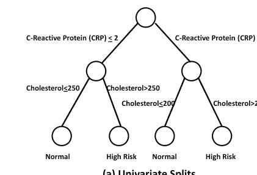

### (a) 单变量分裂

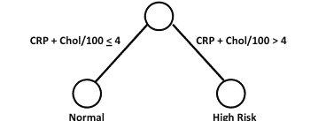

### (b) 多变量分裂

### 图1.1：决策树构建中单变量和多变量分裂的图示。

较高的CRP和胆固醇水平对应更大的风险，但将两者结合可以得到更确切的结论。

图1.1(a)举例说明了基于这两个特征构建分类模型的决策树。该决策树使用单变量分裂，首先按CRP水平进行划分，然后对胆固醇水平使用分裂准则。注意，树的这两个CRP分支中的胆固醇分裂准则不同。原则上，不同的特征可以用于在树的同一层级分裂不同的节点。有时也可以使用多个属性上的条件，以便在树的特定层级创建更强大的分裂。图1.1(b)中给出了一个示例，其中两个属性的线性组合比单个属性提供了更强大的分裂。分裂条件如下：

```
CRP + Cholesterol/100 ≤ 4
```

注意，像这样的单个条件能够很好地将训练数据分成两个类别（少数例外）。因此，该分裂在更少的决策树层级中能更有力地区分这两个类别。在可能的情况下，最好构建更紧凑的决策树以获得最准确的结果。这类分裂称为多变量分裂。一些最早的决策树构建方法包括C4.5 [72]、ID3 [73]和CART [22]。关于决策树的详细讨论可见[22,65,72,73]。决策树在第4章中讨论。

### 1.2.4 基于规则的方法

基于规则的方法与决策树密切相关，区别在于它们不会对训练数据进行严格的分层划分。相反，允许重叠以增强训练模型的鲁棒性。决策树中的任何路径都可以解释为一条规则，该规则将测试实例分配给特定标签。例如，对于图1.1(a)所示的决策树，最右边的路径对应于以下规则：

```
CRP> 2 & Cholesterol > 200 => HighRisk
```

可以从决策树的不同路径创建一组不相交的规则。事实上，C4.5等许多方法同时构建决策树和规则的相关模型。相应的基于规则的分类器称为C4.5Rules。

基于规则的分类器可视为比决策树模型更通用的模型。决策树要求归纳出的规则集不重叠，而基于规则的分类器则没有这个要求。例如，考虑以下规则：

```
CRP> 3 => HighRisk
```

显然，这条规则与前一条规则重叠，并且对于给定测试实例的预测也很相关。在基于规则的方法中，第一阶段（或训练阶段）从训练数据中挖掘出一组规则。在测试阶段，确定哪些规则与测试实例相关，最终结果基于不同规则预测的类别值的组合。

在许多情况下，针对特定测试实例，可能会产生在右侧相互冲突的规则。因此，设计能够有效解决这些冲突的方法非常重要。解决方法取决于规则集是有序还是无序。如果规则集是有序的，则可以使用顶部匹配的规则进行预测。如果规则集是无序的，则可以让规则对测试实例进行投票。文献中已提出许多方法，如基于关联的分类（CBA）[58]、CN2 [31]和RIPPER [26]，它们使用多种规则归纳方法，基于不同的规则挖掘和优先级排序方式。

CN2和RIPPER等方法使用顺序覆盖范式，从训练数据中顺序挖掘具有高准确率和覆盖率的规则。其思想是，针对特定的目标类别生长一条规则，然后移除所有匹配（或覆盖）该规则前件的训练实例。这一过程反复进行，直到数据中只剩下特定类别的训练实例。这构成默认类别，当没有规则触发时，将为测试实例选择该默认类别。从训练数据中挖掘规则的过程称为规则生长。规则生长涉及在先选择特定后件类别之后，向规则左侧逐步添加合取项。这可以看作是在决策树中生长一条“最佳”路径，通过向规则的左侧添加条件（分裂准则）来实现。规则生长阶段之后，会使用规则剪枝阶段，这与决策树构建类似。从这个意义上说，基于规则的分类器的规则生长与决策树分类器在概念上有很多相似之处。这些规则按照它们从训练数据中被挖掘的顺序排序。对于给定的测试实例，会报告第一条匹配规则后件中的类别变量。如果找不到匹配规则，则报告默认类别作为相关类别。

CBA [58]等方法使用传统的关联规则框架，其中规则通过特定的支持度和置信度度量来确定。因此，这些方法被称为关联分类器。利用这些参数对这些规则进行优先级排序也相对容易。最终分类可以通过使用匹配规则的多数投票，或选择排名靠前的规则进行分类。通常，使用规则的置信度对其进行优先级排序，并使用支持度进行统计显著性剪枝。同时还会为未被任何规则覆盖的测试实例创建一条“兜底”规则。通常，这条兜底规则可能对应未被任何规则覆盖的训练实例中的多数类别。基于规则的方法往往比决策树更鲁棒，因为它们不是


受限于对数据的严格层次划分。这一点在文本等稀疏高维领域中，从这些方法的相对性能上体现得最为明显。例如，虽然RIPPER等许多基于规则的方法经常用于文本领域，但决策树却很少用于文本。这些方法的另一个优点是它们相对容易推广到不同的数据类型，如序列、XML或图数据[14,93]。在这种情况下，规则的左侧（即前件）需要以特定于该数据领域的方式进行定义。例如，对于序列分类问题[14]，规则的左侧对应一个符号序列。对于图分类问题，规则的左侧对应一个频繁结构[93]。因此，虽然基于规则的方法与决策树相关，但它们的表达能力显著更强。基于规则的方法将在第5章详细讨论。

#### 1.2.5 基于实例的学习

在基于实例的学习中，构建训练模型的第一阶段通常被省去。测试实例直接与训练实例关联，以创建分类模型。这类方法被称为惰性学习方法，因为它们会等待了解测试实例的信息，以便创建一个针对该测试实例进行局部优化的模型。这种方法的优点在于，它们可以直接针对特定测试实例进行定制，并可以避免因任何训练模型的不完整性而导致的信息丢失。关于基于实例的方法的概述，可参见文献[15,16,89]。

一个非常简单的基于实例方法的例子是最近邻分类器。在最近邻分类器中，会在训练数据中找到与给定测试实例最接近的顶 \(k\) 个最近邻。在这 \(k\) 个最近邻中出现次数最多的类别标签，就被报告为相关的类别标签。如果需要，可以通过使用最近邻索引结构来加速该方法。基本基于实例学习算法可以有许多变体，其中可以使用训练实例的聚合来进行分类。例如，可以从每个类别的实例中创建小的簇，并将每个簇的质心用作一个新的实例。这种方法效率更高，也更具鲁棒性，因为聚类阶段将噪声记录聚合成更稳健的聚合体，从而减少了噪声。基于实例学习的其他变体在用于分类的距离函数上采用了不同的变体。例如，基于马氏距离或费希尔判别的方法可用于获得更准确的结果。距离函数设计问题与基于实例的学习问题密切相关。因此，本书专门用独立章节来讨论这些主题。

基于实例学习的一种特定形式是并不显式使用最近邻分类器。这是因为类别标签的分布可能与特定距离函数所定义的邻近性概念不匹配。相反，会使用测试实例邻域内的样本构建一个局部优化的分类器。因此，邻域仅用于定义以惰性方式构建分类模型的局部区域。局部分类器通常更准确，因为测试实例局部区域内的类别分布被简化了。这种方法更普遍地被称为惰性学习。这是比传统最近邻分类器更广义的基于实例学习概念。基于实例分类的方法将在第6章讨论。距离函数学习的方法将在第18章讨论。

#### 1.2.6 SVM分类器

SVM方法使用线性条件来将各类别彼此分开。其思想是使用一个尽可能好地将两个类别分离的线性条件。考虑前面讨论的医学示例，其中心血管疾病风险与患者的诊断特征相关。

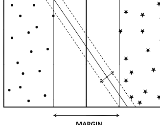
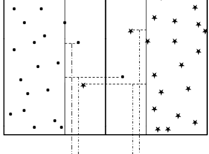

(a) 硬分离

(b) 软分离

间隔

间隔

带惩罚松弛变量的间隔违规

**图 1.2：** 硬间隔与软间隔支持向量机。

$$
\text{CRP} + \text{Cholesterol}/100 \le 4
$$

在这种情况下，多变量情况下的分裂条件也可以用作独立的分类条件。因此，SVM分类器可以被视为具有非常精心选择的多变量分裂条件的单层决策树。显然，由于该方法的有效性仅依赖于单个分离超平面，因此仔细定义这一分离至关重要。

支持向量机通常定义用于二分类问题。因此，第 \(i\) 个训练实例 \(\overline{X}_i\) 的类别变量 \(y_i\) 被假定取值为 \(\{-1, +1\}\)。SVM分类最常用的重要标准是最大间隔超平面。为了理解这一点，请考虑图1.2(a)中所示的线性可分数据的情况。图中展示了两个可能的分离超平面，及其相应的支持向量和间隔。很明显，其中一个分离超平面比另一个具有大得多的间隔，因此因其对未见测试示例具有更强的泛化能力而更可取。因此，支持向量机的重要标准之一是实现超平面的最大间隔分离。

通常，对于 \(d\) 维数据，假定分离超平面的形式为 \(\overline{W} \cdot \overline{X} + b = 0\)。这里 \(\overline{W}\) 是表示分离超平面系数的 \(d\) 维向量，\(b\) 是常数。在不失一般性的前提下，可以假定（通过适当的系数缩放）两个对称的支持向量具有形式 \(\overline{W} \cdot \overline{X} + b = 1\) 和 \(\overline{W} \cdot \overline{X} + b = -1\)。需要从训练数据 \(D\) 中学习系数 \(\overline{W}\) 和 \(b\)，以最大化这两个平行超平面之间的分离间隔。根据初等线性代数可以证明，这两个超平面之间的距离是 \(2 / \|\overline{W}\|\)。最大化该目标函数等价于最小化 \(\|\overline{W}\|^2 / 2\)。问题约束由以下事实定义：每个类别的训练数据点位于支持向量的一侧。因此，这些约束如下：

$$
\overline{W} \cdot \overline{X}_i + b \ge +1 \quad \forall i : y_i = +1 \quad (1.12)
$$

$$
\overline{W} \cdot \overline{X}_i + b \le -1 \quad \forall i : y_i = -1 \quad (1.13)
$$

这是一个约束凸二次优化问题，可以使用拉格朗日方法求解。在实践中，可以使用现成的优化求解器来实现相同目标。

在实践中，数据可能不是线性可分的。在这种情况下，可以使用软间隔方法。为每个训练实例引入一个松弛变量 \(\xi_i \ge 0\)，并允许训练实例违反支持向量约束，但需付出取决于松弛程度的惩罚。这种情况如图1.2(b)所示。因此，新的约束集现在如下：

$$
\overline{W} \cdot \overline{X}_i + b \ge +1 - \xi_i \quad \forall i : y_i = +1 \quad (1.14)
$$

$$
\overline{W} \cdot \overline{X}_i + b \le -1 + \xi_i \quad \forall i : y_i = -1 \quad (1.15)
$$

$$
\xi_i \ge 0 \quad (1.16)
$$

注意，还需要对松弛变量施加额外的非负约束。目标函数现在为：

$$
\frac{\|\overline{W}\|^2}{2} + C \cdot \sum_{i=1}^{n} \xi_i
$$

常数 \(C\) 调节间隔和松弛要求的重要性。换句话说，较小的 \(C\) 值使方法更接近软间隔SVM，而较大的 \(C\) 值使方法更接近硬间隔SVM。也可以使用现成的优化求解器来解决该问题。

还可以对特征变量进行变换，以设计非线性SVM方法。在实践中，非线性SVM方法是使用核方法学习的。这里的关键思想是，SVM公式可以仅使用对象之间的成对点积（相似度值）来求解。换言之，针对测试实例类别标签的最优决策，根据本节中二次优化问题的解，可以表示如下：

1. 不同训练实例的成对点积。
2. 测试实例与不同训练实例的成对点积。

建议读者参考文献[84]了解优化公式求解的具体细节。一对实例之间的点积可以被视为它们之间相似性的一种度量。因此，上述观察意味着，仅利用训练数据对之间以及训练-测试数据对之间的成对相似性信息，即可执行SVM分类。实际的特征值并不需要。

这为使用由相似度值表示的变换打开了大门。这些相似度可以被视为核函数 \(K(\overline{X},\overline{Y})\)，它度量点 \(\overline{X}\) 和 \(\overline{Y}\) 之间的相似性。概念上，核函数可以被视为新变换空间（由映射函数 \(\Phi(\cdot)\) 表示）中一对点之间的点积。然而，只要核函数（点积） \(K(\overline{X},\overline{Y})\) 已经可用，就不需要显式计算这种变换：

$$
K(\overline{X},\overline{Y}) = \Phi(\overline{X}) \cdot \Phi(\overline{Y}) \quad (1.17)
$$

因此，所有计算都可以在原始空间中使用核函数所隐含的点积来执行。一些有趣的核函数示例包括高斯径向基函数、多项式核和双曲正切，下面按相同顺序列出。

$$
K(\overline{X}_i,\overline{X}_j) = e^{-\|\overline{X}_i - \overline{X}_j\|^2 / 2\sigma^2} \quad (1.18)
$$

$$
K(\overline{X}_i,\overline{X}_j) = (\overline{X}_i \cdot \overline{X}_j + 1)^h \quad (1.19)
$$

$$
K(\overline{X}_i,\overline{X}_j) = \tanh(k \overline{X}_i \cdot \overline{X}_j - \delta) \quad (1.20)
$$

这些不同的函数在原始空间中会产生不同类型的非线性决策边界，但它们都对应于变换空间中的线性分隔器。分类器的性能可能对用于变换的核函数选择很敏感。核方法的一个优点是，只要能够定义适当的成对相似度，它们也可以扩展到任意数据类型。


SVM 方法的主要缺点是它们速度慢。然而，它们非常流行，并且在许多实际领域，如文本中，往往具有很高的准确性。SVM 方法的介绍可在 [30, 46, 75, 76, 85] 中找到。支持向量机的核方法在 [75] 中进行了讨论。SVM 方法在第 7 章中有详细讨论。

#### 1.2.7 神经网络

神经网络试图模拟生物系统，对应于人类大脑。在人类大脑中，神经元通过被称为突触的点相互连接。在生物系统中，学习是通过改变突触连接的强度来实现的，以响应脉冲。

这种生物学类比在人工神经网络中得以保留。人工神经网络中的基本计算单元是神经元或单元。这些单元可以通过它们之间的连接排列成不同种类的架构。神经网络最基本的架构是感知器，它包含一组输入节点和一个输出节点。输出单元从输入单元接收一组输入。存在 d 个不同的输入单元，这恰好等于底层数据的维度。假设数据是数值型的。分类数据可能需要转换为二进制表示，因此输入的数量可能更大。输出节点与一组权重 W̅ 相关联，这些权重用于计算其输入的函数 f(·)。权重向量的每个分量都与从输入单元到输出单元的连接相关联。权重可以被视为生物系统中突触强度的类似物。在感知器架构的情况下，输入节点不执行任何计算。它们只是将输入属性向前传输。在基本的感知器架构中，计算仅在输出节点处执行。输出节点使用其权重向量以及输入属性值来计算输入的函数。在输出节点处计算的一个典型函数是有符号线性函数：

z_i = sign{ W̅ · X̅_i + b } (1.21)

输出是二元类变量的预测值，假设其取自 {−1, +1}。符号 b 表示偏置。因此，对于来自维度为 d 的向量 X̅_i，权重向量 W̅ 也应包含 d 个元素。现在考虑一个二元分类问题，其中所有标签都取自 {+1, −1}。我们假设 X̅_i 的类标签用 y_i 表示。在这种情况下，预测函数 z_i 的符号给出类标签。感知器架构的示例在图 1.3(a) 中示出。因此，该方法的目标是使用训练数据学习权重集合 W̅，以最小化最小二乘误差 (y_i − z_i)^2。思路是我们从随机权重开始，并在当前函数对训练示例做出错误时逐渐更新它们。更新的幅度由学习率 λ 调节。这种更新类似于梯度下降中为最小二乘优化所做的更新。在神经网络的情况下，更新函数如下。

W̅^{t+1} = W̅^{t} + λ(y_i − z_i)X̅_i (1.22)

这里，W̅^{t} 是第 t 次迭代中权重向量的值。很容易证明增量更新向量与 (y_i − z_i)^2 相对于 W̅ 的负梯度相关。也很容易看出，只有在分类出错时才会对权重进行更新。当输出正确时，对权重的增量变化为零。

与支持向量机的相似性非常明显，因为在这种情况下也学习了一个线性函数，并且线性函数的符号预测类标签。事实上，感知器模型和支持向量机密切相关，因为两者都是线性函数逼近器。在支持向量机的情况下，这是通过最大间隔优化实现的。在神经网络的情况下，这是通过增量学习算法实现的，该算法近似于预测的最小二乘误差优化。

图 1.3：单层和多层神经网络。

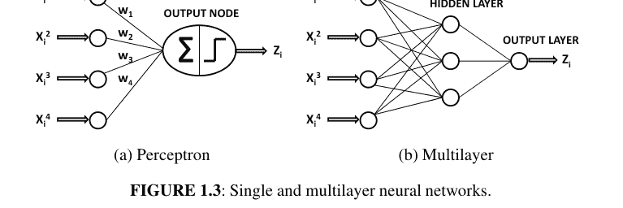

常数 λ 调节学习率。学习率的选择有时很重要，因为学习率过小会导致训练非常缓慢。另一方面，如果学习率过快，这将导致在次优解之间振荡。在实践中，学习率最初很快，然后随着时间的推移逐渐变慢。这里的思路是，最初的大步长可能是有帮助的，但随后会减小其大小以防止在次优解之间振荡。例如，在 t 次迭代后，学习率可能被选择为与 1/t 成比例。

前述讨论基于简单的感知器架构，只能模拟线性关系。在实践中，神经网络按输入层、隐藏层和输出层排列为三层。输入层仅将输入向前传输，因此神经网络实际上只有两层可以执行计算。在隐藏层中，可以有任意数量的神经元层。在这种情况下，神经网络中可以有任意数量的层。在实践中，只有一个隐藏层，这导致一个 2 层网络。多层网络的示例在图 1.3(b) 中示出。感知器可以被视为一种非常特殊的神经网络，它只包含一层神经元（对应于输出节点）。多层神经网络允许通过适当选择网络拓扑和节点上的非线性函数来逼近非线性函数和复杂的决策边界。在这些情况下，还会将一种称为压缩函数的逻辑或 sigmoid 函数应用于神经元的输入，以模拟非线性特征。可以对不同节点使用不同的非线性函数。只要有足够的训练数据和训练时间，这类通用架构在逼近神经网络中的任意函数方面非常强大。这就是为什么神经网络有时被称为通用函数逼近器的原因。

在单层感知器算法的情况下，使用梯度下降方法进行训练过程很容易。多层网络训练的主要挑战在于，对于中间（隐藏层）节点，其“期望”输出不再为人所知。这仅对最终输出节点已知。因此，需要某种“误差反馈”来确定中间节点的权重变化。训练过程分为两个阶段，一个是在正向方向，另一个是在反向方向。

1. 正向阶段：在正向阶段，反复应用激活函数以将输入从神经网络正向传播。由于最终输出应与类标签匹配，输出层处的最终输出会根据训练标签值提供误差值。然后该误差用于更新输出层的权重，并在下一阶段向后传播权重更新。

2. 反向传播阶段：在反向阶段，误差通过神经网络层向后传播。这导致不同层神经元中的权重更新。前面层的梯度作为其前方层中的误差和权重的函数来学习。学习率 λ 在调节学习速率方面发挥着重要作用。

在实践中，任何任意函数都可以被神经网络很好地逼近。这种一般性的代价是，神经网络在实践中通常相当慢。它们也对噪声敏感，有时可能过度拟合训练数据。

之前的讨论仅假设二元标签。可以创建 k 标签神经网络，要么使用多类“一对所有”元算法，要么创建神经网络架构，其中输出节点的数量等于类标签的数量。每个输出代表对特定标签值的预测。神经网络方法的许多实现已在 [35,57,66,77,88] 中研究过，其中许多实现是在文本数据的背景下设计的。应该指出的是，神经网络和 SVM 分类器都使用非常相似的线性模型。两者之间的主要区别在于如何确定最优线性超平面。与使用直接优化方法不同，神经网络使用基于错误的数据分类方法 [35]。神经网络在 [19,51] 中有详细描述。本主题在第 8 章中有详细讨论。

### 1.3 处理不同数据类型

不同数据类型需要使用不同的技术进行数据分类。这是因为数据类型选择通常限定了分类方法所解决的问题类型。在本节中，我们将讨论分类问题中常见的不同数据类型，可能需要一定程度的特殊处理。

#### 1.3.1 大规模数据：大数据和数据流

随着收集不同类型大规模数据的能力不断增强，规模问题已成为分类过程的挑战。显然，更大的数据集允许创建更准确和复杂的模型。然而，如果在规模问题上受到计算限制，这未必有帮助。数据流和大数据分析面临不同的挑战。在前一种情况下，实时处理带来挑战，而在后一种情况下，问题在于在极大量的数据上进行计算和数据访问效率低下。很难从大量数据中计算汇总统计信息，因为访问需要在分布式方式下进行，并且在大量数据之间进行洗牌成本太高。这些挑战中的每一个将在本小节中讨论。

##### 1.3.1.1 数据流

持续收集和处理大量数据的能力导致了数据流的流行 [4]。在流式场景中，构建训练模型时会出现两个主要问题。

- 一次通过约束：由于数据流的体积非常大，所有处理算法都需要对数据进行单次通过计算。这是一个重大挑战，因为它排除了许多在静态数据集上稳健工作的迭代算法。因此，以高效的方式设计训练模型至关重要。


- *概念漂移：* 数据流通常由一个生成过程创建，该过程可能随时间发生变化。这导致了*概念漂移*，它对应于底层流模式随时间的变化。概念漂移的存在会对分类算法产生不利影响，因为模型会随着时间变得陈旧。因此，以增量的方式调整模型至关重要，以便在当前测试实例上实现高准确率。
- *大规模域约束：* 流式场景通常包含离散属性，这些属性可能取数百万个可能的值。这是因为流式项目通常与离散标识符相关联。示例可以是电子邮件流中的电子邮件地址、网络数据包流中的 IP 地址，以及从代理 Web 日志中提取的点击流中的 URL。大规模域问题在流式应用中无处不在。事实上，许多概要数据结构，例如 count-min sketch [33] 和 Flajolet-Martin 数据结构 [41]，都是针对此问题设计的。虽然该问题在流挖掘文献中尚未得到非常广泛的解决（超出用于计数的<|message|> 基本概要方法），但最近的工作在这一方向上取得了许多进展 [9]。

为了应对上述挑战，传统的分类算法需要进行适当的修改。特殊场景，例如流数据的域很大或类别稀少的情况，会带来特殊挑战。大多数用于流式分类的知名技术使用空间高效的数据结构来构建易于更新的模型 [13,86]。此外，这些方法专门设计用于通过使模型在时间上自适应，或在数据流的不同区域使用不同的模型来处理概念漂移。流式场景中需要针对特殊场景或数据类型设计专用方法。例如，大规模域场景可以通过在训练模型中将 count-min 数据结构 [33] 作为概要结构纳入来解决 [9]。一个特别困难的案例是稀有类别学习，其中稀有类别实例可能与完全新类别的发生混合在一起。此问题可以被视为分类和异常检测之间的混合。然而，它是流式域中最常见的情况，例如在入侵检测等应用中。在这些情况下，一些稀有类别（入侵）可能已经为人所知，而其他稀有类别可能对应于以前未见过的威胁。关于数据流的书籍，其中包含对该领域关键主题的广泛讨论，可在 [4] 中找到。流式分类问题的不同变体在第 9 章中有详细讨论。

##### 1.3.1.2 大数据框架

虽然流式算法在数据太大而无法显式存储的假设下工作，但大数据框架利用存储技术的进步，实际上存储数据并对其进行处理。然而，正如后续讨论将表明的那样，即使数据可以显式存储，从中处理和提取见解也往往并不容易。

在最简单的情况下，数据存储在单台机器的磁盘上，并且希望使用磁盘高效的算法来扩展方法。虽然许多方法，如最近邻分类器和关联分类器，可以通过更高效的子程序进行扩展，但其他方法，如决策树和 SVM 需要专门的方法来扩展。一些可扩展决策树方法的示例包括 SLIQ [48]、BOAT [42] 和 RainForest [43]。一些早期的决策树并行实现包括 SPRINT 方法 [82]。通常，可扩展决策树方法可以以两种方式之一执行。RainForest 等方法通过存储训练数据的按属性汇总来提高可扩展性。这些汇总足以有效地执行单属性分割。BOAT 等方法使用引导样本的组合，以产生一个决策树，其准确性非常接近使用完整数据所能获得的准确性。

可扩展 SVM 方法的一个示例是 SVMLight [53]。这种方法关注于 SVM 中二次优化问题的计算密集性。其思想是始终只优化一小部分变量的工作集，同时保持其他变量固定。该工作集是通过使用最陡下降准则来选择的。这优化了使用特定属性子集所获得的优势。使用的另一种策略是丢弃对分类器边界没有影响的训练示例。远离决策边界并且在其“正确”一侧的训练示例，即使被移除，也不会对分类器的边界产生影响。其他方法如 SVMPerf [54] 重新表述 SVM 优化以减少松弛变量的数量并增加约束的数量。切割平面方法用于一次处理一小部分约束，以有效解决由此产生的优化问题。

对于极大的数据集，还会出现进一步的挑战。这是因为数据量的增加意味着必须使用分布式文件系统来存储它，并且需要分布式处理技术以确保足够的<|message|> 可扩展性。这里的挑战在于，如果数据的较大部分位于不同的机器上，为了从中提取综合见解而在不同机器之间移动数据通常代价太高。因此，与所有分布式基础设施一样，交换中间见解以最小化通信成本是可取的。对于应用程序员来说，这有时会带来挑战，即跟踪不同部分数据存储的位置，以及为了最小化成本而进行通信的精确顺序。

在此背景下，Google 的 MapReduce 框架 [37] 为分析大量数据提供了一种有效的方法，特别是当计算的性质涉及数据流元素上的线性可计算统计函数时。该框架的一个理想方面是，它将不同部分数据存储的确切细节抽象出来，供应用程序员使用。如 [37] 中所述：

> “运行时系统负责划分输入数据、跨机器集调度程序的执行、处理机器故障以及管理所需<|message|> 的机器间通信的细节。这使得没有任何并行和分布式系统经验的程序员能够轻松利用大型分布式系统的资源。”

许多分类算法，如 k-means，在可扩展性方面自然是数据规模的线性。关于 Apache Hadoop 上 MapReduce 框架实现的入门介绍可在 [87] 中找到。这里的关键思想是使用 Map 函数将工作分布到不同的机器上，然后提供一种自动方式将包含中间结果的 (key,value) 对中更小的数据洗牌出来。然后将 Reduce 函数应用于 Map 步骤的聚合结果以获得最终结果。

Google 的原始 MapReduce 框架是为分析大量 Web 日志而设计的，更具体地说是从日志中推导出线性可计算的统计数据。已表明 [44]，声明式框架在许多 MapReduce 应用中特别有用，并且许多现有分类算法可以推广到 MapReduce 框架。将算法适配到 MapReduce 框架的适当选择至关重要，因为该框架对线性计算特别有效。应该指出，MapReduce 框架的主要吸引力在于它为应用程序员提供了一个更清晰的抽象，该抽象独立于分布式系统的非常具体的运行时细节。然而，不应假设这种系统在有效性或灵活性方面以某种方式优于现有的分布式并行化方法，特别是如果应用程序员愿意从头开始设计这些细节的话。关于大数据分类算法的详细讨论在第 10 章中提供。

### 1.3.2 文本分类

在分类的上下文中使用的最常见数据类型之一是文本数据。文本数据无处不在，尤其因为它在 Web 和社交网络上的流行。虽然文本文档可以被视为一串单词，但它更常被用作词袋，在其中单词之间的顺序信息不被使用。这种表示


text 更接近多维数据。然而，多维分类的标准方法在应用于文本时往往需要进行修改。

文本分类的主要挑战在于数据维度极高且稀疏。典型的文本词表规模可能达到十万个词，但一份文档通常只包含其中很少一部分词。因此，大多数属性值都为零，且词频相对较小。许多常见词可能非常嘈杂，对分类过程并无太大区分度。因此，特征选择和表示问题在文本分类中尤为重要。

并非所有分类方法在文本数据上都同样流行。例如，基于规则的方法、贝叶斯方法和 SVM 分类器往往比其他分类器更受欢迎。某些基于规则的分类器如 RIPPER [26] 最初就是为文本分类而设计的。神经方法与基于实例的方法有时也会被使用。一种用于文本分类的流行基于实例的方法是 Rocchio 方法 [56, 74]。基于实例的方法有时也会与基于质心的分类结合使用，其中使用类特定簇的频率截断质心，而不是 k 近邻方法中的原始文档。这通常能提供更好的准确率，因为一组紧密相关的文档的质心往往比任何单一文档更稳定地代表该数据局部性。这在文本数据的稀疏性下尤其成立，因为两个相关文档通常只有很少的共同词。

许多在其他数据领域广受欢迎的分类器，如决策树，在文本数据上并不那么流行。其原因在于决策树使用数据的严格层次划分。因此，树中较高层级的特征会被隐式赋予比其他特征更大的重要性。在包含数十万个特征的文本集合中，单个词通常无法提供太多关于类别标签的信息。此外，决策树通常会用很少的几次分裂来划分数据空间。当这个数值比底层数据维度小几个数量级时，这就成了一个问题。当然，文本中的决策树也不太平衡，因为某个词只出现在文档的一个很小子集中。考虑一次分裂对应于词的出现或缺失的情况。由于树的失衡特性，从根到叶的大多数路径都对应于词缺失的决策，而只有极少数少于 5 到 10 个词出现的决策。显然，这会导致较差的分类，尤其是在词缺失不提供太多信息，而需要适度数量的词出现决策的情况下。单变量决策树对于非常高维的数据集效果不佳，因为某些特征被赋予了不成比例的重要性，并且无法有效利用所有可用特征。可以通过使用多元分裂来提高决策树在文本分类中的有效性，尽管这可能代价较高。

用于文本域的标准分类方法也需要进行适当的修改。这是因为文本域具有高维和稀疏的特性。例如，文本有一个专门的模型，即多项式贝叶斯模型，它与标准的伯努利模型不同 [12]。伯努利模型以对称的方式处理词在文本文档中的出现和缺失。然而，在给定的文本文档中，只有词表大小的一小部分词会出现在其中。词的缺失通常比词的出现信息少得多。对词出现和词缺失的对称处理有时会损害贝叶斯分类器在文本域中的有效性。为了实现这一目标，使用了多项式贝叶斯模型，该模型使用词在文档中出现的频率，但忽略未出现的情况。

在 SVM 分类器的上下文中，可扩展性很重要，因为此类分类器在训练文档数量和数据维度方面扩展性都很差。此外，文本的稀疏性即少数非零特征值应被利用以提高训练效率。这是因为 SVM 分类器中的训练模型是使用约束二次优化问题构建的，其约束数量与数据点数量相同。这相当大，并直接导致了相应拉格朗日松弛的大小增加。在核 SVM 的情况下，核矩阵的空间需求也可能随数据点数量呈二次增长。一些方法如 SVMLight [53] 通过仔细将问题分解为较小的子问题并一次仅优化少数变量来解决此问题。其他方法如 SVMPerf [54] 也利用了文本域的稀疏性。SVMPerf 方法按 O(n·s) 扩展，其中 s 与每个训练文档的平均非零特征值数量成正比。

文本分类通常需要在伴随链接数据的场景中执行。文档之间的链接通常继承自 Web 和社交网络等领域。在这种情况下，链接包含有用的信息，应在分类过程中加以利用。最近已设计了多种技术来利用此类侧信息进行分类。关于文本分类的详细综述可在 [12,78] 中找到。本书第 11 章详细讨论了文本分类问题。

### 1.3.3 多媒体分类

随着社交媒体网站的日益普及，多媒体数据也变得越来越流行。特别是 Flickr 或 Youtube 等网站允许用户上传照片或视频。在这种情况下，希望对照片或视频的全部或部分进行分类。在这些情况下，也可能存在丰富的元数据，可促进更有效的数据分类。数据表示问题对于多媒体数据尤其重要，因为糟糕的表示会产生很大的语义鸿沟，从而给分类过程带来挑战。结合文本与多媒体数据以创建更有效的分类模型的问题已在 [8] 中讨论过。许多方法如半监督学习和迁移学习也可以用来提高数据分类过程的有效性。多媒体数据在数据表示和信息融合方面都提出了独特的挑战。多媒体数据分类的方法在 [60] 中进行了讨论。第 12 章提供了多媒体数据分类方法的详细讨论。

### 1.3.4 时间序列和序列数据分类

这两种数据类型都是时间数据类型，其属性分为两种类型。第一种是上下文属性，即时间，第二种属性对应于时间序列值，是行为属性。时间序列与序列数据之间的主要区别在于时间序列数据是连续的，而序列数据是离散的。尽管如此，这一差异相当显著，因为它改变了两种情况下常用模型的性质。

时间序列数据在许多应用中很流行，例如传感器网络和医疗信息学，其中希望使用大量流式时间序列数据来执行分类。时间序列数据有两种分类方式：

- *分类特定时间点：* 这些对应于可在数据流特定瞬间推断的特定事件。在这些情况下，标签与时间点相关联，一个或多个时间序列的行为被用来对这些瞬间进行分类。例如，在实时应用中检测重要事件可能是一个重要应用。
- *分类部分或整个序列：* 在这些情况下，类别标签与序列的部分或全部相关联，并用于分类。例如，ECG 时间序列会显示特定疾病诊断标准的特征形状。


Both of these scenarios are equally important from the perspective of analytical inferences in a wide variety of scenarios. Furthermore, these scenarios are also relevant to the case of sequence data. Sequence data arises frequently in biological, Web log mining, and system analysis applications. The discrete nature of the underlying data necessitates the use of methods that are quite different from the case of continuous time series data. For example, in the case of discrete sequences, the nature of the distance functions and modeling methodologies are quite different than those in time-series data.

A brief survey of time-series and sequence classification methods may be found in [91]. A detailed discussion on time-series data classification is provided in Chapter 13, and that of sequence data classification methods is provided in Chapter 14. While the two areas are clearly connected, there are significant differences between these two topics, so as to merit separate topical treatment.

### 1.3.5 Network Data Classification

Network data is quite popular in Web and social networks applications in which a variety of different scenarios for node classification arise. In most of these scenarios, the class labels are associated with nodes in the underlying network. In many cases, the labels are known only for a subset of the nodes. It is desired to use the known subset of labels in order to make predictions about nodes for which the labels are unknown. This problem is also referred to as collective classification. In this problem, the key assumption is that of homophily. This implies that edges imply similarity relationships between nodes. It is assumed that the labels vary smoothly over neighboring nodes. A variety of methods such as Bayes methods and spectral methods have been generalized to the problem of collective classification. In cases where content information is available at the nodes, the effectiveness of classification can be improved even further. A detailed survey on collective classification methods may be found in [6].

A different form of graph classification is one in which many small graphs exist, and labels are associated with individual graphs. Such cases arise commonly in the case of chemical and biological data, and are discussed in detail in [7]. The focus of the chapter in this book is on very large graphs and social networks because of their recent popularity. A detailed discussion of network classification methods is provided in Chapter 15 of this book.

### 1.3.6 Uncertain Data Classification

Many forms of data collection are uncertain in nature. For example, data collected with the use of sensors is often uncertain. Furthermore, in cases when data perturbation techniques are used, the data becomes uncertain. In some cases, statistical methods are used in order to infer parts of the data. An example is the case of link inference in network data. Uncertainty can play an important role in the classification of uncertain data. For example, if an attribute is known to be uncertain, its contribution to the training model can be de-emphasized, with respect to an attribute that has deterministic attributes.

The problem of uncertain data classification was first studied in [5]. In these methods, the uncertainty in the attributes is used as a first-class variable in order to improve the effectiveness of the classification process. This is because the relative importance of different features depends not only on their correlation with the class variable, but also the uncertainty inherent in them. Clearly, when the values of an attribute are more uncertain, it is less desirable to use them for the classification process. This is achieved in [5] with the use of a density-based transform that accounts for the varying level of uncertainty of attributes. Subsequently, many other methods have been proposed to account for the uncertainty in the attributes during the classification process. A detailed description of uncertain data classification methods is provided in Chapter 16.

### 1.4 Variations on Data Classification

Many natural variations of the data classification problem correspond to either small variations of the standard classification problem or are enhancements of classification with the use of additional data. The key variations of the classification problem are those of rare-class learning and distance function learning. Enhancements of the data classification problem make use of meta-algorithms, more data in methods such as transfer learning and co-training, active learning, and human intervention in visual learning. In addition, the topic of model evaluation is an important one in the context of data classification. This is because the issue of model evaluation is important for the design of effective classification meta-algorithms. In the following section, we will discuss the different variations of the classification problem.

#### 1.4.1 Rare Class Learning

Rare class learning is an important variation of the classification problem, and is closely related to outlier analysis [1]. In fact, it can be considered a supervised variation of the outlier detection problem. In rare class learning, the distribution of the classes is highly imbalanced in the data, and it is typically more important to correctly determine the positive class. For example, consider the case where it is desirable to classify patients into malignant and normal categories. In such cases, the majority of patients may be normal, though it is typically much more costly to misclassify a truly malignant patient (false negative). Thus, false negatives are more costly than false positives. The problem is closely related to cost-sensitive learning, since the misclassification of different classes has different costs. The major difference with the standard classification problem is that the objective function of the problem needs to be modified with costs. This provides several avenues that can be used in order to effectively solve this problem:

- *Example Weighting:* In this case, the examples are weighted differently, depending upon their cost of misclassification. This leads to minor changes in most classification algorithms, which are relatively simple to implement. For example, in an SVM classifier, the objective function needs to be appropriately weighted with costs, whereas in a decision tree, the quantification of the split criterion needs to weight the examples with costs. In a nearest neighbor classifier, the k nearest neighbors are appropriately weighted while determining the class with the largest presence.

- *Example Re-sampling:* In this case, the examples are appropriately re-sampled, so that rare classes are over-sampled, whereas the normal classes are under-sampled. A standard classifier is applied to the re-sampled data without any modification. From a technical perspective, this approach is equivalent to example weighting. However, from a computational perspective, such an approach has the advantage that the newly re-sampled data has much smaller size. This is because most of the examples in the data correspond to the normal class, which is drastically under-sampled, whereas the rare class is typically only mildly over-sampled.

Many variations of the rare class detection problem are possible, in which either examples of a single class are available, or the normal class is contaminated with rare class examples. A survey of algorithms for rare class learning may be found in [25]. This topic is discussed in detail in Chapter 17.

#### 1.4.2 Distance Function Learning

Distance function learning is an important problem that is closely related to data classification. In this problem it is desirable to relate pairs of data instances to a distance value with the use of either supervised or unsupervised methods [3]. For example, consider the case of an image collection, in which the similarity is defined on the basis of a user-centered semantic criterion. In such a case, the use of standard distance functions such as the Euclidian metric may not reflect the semantic similarities between two images well, because they are based on human perception, and may even vary from collection to collection. Thus, the best way to address this issue is to explicitly incorporate human feedback into the learning process. Typically, this feedback is incorporated either in terms of pairs of images with explicit distance values, or in terms of rankings of different images to a given target image. Such an approach can be used for a variety of different data domains. This is the training data that is used for learning purposes. A detailed survey of distance function learning methods is provided in [92]. The topic of distance function learning is discussed in detail in Chapter 18.

#### 1.4.3 Ensemble Learning for Data Classification

A meta-algorithm is a classification method that re-uses one or more currently existing classification algorithm by applying either multiple models for robustness, or combining the results of the same algorithm with different parts of the data. The general goal of the algorithm is to obtain more robust results by combining the results from multiple training models either sequentially or independently. The overall error of a classification model depends upon the bias and variance, in addition to the intrinsic noise present in the data. The bias of a classifier depends upon the fact that the decision boundary of a particular model may not correspond to the true decision boundary. For example, the training data may not have a linear decision boundary, but an SVM classifier will assume a linear decision boundary. The variance is based on the random variations in the particular training data set. Smaller training data sets will have larger variance. Different forms of ensemble analysis attempt to reduce this bias and variance. The reader is referred to [84] for an excellent discussion on bias and variance.

Meta-algorithms are used commonly in many data mining problems such as clustering and outlier analysis [1, 2] in order to obtain more accurate results from different data mining problems. The area of classification is the richest one from the perspective of meta-algorithms, because of its crisp evaluation criteria and relative ease in combining the results of different algorithms. Some examples of popular meta-algorithms are as follows:

- *Boosting*: Boosting [40] is a common technique used in classification. The idea is to focus on successively difficult portions of the data set in order to create models that can classify the data points in these portions more accurately, and then use the ensemble scores over all the components. A hold-out approach is used in order to determine the incorrectly classified instances for each portion of the data set. Thus, the idea is to sequentially determine better classifiers for more difficult portions of the data, and then combine the results in order to obtain a meta-classifier, which works well on all parts of the data.

- *Bagging*: Bagging [24] is an approach that works with random data samples, and combines the results from the models constructed using different samples. The training examples for each classifier are selected by sampling with replacement. These are referred to as *bootstrap* samples. This approach has often been shown to provide superior results in certain scenarios, though this is not always the case. This approach is not effective for reducing the bias, but can reduce the variance, because of the specific random aspects of the training data.

- *Random Forests*: Random forests [23] are a method that use sets of decision trees on either splits with randomly generated vectors, or random subsets of the training data, and compute the score as a function of these different components. Typically, the random vectors are generated from a fixed probability distribution. Therefore, random forests can be created by either random *split* selection, or random *input* selection. Random forests are closely related


to bagging, and in fact bagging with decision trees can be considered a special case of random forests, in terms of how the sample is selected (bootstrapping). In the case of random forests, it is also possible to create the trees in a lazy way, which is tailored to the particular test instance at hand.

- *Model Averaging and Combination:* This is one of the most common models used in ensemble analysis. In fact, the random forest method discussed above is a special case of this idea. In the context of the classification problem, many Bayesian methods [34] exist for the model combination process. The use of different models ensures that the error caused by the bias of a particular classifier does not dominate the classification results.

- *Stacking:* Methods such as stacking [90] also combine different models in a variety of ways, such as using a second-level classifier in order to perform the combination. The output of different first-level classifiers is used to create a new feature representation for the second level classifier. These first level classifiers may be chosen in a variety of ways, such as using different bagged classifiers, or by using different training models. In order to avoid overfitting, the training data needs to be divided into two subsets for the first and second level classifiers.

- *Bucket of Models:* In this approach [94] a “hold-out” portion of the data set is used in order to decide the most appropriate model. The most appropriate model is one in which the highest accuracy is achieved in the held out data set. In essence, this approach can be viewed as a competition or bake-off contest between the different models.

The area of meta-algorithms in classification is very rich, and different variations may work better in different scenarios. An overview of different meta-algorithms in classification is provided in Chapter 19.

#### 1.4.4 Enhancing Classification Methods with Additional Data

In this class of methods, *additional labeled or unlabeled data* is used to enhance classification. Both these methods are used when there is a direct paucity of the underlying training data. In the case of transfer learning, additional training (labeled) data from a different domain or problem is used to supervise the classification process. On the other hand, in the case of semi-supervised learning, unlabeled data is used to enhance the classification process. These methods are briefly described in this section.

##### 1.4.4.1 Semi-Supervised Learning

Semi-supervised learning methods improve the effectiveness of learning methods with the use of *unlabeled* data, when only a small amount of labeled data is available. The main difference between semi-supervised learning and transfer learning methods is that *unlabeled* data with the same features is used in the former, whereas external labeled data (possibly from a different source) is used in the latter. A key question arises as to why unlabeled data should improve the effectiveness of classification in any way, when it does not provide any additional labeling knowledge. The reason for this is that unlabeled data provides a good idea of the manifolds in which the data is embedded, as well as the density structure of the data in terms of the clusters and sparse regions. The key assumption is that the classification labels exhibit a smooth variation over different parts of the manifold structure of the underlying data. This manifold structure can be used to determine feature correlations, and joint feature distributions, which are very helpful for classification. The semi-supervised setting is also sometimes referred to as the *transductive* setting, when the test instances must be specified together with the training instances. Some problem settings such as collective classification of network data are naturally transductive.

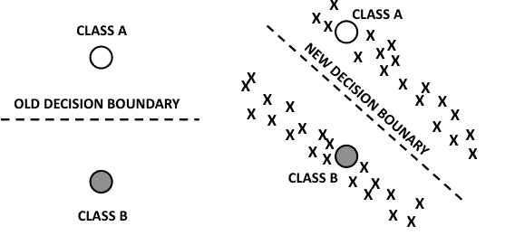

**Figure 1.4:** Impact of unsupervised examples on classification process.

The motivation of semi-supervised learning is that knowledge of the dense regions in the space and correlated regions of the space are helpful for classification. Consider the two-class example illustrated in Figure 1.4(a), in which only a single training example is available for each class. In such a case, the decision boundary between the two classes is the straight line perpendicular to the one joining the two classes. However, suppose that some additional unsupervised examples are available, as illustrated in Figure 1.4(b). These unsupervised examples are denoted by ‘x’. In such a case, the decision boundary changes from Figure 1.4(a). The major assumption here is that the classes vary less in dense regions of the training data, because of the *smoothness* assumption. As a result, even though the added examples do not have labels, they contribute significantly to improvements in classification accuracy.

In this example, the *correlations* between feature values were estimated with unlabeled training data. This has an intuitive interpretation in the context of text data, where joint feature distributions can be estimated with unlabeled data. For example, consider a scenario, where training data is available about predicting whether a document is the “*politics*” category. It may be possible that the word “*Obama*” (or some of the less common words) may not occur in any of the (small number of) training documents. However, the word “*Obama*” may often co-occur with many features of the “*politics*” category in the unlabeled instances. Thus, the unlabeled instances can be used to learn the relevance of these less common features to the classification process, especially when the amount of available training data is small.

Similarly, when the data is clustered, each cluster in the data is likely to predominantly contain data records of one class or the other. The identification of these clusters only requires unsupervised data rather than labeled data. Once the clusters have been identified from unlabeled data, only a small number of labeled examples are required in order to determine confidently which label corresponds to which cluster. Therefore, when a test example is classified, its clustering structure provides critical information for its classification process, even when a smaller number of labeled examples are available. It has been argued in [67] that the accuracy of the approach may increase exponentially with the number of labeled examples, as long as the assumption of smoothness in label structure variation holds true. Of course, in real life, this may not be true. Nevertheless, it has been shown repeatedly in many domains that the addition of unlabeled data provides significant advantages for the classification process. An argument for the effectiveness of semi-supervised learning that uses the spectral clustering structure of the data may be found in [18]. In some domains such as graph data, semi-supervised learning is the only way in which classification may be performed. This is because a given node may have very few neighbors of a specific class.

Semi-supervised methods are implemented in a wide variety of ways. Some of these methods directly try to label the unlabeled data in order to increase the size of the training set. The idea is to incrementally add the most confidently predicted label to the training data. This is referred to as *self-training*. Such methods have the downside that they run the risk of overfitting. For example, when an unlabeled example is added to the training data with a specific label, the label might be incorrect because of the specific characteristics of the feature space, or the classifier. This might result in further propagation of the errors. The results can be quite severe in many scenarios.

Therefore, semi-supervised methods need to be carefully designed in order to avoid overfitting. An example of such a method is *co-training* [21], which partitions the attribute set into two subsets, on which classifier models are independently constructed. The top label predictions of one classifier are used to augment the training data of the other, and vice-versa. Specifically, the steps of co-training are as follows:

- 1. Divide the feature space into two disjoint subsets $f_1$ and $f_2$.
- 2. Train two independent classifier models $\mathcal{M}_1$ and $\mathcal{M}_2$, which use the disjoint feature sets $f_1$ and $f_2$, respectively.
- 3. Add the unlabeled instance with the most confidently predicted label from $\mathcal{M}_1$ to the training data for $\mathcal{M}_2$ and vice-versa.
- 4. Repeat all the above steps.

Since the two classifiers are independently constructed on different feature sets, such an approach avoids overfitting. The partitioning of the feature set into $f_1$ and $f_2$ can be performed in a variety of ways. While it is possible to perform random partitioning of features, it is generally advisable to leverage redundancy in the feature set to construct $f_1$ and $f_2$. Specifically, each feature set $f_i$ should be picked so that the features in $f_j$ (for $j \neq i$) are redundant with respect to it. Therefore, each feature set represents a different view of the data, which is sufficient for classification. This ensures that the “confident” labels assigned to the other classifier are of high quality. At the same time, overfitting is avoided to at least some degree, because of the disjoint nature of the feature set used by the two classifiers. Typically, an erroneously assigned class label will be more easily detected by the disjoint feature set of the other classifier, which was not used to assign the erroneous label. For a test instance, each of the classifiers is used to make a prediction, and the combination score from the two classifiers may be used. For example, if the naive Bayes method is used as the base classifier, then the product of the two classifier scores may be used.

The aforementioned methods are generic meta-algorithms for semi-supervised learning. It is also possible to design variations of existing classification algorithms such as the EM-method, or transductive SVM classifiers. EM-based methods [67] are very popular for text data. These methods attempt to model the joint probability distributions of the features and the labels with the use of partially supervised clustering methods. This allows the estimation of the conditional probabilities in the Bayes classifier to be treated as missing data, for which the EM-algorithm is very effective. This approach shows a connection between the partially supervised clustering and partially supervised classification problems. The results show that partially supervised classification is most effective, when the clusters in the data correspond to the different classes. In transductive SVMs, the labels of the unlabeled examples are also treated as integer decision variables. The SVM formulation is modified in order to determine the maximum margin SVM, with the best possible label assignment of unlabeled examples. Surveys on semi-supervised methods may be found in [29, 96]. Semi-supervised methods are discussed in Chapter 20.

##### 1.4.4.2 Transfer Learning

As in the case of semi-supervised learning, transfer learning methods are used when there is a direct paucity of the underlying training data. However, the difference from semi-supervised learning is that, instead of using unlabeled data, labeled data from a different domain is used to enhance


学习过程。例如，考虑学习中文文档类别标签的情况，其中关于文档的足够训练数据不可用。然而，可能存在包含训练标签的相似英文文档。在这种情况下，英文文档训练数据中的知识可以*转移*到中文文档场景中，以实现更有效的分类。通常，此过程需要某种“桥梁”来关联中文文档和英文文档。这种“桥梁”的一种示例可以是相似的中文和英文文档对，尽管还有许多其他模型是可能的。在许多情况下，也可能有少量辅助训练数据以标记的中文训练文档形式存在，以便进一步增强转移过程的有效性。这一一般原则也可以应用于跨类别或跨领域场景，其中来自一个分类类别的知识用于增强另一个类别的学习[71]，或来自一个数据域（例如，文本）的知识用于增强另一个数据域（例如，图像）的学习[36, 70, 71, 95]。总体而言，迁移学习方法可分为以下四类：

1. *基于实例的迁移*：在这种情况下，两个域的特征空间高度重叠；甚至类别标签也可能相同。因此，可以通过简单地重新加权特征，将知识从一个域转移到另一个域。

2. *基于特征的迁移*：在这种情况下，特征之间可能存在一些重叠，但特征空间的很大一部分可能不同。通常，目标是将每个特征集转换为可以跨相关任务共享的新低维空间。

3. *基于参数的迁移*：在这种情况下，其动机是良好的训练模型通常已经学习了大量结构。因此，如果两个任务相关，则结构可以被转移以学习目标任务。

4. *关系迁移学习*：这里的想法是，如果两个域相关，它们可能在对象之间共享一些相似性关系。这些相似性关系可用于跨域迁移学习。

此类迁移学习方法的主要挑战是，在某些情况下，当使用的辅助信息非常嘈杂或与学习过程无关时，可能会导致*负*迁移。因此，必须以谨慎和审慎的方式使用迁移学习过程，以真正提高结果的质量。关于迁移学习方法的综述可在[68]中找到，关于此主题的详细讨论可在第21章中找到。

#### 1.4.5 融入人类反馈

增强分类过程的另一种方式是使用某种形式的人类监督，以提高分类过程的有效性。两种流行的人类反馈形式分别对应于主动学习和视觉学习。这些反馈形式的不同之处在于，前者通常侧重于通过人类反馈进行*标签获取*，以增强训练数据。后者侧重于通过视觉方式创建训练模型，或通过诊断方式视觉执行分类。尽管如此，两种融入人类反馈的形式都假设用户的积极输入可以为分类过程提供更好的知识。应指出的是，主动学习中的反馈并不总是来自用户。相反，可以为反馈提供通用概念的*神谕*（例如，*Amazon Mechanical Turk*）。

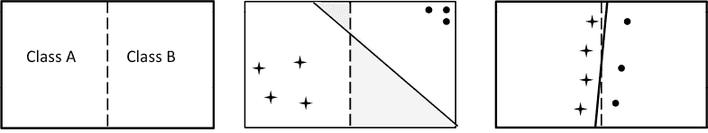

(a) 类别分离  
(b) 随机采样与SVM分类器  
(c) 主动采样与SVM分类器  

**FIGURE 1.5:** 主动学习的动机。

##### 1.4.5.1 主动学习

大多数分类算法假设学习者是数据集的被动接收者，然后使用该数据集创建训练模型。因此，数据收集阶段与建模清晰地分离，并且通常在模型构建的上下文中不予处理。然而，数据收集成本高昂，并且通常是许多分类算法的成本瓶颈。在主动学习中，目标是在*学习过程中*收集更多标签，以低成本提高分类过程的有效性。因此，学习过程和数据收集过程紧密集成并相互增强。通常，分类以交互方式进行，学习者向用户提供精心挑选的示例，用户随后可为其提供标签。

例如，考虑图1.5中的两类示例。这里，我们有一个非常简单的将数据划分为两个类别的划分，由垂直虚线表示，如图1.5(a)所示。这里的两个类别分别标记为A和B。考虑仅能查询七个示例用于两个不同类别的情况。在这种情况下，允许的少量样本可能导致训练数据无法代表两个类别之间的真实分离。考虑使用SVM分类器构建模型的情况。在图1.5(b)中，我们展示了从底层数据中随机选择的七个样本。由于选择少量样本过程固有的噪声，SVM分类器将无法准确划分数据空间。这在图1.5(b)中显示，其中由于对SVM分类器建模的错误，部分数据空间被错误分类。在图1.5(c)中，我们展示了沿两个类别决策边界精心选择的七个实例的示例。在这种情况下，SVM分类器能够准确建模两个类别之间的决策区域。这是因为主动学习过程对实例的精心选择。需要注意的重要一点是，特别有用的是采样能够清晰划定两个类别之间决策边界的实例。

通常，示例的选择是基于学习者根据当前训练知识和标签具有最大不确定性的示例。这种选择显然在当前标签存在最大不确定性的情况下为学习者提供了最大的额外信息。如半监督学习的情况一样，假设未标记数据丰富，但为其获取标签成本高昂。因此，通过学习者的帮助选择适当的示例进行标记，可以大大减少分类过程所涉及的工作量。主动学习算法经常使用支持向量机，因为后者在确定不同类别之间的边界方面特别出色。位于这些边界上的示例是查询用户的良好候选，因为这些示例存在最大程度的不确定性。主动学习算法中存在大量训练示例选择标准，其中大多数试图减少分类中的不确定性或减少与分类过程相关的错误。一些在查询学习者时常用的标准如下：

- *不确定性采样：* 在这种情况下，学习者查询用户对示例的标签，对于其正确输出存在最大不确定性的示例[45]。

- *委员会查询 (QBC)：* 在这种情况下，学习者查询用户对示例的标签，其中一组分类器意见分歧最大。显然，这是确保查询具有最大不确定性的示例的另一种间接方式[81]。

- *最大模型变化：* 在这种情况下，学习者查询用户对示例的标签，这些示例会导致当前模型发生最大程度的变化。这里的目标是学习当前模型中尚未包含的新知识[27]。

- *最大误差减少：* 在这种情况下，学习者查询用户对示例的标签，这些示例会导致当前模型误差最大程度减少[28]。

- *最大方差减少：* 在这种情况下，学习者查询用户对示例，这些示例会导致输出方差最大程度减少[28]。这实际上与前一种情况相似，因为方差是总误差的组成部分。

- *代表性：* 在这种情况下，学习者查询用户对最能代表底层数据的标签。通常，这种方法将上述其中一种标准（如不确定性采样或QBC）与代表性模型（如基于密度的方法）结合起来以执行分类[80]。

这些不同类型的模型可能在不同类型的场景中表现良好。主动学习的另一种形式是垂直查询数据。换句话说，除了示例之外，它学习收集哪些属性，以便在给定成本水平下最小化误差[62]。关于主动学习方法的综述可在[79]中找到。主动学习主题在第22章中有详细讨论。

##### 1.4.5.2 视觉学习

视觉学习的目标通常与主动学习相关，但不同。主动学习从用户收集示例，而视觉学习在创建训练模型或使用模型对特定测试实例进行分类时借助用户参与分类过程。这种帮助可以通过两种方式获得：

- *构建训练模型时的视觉反馈：* 在这种情况下，可以利用用户的反馈来构建最佳训练模型。由于用户通常具有重要的领域知识，这种视觉反馈通常会产生更有效的模型。例如，在构建决策树分类器时，用户可能会提供有关树各层分割点的反馈。同时，可以向用户提供当前决策树的视觉表示，以便做出更直观的选择。利用视觉方法构建的决策树的示例在[17]中进行了讨论。

- *单个测试实例的诊断分类：* 在这种情况下，反馈是在测试实例分类期间由用户提供的，而不是在模型构建过程中。这种方法的目标不同，因为它能够更好地理解测试实例属于特定类别的因果关系。一种用于诊断分类的视觉方法示例，该方法使用测试实例的探索性和视觉分析，在[11]中提供。这种方法不适合批量分类大量测试实例。它通常适用于理解少量精心选择的测试实例的分类行为。


关于可视化数据挖掘方法的综述见文献[10, 47, 49, 55, 83]。关于可视化分类方法的详细讨论见第23章。

#### 1.4.6 评估分类算法

数据分类中的一个重要问题是对分类算法的*评估*。我们如何知道一个分类算法的性能如何？评估过程中出现两个主要问题：

- *评估所用的方法：* 分类算法需要一个训练阶段和一个测试阶段，其中测试样本与训练数据清晰分离。然而，为了*评估*一个算法，必须从训练数据中移除部分带标签样本，并在剩余样本上构建模型。问题在于，移除带标签样本会隐式地低估分类器的能力，因为它与已有标签集相关。因此，应如何从带标签样本中进行移除，以免对学习器准确率造成过大影响？

  各种策略都是可能的，如*留出法*、*自助法*和*交叉验证*，其中第一种实现最简单，最后一种的评估精度最高。在留出法中，固定百分比的训练样本被“留出”，不用于训练，这些样本随后用于评估。由于只使用了训练数据的一个子集，该方法的评估结果往往偏悲观。一些变体采用分层采样，即对每个类别按比例独立采样。这确保了训练样本与测试样本之间类别频率的随机差异被消除。

  在自助法中，使用有放回采样来创建训练样本。最典型的情况是抽取 *n* 个样本（有放回），因此未被抽中的样本比例为 `(1 − 1/n)^n ≈ 1/e`，其中 *e* 是自然对数的底。然后，类别准确率被评估为未抽中（测试）样本上的准确率 *a₁* 与全部带标签数据上的准确率 *a₂* 的加权组合。总准确率 *A* 由下式给出：

  A = (1 − 1/e) · a₁ + (1/e) · a₂

  该过程在多个自助样本上重复执行，并报告最终准确率。注意，分量 *a₂* 往往高度乐观，因此自助法会产生高度乐观的估计。它最适合较小的数据集。

  在交叉验证中，训练数据被划分为 *k* 个不相交的子集。这 *k* 个子集中有一个用于测试，而其他 (*k* − 1) 个子集用于训练。该过程重复进行，每次将 *k* 个子集中的一个用作测试集，并将误差在所有可能情况上取平均。其优点是，带标签数据中的所有样本都有机会被当作测试样本。此外，当 *k* 较大时，训练数据规模接近全部带标签数据。因此，这种方法能很好地近似使用整个带标签数据的模型准确率。一个特例是“留一法”交叉验证，其中 *k* 被选择等于训练样本的数量，因此每个测试段恰好包含一个样本。然而，这种实现代价很高。

- *准确率的量化：* 这个问题涉及量化分类算法误差的问题。乍一看，使用诸如绝对分类准确率之类的度量似乎是最有益的，它直接计算正确分类的样本比例。然而，这并非在所有情况下都适用。

  例如，某些算法在不同数据集上的方差可能低得多，因此可能更可取。在这种情况下，出现的一个重要问题是当某个分类器在数据集上优于另一个分类器时，结果的统计显著性。另一个问题是，分类算法的输出既可以表示为测试实例的离散标签，也可以表示为数值分数，该分数表示测试实例属于特定类别的倾向。对于输出为离散标签的情况，准确率是最合适的评分。

  在某些情况下，输出以数值分数给出，尤其是当类别是稀有类别时。在这种情况下，可能需要使用精确率-召回率曲线或 ROC 曲线来进行分类评估。这在数据不均衡和稀有类场景中尤为重要。即使输出为二值标签，稀有类场景的评估方法也有所不同。在稀有类场景中，稀有类的错误分类通常比普通类的错误分类代价高得多。在这种情况下，可能需要使用成本敏感的评估模型变体以获得更强的稳健性。例如，成本敏感准确率在评估中对稀有类和普通类样本赋予不同的权重。

对分类算法评估的出色综述见文献[52]。关于分类算法评估的讨论见第24章。

### 1.5 讨论与结论

数据分类问题已在数据挖掘和机器学习文献中得到广泛研究。可用于数据分类的方法多种多样，例如决策树、最近邻方法、基于规则的方法、神经网络或 SVM 分类器。不同的分类器可能在不同类型的数据集和应用场景中更有效。

数据分类问题与多种数据类型相关，如文本、多媒体、网络数据、时间序列和序列数据。一种新的数据形式是概率数据，其中底层数据是不确定的，可能需要不同类型的处理，以便将不确定性作为一等变量来使用。不同类型的数据可能具有不同类型的表示和上下文依赖关系。这要求设计能够很好地适应不同数据类型的方法。

分类问题有许多变体，允许使用额外的训练数据或人工干预来改进基础结果。在许多情况下，可以使用元算法来显著提高基础结果的质量。

在数据分类背景下，可扩展性是一个重要问题。这是因为随着数据收集技术不断改进，数据集的规模持续增大。许多数据集是连续收集的，这导致产生了大量的数据流。即使在收集到非常大量数据的情况下，也需要为分类过程设计大数据技术。这一研究领域仍处于起步阶段，并随着时间的推移快速发展。

## 参考文献

[1] C. Aggarwal. *离群点分析*, Springer, 2013.

[2] C. Aggarwal and C. Reddy. *数据聚类：算法与应用*, CRC Press, 2013.

[3] C. Aggarwal. 面向数据挖掘应用中距离函数的系统化设计, *ACM KDD Conference*, 2003.

[4] C. Aggarwal. *数据流：模型与算法*, Springer, 2007.

[5] C. Aggarwal. 关于不确定数据挖掘中基于密度的变换, *ICDE Conference*, 2007.

[6] C. Aggarwal. *社交网络数据分析*, Springer, 第5章, 2011.

[7] C. Aggarwal and H. Wang. *图数据的管理与挖掘*, Springer, 2010.

[8] C. Aggarwal and C. Zhai. *文本数据挖掘*, 第11章, Springer, 2012.

[9] C. Aggarwal and P. Yu. 关于高基数数据流的分类. *SDM Conference*, 2010.

[10] C. Aggarwal. 通过可视化交互实现有效且可解释的数据挖掘, *ACM SIGKDD Explorations*, 2002.

[11] C. Aggarwal. 面向高维分类中的探索性测试实例中心诊断, *IEEE Transactions on Knowledge and Data Engineering*, 19(8):1001–1015, 2007.

[12] C. Aggarwal and C. Zhai. 文本分类算法综述, *文本数据挖掘*, Springer, 2012.

[13] C. Aggarwal, J. Han, J. Wang, and P. Yu. 演化数据流分类框架. 载于*IEEE TKDE Journal*, 2006.

[14] C. Aggarwal. 基于小波的字符串有效分类, *ACM KDD Conference*, 2002.

[15] D. Aha, D. Kibler, and M. Albert. 基于实例的学习算法, *Machine Learning*, 6(1):37–66, 1991.

[16] D. Aha. 懒惰学习：特刊社论. *Artificial Intelligence Review*, 11:7–10, 1997.

[17] M. Ankerst, M. Ester, and H.-P. Kriegel. 面向用户与计算机有效协作的分类, *ACM KDD Conference*, 2000.

[18] M. Belkin and P. Niyogi. 黎曼流形上的半监督学习, *Machine Learning*, 56:209–239, 2004.

[19] C. Bishop. *模式识别的神经网络*, Oxford University Press, 1996.

[20] C. Bishop. *模式识别与机器学习*, Springer, 2007.

[21] A. Blum and T. Mitchell. 结合标记和未标记数据的协同训练. *Proceedings of the Eleventh Annual Conference on Computational Learning Theory*, pages 92–100, 1998.

[22] L. Breiman. *分类与回归树*. CRC Press, 1993.

[23] L. Breiman. 随机森林. *Journal Machine Learning Archive*, 45(1):5–32, 2001.

[24] L. Breiman. Bagging 预测器. *Machine Learning*, 24(2):123–140, 1996.

[25] N. V. Chawla, N. Japkowicz, and A. Kotcz. 社论：不均衡数据集学习特刊, *ACM SIGKDD Explorations Newsletter*, 6(1):1–6, 2004.


[26] W. Cohen 和 Y. Singer. 上下文敏感的文本分类学习方法, ACM Transactions on Information Systems, 17(2):141–173, 1999.

[27] D. Cohn, L. Atlas, 和 R. Ladner. 利用主动学习改善泛化, Machine Learning, 5(2):201–221, 1994.

[28] D. Cohn, Z. Ghahramani 和 M. Jordan. 统计模型的主动学习, Journal of Artificial Intelligence Research, 4:129–145, 1996.

[29] O. Chapelle, B. Scholkopf, 和 A. Zien. 半监督学习. Vol. 2, Cambridge: MIT Press, 2006.

[30] N. Cristianini 和 J. Shawe-Taylor. 支持向量机及其他核方法导论, Cambridge University Press, 2000.

[31] P. Clark 和 T. Niblett. CN2 归纳算法, Machine Learning, 3(4):261–283, 1989.

[32] B. Clarke. 当模型近似误差不可忽略时的贝叶斯模型平均与堆叠, Journal of Machine Learning Research, pages 683–712, 2003.

[33] G. Cormode 和 S. Muthukrishnan, 改进的数据流摘要：Count-Min Sketch 及其应用, Journal of Algorithms, 55(1), (2005), pp. 58–75.

[34] P. Domingos. 分类器的贝叶斯平均与过拟合问题. ICML Conference, 2000.

[35] I. Dagan, Y. Karov, 和 D. Roth. 基于错误的文本分类学习, Proceedings of EMNLP, 1997.

[36] W. Dai, Y. Chen, G.-R. Xue, Q. Yang, 和 Y. Yu. 翻译学习：跨不同特征空间的迁移学习. Proceedings of Advances in Neural Information Processing Systems, 2008.

[37] J. Dean 和 S. Ghemawat. MapReduce：一种灵活的数据处理工具, Communication of the ACM, 53:72–77, 2010.

[38] P. Domingos 和 M. J. Pazzani. 关于零一损失下简单贝叶斯分类器最优性的研究. Machine Learning, 29(2–3):103–130, 1997.

[39] R. Duda, P. Hart, 和 D. Stork, 模式分类, Wiley, 2001.

[40] Y. Freund, R. Schapire. 在线学习决策论的推广及其在提升中的应用, Lecture Notes in Computer Science, 904:23–37, 1995.

[41] P. Flajolet 和 G. N. Martin. 数据库应用的概率计数算法. Journal of Computer and System Sciences, 31(2):182–209, 1985.

[42] J. Gehrke, V. Ganti, R. Ramakrishnan, 和 W.-Y. Loh. BOAT：乐观决策树构建, ACM SIGMOD Conference, 1999.

[43] J. Gehrke, R. Ramakrishnan, 和 V. Ganti. Rainforest——大规模数据集快速决策树构建框架, VLDB Conference, pages 416–427, 1998.

[44] A. Ghoting, R. Krishnamurthy, E. Pednault, B. Reinwald, V. Sindhwani, S. Tatikonda, T. Yuanyuan, 和 S. Vaithyanathan. SystemML：基于 MapReduce 的声明式机器学习, ICDE Conference, 2011.

[45] D. Lewis 和 J. Catlett. 监督学习的异构不确定性采样, ICML Conference, 1994.

[46] L. Hamel. 基于支持向量机的知识发现, Wiley, 2009.

[47] C. Hansen 和 C. Johnson. 可视化手册, Academic Press, 2004.

[48] M. Mehta, R. Agrawal, 和 J. Rissanen. SLIQ：一种用于数据挖掘的快速可扩展分类器, EDBT Conference, 1996.

[49] M. C. F. de Oliveira 和 H. Lewkowitz. 视觉数据挖掘：综述, IEEE Transactions on Visualization and Computer Graphics, 9(3):378–394, 2003.

[50] T. Hastie, R. Tibshirani, 和 J. Friedman. 统计学习的要素：数据挖掘、推断与预测, Springer, 2013.

[51] S. Haykin. 神经网络与学习机, Prentice Hall, 2008.

[52] N. Japkowicz 和 M. Shah. 评估学习算法：分类视角, Cambridge University Press, 2011.

[53] T. Joachims. 实用化大规模 SVM, Advances in Kernel Methods, Support Vector Learning, pages 169–184, Cambridge: MIT Press, 1998.

[54] T. Joachims. 线性时间内训练线性 SVM, KDD, pages 217–226, 2006.

[55] D. Keim. 信息与视觉数据挖掘, IEEE Transactions on Visualization and Computer Graphics, 8(1):1–8, 2002.

[56] W. Lam 和 C. Y. Ho. 使用广义实例集进行自动文本分类. ACM SIGIR Conference, 1998.

[57] N. Littlestone. 当无关属性大量存在时快速学习：一种新的线性阈值算法. Machine Learning, 2:285–318, 1988.

[58] B. Liu, W. Hsu, 和 Y. Ma. 集成分类与关联规则挖掘, ACM KDD Conference, 1998.

[59] H. Liu 和 H. Motoda. 知识发现与数据挖掘的特征选择, Springer, 1998.

[60] R. Mayer. 多媒体学习, Cambridge University Press, 2009.

[61] G. J. McLachlan. 判别分析与统计模式识别, Wiley-Interscience, Vol. 544, 2004.

[62] P. Melville, M. Saar-Tsechansky, F. Provost, 和 R. Mooney. 主动特征值获取的期望效用方法. IEEE ICDM Conference, 2005.

[63] T. Mitchell. 机器学习, McGraw Hill, 1997.

[64] K. Murphy. 机器学习：概率视角, MIT Press, 2012.

[65] S. K. Murthy. 从数据自动构建决策树：多学科综述, Data Mining and Knowledge Discovery, 2(4):345–389, 1998.

[66] H. T. Ng, W. Goh 和 K. Low. 特征选择、感知机学习及文本分类可用性案例研究. ACM SIGIR Conference, 1997.

[67] K. Nigam, A. McCallum, S. Thrun, 和 T. Mitchell. 利用 EM 从标记和未标记文档中进行文本分类, Machine Learning, 39(2–3):103–134, 2000.

[68] S. J. Pan 和 Q. Yang. 迁移学习综述, IEEE Transactions on Knowledge and Data Engineering, 22(10):1345–1359, 2010.

[69] H. Peng, F. Long, 和 C. Ding. 基于互信息的特征选择：最大依赖性、最大相关性和最小冗余准则, IEEE Transactions on Pattern Analysis and Machine Intelligence, 27(8):1226–1238, 2005.

[70] G. Qi, C. Aggarwal, 和 T. Huang. 从文本语料库向网络图像的语义知识传播, WWW Conference, 2011.

[71] G. Qi, C. Aggarwal, Y. Rui, Q. Tian, S. Chang, 和 T. Huang. 用于学习视觉概念的跨类别知识传播, CVPR Conference, 2011.

[72] J. Quinlan. C4.5：机器学习程序, Morgan-Kaufmann Publishers, 1993.

[73] J. R. Quinlan. 决策树的归纳, Machine Learning, 1(1):81–106, 1986.

[74] J. Rocchio. 相关反馈信息检索. The Smart Retrieval System - Experiments in Automatic Document Processing, G. Salton, Ed. Englewood Cliffs, Prentice Hall, NJ: pages 313–323, 1971.

[75] B. Scholkopf 和 A. J. Smola. 核方法学习：支持向量机、正则化、优化及超越, Cambridge University Press, 2001.

[76] I. Steinwart 和 A. Christmann. 支持向量机, Springer, 2008.

[77] H. Schutze, D. Hull, 和 J. Pedersen. 路由问题中分类器与文档表示的比较. ACM SIGIR Conference, 1995.

[78] F. Sebastiani. 自动文本分类中的机器学习, ACM Computing Surveys, 34(1):1–47, 2002.

[79] B. Settles. 主动学习, Morgan and Claypool, 2012.

[80] B. Settles 和 M. Craven. 序列标注任务主动学习策略分析, Proceedings of the Conference on Empirical Methods in Natural Language Processing (EMNLP), pages 1069–1078, 2008.

[81] H. Seung, M. Opper, 和 H. Sompolinsky. 委员会查询. Fifth Annual Workshop on Computational Learning Theory, 1992.

[82] J. Shafer, R. Agrawal, 和 M. Mehta. SPRINT：一种用于数据挖掘的可扩展并行分类器, VLDB Conference, pages 544–555, 1996.

[83] T. Soukop 和 I. Davidson. 视觉数据挖掘：技术与工具, Wiley, 2002.

[84] P.-N. Tan, M. Steinbach, 和 V. Kumar. 数据挖掘导论. Pearson, 2005.

[85] V. Vapnik. 统计学习理论的本质, Springer, New York, 1995.

[86] H. Wang, W. Fan, P. Yu, 和 J. Han. 利用集成分类器挖掘概念漂移数据流, KDD Conference, 2003.

[87] T. White. Hadoop：权威指南. Yahoo! Press, 2011.


- [88] E. Wiener, J. O. Pedersen, and A. S. Weigend. 基于神经网络的主题定位方法。SDAIR, 页码 317–332, 1995。
- [89] D. Wettschereck, D. Aha, and T. Mohri. 懒惰学习算法类特征加权方法的综述与实证评估, Artificial Intelligence Review, 11(1–5):273–314, 1997。
- [90] D. Wolpert. 堆叠泛化, Neural Networks, 5(2):241–259, 1992。
- [91] Z. Xing and J. Pei, and E. Keogh. 序列分类简要综述。SIGKDD Explorations, 12(1):40–48, 2010。
- [92] L. Yang. 距离度量学习：全面综述, 2006. http://www.cs.cmu.edu/~liuy/frame_survey_v2.pdf
- [93] M. J. Zaki and C. Aggarwal. XRules：XML 数据的结构化分类器, ACM KDD Conference, 2003。
- [94] B. Zenko. 组合分类器是否优于选择最佳分类器？Machine Learning, 54(3):255–273, 2004。
- [95] Y. Zhu, S. J. Pan, Y. Chen, G.-R. Xue, Q. Yang, and Y. Yu. 图像分类的异构迁移学习。Special Track on AI and the Web, 关联于 The Twenty-Fourth AAAI Conference on Artificial Intelligence, 2010。
- [96] X. Zhu and A. Goldberg. 半监督学习导论, Morgan and Claypool, 2009。

## Chapter 2
## 分类特征选择：综述

**Jiliang Tang**
*Arizona State University*
Tempe, AZ
Jiliang.Tang@asu.edu

**Salem Alelyani**
*Arizona State University*
Tempe, AZ
salelyan@asu.edu

**Huan Liu**
*Arizona State University*
Tempe, AZ
huan.liu@asu.edu

| Section | Title | Page |
|---|---|---:|
| 2.1 | Introduction | 38 |
| 2.1.1 | Data Classification | 39 |
| 2.1.2 | Feature Selection | 40 |
| 2.1.3 | Feature Selection for Classification | 42 |
| 2.2 | Algorithms for Flat Features | 43 |
| 2.2.1 | Filter Models | 44 |
| 2.2.2 | Wrapper Models | 46 |
| 2.2.3 | Embedded Models | 47 |
| 2.3 | Algorithms for Structured Features | 49 |
| 2.3.1 | Features with Group Structure | 50 |
| 2.3.2 | Features with Tree Structure | 51 |
| 2.3.3 | Features with Graph Structure | 53 |
| 2.4 | Algorithms for Streaming Features | 55 |
| 2.4.1 | The Grafting Algorithm | 56 |
| 2.4.2 | The Alpha-Investing Algorithm | 56 |
| 2.4.3 | The Online Streaming Feature Selection Algorithm | 57 |
| 2.5 | Discussions and Challenges | 57 |
| 2.5.1 | Scalability | 57 |
| 2.5.2 | Stability | 58 |
| 2.5.3 | Linked Data | 58 |
|  | Acknowledgments | 59 |
|  | Bibliography | 60 |

### 2.1 Introduction

如今，高通量技术的发展导致收获的数据在维度和样本规模方面呈指数级增长。UCI 机器学习库的增长趋势如图 2.1 所示。这些数据的有效高效管理变得日益具有挑战性。传统上，手动管理这些数据集是不切实际的。因此，数据挖掘和机器学习技术被开发出来，以自动从这些数据中发现知识和识别模式。

然而，这些收集到的数据通常伴随着高水平的噪声。导致数据中出现噪声的原因有很多，其中采集数据的技术不完善以及数据本身的来源是两个主要原因。例如，在医学图像领域，成像设备的任何缺陷都会反映为后续处理的噪声。这种噪声是由设备本身引起的。社交媒体的发展改变了在线用户的作用，从传统的内容消费者转变为内容创作者和消费者。社交媒体数据的质量因其性质而异，从优秀数据到垃圾信息或滥用内容不等。同时，社交媒体数据通常以非正式方式书写，并存在语法错误、拼写错误和标点不当等问题。毫无疑问，从如此庞大且嘈杂的数据中提取有用知识和模式是一项具有挑战性的任务。

降维是去除噪声（即无关）特征和冗余特征的最流行技术之一。降维技术主要可分为特征提取和特征选择。特征提取方法将特征投影到维度更低的新特征空间中，新构建的特征通常是原始特征的组合。特征提取技术的例子包括主成分分析（PCA）、线性判别分析（LDA）和典型相关分析（CCA）。另一方面，特征选择方法旨在选择一个小的特征子集，使其最小化冗余并最大化与目标的相关性，例如分类中的类别标签。代表性的特征选择技术包括信息增益、Relief、Fisher Score 和 Lasso。

特征提取和特征选择都能够提高学习性能，降低计算复杂度，构建更好的泛化模型，并减少所需的存储。特征提取通过组合原始特征空间将原始特征空间映射到维度更低的新特征空间。很难将原始特征空间中的特征与新特征联系起来。因此，对新特征的进一步分析存在问题，因为特征提取技术获得的转换后特征没有物理意义。与此同时，特征选择从原始特征集中选择特征子集而不进行任何转换，并保持原始特征的物理意义。在这种意义上，特征选择在可读性和可解释性方面更优越。该特性在许多实际应用中具有重要意义，例如寻找与特定疾病相关的基因以及为情感分析构建情感词典。通常特征选择和特征提取是分开呈现的。通过稀疏学习如 ℓ1 正则化，特征提取（转换）方法可以转换为特征选择方法 [48]。

对于分类问题，特征选择旨在选择一组高度判别性的特征。换句话说，它选择能够区分属于不同类别的样本的特征。对于分类的特征选择问题，由于标签信息可用，特征的相关性被评估为区分不同类别的能力。例如，如果特征 fj 与类别 cj 高度相关，则称特征 fj 与类别 cj 相关。

在下面的小节中，我们将在第 (2.1.1) 节回顾数据分类的文献，其后是第 (2.1.2) 节中关于特征选择模型的一般讨论，以及第 (2.1.3) 节中关于分类的特征选择。

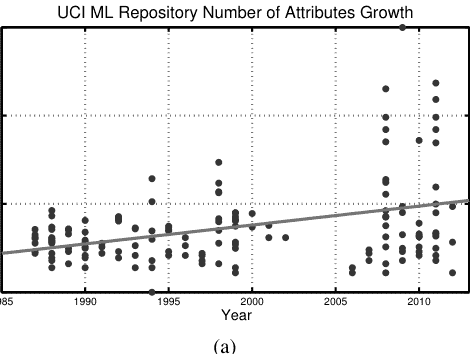
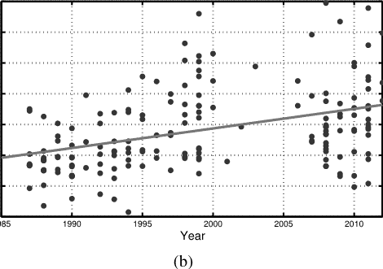

**FIGURE 2.1:** 图 (a) 显示了从 20 世纪 80 年代中期到 2012 年 UCI 机器学习库中的维度增长趋势，而 (b) 显示了同一时期的样本规模增长。

#### 2.1.1 Data Classification

分类是将新观测值识别为一组类别（子群体）之一的问题，其依据是包含类别成员关系已知的观测值（或实例）的训练数据集。许多现实世界问题可以建模为分类问题，例如将给定的电子邮件分配到“垃圾邮件”或“非垃圾邮件”类别，自动为 incoming 新闻分配类别（例如“体育”和“娱乐”），以及根据观察到的患者特征（性别、血压、某些症状的存在或不存在等）为给定的患者分配诊断。数据分类的一般过程如图 2.2 所示，通常包括两个阶段——训练阶段和预测阶段。

在训练阶段，数据基于特征生成模型（如文本数据的向量空间模型）分析为一组特征。这些特征可能是分类的（例如，血型“ A ”、“ B ”、“ AB ”或“ O ”），有序的（例如，“大”、“中”或“小”），整数值（例如，电子邮件中特定单词出现的次数）或实数值（例如，血压测量值）。一些算法仅在离散数据方面工作，例如 ID3，并且要求实数值或整数值数据被离散化为组（例如，小于 5、介于 5 和 10 之间或大于 10）。在通过这些提取的特征表示数据之后，学习算法


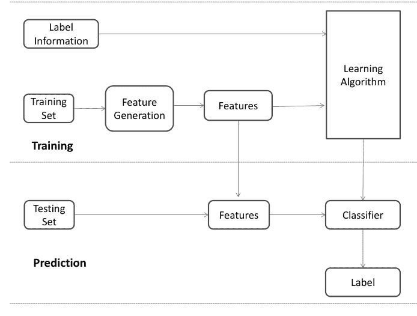

### FIGURE 2.2: 数据分类的一般过程。

将利用标签信息以及数据本身来学习一个映射函数 f（或分类器），从特征到标签，例如，

```
f(features) → labels. (2.1)
```

在预测阶段，数据由训练过程中提取的特征集表示，然后在训练阶段学习到的映射函数（或分类器）将对特征表示的数据进行操作以预测标签。请注意，训练阶段使用的特征集应与预测阶段使用的特征集相同。

文献中存在许多分类方法。这些方法可以大致分为线性分类器、支持向量机、决策树和神经网络。线性分类器根据特征的线性组合的值做出分类决策。线性分类器的例子包括 Fisher 线性判别、逻辑回归、朴素贝叶斯分类器等等。直观上，通过到任一类别最近训练数据点的距离最大的超平面实现良好的分离（所谓的函数间隔），因为通常间隔越大，分类器的泛化误差越低。因此，支持向量机通过最大化间隔来构造一个或一组超平面。在决策树中，可以通过基于特征值测试将源集拆分为子集来学习一棵树。此过程以递归分区的方式递归地重复在每个派生的子集上。当节点处的子集具有目标特征的所有相同值时，或当拆分不再为预测增加价值时，递归完成。

### 2.1.2 特征选择

在过去三十年中，机器学习和数据挖掘任务所涉及数据的维度呈爆炸性增长。极高维度的数据给现有学习方法带来了严重挑战 [39]，即维度灾难 [21]。在存在大量特征的情况下，学习模型倾向于过拟合，导致性能下降。为了解决维度灾难问题，研究了降维技术，这是机器学习和数据挖掘研究领域的一个重要分支。特征选择是实践者中广泛采用的降低维度的技术。它旨在根据一定的相关性评估标准从原始特征中选择一个小的相关特征子集，这通常会导致更好的学习性能（例如分类的学习准确率更高）、更低的计算成本和更好的模型可解释性。

根据训练集是否标记，特征选择算法可分为监督式 [61, 68]、无监督式 [13, 51] 和半监督式特征选择 [71, 77]。监督式特征选择方法可进一步大致分为过滤模型、包装模型和嵌入模型。过滤模型将特征选择与分类器学习分开，使得学习算法的偏差不会与特征选择算法的偏差相互作用。它依赖于训练数据的一般特征的度量，如距离、一致性、依赖性、信息和相关性。Relief [60]、Fisher score [11] 和基于信息增益的方法 [52] 是过滤模型的代表性算法。包装模型使用预定学习算法的预测准确率来确定所选特征的质量。这些方法对于特征数量很多的数据来说运行成本过高。由于每种模型都存在不足，嵌入模型被提出以弥合过滤模型和包装模型之间的差距。首先，它结合统计标准，如过滤模型那样，选择具有给定基数若干个候选特征子集。其次，它选择分类准确率最高的子集 [40]。因此，嵌入模型通常同时实现与包装模型相当的准确率和与过滤模型相当的效率。嵌入模型在学习时执行特征选择。换句话说，它同时实现模型拟合和特征选择 [15,54]。许多研究人员也关注无监督特征选择的发展。无监督特征选择是在没有类别标签的情况下的较少约束的搜索问题，取决于聚类质量度量 [12]，并且可能产生许多同样有效的特征子集。对于高维数据，如果不考虑额外的约束，很不可能恢复相关特征。另一个关键困难是如何客观地衡量特征选择的结果 [12]。关于无监督特征选择的全面综述可在 [1] 中找到。监督式特征选择在标签信息的指导下评估特征的相关性，但一个好的选择器需要足够的有标签数据，这耗时。无监督特征选择使用无标签数据，但很难评估特征的相关性。常见的情况是数据集维度巨大但标记样本量很小。高维数据与小标记样本允许过大的假设空间却只有过少的约束（标记实例）。这两种数据特征的结合体现了一个新的研究挑战。在假设有标签和无标签数据是从目标概念生成的同一总体中抽样的前提下，半监督特征选择利用有标签和无标签数据来估计特征相关性 [77]。

特征加权被认为是特征选择的推广 [69]。在特征选择中，特征被赋予二值权重，其中 1 表示特征被选中，0 表示未选中。然而，特征加权为每个特征分配一个值，通常在区间 [0,1] 或 [-1,1] 中。该值越大，特征越显著。大多数特征权重算法为每个特征在所有实例上分配统一的（全局）权重。然而，不同维度中的相对重要性、相关性和噪声可能随数据局部性而显著变化。存在局部特征选择算法，其中特征的局部选择针对测试实例进行，这在 kNN [9,22] 等惰性学习算法中很常见。其思想是特征选择或加权是在分类时（而不是在训练时）进行的，因为对测试实例的了解增强了选择特征的能力。

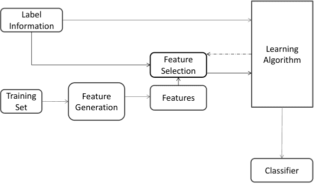

**FIGURE 2.3:** 分类特征选择的一般框架。

通常，特征选择方法由四个基本步骤组成 [40]，即子集生成、子集评估、停止准则和结果验证。在第一步中，候选特征子集将根据给定的搜索策略选择，该子集在第二步中将根据一定的评估标准进行评估。满足停止准则后，从所有已评估的候选中选择最符合评估标准的子集。在最后一步中，所选子集将使用领域知识或验证集进行验证。

### 2.1.3 用于分类的特征选择

大多数现实世界的分类问题需要监督学习，其中潜在的类别概率和类条件概率未知，并且每个实例都与一个类别标签相关联 [8]。在现实世界情况下，我们通常对相关特征知之甚少。因此，为了更好地表示领域，会引入许多候选特征，导致存在与目标概念无关/冗余的特征。相关特征既不无关也不冗余于目标概念；无关特征与目标概念没有直接关联但会影响学习过程，而冗余特征对目标概念没有增加任何新信息 [8]。在许多分类问题中，由于数据规模巨大，在移除这些不需要的特征之前，很难学习到好的分类器。减少无关/冗余特征的数量可以大幅减少学习算法的运行时间并产生更通用的分类器。这有助于更好地洞察现实世界分类问题的潜在概念。

图 2.3 展示了用于分类的一般特征选择框架。特征选择主要影响分类的训练阶段。在生成特征后，而不是直接将数据用全部特征处理到学习算法，分类的特征选择将首先执行特征选择以选择特征子集，然后将数据用所选特征处理到学习算法。特征选择阶段可能独立于学习算法，如过滤模型中，或它可能迭代地利用学习算法的性能来评估所选特征的质量，如包装模型中。有了最终选择的特征后，将为预测阶段归纳一个分类器。

通常用于分类的特征选择试图根据以下标准选择最小尺寸的特征子集：


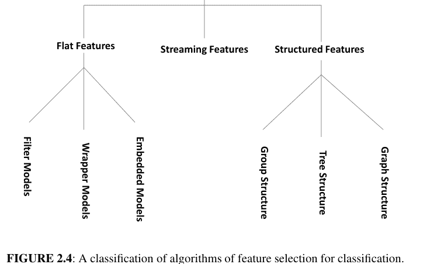

### 分类特征选择

#### 图 2.4：分类特征选择的算法分类。

-   分类准确率不会显著下降；并且
-   仅给定所选特征的值时得到的类分布，尽可能接近给定所有特征时的原始类分布。

理想情况下，特征选择方法会遍历特征子集，并在根据某些评价函数 [8] 的 2^m 个候选子集中尝试找到最佳的一个。然而，该过程是穷举的，因为它只试图找到唯一最佳解。对于中等规模的特征集大小 m 来说，这可能过于昂贵且在实践中不可行。基于启发式或随机搜索的其他方法通过牺牲性能来降低计算复杂度。这些方法需要一个停止准则以防止对子集进行穷举搜索。

在本章中，我们根据特征结构将分类的特征选择分为三个族——如图 2.4 所示的平面特征方法、结构化特征方法和流式特征方法。在接下来的章节中，我们将详细回顾这三组代表性算法。

在进入下一节之前，我们介绍本章采用的记号。假设 F = {f1, f2, …, fm} 和 C = {c1, c2, …, cK} 分别表示特征集和类别标签集，其中 m 和 K 分别是特征数和标签数。X = {x1, x2, …, xn} ∈ R^{m×n} 是数据，其中 n 是实例数，第 i 个实例 xi 的标签信息记为 yi。

### 2.2 平面特征的算法

在本节中，我们将回顾平面特征的算法，其中假设特征相互独立。该类别的算法通常进一步分为三组——过滤模型、包装模型和嵌入模型。

#### 2.2.1 过滤模型

过滤模型依赖于数据的特性，在不使用任何分类算法的情况下评估特征 [39]。典型的过滤算法包含两个步骤。第一步，它根据某些标准对特征进行排序。特征评估可以是 *单变量* 或 *多变量*。在单变量方案中，每个特征独立于特征空间进行排序，而多变量方案以批量方式评估特征。因此，多变量方案自然能够处理冗余特征。第二步，选择排名最高的特征来诱导分类模型。在过去十年中，已提出了许多用于基于过滤的特征选择的性能准则，例如 Fisher 得分 [10]、基于互信息的方法 [37, 52, 74]，以及 ReliefF 及其变体 [34, 56]。

**Fisher Score [10]：** 质量高的特征应为同一类中的实例分配相似的值，并为不同类的实例分配不同的值。基于这一直觉，第 *i* 个特征 $S_i$ 的得分将由 Fisher Score 计算为，

```
$$S_i = \frac{\sum_{k=1}^{K} n_j(\mu_{ij}-\mu_i)^2}{\sum_{k=1}^{K} n_j\rho_{ij}^2}, \tag{2.2}$$
```

其中 $\mu_{ij}$ 和 $\rho_{ij}$ 分别是第 *i* 个特征在第 *j* 类中的均值和方差，$n_j$ 是第 *j* 类中的实例数，$\mu_i$ 是第 *i* 个特征的均值。Fisher Score 单独评估特征；因此，它无法处理特征冗余。最近，Gu 等人 [17] 提出了一种广义 Fisher 得分以联合选择特征，其目标是找到一个特征子集，使传统 Fisher 得分的下界最大化，并求解以下问题：

```
$$\begin{aligned}
&\|\mathbf{W}^{\mathsf T}\operatorname{diag}(\mathbf p)\mathbf X-\mathbf G\|_F^2+\gamma\|\mathbf W\|_F^2,\\
&s.t.,\quad \mathbf p\in\{0,1\}^m,\quad \mathbf p^{\mathsf T}\mathbf 1=d,
\end{aligned}\tag{2.3}$$
```

其中 **p** 是特征选择向量，*d* 是要选择的特征数，**G** 是一个特殊的标签指示矩阵，如下所示：

```
$$G(i,j)=\begin{cases}
\sqrt{\frac{n}{n_j}}-\sqrt{\frac{n_j}{n}}, & \text{if }x_i\in C_j,\\
-\sqrt{\frac{n_j}{n}}, & \text{otherwise.}
\end{cases}\tag{2.4}$$
```

**基于互信息的方法 [37, 52, 74]：** 由于计算效率高且解释简单，信息增益是最受欢迎的特征选择方法之一。它用于衡量特征与标签之间的依赖关系，并计算第 *i* 个特征 $f_i$ 与类别标签 $C$ 之间的信息增益为

```
$$IG(f_i,C)=H(f_i)-H(f_i\mid C),\tag{2.5}$$
```

其中 $H(f_i)$ 是 $f_i$ 的熵，$H(f_i\mid C)$ 是观察 $C$ 后 $f_i$ 的熵：

```
$$\begin{aligned}
H(f_i)&=-\sum_j p(x_j)\log_2(p(x_j)),\\
H(f_i\mid C)&=-\sum_k p(c_k)\sum_j p(x_j\mid c_k)\log_2(p(x_j\mid c_k)).
\end{aligned}\tag{2.6}$$
```

在信息增益中，如果特征具有较高的信息增益，则该特征是相关的。特征以单变量方式选择，因此信息增益无法处理冗余特征。在 [74] 中，提出了一种基于互信息的快速过滤方法 FCBF 来识别相关特征以及相关特征之间的冗余，并衡量特征-类和特征-特征相关性。

给定阈值 ρ，FCBF 首先选择一个特征集 S，其与类的相关性很高且 $SU \geq \rho$，其中 $SU$ 是对称不确定性定义为

$$SU(f_i,C)=2\frac{IG(f_i,C)}{H(f_i)+H(C)}. \tag{2.7}$$

如果 $SU(f_i,c_k) \geq \rho$ 且不存在 $f_j(f_j \in S,j \neq i)$ 使得 $SU(j,i) \geq SU(i,c_k)$，则特征 $f_i$ 被称为占优的。如果 $SU(j,i) \geq SU(i,c_k)$，则 $f_j$ 是 $f_i$ 的冗余特征。然后冗余特征集记为 $S_{(P_i)}$，进一步划分为 $S^+_{p_i}$ 和 $S^-_{p_i}$。$S^+_{p_i}$ 和 $S^-_{p_i}$ 分别包含对 $f_i$ 冗余且满足 $SU(j,c_k)>SU(i,c_k)$ 和 $SU(j,c_k)\leq SU(i,c_k)$ 的冗余特征。最后 FCBF 对 $S_{(P_i)}$、$S^+_{p_i}$ 和 $S^-_{p_i}$ 应用三种启发式方法以去除冗余特征并保留与类最相关的特征。FCBF 为特征选择中的特征冗余处理提供了一种有效的方法。

最小冗余最大相关性 Minimum-Redundancy-Maximum-Relevance，mRmR 也是基于互信息的方法，它根据最大统计依赖准则选择特征 [52]。由于直接实现最大依赖条件存在困难，mRmR 是最大化所选特征的联合分布与分类变量之间依赖性的近似。*最小化冗余* 对于离散特征和连续特征定义为：

对于离散特征：$\min W_I,\quad W_I=\frac{1}{|S|^2}\sum_{i,j\in S}I(i,j)$  
对于连续特征：$\min W_c,\quad W_c=\frac{1}{|S|^2}\sum_{i,j\in S}|C(i,j)|$  \tag{2.8}

其中 $I(i,j)$ 和 $C(i,j)$ 分别是 $f_i$ 和 $f_j$ 之间的互信息和相关性。同时，*最大化相关性* 对于离散特征和连续特征定义为：

对于离散特征：$\max V_I,\quad V_I=\frac{1}{|S|}\sum_{i\in S}I(h,i)$  
对于连续特征：$\max V_c,\quad V_c=\frac{1}{|S|}\sum_iF(i,h)$  \tag{2.9}

其中 $h$ 是目标类，$F(i,h)$ 是 F 统计量。

**ReliefF [34,56]：** Relief 及其多类扩展 ReliefF 选择特征以分离不同类的实例。假设从数据中随机采样 $\ell$ 个实例，然后第 $i$ 个特征 $S_i$ 的得分由 Relief 定义为，

$$S_i=\frac{1}{2}\sum_{k=1}^{\ell}\left(d(\mathbf{X}_{ik}-\mathbf{X}_{iM_k})-d(\mathbf{X}_{ik}-\mathbf{X}_{iH_k})\right). \tag{2.10}$$

其中 $M_k$ 表示与 $\mathbf{x}_k$ 具有相同类别标签的最邻近实例在第 $i$ 个特征上的值，而 $H_k$ 表示与 $\mathbf{x}_k$ 具有不同类别标签的最邻近实例在第 $i$ 个特征上的值。$d(\cdot)$ 是一个距离度量。为了处理多类问题，公式 (2.10) 扩展为，

$$S_i=\frac{1}{K}\sum_{k=1}^{\ell}\left(-\frac{1}{m_k}\sum_{x_j\in M_k}d(\mathbf{X}_{ik}-\mathbf{X}_{ij})+\sum_{y\ne y_k}\frac{1}{h_{ky}}\frac{p(y)}{1-p(y)}\sum_{x_j\in H_k}d(\mathbf{X}_{ik}-\mathbf{X}_{ij})\right). \tag{2.11}$$

其中 $M_k$ 和 $H_{ky}$ 分别表示与 $\mathbf{x}_k$ 最近的具有相同类别和类别 $y$ 的点的集合，其大小分别为 $m_k$ 和 $h_{ky}$，$p(y)$ 是来自类别 $y$ 的实例的概率。在 [56] 中，作者将 ReliefF 的相关性评估准则与边界最大化假设联系起来，这解释了该算法在许多应用中提供优异性能的原因。


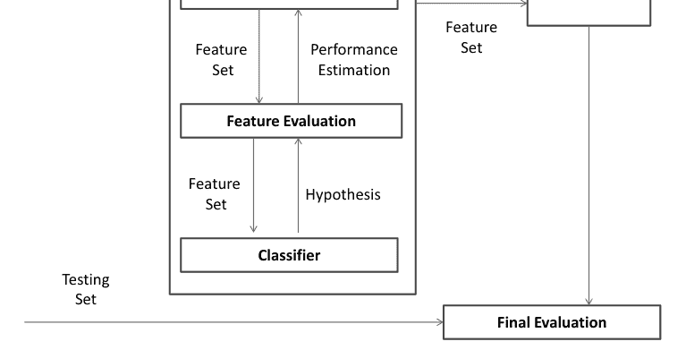

**图 2.5：** 用于分类的特征选择包裹方法的一般框架。

#### 2.2.2 包裹模型

过滤模型选择特征时不依赖任何特定的分类器。然而，过滤方法的主要缺点是它完全忽略了所选特征子集对归纳算法性能的影响 [20, 36]。最优特征子集应当取决于归纳算法的特定偏置和启发式方法。基于这一假设，包裹模型利用一个特定的分类器来评估所选特征的质量，并提供了一种简单而有效的方法来解决特征选择问题，无论选择何种学习机器 [26, 36]。给定一个预定义的分类器，典型的包裹模型将执行以下步骤：

- 步骤 1：搜索一个特征子集，
- 步骤 2：通过分类器的性能来评估所选特征子集，
- 步骤 3：重复步骤 1 和步骤 2，直到达到期望的质量。

用于分类的特征选择包裹方法的一般框架 [36] 如图 2.5 所示，它包含三个主要组件：

- 特征选择搜索——如何从所有可能的特征子集中搜索特征子集，
- 特征评估——如何评估所选分类器的性能，以及
- 归纳算法。

在包裹模型中，预定义的分类器充当黑盒。特征搜索组件将生成一组特征，特征评估组件将使用分类器来估计性能，并将性能返回给特征搜索组件，用于下一轮特征子集选择迭代。具有最高估计值的特征集将被选为

## 上海依图网络科技有限公司

- 地址：上海市徐汇区宜州路180号1幢8楼
- 电话：+86-21-54265857
- 邮箱：contact@yitu-inc.com
- 网站：www.yitu.com

具体地，我们将 \(\hat{\mathbf{w}}\) 定义为，

$$\hat{\mathbf{w}} = \arg\min_{\mathbf{w}} c(\mathbf{w},\mathbf{X}) + \alpha\, \operatorname{penalty}(\mathbf{w}) \tag{2.12}$$

其中 \(c(\cdot)\) 是分类目标函数，\(\operatorname{penalty}(\mathbf{w})\) 是正则化项，而 \(\alpha\) 是控制 \(c(\cdot)\) 与惩罚项之间权衡的正则化参数。\(c(\cdot)\) 的常用选择包括二次损失（如最小二乘）、铰链损失（如 \(\ell_1\) SVM [5]）以及逻辑损失（如 BlogReg [15]）。

- *二次损失：*

$$c(\mathbf{w},\mathbf{X}) = \sum_{i=1}^{n}(y_i-\mathbf{w}^{\mathsf{T}}\mathbf{x}_i)^2 \tag{2.13}$$

- *铰链损失：*

$$c(\mathbf{w},\mathbf{X}) = \sum_{i=1}^{n}\max(0,1-y_i\mathbf{w}^{\mathsf{T}}\mathbf{x}_i) \tag{2.14}$$

- *逻辑损失：*

$$c(\mathbf{w},\mathbf{X}) = \sum_{i=1}^{n}\log\left(1+\exp\left(-y_i(\mathbf{w}^{\mathsf{T}}\mathbf{x}_i+b)\right)\right) \tag{2.15}$$

**Lasso 正则化 [64]：** Lasso 正则化基于 \(\mathbf{w}\) 系数的 \(\ell_1\) 范数，定义为

$$\operatorname{penalty}(\mathbf{w}) = \sum_{i=1}^{m}|w_i| \tag{2.16}$$

\(\ell_1\) 正则化的一个重要性质是，它能够生成具有精确零系数的 \(\mathbf{w}\) [64] 估计。换句话说，\(\mathbf{w}\) 中存在零项，表示相应的特征在分类器学习过程中被消除。因此，它可用于特征选择。

**自适应 Lasso [80]：** 如果底层模型满足一个非平凡条件，Lasso 特征选择是一致的，但在实践中该条件可能无法满足 [76]。同时，Lasso 收缩会对较大系数产生有偏估计；因此，就估计风险而言，它可能不是最优的 [14]。

自适应 Lasso 被提出用于改善 Lasso 的性能 [80]。

$$\operatorname{penalty}(\mathbf{w}) = \sum_{i=1}^{m}\frac{1}{b_i}|w_i| \tag{2.17}$$

其中，Lasso 与自适应 Lasso 的唯一区别在于，后者对每个系数 \(w_i\) 采用加权调整 \(b_i\)。该文献表明，自适应 Lasso 具有 oracle 性质，并且可以用与求解 Lasso 相同的有效算法来求解。

该文献还证明，对于 \(n \gg m\) 的线性模型 \(\mathbf{w}\)，如果 \(b_i\) 是 \(w_i\) 的 \(\sqrt{n}\) 一致估计，则自适应 Lasso 估计在非常一般的条件下具有选择一致性。作为该证明的补充，[24] 表明，对于线性模型，当 \(m \gg n\) 时，在部分正交条件下，自适应 Lasso 估计也具有选择一致性；该条件下，系数为零的协变量与系数非零的协变量弱相关。

其中 \(\mathcal{G}\) 表示特征的结构，\(\alpha\) 控制数据拟合与正则化之间的权衡。公式 (2.21) 将产生稀疏分类器，这些分类器特别适合解释，而这在许多应用（如生物学或社会科学）中通常是最重要的 [75]。

### 2.3.1 具有组结构的特征

在许多实际应用中，特征会形成组结构。例如，在多因子方差分析（ANOVA）问题中，每个因子可能有多个水平，可以用一组虚拟特征来表示 [75]；在语音和信号处理中，不同的频带可以用组来表示 [49]。在进行特征选择时，我们倾向于同时选择或不选择同一组中的特征。组 Lasso 将一组中的所有系数一起驱动为零，从而实现组选择，因此越来越受到关注 [3,27,41,50,75]。

假设特征形成 \(k\) 个不相交的组 \(\mathcal{G} = \{G_1, G_2, \ldots, G_k\}\)，且任意两组之间没有重叠。利用这种组结构，我们可以将 \(\mathbf{w}\) 重写为分块形式 \(\mathbf{w} = \{\mathbf{w}_1, \mathbf{w}_2, \ldots, \mathbf{w}_k\}\)，其中 \(\mathbf{w}_i\) 对应第 \(i\) 组 \(G_i\) 中特征的所有系数构成的向量。然后，组 Lasso 对模型参数执行 \(\ell_{q,1}\) 范数正则化：

$$\operatorname{penalty}(\mathbf{w}, \mathcal{G}) = \sum_{i=1}^{k} h_i \|\mathbf{w}_{G_i}\|_q, \tag{2.22}$$

其中 \(\|\cdot\|_q\) 是 \(q > 1\) 的 \(\ell_q\) 范数，\(h_i\) 是第 \(i\) 组的权重。Lasso 不考虑组结构信息，也不支持组选择，而组 Lasso 可以作为一个整体选择或不选择一组特征。

一旦某个组被组 Lasso 选中，该组中的所有特征都会被选择。在某些应用中，还需要从所选组中选择特征，即同时进行组选择和特征选择。稀疏组 Lasso 兼具 Lasso 和组 Lasso 的优势，能够产生同时具有组间和组内稀疏性的解。稀疏组 Lasso 正则化基于 \(\ell_{q,1}\) 范数与 \(\ell_1\) 范数的组合，

$$\operatorname{penalty}(\mathbf{w}, \mathcal{G}) = \alpha\|\mathbf{w}\|_1 + (1-\alpha) \sum_{i=1}^{k} h_i \|\mathbf{w}_{G_i}\|_q, \tag{2.23}$$

其中 \(\alpha \in [0,1]\)，第一项控制特征级别的稀疏性，第二项控制组选择。

图 2.6 展示了 Lasso、组 Lasso 和稀疏组 Lasso 之间的不同解。在图中，特征形成四个组 {G₁, G₂, G₃, G₄}。浅色表示该单元格对应的特征系数为零，深色表示系数非零。从图中我们可以观察到：

- Lasso 不考虑组结构，并在所有组中选择一个特征子集；
- 组 Lasso 可以执行组选择，选择一个组子集。一旦某个组被选中，该组中的所有特征都会被选中；以及
- 稀疏组 Lasso 可以同时选择组和所选组中的特征。

在某些应用中，组之间会重叠。一个典型的例子是使用 [73] 给出的具有生物学意义的基因/蛋白质集合（组）。如果蛋白质/基因要么出现在同一通路中，要么在基因本体（GO）层级上具有语义相关性，或者从……相关


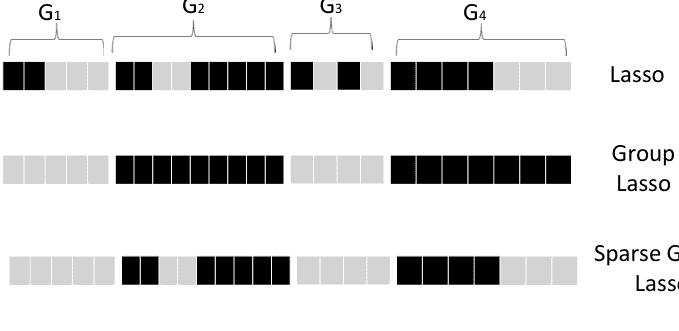

基因集富集分析 GSEA，它们相关并被分配到同一组。例如，MSigDB 中的经典通路提供了 639 组基因。研究表明，（蛋白质/基因）组标记比单个蛋白质/基因标记更具可重复性，并且将此类组信息作为先验知识进行建模可以提高分类性能 [7]。组可能重叠——一个蛋白质/基因可能属于多个组。在这些情况下，组 Lasso 不能正确处理重叠组，并且给定的系数只属于一个组。研究重叠组的算法被提出为 [27, 30, 33, 42]。一般重叠组 Lasso 正则化与方程 (2.23) 中的组 Lasso 正则化类似

$$\operatorname{penalty}(\mathbf{w},G)=\alpha\|\mathbf{w}\|_1+(1-\alpha)\sum_{i=1}^{k}h_i\|\mathbf{w}_{G_i}\|_q, \qquad (2.24)$$

然而，重叠组 Lasso 正则化的组可能重叠，而组 Lasso 中的组是互不相交的。

### 2.3.2 具有树结构的特征

在许多应用中，特征可以用某些树结构自然表示。例如，人脸图像的图像像素可以表示为一棵树，其中每个父节点包含一系列子节点，这些子节点具有空间局部性；基因/蛋白质可能形成某些分层树结构 [42]。针对以索引树表示的特征提出了树引导组 Lasso 正则化 [30, 33, 42]。

在索引树中，每个叶节点表示一个特征，每个内部节点表示以该内部节点为根的子树叶节点所对应的特征的组。树中每个内部节点都关联一个权重，该权重表示子树的高度，或该内部节点对应组中特征的相关性程度，可以正式定义如下 [42]。

对于深度为 \(d\) 的索引树 \(G\)，令 \(G_i=\{G_1^i,G_2^i,\ldots,G_{n_i}^i\}\) 包含深度 \(i\) 对应的所有节点，其中 \(n_i\) 为深度 \(i\) 的节点数。节点满足以下条件：

- 同一深度层的节点具有不重叠的索引，即 \(G_j^i\cap G_k^i=\varnothing\)，\(\forall i\in\{1,2,\ldots,d\}\)，\(j\ne k\)，\(1\le j,k\le n_i\)；

- 设 \(G_{j_0}^{i-1}\) 为非根节点 \(G_j^i\) 的父节点，则 \(G_j^i \subseteq G_{j_0}^{i-1}\)。

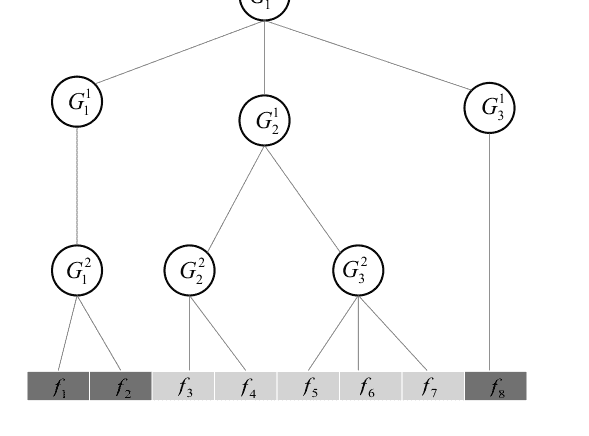

**FIGURE 2.7:** 深度为 3 且具有 8 个特征的简单索引树的示意图。

图 2.7 显示了深度为 3 且具有 8 个特征的示例索引树，其中 \(G_j^i\) 定义为

\(G_1^0 = \{f_1,f_2,f_3,f_4,f_5,f_6,f_7,f_8\}\)，\(G_1^1 = \{f_1,f_2\}\)，\(G_2^1 = \{f_3,f_4,f_5,f_6,f_7\}\)，\(G_3^1 = \{f_8\}\)，\(G_1^2 = \{f_1,f_2\}\)，\(G_2^2 = \{f_3,f_4\}\)，\(G_3^2 = \{f_5,f_6,f_7\}\)。

我们可以观察到

- \(G_1^0\) 包含所有特征；
- 不同节点的索引集可能重叠，例如，任何父节点都与其子节点重叠；
- 同一深度层的节点不重叠；并且
- 子节点的索引集是其父节点索引集的子集。

有了索引树的定义，树引导组 Lasso 正则化为，

$$\operatorname{penalty}(\mathbf{w}, \mathcal{G}) = \sum_{i=0}^{d} \sum_{j=1}^{n_i} h_j^i \| \mathbf{w}_{G_j^i} \|_q, \qquad (2.25)$$

由于任何父节点都与其子节点重叠，如果特定节点未被选中（即其对应的模型系数为零），则其所有子节点都不会被选中。例如，在图 2.7 中，如果 \(G_2^1\) 未被选中，则 \(G_2^2\) 和 \(G_3^2\) 都不会被选中，表示特征 \(\{f_3,f_4,f_5,f_6,f_7\}\) 不会被选中。注意，树结构组 Lasso 是具有特定树结构的重叠组 Lasso 的特例。

### 2.3.3 具有图结构的特征

我们经常在许多现实世界应用中了解特征之间的成对依赖关系 [58]。例如，在自然语言处理中，数字词典如 WordNet 可以指示哪些词是同义词或反义词；许多生物学研究表明，基因倾向于根据其生物学功能成组工作，并且基因之间存在一些调控关系。在这些情况下，特征形成无向图，其中节点表示特征，边表示特征之间的关系。最近的几项研究表明，使用编码为图的依赖信息可以提高估计精度。

设 \(G(N, E)\) 为给定的图，其中 \(N = \{1, 2, \ldots, m\}\) 为节点集合，\(E\) 为边集合。节点 \(i\) 对应第 \(i\) 个特征，我们用 \(A \in R^{m \times m}\) 表示 \(G\) 的邻接矩阵。图 2.8 显示了 7 个特征 \(\{f_1, f_2, \ldots, f_7\}\) 的图及其表示 \(A\)。

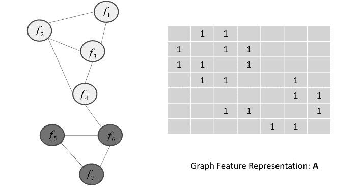

**FIGURE 2.8:** 7 个特征 {f1, f2, …, f7} 的图的示意图及其对应的表示 A。

如果节点 \(i\) 和 \(j\) 在 \(E\) 中由一条边连接，则第 \(i\) 个特征和第 \(j\) 个特征更可能一起被选中，并且它们应具有相似的权重。一种直观的图 Lasso 形式化方法是强制两个连接特征的权重通过平方损失接近，即

$$\operatorname{penalty}(\mathbf{w}, G) = \lambda\|\mathbf{w}\|_1 + (1 - \lambda) \sum_{i,j} A_{ij} (w_i - w_j)^2, \qquad (2.26)$$

等价于

$$\operatorname{penalty}(\mathbf{w}, G) = \lambda\|\mathbf{w}\|_1 + (1 - \lambda) \mathbf{w}^\top L \mathbf{w}, \qquad (2.27)$$

其中 \(L = D - A\) 为拉普拉斯矩阵，\(D\) 为对角矩阵且 \(D_{ii} = \sum_{j=1}^m A_{ij}\)。拉普拉斯矩阵是半正定的，并捕获数据的底层局部几何结构。当 \(L\) 为单位矩阵时，\(\mathbf{w}^\top L \mathbf{w} = \|\mathbf{w}\|_2^2\)，此时方程 (2.27) 退化为弹性网络惩罚 [81]。由于 \(\mathbf{w}^\top L \mathbf{w}\) 既是凸的又是可微的，解决 Lasso 的现有高效算法可用于求解方程 (2.27)。

方程 (2.27) 假设特征图是无符号的，并鼓励无符号图中边连接的特征系数值的正相关。然而，两个特征可能负相关。在这种情况下，特征图是有符号的，具有正边和负边。为了使用有符号特征图进行特征选择，GFlasso 采用了图上的不同 \(\ell_1\) 正则化 [32]，

$$\operatorname{penalty}(\mathbf{w}, G) = \lambda\|\mathbf{w}\|_1 + (1 - \lambda) \sum_{i,j} A_{ij} \|w_i - \operatorname{sign}(r_{ij}) w_j\|, \qquad (2.28)$$

其中 \(r_{ij}\) 为两个特征之间的相关性。当 \(f_i\) 和 \(f_j\) 正向连接时，\(r_{ij} > 0\)，即正边，\(\operatorname{penalty}(\mathbf{w}, G)\) 强制系数 \(w_i\) 和 \(w_j\) 相似；而当 \(f_i\) 和 \(f_j\) 负向连接时，\(r_{ij} < 0\)，即负边，惩罚强制 \(w_i\) 和 \(w_j\) 不相似。由于图可能指定错误，GFlasso 可能在学习过程中引入额外的估计偏差。例如，当 \(f_i\) 和 \(f_j\) 之间边的符号被错误估计时可能会出现额外偏差。

在 [72] 中，作者引入了图 Lasso 的几种替代形式化。其中一种形式化定义为

$$\operatorname{penalty}(\mathbf{w}, G) = \lambda\|\mathbf{w}\|_1 + (1 - \lambda) \sum_{i,j} A_{ij} \max(|w_i|, |w_j|), \qquad (2.29)$$

其中使用成对 \(\ell_\infty\) 正则化来强制系数相等，并且分组约束仅施加在 \(A_{ij} = 1\) 的连接节点上。\(\mathbf{w}\) 的 \(\ell_1\) 范数鼓励稀疏性，而 \(\max(|w_i|, |w_j|)\) 会惩罚较大的系数，可分解为

$$\max(|w_i|, |w_j|) = \frac{1}{2}(|w_i + w_j| + |w_i - w_j|), \qquad (2.30)$$

可进一步表示为

$$\max(|w_i|, |w_j|) = |u^\top w| + |v^\top w|, \qquad (2.31)$$

其中 \(u\) 和 \(v\) 为仅有两个非零项的向量，即 \(u_i = u_j = 1/2\) 且 \(v_i = -v_j = 1/2\)。

GOSCAR 形式化与 [4] 中的 OSCAR 密切相关。然而，OSCAR 假设所有特征形成完全图，这意味着特征图是完全的。OSCAR 适用于 \(A\) 的所有条目均为 1 的情况，而 GOSCAR 可以处理任意无向图，其中 \(A\) 为任意对称矩阵。在此意义上，GOSCAR 更为通用。与此同时，GOSCAR 的形式化求解比 OSCAR 的更具挑战性。

拉普拉斯 Lasso 的局限性——不同符号的系数会引入额外惩罚——可通过 GOSCAR 的分组惩罚克服。然而，由于 max 运算符的特性，GOSCAR 很容易过度惩罚系数 \(w_i\) 或 \(w_j\)。额外的惩罚会导致有偏估计，尤其是在系数较大时。如上所述，当 \(w_i\) 和 \(w_j\) 之间的符号被错误估计时，GFlasso 会引入估计偏差。这促使了以下用于图特征的非凸形式化，

$$\operatorname{penalty}(\mathbf{w}, G) = \lambda\|\mathbf{w}\|_1 + (1 - \lambda) \sum_{i,j} A_{ij} \left\| |w_i| - |w_j| \right\|, \qquad (2.32)$$

其中分组惩罚 \(\sum_{i,j} A_{ij} \left\| |w_i| - |w_j| \right\|\) 仅控制系数差值的幅度而忽略其在图上的符号。通过 \(\ell_1\) 正则化和分组惩罚，特征分组和选择同时进行，其中仅大系数以及成对差异被收缩 [72]。

对于具有图结构的特征，图中高度连接的特征子集很可能作为一个整体被选中或不被选中。例如，在图 2.8 中，\(\{f_5, f_6, f_7\}\) 被选中，而 \(\{f_1, f_2, f_3, f_4\}\) 未被选中。


### 2.4.1 嫁接算法

Perkins 和 Theiler 提出了一种基于嫁接的流式特征选择框架，嫁接是一种通用技术，可应用于由权重向量 w 参数化并受 ℓ₁ 正则化约束的各种模型，例如第 2.2.3 节中的 Lasso 正则化特征选择框架，如下所示

```
ŵ = min_w c(w, X) + α Σ_{j=1}^m |w_j| . (2.33)
```

当所有特征都可用时，penalty(w) 对 w 中的所有权重进行均匀惩罚以实现特征选择，可通过嫁接技术应用于流式特征。在公式 (2.33) 中，每一个加入模型的一零权重 w_j 都会产生 α|w_j| 的正则化惩罚。因此，特征仅在 c(·) 的损失大于正则化惩罚时才会被添加到模型中。嫁接技术仅在以下情况下将 w_j 从零移开：

```
∂c/∂w_j > α, (2.34)
```

否则嫁接技术会将权重设为零（或排除该特征）。

### 2.4.2 Alpha-Investing 算法

α-investing 通过动态调整新特征进入模型的 p 统计量阈值来控制错误发现率 [78]，描述如下

- 初始化 w₀, i = 0, 模型中已选择的特征 SF = ∅
- 第 1 步：获取新特征 f_i
- 第 2 步：设 α_i = w_i / (2i)
- 第 3 步：
  w_{i+1} = w_i - α_i    若 pvalue(x_i, SF) ≥ α_i.
  w_{i+1} = w_i + α_Δ - α_i,  SF = SF ∪ f_i   否则
- 第 4 步：i = i + 1
- 第 5 步：重复第 1 步至第 3 步

其中阈值 α_i 是第 i 步中选择虚假特征的概率，它使用财富 w_i 进行调整，w_i 表示当前可接受的未来假阳性数量。当特征被选入模型时，财富会增加；而当特征未被选入模型时，财富会减少。p 值是在特征实际上为零时，其系数被判断为非零的概率，它是通过利用 Δ-对数似然等价于 t 统计量这一事实来计算的。α-investing 的思想是自适应地控制特征选择的阈值，以便当新特征被选入模型时，“投资” α 增加财富提高阈值，从而允许未来略高的错误包含特征的可能性。每次测试特征且发现不显著时，财富会被“花费”，从而降低阈值，以保持不超过目标比例的虚假特征选择的保证。

### 2.4.3 在线流式特征选择算法

为了确定 α 的值，嫁接算法需要提前获得所有候选特征，而 α-investing 算法需要关于特征空间结构的某些先验知识来启发式地控制候选特征选择的选取，并且在特征流的情况下，很难获得关于候选特征结构足够的先验信息。因此，提出了在线流式特征选择算法（OSFS）来解决流式特征选择中的这些挑战性问题 [70]。

整个特征集可以划分为四个基本不相交的子集——（1）无关特征，（2）冗余特征，（3）弱相关但非冗余特征，以及（4）强相关特征。最优特征选择算法应具有非冗余且强相关的特征。对于流式特征，很难找到所有强相关且非冗余的特征。OSFS 使用两阶段方案——在线相关性分析和冗余分析来找到最优子集。OSFS 的一般框架如下所示：

- 初始化 BCF = ∅；
- 第 1 步：生成新特征 f_k；
- 第 2 步：在线相关性分析
  若 f_k 与类别标签无关，则忽略 f_k。
  否则 BCF = BCF ∪ f_k；
- 第 3 步：在线冗余分析；
- 第 4 步：在满足停止准则之前交替执行第 1 步至第 3 步。

在相关性分析阶段，OSFS 发现强相关和弱相关特征，并将它们加入最佳候选特征（BCF）。如果新出现的特征与类别标签无关，则会被丢弃，否则会被加入 BCF。

在冗余分析中，OSFS 动态地消除所选子集中的冗余特征。对于 BCF 中的每个特征 f_k，如果 BCF 中存在一个子集使得 f_k 与类别标签条件独立，则 f_k 将从 BCF 中移除。提高效率的一种替代方法是进一步将此阶段分为两个分析——内部冗余分析和外部冗余分析。在内部冗余分析中，OSFS 仅重新检查新加入 BCF 的特征，而外部冗余分析仅在特征生成过程停止时才重新检查 BCF 的每个特征。

### 2.5 讨论与挑战

以下是我们需要在本章中简要提及和讨论的关于分类特征选择的几个挑战和问题。

#### 2.5.1 可扩展性

随着数据集规模的巨大增长，当前算法的可扩展性可能面临危险，尤其是在需要在线分类器这些领域。例如，无法加载到内存中的数据需要单次数据扫描，其中第二次遍历要么不可用要么非常昂贵。使用特征选择方法进行分类可能会减少

聚类的可扩展性问题。然而，一些当前在分类过程中涉及特征选择的方法需要将完整维度保存在内存中。此外，其他方法需要迭代过程，其中每个样本在收敛之前会被访问多次。

另一方面，特征选择算法的可扩展性是一个大问题。通常，它们需要足够数量的样本才能获得静态的充分结果。很难在不考虑每个样本周围的密度情况下观察特征相关性分数。一些方法试图通过只记忆重要样本或摘要来克服这个问题。总之，我们认为分类和特征选择方法的可扩展性应得到更多关注，以跟上数据增长和快速流式传输的步伐。

#### 2.5.2 稳定性

用于分类的特征选择算法通常通过分类准确率进行评估。然而，算法的稳定性也是开发特征选择方法时的重要考虑因素。一个有动机的例子来自生物信息学：领域专家希望每次在少量扰动存在的情况下获得新样本时，都能看到相同或至少相似的一组基因，即特征被选择。否则，当数据集针对同一问题抽取时，他们会得到不同的特征集，从而不会信任该算法。由于其重要性，特征选择的稳定性已引起特征选择社区的关注。它被定义为选择过程对训练集中数据扰动的敏感性。研究发现，众所周知的特征选择方法在训练样本中引入扰动后选择的特征稳定性非常低。在 [2] 中，作者发现即使数据的底层特征也会极大地影响算法的稳定性。这些特征包括维度 m、样本大小 n，以及不同折中的不同数据分布，并且稳定性问题往往取决于数据。开发具有高分类准确率和稳定性的分类特征选择算法仍然具有挑战性。

#### 2.5.3 链接数据

大多数现有的用于分类的特征选择算法都使用通用数据集，并且始终假设数据是独立同分布的。随着社交媒体的发展，链接数据变得可用，其中实例违背了 i.i.d. 假设。

链接数据已在现实世界应用中无处不在，例如 Twitter¹ 上的推文（通过超链接链接的推文）、Facebook² 上的社交网络（通过友谊连接的人）以及生物网络（蛋白质相互作用网络）。链接数据显然不是独立同分布的（i.i.d.），这是传统机器学习方法中最持久且根深蒂固的假设之一 [31, 63]。图 2.10 显示了社交媒体中链接数据的典型示例。社交媒体数据通过各种类型的关系内在地相互链接，例如用户-帖子关系和用户-用户关系。

提出了许多与链接数据相关的学习任务，例如集体分类 [47, 59]，和关系聚类 [44, 45]，但链接数据的特征选择任务很少被涉及。链接数据的特征选择方法需要解决以下直接挑战：

- 如何利用数据实例之间的关系；以及
- 如何利用这些关系进行特征选择。

处理与分类特征选择相关的链接数据的两种尝试是 LinkedFS [62] 和 FSNet [16]。FSNet 使用网络数据并且是有监督的，而 LinkedFS 使用


### FIGURE 2.10: Typical linked social media data and its two representations.

(a) Social Media Data Example
(b) Attribute-Value Data
(c) Linked Data

social media data with social context and is semi-supervised. In LinkedFS, various relations (co-Post, coFollowing, coFollowed, and Following) are extracted following social correlation theories. LinkedFS significantly improves the performance of feature selection by incorporating these relations into feature selection. There are many issues needing further investigation for linked data, such as handling noise, and incomplete and unlabeled linked social media data.

## Acknowledgments

We thank Daria Bazzi for useful comments on the representation, and helpful discussions from Yun Li and Charu Aggarwal about the content of this book chapter. This work is, in part, supported by the National Science Foundation under Grant No. IIS-1217466.

## Bibliography

- [1] S. Alelyani, J. Tang, and H. Liu. Feature selection for clustering: A review. *Data Clustering: Algorithms and Applications*, Editors: Charu Aggarwal and Chandan Reddy, CRC Press, 2013.
- [2] S. Alelyani, L. Wang, and H. Liu. The effect of the characteristics of the dataset on the selection stability. In *Proceedings of the 23rd IEEE International Conference on Tools with Artificial Intelligence*, 2011.
- [3] F. R. Bach. Consistency of the group Lasso and multiple kernel learning. *The Journal of Machine Learning Research*, 9:1179–1225, 2008.
- [4] H. D. Bondell and B. J. Reich. Simultaneous regression shrinkage, variable selection, and supervised clustering of predictors with oscar. *Biometrics*, 64(1):115–123, 2008.
- [5] P. S. Bradley and O. L. Mangasarian. Feature selection via concave minimization and support vector machines. *Proceedings of the Fifteenth International Conference on Machine Learning (ICML '98)*, 82–90. Morgan Kaufmann, 1998.
- [6] E. Candes and T. Tao. The Dantzig selector: Statistical estimation when p is much larger than n. *The Annals of Statistics*, 35(6):2313–2351, 2007.
- [7] H. Y. Chuang, E. Lee, Y.T. Liu, D. Lee, and T. Ideker. Network-based classification of breast cancer metastasis. *Molecular Systems Biology*, 3(1), 2007.
- [8] M. Dash and H. Liu. Feature selection for classification. *Intelligent Data Analysis*, 1(1-4):131–156, 1997.
- [9] C. Domeniconi and D. Gunopulos. Local feature selection for classification. *Computational Methods*, page 211, 2008.
- [10] R.O. Duda, P.E. Hart, and D.G. Stork. *Pattern Classification*. Wiley-Interscience, 2012.
- [11] R.O. Duda, P.E. Hart, and D.G. Stork. *Pattern Classification*. New York: John Wiley & Sons, 2nd edition, 2001.
- [12] J.G. Dy and C.E. Brodley. Feature subset selection and order identification for unsupervised learning. In *Proceedings of the 17th International Conference on Machine Learning*, pages 247–254. Morgan Kaufmann, 2000.
- [13] J.G. Dy and C.E. Brodley. Feature selection for unsupervised learning. *The Journal of Machine Learning Research*, 5:845–889, 2004.
- [14] J. Fan and R. Li. Variable selection via nonconcave penalized likelihood and its oracle properties. *Journal of the American Statistical Association*, 96(456):1348–1360, 2001.
- [15] N. L. C. Talbot, G. C. Cawley, and M. Girolami. Sparse multinomial logistic regression via Bayesian l1 regularisation. In *Neural Information Processing Systems*, 2006.
- [16] Q. Gu, Z. Li, and J. Han. Towards feature selection in network. In *International Conference on Information and Knowledge Management*, 2011.
- [17] Q. Gu, Z. Li, and J. Han. Generalized Fisher score for feature selection. *arXiv preprint arXiv:1202.3725*, 2012.
- [18] I. Guyon and A. Elisseeff. An introduction to variable and feature selection. *The Journal of Machine Learning Research*, 3:1157–1182, 2003.
- [19] I. Guyon, J. Weston, S. Barnhill, and V. Vapnik. Gene selection for cancer classification using support vector machines. *Machine learning*, 46(1-3):389–422, 2002.
- [20] M.A. Hall and L.A. Smith. Feature selection for machine learning: Comparing a correlation-based filter approach to the wrapper. In *Proceedings of the Twelfth International Florida Artificial Intelligence Research Society Conference*, volume 235, page 239, 1999.
- [21] T. Hastie, R. Tibshirani, and J. Friedman. *The Elements of Statistical Learning*. Springer, 2001.
- [22] T. Hastie and R. Tibshirani. Discriminant adaptive nearest neighbor classification. *IEEE Transactions on Pattern Analysis and Machine Intelligence*, 18(6):607–616, 1996.
- [23] J. Huang, J. L. Horowitz, and S. Ma. Asymptotic properties of bridge estimators in sparse high-dimensional regression models. *The Annals of Statistics*, 36(2):587–613, 2008.
- [24] J. Huang, S. Ma, and C. Zhang. Adaptive Lasso for sparse high-dimensional regression models. *Statistica Sinica*, 18(4):1603, 2008.
- [25] J. Huang, T. Zhang, and D. Metaxas. Learning with structured sparsity. In *Proceedings of the 26th Annual International Conference on Machine Learning*, pages 417–424. ACM, 2009.
- [26] I. Inza, P. Larrañaga, R. Blanco, and A. J. Cerrolaza. Filter versus wrapper gene selection approaches in DNA microarray domains. *Artificial intelligence in Medicine*, 31(2):91–103, 2004.
- [27] L. Jacob, G. Obozinski, and J. Vert. Group Lasso with overlap and graph Lasso. In *Proceedings of the 26th Annual International Conference on Machine Learning*, pages 433–440. ACM, 2009.
- [28] G. James, P. Radchenko, and J. Lv. Dasso: Connections between the Dantzig selector and Lasso. *Journal of the Royal Statistical Society: Series B (Statistical Methodology)*, 71(1):127–142, 2009.
- [29] R. Jenatton, J. Audibert, and F. Bach. Structured variable selection with sparsity-inducing norms. *Journal of Machine Learning Research*, 12:2777–2824, 2011.
- [30] R. Jenatton, J. Mairal, G. Obozinski, and F. Bach. Proximal methods for sparse hierarchical dictionary learning. *Journal of Machine Learning Research*, 12:2297–2334, 2011.
- [31] D. Jensen and J. Neville. Linkage and autocorrelation cause feature selection bias in relational learning. In *International Conference on Machine Learning*, pages 259–266, 2002.
- [32] S. Kim and E. Xing. Statistical estimation of correlated genome associations to a quantitative trait network. *PLoS Genetics*, 5(8):e1000587, 2009.
- [33] S. Kim and E. Xing. Tree-guided group Lasso for multi-task regression with structured sparsity. In *Proceedings of the 27th International Conference on Machine Learning*, Haifa, Israel, 2010.
- [34] K. Kira and L. Rendell. A practical approach to feature selection. In *Proceedings of the Ninth International Workshop on Machine Learning*, pages 249–256. Morgan Kaufmann Publishers Inc., 1992.
- [35] K. Knight and W. Fu. Asymptotics for Lasso-type estimators. *Annals of Statistics*, 78(5):1356–1378, 2000.
- [36] R. Kohavi and G.H. John. Wrappers for feature subset selection. *Artificial Intelligence*, 97(1-2):273–324, 1997.
- [37] D. Koller and M. Sahami. Toward optimal feature selection. In *Proceedings of the International Conference on Machine Learning*, pages 284–292, 1996.
- [38] H. Liu and H. Motoda. *Feature selection for knowledge discovery and data mining*, volume 454. Springer, 1998.
- [39] H. Liu and H. Motoda. *Computational Methods of Feature Selection*. Chapman and Hall/CRC Press, 2007.
- [40] H. Liu and L. Yu. Toward integrating feature selection algorithms for classification and clustering. *IEEE Transactions on Knowledge and Data Engineering*, 17(4):491, 2005.
- [41] J. Liu, S. Ji, and J. Ye. Multi-task feature learning via efficient l2,1-norm minimization. In *Proceedings of the Twenty-Fifth Conference on Uncertainty in Artificial Intelligence*, pages 339–348. AUAI Press, 2009.
- [42] J. Liu and J. Ye. Moreau-Yosida regularization for grouped tree structure learning. *Advances in Neural Information Processing Systems*, 187:195–207, 2010.
- [43] Z. Liu, F. Jiang, G. Tian, S. Wang, F. Sato, S. Meltzer, and M. Tan. Sparse logistic regression with lp penalty for biomarker identification. *Statistical Applications in Genetics and Molecular Biology*, 6(1), 2007.
- [44] B. Long, Z.M. Zhang, X. Wu, and P.S. Yu. Spectral clustering for multi-type relational data. In *Proceedings of the 23rd International Conference on Machine Learning*, pages 585–592. ACM, 2006.
- [45] B. Long, Z.M. Zhang, and P.S. Yu. A probabilistic framework for relational clustering. In *Proceedings of the 13th ACM SIGKDD International Conference on Knowledge Discovery and Data Mining*, pages 470–479. ACM, 2007.
- [46] S. Ma and J. Huang. Penalized feature selection and classification in bioinformatics. *Briefings in Bioinformatics*, 9(5):392–403, 2008.
- [47] S.A. Macskassy and F. Provost. Classification in networked data: A toolkit and a univariate case study. *The Journal of Machine Learning Research*, 8:935–983, 2007.
- [48] M. Masaeli, J.G. Dy, and G. Fung. From transformation-based dimensionality reduction to feature selection. In *Proceedings of the 27th International Conference on Machine Learning*, pages 751–758, 2010.
- [49] J. McAuley, J. Ming, D. Stewart, and P. Hanna. Subband correlation and robust speech recognition. *IEEE Transactions on Speech and Audio Processing*, 13(5):956–964, 2005.
- [50] L. Meier, S. De Geer, and P. Bühlmann. The group Lasso for logistic regression. *Journal of the Royal Statistical Society: Series B (Statistical Methodology)*, 70(1):53–71, 2008.
- [51] P. Mitra, C. A. Murthy, and S. Pal. Unsupervised feature selection using feature similarity. *IEEE Transactions on Pattern Analysis and Machine Intelligence*, 24:301–312, 2002.


- [70] X. Wu, K. Yu, H. Wang, and W. Ding. Online streaming feature selection. In Proceedings of the 27th International Conference on Machine Learning, pages 1159–1166, 2010.
- [71] Z. Xu, R. Jin, J. Ye, M. Lyu, and I. King. Discriminative semi-supervised feature selection via manifold regularization. In IJCAI'09: Proceedings of the 21st International Joint Conference on Artificial Intelligence, 2009.
- [72] S. Yang, L. Yuan, Y. Lai, X. Shen, P. Wonka, and J. Ye. Feature grouping and selection over an undirected graph. In Proceedings of the 18th ACM SIGKDD International Conference on Knowledge Discovery and Data Mining, pages 922–930. ACM, 2012.
- [73] J. Ye and J. Liu. Sparse methods for biomedical data. ACM SIGKDD Explorations Newsletter, 14(1):4–15, 2012.
- [74] L. Yu and H. Liu. Feature selection for high-dimensional data: A fast correlation-based filter solution. In International Conference on Machine Learning, 20:856, 2003.
- [75] M. Yuan and Y. Lin. Model selection and estimation in regression with grouped variables. Journal of the Royal Statistical Society: Series B (Statistical Methodology), 68(1):49–67, 2006.
- [76] P. Zhao and B. Yu. On model selection consistency of Lasso. Journal of Machine Learning Research, 7:2541–2563, 2006.
- [77] Z. Zhao and H. Liu. Semi-supervised feature selection via spectral analysis. In Proceedings of SIAM International Conference on Data Mining, 2007.
- [78] D. Zhou, J. Huang, and B. Schölkopf. Learning from labeled and unlabeled data on a directed graph. In International Conference on Machine Learning, pages 1036–1043. ACM, 2005.
- [79] J. Zhou, J. Liu, V. Narayan, and J. Ye. Modeling disease progression via fused sparse group Lasso. In Proceedings of the 18th ACM SIGKDD International Conference on Knowledge Discovery and Data Mining, pages 1095–1103. ACM, 2012.
- [80] H. Zou. The adaptive lasso and its oracle properties. Journal of the American Statistical Association, 101(476):1418–1429, 2006.
- [81] H. Zou and T. Hastie. Regularization and variable selection via the elastic net. Journal of the Royal Statistical Society: Series B (Statistical Methodology), 67(2):301–320, 2005.

## 3.1 引言

在机器学习中，分类被视为监督学习方法的一种实例，即从带标签的训练数据中推断出一个函数。训练数据由一组训练样本组成，每个样本是一个由输入对象（通常是向量）**x** = ⟨x₁, x₂, …, x_d⟩ 和期望输出值（通常是类别标签）y ∈ {C₁, C₂, …, C_K} 构成的配对。给定这样一组训练数据，分类算法的任务是分析训练数据并生成一个推断函数，该函数可用于通过为每个新样本分配正确的类别标签来分类新的（迄今为止未见过的）样本。一个例子是将给定的电子邮件归入“垃圾邮件”或“非垃圾邮件”类别。

分类的一个常见子类是*概率分类*，在本章中我们将重点介绍一些概率分类方法。概率分类算法使用统计推断为给定样本找到最佳类别。除了像其他分类算法一样简单地分配最佳类别外，概率分类算法还会输出该样本属于每个可能类别的相应概率。通常会选择概率最高的类别作为最佳类别。一般来说，概率分类算法相比非概率分类器具有几个优势。首先，它可以输出与其所选类别标签相关联的置信度值（即概率），因此如果其对选择任何特定输出的置信度过低，它可以放弃分类。其次，概率分类器可以更有效地整合到更大的机器学习任务中，从而部分或完全避免错误传播问题。

在概率框架内，概率分类的关键点在于估计后验类别概率 *p*(C_k|x)。获得后验概率后，我们使用决策理论 [5] 为每个新输入 **x** 确定类别归属。基本上，我们有两种方法可以估计后验概率。

第一种情况，我们专注于分别确定每个类别 C_k 的类别条件概率 *p*(x|C_k)，并单独推断先验类别 *p*(C_k)。然后利用贝叶斯定理，我们可以获得后验类别概率 *p*(C_k|x)。等价地，我们可以直接对联合分布 *p*(x, C_k) 建模，然后进行归一化以获得后验概率。由于类别条件概率定义了生成我们所测量特征的统计过程，这些显式或隐式地对输入和输出分布进行建模的方法被称为*生成模型*。如果观测数据确实是从生成模型中采样得到的，那么拟合生成模型的参数以最大化数据似然是一种常用方法。在本章中，我们将介绍两种常见的概率生成模型用于分类的示例：朴素贝叶斯分类器和隐马尔可夫模型。

另一类模型是通过学习一个判别函数 *f*(x) = *p*(C_k|x) 来直接建模后验概率 *p*(C_k|x)，该函数将输入 **x** 直接映射到类别标签 C_k。这种方法通常被称为*判别模型*，因为所有努力都集中在定义整体判别函数，同时考虑类别条件概率。例如，在二类问题中，*f*(x) = *p*(C_k|x) 可能是 0 到 1 之间的连续值，使得 *f* < 0.5 表示类别 C₁，而 *f* > 0.5 表示类别 C₂。在本章中，我们将介绍几种概率判别模型，包括逻辑回归（一种广义线性模型 [23]）和条件随机场。

在本章中，我们介绍几种用于概率分类的基本模型和算法，包括以下内容：

- **朴素贝叶斯分类器。** 朴素贝叶斯分类器是一种简单的概率分类器，它基于应用贝叶斯定理并带有强（朴素）独立性假设。朴素贝叶斯分类器的一个典型应用是文档分类。
- **逻辑回归。** 逻辑回归是一种基于一个或多个观测变量来预测分类因变量结果的方法。描述可能结果的概率使用逻辑函数建模为观测变量的函数。
- **隐马尔可夫模型。** 隐马尔可夫模型（HMM）是动态贝叶斯网络的一种简单情形，其中隐藏状态形成一条链，并且每个状态只有某些可能的值可以被观测到。HMM 的一个目标是根据观测值及其依赖关系推断隐藏状态。HMM 的一个非常重要的应用是自然语言处理中的词性标注。
- **条件随机场。** 条件随机场（CRF）是马尔可夫随机场的一种特殊情况，但每个节点的状态都以某些观测值为条件。CRF 可以被视为一种判别式分类器，因为它们不对观测值的分布进行建模。信息抽取中的命名实体识别是 CRF 的应用之一。

本章组织如下。在第 3.2 节中，我们简要回顾贝叶斯定理，并介绍朴素贝叶斯分类器，这是一种成功的生成式概率分类方法。在第 3.3 节中，我们描述一种流行的判别式概率分类方法——逻辑回归。随后，我们在第 3.4 节开始讨论用于分类的概率图模型，介绍两种流行的概率分类模型，即隐马尔可夫模型和条件随机场。最后，我们在第 3.5 节给出总结。

## 3.2 朴素贝叶斯分类

朴素贝叶斯分类器基于贝叶斯定理，特别适用于输入维度较高的情况。尽管朴素贝叶斯分类器很简单，但它通常可以达到与一些复杂分类方法（如决策树和选定的神经网络分类器）相当的性能。朴素贝叶斯分类器在应用于大型数据集时也表现出高准确性和高速度。在本节中，我们将简要回顾贝叶斯定理，然后概述朴素贝叶斯分类器及其在机器学习中的应用，特别是文档分类。

### 3.2.1 贝叶斯定理与预备知识

一个广泛使用的分类框架由概率论中的一个简单定理 [5, 11] 提供，即贝叶斯定理或贝叶斯法则。在介绍贝叶斯定理之前，让我们先以如下形式回顾概率论的两个基本规则：

$$p(X) = \sum_Y p(X,Y) \tag{3.1}$$

$$p(X,Y) = p(Y\mid X)p(X). \tag{3.2}$$


现在假设一个项目已经被选中并且它是一个橙子，我们想知道它来自哪个盒子。这要求我们评估在已知项目身份条件下盒子的概率分布，而方程（3.4）-（3.9）中的概率则说明了在已知盒子身份条件下项目的分布。根据贝叶斯定理，我们可以通过反转条件概率来计算后验概率

$$p(Y=r\mid X=o)=\frac{p(X=o\mid Y=r)p(Y=r)}{p(X=o)}=\frac{6/12\times4/10}{13/50}=\frac{10}{13},$$

其中选择一个橙子的总体概率 $p(X=o)$ 可以通过使用求和规则和乘积规则来计算

$$p(X=o)=p(X=o\mid Y=r)p(Y=r)+p(X=o\mid Y=w)p(Y=w)=\frac{6}{12}\times\frac{4}{10}+\frac{1}{10}\times\frac{6}{10}=\frac{13}{50}.$$

根据求和规则，可得 $p(Y=w\mid X=o)=1-10/13=3/13$。

在一般情况下，我们对给定数据样本的类别概率感兴趣。假设我们使用随机变量 $Y$ 表示数据样本的类别标签，并使用随机变量 $X$ 表示数据样本的特征。我们可以将 $p(Y=C_k)$ 解释为类别 $C_k$ 的 *先验概率*，它表示在我们观察到数据样本之前，数据样本的类别标签为 $C_k$ 的概率。一旦我们观察到数据样本的特征 $X$，我们就可以使用贝叶斯定理来计算相应的 *后验概率* $p(Y\mid X)$。量 $p(X\mid Y)$ 可以表示为在不同类别下观察到的数据 $X$ 的概率，称为 *似然*。请注意，似然不是 $Y$ 上的概率分布，并且它关于 $Y$ 的积分不一定等于一。给定似然的此定义，我们可以将贝叶斯定理表述为 *后验* $\propto$ *似然* $\times$ *先验*。现在我们已经介绍了贝叶斯定理，在下一小节中，我们将研究贝叶斯定理在朴素贝叶斯分类器中的使用方法。

### 3.2.2 朴素贝叶斯分类器

朴素贝叶斯分类器被认为是最简单的贝叶斯分类器，它已成为一种重要的概率模型，并且尽管其具有较强的独立性假设，但已在实践中取得了显著的成功 [10, 20, 21, 36]。朴素贝叶斯已在文本分类 [25, 27]、医疗诊断 [16] 和计算机性能管理等其他应用中被证明是有效的 [35]。在下面的小节中，我们将描述朴素贝叶斯分类器的模型、最大似然估计及其应用。

**问题设定：** 让我们首先按如下方式定义问题设定：假设我们有一组训练集 $\{(x^{(i)},y^{(i)})\}$，由 $N$ 个示例组成，每个 $x^{(i)}$ 是一个 $d$ 维特征向量，每个 $y^{(i)}$ 表示该示例的类别标签。我们假设随机变量 $Y$ 和 $X$，其分量 $X_1,\ldots,X_d$ 对应于标签 $y$ 和特征向量 $x=\langle x_1,x_2,\ldots,x_d\rangle$。请注意，上标用于对 $i=1,\ldots,N$ 的训练示例进行索引，下标用于引用向量的每个特征或随机变量。一般来说，$Y$ 是一个离散变量，恰好落入 $K$ 个可能类别 $\{C_k\}$ 中的一个，$k\in\{1,\ldots,K\}$，而特征 $X_1,\ldots,X_d$ 可以是任意离散或连续属性。

我们的任务是训练一个分类器，该分类器将输出 $Y$ 的可能值的后验概率 $p(Y\mid X)$。根据贝叶斯定理，$p(Y=C_k\mid X=x)$ 可以表示为

$$p(Y=C_k\mid X=x)=\frac{p(X=x\mid Y=C_k)p(Y=C_k)}{p(X=x)}$$
$$=\frac{p(X_1=x_1,X_2=x_2,\ldots,X_d=x_d\mid Y=C_k)p(Y=C_k)}{p(X_1=x_1,X_2=x_2,\ldots,X_d=x_d)} \tag{3.10}$$

学习 $p(Y\mid X)$ 的一种方法是使用训练数据估计 $p(X\mid Y)$ 和 $p(Y)$。然后我们可以使用这些估计值，结合贝叶斯定理，确定任何新实例 $x^{(i)}$ 的 $p(Y\mid X=x^{(i)})$。

学习精确的贝叶斯分类器通常是不可行的。考虑 $Y$ 为布尔值且 $X$ 为 $d$ 个布尔特征的向量 的情况，我们需要估计大约 $2^d$ 个参数 $p(X_1=x_1,X_2=x_2,\ldots,X_d=x_d\mid Y=C_k)$。原因是，对于任何特定值 $C_k$，存在 $2^d$ 个 $x$ 的可能值，需要计算 $2^d-1$ 个独立参数。给定 $Y$ 的两个可能值，我们需要估计总共 $2(2^d-1)$ 个这样的参数。此外，为了获得这些参数的可靠估计，我们需要多次观察这些不同的实例，这在大多数实际分类领域中显然是不现实的。例如，如果 $X$ 是一个具有 20 个布尔特征的向量，那么我们将需要估计超过 100 万个参数。

为了处理学习贝叶斯分类器的不可处理的样本复杂度，朴素贝叶斯分类器通过做出条件独立性假设来降低这种复杂度，即特征 $X_1,\ldots,X_d$ 在给定 $Y$ 的情况下彼此条件独立。对于前一种情况，此条件独立性假设有助于将建模 $p(X\mid Y)$ 所需估计的参数数量从原来的 $2(2^d-1)$ 急剧减少到仅 $2d$。考虑方程 (3.10) 的似然 $p(X=x\mid Y=C_k)$，我们有

$$p(X_1=x_1,X_2=x_2,\ldots,X_d=x_d\mid Y=C_k)$$
$$=\prod_{j=1}^{d}p(X_j=x_j\mid X_1=x_1,X_2=x_2,\ldots,X_{j-1}=x_{j-1},Y=C_k)$$
$$=\prod_{j=1}^{d}p(X_j=x_j\mid Y=C_k). \tag{3.11}$$

第二行遵循链式法则，即概率的一般性质，第三行直接遵循上述条件独立性，即在给定标签 $Y$ 的身份条件下，随机变量 $X_j$ 的值与所有其他特征值 $X_{j'}$，$j'\ne j$，相互独立。这是朴素贝叶斯假设。它是一个相对较强且非常有用的假设。当 $Y$ 和 $X_j$ 为布尔变量时，我们只需要 $2d$ 个参数来定义 $p(X_j\mid Y=C_k)$。

将方程 (3.11) 代入方程 (3.10) 后，我们可以得到朴素贝叶斯分类器的基本方程

$$p(Y=C_k\mid X_1\ldots X_d)=\frac{p(Y=C_k)\prod_j p(X_j\mid Y=C_k)}{\sum_i p(Y=y_i)\prod_j p(X_j\mid Y=y_i)}. \tag{3.12}$$

如果我们只对 $Y$ 的最可能值感兴趣，则有朴素贝叶斯分类规则：

$$Y\leftarrow\arg\max_{C_k}\frac{p(Y=C_k)\prod_j p(X_j\mid Y=C_k)}{\sum_i p(Y=y_i)\prod_j p(X_j\mid Y=y_i)}. \tag{3.13}$$

由于分母不依赖于 $C_k$，上述公式可以简化为以下形式

$$Y\leftarrow\arg\max_{C_k}p(Y=C_k)\prod_j p(X_j\mid Y=C_k). \tag{3.14}$$

### 3.2.3 朴素贝叶斯模型的极大似然估计

在许多实际应用中，朴素贝叶斯模型的参数估计使用极大似然估计方法 [5, 15]。总之，朴素贝叶斯模型有两种必须估计的参数类型。第一种是

$$\pi_k=p(Y=C_k)$$

对于 $Y$ 的任何可能值 $C_k$。该参数可以解释为看到标签 $C_k$ 的概率，我们有约束条件 $\pi_k\ge 0$ 且 $\sum_{k=1}^{K}\pi_k=1$。注意其中有 $K$ 个参数，其中 $(K-1)$ 个是独立的。

对于 *d* 个输入特征 $X_i$，假设每个特征可以取 $J$ 个可能的离散值，我们使用 $X_i=x_{ij}$ 表示该情况。第二种是

$\theta_{ijk} \equiv p(X_i=x_{ij}\mid Y=C_k)$

对于每个输入特征 $X_i$、其每个可能值 $x_{ij}$ 以及 $Y$ 的每个可能值 $C_k$。$\theta_{ijk}$ 的值可以解释为在底层标签为 $C_k$ 的条件下，特征 $X_i$ 取值 $x_{ij}$ 的概率。请注意它们必须满足 $\sum_j\theta_{ijk}=1$ 对于每一对 $i,k$ 值，并且将有 $dJK$ 个这样的参数，并且请注意其中只有 $d(J-1)K$ 个是独立的。

这些参数可以使用基于计算数据中不同事件相对频率的极大似然估计来估计。给定一组训练示例，$\theta_{ijk}$ 的极大似然估计为

$\hat{\theta}_{ijk}=\hat{p}(X_i=x_{ij}\mid Y=C_k)=\dfrac{count(X_i=x_{ij}\land Y=C_k)}{count(Y=C_k)}$,  (3.15)

其中 $count(x)$ 返回训练集中满足属性 $x$ 的示例数量，例如，$count(X_i=x_{ij}\land Y=C_k)=\sum_{n=1}^{N}\{X_i^{(n)}=x_{ij}\land Y^{(n)}=C_k\}$，且 $count(Y=C_k)=\sum_{n=1}^{N}\{Y^{(n)}=C_k\}$。这是一个非常自然的估计：我们只需统计标记为 $C_k$ 且 $X_i$ 取值 $x_{ij}$ 的示例数量，并统计标签 $C_k$ 出现的次数，然后取这两个项的比率。

为了避免数据中恰好不包含满足分子中条件 的任何训练示例的情况，通常采用平滑估计，该估计有效地在 $X_i$ 的可能值上均匀地添加了若干个额外的虚构示例。平滑估计由下式给出

$\hat{\theta}_{ijk}=\hat{p}(X_i=x_{ij}\mid Y=C_k)=\dfrac{count(X_i=x_{ij}\land Y=C_k)+l}{count(Y=C_k)+lJ}$,  (3.16)

其中 $J$ 是 $X_i$ 可以取的不同值的数量，$l$ 决定此平滑的强度。如果 $l$ 设置为 1，则这种方法称为拉普拉斯平滑 [6]。

$\pi_k$ 的极大似然估计采用以下形式

$\hat{\pi}_k=\hat{p}(Y=C_k)=\dfrac{count(Y=C_k)}{N}$,  (3.17)

其中 $N=\sum_{k=1}^{K}count(Y=C_k)$ 是训练集中的示例数量。同样，我们可以使用以下形式获得平滑估计

$\hat{\pi}_k=\hat{p}(Y=C_k)=\dfrac{count(Y=C_k)+l}{N+lK}$,  (3.18)

其中 $K$ 是 $Y$ 可以取的不同值的数量，$l$ 再次决定先验假设相对于观察数据的强度。

### 3.2.4 应用

朴素贝叶斯分类器已广泛用于许多分类问题，尤其是在特征维度很高时，例如文档分类、垃圾邮件检测等。在本小节中，让我们简要介绍使用朴素贝叶斯分类器的文档分类。

假设我们有一组文档 $x$，每个文档都有来自词典 $\mathcal{D}$ 的词 $w$ 的出现。一般来说，我们假设一个简单的词袋文档模型，那么每个文档可以建模为 $|\mathcal{D}|$ 次从二项分布中抽取。在这种情况下，对于每个词 $w$，该词出现在类别 $k$ 的文档中的概率为 $p_{kw}$（即 $p(w\mid C_k)$），而它不出现在类别 $k$ 的文档中的概率显然为 $1-p_{kw}$。如果词


如果\(w\)在文档中至少出现一次，则将值1赋给该词对应的特征；如果未在文档中出现，则将值0赋给该特征。基本上，每个文档将由一个与字典大小等长的、由1和0组成的特征向量表示。因此，对于大型字典我们会面临高维问题，而朴素贝叶斯分类器特别适合解决这一问题。

我们创建一个矩阵**D**，其元素\(D_{xw}\)表示词\(w\)在文档\(x\)中的特征（存在或不存在），其中行对应文档，列表示字典中的词项。基于朴素贝叶斯分类器，我们可以将文档\(x\)来自类别\(k\)的类条件概率建模为

\[
p(D_x\mid C_k)=\prod_{w=1}^{|\mathcal{D}|}p(D_{xw}\mid C_k)=\prod_{w=1}^{|\mathcal{D}|}p_{kw}^{D_{xw}}(1-p_{kw})^{1-D_{xw}}.
\]

根据3.2.3节所述的最大似然估计，我们可以方便地得到参数\(p_{kw}\)：

\[
\hat{p}_{kw}=\frac{\sum_{x\in C_k}D_{xw}}{N_k},
\]

其中\(N_k\)是类别\(k\)的文档数量，\(\sum_{x\in C_k}D_{xw}\)是类别\(k\)中包含词项\(w\)的文档数量。为了处理词项在类别\(k\)的任何文档中都不出现（即\(\hat{p}_{kw}=0\)）的情况，平滑估计为

\[
\hat{p}_{kw}=\frac{\sum_{x\in C_k}D_{xw}+1}{N_k+2}.
\]

类似地，我们可以基于公式(3.18)获得先验概率\(p(C_k)\)的估计。一旦估计出参数\(p_{kw}\)和\(p(C_k)\)，就可以将类条件似然的估计代入分类规则公式(3.14)来进行预测。

**讨论：** 朴素贝叶斯分类器已被证明在文本分类、医学诊断、计算机性能管理等众多应用中十分有效[21, 25, 27, 36]。将该分类器与决策树和神经网络分类器进行比较的各种实证研究发现，它在某些领域表现相当。由于朴素贝叶斯分类器所基于的独立性假设在自然数据集上几乎从不成立，因此理解为什么朴素贝叶斯即使在独立性假设被违反时也经常表现良好是很重要的。据观察，分类错误的最优性不一定与概率分布的拟合质量（即独立性假设的适当性）相关[36]。此外，Domingos和Pazzani[10]发现，只要实际分布和估计分布在最可能的类别上一致，就可以获得最优分类器，并且他们证明了对于某些具有高度特征依赖性的问题类别（如析取和合取概念），朴素贝叶斯是最优的。总之，大量的理论和实验证据表明，基于朴素贝叶斯假设的训练过程可以在假设被严重违反的各种情况下产生最优分类器。然而，在实践中并不总是如此，因为其使用中所作的假设存在不准确性，例如条件独立性和缺乏可用的概率数据。

## 3.3 逻辑回归分类

我们已经通过分别拟合类条件概率和类先验概率，然后应用贝叶斯定理来求参数，介绍了一个生成式分类器的示例。直接地，我们可以通过条件分布\(p(C_k\mid X)\)定义似然函数并最大化它，这代表了一种判别式模型。在本节中，我们将介绍一种流行的判别式分类器——逻辑回归，以及参数估计方法及其应用。

### 3.3.1 逻辑回归

逻辑回归是一种在\(Y\)为离散值且\(X=\langle X_1,\ldots,X_d\rangle\)是包含离散或连续变量的任意向量时，直接学习\(p(Y\mid X)\)的方法。本节中，我们主要考虑\(Y\)为布尔变量且\(Y\in\{0,1\}\)的情况。

逻辑回归的目标是直接从训练数据估计分布\(P(Y\mid X)\)。形式化地，逻辑回归模型定义为

\[
p(Y=1\mid X)=g(\theta^T X)=\frac{1}{1+e^{-\theta^T X}}. \tag{3.19}
\]

其中

\[
g(z)=\frac{1}{1+e^{-z}},
\]

被称为逻辑函数或sigmoid函数，并且

\[
\theta^T X=\theta_0+\sum_{i=1}^{d}\theta_iX_i
\]

通过引入约定\(X_0=1\)（\(X=\langle X_0,X_1,\ldots,X_d\rangle\)）。注意，当\(z\to\infty\)时\(g(z)\)趋向于1，当\(z\to-\infty\)时\(g(z)\)趋向于0。图3.1展示了逻辑函数的曲线。

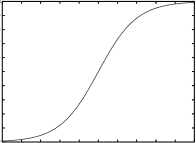

**图3.1：** 逻辑函数示意图。在逻辑回归中，\(p(Y=1\mid X)\)被定义为服从这种形式。

从图3.1可以看出，\(g(z)\)以及\(g(\theta^T X)\)和\(p(Y\mid X)\)始终被限制在0到1之间。

由于概率之和必须等于1，\(p(Y=0\mid X)\)可以用下式估计

\[
p(Y=0\mid X)=1-g(\theta^T X)=\frac{e^{-\theta^T X}}{1+e^{-\theta^T X}}. \tag{3.20}
\]

因为逻辑回归预测概率而不仅仅是类别，我们可以使用似然函数来拟合它。对于每个训练数据点，我们有一个特征向量\(X=\langle X_0,X_1,\ldots,X_d\rangle\)（\(X_0=1\)）和一个观测类别\(Y=y_k\)。该类别的概率要么是\(g(\theta^T X)\)（如果\(y_k=1\)），要么是\(1-g(\theta^T X)\)（如果\(y_k=0\)）。注意，我们可以将公式(3.19)和公式(3.20)合并为一个更紧凑的形式

\[
p(Y=y_k\mid X;\theta) = \bigl(p(Y=1\mid X)\bigr)^{y_k}\bigl(p(Y=0\mid X)\bigr)^{1-y_k} \tag{3.21}
\]

\[
= \bigl(g(\theta^T X)\bigr)^{y_k}\bigl(1-g(\theta^T X)\bigr)^{1-y_k}. \tag{3.22}
\]

假设\(N\)个训练样本是独立生成的，则参数的似然可写为

\[
L(\theta) = p(\mathbf{Y}\mid \mathbf{X};\theta)
\]

\[
= \prod_{n=1}^{N} p(Y^{(n)} = y_k \mid X^{(n)};\theta)
\]

\[
= \prod_{n=1}^{N} \bigl(p(Y^{(n)} = 1\mid X^{(n)})\bigr)^{Y^{(n)}} \bigl(p(Y^{(n)} = 0\mid X^{(n)})\bigr)^{1-Y^{(n)}}
\]

\[
= \prod_{n=1}^{N} \bigl(g(\theta^T X^{(n)})\bigr)^{Y^{(n)}} \bigl(1-g(\theta^T X^{(n)})\bigr)^{1-Y^{(n)}}
\]

其中\(\theta\)是要估计的参数向量，\(Y^{(n)}\)表示第\(n\)个训练样本中\(Y\)的观测值，\(X^{(n)}\)表示第\(n\)个训练样本中\(X\)的观测值。为了对任意给定的\(X\)进行分类，我们通常希望给\(Y\)赋予使似然最大化的值\(y_k\)，如下一小节所述。

### 3.3.2 逻辑回归的参数估计

通常，最大似然被用于确定逻辑回归的参数。条件似然是训练数据中观测到的\(Y\)值在对应\(X\)值条件下的概率。我们选择满足下式的参数\(\theta\)

\[
\theta \leftarrow \arg\max_\theta L(\theta),
\]

其中\(\theta = \{\theta_0, \theta_1, \ldots, \theta_d\}\)是要估计的参数向量，该模型对于\(d\)维特征空间有\(d+1\)个可调参数。

最大化似然等价于最大化对数似然：

\[
l(\theta) = \log L(\theta) = \sum_{n=1}^{N} \log p(Y^{(n)} = y_k \mid X^{(n)};\theta)
\]

\[
= \sum_{n=1}^{N} \left[ Y^{(n)} \log g(\theta^T X^{(n)}) + (1-Y^{(n)}) \log\bigl(1-g(\theta^T X^{(n)})\bigr) \right] \tag{3.23}
\]

\[
= \sum_{n=1}^{N} \left[ Y^{(n)} (\theta^T X^{(n)}) - \log\bigl(1+e^{\theta^T X^{(n)}}\bigr) \right]. \tag{3.24}
\]

为了估计参数向量\(\theta\)，我们使用以下规则最大化对数似然

\[
\theta \leftarrow \arg\max_\theta l(\theta). \tag{3.25}
\]

由于关于\(\theta\)最大化\(l(\theta)\)没有闭式解，我们使用梯度上升[37,38]来求解该问题。用向量记号表示，我们的更新规则为

\[
\theta \leftarrow \theta + \alpha \sum_{n=1}^{N} \bigl(Y^{(n)} - g(\theta^T X^{(n)})\bigr) X^{(n)},
\]

其中\(\alpha\)是学习率。

### 3.3.3 正则化

为了减少过拟合，我们可以选择\(\theta\)来最大化正则化对数似然\(l(\theta) + \log p(\theta)\)，其中\(p(\theta)\)是参数上的先验分布，如果\(p(\theta)\)是零均值高斯分布，则\(\log p(\theta)\)产生一个正比于\(\|\theta\|^2\)的项。取偏导数后，我们很容易得到形式

\[
\frac{\partial l(\theta)}{\partial \theta_i} = \sum_{n=1}^{N} \bigl(Y^{(n)} - g(\theta^T X^{(n)})\bigr) X_i^{(n)} - \lambda \theta_i,
\]

修改后的梯度下降规则变为

\[
\theta_i \leftarrow \theta_i + \alpha \sum_{n=1}^{N} \bigl(Y^{(n)} - g(\theta^T X^{(n)})\bigr) X_i^{(n)} - \alpha \lambda \theta_i.
\]

### 3.3.4 应用

逻辑回归被广泛用于众多学科[26]，包括Web、医学和社会科学领域。例如，逻辑回归可用于根据患者的观测特征（年龄、性别、身体质量指数、各种血液检查结果等）预测患者是否患有某种疾病（如糖尿病）[3,22]。另一个例子[2]可能用于根据年龄、收入、性别、种族、居住州、以往选举中的投票等预测美国选民是投民主党还是共和党。该技术也可用于工程领域，特别是预测给定过程、系统或产品的失效概率。它还用于营销应用，例如预测客户购买产品或停止订阅的倾向等。在经济学中，它可用于预测个人选择参加劳动力的可能性；在商业应用中，它可用于预测房主抵押贷款违约的可能性。

## 3.4 用于分类的概率图模型

图模型[13,17]是一种概率模型，其中图表示随机变量之间的条件独立结构。图模型提供了一种可视化概率模型结构的简单方法，并且可用于设计和激发新模型。在概率图模型中，每个节点表示一个随机变量，链接表示这些变量之间的概率关系。然后，图捕捉了所有随机变量上的联合分布如何分解为因子的乘积，每个因子仅依赖于变量子集。常用的分布图表示有两个分支：有向和无向。在本节中，我们讨论用于分类的图模型的关键方面。我们主要介绍有向图模型隐马尔可夫模型（HMM）和无向图模型条件随机场（CRF）。此外，我们将分别介绍作为HMM和CRF预备内容的基本贝叶斯网络和马尔可夫随机场。

### 3.4.1 贝叶斯网络

贝叶斯网络（BNs），也称为信念网络（或简称为贝叶斯网），属于有向图模型，其中图的链接具有由箭头表示的特定方向性。形式化地，BNs是有向无环图（DAG），其节点表示随机变量，边表示条件依赖。例如，从随机变量\(X\)到\(Y\)的链接可以非正式地解释为表示\(X\)“导致”\(Y\)。对于分类


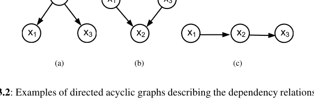

**图 3.2：** 描述变量之间依赖关系的有向无环图示例。

任务中，我们可以为将要分类的随机变量创建一个节点，目标是推断该随机变量关联的离散值。例如，为了判断患者是否患有肺癌，会创建一个表示“肺癌”的节点，同时创建其他可能直接或间接导致肺癌的因素以及肺癌导致的结果的节点。在给定贝叶斯网络（BN）中其他随机变量的观测值后，我们可以推断患者患肺癌的概率。

#### 3.4.1.1 贝叶斯网络构建

为所有随机变量创建节点后，需要指定这些节点之间的图结构。贝叶斯网络假设随机变量之间存在一种简单的条件独立性假设，可表述如下：在给定父节点的条件下，一个节点与其非后代节点条件独立，其中父节点关系是相对于节点的某个固定拓扑顺序而言的。这也称为局部马尔可夫性质，表示为对于所有 $v \in V$，有 $X_v \perp X_{V \setminus \mathrm{de}(v)} \mid X_{\mathrm{pa}(v)}$（符号 $\perp$ 表示“独立于”），其中 $\mathrm{de}(v)$ 是 $v$ 的后代节点集合，$\mathrm{pa}(v)$ 表示 $v$ 的父节点集合。例如，如图 3.2(a) 所示，我们得到 $x_1 \perp x_3 \mid x_2$。

BN 的一个关键计算是计算所有随机变量的观测联合分布 $p(x)$。利用概率的链式法则，在给定这些随机变量的拓扑顺序后，上述联合分布可以写成条件分布的乘积：

$$
p(x_1,\dots,x_n) = p(x_1)p(x_2|x_1)\dots p(x_n|x_{n-1},\dots,x_1). \tag{3.29}
$$

利用条件独立性假设，所有随机变量的联合概率可以分解为图中所有节点在其父变量条件下的密度函数的乘积。也就是说，由于 $X_i \perp \{X_1,\dots,X_{i-1}\} \setminus \mathrm{pa}_i \mid \mathrm{pa}_i$，我们有 $p(x_i|x_1,\dots,x_{i-1}) = p(x_i|\mathrm{pa}_i)$。更精确地说，对于一个有 $n$ 个节点的图（记为 $x_1,\dots,x_n$），联合分布为：

$$
p(x_1,\dots,x_n) = \prod_{i=1}^{n} p(x_i|\mathrm{pa}_i), \tag{3.30}
$$

其中 $\mathrm{pa}_i$ 是节点 $x_i$ 的父节点集合。

考虑图 3.2 所示的图，我们可以从该图得到相应的联合分布表示，该表示写成一组条件概率分布的乘积，图中每个节点对应一个条件概率分布。因此，图 3.2(a)-(c) 的联合分布分别为 $p(x_1,x_2,x_3) = p(x_1|x_2)p(x_2)p(x_3|x_2)$、$p(x_1,x_2,x_3) = p(x_1)p(x_2|x_1,x_3)p(x_3)$ 和 $p(x_1,x_2,x_3) = p(x_1)p(x_2|x_1)p(x_3|x_2)$。

除了图结构之外，还需要给出或学习条件概率分布 $p(X_i|\mathrm{Pa}_i)$。当随机变量是离散的时，该分布可以使用条件概率表（CPT）表示，表中列出了在父节点所有可能配置下 $X_i$ 取每个值的概率。例如，假设图 3.2(b) 中的 $X_1$、$X_2$ 和 $X_3$ 都是二元随机变量，$p(X_2|X_1,X_3)$ 的一个可能条件概率表为：

|  | $X_1=0, X_3=0$ | $X_1=0, X_3=1$ | $X_1=1, X_3=0$ | $X_1=1, X_3=1$ |
|---|---|---|---|---|
| $X_2=0$ | 0.1 | 0.4 | 0.8 | 0.3 |
| $X_2=1$ | 0.9 | 0.6 | 0.2 | 0.7 |

#### 3.4.1.2 贝叶斯网络中的推断

分类问题可以通过计算感兴趣的随机变量（例如肺癌）在给定其他随机变量观测值的情况下取某个类别标签的概率来解决，即 $p(x_i|x_1,\dots,x_{i-1},x_{i+1},\dots,x_n)$，如果所有变量的联合概率已知，则可以计算出该概率：

$$
p(x_i|x_1,\dots,x_{i-1},x_{i+1},\dots,x_n)=\frac{p(x_1,\dots,x_n)}{\sum_{x_i'}p(x_1,\dots,x_i',\dots,x_n)}. \tag{3.31}
$$

由于 BN 是变量及其关系的完整模型，因此模型指定了所有变量上的完整联合概率分布（JPD）。给定 JPD，我们可以通过对无关变量求和（边缘化）来回答所有可能的推断查询。然而，JPD 的大小为 $O(2^n)$，其中 $n$ 是节点数量，并且我们假设每个节点有 2 个状态。因此，对 JPD 求和需要指数时间。最常见的精确推断方法是变量消元 [8]。其总体思想是通过将求和分配到乘积上来逐个消除非观测且非查询的变量。读者可参阅 [8] 了解更多细节。除了精确推断之外，一种有用的近似算法——信念传播 [30] 通常用于包括贝叶斯网络在内的通用图，这将在第 3.4.3 节中介绍。

#### 3.4.1.3 学习贝叶斯网络

贝叶斯网络的学习由两个部分组成：参数学习和结构学习。当图结构给定时，只需要根据观测数据学习参数，例如条件概率表中的概率。通常，会使用最大似然估计（MLE）或最大后验估计（MAP）来找到最佳参数。如果图结构也未知，则需要同时从数据中学习图结构和参数。

从数据角度看，数据可能是完整的或不完整的，这取决于所有随机变量是否可观测。当涉及隐藏随机变量时，通常使用 EM 算法。

### 3.4.2 隐马尔可夫模型

我们现在介绍贝叶斯网络的一个特例：隐马尔可夫模型。在隐马尔可夫模型中，隐藏状态以链式方式连接，并受马尔可夫过程支配；在给定隐藏状态的条件下，可观测值独立生成，并形成一个序列。隐马尔可夫模型广泛用于语音识别、手势识别和词性标注，其中隐藏类别彼此依赖。因此，一个观测的类别标签不仅依赖于该观测，还依赖于相邻状态。

在如图 3.3(a) 所示的常规马尔可夫模型中，状态 $x_i$ 对观测者直接可见，因此状态转移概率 $p(x_i|x_{i-1})$ 是唯一参数。基于马尔可夫性质，该模型下长度为 $n$ 的观测序列的联合分布为：

$$
p(x_1,\dots,x_n)=p(x_1)\prod_{i=2}^{n}p(x_i|x_{i-1}). \tag{3.32}
$$

**图 3.3：** 常规马尔可夫模型和隐马尔可夫模型的图结构。

因此，如果我们使用这样的模型来预测序列中的下一个观测值，预测的分布将取决于紧邻的前一个观测值，并且在给定前一个观测值的条件下，与所有更早的观测值无关。

隐马尔可夫模型（HMM）可以被视为最简单的动态贝叶斯网络。在隐马尔可夫模型中，状态 $y_i$ 不是直接可见的，只有依赖于状态的输出 $x_i$ 是可见的。隐藏状态空间是离散的，并且假设由 $N$ 个可能值之一组成，也称为潜变量。观测值可以是离散的或连续的，通常由类别分布或高斯分布生成。一般来说，HMM 可以被视为混合模型的推广，其中隐藏变量通过马尔可夫过程相关联，而不是彼此独立。

假设潜变量形成如图 3.3(b) 所示的一阶马尔可夫链。随机变量 $y_t$ 是时间 $t$ 的隐藏状态，随机变量 $x_t$ 是时间 $t$ 的观测值。图中的箭头表示条件依赖。从图中可以清楚地看出，在给定 $y_t$ 的条件下，$y_{t-1}$ 和 $y_{t+1}$ 是独立的，因此 $y_{t+1} \perp\!\!\!\perp y_{t-1} \mid y_t$。这是关键的条件独立性性质，称为马尔可夫性质。类似地，观测变量 $x_t$ 的值只依赖于隐藏变量 $y_t$ 的值。于是，该模型的联合分布为：

$$
p(x_1,\dots,x_n,y_1,\dots,y_n) = p(y_1) \prod_{t=2}^{n} p(y_t|y_{t-1}) \prod_{t=1}^{n} p(x_t|y_t), \tag{3.33}
$$

其中 $p(y_t|y_{t-1})$ 是状态转移概率，$p(x_t|y_t)$ 是观测概率。

#### 3.4.2.1 推断与学习算法

考虑给定一组可能状态 $\Omega_Y = \{q_1,\dots,q_N\}$ 和一组可能观测 $\Omega_X = \{o_1,\dots,o_M\}$ 的情况。HMM 的参数学习任务是找到最佳的状态转移概率集 $A = \{a_{ij}\}$，$a_{ij} = p(y_{t+1}=q_j|y_t=q_i)$，观测概率集 $B = \{b_i(k)\}$，$b_i(k)=p(x_t=o_k|y_t=q_i)$，以及初始状态分布 $\Pi = \{\pi_i\}$，$\pi_i = p(y_0=q_i)$（针对一组输出序列）。设 $\Lambda = \{A,B,\Pi\}$ 表示给定 HMM（固定 $\Omega_Y$ 和 $\Omega_X$）的参数。任务通常是在给定输出序列集的情况下，推导 HMM 参数的最大似然估计。通常，可以使用 Baum-Welch 算法 [4] 高效地推导局部最大似然，该算法利用前向-后向算法 [33]，并且是广义 EM 算法 [9] 的一个特例。

给定模型参数 $\Lambda$，HMM 有几个典型的推断问题，如下所述。一个常见任务是计算特定输出序列的概率，这需要对所有可能的状态序列求和：观测到长度为 $T$ 的序列 $X_1^T = o_1,\dots,o_T$ 的概率为 $P(X_1^T|\Lambda)=\sum_{Y^T} P(X_1^T|Y_1^T,\Lambda)P(Y_1^T|\Lambda)$，其中求和遍历所有可能的隐藏节点序列 $Y_1^T = y_1,\dots,y_T$。

这个问题可以使用前向-后向算法高效处理。在描述该算法之前，我们定义前向（alpha）值和后向（beta）值如下：

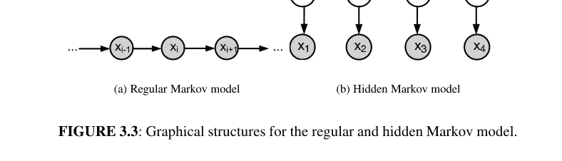


如下：$\alpha_t(i)=P(x_1=o_1,\ldots,x_t=o_t,y_t=q_i\mid\Lambda)$ 和 $\beta_t(i)=P(x_{t+1}=o_{t+1},\ldots,x_T=o_T\mid y_t=q_i,\Lambda)$。注意，前向值使我们能够通过边际化来求解问题，于是我们得到

$$P(X_1^T\mid\Lambda)=\sum_{i=1}^{N}P(o_1,\ldots,o_T,y_T=q_i\mid\Lambda)=\sum_{i=1}^{N}\alpha_T(i).$$

利用*动态规划*原理可以高效地计算前向值：

$$\alpha_1(i)=\pi_i b_i(o_1),$$
$$\alpha_{t+1}(j)=\left[\sum_{i=1}^{N}\alpha_t(i)a_{ij}\right]b_j(o_{t+1}).$$

类似地，后向值可以计算为

$$\beta_T(i)=1,$$
$$\beta_t(i)=\sum_{j=1}^{N}a_{ij}b_j(o_{t+1})\beta_{t+1}(j).$$

后向值将在 Baum-Welch 算法中使用。

给定 HMM 的参数和一个特定的观测序列，另一个有趣的任务是计算最有可能产生该观测序列的状态序列。我们可以通过评估每种情况下状态序列与观测序列的联合概率来找到最可能的序列。例如，在词性标注（POS）[18]中，我们观测到一个词元（单词）序列 $X_1^T=o_1,\ldots,o_T$，而词性标注的目标是找到一个随机最优的标注序列 $Y_1^T=y_1y_2\ldots y_T$，使其最大化 $P(Y_1^T,X_1^T)$。一般来说，寻找观测序列最可能的解释可以通过**维特比算法** [12] 高效求解，其递推关系为：

$$V_1(i)=b_i(o_1)\pi_i,$$
$$V_t(j)=b_j(o_t)\max_i\left(V_{t-1}(i)a_{ij}\right).$$

这里 $V_t(j)$ 是能够解释前 $t$ 个观测且以 $q_j$ 作为最终状态的最可能状态序列的概率。维特比路径可以通过保存回溯指针来恢复，这些指针记录了第二个方程中使用了哪个状态 $y_{t-1}=q_i$。令 $Ptr(y_t,q_i)$ 为返回用于计算 $V_t(i)$ 的 $y_{t-1}$ 值的函数，如下所示：

$$y_T=\arg\max_{q_i\in\Omega_Y}V_T(i),$$
$$y_{t-1}=Ptr(y_t,q_i).$$

该算法的复杂度为 $O(T\times N^2)$，其中 $T$ 是观测序列的长度，$N$ 是可能状态的数量。

现在我们需要一种调整参数 $\Lambda$ 的方法，以最大化给定训练集上的似然。**Baum-Welch 算法** [4] 用于寻找 HMM 的未知参数，它是广义 EM 算法 [9] 的一个特例。我们从为参数选择任意值开始，然后根据模型和观测计算期望频率。期望频率通过对观测到的转移按当前模型指定的概率加权而得到。然后将获得的期望频率替代旧参数，并迭代直到不再改进。每次迭代我们都会提高模型被观测到的概率，直到达到某个极限概率。该迭代过程保证收敛到局部最大值 [34]。

### 3.4.3 马尔可夫随机场

现在我们转向另一大类图模型，它们由无向图描述，并且同样指定了因子分解和一组条件独立关系。马尔可夫随机场（MRF），也称为无向图模型 [14]，具有一组节点，每个节点对应一个变量或一组变量，以及一组链接，每个链接连接一对节点。这些链接是无向的，也就是说，它们不带有箭头。

#### 3.4.3.1 条件独立性

给定无向图 G 中的三组节点，记为 A、B 和 C，如果在从 G 中移除节点集 C 之后 A 和 B 在 G 中被分离，那么 A 和 B 在给定随机变量 C 的条件下是条件独立的，记为 A ⊥⊥ B|C。条件独立性由简单的图分离来确定。换句话说，一个变量在给定其邻居的条件下与所有其他变量条件独立，记为 X_v ⊥⊥ X_{V\{v}∪ne(v)} | X_{ne(v)}，其中 ne(v) 是 v 的邻居集合。一般来说，MRF 在表示依赖关系方面与贝叶斯网络相似，但也有一些差异。一方面，MRF 可以表示某些贝叶斯网络无法表示的依赖关系（如循环依赖）；另一方面，MRF 无法表示某些贝叶斯网络可以表示的依赖关系（如诱导依赖）。

#### 3.4.3.2 团因子分解

由于任意概率分布的马尔可夫性质可能难以建立，一类常用的 MRF 是根据图的团进行因子分解的。团被定义为图中节点的一个子集，使得该子集中所有节点对之间都存在链接。换句话说，团中的节点集合是全连接的。

因此，我们可以将联合分布分解中的因子定义为团中变量的函数。我们用 C 表示一个团，用 x_C 表示该团中的变量集合。于是联合分布可以写成图的最大团上势函数 ψ_C(x_C) 的乘积：

p(x_1,x_2,...,x_n) = 1/Z ∏_C ψ_C(x_C),

其中配分函数 Z 是一个归一化常数，由 Z = Σ_x ∏_C ψ_C(x_C) 给出。与有向图联合分布中的因子不同，无向图中的势函数没有特定的概率解释。因此，如何针对特定应用选择合适的势函数似乎非常重要。一种流行的势函数定义为 ψ_C(x_C) = exp(−ε(x_C))，其中 ε(x_C) = ln ψ_C(x_C) 是源自统计物理的能量函数 [29]。其基本思想是物理状态的概率与其能量成反比。在对数表示中，我们有

p(x_1,x_2,...,x_n) = 1/Z exp( − Σ_C ε(x_C) ).

上述联合分布被定义为势函数的乘积，因此总能量通过将每个最大团的能量相加而获得。

对数线性模型是一种具有特征函数 f_k 的马尔可夫随机场，其联合分布可以写为

p(x_1,x_2,...,x_n) = 1/Z exp( Σ_{k=1}^K λ_k f_k(x_{C_k}) ),

其中 f_k(x_{C_k}) 是团 C_k 的特征函数，λ_k 是特征的权重向量。对数线性模型为许多分布提供了更紧凑的表示，特别是当变量具有较大域（如文本）时。

#### 3.4.3.3 推理与学习算法

在 MRF 中，我们可以通过对所有不在 $A, B$ 中的变量 $v$ 的所有可能赋值求和，来计算给定一组节点 $A$ 的值时另一组节点 $B$ 的条件分布，这称为*精确推理*。然而，在一般情况下精确推理在计算上是难以处理的。相反，诸如 MCMC 方法 [1] 和环状*置信传播* [5, 30] 之类的近似技术在实践中往往更为可行。此外，某些特定的 MRF 子类允许高效的极大后验（MAP）估计，或更确切地说是赋值推理，例如联想网络。这里我们将简要描述置信传播算法。

置信传播是一种在包括贝叶斯网络和 MRF 在内的图模型上执行推理的消息传递算法。它计算每个未观测节点在给定任何观测节点条件下的边缘分布。通常，置信传播在因子图上运行，因子图是一个二分图，包含对应于变量 $V$ 和因子 $U$ 的节点，变量与它们出现的因子之间通过边连接。任何贝叶斯网络和 MRF 都可以表示为因子图。该算法通过在节点之间的边上传递称为*消息*的实值函数来工作。以成对 MRF 为例，令 $m_{ij}(x_j)$ 表示从节点 $i$ 到节点 $j$ 的消息，$m_{ij}(x_j)$ 的值越高，意味着节点 $i$ “认为”边缘值 $P(x_j)$ 越高。通常算法首先将所有消息初始化为均匀或随机的正值，然后通过考虑所有流入 $i$ 的消息（除了来自 $j$ 的消息）来更新从 $i$ 到 $j$ 的消息，如下所示：

$$m_{ij}(x_j)=\sum_{x_i} f_{ij}(x_i,x_j)\prod_{k\in ne(i)\setminus j}m_{ki}(x_i),$$

其中 $f_{ij}(x_i,x_j)$ 是成对团的势函数。经过足够的迭代后，该过程很可能收敛到共识。一旦消息收敛，所有变量的边缘概率可以通过下式确定：

$$p(x_i)\propto\prod_{k\in ne(i)}m_{ki}(x_i).$$

读者可以参考 [30] 了解更详细的说明。主要成本在于消息更新方程，每对变量需要 $O(N^2)$ 的时间（$N$ 是可能状态的数量）。

近年来，MRF 已被广泛应用于许多文本挖掘任务，例如文本分类 [7] 和信息检索 [28]。在 [28] 中，MRF 被用于通过查询和文档的联合分布来建模词项依赖关系。该模型允许将任意文本特征作为证据纳入。在该模型中，从图 $G$ 构造 MRF，$G$ 由查询节点 $q_i$ 和一个文档节点 $D$ 组成。作者探索了完全独立、顺序依赖和完全依赖三种模型变体。然后，提出了一种直接最大化平均平均精度的新训练方法。结果表明，通过建模依赖关系可以获得显著的改进，尤其是在更大的 Web 数据集上。

### 3.4.4 条件随机场

到目前为止，我们已经将马尔可夫网络表示描述为联合分布。MRF 的一个显著变体是条件随机场（CRF）[19, 40]，其中每个变量还可以以一组全局观测为条件。更正式地说，CRF 是一个无向图，其节点可以恰好分为两个不相交的集合，即观测变量 $X$ 和输出变量 $Y$，它可以像普通马尔可夫网络一样被参数化为一组因子。其基本思想是定义给定特定观测序列 $X$ 时标签序列 $Y$ 上的条件概率分布 $p(Y|X)$，而不是标签和观测序列上的联合分布 $p(Y,X)$。CRF 相对于 HMM 的主要优势在于其


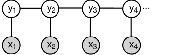

**图 3.4：** 条件随机场模型的图形结构。

条件性，使得 HMM 为保证可处理推理所需而要求的独立性假设得到放松。

考虑如图 3.4 所示的线性链 CRF，其中 $Y=\{y_1,y_2,\ldots,y_n\}$ 且 $X=\{x_1,x_2,\ldots,x_n\}$，观测变量 $X$ 的输入序列表示观测序列，而 $Y$ 表示给定观测后需要推断的隐藏状态变量序列。$y_i$ 被结构化为形成一条链，每个 $y_i$ 与 $y_{i+1}$ 之间有一条边。此网络表示的分布具有以下形式：

$$p(y_1,y_2,\ldots,y_n\mid x_1,x_2,\ldots,x_n)=\frac{1}{Z(X)}\exp\left(\sum_{k=1}^{K}\lambda_k f_k(y_i,y_{i-1},x_i)\right),$$

其中 $$Z(X)=\sum_{y_i}\exp\left(\sum_{k=1}^{K}\lambda_k f_k(y_i,y_{i-1},x_i)\right).$$

#### 3.4.4.1 学习算法

对于一般图，CRF 中的精确推理问题是不可处理的。基本上，CRF 的推理问题与 MRF 相同。如果图是链或树，如图 3.4 所示，消息传递算法会给出精确解，其与 HMM 情况下的前向-后向 [4,33] 和 Viterbi 算法 [12] 相似。如果精确推理不可行，通常可以使用近似技术来推导 CRF 的推理问题，例如 MCMC [1,31]、loopy *信念传播* [5,30] 等。与 HMM 类似，参数通常通过最大化训练数据的似然来学习。它可以使用迭代技术求解，例如迭代缩放 [19] 和梯度下降方法 [37]。

CRF 已应用于自然语言处理中的各种问题，包括词性标注 [19]、浅层句法分析 [37] 和命名实体识别 [24]，是相关 HMM 的替代方案。基于 HMM 模型，我们可以通过最大化联合概率分布 $p(X,Y)$ 来确定标签序列。相比之下，CRF 定义了给定特定观测序列的标签序列上的单一对数线性分布，即 $p(Y\mid X)$。CRF 相对于 HMM 的主要优势在于其条件性，使得 HMM 为保证可处理推理所需而要求的独立性假设得到放松。正如预期的那样，CRF 在词性标注和许多现实世界的序列标注任务上优于 HMM [19,24]。

## 3.5 总结

本章介绍了用于分类的最常用的概率模型，包括生成式概率分类器，例如朴素贝叶斯分类器和隐马尔可夫模型，以及判别式概率分类器，例如逻辑回归和条件随机场。其中一些分类器，如朴素贝叶斯分类器，可能更适合高维文本数据，而其他分类器如 HMM 和 CRF 则更常用于时间或序列数据。这些概率模型的学习算法的目标是为这些模型中的参数找到 MLE 或 MAP 估计。对于简单的朴素贝叶斯分类器和逻辑回归，它们有闭式解。在其他情况下，迭代算法如梯度下降法是不错的选择。

## 参考文献

- [1] C. Andrieu, N. De Freitas, A. Doucet, and M. Jordan. An introduction to MCMC for machine learning. *Machine Learning*, 50(1):5–43, 2003.

- [2] J. Antonakis and O. Dalgas. Predicting elections: Child’s play! *Science*, 323(5918):1183–1183, 2009.

- [3] S. C. Bagley, H. White, and B. A. Golomb. Logistic regression in the medical literature: Standards for use and reporting, with particular attention to one medical domain. *Journal of Clinical Epidemiology*, 54(10):979–985, 2001.

- [4] L. Baum, T. Petrie, G. Soules, and N. Weiss. A maximization technique occurring in the statistical analysis of probabilistic functions of Markov chains. *The Annals of Mathematical Statistics*, 41(1):164–171, 1970.

- [5] C. Bishop. *Pattern Recognition and Machine Learning*, volume 4. Springer New York, 2006.

- [6] S. F. Chen and J. Goodman. An empirical study of smoothing techniques for language modeling. In *Proceedings of the 34th Annual Meeting on Association for Computational Linguistics*, pages 310–318. Association for Computational Linguistics, 1996.

- [7] S. Chhabra, W. Yerazunis, and C. Siefkes. Spam filtering using a Markov random field model with variable weighting schemas. In *Proceedings of the 4th IEEE International Conference on Data Mining, 2004. ICDM’04*, pages 347–350, 2004.

- [8] F. Cozman. Generalizing variable elimination in Bayesian networks. In *Workshop on Probabilistic Reasoning in Artificial Intelligence*, pages 27–32. 2000.

- [9] A. P. Dempster, N. M. Laird, and D. B. Rubin. Maximum likelihood from incomplete data via the EM algorithm. *Journal of the Royal Statistical Society. Series B*, 39(1):1–38, 1977.

- [10] P. Domingos and M. Pazzani. On the optimality of the simple Bayesian classifier under zero-one loss. *Machine Learning*, 29(2-3):103–130, 1997.

- [11] R. O. Duda and P. E. Hart. *Pattern Classification and Scene Analysis*, volume 3. Wiley New York, 1973.

- [12] G. Forney Jr. The Viterbi algorithm. *Proceedings of the IEEE*, 61(3):268–278, 1973.

- [13] M. I. Jordan. Graphical models. *Statistical Science*, 19(1):140–155, 2004.

- [14] R. Kindermann, J. Snell, and American Mathematical Society. *Markov Random Fields and Their Applications*. American Mathematical Society Providence, RI, 1980.

- [15] D. Kleinbaum and M. Klein. Maximum likelihood techniques: An overview. *Logistic regression*, pages 103–127, 2010.

- [16] R. Kohavi. Scaling up the accuracy of Naive-Bayes classifiers: A decision-tree hybrid. In KDD, pages 202–207, 1996.

- [17] D. Koller and N. Friedman. Probabilistic graphical models. MIT Press, 2009.

- [18] J. Kupiec. Robust part-of-speech tagging using a hidden Markov model. Computer Speech & Language, 6(3):225–242, 1992.

- [19] J. D. Lafferty, A. McCallum, and F. C. N. Pereira. Conditional random fields: Probabilistic models for segmenting and labeling sequence data. In ICML, pages 282–289, 2001.

- [20] P. Langley, W. Iba, and K. Thompson. An analysis of Bayesian classifiers. In AAAI, volume 90, pages 223–228, 1992.

- [21] D. D. Lewis. Naive (Bayes) at forty: The independence assumption in information retrieval. In ECML, pages 4–15, 1998.

- [22] J. Liao and K.-V. Chin. Logistic regression for disease classification using microarray data: Model selection in a large p and small n case. Bioinformatics, 23(15):1945–1951, 2007.

- [23] P. MacCullagh and J. A. Nelder. Generalized Linear Models, volume 37. CRC Press, 1989.

- [24] A. McCallum and W. Li. Early results for named entity recognition with conditional random fields, feature induction and web-enhanced lexicons. In Proceedings of the 7th Conference on Natural Language Learning at HLT-NAACL 2003-Volume 4, pages 188–191, ACL, 2003.

- [25] A. McCallum, K. Nigam, et al. A comparison of event models for Naive Bayes text classification. In AAAI-98 Workshop on Learning for Text Categorization, volume 752, pages 41–48. 1998.

- [26] S. Menard. Applied Logistic Regression Analysis, volume 106. Sage, 2002.

- [27] V. Metsis, I. Androutsopoulos, and G. Paliouras. Spam filtering with Naive Bayes—Which Naive Bayes? In Third Conference on Email and Anti-Spam, pp. 27–28, 2006.

- [28] D. Metzler and W. Croft. A Markov random field model for term dependencies. In Proceedings of the 28th Annual International ACM SIGIR Conference on Research and Development in Information Retrieval, pages 472–479. ACM, 2005.

- [29] T. Minka. Expectation propagation for approximate Bayesian inference. In Uncertainty in Artificial Intelligence, volume 17, pages 362–369. 2001.

- [30] K. Murphy, Y. Weiss, and M. Jordan. Loopy belief propagation for approximate inference: An empirical study. In Proceedings of the Fifteenth Conference on Uncertainty in AI, volume 9, pages 467–475, 1999.

- [31] R. M. Neal. Markov chain sampling methods for Dirichlet process mixture models. Journal of Computational and Graphical Statistics, 9(2):249–265, 2000.

- [32] L. Qi and J. Sun. A nonsmooth version of Newton’s method. Mathematical Programming, 58(1-3):353–367, 1993.

- [33] L. Rabiner. A tutorial on hidden Markov models and selected applications in speech recognition. Proceedings of the IEEE, 77(2):257–286, 1989.

- [34] L. R. Rabiner and B. H. Juang. An introduction to hidden Markov models. IEEE ASSP Magazine, 3(1): 4–15, January 1986.


[35] I. Rish. 朴素贝叶斯分类器的实证研究. 载于 *IJCAI 2001 人工智能经验方法研讨会*, 第41–46页, 2001.

[36] I. Rish, J. Hellerstein, 和 J. Thathachar. 影响朴素贝叶斯性能的数据特征分析. 载于 *第十八届机器学习会议论文集*, 2001.

[37] F. Sha 和 F. Pereira. 基于条件随机场的浅层句法分析. 载于 *2003年计算语言学协会北美分会人类语言技术会议论文集*, 第134–141页, 2003.

[38] J. A. Snyman. *实用数学优化：基础优化理论及经典与新型基于梯度的算法导论*, 第97卷, Springer, 2005.

[39] J. Stoer, R. Bulirsch, R. Bartels, W. Gautschi, 和 C. Witzgall. *数值分析导论*, 第2卷, Springer New York, 1993.

[40] C. Sutton 和 A. McCallum. 关系学习中的条件随机场导论. 载于 *统计关系学习导论*, L. Getoor 和 B. Taskar (编), 第95–130页, MIT Press, 2006.

## 第4章

## 决策树：理论与算法

Victor E. Lee
John Carroll University
University Heights, OH
vlee@jcu.edu

Lin Liu
Kent State University
Kent, OH
lliu@cs.kent.edu

Ruoming Jin
Kent State University
Kent, OH
jin@cs.kent.edu

- 4.1 引言 ......................................................... 87
- 4.2 自顶向下的决策树归纳 ...................................... 91
- 4.2.1 节点分裂 ...................................................... 92
- 4.2.2 树剪枝 ........................................................ 97
- 4.3 C4.5 与 CART 案例研究 ....................................... 99
- 4.3.1 分裂准则 .................................................. 100
- 4.3.2 停止条件 ................................................ 100
- 4.3.3 剪枝策略 ................................................... 101
- 4.3.4 处理未知值：归纳与预测 .................. 101
- 4.3.5 其他问题：窗口化与多变量准则 .................. 102
- 4.4 可扩展的决策树构造 .................................. 103
- 4.4.1 基于 RainForest 的方法 ......................................... 104
- 4.4.2 SPIES 方法 ..................................................... 105
- 4.4.3 并行决策树构造 ............................... 107
- 4.5 增量决策树归纳 .................................. 108
- 4.5.1 ID3 家族 .......................................................... 108
- 4.5.2 VFDT 家族 ........................................................ 110
- 4.5.3 流数据的集成方法 ............................... 113
- 4.6 小结 ............................................................... 114
- 参考文献 ............................................................. 115

### 4.1 引言

数据分类最直观的工具之一是决策树。它按层次划分输入空间，直到达到与某个类标签相关联的子空间。决策树因其易于解释和易于使用而备受青睐。它们被广泛应用于商业、科学和医疗保健等领域 [12,15,71]，因为它们为解决复杂决策任务提供了一种直观手段。例如，在商业领域，决策树被用于从规范员工如何应对客户需求到进行高价值投资等各个方面。在医学领域，决策树被用于诊断疾病，并为个人或社区做出治疗决策。

决策树是一种有根有向树，类似于流程图。每个内部节点对应一个划分决策，每个叶节点映射到一个类标签预测。为了对数据项进行分类，我们可以想象数据项从根节点开始遍历树。每个内部节点都被设定一个分裂规则，该规则划分数据的一个（或多个）属性的值域。根据分裂规则，数据项被转发到该节点的某个子节点。这种测试和转发不断重复，直到数据项到达叶节点。

决策树在统计意义上是非参数的：它们并非基于需要学习参数的概率分布来建模。此外，决策树归纳在算法意义上几乎总是非参数的：没有影响结果的权重参数。

树的每条有向边都可以转换为一个布尔表达式（例如，x1 > 5）；因此，决策树可以很容易地转换为一组产生式规则。从根到叶的每条路径按如下方式生成一条规则：将从父节点到子节点的所有决策进行合取（逻辑与）。

决策树可用于数值（有序）属性和分类（无序）属性。也有处理缺失值或不确定值的技术。通常，决策规则是单变量的。也就是说，每个划分规则只考虑一个属性。多变量决策规则也已被研究 [8,9]。它们有时会产生更好的结果，但增加的复杂性往往不值得。许多决策树是二叉树，每个划分规则将其子空间分成两部分。即使是二叉树也可以用于在多个类标签之间进行选择。多路分裂也很常见，但如果划分成过多的子部分，则树的可解释性和稳定性都会受损。回归树是决策树的一种推广，其输出是连续范围内的实数值，而不是分类值。在本章的其余部分，除非另有说明，否则我们将假设是二叉树、单变量树。

表4.1展示了一组训练数据，用于回答分类问题：“什么样的隐形眼镜适合该患者？”该数据来源于 UCI 机器学习库 [3] 提供的一个公共数据集。在原始数据中，年龄属性是分类的，分为三个年龄组。我们已将其修改为以岁为单位的数值属性。接下来的三个属性是二值的。最后一个属性是类标签。它显示为三个值（镜片类型）：{硬性，软性，无}。有些决策树方法只支持二元决策。在这种情况下，我们可以将硬性和软性合并为简单的“是”。

接下来，我们展示四棵不同的决策树，全部由相同的数据归纳而来。图4.1(a)显示了当分类器面向全部三个类值时，使用基尼指数 [8] 选择分裂规则生成的树。这棵树对训练数据的分类完全正确，没有错误。在叶节点中，括号内的数字表示训练数据集中有多少条记录被分类到该区间。有些叶节点只表示单个数据项。在实际应用中，允许树基于单个训练样本进行分支可能是不明智的，因为我们预期数据存在一些噪声或不确定性。图4.1(b)是对前一棵树进行剪枝的结果，目的是在保持几乎相同分类精度的同时获得一棵更小的树。现在一些叶节点有一对数字：（记录数，分类错误数）。

图4.2(a)显示了一个二类分类器（是，否），并使用 C4.5 算法来选择分裂 [66]。图4.2(b)显示了一棵被非常激进剪枝的树。它错误分类了24条训练记录中的3条。

### 表4.1：示例：隐形眼镜推荐

| 年龄 | 近视/远视 | 散光 | 泪液 | 建议镜片 |
|---|---|---|---|---|
| 13 | 近视 | 否 | 减少 | 无 |
| 18 | 近视 | 否 | 正常 | 软性 |
| 14 | 近视 | 是 | 减少 | 无 |
| 16 | 近视 | 是 | 正常 | 硬性 |
| 11 | 远视 | 否 | 减少 | 无 |
| 18 | 远视 | 否 | 正常 | 软性 |
| 8 | 远视 | 是 | 减少 | 无 |
| 8 | 远视 | 是 | 正常 | 硬性 |
| 26 | 近视 | 否 | 减少 | 无 |
| 35 | 近视 | 否 | 正常 | 软性 |
| 39 | 近视 | 是 | 减少 | 无 |
| 23 | 近视 | 是 | 正常 | 硬性 |
| 23 | 远视 | 否 | 减少 | 无 |
| 36 | 远视 | 否 | 正常 | 软性 |
| 35 | 远视 | 是 | 减少 | 无 |
| 32 | 远视 | 是 | 正常 | 无 |
| 55 | 近视 | 否 | 减少 | 无 |
| 64 | 近视 | 否 | 正常 | 无 |
| 63 | 近视 | 是 | 减少 | 无 |
| 51 | 近视 | 是 | 正常 | 硬性 |
| 47 | 远视 | 否 | 减少 | 无 |
| 44 | 远视 | 否 | 正常 | 软性 |
| 52 | 远视 | 是 | 减少 | 无 |
| 46 | 远视 | 是 | 正常 | 无 |

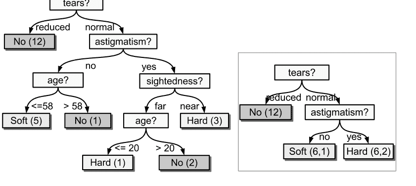

(a) CART 算法

(b) 剪枝后的版本

### 图4.1（见彩色插页）：用于隐形眼镜推荐的3类决策树。


**表 4.2：数据与划分的记号汇总**

| 符号 | 定义 |
|---|---|
| **X** | 全部训练数据集合 = {X₁, …, Xₙ} |
| **A** | 属性集合 = {A₁, …, A_d} |
| **Y** | 类别值域 = {y₁, …, y_m} |
| *Xᵢ* | X 的一个子集 |
| *S* | 一个分裂规则 |
| **Xₛ** | 将 **X** 划分为 {X₁, …, Xₖ} 的一个划分 |

划分规则 *S* 将数据集 **X** 细分为一组子集，统称为 **Xₛ**；即 **Xₛ** = {X₁, X₂, …, Xₖ}，其中 ⋃ᵢXᵢ = **X**。决策树是一个有根树，其中每个父节点的子节点集合对应于父节点数据集的一个划分 (**Xₛ**)，根节点关联完整数据集。*Xᵢ* 中属于类别 *yⱼ* 的项目数为 |Xᵢⱼ|。从 *Xᵢ* 中随机选取的成员属于类别 *yⱼ* 的概率为 pᵢⱼ = |Xᵢⱼ| / |Xᵢ|。

本章其余部分的组织如下。第 4.2 节描述了经典自上而下决策树归纳的运行方式。我们将任务分解为若干子任务，检查并比较已提出的具体分裂和剪枝算法。第 4.3 节展示了两种有影响力的决策树算法 C4.5 [66] 和 CART [8] 的案例研究。在这里我们深入探讨从头到尾的决策树归纳和预测的细节。第 4.4 节描述了如何利用数据汇总和并行化来实现对非常大数据集的可扩展性。然后，在第 4.5 节中，我们介绍实现增量树归纳的技术和算法，尤其是在流数据的情况下。我们最后总结了决策树与其他分类方法相比的优缺点。

### 4.2 自上而下决策树归纳

学习决策树的结构以构建分类器的过程称为决策树归纳 [63]。我们首先描述经典方法，即在静态数据集上自上而下选择划分规则。我们引入一个高层通用算法来传达基本思想，然后更深入地研究算法中的各个步骤和子函数。

决策树概念和算法可以追溯到两个独立的来源：AID（Morgan and Sonquist, 1963）[56] 和 *Experiments in Induction* 中的 CLS（Hunt, Marin, and Stone, 1966）[34]。该算法几乎可以完全写成一个单一的递归函数，如算法 4.1 所示。给定一组数据项，每个数据项由其属性值描述，该函数构建并返回一个子树。关键子函数以小写大写字母显示。首先，函数检查是否应停止对决策树这一分支的进一步细化（第 3 行，子函数 STOP）。如果是，则返回一个叶节点，用当前数据子集 X′ 中出现最频繁的类别进行标记。否则，它会尝试所有可行的分裂选项并选择最佳的一个（第 6 行，FINDBESTSPLITTINGRULE）。分裂规则将数据集划分为子集。什么是“最佳”规则可能是不同树归纳算法之间最显著的区别。算法为所选规则创建一个树节点（第 8 行）。

如果分裂规则耗尽了其属性的所有分类信息，则该属性被耗尽，不能在任何子树中用于分裂（第 9–11 行）。例如，如果一个离散属性有 *k* 个不同值，用于创建 *k* 个子集，则该属性被“耗尽”。

作为最后但至关重要的一步，对于分裂规则生成的数据子集中的每一个，我们递归调用 BUILDSUBTREE（第 13–15 行）。每次调用都会生成一个子树，然后作为子节点附加到主节点。我们现在得到一棵树，作为函数的输出返回。

### 算法 4.1 递归自上而下决策树归纳

输入：数据集 X，属性集 A

```
1: tree ← BUILDSUBTREE(X,A,0);

2: function BUILDSUBTREE(X′,A′,depth)
3:   if STOP(X′,depth) then
4:     return CreateNode(nullRule,majorityClass(X′));
5:   else
6:     rule ← FINDBESTSPLITTINGRULE(X′,A′);
7:     attr ← attributeUsed(rule);
8:     node ← CreateNode(rule,nullClass);
9:     if rule “exhausts” attr then
10:       remove attr from A′;
11:     end if
12:     DataSubsets ← ApplyRule(X′,rule);
13:     for Xi ∈ DataSubsets do
14:       child ← BUILDSUBTREE(Xi,A′,depth + 1);
15:       node.addChild(child);
16:     end for
17:     return node;
18:   end if
19: end function
```

#### 4.2.1 节点分裂

选择分裂规则有两个方面：（1）应考虑哪些可能的分裂，以及（2）其中哪一个最好？每个属性都贡献一组候选分裂。该集合由属性的数据类型、训练数据中实际存在的值以及算法可能设定的限制决定。

- **二元属性**：只有一种分裂是可能的。
- **分类（无序）属性**：如果属性 A 是无序的，则 A 的域是一个数学集合。A 的任何非空真子集 S 都定义了一个二元分裂 {S,A\S}。在排除冗余和空划分后，我们有 2^{k-1} − 1 个可能的二元分裂。然而，一些算法反而进行 k 路分裂。
- **数值（有序）属性**：如果有 k 个不同的值，则我们可以进行 (k − 1) 个不同的二元分裂或一个单一的 k 路分裂。

这些规则在表 4.3 中进行了总结。对于表 4.1 中的数据集，age 属性有 20 个不同的值，因此有 19 个可能的分裂。其他三个属性都是二元的，因此每个提供一个分裂。根节点的总分裂方式为 22 种。

我们现在来看如何对每个分裂规则进行优劣评估。理想的规则会形成表现出类别纯度的子集：每个子集仅包含属于单一类别 y 的成员。为了优化决策树，我们寻求使不纯度函数 F(X_S) 最小化的分裂规则 S。或者，我们也可以寻求最大化分裂导致的不纯度下降量：

**表 4.3：** 基于属性类型的可能分裂数

| 属性类型 | 二元分裂 | 多路分裂 |
|---|---:|---|
| 二元 | 1 | 1（与二元相同） |
| 分类（无序） | $\frac{2^k-2}{2}=2^{k-1}-1$ | 一个 $k$-路分裂 |
| 数值（有序） | $k-1$ | 一个 $k$-路分裂 |

$\Delta F(S)=F(\mathbf{X})-F(\mathbf{X}_S)$。CART [8] 的作者提供了不纯度函数 $F$ 的公理化定义：

#### 定义 4.1

对于 $m$ 状态离散变量 $Y$ 的不纯度函数 $F$ 是定义在所有 $m$ 元组离散概率向量 $(p_1,p_2,\ldots,p_m)$ 的集合上的一个函数，使得

+ 1. $F$ 仅在 $(\frac{1}{m},\frac{1}{m},\ldots,\frac{1}{m})$ 处最大，
+ 2. $F$ 仅在“纯点” $(1,0,\ldots,0),(0,1,\ldots,0),\ldots,(0,0,\ldots,1)$ 处最小，
+ 3. $F$ 关于 $p_1,p_2,\ldots,p_m$ 对称。

我们现在考虑几种满足该定义的<|message|> 不纯度函数。

#### 1. 错误率

一个简单的度量是被错误分类的项目百分比。如果 $y_j$ 是划分 $X_i$ 中出现最频繁的类别值，则 $X_i$ 的 **错误率** 为 $\mathcal{E}(X_i)=\frac{|\{y\ne y_j:(x,y)\in X_i\}|}{|X_i|}=1-p_{ij}$。整个分裂 $X_S$ 的错误率为各子集错误率的加权和。这等于总的误分类数，除以 **X** 的大小。

$$\Delta F_{error}(S)=\mathcal{E}(X)-\sum_{i\in S}\frac{|X_i|}{|X|}\mathcal{E}(X_i). \tag{4.1}$$

该度量没有良好的区分能力。假设我们有一个两类系统，其中 $y$ 不仅在 $X$ 中是多数类，而且在 $X$ 的每个可用划分中也是多数类。错误率会认为所有此类划分在偏好上是等价的。

#### 2. 熵和信息增益（ID3）

Quinlan 的第一个决策树算法 ID3 [62] 使用信息增益，或等价地，熵损失，作为数据集划分的优良函数。在他关于信息论的开创性著作中，Shannon [70] 将信息熵定义为（离散）随机变量 $Y$ 的不确定程度，公式为

$$H_X(Y)=-\sum_{y\in Y}p_y\log p_y \tag{4.2}$$

其中 $p_y$ 是随机选择具有状态 $y$ 的概率。我们在必要时添加下标（例如 $X$）以指示所测量的数据集。信息熵可以解释为描述系统状态所需的期望信息量，以比特为单位。纯系统所需的信息最少。如果系统中的所有对象都处于同一状态 $k$，则 $p_k=1$，$\log p_k=0$，因此熵 $H=0$。系统中没有随机性；不需要额外的分类信息。另一个极端是不确定性最大，当 $|Y|$ 个状态中每个状态的对象数相等时，即 $p_y=\frac{1}{|Y|}$，对所有 $y$ 成立。此时，$H(Y)=-|Y|(\frac{1}{|Y|}\log\frac{1}{|Y|})=\log|Y|$。为了描述系统，我们必须使用 $\log|Y|$ 比特来完全指定所有可能的状态。如果系统被预先划分为子集


增益比率旨在剔除由划分类型带来的信息增益，而非划分中包含的类别。

增益比率仍然存在缺陷。非常不平衡的划分会使 $H(S)$ 的值变低，从而使 $\Delta F_{gainRatio}$ 的值变高，即使信息增益并不很好。为克服这一点，C4.5 只考虑信息增益得分优于平均值的划分 [66]。

#### 5. 归一化度量 — 信息距离

López de Mántaras 提出使用归一化信息距离作为划分准则 [51]。目标属性 $Y$ 与划分规则 $S$ 之间的距离是两个条件熵之和，然后除以它们的联合熵进行归一化：

$$d_N(Y,S)=\frac{H(Y\mid S)+H(S\mid Y)}{H(Y,S)}$$

$$=\frac{\sum_{i\in S}\sum_{y\in Y}p_i p_{iy}\log p_{iy}+\sum_{y\in Y}\sum_{i\in S}p_i p_{yi}\log p_{yi}}{\sum_{i\in S}\sum_{y\in Y}p_{iy}\log p_{iy}}. \tag{4.8}$$

该函数是一个距离度量；即满足非负性、对称性和三角不等式性质，且当 $Y=S$ 时 $d_N(Y,S)=0$。此外其取值范围归一化为 $[0,1]$。由于其构造方式，它同时解决了信息增益（ID3）的高-$k$ 偏差和不平衡划分问题，以及增益比率（C4.5）的问题。

#### 6. 二分类的 DKM 准则

在类别属性为二元的情况下，Dietterich、Kearns 和 Mansour 命名的 DKM 划分准则 [17,43] 具有一定的优势。作者已证明，对于给定的预测精度，基于 DKM 的树的预期大小小于使用 C4.5 或基尼构建的树。

$$DKM(X_i)=2\sqrt{p_i(1-p_i)}$$

$$\Delta F_{DKM}(S)=DKM(X)-\sum_{i\in S}\frac{|X_i|}{|X|}DKM(X_i). \tag{4.9}$$

#### 7. 二元划分准则

出于多种原因，常使用二元决策树。许多属性本身就是二元的，二元树易于解释，且二元结构具有额外的数学性质。下面是一些专门用于二元划分的划分准则。两个划分分别记为 0 和 1。

##### (a) Twoing 准则

该准则在 CART [8] 中作为基尼指数的替代方案提出。其值与两路划分的基尼指数值一致。

$$\Delta F_{twoing}(S)=\frac{p_0\cdot p_1}{4}\left(\sum_{y\in Y}|p_{y0}-p_{y1}|\right)^2. \tag{4.10}$$

##### (b) 正交性度量

Fayyad 和 Irani 衡量两个划分的类别概率向量之间的余弦夹角 [22]。 （请回顾定义 4.1 中对不纯度函数的概率向量使用。）如果划分将某个类别的所有实例都放在一个划分中，但

#### 2. 临界值剪枝 [54]

该剪枝策略遵循与代价复杂度剪枝相同的渐进式剪枝方法，但与其为剪枝定义新的 goodness 度量不同，它重用用于树生长的同一准则。它在生长阶段记录每个节点的划分准则值。树生长完成后，它会回溯寻找划分准则值低于某一阈值的内部节点。如果节点的子树中所有划分准则值也都低于阈值，则将子树替换为单个叶节点。然而，由于选择合适的阈值值很困难，实际做法是剪枝最弱的子树，记住该剪枝树，剪枝下一个最弱的子树，记住新的树，依此类推，直到只剩下根节点。最后，在这些剪枝树中，选择错误率最低的那一个。

#### 3. 最小错误剪枝 [58]

方程 4.1 中定义的错误率是样本（训练）数据的实际错误率。假设所有类别实际上是等可能的，Niblett 和 Bratko [58] 证明预期错误率为

```
ℰ'(Xi) = |Xi|·ℰ(Xi) + m − 1 / |Xi| + m , (4.15)
```

其中 m 是不同类别的数量。以此作为不纯度准则，该剪枝方法的工作方式与树生长步骤类似，只是合并而非分裂。从叶节点的父节点开始，它比较其预期错误率与其子节点错误率按大小加权之和。如果父节点的预期错误率更低，则将子树转换为叶节点。该过程对所有叶节点的父节点重复，直到树得到优化。Mingers [54] 指出该方法存在一些缺陷：1) 假设类别等可能是不合理的，2) 类别数量强烈影响剪枝程度。

再次看图 4.2(a) 中的 [age > 55?] 节点，当前子树的得分 ℰ'(subtree) = (5/6) 5(0)+2−1 / 5+2 + (1/6) 1(0)+2−1 / 1+2 = (5/6)(1/7) + (1/6)(1/3) = 0.175。如果我们将节点改为叶节点，则得到 ℰ'(leaf) = 6(1/6)+2−1 / 6+2 = 2/8 = 0.250。剪枝后的版本具有更高的预期错误，因此不剪枝子树。

#### 4. 降低错误剪枝（ID3） [64]

该方法对树生长和剪枝使用相同的 goodness 准则，但对两个阶段使用不同的数据样本。在初始树归纳之前，训练数据集被划分为生长数据集和剪枝数据集。初始树归纳使用生长数据集进行。然后，就像最小错误剪枝一样，我们自底向上工作，但这次使用剪枝数据集。我们重新测试每个父节点及其子节点，以查看在使用不同数据样本时划分是否仍然有利。该方法的弱点之一是它需要更大数量的训练数据。此外，使用相同的准则进行生长和剪枝会导致剪枝不足。

#### 5. 悲观错误剪枝（ID3, C4.5） [63,66]

该方法通过估计训练集偏差并对其进行补偿，消除了对第二个数据集的需求。创建一个修改后的错误函数（与最小错误剪枝类似），用于自底向上重新测试划分。在 Quinlan 的原始版本中，调整后的错误估计为子树中每个叶节点 ½。给定树节点 ν，设 T(ν) 为以 v 为根的子树，L(v) 为 v 下的叶节点。则，

未剪枝：ℰ_pess(T(v)) = Σ_{l∈L(v)} ℰ(l) + |L(v)|/2  (4.16)
若剪枝：ℰ_pess(v) = ℰ(v) + 1/2.  (4.17)

由于仅此调整仍可能过于乐观，实际规则是：如果错误减少量大于标准误差，则剪枝子树。

在 C4.5 中，Quinlan 将悲观错误剪枝修改为更悲观。新的估计错误是二项分布置信区间的上界，U_CF(ℰ, |X_i|)。C4.5 默认使用 25% 置信度。注意，二项分布不应用正态分布近似，因为对于小的错误率，近似效果不佳。

对于图 4.2(a) 中的 [age > 55?] 示例，C4.5 会将子树分配错误得分为 (5/6)U_CF(0,5) + (1/6)U_CF(0,1) = (0.833)0.242 + (0.166).750 = 0.327。如果剪枝，则新根的得分为 U_CF(1,6) = 0.390。原始划分具有更好的错误得分，因此保留该划分。

#### 6. 其他剪枝方法

Mansour [52] 计算了基于 Chernoff 界的悲观错误剪枝的另一个上界。该公式比 Quinlan 的公式更简单，但需要设置两个参数。Kearns 和 Mansour [44] 描述了一种具有良好理论保证的近乎最优树大小的算法。Mehta 等人提出了一种基于 MDL 的方法，在其测试数据上，该方法在树大小和速度方面比 C4.5 或 CART 组合更好。

Esposito 等人 [20] 比较了五种早期的剪枝技术。他们发现代价复杂度剪枝和降低错误剪枝倾向于过度剪枝，即创建更小但准确性更低的决策树。其他方法（基于错误的剪枝、悲观错误剪枝和最小错误剪枝）倾向于剪枝不足。然而，没有一种方法在所有指标上都明显优于其他方法。对用户来说最明智的策略似乎是尝试多种方法，以便有选择。

### 4.3 C4.5 和 CART 的案例研究

为了说明完整的决策树分类器如何工作，我们来看两种最突出的算法：CART 和 C4.5。有趣的是，两者都被列为 2006 年国际数据挖掘会议 [85] 中选出的所有数据挖掘算法前 10 名。

CART 由 Breiman、Friedman、Olshen 和 Stone 开发，是一项研究工作。决策树归纳问题及其解决方案详细描述在其 1984 年出版的书籍《Classification and Regression Trees》 [8] 中。C4.5 在 20 世纪 80 年代末和 90 年代初逐渐从 ID3 演变而来。两者均由 J. Ross Quinlan 开发。早期 C4.5 被用于工业应用，因此不断有改进和新增功能。我们关注的是 Quinlan 1993 年出版的书籍《C4.5: Programs for Machine Learning》 [66] 中描述的版本。


#### 4.3.1 分裂准则

CART：CART 被设计为仅构建二叉树。它同时引入了基尼（Gini）和双化（twoing）准则。数值属性首先排序，然后相邻数值之间的 k − 1 个中点被用作候选分裂点。具有大量取值的分类属性必须尝试所有 2^{k−1} − 1 种可能的二元分裂。为避免过多计算，作者建议不要有大量不同的类别。

C4.5：在默认模式下，C4.5 对数值属性进行二元分裂，对分类属性进行 k 路分裂。ID3 使用信息增益（Information Gain）准则。C4.5 通常使用增益率（Gain Ratio），但有一个前提：所选分裂规则的信息增益也必须强于平均信息增益。数值属性首先排序。不过，C4.5 不是选择中点，而是将每个值本身作为分裂点。如果排序后的值为 {x1, x2, ..., xn}，则候选规则为 {x > x1, x > x2, ..., x > xn−1}。可选地，分类属性不必按每个不同属性值分裂为 k 个分支，而是可以分裂为 b 个分支，其中 b 是用户指定的数字。为实现这一功能，C4.5 首先执行 k 路分裂，然后贪心地合并最相似的子节点，直到只剩下 b 个子节点。

#### 4.3.2 停止条件

在自顶向下的树归纳中，每次分裂都会产生新的节点，这些节点递归地成为新分裂的起点。只要可以继续分裂且能取得特定算法所衡量的净改进，分裂就会持续进行。当节点达到类别纯度或节点只包含单个样本时，任何算法都会自然地停止尝试分裂该节点。此时该节点被指定为叶节点，算法为其选择一个类别标签。

然而，仅在这些绝对条件下停止往往会产生非常大的树，从而对训练数据过拟合。因此，可以使用额外的预剪枝（pre-pruning）停止条件。以下是几种可能的条件。每个条件相互独立，并使用某个阈值参数。

- 数据集大小达到最小值。
- 分裂数据集会使子节点低于最小大小。
- 分裂准则的改进过小。
- 树深度达到最大值。
- 节点数量达到最大值。

CART：早期，作者曾试验过最小改进规则：|ΔI_Gini| > β。但由于不存在合适的 β 值，该规则被放弃了。虽然分裂一个节点的直接收益可能很小，但从多层分裂中获得的累积收益可能相当可观。事实上，即使分裂当前节点只能带来很小的不纯度降低，其子节点也可能带来大得多的降低。因此，CART 唯一的停止条件是最小节点大小。取而代之的是，它致力于执行高质量的剪枝。

C4.5：在 ID3 中，卡方检验被用作停止条件。Quinlan 发现这有时会导致过度剪枝（overpruning），于是在 C4.5 中移除了这一停止条件。与 CART 类似，C4.5 允许树不受限制地生长，只有一个大小约束：任何分裂都必须至少有两个子节点，且每个子节点至少包含 n_min 个训练样本，其中 n_min 默认为 2。

#### 4.3.3 剪枝策略

CART 使用代价复杂度剪枝（cost complexity pruning）。这是理论上最可靠的剪枝方法之一。为了消除树生长阶段的数据偏差和算法偏差，它使用不同的优度准则和不同的数据集进行剪枝。鉴于计算仍存在统计不确定性，会计算标准误差统计量，并选择误差范围内的最小树。

C4.5 使用带二项置信区间的悲观误差剪枝（pessimistic error pruning）。Quinlan 自己也承认 C4.5 可能对统计概念的使用不够严谨 [66]。然而，作为一种启发式方法，它的效果与其他方法差不多。其主要优点是剪枝不需要单独的数据集。此外，它允许用单个节点或最常被选中的子节点来替换子树。

#### 4.3.4 处理未知值：归纳与预测

现实世界中的一个复杂情况是，某些数据项存在缺失的属性值。使用记号 x = {x1, x2, ..., xd}，其中一些 xi 值可能缺失（null）。缺失值带来三个问题：

- 1. 选择最佳分裂：如果某个候选分裂准则使用属性 A_i，但一些样本没有 A_i 的值，我们应如何考虑这一点？当候选准则具有不同比例的缺失值时，我们如何选择最佳准则？
- 2. 划分训练集：一旦选定了分裂准则，不完整的数据项将被分配到哪个子节点？
- 3. 进行预测：如果对具有缺失属性值的样本进行类别预测，它们将如何在树中向下进行？

最近的研究比较了决策树中处理缺失值的不同技术 [18, 67]。CART 和 C4.5 在解决这些问题时采用了截然不同的方法。

CART：CART 假设缺失值稀疏。它仅使用包含相关属性值的数据来计算和比较分裂准则。然而，如果得分最高的分裂准则所在的属性存在一些缺失值，那么 CART 会选择没有缺失属性值的最佳代理分裂（surrogate split）。对于任意分裂规则 S，代理规则会生成相似的分区结果，而代理 S' 是与 S 相关性最强的那个规则。对于每个选定的实际规则，CART 会计算并保存一个小的有序列表，其中包含最好的代理规则。回忆一下，CART 执行二元分裂。对于数据集 X_i，p11 是被 S 和 S' 都分类为状态 1 的样本比例；p00 是被两者都分类为状态 0 的比例。随机样本被 S 和 S' 分类一致的概率是 p(S,S') = p11(S,S') + p00(S,S')。考虑到 S 的区分能力，该度量会进一步细化。S 与 S' 之间的最终预测关联度量是

```
λ(S'|S) = [min(p0(S), p1(S)) − (1 − p(S,S'))] / min(p0(S), p1(S)).  (4.18)
```

缩放因子 min(p0(S), p1(S)) 估计的是 S 正确分类一个样本的概率。由于使用了代理规则，我们无需担心如何划分具有缺失属性值的样本。

在尝试预测新样本的类别时，如果遇到缺失属性，CART 会寻找该样本确实具有属性值的最佳代理规则，并使用该规则代替。因此，在 CART 树的主分裂规则之下，是一组备用规则。这种方法似乎很大程度上依赖于存在高度相关的属性。在实践中，决策树具有一定的鲁棒性；即使一个样本在某一层被误导，它仍有概率在后续层被正确分类。

C4.5：为了计算分裂准则，C4.5 仅使用具有已知属性值的样本计算信息增益，然后用具有 A 已知值的样本占总样本的比例对该结果加权。令 X_A 表示 X 中具有属性 A 已知值的数据子集。

```
ΔI_infoGain(S) = (|X_A| / |X|) * (H_X_A(Y) − H_X_A(Y|S)).  (4.19)
```

此外，C4.5 增益率中的分母 splitInfo(S) 会被调整，使得未知值样本集被视为一个独立的分区。如果 S 原先进行 k 路分裂，则 splitInfo(S) 按 (k + 1) 路分裂来计算。

为了划分训练集，C4.5 按照具有已知属性值样本的相同分布比例来散布未知值样本。在图 4.3 的示例中，有 25 个样本。其中 20 个具有已知颜色，并按图 4.3(a) 进行划分。其余 5 个样本按图 4.3(b) 所示的相同比例分布。这会生成分数形式的训练样本。在后续的树层级中，我们可能会得到分数的分数。现在我们得到了一棵概率树。

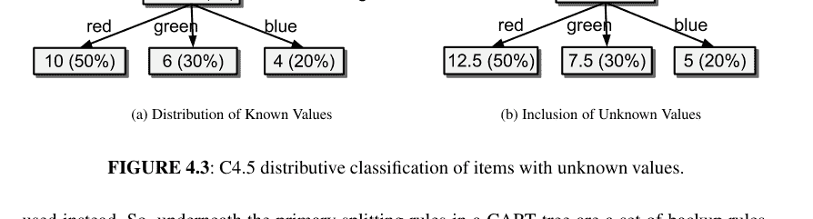

如果在分类未标记样本时遇到这样的节点，那么所有子节点都会被选中，而不仅仅是一个，并且会记录概率。预测过程将在多个叶节点处结束，这些叶节点共同描述一个概率分布。可以使用概率最高的类别进行预测。

#### 4.3.5 其他问题：窗口法和多元准则

在结束我们的案例研究之前，我们来看几个区分 C4.5 和 CART 的显著特征。

C4.5 中的窗口法：窗口法是 Quinlan 对一种采样技术的称谓，最初旨在加速 C4.5 的树归纳过程。简而言之，使用训练集的一个小样本（即窗口）来构建初始决策树。初始树用剩余的训练数据进行测试。将部分被误分类的样本加入窗口，归纳出一棵新树，然后再次用窗口外的训练数据进行测试。重复此过程，直到决策树的错误率低于目标阈值或错误率收敛到一个恒定水平。

在早期版本中，初始窗口是均匀随机选取的。到 1993 年这本书出版时，Quinlan 发现，选择窗口使不同类别值大致等比例出现会得到更好的结果。此外，到那时，计算机内存大小和处理器


speeds had improved enough so that the multiple rounds with windowed data were not always faster than a single round with all the data. However, it was discovered that the multiple rounds improve classification accuracy. This is logical, since the windowing algorithm is a form of boosting.

##### Multivariate Rules in CART
Breiman et al. investigated the use of multivariate splitting criteria, decision rules that are a function of more than one variable. They considered three different forms: linear combinations, Boolean combinations, and ad hoc combinations. CART considers combining only numerical attributes. For this discussion, assume A = (A1,...,Ad) are all numerical. In the univariate case, for Ai, we search the |Ai| − 1 possible split points for the one that yields the maximal value of C. Using a geometric analogy, if d = 3, we have a 3-dimensional data space. A univariate rule, such as xi < C, defines a half-space that is orthogonal to one of the axes. However, if we lift the restriction that the plane is orthogonal to an axis, then we have the more general half-space Σi ci xi < C. Note that a coefficient ci can be positive or negative. Thus, to find the best multivariate split, we want to find the values of C and c = (c1,...,cd), normalized to Σi ci² = 1, such that ΔF is optimized. This is clearly an expensive search. There are many search heuristics that could accelerate the search, but they cannot guarantee to find the globally best rule. If a rule using all d different attributes is found, it is likely that some of the attributes will not contribute much. The weakest coefficients can be pruned out.

CART also offers to search for Boolean combinations of rules. It is limited to rules containing only conjunction or disjunction. If Si is a rule on attribute Ai, then candidate rules have the form S = S1 ∧ S2 ∧ ⋯ ∧ Sd or S = S1 ∨ S2 ∨ ⋯ ∨ Sd. A series of conjunctions is equivalent to walking down a branch of the tree. A series of disjunctions is equivalent to merging children. Unlike linear combinations of rules that offer possible splits that are unavailable with univariate splits, Boolean combinations do not offer a new capability. They simply compress what would otherwise be a large, bushy decision tree.

The ad hoc combination is a manual pre-processing to generate new attributes. Rather than a specific computational technique, this is an acknowledgment that the given attributes might not have good linear correlation with the class variable, but that humans sometimes can study a small dataset and have helpful intuitions. We might see that a new intermediate function, say the log or square of any existing parameter, might fit better.

None of these features have been aggressively adapted in modern decision trees. In the end, a standard univariate decision tree induction algorithm can always create a tree to classify a training set. The tree might not be as compact or as accurate on new data as we would like, but more often than not, the results are competitive with those of other classification techniques.

### 4.4 Scalable Decision Tree Construction

The basic decision tree algorithms, such as C4.5 and CART, work well when the dataset can fit into main memory. However, as datasets tend to grow faster than computer memory, decision trees often need to be constructed over disk-resident datasets. There are two major challenges in scaling a decision tree construction algorithm to support large datasets. The first is the very large number of candidate splitting conditions associated with numerical attributes. The second is the recursive nature of the algorithm. For the computer hardware to work efficiently, the data for each node should be stored in sequential blocks. However, each node split conceptually regroups the data. To maintain disk and memory efficiency, we must either relocate the data after every split or maintain special data structures.

One of the first decision tree construction methods for disk-resident datasets was SLIQ [53]. To find splitting points for a numerical attribute, SLIQ requires separation of the input dataset into attribute lists and sorting of attribute lists associated with a numerical attribute. An attribute list in SLIQ has a record-id and attribute value for each training record. To be able to determine the records associated with a non-root node, a data-structure called a class list is also maintained. For each training record, the class list stores the class label and a pointer to the current node in the tree. The need for maintaining the class list limits the scalability of this algorithm. Because the class list is accessed randomly and frequently, it must be maintained in main memory. Moreover, in parallelizing the algorithm, it needs to be either replicated, or a high communication overhead is incurred.

A somewhat related approach is SPRINT [69]. SPRINT also requires separation of the dataset into class labels and sorting of attribute lists associated with numerical attributes. The attribute lists in SPRINT store the class label for the record, as well as the record-id and attribute value. SPRINT does not require a class list data structure. However, the attribute lists must be partitioned and written back when a node is partitioned. Thus, there may be a significant overhead for rewriting a disk-resident data set. Efforts have been made to reduce the memory and I/O requirements of SPRINT [41, 72]. However, they do not guarantee the same precision from the resulting decision tree, and do not eliminate the need for writing-back the datasets.

In 1998, Gehrke proposed RainForest [31], a general framework for scaling decision tree construction. It can be used with any splitting criteria. We provide a brief overview below.

#### 4.4.1 RainForest-Based Approach

RainForest scales decision tree construction to larger datasets, while also effectively exploiting the available main memory. This is done by isolating an AVC (Attribute-Value, Classlabel) set for a given attribute and node being processed. An AVC set for an attribute simply records the number of occurrences of each class label for each distinct value the attribute can take. The size of the AVC set for a given node and attribute is proportional to the product of the number of distinct values of the attribute and the number of distinct class labels. The AVC set can be constructed by taking one pass through the training records associated with the node.

Each node has an AVC group, which is the collection of AVC sets for all attributes. The key observation is that though an AVC group does not contain sufficient information to reconstruct the training dataset, it contains all the necessary information for selecting the node’s splitting criterion. One can expect the AVC group for a node to easily fit in main memory, though the RainForest framework includes algorithms that do not require this. The algorithm initiates by reading the training dataset once and constructing the AVC group of the root node. Then, the criteria for splitting the root node is selected.

The original RainForest proposal includes a number of algorithms within the RainForest framework to split decision tree nodes at lower levels. In the RF-read algorithm, the dataset is never partitioned. The algorithm progresses level by level. In the first step, the AVC group for the root node is built and a splitting criteria is selected. At any of the lower levels, all nodes at that level are processed in a single pass if the AVC group for all the nodes fit in main memory. If not, multiple passes over the input dataset are made to split nodes at the same level of the tree. Because the training dataset is not partitioned, this can mean reading each record multiple times for one level of the tree.

Another algorithm, RF-write, partitions and rewrites the dataset after each pass. The algorithm RF-hybrid combines the previous two algorithms. Overall, RF-read and RF-hybrid algorithms are able to exploit the available main memory to speed up computations, but without requiring the dataset to be main memory resident.

Figure 4.4(a) and 4.4(b) show the AVC tables for our Contact Lens dataset from Table 4.1. The Age table is largest because it is a numeric attribute with several values. The other three tables are small because their attributes have only two possible values.


| 年龄 | 硬 | 无 | 软 |
|---:|---:|---:|---:|
| 8 | 1 | 1 | 0 |
| 11 | 0 | 1 | 0 |
| 13 | 0 | 1 | 0 |
| 14 | 0 | 1 | 0 |
| 16 | 1 | 0 | 0 |
| 18 | 0 | 0 | 2 |
| 23 | 1 | 1 | 0 |
| 26 | 0 | 1 | 0 |
| 32 | 0 | 1 | 0 |
| 35 | 0 | 1 | 1 |
| 36 | 0 | 0 | 1 |
| 39 | 0 | 1 | 0 |
| 44 | 0 | 0 | 1 |
| 46 | 0 | 1 | 0 |
| 47 | 0 | 1 | 0 |
| 51 | 1 | 0 | 0 |
| 52 | 0 | 1 | 0 |
| 55 | 0 | 1 | 0 |
| 63 | 0 | 1 | 0 |
| 64 | 0 | 1 | 0 |

(a) 年龄属性的 AVC 表（RainForest）

| 近/远 | 硬 | 无 | 软 |
|---|---:|---:|---:|
| 远 | 1 | 8 | 3 |
| 近 | 3 | 7 | 2 |

| 眼泪 | 硬 | 无 | 软 |
|---|---:|---:|---:|
| 正常 | 4 | 3 | 5 |
| 减少 | 0 | 12 | 0 |

| 散光 | 硬 | 无 | 软 |
|---|---:|---:|---:|
| 否 | 0 | 7 | 5 |
| 是 | 4 | 8 | 0 |

(b) 其他三个 AVC 表（RainForest 和 SPIES）

| 年龄 | 硬 | 无 | 软 |
|---|---:|---:|---:|
| 1-10 | 1 | 1 | 0 |
| 11-19 | 1 | 3 | 2 |
| 20-29 | 1 | 2 | 0 |
| 30-39 | 0 | 3 | 2 |
| 40-49 | 0 | 2 | 1 |
| 50-59 | 1 | 2 | 0 |
| 60-69 | 0 | 2 | 0 |

(c) 年龄属性的简洁 AVC 表（SPIES）

**图 4.4：** RainForest 和 SPIES 的 AVC 表。

#### 4.4.2 SPIES 方法

在 [39] 中，提出了一种新的方法，称为 SPIES（用于增强可扩展性的区间统计修剪），旨在使决策树构建更节省内存和通信。算法在 *SPIES-Classifier* 过程（算法 4.2）中给出。

**算法 4.2 SPIES-Classifier**

```text
 1: function SPIES-CLASSIFIER(Level L, Dataset X)
 2:   for Node v ∈ Level L do
   { *Sampling Step* }
 3:     Sample S ← Sampling(X);
 4:     Build_Small_AVCGroup(S);
 5:     Build_Concise_AVCGroup(S);
 6:     g′ ← Find_Best_Gain(AVCGroup);
 7:     Partial_AVCGroup ← Pruning(g′, Concise_AVCGroup);

   { *Completion Step* }
 8:     Build_Small_AVCGroup(X);
 9:     Build_Concise_AVCGroup(X);
10:     Build_Partial_AVCGroup(X);
11:     g ← Find_Best_Gain(AVCGroup);

12:     if False_Pruning(g, Concise_AVCGroup)
   { *Additional Step* }
13:     Partial_AVCGroup ← Pruning(g, Concise_AVCGroup);
14:     Build_Partial_AVCGroup(X);
15:     g ← Find_Best_Gain(AVCGroup);
16:     if not satisfy_stop_condition(v)
17:       Split_Node(v);
18:   end for
19: end function
```

SPIES 方法基于 AVC 组，与 RainForest 方法类似。关键区别在于数值属性的处理方式。在 SPIES 中，节点的 AVC 组由三个子组组成：

- *Small AVC group:* 这主要由所有分类属性的 AVC 集合组成。由于分类属性的不同元素数量通常不大，这些 AVC 集合的规模很小。此外，SPIES 还为仅具有少量不同元素的数值属性添加 AVC 集合。这些集合的构建和处理方式与 RainForest 方法相同。

- *Concise AVC group:* 数据集中具有大量不同元素的数值属性的取值范围被划分为 *区间*。区间的数量以及区间的构造方式是算法的重要参数。原始 SPIES 实现使用等宽区间。简洁 AVC 组记录每个区间的类直方图（即每个类的出现频率）。

- *Partial AVC group:* 基于简洁 AVC 组，算法计算出数值属性取值范围内可能包含分割点的子集。部分 AVC 组存储已确定为分割条件候选的数值属性取值范围内的点的类直方图。

SPIES 使用两次遍历高效构建上述 AVC 组。第一次遍历是快速的 *Sampling Step*。在此，使用数据集的样本来估计小 AVC 组和简洁数值属性。基于这些，它获得最佳（最高）增益的估计值，记为 g′。然后，利用 g′，修剪掉不太可能包含分割点的区间。第二次遍历是 Completion Step。在此，使用整个数据集构建三个 AVC 子组的完整版本。部分 AVC 组将记录未被修剪区间内所有点的类直方图。

之后，可以从这些 AVC 组中获得最佳增益 g。由于修剪仅基于小和简洁 AVC 组的估计，因此可能发生错误修剪。然而，错误修剪可以在完成步骤期间使用更新后的小和简洁 AVC 组的值来检测。如果发生错误修剪，SPIES 可以对数据进行另一次遍历，以为被错误修剪的区间中的点构建部分 AVC 组。实验评估表明 SPIES 大大减少了内存需求，通常减少 85% 至 95%，并且错误修剪很少发生。

在图 4.4(c) 中，我们展示了假设使用 10 年范围的年龄属性的简洁 AVC 集合。表大小取决于所选的范围大小。将其大小与图 4.4(a) 中的 RainForest AVC 进行比较。对于离散属性和具有少量不同值的数值属性，RainForest 和 SPIES 生成相同的 small AVC 表，如图 4.4(b) 所示。

多年来已经开发出其他可扩展的决策树构建算法；代表性算法包括 BOAT [30] 和 CLOUDS [2]。BOAT 使用一种称为自助法的统计技术，将决策树构建减少到对整个数据集的尽可能少的两次遍历。此外，BOAT 可以处理数据的插入和删除。CLOUDS 是另一种使用区间来加速数值属性处理的算法 [2]。然而，CLOUDS 的方法不能保证与考虑所有可能的数值分割点所能达到的同等准确性水平（尽管在他们的实验中，差异通常很小）。此外，CLOUDS 在树的某一层划分节点时始终需要对数据集进行两次扫描。最近，SURPASS [47] 在递归划分过程中利用线性判别式。汇总统计信息（如 AVC 表）是增量获得的。与使用汇总统计信息不同，[74] 对训练数据进行采样，其置信水平由 PAC 学习理论确定。

#### 4.4.3 并行决策树构建

 several studies have sought to further speed up the decision tree construction using parallel machines. 其中最早的研究之一是由 Zaki 等人 [88] 提出的，他们在磁盘驻留数据集上对 SPRINT 算法进行了共享内存并行化。在并行化 SPRINT 时，每个属性列表分配给单独的处理机。此外，Narlikar 使用细粒度线程库并行化了决策树算法 [57]，但该工作仅限于内存驻留数据集。RF-read 算法 [38] 已提出共享内存并行化。

SPIES 方法已使用中间件系统 FREERIDE（数据挖掘引擎快速实现框架）[36,37] 进行并行化 [39]，该系统支持磁盘驻留数据集上的分布式和共享内存并行化。FREERIDE 于 2000 年初开发，可被视为流行的 MapReduce/Hadoop 系统 [16] 的早期原型。它基于这样一个观察：许多流行的数据挖掘算法具有相对相似的结构。它们的共同处理结构本质上是广义归约。在算法的每个阶段，计算涉及以任意顺序读取数据实例，处理每个数据实例（类似于 MapReduce 中的 Map），并使用关联和交换运算符更新归约对象的元素（类似于 MapReduce 中的 Reduce）。

在分布式内存环境中，此类算法可以通过将数据项分配给处理器并复制归约对象来进行并行化。每个节点可以处理其拥有的<|message|>


### **算法 4.3 ID4(v, r)**

```
Input:  v: current decision tree node;
Input:  r: data record r = ⟨x, y⟩;
1:  for each Aᵢ ∈ Aᵥ, where Aᵥ ⊆ A do
2:      Increment count nᵢⱼᵧ(v) of class y for Aᵢ;
3:  end for
4:  if all items observed by v are from class y then
5:      return;
6:  else
7:      if v is a leaf node then
8:          Change v to be an internal node;
9:          Update Aᵥ* with lowest E-score;
10:     else if Aᵥ* does not have the lowest E-score then
11:         Remove all children Child(v) of v;
12:         Update Aᵥ*;
13:     end if
14:     if Child(v) = ∅ then
15:         Generate the set Child(v) for all values of attribute Aᵥ*;
16:     end if
17:     ID4(vᵣ, r);
18: end if
```

然后

$$E(A_i)=\sum_{j=1}^{|A_i|}\frac{n_{ij}^{p}+n_{ij}^{n}}{n^{p}+n^{n}}I(n_{ij}^{p},n_{ij}^{n}), \tag{4.20}$$

其中

$$I(x,y)=\begin{cases}0 & \text{if }x=0\text{ or }y=0\\ -\frac{x}{x+y}\log\frac{x}{x+y}-\frac{y}{x+y}\log\frac{y}{x+y} & \text{otherwise.}\end{cases}$$

在算法 4.3 中，我们可以看到每当在 v 处发现错误的划分属性时（第 10 行），ID4 只是删除所有以 v 的直接子节点为根的子树（第 11 行），并计算正确的划分属性 Aᵥ*（第 12 行）。

显然 ID4 并不是高效的，因为当发现新的 Aᵥ* 时它会删除整个子树，而这种情况可能会导致某些概念无法被 ID4 学习，而这些概念本可以由 ID3 归纳出来。Utgoff 提出了两种改进算法：ID5 [77] 和 ID5R [78]。特别是，ID5R 保证它会产生与 ID3 在使用相同训练项时所产生的相同决策树。

在算法 4.4 中，当在节点 v 需要进行划分测试时，会选择一个任意属性 A₀ ∈ Aᵥ；此外，根据计数 nᵢⱼᵧ(v) 基于 E-score 计算最优划分属性 Aᵥ*。如果 Aᵥ* ≠ A₀，则划分属性 Aᵥ* 从其所有子树中上拉（第 10 行）到 v，并且所有子树都以类似方式递归更新（第 11 行和第 13 行）。

ID4（算法 4.3）与 ID5R（算法 4.4）之间的根本区别在于，当 ID5R 发现错误的子树时，它重构子树（第 11 行和第 13 行），而不是丢弃它并用当前划分属性的叶节点替换它。算法 4.4 中的重构过程称为上拉过程。一般的上拉过程如下所示，并在图 4.6 中说明。在图 4.6 中，左分支满足划分测试，右分支不满足。

+   1. 如果属性 Aᵥ* 已经在根部，则停止；
+   2. 否则，

```
**Algorithm 4.4 ID5R(v, r)**

**Input:**  v: the current decision tree node;

**Input:**  r: the data record r = ⟨x, y⟩;

1: If v = null, make v a leaf node; **return**;
2: If v is a leaf, and all items observed by v are from class y; **return**;
3: **if** v is a leaf node **then**
4: &nbsp;&nbsp;&nbsp;&nbsp;Split v by choosing an arbitrary attribute;
5: **end if**
6: **for** Aᵢ ∈ Aᵥ, where Aᵥ ⊆ A **do**
7: &nbsp;&nbsp;&nbsp;&nbsp;Increment count nᵢⱼᵥ(v) of class y for Aᵢ;
8: **end for**
9: **if** Aᵥ* does not have the lowest E-score **then**
10: &nbsp;&nbsp;&nbsp;&nbsp;Update Aᵥ*, and restructure v;
11: &nbsp;&nbsp;&nbsp;&nbsp;Recursively reestablish v_c ∈ Child(v) except the branch v_r for r;
12: **end if**
13: Recursively update subtree v_r along the branches with the value occurring in x;
```

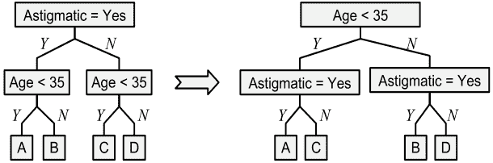

**FIGURE 4.6:** Subtree restructuring.

+   (a) Recursively pull the attribute Aᵥ* to the root of each immediate subtree of v. Convert any leaves to internal nodes as necessary, choosing Aᵥ* as splitting attribute.
+   
+   (b) Transpose the subtree rooted at v, resulting in a new subtree with Aᵥ* at the root, and the old root attribute Aₒ at the root of each immediate subtree of v.

还有许多其他属于 ID3 家族的工作。多元划分的变体出现在 [81] 中，其改进出现在 [79] 中，该改进能够处理数值属性。在实现了据认为高效的增量重构树技术后，Utgoff 将该技术应用于开发直接度量树归纳法（DMTI）。DMTI 利用快速树重构来设计一种算法，该算法可以探索比传统贪心自顶向下归纳更多的选项 [80]。Kalles [42] 通过估计为使新属性被选为划分属性所需的最少训练项数量来加速 ID5R。

#### 4.5.2  VFDT 家族

在大数据时代，产生海量数据流的应用无处不在。像沃尔玛这样的大型零售连锁店每天甚至每小时都会产生数百万笔交易记录，巨型电信公司在全球范围内连接数百万次通话和短信，大型银行在全球范围内接收数百万笔 ATM 请求。这些应用需要能够从极其庞大（可能无限）的数据集中学习，但每个记录只花费很短时间进行处理的机器学习算法。VFDT 学习系统由 Domingos [19] 提出来处理这种情况。

VFDT（Very Fast Decision Tree learner）基于 Hoeffding 树，一种决策树学习方法。Hoeffding 树的直觉是，为了找到最佳划分属性，只需考虑节点处可用的少量训练项即可。为实现这一目标，使用了 Hoeffding 界。基本上，给定一个取值范围为 R 的实值随机变量 r，如果我们观察到该随机变量的 n 个值，且样本均值为 r̄，则 Hoeffding 界指出，在概率为 1 − δ 的情况下，r 的真实均值至少为 r̄ − ε，其中

```
ε = √(R² ln(1/δ) / (2n)).  (4.21)
```

基于上述分析，如果在某个节点我们发现 F̄(Ai) − F̄(Aj) ≥ ε，其中 F̄ 是划分准则，且 Ai 和 Aj 分别是 F̄ 最佳和第二最佳的属性，则 Ai 以概率 1 − δ 是正确的选择。利用这一新颖的观察，Hoeffding 树算法被开发出来（算法 4.5）。

### Algorithm 4.5 HoeffdingTree(S, A, F, δ)

```
Input: S: the streaming data;
Input: A: the set of attributes;
Input: F: the split function;
Input: δ: 1 − δ is the probability of choosing the correct attribute to split;
Output: T: decision tree
1: Let T be a tree with a single leaf v1;
2: Let A1 = A;
3: Set count nijy(v1) = 0 for each y ∈ Y, each value xij of each attribute Ai ∈ A
4: for each training record ⟨x,y⟩ in S do
5:   Leaf v = classify(⟨x,y⟩, T);
6:   For each xij ∈ x: Increment count nijy(v);
7:   if nijy(v) does not satisfy any stop conditions then
8:     A*v = F(nijy(v),δ);
9:     Replace v by an internal node that splits on A*v;
10:    for each child vm of v do
11:      Let Am = Av − {A*v};
12:      Initialize nijy(vm);
13:    end for
14:  end if
15: end for
16: return T;
```

在算法 4.5 中，nijy 计数足以计算 F̄。最初决策树 T 仅包含一个叶节点 v1（第 1 行），并且 v1 被标记为预测最频繁的类别。对于每个项 ⟨x,y⟩，它首先通过 T 分类到叶节点 v（第 5 行）。如果 v 中的项来自多个类别，则根据 Hoeffding 界对 v 进行划分（第 8 行）。Hoeffding 树的关键特性是，在现实假设下（详见 [19]），可以保证生成的树与批处理学习器产生的树渐近接近。

在处理数据流时，一个需要特别关注的实际问题是概念漂移，它不满足 VFDT 的假设：即顺序数据是从平稳分布中抽取的随机样本。例如，在线购物客户的行为可能从工作日到周末、从季节到季节发生变化。CVFDT [33] 已被开发来处理概念漂移。

CVFDT 利用两种策略：训练项的滑动窗口 W，以及每个内部节点 v 的备选子树 ALT(v)。决策树记录最近的


unique training items. More specifically, instead of learning a new model from scratch when a new training item ⟨x, y⟩ comes, CVFDT increments the sufficient statistics $n_{ijy}$ at corresponding nodes for the new item and decrements the counts for the oldest records ⟨$x_o,y_o$⟩ in the window. Periodically, CVFDT reevaluates the classification quality and replaces a subtree with one of the alternate subtrees if needed.

```
**Algorithm 4.6** CVFDT($S, A, F, \delta, w, f$)  
**Input:** $S$: the streaming data;  
**Input:** $A$: the set of attributes;  
**Input:** $F$: the split function;  
**Input:** $\delta$: $1-\delta$ is the probability of choosing the correct attribute to split;  
**Input:** $w$: the size of window;  
**Input:** $f$: # training records between checks for drift;  
**Output:** $T$: decision tree;  

1: let $T$ be a tree with a single leaf $v_1$;  
2: let $ALT(v_1)$ be an initially empty set of alternate trees for $v_1$;  
3: let $A_1 = A$;  
4: Set count $n_{ijy}(v_1)=0$ for each $y\in Y$ and each value $x_{ij}$ for $A_i\in A$;  
5: Set record window $W=\varnothing$;  
6: **for** each training record ⟨$x,y$⟩ in $S$ **do**  
7: &nbsp;&nbsp;&nbsp;&nbsp;$L = classify(\langle x,y\rangle,T)$, where $L$ contains all nodes that ⟨$x,y$⟩ passes through using $T$ and all trees in $ALT$;  
8: &nbsp;&nbsp;&nbsp;&nbsp;$W = W \cup \{\langle x,y\rangle\}$;  
9: &nbsp;&nbsp;&nbsp;&nbsp;**if** $|W| > w$ **then**  
10: &nbsp;&nbsp;&nbsp;&nbsp;&nbsp;&nbsp;&nbsp;&nbsp;let ⟨$x_o,y_o$⟩ be the oldest element of $W$;  
11: &nbsp;&nbsp;&nbsp;&nbsp;&nbsp;&nbsp;&nbsp;&nbsp;ForgetExample($T, ALT, \langle x_o,y_o\rangle$);  
12: &nbsp;&nbsp;&nbsp;&nbsp;&nbsp;&nbsp;&nbsp;&nbsp;let $W = W \setminus \{\langle x_o,y_o\rangle\}$;  
13: &nbsp;&nbsp;&nbsp;&nbsp;**end if**  
14: &nbsp;&nbsp;&nbsp;&nbsp;CVFDTGrow($T,L,\langle x,y\rangle,\delta$);  
15: &nbsp;&nbsp;&nbsp;&nbsp;**if** there have been $f$ examples since the last checking of alternate trees  
16: &nbsp;&nbsp;&nbsp;&nbsp;&nbsp;&nbsp;&nbsp;&nbsp;CheckSplitValidity($T,\delta$);  
17: **end for**  
18: **return** $T$;
```

Algorithm 4.6 中展示了 CVFDT 的概要。当收到新的记录 ⟨$x,y$⟩ 时，我们根据当前树对其进行分类。我们在结构 $L$ 中记录树 $T$ 以及备选子树 $ALT$ 中被 ⟨$x,y$⟩ 经过的所有节点（第 7 行）。第 8 行到第 14 行保持滑动窗口为最新。如果树的项目数现已超过最大窗口大小（第 9 行），我们将最旧的数据项从统计中移除（第 11 行）并从 $W$ 中移除（第 12 行）。*ForgetExample* 遍历决策树并为 ⟨$x_o,y_o$⟩ 在 $T$ 或 $ALT$ 的任何节点中递减相应的计数 $n_{ijy}$。然后我们将 ⟨$x,y$⟩ 添加到树中，根据 $L$ 增加 $n_{ijy}$ 统计量（第 14 行）。最后，每隔 $f$ 个项目，我们调用过程 *CheckSplitValidity*，该过程扫描 $T$ 和 $ALT$ 以寻找每个内部节点的更好分裂属性。它根据需要修改 $T$ 和 $ALT$。当然，遵循这一家族的后续研究工作也可以找到。VFDT 和 CVFDT 仅考虑离散属性；VFDTc [26] 系统在两个主要方向上扩展了 VFDT：1) VFDTc 具备处理数值属性的能力；2) 每个叶节点都使用朴素贝叶斯分类器。Jin [40] 提出了一种数值区间剪枝（NIP）方法来高效处理数值属性，并通过减少样本量来加快算法速度。此外，Bifet [6] 通过用感知器分类器取代朴素贝叶斯，提出了一种比 [26] 更高效的决策树学习方法，同时保持具有竞争力的准确率。Hashemi [32] 开发了一种基于模糊逻辑的灵活决策树（FlexDT），用于处理流数据中的噪声和缺失值。Liang [48] 为不确定流数据构建决策树。

请注意，关于处理流数据概念漂移的一些通用工作。Gama [27,28] 通过基于 PAC 框架追踪训练项目的分类错误来检测漂移。

#### 4.5.3 Ensemble Method for Streaming Data

集成分类器是由多个基础分类器组合而成，以获得更高的预测准确率。有两种众所周知的集成学习方法：Bagging 和 Boosting。

在线 bagging 和 boosting 算法在 [60] 中引入。它们依赖于以下观察：每个基础模型包含原始训练项目 k 次的概率遵循二项分布。随着训练项目数量趋于无穷，k 遵循 Poisson(1) 分布，这一假设适用于流数据。

在 [73] 中，Street 等人提出了一种集成方法，按块顺序读取训练项目。当新的训练块 D 到来时，会学习一个新的分类器 Ci，并且 Ci 将由下一个训练块进行评估。如果集成委员会 E 未满，则 Ci 被插入到 E 中；否则，如果 Ci 的质量优于 Cj，则 Ci 可以替换 E 中的某个成员分类器 Cj。然而，[73] 和 [60] 都没有明确考虑概念漂移问题。

基于 Tumer 的工作 [76]，Wang 等人 [84] 证明，如果 E 中的所有分类器都基于它们在测试数据上的预期分类准确率加权，则集成分类器 E 产生的错误小于 E 中的单个分类器 G。据此他们提出了一种新的集成分类方法来处理概念漂移，如下：当新的训练项目块 D 到来时，不仅训练一个新的分类器 C，而且重新计算之前训练的分类器的权重。

他们提出了在流数据块上对分类器进行训练的方法，如 Algorithm 4.7 所示。

```
Algorithm 4.7 EnsembleTraining(S, K, C)
Input: S: a new chunk of data;
Input: K: the number of classifiers;
Input: C: the set of previously trained classifiers;
1: Train a new classifier C' based on S;
2: Compute the weight w' for C';
3: for each Ci ∈ C do
4: Recompute the weight wi for Ci based on S;
5: end for
6: C ← top K weighted classifiers from C ∪ {C'};
```

在 Algorithm 4.7 中，我们可以看到当新的块 S 到来时，不仅训练了一个新的分类器 C'，而且以这种方式重新计算了之前训练的分类器的权重，以处理概念漂移。

Kolter 等人 [45] 提出了一种用于检测流数据中概念漂移的另一种集成分类器。与 [84] 类似，他们的方法根据其准确率动态调整每个基础分类器的权重。相比之下，他们的方法有一个权重参数阈值来移除不良分类器，并在现有集成分类器无法识别正确类别时为新项目训练新的分类器。

Fan [21] 注意到之前的工作没有回答以下问题：何时旧数据有助于检测概念漂移以及哪些旧数据会有所帮助？为回答这些问题，作者开发了一种筛选旧数据的方法，并提出了一种简单的交叉验证决策树集成方法。

Gama [29] 将基于 Hoeffding 的超快速树森林（UFFT）[25] 系统扩展到处理流数据中的概念漂移。类似地，Abulsalam [1] 将随机森林集成方法扩展为在摊销 O(1) 时间内运行，处理概念漂移，并判断是否已接收到足够数量的标记数据以做出合理的预测。该算法还处理多个类别值。Bifet [7] 提供了用于检测概念漂移的新实验框架以及两种新的 bagging 方法变体：ADWIN Bagging 和自适应大小 Hoeffding 树（ASHT）。在 [5] 中，Bifet 等人使用堆叠组合 Hoeffding 树来对流数据进行分类，其中每个 Hoeffding 树使用一组项目属性构建，并且 ADWIN 同时用于感知器元分类器以重置学习率以及用于集成成员以检测概念漂移。

### 4.6 Summary

与其它分类方法 [46] 相比，决策树的以下优点脱颖而出：

- 易于解释。小决策树可以被可视化、被外行使用和理解。
- 处理数值和分类属性。依赖权重或距离的分类方法（神经网络、k 近邻和支持向量机）不能直接处理分类数据。
- 快速。训练时间与其他分类方法具有竞争力。
- 对缺失值和无关属性具有容忍性。
- 可以增量学习。

缺点往往不太明显，需要更详细的解释。决策树的以下弱点是：

- 不适合多元划分。支持向量机和神经网络特别擅长基于所有属性的加权和进行区分。然而，这一特性也使它们更难解释。
- 对数值值的相对间距不敏感。前面我们将决策树能够处理分类或数值数据作为优点提出。然而，大多数分裂准则并不直接使用数值值来衡量分裂的好坏。相反，它们使用值对项目进行排序，从而产生有序序列。排序随后决定候选分裂；一组 n 个有序项目有 n − 1 个分裂。
- 贪婪方法可能过于强烈地关注训练数据，导致过拟合。
- 归纳时间对数据多样性的敏感性。为了确定下一个分裂，决策树归纳需要比较每一种可能的分裂。随着不同属性值的数量增加，可能的分裂数量也随之增加。


尽管存在一些不足，决策树在分类方法中仍然是一个极具吸引力的选择。改进工作仍在持续进行：更准确、更稳健的划分准则、用于获得更高精度的集成方法、处理数据流和概念漂移的增量方法，以及处理更大规模和分布式数据集的可扩展性功能。一个早在计算机发明之前就已出现的简单概念，决策树仍然是机器学习工具箱中的有价值工具。

## 参考文献

[1] Hanady Abdulsalam, David B. Skillicorn, and Patrick Martin. Classification using streaming random forests. *IEEE Transactions on Knowledge and Data Engineering*, 23(1):22–36, 2011.

[2] Khaled Alsabti, Sanjay Ranka, and Vineet Singh. Clouds: A decision tree classifier for large datasets. In *Proceedings of the Fourth International Conference on Knowledge Discovery and Data Mining*, KDD’98, pages 2–8. AAAI, 1998.

[3] K. Bache and M. Lichman. UCI machine learning repository. http://archive.ics.uci.edu/ml, 2013.

[4] Amir Bar-Or, Assaf Schuster, Ran Wolff, and Daniel Keren. Decision tree induction in high dimensional, hierarchically distributed databases. In *Proceedings of the Fifth SIAM International Conference on Data Mining*, SDM’05, pages 466–470. SIAM, 2005.

[5] Albert Bifet, Eibe Frank, Geoffrey Holmes, and Bernhard Pfahringer. Accurate ensembles for data streams: Combining restricted hoeffding trees using stacking. *Journal of Machine Learning Research: Workshop and Conference Proceedings*, 13:225–240, 2010.

[6] Albert Bifet, Geoff Holmes, Bernhard Pfahringer, and Eibe Frank. Fast perceptron decision tree learning from evolving data streams. *Advances in Knowledge Discovery and Data Mining*, pages 299–310, 2010.

[7] Albert Bifet, Geoff Holmes, Bernhard Pfahringer, Richard Kirkby, and Ricard Gavalda. New ensemble methods for evolving data streams. In *Proceedings of the 15th ACM SIGKDD International Conference on Knowledge Discovery and Data Mining*, KDD’09, pages 139–148. ACM, 2009.

[8] Leo Breiman, Jerome Friedman, Charles J. Stone, and Richard A. Olshen. *Classification and Regression Trees*. Chapman & Hall/CRC, 1984.

[9] Carla E. Brodley and Paul E. Utgoff. Multivariate decision trees. *Machine Learning*, 19(1):45–77, 1995.

[10] Harry Buhrman and Ronald De Wolf. Complexity measures and decision tree complexity: A survey. *Theoretical Computer Science*, 288(1):21–43, 2002.

[11] Doina Caragea, Adrian Silvescu, and Vasant Honavar. A framework for learning from distributed data using sufficient statistics and its application to learning decision trees. *International Journal of Hybrid Intelligent Systems*, 1(1):80–89, 2004.

[12] Xiang Chen, Minghui Wang, and Heping Zhang. The use of classification trees for bioinformatics. *Wiley Interdisciplinary Reviews: Data Mining and Knowledge Discovery*, 1(1):55–63, 2011.

[13] David A. Cieslak and Nitesh V. Chawla. Learning decision trees for unbalanced data. In Proceedings of the 2008 European Conference on Machine Learning and Knowledge Discovery in Databases - Part I, ECML PKDD'08, pages 241–256. Springer, 2008.

[14] S. L. Crawford. Extensions to the cart algorithm. International Journal of Man-Machine Studies, 31(2):197–217, September 1989.

[15] Barry De Ville. Decision Trees for Business Intelligence and Data Mining: Using SAS Enterprise Miner. SAS Institute Inc., 2006.

[16] Jeffrey Dean and Sanjay Ghemawat. Mapreduce: Simplified data processing on large clusters. Communications of the ACM, 51(1):107–113, 2008. Originally presented at OSDI '04: 6th Symposium on Operating Systems Design and Implementation.

[17] Tom Dietterich, Michael Kearns, and Yishay Mansour. Applying the weak learning framework to understand and improve C4.5. In Proceedings of the Thirteenth International Conference on Machine Learning, ICML'96, pages 96–104. Morgan Kaufmann, 1996.

[18] Yufeng Ding and Jeffrey S. Simonoff. An investigation of missing data methods for classification trees applied to binary response data. The Journal of Machine Learning Research, 11:131–170, 2010.

[19] Pedro Domingos and Geoff Hulten. Mining high-speed data streams. In Proceedings of the Sixth ACM SIGKDD International Conference on Knowledge Discovery and Data Mining, KDD'00, pages 71–80. ACM, 2000.

[20] Floriana Esposito, Donato Malerba, Giovanni Semeraro, and J. Kay. A comparative analysis of methods for pruning decision trees. IEEE Transactions on Pattern Analysis and Machine Intelligence, 19(5):476–491, 1997.

[21] Wei Fan. Systematic data selection to mine concept-drifting data streams. In Proceedings of the Tenth ACM SIGKDD International Conference on Knowledge Discovery and Data Mining, pages 128–137. ACM, 2004.

[22] Usama M. Fayyad and Keki B. Irani. The attribute selection problem in decision tree generation. In Proceedings of the Tenth National Conference on Artificial Intelligence, AAAI'92, pages 104–110. AAAI Press, 1992.

[23] Usama M. Fayyad, Gregory Piatetsky-Shapiro, Padhraic Smyth, and Ramasamy Uthurusamy. Advances in Knowledge Discovery and Data Mining. The MIT Press, February 1996.

[24] Jerome H. Friedman. A recursive partitioning decision rule for nonparametric classification. IEEE Transactions on Computers, 100(4):404–408, 1977.

[25] João Gama, Pedro Medas, and Ricardo Rocha. Forest trees for on-line data. In Proceedings of the 2004 ACM Symposium on Applied Computing, SAC'04, pages 632–636. ACM, 2004.

[26] João Gama, Ricardo Rocha, and Pedro Medas. Accurate decision trees for mining high-speed data streams. In Proceedings of the Ninth ACM SIGKDD International Conference on Knowledge Discovery and Data Mining, KDD'03, pages 523–528. ACM, 2003.

[27] João Gama and Gladys Castillo. Learning with local drift detection. In Advanced Data Mining and Applications, volume 4093, pages 42–55. Springer-Verlag, 2006.

[28] João Gama, Pedro Medas, Gladys Castillo, and Pedro Rodrigues. Learning with drift detection. Advances in Artificial Intelligence–SBIA 2004, pages 66–112, 2004.

[29] João Gama, Pedro Medas, and Pedro Rodrigues. Learning decision trees from dynamic data streams. In *Proceedings of the 2005 ACM Symposium on Applied Computing*, SAC'05, pages 573–577. ACM, 2005.

[30] Johannes Gehrke, Venkatesh Ganti, Raghu Ramakrishnan, and Wei-Yin Loh. Boat–optimistic decision tree construction. *ACM SIGMOD Record*, 28(2):169–180, 1999.

[31] Johannes Gehrke, Raghu Ramakrishnan, and Venkatesh Ganti. Rainforest — A framework for fast decision tree construction of large datasets. In *Proceedings of the International Conference on Very Large Data Bases*, VLDB'98, pages 127–162, 1998.

[32] Sattar Hashemi and Ying Yang. Flexible decision tree for data stream classification in the presence of concept change, noise and missing values. *Data Mining and Knowledge Discovery*, 19(1):95–131, 2009.

[33] Geoff Hulten, Laurie Spencer, and Pedro Domingos. Mining time-changing data streams. In *Proceedings of the Seventh ACM SIGKDD International Conference on Knowledge Discovery and Data Mining*, KDD'01, pages 97–106. ACM, 2001.

[34] Earl Busby Hunt, Janet Marin, and Philip J. Stone. *Experiments in Induction*. Academic Press, New York, London, 1966.

[35] Laurent Hyafil and Ronald L. Rivest. Constructing optimal binary decision trees is np-complete. *Information Processing Letters*, 5(1):15–17, 1976.

[36] Ruoming Jin and Gagan Agrawal. A middleware for developing parallel data mining implementations. In *Proceedings of the 2001 SIAM International Conference on Data Mining*, SDM'01, April 2001.

[37] Ruoming Jin and Gagan Agrawal. Shared memory parallelization of data mining agorithms: Techniques, programming interface, and performance. In *Proceedings of the Second SIAM International Conference on Data Mining*, SDM'02, pages 71–89, April 2002.

[38] Ruoming Jin and Gagan Agrawal. Shared memory parallelization of decision tree construction using a general middleware. In *Proceedings of the 8th International Euro-Par Parallel Processing Conference*, Euro-Par'02, pages 346–354, Aug 2002.

[39] Ruoming Jin and Gagan Agrawal. Communication and memory efficient parallel decision tree construction. In *Proceedings of the Third SIAM International Conference on Data Mining*, SDM'03, pages 119–129, May 2003.

[40] Ruoming Jin and Gagan Agrawal. Efficient decision tree construction on streaming data. In *Proceedings of the Ninth ACM SIGKDD International Conference on Knowledge Discovery and Data Mining*, KDD'03, pages 571–576. ACM, 2003.

[41] Mahesh V. Joshi, George Karypis, and Vipin Kumar. Scalparc: A new scalable and efficient parallel classification algorithm for mining large datasets. In First Merged Symp. IPPS/SPDP 1998: 12th International Parallel Processing Symposium and 9th Symposium on Parallel and Distributed Processing, pages 573–579. IEEE, 1998.

[42] Dimitrios Kalles and Tim Morris. Efficient incremental induction of decision trees. *Machine Learning*, 24(3):231–242, 1996.

[43] Michael Kearns and Yishay Mansour. On the boosting ability of top-down decision tree learning algorithms. In *Proceedings of the 28th Annual ACM Symposium on Theory of Computing*, STOC'96, pages 459–468. ACM, 1996.


[44] Michael Kearns 和 Yishay Mansour。一种具有近最优泛化能力的快速自底向上决策树剪枝算法。载于*第15届国际机器学习大会论文集*，第269–277页，1998年。

[45] Jeremy Z. Kolter 和 Marcus A. Maloof。动态加权多数：一种跟踪概念漂移的新集成方法。载于*第三届IEEE国际数据挖掘大会论文集*，ICDM'03，第123–130页。IEEE，2003年。

[46] S. B. Kotsiantis。监督机器学习：分类技术综述。载于*2007年计算机工程新兴人工智能应用会议论文集*，第3–24页。IOS出版社，2007年。

[47] Xiao-Bai Li。一种可扩展的决策树系统及其在模式识别和入侵检测中的应用。*决策支持系统*，41(1):112–130，2005年。

[48] Chunquan Liang、Yang Zhang 和 Qun Song。面向动态和不确定数据流的决策树。载于*第二届亚洲机器学习大会*，第3卷，第209–224页，2010年。

[49] Tjen-Sien Lim、Wei-Yin Loh 和 Yu-Shan Shih。三十三种新旧分类算法的预测精度、复杂度和训练时间比较。*机器学习*，40(3):203–228，2000年。

[50] Christiane Ferreira Lemos Lima、Francisco Marcos de Assis 和 Cleonilson Protásio de Souza。基于香农、Rényi 和 Tsallis 熵的入侵容忍系统决策树。载于*第五届互联网监控与保护国际会议论文集*，ICIMP'10，第117–122页。IEEE，2010年。

[51] R. López de Mántaras。一种基于距离的决策树归纳属性选择度量。*机器学习*，6(1):81–92，1991年。

[52] Yishay Mansour。基于树大小的悲观决策树剪枝。载于*第14届国际机器学习大会论文集*，第195–201页，1997年。

[53] Manish Mehta、Rakesh Agrawal 和 Jorma Rissanen。SLIQ：一种用于数据挖掘的快速可扩展分类器。载于*第五届扩展数据库技术国际会议论文集*，第18–32页，法国阿维尼翁，1996年。

[54] John Mingers。专家系统——基于统计数据的规则归纳。*运筹学学会志*，38(1):39–47，1987年。

[55] John Mingers。决策树归纳剪枝方法的实证比较。*机器学习*，4(2):227–243，1989年。

[56] James N. Morgan 和 John A. Sonquist。调查数据分析中的问题及一项建议。*美国统计协会杂志*，58(302):415–434，1963年。

[57] G. J. Narlikar。一种并行多线程决策树构建器。技术报告 CMU-CS-98-184，卡内基梅隆大学计算机科学学院，1998年。

[58] Tim Niblett。在噪声领域中构建决策树。载于 I. Bratko 和 N. Lavrac 编，*机器学习进展*。Sigma出版社，1987年。

[59] Jie Ouyang、Nilesh Patel 和 Ishwar Sethi。从分布式数据中归纳多类多变量分裂决策树。*模式识别*，42(9):1786–1794，2009年。

[60] Nikunj C. Oza 和 Stuart Russell。在线Bagging与Boosting。载于*第八届人工智能与统计国际研讨会*，第105–112页。Morgan Kaufmann出版社，2001年。

[61] Biswanath Panda、Joshua S. Herbach、Sugato Basu 和 Roberto J. Bayardo。PLANET：利用MapReduce进行树集成的海量并行学习。*VLDB基金会会刊*，2(2):1426–1437，2009年。

[62] J. Ross Quinlan。学习高效分类过程及其在国际象棋残局中的应用。载于*机器学习：一种人工智能方法*。Tioga出版公司，1983年。

[63] J. Ross Quinlan。决策树的归纳。*机器学习*，1(1):81–106，1986年3月。

[64] J. Ross Quinlan。简化决策树。*国际人机研究杂志*，27(3):221–234，1987年。

[65] J. Ross Quinlan 和 Ronald L. Rivest。利用最小描述长度原理推断决策树。*信息与计算*，80:227–248，1989年。

[66] John Ross Quinlan。*C4.5：机器学习程序*。Morgan Kaufmann出版社，1993年。

[67] Maytal Saar-Tsechansky 和 Foster Provost。应用分类模型时对缺失值的处理。*机器学习研究杂志*，8:1623–1657，2007年。

[68] Jeffrey C. Schlimmer 和 Douglas Fisher。增量概念归纳的案例研究。载于*第五届国家人工智能大会论文集*，第495–501页。Morgan Kaufmann出版社，1986年。

[69] John Shafer、Rakesh Agrawal 和 Manish Mehta。SPRINT：一种用于数据挖掘的可扩展并行分类器。载于*第22届超大型数据库国际会议论文集（VLDB）*，第544–555页，1996年9月。

[70] Claude E. Shannon。通信的数学理论。*贝尔系统技术杂志*，27(3):379–423，1948年7月/10月。

[71] Harold C. Sox 和 Michael C. Higgins。*医疗决策*。皇家医学会出版社，1988年。

[72] Anurag Srivastava、Eui-Hong Han、Vipin Kumar 和 Vineet Singh。决策树分类算法的并行表述。载于*1998年国际并行处理大会论文集，ICPP'98*，第237–261页，1998年。

[73] W. Nick Street 和 YongSeog Kim。一种用于大规模分类的流式集成算法（SEA）。载于*第七届ACM SIGKDD国际知识发现与数据挖掘大会论文集，KDD'01*，第377–382页。ACM，2001年。

[74] Hyontai Sug。一种用于超大型数据库交互式数据挖掘的全面规模决策树生成方法。载于*高级数据挖掘与应用*，第141–148页。Springer出版社，2005年。

[75] Umar Syed 和 Golan Yona。利用混合概率决策树直接预测蛋白质功能。载于*第七届计算分子生物学研究国际年会论文集，RECOMB'03*，第289–300页。ACM，2003年。

[76] Kagan Tumer 和 Joydeep Ghosh。集成分类器中的误差相关性与误差降低。*连接科学*，8(3-4):385–404，1996年。

[77] Paul E. Utgoff。ID5：一种增量式ID3。载于*第五届国际机器学习大会论文集，ICML'88*，第107–120页，1988年。

[78] Paul E. Utgoff。决策树的增量归纳。*机器学习*，4(2):161–186，1989年。

[79] Paul E. Utgoff。一种改进的决策树增量归纳算法。载于*第十一届国际机器学习大会论文集*，ICML'94，第318–325页，1994年。

[80] Paul E. Utgoff、Neil C. Berkman 和 Jeffrey A. Clouse。基于高效树重构的决策树归纳。*机器学习*，29(1):5–44，1997年。

[81] Paul E. Utgoff 和 Carla E. Brodley。一种为决策树寻找多变量分裂的增量方法。载于*第七届国际机器学习大会论文集*，ICML'90，第58–65页，1990年。

[82] Paul A. J. Volf 和 Frans M.J. Willems。上下文最大化：寻找MDL决策树。载于*比荷卢信息论研讨会*，第15卷，第192–200页，1994年。

[83] Chris S. Wallace 和 J. D. Patrick。决策树编码。*机器学习*，11(1):7–22，1993年。

[84] Haixun Wang、Wei Fan、Philip S. Yu 和 Jiawei Han。使用集成分类器挖掘概念漂移数据流。载于*第九届ACM SIGKDD国际知识发现与数据挖掘大会论文集*，第226–235页。ACM，2003年。

[85] Xindong Wu、Vipin Kumar、J. Ross Quinlan、Joydeep Ghosh、Qiang Yang、Hiroshi Motoda、Geoffrey J. McLachlan、Angus Ng、Bing Liu、Philip S. Yu、Zhi-Hua Zhou、Michael Steinbach、David J. Hand 和 Dan Steinberg。数据挖掘十大算法。*知识与信息系统*，14(1):1–37，2008年。

[86] Jerry Ye、Jyh-Herng Chow、Jiang Chen 和 Zhaohui Zheng。随机梯度提升分布式决策树。载于*第18届ACM信息与知识管理大会论文集*，CIKM'09，第2061–2064页。ACM，2009年。

[87] Olcay Taner Yildiz 和 Onur Dikmen。并行单变量决策树。*模式识别快报*，28(7):825–832，2007年。

[88] M. J. Zaki、Ching-Tien Ho 和 Rakesh Agrawal。共享内存多处理器上用于数据挖掘的并行分类。载于*第十五届国际数据工程大会论文集*，ICDE'99，第198–205页，1999年5月。


to assign the predefined classes to test instances (for evaluation) or future instances (for application) [1].

在过去的三十年里，许多分类技术，如支持向量机（SVM）[2]、神经网络（NN）[3]、规则学习 [9]、朴素贝叶斯（NB）[5]、K最近邻（KNN）[6] 和决策树 [4]，已被提出。本章我们重点关注规则学习，也称为基于规则的分类。规则学习之所以有价值，是由于以下优点。

- 1. 规则对于知识表示非常自然，因为人们可以很容易地理解和解释它们。
- 2. 分类结果很容易解释。基于规则数据库和用户输入的数据，我们可以解释使用哪条规则或哪组规则来推断类别标签，从而使用户清楚推断背后的逻辑。
- 3. 基于规则的分类模型可以通过根据领域知识添加来自领域专家的新规则来轻松增强和补充。这已在许多专家系统中成功实现。
- 4. 一旦规则被学习并存储到规则数据库中，我们随后就可以通过为规则构建索引结构并高效地搜索相关规则来快速对新实例进行分类。
- 5. 基于规则的分类系统与其他分类算法具有竞争力，在许多情况下甚至优于它们。

现在，让我们对规则进行更详细的讨论。显然，规则可以用非常简单有效的方式表示信息或知识。它们提供了一种人类可以很好理解的数据模型。规则以逻辑形式表示为 IF-THEN 语句，例如，一个常用的规则可以表示如下：

**IF** *condition* **THEN** *conclusion*.

其中 **IF** 部分称为“前件”或“条件”，**THEN** 部分称为“后件”或“结论”。它基本上意味着如果规则的 *condition* 得到满足，我们就可以推断或演绎出 *conclusion*。因此，我们也可以将规则写成以下格式，即 *condition* → *conclusion*。*condition* 通常由一个或多个特征测试（例如 *feature₁* > *value₂*，*feature₃* = *value₃*）组成，使用逻辑运算符（即“and”、“or”、“not”）连接。例如，我们可以有一个规则：如果 *sex* = “female” 且 (35 < *age* < 45) 且 (*salary* = “high” 或 *creditlimit* = “high”)，则 *potential_customer* = “yes”。在分类的上下文中，结论可以是类别标签，例如“yes” (*potential_customer* = “yes”) 或“no” (*potential_customer* = “no”)。换句话说，如果其“后件”将是那些预定义类别之一，并且其“前件”或“前提条件”包含各种特征的条件及其相应值，则规则可用于分类。

许多机器学习和数据挖掘技术已被提出用于从数据中自动学习规则。在计算机科学领域，基于规则的系统已被广泛用作存储知识和进行逻辑推理的有效方式。此外，基于给定的输入和规则数据库，我们可以操作存储的知识来解释生成的输出以及进行决策。特别是，规则和基于规则的分类系统已被广泛应用于各种专家系统，例如航空航天和制造的故障诊断、医疗诊断、高度交互或对话式问答系统、抵押贷款专家系统等。

在本章中，我们将介绍一些用于基于规则分类的代表性技术，其中包括两个关键组成部分，即 1) 规则归纳，它从给定的训练数据库/集中自动学习规则；以及 2) 分类，它利用学习到的规则集进行分类。特别是，我们将研究两种流行的基于规则的分类方法：（1）规则归纳和（2）基于关联规则挖掘的分类。

- 1. **规则归纳**。许多规则归纳/学习算法，例如 [9]、[10]、[11]、[12]、[13]、[14]，采用了顺序覆盖策略，其基本思想是从训练数据中*顺序*学习一组规则，或一次学习一条。也就是说，一旦学习到一条新规则，它将删除其*覆盖*的相应训练示例，即删除满足规则前件的那些训练示例。这种学习过程，即学习一条新规则并删除其覆盖的训练数据，反复进行，直到规则能够覆盖整个训练数据或无法从剩余训练数据中学习到新规则为止。

- 2. **基于关联规则挖掘的分类**。关联规则挖掘 [16]，也许是数据挖掘研究人员发明的最重要的模型之一。已经提出了许多高效的算法来从大量数据中检测关联规则。一种特殊的关联规则类型称为类关联规则（CARs）。CAR 的后件必须是类别标签，这使其对分类目的具有吸引力。我们将描述基于关联的分类（CBA）——第一个使用关联规则进行分类的系统 [30]，以及许多最近的算法，这些算法基于挖掘和应用关联规则进行分类。

## 5.2 Rule Induction

从数据中直接学习规则的过程称为规则归纳或规则学习。大多数规则归纳系统都利用了一种称为*顺序覆盖*的学习策略。用该策略构建的基于规则的分类器通常由一组发现的规则组成，也称为*决策列表* [8]。请注意在*决策列表*中，规则的顺序非常重要，因为它决定了分类时应首先使用哪条规则。

顺序覆盖的基本思想是*顺序*学习一组规则，一次一条，以覆盖整个训练数据。规则覆盖数据实例（训练或测试实例）意味着该实例满足规则的条件。因此，覆盖整个训练数据 simply 意味着训练数据中的每个训练实例都满足*决策列表*中至少一条规则的条件——一个训练/测试实例可能满足多个规则，并且通常每条规则可以覆盖多个实例。使用*顺序覆盖*策略的一个关键学习步骤如下：在每条规则学习后，被该规则覆盖的训练示例从训练数据中删除，只有剩余的训练数据用于学习后续规则。这些关键学习步骤重复执行，直到剩余训练集变为空或无法从训练数据中学习到新规则为止。

在本节中，我们研究基于顺序覆盖策略的两种特定算法。它们都众所周知且被高度引用。第一个算法是 CN2 归纳算法 [9]，第二个算法基于 RIPPER 算法及其变体的思想，例如 RIPPER [13]、FOIL [10]、I-REP [11] 和 REP [12]。请注意也借鉴了 [14] 中的一些思想。

### 5.2.1 Two Algorithms for Rule Induction

我们现在在第 5.2.1.1 节和第 5.2.1.2 节中分别介绍这两种算法，即 CN2 和 RIPPER（及其变体）。

#### 5.2.1.1 CN2 Induction Algorithm (Ordered Rules)

CN2 算法在不预先固定类别的情况下学习每条规则 [9]。也就是说，在每次迭代中，可能会学习到任意类别的规则。因此，不同类别的规则可能会在最终的决策列表 RULE_LIST 中交错。如前所述，规则的顺序对于分类至关重要，因为规则彼此高度依赖。

CN2 的设计结合了 AQ 算法 [18] 和 ID3 算法 [4] 的思想。在介绍 CN2 之前，我们首先介绍 AQ 算法中引入的几个基本概念，以及后来在 CN2 算法中引入的概念。每条规则的形式为“if < cover > then predict < class >”，其中 < cover > 是多个属性测试的布尔组合。对属性的基本测试称为选择器，例如 < cloudy = yes >、< weather = wet ∨ stormy > 和 < Temperature ≥ 25 >。选择器的合取称为复合，例如 < cloudy = yes > 且 < weather = wet ∨ stormy >。多个复合的析取称为覆盖。

基于有序规则的 CN2 规则归纳算法如下所示，它使用顺序覆盖。

### INPUT

- - Let E be a set of classified (training) examples
- - Let SELECTORS be the set of all possible selectors

### CN2 Induction Algorithm CN2(E)

- 1. Let RULE_LIST be the empty list; // initialize an empty rule set in the beginning
- 2. Repeat until Best_CPX is nil or E is empty;
- 3. Let Best_CPX be Find_Best_Complex(E)
- 4. If Best_CPX is not nil
- 5. Then let E' be the examples covered by Best_CPX
- 6. Remove from E the examples E' covered by Best_CPX
- 7. Let C be the most common class of examples in E'
- 8. Add the rule “If Best_CPX then the class is C” to the end of RULE_LIST.
- 9. Output RULE_LIST.

在此算法中，我们需要两个输入，即 E 和 SELECTORS。E 是训练数据，SELECTORS 是测试每个属性及其相应值的全部可能选择器的集合。集合 RULE_LIST 是决策列表，存储最终输出的规则列表，在步骤 1 中初始化为空集。Best_CPX 记录每次迭代中检测到的最佳规则。函数 Find_Best_Complex(E) 学习 Best_CPX。我们将在第 5.2.2 节中详细阐述该函数的细节。步骤 2 至 8 形成一个 Repeat 循环，学习最佳规则并细化训练数据。特别是，在每次 Repeat 循环中，一旦从数据中学习到一条非空规则（步骤 3 和 4），所有被该规则覆盖的训练示例都将从数据中删除（步骤 5 和 6）。发现的规则，由规则条件和被该规则覆盖的示例中最常见的类别标签组成，被添加到 RULE_LIST 的末尾（步骤 7 和 8）。

Repeat 循环（步骤 2–8）的停止条件可以是 E = ∅（没有剩余训练示例用于学习）或规则 Best_CPX 为 nil（无法从训练数据中学习到新规则）。规则学习过程完成后（即满足两个停止条件之一），默认类别 c 将插入到 RULE_LIST 的末尾。此步骤执行的原因有两个：1) 可能仍有一些训练示例未被任何规则覆盖，因为无法从中挖掘出好的规则，以及 2) 一些测试实例可能未被 RULE_LIST 中的任何规则覆盖，因此如果没有默认类别，我们就无法对其进行分类。显然，有了这个默认类别，我们就能对任何测试实例进行分类。默认类别通常是训练数据中所有类别中的多数类，它仅在没有规则学习的情况下使用


5; 在步骤 8 将学习到的 *Rule* 插入到 *RuleList* 的末尾；在步骤 9 从 (*Pos*, *Neg*) 中移除被 *Rule* 覆盖的示例。注意，对于每个类别 *c* 的内部规则学习，步骤 4 和步骤 6 分别给出了两个停止条件——当 *Pos* 变为空或函数 Learn-One-Rule(*Pos*, *Neg*, *c*) 无法从剩余的训练数据中学习到新规则时，我们就停止为类别 *c* 的内部规则学习过程的 **while-loop**。

算法的其他部分与 CN2 算法非常相似。Learn-One-Rule() 函数将在第 5.2.2 节后面描述。

最后，应用 *RuleList* 进行分类的方式与 CN2 算法类似。唯一的区别是每个类别内所有规则的顺序不再重要，因为它们共享相同的类别标签，这将导致相同的分类结果。由于规则现在按类别排序，给定一个测试示例，我们将首先尝试最不频繁类别的规则，直到找到一条可以覆盖该测试示例的单一规则来进行分类；否则，我们必须应用 *default-class*。

### 5.2.2  Learn One Rule in Rule Learning

在上面描述的两个算法中，我们尚未详细阐述它们使用的两个重要函数，其中第一个算法使用 *Find_Best_Complex()*，第二个算法使用 learn-one-rule()。在本节中，我们解释了这两个从全部或部分训练数据中学习规则的函数的总体思想。

首先，规则从一个空的条件集开始。在第一次迭代中，只会添加一个条件。为了找到一个最佳条件可供添加，所有可能的条件都会被探索，这些条件构成了一组候选规则。条件是一个属性-值对的形式为 *Aᵢ op v*，其中 *Aᵢ* 是一个属性，*v* 是 *Aᵢ* 的一个值。特别地，对于离散属性 *v*，假设 *op* 为“=”，则条件将变为 *Aᵢ = v*。另一方面，对于连续属性，*op* ∈ {>, ≤} 且条件变为 *Aᵢ > v* 或 *Aᵢ ≤ v*。该函数随后评估所有可能的候选，以从中检测出 *best* 的一个（所有剩余候选都被丢弃）。注意 *best* 的候选条件应该是能够更好地区分不同类别的一个，例如通过熵函数，该函数已成功用于决策树学习 [4]。

接下来，在添加了第一个最佳条件后，它会以相同的方式进一步探索添加第二个条件，依此类推，直到满足某些停止条件为止。请注意，我们在这里省略了规则类别，因为它意味着被条件覆盖的训练数据的多数类别。换句话说，这意味着当我们应用规则时，我们预测的类别标签应该在大多数情况下是正确的。

显然，这是一个启发式和贪婪算法，因为在添加条件后，它不会通过回溯来更改或移除该条件 [15]。理想情况下，我们希望探索所有可能的 *属性和值的组合*。然而，这在实践中不可行，因为随着规则中条件的增加，可能性的数量呈指数增长。因此，在实践中，使用上述贪婪算法来高效地进行规则归纳。

尽管如此，与其只保留最佳条件集，我们可以通过在每次迭代中保留 *k* 个最佳条件集（*k* > 1）来稍微改进该函数。这称为 **beam search**（*k* beams），它确保探索更大的空间（更多属性和值组合），这可能比仅保留最佳条件集的标准贪婪算法产生更好的结果。

下面，我们提出了两个函数的具体实现，即 *Find_Best_Complex()* 和 learn-one-rule()，其中 *Find_Best_Complex()* 用于 CN2 算法，而 learn-one-rule() 用于 RIPPER 算法及其变体。

#### Find_Best_Complex(D)

函数 Find_Best_Complex(D) 使用 beam search，其波束数为 k。该函数的细节如下所示。

### Function Find_Best_Complex(D)

+   1. BestCond ← ∅;  // rule with no condition.
+   2. candidateCondSet ← {BestCond};
+   3. attributeValuePairs ← the set of all attribute-value pairs in D of the form (Ai op v), where Ai is an attribute and v is a value or an interval;
+   4. While candidateCondSet ≠ ∅ do
+   5.   newCandidateCondSet ← ∅;
+   6.   For each candidate cond in candidateCondSet do
+   7.     For each attribute-value pair a in attributeValuePairs do
+   8.       newCond ← cond ∪ {a};
+   9.       newCandidateCondSet ← newCandidateCondSet ∪ {newCond};
+   10.    EndFor
+   11.  EndFor
+   12.  remove duplicates and inconsistencies, e.g., {Ai = v1, Ai = v2};
+   13.  For each candidate newCond in newCandidateCondSet do
+   14.    If evaluation(newCond, D) > evaluation(BestCond, D) then
+   15.      BestCond ← newCond
+   16.    EndIf
+   17.  EndFor
+   18.  candidateCondSet ← the k best members of newCandidateCondSet according to the results of the evaluation function;
+   19. EndWhile
+   20. If evaluation(BestCond, D) − evaluation(∅, D) > threshold then
+   21.   Output the rule: “BestCond → c” where is c the majority class of the data covered by BestCond
+   22. Else Output NULL
+   23. EndIf

在此函数中，集合 BestCond 存储要返回的规则的条件。类别在此省略，因为它指的是被 BestCond 覆盖的训练数据的多数类别。集合 candidateCondSet 存储当前最佳条件集（即前沿波束），其大小小于或等于 k。每个条件集包含一组由“and”（合取）连接的条件。集合 newCandidateCondSet 存储在将每个属性-值对（可能的条件）添加到 candidateCondSet 中的每个候选后得到的所有新候选条件集（步骤 5-11）。步骤 13-17 更新 BestCond。请注意，使用了一个 evaluation 函数来评估每个新候选条件集是否比现有最佳条件集 BestCond 更好（步骤 14）。如果找到了更好的新候选条件集，则它会替换当前的 BestCond（步骤 15）。步骤 18 更新 candidateCondSet，它选择 k 个最佳条件集（新波束）。

一旦找到最终的 BestCond，就会评估它是否显著优于没有任何条件（∅）的情况，使用阈值（步骤 20）。如果是，则使用 BestCond 和被 BestCond 覆盖的数据中最频繁（或多数）类别形成规则（步骤 21）。如果不是，则返回 NULL，表示未找到显著规则。

请注意，下面所示的 evaluation() 函数采用熵函数，与决策树学习中相同，用于评估 *BestCond* 的好坏。

```
**Function evaluation**(*BestCond*, *D*)

1.  *D′* ← the subset of training examples in *D* covered by *BestCond*
2.  *entropy*(*D′*) = −∑<sub>j=1</sub><sup>|C|</sup> *Pr*(*c<sub>j</sub>*) × log<sub>2</sub>*Pr*(*c<sub>j</sub>*)
3.  **Output** −*entropy*(*D′*)   // since entropy measures impurity.
```

具体来说，在 evaluation() 函数的第一步中，它获得一个示例集 *D′*，该集合由 *D* 中被 *BestCond* 覆盖的训练示例子集组成。在第二步中，它根据概率分布计算熵函数 *entropy*(*D′*) —— *Pr*(*c<sub>j</sub>*) 是数据集中类 *c<sub>j</sub>* 的概率 *D′*，定义为 *D′* 中类 *c<sub>j</sub>* 的示例数除以 *D′* 中的总示例数。在熵计算中，0 × log 0 = 0。熵的单位是比特。我们现在提供一些示例以帮助理解熵度量。

假设数据集 *D′* 只有两个类别，即正类（*c<sub>1</sub>* = *P*）和负类（*c<sub>2</sub>* = *N*）。基于以下三种不同的概率分布组合，我们可以计算它们的熵值如下：

-   1. 数据集 *D′* 有 50% 的正例（即 *Pr*(*P*) = 0.5）和 50% 的负例（即 *Pr*(*N*) = 0.5）。则，*entropy*(*D′*) = −0.5 × log₂0.5 − 0.5 × log₂0.5 = 1。
-   
-   2. 数据集 *D′* 有 20% 的正例（即 *Pr*(*P*) = 0.2）和 80% 的负例（即 *Pr*(*N*) = 0.8）。则，*entropy*(*D′*) = −0.2 × log₂0.2 − 0.8 × log₂0.8 = 0.722。
-   
-   3. 数据集 *D′* 有 100% 的正例（即 *Pr*(*P*) = 1）和没有负例（即 *Pr*(*N*) = 0）。则，*entropy*(*D′*) = −1 × log₂1 − 0 × log₂0 = 0。

从上面显示的三个场景中，我们可以观察到，当数据类别变得越来越纯（例如，所有或大多数示例都属于一个单独的类别）时，熵值变得越来越小。事实上，可以证明，对于这种二元情况（只有正类和负类），当 *Pr*(*P*) = 0.5 且 *Pr*(*N*) = 0.5 时，熵具有最大值，即 1 比特。当 *D′* 中的所有数据都属于一个类别时，熵具有最小值，即 0 比特。很明显，熵根据数据类别分布衡量不纯度。显然，我们希望规则具有较低的熵甚至为 0 比特，因为这意味着规则将导致一个主要类别，我们因此更有信心将规则应用于分类。

除了熵函数之外，还可以应用其他评估函数。请注意，当 *BestCond* = 0 时，它覆盖 *D* 中的每个示例，即 *D* = *D′*。

### Learn-One-Rule

在 Learn-One-Rule() 函数中，首先生成一条规则，然后对其进行剪枝过程。此方法首先将正负训练数据 *Pos* 和 *Neg* 分成生长集和剪枝集。生长集 *GrowPos* 和 *GrowNeg* 用于生成一条规则，称为 *BestRule*。剪枝集 *PrunePos* 和 *PruneNeg* 用于剪枝规则，因为 *BestRule* 可能因条件过多而过拟合训练数据，这可能导致对未见测试数据的预测性能较差。请注意，*PrunePos* 和 *PruneNeg* 实际上是验证集，用于访问规则的泛化能力。如果一条规则在验证集中的错误率为 50%，则它泛化得不好，因此该函数不会输出它。


#### 函数 Learn-One-Rule(Pos, Neg, class)

- 1. 将 (Pos, Neg) 拆分为 (GrowPos, GrowNeg) 和 (PrunePos, PruneNeg)
- 2. BestRule ← GrowRule(GrowPos, GrowNeg, class)  // 增长一条新规则
- 3. BestRule ← PruneRule(BestRule, PrunePos, PruneNeg)  // 修剪规则
- 4. 如果 BestRule 在 (PrunePos, PruneNeg) 上的错误率超过 50% 则
- 5.   返回 NULL
- 6. 结束如果
- 7. 输出 BestRule

GrowRule() 函数：GrowRule() 通过重复向其条件集添加一个条件来生成一条规则（称为 BestRule），该条件最大化一个评估函数，直到规则仅覆盖 GrowPos 中的一些正例但不覆盖 GrowNeg 中的任何负例，即 100% 纯度。这基本上与函数 Find_Best_Complex(E) 相同，但没有束搜索（即每次迭代只保留最佳规则）。设当前部分开发的规则为 R：

R: av₁, …, avₖ → class

其中规则 R 中的每个 avⱼ (j=1, 2, … k) 是一个条件（一个属性-值对）。通过添加一个新的条件 avₖ₊₁，我们得到规则 R⁺：av₁, …, avₖ, avₖ₊₁ → class。R⁺ 的评估函数如下信息增益准则（这与决策树学习中使用的增益函数不同）：

gain(R, R⁺) = p₁ × (log₂ p₁/(p₁ + n₁) − log₂ p₀/(p₀ + n₀))  (5.1)

其中 p₀（分别 n₀）是 R 在 Pos（或 Neg）中覆盖的正例（或负例）数量，而 p₁（或 n₁）是 R⁺ 在 Pos（或 Neg）中覆盖的正例（或负例）数量。如果 R⁺ 能比 R 覆盖更大比例的正例，则 R⁺ 会比 R 更好。GrowRule() 函数简单地返回使增益最大化的规则 R⁺。

PruneRule() 函数：为了修剪规则，我们考虑从 BestRule 中删除每个条件子集，并选择使以下值最大化的删除：

v(BestRule, PrunePos, PruneNeg) = (p − n)/(p + n),  (5.2)

其中 p（分别 n）是删除后当前规则覆盖的 PrunePos（或 PruneNeg）中的示例数量。

### 5.3 基于关联规则挖掘的分类

在上一节中，我们介绍了如何通过规则归纳系统挖掘规则。在本节中，我们讨论基于关联规则挖掘的分类，它利用关联规则挖掘技术挖掘关联规则，随后通过应用发现的规则执行分类任务。需要注意的是，基于关联规则挖掘的分类检测数据中满足用户指定的最小支持度（minsup）和最小置信度（minconf）约束的所有规则，而规则归纳系统仅检测用于分类的规则子集。在许多实际应用中，规则归纳系统未找到的规则可能对提高分类性能很有价值，或用于其他用途。

基于关联规则挖掘的分类的基本思想是首先基于关联规则挖掘技术找到频繁项集与类标签之间的强相关性或关联。这些规则随后可用于对测试示例进行分类。实证评估表明，基于关联规则的分类与决策树、朴素贝叶斯和规则归纳算法等最先进的分类模型具有竞争力。

在第 5.3.1 节中，我们将介绍关联规则挖掘的概念以及一种从事务数据中以高效方式自动检测规则的算法。然后，在第 5.3.2 节中，我们将介绍挖掘类关联规则，其中类标签或目标属性位于规则的右手边。最后，在第 5.3.3 节中，我们描述了一些基于发现的关联规则进行分类的技术。

#### 5.3.1 关联规则挖掘

关联规则挖掘由 Agrawal 等人在 1993 年提出 [16]，可能是数据库和数据挖掘社区发明并广泛研究的最重要的模型。挖掘关联规则是一个基础且独特的数据挖掘任务。它旨在从非常大的数据集中以高效的方式发现数据项之间所有的共现关系（或关联、相关性）。发现的关联也可以在数据聚类、分类、回归和许多其他数据挖掘任务中非常有用。

关联规则代表数据中重要的一类规律。在过去二十年中，数据挖掘研究人员提出了许多高效的关联规则挖掘算法，这些算法已应用于广泛的现实世界应用领域，包括商业、金融、经济、制造、航空航天、生物学和医学等。一个有趣且成功的例子是亚马逊图书推荐。一旦从图书购买历史数据库中自动检测到关联规则，它们就可以应用于根据其他人/社区的购买经验向用户推荐相关书籍。

关联规则挖掘的经典应用是市场篮子数据分析，旨在确定超市（或商店/商铺）中客户购买的商品如何关联或共同出现。例如，从市场篮子数据中挖掘出的关联规则可能是：

Bread → Milk [support = 10%, confidence = 80%].

该规则基本上意味着我们可以用 Bread 推断 Milk，或者购买 Bread 的客户也经常购买 Milk。然而，它应与两个重要的质量指标一起阅读，即支持度和置信度。特别是，该规则的 10% 支持度意味着 10% 的客户同时购买 Bread 和 Milk，或者在分析的所有交易中 10% 的交易显示 Bread 和 Milk 同时被购买。此外，80% 的置信度意味着购买 Bread 的人 80% 的时间也会购买 Milk。该规则表明项目 Bread 和项目 Milk 紧密相关。注意在此规则中，这两个指标实际上用于衡量规则强度，这将在第 5.3.1.1 节中定义。通常，如果关联规则满足两个约束，则认为其有趣或有用，即其支持度大于最小支持度阈值且其置信度大于最小置信度阈值。两个阈值通常由用户提供，良好的阈值可能需要用户调查挖掘结果并多次改变阈值。

显然，这种关联规则挖掘模型非常通用，可用于许多其他应用。例如，在 Web 和文本文档的上下文中，它可用于查找词语共现关系和 Web 使用模式。它还可用于查找频繁子结构，如子图、子树或子格等 [19]，只要这些子结构在给定数据集中经常一起出现。

注意标准的关联规则挖掘不考虑商品购买的顺序或时间顺序。序列模式挖掘考虑了顺序信息。序列模式的一个例子是“5% 的客户先买床，然后买床垫然后买枕头”。商品不是同时购买的，而是一个接一个地购买。这种模式在 Web 使用挖掘中用于分析服务器日志中的点击流很有用 [20]。

##### 5.3.1.1 关联规则、支持度和置信度的定义

现在我们准备正式定义挖掘关联规则的问题。设 I = {i1, i2, …, im} 为一组项目。在市场篮子数据分析场景中，例如，集合 I 包含超市中销售的所有商品。设 T = (t1, t2, …, tn) 为一组事务（数据库），其中每个事务 ti 是一个记录，由一组项目组成，使得 ti ⊆ I。换句话说，事务只是一组在顾客篮子中购买的商品，而事务数据库包括记录所有篮子（或所有顾客的购买历史）的所有事务。关联规则是以下形式的蕴含：X → Y，其中 X ⊂ I，Y ⊂ I，且 X ∩ Y = ∅。X（或 Y）是一组项目，称为项集。

让我们给出一个事务的具体例子：ti = {Beef, Onion, Potato}，这表明一个顾客在其篮子中购买了三件商品，即 Beef、Onion 和 Potato。关联规则可能具有以下形式：

Beef, Onion → Potato,

其中 {Beef, Onion} 是 X 而 {Potato} 是 Y。注意括号“{”和“}”通常为了简便在事务和规则中不明确包含。

正如我们之前提到的，每个规则都将通过其支持度和置信度来衡量。接下来，我们定义两者以评估规则的强度。

事务 ti ∈ T 如果 X 是 ti 的子集，则认为包含项集 X。

例如，项集 {Beef, Onion, Potato} 包含以下七个项集：{Beef}, {Onion}, {Potato}, {Beef, Onion}, {Beef, Potato}, {Onion, Potato}，和 {Beef, Onion, Potato}。

下面，我们分别定义项集和规则的支持度。

项集的支持度：项集 X 在 T 中的支持计数（表示为 X.count）是 T 中包含 X 的事务数量。

规则的支持度：规则 X → Y 的支持度，其中 X 和 Y 是不重叠的项集，定义为 T 中包含 X ∪ Y 的事务在 T 中的百分比。规则支持度因此决定了规则在整个事务集 T 中适用多频繁。设 n 为 T 中的事务数量。规则 X → Y 的支持度计算如下：

support = (X ∪ Y).count / n. (5.3)

请注意，支持度是过滤掉那些支持度非常低的非频繁规则的一个非常重要的度量，因为它们只出现在极小比例的事务中，其出现可能只是偶然。

接下来，我们定义规则的置信度。

规则的置信度：规则 X → Y 的置信度是 T 中包含 X 的事务也包含 Y 的百分比，计算如下：

Confidence = (X ∪ Y).count / X.count. (5.4)

置信度因此决定了规则的可预测性和可靠性。换句话说，如果规则的置信度太低，则无法可靠地根据 X 推断或预测 Y。显然，预测能力低的规则在实践中并不是很有用。


给定数据集 T，以及最小支持度 **minsup** 和最小置信度 **minconf**，则 T 中出现的关联规则集合是唯一确定的。所有算法都应找到相同的规则集合，尽管它们的计算效率和内存需求可能不同。在下一节中，我们将介绍最著名的挖掘算法，即由 Agrawal 在 [17] 中提出的 **Apriori** 算法。

#### 5.3.1.2 Apriori 算法简介

著名的 Apriori 算法包括以下两个步骤：

- 1. *生成所有频繁项集*：频繁项集是事务支持度 **sup** 高于 **minsup** 的项集，即 **sup >= minsup**。
- 2. *从频繁项集生成所有置信关联规则*：置信关联规则是置信度 **conf** 高于 **minconf** 的规则，即 **conf >= minconf**。

注意，项集的大小定义为其中包含的项数——大小为 k 的项集（或 k-项集）包含 k 个项。以表 5.1 中的示例为例，{Chicken, Clothes, Milk} 是一个 3-项集，包含三个项，即 Chicken、Clothes 和 Milk。它是一个 *频繁 3-项集*，因为其支持度 **sup = 3/7** 大于 **minsup = 30%**。从这个 3-项集，我们可以生成以下**三条置信关联规则**，因为它们的置信度 **conf = 100%** 大于 **minconf = 80%**：

**规则 1：** Chicken, Clothes → Milk [sup = 3/7, conf = 3/3]

**规则 2：** Clothes, Milk → Chicken [sup = 3/7, conf = 3/3]

**规则 3：** Clothes → Milk, Chicken [sup = 3/7, conf = 3/3]。

接下来，我们将详细讨论 Apriori 算法的两个关键步骤，即 1）频繁项集生成和 2）关联规则生成。

#### 步骤 1：频繁项集生成

在 Apriori 算法的第一步中，它利用以下重要性质（即 *先验性质* 或 *向下闭包性质*）高效地生成所有频繁项集。

**向下闭包性质**：如果一个项集具有最小支持度（或其支持度 **sup** 大于 **minsup**），那么它的每个非空子集也具有最小支持度。

该性质背后的直觉非常简单，因为如果一个事务包含项集 X，那么它必然包含 X 的任何非空子集。例如，{Chicken, Clothes, Milk} 是一个频繁三项集（sup=3/7）。{Chicken, Clothes, Milk} 的任何非空子集，比如 {Chicken, Clothes}，也是一个频繁项集，因为在包含 {Chicken, Clothes, Milk} 的三个事务中，它们都包含其子集 {Chicken, Clothes}。该性质和合适的 **minsup** 阈值已被用于剪除大量不可能 *频繁* 的项集。在 Apriori 算法中，它假设 I 中的项以及所有项集都按 **字典序** 排序，以确保高效地生成频繁项集。例如，假设我们有一个 k-项集 w = {w1, w2, …, wk}，由项 w1, w2, …, wk 组成，其中根据 **字典序** 有 w1 < w2 < … < wk。

用于频繁项集生成的 Apriori 算法 [16] 是一种 *自底向上* 的方法，并采用逐层搜索，从 1-项集开始，扩展到更高层的更大项集，即 2-项集、3-项集等。整体算法如下面的 Algorithm Apriori 所示。它通过对事务数据库进行多次扫描来生成所有频繁项集。在第一次扫描中，它计算各个项的支持度，即 C1 中的第 1 层项或 1-项集（如步骤 1 所示，C1 是候选 1-项集），并确定其中每一项是否频繁（步骤 2），其中 F1 是频繁 1-项集的集合。在此初始化步骤之后，后续每次扫描 k（k ≥ 2）包括以下三个步骤：

- 1. 它从在第 (k-1) 次扫描中发现频繁的种子项集集合 $F_{k-1}$ 开始。然后使用该种子集合生成候选项集 $C_k$（步骤 4），这些候选项集是潜在的频繁项集。此步骤使用 candidate-gen() 过程，如算法 4 所示。
- 2. 然后再次扫描事务数据库，并计算 $C_k$ 中每个候选项集 $c$ 的实际支持度（步骤 5-10）。注意，在处理之前不必将整个数据加载到内存中。相反，在任何时间点，只需一个事务驻留在内存中。这是 Apriori 算法的一个非常重要的特性，因为它使算法可扩展到无法加载到内存中的海量数据集。
- 3. 在扫描结束时，它确定哪些候选项集实际上是频繁的（步骤 11）。

##### 用于生成频繁项集的 Algorithm Apriori

```
1. $C_1 \leftarrow \text{init-pass}(T)$; // the first pass over $T$
2. $F_1 \leftarrow \{f | f \in C_1, f.count / n \ge minsup\}$; // $n$ is the no. of transactions in $T$;
3. For $(k = 2; F_{k-1} \ne \emptyset; k++)$ do
4.   $C_k \leftarrow \text{candidate-gen}(F_{k-1})$;
5.   For each transaction $t \in T$ do
6.     For each candidate $c \in C_k$ do
7.       If $c$ is contained in $t$ then
8.         $c.count ++$;
9.     EndFor
10.  EndFor
11.  $F_k \leftarrow \{c \in C_k | c.count / n \ge minsup\}$
12. EndFor
13. Output $F \leftarrow \bigcup_k F_k$.
```

该算法的最终输出是所有频繁项集的集合 $F$（步骤 13），其中集合 $F$ 包含不同大小的频繁项集，即频繁 1-项集、频繁 2-项集、……、频繁 $k$-项集（$k$ 是频繁项集的最高阶）。

接下来，我们详细阐述在步骤 4 中调用的关键 candidate-gen() 过程。Candidate-gen() 通过两个步骤生成候选频繁项集，即连接步骤和剪枝步骤。连接步骤（算法 4 中的步骤 2-6）：此步骤连接两个频繁的 $(k-1)$-项集，以生成一个可能的候选 $c$（步骤 6）。这两个频繁项集 $f_1$ 和 $f_2$ 具有完全相同的 $k-2$ 个项（即 $i_1, ..., i_{k-2}$），只有最后一项不同（步骤 3-5 中 $i_{k-1} \ne i'_{k-1}$）。连接得到的 k-项集 $c$ 被添加到候选集合 $C_k$（步骤 7）。剪枝步骤（下一个算法中的步骤 8-11）：连接步骤得到的候选 $c$ 可能不是最终的频繁项集。此步骤确定 $c$ 的所有大小为 $k-1$ 的子集（共有 $k$ 个）是否都在 $F_{k-1}$ 中。如果其中任何一个不在 $F_{k-1}$ 中，则根据向下闭包性质，$c$ 不可能是频繁的，因此将其从 $C_k$ 中删除。

最后，我们将提供一个示例来说明 candidate-gen() 过程。

给定第 3 层的频繁项集集合 $F_3 = \{\{1,2,3\}, \{1,2,4\}, \{1,3,4\}, \{1,3,5\}, \{2,3,4\}\}$，连接步骤（生成第 4 层的候选 $C_4$）产生两个候选项目集：$\{1,2,3,4\}$ 和 $\{1,3,4,5\}$。$\{1,2,3,4\}$ 是由 $F_3$ 中的第一个和第二个项集连接生成的，因为它们的第一项和第二项相同。$\{1,3,4,5\}$ 是由 $F_3$ 中的第三个和第四个项集（即 $\{1,3,4\}$ 和 $\{1,3,5\}$）连接生成的。$\{1,3,4,5\}$ 被剪除，因为 $\{3,4,5\}$ 不在 $F_3$ 中。

##### 算法 Candidate-gen(F_{k-1})

- 1. C_k ← ∅; // 初始化候选集合
- 2. For all f1, f2 ∈ F_{k-1} // 找出所有频繁项集对
- 3. with f1 = {i1, …, i_{k-2}, i_{k-1}} // 仅在最后一项不同
- 4. with f2 = {i1, …, i_{k-2}, i'_{k-1}}
- 5. and i_{k-1} < i'_{k-1} do // 按字典序
- 6. c ← {i1, …, i_{k-1}, i'_{k-1}}; // 连接两个项集 f1 和 f2
- 7. C_k ← C_k ∪ {c}; // 将新项集 c 加入候选集合
- 8. For each (k - 1)-subset s of c do
- 9. If (s ∉ F_{k-1}) then
- 10. delete c from C_k; // 从候选集合中删除 c
- 11. EndFor
- 12. EndFor
- 13. Output C_k.

我们现在基于表 5.1 中显示的事务提供整个 Apriori 算法的一个运行示例。在此示例中，我们使用 minsup = 30%。

Apriori 算法首先扫描事务数据以计算各个项的支持度。支持度大于或等于 30% 的项被视为频繁项，并存储在集合 F1 中，即频繁 1-项集。

F1: {{Beef}:4, {Cheese}:4, {Chicken}:5, {Clothes}:3, {Milk}:4}

在 F1 中，每个频繁项集后面的数字是对应项集的支持计数。例如，{Beef}:4 表示项集 {Beef} 出现在四个事务中，即 t1、t2、t4 和 t5。最小支持计数为 3 就足以成为频繁项（F1 中的所有项集都有足够的支持度 ≥ 3）。

然后我们使用 F1 执行 Candidate-gen 过程，生成以下候选频繁项集 C2：

C2: {{Beef, Cheese}, {Beef, Chicken}, {Beef, Clothes}, {Beef, Milk}, {Cheese, Chicken}, {Cheese, Clothes}, {Cheese, Milk}, {Chicken, Clothes}, {Chicken, Milk}, {Clothes, Milk}}

对于 C2 中的每个项集，我们需要通过再次扫描数据库来确定它是否频繁，并将频繁 2-项集存储在集合 F2 中：

F2: {{Beef, Chicken}:3, {Beef, Cheese}:3, {Chicken, Clothes}:3, {Chicken, Milk}:4, {Clothes, Milk}:3}

我们现在完成了第 2 层搜索（针对所有 2-项集）。类似地，我们通过 Candidate-gen 过程生成候选频繁项集 C3：

C3: {{Chicken, Clothes, Milk}}

注意，在生成 C3 时，项集 {Beef, Cheese, Chicken} 也会在 Candidate-gen 过程的步骤 6 中产生。然而，由于其子集 {Cheese, Chicken} 不在 F2 中，根据向下闭包性质，它被剪除，因而不包含在 C3 中。


最后，我们统计数据库中 {Chicken, Clothes, Milk} 的出现频率，并将其存储在 F3 中，前提是其支持度大于最小支持度。

F3: {{Chicken, Clothes, Milk}:3}。

请注意，由于 F3 中只有一个频繁项集，算法停止，因为我们至少需要两个频繁项集才能为 C4 生成候选项集。Apriori 算法只是过去 20 年中开发的大量关联规则挖掘算法的代表之一。更多算法请参见 [19]。

#### STEP2: Association Rule Generation

正如我们前面提到的，Apriori 算法可以生成所有频繁项集以及所有置信的关联规则。有趣的是，与频繁项集生成相比，生成关联规则相当直接。事实上，我们从频繁项集中生成所有关联规则。对于每个频繁项集 f，我们使用其所有非空子集来生成关联规则。特别地，对于每个这样的子集 β，β ⊆ f，如果满足公式 5.6 中的置信度条件，我们输出规则 5.5。

(f − β) → β, (5.5)

confidence = f.count / (f − β).count ≥ minconf (5.6)

请注意 f.count 和 (f − β).count 分别是项集 f 和项集 (f − β) 的支持计数。根据公式 5.3，我们的规则支持度为 f.count / n，其中 n 是事务集 T 中的事务总数。显然，如果 f 是频繁的，那么根据向下封闭性，其所有非空子集也是频繁的。此外，公式 5.6 中置信度计算所需的所有支持计数，即 f.count 和 (f − β).count，在挖掘过程中已经记录了所有频繁项集的支持，例如使用 Apriori 算法。因此，关联规则生成不需要额外的数据库扫描。

#### 5.3.2 Mining Class Association Rules

使用 Apriori 算法挖掘的关联规则是通用且灵活的。项可以作为规则条件的一部分，也可以作为规则结论的一部分。然而，在某些实际应用中，用户更感兴趣的是那些右手边具有固定目标项（或类标签）的规则。显然，这类规则对于基于规则的分类模型非常有用。

例如，银行通常维护一个客户数据库，其中包含个人客户的人口统计和财务信息（如性别、年龄、种族、地址、就业状态、薪水、房屋所有权、当前贷款信息等），以及目标特征，如是否偿还贷款或违约。使用关联规则挖掘技术，我们可以调查哪种类型的客户更可能偿还（良好信用风险）或违约（不良信用风险）——两者都是目标特征值，以便银行可以根据其个人人口统计和财务信息提前预测可能违约的客户，从而降低贷款违约率。换句话说，我们对一组特殊规则感兴趣，其结论仅为那些目标特征——这些规则称为类关联规则（CARs），其中我们要求只有目标特征值作为规则的结论，尽管条件可以是来自财务和人口统计信息的任意项或其组合。

设 T 是一个包含 n 个事务的事务数据集。T 中的每个事务都已用类 y 标记（y ∈ Y；Y 是所有类标签或目标特征/项的集合）。设 I 是 T 中所有项的集合，且 I ∩ Y = ∅。这里我们将标签集 Y 与标准项 I 不同对待，它们之间没有重叠。类关联规则（CAR）是以下形式的蕴含：

X → y, where X ⊆ I, and y ∈ Y. (5.7)

支持度和置信度的定义与标准关联规则相同。然而，类关联规则与标准关联规则在以下两点不同：

- 1. CAR 的结论只有一个项，而标准关联规则的结论可以有任意数量的项。
- 2. CAR 的结论 y 必须仅来自类标签集 Y，即 y ∈ Y。项 I 中的任何项都不能作为结论出现，且任何类标签都不能作为规则条件。相比之下，标准关联规则的条件或结论可以是任何项。

显然，挖掘 CAR 的主要目标是自动生成满足用户指定的最小支持度约束（minsup）和最小置信度（minconf）约束的完整 CAR 集合。

直观上，我们可以通过首先应用 Apriori 算法获取所有规则，然后进行后处理以仅选择那些类关联规则来挖掘给定的事务数据，因为 CAR 是以目标作为结论的关联规则的一种特殊类型。然而，由于组合爆炸，这是不高效的。现在，我们介绍一种专门为挖掘 CAR 设计的高效挖掘算法。

该算法可以单步挖掘 CAR。关键操作是找到支持度高于给定 minsup 的所有 ruleitems。ruleitem 是一个具有 condset 和类标签 y 的对，即 (condset, y)，其中 condset ⊆ I 是一个项集，且 y ∈ Y 是一个类标签。condset 的支持计数（称为 condsupCount）是 T 中包含该 condset 的事务数。ruleitem 的支持计数（称为 rulesupCount）是 T 中包含 condset 且与类 y 相关联的事务数。每个 ruleitem (condset, y) 表示一个规则：

condset → y,

其支持度为 (rulesupCount/n)，其中 n 是 T 中的事务总数，其置信度为 (rulesupCount/condsupCount)。

满足 minsup 的 ruleitems 称为频繁 ruleitems，而其余的称为非频繁 ruleitems。类似地，满足 minconf 的 ruleitems 称为置信 ruleitems，对应的规则是置信的。

规则生成算法称为 CAR-Apriori，给出在下面的伪代码中。CAR-Apriori 算法基于 Apriori 算法，通过多次遍历数据库生成所有频繁 ruleitems。特别是，它在第一次遍历中为每个仅在其 condset 中包含一个项的 1-ruleitem 计算支持计数（步骤 1）。所有 1-候选 ruleitems，即将 I 中的一个项与一个类标签配对，都存储在集合 C₁ 中。

C₁ = {({i}, y) | i ∈ I, and y ∈ Y} (5.8)

然后，步骤 2 选择频繁 1-ruleitems（并存储到 F₁ 中），其支持计数大于或等于给定的 minsup 值。从频繁 1-ruleitems，我们在步骤 3 中生成 1-condition CARs——仅有一个条件的规则。在随后的遍历中，假设为 k（k ≥ 2），它以在第 (k-1) 次遍历中找到的 (k-1) 个频繁 ruleitems 的种子集 Fₖ₋₁ 开始，并使用该种子集生成新的可能频繁 k-ruleitems，称为候选 k-ruleitems（步骤 5 中的 Cₖ）。在数据扫描期间（步骤 6-13），对于每个候选 k-ruleitem，condsupCount 和 rulesupCount 的实际支持计数都会更新。在数据扫描结束时，它确定 Cₖ 中的哪些候选 k-ruleitems 实际上是频繁的（步骤 14）。从频繁 k-ruleitems 中，步骤 15 生成 k-condition CARs，即具有 k 个条件的类关联规则。

#### Algorithm CAR-Apriori(T)

- 1. C₁ ← init-pass(T); // the first pass over T
- 2. F₁ ← {f | f ∈ C₁, f.rulesupCount / f.condsupCount ≥ minsup}; // n is the no. of transactions in T;
- 3. CAR₁ ← {f | f ∈ F₁, f.rulesupCount / n ≥ minconf}; // n is the no. of transactions in T;
- 4. For (k = 2; Fₖ₋₁ ≠ ∅; k++) do
- 5.   Cₖ ← CARcandidate-gen(Fₖ₋₁);
- 6.   For each transaction t ∈ T do
- 7.     For each candidate c ∈ Cₖ do
- 8.       If c.condset is contained in t then // c is a subset of t
- 9.         c.condsupCount ++;
- 10.        if t.class = c.class then
- 11.          c.rulesupCount ++;
- 12.      EndFor
- 13.  EndFor
- 14.  Fₖ ← {c ∈ Cₖ | c.rulesupCount / n ≥ minsup}
- 15.  CARₖ ← {f | f ∈ Fₖ, f.rulesupCount / f.condsupCount ≥ minconf};
- 16. EndFor
- 17. Output CAR ← ∪ₖ CARₖ.

关于 ruleitem 生成的一个重要观察是，如果一个 ruleitem/规则的置信度为 100%，那么通过添加更多条件扩展该 ruleitem，即向其 condset 添加项，也会产生置信度为 100% 的规则，尽管其支持度可能会随着额外项的增加而下降。在某些应用中，我们可能认为这些具有更多条件的后续规则是冗余的，因为这些额外条件不会为分类提供更多信息。因此，我们不应在下一级的候选生成中扩展此类 ruleitems（从 k-1 到 k），这可以显著减少生成的规则数量。当然，如果需要，可以很容易地在 CAR-Apriori 算法中添加冗余处理过程以停止不必要的扩展过程。

最后，CARcandidate-gen() 函数与 Apriori 算法中的 candidate-gen() 函数非常相似，因此此处未包含。主要区别在于，在 CARcandidate-gen() 中，具有相同类标签的 ruleitems 通过连接它们的 condsets 来合并。

我们现在给出一个例子来说明 CAR 的有用性。表 5.2 显示了来自银行的一个样本贷款申请数据集，其具有四个属性，即 Age、Has_job、Own_house 和 Credit_rating。第一个属性 Age 有三个可能的值，即 young、middle 和 old。第二个属性 Has_Job 表示申请人是否有工作，二值：true（有工作）和 false（没有工作）。第三个属性 Own_house 显示申请人是否拥有房屋（同样有两个值，用 true 和 false 表示）。第四个属性 Credit_rating 有三个可能的值：fair、good 和 excellent。最后一列是类/目标属性，显示银行是否批准了每个贷款申请（用 Yes 表示）或未批准（用 No 表示）。

假设用户指定的最小支持度 minsup = 2/15 = 13.3% 和最小置信度 minconf = 70%，我们可以挖掘上述数据集以找到满足两个约束的以下规则：
Own_house = false, Has_job = true → Class = Yes [sup=3/15, conf=3/3]
Own_house = true → Class = Yes [sup=6/15, conf=6/6]
Own_house = false, Has_job = true → Class = Yes [sup=3/15, conf=3/3]


#### 表5.2：贷款申请数据集

| ID | 年龄 | 有工作 | 有房 | 信用评级 | 类别 |
|---|---|---|---|---|---|
| 1 | 年轻 | 否 | 否 | 一般 | 否 |
| 2 | 年轻 | 否 | 否 | 良好 | 否 |
| 3 | 年轻 | 是 | 否 | 良好 | 是 |
| 4 | 年轻 | 是 | 是 | 一般 | 是 |
| 5 | 年轻 | 否 | 否 | 一般 | 否 |
| 6 | 中年 | 否 | 否 | 一般 | 否 |
| 7 | 中年 | 否 | 否 | 良好 | 否 |
| 8 | 中年 | 是 | 是 | 良好 | 是 |
| 9 | 中年 | 否 | 是 | 优秀 | 是 |
| 10 | 中年 | 否 | 是 | 优秀 | 是 |
| 11 | 老年 | 否 | 是 | 优秀 | 是 |
| 12 | 老年 | 否 | 是 | 良好 | 是 |
| 13 | 老年 | 是 | 否 | 良好 | 是 |
| 14 | 老年 | 是 | 否 | 优秀 | 是 |
| 15 | 老年 | 否 | 否 | 一般 | 否 |

有房 = 否，有工作 = 否 → 类别 = 否 [sup=6/15, conf=6/6]
年龄 = 年轻，有工作 = 是 → 类别 = 是 [sup=2/15, conf=2/2]
年龄 = 年轻，有工作 = 否 → 类别 = 否 [sup=3/15, conf=3/3]
信用评级 = 一般 → 类别 = 否 [sup=4/15, conf=4/5] ....

#### 5.3.3 基于关联的分类

在本节中，我们讨论如何利用已发现的类关联规则进行分类。由于类关联规则的后件是类标签，因此很自然地可以推断任何测试事务的类标签，即进行分类。CBA（基于关联的分类）是第一个使用关联规则进行分类的系统[30]。注意，使用关联规则构建的分类器通常被称为关联分类器。

接上述示例，在检测到类关联规则后，我们打算利用它们来学习一个分类模型，以对未来的贷款申请进行分类或自动判断。换句话说，当新客户到银行申请贷款时，在提供其年龄、是否有工作、是否有房以及信用评级后，分类模型应预测其贷款申请是否应被批准，这样我们就可以利用构建的分类模型来自动化贷款审批流程。

##### 5.3.3.1 关于类关联规则挖掘的补充讨论

在介绍如何使用类关联规则构建分类器之前，我们首先对挖掘高质量类关联规则的一些重要点进行补充讨论。

**规则剪枝**：类关联规则可能是冗余的，其中一些在统计上不显著，这会使我们的分类器过拟合训练样本。这样的分类器不具备良好的泛化能力。因此，我们需要执行规则剪枝来解决这些问题。具体来说，我们可以移除类关联规则中的某些条件，使它们更短，并具有更高的支持度以在统计上显著。此外，剪枝某些规则可能导致一些缩短/修改后的规则变得冗余——因此我们需要移除这些重复的规则。一般来说，剪枝规则可以产生更简洁、更准确的规则集，因为较短的规则不太可能过拟合训练数据，并可能在未见过的测试数据上表现良好。剪枝也称为泛化，因为它使规则更通用，更适用于测试实例。当然，在剪枝过程中我们仍需保持类关联规则的高置信度，以便在应用高置信度规则时获得更可靠、更准确的分类结果。读者可参阅文献[30,31]了解一些剪枝方法的细节。

##### 多最小类支持度

在许多现实分类问题中，数据集可能具有不均匀或不平衡的类分布，其中多数类覆盖了训练数据的很大一部分，而其他少数类（稀有或不频繁类）仅覆盖训练数据的很小一部分。在这种情况下，单一的最小支持度可能不足以挖掘类关联规则。例如，我们有一个欺诈检测数据集，包含两个类C1（表示“正常类”）和C2（表示“欺诈类”）。在该数据集中，99%的数据属于多数类C1，只有1%的数据属于少数类C2，即我们没有太多“欺诈类”的实例。如果我们设置minsup = 1.5%，可能无法为少数类C2找到任何规则，因为该最小支持度对于少数类C2仍然太高。为了解决这个问题，我们需要降低最小支持度，例如设置minsup = 0.2%，以便为C2类检测到一些规则。然而，我们可能会为多数类C1发现大量过拟合规则，因为minsup = 0.2%对于C1类来说太低。解决此问题的方法是根据不同类的大小，为不同类应用多个最小类支持度。更具体地说，我们可以为每个类Ci分配一个不同的最小类支持度minsupi，即所有属于类Ci的规则必须满足相应的minsupi。或者，我们可以提供一个单一的总最小支持度，记为total_minsup，然后根据类分布将其分配给每个类：

```
minsup_i = total_minsup × 类Ci中的事务数 / 数据库中的总事务数。 (5.9)
```

该公式为多数类设置较高的最小支持度，而为少数类设置较低的最小支持度。

##### 参数选择

类关联规则挖掘中使用的两个参数是最小支持度和最小置信度。虽然每个类也可能使用不同的最小置信度，但它们对分类结果影响不大，因为最终分类器倾向于使用高置信度规则。因此，通常一个最小置信度就足够了。因此我们主要关心如何为每个类Ci确定最佳支持度minsupi。与其他分类算法类似，我们可以应用标准的交叉验证技术将训练数据划分为n折，其中n−1折用于训练，剩余1折用于测试（我们可以重复n次，从而得到n种不同的训练和测试集组合）。然后，我们可以在训练数据中尝试不同的minsupi值来挖掘类关联规则，最终选择在测试集上给出最佳平均分类性能的minsupi值。

##### 5.3.3.2 使用类关联规则构建分类器

通过挖掘算法发现所有类关联规则后，构建一个分类器来利用这些规则进行分类。我们将介绍五种构建分类器的方法。

##### 使用最强规则

这也许是最简单的策略。它直接使用最强/最有力的类关联规则进行分类。对于每个测试实例，它首先找到覆盖该实例的最强规则。注意，只有当实例满足规则的条件时，规则才覆盖该实例。然后将最强规则的类标签分配给测试实例。规则强度可以通过多种方式衡量，例如仅基于规则置信度值、χ²检验，或支持度和置信度值的组合等。

##### 选择规则子集构建分类器

该方法用于CBA系统。该方法类似于顺序覆盖方法，但应用于类关联规则并进行了额外增强。形式上，设D为训练数据集，S为所有已发现的类关联规则的集合。该策略的基本思想是选择一个高置信度规则子集L（L ⊆ S）来覆盖训练数据D。选出的规则集（包括一个默认类）随后用作分类器。规则的选择基于S中规则上定义的全序。给定两条规则r_i和r_j，如果满足以下条件，则称r_i > r_j或r_i先于r_j或r_i具有比r_j更高的优先级：

- 1. r_i的置信度大于r_j的置信度，或
- 2. 它们的置信度相同，但r_i的支持度大于r_j的支持度，或
- 3. r_i和r_j的置信度和支持度都相同，但r_i比r_j更早生成。

CBA分类器C的形式为：

C = < r1, r2, ..., rk, 默认类 > (5.10)

其中r_i ∈ S，且若j > i则r_i > r_j。在分类测试用例时，第一个满足该用例的规则将用于对其进行分类。如果没有一条规则可应用于该测试用例，则采用默认类，即式(5.10)中的默认类。构建此类分类器的简化算法如下所示。该分类器即为RuleList。

##### 算法 CBA (T)

- 1. S = sort(S); // 根据优先级>进行排序
- 2. RuleList = ∅ ; // 规则列表分类器初始化为空集
- 3. 按顺序对S中的每条规则r执行
- 4. 如果 (D ≠ ∅) 且 r正确分类D中至少一个样本 则
- 5. 从D中删除所有被r覆盖的训练样本；
- 6. 将r添加到RuleList末尾
- 7. 结束如果
- 8. 结束循环
- 9. 将多数类作为默认类添加到RuleList末尾

在算法CBA中，我们首先根据上述优先级对S中的所有规则进行排序。然后在for循环中，从最高优先级到最低优先级逐条处理规则。特别是，对于每条规则，我们将在步骤3到8中执行顺序覆盖。最后，我们通过追加多数类来构建RuleList，以便能够对任何测试实例进行分类。

##### 组合多条规则：与第一种方法“使用最强规则”类似，此方法不采取额外步骤来构建分类器。相反，在分类时，对于每个测试实例，系统首先搜索覆盖该实例的规则子集。

- 1. 如果子集中的所有规则具有相同的类，则将该类分配给测试实例。
- 2. 如果规则具有不同的类，则系统根据类别将规则分为若干组，即来自同一类的所有规则在同一组中。然后系统比较各规则组的聚合效应，找出最强的组。最后，将最强组的类标签分配给测试实例。

为了衡量每个规则组的强度，同样可以有许多可能的方法。例如，CMAR系统使用加权χ²度量[31]。

##### 类关联规则作为特征：在此方法中，规则被用作特征来增强原始数据或简单地形成一个新的数据集，随后将其输入传统分类算法，例如支持向量机（SVM）、决策树（DT）、朴素贝叶斯（NB）、K近邻（KNN）等。

为了利用类关联规则作为特征，只需要每条规则的条件部分。对于每个训练和测试实例，我们将构建一个特征向量，其中每个维度对应一条特定规则。具体来说，如果原始数据中的训练或测试实例满足条件


若一条规则的一部分成立，则该特征/属性在其向量中的值将被赋为1；否则为0。这种方法之所以有用，是因为类关联规则（CARs）捕捉了具有类标签的多属性或多项目关联。许多分类算法，如朴素贝叶斯（假设特征相互独立），在构建分类器时并未考虑这种相关性。显然，特征之间的相关性可以提供额外的洞察，说明不同的特征组合如何更好地推断类标签，因此它们对分类非常有用。已有若干应用报道了这种方法[32–35]。

##### 使用普通关联规则进行分类

*类关联规则*不仅可以用于分类，*普通关联规则*也可以。例如，普通关联规则经常用于电子商务网站的商品推荐，其工作方式如下：当顾客购买某些商品时，系统会根据他已购买的商品以及所有顾客的先前事务记录，向他/她推荐其他相关商品。

推荐本质上是一个分类或预测问题。它预测顾客可能购买的商品。关联规则天然适用于这类应用。分类过程包括以下两个步骤：

- 1. 系统首先使用先前的购买事务（与购物篮事务相同）挖掘普通关联规则。注意，在这种情况下，数据和挖掘出的规则中没有固定的类。任何项都可以出现在规则的左侧或右侧。出于推荐目的，通常只有一个项出现在规则的右侧。

- 2. 在预测（或推荐）阶段，给定一个事务（例如，给定顾客已购买的一组商品），选择所有覆盖该事务的规则。选择最强规则，规则右侧的项（即后件）就是预测的项，并被推荐给用户。如果多条规则都非常强，则可以同时向用户推荐多个项。

这种方法与上文描述的“使用最强规则”方法基本相同。同样，规则强度可以通过多种方式衡量，例如置信度、χ²检验，或支持度与置信度的组合[42]。显然，其他方法，即*选择规则子集构建分类器*和*组合多条规则*，也同样适用。

使用关联规则进行推荐的关键优势在于，它们可以预测任何项，因为任何项都可以出现在右侧作为类别项。

另一方面，传统分类算法只能处理单个固定的类别属性，因此不易应用于推荐。

最后，在推荐系统中，多个最小支持度会非常有帮助。否则，**稀有商品**将永远不会被推荐，这会导致**覆盖问题**。[43]表明，使用多个最小支持度可以显著提高覆盖率。请注意，由规则归纳得到的规则不能用于这种推荐目的，因为这些规则之间并不相互独立。

#### 5.3.4 基于关联规则的分类的其他技术

自1998年CBA提出使用关联规则进行分类[30]以来，这个方向上已经提出了许多技术。我们将介绍其中一些代表性技术，包括CMAR [31]和XRules [43]。请注意，XRules专门用于对半结构化数据（如XML）进行分类。

##### 1. CMAR

CMAR代表基于多重关联规则的分类[31]。与CBA类似，CMAR也包含两个阶段，即*规则生成阶段*和*分类阶段*。在规则生成阶段，CMAR挖掘形式为R : P → c的完整规则集，其中P是事务训练数据集中的模式，c是类标签，即R是一个类关联规则。规则R的支持度和置信度，即sup(R)和conf(R)，分别满足用户预定义的最小支持度阈值和置信度阈值。

CMAR使用了一种基于FP-growth方法[21]的有效且可扩展的关联规则挖掘算法。如我们所知，现有的关联规则挖掘算法通常包括两步：1）发现所有频繁模式；2）基于挖掘出的频繁模式，挖掘满足置信度阈值的关联规则。而CMAR没有独立的规则生成步骤。它构建一个类分布关联的FP树，并针对每个模式维护匹配该模式的示例中各类标签的分布，在数据库计数过程中没有任何额外开销。因此，一旦检测到频繁模式，就可以直接生成与该模式相关的规则。此外，CMAR利用类标签分布进行剪枝。给定一个频繁模式P，假设c是匹配P的示例集合中最主要/多数的类。如果具有类标签c且匹配P的示例数量小于支持度阈值，则无需搜索P的任何超模式（超集）P′。这很明显，因为任何形式为P′ → c的规则同样无法满足支持度阈值，毕竟超集P′的支持度不会大于模式P的支持度。

从给定的事务数据中挖掘出规则后，CMAR构建一个CR树，以节省规则存储空间并高效搜索规则。CMAR还执行规则剪枝步骤，以移除冗余规则和噪声规则。具体来说，规则剪枝使用了三个原则：1）使用更一般且置信度更高的规则来剪掉那些更具体且置信度更低的规则；2）基于χ²检验只选择正相关的规则；3）基于数据库覆盖度进行剪枝。

最后，在分类阶段，对于给定的测试样本，CMAR提取与测试样本匹配的规则子集，并通过分析该规则子集来预测其类标签。CMAR首先根据类标签对规则进行分组，然后找到最强的组进行分类。它使用加权χ²度量[30]来整合组内规则相关性和流行度信息。换句话说，如果一组中的规则高度正相关且具有良好支持度，那么该组具有更高的强度。

##### 2. XRules

与应用于由多维记录组成的事务数据集的CBA和CMAR不同，XRules [44]则为半结构化数据（例如XML）构建基于结构规则的分类器。在训练阶段，它构建结构规则，指示XML文档中什么样的结构模式与特定类标签密切相关。在测试阶段，它利用这些结构规则执行结构分类。

基于结构规则的定义，XRules在训练阶段执行以下三个步骤：1）使用其提出的XMiner（扩展TreeMiner以找到与某个类相关的所有频繁树）挖掘每个类特有的频繁结构规则，并具有足够的支持度和强度。注意，用户需要为每个类ci提供最小支持度πi^min。2）按优先级递减顺序对规则进行排序，并移除无预测力的规则。3）确定一个称为“默认类”的特殊类，当挖掘出的结构规则都不适用时，默认类将用于对那些测试样本进行分类。训练结束后，分类模型由一个有序规则集和一个默认类组成。

最后，测试阶段对给定的无类标签的测试样本执行分类。给定一个测试样本S，其分类主要有两个步骤，即规则检索步骤（为S找出所有匹配规则（存储在集合R(S)中））和类预测步骤（结合R(S)中每个匹配规则的统计信息来预测S最可能的类）。特别地，如果R(S) = ∅，即没有匹配规则，则将默认类分配给S；否则，R(S) ≠ ∅。假设Ri(S)表示R(S)中后件为类ci的匹配规则。XRules使用了一种平均置信度方法，即对于每个类ci，它计算平均值


规则强度 R_i(S) 中所有规则的规则强度。如果类别 c_i 的平均规则强度足够大，算法将该类别 c_i 分配给测试样本 S。如果所有类别的平均规则强度都非常小，则再次使用默认类别来分配给 S。

### 5.4 应用

在本节中，我们简要介绍基于规则的分类方法在文本分类 [51]、入侵检测 [74]、诊断数据挖掘 [25] 以及基因表达数据挖掘 [50] 中的一些应用。

#### 5.4.1 文本分类

众所周知，支持向量机（Support Vector Machines, SVM）[57]、朴素贝叶斯（Naïve Bayesian, NB）[58] 和 Rocchio 算法 [60] 是文本分类（也称为文本归类）中最常用的技术之一。它们的变体也被应用于不同类型的学习任务，例如正例与未标记样例学习（PU learning）[59, 61–64]。然而，这些现有技术通常被当作黑盒使用。相比之下，基于规则的分类技术可以基于规则解释其分类结果，因此也受到了广泛关注。RIPPER [13]、睡眠专家（sleeping-experts）[56] 以及基于决策树的规则归纳系统 [52–55] 都已被用于文本分类。

标准分类方法（如 SVM、朴素贝叶斯（NB）和 Rocchio）中使用的特征通常是单词或词干形式的单个词项。给定文档 d 中的单个词 w，假设 w 对 d 预测类别的影响与 d 中的其他词无关 [60]。

这一假设并不成立，因为 w 的上下文由文档 d 中出现的其他词编码，通常能比 w 本身提供更具体的含义和更好的分类指示。因此，诸如 RIPPER [13] 和睡眠专家 [56] 等基于规则的系统利用了词的上下文信息进行文本分类 [51]。这两种技术在 AP 标题语料库、TREC-AP 语料库和 Reuters 等不同数据集上均表现良好，优于决策树 [4] 和 Rocchio 算法 [60] 等分类方法。

接下来，我们将分别介绍 RIPPER 和睡眠专家（具体来说是面向短语的睡眠专家）如何利用上下文信息进行文本分类。

#### 用于文本分类的 RIPPER

在 RIPPER 中，词 w1 的上下文是如下形式的合取式：

w1 ∈ d 且 w2 ∈ d … 且 wk ∈ d。

注意，词 w1 的上下文由若干其他词 w2, …, wk 组成，这些词需要与 w1 共现，但可以以任意顺序出现在文档 d 的任意位置。

标准 RIPPER 算法通过以下两种方式进行了扩展，以便更好地用于文本分类。

- 1. 允许用户指定损失比 [65]。损失比定义为假阴性代价与假阳性代价之比。学习的目标是最小化未见数据或测试数据上的误分类代价。通过设置合适的损失比，RIPPER 可以平衡给定类别的召回率和精确率。具体来说，在 RIPPER 的剪枝和优化阶段，分别为假阳性错误和假阴性错误分配适当的权重。
- 2. 在文本分类中，尽管大型语料库或文档集合包含许多不同的词，但特定文档通常只包含相当有限的词。为了节省表示空间，文档被表示为一个*单属性* $a$，其*值*为文档中出现的词的集合或文档的词列表，即 $a = \{w_1, w_2, \ldots, w_n\}$。对集合值属性 $a$ 的原始测试（条件）采用 $w_i \in a$ 的形式。

对于规则构造，RIPPER 会反复向规则 $r_0$ 添加条件，$r_0$ 被初始化为空前件。具体地，在每次迭代 $i$ 中，向规则 $r_i$ 添加一个条件，生成扩展规则 $r_{i+1}$。添加到 $r_{i+1}$ 的条件是相对于 $r_i$ 信息增益最大的条件。给定集合值属性，RIPPER 将执行以下两个步骤来寻找要添加的最佳条件：

- 1. 对于当前规则 $r_i$，RIPPER 将遍历被 $r_i$ 覆盖的示例/文档集合 $S$，并记录一个词列表 $W$，其中每个词 $w_i \in W$ 作为属性 $a$ 在 $S$ 中的一个元素/值出现。对于每个 $w_i \in W$，RIPPER 还计算两个统计量，即 $p_i$ 和 $n_i$，分别表示 $S$ 中包含 $w_i$ 的正例和负例的数量。
- 2. RIPPER 将遍历 $W$ 中的所有词 $w_i \in W$，并使用 $p_i$ 和 $n_i$ 计算其条件 $w_i \in a$ 的信息增益。然后，我们选择产生最大信息增益的条件，并将其添加到规则 $r_i$ 中以形成规则 $r_{i+1}$。

上述添加新文字/条件的过程持续进行，直到规则不再覆盖负例，或没有条件具有正信息增益为止。注意，该过程仅需要与 $S$ 大小成线性关系的时间，这使其便于应用于处理大型文本语料库。

RIPPER 已被用于基于相对较小的已标记消息集合对个人电子邮件进行分类或过滤 [69]。

#### 用于文本分类的短语睡眠专家

睡眠专家（Sleeping-experts）[56] 是一种集成框架，它构建一个*主算法*来整合不同“专家”或分类器 [51, 76] 的“建议”。给定一个测试样本，主算法使用专家预测的加权组合。一种有效的权重分配算法是*乘法*更新方法，其中每个专家的权重通过乘以一个常数来更新。特别地，那些做出正确分类的“正确”专家能够保持其权重不变（即乘以 1），而那些做出错误分类的“错误”专家必须乘以一个小于 1 的常数，从而使其权重变小。

在文本分类的背景下，专家对应于语料库中出现的所有长度为 $k$ 的短语。给定一个需要分类的文档，如果这些专家出现在文档中，则它们是“清醒”的并进行预测；其余专家则被称为在该文档上“睡眠”。与 RIPPER 中使用的上下文信息不同，睡眠专家（或短语级睡眠专家）中的上下文信息定义为以下短语形式：

$$w_{i_1}, w_{i_2} \cdots w_{i_j}$$

其中 $i_1 < i_2 < \cdots < i_{j-1} < i_j$ 且 $i_j - i_1 < n$。

注意，上下文/短语中的任意两个词之间可能存在一些“空洞”或“间隙”。详细的短语级睡眠专家算法如下。

#### 短语级睡眠专家算法

**输入参数：** $\beta \in (0,1)$，$\theta_C \in (0,1)$，已标记文档数量 $T$ **初始化：** $Pool \leftarrow 0$

**对于** $t=1, 2, \ldots, T$ **执行**

- 1. 接收新文档 $w_1^t, w_2^t, ..., w_l^t$ 及其分类 $c^t$
- 2. 定义活动短语集合：
  $$W^t = \{\bar{w} | \bar{w}= w_{i_1}^t, w_{i_2}^t, ..., w_{i_j}^t,\ 1 \le i_1 < i_2 < ... < i_{j-1} < i_j < l,\ i_j - i_1 < n\}$$
- 3. 定义活动迷你专家集合：
  $$E^t = \{\bar{w}_k | \bar{w} \in W^t, k \in \{0,1\}\}$$
- 4. 初始化新迷你专家的权重：
  $$\forall \bar{w}_k \in E^t\ s.t.\ \bar{w}_k \notin Pool:\ p_{\bar{w}_k}^t = 1$$
- 5. 如果满足以下条件，则将文档分类为正例：
  $$y^t = \frac{\sum_{\bar{w} \in W^t} p_{\bar{w}_1}^t}{\sum_{\bar{w} \in W^t} \sum_{k=0,1} p_{\bar{w}_k}^t} > \theta_C$$
- 6. 更新权重：
  $$l(\bar{w}_k) = \begin{cases} 0, & \text{如果 } c^t = k \\ 1, & \text{如果 } c^t \neq k \end{cases} \Rightarrow p_{\bar{w}_k}^{t+1} = p_{\bar{w}_k}^t \times \beta^{l(\bar{w}_k)} = \begin{cases} p_{\bar{w}_k}^t, & \text{如果 } c^t = k \\ \beta \times p_{\bar{w}_k}^t, & \text{如果 } c^t \neq k \end{cases}$$
- 7. 重新归一化权重：
  (a) $Z_t = \sum_{\bar{w}_k' \in E^t} p_{\bar{w}_k}^t$
  (b) $Z_{t+1} = \sum_{\bar{w}_k' \in E^t} p_{\bar{w}_k}^{t+1}$
  (c) $p_{\bar{w}_k}^{t+1} = \frac{Z_t}{Z_{t+1}} p_{\bar{w}_k}^{t+1}$
- 8. 更新：$Pool \leftarrow Pool \cup E^t$

在该算法中，主算法维护一个池，记录先前文档中出现的稀疏短语，以及一个集合 p，包含池中每个稀疏短语的一个权重。

该算法遍历所有 T 个已标记示例以更新权重集合 p。具体来说，在每个时间步 t，我们有一个长度为 l 的文档 $w_1^t, w_2^t, ..., w_l^t$ 及其分类标签 $c^t$（步骤 1）。在步骤 2 中，我们从给定文档中搜索称为活动短语的集合，记为 $W^t$。步骤 3 为每个短语 $\bar{w}$ 定义两个活动迷你专家 $\bar{w}_1$ 和 $\bar{w}_0$，其中 $\bar{w}_1$（$\bar{w}_0$）预测文档属于该类别（不属于该类别）。显然，给定实际类别标签，只有一个迷你专家是正确的。在步骤 4 中，该算法将新迷你专家（不在池中）的权重初始化为 1。步骤 5 通过计算迷你专家的加权和并将该和存储到变量 $y^t$ 中来对文档进行分类——如果 $y^t > \theta_C$，则文档被分类为正例（类别 1）；否则分类为负例（类别 0）。$\theta_C = \frac{1}{2}$ 被设置为最小化错误并获得平衡的精确率和召回率。执行分类后，步骤 6 更新权重以反映分类结果与实际类别标签之间的相关性。它首先计算每个迷你专家 $\bar{w}_k$ 的损失 $l(\bar{w}_k)$——如果预测标签等于实际标签，则损失 $l(\bar{w}_k)$ 为零；否则为 1。然后，每个专家的权重乘以因子 $\beta^{l(\bar{w}_k)}$，其中 $\beta < 1$ 被称为学习率，它控制权重更新的速度。$\beta$ 的值在 [0.1,0.5] 范围内。基本上，该算法保持正确分类的迷你专家的权重不变，但通过乘以 $\beta$ 降低错误分类的迷你专家的权重。最后，步骤 7 对活动迷你专家进行归一化，使得活动迷你专家的总权重不变。实际上，这种重新归一化是为了增加在分类中正确的迷你专家的权重。


调用（例如 open、read 等），审计数据被分割成一系列记录，每条记录包含 11 个连续的系统调用。RIPPER 已被用于检测作为正常（执行）配置文件的规则。总共挖掘出 252 条规则，用于表征这些系统调用的正常共现情况，并识别偏离正常系统调用的入侵。

此外，还识别出另一种类型的入侵，即入侵者通过攻击 TCP/IP 协议的弱点来破坏网络服务 [74]。通过处理原始数据包级数据，可以创建连接级记录的时间序列，捕获连接信息，例如持续时间、每个方向传输的字节数，以及根据协议指定是否存在错误的标志等。同样，RIPPER 已被应用于挖掘 20 条作为正常网络配置文件的规则，表征每个网络服务的正常流量模式。鉴于活动序列的时序特性 [75]，特征上的时序度量和特征的顺序相关性对于准确识别特别有用。注意上述异常检测方法需要足够的数据，可以覆盖尽可能多的正常行为变化。否则，在审计数据不足的情况下，异常检测将不会成功，因为某些正常活动会被标记为入侵。

#### 5.4.3 使用类关联规则进行诊断数据挖掘

Liu 等人 [25] 报告了为摩托罗拉部署的数据挖掘系统 Opportunity Map，该系统基于从 CBA [30] 中挖掘的类关联规则。系统的最初目标是识别蜂窝电话呼叫失败的原因。自 2006 年部署以来，它已被用于各种应用。

原始数据集包含蜂窝电话呼叫记录，拥有超过 600 个属性和数百万条记录。经过领域专家的一些预处理后，约 200 个属性被认为与呼叫失败相关。数据集类似于任何分类数据集。某些属性是连续的，某些是离散的。一个属性表示呼叫的最终处置，例如设置过程中失败、进行中时掉线、以及成功结束。该属性是分类中的类属性，具有离散值。对此类数据通常执行两种类型的挖掘：

- 1. 预测性数据挖掘：目标是构建可用于对未来案例进行分类或预测未来案例类别的预测或分类模型。这是机器学习社区研究的重点。

- 2. 诊断性数据挖掘：此处的目标通常是理解数据并找出某些问题的成因以便解决问题。无需预测或分类。

在上述示例中，问题是设置过程中失败和进行中时掉线。工程领域的大量数据挖掘应用属于此类，因为产品改进是关键任务。上述应用属于第二种类型。目标不是预测，而是更好地理解数据并找出呼叫失败的原因或识别呼叫更可能失败的情况。也就是说，用户想要有趣且可操作的知识。显然，所发现的知识必须是可以理解的。类关联规则适合此应用。

可以很容易看出，此类规则可以通过分类算法产生，例如决策树和规则归纳（如 CN2 和 RIPPER），但由于三个主要原因，它们不适合该任务：

- 1. 典型的分类算法只找到数据中存在的很少一部分规则。大多数规则未被发现，因为其目标只是找到足够用于分类的规则。然而，所发现规则的子集在应用中可能没有用处。那些有用的规则未被发现。我们称之为完备性问题。

- 2. 由于完备性问题，规则的上下文信息丢失，这使得后续的规则分析变得非常困难，因为用户看不到完整的信息。

- 3. 由于规则用于分类目的，它们通常包含许多条件以实现高精度。然而，根据我们的经验，长规则的实用性有限，因为工程师几乎无法根据它们采取任何行动。此外，长规则的数据覆盖范围通常如此之小，以至于不值得为此做任何事情。

类关联规则挖掘 [30] 被发现更适合，因为它生成所有规则。Opportunity Map 系统基本上使用户能够通过 OLAP 操作以各种方式可视化类关联规则，以便找到满足用户需求的有趣规则。

#### 5.4.4 基因表达数据分析

近年来，关联规则挖掘技术已应用于生物信息学领域，例如检测模式，以及聚类或分类基因表达数据 [39,50,66]。微阵列技术使我们能够同时测量细胞中数万个基因的表达水平 [66]，并已应用于各种临床研究 [39]。微阵列技术生成的基因表达数据集通常包含大量列（对应于数万个人类基因），但行数要少得多（仅对应于数十或数百种条件），可视为数十或数百个非常高维的数据。这与典型的事务数据库形成对比，后者行数（例如数百万笔交易）远多于列数（数十或数百个特征）。

微阵列数据集分析的目标是检测基因表达模式（基因及其对应的表达值范围）与疾病结果（某种癌症或正常状态）之间的重要相关性，这是有用的生物医学知识，可用于临床诊断目的 [67,68]。

可以从基因表达数据中检测到的规则具有以下形式：

```
gene₁[a₁,b₁],...,geneₙ[aₙ,bₙ] → class
(5.11)
```

其中 geneᵢ 是基因的名称，[aᵢ,bᵢ] 是其表达值范围或区间。换句话说，公式 5.11 中规则的前件由一组合取基因表达水平区间组成，后件是单个类标签。例如，X95735[−∞,994] → ALL 是从 ALL/AML 组织的基因表达谱中发现的规则 [50]。它对基因 X95735 只有一个条件，其表达值小于 994。我们对数据集有两个类别，其中类 ALL 代表急性淋巴细胞白血病癌，AML 代表急性髓细胞白血病癌。显然，关联规则在分析基因表达数据方面非常有用。所发现的规则由于其简单性，可以被临床医生和生物学家轻松解释，从而提供直接的见解和潜在知识，可用于医学诊断目的。这与其他机器学习方法（如支持向量机 SVM）大不相同，后者通常在许多应用中充当黑盒。虽然它们在某些数据集的分类目的上可能更准确，但几乎不可能说服临床医生在实践中采用其预测用于诊断，因为与基于规则的方法相比，预测背后的逻辑难以解释。

RCBT [50]，基于 Top-k 覆盖规则组（TopkRGS）的精细分类，被提出以解决挖掘基因表达数据中的两个挑战性问题。首先，即使使用相当高的最小支持度和置信度阈值，也能从高维基因表达数据集中挖掘出大量规则。生物学家/临床医生将很难从大量规则中挖掘出临床有用的规则或诊断知识。其次，高维性（数万个基因）和大量规则导致挖掘过程极其漫长。


**表 5.3：基因表达数据和规则组示例**

| 行/条件 | 离散化基因表达数据 | 类别标签 |
| --- | --- | --- |
| r1 | a, b, c, d, e | C |
| r2 | a, b, c, o, p | C |
| r3 | c, d, e, f, g | C |
| r4 | c, d, e, f, g | ¬C |
| r5 | e, f, g, h, o | ¬C |

为了解决上述难题，RCBT 为基因表达数据集的每一行发现最重要的 Top-k 规则组。请注意，Top-k 规则组能为每一行提供更完整的描述，这不同于现有的兴趣度度量——在给定较高支持度阈值时，这些度量可能无法发现任何覆盖某些行的有趣规则。因此，那些未被覆盖的行中的信息将不会包含在规则集中。鉴于基因表达数据集的行数较少，RCBT 不会丢失重要知识。

具体而言，规则组在概念上将来自同一组行的规则聚类在一起。我们使用表 5.3 中的示例来说明规则组的概念 [50]。请注意，表 5.3 中的基因表达数据已被离散化。它们包含 5 行，即 r1、r2、...、r5，其中前三行的类别标签为 C，后两行的标签为 ¬C。给定一个项集 I，其项支持集（记为 R(I)）定义为包含 I 的最大行集。例如，给定项集 I = {a,b}，其项支持集 R(I) = {r1,r2}。事实上，我们观察到 R(a) = R(b) = R(ab) = R(ac) = R(bc) = R(abc) = {r1,r2}。因此，它们构成了一个后件为 C 的规则组 {a → C, b → C, ..., abc → C}，其中上界为 abc → C，下界为 a → C 和 b → C。

显然，同一规则组中的所有规则具有完全相同的支持度和置信度，因为它们本质上源自相同的行子集 [50]，即上述示例中的 {r1,r2}。我们可以根据规则组的上界和所有下界轻松识别其余规则成员。此外，可以根据置信度和支持度分数来评估不同规则组的重要性。

另外，RCBT 设计了一种行枚举技术以及多种剪枝策略，使得规则挖掘过程非常高效。已从 top-k 覆盖规则组构建了一个分类器。给定一个测试实例，RCBT 还旨在通过构建额外的备用分类器来减少基于默认类对其进行分类的机会。具体而言，给定 k 组规则组 RG1,...,RGk，构建 k 个分类器 CL1,...,CLk，其中 CL1 是主分类器，CL2,...,CLk 是备用分类器。它通过聚合所有分类器的投票分数来做出最终分类决策。

在真实的生物信息学数据集上进行的大量实验表明，RCBT 算法比以前的关联规则挖掘算法快几个数量级。

### 5.5 讨论与结论

在本章中，我们讨论了两种流行的基于规则的分类方法，即规则归纳和基于关联规则的分类。规则归纳算法直接从数据中生成一组少量规则。著名的系统包括 Michalski 等人的 AQ [36]、Clark 和 Niblett 的 CN2 [9]、Quinlan 的 FOIL [10]、Pazzani 等人的 FOCL [37]、Furnkranz 和 Widmer 的 I-REP [11] 以及 Cohen 的 RIPPER [13]。使用关联规则构建分类器是由 Liu 等人在 [30] 中提出的，该文献还报告了 CBA 系统。CBA 选择一小部分类关联规则作为分类器。其他分类器构建技术包括 Li 等人结合多条规则 [31]、Meretakis 和 Wuthrich [38]、Antonie 和 Zaiane [32]、Deshpande 和 Karypis [33] 以及 Lesh 等人 [35] 将规则用作特征、Cong 等人 [39]、Wang 等人 [40]、Yin 和 Han [41] 以及 Zaki 和 Aggarwal [44] 生成规则子集。其他系统还包括 Li 等人 [45]、Yang 等人 [46] 等。

请注意，著名的决策树方法 [4]（如 ID3 和 C4.5）会构建树结构进行分类。该树有两种不同类型的节点，即决策节点（内部节点）和叶节点。决策节点指定基于单个属性的测试，而叶节点表示类别标签。决策树也可以转换为一组 IF-THEN 规则。具体来说，从根到叶的每条路径形成一条规则，其中路径上的所有决策节点构成规则的条件，叶节点构成规则的后件。决策树与规则归纳之间的主要区别在于它们的学习策略和规则可理解性。

决策树学习使用分治策略。具体而言，在每一步中，评估所有属性，并选择一个属性将数据划分/分割为 m 个不相交的子集，其中 m 是该属性的取值个数。然而，规则归纳使用分离而治之策略，该策略评估所有属性-值对（条件）并仅选择一个。因此，分治的每一步扩展 m 条规则，而分离而治之的每一步仅扩展一条规则。除此之外，属性-值对的数量远大于属性的数量。由于这两种影响，分离而治之策略比分治策略慢得多。

在规则可理解性方面，虽然 if-then 规则易于人类理解，但我们应该谨慎对待规则归纳（例如，使用顺序覆盖策略）生成的规则，因为它们是按顺序生成的。此类规则可能具有误导性，因为在生成每条规则后会删除已覆盖的数据。因此，规则列表中的规则并不是相互独立的。此外，一条规则 r 可能在其生成的数据集 D′ 的上下文中具有高质量。然而，在整体数据集 D（D′ ⊆ D）的上下文中，它可能是一条非常弱的规则，具有非常低的准确率（置信度），因为许多可以被 r 覆盖的训练示例已被在 r 之前生成的规则删除。如果你想理解规则归纳生成的规则，并可能在现实应用中使用它们，你应该意识到这一事实。另一方面，来自决策树的规则彼此独立，并且也是互斥的。

决策树（或规则归纳系统）与类关联规则（CARs）之间的主要区别在于它们的挖掘算法和最终规则集。CARs 挖掘检测数据中满足用户指定的最小支持度（minsup）和最小置信度（minconf）约束的所有规则，而决策树或规则归纳系统仅检测一小部分用于分类的规则。在许多现实应用中，决策树（或规则列表）中未找到的规则可能能够更准确地进行分类。实证比较表明，在许多情况下，基于 CARs 的分类比决策树和规则归纳系统更准确。

从规则使用的角度来看，CARs 挖掘得到的完整规则集也可能是有益的。例如，在寻找产品问题原因的现实应用（例如，用于诊断目的）中，较多的规则优于较少的规则，因为规则越多，用户越有可能找到指示问题原因的规则。这些规则可能不会由决策树或规则归纳系统生成。文献 [25] 报告了一个基于 CARs 的已部署数据挖掘系统。最后，CARs 挖掘与标准关联规则挖掘一样，只能使用离散属性进行规则挖掘，而决策树可以自然地处理连续属性。类似地，规则归纳也可以使用连续属性。但对于 CARs 挖掘，我们首先需要应用属性离散化算法，将连续属性的值范围自动离散化为合适的区间 [47, 48]，然后将这些区间视为可用于 CARs 挖掘算法的离散值。这不是问题，因为已有许多可用的离散化算法。


## 参考文献

- [1] Li, X. L., Liu, B., 和 Ng, S.K. 学习识别测试集中的意外实例. 载于*第二十届国际人工智能联合会议论文集*, 页2802–2807, 印度, 2007年.
- [2] Cortes, Corinna 和 Vapnik, Vladimir N. 支持向量网络. *机器学习*, 20(3):273–297, 1995年.
- [3] Hopfield, J. J. 具有涌现集体计算能力的神经网络与物理系统. 载于*美国国家科学院院刊*, 79(8):2554–2558, 1982年.
- [4] Quinlan, J. *C4.5: 机器学习程序*. Morgan Kaufmann Publishers, 1993年.
- [5] George H. John 和 Pat Langley. 估计贝叶斯分类器中的连续分布. 载于*第十一届人工智能不确定性会议论文集*, 页338–345, San Mateo, 1995年.
- [6] Bremner, D., Demaine, E., Erickson, J., Iacono, J., Langerman, S., Morin, P., 和 Toussaint, G. 计算最近邻决策边界的输出敏感算法. *离散与计算几何*, 33(4):593–604, 2005年.
- [7] Hosmer, David W. 和 Lemeshow, Stanley. *应用Logistic回归*. Wiley, 2000年.
- [8] Rivest, R. 学习决策列表. *机器学习*, 2(3):229–246, 1987年.
- [9] Clark, P. 和 Niblett, T. CN2归纳算法. *机器学习*, 3(4):261–283, 1989年.
- [10] Quinlan, J. 从关系中学习逻辑定义. *机器学习*, 5(3):239-266, 1990年.
- [11] Fürnkranz, J. 和 Widmer, G. 增量式减少错误剪枝. 载于*国际机器学习会议论文集 (ICML-1994)*, 页70–77, 1994年.
- [12] Brunk, C. 和 Pazzani, M. 容噪关系概念学习算法研究. 载于*国际机器学习研讨会论文集*, 页389–393, 1991年.
- [13] Cohen, W. W. 快速有效的规则归纳. 载于*第十二届国际机器学习会议论文集*, 页115–123, 1995年.
- [14] Mitchell, T. *机器学习*. McGraw-Hill, 1997年.
- [15] Donald E. Knuth. *计算机程序设计艺术*. Addison-Wesley, 1968年.
- [16] Agrawal, R., Imieliński, T., 和 Swami, A. 大型数据库中项集之间的关联规则挖掘. 载于*ACM SIGMOD国际数据管理会议论文集 (SIGMOD-1993)*, 页207–216, 1993年.
- [17] Agrawal, R. 和 Srikant, R. 大型数据库中关联规则挖掘的快速算法. 载于*国际大型数据库会议论文集 (VLDB-1994)*, 页487–499, 1994年.
- [18] Michalski, R. S. 关于一般覆盖问题的拟极小解. 载于*第五届国际信息处理研讨会论文集*, 页125–128, 1969年.
- [19] Han, J. W., Kamber, M., 和 Pei, J. *数据挖掘：概念与技术*. 第3版, Morgan Kaufmann, 2011年.
- [20] Liu, B. *Web数据挖掘：探索超链接、内容和使用数据*. Springer, 2006年.
- [21] Han, J. W., Pei, J., 和 Yin, Y. 无候选生成的频繁模式挖掘. 载于*ACM SIGMOD数据管理会议论文集 (SIGMOD-2000)*, 页1–12, 2000年.
- [22] Bayardo, Jr., R. 和 Agrawal, R. 挖掘最有趣的规则. 载于*ACM SIGKDD国际知识发现与数据挖掘会议论文集 (KDD-1999)*, 页145–154, 1999年.
- [23] Klemettinen, M., Mannila, H., Ronkainen, P., Toivonen, H., 和 Verkamo, A. 从大量已发现的关联规则中寻找有趣规则. 载于*ACM国际信息与知识管理会议论文集 (CIKM-1994)*, 页401–407, 1994年.
- [24] Liu, B., Hsu, W., 和 Ma, Y. 对已发现关联的剪枝与汇总. 载于*ACM SIGKDD国际知识发现与数据挖掘会议论文集 (KDD-1999)*, 页125–134, 1999年.
- [25] Liu, B., Zhao, K., Benkler, J., 和 Xiao, W. 使用OLAP操作的规则有趣性分析. 载于*ACM SIGKDD国际知识发现与数据挖掘会议论文集 (KDD-2006)*, 页297–306, 2006年.
- [26] Padmanabhan, B. 和 Tuzhilin, A. 小即是美：发现最小意外模式集. 载于*ACM SIGKDD国际知识发现与数据挖掘会议论文集 (KDD-2000)*, 页54–63, 2000年.
- [27] Piatetsky-Shapiro, G. 强规则的发现、分析与呈现. 载于*数据库中的知识发现*, 页229–248, 1991年.
- [28] Silberschatz, A. 和 Tuzhilin, A. 什么使模式在知识发现系统中具有趣味性. *IEEE知识与数据工程汇刊*, 8(6):970–974, 1996年.
- [29] Tan, P., Kumar, V., 和 Srivastava, J. 为关联模式选择正确的有趣性度量. 载于*ACM SIGKDD国际知识发现与数据挖掘会议论文集 (KDD-2002)*, 页32–41, 2002年.
- [30] Liu, B., Hsu, W., 和 Ma, Y. 整合分类与关联规则挖掘. 载于*ACM SIGKDD国际知识发现与数据挖掘会议论文集 (KDD-1998)*, 页80–86, 1998年.
- [31] Li, W., Han, J., 和 Pei, J. *CMAR：基于多类关联规则的准确高效分类*. 载于*IEEE国际数据挖掘会议论文集 (ICDM-2001)*, 页369–376, 2001年.
- [32] Antonie, M. 和 Zaïane, O. 基于词项关联的文本文档分类. 载于*IEEE国际数据挖掘会议论文集 (ICDM-2002)*, 页19–26, 2002年.
- [33] Deshpande, M. 和 Karypis, G. 使用属性值合取进行分类. 载于*ACM国际信息与知识管理会议论文集 (CIKM-2002)*, 页356–364, 2002年.
- [34] Jindal, N. 和 Liu, B. 识别文本文档中的比较句. 载于ACM SIGIR信息检索研究与发展会议论文集 (SIGIR-2006), 页244–251, 2006年.
- [35] Lesh, N., Zaki, M., 和 Ogihara, M. 挖掘用于序列分类的特征. 载于ACM SIGKDD国际知识发现与数据挖掘会议论文集 (KDD-1999), 页342-346, 1999年.
- [36] Michalski, R., Mozetic, I., Hong, J., 和 Lavrac, N. 多用途增量学习系统AQ15及其在三个医学领域的测试应用. 载于国家人工智能会议论文集 (AAAI-86), 页1041–1045, 1986年.
- [37] Pazzani, M., Brunk, C., 和 Silverstein, G. 学习关系概念的知识密集型方法. 载于国际机器学习研讨会论文集 (ML-1991), 页432–436, 1991年.
- [38] Meretakis, D. 和 Wüthrich, B. 使用长项集扩展朴素贝叶斯分类器. 载于ACM SIGKDD国际知识发现与数据挖掘会议论文集 (KDD-1999), 页165–174, 1999年.
- [39] Cong, G., Tung, A.K.H., Xu, X., Pan, F., 和 Yang, J. Farmer：在微阵列数据集中寻找有趣的规则组. 载于ACM SIGMOD数据管理会议论文集 (SIGMOD-2004), 页143–154, 2004年.
- [40] Wang, K., Zhou, S., 和 He, Y. 在无支持度关联规则上生长决策树. 载于ACM SIGKDD国际知识发现与数据挖掘会议论文集 (KDD-2000), 页265-269, 2000年.
- [41] Yin, X. 和 Han, J. CPAR：基于预测关联规则的分类. 载于SIAM国际数据挖掘会议论文集 (SDM-2003), 页331-335, 2003年.
- [42] Lin, W., Alvarez, S., 和 Ruiz, C. 面向推荐系统的高效自适应支持度关联规则挖掘. 数据挖掘与知识发现, 6(1):83-105, 2002年.
- [43] Mobasher, B., Dai, H., Luo, T., 和 Nakagawa, M. 基于从Web使用数据中发现关联规则的有效个性化. 载于ACM Web信息与数据管理研讨会论文集, 页9–15, 2001年.
- [44] Zaki, M. 和 Aggarwal, C. XRules：一种有效的XML数据结构分类器. 载于ACM SIGKDD国际知识发现与数据挖掘会议论文集 (KDD-2003), 页316–325, 2003年.
- [45] Li, J., Dong, G., Ramamohanarao, K., 和 Wong, L. DeEPs：一种新的基于实例的惰性发现与分类系统. 机器学习, 54(2):99-124, 2004年.
- [46] Yang, Q., Li, T., 和 Wang, K. 构建基于关联规则的序列分类器以进行Web文档预测. 数据挖掘与知识发现, 8(3):253–273, 2004年.
- [47] Dougherty, J., Kohavi, R., 和 Sahami, M. 连续特征的有监督与无监督离散化. 载于国际机器学习会议论文集 (ICML-1995), 页194–202, 1995年.
- [48] Fayyad, U. 和 Irani, K. 面向分类学习的连续值属性多区间离散化. 载于国际人工智能联合会议论文集 (IJCAI-1993), 页1022–1028, 1993年.


- [49] Zheng, Z., Kohavi, R., and Mason, L. 关联规则算法在现实世界中的性能。载于 ACM SIGKDD 国际知识发现与数据挖掘会议论文集（KDD-2001），页码 401–406，2001 年。
- [50] Cong, G., Tan, K.-L., Tung A.K.H., and Xu, X. 基因表达数据的 top-k 覆盖规则组挖掘。载于 2005 年 ACM-SIGMOD 数据管理国际会议论文集（SIGMOD–05），页码 670–681，2005 年。
- [51] Cohen, W.W., and Singer, Y. 文本分类的上下文敏感学习方法。ACM 信息系统汇刊，17(2):141–173，1999 年。
- [52] Johnson, D., Oles, F., Zhang, T., and Goetz, T. 用于文本分类的基于决策树的符号规则归纳系统。IBM 系统期刊，41(3):428–437，2002 年。
- [53] Apte, C., Damerau, F., and Weiss, S. 文本分类决策规则的自动学习。ACM 信息系统汇刊，12(3):233–251，1994 年。
- [54] Weiss, S. M., Apte, C., Damerau, F., Johnson, D., Oles, F., Goetz, T., and Hampp, T. 最大化文本挖掘性能。IEEE 智能系统，14(4):63–69，1999 年。
- [55] Weiss, S. M. and Indurkhya, N. 优化规则归纳。IEEE 专家，8(6):61–69，1993 年。
- [56] Freund, Y., Schapire, R., Singer, Y., and Warmuth, M. 使用和组合专业化预测器。载于第 29 届 ACM 计算理论研讨会论文集，第 334–343 页，1997 年。
- [57] Joachims, T. 使用支持向量机的文本分类：使用大量相关特征的学习。载于欧洲机器学习会议论文集，页码 137–142，1998 年。
- [58] McCallum, A. and Nigam, K. Naïve Bayes 文本分类的事件模型比较。载于 AAAI-98 文本分类学习研讨会论文集。卷 752。1998 年。
- [59] Liu, B., Lee, W. S., Yu, P. S. and Li, X. L. 文本文档的部分监督分类。载于第十九届机器学习国际会议论文集（ICML-2002），页码 387–394，澳大利亚，2002 年。
- [60] Rocchio, J. 信息检索中的相关反馈。载于 G. Salton（编）。智能检索系统：自动文档处理实验，Prentice-Hall，Upper Saddle River，NJ，1971 年。
- [61] Li, X. L. and Liu, B. 使用正例和未标记数据学习文本分类。载于第十八届人工智能国际联合会议论文集，页码 587–592，墨西哥，2003 年。
- [62] Li, X. L., Liu, B., Yu, P. S., and Ng, S. K. 数据流分类的正未标记学习。载于第九届 SIAM 国际数据挖掘会议论文集，页码 257–268，2009 年。
- [63] Li, X. L., Liu, B., Yu, P. S., and Ng, S. K. 负训练数据可能对文本分类有害。载于 2010 年经验方法自然语言处理会议论文集，页码 218–228，美国，2010 年。
- [64] Liu, B., Dai, Y., Li, X. L., Lee, W. S., and Yu, P. S. 使用正例和未标记示例构建文本分类器。载于第三届 IEEE 数据挖掘国际会议论文集，页码 179–186，2003 年。
- [65] Lewis, D. and Catlett, J. 监督学习的异构不确定性采样。载于第十一届机器学习年会论文集，页码 148–156，1994 年。
- [66] Li, X. L., Tan, Y. C., and Ng, S. K. 使用模糊最近簇方法从基因表达数据系统预测基因功能。BMC 生物信息学，7(Suppl 4):S23，2006 年。
- [67] Han, X.X. and Li, X.L. 用于高性能肿瘤分类和生物标志物发现的多分辨率独立成分分析。BMC 生物信息学，12(Suppl 1): S7，2011 年。
- [68] Yang, P., Li, X. L., Mei, J. P., Kwoh, C. K., and Ng, S. K. 疾病基因识别的正未标记学习。生物信息学，第 28 卷(20):2640–2647，2012 年。
- [69] Cohen, W.W. 学习分类电子邮件的规则。载于 AAAI 1996 年春季机器学习信息访问研讨会论文集，页码 18–25，1996 年。
- [70] Liu, B., Dai, Y., Li, X. L., Lee, W. S., and Yu, P. S. 通过标记词语进行文本分类。载于国家人工智能会议论文集，页码 425–430，美国，2004 年。
- [71] Cohen, W.W. 使用集合值特征学习树和规则。载于第十三届国家人工智能会议论文集，页码 709–716，1996 年。
- [72] Heady, R., Luger, G., Maccabe, A., and Servilla, M. 网络级入侵检测系统的架构。技术报告，新墨西哥大学，1990 年。
- [73] Lee, W., Stolfo, S. J., and Mok, K. W. 自适应入侵检测：一种数据挖掘方法。人工智能评论 - 数据挖掘应用问题档案，14(6):533–567，2000 年。
- [74] Lee, W. and Stolfo, S. J. 入侵检测的数据挖掘方法。载于第 7 届 USENIX 安全研讨会论文集，San Antonio，TX，1998 年。
- [75] Mannila, H. and Toivonen, H. 使用最小出现发现广义情节。载于第 2 届知识发现数据库和数据挖掘国际会议论文集，波特兰，俄勒冈州，页码 146–151，1996 年。
- [76] Friedman, J.H. and Popescu, B.E. 通过规则集成进行预测学习。应用统计学年鉴，2(3):916–954，2008 年。

学习时，这种训练阶段与测试阶段之间的干净分离通常不存在。需要分类的特定实例被用来创建一个对特定测试实例本地的模型。基于实例学习算法的经典例子是 k-最近邻分类算法，其中分类器的 k 个最近邻被用来为测试实例创建一个局部模型。使用 k 个最近邻的局部模型的一个例子是报告该 k 个实例集合中的多数类作为相应的标签，尽管更复杂的模型也是可能的。基于实例学习有时也被称为惰性学习，因为大部分计算工作不是提前完成的，而是在获得测试实例之前才为其创建模型 [9]。显然，基于实例学习有一组不同的权衡，即它对训练数据的全局抽象几乎不需要或不需要处理，但有时在分类时可能代价高昂。这是因为基于实例学习通常需要在分类时确定相关的局部实例，并从这些实例创建局部模型。虽然创建局部模型的明显方法是使用 k-最近邻分类器，但还有许多其他类型的惰性解决方案是可能的，它们将惰性学习的强大功能与其他模型如局部加权回归、决策树、基于规则的方法和 SVM 分类器结合起来 [15,36,40,77]。本章将讨论所有这些不同的场景。可以使用传统的“急切”学习方法，如贝叶斯方法 [38]、SVM 方法 [40]、决策树 [62] 或神经网络 [64]，通过仅在分类时对测试实例的局部邻域应用它们来提高局部学习算法的有效性。

还应指出，许多基于实例的算法可能需要预处理阶段以提高方法的效率。例如，可以通过在训练实例上构建相似性索引来提高最近邻分类器的效率。尽管有这个预处理阶段，这种方法仍然被认为是惰性学习或基于实例学习，因为预处理阶段并不是真正的分类模型，而是一个数据结构，它能够实现对给定测试实例的运行时间建模。

基于实例学习与基于案例推理相关但并不完全相同 [1,60,67]，在基于案例推理中，之前的示例可用于对特定测试实例做出预测。此类系统可以修改案例或使用案例的部分内容来做出预测。基于实例的方法可以被视为一种特定类型的基于案例的方法，它使用特定类型的算法进行基于实例的分类。基于实例算法的框架更便于减少计算和存储需求、噪声和无关属性。然而，这些术语之间并不完全有区别，因为许多作者使用“基于案例学习”一词来指代基于实例学习算法。实例特定学习甚至可以扩展到距离函数学习，其中学习实例特定的距离函数，这些函数是针对查询实例本地的 [76]。

基于实例学习方法与传统学习方法相比有几个优点和缺点。基于实例学习的惰性方面是其最大的优势。急切学习算法的全局预处理方法对特定测试实例的特征本质上是短视的，并且可能创建一个模型，该模型通常不是针对特定实例进行优化的。基于实例学习方法的优点是它们可用于创建针对特定测试实例进行优化的模型。另一方面，这可能会付出代价，因为执行分类的计算负载可能很高。因此，由于计算需求，可能通常无法创建复杂模型。在某些情况下，这可能导致过度简化。显然，基于实例学习的实用性（如所有其他类别的方法一样）高度取决于数据域、数据大小、数据噪声和维度。这些方面将在本章中详细讨论。

本章将提供基于实例学习的基本框架的概述，以及该领域常用的许多算法。其中一些重要方法如最近邻分类将讨论得更详细，而其他方法将以更高的层次覆盖。本章组织如下。第 6.2 节介绍基本框架

例如基于实例的学习。最知名的基于实例的方法是最近邻分类器。这在第 6.3 节中进行了讨论。惰性 SVM 分类器在第 6.4 节中进行了讨论。回归的局部加权方法在第 6.5 节中进行了讨论。局部加权朴素贝叶斯方法在第 6.6 节中引入。构建惰性决策树的方法在第 6.7 节中进行了讨论。惰性规则式分类器在第 6.8 节中进行了讨论。用于径向基函数形式的神经网络的方法在第 6.9 节中进行了讨论。惰性学习在诊断分类中的优势在第 6.10 节中进行了讨论。结论和总结在第 6.11 节中进行了讨论。

## 6.2 基于实例的学习框架

最早的基于实例的算法与最近邻模式分类同义 [31,33]，尽管该领域现在已远远超出了此类算法的使用。这些算法因其诸多缺点而经常受到批评，尤其是在数据维度较高且距离函数设计过于具有挑战性的情况下 [45]。特别是，它们被认为计算成本高、对属性噪声不容忍，并且对距离函数的选择敏感 [24]。这些缺点中的许多随后得到了解决，本章将对此进行详细讨论。

基于实例方法的原理在最早的文献中通常被理解如下：

> “... 相似的实例具有相似的分类。”（第 41 页，[11]）

然而，更广泛、更强大的原则来表征此类方法将是：

*相似的实例更容易用学习算法进行建模，因为在测试实例的局部范围内类别分布得到了简化。*

请注意，后者原则比前者更具一般性，因为前者原则似乎主张使用最近邻分类器，而后者原则似乎表明*针对测试实例进行局部优化*的模型通常更有效。因此，根据后者的哲学，普通的最近邻方法可能并不总是能获得最准确的结果，但针对局部优化的回归分类器、贝叶斯方法、SVM 或决策树有时可能因建模过程的简化而获得更好的结果 [18,28,38,77,79]。这类方法通常被称为*惰性学习*，并且通常与传统的基于实例的学习方法不同，后者对应于最近邻分类器。尽管如此，这两类方法相关性足够密切，值得进行统一处理。因此，本章将在单一的基于实例学习方法的广义框架下研究传统的基于实例学习方法和惰性学习方法。

基于实例算法的主要输出是一个概念描述。如同分类模型的情况一样，这是一个将实例映射到类别值的函数。然而，与传统分类器不同，后者使用外延概念描述，基于实例的概念描述通常可能包含一组存储的实例，以及可选地关于存储的实例在过去分类过程中表现的信息。随着时间的推移，随着更多实例被分类，存储的实例集合可能会发生变化。然而，这取决于底层分类场景在本质上是时间性的。所有基于实例学习算法中都有三个主要组成部分。

+   1. *相似性或距离函数：* 这计算训练实例之间的相似性，或测试实例与训练实例之间的相似性。这用于在测试实例周围识别一个局部区域。
+   2. *分类函数：* 这利用距离函数识别的局部区域为特定测试实例产生一个分类。在基于实例学习的最早描述中，假设使用最近邻分类器，尽管后来扩展到使用任何类型的局部优化模型。
+   3. *概念描述更新器：* 这通常跟踪分类性能，并对选择包含在概念描述中的实例做出决策。

传统的分类算法构建显式的抽象和概括（例如，决策树或规则），这些是在*预处理阶段以急切的方式构建的*，并且独立于测试实例的选择。然后使用这些模型对测试实例进行分类。这与基于实例学习算法不同，后者使用实例以及训练数据来构建概念描述。因此，该方法在*惰性*的意义上是知识的测试实例在模型构建之前是必需的。显然，权衡是不同的，因为“急切”算法避免了在分类时做太多工作，但在以最准确的方式为测试实例创建特定模型的能力上是短视的。基于实例的算法面临着效率、属性噪声和显著存储需求方面的诸多挑战。分析存储需求的最后一方面的作品在 [72] 中进行了讨论。

虽然最近邻方法几乎总是用作识别数据局部性的中间步骤，但文献中已探索了超出对识别局部性进行多数投票的各种技术。决策树、回归建模、贝叶斯或基于规则的方法等传统建模技术通常用于在测试实例周围创建优化的分类模型。*这种定位中的优化提供了基于实例学习的最大优势。* 在某些情况下，这些方法还结合了一定程度的全局预处理，以便创建基于实例和基于模型的算法的组合 [55]。无论如何，许多基于实例的方法将典型的分类概括，如回归方法 [15]、SVM [54, 77]、基于规则的方法 [36] 或决策树 [40] 与基于实例的方法结合起来。即使在纯距离方法的情况下，在早期阶段学习底层距离函数时也可能需要一定程度的模型构建 [75]。本章还将在基于实例方法的更广泛类别中讨论此类技术。

## 6.3 最近邻分类器

最常用的基于实例的分类方法是最近邻方法。在此方法中，确定与测试实例最近的 *k* 个实例。然后，在这 *k* 个最近邻的集合上构建一个简单模型以确定类别标签。例如，可以将 *k* 个最近邻中的多数类报告为相关标签。为本文的目的，我们始终使用二元分类（两标签）假设，在这种情况下使用多数类是相关的。然而，该方法可以通过使用出现次数最多的类而不是多数类，很容易扩展到多类场景。由于不同的属性可能沿不同的尺度定义（例如，年龄与薪水），一种常见的方法是对属性按其各自的标准差或该属性的观察范围进行缩放。后者从统计学角度来看通常是更合理的方法。据 [31] 证明，最近邻规则提供的错误最多是局部贝叶斯概率的两倍。

在不平衡数据集中，这种方法有时可能不合适，因为稀有类可能在最近邻中没有显著程度的存在，即使测试实例属于稀有类。在成本敏感分类或稀有类学习的情况下，多数类是在对实例进行相关成本加权后确定的。这些方法将在第 17 章稀有类学习中详细讨论。在类标签为连续的情况下（回归建模问题），可以使用目标类的加权平均数值。这一广泛方法有许多变体，既在使用的距离函数方面，也在用于分类过程的局部模型方面。

- 距离函数的选择显然会影响底层分类器的行为。事实上，距离函数学习 [75] 的问题与基于实例学习密切相关，因为最近邻分类器通常用于验证距离函数学习算法。例如，对于数值数据，使用欧几里得距离假设由不同类创建的簇具有球形形状。另一方面，真实的簇可能是椭球形，并且相对于轴系统任意定向。不同的距离函数在不同的场景中可能效果更好。使用特征加权 [69] 也可以改变距离函数，因为加权可以改变距离函数的轮廓，使其更紧密地匹配底层数据中的模式。

- 从局部测试实例中选择模型的最后一步可能会因应用而异。例如，可以将多数类用作分类的相关类、成本加权多数投票，或局部内更复杂的分类器，如贝叶斯技术 [38,78]。

最近邻分类方法的一个优点是，只要有距离函数来量化对象之间的距离，它几乎可用于任何数据类型。距离函数通常是针对分类任务专门设计的 [21]。距离函数设计是许多领域中广泛研究的主题，例如时间序列数据 [42]、分类数据 [22]、文本 [56] 和多媒体数据 [58] 或生物数据 [14]。熵基度量 [29] 更适合于字符串等域，在这些域中，距离是根据将一个实例转换为另一个实例所需的工作量来衡量的。因此，简单的最近邻方法可以很容易地适应几乎每个数据域。这在可用性方面是一个明显的优势。不同距离函数设计方面的详细讨论可在 [75] 中找到。

使用最近邻分类器的一个关键问题是分类过程中的效率。这是因为检索 k 个最近邻可能需要与数据集大小成线性运行时间。随着过去几年典型数据规模的增加，这仍然是一个重要问题 [13]。因此，有用的是创建索引，可以有效地检索底层数据的 k 个最近邻。这对于许多数据域通常是可能的，但对于所有数据域一般可能并非如此。因此，可扩展性通常是使用此类算法时的挑战。常见策略是使用底层实例的索引 [57]、数据采样，或将某些数据点聚合为较小的聚类伪点以提高准确性。虽然索引策略似乎是最自然的，但在高维情况下很少有效，因为维度灾难。许多数据集也是非常高维的，在这种情况下，最近邻索引无法剔除数据点的一大部分，并且由于索引计算的额外开销，可能实际上比顺序扫描更差。

此类问题在流式场景中尤其具有挑战性。常见策略是使用非常细粒度的聚类 [5,7]，以用该类的伪点替换属于同一类的一个小簇内的多个局部实例。通常，这个伪点是


小簇的质心。然后，可以对这些伪点应用最近邻方法，以便更高效地获得结果。当可扩展性至关重要且数据量非常大时，这种方法是可取的。这种方法还可以减少与使用单个实例进行分类相关的噪声。[7]中提供了这种方法的一个示例，其中通过将流汇总成微簇来对快速数据流执行分类。每个微簇被约束为只包含属于特定类别的数据点。与特定实例最近的微簇的类别标签被报告为相关标签。通常，聚类是针对不同的时间范围进行的，并使用交叉验证方法来确定在给定时间最相关的时间范围。因此，该模型在双重意义上是基于实例的，因为它不仅是一个最近邻分类器，而且以一种惰性方式确定相关时间范围，这种方式特定于实例的时间戳。当数据随时间显著演变时，选择更小的时间范围来选取训练数据通常可能是可取的。流式场景也受益于时间维度上的惰性，因为随着数据的演变，适用于同一测试实例的最合适模型可能会随时间变化。[7]中已经表明，这种“按需”建模方法比急切分类器提供更有效的结果，因为它能够从时间角度针对测试实例进行优化。另一种基于最近邻的方法由文献[17]提出。该方法检测过去实例窗口上的数据流分布变化，并相应地重新调整分类器。该方法可以处理符号属性，并使用值差度量（VDM）[60]来测量距离。该度量将在6.3.1节关于符号属性的部分中详细讨论。

加速该方法的第二种常用方法是实例选择或原型选择的概念[27, 41, 72, 73, 81]。在这些方法中，可以从数据中预先选择一部分实例，并使用这些预先选择的实例来构建模型。已经表明，除了更好的效率之外，良好的预选实例选择通常还能带来准确性的提高[72, 81]。这是因为对实例进行仔细的预选会减少底层训练数据中的噪声，从而产生更好的分类。预选问题本身就是一个重要的研究问题，关于基于实例分类的这一重要方面的详细讨论，我们请读者参阅[41]。不同实例选择算法的实证比较可在[47]中找到。

在许多稀有类或成本敏感的应用中，实例可能需要根据其重要性进行不同的加权。例如，考虑一个希望使用医学数据来诊断特定病症的应用。绝大多数结果可能是正常的，但遗漏一个异常病例的代价可能很高。此外，最近邻分类器（不对实例加权）自然会偏向于将实例识别为正常，尤其是当它们位于决策区域边界时。在这种情况下，成本与实例相关联，其中与异常实例相关的成本等同于将其错误分类（假阴性）的相对成本，相对于将正常实例错误分类（假阳性）的成本。然后，实例上的权重用于分类过程。

使用最近邻方法的另一个问题是，当底层数据的维度增加时，它不能很好地工作。这是因为最近邻的质量随着不相关属性数量的增加而下降[45]。与不相关属性相关的噪声效应会明显降低所找到的最近邻的质量，尤其是当底层数据的维度较高时。这是因为随着维度的增加，不相关属性的累积效应往往会变得更加显著。对于数值属性，已经表明[2]，使用分数范数（即 p < 1 的 L_p 范数）可以为最近邻分类器提供更高质量的结果，而 L_∞ 范数的表现最差。通过更仔细地设计距离函数并对更相关的属性进行加权，可以获得更大的改进。这个问题将在后面的小节中详细讨论。

在这种背景下，距离函数设计问题是一个重要的问题[50]。事实上，机器学习的整个领域都聚焦于距离函数设计。本书第18章完全致力于距离函数设计，关于该主题的优秀综述可在[75]中找到。关于不同相似性方法在基于实例分类中的应用的讨论可在[32]中找到。在本节中，我们将讨论实例函数设计的一些关键方面，这些方面在最近邻分类的背景下很重要。

### 6.3.1 处理符号属性

由于大多数自然距离函数（如 L_p 范数）是为数值属性定义的，因此自然会产生一个问题：在包含某些符号属性的数据集中，应如何计算距离函数。虽然对于任意数据类型，总是可以使用距离函数学习方法[75]，但有时可能更希望采用更简单、更高效的解决方案。文献[22]中讨论了几种无监督的符号距离函数，不过有时为了改进距离函数的有效性，使用类别标签是可取的。

一种简单但有效的监督方法是使用值差度量（VDM），它基于属性值条件下的类别分布[60]。这里的直觉是，相似的符号属性值会表现出相似的类别分布行为，因此应在此基础上计算距离。因此，该距离函数显然是监督式的（不同于欧几里得度量），因为它显式地使用了训练数据中的类别分布。

设 x1 和 x2 为某个属性的两个可能的符号值，P(Ci|x1) 和 P(Ci|x2) 分别为这些值对应的类别 Ci 的条件概率。这些条件概率可以通过数据驱动的方式进行估计。于是，值差度量 VDM(x1,x2) 定义如下：

```
VDM(x1,x2) = Σ_{i=1}^k (P(Ci|x1) - P(Ci|x2))^q   (6.1)
```

这里，参数 q 既可以临时（ad hoc）选择，也可以通过数据驱动的方式选择。已经证明，这种度量选择在各种以实例为中心的场景中都非常有效[36,60]。关于符号属性的不同类型相似函数的详细讨论可在[22,30]中找到。

### 6.3.2 距离加权最近邻方法

最近邻方法的最简单形式是使用 k 个最近邻中的多数标签。在距离加权邻居的情况下，假设所有最近邻对于分类并非同等重要。相反，距离测试实例更近的实例 i 更重要。然后，如果 ci 是实例 i 的标签，则来自 k 最近邻集合 Sk 的类别标签 j 的投票数 V(j) 如下：

```
V(j) = Σ_{i:i∈Sk, ci=j} f(di)   (6.2)
```

这里，f(·) 是其自变量的递增或递减函数，具体取决于 di 分别表示相似度还是距离。应该指出，如果使用适当的权重，则不必使用 k 个最近邻，而只需在整个集合上执行此平均即可。


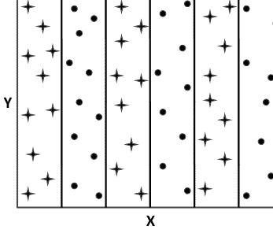

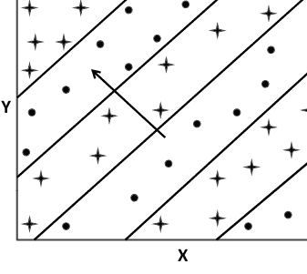

(a) 轴平行

(b) 任意取向

### 图6.1：特征加权对最近邻分类的重要性说明。

### 6.3.3 局部距离缩放

另一种提高k近邻质量的方法是使用一种称为局部距离缩放的技术[65]。在局部距离缩放中，测试实例到每个训练样本X̄i的距离按权重ri缩放，该权重特定于训练样本X̄i。训练样本X̄i的权重ri是从X̄i出发且不包含任何与X̄i不同类别训练样本的最大距离。然后，测试样本X̄与训练样本X̄i之间新的缩放距离d(X̂, X̄i)由以下缩放值给出：

d(X̂, X̄i) = d(X̄, X̄i) / ri (6.3)

在这组距离上计算最近邻，并将k个最近邻中的多数投票作为类别标签。这种方法往往效果良好，因为它以抗噪声的方式选取k近邻组。对于位于决策边界上的测试实例，它倾向于降低处于决策边界噪声部分的实例的权重，而是选取远离噪声边界的k个最近邻。例如，考虑一个数据点X̄i，它离测试实例相当近，但离决策边界更近。此外，由于X̄i几乎位于决策边界上，它离另一个不同类别的训练样本非常近。在这种情况下，样本X̄i不应包含在k近邻中，因为它信息量不大。ri的小值通常会确保这样的样本不会被选入k近邻。此外，这种方法还根据不同区域不同类别模式的变化特性对距离进行缩放和归一化。由于这些因素，文献[65]已表明，这种修改通常能为分类质量带来更稳健的结果。

### 6.3.4 属性加权最近邻方法

属性加权是修改最近邻分类中距离函数的最简单方法。这与马氏距离的使用密切相关；在马氏距离中，数据中任意方向（而非实际属性）可以被赋予不同权重。马氏距离等价于在一个空间中计算的欧氏距离；在该空间中，根据数据集的协方差矩阵，沿任意取向轴系的不同方向被“拉伸”的程度不同。属性加权可以看作一种更简单的方法，其中拉伸方向与原始轴系平行。通过将某个特定权重设为零，该属性被完全消除，这可以看作一种隐式的特征选择。因此，对于两个d维记录X̄ = (x1 … xd)和Ȳ = (y1 … yd)，关于d维权向量W̄ = (w1 … wd)的特征加权距离d(X̄,Ȳ,W̄)定义如下：

```
d(X̄,Ȳ,W̄) = √[ Σ_{i=1}^{d} w_i · (x_i − y_i)^2 ]. (6.4)
```

例如，考虑图6.1(a)所示的数据分布。这种情况下，特征X明显比特征Y更具区分度，因此在最终分类中应赋予更大的权重。在这种情况下，仅使用特征X几乎可以获得完美的分类，尽管通常情况并非如此，因为决策边界本质上是含噪声的。需要指出的是，欧氏度量具有球形决策边界，而本例中的决策边界是线性的。由于模型边界形状与数据中真实边界之间的差异，这会导致分类过程产生偏差。当类别不能被决策边界干净地分开时，特征加权的重要性会显著增加。在这种情况下，决策边界上的固有噪声可能与未加权欧氏距离引入的显著偏差相结合，导致分类更加不准确。通过对欧氏距离中的特征进行加权，可以将模型边界拉长，使其形状与数据中类别分隔边界更加一致。最简单的权重用法是按每个维度的标准差进行归一化，不过在实践中，会使用类标签来确定最佳特征加权[48]。文献[70]对特征加权方案的不同方面进行了详细讨论。

在某些情况下，类别分布可能不会整齐地沿轴系对齐，而是像图6.1(b)那样，沿数据中的不同方向任意取向。更一般的距离度量是相对于一个d × d矩阵A而非权向量W̄定义的。

```
d(X̄,Ȳ,A) = √[ (X̄ − Ȳ)^T · A · (X̄ − Ȳ) ]. (6.5)
```

矩阵A有时也被称为度量。在无监督应用中，马氏距离的标准定义假定A为数据协方差矩阵的逆。一般来说，马氏距离对全局数据分布更敏感，能提供更有效的结果。

然而，马氏距离并未考虑类别分布。在有监督应用中，基于底层数据的类别分布来选择A更有意义。核心思想是沿区分度较低的方向“拉长”邻域，而沿区分度更高的维度收缩邻域。因此，在修改后的度量中，沿区分性方向上的小步（未加权）会对应相对更大的距离，这自然赋予区分度更高的方向更大的重要性。可以使用线性判别[51]等多种方法来确定底层数据中区分度最高的维度。然而，这里的关键是对不同方向使用软加权，而不是硬性地选择特定维度。矩阵A的目标就是实现这一点。如何利用类别分布来确定A呢？显然，在线性判别分析的背景下，矩阵A应以某种方式依赖于类内方差和类间方差。矩阵A定义了给定测试实例在阈值距离内的邻域形状。类间方差与类内方差之比较低的方向应被拉长，而类间与类内方差之比较高的方向应被收缩。注意，邻域方向的“拉长”是通过将该方向上的距离分量乘以更大的因子来实现的，因此该方向被去强调。

设𝒟为整个数据库，𝒟ᵢ为属于类别i的数据集部分。令μ̄表示整个数据集的均值。令pᵢ = |𝒟ᵢ| / |𝒟|为属于类别i的记录比例，μ̄ᵢ为𝒟ᵢ的d维均值行向量，Σᵢ为𝒟ᵢ的d × d协方差矩阵。那么，缩放¹的类内散度矩阵S_w定义如下：

$$S_w = \sum_{i=1}^{k} p_i \cdot \Sigma_i. \tag{6.6}$$

类间散度矩阵S_b可计算如下：

$$S_b = \sum_{i=1}^{k} p_i (\overline{\mu_i} - \overline{\mu})^T (\overline{\mu_i} - \overline{\mu}). \tag{6.7}$$

注意，矩阵S_b是d × d矩阵，因为它是一个d × 1矩阵与一个1 × d矩阵相乘的结果。那么，基于类别分布提供所需距离扭曲的矩阵A（公式6.5）可表示为：

$$A = S_w^{-1} \cdot S_b \cdot S_w^{-1}. \tag{6.8}$$

可以证明，这种度量A的选择能够在不同类别之间提供极佳的判别能力，其中每个方向的拉长程度与沿该方向类间方差与类内方差之比成反比。上述描述基于文献[44]中的讨论。读者可在该文献中找到关于如何有效实现该方法的更多细节。

公式6.5的度量有几个特例值得注意。将A设为单位矩阵等同于使用欧氏距离。将A的非对角线元素设为零，得到的结果类似于对各维度使用d维权向量。因此，非对角线元素有助于在拉伸过程之前对轴系进行旋转。例如，在图6.1(b)中，矩阵A的最优选择将使结果度量中图中箭头所示的方向获得更大的重要性。为了避免病态矩阵，特别是在训练数据点数量较少的情况下，可以使用参数ε进行平滑处理。

$$A = S_w^{-1/2} \cdot (S_w^{-1/2} \cdot S_b \cdot S_w^{-1/2} + \varepsilon \cdot I) \cdot S_w^{-1/2}. \tag{6.9}$$

这里ε是一个可调的小参数，单位矩阵用I表示。使用这种修改是为了避免某个特定方向获得无限权重。当数据点数量较少时，这种情况很有可能发生。使用参数ε类似于拉普拉斯平滑方法，旨在避免过拟合。

文献中还使用了其他启发式方法来学习特征相关性。一种常见的方法是使用交叉验证，即利用原始实例训练权重以最小化错误率。文献[10,48]提供了此类方法的细节。还可以使用不同类型的搜索方法，如禁忌搜索[61]，以改进学习权重的过程。这种方法也已用于文本分类中，通过学习不同单词的相对重要性来计算相似度函数[43]。特征相关性在其他领域如图像检索[53]中也被认为是重要的。在可以使用领域知识的情况下，可以很容易地消除某些特征，从而带来巨大的性能提升。文献[26]讨论了使用领域知识进行特征加权的重要性。


以不同标签的形式，以便对不同维度的相关性进行推断。一种最近的距离函数学习方法 [76] 也在监督下构建实例特定的距离，并表明使用局部性可以提供更优的结果。然而，这种情况下的监督并不专门针对传统的分类问题，因为它是以实例之间的相似性或不相似性约束来定义的，而不是附加到实例上的标签。尽管如此，这种方法也可以用于构建用于分类的实例特定距离，通过将类别标签转换为相似性或不相似性约束。这种一般原则在许多工作中被频繁使用，例如 [34, 39, 44] 中讨论的局部自适应最近邻分类。

标签提供了关于不同局部性中不同维度相对重要性的丰富信息。例如，考虑图 6.2(a) 的插图。在这种情况下，特征 Y 在数据的局部性 A 中更重要，而特征 X 在数据的局部性 B 中更重要。相应地，在使用位于数据局部性 A 的测试实例时，特征 Y 应该被赋予更大的权重，而在数据局部性 B 中，特征 X 应该被赋予更大的权重。在图 6.2(b) 的情况下，我们展示了一个与图 6.2(a) 类似的场景，只是数据中不同方向应被认为更重要或更不重要。因此，图 6.2(b) 中的情况只是图 6.2(a) 中面临挑战的任意定向的推广。

最早的用于执行局部自适应最近邻分类的方法之一是在 [44] 中提出的，其中矩阵 A（式 6.5）以及测试数据点 X̄ 的邻域以局部方式从彼此迭代学习。这里的主要区别在于矩阵 A 将取决于测试实例 X 的选择，因为度量被设计为局部自适应的。该算法首先将 d × d 矩阵 A 设置为单位矩阵，然后使用式 6.5 描述的广义距离确定 k-最近邻 Nk。然后，使用式 6.8 仅在上一次迭代中找到的邻域点 Nk 上更新 A 的值。此过程重复直至收敛。因此，整体迭代过程可总结如下：

- 1. 使用式 6.5 结合 A 的当前值，将 Nk 确定为测试实例的 k 个最近邻的集合。
- 2. 使用 Nk 的类间和类内散布矩阵，根据式 6.8 更新 A。

完成后，矩阵 A 用于式 6.5 中的 k-最近邻分类。实际上，使用式 6.9 以避免对任何特定方向赋予无限权重。应指出，[44] 中的方法在原则上与先前在 [39] 中提出的一个未发表的方法非常相似，尽管在实现的具体细节上有所不同，并且也更稳健。随后，在 [34] 中提出了一种与 [44] 类似的方法，该方法在数据有限的情况下效果良好。应指出，线性判别分析并不是唯一可用于以实例特定方式“变形”度量形状以更好地符合决策边界的方法。任何其他能够在数据中找到重要判别方向的模型，例如 SVM 或神经网络，都可用于确定最相关的度量。例如，[63] 中讨论的一个有趣工作为每个类别确定少量 k-最近邻，以便为该类别生成线性子空间。分类不是基于到原型的距离，而是基于到子空间的距离。其直觉是线性子空间本质上为该类别生成了伪训练示例。将讨论许多使用支持向量机的方法，见支持向量机部分。不同类型的特征选择和特征加权方案的综述和讨论见 [8]。在 [48] 中也曾建议，在不同特征具有不同相关性水平的情况下，特征加权可能优于特征选择。

### 6.3.6 与集成方法结合

从上述讨论可以明显看出，惰性学习方法具有能够更有效地针对特定实例的局部性进行优化的优势。事实上，在惰性学习方法中遇到的问题之一是，对局部优化的追求可能导致过拟合，尤其是在特定局部性中的某些特征存在噪声时。在许多情况下，可能创建多个对不同实例更有效的模型，但很难知道哪个模型更有效而不导致过拟合。实现同时局部优化和鲁棒性的有效方法是使用集成方法，将多个模型的结果结合起来用于分类过程。一些最近的方法 [4, 16, 80] 已被设计用于使用集成方法以提高惰性学习方法的有效性。

[16] 中讨论的一种方法对特征进行随机子集采样，用于最近邻分类。然后将这些不同的分类组合在一起以产生更鲁棒的分类。这种方法的一个缺点是它可能相当慢，尤其是在较大数据集的情况下。这是因为最近邻分类方法本质上计算密集，因为每个基于实例的分类都需要进行大量距离计算。这实际上是所有惰性学习方法的主要问题之一。最近的 LOCUST 方法在 [4] 中讨论，提出了一种更高效的集成惰性学习技术，也可以应用于流式场景。[4] 中讨论的方法实时构建每个实例离散化属性的倒排索引，然后使用随机选择的倒排列表的高效交集来执行实时分类。此外，还使用有限的特征偏差水平以减少有效分类所需的集成组件数量。[4] 中已证明该方法可用于资源敏感的惰性学习，其中特征样本的数量可根据分类可用资源进行调整。因此，该方法也可以被视为一种随时惰性学习算法，特别适用于流式场景。这在无法控制数据流输入速率的场景中很有用，并且需要不断调整处理速率以适应数据流变化的输入速率。

### 6.3.7 多标签学习

在传统的分类问题中，每个实例都与恰好一个标签相关联。在多标签学习中并非如此，其中每个实例可能与一个以上的类别相关联。与实例相关联的类别数量事先未知。这种情况在许多场景中很常见，例如文档分类，其中单个文档可能属于一个或多个可能的类别。

与测试实例相关联的未知类别数量带来了挑战，因为现在不仅需要确定最相关的类别，还需要确定给定测试实例的相关类别数量。解决该问题的一种方法是将其分解为多个独立的二元分类问题。然而，这种方法没有考虑数据实例标签之间的相关性。

一种称为 ML-KNN 的方法在 [78] 中提出，其中使用贝叶斯方法来估计标签属于特定类别的概率。此过程中使用的总体方法是如下。对于每个测试实例，首先识别其 k 个最近邻。然后利用这些邻域实例的标签集中的统计信息来确定标签集。应用最大后验原则来确定测试实例的标签集。

令 𝒴 表示多标签分类问题的标签集，n 为标签总数。对于给定的测试实例 T，第一步是计算其 k 个最近邻。一旦计算出 k 个最近邻，就计算每个 n 个不同标签的出现次数 C̄ = (C(1)…C(n))。令 E¹(T,i) 为测试实例 T 包含


## 6.4 惰性 SVM 分类

在前面的一节中，已经展示了线性判别分析在调整最近邻度量行为以实现更有效的分类方面非常有用。需要指出的是，SVM 分类器也是提供区分不同类别方向的线性模型。因此，自然会探索 SVM 与最近邻分类之间的联系。

[35] 中的工作提出了使用 SVM 方法计算每个特征相关性的方法。其思想是使用支持向量机来计算类标签在每个方向上的变化率的梯度向量（局部于测试实例），该方向平行于轴。已在 [35] 中证明，支持向量机提供了一种自然的方式来估计该梯度。沿任意方向的分量提供了该特征 j 的相关性 Rj。思想是当类标签沿给定方向 j 显著更高速率变化时，则该特征应在距离度量中赋予更大的权重。特征 j 的实际权重 wj 假定与 e^{λ·Rj} 成正比，其中 λ 是一个决定给予不同相关性值重要性程度的常数。[54] 中也提出了使用 SVM 修改距离度量的类似方法，并且该工作中也展示了该方法与线性判别分析的联系。

请注意，[35, 54] 中的方法使用最近邻分类器，SVM 仅用于通过设置相关性权重更准确地学习距离函数。因此，该方法仍然与上一节讨论的方法非常相似。完全不同的方法是使用最近邻来隔离测试实例周围的局部性，然后构建针对该数据局部性优化的 SVM。例如，在图 6.3(a) 和 (b) 的情况下，两个类别中的数据分布方式使得全局 SVM 无法很好地分离类别。然而，在测试实例 A 和 B 周围的局部性中，很容易创建线性 SVM 来很好地分离两个类别。这种方法已在 [23, 77] 中提出。[23] 与 [77] 之间的主要区别在于前者设计用于 L2 距离，而后者可用于任意和复杂的距离函数。此外，后者还提出了若干优化以提高效率。因此，我们将描述 [77] 中的工作，因为它更具一般性。该方法使用的具体步骤如下：

- 1. 确定测试实例的 k-最近邻。
- 2. 如果所有邻居具有相同的标签，则报告该标签，否则计算 k-最近邻之间的所有成对距离。
- 3. 距离矩阵使用核技巧转换为核矩阵，并在该矩阵上构建局部 SVM 分类器。
- 4. 使用该局部 SVM 分类器对测试实例进行分类。

为了提高该方法的效率，[77] 中提出了诸如缓存等多种优化。局部 SVM 分类器已在诸如垃圾邮件过滤 [20] 等多种应用中被成功使用。

## 6.6 惰性朴素贝叶斯

惰性学习也已扩展到朴素贝叶斯分类器的情况 [38,79]。[38] 中的工作提出了一种局部加权朴素贝叶斯分类器。朴素贝叶斯分类器与局部 SVM 方法 [77] 或先前章节中讨论的局部加权回归方法 [15] 的使用方式类似。使用测试实例邻域中的数据子集构建局部贝叶斯模型。此外，该邻域中的训练实例会被加权，使得越接近测试实例的训练实例在模型中权重越大。然后使用该局部模型进行分类。测试实例邻域中的数据子集是通过使用测试实例的 k-最近邻来确定的。实践中，k 个邻居的子集是通过将第 k 个最近邻以外的任何实例的权重设为 0 来选择的。设 D 表示测试实例到第 k 个最近邻的距离，di 表示测试实例到第 i 个训练实例的距离。那么第 i 个实例的权重 wi 设为如下：

```
w_i = f(d_i / D).
```

函数 f(·) 是一个单调非递增函数，定义如下：

```
f(y) = max{1 − y, 0}.
```

因此，权重随距离线性递减，但一旦达到 k-最近邻，就不能递减到 0 以下。朴素贝叶斯方法以标准方式应用，只是估计贝叶斯分类器所有概率时使用实例权重。k 的较高值会导致模型对数据变化波动不大，而 k 的非常小值会导致模型拟合数据中的噪声。已在 [38] 中证明，该方法对 k 在合理适中的取值范围内选择并不太敏感。文献中也提出了其他方案，它们将惰性学习的优点与朴素贝叶斯分类器结合使用。[79] 中的工作将标准基于规则的学习器与朴素贝叶斯模型融合。[74] 中讨论的一种技术惰性地学习多个朴素贝叶斯分类器，并使用估计准确率最高的分类器来决定测试实例的标签。

[78] 中讨论的工作也可以被视为一种无权重的局部贝叶斯分类器，其中所有实例使用的权重为 1，而不是上面讨论的加权方法。此外，[78] 中的工作使用标签的频率进行贝叶斯建模，而不是实际特征本身。[78] 中的思想是其他标签本身可作为特征，因为同一个实例可能包含多个标签，并且可获得足够的关联信息用于学习。该方法在第 6.3.7 节中详细讨论。

## 6.7 惰性决策树

[40] 中的工作提出了一种构建惰性决策树的方法，该决策树特定于测试实例，称为 LazyDT。实践中，只需要构建一条路径，因为测试实例仅沿决策树遵循一条路径，而其他路径从惰性学习的角度来看是无关紧要的。如后面章节所述，这些路径也可以使用可视化方法进行交互式探索。

决策树的一个主要问题是它们具有短视性，因为树较高层级的分割可能对特定测试实例并非最优，并且在数据包含许多相关特征的情况下，可能只有一小部分特征用于分割。当数据集包含 N 个数据点时，决策树仅允许 O(log(N)) 个（近似平衡）分割，这可能太小，无法为特定测试实例使用最佳特征集。显然，测试实例的知识允许在树构建的更高层级使用更相关的特征来构建适当的决策路径。

测试实例的额外知识有助于递归构建一条路径，其中仅使用相关特征。[40] 中提出的一种方法是使用分割准则，该准则依次减小与测试实例相关的训练集大小，直到所有实例具有相同的类标签，或具有相同的特征集。在这两种情况下，都报告多数类标签作为相关类。为了在特定迭代中丢弃一组无关实例，使用任何标准的决策树分割准则，并且只有那些以与测试实例相同的方式满足谓词的训练实例将被选中用于决策路径的下一层级。分割准则使用任何标准的决策树方法决定，例如归一化熵或基尼指数。与传统决策树中分割过程的主要区别在于，只有包含测试实例的节点在分割中相关，并且信息增益或基尼指数是基于该节点计算的。使用这种方法的一个挑战是，如果原始数据不平衡，单个节点的信息增益实际上可能为负。为了避免这个问题，训练示例被重新加权，使得每个类的总权重相同。处理测试实例中缺失属性也相对容易，因为分割只需要对测试实例中存在的属性执行。已证明 [40] 这种方法能产生更好的分类结果，因为在决策路径构建过程中与测试实例相关的额外知识。

这里有一个特别值得注意的观察，因为这些决策路径也可以使用与随机森林方法 [25] 相关的原理来构建鲁棒的随时分类器。需要指出的是，随机森林从实例中心的角度转化为由随机分割集创建的随机路径。因此，实现实例中心随机森林方法的一种自然方式是将数据离散化为范围。测试实例将与每个属性的恰好一个范围相关。选择一组随机属性，范围的交集提供了测试实例的一种可能分类。这种方法可以重复以提供非常高效的惰性集成，并且样本数量提供了运行时间和准确性之间的权衡。这种方法可以在资源受限场景中的随时方法上下文中使用。已在 [4] 中展示了如何使用这种方法对数据流进行高效的随时分类。

## 6.8 基于规则的分类

[36] 中提出了一种惰性基于规则的分类方法，其中提出了一种实例方法与基于规则方法之间的统一。该系统被称为从一组示例归纳规则，或简称为 RISE。所有规则在左侧最多包含每个属性的一个条件。在这种方法中，不假设实例与规则之间有区别。实例只是被视为其左侧区间值退化的规则。换句话说，实例可以通过为前件选择适当条件并将实例的类变量作为后件来视为规则。前件中的条件是通过使用对应实例中的值来确定的。例如，如果实例中属性 x1 的属性值为数值 4，则条件假定为


函数是在使用这些中心的情况下在实例上计算的。从这些中心计算出的函数的组合是使用神经网络计算的。径向基函数可以被视为三层前馈网络，其中每个隐藏单元计算形式为的函数：

```
$$f_i(x) = e^{-\|x - x_i\|^2 / 2 \sigma_i^2}. \tag{6.17}$$
```

这里 $\sigma_i^2$ 表示中心 $x_i$ 处的局部方差。注意函数 $f_i(x)$ 的形式与核密度估计中常用的形式非常相似。为便于讨论，我们假设这是一个二元分类问题，其标签取自 $\{+1, -1\}$，尽管这种通用方法扩展性更强，甚至可用于回归建模。最终函数是这些值的加权组合，权重为 $c_i$。

```
$$f^*(x) = \sum_{i=1}^{N} w_i \cdot f_i(x). \tag{6.18}$$
```

这里 $x_1 \dots x_N$ 表示 $N$ 个不同的中心，$w_i$ 表示中心 $i$ 的权重，该权重在神经网络中学习。在经典的基于实例的方法中，每个数据点 $x_i$ 都是一个单独的训练实例，且权重 $w_i$ 根据其标签设置为 $+1$ 或 $-1$。然而，在 RBF 方法中，权重是使用神经网络方法学习的，因为中心是从底层训练数据中派生的，并且没有直接附加标签。

$N$ 个中心 $x_1 \dots x_N$ 通常使用无监督方法构建 [19, 37, 46]，尽管一些最新方法也使用监督技术来构建中心 [71]。无监督方法 [19, 37, 46] 通常使用聚类算法来生成不同的中心。中心数量越少，通常复杂度越小，分类过程效率越高。径向基函数网络与 S 型函数网络相关，后者对训练数据中的每个实例都有一个单元。在这种意义上，S 型网络更接近经典的基于实例的方法，因为它们没有基于聚类的汇总的第一阶段。虽然径向基函数网络通常更高效，但在不同聚类边界上的点可能经常被错误分类。据 [52] 显示，RBF 网络有时需要比 SGF 多十倍的训练数据才能达到相同的准确率水平。一些最新工作 [71] 显示，即使在中心确定阶段使用监督方法，也能显著提高这些分类器的准确性。因此，径向基函数网络可以被视为最近邻分类器的演进，其中使用更复杂的聚类方法进行原型选择，或以聚类中心的形式重建，并使用神经网络方法组合来自每个中心的密度值。

## 6.10 用于诊断和视觉分类的惰性方法

实例中心方法对于诊断和视觉分类特别有用，因为诊断方法的角色是找到特定于该测试实例的诊断特征。当急切模型作为预处理步骤完全构建时，它通常无法优化以找到特定于某个测试实例的最佳诊断特征。因此，在这种情况下，实例中心方法是一种自然的方法。子空间决策路径方法 [6] 可以被视为决策树的惰性和交互式版本，它提供了对特定测试实例的特定特征的洞察。

核密度估计用于创建底层数据的视觉轮廓。假设数据集 $\mathcal{D}$ 包含 $N$ 个点和 $d$ 个维度。$\mathcal{D}$ 中的点集表示为

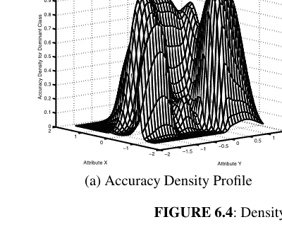

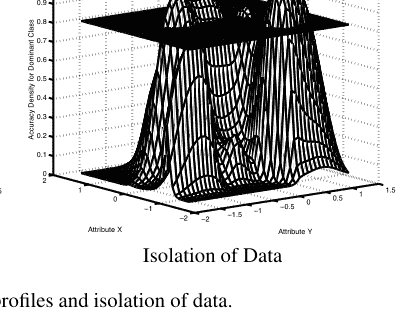

(a) Accuracy Density Profile

Isolation of Data

### FIGURE 6.4: Density profiles and isolation of data.

由 X₁ … X_N 表示。进一步假设数据中的 k 个类别由 C₁ … C_k 表示。属于类别 C_i 的点的数量为 n_i，使得 Σ_{i=1}^k n_i = N。与类别 i 关联的数据集表示为 D_i。这意味着 ∪_{i=1}^k D_i = D。给定点的概率密度由与数据集中每个点相关联的核函数 K_h(·) 的平滑值的总和决定。因此，数据集 D 在点 x 处的密度估计定义如下：

f(x, D) = 1/n · Σ_{X_i ∈ D} K_h(x - X_i). (6.19)

核函数是一个光滑的单峰分布，例如高斯函数：

K_h(x - X_i) = 1/(√(2π)·h) · e^{ - ||x - X_i||² / (2h²) }. (6.20)

核函数依赖于参数 h 的使用，h 是平滑程度。密度估计的准确性取决于该宽度 h，并且已经提出了几种启发式规则来估计带宽 [6]。

密度 f(x, D) 的值可能与 f(x, D_i) 大不相同，这是由于不同类别的分布差异所致。相应地，类别 C_i 的准确度密度 A(x, C_i, D) 定义如下：

A(x, C_i, D) = [n_i · f(x, D_i)] / [Σ_{i=1}^k n_i · f(x, D_i)]. (6.21)

上述表达式始终介于 0 和 1 之间，仅仅是对测试实例属于类别 C_i 的贝叶斯后验概率的估计。假设测试实例属于类别 C_i 的先验概率，在不知道其任何特征值的情况下，仅仅等于其在类别 C_i 中出现的比例 n_i/N。已知特征值 x 后的条件概率密度等于 f(x, D_i)。然后，通过应用贝叶斯公式计算后验概率，得到方程 6.21 的条件。准确度密度值越高，C_i 相对于其他类别的相对密度越大。

另一个相关度量是兴趣密度 I(x, C_i, D)，它是类别 C_i 的密度与数据的整体密度的比率。

I(x, C_i, D) = f(x, D_i) / f(x, D). (6.22)

当兴趣密度大于一时，类别 C_i 在 x 处被过度表示。在坐标 x 处的占主导地位的类别表示为 CM(x, D)，等于 argmax_{i∈{1...k}} I(x, C_i, D)。相应地，在 x 处的最大兴趣密度表示为 IM(x, D) = max_{i∈{1...k}} I(x, C_i, D)。兴趣密度和准确度密度都是不同类别主导程度的有价值的量化。兴趣密度在比较给定点处的不同类别方面更有效，而准确度密度在提供给定点的绝对准确性方面更有效。

到目前为止，一直假设所有上述计算都是在全维空间中执行的。然而，也有可能将数据投影到子空间 E 上以执行此计算。这种计算将量化子空间 E 在 x 处的判别能力。为了表示在任何计算中使用子空间 E，对应的表达式将以 E 为上标。因此，给定子空间 E 中的密度表示为 f^E(·,·)，准确度密度为 A^E(·,·,·)，兴趣密度为 I^E(·,·,·)。同样，占主导地位的类别是使用该点处的子空间特定兴趣密度定义的，并且为该特定子空间定义了准确度密度轮廓。图 6.4(a) 说明了二维子空间中占主导地位类别的准确度密度轮廓的示例。测试实例也在同一图中标记，以便说明密度轮廓与测试实例之间的关系。

希望找到那些兴趣密度值 IM^E(t, D) 为最大值的投影。可能在某些情况下，不同的子空间可能提供有关数据类别行为的不同信息；这些是困难的情况，在这些情况下，测试实例可能难以准确分类。在这种情况下，用户可能需要隔离特定的数据局部区域，在这些区域中，类别分布通过分层探索过程进一步检查。虽然密度值自然定义在定量属性的连续空间上，但在 [6] 中已显示，即使存在分类属性，也可以为兴趣密度和准确度密度定义直观类似的值。

对于给定的测试示例，最终用户可以探索各种对其分类具有指示性的特征。子空间确定过程是基于给定测试实例处最高的兴趣密度。因此，子空间确定过程为给定的测试示例找到适当的局部判别子空间。这些是决策路径的各种可能性，或分支，可以用于探索测试实例局部区域的区域。在这些子空间中，用户会提供准确度密度的视觉轮廓。此轮廓为用户提供有关哪个分支可能导致该测试实例的高准确度区域的想法。此视觉轮廓也可以用于确定哪些分支最适合进一步探索。一旦选择了这样的分支，用户就有机会进一步探索具有高准确度密度的特定数据区域。这种数据定位过程可以快速隔离包含测试实例的任意形状的区域。此数据定位序列创建了一条路径，以及局部判别维度的组合，向用户揭示了底层分类因果关系。

如果选择的决策路径不能强烈指示任何类别，用户可以选择回溯到更高级别的节点并探索树的另一条路径。在某些情况下，不同的分支可能指示测试示例属于不同的类别。这些是“模糊情况”，测试示例可能具有来自多个类别的特征。许多标准建模方法可能会错误地对这样的示例进行分类，而子空间决策路径方法由于其探索性方法，更有效地为用户提供测试示例的内涵知识。这可用于理解该实例模糊分类行为背后的因果关系。

决策路径构建的整体算法如图 6.5 所示。程序中子例程的细节在 [6] 中描述，尽管这里提供了总结性描述。系统输入为数据集 D，测试实例 t，希望为其找到


### 算法 SubspaceDecisionPath(测试实例: t, 数据集: D, 最大维度: l, 最大分支因子: b_max, 最小兴趣比: ir_min)

```
begin
  PATH = {D};
  while not(termination) do
  begin
    Pick the last data set L indicated in PATH;
    E = {E1 ... Eq} = ComputeClassificationSubspaces(L, t, l, b_max, ir_min);
    for each Ei ConstructDensityProfile(Ei, L, t);
    { "Zooming in" refers to further subspace exploration }
    if (zoom-in (user-specified)) then
    begin
      User specifies choice of branch Ei;
      User specifies accuracy density threshold λ for zoom-in;
      { p(L', Ci) is accuracy significance of class Ci in L' with respect to L }
      (L', p(L', C1) ... p(L', Ck)) = IsolateData(L, t, λ);
      Add L' to the end of PATH;
    end;
    else begin (retreat)
      User specifies data set L' on PATH to backtrack to;
      Delete all data set pointers occuring after L' on PATH; (backtrack)
    end;
    { Calculate cumulative dominance of each class Ci along PATH in order to provide the user a measure of its significance }
    for each class Ci do
      Output CD(PATH, Ci) = 1 − ∏_{L∈PATH, L≠D} (1 − p(L, Ci)) to user;
  end;
end
```

### FIGURE 6.5: The subspace decision path method.

诊断特征、最大分支因子 b_max 以及最小兴趣密度 ir_min。此外，数据探索中使用的任何子空间的最大维度 l 也作为用户输入。l = 2 的值尤其有趣，因为它允许使用准确度密度的视觉轮廓。尽管由于其视觉可解释性，使用二维投影是自然的，但沿给定路径的数据探索过程揭示了更高维度的维度组合，这对于测试实例最为合适。分支因子 b_max 是向用户呈现的最大可能性数量，而 ir_min 的值是向用户呈现的任何子空间中测试实例的相应最小兴趣密度。ir_min 的值被选为 1，这是在兴趣密度计算中的盈亏平衡值。该盈亏平衡值是兴趣密度既不低估也不高估测试实例相对于某个类别的准确度的点。变量 PATH 由指向交互式决策树构建过程中获得的连续缩减训练数据集的指针序列组成。列表 PATH 初始化为单个元素，即指向原始数据集 D 的指针。在决策路径构建过程的每个点，子空间 E1 ... Eq 被确定，它们在测试实例 t 的局部具有最大的兴趣密度（主导类别）。此过程由 ComputeClassificationSubspaces 过程完成。一旦确定了这些子空间，就由

ConstructDensityProfile 过程为每个子空间构建密度轮廓。即使一个子空间在测试实例处的兴趣密度高于另一个子空间，子空间在分离测试实例周围数据局部方面的真正价值通常是主观判断，取决于测试实例的兴趣密度和类别的空间分离。这种判断需要人类直觉，可以通过使用各种可能性的准确度密度轮廓的视觉轮廓来利用。这些轮廓为用户提供了对数据集中在各种投影中的类别行为的直观概念。如果不同投影中的类别行为并不非常一致（不同投影指示不同的类别），则该节点不能很好地揭示有价值的信息。在这种情况下，用户可以通过指定 PATH 上更早的节点来回溯以开始进一步探索。

另一方面，如果不同投影提供了类别行为的一致概念，则用户利用密度轮廓来隔离数据的一个小区域，在该区域中，测试实例局部数据的准确度密度对于特定类别显著更高。这是通过 IsolateData 过程实现的。该隔离区域可能是任意形状的簇，取决于主导类别所覆盖的区域。然而，视觉轮廓的使用有助于在分离的任意轮廓下保持隔离过程的可解释性。图 6.4(b) 中说明了这种隔离的一个例子，并通过构建视觉密度轮廓得以实现。该过程返回隔离数据集 L′ 以及称为类别 Ci 的准确度显著性 p(L′, Ci) 的数值。指向此新数据集 L′ 的指针被添加到 PATH 的末尾。此时，用户决定是否需要对该隔离数据集进行进一步探索。如果需要，则在该节点上重复相同的子空间分析过程。否则，过程终止并报告最相关的类别标签。整体探索过程还为用户提供了有关不同维度沿线的局部数据分布如何与类别标签相关联的良好诊断思路。

## 6.11 Conclusions and Summary

在本章中，我们提出了基于实例学习和懒惰学习的算法。这些方法通常比传统模型在计算上更昂贵，但具有在模型构建时使用测试实例信息的优势。在许多场景中，当预处理模型无法完全捕捉数据的底层复杂性时，此类方法可以提供更准确的结果。基于实例方法的另一个优点是它们通常非常简单且易于实现任意数据类型，因为复杂性通常抽象在确定对象之间适当的距离函数中。由于距离函数设计在文献中已针对不同数据类型进行了广泛研究，这使得该方法论可用于任意数据类型。此外，现有基于模型的算法可以推广到局部变化，以便将其转换为实例学习方法。此类方法对特定测试实例具有很大的诊断价值，因为模型是针对特定测试实例局部构建的，并且还为分析人员提供了特定于测试实例的知识。懒惰方法高度灵活，可以推广到流数据和其他时间场景，其中方法的懒惰性可用于学习应执行懒惰学习的适当时间范围。

## Bibliography

[1] A. Aamodt and E. Plaza. Case-based reasoning: Foundational issues, methodological variations, and system approaches, *AI communications*, 7(1):39–59, 1994.

[2] C. Aggarwal, A. Hinneburg, and D. Keim. On the surprising behavior of distance metrics in high dimensional space, *Data Theory—ICDT Conference*, 2001; *Lecture Notes in Computer Science*, 1973:420–434, 2001.

[3] C. Aggarwal. Towards systematic design of distance functions for data mining applications, *Proceedings of the KDD Conference*, pages 9–18, 2003.

[4] C. Aggarwal and P. Yu. Locust: An online analytical processing framework for high dimensional classification of data streams, *Proceedings of the IEEE International Conference on Data Engineering*, pages 426–435, 2008.

[5] C. Aggarwal and C. Reddy. *Data Clustering: Algorithms and Applications*, CRC Press, 2013.

[6] C. Aggarwal. Toward exploratory test-instance-centered diagnosis in high-dimensional classification, *IEEE Transactions on Knowledge and Data Engineering*, 19(8):1001–1015, 2007.

[7] C. Aggarwal, J. Han, J. Wang, and P. Yu. A framework for on demand classification of evolving data streams. In *IEEE TKDE Journal*, 18(5):577–589, 2006.

[8] D. Aha, P. Clark, S. Salzberg, and G. Blix. Incremental constructive induction: An instance-based approach, *Proceedings of the Eighth International Workshop on Machine Learning*, pages 117–121, 1991.

[9] D. Aha. *Lazy learning*. Kluwer Academic Publishers, 1997.

[10] D. Aha. Tolerating noisy, irrelevant and novel attributes in instance-based learning algorithms, *International Journal of Man-Machine Studies*, 36(2):267–287, 1992.

[11] D. Aha, D. Kibler, and M. Albert. Instance-based learning algorithms, *Machine Learning*, 6(1):37–66, 1991.

[12] D. Aha. Lazy learning: Special issue editorial, *Artificial Intelligence Review*, 11:7–10, 1997.

[13] F. Angiulli. Fast nearest neighbor condensation for large data sets classification, *IEEE Transactions on Knowledge and Data Engineering*, 19(11):1450–1464, 2007.

[14] M. Ankerst, G. Kastenmuller, H.-P. Kriegel, and T. Seidl. Nearest Neighbor Classification in 3D Protein Databases, *ISMB-99 Proceedings*, pages 34–43, 1999.

[15] C. Atkeson, A. Moore, and S. Schaal. Locally weighted learning, *Artificial Intelligence Review*, 11(1–5):11–73, 1997.

[16] S. D. Bay. Combining nearest neighbor classifiers through multiple feature subsets. *Proceedings of ICML Conference*, pages 37–45, 1998.

[17] J. Beringer and E Hullermeier. Efficient instance-based learning on data streams, *Intelligent Data Analysis*, 11(6):627–650, 2007.

[18] M. Birattari, G. Bontempi, and M. Bersini. Lazy learning meets the recursive least squares algorithm, *Advances in neural information processing systems*, 11:375–381, 1999.


[19] C. M. Bishop. 改进径向基函数神经网络的泛化性能, Neural Computation, 3(4):579–588, 1991.

[20] E. Blanzieri and A. Bryl. 使用 SVM 最近邻分类器的基于实例的垃圾邮件过滤, FLAIRS Conference, pages 441–442, 2007.

[21] J. Blitzer, K. Weinberger, and L. Saul. 用于大间隔最近邻分类的距离度量学习, Advances in neural information processing systems: 1473–1480, 2005.

[22] S. Boriah, V. Chandola, and V. Kumar. 分类数据的相似性度量：一个比较性评估. Proceedings of the SIAM Conference on Data Mining, pages 243–254, 2008.

[23] L. Bottou and V. Vapnik. 局部学习算法, Neural Computation, 4(6):888–900, 1992.

[24] L. Breiman, J. Friedman, R. Olshen, and C. Stone. 分类与回归树, Wadsworth, 1984.

[25] L. Breiman. 随机森林, Machine Learning, 48(1):5–32, 2001.

[26] T. Cain, M. Pazzani, and G. Silverstein. 使用领域知识影响相似性判断, Proceedings of the Case-Based Reasoning Workshop, pages 191–198, 1991.

[27] C. L. Chang. 寻找最近邻分类器的原型： IEEE Transactions on Computers, 100(11):1179–1184, 1974.

[28] W. Cheng and E. Hullermeier. 结合基于实例学习和逻辑回归进行多标签分类, Machine Learning, 76 (2–3):211–225, 2009.

[29] J. G. Cleary and L. E. Trigg. K*：使用熵距离度量的基于实例的学习器, Proceedings of ICML Conference, pages 108–114, 1995.

[30] S. Cost and S. Salzberg. 用于符号特征学习的加权最近邻算法, Machine Learning, 10(1):57–78, 1993.

[31] T. Cover and P. Hart. 最近邻模式分类, IEEE Transactions on Information Theory, 13(1):21–27, 1967.

[32] P. Cunningham, 用于案例推理的相似性机制分类法, IEEE Transactions on Knowledge and Data Engineering, 21(11):1532–1543, 2009.

[33] B. V. Dasarathy. 最近邻 NN 范式：NN 模式分类技术, IEEE Computer Society Press, 1990.

[34] C. Domeniconi, J. Peng, and D. Gunopulos. 局部自适应度量最近邻分类, IEEE Transactions on Pattern Analysis and Machine Intelligence, 24(9):1281–1285, 2002.

[35] C. Domeniconi and D. Gunopulos. 使用支持向量机进行自适应最近邻分类, Advances in Neural Information Processing Systems, 1: 665–672, 2002.

[36] P. Domingos. 统一基于实例和基于规则的归纳, Machine Learning, 24(2):141–168, 1996.

[37] G. W. Flake. 方形单元增强、径向扩展多层感知器, In Neural Networks: Tricks of the Trade, pages 145–163, 1998.

[38] E. Frank, M. Hall, and B. Pfahringer. 局部加权朴素贝叶斯, Proceedings of the Nineteenth Conference on Uncertainty in Artificial Intelligence, pages 249–256, 2002.

[39] J. Friedman. 灵活的最近邻分类, Technical Report, Stanford University, 1994.

[40] J. Friedman, R. Kohavi, and Y. Yun. 惰性决策树, Proceedings of the National Conference on Artificial Intelligence, pages 717–724, 1996.

[41] S. Garcia, J. Derrac, J. Cano, and F. Herrera. 最近邻分类的原型选择：分类法和实证研究, IEEE Transactions on Pattern Analysis and Machine Intelligence, 34(3):417–436, 2012.

[42] D. Gunopulos and G. Das. 时间序列相似性度量. In Tutorial notes of the sixth ACM SIGKDD International Conference on Knowledge Discovery and Data Mining, pages 243–307, 2000.

[43] E. Han, G. Karypis, and V. Kumar. 使用加权调整 k-最近邻分类进行文本分类, Proceedings of the Pacific-Asia Conference on Knowledge Discovery and Data Mining, pages 53–65, 2001.

[44] T. Hastie and R. Tibshirani. 判别自适应最近邻分类, IEEE Transactions on Pattern Analysis and Machine Intelligence, 18(6):607–616, 1996.

[45] A. Hinneburg, C. Aggarwal, and D. Keim. 高维空间中的最近邻是什么？ Proceedings of VLDB Conference, pages 506–515, 2000.

[46] Y. S. Hwang and S. Y. Bang. 构造径向基函数神经网络分类器的有效方法, Neural Networks, 10(8):1495–1503, 1997.

[47] N. Jankowski and M. Grochowski. 实例选择算法比较, I 算法综述, Lecture Notes in Computer Science, 3070:598–603, 2004.

[48] R. Kohavi, P. Langley, and Y. Yun. 最近邻算法中特征加权的效用, Proceedings of the Ninth European Conference on Machine Learning, pages 85–92, 1997.

[49] J. Li, G. Dong, K. Ramamohanarao, and L. Wong. Deeps：一种新的基于实例的惰性发现和分类系统, Machine Learning, 54(2):99–124, 2004.

[50] D. G. Lowe. 变量核分类器的相似性度量学习, Neural computation, 7(1):72–85, 1995.

[51] G. J. McLachlan. 判别分析和统计模式识别, Wiley-Interscience, Vol. 544, 2004.

[52] J. Moody and C. Darken. 局部调谐处理单元网络的快速学习, Neural computation, 1(2):281–294, 1989.

[53] J. Peng, B. Bhanu, and S. Qing. 基于内容的图像检索的概率特征相关性学习, Computer Vision and Image Understanding, 75(1):150–164, 1999.

[54] J. Peng, D. Heisterkamp, and H. Dai. LDA/SVM 驱动的最近邻分类, Computer Vision and Pattern Recognition Conference, 1–58, 2001.

[55] J. R. Quinlan. 结合基于实例和基于模型的 learning. Proceedings of ICML Conference, pages 236–243, 1993.

[56] G. Salton and M. J. McGill. 现代信息检索导论. McGraw-Hill, 1983.

[57] H. Samet. 多维和度量数据结构基础, Morgan Kaufmann, 2006.

[58] M. Sonka, H. Vaclav, and R. Boyle. 图像处理、分析与机器视觉. Thomson Learning, 1999.

[59] E. Spyromitros, G. Tsoumakas, and I. Vlahavas. 惰性多标签分类算法的实证研究, In Artificial Intelligence: Theories, Models and Applications, pages 401–406, 2008.

[60] C. Stanfil and D. Waltz. 朝向基于记忆的推理, Communications of the ACM, 29(12):1213–1228, 1986.

[61] M. Tahir, A. Bouridane, and E. Kurugollu. K-最近邻分类器中同时进行特征选择和特征加权的混合禁忌搜索, Pattern Recognition Letters, 28(4):483–496, 2007.

[62] P. Utgoff. 决策树的增量归纳, Machine Learning, 4(2):161–186, 1989.

[63] P. Vincent and Y. Bengio. K-局部超平面和凸距离最近算法, Neural Information Processing Systems, pages 985–992, 2001.

[64] D. Volper and S. Hampson. 学习和使用特定实例, Biological Cybernetics, 57(1–2):57–71, 1987.

[65] J. Wang, P. Neskovic, and L. Cooper. 使用简单自适应距离度量改进最近邻规则, Pattern Recognition Letters, 28(2):207–213, 2007.

[66] J. Wang and G. Karypis. 关于挖掘实例中心分类规则, IEEE Transactions on Knowledge and Data Engineering, 18(11):1497–1511, 2006.

[67] I. Watson and F. Marir. 基于案例的推理：综述, Knowledge Engineering Review, 9(4):327–354, 1994.

[68] K. Weinberger, J. Blitzer, and L. Saul. 用于大间隔最近邻分类的距离度量学习, NIPS Conference, MIT Press, 2006.

[69] D. Wettschereck, D. Aha, and T. Mohri. 一类惰性学习算法特征加权方法的综述和实证评估, Artificial Intelligence Review, 11(1–5):273–314, 1997.

[70] D. Wettschereck and D. Aha. 特征加权. Case-Based Reasoning Research and Development, pp. 347–358, Springer Berlin, Heidelberg, 1995.

[71] D. Wettschereck and T. Dietterich. 通过学习中心位置提高径向基函数网络的性能, NIPS, Vol. 4:1133–1140, 1991.

[72] D. Wilson and T. Martinez. 基于实例学习算法的简化技术, Machine Learning 38(3):257–286, 2000.

[73] D. Wilson and T. Martinez. 一个集成的基于实例的学习算法, Computers and Intelligence, 16(1):28–48, 2000.

[74] Z. Xie, W. Hsu, Z. Liu, and M. L. Lee. SnnB：用于惰性学习的基于选择邻域的朴素贝叶斯, Advances in Knowledge Discovery and Data Mining, pages 104–114, Springer, 2002.


+   [75] L. Yang. Distance Metric Learning: A Comprehensive Survey, 2006. http://www.cs.cmu.edu/~liuy/frame_survey_v2.pdf
+   
+   [76] D.-C. Zhan, M. Li, Y.-F. Li, and Z.-H. Zhou. Learning instance specific distances using metric propagation, *Proceedings of ICML Conference*, pages 1225–1232, 2009.
+   
+   [77] H. Zhang, A. Berg, M. Maire, and J. Malik. SVM-KNN: Discriminative nearest neighbor classification for visual category recognition, *Computer Vision and Pattern Recognition*, pages 2126–2136, 2006.
+   
+   [78] M. Zhang and Z. H. Zhou. ML-kNN: A lazy learning approach to multi-label learning, *Pattern Recognition*, 40(7): 2038–2045, 2007.
+   
+   [79] Z. Zheng and G. Webb. Lazy learning of Bayesian rules. *Machine Learning*, 41(1):53–84, 2000.
+   
+   [80] Z. H. Zhou and Y. Yu. Ensembling local learners through multimodal perturbation, *IEEE Transactions on Systems, Man, and Cybernetics, Part B: Cybernetics*, 35(4):725–735, 2005.
+   
+   [81] X. Zhu and X. Wu. Scalable representative instance selection and ranking, *Proceedings of IEEE International Conference on Pattern Recognition*, Vol 3:352–355, 2006.

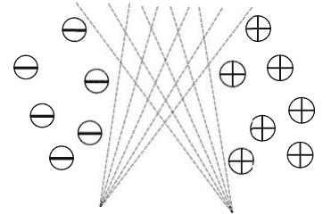

**FIGURE 7.1:** Infinitely many classifiers could separate the positive and negative instances.

decomposition methods are introduced in Section 7.6. Further, we discuss the multiclass strategies in Section 7.7 and make a summary in Section 7.8.

This chapter is not the only existing introduction of SVM. A number of surveys and books may be found in [6, 12, 33]. While this chapter does not discuss applications of SVMs, the reader is referred to [16] for a guide to such applications.

## 7.2  The Maximum Margin Perspective

Given the training data in the form of label-feature pairs,

$$S=\{(y_i,x_i)\mid y_i\in\{+1,-1\},\ x_i\in\mathbb{R}^n,\ \forall i=1\ldots l\}.$$

the goal of binary classification is to find a decision function $f(\mathbf{x})$ that could correctly predict the label $y$ of an input feature $\mathbf{x}$. The problem could be transformed to the determination of a function $h(\mathbf{x})$, such that

$$f(\mathbf{x})=\begin{cases}+1 & \text{when }h(\mathbf{x})>0,\\-1 & \text{when }h(\mathbf{x})<0.\end{cases}$$

The separating surface, which represents the boundary between positive and negative regions, is defined as follows:

$$\mathcal{H}=\{\mathbf{x}\mid h(\mathbf{x})=0\}.$$

Now consider a linearly separable scenario, where some linear functions

$$h(\mathbf{x})\equiv\mathbf{w}^{\mathsf{T}}\mathbf{x}+b$$

could separate the two regions. As shown in Figure 7.1, there may be infinitely many hyperplanes that separate the positive and negative instances correctly. A reasonable choice is the one with the largest gap between both classes. This setting, called the **Maximum Margin Classifier**, may be more resistant to any perturbation of the training data. Since the margin could be measured in different ways, we formally define the distances of a feature $\mathbf{x}$ to the set $\mathcal{H}$.

$$\operatorname{Distance}(\mathbf{x},\mathcal{H})\equiv\min_{\mathbf{p}\in\mathcal{H}}\|\mathbf{x}-\mathbf{p}\|.$$

Note that we may use different norms in the definition of distance. By [24, Theorem 2.2], there is a closed-form solution when $\mathcal{H}$ is a hyperplane:

$$\operatorname{Distance}(\mathbf{x},\mathcal{H})=\frac{|\mathbf{w}^{\mathsf{T}}\mathbf{x}+b|}{\|\mathbf{w}\|_*},$$

in which || · ||* is the dual norm of the norm we choose in the definition of distance. The margin, which measures the gap between the separating surface H and the nearest instance, is defined as follows:

```
M ≡ min_i |wᵀ x_i + b| / ||w||*
```

When the instance x_i lies on the correct side of the hyperplane, the numerator of margin M could be simplified as follows:

```
|wᵀ x_i + b| = y_i(wᵀ x_i + b) > 0.
```

Thus, to find a maximum margin classifier, we can instead solve the following problem:

```
max_{w, b, M} M,  s.t.  y_i(wᵀ x_i + b) / ||w||* ≥ M.
```

It could be verified that any non-zero multiple of the optimal solution (w̄, b̄) is still an optimal solution. Therefore, we could set

```
M ||w||* = 1,
```

so that the problem could be rewritten in a simpler form

```
min_{w, b} ||w||*,  s.t.  y_i(wᵀ x_i + b) ≥ 1, ∀i = 1...l.
```

If the Euclidean norm ||x||₂ ≡ √Σ_i x_i² is chosen, this formulation reverts to the original SVM formulation in [1]. If an infinity norm ||x||_∞ ≡ max_i(|x_i|) is chosen, it instead leads to the L1 regularized SVM. An illustration is provided in Figures 7.2(a) and 7.2(b).

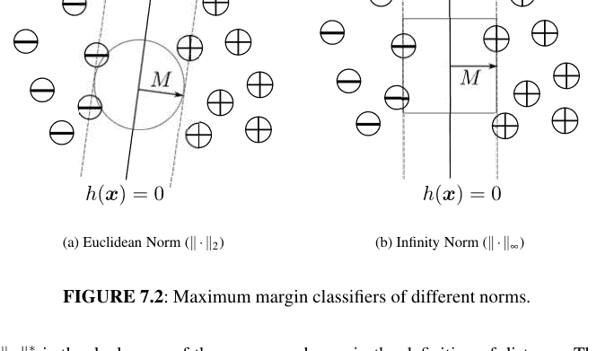

### FIGURE 7.2: Maximum margin classifiers of different norms.

The concept of maximum margin could also be explained by statistical learning theory. From [35], we know that if training data and testing data are sampled i.i.d., under probability 1 − η we have

```
testing error ≤ training error + √[ VC·(ln(2l/VC)+1) − ln(η/4) / l ] ,
```

in which VC is the Vapnik-Chervonenkis dimension of our model. In our separable scenario, the training error is zero. Therefore, the minimization of the testing error could be achieved by controlling the VC dimension of our model. However, optimizing the VC dimension is a difficult task.

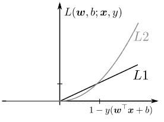

Instead, we may optimize a simpler upper-bound for VC. Assume that all data lie in an $n$-dimension sphere of radius $R$. It is proven in [35, Theorem 10.3] that the VC dimension of the linear classifier is upper bounded,

$$\mathrm{VC} \leq \min(\lVert\mathbf{w}\rVert_2^2R^2, n)+1.$$

As a result, $\lVert\mathbf{w}\rVert_2^2$ bounds the VC dimension. The latter bounds the testing error. The maximum margin classifier, which has the smallest $\lVert\mathbf{w}\rVert_2$, minimizes an upper bound of the testing error. Thus, SVM is likely to have a smaller generalization error than other linear classifiers [28, 35].

## 7.3 The Regularization Perspective

In the previous section, we assume that data are linearly separable. However, in real world scenarios, data are less likely to satisfy this neat assumption. Therefore, the model should also be capable of handling nonseparable data. Recall that the separable condition is equivalent to the following constraints,

$$y_i(\mathbf{w}^{\mathsf T}\mathbf{x}_i+b)-1\geq 0,\quad \forall i=1\ldots l.$$

To penalize nonseparable instances, a **Loss Function** $\xi(\cdot)$ is used to measure the violation of these inequalities. For example, we can use an absolute value on the violation, and the loss function is referred to as the L1 hinge loss,

$$\xi_{L1}(\mathbf{w},b;y_i,\mathbf{x}_i)=\max(0,1-y_i(\mathbf{w}^{\mathsf T}\mathbf{x}_i+b)).$$

If we square the violation, the loss function is referred to as the L2 hinge loss,

$$\xi_{L2}(\mathbf{w},b;y_i,\mathbf{x}_i)=\max(0,1-y_i(\mathbf{w}^{\mathsf T}\mathbf{x}_i+b))^2.$$

An illustration is provided in Figure 7.3.

In contrast to maximizing *only* the margin in the separable scenario, we also need to penalize the loss terms $\xi(\mathbf{w},b;y_i,\mathbf{x}_i)$ for each $i$, while maintaining a large margin. Thus, there are two objectives, and there may be multiple ways of balancing them. For example, one can have a smaller margin with one violated instance, as illustrated in Figure 7.4(a). Alternatively, one can have a larger margin with more violated instances, as illustrated in Figure 7.4(b). Since it is more difficult to minimize multiple objectives simultaneously, some tradeoffs between $\lVert\mathbf{w}\rVert^*$ and the loss terms are introduced. If the distance is defined by the Euclidean norm, and the L1 hinge loss is chosen, we have the classic SVM formulation in [1],

$$\min_{\mathbf{w},b}\ \frac{1}{2}\mathbf{w}^{\mathsf T}\mathbf{w}+C\sum_{i=1}^{l}\xi_{L1}(\mathbf{w},b;y_i,\mathbf{x}_i). \tag{7.1}$$

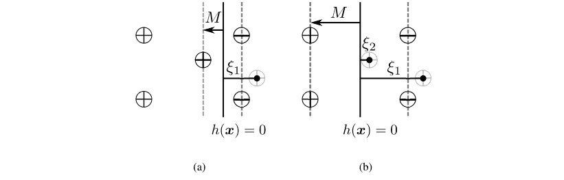

**FIGURE 7.4:** We can take different tradeoffs between margin size and violations.

If L2 hinge loss is selected, it would lead to another formulation

$$\min_{\mathbf{w},b}\ \frac{1}{2}\mathbf{w}^{\mathsf T}\mathbf{w}+C\sum_{i=1}^{l}\xi_{L2}(\mathbf{w},b;y_i,\mathbf{x}_i).$$

On the other hand, when the infinity norm is chosen to define the distance, we have the L1-regularized SVM problem in [5],

$$\min_{\mathbf{w},b}\ \|\mathbf{w}\|_1+C\sum_{i=1}^{l}\xi_{L1}(\mathbf{w},b;y_i,\mathbf{x}_i).$$

As we can see, all these formulations are composed of two parts: a norm from the maximum margin objective, and the loss terms from the violation of the models. The maximum margin part is also called the **Regularization Term**, which is used to control the model complexity with respect to the violation of the models. From the perspective of numeric stability, the regularization term also plays a role in balance between the accuracy of the model and the numeric range of $\mathbf{w}$. It ensures that the value of $\mathbf{w}$ does not take in extreme values.

Because of the tradeoffs between regularization and loss terms, the loss might not be zero even if the data are linearly separable. However, for L2 regularized SVM with L1 hinge loss, it is proved that when C is large enough, the solution $(\bar{\mathbf{w}},\bar{b})$ of the SVM with loss terms are identical to the solution of the SVM without loss terms under the separable scenario. A proof of this is available in [23].

### 7.4 The Support Vector Perspective

We will consider an equivalent formulation of (7.1). By introducing a non-negative scalar $\xi_i=\xi_{L1}(\mathbf{w},b;y_i,\mathbf{x}_i)$, the L2 regularized L1 hinge loss SVM can be rewritten as follows:

$$\min_{\mathbf{w},b,\boldsymbol{\xi}}\ \frac{1}{2}\mathbf{w}^{\mathsf T}\mathbf{w}+C\sum_{i=1}^{l}\xi_i,\quad \text{s.t.}\quad y_i(\mathbf{w}^{\mathsf T}\mathbf{x}_i+b)\ge 1-\xi_i,\ \xi_i\ge 0,\ \forall i=1\ldots l. \tag{7.2}$$

Different from the original non-differentiable problem, this formulation is a convex quadratic programming problem over some linear constraints. Since this problem is a constrained optimization


对于该问题，可使用拉格朗日松弛方法来推导最优性条件。拉格朗日函数定义为目标函数与约束惩罚项之和，其中非负拉格朗日乘子 α ≥ 0 和 β ≥ 0，

L(w, b, ξ, α, β) ≡ ½ wᵀ w + C Σᵢ₌₁ˡ ξᵢ − Σᵢ₌₁ˡ αᵢ (yᵢ (wᵀ xᵢ + b) − 1 + ξᵢ) − Σᵢ₌₁ˡ βᵢ ξᵢ.

考虑问题 min_{w,b,ξ} P(w, b, ξ) 和 max_{α ≥ 0, β ≥ 0} D(α, β)，其中

P(w, b, ξ) ≡ max_{α ≥ 0, β ≥ 0} L(w, b, ξ, α, β) 和 D(α, β) ≡ min_{w,b,ξ} L(w, b, ξ, α, β).

我们指出函数 P 的以下性质。当 (w, b, ξ) 是 (7.2) 的可行解时，P(w, b, ξ) 通过将拉格朗日乘子设为零等于 (7.2) 的目标。否则，

P(w, b, ξ) → ∞ 当 (w, b, ξ) 不可行时。

因此，问题 min_{w,b,ξ} P(w, b, ξ) 等价于 (7.2)。此外，因为 L(w, b, ξ, α, β) 在 (w, b, ξ) 上是凸的，在 (α, β) 上是凹的，我们有来自凹凸函数的鞍点性质的以下等式，

min_{w,b,ξ} max_{α ≥ 0, β ≥ 0} L(w, b, ξ, α, β) = max_{α ≥ 0, β ≥ 0} min_{w,b,ξ} L(w, b, ξ, α, β).

该性质通常被称为凹凸函数的极小极大定理 [32]。左边，min_{w,b,ξ} P(w, b, ξ)，称为 SVM 的原问题，右边，max_{α ≥ 0, β ≥ 0} D(α, β)，是 SVM 的对偶问题。与原目标函数类似，

D(α, β) → −∞ 当 Σᵢ₌₁ˡ αᵢ yᵢ ≠ 0 或 C e − α + β ≠ 0 时，

其中 e 是全 1 向量。然而，这样的 (α, β) 不需要考虑，因为对偶问题最大化其目标函数。在任意给定的 (α, β) 且 D(α, β) ≠ −∞ 下，最小值 (ŵ, b̂, ξ̂) 在无约束问题 min_{w,b,ξ} L(w, b, ξ, α, β) 中取得，当且仅当 ∇_{w,b,ξ} L(w, b, ξ, α, β) = 0。换句话说，

∂L/∂w = 0 ⇒ ŵ − Σᵢ₌₁ˡ αᵢ yᵢ xᵢ = 0, ∂L/∂b = 0 ⇒ Σᵢ₌₁ˡ yᵢ αᵢ = 0, ∂L/∂ξ = 0 ⇒ C e − α + β = 0. (7.3)

因此，对偶目标 D(α, β) ≡ min_{w,b,ξ} L(w, b, ξ, α, β) 可表示如下：

D(α, β) = L(ŵ, b̂, ξ̂, α, β) = −½ Σᵢ₌₁ˡ Σⱼ₌₁ˡ αᵢ αⱼ yᵢ yⱼ xᵢᵀ xⱼ + Σᵢ₌₁ˡ αᵢ.

因此，对应的对偶问题如下：

max_{α,β} −½ Σᵢ₌₁ˡ Σⱼ₌₁ˡ αᵢ αⱼ yᵢ yⱼ xᵢᵀ xⱼ + Σᵢ₌₁ˡ αᵢ, s.t. Σᵢ₌₁ˡ yᵢ αᵢ = 0, C − αᵢ − βᵢ = 0, αᵢ ≥ 0, βᵢ ≥ 0, ∀i = 1…l.

此外，由 $C - \alpha_i = \beta_i \ge 0$，我们可以通过对 αᵢ 施加额外的不等式约束来去掉 βᵢ。对偶问题可简化如下：

$$\min_{\alpha} \frac{1}{2} \boldsymbol{\alpha}^\top Q \boldsymbol{\alpha} - \boldsymbol{e}^\top \boldsymbol{\alpha}, \quad \text{s.t.} \quad 0 = \boldsymbol{y}^\top \boldsymbol{\alpha}, \; 0 \le \boldsymbol{\alpha} \le C\boldsymbol{e}, \; Q_{ij} = y_i y_j \boldsymbol{x}_i^\top \boldsymbol{x}_j. \tag{7.4}$$

考虑原问题和对偶问题的解 $(\bar{\boldsymbol{w}}, \bar{b}, \bar{\boldsymbol{\xi}})$ 和 $(\bar{\boldsymbol{\alpha}}, \bar{\boldsymbol{\beta}})$。由极小极大定理和 P 与 D 的定义，我们有以下关系：

$$L(\boldsymbol{w}, \bar{b}, \bar{\boldsymbol{\xi}}, \bar{\boldsymbol{\alpha}}, \bar{\boldsymbol{\beta}}) \le \overbrace{\max_{\boldsymbol{\alpha}, \boldsymbol{\beta}} L(\boldsymbol{w}, \bar{b}, \bar{\boldsymbol{\xi}}, \boldsymbol{\alpha}, \boldsymbol{\beta})}^{P(\bar{\boldsymbol{w}}, \bar{b}, \bar{\boldsymbol{\xi}})} = \overbrace{\min_{\boldsymbol{w}, b, \boldsymbol{\xi}} L(\boldsymbol{w}, b, \boldsymbol{\xi}, \bar{\boldsymbol{\alpha}}, \bar{\boldsymbol{\beta}})}^{D(\bar{\boldsymbol{\alpha}}, \bar{\boldsymbol{\beta}})} \le L(\bar{\boldsymbol{w}}, \bar{b}, \bar{\boldsymbol{\xi}}, \bar{\boldsymbol{\alpha}}, \bar{\boldsymbol{\beta}}).$$

即 $P(\bar{\boldsymbol{w}}, \bar{b}, \bar{\boldsymbol{\xi}}) = D(\bar{\boldsymbol{\alpha}}, \bar{\boldsymbol{\beta}}) = L(\bar{\boldsymbol{w}}, \bar{b}, \bar{\boldsymbol{\xi}}, \bar{\boldsymbol{\alpha}}, \bar{\boldsymbol{\beta}})$。因此，(7.3) 也应对 $(\bar{\boldsymbol{w}}, \bar{b}, \bar{\boldsymbol{\xi}}, \bar{\boldsymbol{\alpha}}, \bar{\boldsymbol{\beta}})$ 成立。

$$\bar{\boldsymbol{w}} - \sum_{i=1}^{l} \bar{\alpha}_i y_i \boldsymbol{x}_i = \boldsymbol{0}, \quad \sum_{i=1}^{l} y_i \bar{\alpha}_i = 0, \quad C\boldsymbol{e} - \bar{\boldsymbol{\alpha}} + \bar{\boldsymbol{\beta}} = \boldsymbol{0}. \tag{7.5}$$

进一步，由 $P(\bar{\boldsymbol{w}}, \bar{b}, \bar{\boldsymbol{\xi}}) = L(\bar{\boldsymbol{w}}, \bar{b}, \bar{\boldsymbol{\xi}}, \bar{\boldsymbol{\alpha}}, \bar{\boldsymbol{\beta}})$，
$$0 = \sum_{i=1}^{l} \bar{\alpha}_i (y_i (\bar{\boldsymbol{w}}^\top \boldsymbol{x}_i + \bar{b}) - 1 + \bar{\xi}_i) + \sum_{i=1}^{l} \bar{\beta}_i \bar{\xi}_i.$$

在解的可行性约束下，
$$0 \le \bar{\alpha}_i, \quad 0 \le \bar{\beta}_i, \quad 0 \le \bar{\xi}_i, \quad y_i (\bar{\boldsymbol{w}}^\top \boldsymbol{x}_i + \bar{b}) \ge 1 - \bar{\xi}_i, \quad \forall i = 1 \dots l, \tag{7.6}$$

我们有
$$\bar{\alpha}_i (y_i (\bar{\boldsymbol{w}}^\top \boldsymbol{x}_i + \bar{b}) - 1 + \bar{\xi}_i) = 0, \quad \bar{\beta}_i \bar{\xi}_i = 0, \quad \forall i = 1 \dots l. \tag{7.7}$$

条件 (7.5)、(7.6) 和 (7.7) 被称为 Karush-Kuhn-Tucker (KKT) 最优性条件 [4]。我们已证明最优解应满足 KKT 条件。事实上，对于具有线性约束的凸优化问题，KKT 条件对最优性既是必要的也是充分的。

此外，KKT 条件将原问题和对偶解联系起来。我们由 (7.5) 得到 $\bar{\boldsymbol{w}} = \sum_{i=1}^{l} \bar{\alpha}_i y_i \boldsymbol{x}_i$，而 $\bar{b}$ 可由 (7.7) 推断。一旦 $(\bar{\boldsymbol{\alpha}}, \bar{b})$ 计算完成，我们即可评估决策值如下：
$$h(\boldsymbol{x}) = \bar{\boldsymbol{w}}^\top \boldsymbol{x} + \bar{b} = \sum_{i=1}^{l} \bar{\alpha}_i y_i \boldsymbol{x}_i^\top \boldsymbol{x} + \bar{b}. \tag{7.8}$$

可以观察到，只有非零的 $\bar{\alpha}_i$ 影响决策值。我们称 $\bar{\alpha}_i$ 非零的实例为支持向量。此外，由 KKT 条件，
$$y_i (\bar{\boldsymbol{w}}^\top \boldsymbol{x}_i + \bar{b}) \begin{cases} < 1 \implies \bar{\alpha}_i = C, \\ > 1 \implies \bar{\alpha}_i = 0, \\ = 1 \implies 0 \le \bar{\alpha}_i \le C. \end{cases}$$

结果表明，所有被误分类的实例都有 $\bar{\alpha}_i = C$，而所有正确分类且位于间隔外的实例都有 $\bar{\alpha}_i = 0$。在可分情形下，只有少数实例被误分类或落在间隔内，而其余 $\bar{\alpha}_i$ 均为零。这意味着支持向量的集合应是稀疏的。

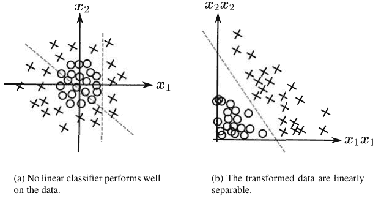

**图 7.5：** 特征变换。

## 7.5 核技巧

线性模型可能并不总是适用于每种数据。例如，考虑图 7.5(a) 中的情形。对于任何线性模型，只能得到约 50% 的准确率。这是不令人满意的，因为它与随机猜测一样好。然而，如果我们通过以下方式对所有数据应用特征变换 $\phi(\mathbf{x})$：

$$\phi(\mathbf{x}) = [x_1x_1\quad x_2x_2]^{\mathsf T}.$$

在这种情况下，数据集在映射空间中变得线性可分，如图 7.5(b) 所示。一般而言，当决策面由光滑函数 $h(\mathbf{x})$ 决定时，它可由泰勒展开表示和近似。例如，$h(\mathbf{x})$ 的二阶泰勒展开如下：

$$h(\mathbf{x}) \approx w_1 + [w_2\quad w_3]\begin{bmatrix}x_1\\x_2\end{bmatrix} + \frac{1}{2}[x_1\quad x_2]\begin{bmatrix}w_4&w_5\\w_5&w_6\end{bmatrix}\begin{bmatrix}x_1\\x_2\end{bmatrix}.$$ (7.9)

应指出，虽然 $h(\mathbf{x})$ 在 $\mathbf{x}$ 中是非线性的，但在 $\mathbf{w}$ 中是线性的。因此，它可重写为 $h(\mathbf{x})=\mathbf{w}^{\mathsf T}\phi(\mathbf{x})$，其中

$$\phi(\mathbf{x}) = [1\quad x_1\quad x_2\quad \frac{1}{2}x_1x_1\quad x_1x_2\quad \frac{1}{2}x_2x_2]^{\mathsf T}.$$ (7.10)

变换实例后的原问题与原始问题非常相似，变化是将 $x_i$ 替换为 $\phi(x_i)$。

$$\min_{\mathbf{w},b,\boldsymbol{\xi}} \frac{1}{2}\mathbf{w}^{\mathsf T}\mathbf{w}+C\sum_{i=1}^{l}\xi_i,\quad \text{s.t.}\quad y_i(\mathbf{w}^{\mathsf T}\phi(\mathbf{x}_i)+b)\ge 1-\xi_i,\ \xi_i\ge 0,\ \forall i=1\ldots l.$$

然而，变换存在严重问题。已知 $n$ 维输入的 $d$ 阶泰勒展开有 $\frac{(d+n)!}{d!n!}$ 个系数，因为 $\mathbf{x}$ 的坐标的所有组合均小于或等于阶数 $d$。因此，当特征维度和泰勒展开的阶数增长时，$\mathbf{w}$ 的维度，即泰勒展开中系数的数量，可能变得非常大。将 (7.4) 中的每个 $x_i$ 替换为映射向量 $\phi(x_i)$ 后，变换实例的对偶形式如下：

$$\min_{\boldsymbol{\alpha}} \frac{1}{2}\boldsymbol{\alpha}^{\mathsf T}Q\boldsymbol{\alpha}-\mathbf{e}^{\mathsf T}\boldsymbol{\alpha},\quad \text{s.t.}\quad 0=\mathbf{y}^{\mathsf T}\boldsymbol{\alpha},\ 0\le\boldsymbol{\alpha}\le C\mathbf{e},\ Q_{ij}=y_i y_j\phi(\mathbf{x}_i)^{\mathsf T}\phi(\mathbf{x}_j).$$


对偶问题只有 $l$ 个变量，并且 $Q_{ij}$ 的计算甚至可能不需要展开 $\phi(x_i)$ 和 $\phi(x_j)$。例如，假设我们按如下方式仔细缩放 (7.10) 的特征映射：

$$
\phi(x)=\left[1\quad \sqrt{2}x_1\quad \sqrt{2}x_2\quad x_1^2\quad \sqrt{2}x_1x_2\quad x_2^2\right]^\mathsf{T},
$$

在这种情况下，$\phi(x_i)^\mathsf{T}\phi(x_j)$ 可以按如下方式获得：

$$
\phi(x_i)^\mathsf{T}\phi(x_j)=(1+x_i^\mathsf{T}x_j)^2.
$$

因此，不必显式展开特征映射。以同样的方式，可以对 $d$ 阶泰勒展开应用这种缩放，点积 $\phi(x_i)^\mathsf{T}\phi(x_j)$ 可以简化如下：

$$
\phi(x_i)^\mathsf{T}\phi(x_j)=(1+x_i^\mathsf{T}x_j)^d.
$$

事实上，这种方法甚至可以处理无限维展开。考虑一维实例 $x$ 的以下特征映射，

$$
\phi(x)=\exp(-x^2)\left[1\quad \sqrt{\frac{2}{1!}}x\quad \sqrt{\frac{2^2}{2!}}x^2\quad \sqrt{\frac{2^3}{3!}}x^3\quad \cdots\right]^\mathsf{T}. \tag{7.11}
$$

该变换由 $x$ 的所有次数的多项式构成，并且 $\mathbf{w}^\mathsf{T}\phi(x)$ 可以看作是对标量 $x$ 的缩放泰勒展开。这样的特征变换甚至*无法*显式执行，因为维度是无限的。然而，变换后特征向量的点积有一个闭式解，如下所示：

$$
\begin{aligned}
\phi(x)^\mathsf{T}\phi(z)
&=\exp(-x^2)\exp(-z^2)\sum_{i=0}^{\infty}\frac{1}{i!}(2xz)^i\\
&=\exp(-x^2)\exp(-z^2)\exp(2xz)\\
&=\exp\left(-(x-z)^2\right).
\end{aligned}
$$

因此，我们可以在对偶公式中隐式应用这种无限维特征映射，该公式仅用点积表示。这意味着变换不需要显式执行，因为对偶公式中的点积可以用核函数代替。这种方法被称为核技巧，该乘积被称为 **核函数**，$k(x,z)\equiv\phi(x)^\mathsf{T}\phi(z)$。类似于 (7.8)，我们可以通过以下方式预测输入 $x$

$$
h(x)=\sum_{i=1}^{l}\bar{\alpha}_iy_i\phi(x_i)^\mathsf{T}\phi(x)+\bar{b}=\sum_{i=1}^{l}\bar{\alpha}_iy_ik(x_i,x)+\bar{b}. \tag{7.12}
$$

矩阵 $K$，其中 $K_{ij}=k(x_i,x_j)=\phi(x_i)^\mathsf{T}\phi(x_j)$，称为 **核矩阵**。利用核矩阵，对偶 SVM 可以写成 [9] 中的以下形式。

$$
\min_{\boldsymbol{\alpha}}\ \frac{1}{2}\boldsymbol{\alpha}^{\mathsf{T}}Q\boldsymbol{\alpha}-\mathbf{e}^{\mathsf{T}}\boldsymbol{\alpha},\quad \text{s.t.}\quad 0=\mathbf{y}^{\mathsf{T}}\boldsymbol{\alpha},\ 0\leq\boldsymbol{\alpha}\leq C\mathbf{e},\ Q_{ij}=y_iy_jK_{ij}.
$$

如定义所示，核矩阵只是变换后实例之间的点积矩阵。求解对偶 SVM 只需要核矩阵 $K$，我们甚至不需要知道映射函数 $\phi(\cdot)$。换句话说，如果给定标签和训练实例的核矩阵，分类可以在未知的<|message|> 维空间中完成。然而，并非所有矩阵 $K$ 都是有效的核矩阵，因为 $K$ 必须由点积生成。下面的定理讨论了 $K$ 何时是有效的核矩阵。

² 对偶 SVM 并不是应用核技巧的唯一公式。事实上，我们可以直接修改原问题以获得涉及核的公式。读者可参考 [8, 25]。

**定理 1.** 矩阵 $K \in \mathbb{R}^{l\times l}$ 是有效的核矩阵当且仅当它是对称半正定 (SPSD)。换句话说，以下条件必须成立：

$$
K_{ij}=K_{ji},\ \forall i,j \quad\text{and}\quad u^\mathsf{T}Ku\ge 0,\ \forall u\in\mathbb{R}^l.
$$

我们将证明该陈述的两个方向。对于必要方向，如果 $K$ 是 SPSD，则根据谱定理存在一个 $A$ 使得 $K=A^\mathsf{T}A$。因此，存在相应的特征映射 $\phi(x_i)=A_i$，其中 $A_i$ 是 $A$ 的第 $i$ 列。然后，根据定义，$K$ 是有效的核矩阵。对于充分方向，如果 $K$ 是有效的核矩阵，则它由相应的特征映射 $\phi(x)$ 生成。由于 $\phi(x_i)^\mathsf{T}\phi(x_j)=\phi(x_j)^\mathsf{T}\phi(x_i)$，$K$ 是对称的。$K$ 也是半正定的，因为对于任意 $u\in\mathbb{R}^l$，

$$
u^\mathsf{T}Ku=\sum_{i=1}^{l}\sum_{j=1}^{l}u_iu_j\phi(x_i)^\mathsf{T}\phi(x_j)=\left\|\sum_{i=1}^{l}u_i\phi(x_i)\right\|^2\ge 0.
$$

对于任意点的预测，如 (7.12) 所示，需要核函数 $k(\cdot)$。同样地，并非所有函数都可能是有效的核函数。下面的 Mercer 定理 [26, 27] 给出了有效核函数的条件。

**定理 2.** $k:\mathbb{R}^n\times\mathbb{R}^n\to\mathbb{R}$ 是有效的核函数当且仅当它对任意有限序列 $x_1,x_2,\ldots,x_l$ 生成的核矩阵是 PSD。

该定理与定理 1 略有不同。它确保了一个一致的特征映射 $\phi(x)$，可能在无限维空间中，生成由核函数产生的全部核矩阵。在实践中，我们不需要指定特征映射是什么。例如，高斯核函数，也称为径向基函数 (RBF)，是这种隐式特征变换的常见选择。它是 (7.11) 的多元版本，具有以下核函数

$$
k(x,z)=\exp(-\gamma\|x-z\|^2),
$$

其中 $\gamma$ 是用户决定的核参数。类似于 (7.11)，RBF 核的特征映射对应于输入实例向量的所有多项式展开。我们概念上解释说，RBF 核的映射函数将输入数据变换为高维空间中线性可分。当输入数据可以被任意光滑曲面分离时，如图 7.6 所示，一个光滑的 $h(x)$ 对应于分离曲面。注意，光滑函数可以通过泰勒展开进行分析，后者是一系列多项式项。也就是说，类似于 (7.9)，$h(x)$ 可以表示为 $h(x)=\bar{w}^\mathsf{T}\bar{\phi}(x)$，对于某些 $\bar{w}$ 和 $\bar{\phi}(x)$，其中包含多项式项。因为 RBF 核的 $\phi(x)$ 是 $\bar{\phi}(x)$ 的缩放向量，我们可以将 $\bar{w}$ 调整为另一个向量 $w$。然后 $h(x)=w^\mathsf{T}\phi(x)$ 具有 RBF 的映射函数 $\phi(x)$。因此，$h(x)$ 是 $\phi(x_i)$，$\forall i$ 在 $\phi(x)$ 空间中的线性分离超平面。然而，虽然高度非线性的映射可以使训练数据可分，但可能发生过拟合导致预测结果不佳。

注意，即使我们不知道它在无限维空间中对应于哪个分离曲面，核技巧仍然有效。隐式变换赋予 SVM 构造非线性分离曲面的能力，但其缺乏解释性也是一个缺点。

## 7.6 求解器和算法

作为成熟的机器学习模型，SVM 已通过多种优化技术进行训练。我们将讨论如何求解以下核化对偶 SVM。

$$
\min_{\boldsymbol{\alpha}}\ \frac{1}{2}\boldsymbol{\alpha}^{\mathsf{T}}Q\boldsymbol{\alpha}-\mathbf{e}^{\mathsf{T}}\boldsymbol{\alpha},\quad \text{s.t.}\quad 0=\mathbf{y}^{\mathsf{T}}\boldsymbol{\alpha},\ 0\leq\boldsymbol{\alpha}\leq C\mathbf{e},\ Q_{ij}=y_iy_jK_{ij}.
$$

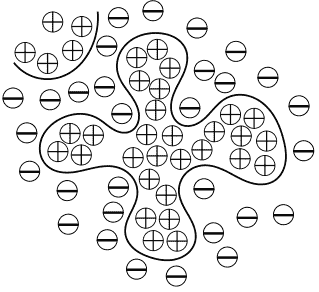

**图 7.6：** 数据的光滑分离曲面对应于 RBF 核使用的映射空间中的线性分离超平面。也就是说，RBF 核将数据变换为更高维空间中线性可分。

核化对偶 SVM 是一个具有线性约束的二次规划问题，可以通过典型的二次求解器求解。然而，这些求解器通常假设可以完全访问矩阵 $Q$。当 $l$ 的值很大时，这可能太大而无法驻留在内存中。因此，提出了 **对偶分解方法** [18, 29] 来克服这些挑战。这些方法将全规模对偶问题分解为具有较少变量的子问题，可以在不完全访问 $Q$ 的情况下高效求解。**序列最小优化** (SMO) 方法，如 [30] 中讨论的那样，是对偶分解方法的极端情况，每次子问题仅使用两个变量。

我们现在演示分解方法的工作原理。我们将 $\bar{D}(\boldsymbol{\alpha})=\frac{1}{2}\boldsymbol{\alpha}^{\mathsf{T}}Q\boldsymbol{\alpha}-\mathbf{e}^{\mathsf{T}}\boldsymbol{\alpha}$ 表示为对偶目标函数，并将 $\mathbf{e}_i$ 表示为关于第 $i$ 个坐标的单位向量。在 SMO 的每一步中，当前 $\boldsymbol{\alpha}$ 中的只有两个变量 $\alpha_i$ 和 $\alpha_j$ 会改变为下一个 $\boldsymbol{\alpha}'$。为了使每一步可行，$\boldsymbol{\alpha}'$ 必须满足等式约束 $0=\mathbf{y}^{\mathsf{T}}\boldsymbol{\alpha}'$。可以验证，通过选择

$$
\boldsymbol{\alpha}'=\boldsymbol{\alpha}+dy_i\mathbf{e}_i-dy_j\mathbf{e}_j,
$$

$\boldsymbol{\alpha}'$ 对任意标量 $d$ 都满足等式。将新的 $\boldsymbol{\alpha}'$ 代入对偶目标函数后，关于变量 $d$ 的子问题变为以下形式：

$$
\begin{aligned}
\min_{d\in\mathbb{R}}\quad & \frac{1}{2}(K_{ii}+K_{jj}-2K_{ij})\cdot d^2+(y_i\nabla_i\bar{D}(\boldsymbol{\alpha})-y_j\nabla_j\bar{D}(\boldsymbol{\alpha}))\cdot d+\bar{D}(\boldsymbol{\alpha}) \\
\text{s.t.}\quad & 0\leq \alpha_i+y_id\leq C,\quad 0\leq \alpha_j-y_jd\leq C.
\end{aligned} \tag{7.13}
$$

这是一个具有盒约束的单变量二次优化问题，已知具有闭式解。图 7.7 中提供了插图，更多细节见 [7, 第 6 节]。此外，$\nabla_i\bar{D}(\boldsymbol{\alpha})$ 和 $\nabla_j\bar{D}(\boldsymbol{\alpha})$ 可以通过以下方式获得

$$
\nabla_i\bar{D}(\boldsymbol{\alpha})=y_i\sum_{t=1}^{l}y_t\alpha_tK_{it}-1 \quad\text{and}\quad \nabla_j\bar{D}(\boldsymbol{\alpha})=y_j\sum_{t=1}^{l}y_t\alpha_tK_{jt}-1.
$$

该操作评估核的 $2l$ 个条目。或者，根据我们每次只改变两个变量的事实，我们可以以相同的成本维护完整的梯度：

$$
\text{For } t=1,\ldots,l,\quad \nabla_t\bar{D}(\boldsymbol{\alpha}')=\nabla_t\bar{D}(\boldsymbol{\alpha})+y_t(K_{it}-K_{jt})d.
$$

然后，在下一次迭代中，两个需要的梯度元素可以直接获得。一个原因是

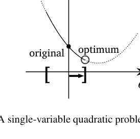

**图 7.7：** 一个带盒约束的单变量二次问题。

保持完整梯度的原因在于，它对于选择坐标 \(i\) 和 \(j\) 很有用。因此，求解子问题需要 \(O(l)\) 次核函数计算，以及 \(O(l)\) 的空间来存储完整梯度。

坐标 \(i\) 和 \(j\) 的选择是一个重要问题。如果选择不当，目标值甚至可能不会下降。一种朴素的方法是尝试所有坐标对，并选择目标值下降最大的那一对。然而，检查所有 \(l(l - 1)/2\) 个坐标对的代价很高。相反，[19] 选择在最优性条件中违反程度最大的坐标对。在另一种方法中，LIBSVM [7] 使用的二阶选择规则 [14] 通过最大违反来固定坐标 \(i\)，并确定能够使目标值下降最大的 \(j\) 值。³ 这两种方法都需要梯度 \(\nabla\bar{D}(\alpha)\)，如果我们选择保持该梯度，就可以获得它。此外，这两种方法确保所有其他操作的成本不超过 \(O(l)\)。因此，如果每次核函数计算需要 \(O(n)\) 次操作，那么更新两个变量的 SMO 步骤需要 \(O(l \cdot n)\) 的成本。这类分解方法有效解决了与内存需求相关的挑战，因为它们只需要两个核函数列的空间，而不是完整的核矩阵。文献 [3] 对核化 SVM 的算法和求解器进行了综述。

> ³ 注意，在选择 \(j\) 时，(7.13) 中的约束被放宽。详见 [14]。

## 7.7 多类策略

到目前为止，我们讨论了二类 SVM。然而，将数据划分为两个以上的类别是很常见的。在本节中，我们说明多类分类可以通过训练多个二类子问题或求解 SVM 公式的扩展来实现。文献 [17] 对 SVM 的不同多类策略进行了比较。

首先，我们讨论多个二类问题的使用。最直接的方法之一是为每个类别创建一个二类分类器，以判断一个实例是否属于该类别。这被称为一对多（One-Against-Rest）策略 [2]，因为每个二类子问题都将一个类别与所有其他类别进行区分。考虑一个包含四个类别的示例。我们将 \(f_m\) 记为决定类别 \(c_m\) 的第 \(m\) 个分类器，并将 \(+\)、\(-\) 记为相应的正类别标签和负类别标签。一对多策略可通过下表形象化表示。

**分类器**

| 类别 | \(f_1\) | \(f_2\) | \(f_3\) | \(f_4\) |
|---|---|---|---|---|
| \(c_1\) | + | − | − | − |
| \(c_2\) | − | + | − | − |
| \(c_3\) | − | − | + | − |
| \(c_4\) | − | − | − | + |

表中的每一列代表一个在指定的正类和负类上训练的二类分类器。为了预测输入 \(\mathbf{x}\)，我们应用所有二类分类器来获得二类预测。如果所有这些预测都正确，那么恰好有一个正值 \(f_m(\mathbf{x})\)，我们选择相应的类别 \(c_m\) 作为多类预测结果。然而，二类预测可能出错，可能存在多个正值，甚至没有正值。为了处理这种情况，我们可以比较 \(k\) 个类别中所有分类器 \(f_m\)（\(\forall m\)）的决策值 \(h_m(\mathbf{x})\)，并选择最大的一个。

\[
f(\mathbf{x}) = \arg\max_{m=1,\ldots,k} h_m(\mathbf{x}). \qquad (7.14)
\]

如果所有 \(\|\mathbf{w}_m\|\)（\(\forall m\)）都相同，那么 \(h_m(\mathbf{x})\) 越大，意味着实例距离决策面越远。换句话说，我们对二类预测更有信心。然而，(7.14) 中的设置是解决冲突预测的一种临时（ad-hoc）方案，因为 \(\|\mathbf{w}_m\|\)（\(\forall m\)）很可能不同。

另一方面，在所有训练数据上训练二类分类器可能并不必要。我们可以为每一对类别构造一个二类分类器。换句话说，对于 \(k\) 个类别，在每个由不同标签 \(c_r\) 和 \(c_s\) 组成的子集上训练 \(k(k-1)/2\) 个二类分类器。这种方法被称为一对一（One-Against-One）策略 [20]。文献 [7,15,21] 中的 SVM 使用了该策略。记号 \(f_{rs}\) 表示与类别 \(c_r\) 和 \(c_s\) 相关的分类器，记号 0 表示不相关的类别。一对一策略可通过下表形象化表示。

**分类器**

| 类别 | \(f_{12}\) | \(f_{13}\) | \(f_{14}\) | \(f_{23}\) | \(f_{24}\) | \(f_{34}\) |
|---|---|---|---|---|---|---|
| \(c_1\) | + | + | + | 0 | 0 | 0 |
| \(c_2\) | − | 0 | 0 | + | + | 0 |
| \(c_3\) | 0 | − | 0 | − | 0 | + |
| \(c_4\) | 0 | 0 | − | 0 | − | − |

在预测时，会基于所有 \(k(k-1)/2\) 个二类分类器的预测结果执行投票过程。为这 \(k\) 个类别准备了总共 \(k\) 个投票箱。对于每个分类器（对应于类别 \(c_r\) 和 \(c_s\)），我们根据预测的类别向相应的投票箱投一票。投票过程的输出是获得票数最多的类别。如果所有预测都正确，获胜者的投票箱应包含 \(k-1\) 票，而所有其他投票箱的票数应少于 \(k-1\)。

当核化 SVM 用作二类分类器时，一对一策略通常在训练时间上少于一对多策略 [17]。尽管一对一策略中的子问题更多，但每个子问题涉及的实例更少，因此可以更快地训练。假设训练一个对偶 SVM 需要 \(O(l^d)\) 的时间。如果每个类别的实例数量大致相同，那么一对一策略的时间复杂度为 \(O((l/k)^d k^2) = O(l^d k^{2-d})\)。相比之下，一对多策略需要 \(O(l^d k)\) 的成本。因此，当 \(d > 1\) 时，一对一策略的复杂度更低。

在核化 SVM 中，回想一下，我们使用以下方程来评估二类分类器的决策值：

\[
h(\mathbf{x}) = \sum_{i=1}^{l} \bar{\alpha}_i y_i k(\mathbf{x}_i, \mathbf{x}) + \bar{b}.
\]

对于所有 \(\alpha_i \neq 0\)，\(k(\mathbf{x}_i, \mathbf{x})\) 的核函数计算占用了预测中的大部分时间。对于一对一和一对多等多类方法，\(k(\mathbf{x}_i, \mathbf{x})\) 的值在不同的二类子问题中是相同的。因此，我们只需要预先计算所有二类分类器中具有非零 \(\alpha_i\) 的核条目一次。在实践中，一对多和一对一策略的二类问题中的“总”支持向量数量差异不大。因此，这两种多类策略所需的预测时间相似。

为了改进一对一策略，我们可以避免在预测时使用所有 \(k(k-1)/2\) 个分类器。我们不是让所有分类器都做出决策，而是每次应用一个分类器来排除一个类别，经过 \(k-1\) 次运行后，只剩下一个类别。这种策略被称为 DAGSVM [31]，因为该过程类似于在图 7.8 中遍历一个有向无环图（DAG）。

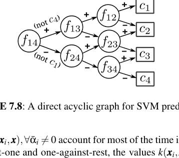

**图 7.8：** 用于 SVM 预测的有向无环图。

虽然这种策略对所有类别可能不公平，但它的优点是速度快。

二类分解策略可能会集成不一致的分类器。如果我们想整体解决多类分类问题，就必须重新定义多类数据的可分性和间隔。回想一下，在一对多策略中，我们预测决策值最大的类别。为简化公式，我们考虑一个没有偏置项的线性分离超平面，即 \(h_m(\mathbf{x}) = \mathbf{w}_m^\top \mathbf{x}\)。因此，决策函数为 \(f(\mathbf{x}) = \arg\max_{m=1,\ldots,k} \mathbf{w}_m^\top \mathbf{x}\)。

在该设置下，当所有实例都被正确分类时，存在 \(\mathbf{w}_1, \ldots, \mathbf{w}_k\) 使得

\[
\forall i = 1, \ldots, l, \quad \mathbf{w}_{y_i}^\top \mathbf{x}_i > \mathbf{w}_m^\top \mathbf{x}_i, \quad \forall m = 1, \ldots, k, \ m \neq y_i.
\]

利用 7.2 节中的相同技术，线性可分条件可以表述为

\[
\forall i = 1, \ldots, l, \quad \mathbf{w}_{y_i}^\top \mathbf{x}_i - \mathbf{w}_m^\top \mathbf{x}_i \geq 1, \quad \forall m = 1, \ldots, k, \ m \neq y_i.
\]

因此，类别 \(c_r\) 和 \(c_s\) 之间的间隔应定义如下：

\[
M_{r,s} \equiv \min_{i \text{ s.t. } y_i \in \{r,s\}} \frac{|(\mathbf{w}_r - \mathbf{w}_s)^\top \mathbf{x}_i|}{\|\mathbf{w}_r - \mathbf{w}_s\|_*}.
\]


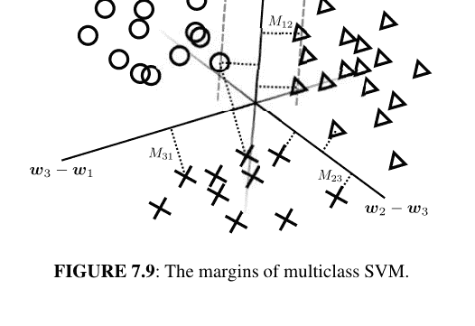

图7.9：多类SVM的间隔。

优化问题，
min_{w1,...,wk} sum_{m=1}^k w_m^T w_m
s.t. w_{y_i}^T x_i - w_m^T x_i >= 1,
∀ m = 1,...,k, m ≠ y_i, ∀ i = 1,...,l.

对于不可分场景，带有损失项 ξ 的公式为
min_{w1,...,wk, ξ} 1/2 sum_{m=1}^k w_m^T w_m + C sum_{i=1}^l ξ_i
subject to w_{y_i}^T x_i - w_m^T x_i >= (1 - δ_{y_i,m}) - ξ_i,
∀ i = 1,...,l, ∀ m = 1,...,k,

其中 δ_{y_i,m} 定义为当 y_i 等于 m 时为 1，否则为 0。我们可以验证，当 y_i 等于 m 时，对应的不等式变为 ξ_i ≥ 0。该公式被称为 Crammer-Singer SVM（CSSVM）[10, 11]。类似地，我们可以推导出它的对偶问题和核化形式。与二元归约策略相比，文献[17]的工作表明，CSSVM 通常具有相近的分类精度，但需要更多的训练时间。其他类似但略有不同的策略见文献[22, 36]。

## 7.8 结论

SVM 现在被认为是一种成熟的机器学习方法，已被广泛应用于各种应用场景。此外，SVM 在理论和实践方面都得到了充分的研究。本章重点关注核化 SVM，它构建非线性分离超平面。然而，在具有大量特征和实例的稀疏数据上，线性 SVM 可能达到与核化 SVM 相近的精度，但速度显著更快。读者可参阅文献[13]和[37]了解详情。

核化 SVM 的专题内容比单章所能覆盖的范围要广泛得多。例如，我们没有讨论核化支持向量回归（SVR）和用于提高训练速度的核近似等主题。我们的目的是介绍 SVM 的基本概念。读者可以利用本章提供的指引，进一步研究丰富的 SVM 文献，并了解最新的进展。

## 参考文献

- [1] B. E. Boser, I. Guyon, and V. Vapnik. A training algorithm for optimal margin classifiers. In *Proceedings of the Fifth Annual Workshop on Computational Learning Theory*, pages 144–152. ACM Press, 1992.
- [2] L. Bottou, C. Cortes, J. S. Denker, H. Drucker, I. Guyon, I. Jackel, Y. LeCun, U. A. Müller, E. Säckinger, P. Simard, and V. Vapnik. Comparison of classifier methods: A case study in handwriting digit recognition. In *International Conference on Pattern Recognition*, pages 77–87. IEEE Computer Society Press, 1994.
- [3] L. Bottou and C.-J. Lin. Support vector machine solvers. In L. Bottou, O. Chapelle, D. De-Coste, and J. Weston, editors, *Large Scale Kernel Machines*, pages 301–320. MIT Press, Cambridge, MA, 2007.
- [4] S. Boyd and L. Vandenberghe. *Convex Optimization*. Cambridge University Press, 2004.
- [5] P. S. Bradley and O. L. Mangasarian. Feature selection via concave minimization and support vector machines. In *Proceedings of the Twenty-Fifth International Conference on Machine Learning (ICML)*, 1998.
- [6] C. J. C. Burges. A tutorial on support vector machines for pattern recognition. *Data Mining and Knowledge Discovery*, 2(2):121–167, 1998.
- [7] C.-C. Chang and C.-J. Lin. LIBSVM: A library for support vector machines. *ACM Transactions on Intelligent Systems and Technology*, 2:27:1–27:27, 2011. Software available at http://www.csie.ntu.edu.tw/~cjlin/libsvm.
- [8] O. Chapelle. Training a support vector machine in the primal. *Neural Computation*, 19(5):1155–1178, 2007.
- [9] C. Cortes and V. Vapnik. Support-vector network. *Machine Learning*, 20:273–297, 1995.
- [10] K. Crammer and Y. Singer. On the learnability and design of output codes for multiclass problems. In *Computational Learning Theory*, pages 35–46, 2000.
- [11] K. Crammer and Y. Singer. On the algorithmic implementation of multiclass kernel-based vector machines. *Journal of Machine Learning Research*, 2:265–292, 2001.
- [12] N. Cristianini and J. Shawe-Taylor. *An Introduction to Support Vector Machines*. Cambridge University Press, Cambridge, UK, 2000.
- [13] R.-E. Fan, K.-W. Chang, C.-J. Hsieh, X.-R. Wang, and C.-J. Lin. LIBLINEAR: A library for large linear classification. *Journal of Machine Learning Research*, 9:1871–1874, 2008.
- [14] R.-E. Fan, P.-H. Chen, and C.-J. Lin. Working set selection using second order information for training SVM. *Journal of Machine Learning Research*, 6:1889–1918, 2005.
- [15] J. H. Friedman. Another approach to polychotomous classification. Technical report, Department of Statistics, Stanford University, 1996.
- [16] C.-W. Hsu, C.-C. Chang, and C.-J. Lin. A practical guide to support vector classification. Technical report, Department of Computer Science, National Taiwan University, 2003.
- [17] C.-W. Hsu and C.-J. Lin. A comparison of methods for multi-class support vector machines. *IEEE Transactions on Neural Networks*, 13(2):415–425, 2002.
- [18] T. Joachims. Making large-scale SVM learning practical. In B. Schölkopf, C. J. C. Burges, and A. J. Smola, editors, *Advances in Kernel Methods – Support Vector Learning*, pages 169–184, MIT Press, Cambridge, MA, 1998.
- [19] S. S. Keerthi, S. K. Shevade, C. Bhattacharyya, and K. R. K. Murthy. Improvements to Platt’s SMO algorithm for SVM classifier design. *Neural Computation*, 13:637–649, 2001.
- [20] S. Knerr, L. Personnaz, and G. Dreyfus. Single-layer learning revisited: a stepwise procedure for building and training a neural network. In J. Fogelman, editor, *Neurocomputing: Algorithms, Architectures and Applications*. Springer-Verlag, 1990.
- [21] U. H.-G. Kressel. Pairwise classification and support vector machines. In B. Schölkopf, C. J. C. Burges, and A. J. Smola, editors, *Advances in Kernel Methods – Support Vector Learning*, pages 255–268, MIT Press, Cambridge, MA, 1998.
- [22] Y. Lee, Y. Lin, and G. Wahba. Multicategory support vector machines. *Journal of the American Statistical Association*, 99(465):67–81, 2004.
- [23] C.-J. Lin. Formulations of support vector machines: a note from an optimization point of view. *Neural Computation*, 13(2):307–317, 2001.
- [24] O. L. Mangasarian. Arbitrary-norm separating plane. *Operations Research Letters*, 24(1):15–23, 1999.
- [25] O. L. Mangasarian. A finite Newton method for classification. *Optimization Methods and Software*, 17(5):913–929, 2002.
- [26] J. Mercer. Functions of positive and negative type, and their connection with the theory of integral equations. *Philosophical Transactions of the Royal Society of London. Series*, 209:415–446, 1909.
- [27] H. Q. Minh, P. Niyogi, and Y. Yao. Mercer’s theorem, feature maps, and smoothing. In *Proceedings of the Nineteenth Annual Workshop on Computational Learning Theory (COLT)*, pages 154–168. 2006.
- [28] E. Osuna, R. Freund, and F. Girosi. Support vector machines: Training and applications. AI Memo 1602, Massachusetts Institute of Technology, 1997.
- [29] E. Osuna, R. Freund, and F. Girosi. Training support vector machines: An application to face detection. In *Proceedings of IEEE Computer Society Conference on Computer Vision and Pattern Recognition (CVPR)*, pages 130–136, 1997.
- [30] J. C. Platt. Fast training of support vector machines using sequential minimal optimization. In B. Schölkopf, C. J. C. Burges, and A. J. Smola, editors, *Advances in Kernel Methods - Support Vector Learning*, MIT Press, Cambridge, MA, 1998.
- [31] J. C. Platt, N. Cristianini, and J. Shawe-Taylor. Large margin DAGs for multiclass classification. In *Advances in Neural Information Processing Systems*, volume 12, pages 547–553. MIT Press, Cambridge, MA, 2000.
- [32] R. T. Rockafellar. *Convex Analysis*. Princeton University Press, Princeton, NJ, 1970.
- [33] B. Schölkopf and A. J. Smola. *Learning with Kernels*. MIT Press, Cambridge, MA, 2002.
- [34] V. Vapnik. *Estimation of Dependences Based on Empirical Data*. Springer Verlag, New York, NY, 1982.
- [35] V. Vapnik. *Statistical Learning Theory*. Wiley, New York, NY, 1998.
- [36] J. Weston and C. Watkins. Multi-class support vector machines. In M. Verleysen, editor, *Proceedings of ESANN99*, pages 219–224, Brussels, 1999. D. Facto Press.
- [37] G.-X. Yuan, C.-H. Ho, and C.-J. Lin. Recent advances of large-scale linear classification. *Proceedings of the IEEE*, 100(9):2584–2603, 2012.


## 第8章：神经网络综述

**Alain Biem**
IBM T. J. Watson 研究中心
纽约，NY
biem@us.ibm.com

- 8.1 引言 ... 206
- 8.2 基本概念 ... 208
    - 8.2.1 神经元的数学模型 ... 208
    - 8.2.2 单位类型 ... 209
        - 8.2.2.1 McCulloch Pitts 二值阈值单元 ... 209
        - 8.2.2.2 线性单元 ... 210
        - 8.2.2.3 线性阈值单元 ... 211
        - 8.2.2.4 Sigmoid 单元 ... 211
        - 8.2.2.5 距离单元 ... 211
        - 8.2.2.6 径向基单元 ... 211
        - 8.2.2.7 多项式单元 ... 212
    - 8.2.3 网络拓扑 ... 212
        - 8.2.3.1 分层网络 ... 212
        - 8.2.3.2 具有反馈的网络 ... 212
        - 8.2.3.3 模块化网络 ... 213
    - 8.2.4 计算与知识表示 ... 213
    - 8.2.5 学习 ... 213
        - 8.2.5.1 Hebbian 规则 ... 213
        - 8.2.5.2 Delta 规则 ... 214
- 8.3 单层神经网络 ... 214
    - 8.3.1 单层感知器 ... 214
        - 8.3.1.1 感知器准则 ... 214
        - 8.3.1.2 多类感知器 ... 216
        - 8.3.1.3 感知器增强 ... 216
    - 8.3.2 Adaline ... 217
        - 8.3.2.1 双类 Adaline ... 217
        - 8.3.2.2 多类 Adaline ... 218
    - 8.3.3 学习向量量化 ... 219
        - 8.3.3.1 LVQ1 训练 ... 219
        - 8.3.3.2 LVQ2 训练 ... 219
        - 8.3.3.3 应用与局限性 ... 220
- 8.4 核神经网络 ... 220
    - 8.4.1 径向基函数网络 ... 220
    - 8.4.2 RBFN 训练 ... 222
        - 8.4.2.1 使用训练样本作为中心 ... 222
        - 8.4.2.2 随机选择中心 ... 222
        - 8.4.2.3 无监督选择中心

### 8.1 引言

神经网络最近被重新发现为各种标准分类方法的重要的替代方案。这得益于神经网络研究背后坚实的理论基础，以及在具有挑战性的实际问题上取得的近期强劲的实践成果。早期的工作确立了神经网络作为通用函数逼近器 [33,59,60]，能够逼近任意给定的向量空间映射。由于分类仅仅是从向量空间到名义空间的映射，理论上，只要做出审慎的模型选择并实现适当的训练方法，神经网络就能够执行任意给定的分类任务。此外，神经网络能够直接估计后验概率，这为分类性能提供了清晰的联系，并使其成为最优贝叶斯分类器的可靠估计器 [14,111,131]。神经网络也被称为联结主义模型。

神经网络的理论已发展多年。自19世纪末以来，人们一直在尝试创建模仿人类神经系统功能的数学模型。Cajal 于1892年 [29] 发现神经系统由神经元组成，它们通过沿轴突发送电信号相互通信，这是一个突破。神经元从其他相连的神经元接收各种信号，对其进行处理，然后根据某种内部逻辑决定抑制或发送信号，从而充当电门。这种分布式的神经元过程是大脑执行其各种任务的机制。这一发现导致了对尝试模拟这种行为的数学模型的研究增加，希望最终能够实现类人的分类性能，但这一希望尚未得到证实。

第一个广为人知的神经元计算模型由 McCulloch 和 Pitts 于1943年提出 [91]。它是一个二值阈值单元，对二值输入值进行加权求和，并根据加权和是否超过给定阈值产生0或1的输出。该模型为神经网络带来了巨大的希望，因为已经证明，只要有足够数量的此类神经元，并且权重被准确选择，就能模拟任意函数 [96]。1962年，Rosenblatt [114] 提出了 *感知器学习规则*，这是一种用于单层线性阈值单元的迭代学习过程，其中单元可以接受标量输入以产生二值输出。只要目标函数可由网络计算，感知器学习规则就保证收敛到最优权重集。

遗憾的是，神经网络的研究在近15年里放缓了很大程度上是由于 Minsky 和 Papert [78] 的一篇有影响力的论文，该论文证明单层感知器无法模拟 XOR 门，这严重限制了其能力。20世纪80年代，神经网络的兴趣得以复兴，基于将其视为记忆编码系统的提议。基于这一观点，利用某种能量度量来优化网络的联想网络被提出。这一框架导致了 Hopfield 网络 [58] 和 Boltzmann 机 [1]。就分类用途而言，*反向传播算法* [90, 116] 的发展，作为训练多层感知器的一种方法，提供了根本性的突破。多层感知器及其变体不具有早期单层感知器模型的局限性，并且已被证明能够逼近任意给定的向量空间映射。因此，MLP 一直是最广泛使用的神经网络架构。20世纪90年代见证了各种神经网络应用的出现，主要是围绕小型或中型架构。具有一层或两层隐藏层的网络很常见，因为具有更多层的网络存在训练问题，例如收敛缓慢、局部最小值问题以及复杂的学习参数调优。

自2000年代中期以来，重点一直放在神经网络发现其多层架构内部表示的能力上 [15]。*深度学习* 概念 [56] 被提出作为利用具有许多层和大量单元的深度神经网络的方法，以最大化在其层内提取未见的非线性特征，从而能够完成复杂的分类任务。利用高性能计算硬件和模块化及选择性学习技术的应用，拥有数百万权重的深度神经网络已能够实现突破性的分类性能。

就实际应用而言，神经网络已成功应用于各种领域的各种现实世界分类问题 [132]，包括手写识别 [32, 47, 73, 89]、语音识别 [25, 87]、故障检测 [6, 61]、医学诊断 [9, 28]、金融市场 [124, 126] 等。

在本章中，我们回顾了神经网络的基本概念，重点关注其在分类任务中的使用。本章的目标不是提供所有神经网络架构的详尽覆盖，而是为读者提供用于分类的广泛使用架构的概述。特别是，我们重点关注分层前馈架构。

本章组织如下。第8.2节介绍了神经网络的基础概念。第8.3节介绍了单层架构。我们在第8.4节以径向基函数网络为例回顾了核神经网络。我们在第8.5节讨论多层架构，并在第8.6节讨论深度神经网络。我们在第8.7节进行总结。


## 8.2 基本概念

人工神经网络（ANN）或神经网络是由连接的单元组成的图，表示生物神经元的数学模型。这些单元有时被称为处理单元、节点或简单地称为神经元。单元通过具有权重的单向或双向弧连接，表示单元之间连接的强度。这受生物模型启发，其中连接权重表示神经元之间突触的强度，抑制或促进信号的传递。

神经网络从一组专用输入单元获取输入数据，并通过一组专用输出单元输出其结果。单元可以同时充当输入单元和输出单元。其余单元负责计算逻辑，如生物神经元的数学模型所表示的。对于分类问题，神经网络具有以下特征：

- **神经元模型**或神经元的数学模型，描述网络中单元如何从其输入产生输出以及其在网络中的作用（输入单元、输出单元或计算单元）
- **架构**或拓扑，概述单元之间的连接，包括明确定义的一组输入和输出单元。
- **数据编码策略**描述输入数据或类别标签如何在网络中表示。
- **训练算法**用于估计与每个单元相关联的最优权重集。

在本节的剩余部分，我们将更详细地回顾这些特征中的每一个。

### 8.2.1 神经元的数学模型

人工神经元，如图 8.1 所示，是一个计算引擎，它使用两个函数的组合将一组输入 x = (x1, ..., xd) 变换为单个输出 o，如下所示：

1. 一个净值函数 ξ，它利用单元的参数或权重 w 将输入数据汇总为净值 v，

v = ξ(x, w)。 (8.1)

净值函数模仿生物神经元的行为，因为它将来自链接神经元的信号聚合为内部表示。通常，它采用加权和、距离或核的形式。

2. 一个激活函数，或压缩函数，φ，它将净值变换为单元的输出值 o，

o = φ(v)。 (8.2)

激活函数模拟生物神经元的行为，因为它根据其内部逻辑决定是否触发或抑制信号。然后输出值根据底层拓扑分发给所有接收单元。已经提出了各种激活函数。最广泛使用的是线性函数、阶跃或阈值函数，以及如图 8.2 所示的 sigmoid 和双曲正切函数。

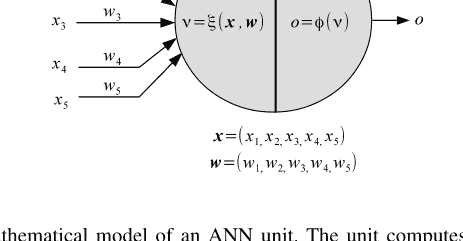

### 图 8.1：ANN 单元的数学模型。单元使用局部参数作为输入的标量函数计算净值，然后将净值传递给激活函数以产生单元输出。

### 8.2.2 单元类型

鉴于净值函数和激活函数的多种多样，可以推导出各种类型的神经网络单元。然而，并非所有组合都足够，因为特定组合的选择取决于网络的拓扑和底层理论依据。最广泛使用的单元包括线性阈值单元、线性单元、sigmoidal 单元、高斯单元和距离单元（表 8.1）。

### 表 8.1：神经网络中广泛使用的单元类型

| 单元类型 | net 函数 | 激活函数 |
|---|---|---|
| linear threshold unit | weighted sum | step or sign function |
| linear unit | weighted sum | linear or piecewise linear |
| sigmoidal unit | weighted sum | sigmoid or tanh |
| distance unit | distance | linear or piecewise linear |
| gaussian unit | distance | gaussian kernel |

#### 8.2.2.1 McCullough Pitts 二值阈值单元

我们首先介绍 McCulloch 和 Pitts 神经元。McCullough Pitts 或二值阈值单元是第一个直接受神经科学研究启发的[91]人工神经元。该模型是直接尝试模拟生物神经元在逻辑功能方面的行为。它对数据分类任务的实用性有限，但是一个有用的历史参考。输入数据为二值，二值权重被选用来实现神经信号脉冲的阻断和直通效应。

二值阈值单元使用输入的加权和作为净值函数，并使用阈值函数作为激活函数。因此：

```
ξ(x, w) = wᵀx  (8.3)
= Σᵢ₌₁ᵈ xᵢwᵢ = v  (8.4)
φ(v) = 1(v > θ)  (8.5)
```

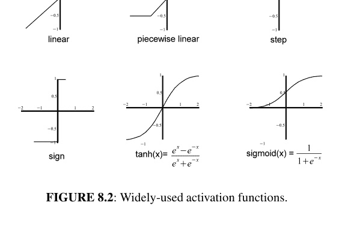

### 图 8.2：广泛使用的激活函数。

其中 **w** = (w₁,⋯,w_d) 是表示单元参数的二值权重向量，其中 w_i ∈ {0,1}。激活函数是阶跃函数 **1**(b)，当布尔值 b 为真时其值为 1，否则为零。

二值阈值单元对二值输入空间进行两类分类，使用一组二值权重。净值作为加权和，类似于线性回归（不考虑阈值），能够在此空间中准确分类两类线性问题。已证明二值阈值单元可以实现多种逻辑函数，包括 AND、OR 和 NAND 门[91]。

然而，它无法执行 XOR 门[114]，这严重限制了其分类能力。二值阈值单元的另一个主要缺点是缺乏用于估计权重的学习算法，给定分类任务。

#### 8.2.2.2 线性单元

线性单元使用加权和作为净值函数，并使用仿射函数作为激活函数，得出

```
ξ(x,w) = wᵀx  (8.6)
        = Σᵢ₌₁ᵈ xᵢwᵢ + wₒ  (8.7)
φ(v)   = αv
```

其中 wₒ 是偏置，x = (1,x₁,⋯,x_d) 且 w = (wₒ,w₁,⋯,w_d)。激活是一个简单的线性乘数，α = 1 在大多数情况下。线性单元本质上是一个两类线性回归模型，并继承了线性回归能力。特别是，它非常适合线性可分的两类问题。然而，线性分类任务的限制可以在神经网络的上下文中克服，其中各种线性单元协同工作以实现分布式处理方案，其方式类似于线性判别函数[35]。

线性单元在各种神经网络架构中被广泛使用：先验对权重类型没有限制，其平滑性使其适合各种基于梯度的优化。

#### 8.2.2.3 线性阈值单元

线性阈值单元使用加权和作为净值函数，并使用 0-1 阶跃函数作为激活函数

φ(v;θ) = 1(v > θ)。  (8.8)

阶跃函数提供了线性单元所没有的非线性程度。这有可能将分类性能提升到线性问题之外，特别是当在神经网络架构中使用时。0-1 阶跃函数的主要问题是其缺乏平滑性，这使得该单元不适合通过标准梯度下降技术进行优化。

#### 8.2.2.4 Sigmoidal 单元

Sigmoidal 单元使用带偏置的加权和（公式 8.6）作为值函数，但可以使用两种类型的激活函数实现：sigmoid 函数和双曲正切（tanh）函数。Sigmoid 函数定义为

φ(v) = 1 / (1 + exp(−v))  (8.9)

将净值映射到区间 [0,1]，而 tanh 函数，

φ(v) = tanh(v) = [exp(v) − exp(−v)] / [exp(v) + exp(−v)]。 (8.10)

将净值映射到区间 [−1,1]。阶跃函数是阶跃函数的平滑近似，而 tanh 函数是对符号函数的平滑近似。激活函数中的平滑性是一个有用的特征，因为它允许梯度下降优化技术并提供对各种净值刺激的渐进响应。此外，已被证明具有 sigmoidal 单元的神经网络可以实现通用逼近[33, 59,60]。这一重要特性解释了为什么 sigmoidal 单元是最广泛使用的单元，也是前馈架构中的主要单元。

#### 8.2.2.5 距离单元

距离单元使用距离度量作为净值函数，并使用线性函数作为激活函数，得出

ξ(x,w) = ||x − w||  (8.11)
φ(v) = αv  (8.12)

典型值为 α = 1，其中 x = (x1,...,xd) 且 w = (w1,...,wd)。该单元计算输入 x 与某个原型向量 w 之间的距离[75]。常用的距离是欧几里得距离，即 ξ(x;w) = Σi(xi − wi)²。

#### 8.2.2.6 径向基单元

径向基单元使用距离函数作为净值函数，并使用核函数作为激活函数，产生

ξ(x,w) = ||x − w||  (8.13)
φ(v) = exp(−v)  (8.14)

对于表征单元参数的参数值 w。在公式 8.14 中，我们使用高斯核作为激活函数，这是分类任务的主要选择。净值


通常使用缩放欧几里得距离或马氏距离。径向基函数提供类似于脑细胞中局部感受模式的局部响应激活，以单元的参数为中心。因此，当输入数据的值接近其参数时，该单元被激活。高斯核使单元能够实现非线性分类能力，同时实现更好的局部模式匹配[18]。

#### 8.2.2.7 多项式单元

多项式单元[116]将净输入值计算为输入数据分量的多项式变换：

$$\xi(\mathbf{x};\mathbf{w})=\sum_i w_i x_i+\sum_{i,j}w_{ij}x_i x_j+w_o. \tag{8.15}$$

相关的激活函数通常是线性函数或 sigmoid 函数。多项式单元很少用于分类任务，我们不再详细讨论。

### 8.2.3 网络拓扑

网络拓扑指的是单元的基础图结构，表示不同类型单元之间的连接。连接通常是单向的，弧表示网络中数据的流动。一个单元通常有许多后继单元，它将其输出传递给这些后继单元。用于分类的神经网络架构至少需要一个输入层和一个输出层，输入层的作用是将数据引入网络，输出层的作用是提供网络的输出和分类决策。拓扑可以是自由风格、分层、模块化或带反馈的，具体取决于特定的假设。

#### 8.2.3.1 分层网络

具有分层架构的网络将其单元组织为层次化的层，每层提供特定的功能，例如接收输入数据、执行内部变换或提供网络的输出。输入层中的单元不执行任何计算；它们的作用仅仅是将数据输入网络，因此不计入层数。所以，单层网络包含一个输入层和一个输出层。两层网络由一个输入层、一个隐藏层和一个输出层组成。典型的用于分类的分层架构包括：

- 前馈网络或多层感知器（MLP），具有输入层、一个或多个隐藏层以及输出层。前馈网络中的单元是线性或 sigmoid 单元。数据从输入层开始，经过隐藏层，到达输出层。不允许反馈。
- 径向基函数（RBF）网络[115]，由具有核单元的单个隐藏层和具有线性单元的输出层组成。
- 学习向量量化（LVQ）网络[75]，是一种单层网络，其中输入单元直接连接到由距离单元构成的输出单元。

#### 8.2.3.2 带反馈的网络

带反馈的网络在单元级或层级别实现自回归计算。带反馈网络的标准示例包括循环前馈神经网络[113]或循环径向基函数网络[17]。

#### 8.2.3.3 模块化网络

模块化网络为分类任务创建模块化表示。模块是为特定任务设计的神经网络，例如在类别子集内执行分类；例如，在音素分类任务中仅对辅音进行分类。模块可以像大音素时延神经网络（TDNN-LR）[120]那样分层组织，也可以集成如专家混合模型[65]。

### 8.2.4 计算与知识表示

在单元层面，计算是一个两阶段过程，单元首先使用净输入函数计算净输入值，然后使用激活函数计算其输出。在网络层面，计算从将数据呈现给网络中的输入单元开始。输入单元随后将数据（不加修改地）传送给连接的后继单元。这些单元随后被激活，每个单元计算其净输入值和输出，并依次将输出传送给连接的接收单元。这个过程称为激活扩散或前向传播，因为激活值从输入层按顺序传播到输出层。根据网络连接方式，激活扩散过程可以在并行分布式系统或PDP[117]中实现。

在没有反馈的网络中，激活和传播的过程以输出层产生输出而结束。在带反馈的网络（如循环网络）中，激活传播永远不会结束，而是随着单元和层的不断更新，沿着状态空间中的动态轨迹进行。

网络的状态由所有单元的所有权重值表示。权重的值、单元之间的连接、净输入函数和激活函数的类型，是网络用来编码从数据中学到的知识的机制——类似于大脑的工作方式。

### 8.2.5 学习

用于分类的神经网络学习是对最优实现分类任务的一组权重的估计。学习在网络层面进行，以最小化分类误差指标。这包括每个单元更新其权重的方案，以提高网络的整体性能。每一类网络都提供适合其特定拓扑的学习方案。原则上，神经元 j 与神经元 i 之间的权重 w_ij 的更新（其中神经元 j 从神经元 i 接收输入 x_i 并产生输出 o_j）应反映这两个神经元在产生网络输出时频繁相互作用的程度。因此，权重更新 Δw_ij 具有如下形式：

$$\Delta w_{ij} = F(x_i, o_j, w_{ij}, \eta) \tag{8.16}$$

其中 η 是某个学习率参数，F() 是某个乘法函数。人们提出了各种更新规则来体现这一广泛原则。

#### 8.2.5.1 Hebbian 规则

Hebbian学习规则[34]指出，两个单元之间的权重应根据它们共同参与分类任务的频率来加强。这导致了以下形式的公式：

$$\Delta w_{ij} = \eta x_i o_j \tag{8.17}$$

其中更新与输入和输出值的某个函数成正比。Hebbian规则是无监督的，因为它不使用目标输出。此外，由于没有显式使用激活函数，它适用于所有类型的单元，包括阈值单元。

#### 8.2.5.2 Delta 规则

Delta规则，也称为Widrow-Hoff学习规则（见8.3.2节），是对净输入值 v_j 与期望输出 t_j 之间平方误差的梯度下降，得到：

$$\Delta w_{ij} = \eta(t_j − v_j)x_i. \tag{8.18}$$

上述形式的Delta规则可用于所有类型的单元，只要存在期望输出。然而，这种形式的Delta规则不使用单元的输出，这导致用于分类的系统与用于训练的系统之间存在差异，尤其是对于非线性单元。广义Delta规则通过嵌入激活函数的导数来弥补这一问题，产生如下形式的更新：

$$\Delta w_{ij} = \eta(t_j − o_j)\varphi'(v_j)x_i \tag{8.19}$$

其中 φ′() 是激活函数的导数。广义Delta规则需要使用平滑的激活函数，并且是许多网络架构中广泛用于分类任务的形式。它是一种有监督的训练方案，直接源于目标函数与输出之间平方误差的梯度下降。训练从权重初始化为小值开始。

## 8.3 单层神经网络

单层神经网络具有一个输入层和一个输出层。这些网络的简洁性使它们适合介绍神经网络的内部工作原理。在本节中，我们回顾几种广泛用于分类问题的标准单层网络。这种架构包括感知器、Adaline网络和学习向量量化（LVQ）。

### 8.3.1 单层感知器

单层感知器（SLP）由 Rosenblatt [114] 提出，是最早且最简单的神经网络架构之一。输出层由一个具有权重 w 的线性阈值单元组成，该单元从一组输入神经元接收输入 x。该输出单元使用符号函数作为激活函数，从而在空间 {−1,1} 上实现两类分类任务，其中类别决策基于点积 w′x 的符号。

#### 8.3.1.1 感知器准则

给定训练数据 X = {x1,⋯,xN} 及其关联的期望输出 {t1,⋯,tN}（t_n ∈ {−1,1}），其中 −1 表示类别 C1，1 表示类别 C2。对于每个输入数据 x_n，感知器生成一个输出 o_n ∈ {−1,1}。训练最小化在训练集上定义的感知器准则 E_p [19,35]：

$$E_p = − \sum_{n, o_n \neq t_n} t_n w' x_n \tag{8.20}$$

其中求和针对错误分类的样本（o_n ≠ t_n）进行。该准则试图在 x 空间中找到在原点处将两个类别分开的线性超平面。为了理解这一点，注意对于错误分类的 x_n，点积 −t_n w′ x_n 总是正的。因此，最小化


#### 算法 8.1 单层感知器学习

输入：训练数据 \(X=\{\mathbf{x}_1,\dots,\mathbf{x}_N\}\) 和关联标签 \(\{t_1,\dots,t_N\}\)，其中 \(\mathbf{x}_n \in \mathbb{R}^D\)，\(t_n \in \{-1,+1\}\)；学习率 \(\eta > 0\)。

输出：训练好的单层感知器，其最优权重集为 \(\mathbf{w}\)。

```text
1: Randomly initialize the set of weights w = (w1, ..., wd) to zero.
2: repeat
3:   for n in {1,...,N} do
4:     Compute the neuron output o_n = sign(w^T x_n)
5:     if o_n != t_n then
6:       w <- w + η t_n x_n      # misclassified data
7:     end if
8:   end for
9: until All training data are correctly satisfied or a specified minimum number of iterations are executed
```

感知器准则等价于求解线性不等式 \(t_n \mathbf{w}^T \mathbf{x}_n > 0\) 对所有 \(\mathbf{x}_n\) 成立，这可以通过增量方式一次一个样本完成，也可以通过批量方式完成。

SLP 学习如算法 8.1 所示。它等价于感知器准则上的随机梯度下降。算法的一些变体使用随 \(n\) 线性递减的学习率 \(\eta(n)\)。对于每个被误分类的样本 \(\mathbf{x}_n\)，训练过程在数据属于类 \(C_2\) 时将数据加到权重上，并在数据属于 \(C_1\) 时从权重中减去输入数据。这种基于标签的选择性更新的效果是逐步重新调整分离超平面，使其朝向最优分离两个类的方向 [19,35]。感知器算法的批量版本对误分类样本的累积和执行类似的更新：

\[
\mathbf{w} \leftarrow \mathbf{w} + \eta(t) \sum_{n,\, o_n \neq t_n} \mathbf{x}_n t_n \tag{8.21}
\]

其中学习率 \(\eta(t)\) 随训练时间 \(t\) 线性递减。更新在执行指定次数的 epoch 或所有数据都被正确分类时完成。它是 delta 规则的直接应用，因为权重根据其对误差的贡献进行更新。

感知器收敛定理保证了该过程的最优性：如算法 8.1 所示的学习算法，只要类是线性可分的，就能在有限次迭代内找到最优权重集 [35,52,114]。

对于非线性问题，没有成功的保证。在这种情况下，学习旨在实现在可容忍的误差范围 \(\gamma\) 内的分类性能，使得

\[
t_n \mathbf{w}^T \mathbf{x}_n > \gamma \tag{8.22}
\]

对所有 \(n\) 成立。感知器学习随后最小化相对于该范围的误分类误差，给出

\[
\mathbf{w} \leftarrow \mathbf{w} + \eta t_n \mathbf{x}_n \quad \text{if } -t_n \mathbf{w}^T \mathbf{x}_n > \gamma. \tag{8.23}
\]

对于满足方程 8.22 条件的 \(\gamma > 0\)，感知器边界定理给出了可实现错误数的上界。假设存在一组归一化的权重 \(\mathbf{w}\) 使得 \(\|\mathbf{w}\| = 1\)，并且整个训练集包含在一个直径为 \(D\) 的球内（对所有 \(n\)，\(\|\mathbf{x}_n\| < D\)），则感知器学习算法在训练集 \(X\) 上犯的错误数 \(M\) 至多为 \(D^2/\gamma^2\)。然而，事先并不知道最优的 \(\gamma\)。在实践中，\(\gamma\) 可以在学习方案完成后设为

\[
\gamma = \min_n t_n \mathbf{w}^T \mathbf{x}_n \tag{8.24}
\]

该值可用于提供误差率的上界。注意该上界不依赖于输入数据的维度，使得感知器适用于大维度数据。为了消除对 \(D\) 的依赖，通常将每个训练数据归一化为 \(\mathbf{x}_n/\|\mathbf{x}_n\|\)，从而得到形式为 \(1/\gamma^2\) 的上界。

#### 8.3.1.2 多类感知器

原始感知器算法处理的是两类问题，并使用具有阈值激活的单个输出单元。对于具有 \(K > 2\) 个类 \(C_1,\dots,C_K\) 的分类问题，感知器在输出层中具有 \(K\) 个输出单元，每个类一个输出单元，且所有输出单元接收相同输入数据。每个输出 \(j\) 都有自己的一组权重 \(\mathbf{w}_j\)。这等价于多类线性机 [35,104]，其中第 \(j\) 个输出单元为类 \(C_j\) 实现线性判别函数。对于输入数据 \(\mathbf{x}=(1,x_1,\dots,x_d)\)，每个输出单元 \(j\) 计算净值 \(v_j=\mathbf{w}_j^T \mathbf{x}\) 和输出值 \(o_j=v_j\)，其中列向量 \(\mathbf{w}_j=(w_{0j},w_{1j},\dots,w_{dj})\) 是权重集，\(w_{ij}\) 表示第 \(i\) 个输入单元与第 \(j\) 个输出单元之间的连接，\(w_{0j}\) 为偏置。与两类感知器不同，输出单元是线性单元；不使用阈值激活。线性激活的使用允许对输出产生的分数进行渐进比较，而使用阈值单元产生 \(-1\) 或 \(1\) 则无法实现。

分类通过选择输出值最高的输出单元的类来完成：

\[
\mathbf{x} \in C_k \quad \text{if } k = \arg\max_j o_j. \tag{8.25}
\]

多类感知器的监督训练旨在在输入数据属于代表性类别 \(C_k\) 时生成正值 \(o_k\)，而在输入数据属于除 \(C_k\) 之外的类别时生成负值。为了实现这一结果，多类感知器学习在误分类时实现竞争学习方案。给定训练数据 \(X=\{\mathbf{x}_1,\dots,\mathbf{x}_N\}\)，其关联期望输出 \(\mathbf{t}_n=(t_{n1},\dots,t_{nK})\)，其中 \(t_{nj}\) 使用 1-of-K 原则编码为集合 \(\{-1,1\}\) 中的值，如

\[
t_{nk} = \begin{cases} 1 & \text{if } \mathbf{x}_n \in C_k \\ -1 & \text{otherwise,} \end{cases} \tag{8.26}
\]

则，对于属于类 \(C_k\) 的输入数据 \(\mathbf{x}_n\) 生成输出 \(o_k\)，当 \(\mathbf{x}_n\) 被误分类到类 \(C_q\) 时，多类感知器执行更新：

\[
\mathbf{w}_j \leftarrow \mathbf{w}_j + \eta t_{nj} \mathbf{x}_n \quad \text{for } j \in \{k,q\}. \tag{8.27}
\]

与两类情况类似，仅当输入数据被误分类时才发生更新。其效果是增加正确类别的权重向量 \((\mathbf{w}_k \leftarrow \mathbf{w}_k + \eta \mathbf{x}_n)\) 并减少竞争类别的权重向量 \(\mathbf{w}_q \leftarrow \mathbf{w}_q - \eta \mathbf{x}_n\)。多类感知器学习如算法 8.2 所示。

#### 算法 8.2 多类感知器学习

输入：训练数据 \(X=\{\mathbf{x}_1,\dots,\mathbf{x}_N\}\) 和学习率 \(\eta > 0\)。

输出：训练好的单层多类感知器，其最优权重集为 \(\mathbf{w}\)。

```text
1: Initialize the set of weights W = (w1, ..., wK) to zero; K is the number of classes.
2: repeat
3:   for n in {1,...,N} do
4:     for j in {1,...,K} do
5:       Compute the j-th neuron output o_nj = w_j^T x_n
6:     end for
7:     Get q = arg max_j o_nj
8:     Get k index of correct category of x_n
9:     if k != q then   # misclassified data
10:      w_k <- w_k + η x_n   # adjust right category
11:      w_q <- w_q - η x_n   # adjust wrong category
12:    end if
13:  end for
14: until All training data are correctly satisfied or a specified minimum number of iterations are executed
```

#### 8.3.1.3 感知器增强

感知器本质上是一种线性判别机。性能仅在有限次迭代步骤内对线性可分分类问题得到保证 [35,114]。此外，感知器对噪声非常敏感，这严重限制了其在现实场景中的性能。

使用边界 \(\gamma\) 作为性能权衡使我们能够将感知器适应具有挑战性的非线性场景。为了克服原始感知器在噪声环境下遇到的一些学习问题，已经提出了更鲁棒的感知器学习变体。口袋算法 [44] 在学习过程中保持一个“口袋”中的良好权重，并在标准感知器次优时使用口袋中的良好权重估计。Adatron [3] 提出了一种高效的自适应学习方案，而投票感知器 [41] 在学习过程中嵌入了边界最大化。事实上，已经证明投票感知器可以实现与基于核的支持向量机相似的性能，同时是一个更简单、更容易训练的模型。

### 8.3.2 Adaline

自适应线性神经元 Adaptive Linear Neuron (ADALINE) 由 Widrow 和 Hoff [5] 于 1960 年提出，作为 McCulloch 和 Pitts [91] 二进制阈值门的改编。像感知器一样，adaline 是一个单层神经网络，具有由多个单元组成输入层和单个输出单元。并且像感知器一样，输出单元是线性阈值单元。然而，而感知器侧重于优化净值函数的符号，adaline 侧重于最小化净值与目标之间的平方误差。我们首先描述针对两类问题的原始 adaline 网络，然后描述多类设置的扩展。

#### 8.3.2.1 两类 Adaline

对于两类分类问题 \(C_1\) 和 \(C_2\)，标签为 \(-1\) 和 \(+1\)，adaline 具有单个阈值线性神经元，其权重向量 \(\mathbf{w}=(w_1,\dots,w_d)\) 从输入节点接收数据并产生输出 \(o \in \{-1,1\}\)，类似于感知器。与感知器不同，adaline 优化代价函数 \(E_a\)，定义为局部均方误差之和：

\[
E_a = \sum_n (t_n - v_n)^2 \tag{8.28}
\]

其中 \(t_n\) 为样本 \(\mathbf{x}_n\) 的期望输出，\(t_n \in \{-1,1\}\)，\(v_n\) 为输出单元的净值。该误差使用净值而非输出值定义。adaline 准则的最小化是一个自适应（迭代）过程，以 Widrow-Hoff 学习规则实现，也称为 delta 规则：

\[
\mathbf{w} \leftarrow \mathbf{w} + \eta (t_n - v_n) \mathbf{x}_n \tag{8.29}
\]


### 8.3.3 学习向量量化 (LVQ)

LVQ [75] 是一种单层神经网络，其输出层由距离单元组成，被称为原型或参考 [93]。LVQ 的吸引力源于其简单而强大的分类能力。其架构非常适合多类问题，并且与支持向量机或多层感知器等替代分类方案不同，优化后的系统不是黑箱，易于解释。

对于 K 类问题，每个 Cj 都有专用的 Q 个输出单元，其参数为 wjq (q ∈ {1,…,Q})，维度与输入数据相同，产生输出

ojq = ||x − wjq||  (8.34)

其中距离通常为欧几里得距离。输出层由 K × Q 个输出单元组成。分类决策选择最接近原型的类别标签：

x ∈ Ck if k = arg minj { arg minq ojq } .  (8.35)

分类决策是产生最小输出的原型的类别标签，相当于最接近输入数据的原型。

LVQ 学习试图找到最佳原型，在压缩数据的同时实现最佳分类性能。训练属于判别式训练范畴，因为输出层的原型会根据输入数据的类别标签选择性更新。与输入数据同类的原型会向数据点移动，而竞争类别的原型则会远离。这是以选择性和迭代的方式进行的。有三种训练算法可用：LVQ1、LVQ2 和 LVQ3 [74]。我们回顾 LVQ1 和 LVQ2 作为 LVQ 最广泛使用的训练方案，LVQ3 与 LVQ2 非常相似。

#### 8.3.3.1 LVQ1 训练

LVQ1 根据传入数据的标签选择性地拉动或推动输出单元的参数。过程如下。对于训练时间 t 的输入数据，首先选择“获胜”原型，即参数为 wjq 且最接近输入的输出单元。然后，按如下方式更新该原型的权重

wjq(t) = { wjq(t−1) + η(t)(x − wjq) if x belongs to Cj
           wjq(t−1) − η(t)(x − wjq) otherwise }  (8.36)

其中 η(t) > 0 是随 t 单调递减的学习率 [92]。

在每次训练迭代中，LVQ1 仅更新获胜原型，根据输入数据是否被正确分类，将其向输入数据靠近或远离。对于正确分类，获胜原型会向输入数据靠近。对于误分类样本，获胜原型会远离数据。直观上，LVQ1 重新排列原型以生成与数据类别相匹配的数据簇。

#### 8.3.3.2 LVQ2 训练

LVQ1 训练仅调整获胜原型，这在最大化间隔和更好泛化方面可能不是最优过程。相比之下，LVQ2 通过联合更新不同类别的最近两个获胜原型，专注于类边界处数据的区分。对于类别 Ck 的传入数据，仅当满足以下条件时才进行训练：1) 获胜原型 wjq 的标签 Cj 错误；2) 剩余类别中的第二名获胜者 wkp 具有正确标签；3) 输入数据位于以两个选定获胜原型 w_jq 和 w_kp 中点为中心的球体内，确保两个获胜原型接近两个竞争类别之间的边界。LVQ2 更新如下：

w_jq(t) = w_jq(t − 1) − η(t)(x − w_jq)   对于第一个获胜者但类别错误   (8.37)
w_kq(t) = w_kq(t − 1) + η(t)(x − w_kq)   对于第二个获胜者且类别正确   (8.38)

LVQ2 训练在发生误分类且这些原型直接竞争时选择并更新两个获胜原型。这与多类感知器模型略有相似之处，只是 LVQ2 的目标是最小化到正确原型的距离，而感知器最小化输入与权重之间的点积。

LVQ 可以被视为向量量化 (VQ)、自组织映射 (SOM) [76] 或 k-means 聚类等的有监督扩展。这些算法将数据压缩为一组代表性原型，并在原型中心生成数据簇。这些无监督技术通常用作 LVQ 训练的起点，然后根据数据标签重新调整簇和边界。聚类可以使用整个数据集生成初始原型，但更有效的方法是在每个类别内进行聚类，从而为每个类别生成初始原型，然后使用 LVQ 竞争性训练重新调整边界 [93]。

#### 8.3.3.3 应用和局限性

LVQ 继承了基于原型的学习算法在高维数据上具有理论证明的泛化能力的特点，并具有与维度无关的大间隔泛化界 [30]。LVQ 已成功应用于各种数据分类任务。特别是，LVQ 系统在语音音素分类任务中能够达到与更复杂的神经网络相似的性能 [93]。然而，原版 LVQ 配方存在一些缺点。一个缺点是缺乏被优化的目标函数；LVQ 训练是直观推导的，使用可能导致不稳定或对学习参数敏感的启发式方法 [13]。另一个缺点是使用欧几里得距离，这限制了系统的性能能力。

提出了各种 LVQ 的推广来克服其中一些问题。广义 LVQ (GLVQ) [119] 提出了一个目标函数，用于量化最接近但错误的类别与第二接近但正确的类别之间的差异。基于梯度下降技术的最小化比原始 LVQ 版本更稳定。类似地，LVQ 可以被视为基于原型的最小分类误差 (PBMEC) [94, 106] 的特例。PBMEC 实现原型距离的 Lp 范数，并具有判别目标函数，其优化产生类似于 LVQ2 的更新。此外，还使用了替代距离度量，包括马哈拉诺比斯距离，以及使用核的方法取得了更好的成功 [50, 121]

## 8.4 核神经网络

我们将核神经网络这一术语用于一类在其架构中使用核的神经网络。其中最突出的例子是径向基函数网络，本节的重点。

### 8.4.1 径向基函数网络

径向基函数网络 (RBFN) [108] 实现了一个两层架构，隐藏层中包含核单元，输出层中包含线性单元。尽管 RBFN 源于函数逼近和正则化理论，目标应用为回归 [98]，但它们已成功地被改编用于分类问题 [101, 102]。从理论上讲，RBFN 是通用逼近器，使其成为任何数据分类任务的有力神经网络候选 [45]。在实践中，应根据适当的训练方案谨慎选择核。对于分类问题，高斯激活是最广泛使用的核，也是本节中说明的核。

RBF 网络如图 8.3 所示。

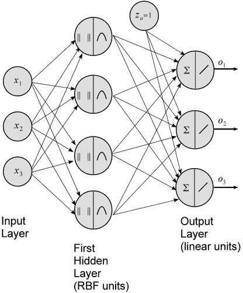

**FIGURE 8.3:** 一个 RBF 网络，隐藏层中为径向基单元，输出层中为线性单元。

假设一个 K 类分类问题，具有 Q 个隐藏单元（称为径向基函数）和 K 个输出单元的 RBFN。隐藏层中每个第 q 个径向基单元从输入单元产生输出 z_q：

$$v_q = \lVert \mathbf{x} - \boldsymbol{\mu}_q \rVert$$  \tag{8.39}

$$z_q = \exp\left(-\frac{v_q}{2}\right)$$  \tag{8.40}

其中范数的常见选择为二次函数

$$\lVert \mathbf{x} - \boldsymbol{\mu}_q \rVert = (\mathbf{x} - \boldsymbol{\mu}_q)^t \mathbf{\Sigma}_q (\mathbf{x} - \boldsymbol{\mu}_q)$$  \tag{8.41}

其中 $\mathbf{\Sigma}_q$ 为正定矩阵。$\boldsymbol{\mu}_q$ 和 $\mathbf{\Sigma}_q$ 为隐藏单元 q 的径向基中心和宽度或半径，其中 q ∈ {1, ⋯, Q}。隐藏层的输出传递到输出层，其中每个第 k 个输出单元生成

$$o_k = \mathbf{w}_k^t \mathbf{z}$$  \tag{8.42}

\tag{8.43}

其中 $\mathbf{z} = (1, z_1, \cdots, z_q)$ 且 $\mathbf{w}_k = (w_{0k}, w_{1k}, \cdots, w_{Qk})$ 为表征第 k 个输出单元的权重集合。RBFN 由 $\boldsymbol{\mu}_q, \mathbf{\Sigma}_q, v_{qk}$ 的集合完全确定，其中 q ∈ {0, 1, ⋯, Q} 且 k ∈ {1, ⋯, K}。


与多类单层感知机中的输出单元类似，输出单元拥有一组专属的权重，并且是线性单元，对隐藏单元生成的特征执行线性变换。在隐藏层中使用核函数引入了所需的非线性能力，这等价于向高维特征空间的投影，该特征是所有核机器所共有的。显然，$o_k$ 是以类似于支持向量机（SVM）的方式对核函数进行线性组合。与 SVM 的一个关键区别在于训练方案以及核参数的选取方式。

分类决策采用最大得分规则，得到：

$$\mathbf{x} \in C_j \quad \text{if } j = \arg\max_k o_k \tag{8.44}$$

对所有 $k = \{1,\cdots,K\}$ 成立。

## 8.4.2 RBFN 训练

RBFN 训练旨在最小化输出向量与目标向量之间的均方误差，目标向量通常以 1-of-K 编码向量表示，位于 $\{0,1\}$ 空间中。RBFN 训练分两步进行。第一步确定隐藏层中的中心集合与半径。第二步针对连接隐藏层与输出层的权重集合优化分类准则。

#### 8.4.2.1 使用训练样本作为中心

早期 RBFN 训练方法主张将所有训练数据作为中心 [100]；此时 RBFN 被视为以数据集中每个样本为中心的高斯径向基函数的线性组合。使用欧氏距离，并以标准差 $\sigma$ 作为半径，且该半径由所有隐藏单元共享。虽然这种方法速度快，因为它不需要显式训练，并且适用于插值问题（这也是 RBF 理论早期的研究动机），但对于分类问题可能并不方便，因为网络的规模随训练数据集的大小而增长。此外，该方法容易过拟合，导致部署环境中性能不佳。

#### 8.4.2.2 随机选择中心

另一种方法是随机选取少量样本作为中心，而不是使用整个训练集。只要训练数据在各类别间均匀分布 [88]，这种方法就是一种有效的替代方案。半径 $\sigma$ 根据所选中心的分布情况进行估计，并由所有单元共享。一种选择是 $\sigma = \frac{d}{\sqrt{2M}}$，其中 $d$ 是中心之间的最大距离，$M$ 是中心的数量 [51]。

#### 8.4.2.3 无监督中心选择

#### 8.4.2.4 有监督中心估计

有监督聚类技术（如 LVQ）可用于进一步增强初始原型集合，从而在中心估计中利用类别标签信息。事实证明，在某些场景下，使用有监督中心估计方法可以提供优于多层感知机的性能 [130]。

#### 8.4.2.5 权重的线性优化

RBFN 训练的第二步是在第一步已优化隐藏单元的前提下估计输出单元的参数。对于输入数据 xₙ，生成隐藏激活集合 zₙ，其目标向量为 tₙ = (tₙ₁,⋯,tₙK)，其中 tₙⱼ 使用 {0,1} 集合中的 1-of-K 原则进行编码，目标是求解一组线性方程：

```
tₙ = Wᵗ zₙ  (8.45)
```

对所有 n 成立，其中 W = (w₁,⋯,w_K) 是权重矩阵（W 的第 k 列是第 k 个输出单元的权重向量）。以矩阵形式表示，公式 8.45 可改写为

```
T = Wᵗ Z  (8.46)
```

其中 T 和 Z 分别对应目标向量矩阵和隐藏激活向量矩阵。该方程的通解为

```
W = Z⁺ T  (8.47)
```

其中 Z⁺ 是 Z 的伪逆，定义为 Z⁺ = (ZᵗZ)⁻¹Z。伪逆可以通过线性求解器计算，例如 Cholesky 分解、奇异值分解、正交最小二乘法、拟牛顿法或 Levenberg-Marquardt [46]。

#### 8.4.2.6 梯度下降及其改进

使用梯度下降技术可以对包含中心、半径和权重的整个网络进行全局训练 [27,64]。目标函数是输出向量与目标向量之间的平方误差 E_rbf：

```
E_rbf = Σₙ Σₖ₌₁ᴷ (tₙk − oₙk)²  (8.48)
```

给定训练数据序列及对应的目标向量 tₙ。中心和权重的初始集合可以从前面概述的中心估计方法之一推导得到。权重通常随机初始化为均值为零、方差为单位方差的较小值。

或者，可以仅对权重进行选择性梯度下降，同时保持中心和半径固定。这种方法的优点是可以避免线性求解器技术所需的矩阵求逆运算。研究表明，一大类 RBFN 在误差曲面中仅具有唯一的极小值，这使得大多数训练技术都能收敛到单一解 [98]。

由于使用聚类质心作为中心，RBF 可能对噪声和异常值敏感。解决该问题的一种方案是采用稳健统计学习方案，如均值和中位数 RBF 所提出的方法 [22,23]。

### 8.4.3 RBF 应用

径向基函数的能力源于隐藏单元中非线性激活的使用。特别是，核函数的运用等价于将原始输入数据变换到更高维的空间，在此空间中数据是线性可分的。Cover 定理为该结果提供了证明 [51]。一些 RBF 变体在输出层使用 S 型函数，进一步增强了分类能力。

RBFN 能够以相对较少的单元数量实现强大的分类能力。因此，RBFN 已被成功应用于多种数据分类任务 [103]，包括手写数字识别 [83]、图像识别 [23, 107]、语音识别 [105, 110, 128]、过程故障检测 [85] 以及各种模式识别任务 [24, 86]。

## 8.5 多层前馈网络

在前面的章节中，我们介绍了感知机和自适应线性神经元（Adaline）作为单层前馈神经网络的例子。尽管这些架构是神经网络的开创性应用，但它们的分类性能有限，部分原因在于缺少能够为网络注入更多判别能力的隐藏层。

多层前馈网络（也称为多层感知机，MLP）被提出作为感知机模型的改进，具有以下特征：

- 在网络的输入层和输出层之间至少使用一个隐藏层，这允许内部表示并增加更多的建模能力。
- 在隐藏层和输出层使用 S 型单元。S 型函数的平滑性使得可以直接从输出层到隐藏单元对整个网络进行训练，这在感知机或自适应线性神经元中都是不可能实现的。
- 提供一种称为反向传播的学习方案，该方案对整个网络进行分层训练。

这些特征连同以具体成果为支撑的坚实理论框架，使 MLP 成为分类任务中使用最广泛的神经网络架构。在基础理论方面，Cybenko [33] 的工作证明了具有单个 S 型隐藏单元的 MLP 可以以任意期望精度逼近任何映射，这有助于将 MLP 与 RBFN 一起确立为通用逼近器。Hornik [59, 60] 扩展了这一结果，证明了具有 S 型隐藏单元层的神经网络实际上可以逼近任何函数及其导数。理论上，MLP 可以执行任何分类任务。在实践中，由于训练不足、隐藏单元数量不足或数据缺乏充分性或代表性等因素，可能会出现次优的分类性能。

### 8.5.1 用于分类的 MLP 架构

MLP 的架构实现了丰富而强大的表示，如图 8.4 所示。单元按层排列，包括输入层、一个或多个隐藏层以及输出层。各层按照数据从输入层流向隐藏层、最终到达输出层的顺序依次组织。输入数据由输入层的单元收集和处理，然后通过隐藏层的单元传播到输出层。每一层中的单元接收来自前一层单元的数据，输出单元提供最终的分类决策。这个过程被称为网络的前向传播。隐藏层和输出层中的单元通常是 S 型单元。输出单元的数量和类型的选择根据分类任务而定。

我们首先回顾用于二分类问题的 MLP，然后讨论适用于多类问题的更通用模型。


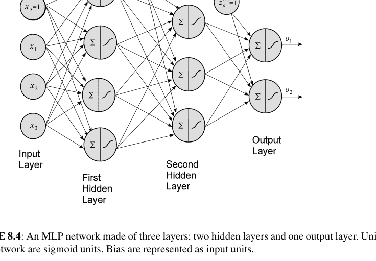

图 8.4：由三层组成的 MLP 网络：两层隐藏层和一层输出层。网络中的单元为 sigmoid 单元。偏置表示为输入单元。

#### 8.5.1.1 两类问题

对于两类问题 C1、C2，MLP 包含一个或多个隐藏层和一个单一的 sigmoid 输出单元，该单元产生单一的输出值 o。假设类别 C1 的目标值为 0，类别 C2 的目标值为 1，则分类规则为规则：

x ∈ C1    if o > 0.5    (8.49)
x ∈ C2    otherwise    (8.50)

输出 o 的范围在 [0,1] 内（或如果使用 tanh 函数则在 [−1,1] 内，此时决策阈值为零）。显然，输出单元在由最后一层隐藏层生成的特征空间上实现了逻辑回归。两类问题的 MLP 在使用单一输出单元方面与感知器或 adaline 相似。然而，通过使用隐藏层，其能力得到了极大增强。

#### 8.5.1.2 多类问题

对于类别数 K > 2 的情况，MLP 有一个或多个隐藏层和 K 个输出单元，每个单元对应一个特定类别。目标函数采用 1-of-K 编码方案进行编码，取值在 {0,1} 中，输出 o_k 被视为类别 C_k 的判别函数，从而实现分类决策为

x ∈ C_k    if k = arg max_j o_j    (8.51)

对于 j ∈ {1,⋯,K}，当使用 sigmoid 作为激活函数时 o_k ∈ [0,1]。对于目标函数使用 1-of-K 编码方案是标准做法。MLP 的训练等价于

近似映射 $f : \mathbb{R}^d \to \mathbb{R}^K$，其中目标值是 $\mathbb{R}^K$ 的自然基。它已被证明，在使用 1-of-K 编码方案和适当的误差准则，例如均方误差或交叉熵的情况下，MLP 输出可以近似后验概率 [14,111,131]：

$o_k \approx P(C_k|\mathbf{x})$  (8.52)

对所有 $k$ 成立。这 however 是一个渐近结果。实践中，sigmoid 单元的输出值不允许概率解释，因为它们之和不为一。为了对网络输出进行概率解释，可以在输出单元的净值或激活上使用 softmax 变换 [26]：

$o_k = \frac{e^{v_k}}{\sum_{j=1}^K e^{v_j}}$  (8.53)

其中显然 $\sum_{k=1}^K o_k = 1$。

#### 8.5.1.3 前向传播

前向传播是指数据从输入层传递到输出层的过程。假设 MLP 由 $L$ 层组成，其中索引 $1,\cdots ,L-1$ 指一组隐藏层，索引 $L$ 表示输出层。按照惯例，我们使用索引 0 表示输入层。对于 K 类问题，MLP 具有 K 个输出单元，每个输出单元针对输入示例 $\mathbf{x}$ 产生输出 $o_k$。如图 8.4 所示，输入数据按如下方式从输入层传播到输出层：

**从输入层到隐藏层：** 输入层将 $d$ 维输入示例 $\mathbf{x}$ 传递给第一隐藏层 $\mathcal{H}_1$ 中的每个单元，其中第 $h$ 个单元计算净值 $v_h^{(1)}$ 和输出 $z_h^{(1)}$ 为：

$v_h^{(1)} = \sum_{i=0}^d w_{ih}^{(1)} x_i$  (8.54)
$z_h^{(1)} = \phi(v_h^{(1)})$  (8.55)

其中 $w_{ih}^{(1)}$ 表示连接第 $i$ 个输入单元到第一层第 $h$ 个隐藏单元的突触权重；我们假设 $w_{0h}^{(1)}$ 指偏置且 $x_0 = 1$。为简单起见，我们还假设网络中所有单元使用相同的激活函数 $\phi(\cdot)$。

**从隐藏层到隐藏层：** 第 $l$ 个隐藏层 $\mathcal{H}_l$ 中的单元 $h$ 从前一层 $\mathcal{H}_{l-1}$ 中的单元获取数据以产生内部输出为

$v_h^{(l)} = \sum_{h'\in \mathcal{H}_{l-1}} w_{h'h}^{(l)} z_{h'}^{(l-1)}$  (8.56)
$z_h^{(l)} = \phi(v_h^{(l)})$  (8.57)

其中 $w_{h'h}^{(l)}$ 表示层 $\mathcal{H}_{l-1}$ 中第 $h'$ 个隐藏单元与层 $\mathcal{H}_l$ 中第 $h$ 个隐藏单元之间的突触权重；$l \in \{2,\cdots ,L-1\}$。

**从隐藏层到输出层：** 最后，第 $k$ 个输出单元产生网络的响应：

$v_k^{(L)} = \sum_{h\in \mathcal{H}_{L-1}} w_{hk}^L z_h^{(L-1)}$  (8.58)
$o_k = \phi(v_k^{(L)})$  (8.59)

对于所有 k ∈ {1,⋯,K}。前向传递将激活 $z_h^{(l)}$ 从第一隐藏层传播到输出。每一隐藏层对数据进行变换，创建内部表示。因此，$z_h^{(l)}$ 的集合可以视为由 MLPs 生成的输入数据 $\mathbf{x}$ 的非线性表示的层级序列。输出在由最后一层隐藏层生成的特征集 $z_h^{(L-1)}$ 上充当分类器。通过在单一架构中同时执行特征提取和分类，MLPs 可以自动生成最适合分类任务数据的表示 [69]。

### 8.5.2 误差度量

训练 MLP 包括最小化目标函数 ℰ(w) 作为网络参数集 w 的函数，以最小化错误概率。目标函数是误差度量 E(x;w) 的期望，该度量衡量给定输入数据 x 下网络输出 o = (o1,⋯,oK) 与期望响应 t = (t1,⋯,tK) 的差异：

ℰ(w) = ∫_x E(x;w) p(x) dx. (8.60)

实践中，训练使用在训练集 X 上定义的客观函数的经验近似：

ℰ(w) = 1/N Σ_{x∈X} E(x;w) (8.61)

并且最小化过程在该经验近似值上进行监控。

对于 MLP 的监督训练，有多种误差度量可用，并使用描述给定输入数据示例的期望输出向量的目标输出函数定义。目标输出向量的 1-of-K 编码方案是规范。我们将回顾用于训练 MLP 的几种广泛使用的误差度量。

#### 8.5.2.1 均方误差 MSE

MSE 是 MLP 输出与目标输出之间的欧几里得距离：

E_mse(x;w) = Σ_{k=0}^K (o_k - t_k)^2 (8.62)

MSE 由于其二次特性而被广泛使用。变体可以包括更一般的 L_p 范数。

#### 8.5.2.2 交叉熵 CE

目标与 MLP 输出之间的交叉熵是使用信息论原理推导的 [8,53,67]。CE 准则定义为

E_en(x;w) = - Σ_{k=1}^K t_k log o_k. (8.63)

训练网络以最小化 CE 目标函数可以解释为最小化 Kullback-Liebler 信息距离 [131] 或最大化互信息。与二次误差相比，信息论误差度量通常报告更快的学习。还表明，使用对数误差度量的学习不易陷入局部极小值收敛。

#### 8.5.2.3 最小分类误差 MCE

MCE 准则是对 0-1 错误计数的平滑近似 [68, 70]，已用于神经网络优化 [69]。MCE 准则定义为 x 属于 C_k 时

E_mce(x;w) = sigmoid(d_k(x;w)) (8.64)
d_k(x;w) = -o_k + [1/K sum_{j,j≠k}^K o_j^v]^{1/v} (8.65)

其中 v > 0。项 d_k 称为误分类度量。负值表示正确分类决策（E_mce(x;w) ≈ 0），正值表示错误分类决策（E_mce(x;w) ≈ 1）。

MCE 目标函数

E_mce(w) = 1/N sum_{x∈X} E_mce(x;w) (8.66)

是对训练集上错误率的平滑近似，因此比 MSE 和 CE 更直接地最小化误分类错误 [16]。

### 8.5.3 通过反向传播学习

反向传播训练算法是一种迭代梯度下降算法，旨在最小化前馈网络的误差准则。术语反向传播来自误差导数从输出单元向隐藏单元的传播。其核心，反向传播误差执行以下更新

w ← w + ∇w (8.67)

其中

∇w = -η ∂E/∂w (8.68)

对于网络中任意给定的权重 w，其中 E 是先前定义的误差度量之一。这里，我们考虑使用局部误差 E 而非经验目标函数的随机梯度下降。

由于网络中单元之间的相互依赖性，公式 8.68 的计算在网络中按层次进行，从输出单元开始，向隐藏单元向下，最后到输入单元。为了说明，设 w_jk 为连接最后一层隐藏层第 j 个单元和第 k 个输出单元的权重，其净值为 v_k，输出为 o_k = φ(v_k^{(L)})：

∂E/∂w_jk = ∂E/∂v_k^{(L)} ∂v_k^{(L)}/∂w_jk (8.69)
= δ_k z_j^{(L-1)} (8.70)

其中 z_j^{(L-1)} 是最后一层隐藏层 H_{L-1} 中第 j 个单元的输出，其中我们定义 δ_k = ∂E/∂v_k^{(L)}。类似地，关于隐藏层 H_{l-1} 中第 h 个单元与隐藏层 H_l 中第 j 个单元之间权重 w_{hj}^{(l)} 的误差梯度计算为：

∂E/∂w_{hj}^{(l)} = E/∂v_j^{(l)} ∂v_j^{(l)}/∂w_{hj}^{(l)} (8.71)
= δ_j^{(l)} z_h^{(l-1)} (8.72)


将输出层记为 \(\mathcal{H}_L\)，输入层记为 \(\mathcal{H}_0\)，权重更新为

\[
\nabla w_{ij}^{(l)} = -\eta \, \delta_j^{(l)} z_i^{(l-1)} \tag{8.73}
\]

对任意给定权重 \(w_{ij}^{(l)}\) 和 \(l \in \{1,\dots,L\}\)，其中 \(\delta_j^{(l)}\) 通常被称为层 \(\mathcal{H}_l\) 中单元 \(j\) 的“信用”。我们指出，MLP 在公式 8.73 中的权重更新实现了 Hebbian 学习规则。

要更新单元的权重需要计算该单元的信用。计算每个单元的信用取决于其在网络中的位置。对应于第 \(k\) 个输出单元（为简单起见，不使用 softmax 变换）的信用 \(\delta_k\) 为

\[
\delta_k = \frac{\partial E}{\partial o_k} \frac{\partial o_k}{\partial v_k^{(L)}} \tag{8.74}
= \varphi'(v_k^{(L)}) \frac{\partial E}{\partial o_k} \tag{8.75}
\]

其中 \(\varphi'(\cdot)\) 是激活函数的导数。当使用 sigmoid 函数和 MSE 准则时，输出单元的信用为

\[
\delta_k = \varphi(v_k)(1 - \varphi(v_k))(o_k - t_k) \tag{8.76}
= o_k(1 - o_k)(o_k - t_k) \tag{8.77}
\]

对于层 \(\mathcal{H}_l\) 中的隐藏单元，其信用 \(\delta_h^{(l)}\) 取决于其在层 \(\mathcal{H}_{l+1}\) 中的接收单元：

\[
\delta_h^{(l)} = \frac{\partial E}{\partial z_h^{(l)}} \frac{\partial z_h^{(l)}}{\partial v_h^{(l)}} \tag{8.78}
= \varphi'(v_h^{(l)}) \sum_{h' \in \mathcal{H}_{l+1}}
\frac{\partial E}{\partial v_{h'}^{(l+1)}} \frac{\partial v_{h'}^{(l+1)}}{\partial z_h^{(l)}} \tag{8.79}
= z_h^{(l)}(1 - z_h^{(l)}) \sum_{h' \in \mathcal{H}_{l+1}}
\delta_{h'}^{(l+1)} w_{hh'}^{(l+1)} \tag{8.80}
\]

其中我们在推导公式 8.80 时假设使用了 sigmoid 函数。

信用是使用公式 8.77 从输出单元计算出来，然后使用公式 8.80 传播到隐藏层。这两个公式是反向传播算法的基础，使其能够通过将信用从输出层传播到隐藏层来计算每个权重的梯度下降。反向传播算法在算法 8.4 中进行了说明。

### 8.5.4 增强反向传播

标准反向传播算法是一种一阶优化方法。其收敛性对网络大小、数据中的噪声水平以及学习率的选择高度敏感：收敛可能缓慢，并且可能导致误差曲面的不良局部最小值 [7]。可以通过数据归一化和使用标准梯度下降方法的增强替代方案来提高反向传播算法的性能。因此，在呈现给 MLP 之前，数据通常被归一化到 \([-1, 1]\) 之间。同样，在反向传播之前，网络权重通常以零均值和方差为 1 进行初始化。

#### 算法 8.4 反向传播算法

**输入：** 训练数据 \(X = \{x_1, \dots, x_N\}\) 和相关目标 \(\{t_1, \dots, t_N\}\)；\(x_n \in \mathbb{R}^d\)，\(t_n = (t_{n1}, t_{n2}, \dots, t_{nK})\) 且 \(t_{nk} = \delta_{jk}\) 为 \(x_n \in C_j\) 的克罗内克记号；学习率 \(\eta > 0\)。

**输出：** 具有最优权重集 \(w\) 的训练好的多层感知器。

```text
1: Randomly initialize the set of weights w = {w_ij} with zero means and unit variance, preferably
2: for t in {1, ..., T} do    # for each epoch up to T
3:   for n in {1, ..., N} do    # for each sample
4:     Forward propagation to get output o = (o1, ..., oK) and activations {z_j^(l)}
5:
6:     for l in {L, L-1, ..., 1} do
7:       for j in H_l do    # for all units in layer H_l
8:         if unit j is an output unit then
9:           δ_j = δ_j^(L) = o_j(1 - o_j)(o_j - t_j)
10:        end if
11:        if unit j is an internal hidden unit in layer H_l then
12:          δ_j^(l) = z_j^(l)(1 - z_j^(l)) Σ_{h ∈ H_{l+1}} δ_h^(l+1) w_{jh}^(l+1)
13:        end if
14:
15:        for i in H_{l-1} do
16:          w_{ij}^(l) ← w_{ij}^(l) - η(t) z_i^(l-1) δ_j^(l)    # weight update
17:        end for
18:
19:     end for
20:     end for
21:   end for
22: end for
23: w_{ij}^(l) : weight from unit i to unit j in layer H_l
24: z_i^(l) : output of unit i in layer H_l
25: η(t) : learning rate at iteration t
26: δ_j^(l) : error term (credit) of unit j in layer H_l
```

对梯度下降的增强包括，除其他技术外，使用动量平滑器 [116]、使用动态学习率 [7, 129]、弹性反向传播算法和 Quickprop 算法。

#### 8.5.4.1 带动量的反向传播

使用动量因子 \(\alpha > 0\) 作为

\[
\Delta w = -\eta \frac{\partial E}{\partial w}(t) + \alpha \Delta w(t - 1) \tag{8.81}
\]

有助于缓解梯度下降过程中的噪声振荡。这假设梯度下降是在目标函数 \(E\) 上以批量方式进行的。

#### 8.5.4.2 Delta-Bar-Delta

学习率的最佳选择取决于误差曲面的复杂性和网络架构。为了规避这一问题，delta-bar-delta 算法 [66] 为网络中的每个权重 \(w\) 分配一个单独的学习率 \(\eta_w\)。该权重在学习过程中根据梯度的方向进行更新。delta-bar-delta 算法对目标函数 \(\mathcal{E}\) 的操作如下。

首先，它在每次迭代 \(t\) 时估计误差导数的移动平均值 \(\widehat{\partial \mathcal{E}/\partial w}(t)\)，以减少梯度波动，如

\[
\widehat{\frac{\partial \mathcal{E}}{\partial w}}(t) = \beta \frac{\partial \mathcal{E}}{\partial w}(t)
+ (1 - \beta) \widehat{\frac{\partial \mathcal{E}}{\partial w}}(t - 1) \tag{8.82}
\]

其中 \(0 < \beta < 1\)。然后，单独的学习率按如下方式更新：

\[
\eta_w(t + 1) =
\begin{cases}
\eta_w(t) + \kappa, & \text{if } \widehat{\frac{\partial \mathcal{E}}{\partial w}}(t) \frac{\partial \mathcal{E}}{\partial w}(t - 1) > 0,\\[4pt]
(1 - \rho)\eta_w(t), & \text{if } \widehat{\frac{\partial \mathcal{E}}{\partial w}}(t) \frac{\partial \mathcal{E}}{\partial w}(t - 1) < 0,\\[4pt]
\eta_w(t), & \text{otherwise.}
\end{cases} \tag{8.83}
\]

当连续梯度指向同一方向时，学习率会增加，否则会减小。元学习参数 \(\kappa\)、\(\rho\)、\(\beta\) 的选择由各种考虑因素驱动，特别是数据类型。已建议使用动量来减少梯度振荡 [95]。更新以批量模式进行。一种可用于在线设置的 delta-bar-delta 算法的增量版本是可用的 [125]。

#### 8.5.4.3 Rprop 算法

寻找抗噪声的反向传播算法一直是各种研究的主题 [63]。弹性反向传播 Rprop 算法 [112] 是解决这一问题的方案之一，因为它旨在消除更新步骤中误差导数范数的影响，而专注于通过监控其符号来关注梯度的方向。Rprop 对目标函数 \(\mathcal{E}\) 操作，并在时间 \(t\) 更新每个权重为

\[
\Delta w(t) = -\gamma_w(t) \operatorname{sign}\left(\frac{\partial \mathcal{E}}{\partial w}(t)\right) \tag{8.84}
\]

其中 \(\gamma_w\) 是在每次训练迭代 \(t\) 时跟踪的更新步长，并按如下方式更新

\[
\gamma_w(t + 1) =
\begin{cases}
\min\{\eta_+ \gamma_w(t), \gamma_{\max}\}, & \text{if } \frac{\partial \mathcal{E}}{\partial w}(t) \frac{\partial \mathcal{E}}{\partial w}(t - 1) > 0,\\[4pt]
\max\{\eta_- \gamma_w(t), \gamma_{\min}\}, & \text{if } \frac{\partial \mathcal{E}}{\partial w}(t) \frac{\partial \mathcal{E}}{\partial w}(t - 1) < 0,\\[4pt]
\gamma_w(t), & \text{otherwise.}
\end{cases} \tag{8.85}
\]

其中 \(0 < \eta_- < 1 < \eta_+\)，典型值分别为 0.5 和 1.2，且初始更新值设为 \(\delta_w = 0.1\)。

Rprop 的效果是在误差曲面的平坦区域和接近局部最小值的区域加速学习。更新量的大小通过使用 \(\gamma_{\min}\) 和 \(\gamma_{\max}\) 来限制，以适度加速。

#### 8.5.4.4 Quick-Prop

二阶算法比单纯的梯度值考虑了更多关于误差曲面形状的信息。如果在每一步考虑误差曲面的曲率，可以进行更有效的优化。然而，这些方法需要估计 Hessian 矩阵，这对于前馈网络来说计算成本很高 [7]。可以采用伪牛顿方法来简化 Hessian 矩阵的形式 [10]，其中仅计算对角分量，得到

\[
\Delta w(t) = \frac{\frac{\partial \mathcal{E}(t)}{\partial w}}{\frac{\partial^2 \mathcal{E}(t)}{\partial w^2}} \tag{8.86}
\]

Quickprop 算法进一步将二阶导数 \(\frac{\partial^2 \mathcal{E}}{\partial w^2}\) 近似为一阶导数连续值的差，得到

\[
\Delta w(t) = \Delta w(t - 1)
\frac{\frac{\partial \mathcal{E}(t)}{\partial w}}
{\frac{\partial \mathcal{E}(t)}{\partial w} - \frac{\partial \mathcal{E}(t - 1)}{\partial w}} \tag{8.87}
\]

不需要矩阵求逆，且在寻找所需的二阶偏导数时所涉及的计算工作有限。Quick-prop 依赖于误差曲面的众多假设，包括二次形式和 Hessian 矩阵的非多元性质。因此，需要各种启发式方法使其在实践中工作。这包括将更新 \(\Delta w(t)\) 限制为某个最大值，并在近似 Hessian 的符号在多个连续迭代中未改变时切换到简单的梯度更新 [36, 37]。

### 8.5.5 泛化问题

泛化问题在机器学习中以及特别是在神经网络中是众所周知的。给定一个训练集，网络可能在训练集上实现良好的分类性能，但无法很好地推广到测试环境。这可能是由于多种因素造成的。一个因素是过度训练，即网络完美地学习数据集而不是学习底层映射。另一个因素是训练大小与参数数量之间的不平衡比率，其中权重数量相对于数据量过大。

*早停* 是一种广泛用于防止过拟合的方法。其思想是定期使用单独的验证集估计误差，并在验证集上的误差开始增加时停止训练。交叉验证是另一种替代方法，但需要训练多个网络，这可能耗时。改善泛化的另一种有用方法是 *带噪声训练* [2, 20]。向训练集添加小方差白噪声的效果等同于添加更多训练数据，这可能防止网络对特定数据集过拟合。

### 8.5.6 模型选择

*模型选择*，即适当选择单元数量，是一个困难的问题。对于 MLPs 有多种模型选择标准可用。除了标准模型选择标准如 AIC、BIC 和 MDL 外，特定于神经网络的标准包括广义最终预测误差 GPE [99] 和 Vapnik-Chervonenkis VC 维 [127]，它表达了网络实现最优分类任务的能力，并提供了实现目标误差概率所需的训练集数量的界限。然而，给定一个网络，估计 VC 界是一个具有挑战性的任务，有时会导致不合理的庞大网络。相反，最近的进展使用深度学习的概念来选择性地训练大型网络以实现准确的性能，正如我们将在下一节中看到的那样。

## 8.6 深度神经网络

深度学习方法旨在学习和利用神经网络生成其隐藏层中数据的内部特征表示的能力。如前所述，对于多层架构，每个隐藏层的输出是一组由


next layer, meaning that the network generates composed and unseen internal representations of the data. The output layer can be viewed as a classification machine on the space spanned by the last hidden layer’s outputs. More hidden layers and more units in those layers generate a more powerful network with the ability to generate more meaningful internal representations of the data.

However, training large and deep neural networks (DNN) with a large number of hidden layers and units is a difficult enterprise. With a number of parameters in the order of millions, the error surface is rather complex and has numerous local minima with many of them leading to poor performance [4,42]. Also, during backpropagation, there is the issue of the vanishing gradient, where the norm of the gradient gets smaller as the chain rule of the gradient computation gets expanded across many layers [12,57]. Lastly, a neural network with a large number of weights requires tremendous computational power. Deep learning techniques come with various strategies and heuristics to overcome these problems. Those strategies include the use of prior knowledge on the domain of application, the application of a layer-wise selective training technique, and the use of a high-performance computing system.

### 8.6.1 Use of Prior Knowledge

One way to successfully implement and train a deep layer architecture is to exploit prior knowledge about the domain of application that can guide the selection of the architecture, the encoding scheme, and the optimization techniques. Prior knowledge may help define not only the numbers of needed layers and their functions, but also provide information that enables weight-sharing, where units can share weights in the network if they do have similar functionality in the network or are operating on similar types of data. This balancing act between having numerous units but having a fewer number of parameters due to weight-sharing enabled successful training of earlier deep neural network architectures in the 1980s and the mid-1990s with application to speech and handwriting recognition. Prototyping examples include the large-phonetic time delay network (TDNN-LR) [120] and the convolution neural networks [80].

The original time-delay neural network (TDNN) was proposed in the 1980s with a focus on designing a neural network architecture that is time-invariant on the speech signal. The basic TDNN unit features a sigmoidal neuron with delay weights for current and past stimuli that are aggregated together to produce the final output. Weights-sharing is done to ensure that same time-events occurring over time use the same weights. While the original TDNN only used one hidden layer on a small classification task, more complex and layered versions were proposed, using the tied-connection and shift-invariant principles. This includes the TDNN-LR, a modular TDNN designed for the recognition of the entire Japanese phonemic set [97,120] and the MS-TDNN, targeted at word recognition and embedding a time-alignment component in its optimization criterion [48,49].

While the TDNN provides a good example of the influence of prior knowledge in the design of an architecture, the first successful implementation of a deep architecture that exploits prior knowledge is the convolutional neural network (CNN) [31,80]. A CNN and its variants can exhibit more than four or five hidden layers and has achieved impressive results on the NIST handwritten digit recognition task. Its design mimics the human visual cortex. In the visual cortex, system information is processed locally through contiguous receptive fields and then aggregated into higher concepts [62]. This principle has inspired a few neural networks in the past, in particular the neocognitron architecture of Fukushima [43,71].

The CNN is a multi-layer perceptron made of numerous layers where each layer is a non-linear feature detector performing local processing of contiguous features within each layer, leading to higher conceptual representation as information moves up to the output layer. The CNN’s weight space is sparse as each unit in a layer only selectively takes input from a subset of contiguous neurons in the lower layers; this is the local connectivity that mimics the visual cortex. In addition, each layer is made of replicated neurons taking similar types of input from the lower layer and then generating “feature maps” of units with the similar receiving fields. Neurons within a map share the

### 8.6.2 Layer-Wise Greedy Training

In the absence of prior knowledge, selective or greedy training of layers has been suggested as a way to train deep networks in a generic manner with the goal of overcoming the vanishing gradient issue and helping to avoid attraction to low-performing local minima of the error surface. An earlier suggestion to implement this process was to individually train each neuron or each layer using a supervised training scheme based on the network’s classification performance [38, 84]. While this approach can efficiently train large networks, it suffers from the over-fitting problem. Cross-validation or regularization can be used to mitigate that problem but are time-consuming approaches for very large networks.

The deep learning methodology proposes a two-step approach as a solution to this problem. The first step is an unsupervised learning scheme that trains each hidden layer individually, starting from the first hidden layer and up to the last hidden layer. The training problem is broken down into easier steps with fewer parameters to train. The use of unsupervised learning provides a form of regularization to prevent over-fitting but is also a powerful mechanism to let the network learn the inherent characteristics of the data without using class labels. This step is merely for weight initialization in preparation for the next step.

The second step trains the entire network using backpropagation. This step refines and readjusts the network for the targeted classification problem. Since the weights have previously been optimized to better represent unseen characteristics of the data, they provide a good starting point for backpropagation.

The deep learning methodology combines unsupervised learning of initial weights aimed at feature representation and supervised training of the entire network with a focus on classification performance [56]. It is a design mechanism that uses two different learning criteria. This contrasts with earlier proposals that emphasized the dual learning of features and classification using a unique criterion [16, 69]. The use of the restricted Boltzmann machine (RBM) or stacked auto-encoder are the techniques widely used to perform unsupervised layer-wise network initialization [56].

#### 8.6.2.1 Deep Belief Networks (DBNs)

The Restricted Boltzmann Machine [122] is a single-layer network where the output layer is made of binary latent variables encoding the data. It consists of a single visible layer and single hidden layer, where connections are formed between the layers. Given an input data, the RBM uses a latent representation to generate a probability distribution of the data; it is a generative model. It has been argued and shown that RBMs can successfully be used to learn the internal weights of a deep neural network architecture [56].

A deep belief network (DBN) is a neural network whose hidden layers are Restricted Boltzmann Machines (RBMs) and the output layer is an associative network. The hidden layers are trained in a layer-wise greedy fashion, one layer at a time, to provide an internal encoding of the data. Each RBM layer is trained to generate the data in its visible layer, forcing the hidden layer to encode that information. Once an RBM is trained, its output is used as input to the next layer and the process repeated [56]. The overall process starts by training the first RBM, then training another RBM using

the first RBM’s hidden layer outputs as the second RBM’s visible layer, and then continuing up to the last hidden layer.

#### 8.6.2.2 Stack Auto-Encoder

Stacked auto-encoders are MLPs with an architecture designed to regenerate input data [11, 55]. The MLP is trained to reproduce an estimate $\hat{\mathbf{x}} = (\hat{x}_1, \cdots, \hat{x}_d)$ of the input $\mathbf{x} = (x_1, \cdots, x_d)$, thus forcing the MLP to encode an internal representation of $\mathbf{x}$ in the hidden units. It generally features a single or two hidden layers that are responsible for creating a hidden representation of the data. The network tries to minimize the mean square error $E$ between input and output as

$$E(\hat{\mathbf{x}},\mathbf{x}) = \sum_{i=1}^{d}(x_i-\hat{x}_i)^2 \tag{8.88}$$

and by doing so, the MLP encodes an internal representation in the hidden layers that can be used to regenerate the data in the output layer. Auto-encoding can be likened to a non-linear principal component estimation. When used within a deep-learning system, each hidden layer of the DNN is used as a hidden layer in an encoder and trained accordingly. After training is done, the weights are fixed and used to generate data for the next layer, which is also trained within an auto-encoder using the outputs of the previously trained layer. The process is repeated up to the last hidden layer. A deep CNN (DCNN) design was proposed based on those principles and achieved an improved performance compared to the original CNN version [81, 109]; it was a good showcase of the dual-use of domain knowledge in the design of the CNN architecture and layer-wise training for network optimization.

### 8.6.3 Limits and Applications

Deep learning is a powerful methodology well-suited to training deep and large networks. However, it does require the availability of powerful computing capabilities, which justifies the use of special accelerator hardware such as GPU in training deep neural networks.

Successful applications of deep networks have already been presented on a large variety of data. We have pointed out the impressive results obtained by the CNN and the DCNN in image recognition [31, 81, 109], speech detection recognition [123], and sound classification [82]. Deep learning has had an important impact on speech recognition where it has helped achieve better performance than state-of-the-art systems. For speech recognition, it is used as a probability estimator within a hidden Markov model architecture, which demonstrates an example of a hybrid system-based deep learning technique [54, 72].

## 8.7 Summary

We have seen in this chapter that neural networks are powerful universal mappers for data classification endowed with certain properties such as non-linearity, the capacity to represent information in a hierarchical fashion, and the use of parallelism in performing the classification tasks. The resurging interest of neural networks coincides with the availability of high-performance computing to perform computationally demanding tasks. The emergence of training methodologies to exploit these computing resources and the concrete results achieved in selected classification tasks make neural networks an attractive choice for classification problems. The choice of a particular network is still linked to the task to be accomplished. Prior knowledge is an important element to consider


并且新兴的无监督逐层训练与监督训练的双重用途已被证明稳健，能够为权重提供良好的初始化并避免局部极小值。

## 致谢

作者谨向 IBM T. J. Watson 研究中心的 Deepak Turaga 博士表示感谢，感谢他对本次综述的支持和鼓励。

## 参考文献

- [1] D. H. Ackley, G. E. Hinton, and T. J. Sejnowski. Boltzmann 机的学习算法。*Cognitive Science*, 9(1):147–169, 1985.
- [2] G. An. 在反向传播训练中添加噪声对泛化性能的影响。*Neural Computation*, 8:643–674, 1996.
- [3] J. K. Anlauf and M. Biehl. AdaTron：一种自适应感知器算法。*Europhysics Letters*, 10(7):687–692, 1989.
- [4] P. Auer, M. Herbster, and M. K. Warmuth. 单神经元的指数级多个局部极小值。In M. Mozer, D. S. Touretzky, and M. Perrone, editors, *Advances in Neural Information Processing Systems*, volume 8, pages 315–322. MIT Press, Cambridge, MA, 1996.
- [5] B. Widrow and M. E. Hoff. 自适应开关电路。In *IRE WESCON Convention Record*, pages 96–104, 1960.
- [6] E. B. Bartlett and R. E. Uhrig. 使用人工神经网络进行核电站状态诊断。*Nuclear Technology*, 97:272–281, 1992.
- [7] R. Battiti. 学习的一阶和二阶方法：在最速下降法与牛顿法之间。*Neural Computation*, 4(2):141–166, 1992.
- [8] E. B. Baum and F. Wilczek. 神经网络对概率分布的监督学习。In D. Z. Anderson, editor, *Neural Information Processing Systems*, pages 52–61. American Institute of Physics, 1988.
- [9] W. G. Baxt. 使用人工神经网络进行临床决策的数据分析：急性冠状动脉闭塞的诊断。*Neural Computation*, 2(4):480–489, 1990.
- [10] S. Becker and Y. Le Cun. 使用二阶方法改进反向传播学习的收敛性。In D. S. Touretzky, G. E. Hinton, and T. J. Sejnowski, editors, *Proceedings of the 1988 Connectionist Models Summer School*, pages 29–37. San Francisco, CA: Morgan Kaufmann, 1989.
- [11] Y. Bengio, P. Lamblin, D. Popovici, and H. Larochelle. 深度网络的贪心逐层训练。In *Proceedings of NIPS*, pages 153–160, MIT Press, Cambridge, MA, 2006.
- [12] Y. Bengio, P. Simard, and P. Frasconi. 使用梯度下降学习长期依赖是困难的。*IEEE Transactions on Neural Networks*, 5(2):157–166, 1994.
- [13] M. Biehl, A. Ghosh, and B. Hammer. LVQ 算法的动力学和泛化能力。*Journal of Machine Learning Research*, 8:323–360, 2007.
- [14] A. Biem. 应用于语音识别的判别特征提取。PhD thesis, Université Paris 6, 1997.
- [15] A. Biem and S. Katagiri. 基于最小分类误差的倒谱滤波。In *Technical Meeting of Institute of Electrical Information Communication Engineering of Japan (IEICE)*, volume 92–126, pages 17–24, July 1992.
- [16] A. Biem, S. Katagiri, and B.-H. Juang. 基于判别特征提取的模式识别。*IEEE Transactions on Signal Processing*, 45(02):500–504, 1997.
- [17] S. A. Billings and C. F. Fung. 用于自适应噪声消除的递归径向基函数网络。*Neural Networks*, 8(2):273–290, 1995.
- [18] C. Bishop. 改进径向基函数神经网络的泛化特性。*Neural Computation*, 3(4):579–588, 1991.
- [19] C. M. Bishop. *Neural Networks for Pattern Recognition*. Oxford University Press, 1995.
- [20] C. M. Bishop. 训练时加入噪声等价于 Tikhonov 正则化。*Neural Computation*, 7(1):108–116, 1995.
- [21] C. M. Bishop. *Neural Networks for Pattern Recognition*. Clarendon Press, Oxford, 1995.
- [22] A. G. Bors and I. Pitas. 中值径向基函数神经网络。*IEEE Transactions on Neural Networks*, 7(6):1351–1364, 1996.
- [23] A. G. Bors and I. Pitas. 使用 Alpha-Trimmed Mean 径向基函数网络对 3D 图像进行目标分类。*IEEE Transactions on Image Processing*, 8(12):1744–1756, 1999.
- [24] D. Bounds, P. Lloyd, and B. Mathew. 神经网络与其他模式识别方法在腰椎疾病诊断中的比较。*Neural Networks*, 3(5):583–591, 1990.
- [25] H. Bourlard and N. Morgan. 基于连接主义统计方法的连续语音识别。*IEEE Transactions on Neural Networks*, 4:893–909, 1993.
- [26] J. S. Bridle. 前馈分类网络输出的概率解释，与统计模式识别的关系。In Fogelman-Soulie and Herault, editors, *Neurocomputing: Algorithms, Architectures and Applications*, NATO ASI Series, pages 227–236. Springer, 1990.
- [27] O. Buchtala, P. Neumann, and B. Sick. 用于分类应用的径向基函数网络高效训练策略。In *Proceedings of the International Joint Conference on Neural Networks*, volume 2, pages 1025–1030, 2003.
- [28] H. B. Burke, P. H. Goodman, D. B. Rosen, D. E. Henson, J. N. Weinstein, F. E. Harrell, J. R. Marks, D. P. Winchester, and D. G. Bostwick. 人工神经网络提高癌症生存预测的准确性。*Cancer*, 79:857–862, 1997.
- [29] S. Cajal. 中枢神经系统组织学的新概念。In Rottenberg and Hochberg, editors, *Neurological Classics in Modern Translation*. New York: Hafner, 1977.
- [30] K. Crammer, R. Gilad-Bachrach, A. Navot, and N. Tishby. LVQ 算法的边界分析。In *Advances in Neural Information Processing Systems*, volume 15, pages 462–469. MIT Press, Cambridge, MA, 2003.
- [31] Y. Le Cun and Y. Bengio. 图像、语音和时间序列的卷积网络。In M. A. Arbib, editor, *Handbook of Brain Theory and Neural Networks*, pages 255–258. MIT Press, Cambridge, MA, 1995.
- [32] Y. Le Cun, B. Boser, J. S. Denker, D. Henderson, R. E. Howard, W. Hubbard, and L. D. Jackel. 使用反向传播网络进行手写数字识别。*Advances in Neural Information Processing Systems*, 2:396–404, 1990.
- [33] G. Cybenko. Sigmoid 函数叠加的逼近。*Mathematics of Control, Signals and Systems*, 2(4):303–314, 1989.
- [34] D. O. Hebb. *The Organization of Behavior*. Science Edition, 1961.
- [35] R. O. Duda and P. E. Hart. *Pattern Classification and Scene Analysis*. Wiley-Interscience Publications, 1973.
- [36] S. Fahlman. 反向传播的更快学习变体：实证研究。In D. S. Touretzky, G. E. Hinton, and T. J. Sejnowski, editors, *Proceedings of the 1988 Connectionist Models Summer School*, pages 38–51. Morgan Kaufmann, San Francisco, CA, 1989.
- [37] S. E. Fahlman. 反向传播网络学习速度的实证研究。Technical report, Carnegie Mellon University, 1988.
- [38] Scott E. Fahlman and Christian Lebiere. 级联相关学习架构。In D. S. Touretzky, editor, *Advances in Neural Information Processing Systems 2*, pages 524–532. Morgan Kaufmann, San Mateo, 1990.
- [39] B. Fasel. 使用卷积神经网络进行鲁棒人脸分析。In *Proceedings of the International Conference on Pattern Recognition*, 2002.
- [40] J. A. Flanagan. Kohonen SOM 中的自组织。*Neural Networks*, 9(7):1185–1197, 1996.
- [41] Y. Freund and R. Schapire. 使用感知器算法进行大边界分类。*Machine Learning*, 37(3):277–296, 1999.
- [42] K. Fukumizu and S. Amari. 多层感知器分层结构中的局部极小值和平坦区。*Neural Networks*, 13(3):317–327, 2000.
- [43] K. Fukushima. Neocognitron：一种不受位置偏移影响的模式识别机制的自组织神经网络模型。*Biological Cybernetics*, 36:193–202, 1980.
- [44] S. I. Gallant. 基于感知器的学习算法。*IEEE Transactions on Neural Networks*, 1(2):179–191, 1990.
- [45] F. Girosi, M. Jones, and T. Poggio. 正则化理论与神经网络架构。*Neural Computation*, 7(2):219–269, 1995.
- [46] G. H. Golub and C. F. Van Loan. *Matrix Computations*. The Johns Hopkins University Press, 3rd edition, 1996.
- [47] I. Guyon. 神经网络在字符识别中的应用。*International Journal of Pattern Recognition and Artificial Intelligence*, 5:353–382, 1991.
- [48] P. Haffner, M. Franzini, and A. Waibel. 将时间对齐与神经网络集成以实现高性能连续语音识别。In *Proceedings of IEEE International Conference on Acoustics, Speech, and Signal Processing (ICASSP)*, pages 105–108, May 1991.


- [49] P. Haffner 和 A. Waibel。用于连续语音识别的多状态时延神经网络。见 NIPS，第 135–142 页，1992 年。
- [50] B. Hammer 和 T. Villmann。广义相关学习矢量量化。Neural Networks，15(8-9):1059–1068，2002 年。
- [51] S. Haykin。神经网络：综合基础。Macmillan College Publishing，纽约，1994 年。
- [52] J. Hertz、A. Krogh 和 R. Palmer。神经计算理论导论。Addison-Wesley，1991 年。
- [53] G. Hinton。连接主义学习过程。Artificial Intelligence，40(1-3):185–234，1989 年。
- [54] G. Hinton、L. Deng、D. Yu 和 G. Dahl。用于语音识别声学建模的深度神经网络。IEEE Signal Processing Magazine，29(6):82–97，2012 年。
- [55] G. Hinton 和 R. Salakhutdinov。用神经网络降低数据维度。Science，313(5786):504–507，2006 年。
- [56] G. E. Hinton、S. Osindero 和 Y. W. Teh。深度信念网络的一种快速学习算法。Neural Computation，18(7):1527–1554，2006 年。
- [57] S. Hochreiter。学习循环神经网络过程中的梯度消失问题及解决方案。International Journal of Uncertainty, Fuzziness and Knowledge-Based Systems，6(2):107–116，1998 年。
- [58] J. Hopfield。神经网络与具有涌现集体计算能力的物理系统。见Proceedings of the National Academy of Sciences USA，第 79 卷，第 2554–2558 页，1982 年 4 月。重印于 Anderson 和 Rosenfeld (1988) 编。
- [59] K. Hornik。多层前馈网络的逼近能力。Neural Networks，4:251–257，1991 年。
- [60] K. Hornik、M. Stinchcombe 和 H. White。多层前馈网络是通用逼近器。Neural Networks，2:359–366，1989 年。
- [61] J. C. Hoskins、K. M. Kaliyur 和 D. M. Himmelblau。使用人工神经网络进行初期故障检测与诊断。Proceedings of the International Joint Conference on Neural Networks，第 81–86 页，1990 年。
- [62] D. Hubel 和 T. Wiesel。猴纹状体皮层的感受野和功能结构。Journal of Physiology，195:215–243，1968 年。
- [63] C. Igel 和 M. Hüsken。改进的 rprop 学习算法的实证评估。Neurocomputing，50:105–123，2003 年。
- [64] B. Igelnik 和 Y. H. Pao。自适应函数逼近中基函数的随机选择以及函数链网络。IEEE Transactions on Neural Networks，6(6):1320–1329，1995 年。
- [65] R. A. Jacobs、M. I. Jordan、S. J. Nowlan 和 G. E. Hinton。局部专家自适应混合。Neural Computation，3(1):79–87，1991 年。
- [66] R. A. Jacobs。通过学习率自适应提高收敛速度。Neural Networks，1(4):295–307，1988 年。
- [67] J. J. Hopfield。前馈和反馈网络中的学习算法与概率分布。见Proceedings of the National Academy of Sciences USA，第 84 卷，第 8429–8433 页，1987 年 12 月。
- [68] B.-H. Juang 和 S. Katagiri。用于最小错误分类的判别学习。IEEE Transactions on Acoustics, Speech, and Signal Processing，40(12):3043–3054，1992 年 12 月。
- [69] S. Katagiri、B.-H. Juang 和 A. Biem。判别特征提取。见 R. J. Mammone 编，Artificial Neural Networks for Speech and Vision。Chapman and Hall，1993 年。
- [70] S. Katagiri、C.-H. Lee 和 B.-H. Juang。判别式多层前馈网络。见Proceedings of the IEEE Workshop on Neural Networks for Signal Processing，第 309–318 页，1991 年。
- [71] M. Kikuchi 和 K. Fukushima。视觉系统的神经网络模型：绑定形状和运动。Neural Networks，9(8):1417–1427，1996 年。
- [72] B. Kingsbury、T. Sainath 和 H. Soltau。使用分布式无海森优化的 DNN 声学模型的可扩展最小贝叶斯风险训练。见Interspeech，2012 年。
- [73] S. Knerr、L. Personnaz 和 G. Dreyfus。单层训练的神经网络手写数字识别。IEEE Transactions on Neural Networks，3:962–968，1992 年。
- [74] T. Kohonen。自组织映射。Proceedings of the IEEE，78(9):1464–1480，1990 年。
- [75] T. Kohonen、G. Barna 和 R. Chrisley。基于神经网络的统计模式识别：基准测试研究。见Proceedings of the IEEE International Conference on Neural Networks，第 1 卷，第 66–68 页，1988 年。
- [76] T. Kohonen。自组织与联想记忆。Springer，柏林，第三版，1989 年。
- [77] T. Kohonen。自组织映射。Springer，柏林，1995 年。
- [78] M. L. Minsky 和 S. A. Papert。感知机。MIT Press，坎布里奇，马萨诸塞州，1969 年。
- [79] S. Lawrence、C. L. Giles、A. C. Tsoi 和 A. D. Back。人脸识别：一种卷积神经网络方法。IEEE Transactions on Neural Networks，8(1):98–113，1997 年。
- [80] Y. LeCun、L. Bottou、Y. Bengio 和 P. Haffner。基于梯度的学习应用于文档识别。Proceedings of the IEEE，86(11):2278–2324，1998 年。
- [81] H. Lee、R. Grosse、R. Ranganath 和 A. Ng。用于层级表示可扩展无监督学习的卷积深度信念网络。见第 26 届国际机器学习会议，第 609–616 页，2009 年。
- [82] H. Lee、Y. Largman、P. Pham 和 A. Ng。使用卷积深度信念网络进行音频分类的无监督特征学习。见Advances in Neural Information Processing Systems，22:1096–1104，2009 年。
- [83] Y. Lee。使用 k 近邻、径向基函数和反向传播神经网络的手写数字识别。Neural Computation，3(3):440–449，1991 年。
- [84] R. Lengelle 和 T. Denoeux。使用内部表示目标函数逐层训练 MLP。Neural Networks，9:83–97，1996 年。
- [85] J. A. Leonard 和 M. A. Kramer。用于过程故障分类的径向基函数网络。IEEE Control Systems Magazine，11(3):31–38，1991 年。
- [86] R. P. Lippmann。使用神经网络的模式分类。IEEE Communications Magazine，27(11):47–50, 59–64，1989 年。
- [87] R. P. Lippmann。用于语音识别的神经网络综述。Neural Computation，1(1):1–38，1989 年。
- [88] D. Lowe。自适应径向基函数非线性与泛化问题。见第 1 届 IEEE 国际人工神经网络会议，第 171–175 页，1989 年。
- [89] G. L. Martin 和 J. A. Pittman。使用反向传播学习识别手写字母和数字。Neural Computation，3(2):258–267，1991 年。
- [90] J. L. McClelland、D. E. Rumelhart 和 PDP 研究组。并行分布式处理：认知微观结构探索，第 2 卷。MIT Press，坎布里奇，马萨诸塞州，1986 年。
- [91] W. S. McCulloch 和 W. Pitts。神经活动内在思想的逻辑演算。Bulletin of Mathematical Biophysics，5:115–133，1943 年。
- [92] E. McDermott 和 S. Katagiri。使用 Kohonen 的 LVQ2 进行平移不变、多类别音素识别。见Proceedings of IEEE ICASSP，1:81–84，1989 年。
- [93] E. McDermott 和 S. Katagiri。基于 LVQ 的容移音素识别。IEEE Transactions on Acoustics, Speech, and Signal Processing，39:1398–1411，1991 年。
- [94] E. McDermott 和 S. Katagiri。基于原型的最小分类错误/广义概率下降用于各种语音单元。Computer Speech and Language，8(4):351–368，1994 年 10 月。
- [95] A. Minai 和 R. D. Williams。通过学习率和动量自适应加速反向传播。见国际联合神经网络会议，第 676–679 页，1990 年。
- [96] M. Minsky。计算：有限与无限机器。Prentice-Hall，恩格尔伍德克利夫斯，新泽西州，1967 年。
- [97] M. Miyatake、H. Sawai、Y. Minami 和 K. Shikano。使用大型音位时延神经网络进行日语音素识别的集成训练。见Proceedings of IEEE ICASSP，1:449–452，1990 年。
- [98] M. Bianchini、P. Frasconi 和 M. Gori。径向基函数网络中无局部极小值的学习。IEEE Transactions on Neural Networks，6(3):749–756，1995 年。
- [99] J. Moody。参数的有效数量：非线性学习系统中泛化与正则化的分析。见 J. Moody、S. J. Hanson 和 R. P. Lippmann 编，Advances in Neural Information Processing Systems，4:847–854，Morgan Kaufmann，圣马特奥，加利福尼亚州，1992 年。
- [100] J. Moody 和 C. Darken。使用局部感受野学习。见 D. Touretzky、G. Hinton 和 T. Sejnowski 编，Proceedings of the 1988 Connectionist Summer School，第 133–143 页。圣马特奥，加利福尼亚州：Morgan Kaufmann，1988 年。
- [101] J. Moody 和 C. J. Darken。局部调谐处理单元网络中的快速学习。Neural Computation，1(2):281–294，1989 年。
- [102] M. Musavi、W. Ahmed、K. Chan、K. Faris 和 D. Hummels。关于径向基函数分类器的训练。Neural Networks，5:595–603，1992 年。


## 神经网络：综述

- [103] K. Ng. 神经网络与传统模式分类器的实际特性比较研究。M.S. 论文，麻省理工学院，电气工程与计算机科学系，1990。
- [104] N. J. Nilsson. *学习机器*。纽约，NY：麦格劳-希尔，1965。
- [105] M. Niranjan 和 F. Fallside. 神经网络和径向基函数在静态语音模式分类中的应用。*计算机语音与语言*，4(3):275–289，1990。
- [106] R. Nopsuwanchai 和 A. Biem. 用于手写数字识别的基于原型的最小误差分类器。在 *IEEE 语音、语言和信号处理国际会议 (ICASSP'04)*，第 5 卷，第 845–848 页，2004。
- [107] T. Poggio 和 S. Edelman. 一个学习识别三维物体的网络。*自然快报*，343:263–266，1990。
- [108] T. Poggio 和 F. Girosi. 用于逼近和学习的网络。*IEEE 会刊*，78:1481–1497，1990。
- [109] M.-A. Ranzato, C. Poultney, S. Chopra, 和 Y. LeCun. 使用基于能量的模型高效学习稀疏表示。在 B. Schölkopf, J. Platt, 和 T. Hofmann 编辑，*神经信息处理系统进展*，第 19 卷。MIT Press，2007。
- [110] S. Renals 和 R. Rohwer. 使用径向基函数的音素分类实验。在 *国际神经网络联合会议论文集*，第 1 卷，第 461–467 页，1989。
- [111] M. D. Richard 和 R. P. Lippmann. 神经网络分类器估计贝叶斯后验概率。*神经计算*，3(4):461–483，1991。
- [112] M. Riedmiller 和 H. Braun. 一种用于更快反向传播学习的直接自适应方法：RPROP 算法。在 *IEEE 神经网络国际会议*，第 586–591 页，旧金山，CA，1993。
- [113] A. J. Robinson. 循环网络在音素概率估计中的应用。*IEEE 神经网络汇刊*，5(2):298–305，1994 年 3 月。
- [114] Frank Rosenblatt. *神经动力学原理*。Spartan，纽约，1962。
- [115] A. Roy, S. Govil, 和 R. Miranda. 一种生成用于分类问题的径向基函数 (RBF) 类似网络的算法。*神经网络*，8(2):179–201，1995。
- [116] D. E. Rumelhart, G. E. Hinton, 和 R. J. Williams. 通过误差传播学习内部表征。在 D. E. Rumelhart 和 J. L. McClelland 编辑，*并行分布式处理*，第 1 卷：*认知微观结构的探索*。MIT Press，1988。
- [117] David E. Rumelhart, G. E. Hinton, 和 R. J. Williams. *并行分布式处理*。MIT Press，剑桥，MA，1986。
- [118] E. Säckinger, B. Boser, J. Bromley, 和 Y. LeCun. ANNA 神经网络芯片在高速字符识别中的应用。*IEEE 神经网络汇刊*，3:498–505，1992。
- [119] A. Sato 和 K. Yamada. 广义学习向量量化。在 D. S. Touretzky 和 M. E. Hasselmo 编辑，*神经信息处理系统进展*，第 8 卷。MIT Press，剑桥，MA，1996。
- [120] H. Sawai. 使用自适应增量 TDNN 训练的 TDNN-LR 连续语音识别系统。在 *IEEE ICASSP 论文集*，第 1 卷，第 53–55 页，1991。
- [121] P. Schneider, M. Biehl, 和 B. Hammer. 学习向量量化中的自适应相关矩阵。*神经计算*，21(12):3532–3561，2009 年 12 月。
- [122] P. Smolensky. 动力系统中的信息处理：和谐理论的基础。在 D. E. Rumelhart 和 J. L. McClelland 编辑，*并行分布式处理*，第 1 卷，第 6 章，第 194–281 页。MIT Press，剑桥，MA，1986。
- [123] S. Sukittanon, A. C. Surendran, J. C. Platt, 和 C. J. C. Burges. 用于语音检测的卷积网络。在 *Interspeech*，第 1077–1080 页，2004。
- [124] A. J. Surkan 和 J. C. Singleton. 通过多层隐层改进的债券评级神经网络。在 *IEEE 神经网络国际联合会议*，第 2 卷，第 157–162 页，1990。
- [125] R. S. Sutton. 通过梯度下降自适应偏差：delta-bar-delta 的增量版本。在 *AAAI-92 论文集*，1992。
- [126] J. Utans 和 J. Moody. 通过预测风险选择神经网络架构：应用于公司债券评级预测。在 *第一届人工智能应用国际会议论文集*，第 35–41 页，1991。
- [127] V. N. Vapnik. *统计学习理论的本质*。Springer，纽约，1995。
- [128] R. L. K. Venkateswarlu, R. V. Kumari, 和 G. V. Jayasri. 使用径向基函数神经网络的语音识别。在 *2011 年第 3 届电子计算机技术国际会议 (ICECT)*，第 3 卷，第 441–445 页，2011。
- [129] T. P. Vogl, J. K. Mangis, A. K. Rigler, W. T. Zink, 和 D. L. Alkon. 加速反向传播方法的收敛。*生物控制论*，59:257–263，1988。
- [130] D. Wettschereck 和 T. Dietterich. 通过学习中心位置提高径向基函数网络的性能。在 *神经信息处理系统进展*，第 4 卷，第 1133–1140 页。Morgan Kaufmann，San Mateo，CA，1992。
- [131] H. White. 人工神经网络中的学习：统计视角。*神经计算*，1(4):425–464，1989。
- [132] B. Widrow, D. E. Rumelhart, 和 M. A. Lehr. 神经网络：在工业、商业和科学中的应用。*ACM 通讯*，37:93–105，1994。

## 第 9 章
## 流分类算法综述

**Charu C. Aggarwal**

*IBM T. J. Watson 研究中心*
*Yorktown Heights, NY 10598*
`charu@us.ibm.com`

- 9.1 引言 .............................................................. 245
- 9.2 通用流分类算法 ................................... 247
    - 9.2.1 数据流的决策树 ...................................... 247
    - 9.2.2 数据流的规则方法 .................................. 249
    - 9.2.3 数据流的最近邻方法 ............................. 250
    - 9.2.4 数据流的 SVM 方法 .......................................... 251
    - 9.2.5 数据流的神经网络分类器 ........................... 252
    - 9.2.6 数据流的集成方法 .................................... 253
- 9.3 稀有类流分类 ........................................... 254
    - 9.3.1 检测稀有类 ............................................... 255
    - 9.3.2 检测新类 .............................................. 255
    - 9.3.3 检测不频繁出现的类 .............................. 256
- 9.4 离散属性：大规模域场景 ........................... 256
- 9.5 其他数据域 ......................................................... 262
    - 9.5.1 文本流 .......................................................... 262
    - 9.5.2 图流 ......................................................... 264
    - 9.5.3 不确定数据流 ................................................ 267
- 9.6 结论与总结 .................................................... 267
- 参考书目 .................................................................. 268

### 9.1 引言

硬件技术的进步导致了数据流的日益流行 [1]。许多日常的简单操作，例如使用信用卡或电话，往往导致数据的自动创建。由于这些操作通常在大量参与者之间扩展，因此会产生海量数据流。同样，电信和社会网络通常包含大量网络或文本数据流。从此类数据流中学习的问题提出了前所未有的挑战，尤其是在资源受限的场景中。

流场景中的一个重要问题是数据分类。在此问题中，数据实例与标签相关联，并且希望确定测试实例的标签。通常假设训练数据和测试数据都可能以流的形式到达。在最一般的情况下，两类实例彼此混合。由于测试实例是独立分类的，因此通常不会很难执行测试流的实时分类。问题出现的原因在于训练


model 总是基于多个记录的聚合属性。这些聚合属性可能随时间变化。这种现象被称为概念漂移。所有流式模型在模型构建过程中都需要考虑概念漂移。因此，在流式和演化场景中构建训练模型往往非常具有挑战性。

除了概念漂移问题外，数据流分类中还出现了许多其他问题，这些问题特定于手头的问题。这些问题取决于使用流式分类的应用的性质。单一方法在所有场景中可能都不能很好地发挥作用。这种问题场景的多样性在下面进行了讨论：

- 分类可能需要以资源自适应方式执行。特别是，流需要在按需进行分类，因为可能无法控制测试实例到达的速率。
- 在许多场景中，一些类别可能很罕见，并且可能只偶尔在数据流中出现。在这种情况下，由于通常检测罕见类比正常类更重要，因此流的分类变得极具挑战性。这典型于成本敏感场景。此外，在某些情况下，之前未见过的类可能与有训练数据的类混合在一起。
- 流式分类器可以设计为提供增量或减量学习。在增量学习中，仅考虑传入数据点的影响。在减量学习中，使用滑动窗口模型，并在模型更新过程中考虑窗口另一端过期的项目。并非所有类别的模型都可有效用于减量学习，尽管增量学习通常更容易处理。
- 在离散（分类）属性的上下文中，庞大域的情况特别重要。在这些情况下，属性是从庞大的分类值域中抽取的。例如，如果 IP 地址是属性，则可能值的数量可能达到数百万。因此，通常很难存储用于分类目的的相关汇总信息。
- 许多其他数据域，如文本 [6] 和图 [9] 已在分类的上下文中得到研究。由于底层数据格式的差异，这类场景可能需要专门的技术。
- 在许多情况下，整个流可能无法在单个处理器或位置可用。在这种情况下，数据流的分布式挖掘变得极其重要。

显然，不同的场景和数据域为流分类过程带来了不同的挑战。本章将讨论文献中常用的不同类型的流分类算法。我们还将研究不同的数据中心场景，对应于不同的域或难度级别。

本章组织如下。下一节介绍了一系列用于定量数据分类的通用算法。这包括诸如决策树、最邻近分类器和集成方法等方法。其中大多数算法是为定量数据开发的，但可以很容易地扩展到分类场景。第 9.3 节讨论了数据流中罕见类分类的问题。在第 9.4 节中，我们将研究庞大域流分类的问题。文本和图等不同数据域在第 9.5 节中进行研究。第 9.6 节包含结论和总结。

## 9.2 通用流分类算法

在本节中，将研究各种通用流分类算法。这代表了最一般的情况，其中流被表示为多维记录的传入流。特别是，将研究诸如基于规则的方法、决策树和最邻近方法等不同分类器的流式场景扩展。集成方法也将被讨论，其优点在于数据流上下文中的鲁棒性。应指出的是，其中许多方法使用采样以提高分类准确性。

Reservoir sampling [86] 是一种通用技术，可用于提高许多流分类器的有效性。其思想是维护训练数据的一个连续样本，规模适中。在任何给定时间，都可以对该样本应用学习算法以创建模型。这当然是一个通用的元算法，并且它确实有这样一个缺点，即该方法的准确性受样本大小的限制。尽管如此，其优点是它可以与任意复杂度的任何离线分类器结合使用，只要用于分析的合理训练样本大小。这样的算法可以处理概念漂移，因为用于创建时间衰减样本的 reservoir 方法 [12] 是可用的。当学习算法应用于此类模型时，由于样本的时间衰减偏差，它将很好地调整到底层数据分布的变化。因为 reservoir 也可以在滑动窗口上收集，所以这些方法也可以隐式支持减量学习。

### 9.2.1 数据流的决策树

虽然早先提出了许多可扩展的决策树方法，如 SLIQ [68]、RainForest [44] 和 BOAT [43]，但这些方法并非为流式场景而设计。

虽然相对鲜为人知，但在经典文献中基于 ID3 家族的大量经典方法被设计用于增量决策树归纳 [49,83–85]。其中大多数方法早于数据流范式的出现，因此在流式上下文中并不为人所知，至少在流式上下文中是如此。基于 Quinlan 的 ID3 算法最早的方法之一是由 Schlimmer [78] 于 1986 年设计的。其他方法也被设计用于多变量归纳 [84,85]，分别早在 1990 年和 1994 年。Kalles [49] 提出了一种最有效的方法，通过估计选择新属性作为分割属性所需的最小训练项目数。这些方法通常被理解为纯增量方法，尽管其中许多方法有可能应用于数据流。这些方法的最大缺点是它们通常并非设计用于处理底层数据流中的概念漂移。

专门为基于决策树的流分类而设计的最早方法是在 [26] 中提出的。该方法被称为 Very Fast Decision Tree（VFDT）方法。VFDT 方法基于 Hoeffding 树的原理。该方法本质上对数据进行子采样，以实现决策树构建的可扩展性。这与 BOAT [43] 相关，后者使用自助法（而不是子样本）以创建更准确的树。然而，BOAT 方法是为可扩展决策树构建而设计的，而不是为流式场景而设计的。自助法也不是分析流式场景的适当方法。

Hoeffding 树中使用的这一论证与 BOAT 非常相似。其思想是证明构建的整个决策树与在高概率下在子采样数据上构建的树相同。首先，我们描述一个 Hoeffding 树算法，该算法使用静态数据上的随机采样构建。其思想是确定足够大小的随机样本，以便在样本上构建的树与在整个数据集上构建的树相同。Hoeffding 界用于证明子采样数据上的决策树将以高概率对完整流做出相同的分割。此方法可与多种标准一起使用，例如基尼指数或信息增益。例如，考虑基尼指数的情况。对于两个属性 *i* 和 *j*，我们希望选择属性 *i*，其基尼指数 $G_i$ 小于 $G_j$。在处理采样数据时，问题在于采样过程可能导致错误，并且基尼指数的顺序可能被颠倒。因此，对于某个阈值 ε，如果在采样数据上 $G_i - G_j < -ε$ 为真，则希望在原始数据上 $G_i - G_j < 0$ 以高概率成立。这将在采样和原始数据中在该节点产生相同的分割，如果 *i* 和 *j* 分别对应于最佳和第二最佳属性。确定产生与原始数据相同分割（以高概率）所需的示例数量。使用 Hoeffding 界来确定相关示例的数量，以便可以实现这种概率保证。如果决策树中的所有分割都相同，则将创建相同的决策树。每个分割上的概率保证可以通过在各个节点上汇总错误概率来转换为对整个决策树构建的概率保证。Hoeffding 树也可以应用于数据流，通过随着更多示例流入，从较高层到较低层增量构建树。在任何给定节点，都需要等待足够多的元组可用，以便对较低层做出决策。内存需求很小，因为只需要维护属性的不同离散值的计数（跨不同类），以便做出分割决策。VFDT 算法也基于 Hoeffding 树算法，尽管它做了一些修改。具体来说，它在分割不同属性的平局打破方面更具侵略性。它还允许停用不太有希望的叶节点。由于这些优化，它通常更节省内存。

原始的 *VFDT* 方法并非为流随时间演变的情况而设计。文献 [47] 中的工作将该方法扩展到概念漂移数据流的情况。该方法被称为 *CVFDT*。*CVFDT* 结合了两个主要思想来解决漂移带来的额外挑战：

- 1. 使用训练项目的滑动窗口来限制历史行为的影响。
- 2. 在每个内部节点 *i* 处构建备用子树。

由于滑动窗口方法，这里的主要问题是随着滑动窗口向前移动，节点处的属性频率统计的更新。对于传入项目，其统计信息会添加到当前窗口中的属性频率中，而窗口另一端过期的项目的统计信息会减少。因此，当这些统计信息更新时，一些节点可能不再满足 Hoeffding 界，并且需要以某种方式替换。CVFDT 将每个内部节点 *i* 与在不同属性上分割的备用子树列表相关联。对于每个内部节点 *i*，使用周期性测试模式来决定是否应将 *i* 的当前状态替换为备用子树之一。这是通过使用下一组传入训练记录作为测试集来评估替换的影响来实现的。CVFDT 方法的详细讨论可在第 4 章决策树中找到。


样本数量较少。[40]中的工作还将VFDT方法扩展到连续数据和概念漂移，并在叶节点应用贝叶斯分类器。

[27]中指出，通常假设旧数据在提高流挖掘准确性方面非常有价值。虽然旧数据在流中模式稳定的情况下确实能提供更强的鲁棒性，但情况并非总是如此。当流已经发生演化时，旧数据可能无法代表*当前*与分类相关的模式。因此，[27]中的工作提出了一种方法，能够以少量额外成本从数据中明智地选择正确选项。[27]中的技术使用决策树集成方法，其中集成混合的每个组件本质上是一棵决策树。虽然许多模型使用滑动窗口模型达到相同目标，但这种方法的优点在于能够进行系统化的数据选择。

Bifet等人[19]提出了一种与[40]工作有相似之处的方法。然而，[19]中的工作用感知机分类器替换了朴素贝叶斯。其思路是在保持具有竞争力的准确性的同时获得更高的效率。Hashemi等人[46]开发了一种基于模糊逻辑的灵活决策树，称为*FlexDT*，旨在处理流数据中的噪声和缺失值。Liang[59]也将决策树构建问题扩展到了不确定场景。第4章详细讨论了部分流式决策树方法及其伪代码。

### 9.2.2 数据流的基于规则的方法

在基于规则的方法中，属性的不同组合与类标签相关联。对于定量数据，使用属性的不同区间来将属性值与类标签联系起来。通常，基于规则的方法在分类过程中具有很高的可解释性。基于规则方法的主要缺点是，如果数据发生显著演化，这些方法就无法有效使用。文献中用于静态情况的主要基于规则的方法有两种：

- 1. *带序列覆盖的基于规则的方法：* 这些方法通常使用序列覆盖范式，以与决策树相同的方式生成规则。示例包括*C4.5Rules* [73]、*CN2* [23]和*RIPPER* [24]。其中一些分类器（如*C4.5Rules*）几乎直接就是树分类器的基于规则的版本。
- 2. *利用关联规则：* 在这种情况下，挖掘关联模式，其中规则的后件表示类标签。一个例子是CBA [61]。

在上述方法中，第二种更容易推广到流式场景，因为数据流中频繁模式挖掘已经存在在线方法。一旦确定了频繁模式，就可以使用任何离线算法从中构建规则集。由于频繁模式也可以在滑动窗口上高效确定，此类方法也可用于递减学习。关于流式频繁模式挖掘的入门介绍，请参阅[1]。

由于决策树可以扩展到流式数据，相应的基于规则的分类器也可以扩展到流式场景。如引言章节所述，序列覆盖算法的规则生成阶段与决策树构建在概念上有许多相似之处。因此，许多用于流式决策树构建的方法都可以扩展到规则生成。主要问题在于序列覆盖算法假设所有训练示例同时可用。不过，这些问题可以通过对流的近期部分进行采样来解决。

[90]中提出了一种基于*C4.5Rules*的有趣的基于规则方法。该方法能够适应概念漂移。该工作区分了主动模型和反应模型。主动模型的思想是尝试预测将要发生的概念漂移，并在此基础上对模型进行调整。反应模型则是利用已经发生的额外概念漂移来修改模型。[90]中的工作使用*C4.5Rules* [73]作为基础学习器，以便为不同场景创建触发条件。本章关于文本流分类的部分还讨论了一些其他用于流式分类的基于规则的方法。

另一种近期方法，称为*LOCUST* [4]，使用惰性学习方法来提高演化数据流中分类过程的有效性。建议读者参阅第6章关于基于实例的学习。因此，训练阶段被完全省去，除了将训练数据以倒排列表的形式组织在离散化属性上以便高效检索。随着更多数据的到来，这些列表通过在线方式维护。此外，该方法具有资源自适应性，因为它能够适应底层数据流的不同速度。该算法实现资源自适应的方式是将其构建为*任意时间*算法。[4]中的工作定义了一个用于实时分类的在线分析处理框架。在该技术中，数据随时间连续接收，并通过采样与特定数据记录相关的局部属性子集来实时执行分类。这是通过对离散化属性上的倒排列表进行采样实现的。这些倒排列表的交集表示测试实例附近的局部子空间。因此，每个采样的属性子集代表测试实例局部区域中的一条*实例特定*规则。该属性子集中局部实例的多数类标签被报告为该记录在该样本下的相关类标签。由于使用了多个属性样本，这为估计过程提供了更强的鲁棒性。由于该方法被构建为*任意时间*方法，因此在高负载期间，它可以调整使用的样本数量。

### 9.2.3 数据流的最近邻方法

在最近邻方法中，维护数据流的一个样本。类标签被定义为测试实例的*k*个最近邻中多数（或最多）标签的存在。因此，该方法相当简单，只需要从数据流中维护一个动态样本。从数据流中查找动态样本的过程称为*蓄水池采样*。为此目的，有多种无偏[86]和有偏[12]采样方法可用。在有偏方法中，较新的数据点与较早的数据点相比被赋予更大的权重。这种方法可以处理数据流中的概念漂移。

最早专门为数据流设计的最近邻分类方法之一是*ANNCAD*算法[54]。该工作的核心思想是，当数据不均匀时，很难预先确定应使用的最近邻数量。因此，该方法允许自适应选择*k*个最近邻的数量。具体来说，自适应地扩展测试点附近区域，直到获得满意的分类结果。为了高效实现这一点，使用多分辨率数据表示对训练集的特征空间进行分解。然后可以利用来自不同分辨率级别的信息为每个单元自适应地预先分配一个类。测试点根据其单元的标签进行分类。[54]中提出了多种高效的数据结构以加速该方法。

[14]中提出的另一种方法使用微聚类来执行最近邻分类。普通的最近邻方法使用原始数据点进行分类，而[14]中提出的方法则使用监督*微聚类*来实现这一目的。聚类可以被视为一个伪点，由质心表示。使用聚类而非单个数据点的优点是聚类数量少于数据点数量。因此，分类可以更高效地执行。当然，由于每个聚类必须包含来自同一类的数据点，微聚类方法需要进行修改以创建类特定的聚类。聚类也不能太粗糙，以确保保留足够的准确性。


微簇是一种统计数据结构，用于维护数据流中的零阶矩、一阶矩和二阶矩。可以证明，这些矩足以维护大部分所需的聚类统计量。在这种方法中，算法动态维护一组微簇 [11]，并且每个微簇都被限制为只包含同一类别的数据点。此外，微簇的快照会在不同历史时间跨度上（间接地）得以维护。具体做法是：从流开始时就维护微簇统计量，并对其进行累加更新。然后，这些统计量要么均匀存储，要么按金字塔式存储间隔存储。通过按金字塔式间隔存储统计量，可以获得更好的空间效率。长度为 $h$ 的特定时间跨度 $(t_c-h,t_c)$ 的统计量，可以通过用时刻 $t_c$ 的统计量减去时刻 $t_c-h$ 的统计量来推断。注意，使用这种方法可以构造多个时间跨度上的统计量。

为了进行分类，一个关键问题是如何为特定测试实例选择要使用的时间跨度。为此，文献 [14] 中的方法从训练流中留出一部分作为*留出*流。在留出流上测试不同时间跨度下的分类准确率，并在每种情况下使用准确率最高的时间跨度。这种方法类似于数据分类中用于参数调优的标准“模型桶”方法 [92]。此情形下的主要区别在于，被调优的参数是时间跨度，因为所考虑的是一个数据流。这会带来更有效的结果，因为在演化剧烈的流中会自动使用较小的时间跨度，而在演化较缓的流中使用较大的时间跨度。文献 [14] 已经证明，这种方法对数据流的不同演化程度具有很强的适应性。微簇方法还有一个优点，即它可以很自然地推广到正类-未标记数据流分类 [58]。

### 9.2.4 用于数据流的SVM方法

SVM方法很少被用于数据流分类，因为随着记录数量的不断增加，增量更新SVM分类模型面临诸多挑战。已有一些方法，如 *SVMLight* [50] 和 *SVMPerf* [51]，用于扩展SVM分类。这些方法将在下一章关于大数据的内容中讨论。然而，这些方法并非为流式模型设计的，而流式模型的限制要严格得多。将SVM分类器推广到流式场景尤为重要，因为它们应用广泛。这些方法使用二次规划形式，其约束数量与数据点数量相同，这使得问题的计算量很大。对于核方法，核矩阵的大小随数据点数量的*平方*增长。在数据流中，数据点数量随时间不断增加。显然，认为这些方法可以直接用于流式环境是不合理的。

在支持向量机领域，相关工作的主要方向有三个，可以单独使用，也可以组合使用：

- 1. 希望使支持向量机具有增量能力，从而随着新样例的到来可以高效调整模型，而无需从头学习。由于SVM优化问题的规模很大，避免从头学习尤为重要。
- 2. 在许多情况下，增量学习会与在实例*窗口*上的学习相结合。在实例窗口上学习更加困难，因为不仅需要针对新进入的数据点进行调整，还需要针对窗口过期端滑出的数据点进行调整。从已训练模型中移除实例的过程称为*减量学习*。
- 3. 在概念漂移检测中，通常很难估计正确的窗口大小。在快速漂移期间，窗口大小应较小；在缓慢漂移期间，窗口大小应较大，以最小化泛化误差。这确保了在稳定时期可以使用更多的训练数据点。因此，窗口大小应根据数据流中不断变化的趋势进行调整。在流式场景中，这往往颇具挑战性。

流式SVM分类方面的工作相当重要，但相对于流式决策树和集成分析等更流行的技术，其知名度较低。事实上，流式SVM学习中的一些最早工作 [52, 82] 早于决策树构建方面最早的流式工作。文献 [52] 的工作尤其值得注意，因为它是使用基于动态窗口的框架来适应概念漂移的最早工作之一。这先于数据挖掘社区随后开展的大多数流式概念漂移研究。其他关于增量支持向量机的重要工作见文献 [30, 36, 38, 74, 76, 80]。

这些方法中的大多数其关键思想在于，SVM分类是一个非线性规划问题，可以借助库恩-塔克条件求解。因此，只要能够说明测试实例的添加或移除对这些条件的影响，这类方法就很可能有效。这些方法展示了如何在添加或移除实例时高效地维持最优性条件。这比从头重新训练SVM高效得多，对流式场景也非常有用。就流行程度而言，文献 [30] 的工作经常被用作支持向量学习的代表。这项工作的显著特点是，它表明减量学习可以揭示泛化性能与数据几何结构之间的关系。

### 9.2.5 用于数据流的神经网络分类器

神经网络的基本单元是神经元或单元。每个单元接收一组输入，用向量 Xᵢ 表示，在这里它对应于第 i 篇文档中的词频。每个神经元还关联一组权重 A，用于计算其输入的函数 f(·)。神经网络中常用的一种典型函数是如下线性函数：

$$p_i = A \cdot \overline{X_i} + b.$$

因此，对于从包含 d 个词的词典中取出的向量 Xᵢ，权重向量 A 也应包含 d 个元素。这里 b 表示偏置。现在考虑一个二分类问题，其中所有标签取自 {+1, −1}。我们假设 Xᵢ 的类别标签用 yᵢ 表示。在这种情况下，预测函数 pᵢ 的符号给出了类别标签。

由于函数 A · Xᵢ + b 的符号给出类别标签，该方法的目标是利用训练数据来学习权重集 A。其思想是，我们从随机权重开始，当把当前函数应用于训练样例而产生错误时，就逐步更新权重。更新的幅度由学习率 μ 调节。这构成了感知机算法的核心思想，如下所示：

```
**Perceptron Algorithm**
**Inputs:** Learning Rate: μ
    Training Data (Xᵢ, yᵢ) ∀i ∈ {1…n}
Initialize weight vectors in A and b to 0 or small random numbers
**repeat**
    Apply each training data to the neural network to check if the
        sign of A · Xᵢ + b matches yᵢ;
    if sign of A · Xᵢ + b does **not** match yᵢ, then
        update weights A based on learning rate μ
**until** weights in A converge
```

A 中的权重通常按 μ·X̄i 的比例更新（增大或减小），以减小神经元的误差方向。我们进一步指出，文献中已经提出了许多不同的更新规则。例如，可以简单地按 μ 而不是按 μ·X̄i 来更新每个权重。这在文本等领域尤其可行，因为其中的所有特征值都是数值较小且量级相对接近的非负值。大多数神经网络方法会多次遍历训练数据以学习权重向量 A，这从上面提供的伪代码描述中可以明显看出。然而，在流式场景中这并不可行。但另一方面，在流式场景中，训练样例的数量非常大，因此没有必要多次遍历数据。只要样例数量足够多，就可以使用不断到来的样例持续训练神经网络。如果需要，也可以按需隔离数据流的若干片段进行多次迭代。文献 [35, 60, 70, 79, 89] 研究了许多用于文本数据的神经网络方法实现。神经网络特别适合数据流场景，因为其模型更新过程采用增量方式。将这些方法扩展到流式场景是直接的，相关讨论见文本流分类一节。这些方法并非文本所特有，可以扩展到任何场景，尽管它们常用于文本数据。

### 9.2.6 用于数据流的集成方法

集成方法是流分类中特别流行的一类方法，因为在快速数据流中，分类模型往往难以稳健地构建。因此，通过组合多个分类器可以使模型更加稳健。

两种最常见的集成方法包括装袋（bagging）和提升（boosting）[71]。这些方法对一个数据项在某个基分类器中出现的次数进行建模，并表明其适用于流式数据。文献 [81] 提出了一种集成方法，将训练项按块顺序读取。分类器在一个块上学习，并在下一个块上评估。集成组件根据这种定性评估进行选择。这些方法的主要缺点是未考虑概念漂移。

文献 [87] 提出了这样一种方法。该方法也旨在处理概念漂移，因为它能有效捕获底层数据的演化。数据流被划分为多个块，并在每个块上使用多个分类器。最终分类得分是各块得分的一个函数。具体来说，来自数据流连续块的分类模型集成（如 C4.5、RIPPER 和朴素贝叶斯）会被评分。集成中的分类器根据其在随时间演化的环境下对测试数据的预期分类准确率进行加权。这确保了该方法能够实现更高的准确率，因为分类器会被动态调整，以优化数据流相应部分的准确率。文献 [87] 表明，如果所有分类器的权重都根据其预期分类准确率分配，那么集成分类器产生的误差比单个分类器更小。

大量工作 [53, 95, 96] 使用样例和模型加权或选择的方法，以便在概念漂移数据流的不同部分获得最佳准确率。通常，所有这些方法的思想都是为某个测试实例或训练数据流的某一部分挑选最有效的分类器。文献 [88] 使用随机优化模型来降低过拟合风险并最小化分类偏差。使用集成方法所带来的多样性在提高分类准确率方面发挥着重要作用 [69]。

只要在不同集成组件中选择了合适的数据子集进行训练，同质集成和异质集成都能非常有效地提高分类准确率。文献 [27] 给出了一个同质决策树的例子，其中集成的各个组件都是决策树。文献 [27] 仔细选择了


subset of data on which to apply the method in order to achieve the most accurate results. It was pointed out in [42] that the appropriate assumptions for mining concept drifting data streams are not always easy to infer from the underlying data. It has been shown in [42] that a simple voting-based ensemble framework can sometimes perform more effectively than relatively complex models.

Ensemble methods have also been extended to the rare class scenario. For example, the work in [41] is able to achieve effective classification in the context of skewed distributions. This scenario is discussed in detail in the next section.

## 9.3 Rare Class Stream Classification

In the rare class scenario, one or more classes are present to a much lower degree than the other classes. Such distributions are known as skewed distributions. The rare class scenario is closely related to supervised outlier detection, and is discussed in detail in Chapter 17 of this book, for the static case. An overview on the topic may be found in [31]. In many cases, costs may be associated with examples, which provide an idea of the relative cost of incorrect classification of the different classes. In the static scenario, most classification methods can be extended to the rare class scenario by using a variety of simple methods:

- *Example Re-Weighting:* In this case, the examples are re-weighted using the misclassification costs.
- *Example Over-sampling or Under-sampling:* In this case, the examples are re-weighted implicitly or explicitly by oversampling or undersampling the different classes.

The supervised scenario is a very rich one in the temporal domain, because *different kinds of temporal and frequency-based aspects of the classes could correspond to rare class*. In many cases, full supervision is not possible, and therefore semi-supervised outliers may need to be found. Such semi-supervised cases will be discussed in this chapter, because of their importance to the classification process. The different scenarios could correspond to novel class outliers, rare class outliers, or infrequently recurring class outliers. Thus, a combination of methods for concept drift analysis, outlier detection, and rare class detection may need to be used in order to accurately identify such cases in the streaming scenario. Such scenarios could arise quite often in applications such as intrusion detection, in which some known intrusions may be labeled, but new intrusions may also arise over time. Therefore, it is critical for the anomaly detection algorithm to use a combination of supervised and unsupervised methods in order to perform the labeling and detect outliers both in a semi-supervised and fully supervised way. Therefore, this problem may be viewed as a hybrid between outlier detection and imbalanced class learning.

The problem of rare class detection is also related to that of *cost-sensitive learning* in which costs are associated with the records. This is discussed in detail in Chapter 17 on rare class detection. It should be pointed out that the ensemble method discussed in [87] is able to perform cost-sensitive learning, though the method is not particularly focussed on different variations of the rare class detection problem in the streaming scenario. In particular, the method in [41] shows how the ensemble method can be extended to the rare class scenario. The work in [41] uses implicit oversampling of the rare class and undersampling of the copious class in order to achieve effective classification in the rare class scenario. The rare class detection problem has numerous variations in the streaming scenario, which are not quite as evident in the static scenario. This is because of the presence of novel classes and recurring classes in the streaming scenario, which need to be detected.

The problem of rare class detection is related to, but distinct from, the problem of classifying data streams with a limited number of training labels [66]. In the latter case, the labels are limited but may not necessarily be restricted to a particular class. However, in practice, the problem of limited labels arises mostly in binary classification problems where the rare class has a relatively small number of labels, and the remaining records are unlabeled.

The different kinds of scenarios that could arise in these contexts are as follows:

- **Rare Classes:** The determination of such classes is similar to the static supervised scenario, except that it needs to be done efficiently in the streaming scenario. In such cases, a small fraction of the records may belong to a rare class, but they may not necessarily be distributed in a non-homogenous way from a temporal perspective. While some concept drift may also need to be accounted for, the modification to standard stream classification algorithms remains quite analogous to the modifications of the static classification problem to the rare-class scenario.
- **Novel Classes:** These are classes that were not encountered before in the data stream. Therefore, they may not be reflected in the training model at all. Eventually, such classes may become a normal part of the data over time. This scenario is somewhat similar to semi-supervised outlier detection in the static scenario, though the addition of the temporal component brings a number of challenges associated with it.
- **Infrequently Recurring Classes:** These are classes that have not been encountered for a while, but may re-appear in the stream. Such classes are different from the first type of outliers, because they arrive in *temporally rare bursts*. Since most data stream classification algorithms use some form of discounting in order to address concept drift, they may sometimes completely age out information about old classes. Such classes cannot be distinguished from novel classes, if the infrequently recurring classes are not reflected in the training model. Therefore, issues of model update and discounting are important in the detection of such classes. The third kind of outlier was first proposed in [64].

We discuss each of the above cases below.

### 9.3.1 Detecting Rare Classes

Numerous classifiers are available for the streaming scenario [1], especially in the presence of concept drift. For detecting *rare classes*, the only change to be made to these classifiers is to add methods that are intended to handle the *class imbalance*. Such changes are not very different from those of addressing class imbalance in the static context. In general, the idea is that classes are often associated with costs, which enhance the importance of the rare class relative to the normal class. Since the broad principles of detecting rare classes do not change very much between the static and dynamic scenario, the discussion in this section will focus on the other two kinds of outliers.

### 9.3.2 Detecting Novel Classes

Novel class detection is the problem of detecting classes that have not occurred earlier either in the training or test data. Therefore, no ground truth is available for the problem of novel class detection. The problem of novel class detection will be studied in the online setting, which is the most common scenario in which it is encountered. Detecting novel classes is also a form of *semi-supervision*, because models are available about many of the other classes, but not the class that is being detected. The fully unsupervised setting corresponds to the clustering problem [11, 13, 94, 97], in which newly created clusters are reported as novel classes. In the latter case, the models are created in an unsupervised way with the use of clustering or other unsupervised methods. The work in [64, 65] addresses the problem of novel class detection in the streaming scenario.

Much of the traditional work on novel class detection [67] is focussed only on finding novel classes that are different from the current models. However, this approach does not distinguish between the different novel classes that may be encountered over time. A more general way of understanding the novel class detection problem is to view it as a combination of supervised (classification) and unsupervised (clustering) models. Thus, as in unsupervised novel class detection models such as first story detection [13, 97], the cohesion between the test instances of a novel class is important in determining whether they belong to the same novel class or not. The work in [64, 65] combines both supervised and semi-supervised models by:

- Maintaining a supervised model of the classes available in the training data as an ensemble of classification models.
- Maintaining an unsupervised model of the (unlabeled) novel classes received so far as cohesive groups of tightly knit clusters.

When a new test instance is received, the classification model is first applied to it to test whether it belongs to a currently existing (labeled) class. If this is not the case, it is tested whether it naturally belongs to one of the novel classes. The relationship of the test instance to a statistical boundary of the clusters representing the novel classes is used for this purpose. If neither of these conditions hold, it is assumed that the new data point should be in a novel class of its own. Thus, this approach creates a flexible scenario that combines supervised and unsupervised methods for novel class detection.

### 9.3.3 Detecting Infrequently Recurring Classes

Many outliers in real applications often arrive in infrequent temporal bursts. Many classifiers cannot distinguish between novel classes and rare classes, especially if the old models have aged out in the data stream. Therefore, one solution is to simply report a recurring outlier as a novel outlier.

This is however not a very desirable solution because novel-class detection is a semi-supervised problem, whereas the detection of recurring classes is a fully supervised problem. Therefore, by remembering the distribution of the recurring class over time, it is possible to improve the classification accuracy. The second issue is related to computational and resource efficiency. Since novel class detection is much more computationally and memory intensive than the problem of identifying an existing class, it is inefficient to treat recurring classes as novel classes. The work in [64] is able to identify the recurring classes in the data, and is also able to distinguish between the different kinds of recurring classes, when they are distinct from one another, by examining their relationships in the feature space. For example, two kinds of recurring intrusions in a network intrusion detection application may form distinct clusters in the stream. The work in [64] is able to distinguish between the different kinds of recurring classes as well. Another recent method that improves upon the basic technique of detecting rare and recurring classes is proposed in [16].

## 9.4 Discrete Attributes: The Massive Domain Scenario

In this section, we will study the problem of stream classification with discrete or categorical attributes. Stream classification with discrete attributes is not very different from continuous attributes, and many of the aforementioned methods can be extended easily to categorical data with minor modifications. A particularly difficult case in the space of discrete attributes is the massive domain scenario.


大规模域流被定义为每个属性都取极大量可能值的数据流。以下是一些示例：

- 1. 在互联网应用中，可能的源地址和目的地址数量可能非常庞大。例如，可能的IP地址数量可能远超10⁸。
- 2. 超市交易中的单个商品通常来自数百万种可能性。
- 3. 一般来说，当属性包含非常详细的信息（如位置、地址、姓名、电话号码或其他类似信息）时，域规模会非常大。近年来，由于数据收集技术的进步，此类应用显著增加。

许多概要技术（如草图（sketch）和不同元素计数）都是由大规模域场景[34]所推动的。注意，对于可能值数量较少的数据流，这些数据结构并不是必需的。因此，尽管这一场景在概要数据结构中的重要性已被充分理解，但在核心挖掘问题中却很少被研究。最近的工作也已在核心挖掘问题（如聚类[10]和分类[5]）中涉及了这一场景。

数据流计算的单遍限制进一步约束了可用于判别分析的*计算方法*。因此，大规模域规模在空间需求方面带来了挑战，而流模型则进一步限制了可用于构建空间高效方法的算法类别。例如，考虑以下类型的分类模型：

- 决策树[20,73]等技术需要计算每个可能属性值的判别力，以确定应如何构建分裂。为了计算不同属性值的相对表现，需要维护不同属性值（或值组合）的判别力。这在海量数据流的背景下变得困难。
- 基于规则的分类器[24]等技术需要确定与分类相关的属性组合。随着域规模的增大，无论是在空间还是运行时间方面，都无法再高效地计算这一点。

流场景给分类器带来了额外的挑战。这是因为单遍约束决定了可用于分类问题的数据结构和算法的选择。所有流分类器（如文献[26]中所讨论的）都隐含地假设底层域规模可以通过适度的主内存或存储限制来处理。

为了进一步讨论，将引入一些符号和定义。数据流𝒟包含*d*维记录，记为X̄₁ … X̄ₙ …。每条记录都关联一个类别，该类别取自索引{1 … *k*}。记录X̄ᵢ的属性记为(xᵢ¹ … xᵢᵈ)。假设属性值xₖⁱ取自无序域集合Jₖ = {v₁ᵏ … vₘₖᵏ}。Mᵏ的值表示第*k*个属性的域大小。Mᵏ的值可能非常大，可能达到数百万或数十亿的量级。当判别力以更高维度的子空间来定义时，这个数字会迅速乘以非常大的值。即使在高端机器上，这种中间计算也将难以执行。

尽管在不同维度和域规模上可能存在极其大量的属性值组合，但通常只有有限数量的这些可能性与分类目的相关。不幸的是，有效比较这些组合所需的中间计算可能不太容易实现。数据流模型的单遍约束在计算过程中带来了额外的挑战。为了执行分类，并不需要显式确定与给定类标签相关的属性组合。更相关的问题是确定是否存在某些与某个类标签强相关的属性组合。事实证明，基于草图的方法在这种情况下非常有效。

基于草图的方法[34]最初设计用于枚举数据集的各种频率统计。文献[5]将著名的count-min草图[34]扩展到数据流分类问题。在该草图中，总共使用了w = ⌈ln(1/δ)⌉个两两独立的哈希函数，每个哈希函数都映射到范围h = [0, e/ε]内的均匀随机整数，其中e是自然对数的底。数据结构本身由一个二维数组组成，包含w · h个单元格，长度为h，宽度为w。每个哈希函数对应w个一维数组之一，每个数组有h个单元格。在count-min草图的标准应用中，哈希函数用于更新这个二维数据结构中不同单元格的计数。例如，考虑一个一维数据流，其元素来自一个大规模的域值集合。当收到数据流的一个新元素时，会应用w个哈希函数中的每一个，将其映射到[0…h − 1]中的一个数字。这w个单元格中每一个的计数都增加1。为了估计一个项的计数，需要确定w个哈希函数各自映射到的w个单元格。然后确定所有这些单元格中的最小值。设c_t为被估计计数的真实值。估计计数至少等于c_t，因为所有计数都是非负的，而且由于哈希单元格之间的冲突，可能会出现高估。事实证明，还可以确定估计值的概率上界。文献[34]已证明，对于有T个到达的数据流，估计值至多为c_t + ε · T，且概率至少为1 − δ。

在典型的子空间分类器（如基于规则的分类器）中，使用低维投影，例如规则前件中的2维或3维属性组合。对于具有大规模域大小的数据集，可能的属性组合数量（即使是这种低维组合）可能非常大，以至于在中间计算过程中无法显式维护相应的统计信息。然而，基于草图的方法提供了一种独特的技术，通过从不同的属性值组合创建超项（super-item）来维护计数。每个超项V包含属性值字符串及其所属维度索引的串联。设与值i_r对应的实际值字符串为S(i_r)，与项i_r对应的维度索引为dim(i_r)。为了表示与项i_1 … i_p对应的维度-值组合，通过串联字符串S(i_1)…S(i_p)和维度索引dim(i_1)…dim(i_p)来创建一个新字符串。

然后，这个新的超字符串被哈希到草图表中，就像它是特殊超项V的属性值一样。对于k个类别中的每一个，都维护一个大小为w · h的独立草图，并且只有当收到相应类别的数据流项时，才会更新给定类别的草图单元格。重要的是要注意，更新数据中k个类别各自对应的草图时，使用的是同一组w个哈希函数。然后，对于d个不同属性中的每个一维属性值，草图更新一次；对于由属性组合创建的每个超项，草图也更新一次。例如，考虑需要确定判别性组合或1维或2维属性的情况。这样的组合总共有d + d·(d − 1)/2 = d·(d + 1)/2个。然后，对于每个属性值或属性值组合，相应类别的草图被更新L = d·(d + 1)/2次。一般来说，如果使用更高维的组合，L可能会更大，但对于大规模域的情况，即使是低维子空间也具有足够高的分类特异性。这是因为可能的组合数量极其庞大，其中大多数相对于数据流而言频率非常低。出于所有实际目的，可以假设在大型域情况下，使用2维或3维组合就能提供足够的判别力。L的值仅取决于维度


**Algorithm** `SketchUpdate`(Labeled Data Stream: 𝒟, NumClasses: *k*, MaxDim: *r*)

**begin**

&nbsp;&nbsp;Initialize *k* sketch tables of size *w* · *h* each with zero counts in each entry;

&nbsp;&nbsp;**repeat**

&nbsp;&nbsp;&nbsp;&nbsp;Receive next data point **X̄** from 𝒟;

&nbsp;&nbsp;&nbsp;&nbsp;Add 1 to each of the sketch counts in the (class-specific) table for all *L* value-combinations in **X̄** with dimensionality less than *r*;

&nbsp;&nbsp;**until** (all points in 𝒟 have been processed);

**end**

and is independent of the domain size along any of the dimensions. For modest values of *d*, the value of *L* is typically much lower than the number of possible combinations of attribute values.

The sketch-based classification algorithm has the advantage of being simple to implement. For each of the classes, a separate sketch table with *w* · *d* values is maintained. Thus, there are a total of *w* · *d* · *k* cells that need to be maintained. When a new item from the data stream arrives, a total of *L* · *w* cells of the *i*th sketch table are updated. Specifically, for each item or super-item we update the count of the corresponding *w* cells in the sketch table by one unit. The overall approach for updating the sketch table is illustrated in Figure 9.1. The input to the algorithm is the data stream 𝒟, the maximum dimensionality of the subspace combinations that are tracked, and the number of classes in the data set.

The key to using the sketch-based approach effectively is to be able to efficiently determine discriminative combinations of attributes. While one does not need to determine such combinations *explicitly* in closed form, it suffices to be able to *test* whether a given combination of attributes is discriminative. This suffices to perform effective classification of a given test instance. Consider the state of the data stream, when *N* records have arrived so far. The number of data streams records received from the *k* different classes are denoted by *N*₁ … *N*ₖ, so that we have ∑ᵢ₌₁ᵏ *N*ᵢ = *N*.

Most combinations of attribute values have very low frequency of presence in the data stream. Here, one is interested in those combinations of attribute values that have high relative presence in one class compared to the other classes. Here we are referring to high *relative presence* for a given class in combination with a moderate amount of absolute presence. For example, if a particular combination of values occurs in 0.5% of the records corresponding to the class *i*, but it occurs in less than 0.1% of the records belonging to the other classes, then the relative presence of the combination in that particular class is high enough to be considered significant. Therefore, the discriminative power of a given combination of values (or super-item) *V* will be defined. Let *f*ᵢ(*V*) denote the fractional presence of the super-item *V* in class *i*, and *g*ᵢ(*V*) be the fractional presence of the super-item *V* in all classes other than *i*. In order to identify classification behavior specific to class *i*, the super-item *V* is of interest, if *f*ᵢ(*V*) is significantly greater than *g*ᵢ(*V*).

### Definition 9.4.1
The *discriminatory power* θᵢ(*V*) of the super-item *V* is defined as the fractional difference in the relative frequency of the attribute-value combination *V* in class *i* versus the relative presence in classes other than *i*. Formally, the value of θᵢ(*V*) is defined as follows:

$$\theta_i(V)=\frac{f_i(V)-g_i(V)}{f_i(V)}. \tag{9.2}$$

Since one is interested only in items from which *f*ᵢ(*V*) is greater than *g*ᵢ(*V*), the value of θᵢ(*V*)

in super-items of interest will lie between 0 and 1. The larger the value of θi(V), the greater the correlation between the attribute-combination V and the class i. A value of θi(V) = 0 indicates no correlation, whereas the value of θi(V) = 1 indicates perfect correlation. In addition, it is interesting to determine those combinations of attribute values that occur in at least a fraction s of the records belonging to any class i. Such attribute value combinations are referred to as discriminatory. The concept of (θ,s)-discriminatory combinations is defined as follows:

### Definition 9.4.2
An attribute value-combination V is defined as (θ,s)-discriminatory with respect to class i, if fi(V) ≥ s and θi(V) ≥ θ.

In other words, the attribute-value combination V occurs in at least a fraction s of the records belonging to class i, and has a discriminatory power of at least θ with respect to class i. Next, an approach for the decision problem of testing whether or not a given attribute-value combination is discriminatory will be discussed. This is required to perform classification of test instances.

In order to estimate the value of θi(V), the values of fi(V) and gi(V) also need to be estimated. The value of Ni is simply the sum of the counts in the table corresponding to the ith class divided by L. This is because exactly L sketch-table entries for each incoming record are updated. In order to estimate fi(V) we take the minimum of the w hash cells to which V maps for various hash functions in the sketch table corresponding to class i. This is the approach used for estimating the counts as discussed in [34]. The value of gi(V) can be estimated similarly, except that we compute a sketch table that contains the sum of the (corresponding cell-specific) counts in the (k − 1) classes other than i. This composite sketch table represents the other (k − 1) classes, since the same hash-function on each table is used. As in the previous case, the value of gi(V) is estimated by using the minimum cell value from all the w cells to which V maps. The value of θi(V) can then be estimated from these values of fi(V) and gi(V). The following result can be shown [5].

### Lemma 9.4.1
With probability at least (1 − δ), the values of fi(V) and gi(V) are respectively overestimated to within L · ε of their true values when we use sketch tables with size w = ⌈ln(1/δ)⌉ and h = ⌈e/ε⌉.

Next, the accuracy of estimation of θi(V) is estimated. Note that one is only interested in those attribute-combinations V for which fi(V) ≥ s and fi(V) ≥ gi(V), since such patterns have sufficient statistical counts and are also discriminatory with θi(V) ≥ 0.

### Lemma 9.4.2
Let βi(V) be the estimated value of θi(V) for an attribute-combination V with fractional selectivity at least s and fi(V) ≥ gi(V). Let ε be chosen such that ε′ = ε · L/s << 1. With probability at least 1 − δ, it is the case that βi(V) ≤ θi(V) + ε′.

Next, we will examine the case when the value of θi(V) is under-estimated [5].

### Lemma 9.4.3
Let βi(V) be the estimated value of θi(V) for an attribute-combination V with fractional selectivity at least s and fi(V) ≥ gi(V). Let ε be chosen such that ε′ = ε · L/s << 1. With probability at least 1 − δ, it is the case that βi(V) ≥ θi(V) − ε′.

#### TABLE 9.1: Storage Requirement of Sketch Table for Different Data and Pattern Dimensionalities (ε′ = 0.01, δ = 0.01, s = 0.01)

| Data Dimensionality | Max. Pattern Dimensionality | L | ε = ε′·s/L | # Cells = ⌈e·ln(1/δ)/ε⌉ | Storage Required | Storage ε′X20 |
|---|---|---|---|---|
| 10 | 2 | 55 | 10⁻⁴/55 | 6884350 | 26.3 MB | 1.315 MB |
| 10 | 3 | 175 | 10⁻⁴/175 | 21.9 × 10⁶ | 83.6 MB | 4.18 MB |
| 20 | 2 | 210 | 10⁻⁴/210 | 26.3 × 10⁶ | 100.27 MB | 5.01 MB |
| 20 | 3 | 1920 | 10⁻⁴/1920 | 24 × 10⁷ | 916.85 MB | 45.8 MB |
| 50 | 2 | 1275 | 10⁻⁴/1275 | 15.96 × 10⁶ | 608.85 MB | 30.5 MB |
| 100 | 2 | 5050 | 10⁻⁴/5050 | 63.21 × 10⁷ | 2.41 GB | 120.5 MB |
| 200 | 2 | 20100 | 10⁻⁴/20100 | 25.16 × 10⁸ | 9.6 GB | 480 MB |

discovered with probability at least (1 − 2·δ) by using the sketch based approach in order to determine all patterns that are at least (θ − ε′, s·(1 − ε′))-discriminatory. Furthermore, the discriminatory power of such patterns will not be over- or under-estimated by an inaccuracy greater than ε′.

The process of determining whether a super-item V is (θ,s) requires us to determine f_i(V) and g_i(V) only. The value of f_i(V) may be determined in a straightforward way by using the sketch based technique of [34] in order to determine the estimated frequency of the item. We note that f_i(V) can be determined quite accurately since we are only considering those patterns that have a certain minimum support. The value of g_i(V) may be determined by adding up the sketch tables for all the other different classes, and then using the same technique.

What are the space requirements of the approach for classifying large data streams under a variety of practical parameter settings? Consider the case where we have a 10-dimensional massive domain data set that has at least 10⁷ values over each attribute. Then, the number of possible 2-dimensional and 3-dimensional value combinations are 10¹⁴ * 10 * (10 − 1)/2 and 10²¹ * 10 * (10 − 1) * (10 − 2)/6, respectively. We note that even the former requirement translates to an order of magnitude of about 4500 tera-bytes. Clearly, the intermediate-space requirements for aggregation-based computations of many standard classifiers are beyond most modern computers. On the other hand, for the sketch-based technique, the requirements continue to be quite modest. For example, let us consider the case where we use the sketch-based approach with ε′ = 0.01 and δ = 0.01. Also, let us assume that we wish to have the ability to perform discriminatory classification on patterns with specificity at least s = 0.01. We have illustrated the storage requirements for data sets of different dimensionalities in Table 9.1. While the table is constructed for the case of ε′ = 0.01, the storage numbers in the last column of the table are illustrated for the case of ε′ = 0.2. We will see later that the use of much large values of ε′ can provide effective and accurate results. It is clear that the storage requirements are quite modest, and can be held in main memory in most cases. For the case of stringent accuracy requirements of ε′ = 0.01, the high dimensional data sets may require a modest amount of disk storage in order to capture the sketch table. However, a practical choice of ε = 0.2 always results in a table that can be stored in main memory. These results are especially useful in light of the fact that even data sets of small dimensionalities cannot be effectively processed with the use of traditional methods.

The sketch table may be leveraged to perform the classification for a given test instance V̄. The first step is to extract all the L patterns in the test instance with dimensionality less than r. Then, we determine those patterns that are (θ,s)-discriminatory with respect to at least one class. The process of finding (θ,s)-discriminatory patterns has already been discussed in the last section. We use a voting scheme in order to determine the final class label. Each pattern that is (θ,s)-discriminatory constitutes a vote for that class. The class with the highest number of votes is reported as the relevant class label. The overall procedure is reported in Figure 9.2.


```text
Algorithm SketchClassify(Test Data Point: Ȳ,
    NumClasses: k, MaxDim: r)
begin
    Determine all L value-combinations specific
    to test instance;
    Use sketch-based approach to determine which
    value-combinations are (θ,s)-discriminatory;
    Add 1 vote to each class for which a pattern is
    (θ,s)-discriminatory;
    Report class with largest number of votes;
end
```

**图 9.2：分类（测试阶段）。**

## 9.5 其他数据域

流分类问题也适用于其他数据域，如文本和图。本节将详细研究针对这些数据域的一些算法。

### 9.5.1 文本流

数据流分类问题已被数据挖掘社区在不同类型数据的背景下广泛研究 [1, 14, 87, 91]。许多数值数据分类方法可以很容易地扩展到文本数据情形，就像文献 [11] 中的数值聚类方法已被扩展到文献 [13] 中的文本聚类方法一样。特别地，通过将数值微簇概念调整为文献 [13] 中讨论的浓缩液滴，文献 [14] 中的分类方法可以扩展到文本域。利用浓缩液滴数据结构，可以将文献 [14] 中讨论的所有方法扩展到文本流场景。类似地，文献 [87] 的核心思想是对数据流的分块使用基于集成的方法。这种宽泛方法本质上是一种元算法，对底层数据格式的具体细节依赖不大。因此，该宽泛方法也可以很容易地扩展到文本流情形。

文本流分类问题出现在许多不同的信息检索（IR）任务中。其中最重要的是新闻过滤 [55]，它希望将传入的文档自动分配到预定义的类别。第二个应用是电子邮件垃圾邮件过滤 [17]，它希望确定传入的电子邮件是否为垃圾邮件。如前所述，文本流分类问题可能出现在两种不同的情境中，具体取决于训练数据或测试数据是否以流的形式到达：

- 在第一种情况下，训练数据可以用于批量学习，但测试数据可能以流的形式到达。
- 在第二种情况下，训练数据和测试数据都可能以流的形式到达。训练数据中的模式可能随时间不断变化，因此模型需要动态更新。

第一种场景通常易于处理，因为大多数分类器模型都很紧凑，并且能够高效地对单个测试实例进行分类。另一方面，在第二种场景中，训练模型需要不断更新，以适应底层训练数据模式的变化。解决此类问题最简单的方法是在模型构建算法中引入时间衰减因子，从而使旧数据老化淘汰。这可确保新的（且更及时的）数据在分类模型中被赋予更大的权重。文献 [77] 沿着这一方向提出了一种有趣的技术，其中引入了时间加权因子来修改分类算法。具体而言，该方法已被应用于朴素贝叶斯、Rocchio 和 _k_最近邻分类算法。研究表明，当底层数据随时间演化时，时间加权因子的纳入有助于提高分类准确率。

针对文本流情形，还专门设计了许多方法。特别地，文献 [39] 中讨论的方法研究了分类模型可能随时间演化的文本流分类问题。这个问题已在多维数据流 [14, 87] 背景下被文献广泛研究。例如，在垃圾邮件过滤应用中，用户通常会删除特定主题（如政治广告）的垃圾邮件。然而，在诸如总统选举等特定时期，用户可能会对该主题的邮件感兴趣，因此继续将该邮件归类为垃圾邮件可能不合适。

文献 [39] 关注用户兴趣情境下的特定分类问题。在该问题中，文档的标签被视为_有趣_或_无趣_。为实现这一目标，文献 [39] 在文本流中维护有趣和无趣主题，并跟踪有趣主题的主题演化。一个文档集合被分类为多个主题，每个主题在给定时间点被标记为有趣或无趣。概念指有趣主题的主要主题。概念漂移指有趣主题的主要主题已经改变的事实。

该工作的主要目标是最大化分类准确率并最小化重新分类的成本。为实现这一目标，文献 [39] 中的方法设计了检测_概念漂移_和_模型自适应_的方法。前者指用户兴趣主题的变化，而后者指检测全新概念。为了检测概念漂移，文献 [39] 中的方法以真正例和假正例的形式度量数据流中的分类错误率。当流演化时，如果概念变化未被检测到，这些错误率将会增加。为了确定概念变化，使用了统计质量控制技术，其中我们确定错误率的均值 μ 和标准差 σ，并判断该错误率是否保持在特定容差范围 [μ − k · σ, μ + k · σ] 内。这里容差由参数 k 调节。当错误率改变时，我们确定概念应在何时被丢弃或包含。此外，还测量漂移率以确定为了分类目的概念应以多快的速度改变。另外，文献 [39] 讨论了草图的动态构建和移除方法。

另一项相关工作是对文本流进行单类分类 [93]，其中只有正类的训练数据可用，而没有负类的训练数据可用。这在许多实际应用中相当常见：对于特定主题很容易找到代表性文档，但为了对背景集合进行建模，却很难找到代表性文档。该方法通过设计一个分类器集成来工作，其中一些分类器对应近期模型，另一些对应长期模型。这样做是为了纳入分类应结合短期和长期趋势进行这一事实。文献 [62] 讨论了另一种正类-未标记流分类方法。

可以从数据流中增量学习分类器的一种基于规则的技术是_休眠专家系统_ [29, 33]。该基于规则系统的一个特点是在生成分类规则时使用词的位置。通常，规则对应于给定文本文档中位置相近的词集合。这些词集合与类标签相关。对于给定的测试文档，确定这些词集合是否出现在文档中，并利用它们进行分类。该系统本质上学习一组规则（或休眠专家），并可由系统增量更新。虽然该技术是在数据流技术出现之前提出的，但其在线性质确保它能有效用于流场景。

可以很容易地适用于流分类的方法类别之一是*神经网络* [79, 89]。这是因为神经网络本质上被设计为一种分类模型，其中包含感知器网络以及与词项-类别对相关联的相应权重。这种增量更新过程可以自然地适应流环境。这些权重随着新样本的到达而增量学习。第一批用于在线学习的神经网络方法是在 [79, 89] 中提出的。在这些方法中，分类器首先将神经网络中的所有权重设置为相同值。传入的训练样本用神经网络进行分类。如果分类过程的结果正确，则不修改权重。另一方面，如果分类不正确，则根据训练样本所属的类别增加或减少词项的权重。具体来说，如果训练样本所属类别是正例，则训练文档中相应词项的权重增加 α。否则，这些词项的权重减少 α。α 的值也称为*学习率*。在权重修改方式上可能有许多其他变体。例如，文献 [25] 中的方法使用乘法更新规则，其中两个乘法常数 α₁ > 1 和 α₂ < 1 用于分类过程。当样本属于正类时，权重乘以 α₁；否则乘以 α₂。另一个变体 [56] 还允许在分类过程正确时修改权重。关于文本分类的其他在线神经网络方法（以及该主题的背景）可在 [21, 28, 70, 75] 中找到。文献 [22] 讨论了一种用于文本流分类的贝叶斯方法。文献 [22] 中的方法构建文本的贝叶斯模型，可用于在线分类。该方法的关键组件是设计贝叶斯在线感知器和贝叶斯在线高斯过程，它们可有效地用于在线学习。

### 9.5.2 图流

近年来，互联网应用的出现使人们对*动态图流应用* [7, 8, 37] 的兴趣日益增加。这类网络应用定义在*大规模底层节点域*上。以下是一些示例：

- 社交网络中用户在适度时间窗口内的通信模式可以分解为一组不相连的图，这些图定义在大规模用户节点域上。
- 单个用户的浏览模式（从代理日志构建）通常是 Web 图的一个小子图。所有用户的浏览模式可以解释为这类图的连续流。
- 通信网络上的入侵流量是大型 IP 网络上局部图的流。

最具挑战性的情况是数据仅以图流（或带有图标识符的边流）形式可用。此外，假设*不同边的数量如此之大，以至于无法显式地保存底层结构的概要信息*。例如，一个拥有超过 10⁷ 个节点的图可能包含多达 10¹³ 条边。显然，显式存储如此大量边的信息可能是不可能的。因此，图流分类问题的复杂性以两种不同的方式出现：

1. 由于图仅以流的形式可用，这限制了可用于挖掘结构信息以供未来分析的算法种类。另一个

复杂性源于这样一个事实：对于特定的图，其边可能在数据流中以乱序（即非连续）的方式到达。由于数据流中无法重新处理，这种乱序的边给从图中提取结构特征的算法带来了挑战。

- 2. 图的庞大规模给有效提取与分类相关的信息带来了挑战。例如，即使存储关于数据中大量不同边的汇总信息也十分困难。在这种情况下，确定频繁的判别子图在计算和空间上可能效率低下，以至于不切实际。

文献[9]中提出了一种用于图流分类的判别子图挖掘方法。我们将判别子图同时定义为边模式共现和类别标签分布的函数。测试实例中此类子图的出现可用于推断其类别标签。由于底层数据的庞大域，使用基于枚举的算法很难确定此类判别子图。提出了一种用于确定判别模式的概率算法。该概率算法使用基于哈希的汇总方法来捕获底层大规模图的判别行为。这种压缩表示可以用于有效分类测试（图）实例。

图定义在节点集合 $N$ 上。假设该节点集合取自一个庞大的标识符域。流中的各个图用 $G_1 \ldots G_n \ldots$ 表示。每个图 $G_i$ 与类别标签 $C_i$ 相关联，$C_i$ 取自 $\{1 \ldots m\}$。假设数据是稀疏的。稀疏性意味着尽管节点和边域可能非常大，但各个图中的边数可能相对适中。这在广泛的实际应用中通常是正确的，例如在引言部分讨论的应用。在流式情况下，每个图 $G_i$ 的边可能不会在某一特定时刻整齐地接收。相反，不同图的边可能在数据流中以乱序出现。这意味着给定图的边在流中可能不会连续出现。对于许多应用而言，例如社交网络和通信网络，其中无法控制不同边上的消息和通信的顺序，这确实是这种情况。这是一个特别困难的情况。假设边以形式 `<GraphId><Edge><ClassLabel>` 接收。请注意，类别标签对于特定图标识符的所有边是相同的。为了便于记号，我们可以假设类别标签附加到图标识符上，因此我们可以假设（在不损失一般性或类别信息的情况下）传入流的形式为 `<GraphId><Edge>`。变量 `<Edge>` 的值由其两个组成节点定义。

文献[9]中设计了一种基于规则的方法，将判别子图与特定类别标签相关联。因此，需要一种量化特定边子集 $P$ 对于分类目的重要性的方法。理想情况下，子图 $P$ 应该在构成边的相对频率方面具有显著的统计存在。同时，希望 $P$ 在类别分布方面具有判别性。

第一个标准保留具有高相对存在频率的子图，而第二个标准仅保留具有高判别行为的子图。设计有效技术以确定同时满足这两个特征的模式非常重要。首先，将在数据中定义显著子图的概念。显著子图 $P$ 定义为边集合（子图），其边在绝对存在方面相互相关。这也称为边相干性。该概念正式定义如下：

**定义 9.5.1.** 设 $f_\cap(P)$ 为图 $G_1 \ldots G_n$ 中所有边均存在的图的比例。设 $f_\cup(P)$ 为一个或多个边存在的图的比例。则子图 $P$ 的边相干性 $C(P)$ 表示为 $f_\cap(P) / f_\cup(P)$。

我们注意到上述边相干性的定义侧重于子图模式的*相对存在*而非绝对存在。这确保了仅找到显著模式。因此，大量具有高频率但低显著性的无关模式不会被考虑。虽然相干性定义更有效，但由于可能需要探索的搜索空间大小，其计算相当具有挑战性。这里讨论的随机化方案专门设计用于处理这一挑战。

接下来，定义不同子图的类别判别能力。为此，边集 $P$ 相对于类别标签 $r \in \{1 \ldots m\}$ 的*类别置信度*定义如下。

**定义 9.5.2.** *在所有包含子图 $P$ 的图中，设 $s(P,r)$ 为属于类别标签 $r$ 的比例。我们将该比例记为模式 $P$ 相对于类别 $r$ 的置信度。*

相应地，定义了特定子图的主导类别置信度的概念。

**定义 9.5.3.** *子图 $P$ 的主导类别置信度 $DI(P)$ 定义为所有不同类别 $\{1 \ldots m\}$ 中类别置信度的最大值。*

对于特定测试实例，$DI(P)$ 的显著大值表明模式 $P$ 与分类非常相关，并且相应的主导类别标签可能是测试实例标签的有吸引力的候选。

通常，希望确定在绝对存在方面有趣且对特定类别具有判别性的模式。因此，定义参数对 $(\alpha, \theta)$，其对应于边相干性和类别兴趣比的阈值参数。

**定义 9.5.4.** *子图 $P$ 被称为 $(\alpha,\theta)$-显著，如果它满足以下两个边相干性和类别判别约束：*

- **(a) 边相干性约束：** *子图 $P$ 的边相干性 $C(P)$ 至少为 $\alpha$。换句话说，$C(P) \geq \alpha$。*

- **(b) 类别判别约束：** *主导类别置信度 $DI(P)$ 至少为 $\theta$。换句话说，$DI(P) \geq \theta$。*

由于需要探索以确定相关模式的搜索空间大小，以上约束相当具有挑战性。这种方法被使用，因为它非常适合大规模图，其中剔除尽可能多的无关模式很重要。边相干性约束旨在剔除大量存在但从相对角度看并不显著的模式。这有助于更有效的分类。

使用概率*min-hash 方法*来确定判别子图。min-hash 技术是一种优雅的概率方法，已用于寻找有趣的 2-项集 [32] 的问题。由于图中不同边的数量庞大，该技术不能轻易地适应图分类问题。因此，使用了二维压缩技术，其中 min-hash 函数将与更直接的随机哈希技术结合使用。我们将看到这种组合方法对于图流分类极其有效。

构建此概要的目的是能够设计一个可连续更新的数据结构，该结构可以确定分类最相关的判别子图。由于概要的大小很小，它可以保存在主内存中，并在数据流到达过程中的任何时间使用。能够连续更新内存中数据结构的能力是流场景的自然而高效的设计。与此同时，该*结构概要*保持了分类所需的信息。

为了便于进一步讨论，将使用具有 $N$ 行和 $n$ 列的图数据集的表格二进制表示。该表仅*概念上*用于描述目的，但在算法或概要构建过程中*并未显式维护*。$N$ 行对应


to the N different graphs present in the data. While columns represent the different edges in the data, this is not a one-to-one mapping. This is because the number of possible edges is so large that it is necessary to use a uniform random hash function in order to map the edges onto the n columns. The choice of n depends upon the space available to hold the synopsis effectively, and affects the quality of the final results obtained. Since many edges are mapped onto the same column by the hash function, the support counts of subgraph patterns are over-estimated with this approach. Since the edge-coherence C(P) is represented as a ratio of supports, the edge coherence may either be over- or under-estimated. The details of this approach are discussed in [9]. A number of other models and algorithms for graph stream classification have recently been proposed [45,57,72]. The work in [57] uses discriminative hash kernels for graph stream classification. A method that uses a combination of hashing and factorization is proposed in [45]. Finally, the work in [72] addresses the problem of graph stream classification in the presence of imbalanced distributions and noise.

Social streams can be viewed as graph streams that contain a combination of text and structural information. An example is the Twitter stream, which contains both structural information (in the form of sender-recipient information), and text in the form of the actual tweet. The problem of event detection is closely related to that of classification. The main difference is that event labels are associated with time-instants rather than individual records. A method for performing supervised event detection in social streams is discussed in [15]. The work in [15] also discusses unsupervised methods for event detection.

## 9.5.3 Uncertain Data Streams

Probabilistic data has become increasingly popular because of the presence of numerous scenarios in which the data is recorded probabilistically. In such cases, the information about the probabilistic distribution of the data can be used in order to make better predictions. The work in [2] creates a density transform that can be used in order to create a kernel density estimate of the data. The kernel density estimate can be computed more accurately by using the information about the uncertainty behavior of the data. The work in [2] uses a relatively simple estimate of the uncertainty in terms of the standard deviation. It has been shown in [2] that the approach can be extended to real-time classification of data streams by using a micro-clustering approach. The micro-clusters can be maintained in real time, and the corresponding density estimates can be also be computed in real time. These can be used in order to create rules that are specific to the test instance in lazy fashion and perform the classification. The decision tree method has also been extended to the case of uncertain data streams [59].

## 9.6 Conclusions and Summary

This chapter provides a survey of data stream classification algorithms. We present the different types of methods for stream classification, which include the extension of decision trees, rule-based classifiers, nearest neighbor methods, and Bayes methods. In addition, ensemble methods were discussed for classification. A number of different scenarios were also discussed in this chapter, such as rare class methods and categorical data. The massive domain scenario is particularly challenging, because of the large number of distinct attribute values, that need to be considered. Different data domains such as text and graph data were also studied in the chapter. Domains such as graph data are likely to be especially important in the near future, because of the increasing importance of social streams and social networks in which such data sets arise. The related topic of big data classification is discussed in the next chapter.

## Bibliography

[1] C. Aggarwal. *Data Streams: Models and Algorithms*, Springer, 2007.

[2] C. Aggarwal. On density-based transforms for uncertain data mining, *Proceedings of the ICDE Conference*, pages 866–875, 2007.

[3] C. Aggarwal. *Outlier Analysis*, Springer, 2013.

[4] C. Aggarwal and P. Yu. LOCUST: An online analytical processing framework for high dimensional classification of data streams, *Proceedings of the ICDE Conference*, pages 426–435, 2008.

[5] C. Aggarwal and P. Yu. On classification of high cardinality data streams. *Proceedings of the SDM Conference*, pages 802–813, 2010.

[6] C. Aggarwal and C. X. Zhai, *Mining Text Data*, Springer, 2012.

[7] C. Aggarwal, Y. Li, P. Yu, and R. Jin. On dense pattern mining in graph streams, *Proceedings of the VLDB Conference*, 3(1-2):975–984, 2010.

[8] C. Aggarwal, Y. Zhao, and P. Yu. On clustering graph streams, *Proceedings of the SDM Conference*, 2010.

[9] C. Aggarwal, On classification of graph streams, *Proceedings of the SDM Conference*, 2010.

[10] C. Aggarwal. A framework for clustering massive-domain data streams, *Proceedings of the ICDE Conference*, pages 102–113, 2009.

[11] C. C. Aggarwal, J. Han. J. Wang, and P. Yu. A framework for clustering evolving data streams, *Proceedings of the VLDB Conference*, pages 81–92, 2003.

[12] C. C. Aggarwal. On biased reservoir sampling in the presence of stream evolution, *Proceedings of the VLDB Conference*, pages 607–618, 2006.

[13] C. C. Aggarwal and P. Yu. On clustering massive text and categorical data streams, *Knowledge and Information Systems*, 24(2), pp. 171–196, 2010.

[14] C. Aggarwal, J. Han, J. Wang, and P. Yu. A framework for classification of evolving data streams. In *IEEE Transactions on Knowledge and Data Engineering*, 18(5):577–589, 2006.

[15] C. Aggarwal and K. Subbian. Event detection in social streams, *Proceedings of the SDM Conference*, 2012.

[16] T. Al-Khateeb, M. Masud, L. Khan, C. Aggarwal, J. Han, and B. Thuraisingham. Recurring and novel class detection using class-based ensemble, *Proceedings of the ICDM Conference*, 2012.

[17] I. Androutsopoulos, J. Koutsias, K. V. Chandrinos, and C. D. Spyropoulos. An experimental comparison of naive Bayesian and keyword-based anti-spam filtering with personal e-mail messages. *Proceedings of the ACM SIGIR Conference*, pages 160–167, 2000.

[18] A. Banerjee and J. Ghosh. Competitive learning mechanisms for scalable, balanced and incremental clustering of streaming texts, *Neural Networks*, pages 2697–2702, 2003.

[19] A. Bifet, G. Holmes, B. Pfahringer, and E. Frank. Fast perceptron decision tree learning from evolving data streams. Advances in Knowledge Discovery and Data Mining, pages 299–310, 2010.

[20] L. Breiman, J. Friedman, and C. Stone, Classification and Regression Trees, Chapman and Hall, 1984.

[21] K. Crammer and Y. Singer. A new family of online algorithms for category ranking, ACM SIGIR Conference, pages 151–158, 2002.

[22] K. Chai, H. Ng, and H. Chiu. Bayesian online classifiers for text classification and filtering, ACM SIGIR Conference, pages 97–104, 2002.

[23] P. Clark and T. Niblett. The CN2 induction algorithm, Machine Learning, 3(4): 261–283, 1989.

[24] W. Cohen. Fast effective rule induction, ICML Conference, pages 115–123, 1995.

[25] I. Dagan, Y. Karov, and D. Roth. Mistake-driven learning in text categorization. Proceedings of Conference Empirical Methods in Natural Language Processing, pages 55–63, 1997.

[26] P. Domingos and G. Hulten, Mining high-speed data streams, ACM KDD Conference, pages 71–80, 2000.

[27] W. Fan. Systematic data selection to mining concept drifting data streams, ACM KDD Conference, pages 128–137, 2004.

[28] Y. Freund and R. Schapire. Large margin classification using the perceptron algorithm, Machine Learning, 37(3):277–296, 1998.

[29] Y. Freund, R. Schapire, Y. Singer, M. Warmuth. Using and combining predictors that specialize. Proceedings of the 29th Annual ACM Symposium on Theory of Computing, pages 334–343, 1997.

[30] G. Cauwenberghs and T. Poggio. Incremental and decremental support vector machine learning, NIPS Conference, pages 409–415, 2000.

[31] N. Chawla, N. Japkowicz, and A. Kotcz. Editorial: special issue on learning from imbalanced data sets. ACM SIGKDD Explorations Newsletter, 6(1):1–6, 2004.

[32] E. Cohen, M. Datar, S. Fujiwara, A. Gionis, P. Indyk, R. Motwani, J. Ullman, and C. Yang, Finding interesting associations without support pruning, IEEE TKDE, 13(1): 64–78, 2001.

[33] W. Cohen and Y. Singer. Context-sensitive learning methods for text categorization. ACM Transactions on Information Systems, 17(2): 141–173, 1999.

[34] G. Cormode and S. Muthukrishnan. An improved data-stream summary: The count-min sketch and its applications, Journal of Algorithms, 55(1):58–75, 2005.

[35] I. Dagan, Y. Karov, and D. Roth. Mistake-driven learning in text categorization, Proceedings of EMNLP, pages 55-63, 1997.

[36] C. Domeniconi and D. Gunopulos. Incremental support vector machine construction. ICDM Conference, pages 589–592, 2001.

[37] J. Feigenbaum, S. Kannan, A. McGregor, S. Suri, and J. Zhang, Graph distances in the data stream model. SIAM Jour. on Comp., 38(5):1709–1727, 2005.


[38] G. Fung 和 O. L. Mangasarian. 增量支持向量机分类。SIAM 数据挖掘会议，页码 77–86，2002 年。

[39] G. P. C. Fung, J. X. Yu, 和 H. Lu. 在概念漂移存在的情况下对文本流进行分类。知识发现与数据挖掘进展，3056:373–383，2004 年。

[40] J. Gama, R. Fernandes, 和 R. Rocha. 用于挖掘数据流的决策树。智能数据分析，10:23–45，2006 年。

[41] J. Gao, W. Fan, J. Han, 和 P. Yu. 挖掘偏斜分布概念漂移数据流的通用框架，SDM 会议，2007 年。

[42] J. Gao, W. Fan, 和 J. Han. 挖掘数据流的适当假设：分析与实践，ICDM 会议，页码 143–152，2007 年。

[43] J. Gehrke, V. Ganti, R. Ramakrishnan, 和 W.-Y. Loh. BOAT：乐观决策树构建，ACM SIGMOD 会议，页码 169–180，1999 年。

[44] J. Gehrke, R. Ramakrishnan, 和 V. Ganti. Rainforest——大规模数据集快速决策树构建框架，VLDB 会议，页码 416–427，1998 年。

[45] T. Guo, L. Chi, 和 X. Zhu. 用于快速图流分类的图哈希与分解。ACM CIKM 会议，页码 1607–1612，2013 年。

[46] S. Hashemi 和 Y. Yang. 在概念变化、噪声和缺失值存在的情况下用于数据流分类的灵活决策树。数据挖掘与知识发现，19(1):95–131，2009 年。

[47] G. Hulten, L. Spencer, 和 P. Domingos. 挖掘时变数据流。ACM KDD 会议，页码 97–106，2001 年。

[48] R. Jin 和 G. Agrawal. 在流数据上高效决策树构建，ACM KDD 会议，页码 571–576，2003 年。

[49] D. Kalles 和 T. Morris. 决策树高效增量归纳。机器学习，24(3):231–242，1996 年。

[50] T. Joachims. 使大规模 SVM 实用化。核方法进展，支持向量学习，页码 169–184，MIT Press，剑桥，1998 年。

[51] T. Joachims. 线性时间内训练线性 SVM。KDD，页码 217–226，2006 年。

[52] R. Klinkenberg 和 T. Joachims. 使用支持向量机检测概念漂移。ICML 会议，页码 487–494，2000 年。

[53] J. Kolter 和 M. Maloof. 动态加权多数：跟踪概念漂移的新集成方法，ICDM 会议，页码 123–130，2003 年。

[54] Y.-N. Law 和 C. Zaniolo. 数据流的自适应最近邻分类算法，PKDD 会议，页码 108–120，2005 年。

[55] D. Lewis. TREC-4 过滤跟踪：描述与分析。TREC-4 论文集，第 4 届文本检索会议，页码 165–180，1995 年。

[56] D. Lewis, R. E. Schapire, J. P. Callan, 和 R. Papka. 线性文本分类器的训练算法。ACM SIGIR 会议，页码 298–306，1996 年。

[57] B. Li, X. Zhu, L. Chi, 和 C. Zhang. 用于大规模图流分类的嵌套子树哈希核。*ICDM 会议*，页码 399–408，2012 年。

[58] X. Li, P. Yu, B. Liu, 和 S. K. Ng. 数据流分类的正-未标记学习，*SDM 会议*，页码 257–268，2009 年。

[59] C. Liang, Y. Zhang, 和 Q. Song. 动态和不确定数据流的决策树。*第 2 届亚洲机器学习会议*，第 3 卷，页码 209–224，2010 年。

[60] N. Littlestone. 当无关属性大量存在时快速学习：一种新的线性阈值算法。*机器学习*，2: 页码 285–318，1988 年。

[61] B. Liu, W. Hsu, 和 Y. Ma, 整合分类与关联规则挖掘，*ACM KDD 会议*，页码 80–86，1998 年。

[62] S. Pan, Y. Zhang, 和 X. Li. 用于正未标记文本流分类的动态分类器集成。*知识与信息系统*，33(2):267–287，2012 年。

[63] J. R. Quinlan. *C4.5: 机器学习程序*，Morgan-Kaufmann Inc，1993 年。

[64] M. Masud, T. Al-Khateeb, L. Khan, C. Aggarwal, J. Gao, J. Han, 和 B. Thuraisingham. 检测概念漂移数据流中的重复和新颖类。*ICDM 会议*，页码 1176–1181，2011 年。

[65] M. Masud, Q. Chen, L. Khan, C. Aggarwal, J. Gao, J. Han, A. Srivastava, 和 N. Oza. 特征演化数据流的分类与自适应新类检测，*IEEE 知识与数据工程汇刊*，25(7):1484–1487，2013 年。可在 http://doi.ieeecomputersociety.org/10.1109/TKDE.2012.109 获取

[66] M. Masud, J. Gao, L. Khan, J. Han, 和 B. Thuraisingham: 对演化数据流进行分类的实用方法：用少量标记数据训练。*ICDM 会议*，页码 929–934，2008 年。

[67] M. Markou 和 S. Singh. 新颖性检测：综述，第 1 部分：统计方法，*信号处理*，83(12):2481–2497，2003 年。

[68] M. Mehta, R. Agrawal, 和 J. Rissanen. SLIQ：数据挖掘的快速可扩展分类器，*EDBT 会议*，页码 18–32，1996 年。

[69] L. Minku, A. White, 和 X. Yao. 概念漂移存在下在线集成学习中多样性的影响，*IEEE 知识与数据工程汇刊*，22(6):730–742，2010 年。

[70] H. T. Ng, W. B. Goh, 和 K. L. Low. 特征选择、感知机学习及文本分类可用性案例研究。*SIGIR 会议*，页码 67–73，1997 年。

[71] N. Oza 和 S. Russell. 在线装袋与提升。在*第八届人工智能与统计国际研讨会*，页码 105–112。Morgan Kaufmann，2001 年。

[72] S. Pan 和 X. Zhu. 具有不平衡类分布和噪声的图分类。*AAAI 会议*，页码 1586–1592，2013 年。

[73] R. Quinlan. *C4.5: 机器学习程序*。Morgan Kaufmann 出版社，1993 年。

[74] L. Ralaivola 和 F. d’Alché-Buc. 增量支持向量机学习：局部方法。*人工神经网络*，页码 322–330，2001 年。

[75] F. Rosenblatt. 感知机：大脑信息与存储组织概率模型，*心理评论*，65: 页码 386–407，1958 年。

[76] S. Ruping. 使用支持向量机的增量学习。*IEEE ICDM 会议*，页码 641–642，2001 年。

[77] T. Salles, L. Rocha, G. Pappa, G. Mourao, W. Meira Jr., 和 M. Goncalves. 文档分类的时态感知算法。*ACM SIGIR 会议*，页码 307–314，2010 年。

[78] J. Schlimmer 和 D. Fisher. 增量概念归纳案例研究。*第五届人工智能国家会议论文集*，页码 495–501。Morgan Kaufmann，1986 年。

[79] H. Schutze, D. Hull, 和 J. Pedersen. 路由问题分类器与文档表示比较。*ACM SIGIR 会议*，页码 229–237，1995 年。

[80] A. Shilton, M. Palaniswami, D. Ralph, 和 A. Tsoi. 支持向量机的增量训练。*IEEE 神经网络汇刊*，16(1):114–131，2005 年。

[81] W. N. Street 和 Y. Kim. 大规模分类的流式集成算法 (SEA)。*ACM KDD 会议*，页码 377–382，2001 年。

[82] N. Syed, H. Liu, 和 K. Sung. 处理增量学习中支持向量机的概念漂移。*ACM KDD 会议*，页码 317–321，1999 年。

[83] P. Utgoff. 决策树的增量归纳。*机器学习*，4(2):161–186，1989 年。

[84] P. Utgoff 和 C. Brodley. 寻找决策树多元分割的增量方法。*第七届机器学习国际会议论文集*，页码 58–65，1990 年。

[85] P. Utgoff. 增量归纳决策树的改进算法。*第十一届机器学习国际会议论文集*，页码 318–325，1994 年。

[86] J. Vitter. 使用水库的随机抽样，*ACM 数学软件汇刊 (TOMS)*，11(1):37–57，1985 年。

[87] H. Wang, W. Fan, P. Yu, J. Han. 使用集成分类器挖掘概念漂移数据流，*KDD 会议*，页码 226–235，2003 年。

[88] H. Wang, J. Yin, J. Pei, P. Yu, 和 J. X. Yu. 抑制概念漂移数据流中的模型过拟合，*ACM KDD 会议*，页码 736–741，2006 年。

[89] E. Wiener, J. O. Pedersen, 和 A. S. Weigend. 主题点识别的神经网络方法，*SDAIR*，页码 317–332，1995 年。

[90] Y. Yang, X. Wu, 和 X. Zhu. 结合数据流的主动预测与被动预测，*ACM KDD 会议*，页码 710–715，2005 年。

[91] K. L. Yu 和 W. Lam. 自适应文本过滤的新在线学习算法，*ACM CIKM 会议*，页码 156–160，1998 年。

[92] S. Dzeroski 和 B. Zenko. 组合分类器是否优于选择最佳分类器？*机器学习*，54(3):255–273，2004 年。

[93] Y. Zhang, X. Li, 和 M. Orlowska. 具有概念漂移的文本流一类分类，*ICDMW 研讨会*，页码 116–125，2008 年。


- [94] J. Zhang, Z. Ghahramani, and Y. Yang. 在线文档聚类的概率模型及其在新颖性检测中的应用，*NIPS*，2005年。

- [95] P. Zhang, Y. Zhu, and Y. Shi. 概念漂移数据流的分类与挖掘，*ACM KDD会议*，第812–820页，2008年。

- [96] X. Zhu, X. Wu, and Y. Zhang. 从噪声数据流中进行有效挖掘的动态分类器选择，*ICDM会议*，第305–312页，2004年。

- [97] http://www.itl.nist.gov/iad/mig/tests/tdt/tasks/fsd.html

## 第10章 大数据分类

Hanghang Tong
城市学院
纽约城市大学
纽约，纽约
hanghang.tong@gmail.com

| 章节 | 页码 |
|---|---|
| 10.1 引言 | 275 |
| 10.2 单机扩展 | 276 |
| 10.2.1 背景 | 276 |
| 10.2.2 SVMPerf | 276 |
| 10.2.3 Pegasos | 279 |
| 10.2.4 Bundle方法 | 279 |
| 10.3 并行扩展 | 280 |
| 10.3.1 并行决策树 | 280 |
| 10.3.2 并行SVM | 281 |
| 10.3.3 MRM-ML | 281 |
| 10.3.4 SystemML | 282 |
| 10.4 结论 | 283 |
| 参考文献 | 283 |

### 10.1 引言

我们正处于“大数据”时代。大数据有潜力彻底改变许多科学学科，从天文学、生物学、教育学到经济学、社会科学等[16]。从算法的角度来看，“大数据”给分类带来的主要挑战可以归结为三个特征，通常被称为“三个V”，即体积（volume）、多样性（variety）和速度（velocity）。第一个特征是体积，它对应于数据以空前规模产生的事实。例如，据估计[16]，2010年企业和用户存储的新数据超过13艾字节。第二个特征是多样性，根据这一点，真实数据往往是异构的，由多种不同类型和/或来自不同来源的数据组成。第三个特征是数据不仅庞大且复杂，而且生成速率非常高。

大数据的这些新特征给分类算法带来了新的挑战和机遇。例如，为了应对速度的挑战，人们提出了在线流式分类算法（详见前一章）；为了应对多样性的挑战，所谓的异构机器学习正在兴起，包括用于数据异构性的多视图分类、用于分类任务异构性的迁移学习和多任务分类、用于实例异构性的多实例学习，以及用于标注者异构性的众包分类；为了应对体积的挑战，人们投入了大量精力来扩展分类算法。

在本章中，我们将总结分类算法在应对大数据体积挑战时，为解决可扩展性问题所做的近期工作。关于流式场景的讨论，请参考前一章。我们将首先介绍如何在单机上扩展分类算法，然后介绍如何通过并行化进一步扩展分类算法。

### 10.2 单机扩展

在本节中，我们介绍一些在单机上加速分类算法的代表性工作。虽然某些方法如关联分类器和最近邻可以通过更好地选择子程序来扩展，但决策树和支持向量机等其他方法则并非如此。一些最早的可扩展决策树方法包括SLIQ [22]、RainForest [11]和BOAT [10]。最近，决策树以及其他基于集成的方法[6, 14, 15, 28]也被扩展到数据流。其中一些方法在第4章决策树和第9章数据流中讨论过，本章不再赘述。本章的重点将放在支持向量机上。我们从SVM开始，然后将讨论推广到其他适用于所谓正则化风险最小化框架的分类算法。

#### 10.2.1 背景

给定训练集 \((x_i, y_i), i = 1, \ldots, n\)，其中 \(x_i\) 是d维特征向量，\(y_i = \pm 1\) 是类别标签，线性支持向量机（SVM）旨在找到形式为 \(h_{w,b}(x) = \operatorname{sign}(w^T x + b)\) 的分类器，其中 \(w\) 和 \(b\) 是参数。

通过引入一个恒为1的虚拟特征，我们忽略参数 \(b\)。然后，参数 \(w\) 可以通过求解以下优化问题从训练集中学习：

```
min_{w, ξ_i ≥ 0}  1/2 w^T w + C/n Σ_{i=1}^n ξ_i
s.t. ∀i ∈ {1, ..., n} : y_i(w^T x_i) ≥ 1 - ξ_i.   (10.1)
```

传统上，这个优化问题可以在其对偶形式中求解，而对偶形式又可以通过二次规划求解，例如SMO [23]、LIBSVM [3]、SVMLight [18]等。所有这些方法在特征向量维度 \(d\) 上都是线性扩展的。然而，它们通常需要关于训练样本数 \(n\) 的超线性时间。另一方面，在过去十年中，人们提出了许多算法来加速SVM的训练过程，以实现相对于训练样本数 \(n\) 的线性扩展，例如基于内点法的方法[7]、基于近端的方法[9]、基于牛顿法的方法[21]等。然而，所有这些方法仍然在特征空间的维度 \(d\) 上呈二次方扩展。

#### 10.2.2 SVMPerf

对于许多大数据应用，我们通常会有大量的训练样本 \(n\) 和高维特征空间 \(d\)。例如，对于文本分类问题，我们可能有数百万个训练样本和数十万个特征。对于此类应用，非常希望有一种分类算法在 \(n\) 和 \(d\) 两方面都能良好扩展。

为此，文献[20]提出了SVMPerf，其时间复杂度为 \(O(ns)\)，其中 \(s\) 是每个训练样本的平均非零特征值数量。注意，这样的时间复杂度对于许多实际应用非常有吸引力，因为在这些应用中特征通常是稀疏的（即 \(s\) 较小），即使其维度 \(d\) 很高。

SVMPerf的关键思想是将等式(10.1)中的原始SVM重新表述为以下结构化SVM：

```
min_{w, ξ ≥ 0}  1/2 w^T w + C ξ
s.t. ∀c ∈ {0,1}^n : 1/n w^T Σ_{i=1}^n (c_i y_i x_i) ≥ 1/n Σ_{i=1}^n c_i - ξ.   (10.2)
```

与等式(10.1)中的原始公式相比，上述公式的目标函数要简单得多，因为我们只有一个松弛变量 \(\xi\)。另一方面，结构化SVM中有 \(2^n\) 个约束，每个约束对应于原始公式中一个子集约束的和，而这样的子集由向量 \(c = (c_1, \ldots, c_n) \in \{0,1\}^n\) 指定。因此，松弛变量数量的减少是以拥有更多约束为代价的。那么这有什么好处呢？

尽管等式(10.2)中有指数数量的约束，但事实证明我们可以借助割平面法来高效求解。基本思想如下：我们不直接处理全部 \(2^n\) 个约束，而是维护一个当前活跃的工作约束集 \(W\)。算法从空的工作约束集 \(W\) 开始，然后迭代地：(1) 通过仅考虑当前集合 \(W\) 中的约束来求解等式(10.2)；(2) 基于当前分类器扩展当前工作约束集 \(W\)，直到达到预定义的精度。

该算法的关键组成部分是扩展当前工作集 \(W\) 的方法。文献[20]建议使用等式(10.2)中需要最大 \(\xi\) 的约束来使其可行。具体来说，如果 \(w\) 是当前学习到的权重向量，我们定义：当 \(y_i(w^T x_i) < 1\) 时，\(c_i = 1\)；否则 \(c_i = 0\)。然后，我们将此约束 \(c\) 添加到当前工作集 \(W\) 中。

注意，上述算法是为离散二分类设计的。文献[20]进一步将其推广到用于排序任务（相对于二分类）的序数回归，其中 \(y_i \in \{1, \ldots, R\}\) 表示序数尺度。这种情况下算法的复杂度为 \(O(s n \log n)\)。

在SVMPerf中，有一个参数 \(\varepsilon\) 控制迭代过程的精度。整体时间复杂度也与此参数相关。具体来说，SVMPerf所需的迭代次数为 \(O(1/\varepsilon^2)\)。这导致总的复杂度为 \(O(ns/\varepsilon^2)\)。

#### 10.2.3 Pegasos

注意，在SVMPerf中我们仍然有一个关于训练样本数 \(O(n)\) 的线性项。对于大数据应用，这一项通常达到数百万甚至数十亿的规模。为了进一步加速训练过程，文献[25]基于随机次梯度下降方法提出了Pegasos。

与SVMPerf和许多其他方法将SVM表述为约束优化问题不同，Pegasos依赖于以下SVM的无约束优化公式：

```
min_w  λ/2 w^T w + 1/n Σ_{i=1}^n l(w, (x_i, y_i))
where l(w, (x_i, y_i)) = max{0, 1 - y_i w^T x_i}.   (10.3)
```


##### 基础 Pegasos。

Pegasos 是一种在线算法。换句话说，在每次迭代中，它仅利用一个随机采样的样本 $x_{i_t}$，通过以下近似目标函数来更新权重向量 w：

$$
f(w; i_t) = \frac{\lambda}{2} w^T w + l(w, (x_{i_t}, y_{i_t})) \tag{10.4}
$$

其中 t = 1,2,... 是迭代次数，$i_t \in \{1,\ldots,n\}$ 是第 $t$ 次迭代中被采样的训练样本的索引。

注意，$f(w; i_t)$ 存在一个不可微点。因此，我们改用其次梯度来更新权重向量 w：

$$
w_{t+1} = w_t - \eta_t \nabla_t \tag{10.5}
$$

在上述更新过程中，$\nabla_t$ 是 $f(w; i_t)$ 在第 $t$ 次迭代中的次梯度：$\nabla_t = \lambda w_t - 1[y_{i_t} w_t^T x_{i_t} < 1] y_{i_t} x_{i_t}$，其中 $1[\cdot]$ 是指示函数。在公式 (10.5) 中，学习率 $\eta_t$ 被设置为 $\eta_t = 1/(\lambda t)$。最后，训练样本对 $(x_{i_t}, y_{i_t})$ 被均匀随机地选取。

文献 [25] 的作者还引入了一个可选的投影步骤，将 w 的可行解限制在半径为 $1/\sqrt{\lambda}$ 的球内。换句话说，在使用公式 (10.5) 更新 w 后，我们进一步按如下方式更新它：

$$
w_{t+1} \leftarrow \min\left\{1, \frac{1/\sqrt{\lambda}}{\|w_{t+1}\|}\right\} w_{t+1}.
$$

结果表明，上述算法的时间复杂度为 $O(s/(\lambda \varepsilon))$。与 SVMPerf 的复杂度相比，可以看出它独立于训练样本数 n。这使得它特别适用于大规模训练数据集。

##### 小批量 Pegasos。

文献 [25] 的作者还提出了上述 Pegasos 算法基础版本的几种变体。第一种变体是所谓的小批量更新，在每次迭代中使用 k 个训练样本（而不是单个样本）来更新权重向量 w：

$$
f(w; A_t) = \frac{\lambda}{2} w^T w + \frac{1}{k} \sum_{i \in A_t} l(w, (x_i, y_i)) \tag{10.6}
$$

#### 10.2.4 束方法

**正则化风险最小化。** 到目前为止，我们一直关注如何扩展 SVM 分类器。文献 [26] 的工作推广了上述思想，并为所谓的*正则化风险最小化*问题提供了一种通用解法，许多机器学习公式（如 SVM、回归、高斯过程等）都是其特例。

在*正则化风险最小化*问题中，我们的目标是通过最小化以下目标函数，从训练集中找到参数 **w**（例如 SVM 中的权重向量）：

$$
J(\mathbf{w}) = R_{emp}(\mathbf{w}) + \lambda \Omega(\mathbf{w}) \tag{10.8}
$$

其中第二项是参数 **w** 的正则化项，通常选择为光滑凸函数，例如在 SVM 和回归情形下 $\Omega(\mathbf{w}) = \frac{1}{2}\mathbf{w}^T\mathbf{w}$；$\lambda > 0$ 是正则化权重。第一项 $R_{emp}$ 通常可以写成对所有训练样本的求和：$R_{emp} = \frac{1}{n}\sum_{i=1}^{n} l(\mathbf{x}_i, y_i, \mathbf{w})$，其中 $l(\mathbf{x}_i, y_i, \mathbf{w})$ 是第 $i$ 个训练样本对 $(\mathbf{x}_i, y_i)$ 上的损失函数（例如 SVM 中的合页损失等）。正则化风险最小化问题的挑战主要来自 $R_{emp}$，因为 (1) 它涉及所有训练样本，因此在大规模问题中计算该项代价高昂；(2) $R_{emp}$ 本身在整个参数空间上通常不是光滑的。

**凸束方法。** 为了应对这些挑战，束方法 [26] 的基本思想是通过一阶泰勒展开迭代地近似 $R_{emp}$，然后通过求解这样的近似来更新参数 **w**。注意，$R_{emp}$ 本身可能不可微（即不光滑）。在这种情况下，我们将使用所谓的*次微分*来进行泰勒展开。下面总结其基本思想。

回顾一下，如果对于任意 $\tilde{\mathbf{w}}$，都有 $F(\tilde{\mathbf{w}}) \ge F(\mathbf{w}) + \langle \tilde{\mathbf{w}} - \mathbf{w}, \mu \rangle$，则称 $\mu$ 为凸有限函数 $F$ 在给定点 **w** 处的次梯度。次微分是所有次梯度的集合。因此，如果我们利用 $R_{emp}$ 的次微分，在当前参数估计值 $\mathbf{w}_t$ 处用一阶泰勒展开来近似 $R_{emp}$，那么用其中一个次梯度进行的每次近似都会给出 $R_{emp}$ 的一个下界。

在凸束方法中，目标是最小化所有这些下界的最大值（加上正则化项），从而更新参数 **w**。收敛性分析表明，对于一般凸函数，该方法在 $O(1/\varepsilon)$ 次迭代内收敛。如果 $R_{emp}$ 连续可微，其收敛速度可以进一步改进为 $O(\log(1/\varepsilon))$。

**非凸束方法。** 注意，在 [26] 中，我们要求函数 $R_{emp}$ 是凸的。原因是如果 $R_{emp}$ 是凸函数，那么它在当前估计处的一阶泰勒近似总是 $R_{emp}$ 的下界（即欠估计器）。虽然某些分类问题（如标准 SVM、逻辑回归等）的经验风险函数 $R_{emp}$ 确实是凸的，但对于其他一些更复杂的分类问题（包括所谓的直推式 SVM（TSVM）[4, 19]、斜坡损失 SVM [29]、卷积网络 [17] 等），情况并非如此。

针对这类非凸优化问题的一个经典技术是使用凸松弛，从而将原始非凸函数转化为凸函数。然而，找到这样的转化并非易事。在文献 [5] 中，作者推广了标准束方法以处理这类非凸函数。整个流程与 [26] 类似，即我们仍然反复使用 $R_{emp}$ 在当前估计处的一阶泰勒展开来逼近真实的 $R_{emp}$。不同之处在于，我们需要对泰勒近似进行*偏移*，使近似函数仍然是真实经验损失函数的欠估计器。注意，在非凸情形下，是否仍能获得 $O(1/\varepsilon)$ 或类似的收敛速率尚不清楚。

### 10.3 通过并行化进行扩展

扩展大规模分类问题的另一种方式是通过并行化。在本节中，我们首先分别给出如何加速决策树分类器以及如何并行求解 SVM 优化问题的一些例子；然后介绍一些通用框架，利用多核和/或 MapReduce 类型的计算基础设施来并行化分类算法（或一般意义上的机器学习算法）。

#### 10.3.1 并行决策树

决策树是一种广泛使用的分类器。对于大规模数据，计算挑战主要存在于训练阶段。在本小节中，我们回顾了并行决策树的两项代表性工作。关于可扩展方法的一些讨论可见第 4 章关于决策树和流数据的内容。这里对并行方法进行讨论。

**SPRINT。** 为了加速决策树训练，我们需要回答两个关键问题，包括（Q1）如何寻找分裂点以生成树节点；（Q2）给定分裂点后如何划分数据集。SPRINT [24]，全称为 Scalable Parallelizable Induction of Decision Trees（可扩展可并行化的决策树归纳），主要通过两种重要的数据结构来应对这两个挑战。

第一种数据结构是属性列表。每个属性列表包含一个属性值、一个类别标签，以及这些属性值来源的数据记录的索引。初始列表按属性值排序，并位于决策树的根节点。随着树的生长，属性列表会被相应地划分，并传递给决策树中对应的子节点。这里需要注意的重要一点是，每个属性列表上的划分保持其原有顺序。换句话说，划分之后我们不需要重新对属性列表进行排序。第二种重要的数据结构是直方图。对于分类属性，它被称为计数矩阵，由每个属性值的类别分布组成。另一方面，如果属性是连续的，对于每个即将分裂的树节点，我们需要两个直方图，分别对应低于和高于分裂点的属性值所关联的类别分布。

与早期版本（如 SLIQ [22]）相比，SPRINT 的一个独特之处在于，它去除了算法需要将整个输入数据集或其子集保留在主内存中的约束。与 SLIQ 一样，SPRINT 只需要对属性列表进行一次排序。另一方面，SPRINT 的内存需求（主要是直方图）与输入数据大小无关。SPRINT 中的数据结构经过专门设计，以消除数据点之间的依赖性，这使它易于在无共享多处理器基础设施上并行化。文献 [24] 中的实验评估表明，当类别列表能装入主内存时，SPRINT 的性能与 SLIQ 相当。另一方面，它在 sizeup、scaleup 和 speedup 方面同时取得了更好的性能，即使当时（在 SPRINT 提出时）没有其他并行决策树算法能达到与之相当的性能。

**MReC4.5。** MReC4.5 旨在利用 MapReduce 基础设施 [30] 扩展 C4.5 集成分类器。它的工作方式如下。在算法开始时（分区阶段），主节点生成输入数据集的 bootstrap 分区；然后（基分类器构建阶段），每个 mapper 分别基于一次 bootstrap 采样构建一棵 C4.5 决策树；最后（集成阶段），reducer 负责使用 bagging 集成算法合并来自 mapper 阶段的所有基分类器。总体而言，MReC4.5 提供了一个有趣的例子，说明如何利用 MapReduce 基础设施的优势来扩展使用 bagging 型集成的分类算法。


#### 10.3.2 并行支持向量机

与前一节不同，并行SVM通常以其对偶形式求解，这是一个标准的二次规划问题。

min D(α) = 1/2 α' Q α − α' 1
s.t. 0 ≤ α ≤ C, y' α = 0    (10.9)

其中 Q(i,j) = K(x_i, x_j) 且 α ∈ R^n。最终分类器定义为 y = sign(∑_{i=1}^n y_i α_i K(x, x_i) + b)。

##### 贝叶斯委员会机。

在文献[27]中，作者提出首先将训练集划分为若干子集，然后独立地在每个子集上训练一个单独的SVM。在测试阶段，最终预测是每个SVM预测结果的特定组合。

这里的关键在于组合这些预测结果的方法。在贝叶斯委员会机中，作者提出了一种基于每个单独SVM对测试数据方差的组合方案。

##### 级联SVM。

在文献[13]中，作者提出了以下过程来求解式(10.9)中的QP问题。其基本思想是“分块”并尽可能早地消除非支持向量。具体来说，我们首先将整个训练集划分为小块，然后为每个块（第1层）训练一个单独的SVM；每个块的输出是（希望是）少量的支持向量。这些支持向量被视为新的训练集。我们重复上述过程——将第1层的支持向量划分为块，为每个块训练单独的SVM，并输出每个块的新支持向量。这个过程将不断重复，直到我们只剩下一个单独的块。该块的输出（即支持向量）将被反馈到第1层以测试全局收敛性。

可以看出，采用这种方法，除第一层外的每一层只会处理少量训练样本（即前几层的支持向量）；对于给定层的每个块，我们可以通过独立求解其对应的QP来训练SVM，因此很容易实现并行化。

##### 并行IPM-SVM。

在单机上，求解式(10.9)中QP最强大的方法之一是所谓的原始-对偶内点法（IPM）[8]。关于使用IPM求解SVM中QP问题的细节，请参阅文献[1]。IPM中最关键且最昂贵的步骤涉及矩阵逆Σ与向量q的乘法：Σ^{-1} q，其中Σ = Q + D，D是某个对角矩阵。计算Σ^{-1} q非常昂贵（O(n^3)）。

然而，如果我们能用低秩近似来逼近Q，就能大幅加速这一步。具体来说，如果Q = H' H，其中H是秩为k（k << n）的矩阵（例如通过不完全Cholesky分解），根据Sherman-Morrison-Woodbury定理，我们有

Σ^{-1} q = (D + H' H)^{-1} q
= D^{-1} q − D^{-1} H (I + H' D^{-1} H)^{-1} H' D^{-1} q    (10.10)

换句话说，我们不需要计算n × n矩阵的逆，而只需计算k × k矩阵的逆。在文献[1]中，作者进一步提出将这一步以及通过不完全Cholesky分解对原始Q矩阵进行分解的过程并行化。

#### 10.3.3 MRM-ML

最近一项突出的并行分类算法（广义上的机器学习算法）工作是在文献[2]中完成的。与以往大多数旨在加速单个机器学习算法的工作不同，该工作识别了一类在并行计算环境下易于加速的机器学习算法。特别地，他们证明：

任何适用于所谓的*统计查询模型*的算法都可以在多核MapReduce环境下轻松并行化。

关键在于此类算法可以重新表述为某种“求和形式”。属于此类别的分类算法包括线性回归、局部加权线性回归、逻辑回归、朴素贝叶斯、二次损失SVM等。对于所有这些算法（以及更多无监督学习算法），它们相对于集群中的处理器数量实现了线性加速。

让我们用线性回归来解释其基本思想。在线性回归中，我们通过最小化 $\sum_{i=1}^{n}(θ'x_i-y_i)^2$ 来寻找参数向量θ。如果我们将所有特征向量 $x_i(i=1,\ldots,n)$ 堆叠成 $n\times d$ 矩阵X，并将所有标签 $y_i(i=1,\ldots,n)$ 堆叠成 $n\times1$ 向量y，在最简单的情况下（即没有任何正则化项），我们可以将θ求解为 $θ=(X'X)^{-1}X'y$。当训练样本数量很大时，主要的计算瓶颈在于计算 $A=X'X$ 和 $b=X'y$。这两个项都可以重写为如下“求和”形式：$A=\sum_{i=1}^{n}(x_i'x_i)$ 和 $b=\sum_{i=1}^{n}(x_i'y_i)$。注意求和是针对不同的训练样本进行的。因此，计算可以划分为大小相等的数据分区，每个分区可由一个mapper任务完成，最终的求和可由一个reducer完成。

属于这一族的另一个示例是逻辑回归。回忆一下，在逻辑回归中，分类器的形式为 $h_θ(x)=g(θ'x)=\frac{1}{1+\exp(-θ'x)}$。这里，可以通过几种不同的方式学习权重向量θ，其中之一是Newton-Raphson方法，如下所示：经过一些初始化后，我们迭代更新权重向量θ：$θ\leftarrowθ-H^{-1}\nabla_θ$。对于大规模训练数据集，计算瓶颈在于计算Hessian矩阵H和梯度 $\nabla_θ$。与线性回归情况类似，在每一步Newton-Raphson迭代t中，这两个项都可以重写为“求和”形式：Hessian矩阵 $H(i,j):=H(i,j)+h_θ(x^{(t)})(h_θ(x^{(t)})-1)x_i^{(t)}x_j^{(t)}$；梯度 $\nabla_θ=\sum_{i=1}^{n}(y_i-h_θ(x^{(t)}))x_i^{(t)}$。因此，如果我们将训练数据划分为大小相等的分区，这两个项都可以并行化：每个mapper对相应分区进行求和，最终求和可由一个reducer完成。

#### 10.3.4 SystemML

MRM-ML回答了什么样的分类（或广义上的机器学习）算法*可以*在MapReduce环境中并行化的问题。然而，将大量机器学习算法实现为底层MapReduce任务仍然是昂贵甚至不可行的。具体来说，在MRM-ML中，我们仍然需要为给定的分类算法手工编写每个单独的MapReduce作业。此外，为了提高性能，程序员还需要根据输入数据集的大小以及MapReduce集群的大小手动调度执行计划。

为了解决这些问题，文献[12]中提出了SystemML。SystemML的主要优势在于它提供了一种名为声明式机器学习语言（DML）的高级语言。DML编码了许多机器学习算法共享的两个常见且重要的构建模块，包括线性代数和迭代优化。因此，它将程序员从底层实现细节中解放出来。通过自动程序分析，SystemML进一步将输入的DML脚本分解为较小的所谓语句块。这样，它也使用户无需手动调度执行计划。

让我们通过矩阵-矩阵乘法（许多机器学习算法中的常见操作）来说明这一功能。具体来说，如果我们将两个输入矩阵（A和B）按块形式划分，它们之间的乘法可以写成块形式 $C_{i,j}=\sum_k A_{i,k}B_{k,j}$，其中 $C_{i,j}$ 是结果矩阵C中的相应块。在并行环境中，我们有不同的选择来实现这种基于块的矩阵乘法。在第一种策略（文献[12]中称为“基于复制的矩阵乘法”）中，我们只需要一个map-reduce作业，但某些矩阵（如A）可能会被复制并发送到多个reducer。相比之下，在第二种策略（文献[12]中称为“基于叉积的矩阵乘法”）中，两个输入矩阵的每个块只会被发送到单个reducer，但代价是需要额外的map-reduce作业。在这里，我们应该选择哪种策略高度依赖于两个输入矩阵的特征。例如，如果A的行数远小于其列数（比如A是主题-文档矩阵），基于复制的策略可能比基于叉积的策略高效得多。再比如，在许多迭代式基于矩阵的机器学习算法（如NMF等）中，我们可能需要三个输入矩阵ABC之间的乘积。这里，这种矩阵乘法的顺序（例如(AB)C与A(BC)）也取决于输入矩阵的特征（即大小）。

SystemML涵盖了大量的机器学习算法，包括线性模型、矩阵分解、主成分分析、PageRank等。其实验评估表明，它可以扩展到非常大的数据集，并且其性能可与手工编写的实现相媲美。

### 10.4 结论

鉴于（1）数据规模持续爆炸性增长，以及（2）分类算法本身通常具有较高的内在复杂度，可扩展性似乎是分类中“永无止境”的挑战。在本章中，我们简要回顾了加速和扩展分类算法的两种基本技术。这包括（a）如何在单机上通过仔细求解相关优化问题来扩展分类算法；以及（b）如何通过并行化进一步扩展分类算法。大数据分类的一个未来趋势是结合大数据的其他挑战（如多样性、速度等）来解决可扩展性问题。

## 参考文献

[1] Edward Y. Chang, Kaihua Zhu, Hao Wang, Hongjie Bai, Jian Li, Zhihuan Qiu, and Hang Cui. PSVM: Parallelizing support vector machines on distributed computers. In NIPS, 2007.

[2] Cheng-Tao Chu, Sang Kyun Kim, Yi-An Lin, YuanYuan Yu, Gary R. Bradski, Andrew Y. Ng, and Kunle Olukotun. Map-reduce for machine learning on multicore. In NIPS, pages 281–288, 2006.

[3] Chih Chung Chang and Chih-Jen Lin. LIBSVM: A library for support vector machines, 2001.

[4] Ronan Collobert, Fabian H. Sinz, Jason Weston, and Léon Bottou. Trading convexity for scalability. In ICML, pages 201–208, 2006.

[5] Trinh-Minh-Tri Do and Thierry Artieres. Regularized bundle methods for convex and non-convex risks. Journal of Machine Learning Research, 13(Dec.): pages 3539–3583, MIT Press, 2012.

[6] Pedro Domingos and Geoff Hulten, Mining high-speed data streams, ACM KDD Conference, pages 71–80, 2000.

[7] Michael C. Ferris and Todd S. Munson. Interior-point methods for massive support vector machines. SIAM Journal on Optimization, 13(3):783–804, 2002.


- [8] Katsuki Fujisawa. 用于半定规划的原-对偶内点法的实现及其工程应用（未发表手稿），1992年。
- [9] Glenn Fung 和 Olvi L. Mangasarian. 近端支持向量机分类器。载于 *KDD*，页码 77–86，2001年。
- [10] Johannes Gehrke, Venkatesh Ganti, Raghu Ramakrishnan, 和 Wei-Yin Loh. BOAT：乐观决策树构建，*ACM SIGMOD Conference*，1999年。
- [11] Johannes Gehrke, Raghu Ramakrishnan, 和 Venkatesh Ganti. RainForest—大规模数据集快速决策树构建框架，*VLDB Conference*，页码 416–427，1998年。
- [12] Amol Ghoting, Rajasekar Krishnamurthy, Edwin P. D. Pednault, Berthold Reinwald, Vikas Sindhwani, Shirish Tatikonda, Yuanyuan Tian, 和 Shivakumar Vaithyanathan. SystemML：Map-Reduce 上的声明式机器学习。载于 *ICDE*，页码 231–242，2011年。
- [13] Hans Peter Graf, Eric Cosatto, Léon Bottou, Igor Durdanovic, 和 Vladimir Vapnik. 并行支持向量机：级联 SVM。载于 *NIPS*，2004年。
- [14] Geoff Hulten, Laurie Spencer, 和 Pedro Domingos. 挖掘时变数据流。*ACM KDD Conference*，2001年。
- [15] Ruoming Jin 和 Gagan Agrawal. 在数据流上高效构建决策树，*ACM KDD Conference*，2003年。
- [16] 社区白皮书。大数据带来的挑战与机遇。技术报告，可在线获取于 http://www.cra.org/ccc/files/docs/init/bigdatawhitepaper.pdf
- [17] Kevin Jarrett, Koray Kavukcuoglu, Marc’Aurelio Ranzato, 和 Yann LeCun. 目标识别的最佳多阶段架构是什么？载于 *ICCV*，页码 2146–2153，2009年。
- [18] Thorsten Joachims. 使大规模支持向量机学习实用化。载于 *Advances in Kernel Methods*，页码 169–184，MIT Press，剑桥，马萨诸塞州，1999年。
- [19] Thorsten Joachims. 使用支持向量机进行文本分类的转导推理。载于 *ICML*，页码 200–209，1999年。
- [20] Thorsten Joachims. 线性时间内训练线性 SVM。载于 *KDD*，页码 217–226，2006年。
- [21] S. Sathiya Keerthi 和 Dennis DeCoste. 用于快速求解大规模线性 SVM 的改进有限牛顿法。*Journal of Machine Learning Research*，6：341–361，2005年。
- [22] Manish Mehta, Rakesh Agrawal, 和 Jorma Rissanen. SLIQ：用于数据挖掘的快速可扩展分类器。载于 *Extending Database Technology*，页码 18–32，1996年。
- [23] John C. Platt. 序列最小优化：训练支持向量机的快速算法。载于 *Advances in Kernel Methods – Support Vector Learning*，1998年。
- [24] John C. Shafer, Rakesh Agrawal, 和 Manish Mehta. SPRINT：用于数据挖掘的可扩展并行分类器。载于 *VLDB*，页码 544–555，1996年。
- [25] Shai Shalev-Shwartz, Yoram Singer, Nathan Srebro, 和 Andrew Cotter. Pegasos：SVM 的原估计次梯度求解器。*Mathematical Programming*，127(1)：3–30，2011年。
- [26] Choon Hui Teo, S. V. N. Vishwanathan, Alex J. Smola, 和 Quoc V. Le. 正则化风险最小化的束方法。*Journal of Machine Learning Research*，11：311–365，2010年。
- [27] Volker Tresp. 贝叶斯委员会机器。*Neural Computation*，12(11)：2719–2741，2000年。
- [28] Haixun Wang, Wei Fan, Philip Yu, 和 Jiawei Han. 使用集成分类器挖掘概念漂移数据流。*KDD Conference*，页码 226–235，2003年。
- [29] Zhuang Wang 和 Slobodan Vucetic. 快速在线训练斜率损失支持向量机。载于 *ICDM*，页码 569–577，2009年。
- [30] Gongqing Wu, Haiguang Li, Xuegang Hu, Yuanjun Bi, Jing Zhang, 和 Xindong Wu. MReC4.5：MapReduce 上的 C4.5 集成分类。载于 *Fourth ChinaGrid Annual Conference*，页码 249–255，2009年。

本页 intentionally left blank

## 第 11 章
## 文本分类

Charu C. Aggarwal
IBM T. J. Watson 研究中心
Yorktown Heights, NY
charu@us.ibm.com

ChengXiang Zhai
伊利诺伊大学厄巴纳-香槟分校
Urbana, IL
czhai@cs.uiuc.edu

| 章节 | 标题 | 页码 |
| --- | --- | ---: |
| 11.1 | 引言 | 288 |
| 11.2 | 文本分类的特征选择 | 290 |
| 11.2.1 | 基尼指数 | 291 |
| 11.2.2 | 信息增益 | 292 |
| 11.2.3 | 互信息 | 292 |
| 11.2.4 | χ²-统计量 | 292 |
| 11.2.5 | 特征变换方法：无监督和有监督 LSI | 293 |
| 11.2.6 | 用于降维的监督聚类 | 294 |
| 11.2.7 | 线性判别分析 | 294 |
| 11.2.8 | 广义奇异值分解 | 295 |
| 11.2.9 | 特征选择与分类的相互作用 | 296 |
| 11.3 | 决策树分类器 | 296 |
| 11.4 | 基于规则的分类器 | 298 |
| 11.5 | 概率和朴素贝叶斯分类器 | 300 |
| 11.5.1 | Bernoulli 多变量模型 | 301 |
| 11.5.2 | 多项分布 | 304 |
| 11.5.3 | 文本分类的混合建模 | 305 |
| 11.6 | 线性分类器 | 308 |
| 11.6.1 | SVM 分类器 | 308 |
| 11.6.2 | 回归型分类器 | 311 |
| 11.6.3 | 神经网络分类器 | 312 |
| 11.6.4 | 关于线性分类器的一些观察 | 315 |
| 11.7 | 基于邻近的分类器 | 315 |
| 11.8 | 链接和 Web 数据的分类 | 317 |
| 11.9 | 文本分类的元算法 | 321 |
| 11.9.1 | 分类器集成学习 | 321 |
| 11.9.2 | 数据中心方法：Boosting 和 Bagging | 322 |
| 11.9.3 | 优化特定准确率度量 | 322 |
| 11.10 | 利用额外的训练数据 | 323 |
| 11.10.1 | 半监督学习 | 324 |
| 11.10.2 | 迁移学习 | 326 |
| 11.10.3 | 主动学习 | 327 |
| 11.11 | 结论与总结 | 327 |

### 11.1 引言

分类问题在数据库、数据挖掘和信息检索领域已被广泛研究。分类问题的定义如下。给定一组记录 D = {X1,...,XN} 和一组 k 个不同的离散值，索引为 {1...k}，每个值代表一个类别，任务是将一个类别（等价于相应的索引值）分配给每条记录 Xi。该问题通常通过监督学习方法求解，其中使用一组训练数据记录（即类别标签已知的记录）来构建分类模型，该模型将底层记录中的特征与其中一个类标签相关联。对于类别未知的给定测试实例，训练模型用于预测该实例的类别标签。该问题也可以通过不需要标记训练数据的无监督方法求解，在这种情况下，通常会手动创建表征每个类别的关键词查询，并且可以使用自举来启发式地获得伪训练数据。我们的综述侧重于监督学习方法。

对于文本分类，上述基本问题表述存在一些变化。在分类问题的硬版本中，实例被明确分配一个标签，而在软版本中，则为测试实例分配一个概率值。分类问题的其他变化允许对测试实例的不同类别选择进行排序，或允许为测试实例分配多个标签 [60]。分类问题假设标签为分类值，尽管也可以使用连续值作为标签。后者被称为回归建模问题。文本分类问题与具有集合值特征的记录分类密切相关 [34]；然而，该模型假设文档中仅使用单词的存在或不存在信息。实际上，词频在分类过程中也起着帮助作用，并且文本数据的典型域大小（整个词汇表大小）远大于典型的集合值分类问题。

关于各种分类方法的广泛综述可在 [50,72] 中找到，特定于文本域的综述可在 [127] 中找到。不同种类文本分类方法的相对评估可在 [153] 中找到。本章讨论的许多技术已被转换为软件，并可通过多个工具包公开获得，例如 BOW 工具包 [107]、MALLET [110]、WEKA^1 和 LingPipe^2。

文本分类问题在文本挖掘的众多领域中都有应用。文本分类常用的一些领域示例如下：

- 新闻过滤和组织：今天的大多数新闻服务都是电子形式的，每天由组织创建大量新闻文章。在这种情况下，手动组织新闻文章很困难。因此，自动化方法对于在各种 Web 门户 [90] 中进行新闻分类非常有用。在二元分类的特殊情况下，其目标是将用户感兴趣的新闻文章与不感兴趣的区分开来，该应用也称为文本过滤。

- 文档组织和检索：上述应用对于新闻过滤和组织以外的许多应用都很有用。多种监督方法可用于许多领域的文档组织。这些包括大型数字图书馆的 doc-


documents, Web collections, scientific literature, or even social feeds. Hierarchically organized document collections can be particularly useful for browsing and retrieval [24].

- **Opinion Mining:** Customer reviews or opinions are often short text documents that can be mined to determine useful information from the review. Details on how classification can be used in order to perform opinion mining are discussed in [101]. A common classification task is to classify an opinionated text object (e.g., a product review) into positive or negative sentiment categories.
- **Email Classification and Spam Filtering:** It is often desirable to classify email [29, 33, 97] in order to determine either the subject or to determine junk email [129] in an automated way. This is also referred to as *spam filtering* or *email filtering*.

A wide variety of techniques have been designed for text classification. In this chapter, we will discuss the broad classes of techniques, and their uses for classification tasks. We note that these classes of techniques also generally exist for other data domains such as quantitative or categorical data. Since text may be modeled as quantitative data with frequencies on the word attributes, it is possible to use most of the methods for quantitative data directly on text. However, text is a particular kind of data in which the word attributes are sparse, and high dimensional, with low frequencies on most of the words. Therefore, it is critical to design classification methods that effectively account for these characteristics of text. In this chapter, we will focus on the specific changes that are applicable to the text domain. Some key methods that are commonly used for text classification are as follows:

- **Decision Trees:** Decision trees are designed with the use of a hierarchical division of the underlying data space with the use of different text features. The hierarchical division of the data space is designed in order to create class partitions that are more skewed in terms of their class distribution. For a given text instance, we determine the partition that it is most likely to belong to, and use it for the purposes of classification.
- **Pattern (Rule)-Based Classifiers:** In rule-based classifiers we determine the word patterns that are most likely to be related to the different classes. We construct a set of rules, in which the left-hand side corresponds to a word pattern, and the right-hand side corresponds to a class label. These rules are used for the purposes of classification.
- **SVM Classifiers:** SVM Classifiers attempt to partition the data space with the use of linear or non-linear delineations between the different classes. The key in such classifiers is to determine the optimal boundaries between the different classes and use them for the purposes of classification.
- **Neural Network Classifiers:** Neural networks are used in a wide variety of domains for the purposes of classification. In the context of text data, the main difference for neural network classifiers is to adapt these classifiers with the use of word features. We note that neural network classifiers are related to SVM classifiers; indeed, they both are in the category of discriminative classifiers, which are in contrast with the *generative classifiers* [116].
- **Bayesian (Generative) Classifiers:** In Bayesian classifiers (also called generative classifiers), we attempt to build a probabilistic classifier based on modeling the underlying word features in different classes. The idea is then to classify text based on the posterior probability of the documents belonging to the different classes on the basis of the word presence in the documents.
- **Other Classifiers:** Almost all classifiers can be adapted to the case of text data. Some of the other classifiers include nearest neighbor classifiers, and genetic algorithm-based classifiers. We will discuss some of these different classifiers in some detail and their use for the case of text data.

The area of text categorization is so vast that it is impossible to cover all the different algorithms in detail in a single chapter. Therefore, our goal is to provide the reader with an overview of the most important techniques, and also the pointers to the different variations of these techniques.

Feature selection is an important problem for text classification. In feature selection, we attempt to determine the features that are most relevant to the classification process. This is because some of the words are much more likely to be correlated to the class distribution than others. Therefore, a wide variety of methods have been proposed in the literature in order to determine the most important features for the purpose of classification. These include measures such as the gini-index or the entropy, which determine the level at which the presence of a particular feature skews the class distribution in the underlying data. We will discuss the different feature selection methods that are commonly used for text classification.

The rest of this chapter³ is organized as follows. In the next section, we will discuss methods for feature selection in text classification. In Section 11.3, we will describe decision tree methods for text classification. Rule-based classifiers are described in detail in Section 11.4. We discuss naive Bayes classifiers in Section 11.5. The nearest neighbor classifier is discussed in Section 11.7. In Section 11.6, we will discuss a number of linear classifiers, such as the SVM classifier, direct regression modeling, and the neural network classifier. A discussion of how the classification methods can be adapted to text and Web data containing hyperlinks is discussed in Section 11.8. In Section 11.9, we discuss a number of different meta-algorithms for classification such as boosting, bagging, and ensemble learning. Methods for enhancing classification methods with additional training data are discussed in Section 11.10. Section 11.11 contains the conclusions and summary.

³ Another survey on text classification may be found in [1]. This chapter is an up-to-date survey, and contains material on topics such as SVM, Neural Networks, active learning, semisupervised learning, and transfer learning.

## 11.2 Feature Selection for Text Classification

Before any classification task, one of the most fundamental tasks that needs to be accomplished is that of document representation and feature selection. While feature selection is also desirable in other classification tasks, it is especially important in text classification due to the high dimensionality of text features and the existence of irrelevant (noisy) features. In general, text can be represented in two separate ways. The first is as a bag of words, in which a document is represented as a set of words, together with their associated frequency in the document. Such a representation is essentially independent of the sequence of words in the collection. The second method is to represent text directly as strings, in which each document is a sequence of words. Most text classification methods use the bag-of-words representation because of its simplicity for classification purposes. In this section, we will discuss some of the methods that are used for feature selection in text classification.

The most common feature selection that is used in both supervised and unsupervised applications is that of stop-word removal and stemming. In stop-word removal, we determine the common words in the documents that are not specific or discriminatory to the different classes. In stemming, different forms of the same word are consolidated into a single word. For example, singular, plural, and different tenses are consolidated into a single word. We note that these methods are not specific

### 11.2.2 Information Gain

Another related measure that is commonly used for text feature selection is that of information gain or entropy. Let P_i be the global probability of class i, and p_i(w) be the probability of class i, given that the document contains the word w. Let F(w) be the fraction of the documents containing the word w. The information gain measure I(w) for a given word w is defined as follows:

I(w) = -∑_{i=1}^k P_i · log(P_i) + F(w) · ∑_{i=1}^k p_i(w) · log(p_i(w)) + (1 - F(w)) · ∑_{i=1}^k (1 - p_i(w)) · log(1 - p_i(w)).

The greater the value of the information gain I(w), the greater the discriminatory power of the word w. For a document corpus containing n documents and d words, the complexity of the information gain computation is O(n · d · k).

### 11.2.3 Mutual Information

This mutual information measure is derived from information theory [37], and provides a formal way to model the mutual information between the features and the classes. The pointwise mutual information M_i(w) between the word w and the class i is defined on the basis of the level of co-occurrence between the class i and word w. We note that the expected co-occurrence of class i and word w on the basis of mutual independence is given by P_i · F(w). The true co-occurrence is of course given by F(w) · p_i(w). In practice, the value of F(w) · p_i(w) may be much larger or smaller than P_i · F(w), depending upon the level of correlation between the class i and word w. The mutual information is defined in terms of the ratio between these two values. Specifically, we have:

M_i(w) = log( (F(w) · p_i(w)) / (F(w) · P_i) ) = log( p_i(w) / P_i ). (11.5)

Clearly, the word w is positively correlated to the class i, when M_i(w) > 0, and the word w is negatively correlated to class i, when M_i(w) < 0. We note that M_i(w) is specific to a particular class i. We need to compute the overall mutual information as a function of the mutual information of the word w with the different classes. These are defined with the use of the average and maximum values of M_i(w) over the different classes.

M_avg(w) = ∑_{i=1}^k P_i · M_i(w)
M_max(w) = max_i {M_i(w)}.

Either of these measures may be used in order to determine the relevance of the word w. The second measure is particularly useful, when it is more important to determine high levels of positive correlation of the word w with any of the classes.

### 11.2.4 χ²-Statistic

The χ² statistic is a different way to compute the lack of independence between the word w and a particular class i. Let n be the total number of documents in the collection, p_i(w) be the conditional probability of class i for documents that contain w, P_i be the global fraction of documents containing the class i, and F(w) be the global fraction of documents that contain the word w. The χ²-statistic of the word between word w and class i is defined as follows:

χ_i²(w) = [n · F(w)² · (p_i(w) - P_i)²] / [F(w) · (1 - F(w)) · P_i · (1 - P_i)] (11.6)


与互信息的情况一样，我们可以根据类别特定的值来计算全局 χ² 统计量。我们可以使用平均值或最大值来构建综合值：

χ²_avg(w) = Σ_{i=1}^k P_i · χ²_i(w)

χ²_max(w) = max_i χ²_i(w)

我们注意到，χ² 统计量和互信息是衡量词项与类别之间相关性的不同方式。与互信息度量相比，χ² 统计量的一大优势在于它是一个归一化值，因此这些值在同一类别内的不同词项之间更具可比性。

#### 11.2.5 特征变换方法：无监督和有监督 LSI

特征选择试图通过从原始属性集中挑选特征来降低数据维度，而特征变换方法则根据原始特征集创建一个新的（且更小的）特征集。这些特征变换方法的动机是捕捉词语的语义关联，使与同一潜在概念相关的词语被归并为一个潜在概念特征。此类特征变换方法的一个典型例子是潜在语义索引（LSI）[46]，及其概率变体 PLSA [67]。LSI 方法将数十万词特征的文本空间变换到一个新的轴系统（大小约为数百），该轴系统是原始词特征的线性组合。为实现这一目标，使用了主成分分析技术 [81] 来确定能够最大程度保留底层属性值变化信息的轴系统。使用 LSI 等技术的主要缺点是，这些技术属于无监督技术，对底层的类别分布不可见。因此，LSI 所发现的特征不一定是能够最佳分离底层文档类别分布的方向。通过将提升（boosting）技术与从无监督 pLSA 方法 [22] 获得的语义概念特征相结合，在提高分类准确性方面取得了一定程度的成功。更近期的研究系统地比较了 pLSA 和 LDA（它是 pLSA 的贝叶斯版本）在文本分类特征变换方面的有效性，并得出了类似的结论，即 pLSA 和 LDA 的表现往往相似 [104]。对于需要细粒度区分的分类任务，例如搜索引擎应用中需要区分查询的相关文档与非相关文档，仅靠 LSI 或 PLSA 获得的潜在低维特征往往是不够的，可能还需要使用基于关键词的更具判别性的表示，以获得多尺度表示 [161]。

一些技术也被提出，通过利用类标签进行有效监督来执行特征变换方法。最自然的方法是调整 LSI，使其在有监督情况下更有效地工作。在这个方向上已经提出了许多不同的方法。一种常见的方法是对代表各个类别的数据子集执行局部 LSI，并使用迭代方法 [142] 从不同的降维中识别判别特征向量。这种方法被称为 SLSI（有监督潜在语义索引），但该方法优势似乎相对有限，因为 [142] 中的实验表明，与未使用降维过程的标准 SVM 分类器相比，其改进相对有限。[149] 中的工作使用了类别特定 LSI 与全局分析的组合。与 [142] 的情况一样，它创建了类别特定的 LSI 表示。将测试文档与每个 LSI 表示进行对比，以创建最具判别性的降维空间。这种方法的一个问题是，不同的局部 LSI 表示使用不同的子空间，因此很难比较不同文档在不同子空间中的相似性。此外，[142, 149] 中的两种方法往往计算成本较高。类似思想也在一种称为有监督 LDA [16] 的概率主题模型中实现，其中使用类标签来“监督”文本数据中主题的发现 [16]。

[26] 中提出了一种称为“喷洒”（sprinkling）的方法，其中将人工词项添加到（或“喷洒”到）文档中，这些词项对应于类标签。换句话说，我们创建一个与类标签对应的词项，并将其添加到文档中。然后，在包含这些添加词项的文档集合上执行 LSI。一旦确定了特征向量，就可以从表示中移除喷洒的词项。喷洒词项有助于在降维过程中使 LSI 对类别分布更加敏感。[26] 中也提出，使喷洒过程具有适应性通常是有用的，即并非所有类别都必然受到同等对待，而是利用类别之间的关系来调节喷洒过程。此外，[26] 中还提出了使喷洒过程适应特定类型分类器使用的方法。

#### 11.2.6 用于降维的有监督聚类

一种常用于特征变换的技术是文本聚类 [8,83,95,140]。在这些技术中，聚类的构建基于底层文本集合，并利用类别分布提供的监督信息。例外情况是 [95]，它没有使用监督。在最简单的情况下，每个类别可以被视为一个单独的聚类，尽管通过使用类别来监督聚类过程可能会获得更好的结果。这些有监督聚类中频繁出现的词语可用于创建新的维度集。分类可以相对于这种新特征表示进行。这种方法的一个优点是它保留了相对于文档集合原始词语的可解释性。缺点是，最佳分离方向不一定能以词聚类的形式表示。此外，底层坐标轴之间不一定是标准正交的。使用有监督方法 [2,8,83,140] 通常会产生良好结果，要么提高分类准确性，要么以少量准确性损失为代价获得显著的性能提升。使用无监督聚类 [95,99] 的结果则好坏参半。例如，[95] 中的工作表明，使用无监督的词项聚类和短语通常对分类过程没有帮助 [95]。[95] 中的关键观察是，使用短语和词项聚类所带来的粒度损失不一定有利于分类过程。维度缩减导致的判别性损失最近也在使用概率主题模型获取文本数据低维特征表示的背景下得到讨论 [161]。[9] 中的工作表明，使用信息瓶颈方法进行特征分布聚类可以创建聚类化的伪词表示，这些表示对文本分类相当有效。

#### 11.2.7 线性判别分析

另一种特征变换方法是使用线性判别式，它明确尝试在特征空间中构造能够最好地分离不同类别的方向。一种常见方法是 Fisher 线性判别 [54]。Fisher 判别方法的主要思想是确定数据中使得各点尽可能分开的方向。低维子空间通过迭代寻找数据中的单位向量 αi 来构建，其中 αi 在第 i 次迭代中确定。我们还希望确保不同的 αi 值彼此标准正交。在每一步中，我们通过判别分析确定该向量 αi，并将数据投影到剩余的标准正交子空间上。下一个向量 αi+1 在此标准正交子空间中找到。向量 αi 的质量通过一个衡量不同类别分离程度的目标函数来评估。该目标函数在每次迭代中都会减小，因为在给定迭代中 αi 的值是该


子空间，并且在下一次迭代中找到的向量是从更小的搜索空间中得到的最佳向量。寻找线性判别式的过程会持续进行，直到类分离度（由目标函数衡量）降到低于当前迭代中确定的向量的给定阈值。这种降维方法的威力已在 [23] 中得到说明，其中表明，与更复杂的分类器相比，简单的决策树分类器在这种转换后的数据上可以表现得更加有效。

接下来，我们讨论 Fisher 判别式是如何实际构造的。首先，我们将建立目标函数 J(\overline{\alpha})，它决定了沿给定方向（单位向量）\overline{\alpha} 不同类别的分离程度。这建立了确定 \overline{\alpha} 值的清晰优化问题，该值使 J(\overline{\alpha}) 最大化。为简单起见，假设二分类的情况。设 D1 和 D2 为属于两个类别的两组文档。那么，文档 \overline{X} \in D1 \cup D2 沿 \overline{\alpha} 的投影由 \overline{X} \cdot \overline{\alpha} 给出。因此，沿方向 \overline{\alpha} 的平方类分离 S(D1,D2,\overline{\alpha}) 由下式给出：

```
S(D1,D2,\overline{\alpha}) = \left( \frac{\sum_{\overline{X} \in D1} \overline{\alpha} \cdot \overline{X}}{|D1|} - \frac{\sum_{\overline{X} \in D2} \overline{\alpha} \cdot \overline{X}}{|D2|} \right)^2. (11.7)
```

此外，我们需要使用底层类方差对该绝对类分离进行归一化。设 Var(D1,\overline{\alpha}) 和 Var(D2,\overline{\alpha}) 为沿方向 \alpha 的单个类方差。换句话说，我们有：

```
Var(D1,\overline{\alpha}) = \frac{\sum_{\overline{X} \in D1} (\overline{X} \cdot \overline{\alpha})^2}{|D1|} - \left( \frac{\sum_{\overline{X} \in D1} \overline{X} \cdot \overline{\alpha}}{|D1|} \right)^2. (11.8)
```

Var(D2,\overline{\alpha}) 的值可以以类似的方式定义。然后，归一化类分离 J(\overline{\alpha}) 定义如下：

```
J(\overline{\alpha}) = \frac{S(D1,D2,\overline{\alpha})}{Var(D1,\overline{\alpha}) + Var(D2,\overline{\alpha})} (11.9)
```

需要在 \overline{\alpha} 为单位向量的约束条件下确定 \alpha 的最优值。设 \mu1 和 \mu2 为两个数据集 D1 和 D2 的均值，C1 和 C2 为相应的协方差矩阵。可以证明，最优（未缩放）方向 \overline{\alpha} = \overline{\alpha}^* 可以以闭式表达，给出如下：

```
\overline{\alpha}^* = \left( \frac{C1 + C2}{2} \right)^{-1} (\mu1 - \mu2). (11.10)
```

计算上述方程的主要困难在于，该计算需要协方差矩阵的求逆，而该矩阵在高维文本域中是稀疏且计算困难的。因此，可以使用梯度下降方法以更有效的方式确定 \overline{\alpha} 的值。该方法的细节在 [23] 中给出。

另一种相关的方法试图确定使不同类别之间主题差异最大化的投影方向，即 [84] 中提出的主题差异因子分析方法。问题已被证明可作为广义特征值问题求解。该方法与 k 近邻分类器结合使用，并表明使用该方法与使用原始特征集的分类器相比显著提高了准确率。

#### 11.2.8 广义奇异值分解

上面讨论的方法一次找到一个向量 \overline{\alpha}_i 以确定相关的维度变换，但通过使用广义的降维版本 [68,69]，可以更直接地同时找到最优子空间。重要的是

分层地。在文本数据的上下文中，这样的谓词通常是对文档中一个或多个词的存在与否的条件。数据空间的划分在决策树中递归进行，直到叶节点包含一定数量的记录，或满足某些类纯度条件。叶节点中的多数类标签（或成本加权多数标签）用于分类目的。对于给定的测试实例，我们应用节点处的谓词序列，以自上而下遍历树的一条路径并确定相关的叶节点。为了进一步减少过拟合，一些节点可以通过保留一部分数据来剪枝，这些数据未用于构建树。被保留的数据部分用于确定是否应剪枝构建的叶节点。特别是，如果用于决策树构建的训练数据中的类分布与用于剪枝的训练数据中的类分布非常不同，则假设该节点对训练数据过拟合。可以剪枝这样的节点。决策树方法的详细讨论可在 [20, 50, 72, 122] 中找到。

在文本数据的特定情况下，决策树节点的谓词通常以底层文本集合中的词来定义。例如，一个节点可以根据文档中特定词的存在与否将其划分为子节点。我们注意到，同一层级的不同节点在划分过程中可能使用不同的词。

还有许多其他类型的谓词是可能的。划分时不一定需要使用单个词，但可以衡量文档与相关词集的相似度。这些相关的词集可用于根据文档与它们的相似度进一步划分文档集合。不同类型的拆分如下：

- **单属性拆分：** 在这种情况下，我们使用树中特定节点处特定词（甚至短语）的存在与否来进行拆分。在任何给定层级，我们选择提供不同类别之间最大判别度的词。可以采用基尼指数或信息增益等度量来确定熵水平。例如，DT-min10 算法 [93] 基于这种方法。

- **基于相似度的多属性拆分：** 在这种情况下，我们使用文档（或元文档，如频繁词簇），并使用文档与这些词簇的相似度来进行拆分。对于选定的词簇，文档根据相似度值进行排序，然后在特定阈值处拆分为组。我们选择按相似度排序可提供不同类别之间最佳分离的词簇。

- **基于判别的多属性拆分：** 对于多属性情况，进行拆分的自然选择是使用判别式，如 Fisher 判别式来进行拆分。这样的判别式提供了数据中类别最佳分离的方向。文档投影到该判别向量上进行排序，然后在特定坐标处拆分。拆分点的选择是为了最大化不同类别之间的判别度。 [23] 中的工作使用了基于判别式的拆分，尽管这是间接完成的，因为在构建分类器之前使用了特征变换到判别表示。

一些最早的分类器实现可在 [92,93,99,147] 中找到。其中最后一个实际上是一个基于规则的分类器，可以解释为决策树或基于规则的分类器。文本文献中的大多数决策树实现往往是对 ID3 和 C4.5 等标准包的小改动，以便将模型适应文本分类。许多这些分类器通常被设计为与其他学习模型进行比较的基线 [75]。


A well known implementation of the decision tree classifier based on the C4.5 taxonomy of algorithms [122] is presented in [99]. More specifically, the work in [99] uses the successor to the C4.5 algorithm, which is also known as the C5 algorithm. This algorithm uses single-attribute splits at each node, where the feature with the highest information gain [37] is used for the purpose of the split. Decision trees have also been used in conjunction with boosting techniques. An adaptive boosting technique [56] is used in order to improve the accuracy of classification. In this technique, we use n different classifiers. The ith classifier is constructed by examining the errors of the (i−1)th classifier. A voting scheme is applied among these classifiers in order to report the final label. Other boosting techniques for improving decision tree classification accuracy are proposed in [134].

The work in [51] presents a decision tree algorithm based on the Bayesian approach developed in [28]. In this classifier, the decision tree is grown by recursive greedy splits, where the splits are chosen using Bayesian posterior probability of model structure. The structural prior penalizes additional model parameters at each node. The output of the process is a class probability rather than a deterministic class label for the test instance.

## 11.4 Rule-Based Classifiers

Decision trees are also generally related to rule-based classifiers. In rule-based classifiers, the data space is modeled with a set of rules, in which the left-hand side is a condition on the underlying feature set, and the right-hand side is the class label. The rule set is essentially the model that is generated from the training data. For a given test instance, we determine the set of rules for which the test instance satisfies the condition on the left-hand side of the rule. We determine the predicted class label as a function of the class labels of the rules that are satisfied by the test instance. We will discuss more on this issue slightly later.

In its most general form, the left-hand side of the rule is a boolean condition, which is expressed in Disjunctive Normal Form (DNF). However, in most cases, the condition on the left-hand side is much simpler and represents a set of terms, all of which must be present in the document for the condition to be satisfied. The absence of terms is rarely used, because such rules are not likely to be very informative for sparse text data, in which most words in the lexicon will typically not be present in it by default (sparseness property). Also, while the set intersection of conditions on term presence is used often, the union of such conditions is rarely used in a single rule. This is because such rules can be split into two separate rules, each of which is more informative on its own. For example, the rule Honda ∪ Toyota ⇒ Cars can be replaced by two separate rules Honda ⇒ Cars and Toyota ⇒ Cars without any loss of information. In fact, since the confidence of each of the two rules can now be measured separately, this can be more useful. On the other hand, the rule Honda ∩ Toyota ⇒ Cars is certainly much more informative than the individual rules. Thus, in practice, for sparse data sets such as text, rules are much more likely to be expressed as a simple conjunction of conditions on term presence.

We note that decision trees and decision rules both tend to encode rules on the feature space, except that the decision tree tends to achieve this goal with a hierarchical approach. In fact, the original work on decision tree construction in C4.5 [122] studied the decision tree problem and decision rule problem within a single framework. This is because a particular path in the decision tree can be considered a rule for classification of the text instance. The main difference is that the decision tree framework is a strict hierarchical partitioning of the data space, whereas rule-based classifiers allow for overlaps in the decision space. The general principle is to create a rule set, such that all points in the decision space are covered by at least one rule. In most cases, this is achieved by generating a set of targeted rules that are related to the different classes, and one default *catch-all* rule, which can cover all the remaining instances.

A number of criteria can be used in order to generate the rules from the training data. Two of the most common conditions that are used for rule generation are those of *support* and *confidence*. These conditions are common to all rule-based pattern classifiers [100] and may be defined as follows:

- **Support:** This quantifies the **absolute number** of instances in the training data set that are relevant to the rule. For example, in a corpus containing 100,000 documents, a rule in which **both** the left-hand set and right-hand side are satisfied by 50,000 documents is more important than a rule that is satisfied by 20 documents. Essentially, this quantifies the statistical *volume* that is associated with the rule. However, it does not encode the strength of the rule.
- **Confidence:** This quantifies the **conditional probability** that the right-hand side of the rule is satisfied, if the left-hand side is satisfied. This is a more direct measure of the strength of the underlying rule.

We note that the aforementioned measures are not the only measures that are possible, but are widely used in the data mining and machine learning literature [100] for both textual and non-textual data, because of their intuitive nature and simplicity of interpretation. One criticism of the above measures is that they do not normalize for the a-priori presence of different terms and features, and are therefore prone to misinterpretation, when the feature distribution or class-distribution in the underlying data set is skewed.

The training phase constructs all the rules, which are based on measures such as the above. For a given test instance, we determine all the rules that are relevant to the test instance. Since we allow overlaps, it is possible that more than one rule may be relevant to the test instance. If the class labels on the right-hand sides of all these rules are the same, then it is easy to pick this class as the relevant label for the test instance. On the other hand, the problem becomes more challenging when there are conflicts between these different rules. A variety of different methods are used to rank-order the different rules [100], and report the most relevant rule as a function of these different rules. For example, a common approach is to rank-order the rules by their confidence, and pick the top-*k* rules as the most relevant. The class label on the right-hand side of the greatest number of these rules is reported as the relevant one.

An interesting rule-based classifier for the case of text data has been proposed in [6]. This technique uses an iterative methodology, which was first proposed in [148] for generating rules. Specifically, the method determines the single best rule related to any particular class in the training data. The best rule is defined in terms of the confidence of the rule, as defined above. This rule along with its corresponding instances are removed from the training data set. This approach is continuously repeated, until it is no longer possible to find strong rules in the training data, and complete predictive value is achieved.

The transformation of decision trees to rule-based classifiers is discussed generally in [122], and for the particular case of text data in [80]. For each path in the decision tree a rule can be generated, which represents the conjunction of the predicates along that path. One advantage of the rule-based classifier over a decision tree is that it is not restricted to a strict hierarchical partitioning of the feature space, and it allows for overlaps and inconsistencies among the different rules. Therefore, if a new set of training examples are encountered, which are related to a new class or new part of the feature space, then it is relatively easy to modify the rule set for these new examples. Furthermore, rule-based classifiers also allow for a tremendous interpretability of the underlying decision space. In cases in which domain-specific expert knowledge is known, it is possible to encode this into the classification process by manual addition of rules. In many practical scenarios, rule-based techniques are more commonly used because of their ease of maintenance and interpretability.

One of the most common rule-based techniques is the *RIPPER* technique discussed in [32–34]. The *RIPPER* technique uses the sequential covering paradigm to determine the combinations of


words that are related to a particular class. The *RIPPER* method has been shown to be especially effective in scenarios where the number of training examples is relatively small [31]. Another method called *sleeping experts* [32,57] generates rules that take the placement of the words in the documents into account. Most of the classifiers such as *RIPPER* [32–34] treat documents as set-valued objects, and generate rules based on the co-presence of the words in the documents. The rules in *sleeping experts* are different from most of the other classifiers in this respect. In this case [32,57], the left-hand side of the rule consists of a *sparse phrase*, which is a group of words close to one another in the document (though not necessarily completely sequential). Each such rule has a weight, which depends upon its classification specificity in the training data. For a given test example, we determine the sparse phrases that are present in it, and perform the classification by combining the weights of the different rules that are fired. The *sleeping experts* and *RIPPER* systems have been compared in [32], and have been shown to have excellent performance on a variety of text collections.

## 11.5 Probabilistic and Naïve Bayes Classifiers

Probabilistic classifiers are designed to use an implicit mixture model for generation of the underlying documents. This mixture model typically assumes that each class is a component of the mixture. Each mixture component is essentially a generative model, which provides the probability of sampling a particular term for that component or class. This is why this kind of classifiers are often also called generative classifiers. The naive Bayes classifier is perhaps the simplest and also the most commonly used generative classifier. It models the distribution of the documents in each class using a probabilistic model with independence assumptions about the distributions of different terms. Two classes of models are commonly used for naive Bayes classification. Both models essentially compute the posterior probability of a class, based on the distribution of the words in the document. These models ignore the actual position of the words in the document, and work with the “bag of words” assumption. The major difference between these two models is the assumption in terms of taking (or not taking) word frequencies into account, and the corresponding approach for sampling the probability space:

- **Multivariate Bernoulli Model:** In this model, we use the presence or absence of words in a text document as features to represent a document. Thus, the frequencies of the words are not used for the modeling a document, and the word features in the text are assumed to be binary, with the two values indicating presence or absence of a word in text. Since the features to be modeled are binary, the model for documents in each class is a multivariate Bernoulli model.
- **Multinomial Model:** In this model, we capture the frequencies of terms in a document by representing a document with a bag of words. The documents in each class can then be modeled as samples drawn from a multinomial word distribution. As a result, the conditional probability of a document given a class is simply a product of the probability of each observed word in the corresponding class.

No matter how we model the documents in each class (be it a multivariate Bernoulli model or a multinomial model), the component class models (i.e., generative models for documents in each class) can be used in conjunction with the Bayes rule to compute the posterior probability of the class for a given document, and the class with the highest posterior probability can then be assigned to the document.

There has been considerable confusion in the literature on the differences between the multivariate Bernoulli model and the multinomial model. A good exposition of the differences between these two models may be found in [108]. In the following, we describe these two models in more detail.

### 11.5.1 Bernoulli Multivariate Model

This class of techniques treats a document as a set of distinct words with no frequency information, in which an element (term) may be either present or absent. The seminal work on this approach may be found in [94].

Let us assume that the lexicon from which the terms are drawn are denoted by $V = \{t_1 \ldots t_n\}$. Let us assume that the bag-of-words (or text document) in question contains the terms $Q = \{t_{i_1} \ldots t_{i_m}\}$, and the class is drawn from $\{1 \ldots k\}$. Then, our goal is to model the posterior probability that the document (which is assumed to be generated from the term distributions of one of the classes) belongs to class $i$, given that it contains the terms $Q = \{t_{i_1} \ldots t_{i_m}\}$. The best way to understand the Bayes method is by understanding it as a sampling/generative process from the underlying mixture model of classes. The Bayes probability of class $i$ can be modeled by sampling a set of terms $T$ from the term distribution of the classes:

*If we sampled a term set $T$ of any size from the term distribution of one of the randomly chosen classes, and the final outcome is the set $Q$, then what is the posterior probability that we had originally picked class $i$ for sampling? The a-priori probability of picking class $i$ is equal to its fractional presence in the collection.*

We denote the class of the sampled set $T$ by $C^T$ and the corresponding posterior probability by $P(C^T = i|T = Q)$. This is essentially what we are trying to find. It is important to note that since we do not allow replacement, we are essentially picking a subset of terms from $V$ with no frequencies attached to the picked terms. Therefore, the set $Q$ may not contain duplicate elements. Under the naive Bayes assumption of independence between terms, this is essentially equivalent to either selecting or not selecting each term with a probability that depends upon the underlying term distribution. Furthermore, it is also important to note that this model has no restriction on the number of terms picked. As we will see later, these assumptions are the key differences with the multinomial Bayes model. The Bayes approach classifies a given set $Q$ based on the posterior probability that $Q$ is a sample from the data distribution of class $i$, i.e., $P(C^T = i|T = Q)$, and it requires us to compute the following two probabilities in order to achieve this:

1. What is the prior probability that a set $T$ is a sample from the term distribution of class $i$? This probability is denoted by $P(C^T = i)$.
2. If we sampled a set $T$ of any size *from the term distribution* of class $i$, then what is the probability that our sample is the set $Q$? This probability is denoted by $P(T = Q|C^T = i)$.

We will now provide a more mathematical description of Bayes modeling. In other words, we wish to model $P(C^T = i|Q$ is sampled). We can use the Bayes rule in order to write this conditional probability in a way that can be *estimated* more easily from the underlying corpus. In other words, we can simplify as follows:

$$P(C^T = i|T = Q) = \frac{P(C^T = i) \cdot P(T = Q|C^T = i)}{P(T = Q)}$$

$$= \frac{P(C^T = i) \cdot \prod_{t_j \in Q} P(t_j \in T|C^T = i) \prod_{t_j \notin Q}(1-P(t_j \in T|C^T = i))}{P(T = Q)}.$$

We note that the last condition of the above sequence uses the *naive independence assumption*, because we are assuming that the probabilities of occurrence of the different terms are independent of one another. This is practically necessary, in order to transform the probability equations to a form that can be estimated from the underlying data.

The class assigned to Q is the one with the highest posterior probability given Q. It is easy to see that this decision is not affected by the denominator, which is the marginal probability of observing Q. That is, we will assign the following class to Q:

î = arg max_i P(C^T = i | T = Q)
= arg max_i P(C^T = i) · ∏_{t_j ∈ Q} P(t_j ∈ T | C^T = i) · ∏_{t_j ∉ Q} (1 − P(t_j ∈ T | C^T = i)).

It is important to note that all terms in the right hand-side of the last equation can be estimated from the training corpus. The value of P(C^T = i) is estimated as the global fraction of documents belonging to class i, the value of P(t_j ∈ T | C^T = i) is the fraction of documents in the i th class that contain term t_j. We note that all of the above are maximum likelihood estimates of the corresponding probabilities. In practice, Laplacian smoothing [144] is used, in which small values are added to the frequencies of terms in order to avoid zero probabilities of sparsely present terms.

In most applications of the Bayes classifier, we only care about the identity of the class with the highest probability value, rather than the actual probability value associated with it, which is why we do not need to compute the normalizer P(T = Q). In fact, in the case of binary classes, a number of simplifications are possible in computing these Bayes “probability” values by using the logarithm of the Bayes expression, and removing a number of terms that do not affect the ordering of class probabilities. We refer the reader to [124] for details.

Although for classification, we do not need to compute P(T = Q), some applications necessitate the exact computation of the posterior probability P(C^T = i | T = Q). For example, in the case of supervised anomaly detection (or rare class detection), the exact posterior probability value P(C^T = i | T = Q) is needed in order to fairly compare the probability value over different test instances, and rank them for their anomalous nature. In such cases, we would need to compute P(T = Q). One way to achieve this is simply to take a sum over all the classes:

P(T = Q) = Σ_i P(T = Q | C^T = i) P(C^T = i).

This is based on the conditional independence of features for each class. Since the parameter values are estimated for each class separately, we may face the problem of data sparseness. An alternative way of computing it, which may alleviate the data sparseness problem, is to further make the assumption of (global) independence of terms, and compute it as:

P(T = Q) = ∏_{j ∈ Q} P(t_j ∈ T) · ∏_{t_j ∉ Q} (1 − P(t_j ∈ T))

where the term probabilities are based on global term distributions in all the classes.

A natural question arises, as to whether it is possible to design a Bayes classifier that does not use the naive assumption, and models the dependencies between the terms during the classification process. Methods that generalize the naive Bayes classifier by not using the independence assumption do not work well because of the higher computational costs and the inability to estimate the parameters accurately and robustly in the presence of limited data. The most interesting line of work in relaxing the independence assumption is provided in [128]. In this work, the tradeoffs in spectrum of allowing different levels of dependence among the terms have been explored. On the one extreme, an assumption of complete dependence results in a Bayesian network model that turns out to be computationally very expensive. On the other hand, it has been shown that allowing limited levels of dependence can provide good tradeoffs between accuracy and computational costs. We note that while the independence assumption is a practical approximation, it has been shown


在 [35,47] 中指出该方法确实具有一定的理论价值。事实上，大量的实验测试往往表明，朴素分类器在实践中效果相当不错。

多篇论文 [24,74,86,91,124,129] 已在多个不同的应用领域中使用朴素贝叶斯方法进行分类。分类器还被扩展到对时间敏感的训练数据的建模，其中文档的重要性可能会随时间衰减 [130]。与其它统计分类器一样，朴素贝叶斯分类器 [129] 可以轻松地将领域特定知识纳入分类过程。文献 [129] 中处理的特定领域是过滤垃圾邮件。因此，对于此类问题，我们通常拥有大量额外的领域知识来帮助我们判断特定电子邮件是否为垃圾邮件。例如，会使电子邮件更有可能或更不可能成为垃圾邮件的一些常见特征如下：

- 发送者的域名，例如 .edu 或 .com 会使电子邮件更有可能或更不可能成为垃圾邮件。
- 短语如“Free Money”或过度强调的标点符号如“!!!”会使电子邮件更有可能成为垃圾邮件。
- 消息的收件人是特定用户还是邮件列表。

贝叶斯方法提供了一种自然的方式，通过为这些特征中的每一个创建新特征，将此类额外信息纳入分类过程。然后，标准的贝叶斯技术与此增强的表示形式结合使用进行分类。贝叶斯技术也已与其它类型领域知识的结合一起使用，例如将超链接信息纳入分类过程 [25,118]。

贝叶斯方法也适用于层次分类，当训练数据按主题的分类法排列时。例如，开放目录项目（ODP）、Yahoo! 分类法以及各种新闻网站都拥有按层次组排列的庞大文档集合。主题的层次结构可以被利用以实现更有效的分类 [24,86]，因为观察到上下文敏感的特征选择可以提供更有用的分类结果。在层次分类中，在每个节点构建一个贝叶斯分类器，然后为我们提供用于分类目的的下一个分支。文献 [24,86] 中提出了两种此类方法，其中节点特定特征用于分类过程。显然，在层次结构中的特定节点所需的功能要少得多，因为所选特征与该分支相关。文献 [86] 中的一个示例表明，与计算机相关的分类法分支可能与单词“cow”没有任何关系。这些节点特定特征在 [24] 中被称为签名。此外，在 [24] 中观察到，在给定节点中，某一类别的最具判别性的特征可能与其父节点不同。例如，单词“health”可能对 Yahoo! 类别 @Health 具有判别性，但单词“baby”可能对类别 @Health@Nursing 更具判别性。因此，在分类树的每个节点进行适当的特征选择至关重要。文献 [24,86] 中的方法为此目的使用了不同的方法。

- 文献 [86] 中的工作使用信息论方法 [37] 进行特征选择，该方法考虑了属性之间的依赖关系 [128]。该算法贪婪地逐一消除特征，以便在该节点上尽可能少地破坏条件类别分布。
- 节点特定特征在 [24] 中被称为签名。这些节点特定签名是通过计算每个树节点上不同单词的类内方差与类间方差之比来计算的。我们注意到该度量与 Fisher 判别式优化的度量相同，只是它应用于原始单词集，而不是作为一般优化问题求解，其中在数据中选择任意方向。

在每个节点构造一个贝叶斯分类器以确定适当的分支。少量上下文敏感特征提供了这些方法的一个优势，即贝叶斯分类器在更少数量的特征下工作得更有效。这两种方法之间的另一个主要区别是，文献 [86] 中的工作使用伯努利模型，而文献 [24] 中的工作使用多项式模型，这将在下一小节中讨论。文献 [86] 中的这种方法被称为 Pachinko Machine 分类器，而文献 [24] 中的方法被称为 TAPER（Taxonomy and Path Enhanced Retrieval System）。

其它值得注意的层次分类方法在 [13, 109, 151] 中提出。文献 [13] 中的工作解决了与层次文本分类相关的两个常见问题：（1）误差传播；（2）非线性决策面。误差传播问题发生在父节点上的分类错误传播到其子节点时。该问题在 [13] 中通过使用交叉验证来获得与从父节点传递给子节点的实际测试数据更相似的子节点训练数据集来解决，而不是通常用于训练子节点分类器的训练数据集。非线性决策面问题是指较高层类别的决策边界通常是非线性的（因为其成员是其子节点成员的并集）。该问题通过使用在子节点处获得的临时类别标签作为父节点使用的特征来解决。这些是可应用于任何基础分类器的通用策略，并且文献 [13] 中的实验结果表明这两种策略都是有效的。

#### 11.5.2 多项式分布

此类技术将文档视为一组带有每个单词频率的单词。因此，单词集允许具有重复元素。

与前一种情况一样，我们假设文档中的单词集由 Q 表示，取自词汇表 V。集合 Q 包含不同的词项 {t_i1 ... t_im}，其相关频率为 F = {F_i1 ... F_im}。我们用 [Q,F] 表示词项及其频率。文档中词项的总数（或文档长度）用 L = Σ_{j=1}^m F(i_j) 表示。然后，我们的目标是建模文档 T 属于类别 i 的后验概率，给定它包含词项 Q 且具有相关频率 F。类别 i 的贝叶斯概率可以通过使用以下采样过程来建模：

如果我们从随机选择的类别之一的词项分布中依次采样 L 个词项（允许重复）来创建词项集 T，并且采样集 T 的最终结果是具有相应频率 F 的集合 Q，那么我们最初为采样选择类别 i 的后验概率是多少？选择类别 i 的先验概率等于其在集合中的比例。

上述概率表示为 P(C^T = i | T = [Q,F])。这些模型中常用的一个假设是文档长度与类别标签无关。虽然很容易推广该方法，使文档长度用作先验，但通常为简单起见假设独立性。与前一种情况一样，我们需要估计两个值来计算贝叶斯后验。

1. 一个集合 T 是从类别 i 的词项分布中采样的先验概率是多少？该概率表示为 P(C^T = i)。
2. 如果我们从类别 i 的词项分布中采样 L 个词项（允许重复），那么我们采样的集合 T 是具有相关频率 F 的集合 Q 的概率是多少？该概率表示为 P(T = [Q,F] | C^T = i)。


接下来，贝叶斯规则可以应用于这种情况，如下所示：

$$P(C^T=i\mid T=[Q,F])=\frac{P(C^T=i)\cdot P(T=[Q,F]\mid C^T=i)}{P(T=[Q,F])}$$

$$\propto P(C^T=i)\cdot P(T=[Q,F]\mid C^T=i).$$

与之前的情况一样，为了确定 $Q$ 的类别标签，无需计算分母 $P(T=[Q,F])$。概率 $P(C^T=i)$ 的值可以估计为属于类别 $i$ 的文档所占的比例。计算 $P([Q,F]\mid C^T=i)$ 更为复杂。当我们考虑 $L$ 个不同样本的顺序时，能够抽取出不同词项并最终得到结果 $[Q,F]$ 的可能方式数量由 $\frac{L!}{\prod_{i=1}^{m}F_i!}$ 给出。根据朴素独立性假设，这些序列中每一个的概率由 $\prod_{t_j\in Q}P(t_j\in T\mid C^T=i)^{F_j}$ 给出。因此，我们有：

$$P(T=[Q,F]\mid C^T=i)=\frac{L!}{\prod_{i=1}^{m}F_i!}\prod_{t_j\in Q}P(t_j\in T\mid C^T=i)^{F_j}.$$

我们可以将方程 11.12 代入方程 11.11，从而得到具有最高贝叶斯后验概率的类别；其中类别先验的计算方法与之前相同，而概率 $P(t_j\in T\mid C^T=i)$ 也可以像之前一样通过拉普拉斯平滑 [144] 轻松估计。注意，为了选择具有最高后验概率的类别，我们实际上不必计算 $\frac{L!}{\prod_{i=1}^{m}F_i!}$，因为它是一个不依赖于类别标签的常数（即对所有类别都相同）。我们还注意到，由于采样方式的缘故，上述方程中不出现类别缺失概率。

文献 [61, 82, 96, 109, 111, 117] 中提出了多项式模型的多种不同变体。在文献 [109] 中，研究表明可以利用类别层次结构来改进朴素贝叶斯分类器中多项式参数的估计，从而显著提高分类准确率。其关键思想是应用收缩技术，利用数据稀疏的子类别与其公共父节点对参数进行平滑处理。这样一来，相关类别的训练数据便以加权方式在本质上实现了相互“共享”，这有助于在单个子类别训练数据不足时提高参数估计的稳健性和准确性。文献 [108] 在不同语料库上对伯努利模型和多项式模型进行了广泛比较，并给出了以下结论：

- 在词汇量较小时，多元伯努利模型有时可以比多项式模型表现更好。
- 在词汇量较大时，多项式模型优于多元伯努利模型；当两种模型都选择最优词汇量时，多项式模型几乎总能击败多元伯努利模型。文献 [108] 报告平均错误率降低了 27%。

上述结果似乎表明，这两种模型可能各有所长，因此可能适用于不同的场景。

#### 11.5.3 文本分类的混合建模

我们注意到，前述贝叶斯方法简单地假设混合模型的每个分量对应于属于某一类别的文档。更一般的解释是，混合模型的各个分量由聚类过程产生，并且类别成员概率基于该混合模型进行建模。混合建模通常用于无监督（概率）聚类或主题建模，尽管聚类的使用也有助于提高概率分类器的有效性 [98, 117]。这些方法在训练数据量有限的情况下尤其有用。具体而言，聚类可以通过以下方式提供帮助：

- 贝叶斯方法根据大量词项在相应分量中的比例存在，隐式地估计其词概率 P(t_i ∈ T|C^T = i)。这显然是有噪声的。通过将聚类视为与类别分离的实体，我们现在只需要将（数量少得多的）聚类成员概率与类别概率相关联。这减少了参数数量，并大大提高了分类准确率 [98]。
- 聚类的使用有助于将未标注文档纳入用于分类的训练数据。其前提是，未标注数据比标注数据丰富得多；当标注数据稀疏时，应当利用未标注数据来辅助分类过程。尽管这些未标注文档不包含类别特定信息，但它们确实包含大量关于底层数据聚类行为的信息。当训练数据量较低时，这对于更稳健的建模 [117] 非常有用。这种通用方法也被称为协同训练 [10, 17, 45]。

这两种方法 [98, 117] 的共同特点是，它们都在分类过程中使用了一种有监督聚类。虽然目标非常相似（有限的训练数据），但为此采用的方法却截然不同。本节将讨论这两种方法。

在文献 [98] 讨论的方法中，文档语料库通过使用有监督的词聚类来建模。在这种情况下，k 个混合分量是与属于不同类别的 k 组文档相关但又有所区别的聚类。与贝叶斯方法的主要区别在于，词项概率是通过将聚类作为中间步骤来间接计算的。对于采样文档 T，我们用 C^T ∈ {1…k} 表示其类别标签，用 M^T ∈ {1…k} 表示其混合分量。这 k 个不同的混合分量本质上就是词聚类，其频率是通过使用 k 个不同类别中词项的频率生成的。这确保了混合分量的词聚类与类别相关，但并不假设它们来自同一分布。与之前的情况一样，我们假设一个文档包含词集合 Q。然后，我们希望估计每个类别 i 的概率 P(T = Q|C^T = i)。文献 [98] 与贝叶斯方法的一个有趣变化在于，它并不试图确定后验概率 P(C^T = i|T = Q)，而只是报告具有最高似然 P(T = Q|C^T = i) 的类别。这基本上等同于在贝叶斯方法中假设每个类别的先验分布相同。

该方法的另一个区别在于如何计算 P(T = Q|C^T = i) 的值。如前所述，我们需要根据朴素贝叶斯规则估计 P(t_j ∈ T|C^T = i) 的值。然而，与标准贝叶斯分类器不同，这一步是通过混合建模非常间接地完成的。由于混合分量并不直接对应于类别，因此这一项只能通过对所有混合分量上的期望值求和来估计：

P(t_j ∈ T|C^T = i) = Σ_{s=1}^k P(t_j ∈ T|M^T = s) · P(M^T = s|C^T = i).  (11.13)

P(t_j ∈ T|M^T = s) 的值可以通过词项 t_j 在第 s 个混合分量中的比例存在来轻松估计。这里的主要未知量是模型参数集合 P(M^T = s|C^T = i)。由于总共使用 k 个类别和 k 个混合分量，因此只需要估计 k² 个模型参数，对于少量类别来说，这通常是相当少的。文献 [98] 使用了一种 EM 方法来稳健地估计这少量模型参数。重要的是要理解，文献 [98] 的工作是将有监督主题建模（降维）与通过聚类将特征空间的有效维度降至更小值之后的贝叶斯分类相结合的一种有趣组合。该方案之所以有效，是因为在主题建模过程中使用了监督信息，这确保了中间聚类方法的使用不会丢失用于分类的信息。我们还注意到，在这个模型中，混合分量的数量可以与类别数量不同。虽然文献 [98] 没有探索这一方向，但确实没有理由假设混合分量的数量与类别数量相同。这种假设对于类别在特征空间中可能不连续的数据集尤其有用，因为自然聚类包含的分量可能远多于类别数量。

接下来，我们将讨论第二种方法 [117]，它使用未标注数据。文献 [117] 中的方法使用未标注数据来改进训练模型。为什么未标注数据居然有助于分类？为了理解这一点，请回想一下，贝叶斯分类过程实际上使用了 k 个混合分量，并假设它们就是 k 个不同类别。如果我们拥有无限量的训练数据，就可以创建这些混合分量，但无法为这些分量分配标签。然而，对混合模型进行建模时数据最密集的部分是确定混合分量的形状。将混合分量实际分配给类别标签只需相对较少的类别标签即可完成。文献 [30] 表明，将分量分配给类别的准确率随着可用标注样本数量的增加而呈指数增长。因此，文献 [117] 设计了一种 EM 方法 [44]，以同时确定相关的混合模型及其类别分配。

事实证明，应用于这个问题的 EM 方法实现起来非常简单。文献 [117] 表明，EM 方法等价于以下迭代方法。首先，仅从标注文档中估计模型参数，构建一个朴素贝叶斯分类器。然后使用该分类器为未标注文档分配概率加权的类别标签。接着，重新构建贝叶斯分类器，不同之处在于，我们在估计底层模型参数时也使用这些新标注的文档。我们再次使用该分类器对（原本未标注的）文档进行重新分类。该过程不断重复，直至收敛。这一过程在许多方面类似于信息检索中的伪相关反馈：在初始一轮检索返回的排名靠前的文档中，一部分会被假定为相关文档示例（可能是加权的），然后可用于学习改进的查询表示，以改善下一轮检索中的文档排序 [150]。

用少量标注数据显著提高文本分类质量，以及对大量未标注数据使用聚类，一直是文本挖掘文献中反复出现的主题。例如，文献 [141] 中的方法执行纯无监督聚类（不利用任何类别标签知识），然后作为最后一步，将聚类中的所有文档分配给该聚类的主导类别标签（作为无监督聚类过程在将聚类与已知主题匹配方面的能力的一项评估步骤）。⁵ 研究表明，这种方法在将聚类与主题匹配方面的准确率，可以与在约 1000 篇文档的小数据集上训练的有监督朴素贝叶斯分类器相媲美。文献 [55] 中也得到了类似的结果，其中无监督聚类过程的质量被证明可以与在小数据集上训练的 SVM 分类器相媲美。

> ⁵在有监督应用中，最后一步只需知道聚类中少量样本的类别标签，即可非常准确地确定主导标签。


## 11.6 线性分类器

*Linear Classifiers* 是指输出的线性预测器定义为 \(p = \overline{A} \cdot \overline{X} + b\) 的分类器，其中 \(\overline{X} = (x_1 \ldots x_n)\) 是归一化文档词频向量，\(\overline{A} = (a_1 \ldots a_n)\) 是与特征空间维度相同的线性系数向量，而 \(b\) 是一个标量。在 *离散情形* 下，即类别标签为分类的情况下，对预测器 \(p = \overline{A} \cdot \overline{X} + b\) 的自然解释是不同类别之间的 *分离超平面*。*支持向量机* [36, 145] 是一种试图确定不同类别之间“良好”线性分隔符的分类器形式。线性分类器的一个特征是它们与许多 *特征变换方法* 密切相关，例如 Fisher 判别式，这些方法试图利用这些方向来变换特征空间，然后在此变换后的特征空间上使用其他分类器 [59, 65, 113]。因此，线性分类器与线性特征变换方法密切相关。

回归建模，例如最小二乘法，是文本分类的一种更直接、更传统的统计方法。然而，它通常用于目标变量需要作为数值而非分类来学习的情况，尽管逻辑回归 [116] 常用于文本分类，事实上也常用于一般分类。文献中已提出多种方法来将此类方法适配到文本数据分类的情形 [155]。不同线性回归技术用于分类的比较，包括 SVM，可在 [159] 中找到。

最后，简单的神经网络也是一种线性分类器的形式，因为一组神经元计算的函数本质上是线性的。最简单的神经网络形式，被称为 *感知器* 或单层网络，本质上是为线性分离而设计的，并且对文本效果良好。然而，通过使用多层神经元，也有可能将该方法推广到非线性分离。在本节中，我们将讨论用于文本分类的不同线性方法。

### 11.6.1 SVM 分类器

支持向量机通常定义为二元分类问题。因此，第 \(i\) 个训练实例 \(\overline{X}_i\) 的类别变量 \(y_i\) 假定取自 \({-1, +1}\)。SVM 方法的一个优点是，由于它通过检查特征的适当组合来确定特征空间中判别的最优方向，因此对高维性具有很强的鲁棒性。在 [74] 中指出，由于文本数据的稀疏高维特性，文本数据非常适合 SVM 分类，其中很少有特征是不相关的，但它们往往彼此相关，并且通常组织成线性可分的类别。我们注意到，使用线性函数并不是 SVM 分类器的必要条件。相反，利用核技巧 [7]，SVM 可以通过将数据实例非线性映射到内积空间，在原始特征空间中构造非线性 *决策面*，在该空间中类别可以用超平面线性分离。

最常用的 SVM 分类标准是 *最大间隔超平面*。为了理解这一点，请考虑图 11.1(a) 所示的线性可分数据的情况。图中示出了两个可能的分离超平面及其对应的 *支持向量* 和 *间隔*。显然，其中一个分离超平面的间隔比另一个大得多，因此由于其对未见测试示例的更大泛化能力而更可取。因此，支持向量机的重要标准之一是实现超平面的最大间隔分离。

一般而言，对于 \(d\) 维数据，假定分离超平面形式为 \(\overline{W} \cdot \overline{X} + b = 0\)。这里 \(\overline{W}\) 是一个 \(d\) 维向量，表示分离超平面的系数，\(b\) 是一个常数。在不失一般性的情况下，可以假定，基于适当的系数缩放，两个对称的支持向量具有形式 \(\overline{W} \cdot \overline{X} + b = 1\) 和 \(\overline{W} \cdot \overline{X} + b = -1\)。系数 \(\overline{W}\) 和 \(b\) 需要从训练数据 D 中学习，以最大化这两个平行超平面之间的间隔。可以从初等线性代数中证明，这两个超平面之间的距离为 2 / ||\(\overline{W}\)||。最大化该目标函数等价于最小化 ||\(\overline{W}\)||² / 2。约束条件由每个类别的训练数据点位于支持向量的同一侧这一事实定义。因此，这些约束如下：

\(\overline{W} \cdot \overline{X}_i + b \ge +1\)   ∀i : y_i = +1   (11.14)
\(\overline{W} \cdot \overline{X}_i + b \le -1\)   ∀i : y_i = -1.   (11.15)

这是一个带约束的凸二次优化问题，可以使用拉格朗日方法求解。实际上，可以使用现成的优化求解器来实现相同的目标。

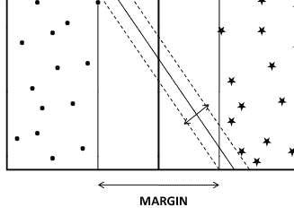

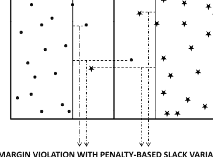

#### (a) 硬分离

#### (b) 软分离

#### FIGURE 11.1: 硬和软支持向量机。

实际上，数据可能不是线性可分的。在这种情况下，可以使用软间隔方法。为训练实例引入一个松弛量 ξ_i ≥ 0，并允许训练实例以一定的惩罚违反支持向量约束，该惩罚取决于松弛量。这种情况如图 11.1(b) 所示。因此，新的约束集现在如下：

\(\overline{W} \cdot \overline{X} + b \ge +1 - \xi_i\)   ∀i : y_i = +1   (11.16)
\(\overline{W} \cdot \overline{X} + b \le -1 + \xi_i\)   ∀i : y_i = -1   (11.17)
ξ_i ≥ 0.   (11.18)

请注意，还需要在松弛变量上施加额外的非负性约束。目标函数现在为 ||\(\overline{W}\)||² / 2 + C · Σ_{i=1}^n ξ_i。常数 C 调节间隔和松弛要求的重要性。换句话说，C 的小值使方法更接近软间隔 SVM，而 C 的大值使方法更接近硬间隔 SVM。也可以使用现成的优化求解器解决此问题。

还可以通过对特征变量进行变换来设计非线性 SVM 方法。实际上，非线性 SVM 方法是使用核方法学习的。这里的关键思想是 SVM 公式只需使用对象之间的成对点积。换句话说，从本节中的二次优化问题解得的测试实例类别标签的最优决策可以表示为以下形式：

- 1. 不同训练实例之间的成对点积。
- 2. 测试实例与不同训练实例之间的成对点积。

建议读者参考 [143] 以了解优化公式解决方案的具体细节。成对实例之间的点积可以被视为它们之间的相似性度量。因此，以上观察结果意味着，可以使用训练数据对之间以及训练-测试数据对之间的成对相似性信息执行 SVM 分类。实际的特征值不需要。

这为使用由其相似性值表示的变换打开了大门。这些相似性可以被视为核函数 $K(\bar{X},\bar{Y})$，它衡量点 $\bar{X}$ 和 $\bar{Y}$ 之间的相似性。概念上，核函数可以被视为在新变换空间中成对点之间的点积，由映射函数 $\Phi(\cdot)$ 表示。然而，只要核函数，即点积 $K(\bar{X},\bar{Y})$ 已经可用，就不需要显式计算这种变换：

$$K(\bar{X},\bar{Y})=\Phi(\bar{X})\cdot\Phi(\bar{Y}). \tag{11.19}$$

因此，所有计算都可以在原始空间中使用核函数隐含的点积来执行。一些有趣的核函数示例包括高斯径向基函数、多项式核和双曲正切，按相同顺序列出如下。

$$K(\bar{X}_i,\bar{X}_j)=e^{-\|\bar{X}_i-\bar{X}_j\|^2/2\sigma^2}. \tag{11.20}$$

$$K(\bar{X}_i,\bar{X}_j)=(\bar{X}_i\cdot\bar{X}_j+1)^h. \tag{11.21}$$

$$K(\bar{X}_i,\bar{X}_j)=\tanh(k\bar{X}_i\cdot\bar{X}_j-\delta). \tag{11.22}$$

这些不同的函数在原始空间中产生不同种类的非线性决策边界，但在变换空间中对应于线性分隔符。分类器的性能可能对用于变换的核的选择很敏感。核方法的一个优点是它们也可以扩展到任意数据类型，只要可以定义适当的成对相似性。

第一组适配到文本域的 SVM 分类器是在 [74–76] 中提出的。对 SVM 方法的更深入理论研究已在 [77] 中提供。特别是，已经证明了为什么 SVM 分类器在各种情况下预期能表现良好。这也在一些不同的场景中通过实验得到证明。例如，[49] 中的工作将该方法应用于电子邮件数据，以将其分类为垃圾邮件或非垃圾邮件数据。结果表明，与许多其他技术相比，SVM 方法提供了更稳健的性能，例如提升决策树、基于规则的 RIPPER 方法和 Rocchio 方法。SVM 方法灵活且可以轻松地与交互式用户反馈方法结合使用 [123]。

SVM 方法的主要缺点是速度慢。本节的讨论表明，找到最佳分隔符的问题是一个二次规划问题。约束的数量与数据点的数量成正比。这直接转化为优化问题中拉格朗日松弛变量的数量。这有时会很慢，尤其是在文本等高维域中。已证明 [51]，通过将大型二次规划问题拆分为一组较小的子问题，可以为该任务导出高效的解决方案。

已经提出了许多其他方法来扩展 SVM 方法以适应文本的特殊结构。文本的一个关键特征是数据是高维的，但单个文档只包含来自整个词表的很少特征。换句话说，*非零* 特征的数量很小。已经提出了许多不同的方法来解决这些问题。第一种方法 [78]，称为 *SVMLight*，与 [51] 有许多相似之处。第一种方法还将二次规划问题分解为较小的子问题。这是通过使用拉格朗日变量的工作集来实现的，这些变量被优化，同时保持


other variables fixed. The choice of variables to select is based on the gradient of the objective function with respect to these variables. This approach does not, however, fully leverage the sparsity of text. A second approach, known as *SVMperf* [79] also leverages the sparsity of text data. This approach reduces the number of slack variables in the quadratic programming formulation, while increasing the constraints. A cutting plane algorithm is used to solve the optimization problem efficiently. The approach is shown to require $O(n \cdot s)$ time, where $n$ is the number of training examples, and $s$ is the average number of non-zero features per training document. The reader is referred to Chapter 10 on big-data classification, for a detailed discussion of this approach. The SVM approach has also been used successfully [52] in the context of a hierarchical organization of the classes, as often occurs in Web data. In this approach, a different classifier is built at different positions of the hierarchy.

SVM methods are very popular and tend to have high accuracy in the text domain. Even the linear SVM works rather well for text in general, though the specific accuracy is obviously data-set dependent. An introduction to SVM methods may be found in [36, 40, 62, 132, 133, 145]. Kernel methods for support vector machines are discussed in [132].

#### 11.6.2 Regression-Based Classifiers

Regression modeling is a method that is commonly used in order to learn the relationships between real-valued attributes. Typically, these methods are designed for real valued attributes, as opposed to binary attributes. This, however, is not an impediment to its use in classification, because the binary value of a class may be treated as a rudimentary special case of a real value, and some regression methods such as logistic regression can also naturally model discrete response variables.

An early application of regression to text classification is the Linear Least Squares Fit (LLSF) method [155], which works as follows. Suppose the predicted class label is $p_i = \bar{A} \cdot X_i + b$, and $y_i$ is known to be the true class label, then our aim is to learn the values of $A$ and $b$, such that the *Linear Least Squares Fit (LLSF)* $\sum_{i=1}^{n}(p_i-y_i)^2$ is minimized. In practice, the value of $b$ is set to 0 for the learning process. Let $P$ be a 1 × $n$ vector of binary values indicating the binary class to which the corresponding class belongs. Thus, if $X$ is the $n × d$ term-matrix, then we wish to determine the 1 × $d$ vector of regression coefficients $A$ for which $\|A \cdot X^T - P\|$ is minimized, where $\| \cdot \|$ represents the Frobenius norm. The problem can be easily generalized from the binary class scenario to the multi-class scenario with $k$ classes, by using $P$ as a $k × n$ matrix of binary values. In this matrix, exactly one value in each column is 1, and the corresponding row identifier represents the class to which that instance belongs. Similarly, the set $A$ is a $k × d$ vector in the multi-class scenario. The LLSF method has been compared to a variety of other methods [153, 155, 159], and has been shown to be very robust in practice.

A more natural way of modeling the classification problem with regression is the logistic regression classifier [116], which differs from the LLSF method in that the objective function to be optimized is the likelihood function. Specifically, instead of using $p_i = \bar{A} \cdot X_i + b$ directly to fit the true label $y_i$, we assume that the probability of observing label $y_i$ is:

$$p(C = y_i\mid X_i) = \frac{\exp(\bar{A}\cdot X_i+b)}{1+\exp(\bar{A}\cdot X_i+b)}.$$

This gives us a conditional generative model for $y_i$ given $X_i$. Putting it in another way, we assume that the logit transformation of $p(C = y_i\mid X_i)$ can be modeled by the linear combination of features of the instance $X_i$, i.e.,

$$\log\frac{p(C = y_i\mid X_i)}{1-p(C = y_i\mid X_i)} = \bar{A}\cdot X_i+b.$$

Thus logistic regression is also a linear classifier as the decision boundary is determined by a linear function of the features. In the case of binary classification, $p(C = y_i\mid X_i)$ can be used to determine

the class label (e.g., using a threshold of 0.5). In the case of multi-class classification, we have p(C = y_i|X_i) ∝ exp(Ā · X̄_i + b), and the class label with the highest value according to p(C = y_i|X_i) would be assigned to X_i. Given a set of training data points {(X_1,y_1),...(X_n,y_n)}, the logistic regression classifier can be trained by choosing parameters Ā to maximize the conditional likelihood ∏_{i=1}^n p(y_i|X_i).

In some cases, the domain knowledge may be of the form where some sets of words are more important than others for a classification problem. For example, in a classification application, we may know that certain domain-words (Knowledge Words (KW)) may be more important to classification of a particular target category than other words. In such cases, it has been shown [43] that it may be possible to encode such domain knowledge into the logistic regression model in the form of prior on the model parameters and use Bayesian estimation of model parameters.

It is clear that the regression classifiers are extremely similar to the SVM model for classification. Indeed, since LLSF, Logistic Regression, and SVM are all linear classifiers, they are thus identical at a conceptual level; the main difference among them lies in the details of the optimization formulation and implementation. As in the case of SVM classifiers, training a regression classifier also requires an expensive optimization process. For example, fitting LLSF requires expensive matrix computations in the form of a singular value decomposition process.

#### 11.6.3 Neural Network Classifiers

Neural networks attempt to simulate biological systems, corresponding to the human brain. In the human brain, neurons are connected to one another via points, which are referred to as synapses. In biological systems, learning is performed by changing the strength of the synaptic connections, in response to impulses.

This biological analogy is retained in an artificial neural network. The basic computation unit in an artificial neural network is a neuron or unit. These units can be arranged in different kinds of architectures by connections between them. The most basic architecture of the neural network is a perceptron, which contains a set of input nodes and an output node. The output unit receives a set of inputs from the input units. There are d different input units, which is exactly equal to the dimensionality of the underlying data. The data is assumed to be numerical. Categorical data may need to be transformed to binary representations, and therefore the number of inputs may be larger. The output node is associated with a set of weights W̄, which are used in order to compute a function f(·) of its inputs. Each component of the weight vector is associated with a connection from the input unit to the output unit. The weights can be viewed as the analogue of the synaptic strengths in biological systems. In the case of a perceptron architecture, the input nodes do not perform any computations. They simply transmit the input attribute forward. Computations are performed only at the output nodes in the basic perceptron architecture. The output node uses its weight vector along with the input attribute values in order to compute a function of the inputs. A typical function, which is computed at the output nodes, is the signed linear function:

```
z_i = sign{W̄ · X̄_i + b}. (11.23)
```

The output is a predicted value of the binary class variable, which is assumed to be drawn from {−1,+1}. The notation b denotes the bias. Thus, for a vector X̄_i drawn from a dimensionality of d, the weight vector W̄ should also contain d elements. Now consider a binary classification problem, in which all labels are drawn from {+1,−1}. We assume that the class label of X̄_i is denoted by y_i. In that case, the sign of the predicted function z_i yields the class label. Thus, the goal of the approach is to learn the set of weights W̄ with the use of the training data, so as to minimize the least squares error (y_i − z_i)^2. The idea is that we start off with random weights and gradually update them, when a mistake is made by applying the current function on the training example. The magnitude of the update is regulated by a learning rate λ. This update is similar to the updates in gradient descent,


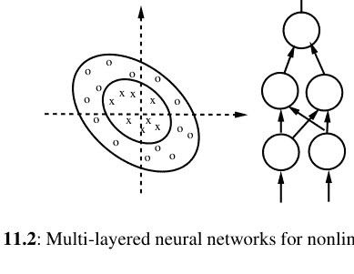

#### FIGURE 11.2: Multi-layered neural networks for nonlinear separation.

它们是为最小二乘优化而设计的。在神经网络的情况下，更新函数如下。

```
\overline{W}^{t+1} = \overline{W}^{t} + \lambda (y_i - z_i) \overline{X}_i \quad (11.24)
```

这里，\overline{W}^t 是第 t 次迭代中权重向量的值。很容易证明增量更新向量与 (y_i - z_i)^2 关于 \overline{W} 的负梯度相关。也可以很容易看出，只有在分类出错时才会对权重进行更新。当输出正确时，权重的增量变化为零。整体感知器算法如下所示。

#### Perceptron Algorithm

- **Inputs:** 学习率：λ
- 训练数据 (\overline{X}_i, y_i) ∀i ∈ {1…n}
- 将权重向量 \overline{W} 和 b 初始化为较小的随机数
- **repeat**
- 将每个训练数据应用于神经网络以检查 \overline{W}·\overline{X}_i + b 的符号是否与 y_i 匹配；
- 如果 \overline{W}·\overline{X}_i + b 的符号与 y_i 不匹配，则根据学习率 λ 更新权重 \overline{W}
- **until** \overline{W} 中的权重收敛

与支持向量机的相似性非常惊人，因为在这种情况下也学习了一个线性函数，并且线性函数的符号预测类别标签。事实上，感知器模型和支持向量机密切相关，因为两者都是线性函数逼近器。在支持向量机的情况下，这是通过使用最大间隔优化来实现的。在神经网络的情况下，这是通过使用增量学习算法来实现的，该算法近似等价于预测的最小二乘误差优化。

常数 λ 调节学习率。学习率的选择有时很重要，因为学习率过小会导致训练非常缓慢。另一方面，如果学习率过快，这将导致在次优解之间振荡。实践中，学习率初始时较快，然后随着时间的推移逐渐减慢。其思想是，最初的大步长可能有所帮助，但随后会减小步长大小以防止在次优解之间振荡。例如，在 t 次迭代后，学习率可选择与 1/t 成比例。

上述讨论基于简单的感知器架构，只能模拟线性关系。自然会产生一个问题，如果所有类别不能通过线性分隔符整齐地分开，如何使用神经网络。例如，

在图 11.2 中，我们举例说明了类别不能使用单一线性分隔符分离的情况。使用多层神经元可以用来诱导出这种非线性分类边界。这种多层的效果是诱导出多个分段线性边界，可用于逼近属于特定类别的封闭区域。在这样的网络中，早期层神经元的输出馈入后期层神经元。训练此类网络的过程更为复杂，因为误差需要在不同层之间反向传播。此类分类器的一些示例包括 [87, 126, 146, 153] 中讨论的内容。然而，对于文本的一般观察 [135, 149] 是线性分类器通常对非线性数据提供相当的结果，而非线性分类方法的改进相对较小。这表明构建更复杂的非线性模型所带来的额外复杂性在显著改善分类方面并不能自证其价值。

实践中，神经网络按三层排列，称为输入层、隐藏层和输出层。输入层仅将输入向前传输，因此实际上神经网络只有两层可以执行计算。在隐藏层中，可以有任意数量的神经元层。在这种情况下，神经网络中可以有任意数量的层。实践中只有一个隐藏层，这导致一个两层网络。感知器可以被视为一种非常特殊的神经网络，仅包含一层神经元（对应于输出节点）。多层神经网络允许通过适当选择网络拓扑和节点上的非线性函数来逼近非线性函数和复杂的决策边界。在这些情况下，逻辑或 sigmoid 函数，也称为压缩函数，还应用于神经元的输入以模拟非线性特征。可以对不同节点使用不同的非线性函数。只要有足够的训练数据和训练时间，这类通用架构在神经网络中逼近任意函数方面非常强大。这就是神经网络有时被称为通用函数逼近器的原因。

在单层感知器算法的情况下，使用梯度下降方法很容易执行训练过程。训练多层网络的主要挑战是，对于中间（隐藏层）节点，其“期望”输出不再为人所知。这仅对最终输出节点已知。因此，需要某种“误差反馈”来确定中间节点的权重变化。训练过程分为两个阶段，一个是正向方向，另一个是反向方向。

- 1. Forward Phase: 在正向阶段，反复应用激活函数以将输入从神经网络正向传播。由于最终输出应与类别标签匹配，输出层的最终输出会根据训练标签值提供误差值。然后该误差用于更新输出层的权重，并在下一阶段向后传播权重更新。
- 2. Backpropagation Phase: 在反向阶段，误差通过神经网络层向后传播。这导致不同层神经元的权重更新。前面层的梯度作为其前方层中的误差和权重的函数来学习。学习率 λ 在调节学习速率方面发挥着重要作用。

实践中，任何任意函数都可以被神经网络很好地逼近。这种一般性的代价是，神经网络在实践中通常相当缓慢。它们还对噪声敏感，有时可能会过拟合训练数据。

之前的讨论假设只有二元标签。可以创建 k 标签神经网络，要么使用多类“一对所有”元算法，要么创建神经网络架构，其中输出节点的数量等于类别标签的数量。每个输出代表对特定标签值的预测。神经网络方法的许多实现已在 [41, 102, 115, 135, 149] 中研究过，其中许多实现是在文本数据的背景下设计的。应指出的是，神经网络和 SVM 分类器都使用非常相似的线性模型。两者之间的主要区别在于如何确定最优线性超平面。与使用直接优化方法不同，神经网络使用 *基于错误驱动* 的数据分类方法 [41]。神经网络在 [15, 66] 中有详细描述。

#### 11.6.4 Some Observations about Linear Classifiers

虽然不同的线性分类器在研究文献中是独立发展的，但在基本概念层面上它们惊人地相似。有趣的是，这些不同的研究工作也得出了关于不同分类器有效性的许多相似结论。我们注意到，不同分类器之间的主要区别在于优化的目标函数的细节，以及用于确定最优分离方向的迭代方法。例如，SVM 方法使用二次规划 QP 形式，而 LLSF 方法使用闭式最小二乘形式。另一方面，感知器方法并不试图制定闭式目标函数，而是采用更柔和的迭代爬山方法。这种技术本质上继承自神经网络算法所使用的迭代学习方法。然而，其目标与另外两种方法相当相似。因此，这些方法之间的差异实际上是在详细层面上，而非概念层面上，尽管它们的科研起源非常不同。

关于这些方法的另一个总体观察是，它们都可以实现为其分类器的非线性版本。例如，可以使用 SVM 分类器创建非线性决策面，就像可以使用分层神经元在神经网络中创建非线性分离边界一样 [153]。然而，普遍的共识是这些方法的线性版本工作得非常好，而非线性分类的额外复杂性通常并不能为自己买单，除了某些特殊数据集之外。其原因或许是因为文本是一个高维域，具有高度相关的特征和稀疏特征上的小非负值。例如，对于仅在特征上具有小非负值的稀疏域，如文本，很难轻松创建如图 11.2 所示的类结构。另一方面，相关文本维度的高维特性特别适合可以利用不同特征之间的冗余和关系来分离不同类别的分类器。常见的文本应用通常导致在该高维数据域上线性可分的类结构。这是线性分类器在文本分类中取得前所未有成功的原因之一。

## 11.7 Proximity-Based Classifiers

基于邻近的分类器本质上使用基于距离的度量来执行分类。主要论点是，属于同一类别的文档在基于点积或余弦度量等相似性度量的情况下可能彼此接近 [131]。为了对给定的测试实例进行分类，可以使用两种可能的方法：

- - 我们确定训练数据中与测试实例的 *k*-最近邻。来自这些 *k* 个邻居的多数（或最丰富）类别被报告为类别标签。此类方法的一些示例在 [31, 63, 155] 中讨论。k 的选择通常在 20 和


k 在上述大部分工作中取决于底层语料库的大小。实际上，它通常使用交叉验证进行经验性设定。

- 我们在预处理期间执行训练数据聚合，其中属于同一类别的文档聚类或分组。每个组都创建一个代表性的元文档。应用与上面讨论相同的 k-最近邻方法，只是将其应用于这组新的元文档（或广义实例 [88]）而不是集合中的原始文档。摘要的预处理阶段有助于提高分类器的效率，因为它显著减少了距离计算的数量。在某些情况下，它也可能提高该技术的准确性，尤其是在数据集包含大量异常值时。有关此类方法的一些示例在 [64, 88, 125] 中进行了讨论。

一种用于在文本数据中执行最近邻分类的方法是 [31] 中讨论的 WHIRL 方法。WHIRL 方法本质上是一种基于文本属性执行软相似性连接的方法。通过软相似性连接，我们指的是两个记录在连接属性上可能不完全相同，但在预定义的相似性概念的基础上可能近似相似。在 [31] 中观察到，任何用于执行相似性连接的方法都可以改编为最近邻分类器，通过使用相关文本文档作为连接属性。

[155] 中关于最近邻分类器的一个观察是，特征选择和文档表示在分类过程的有效性中起着重要作用。这是因为大型语料库中的大多数词可能与感兴趣的类别无关。因此，在 [155] 中提出了一些技术，以便学习词语与类别之间的关联。然后将其用于创建文档的特征表示，以便最近邻分类器对文档集合中的类别更敏感。类似的观察也在 [63] 中提出，其中表明对词添加权重（基于其类别敏感性）可显著提高底层分类器性能。最近邻分类器也被扩展到时态感知场景 [130]，其中训练文档的及时性在模型构建过程中起作用。为了纳入此类因素，在 [130] 中引入了时间加权函数，该函数允许文档的重要性随时间优雅地衰减。

对于使用分组技术的分类器，其中最基本的方法是 Rocchio 在 [125] 中提出的方法。在该方法中，从每个代表性类别中构造一个单一的代表性元文档。对于给定类别，词 tk 的权重是该词在属于该类别的文档中的归一化频率，减去该词在不属于该类别的文档中的归一化频率。具体来说，设 fp^k 为从属于正类中随机挑选的文档中词 tk 的期望权重，fn^k 为从属于负类中随机挑选的文档中词 tk 的期望权重。那么，对于加权参数 αp 和 αn，权重 f_rocchio^k 定义如下：

f_rocchio^k = αp · fp^k − αn · fn^k (11.25)

加权参数 αp 和 αn 被选为使正类相对于负类具有更大的权重。对于相关类别，我们现在有词的向量表示 (f_rocchio^1, f_rocchio^2 … f_rocchio^n)。该方法分别应用于每个类别，以便为每个类别创建单独的元文档。对于给定的测试文档，可以使用基于向量的点积或其他相似性度量来确定与测试文档最接近的元文档。然后将相应的类别报告为相关标签。Rocchio 方法的主要区别特征是它为整个类别创建了一个单一的概要。这种方法类也称为 Rocchio 框架。该方法的主要缺点是，如果一个类别在数据中以多个不相连的分离簇出现，则这些示例的质心可能无法很好地代表类别行为。这可能是分类器不准确的来源。该方法的主要优点是其极端的简单性和效率；训练阶段在语料库大小上是线性的，并且测试阶段的计算次数与类别数量成线性关系，因为所有文档都已聚合为少量类别。Rocchio 算法的分析以及一些不同的变体可在 [74] 中找到。

为了处理 Rocchio 方法的不足，还提出了一些分类器 [2, 19, 64, 88]，它们明确执行文档集合中每个类别的聚类。这些聚类用于生成特定于类别的概要。这些概要在 [88] 中也称为广义实例。对于给定的测试实例，算法报告最接近的广义实例的标签。[19] 中的方法也是基于质心的分类器，但专门为文本文档的情况而设计。[64] 中的工作表明，在相似性计算中考虑不同类别的词之间的依赖关系的设计方案具有一些优势。

我们注意到，最近邻分类器可用于为每个文档生成类别的排序列表。在文档与多个类别相关联的情况下，只要有阈值方法可用，这些类别就可以为文档报告。[157] 中的工作研究了 k-最近邻分类器的一些阈值策略。还在 [157] 中建议，这些阈值策略可用于理解使用排序分类器的其他分类器的阈值策略。

## 11.8 链接和 Web 数据的分类

近年来，Web 和社交网络技术的普及导致了大量以链接网络形式表达的文档数据。最简单的例子是 Web，其中文档通过超链接相互链接。社交网络也可以被视为此类数据的嘈杂示例，因为不同用户的评论和文本资料通过各种链接相互连接。链接信息与分类过程非常相关，因为相似主题的文档通常相互链接。这一观察结果已广泛用于集体分类文献 [14] 中，其中网络节点的一个子集被标记，其余节点基于节点之间的链接进行分类。

一般来说，基于内容的网络可以用 $G=(N,A,C)$ 表示，其中 $N$ 是节点集合，$A$ 是节点之间的边集合，$C$ 是文本文档集合。$N$ 中的每个节点对应于 $C$ 中的一个文本文档，并且当对应节点不包含任何内容时，文档可能为空。$N$ 中的节点子集被标记。这对应于训练数据。在此场景中的分类问题是使用训练数据确定剩余节点的标签。很明显，内容和结构在分类过程中都可以发挥有用且互补的作用。

一种用于组合链接和内容信息进行分类的有趣方法在 [25] 中进行了讨论。在该论文中，提出了一种超文本分类方法，该方法使用内容和邻近网页的标签进行分类过程。当所有最近邻居的标签都可用时，可以轻松地将贝叶斯方法改编用于分类目的。就像文档中某个词的存在可以被视为文本分类器的贝叶斯特征一样，目标页面与已知标签的页面之间的链接存在可以被视为分类器的特征。真正的挑战出现在所有标签都


当最近邻不可用时，提出了一种松弛标记方法来执行分类。在这项工作中提出了两种方法：

- **半径为一的增强链接分析的全监督情形：** 在这种情形下，假设所有邻近类标签都是已知的。在这种情况下，采用贝叶斯方法将最近邻的标签作为分类的特征。此时，链接信息是用于分类目的的唯一信息。
- **当最近邻的类标签未知时：** 在这种情况下，使用迭代方法将基于文本和基于链接的分类结合起来。不使用预先定义的标签（这些标签不可用），而是利用文档内容对邻近文档进行首次标记。然后利用局部文本和邻居的类标签，使用这些标签对目标文档的标签进行分类。这种方法迭代地重新定义目标文档及其邻居的标签，直到达到收敛。

[25]的工作结论是，基于文本和基于链接的分类相结合总能提高文本分类器的准确率。即使文档的所有邻居都没有已知类别，在分类过程中添加链接信息似乎总是有益的。当所有邻居的类标签都已知时，使用该方案的优势似乎相当显著。

论文中还有一个想法是利用桥来进一步提高分类准确率。桥的使用核心思想是使用两跳传播进行基于链接的分类。使用这种方法的结果有些复杂，因为随着跳数的增加，准确率似乎会降低。[25]的工作在多种不同类型的数据集上展示了结果，如路透社数据库、美国专利数据库和雅虎数据库。由于路透社数据库包含的噪声最少，纯文本分类器能够表现良好。另一方面，美国专利数据库和雅虎数据库包含越来越多的噪声，这降低了文本分类器的准确率。[25]中一个有趣的观察是，简单地将邻居文本吸收到当前文档中的方案比基于纯文本分类的方案表现差得多。这是因为主题之间通常存在显著的跨边界链接，这些链接能够混淆分类器。该算法的公开实现可在[106]中的NetKit工具包中找到。

[5]提出了另一种用于基于图的文档分类的松弛标记方法。在该技术中，链接的两个端点采用特定类标签对的概率被量化。我们称之为链接-类对概率。节点T被分类为类别i的后验概率表示为T的邻居所有可能的类标签与类标签i配对概率之和。我们注意到，很大一部分（指数数量的）可能性被剪枝，因为该方法只使用当前最可能的⁶标签。为此，假设T的不同邻居的类标签（虽然依赖于T）彼此独立。这类似于贝叶斯分类器中常用的朴素假设。因此，邻居上特定标签组合的概率可以表示为相应链接-类对概率的乘积。该方法首先使用标准的内容贝叶斯或SVM分类器为节点分配初始标签。然后，使用迭代方法改进标签，利用前一次迭代中最可能的标签估计来改进当前迭代中的标签。我们注意到，链接-类对概率可以估计为上一次迭代中包含特定类对作为端点的边的平滑比例（硬标记），也可以估计为所有具有该特定类对的边的节点概率的平均乘积（软标记）。该方法重复进行直至收敛。

### 图11.3：半二分图变换。

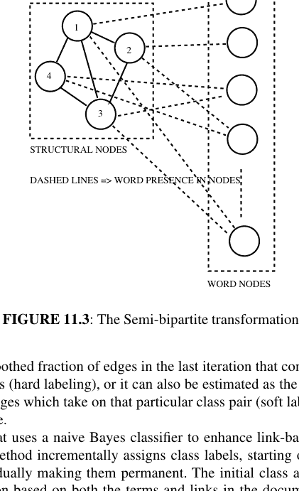

[118]提出了另一种使用朴素贝叶斯分类器增强基于链接的分类的方法。该方法逐步分配类标签，从一个临时分配开始，然后逐渐使其成为永久分配。初始类别分配基于一个简单的贝叶斯表达式，该表达式基于文档中的词项和链接。在最终分类中，该方法改变用于目标文档贝叶斯分类的词项权重，使用当前文档邻居中的词项。该方法使用了一个与[25]类似的大框架，区别在于它根据邻居类别对当前文档类别标签的影响来区分文档邻居中的不同类别。例如，对于那些类标签在训练数据中已经可得，或者算法已经执行最终分配的文档，其置信度加权因子与那些当前临时分配类标签的文档不同。类似地，属于完全不同主题（基于内容）的文档也会从分配考虑中移除。然后，使用重新计算的权重执行贝叶斯分类，以便为文档分配最终类标签。通过这种方法，该技术能够补偿不同文档之间链接结构中的噪声和不一致性。

[25]和[118]的工作的一个主要区别是，前者专注于使用链接信息来传播标签，而后者试图使用相邻页面的内容。沿着这个方向的另一项工作，更明确地使用相邻页面的内容，在[121]中提出。在这种情况下，相邻页面的内容被划分为不同的字段，如标题、锚文本和一般文本。不同字段被赋予不同的重要程度，这是在学习分类过程中学习到的。[121]表明，标题字段和锚文本字段的使用比一般文本更相关。这解释了[121]中展示的大部分准确率提升。

[3]的工作提出了一种使用随机游走方法对文本网络进行动态分类的方法。该工作的关键思想是将网络中的结构和内容组合转换为仅包含内容的纯网络。因此，我们将原始网络 $G=(N,A,C)$ 转换为*增强*网络 $G^A=(N\cup N_c,A\cup A_c)$，其中 $N_c$ 和 $A_c$ 是添加到原始网络的额外节点和边集合。$N_c$ 中的每个节点对应于词典中的一个不同单词。因此，增强网络包含原始结构节点 $N$ 和一组新的单词节点 $N_c$。$A_c$ 中添加的边是结构节点 $N$ 和单词节点 $N_c$ 之间的无向边。具体来说，如果单词 $i\in N_c$ 出现在对应于节点 $j\in N$ 的文本内容中，则向 $A_c$ 添加一条边 $(i,j)$。因此，这个网络是*半二分图*，因为不同单词节点之间没有边。图11.3提供了半二分图内容-结构变换的图示。

重要的是要注意，一旦执行了这样的变换，任何集体分类方法[14]都可以应用于结构节点。在[3]的工作中，使用了一种随机游走方法来对底层节点进行集体分类。在这种方法中，从需要分类的未标记节点开始执行重复的随机游走。随机游走仅定义在结构节点上，每跳可以是*结构*跳或*内容*跳。我们执行 $l$ 次不同的随机游走，每次包含 $h$ 个节点。因此，在不同的游走中总共会遇到 $l\cdot h$ 个节点。该节点的类标签被预测为在不同游走中遇到的不同的 $l\cdot h$ 个节点中出现频率最高的标签。这种基于随机游走的采样过程的误差已在[14]中给出界限。此外，[14]中的方法可以适应基于动态内容的网络，其中节点、边及其底层内容随时间不断演化。[3]中的方法与[23]中提出的方法（基于[106]中的实现）进行了比较，结果表明[14]的分类方法明显更优。

[160]讨论了另一种用于链接文本数据分类的方法。该方法设计了两个独立的正则化条件：一个用于纯文本分类器（也称为*局部*分类器），另一个用于网络结构中的链接信息。这些正则化器用底层核的项表示；链接正则化器与机器学习文献中使用的标准图正则化器相关，文本正则化器用核格拉姆矩阵表示。这两个正则化条件以两种可能的方式组合。一种可以使用正则化器的线性组合，或者使用相关核的线性组合。[160]表明，两种组合方法都优于纯基于结构或纯基于文本的方法。使用正则化器线性组合的方法比使用核线性组合的方法略更准确和鲁棒。

[38]中的方法设计了一个分类器，该分类器结合了朴素贝叶斯分类器（在文本领域）和基于规则的分类器（在结构领域）。其思想是创造一组谓词，这些谓词定义在链接、页面和词的空间中。根据词在页面中的存在、页面之间的链接、超链接的锚文本性质以及超链接的邻域词，定义了多种谓词（或关系）。这些谓词本质上是将文档的图结构编码为布尔谓词，也可以用于构建关系学习器。[38]的主要贡献是将结构领域的关系学习器与文本领域的朴素贝叶斯方法相结合。有关该算法的细节以及此类关系学习器的一般理念，我们请读者参阅[38, 39]。

[29]中提出了在电子邮件网络背景下进行集体分类的一种有趣方法。[29]中的技术旨在对电子邮件中的*言语行为*进行分类。言语行为本质上表征一封电子邮件是否涉及某类特定动作（例如安排会议）。[29]已经表明，使用电子邮件中的顺序线程信息对于分类过程非常有用。电子邮件系统可以通过多种方式建模为网络，其中一种是将电子邮件作为节点，边作为不同电子邮件之间的线程关系。从这个意义上说，[29]的工作设计了一种基于网络的挖掘程序，同时使用电子邮件网络的内容和结构。然而，这项工作相当专门针对电子邮件网络，尚不清楚该技术能否（有效地）推广到更通用的网络。


针对这类在异构特征空间上定义的问题，另一种解决方案是使用潜在空间方法，以便同时将特征空间同质化，并确定底层数据中的潜在因素。得到的表示可以与任何为潜在空间表示设计的文本分类器结合使用。文献[162]中的方法使用矩阵分解方法从底层数据构建潜在空间。同时提出了有监督和无监督方法来从底层数据构建潜在空间。文献[162]随后表明，当与SVM分类器结合使用时，这种特征表示能提供更准确的结果。

最后，文献[138]提出了一种网页分类方法。该方法旨在使用智能代理进行网页分类。整体方法依赖于分别对网页和链接进行评分的两个函数的设计。创建了一种建议语言，并提出了一种将建议映射到神经网络的方法。文献[138]展示了这一通用系统如何用于在Web上查找主页。

## 11.9 文本分类的元算法

元算法在分类策略中扮演着重要角色，因为它们能够通过组合现有分类算法，或对不同算法进行通用修改以实现特定目标，从而提高现有分类算法的准确性。分类器元算法的典型示例包括Bagging、Stacking和Boosting [50]。这些方法中，有些改变训练数据的底层分布，有些组合分类器，还有些修改算法以满足特定的分类标准。本节将讨论这些不同类别的方法。

### 11.9.1 分类器集成学习

在这种方法中，我们结合使用分类器组合与投票机制来执行分类。其思想是，由于不同分类器容易受到不同类型的过训练和误差的影响，组合分类器很可能产生更加稳健的结果。这种技术有时也被称为Stacking或分类器委员会构建。

集成学习在文本分类中已经相当常用。大多数方法仅使用分类器输出的加权组合（无论是分数还是排名）来提供最终分类结果。例如，Larkey和Croft [91]的工作使用了分类器分数或排名的加权线性组合。Hull [70]的工作为实现相同目标使用了概率的线性组合。文献[158]使用归一化分数的线性组合进行分类。文献[99]的工作使用了分类器选择技术和投票来提供最终分类结果。此类投票和选择技术的一些示例如下：

- 在二分类应用中，获得多数投票的类标签被报告为最终结果。
- 对于给定的测试实例，根据与该测试实例最接近的分类器的性能，选择特定的分类器。
- 使用来自不同分类器结果的加权组合，其中权重由分类器在与当前测试实例最相似的验证实例上的性能来调节。

上述最后两种方法通过区分分类器在不同场景下的性能，试图以更智能的方式选择最终分类。文献[89]的工作使用类别平均特征来为每个类别构建不同的分类器。

集成学习的主要挑战是为特定场景提供合适的分类器组合。显然，这种组合会随场景和数据集的不同而有很大差异。为实现这一目标，文献[12]中的方法提出了一种文本分类器概率组合的方法。该工作引入了许多称为*可靠性变量*的变量，以调节不同分类器的重要性。这些可靠性变量针对每种情况进行动态学习，以提供最佳分类。

### 11.9.2 以数据为中心的方法：Boosting与Bagging

集成技术侧重于组合不同的分类器，而以数据为中心的方法（如Boosting和Bagging）则通常侧重于在训练数据的不同部分上训练同一个分类器，以创建不同的模型。对于给定的测试实例，报告使用这些不同模型所得结果的组合。集成方法与Boosting方法之间的另一个主要区别是，Boosting方法中的训练模型不是独立构建的，而是按顺序构建的。具体来说，在构建了*i*个分类器之后，第(*i* + 1)个分类器是在前*i*个分类器无法准确分类的训练数据部分上构建的。这些不同分类器的结果被仔细地组合在一起，其中每个分类器的权重通常是其错误率的函数。最著名的Boosting元算法是*AdaBoost*算法 [56]。此类Boosting算法已应用于多种场景，例如决策树学习者、基于规则的系统和贝叶斯分类器 [57, 71, 85, 114, 134, 137]。

我们注意到，Boosting也是一种集成学习方法，只不过我们是在数据的不同子集上训练相同的模型以创建集成。对Boosting的一个主要批评是，在许多数据集中，一些训练记录带有噪声，而分类模型应该能够抵抗对数据的过训练。由于Boosting模型在连续轮次中倾向于对容易出错的样本赋予更高的权重，这可能导致分类过程更容易过拟合。在含噪声的数据集情况下尤其明显。最近的一些结果表明，所有凸Boosting算法在存在噪声时可能表现不佳 [103]。这些结果倾向于表明，根据底层数据集的不同，Boosting算法的选择可能对成功结果至关重要。

Bagging方法 [21] 通常旨在减少学习过程中出现的模型过拟合误差。Bagging的思想是从底层集合中选取*自助样本*（有放回样本），并在这些样本上训练分类器。然后将来自这些不同样本的分类结果组合在一起，以产生最终结果。Bagging方法通常与决策树结合使用，尽管原则上这些方法可以与任何类型的分类器一起使用。对Bagging方法的主要批评是，由于每个单独训练样本的规模较小，它有时可能导致准确率下降。只有当模型对训练算法的小细节不稳定时，Bagging才有用，因为它减少了过拟合误差。此类算法的一个例子是决策树模型，它对在诸如文本这样的高维特征空间中如何构建树的较高层极为敏感。Bagging方法的主要目标是减少底层分类器的方差分量。

### 11.9.3 优化特定的准确率指标

我们注意到，绝对分类准确率的使用并不是与分类算法相关的唯一度量。例如，在不平衡类场景中（这在欺诈检测和垃圾邮件过滤等应用背景下经常出现），错误分类示例的代价更高


比另一类更可容忍。例如，虽然将一些垃圾邮件误分类（从而使其进入收件箱）可能是可以容忍的，但将合法邮件错误地标记为垃圾邮件则要糟糕得多。成本敏感的分类问题也自然出现在一个类别比另一个类别更稀有的情况下，因此识别稀有示例变得更加不可取。在这种情况下，希望优化分类过程的*成本加权准确率*。我们注意到，许多为非文本数据设计的广泛技术 [48, 50, 53] 也适用于文本数据，因为特定的特征表示对于标准算法如何修改为成本敏感的情况并不重要。关于文本和非文本情况下的成本敏感分类的良好理解可在 [4, 48, 53] 中找到。分类算法可以通过以下简单方式修改以纳入成本敏感性的一些示例如下：

- 在决策树中，给定节点处的分割条件试图最大化其子节点的准确率。在成本敏感的情况下，分割被设计为最大化成本敏感准确率。
- 在基于规则的分类器中，规则通常按与其预测准确率相对应的度量进行量化并排序。在成本敏感的情况下，规则按其*成本加权准确率*进行量化和排序。
- 在贝叶斯分类器中，后验概率按进行预测的类别的成本加权。
- 在线性分类器中，分离类别的最优超平面以成本加权的方式确定。这种成本通常可以纳入底层目标函数中。例如，LLSF 方法目标函数中的最小二乘误差可以按不同类别的底层成本加权。
- 在*k*最近邻分类器中，我们报告测试实例的*k*个最近邻居中的成本加权多数类。

我们注意到，使用成本敏感方法本质上是分类目标函数的改变，这也可以表述为一个优化问题。虽然标准分类问题通常试图优化准确率，但成本敏感版本试图优化成本加权目标函数。文献 [58] 中提出了一种更通用的方法，其中提出了一种元算法来优化特定性能指标，如准确率、精确率、召回率或*F*₁-测度。因此，该方法将此类方法推广到*任何任意目标函数*，使其本质上成为一种*以目标为中心的分类方法*。使用（具有所需目标函数）广义概率下降算法，结合感兴趣的分类器，以导出测试实例的类别标签。文献 [58] 中的工作展示了使用该技术相对于标准 SVM 分类器的优势。

## 11.10 利用额外的训练数据

在此类方法中，*额外的标记或未标记数据*用于增强分类。虽然在贝叶斯分类部分曾简要讨论过使用额外的未标记训练数据，但本节将更详细地讨论它。当底层训练数据直接匮乏时，这两种方法都会被使用。在转移学习（稍后讨论）的情况下，使用来自不同领域或问题的额外训练（标记）数据来监督分类过程。另一方面，在半监督学习的情况下，未标记数据

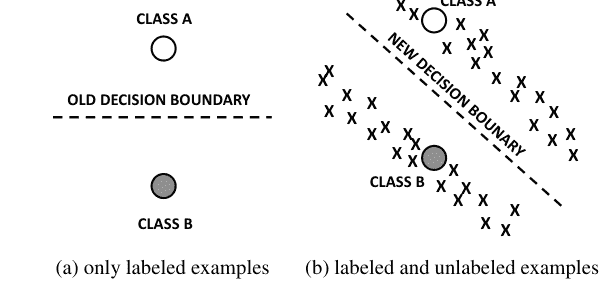

(a) 仅标记示例      (b) 标记和未标记示例

### 图 11.4：无监督示例对分类过程的影响。

用于增强分类过程。本节简要描述了这些方法。关于迁移学习方法的综述可在 [68] 中找到。

#### 11.10.1 半监督学习

协同训练和半监督学习方法利用未标记数据提高了学习方法的有效性 [112]。在文本等领域，未标记数据丰富且可自由获取，来源众多，如网络。另一方面，获取标记数据要困难得多。半监督学习与迁移学习方法的主要区别在于，前者使用具有相同特征的未标记数据，而后者使用外部标记数据（可能来自不同来源）。一个关键问题是，未标记数据为何能在任何程度上提高分类的有效性，因为它并不能提供任何额外的标记知识。原因在于，未标记数据提供了数据嵌入的流形以及数据在聚类和稀疏区域方面的密度结构的良好概念。关键假设是分类标签在底层数据流形结构的各个部分上表现出平滑变化。这种流形结构可用于确定特征相关性和联合特征分布，这对分类非常有帮助。半监督设置有时也被称为转导设置，当所有未标记示例需要与标记训练示例一起指定时。

半监督学习的动机是，空间中密集区域和相关区域的知识有助于分类。考虑图 11.4(a) 中所示的双类示例，其中每个类别仅有一个训练示例。在这种情况下，两类之间的决策边界是连接两个类别的直线上的垂直直线。然而，假设有一些额外的无监督示例可用，如图 11.4(b) 所示。这些无监督示例用“x”表示。在这种情况下，决策边界从图 11.4(a) 发生变化。这里的主要假设是，由于平滑假设，类别在训练数据的密集区域变化较小。因此，即使添加的示例没有标签，它们也显著有助于提高分类准确率。

在此示例中，特征值之间的相关性是利用未标记训练数据估计的。这在文本数据的上下文中具有直观的解释，其中联合特征分布可以用未标记数据估计。例如，考虑一个关于预测文档是否属于“政治”类别的训练数据场景。可能“Obama”一词（或一些不太常见的词）不会出现在任何（少量）训练文档中。然而，“Obama”一词可能经常与未标记实例中“政治”类别的许多特征共同出现。因此，未标记实例可用于学习这些不太常见的特征与分类过程的相关性，尤其是在可用训练数据量较小时。

同样，当数据被聚类时，数据中的每个聚类很可能主要包含一个类别或其他类别的数据记录。这些聚类的识别只需要无监督数据而不是标记数据。一旦从未标记数据中识别出聚类，只需要少量标记示例即可确信地确定哪个标签对应于哪个聚类。因此，当测试示例被分类时，其聚类结构为其分类过程提供了关键信息，即使可用标记示例较少。文献 [117] 中认为，只要标签结构变化的平滑假设成立，该方法的准确率可能会随着标记示例数量的增加而呈指数增长。当然，在现实生活中，这可能不成立。尽管如此，在许多领域中反复证明，添加未标记数据为分类过程提供了显著优势。关于半监督学习有效性的论证，该学习使用数据的谱聚类结构，可在 [18] 中找到。在图数据等某些领域，半监督学习是进行分类的唯一方法。这是因为给定节点可能只有很少的特定类别邻居。

从标记和未标记文档进行文本分类使用 EM。半监督方法以多种方式实现。其中一些方法直接尝试标记未标记数据以增加训练集的大小。想法是增量地将最有信心预测的标签添加到训练数据中。这被称为自训练。此类方法存在缺点，即它们存在过拟合风险。例如，当未标记示例以特定标签添加到训练数据时，由于特征空间或分类器的特定特征，标签可能是错误的。这可能导致错误进一步传播。在许多场景中，结果可能相当严重。

因此，半监督方法需要仔细设计以避免过拟合。这种方法的示例是协同训练 [17]，它将属性集划分为两个子集，在其上独立构建分类器模型。一个分类器的前几名标签预测用于扩充另一个分类器的训练数据，反之亦然。具体来说，协同训练的步骤如下：

- 1. 将特征空间划分为两个不相交的子集 f₁ 和 f₂。
- 2. 训练两个独立的分类器模型 ℳ₁ 和 ℳ₂，它们分别使用不相交的特征集 f₁ 和 f₂。
- 3. 将 ℳ₁ 最有信心预测标签的未标记实例添加到 ℳ₂ 的训练数据中，反之亦然。
- 4. 重复上述所有步骤。

由于两个分类器在不同的特征集上独立构建，因此这种方法避免了过拟合。特征集的划分 f₁ 和 f₂ 可以以多种方式执行。虽然可以对特征进行随机划分，但通常建议利用特征集中的冗余来构建 f₁ 和 f₂。具体来说，每个特征集 fᵢ 应被挑选，使得 fⱼ 中的特征（对于 j ≠ i）相对于它来说是冗余的。因此，每个特征集代表数据的不同视图，该视图足以进行分类。这确保了分配给另一个分类器的“自信”标签质量很高。同时，由于两个分类器使用的特征集不相交，过拟合在一定程度上被避免。通常，由不相交特征集的另一个分类器更容易检测到错误分配的类别标签，该特征集未用于分配错误标签。对于测试实例，每个分类器都用于进行预测，并且组合


scores from the two classifiers may be used. For example, if the naive Bayes method is used as the base classifier, then the product of the two classifier scores may be used.

The aforementioned methods are generic meta-algorithms for semi-supervised learning. It is also possible to design variations of existing classification algorithms such as the EM-method, or transductive SVM classifiers. EM-based methods [117] are very popular for text data. These methods attempt to model the joint probability distributions of the features and the labels with the use of partially supervised clustering methods. This allows the estimation of the conditional probabilities in the Bayes classifier to be treated as missing data, for which the EM-algorithm is very effective. This approach shows a connection between the partially supervised clustering and partially supervised classification problems. The results show that partially supervised classification is most effective when the clusters in the data correspond to the different classes. In transductive SVMs, the labels of the unlabeled examples are also treated as integer decision variables. The SVM formulation is modified in order to determine the maximum margin SVM, with the best possible label assignment of unlabeled examples. The SVM classifier has also been shown to be useful in large-scale scenarios in which a large amount of unlabeled data and a small amount of labeled data is available [139]. This is essentially a semi-supervised approach because of its use of unlabeled data in the classification process. This technique is also quite scalable because of its use of a number of modified quasi-Newton techniques, which tend to be efficient in practice. Surveys on semi-supervised methods may be found in [27, 163].

#### 11.10.2 Transfer Learning

As in the case of semi-supervised learning, transfer learning methods are used when there is a direct paucity of the underlying training data. However, the difference from semi-supervised learning is that, instead of using unlabeled data, labeled data from a different domain is used to enhance the learning process. For example, consider the case of learning the class label of Chinese documents, where enough training data is not available about the documents. However, similar English documents may be available that contain training labels. In such cases, the knowledge in training data for the English documents can be transferred to the Chinese document scenario for more effective classification. Typically, this process requires some kind of “bridge” in order to relate the Chinese documents to the English documents. An example of such a “bridge” could be pairs of similar Chinese and English documents, though many other models are possible. In many cases, a small amount of auxiliary training data, in the form of labeled Chinese training documents, may also be available in order to further enhance the effectiveness of the transfer process. This general principle can also be applied to cross-category or cross-domain scenarios where knowledge from one classification category is used to enhance the learning of another category [120], or the knowledge from one data domain e.g., text is used to enhance the learning of another data domain e.g., images [42, 120, 121]. In the context of text data, transfer learning is generally applied in two different ways:

- **Cross-lingual Learning**: In this case, the documents from one language are transferred to the other. An example of such an approach is discussed in [11].
- **Cross-domain Learning**: In this case, knowledge from the text domain is typically transferred to multimedia, and vice-versa. An example of such an approach, which works between the text and image domain, is discussed in [119, 121].

Broadly speaking, transfer learning methods fall into one of the following four categories:

- **Instance-based Transfer**: In this case, the feature spaces of the two domains are highly overlapping; even the class labels may be the same. Therefore, it is possible to transfer knowledge from one domain to the other by simply re-weighting the features.

The domains of these sets are rather large, as they comprise the entire lexicon. Therefore, text mining techniques need to be designed to effectively manage large numbers of elements with varying frequencies. Almost all the known techniques for classification such as decision trees, rules, Bayes methods, nearest neighbor classifiers, SVM classifiers, and neural networks have been extended to the case of text data. Recently, a considerable amount of emphasis has been placed on linear classifiers such as neural networks and SVM classifiers, with the latter being particularly suited to the characteristics of text data. In recent years, the advancement of Web and social network technologies has led to a tremendous interest in the classification of text documents containing links or other meta-information. Recent research has shown that the incorporation of linkage information into the classification process can significantly improve the quality of the underlying results.

## Bibliography

- [1] C. C. Aggarwal, C. Zhai. A survey of text classification algorithms, In Mining Text Data, pages 163–222, Springer, 2012.
- [2] C. C. Aggarwal, S. C. Gates, and P. S. Yu. On using partial supervision for text categorization, IEEE Transactions on Knowledge and Data Engineering, 16(2):245–255, 2004.
- [3] C. C. Aggarwal and N. Li. On node classification in dynamic content-based networks, SDM Conference, 2011.
- [4] I. Androutsopoulos, J. Koutsias, K. Chandrinos, G. Paliouras, and C. Spyropoulos. An evaluation of naive Bayesian anti-spam filtering. Proceedings of the Workshop on Machine Learning in the New Information Age, in conjunction with ECML Conference, 2000. http://arxiv.org/PS_cache/cs/pdf/0006/0006013v1.pdf
- [5] R. Angelova and G. Weikum. Graph-based text classification: Learn from your neighbors, ACM SIGIR Conference, pages 485–492, 2006.
- [6] C. Apte, F. Damerau, and S. Weiss. Automated learning of decision rules for text categorization, ACM Transactions on Information Systems, 12(3):233–251, 1994.
- [7] M. Aizerman, E. Braverman, and L. Rozonoer. Theoretical foundations of the potential function method in pattern recognition learning, Automation and Remote Control, 25: 821–837, 1964.
- [8] L. Baker and A. McCallum. Distributional clustering of words for text classification, ACM SIGIR Conference, pages 96–103, 1998.
- [9] R. Bekkerman, R. El-Yaniv, Y. Winter, and N. Tishby. On feature distributional clustering for text categorization, ACM SIGIR Conference, pages 146–153, 2001.
- [10] S. Basu, A. Banerjee, and R. J. Mooney. Semi-supervised clustering by seeding, ICML Conference, pages 27–34, 2002.
- [11] N. Bel, C. Koster, and M. Villegas. Cross-lingual text categorization. In Research and advanced technology for digital libraries, Springer, Berlin Heidelberg, pages 126–139, 2003.
- [12] P. Bennett, S. Dumais, and E. Horvitz. Probabilistic combination of text classifiers using reliability indicators: Models and results, ACM SIGIR Conference, pages 207–214, 2002.
- [13] P. Bennett and N. Nguyen. Refined experts: Improving classification in large taxonomies. Proceedings of the 32nd ACM SIGIR Conference, pages 11–18, 2009.
- [14] S. Bhagat, G. Cormode, and S. Muthukrishnan. Node classification in social networks, In Social Network Data Analytics, Ed. Charu Aggarwal, Springer, 2011.
- [15] C. Bishop. Neural Networks for Pattern Recognition, Oxford University Press, 1996.
- [16] D. M. Blei and J. D. McAuliffe. Supervised topic models, NIPS 2007.
- [17] A. Blum and T. Mitchell. Combining labeled and unlabeled data with co-training, COLT, pages 92–100, 1998.
- [18] M. Belkin and P. Niyogi. Semi-supervised learning on Riemannian manifolds, Machine Learning, 56:209–239, 2004.
- [19] D. Boley, M. Gini, R. Gross, E.-H. Han, K. Hastings, G. Karypis, V. Kumar, B. Mobasher, and J. Moore. Partitioning-based clustering for web document categorization, Decision Support Systems, 27(3):329–341, 1999.
- [20] L. Breiman, J. Friedman, R. Olshen, and C. Stone. Classification and Regression Trees, CRC Press, Boca Raton, FL, 1984.
- [21] L. Breiman. Bagging predictors, Machine Learning, 24(2):123–140, 1996.
- [22] L. Cai, T. Hofmann. Text categorization by boosting automatically extracted concepts, ACM SIGIR Conference, pages 182–189, 2003.
- [23] S. Chakrabarti, S. Roy, and M. Soundalgekar. Fast and accurate text classification via multiple linear discriminant projections, VLDB Journal, 12(2):172–185, 2003.
- [24] S. Chakrabarti, B. Dom, R. Agrawal, and P. Raghavan. Using taxonomy, discriminants and signatures for navigating in text databases, VLDB Conference, pages 446–455, 1997.
- [25] S. Chakrabarti, B. Dom, and P. Indyk. Enhanced hypertext categorization using hyperlinks, ACM SIGMOD Conference, pages 307–318, 1998.
- [26] S. Chakraborti, R. Mukras, R. Lothian, N. Wiratunga, S. Watt, and D. Harper. Supervised latent semantic indexing using adaptive sprinkling, IJCAI, pages 1582–1587, 2007.
- [27] O. Chapelle, B. Schölkopf, and A. Zien. Semi-Supervised Learning, Vol. 2, MIT Press, Cambridge, MA, 2006.
- [28] D. Chickering, D. Heckerman, and C. Meek. A Bayesian approach for learning Bayesian networks with local structure, Thirteenth Conference on Uncertainty in Artificial Intelligence, pages 80–89, 1997.
- [29] V. R. de Carvalho and W. Cohen. On the collective classification of email “speech acts”, ACM SIGIR Conference, pages 345–352, 2005.
- [30] V. Castelli and T. M. Cover. On the exponential value of labeled samples, Pattern Recognition Letters, 16(1):105–111, 1995.
- [31] W. Cohen and H. Hirsh. Joins that generalize: text classification using WHIRL, ACM KDD Conference, pages 169–173, 1998.
- [32] W. Cohen and Y. Singer. Context-sensitive learning methods for text categorization, ACM Transactions on Information Systems, 17(2):141–173, 1999.


- [33] W. Cohen. 学习用于分类电子邮件的规则, AAAI 会议, 页码 18–25, 1996 年。
- [34] W. Cohen. 使用集合值特征学习树和规则, AAAI 会议, 页码 709–716, 1996 年。
- [35] W. Cooper. 概率信息检索中的一些不一致性和误称, ACM 信息系统汇刊, 13(1):100–111, 1995 年。
- [36] C. Cortes 和 V. Vapnik. 支持向量网络, 机器学习, 20(3):273–297, 1995 年。
- [37] T. M. Cover 和 J. A. Thomas. 信息论基础, 纽约: 约翰·威利父子公司, 1991 年。
- [38] M. Craven 和 S. Slattery. 具有统计谓词发明的关联学习：超文本的更好模型。机器学习, 43(1-2):97–119, 2001 年。
- [39] M. Craven, D. DiPasquo, D. Freitag, A. McCallum, T. Mitchell, K. Nigam, 和 S. Slattery. 学习从万维网提取符号知识, AAAI 会议, 页码 509–516, 1998 年。
- [40] N. Cristianini 和 J. Shawe-Taylor. 支持向量机及其他基于核学习方法导论, 剑桥大学出版社, 2000 年。
- [41] I. Dagan, Y. Karov, 和 D. Roth. 文本分类中的基于错误的驱动学习, EMNLP 论文集, 页码 55–63, 1997 年。
- [42] W. Dai, Y. Chen, G.-R. Xue, Q. Yang, 和 Y. Yu. 翻译学习：跨不同特征空间的迁移学习, 神经信息处理系统进展论文集, 2008 年。
- [43] A. Dayanik, D. Lewis, D. Madigan, V. Menkov, 和 A. Genkin. 从领域知识构建文本分类中有信息量的先验分布, ACM SIGIR 会议, 页码 493–500, 2006 年。
- [44] A. P. Dempster, N.M. Laird, 和 D.B. Rubin. 通过 EM 算法从不完整数据中进行最大似然估计, 皇家统计学会杂志, B 系列, 39(1): 页码 1–38, 1977 年。
- [45] F. Denis 和 A. Laurent. 从正例和未标记示例进行文本分类与协同训练, ICML 2003 研讨会：从标记数据到未标记数据的连续体。http://www.grappa.univ-lille3.fr/ftp/reports/icmlws03.pdf。
- [46] S. Deerwester, S. Dumais, T. Landauer, G. Furnas, 和 R. Harshman. 通过潜在语义分析进行索引, JASIS, 41(6):391–407, 1990 年。
- [47] P. Domingos 和 M. J. Pazzani. 在零一损失下简单贝叶斯分类器的最优性, 机器学习, 29(2–3), 103–130, 1997 年。
- [48] P. Domingos. MetaCost：一种使分类器具有成本敏感性的通用方法, ACM KDD 会议, 页码 155–164, 1999 年。
- [49] H. Drucker, D. Wu, 和 V. Vapnik. 用于垃圾邮件分类的支持向量机, IEEE 神经网络汇刊, 10(5):1048–1054, 1999 年。
- [50] R. Duda, P. Hart, 和 W. Stork. 模式分类, Wiley Interscience, 2000 年。
- [51] S. Dumais, J. Platt, D. Heckerman, 和 M. Sahami. 文本分类的归纳学习算法与表示, CIKM 会议, 页码 148–155, 1998 年。
- [52] S. Dumais 和 H. Chen. 网页内容的层次分类, ACM SIGIR 会议, 页码 256–263, 2000 年。
- [53] C. Elkan. 成本敏感学习的 foundations, IJCAI 会议, 页码 973–978, 2001 年。
- [54] R. Fisher. 分类问题中多重测量的使用, 进化年鉴, 7(2):179–188, 1936 年。
- [55] R. El-Yaniv 和 O. Souroujon. 用于无监督和半监督学习的迭代双聚类, NIPS 会议, 页码 121–132, 2002 年。
- [56] Y. Freund 和 R. Schapire. 在线学习的决策理论推广及其在提升中的应用。第二次计算学习理论欧洲会议论文集, 页码 23–37, 1995 年。
- [57] Y. Freund, R. Schapire, Y. Singer, 和 M. Warmuth. 使用和组合专业化预测器, 第 29 届 ACM 理论计算研讨会论文集, 页码 334–343, 1997 年。
- [58] S. Gao, W. Wu, C.-H. Lee, 和 T.-S. Chua. 文本分类的最大图优学习方法, SIGIR 会议, 页码 190–218, 2003 年。
- [59] R. Gilad-Bachrach, A. Navot, 和 N. Tishby. 基于边界的特征选择 – 理论与算法, ICML 会议, 页码 43–50, 2004 年。
- [60] S. Gopal 和 Y. Yang. 具有元级特征的多标签分类, ACM SIGIR 会议, 页码 315–322, 2010 年。
- [61] L. Guthrie 和 E. Walker. 机器文档分类：理论与实践, COLING, 页码 1059–1063, 1994 年。
- [62] L. Hamel. 使用支持向量机的知识发现, Wiley, 2009 年。
- [63] E.-H. Han, G. Karypis, 和 V. Kumar. 使用加权调整 k 近邻分类进行文本分类, PAKDD 会议, 页码 53–65, 2001 年。
- [64] E.-H. Han 和 G. Karypis. 基于质心的文档分类：分析和实验结果, PKDD 会议, 页码 424–431, 2000 年。
- [65] D. Hardin, I. Tsamardinos, 和 C. Aliferis. 基于线性 SVM 的特征选择的理论表征, ICML 会议, 2004 年。
- [66] S. Haykin. 神经网络与学习机, Prentice Hall, 2008 年。
- [67] T. Hofmann. 概率潜在语义索引, ACM SIGIR 会议, 页码 50–57, 1999 年。
- [68] P. Howland, M. Jeon, 和 H. Park. 基于广义奇异值分解的聚类文本数据的结构保持降维, SIAM 矩阵分析与应用学报, 25(1):165–179, 2003 年。
- [69] P. Howland 和 H. Park. 使用广义奇异值分解推广判别分析, IEEE 模式分析与机器智能汇刊, 26(8):995–1006, 2004 年。
- [70] D. Hull, J. Pedersen, 和 H. Schutze. 文档过滤的方法组合, ACM SIGIR 会议, 页码 279–287, 1996 年。
- [71] R. Iyer, D. Lewis, R. Schapire, Y. Singer, 和 A. Singhal. 用于文档路由的提升, CIKM 会议, 页码 70–77, 2000 年。
- [72] M. James. 分类算法, Wiley Interscience, 1985 年。
- [73] D. Jensen, J. Neville, 和 B. Gallagher. 为什么集体推理能改善关系分类, ACM KDD 会议, 页码 593–598, 2004 年。
- [74] T. Joachims. 使用 TFIDF 的 Rocchio 算法的概率分析用于文本分类, ICML 会议, 页码 143–151, 1997 年。
- [75] T. Joachims. 使用支持向量机的文本分类：使用大量相关特征的学习, ECML 会议, 页码 137–142, 1998 年。
- [76] T. Joachims. 使用支持向量机的文本分类的转导推理, ICML 会议, 页码 200–209, 1999 年。
- [77] T. Joachims. 用于支持向量机的文本分类的统计学习模型, ACM SIGIR 会议, 页码 128–136, 2001 年。
- [78] T. Joachims. 使大规模 SVM 实用化, 《核方法进展，支持向量学习》, 页码 169–184, MIT Press, 剑桥, MA, 1998 年。
- [79] T. Joachims. 在线性时间内训练线性 SVM, KDD, 页码 217–226, 2006 年。
- [80] D. Johnson, F. Oles, T. Zhang 和 T. Goetz. 用于文本分类的基于决策树的符号规则归纳系统, IBM 系统学报, 41(3):428–437, 2002 年。
- [81] I. T. Jolliffe. 主成分分析, Springer, 2002 年。
- [82] T. Kalt 和 W. B. Croft. 文本分类和检索的新概率模型, 技术报告 IR-78, 马萨诸塞大学智能信息检索中心, 1996 年。http://ciir.cs.umass.edu/publications/index.shtml
- [83] G. Karypis 和 E.-H. Han. 用于文档分类和检索的快速监督降维, ACM CIKM 会议, 页码 12–19, 2000 年。
- [84] T. Kawatani. 两组文档之间主题差异因子提取及其在文本分类中的应用, ACM SIGIR 会议, 页码 137–144, 2002 年。
- [85] Y.-H. Kim, S.-Y. Hahn, 和 B.-T. Zhang. 通过提升朴素贝叶斯分类器进行文本过滤, ACM SIGIR 会议, 页码 168–175, 2000 年。
- [86] D. Koller 和 M. Sahami. 使用很少词的层次化文档分类, ICML 会议, 页码 170–178, 2007 年。
- [87] S. Lam 和 D. Lee. 神经网络<|message|> 文本分类的特征约简, DASFAA 会议, 页码 195–202, 1999 年。
- [88] W. Lam 和 C. Y. Ho. 使用广义实例集进行自动文本分类, ACM SIGIR 会议, 页码 81–89, 1998 年。
- [89] W. Lam 和 K.-Y. Lai. 文本分类的元学习方法, ACM SIGIR 会议, 页码 303–309, 2001 年。
- [90] K. Lang. Newsweeder：学习过滤网新闻, ICML 会议, 页码 331–339, 1995 年。


- [91] L. S. Larkey 和 W. B. Croft. 文本分类中组合分类器，ACM SIGIR 会议，页码 289–297，1996 年。
- [92] D. Lewis 和 J. Catlett. 监督学习中的异构不确定性采样，ICML 会议，页码 148–156，1994 年。
- [93] D. Lewis 和 M. Ringuette. 文本分类中两种学习算法的比较，SDAIR，页码 83–91，1994 年。
- [94] D. Lewis. 朴素贝叶斯四十周年：信息检索中的独立性假设，ECML 会议，页码 4–15，1998 年。
- [95] D. Lewis. 文本分类任务中短语表示和聚类表示的评估，ACM SIGIR 会议，页码 37–50，1992 年。
- [96] D. Lewis 和 W. Gale. 训练文本分类器的顺序算法，SIGIR 会议，页码 3–12，1994 年。
- [97] D. Lewis 和 K. Knowles. 电子邮件线程：初步研究，信息处理与管理，33(2):209–217，1997 年。
- [98] H. Li 和 K. Yamanishi. 使用有限混合模型进行文档分类，计算语言学协会年会，页码 39–47，1997 年。
- [99] Y. Li 和 A. Jain. 文本文档分类，《计算机期刊》，41(8):537–546，1998 年。
- [100] B. Liu, W. Hsu, 和 Y. Ma. 整合分类与关联规则挖掘，ACM KDD 会议，页码 80–86，1998 年。
- [101] B. Liu 和 L. Zhang. 观点挖掘与情感分析综述。载于《文本数据挖掘》，编者 C. Aggarwal 和 C. Zhai，Springer，2011 年。
- [102] N. Littlestone. 当无关属性泛滥时快速学习：一种新的线性阈值算法。机器学习，285–318，1988 年。
- [103] P. Long 和 R. Servedio. 随机分类噪声击败所有凸势能提升器，ICML 会议，页码 287–304，2008 年。
- [104] Y. Lu, Q. Mei, 和 C. Zhai. 探究概率主题模型的任务性能：PLSA 与 LDA 的实证研究，信息检索，14(2):178–203。
- [105] S. J. Pan 和 Q. Yang. 迁移学习综述，IEEE 知识与数据工程汇刊，22(10):1345–1359，2010 年。
- [106] S. A. Macskassy 和 F. Provost. 网络数据的分类：工具包与单变量案例研究，机器学习研究期刊，8(五月):935–983，2007 年。
- [107] A. McCallum. Bow：统计语言建模、文本检索、分类和聚类的工具包，http://www.cs.cmu.edu/~mccallum/bow，1996 年。
- [108] A. McCallum 和 K. Nigam. 朴素贝叶斯文本分类中事件模型的比较，AAAI 文本分类学习研讨会，1998 年。
- [109] A. McCallum, R. Rosenfeld, T. Mitchell, 和 A. Ng. 通过类层次结构中的收缩改善文本分类，ICML 会议，页码 359–367，1998 年。
- [110] A. K. McCallum. “MALLET：语言学习机器学习工具包，” http://mallet.cs.umass.edu，2002 年。
- [111] T. M. Mitchell. 机器学习，WCB/McGraw-Hill，1997 年。
- [112] T. M. Mitchell. 监督学习中未标记数据的作用，第六届认知科学国际研讨会论文集，1999 年。
- [113] D. Mladenic, J. Brank, M. Grobelnik, 和 N. Milic-Frayling. 使用线性分类器权重进行特征选择：与分类模型的交互，ACM SIGIR 会议，页码 234–241，2004 年。
- [114] K. Myers, M. Kearns, S. Singh, 和 M. Walker. 对子对话进行主题点识别的提升方法，ICML 会议，2000 年。
- [115] H. T. Ng, W. Goh, 和 K. Low. 特征选择、感知机学习及文本分类可用性案例研究，ACM SIGIR 会议，页码 67–73，1997 年。
- [116] A. Y. Ng 和 M. I. Jordan. 关于判别式与生成式分类器：逻辑回归与朴素贝叶斯的比较，NIPS，页码 841–848，2001 年。
- [117] K. Nigam, A. McCallum, S. Thrun, 和 T. Mitchell. 从标记和未标记文档中学习文本分类，AAAI 会议，页码 792–799，1998 年。
- [118] H.-J. Oh, S.-H. Myaeng, 和 M.-H. Lee. 使用链接和增量可用类别信息进行实用的超文本分类，页码 264–271，ACM SIGIR 会议，2000 年。
- [119] G. Qi, C. Aggarwal, 和 T. Huang. 从文本语料库向网络图像传播语义知识，WWW 会议，页码 297–306，2011 年。
- [120] G. Qi, C. Aggarwal, Y. Rui, Q. Tian, S. Chang, 和 T. Huang. 学习视觉概念的跨类别知识传播，CVPR 会议，页码 897–904，2011 年。
- [121] X. Qi 和 B. Davison. 跨越边界的分类器：整合邻近网页的域文本，ACM SIGIR 会议，页码 643–650，2008 年。
- [122] J. R. Quinlan. 决策树归纳，机器学习，1(1):81–106，1986 年。
- [123] H. Raghavan 和 J. Allan. 用于询问和将特征反馈纳入支持向量机的交互算法，ACM SIGIR 会议，页码 79–86，2007 年。
- [124] S. E. Robertson 和 K. Sparck Jones. 搜索词的相关性加权。《美国信息科学学会期刊》，27(3):129–146，1976 年。
- [125] J. Rocchio. 信息检索中的相关性反馈。载于《智能检索系统：自动文档处理实验》，G. Salton 编，Prentice Hall，恩格尔伍德悬崖，NJ，页码 313–323，1971 年。
- [126] M. Ruiz 和 P. Srinivasan. 文本分类的层次神经网络，ACM SIGIR 会议，页码 281–282，1999 年。
- [127] F. Sebastiani. 自动化文本分类中的机器学习，《ACM 计算调查》，34(1):1–47，2002 年。
- [128] M. Sahami. 学习有限依赖贝叶斯分类器，ACM KDD 会议，页码 335–338，1996 年。
- [150] J. Xu 和 B. W. Croft. 利用局部上下文分析提高信息检索有效性，《ACM 信息系统汇刊》，18(1):79–112，2000 年一月。
- [151] G.-R. Xue, D. Xing, Q. Yang, 和 Y. Yu. 大规模文本层次结构中的深度分类，ACM SIGIR 会议，2008 年。
- [152] J. Yan, N. Liu, B. Zhang, S. Yan, Z. Chen, Q. Cheng, W. Fan, 和 W.-Y. Ma. OCFS：文本分类的最优正交质心特征选择，ACM SIGIR 会议，2005 年。
- [153] Y. Yang 和 L. Liu. 文本分类方法的重新审视，ACM SIGIR 会议，1999 年。
- [154] Y. Yang 和 J. O. Pedersen. 文本分类中特征选择的比较研究，ACM SIGIR 会议，1995 年。
- [155] Y. Yang 和 C. G. Chute. 基于示例的文本分类和检索映射方法，《ACM 信息系统汇刊》，12(3)，1994 年。
- [156] Y. Yang. 统计文本分类方法中的噪声降低，ACM SIGIR 会议，1995 年。
- [157] Y. Yang. 文本分类阈值策略研究，ACM SIGIR 会议，2001 年。
- [158] Y. Yang, T. Ault, 和 T. Pierce. 结合多种学习策略以实现有效的交叉验证，ICML 会议，2000 年。
- [159] J. Zhang 和 Y. Yang. 文本分类中正则化线性分类方法的鲁棒性，ACM SIGIR 会议，2003 年。
- [160] T. Zhang, A. Popescul, 和 B. Dom. 用于网页分类的图正则化线性预测模型，ACM KDD 会议，2006 年。
- [161] C. Zhai. 信息检索的统计语言模型（人类语言技术综合讲座），Morgan and Claypool Publishers，2008 年。
- [162] S. Zhu, K. Yu, Y. Chi, 和 Y. Gong. 结合内容和链接进行分类的矩阵分解，ACM SIGIR 会议，2007 年。
- [163] X. Zhu 和 A. Goldberg. 半监督学习导论，Morgan and Claypool，2009 年。

## 第十二章

## 多媒体分类

Shiyu Chang
伊利诺伊大学厄巴纳-香槟分校
厄巴纳，IL
chang87@illinois.edu

Wei Han
伊利诺伊大学厄巴纳-香槟分校
厄巴纳，IL
weihan3@illinois.edu

Xianming Liu
伊利诺伊大学厄巴纳-香槟分校
厄巴纳，IL
xliu102@illinois.edu

Ning Xu
伊利诺伊大学厄巴纳-香槟分校
厄巴纳，IL
ningxu2@illinois.edu

Pooya Khorrami
伊利诺伊大学厄巴纳-香槟分校
厄巴纳，IL
pkhorra2@illinois.edu

Thomas S. Huang
伊利诺伊大学厄巴纳-香槟分校
厄巴纳，IL
t-huang1@illinois.edu

- 12.1 引言 ......................................................... 338
  - 12.1.1 概述 ............................................................. 338
- 12.2 特征提取与数据预处理 ............................... 339
  - 12.2.1 文本特征 ....................................................... 340
  - 12.2.2 图像特征 ...................................................... 341
  - 12.2.3 音频特征 ...................................................... 344
  - 12.2.4 视频特征 ...................................................... 345
- 12.3 音视频融合 .................................................... 345
  - 12.3.1 融合方法 ...................................................... 346
  - 12.3.2 音视频语音识别 ..................................... 346
    - 12.3.2.1 视觉前端 .................................................. 347
    - 12.3.2.2 HMM 上的决策融合 ........................................... 348
  - 12.3.3 其他应用 .................................................. 349


## 12.1 引言

许多机器分类问题与人类决策任务相似，其本质是多模态的。人类有能力将各种类型的感官数据结合起来，并将其与自然语言实体关联起来。诸如人员识别等复杂决策任务往往严重依赖于不同模态的这种协同或融合。因此，在机器分类方法方面投入了大量精力来利用模态之间的潜在关系并构建有效的融合算法。这是人工智能发展的一个基本步骤，因为学习算法的范围不仅限于一种感官数据。

本章介绍多媒体分类，这是一种涉及多种类型数据（如音频、图像、视频（图像时间序列）和文本）的决策任务。虽然其他模态，例如触觉数据，可能属于多媒体范畴，但我们仅讨论音频、视觉和文本，因为它们代表了人类决策任务和机器学习应用的广泛光谱。

### 12.1.1 概述

现代数字媒体技术的进步使得生成和存储大量多媒体数据比以往任何时候都更加可行。万维网已成为获取知识和共享信息的巨大、多样、动态和交互式媒介。它是多媒体数据的丰富而巨大的存储库，收集了大量图像、音乐、视频等。理解万维网上庞大、复杂且信息丰富多媒体内容的需求对于商业、科学、医学分析和工程领域中的许多数据密集型应用至关重要。

网络（或一般的多媒体数据库）存储了大量数据，其模态分为多个类别，包括音频、视频、图像、图形、语音、文本、文档和超文本，其中包含文本标记和链接。网络上的机器分类是从多媒体文档中提取和发现知识的整个过程，采用基于计算机的方法。图 12.1 说明了多媒体数据学习的一般流程。

多媒体分类和预测建模是最基本的问题，其与人类决策任务相似。与专注于单一领域的学习算法不同，

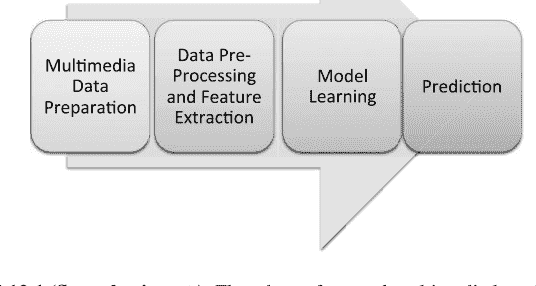

### 图 12.1 （见彩色插页）：通用多媒体学习过程流程图。

信息融合中仍有许多问题未解决。多媒体分类研究如何高效地融合依赖的源、模态或样本以实现更低的分类错误。大多数学习算法可以以直接的方式应用于多媒体领域。然而，在大多数实际应用和多媒体系统设计中，数据的个体模型特异性仍然非常重要。为了更深入地揭示多媒体分类问题，我们将首先介绍三种基本数据类型，包括音频、视觉和文本。

音频和视觉是人类获取世界信息的基本感官通道。在多媒体分类中，音频和视觉的融合已被广泛研究，并在与仅基于单一模态的方法相比时，在事件检测、人员识别和语音识别等任务中取得了不同程度的改进。本章我们将综述几个重要的相关主题和各种现有的音频视觉融合方法。

文本与任何感官模态都大不相同。它以自然语言的形式存在，是人类交流知识的特殊媒介。神经科学中有一个未经证实的假设，即人类大脑将不同感官数据中观察到的模式与与自然语言基本单位相连的实体联系起来 [43]。这一假设与最近关于本体论的努力相吻合，本体论是一种由具有语义上有意义链接的抽象实体组成的图形化知识表示，以及用于建立自然语言、本体和感官数据（主要是图像）之间连接的学习算法。

在本章中，我们主要以应用为导向的方式关注来自数据多模态的决策制定，而不是说明不同的学习算法。本章其余部分组织如下。第 12.2 节，我们说明了三种基本数据类型的常用特征。第 12.3 节介绍了音频视觉融合方法和潜在应用。第 12.4 节解释了如何使用本体结构来增强多媒体机器分类准确性。然后我们在第 12.5 节讨论使用多媒体数据进行地理分类。最后，我们总结本章并讨论多媒体领域未来的研究方向。

## 12.2 特征提取和数据预处理

各种领域的现有学习算法经常依赖于向量化数据，因为每个样本输入都可以很容易地表示为数学上抽象为某个欧几里得空间中的单个点。虽然在现代数字世界中，数据可以自然地表示为向量，但找到有意义的特征空间中的判别特征极其重要。我们将研究有意义的数据表示和从数据中发现知识的过程称为特征提取。

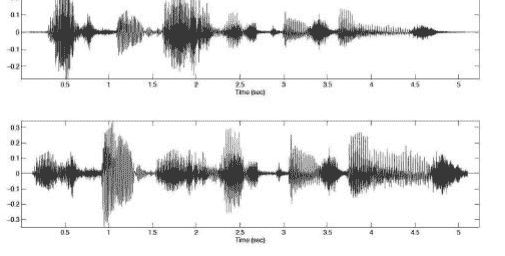

图 12.2 （见彩色插页）：不同人发出的同一语音的时间域波形 [80]。

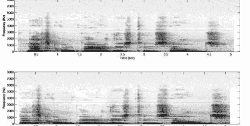

图 12.3 （见彩色插页）：图 12.2 中同一语音的频率响应 [80]。

通常，好的特征可以使学习问题变得微不足道。相反，糟糕的表示在极端情况下会使问题变得无法解决。语音识别上下文中的一个简单例子如图 12.2 所示。两个波形都是不同人说出的完全相同的句子。人们可以很容易地观察到两者之间存在很大的偏差，这使得在没有该领域专业人士的明确帮助下，很难直观地确定这两个信号是否表示相同的语音。然而，如果我们使用短时傅里叶变换将其转换到频域，图 12.3 中在不同频率上随时间显示的谐波彼此几乎完全相同。这个简单的例子表明，原始信号数据很少用作机器分类算法的输入。我们现在简要介绍一些在多媒体社区中被广泛使用的常见特征。这个简单的例子展示了原始信号数据在建模机器分类算法相关内容方面的能力相当有限。

### 12.2.1 文本特征

文本数据预处理和特征提取对于文本分类至关重要，文本分类是一种将预定义类别分配给文本内容的传统分类任务。然而，与图像和音频不同，文本文档没有自然的特征表示。为了缓解这一问题，最流行且最简单的特征是词袋，它将文本文档向量化。词袋特征提取使用一组关键词出现次数的相对频率作为定量度量，将每个文本文档转换为向量。使用相对频率而不是绝对词数的原因是为了减少文档长度差异的影响。

此外，特征提取通常涉及一些数据预处理步骤，如数据清洗和归一化。通过去除不需要的细节并“归一化”数据，学习性能可以显著提高。例如，在文本文档中，标点符号和非字母数字字符通常会被过滤掉，因为它们不有助于特征区分。此外，出现频率过高的词，如“the”、“a”、“is”和“at”也会被丢弃，因为它们在文档中普遍存在。去除此类常见英文词最常见的方法是在预处理阶段应用“停用词表”。数据预处理中另一个常见的技巧是变体统一。变体指的是同一单词的不同形式，例如“go”、“goes”、“went”、“gone”和“going”。这可以通过词干提取来解决。这相当于用标准词替换这些词。更复杂的方法不仅可以应用于语义相同的词，还可以通过考虑词共现来提高区分度。有兴趣的读者可以参考本书第 10 章。

### 12.2.2 图像特征

与文本特征相比，图像特征通常很大。考虑一部来自智能手机的现代图像，其典型分辨率为五百万像素（2592 × 1936）。在没有任何预处理或压缩的情况下，每张图像将被向量化为 5,018,112 维的欧几里得空间。典型的<|message|>


这个看似简单的任务对于基于计算机的算法来说要困难得多。数据库中同一人的图像可能是在不同的条件下拍摄的，包括视角、光照条件、图像质量、遮挡、分辨率等。图 12.4 说明了前任美国总统图像之间巨大的差异。


图 12.4（见彩色插页）：美国总统乔治·W·布什的示例图像，显示了巨大的同人内差异。

近年来，在图像领域提出了许多复杂的特征提取和机器分类方法。在本小节中，我们将主要关注四个基本要素：颜色、纹理、形状和空间关系。

- 1. **Color:** 颜色特征在图像分类中被广泛使用，用于捕捉每幅给定图像的空间颜色分布。颜色是在不同的颜色空间中定义的。常用的颜色空间包括 RGB、HSV、YCrCb 等。这些颜色空间非常接近人类感知，关于不同颜色空间的详细描述可在 [74] 中找到。颜色协方差、颜色直方图、颜色矩和颜色连贯性都是在这些颜色空间上定义的常用颜色特征。

    图像分类中最广泛使用的特征之一是颜色。图像使用 RGB、HSV 或 YCrCb 等颜色空间来表示颜色数据，每种空间都非常接近人类感知。不同颜色空间的更详细描述可在 [74] 中找到。这些空间通常用于构建颜色直方图或建模颜色协方差、颜色矩和颜色连贯性。

- 2. **Texture:** 纹理特征旨在捕捉图像中出现的特定模式。对于表面包含某些纹理的对象（即水果皮、云、树、砖等），提取的特征为图像分类提供了重要信息。一些重要的纹理特征包括 Gabor 滤波 [100]、小波变换 [98]，以及其他局部统计特征 [90]、[50]。基于灰度空间依赖关系的一些易于计算的纹理特征可在 [31] 中找到。它们的应用已体现在类别识别、光学显微照片、黑白航空照片和多光谱图像中。

- 3. **Shape:** 形状是提取图像中所需对象信息的明确概念。形状特征包括傅里叶描述符、长宽比、圆度、矩不变量、连续边界段等 [65]。尽管形状特征对于分类不同对象很重要，但与颜色和纹理特征相比，形状效率较低，这是由于获得准确分割的难度。

- 4. **Spatial Relation:** 除了上述图像特征外，空间位置在区域分类中也很有用。考虑前一个对象空间布局信息对有效分类的示例。大多数现有工作简单地将空间位置定义为“上部”、“底部”、“顶部”，根据对象在图像中出现的区域 [34]、[68]。如果图像包含多个对象，相对于绝对空间位置，相对空间关系在推导语义特征时更为重要。用于表示对象之间方向关系（如“左/右”、“上/下”）的最常见结构是 2D-string [17]。

近年来，最有效的图像特征包括 HOG（方向梯度直方图）[22]、SIFT（尺度不变特征变换）[54]及其变体 [6, 10, 67]。它们是局部特征，表征局部范围内的视觉内容而不是整幅图像。它们广泛用于目标检测、识别和检索。我们在此简要介绍这两种流行特征。

- 1. **HOG:** HOG 是一种描述符，通过评估强度梯度或边缘方向的分布来表征对象外观和形状。对于一幅图像，它首先被划分为小的空间区域（称为“cells”）。对于每个 cell，计算该 cell 像素的梯度方向或边缘方向的 1-D 直方图 [22]。描述符随后由这些直方图的组合构成，编码局部空间信息。为了进一步提高准确性，局部直方图可以通过在图像的较大空间区域（称为“block”）上累积强度度量（称为“energy”）来进行对比度归一化。在实现中，cells 和 blocks 在密集网格上通过不同尺度的滑动窗口生成。

    HOG 背后的关键思想是通过“查看”并挑选所有可能的示例，为特定类型的目标（例如行人）找到平均形状的“模板”。HOG 描述符在各种任务中表现良好，由于其高计算效率。它可以捕捉局部形状，以及平移和对比度的容差。它广泛用于人脸检测和对象识别。

- 2. **SIFT:** 尺度不变特征变换 [54] 是图像分类、目标检测、图像匹配等中最广泛使用的图像特征。它检测图像中的关键点（称为“interest points”），并为每个兴趣点构建尺度和旋转不变描述符。

    SIFT 对应于检测器和描述符。首先，在检测器中，兴趣点（也称为“key points”）是通过搜索 DoG（高斯差分）值在图像域的空间坐标和尺度空间的尺度层上都达到极值的点而获得的，这受到了尺度空间中尺度选择 [48] 的启发。在每个检测到的兴趣点处，位置相关的描述符以类似于 HOG 的方式计算，但方式更为复杂。

    为了实现尺度不变性，局部邻域的大小（对应于 HOG 中的“block”大小）根据尺度进行归一化。为了实现旋转不变性，通过统计其邻域内所有梯度的方向来确定主方向，该方向用于定向网格。最后，描述符相对于主方向计算。图 12.5 显示了 SIFT 检测器的示例以及两幅不同图像之间的匹配。

    SIFT 最重要的扩展之一是 SIFT 特征的密集版本 [10]。它不是在第一步中检测兴趣点，而是从图像中密集采样点（例如均匀网格），并为每个点另行指定尺度。据报道，在某些情况下，密集 SIFT 优于原始 SIFT 特征。


图 12.5（见彩色插页）：来自 [51] 的 SIFT 检测器示例：从相似场景的两幅图像中检测到的兴趣点。对于每个点，圆圈表示尺度。它还显示了两幅图像中相似 SIFT 点之间的匹配。

### 12.2.3 Audio Features

与文本和图像不同，音频是一种连续的媒体类型。音频数据可以是广播、语音、音乐或口语的形式。为了进行音频分析和分类，首先应提取声音信号的低级音频特征。用于音频分类的基于频率的特征可分为三类：时域特征、频域特征和心理声学特征 [97]。

- 1. Time-domain features:
    - (a) Short-time energy: 帧内音频波形的能量。
    - (b) Energy statistics: 特定音频波形的能量统计通常包括均值、标准差、动态范围等。
    - (c) Silence ratio: 低能量音频帧的百分比。
    - (d) Zero crossing rate (ZCR): ZCR 是一种常用的时域特征。它计算音频波在帧内穿越零轴的次数。
    - (e) Pause rate: 由于句子分隔而导致语音停止的速率。
- 2. Frequency-domain features:
    - (a) Pitch: 它测量音频信号的基本频率。
    - (b) Subband energy ratio: 它是不同频率上能量分布的直方图式表示。
    - (c) Spectral statistics: 最重要的频谱统计是频率质心（FC）和带宽（BW）。FC 表示音频帧所有频率分量的加权平均值。对于特定帧，BW 是每个频率与其频率质心之间平方差的加权平均值。
- 3. Psycho-acoustic features:
    - (a) Four-Hz modulation energy: 通常，语音包含在约四赫兹音节速率附近的特征能量调制峰值。它计算四赫兹调制能量。
    - (b) Spectral roll-off point: 频谱滚降点用于通过计算功率谱的 95% 来识别有声和无声语音。


音频和视觉数据可以在统一的学习框架中保持一致。利用不同模态的数据有可能增强分类结果。它也与视频分类相关，因为视频本身就包含视觉和音频两个组成部分。本章后面将详细介绍方法。

### 12.2.4 视频特征

视频分类比图像更复杂，主要因为涉及多种数据模态。视频通常被视为由运动图像、音频和文本（如脚本）组成的连续媒体。视频分类的一种启发式方法是分别处理视觉和音频部分，并使用融合算法将结果组合成最终决策。对于某些类型的音频，如新闻报道和电影，文本信息也很实用（例如，字幕、脚本）。例如，在体育视频事件检测中，视觉（例如进球、球员、球、线的检测）和音频（例如观众的欢呼、裁判的哨声）特征都会被提取并用于分类。

在不失一般性的情况下，本小节我们重点关注视频分类中广泛使用的视觉特征。图像的大多数视觉特征都可以应用于视频，包括颜色、纹理等。随着局部特征的流行，词袋和 SIFT 描述符的组合因其高效和鲁棒性而广泛应用于视频分类、检索和事件检测 [84]。

此外，最重要的视频信息是时间轴。时空空间中的运动形成了运动。在微观层面，已经提出了各种运动特征来捕捉物体的局部运动，例如光流 [33] 和 STIP [44]。行为被分解为由运动组成的基本动作。在宏观层面，轨迹被广泛采用来对事件进行分类和分析行为 [96]。关于自动视频分类中使用的特征的详细综述见 [13]。

## 12.3 音视频融合

融合音频和视觉信息并不是一个新想法。早在七十年代，就有研究致力于设计具有视觉输入的语音识别系统。后来，这一想法发展成为一个丰富的研究领域。音视频融合的主要动机在于人类感知的双模态特性，特别是语音感知。早期研究 [88] 表明，人类利用音频和视觉信号来解码语音内容。麦格克效应在 [62] 中发现，受试者倾向于感知音素 /da/，当实际声音是 /ga/ 而视频中人们说的是 /ba/ 时，进一步暗示了融合机制的存在。在语音识别中，视觉语音的存在被证明有助于人类受试者在嘈杂环境中解释语音信号 [88]。一种被广泛接受的解释是，两种信息来源，即音频和视觉信号相互补偿以解码正确的语音，因为每个单独模态中都存在不同音素的歧义。例如，人们常常发现仅通过电话，即仅通过声学信号交流，很难区分辅音 /b/ 和 /d/。这种混淆可以通过唇部运动的可见性轻松消除。随着环境噪声的增加，声学歧义越高，视觉信号对语音识别的益处就越大。除了语音识别之外，融合对于音频和视觉信息相关的其他任务也有益，例如人脸识别、事件检测和识别。

在本节中，我们描述了核心融合算法并简要介绍了一些重要应用。

### 12.3.1 融合方法

为决策融合多信息本身就是一个通用研究问题。例如，在音频视觉语音识别（AVSR）的情况下，两种模态提供了关于语音的两个信息流。虽然可以在每个单一模态上做出决策，但融合的目标是比基于单一模态的决策者做出更好的决策。[55] 中从统计学习的角度对信息融合给出了理论依据。

现有的融合方法可以分为两类：特征级融合和决策级融合，有时也分别称为早期融合和晚期融合。区别在于融合在整体分类过程中发生的阶段。特征级融合发生在早期阶段。它在分类之前将音频和视觉信息组合成一个联合特征空间。另一方面，决策级融合依赖于每个模态的多个分类器并将决策组合成一个。

特征级融合搜索从两个独立特征空间到联合特征空间的变换，通常具有更低的维度。变换在许多现有方法中被限制为线性，包括简单的特征拼接 [2]、加法或乘法加权 [16]，随后进行线性降维，例如 PCA 或 LDA。非线性方法通常基于核学习。最近，使用深度学习架构进行非线性特征变换成为一种新趋势，这已在多个基准上推进了最先进水平 [72]。

决策级融合的优点在于它明确地模拟了每个模态的可靠性。对于不同的语音内容和噪声水平，音频和视觉信息的判别能力可能大不相同。建模可靠性也很重要。对来自单模态分类器的似然或分数进行加权是一种常见方法。在 [55] 中，在训练和测试数据不匹配的假设下，对数似然域中的加权提供了概率依据。在实践中，权重可以设为相等 [30]，或在验证数据集上进行调整。如果权重是自适应的（即根据不同环境动态调整），通常可以获得更好的性能。

### 12.3.2 音视频语音识别

自动语音识别（ASR）在过去三十年中得到了深入研究。最近，随着深度学习方法的出现，ASR 在基准数据集和实际应用中的性能得到了显著提升。然而，目前最先进的 ASR 系统仍然对语音的巨大变化敏感，包括不同信道和环境的噪声。通过与语音相关的额外信号，可以提高 ASR 系统在嘈杂环境下的鲁棒性。这些信号中最具信息量的来源是视觉语音：发音器官的视觉外观，例如嘴唇。在文献中，带有额外视觉语音输入的 ASR 被称为音频视觉语音识别（AVSR）。

典型的 AVSR 系统结构如图 12.6 所示的流程图。来自传感器的原始音频/视频信号首先分别经过声学和视觉前端。前端的目标是将信号转换为更紧凑的表示，而不会丢失太多有助于解码语音的信息。此时，对两种模态进行信息融合，合并后的信息将被送入语音识别器。在过去二十年中，大量 AVSR 系统在三个主要方面存在差异 [75]：视觉前端、融合策略和语音识别方法。注意，这里没有提到声学前端，因为大多数 AVSR 系统采用语音识别中常用的声学特征。同样，语音识别方法直接取自语音识别领域，仅在不同应用上有所不同，例如小词汇量或大词汇量识别。本节我们集中于大词汇量语音识别，因为它是更具挑战性的任务。


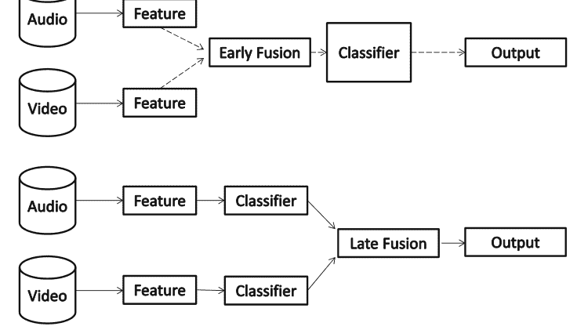

### FIGURE 12.6: Flowchart of typical AVSR systems.

#### 12.3.2.1 Visual Front End

视觉前端由图像的两个阶段处理组成。首先，需要姿态归一化以从面部图像中提取感兴趣区域。通常，嘴部区域与语音高度相关。然后，将归一化后的图像进一步转换为期望的特征表示。在文献中，已有大量图像处理和计算机视觉方法应用于 AVSR 的视觉前端。一些例子是面部/嘴部/嘴唇的检测与跟踪、面部/嘴部的形状和外观建模，以及全局/局部图像特征。前端方法的多样性增加了比较不同 AVSR 系统的难度。到目前为止，没有任何一种方法被证明严格优于其他方法。

##### Normalization

大多数 AVSR 中的姿态归一化方法从图像中提取嘴唇。嘴唇定位的算法主要分为两类 [76]。第一类利用整个面部的先验信息。两个代表性的方法是主动形状模型 ASM 和主动外观模型 AAM [19]。而 ASM 将面部表示为一组地标，AAM 进一步包含了面部边界内的纹理。这些方法可以扩展到 3D [24]，以进一步归一化面外头部旋转。另一类仅使用嘴唇周围的局部外观 [1]。嘴唇的有用方面是内外轮廓的形状，以及轮廓内的图像外观。现有的 AVSR 前端可以是基于形状的 [56]、基于外观的（像素）[61]，或两者的结合。

总体而言，鲁棒的姿态归一化和部件检测是困难的任务。在光照和背景变化的非受控环境中尤其如此。当前大多数 AVSR 研究通过受控环境和人工标注来简化归一化阶段。例如，许多视听语音语料库是在有限的姿态变化和恒定光照设置下录制的 [66]。嘴部区域的裁剪窗口通常会提供，而面部的其他区域在 AVSR 中可以忽略。面部图像处理的简化有助于 AVSR 研究者集中于特征设计和视听融合，并为不同方法提供有意义的基准。

##### Features

归一化后的原始特征可分为基于形状和基于外观。常用的形状特征是唇轮廓的几何属性，以及参数化唇模型的模型参数。基于外观的特征取自归一化面部图像中感兴趣区域的原始像素。

由于图像像素的典型维度对于传统语音识别器中的统计建模来说过大，因此采用特征变换来降低维度。一些流行的方法是主成分分析 PCA [26]、离散余弦变换 DCT [71]、小波 [77]、线性判别分析 LDA [61] 等。虽然对于基于轮廓的方法来说降维并非必要，但 PCA 通常用于获得更紧凑的特征。形状和外观特征的结合可视为另一种多模态融合任务：每个特征携带同一来源的不同信息。在 AVSR 系统中，直接拼接是常用的方法 [16]。

#### 12.3.2.2 Decision Fusion on HMM

AVSR 融合的一个特殊属性是需要计算序列的似然，而不是独立的数据样本。因此，需要对音频和视觉流之间的时间关系做出假设。先前的研究发现语音的视听信号缺乏同步性，因为发音器官往往在声音实际产生之前就开始移动到准备位置 [12]。考虑到这一点，两流视听

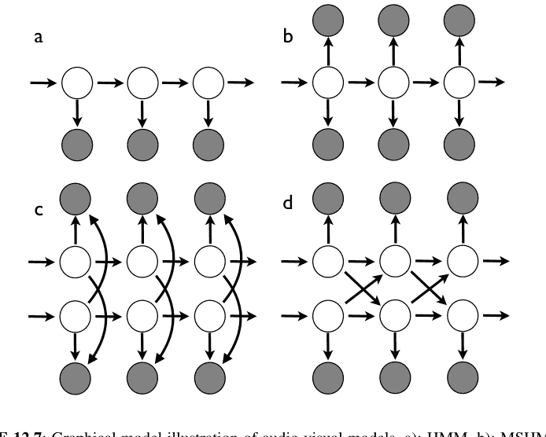

隐马尔可夫模型通常被放宽以允许状态不同步。针对视听融合提出的各种类型的 HMM 已在 [70] 中使用图形模型的概念进行了总结，如图 12.7 所示。

从理论上讲，视听 HMM 是具有两个观测流的动态贝叶斯模型 DBN 的特例。各种决策融合方法在观测和隐藏状态流之间的统计依赖性上有所不同，例如 DBN 图中的边。视听乘积 HMM [70] 假设一个隐藏状态流和两个条件独立的观测流。因此，状态是同步的，且似然被相乘。因子 HMM [29] 为每个模态使用一个隐藏状态流，但假设两个流相互独立。耦合 HMM 进一步在音频和视觉隐藏状态之间施加依赖关系。因此，它具有融合视听不同步的能力，至少在理论上是如此。

### FIGURE 12.7: Graphical model illustration of audio visual models, a): HMM, b): MSHMM, c): FHMM, d): CHMM.

### 12.3.3 Other Applications

视听融合在许多其他多媒体分类任务的背景下也很重要。例如，在视频中检测和识别高级事件时，一个主要挑战是考虑不同模态的线索。许多用于视频事件检测/识别的主要数据集，包括 TRECVID [85]、KTH 人类动作数据集 [82]、哥伦比亚消费者视频 CCV 数据库 [63] 等，都包含音频。关于视频事件分类的全面综述可在 [64] 中找到。

视听融合研究两种模态的联合分布，或与第三种模态相关的条件分布。一个例子是 AVSR 中的文本。联合或条件分布的其他方面也可以导致有趣的应用，包括但不限于：视听语音合成 [99]、语音到嘴唇转换 [11]、唇读和声源定位 [39]。它们通常共享一些核心技术，例如视觉前端、特征融合和决策融合，如本节所述。

## 12.4 Ontology-Based Classification and Inference

在计算机视觉和多媒体处理领域，识别图像或视频中的物体类别是最具挑战性的问题之一。现有的物体识别算法通常将类别视为在视觉和语义上完全分离和独立。例如，传统的物体识别方法首先提取一些低级特征，例如 SIFT [54]、HOG [22] 等，然后使用一组一对多设置中的二元 SVM 分类器进行多类分类 [102]。传统方案有几个缺点：

- 1. 当类别数量变得很大时效率非常低。这在实际应用中经常出现。
- 2. 忽略了类别之间的关系。这种关系在实际应用中确实存在。例如，要求分类器区分汽车和车辆是不合理的。此外，卡车和公共汽车比卡车和猫更相关。
- 3. 有时，类别是高级概念。如 [15] 所建议，使用低级特征难以捕捉高级概念的语义。

所有上述问题都可以通过引入本体来解决。本体是知识的正式和显式表示，由概念词典、概念属性和概念之间的关系组成 [8]。一个定义良好的本体提供了一个合适的格式和一个

可以帮助提高机器理解，并能在一定程度上弥合低级和高层概念之间的语义鸿沟。

#### 12.4.2.1 Definition

最适用且最常用的关系是 *Subclass* 关系和 *Co-occurrence* 关系。两种关系的定义如下：

- 1. *Subclass*: 也称为上位词、下位词或“IS-A”关系。它将更一般的词元集例如 *furniture* 与越来越具体的词元集例如 *bed* 链接起来。
- 2. *Co-occurrence*: 这是一个语言学术语，指两个术语在文本语料库中以特定顺序一起频繁出现。例如，*indoor* 和 *furniture* 通常会因其在语料库中的出现而相关。

基于本体的算法根据具体应用使用其中一种关系或两者。关系的使用方式非常不同，各有优缺点。我们将根据它们使用的关系类型介绍这些算法。

#### 12.4.2.2 Subclass Relation

层次结构是最简单的本体之一，其中节点通过有向边表示 *Subclass* 关系连接成树。由于层次结构，*Subclass* 关系可以在类别数量较大时提高算法的效率，并可能提高准确性。

Dumais [25] 提出了一种自上而下的分而治之方法，该方法仅基于与其子节点相关联的样本训练模型。在测试时，只有在父节点中预测为正的测试样本才会在子节点中进行检查。这种框架的优点是，每当算法选择一条边继续遍历树时，它会自动剪掉其余的边。因此，搜索空间和计算复杂度大大降低。缺点也很明显，即它没有提供任何机制来防止其贪婪决策过程造成的从高层到低层节点的错误传播。

Deng 等人 [23] 引入了一个名为“ImageNet”的新数据库，这是一个基于 WordNet 结构骨干构建的大规模图像本体。与 WordNet 类似，ImageNet 中图像的词元集通过几种类型的关系相互链接，其中“IS-A”(*Subclass*) 关系是最全面和有用的。他们还提出了一种他们称之为“tree-max classifier”的简单物体分类方法。该方法将低级（具体）概念的检测向上传播到其高级（抽象）祖先。他们的实验表明，tree-max 分类器的性能 consistently 优于独立分类器。这一结果表明，简单地利用 *Subclass* 层次结构就可以在不额外训练或模型学习的情况下为图像分类任务提供实质性改进。

Tsai 等人 [91] 提出了一种分层图像特征提取方法，该方法根据层次结构中当前节点的位置提取图像特征，以拟合当前节点下的图像并更好地区分其子类。特征提取方法基于分层高斯化 HG 和判别属性投影 DAP [105]。此外，他们提出根据当前节点子节点的分数而不是当前节点的分数来传播图像，这与“tree-max classifier”的思想相似。

Cai 等人 [14] 在张量空间中构建了分层分类问题，并通过固定长度的二进制向量编码从根概念到目标概念的路径。原始分类任务随后被转换为多类分类问题。他们算法的一个问题是可扩展性。与原始问题相比，张量空间中新的表示的高维性增加了新问题的复杂性。


#### 12.4.2.3 共现关系

*共现*关系通常没有统一的本体论结构。因此，这类算法的设计是多样化的。

Li 等人 [46] 提出了一种称为“Object Bank”的高层图像表示，其中图像被表示为大量预训练的通用目标检测器的尺度不变响应图，这些检测器不依赖于测试数据集或视觉任务。他们利用简单的线性假设分类器结合稀疏编码方案，以确保 Object Bank 表示中的特征稀疏性和目标稀疏性，同时捕获这些目标（概念）之间的语义关系。

类似地，Smith 等人 [86] 提出了一种用于视频标注的两步判别模型融合（DMF）方法，试图通过基于各个检测器得分生成模型向量来挖掘概念之间的关系。然后将模型向量输入到上下文支持向量机（SVM）中以优化检测结果。

Tsai 等人 [92] 提出了一种称为*组合目标模式*的新表示方法。这种表示刻画了目标级模式，其传达的语义信息比低级视觉特征丰富得多。通过解释这类数据中的丰富语义，这种方法有助于更有效地进行相册分类。他们首先在训练集中挖掘频繁目标模式，然后根据判别能力对其排序。相册特征则被设置为这些判别模式的出现频率。这种频率被称为*组合目标模式频率（COPF）*，并由 SVM 等传统分类器进行分类。

#### 12.4.2.4 两种关系的结合

在实际应用中，*子类*关系和*共现*关系通常共存于本体中。因此，许多研究致力于同时利用这两种关系。

Marszalek 等人 [59] 提出利用图像标签的语义，将关于*子类*和*共现*关系的先验知识整合到视觉外观学习中。为了创建用于目标检测的语义层次分类器，他们首先用类别标签查询 WordNet，并以语义层次结构的形式提取知识。该层次结构用于推理，以及组织和训练由最先进的图像分类方法得到的二值 SVM 检测器。然后，训练好的层次分类器可用于高效识别大量目标类别。

Zha 等人 [101] 提出了一种用于视频标注的语义本体方案。他们首先利用 LSCOM 构建概念词典，并将概念属性描述为不同模态的权重，这些权重通过人工或数据驱动方式获得。他们分别建模*子类*和*共现*关系。具体来说，他们根据概念共现的可能性，将概念的初始检测结果传播给共现概念。另一方面，子类关系通过层次贝叶斯网络加以利用。然后将这两种精化结果连接起来，以同时融合两种关系。

Gao 等人 [28] 提出将概念划分为显著目标和场景，其中显著目标的检测利用目标分类体系（如子类层次结构），并用于识别场景。他们使用了一个朴素贝叶斯框架来建模显著目标与场景之间的共现关系。他们声称，其用于层次概率图像概念推理的框架可扩展到具有较大类内差异的多样图像内容。

Tsai 等人 [93] 提出了一种新颖的本体视觉推理框架，利用本体中的子类和共现关系来增强多标签图像标注。本体中的这两种关系是自动学习的：子类关系通过对 WordNet 的上位词/下位词图进行图遍历技术获得，统计共现关系则从训练集中学习。然后，他们的本体推理框架寻找满足所有子类约束，并在共现奖励或惩罚下得分最高的标签组合。

#### 12.4.2.5 隐式使用的本体

即使没有明确的本体概念，一些多标签分类研究也会利用概念之间的相关性。

Tsochantaridis 等人 [95] 提出将多类支持向量机学习推广到相互依赖的结构化输出空间。Qi 等人 [78] 采用吉布斯随机场来建模概念之间的交互，其中一元和成对势函数被同时学习。Qi 等人 [79] 提出在主动学习场景下，通过迭代询问所选图像的标签来最小化分类错误率。

在传统机器学习问题中利用本体有明显的优势。本节详细介绍了常用的本体以及非常重要的本体关系，如子类和共现。文中介绍并基于所用关系比较了许多基于本体的算法。他们的工作结果表明，本体在多种机器学习应用中具有有效性和高效性。

## 12.5 多媒体数据的地理分类

近年来，在 Flickr¹ 等社区网站和社交网络（如 Facebook、Google+、Instagram）上，带有地理标签的多媒体内容越来越多，尤其是在智能移动设备普及之后。例如，Flickr 报告称已有超过 1 亿张带地理标记的照片。如何有效地组织、搜索和从这类地理标记数据中发现知识，已成为迫切需求。多媒体地理分类研究正是基于这一需求展开的。

通常，地理信息是在情境建模框架内，于多媒体和计算机视觉研究中被探讨的。然而，利用地理信息作为情境的可能性很多，涉及不同的数据模态和目的。可用于地理信息处理的数据类型包括 GIS（地理信息系统）数据库、航空或遥感图像、非结构化的地理参考 Web 资源（如博客中的图像），以及 Flickr、Instagram 等结构化 Web 多媒体集合 [58]。这类数据的目的各不相同，涵盖地理位置标注 [32,45]、检索 [38]、地标识别 [18,104]，以及挖掘和推荐（如旅游导览系统）[35,37]。

在本节中，我们聚焦于对提供有组织元数据的结构化 Web 多媒体进行分类/识别的问题，特别是地标识别。地理分类或地标识别问题旨在利用训练集中的地理定位图像集合来确定图像的位置。基本方法是在索引结构上直接匹配特征点，或学习视觉外观模型。这是众多应用中的一个重要研究课题。

在本小节的其余部分，我们将首先介绍 Web 多媒体可用的数据和信息，然后讨论地理分类中的挑战。接着会探讨两个具体应用，分别是 Web 图像的地理分类和视频的地理分类。

### 12.5.1 数据模态

结构化 Web 多媒体中可用于地理分类的信息类型包括但不限于以下内容：

- 1. GPS 信息：手机和智能设备在拍照时会记录位置信息。如果将地球视为一个直角坐标系，GPS 坐标可以将图像映射到地球上，位置由纬度和经度确定。


**图 12.8（见彩插）：** 地标图像识别中的挑战。(a) 和 (b) 分别是西安鼓楼和北京前门的照片。尽管地点不同，但由于历史和风格原因，其视觉外观相似。(c) 展示了华盛顿林肯纪念堂的三个不同视角。

- 2. *文本信息：* 通常，Flickr 图像的描述或个人博客文章等文本元数据包含位置命名实体（例如“悉尼歌剧院”“埃菲尔铁塔”）。这对于指示图像的地理位置至关重要。一个例子是 [35]，该工作从 MSN 博客和相册中提取了城市名称。
- 3. *视觉特征：* 大多数问题涉及将图像与位置（例如地标名称）进行匹配。视觉特征对于地标识别非常重要。常用的视觉特征包括局部点（如 SIFT [54]）和词袋表示 [84]。
- 4. *协作特征：* 随着社交网络的普及，协作特征也得到增强，尤其是在社交媒体中。协作特征的例子包括用户在 Twitter 上标注的*话题标签*，以及用户评论或转发。由于其中一些特征高度非结构化且包含大量噪声，如何更高效地利用协作特征仍然是一个相对未被充分探索的问题。

地理分类通常需要融合不同模态的信息，以准确预测地理标签。

### 12.5.2 地理分类中的挑战

多媒体数据地理分类的挑战主要来自以下两个方面：

- 1. *视觉歧义：* 不同地理位置可能具有相似的视觉外观，这源于历史或风格原因。更具体地说，同一时期或同一风格的建筑在视觉特征上可能难以区分。这使得为每个地标或类别构建视觉外观模型更具挑战性。
- 2. *地理位置歧义：* 即使是同一地理位置或地标，在不同视角下也可能看起来不同。尽管 SIFT [54] 等先进的尺度和旋转视觉特征能够处理平面内旋转，但当前的图像描述子无法解决平面外旋转，即视角变化的问题。

图 12.8 展示了这些挑战的两个示例。为了应对视觉歧义挑战，可以利用多模态信息来消除这些困难。经典方法包括融合 GPS 位置与视觉特征 [37]，或融合文本信息与视觉特征 [35]。


针对地理定位模糊性，学习每个地标的视角级别模型被广泛采用。这可以进一步集成到投票或提升框架中。接下来，我们将介绍两个相关主题，分别对应Web图像和视频的地理分类。

#### 12.5.3 图像的地理分类

地标识别和地理分类的相关工作通常采用基于内容或上下文相似性的监督方法。地理分类的早期工作始于ICCV 2005的“我在哪里”竞赛[89]。早期方法主要依赖特征点匹配，例如，基于一系列带有地理标签的训练图像，匹配多个图像中的局部兴趣点和图像区域。在[103]中，SIFT [54]、SURF [6]和MSER [60]等特征被用于将测试图像匹配到一个或多个训练图像。此外，Kennedy等人[37]通过使用SIFT点匹配构建图，从Flickr中提取了热门地标图像。

其他方法使用更有效的视觉特征而非兴趣点匹配。Schindler等人[81]通过引入大规模词汇树扩展了特征匹配算法。词汇树是一种通过在每个层级对数据点进行层次聚类获得的结构，通常是SIFT [54]特征。通过引入词汇树，地理分类或识别算法能够处理大规模数据。在[81]中，他们使用了30,000张图像，构建了一棵具有10^6个节点的树。


图12.9（见彩插）：同一地标在不同视角下外观会有所不同。典型方法使用聚类来获取每个视角的视觉信息。来自Liu等人[52]。

为了减少地标分类中模糊性的影响（见图12.9），引入了元数据，并使用多种特征进行分类。在[37,38]中，图像首先根据其GPS信息进行预处理，以消除地理定位模糊性。通常，同一地标的图像会被聚类到不同的视角，以解决视觉模糊性。Cristani等人[21]通过联合推断，将视觉和地理信息集成到一个统计图模型中。Ji等人[36]提出在构建词汇树时考虑上下文（例如文本信息），然后应用于地理位置分类任务。Crandall等人进一步[20]提出结合视觉、文本和时间等多种特征，将照片分配到全球地理地图中。

##### 12.5.3.1 分类器

k-NN（k最近邻）[32,41]和支持向量机（SVM）是常用的方法。此外，研究人员还将图像集合建模为图，其中节点根据内容或上下文相似性进行连接。PageRank [73]或HITS类[42]算法被用于以概率方式传播和分类图像的地理信息。Cristani等人[21]利用概率主题模型——位置相关的pLSA（LD-pLSA）——来联合建模视觉和地理信息，旨在通过双主题建模对图像进行一致分类。最近，结构SVM也被用于地标识别[47]。

#### 12.5.4 Web视频的地理分类

尽管使用地理标记图像的研究已经取得了显著进展，但对于地理标记视频而言，情况并非如此。与Flickr等Web图像不同，Web视频的标注成本很高。因此，训练数据有限，基准数据集也有限。另一个挑战是视频片段通常由多个场景组成。这增加了将已知的图像地理分类算法直接应用于视频的难度。

视频地理分类的开创性工作包括[3,5,40]，它们利用空间和时间属性进行搜索和分类。典型的方法是相对于特定位置对“视场”进行时空滤波。近期，Liu等人[52]提出将地理信息从地理标记图像（如Flickr）迁移到Web视频，以解决训练数据不足的问题。由于跨域难度，一种迁移学习算法选择了可信的样本和特征来构建最终的Web视频分类器。视频的另一个优势是镜头内的帧间一致性。因此，他们通过滑动窗口平滑将帧级分类整合为视频镜头级结果。然而，视频的地理分类仍然是一个开放问题。在数据收集和算法设计方面的努力正在涌现。

### 12.6 结论

在本章中，我们介绍了多媒体分类领域的最新进展，详细讨论了特征选择、信息融合以及三个重要的应用领域。这些领域分别对应视听融合、基于本体的分类和地理分类。特别是，我们强调了信息融合对于多种内容形式的价值。本章提供了对最先进方法的简要概述，但详细的阐述超出了单一章节的范围。由于其巨大的实用价值，多媒体分类仍然是一个活跃且快速发展的研究领域。它也为音频/图像处理和数据科学中的新方法（包括本书其余部分介绍的通用数据分类方法）提供了一个良好的试验平台。

## 参考文献

[1] Waleed H Abdulla，Paul WT Yu和Paul Calverly。用于说话人识别的嘴唇追踪生物特征。*国际生物特征学杂志*，1(3):288–306，2009。

[2] Ali Adjoudani和Christian Benoit。基于HMM的ASR中听觉与视觉参数的集成。*NATO ASI F系列：计算机与系统科学*，150:461–472，1996。

[3] Sakire Arslan Ay, Lingyan Zhang, Seon Ho Kim, Ma He和Roger Zimmermann。GRVS：一种地理参考视频搜索引擎。载于*第17届ACM国际多媒体会议论文集*，页码977–978。ACM，2009。

[4] Michael Ashburner, Catherine A Ball, Judith A Blake, David Botstein, Heather Butler, J Michael Cherry, Allan P Davis, Kara Dolinski, Selina S Dwight, Janan T Eppig,等。基因本体论：生物学统一的工具。*自然遗传学*，25(1):25–29，2000。

[5] Sakire Arslan Ay, Roger Zimmermann和Seon Ho Kim。面向地理空间视频搜索的可视场景建模。载于*第16届ACM国际多媒体会议论文集*，页码309–318。ACM，2008。

[6] Herbert Bay, Tinne Tuytelaars和Luc Van Gool。SURF：加速稳健特征。载于*计算机视觉–ECCV 2006*，页码404–417。Springer，2006。

[7] Richard Bellman。*自适应控制过程：导览*，第4卷。普林斯顿大学出版社，新泽西州普林斯顿，1961。

[8] Marco Bertini, Alberto Del Bimbo和Carlo Torniai。使用本体扩展视觉信息进行自动视频标注。载于*第13届ACM国际多媒体会议年度论文集*，页码395–398。ACM，2005。

[9] Stephan Bloehdorn, Kosmas Petridis, Carsten Saathoff, Nikos Simou, Vassilis Tzouvaras, Yannis Avrithis, Siegfried Handschuh, Yiannis Kompatsiaris, Steffen Staab和Michael G Strintzis。用于多媒体分析的图像和视频语义标注。载于*语义网：研究与应用*，页码592–607。Springer，2005。

[10] Anna Bosch, Andrew Zisserman和Xavier Munoz。通过pLSA进行场景分类。载于*计算机视觉–ECCV 2006*，页码517–530。Springer，2006。

[11] Christoph Bregler, Michele Covell和Malcolm Slaney。视频重写：用音频驱动视觉语音。载于*第24届计算机图形学与交互技术年度会议论文集*，页码353–360。ACM Press/Addison-Wesley出版公司，1997。

[12] Christoph Bregler和Yochai Konig。用于鲁棒语音识别的“特征唇”。载于*IEEE国际声学、语音与信号处理会议，1994年，ICASSP-94*，第2卷，页码II–669。IEEE，1994。

[13] Darin Brezeale和Diane J. Cook。自动视频分类：文献综述。*IEEE系统、人与控制论学报，C部分*，38(3):416–430，2008。

[14] Lijuan Cai和Thomas Hofmann。基于支持向量机的层次化文档分类。载于*第十三届ACM国际信息与知识管理会议论文集*，页码78–87。ACM，2004。


- [15] Liangliang Cao, Jiebo Luo, and Thomas S. Huang. 基于多种相似性线索利用标签传播标注照片集。见 *第16届ACM国际多媒体会议论文集*, 第121–130页. ACM, 2008.

- [16] Michael T. Chan. 融合几何与基于外观的视觉特征的基于HMM的音视频语音识别。见 *2001年IEEE第四届多媒体信号处理研讨会*, 第9–14页. IEEE, 2001.

- [17] S. K. Chang, Q. Y. Shi, and C. W. Yan. 基于二维字符串的图标索引。*IEEE模式分析与机器智能汇刊*, 9(3):413–428, 1987年5月.

- [18] David M. Chen, Georges Baatz, K. Köser, Sam S. Tsai, Ramakrishna Vedantham, Timo Pylvänäinen, Kimmo Roimela, Xin Chen, Jeff Bach, Marc Pollefeys, 等. 移动设备上的城市规模地标识别。见 *IEEE计算机视觉与模式识别会议（CVPR），2011*, 第737–744页. IEEE, 2011.

- [19] Timothy F. Cootes, Gareth J. Edwards, and Christopher J. Taylor. 主动外观模型。*IEEE模式分析与机器智能汇刊*, 23(6):681–685, 2001.

- [20] David J. Crandall, Lars Backstrom, Daniel Huttenlocher, and Jon Kleinberg. 绘制世界照片地图。见 *第18届国际万维网会议论文集*, 第761–770页. ACM, 2009.

- [21] Marco Cristani, Alessandro Perina, Umberto Castellani, and Vittorio Murino. 使用潜在表示的地理定位图像分析。见 *IEEE计算机视觉与模式识别会议, 2008. CVPR 2008*, 第1–8页. IEEE, 2008.

- [22] Navneet Dalal and Bill Triggs. 用于人体检测的方向梯度直方图。见 *IEEE计算机学会计算机视觉与模式识别会议, 2005. CVPR 2005*, 第1卷, 第886–893页. IEEE, 2005.

- [23] Jia Deng, Wei Dong, Richard Socher, Li-Jia Li, Kai Li, and Li Fei-Fei. ImageNet：一个大规模分层图像数据库。见 *IEEE计算机视觉与模式识别会议, 2009. CVPR 2009*, 第248–255页. IEEE, 2009.

- [24] Fadi Dornaika and Jörgen Ahlberg. 用于三维人脸跟踪的快速可靠主动外观模型搜索。*IEEE系统、人与控制论汇刊，B部分：控制论*, 34(4):1838–1853, 2004.

- [25] Susan Dumais and Hao Chen. 网络内容的分层分类。见 *第23届ACM SIGIR国际信息检索研究与发展年会论文集*, 第256–263页. ACM, 2000.

- [26] Stéphane Dupont and Juergen Luettin. 用于连续语音识别的音视频语音建模。*IEEE多媒体汇刊*, 2(3):141–151, 2000.

- [27] Christiane Fellbaum (编). *WordNet：电子词汇数据库*. Springer, 2010.

- [28] Yuli Gao and Jianping Fan. 结合概念本体实现多级图像标注的概率概念推理。见 *第8届ACM国际多媒体信息检索研讨会论文集*, 第79–88页. ACM, 2006.

- [29] Zoubin Ghahramani and Michael I. Jordan. 因子隐马尔可夫模型。*机器学习*, 29(2-3):245–273, 1997.

- [30] Hervé Glotin, D. Vergyri, Chalapathy Neti, Gerasimos Potamianos, and Juergen Luettin. 语音识别中音视频融合的加权方案。见 *2001年IEEE国际声学、语音与信号处理会议（ICASSP '01）*, 第1卷, 第173–176页. IEEE, 2001.

- [31] Robert M. Haralick, K. Shanmugam, and Its'Hak Dinstein. 用于图像分类的纹理特征。*IEEE系统、人与控制论汇刊*, SMC-3(6):610–621, 1973年11月.

- [32] James Hays and Alexei A. Efros. IM2GPS：从单张图像估计地理信息。见 *IEEE计算机视觉与模式识别会议, 2008. CVPR 2008*, 第1–8页. IEEE, 2008.

- [33] Berthold K. P. Horn and Brian G. Schunck. 确定光流。*人工智能*, 17(1):185–203, 1981.

- [34] J. Jeon, V. Lavrenko, and R. Manmatha. 使用跨媒体相关性模型的自动图像标注与检索。见 *第26届ACM SIGIR国际信息检索研究与发展年会论文集（SIGIR '03）*, 第119–126页, New York, NY, USA, 2003. ACM.

- [35] Rongrong Ji, Xing Xie, Hongxun Yao, and Wei-Ying Ma. 通过图建模从博客中挖掘城市地标。见 *第17届ACM国际多媒体会议论文集*, 第105–114页. ACM, 2009.

- [36] Rongrong Ji, Hongxun Yao, Qi Tian, Pengfei Xu, Xiaoshuai Sun, and Xianming Liu. 上下文感知的半局部特征检测器。*ACM智能系统与技术汇刊（TIST）*, 3(3):44, 2012.

- [37] Lyndon Kennedy, Mor Naaman, Shane Ahern, Rahul Nair, and Tye Rattenbury. Flickr如何帮助我们理解世界：社区贡献媒体集合中的上下文与内容。见 *第15届国际多媒体会议论文集*, 第631–640页. ACM, 2007.

- [38] Lyndon S. Kennedy and Mor Naaman. 为地标生成多样且具有代表性的图像搜索结果。见 *第17届国际万维网会议论文集*, 第297–306页. ACM, 2008.

- [39] Einat Kidron, Yoav Y. Schechner, and Michael Elad. 会发声的像素。见 *IEEE计算机学会计算机视觉与模式识别会议, 2005. CVPR 2005*, 第1卷, 第88–95页. IEEE, 2005.

- [40] Seon Ho Kim, Sakire Arslan Ay, Byunggu Yu, and Roger Zimmermann. 支持通用地理参考视频搜索的向量模型。见 *第一届ACM SIGMM多媒体系统年会论文集*, 第235–246页. ACM, 2010.

- [41] Jim Kleban, Emily Moxley, Jiejun Xu, and B. S. Manjunath. 地理参考照片的全局标注。见 *ACM国际图像与视频检索会议论文集*, 文章12. ACM, 2009.

- [42] Jon M. Kleinberg. 超链接环境中的权威来源。*ACM期刊（JACM）*, 46(5):604–632, 1999.

- [43] Sydney M. Lamb. *大脑路径：语言的神经认知基础*, 第170卷. John Benjamins Publishing出版社, 1999.

- [44] Ivan Laptev. 论时空兴趣点。*国际计算机视觉杂志*, 64(2-3):107–123, 2005.

- [45] Martha Larson, Mohammad Soleymani, Pavel Serdyukov, Stevan Rudinac, Christian Wartena, Vanessa Murdock, Gerald Friedland, Roeland Ordelman, and Gareth J. F. Jones. 视频集合与社区中的自动标签和地理标签。见 *第1届ACM国际多媒体检索会议论文集*, 文章51. ACM, 2011.

- [46] Li-Jia Li, Hao Su, Li Fei-Fei, and Eric P. Xing. Object Bank：用于场景分类和语义特征稀疏化的高层图像表示。见 *神经信息处理系统进展*, 第1378–1386页, 2010.

- [47] Yunpeng Li, David J. Crandall, and Daniel P. Huttenlocher. 大规模图像集合中的地标分类。见 *IEEE第12届国际计算机视觉会议2009*, 第1957–1964页. IEEE, 2009.

- [48] Tony Lindeberg. 具有自动尺度选择的特征检测。*国际计算机视觉杂志*, 30(2):79–116, 1998.

- [49] Tony Lindeberg. 尺度不变特征变换。*Scholarpedia*, 7(5):10491, 2012.

- [50] Fang Liu and R. W. Picard. 周期性、方向性和随机性：用于图像建模和检索的Wold特征。*IEEE模式分析与机器智能汇刊*, 18(7):722–733, 1996.

- [51] Xian-Ming Liu, Hongxun Yao, Rongrong Ji, Pengfei Xu, Xiaoshuai Sun, and Qi Tian. 学习异构数据进行分层网络视频分类。见 *第19届ACM国际多媒体会议论文集*, 第433–442页. ACM, 2011.

- [52] Xian-Ming Liu, Yue Gao, Rongrong Ji, Shiyu Chang, and Thomas Huang. 利用异构图像定位网络视频。见 *第二十七届AAAI人工智能会议研讨会*, 2013.

- [53] Ying Liu, Dengsheng Zhang, Guojun Lu, and Wei-Ying Ma. 基于高层语义的内容图像检索综述。*模式识别*, 40(1):262–282, 2007.

- [54] David G. Lowe. 来自尺度不变关键点的独特图像特征。*国际计算机视觉杂志*, 60(2):91–110, 2004.

- [55] Simon Lucey. *音视频语音处理*. 博士论文, Citeseer, 2002.

- [56] Juergen Luettin, Neil A. Thacker, and Steve W. Beet. 用于视觉语音特征提取的主动形状模型。*NATO ASI系列F：计算机与系统科学*, 150:383–390, 1996.

- [57] Hangzai Luo and Jianping Fan. 为医学视频标注构建概念本体。见 *第14届ACM国际多媒体年会论文集*, 第57–60页. ACM, 2006.

- [58] Jiebo Luo, Dhiraj Joshi, Jie Yu, and Andrew Gallagher. 多媒体与计算机视觉中的地理标签——综述。*多媒体工具与应用*, 51(1):187–211, 2011.

- [59] Marcin Marszałek and Cordelia Schmid. 用于视觉目标识别的语义层次结构。见 *IEEE计算机视觉与模式识别会议, 2007. CVPR '07*, 第1–7页. IEEE, 2007.

- [60] Jiří Matas, Ondřej Chum, Martin Urban, and Tomáš Pajdla. 基于最大稳定极值区域的鲁棒宽基线立体匹配。*图像与视觉计算*, 22(10):761–767, 2004.


[61] Iain Matthews, Gerasimos Potamianos, Chalapathy Neti, and Juergen Luettin. 基于模型和变换的视听 LVCSR 视觉特征比较. In *Proceedings of the International Conference and Multimedia Expo*, pages 22–25, 2001.

[62] Harry McGurk and John MacDonald. 听唇与看声. *Nature*, 264:746–748, 1976.

[63] Yu-Gang Jiang, Guangnan Ye, Shih-Fu Chang, Daniel Ellis, and Alexander C. Loui. 消费者视频理解：基准数据库与人类和机器性能评估. In *Proceedings of ACM International Conference on Multimedia Retrieval (ICMR), oral session*, 2011.

[64] Yu-Gang Jiang, Subhabrata Bhattacharya, Shih-Fu Chang, and Mubarak Shah. 非受限视频中的高层事件识别. *International Journal of Multimedia Information Retrieval*, 2(2):73–101, 2012.

[65] Rajiv Mehrotra and James E. Gary. 形状数据管理中的相似形状检索. *Computer*, 28(9):57–62, 1995.

[66] Kieron Messer, Jiri Matas, Josef Kittler, Juergen Luettin, and Gilbert Maitre. XM2VTSDB：扩展的 M2VTS 数据库. In *Second International Conference on Audio and Video-Based Biometric Person Authentication*, pages 72–77, 1999.

[67] Krystian Mikolajczyk and Cordelia Schmid. 尺度与仿射不变兴趣点检测器. *International Journal of Computer Vision*, 60(1):63–86, 2004.

[68] Aleksandra Mojsilovic, Jose Gomes, and Bernice Rogowitz. Isee：图像库导航的感知特征, *Proceedings of SPIE 4662, Human Vision and Electronic Imaging VII*, pages 266–277, 2002.

[69] Milind Naphade, John R Smith, Jelena Tesic, Shih-Fu Chang, Winston Hsu, Lyndon Kennedy, Alexander Hauptmann, and Jon Curtis. 多媒体的大规模概念本体. *Multimedia, IEEE*, 13(3):86–91, 2006.

[70] Ara V Nefian, Luhong Liang, Xiaobo Pi, Xiaoxing Liu, and Kevin Murphy. 视听语音识别的动态贝叶斯网络. *EURASIP Journal on Advances in Signal Processing*, 2002(11):1274–1288, 2002.

[71] Ara V Nefian, Luhong Liang, Xiaobo Pi, Liu Xiaoxiang, Crusoe Mao, and Kevin Murphy. 视听语音识别的耦合 HMM. In *2002 IEEE International Conference on Acoustics, Speech, and Signal Processing (ICASSP)*, volume 2, pages II–2013. IEEE, 2002.

[72] Jiquan Ngiam, Aditya Khosla, Mingyu Kim, Juhan Nam, Honglak Lee, and Andrew Y Ng. 多模态深度学习. In *Proceedings of the 28th International Conference on Machine Learning (ICML-11)*, ICML, volume 11, 2011.

[73] Lawrence Page, Sergey Brin, Rajeev Motwani, and Terry Winograd. *The PageRank Citation Ranking: Bringing Order to the Web*. Technical Report. Stanford InfoLab, Palo Alto, CA, 1999.

[74] Konstantinos N Plataniotis and Anastasios N Venetsanopoulos. *Color Image Processing and Applications*. New York: Springer-Verlag New York, Inc., 2000.

[75] Gerasimos Potamianos, Eric Cosatto, Hans Peter Graf, and David B Roe. 双模态 ASR 的说话人无关视听数据库. In *Audio-Visual Speech Processing: Computational & Cognitive Science Approaches*, pages 65–68, 1997.

[76] Gerasimos Potamianos, Chalapathy Neti, Juergen Luettin, and Iain Matthews. 视听自动语音识别概述. Issues in Visual and Audio-Visual Speech Processing, 22:23, MIT Press, Cambridge, MA. 2004.

[77] Gerasimos Potamianos, Hans Peter Graf, and Eric Cosatto. 基于 HMM 的自动唇读的图像变换方法. In Proceedings, 1998 International Conference on Image Processing, 1998. ICIP 98, pages 173–177. IEEE, 1998.

[78] Guo-Jun Qi, Xian-Sheng Hua, Yong Rui, Jinhui Tang, Tao Mei, and Hong-Jiang Zhang. 相关多标签视频标注. In Proceedings of the 15th International Conference on Multimedia, pages 17–26. ACM, 2007.

[79] Guo-Jun Qi, Xian-Sheng Hua, Yong Rui, Jinhui Tang, and Hong-Jiang Zhang. 用于图像分类的两维多标签主动学习与高效在线自适应模型. IEEE Transactions on Pattern Analysis and Machine Intelligence, 31(10):1880–1897, 2009.

[80] Paris Smaragdis. 信号处理的机器学习, In Course slides for CS598PS Fall 2013.

[81] Grant Schindler, Matthew Brown, and Richard Szeliski. 城市规模位置识别. In IEEE Conference on Computer Vision and Pattern Recognition, 2007. CVPR’07, pages 1–7. IEEE, 2007.

[82] Christian Schuldt, Ivan Laptev, and Barbara Caputo. 识别人类动作：局部 SVM 方法. In Proceedings of the 17th International Conference on Pattern Recognition, 2004. ICPR 2004, volume 3, pages 32–36. IEEE, 2004.

[83] Ishwar K Sethi, Ioana L Coman, and Daniela Stan. 低层图像特征与高层概念之间的关联规则挖掘. In Proceedings of SPIE 4384, Data Mining and Knowledge Discovery: Theory, Tools, and Technology III, pages 279–290, 2001.

[84] Josef Sivic and Andrew Zisserman. Video Google：视频中物体匹配的文本检索方法. In Proceedings of the Ninth IEEE International Conference on Computer Vision 2003, pages 1470–1477. IEEE, 2003.

[85] Alan F Smeaton, Paul Over, and Wessel Kraaij. 评估活动与 trecvid. In MIR ’06: Proceedings of the 8th ACM International Workshop on Multimedia Information Retrieval, pages 321–330, ACM Press, New York, 2006.

[86] John R Smith, Milind Naphade, and Apostol Natsev. 使用模型向量进行多媒体语义索引. In ICME’03, Proceedings, of the 2003 International Conference on Multimedia and Expo, 2003, volume 2, pages II–445. IEEE, 2003.

[87] Cees GM Snoek, Marcel Worring, Jan C Van Gemert, Jan-Mark Geusebroek, and Arnold WM Smeulders. 多媒体中 101 个语义概念自动检测的挑战问题. In Proceedings of the 14th Annual ACM International Conference on Multimedia, pages 421–430. ACM, 2006.

[88] William H Sumby and Irwin Pollack. 噪声中视觉对语音可懂度的贡献. The Journal of the Acoustical Society of America, 26:212, 1954.

[89] Richard Szeliski. 我在哪里？ In Proceedings of ICCV Computer Vision Conference. IEEE, 2005.

[90] Hideyuki Tamura, Shunji Mori, and Takashi Yamawaki. 与视觉感知相对应的纹理特征. *IEEE Transactions on System, Man and Cybernetic*, 8(6):460–473, 1978.

[91] Min-Hsuan Tsai, Shen-Fu Tsai, and Thomas S Huang. 层次化图像特征提取与分类. In *Proceedings of the International Conference on Multimedia*, pages 1007–1010. ACM, 2010.

[92] Shen-Fu Tsai, Liangliang Cao, Feng Tang, and Thomas S Huang. 组合对象模式：相册事件识别的新模型. In *Proceedings of the 19th ACM International Conference on Multimedia*, pages 1361–1364. ACM, 2011.

[93] Shen-Fu Tsai, Hao Tang, Feng Tang, and Thomas S Huang. 用于图像理解的本体推理框架与联合本体构建和学习. In *2012 IEEE International Conference on Multimedia and Expo (ICME)*, pages 426–431. IEEE, 2012.

[94] Chrisa Tsinaraki, Panagiotis Polydoros, and Stavros Christodoulakis. 基于本体视频检索应用的互操作性支持. In *Image and Video Retrieval*, pages 582–591. Springer, 2004.

[95] Ioannis Tsochantaridis, Thomas Hofmann, Thorsten Joachims, and Yasemin Altun. 依赖和结构化输出空间的支持向量机学习. In *Proceedings of the Twenty-First International Conference on Machine Learning*, page 104. ACM, 2004.

[96] Pavan Turaga, Rama Chellappa, Venkatramana S Subrahmanian, and Octavian Udrea. 人类活动机器识别：综述. *IEEE Transactions on Circuits and Systems for Video Technology*, 18(11):1473–1488, 2008.

[97] Hualu Wang, Ajay Divakaran, Anthony Vetro, Shih-Fu Chang, and Huifang Sun. 音视频索引和分析中使用的压缩域特征综述. *Journal of Visual Communication and Image Representation*, 14(2):150–183, June 2003.

[98] James Z Wang, Jia Li, and Gio Wiederhold. Simplicity：语义敏感的图像库匹配集成. *IEEE Transactions on Pattern Analysis and Machine Intelligence*, 23:947–963, 2001.

[99] Lijuan Wang, Yao Qian, Matthew R Scott, Gang Chen, and Frank K Soong. 计算机辅助视听语言学习. *Computer*, 45(6):38–47, 2012.

[100] Wei Ying Ma and B S Manjunath. Netra：导航大型图像数据库的工具箱. In *Multimedia Systems*, pages 568–571, 1999.

[101] Zheng-Jun Zha, Tao Mei, Zengfu Wang, and Xian-Sheng Hua. 构建综合本体以细化视频概念检测. In *Proceedings of the International Workshop on Multimedia Information Retrieval*, pages 227–236. ACM, 2007.

[102] Jianguo Zhang, Marcin Marszalek, Svetlana Lazebnik, and Cordelia Schmid. 纹理和物体类别分类的局部特征和核：全面研究. *International Journal of Computer Vision*, 73(2):213–238, 2007.

[103] Wei Zhang and Jana Kosecka. 基于图像的城市环境定位. In *Third International Symposium on 3D Data Processing, Visualization, and Transmission*, pages 33–40. IEEE, 2006.

[104] Yan-Tao Zheng, Ming Zhao, Yang Song, Hartwig Adam, Ulrich Buddemeier, Alessandro Bissacco, Fernando Brucher, Tat-Seng Chua, and Hartmut Neven. 游览世界：构建网络规模的标志识别引擎. In *IEEE Conference on Computer Vision and Pattern Recognition*, 2009. CVPR 2009, pages 1085–1092. IEEE, 2009.


[105] Xi Zhou, Na Cui, Zhen Li, Feng Liang, and Thomas S Huang. 图像分类的层次化高斯化. In *2009 IEEE 12th International Conference on Computer Vision*, pages 1971–1977. IEEE, 2009.

## Chapter 13

## 时间序列数据分类

Dimitrios Kotsakos
Dept. of Informatics and Telecommunications
University of Athens
Athens, Greece
dimkots@di.uoa.gr

Dimitrios Gunopulos
Dept. of Informatics and Telecommunications
University of Athens
Athens, Greece
dg@di.uoa.gr

- 13.1 Introduction ......................................................... 365
- 13.2 Time Series Representation ........................................... 367
- 13.3 Distance Measures .................................................... 367
- 13.3.1 L_p-Norms ......................................................... 367
- 13.3.2 Dynamic Time Warping (DTW) ....................................... 367
- 13.3.3 Edit Distance ...................................................... 368
- 13.3.4 Longest Common Subsequence (LCSS) ............................... 369
- 13.4 k-NN ................................................................ 369
- 13.4.1 Speeding up the k-NN .............................................. 370
- 13.5 Support Vector Machines (SVMs) ...................................... 371
- 13.6 Classification Trees ................................................. 372
- 13.7 Model-Based Classification .......................................... 374
- 13.8 Distributed Time Series Classification ............................... 375
- 13.9 Conclusion ........................................................... 375
- Acknowledgements ....................................................... 376
- Bibliography ............................................................ 376

### 13.1 Introduction

时间序列数据是在股票市场、传感器数据、故障监控、机器状态监控、环境应用或医疗数据等各种场景中遇到的最常见的数据形式之一。分类问题在时间序列领域有着众多应用，例如确定与一个其组别仍未知的时序实体最相似的预定义实体组。时间序列分类在多样的问题领域中有众多应用：

- Financial Markets: 在金融市场中，股票的价值代表着随时间不断变化的时间序列。对未知组别的新时间序列进行分类可以为关于该特定时间序列的决策提供诸多见解。
- Medical Data: 不同种类的医疗数据，如 EEG 读数，均以时间序列形式存在。对此类时间序列的分类，例如对新患者，可以为类似治疗提供见解，或帮助领域专家做出决策，因为相似的行为可能表明相似的疾病。
- Machine State Monitoring: 众多形式的机器会产生传感器数据，这提供了这些对象状态的连续概念。这些数据可用于提供底层行为的概念以及时间序列所属的组别。
- Spatio-temporal Data: 轨迹数据可被视为一种多变量时间序列数据形式，其中对象的 X 和 Y 坐标对应于连续变化的序列。这些序列中的行为可用于确定轨迹所属的类别，然后决定，例如，特定轨迹属于行人还是车辆。

时间序列数据属于上下文数据表示的类别。许多种类的数据如时间序列数据、离散序列和空间数据均属于此类。上下文数据包含两种属性：

- Contextual Attribute: 对于时间序列数据的情况，这对应于时间维度。时间维度提供了行为值被测量的参考点。时间戳可能对应于数据点被测量的实际时间值，或可能对应于这些值被测量的索引。
- Behavioral Attribute: 这可能对应于在参考点测量的任何种类的行为。一些示例包括股票行情值、传感器测量值如温度，或其他医疗时间序列。

给定一个未知类别的时间序列对象，确定其所属类别极具挑战性，因为在不同时间序列之间定义相似性很困难，这些时间序列可能在时间维度和行为维度上均被不同地缩放和平移。因此，相似性的概念对于时间序列数据分类非常重要。因此，本章将专门用一节讨论时间序列相似性度量的问题。

在分类问题中，目标是通过从可用标记示例中归纳的函数来分离表征数据集的类别。最终目标是产生一个分类器，以高精度和高召回率对未见示例或未知类别的示例进行分类，同时能够很好地扩展。时间序列数据分类与欧几里得空间中对象的分类之间的显著差异在于，要分类到预定义或预计算类别的时间序列可能与已属于这些类别的时间序列长度不等。当并非如此，即所有时间序列长度相等时，标准分类技术可通过将每个时间序列表示为向量并使用传统的 L_p-范数距离来应用。通过这种方法，只能利用时间上的相似性，而形状相似性和变化相似性则被忽略。在本研究中，我们将分类过程分为两个基本步骤。第一步是采用的相似性度量的选择，而第二步涉及将遵循的分类算法。Xing et al. 在其序列分类综述 [42] 中认为，特征空间的高维性和其顺序特性使序列分类成为一项具有挑战性的任务。这些事实同样适用于时间序列分类任务，因为时间序列本质上是序列。

文献中提出的大多数研究和时间序列分类方法均依赖于应用。在其中大多数中，作者试图改进特定特征的性能。从这个角度来看，更通用的时间序列分类方法本身就具有其自身的兴趣和重要性。

### 13.2 Time Series Representation

在本研究中我们采用原始数据表示，其中长度为 n 的时间序列 T 表示为有序值序列 $T = [t_1, t_2, ..., t_n]$。$T$ 被称为时间序列数据的原始表示。关于数据点 $t_i$ 的维度，对于每个时间序列 $T$，每个 $t_i \in T$ 可以是 $n$-维的，其中 $n \geq 1$。例如，当考虑在二维平面中移动对象的轨迹所代表的时间序列时，$n = 2$，而对于代表股票价格的金融时间序列，$n = 1$。

### 13.3 Distance Measures

当涉及到时间序列数据挖掘时，用于比较时间序列对象的距离或相似性度量必须被仔细选择和定义，因为时间序列表现出与传统数据类型不同的特征。在本节中我们简要描述了文献中最常用的距离度量，这些度量已被用于促进时间序列数据上的相似性搜索。Ding et al. 使用最近邻分类器 (1NN) 对标记数据进行了各种表示和距离/相似性度量的广泛评估，其中每个时间序列的正确类别标签先验已知 [9]。

#### 13.3.1 $L_p$-Norms

$L_p$-范数是一种距离度量，因为它满足非负性、同一性、对称性和三角不等式条件。$L_p$-范数的优点是它可以在线性时间内计算，线性于比较轨迹的长度，因此其时间复杂度为 O(n)，n 为时间序列的长度。为了使用 $L_p$-范数，两个比较中的时间序列必须具有相同的长度。

Minkowski 阶为 $p$ 或 $L_p$-范数距离，作为欧几里得距离的推广，定义如下：

```
$L_p - \text{norm}(T_1, T_2) = D_{M,p}(T_1, T_2) = \sqrt[p]{\sum_{i=1}^{n} (T_{1i} - T_{2i})^p}. \quad (13.1)$
```

两个一维时间序列 $T_1$ 和 $T_2$ 长度为 n 之间的欧几里得距离是 $L_p$-范数在 $p = 2$ 时的特例，定义为：

```
$D_E(T_1, T_2) = L_2 - \text{norm} = \sqrt{\sum_{i=1}^{n} (T_{1i} - T_{2i})^2}. \quad (13.2)$
```

$L_1$-范数 (p=1) 被命名为曼哈顿距离或城市街区距离。

#### 13.3.2 Dynamic Time Warping (DTW)

动态时间规整 (DTW) 是一种众所周知且广泛使用的基于形状的距离度量。DTW 计算两个长度分别为 $m$ 和 $n$ 的时间序列的最小距离规整路径 $W = w_1, w_2, ..., w_K$，其中 $\max(m,n) \leq K \leq m + n - 1$。


DTW 源自语音处理领域 [33]，在时间序列距离度量的文献中非常流行。利用动态规划，两个一维时间序列 T1 和 T2 分别长度为 m 和 n 之间的 DTW 可以按如下方式计算：

- (a) D_DTW(T1,T2) = 0, if m = n = 0
- (b) D_DTW(T1,T2) = ∞, if m = n = 0
- (c) D_DTW(T1,T2) = dist(T11,T21) + minFactor, otherwise

其中 minFactor 计算为：

minFactor = min { D_DTW(Rest(T1),Rest(T2)) ; D_DTW(Rest(T1),T2) ; D_DTW(T1,Rest(T2)) }

其中 dist(T1,1,T2,1) 通常是 L2-范数。欧几里得距离，以及所有 Lp-范数，如 13.3.1 中所述，对待比较的时间序列的数据点执行一对一映射。因此，它可以被视为 DTW 距离的特例，而 DTW 执行一对多映射。DTW 比 Lp-范数更鲁棒的距离度量，因为它允许时间偏移，因此即使它们存在时间相位差，也能匹配相似的形状。一个重要点是 DTW 不满足三角不等式，这在索引时间序列时可能成为问题。然而，在文献中存在几种下界，可作为索引 DTW 的解决方案，提供更快的性能 [36]。DTW 相对于 Lp-范数的另一个优点是 DTW 可以处理时间序列中不同的采样间隔。这对于跨越多年且数据采样策略可能随时间变化的长时间序列尤其重要。

DTW 的一种变体是 Fréchet 距离。直观上，Fréchet 距离定义为狗主人为了在主人和狗的给定轨迹上始终与狗相连，在所有可能的主人和狗沿其轨迹的单调移动中，需要的最小牵引绳长度。

当使用 Fréchet 距离比较两条轨迹——或曲线——时，它们被表示为主人和狗的轨迹。Fréchet 距离用于计算曲线之间的距离，并考虑曲线上点的<|message|> 和顺序 [16]、[2]。Fréchet 距离本质上是动态时间规整距离的 L_inf 等价物。Eiter 和 Mannila 提出了一种离散变体以及用于计算 Fréchet 距离的动态规划多项式时间算法 [12]。Driemel 等人给出了 Fréchet 距离的近似线性时间近似算法 [11]。

#### 13.3.3 编辑距离

编辑距离 EDIT 来自字符串比较领域，衡量使两个长度可能不同的字符串彼此相同所需的最少插入、删除和替换操作的数量。更具体地说，两个字符串 S1 和 S2 分别长度为 m 和 n 之间的 EDIT 距离计算如下：

- (a) D_ED(S1,S2) = m, if n = 0
- (b) D_ED(S1,S2) = n, if m = 0
- (c) D_ED(S1,S2) = D_ED(Rest(S1),Rest(S2)), if S1_1 = S2_1

(d) $D_{ED}(S_1,S_2) = \min \begin{cases} D_{ED}(\text{Rest}(S_1),\text{Rest}(S_2)) + 1 \\ D_{ED}(\text{Rest}(S_1),S_2) + 1 \\ D_{ED}(S_1,\text{Rest}(S_2)) + 1. \end{cases}$ otherwise

尽管字符串的 ED 被证明是度量距离，但下一小节将描述的两个与 ED 相关的时序距离度量 DTW 和最长公共子序列 Longest Common Subsequence (LCSS) 被证明不遵循三角不等式。Lei Chen [7] 提出了对编辑距离的两种扩展，即带实数惩罚的编辑距离 Edit distance with Real Penalty (ERP)，以支持局部时间偏移，以及用于处理时间序列和轨迹中局部时间偏移和噪声的实数序列上的编辑距离 Edit Distance on Real sequence (EDR)。这两种扩展的计算成本都很高，因此 Chen 提出了各种下界、索引和剪枝技术，以更有效地检索相似的时间序列。ERP 和 DTW 都可以处理局部时间偏移，并有效地衡量两个不同相位时间序列之间的距离。ERP 相对于 DTW 的一个优势是前者是度量距离函数，而后者不是。DTW 不遵守三角不等式，因此传统索引方法不能用于提高基于 DTW 的应用的效率。另一方面，ERP 被证明是度量距离函数 [7]，因此可以使用传统的访问方法。EDR 作为距离函数，证明比欧几里得距离、DTW 和 ERP 更鲁棒，比下一小节将描述的 LCSS 更准确。EDR 不是度量，因此作者提出了三种非限制性剪枝技术（均值 Q-grams、近似三角不等式和直方图）以提高检索效率。

#### 13.3.4 最长公共子序列 Longest Common Subsequence (LCSS)

最长公共子序列 Longest Common Subsequence (LCSS) 距离是 13.3.3 中描述的 EDIT 距离的一种变体 [37]。LCSS 允许时间序列在时间轴上拉伸并且不匹配所有元素，因此比 $L_p$-范数和 DTW 对异常值不那么敏感。具体来说，两个实值序列 $S_1$ 和 $S_2$ 分别长度为 $m$ 和 $n$ 之间的 LCSS 距离计算如下：

- (a) $LCSS_{\delta,\epsilon}(S_1,S_2) = 0$, if $n = 0$ or $m = 0$

- (c) $LCSS_{\delta,\epsilon}(S_1,S_2) = 1 + LCSS_{\delta,\epsilon}(\text{HEAD}(S_1),\text{HEAD}(S_2))$ if $|S_{1,m} - S_{2,m}| < \epsilon$ and $|m - n| \le \delta$

- (d) $\max \begin{cases} LCSS_{\delta,\epsilon}(\text{HEAD}(S_1),S_2) \\ LCSS_{\delta,\epsilon}(S_1,\text{HEAD}(S_2)) \end{cases}$, otherwise

其中 $\text{HEAD}(S_1)$ 是子序列 $[S_{1,1},S_{1,2},...,S_{1,m-1}]$，$\delta$ 是控制两个匹配元素在时间轴上最大距离的整数，$\varepsilon$ 是实数 $0 < \varepsilon < 1$，控制两个元素被认为匹配时允许的最大距离。

除了用于时间序列分类外，LCSS 距离通常还用于语音识别和文本模式挖掘等领域。其主要缺点是通常需要缩放并转换一个序列以匹配另一个序列。LCSS 变体和算法的详细研究见 [5]。

### 13.4 k-NN

众所周知且流行的传统 $k$-NN 分类器在时间序列分类方面也不例外。这一设置中最具挑战性的部分仍然是选择将用于计算两个时间序列对象之间距离或相似性的距离或相似性度量。直觉是时间序列对象被赋予其 *k* 个最近邻居中多数的类别标签。*k*-NN 因其简单性和产生的高准确结果而在分类文献中非常流行。

Prekopčsák 和 Lemire 研究了为最近邻时间序列分类选择合适的距离度量的问题 [28]。他们将马氏距离的变体与动态时间规整 Dynamic Time Warping (DTW) 进行比较，发现后者在大多数情况下更优，而马氏距离快一到两个数量级。作者建议按类别学习一个马氏距离，以实现更好的性能。作者使用传统的 1-NN 分类器进行实验，得出结论：类特定协方差收缩估计和类特定对角马氏距离在分类错误和运行时间方面取得最佳结果。另一个有趣的观察是，在 1-NN 分类中，DTW 比作者实验的全部 17 个数据集上的马氏距离慢至少两个数量级。

Ding 等人 [9] 使用 *k*-NN 分类器，*k* = 1，在标记数据上作为黄金标准来评估多种距离度量的有效性，以在许多时间序列数据集上广泛验证表示方法和相似性度量。具体来说，想法是使用 1-NN 分类器预测每个时间序列的正确类别标签，将其作为与查询对象最相似的对象的标签。通过这种方法，作者直接评估每个距离度量的有效性，因为其选择对于 *k*-NN 分类器在所有设置中都非常重要，更不用说时间序列分类，其中选择合适的距离度量不是一个简单任务。

在更近期的工作中，类似于 *k*-NN 分类，Chen 等人提出了一种生成式潜在源模型，用于社交网络中 *online* 二元时间序列分类，目标是尽可能早地检测趋势 [6]。所提出的分类器使用加权多数投票对未标记的时间序列进行分类，将待分类的时间序列分配给标记数据指示的类别。标记的时间序列为它们所属的真实模型投票。作者将所述模型应用于 Twitter 社交网络中新闻主题的病毒式传播预测，同时他们不考虑 *virality* 或 *trend* 的定义，而仅将其作为黑箱真实值。实验结果表明，加权多数投票通常可以比 Twitter 更早地检测或预测趋势。

#### 13.4.1 加速 *k*-NN

为了提高使用 *k*-NN 分类器对时间序列进行分类所需的时间，可以使用索引结构来存储标记对象。然而，可以证明 DTW 和 LCSS 都不满足三角不等式，这是基本度量属性，因此它们不是度量，传统索引不能使用。更具体地说，在三个时间序列 *A*、*B* 和 *C* 的示例场景中，其中：

$$A = 1,1,5; B = 2,2,5; C = 2,2,2,2,2,5$$  (13.3)

DTW 计算得出：

$$DTW(A,B) = 2, DTW(B,C) = 0, DTW(A,C) = 5$$  (13.4)

因此 $DTW(A,B) + DTW(B,C) < DTW(A,C)$。同样如果：

$$A = 1,1,1,1; B = 2,2,2,2; C = 3,3,3,3$$  (13.5)

当 ε = 1 时，LCSS 计算得出：

$$LCSS_{ε}(A,B) = 4, LCSS_{ε}(B,C) = 4, LCSS_{ε}(A,C) = 0.$$  (13.6)


由于 LCSS 不是距离函数而是一种相似性度量，我们可以将其转换为距离：

$$D_{LCSS}(TS_i,TS_j)=1-\frac{LCSS(TS_i,TS_j)}{\max\{length(TS_i),length(TS_j)\}}. \tag{13.7}$$

将上述公式应用于示例的时间序列，我们得到：

$$D_{LCSS}(A,B)=0,D_{LCSS}(B,C)=0,D_{LCSS}(A,C)=1. \tag{13.8}$$

再次，$D_{LCSS}(A,B)+D_{LCSS}(B,C)<D_{LCSS}(A,C)$。 alternatively, 而不是使用需要距离度量为度量的传统索引结构，Vlachos 等人 [40] 提出检查所使用的距离度量是否满足伪度量性质。在他们的研究中，他们表明 LCSS 确实具有伪度量性质，如果我们知道第三个时间序列 $TS_k$ 的 $D(TS_i,TS_k)$ 和 $D(TS_k,TS_j)$，则该性质允许我们对 $D_{LCSS}(TS_i,TS_j)$ 进行界定。这一事实允许使用基于树的索引结构，并加快了查询时间序列 $TS_q$ 的 $k$ 个最近邻的识别速度。

另一种加速技术是降低所用距离度量的下界。对于 DTW，[25] 中提出的 $LB_{improved}$ 是最近的下界技术之一，而其他下界已在 [21] 和 [1] 中提出。Vlachos 等人在 [38] 和 [39] 中提出了 LCSS 的下界技术

### 13.5 支持向量机 SVMs

支持向量机 SVMs [8] 是一种强大的机器学习方法，已被广泛用于文献中解决二元分类问题。SVM 算法在高维空间中构建超平面或一组超平面，而不对所研究数据集的分布做出任何假设。SVM 使用由高维特征空间中的线性函数组成的假设空间，训练阶段源自优化理论。SVM 分类实现全局最小解，同时涉及相对快速的训练阶段，随着越来越大规模的数据集的出现，这变得越来越重要。SVM 已被证明在处理过拟合问题方面表现良好。

据报道，SVM 在时间序列分类方面表现不佳，因为识别训练对象之间的类内相似性是一项非平凡的任务，而基于距离的分类方法如 $k$-NN 可以通过使用 DTW 距离克服这一困难。如上所述，DTW 对位移、长度变化和变形不敏感，并且能够在存在此类特征的情况下捕捉时间序列之间的相似性。

更具体地说，SVM 在训练数据集 $\mathcal{D}_{training}$ 上运行，该数据集包含 $N$ 个训练时间序列及其对应的类别标签，使得 $\mathcal{D}_{training}=(t_{S_0},l_0),(t_{S_1},l_1),...,(t_{S_{N-1}},l_{N-1})$。支持向量机算法在更高维度的空间中分离集合，因为类在原始空间中可能不是线性可分的。为了进行这种映射，SVM 使用核函数，表示通过变换 $\phi$ 将输入数据点映射到更高维特征空间的点积。

Köknar 和 Latecki 关注不平衡时间序列数据集分类问题 [23]。他们认为在 *特征空间* 中插入合成数据点是不可能的，而他们提出在 *距离空间* 中插入合成数据点。这样，他们随后使用支持向量机分类器进行时间序列分类，并报告了属于少数类的点，即稀有事件的分类率显著提高。作者还报告了在插入合成数据点后 SVM 的整体准确性有所提高。[23] 的主要贡献是在不平衡数据集中插入合成数据点并对少数类进行过采样。合成数据点可以添加到所有距离空间中，即使是非度量空间，因此可以像 DTW 这样的弹性序列匹配算法。Huerta 等人通过使用非线性动力系统理论的概念将 SVM 扩展到多维时间序列分类 [17]，更具体地说，Rössler 振荡器，这是一个三维动力系统。作者在真实和合成基准数据集上进行了实验，所提出的动力学 SVM 在多维时间序列分类的许多情况下证明比许多提出的基于核的方法取得了更好的结果。Sasirekha 和 Kumar 对真实的长期 ECG 时间序列记录应用了 SVM 分类，并得出结论 SVM 可以作为心率信号的良好预测器 [34]。在他们的研究中，他们提出并比较了各种特征提取技术，并通过比较相应的心率变异性 HRV 特征来比较各自的准确度值。实验结果表明，SVM 对心跳时间序列的分类在检测不同心律失常方面表现良好，并且与文献中报道的结果相当。Kampouraki 等人 [20] 也应用了基于高斯核的 SVM 分类，使用各种统计和小波 HRV 特征来解决心跳时间序列分类问题，认为在该特定应用中，SVM 分类器比基于神经网络的其他提出方法表现更好。在他们的研究中，SVM 被证明在信噪比非常低的情况下更稳健。在实验评估中，作者将 SVM 分类与学习向量量化 LVQ 神经网络 [22] 和 Levenberg-Marquardt LM 最小化反向传播神经网络 [15] 进行比较，即使要分类的信号存在噪声，SVM 也实现了更好的精确率和召回率。Grabocka 等人提出了一种方法，通过基于支持向量实例开发新的训练对象来转换训练集，从而提高 SVM 时间序列分类性能 [14]。在他们对许多时间序列数据集的实验评估中，增强方法优于基于 DTW 的 k-NN 和传统的 SVM 分类器。作者提出了一种基于虚拟支持向量 VSV 的数据驱动、局部化和选择性新实例生成方法，该方法已用于图像分类。简要概述，该方法使用变形算法来转换时间序列，通过将每个时间序列实例拆分为许多区域并分别转换每个区域。实验结果表明，与传统 SVM 分类相比，准确率提高了 5% 至 11%，同时产生的平均误差率优于基于 DTW 的 k-NN 分类器。然而，所提出的提高 SVM 准确率的方法存在权衡，即在时间复杂度方面更差，因为存在更多的训练示例。

如上所述的所有工作所强调的那样，将 SVM 应用于时间序列分类的主要问题是选择导致泛化误差最小，同时保持时间序列训练集分类误差较低的核函数。文献中提出了各种核方法，其中一些已被用于对具有与时间序列相似特征的序列进行分类，例如 [18, 41] 或手写识别 [4]。

### 13.6 分类树

分类或决策树作为一种广泛使用的分类器，创建了一个模型，该模型基于多个输入变量预测目标变量的值 [27]。分类树主要因其在分类任务方面提供的可理解性而流行。从根节点开始，分类树构建算法在特征中搜索提供关于类别最多信息的二元区分。然后，对每个 resulting 新节点重复相同的过程，继续递归，直到达到停止准则。


resulting tree is often too large, a fact that leads to overfitting problems, so a pruning process reduces the tree size in order to both improve classification accuracy and to reduce classification complexity. The most popular decision tree algorithms are ID3 (Iterative Dichotomiser 3) [29], C4.5, which is an extension of ID3 [30], CART (Classification and Regression Tree) [27], and CHAID (Chi-squared Automatic Interaction Detector) [35], which performs multi-level splits when computing classification trees. Douzal-Chouakria and Amblard describe an extension to the traditional decision tree classifier, where the metric changes from one node to another and the split criterion in each node extracts the most characteristic subsequences of the time series to be split [10]. Geurts argues that many time series classification problems can be solved by identifying and exploiting local patterns in the time series. In [13], the author performs time series segmentation to extract prototypes that can be represented by sets of numerical values so that a traditional classifier can be applied. More specifically, the proposed method extracts patterns from time series, which then are combined in decision trees to produce classification rules. The author applies the proposed approach on a variety of synthetic and real datasets and proves that pattern extraction used this way can improve classification accuracy and interpretability, as the decision trees’ rules can provide a user with a broad overview of classes and datasets. With a similar goal in mind, namely interpretability of classification results, Rodríguez and Alonso present a method that uses decision trees for time series classification [32]. More specifically, two types of trees are presented: a) interval-based trees, where each decision node evaluates a function in an interval, and b) DTW-based trees, where each decision node has a reference example, which the time series to classify is compared against, e.g., $DTW(ts_i, ts_{ref}) < Threshold$. The decision trees can also be constructed by extracting global and local features (e.g., global: mean, length, maximum; local: local maximum, slope, etc.) or by extracting simple or complex patterns. A complex pattern is a sequence of simple patterns and a simple pattern is a time series whose Euclidean Distance to the examined one is small enough. Most decision tree algorithms are known to have high variance error [19]. In their work, Jović et al. examined the performance of decision tree ensembles and experimented on biomedical datasets. Decision tree ensembles included AdaBoost.M1 and MultiBoost applied to the traditional decision tree algorithm C4.5. The classification accuracy improved and the authors argue that decision tree ensembles are equivalent if not better than SVM-based classifiers that have been commonly used for time series classification in the biomedical domain, which is one of the most popular ones for time series classification.

As in all cases where classification trees are chosen as a mechanism to classify data of unknown labels, in the time series domain the main issue is find appropriate split criteria that separate the input dataset and avoid overfitting. Some time series specific issues regarding the choice of a split criterion are related to the open nature of the distance between two time series objects. Time series classification trees that use the same split criterion for all nodes may fail to identify unique characteristics that distinguish the time series classes in different parts of the tree. Moreover, distance-based approaches should not consider only the cases where the distance is computed on the whole time series, since there may be cases where subsequences exhibit certain separation characteristics.

However, most of the works that use decision trees for time series classification focus on comprehensibility of the classification results, rather than running time or accuracy, precision, or recall. Thus, a general conclusion that can be drawn regarding decision trees for time series classification is the following: classification trees for time series are good and suitable when interpretability of results are the main concern. When classification accuracy matters, other classifiers, like $k$-NN or SVMs, achieve better results.

that it belongs to the corresponding class. Given a time series TS, the probability of TS belonging to class C_i, P(TS|TS ∈ C_i), i = 0, ..., |C| is computed with the dynamic programming Forward algorithm [31]. In the experimental evaluation on 20 time series datasets, the model-based classification method yielded more accurate results than the search-by-example technique when there were a lot of training examples per model. However, when there were few training examples per class, search-by-example proved to be more accurate.

In [3], Antonucci and De Rosa also use HMMs for time series classification, while coping with the problems imposed by the short length of time series in some applications. The EM algorithm calculates unreliable estimates when the amount of training data is small. To tackle this problem, the authors describe an imprecise version of the learning algorithm and propose an HMM-based classifier that returns multiple classes when the highest-likelihood intervals corresponding to the returned class overlap.

### 13.8 Distributed Time Series Classification

Zeinalipour-Yazti et al. define and solve the distributed spatio-temporal similarity search problem, which, given a query trajectory Q, aims to identify the trajectories that are most similar to Q [44]. Trajectories are essentially time series, in that they consist of multidimensional points ordered in the time dimension. Trajectories are usually two-dimensional time series, when movement in the two-dimensional plane is considered. In the described setting each trajectory is segmented over a distributed network of nodes, whether they are sensors or vehicles. The authors propose two algorithms that compute local lower and upper bounds on the similarity between the distributed segments of the time series and the query time series Q. In a similar spirit, in a more recent work, Zeinalipour-Yazti et al. describe a setting where the distributed power of smartphones has been used to provide a distributed solution to a complex time series classification problem [43]. The difference to the previously mentioned setting is that in the latter each trajectory or trace is in its entirety stored in a specific node, whereas in the former each trajectory was segmented across the network. Specifically, in the proposed framework the authors compare a query trace Q against a dataset of traces that are generated from distributed smartphones. Zeinalipour-Yazti et al. proposed a top-K query processing algorithm that uses distributed trajectory similarity measures that are insensitive to noise, in order to identify the most identical time series to the query trace Q.

### 13.9 Conclusion

Time series data mining literature includes a lot of works devoted to time series classification tasks. As time series datasets and databases grow larger in size and as applications are evolving, performance and accuracy of time series classification algorithms become ever more important for real life applications. Although most time series classification approaches adopt and adapt techniques from general data classification studies, some essential modifications to these techniques have to be introduced in order to cope with the nature of time series distance and time series representation. The problems and the benefits of time series classification have found applications in economics, health care, and multimedia among others. In this chapter, we highlighted the major issues and the most influential corresponding techniques that deal with the time series classification task.

## Acknowledgements

This work was supported by European Union and Greek National funds through the Operational Program “Education and Lifelong Learning” of the National Strategic Reference Framework (NSRF) — Research Funding Programs: Heraclitus II fellowship, THALIS — GeomComp, THALIS — DISFER, ARISTEIA — MMD, ARISTEIA — INCEPTION and the EU FP7 project INSIGHT (www.insight-ict.eu).

## Bibliography

- [1] Ghazi Al-Naymat, Sanjay Chawla, and Javid Taheri. SparseDTW: A novel approach to speed up dynamic time warping. In *Proceedings of the Eighth Australasian Data Mining Conference-Volume 101*, pages 117–127. Australian Computer Society, Inc., 2009.
- [2] Helmut Alt and Michael Godau. Computing the Fréchet distance between two polygonal curves. *International Journal of Computational Geometry & Applications*, 5(01–02):75–91, 1995.
- [3] Alessandro Antonucci and Rocco De Rosa. Time series classification by imprecise hidden Markov models. In WIRN, pages 195–202, 2011.
- [4] Claus Bahlmann, Bernard Haasdonk, and Hans Burkhardt. Online handwriting recognition with support vector machines—a kernel approach. In *Proceedings of Eighth International Workshop on Frontiers in Handwriting Recognition*, 2002, pages 49–54. IEEE, 2002.
- [5] Lasse Bergroth, Harri Hakonen, and Timo Raita. A survey of longest common subsequence algorithms. In *SPIRE 2000. Proceedings of Seventh International Symposium on String Processing and Information Retrieval*, 2000, pages 39–48. IEEE, 2000.
- [6] George H. Chen, Stanislav Nikolov, and Devavrat Shah. A latent source model for online time series classification. *arXiv preprint arXiv:1302.3639*, 2013.
- [7] Lei Chen, M. Tamer Özsu, and Vincent Oria. Robust and fast similarity search for moving object trajectories. In *Proceedings of the 2005 ACM SIGMOD International Conference on Management of Data*, pages 491–502. ACM, 2005.
- [8] Corinna Cortes and Vladimir Vapnik. Support-vector networks. *Machine Learning*, 20(3):273–297, 1995.
- [9] Hui Ding, Goce Trajcevski, Peter Scheuermann, Xiaoyue Wang, and Eamonn Keogh. Querying and mining of time series data: experimental comparison of representations and distance measures. *Proceedings of the VLDB Endowment*, 1(2):1542–1552, 2008.
- [10] Ahlame Douzal-Chouakria and Cécile Amblard. Classification trees for time series. *Pattern Recognition*, 45(3):1076–1091, 2012.
- [11] Anne Driemel, Sariel Har-Peled, and Carola Wenk. Approximating the Fréchet distance for realistic curves in near linear time. *Discrete & Computational Geometry*, 48(1):94–127, 2012.


[12] Thomas Eiter 和 Heikki Mannila. 计算离散弗雷歇距离. 技术报告 CS-TR-2008–0010, 克里斯蒂安·多普勒专家系统实验室, 维也纳, 奥地利, 1994.

[13] Pierre Geurts. 面向时间序列分类的模式提取. 载于《数据挖掘与知识发现原理》, 第115–127页. Springer, 2001.

[14] Josif Grabocka, Alexandros Nanopoulos 和 Lars Schmidt-Thieme. 不变时间序列分类. 载于《机器学习与数据库中的知识发现》, 第725–740页. Springer, 2012.

[15] Martin T Hagan 和 Mohammad B Menhaj. 使用Marquardt算法训练前馈网络. 《IEEE神经网络汇刊》, 5(6):989–993, 1994.

[16] Sariel Har-Peled 等. 折线间的新相似度度量及其在形变和多边形扫描中的应用. 《离散与计算几何》, 28(4):535–569, 2002.

[17] Ramón Huerta, Shankar Vembu, Mehmet K Muezzinoglu 和 Alexander Vergara. 用于时间序列分类的动态SVM. 载于《模式识别》, 第216–225页. Springer, 2012.

[18] Tommi Jaakkola, David Haussler 等. 在判别式分类器中利用生成模型. 《神经信息处理系统进展》, 第487–493页, 1999.

[19] Alan Jović, Karla Brkić 和 Nikola Bogunović. 生物医学时间序列分类中的决策树集成. 载于《模式识别》, 第408–417页. Springer, 2012.

[20] Argyro Kampouraki, George Manis 和 Christophoros Nikou. 基于支持向量机的心跳时间序列分类. 《IEEE生物医学信息技术汇刊》, 13(4):512–518, 2009.

[21] Eamonn Keogh 和 Chotirat Ann Ratanamahatana. 动态时间弯曲的精确索引. 《知识与信息系统》, 7(3):358–386, 2005.

[22] Teuvo Kohonen. 自组织映射. 《IEEE会刊》, 78(9):1464–1480, 1990.

[23] Suzan Köknar-Tezel 和 Longin Jan Latecki. 利用幽灵点改进不平衡时间序列数据集上的SVM分类. 《知识与信息系统》, 28(1):1–23, 2011.

[24] Alexios Kotsifakos, Vassilis Athitsos, Panagiotis Papapetrou, Jaakko Hollmén 和 Dimitrios Gunopulos. 大型时间序列数据库中的基于模型搜索. 载于PETRA, 第36页, 2011.

[25] Daniel Lemire. 使用两遍动态时间弯曲下界加速检索. 《模式识别》, 42(9):2169–2180, 2009.

[26] Geoffrey McLachlan 和 Thriyambakam Krishnan. 《EM算法及其扩展》, 第382卷. John Wiley & Sons, 2007.

[27] L Breiman, JH Friedman, RA Olshen 和 Charles J Stone. 《分类与回归树》. Wadsworth International Group, 1984.

[28] Zoltán Prekopsčák 和 Daniel Lemire. 基于类别特定马氏距离度量的时间序列分类. 《数据分析与分类进展》, 6(3):185–200, 2012.

[29] J. Ross Quinlan. 决策树的归纳. 《机器学习》, 1(1):81–106, 1986.

[30] John Ross Quinlan. 《C4.5：机器学习程序》, 第1卷. Morgan Kaufmann, 1993.

[31] Lawrence R Rabiner. 隐马尔可夫模型教程及其在语音识别中的若干应用. *《IEEE会刊》*, 77(2):257–286, 1989.

[32] Juan J Rodríguez 和 Carlos J Alonso. 区间与基于动态时间弯曲的决策树. 载于*《2004年ACM应用计算研讨会论文集》*, 第548–552页. ACM, 2004.

[33] Nick Roussopoulos, Stephen Kelley 和 Frédéric Vincent. 最近邻查询. *《ACM SIGMOD记录》*, 24(2):71–79, 1995.

[34] A Sasirekha 和 P Ganesh Kumar. 用于心跳时间序列数据分类的支持向量机. *《新兴科学与技术国际期刊》*, 1(10):38–41, 2013.

[35] Merel van Diepen 和 Philip Hans Franses. 评估卡方自动交互检测. *《信息系统》*, 31(8):814–831, 2006.

[36] Michail Vlachos, Dimitrios Gunopulos 和 Gautam Das. 轨迹的旋转不变距离度量. 载于*《第十届ACM SIGKDD知识与数据挖掘国际会议论文集》*, 第707–712页. ACM, 2004.

[37] Michail Vlachos, Dimitrios Gunopulos 和 George Kollios. 移动对象轨迹的鲁棒相似性度量. 载于2002年*《第13届数据库与专家系统应用国际研讨会论文集》*, 第721–726页. IEEE, 2002.

[38] Michail Vlachos, Marios Hadjieleftheriou, Dimitrios Gunopulos 和 Eamonn Keogh. 支持多种距离度量的多维时间序列索引. 载于*《第九届ACM SIGKDD知识与数据挖掘国际会议论文集》*, 第216–225页. ACM, 2003.

[39] Michail Vlachos, Marios Hadjieleftheriou, Dimitrios Gunopulos 和 Eamonn Keogh. 多维时间序列索引. *《VLDB杂志——超大型数据库国际期刊》*, 15(1):1–20, 2006.

[40] Michail Vlachos, George Kollios 和 Dimitrios Gunopulos. 发现相似的多维轨迹. 载于*《2002年第18届国际数据工程会议论文集》*, 第673–684页. IEEE, 2002.

[41] Chris Watkins. 动态对齐核. *《神经信息处理系统进展》*, 第39–50页, 1999.

[42] Zhengzheng Xing, Jian Pei 和 Eamonn Keogh. 序列分类简述. *《SIGKDD探索通讯》*, 12(1):40–48, 2010年11月.

[43] Demetrios Zeinalipour-Yazti, Christos Laoudias, Costandinos Costa, Michail Vlachos, M Andreou 和 Dimitrios Gunopulos. 基于智能手机的众包轨迹相似性. *《IEEE知识与数据工程汇刊》*, 25(6):1240–1253, 2012.

[44] Demetrios Zeinalipour-Yazti, Song Lin 和 Dimitrios Gunopulos. 分布式时空相似性搜索. 载于*《第15届ACM信息与知识管理国际会议论文集》*, 第14–23页. ACM, 2006.

针对特定疾病的患者[17]。在安全领域，通过监控用户在终端上的系统活动序列来检测异常活动[27]。在金融领域，监控客户活动序列（如信用卡交易）以识别潜在的身份盗用；银行交易序列则用于对涉嫌洗钱的账户进行分类[33]，等等。有关序列模式挖掘的综述，参见[36]。

由于其重要性，序列分类受到了来自数据挖掘、机器学习和统计学等不同领域研究者的应有重视。早期的相关工作大多来自统计学领域，主要关注对随时间变化的实数序列进行分类。这催生了一系列以*时间序列分类*[15]之名开展的研究，并已在现实生活中得到广泛应用。值得注意的例子包括：对心电图（ECG）信号进行分类，以区分患者的不同状态[20]；以及对股票市场时间序列进行分类[22]。然而近年来，特别是在数据挖掘领域，研究重点已转向对离散序列进行分类[25, 28]。其中，序列被视为*事件*序列，每个事件由一个或多个来自字母表的*项*组成。例如，Web会话中的查询序列、制造过程中的事件序列、一个账户的金融交易序列等。与时间序列不同，离散序列中的事件不一定按照其时间位置排序。例如，一条DNA序列由四种碱基\(A, C, G, T\)组成，而一个DNA片段（如*ACCGTAGC*）仅仅是碱基组成的字符串，其排列顺序不附带任何时间含义。

在本章中，我们的讨论将仅集中于离散序列的分类。这并不构成限制，因为任何连续序列都可以使用适当的方法轻松离散化[13]。除了一篇简要综述[52]之外，我们尚未在现有文献中发现任何其他工作能够像本章这样详细地总结各种序列分类方法。

本章其余部分组织如下。在第14.2节中，我们讨论一些背景材料。在第14.3节中，我们介绍三大类别的序列分类方法，大多数方法都可以归入其中。随后，在接下来的三节中，我们分别讨论属于这些类别的序列分类方法。在第14.7节中，我们基于第14.3节定义的分类，讨论一些横跨多个类别的方法。第14.8节简要概述了一组采用非典型问题定义的序列分类方法。第14.9节总结本章。

## 14.2 背景

在本节中，我们将介绍一些对理解本章所讨论内容非常重要的背景材料。虽然其中一些背景材料可能已在本书前面的章节中介绍过，但我们仍然会加以介绍，以使本章尽可能独立。

### 14.2.1 序列

设 I = {i₁, i₂, ···, iₘ} 是由 *m* 个不同项组成的集合，构成字母表 Σ。一个*事件*是项的非空无序集合。事件表示为 (i₁i₂···iₖ)，其中 iⱼ 是一个项。事件中项的数量称为其*大小*。一个*序列*是事件的有序列表。序列 α 表示为 (α₁ → α₂ → ··· → α_q)，其中 αᵢ 是一个事件。例如，*AB* → *E* → *ACG* 是一个序列，其中 *AB* 是一个事件，*A* 是一个项。序列 (α₁ → α₂ → ··· → α_q) 的*长度*为 q，宽度为

数据库 𝒟 是输入序列的集合。如果 α ⊆ 𝒞，则称输入序列 𝒞 包含另一个序列 α。序列 α 的支持度（记为 σ(α, 𝒟)）是数据库 𝒟 中包含 α 的序列总数。给定用户指定的支持度，称为最小支持度（记为 min_sup），如果某个序列出现的次数多于 min_sup，我们就说该序列是频繁的。给定输入序列数据库 𝒟 和 min_sup，挖掘序列模式的问题就是找出数据库中所有频繁序列（记为 ℱ）。目前已有许多用于挖掘频繁序列模式的算法 [36,55]。

#### 14.2.4 n-gram

对于字符串序列，有时使用子串而不是子序列作为分类的特征。这些子串通常称为 n-gram。正式地，n-gram 是给定序列中 n 个项的连续序列。大小为 1 的 n-gram 称为“一元语法（unigram）”，大小为 2 的称为“二元语法（bigram）”，大小为 3 的称为“三元语法（trigram）”，依此类推。

### 14.3 序列分类方法

序列分类方法大致可分为三大类。

- **基于特征的方法：** 第一组中的方法将每条序列表示为 d 维特征向量，并使用传统的监督分类器，如朴素贝叶斯、决策树、支持向量机（SVM）或随机森林来执行序列分类。这些方法的主要任务是为分类任务选择有效的合适特征。我们将在 14.4 节讨论这些方法。
- **基于距离的方法：** 这组分类方法设计序列对之间的距离/相似度函数。利用该函数，这种方法将一组输入序列划分为不同的类别。基于核的方法也属于这一组，因为核函数不过是一对对象之间的相似度函数。我们将在 14.5 节讨论这些方法。
- **基于模型的方法：** 第三组包括基于序列模型的分类方法，如马尔可夫模型、隐马尔可夫模型（HMM）或图模型，如条件随机场（CRF）。它还包括非序列概率模型，如朴素贝叶斯。我们将在 14.6 节讨论这一组中的方法。

某些方法可能属于多个组。例如，使用字符串核的序列分类器既可以看作基于特征的分类器，也可以看作基于距离的分类器，因为为了计算核矩阵，这种方法首先找到序列的特征表示，然后使用核矩阵计算一对序列之间的相似度值。我们将在 14.7 节讨论这类方法。

## 14.4 基于特征的分类

在传统的监督分类方法中，训练集中的每个数据实例被表示为一个二元组 ⟨x,y⟩，由特征向量（x ∈ X）和类标签（y ∈ Y）组成。

学习方法使用这些数据实例来构建分类模型，该模型可用于预测未见数据实例的类标签。由于每个数据实例都被表示为特征向量，因此这种分类方法称为基于特征的分类。序列数据没有天然的向量表示，因此使用基于特征的方法对序列进行分类并非易事。然而，研究人员已经提出了多种方法来寻找能够捕获序列中嵌入的序列模式的特征。

属于不同类别的序列数据不仅在所含项上有所不同，而且在项在序列中出现的顺序上也有所不同。为了构建良好的分类器，序列分类器中的特征必须捕获序列中普遍存在的项顺序，这可以通过考虑序列中短子序列的频率来实现。对于字符串序列，序列中的 2-gram 考虑所有有序项对，3-gram 考虑所有有序项三元组，依此类推；因此，对于长度为 l 的字符串序列，我们可以考虑所有长度不超过 l 的 n-gram。这些子序列的频率可用于模拟给定序列中存在的所有项顺序。例如，如果 CACAG 是一个序列，我们可以将长度为 2、3、4 和 5 的所有 n-gram 作为其特征；CA、AC 和 AG 是 2-gram，CAC、ACA 和 CAG 是 3-gram，CACA 和 ACAG 是 4-gram，整个序列是 5-gram 特征。除了 CA 的特征值为 2 以外，所有其他特征的值都为 1。如果序列不是字符串，则可以通过挖掘频繁序列模式来建模项顺序，并将这些模式在给定序列中的计数用作特征值。

基于特征的分类面临若干挑战。其中之一是，对于长序列或较大的字母表，需要考虑的特征过多，而且其中许多并不是分类的好特征。许多监督分类算法的复杂度取决于特征维度。此外，对于许多分类方法，不相关的特征会降低分类性能。为了克服这一局限，需要采用特征选择方法来选择适合分类的序列特征子集。另一个挑战是，数据集中各序列的长度可能相差很大，因此不同序列之间 n-gram 或序列模式频率值的差异可能源于其长度差异，而非类标签差异。为了消除长度对特征值的影响，可以应用各种归一化（类似于信息检索中的 tf-idf）方法，使不同长度序列的特征值保持一致。

在机器学习中，特征选择 [35] 是一个研究得比较充分的任务。给定一组特征，该任务选择一个子集，使得分类任务获得最佳性能。对于序列分类，如果我们穷举所有的 n-gram，或者使用较小的最小支持度阈值挖掘大量序列模式，那么应应用特征选择方法来寻找一组简洁的优质序列特征。机器学习中的特征选择有两大类：基于过滤（filter-based）的方法和基于包装（wrapper-based）的方法。在本节及下一节中，我们将讨论一些类似于基于过滤方法的方法。在 14.4.3 节中，我们将讨论一种基于包装范式的特征选择方法。

### 14.4.1 序列特征选择的过滤方法

大多数过滤方法的工作原理如下。首先，计算每个特征的相关性得分。随后，对这些得分进行排序，并移除低分特征（通常为特征得分选择一个阈值）。下面我们讨论一些基于二分类场景的评分机制。不过，其中许多评分方法可以扩展到多于两个类的任务。

在下面的定义中，Xj 表示一个序列特征，xj 表示该特征的一个实例（值），ci 表示标签为 i 的类，v 表示特征 Xj 可能具有的离散值数量：

- 1. 支持度与置信度：支持度（Support）和置信度（Confidence）是用于对项集模式挖掘 [2] 中的关联规则进行排序的两个度量。这些度量也被用于发现分类关联规则（CAR）[32]。根据 [32] 中的定义，CAR 就是一条规则 P → y，其中 P 是一个项集，y 是一个类标签。然而，在序列特征选择的上下文中，P 是一个序列特征而非项集，因此我们将这种规则称为 CR（分类规则），以避免与 CAR 混淆，因为后者是专门为项集定义的。

CR P → y 的支持度（记为 σ(P → y, D)）定义为 D 中包含模式 P 且同时标记为类别 y 的样本数。为了使支持度不依赖于数据规模，我们通常用数据库大小对其进行归一化，即 support(P → y) = σ(P → y, D) / |D|。

CR P → y 的置信度定义为 D 中既包含模式 P 又具有类标签 y 的样本数占包含模式 P 的样本数的比例，即 confidence(P → y) = σ(P → y, D) / σ(P, D)。如果数据集只有两个类（例如 y1 和 y2），且 CR（P → y1）的置信度为 c，则 CR（P → y2）的置信度为 1 − c。

根据上述定义，CR 的支持度和置信度都在 0 到 1 之间。CR 的支持度越高，该规则就越有可能适用于对未见序列进行分类；规则的置信度越高，该规则就越有可能准确预测类别。因此，一种简单的特征选择方法是选择最小支持度和最小置信度，对于某个类别 y，如果 CR C → y 同时满足上述两个约束，则选择序列 C 作为特征。例如，如果 minsup = 0.2 和 minconf = 0.60 分别是最小支持度和最小置信度阈值，且 y 是类标签之一，那么当 support(C → y) ≥ 0.2 且 confidence(C → y) ≥ 0.6 时，序列 C 被选为特征。

基于支持度和置信度的度量易于理解且计算成本低。然而，它也存在一些缺点。首先，不容易为 minsup 和 minconf 阈值选择良好的值，而且这一选择可能影响分类质量。另一个局限是，这种特征选择方法不考虑序列特征在输入序列中的多次出现，因为支持度和置信度度量在输入序列中存在某个序列特征时只加权为 1，忽略了该特征在该序列中出现的多次性。另一个缺点是，这种方法孤立地考虑每个特征，忽略了不同特征之间的依赖关系。

- 2. 信息增益：

信息增益是一种特征选择度量。它常用于决策树分类器中，用于选择在树的给定节点上划分特征空间的切分特征。然而，该度量通常可以根据特征对分类任务的重要性对其进行排序。考虑一个序列模式 X 和输入序列数据集 D；根据 D 中的输入序列是否存在 X，我们可以将 D 划分为两个部分：DX= y 和 DX= n。对于好的特征，划分后的数据集比原始数据集更纯，即划分后的数据集的输入序列大多只来自其中一个类。这种纯度使用熵来量化，我们下面将对其进行定义。

在信息论中，一个划分或区域 D 的熵定义为 H(D) = − Σ_{i=1}^k P(Ci|D) lg P(Ci|D)，其中 P(Ci|D) 是类 Ci 在 D 中的概率，k 是类的数量。如果数据集是纯的，即它只包含来自一个类的输入序列，那么该数据集的熵为 0。如果类混合在一起，且每个类以相等的概率 P(Ci|D) = 1/k 出现，那么熵达到最大值 H(D) = lg k。如果数据集被划分为 Dy 和 Dn，则划分后数据集的熵为：H(Dy, D) = |DX= y|/|D| H(DX= y) + |DX= n|/|D| H(DX= n)。现在，特征 X 的信息增益定义为 Gain(X, D) = H(D) − H(DX= y, DX= N)。增益越高，该特征对序列分类就越好。为了选择特征子集，我们可以简单地将特征按信息增益值排序，并选择所需数量的排名靠前的特征。


3. 优势比：优势比衡量某个序列在标记为某类 c_i 的输入序列中出现的优势，归一化为其在标记为除 c_i 之外的其他类的输入序列中出现的优势。若 X 是一个序列特征，P(X|c_i) 表示序列 X 在类 c_i 中出现的概率，而 P(X|\bar{c_i}) 表示序列 X 在除 c_i 之外的任意类中出现的概率，则 X 的优势比可通过 \frac{P(X|c_i)\cdot(1-P(X|\bar{c_i}))}{P(X|\bar{c_i})\cdot(1-P(X|c_i))} 计算。

如果优势比的值接近 1，则序列 X 是一个较差的特征，因为它在类 c_i 的输入序列中出现的可能性与在除 c_i 之外的其他类的输入序列中出现的可能性相同。优势比大于（小于）1 表示 X 更可能（不太可能）在类 c_i 的输入序列中出现，而非其他类的输入序列中出现；在这种情况下 X 是一个好的特征。优势比在定义时必须非负。若分母等于 0 则未定义。

请注意，有时我们取优势比对数值的绝对值而非优势比本身。那么，对于一个较差的特征，对数优势比是一个接近 0 的小数值，但对于一个好的特征，它是一个较大的正数。为了获得一个小的序列特征子集，我们可以简单地根据对数优势比对序列特征进行排序，并根据排序选择所需数量的特征。

除上述之外，还有其他度量，例如 Kullback-Leibler (K-L) 散度、欧几里得距离、特征-类熵等，也可用于特征排序。

#### 14.4.2 用于挖掘序列特征的模式挖掘框架

在前一小节中，我们考虑了一个两步场景，其中首先挖掘一组序列特征，然后使用过滤方法选择一小部分特征。这种方法的一个缺点是效率低下，因为第一步通常会生成非常大量的特征。另一个缺点是此类方法独立考虑每个特征，而第一步中挖掘的许多序列特征实际上高度相关。如果所选特征中许多高度相关，分类器的性能有时会下降。上述两步方法的替代方案是将挖掘和特征选择统一为单一步骤。Lesh 等人 [28] 提出了这样一种方法，名为 FEATUREMINE，我们将在下面描述。

FEATUREMINE 采用了一种频繁序列挖掘算法 SPADE [55]；它以标记数据集作为输入并挖掘适用于序列分类的特征。为选择好的特征，它使用了以下三个与领域和分类器无关的启发式方法：
- 特征应频繁出现（支持度高）；
- 特征应至少对某一类具有区分性（置信度高）；
- 特征集不应包含冗余特征。

上述第一个启发式方法确保所选特征不是罕见的，否则它将只能很少用于对未见序列实例进行分类。第二个启发式方法简单地偏好更准确的特征。第三个启发式方法通过忽略可被其子序列所包含的序列来减小特征集的大小。若 M(f, D) 是 D 中包含特征 f 的输入序列集合，则特征 f1 在预测类 c 方面包含特征 f2，当且仅当 M(f2, Dc) ⊆ M(f1, Dc) 且 M(f1, D¬c) ⊆ M(f2, D¬c)。

FEATUREMINE 接受标记数据集 D，以及最小支持度 s、最大长度 l、最大宽度 w 的参数，并返回特征集 F，使得对于每个特征 fi 和任意类 cj，若 length(fi) ≤ l 且 width(fi) ≤ w，且 support(fi) ≥ s，且 conf(fi → cj) 显著大于 |Dc_j| / |D|，则要么 F 包含 fi，要么 F 包含在数据集 D 中相对于类 cj 包含 fi 的特征。FEATUREMINE 在使用 SPADE 算法枚举频繁模式时通过使用若干剪枝规则进行剪枝：
- 如果模式的置信度为 1.0，FEATUREMINE 不再进一步扩展该模式；
- 如果在 D 的每个序列中，项目 B 出现在项目 A 出现的每个事件中，则任何同时包含 A 和 B 的集合的特征都将被仅包含 A 的特征所包含。

作者展示了朴素贝叶斯的实验结果，以及

#### 14.4.3 一种基于包装器的序列特征挖掘方法

Kudenko 和 Hirsh [25] 提出了一种名为 FGEN 的方法，用于从字符串序列中挖掘序列模式。FGEN 在概念上类似于特征选择的包装器方法。然而，它与包装器特征选择方法不同，因为后者使用保留集来评估特征子集，而 FGEN 在每次迭代中都使用保留集来评估单个特征。FGEN 生成的每个特征都是一个宏特征，即它们代表包含多于单个子序列的信息。特征 F 是一个布尔特征，写为 s1^n1 ∧ s2^n2 ∧ … ∧ sk^nk，其中每个 si 是一个序列（或子串），每个 ni 是一个整数。对于给定的序列 S，当序列 S 中每个 si 至少出现 ni 次时，特征 F 为真。例如，若 F = AC^2 ∧ CB^3，则 F(ACBBACBCB) = true，但 F(ACBAC) = false。若特征 F 对给定序列 s 的评估为真，则称 F 包含 s。

FGEN 算法包含两个主要部分：
- 特征构建；以及
- 泛化。

特征是增量构建的，从仅对应于目标类一个示例（种子）的特征开始。初始时，潜在种子集合由目标类的所有输入序列组成。在每次迭代中，从潜在种子列表中选择种子序列，使其特征包含种子列表中剩余序列的最大数量。一旦选择了特征，所有被该特征包含的输入序列都从种子列表中移除。因此，每次特征生成迭代都会构建一个特征并从潜在种子列表中移除一组输入序列；该过程一直持续到潜在种子列表为空。

从种子序列生成的种子特征表示种子序列的所有子序列（长到某个最大长度）的最小频率限制。例如，如果种子序列是 ABB，则相应的种子特征定义如下：F = A^1 ∧ B^2 ∧ AB^1 ∧ BB^1 ∧ ABB^1，其中我们考虑长到 3 的所有子序列。在每次迭代中，一旦生成种子特征，就会对保留集的准确性进行评估，并将特征泛化以包含种子列表中的至少一个额外序列。只要保留集上的准确性提高，泛化就以爬山的方式继续。

在特征构建步骤结束时，使用专门的泛化步骤来泛化每个特征（设为 F），方法是递减 F 中的频率限制。同样，只要准确性提高，就使用保留集进行泛化。作者表明 FGEN 最终保留的特征数量很少（通常约为 50），并且使用 FGEN 特征时 C4.5（决策树分类器）和 Ripper 的性能优于使用到给定长度的所有 n-gram 的综合特征列表。

### 14.5 基于距离的方法

基于距离的分类方法计算一对序列之间的距离分数，然后使用这些距离对未见序列进行分类。通常，基于距离的分类方法用于需要非标准距离度量以实现良好分类性能的应用场合。在许多情况下，此类度量在距离定义中编码了领域知识。例如，在对蛋白质序列进行分类时，考虑每个氨基酸为独立实体的标准距离度量可能效果不佳。这是因为蛋白质序列可能由各种功能域组成，而两个蛋白质


序列可能仅共享其中少数几个结构域；在这种情况下，即使这两个蛋白质之间的整体相似性较弱，但如果匹配到的功能结构域具有高度显著性，这些蛋白质仍可能属于同一类。类似地，在对基因组序列进行分类时，相似性度量应只考虑DNA的编码部分，并舍弃基因组中相当一部分（如垃圾DNA和串联重复序列）。在此类场景中，找到合适的距离度量是获得良好分类性能的先决条件。

最常见的基于距离的分类器之一是k-NN（最近邻）分类器，它是一种惰性分类器，即它不会预先计算分类模型。对于一条未见过的序列实例u，k-NN计算u与D中所有输入序列之间的距离，并找出u的k个最近邻。然后，它将这k个最近邻的类标号中的多数类作为u的类标号。

SVM（支持向量机）是另一种分类模型，也可以被视为基于距离的分类器。然而，与k-NN不同，SVM计算的是序列对之间的相似度而非距离。SVM将这种相似度函数称为核函数（K(x, y)），它本质上是一对序列x和y在希尔伯特空间[44]中的特征表示之间的点积。给定一个存储训练集中所有序列两两相似度的Gram矩阵，SVM学习方法会寻找一个最大间隔超平面来区分两个类别。一旦定义了合适的核函数，SVM方法在序列分类中的用法与其他任何分类任务完全相同。因此，使用SVM进行序列分类的主要挑战在于定义合适的核函数，并加速Gram矩阵的计算。

下面，我们讨论一系列可用于度量序列对之间距离的距离度量。需要指出的是，尽管我们使用了“度量”（metric）这一术语，但许多相似性度量按照数学定义可能并非真正的“度量”。此外，请注意，如果该度量计算的是序列对之间的相似度，我们有时会将其称为相似度度量，而不是距离度量。

#### 14.5.0.1 基于比对的距离

最常用的序列数据距离度量是Levenshtein距离或编辑距离[18]。它表示将一个字符串转换为另一个字符串所需的编辑次数，允许的编辑操作包括插入、删除或替换单个字符。对于一对序列，可以通过执行全局比对来计算该距离。对于长度分别为l1和l2的两条序列，全局比对的时间复杂度为O(l1l2)。对于较长的序列（如蛋白质或DNA序列），这种计算代价很高。该距离度量的另一个局限性在于，它捕捉的是两条序列之间的最佳全局比对，而对于大多数领域的序列分类而言，两条序列之间的局部相似性发挥着更为关键的作用。此外，编辑距离度量对序列长度的依赖性使其在数据集中序列长度差异显著时成为一个不佳的度量。为了捕捉两条序列之间的局部相似性，可以使用Smith-Waterman局部比对得分[18]。局部比对算法不是比对整条序列，而是比对两条序列之间的相似区域。该算法比较所有可能长度的片段，并优化相似性度量。尽管它克服了全局比对的一些问题，但其计算代价与全局比对算法一样高。

在20世纪80年代和90年代，两个流行的工具FASTA [37]和BLAST [3]被开发出来，以提高从生物序列数据库中进行相似性搜索的可扩展性。这两个工具都接受一条查询序列，并从序列数据库中返回一组具有统计显著性的相似序列。相对于基于比对的方法，这些工具的优势在于它们具有高度的可扩展性，因为它们在牺牲严格最优性的前提下，采用智能启发式方法来寻找相似片段。此外，这些工具（尤其是BLAST）有各种版本（如PSI-BLAST、PHI-BLAST、BLAST-tn），可根据序列类型和所用的打分矩阵进行定制。对于给定的序列集合，FASTA和BLAST也可用于查找两两相似的序列集合。对于一对相似序列，BLAST还会返回比特得分（也称为BLAST得分），它表示可用于序列分类的相似性强度。

#### 14.5.0.2 基于关键词的距离

为了显式地建模局部比对的效果，一些序列相似性度量采用基于*n*-元语法（*n*-gram）的方法，其中序列被简单地视为一组固定长度（例如*n*）的短片段；因此，一条序列可以表示为一个向量，其中每个分量对应于某个长度*n*的片段出现的频次。然后，使用任何度量两个向量之间相似度的指标（如点积、欧氏距离或Jaccard系数）来衡量两条序列之间的相似性。这种方法也被称为基于关键词的方法，因为可以将每条序列视为一篇文档，而每个*n*-gram视为文档中的一个关键词。使用基于关键词的方法计算相似度的最大优势在于其速度快。另一个优点是，该方法使用ℝⁿ向量表示序列，这可以适配大多数仅适用于向量数据的分类算法。

#### 14.5.0.3 基于核的相似度

近年来，基于核的序列相似度度量也变得流行起来[29, 30, 34, 45, 46]。在[29, 30]中，作者提出了几个基于*k*-gram的字符串核族，例如受限gap核、替换核和通配符核，所有这些核都基于由字符串字母表中的*k*长度子序列（*k*-mer）索引的特征空间。这些核通常被称为*k*-频谱核。给定一个字母表𝒜（序列中的项从中选取），最简单的*k*-频谱核通过函数Φₖ(*x*) = (φₐ(*x*))ₐ∈𝒜ᵏ变换序列*x*，其中φₐ(*x*)是*a*在*x*中出现的次数。核函数是特征向量的点积K(*x*, *y*) = Φₖ(*x*) · Φₖ(*y*)。[31]展示了如何使用后缀树数据结构在O(*kn*)时间内计算K(*x*, *y*)。Sonnenburg等人[46]提出了一种带错配的快速*k*-频谱核。

基于核的方法的一个缺点是它们不可解释，这对于探索性领域（如生物信息学）中的分类任务来说是一个局限。Sonnenburg等人[45]提出了一种使用一组字符串核来学习可解释SVM的方法。他们的思路是使用基核的加权线性组合，其中每个基核使用一组独特的特征。权重表示了特征的重要性。在学习SVM模型之后，用户可以洞察不同特征的重要性。其他用于序列分类的核包括多项式型核[41]、Fisher核[19]和扩散核[40]。

#### 14.5.0.4 基于模型的相似度

概率模型，如HMM（隐马尔可夫模型），也被用于寻找相似性度量。为了将给定的序列集合划分为不同的类别，此类方法会为每条输入序列训练一个HMM。然后，可以通过对应HMM之间的相似度（或距离）来获得两条序列之间的相似度。过去，一些作者提出了计算两个HMM之间距离的方法[38]；早期的做法基于离散观测概率的欧氏距离，其他做法则基于熵、两个HMM模型的共发射概率或贝叶斯错误概率[6]。

#### 14.5.0.5 时间序列距离度量

许多早期的序列距离度量是为时间序列数据定义的；例如欧氏距离[22]和动态时间规整距离[8]。然而，时间序列距离函数更适合连续数据而非离散数据。我们建议读者参阅前一章，其中详细介绍了时间序列数据分类。


### 14.6 基于模型的方法

序列分类的生成模型假设每个类别 $c_i$ 中的序列都是由模型 $M_{c_i}$ 生成的。$M_{c_i}$ 定义在某个字母表 $\Sigma$ 上，对于任意字符串 $s \in \Sigma^*$，$M_{c_i}$ 指定了给定序列 $s$ 由模型 $M_{c_i}$ 生成的概率 $P^{M_{c_i}}(s|c_i)$；换句话说 $P^{M_{c_i}}(s|c_i)$ 是给定序列属于类别 $i$ 的似然。分类器可以按如下方式构建。首先，使用训练数据集，为每个类别 $c_i$，$i = 1$ 到 $k$，使用属于类别 $c_i$ 的序列训练一个概率模型 $M_{c_i}$。然后，为了预测一个未标记的序列（例如 $s$），我们直接使用贝叶斯规则：$class(s) = \arg\max_k \frac{P^{M_{c_i}}(s|c_i) \cdot P(c_i)}{\sum_{j=1}^k P^{M_{c_j}}(s|c_j) \cdot P(c_j)}$。

各种概率工具可用于构建生成模型 $M_{c_i}$。最简单的是朴素贝叶斯分类器，它假设特征是独立的，因此似然概率只是序列属于类别 $c_i$ 时找到某个特征的似然的乘积。在 [5] 中，作者展示了构建蛋白质序列分类生成模型的朴素贝叶斯的不同变体。第一个变体将每个蛋白质序列视为仅仅是氨基酸的袋。第二个变体（NB $n$-grams）将朴素贝叶斯分类器应用于 $n$-grams 的袋（$n > 1$）。因此对于第二个变体，如果我们选择 $n = 1$，它就变成第一个变体。注意第二个变体 NB $n$-grams 违反了朴素贝叶斯的独立性假设，因为相邻的 $n$-grams 在序列上重叠，并且两个相邻的 $n$-grams 有 $n - 1$ 个元素相同。第三个变体通过构建用于 $n$-grams 的无向图概率模型来克服上述问题，该模型使用 junction tree 算法。因此，第三个变体与第二个变体相似，只是每个 $n$-grams 对于某个类别的似然被修正，以便维持朴素贝叶斯的独立性假设。他们的实验表明，第三个变体在对蛋白质序列进行分类时表现优于其他变体。

构建序列生成模型的另一个工具是 $k$-阶马尔可夫链 [54]。为此，序列被建模为一个图，其中每个序列元素由一个节点表示，相邻两个元素之间的直接依赖关系由图中的一条边表示。更一般地，$k$ 阶马尔可夫模型捕捉当前元素 $s_{k+1}$ 与序列中其 $k$ 个前驱元素 $[s_k \dots s_1]$ 之间的依赖关系。$k$ 值越高，模型越复杂。如 [53, 54] 所示，$(k - 1)$-阶马尔可夫模型（MM）的联合概率分布可直接由 junction tree 定理 [11] 和条件概率的定义得出。

$P(s = s_1 s_2 \cdots s_n, c_j) = \frac{\prod_{i=1}^n P(s = s_i \cdots s_{i+k-1}, c_j)}{\prod_{i=1}^n P(s = s_i \cdots s_{i+k-2}, c_j)} = P(s = s_1 \cdots s_{k-1}, c_j) \cdot \prod_{i=k}^n P(s = s_i | s_{i-1} \cdots s_{i-k+1}, c_j)$

与任何其他生成模型一样，概率 $P(s = s_i | s_{i-1} \cdots s_{i-k+1}, c_j)$ 可以从数据中通过子序列 $s_i \cdots s_{i-k+1}, c_j$ 和 $s_{i-1} \cdots s_{i-k+1}, c_j$ 的计数来估计。一旦所有模型参数（概率）已知，新的序列 $s$ 就可以根据每个类别的生成模型分配给最可能的类别。

Yakhnenko et al. [53] 以判别方式训练 $(k - 1)$-阶马尔可夫模型，而不是使用传统的生成设置，以便提高马尔可夫模型的分类能力。生成模型与判别模型之间的区别如下：生成模型，如上所述，建模从每个类别生成序列的过程的概率分布；然后通过检查每个类别产生数据中观察到的特征的似然来进行分类，并将序列分配给

最可能的类别。另一方面，判别模型直接计算类别成员概率（或建模类别边界），而不建模底层类别特征密度；为此，它找到使条件似然函数 [39] 最大化的参数值。因此，训练步骤使用各种 *k*-grams 的计数来迭代更新参数值（条件似然概率），以使用某些终止条件实现局部最优解。[53] 使用梯度下降法更新参数。在他们的工作中，Yakhnenko et al. 表明判别马尔可夫模型在序列分类方面优于生成马尔可夫模型。

隐马尔可夫模型（HMM）也常用于序列聚类和分类。HMM 在序列建模中的主要用途是构建 profile HMM，可用于构建序列家族的概率模型。它在生物信息学中特别用于将蛋白质序列与蛋白质家族进行比对，这项任务通常称为 *多序列比对*。一个 profile HMM 有三个隐藏状态，匹配、插入和删除；匹配和插入是发射状态，删除是非发射状态。在蛋白质序列的上下文中，匹配状态的发射概率来自对应列中残基的分布，而插入状态的发射概率设置为数据集中残基的背景分布。各种状态之间的转移概率是基于各种空位惩罚模型 [14] 决定的。为了从一组序列构建 profile HMM，我们可以先对它们进行比对，然后使用比对结果通过计数学习转移和发射概率。Profile HMM 也可以通过将每个新示例与 profile HMM 进行比对，然后从包含新示例的比对中更新 HMM 参数来增量构建。

构建后，profile HMM 可用于序列分类 [24, 48, 56]。在分类设置中，使用各自类别的训练示例为每个类别构建一个不同的 profile HMM。为了对未见序列进行分类，它会独立地与每个类别的 profile-HMM 使用动态规划进行比对；然后序列被分类到获得最高比对分数的类别。也可以估计对数似然比来决定序列应属于哪个类别。为此，给定类别 $i$ 的 HMM $H_i$，假设 $P(s|H_i)$ 表示 $s$ 在 HMM 下的概率，而 $P(s|H_0)$ 表示 $s$ 在空模型下的概率。那么似然比可以计算为：

$$\mathcal{L}(s)=\log\frac{P(s|H_i)\cdot P(H_i)}{P(s|H_0)\cdot P(H_0)}=\log\frac{P(x|H_i)}{P(x|H_0)}+\log\frac{P(H_i)}{P(H_0)}$$

$\mathcal{L}(s)$ 的正值表明序列 $s$ 属于类别 $i$。常数因子 $\log P(H_i)/P(H_0)$ 称为对数先验几率，它提供了一种 *先验* 的偏向决策的手段 [24]。在最近的一项工作中，Soullard 和 Artieres [47] 将 HMM 与 HCRF（隐条件随机场）一起用于序列分类。

### 14.7 混合方法

许多最近的序列分类方法属于多个组，我们称之为混合方法。我们在下面讨论其中一些方法。

一种常见的混合方法是配备了基于模型方法论的基于距离的方法，其中模型用于计算距离或相似度。其中最早的工作之一是 Jaakkola et al. [19] 的工作，该工作使用隐马尔可夫模型（HMM）计算一种称为 Fisher kernel 的核，可与 SVM 分类器一起使用。这种对 HMM 的使用称为 HMM 的判别设置，这在概念上类似于我们在上一节中讨论的 Yakhnenko et al. [53] 的判别马尔可夫模型。Jaakkola et


Jaakkola 等人首先使用从类别 i 的正例训练得到的 HMM 来对给定的蛋白质家族进行建模。然后，他们利用这个 HMM 将要分类的每条新蛋白质序列（例如 s）映射为一个定长向量（称为得分向量），并基于 s 的得分向量与蛋白质家族 i 的已知正例和负例的得分向量之间的欧氏距离计算核函数。得到的判别函数由 L(s) = Σ_{i:s_i∈X_i} λ_i K(s, s_i) − Σ_{i:s_i∈X_0} λ_i K(s, s_i) 给出，其中 λ_i 是从正训练样本 (X_i) 和负训练样本 (X_0) 中估计得到的。

文献[43]中，作者提出了一种结合基于距离的方法和基于特征的方法的混合方法。这是一种基于特征的方法，但利用基于距离的方法来进行超结构化和抽象。它首先找出序列的所有 k-gram，并将序列表示为 k-gram 的包。然而，它不是将每个 k-gram 作为一个唯一的特征，而是将 k-gram 划分到不同的集合中，使得每个集合包含一组最相似的特征。这样的每个组都可以视为一个抽象特征。为了构造这些抽象特征，方法将序列数据集视为 k-gram 包，并使用凝聚层次聚类对 k-gram 进行聚类，直到获得 m 个（用户自定义的）抽象特征。在此聚类步骤中，它使用信息增益准则计算每个现有抽象之间的距离。

Blasiak 和 Rangwala [9] 提出了另一种结合基于距离和基于特征方法的混合方法。他们采用了一种方案，使用 HMM 变体将序列映射到一组定长描述向量。HMM 变体的参数通过多种推理算法学习，例如 Baum-Welch 算法、吉布斯采样和变分方法。基于定长描述，可以使用任何传统的基于特征的分类方法将序列分类到不同类别。

在另一项工作中，Aggarwal [1] 提出了一种利用序列的小波分解将其映射到小波空间的方法。该变换的目的是利用小波的多分辨率特性，构建一种考虑序列特征的方案，以在不同粒度级别上捕捉两条序列之间的相似性。尽管距离是在小波空间中计算的，但对于分类，该方法使用基于规则的分类器。

### 14.8 非传统序列分类

我们在 14.2.2 节定义了序列分类问题。然而，这个定义有许多变体。在本节中，我们讨论一些考虑序列分类替代定义的分类方法。

#### 14.8.1 半监督序列分类

在传统的监督分类任务中，分类模型是使用带标签的训练实例构建的。然而，获取带标签的数据成本很高。因此，一些分类系统同时使用带标签和未带标签的数据来构建分类模型，这被称为半监督分类系统。许多研究表明，未带标签示例的存在能够提高分类性能 [7, 58, 59]。许多现有的序列分类工作都考虑了半监督分类；下面我们讨论其中一些代表性工作。

对于半监督序列分类，Weston 等人 [51] 提出了一种简单且可扩展的聚类核技术，用于将未带标签的数据纳入序列分类的字符串核设计。聚类核的基本思想是，同一聚类或区域中的两个点之间的距离应该很小。邻域核使用由局部序列相似性度量所定义的序列邻域上的平均，而袋装核

#### 14.8.2 标签序列的分类

对于许多序列数据，序列中的每个条目都被赋予一个标签，而不是为整个序列赋予一个标签。更正式地说，标签序列分类问题可以表述如下。设 {(s_i, y_i)}^N_{i=1} 是一组 N 个训练实例，其中 s_i = s_{i,1}s_{i,2}⋯s_{i,k}，y_i = y_{i,1}y_{i,2}⋯y_{i,k}。例如，在词性标注中，一个 (s_i, y_i) 对可能包含 s_i = ⟨do you want fries with that⟩ 和 y_i = ⟨verb pronoun verb noun prep pronoun⟩。目标是构建一个分类器 h，给定输入序列 x 后，它能正确预测新的标签序列 y = h(x)。许多早期的标签序列分类工作出现在自然语言处理领域 [16,26]。

隐马尔可夫模型（HMM）是标签序列分类中最合适的模型之一。在 HMM 中，标签被视为隐藏状态，某个位置上的序列条目就是该对应隐藏状态下的发射符号。利用训练示例，可以学习 HMM 的参数（转移概率和发射概率）。给定测试序列，可以通过维特比算法从学习到的 HMM 模型中获得最可能的标签序列。除了 HMM，其他图模型，特别是条件随机场（CRF，一种无向图模型），也被用于预测标签序列 [26]。

最近解决该问题的研究采用了更为复杂的技术。例如，Altun 等人 [4] 提出了一种称为隐马尔可夫支持向量机的方法，该方法克服了基于 HMM 方法的一些局限性。具体而言，该方法采用了判别式方法来处理 HMM 建模，类似于我们在其他章节讨论的一些工作 [19,53]。标签序列问题也通过使用循环神经网络来解决 [16]。

#### 14.8.3 向量数据序列的分类

序列分类的另一种变体是，输入序列可以被视为 x = x_1⋯x_t，其中每个 x_t 是一个 d 维实值向量。这种设置的常见示例是视频中的图像序列，以及基于向量的时间序列数据。Kim 和 Pavlovic [23] 提出了一种用于对这类序列数据集进行分类的混合方法。他们的方法称为大间隔隐马尔可夫模型（large margin Hidden Markov Model），使用实值置信函数 f(c, x)。置信函数将新序列 x* 的类标签预测为 c* = argmax_c f(c, x*)，从而有效地定义了模型的类边界。HMM 或任何其他能够提供后验概率 P(c, x) 的概率模型，都可以通过对数似然置信度转换为分类器，即 f(c, x) = log P(c, x)。在大间隔框架中，给定训练数据的真实类标签 y，学习置信函数 f(·)，使得真实类与错误类之间的间隔（定义为 f(y, x) − f(c, x)）对于所有 c ≠ y 都大于 1，这导致一个最大间隔优化问题。他们通过一个凸规划实例来求解该问题的近似版本，该凸规划可以通过高效的梯度搜索来求解。

### 14.9 结论

序列分类是一项发展成熟的研究任务，并且有许多有效的解决方案，但仍然存在一些挑战。其中之一是，在许多领域中，此类分类任务面临类别不平衡问题，即在那些领域中，序列分类任务中少数类的先验概率可能比多数类小几个数量级。这种情况的一个常见示例是区分客户信用卡交易中的正常序列和异常序列的任务。在典型的 i.i.d.（独立同分布）训练数据集中，异常类的样本数量稀少，大多数分类方法都在一定程度上因此现象而损失性能。需要更多研究来克服这一局限。另一个挑战是获得可扩展的序列分类系统，最好是构建在分布式系统（如 MapReduce）上，以便高效解决 Web 和电子商务领域中出现的大规模序列分类问题。

总之，在本章中我们综述了离散序列分类。我们将序列分类的方法分为三大类：基于特征、基于距离和基于模型的方法，并讨论了属于这些类别的各种分类方法。我们还讨论了一些跨越多个类别的混合方法。最后，我们讨论了一些序列分类的变体，并讨论了一些解决这些变体的方法。

## 参考文献

- [1] Charu C. Aggarwal. On effective classification of strings with wavelets. In Proceedings of the Eighth ACM SIGKDD International Conference on Knowledge Discovery and Data Mining, KDD ’02, pages 163–172, 2002.
- [2] Rakesh Agrawal and Ramakrishnan Srikant. Fast algorithms for mining association rules in large databases. In Proceedings of the 20th International Conference on Very Large Data Bases, VLDB ’94, pages 487–499, 1994.
- [3] S. Altschul, W. Gish, W. Miller, E. Myers, and D. Lipman. Basic local alignment search tool. Journal of Molecular Biology, 215:403–410, 1990.
- [4] Yasemin Altun, Ioannis Tsochantaridis, and Thomas Hofmann. Hidden Markov support vector machines. In Proceedings of the International Conference on Machine Learning, ICML ’03, 2003.
- [5] Carson Andorf, Adrian Silvescu, Drena Dobbs, and Vasant Honavar. Learning classifiers for assigning protein sequences to gene ontology functional families. In Fifth International Conference on Knowledge Based Computer Systems (KBCS), page 256, 2004.
- [6] C. Bahlmann and H. Burkhardt. Measuring HMM similarity with the Bayes probability of error and its application to online handwriting recognition. In Proceedings of the Sixth International Conference on Document Analysis and Recognition, ICDAR ’01, pages 406–411, 2001.
- [7] Mikhail Belkin, Partha Niyogi, and Vikas Sindhwani. Manifold regularization: A geometric framework for learning from labeled and unlabeled examples. Journal of Machine Learning Research, 7:2399–2434, 2006.


- [8] Donald J. Berndt 和 James Clifford. 使用动态时间规整寻找时间序列中的模式。载于 *KDD Workshop’94*，页码 359–370，1994 年。

- [9] Sam Blasiak 和 Huzefa Rangwala. 用于序列分类的隐马尔可夫模型变体。载于 *Proceedings of the Twenty-Second International Joint Conference on Artificial Intelligence - Volume Two*，IJCAI’11，页码 1192–1197。AAAI Press，2011 年。

- [10] Rich Caruana 和 Alexandru Niculescu-Mizil. 度量空间中的数据挖掘：监督学习性能准则的实证分析。载于 *Proceedings of the Tenth ACM SIGKDD International Conference on Knowledge Discovery and Data Mining*，KDD ’04，页码 69–78，2004 年。

- [11] R. G. Cowell, A. P. Dawid, S. L. Lauritzen, 和 D. J. Spiegelhalter. *Probabilistic Networks and Expert Systems*。Springer，1999 年。

- [12] Mukund Deshpande 和 George Karypis. 生物序列分类技术的评估。载于 *Proceedings of the 6th Pacific-Asia Conference on Advances in Knowledge Discovery and Data Mining*，PAKDD ’02，页码 417–431，2002 年。

- [13] Elena S. Dimitrova, Paola Vera-Licona, John McGee, 和 Reinhard C. Laubenbacher. 时间序列数据的离散化。*Journal of Computational Biology*，17(6)：853–868，2010 年。

- [14] Richard Durbin, Sean R. Eddy, Anders Krogh, 和 Graeme Mitchison. *Biological Sequence Analysis: Probabilistic Models of Proteins and Nucleic Acids*。Cambridge University Press，1998 年。

- [15] Pierre Geurts. 用于时间序列分类的模式提取。载于 *Proceedings of the 5th European Conference on Principles of Data Mining and Knowledge Discovery*，PKDD ’01，页码 115–127，2001 年。

- [16] Alex Graves, Santiago Fernández, Faustino Gomez, 和 Jürgen Schmidhuber. 连接时序分类：使用循环神经网络标记未分段序列数据。载于 *Proceedings of the 23rd International Conference on Machine Learning*，ICML ’06，页码 369–376，2006 年。

- [17] M. Pamela Griffin 和 J. Randall Moorman. 利用新型心率分析实现新生儿败血症及败血症样疾病的早期诊断。*Pediatrics*，107(1)：97–104，2001 年。

- [18] Dan Gusfield. *Algorithms on Strings, Trees, and Sequences: Computer Science and Computational Biology*。Cambridge University Press，1997 年。

- [19] Tommi Jaakkola, Mark Diekhans, 和 David Haussler. 使用 Fisher 核方法检测远程蛋白质同源性。载于 *Proceedings of the Seventh International Conference on Intelligent Systems for Molecular Biology*，页码 149–158，1999 年。

- [20] Wei Jiang, S.G. Kong, 和 G.D. Peterson. 使用基于块的神经网络进行 ECG 信号分类。载于 *Proceedings of the 2005 IEEE International Joint Conference on Neural Networks, 2005. IJCNN ’05*，第 1 卷，页码 326–331，2005 年。

- [21] Mohammed Waleed Kadous 和 Claude Sammut. 使用构造性归纳对多元时间序列和结构化数据进行分类。*Machine Learning*，58(2-3)：179–216，2005 年。

- [22] Eamonn Keogh 和 Shruti Kasetty. 关于时间序列数据挖掘基准的必要性：综述与实证演示。载于 *Proceedings of the Eighth ACM SIGKDD International Conference on Knowledge Discovery and Data Mining*，KDD ’02，页码 102–111，2002 年。

- [23] Minyoung Kim 和 Vladimir Pavlovic. 通过大间隔隐马尔可夫模型进行序列分类。*Data Mining and Knowledge Discovery*，23(2)：322–344，2011 年。

- [24] Anders Krogh, Michael Brown, I. Saira Mian, Kimmen Sjölander, 和 David Haussler. 计算生物学中的隐马尔可夫模型：蛋白质建模的应用。*Journal of Molecular Biology*，235：1501–1531，1994 年。

- [25] Daniel Kudenko 和 Haym Hirsh. 序列分类的特征生成。载于 *Proceedings of the Fifteenth National/Tenth Conference on Artificial Intelligence/Innovative Applications of Artificial Intelligence*，AAAI ’98/IAAI ’98，页码 733–738，1998 年。

- [26] John D. Lafferty, Andrew McCallum, 和 Fernando C. N. Pereira. 条件随机场：用于分割和标记序列数据的概率模型。载于 *Proceedings of the Eighteenth International Conference on Machine Learning*，ICML ’01，页码 282–289，2001 年。

- [27] Terran Lane 和 Carla E. Brodley. 用于异常检测的时间序列学习与数据缩减。*ACM Transactions on Information and System Security*，2(3)：295–331，1999 年。

- [28] Neal Lesh, Mohammed J. Zaki, 和 Mitsunori Ogihara. 挖掘序列分类的特征。载于 *Proceedings of the Fifth ACM SIGKDD International Conference on Knowledge Discovery and Data Mining*，页码 342–346。ACM，1999 年。

- [29] C. Leslie 和 R. Kuang. 使用不精确匹配的蛋白质序列快速字符串核。*Journal of Machine Learning Research*，5：1435–1455，2004 年。

- [30] C. S. Leslie, E. Eskin, A. Cohen, J. Weston, 和 W. S. Noble. 用于判别蛋白质分类的错配字符串核。*Bioinformatics*，20(4)：467–476，2004 年。

- [31] Christina S. Leslie, Eleazar Eskin, 和 William Stafford Noble. 谱核：用于 SVM 蛋白质分类的字符串核。载于 *Pacific Symposium on Biocomputing*，页码 566–575，2002 年。

- [32] B. Liu, W. Hsu, 和 Y. Ma. 集成分类与关联规则挖掘。载于 *Proceedings of the 4th International Conference on Knowledge Discovery and Data Mining (KDD ’98)*，页码 80–86，1998 年。

- [33] Xuan Liu, Pengzhu Zhang, 和 Dajun Zeng. 用于反洗钱的可疑活动检测的序列匹配。载于 *Proceedings of the IEEE ISI 2008 PAISI, PACCF, and SOCO International Workshops on Intelligence and Security Informatics*，PAISI, PACCF and SOCO ’08，页码 50–61，2008 年。

- [34] Huma Lodhi, Craig Saunders, John Shawe-Taylor, Nello Cristianini, 和 Chris Watkins. 使用字符串核进行文本分类。*Journal of Machine Learning Research*，2：419–444，2002 年 3 月。

- [35] Luis Carlos Molina, Lluís Belanche, 和 Àngela Nebot. 特征选择算法：综述与实验评估。载于 *Proceedings of the 2002 IEEE International Conference on Data Mining*，ICDM ’02，页码 306–313，2002 年。

- [36] Carl H. Mooney 和 John F. Roddick. 序列模式挖掘——方法与算法。*ACM Comput. Surv.*，45(2)：19:1–19:39，2013 年 3 月。

- [37] W. R. Pearson 和 D. J. Lipman. 生物序列比较的改进工具。*Proceedings of the National Academy of Sciences*，85(8)：2444–2448，1988 年。

- [38] L. R. Rabiner. *Readings in speech recognition*。章节“隐马尔可夫模型及其在语音识别中选定应用的教程”，页码 267–296。Morgan Kaufmann Publishers，旧金山，CA，1990 年。

- [39] D. Rubinstein 和 T. Hastie. 判别式学习与信息性学习。载于 *Proceedings of the ACM SIGKDD International Conference on Knowledge Discovery and Data Mining*，KDD '97，1997 年。

- [40] B. Schölkopf, K. Tsuda, 和 J.-P. Vert. *Kernel Methods in Computational Biology*，页码 171–192。MIT Press，2004 年。

- [41] Rong She, Fei Chen, Ke Wang, Martin Ester, Jennifer L. Gardy, 和 Fiona S. L. Brinkman. 基于频繁子序列的外膜蛋白预测。载于 *Proceedings of the Ninth ACM SIGKDD International Conference on Knowledge Discovery and Data Mining*，KDD '03，页码 436–445，2003 年。

- [42] Yelong Shen, Jun Yan, Shuicheng Yan, Lei Ji, Ning Liu, 和 Zheng Chen. 用于用户意图理解的稀疏隐动态条件随机场。载于 *Proceedings of the 20th International Conference on World Wide Web*，WWW '11，页码 7–16，2011 年。

- [43] Adrian Silvescu, Cornelia Caragea, 和 Vasant Honavar. 结合超结构化和抽象进行序列分类。载于 *Proceedings of the 2009 Ninth IEEE International Conference on Data Mining*，ICDM '09，页码 986–991，2009 年。

- [44] Alex J. Smola 和 Bernhard Schölkopf. *Learning with Kernels: Support Vector Machines, Regularization, Optimization, and Beyond*。MIT Press，2001 年。

- [45] S. Sonnenburg, G. Rätsch, 和 C. Schäfer. 学习可解释的 SVM 用于生物序列分类。载于 *Proceedings of the 9th Annual International Conference on Research in Computational Molecular Biology*，RECOMB'05，页码 389–407，2005 年。

- [46] Sören Sonnenburg, Gunnar Rätsch, 和 Bernhard Schölkopf. 大规模基因组序列 SVM 分类器。载于 *Proceedings of the 22nd International Conference on Machine Learning*，ICML '05，页码 848–855，2005 年。

- [47] Yann Soullard 和 Thierry Artières. 序列分类的 HMM 和 HCRF 迭代优化。载于 *Proceedings of the First IAPR TC3 Conference on Partially Supervised Learning*，PSL'11，页码 92–95，2012 年。

- [48] Prashant Srivastava, Dhwani Desai, Soumyadeep Nandi, 和 Andrew Lynn. HMM-mode - 通过优化判别阈值并利用负训练序列修改发射概率来改进分类的轮廓隐马尔可夫模型。*BMC Bioinformatics*，8(1)：104，2007 年。

- [49] Pang-Ning Tan 和 Vipin Kumar. 基于导航模式的网络机器人会话发现。*Data Mining and Knowledge Discovery*，6(1)：9–35，2002 年。

- [50] Li Wei 和 Eamonn Keogh. 半监督时间序列分类。载于 *Proceedings of the 12th ACM SIGKDD International Conference on Knowledge Discovery and Data Mining*，KDD '06，页码 748–753，2006 年。

- [51] Jason Weston, Christina Leslie, Eugene Ie, Dengyong Zhou, André Elisseeff, 和 William Stafford Noble. 使用聚类核进行半监督蛋白质分类。*Bioinformatics*，21(15)：3241–3247，2005 年。


- [52] Zhengzheng Xing, Jian Pei, and Eamonn Keogh. 序列分类简述。*ACM SIGKDD Explorations Newsletter*, 12(1):40–48, 2010。
- [53] Oksana Yakhnenko, Adrian Silvescu, and Vasant Honavar. 用于序列分类的判别训练马尔可夫模型。In *Proceedings of the Fifth IEEE International Conference on Data Mining*, pages 498–505, IEEE, 2005。
- [54] Zheng Yuan. 使用马尔可夫链模型预测蛋白质亚细胞定位。*FEBS Letters*, pages 23–26, 1999。
- [55] Mohammed J. Zaki. SPADE：挖掘频繁序列的高效算法。*Machine Learning*, 42(1-2):31–60, 2001。
- [56] Yuan Zhang and Yanni Sun. HMM-frame：用于包含移码错误的宏基因组序列的精确蛋白质结构域分类。*BMC Bioinformatics*, 12(1):198, 2011。
- [57] Shi Zhong. 使用 HMM 的半监督序列分类。*IJPRAI*, 19(2):165–182, 2005。
- [58] Dengyong Zhou, Jiayuan Huang, and Bernhard Schölkopf. 从有向图上的标记和未标记数据学习。In *Proceedings of the 22nd International Conference on Machine Learning*, ICML '05, pages 1036–1043, 2005。
- [59] Xiaojin Zhu and Zoubin Ghahramani. 使用标签传播从标记和未标记数据学习。Technical Report CMU-CALD-02-107, Carnegie Mellon University, 2002。

## Chapter 15 网络数据的集体分类

Ben London  
University of Maryland  
College Park, MD 20742  
blondon@cs.umd.edu  

Lise Getoor  
University of Maryland  
College Park, MD 20742  
getoor@cs.umd.edu  

- 15.1 引言 ... 399
- 15.2 集体分类问题定义 ... 400
  - 15.2.1归纳学习与转导学习 ... 401
  - 15.2.2 主动集体分类 ... 402
- 15.3 迭代方法 ... 402
  - 15.3.1 标签传播 ... 402
  - 15.3.2 迭代分类算法 ... 404
- 15.4 基于图的正则化 ... 405
- 15.5 概率图模型 ... 406
  - 15.5.1 有向模型 ... 406
  - 15.5.2 无向模型 ... 408
  - 15.5.3 图模型中的近似推理 ... 409
    - 15.5.3.1 吉布斯采样 ... 409
    - 15.5.3.2 循环信念传播 LBP ... 410
- 15.6 特征构造 ... 410
  - 15.6.1 数据图 ... 411
  - 15.6.2 关系特征 ... 412
- 15.7 集体分类的应用 ... 412
- 15.8 结论 ... 413
- 参考文献 ... 414

### 15.1 引言

网络数据已变得无处不在。通信网络、社会网络和万维网变得日益重要，对我们日常生活的意义与日俱增。此外，网络可以通过某些结构化数据源隐式定义，例如图像和文本。我们通常对网络数据的隐藏属性（即标签）感兴趣进行推断，例如 Facebook 用户是否会采用某种产品，或图像中的一个像素是否属于前景、背景或某个特定物体。直观上，网络应有助于指导这一过程。例如，对某人 Facebook 好友的观察和推断应在确定其采用概率时发挥作用。这种关于网络数据中标签相关性的联合推理通常被称为集体分类。

经典机器学习文献倾向于研究监督设置，其中分类器从完全标记的训练集学习；分类性能通过某种统计准确率来衡量，通常从保留的测试集估计。人们通常假设数据点（即特征-标签对）独立同分布地从域上的底层分布生成，如图 15.1(a) 所示。因此，分类对每个对象独立执行，而不考虑对象之间潜在的网络。网络数据的分类并不很好地适应这一设置。网页、引用网络和社会网络等域在对象之间存在自然发生的关系。由于这些连接（如图 15.1(b) 所示），它们的特征和标签很可能相关。邻近点可能更可能共享相同标签（这种现象有时被称为社会影响或传染），或同一类实例之间更可能存在链接（称为同质性或 assortativity）。独立对每个对象进行分类的模型忽略了大量信息，可能表现不佳。

对真实网络数据的分类进一步因异构网络而复杂化，其中节点可能没有统一的局部特征和度（如图 15.1(c) 所示）。因此，我们不能假设节点是同分布的。此外，很可能训练集和测试集之间没有清晰的划分（如图 15.1(d) 所示），这在关系数据集中很常见。训练和测试之间缺乏独立性，使得难以将训练准确率与测试准确率分离，因此估计模型的统计特性并不简单。

在本文中，我们概述了集体分类的现有方法。我们首先正式定义该问题。然后我们研究几种集体分类方法：局部预测器的迭代包装器、基于图的正则化和概率图模型。为了帮助将这些概念在实践中具体化，我们回顾了一些针对现实世界问题的常见特征工程技术。最后，我们以集体分类的一些有趣应用作结。

### 15.2 集体分类问题定义

固定一个图 G ≜ (𝒱,ℰ) 在 n 个节点 𝒱 ≜ {1,…,n} 上，边 ℰ ⊆ 𝒱 × 𝒱。为本章目的，假设图的结构由观察到的网络拓扑给出或暗示。对于每个节点 i，我们关联两个随机变量：局部特征 Xi 和标签 Yi，其（可能异构的）域分别为 𝒳ᵢ 和 𝒴ᵢ。假设整个网络的局部特征 X ≜ {X1,…,Xn} 已被观察到。在某些情况下，标签 Y ≜ {Y1,…,Yn} 的一个子集也被观察到；我们用 Yℓ ⊆ Y 和 Yᵘ ⊆ Y 分别表示标记和未标记子集，其中 Yℓ ∩ Yᵘ = ∅ 且 Yℓ ∪ Yᵘ = Y。给定 X 和 Yℓ，集体分类任务是推断 Yᵘ。

一般而言，集体分类是一个组合优化问题。目标函数因模型选择而异；通常，在关于生成分布的参数假设下，最小化一个能量函数。在这里我们描述几种常见方法：迭代分类、标签传播和图模型。

在本文件中，我们采用以下记号。随机变量用大写字母表示，例如 X，而变量的实现用小写表示，例如 x。随机变量（或实现）的集合或向量用粗体表示，例如 X（或 x）。对于一个


### 图15.1（见彩色插页）：(a) 常见的独立同分布监督学习设置示意图。这里每个实例由一个子图表示，该子图包含一个标签节点（蓝色）和若干局部特征节点（紫色）。(b) 相同的问题，以关系设置表示，训练集和测试集中的实例之间分别有链接连接。这些实例不再相互独立。(c) 一个关系学习问题，其中每个节点具有数量不同的局部特征和关系，这意味着节点既不是独立的，也不是同分布的。(d) 相同的问题，在训练集和测试集之间存在关系（链接）。

对于节点 i，令 N_i 表示其（开放）邻域对应的索引集合；也就是说，与 i 相邻（但不包括 i 自身）的节点集合。

#### 15.2.1 归纳式学习 vs. 转导式学习

集体分类的学习场景大致分为两大类：归纳式（inductive）和转导式（transductive）。在归纳式学习中，数据被假定为从某个定义在域上的分布中抽取；也就是说，一个句子、图像、社交网络或其他数据结构是根据该结构实例上的某个分布生成的。给定从该分布中抽取的一定数量的带标签结构，目标是学会对新的抽取结果进行预测。在转导式设置中，问题域是固定的，意味着数据只是简单地存在。数据抽取所依据的分布因此无关紧要，因为对于可能出现的取值不存在随机性。相反，随机性来自哪些节点被标注，而这通过某种随机采样过程发生。给定数据的一个带标签子集，目标是学会正确预测其余实例。

在归纳式设置中，通常假设测试样本的抽取与训练样本相互独立。然而，对于关系数据，这未必成立，因为数据生成过程可能会在从分布中抽取的样本之间注入某种依赖性。训练数据和测试数据中的节点之间可能存在依赖关系，如图15.1所示。转导式设置也是如此，因为训练数据可能只是一个大网络中带标签的一部分。在计算某些指标（如训练精度和测试精度）时，必须考虑训练集与测试集之间的依赖关系[21]。

由于集体方法利用了相邻节点之间的相关性，研究人员通常假设在预测时给定一小部分标签。在转导式设置中，这些节点就是训练集；在归纳式设置中，这假设从网络结构分布中的抽取是部分标注的。然而，即使没有给定任何标签，归纳式集体分类仍然是可能的。

#### 15.2.2 主动集体分类

集体分类中一个有趣的子问题是如何获取用于训练（或预测）的标签。在监督学习和半监督学习中，通常假设标注是先验给定的——要么是对抗性的（如在线模型），要么是不可知论的（如可能近似正确（PAC）模型）。在这些设置中，学习器无法控制哪些数据点被标注。

这推动了主动学习的研究。在主动学习中，学习器可以访问一个预言机（oracle），并可以查询某些示例的标签。在主动集体分类中，学习算法被允许询问某些节点的标签，以便使用最少数量的标签最大化其性能。如何决定查询哪些标签是一个开放问题，通常是NP困难的；尽管如此，研究人员已经提出了许多在实践中效果良好的启发式方法[4, 21, 27]。这些方法通常涉及在获取标签的信息传播与网络覆盖之间进行某种权衡。

标签获取问题在推理过程中也很重要，因为预测器在测试时可能可以访问标签预言机。这种形式的主动推理在集体分类中非常成功[3, 35]。查询有时可能非常复杂：一次查询不仅可能返回节点的标签，还可能返回其邻居的标签；如果数据图是不确定的，查询还可能返回关于节点局部关系（例如朋友、引用、影响者等）的信息。这被称为主动调查（active surveying）[30, 38]。

注意，针对主动学习的最优标签获取策略可能不是针对主动推理的最优策略，因此分别制定策略可能是有益的。然而，主动学习和主动推理的相对性能提升很容易被混淆，这使得优化获取策略变得困难。[21]提出了一种关系主动学习框架来解决这个问题。

### 15.3 迭代方法

从某种意义上说，集体分类可以被视为在一组相互依赖的局部预测之间达成一致。如此看来，一些方法试图通过迭代地组合和修正单个节点预测来达到均衡。集体推理算法本质上只是局部预测子程序的包装器（或元算法）。该技术的一个优点是局部预测可以高效地进行，因此集体推理的复杂度实际上就是收敛所需的迭代次数。尽管收敛性和最优性都无法保证，但在实践中，根据图结构和问题复杂度，这种方法通常能快速收敛到一个良好的解。本节介绍的方法代表了这种迭代方法。

#### 15.3.1 标签传播

在网络分类中，一个自然的假设是相邻节点可能具有相同的标签（即传染性）。如果图是带权的，则边权重 {w_{i,j}}_{(i,j)∈E} 可以解释为关联的强度。权重有时可以通过相似性函数从观测特征 X 中导出。例如，可以在相邻节点 (i, j) 之间计算径向基函数，如下所示：

$$w_{i,j} \triangleq \exp\left(-\frac{\|X_i - X_j\|_2^2}{\sigma^2}\right), \tag{15.1}$$

其中 σ 是决定高斯宽度的参数。

假设标签是二元的，对于所有 i = 1,…,n，有 𝒴ᵢ ∈ {±1}。如果节点 i 未标注，我们可以预测 Yᵢ = 1（或 Yᵢ = −1）的分数，作为其邻居标签的加权平均值，即

$$Y_i \leftarrow \left(\frac{1}{\sum_{j\in\mathcal{N}_i} w_{i,j}}\right) \sum_{j\in\mathcal{N}_i} w_{i,j} Y_j.$$

然后可以使用符号函数 sgn(Yᵢ) 将 Yᵢ 限制到 {±1}。虽然我们可能不知道 𝒩ᵢ 的所有标签，但如果我们已经有了对它们的预测，就可以使用这些预测，然后迭代直到预测收敛。这正是称为标签传播的方法背后的思想。尽管该算法最初由[48]为一般转导式学习提出，但它可以很容易地通过根据图约束相似性来应用于网络数据。一个例子是修改后的吸附算法（modified adsorption）[39]。

算法15.1给出了标签传播的简单实现伪代码。该算法假设所有标签都是 k 值的，即对所有 i = 1,…,n，有 |𝒴ᵢ| = k。它首先构造一个 n × k 的标签矩阵 Y ∈ ℝⁿˣᵏ，其中元素 i, j 对应于 Yᵢ = j 的概率。标签矩阵初始化如下：

$$\mathbf{Y}_{i,j} = \begin{cases} 1 & \text{if } Y_i \in \mathbf{Y}^\ell \text{ and } Y_i = j, \\ 0 & \text{if } Y_i \in \mathbf{Y}^\ell \text{ and } Y_i \neq j, \\ 1/k & \text{if } Y_i \in \mathbf{Y}^u. \end{cases} \tag{15.2}$$

它还需要一个 n × n 的转移矩阵 T ∈ ℝⁿˣⁿ；从语义上讲，这捕获了标签从节点 i 传播到节点 j 的概率，但它实际上只是归一化的边权重，定义为

$$\mathbf{T}_{i,j} = \begin{cases} \frac{w_{i,j}}{\sum_{j'\in\mathcal{N}_i} w_{i,j'}} & \text{if } j \in \mathcal{N}_i, \\ 0 & \text{if } j \notin \mathcal{N}_i. \end{cases} \tag{15.3}$$

该算法迭代地将 Y 乘以 T，从而通过加权平均传播标签概率。在乘法步骤之后，必须对 Y 中对应于未知标签的行进行归一化，并将已知行限制为其已知值。这个过程持续到 Y 的值稳定（即变化收敛到某个足够小的 ε 范围内），或者达到最大迭代次数为止。

**算法15.1 标签传播**
1: 根据公式 (15.2) 初始化 Y
2: 根据公式 (15.3) 初始化 T
3: 重复
4:   Y ← TY
5:   归一化 Y 的未知行
6:   使用已知标签限制 Y 的已知行
7: 直到收敛或达到最大迭代次数
8: 将 Yᵢ 分配为第 j 个标签，其中 j 是 Y 的第 i 行中值最大的标签。

标签传播这种表述的一个有趣性质是它保证收敛到唯一解。事实上，存在一个闭式解，我们将在15.4节中描述。


标签，或最常出现的标签。对于返回分数（或条件概率）向量而非标签的分类器，通常使用对应最高分数的标签。所用分类器包括：朴素贝叶斯[6, 31]、逻辑回归[24]、决策树[14]和加权多数[25]。

迭代分类规定了一种推理方法，但并不指导如何训练局部分类器。通常，这是通过传统的非集体训练来执行的。

### 15.4 基于图的正则化

当被视为直推式学习问题时，集体分类的目标是完成对部分标注图的标签标注。由于问题域是固定的（即待分类的数据已知），因此无需学习归纳模型；仅需对未知标签做出预测即可。一大类学习算法，称为*基于图的正则化*技术，正是为此类*无模型*预测而设计的。本节中，我们将回顾这些方法。

在本节剩余部分，我们将采用如下记号。令\(\mathbf{y} \in \mathbb{R}^n\)表示对应图中节点的标签向量。对于本节所考虑的方法，我们假设标签是二元的；因此，如果第\(i\)个标签已知，则\(y_i \in \{\pm1\}\)，否则\(y_i = 0\)。学习目标是产生一个预测向量\(\mathbf{h} \in \mathbb{R}^n\)，使其与标签的\(L_2\)距离最小。我们可以使用对角矩阵\(\mathbf{C} \in \mathbb{R}^{n \times n}\)将其表示为加权内积，如果第\(i\)个标签被观测到，则\((i,i)\)元素设为1，否则设为0.² 因此误差可表示为

\[
(\mathbf{h}-\mathbf{y})^\mathsf{T}\mathbf{C}(\mathbf{h}-\mathbf{y}).
\]

无约束的基于图的正则化方法可通过以下抽象（源自[8]）进行推广。令\(\mathbf{Q} \in \mathbb{R}^{n \times n}\)表示一个对称矩阵，其元素由图的\(\mathcal{G}\)结构、局部属性\(\mathbf{X}\)（如果有）以及观测标签\(\mathbf{Y}^{\ell}\)决定。我们稍后将给出\(\mathbf{Q}\)的几个显式定义；目前，将\(\mathbf{Q}\)视为\(\mathbf{h}\)上的*正则化器*即可。将学习目标表述为无约束优化问题：

\[
\operatorname*{arg\,min}_{\mathbf{h}}\ \mathbf{h}^{\mathsf{T}}\mathbf{Q}\mathbf{h}+(\mathbf{h}-\mathbf{y})^{\mathsf{T}}\mathbf{C}(\mathbf{h}-\mathbf{y}).
\]

可将第一项解释为基于观测信息惩罚某些标签分配；第二项则只是关于训练标签的预测误差。利用向量微积分，我们得到该优化问题的闭式解：

\[
\mathbf{h}^{*}=(\mathbf{C}^{-1}\mathbf{Q}+\mathbf{I})^{-1}\mathbf{y}=(\mathbf{Q}+\mathbf{C})^{-1}\mathbf{C}\mathbf{y}, \tag{15.4}
\]

其中\(\mathbf{I}\)是\(n \times n\)单位矩阵。对于中等规模的网络，计算起来相当高效；时间复杂度主要由矩阵求逆和乘法的\(O(n^3)\)次运算主导。对于预测，可以使用符号算子将\(\mathbf{h}\)的“软”值限制到\(\{\pm1\}\)。

这种通用方法的有效性取决于如何定义正则化器\(\mathbf{Q}\)。最早的实例之一源自[49]。在该公式中，\(\mathbf{Q}\)是*图拉普拉斯矩阵*，构造如下：对于每条边\((i,j) \in \mathcal{E}\)，定义权重矩阵\(\mathbf{W} \in \mathbb{R}^{n\times n}\)，其中每个元素\(w_{i,j}\)使用(15.1)中的径向基函数定义；定义对角矩阵\(\mathbf{D} \in \mathbb{R}^{n\times n}\)为

\[
d_{i,i} \triangleq \sum_{j=1}^{n} w_{i,j};
\]

然后计算正则化器为\(\mathbf{Q} \triangleq \mathbf{D} - \mathbf{W}\)。

也可将正则化器定义为*归一化*拉普拉斯矩阵\(\mathbf{Q} \triangleq \mathbf{I} - \mathbf{D}^{-\frac{1}{2}} \mathbf{W} \mathbf{D}^{-\frac{1}{2}}\)，见[47]。[15]将此方法扩展到异质网络——即具有多种类型节点和边的图。另一个变体源自[43]，设置\(\mathbf{Q} \triangleq (\mathbf{I} - \mathbf{A})^{\top} (\mathbf{I} - \mathbf{A})\)，其中\(\mathbf{A} \in \mathbb{R}^{n\times n}\)是捕捉局部成对相似性的行归一化矩阵。所有这些公式都对预测施加了*平滑性*约束，即“相似”节点——相似性可由(15.1)中的高斯函数或其他核函数定义——应被分配相同的标签。

基于图的正则化与标签传播之间存在有趣的关联。在\(\mathbf{Q}\)的各种参数化下，可以证明(15.4)为第15.3.1节[48]中的标签传播算法提供了闭式解。这意味着可以计算某些形式的标签传播，而无需直接计算迭代算法。可以使用高度优化的线性代数求解器快速计算(15.4)。这些方法的另一个吸引点在于其强大的理论保证[8]。

### 15.5 概率图模型

图模型是进行联合概率推断的强大工具，使其成为集体分类的理想选择。它们的特点是概率分布\(P\)的图形化表示，其中随机变量是图\(\mathcal{G}\)中的节点。图模型可以大致分为有向图（例如贝叶斯网络或局部分类器集合）和无向图（例如马尔可夫随机场）两类。本节将讨论这两类。

图模型中的集体分类涉及在给定证据\((\mathbf{X}=\mathbf{x}, \mathbf{Y}^{\ell}=\mathbf{y}^{\ell})\)的情况下，找到最大化\(\mathbf{Y}^{u}\)条件似然的分配\(\mathbf{y}^{u}\)；即：

\[
\operatorname*{arg\,max}_{\mathbf{y}} P(\mathbf{Y}^{u}=\mathbf{y}^{u} \mid \mathbf{X}=\mathbf{x}, \mathbf{Y}^{\ell}=\mathbf{y}^{\ell}), \tag{15.5}
\]

其中\(\mathbf{y} = (\mathbf{y}^{\ell}, \mathbf{y}^{u})\)。这种推断类型——也称为*最大后验*（MAP）或*最可能解释*（MPE）——在一般图模型中已知是NP难的，尽管存在某些例外情况可以高效计算，并且有许多近似算法在大多数情况下表现良好。我们将在适用时回顾选定的推断算法。

#### 15.5.1 有向模型

基本的有向图模型是*贝叶斯网络*（也称为*贝叶斯网*，或BN）。

**定义15.5.1（贝叶斯网络）。** 贝叶斯网络由一组随机变量\(Z \equiv \{Z_1, \ldots, Z_n\}\)、一个有向无环图（DAG）\(G \equiv (V, E)\)以及一组条件概率分布（CPDs）\(\{P(Z_i \mid Z_{\Pi_i})\}_{i=1}^n\)组成，其中\(\Pi_i\)表示对应于\(Z_i\)因果父节点的索引。当这些CPD相乘时，描述了\(Z\)的联合分布；即\(P(Z) = \prod_i P(Z_i \mid Z_{\Pi_i})\)。

BN对因果关系进行建模，这些关系由边的方向性体现；边\((i, j) \in E\)表示\(Z_i\)影响\(Z_j\)。关于BN的更详细回顾，参见[18]或本书第X章。

尽管BN在机器学习和数据挖掘中非常流行，但它们只能用于固定结构的模型，这使得它们不足以处理具有任意关系结构的问题。由于集体分类通常应用于任意数据图——例如社交网络和引文网络中的图——因此需要某种模板化的概念。简而言之，模板化定义了由数据图实例化（或具体化）的子图模式；模型参数（CPD）因此在不同的实例化之间绑定。这使得有向图模型能够用于复杂的关系结构。

模板化模型的一个例子是概率关系模型（PRMs）[9,12]。PRM是由关系数据库模式定义的有向图模型。给定输入数据库，该模式由数据库记录实例化，从而创建一个BN。这已被证明可应用于某些集体分类问题[12,13]，并且其优点是定义了完整的联合分布。

为了在底层数据图为无向图时满足无环性要求，可按如下方式构建（模板化的）BN或PRM。对于数据图中的每条潜在边\(\{i, j\}\)，定义一个二元随机变量\(E_{i,j}\)。假设节点的特征由其标签决定。如果我们进一步假设其标签由其邻居的标签决定（即传染效应），那么我们从每个\(E_{i,j}\)向相应的\(Y_i\)和\(Y_j\)绘制一条有向边，如图15.2a所示。另一方面，如果我们认为节点的标签决定了它连接谁（即同质性），那么我们从每个\(Y_i\)向所有\(E_{i,\cdot}\)画一条边，如图15.2b所示。因果方向是一个建模决策，取决于人们对问题的先验信念。注意，在两种情况下，所得图模型都是无环的。


**图15.2**（见彩色插页）：集体分类的BN示例。标签节点（绿色）决定特征（紫色），这些特征由一个向量值变量表示。为数据图中的所有潜在边定义边变量（黄色）。在(a)中，标签由链接结构决定，表示传染效应。在(b)中，链接是标签的函数，表示同质性。两种结构都是无环的。

另一类模板化的有向图模型是关系依赖网络（RDNs）[32]。RDN的优势在于支持图环，但这是以一致性为代价的；也就是说，RDN的CPD乘积不一定定义有效的概率


distribution. RDN inference is therefore only approximate, but can be very fast. Learning RDNs is also fast, because it reduces to independently learning a set of CPDs.

#### 15.5.2 无向模型

虽然有向图模型因其对因果关系的表示而有用，但有时我们不需要（或不希望）显式定义因果关系；有时我们只知道随机变量之间的相互作用。这就是无向图模型有用的地方。此外，无向模型严格来说比有向模型更一般；任何有向模型都可以用无向模型表示，但存在由无向模型诱导而无法在有向模型中再现的分布。具体来说，涉及循环的图结构可以在无向模型中表示，但在有向模型中却不能。

大多数无向图模型都属于马尔可夫随机场（MRFs）范畴，有时也称为马尔可夫网络 [40]。

定义 15.5.2（马尔可夫随机场）马尔可夫随机场（MRF）由一组随机变量 Z ≡ {Z1, …, Zn}、图 G ≡ (V, E) 以及一组团势 {φc : dom(c) → ℝ}c∈C 定义，其中 C 是预定义的团集合，dom(c) 是团 c 的定义域。（为简化记号，假设势 φc 仅作用于团 c 中包含的变量集合。）势通常定义为特征 fc 和权重 wc 的对数线性组合，使得 φc(z) ≡ exp(wc · fc(z))。MRF 定义了一个概率分布 P，其分解为

P(Z = z) = 1/Φ ∏_{c∈C} φc(z) = 1/Φ exp( ∑_{c∈C} wc · fc(z) ),

其中 Φ ≡ ∑_{z'} ∏_{c∈C} φc(z') 是归一化常数。该模型被称为马尔可夫模型，因为在给定其邻域 Z_{N(i)}（有时称为其马尔可夫 blanket）的条件下，任意变量 Zi 与任何非相邻变量独立。

对于集体分类，可以定义条件 MRF（有时称为 CRF），其条件分布为

P(Y^u = y^u | X = x, Y^ℓ = y^ℓ) = 1/Φ ∏_{c∈C} φc(x,y) = 1/Φ exp( ∑_{c∈C} wc · fc(x,y) ).

对于关系任务，例如集体分类，通常通过模板定义团。类似于 PRM（参见第 15.5.1 节），团模板只是一个子图模式——尽管在这种情况下它是一个完全连接的无向子图。使用的模板类型直接影响模型复杂度，即较小的模板对应于更简单的模型，通常能更好地推广到未见数据。因此，MRF 通常使用低阶模板定义，例如单例、成对，有时还有三角形。模板化 MRF 的示例包括关系 MRF [40]、马尔可夫逻辑网络 [36] 和铰链损失马尔可夫随机场 [2]。

为了具体说明，我们考虑成对 MRF 的类别。成对 MRF 对图中的所有单例和成对团都有特征和权重；因此，其分布分解为

P(Z = z) = 1/Φ ( ∏_{i∈V} φi(z) ) ( ∏_{(i,j)∈E} φi,j(z) ) = 1/Φ exp[ ( ∑_{i∈V} wi · fi(z) ) + ( ∑_{(i,j)∈E} wi,j · fij(z) ) ].

（由于集体分类的后验分布推导起来很直接，这里省略。）如果我们假设变量的定义域是离散的，那么通常将特征定义为指示分配状态的基向量。例如，如果 |Z_i| = k 对所有 i 成立，则 f_i(z) 是一个长度为 k 的二进制向量，其第 j 个条目在 z_i 处于第 j 个状态时等于 1，否则为 0；类似地，f_{i,j}(z) 的长度为 k^2，且唯一非零条目对应于 (z_i, z_j) 的联合状态。为了使该 MRF 模板化，我们只需用单个 w_single 替换所有 w_i，并用单个 w_pair 替换所有 w_{i,j}。

需要注意的是，数据图不一定对应于 MRF 的图；在定义关系特征 {f_{i,j}}_{(i,j)∈E} 时有一定的自由度。然而，使用成对 MRF 进行集体分类时，自然的做法是为数据图中的每条边定义一个关系特征。将 f_{i,j} 定义为 (Y_i, Y_j) 的函数可建模标签之间的依赖关系。也可以对 (X_i, Y_i, X_j, Y_j) 建模以捕捉特征和标签的成对交互。

#### 15.5.3 图模型中的近似推理

一般图模型中的精确推理是不可行的，主要取决于底层图的结构。具体来说，推理在图的树宽上是指数级的。对于树宽较低的结构——例如链和树——精确推理可以相对快速。不幸的是，这些可处理的情况在集体分类中很少见，因此推理通常近似计算。本节回顾了一些用于有向和无向图模型的常用近似推理算法。

##### 15.5.3.1 Gibbs 采样

Gibbs 采样是一种近似分布的通用框架，当分布被认为来自指定的族时，例如高斯、泊松等。它是一种马尔可夫链蒙特卡洛（MCMC）算法，即它迭代地从分布的当前估计中采样，构建一个收敛到目标（平稳）分布的马尔可夫链。Gibbs 采样之所以高效，是因为它从各个变量的条件分布中采样，而不是从所有变量的联合分布中采样。为了更具体地说明，我们考察 Gibbs 采样在有向图模型中用于集体分类的推理。

基于 [10, 25] 的 Gibbs 采样算法伪代码见算法 15.3。在高层面上，该算法通过迭代地从每个 Y_i 的后验分布采样来工作，即从 P(Y_i | X, Y_{N_i}) 中随机抽取。类似于迭代分类，它使用局部和邻居特征以及任何已观测的邻居标签来初始化后验；这可能是局部预测器的（归一化）输出。然后它迭代地从每个当前后验中采样，并使用采样值更新概率。该过程重复进行，直到后验收敛，或达到最大迭代次数。终止后，对每个节点的样本进行平均以获得近似边缘标签概率 P(Y_i = y)（可通过选择边缘概率最高的标签用于预测）。实践中，通常将指定数量的初始迭代设为“burn-in”并对剩余样本进行平均。在无限数据的极限下，估计应渐近收敛到真实分布。

Gibbs 采样是用于有向图模型（如 BN 和 PRM）中近似（边缘）推理的流行方法。虽然 Gibbs 采样的每次迭代相对高效，但为了获得分布的准确估计需要许多次迭代，这可能不切实际。因此，运行时间和近似边缘的准确性之间存在权衡。

#### 算法 15.3 Gibbs 采样

```
1: for i = 1, ..., n do [bootstrapping]
2:    Initialize P(Yi|X, Y_Ni) using local features Xi and the features X_Ni and observed labels Y_Ni^ℓ ⊆ Y_Ni of its neighbors
3: end for
4: for i = 1, ..., n do [initialize samples]
5:    S_i ← ∅
6: end for
7: repeat[sampling]
8:    π ← GENPERM(n)    # generate permutation π over 1, ..., n
9:    for i = 1, ..., n do
10:       Sample s ∼ P(Yi|X, Y_Ni)
11:       S_i ← S_i ∪ s
12:       Update P(Yi|X, Y_Ni) using S_i
13:    end for
14: until convergence or maximum iterations reached
15: for i = 1, ..., n do [compute marginals]
16:    Remove first T samples (i.e., burn-in) from S_i
17:    for y ∈ Y_i do
18:       P(Yi = y) ← 1/|S_i| Σ_{s∈S_i} 1[y = s]
19:    end for
20: end for
```

#### 15.5.3.2 循环信念传播（LBP）

对于某些无向图模型，精确推理可通过消息传递或信念传播（BP）算法高效计算。这些算法遵循简单的迭代模式：每个变量向其邻居传递其关于邻居边缘分布的“信念”，然后利用关于其自身值的传入消息更新其信念。对于树结构 MRF，收敛到真实边缘是有保证的，但对于具有循环的 MRF 则不保证。尽管如此，BP 仍可用于一般“循环”图的近似推理，只需做一个小的修改：消息被常数因子折扣（有时称为阻尼）。该算法称为循环信念传播（LBP）。

算法 15.4 [45, 46] 所示的 LBP 算法假设模型是成对 MRF，单例势定义在每个 (Xi, Yi) 上，成对势定义在每个相邻的 (Yi, Yj) 上。我们用 mi→j(y) 表示 Yi 向 Yj 发送的消息，表示 Yj = y 的信念；φi(y) 表示在 Yi = y 时计算的第 i 个局部势函数，成对势类似；α ∈ (0, 1] 表示常数折扣因子。该算法首先将所有消息初始化为 1。然后迭代消息传递模式，其中 Yi 使用来自上一轮迭代的所有 k ∈ N_i \ j 的传入消息 mk→i(y)，向所有 j ∈ N_i 传递其信念 mi→j(y)。类似于 Gibbs 采样，该算法迭代直到消息稳定，或达到最大迭代次数，之后我们计算近似边缘概率。

### 15.6 特征构造

迄今为止，我们一直使用相当抽象的问题表示，使用任意数据图 G ≡ (V, E)、特征变量 X 和标签变量 Y。实践中，如何将真实世界


#### 算法 15.4 循环信念传播

```text
1: for {i,j} ∈ ℰ do [initialize messages]
2:   for y ∈ 𝒴_j do
3:     m_{i→j}(y) ← 1
4:   end for
5: end for
6: repeat [message passing]
7:   for {i,j} ∈ ℰ do
8:     for y ∈ 𝒴_j do
9:       m_{i→j}(y) ← α Σ_{y'} φ_{i,j}(y',y) φ_i(y') ∏_{k∈𝒩\j} m_{k→i}(y')
10:    end for
11:  end for
12: until convergence or maximum iterations reached
13: for i = 1,…,n do [compute marginals]
14:   for y ∈ 𝒴_i do
15:     P(Y_i = y) ← α φ_i(y) ∏_{j∈𝒩_i} m_{j→i}(y)
16:   end for
17: end for
```

将这些表示形式映射到问题上，其影响可能大于模型或推理算法的选择。这个过程有时被称为特征构造（或特征工程），可能是数据挖掘中最具挑战性的方面。在本节中，我们探讨了各种技术，由具体的例子驱动。

#### 15.6.1 数据图

在某些集体分类问题中，网络结构是显式的，例如对社交网络中的用户或网站中的页面进行分类。然而，还有其他问题表现出隐式网络结构。

一个例子是图像分割，这是一个常见的计算机视觉问题。给定一个观察到的图像——即像素强度的 m × n 矩阵——目标是将每个像素标记为属于某个对象，从预先确定的对象集合中。图像的结构自然地暗示了一个网格图，其中每个像素 (i,j) 是一个节点，与多达四个相邻像素相邻。然而，也可以使用对角相邻像素来定义邻域，或使用更宽的同心环。这种决策反映了人们对有多少个像素直接与 (i,j) 交互的先验信念；即其马尔可夫毯。

一个相关的设置是自然语言处理中的词性标注（POS）。该任务涉及为句子中的每个词标注 POS 标签。句子的线性结构自然地由路径图表示；即每个顶点只有一到两个邻居的树。也可以在相隔两跳的词之间绘制边，或更一般地 n 跳，这取决于人们对句子构造的信念。

数据图也可以从距离中推断。假设任务是预测给定人群中哪些个体将感染流感。感染显然与接近度有关，因此根据地理位置构建网络是自然的。距离可以被阈值化以创建无权边（例如，“接近”或“不接近”），也可以作为权重纳入（如果模型支持的话）。

结构有时可以从其他结构中推断。一个例子是在引用网络中的文档分类。在引用网络中，论文引用其他论文之间存在显式链接。引用同一篇论文的两篇论文之间也存在隐式链接。这些“共引”边在三个连接节点之间形成一个三角形。

链接也可以作为推理问题的一部分被发现 [5, 26]。事实上，集体分类和链接预测是互补的任务，并且已经证明耦合这些预测可以提高整体准确性 [29]。

需要注意的是，并非所有数据图都是 *单模态* 的——也就是说，它们可能涉及多种类型的节点和边。在引用网络中，作者撰写论文；作者隶属于机构；论文引用其他论文；等等。

#### 15.6.2 关系特征

基于局部分类器的方法，例如 ICA，对关系特征工程提出了独特的挑战：虽然大多数局部分类器需要固定长度的特征向量，但在真实的关系数据中，邻域大小很少是均匀的。例如，一篇论文可以有任意数量的作者。如果邻居数量被合理的小常数所限制（通常被称为 *有界度* 的条件），那么就可以使用固定长度的向量来表示邻域信息。然而，在自然发生的图，例如社交网络中，这种条件不太可能成立。

一种解决方案是将邻域信息聚合为固定数量的统计量。例如，可以计算具有特定属性的邻居数量；对于一组属性，这相当于直方图。对于数值或序数属性，还可以使用均值、中位数、最小值或最大值。另一个有用的统计量是三角形的数量，它反映了邻域的连通性。更复杂、特定领域的聚合也是可能的。在归纳逻辑编程社区中，聚合已被研究作为 *命题化* 关系分类问题的一种手段 [17, 19, 20]。在机器学习社区中，[33, 34] 已广泛研究了聚合。

聚合对于在图形模型中定义关系特征也很有用。假设使用成对 MRF 进行社交网络分类。对于每对节点，可以显然考虑它们局部特征的相似性；但也可以考虑它们邻域结构的相似性。一个简单的度量是共同邻居的数量。为了补偿邻域大小的变化，可以将交集除以并集进行归一化，这被称为 *Jaccard 相似度*，

$$J(\mathcal{N}_i,\mathcal{N}_j) \triangleq \frac{\mathcal{N}_i \cap \mathcal{N}_j}{\mathcal{N}_i \cup \mathcal{N}_j}.$$

这可以推广为具有特定属性的共同邻居的数量（或比例）。

### 15.7 集体分类的应用

集体分类是一种通用的问题表述，已成功应用于许多应用领域。在本章的讨论过程中，我们已经讨论了一些流行的应用，例如文档分类 [41, 44]、图像分割 [1] 和 POS 标注 [22]。在本节中，我们简要回顾一些其他用途。

其中一个问题与 POS 标注相关，是 *光学字符识别*（OCR）。OCR 的目标是将手写字符的数字化流自动转换为文本文件。在这种情况下，每个节点代表一个扫描字符；其观测特征 $X_i$ 是一个向量化的像素网格，标签 $Y_i$ 从 ASCII（或 ISO）字符集合中选择。虽然这可以使用局部分类器相当好地预测，但已经证明考虑字符内关系是有益的 [42]，因为某些字符在其他字符之前（或之后）出现更（或更少）可能。

另一个有趣的应用是视频数据中的活动检测。给定一段记录的视频序列（例如来自安全摄像头的），包含多个演员，目标是将每个演员标记为执行某个动作（来自预定义的一组动作）。假设边界框和跟踪（即身份维护）已给出，可以用时空关系推理来增强局部推理。例如，某些动作通常与其它动作相关联：如果一个演员正在过马路，那么附近的其他演员很可能也在过马路；同样，如果一个演员被认为在说话，那么附近的其他演员很可能也在说话或在听。也可对动作转换进行推理：如果一个演员在时间 t 时正在行走，那么他们在时间 t + 1 时仍在行走的可能性非常大；然而，他们以很小的概率可能转换到相关动作，例如过马路或等待。将这种高级关系推理纳入可以被视为一种集体分类。这种方法已在多篇出版物 [7, 16] 中使用，以在基准数据集上实现当前最先进的性能。

集体分类也在计算生物学中使用。例如，研究蛋白质-蛋白质相互作用网络的研究人员通常需要用其生物学功能对蛋白质进行注释。实验发现蛋白质功能是昂贵的。然而，蛋白质功能有时与相互作用的蛋白质相关；因此，给定一组已标记的蛋白质，可以使用集体方法推断剩余的标签 [23]。

我们考虑的最后一个应用是病毒式营销，这与其与主动集体分类的关系有趣。假设一家公司向人群推出新产品。给定社交网络和个人的（即局部）人口统计特征，目标是确定哪些客户会对产品感兴趣。映射到集体分类是直接的。有趣的子问题在于如何获取标记的训练数据。客户调查的成本可能很高，因此公司希望获取最小的用户意见集，以便准确预测剩余的用户意见。这可以被视为集体分类的主动学习问题 [3]。

### 15.8 结论

鉴于关系和网络数据的最近爆炸式增长，集体分类正迅速成为机器学习和数据挖掘的主流。集体技术利用了连接（相关）数据对象在某种程度上相关的思想，对高维结构化输出空间进行联合推理。模型和推理算法从简单的迭代框架到概率图模型不等。在本章中，我们只讨论了其中几种；有关这些方法以及我们未涵盖的其他方法的更多细节，我们请读者参考 [25] 和 [37]。本文讨论的许多算法已在 NetKit-SRL³ 中实现，这是一个用于挖掘关系数据的开源工具包。

## 致谢

本材料基于美国国家科学基金会资助的工作，资助编号为 0746930 和 IIS1218488。

³http://netkit-srl.sourceforge.net


## 参考文献

- [1] D. Anguelov, B. Taskar, V. Chatalbashev, D. Koller, D. Gupta, G. Heitz, and A. Ng. 用于三维扫描数据分割的马尔可夫随机场判别学习。载于 *国际计算机视觉与模式识别会议*，页码 169–176，2005年。

- [2] Stephen H. Bach, Bert Huang, Ben London, and Lise Getoor. 铰链损失马尔可夫随机场：结构化预测的凸推理。载于 *不确定性人工智能*，2013年。

- [3] Mustafa Bilgic and Lise Getoor. 集体分类的有效标签获取。载于 *ACM SIGKDD 国际知识发现与数据挖掘会议*，页码 43–51，2008年。获得 KDD’08 最佳学生论文奖。

- [4] Mustafa Bilgic, Lilyana Mihalkova, and Lise Getoor. 网络数据的主动学习。载于 *第27届机器学习国际会议论文集 (ICML-10)*，2010年。

- [5] Mustafa Bilgic, Galileo Mark Namata, and Lise Getoor. 结合集体分类与链接预测。载于 *国际数据挖掘会议图与复杂结构挖掘研讨会*，2007年。

- [6] Soumen Chakrabarti, Byron Dom, and Piotr Indyk. 利用超链接增强超文本分类。载于 *国际数据管理会议*，页码 307–318，1998年。

- [7] W. Choi, K. Shahid, and S. Savarese. 他们在做什么？利用人群间时空关系进行集体活动分类。载于 *VS*，2009年。

- [8] Corinna Cortes, Mehryar Mohri, Dmitry Pechyony, and Ashish Rastogi. 归纳回归算法的稳定性分析与学习界。*CoRR*，abs/0904.0814，2009年。

- [9] N. Friedman, L. Getoor, D. Koller, and A. Pfeffer. 学习概率关系模型。载于 *国际人工智能联合会议*，1999年。

- [10] S. Geman and D. Geman. *随机松弛、吉布斯分布与图像的贝叶斯恢复*。Morgan Kaufmann Publishers Inc.，旧金山，CA，1990年。

- [11] L. Getoor. 基于链接的分类。载于 *复杂数据知识发现高级方法*，Springer，2005年。

- [12] Lise Getoor, Nir Friedman, Daphne Koller, and Ben Taskar. 学习链接结构的概率模型。*机器学习研究杂志*，3：679–707，2002年。

- [13] Lise Getoor, Eran Segal, Benjamin Taskar, and Daphne Koller. 用于超文本分类的文本与链接结构的概率模型。载于 *IJCAI 文本学习研讨会：超越监督*，2001年。

- [14] D. Jensen, J. Neville, and B. Gallagher. 为何集体推理能改善关系分类。载于 *第10届 ACM SIGKDD 国际知识发现与数据挖掘会议论文集*，页码 593–598，2004年。

- [15] Ming Ji, Yizhou Sun, Marina Danilevsky, Jiawei Han, and Jing Gao. 异构信息网络上的图正则化归纳分类。载于 *2010年欧洲机器学习与知识发现数据库会议论文集：第I部分，ECML PKDD’10*，页码 570–586，柏林，海德堡，2010年。Springer-Verlag。

- [16] Sameh Khamis, Vlad I. Morariu, and Larry S. Davis. 结合逐帧与逐轨迹线索进行多人动作识别。载于 *欧洲计算机视觉会议*，页码 116–129，2012年。

- [17] A. Knobbe, M. de Haas, and A. Siebes. 命题化与聚合。载于 *第五届数据挖掘与知识发现原理欧洲会议论文集*，页码 277–288，2001年。

- [18] D. Koller and N. Friedman. *概率图模型：原理与技术*。MIT Press，2009年。

- [19] S. Kramer, N. Lavrac, and P. Flach. 关系数据挖掘的命题化方法。载于 S. Dzeroski 和 N. Lavrac 编辑，*关系数据挖掘*。Springer-Verlag，纽约，2001年。

- [20] M. Krogel, S. Rawles, F. Zelezny, P. Flach, N. Lavrac, and S. Wrobel. 命题化方法比较评估。载于 *国际归纳逻辑编程会议*，页码 197–214，2003年。

- [21] Ankit Kuwadekar and Jennifer Neville. 关系主动学习用于联合集体分类模型。载于 *第28届机器学习国际会议论文集*，2011年。

- [22] John D. Lafferty, Andrew McCallum, and Fernando C. N. Pereira. 条件随机场：分割与标记序列数据的概率模型。载于 *国际机器学习会议论文集*，页码 282–289，2001年。

- [23] Stanley Letovsky and Simon Kasif. 基于蛋白质/蛋白质相互作用数据的蛋白质功能预测：一种概率方法。*Bioinformatics*，19：197–204，2003年。

- [24] Qing Lu and Lise Getoor. 基于链接的分类。载于 *国际机器学习会议论文集*，2003年。

- [25] S. Macskassy and F. Provost. 网络数据的分类：工具包与单变量案例研究。*机器学习研究杂志*，8（五月）：935–983，2007年。

- [26] Sofus A. Macskassy. 通过结合显式与挖掘链接改善网络数据的学习。载于 *第二十二届人工智能会议论文集*，2007年。

- [27] Sofus A. Macskassy. 使用基于图的度量与经验风险最小化加速网络数据的主动学习。载于 *第15届 ACM SIGKDD 国际知识发现与数据挖掘会议论文集*，2009年。

- [28] Luke K. McDowell, Kalyan M. Gupta, and David W. Aha. 集体分类中的谨慎推理。载于 *AAAI 论文集*，2007年。

- [29] Galileo Mark Namata, Stanley Kok, and Lise Getoor. 集体图识别。载于 *ACM SIGKDD 国际知识发现与数据挖掘会议*，2011年。

- [30] Galileo Mark Namata, Ben London, Lise Getoor, and Bert Huang. 查询驱动的主动调查用于集体分类。载于 *图挖掘与学习研讨会*，2012年。

- [31] Jennifer Neville and David Jensen. 关系数据中的迭代分类。载于 *统计关系学习研讨会*，AAAI，2000年。

- [32] Jennifer Neville and David Jensen. 关系依赖网络。*机器学习研究杂志*，8：653–692，2007年。

- [33] C. Perlich and F. Provost. 基于聚合的特征发明与关系概念类。载于 *ACM SIGKDD 国际知识发现与数据挖掘会议*，2003年。

- [34] C. Perlich and F. Provost. 基于分布的聚合用于具有标识符属性的关系学习。*Machine Learning*，62（1-2）：65–105，2006年。

- [35] Matthew J. Rattigan, Marc Maier, David Jensen, Bin Wu, Xin Pei, Jianbin Tan, and Yi Wang. 利用网络结构进行集体分类中的主动推理。载于 *第七届 IEEE 国际数据挖掘研讨会论文集，ICDMW '07*，页码 429–434。IEEE Computer Society，2007年。

- [36] Matt Richardson and Pedro Domingos. 马尔可夫逻辑网络。*Machine Learning*，62（1-2）：107–136，2006年。

- [37] Prithviraj Sen, Galileo Mark Namata, Mustafa Bilgic, Lise Getoor, Brian Gallagher, and Tina Eliassi-Rad. 网络数据的集体分类。*AI Magazine*，29（3）：93–106，2008年。

- [38] Hossam Sharara, Lise Getoor, and Myra Norton. 主动调查：识别关键意见领袖的概率方法。载于 *第22届国际人工智能联合会议 (IJCAI '11)*，2011年。

- [39] Partha Pratim Talukdar and Koby Crammer. 归纳学习的新的正则化算法。载于 *ECML/PKDD (2)*，页码 442–457，2009年。

- [40] B. Taskar, P. Abbeel, and D. Koller. 关系数据的判别概率模型。载于 *不确定性人工智能年度会议论文集*，2002年。

- [41] B. Taskar, V. Chatalbashev, and D. Koller. 学习关联马尔可夫网络。载于 *国际机器学习会议论文集*，2004年。

- [42] B. Taskar, C. Guestrin, and D. Koller. 最大间隔马尔可夫网络。载于 *神经信息处理系统*，2003年。

- [43] Mingrui Wu and Bernhard Schölkopf. 通过局部学习正则化进行归纳分类。*机器学习研究杂志 - 论文集*，2：628–635，2007年。

- [44] Yiming Yang, S. Slattery, and R. Ghani. 超文本分类方法研究。*智能信息系统杂志*，18（2-3）：219–241，2002年。

- [45] J.S. Yedidia, W.T. Freeman, and Y. Weiss. 构造自由能近似与广义信念传播算法。*IEEE 信息论汇刊*，页码 2282–2312，2005年。

- [46] J.S. Yedidia, W.T. Freeman, and Y. Weiss. 广义信念传播。载于 *神经信息处理系统*，13：689–695，2000年。

- [47] Dengyong Zhou, Olivier Bousquet, Thomas Navin Lal, Jason Weston, and Bernhard Schölkopf. 利用局部与全局一致性进行学习。载于 *NIPS*，页码 321–328，2003年。

- [48] Xiaojin Zhu and Zoubin Ghahramani. 利用标签传播从标记与未标记数据中学习。技术报告，卡内基梅隆大学，2002年。

- [49] Xiaojin Zhu, Zoubin Ghahramani, and John Lafferty. 利用高斯场与调和函数进行半监督学习。载于 *第20届国际机器学习会议论文集 (ICML-03)*，页码 912–919，2003年。


## 第16章

## 不确定数据分类

Reynold Cheng  
香港大学  
ckcheng@cs.hku.hk

Yixiang Fang  
香港大学  
yxfang@cs.hku.hk

Matthias Renz  
慕尼黑大学  
renz@dbs.ifi.lmu.de

| 章节 | 页码 |
|---|---|
| 16.1 引言 | 417 |
| 16.2 预备知识 | 419 |
| 16.2.1 数据不确定性模型 | 419 |
| 16.2.2 分类框架 | 419 |
| 16.3 分类算法 | 420 |
| 16.3.1 决策树 | 420 |
| 16.3.2 基于规则的分类 | 424 |
| 16.3.3 联想分类 | 426 |
| 16.3.4 基于密度的分类 | 429 |
| 16.3.5 基于最近邻的分类 | 432 |
| 16.3.6 支持向量分类 | 436 |
| 16.3.7 朴素贝叶斯分类 | 438 |
| 16.4 结论 | 441 |
| 参考文献 | 441 |

### 16.1 引言

在位置服务 LBS、传感器网络和生物数据库等新兴应用中，数据库中存储的值通常是不确定的 [11,18,19,30]。例如，在 LBS 中，由不完美的 GPS 硬件感知的某人或车辆的位置可能并不精确。这种测量误差也出现在温度计获得的温度值中，其中 24% 的测量值偏差超过 0.5°C，约占正常温度范围的 36% [15]。有时，为了更好地保护隐私，应用会向数据注入不确定性。在人口统计学应用中，可获得的是部分聚合的数据集，而非个人数据 [3]。在 LBS 中，由于某人的确切位置可能很敏感，研究人员提出了通过将其表示为一个区域来“匿名化”位置值 [20]。对于这些应用，必须仔细处理数据不确定性，否则会做出错误决策。最近，这一重要问题引起了数据库和数据挖掘社区的广泛关注 [3,9–11,18,19,30,31,36]。

在本章中，我们研究对值不确定的数据进行分类的问题。与其他数据挖掘解决方案类似，大多数分类方法（例如，决策树 [27,28] 和朴素贝叶斯分类器 [17]）都假设数据值是精确的。如果这些算法应用于不确定数据（例如，温度值），它们只是简单地忽略它们（例如，仅使用温度计读数）。不幸的是，这会严重影响挖掘结果的准确性 [3,29]。另一方面，利用不确定性信息（例如，温度计读数的偏差）可能会为挖掘结果提供新的见解（例如，类标签正确的概率，或关联规则有效的机会） [3]。因此，在数据挖掘过程中考虑不确定性信息是有意义的。

那么，如何在分类算法中考虑不确定性呢？为便于讨论，设我们有一个包含 n 个对象的数据库，每个对象都有一个 d 维特征向量。对于每个特征向量，我们假设每个维度（或“属性”）的值是一个数字（例如，温度）。对属性不确定性的常见建模方式是将其视为概率密度函数，或简称为 pdf [11]。例如，温度计的温度遵循高斯 pdf [15]。给定一个 d 维特征向量，处理不确定性的自然尝试是用其均值替换属性的 pdf。一旦所有 n 个对象都以这种方式处理，每个属性值都变成一个单一数字，因此可以使用任何分类算法。我们将此方法记为 AVG。该简单方法的缺点是它忽略了 pdf 的方差。更具体地说，AVG 无法区分均值相同但方差差异很大的两个 pdf。如 [1,23,29,32,33] 中的实验所示，这一问题影响了 AVG 的有效性。

与其用均值表示 pdf，更好的方法可能是考虑其在分类过程中所有可能的值。例如，如果一个属性的 pdf 分布在区间 [30,35] 中，该区间内的每个真实值都有非零的正确机会。因此，应考虑 [30,35] 中的每个单一值。对于 n 个特征向量中的每一个，我们然后考虑所有可能的实例——基于其 pdf 的 d 个属性值的枚举。本质上，数据库扩展为多个可能世界，每个世界对每个属性都有单一值，并具有正确的概率 [11,18,19,30]。概念上，分类算法（例如，决策树）可以应用于每个可能世界，从而我们可以为每个可能世界获得一个分类结果。我们将此方法称为 PW，它提供了 AVG 无法轻易获得的信息。例如，我们可以计算每个标签被分配给每个对象的概率；此外，具有最高概率的标签可以分配给该对象。先前的工作（例如，[3,32,33]）也指出，与 AVG 相比，PW 产生更好的分类结果。

不幸的是，PW 计算量非常大。这是因为每个属性都有无限多个可能值，从而导致无限多个可能世界。即使我们用一组点近似 pdf，可能世界的数量仍然可能呈指数级增长 [11,18,19,30]。此外，PW 的性能不随数据库规模扩展。在本章中，我们将研究如何在几种知名算法中纳入数据不确定性，即决策树、基于规则、联想、基于密度、基于最近邻、支持向量和朴素贝叶斯分类。这些算法被重新设计，目标是（1）其有效性模仿 PW，（2）它们计算高效。

本章其余部分安排如下。第 16.2 节将描述不确定性模型并表述不确定数据分类问题。第 16.3 节描述了几种不确定数据分类算法的细节。我们在第 16.4 节中得出结论。

### 16.2 预备知识

我们现在讨论理解分类算法所必需的一些背景信息。我们首先在第 16.2.1 节描述这些算法假设的数据不确定性模型。第 16.2.2 节随后解释了我们在此讨论的所有分类算法共有的框架。

#### 16.2.1 数据不确定性模型

让我们首先解释如何对对象 o 的 d 维特征向量建模不确定性。假设该特征向量由 $\{A_1,A_2,\cdots,A_d\}$ 表示，其中 $A_i$（$i=1,\cdots,d$）是一个实数或一组值（即“类别值”）。请注意，$A_i$ 可能不精确。具体而言，我们将 o 的特征向量表示为 d 维向量 $x=(x^1,x^2,\cdots,x^d)$，其中每个 $x^j$（$j=1,\cdots,d$）是一个随机变量。我们考虑 $x^j$ 的两种常见形式，即（1）概率密度函数 pdf 和（2）概率质量函数 pmf：

- **pdf：** $x^j$ 是区间 $[l,r]$ 中的一个实值，其 pdf 用 $f^j(x)$ 表示，且 $\int_l^r f^j(x)dx=1$。一些常见的 pdf 是高斯分布和均匀分布 [11]。例如，鼓膜（耳）温度计通过红外传感器测量耳膜温度。该温度计的读数可以用高斯 pdf 建模，均值为 $37^\circ$C（即正常人体温度），且 $[l,r]=[37-0.7,37+0.7]$（即体温范围）。

- **pmf：** $x^j$ 的域是一个集合 $\{v_1,v_2,\cdots,v_m\}$，其中 $v_i$ 可以是一个数字，或某个类别的名称。这里，$x^j$ 是一个向量 $p=\{p_1,p_2,\cdots,p_m\}$，使得 $x^j=v_k$ 的概率等于 $p_k$，且 $\sum_{k=1}^{m}p_k=1\ (1\leq k\leq m)$。例如，医学数据集中包含患肿瘤的患者信息。肿瘤类型可能是 *良性* 或 *恶性*；每种类型都有为真的概率。如果我们令 $A_j$ 为表示患者肿瘤类型的属性，则 $x^j$ 是向量 $\{p_1,p_2\}$，其中 $p_1$ 和 $p_2$ 分别是 $A_j=benign$ 和 $A_j=malignant$ 的概率。

这两种关于属性不确定性的模型被不确定数据分类算法广泛使用。接下来，让我们概述这些算法。

#### 16.2.2 分类框架

让我们现在描述本章将讨论的分类算法的框架。设 $C=\{C_1,C_2,\cdots,C_L\}$ 为类标签集合，其中 $L$ 为类别数。*训练数据集* $Train_D$ 包含 $n$ 个 d 维对象 $x_1,x_2,\cdots,x_n$。每个对象 $x_i$，其特征向量为 $(x_i^1,x_i^2,\cdots,x_i^d)$（$1\leq i\leq n$），与一个类标签 $c_i\in C$ 相关联。对象 $x_i$ 的每个维度 $x_i^j$（$1\leq j\leq d$）可能是不确定的，并与 pdf 或 pmf 相关联。分类的目标是基于 $Train_D$ 构建一个模型，或 *分类器*，并用它来预测一组未见对象的类标签（称为 *测试对象*，在 *测试数据集* 或 $Test_D$ 中）。

具体而言，分类器 $M$ 必须首先通过某种方法（例如决策树构建算法）构建。此过程也称为 *监督学习*，因为我们必须为 $Train_D$ 中的对象提供标签。$M$ 生成后，$Train_D$ 的特征向量与 $C$ 中的标签之间的关系就建立了 [17]。特别是，$M$ 将 $Train_D$ 中每个对象的特征向量映射到 $C$ 上标签的概率分布 $P$。


在第二步中，对于测试集`Test_D`中每个具有特征向量`(yj1,yj2,…,yjd)`的测试对象`yj`，`M(yj1,yj2,…,yjd)`会产生一个关于`yj`类别标签的概率分布`Pj`。然后我们将概率最高的类别标签（比如`c0`）赋给`yj`，即 `c0 = argmaxc∈C{Pj(c)}`。

分类器`M`的两个常见度量是：

- 准确性：`M`在预测`Train_D`的标签时应高度准确。例如，与真实标签相比，`M`在`Train_D`上正确预测的测试元组百分比应较高。为了达到高准确性，分类器的设计应避免欠拟合或过拟合问题。

- 性能：`M`应该是高效的，即计算成本应较低。其性能还应随数据库规模扩展。

如前所述，虽然`AVG`效率高，但准确性较低。另一方面，`PW`准确性较高，但效率极低。接下来我们将研究几种旨在同时满足这两个要求的算法。

## 16.3 分类算法

我们现在描述几种用于处理不确定数据的重要分类算法：

- 决策树（16.3.1节）；
- 基于规则的分类（16.3.2节）；
- 关联分类（16.3.3节）；
- 基于密度的分类（16.3.4节）；
- 基于最近邻的分类（16.3.5节）；
- 支持向量分类（16.3.6节）；以及
- 朴素贝叶斯分类（16.3.7节）。

上述算法源于对精确数据进行分类的经典解决方案。对于每种算法，我们将讨论其框架，以及它如何高效地处理不确定数据。

### 16.3.1 决策树

概述：决策树分类是一种研究充分的技术[27,28]。决策树是一种树状结构，由内部节点、叶节点和分支组成。决策树的每个内部节点表示对未见测试元组的特征（属性）的一次测试，而每个叶节点表示一个类别或类别的概率分布。使用决策树，可以轻松提取分类规则。决策树易于理解且使用简单。此外，其构建不需要任何领域知识或参数值。

在传统的决策树分类算法（如ID3和C4.5）[27,28]中，元组的特征（属性）要么是分类的，要么是数值的。其值通常被假定为确定的。近期工作[23,24,32,33]扩展了该技术以支持不确定数据。特别是，[32,33]中的作者研究了在具有不确定数值属性的数据上构建二分类决策树的问题。在本节中，我们重点讨论[32]中提出的不确定决策树（或UDT）。

输入：一组带有标签的对象，其不确定属性与pdf模型相关联。

算法：让我们先用一个例子来说明如何使用决策树对不确定数据进行分类。假设有六个带有给定标签A或B的元组（图16.1）。每个元组只有一个不确定属性。对其pdf进行几次采样后，其概率分布近似为图中所示的五个概率值。注意，元组1、3和5的属性平均值相同，即2.0。然而，它们的概率分布不同。

| 编号 | 类别 | 均值 | 概率分布 |  |  |  |  |
|---|---|---|---|---|---|---|---|
|  |  |  | -10 | -1.0 | 0.0 | +1.0 | +10 |
| 1 | A | +2.0 |  | 8/11 |  |  | 3/11 |
| 2 | A | -2.0 | 1/9 | 8/9 |  |  |  |
| 3 | A | +2.0 |  | 5/8 |  | 1/8 | 2/8 |
| 4 | B | -2.0 | 5/19 | 1/19 |  | 13/19 |  |
| 5 | B | +2.0 |  |  | 1/35 | 30/35 | 4/35 |
| 6 | B | -2.0 | 3/11 |  |  | 8/11 |  |

#### 图16.1：一个不确定数据库示例。

我们首先将这些元组作为训练数据集，并考虑`AVG`方法。本质上，我们仅使用这些元组的均值来构建基于传统算法（如C4.5 [28]）的决策树（图16.2(a)）。在此例中，分裂点为x = −2。从概念上讲，该值决定了用于对给定元组进行分类的树的分支。每个叶节点包含对象属于每个类别的概率信息。如果我们使用这棵决策树对元组1进行分类，由于它的均值是2.0，我们将通过遍历树到达右侧叶节点。设P(A)和P(B)分别为测试元组属于类别A和B的概率。由于P(A) = 2/3，大于P(B) = 1/3，因此我们将标签“A”赋给元组1。使用类似方法，我们将元组1、3和5标记为“A”，将元组2、4和6标记为“B”。被正确分类的元组数，即元组1、3、4和6，为4，因此在此例中`AVG`的准确性为2/3。

实际上，`UDT`训练的决策树形式与通过`AVG`构建的决策树相同。在前面的例子中，`UDT`生成的决策树如图16.2(b)所示。我们可以看到，与(a)的唯一区别在于分裂点是x = −1，这与`AVG`不同。现在让我们解释(1)如何使用`UDT`训练这棵决策树；(2)如何使用它对之前未见过的元组进行分类。


#### 图16.2：由(a) AVG和(b) UDT构建的决策树。

#### 1. 训练阶段

这遵循C4.5 [28]的框架。它以自顶向下、递归和分而治之的方式从根节点到叶节点构建决策树。具体来说，训练集根据某种分裂准则被递归地分割成更小的子集，以创建子树。分裂准则旨在确定将元组划分到各个类别的最佳方式。该准则不仅告诉我们测试哪个属性，还告诉我们如何使用所选属性（通过使用分裂点）。我们很快就会详细解释这个过程。一旦给定节点的分裂点被选定，我们就根据其值将数据集划分为子集。例如，在图16.2(a)中，我们将x > −2的元组归入右分支，将x ≤ −2的元组放入左分支。然后我们递归地使用这些子集创建新的子节点。常用的分裂准则基于信息增益（熵）、增益比和基尼指数等指标。理想情况下，好的分裂准则应使每个分支的最终分区尽可能“纯”（即属于该分支的不同对象数量尽可能少）。

现在让我们解释如何选择要分裂的属性，以及如何分裂它。首先，假设已经选择了一个属性进行分裂，目标是找出如何为不确定属性选择最佳分裂点。为此，`UDT`从该属性的pdf中采样点，并将它们视为候选分裂点。然后选择熵最低的分裂点。对于给定属性`A_j`上的分裂点q，熵H(q, A_j)的计算如下：首先根据分裂点将数据集划分为不同的子集。然后对于每个子集，计算其属于不同类别的概率。然后基于这些概率计算熵H(q, A_j)。最优分裂点是使`A_j`的熵最小的那个点。注意，这个过程可能产生比`AVG`更多的候选分裂点，这更昂贵但可能更准确[32]。在上面的例子中，为了选择最佳分裂点，在`AVG`中我们只需检查2个点，因为所涉及的属性只有两个不同的值，2和-2。另一方面，在`UDT`中我们必须检查五个不同的值。

如何选择随后应用分裂点的属性？这是通过首先分别为所有属性选择最优分裂点，然后选择其基于最优分裂点的熵在所有属性中最小的那个属性来完成的。在为特定节点选择了属性和分裂点之后，我们将对象集S分为两个子集L和R。如果某个元组的pdf包含分裂点x，我们将其分为两个分数元组[28] `t_L` 和 `t_R`，并将它们分别添加到L和R中。例如，对于给定元组`x_i`，设其第j个属性`A_j`的区间为[l_i,j, r_i,j]，分裂点为l_i,j ≤ p ≤ r_i,j。分裂后，我们得到两个分数元组，其属性区间分别为[l_i,j, p]和(p, r_i,j]。分数元组`x_f`的属性`A_j`的pdf与为`x_i`定义的pdf相同，只是在该分数元组属性区间（例如[l_i,j, p]）之外pdf值为零。通过上述步骤构建树之后，决策树的某些分支可能由于噪声或离群点而反映训练数据中的异常。在这种情况下，可以采用传统的剪枝技术，如预剪枝和后剪枝[28]来剪除这些节点。

#### 2. 测试阶段

对于给定的具有不确定性的测试元组，可能存在多条自上而下（从根节点）遍历决策树的路径。这是因为一个节点可能只覆盖元组的一部分。当我们访问内部节点时，我们可以在其分裂点将元组分成两部分，并相应地将每一部分递归地分发到子节点。当到达叶节点时，每个叶节点处的概率分布共同构成用于预测其类别标签的最终分布。

为了说明这个过程，让我们再次考虑图16.2(b)中的决策树，其中分裂点为x = −1。如果我们使用这棵决策树通过其pdf对元组1进行分类，其值要么以8/11的概率为-1，要么以3/11的概率为10。从树的根节点开始遍历后，我们将到达


左叶节点以概率 8/11，右叶节点以概率 3/11。 由于左叶节点属于类别 A 的概率为 0.8，右叶节点属于类别 A 的概率为 0.212，P(A) = (8/11) × 0.8 + (3/11) × 0.212 = 0.64。 我们可以类似地计算 P(B) = (8/11) × 0.2 + (3/11) × 0.788 = 0.36。 由于 P(A) > P(B)，元组 1 被标记为“A。”

高效的分割点计算。 通过在决策树过程中考虑 pdf，UDT 承诺构建比 AVG 更准确的决策树。 其主要问题是它需要考虑比 AVG 多得多的分割点，这降低了其效率。 为了加速寻找最佳分割点的速度，[32] 提出了几种修剪候选分割点的策略。 为了解释，假设对于 S 中元组的集合，第 i 个元组在 S 中第 j 个属性的区间表示为 [l_{i,j}, r_{i,j}]，关联 pdf f_i^j(x)。 S 在属性 A_j 上的对象的端点集合可以定义为 Q_j = {q | (q = l_{i,j}) ∨ (q = r_{i,j})}。 位于 (l_{i,j}, r_{i,j}) 中的点称为内部点。 我们假设有 v 个端点，q_1, q_2 ⋯ q_v，按升序排序。 我们的目标是在 [q_1, q_v] 中找到一个最优分割点。

端点定义了 v − 1 个不相交的区间：(q_k, q_{k+1}]，其中 1 ≤ k ≤ v − 1。 [32] 定义了三种类型的区间：空区间、均匀区间和异构区间。 区间 (q_k, q_{k+1}] 被称为空区间，如果在此区间上的概率 ∫_{q_k}^{q_{k+1}} f_i^j(x)dx = 0 对所有 x_i ∈ S 成立。 区间 (q_k, q_{k+1}] 是均匀的，如果存在类别标签 c ∈ C 使得在此区间上的概率 ∫_{q_k}^{q_{k+1}} f_i^j(x)dx ≠ 0 ⇒ C_i = c 对所有 x_i ∈ S 成立。 区间 (q_k, q_{k+1}] 是异构的，如果它既不是空的也不是均匀的。 接下来我们讨论三种用于修剪候选分割点的技术。

(i) 修剪空区间和均匀区间。 [32] 表明空区间和均匀区间不需要考虑。 换句话说，空区间和均匀区间的内部点可以忽略。

(ii) 通过边界修剪。 该策略通过边界技术移除异构区间。 主要思想是计算所有端点 q ∈ Q_j 的熵 H(q, A_j)。 设 H_j^* 为最小值。 对于每个异构区间 (a, b]，计算所有候选分割点 z ∈ (q_k, q_{k+1}] 上 H(z, A_j) 的下界 L_j。 在不考虑区间内所有候选分割点的情况下找到 L_j 的有效方法在 [33] 中有详细说明。 如果 L_j ≥ H_j^*，则区间 (q_k, q_{k+1}] 内的任何候选分割点都无法给出小于 H_j^* 的熵；因此整个区间可以被修剪。 由于端点的数量远小于候选分割点的总数，许多异构区间以这种方式被修剪，这也减少了熵计算的数量。

(iii) 端点采样。 由于许多熵计算源于在端点处确定熵，我们可以采样一部分（例如 10%）的端点，并使用它们的熵值导出修剪阈值。 该方法也减少了熵计算的数量，并提高了计算性能。

讨论：从图 16.1 和 16.2 可以看出，UDT 的准确性高于 AVG，即使其时间复杂度高于 AVG。 通过考虑 pdf 的采样点，UDT 可以找到更好的分割点并导出更好的决策树。 事实上，UDT 的准确性取决于采样的点数；采样的点越多，UDT 的准确性越接近 PW。 在测试阶段，我们必须跟踪一条或多条路径以确定其最终标签，因为不确定的属性可能被多个树节点覆盖。 对取自 UCI 机器学习库 [6] 的十个真实数据集的进一步实验表明，UDT 构建的决策树比 AVG 更准确。 这些结果还表明上述修剪技术非常有效。 特别是，结合上述三种技术的策略将熵计算次数减少到 0.56%–28%（即修剪效果在 72% 到 99.44% 之间）。 最后，请注意 UDT 已在 [33] 中扩展以处理 pmf。 这并不困难，因为 UDT 将 pdf 采样为一组点。 因此 UDT 可以很容易地用于支持 pmf。

我们通过简要描述为不确定数据设计的另外两种决策树算法来结束本节。 在 [23] 中，作者增强了传统的决策树算法并扩展了度量，包括熵和信息增益，通过考虑不确定数据的区间和 pdf 值。 它可以处理数值和分类属性。 它还定义了“概率熵度量”并用它来选择最佳分割点。 在 [24] 中，提出了一种用于不确定数据的基于决策树的分类系统。 该工具定义了构建、修剪和优化决策树的新度量。 这些新度量是通过考虑 pdf 计算的。 基于新度量，可以识别最优分割属性和分割值。

### 16.3.2 基于规则的分类

概述：基于规则的分类被广泛使用，因为提取的规则易于理解。 它已被研究了数十年 [12]、[14]。 基于规则的分类方法通常在训练阶段创建一个 IF-THEN 规则集，显示数据集的属性与类别标签之间的关系，然后用于分类。 IF-THEN 规则是形式为

IF condition THEN conclusion.

的形式的表达式。

规则前面的“IF”部分是规则前件，它是属性测试条件的合取。 后面的“THEN”部分是规则后件，即在“IF”部分所示条件下的预测标签。 如果一个元组可以满足规则的条件，我们说该元组被规则覆盖。 例如，可以预测一个人是否会购买计算机的数据库可能包含属性 age 和 profession，以及类 buy_computer 的两个标签 yes 和 no。 一个典型的规则可能是 (age = youth) ∧ (profession = student) ⇒ buy_computer = yes，这意味着对于关于客户的给定元组，如果其属性 age 和 profession 的值分别为 youth 和 student，我们可以预测该客户会购买计算机，因为关于该客户的相应元组被规则覆盖。

现有的大多数基于规则的方法使用顺序覆盖算法来提取规则。 该算法的基本框架如下。 对于由一组元组组成的数据集，我们一次从一个类中提取规则集，这称为 Learn_One_Rule 过程。 一旦从一个类中提取的规则被学习，就将规则覆盖的元组从数据集中移除。 该过程在剩余元组上重复，直到没有元组为止。 经典的基于规则的方法 RIPPER [12] 已在 [25]、[26] 中扩展用于不确定数据分类，称为 uRule。 我们将在本节介绍 uRule。

输入： 一组带标签的对象，其不确定属性与 pdf 模型或 pmf 模型相关联。

算法： 算法 uRule 通过遵循从训练数据中顺序覆盖方法的基本框架，一次从一个类中提取规则。 这意味着我们应该首先通过 Learn_One_Rule 从类 C1 中提取规则，然后对所有其他类 C2, C3 … CL 重复此过程以获得所有规则。 我们将类别标签为 Ck 的训练实例集合表示为 Dk，1 ≤ k ≤ L。 请注意，这些生成的规则可能在训练数据集上表现良好，但在其他数据上可能无效，因为过拟合。 解决此问题的常用方法是使用验证集来修剪生成的规则，从而提高规则的质量。 因此，Learn_One_Rule 过程包括两个阶段：生长和修剪。 它在生成规则之前将输入数据集拆分为两个子集：grow_Dataset 和 prune_Dataset。 grow_Dataset 用于生成规则，prune_Dataset 用于从这些规则中修剪一些合取和属性与值之间的布尔表达式。

对于给定的子训练数据集 Dk(1 ≤ k ≤ L)，Learn_One_Rule 过程执行以下步骤：(1) 将 Dk 拆分为 grow_Dataset 和 prune_Dataset；(2) 从 grow_Dataset 生成一条规则；(3) 基于 prune_Dataset 修剪该规则；以及 (4) 从 Dk 中移除被修剪规则覆盖的对象并将修剪后的规则添加到最终规则集中。 上述四个步骤将重复执行，直到 Dk 中没有元组为止。 输出是从 Dk 中提取的规则集。


#### 1. 规则生长阶段。

uRule 从一个初始规则开始：{} ⇒ C_k，其中左侧为空集，右侧包含目标类别标签 C_k。随后会向左侧集合不断添加新的合取项。uRule 使用概率信息增益作为度量来识别应添加到规则前件的最佳合取项。它选择具有最高概率信息增益的合取项，并将其作为规则前件添加到左侧集合中。然后被该规则覆盖的元组将从训练数据集 D_k 中移除。该过程会重复进行，直到训练数据为空或规则的合取项包含所有属性。在引入概率信息增益之前，uRule 先为具有 pdf 模型以及 pmf 模型 的属性定义概率基数。

##### (a) pdf 模型。

对于一个与 pdf 模型相关联的属性，其值由一个具有区间的 pdf 表示，因此与该属性相关联的合取项覆盖一个区间。例如，规则中针对属性 income 的一个合取项可能是 1000 ≤ income < 2000。区间的最大值和最小值称为端点。假设在消除重复后该属性有 N 个端点；那么该属性可以被划分为 N+1 个分区。由于最左和最右的分区根本不包含数据实例，因此我们只需考虑剩余的 N-1 个分区。我们在为某个属性选择最佳合取项时，让每个候选合取项涉及一个分区，因此该属性有 N-1 个候选合取项。

对于从 D_k 中提取的给定规则 R，我们称 D_k 中被 R 覆盖并被正确分类的实例为正实例，并称 D_k 中被 R 覆盖但未被 R 正确分类的实例为负实例。我们将 R 相对于 D_k 的正实例集合记为 P_k，并将 R 相对于 D_k 的负实例集合记为 N_k。

对于具有 pdf 模型 的给定属性 A_j，其所有正实例在其中一个区间 [a,b) 上的概率基数可以计算为 Σ_{l=1}^{|P_k|} P(x_l^j ∈ [a,b) ∧ c_l = C_k)，而其所有负实例在区间 [a,b) 上的概率基数可以计算为 Σ_{l=1}^{|N_k|} P(x_l^j ∈ [a,b) ∧ c_l = C_k)。我们将前者记为 PC^+([a,b))，后者记为 PC^−([a,b))。

##### (b) pmf 模型。

对于一个与 pmf 模型相关联的属性，其值由一组具有概率的离散值表示。每个值称为候选分割点。与 pmf 模型相关联的属性的合取项仅覆盖其一个值。例如，规则中针对属性 profession 的一个合取项可能是 profession=student。为了选择某个属性的最佳分割点，我们必须考虑其所有候选分割点。与 pdf 模型的情况类似，我们有以下定义。

对于具有 pmf 模型 的给定属性 A_j，其所有正实例在其中一个值 v 上的概率基数可以计算为 Σ_{l=1}^{|P_k|} P(x_l^j = v ∧ c_l = C_k)，而其所有负实例在值 v 上的概率基数可以计算为 Σ_{l=1}^{|N_k|} P(x_l^j = v ∧ c_l = C_k)。我们将前者记为 PC^+(v)，后者记为 PC^−(v)。

现在让我们讨论如何在 pdf 模型的情况下为规则 R 选择最佳合取项。我们考虑与每个属性相关的所有候选合取项。对于每个候选合取项，我们执行以下两个步骤：
- (1) 我们使用 (a) 中所示的方法计算 R 的正实例和负实例在该合取项所覆盖区间上的概率基数。让我们将 R 的正实例和负实例上的概率基数分别记为 PC^+(R) 和 PC^−(R)。
- (2) 我们通过向 R 添加该合取项形成一个新规则 R′。然后我们分别计算 R′ 的正实例和负实例在该合取项所覆盖区间上的概率基数。让我们将前者记为 PC^+(R′) ，后者记为 PC^−(R′)。然后我们使用定义 1 计算 R 与 R′ 之间的概率信息增益。

在所有属性的所有候选合取项中，我们选择具有最高概率信息增益的合取项，该增益定义为定义 1，作为 R 的最佳合取项，然后将其添加到 R。

#### 定义 1. 设 R′ 是通过向 R 添加一个合取项得到的规则。R 与 R′ 在该合取项相关的区间或分割点上的概率信息增益为

```
ProbInfo(R,R′) = PC⁺(R′) · [ log₂ PC⁺(R′)/(PC⁺(R′)+PC⁻(R′)) − log₂ PC⁺(R)/(PC⁺(R)+PC⁻(R)) ]. (16.1)
```

从定义 1 可以看出，概率信息增益与 PC⁺(R′) 和 PC⁺(R′)/(PC⁺(R′)+PC⁻(R′)) 成正比，因此它更偏好具有高准确率的规则。

#### 2. 规则剪枝阶段。

从 grow_Dataset 中提取规则后，我们必须对其进行剪枝，因为它可能在 grow_Dataset 上表现良好，但在测试阶段可能表现不佳。因此我们应根据其在验证集 prune_Dataset 上的表现来剪枝其某些合取项。对于剪枝阶段的给定规则 R，uRule 在考虑剪枝时从其最近添加的合取项开始。对于 R 条件中的每个合取项，我们考虑通过从 R 中移除它得到的新规则 R′。然后我们使用 R′ 和 R 对 prune_Dataset 进行分类，并得到它们的正实例集合和负实例集合。如果 R′ 的正实例比例大于 R 的比例，这意味着通过移除该合取项可以提高准确率，因此我们将该合取项从 R 中移除并对 R 的其他合取项重复相同的剪枝步骤，否则我们保留它并停止剪枝。

#### 3. 分类阶段。

一旦从训练数据集中学习到规则，我们就可以用它们对未标记实例进行分类。在传统的基于规则的分类中，如 RIPPER [12]，它们通常使用第一个覆盖该实例的规则来预测标签。然而，不确定的数据对象可能被多个规则覆盖，因此我们必须考虑对象被不同规则覆盖的权重，然后将权重最高的规则的类别标签分配给该实例。

#### 讨论：

算法 uRule 遵循传统基于规则的分类算法 RIPPER [12] 的基本框架。它通过 Learn_One_Rule 过程一次从一个类别中提取规则。在 Learn_One_Rule 过程中，它将训练数据集划分为 grow_Dataset 和 prune_Dataset，从 grow_Dataset 生成规则并基于 prune_Dataset 对规则进行剪枝。为了在生成规则时选择最佳合取项，uRule 提出了概率基数的概念，并使用一种基于概率基数的度量——概率信息增益——来为规则选择最佳合取项。在测试阶段，由于测试对象可能被一个或多个规则覆盖，uRule 已考虑覆盖权重以进行最终分类。他们的实验结果表明，即使不确定性程度达到 20%，该方法也能实现相对稳定的准确率。因此在包含较大范围不确定性的情况下非常稳健。

### 16.3.3 关联分类

#### 概述：

关联分类基于频繁模式挖掘。其基本思想是寻找频繁模式与类别标签之间的强关联。强关联通常表示为形式为 p1 ∧ p2 ∧ ⋯ ∧ ps ⇒ ck 的规则，称为关联规则，其中规则后件 ck ∈ C 是一个类别标签。典型的关联分类算法例如有 CBA [21]、CMAR [22] 和 HARMONY [35]。强关联通常是通过识别覆盖一组属性-值对以及与该组属性-值对相关联的类别标签的模式来检测的，这些模式在给定数据库中频繁出现。


检测此类规则的基本算法的工作方式如下：给定一组属性-值对，在第一步中，算法根据用户指定的最小支持度阈值和/或判别性度量（如最小置信度阈值）从训练数据集中识别出频繁模式的完整集合。然后，在第二步中，基于若干覆盖范式和判别启发式选择一组规则。最后，在第二步中提取的用于分类的规则可用于对新的数据库条目进行分类或训练其他分类器。在许多研究中，关联分类被发现比一些传统分类算法更准确，例如决策树，它一次只考虑一个属性，因为它探索了多个属性之间高度可信的关联。

在不确定数据的情况下，需要专门的关联分类解决方案。工作 HARMONY，提出在 [35] 中，已在 [16] 中扩展用于不确定数据分类，称为 uHARMONY。它能直接从不确定数据中高效识别判别模式，并使用由此产生的分类特征/规则来帮助训练 SVM 或基于规则的分类器以进行分类过程。

**Input:** 一组带标签的对象，其不确定属性与 pmf 模型相关联。

**Algorithm:** uHARMONY 遵循算法 HARMONY [35] 的基本框架。第一步是搜索频繁模式。传统上，如果 y ⊆ x_i，则称一个项集 y 被元组 x_i 支持。对于由 n 个元组 x_1, x_2, ⋯, x_n 组成的一定数据库 D，x_i 的标签记为 c_i。{x_i | x_i ⊆ D ∧ y ⊆ x_i} 被称为相对于 D 的项集 y 的支持，记为 sup_y。项集 y 在类 c 下的支持值定义为 |{x_i | c_i = c ∧ x_i ⊆ D ∧ y ⊆ x_i}|，记为 sup_y^c。如果 sup_y ≥ sup_min，则称 y 为频繁，其中 sup_min 是用户指定的最小支持度阈值。y 在类 c 下的置信度可以定义为 conf_y^c = sup_y^c / sup_y。

然而，对于给定的不确定数据库，y ⊆ x_i 存在一种概率，当 y 包含至少一个不确定属性的项时，y 的支持不再是单一值而是概率分布函数。uHARMONY 通过期望支持来定义模式频繁性，并使用期望置信度来表示所发现模式的判别性。

##### 1. Expected Confidence

对于训练数据集上的给定项集 y，其期望支持 E(sup_y) 定义为 E(sup_y) = Σ_{i=1}^n P(y ⊆ x_i)。其在类 c 上的期望支持定义为 E(sup_y^c) = Σ_{i : c_i = c} P(y ⊆ x_i)。其期望置信度可以定义为定义 1。

**Definition 1.** 给定一组对象及其对应的可能世界集合 W，项集 y 在类 c 上的期望置信度为

```
E(conf_y^c) = Σ_{w_i ∈ W} conf_{y,w_i}^c × P(w_i) = Σ_{w_i ∈ W} [sup_{y,w_i}^c / sup_{y,w_i}] × P(w_i)   (16.2)
```

其中 P(w_i) 表示世界 w_i 的概率；conf_{y,w_i}^c 是世界 w_i 中 y 在类 c 上的置信度，而 sup_{y,w_i}（sup_{y,w_i}^c）是世界 w_i 中 y 的支持（在类 c 上）。

| ID | Looking | Quality | Evaluation |
|---:|:---:|---|---|
| 1 | - | {-:0.8, /:0.1, +:0.1} | Unacceptable |
| 2 | - | {-:0.1, /:0.8, +:0.1} | Acceptable |
| 3 | + | {-:0.1, /:0.8, +:0.1} | Good |
| 4 | + | {-:0.1, /:0.1, +:0.8} | Very Good |

**FIGURE 16.3:** 不确定数据库示例（+:Good, /:Medium, -:Bad）。

例如，假设只有前两个元组可能包含 y，其中 P(y ⊆ x_1) = 0.8 且 P(y ⊆ x_2) = 0.1，而其他两个元组不包含 y。令 case1 表示第一和第二元组都包含 y 的情况；则 P(case1) = 0.8 × 0.1。由于 w_1 中只有元组 1 的标签 c = Unacceptable，sup_{y,case1}^c = 1 且 sup_{y,case1} = 2。令 case2 表示第二种情况，即只有第一个元组包含 y 且其他三个元组不包含 y，则 P(case2) = 0.8 × 0.9。sup_{y,case2}^c = 1 且 sup_{y,case2} = 1。因此我们可以计算 E(conf_y^c) = 1.0 × (0.8 × 0.9) + 0.5 × (0.8 × 0.1) = 0.76，而 E(sup_y^c) / E(sup_y) = 0.8 / (0.8 + 0.1) = 0.89。因此，期望置信度的计算并非微不足道，需要仔细计算。

与第 16.3.2 节中讨论的概率基数（如概率信息增益）不同，后者可能不精确且缺乏理论解释和统计意义，期望置信度在统计上是有意义的，同时提供相对准确的判别度量。然而，根据定义 1，如果我们想计算给定项集 y 的期望置信度，可能世界 |W| 的数量极大，实际上是指数级的。工作 [16] 提出了一些定理来高效计算期望置信度。

**Lemma 1.** 由于 0 ≤ sup_y^c ≤ sup_y ≤ n，我们有：

```
E(conf_y^c) = Σ_{w_i ∈ W} conf_{y,w_i}^c × P(w_i)
= Σ_{i=0}^n Σ_{j=0}^i (j/i × P(sup_y = i ∧ sup_y^c = j))
= Σ_{i=0}^n E_i(sup_y^c) / i
= Σ_{i=0}^n E_i(conf_y^c),
```

其中 E_i(sup_y^c) 和 E_i(conf_y^c) 表示当 sup_y = i 时，项集 y 在类 c 上的期望支持和置信度的部分。

给定 0 ≤ j ≤ n，令 E_j(sup_y^c) = Σ_{i=0}^n E_{i,j}(sup_y^c) 为 Train_D 的前 j 个对象上 y 在类 c 上的期望支持，E_{i,j}(sup_y^c) 为 Train_D 的前 j 个对象上 y 在类 c 上的期望支持中支持为 i 的部分。

**Theorem 1.** 令 p_i 表示每个对象 x_i ∈ Train_D 的 P(y ⊆ x_i)，P_{i,j} 为 Train_D 的前 j 个对象上 y 的支持为 i 的概率。我们有

```
E_{i,j}(sup_y^c) = p_j × E_{i−1,j−1}(sup_y^c) + (1 − p_j) × E_{i,j−1}(sup_y^c)   当 c_j ≠ c 时,
E_{i,j}(sup_y^c) = p_j × E_{i−1,j−1}(sup_y^c + 1) + (1 − p_j) × E_{i,j−1}(sup_y^c)   当 c_j = c 时,
```

其中 0 ≤ i ≤ j ≤ n。E_{i,j}(sup_y^c) = 0 对于所有 i = 0 或 j < i 的 j。有关证明的详细信息，请参阅 [16]。

请注意，P_{i,j} 可以以与定理 1 中所示类似的方式计算（有关详细信息，请参阅 [16]）。基于上述理论，我们可以用 O(n²) 时间复杂度和 O(n) 空间复杂度计算期望置信度。此外，工作 [16] 还提出了一些策略来计算期望置信度的上界，这使得期望置信度的计算更加高效。

##### 2. Rules Mining

uHARMONY 的频繁项集挖掘步骤与 HARMONY [35] 非常相似。在运行项集挖掘算法之前，它对属性进行排序，将所有确定属性放在不确定属性之前。不确定属性将在扩展项时遍历属性时最后处理。在挖掘过程中，我们从所有候选项集开始，每个候选项集仅包含一个属性-值对，即一个合取。对于每个候选项集 y，我们首先计算其在不同类下的期望置信度 E(conf_y^c)，然后我们将置信度最大的类标签 c* 分配为其类标签。我们将此候选规则记为 y ⇒ c*，然后统计该规则覆盖的实例数。如果该项集覆盖的实例数不为零，我们输出最终规则 y ⇒ c* 并将 y 从候选项集集合中移除。基于此挖掘规则，我们通过向 y 添加与其它属性相关的所有可能合取来计算一组新的候选项集。对于每个新的候选项集，我们重复上述过程以生成所有规则。

获得一组项集后，我们可以直接将它们用作分类规则。对于每个测试实例，通过对每个项集在每个类上的置信度与实例包含该项集的概率的乘积求和，我们可以将类标签最大的值分配给它。此外，我们可以将挖掘的模式转换为其他分类器（如 SVM）的训练特征以进行分类 [16]。

**Discussions:** 算法 uHARMONY 遵循 HARMONY 的基本框架，直接有效地从不确定数据中挖掘判别模式。它提出使用所发现项集的期望置信度来衡量判别性。如果我们根据其原始定义计算期望置信度，即考虑这些训练对象的全部简单组合，即可能世界，则时间复杂度是指数级的，在实践中不可行。因此，uHARMONY 提出了一些定理来高效计算期望置信度。计算给定项集 y 的期望置信度的总体时间复杂度和空间复杂度最多为 O(n²) 和 O(n)。因此，它在实际应用中是可行的。这些挖掘的模式可以用作分类特征/规则来对新的未标记对象进行分类或帮助训练其他分类器（即 SVM）。他们的实验结果表明，uHARMONY 可以在 30 个分类数据集上平均准确率提高 4% 至 10%，优于其他不确定数据分类算法，如决策树分类 [23] 和基于规则的分类 [25]。

### 16.3.4 Density-Based Classification

**Overview:** 基于密度的分类的基础是密度估计方法，它为潜在有误的数据提供有效的中间表示，捕获底层数据中噪声的信息，并且通常对不确定数据挖掘有用 [1]。考虑到底层数据密度的<|message|> 数据挖掘通常与聚类相关联 [17]，例如基于密度的聚类 DBSCAN [13] 或分层基于密度的聚类 OPTICS [5]。这些概念通过数据空间中对象密集区域形成的簇并由低密度区域（通常解释为噪声）分隔，形成任意形状且对噪声鲁棒的簇。利用对象密度信息进行对象相互分配的想法也可以用于分类。在工作 [1] 中，提出了一种新的方法，利用密度估计来处理有误和缺失数据。

**Input:** 一组带标签的对象，其不确定属性与 pdf 模型相关联。

**Algorithm:** 数据中存在不确定性或错误可能会极大地改变分类过程的性能。这可以通过图 16.4 所示的二维二元分类示例来说明。假设两个不确定的训练样本 y 和 z，其不确定性分别由椭圆形区域说明，用于对不确定对象 x 进行分类。最近邻分类器会选择数据点 y 的类标签。然而，数据点 z 可能比数据点 y 更有可能成为 x 的最近邻，因为 x 位于 z 的误差边界内，而位于 y 的误差边界之外。因此，设计能够结合数据中潜在不确定性（错误）的分类方法以提高分类过程的准确性非常重要。

#### 1. Error-Based Density Estimation

Aggarwal [1] 提出的工作引入了一种基于多变量密度估计的通用且可扩展的不确定数据挖掘方法。核密度估计 f̂(x) 在给定点 x 处提供数据的密度连续估计。核密度估计的介绍在第 16.3.7 节给出。具体来说，点 x 处的密度值是与每个


数据集中每个点的核函数都与一个核宽度 $h$ 相关联，该宽度决定了函数产生的平滑程度。核估计定义如下：

```
$$\bar{f}(x)=\frac{1}{n}\sum_{i=1}^{n}K'_h(x-x_i)$$ \tag{16.3}
```

宽度为 $h$ 的高斯核可以定义为式 (16.4)。

```
$$K'_h(x-x_i)=\left(\frac{1}{\sqrt{2\pi}\cdot h}\right)\cdot e^{-\frac{(x-x_i)^2}{2h^2}}$$ \tag{16.4}
```

核密度估计的整体效果是将每个离散点 $x_i$ 替换为一个连续函数 $K'_h(x-x_i)$，该函数在 $\hat{x}_i$ 处达到峰值，其方差由平滑参数 $h$ 决定。

属性特定误差的存在可能会改变密度估计。为了考虑这些误差，我们需要定义基于误差的核。基于误差的核可以定义为：

```
$$Q'_h(x-\hat{x}_i,\varphi(x_i))=\left(\frac{1}{\sqrt{2\pi}\cdot(h+\varphi(x_i))}\right)\cdot e^{-\frac{(x-\hat{x}_i)^2}{2\cdot(h+\varphi(x_i))^2}}$$ \tag{16.5}
```

其中 $\varphi(x_i)$ 表示与数据点 $x_i$ 相关联的估计误差。

与前一种情况类似，给定数据点的基于误差的密度定义为不同数据点上基于误差的核之和。因此，点 $x_i$ 处的基于误差的密度 $\bar{f}^{Q}(x,\varphi(x_i))$ 定义为：

```
$$\bar{f}^{Q}(x,\varphi(x_i))=\left(1/N\right)\cdot\sum_{i=1}^{N}Q'_h(x-x_i,\varphi(x_i))$$ \tag{16.6}
```

该方法可以通过将数据凝聚成微簇来推广到非常大的数据集和数据流；具体来说，这里我们需要通过纳入误差信息来调整微簇的概念。以下我们将基于误差的微簇定义如下：

**定义 1：** 对于一组 $d$ 维点 $MC=\{x_1,x_2,\cdots x_m\}$，其顺序为 $1,2,\cdots,m$，基于误差的微簇定义为 $(3\cdot d+1)$ 元组 $(CF2^x(MC),EF2^x(MC),CF1^x(MC),n(MC))$，其中 $CF2^x(MC)$、$EF2^x(MC)$ 和 $CF1^x(MC)$ 各自对应一个包含 $d$ 个条目的向量。这些条目的定义如下。

- 对于每个维度，数据值的平方和保存在 $CF2^x(MC)$ 中。因此，$CF2^x(MC)$ 包含 $d$ 个值。$CF2^x(MC)$ 的第 $p$ 个条目等于 $\sum_{i=1}^{m}(x_i^p)^2$。
- 对于每个维度，数据值误差的平方和保存在 $\overline{EF^{2x}(MC)}$ 中。因此，$\overline{EF^{2x}(MC)}$ 包含 $d$ 个值。$\overline{EF^{2x}(MC)}$ 的第 $p$ 个条目等于 $\sum_{i=1}^{m}(\varphi_p(x_i))^2$。
- 对于每个维度，数据值的和保存在 $\overline{CF^{1x}(MC)}$ 中。因此，$\overline{CF^{1x}(MC)}$ 包含 $d$ 个值。$\overline{CF^{1x}(MC)}$ 的第 $p$ 个条目等于 $\sum_{i=1}^{m}x_i^p$。
- 数据中的点数保存在 $n(MC)$ 中。

为了将大型数据集压缩为微簇，我们可以使用一次数据扫描创建和维护簇，如下所示。假设给定数据集的预期微簇数量为 $q$，我们首先随机选择 $q$ 个质心作为初始阶段为空的全部微簇的质心。对于每个传入的数据点，我们使用最近邻算法将其分配给其最近的微簇质心。注意，我们永远不会创建新的微簇，这与 [21] 不同。同样，这些微簇在此过程中也永远不会被丢弃，因为微簇化的目的是压缩数据点，以便由此产生的统计数据可以保存在主内存中用于密度估计。因此，微簇数量 $q$ 由可用主内存量决定。

在 [1] 中表明，对于给定的微簇 $MC=\{x_1,x_2,\ldots,x_m\}$，其真实误差 $\Delta(MC)$ 可以有效地计算。其在第 $j$ 个维度上的值定义如下：

$$\Delta_j(MC)=\frac{\overline{CF^{2x}_j(MC)}}{m}-\frac{\overline{CF^{1x}_j(MC)}^2}{m}+\frac{\overline{EF^{2x}_j(MC)}}{m}. \tag{16.7}$$

其中 $\overline{CF^{2x}_j(MC)}$、$\overline{CF^{1x}_j(MC)}^2$ 和 $\overline{EF^{2x}_j(MC)}$ 是如上定义的对应基于误差的微簇 $MC$ 的统计量的第 $j$ 个条目。

微簇的真实误差可用于计算微簇的基于误差的核函数。我们用 $c(MC)$ 表示簇 $MC$ 的质心。然后，我们可以以与数据点基于误差的定义类似的方式定义微簇 $MC$ 的核函数。

$$Q'_h(x-c(MC),\Delta(MC))=\left(\frac{1}{\sqrt{2\pi}\cdot(h+\Delta(MC))}\right)\cdot e^{-\frac{(x-\bar{x})^2}{2\cdot(h^2+\Delta(MC)^2)}}. \tag{16.8}$$

如果训练数据集包含微簇 $MC_1,MC_2,\ldots,MC_{m'}$，其中 $m'$ 为微簇数量，则我们可以将 $x$ 处的密度估计定义如下：

$$\bar{f}^{Q}(x,\Delta(MC))=\frac{1}{N}\cdot\sum_{i=1}^{m'}n(MC_i)Q'_h(x-c(MC_i),\Delta(x_i)). \tag{16.9}$$

该估计可用于各种数据挖掘目的。以下将展示如何通过引入基于误差的多变量分类器的推广来利用这些基于误差的密度进行分类。

#### 2. 基于密度的分类。

基于密度的分类设计了基于规则分类器的基于密度的适配。对于测试实例的分类，我们需要为其找到相关的分类规则。挑战在于使用基于密度的方法来找到对测试实例最具判别性的维度子集。具体来说，我们需要找到那些实例特定维度在特定类别中的局部密度显著高于其在整体数据中的密度的维度子集，即子空间。令 $D_i$ 表示属于类别 $i$ 的对象。对于特定测试实例 $x$、给定子空间 $S$ 和给定训练数据集 $D$，令 $g(x,S,D)$ 表示 $S$ 和 $D$ 的密度。对给定子空间 $S$ 计算密度的过程等于在仅纳入 $S$ 中的维度时计算全维空间的密度。

在测试阶段，我们比较微簇以及每个数据集 $D_1,\ldots,D_L$ 的对应统计量，其中 $L$ 为预处理步骤中的类别数。然后，不同类别的压缩微簇可用于使用式 (16.8) 和 (16.9) 在不同子空间上生成准确度密度。为了构建最终规则集，我们可以使用迭代方法来找到分类最相关的子空间。对于特定子空间 $S$ 的相关性，我们定义基于密度的局部准确度 $A(x,S,Ci)$ 如下：

```
A(x,S,Ci) = |Di| · g(x,S,Di) / |Train_D| · g(x,S,Train_D). (16.10)
```

点 $x$ 在数据集 $S$ 中的主导类 $dom(x,S)$ 可定义为准确度最高的类。也就是说，

```
dom(x,S) = arg max_{1 ≤ i ≤ L} A(x,S,Ci). (16.11)
```

为了确定所有高度相关的子空间，我们采用自底向上的方法来找到那些对给定测试实例 $x$ 产生主导类 $dom(x,S)$ 高准确度的子空间 $S$。令 $Tj(1 ≤ j ≤ d)$ 表示所有 $j$ 维子空间的集合。我们将以迭代方式计算 $x$ 与 $Tj(1 ≤ j ≤ d)$ 中每个子空间的相关性，从 $T1$ 开始，然后依次进行 $T2,T3,\cdots Td$。具有高相关性的子空间可作为最终分类的规则使用，通过将测试实例 $x$ 分配为 $x$ 的所有高度相关子空间的主导类中最频繁的类别的标签。注意，为了使该过程高效，我们可以施加一些约束。为了决定是否应考虑 $(j+1)$ 维子空间集合中的子空间，其至少一个子集需要满足准确度阈值要求。令 $Lj(Lj ⊆ Tj)$ 表示对该实例具有足够判别能力的子空间，即准确度高于阈值 $α$。为了找到这些子空间，我们可以使用式 (16.10) 和 (16.11)。我们对 $j$ 的递增值进行迭代，并将候选集 $Lj$ 与集合 $L1$ 连接以确定 $Tj+1$。然后，我们可以通过选择准确度高于 $α$ 的子空间从 $Tj+1$ 构造 $Lj+1$。该过程可重复进行，直到集合 $Tj+1$ 为空。最后，维度集合 $Lall=∪j Lj$ 可用于预测测试实例 $x$ 的类别标签。

为了总结基于密度的分类过程，分类测试实例的步骤如下。(1) 在预处理步骤中仅一次为每个数据集 $D1,…,DL$ 计算微簇；(2) 遵循自底向上方法为该测试实例计算高度相关的子空间并获得子空间集合 $Lall$；(3) 将 $Lall$ 中多数类标签分配给测试实例。

讨论：与其它不确定数据分类算法 [8,29,32] 不同，本节介绍的基于密度分类不仅考虑数据的分布，还在估计核密度时考虑不同维度上的误差。它提出了一种基于误差的密度估计方法，并且可以推广到大型数据集的情况。在测试阶段，它设计了基于规则分类器的基于密度适配。为了对测试实例进行分类，它找到所有高度相关的子空间，然后将这些子空间的多数类标签分配给测试实例。此外，该算法中讨论的基于误差的密度估计也可以用于构建其它情况下的准确解决方案，因此可应用于数据分布非常不确定或包含大量误差时的各种数据管理和挖掘应用。在实验评估中表明，基于误差的分类方法不仅运行速度快，而且与不考虑误差的方法相比，例如接下来将介绍的最近邻分类方法，其准确度更高。

### 16.3.5 基于最近邻的分类

概述：基于最近邻的分类方法自 1960 年代以来就被研究。尽管它是一个非常简单的算法，但由于其高准确度和易于实现，已被应用于各种应用。基于最近邻分类方法的正常程序


**图 16.5：** 最近邻与类别比较的示例。

如下所示：给定一组训练实例，要对未标记实例 *q* 进行分类，我们必须在训练集中搜索 *q* 的最近邻 $NN_{Train\_D}(q)$，即到 *q* 距离最小的训练实例，并将 $NN_{Train\_D}(q)$ 的类别标签赋给 *q*。基于最近邻的分类可以很容易地推广到考虑 *k* 个最近邻，这称为 *k* 最近邻分类（KNN，简称）。在这种情况下，分类规则将未分类实例 *q* 分配给包含其大部分最近邻的类别。与简单的 NN 分类变体相比，KNN 分类对噪声更鲁棒。文献 [4] 提出了一种能够处理不确定数据的新的最近邻分类方法，称为不确定最近邻分类（UNN，简称），它将传统的最近邻分类扩展到数据存在不确定性的情况。它提出了一种最近邻类别概率的概念，被证明是一种比直接考虑最近邻对象概率更强大的不确定对象分类方法。

**输入：** 一组带标签的对象，其不确定属性与 pdf 模型相关联。

**算法：** 为了扩展不确定数据分类的最近邻方法，可以直接遵循传统最近邻方法的基本框架，并用均值之间的距离（即不确定实例的期望位置）或不确定实例之间的期望距离替换距离度量方法。然而，这种朴素方法产生的分类质量没有保证。如图 16.5 所示的示例表明，这种朴素方法是有缺陷的，因为它可能会导致误分类。假设我们有一个确定的未分类对象 *q*，三个支持由椭圆界定的不确定训练对象属于类别=“红色”，以及一个支持由圆界定的不确定训练对象属于另一类别=“蓝色”。假设类别=“蓝色”对象由一个正态分布的不确定对象组成，其中心点为 (0,4)，而类别=“红色”对象是双峰不确定对象。按照朴素方法，可以很容易看出 *q* 将被分配到“蓝色”类别。然而，“红色”类对象比“蓝色”类对象更接近 *q* 的概率为 $1-0.5^3=0.875$。这也表明对象 *q* 的最近邻是“红色”类对象的概率为 87.5%。因此，朴素方法的性能相当差，因为忽略了不确定对象的分布信息（如方差）。

#### 1. 不确定数据的最近邻规则。

为了避免上述观察中朴素方法的缺陷，文献 [4] 中的方法提出了最可能类别的概念。它同时考虑 *q* 与 $Train\_D$ 中所有不确定训练对象之间的距离分布。对象 *q* 将被分配到类别 *c* 的概率 $Pr(NN_{Train\_D}(q)=c)$ 由

测试对象 q 的最可能最近邻进行分类。为了有效地对测试对象进行分类，提出了一些新策略。进一步在真实数据集上的实验表明，基于最近邻的方法的准确率可以超过其他方法，如基于密度的方法 [1] 和决策树 [32] 等。

### 16.3.6 支持向量分类

概述：支持向量机（SVM）已被证明对线性和非线性数据的分类非常有效 [17]。与其它分类方法相比，SVM 分类方法通常具有更高的准确率，这是由于其能够建模复杂的非线性决策边界，使其能够处理线性和非线性可分数据。问题是，与其它分类方法相比，训练过程相当缓慢。然而，由于其抗过拟合特性，即使训练样本数量较少，也能表现良好。SVM 分类方法已广泛应用于许多实际应用，如文本分类、说话人识别等。

简而言之，基于 SVM 的二元分类过程如下 [17]：给定一组训练数据点，如果这些数据点是线性可分的，我们可以搜索最大间隔超平面（MMH），即从训练数据集中在类别之间提供最大分离的超平面。一旦找到 MMH，我们就可以用它来对未标记实例进行分类。如果训练数据点是非线性可分的，我们可以使用非线性映射将这些数据点转换到数据线性可分的高维空间，然后在此高维空间中搜索 MHH。该方法也已推广到多类分类。此外，SVM 分类已在 [8] 中扩展到处理不确定数据。

输入： 一组带标签的对象，其不确定属性与 pdf 模型相关联。

算法： 在给出不确定数据支持向量分类的细节之前，我们需要以下用于预测问题的统计模型，如 [8] 中介绍的。

1. 统计模型。设 x_i 为带噪声信息的数据点，其标签为 c_i，且其原始未受干扰的数据为 x_i'。通过检查不确定性的产生过程，我们可以假设数据 x_i' 遵循特定分布 p(x_i', c_i | θ) 生成，其中 θ 是未知参数。给定 x_i'，我们可以假设 x_i 由 x_i' 生成，但与 c_i 无关，遵循分布 p(x_i | θ', σ_i, x_i')，其中 θ' 是另一个可能未知的参数，σ_i 是已知参数，即我们对 x_i 不确定性的估计。因此，(x_i', x_i, c_i) 的联合概率可以很容易地得到，然后通过积分消去未观测量 x_i' 可以计算 (x_i, c_i) 的联合概率：

p(x_i, c_i) = ∫ p(x_i', c_i | θ) p(x_i | θ', σ_i, x_i') dx_i' : (16.23)

假设我们用上述等式对不确定数据进行建模。然后，如果我们观察到一些数据点，我们可以使用最大似然估计来估计两个参数 θ 和 θ' 如下：

max_{θ,θ'} Σ_i ln p(x_i, c_i | θ, θ') = max_{θ,θ'} ∫ p(x_i', c_i | θ) p(x_i | θ, σ_i, x_i') dx_i'. (16.24)

对未知真实输入 x_i' 的积分可能变得相当困难。但我们可以使用一种更易处理、更容易的方法来求解最大似然估计。等式 (16.25) 是在实际应用中经常使用的近似值。

max_{θ,θ'} Σ_i ln sup_{x_i'} [p(x_i', c_i | θ) p(x_i | θ, σ_i, x_i')] (16.25)

对于预测问题，有两种类型的统计模型，生成模型和判别模型（条件模型）。在 [8] 中，使用了判别模型，假设 p(x_i', c_i | θ) = p(x_i') p(c_i | θ, x_i')。现在，让我们以高斯噪声的回归问题为例：

p(x_i', c_i | θ) ~ p(x_i') exp( - (θ^T x_i' - c_i)^2 / (2σ^2) ), p(x_i | θ', σ_i, x_i') ~ exp( - ||x_i - x_i'||^2 / (2σ_i'^2) ) (16.26)

使得方法 16.25 变成：

θ = arg min_θ Σ_i inf_{x_i'} [ (θ^T x_i' - c_i)^2 / (2σ^2) + ||x_i - x_i'||^2 / (2σ_i'^2) ]. (16.27)

对于二元分类，其中 c_i ∈ {±1}，我们考虑 c_i 的逻辑条件概率模型，同时仍假设输入数据存在高斯噪声。然后我们可以得到联合概率和 θ 的估计。

p(x_i', c_i | θ) ~ p(x_i') exp( 1 / (1 + exp(-θ^T x_i' c_i)) ), p(x_i | θ', σ_i, x_i') ~ exp( - ||x_i - x_i'||^2 / (2σ_i'^2) ) (16.28)

θ = arg min_θ Σ_i inf_{x_i'} [ ln(1 + e^{-θ^T x_i' c_i}) + ||x_i - x_i'||^2 / (2σ_i'^2) ] :

#### 2. 支持向量分类。

基于上述统计模型，[8] 提出了一种用于对不确定输入数据进行分类的总支持向量分类（TSVC）算法，该算法遵循传统 SVM 算法的基本框架。它假设数据点受加性噪声影响，即 x_i' = x_i + Δx_i，其中噪声 Δx_i 满足简单的有界不确定性模型 ||Δx_i|| ≤ δ_i 且具有均匀先验。

传统 SVM 分类器的构建基于计算分离超平面 w^T x + b = 0，其中 w = (w1, w2, ..., wn) 是权重向量，b 是标量，通常称为偏置。像传统情况一样，当输入数据是不确定数据时，我们也必须区分线性可分和非线性可分输入数据。因此，TSVC 将分别解决以下两个问题。

##### (1) 可分情况：

为了搜索最大间隔超平面（MMH），我们必须用权重向量 w 和偏置 b 替换等式 (16.26) 和 (16.28) 中的参数 θ。然后，搜索 MMH 的问题可以表述如下。

min_{w,b,Δx_i,i=1,...,n} 1/2 ||w||^2 subject to c_i (w^T (x_i + Δx_i) + b) ≥ 1, ||Δx_i|| ≤ δ_i, i = 1, ..., n. (16.29)

##### (2) 不可分情况：

我们用基于间隔的铰链损失 ξ_i = max{0, 1 - c_i (w^T x_i + b)} 替换等式 (16.26) 中的平方损失或等式 (16.28) 中的逻辑损失，该损失在标准 SVM 算法中经常使用，我们得到

min_{w,b,ξ_i,Δx_i,i=1,...,n} C Σ_i=1^n ξ_i + 1/2 ||w||^2 subject to c_i (w^T (x_i + Δx_i) + b) ≥ 1 - ξ_i, ξ_i ≥ 0, ||Δx_i|| ≤ δ_i, i = 1, ..., n. (16.30)

为了解决上述问题，TSVC 提出了一种基于交替优化方法 [7] 的迭代方法，其步骤如下。

初始化 Δx_i = 0，重复以下两个步骤直到满足终止条件：

- 1. 固定 Δx_i, i = 1, ..., n 为当前值，求解等式 (16.30) 中关于 w、b 和 ξ 的问题，其中 ξ = (ξ1, ξ2, ..., ξn)。


+   2. 将 **w**、*b* 固定为当前值，求解方程 (16.30) 中关于 Δx_i（i = 1,⋯,n）和 ξ 的问题。

第一步与标准 SVM 非常相似，只是需要针对输入数据的不确定性进行调整。与传统 SVM 通常的优化方式类似，我们可以计算 **w** 和 *b* [34]。第二步是计算 Δx_i。当只需考虑线性函数或核函数时，TSVC 分别提出了一些更高效的算法来处理它们（详见 [8]）。

**讨论：**作者提出了一种新算法（TSVC），它将传统支持向量分类扩展到输入数据被认为受到噪声污染的情形。他们设计了一种统计公式，将未观测数据建模为隐藏混合成分，从而使数据不确定性能够很好地纳入该模型。TSVC 试图从受污染的训练数据中恢复原始分类器。他们在合成数据集和真实数据集上的实验结果表明，TSVC 始终能比标准 SVC 算法获得更低的错误率。这表明，对于输入数据受噪声影响的问题，允许纳入输入数据不确定性的新方法 TSVC 实际上比标准 SVM 获得更准确的预测器。

### 16.3.7 朴素贝叶斯分类

**概述：**朴素贝叶斯分类器是一种基于贝叶斯理论的广泛使用的分类方法。它假设一个属性值对给定类别的影响与其他属性的值无关，这也称为条件独立性假设。基于类条件密度估计和类先验概率，可以推导出测试数据点的后验类别概率，并将测试数据分配给具有最大后验类别概率的类别。文献 [29] 已将其扩展到不确定数据分类。

**输入：**² 训练数据集 Train_D，一组标签 C = {C₁, C₂, ⋯ C_L}。x_{n_k} = (x_{n_k}¹, x_{n_k}², ⋯ x_{n_k}^d)，n_k = 1,2,⋯ N_k，表示类别 C_k（1 ≤ k ≤ L）的 d 维训练对象（元组），其中 N_k 是类别 C_k 中对象的数量，每个维度与一个 pdf 模型相关联。训练对象总数为 n = Σ_{k=1}^L N_k。

**算法：**在介绍不确定数据的朴素贝叶斯分类之前，让我们先回顾一下确定数据的朴素贝叶斯分类。

+   1. **确定数据情形。**假设对象的每个维度都是一个确定值。令 P(C_k) 为类别 C_k 的先验概率，P(x|C_k) 为假设 C_k 为真时观察到证据 x 的条件概率。对于一个 d 维未标记实例 x = (x¹, x², ⋯ x^d)，为了基于朴素贝叶斯定理构建分类器来预测其未知类别标签，我们可以构建如 (16.31) 所示的分类器。

```
P(C_k|x) = P(x|C_k)P(C_k) / Σ_{k'} P(x|C_{k'})P(C_{k'}).  (16.31)
```

由于朴素贝叶斯分类器假设条件独立性成立，我们有：

```
P(x|C_k) = ∏_{j=1}^d P(x^j|C_k).  (16.32)
```

核密度估计是一种估计随机变量概率密度函数的非参数方法，常用于估计类条件密度。对于类别标签为 $C_k$ 的实例集合，我们可以使用核密度估计来估计其第 $j$ 维的概率密度函数，如下所示：

$$\hat{f}_{h_k^j}(x^j\mid C_k)=\frac{1}{N_k h_k^j}\sum_{n_k=1}^{N_k}K\left(\frac{x^j-x_{n_k}^j}{h_k^j}\right). \tag{16.33}$$

其中函数 $K$ 是某个带宽为 $h_k^j$ 的核函数。$K$ 的一个常见选择是均值为零、方差为单位方差的标准高斯函数，即 $K(x)=\frac{1}{\sqrt{2\pi}}e^{-\frac{1}{2}x^2}$。为了使用含方程 (16.32) 的朴素贝叶斯模型对 $x=(x^1,x^2,\cdots,x^d)$ 进行分类，我们需要估计类条件密度 $P(x^j\mid C_k)$。我们使用 $\hat{f}_{h_k^j}(x^j)$ 作为估计。由方程 (16.32) 和 (16.33)，我们得到：

$$P(x\mid C_k)=\prod_{j=1}^{d}\left\{\frac{1}{N_k h_k^j}\sum_{n_k=1}^{N_k}K\left(\frac{x^j-x_{n_k}^j}{h_k^j}\right)\right\}. \tag{16.34}$$

我们可以使用方程 (16.31) 和 (16.34) 计算 $P(C_k\mid x)$，并将 $x$ 的标签预测为 $y=\arg\max_{C_k\in C}P(C_k\mid x)$。

**2. 不确定数据情形。**在这种情况下，训练数据集中元组的每个维度 $x_{n_k}^j$ $(1\leq j\leq d)$ 是不确定的，即由概率密度函数 $p_{n_k}^j$ 表示。为了对未标记的不确定数据 $x=(x^1,x^2,\cdots,x^d)$ 进行分类，其中每个属性由 pdf $p^j$ $(j=1,2,\cdots,d)$ 建模，[29] 提出了一种*基于分布*的朴素贝叶斯分类方法用于不确定数据分类。它遵循上述算法的基本框架，并扩展了其中部分内容以处理不确定数据。

*基于分布的方法*的关键步骤是在不确定数据上估计类条件密度。它从由概率分布表示的不确定数据对象中学习类条件密度。他们也使用核密度估计来估计类条件密度。然而，我们可能无法在不重新设计的情况下使用 $\hat{f}_{h_k^j}(x^j\mid C_k)$ 来估计 $P(x^j\mid C_k)$，因为 $x^j$ 的值由 pdf $p^j$ 建模，而核函数 $K$ 仅针对标量值参数定义。因此，我们需要扩展方程 (16.33)，为 $x^j$ 创建核密度估计。由于 $x^j$ 是一个概率分布，自然可以用其期望值替换方程 (16.33) 中的 $K$，于是我们得到：

$$\begin{aligned}\hat{f}_{h_k^j}(x^j)&=\frac{1}{N_kh_k^j}\sum_{n_k=1}^{N_k}E\left[K\left(\frac{x^j-x_{n_k}^j}{h_k^j}\right)\right]\\&=\frac{1}{N_kh_k^j}\sum_{n_k=1}^{N_k}\iint K\left(\frac{x^j-x_{n_k}^j}{h_k^j}\right)p^j(x^j)p_{n_k}^j(x_{n_k}^j)\,dx^jdx_{n_k}^j.\end{aligned} \tag{16.35}$$

使用上述方程估计方程 (16.32) 中的 $P(x^j\mid C_k)$，得到：

$$P(x\mid C_k)=\prod_{j=1}^{d}\left\{\frac{1}{N_kh_k^j}\sum_{n_k=1}^{N_k}\iint K\left(\frac{x^j-x_{n_k}^j}{h_k^j}\right)p^j(x^j)p_{n_k}^j(x_{n_k}^j)\,dx^jdx_{n_k}^j\right\}. \tag{16.36}$$

*基于分布*的方法提出了两种可能的方法，即基于公式的方法和基于样本的方法，来计算方程 (16.36) 中的二重积分。

**(1). 基于公式的方法。**在此方法中，我们首先推导不确定数据对象的核估计公式。利用此公式，我们随后可以计算核密度并运行朴素贝叶斯方法进行分类。假设 $x$ 和 $x_{n_k}$ 是具有多元高斯分布的不确定数据对象，即 $x\sim N(\mu,\Sigma)$ 和 $X_{n_k}\sim N(\mu_{n_k},\Sigma_{n_k})$。这里，$\mu=(\mu^1,\mu^2,\cdots,\mu^d)$ 和 $\mu_{n_k}=(\mu_{n_k}^1,\mu_{n_k}^2,\cdots,\mu_{n_k}^d)$ 分别是 $x$ 和 $x_{n_k}$ 的均值，而 $\Sigma$ 和 $\Sigma_{n_k}$ 分别是它们的协方差矩阵。由于独立性假设，$\Sigma$ 和 $\Sigma_{n_k}$ 是对角矩阵。令 $\sigma^j$

### 16.4 结论

作为数据挖掘和机器学习中最基本的任务之一，分类已被研究了几十年。然而，为分类开发的解决方案通常假设数据值是精确的。这对于新兴应用（如 LBS 和生物数据库）可能并不充分，因为这些数据库中数据的不确定性不可忽视。在本章中，我们综述了几种最近开发的分类算法，这些算法将不确定数据视为“一等公民”。特别是，它们考虑了可获得的全部不确定性信息，即所涉及属性的 pdf 或 pmf 中的每一个可能值，从而比 AVG 获得更高的有效性。它们也比 PW 更高效，因为它们不必考虑所有可能世界。

我们相信该领域有许多有趣的问题值得考虑，包括：

-   目前缺乏对我们这里研究的算法之间的系统比较。推导并比较它们的计算复杂度将是有趣的。还应对这些解决方案进行更多实验，以便我们了解哪种算法在哪种情况下表现更好。此外，实验中使用的大多数数据集都是合成的（例如，假设 pdf 是均匀的）。在这些解决方案上测试来自真实应用或系统的数据将非常重要。

-   一些分类算法仅适用于 pmf，而其他算法（如朴素贝叶斯分类器）可用于具有特定分布（如高斯分布）的 pdf。研究一种通用且系统的方法来修改分类算法，使其能够同时使用 pdf 和 pmf 模型，将是很有趣的。

-   大多数分类算法考虑由 pdf 或 pmf 表示的属性不确定性。事实上，在不确定数据库文献中，还有其他一些研究得很好的不确定性模型，包括元组不确定性 [19]、逻辑模型 [30]、c-tables [18] 和贝叶斯模型。这些模型在表示不确定性的复杂性上有所不同；例如，一些模型假设实体（如 pdf 和 pmf）是独立的，而其他模型（如贝叶斯）处理实体之间的相关性。考虑如何设计分类算法来处理这些不确定性模型将是很有趣的。

-   这里研究的所有算法都只适用于一个数据库快照。然而，如果这些数据发生变化（例如，在 LBS 中，对象经常移动，股票市场系统中股票的价格波动），开发能够为值不断变化的数据库增量更新分类结果的高效算法将非常重要。

-   研究为分类开发的不确定性处理技术如何也能应用于其他挖掘任务（如聚类、频繁模式发现和关联规则挖掘）将是有趣的。

## 参考文献

[1] C. C. Aggarwal. 论用于不确定数据挖掘的基于密度的变换。载于 ICDE 会议论文集。IEEE，第 866–875 页，2007年。


[2] C. C. Aggarwal, J. Han, J. Wang, and P Yu. 用于演化数据流聚类的框架. In VLDB Conference Proceedings, 2003.

[3] C. C. Aggarwal and Philip S. Yu. 不确定数据算法和应用综述. In IEEE Transactions on Knowledge and Data Engineering, 21(5):609–623, 2009.

[4] F. Angiulli and F. Fassetti. 基于最近邻的不确定数据分类. In ACM Transactions on Knowledge Discovery from Data, 7(1):1, 2013.

[5] M. Ankerst, M. M. Breuning, H. P. Kriegel, and J. Sander. OPTICS: Ordering Points To Identify the Clustering Structure. In ACM SIGMOD International Conference on Management of Data. pages 49–60, 1999.

[6] A. Asuncion and D. Newman. UCI machine learning repository. [Online]. Available: http://www.ics.uci.edu/~mlearn/MLRepository.html, 2007.

[7] J. Bezdek and R. Hathaway. 交替优化的收敛性. In Neural, Parallel and Scientific Computation, 11:351-368, 2003.

[8] J. Bi and T. Zhang. 输入数据不确定下的支持向量分类. In NIPS, 2004.

[9] J. Chen and R. Cheng.  imprecise 位置相关查询的高效求值. In International Conference on Data Engineering, pages 586–595, Istanbul, Turkey, April 2007.

[10] R. Cheng, J. Chen, and X. Xie. 具有质量保证的不确定数据清洗. In Proceedings of the VLDB Endowment, 1(1):722–735, August 2008.

[11] R. Cheng, D. Kalashnikov, and S. Prabhakar. 对不精确数据的概率查询求值. In Proceedings of the ACM Special Interest Group on Management of Data, pages 551–562, June 2003.

[12] W. W. Cohen. 快速有效的规则归纳. In Proceedings of 12th International Conference on Machine Learning, pages 115–125, 1995.

[13] M. Ester, H. P. Kriegel, J. Sander, and X. Xu. 用于在大型空间数据库中发现带噪声聚类的基于密度的算法. In Proceedings of the Second International Conference on Knowledge Discovery and Data Mining (KDD-96), pages 226–231, 1996.

[14] J. Fürnkranz and G. Widmer. 增量式简化误差剪枝. In Machine Learning: Proceedings of 12th Annual Conference, 1994.

[15] Gray L. Freed and J. Kennard Fraley. 耳温传感装置 25% “误差率”. Pediatrics, 87(3):414–415, March 2009.

[16] C. Gao and J. Wang. 直接挖掘用于分类不确定数据的判别模式. In Proceedings of the 16th ACM SIGKDD International Conference on Knowledge Discovery and Data Mining, pages 861–870, 2010.

[17] J. Han and M. Kamber. Data Mining: Concepts and Techniques. Morgan Kaufman Publishers Inc., San Francisco, CA, 2005.

[18] T. Imielinski and W. Lipski Jr. 关系数据库中的不完整信息. In ICDE, 2008.

[19] B. Kanagal and A. Deshpande. 相关概率数据库中的谱系处理. In SIGMOD, 2010.

## Chapter 17

## 稀有类学习

Charu C. Aggarwal
IBM T. J. Watson Research Center
Yorktown Heights, NY 10598
charu@us.ibm.com

+   17.1 Introduction ................................................... 445
+   17.2 Rare Class Detection ............................................. 448
+   17.2.1 Cost Sensitive Learning ....................................... 449
+   17.2.1.1 MetaCost: A Relabeling Approach ............................ 449
+   17.2.1.2 Weighting Methods ............................................ 450
+   17.2.1.3 Bayes Classifiers ............................................ 450
+   17.2.1.4 Proximity-Based Classifiers .................................. 451
+   17.2.1.5 Rule-Based Classifiers ....................................... 451
+   17.2.1.6 Decision Trees ............................................... 451
+   17.2.1.7 SVM Classifier ............................................... 452
+   17.2.2 Adaptive Re-Sampling ........................................... 452
+   17.2.2.1 Relation between Weighting and Sampling ..................... 453
+   17.2.2.2 Synthetic Over-Sampling: SMOTE .............................. 453
+   17.2.2.3 One Class Learning with Positive Class ...................... 453
+   17.2.2.4 Ensemble Techniques .......................................... 454
+   17.2.3 Boosting Methods ............................................... 454
+   17.3 The Semi-Supervised Scenario: Positive and Unlabeled Data ........ 455
+   17.3.1 Difficult Cases and One-Class Learning ........................ 456
+   17.4 The Semi-Supervised Scenario: Novel Class Detection .............. 456
+   17.4.1 One Class Novelty Detection .................................... 457
+   17.4.2 Combining Novel Class Detection with Rare Class Detection .... 458
+   17.4.3 Online Novelty Detection ....................................... 458
+   17.5 Human Supervision ............................................... 459
+   17.6 Other Work ...................................................... 461
+   17.7 Conclusions and Summary ......................................... 462
+   Bibliography ....................................................... 463

### 17.1 Introduction

稀有类检测问题与离群分析密切相关 [2]。在 *无监督* 离群分析中，异常检测过程不使用任何监督。在这种情况下，找到的许多异常对应于噪声，可能对分析人员而言并无兴趣。已在 [35,42,61] 中观察到，在系统异常检测、金融欺诈和网络机器人检测等多样化应用中，*异常的性质往往高度特定于* 底层应用中特定种类的异常活动。在这种情况下，无监督的离群检测方法往往会发现噪声，该噪声可能不特定于该活动，因此对分析人员而言也可能不感兴趣。监督式离群检测和稀有类检测的目标是将应用特定的知识纳入离群分析过程，以便利用学习方法获得更有意义的异常。因此，稀有类检测问题可以被视为分类问题与离群检测问题之间最密切的联系。事实上，虽然分类可以被视为聚类问题的监督类比，稀有类版本的分类问题可以被视为离群检测问题的监督类比。这并不令人惊讶，因为离群值可以被视为聚类应用的稀有“无监督组”。

在大多数真实数据域中，正常或异常数据的一些示例是可用的。这被称为训练数据，可用于创建分类模型，以区分正常和异常实例。由于异常的稀有性，这类数据通常有限，很难在此基础上创建稳健且泛化的模型。分类问题本身已被广泛研究，文献中 [15] 可用众多算法从训练数据创建监督模型。在许多情况下，可能存在不同种类的异常实例，在这种情况下，分类模型可能能够区分它们。例如，在入侵场景中，可能存在不同种类的入侵异常，可能希望区分它们。

该问题可被视为分类问题的一个非常困难的特例（或变体），取决于以下可能情况，这些情况可能单独存在或组合存在。

- 类不平衡：正常类与稀有类之间的分布会非常倾斜。从实际角度来看，这意味着分类准确率的优化可能没有意义，尤其是误分类正类（离群）实例比误分类负类（正常）实例更不可取。换句话说，假阳性比假阴性更可接受。这导致了分类问题的成本敏感变体，其中分类的目标函数被改变。

- 正常类示例受污染（正-未标记类问题）：在许多真实场景中，数据最初可能以未标记形式存在，并为注释目的进行手动标记。在这种情况下，只有正类被标记，而剩余的“正常”数据包含一些异常。这在 Web 和社交网络等大规模应用中很自然，因为底层数据的 sheer 体量使得正常类受污染更有可能。例如，考虑一个社交网络应用，希望确定社交网络 feed 中的垃圾信息。文档的一小部分可能是垃圾信息。在这种情况下，可能可以识别并标记一些文档为垃圾信息，但许多垃圾文档仍可能保留在正常类的示例中。因此，“正常”类也可以被视为未标记类。实际上，未标记类主要是正常类，其中的异常可被视为污染物。分类模型需要建立以考虑这一点。从技术上讲，此情况可被视为部分监督 [40] 的一种形式，尽管它也可以被视为完全监督的困难特例，其中正常类更嘈杂且受污染。只要污染物的相对频率不极端，标准分类器就可以用于正-未标记的分类问题。在未标记类不能正确反映测试实例中分布的情况下，使用此类未标记类实际上会损害分类准确率 [37]。

另一种不完整监督的变体是指整个类的训练数据缺失，而非标签不完美或嘈杂。此情况在下面讨论。


*部分训练信息（半监督或新类别检测）*：在许多应用中，可能无法获得一个或多个异常类别的示例。例如，在入侵检测应用中，人们可能拥有正常类别的示例，以及*部分*入侵类别的示例，因为随着时间的推移会出现新型入侵。在某些情况下，一个或多个正常类别的示例是可用的。一个特别常见研究的案例是*单类变体*，其中仅有正常类别的示例可用。这种极端情况与无监督场景的唯一区别在于，正常类别的示例通常保证不包含异常类别的示例。在许多应用中，这是由于异常类别极其罕见而自然产生的后果。例如，在生物恐怖袭击场景中，可能没有异常类别的示例可供使用，因为根本就未发生过此类事件。相应地，训练类别的示例也保证不包含异常值。这种训练数据仅包含正常类别的特殊情况，与无监督的异常检测问题版本更为接近。这将在本章后续讨论中变得明显。

很明显，上述大多数情况要么是特殊情况，要么是分类问题的变体，这提供了不同的挑战。此外，这些条件中的一些可能以组合形式出现。例如，在入侵检测应用中，可能有部分入侵的可标注数据可用，但对于其他类型的入侵可能没有标注信息。因此，该场景需要同时确定稀有类别和新类别。在某些情况下，稀有类别场景可以通过仅使用稀有类别进行训练目的而简化为部分监督场景。因此，这些场景之间的边界在实际应用中通常是模糊的。尽管如此，由于不同场景的技术通常可以相互结合，因此分别讨论每个挑战会更容易。因此，将为上述每种变体专门设置一个章节。

一种特殊的监督形式是*主动学习*，此时人类专家可以介入以识别相关实例。非常常见的是，主动学习可以通过向专家提供稀有类别的候选实例来实现，然后由专家明确标注这些预筛选的示例。在这种情况下，*标注获取*与*模型构建*相结合，以便逐步将更多的人类知识纳入稀有类别检测。这种人机协作方法有时可以提供比自动化技术更有效的结果。

训练数据匮乏是一个常见问题，当类别分布不平衡时。即使在适度大的训练数据集中，可用的稀有实例数量也可能很少。通常，获取稀有类别的示例可能代价高昂。类别分布不平衡很容易导致训练算法表现出差异化的过拟合行为。换句话说，算法可能对正常类别表现稳健，但对稀有类别过拟合。因此，设计训练算法以避免过拟合非常重要。

本章组织如下。下一节将讨论完全监督场景下稀有类别检测的问题。分类中正例与未标注数据的半监督情况将在第 17.3 节研究。第 17.4 节将讨论新类别检测问题。这也是一种半监督形式，尽管类型不同。第 17.5 节将介绍人类监督方法。第 17.6 节将讨论其他工作，并总结其与本章讨论方法的关系。第 17.7 节将给出结论和总结。

## 17.2 稀有类别检测

类别不平衡问题在稀有类别检测的背景下很常见。直接使用未考虑此类类别不平衡的评估指标和分类器可能会导致非常惊人的结果。例如，考虑一个医学应用，其中希望从医学扫描中识别肿瘤。在这种情况下，99% 的实例可能是正常的，只有 1% 是异常的。

考虑一个平凡的分类算法，其中每个实例都被标记为正常，而甚至不检查特征空间。这样的分类器将具有非常高的绝对准确率 99%，但在实际应用中并无多大用处。事实上，许多优化绝对准确率的分类器形式可能会退化为平凡分类器。例如，考虑一个 k 近邻分类器，其中邻域中的多数类别标签被报告为相关类别标签。由于类别分布的固有偏差，即使对于异常测试实例，多数类别也可能非常经常是正常的。这种方法失败的原因在于它没有考虑测试实例相对于原始类别分布的行为。例如，如果测试实例的 k 个最近邻中 49% 的训练实例是异常的，那么该实例相对于其原始类别分布而言更有可能异常。通过允许对分类标准进行更改，例如将非多数异常类别报告为相关标签，可以提高异常类别的分类准确率。然而，整体分类准确率可能会下降。当然，问题在于使用整体分类准确率等度量是否首先有意义。因此，在监督场景中，评估和模型构建的问题密切相关。第一步是识别稀有类别分布与分类算法目标函数之间的关系，以及为纳入建模假设的修改所需的算法更改。

用于处理类别不平衡的算法主要有两类：

- 成本敏感学习：分类算法的目标函数被修改，以便对不同类别的分类错误进行不同加权。稀有度更高的类别具有更高的成本。通常，这种方法需要对不同的分类器模型进行算法特定的更改以考虑成本。
- 自适应重采样：数据被重采样以放大稀有类别的相对比例。这种方法可以被视为成本敏感学习的间接形式，因为数据重采样相当于隐式假设稀有类别误分类的成本更高。

这两种方法都将在本节中讨论。对于成本敏感问题，还将讨论如何启发式地修改分类技术以近似反映成本。理解本节内容需要具备分类方法的实践知识。读者也可参考 [15] 以了解不同类型的分类器的描述。

在本节讨论中，假设训练数据集用 D 表示，标签用 L = {1...k} 表示。在不失一般性的情况下，可以假设正常类别的索引为 1。第 i 条记录用 X_i 表示，其标签 l_i 来自 L。属于第 i 个类别的记录数量用 N_i 表示，且 Σ_{i=1}^k N_i = N。类别不平衡假设意味着 N_1 >> N - N_1。虽然其他异常类别之间也可能存在不平衡，但主要的不平衡发生在正常类别和异常类别之间。


### 17.2.1 成本敏感学习

在成本敏感学习中，目标是学习一个分类器，使其在不同类别上的加权准确率最大化。第 i 个类别的误分类成本用 ci 表示。某些模型 [14] 使用 O(k × k) 成本矩阵来表示误分类行为的完整范围。在此类模型中，成本不仅取决于被误分类实例的类别身份，还取决于其被误分类到的特定类别标签。这里引入了一种更简单的模型，更适用于稀有类别检测问题。在这里，成本仅取决于源类别，而不取决于源类别和目标类别的组合。分类器的目标是学习一个训练模型，使加权误分类率最小化。

ci 的选择以应用特定方式进行，尽管存在许多启发式方法以自动方式选择成本。文献 [70] 中的工作提出了直接以数据驱动方式学习成本的方法。在许多实际场景中，也经常使用其他更简单的启发式规则。例如，通过选择 ci 的值与 1/Ni 成比例，每个类别的实例对加权误分类率的总体影响是相同的，尽管类别之间存在不平衡。此类方法充其量是解决不平衡的经验法则技术，尽管文献中也存在更原则化的方法。本章将讨论许多此类方法。

#### 17.2.1.1 MetaCost：一种重标记方法

一种称为 MetaCost [14] 的通用框架使用重标记方法进行分类。这是一种元算法，可应用于任何分类算法。在此方法中，思想是使用成本对数据中的一些训练实例进行重标记，以便具有合理概率被分类为稀有类别的正常训练实例被重标记为该稀有类别。当然，稀有类别也可能被重标记为正常类别，但基于成本的方法旨在使其不太可能。随后，可以在此更平衡的训练数据集上使用分类器。其思想是使用成本以成本敏感的方式移动决策边界，使得正常实例被误分类的可能性大于稀有实例，并且期望误分类成本最小化。

为了执行重标记，分类器应用于训练数据的每个实例，并将其分类预测与成本结合以进行重标记。然后，如果分类器预测数据实例 X̄ 的类别标签为 i 的概率为 pi(X̄)，那么在假设它真正属于 r 的假设下，X̄ 预测的期望误分类成本为 Σi≠r ci · pi(X̄)。显然，人们希望最小化预测的期望误分类成本。因此，MetaCost 方法尝试训练实例的不同假设类别，并将其重标记为使期望误分类成本最小化的类别。关键问题是如何从分类器估计概率 pi(X̄)。该概率显然取决于所使用的特定分类器。虽然一些分类器明确提供概率分数，但并非所有分类器都提供此类概率。文献 [14] 中提出了一种装袋方法 [6]，其中训练数据有放回地采样（自助法），并在此基础上反复构建模型。训练实例会反复使用此类自助样本进行分类。不同训练数据样本中对特定类别的预测（或投票）比例被用作分类概率。

这种方法的挑战在于，重标记训练数据总是有一定风险，特别是如果装袋分类概率不能反映固有分类概率。事实上，每个基于装袋分类模型的预测都高度相关（因为它们共享共同的训练实例），因此总体估计不是真实概率。在实践中，估计的概率可能非常偏向其中一个类别，通常是正常类别。例如，考虑一个场景，其中一个稀有类别实例（全局类别分布为 1%）存在于稀有类别实例浓度为 15% 的局部区域。显然，该稀有实例在稀有类别在实例局部区域的相对浓度方面显示出信息性行为。普通的 20-最近邻分类器在大型自助样本中几乎总是¹ 将此实例分类为正常类别。这种情况并非特定于最近邻分类器，并且当类别分布非常倾斜时，可能会在许多分类器中发生。例如，未修改的贝叶斯分类器通常会将稀有类别的概率分配得更低，因为其先验概率要低得多，这被纳入分类中。考虑一种情况，其中一个假设上完美的贝叶斯分类器对稀有类别实例的正确分类的先验概率为 1%，后验概率为 30%。此类分类器在装袋预测中通常会分配远少于 30% 的票数给稀有类别，尤其² 当使用大自助样本时。在这种情况下，由于先验偏差，正常类别在装袋中每次都会获胜。这意味着在倾斜的类别分布中，装袋分类概率有时可能接近 1，针对正常类别。

这表明成本加权的效果有时会被装袋获得的概率估计中的错误偏差所压倒。在这个特定示例中，即使成本比率为 100 : 1，稀有类别实例仍会被错误地重标记为正常类别。这使分类边界朝与期望相反的方向移动。事实上，在未修改的分类器退化为总是分类为正常类别的平凡分类器的情况下，[14] 的期望误分类成本准则将导致将所有稀有类别实例重标记为正常类别，而不是预期目标，即选择性地朝另一个方向重标记。换句话说，重标记可能会导致因类别偏差而产生的错误进一步放大。这导致分类准确率下降，即使从成本加权角度来看也是如此。

在前面的示例中，如果使用属于某类别的 20 个最近邻的比例作为其重标记的概率估计，则可以使用 MetaCost 获得更稳健的结果。因此，MetaCost 的有效性取决于用于重标记的概率估计的质量。当然，如果训练模型本身直接提供良好的概率估计，则测试实例可以使用期望误分类成本直接预测，而无需使用间接方法通过重标记来“纠正”训练数据。这就是加权方法的思想，将在下一节中讨论。

#### 17.2.1.2 加权方法

大多数分类算法可以通过一些简单的修改以自然的方式修改以考虑成本。这些修改背后的主要驱动力是隐式地用权重处理每个训练实例，其中实例的权重对应于其误分类成本。这导致对底层分类算法的许多简单修改。在大多数情况下，权重未显式使用，但底层分类模型被更改以反映此类隐式假设。文献中也提出了一些方法 [69] 以将权重显式纳入学习过程。下面提供了对更常见分类算法的自然修改的讨论。

#### 17.2.1.3 贝叶斯分类器

贝叶斯分类器的修改为成本敏感学习提供了最简单的情况。在这种情况下，更改示例的权重仅更改类别的先验概率，

¹概率可以从二项分布（近似）计算，至少等于 Σᵢ=0⁹ (20 choose i)·0.15ⁱ·0.85²⁰⁻ⁱ，并且大于 0.999。

²装袋的原始思想并非旨在产生类别概率 [6]。相反，它旨在对任一类别都是几乎同样好的拟合的实例进行稳健预测。在一种类别的预测（绝对）概率“合理地”更高（绝对）时，装袋方法只需将该概率提升到几乎为 1，按投票数计算。在稀有类别场景中，预计未修改的分类器会以“合理地”更高的概率将稀有类别误分类为正常类别。


and all other terms within the Bayes estimation remain the same. Therefore, this is equivalent to multiplying the Bayes probability in the unweighted case with the cost, and picking the largest one. Note that this is the same criterion that is used in *MetaCost*, though the latter uses this criterion for *relabeling* training instances, rather than predicting test instances. When good probability estimates are available from the Bayes classifier, the test instance can be directly predicted in a cost-sensitive way.

#### 17.2.1.4 Proximity-Based Classifiers

In nearest neighbor classifiers, the classification label of a test instance is defined to be the majority class from its *k* nearest neighbors. In the context of *cost-sensitive* classification, the *weighted* majority label is reported as the relevant one, where the weight of an instance from class *i* is denoted by *cᵢ*. Thus, fewer examples of the rare class need to be present in a neighborhood of a test instance, in order for it to be reported as the relevant one. In a practical implementation, the number of *k*-nearest neighbors for each class can be multiplied with the corresponding cost for that class. The majority class is picked *after* the weighting process. A discussion of methods for *k*-nearest neighbor classification in the context of data classification may be found in [72].

#### 17.2.1.5 Rule-Based Classifiers

In rule-based classifiers, frequent pattern mining algorithms may be adapted to determine the relevant rules at a given level of support and confidence. A rule relates a condition in the data (e.g., ranges on numeric attributes) to a class label. The support of a rule is defined as the number of training instances which are relevant to that rule. The confidence of a rule is the fractional probability that the training instance belongs to the class on the right-hand side, if it satisfies the conditions on the left-hand side. Typically, the data is first discretized, and all the relevant rules are mined from the data, at pre-specified levels of support and confidence. These rules are then prioritized based on the underlying confidence (and sometimes also the support). For a given test instances, all the relevant rules are determined, and the results from different rules can be combined in a variety of ways (e.g., majority class from relevant rules, top matching rule etc.) in order to yield the final class label.

Such an approach is not difficult to adapt to the cost-sensitive case. The main adaptation is that the weights on the different training examples need to be used during the computation of measures such as the support or the confidence. Clearly, when rare examples are weighted more heavily, the confidence of a rule will be much higher, when its right hand side corresponds to a rare class because of the weighting. This will result in the selective emphasis of rules corresponding to rare instances. Some methods for using rule-based methods in imbalanced data classification are proposed in [26], [28].

#### 17.2.1.6 Decision Trees

In decision trees, the training data is recursively partitioned, so that the instances of different classes are successively separated out at lower levels of the tree. The partitioning is performed by using conditions on one or more features in the data. Typically, the split criterion uses the various entropy measures such as the gini-index for deciding the choice of attribute and the position of the split. For a node containing a fraction of instances of different classes denoted by *p₁, …, pₖ*, its gini-index is denoted by 1 − ∑ᵢ₌₁ᵏ pᵢ². Better separations of different classes leads to a lower gini-index. The split attribute and partition point is decided as one that minimizes the gini-index of the children nodes. By using costs as weights for the instances, the computation of the gini-index will be impacted so as to selectively determine regions of the data containing higher proportions of the rare class. Some examples of cost-sensitive decision trees are discussed in [64, 65].


#### FIGURE 17.1: Optimal hyperplanes will change because of weighting of examples.

#### 17.2.1.7 SVM Classifier

SVM classifiers work by learning hyperplanes, which optimally separate the two classes in order to minimize the expected error. Thus, SVM classifiers can be modeled as an optimization problem, where the goal is to learn the coefficients of the underlying hyperplane. For example, a two-class example has been illustrated in Figure 17.1. The optimal separator hyperplane for the two classes is illustrated in the same figure with the solid line. However, it is possible to change the optimization model by incorporating weights (or costs) into the optimization problem. This shifts the decision boundary, so as to allow erroneous classification of a larger number of normal instances, while correctly classifying more rare instances. The result would be a reduction in the overall classification accuracy, but an increase in the cost-sensitive accuracy. For example, in the case of Figure 17.1, the optimal separator hyperplane would move from the solid line to the dotted line in the figure. The issue of class-boundary re-alignment for SVMs in the context of imbalanced data sets has been explored in detail in [63, 66]. While these models are not designed with the use of example re-weighting, they achieve similar goals by using class-biased penalties during the SVM model creation.

### 17.2.2 Adaptive Re-Sampling

In adaptive re-sampling, the different classes are differentially sampled in order to enhance the impact of the rare class on the classification model. Sampling can be performed either with or without replacement. Either the rare class can be oversampled, or the normal class can be under-sampled, or both. The classification model is learned on the re-sampled data. The sampling probabilities are typically chosen in proportion to their misclassification costs. This enhances the proportion of the rare costs in the sample used for learning. It has generally been observed [16] that under-sampling has a number of advantages over over-sampling. When under-sampling is used, the sampled training data is much smaller than the original data set. In some variations, all instances of the rare class are used in combination with a small sample of the normal class [12, 34]. This is also referred to as one-sided selection. Under-sampling also has the advantage of being efficient without losing too much information, because:

- The model construction phase for a smaller training data set requires much less time.
- The normal class is less important for modeling purposes, and most of the rare class is included for modeling. Therefore, the discarded instances do not take away too much from the modeling effectiveness.

#### 17.2.2.1 Relation between Weighting and Sampling

Since cost-sensitive learning can be logically understood as methods that weigh examples differently, a question arises as to how these methods relate to one another. Adaptive re-sampling methods can be understood as methods that sample the data in proportion to their weights, and then treat all examples equally. From a practical perspective, this may often lead to similar models in the two cases, though sampling methods may throw away some of the relevant data. It should also be evident that a direct weight-based technique retains more information about the data, and is therefore likely to be more accurate. This seems to be the case from many practical experiences with real data [10]. On the other hand, adaptive re-sampling has distinct efficiency advantages because it works with a much smaller data set. For example, for a data set containing 1% of labeled anomalies, it is possible for a re-sampling technique to work effectively with 2% of the original data, when the data is re-sampled into an equal mixture of the normal and anomalous classes. This translates to a performance improvement of a factor of 50.

#### 17.2.2.2 Synthetic Over-Sampling: SMOTE

Over-sampling methods are also used in the literature, though less frequently so than under-sampling. One of the problems of over-sampling the minority class is that a larger number of samples with replacement leads to repeated samples of the same record. This could lead to over-fitting, and does not necessarily help the effectiveness of the classifier. In other to address this issue, it was suggested [8] that synthetic over-sampling could be used to create the over-sampled examples in a way that provides better effectiveness. The SMOTE approach works as follows. For each minority instance, its k nearest neighbors are found. Then, depending upon the level of over-sampling required, a fraction of them are chosen randomly. A synthetic data example is generated on the line segment connecting that minority example to its nearest neighbor. The exact position of the example is chosen uniformly at random along the line segment. The SMOTE algorithm has been shown to provide more robust over-sampling than a vanilla over-sampling approach. This approach forces the decision region of the re-sampled data to become more general than one in which only members from the rare classes in the original training data are over-sampled.

#### 17.2.2.3 One Class Learning with Positive Class

It is possible to take adaptive re-sampling to its logical extreme by not including any examples of the normal class. This artificially transforms the problem to the semi-supervised scenario, though the nature of the semi-supervision is quite different from naturally occurring scenarios. In most natural forms of semi-supervision, the positive class is missing, and copious examples of the normal class may be available. Here the normal class examples are removed from the data. This problem is also different from the positive-unlabeled classification problem. Such a problem may sometimes occur naturally in scenarios where the background class is too diverse or noisy to be sampled in a meaningful way.

In such cases, unsupervised models can be constructed on the subset of the data corresponding to the positive class. The major difference is that higher fit of the data to the positive class corresponds to greater outlier scores. This is the reverse of what is normally performed in outlier detection. The assumption is that the representative data contains only anomalies, and therefore outliers are more likely to be similar to this data. Proximity-based classifiers are very natural to construct in the one-class scenario, since the propensity of a test instance to belong to a class can be naturally modeled in terms of distances.


在 SVM 分类器的情况下，可以使用原点作为其中一个类别来创建一个二分类分布 [59]。通常，使用核函数将数据转换到新的空间中，在该空间中点积对应于核函数的值。在这种情况下，SVM 分类器自然会创建一个超平面，将描述数据中某一类特征的组合分离出来。然而，将原点用作第二个类别并结合特征变换的策略并不一定具有通用性，可能在所有数据域中效果不佳。这种在不同数据集上的差异化行为已在文献中得到观察。在某些情况下，如果不对模型进行仔细调整，普通的一类 SVM 方法的性能会很差 [55]。关于 SVM 分类的一类方法，其他讨论见 [31,43,55,62]。

#### 17.2.2.4 集成技术

欠采样的主要挑战是训练数据的损失，这可能会对分类器的质量产生不利影响。提高预测质量的一种自然方法是使用集成技术，其中数据实例会使用不同的样本反复分类，然后使用多数投票进行预测。在这些方法中，许多方法都会使用所有稀有类别的实例，但对多数类别进行欠采样 [12, 39]。因此，可以在采样过程中不会造成大量信息损失的情况下保留选择性采样的优势。此外，一种特殊的集成方法，即顺序集成，也已在 [39] 中提出。在顺序集成中，在给定迭代中选择的多数类别实例取决于分类器在之前迭代中的行为。具体来说，只有在给定迭代中被分类器正确分类的多数实例才不会被包含在未来的迭代中。其目的是减少学习过程中的冗余，并提高集成的整体鲁棒性。

### 17.2.3 提升方法

提升方法通常用于分类，以提高对数据中困难实例的分类性能。众所周知的 AdaBoost 算法 [58] 通过为每个训练示例关联一个权重来工作，该权重在每次迭代中根据上一次迭代的分类结果进行更新。具体来说，被错误分类的实例在后续迭代中会被赋予更高的权重。其思想是为可能位于分类过程决策边界上的“困难”实例赋予更高的权重。总体分类结果是不同轮次结果的组合。在第 r 轮中，第 i 个实例的权重为 D_r(i)。该算法从每个 N 个实例的相等权重 1/N 开始，并在每次迭代中更新它们。在实践中，通常假设权重被归一化，使其总和为 1，尽管下面为了记号的简便性，将以未缩放的相对权重描述该方法。如果第 i 个实例在第 r 次迭代中被错误分类，则其相对权重增加到 D_{r+1}(i) = D_r(i) · e^{α_r}，而在正确分类的情况下，权重则减少到 D_{r+1}(i) = D_r(i) · e^{-α_r}。这里 α_r 选择为函数 (1/2)·ln((1−ε_r)/ε_r)，其中 ε_r 是按加权方式计算的错误预测实例的比例。对测试实例的最终分类结果是对不同轮次的加权预测，其中 α_r 用作第 r 次迭代的权重。

在不平衡和成本敏感的情况下，提出了 AdaCost 方法 [20]，该方法可以根据实例的成本更新权重。在该方法中，不是按因子 e^{α_r} 更新被错误分类的实例 i 的权重，而是按 e^{β_-(c_i)·α_r} 更新，其中 c_i 是第 i 个实例的成本。请注意，β_-(c_i) 是第 i 个实例成本的函数，作为“调整”因子，考虑了权重。对于正确分类的实例，权重按因子 e^{-β_+(c_i)·α_r} 更新。请注意，调整因子取决于实例是否被正确分类。这是因为对于成本较高的实例，在错误分类的情况下，希望比成本较低的实例增加更多的权重。另一方面，在正确分类的情况下，希望对成本较高的实例减少的权重更少。在任何情况下，调整都是使成本较高的实例在后续迭代中获得相对更高的权重。因此 β₋(cᵢ) 是成本的非递减函数，而 β₊(cᵢ) 是成本的非递增函数。另一种进行调整的方法是使用与原始 Adaboost 算法相同的指数因子进行权重更新，但该权重进一步乘以成本 cᵢ [20]，或成本的其它非递减函数。这种方法也会为成本较大的实例提供更高的权重。研究表明，在权重更新中使用提升可以显著提高不平衡分类算法的有效性。

提升方法也可以与合成过采样技术相结合。一个例子是 SMOTEBoost 算法，它将合成过采样与提升方法相结合。关于提升算法的有趣比较在 [27, 29] 中提出。特别是，[29] 中的一个有趣观察是，提升策略的有效性取决于其所使用的学习器的质量。当提升算法一开始使用较弱的算法时，最终的提升结果也不如提升更强算法所获得的结果好。

## 17.3 半监督场景：正例和未标记数据

在许多数据域中，正类可能很容易识别，尽管负类示例可能更难建模，仅仅是因为其多样性和不精确的建模定义。例如，考虑一个希望对属于稀有类的所有文档进行分类或收集的场景。在许多场景中，例如 Web 文档的情况，可用文档的类型过于多样，很难从 Web 上定义一个具有代表性的负样本文档。

这导致在数据获取阶段出现诸多挑战，因为人们不知道为了对比目的可能会收集到什么类型的负例。该问题在于负类实例的宇宙相当庞大且多样，收集具有代表性的样本可能很困难。对于 Web 和社交网络 [68] 等超大规模集合而言，这种情况相当常见。有多种负数据收集方法，但没有一种方法在真正代表实际应用中可能遇到的情况方面完全令人满意。例如，对于 Web 文档分类，一个简单的选择是简单地从 Web 上爬取一小部分随机文档。然而，这种样本会包含属于正类的污染物，并且除非投入大量精力来创建干净的样本，否则很难创建纯粹的负样本。在稀有类场景中，人类标注所需的人工劳动尤其高，因为绝大多数示例都是负例，手动过滤掉正例的过程会过于缓慢和繁琐。因此，一个简单的解决方案是使用采样的背景集合作为训练的未标记类，但这可能包含正例污染。这可能导致两个不同层面的挑战：

- 负类中的污染物会降低分类器的有效性，尽管使用受污染的训练示例仍然比完全丢弃它们更好。
- 为未标记类收集的训练实例可能无法反映文档的真实分布。在这种情况下，使用负类可能会损害分类准确性 [37]。


文献中已针对该分类问题的变体提出了多种方法，这些方法可以解决上述问题。

文献中有些方法将此视为一个新问题，与完全监督的分类问题不同 [40]，而其他方法 [18] 则将此问题视为分类问题的噪声变体，传统分类器可通过一些修改后应用于此。文献 [18] 中提出的一个有趣且基本的结果是，在此场景下训练的分类器的准确率与为正类的真实条件概率仅相差一个常数因子。其基本假设是，正类中的标记示例是从两个类的组合中正类示例中随机挑选出来的。这些结果有力地支持了从正例和未标记示例中学习本质上等同于从正例和负例中学习的观点。

可以用来解决此问题的有两大类方法。在第一类方法中，使用启发式方法来识别训练示例中的负例。随后，使用正例以及已识别为负例的示例一起训练分类器。较少见的方法是对未标记的训练示例分配权重 [36,40]。第二种情况是第一种的特例，其中每个权重被选为二值。文献 [41] 已表明第二种方法更优。SVM 方法被用来学习权重。文献 [71] 中的工作使用权重向量来提供稳健的分类估计。

### 17.3.1 困难情况与单类学习

虽然在大多数情况下使用未标记类对分类提供了一定的优势，但这并非总是如此。在某些场景中，训练数据中的未标记类在测试数据中对负类的行为反映得很差。在这种情况下，已证明使用负类实际上会降低分类器的有效性。在文献 [37] 中已证明，在这种情况下，使用单类学习器比使用标准分类器能提供更有效的结果。因此，在这种情况下，可能最好直接丢弃那些不能真正反映测试数据行为的训练类示例。上一节中讨论的大多数单类 SVM 分类器都可用于此场景。

## 17.4 半监督场景：新类检测

上一节讨论了在背景数据过于多样或受污染时难以获得干净的正常数据样本的情况。在异常检测的上下文中更常见的情况是，关于一个或多个异常类没有可用的训练数据。当异常类如此罕见，以至于即使被认为是具体可能性，也难以收集其发生的具体示例时，就可能出现这种情况。此类场景的一些示例如下：

- 在生物恐怖袭击应用中，可能很容易收集环境变量的正常示例，但如果从未发生过此类袭击，则可能没有异常的明确示例可用。
- 在入侵或病毒攻击场景中，可能有大量正常数据和先前入侵或攻击的示例可用，但随着时间的推移，可能会出现新的入侵形式。

这确实是该问题的半监督版本，因为关于数据的某些部分有训练数据，但其他部分没有。因此，此类场景最好通过监督和无监督技术的结合来解决。还必须将此问题与单类分类区分开来，在单类分类中，正类的实例是可用的。在单类分类问题中，希望确定与训练数据尽可能相似的其他示例，而在新类问题中，希望确定与训练数据尽可能不同的示例。

在仅有正常类示例可用的情况下，与无监督场景的唯一区别是训练数据保证不含异常值。对数据正常部分的指定使得进一步异常值的确定变得更容易，因为该数据可用于构建正常数据模型的样子。无监督异常检测与单类新奇检测之间的另一个区别是，新奇事物通常在时间上下文中定义，并最终成为数据正常的一部分。

### 17.4.1 单类新奇检测

由于新类检测问题在仅指定正常类的情况下与单类问题密切相关，自然会质疑是否可以将一些单类检测算法适配到此场景。主要区别在于，在此情况下，希望确定与指定训练类尽可能不同的类。这是一个更困难的问题，因为数据点可能以多种方式与训练类不同。如果训练模型在描述相应类方面不够详尽，很容易出现错误。

例如，最近邻模型很容易适配到单类场景。在上一节讨论的单类模型中，希望确定尽可能接近训练数据的点。在此情况下则相反，希望确定尽可能不同于指定训练数据的点。这当然与用于创建基于邻近度的异常检测方法的无监督方法没有区别。事实上，任何无监督的异常检测模型都可在此情况下使用。主要区别在于训练数据保证仅包含正常类，因此异常分析方法更有可能稳健。严格来说，当仅有正常类示例可用时，该问题在方法论上很难与无监督版本区分开来。从表述角度来看，在无监督情况下，训练和测试记录彼此没有区别（任何记录都可能是正常或异常），而在半监督情况下，训练（仅正常）和测试记录（正常或异常）彼此有区别。

单类 SVM 方法也已被适配到新奇检测 [60]。与基于正例训练的单类检测的主要区别在于，感兴趣的类位于与训练数据相反的分隔符一侧。一些单类方法如 SVM 在此情况下可能无法很好地工作。这是因为单类 SVM 可能真的只能很好地建模训练数据中存在的类（正常类），并且可能无法轻松设计出与正常类最不同的类的最佳分隔符。通常，单类 SVM 使用基于核的变换以及原点等参考点来确定其他类的合成参考点，以便定义分隔符。如果变换和参考点未正确选择，单类 SVM 就不太可能在识别异常值方面提供稳健的结果。单类 SVM 的一个问题是，异常点（感兴趣的）和训练数据现在需要在分隔符的相对两侧。这比异常点（感兴趣的）和训练数据需要在分隔符同一侧的情况更困难（这在先前关于仅正例 SVM 的章节中讨论过）。这里的关键区别在于，感兴趣的示例在分隔符的有趣一侧不可用，该侧建模不佳。

人们指出，使用原点作为异常类的先验 [7] 可能导致错误结果，因为异常的确切性质在先验中是未知的。因此，该工作


在 [7] 中尝试确定一个线性或非线性的决策面，该面包裹在正常类的表面周围。位于此决策面之外的点即为异常点。需要注意的是，该模型本质上使用诸如 SVM 之类的间接方法来建模数据中的密集区域。几乎所有无监督异常检测方法都试图对数据的正常行为进行建模，并且可用于新类检测，尤其是在训练数据中仅有正常类时。因此，正常类仅有的新类检测问题变体与无监督版本问题之间的区别是有限且人为的，尤其是在其他标记的异常类不构成训练数据的一部分时。大量无监督方法的类似物也已为新奇检测而开发，例如极值方法 [56]、直接密度比估计 [23] 以及基于核的主成分分析方法 [24]。这并不令人惊讶，因为这两个问题仅在相当表面的层面上有所不同。尽管如此，（仅正常类）问题的半监督版本似乎拥有自己独特的文献。这在某种程度上是不必要的，因为任何无监督算法都可以应用于此情况。主要区别在于训练数据和测试数据彼此区分，并且测试实例的异常分数是相对于训练数据计算的。新奇检测可以在时间场景中更好地与无监督情况区分开来，其中新奇性是基于数据的过去行为连续定义的。这在本书第 9 章关于流式分类的内容中进行了讨论。

#### 17.4.2 将新类检测与稀有类检测相结合

当训练数据中存在标记的稀有类，但也可能需要检测新类时，会出现更具挑战性的场景。这种情况在许多应用中经常出现，例如入侵检测，其中部分异常已有部分知识，但其他异常可能需要以无监督方式建模。此外，重要的是区分不同类型的异常，无论它们是以监督还是无监督方式发现的。标记的稀有类已提供了有关数据中部分异常的重要信息。这可用于确定底层数据中的不同类型的异常并将它们区分开来。这在应用中很重要，因为不仅希望确定异常，还希望获得对所发现异常类型的理解。这些方法的主要挑战在于无缝地将无监督异常检测方法与完全监督的稀有类检测方法相结合。对于给定的测试数据点，需要按以下顺序做出两个决策：

- 1. 测试点是否与训练数据的模型自然契合？该模型还包括当前出现的稀有类。多种无监督模型例如聚类可用于此目的。如果不是，则立即将其标记为异常或新奇。
- 2. 如果测试点与训练数据契合，则使用分类器模型来确定它是否属于稀有类之一。可为此目的使用任何成本敏感模型（或其集成）。

因此，该模型需要无监督和监督方法的结合来确定数据中的异常。这种情况在在线和流式场景中更常见，这将在下一节中讨论。

#### 17.4.3 在线新奇检测

新类检测最常见的场景发生在概念漂移数据流的在线场景中。事实上，新类检测通常隐含着时间数据的假设，因为类只能根据过去已看到的内容定义为新颖。在上面讨论的许多批处理算法中，这一时间方面并未得到充分探索，因为假设只有一个训练数据的快照。许多应用例如入侵检测自然专注于流式场景。在这种情况下，新类可能在数据流的任何点出现，并且可能希望区分不同类型的新类 [5,46–48]。此外，当发现新类时，这类异常可能在随时间推移再次出现，尽管非常罕见。在这种情况下，通过保留对罕见重复类的记忆可以提高模型的效能。此案例尤其具有挑战性，因为除了建模的时间方面外，还希望以在线方式进行训练和测试，即对传入数据流仅允许一次遍历。此场景是异常检测中监督和无监督方法的真正融合，并在本书第 9 章关于流式分类中进行了详细讨论。

在仅包含未标记数据的流式场景中，可使用无监督聚类方法 [3,4] 来识别流中显著的新奇性。在这些方法中，新奇性表现为数据中出现的簇，最终成为数据正常聚类结构的一部分。文献 [3,4] 中的两种方法都有统计检验来识别何时应将流中新传入的实例视为新奇性。因此，这些方法的输出提供了对簇（正常无监督模型）与新奇性（时间异常）在底层数据中自然互补关系的理解。

## 17.5 人类监督

人类监督问题出现在将稀有类检测与无监督异常检测相结合的问题中。这是一个标签获取过程由人类与稀有类检测共同执行的情况。因此，该问题位于无监督异常分析与稀有类检测的界面上。在这种情况下，人类专家可能会介入异常检测过程以进一步提高底层算法的有效性。异常检测中的主要挑战之一是，纯无监督或仅部分监督的算法所发现的异常可能并不太有用。人类监督的纳入可以增强异常分析算法的有限知识。无监督或监督异常检测算法可能会向用户呈现预过滤的结果，用户可以对这少量预过滤示例提供反馈。在原始数据集上手动执行此过程是不可能的，该数据集可能很大，其中绝大多数示例都是正常的 [52]。这与主动学习的概念有关，该概念将在本书后面的章节中详细讨论。主动学习在稀有类学习分析的背景下特别有帮助，因为找到稀有示例的成本很高。

文献 [52] 中提出了一种从未标记数据进行主动学习的有趣程序。迭代程序用于在每次迭代中标记一些示例。在每次迭代中，识别出一些有趣的实例，为其添加标签将有助于进一步分类。这些被认为是“重要”的实例。人类专家为这些示例提供标签。然后将其用于对数据集合使用增强标签进行分类。第一次迭代是特殊的，其中使用纯无监督方法进行学习。这些程序迭代进行，直到不再认为添加更多示例对进一步分类有帮助为止。总体程序如图 17.2 所示。应注意，该方法也可以在最初只有少量正例可用的场景中使用。

一个关键问题是应向用户呈现哪些示例以供标记。很明显，基于当前模型非常明显为正或负的示例对向用户展示并无特别用处。相反，具有最大


图 17.2：主动学习的整体流程。

不确定性或模糊性，应向用户展示以获得关于不同类别之间决策边界的最大知识。预计所选示例应位于决策边界上，以便在最少量的专家监督下最大化对分隔不同类别轮廓的学习，而专家监督在许多场景中可能很昂贵。

实现这一目标在主动学习中的一种常见方法是查询委员会原则 [57]。在这些方法中，学习一个分类器集合，并利用它们之间的最大分歧来选择位于决策边界上的数据点。基于集成学习的各种此类标准在 [49] 中进行了讨论。也可以直接使用模型特征来选择此类点。例如，可以用于选择的两个主要标准如下 [52]：

- 低似然：这些是与描述数据的模型拟合度低的数据点。例如，如果使用 EM 算法进行建模，则这些是与底层模型拟合度低的点。
- 高不确定性：这些是关于其所属模型分量的不确定性最大的点。换句话说，在 EM 模型中，这样的一个数据点对于混合物的不同分量会显示出相对相似的软概率。

所有数据点都基于上述两个标准进行排序。列表通过在它们之间交替合并，并添加下一个尚未添加到合并列表中的列表中的点。有关其他相关方法如交错的细节在 [52] 中进行了讨论。

一个重要的半监督算法类别被称为 *新颖性检测*，其中关于某些异常类别没有训练数据。这在许多场景中很常见，例如入侵检测，其中数据中的模式可能随时间变化，从而导致新的异常（或入侵）。这些问题是监督和无监督情况的结合，并且已经为流式场景设计了许多方法 [5, 47, 48]。特殊情况是只有正常类可用，这与无监督场景并没有太大不同，除了它可能具有底层的时间成分。对于这种情况，已经设计了许多方法，例如单类 SVM [7, 60]、最小最大概率机 [32]、基于核的 PCA 方法 [56]、直接密度比估计 [23] 和极值分析 [24]。单类新颖性检测也在文本流中首次故事检测的背景下得到了广泛研究 [76]。文本流场景的方法大多高度无监督，并使用标准的聚类或最近邻模型。事实上，各种流聚类方法 [3, 4] 将新形成的簇（或新兴的新颖性）作为整体聚类过程的输出的一部分进行发现。有关新颖性检测方法的详细综述可在 [44, 45] 中找到。

人类监督是异常检测中的自然目标，因为大多数异常实例并不有趣，只有通过结合用户反馈，有趣的示例才能与噪声异常区分开来。关于如何用自动化方法增强用户指定的示例的讨论见 [74, 75]。这些方法还向训练数据添加人工生成的示例，以增加学习过程的正例数量。其他方法旨在 *选择性地* 向用户展示示例，以便只有相关的示例被标记 [52]。一种用于主动学习的最近邻方法在 [22] 中提出。主动学习方法在选择向用户展示的好示例方面的有效性对于确保最小的人力至关重要。这样的点应位于分隔两个类别的决策边界上 [13]。使用查询委员会通过集成选择此类点的方法在 [49, 57] 中进行了讨论。一种在异常检测背景下使用主动学习的 selective sampling 方法在 [1] 中提出。一种方法也在 [38] 中提出，说明如何利用无监督异常检测算法结合有限的人力以创建标记的训练数据集。

## 17.7 结论与总结

本章讨论了稀有类学习问题。在许多现实场景中，可用训练数据可用于大大提高异常检测过程的有效性。文献中的许多标准分类算法可以适应此问题，尤其是在完全监督可用时。使用标准分类算法的主要挑战是它们在类别分布不平衡的场景中可能效果不佳。为了解决这个问题，采样和重加权可以非常有效地使用。

问题的部分监督变体是多样的。其中一些方法不对正常类提供任何标签。这对应于正常类可能被未知数量的异常示例污染的事实。此外，在某些情况下，正常类在训练数据和测试数据中的分布可能非常不同。一类方法有时可以有效地解决此类问题。

另一种部分监督形式是在训练数据中识别新颖类。新颖类对应于训练数据中完全缺少某些类别标签的场景。在这种情况下，需要使用无监督和监督方法的组合来进行检测过程。在只有单个正常类的示例可用的情况下，该场景几乎等同于该问题的无监督版本。

监督方法与主动学习密切相关，其中人类专家可以介入以向异常检测过程添加更多知识。这种自动化过滤与人类交互的组合可以提供有见地的结果。有时使用人类干预会提供更有见地的结果，因为人类参与了整个标签获取和最终异常检测过程。

## 参考文献

[1] N. Abe, B. Zadrożny, and J. Langford. Outlier detection by active learning, ACM KDD Conference, pages 504–509, 2006.

[2] C. C. Aggarwal, Outlier Analysis, Springer, 2013.

[3] C. C. Aggarwal, J. Han. J. Wang, and P. Yu. A framework for clustering evolving data streams, VLDB Conference, pages 81–92, 2003.

[4] C. C. Aggarwal and P. Yu. On Clustering massive text and categorical data streams, Knowledge and Information Systems, 24(2):171–196, 2010.

[5] T. Al-Khateeb, M. Masud, L. Khan, C. Aggarwal, J. Han, and B. Thuraisingham. Recurring and novel class detection using class-based ensemble, ICDM Conference, 2012.

[6] L. Brieman. Bagging predictors, Machine Learning, 24:123–140, 1996.

[7] C. Campbell and K. P. Bennett. A linear-programming approach to novel class detection, NIPS Conference, 2000.

[8] N. V. Chawla, K. W. Bower, L. O. Hall, and W. P. Kegelmeyer. SMOTE: synthetic minority over-sampling technique, Journal of Artificial Intelligence Research (JAIR), 16:321–356, 2002.

[9] N. Chawla, A. Lazarevic, L. Hall, and K. Bowyer. SMOTEBoost: Improving prediction of the minority class in boosting, PKDD, pages 107–119, 2003.

[10] N. V. Chawla, N. Japkowicz, and A. Kotcz. Editorial: Special issue on learning from imbalanced data sets, ACM SIGKDD Explorations Newsletter, 6(1):1–6, 2004.

[11] N. V. Chawla, D. A. Cieslak, L. O. Hall, and A. Joshi. Automatically countering imbalance and its empirical relationship to cost. Data Mining and Knowledge Discovery, 17(2):225–252, 2008.

[12] P. K. Chan and S. J. Stolfo. Toward scalable learning with non-uniform class and cost distributions: A case study in credit card fraud detection. KDD Conference, pages 164–168, 1998.

[13] D. Cohn, R. Atlas, and N. Ladner. Improving generalization with active learning, Machine Learning, 15:201–221.

[14] P. Domingos. MetaCost: A general framework for making classifiers cost-sensitive, ACM KDD Conference, pages 165–174, 1999.

[15] R. Duda, P. Hart, and D. Stork, Pattern Classification, Wiley, 2001.


[35] T. Lane 和 C. Brodley. 时间序列学习与异常检测的数据约简，ACM Transactions on Information and Security，2(3):295–331，1999。

[36] W. Lee 和 B. Liu. 使用加权逻辑回归进行正例和未标记示例学习。ICML Conference，2003。

[37] X. Li, B. Liu, 和 S. Ng. 负训练数据可能对文本分类有害，EMNLP，页码 218–228，2010。

[38] L. Liu, 和 X. Fern. 构建异常检测的训练集，SDM Conference，2012。

[39] X.-Y. Liu, J. Wu, 和 Z.-H. Zhou. 用于类别不平衡学习的探索性欠采样。IEEE Transactions on Systems, Man and Cybernetics – Part B, Cybernetics，39(2):539–550，2009 年 4 月。

[40] B. Liu, W. S. Lee, P. Yu, 和 X. Li. 文本的半监督分类，ICML Conference，页码 387–394，2002。

[41] B. Liu, Y. Dai, X. Li, W. S. Lee, 和 P. Yu. 使用正例和未标记示例构建文本分类器。ICDM Conference，页码 179–186，2003。

[42] X. Liu, P. Zhang, 和 D. Zeng. 用于反洗钱的可疑活动检测的序列匹配。Lecture Notes in Computer Science，5075:50–61，2008。

[43] L. M. Manevitz 和 M. Yousef. 用于文档分类的单类 SVM，Journal of Machine Learning Research，2:139–154，2001。

[44] M. Markou 和 S. Singh. 新颖性检测：综述，第 1 部分：统计方法，Signal Processing，83(12):2481–2497，2003。

[45] M. Markou 和 S. Singh. 新颖性检测：综述，第 2 部分：基于神经网络的方法，Signal Processing，83(12):2481–2497，2003。

[46] M. Masud, Q. Chen, L. Khan, C. Aggarwal, J. Gao, J. Han, 和 B. Thuraisingham. 处理概念漂移数据流中的概念演化。ICDM Conference，2010。

[47] M. Masud, T. Al-Khateeb, L. Khan, C. Aggarwal, J. Gao, J. Han, 和 B. Thuraisingham. 检测概念漂移数据流中的重复和新类。ICDM Conference，2011。

[48] M. Masud, Q. Chen, L. Khan, C. Aggarwal, J. Gao, J. Han, A. Srivastava, 和 N. Oza. 特征演化数据流的分类与自适应新类检测，IEEE Transactions on Knowledge and Data Engineering，25(7):1484–1497，2013。

[49] P. Melville 和 R. Mooney. 用于主动学习的多种集成，ICML Conference，页码 584–591，2004。

[50] D. Mladenic 和 M. Grobelnik. 用于不平衡类别分布和朴素贝叶斯的特征选择。ICML Conference，页码 258-267，1999。

[51] S. Papadimitriou, H. Kitagawa, P. Gibbons, 和 C. Faloutsos. LOCI：使用局部相关积分的快速异常检测。ICDE Conference，页码 315-326，2003。

[52] D. Pelleg 和 A. Moore. 用于异常和稀有类别检测的主动学习，NIPS Conference，2004。

[53] F. Provost 和 T. Fawcett. 分类器性能的分析和可视化：在不精确类别和成本分布下的比较，ACM KDD Conference，页码 43–48，1997。

[54] F. Provost, T. Fawcett, 和 R. Kohavi. 比较归纳算法时反对准确率估计的案例，*ICML Conference*，页码 445-453，1998。

[55] B. Raskutti 和 A. Kowalczyk. SVM 的极端重平衡：一个案例研究。*SIGKDD Explorations*，6(1):60-69，2004。

[56] S. Roberts. 使用极值统计的新颖性检测，*IEEE Proceedings on Vision, Image and Signal Processing*，146(3):124-129，1999。

[57] H. Seung, M. Opper, 和 H. Sompolinsky. 委员会查询。*ACM Workshop on Computational Learning Theory*，页码 287-294，1992。

[58] R. Schapire 和 Y. Singer. 使用置信度评级预测改进的提升算法。*Annual Conference on Computational Learning Theory*，37(3):297-336，1998。

[59] B. Scholkopf, J. C. Platt, J. Shawe-Taylor, A. J. Smola, 和 R. C. Williamson. 高维分布支撑的估计。*Neural Computation*，13(7):1443-1472，2001。

[60] B. Scholkopf, R. C. Williamson, A. J. Smola, J. Shawe-Taylor, 和 J. C. Platt. 用于新颖性检测的支持向量方法，*NIPS Conference*，2000。

[61] P.-N. Tan 和 V. Kumar. 基于导航模式的网络机器人会话发现，*Data Mining and Knowledge Discovery*，6(1):9-35，2002。

[62] D. Tax. 单类分类：在缺乏反例的情况下进行概念学习，*Doctoral Dissertation, University of Delft, Netherlands*，2001。

[63] Y. Tang, Y.-Q. Zhang, N. V. Chawla, 和 S. Krasser. 用于高度不平衡分类的 SVM 建模，*IEEE Transactions on Systems, Man and Cybernetics — Part B: Cybernetics*，39(1):281-288，2009。

[64] K. M. Ting. 一种用于归纳成本敏感树的实例加权方法。*IEEE Transactions on Knowledge and Data Engineering*，14(3):659-665，2002。

[65] G. Weiss 和 F. Provost. 当训练数据成本高昂时的学习：类别分布对树归纳的影响，*Journal of Artificial Intelligence Research*，19(1):315-354，2003。

[66] G. Wu 和 E. Y. Chang. 用于不平衡数据集学习的类边界对齐。*Proceedings of the ICML Workshop on Learning from Imbalanced Data Sets*，页码 49-56，2003。

[67] R. Yan, Y. Liu, R. Jin, 和 A. Hauptmann. 在场景分类中使用 SVM 集成预测稀有类别。*IEEE International Conference on Acoustics, Speech and Signal Processing*，3:21-24，2003。

[68] H. Yu, J. Han, 和 K. C.-C. Chang. PEBL：无负例的网页分类。*IEEE Transactions on Knowledge and Data Engineering*，16(1):70-81，2004。

[69] B. Zadrozny, J. Langford, 和 N. Abe. 通过成本比例示例加权进行成本敏感学习，*ICDM Conference*，页码 435-442，2003。

[70] B. Zadrozny 和 C. Elkan. 当成本和概率未知时进行学习和决策，*KDD Conference*，页码 204-213，2001。

[71] D. Zhang 和 W. S. Lee. 从正例和未标记示例学习的一种简单概率方法。*Annual UK Workshop on Computational Intelligence*，页码 83-87，2005。

[72] J. Zhang 和 I. Mani. 不平衡数据分布的 KNN 方法：信息抽取的案例研究。*Proceedings of the ICML Workshop on Learning from Imbalanced Datasets*，2003。

[73] Z. Zheng, X. Wu, 和 R. Srihari. 不平衡数据文本分类的特征选择。*SIGKDD Explorations*，6(1):80–89，2004。

[74] C. Zhu, H. Kitagawa, S. Papadimitriou, 和 C. Faloutsos. OBE：以例子的异常值，*PAKDD Conference*，36(2):217–247，2004。

[75] C. Zhu, H. Kitagawa, 和 C. Faloutsos. 高维数据集中基于例子的鲁棒异常检测，*ICDM Conference*，2005。

[76] http://www.itl.nist.gov/iad/mig/tests/tdt/tasks/fsd.html

## Chapter 18

## 用于数据分类的距离度量学习

Fei Wang
IBM T. J. Watson Research Center
Yorktown Heights, NY
fwang@us.ibm.com

- 18.1 引言 ............................................................ 469
- 18.2 距离度量学习的定义 ................................. 470
- 18.3 有监督距离度量学习算法 .............................. 471
  - 18.3.1 线性判别分析（LDA） ................................... 472
  - 18.3.2 边界最大化判别分析（MMDA） ......................... 473
  - 18.3.3 学习侧信息（LSI） ................................ 474
  - 18.3.4 相关分量分析（RCA） .................................... 474
  - 18.3.5 信息论度量学习（ITML） .......................... 475
  - 18.3.6 邻域分量分析（NCA） ................................ 475
  - 18.3.7 平均邻域边界最大化（ANMM） ......................... 476
  - 18.3.8 大边界最近邻分类器（LMNN） ......................... 476
- 18.4 高级主题 ............................................................ 477
  - 18.4.1 半监督度量学习 ...................................... 477
    - 18.4.1.1 拉普拉斯正则化度量学习（LRML） ..................... 477
    - 18.4.1.2 约束边界最大化（CMM） ............................. 478
  - 18.4.2 在线学习 ...................................................... 478
    - 18.4.2.1 伪度量在线学习算法（POLA） ................... 479
    - 18.4.2.2 在线信息论度量学习（OITML） ............. 480
- 18.5 结论与讨论 ................................................ 480
- 参考文献 ...................................................................... 481

### 18.1 引言

距离度量学习是数据挖掘和知识发现中的一个基本问题，对于许多现实世界的应用具有关键重要性。例如，信息检索利用学习到的距离度量来衡量候选数据与查询之间的相关性；临床决策支持使用学习到的距离度量来衡量成对患者的相似性 [19, 23, 24]；模式识别可以使用学习到的距离度量来匹配最相似的模式。从更广的意义上讲，距离度量学习位于许多数据分类问题的核心。只要学习到适当的距离度量，我们就可以始终采用 k-最近邻（kNN）分类器 [4] 来对数据进行分类。近年来，许多研究已证明 [12, 27, 29]，无论在理论上还是经验上，学习良好的距离度量都可以极大地提高数据分类任务的性能。


**表 18.1：本章将使用的各种符号的含义**

| Symbol | Meaning |
|---|---|
| \(n\) | number of data |
| \(d\) | data dimensionality |
| \(\mathbf{x}_i\) | the \(i\)-th data vector |
| \(\mathbf{X}\) | data matrix |
| \(\mathbf{M}\) | precision matrix of the generalized Mahalanobis distance |
| \(\mathbf{w}_i\) | the \(i\)-th projection vector |
| \(\mathbf{W}\) | projection matrix |
| \(\mathcal{N}_i\) | the neighborhood of \(\mathbf{x}_i\) |
| \(\phi(\cdot)\) | nonlinear mapping used in kernel methods |
| \(\mathbf{K}\) | kernel matrix |
| \(\mathbf{L}\) | Laplacian matrix |

在本综述中，我们将概述现有的有监督距离度量学习方法，并指出其优势和局限性，同时提出挑战和未来研究方向。我们关注有监督算法，因为它们与数据分类处于相同的设定下。我们将从线性/非线性、局部/全局、跨归纳/归纳以及所涉及的计算技术等方面对这些算法进行分类。

在本章的其余部分中，我们将首先在第 18.2 节介绍距离度量的定义。然后在第 18.3 节概述现有的有监督度量学习算法，随后在第 18.5 节进行讨论和结论。表 18.1 总结了本文全文将使用的符号和记号。

## 18.2 距离度量学习的定义

在描述不同类型的距离度量学习算法之前，我们首先定义距离度量学习上的必要记号和概念。

在全文中，我们用 \(\mathcal{X}\) 表示一组数据点。如果 \(\mathbf{x},\mathbf{y},\mathbf{z} \in \mathcal{X}\) 是具有相同维度的數據向量，我们称 \(\mathcal{D}: \mathcal{X} \times \mathcal{X} \to \mathbb{R}\) 为距离度量，如果它满足以下四个性质：

- 非负性：\(\mathcal{D}(\mathbf{x},\mathbf{y}) \geqslant 0\)
- 吻合性：\(\mathcal{D}(\mathbf{x},\mathbf{y}) = 0\) 当且仅当 \(\mathbf{x} = \mathbf{y}\)
- 对称性：\(\mathcal{D}(\mathbf{x},\mathbf{y}) = \mathcal{D}(\mathbf{y},\mathbf{x})\)
- 次可加性：\(\mathcal{D}(\mathbf{x},\mathbf{y}) + \mathcal{D}(\mathbf{y},\mathbf{z}) \geqslant \mathcal{D}(\mathbf{x},\mathbf{z})\)

如果我们将吻合条件放宽为若 \(\mathbf{x} = \mathbf{y} \Rightarrow \mathcal{D}(\mathbf{x},\mathbf{y}) = 0\)，则 \(\mathcal{D}\) 被称为伪度量。存在许多众所周知的距离度量，例如下面的欧氏距离和马氏距离：

- *欧氏距离*，它通过以下方式衡量 \(\mathbf{x}\) 与 \(\mathbf{y}\) 之间的距离

\[
\mathcal{D}(\mathbf{x},\mathbf{y}) = \sqrt{(\mathbf{x}-\mathbf{y})^\top(\mathbf{x}-\mathbf{y})}.\quad(18.1)
\]

- *马氏距离*，²它通过以下方式衡量 \(\mathbf{x}\) 与 \(\mathbf{y}\) 之间的距离

\[
\mathcal{D}(\mathbf{x},\mathbf{y}) = \sqrt{(\mathbf{x}-\mathbf{y})^\top\mathbf{S}(\mathbf{x}-\mathbf{y})}\quad(18.2)
\]

其中 \(\mathbf{S}\) 是数据协方差矩阵的逆矩阵（也称为精度矩阵）。³

最近的大多数距离度量学习算法都可以被视为学习以下定义的*广义马氏距离*：

**广义马氏距离 (GMD)。** *GMD 通过以下方式衡量数据向量* \(\mathbf{x}\) *与* \(\mathbf{y}\) *之间的距离*

\[
\mathcal{D}(\mathbf{x},\mathbf{y}) = \sqrt{(\mathbf{x}-\mathbf{y})^\top\mathbf{M}(\mathbf{x}-\mathbf{y})}\quad(18.3)
\]

*其中* \(\mathbf{M}\) *是某个任意对称半正定 (PSD) 矩阵。*

学习 GMD 的主要目标是学习合适的 \(\mathbf{M}\)。由于 \(\mathbf{M}\) 是 PSD，我们可以将 \(\mathbf{M}\) 分解为 \(\mathbf{M} = \mathbf{U}\boldsymbol{\Lambda}\mathbf{U}^\top\)，其中 \(\mathbf{U}\) 是收集 \(\mathbf{M}\) 的所有特征向量的矩阵，\(\boldsymbol{\Lambda}\) 是对角矩阵，其对角线上为 \(\mathbf{M}\) 的所有特征值。令 \(\mathbf{W} = \mathbf{U}\boldsymbol{\Lambda}^{1/2}\)，则我们有

\[
\mathcal{D}(\mathbf{x},\mathbf{y}) = \sqrt{(\mathbf{x}-\mathbf{y})^\top\mathbf{W}\mathbf{W}^\top(\mathbf{x}-\mathbf{y})} = \sqrt{(\mathbf{W}^\top(\mathbf{x}-\mathbf{y}))^\top(\mathbf{W}^\top(\mathbf{x}-\mathbf{y}))}
\]

\[
= \sqrt{(\widetilde{\mathbf{x}}-\widetilde{\mathbf{y}})^\top(\widetilde{\mathbf{x}}-\widetilde{\mathbf{y}})} \quad(18.4)
\]

其中 \(\widetilde{\mathbf{x}} = \mathbf{W}^\top\mathbf{x}\)。因此 GMD 等价于某个投影空间中的欧氏距离。基于这一观察，我们定义距离度量学习如下：

**距离度量学习。** *学习一对数据点* \(\mathbf{x}\) *和* \(\mathbf{y}\) *的距离函数* \(\mathcal{D}\) *的问题，是学习一个映射函数* \(f\)，*使得* \(f(\mathbf{x})\) *和* \(f(\mathbf{y})\) *位于欧氏空间中且* \(\mathcal{D}(\mathbf{x},\mathbf{y}) = \|f(\mathbf{x})-f(\mathbf{y})\|\)，*其中* \(\|\cdot\|\) *是* \(\ell_2\) *范数。*

有了这个定义，我们还可以根据投影是线性还是非线性来对距离度量学习算法进行分类为**线性**或**非线性**。

## 18.3 有监督距离度量学习算法

在本节中我们将回顾现有的有监督距离度量学习算法，这些算法在数据点及其监督信息上学习距离度量，监督信息通常以以下形式出现：(1) *数据标签*，指示每个训练数据点所属的类别信息。假设具有相同标签的数据点之间的距离应更接近于不同标签的数据点之间的距离。(2) *成对约束* 指示一对数据点是否应属于同一类别（*必须链接*）或不属于（*不能链接*）。在详细介绍这些算法之前，我们首先根据其特征将这些有监督方法分类为不同类型，如表 18.2 所示。

**表 18.2：有监督距离度量学习算法**

|  | Linear | Nonlinear | Local | Global | ED | QP | GD | Other Optimization |
|---|---|---|---|---|---|---|---|---|
| NCA [7] | ✓ |  | ✓ |  |  |  | ✓ |  |
| ANMM [25] | ✓ |  | ✓ |  | ✓ |  |  |  |
| KANMM [25] |  | ✓ | ✓ |  | ✓ |  |  |  |
| LMNN [26] | ✓ |  | ✓ |  |  | ✓ |  |  |
| KLMNN [26] |  | ✓ | ✓ |  |  | ✓ |  |  |
| LDA [6] | ✓ |  |  | ✓ | ✓ |  |  |  |
| KLDA [14] |  | ✓ |  | ✓ | ✓ |  |  |  |
| LSI [28] | ✓ |  |  | ✓ |  |  | ✓ |  |
| ITML [3] | ✓ |  |  | ✓ |  |  |  | ✓ |
| MMDA [11] | ✓ |  |  | ✓ |  | ✓ |  |  |
| KMMDA [11] |  | ✓ |  | ✓ |  | ✓ |  |  |
| RCA [18] | ✓ |  |  | ✓ | ✓ |  |  |  |
| KRCA [20] |  | ✓ |  | ✓ | ✓ |  |  |  |

**注：** ED 表示特征值分解，QP 表示二次规划，GD 表示梯度下降，所有其他缩写可在正文中找到。

### 18.3.1 线性判别分析 (LDA)

线性判别分析 (LDA) [6] 是最受欢迎的有监督线性嵌入方法之一。它寻求在不同类别的数据得到良好分离的投影方向。更具体地说，假设数据集属于 \(C\) 个不同类别，LDA 定义*紧凑矩阵*和*散布矩阵*为

\[
\Sigma_C = \frac{1}{C}\sum_c \frac{1}{n_c}\sum_{x_i\in c}(x_i-\bar{x}_c)(x_i-\bar{x}_c)^\top. \tag{18.5}
\]

\[
\Sigma_S = \frac{1}{C}\sum_c(\bar{x}_c-\bar{x})(\bar{x}_c-\bar{x})^\top. \tag{18.6}
\]

LDA 的目标是找到一个 \(\mathbf{W}\) 使其最小化

\[
\min_{\mathbf{W}^\top\mathbf{W}=I}\frac{\operatorname{tr}(\mathbf{W}^\top\Sigma_C \mathbf{W})}{\operatorname{tr}(\mathbf{W}^\top\Sigma_S \mathbf{W})}. \tag{18.7}
\]

通过展开上述表达式的分子和分母，我们可以观察到分子对应于投影后每个数据点到其类别中心的距离之和，分母代表投影后每个类别中心到整个数据中心的距离之和。因此，最小化目标将在投影后最大化类间散布同时最小化类内散布。直接求解问题 (18.7) 很困难；一些研究人员 [8, 10] 已对此进行了研究。LDA 是一种线性和全局方法。学习到的 \(x_i\) 与 \(x_j\) 之间的距离是 \(\mathbf{W}^\top x_i\) 与 \(\mathbf{W}^\top x_j\) 之间的欧氏距离。

**LDA 的核化：** 类似于 PCA 的情况，我们可以通过核技巧将 LDA 扩展到非线性情况，这称为*核判别分析 (KDA)* [14]。将数据使用 \(\phi\) 映射到特征空间后，我们可以计算紧凑性和散布矩阵为

\[
\Sigma_C^\phi = \frac{1}{C}\sum_c \frac{1}{n_c}\sum_{x_i\in c}(\phi(x_i)-\bar{\phi}_c)(\phi(x_i)-\bar{\phi}_c)^\top. \tag{18.8}
\]

\[
\Sigma_S^\phi = \frac{1}{C}\sum_c(\bar{\phi}_c-\bar{\phi})(\bar{\phi}_c-\bar{\phi})^\top. \tag{18.9}
\]


假设我们想得到的投影矩阵在特征空间中为 $\mathbf{W}^{\phi}$，那么根据表示定理

$$\mathbf{W}^{\phi}=\Phi\alpha \tag{18.10}$$

其中 $\Phi=[\phi(\mathbf{x}_1),\phi(\mathbf{x}_2),\cdots,\phi(\mathbf{x}_n)]$，$\alpha$ 是对所有 $\phi(\mathbf{x}_i)$（$1\leq i\leq n$）的系数向量。我们将 $\mathbf{K}=\Phi^\mathrm{T}\Phi$ 定义为核矩阵。

于是

$$\begin{aligned}
(\mathbf{W}^{\phi})^\mathrm{T}\Sigma_C^{\phi}\mathbf{W}^{\phi}
&=\alpha^\mathrm{T}\left[\frac{1}{C}\sum_{c=1}^{C}\frac{1}{n_c}\sum_{\mathbf{x}_i\in c}\Phi^\mathrm{T}(\phi(\mathbf{x}_i)-\bar{\phi}_c)(\phi(\mathbf{x}_i)-\bar{\phi}_c)^\mathrm{T}\Phi\right]\alpha \\
&=\alpha^\mathrm{T}\left[\frac{1}{C}\sum_{c=1}^{C}\frac{1}{n_c}\sum_{\mathbf{x}_i\in c}(\mathbf{K}_{\cdot i}-\bar{\mathbf{K}}_{\cdot c})(\mathbf{K}_{\cdot i}-\bar{\mathbf{K}}_{\cdot c})^\mathrm{T}\right]\alpha \\
&=\alpha^\mathrm{T}\mathbf{M}_C\alpha
\end{aligned} \tag{18.11}$$

其中 $\mathbf{K}_{\cdot i}=\Phi^{\mathrm{T}}\phi(\mathbf{x}_i)$，$\bar{\mathbf{K}}_{\cdot c}=\frac{1}{n_c}\sum_{\mathbf{x}_i\in c}\mathbf{K}_{\cdot i}$。

$$\begin{aligned}
(\mathbf{W}^{\phi})^\mathrm{T}\Sigma_S^{\phi}\mathbf{W}^{\phi}
=\alpha^\mathrm{T}\left[\frac{1}{C}\sum_c(\bar{\mathbf{K}}_{\cdot c}-\bar{\mathbf{K}}_{\cdot *})(\bar{\mathbf{K}}_{\cdot c}-\bar{\mathbf{K}}_{\cdot *})^\mathrm{T}\right]\alpha
=\alpha^\mathrm{T}\mathbf{M}_S\alpha
\end{aligned} \tag{18.12}$$

其中 $\mathbf{K}_{\cdot *}=\frac{1}{n}\sum_{i=1}^{n}\mathbf{K}_{\cdot i}$。因此，我们可以通过求解下面的问题来得到 $\alpha$：

$$\min_{\alpha^\mathrm{T}\alpha=1}\frac{\operatorname{tr}(\alpha^\mathrm{T}\mathbf{M}_C\alpha)}{\operatorname{tr}(\alpha^\mathrm{T}\mathbf{M}_S\alpha)}. \tag{18.13}$$

### 18.3.2 边际最大化判别分析（MMDA）

MMDA 可以看作是*支持向量机*（SVM）算法 [21] 的一种扩展。假设数据点 $\mathbf{X}=[\mathbf{x}_1,\mathbf{x}_2,\cdots,\mathbf{x}_n]$ 来自两个类别，$\mathbf{x}_i$ 的标签为 $l_i\in\{-1,+1\}$。回顾一下，SVM 的目标是找到将 $l_i=1$ 的点与 $l_i=-1$ 的点分开的最大间隔超平面（因此它是一种有监督方法）。任何超平面都可以写成满足下式的点集 $\mathbf{x}$：

$$\mathbf{w}^{\mathrm{T}}\mathbf{x}-b=0 \tag{18.14}$$

其中 $b/\|\mathbf{w}\|$ 对应超平面到原点的距离。SVM 旨在选择 $\mathbf{w}$ 和 $b$，使得在仍能区分数据的前提下，尽可能远地分开两个平行超平面之间的距离，这通常被称为两个类别的间隔。这些超平面可以用以下方程描述：

$$\mathbf{w}^{\mathrm{T}}\mathbf{x}-b=1\quad\text{或}\quad\mathbf{w}^{\mathrm{T}}\mathbf{x}-b=-1. \tag{18.15}$$

这两个平行超平面之间的距离为 $2/\|\mathbf{w}\|$。那么，如果来自两个类别的数据被清晰分开，SVM 的目标是求解以下优化问题，以找到使两个类别之间间隔最大的超平面：

$$\begin{aligned}
\min_{\mathbf{w},b}\quad & \frac{1}{2}\|\mathbf{w}\|^2 \\
\text{s.t.}\quad & l_i(\mathbf{w}^{\mathrm{T}}\mathbf{x}_i-b)\geq 1\quad(\forall i=1,2,\cdots,n).
\end{aligned} \tag{18.16}$$

然而在现实中，两个类别可能不是完全可分的，即它们之间可能存在一些重叠。这时我们需要*软间隔*SVM，其目标是求解：

$$\begin{aligned}
\min_{\mathbf{w},b,\boldsymbol{\xi}}\quad & \frac{1}{2}\|\mathbf{w}\|^2+C\sum_{i=1}^{n}\xi_i \\
\text{s.t.}\quad & l_i(\mathbf{w}^{\mathrm T}\mathbf{x}_i-b)\ge 1-\xi_i,\quad (\forall i=1,2,\ldots,n)
\end{aligned} \tag{18.17}$$

其中 $\{\xi_i\}\ge 0$ 是松弛变量，用于惩罚重叠区域上的间隔。

MMDA 旨在求解多个投影方向，并且它旨在求解以下优化问题：

$$\begin{aligned}
\min_{\mathbf{W},b,\boldsymbol{\xi}_r\ge 0}\quad & \frac{1}{2}\sum_{r=1}^{d}\|\mathbf{w}_r\|^2+\frac{C}{n}\sum_{r=1}^{d}\sum_{i=1}^{n}\xi_{ri} \\
\text{s.t.}\quad & \forall i=1,\ldots,n,\quad r=1,\ldots,d \\
& l_i\left((\mathbf{w}_r)^{\mathrm T}\mathbf{x}_i+b\right)\ge 1-\xi_{ri}, \\
& \mathbf{W}^{\mathrm T}\mathbf{W}=\mathbf{I}.
\end{aligned} \tag{18.18}$$

因此，MMDA 是一种全局且线性的方法。我们也可以应用核技巧使其非线性化；具体细节可参见 [11]。学习到的 $\mathbf{x}_i$ 与 $\mathbf{x}_j$ 之间的距离就是 $\mathbf{W}^{\mathrm T}\mathbf{x}_i$ 与 $\mathbf{W}^{\mathrm T}\mathbf{x}_j$ 之间的欧氏距离。

### 18.3.3 利用辅助信息学习（LSI）

LDA 和 MMDA 都使用数据标签作为监督信息。正如我们在 18.3 节开头所介绍的，我们考虑的另一类监督信息是成对约束。数据标签信息更严格，因为我们可以将数据标签转换为成对约束，但反之则不行。

最早利用成对约束来学习合适距离度量的研究之一是*利用辅助信息学习（LSI）*方法 [28]。我们将*必须链接*约束集记为 $\mathcal{M}$，将*不能链接*约束集记为 $\mathcal{C}$；那么 LSI 的目标是求解以下优化问题：

$$\begin{aligned}
\max_{\mathbf{M}}\quad & \sum_{(\mathbf{x}_i,\mathbf{x}_j)\in\mathcal{C}}(\mathbf{x}_i-\mathbf{x}_j)^{\mathrm T}\mathbf{M}(\mathbf{x}_i-\mathbf{x}_j) \\
\text{s.t.}\quad & \sum_{(\mathbf{x}_u,\mathbf{x}_v)\in\mathcal{M}}(\mathbf{x}_u-\mathbf{x}_v)^{\mathrm T}\mathbf{M}(\mathbf{x}_u-\mathbf{x}_v)\le 1 \\
& \mathbf{M}\succeq 0.
\end{aligned} \tag{18.19}$$

这是一个二次优化问题，[28] 提出了一种迭代投影梯度上升法来求解它。由于 $\mathbf{M}$ 是半正定的，我们总是可以将其分解为 $\mathbf{M}=\mathbf{W}\mathbf{W}^{\mathrm T}$。因此，LSI 是一种全局且线性的方法。学习到的距离形式正是以 $\mathbf{M}$ 为精度矩阵的广义马氏距离。

### 18.3.4 相关成分分析（RCA）

*相关成分分析（RCA）* [18] 是另一种利用成对数据约束的代表性距离度量学习算法。RCA 的目标是找到一个变换，放大*相关变异性*并抑制*不相关变异性*。我们认为，如果从数据中去除这种变异性会（平均地）降低聚类或检索的结果，那么数据变异性与特定任务相关。如果变异性在数据中保持但与特定任务不相关，则它是无关的 [18]。我们还定义了称为 *chunklet* 的小簇，它们是由所有必须链接导出的连通分量。RCA 的具体步骤包括：

- 根据等价（必须链接）约束构造 *chunklet*，使得每个 chunklet 中的数据通过必须链接约束成对连接。
- 假设 $k$ 个 chunklet 中共有 $p$ 个点，其中第 $j$ 个 chunklet 由点 $\{\mathbf{x}_{ji}\}_{i=1}^{n_j}$ 组成，其均值为 $\bar{\mathbf{m}}_j$。RCA 计算以下加权 chunklet 内协方差矩阵：

$$\mathbf{C}=\frac{1}{p}\sum_{j=1}^{k}\sum_{i=1}^{n_j}(\mathbf{x}_{ji}-\bar{\mathbf{m}}_j)(\mathbf{x}_{ji}-\bar{\mathbf{m}}_j)^\top. \tag{18.20}$$

- 计算白化变换 $\mathbf{W}=\mathbf{C}^{-1/2}$，并将其应用于原始数据点：$\tilde{\mathbf{x}}=\mathbf{W}\mathbf{x}$。或者，使用 $\mathbf{C}$ 的逆矩阵作为广义马氏距离的精度矩阵。

因此，RCA 是一种全局、线性的方法。

### 18.3.5 信息论度量学习（ITML）

信息论目标是一种发展有监督距离度量的机制。*信息论度量学习（ITML）* [3] 就是这样一个代表性算法。假设我们有一个由精度矩阵 $\mathbf{M}_0$ 参数化的初始广义马氏距离，一个必须链接约束集 $\mathcal{M}$，以及一个不能链接约束集 $\mathcal{C}$。ITML 求解以下优化问题：

$$\begin{aligned}
\min_{\mathbf{M}\succeq 0}\quad & d_{\log\det}(\mathbf{M},\mathbf{M}_0) \\
\text{s.t.}\quad & (\mathbf{x}_i-\mathbf{x}_j)^\top\mathbf{M}(\mathbf{x}_i-\mathbf{x}_j)\ge l,\quad (\mathbf{x}_i,\mathbf{x}_j)\in\mathcal{C} \\
\phantom{\text{s.t.}}\quad & (\mathbf{x}_u-\mathbf{x}_v)^\top\mathbf{M}(\mathbf{x}_u-\mathbf{x}_v)\le u,\quad (\mathbf{x}_u,\mathbf{x}_v)\in\mathcal{M}
\end{aligned} \tag{18.21}$$

其中

$$d_{\log\det}(\mathbf{M},\mathbf{M}_0)=\operatorname{tr}(\mathbf{M}\mathbf{M}_0^{-1})-\log\det(\mathbf{M}\mathbf{M}_0^{-1})-n \tag{18.22}$$

其中 $d_{\log\det}$ 是 LogDet 散度，也称为 Stein 损失。可以证明，Stein 损失是唯一满足均匀最小方差无偏估计同时也是最小风险等变估计的尺度不变损失函数 [3]。文献 [3] 的作者还提出了一种有效的 *Bregman 投影* 方法来求解问题 (18.21)。ITML 是一种全局且线性的方法。学习到的距离度量是以 $\mathbf{M}$ 为精度矩阵的马氏距离。

### 18.3.6 邻域成分分析（NCA）

我们上面介绍的所有有监督方法都是全局方法。接下来我们还将介绍几种有代表性的局部有监督度量学习算法。首先，我们将概述*邻域成分分析（NCA）* [7]。与无监督度量学习中描述的 SNE 类似，每个点 $\mathbf{x}_i$ 以某个概率 $p_{ij}$ 选择另一个点 $\mathbf{x}_j$ 作为其邻居，并从其选择的点继承类别标签。NCA 定义点 $i$ 选择点 $j$ 作为邻居的概率：

$$p_{ij}=\frac{\exp(-\|\mathbf{W}^{\top}\mathbf{x}_i-\mathbf{W}^{\top}\mathbf{x}_j\|^2)}{\sum_{k\ne i}\exp(-\|\mathbf{W}^{\top}\mathbf{x}_i-\mathbf{W}^{\top}\mathbf{x}_k\|^2)}. \tag{18.23}$$

在这种随机选择规则下，NCA 计算点 $i$ 被正确分类的概率

$$p_i=\sum_{j\in\mathcal{L}_i}p_{ij} \tag{18.24}$$


其中 ℒ_i = {j|l_i = l_j}）是与点 i 属于同一类别的点的集合。

NCA 最大化的目标是在该方案下正确分类的点的期望数量：

```
ℐ(W) = Σ_i p_i = Σ_i Σ_{j ∈ ℒ_i} p_ij   (18.25)
```

[7] 提出了一种截断梯度下降方法来最小化 ℐ(W)。NCA 是一种局部线性方法。学习得到的 x_i 和 x_j 之间的距离是 Wᵀ x_i 与 Wᵀ x_j 之间的欧氏距离。

#### 18.3.7 平均邻域间隔最大化（ANMM）

平均邻域间隔最大化（ANMM）[25] 是另一种局部监督度量学习方法，旨在寻找局部类别可分性最大的投影方向。为了定义局部可分性，[25] 首先定义了以下两类邻域：

定义 1（同质邻域）。对于数据点 x_i，其 ξ 最近同质邻域 N_i^o 是与 x_i 属于同一类别的 ξ 个最相似⁴数据的集合。

定义 2（异质邻域）。对于数据点 x_i，其 ζ 最近异质邻域 N_i^e 是与 x_i 不属于同一类别的 ζ 个最相似数据的集合。

那么 x_i 的平均邻域间隔 γ_i 定义为

```
γ_i = Σ_{k:x_k ∈ N_i^e} ||y_i - y_k||² / |N_i^e| - Σ_{j:x_j ∈ N_i^o} ||y_i - y_j||² / |N_i^o|
```

其中 |·| 表示集合的基数。该间隔衡量从 x_i 到其异质邻域中数据点的平均距离与到其同质邻域中数据点的平均距离之间的差异。最大化这样的间隔可以将与 x_i 标签不同的数据点推离 x_i，同时将与 x_i 具有相同类别标签的数据点拉向 x_i。

因此，总的平均邻域间隔可以定义为

```
γ = Σ_i γ_i = Σ_i ( Σ_{k:x_k ∈ N_i^e} ||y_i - y_k||² / |N_i^e| - Σ_{j:x_j ∈ N_i^o} ||y_i - y_j||² / |N_i^o| )   (18.26)
```

ANMM 的准则就是最大化 γ。通过替换 y_i = Wᵀ x_i，[25] 对某个判别矩阵进行特征值分解来获得最优 W。因此 ANMM 是一种局部线性方法。学习得到的 x_i 和 x_j 之间的距离是 Wᵀ x_i 与 Wᵀ x_j 之间的欧氏距离。[25] 的作者还提出了 ANMM 的核化版本 KANMM 以处理非线性数据，因此 KANMM 是一种局部非线性方法。

#### 18.3.8 大间隔最近邻分类器（LMNN）

我们要介绍的最后一个局部监督度量学习方法是 大间隔最近邻分类器（LMNN）[26]。LMNN 的目标与 ANMM 类似，即将具有相同标签的数据拉近，同时将具有不同标签的数据推远。LMNN 采用了不同的间隔形式。具体地，LMNN 将拉近能量项定义为

$$\varepsilon_{pull}=\sum_{\mathbf{x}_j\in\mathcal{N}_i^\circ}\left\|\mathbf{W}^{\mathsf{T}}(\mathbf{x}_i-\mathbf{x}_j)\right\|^2$$  
(18.27)

即投影后数据点 $\mathbf{x}_i$ 与其同质邻域中数据点之间成对距离之和。LMNN 将推远能量定义为

$$\varepsilon_{push}=\sum_i\sum_{\mathbf{x}_j\in\mathcal{N}_i^\circ}\sum_l(1-\delta_{il})\left[1+\left\|\mathbf{W}^{\mathsf{T}}(\mathbf{x}_i-\mathbf{x}_j)\right\|^2-\left\|\mathbf{W}^{\mathsf{T}}(\mathbf{x}_i-\mathbf{x}_l)\right\|^2\right]_+$$  
(18.28)

其中，当 $\mathbf{x}_i$ 和 $\mathbf{x}_l$ 的标签相同时 $\delta_{il}=1$，否则 $\delta_{il}=0$。其直觉是要求来自不同类别的数据点至少与它保持距离 1。这个形式与多分类 SVM [2] 中的间隔形式非常相似。LMNN 也将不同标签的数据推到距离其同质邻域至少 1 的位置。LMNN 的目标是最小化

$$\varepsilon=\mu\varepsilon_{pull}+(1-\mu)\varepsilon_{push}.$$  
(18.29)

[26] 的作者提出了一种半定规划技术来求解 $\mathbf{M}=\mathbf{W}\mathbf{W}^{\mathsf{T}}$。因此 LMNN 是一种局部线性方法。学习得到的 $\mathbf{x}_i$ 和 $\mathbf{x}_j$ 之间的距离是 $\mathbf{W}^{\mathsf{T}}\mathbf{x}_i$ 与 $\mathbf{W}^{\mathsf{T}}\mathbf{x}_j$ 之间的欧氏距离。

## 18.4 高级主题

尽管监督度量学习已成功应用于许多场景，但获取监督信息既耗费人力又耗时。此外，上述大多数方法都需要特征值分解或二次优化。本节我们将简要回顾度量学习中的两个高级主题：半监督方法和在线学习。

### 18.4.1 半监督度量学习

半监督方法旨在从只有一小部分数据带有监督信息的数据中学习合适的距离度量。这些算法在学习过程中同时利用有监督信息和无监督信息的数据。因此，构建半监督算法可以想到的一个直接方法是采用 $\lambda_1\mathcal{L}(\mathcal{D})+\lambda_2\mathcal{U}(\mathcal{D})$ 形式的目标函数，其中 $\mathcal{U}(\mathcal{D})$ 在整个数据上构建，而 $\mathcal{L}(\mathcal{D})$ 仅在带有监督信息的数据上构建。最后，我们对学习得到的距离度量施加一些约束以平衡两部分。

#### 18.4.1.1 拉普拉斯正则化度量学习（LRML）

*拉普拉斯正则化度量学习（LMRL）* [9] 是一种半监督距离度量学习方法。LRML 采用数据平滑项作为无监督项 $\mathcal{U}(\mathcal{D})$；在监督项方面，LRML 选择 ANMM 类型的目标作为 $\mathcal{L}(\mathcal{D})$。LRML 旨在求解的优化问题是

min_M  t + γ1 t2 - γ2 t3
s.t.   t1 ≤ t
       M ⪰ 0
(18.30)

其中平滑项为

t1 = Σ_{i,j} ||W^T x_i - W^T x_j||^2 ω_ij = tr(W^T X L X^T W) = tr(X L X^T M)
(18.31)

其中 M = W W^T。由紧凑性和分散性组成的监督项为

t2 = Σ_{(x_i,x_j)∈M} ||W^T x_i - W^T x_j||^2 = tr[ M Σ_{(x_i,x_j)∈M} (x_i - x_j)(x_i - x_j)^T ]
(18.32)

t3 = Σ_{(x_i,x_j)∈C} ||W^T x_i - W^T x_j||^2 = tr[ M Σ_{(x_i,x_j)∈C} (x_i - x_j)(x_i - x_j)^T ]
(18.33)

其中 M 和 C 分别是必连集合和勿连集合。[9] 提出了一种求解问题 (18.30) 的半定规划方法。LRML 是局部方法（其无监督部分）和全局方法（其监督部分）的混合，且是线性的。学习得到的距离是精度矩阵为 M 的马氏距离。

#### 18.4.1.2 约束间隔最大化（CMM）

类似地，约束间隔最大化（CMM）[22] 选择与 LRML 相同的监督项，但在目标函数中使用了不同的 PCA 型无监督项。具体地，CMM 旨在求解的优化问题是

max_W  t4 - γ1 t2 - γ2 t3
s.t.   W^T W = I
(18.34)

其中无监督项 t4 = tr(W^T X Σ X^T W) 是类似 PCA 的项。注意，在应用 CMM 之前，所有数据点需要被中心化，即需要从数据矩阵中减去它们的均值。CMM 的直觉是在投影空间中最大程度地展开数据点，同时满足那些成对约束。[22] 的作者表明，最优 W 可以通过对某个矩阵进行特征值分解来获得。因此 CMM 是一种全局线性方法。Wang 等人 [22] 还展示了如何推导其核化版本来处理非线性数据。学习得到的 x_i 和 x_j 之间的距离是 W^T x_i 与 W^T x_j 之间的欧氏距离。

### 18.4.2 在线学习

大多数距离度量学习方法涉及昂贵的优化过程，如特征值分解和半定规划。使这些算法更高效的一种方法是在线学习 [16] 策略，该策略以顺序方式将数据点纳入学习过程。更具体地，在线学习更新学习得到的距离度量


迭代地。每次迭代，只涉及一个或一小批数据。另一个可以自然地应用在线学习策略的场景是为流数据学习距离度量，其中数据以流式方式到来，因此距离度量需要迭代更新。接下来我们介绍两种在线距离度量学习方法的例子。

#### 18.4.2.1 伪度量在线学习算法（POLA）

伪度量在线学习（POLA）[17] 属于成对约束的监督度量学习范畴。更具体地说，存在一个必须链接约束集 ℳ 和一个不能链接约束集 𝒞。POLA 为 ℳ 或 𝒞 中的每一对 (x_i, x_j) 分配一个标签 l_ij，使得如果 (x_i, x_j) ∈ ℳ，则 l_ij = 1；如果 (x_i, x_j) ∈ 𝒞，则 l_ij = −1。然后它引入一个阈值 b 并构造以下约束

∀(x_i, x_j) ∈ ℳ, l_ij = 1 ⇒ (x_i − x_j)^⊤ M (x_i − x_j) ≤ b − 1  (18.35)
∀(x_i, x_j) ∈ 𝒞, l_ij = −1 ⇒ (x_i − x_j)^⊤ M (x_i − x_j) ≥ b + 1  (18.36)

可以统一为
l_ij [b − (x_i − x_j)^⊤ M (x_i − x_j)] ≥ 1  (18.37)

注意该公式与标准 SVM 中的约束类似。然后 POLA 的目标是以下铰链损失
ℐ_ij(M, b) = max(0, l_ij[(x_i − x_j)^⊤ M (x_i − x_j) − b] + 1).  (18.38)

两个约束集定义为
𝒞_ij^1 = { (M, b) ∈ ℝ^{n²×1} : ℐ_ij(M, b) = 0 }  (18.39)
𝒞² = { (M, b) ∈ ℝ^{n²×1} : M ⪰ 0, b ≥ 1 }  (18.40)

POLA 以迭代方式运行：首先 POLA 将 M 初始化为零矩阵，然后在每一步，它从约束集（ℳ 或 𝒞）中随机挑选一对数据，然后交替地在 𝒞_ij^1 和 𝒞² 上进行投影。通过将 M 和 b 投影到 𝒞_ij^1 上，POLA 得到 M 和 b 的更新规则为

M̂ = M − l_ij α_ij u_ij u_ij^⊤  (18.41)
b̂ = b + α_ij l_ij  (18.42)

其中
u_ij = x_i − x_j  (18.43)
α_ij = ℐ_ij(M, b) / (||u_ij||₂⁴ + 1).  (18.44)

通过将 (M, b) 投影到 𝒞² 上，POLA 更新 M 为
M̂ = M − λ μ μ^⊤  (18.45)

其中 λ = min{λ̃, 0} 且 (λ̃, μ) 是 M̂ 的最小特征值-特征向量对。因此，POLA 以顺序方式并入约束集中的数据。

#### 18.4.2.2 在线信息论度量学习（OITML）

我们在这里想要回顾的另一种技术是在线信息论度量学习（OITML）方法 [3]。该方法也属于监督度量学习范畴。它是我们第 18.3.5 节中介绍的 ITML 方法的在线版本。假设在时间 t + 1，我们需要从约束集中随机挑选一对数据，并最小化以下目标

M_{t+1} = arg min_M R(M, M_t) + η_t ℓ(D_t, D̂_t) (18.46)

其中 D̂_t = (x_i - x_j)^T M (x_i - x_j) 且 R(M, M_t) = d_logdet(M, M_t) 是 logdet 散度。[3] 表明 M_{t+1} 可以用以下规则更新

M_{t+1} ← M_t - [2 η_t (D_t - D̂_t) M_t (x_i - x_j)(x_i - x_j)^T M_t] / [1 + 2 η_t (D_t - D̂_t) (x_i - x_j)^T M_t (x_i - x_j)] (18.47)

其中

η_t = { η0, D_t - D̂_t ≤ 0; min { η0, 1/[2(D_t - D̂_t)] ( 1 / [(x_i - x_j)^T (I + (M_t^{-1} - I)^{-1}) (x_i - x_j)] ) }, otherwise. (18.48)

POLA 和 OITML 只是在线距离度量学习的两个例子。

## 18.5 结论与讨论

到目前为止，我们已经介绍了近年来最先进的监督距离度量学习算法。上面列出的所有监督度量学习方法都需要一些预先指定的自由参数，并且它们都涉及一些昂贵的计算过程，例如特征值分解或半定规划。ITML 方法是一个例外，因为它采用了 Bregman 投影策略，可能使解相对高效。然而，ITML 对 M0 的初始选择很敏感，这使得在我们没有足够先验知识的情况下难以应用。在实践中，根据提供的监督信息类型，我们可以选择能够处理该监督信息的适当的监督度量学习方法。然而，在许多现实世界应用中，获取该监督信息可能代价高昂且耗时。接下来我们将调查半监督方法，这些方法可以利用标记和未标记信息。对于距离度量学习研究的未来，我们认为以下方向是有前景的。

- 大规模距离度量学习。大多数现有的距离度量学习方法涉及计算昂贵的过程。我们如何使距离度量学习在大规模数据上高效且实用？有前景的解决方案包括在线学习或分布式学习。我们已在第 4.1 节中介绍了在线距离度量学习的最新工作。对于并行/分布式距离度量算法，由于涉及的主要计算技术是特征值分解和二次规划，我们可以采用并行矩阵计算/优化算法 [1,15] 来使距离度量学习更具可扩展性和效率。

- 经验评估。虽然已经提出了许多距离度量学习算法，但对于许多距离度量学习算法在现实世界应用中的效用，仍然缺乏系统的比较和证明点。这种经验讨论有助于展示距离度量学习算法的实际价值。一些最近的工作已经开始开发和应用距离度量学习于医疗保健，用于衡量患者之间的相似性 [19, 23, 24]。

- 一般公式。如本综述所示，大多数现有的距离度量学习算法假设学习到的距离度量在投影空间中是欧几里得的。这种假设可能不足以满足现实世界的应用，因为没有保证欧几里得距离最适合描述成对数据的关系。已经有一些初步的努力朝这个方向发展 [5, 13]，并且这个方向绝对值得探索。

## 参考文献

[1] Yair Censor. *Parallel Optimization: Theory, algorithms, and applications.* Oxford University Press, 1997.

[2] Koby Crammer and Yoram Singer. On the algorithmic implementation of multiclass kernel-based vector machines. *Journal of Machine Learning Research*, 2:265–292, 2001.

[3] Jason V. Davis, Brian Kulis, Prateek Jain, Suvrit Sra, and Inderjit S. Dhillon. Information-theoretic metric learning. In *Proceedings of International Conference on Machine Learning*, pages 209–216, 2007.

[4] Richard O. Duda, Peter E. Hart, and David G. Stork. *Pattern Classification (2nd Edition).* Wiley-Interscience, 2nd edition, 2001.

[5] Charles Elkan. Bilinear models of affinity. Personal note, 2011.

[6] Keinosuke Fukunaga. *Introduction to Statistical Pattern Recognition, Second Edition (Computer Science and Scientific Computing Series).* Academic Press, 1990.

[7] Jacob Goldberger, Sam Roweis, Geoff Hinton, and Ruslan Salakhutdinov. Neighborhood component analysis. In *Advances in Neural Information Processing Systems*, 17:513–520, 2004.

[8] Y. Guo, S. Li, J. Yang, T. Shu, and L. Wu. A generalized foley-sammon transform based on generalized fisher discriminant criterion and its application to face recognition. *Pattern Recognition Letters*, 24(1-3):147–158, 2003.

[9] Steven C. H. Hoi, Wei Liu, and Shih-Fu Chang. Semi-supervised distance metric learning for collaborative image retrieval. In *Proceedings of IEEE Computer Society Conference on Computer Vision and Pattern Recognition*, pages 1–7, 2008.

[10] Yangqing Jia, Feiping Nie, and Changshui Zhang. Trace ratio problem revisited. *IEEE Transactions on Neural Networks*, 20(4):729–735, 2009.

[11] András Kocsor, Kornél Kovács, and Csaba Szepesvári. Margin maximizing discriminant analysis. In *Proceedings of European Conference on Machine Learning*, volume 3201 of *Lecture Notes in Computer Science*, pages 227–238. Springer, 2004.

[12] Brian Kulis. Metric learning. Tutorial at International Conference on Machine Learning, 2010.


[13] Zhen Li, Liangliang Cao, Shiyu Chang, John R. Smith, and Thomas S. Huang. 超越马氏距离：用于人员验证的二阶判别函数学习。载于 *Proceedings of Computer Vision and Pattern Recognition Workshops (CVPRW), 2012 IEEE Computer Society Conference on*，页码 45–50，2012。

[14] S. Mika, G. Ratsch, J. Weston, B. Schölkopf, and K. R. Müller. 核 Fisher 判别分析。*Neural Networks for Signal Processing IX, 1999. Proceedings of the 1999 IEEE Signal Processing Society Workshop*，页码 41–48，1999。

[15] Jagdish J. Modi. 并行算法与矩阵计算。Oxford University Press，1989。

[16] Shai Shalev-Shwartz. 在线学习：理论、算法与应用。耶路撒冷希伯来大学。Phd 论文，2007 年 7 月。

[17] Shai Shalev-Shwartz, Yoram Singer, and Andrew Y. Ng. 伪度量的在线与批量学习。载于 *Proceedings of International Conference on Machine Learning*，页码 94–101，2004。

[18] N. Shental, T. Hertz, D. Weinshall, and M. Pavel. 调整学习与相关成分分析。载于 *Proceedings of European Conference on Computer Vision*，页码 776–790，2002。

[19] Jimeng Sun, Daby Sow, Jianying Hu, and Shahram Ebadollahi. 时序生理数据上的局部监督度量学习。载于 *ICPR*，页码 4149–4152，2010。

[20] Ivor W. Tsang, Pak ming Cheung, and James T. Kwok. 用于距离度量学习的核相关成分分析。载于 *IEEE International Joint Conference on Neural Networks (IJCNN)*，页码 954–959，2005。

[21] Vladimir N. Vapnik. *统计学习理论的本质*。Springer New York Inc.，New York, NY，1995。

[22] Fei Wang, Shouchun Chen, Changshui Zhang, and Tao Li. 通过最大化约束边界进行半监督度量学习，*CIKM Conference*，页码 1457–1458，2008。

[23] Fei Wang, Jimeng Sun, and Shahram Ebadollahi. 整合来自多个专家的距离度量及其在患者相似性评估中的应用。载于 *SDM*，2011。

[24] Fei Wang, Jimeng Sun, Jianying Hu, and Shahram Ebadollahi. iMet：医疗应用中的交互式度量学习。载于 *SDM*，2011。

[25] Fei Wang and Changshui Zhang. 通过最大化平均邻域边界进行特征提取。载于 *Proceedings of IEEE Computer Society Conference on Computer Vision and Pattern Recognition*，2007。

[26] Kilian Q. Weinberger, John Blitzer, and Lawrence K. Saul. 用于大间隔最近邻分类的距离度量学习。载于 *Advances in Neural Information Processing Systems*，2005。

[27] Michael Werman, Ofir Pele, and Brian Kulis. 距离函数与度量学习。*Tutorial at European Conference on Computer Vision*，2010。

[28] Eric P. Xing, Andrew Y. Ng, Michael I. Jordan, and Stuart Russell. 距离度量学习及其在带侧信息聚类中的应用。载于 *Advances in Neural Information Processing Systems 15*，15:505–512，2002。

[29] Liu Yang and Rong Jin. 距离度量学习：全面综述。技术报告，密歇根州立大学计算机科学与工程系，2006。

## Chapter 19

## 集成学习

Yaliang Li
纽约州立大学布法罗分校
布法罗，纽约
yaliangl@buffalo.edu

Jing Gao
纽约州立大学布法罗分校
布法罗，纽约
jing@buffalo.edu

Qi Li
纽约州立大学布法罗分校
布法罗，纽约
qli22@buffalo.edu

Wei Fan
华为诺亚方舟实验室
香港
david.weifan@huawei.com

- 19.1 引言 ......................................................... 484
- 19.2 贝叶斯方法 ......................................................... 487
- 19.2.1 Bayes 最优分类器 ................................................. 487
- 19.2.2 贝叶斯模型平均 ................................................. 488
- 19.2.3 贝叶斯模型组合 ................................................. 490
- 19.3 Bagging ......................................................... 491
- 19.3.1 一般思想 ................................................. 491
- 19.3.2 随机森林 ................................................. 493
- 19.4 Boosting ......................................................... 495
- 19.4.1 一般 Boosting 过程 ................................................. 495
- 19.4.2 AdaBoost ................................................. 496
- 19.5 Stacking ......................................................... 498
- 19.5.1 一般 Stacking 过程 ................................................. 498
- 19.5.2 Stacking 与交叉验证 ................................................. 500
- 19.5.3 讨论 ................................................. 501
- 19.6 集成学习中的最新进展 ................................................. 502
- 19.7 结论 ................................................. 503
- 参考文献 ................................................. 504

### 19.1 引言

人们很久以前就已经知道结合来自多个来源的信息的好处。从“盲人摸象”的老故事中，我们可以学习到把握整体图景而不是专注于单一视角的重要性。在这个故事中，一群盲人触摸大象的不同部位来了解它是什么样子。他们每个人都根据自己的观察对大象做出判断。例如，摸到耳朵的人说它像一把扇子，而抓住尾巴的人说它像一根绳子。很明显，每个人都只得到了一部分视角，并没有对大象做出准确的描述。然而，由于他们捕捉到了大象的不同方面，我们可以通过整合所有部位的知识来学习整体图景。

集成学习可以被视为将这种“群体智慧”应用于分类任务。分类，或监督学习，试图从训练数据中推断出一个将特征值映射到类别标签的函数，并将该函数应用于类别标签未知的數據。该函数称为模型或分类器。我们可以将一些可能模型的集合视为假设空间 ℋ，并且该空间中的每个单点 h ∈ ℋ 对应一个特定的模型。分类算法通常对假设空间做出某些假设，从而定义一个用于搜索正确模型的假设空间。算法还定义了某种标准来衡量模型的质量，以便在假设空间中具有最佳度量的模型将被返回。已经开发出多种分类算法 [8]，包括支持向量机 [20,22]、逻辑回归 [47]、朴素贝叶斯、决策树 [15,64,65]、k-最近邻算法 [21] 和神经网络 [67,88]。它们在假设空间、模型质量标准和搜索策略上有所不同。

一般而言，分类的目标是找到在预测未来未见数据的标签时性能良好的模型。为了提高分类模型的泛化能力，它不应过拟合训练数据；相反，它应足够通用以涵盖未见情况。集成方法可以被视为一类分类算法，其开发目的是提高分类器的泛化能力。很难获得具有良好泛化能力的单一分类模型，这被称为强分类器，但集成学习可以通过组合将一组弱分类器转化为一个。形式上，我们从训练集 D 学习 T 个分类器：{h₁(x), …, h_T(x)}，每个分类器将特征值 x 映射到类别标签 y。然后我们将它们组合成一个集成分类器 H(x)，希望它能取得更好的性能。

集成学习成功的两个主要因素。首先，理论分析和实际实践都表明，集成模型的期望误差小于单一模型的误差。直观地，如果我们事先知道 h₁(x) 在未来数据上的预测性能最好，那么毫无疑问，我们应该丢弃其他分类器并选择 h₁(x) 进行未来预测。然而，我们不知道未来数据的真实标签，因此我们无法事先知道哪个分类器性能最好。因此，我们最好的选择应该是通过组合多个模型获得的预测。这模拟了我们在现实生活中的做法——在进行投资时，我们很少依赖单一选择，而是将资金分散到多只股票、计划和账户中。这通常会带来更低的风险和更高的收益。在许多其他场景中，我们会结合独立且多样化的意见来做出更好的决策。

一个简单的例子可以进一步说明集成模型如何实现更好的性能 [74]。考虑五个完全独立的分类器，假设每个分类器在未来数据上的预测准确率为 70%。如果我们通过多数投票组合这五个分类器构建一个集成分类器，即预测获得分类器中最高票数的标签，那么我们可以计算出准确分类的概率为：10 × 0.7³ ×


### 图 19.1：集成方法克服了假设空间的局限性。

0.3² + 5 × 0.7⁴ × 0.3 + 0.7⁵ = 83.7%（拥有 3、4 和 5 个分类器预测正确的概率之和）。如果我们现在有 101 个这样的分类器，遵循同样的原理，我们可以推导出对 101 个分类器进行多数投票的方法可以达到 99.9% 的准确率。很明显，集成方法可以成功抵消单个分类器所犯的独立错误，从而提高分类准确率。

集成学习的另一个优势是其能够克服单模型所做的假设空间假设的局限性。如前所述，单模型分类器通常在特定学习算法所假设的假设空间内搜索最佳模型。很可能真实模型并不存在于假设空间中，那么学习算法就无法获得真实模型。图 19.1 显示了二元分类的一个简单示例。最右边的图显示真实的决策边界是 V 形的，但如果我们在由所有线性分类器组成的假设空间内搜索分类器，例如模型 1 和模型 2，我们就无法恢复真实的边界。然而，通过组合多个分类器，集成方法可以成功模拟真实边界。其原因在于集成学习方法组合了不同的假设，最终的假设不一定包含在原始假设空间中。因此，集成方法在它们能够表示的假设方面具有更大的灵活性。

由于这些优势，许多集成方法 [4, 23, 52, 63, 74, 75, 90] 已被开发出来以结合多个模型的互补预测能力。集成学习在许多数据挖掘竞赛（例如 Netflix 比赛，¹ KDD 杯，² ICDM 比赛³）和现实世界应用中被证明是有用的。集成学习中有两个关键组成部分：训练基础模型和学习它们的组合，如下所述。

从我们提到的多数投票示例可以看出，为了获得良好的集成，基础分类器应该准确且独立。一般来说，我们并不要求基础模型具有很高的准确性——只要我们有足够数量的基础分类器，弱分类器就可以通过组合提升为强分类器。然而，在极端情况下，每个分类器都极其错误时，这些分类器的组合会产生更糟的结果。因此，至少基础分类器应该比随机猜测更好。分类器之间的独立性是我们希望在基础分类器集合中看到的另一个重要属性。如果基础分类器高度相关并做出非常相似的预测，它们的组合就不会再有改进。相反，当基础分类器独立且做出多样化的预测时，独立错误有更好的机会被抵消。通常，以下技术已被用于生成一组良好的基础分类器：

- 从训练集获取不同的自助样本，并在每个自助样本上训练一个分类器；
- 提取不同的示例子集或特征子集，并在每个子集上训练一个分类器；
- 在训练集上应用不同的学习算法；
- 将随机性纳入特定学习算法的过程或使用不同的参数化以获得不同的预测结果。

¹ http://www.netflixprize.com/
² http://www.kddcup.org/ 
³ http://www.cs.uu.nl/groups/ADA/icdm08cup/

为了进一步提高基础分类器的准确性和多样性，人们探索了各种修剪和选择基础分类器的方法。关于此的更多讨论可在第 19.6 节找到。

一旦获得了基础分类器，重要的问题是如何将它们组合起来。集成学习方法使用的组合策略大致分为两类：非加权和加权。多数投票是典型的非加权组合策略，其中我们统计基础分类器对每个预测标签的投票数，并选择得票最多的标签作为最终预测标签。这种方法将每个基础分类器视为同等准确，因此在组合中不对它们进行区分。另一方面，加权组合通常为每个分类器分配一个权重，希望更准确的分类器获得更高的权重，以便最终预测可以偏向更准确的分类器。权重可以从基础分类器或组合分类器在训练集上的性能推断出来。

在本章中，我们将概述经典的集成学习方法，讨论它们的基础分类器生成和组合策略。我们将从贝叶斯最优分类器开始，它考虑整个假设空间中的所有可能假设并将它们组合。由于它无法实际实现，已经开发了两种近似方法，即贝叶斯模型平均和贝叶斯模型组合（第 19.2 节）。在第 19.3 节中，我们讨论了 bagging 的一般思想，它使用多数投票组合在自助样本上训练的分类器。然后将随机森林作为 bagging 的变体引入。在第 19.4 节中，我们讨论了 boosting 方法，它逐步调整训练示例的权重，以便弱分类器可以提升以在困难示例上准确学习。AdaBoost 将作为 boosting 方法的代表被介绍。Stacking 是组合多个分类器的成功技术，其在 Netflix 竞赛顶尖选手中的使用吸引了人们对该方法的广泛关注。我们在第 19.5 节中讨论其基本思想。在介绍这些经典方法之后，我们将简要概述集成学习的最新进展，包括新的集成学习技术、集成修剪和选择，以及在各种具有挑战性的学习场景中的集成学习。最后，我们通过讨论集成学习中可能的未来方向来总结本章。整章中使用的符号总结在表 19.1 中。

### 表 19.1：符号摘要

| 符号 | 含义 |
|---|---|
| ℝⁿ | 特征空间 |
| 𝒴 | 类别标签集合 |
| m | 训练示例数量 |
| 𝒟 = {xᵢ, yᵢ}ᵐᵢ₌₁ (xᵢ ∈ ℝⁿ, yᵢ ∈ 𝒴) | 训练数据集 |
| ℋ | 假设空间 |
| h | 基础分类器 |
| H | 集成分类器 |

## 19.2 贝叶斯方法

在本节中，我们介绍贝叶斯最优分类及其实现方法，包括贝叶斯模型平均和贝叶斯模型组合。

### 19.2.1 贝叶斯最优分类器

集成方法试图将不同的模型组合成一个模型，其中每个基础模型根据其对分类任务的贡献分配权重。如我们在引言中讨论的，集成学习中的两个重要问题是：应考虑哪些模型以及如何从假设空间中选择它们？如何为每个模型分配权重？一个自然的解决方案是考虑假设空间中的所有可能假设并从训练数据推断模型权重。这是贝叶斯最优分类器采用的基本原理。

具体来说，给定一组训练数据 D = {xi, yi}i=1^m，其中 xi ∈ R^n 且 yi ∈ Y，我们的目标是获得一个集成分类器，对未见数据 x 进行如下标签分配：

y = arg max_{y ∈ Y} Σ_{h ∈ H} p(y|x, h) p(h|D). (19.1)

在这个等式中，y 是 x 的预测标签，Y 是所有可能标签的集合，H 是包含所有可能假设 h 的假设空间，p(·) 表示概率函数。我们可以看到，贝叶斯最优分类器通过对它们的加权投票求和来组合所有可能的基础分类器，即假设。后验概率 p(h|D) 被采用为它们的相应权重。

我们假设训练示例是独立抽取的。根据贝叶斯定理，后验概率 p(h|D) 给出为：

P(h|D) = p(h)p(D|h)/p(D) = p(h)Π_{i=1}^m p(xi|h)/p(D). (19.2)

在这个等式中，p(h) 是先验概率，反映了在看到任何数据之前我们认为 h 是“正确”模型的信念程度。p(D|h) = Π_{i=1}^m p(xi|h) 是似然，即在模型 h 下给定训练集生成的可能性。数据先验 p(D) 对所有假设都相同，因此在进行标签预测时可以忽略。

总之，贝叶斯最优分类器对 x 的预测如下：

y = arg max_{y ∈ Y} Σ_{h ∈ H} p(y|x, h) p(D|h) p(h). (19.3)

通过这种方法，所有模型都通过考虑先验知识和数据似然来组合。换句话说，贝叶斯最优分类器组合了假设空间中的所有假设，每个假设都赋予一个权重，反映了如果该假设为真，则训练数据会在该假设下采样的概率。在 [61] 中指出，贝叶斯最优分类器可以在贝叶斯定理下达到最优分类结果，并且平均而言，没有其他集成方法可以超越它。

尽管贝叶斯最优分类器是理想的集成方法，但不幸的是，它无法实际实现。每个模型关于先验知识 p(h) 通常是未知的。对于大多数任务，假设空间太大而无法遍历，并且许多假设只输出预测标签而不是概率。即使在某些分类算法中，可以从训练数据估计概率，计算训练数据在给定假设下的概率的无偏估计，即 p(D|h)，也是困难的。其原因在于当我们计算


p(x_i|h)，我们通常有一些假设，这些假设可能存在偏差。因此，在实践中，已经开发了一些算法来近似贝叶斯最优分类器。接下来，我们将讨论两种流行的算法，即贝叶斯模型平均和贝叶斯模型组合，它们有效地实现了贝叶斯最优分类器的基本原理。

#### 19.2.2 贝叶斯模型平均

贝叶斯模型平均 [46] 通过组合从假设空间中采样的一组模型来近似贝叶斯最优分类器。模型通常使用蒙特卡洛采样技术进行采样。或者更简单的方法是使用在训练数据的随机子集上训练的模型作为采样模型。

从公式 19.3，我们注意到需要计算两个概率：一个是先验概率 p(h)，另一个是似然 p(D|h)。当没有先验知识可用时，我们简单地使用未归一化的均匀分布，即 p(h) = 1 对所有假设都成立。至于似然，我们可以根据假设在训练数据上的表现来推断。假设假设 h 的错误率为 ε(h)，则使用以下公式计算给定 h 的每个训练示例的概率：

```
p(x_i|h) = exp{ ε(h) log(ε(h)) + (1 - ε(h)) log(1 - ε(h)) }.
```

假设训练数据随机子集的大小为 m′，则我们可以得到

```
p(D_t|h) = exp{ m′ · ( ε(h) log(ε(h)) + (1 - ε(h)) log(1 - ε(h)) ) }.
```

##### 算法 19.1 贝叶斯模型平均

输入：训练数据 D = {x_i, y_i}_{i=1}^m (x_i ∈ R^n, y_i ∈ Y)

输出：一个集成分类器 H

- 1: for t ← 1 to T do
- 2: 构造一个大小为 m′ 的训练数据子集 D_t，通过在 D 中随机采样
- 3: 基于 D_t 学习一个基分类器 h_t
- 4: 设置先验概率 p(h_t) = 1
- 5: 计算 h_t 在 D_t 上预测的错误率，记为 ε(h_t)
- 6: 计算似然 p(D_t|h) = exp{ m′ · ( ε(h) log(ε(h)) + (1 - ε(h)) log(1 - ε(h)) ) }
- 7: h_t 的权重设置为 weight(h_t) = p(D_t|h) p(h)
- 8: end for
- 9: 将所有权重归一化使其总和为 1
- 10: return H(x) = arg max_{y∈Y} Σ_{t=1}^T p(y|x, h_t) · weight(h_t)

贝叶斯模型平均算法如算法 19.1 [1] 所示。在 [42] 中已证明，当代表性假设使用贝叶斯定理进行抽样和平均时，贝叶斯模型平均的期望错误率被证明最多为贝叶斯最优分类器期望错误率的两倍。

尽管在理论上是正确的，贝叶斯模型平均可能会遇到过拟合问题。贝叶斯模型平均更倾向于在训练数据上偶然具有最低错误率的假设，而不是真正具有最低错误率的假设 [26]。事实上，贝叶斯模型平均是对分类器进行选择而不是组合它们。由于使用均匀分布来设置先验概率，每个基分类器的权重等价于其在训练数据上的似然。通常，这些基分类器都无法完全表征训练数据，因此它们中的大多数在似然项上得到一个较小的值。如果从假设空间中穷举采样基分类器，这可能不是问题，但当我们只有有限的训练示例时，这很少可能。由于归一化，捕捉数据分布最好的基分类器将获得最大的权重并对集成分类器产生最高的影响。在大多数情况下，该分类器将主导输出，因此贝叶斯模型平均在这种意义上进行模型选择。

示例。我们使用以下示例逐步演示贝叶斯模型平均。假设我们有一个如表 19.2 所示的训练集，其中包含 10 个示例，具有 1 维特征值和相应的类别标签（+1 或 −1）。

##### 表 19.2：训练数据集

| x | 1 | 2 | 3 | 4 | 5 | 6 | 7 | 8 | 9 | 10 |
| y | +1 | +1 | +1 | -1 | -1 | -1 | -1 | +1 | +1 | +1 |

我们使用一组仅使用阈值进行类别预测的简单分类器：如果 x 高于阈值，则将其分类为一个类别；如果它在阈值上或低于阈值，则将其分类为另一个类别。通过从训练数据学习，分类器将决定最优 θ（决策边界）以及要分配给两侧的类别标签，以便错误率最小化。

我们使用 m′ = 5 运行算法五轮。总共我们从原始训练集中构造了五个训练集，每个都包含五个随机选择的示例。我们首先基于每个采样的训练集学习一个基分类器 h_t，然后计算其训练错误率 ε(h_t)、似然 p(D_t | h) 和 weight(h_t)，使用算法 19.1 中描述的公式。表 19.3 显示了每一轮的训练数据以及基分类器对所选示例的预测标签。

##### 表 19.3：贝叶斯模型平均的基模型输出

| Round t | Weak Classifier h_t | ε(h_t) | weight(h_t) |
| 1 | x 2 3 6 7 8<br>y +1 +1 -1 -1 -1 | 0.2 | 0.013 |
| 2 | x 1 2 3 4 5<br>y +1 +1 +1 -1 -1 | 0 | 0.480 |
| 3 | x 1 3 7 9 10<br>y +1 +1 +1 +1 +1 | 0.2 | 0.013 |
| 4 | x 2 5 6 8 9<br>y -1 -1 -1 +1 +1 | 0.2 | 0.013 |
| 5 | x 1 3 4 6 7<br>y +1 +1 -1 -1 -1 | 0 | 0.480 |

基于表 19.3 所示的模型输出，可以通过遵循贝叶斯模型平均构造一个集成分类器，其预测结果如表 19.4 所示。

##### 表 19.4：贝叶斯模型平均的集成分类器输出

| x | 1 | 2 | 3 | 4 | 5 | 6 | 7 | 8 | 9 | 10 |
| y | +1 | +1 | +1 | -1 | -1 | -1 | -1 | -1 | -1 | -1 |

高亮的点被错误分类。因此，集成分类器的错误率为 0.3。它实际上是我们从第 2 轮和第 5 轮获得的相同分类器。这两个基分类器的权重非常高，以至于在最终组合中忽略了其他分类器的影响。已经提出了一些技术来解决这个问题，例如接下来将讨论的贝叶斯模型组合方法。

##### 算法 19.2 贝叶斯模型组合

**输入：** 训练数据 $\mathcal{D}=\{(x_i,y_i)\}_{i=1}^{m}$ $(x_i\in\mathbb{R}^n,\ y_i\in\mathcal{Y})$  
**输出：** 一个集成分类器 $H$

1: **for** $t\leftarrow 1$ to $T$ **do**  
2: 构造一个大小为 $m'$ 的训练数据子集 $\mathcal{D}_t$，通过在 $\mathcal{D}$ 中随机采样  
3: 基于 $\mathcal{D}_t$ 学习一个基分类器 $h_t$  
4: 设置初始权重 $weight(h_t)=0$  
5: **end for**  
6: $SumWeight=0$  
7: $z=-\infty$（用于保持数值稳定性）  
8: 设置计算权重的迭代次数：$iteration$  
9: **for** $iter\leftarrow 1$ to $iteration$ **do**  
10: 对每个弱分类器，抽取一个临时权重  
$TempWeight(h_t)=-\log(RandUniform(0,1))$  
11: 将 $TempWeight$ 归一化使其总和为 1  
12: 将基分类器组合为 $H'=\sum_{t=1}^{T}h_t\cdot TempWeight(h_t)$  
13: 计算 $H'$ 对 $\mathcal{D}$ 中数据的预测错误率  
14: 计算似然  
$p(\mathcal{D}|H')=\exp\{m\cdot(\varepsilon(H')\log(\varepsilon(H'))+(1-\varepsilon(H'))\log(1-\varepsilon(H')))\}$  
15: **if** $p(\mathcal{D}|H')>z$ **then**  
16: 对每个基分类器，$weight(h_t)=weight(h_t)\exp\{z-p(\mathcal{D}|H')\}$  
17: $z=p(\mathcal{D}|H')$  
18: **end if**  
19: $w=\exp\{p(\mathcal{D}|H')-z\}$  
20: 对每个基分类器 $weight(h_t)=weight(h_t)\frac{SumWeight}{SumWeight+w}+w\cdot TempWeight(h_t)$  
21: $SumWeight=SumWeight+w$  
22: **end for**  
23: 将所有权重归一化使其总和为 1  
24: **return** $H(x)=\arg\max_{y\in\mathcal{Y}}\sum_{t=1}^{T}p(y|x,h_t)\cdot weight(h_t)$

#### 19.2.3 贝叶斯模型组合

为克服贝叶斯模型平均的过拟合问题，贝叶斯模型组合直接从可能集成假设的空间采样，而不是单独采样每个假设。通过应用这种策略，贝叶斯模型组合找到模拟训练数据底层分布最好的基分类器组合。这与贝叶斯模型平均不同，后者选择在训练数据上表现最好的基分类器。

贝叶斯模型组合的程序与贝叶斯模型平均相似。唯一的区别是贝叶斯模型组合将所有基分类器视为一个模型并迭代同时计算它们的权重。该算法的详细信息可在算法 19.2 [1] 中找到。尽管与贝叶斯模型平均相比，贝叶斯模型组合计算成本更高，但总体上给出了更好的结果 [62]。

**示例。** 我们使用表 19.2 中的相同示例演示贝叶斯模型组合的工作原理。为了与贝叶斯模型平均进行比较，我们使用相同的随机样本和相同的基分类器。我们设置 $iteration=3$。在每次迭代中，我们抽取一个临时权重并对其进行归一化（表 19.5）。然后，我们通过临时权重组合基分类器并计算似然（表 19.6）。我们按算法 19.2 中描述的方式更新 $weight(h_t)$（表 19.7）。


##### 表 19.5: 三次迭代的 TempWeight

| 分类器 | TempWeight₁ | TempWeight₂ | TempWeight₃ |
|---|---|---|---|
| 1 | 0.09 | 0.36 | 0.16 |
| 2 | 0.04 | 0.00 | 0.10 |
| 3 | 0.58 | 0.07 | 0.23 |
| 5 | 0.24 | 0.11 | 0.37 |
| 5 | 0.05 | 0.45 | 0.14 |

##### 表 19.6: 三次迭代的 H'

| 迭代 | 分类器 H' | P(D|H') |
|---|---|---|
| 1 | x 1 2 3 4 5 6 7 8 9 10\n y +1 +1 +1 +1 +1 +1 +1 +1 +1 +1 | 0.0078 |
| 2 | x 1 2 3 4 5 6 7 8 9 10\n y +1 +1 +1 -1 -1 -1 -1 -1 -1 -1 | 0.0122 |
| 3 | x 1 2 3 4 5 6 7 8 9 10\n y +1 +1 +1 -1 -1 -1 -1 +1 +1 +1 | 1 |

很明显，贝叶斯模型组合（Bayesian model combination）比贝叶斯模型平均（Bayesian model averaging）需要更多的计算。贝叶斯模型组合不是单独对每个假设进行采样，而是从可能的集成假设空间中进行采样。它需要计算一个集成分类器，并在一次迭代中更新多组参数。Weight_final 表示归一化后的 Weight_3，我们将用它来计算最终分类器。它实际上是所有 TempWeight 集合的加权组合。由于最后一组 TempWeight 以最高的似然获得了最佳结果，因此最终权重 Weight_final 更接近它。贝叶斯模型平均的集成分类器做出的预测结果如表 19.8 所示。该分类器正确地对所有点进行了分类。与贝叶斯模型平均相比，贝叶斯模型组合给出了更好的结果。

## 19.3 Bagging

在本节中，我们介绍一种非常流行的集成方法，即 Bagging，然后讨论随机森林（Random Forest），它借鉴了 Bagging 的思想来构建决策树的集成。

### 19.3.1 基本思想

引导聚合（即 Bagging）[11] 是一种集成方法，它在构建基模型时采用 Bootstrap 采样技术 [28]。它通过从原始数据集中有放回地采样来生成新的数据集，并在采样得到的数据集上训练基分类器。为了获得集成分类器，它通过多数投票将所有基分类器简单地组合起来。Bagging 的一般过程如算法 19.3 所示。虽然这是一种简单的方法，但经验上和理论上都已证明它是一种强大的方法。在引入 Bagging 时，[11] 解释了为什么 Bagging 对不稳定的弱分类器有效。在 [35] 中，作者通过对统计预测器进行分解来研究 Bagging。

现在让我们看看这种方法的细节。Bootstrap 采样过程如下。给定一组训练数据 D = {x_i, y_i}_{i=1}^m（x_i ∈ R^n, y_i ∈ Y，m 是训练集的大小），我们从 D 中有放回地采样数据以形成新的数据集 D'。D' 的大小将与 D 保持一致。有些样本在 D' 中出现多次，而 D 中的一些样本在 D' 中不出现。对于特定样本 x_i，它在 D' 中出现 k 次的概率服从参数 λ = 1 的泊松分布 [11]。令 k = 0，λ = 1，我们可以得到 x_i 不出现于 D' 中的概率为 1/e，因此 x_i 出现于 D' 中的概率为 1 − 1/e ≈ 0.632。D' 预计包含 D 中 63.2% 的唯一数据，其余为重复数据。使用 Bootstrap 采样获得 T 个数据集后，我们在每个采样的数据集 D' 上训练一个分类器，并通过多数投票组合它们的输出。对于每个样本 x_i，Bagging 对其的最终预测是基分类器预测次数最多的类别标签。

在 Bagging 中选择学习算法来训练基分类器时需要谨慎。由于 D' 与原始数据集 D 有 63.2% 的重叠，如果学习算法对训练数据的变化不敏感，所有基分类器将输出相似的预测。那么这些基分类器的组合无法提升集成的性能。为了确保基分类器的高多样性，Bagging 更倾向于不稳定的学习算法，如神经网络、决策树，而不是稳定的学习算法，如 K 近邻。

通常，Bagging 采用多数投票来组合基分类器。然而，如果基分类器输出预测置信度，也可以使用加权投票或其他组合方法。如果数据集规模相对较小，则不容易获得高多样性的基分类器，因为基分类器的多样性主要来自数据样本的扰动。在这种情况下，我们可以考虑引入更多的随机性，例如在基模型中使用不同的学习算法。

**示例。** 我们使用表 19.2 中的简单示例逐步演示 Bagging。在这个实验中，我们设置 T = 5，|D′| = |D| =10。因此，我们构造五个训练集，每个训练集包含十个随机样本。由于我们进行有放回采样，训练集中某些样本可能会重复。然后我们从这些训练集中学习基分类器。表 19.9 显示了每一轮的训练数据以及基分类器在相应训练集上的预测结果。

根据表 19.9 所示的基模型输出，我们可以通过多数投票计算最终结果。例如，对于 x = 1，有三个分类器预测其标签为 +1，两个分类器预测其标签为 -1，因此其最终预测标签为 +1。Bagging 在这个示例数据集上做出的标签预测如表 19.10 所示。

我们可以看到只有一个点（x = 4）被错误分类（在表中突出显示）。集成分类器的错误率仅为 0.1，因此 Bagging 实现了比基模型更好的性能。

#### 表 19.7: 三次迭代的权重

| 分类器 | Weight₁ | Weight₂ | Weight₃ | Weight_final |
|---|---|---|---|---|
| 1 | 0.09 | 0.41 | 0.27 | 0.19 |
| 2 | 0.04 | 0.03 | 0.10 | 0.08 |
| 3 | 0.58 | 0.36 | 0.32 | 0.23 |
| 5 | 0.24 | 0.23 | 0.43 | 0.31 |
| 5 | 0.05 | 0.48 | 0.26 | 0.19 |

#### 表 19.8: 贝叶斯模型组合的最终结果

| x | 1 | 2 | 3 | 4 | 5 | 6 | 7 | 8 | 9 | 10 |
|---|---|---|---|---|---|---|---|---|---|---|
| y | +1 | +1 | +1 | -1 | -1 | -1 | -1 | +1 | +1 | +1 |

#### 算法 19.3 Bagging 算法

输入：训练数据 D = {x_i, y_i}_{i=1}^m（x_i ∈ R^n, y_i ∈ Y）

输出：一个集成分类器 H

```
1: for t ← 1 to T do
2:   通过在 D 中有放回地随机采样，构造一个样本数据集 D_t
3:   基于 D_t 学习一个基分类器 h_t
4: end for
5: return H(x) = arg max_{y ∈ Y} Σ_{t=1}^T 1(h_t(x) = y)
```

#### 表 19.9: 训练集和基模型预测

|   | x | 1 | 1 | 2 | 2 | 2 | 3 | 5 | 5 | 7 | 8 |
|---|---|---|---|---|---|---|---|---|---|---|---|
|1|y|+1|+1|+1|+1|+1|+1|-1|-1|-1|-1|
|   | x | 2 | 4 | 6 | 7 | 7 | 7 | 8 | 8 | 8 | 9 |
|2|y|-1|-1|-1|-1|-1|-1|+1|+1|+1|+1|
|   | x | 2 | 2 | 3 | 3 | 6 | 6 | 7 | 8 | 9 |10 |
|3|y|+1|+1|+1|+1|+1|+1|+1|+1|+1|+1|
|   | x | 4 | 4 | 5 | 6 | 6 | 7 | 8 | 9 |10 |10 |
|4|y|-1|-1|-1|-1|-1|-1|+1|+1|+1|+1|
|   | x | 1 | 1 | 2 | 3 | 5 | 6 | 6 | 7 | 8 | 9 |
|5|y|+1|+1|+1|+1|-1|-1|-1|-1|-1|-1|

### 19.3.2 随机森林

随机森林 [13,45] 可以看作是 Bagging 方法的一种变体。它遵循 Bagging 的主要步骤，并使用决策树算法来构建基分类器。除了 Bagging 中使用的 Bootstrap 采样和多数投票之外，随机森林进一步将随机特征空间选择纳入训练集构建中，以提升基分类器的多样性。

具体来说，以下描述随机森林算法的一般过程：

- 给定 D = {x_i, y_i}_{i=1}^m，我们通过有放回随机采样构造一个 Bootstrap 数据集 D'。
- 通过应用 LearnDecisionTree 函数并在 D' 上构建决策树，传递以下参数 LearnDecisionTree(data = D', iteration = 0, ParentNode = root)。LearnDecisionTree 是一个递归函数，它接受数据集、迭代步数和父节点索引作为输入，并返回当前数据集的一个划分。

具体而言，LearnDecisionTree 函数在每个节点执行以下步骤：

- 检查是否满足停止准则。通常我们可以选择以下准则中的一种或多种：a) 当前节点的所有样本具有相同的类别标签；b) 当前节点的纯度（impurity）低于某个阈值（纯度可以用熵、基尼指数、误分类率或其他度量来表示；后续将详细讨论）；c) 没有更多可用的特征来拆分当前节点的数据以改善纯度；或 d) 树的深度大于预定义的值。如果满足停止准则，则停止生长树，否则继续如下操作。
- 从整个特征空间 R^n 中随机采样一个包含 n' 个特征的子集，使得每个样本变为 {x'_i, y_i}，其中 x'_i ∈ R^{n'} 且 n' ≤ n。我们将子空间中的数据集记为 D_current。
- 找到最佳特征 q* 来拆分当前数据集，使得纯度增益最大。具体来说，假设 i(node) 表示节点的纯度，而 LeftChildCode


#### 表 19.10：Bagging 的集成输出

| x | 1 | 2 | 3 | 4 | 5 | 6 | 7 | 8 | 9 | 10 |
| y | +1 | +1 | +1 | +1 | -1 | -1 | -1 | +1 | +1 | +1 |

且 LeftChildNode 和 RightChildNode 是当前节点的子节点。我们试图找到一个特征 q* 来最大化 i(node) − P_L · i(LeftChildNode) − P_R · i(RightChildNode)，其中 P_L 和 P_R 是如果应用分割特征 q* 时数据流向相应子节点的数据比例。我们可以使用以下其中一种不纯度度量：a) 熵：i(node) = − Σ_{y_i ∈ Y} p(y_i) log p(y_i)；b) 基尼指数：i(node) = 1 − Σ_{y_i ∈ Y} p(y_i)^2；c) 误分类率：i(node) = 1 − max_{y_i ∈ Y} p(y_i)。

- 在我们选择分割特征后，我们将在当前节点 v 处将数据分割成两部分并分配给其子节点 LeftChildNode 和 RightChildNode。我们将这两个数据集记为 D_L 和 D_R。标签 v 是在分割特征 q* 下 LeftChildNode 和 RightChildNode 的父节点。

- 调用函数 LearnDecisionTree(D_L, iteration = iteration + 1, ParentNode = v) 和 LearnDecisionTree(D_R, iteration = iteration + 1, ParentNode = v) 以继续树的构建。

随机森林算法按照上述过程构建多个决策树，并对这些树的预测结果进行多数投票。算法总结在算法 19.4 中。为了在树中引入多样性，随机森林方法在构建每棵树时与传统决策树算法的不同之处在于以下几个方面：首先，它从原始训练集的 Bootstrap 样本中推断树。其次，在每个节点选择最佳特征时，随机森林只考虑特征空间的一个子集。这两种对决策树的修改为树学习过程引入了随机性，从而增加了基分类器的多样性。实践中，所选特征子空间的维度 n′ 控制随机性。如果我们设 n′ = n，其中 n 是原始维度，则构建的决策树与传统的确定性树相同。如果我们设 n′ = 1，则在每个节点，只会随机选择一个特征来分割数据，这会导致完全随机的决策树。在 [13] 中，建议将 n′ 设为原始特征空间维度的对数，即 n′ = log(n)。

请注意，尽管特征空间的子集是随机选择的，但用于分割节点的特征的选择仍然是确定性的。在 [56] 中，作者引入了 VR-tree 集成方法，进一步随机化了用于分割节点的特征的选择。在每个节点，采用一个布尔指示变量：如果指示变量为真，则节点将以确定性方式构建，即在所有可能的特征中，我们选择实现最大不纯度增益的特征；如果指示变量为假，则随机选择一个特征来分割节点。如果特征空间很大，这将通过降低计算成本并增加所有决策树之间的多样性来使学习过程受益。

实践中，随机森林简单而强大。树之间的多样性确保了随机森林的良好性能。通过调整子空间维度 n′，可以实现计算资源与多样性程度之间的不同权衡。决策树构建过程可以并行实现以减少运行时间。已有其他随机森林变体被证明在密度估计 [31,55] 和异常检测 [57] 中有效。

#### 算法 19.4 随机森林

```
**Input:** Training data \(\mathcal{D}=\{(\mathbf{x}_i,y_i)\}_{i=1}^m\) \((\mathbf{x}_i\in\mathbb{R}^n, y_i\in\mathcal{Y})\)  
**Output:** An ensemble classifier \(H\)  

1. **for** \(t\leftarrow 1\) **to** \(T\) **do**  
2. Construct a sample data set \(\mathcal{D}_t\) by randomly sampling with replacement in \(\mathcal{D}\)  
3. Learn a decision tree \(h_t\) by applying  
   \(\mathit{LearnDecisionTree}(\mathcal{D}_t,\mathit{iteration}=0,\mathit{ParentNode}=\mathit{root})\):  
4. If stop criterion is satisfied, return  
5. Randomly sample features in the whole feature space \(\mathbb{R}^n\) to get a new data set  
   \(\widehat{\mathcal{D}}_{current}=\mathit{RandomSubset}(\mathcal{D}_{current})\)  
6. Find the best feature \(q^*\) according to impurity gain  
7. Split data \((\mathcal{D}_L,\mathcal{D}_R)=\mathit{split}(\mathcal{D}_{current},q^*)\)  
8. Label the new parent node \(v=\mathit{parent.newchild}(q^*)\)  
9. Conduct \(\mathit{LearnDecisionTree}(\mathcal{D}_L,\mathit{iteration}=\mathit{iteration}+1,\mathit{ParentNode}=v)\) and  
   \(\mathit{LearnDecisionTree}(\mathcal{D}_R,\mathit{iteration}=\mathit{iteration}+1,\mathit{ParentNode}=v)\)  
10. **end for**  
11. **return** \(H(\mathbf{x})=\arg\max_{y\in\mathcal{Y}}\sum_{t=1}^{T}\mathbf{1}(h_t(\mathbf{x})=y)\)
```

## 19.4 Boosting

Boosting 是一种广泛使用的集成方法，它可以通过迭代调整训练集中示例的重要性并基于权重分布学习基分类器，有效地将一组弱分类器提升为强分类器。本节回顾 Boosting 的一般过程及其代表性方法：AdaBoost。

### 19.4.1 一般 Boosting 过程

我们希望学习一个泛化性能良好的强分类器，但这是一个困难的任务。相比之下，弱分类器，其性能仅与随机猜测相当，更容易获得。因此，人们想知道是否可以用一组弱分类器创建一个单一的强分类器 [48]。更正式地说，弱可学习和强可学习是否等价？在 [69] 中，证明了这个问题的答案是肯定的，这推动了 Boosting 的发展。

Boosting 是一类可以将弱分类器转换为强分类器的算法 [70]。Boosting 的基本思想是逐步纠正弱分类器中犯的错误。让我们考虑一个二分类任务，其中训练集只有三个示例，**x₁**、**x₂** 和 **x₃**。Boosting 从一个基分类器开始，比如 \(h_1\)。假设 \(h_1\) 对 **x₁** 和 **x₂** 的预测正确，但对 **x₃** 预测错误。 （注意，在这个二分类任务中，我们总能找到错误率为 \(\frac{1}{3}\) 的基分类器。如果某个弱分类器的错误率为 \(\frac{2}{3}\)，通过简单地翻转，我们可以得到错误率为 \(\frac{1}{3}\) 的基分类器。）从 \(h_1\)，我们可以为训练示例推导出一个权重分布，使被错误分类的示例变得更重要。在这个例子中，由于 \(h_1\) 对 **x₃** 出现错误，权重分布会为 **x₃** 分配更高的值。基于此权重分布，我们训练另一个分类器，比如 \(h_2\)。现在假设 \(h_2\) 误分类了 **x₂**，权重分布将被再次调整：**x₂** 的权重增加而 **x₃** 的权重减少，**x₁** 的权重最低。根据更新后的权重分布，得到另一个分类器 \(h_3\)。通过组合 \(h_1\)、\(h_2\) 和 \(h_3\)，我们可以得到一个强分类器，对全部三个训练示例都做出正确预测。

#### 算法 19.5 Boosting 算法

**Input:** Training data \(\mathcal{D}=\{(x_i,y_i)\}_{i=1}^{m}\), \(x_i\in\mathbb{R}^n\), \(y_i\in\{+1,-1\}\)

**Output:** An ensemble classifier \(H\)

```
1: Initialize the weight distribution \(W_1\)
2: **for** \(t\leftarrow 1\) **to** \(T\) **do**
3:     Learn weak classifier \(h_t\) based on \(\mathcal{D}\) and \(W_t\)
4:     Evaluate weak classifier \(\epsilon(h_t)\)
5:     Update weight distribution \(W_{t+1}\) based on \(\epsilon(h_t)\)
6: **end for**
7: **return** \(H=Combination(\{h_1,\ldots,h_T\})\)
```

如算法 19.5 所总结，Boosting 方法通过调整每个训练示例的权重迭代地学习不同的弱分类器。在每一轮中，被误分类数据的权重会增加，基分类器会越来越关注那些被误分类的数据。在这一通用框架下，已经开发出许多 Boosting 方法，包括 AdaBoost [34]、LPBoost [6]、BrownBoost [32] 和 LogitBoost [71]。下面我们将讨论最广泛使用的 Boosting 方法 Adaboost 的细节。

### 19.4.2 AdaBoost

我们将首先在二分类的背景下描述 AdaBoost。给定一个训练集 \(\mathcal{D}=\{(x_i,y_i)\}_{i=1}^{m}\)，\(x_i\in\mathbb{R}^n\)，\(y_i\in\{+1,-1\}\)，我们的目标是学习一个能够以高精度对未见数据进行分类的分类器。AdaBoost [34, 66] 通过组合不同的弱分类器导出一个集成模型 \(H\)。在训练过程中，每个训练示例的权重根据上一轮的学习性能进行调整，然后调整后的权重分布将输入下一轮。这相当于从根据权重分布从原始数据集中采样得到的数据中推断分类器。

AdaBoost 的详细过程如下所述。首先，权重分布 \(W\) 初始化为 \(W_1(i)=\frac{1}{m}\)，即我们在没有先验知识时用均匀分布初始化 \(W_1\)。我们在每个迭代 \(t\) 给定训练数据 \(\mathcal{D}\) 和权重分布 \(W_t\) 学习一个基分类器 \(h_t\)。在所有可能的 \(h\in\mathcal{H}\) 中，我们选择具有最低分类错误的一个。在二分类中（\(\mathcal{Y}=\{+1,-1\}\)），如果分类器 \(h\) 的性能比随机猜测更差（错误率 \(\epsilon(h)\geq 0.5\)），通过简单地翻转输出，我们可以将 \(h\) 转换为具有训练错误 \(1-\epsilon(h)\) 的良好分类器。在这种情况下，选择最佳分类器等价于在考虑所有 \(h\in\mathcal{H}\) 时选择最好或最坏的一个。在不失一般性的情况下，我们假设所有基分类器的性能都优于随机猜测，即 \(\epsilon(h)\leq 0.5\)。每一轮，我们选择使训练错误最小的模型。

AdaBoost 算法采用加权投票策略来组合基分类器。我们在迭代 \(t\) 导出一个基分类器 \(h_t\) 并计算其在组合中的权重为

\[
\alpha_t=\frac{1}{2}\ln\frac{1-\epsilon(h_t)}{\epsilon(h_t)},
\]

该权重根据其训练错误计算。此权重分配具有以下性质：1) 如果 \(\epsilon(h_1)\leq\epsilon(h_2)\)，则我们有 \(\alpha_{h_1}\geq\alpha_{h_2}\)，即会为训练错误较小的分类器分配更高的权重；2) 由于 \(\epsilon(h_t)\leq 0.5\)，\(\alpha_t\) 始终为正。

AdaBoost 每轮中的一个重要步骤是根据当前基分类器根据更新方程更新训练示例的权重分布

\[
W_{t+1}(i)=\frac{W_t(i)\exp\{-\alpha_t\cdot h_t(x_i)y_i\}}{Z_t},
\]


其中 $Z_t = \sum_{i'=1}^m W_t(i') \exp\{-\alpha_t \cdot h_t(\mathbf{x}_i') y_i'\}$ 是一个归一化项，用于确保 $W_{t+1}(i)$ 的和为 1。从该式可以看出，如果一个训练样本被错误分类，其权重将被增加，然后在下一轮迭代中分类器会更加关注该样本。相反，如果一个样本被正确分类，其对应的权重会减小。具体而言，如果 $\mathbf{x}_i$ 被错误分类，$h_t(\mathbf{x}_i) \cdot y_i = -1$ 且 $\alpha_t \ge 0$，从而 $-\alpha_t \cdot h_t(\mathbf{x}_i) y_i$ 为正。由于 $\exp\{-\alpha_t \cdot h_t(\mathbf{x}_i) y_i\} > 1$，新的权重 $W_{t+1}(i) > W_t(i)$。同理可知，如果 $\mathbf{x}_i$ 被正确分类，$W_{t+1}(i) < W_t(i)$，即新的权重减小。

上述过程构成了 AdaBoost 中的一次迭代。我们重复这些步骤直到满足某个停止准则。我们可以将迭代次数 $T$ 作为停止准则，或简单地在找不到比随机猜测更好的基分类器时停止。整个算法总结在算法 19.6 中。

#### 算法 19.6 二分类中的 AdaBoost

**输入：** 训练数据 $\mathcal{D} = \{\mathbf{x}_i, y_i\}_{i=1}^m$ ($\mathbf{x}_i \in \mathbb{R}^n$, $y_i \in \{+1, -1\}$)

**输出：** 一个集成分类器 $H$

- 1: 初始化权重分布 $W_1(i) = \frac{1}{m}$
- 2: for $t \leftarrow 1$ to $T$ do
- 3: 学习一个基分类器 $h_t = \arg\min_h \varepsilon(h)$ 其中 $\varepsilon(h) = \sum_{i=1}^m W_t(i) \cdot \mathbf{1}\{h(\mathbf{x}_i) \ne y_i\}$
- 4: 计算 $h_t$ 的权重：$\alpha_t = \frac{1}{2} \ln \frac{1-\varepsilon(h_t)}{\varepsilon(h_t)}$
- 5: 更新训练样本的权重分布：$W_{t+1}(i) = \frac{W_t(i) \exp\{-\alpha_t h_t(\mathbf{x}_i) y_i\}}{\sum_{i'=1}^m W_t(i') \exp\{-\alpha_t h_t(\mathbf{x}_{i'}) y_{i'}\}}$
- 6: end for
- 7: return $H = \sum_{t=1}^T \alpha_t \cdot h_t$;

由于被错误分类的数据在学习过程中会得到更多关注，AdaBoost 对噪声和异常值敏感。应用于噪声数据时，AdaBoost 的性能可能不理想。实践中，我们可以通过提前停止（将 $T$ 设为较小数值），或减少对错误分类数据权重增加的方式来缓解该问题。为解决此问题，已开发出多种后续方法。例如，MadaBoost [24] 通过压制大权重改进了 AdaBoost，而 FilterBoost [10] 则采用对数损失函数代替指数损失函数。

现在让我们看看如何将 AdaBoost 扩展到多分类问题，其中 $\mathcal{Y} = \{1,2,\dots,K\}$。我们可以通过改变权重分布的更新方式来推广上述算法 [33]：如果 $h_t(\mathbf{x}_i) = y_i$，则 $W_{t+1}(i) = \frac{W_t(i) \exp\{-\alpha_t\}}{Z_t}$；否则，$W_{t+1}(i) = \frac{W_t(i) \exp\{\alpha_t\}}{Z_t}$。通过此修改，如果基分类器能满足 $\varepsilon(h) < 0.5$，我们就可以将二分类 AdaBoost 中的其他步骤直接应用于多分类场景。然而，当存在多个类别时，获得 $\varepsilon(h) < 0.5$ 的弱分类器可能并不容易。为克服这一困难，一种替代方法是把 $K$ 类多分类问题转换为 $K$ 个二分类问题 [72]，每个问题判断 $\mathbf{x}$ 是否属于第 $k$ 类。

注意，该算法要求用于推断基分类器的学习算法能够在带权重的训练样本上学习。如果学习算法无法从加权数据中学习，一种替代方法是重采样，即根据权重分布对训练数据进行采样，然后应用学习算法。实证结果表明，使用权重分布学习与重采样训练数据之间没有明显的性能差异。

AdaBoost 和 Boosting 有许多理论解释。在 [71] 中引入了 AdaBoost 的基于边界的解释，具有很好的几何直观。同时，已证明 AdaBoost 算法可以解释为拟合加性逻辑回归模型的逐阶段估计过程 [71]。对于 Boosting，提出了群体理论 [14]，并将其视为损失函数的 Gauss-Southwell 最小化 [7]。

**示例。** 我们使用表 19.2 中的数据集演示 AdaBoost 算法。在此示例中，我们

仍将 T = 3 设置为。在每一轮中，我们在原始数据上学习一个基分类器，然后基于加权错误率计算 α_t。接下来，我们按算法 19.6 描述的方式更新权重分布 W_{t+1}(i)。我们重复此过程 T 次。表 19.11 显示了每一轮的训练数据和基分类器的结果。

#### 表 19.11：AdaBoost 训练数据和预测结果

| t | 弱分类器 h_t | α_t |
|---|---|---|
| 1 | x 1 2 3 4 5 6 7 8 9 10 | 0.42 |
|   | y +1 +1 +1 -1 -1 -1 -1 -1 -1 -1 | |
|   | W_t .07 .07 .07 .07 .07 .07 .07 .17 .17 .17 | |
| 2 | x 1 2 3 4 5 6 7 8 9 10 | 0.65 |
|   | y -1 -1 -1 -1 -1 -1 -1 +1 +1 +1 | |
|   | W_t .17 .17 .17 .04 .04 .04 .04 .11 .11 .11 | |
| 3 | x 1 2 3 4 5 6 7 8 9 10 | 0.75 |
|   | y +1 +1 +1 +1 +1 +1 +1 +1 +1 +1 | |
|   | W_t .10 .10 .10 .12 .12 .12 .12 .07 .07 .07 | |

在第一轮中，基分类器对点 x = 8, 9, 10 产生错误，因此这些样本的权重相应增加。然后在第 2 轮中，基分类器更加关注这些点并将其正确分类。由于点 x = 4, 5, 6, 7 被两个分类器都正确预测，它们被认为是“简单”的，权重较低，即如果被错误分类的惩罚也较低。从表 19.11，我们可以构建一个集成分类器，如表 19.12 所示，它对所有示例都做出正确预测。

#### 表 19.12：AdaBoost 产生的集成预测

| x | 1 | 2 | 3 | 4 | 5 | 6 | 7 | 8 | 9 | 10 |
|---|---|---|---|---|---|---|---|---|---|---|
| y | +1 | +1 | +1 | -1 | -1 | -1 | -1 | +1 | +1 | +1 |

## 19.5 堆叠

在本节中，我们介绍堆叠泛化（Stacking），它基于多个基分类器的输出学习一个集成分类器。

### 19.5.1 通用堆叠过程

我们在前几节讨论了 Bagging 和 Boosting。Bagging 采用 Bootstrap 采样学习独立的基学习器并取多数投票作为最终预测。Boosting 在每一轮更新权重分布，据此学习基分类器，然后根据其相应准确率进行组合。与这两种方法不同，Stacking [12,68,89] 在基分类器之上学习一个高层分类器。它可以被视为一种元学习方法，其中基分类器称为第一层分类器，第二层分类器用于组合第一层分类器。

堆叠的通用过程如图算法 19.7 [90] 所示，包含以下三个主要步骤：

- - 步骤 1：基于原始训练数据集学习第一层分类器。我们有几种选择来学习基分类器：1) 我们可以应用 Bootstrap 采样技术来学习独立的分类器；2) 我们可以采用 Boosting 中使用的策略，即基于权重分布的数据自适应学习基分类器；3) 我们可以通过调整学习算法中的参数来生成多样化的基分类器（同质分类器）；4) 我们可以应用不同的分类方法和/或采样方法来生成基分类器（异质分类器）。

#### 算法 19.7 Stacking

**输入：** 训练数据 $\mathcal{D}=\{(x_i,y_i)\}_{i=1}^{m}$ $(x_i\in\mathbb{R}^n,y_i\in\mathcal{Y})$  
**输出：** 一个集成分类器 $H$

```
1:  Step 1: Learn first-level classifiers
2:  for t ← 1 to T do
3:      Learn a base classifier h_t based on D
4:  end for
5:  Step 2: Construct new data sets from D
6:  for i ← 1 to m do
7:      Construct a new data set that contains {x'_i,y_i}, where x'_i={h_1(x_i),h_2(x_i),...,h_T(x_i)}
8:  end for
9:  Step 3: Learn a second-level classifier
10: Learn a new classifier h' based on the newly constructed data set
11: return H(x)=h'(h_1(x),h_2(x),...,h_T(x))
```

- - **步骤 2：** 基于基分类器的输出构建新的数据集。这里，第一层分类器的输出预测标签被视为新的特征，而原始类别标签则保留为新数据集中的标签。假设 $\mathcal{D}$ 中的每个示例为 $\{x_i,y_i\}$。我们在新数据集中构建对应的示例 $\{x'_i,y_i\}$，其中 $x'_i=\{h_1(x_i),h_2(x_i),\ldots,h_T(x_i)\}$。
- - **步骤 3：** 基于新构建的数据集学习第二层分类器。任何学习方法都可用于学习第二层分类器。

一旦第二层分类器生成，它就可以用来组合第一层分类器。对于未见示例 $x$，其堆叠预测类别标签为 $h'(h_1(x),h_2(x),\ldots,h_T(x))$，其中 $\{h_1,h_2,\ldots,h_T\}$ 为第一层分类器，$h'$ 为第二层分类器。

我们可以看到，Stacking 是一个通用框架。我们可以插入不同的学习方法甚至集成方法来生成第一层或第二层分类器。与 Bagging 和 Boosting 相比，Stacking “学习”如何组合基分类器，而不是投票。

**示例。** 我们使用表 19.2 中的数据集展示 Stacking 的基本过程。我们在算法 19.7 的第一步中设置 $T=2$，并在表 19.13 中展示在原始数据上训练的两个基分类器的结果。

**表 19.13：** 玩具示例的 Stacking 步骤 1

| t |  | 弱分类器 $h_t$ |  |  |  |  |  |  |  |  |  |
|---|---|---:|---:|---:|---:|---:|---:|---:|---:|---:|---:|
| 1 | $x$ | 1 | 2 | 3 | 4 | 5 | 6 | 7 | 8 | 9 | 10 |
| 1 | $y$ | +1 | +1 | +1 | -1 | -1 | -1 | -1 | -1 | -1 | -1 |
| 2 | $x$ | 1 | 2 | 3 | 4 | 5 | 6 | 7 | 8 | 9 | 10 |
| 2 | $y$ | -1 | -1 | -1 | -1 | -1 | -1 | +1 | +1 | +1 |  |

然后我们就可以基于基分类器的输出构建新的数据集。由于存在两个


对于基分类器，我们新的 x_i' 具有两个维度：x_i' = (x_i^1, x_i^2)，其中 x_i^1 是第一个分类器对 x_i 的预测标签，x_i^2 是第二个分类器对 x_i 的预测标签。新的数据集如表 19.14 所示。

#### TABLE 19.14: Stacking Step 2 on the Toy Example

| x | (1,-1) | (1,-1) | (1,-1) | (-1,-1) | (-1,-1) |
| y | +1 | +1 | +1 | -1 | -1 |
| x | (-1,-1) | (-1,-1) | (-1,1) | (-1,1) | (-1,1) |
| y | -1 | -1 | +1 | +1 | +1 |

请注意，在本章前几节中对该玩具示例的各种集成算法的插图中，我们始终使用一维数据，并在其上简单地应用基于阈值的分类器。在此 Stacking 示例中，我们可以很容易地将基于阈值的分类器扩展到二维：

h(x) = { -1, if x^1 = -1 and x^2 = -1
        +1, otherwise. } (19.4)

该第二层分类器在玩具示例上得到的最终结果如表 19.15 所示。我们可以看到集成分类器正确地对所有点进行了分类。

#### TABLE 19.15: Stacking Final Result on the Toy Example

| x | 1 | 2 | 3 | 4 | 5 | 6 | 7 | 8 | 9 | 10 |
| y | +1 | +1 | +1 | -1 | -1 | -1 | -1 | +1 | +1 | +1 |

#### 19.5.2 Stacking and Cross-Validation

在算法 19.7 中，我们使用相同的数据集 D 来训练第一层分类器并为第二层分类器准备训练数据，这可能导致过拟合。为了解决这个问题，我们可以在 stacking 中引入交叉验证的思想 [49]。K 折交叉验证是评估分类性能最常用的技术。为了评估学习算法的预测能力，我们进行以下 K 折交叉验证过程：我们将训练数据划分为 K 个不相交的子集并运行学习算法 K 次。每次我们从 K-1 个子集中学习一个分类器，并使用学习到的模型对剩余的一个子集进行预测并获得学习准确率。最终的预测准确率通过对 K 次运行取平均值获得。

如算法 19.8 所示，交叉验证的思想可以与 Stacking 结合以避免对第一层和第二层分类器使用相同的训练集。与使用所有训练示例来获取第一层分类器不同，我们现在将数据 D 划分为 K 个子集并获得 K 个分类器，每个分类器仅在 K-1 个子集上训练。每个分类器应用于剩余的一个子集，并且所有第一层分类器的输出构成第二层分类器的输入特征空间。请注意，过拟合被避免了，因为用于训练第一层分类器的数据与接收来自第一层分类器的预测标签的数据是不同的。在我们基于第一层分类器的预测标签构建第二层分类器后，我们可以重新在整个训练集 D 上训练第一层分类器，以便使用所有训练示例。将第二层分类器应用于更新后的第一层分类器输出将给出最终的集成输出。

## 19.6 Recent Advances in Ensemble Learning

集成方法已成为提高基模型鲁棒性和准确性的强大技术。在过去十年中，人们对将竞争模型组合成委员会的问题进行了大量研究，并且集成技术的成功已在多个学科和应用中得到观察。本节中，我们讨论集成学习领域的几个高级主题和最新发展。

**Ensemble Learning Techniques.** 我们在前几节中讨论了 bagging、boosting、贝叶斯模型平均和 stacking 的变体和后续工作。除了这些方法之外，还开发了一些其他技术来生成集成模型。在 [36] 中，提出了一种重要性采样学习集成 ISLE 框架，为现有集成方法提供统一的视角。在该框架下，集成模型是在非常高维空间中的线性模型，其中空间中的每个点代表一个基模型，线性模型的系数代表模型权重。ISLE 框架提供了一种在假设空间中采样各种“点”以生成基模型的方法，然后我们可以使用正则化线性回归学习模型系数。基于该 ISLE 框架，提出了一种规则集成方法 [37] 来组合一组简单规则。每个规则由基于属性值的语句的合取组成，因此规则集成技术的优点是与其它集成方法相比，它提供了一个更可解释的模型。在 [29,84] 中，作者分析了核机器的集成，例如 SVM。特别是在 [84] 中，作者从误差分解的角度提出了两种开发基于 SVM 的集成方法的方式：一种是在袋装集成中使用低偏差 SVM 作为基学习器，另一种是应用偏差-方差分析来构建异构的、多样的、准确且低偏差的分类器集合。近年来，出现了许多关于集成学习的教程、综述和书籍 [4,23,43,52,63,74,75,90]，总结了各种集成学习方法的 methodology、分析和应用。

**Performance Analysis.** 对集成方法的性能分析已有许多努力。解释集成学习成功的主要理论基于偏差-方差误差分解 [27]。具体来说，学习算法的预测误差可以表示为三个非负误差之和：固有噪声、偏差和方差。固有噪声是任务不可避免的误差，偏差是期望输出与真实值之间的差异，方差衡量使用相同大小的不同训练集进行预测时的波动。在此误差分解框架下，bagging 是一种大大降低方差的方法，尤其当其基分类器不稳定且方差较大时，而 boosting 在弱分类器上同时降低偏差和方差。对其它集成方法，如神经网络 [83] 和 SVM [84]，也有偏差-方差分解的分析。集成方法的有效性也可以从学习边界的角度来解释，即集成方法可以扩大边界，从而提高泛化能力 [59]。

**Ensemble Diversity and Pruning.** 由于基模型的多样性在构建良好的集成模型中起着重要作用，因此提出了许多方法来创建或选择一组多样化的基模型用于集成学习。在 [60] 中，使用人工构建的训练示例构建了一组多样化模型。我们可能希望移除不准确或冗余的模型。在 [54,81] 中，研究了几种多样性度量并探索了它们与分类准确率的关系。期刊 *Information Fusion* 的一期特刊专门讨论了集成学习中的多样性问题 [53]。在生成一组基分类器后，我们仍然可以移除不准确、相关性低或冗余的分类器以确保更好的集成质量。此外，减少集成规模有助于缓解存储和计算资源的使用。因此，另一条研究思路是从整个集合中选择一组分类器子集，以便所选分类器的组合可以实现与使用所有分类器的集成相当甚至更好的性能。这些方法通常被称为集成剪枝，可以大致分为以下几组 [90]：1) 基于排序的剪枝，根据某种标准对模型进行排序然后选择前面的模型，2) 基于聚类的剪枝，对相似模型进行聚类并在每个聚类内进行剪枝以保持一组多样化模型，3) 基于优化的剪枝，通过优化关于基于所选分类器构建的集成泛化能力的某个目标函数来寻找一组分类器。

**Ensemble Learning in Different Scenarios.** 集成学习也在具有挑战性的学习场景的背景下得到研究。在数据持续到达的数据流环境中，一些集成方法 [38, 39, 50, 73, 86] 已被开发用于处理概念漂移，即数据分布随时间变化的事实。许多分类任务遇到类不平衡问题，其中一个类别的示例占主导地位。训练集上学习到的分类器在多数类上表现良好，但在其它类上表现较差 [87]。处理类不平衡的一种有效技术是通过过采样少数类示例或欠采样多数类示例来创建新的训练集 [3, 16]。自然地，这种采样技术可以与集成方法结合以提高分类器对少数类示例的性能 [17, 39, 44]。集成方法也已适应于处理成本敏感学习 [25, 30, 85]，其中对不同类别的误分类会产生不同的成本，目标是最小化综合成本。此外，集成学习已被证明不仅在分类中有用，而且在许多其它学习任务和应用中也很有用。广为人知的 Netflix 竞赛中学习到的一个非常重要的经验是集成技术在协同过滤中的有效性 [5, 51]。所有顶尖团队都或多或少涉及融合多种模型的预测，这些模型提供互补的预测能力。在诸如聚类等无监督学习任务中，已开发出许多方法将各种聚类解集成到一个聚类解中，通过在基模型之间达成共识 [41, 80]。最近，人们开始探索集成学习技术用于组合监督和无监督模型 [2, 40, 58]。这些方法的目标是在考虑监督模型所做的预测和无监督模型给出的聚类约束的情况下，在基模型之间达成共识。另一个相关主题是多视图学习 [9, 18, 77, 78]，它假设不同视图共享相似的目标函数，并通过最小化分类误差以及分类器之间不一致性，从同一对象的多个视图学习分类器。

## 19.7 Conclusions

在本章中，我们概述了集成学习技术，重点是最流行的方法，包括贝叶斯模型平均、bagging、boosting 和 stacking。我们讨论了这些方法中使用的各种基模型生成和模型组合策略。我们还讨论了集成学习中的高级主题，包括替代技术、性能分析、集成剪枝和多样性，以及集成在其它学习任务中的使用。

尽管集成学习的话题已研究了数十年，但由于其在各种学习任务中的诸多优势，它在许多不同领域和应用中仍受到极大关注。如今，快速增长的信息和新兴应用不断为集成学习带来新挑战。特别是，未来值得研究的以下方向：

- 大数据给数据分析带来巨大挑战。面对大数据惊人的规模，重要的是使集成技术适应大规模数据处理的需求。


例如，需要在并行处理和流式平台上开发的集成模型。

- 集成学习中的另一个重要问题是增强模型的可理解性。随着数据挖掘被用于解决不同领域的问题，使结果对数据挖掘背景知识有限的用户具有可解释性和可访问性至关重要。
- 尽管对集成学习的理论分析做出了大量努力，但仍有很大未知的空间需要探索，以充分理解集成模型的机制。尤其是迄今为止的分析主要集中在传统的 bagging 和 boosting 方法上，但从理论角度解释集成方法在新兴问题和应用中的做法也很重要。

未来将开发新的方法论、原则和技术来应对这些挑战。我们相信，集成学习将继续为现实世界的应用带来益处，提供一种有效的工具，从庞大、嘈杂、动态演变且异构的数据中提取高度准确和稳健的模型。

## 参考文献

[1] Wikipedia. http://en.wikipedia.org/wiki/Ensemble_learning.

[2] A. Acharya, E. R. Hruschka, J. Ghosh, and S. Acharyya. C 3e: A framework for combining ensembles of classifiers and clusterers. In Proceedings of the International Workshop on Multiple Classifier Systems (MCS'11), pages 269–278, 2011.

[3] G. Batista, R. Prati, and M. C. Monard. A study of the behavior of several methods for balancing machine learning training data. SIGKDD Explorations Newsletter, 6:20–29, 2004.

[4] E. Bauer and R. Kohavi. An empirical comparison of voting classification algorithms: Bagging, boosting, and variants. Machine Learning, 36(1-2):105–139, 2004.

[5] R. M. Bell and Y. Koren. Lessons from the Netflix prize challenge. SIGKDD Explorations Newsletter, 9(2):75–79, 2007.

[6] K. P. Bennett. Linear programming boosting via column generation. In Machine Learning, pages 225–254, 2002.

[7] P. J. Bickel, Y. Ritov, and A. Zakai. Some theory for generalized boosting algorithms. The Journal of Machine Learning Research, 7:705–732, 2006.

[8] C. M. Bishop. Pattern recognition and Machine Learning. Springer, 2006.

[9] A. Blum and T. Mitchell. Combining labeled and unlabeled data with co-training. In Proceedings of the Annual Conference on Computational Learning Theory (COLT'98), pages 92–100, 1998.

[10] J. K. Bradley and R. Schapire. Filterboost: Regression and classification on large datasets. Advances in Neural Information Processing Systems, 20:185–192, 2008.

[11] L. Breiman. Bagging predictors. Machine Learning, 24(2):123–140, 1996.

[12] L. Breiman. Stacked regressions. *Machine Learning*, 24(1):49–64, 1996.

[13] L. Breiman. Random forests. *Machine Learning*, 45(1):5–32, 2001.

[14] L. Breiman. Population theory for boosting ensembles. *The Annals of Statistics*, 32(1):1–11, 2004.

[15] L. Breiman, J. H. Friedman, C. J. Stone, and R. A. Olshen. *Classification and Regression Trees*. Chapman and Hall/CRC, 1984.

[16] N. V. Chawla, K. W. Bowyer, L. O. Hall, and W. P. Kegelmeyer. SMOTE: Synthetic minority over-sampling technique. *Journal of Artificial Intelligence Research*, 16:321–357, 2002.

[17] N. V. Chawla, A. Lazarevic, L. O. Hall, and K. W. Bowyer. Smoteboost: Improving prediction of the minority class in boosting. In *Proceedings of the European Conference on Principles and Practice of Knowledge Discovery in Databases (PKDD’03)*, pages 107–119, 2003.

[18] C. M. Christoudias, R. Urtasun, and T. Darrell. Multi-view learning in the presence of view disagreement. *CoRR*, abs/1206.3242, 2012.

[19] B. Clarke. Comparing Bayes model averaging and stacking when model approximation error cannot be ignored. *The Journal of Machine Learning Research*, 4:683–712, 2003.

[20] C. Cortes and V. Vapnik. Support-vector networks. *Machine Learning*, 20(3):273–297, 1995.

[21] T. Cover and P. Hart. Nearest neighbor pattern classification. *IEEE Transactions on Information Theory*, 13:21–27, 1967.

[22] N. Cristianini and J. Shawe-Taylor. *An Introduction to Support Vector Machines: And Other Kernel-Based Learning Methods*. Cambridge University Press, 2000.

[23] T. Dietterich. Ensemble methods in machine learning. In *Proceedings of the International Workshop on Multiple Classifier Systems (MCS’00)*, pages 1–15, 2000.

[24] C. Domingo and O. Watanabe. Madaboost: A modification of adaboost. In *Proceedings of the Thirteenth Annual Conference on Computational Learning Theory (COLT’00)*, pages 180–189, 2000.

[25] P. Domingos. Metacost: A general method for making classifiers cost-sensitive. In *Proceedings of the ACM SIGKDD International Conference on Knowledge Discovery and Data Mining (KDD’99)*, pages 155–164, 1999.

[26] P. Domingos. Bayesian averaging of classifiers and the overfitting problem. In *Proceedings of the International Conference on Machine Learning (ICML’00)*, pages 223–230, 2000.

[27] P. Domingos. A unified bias-variance decomposition and its applications. In *Proceedings of the International Conference on Machine Learning (ICML’00)*, pages 231–238, 2000.

[28] B. Efron and R. Tibshirani. *An Introduction to the Bootstrap*. Chapman and Hall, London, 1993.

[29] T. Evgeniou, M. Pontil, and A. Elisseeff. Leave one out error, stability, and generalization of voting combinations of classifiers. *Machine Learning*, 55(1):71–97, 2004.

[30] W. Fan, S. J. Stolfo, J. Zhang, and P. K. Chan. Adacost: Misclassification cost-sensitive boosting. In *Proceedings of the International Conference on Machine Learning (ICML’99)*, pages 97–105, 1999.

[48] M. Kearns. Thoughts on hypothesis boosting, 1988. http://www.cis.upenn.edu/~mkearns/papers/boostnote.pdf.

[49] R. Kohavi. A study of cross-validation and bootstrap for accuracy estimation and model selection. In Proceedings of International Joint Conference on Artificial Intelligence (IJCAI'95), pages 1137–1145, 1995.

[50] J. Kolter and M. Maloof. Using additive expert ensembles to cope with concept drift. In Proceedings of the International Conference on Machine Learning (ICML'05), pages 449–456, 2005.

[51] Y. Koren, R. Bell, and C. Volinsky. Matrix factorization techniques for recommender systems. Computer, 42(8):30–37, 2009.

[52] L. I. Kuncheva. Combining Pattern Classifiers: Methods and Algorithms. John Wiley & Sons, 2004.

[53] L. I. Kuncheva. Diversity in multiple classifier systems. Information Fusion, 6(1):3–4, 2005.

[54] L. I. Kuncheva and C. J. Whitaker. Measures of diversity in classifier ensembles and their relationship with the ensemble accuracy. Machine Learning, 51(2):181–207, 2003.

[55] F. T. Liu, K. M. Ting, and W. Fan. Maximizing tree diversity by building complete-random decision trees. In Proceedings of the 9th Pacific-Asia conference on Advances in Knowledge Discovery and Data Mining (PAKDD'05), pages 605–610, 2005.

[56] F. T. Liu, K. M. Ting, Y. Yu, and Z.-H. Zhou. Spectrum of variable-random trees. Journal of Artificial Intelligence Research, 32:355–384, 2008.

[57] F. T. Liu, K. M. Ting, and Z.-H. Zhou. Isolation forest. In Proceedings of the IEEE International Conference on Data Mining (ICDM'08), pages 413–422, 2008.

[58] X. Ma, P. Luo, F. Zhuang, Q. He, Z. Shi, and Z. Shen. Combining supervised and unsupervised models via unconstrained probabilistic embedding. In Proceedings of the International Joint Conference on Artificial Intelligence (IJCAI'11), pages 1396–1401, 2011.

[59] L. Mason, P. L. Bartlett, and J. Baxter. Improved generalization through explicit optimization of margins. Machine Learning, 38(3):243–255, 2000.

[60] P. Melville and R. J. Mooney. Creating diversity in ensembles using artificial data. Information Fusion, 6:99–111, 2006.

[61] T. M. Mitchell. Machine Learning. McGraw-Hill, 1997.

[62] K. Monteith, J. L. Carroll, K. D. Seppi, and T. R. Martinez. Turning Bayesian model averaging into Bayesian model combination. In Proceedings of the International Joint Conference on Neural Networks, pages 2657–2663, 2011.

[63] R. Polikar. Ensemble based systems in decision making. IEEE Circuits and Systems Magazine, 6(3):21–45, 2006.

[64] J. R. Quinlan. Induction of decision trees. Machine Learning, 1(1):81–106, 1986.

[65] J. R. Quinlan. C4.5: Programs for Machine Learning. Morgan Kaufmann, 1993.

[66] R. Rojas. Adaboost and the super bowl of classifiers: A tutorial introduction to adaptive boosting, 2009. http://www.inf.fu-berlin.de/inst/ag-ki/adaboost4.pdf.


[67] D. E. Rumelhart, J. L. McClelland, and the. PDP Research Group, editors. *Parallel Distributed Processing: Explorations in the Microstructure of Cognition, Vol. 1: Foundations.* MIT Press, 1986.

[68] G. Sakkis, I. Androutsopoulos, G. Paliouras, V. Karkaletsis, C. D. Spyropoulos, and P. Stamatopoulos. Stacking classifiers for anti-spam filtering of e-mail. *arXiv preprint cs/0106040*, 2001.

[69] R. E. Schapire. The strength of weak learnability. *Machine Learning*, 5(2):197–227, 1990.

[70] R. E. Schapire. The boosting approach to machine learning: An overview. In D. D. Denison, M. H. Hansen, C. Holmes, B. Mallick, and B. Yu, editors, *Nonlinear Estimation and Classification*. Springer, 2003.

[71] R. E. Schapire, Y. Freund, P. Bartlett, and W. S. Lee. Boosting the margin: A new explanation for the effectiveness of voting methods. *The Annals of Statistics*, 26(5):1651–1686, 1998.

[72] R. E. Schapire and Y. Singer. Improved boosting algorithms using confidence-rated predictions. In *Machine Learning*, pages 80–91, 1999.

[73] M. Scholz and R. Klinkenberg. An ensemble classifier for drifting concepts. In *Proceedings of the ECML/PKDD Workshop on Knowledge Discovery in Data Streams*, pages 53–64, 2005.

[74] G. Seni and J. Elder. *Ensemble methods in data mining: Improving accuracy through combining predictions*. Morgan & Claypool, 2010.

[75] M. Sewell. Ensemble learning research note. Technical report, University College London, 2011.

[76] J. Sill, G. Takács, L. Mackey, and D. Lin. Feature-weighted linear stacking. *arXiv:0911.0460*, 2009.

[77] V. Sindhwani, P. Niyogi, and M. Belkin. A co-regularization approach to semi-supervised learning with multiple views. In *Proc. of the ICML'05 workshop on Learning with Multiple Views*, 2005.

[78] V. Sindhwani and D. S. Rosenberg. An RKHS for multi-view learning and manifold co-regularization. In *Proceedings of the International Conference on Machine Learning (ICML'08)*, pages 976–983, 2008.

[79] P. Smyth and D. Wolpert. Linearly combining density estimators via stacking. *Machine Learning*, 36(1-2):59–83, 1999.

[80] A. Strehl and J. Ghosh. Cluster ensembles — a knowledge reuse framework for combining multiple partitions. *Journal of Machine Learning Research*, 3:583–617, 2003.

[81] E. K. Tang, P. N. Suganthan, and X. Yao. An analysis of diversity measures. *Machine Learning*, 65(1):247–271, 2006.

[82] K. M. Ting and I. H. Witten. Issues in stacked generalization. *arXiv:1105.5466*, 2011.

[83] K. Tumer and J. Ghosh. Analysis of decision boundaries in linearly combined neural classifiers. *Pattern Recognition*, 29(2):341–348, 1996.

[84] G. Valentini and T. G. Dietterich. Bias-variance analysis of support vector machines for the development of svm-based ensemble methods. *Journal of Machine Learning Research*, 5:725–775, 2004.

## Chapter 20

## 半监督学习

**Kaushik Sinha**  
*Wichita State University*  
*Wichita, KS*  
`kaushik.sinha@wichita.edu`

- 20.1 引言 — 511
  - 20.1.1 迁移式与归纳式半监督学习 — 514
  - 20.1.2 半监督学习框架与假设 — 514
- 20.2 生成模型 — 515
  - 20.2.1 算法 — 516
  - 20.2.2 代表性算法的描述 — 516
  - 20.2.3 理论依据和相关结果 — 517
- 20.3 共训练 — 519
  - 20.3.1 算法 — 520
  - 20.3.2 代表性算法的描述 — 520
  - 20.3.3 理论依据和相关结果 — 520
- 20.4 基于图的方法 — 522
  - 20.4.1 算法 — 522
    - 20.4.1.1 图割 — 522
    - 20.4.1.2 图转导 — 523
    - 20.4.1.3 流形正则化 — 524
    - 20.4.1.4 随机游走 — 525
    - 20.4.1.5 大规模学习 — 526
  - 20.4.2 代表性算法的描述 — 526
  - 20.4.3 理论依据和相关结果 — 527
- 20.5 基于聚类假设的半监督学习方法 — 528
  - 20.5.1 算法 — 528
  - 20.5.2 代表性算法的描述 — 529
  - 20.5.3 理论依据和相关结果 — 529
- 20.6 相关领域 — 531
- 20.7 结论性 remarks — 531
- 参考文献 — 532

### 20.1 引言

考虑一个输入空间 \(\mathcal{X}\) 和一个输出空间 \(\mathcal{Y}\)，其中希望从输入空间 \(\mathcal{X}\) 中看到一个示例并自动预测其输出。在传统的监督学习中，学习算法通常被给定一个训练集的形式为 \(\{(x_i,y_i)\}_{i=1}^{l}\)，其中每一对 \((x_i,y_i)\in\mathcal{X}\times\mathcal{Y}\) 都是根据未知的联合概率分布 \(P_{\mathcal{X}\times\mathcal{Y}}\) 独立随机抽取的。在监督 *分类* 问题中，\(\mathcal{Y}\) 是一个有限的类别标签集合，学习算法的目标是构造一个函数 g : X → Y 来预测给定 x 的标签 y。例如，考虑预测一封电子邮件是否为垃圾邮件的问题。这是一个二分类问题，其中 Y = {+1, −1} 且标签“+1”对应垃圾邮件，标签“−1”对应非垃圾邮件。给定一组电子邮件-标签对的训练集，学习算法需要学习一个函数，给定一封新邮件时，能够预测其是否为垃圾邮件。

选择该函数 g 的标准是错误概率低，即算法必须以这样的方式选择 g，使得当根据 \(P_{X\times Y}\) 选择一个未见过的对 \((x,y) \in X \times Y\) 且仅向算法呈现 x 时，\(g(x) \neq y\) 的概率在函数类 \(g \in G\) 上最小化。在这种情况下，人们所希望的最佳函数基于条件分布 \(P(Y|X)\) 给出，且为 \(\eta(x) = sign[E(Y|X = x)]\)，这被称为所谓的贝叶斯最优分类器。注意，当学习算法基于大小为 l 的训练集构造函数 g 时，函数 g 是一个随机量并且依赖于训练集大小 l。因此，更好的做法是将函数 g 表示为 \(g_l\) 以强调其对训练集大小 l 的依赖性。那么一个自然的问题是，随着训练集大小 l 增加，我们应该期望 \(g_l\) 具有什么性质？当训练集大小 l 趋于无穷时，如果 \(g_l\) 收敛到 \(\eta\)（在适当的收敛模式下），则称学习算法是一致的。这是人们所能希望的最好结果，因为它保证了随着训练集大小 l 的增加，\(g_l\) 会收敛到“正确”的函数。当然，“收敛速率”也很重要，它指定了 \(g_l\) 收敛到正确函数的速度。因此，人们总是更喜欢一致的学习算法。很明显，这种算法的性能会随着训练集大小的增加而提高，或者说，随着我们能够标记的示例越来越多。

不幸的是，在许多现实世界的分类任务中，由于标记每个示例在给定数据集中的成本高昂，通常很难获取足够的标记示例。这是因为标记通常需要领域特定知识，在许多情况下，领域专家必须实际查看数据才能手动标记它！在许多现实生活中，这可能极其昂贵且耗时。另一方面，在许多实际情况下，大量的未标记示例很容易以零额外成本获得，因为没有标记开销。再次考虑电子邮件分类问题。为了确定一封电子邮件是否为垃圾邮件，有人必须阅读其内容才能做出判断，这可能耗时（如果需要雇人做这项工作则昂贵），而未标记的电子邮件很容易获得：只需取自个人电子邮件账户中的所有电子邮件即可。

传统的监督分类算法仅使用标记数据，在标记示例数量有限的情况下证明是不够的，因为正如前面指出的，一致的监督算法的性能会随着标记示例数量（训练集大小）的增加而提高。因此，如果只有有限数量的标记示例可用，监督分类算法的性能可能相当不令人满意。作为替代，半监督学习，即从标记和未标记数据中学习，近年来受到了相当大的关注，因为它有可能减少对昂贵标记数据的需求。希望的是，未标记示例根据边缘分布 \(P_X\) i.i.d 抽取的力量可以被利用来补充标记示例的不可用性并设计更好的分类算法。这可以在许多情况下得到证明，例如在以下两个场景中所示。

考虑第一个场景。假设在一个二分类问题中，只给出了两个标记示例，每个类别一个，如图 20.1 左面板所示。基于此诱导分类器的自然选择是左面板中虚线所示的线性分隔符。如 [8] 中指出的，各种理论形式主义包括贝叶斯范式、正则化、最小描述长度或结构风险最小化原理等，都被构建来合理化这种选择（基于简单性的先验概念），即为什么线性分隔符是最简单与数据一致的结构。现在，考虑在两个标记示例之外，还给出了如图 20.1 右面板所示的额外未标记示例的情况。很明显，鉴于这一新


set of unlabeled examples, one must re-evaluate one’s prior notion of simplicity as linear separator is clearly not an ideal choice anymore. The particular geometric structure of the marginal distribution in this case suggests that the most natural classifier is a non-linear one and hence when labeled examples are limited, unlabeled examples can indeed provide useful guidance towards learning a better classifier.


**FIGURE 20.1 (See color insert.):** Unlabeled examples and prior belief.

Now, consider the second scenario where the focus is again on binary classification. Here suppose the examples are generated according to two Gaussian distributions, one per class, as shown in red and green, respectively, in Figure 20.2. The corresponding Bayes-optimal decision boundary, which classifies examples into the two classes and provides minimum possible error, is shown by the dotted line. The Bayes optimal decision boundary can be obtained from the Bayes rule, if the Gaussian mixture distribution parameters (i.e., the mean and variance of each Gaussian, and the mixing parameter between them) are known. It is well known that unlabeled examples alone, when generated from a mixture of two Gaussians, are sufficient to recover the original mixture components ([41, 42]). However, unlabeled examples alone cannot assign examples to classes. Labeled examples are needed for this purpose. In particular, when the decision regions are already known, only a few labeled examples would be enough to assign examples to classes. Therefore, when an infinite amount of unlabeled examples along with a few labeled examples are available, learning proceeds in two steps: (a) identify the mixture parameters and hence the decision regions from unlabeled examples, (b) use the labeled examples to assign class labels to the learned decision regions in step (a). In practice, a sufficiently large set of unlabeled examples often suffices to estimate the mixture parameters to reasonable accuracy.

The ubiquity and easy availability of unlabeled examples, together with the increased computational power of modern computers, make the paradigm of semi-supervised learning quite attractive in various applications, while connections to natural learning make it also conceptually intriguing. Vigorous research over the last decade in this domain has resulted in several models, numerous associated semi-supervised learning algorithms, and theoretical justifications. To some extent, these efforts have been documented in various dedicated books and survey papers on semi-supervised learning (see e.g., [19, 52, 72, 74, 75]).

What is missing in those documents, however, is a comprehensive treatment of various semi-supervised models, associated algorithms, and their theoretical justifications, in an unified manner. This vast gap is quite conceivable since the field of semi-supervised learning is relatively new and most of the theoretical results in this field are known only recently. The goal of this survey chapter is to close this gap as much as possible. While our understanding of semi-supervised learning is not yet complete, various recent theoretical results provide significant insight towards this direction and it is worthwhile to study these results along with the models and algorithms in an unified manner. To this end, this survey chapter aims, by no means, to cover every single semi-supervised learning algorithm developed in the past. Instead, the modest goal is to cover various popular semi-supervised

According to this assumption, the marginal distribution $P_X$ is supported on a low dimensional manifold embedded in a high dimensional ambient space. The conditional probability distribution $P(y|x)$ varies smoothly along the geodesics in the intrinsic geometry of $P_X$. In other words, if two points $x_1, x_2 \in \mathcal{X}$ are closed in the intrinsic geometry of $P_X$, then the conditional distributions $P(y|x_1)$ and $P(y|x_2)$ are similar and the corresponding labels are also similar.

#### 2. Cluster Assumption ([17])

According to this assumption, the marginal density $P_X$ has a cluster (multi-modal) structure, where each cluster has a homogeneous or “pure” label in the sense that marginal density is piecewise constant on each of these clusters. In particular, the cluster assumption can be interpreted as saying that two points are likely to have the same class labels if they can be connected by a path passing through high density regions only. In other words, two high density regions with different class labels must be separated by a low density region.

Both of the above assumptions are based on strong intuition and empirical evidence obtained from real life high dimensional data and have led to development of broad families of semi-supervised learning algorithms, by introducing various data dependent regularizations. For example, various graph-based algorithms, in some way or the other, try to capture the manifold structure by constructing a neighborhood graph whose nodes are labeled and unlabeled examples.

While the majority of of the semi-supervised learning algorithms are based on either the manifold assumption or the cluster assumption, there are two other principles that give rise to various other semi-supervised learning algorithms as well. These are :

#### 1. Co-Training

In the co-training model ([10]), the instance space has two different yet redundant views, where each view in itself is sufficient for correct classification. In addition to that, if the underlying distribution is “compatible” in the sense that it assigns zero probability mass to the examples that differ in prediction according to the two consistent classifiers in those two views, then one can hope that unlabeled examples might help in learning.

#### 2. Generative Model

In the generative model, labeled examples are generated in two steps: first, by randomly selecting a class label, and then in the second step, by selecting an example from this class. The class conditional distributions belong to a parametric family. Given unlabeled examples from the marginal (mixture) distribution, one can hope to learn the parameters by using maximum likelihood estimate as long as the mixture is identifiable, then by using maximum posteriori estimate to infer the label of an unlabeled example.

In the subsequent sections, we discuss in detail various semi-supervised learning algorithms based on manifold/cluster assumption, co-training, and generative models and also provide theoretical justification and relevant results for each of these models.

## 20.2 Generative Models

Generative models are perhaps the oldest semi-supervised learning methods. In a generative model, labeled instances $(x, y)$ pairs are believed to be generated by a two step process :

- a class of labels $y$ is chosen from a finite number of class labels (in case of binary classification $y \in \{+1, -1\})$ according to probability $p(y)$.
- once a class label is chosen, an instance from this class is generated according to the class conditional probability $p(x|y)$.

Generative models assume that marginal distribution $p(x) = \sum_y p(y) p(x|y)$ is an identifiable mixture model and the class conditional distributions $p(x|y)$ are parametric. In particular, the class conditional distributions $p(x|y, \theta)$ are parameterized by parameter vector $\theta$. The parameterized joint distribution then can be written as $p(x,y|\theta) = p(y|\theta) p(x|y; \theta)$. A simple application of Bayes rule suggests that $p(y|x,\theta) = \frac{p(y|\theta) p(x|y;\theta)}{p(x|\theta)}$. For any $\theta$, the label of any instance $x$ is given by the maximum a posteriori (MAP) estimate $\arg\max_y p(y|x,\theta)$. Since $\theta$ is not known in advance, the goal of the generative semi-supervised learning is to make an estimate $\hat{\theta}$ of the parameter vector $\theta$ from data and then use

```
$\hat{y} = \arg\max_y p(y|x,\hat{\theta})$
```

### 20.2.1 Algorithms

A practical semi-supervised learning algorithm under the generative model is proposed in [19,45] for text classification, where each individual mixture component $p(x|y,\theta)$ is a multinomial distribution over the words in a vocabulary. In order to learn a classifier in this framework, the first step is to estimate the parametric model from data. This is done by maximizing the observable likelihood incorporating $l$ labeled and $u$ unlabeled examples $\arg\max_\theta p(\theta) p(x,y|\theta)$, which is equivalent to maximizing the log likelihood:

```
$l(\theta) = \log(p(\theta)) + \sum_{i=1}^{l} \log\big(p(y_i|\theta) \cdot p(x_i|y_i,\theta)\big) + \sum_{i=l+1}^{l+u} \log\left(\sum_y \big(p(y|\theta) \cdot p(x_i|y,\theta)\big)\right), \quad (20.1)$
```

where the prior distribution is formed with a product of Dirichlet distributions, one for each of the class multinomial distributions and one for the overall class probabilities. Notice that the equation above contains a log of sums for the unlabeled data, which makes maximization by partial derivatives computationally intractable. As an alternative, Expectation-Maximization (EM) algorithm ([28]) is used to maximize Equation 20.1. EM is an iterative hill climbing procedure that finds the local maxima of Equation 20.1 by performing alternative E and M steps until the log likelihood converges. The procedure starts with an initial guess of the parameter vector $\theta$. At any iteration, in the E step, the algorithm estimates the expectation of the missing values (unlabeled class information) given the model parameter estimates in the previous iteration. The M step, on the other hand, maximizes the likelihood of the model parameters using the expectation of the missing values found in the E step. The same algorithm was also used by Baluja ([5]) on a face orientation discrimination task yielding good performance.

If data are indeed generated from an identifiable mixture model and if there is a one-to-one correspondence between mixture components and classes, maximizing observable likelihood seems to be a reasonable approach to finding model parameters, and the resulting classifier using this method performs better than those trained only from labeled data. However, when these assumptions do not hold, the effect of unlabeled data is less clear and in many cases it has been reported that unlabeled data do not help or even degrade performance ([24]).

### 20.2.2 Description of a Representative Algorithm

This section describes the algorithmic details of a semi-supervised learning algorithm using EM under the generative model assumption proposed in [45], which suggests how unlabeled data can be used to improve a text classifier. In this setting, every document is generated according to a probability distribution defined by a set of parameters, denoted by $\theta$. The probability distribution


由一组分量 $c_j \in \mathcal{C} = \{c_1, \dots, c_{|\mathcal{C}|}\}$ 的混合组成。每个分量由 $\theta$ 的一个不相交子集参数化。文档 $d_i$ 首先根据混合权重（或类先验概率）$P(c_j|\theta)$ 选择一个混合分量，然后根据所选分量的自身参数生成文档，其分布为 $P(d_i|c_j;\theta)$。单个混合分量的参数是词上的多项式分布，即词概率的集合，每个都写成 $\theta_{w_t|c_j}$，使得 $\theta_{w_t|c_j} = P(w_t|c_j;\theta)$，其中 $t = \{1,\dots,|V|\}$，$V$ 是词表的大小，且 $\sum_t P(w_t|c_j;\theta) = 1$。模型唯一的其它参数是混合权重（类先验概率），写为 $\theta_{c_j}$，它表示选择不同混合分量的概率。因此，完整模型参数的集合 $\theta$ 是一个多项式集合及其上的先验概率：$\theta = \{\theta_{w_t|c_j} : w_t \in V, c_j \in \mathcal{C}; \theta_{c_j} : c_j \in \mathcal{C}\}$。

该方法中使用的分类器是朴素贝叶斯分类器，它做出标准假设，即文档的词是独立于上下文生成的，即在给定类别标签的情况下，文档中其它词独立。学习朴素贝叶斯文本分类器包括使用一组带标签的训练数据 $\mathcal{D} = \{d_1, \dots, d_{|\mathcal{D}|}\}$ 估计生成模型的参数。$\theta$ 的估计写为 $\hat{\theta}$。朴素贝叶斯使用最大后验估计，从而找到 $\arg\max_\theta P(\theta|\mathcal{D})$。这是给定训练数据证据和先验时最可能的 $\theta$ 值。利用贝叶斯规则，这等价于找到 $\arg\max_\theta P(\theta)P(\mathcal{D}|\theta)$。

在半监督设定中，只有文档的某个子集 $d_i \in \mathcal{D}^l \subset \mathcal{D}$ 带有类别标签 $y_i \in \mathcal{C}$，而其余文档在子集 $\mathcal{D}^u = \mathcal{D} \setminus \mathcal{D}^l$ 中类别标签未知。学习分类器被视为计算 $\theta$ 的最大后验估计，即 $\arg\max_\theta P(\theta)P(\mathcal{D}|\theta)$。为了估计缺失的标签（未标记文档的），在朴素贝叶斯设定中应用 EM 算法。将 EM 应用于朴素贝叶斯相当直接。首先，仅从带标签文档估计朴素贝叶斯参数 $\hat{\theta}$。然后，使用分类器通过计算缺失类别标签的期望 $P(c_j|d_i;\hat{\theta})$ 为每个未标记文档分配概率加权的类别标签。这是 E 步。接下来，使用所有文档重新估计分类器参数 $\hat{\theta}$，包括原始文档和新标记的文档。这是 M 步。这最后两个步骤迭代直到 $\hat{\theta}$ 不再变化。细节见算法 20.1。

#### 算法 20.1 EM under Generative Model assumption

输入：带标签文档集合 $\mathcal{D}^l$ 和未标记文档集合 $\mathcal{D}^u$。

输出：一个分类器 $\hat{\theta}$，它接收未标记文档并预测类别标签。

- 1. 仅从带标签文档 $\mathcal{D}^l$ 构建初始朴素贝叶斯分类器 $\hat{\theta}$。使用最大后验参数估计找到 $\hat{\theta} = \arg\max_\theta P(\mathcal{D}|\theta)P(\theta)$。
- 2. 在分类器参数改善时循环，按 $l_c(\theta|\mathcal{D};z)$ 的变化衡量（带标签和未标记数据的完整对数概率，以及先验）。
  - (a) (E-step) 使用当前分类器 $\hat{\theta}$ 估计每个未标记文档的分量归属，即每个混合分量（和类别）生成每个文档的概率 $P(c_j|d_i;\hat{\theta})$。
  - (b) (M-step) 根据每个文档估计的分量归属重新估计分类器 $\hat{\theta}$。使用最大后验参数估计找到 $\hat{\theta} = \arg\max_\theta P(\mathcal{D}|\theta)P(\theta)$。

### 20.2.3 Theoretical Justification and Relevant Results

当示例确实由可识别的混合模型生成时，希望的是混合分量可以仅从未标记示例中识别出来。理想情况下，只需每个分量（类别）一个带标签示例即可完全确定混合分布（即弄清哪个分量对应哪个类别并识别决策区域）。事实上，这正是许多研究工作中理解和量化生成模型假设下分类问题中未标记示例影响的动机（ [14–16, 49, 50]）。

Castelli 和 Cover（ [15, 16]）在渐近意义上研究了未标记示例的有用性，假设未标记示例的数量以比带标签示例更快地速率趋向无穷大。在可识别混合模型假设和各种温和假设下，他们认为边际分布可以仅从未标记示例中估计，而带标签示例仅用于识别决策区域。在此设定下，他们证明分类误差随着带标签示例数量呈指数级快速下降至贝叶斯最优解，而仅随未标记示例数量呈多项式下降，从而证明了未标记示例的有用性。在类似但独立的工作中，Ratsaby 和 Venkatesh（ [49]，[50]）在单个类条件密度为高斯分布时证明了类似结果。

然而，以上两个结果本质上都假设估计器可以复制生成数据的正确底层分布。然而，在许多现实生活学习问题中，满足这一假设可能很困难。考虑真实底层边际分布为 f 的情况，由于 f 未知，假设（也许为了计算方便）边际分布属于概率分布类 G。现在，如果使用未标记示例来估计边际分布，随着未标记示例数量的增加，可以得到越来越好的估计，最终得到类 G 内的最佳可能估计 g*，然而它可能与真实底层分布 f 相差甚远。g* 是最佳可能估计这一事实并不意味着 g* 导致最佳可能的分类边界。这一事实在 [19, 24] 中的一个玩具示例中得到了很好的证明，其中真实底层边际分布是贝塔分布的混合，但它们使用高斯分布的混合建模，这导致了错误的分类边界和退化的分类性能。Cozman 和 Cohen（ [24]）利用这种非正式推理来证明在某些情况下未标记数据实际上会导致分类性能下降，如文献 [5, 45, 54] 中所报道。

Cozman 和 Cohen（ [24]）的非正式推理在一定程度上在 Belkin 和 Sinha（ [57]）的近期工作中得到形式化。Belkin 和 Sinha（ [57]）研究了数据来自概率分布的情况，该分布可以用可识别的混合分布建模，但不完美。这似乎适用于许多实际情形，例如使用高斯混合来建模数据而不知道底层真实分布是什么。该工作的主要发现是，当底层模型与假设模型不同且使用未标记示例在假设模型下估计边际分布时，将精力放在寻找假设模型下的最佳估计器上并不是一个好主意，因为它无论如何都不同于真实底层模型，因此不能保证识别出最佳决策边界。相反，“合理”的估计就足够了，其中估计误差与假设模型和真实模型之间的差异同阶，因为超过该点后未标记示例不再提供太多有用信息。根据真实底层模型与假设模型之间的扰动或差异大小，该工作表明数据空间可以划分为不同的区域，在这些区域中带标签和未标记示例在降低分类误差方面发挥不同作用，并且带标签示例并不总是如文献（ [14–16, 49, 50]）所述那样比未标记示例指数级更有价值。

在近期工作中，Dillon et al.（ [29]）研究了生成式半监督学习的渐近分析。该研究允许带标签示例数量 l 和未标记示例数量 u 同时增长但保持恒定比率 λ = l / (l + u)。作者考虑了在生成模型下最大化数据联合似然的随机设定，其中估计


## 20.3 协同训练

使用 n = l + u 个样本对模型参数 θ 的估计 θₙ 定义为

\hat{θ}_n = argmax_θ Σ_{i=1}^l Z_i log p(x_i, y_i|θ) + Σ_{i=l+1}^{l+u} (1 − Z_i) log p(x_i|θ)    (20.2)

其中 Z_i ~ Ber(λ) 是参数为 λ 的伯努利随机变量。在温和假设下，作者证明了经验估计 \hat{θ}_n 在 n → ∞ 时以概率 1 收敛到真实模型参数 θ₀。此外，他们证明了 \hat{θ}_n 是渐近正态的，即 √n(\hat{θ}_n − θ₀) 依分布收敛于 N(0, Σ⁻¹)，其中 Σ = λ Var_{θ₀}(∇_θ log p(x, y|θ₀)) + (1 − λ) Var_{θ₀}(∇_θ log p(x|θ₀))，并且该结果可用于刻画 \hat{θ}_n 作为 n、θ₀、λ 函数的精度。这一结果表明，渐近方差是有限样本误差率和经验均方误差的良好代理指标，作者也通过实验验证了这一点。

Blum 和 Mitchell 引入了协同训练（[10]）作为基于规则的引导（bootstrapping）的一般术语，其中假设每个样本具有两个不同但充分的特征集（视图），并且每条规则完全基于第一个视图或第二个视图。在样本天然可以被视为具有两个视图的场景中，该方法取得了相当的成功。协同训练方法的一个典型应用示例是网页分类任务。网页包含描述网页内容的文本（第一个视图），并且有指向它们的超链接（第二个视图）。存在两种不同且有些冗余的信息来源（两个视图）以及有大量无标签数据可用，这提示了以下学习策略（[10]）来对例如教师主页进行分类。首先，利用少量有标签样本，基于每种信息找到弱预测器，例如，网页上的短语“研究兴趣”可能是该页面为教师主页的弱指标，而链接上的短语“我的导师”可能是指向页面为教师网页的指标。在第二阶段，尝试利用无标签数据从这些弱预测器进行引导。

在协同训练模型中，实例空间为 X = X₁ × X₂，其中 X₁ 和 X₂ 分别对应一个样本的两个不同视图，换言之，每个样本 x 写作一个对 (x₁, x₂)，其中 x₁ ∈ X₁，x₂ ∈ X₂。标签空间为 Y。在 X₁ 和 X₂ 上分别定义了不同的概念类 C₁ 和 C₂，即 C₁ 由从 X₁ 预测标签 Y 的函数组成，C₂ 由从 X₂ 预测标签 Y 的函数组成。这里的核心假设是，每个视图本身都足以进行正确分类。这归结为存在 c₁ ∈ C₁ 和 c₂ ∈ C₂，使得对于任何以标签 y ∈ Y 观测到的样本 x = (x₁, x₂) ∈ X₁ × X₂，有 c₁(x) = c₂(x) = y。这意味着 X 上的概率分布 P_X 对任何满足 c₁(x₁) ≠ c₂(x₂) 的样本 (x₁, x₂) 赋予零质量。协同训练还做了一个关键假设，即两个视图 x₁ 和 x₂ 在给定标签 y 的条件下是独立的，即 P(x₁|y, x₂) = P(x₁|y) 且 P(x₂|y, x₁) = P(x₂|y)。

在这种背景下可以预期无标签数据可能有帮助的原因如下。对于 X 上给定的分布 P_X，如果目标函数 c = (c₁, c₂) 对任何满足 c₁(x₁) ≠ c₂(x₂) 的样本 (x₁, x₂) 赋予零质量，则称 c 与 P_X 兼容。因此，尽管 C₁ 和 C₂ 可能是具有高复杂度的概念类，例如以高 VC 维衡量，但对于给定的分布 P_X，兼容目标概念的集合可能要简单得多、小得多。因此，人们可能希望利用无标签样本来更好地理解 C = C₁ × C₂ 中哪些函数是兼容的，从而获得有用信息，减少学习算法所需的有标签样本数量。

### 20.3.1 算法

协同训练是一个迭代过程。给定有标签样本集合 l 和无标签样本集合 u，算法首先创建一个较小的池 u′（u′ < u）的无标签样本，然后迭代以下过程。首先，使用 l 个有标签样本训练两个不同的分类器 h1 : X1 → Y 和 h2 : X2 → Y，其中 h1 基于实例的 x1 视图训练，h2 基于实例的 x2 视图训练。通常，h1 和 h2 的选择使用朴素贝叶斯分类器。两个分类器训练完成后，每个分类器 h1 和 h2 被单独允许从 u′ 个无标签样本池中选择它们确信的正例和负例。通常，在 [10] 的实现中，正例数量设置为 1，负例数量设置为 3。以这种方式选择的每个样本连同由 h1 和 h2 分别预测的标签一起被添加到有标签样本集合中，然后基于这个更大的有标签样本集合重新训练 h1 和 h2。无标签样本集合 u′ 从 u 中补充，并且该过程迭代一定次数。

如果条件独立性假设成立，则协同训练效果相当好，正如 Nigam 等人（[46]）所报告的那样，他们进行了大量实证实验来比较协同训练和生成式混合模型。Collin 和 Singer（[23]）提出了协同训练算法的一种改进，其中显式优化一个目标函数，该函数衡量基于 x1 视图的预测与基于 x2 视图的预测之间的一致性程度。该目标函数进一步通过 [23] 中提出的方法进行增强。与 [10] 中提出的协同训练过程不同，Goldman 和 Zhou（[31]）不假设存在两个冗余视图，而是坚持其协同训练策略对每个监督学习算法提出以下要求。监督学习算法的假设将样本空间划分为一组等价类。特别是，他们使用两种不同类型的学习器，这些学习器需要整个特征集（而非单个视图）进行训练，并且本质上是利用一个学习器通过一组统计测试识别出的高置信度样本（来自无标签集合）来教授另一个学习器，反之亦然。Balcan 和 Blum（[4]）证明协同训练可以相当有效，在某些极端情况下，只需要一个有标签样本即可学习分类器。多年来，许多研究者提出了许多其他协同训练算法的修改版本。参见例如 [20,35,36,66,68,69] 了解这些方法及各种实证研究。

### 20.3.2 代表性算法描述

Blum 和 Mitchell（[10]）提出的协同训练算法如算法 20.2 所示。给定有标签样本集合 L 和无标签样本集合 U，算法首先创建一个较小的池 U′，包含 u 个无标签样本。然后迭代以下步骤 k 次：使用训练集 L，基于数据的 x1 部分（视图）采用朴素贝叶斯算法训练分类器 h1。类似地，再次使用训练集 L，基于数据的 x2 部分（视图）采用朴素贝叶斯算法训练分类器 h2。然后，这两个分类器 h1 和 h2 各自被允许检查 U′，并选择它们最有信心标记为正例的 p 个样本和最有信心标记为负例的 n 个样本。这 2p + 2n 个样本连同其预测标签（由 h1 和 h2 分别预测）被添加到 L 中，最后从 U 中随机选择 2p + 2n 个样本来补充 U′。在 [10] 的实现中，算法参数设置为 p = 1，n = 3，k = 30，u = 75。

### 20.3.3 理论依据与相关结果

为了有效工作，协同训练实际上要求底层数据分布具有两个不同的性质。第一，原则上，两个视图上应分别存在低错误率分类器 c1 和 c2。第二，这两个视图不应过于相关。特别地，


#### 算法 20.2 共训练

输入：一个标记示例集合 L，一个未标记示例集合 U。

- 1. 通过从 U 中随机选择 u 个示例来创建一个示例池 U'。
- 2. 循环 k 次迭代。
  - (a) 使用 L 训练一个仅考虑 x 的 x1 部分的分类器 h1。
  - (b) 使用 L 训练一个仅考虑 x 的 x2 部分的分类器 h2。
  - (c) 允许 h1 从 U' 中标记 p 个正例和 n 个负例。
  - (d) 允许 h2 从 U' 中标记 p 个正例和 n 个负例。
  - (e) 将这些自标记示例添加到 L 中。
  - (f) 从 U 中随机选择 2p + 2n 个示例以补充 U'。

对于共训练能够真正发挥作用，需要至少存在一些示例，使得基于第一个视图的假设对其标签有信心但第二个视图的假设没有信心，反之亦然。

不幸的是，为了为共训练提供理论依据，通常会做出关于第二种类型的强假设。Blum 和 Mitchell 的原始工作（[10]）做出了条件独立性假设，并在不同视图的分类器在未标记示例上的最大化一致性方面提供了直观解释，解释了为什么共训练有效。然而，该工作中的条件独立性假设相当强，并且没有为共训练提供泛化误差界或关于未标记示例上分类器一致性的直观解释的证明。Abney（[1]）表明，数据中经常违反强独立性假设，实际上“弱规则依赖”形式的较弱假设就已足够。

即使 Collins 和 Singer（[23]）在目标函数中引入了基于两个视图的分类器之间的相似程度，也直到 Dasgupta 等人（[26]）的工作才提供了正式的证明。Dasgupta 等人（[26]）在部分分类规则下为共训练提供了泛化界。部分分类规则要么输出类别标签，要么输出特殊符号 ⊥ 表示无意见。部分规则的误差是在其有意见的情况下规则错误的概率。在 [26] 中，给出了在两个视图上分别的两个部分分类规则 h1 和 h2 的泛化误差界，以 h1 和 h2 之间的经验一致率表示。该界正式证明了在目标函数中使用一致性（正如 [23] 所做的）以及使用部分规则。该界显示了未标记数据的潜在威力，即对于复杂规则，只要有足够多的未标记示例，就能实现低泛化误差。

上面在 [1, 10, 26] 中提到的所有理论证明都需要给定标签的条件独立性假设或弱规则依赖假设。Balcan 等人（[3]）将条件独立性假设的强度大幅放宽到仅为底层分布的“扩展”形式（图论中扩展和导电性的自然类比），并表明在某种意义上，这是共训练成功的必要条件。然而，为此放松所付出的代价是对学习算法的相当强的假设，即学习算法产生的假设永远不会“自信但错误”，即它们在自信时是正确的，这正式转化为算法能够仅从正例学习的条件。然而，当该条件不成立时，[3] 中只提供了启发式分析。

其中 $f_i \in \{+1, -1\}$ 为二元标签。求解该马尔可夫随机场中的最低能量配置会产生整个（标记和未标记）数据集的一部分，该部分在必须与标记示例一致的约束下最大化自一致性。该技术在 [12] 中得到扩展，通过向图结构添加随机性来解决 [11] 的一些不足，并从马尔可夫随机场视角和样本复杂度考虑方面提供更好的理论证明。

Kveton 等人（[37]）提出了一种基于图割的半监督学习的不同方法，首先在数据邻接图上计算谐波函数解（类似于 [73]），然后根据该解诱导的标签学习最大间隔判别器。

#### 20.4.1.2 图转导

在图转导方法中，构造一个图，其节点既是标记示例也是未标记示例。图转导是指通过利用底层图结构来预测未标记示例（已构造图的节点）的标签，从而缺乏预测不属于该图的新示例标签的能力。

Zhu 等人（[73]）的高斯随机场和谐波函数方法是 [11] 中离散马尔可夫随机场的连续松弛。这里的优化问题形式为

```
$$\arg\min_{f \in \mathbb{R}^{l+u}} \sum_{i,j=1}^{l+u} w_{ij}(f_i - f_j)^2 \text{ such that } f_i = y_i \text{ for } i = 1, \dots, l. \tag{20.4}$$
```

上述优化问题的解具有谐波性质，意味着每个未标记示例上的 $f$ 值是邻近示例上 $f$ 的平均值：

```
$$f_j = \frac{1}{d_j} \sum_{i \sim j} w_{ij} f_i \text{ for } j = l+1, \dots, l+u$$
```

其中记号 $i \sim j$ 用于表示节点 $i$ 和节点 $j$ 是邻居。

Belkin 等人（[6]）提出了使用 Tikhonov 正则化的方法，其中正则化参数 $\lambda$ 控制数据拟合项和平滑项的影响。

```
$$\arg\min_{f \in \mathbb{R}^{l+u}} \sum_{i=1}^{l} (f_i - y_i)^2 + \lambda \sum_{i,j=1}^{l+u} w_{ij}(f_i - f_j)^2 \tag{20.5}$$
```

Zhou 等人（[65]）提出了一种迭代方法，本质上求解以下优化问题。

```
$$\arg\min_{f \in \mathbb{R}^{l+u}} \sum_{i=1}^{l+u} (f_i - y_i)^2 + \lambda \sum_{i,j=1}^{l+u} w_{ij} \left( \frac{f_i}{\sqrt{d_i}} - \frac{f_j}{\sqrt{d_j}} \right)^2$$
```

其中 $y_i = 0$ 对于未标记示例，即 $i = l+1, \dots, l+u$。这里，平滑项结合了函数在附近点之间的局部变化。局部变化是在每条边上测量的。然而，与简单地通过边两端函数值的差来定义边上的局部变化不同，平滑项本质上在计算局部变化之前将每个点上的函数值在附着于它的边之间分配，其中分配给每条边的数值与其权重成正比。

Belkin 等人（[7]）使用图拉普拉斯 $L$ 的特征向量形成基向量，分类函数作为这些基向量的线性组合获得，系数通过使用标记示例获得。希望数据位于低维流形上，仅使用前 $k$ 个（对于合理的 $k$ 选择）基向量。特别地，假设

其中 $K(\cdot,\cdot)$ 是核函数，因此它是一种归纳程序，并且与许多其他半监督学习算法不同，具有自然的样本外扩展。

在 [55] 中，Sindhwani 等人描述了一种将转导和标准监督学习算法转化为归纳半监督学习算法的技术。他们给出了一个自适应于数据分布几何的数据相关核。从定义在整个输入空间上的基核 $K$ 开始，所提出的方法通过保持相同的函数空间但通过添加数据相关的“点云范数”来改变范数，从而扭曲由 $K$ 指定的再生核希尔伯特空间。这导致了一个新的 RKHS 空间以及一个相应的新核，该核沿着由数据定义的有穷维子空间变形原始空间。使用新核，仅在标记示例上训练的标准监督核算法可以执行归纳半监督学习。

#### 20.4.1.4 随机游走

一般而言，马尔可夫随机游走表示以稳健和概率的方式利用数据中存在的任何低维结构。马尔可夫随机游走基于局部适当的度量，这是邻域图的基础，图边上的相关权重，以及随机游走的转移概率。例如，如果 $w_{ij}$ 是图上第 $i$ 个和第 $j$ 个节点之间的权重，则一步转移概率 $p_{ik}$ 从 $i$ 到 $k$ 直接从这些权重获得：$p_{ik}=w_{ik}/(\sum_j w_{ij})$。

Szummer 等人（[59]）通过假设马尔可夫随机游走的起点是均匀随机选择的来提出半监督学习算法。在此假设下，很容易评估概率 $P_{0t}(i\mid k)$，即马尔可夫过程从节点 $i$ 开始，$t$ 步后以节点 $k$ 结束。这些条件概率定义了示例的新表示。注意，该表示 crucially 受时间尺度参数 $t$ 影响。当 $t\to\infty$ 时，如果原始邻域图是连通的，所有点变得不可区分。另一方面，小的 $t$ 值会将点合并到小的簇中。在此表示中，$t$ 控制我们观察数据点的分辨率。给定标记和未标记示例，在此模型中对未标记示例进行分类时，假设每个示例具有标签或类标签上的分布 $P(y\mid i)$。这些分布通常未知，需要估计。例如，第 $k$ 个节点，可能标记或未标记，被解释为从图上某个其他节点开始的 $t$ 步马尔可夫随机游走的样本。由于标签与原始起点相关联，节点 $k$ 的标签后验概率为

$$P_{\mathrm{post}}(y\mid k)=\sum_i P(y\mid i)P_{0t}(i\mid k).$$

最后，节点 $k$ 的类别标签被选为使后验最大化的标签，即 $\arg\max_c P_{\mathrm{post}}(y=c\mid k)$。未知参数 $P(y\mid i)$ 通过最大似然法与 EM 或受约束的最大间隔方法进行估计。

Azron（[2]）提出了一种半监督学习方法，其中每个示例都与一个在图节点之间根据转移概率矩阵移动的粒子相关联。标记示例被设为马尔可夫随机游走的吸收状态，随着步数增加，每个粒子被不同标记示例吸收的概率用于推导出相关缺失标签的分布。该算法与 [59] 的精神一致，但存在相当大的差异。在 [59] 中，随机游走携带给定的标签并在图上向未标记示例传播它们，这导致需要找到游走步数 $t$ 的良好数值。在 [2] 中，此参数被设为无穷大。

注意，[65] 中的算法也可以从随机游走的角度进行解释，正如 [67] 所做的那样。


#### 20.4.1.5 大规模学习

近年来，基于图的半监督学习算法已应用于极大规模的数据，达到数亿条数据记录或更多（[40]）的水平，其中主要的瓶颈是图构建的时间，为 O(dn²)，其中 n 个示例（标记和未标记）位于 ℝᵈ 中。对于 Web 规模的应用，二次依赖是不期望的。近年来，基于子采样、稀疏性约束、Nystrom 近似、1-D 图拉普拉斯特征函数的近似、landmark 和 anchor 图等提出了许多解决方案（[27,30,39,61,62,64]）。关于大规模半监督学习的详细综述和最新进展可在 [40] 中找到。

### 20.4.2 代表性算法的描述

本节描述了一种流行的基于图算法的算法细节：流形正则化算法（[8]），该算法在第 20.4.1.3 节中提到。流形正则化框架在标准正则化优化框架中加入了内在平滑惩罚项，并求解拉普拉斯正则化最小二乘问题（LapRLS），其中优化问题形式为

arg min_{f ∈ ℋ_K} 1/l Σ_{i=1}^l (y_i - f(x_i))² + γ_A ||f||_K² + (γ_I / (u + l)²) fᵀ L f

以及拉普拉斯支持向量机问题（LapSVM），其中优化问题形式为

arg min_{f ∈ ℋ_K} 1/l Σ_{i=1}^l (1 - y_i f(x_i))_+ + γ_A ||f||_K² + (γ_I / (u + l)²) fᵀ L f.

上述两个表达式中唯一的差异源于不同损失函数的选择。第一种情况下为平方损失函数，第二种情况下为铰链损失函数，其中 (1 - y_i f(x_i))_+ 被解释为 max(0, 1 - y_i f(x_i))。事实证明，表示定理可用于证明两种情况下的解都是核函数在标记和未标记示例上的展开，形式为 f(x) = Σ_{i=1}^{l+u} α_i K(x, x_i)，其中系数 α_i s 对 LapRLS 和 LapSVM 的求取方式不同。

对于 LapRLS，解 α* = [α₁*, …, α_{l+u}*] 由以下方程给出：

α* = ( J K + γ_A I I + (γ_I l / (u + l)²) L K )⁻¹ Y  (20.8)

其中 Y 是 (l + u) 维标签向量，给出为 Y = [y₁, …, y_l, 0, …, 0]，J 是 (l + u) × (l + u) 对角矩阵，给出为 J = diag(1, …, 1, 0, …, 0)，前 l 个对角元为 1，其余为 0。

对于 LapSVM，解由以下方程给出：

α* = ( 2γ_A I + 2 (γ_I / (u + l)²) L K )⁻¹ Jᵀ Y β*  (20.9)

其中 J = [I 0] 是 l × (l + u) 矩阵，I 为 l × l 单位矩阵，Y = diag(y₁, …, y_l)，且 β* 通过求解以下 SVM 对偶问题获得：

max_{β ∈ ℝ^l} Σ_{i=1}^l β_i - ½ βᵀ Q β  (20.10)
subject to : Σ_{i=1}^l l β_i y_i = 0
0 ≤ β_i ≤ 1/l for i = 1, …, l.

算法的细节在算法 20.3 中给出。

#### 算法 20.3 流形正则化

输入 : l 个标记示例 {(x_i, y_i)}_{i=1}^l, u 个未标记示例 {x_j}_{j=l+1}^{l+u}. 输出 : 估计函数 f^* : X → R.

- 1. 使用例如 k-最近邻构造具有 l + u 个节点的 数据邻接图。选择边权重 W_{ij}，例如二元权重或热核权重 W_{ij} = e^{-||x_i - x_j||^2 / t}。
- 2. 选择核函数 K(x, y)。计算 Gram 矩阵 K_{ij} = K(x_i, x_j)。
- 3. 计算图拉普拉斯矩阵：L = D - W 其中 D 是对角矩阵，给出为 D_{ii} = sum_{j=1}^{l+u} W_{ij}。
- 4. 选择 γ_A 和 γ_I。
- 5. 使用方程 20.8 计算 α^* 用于平方损失（拉普拉斯 RLS）或使用方程 20.9 和 20.10 用于铰链损失（拉普拉斯 SVM）。
- 6. 输出 f^*(x) = sum_{i=1}^{l+u} α_i^* K(x_i, x)。

### 20.4.3 理论依据和相关结果

尽管各种基于图的半监督学习方法在实践中相当流行且成功，但其理论依据尚未完全理解。注意涉及图拉普拉斯的各种半监督学习算法具有共同结构，如方程 20.5 中所示，涉及图拉普拉斯（根据方程 20.3）。尽管这种公式直观上是有意义的，并且这些方法获得了合理的经验成功，Nadler 等人（[43]）指出，随着 λ → 0 的适当缩放，20.4 的解在未标记示例上退化为常数，并在标记示例处“尖峰”，在极限情况下，当固定数量的标记示例时，未标记示例的数量增加到无穷大。这表明在极限情况下没有泛化，并且在有限标记示例情况下得到的解是不稳定的。Zhou 等人（[70]）通过使用阶数为 m 的高阶 Sobolev 半范数 ||f||_m，使得 2m > d，其中 d 是子流形的内在维度，来解决这个问题。Sobolev 嵌入定理保证了这种方法在未标记示例无限的极限下，同时保持标记示例数量固定时给出一定阶的连续解。Zhou 等人（[70]）澄清，流形正则化方法（[8]），然而，由于优化问题的不同公式，保证能提供连续解。

在另一个方向上，Zhang 等人（[63]）提出并研究了图上核学习的转导公式的理论性质，该公式等价于监督核学习，并将之前的一些基于图的半监督学习方法作为特例包含在内。该公式的一般形式为

f̂ = arg min_{f ∈ R^{l+u}} (1/l) sum_{i=1}^l V(f_i, y_i) + λ f^T K^{-1} f   (20.11)

其中 V(·,·) 是凸损失函数，K ∈ R^{(l+u)×(l+u)} 是核 Gram 矩阵，其 (i,j)^{th} 项为核函数 k(x_i, x_j)。当 K^{-1} 被图拉普拉斯 L 替换时，一些基于图拉普拉斯的算法落入此类。注意核 Gram 矩阵总是半正定的，但它可能奇异。在这种情况下，f^T K^{-1} f 的正确解释为 lim_{μ→0+} f^T (K + μ I_{(l+u)×(l+u)})^{-1} f，其中 I_{(l+u)×(l+u)} 是 (l+u)×(l+u) 单位矩阵。Zhang 等人（[63]）表明，方程 20.11 中的估计量 f̂ 在未标记示例数量 u → 0 时几乎必然收敛到其极限。然而，这个特定极限估计量是什么尚不清楚，如果它与真实的底层函数相差很大，则分析可能没有信息。Zhang 等人（[63]）还研究了方程 20.11 在以下形式中的泛化行为，并提供了当从 l+u 个示例 x_1,...,x_{(l+u)} 中随机标记 l 个示例 x_{i_1},...,x_{i_l} 时的平均预测性能：
\[ \mathbb{E}_{x_{i_1},...,x_{i_l}} \left( \frac{1}{u} \sum_{x_i \notin \{x_{i_1}...x_{i_l}\}} V\left(\hat{f}_i(x_{i_1},...,x_{i_l}),y_i\right) \right) \]
\[ \le \inf_{f \in \mathbb{R}^{l+u}} \left( \frac{1}{l+u} \sum_{i=1}^{l+u} V(f_i,y_i) + \lambda f^T K^{-1} f + \frac{\gamma^2 \text{trace}(K)}{2\lambda l(l+u)} \right) \]
\[ \le \inf_{f \in \mathbb{R}^{l+u}} \left( \frac{1}{l+u} \sum_{i=1}^{l+u} V(f_i,y_i) + \frac{\gamma}{\sqrt{2l}} \sqrt{\text{trace}\left(\frac{K}{(l+u)} f^T K^{-1} f\right)} \right) \]
其中 $\left|\frac{\partial}{\partial p} V(p,y) \le \gamma\right|$ 且最后一个不等式是由于 λ 的最优值。泛化界表明，转导核的设计在某种程度上控制预测性能，且 [63] 中使用的各种核与图拉普拉斯密切相关（详见 [63]）。

Zhou 等人（[71]）研究了拉普拉斯特征映射（[7]）在未标记示例无限极限下的误差率和样本复杂度，如方程 20.6 所示。此处研究的分析为方程 20.6 中特征向量数量 k 的选择提供了指导。特别地，它表明当数据位于 d 维域上时，k 的最优选择为 $O\left(\left(\frac{l}{\log(l)}\right)^{\frac{d}{d+2}}\right)$，由此产生的渐近误差率为 $O\left(\left(\frac{l}{\log(l)}\right)^{-\frac{2}{d+2}}\right)$。该结果基于积分均方误差。通过用标记示例上的条件均方误差（MSE）替换积分均方误差，k 的最优选择变为 $O\left(l^{\frac{d}{d+2}}\right)$，相应的均方误差为 $O\left(l^{-\frac{2}{d+2}}\right)$。注意这是 d 维未知流形上非参数局部多项式回归的最优误差率（[9]），它表明除非做出特定假设，否则未标记示例无助于提高性能。

## 20.5 基于聚类假设的半监督学习方法

聚类假设可以解释为：如果两点可以通过仅经过高密度区域的路径连接，则它们很可能具有相同的类别标签。换句话说，具有不同类别标签的两个高密度区域必须由低密度区域分隔。也就是说，决策边界不应穿越高密度区域，而应位于低密度区域中。

### 20.5.1 算法

基于聚类假设已开发出各种算法。Chapelle 等人（[17]）提出了一个构造实现聚类假设的核的框架。这是通过首先从 RBF 核开始，然后通过引入不同的传递函数来修改核矩阵的特征谱来实现的。诱导距离取决于两点是否在同一簇中。

转导支持向量机或 TSVM（[33]）通过不将决策边界置于高密度区域，建立了边缘密度与判别决策边界之间的联系。这与聚类假设一致。然而，聚类假设在 [33] 中并未明确使用。Chapelle 等人（[18]）提出对 TSVM 的原始公式进行梯度下降，直接根据聚类假设优化略微修改的 TSVM 目标：找到避免高密度区域的决策边界。他们还提出了一种基于图的距离，该距离通过收缩 exam-


ples from the same clusters. Used with an SVM, this new distance performs better than standard Euclidean distance.

Szummer et al. ([60]) use information theory to explicitly constrain the conditional density p(y|x) on the basis of marginal density p(x) in a regularization framework. The regularizer is a function of both p(y|x) and p(x) and penalizes any changes in p(y|x) more in the regions with high p(x).

Bousquet et al. ([13]) propose a regularization-based framework that penalizes variations of function more in high density regions and less in low density regions.

Sinha et. al ([58]) propose a semi-supervised learning algorithm that exploits the cluster assumption. They show that when data is clustered, i.e., the high density regions are sufficiently separated by low density valleys, each high density area corresponds to a unique representative eigenvector of a kernel gram matrix. Linear combination of such eigenvectors (or, more precisely, of their Nystrom extensions) provide good candidates for good classification functions when the cluster assumption holds. First choosing an appropriate basis of these eigenvectors from unlabeled data and then using labeled data with Lasso to select a classifier in the span of these eigenvectors yields a classifier, that has a very sparse representation in this basis. Importantly, the sparsity corresponds naturally to the cluster assumption.

### 20.5.2 Description of a Representative Algorithm

According to the cluster assumption, the decision boundary should preferably not cut clusters. A way to enforce this for similarity-based classifiers is to assign low similarities to pairs of points that lie in different clusters. In this section we describe the algorithm of [17] that intends to achieve this by designing a “cluster kernel” that changes the representation of the input points such that points in the same cluster are grouped together in the new representation. Tools of spectral clustering are used for this purpose and details are given in Algorithm 20.4. This cluster kernel is used in a standard

#### Algorithm 20.4 Cluster Kernel

Input : l labeled examples {(xi,yi)}i=1l, u unlabeled examples {xj}j=l+1l+u
Output : Cluster Kernel.

+   1. Compute the Gram matrix K from both labeled and unlabeled examples, where, Kij = K(xi,xj) = e−||xi−xj||2/2σ2.
+   2. Compute L = D−1/2 K D1/2, where D is a diagonal matrix and Dii = Σj=1l+u K(xi,xj). Compute the eigen-decomposition L = U Λ Uᵀ.
+   3. Given a transfer function φ, let λ̃i = φ(λi), where the λi are the eigenvalues of L, and construct L̃ = U Λ̃ Uᵀ.
+   4. Let D̃ be a diagonal matrix with D̃ii = 1/L̃ii and compute cluster kernel K̃ = D̃1/2 L̃ D̃1/2.

way for kernel classifiers involving labeled and unlabeled examples.

### 20.5.3 Theoretical Justification and Relevant Results

Unfortunately, no theoretical result is known for any particular algorithm based on cluster assumption. However, the general framework of semi-supervised learning under cluster assumption is studied by Rogollet ([51]). One of the conclusions in that work is that consideration of the whole excess risk is too ambitious as cluster assumption specifies that clusters or high density regions are supposed to have pure class labels, but does not provide any specification as to what happens outside the clusters. As a result, the effect of unlabeled examples on the rate of convergence cannot be

## 20.6 Related Areas

The focus of this survey chapter is on semi-supervised learning that aims to reduce the labeling burden when labeled training examples are hard to obtain. There are other methods in a slightly different but related context, which also aims to reduce the labeling cost when there is a direct paucity of training examples. These methods include, for example, active learning and transfer learning and are discussed in different chapters of this book. However, for completeness, we describe basic ideas of active learning and transfer learning below.

**Active Learning:** The standard classification setting is passive in the sense that the data collection phase is decoupled from the modeling phase and generally is not addressed in the context of classification model construction. Since data collection (labeling) is costly, and since all labeled examples are not equally informative in efficient classification model building, an alternative approach is to integrate the data collection phase and the classification model building phase. This technique is called active learning. In active learning, typically, the classification is performed in an interactive way with the learner providing well chosen examples to the user, for which the user may then provide labels. The examples are typically chosen for which the learner has the greatest level of uncertainty based on the current training knowledge and labels. This choice evidently provides the greatest additional information to the learner in cases where the greatest uncertainty exists about the current label. By choosing the appropriate examples to label, it is possible to greatly reduce the effort involved in the classification process. There exists a variety of active learning algorithms based on the criteria used for querying which example is to be labeled next. Most of these algorithms try to either reduce the uncertainty in classification or reduce the error associated with the classification process. The commonly used querying criteria are uncertainty sampling ([38]), query by committee ([53]), greatest model change ([21]), greatest error reduction ([22]), greatest variance reduction ([22]), etc.

**Transfer Learning:** The general principle of transfer learning is to transfer the knowledge learned in one domain (in a classification setting) to enhance the classification performance in a related but different domain where the number of training examples in the second domain is limited. Such a situation arises quite often in a cross lingual domain where the goal is to classify documents into different class labels for a particular language, say German, where the number of training examples is limited but similar documents in another language, say English, are available that contain enough training examples. This general idea of transfer learning is applied in situations where knowledge from one classification category is used to enhance learning of another category [48], or the knowledge from one data domain (e.g. text) is used to enhance the learning of another data domain (e.g., images) [25, 48, 76]. A nice survey on transfer learning methods may be found in [47].

## 20.7 Concluding Remarks

This chapter tries to provide a glimpse of various existing semi-supervised learning algorithms. The list is by no means exhaustive. However, it clearly gives an indication that over the last couple of years, this field has really emerged as one of the practical and important areas for research in machine learning and statistical data analysis. The main focus of this chapter is from the classification point of view. However, there are various very closely related subfields within semi-supervised learning, for example, semi-supervised clustering, semi-supervised regression, and semi-supervised

structure prediction. Each of these subfields is quite mature and one can find various surveys for each of them.

Even though semi-supervised learning techniques are widely used, our theoretical understanding and analysis of various semi-supervised learning methods are yet far from complete. On the one hand, we need asymptotic results of various methods saying that in the limit the estimator under consideration converges to the true underlying classifier, which will ensure that the procedure does the “right” thing given enough labeled and unlabeled examples. On the other hand, we need to have finite sample bounds that will specifically tell us how fast the estimator converges to the true underlying classifier as a function of number of labeled and unlabeled examples. This type of results are completely missing. For example, various graph-based algorithms are quite popular and widely used but yet we hardly have any theoretical finite sample result! Another area of concern is that there are so many different semi-supervised learning algorithms that can be very different from each other under the same assumption or very similar algorithms with only a minor difference. In both the cases, performance of the algorithms can be totally different. This suggests that analysis of individual semi-supervised learning algorithms that perform well in practice, are also very important. This kind of analysis will not only help us understand the behavior of the existing semi-supervised learning algorithms but also help us design better semi-supervised algorithms in the future. In the coming years, researchers from the semi-supervised learning community need to put significant effort towards resolving these issues.

## Bibliography

[1] S. Abney. Bootstrapping. In Fortieth Annual Meeting of the Association for Computational Linguistics, pages 360–367, 2002.

[2] A. Azran. The rendezvous algorithm: Multi-class semi-supervised learning with Markov random walks. In Twenty-fourth International Conference on Machine Learning (ICML), pages 47–56 2007.

[3] M.-F. Balcan, A. Blum and K. Yang. Co-training and expansion: Towards bridging theory and practice In Nineteenth Annual Conference on Neural Information Processing Systems (NIPS), 2005.

[4] M.-F. Balcan and A. Blum. An augmented PAC model for learning from labeled and unlabeled data. In O. Chapelle, B. Schölkopf and A. Zien, editors. Semi-Supervised Learning, MIT Press, Cambridge, MA, 2006.

[5] S. Baluja. Probabilistic modeling for face orientation discrimination: Learning from labeled and unlabeled data In Twelfth Annual Conference on Neural Information Processing Systems (NIPS), pages 854–860, 1998.

[6] M. Belkin, I. Matveeva and P. Niyogi. Regularization and semi-supervised learning on large graphs. In Seventeenth Annual Conference on Learning Theory(COLT), pages 624–638, 2004.

[7] M. Belkin and P. Niyogi. Semi-supervised learning on Reimannian manifold. Machine Learning, 56:209–239, 2004.

[8] M. Belkin, P. Niyogi and V. Sindhwani. Manifold regularization: A geometric framework for learning from labeled and unlabeled examples. Journal of Machine Learning Research, 7: 2399–2434. 2006.


- [9] P. J. Bickel 和 B. Li. 未知流形上的局部多项式回归。Complex Datasets and Inverse Problems: Tomography, Networks and Beyond, IMS Lecture Notes Monographs Series, 54: 177–186, 2007。
- [10] A. Blum 和 T. Mitchell. 利用协同训练结合标记数据和未标记数据。In Eleventh Annual Conference on Learning Theory (COLT), pages 92–100, 1998。
- [11] A. Blum 和 S. Chawla. 利用图最小割从标记和未标记数据中学习。In Eighteenth International Conference on Machine Learning (ICML), pages 19–26, 2001。
- [12] A. Blum, J. D. Lafferty, M. R. Rwebangira 和 R. Reddy. 利用随机最小割进行半监督学习。In Twenty-first International Conference on Machine Learning (ICML), 2004。
- [13] O. Bousquet, O. Chapelle 和 M. Hein. 基于测度的正则化。In Seventeenth Annual Conference on Neural Information Processing Systems (NIPS), 2003。
- [14] V. Castelli. 模式识别中标记样本和未标记样本的相对价值。PhD Thesis, Stanford University, 1994。
- [15] V. Castelli 和 T. M. Cover. 关于标记样本的指数价值。Pattern Recognition Letters, 16: 10–111, 1995。
- [16] V. Castelli 和 T. M. Cover. 模式识别中标记样本和未标记样本的相对价值——混合参数未知的情况。IEEE Transactions on Information Theory, 42(6):2102–2117, 1996。
- [17] O. Chapelle, J. Weston 和 B. Scholkopf. 用于半监督学习的聚类核。In Sixteenth Annual Conference on Neural Information Processing Systems (NIPS), 2002。
- [18] O. Chapelle 和 A. Zien. 通过低密度分离进行半监督分类。In Tenth International Workshop on Artificial Intelligence and Statistics (AISTATS), 2005。
- [19] O. Chapelle, B. Schölkopf 和 A. Zien, editors. Semi-Supervised Learning, MIT Press, Cambridge, MA, 2006. http://www.kyb.tuebingen.mpg.de/ssl-book
- [20] N. V. Chawla 和 G. Karakoulas. 从标记和未标记数据中学习：跨技术和领域的实证研究。Journal of Artificial Intelligence Research, 23:331–366, 2005。
- [21] D. Cohn, L. Atlas 和 R. Ladner. 利用主动学习改善泛化。Machine Learning, 5(2):201–221, 1994。
- [22] D. Cohn, Z. Ghahramani 和 M. Jordan. 利用统计模型进行主动学习。Journal of Artificial Intelligence Research, 4:129–145, 1996。
- [23] M. Collins 和 Y. Singer. 命名实体分类的无监督模型。In Joint SIGDAT Conference on Empirical Methods in Natural Language Processing and Very Large Corpora, pages 100–110, 1999。
- [24] F. B. Cozman 和 I. Cohen. 未标记数据会降低生成式分类器的分类性能。In Fifteenth International Florida Artificial Intelligence Society Conference, pages 327–331, 2002。
- [25] W. Dai, Y. Chen, G.-R. Xue, Q. Yang 和 Y. Yu. 翻译学习：跨不同特征空间的迁移学习。In Twenty first Annual Conference on Neural Information Processing Systems (NIPS), 2007。
- [44] A. Ng 和 M. Jordan. 关于判别式与生成式分类器：逻辑回归与朴素贝叶斯的比较。In *Fifteenth Annual Conference on Neural Information Processing Systems (NIPS)*, 2001。
- [45] K. Nigam, A. McCallum, S. Thrun 和 T. Mitchell. 利用 EM 从标记和未标记文档中进行文本分类。*Machine Learning*, 39(2-3):103–134, 2000。
- [46] K. Nigam 和 R. Ghani. 分析协同训练的有效性和适用性。*Ninth International Conference on Information and Knowledge Management*, pages 86–93, 2000。
- [47] S. J. Pan 和 Q. Yang. 迁移学习综述。*IEEE Transactions on Knowledge Discovery and Data Engineering*, 22(10):1345–1359, 2010。
- [48] G. Qi, C. Aggarwal 和 T. Huang. 迈向跨类别知识传播以学习视觉概念。*Twenty-fourth International Conference on Computer Vision and Pattern Recognition*, pages 897–904, 2011。
- [49] J. Ratsaby. 从标记和未标记样本混合中学习的复杂性。PhD Thesis, University of Pennsylvania, 1994。
- [50] J. Ratsaby 和 S. S. Venkatesh. 利用参数侧信息从标记和未标记样本混合中学习。In *Eighth Annual Conference on Learning Theory*, pages 412–417, 1995。
- [51] P. Rigollet. 在聚类假设下半监督分类的泛化误差界。*Journal of Machine Learning Research*, 8: 1369–1392, 2007。
- [52] M. Seeger. 利用标记和未标记数据学习, Tech. Report, 2000. http://infoscience.epfl.ch/record/161327/files/review.pdf
- [53] H. Seung, M. Opper 和 H. Sompolinsky. 委员会查询。In *Fifth Annual Workshop on Learning Theory (COLT)*, pages 287–294, 1992。
- [54] B. M. Shahshahani 和 D. A. Landgrebe. 未标记样本减少样本量问题和缓解 Hughes 现象的影响。*IEEE Transactions on Geoscience and Remote Sensing*, 32(5):1087–1095, 1994。
- [55] V. Sindhwani, P. Niyogi 和 M. Belkin. 超越点云：从转导学习到半监督学习。In *Twenty-second International Conference on Machine Learning (ICML)*, pages 824–831, 2005。
- [56] A. Singh, R. Nowak 和 X. Zhu. 未标记数据：有时有帮助，有时没有。In *Twenty-second Annual Conference on Neural Information Processing Systems (NIPS)*, 2008。
- [57] K. Sinha 和 M. Belkin. 当模型不完美时标记和未标记样本的价值。In *Twenty-first Annual Conference on Neural Information Processing Systems (NIPS)*, pages 1361–1368, 2007。
- [58] K. Sinha 和 M. Belkin. 利用稀疏特征函数基进行半监督学习。In *Twenty third Annual Conference on Neural Information Processing Systems (NIPS)*, pages 1687–1695, 2009。
- [59] M. Szummer 和 T. Jaakkola. 利用马尔可夫随机游走进行部分标记分类。In *Sixteenth Annual Conference on Neural Information Processing Systems (NIPS)*, pages 945–952, 2001。
- [60] M. Szummer 和 T. Jaakkola. 利用部分标记数据进行信息正则化。In Seventeenth Annual Conference on Neural Information Processing Systems (NIPS), pages 1025–1032, 2002。
- [61] I. W. Tsang 和 J. T. Kwok. 大规模稀疏流形正则化。In Twenty-first Annual Conference on Neural Information Processing Systems (NIPS), pages 1401–1408, 2006。
- [62] J. Wang. 用于可扩展和鲁棒视觉搜索的半监督学习。PhD Thesis, Columbia University, 2011。
- [63] T. Zhang 和 R. K. Ando. 基于谱核设计的半监督学习分析。In Nineteenth Annual Conference on Neural Information Processing Systems (NIPS), 2005。
- [64] K. Zhang, J. T. Kwok 和 B. Parvin. 用于大规模半监督学习的原型向量机。In Twenty-sixth International Conference on Machine Learning (ICML), pages 1233–1240, 2009。
- [65] D. Zhou, O. Bousquet, T. N. Lal, J. Weston 和 B. Scholkopf. 利用局部和全局一致性进行学习。In Eighteenth Annual Conference on Neural Information Processing Systems (NIPS), pages 321–328, 2003。
- [66] Y. Zhou 和 S. Goldman. 民主协同学习。In Sixteenth IEEE International Conference on Tools with Artificial Intelligence, pages 594–602, 2004。
- [67] D. Zhou 和 B. Schölkopf. 利用随机游走从标记和未标记数据中学习。In Twenty-sixth DAGM Symposium, pages 237–244, 2004。
- [68] Z. H. Zhou 和 M. Li. 三训练：利用三个分类器挖掘未标记数据。IEEE Transactions on Knowledge and Data Engineering, 17:1529–1541, 2005。
- [69] Z. H. Zhou, D. C. Zhan 和 Q. Yang. 利用极少标记样本进行半监督学习。In Twenty-second AAAI Conference on Artificial Intelligence, pages 675–680, 2007。
- [70] X. Zhou 和 M. Belkin. 通过高阶正则化进行半监督学习。In Fourteenth International Conference on Artificial Intelligence and Statistics (AISTATS), pages 892–900, 2011。
- [71] X. Zhou 和 N. Srebro. 半监督学习中拉普拉斯特征映射的误差分析。In Fourteenth International Conference on Artificial Intelligence and Statistics (AISTATS), pages 901–908, 2011。
- [72] X. Zhou, A. Saha 和 V. Sindhwani. 半监督学习：一些最新进展。In Cost-Sensitive Machine Learning, Editors: B. Krishnapuram, S. Yu, B. Rao, Chapman & Hall/CRC Machine Learning & Pattern Recognition 2011。
- [73] X. Zhu, Z. Ghahramani 和 J. Lafferty. 利用高斯场和谐函数进行半监督学习。In Twentieth International Conference on Machine Learning (ICML), pages 912–919, 2003。
- [74] X. Zhu. 半监督学习文献综述, Tech. Report, University of Wisconsin Madison, 2005。
- [75] X. Zhu 和 A. B. Goldberg. Introduction to Semi-Supervised Learning (Synthesis Lectures on Artificial Intelligence and Machine Learning), Morgan and Claypool Publishers, 2009。
- [76] Y. Zhu, S. J. Pan, Y. Chen, G.-R. Xue, Q. Yang 和 Y. Yu. 图像分类的异构迁移学习。In Special Track on AI and the Web, associated with Twenty-fourth AAAI Conference on Artificial Intelligence, 2010。


## 第21章

# 迁移学习

Sinno Jialin Pan

信息通信研究所
新加坡 138632
jsp an@i2r.a-star.edu.sg

+   21.1 引言 ................................................... 538
+   21.2 迁移学习概述 ...................................... 541
+   21.2.1 背景 ................................................... 541
+   21.2.2 符号与定义 ..................................... 541
+   21.3 同质迁移学习 .................................... 542
+   21.3.1 基于实例的方法 ....................................... 542
+   21.3.1.1 情况 I：无目标标记数据 .............................. 543
+   21.3.1.2 情况 II：少量目标标记数据 .......................... 544
+   21.3.2 基于特征表示的方法 .......................... 545
+   21.3.2.1 编码特定知识用于特征学习 .......... 545
+   21.3.2.2 通过最小化分布间距离学习特征 ................................................... 548
+   21.3.2.3 受多任务学习启发的特征学习 .......... 549
+   21.3.2.4 受自学习启发的特征学习 ......... 550
+   21.3.2.5 其他特征学习方法 ........................... 550
+   21.3.3 基于模型参数的方法 ............................... 550
+   21.3.4 基于关系信息的方法 ...................... 552
+   21.4 异质迁移学习 ................................. 553
+   21.4.1 异质特征空间 ................................. 553
+   21.4.2 不同标签空间 ....................................... 554
+   21.5 迁移界限与负迁移 ........................... 554
+   21.6 其他研究问题 ........................................... 555
+   21.6.1 二分类 vs. 多类分类 .......... 556
+   21.6.2 从多个源域迁移知识 .............. 556
+   21.6.3 迁移学习与主动学习结合 ...................... 556
+   21.7 迁移学习的应用 ............................... 557
+   21.7.1 NLP 应用 ............................................. 557
+   21.7.2 基于 Web 的应用 ....................................... 557
+   21.7.3 基于传感器的应用 .................................... 557
+   21.7.4 计算机视觉应用 .............................. 557
+   21.7.5 生物信息学应用 ............................... 557
+   21.7.6 其他应用 ........................................... 558
+   21.8 结论性 remarks .............................................. 558
+   参考文献 ........................................................ 558

## 21.1 引言

监督式机器学习技术已被广泛研究并应用于各种现实世界应用中。然而，大多数现有监督算法仅在一种常见假设下表现良好：训练数据和测试数据由相同的特征表示并且来自相同的分布。此外，这些算法的性能很大程度上依赖于收集高质量且充足的标记训练数据，以训练统计或计算模型对未来数据进行预测 [57,86,132]。然而，在许多现实场景中，标记训练数据匮乏或只能以高昂成本获得。该问题已成为使机器学习方法在实践中更具适用性的主要瓶颈。

在过去十年中，半监督学习 [20,27,63,89,167] 技术被提出以解决标记数据稀疏问题，通过利用大量未标记数据发现内在数据结构，从而有效传播标签信息。然而，大多数半监督方法要求训练数据，包括标记和未标记数据，以及测试数据都来自同一感兴趣域，这隐含假设训练数据和测试数据仍在同一特征空间中表示并来自相同的数据分布。

与其探索未标记数据来训练精确模型，主动学习是机器学习中用于减少监督学习标注工作量的另一个分支，试图设计一个主动学习器提出查询，通常以需要由 oracle（例如人类标注者）标记的未标记数据实例的形式提出。主动学习背后的关键思想是，如果允许机器学习算法选择其学习的数据，则可以用更少的训练标签实现更高的准确性 [71,121]。然而，大多数主动学习方法假设主动学习器在感兴趣域中提出查询的预算是有限的。在某些现实应用中，预算可能非常有限，这意味着主动学习查询的标记数据可能不足以在感兴趣域中学习一个准确的分类器。

与此相反，迁移学习允许训练和测试中使用的域、任务和分布不同。迁移学习背后的主要思想是从一些相关域借用标记数据或提取知识，以帮助机器学习算法在感兴趣域中实现更好的性能 [97,130]。因此，与半监督学习和主动学习相比，迁移学习可以被视为在最小人工监督下学习模型的一种不同策略。在现实世界中，我们可以观察到许多迁移学习的例子。例如，我们可能会发现学习识别苹果有助于我们识别梨。同样，学习弹电子管风琴可能有助于促进学习钢琴。此外，在许多工程应用中，收集足够的训练数据以在每个感兴趣域中使用模型进行训练是昂贵或不可能的。如果能够重用在一些相关域/任务中收集的训练数据或从一些相关域/任务中提取的知识来学习在感兴趣域中使用的精确模型，那就更实用了。在这种情况下，任务或域之间的知识迁移或迁移学习变得更加期望和关键。

在知识工程中可以找到许多多样化的例子，其中迁移学习确实有益。一个例子是情感分类，我们的目标是将产品评论，例如某种品牌的相机，自动分类为极性类别（例如，积极、消极或中性）。在文献中，监督学习方法 [100] 已被证明在情感分类中很有前景并被广泛使用。然而，这些方法依赖于域，这意味着使用这些方法在一个域上构建的模型（例如，使用带注释极性类别的特定产品的评论）可能在另一个域上表现不佳（例如，没有极性类别的另一个特定产品的评论）。原因是人们可能在不同域中使用不同的域特定词来表达观点。表 21.1 显示了两个域的若干评论句子：电子产品和电子游戏。在电子产品域中，人们可能会使用“compact”和“sharp”等词来表达积极情感，并使用“blurry”来表达消极情感，而在电子游戏域中，“hooked”和“realistic”等词表示积极观点，而“boring”表示消极观点。由于域之间域特定词的不匹配，在一个域上训练的情感分类器直接应用于其他域时可能效果不佳。因此，跨域情感分类算法非常期望通过从相关域向感兴趣域转移知识来减少域依赖性和人工标注成本 [18,51,92]。

迁移学习的需要也可能出现在无线传感器网络的应用中，其中无线数据可能随时间推移而很容易过时或由不同设备接收差异很大。在这些情况下，在一个时间段或一台设备上获得的标记数据可能不遵循在稍后时间段或另一台设备上的相同分布。例如，在基于室内 WiFi 的定位中，其目标是基于先前收集的 WiFi 数据检测移动设备的当前位置，在大规模环境中为构建定位模型校准 WiFi 数据非常昂贵，因为用户需要在每个位置标记大量 WiFi 信号数据。然而，WiFi 信号强度的值可能是时间、设备或其他动态因素的函数。如图 21.1 所示，接收信号强度 RSS 的值可能在不同时间段和移动设备之间有所不同。因此，在一个时间段或一台设备上训练的模型可能在另一个时间段或另一台设备上估计位置不佳。为了减少重新校准工作，我们可能希望将在一个时间段（源域）训练的定位模型自适应到新时间段（目标域），或将在一台移动设备（源域）上训练的定位模型自适应到新移动设备（目标域），并且只需很少或无需额外校准 [91,98,152,165]。

作为第三个例子，迁移学习已被证明对软件工程领域的缺陷预测很有前景，其目标是从软件仓库挖掘的数据集中构建预测模型，并使用该模型识别软件缺陷。在过去几年中，基于监督机器学习技术的众多有效的软件缺陷预测方法已被提出并受到大量关注 [66,83]。在实践中，跨项目缺陷预测是必要的。新项目通常没有足够的缺陷数据来构建预测模型。这种冷启动是推荐系统 [116] 的一个已知问题，可以通过使用跨项目缺陷预测来构建使用其他项目数据的预测模型来解决。然后将模型应用于新项目。然而，据一些研究人员报道，跨项目缺陷预测通常会产生较差的性能 [170]。跨项目预测性能不佳的主要原因之一是源项目和目标项目数据分布之间的差异。为了提高跨项目预测性能

### 表 21.1：跨域情感分类示例：电子产品和电子游戏的评论。

|  | 电子产品 | 电子游戏 |
| + | **Compact**；操作简便；画质非常好；看起来**sharp**！ | 一个非常好的游戏！动作丰富，充满激情。我非常**hooked**在这个游戏上。 |
| + | 我从 Circuit City 购买了这台设备，我对画质非常兴奋。它真的很不错而且**sharp**。 | 非常**realistic**的射击动作和不错的剧情。我们玩了这个游戏并且**hooked**。 |
| - | 在非常暗的环境下它也相当**blurry**。我再也不会买 HP 了。 | 游戏非常**boring**。我极度不满意，恐怕再也不会买 UbiSoft 了。 |

注：粗体为在某一域中比在另一域中更频繁出现的域特定词。“+”和“-”分别表示积极和消极情感。


(a) WiFi RSS received by device A in T₁.

(b) WiFi RSS received by device A in T₂.


(c) WiFi RSS received by device B in T₁.

(d) WiFi RSS received by device B in T₂.

### FIGURE 21.1 (See color insert.): Contours of RSS values over a 2-dimensional environment collected from a same access point in different time periods and received by different mobile devices. Different colors denote different values of signal strength.

with little additional human supervision, transfer learning techniques are again desirable, and have proven to be promising [87].

Generally speaking, transfer learning can be classified into two different fields: 1) transfer learning for classification, regression, and clustering problems [97], and 2) transfer learning for reinforcement learning tasks [128]. In this chapter, we focus on transfer learning in data classification and its real-world applications. Furthermore, as first introduced in a survey article [97], there are three main research issues in transfer learning: 1) What to transfer, 2) How to transfer, and 3) When to transfer. Specifically, “What to transfer” asks which part of knowledge can be extracted and transferred across domains or tasks. Some knowledge is domain- or task-specific, which may not be observed in other domains or tasks, while some knowledge is commonly shared by different domains or tasks, which can be treated as a bridge for knowledge transfer across domains or tasks. After discovering which knowledge can be transferred, learning algorithms need to be developed to transfer the knowledge, which corresponds to the “how to transfer” issue. Different knowledge-transfer strategies lead to specific transfer learning approaches. “When to transfer” asks in which situations it is appropriate to use transfer learning. Likewise, we are interested in knowing in which situations

knowledge should not be transferred. In some situations, when the source domain and target domain are not related to each other, brute-force transfer may be unsuccessful. In the worst case, it may even hurt the performance of learning in the target domain, a situation that is often referred to as *negative transfer*. Therefore, the goal of “When to transfer” is to avoid *negative transfer* and then ensure *positive transfer*.

The rest of this chapter is organized as follows. In Section 21.2, we start by giving an overview of transfer learning including its brief history, definitions, and different learning settings. In Sections 21.3–21.4, we summarize approaches into different categories based on two transfer learning settings, namely homogeneous transfer learning and heterogeneous transfer learning. In Sections 21.5–21.6, we discuss the negative transfer issue and other research issues of transfer learning. After that, we show diverse real-world applications of transfer learning in Section 21.7. Finally, we give concluding remarks in Section 21.8.

## 21.2 Transfer Learning Overview

In this section, we will provide an overview of transfer learning in terms of background and motivation. The notations and definitions will also be introduced.

### 21.2.1 Background

The study of transfer learning is motivated by the fact that people can intelligently apply knowledge learned previously to solve new problems faster or with better solutions [47]. For example, if one is good at coding in C++ programming language, he/she may learn Java programming language fast. This is because both C++ and Java are object-oriented programming (OOP) languages, and share similar programming motivations. As another example, if one is good at playing table tennis, he/she may learn playing tennis fast because the skill sets of these two sports are overlapping. Formally, from a psychological point of view, the definition of transfer learning or learning of transfer is the study of the dependency of human conduct, learning, or performance on prior experience. More than 100 years ago, researchers had already explored how individuals would transfer in one context to another context that share similar characteristics [129].

The fundamental motivation for transfer learning in the field of machine learning is the need for lifelong machine learning methods that retain and reuse previously learned knowledge such that intelligent agencies can adapt to new environments or novel tasks effectively and efficiently with little human supervision. Informally, the definition of transfer learning in the field of machine learning is the ability of a system to recognize and apply knowledge and skills learned in previous domains or tasks to new domains or novel domains, which share some commonality.

### 21.2.2 Notations and Definitions

In this section, we follow the notations introduced in [97] to describe the problem statement of transfer learning. A *domain* 𝒟 consists of two components: a feature space 𝒳 and a marginal probability distribution P(x), where x ∈ 𝒳. In general, if two domains are different, then they may have different feature spaces or different marginal probability distributions. Given a specific domain, 𝒟 = {𝒳, P(x)}, a *task* 𝒯 consists of two components: a label space 𝒴 and a predictive function f(·) (denoted by 𝒯 = {𝒴, f(·)}). The function f(·) is a predictive function that can be used to make predictions on unseen instances {x*}’s. From a probabilistic viewpoint, f(x) can be written as

P(y|x). In classification, labels can be binary, i.e., 𝒴 = {−1, +1}, or discrete values, i.e., multiple classes.

For simplicity, we only consider the case where there is one source domain 𝒟_S, and one target domain 𝒟_T, as this is by far the most popular of the research works in the literature. The issue of knowledge transfer from multiple source domains will be discussed in Section 21.6. More specifically, we denote D_S = {(x_Si, y_Si)}^n_S_{i=1} the source domain data, where x_Si ∈ 𝒳_S is the data instance, and y_Si ∈ 𝒴_S is the corresponding class label. Similarly, we denote D_T = {(x_Ti, y_Ti)}^n_T_{i=1} the target domain data, where the input x_Ti is in 𝒳_T and y_Ti ∈ 𝒴_T is the corresponding output. In most cases, 0 ≤ n_T ≪ n_S. Based on the notations defined above, the definition of transfer learning can be defined as follows [97]:

#### Definition 1 Given a source domain 𝒟_S and learning task 𝒯_S, a target domain 𝒟_T and learning task 𝒯_T, transfer learning aims to help improve the learning of the target predictive function f_T(·) in 𝒟_T using the knowledge in 𝒟_S and 𝒯_S, where 𝒟_S ≠ 𝒟_T, or 𝒯_S ≠ 𝒯_T.

In the above definition, a domain is a pair 𝒟 = {𝒳, P(x)}. Thus the condition 𝒟_S ≠ 𝒟_T implies that either 𝒳_S ≠ 𝒳_T or P(x_S) ≠ P(x_T). Similarly, a task is defined as a pair 𝒯 = {𝒴, P(y|x)}. Thus the condition 𝒯_S ≠ 𝒯_T implies that either 𝒴_S ≠ 𝒴_T or P(y_S|x_S) ≠ P(y_T|x_T). When the target and source domains are the same, i.e., 𝒟_S = 𝒟_T, and their learning tasks are the same, i.e., 𝒯_S = 𝒯_T, the learning problem becomes a traditional machine learning problem. Based on whether the feature spaces or label spaces are identical or not, we can further categorize transfer learning into two settings: 1) homogenous transfer learning, and 2) heterogenous transfer learning. In the following two sections, we give the definitions of these two settings and review their representative methods, respectively.

## 21.3 Homogenous Transfer Learning

In this section, we first give an definition of homogenous transfer learning as follows:

#### Definition 2 Given a source domain 𝒟_S and learning task 𝒯_S, a target domain 𝒟_T and learning task 𝒯_T, homogenous transfer learning aims to help improve the learning of the target predictive function f_T(·) in 𝒟_T using the knowledge in 𝒟_S and 𝒯_S, where 𝒳_S ∩ 𝒳_T ≠ ∅ and 𝒴_S = 𝒴_T, but P(x_S) ≠ P(x_T) or P(y_S|x_S) ≠ P(y_T|x_T).

Based on the above definition, in homogenous transfer learning, the feature spaces between domains are overlapping, and the label spaces between tasks are identical. The difference between domains or tasks is caused by the marginal distributions or predictive distributions. Approaches to homogenous transfer learning can be summarized into four categories: 1) instance-based approach, 2) feature-representation-based approach, 3) model-parameter-based approach, and 4) relational-information-based approach. In the following sections, we describe the motivations of these approaches and introduce some representative methods of each approach.

### 21.3.1 Instance-Based Approach

A motivation of the instance-based approach is that although the source domain labeled data cannot be reused directly, part of them can be reused for the target domain after re-weighting or re-sampling. An assumption behind the instance-based approach is that the source and target domains have a lot of overlapping features, which means that the domains share the same or similar support. Based on whether labeled data are required or not in the target domain, the instance-based approach


可进一步分为两种情况：1) 没有目标标记数据可用，2) 有少量目标标记数据可用。

#### 21.3.1.1 情况 I：没有目标标记数据

在第一种情况下，不需要标记数据，但假设在目标域中有大量未标记数据可用。在这种情况下，大多数基于实例的方法都是基于假设 $P_S(y|x)=P_T(y|x)$ 部署的，并受重要性采样启发。为了解释为什么重要性采样对这种迁移学习上下文至关重要，我们首先回顾经验风险最小化（ERM）的学习框架 [132]。给定一个感兴趣的任务，即目标任务，ERM 的目标是通过最小化期望风险来学习最优参数 $\theta^*$ 如下：

$$\theta^* = \arg\min_{\theta\in\Theta} \mathbb{E}_{(x,y)\sim P_T}[l(x,y,\theta)], \tag{21.1}$$

其中 $l(x,y,\theta)$ 是一个依赖于参数 $\theta$ 的损失函数。由于假设目标域中没有标记数据可用，因此不可能在目标域标记数据上优化 (21.1)。可以证明优化问题 (21.1) 可以重写如下：

$$\theta^* = \arg\min_{\theta\in\Theta} \mathbb{E}_{(x,y)\sim P_S}\left[\frac{P_T(x,y)}{P_S(x,y)}l(x,y,\theta)\right], \tag{21.2}$$

其目的是通过最小化源域标记数据上的加权期望风险来学习最优参数 $\theta^*$。由于假设 $P_S(y|x)=P_T(y|x)$，通过分解联合分布 $P(x,y)=P(y|x)P(x)$，我们得到 $\frac{P_T(x,y)}{P_S(x,y)}=\frac{P_T(x)}{P_S(x)}$。因此，(21.2) 可以进一步重写为

$$\theta^* = \arg\min_{\theta\in\Theta} \mathbb{E}_{(x,y)\sim P_S}\left[\frac{P_T(x)}{P_S(x)}l(x,y,\theta)\right], \tag{21.3}$$

其中源域实例 $x$ 的权重是数据点 $x$ 处目标和源域边缘分布的比率。给定源域标记数据的样本 $\{(x_{S_i},y_{S_i})\}_{i=1}^{n_S}$，通过记 $\beta(x)=\frac{P_T(x)}{P_S(x)}$，(21.3) 的正则化经验目标可以表述为

$$\theta^* = \arg\min_{\theta\in\Theta} \sum_{i=1}^{n_S} \beta(x_{S_i})l(x_{S_i},y_{S_i},\theta) + \lambda\Omega(\theta), \tag{21.4}$$

其中 $\Omega(\theta)$ 是一个正则化项，用于避免在训练样本上过拟合。因此，将 ERM 框架应用于迁移学习的一个研究问题是如何估计权重 $\{\beta(x)\}$。直观上，一个简单的解决方案是分别估计 $P_T(x)$ 和 $P_S(x)$，从而计算每个源域实例 $x_S$ 的比率 $\frac{P_T(x)}{P_S(x)}$。然而，对 $P_T(x)$ 和 $P_S(x)$ 进行密度估计是困难的，尤其是在数据高维且数据量较小的情况下。另一种解决方案是直接估计 $\frac{P_T(x)}{P_S(x)}$。因此，权重 $\beta(x)$ 与 $\frac{1}{P(s=1|x)}$ 成正比。为了估计 $\frac{1}{P(s=1|x)}$，Zadrozny 提出考虑所有源域数据标记为 1 且所有目标域数据标记为 0，并在此伪分类任务上训练一个概率分类模型来估计 $P(s=1|x)$。

Huang et al. [59] 提出了一种不同的算法，称为核均值匹配（KMM），通过在再生核希尔伯特空间（RKHS）[117] 中匹配源域和目标域数据的均值来直接学习 $\frac{P_S(x)}{P_T(x)}$。具体来说，KMM 利用 Gretton et al. [52] 引入的最大均值差异（MMD）作为分布间的距离度量。给定两个样本，基于 MMD，两个样本分布间的距离就是 RKHS 中两个均值元素间的距离。因此，KMM 的目标可以写为

$$
\begin{aligned}
\arg\min_{\beta}\quad &\left\|\frac{1}{n_S}\sum_{i=1}^{n_S}\beta(x_{S_i})\Phi(x_{S_i})-\frac{1}{n_T}\sum_{j=1}^{n_T}\Phi(x_{T_j})\right\|_{\mathcal{H}}^2, \tag{21.5}\\
\text{s.t.}\quad &\beta(x_{S_i})\in[0,B]\ \text{and}\ \left|\frac{1}{n_S}\sum_{i=1}^{n_S}\beta(x_{S_i})-1\right|\leq\varepsilon.
\end{aligned}
$$

其中 $B$ 是限制 $P_S(x)$ 与 $P_T(x)$ 差异的参数，$\varepsilon$ 是非负参数，用于确保重加权后的 $P_S(x)$ 接近概率分布。可以证明优化问题 (21.5) 可以转化为二次规划（QP）问题，且 (21.5) 的最优解 $\{\beta(x_{S_i})\}$ 等价于 (21.3) 中待估计的比率值 $\{\frac{P_S(x_{S_i})}{P_T(x_{S_i})}\}$。

作为第三种方法，Sugiyama et al. [127] 假设比率 $\beta(x)$ 可以通过以下线性模型估计，

$$\tilde{\beta}(x)=\sum_{\ell=1}^{b}\alpha_\ell\psi_\ell(x),$$

其中 $\{\psi_\ell(x)\}_{\ell=1}^{b}$ 是预先定义的基础函数，系数 $\{\alpha_\ell\}_{\ell=1}^{b}$ 是待估计的参数。这样，估计 $\beta(x)$ 的问题就转化为估计参数 $\{\alpha_\ell\}_{\ell=1}^{b}$ 的问题。通过记 $\tilde{P}_T(x)=\tilde{\beta}(x)P_S(x)$，参数可以通过求解以下优化问题来学习，

$$\arg\min_{\{\alpha_\ell\}_{\ell=1}^{b}} l\bigl(P_T(x),\tilde{P}_T(x)\bigr),$$

其中 $l(\cdot)$ 是估计目标分布 $\tilde{P}_T(x)$ 与真实目标分布 $P_T(x)$ 的损失函数。不同的损失函数导致各种特定的算法。例如，Sugiyama et al. [127] 提出使用 Kullback-Leibler 散度作为损失函数，而 Kanamori et al. [65] 提出使用最小二乘损失作为损失函数。注意 $P_S(x)$ 和 $P_T(x)$ 的真实值是未知的。然而，如 [65, 127] 所示，在优化参数 $\{\alpha_\ell\}_{\ell=1}^{b}$ 时，$P_S(x)$ 和 $P_T(x)$ 可以被消除。

#### 21.3.1.2 情况 II：少量目标标记数据

在基于实例方法的第二种情况下，假设有少量目标标记数据可用。与第一种情况下的方法不同，在这种情况下，大多数方法都是提出根据源域数据对目标域分类准确度的贡献来加权源域数据。

Wu and Dietterich [142] 将源域标记数据与少量目标域标记数据集成到标准的支持向量机（SVM）框架中，以提高目标域的分类性能如下：

$$
\begin{aligned}
\arg\min_{w, \xi_S, \xi_T}\quad & \frac{1}{2}\|w\|_2^2 + \lambda_T \sum_{i=1}^{n_T} \xi_{T_i} + \lambda_S \sum_{i=1}^{n_S} \gamma_i \xi_{S_i}, \tag{21.6}\\
\text{s.t.}\quad & y_{S_i} w^T x_{S_i} \geq 1 - \xi_{S_i},\ \xi_{S_i} \geq 0,\ i = 1, \dots, n_S,\\
& y_{T_i} w^T x_{T_i} \geq 1 - \xi_{T_i},\ \xi_{T_i} \geq 0,\ i = 1, \dots, n_T,
\end{aligned}
$$

其中 $n_T$ 是目标域标记数据的数量，$w$ 是模型参数，$\xi_S$ 和 $\xi_T$ 分别是用于吸收源域和目标域数据误差的松弛变量，$\lambda_S$ 和 $\lambda_T$ 是平衡目标中不同项影响的权衡参数，$\gamma_i$ 是源域实例 $x_{S_i}$ 的权重。设置 $\{\gamma_i\}$ 的值有各种方法。在 [142] 中，Wu and Dietterich 提出简单地为源域中的每个数据点设置 $\gamma_i = 1$。Jiang and Zhai [62] 提出了一种启发式方法来移除源域中的“误导性”实例，这相当于为所有“误导性”源域实例设置 $\gamma_i = 0$，为其余实例设置 $\gamma_i = 1$。注意 [62] 中使用的基础分类器是概率模型而不是 SVM，但思想相似。

Dai et al. [38] 提出了一种用于迁移学习的提升算法，称为 TrAdaBoost。TrAdaBoost 是 AdaBoost 算法 [49] 的扩展。TrAdaBoost 的基本思想是尝试迭代地重新加权源域数据以减少“坏”源数据的效果，同时鼓励“好”源数据更多地贡献于目标域。具体来说，对于每次提升迭代，TrAdaBoost 使用与 AdaBoost 相同的策略来更新目标域标记数据的权重，同时提出一种新的机制来降低被误分类的源域数据的权重。

### 21.3.2 基于特征表示的方法

如前一节所述，对于基于实例的方法，一个共同的假设是源域和目标域具有大量重叠特征。然而，在许多现实世界应用中，源域和目标域可能只有一些重叠特征，这意味着许多特征可能仅在源域或目标域中具有支持。在这种情况下，大多数基于实例的方法可能效果不佳。基于特征表示的迁移学习方法有望解决这个问题。基于特征表示方法背后的直观思想是学习源域和目标域的“良好”特征表示，使得基于新的表示，源域标记数据可以被重用于目标域。在这种意义上，跨域转移的知识被编码到学习到的特征表示中。具体来说，基于特征表示的方法旨在学习一个映射 $\phi(\cdot)$，使得源域和目标域数据在变换后，$\{\phi(x_{S_i})\}$ 和 $\{\phi(x_{T_i})\}$ 之间的差异可以减小。一般来说，有两种方法可以为迁移学习学习这样的映射 $\phi(\cdot)$。一种是将特定的领域或应用知识编码到映射的学习中，另一种是提出一种通用方法来学习映射而不考虑任何领域或应用知识。

#### 21.3.2.1 编码特定知识用于特征学习

在本节中，我们以情感分类为例来说明如何将领域知识编码到特征学习中。在情感分类中，领域表示世界中一类对象或事件。例如，不同类型的产品，如书籍、DVD 和家具，可以被视为不同的领域。情感数据是包含用户对领域的对象、事件及其属性的意见的文本片段。用户情感可能以句子、段落或文章的形式存在，用 $x_j$ 表示。或者，它对应于一个词序列 $v_1, v_2, \ldots, v_{x_j}$，其中 $v_i$ 是来自词汇表 $V$ 的一个词。这里，我们表示用户情感数据

以词袋表示，用 c(vi, xj) 表示词 vi 在 xj 中出现的频率。不失一般性，我们为所有域使用统一的词表 W，并假设 |W| = m。

对于每条情感数据 xj，对应一个标签 yj，其中如果 xj 中表达的整体情感为正面，则 yj = +1；如果 xj 中表达的整体情感为负面，则 yj = -1。一对情感文本及其对应的情感极性 {xj, yj} 称为标注情感数据。如果 xj 没有被赋予极性，则为未标注情感数据。需要注意的是，在实际应用中，除了正面和负面情感外，还存在中性和混合情感数据。混合极性意味着用户在某些方面表达正面情感，而在其他方面表达负面情感。中性极性则意味着用户没有表达任何情感。在本章中，我们只关注正面和负面情感数据。

为简单起见，我们假设情感分类器 f 是一个线性函数：

$$y^* = f(x) = \text{sgn}(w^T x),$$

其中 x ∈ ℝ^{m×1}，如果 w^T x ≥ 0，则 sgn(w^T x) = +1，否则 sgn(w^T x) = -1，w 是分类器的权重向量，可以从一组训练数据（即情感数据及其对应极性标签的配对）中学习得到。

以表 21.1 所示的例子作为动机示例。我们使用标准的词袋表示来表示电子产品和视频游戏领域的情感数据。从表 21.2 中，我们观察到领域之间的差异是由领域特有词的频率造成的。一方面，电子产品领域中的领域特有词，如 compact、sharp 和 blurry，在视频游戏领域中观察不到。另一方面，视频游戏领域中的领域特有词，如 hooked、realistic 和 boring，在电子产品领域中观察不到。假设电子产品领域是源领域，视频游戏领域是目标领域。显然，基于电子产品领域中的三个训练句子，特征 compact 和 sharp 的权重为正，特征 blurry 的权重为负，而特征 hooked、realistic 和 boring 的权重可以是任意的；如果在模型训练中对 w 施加 ℓ1 范数正则化，则这些权重可以为零。然而，理想的视频游戏领域权重向量应该在特征 hooked、realistic 上具有正权重，在特征 boring 上具有负权重。因此，从电子产品领域学习到的分类器在视频游戏领域数据上可能会预测不佳或随机预测。

**表 21.2**：电子产品与视频游戏评论的词袋表示。

|   |   | compact | sharp | blurry | hooked | realistic | boring |
|---|---|---|---|---|---|---|---|
| 电子产品 | +1 | 1 | 1 | 0 | 0 | 0 | 0 |
| 电子产品 | +1 | 0 | 1 | 0 | 0 | 0 | 0 |
| 电子产品 | -1 | 0 | 0 | 1 | 0 | 0 | 0 |
| 视频游戏 | +1 | 0 | 0 | 0 | 1 | 0 | 0 |
| 视频游戏 | +1 | 0 | 0 | 0 | 1 | 1 | 0 |
| 视频游戏 | -1 | 0 | 0 | 0 | 0 | 0 | 1 |

注意：仅考虑领域特有特征。

一般来说，在情感分类中，特征可以分为三种类型：

- 1) 源领域（即电子产品领域）特有特征，例如 compact、sharp 和 blurry；
- 2) 目标领域（即视频游戏领域）特有特征，例如 hooked、realistic 和 boring；
- 3) 领域无关特征或枢轴特征，例如 good、excited、nice 和 never_buy。

基于这些观察，一种直观的特征学习思路是利用领域无关特征作为桥梁，将源领域和目标领域的特有特征进行对齐，从而生成基于簇或组的特征，以减小基于新特征表示的源领域与目标领域数据之间的差异。例如，如果表 21.2 中显示的领域特有特征能够按照表 21.3 所示的方式进行对齐，并将这些特征对齐用作表示数据的新特征，那么显然，从源领域（即电子产品领域）学习到的线性模型就可以用于对目标领域数据（即视频游戏领域）进行精确预测。

**表 21.3**：使用特征对齐作为新特征来表示跨领域数据。

|   |   | sharp_hooked | compact_realistic | blurry_boring |
|---|---|---|---|---|
| 电子产品 | +1 | 1 | 1 | 0 |
| 电子产品 | +1 | 1 | 0 | 0 |
| 电子产品 | -1 | 0 | 0 | 1 |
| 视频游戏 | +1 | 1 | 0 | 0 |
| 视频游戏 | +1 | 1 | 1 | 0 |
| 视频游戏 | -1 | 0 | 0 | 1 |

因此，有两个研究问题需要解决。第一个问题是如何识别领域无关特征或枢轴特征。第二个问题是如何利用领域无关特征和领域知识来对齐源领域和目标领域的领域特有特征，以生成新特征。这里的领域知识是：如果两个情感词经常在同一个句子或文档中共现，那么它们的情感极性很可能以高概率相同。

对于识别领域无关特征或枢轴特征，一些研究者提出了几种启发式方法 [18,92]。例如，Blitzer 等人 [18] 提出基于词在源领域和目标领域中的词频以及特征与标签在源领域中的相互依赖来选择枢轴特征。其思想是，枢轴特征应对源领域数据具有判别性，并且在源领域和目标领域中都频繁出现。Pan 等人 [92] 提出基于特征与领域之间的相互依赖来选择领域无关特征。具体而言，将源领域中所有标签为 1 的实例和目标领域中所有标签为 0 的实例放在一起，互信息可以用来衡量特征与构造的领域标签之间的依赖性。其动机是，如果一个特征与领域具有较高的相互依赖，那么它就是领域特有的；否则，它就是领域无关的。

对于对齐源领域和目标领域的领域特有特征以生成跨领域特征，Blitzer 等人 [19] 提出了结构对应学习（SCL）方法。SCL 的灵感来自一种多任务学习算法——交替结构优化（ASO）[4]，该算法旨在学习多个任务共有的特征。具体来说，SCL 首先识别一组大小为 m 的枢轴特征，然后将每个枢轴特征视为一个新的输出向量，以非枢轴特征作为输入构造一个伪任务。之后，SCL 学习 m 个线性分类器来建模非枢轴特征与构造的输出向量之间的关系，如下所示：

y_j = sgn(w_j^T x_np), j = 1, ..., m,

其中 y_j 是从相应枢轴特征构造的输出向量，x_np 是非枢轴特征向量。最后，SCL 对权重矩阵 W = [w1 w2 ... wm] ∈ R^{q×m} 执行奇异值分解（SVD），其中 q 是非枢轴特征的数量，使得 W = U D V^T，其中 U_{q×r} 和 V_{r×m} 分别是左奇异向量和右奇异向量矩阵。矩阵 D_{r×r} 是一个由非负奇异值组成的对角矩阵，这些奇异值按非递增顺序排列。矩阵 U^T_{[1:h,:]}（其中 h 是要学习的特征数量）随后被用作一个变换，以对齐领域特有特征并生成新特征。

Pan 等人 [92] 提出了谱特征对齐（SFA）方法来对齐领域特有特征，该方法与 SCL 具有相似的高层动机。SFA 不是通过构造伪任务来利用模型参数捕获领域特有特征与领域无关特征之间的相关性，而是旨在使用二部图来建模特征相关性。具体来说，在二部图中，一组节点对应于领域无关特征，另一组节点对应于源领域或目标领域中的领域特有特征。如果一个领域特有特征和一个领域无关特征在同一个文档中或在预定义窗口内共现，则存在一条连接它们的边。边上的数字是相应领域特有特征与领域无关特征在源领域和目标领域中共同出现的总次数。使用二部图建模特征相关性的动机是：如果两个领域特有特征在图中有更多共同的领域无关特征连接，那么它们更有可能以较高的概率被对齐或聚类在一起。同时，如果两个领域无关特征在图中有更多共同的领域特有特征连接，那么它们也更有可能以较高的概率被对齐在一起。构建二部图后，对图应用谱聚类算法 [88] 来对领域特有特征进行聚类。这样，聚类结果可以被视为表示跨领域数据的新特征。

#### 21.3.2.2 通过最小化分布间距离来学习特征

在上一节中，我们展示了如何将领域知识编码到用于迁移学习的特征学习中。然而，在许多现实场景中，领域知识不能作为输入获得。在这种情况下，需要通用的迁移学习特征学习方法。在本节中，我们首先介绍一种基于潜在空间中分布最小化的迁移学习特征学习方法。

请注意，在许多实际应用中，观测数据仅由少数潜在因素控制。如果两个领域彼此相关，它们可能共享一些潜在因素（或成分）。这些共同潜在因素中的一部分可能导致领域间的数据分布不同，而其他部分则可能不会。同时，这些因素中的一部分可能捕获原始数据中潜在的内在结构或判别信息，而其他部分则可能不会。如果能够恢复那些不会导致数据分布差异过大且能保持原始数据属性的共同潜在因素，那么就可以将这些潜在因素所张成的子空间作为桥梁，使知识迁移成为可能。基于这一动机，Pan 等人 [90] 提出了一种用于迁移学习的降维算法，其高层思想可以表述如下：

$$\begin{aligned}
\min_{\varphi}\quad & \operatorname{Dist}(\varphi(X_S),\varphi(X_T)) + \lambda\Omega(\varphi) \\
\text{s.t.}\quad & \text{constraints on }\varphi(X_S)\text{ and }\varphi(X_T),
\end{aligned}\tag{21.7}$$

其中 φ 是要学习的映射，它将原始数据映射到低维空间。(21.7) 目标函数中的第一项旨在最小化源领域与目标领域数据分布之间的距离，Ω(φ) 是映射 φ 上的正则化项，约束条件用于确保原始数据属性得到保留。

需要注意的是，一般来说，优化问题 (21.7) 在计算上是难以处理的。为了使其在计算上可解，Pan 等人 [90] 提出将优化问题 (21.7) 转换为核矩阵学习问题，从而求解一个半定规划（SDP）。该方法被称为最大均值差异嵌入（MMDE），它基于第 21.3.1.1 节中介绍的非参数度量 MMD。MMDE 已被证明在迁移学习特征学习中是有效的。然而，它有两个主要局限性：

- 1) 由于需要求解 SDP，其计算成本非常昂贵；
- 2) 由于它在直推式学习设置中表述核矩阵学习问题，因此无法推广到样本外实例。

为了解决 MMDE 的局限性，Pan 等人 [95, 96] 进一步将 MMDE 的特征学习问题松弛为一个广义特征分解问题，该问题非常高效，且易于推广到样本外实例。类似地，受到 MMDE 思想的启发，Si 等人 [125] 提出使用 Bregman 散度作为样本分布之间的距离度量，以最小化潜在空间中源领域与目标领域数据之间的距离。


#### 21.3.2.3 受多任务学习启发的特征学习

除了通过最小化分布距离来学习特征外，学习用于迁移学习的特征的另一重要分支方法是受多任务学习 [24] 启发的。在多任务学习中，给定多个任务，每个任务都有少量标记训练数据，目标是通过探索任务间共享的潜在公共特征，联合学习不同任务的个体分类器。没有损失一般性，对于每个任务，我们假设对应的分类器是线性的，可以写成

f(x) = ⟨θ, (Uᵀ x)⟩ = θᵀ (Uᵀ x),

其中 θ ∈ ℝ^{k×1} 是待学习的个体模型参数，U ∈ ℝ^{m×k} 是所有任务数据共享的变换，将原始数据映射到 k 维特征空间，也需要学习。注意，多任务学习的设定与迁移学习不同，在迁移学习中假设源域有大量标记训练数据可用，重点是为目标域学习更精确的模型。然而，不同任务下的公共特征学习思想仍可借鉴用于迁移学习的特征学习，只要假设目标域有少量标记训练数据可用。基于多任务学习的特征学习的总体目标可表述如下：

min_{U,θ_S,θ_T} Σ_{t∈{S,T}} Σ_{i=1}^{n_t} l(Uᵀ x_{t,i}, y_{t,i}, θ_t) + λΩ(Θ,U) s.t. constraints on U, (21.8)

其中 Θ = [θ_S θ_T] ∈ ℝ^{k×2} 且 Ω(Θ,U) 是对 Θ 和 U 的正则化项。基于 Ω(Θ,U) 的不同形式以及 U 的不同约束，基于多任务学习的特征学习方法通常可分为两类。在第一类方法中，假设 U 为满秩，即 m = k，且 Θ 为稀疏。背后的动机是满秩的 U 只是将数据从原始空间变换到相同维度的另一空间，其中可能找到不同任务下潜在的少数良好特征，而对 Θ 的稀疏性假设是为了选择这些良好特征并忽略对源域和目标域任务无帮助的特征。该类别的代表性方法之一由 Argyriou 等人 [6] 提出，其中提出用 ||·||_{2,1} 范数对模型参数矩阵 Θ 进行正则化，¹ 且假设 U 为正交，即 UᵀU = UUᵀ = I。如 [6] 所示，优化问题可转化为凸优化形式并高效求解。在后续工作中，Argyriou 等人 [8] 提出了 Θ 的一种新的谱函数用于多任务特征学习。

在第二类方法中，假设 U 为行秩，即 k < m，或实践中 k ≪ m，且对 Θ 没有稀疏性假设。这样，U 可直接将原始数据变换为良好的公共特征表示。该类别的代表性方法包括交替结构优化 Alternating Structure Optimization, ASO 方法，该方法已在第 21.3.2.1 节中提到。如所述，在 ASO 中，对源域和目标域模型参数的矩阵进行 SVD 分解以恢复低维预测空间作为公共特征空间。ASO 方法已成功应用于多个应用 [5, 18]。然而，所提出的优化问题是非凸的，因此无法保证达到全局最优。Chen 等人 [30] 提出了一种改进的公式，称为 iASO，通过提出对 U 和 Θ 的新正则化项。进一步，为了将新公式转化为凸公式，在 [30] 中，Chen 等人提出了一种凸交替结构优化 cASO 算法来求解优化问题。

#### 21.3.2.4 受自学启发的特征学习

除了借鉴多任务学习思想外，迁移学习特征学习方法的第三个分支受自学 learning [105] 启发。在自学中，假设有大量未标记数据可用，其标签可能与感兴趣的任务不同。目标是学习一组更高层次的特征，使得基于这些更高层次的特征，利用少量标记训练数据训练的分类器可在感兴趣的任务上表现良好。在这一分支方法中，一个共同假设是，可获得大规模未标记或有标记的源域数据，可来自单个源或多个源，并且目标域也有少量标记数据可用。大多数方法包括三个步骤：1) 从大规模源域数据中学习更高层次的特征，可有可无其标签信息；2) 基于更高层次的特征表示目标域数据；3) 在目标域数据的新的表示上利用对应标签训练分类器。这些方法中的关键研究问题是如何学习更高层次的特征。Raina 等人 [105] 提出应用稀疏编码 [70]，这是一种无监督特征构造方法，来为迁移学习学习更高层次的特征。Glorot 等人 [51] 提出应用深度学习来为迁移学习学习更高层次的特征。注意，深度学习的目标是从低层次输入特征生成分层特征，其中在更高层生成的特征被假设为更高层次。

#### 21.3.2.5 其他特征学习方法

除了上述三个分支的迁移学习特征学习方法外，Daumé III [39] 在自然语言处理 NLP 领域提出了简单特征增强方法用于迁移学习。所提出的方法旨在将不同域的每个特征向量增强为高维特征向量如下，

```
x̃_S = [x_S x_S 0],
 x̃_T = [x_T 0 x_T],
```

其中 x_S 和 x_T 分别是源域和目标域的原始特征向量，0 是零向量，其长度等同于原始特征向量。思想是减少域间差异，同时确保域内数据的相似性大于跨不同域的数据相似性。在后续工作中，Daumé III [40] 以半监督学习方式扩展了特征增强方法。Dai 等人 [36] 提出了一种基于协同聚类的算法来发现公共特征簇，使得标签信息可通过公共簇作为桥梁在不同域间传播。Xue 等人 [147] 提出了一种跨域文本分类算法，将传统的概率潜在语义分析 Probabilistic Latent Semantic Analysis, PLSA [58] 算法扩展到提取源域和目标域文本数据下层的公共主题，用于迁移学习。

### 21.3.3 基于模型参数的方法

迁移学习的头两类方法在数据层面，其中基于实例的方法尝试在重采样或重加权后重用源域数据，而基于特征表示的方法旨在为源域和目标域找到良好的特征表示，使得基于新的特征表示，源域数据可被重用。与这两类方法不同，迁移学习的第三类方法可称为基于模型参数的方法，其假设源域和目标域任务共享某些参数或模型超参数的先验分布。基于模型参数方法的动机是，经过良好训练的源模型已捕获大量结构，可转移以学习更精确的目标模型。在此

其中 \widetilde{\theta}_S^{\mathcal{M}} 和 \widetilde{\theta}_T^{\mathcal{M}} 分别是源参数 \theta_S 和目标参数 \theta_T 在参数流形上的投影。

除了在 (21.10) 中介绍的框架外，还有许多基于非参数贝叶斯建模的方法。例如，Lawrence 和 Platt [69] 提出了一种基于高斯过程 Gaussian Processes, GP [108] 的迁移学习高效算法。所提出的模型试图发现不同任务间的公共参数，并引入了信息向量机来解决大规模问题。Bonilla 等人 [21] 也在 GP 的背景下研究了多任务学习。Bonilla 等人提出使用任务上的自由形式协方差矩阵来建模任务间依赖，其中使用 GP 先验来诱导任务间的相关性。Schwaighofer 等人 [118] 提出将分层贝叶斯框架 Hierarchical Bayesian, HB 与 GP 结合用于迁移学习。

### 21.3.4 基于关系信息的方法

第四类方法称为基于关系信息的方法。与其他三类不同，基于关系信息的方法假设对象 即实例 之间的某些关系在不同域或任务间相似；如果能提取这些公共关系，则可用于知识迁移。注意，在此类方法中，源域和目标域的数据不需要独立同分布 i.i.d.。

Mihalkova 等人 [84] 提出了一种名为 TAMAR 的算法，用于利用马尔可夫逻辑网络 Markov Logic Networks, MLNs [110] 在源域和目标域间迁移关系知识。MLNs 是一种统计关系学习框架，结合了谓词逻辑的紧凑表达能力和概率的灵活性。在 MLNs 中，关系域中的实体由谓词表示，其关系用一阶逻辑表示。TAMAR 的动机是，如果两个域相关，则可能存在映射来连接源域到目标域的实体及其关系。例如，教授可被视为在学术域中扮演与工业管理域中经理相似的角色。此外，教授与其学生之间的关系与经理与其工人之间的关系相似。因此，可能存在从教授到经理的映射，以及从教授-学生关系到经理-工人关系的映射。在此思路下，TAMAR 试图利用为源域学习的 MLN 来帮助学习目标域的 MLN。在后续工作中，Mihalkova 等人 [85] 以单实体中心方式扩展了 TAMAR，其中训练时仅需目标域中的一个实体。

不同于跨域映射一阶谓词，Davis 等人 [41] 提出了一种基于二阶马尔可夫逻辑的迁移关系知识方法。在二阶马尔可夫逻辑中，谓词本身可以是变量。该方法的动机是，尽管命题逻辑或一阶逻辑等低层次知识是域或任务特定的，但二阶逻辑等高层次知识对不同域或任务是通用的。因此，该方法旨在通过二阶 MLNs 从源域生成一组二阶逻辑公式，并将它们用作更高层次的模板以在目标域实例化一阶逻辑公式。

最近，Li 等人 [74] 提出了一种基于关系信息的方法用于跨域情感分析。在该方法中，利用主题词和情感词之间的句法关系在源域和目标域间传播标签信息。该方法的动机是，尽管源域和目标域使用的情感词和主题词可能不同，但它们之间的句法关系在域间可能相似或相同。基于目标域中少量的情感和主题种子，结合使用 NLP 技术从源域提取的句法关系，可在目标域中迭代扩展主题词和情感词词表。


负迁移是一个非常重要的问题，过去对此问题提出的科研工作很少。Rosenstein 等人 [114] 经验性地表明，如果两个任务非常不相似，那么粗暴的迁移可能会损害目标任务的性能。

最近，一些研究工作已探索使用任务聚类技术来分析任务之间的相关性，例如 [11, 15]，这可能有助于提供如何自动避免负迁移的指导。Bakker 和 Heskes [11] 采用了一种贝叶斯方法，其中部分模型参数对所有任务共享，而其他参数则通过可从数据中学习到的联合先验分布松散地连接。因此，数据是基于任务参数进行聚类的，其中同一簇中的任务被认为彼此相关。Hassan Mahmud 和 Ray [80] 分析了使用 Kolmogorov 复杂性进行迁移学习的情况，其中证明了一些理论界限。特别是，他们使用条件 Kolmogorov 复杂性来衡量任务之间的相关性，并在贝叶斯框架下的顺序迁移学习任务中迁移“正确”量的信息。Eaton 等人 [46] 提出了一种新颖的基于图的知识迁移方法，其中源任务之间的关系由图建模，使用可迁移性作为度量。为了将知识迁移到新任务，需要将目标任务映射到图上，并在图上学习目标模型，通过自动确定要迁移到新学习任务的参数。

更近期的，Argyriou 等人 [7] 考虑了学习任务可以分为组的情况。每个组内的任务通过共享低维表示相关联，该表示在不同组之间有所不同。因此，组内的任务可以更容易地迁移有用的知识。Jacob 等人 [60] 提出了一种聚类多任务学习的凸方法，通过设计一种新的谱范数来惩罚一组权重，每一个权重都与一个任务相关联。Bonilla 等人 [21] 提出了一种基于高斯过程（GP）的多任务学习方法，它提供了一种全局方法来以任务协方差矩阵的形式建模和学习任务相关性。然而，[21] 中引入的优化过程是非凸的，其结果可能对参数初始化敏感。受 [21] 的启发，Zhang 和 Yeung [161] 提出了一种改进的正则化框架来建模任务之间的负相关和正相关，其中得到的优化过程是凸的。

上述关于建模任务相关性的工作 [7, 11, 15, 21, 60, 161] 来自多任务学习的背景。然而，在迁移学习中，人们可能特别感兴趣的是将知识从一个或多个源任务迁移到目标任务，而不是同时学习这些任务。迁移学习的主要关注点仅是目标任务中的学习性能。因此，我们需要回答这样一个问题：给定一个目标任务和一个源任务，是否应该应用迁移学习技术。Cao 等人 [23] 提出了一种基于 GP 的自适应迁移学习算法（AT-GP），旨在通过自动估计源任务和目标任务之间的相似性来适应迁移学习方案。在 AT-GP 中，设计了一种新的半参数核来建模任务之间的相关性，并且学习过程仅针对提高目标任务的性能。Seah 等人 [120] 通过提出一种基于 SVM 的预测分布匹配分类器来经验性地研究负迁移问题，以识别相关源域数据的区域，其中预测分布与目标域数据的预测分布最大程度地对齐，从而避免负迁移。

## 21.6 其他研究问题

除了负迁移问题之外，近年来，迁移学习的几个其他研究问题吸引了机器学习社区越来越多的关注，这些问题总结在以下各节中。

### 21.6.1 二元分类与多类分类

大多数现有的迁移学习方法都是为二元分类提出的。对于多类分类问题，必须首先使用一对多或一对一策略将多类分类任务减少为多个二元分类任务，然后独立训练多个二元分类器来解决它们。最后，根据所有二元分类器的输出进行预测。这样，类之间的关系，实际上可以进一步提高分类准确率的性能，可能未被充分探索和利用。最近，Pan 等人 [94] 提出了一种迁移联合嵌入（TJE）方法，将源域和目标域的特征和标签映射到一个共同的潜在空间，例如标签之间的关系，可以充分利用于多类分类问题的迁移学习。

### 21.6.2 从多个源域进行知识迁移

在第 21.3–21.4 节中，描述的迁移学习方法侧重于一对一迁移，这意味着只有一个源域和一个目标域。然而，在某些现实场景中，我们可能手头有多个源。开发算法利用多个源来学习目标域中的模型在实践中很有用。Yang 等人 [150] 和 Duan 等人 [42] 提出了算法，通过适应从多个源域学习到的 SVM 来为目标域学习一个新的 SVM。Luo 等人 [79] 提出通过最大化来自多个源的预测的一致性来为目标域训练一个分类器。Mansour 等人 [81] 提出了一种用于从多个源学习的数据分布加权线性组合框架。主要思想是估计每个源的数据分布以重新加权不同源域的数据。Yao 和 Doretto [155] 以多源域的方式扩展了 TrAdaBoost。对从多个源域进行迁移学习的理论研究也在 [81]、[82]、[12] 中提出。

### 21.6.3 迁移学习遇上主动学习

如本章开头所述，主动学习和迁移学习都旨在以最小的人类监督为目标任务学习精确的模型。一些研究人员提出将这两种技术结合起来，以便以更少的监督学习更精确的模型。Liao 等人 [76] 提出了一种新的主动学习方法，在源域数据的帮助下选择目标域中未标记数据进行标记。Shi 等人 [122] 应用主动学习算法选择用于 TrAdaBoost [38] 和标准 SVM 的迁移学习的重要实例。在 [26] 中，Chan 和 NG 提出通过使用领域自适应技术将现有的词义消歧（WSD）系统适应到目标域，并采用主动学习策略 [71] 主动选择目标域中的示例进行注释。Harpale 和 Yang [56] 提出了一种用于多任务自适应滤波 [112] 问题的<|message|>主动学习框架。他们首先将多任务学习方法应用于自适应滤波，然后探索各种主动学习方法应用于自适应滤波器以提高性能。Li 等人 [75] 提出了一种新颖的多域主动学习框架，以联合主动查询所有域的数据实例进行标记，以为每个域构建单独的分类器。Zhao 等人 [163] 提出了一个框架，通过使用主动学习以有限预算构建实体对应关系，从而促进不同推荐系统之间的知识迁移。

## 21.7 迁移学习的应用

最近，迁移学习已成功应用于各个应用领域中的许多分类问题，例如自然语言处理（NLP）、信息检索（IR）、推荐系统、计算机视觉、图像分析、多媒体数据挖掘、生物信息学、活动识别和无线传感器网络。

### 21.7.1 NLP 应用

在 NLP 领域，迁移学习，即领域自适应，已被广泛研究用于解决各种任务，例如命名实体识别 [9, 39, 53, 94, 111, 140, 141]、词性标注 [4, 19, 39, 62]、情感分类 [18, 51, 92]、情感词典构建 [74]、词义消歧 [2, 26]、指代消解 [149] 和关系抽取 [61]。

### 21.7.2 基于 Web 的应用

信息检索（IR）是另一个迁移学习技术被广泛研究和应用的应用领域。迁移学习的典型 Web 应用包括文本分类 [16, 29, 36, 37, 54, 106, 137, 143, 145, 147, 153]、广告 [32, 33]、学习排序 [10, 28, 50, 134] 和推荐系统 [22, 72, 73, 99, 160]。

### 21.7.3 基于传感器的应用

迁移学习也已被探索用于解决基于 WiFi 的定位和基于传感器的活动识别问题 [151]。例如，迁移学习技术已被提出用于跨时间段 [91, 156, 166]、空间 [93, 136] 和移动设备 [165] 分别迁移基于 WiFi 的定位模型。Rashidi 和 Cook [107] 以及 Zheng 等人 [164] 提出应用迁移学习技术解决室内传感器基于的活动识别问题。

### 21.7.4 计算机视觉的应用

在过去十年中，迁移学习技术在计算机视觉、图像和多媒体分析领域也受到了越来越多的关注。这些领域中迁移学习的应用包括图像分类 [68, 113, 126, 131, 142, 157]、图像检索 [31, 55, 78]、图像人脸验证 [138]、人脸图像年龄估计 [162]、图像语义分割 [133]、视频检索 [55, 148]、视频概念检测 [43, 150]、视频事件识别 [45] 和目标识别 [67, 115]。

### 21.7.5 生物信息学应用

在生物信息学中，鉴于不同生物实体，例如生物体、基因等，从生物学角度来看可能彼此相关，一些研究工作已提出应用迁移学习技术解决各种计算生物学问题，例如识别表型响应的分子关联 [159]、真核基因组剪接位点识别 [139]、mRNA 剪接 [119]、蛋白质亚细胞定位预测 [146] 和遗传关联分析 [154]。


#### 21.7.6 其他应用

除了上述应用之外，Zhuo等人[169]研究了如何在自动规划中转移领域知识以学习跨领域的关系动作模型。Chai等人[25]研究了如何应用基于GP的迁移学习方法来解决机器人操作臂的逆动力学问题[25]。Alamgir等人[3]应用迁移学习技术解决脑机接口问题。在[109]中，Raykar等人提出使用迁移学习联合学习多个不同但概念相关的分类器用于计算机辅助设计（CAD）。Nam等人[87]将迁移学习方法应用于软件工程领域的跨项目缺陷预测。

## 21.8 结论

在本章中，我们基于不同类别回顾了同构和异构迁移学习的多种方法。具体来说，基于“迁移什么”，同构迁移学习的方法可以分为四类：基于实例的方法、基于特征表示的方法、基于模型参数的方法和基于关系信息的方法。基于源域和目标域之间的特征空间或标签空间是否不同，异构迁移学习可以进一步分为两类：跨异构特征空间的迁移学习，以及跨不同标签空间的迁移学习。此外，我们还讨论了当前迁移学习的理论研究以及迁移学习的一些研究问题。最后，我们总结了迁移学习在不同知识工程领域的分类应用。

迁移学习仍处于早期但有前景的阶段。如第21.5–21.6节所述，存在许多需要解决的研究问题。特别是，尽管对同构迁移学习有一些理论研究，但异构迁移学习的理论研究仍然缺失。此外，大多数现有的将迁移学习和主动学习结合的工作包括两个步骤，一个用于迁移学习，另一个用于主动学习。如何将它们整合到一个统一的框架中仍然是一个开放的问题。最后，在未来，我们期待在更多新领域看到迁移学习的应用。

## 参考文献

[1] Arvind Agarwal, Hal Daumé III, and Samuel Gerber. Learning multiple tasks using manifold regularization. In Advances in Neural Information Processing Systems 23, pages 46–54. 2010.

[2] Eneko Agirre and Oier Lopez de Lacalle. On robustness and domain adaptation using svd for word sense disambiguation. In Proceedings of the 22nd International Conference on Computational Linguistics, pages 17–24. ACL, June 2008.

[3] Morteza Alamgir, Moritz Grosse-Wentrup, and Yasemin Altun. Multitask learning for brain-computer interfaces. In Proceedings of the 13th International Conference on Artificial Intelligence and Statistics, volume 9, pages 17–24. JMLR W&CP, May 2010.

[4] Rie K. Ando and Tong Zhang. A framework for learning predictive structures from multiple tasks and unlabeled data. Journal of Machine Learning Research, 6:1817–1853, 2005.

[5] Rie Kubota Ando and Tong Zhang. A high-performance semi-supervised learning method for text chunking. In *Proceedings of the 43rd Annual Meeting on Association for Computational Linguistics*, pages 1–9. ACL, June 2005.

[6] Andreas Argyriou, Theodoros Evgeniou, and Massimiliano Pontil. Multi-task feature learning. In *Advances in Neural Information Processing Systems 19*, pages 41–48. MIT Press, 2007.

[7] Andreas Argyriou, Andreas Maurer, and Massimiliano Pontil. An algorithm for transfer learning in a heterogeneous environment. In *Proceedings of the 2008 European Conference on Machine Learning and Knowledge Discovery in Databases*, Lecture Notes in Computer Science, pages 71–85. Springer, September 2008.

[8] Andreas Argyriou, Charles A. Micchelli, Massimiliano Pontil, and Yiming Ying. A spectral regularization framework for multi-task structure learning. In *Advances in Neural Information Processing Systems 20*, pages 25–32. MIT Press, 2008.

[9] Andrew Arnold, Ramesh Nallapati, and William W. Cohen. A comparative study of methods for transductive transfer learning. In *Workshops conducted in association with the 7th IEEE International Conference on Data Mining*, pages 77–82. IEEE Computer Society, 2007.

[10] Jing Bai, Ke Zhou, Guirong Xue, Hongyuan Zha, Gordon Sun, Belle Tseng, Zhaohui Zheng, and Yi Chang. Multi-task learning for learning to rank in web search. In *Proceeding of the 18th ACM Conference on Information and Knowledge Management*, pages 1549–1552. ACM, 2009.

[11] Bart Bakker and Tom Heskes. Task clustering and gating for Bayesian multitask learning. *Journal of Machine Learning Research*, 4:83–99, 2003.

[12] Shai Ben-David, John Blitzer, Koby Crammer, Alex Kulesza, Fernando Pereira, and Jenn Wortman. A theory of learning from different domains. *Machine Learning*, 79(1-2):151–175, 2010.

[13] Shai Ben-David, John Blitzer, Koby Crammer, and Fernando Pereira. Analysis of representations for domain adaptation. In *Advances in Neural Information Processing Systems 19*, pages 137–144. MIT Press, 2007.

[14] Shai Ben-David, Tyler Lu, Teresa Luu, and David Pal. Impossibility theorems for domain adaptation. In *Proceedings of the 13th International Conference on Artificial Intelligence and Statistics*, volume 9, pages 129–136. JMLR W&CP, May 2010.

[15] Shai Ben-David and Reba Schuller. Exploiting task relatedness for multiple task learning. In *Proceedings of the 16th Annual Conference on Learning Theory*, pages 825–830. Morgan Kaufmann Publishers Inc., August 2003.

[16] Steffen Bickel and Tobias Scheffer. Dirichlet-enhanced spam filtering based on biased samples. In *Advances in Neural Information Processing Systems 19*, pages 161–168. MIT Press, 2006.

[17] John Blitzer, Koby Crammer, Alex Kulesza, Fernando Pereira, and Jenn Wortman. Learning bounds for domain adaptation. In *Advances in Neural Information Processing Systems 20*, pages 129–136. MIT Press, 2008.

[18] John Blitzer, Mark Dredze, and Fernando Pereira. Biographies, Bollywood, boom-boxes and blenders: Domain adaptation for sentiment classification. In *Proceedings of the 45th Annual Meeting of the Association of Computational Linguistics*, pages 432–439. ACL, June 2007.

[19] John Blitzer, Ryan McDonald, and Fernando Pereira. Domain adaptation with structural correspondence learning. In Proceedings of the 2006 Conference on Empirical Methods in Natural Language Processing, pages 120–128. ACL, July 2006.

[20] Avrim Blum and Tom Mitchell. Combining labeled and unlabeled data with co-training. In Proceedings of the 11th Annual Conference on Learning Theory, pages 92–100, July 1998.

[21] Edwin Bonilla, Kian Ming Chai, and Chris Williams. Multi-task Gaussian process prediction. In Advances in Neural Information Processing Systems 20, pages 153–160. MIT Press, 2008.

[22] Bin Cao, Nathan N. Liu, and Qiang Yang. Transfer learning for collective link prediction in multiple heterogenous domains. In Proceedings of the 27th International Conference on Machine Learning, pages 159–166. Omnipress, June 2010.

[23] Bin Cao, Sinno Jialin Pan, Yu Zhang, Dit-Yan Yeung, and Qiang Yang. Adaptive transfer learning. In Proceedings of the 24th AAAI Conference on Artificial Intelligence, pages 407–412, AAAI Press, July 2010.

[24] Rich Caruana. Multitask learning. Machine Learning, 28(1):41–75, 1997.

[25] Kian Ming A. Chai, Christopher K. I. Williams, Stefan Klanke, and Sethu Vijayakumar. Multi-task gaussian process learning of robot inverse dynamics. In Advances in Neural Information Processing Systems 21, pages 265–272. 2009.

[26] Yee Seng Chan and Hwee Tou Ng. Domain adaptation with active learning for word sense disambiguation. In Proceedings of the 45th Annual Meeting of the Association of Computational Linguistics, pages 49–56. ACL, June 2007.

[27] Olivier Chapelle, Bernhard Schölkopf, and Alexander Zien. Semi-Supervised Learning. MIT Press, Cambridge, MA, 2006.

[28] Olivier Chapelle, Pannagadatta Shivaswamy, Srinivas Vadrevu, Kilian Weinberger, Ya Zhang, and Belle Tseng. Multi-task learning for boosting with application to web search ranking. In Proceedings of the 16th ACM SIGKDD International Conference on Knowledge Discovery and Data Mining, pages 1189–1198. ACM, July 2010.

[29] Bo Chen, Wai Lam, Ivor W. Tsang, and Tak-Lam Wong. Extracting discriminative concepts for domain adaptation in text mining. In Proceedings of the 15th ACM SIGKDD International Conference on Knowledge Discovery and Data Mining, pages 179–188. ACM, June 2009.

[30] Jianhui Chen, Lei Tang, Jun Liu, and Jiepang Ye. A convex formulation for learning shared structures from multiple tasks. In Proceedings of the 26th Annual International Conference on Machine Learning, pages 137–144. ACM, June 2009.

[31] Lin Chen, Dong Xu, Ivor W. Tsang, and Jiebo Luo. Tag-based web photo retrieval improved by batch mode re-tagging. In Proceedings of the 23rd IEEE Conference on Computer Vision and Pattern Recognition, pages 3440–3446, IEEE, June 2010.

[32] Tianqi Chen, Jun Yan, Gui-Rong Xue, and Zheng Chen. Transfer learning for behavioral targeting. In Proceedings of the 19th International Conference on World Wide Web, pages 1077–1078. ACM, April 2010.

[33] Yuqiang Chen, Ou Jin, Gui-Rong Xue, Jia Chen, and Qiang Yang. Visual contextual advertising: Bringing textual advertisements to images. In Proceedings of the 24th AAAI Conference on Artificial Intelligence. AAAI Press, July 2010.


[34] Wenyuan Dai、Yuqiang Chen、Gui-Rong Xue、Qiang Yang 和 Yong Yu. 翻译学习：跨不同特征空间的迁移学习. 见 *《神经信息处理系统进展 21》*，第 353–360 页，2009 年。

[35] Wenyuan Dai、Ou Jin、Gui-Rong Xue、Qiang Yang 和 Yong Yu. 特征迁移：一种统一的迁移学习框架. 见 *第 26 届国际机器学习年会论文集*，第 25–31 页。ACM，2009 年 6 月。

[36] Wenyuan Dai、Guirong Xue、Qiang Yang 和 Yong Yu. 基于联合聚类的域外文档分类. 见 *第 13 届 ACM 国际知识发现与数据挖掘会议论文集*，第 210–219 页。ACM，2007 年 8 月。

[37] Wenyuan Dai、Guirong Xue、Qiang Yang 和 Yong Yu. 迁移朴素贝叶斯分类器进行文本分类. 见 *第 22 届 AAAI 人工智能会议论文集*，第 540–545 页。AAAI 出版社，2007 年 7 月。

[38] Wenyuan Dai、Qiang Yang、Guirong Xue 和 Yong Yu. 用于迁移学习的提升方法. 见 *第 24 届国际机器学习会议论文集*，第 193–200 页。ACM，2007 年 6 月。

[39] Hal Daumé III. 出奇简单的领域自适应. 见 *第 45 届计算语言学协会年会论文集*，第 256–263 页。ACL，2007 年 6 月。

[40] Hal Daumé III、Abhishek Kumar 和 Avishek Saha. 基于共正则化的半监督领域自适应. 见 *《神经信息处理系统进展 23》*，第 478–486 页，2010 年。

[41] Jesse Davis 和 Pedro Domingos. 基于二阶马尔可夫逻辑的深度迁移. 见 *第 26 届国际机器学习年会论文集*，第 217–224 页。ACM，2009 年 6 月。

[42] Lixin Duan、Ivor W. Tsang、Dong Xu 和 Tat-Seng Chua. 通过辅助分类器进行多源领域自适应. 见 *第 26 届国际机器学习年会论文集*，第 289–296 页。ACM，2009 年 6 月。

[43] Lixin Duan、Ivor W. Tsang、Dong Xu 和 Stephen J. Maybank. 用于视频概念检测的域迁移支持向量机. 见 *第 22 届 IEEE 计算机学会计算机视觉与模式识别会议论文集*，第 1375–1381 页。IEEE，2009 年 6 月。

[44] Lixin Duan、Dong Xu 和 Ivor W. Tsang. 面向异构领域自适应的增强特征学习. 见 *第 29 届国际机器学习会议论文集*。icml.cc/Omnipress，2012 年 6 月。

[45] Lixin Duan、Dong Xu、Ivor W. Tsang 和 Jiebo Luo. 通过从网络数据学习识别视频中的视觉事件. 见 *第 23 届 IEEE 计算机视觉与模式识别会议论文集*。IEEE，2010 年 6 月。

[46] Eric Eaton、Marie desJardins 和 Terran Lane. 对学习任务间的迁移关系建模以改进归纳迁移. 见 *2008 年欧洲机器学习与数据库知识发现会议论文集*，计算机科学讲义，第 317–332 页。Springer，2008 年 9 月。

[47] Henry C. Ellis. *《学习的迁移》*. 麦克米伦公司，纽约，1965 年。

[48] Theodoros Evgeniou 和 Massimiliano Pontil. 正则化多任务学习. 见 *第 10 届 ACM SIGKDD 国际知识发现与数据挖掘会议论文集*，第 109–117 页。ACM，2004 年 8 月。

[49] Yoav Freund 和 Robert E. Schapire. 在线学习的决策论推广及其在提升方法中的应用. 见 *第 2 届欧洲计算学习理论会议论文集*，第 23–37 页。Springer-Verlag，1995 年。

[50] Wei Gao、Peng Cai、Kam-Fai Wong 和 Aoying Zhou. 仅使用相关领域训练数据的学习排序. 见 *第 33 届 ACM SIGIR 国际信息检索研究与发展会议论文集*，第 162–169 页。ACM，2010 年 7 月。

[51] Xavier Glorot、Antoine Bordes 和 Yoshua Bengio. 面向大规模情感分类的领域自适应：一种深度学习方法. 见 *第 28 届国际机器学习会议论文集*，第 513–520 页。Omnipress，2011 年。

[52] A. Gretton、K. Borgwardt、M. Rasch、B. Schölkopf 和 A. Smola. 双样本问题的核方法. 见 *《神经信息处理系统进展 19》*，第 513–520 页。MIT 出版社，2007 年。

[53] Hong Lei Guo、Li Zhang 和 Zhong Su. 命名实体识别模型跨领域性能稳定性的实证研究. 见 *2006 年自然语言处理实证方法会议论文集*，第 509–516 页。ACL，2006 年 7 月。

[54] Rakesh Gupta 和 Lev Ratinov. 利用异构数据源的知识迁移进行文本分类. 见 *第 23 届人工智能全国会议论文集*，第 842–847 页。AAAI 出版社，2008 年 7 月。

[55] Sunil Kumar Gupta、Dinh Phung、Brett Adams、Truyen Tran 和 Svetha Venkatesh. 非负共享子空间学习及其在社交媒体检索中的应用. 见 *第 16 届 ACM SIGKDD 国际知识发现与数据挖掘会议论文集*，第 1169–1178 页。ACM，2010 年 7 月。

[56] Abhay Harpale 和 Yiming Yang. 面向多任务自适应过滤的主动学习. 见 *第 27 届国际机器学习会议论文集*，第 431–438 页。ACM，2010 年 6 月。

[57] Trevor Hastie、Robert Tibshirani 和 Jerome Friedman. *《统计学习要素：数据挖掘、推断与预测》*. 第 2 版，Springer，2009 年。

[58] Thomas Hofmann. 概率潜在语义索引. 见 *第 22 届 ACM SIGIR 国际信息检索研究与发展年会论文集*，第 50–57 页。ACM，1999 年。

[59] Jiayuan Huang、Alex Smola、Arthur Gretton、Karsten M. Borgwardt 和 Bernhard Schölkopf. 利用未标注数据修正样本选择偏差. 见 *《神经信息处理系统进展 19》*，第 601–608 页。MIT 出版社，2007 年。

[60] Laurent Jacob、Francis Bach 和 Jean-Philippe Vert. 聚类多任务学习：一种凸形式. 见 *《神经信息处理系统进展 21》*，第 745–752 页，2009 年。

[61] Jing Jiang. 面向弱监督关系抽取的多任务迁移学习. 见 *第 47 届计算语言学协会年会暨 AFNLP 第四届国际自然语言处理联合会议论文集*，第 1012–1020 页。ACL，2009 年 8 月。

[62] Jing Jiang 和 ChengXiang Zhai. 自然语言处理中领域自适应的实例加权. 见 *第 45 届计算语言学协会年会论文集*，第 264–271 页。ACL，2007 年 6 月。

[63] Thorsten Joachims. 使用支持向量机进行文本分类的直推式推理. 见 *第 16 届国际机器学习会议论文集*，第 200–209 页。Morgan Kaufmann 出版社，1999 年 6 月。

[64] Guo Jun Qi、Charu C. Aggarwal 和 Thomas S. Huang. 从文本语料库到网络图像的语义知识传播. 见 *第 20 届万维网国际会议论文集*，第 297–306 页。ACM，2011 年 3 月。

[65] Takafumi Kanamori、Shohei Hido 和 Masashi Sugiyama. 直接重要性估计的最小二乘法. *《机器学习研究杂志》*，10:1391–1445，2009 年。

[66] Sunghun Kim Jr.、E. James Whitehead 和 Yi Zhang. 软件变更分类：干净还是有缺陷？ *《IEEE 软件工程汇刊》*，34:181–196，2008 年 3 月。

[67] Brian Kulis、Kate Saenko 和 Trevor Darrell. 所见非所得：使用非对称核变换的领域自适应. 见 *第 24 届 IEEE 计算机视觉与模式识别会议论文集*，第 1785–1792 页。IEEE，2011 年 6 月。

[68] Christoph H. Lampert 和 Oliver Krömer. 用于多模态降维和迁移学习的弱配对最大协方差分析. 见 *第 11 届欧洲计算机视觉会议论文集*，第 566–579 页，2010 年 9 月。

[69] Neil D. Lawrence 和 John C. Platt. 借助信息向量机学会学习. 见 *第 21 届国际机器学习会议论文集*。ACM，2004 年 7 月。

[70] Honglak Lee、Alexis Battle、Rajat Raina 和 Andrew Y. Ng. 高效稀疏编码算法. 见 *《神经信息处理系统进展 19》*，第 801–808 页。MIT 出版社，2007 年。

[71] David D. Lewis 和 William A. Gale. 一种用于训练文本分类器的顺序算法. 见 *第 17 届 ACM SIGIR 国际信息检索研究与发展年会论文集*，第 3–12 页。ACM/Springer，1994 年 7 月。

[72] Bin Li、Qiang Yang 和 Xiangyang Xue. 电影和图书能协同吗？：面向稀疏性降低的跨域协同过滤. 见 *第 21 届国际人工智能联合会议论文集*，第 2052–2057 页。Morgan Kaufmann 出版社，2009 年 7 月。

[73] Bin Li、Qiang Yang 和 Xiangyang Xue. 基于评分矩阵生成模型的协同过滤迁移学习. 见 *第 26 届国际机器学习年会论文集*，第 617–624 页。ACM，2009 年 6 月。

[74] Fangtao Li、Sinno Jialin Pan、Ou Jin、Qiang Yang 和 Xiaoyan Zhu. 情感与主题词典的跨域联合抽取. 见 *第 50 届计算语言学协会年会论文集*，第 410–419 页。ACL，2012 年 7 月。

[75] Lianhhao Li、Xiaoming Jin、Sinno Jialin Pan 和 Jian-Tao Sun. 面向文本分类的多域主动学习. 见 *第 18 届 ACM SIGKDD 国际知识发现与数据挖掘会议论文集*，第 1086–1094 页。ACM，2012 年 8 月。

[76] Xuejun Liao、Ya Xue 和 Lawrence Carin. 带辅助数据源的逻辑回归. 见 *第 22 届国际机器学习会议论文集*，第 505–512 页。ACM，2005 年 8 月。

[77] Xiao Ling、Gui-Rong Xue、Wenyuan Dai、Yun Jiang、Qiang Yang 和 Yong Yu. 中文网页能使用英文数据源进行分类吗？ 见 *第 17 届万维网国际会议论文集*，第 969–978 页。ACM，2008 年 4 月。


[78] Yiming Liu, Dong Xu, Ivor W. Tsang, and Jiebo Luo. Using large-scale web data to facilitate textual query based retrieval of consumer photos. In *Proceedings of the 17th ACM International Conference on Multimedia*, pages 55–64. ACM, October 2009.

[79] Ping Luo, Fuzhen Zhuang, Hui Xiong, Yuhong Xiong, and Qing He. Transfer learning from multiple source domains via consensus regularization. In *Proceedings of the 17th ACM Conference on Information and Knowledge Management*, pages 103–112. ACM, October 2008.

[80] M. M. Hassan Mahmud and Sylvian R. Ray. Transfer learning using Kolmogorov complexity: Basic theory and empirical evaluations. In *Advances in Neural Information Processing Systems 20*, pages 985–992. MIT Press, 2008.

[81] Yishay Mansour, Mehryar Mohri, and Afshin Rostamizadeh. Domain adaptation with multiple sources. In *Advances in Neural Information Processing Systems 21*, pages 1041–1048. 2009.

[82] Yishay Mansour, Mehryar Mohri, and Afshin Rostamizadeh. Multiple source adaptation and the Rényi divergence. In *Proceedings of the 25th Conference on Uncertainty in Artificial Intelligence*, pages 367–374. AUAI Press, June 2009.

[83] Tim Menzies, Jeremy Greenwald, and Art Frank. Data mining static code attributes to learn defect predictors. *IEEE Transactions on Software Engineering*, 33:2–13, January 2007.

[84] Lilyana Mihalkova, Tuyen Huynh, and Raymond J. Mooney. Mapping and revising Markov logic networks for transfer learning. In *Proceedings of the 22nd AAAI Conference on Artificial Intelligence*, pages 608–614. AAAI Press, July 2007.

[85] Lilyana Mihalkova and Raymond J. Mooney. Transfer learning by mapping with minimal target data. In *Proceedings of the AAAI-2008 Workshop on Transfer Learning for Complex Tasks*, July 2008.

[86] Tom M. Mitchell. *Machine Learning*. McGraw-Hill, New York, 1997.

[87] Jaechang Nam, Sinno Jialin Pan, and Sunghun Kim. Transfer defect learning. In *Proceedings of the 35th International Conference on Software Engineering*, pages 382–391. IEEE/ACM, May 2013.

[88] Andrew Y. Ng, Michael I. Jordan, and Yair Weiss. On spectral clustering: Analysis and an algorithm. In *Advances in Neural Information Processing Systems 14*, pages 849–856. MIT Press, 2001.

[89] Kamal Nigam, Andrew Kachites McCallum, Sebastian Thrun, and Tom Mitchell. Text classification from labeled and unlabeled documents using EM. *Machine Learning*, 39(2-3):103–134, 2000.

[90] Sinno Jialin Pan, James T. Kwok, and Qiang Yang. Transfer learning via dimensionality reduction. In *Proceedings of the 23rd AAAI Conference on Artificial Intelligence*, pages 677–682. AAAI Press, July 2008.

[91] Sinno Jialin Pan, James T. Kwok, Qiang Yang, and Jeffrey J. Pan. Adaptive localization in a dynamic WiFi environment through multi-view learning. In *Proceedings of the 22nd AAAI Conference on Artificial Intelligence*, pages 1108–1113. AAAI Press, July 2007.

[92] Sinno Jialin Pan, Xiaochuan Ni, Jian-Tao Sun, Qiang Yang, and Chen Zheng. Cross-domain sentiment classification via spectral feature alignment. In *Proceedings of the 19th International Conference on World Wide Web*, pages 751–760. ACM, April 2010.

[93] Sinno Jialin Pan, Dou Shen, Qiang Yang, and James T. Kwok. Transferring localization models across space. In *Proceedings of the 23rd AAAI Conference on Artificial Intelligence*, pages 1383–1388. AAAI Press, July 2008.

[94] Sinno Jialin Pan, Zhiqiang Toh, and Jian Su. Transfer joint embedding for cross-domain named entity recognition. *ACM Transactions on Information Systems*, 31(2):7:1–7:27, May 2013.

[95] Sinno Jialin Pan, Ivor W. Tsang, James T. Kwok, and Qiang Yang. Domain adaptation via transfer component analysis. In *Proceedings of the 21st International Joint Conference on Artificial Intelligence*, pages 1187–1192, July 2009.

[96] Sinno Jialin Pan, Ivor W. Tsang, James T. Kwok, and Qiang Yang. Domain adaptation via transfer component analysis. *IEEE Transactions on Neural Networks*, 22(2):199–210, 2011.

[97] Sinno Jialin Pan and Qiang Yang. A survey on transfer learning. *IEEE Transactions on Knowledge and Data Engineering*, 22(10):1345–1359, 2010.

[98] Sinno Jialin Pan, Vincent W. Zheng, Qiang Yang, and Derek H. Hu. Transfer learning for WiFi-based indoor localization. In *Proceedings of the Workshop on Transfer Learning for Complex Tasks of the 23rd AAAI Conference on Artificial Intelligence*, July 2008.

[99] Weike Pan, Evan W. Xiang, Nathan N. Liu, and Qiang Yang. Transfer learning in collaborative filtering for sparsity reduction. In *Proceedings of the 24th AAAI Conference on Artificial Intelligence*. AAAI Press, July 2010.

[100] Bo Pang, Lillian Lee, and Shivakumar Vaithyanathan. Thumbs up? Sentiment classification using machine learning techniques. In *Proceedings of the ACL-02 Conference on Empirical Methods in Natural Language Processing*, pages 79–86. ACL, July 2002.

[101] Peter Prettenhofer and Benno Stein. Cross-language text classification using structural correspondence learning. In *Proceedings of the 48th Annual Meeting of the Association for Computational Linguistics*, pages 1118–1127. ACL, July 2010.

[102] Guo-Jun Qi, Charu C. Aggarwal, Yong Rui, Qi Tian, Shiyu Chang, and Thomas S. Huang. Towards cross-category knowledge propagation for learning visual concepts. In *Proceedings of the 24th IEEE Conference on Computer Vision and Pattern Recognition*, pages 897–904. IEEE, June 2011.

[103] Novi Quadr ianto, Alex J. Smola, Tiberio S. Caetano, S.V.N. Vishwanathan, and James Petterson. Multitask learning without label correspondences. In *Advances in Neural Information Processing Systems 23*, pages 1957–1965. Curran Associates, Inc., December 2010.

[104] Joaquin Quionero-Candela, Masashi Sugiyama, Anton Schwaighofer, and Neil D. Lawrence. *Dataset Shift in Machine Learning*. MIT Press, 2009.

[105] Rajat Raina, Alexis Battle, Honglak Lee, Benjamin Packer, and Andrew Y. Ng. Self-taught learning: Transfer learning from unlabeled data. In *Proceedings of the 24th International Conference on Machine Learning*, pages 759–766. ACM, June 2007.

[106] Rajat Raina, Andrew Y. Ng, and Daphne Koller. Constructing informative priors using transfer learning. In *Proceedings of the 23rd International Conference on Machine Learning*, pages 713–720. ACM, June 2006.

[107] Parisa Rashidi and Diane J. Cook. Activity recognition based on home to home transfer learning. In *Proceedings of the Workshop on Plan, Activity, and Intent Recognition of the 24th AAAI Conference on Artificial Intelligence*. AAAI Press, July 2010.

[108] Carl Edward Rasmussen and Christopher K. I. Williams. *Gaussian Processes for Machine Learning*. The MIT Press, 2005.

[109] Vikas C. Raykar, Balaji Krishnapuram, Jinbo Bi, Murat Dundar, and R. Bharat Rao. Bayesian multiple instance learning: Automatic feature selection and inductive transfer. In *Proceedings of the 25th International Conference on Machine Learning*, pages 808–815. ACM, July 2008.

[110] Matthew Richardson and Pedro Domingos. Markov logic networks. *Machine Learning Journal*, 62(1-2):107–136, 2006.

[111] Alexander E. Richman and Patrick Schone. Mining Wiki resources for multilingual named entity recognition. In *Proceedings of 46th Annual Meeting of the Association of Computational Linguistics*, pages 1–9. ACL, June 2008.

[112] Stephen Robertson and Ian Soboroff. The trec 2002 filtering track report. In *Text REtrieval Conference*, 2001.

[113] Marcus Rohrbach, Michael Stark, György Szarvas, Iryna Gurevych, and Bernt Schiele. What helps where—and why? Semantic relatedness for knowledge transfer. In *Proceedings of the 23rd IEEE Conference on Computer Vision and Pattern Recognition*, pages 910–917. IEEE, June 2010.

[114] Michael T. Rosenstein, Zvika Marx, and Leslie Pack Kaelbling. To transfer or not to transfer. In *NIPS ’05 Workshop on Inductive Transfer: 10 Years Later*, December 2005.

[115] Kate Saenko, Brian Kulis, Mario Fritz, and Trevor Darrell. Adapting visual category models to new domains. In *Proceedings of the 11th European Conference on Computer Vision*, pages 213–226. Springer, September 2010.

[116] Andrew I. Schein, Alexandrin Popescul, Lyle H. Ungar, and David M. Pennock. Methods and metrics for cold-start recommendations. In *Proceedings of the 25th Annual International ACM SIGIR Conference on Research and Development in Information Retrieval*, pages 253–260. ACM, August 2002.

[117] Bernhard Schölkopf and Alexander J. Smola. *Learning with Kernels: Support Vector Machines, Regularization, Optimization, and Beyond*. MIT Press, 2001.

[118] Anton Schwaighofer, Volker Tresp, and Kai Yu. Learning Gaussian process kernels via hierarchical Bayes. In *Advances in Neural Information Processing Systems 17*, pages 1209–1216. MIT Press, 2005.

[119] Gabriele Schweikert, Christian Widmer, Bernhard Schölkopf, and Gunnar Rätsch. An empirical analysis of domain adaptation algorithms for genomic sequence analysis. In *Advances in Neural Information Processing Systems 21*, pages 1433–1440. 2009.

[120] Chun-Wei Seah, Yew-Soon Ong, Ivor W. Tsang, and Kee-Khoon Lee. Predictive distribution matching SVM for multi-domain learning. In *Proceedings of 2010 European Conference on Machine Learning and Knowledge Discovery in Databases*, Lecture Notes in Computer Science, pages 231–247. Springer, September 2010.

[121] Burr Settles. Active learning literature survey. Computer Sciences Technical Report 1648, University of Wisconsin–Madison, 2009.

[122] Xiaoxiao Shi, Wei Fan, and Jiangtao Ren. Actively transfer domain knowledge. In *Proceedings of the 2008 European Conference on Machine Learning and Knowledge Discovery in Databases*, Lecture Notes in Computer Science, pages 342–357. Springer, September 2008.


[137] Pu Wang, Carlotta Domeniconi, 和 Jian Hu. 使用维基百科进行基于协同聚类的跨域文本分类。载于 *第八届 IEEE 国际数据挖掘会议论文集*，页码 1085–1090。IEEE Computer Society，2008。

[138] Xiaogang Wang, Cha Zhang, 和 Zhengyou Zhang. 面向人脸验证的增强型多任务学习及其在网页图像和视频搜索中的应用。载于 *第 22 届 IEEE 计算机学会计算机视觉与模式识别会议论文集*，页码 142–149。IEEE，2009 年 6 月。

[139] Christian Widmer, Jose Leiva, Yasemin Altun, 和 Gunnar Rätsch. 利用基于分类法的多任务学习提升序列分类。载于 *第 14 届计算分子生物学研究国际年会论文集*，Lecture Notes in Computer Science，页码 522–534。Springer，2010 年 4 月。

[140] Tak-Lam Wong, Wai Lam, 和 Bo Chen. 通过文本块检测和自适应跨域信息抽取挖掘就业市场。载于 *第 32 届 ACM SIGIR 信息检索研究与开发国际会议论文集*，页码 283–290。ACM，2009 年 7 月。

[141] Dan Wu, Wee Sun Lee, Nan Ye, 和 Hai Leong Chieu. 命名实体识别的领域自适应自举。载于 *2009 年经验自然语言处理会议论文集*，页码 1523–1532。ACL，2009 年 8 月。

[142] Pengcheng Wu 和 Thomas G. Dietterich. 通过在辅助数据源上训练提高 SVM 精度。载于 *第 21 届机器学习国际会议论文集*。ACM，2004 年 7 月。

[143] Evan W. Xiang, Bin Cao, Derek H. Hu, 和 Qiang Yang. 利用世界范围知识桥接领域进行迁移学习。*IEEE 知识与数据工程汇刊*，22:770–783，2010。

[144] Evan W. Xiang, Sinno Jialin Pan, Weike Pan, Jian Su, 和 Qiang Yang. 无源选择迁移学习。载于 *第 22 届人工智能国际联合会议论文集*，页码 2355–2360。IJCAI/AAAI，2011 年 7 月。

[145] Sihong Xie, Wei Fan, Jing Peng, Olivier Verscheure, 和 Jiangtao Ren. 高维重叠分布的潜在空间域迁移。载于 *第 18 届国际万维网会议论文集*，页码 91–100。ACM，2009 年 4 月。

[146] Qian Xu, Sinno Jialin Pan, Hannah Hong Xue, 和 Qiang Yang. 蛋白质亚细胞定位预测的多任务学习。*IEEE/ACM 计算生物学与生物信息学汇刊*，8(3):748–759，2011。

[147] Gui-Rong Xue, Wenyuan Dai, Qiang Yang, 和 Yong Yu. 跨域文本分类的主题桥接 PLSA。载于 *第 31 届 ACM SIGIR 信息检索研究与开发年会论文集*，页码 627–634。ACM，2008 年 7 月。

[148] Rong Yan 和 Jian Zhang. 基于任务级特征的迁移学习及其在信息检索中的应用。载于 *第 21 届人工智能国际联合会议论文集*，页码 1315–1320。Morgan Kaufmann Publishers Inc.，2009 年 7 月。

[149] Jian-Bo Yang, Qi Mao, Qiaoliang Xiang, Ivor Wai-Hung Tsang, Kian Ming Adam Chai, 和 Hai Leong Chieu. 核心ference 解决的领域适应：一种自适应集成方法。载于 *2012 年经验自然语言处理与计算自然语言学习联合会议论文集*，页码 744–753。ACL，2012 年 7 月。

- [150] Jun Yang, Rong Yan, 和 Alexander G. Hauptmann. 使用自适应 SVM 进行跨域视频概念检测。载于 *第 15 届多媒体国际会议论文集*，页码 188–197。ACM，2007 年 9 月。

- [151] Qiang Yang. 活动识别：从低级传感器到高级智能的链接。载于 *第 21 届人工智能国际联合会议论文集*，页码 20–25。Morgan Kaufmann Publishers Inc.，2009 年 7 月。

- [152] Qiang Yang, Sinno Jialin Pan, 和 Vincent W. Zheng. 利用 Wi-Fi 估计位置。*IEEE 智能系统*，23(1):8–13，2008。

- [153] Tianbao Yang, Rong Jin, Anil K. Jain, Yang Zhou, 和 Wei Tong. 无监督迁移分类：应用于文本分类。载于 *第 16 届 ACM SIGKDD 知识发现与数据挖掘国际会议论文集*，页码 1159–1168。ACM，2010 年 7 月。

- [154] Xiaolin Yang, Seyoung Kim, 和 Eric Xing. 具有联合稀疏约束的异构多任务学习。载于 *神经信息处理系统进展 22*，页码 2151–2159。2009。

- [155] Yi Yao 和 Gianfranco Doretto. 多源迁移学习的提升。载于 *第 23 届 IEEE 计算机视觉与模式识别会议论文集*，页码 1855–1862。IEEE，2010 年 6 月。

- [156] Jie Yin, Qiang Yang, 和 L.M. Ni. 学习自适应时序无线电地图用于基于信号强度的定位估计。*IEEE 移动计算汇刊*，7(7):869–883，2008 年 7 月。

- [157] Xiao-Tong Yuan 和 Shuicheng Yan. 视觉分类的多任务联合稀疏表示。载于 *第 23 届 IEEE 计算机视觉与模式识别会议论文集*，页码 3493–3500。IEEE，2010 年 6 月。

- [158] Bianca Zadrozny. 样本选择偏差下的分类器学习与评估。载于 *第 21 届机器学习国际会议论文集*。ACM，2004 年 7 月。

- [159] Kai Zhang, Joe W. Gray, 和 Bahram Parvin. 用于识别治疗靶点响应共同机制的稀疏多任务回归。*Bioinformatics*，26(12):i97–i105，2010。

- [160] Yu Zhang, Bin Cao, 和 Dit-Yan Yeung. 多域协同过滤。载于 *第 26 届不确定性人工智能会议论文集*，页码 725–732。AUAI Press，2010 年 7 月。

- [161] Yu Zhang 和 Dit-Yan Yeung. 多任务学习中任务关系学习的凸公式。载于 *第 26 届不确定性人工智能会议论文集*，页码 733–742。AUAI Press，2010 年 7 月。

- [162] Yu Zhang 和 Dit-Yan Yeung. 个性化年龄估计的多任务翘曲高斯过程。载于 *第 23 届 IEEE 计算机学会计算机视觉与模式识别会议论文集*，页码 2622–2629。IEEE，2010 年 6 月。

- [163] Lili Zhao, Sinno Jialin Pan, Evan W. Xiang, Erheng Zhong, Zhongqi Lu, 和 Qiang Yang. 跨系统推荐的主动迁移学习。载于 *第 27 届 AAAI 人工智能会议论文集*。AAAI Press，2013 年 7 月。

[164] Vincent W. Zheng, Derek H. Hu, 和 Qiang Yang. 跨域活动识别。载于 *第 11 届泛在计算国际会议论文集*，页码 61–70。ACM，2009 年 9 月。

[165] Vincent W. Zheng, Sinno Jialin Pan, Qiang Yang, 和 Jeffrey J. Pan. 利用潜在多任务学习迁移多设备定位模型。载于 *第 23 届 AAAI 人工智能会议论文集*，页码 1427–1432。AAAI Press，2008 年 7 月。

[166] Vincent W. Zheng, Qiang Yang, Evan W. Xiang, 和 Dou Shen. 定位模型随时间的迁移。载于 *第 23 届 AAAI 人工智能会议论文集*，页码 1421–1426。AAAI Press，2008 年 7 月。

[167] Xiaojin Zhu. 半监督学习文献综述。技术报告 1530，计算机科学，威斯康星大学麦迪逊分校，2005。

[168] Yin Zhu, Yuqiang Chen, Zhongqi Lu, Sinno Jialin Pan, Gui-Rong Xue, Yong Yu, 和 Qiang Yang. 图像分类的异构迁移学习。载于 *第 25 届 AAAI 人工智能会议论文集*。AAAI Press，2011 年 8 月。

[169] Hankui Zhou, Qiang Yang, Derek H. Hu, 和 Lei Li. 迁移知识自另一领域用于学习动作模型。载于 *第 10 届太平洋地区人工智能国际会议论文集*，页码 1110–1115。Springer-Verlag，2008 年 12 月。

[170] Thomas Zimmermann, Nachiappan Nagappan, Harald Gall, Emanuel Giger, 和 Brendan Murphy. 跨项目缺陷预测：关于数据与领域与流程的大规模实验。载于 *第 7 届欧洲软件工程会议与 ACM SIGSOFT 软件工程基础研讨会联合会议论文集*，页码 91–100。ACM，2009 年 8 月。


## 第22章

## 主动学习：综述

Charu C. Aggarwal
IBM T. J. Watson 研究中心
纽约州约克镇高地
charu@us.ibm.com

Xiangnan Kong
伊利诺伊大学芝加哥分校
芝加哥，伊利诺伊州
xkong4@uic.edu

Quanquan Gu
伊利诺伊大学厄巴纳-香槟分校
厄巴纳，伊利诺伊州
qgu3@illinois.edu

Jiawei Han
伊利诺伊大学厄巴纳-香槟分校
厄巴纳，伊利诺伊州
hanj@illinois.edu

Philip S. Yu
伊利诺伊大学芝加哥分校
芝加哥，伊利诺伊州
psyu@uic.edu

22.1 引言 ......................................................... 572

22.2 动机及与其他策略的比较 ........................... 574

22.2.1 与其他形式的人类反馈的比较 ....................... 575

22.2.2 与半监督学习和迁移学习的比较 ............... 576

22.3 查询策略 ................................................... 576

22.3.1 基于异质性的模型 .......................................... 577

22.3.1.1 不确定性采样 .............................................. 577

22.3.1.2 查询委员会 ................................................ 578

22.3.1.3 期望模型变化 ............................................ 578

22.3.2 基于性能的模型 ........................................... 579

22.3.2.1 期望误差缩减 ......................................... 579

22.3.2.2 期望方差缩减 .............................................. 580

22.3.3 基于代表性的模型 .................................... 580

22.3.4 混合模型 ...................................................... 580

22.4 具有理论保证的主动学习 ............................ 581

22.4.1 一个简单示例 ................................................... 581

22.4.2 已有工作 ..................................................... 582

22.4.3 预备知识 ...................................................... 582

### 22.1 引言

在各种学习问题中，一个巨大的挑战是如何获得足够的带标签数据用于建模。带标签数据的获取通常成本高昂，且常常需要耗费大量人力。在许多领域中，未标注数据非常丰富，但在标注过程中，为这些数据附加标签需要付出特定成本。此类数据的示例如下：

- *文档集合*：网络上可能提供大量的文档数据，这些数据通常未标注。在这种情况下，需要为文档附加标签以建立学习模型。常见的方法是人工标注文档以生成训练数据，这一过程缓慢、费力且劳动强度大。
- *受隐私约束的数据集*：在许多场景中，记录上的标签可能是敏感信息，获取这些信息需要付出显著的查询成本（例如，获得相关实体的许可）。
- *社交网络*：在社交网络中，可能希望识别具有特定属性的节点。例如，广告公司可能希望识别社交网络中对“化妆品”感兴趣的节点。然而，网络中很少会天然存在对特定领域感兴趣的已标注节点。识别相关节点只能通过人工检查社交网络帖子或通过用户调查来完成。这两种过程都既耗时又昂贵。

在上述所有情况下，标签都可以获得，但会对最终用户造成显著的成本。一个重要的观察是，从标注的角度来看，并非所有记录具有同等重要性。例如，某些记录可能包含噪声，且不具备与分类相关的有用特征。同样，明确属于某个类别的记录可能有用，但不如那些更接近不同类别分离边界的记录有用。

主动学习方法的另一个优势是，它们通常有助于从数据中移除噪声实例，这从准确性的角度来看是有益的。事实上，一些研究[104]表明，精心设计的主动学习方法有时能够提供比基础数据本身更高的准确性。

显然，考虑到不同记录的价值差异，主动学习中一个关键问题如下：

> *我们如何从底层数据中选择实例进行标注，从而在给定的工作量下实现最有效的训练？*

可以使用不同的性能标准来量化和微调准确性与成本之间的权衡，但所有标准的更广泛目标都是“物有所值”，即以最小的努力选择能尽可能最大化准确性的示例。关于主动学习的优秀综述可参见文献[105]。

每个主动学习系统都有两个主要组成部分，其中一部分是既定的：

- *标注者（Oracle）*：它负责对底层查询提供响应。标注者可以是人工标注员、成本驱动的数据采集系统或任何其他方法。需要注意的是，标注者算法是输入的一部分，尽管用户可能在其设计中发挥作用。例如，在多媒体应用中，用户可能查看图像并提供标签，但这需要耗费人力[115]。然而，对于大多数主动学习算法而言，标注者实际上被视为直接使用的黑盒。
- *查询系统*：查询系统的任务是向标注者提出查询，请求特定记录的标签。主动学习系统的大部分挑战正集中于此。

针对不同的主动学习场景，存在多种可能的策略。在最高层面上，这对应于查询如何呈现给学习者的更广泛框架。

- *成员查询合成（Membership Query Synthesis）*：在这种情况下，学习器主动从整个空间中合成实例，不一定从某个底层分布中采样[3]。关键在于学习器可能实际上从底层空间中*构造*实例，而这些实例可能不属于任何预先存在的实际数据。然而，这可能导致构造的示例没有意义。例如，由像素组合而成的合成图像很少具有意义。另一方面，在海面温度预测系统中任意选择的空间坐标几乎总是有意义的。因此，该方法的可用性显然取决于底层场景。
- *选择性采样或顺序采样（Selective or Sequential Sampling）*：在这种情况下，样本从底层数据分布中抽取，学习器决定是否应对其进行标注[21]。此时，查询来自实际的底层数据分布，因此保证有意义。在这种情况下，查询逐条采样，并决定是否应对其进行查询。这种方法与流式场景同义，因为在这种情况下，需要对实例进行查询的决策实时作出。然而，该术语存在过载，因为许多工作（如[104]中的工作）使用“选择性采样”一词来指代下述另一种策略。


对于样本而言，SVM分类器无法准确划分数据空间。如图22.1(b)所示，由于SVM分类器建模的误差，部分数据空间被错误分类。在图22.1(c)中，我们展示了一个精心选择的七实例示例，这些实例位于两个类别的决策边界上。在这种情况下，SVM分类器能够准确建模两个类别之间的决策区域。这是因为主动学习过程对实例进行了精心选择。需要注意的重要一点是，特别有益的做法是采样那些能提供关于不同类别如何在数据中被区分的独特视角的实例。正如后面将讨论的，这一通用原则在各种主动学习方法中经常被使用，其中不确定性较高的区域常常被采样以获得相关的决策边界[75]。

由于主动学习是一种常常利用人类反馈来弥补训练示例不足的方法，它与许多其他方法相关，这些方法要么使用人类反馈，要么将其与其他类型的训练信息相结合。这两类方法如下：

- **人类反馈：** 人类反馈常用于提高学习过程的准确性。例如，决策树和其他分类器可以在用户的主动干预下构建[4, 113]。在这种情况下，模型本身是在用户干预下构建的，而不是通过选择数据示例来构建。
- **半监督学习和迁移学习：** 在这种情况下，使用其他*种类*的数据（例如，未标注数据或其他领域的带标签数据）来弥补训练示例的不足[4, 9, 29, 94, 97, 134]。

由于这两种监督形式与主动学习共享一些基本原则，下面将对它们进行一定程度的讨论。

#### 22.2.1 与其他形式的人类反馈的比较

人类反馈是提高分类问题有效性的一种常见方法。主动学习是一种提高分类模型有效性的方法，它高度以标签为中心，并且*只关注标签的获取*。其他以人为中心的方法直接使用人类反馈来改进给定标签集合下的模型。例如，决策树中的分裂选择可以大量引入人工干预。与主动学习一样，使用人类反馈在减少示例数量的情况下提高模型质量方面非常有益。然而，这些方法的重点完全不同，前者是在模型层面使用人工干预，而非


#### 22.2.2 与半监督学习和迁移学习的比较

这些学习形式也与标签获取的难度有关，尽管用于改进学习过程的方法非常不同。在这种情况下，利用不同类型的数据来改进学习过程，并扩充已有的稀疏标记数据。然而，用于扩充稀疏标记数据的实例要么是未标记的，要么来自另一个领域。使用这些方法的动机与主动学习截然不同，具体如下：

- **半监督学习：** 在这种情况下，使用未标记数据来学习数据在底层空间中的基本分布 [9, 94]。一旦学习了数据的基本分布，就将其与标记数据结合，以更有效地学习类别轮廓。这里的核心思想是，数据通常要么沿低维流形排列 [9]，要么聚集在特定区域 [94]，而这些都可以从训练数据中有效地学习。即使可用的标记数据量很少，这些附加信息也有助于学习。例如，当数据是聚类的 [94] 时，每个密集区域通常属于一个特定的类别，极少量的标签就可以将不同的密集区域映射到不同的类别。

- **迁移学习：** 迁移学习也使用来自不同来源的附加标记数据，有时甚至可能来自不同领域。例如，考虑需要用小规模训练集对中文文档进行分类的情况。虽然获取带标签的中文文档可能更难，但获取带标签的英文文档要容易得多。同时，可能存在提供中英文文档对应关系的数据。这些不同类型的数据可以组合在一起，从而为中文文档提供更有效的训练模型。因此，这里的核心思想是将知识从一个领域“迁移”到另一个领域。然而，迁移学习并不主动获取标签来扩充稀疏的训练数据。

因此，人工反馈方法、迁移学习方法和半监督学习方法都是为了处理训练数据匮乏的问题。这是它们与主动学习方法的共同特征。然而，在具体层面上，这些策略却有很大不同。半监督学习和迁移学习都已在本书的不同章节中详细讨论过。

### 22.3 查询策略

主动学习算法的关键问题在于设计用于查询的精确策略。在任意给定时刻，应该选择哪个样本才能最大化分类过程的准确率？从前一节的讨论可以明显看出，使用一些策略是有利的，这样可以用少量样本勾勒出不同类别之间的分离轮廓。由于边界区域通常是多个类别实例共存的区域，因此可以通过类别标签不确定性或不同学习器之间的分歧来刻画。然而，情况未必总是如此，因为不确定性更大的实例并不能代表数据，有时可能导致选择不具有代表性的离群点。这种情况在噪声很大的数据集中尤其可能发生。为了解决此类问题，一些模型直接关注误差本身，或试图寻找能够代表底层数据的样本。因此，我们将查询策略大致分为三类：

- **基于异质性的模型：** 这类模型试图从空间中更加异质或与迄今已见数据不相似的区域进行采样。此类模型的例子包括*不确定性采样*、*查询委员会*和*期望模型变化*。所有这些方法都基于对数据中的不确定区域或与迄今查询到的实例不相似的区域进行采样。这些模型只关注被查询实例的异质性行为，而不关注将其加入后对分类器在其余未标记实例上性能的影响。

- **基于性能的模型：** 这类模型试图直接优化分类器的性能，例如通过误差或方差减少等指标。这些方法的一个特点是，它们考察添加被查询实例对分类器在其余未标记实例上性能的影响。

- **基于代表性的模型：** 这类模型试图创建尽可能代表训练实例底层总体的数据。例如，基于密度的模型就是此类场景的一个例子。在这种情况下，使用异质性准则和代表性准则的乘积来建模查询某个特定实例的期望程度。因此，这些方法试图在代表性与被查询实例的不确定性特性之间取得平衡。

显然，在主动学习过程中可以使用的策略具有显著的多样性。这些不同的策略有不同的权衡，并且根据底层应用、分析者目标和数据分布的不同而表现出不同的效果。本节将概述这些不同的主动学习策略。在接下来的讨论中，假设总共有 k 个类别，尽管某些情况也会在 k 设为 2 的二分类场景中进行分析。

#### 22.3.1 基于异质性的模型

在这类模型中，核心思想是学习表现出最大异质性的区域，无论是分类不确定性、与当前模型的差异性，还是分类器委员会之间的分歧。本节将研究这些不同的技术。

#### 22.3.1.1 不确定性采样

在不确定性采样中，学习器试图标注那些它最不确定如何标注的实例。在二分类问题中，最简单的不确定性标注方案是：对实例使用贝叶斯分类器，如果最可能标签的预测概率尽可能接近 0.5，则查询其标签 [74, 75]。分类器预测的概率应进行归一化，使其总和为 1。这一点很重要，因为许多分类器（如未归一化的朴素贝叶斯分类器）经常预测出总和不为 1 的概率。因此，对于二分类问题，需要最小化以下以熵为中心的目标函数 En(X̄)：

```
En(X̄) = Σ_{i=1}^{k} ||p_i - 0.5||.
```

第二个准则是两个类别预测概率之间的差异。然而，如果两个概率已经归一化，这与第一个准则是等价的。

#### 22.3.2.2 期望方差减少

关于前述公式 22.1 的误差减少方法，有一点值得注意：它需要针对 V 中的整个未标记实例集进行计算，并且需要增量训练一个新模型，以测试添加新实例的效果。因此，该模型的计算成本很高。需要指出的是，当实例集的误差减少时，相应的方差通常也会减少。总体泛化误差可以表示为真实标签噪声、模型偏差和方差之和 [45]。其中，只有最后一项高度依赖于所选实例的选择。因此，可以转而减少方差而不是误差，这样做的主要优点是降低了计算需求。

这些技术的主要优点是可以使用封闭形式表达方差，从而实现更高的计算效率。已有研究表明 [22, 23, 85]，对于神经网络、混合模型或线性回归等多种模型，方差都可以用封闭形式表达。特别地，已有研究 [85] 表明，输出方差可以用相对于模型参数的梯度和 Fisher 信息矩阵来表达。关于不同基于方差的方法的详细信息，感兴趣的读者可参阅 [22, 23, 85, 103, 129]。

#### 22.3.3 基于代表性的模型

基于误差的模型相对于基于不确定性的模型的主要优势在于，它们旨在改善总体上的误差行为，而不是像基于异质性的模型那样只关注被查询实例的不确定性行为。因此，可以避免不具有代表性的或类似离群点的查询。然而，代表性也可以通过以某种方式查询数据来实现，即所获取的实例往往更好地类似于整体分布。这是通过在查询过程中对输入空间的密集区域赋予更高的权重来实现的。此类方法的例子包括基于密度的模型 [106]。因此，这些方法将被查询实例的异质性行为与来自未标记集合 V 的代表性函数相结合，以决定查询哪个实例。因此，一般来说，此类模型的目标函数 O(X̄, V) 表示为异质性分量 H(X̄) 与代表性分量 R(X̄, V) 的乘积：

```
O(X̄, V) = H(X̄) · R(X̄, V).
```

H(X̄) 的值（假设为最大化函数）可以是任何异质性准则（适当变换以用于最大化），例如来自不确定性采样的熵准则 En(X̄)，或期望模型变化准则 C(X̄)。代表性准则 R(X̄, V) 只是 X̄ 相对于 V 中实例的密度的度量。这种密度的一个简单版本是 X̄ 与 V 中实例的平均相似度 [106]，尽管也可以使用更复杂的方法（如核密度估计）来实现相同的目标。请注意，这种方法很可能确保实例 X̄ 位于密集区域，因此不太可能是离群点。人们已经提出了该方法的许多变体，例如 [42, 84, 96, 106] 中的那些。

#### 22.3.4 混合模型

传统的主动学习方法通常选择信息量大或具有代表性的未标记实例。也有一些工作将多个标准结合起来用于主动学习中的查询选择 [31, 58, 59, 120]，使得被查询的实例具有以下性质：


1) 信息性，被查询的实例在诸如不确定性等标准下会接近学习模型的决策边界，或者被查询的实例应远离现有的标记实例，以便对特征空间带来新的知识。2) 代表性，被查询的实例不太可能为离群数据，并且应代表一组其他未标记数据。例如，在文献 [59] 的工作中，查询选择基于未标记实例的信息性和代表性。一种主动学习的最小-最大框架被用来为两个标准衡量分数。

## 22.4 具有理论保证的主动学习

让我们回顾主动学习的典型设定如下：给定一组未标记示例，主动学习器被允许交互式地查询池中任何特定示例的标签。主动学习的目标是学习一个分类器，该分类器能够准确预测新示例的标签，同时尽可能少地请求标签。

重要的是将主动学习与传统的被动学习进行对比，在被动学习中，标记示例是随机选择的。在被动学习文献中，已知存在关于学习近乎最优分类器所需且充分的训练示例数量的界限。该数量称为样本复杂度，它在很大程度上取决于所学习假设空间的 VC 维 [14]。

一个自然的想法是为主动学习定义一个类似的数量。它被称为标签复杂度，即以高概率学习近乎最优模型所需且充分的标记请求数量。然而，并非每个主动学习算法都可以用标签复杂度来分析。在前面的章节中，我们介绍了许多在经验上非常有效的主动学习算法。然而，这些算法中的大多数都没有关于一致性或标签复杂度的任何理论保证 [54]。在本节中，我们特别感兴趣的是行为可以严格分析的主动学习算法，即在给定假设类中以比被动学习显著更低的标签复杂度收敛到最优假设的算法。

### 22.4.1 一个简单示例

在深入探讨具有可证明保证的主动学习细节之前，我们首先给出一个简单示例 [6]，该示例展示了在无噪声情况下主动学习的潜力，此时存在一个零错误率的完美假设。这可能是具有可证明标签复杂度的最简单主动学习算法。

考虑搜索区间上最优阈值的主动学习算法，使用二分搜索。我们假设存在一个完美的阈值来分离类别，即可实现情况。¹ 二分搜索需要 O(log(1/ε)) 个标记示例来学习一个错误小于 ε 的阈值，而被动学习需要 O(1/ε) 个标签。该算法的一个根本缺点是，少量对抗性噪声可以迫使算法表现不佳。因此，开发能够在不可实现情况下工作的主动学习算法至关重要。²

¹目标概念函数在我们考虑的假设类中。

²目标概念函数不在我们考虑的假设类中。

### 22.4.2 现有工作

一个早期的里程碑式成果是文献 [22] 中提出的 selective sampling 方案。这种为可实现情况设计的简单主动学习算法引发了大量后续工作。[44] 的开创性工作分析了一种称为 query-by-committee 的算法，该算法使用一种优雅的采样策略来决定何时查询示例。算法所需的核心原语是能够从假设空间上的后验分布中随机采样。在某些情况下，例如 R^d 中的线性分离器假设类，并且数据在 R^d 的单位球面上均匀分布时，这可以有效地实现 [46]。特别是，作者表明，实现泛化误差 ε 所需的标签数量仅为 O(d log(1/ε))，这比典型的监督学习算法的样本复杂度 O(1/ε) 指数级更低。后来，[30] 表明，感知器算法的一个简单变体也在球面均匀未标记数据分布下实现了 O(d log(1/ε)) 的标签复杂度。上述所有工作都处理可实现情况下的主动学习。将主动学习扩展到不可实现情况（即不可知论情况）的一种自然方式是要求学习器返回一个误差至多为 L* + ε 的假设，其中 L* 是指定假设类中最佳假设的误差。对不可知论主动学习算法的第一个严格分析由 [6] 提出，即 A²。后来，[54] 推导了 A² 算法的标签复杂度，该复杂度以一个参数为基础，称为 disagreement coefficient。

另一条研究路线使用重要性权重来避免主动学习带来的偏差。例如，[5] 考虑线性表示并对数据生成过程做出一些假设。然而，分析是渐近的，而不是有限的标签复杂度。为了克服这一缺点，[12] 提出了一种新算法，称为 IWAL，满足 PAC 风格的标签复杂度保证。

由于篇幅限制，我们不对上述所有方法进行详细讨论。在本节的剩余部分，我们选择详细介绍 IWAL 算法 [12]。

### 22.4.3 预备知识

设 X 为实例空间，Y = {±1} 为可能的标签集合。设 H 为假设类，即从 X 到 Y 的映射函数集合。我们假设存在一个分布 D 覆盖 X 中的所有实例。为简单起见，我们假设 H 是有限的（|H| < ∞），但在任何单个 x ∈ X 上并不完全一致，即 ∀x ∈ X, ∃h1, h2 ∈ H, h1(x) ≠ h2(x)。注意，|H| 对于无限假设空间可以用 VC 维代替。算法相对于给定的损失函数 ℓ : Y × Y → [0, ∞) 进行评估。最常见的损失是 0-1 损失，即 ℓ(z, y) = 1(y ≠ z)。其他损失包括平方损失 ℓ(z, y) = (y − z)²，hinge 损失 ℓ(z, y) = (1 − yz)+ 和 logistic 损失 ℓ(z, y) = log(1 + exp(−yz))。假设 h ∈ H 相对于 X × Y 上的分布 P 的损失定义为

L(h) = E_{(x,y)~P} ℓ(h(x), y). (22.2)

设 h* = arg min_{h∈H} L(h) 为 H 中最小误差的假设，L* = L(h*)。我们有 L* = 0 在可实现情况下，L* > 0 在不可实现情况下。主动学习的目标是返回一个假设 h ∈ H，其误差 L(h) 不比 L(h*) 多太多，同时尽可能少地查询标签。

### 22.4.4 重要性加权主动学习

在本节中，我们将讨论重要性加权主动学习的问题。

$p_{\min}>0$ 使得 $p_t>p_{\min}$ 对所有 $1\le t\le T$ 成立，则以至少 $1-\delta$ 的概率，我们有

$$L_T(h)\le L(h)+\frac{\sqrt{2}}{p_{\min}}\sqrt{\frac{\log|H|+\log\left(\frac{1}{\delta}\right)}{T}}. \tag{22.6}$$

回想一下，典型的监督学习算法对样本复杂度有以下界限

**Theorem 4**  *对于所有分布* $D$，*对于所有有限假设类* $H$，*以至少* $1-\delta$ *的概率，我们有*

$$L_T(h)\le L(h)+\sqrt{\frac{\log|H|+\log\left(\frac{1}{\delta}\right)}{T}}. \tag{22.7}$$

通过与上述结果的比较，我们可以看到 IWAL 的样本复杂度最多是典型监督学习算法样本复杂度的 $\frac{2}{p_{\min}^2}$ 倍。

事实上，可以为 IWAL 输出的每个 $h_t$ 给出一个相当强的大偏差界限，如下所示：

**Theorem 5**  *[12] 对于所有分布* $D$，*对于所有有限假设类* $H$，*以至少* $1-\delta$ *的概率，IWAL 输出的假设满足*

$$L(h_T)\le L(h)+2\sqrt{\frac{8}{T}\log\frac{t(t+1)|H_t|^2}{\delta}}. \tag{22.8}$$

#### 22.4.4.3  标签复杂度

假设我们有一串 $T$ 个示例，其中一些标签被查询。一致性分析告诉我们，在 IWAL 算法结束时，IWAL 输出的分类器与被动监督学习算法在看到全部 $T$ 个标签后会选择的分类器相当。剩余的问题是 IWAL 查询了这 $T$ 个示例中的多少个标签。换句话说，IWAL 的标签复杂度是多少？本小节致力于证明 IWAL 可以在标签复杂度上相对于被动学习实现实质性改进。

该算法的界限关键依赖于一个特定量，称为 disagreement coefficient [54]，它取决于假设空间和示例分布。注意，原来的 disagreement coefficient 是为 $0-1$ 损失函数定义的。这里我们需要一般损失函数 $\ell(z,y)$ 的一般 disagreement coefficient [12]。disagreement coefficient 的定义需要一些新的概念。

**Definition 22.4.1**  *[12] 由* $D$ *诱导的* $H$ *上的伪度量定义为*

$$\rho(h_1,h_2)=\mathbb{E}_{x\sim D}\max_y\left|\ell(h_1(x),y)-\ell(h_2(x),y)\right|. \tag{22.9}$$

对于 $h_1,h_2\in H$。设 $B(h,r)=\{h'\in H:\rho(h,h')\le r\}$ 为以 $h$ 为中心、半径为 $r$ 的球。

**Definition 22.4.2**  *[12] （disagreement coefficient）disagreement coefficient 是 $\theta$ 的下确界，使得对所有 $r$*

$$\sup_{h\in B(h^*,r)}\rho(h^*,h)\le \theta r. \tag{22.10}$$

**Definition 22.4.3**  *[12] 损失函数* $\ell$ *的斜率不对称性为*

$$C_\ell=\sup_{z,z'}\left|\frac{\max_y\ell(z,y)-\ell(z',y)}{\min_y\ell(z,y)-\ell(z',y)}\right|. \tag{22.11}$$


#### 定理6 [12] 对于所有分布D，对于所有有限假设类H，如果损失函数具有斜率不对称性C_l，且学习问题具有不一致系数θ，那么在看到T个样本后，IWAL查询的标签期望数量最多为

```
4θC_l ( L* T + O( sqrt(T log |H|/δ) ) ) . (22.12)
```

## 22.5 面向依赖关系的主动学习数据类型

主动学习问题可能出现在不同类型复杂数据（如序列和图）的背景下。由于这些数据类型在实例之间往往存在隐式或显式的依赖关系，这会直接影响主动学习过程。这是因为实例间的依赖关系转化为不同实例间节点标签的相关性。

两种主要的面向依赖的数据类型是序列数据和基于图的数据。基于图的学习会带来各种不同的挑战，因为它可能出现在多种场景中，例如对许多小图的分类，或对单个大图中节点的分类。本节将讨论序列和图这两种在面向依赖的主动学习背景下经常被研究的数据类型。

### 22.5.1 序列中的主动学习

序列被定义为一系列离散值（标记）X1 ... XN，每个标记可能关联一个标签。序列标注问题构成了自然语言处理中所有信息抽取任务的核心，这些任务试图为单个词语（标记）标注标签。例如，考虑以下句子：

> “开罗< place >的炸弹爆炸使穆巴拉克< person >受伤。”

在这种情况下，标记“Cairo”与标签place相关联，而标记“Mubarak”与标签person相关联。特征也可能与实例的标记相关联，这为分类目的提供了有用的信息。序列中单个标记的标签彼此并不独立，因为给定序列中相邻的标记（和标签）直接影响任何给定标记的标签。序列分类的一种常用方法是使用隐马尔可夫模型（HMM），因为它们天然设计用于处理不同数据实例之间的依赖关系。另一类常用于序列主动学习的方法是条件随机场（CRF）。对这些方法的详细讨论超出了本章的范围。读者可参阅文献[8, 28, 60, 102, 106]，这些文献提供了多种用于序列主动学习的概率算法。文献[106]尤其值得注意，因为它对大量算法进行了实验比较。

### 22.5.2 图中的主动学习

图代表了主动学习的一种重要场景，因为许多真实世界网络，如万维网和社交网络，都可以表示为图。在许多涉及此类网络的应用中，带标签的数据不易获得，因此主动学习成为改进分类过程的重要方法。基于图的学习可以在不同场景下进行研究。


#### 图22.2（参见彩插）：小型图上主动学习的动机[70]。

例如，对许多小图（如化学化合物）[70]的分类，或对单个大图（如社交或信息网络）[10, 18, 49–52, 61]中节点的分类。文献中大多数专门的主动学习方法都是针对后一种场景设计的，因为前一种场景通常可以通过直接改编针对多维数据的标准主动学习方法来处理。然而，在某些情况下，图中特征选择的特定方面可以与主动学习方法相结合。下面将讨论这些方法。

##### 22.5.2.1 许多小图的分类

第一种场景处理的是在图形数据库中对图对象进行分类的问题。图无处不在，并且在建模各种对象方面变得越来越重要。对于许多现实世界的分类问题，数据样本（即实例）并不直接表示为特征向量，而是具有复杂结构的图对象。在这些应用中，每个图对象可以根据某些属性与一个标签关联。例如，在药物发现中，研究人员希望通过筛选化学数据库来发现针对某些疾病的新药物。每个候选药物，即一种化合物，自然地表示为图，其中节点对应原子，链接对应化学键。化合物可以与对应于药物活性的标签相关联，例如抗癌功效、毒理学特性和激酶抑制。标签获取往往昂贵且耗时，因为化合物的性质通常需要通过多种化学处理技术来推导。例如，在分子药物发现中，通过临床前研究和临床试验来测试药物的抗癌功效需要时间、精力和大量资源，而通常有大量来自各种来源的未标记药物或分子可用。在软件工程中，人类专家必须检查程序流程以发现软件缺陷。所有这些过程都相当昂贵。这正是主动学习发挥作用的地方。主动学习方法可用于选择最重要的候选药物，供人类专家在实验室测试标签，并可能在药物发现过程中节省大量资金和时间。

传统的主动学习方法通常假设实例的特征事先给定。图数据的一个问题是特征不易获得。许多小图的分类方法需要特征提取步骤，以提取一组对分类任务具有判别性的子图[63,69,114,121,123]。可提取的子图特征数量相当大，且提取的特征高度依赖于已标记的实例。在主动学习设置中，我们只能查询少量图并获得其标签。特征提取过程的性能在很大程度上取决于主动学习过程中所查询图的质量。同时，在主动学习中，我们需要评估每个实例的重要性。主动学习的性能也在很大程度上取决于特征提取过程的质量。因此，主动学习和子图特征提取步骤是相互促进的。

例如，在图22.2中，给定两个已标记图（G1和G2），其中只有少量有用的子图特征（F1和F2）。如果我们查询图G3的标签，不仅会提高分类性能，因为G3在未标记图中既具有代表性又具有信息量，而且还可能提高特征提取的性能，因为G3包含如F3的新特征。

查询选择过程可以在寻找有用子图特征方面帮助特征选择过程。换句话说，我们选择的图对象越好，就能越有效地发现有价值的子图特征。因此，文献[70]将主动样本问题和子图特征选择问题结合起来，同时考虑这两个过程。其思想是两个过程相互影响，因为样本选择会影响特征选择，反之亦然。提出了一种名为gActive的方法，利用主动学习框架最大化子图特征与图标签之间的依赖性。同时使用分支定界算法来搜索最优查询图和最优特征。

##### 22.5.2.2 单个大图中的节点分类

第二种场景处理的是在单个大图中进行节点分类的问题。这在社交网络中是一个非常常见的问题，可能希望了解节点的特定属性以用于影响力分析。例如，某个运动用品的制造商可能希望了解对这项运动感兴趣的用户节点。然而，这通常是难以先验知道的，因为节点的兴趣通常需要通过某种查询或人工检查机制来获取，而这很昂贵。文献[10,18,49–52,61]主动查询节点标签，以最大化分类的有效性。在图场景中流行的一类特殊主动学习方法是非自适应（non-adaptive）主动学习方法，即不利用先前标签来选择样本，因此可以在无监督方式下批量进行选择。缺点是学习过程效果不是很好，因为它不使用标签进行选择。许多图的主动学习方法[49,51,52,61]属于这一类，而少数方法[10,11,18,50]也属于自适应学习类别。非自适应方法通常是无监督的，并尝试使用基于代表性的模型（如聚类）来选择节点。许多非自适应方法受到实验设计方法[61,126]的启发。

在大图中对节点标签进行非自适应主动学习的一个重要方面是，图的结构属性在主动学习过程的节点选择中起着重要作用。这是因为标签不可用，因此只能使用图的结构来进行选择。例如，文献[15]表明，当图割大小较大时，预测误差较小。这表明最好标记节点，使得标记图上的图割大小较大。文献[51,52]提出了一种最大化图割的启发式标签选择方法。此外，通过用任意对称模函数替代图割，提出了一个广义误差界。这是


[50] 中的工作提出了图的 selective sampling，该方法结合了在线学习和主动学习的思想。在这种情况下，selective sampling 算法以顺序方式观察示例，并在每次观察后预测其标签。然而，该算法可以选择决定是否接收反馈以表明标签是否正确。这是因为，如果标签已经可以高置信度地预测，通过不对此类示例接收反馈可以节省大量工作。[50] 中的工作在预测过程中使用了 LLGC 框架 [135]。

## 22.6 高级方法

主动学习可以在不同场景下出现，例如基于特征的学习、流数据或其他类型的查询变体。在基于特征的学习中，希望学习获取 *特征* 而非用于分类的实例标签的技术。这些不同的场景将在本节中详细讨论。

### 22.6.1 特征的主动学习

前几节的大部分讨论都集中在获取新实例以最大化给定学习器有效性的情况上。然而，也存在许多场景，其中实例的标签是已知的，但许多特征值是未知的，并且需要获取成本。在此类场景中，当我们查询某些实例的特征时，“oracle”可以提供其对应的特征值。假设某个实例的某些特征的值获取起来相当昂贵。在一些非常复杂的场景中，特征值和标签的知识可能是不完整的，并且两者都可以在给定成本下获取。此外，在基于特征的主动学习中，更多特征的获取可以针对训练数据或测试实例进行，或同时进行，具体取决于底层应用。在某些应用中，训练数据可能以非同质的方式在不同实例上不完全指定，并且问题可能是确定为给定测试实例查询的特征子集以最大化准确性。在其他应用中，相同的特征可以以特定成本同时收集用于训练数据和测试数据。此类情况的一个例子是在特定位置安装传感器，这有助于增强训练数据和测试数据。基于特征的主动学习场景的一些例子如下：

- *医疗应用*：考虑一个医疗应用，其中希望从患者的不同医学检查中收集信息。每项医学检查的结果可被视为一个特征。显然，在训练数据中获取更多特征有助于更好地建模，而在测试数据中获取更多特征有助于更好地诊断。然而，在大多数应用中，此类特征的获取通常是昂贵的。
- *传感器应用*：在传感器应用中，数据的收集和传输通常与成本相关。在许多情况下，如果其数据相对于其他传感器是冗余的并且对推理过程没有显著贡献，则希望保持某些传感器子集处于被动状态。
- *商业数据采集*：在许多商业应用中（例如，营销和信用卡公司），有关客户（或客户行为）的不同特征可以以成本获取。获取这些信息可以极大地改善学习过程。因此，基于特征的主动学习可以帮助评估获取更多特征与进行有效分类之间的权衡。

基于特征的主动学习在精神上与基于实例的主动学习相似，但用于查询的方法却大不相同。

关于缺失特征值的一个观察是，其中许多值通常可以从现有数据中特征之间的相关性部分推断出来。因此，确定那些可以推断的特征是没有用的。基于这一原则，[132] 中提出了一种技术，其中首先对缺失特征值进行推断。然后查询其中不确定性最大的那些值。该工作中提出的第二种方法使用分类器来确定被错误分类的实例。然后查询被错误分类实例的特征值以获取标签。在增量特征获取中，使用一小部分被错误分类的实例来获取其标签 [88]，或通过使用需要最大化的效用函数 [87, 101]。

特征值的主动学习也与特征值针对测试实例而非训练实例获取的场景相关。用于训练实例的许多方法不能在此场景中使用，因为在监督训练过程中没有可用的类别标签。这一特定场景在 [48] 中提出。通常，朴素贝叶斯和决策树等标准分类器会被修改以改进分类 [19,37,79,110]。其他更复杂的方法将该方法建模为一系列决策。对于此类顺序决策，自然的方法是使用隐马尔可夫模型 [62]。

特征主动学习的另一个场景是我们可以主动选择实例用于特征选择任务。传统的 active learning 方法主要设计用于分类任务。文献 [80–82] 研究了如何为特征选择任务选择性地采样实例的问题。思路是，通过使用 KD-tree 在特征空间中划分实例，选择性地采样具有非常不同特征的实例会更有效。

### 22.6.2 核的主动学习

主动核学习与前一小节中特征的主动学习松散相关。前几节的大部分讨论都集中在设计 selective sampling 方法以最大化给定监督学习方法（如 SVM）的有效性。基于核的方法在监督学习中非常重要且有效，其中核函数/矩阵而不是特征值在学习过程中起着重要作用。由于核函数或矩阵的选择通常对基于核的方法的性能至关重要，因此自动为给定数据集学习核函数/矩阵变得越来越重要的研究问题。关于核学习，即从侧信息（例如标记实例或成对约束）学习核函数或矩阵的研究工作很多。在之前的核学习方法中，假设此类侧信息事先给出。然而，在某些场景中，侧信息获取成本非常高，并且可以主动选择一些侧信息向 oracle 查询 ground-truth。这就是主动核学习发挥作用的方式。

具体来说，主动核学习对应于利用主动学习以最少的标记成本为数据集学习最优核函数/矩阵的问题。文献 [56] 研究了为给定数据集选择性地采样实例对而不是采样实例以学习基于核方法合适的核函数/矩阵的问题。给定一对实例 (xi,xj)，对应的核值是 Ki,j ∈ ℝ，表示 xi 和 xj 之间的相似度。如果两个实例属于同一类，Ki,j 通常是一个很大的正数，而如果两个实例属于不同类，Ki,j 更可能是一个很大的负数。主动核学习的一个简单解决方案是选择最接近零的核相似度，即 (i*,j*) = arg min(i,j) |Ki,j|。该解决方案简单地扩展自基于不确定性的主动学习方法。潜在的假设是此类实例对在核学习过程中是最具信息量的。然而，在现实世界的基于核的分类方法中，该实例


具有最小绝对核值 $|K_{i,j}|$ 的配对更可能是*必连对*，即两个实例属于同一个类别。查询那些更可能是*不可连对*的实例对也同样至关重要，其中两个实例属于不同类别。

文献[56]提出了一种基于*最小-最大*原则的方法，即假设最具信息量的实例对是那些无论被赋予何种类别标签都会产生较大分类间隔的实例对。

#### 22.6.3 类别的主动学习

在大多数主动学习场景中，通常假设查询的是实例的标签。在这种查询过程中，我们可以控制想查询哪些实例的标签，但无法控制查询到的实例会被赋予哪些类别。通常显式或隐式地假设：1) 获取实例类别标签的成本相当高。2) 获取实例本身的成本低廉或免费。然而，在某些场景中，这些假设可能并不成立，而且有可能通过*类别标签*进行查询，从而让标注者反馈属于该类别的一些实例。因此，这是一种反向查询，与特定类型的应用相关[83]。例如，文献[83]设计了一种训练人工鼻的方法，使其能够区分不同种类的蒸汽（类别标签）。但这里的关键区别在于，这些实例是为训练特定应用而*生成*的。例如，在“人工鼻”任务中，化学物质（即实例）是合成出来的。不同种类的实例被合成生成，以代表不同种类的蒸汽。在传统主动学习中，实例是早已*存在*的。文献[83]的一个重要发现是，优化类别稳定性的方法比随机采样或优化类别准确率的方法更有效。

#### 22.6.4 流式主动学习

数据流场景特别适合主动学习，因为通常有大量数据可用，而且实时流生成过程通常不会为特定应用产生感兴趣的标签。与经常为了生成标签而经过大量处理的静态数据集不同，数据流实例通常“新生成”，因此从来没有机会对它们进行标注。例如，在网络系统中，传入的记录可能对应实时入侵，但如果不在标注记录上花费（可能是人工的）精力以确定它们是否对应入侵，就无法知晓这一点。将数据流适配到主动学习场景有许多简单方法。在局部不确定性采样中，可以仅对数据流的当前片段应用主动学习方法，使用现有算法，而不考虑任何其他片段。其弱点是无法利用数据流剩余部分中的任何相关训练数据。一种缓解方法是构建不同片段的历史分类器，并将当前片段的结果与历史分类器的结果相结合。文献[136]更进一步，将集成技术与主动学习相结合来进行分类，并使用最小方差原则来选择相关样本。

文献[26]提出了数据流中主动采样的无偏方法。该方法设计最优工具分布以最小化采样过程中的方差。具有加权最大似然的贝叶斯线性分类器被在线优化以估计参数。该方法被应用于一个商业新闻门户网站上用户生成评论的数据流。使用离线评估来比较各种采样策略，结果表明无偏方法比其他方法更有效。

文献[41]引入了需求驱动的数据流主动挖掘概念。在该模型中，假设流的标签以批处理方式定期刷新。这里的关键问题是选择模型刷新的时机。如果模型刷新得太慢，可能会导致模型错误增多，这通常是不理想的。如果模型刷新得太频繁，则会造成不必要的计算开销而没有显著收益。因此，该方法使用数学模型来确定流模式何时已经发生足够显著的变化，从而可以合理考虑进行更新。这是通过在不了解真实标签的情况下估计模型在新到达数据流上的误差来实现的。因此，严格来说，这种方法并不是传统的主动学习，后者会查询流中各个实例的标签。

从数据流中进行主动学习的传统问题（需要对每个要查询的实例做出决策）也被称为*选择性采样*，这在本章的引言部分已经讨论过。“选择性采样”这一术语通常被机器学习社区使用，而“数据流主动学习”则常被核心机器学习社区之外的数据挖掘研究人员使用。大多数依赖于未标记实例属性的标准样本选择技术（例如，委员会查询）都可以轻松扩展到流式场景[43,44]。依赖于分类器整体性能的方法在这种情况下有些低效。这个问题已经在多个不同背景下得到研究，例如词性标注[28]、传感器调度[71]、信息检索[127]和词义消歧[42]。

#### 22.6.5 多实例主动学习

多实例主动学习[33]的核心思想是，实例自然地组织成“包”，每个包都被赋予一个标签。当一个包被赋予标签时，意味着该包中的所有实例都具有该标签。这个问题最早在文献[107]中被形式化。该问题在一些数据领域中非常自然出现，例如蛋白质家族建模、药物活性预测、股票市场预测和图像检索。在这些数据领域中，经常出现这样的场景：获取包的标签成本很低，而获取单个实例级标签则相当昂贵。这里真正的问题往往是粒度问题。例如，在文本文档、图像或生物序列中，考虑单个实例对应于这些对象的局部的情况。在这种情况下，标注整个对象往往比标注其局部更容易，对象的全部片段都继承该标签。在许多情况下，标签可能仅仅在更高的粒度级别上*可获取*。需要指出的是，多实例标注自然会导致细粒度实例的标注错误。因此，多实例学习的一个主要挑战是，学习器必须确定包中具有特定标签的哪些实例确实属于该标签。另一方面，这些粗粒度标签相对便宜，可以以较低成本获得。

文献[107]针对多类问题讨论了多种场景。例如，学习器可以查询包的标签，可以查询特定实例的标签，也可以查询某个特定包中所有实例的标签。特定场景的适用性当然取决于应用环境。文献[107]重点关注第二种场景，即查询特定实例的标签。此外，该工作假设一个二分类问题，并且假设只有正标记包才是感兴趣的。因此，只查询正包中的实例。该方法使用多实例逻辑回归进行分类。此外，还使用了不确定性采样，即对标签最不确定的实例进行采样。需要指出的是，包标签直接影响逻辑回归建模过程以及根据标签计算不确定性值的过程。该方法的细节在文献[107]中进行了讨论。

第二种场景是每次查询可能对应多个实例的情况。例如，在*Amazon Mechanical Turk*的情况下，用户向学习器提供一批实例，然后由专家付费进行标注。在许多情况下，这一批实例是在*冷启动*背景下提供的，此时没有先前可用的已标注实例。冷启动场景更接近*无监督*或*非自适应*主动学习，即没有可用于评估方法性能的标注数据。这种场景的一些例子已经被讨-


如果一个实体被预测为某个城市的市长，那么该实体的类别标签应为“政治家”或“人物”，而不是“水”之类的其他标签。在这种情况下，多个任务的输出与某些约束条件耦合。这些约束可以为主动学习过程提供额外的知识。[128] 中的工作研究了具有输出约束的多任务学习问题的主动学习问题。其思想是，我们不仅应利用每个任务中预测的不确定性，还应利用多个任务输出之间的一致性。如果两个不同任务上的类别标签互斥，而模型在两个任务上都预测为正标签，则表明模型在其中一个任务上出现了错误。这种信息由输出约束提供，可以潜在地帮助主动学习者更准确地评估每个未标记实例的重要性。

#### 22.6.8 多视图主动学习

前几节讨论的大部分内容集中在单视图设置上，其中每个实例只有一个特征集的视图。然而，也有许多场景，每个实例都用若干个不同的不相交特征集来描述。每个特征集对应一个视图，其足以学习标签概念。例如，在网页分类问题中，我们可以有两个不同的视图：1) 一组特征对应于网页上出现的文本。2) 另一组特征对应于指向该网页的超链接中的锚文本。多视图主动学习与半监督学习和主动学习密切相关 [90, 116]。多视图主动学习问题首次在 [90–92] 中研究，其中提出了一种名为协同测试的模型。其思想与 Query-by-Committee 相关，后者使用多个学习器并选择不同学习器预测不一致的未标记实例集合。然而，Query-by-Committee 方法在单一视图上构建多个学习器，而协同测试方法则关注多个视图，并在每个视图上训练一个学习器。这种模型设计的动机如下：假设不同视图中的学习器对一个未标记实例预测不同的标签。这些未标记实例称为冲突点。至少有一个学习器会对该实例预测出错。如果我们用该实例查询 oracle（即冲突点），则可以保证至少有一个学习器会从标签信息中受益。在这种意义上，主动采样是基于从错误中学习（至少在一个视图中）。因此，协同测试方法有可能比其他主动学习方法更快地收敛到目标概念。

[116] 中的工作基于 α-扩张假设 [7] 对多视图主动学习样本复杂性进行了理论分析。多视图主动学习的样本复杂度可以指数级改进到 Õ(log 1/ε)，大约如此。[117] 中的工作将理论分析扩展到非可实现情况，在这种情况下，由于噪声，数据不再假设能被假设类中的任何假设完美分离。

#### 22.6.9 多 Oracle 主动学习

在传统的主动学习设置中，通常假设只有一个“oracle”供系统查询标签，并且“oracle”知道分类任务的真实情况，并且可以无错误地标注所有查询的样本。这些假设在某些现实世界应用中可能不成立，很难或不可能找到这样一个知道所有真实情况的“oracle”。更可能的是，每个“oracle”（即标注者）只知道或熟悉问题的一小部分，而我们可以访问多个具有不同专业知识的“oracle”。例如，在众包系统中，如 Amazon Mechanical Turk，每个用户或标注者可能只知道要查询任务的一小部分，而我们可以查询多个用户，每个用户有不同的查询。在许多其他应用中，许多“oracle”可能会不一致。

从源域查询未标记实例并用实例查询 oracle。查询的实例应能够在迁移学习过程中使目标域受益。[20] 中的工作使用单一凸优化将主动学习和迁移学习整合到一个独特的框架中。[125] 中的工作对主动迁移学习进行了理论分析。

[40] 中的工作在多 oracle 设置下扩展了主动迁移学习问题，其中系统中可以有多个 oracle。每个 oracle 可以有不同的专业知识，这很难估计，因为所有参与 oracle 标记的实例数量相当少。[131] 中的工作将主动迁移学习框架扩展到推荐问题，其中知识可以从一个推荐系统主动迁移到另一个推荐系统。

#### 22.6.13 主动强化学习

主动学习也被广泛应用于监督学习之外。在强化学习中，有许多场景，主动学习可以帮助在学习过程中提高性能，同时减少人力/成本。[36] 中的工作研究了主动强化学习问题，其中马尔可夫决策过程（MDP）中的转移概率对于专家来说可能难以/昂贵地指定。其思想是将离线规划和在线探索结合在一个框架中，允许 oracle 离线指定可能不准确的世界模型。

[65] 中的工作研究了可简化为 i.i.d. 主动学习的积极模仿学习。模仿学习通常通过观察完整执行轨迹来学习目标策略，这在实践中可能难以/昂贵地生成。其思想是，我们可以根据 oracle 对之前查询的回答，主动查询专家在单个状态下的期望动作。

## 22.7 结论

本章讨论了主动学习的 methodology，其在获取标签成本高昂的情况下相关。虽然该方法与其他方法（如半监督学习和迁移学习）的动机相似，但处理标签稀缺的方法却大不相同。在主动学习中，训练数据中的实例使用谨慎的采样方法进行建模，该方法最大化分类的准确性，同时减少标签获取的成本。主动学习也已推广到具有依赖关系的结构化数据，如序列和图。该问题在各种不同场景下进行研究，例如基于特征的获取和数据流。随着大数据世界中可用数据的不断增加，以及我们通过众包方法（如 Amazon Mechanical Turk）获得的工具，批量处理此类数据集已成为当务之急。虽然这些场景仍存在一些方法，但在大规模主动学习技术方面仍有很大的进一步发展空间。

## 参考书目

- [1] N. Abe and H. Mamitsuka. Query learning strategies using boosting and bagging. ICML Conference, pages 1–9, 1998.
- [2] C. Aggarwal. *Outlier Analysis*, Springer, 2013.
- [3] D. Angluin. Queries and concept learning. *Machine Learning*, 2:319–342, 1988.
- [4] M. Ankerst, M. Ester, and H.-P. Kriegel. Towards an effective cooperation of the user and the computer for classification, *ACM KDD Conference*, 2000.
- [5] F. R. Bach. Active learning for misspecified generalized linear models. In *NIPS*, pages 65–72, 2006.
- [6] M. F. Balcan, A. Beygelzimer, and J. Langford. Agnostic active learning. *Journal of Computer and System Sciences*, 75(1):78–89, 2009.
- [7] M. F. Balcan, A. Blum, and K. Yang. Co-training and expansion: Towards bridging theory and practice. *NIPS*, pages 89–96, 2005.
- [8] J. Baldridge and M. Osborne. Active learning and the total cost of annotation. *Proceedings of the Conference on Empirical Methods in Natural Language Processing*, pages 9–16, 2004.
- [9] M. Belkin and P. Niyogi. Semi-supervised Learning on Riemannian Manifolds. *Machine Learning*, 56:209–239, 2004.
- [10] M. Bilgic, L. Mihalkova, and L. Getoor. Active learning for networked data. *ICML Conference*, pp. 79–86, 2010.
- [11] M. Bilgic and L. Getoor. Effective Label Acquisition for Collective Classification. *ACM KDD Conference*, pages 43–51, 2008.
- [12] A. Beygelzimer, S. Dasgupta, and J. Langford. Importance weighted active learning. *ICML Conference*, pages 49–56, 2009.
- [13] A. Beygelzimer, D. Hsu, J. Langford, and T. Zhang. Agnostic active learning without constraints. In *NIPS*, pp. 199–207, 2010.
- [14] O. Bousquet, S. Boucheron, and G. Lugosi. Introduction to statistical learning theory. In *Advanced Lectures on Machine Learning*, pages 169–207, 2003.
- [15] A. Blum and S. Chawla. Learning from labeled and unlabeled data using graph mincuts. *ICML Conference*, pages 19–26, 2001.
- [16] K. Brinker. Incorporating diversity in active learning with support vector machines. *ICML Conference*, pages 59–66, 2003.
- [17] K. Brinker. On active learning in multi-label classification. *Studies in Classification, Data Analysis, and Knowledge Organization*, Springer, 2006.
- [18] N. Cesa-Bianchi, C. Gentile, F. Vitale, and G. Zappella. Active learning on trees and graphs. *COLT*, pages 320–332, 2010.
- [19] X. Chai, L. Deng, Q. Yang, and C. X. Ling. Test-cost sensitive naive Bayes classification. *IEEE Conference on Data Mining (ICDM)*, pages 51–60, 2004.
- [20] R. Chattopadhyay, W. Fan, I. Davidson, S. Panchanathan, and J. Ye. Joint transfer and batch-mode active learning. *ICML Conference*, pages 253–261, 2013.
- [21] D. Cohn, L. Atlas, R. Ladner, M. El-Sharkawi, R. Marks II, M. Aggoune, and D. Park. Training connectionist networks with queries and selective sampling. *Advances in Neural Information Processing Systems (NIPS)*, pages 566–573, 1990.


[22] D. Cohn, L. Atlas, and R. Ladner. 主动学习提高泛化能力. *Machine Learning*, 5(2):201–221, 1994.

[23] D. Cohn, Z. Ghahramani, and M. Jordan. 统计模型的主动学习. *Journal of Artificial Intelligence Research*, 4:129–145, 1996.

[24] O. Chapelle, B. Scholkopf, and A. Zien. 半监督学习. Vol. 2, *MIT Press*, Cambridge, MA, 2006.

[25] S.F. Chen and R. Rosenfeld. ME 模型平滑技术的综述. *IEEE Transactions on Speech and Audio Processing*, 8(1):37–50, 2000.

[26] W. Chu, M. Zinkevich, L. Li, A. Thomas, and B. Tseng. 数据流中无偏在线主动学习. *ACM KDD Conference*, pages 195–203, 2011.

[27] A. Culotta and A. McCallum. 降低结构化预测任务的标注工作量, *AAAI Conference*, pages 746–751, 2005.

[28] I. Dagan and S. Engelson. 训练概率分类器的委员会采样. *ICML Conference*, pages 150–157, 1995.

[29] W. Dai, Y. Chen, G.-R. Xue, Q. Yang, and Y. Yu. 翻译学习：跨不同特征空间的迁移学习. *Proceedings of Advances in Neural Information Processing Systems*, pages 353–360, 2008.

[30] S. Dasgupta, A. Kalai, and C. Monteleoni. 基于感知机的主动学习的分析. *Learning Theory*, pages 249–263, 2005.

[31] P. Donmez, J. G. Carbonell, and P. N. Bennett. 双策略主动学习. *ECML conference*, pages 116–127, 2007.

[32] P. Donmez, J. Carbonell, and J. Schneider. 高效学习标注源的准确性以进行选择性采样. *KDD Conference*, pages 259–268, 2009.

[33] T. Dietterich, R. Lathrop, and T. Lozano-Perez. 用轴平行矩形解决多实例问题. *Artificial Intelligence*, 89:31–71, 1997.

[34] G. Druck, B. Settles, and A. McCallum. 通过标注特征进行主动学习. *EMNLP*, pages 81–90, 2009.

[35] R. El-Yaniv and D. Pechyony. 归纳式 Rademacher 复杂性及其应用. *Journal of Artificial Intelligence Research*, 35:193–234, 2009.

[36] A. Epshteyn, A. Vogel, G. DeJong. 主动强化学习. *ICML Conference*, pages 296–303, 2008.

[37] S. Esmeir and S. Markovitch. 成本敏感树的随时归纳. *Advances in Neural Information Processing Systems (NIPS)*, pages 425–432, 2008.

[38] A. Esuli and F. Sebastiani. 多标签文本分类的主动学习策略. *ECIR Conference*, pages 102–113, 2009.

[39] M. Fang, X. Zhu, B. Li, W. Ding, and X. Wu, 从众包中自学主动学习. *ICDM Conference*, pages 273–288, 2012.

[40] M. Fang, J. Yin, and X. Zhu. 知识迁移用于多标注者主动学习 *ECMLP-KDD Conference*, 2013

[41] W. Fan, Y. A. Huang, H. Wang, and P. S. Yu. 数据流的主动挖掘. SIAM Conference on Data Mining, 2004.

[42] A. Fujii, T. Tokunaga, K. Inui, and H. Tanaka. 基于实例的词义消歧的选择性采样. Computational Linguistics, 24(4):573–597, 1998.

[43] Y. Freund and R.E. Schapire. 在线学习决策论的推广及其在提升中的应用. Journal of Computer and System Sciences, 55(1):119–139, 1997.

[44] Y. Freund, H.S. Seung, E. Shamir, and N. Tishby. 使用委员会查询算法进行选择性采样. Machine Learning, 28:133–168, 1997.

[45] S. Geman, E. Bienenstock, and R. Doursat. 神经网络与偏差/方差困境. Neural Computation, 4:1–58, 1992.

[46] R. Gilad-Bachrach, A. Navot, and N. Tishby. 真实的委员会查询. In NIPS, 2005.

[47] J. Goodman. 最大熵模型指数先验. Human Language Technology and the North American Association for Computational Linguistics, pages 305–312, 2004.

[48] R. Greiner, A. Grove, and D. Roth. 学习成本敏感主动分类器. Artificial Intelligence, 139, pages 137–174, 2002.

[49] Q. Gu and J. Han. 朝向图上的主动学习：一种误差界最小化方法. IEEE International Conference on Data Mining, pages 882–887, 2012.

[50] Q. Gu, C. Aggarwal, J. Liu, and J. Han. 图分类的选择性采样. ACM KDD Conference, pages 131–139, 2013.

[51] A. Guillory and J. Bilmes. 使用子模函数进行主动半监督学习. UAI, 274–282, 2011.

[52] A. Guillory and J. A. Bilmes. 图上的标签选择. NIPS, pages 691–699, 2009.

[53] Y. Guo and R. Greiner. 使用互信息进行乐观主动学习. International Joint Conference on Artificial Intelligence, pages 823–829, 2007.

[54] S. Hanneke. 非一致主动学习标签复杂度的界. In ICML, pages 353–360, 2007.

[55] S. C. H. Hoi, R. Jin, and M.R. Lyu. 批模式主动学习的大规模文本分类. World Wide Web Conference, pages 633–642, 2006.

[56] S. C. H. Hoi and R. Jin. 主动核学习. ICML, 2008.

[57] S. C. H. Hoi, R. Jin, J. Zhu, and M.R. Lyu. 批模式主动学习及其在医学图像分类中的应用. International Conference on Machine Learning (ICML), pages 417–424, 2006.

[58] S. C. H. Hoi, R. Jin, J. Zhu, and M.R. Lyu. 半监督 SVM 批模式主动学习用于图像检索. IEEE Conference on CVPR, pages 1–3, 2008.

[59] S. Huang, R. Jin, and Z. Zhou. 通过查询信息且具代表性的示例进行主动学习. NIPS Conference, pages 892–920, 2011.

[60] R. Hwa. 统计解析的样本选择. Computational Linguistics, 30:73–77, 2004.

[61] M. Ji and J. Han. 图上主动学习的方差最小化准则. *AISTATS*, pages 556–564, 2012.

[62] S. Ji and L. Carin. 成本敏感特征获取与分类. *Pattern Recognition*, 40:1474–1485, 2007.

[63] N. Jin, C. Young, and W. Wang. GAIA：使用进化计算的图分类. In *SIGMOD*, pages 879–890, 2010.

[64] A. Joshi, F. Porikli, and N. Papanikolopoulos. 图像分类的多类主动学习. In *CVPR Conference*, 2009.

[65] K. Judah, A. Fern, and T. Dietterich. 通过归约到 I.I.D. 主动学习进行主动模仿学习. In *UAI Conference*, 2012.

[66] A. Kapoor, E. Horvitz, and S. Basu. 选择性监督：用决策论主动学习指导监督学习. *Proceedings of International Joint Conference on Artificial Intelligence (IJCAI)*, pages 877–882, 2007.

[67] R.D. King, K.E. Whelan, F.M. Jones, P.G. Reiser, C.H. Bryant, S.H. Muggleton, D.B. Kell, and S.G. Oliver. 机器人科学家进行功能基因组学假设生成与实验. *Nature*, 427 (6971):247–252, 2004.

[68] C. Korner and S. Wrobel. 基于集成多类主动学习. *European Conference on Machine Learning*, pp. 687–694, pages 687–694, 2006.

[69] X. Kong and P. S. Yu. 图分类的半监督特征选择. In *KDD*, pages 793–802, 2010.

[70] X. Kong, W. Fan, and P. Yu. 图分类的双重主动特征与样本选择. *ACM KDD Conference*, pages 654–662, 2011.

[71] V. Krishnamurthy. 隐马尔可夫模型传感器的最优调度和管理算法. *IEEE Transactions on Signal Processing*, 50(6):1382–1397, 2002.

[72] B. Krishnapuram, D. Williams, Y. Xue, L. Carin, M. Figueiredo, and A. Hartemink. 特征和标签的主动学习. *ICML Conference*, 2005.

[73] A. Kuwadekar and J. Neville, 联合集体分类模型的关联主动学习. *ICML Conference*, pages 385–392, 2011.

[74] D. Lewis and W. Gale. 训练文本分类器的顺序算法. *ACM SIGIR Conference*, pages 3–12, 1994.

[75] D. Lewis and J. Catlett. 监督学习的异构不确定性采样. *ICML Conference*, pages 148–156, 1994.

[76] X. Li and Y. Guo. 使用多标签 SVM 分类进行主动学习. *IJCAI Conference*, pages 14–25, 2013.

[77] X. Li, D. Kuang, and C.X. Ling. 层次文本分类的主动学习. *PAKDD Conference*, pages 14–25, 2012.

[78] X. Li, D. Kuang and C.X. Ling. 图像分类的多标签 SVM 主动学习. *ICIP Conference*, pages 2207–2210, 2004.

[79] C. X. Ling, Q. Yang, J. Wang, and S. Zhang. 最小成本的决策树. *ICML Conference*, pages 483–486, 2004.


[80] H. Liu、H. Motoda 和 L. Yu. 一种面向主动特征选择的选择性采样方法. 人工智能, 159(1-2):49–74, 2004
[81] H. Liu、H. Motoda 和 L. Yu. 基于选择性采样的特征选择. ICML会议, 第395–402页, 2002
[82] H. Liu、L. Yu、M. Dash 和 H. Motoda. 利用类别进行主动特征选择. PAKDD会议, 第474–485页, 2003
[83] R. Lomasky、C. Brodley、M. Aernecke、D. Walt 和 M. Friedl. 主动类别选择. 欧洲机器学习会议论文集, 第640–647页, 2007.
[84] A. McCallum 和 K. Nigam. 在基于池的文本分类主动学习中采用EM. ICML会议, 第359–367页, 1998.
[85] D. MacKay. 主动数据选择中基于信息的目标函数. 神经计算, 4(4):590–604, 1992.
[86] D. Margineantu. 主动代价敏感学习. 国际人工智能联合会议（IJCAI）, 第1622–1623页, 2005.
[87] P. Melville、M. Saar-Tsechansky、F. Provost 和 R. Mooney. 主动特征值获取的期望效用方法. IEEE ICDM会议, 第2005页.
[88] P. Melville、M. Saar-Tsechansky、F. Provost 和 R. Mooney. 面向分类器归纳的主动特征值获取. IEEE国际数据挖掘会议（ICDM）, 第483–486页, 2004.
[89] P. Melville 和 R. Mooney. 用于主动学习的多样化集成. ICML会议, 第584–591页, 2004.
[90] I. Muslea、S. Minton 和 C. Knoblock. 主动学习 + 半监督学习 = 稳健的多视图学习. ICML会议, 第435-442页, 2002.
[91] I. Muslea、S. Minton 和 C. Knoblock. 多视图主动学习. 人工智能研究期刊, 27(1):203–233, 2006.
[92] I. Muslea、S. Minton 和 C. Knoblock. 基于冗余视图的选择性采样. AAAI会议, 第621–626页, 2000.
[93] R. Moskovitch、N. Nissim、D. Stopel、C. Feher、R. Englert 和 Y. Elovici. 利用主动学习改进对未知计算机蠕虫活动的检测. 德国人工智能会议论文集, 第489–493页, 2007.
[94] K. Nigam、A. McCallum、S. Thrun 和 T. Mitchell. 利用EM对已标注和未标注文档进行文本分类. 机器学习, 39(2–3):103–134, 2000.
[95] A. McCallum 和 K. Nigam. 采用基于EM池的主动学习进行文本分类. ICML会议, 第350–358页, 1998.
[96] H. T. Nguyen 和 A. Smeulders. 利用预聚类的主动学习. ICML会议, 第79–86页, 2004.
[97] S. J. Pan、Q. Yang. 迁移学习综述. IEEE知识与数据工程汇刊, 22(10):1345–1359, 2010.
[98] G. Qi、X. Hua、Y. Rui、J. Tang 和 H. Zhang. 用于图像分类的二维主动学习. CVPR会议, 2008.
[99] R. Reichart、K. Tomanek、U. Hahn 和 A. Rappoport. 面向语言标注的多任务主动学习. *ACL会议*, 2008.
[100] N. Roy 和 A. McCallum. 通过误差减少的采样估计实现最优主动学习. *ICML会议*, 第441–448页, 2001.
[101] M. Saar-Tsechansky、P. Melville 和 F. Provost. 主动特征值获取. *管理科学*, 55(4):664–684, 2009.
[102] T. Scheffer、C. Decomain 和 S. Wrobel. 用于信息抽取的主动隐马尔可夫模型. *智能数据分析进展国际会议（CAIDA）*, 第309–318页, 2001.
[103] A. I. Schein 和 L.H. Ungar. 逻辑回归的主动学习：一项评估. *机器学习*, 68(3):253–265, 2007.
[104] G. Schohn 和 D. Cohn. 少即是多：基于支持向量机的主动学习. *ICML会议*, 第839–846页, 2000.
[105] B. Settles. 主动学习. *人工智能与机器学习综合讲座*, 6(1):1–114, 2012.
[106] B. Settles 和 M. Craven. 序列标注任务的主动学习策略分析. *自然语言处理经验方法会议论文集（EMNLP）*, 第1069–1078页, 2008.
[107] B. Settles、M. Craven 和 S. Ray. 多实例主动学习. *神经信息处理系统进展（NIPS）*, 第1289–1296页, 2008.
[108] B. Settles、M. Craven 和 L. Friedland. 考虑真实标注成本的主动学习. *NIPS代价敏感学习研讨会*, 2008.
[109] H. S. Seung、M. Opper 和 H. Sompolinsky. 委员会查询. *ACM计算学习理论研讨会*, 第287–294页, 1992.
[110] V. S. Sheng 和 C. X. Ling. 测试中的特征值获取：一种序贯批测试算法. *ICML会议*, 第809–816页, 2006.
[111] V. S. Sheng、F. Provost 和 P.G. Ipeirotis. 再获取一个标签？利用多个有噪声的标注者改进数据质量和数据挖掘. *ACM KDD会议*, 第614–622页, 2008.
[112] M. Singh、E. Curran 和 P. Cunningham. 面向多标签图像标注的主动学习. 技术报告, 都柏林大学学院, 2009.
[113] T. Soukoup 和 I. Davidson. *可视化数据挖掘：数据可视化的技术与工具*, Wiley, 2002.
[114] M. Thoma、H. Cheng、A. Gretton、J. Han、H. Kriegel、A. Smola、L. Song、P. Yu、X. Yan 和 K. Borgwardt. 频繁子图中的近最优监督特征选择. 载于 *SDM*, 第1075–1086页, 2009.
[115] M. Wang 和 X. S. Hua. 多媒体标注与检索中的主动学习：综述. *ACM智能系统与技术汇刊（TIST）*, 2(2):10, 2011.
[116] W. Wang 和 Z. Zhou. 论多视图主动学习及其与半监督学习的结合. *ICML会议*, 第1152–1159页, 2008.
[117] W. Wang 和 Z. Zhou. 不可实现情形下的多视图主动学习. *NIPS会议*, 第2388–2396页, 2010.
[118] X. Shi、W. Fan 和 J. Ren. 主动迁移领域知识. *ECML会议*, 第342–357页, 2008
[119] Z. Xu、R. Akella 和 Y. Zhang. 在基于相关性反馈的主动学习中融入多样性与密度. *欧洲信息检索研究会议（ECIR）*, 第246–257页, 2007.
[120] Z. Xu、K. Yu、V. Tresp、X. Xu 和 J. Wang. 使用支持向量机进行文本分类的代表性采样. *ECIR会议*, 第393–407页, 2003.
[121] X. Yan、H. Cheng、J. Han 和 P. Yu. 通过跳跃搜索挖掘显著图模式. 载于 *SIGMOD*, 第433–444页, 2008.
[122] Y. Yan、R. Rosales、G. Fung 和 J. Dy. 从众包中主动学习. 载于 *ICML*, 2011.
[123] X. Yan、P. S. Yu 和 J. Han. 基于判别性频繁结构分析的图索引. *ACM数据库系统汇刊*, 30(4):960–993, 2005.
[124] B. Yang、J. Sun、T. Wang 和 Z. Chen. 面向文本分类的有效多标签主动学习. *ACM KDD会议*, 第917–926页, 2009.
[125] L. Yang、S. Hanneke 和 J. Carbonell. 迁移学习理论及其在主动学习中的应用. *机器学习*, 90(2):161–189, 2013.
[126] K. Yu、J. Bi 和 V. Tresp. 基于直推式实验设计的主动学习. *ICML会议*, 第1081–1088页, 2006.
[127] H. Yu. 用于排序的SVM选择性采样及其在数据检索中的应用. *ACM KDD会议*, 第354–363页, 2005.
[128] Y. Zhang. 带输出约束的多任务主动学习. *AAAI*, 2010
[129] T. Zhang 和 F.J. Oles. 分类问题中未标注数据价值的概率分析. *ICML会议*, 第1191–1198页, 2000.
[130] Q. Zhang 和 S. Sun. 多视角多学习器主动学习. *模式识别*, 43(9):3113–3119, 2010.
[131] L. Zhao、S. Pan、E. Xiang、E. Zhong、Z. Lu 和 Q. Yang. 面向跨系统推荐的主动迁移学习. *AAAI会议*, 2013
[132] Z. Zheng 和 B. Padmanabhan. 论用于数据采集的主动学习. *IEEE国际数据挖掘会议*, 第562–569页, 2002.
[133] D. Zhou、O. Bousquet、T. N. Lal、J. Weston 和 B. Scholkopf. 利用局部与全局一致性进行学习. *NIPS会议*, 第321–328页, 2003.
[134] Y. Zhu、S. J. Pan、Y. Chen、G.-R. Xue、Q. Yang 和 Y. Yu. 面向图像分类的异构迁移学习. *AI与Web特别专题，与第二十四届AAAI人工智能会议相关*, 2010.
[135] X. Zhu、J. Lafferty 和 Z. Ghahramani. 利用高斯场和调和函数将主动学习与半监督学习相结合. *ICML从标注数据到未标注数据的连续体研讨会论文集*, 第58–65页, 2003.


[136] X. Zhu, P. Zhang, X. Lin, and Y. Shi. Active learning from data streams. ICDM Conference, pages 757–762, 2007.

[137] Z. Zhu, X. Zhu, Y. Ye, Y. Guo, and X. Xue. Transfer active learning. CIKM Conference, pages 2169–2172, 2011.

[138] M. Zuluaga, G. Sergent, A. Krause, M. Puschel, and Y. Shi. Active Learning for Multi-Objective Optimization. JMLR, 28(1):462–470, 2013.

本页 intentionally left blank

## Chapter 23

## Visual Classification

Giorgio Maria Di Nunzio
University of Padua
Padova, Italy
dinunzio@dei.unipd.it

- 23.1 Introduction ......................................................... 608
- 23.1.1 Requirements for Visual Classification ................................ 609
- 23.1.2 Visualization Metaphors .............................................. 610
- 23.1.2.1 2D and 3D Spaces ................................................... 610
- 23.1.2.2 More Complex Metaphors ............................................ 610
- 23.1.3 Challenges in Visual Classification .................................. 611
- 23.1.4 Related Works ....................................................... 611
- 23.2 Approaches ............................................................. 612
- 23.2.1 Nomograms ........................................................... 612
- 23.2.1.1 Naïve Bayes Nomogram .............................................. 613
- 23.2.2 Parallel Coordinates ................................................ 613
- 23.2.2.1 Edge Cluttering .................................................... 614
- 23.2.3 Radial Visualizations ................................................ 614
- 23.2.3.1 Star Coordinates .................................................. 615
- 23.2.4 Scatter Plots ....................................................... 616
- 23.2.4.1 Clustering ........................................................ 617
- 23.2.4.2 Naïve Bayes Classification ........................................ 617
- 23.2.5 Topological Maps .................................................... 619
- 23.2.5.1 Self-Organizing Maps .............................................. 619
- 23.2.5.2 Generative Topographic Mapping .................................... 619
- 23.2.6 Trees ............................................................... 620
- 23.2.6.1 Decision Trees .................................................... 621
- 23.2.6.2 Treemap ........................................................... 622
- 23.2.6.3 Hyperbolic Tree ................................................... 623
- 23.2.6.4 Phylogenetic Trees ................................................ 623
- 23.3 Systems ............................................................... 623
- 23.3.1 EnsembleMatrix and ManiMatrix ....................................... 623
- 23.3.2 Systematic Mapping .................................................. 624
- 23.3.3 iVisClassifier ...................................................... 624
- 23.3.4 ParallelTopics ...................................................... 625
- 23.3.5 VisBricks ........................................................... 625
- 23.3.6 WHIDE .............................................................. 625
- 23.3.7 Text Document Retrieval ............................................. 625
- 23.4 Summary and Conclusions ............................................... 626
- Bibliography ............................................................... 626

### 23.1 Introduction

从非常大的数据集中提取有意义的知识是一项具有挑战性的任务，需要应用机器学习方法。这项任务被称为数据挖掘，其目的是从给定的数据集中检索、探索、预测并推导出新的信息。鉴于任务的复杂性和数据集的大小，用户应参与此过程，因为通过提供适当的数据和知识可视化，可以利用人类的模式识别能力来驱动学习算法 [6]。这是视觉数据挖掘 [78, 85] 的目标：以某种视觉形式呈现数据，使人类能够洞察数据、得出结论并直接与数据交互 [18]。在 [75] 中，作者将视觉数据挖掘定义为“与抽象数据的一个或多个视觉表示进行交互和分析推理的过程，从而在这些数据中视觉发现形成信息和知识的稳健模式，用于知情决策制定。”

视觉数据挖掘技术已被证明在探索性数据分析中具有很高的价值，并且对探索大型数据库也具有很高的潜力 [31]。这在专家用户可以利用领域知识来确认或纠正可疑分类结果的背景下尤为重要。交互式过程的一个例子在 [83] 中提出，其中图形交互式机器学习方法通过可视化数据并让用户“绘制”决策边界，使学习过程变得明确。在这项工作中，参数和模型选择不再需要，因为用户控制归纳过程的每一步。

借助可视化技术，研究人员可以专注于和分析来自过于复杂而无法由自动化数据分析方法处理的数据集的数据模式。基本思想是通过适当的视觉表示帮助研究人员以正确的抽象级别检查海量信息流，并在实时中采取有效行动 [46]。交互式视觉数据挖掘在利用人类直觉能力解决数据挖掘问题方面具有强大的影响力。这可能导致能够以更直观和不受限制的方式建模数据挖掘问题的解决方案。此外，使用此类技术，用户对系统输出的理解也更好，即使在单个测试实例的情况下也是如此 [1, 3]。

视觉数据挖掘研究领域见证了持续的增长和兴趣。1999年，在《计算机图形与应用期刊》的客座编辑介绍中 [85]，Wong 写道：

> 所有迹象都表明，视觉数据挖掘领域将在未来以更快的速度继续增长。在大学和研究实验室，视觉数据挖掘将在物理和信息科学中发挥主要作用，研究甚至更大、更复杂科学数据集。它还将在非技术学科中发挥积极作用，以建立知识领域来寻找答案和真理。

十多年后，Keim 提出了新的挑战和应用 [44]：

> 21世纪的几乎所有重大挑战问题，如气候变化、能源危机、金融危机、健康危机和安全危机，都需要分析非常大且复杂的数据集，这既不能由计算机单独完成，也不能由人类单独完成。视觉分析是一个年轻的活跃科学领域，其使命是赋予人们从大型复杂数据集中为复杂问题找到解决方案的能力。通过紧密集成人类智能和直觉与计算机的存储和处理能力，许多最近开发的视觉分析解决方案成功地帮助人们在不同应用领域分析大型复杂数据集。

在本章中，我们专注于视觉数据挖掘的一个特定任务，即视觉分类。基于先前分类的训练数据对对象进行分类是数据挖掘中的一个重要领域，并在现实世界中有许多应用（参见第 23.3 节）。本章组织如下：在本介绍中，我们提出了视觉分类的要求（第 23.1.1 节）、一组挑战（第 23.1.3 节），以及按可视化隐喻组织的某些方法的简要概述（第 23.1.2 节）；在第 23.2 节中，我们介绍了视觉分类的主要可视化方法。对于每种方法，我们介绍至少一项开创性工作和一项应用。在第 23.3 节中，我们介绍了已应用于现实世界问题的一些最新视觉分类系统。在第 23.4 节中，我们给出最终的评论。

#### 23.1.1 Requirements for Visual Classification

Shneidermann 将“视觉信息寻求箴言”定义为用户应执行的任务集 [71]：先概览，缩放和过滤，然后按需显示细节。作者在此概念的基础上提出了一种按任务分类的信息可视化类型学。他列出了七项任务和七种数据类型。任务是：1）获得整个集合的概览；2）放大感兴趣的项目；3）过滤掉不感兴趣的项目；4）选择项目或组并在需要时获取详细信息；5）查看项目之间的关系；6）保留操作历史以支持撤销、重放和渐进细化；7）允许提取子集合和所需详细信息。数据类型为：单维、二维、三维、时间、多维、树和网络。

在 [6] 中，Ankerst 等人讨论了将用户纳入分类过程的原因：（i）通过提供适当的数据和知识可视化，可以利用人类的模式识别能力来提高分类器构建的有效性；（ii）用户对 resulting 分类器有更深入的理解；（iii）用户可以提供领域知识以更好地聚焦学习算法。因此，主要目标是实现用户与系统之间的更好合作：一方面，用户指定任务、聚焦搜索、评估算法结果，并将自己的领域知识直接输入到学习算法中；另一方面，机器学习算法呈现满足指定用户约束的模式并创建适当的视觉化。

在 [9] 中，讨论了可视化分类器结构所需的一系列期望要求。该列表针对用户在与视觉分类系统交互时应能够执行的具体要求：

- 1. 能够在几乎没有任何统计学知识的情况下快速把握影响分类的主要因素；
- 2. 看到整个模型并理解其如何应用于记录，而不是可视化特定于每条记录；
- 3. 比较每个属性的每个值所贡献的相对证据；
- 4. 看到给定类的特征，即区分该类与其他类的属性列表；
- 5. 推断记录计数和所示概率的置信度，以便可以从图形中快速评估分类器对特定值的预测的可靠性；
- 6. 与可视化交互以执行分类；
- 7. 系统应处理许多属性，而不会创建难以理解的可视化或不切实际的操作场景。


#### 23.1.2 可视化隐喻

在二维或三维空间中表示对象可能是可视化系统用来建模对象关系最“自然”的隐喻。这就是人类感知世界的方式：彼此“接近”的两个对象可能比相距遥远的两个对象更相似。对此类空间的交互式可视化和导航成为浏览和探索与预定特征相匹配的数据集的一种手段。在本节中，我们对本章所涵盖的一些方法进行了简要概述，分为两组：一种方法使用邻近的隐喻来表示二维或三维空间中对象之间的相似性，另一种方法使用更复杂的隐喻。

##### 23.1.2.1 2D 和 3D 空间

DocMINER [10] 是一个系统，用于可视化单个对象之间细粒度的关系，并允许应用不同的对象分析方法。实际的映射和可视化步骤使用自组织映射（参见第 23.2.5.1 节）。给定一个距离度量，对象被映射到二维空间中，使得该 2D 空间中距离的相对误差相对于对象的真实距离最小化。高维数据集包含多个属性，找到有趣的投影对于分析人员来说可能是一项困难且耗时的任务，因为可能的投影数量随同时可视化属性数量的增加而呈指数增长。VizRank [52] 是一种基于 K-最近邻距离 [16] 的方法，能够根据预期有用性对分类数据的可视化投影进行排序。投影的有用性可以定义为描述不同类值簇在几何上分离程度的良好程度的属性。Bead 系统 [14] 将对象表示为三维空间中的粒子，对象之间的关系由其相对空间位置表示。在 Galaxies [84] 中，文档簇通过将高维表示简化为三维散点图来显示。理解此可视化的关键度量是文档相似性的概念。ThemeScapes [84] 是一种模仿地形拓扑的三维图。地形的表面旨在传达语料库中发现的主题和主题的相关信息：海拔表示主题强度，而山谷、悬崖和其他特征则表示文档之间的关系。在 [68] 中，作者介绍了使用三维曲面可视化搜索引擎结果簇的应用。该系统让用户检查 resulting 三维形状，并立即看到结果中的差异和相似之处。Morpheus [61] 是一种用于交互式探索对象簇的工具。它提供可视化技术来呈现子空间聚类结果，使用户既能获得检测到的模式的概览，又能理解簇之间的相互关系。

##### 23.1.2.2 更复杂的隐喻

MineSet [9] 提供了多种可视化工具，使用户能够探索数据并发现新模式。每个分析挖掘算法都与一个可视化工具配对，帮助用户理解学习到的模型。基于感知的分类 [6]（PBC）被引入为基于多维可视化技术的交互式决策树分类器。用户可以在每个节点选择分割属性和分割点，从而手动构建决策树（参见第 23.2.6.1 节）。该技术不仅描绘了决策树，还提供了解释树为何如此构建的理由。证据可视化器 [8] 可以将贝叶斯模型决策显示为饼图和条形图。特别是，饼图的每一行代表每个属性，每个饼图代表属性的一个区间或值。ExplainD [66] 是一个用于解释使用累加证据的分类器所做决策的框架。它已应用于支持向量机、逻辑回归和朴素贝叶斯等不同的线性模型。该框架的主要目标是直观地解释机器学习分类器的决策以及这些决策的证据。类径向可视化 [69] 是一个集成可视化系统，提供交互式机制以深入分析分类结果和过程。在该系统中，类项显示为正方形并均匀分布在圆的周长周围。待分类的对象显示为圆内的彩色点，点与正方形之间的距离表示将该对象分配给该类的不确定性。在 [65] 中，作者提出了两种交互式方法来改进分类任务的结果：第一种是基于支持向量机（SVM）的交互式决策树构建算法及其帮助机制；第二种是用于尝试解释 SVM 结果的可视化方法。特别是，它使用根据边界距离的数据分布直方图，并与之关联的是一组散点图矩阵或平行坐标。该方法还可用于帮助用户进行 SVM 算法的参数调优步骤，并显著减少分类所需的时间。

#### 23.1.3 可视分类中的挑战

在 [44] 中，Keim 等人讨论了可视化系统未来的挑战。即使每个单独的应用和任务都有其自身的要求和需要解决的具体问题，仍有一些共同的挑战可能与可视分类任务相关。挑战有六个：可扩展性、不确定性、硬件、交互、评估和基础设施。可扩展性可能是随着即将到来的“大数据时代”而来的最重要的未来挑战之一。可视化解决方案需要在规模、维度、数据类型和质量水平上进行扩展。相关的数据模式和关系需要在不同的细节级别上可视化，并具有适当的数据和视觉抽象级别。处理可视分析中的不确定性并非易事，因为存在大量噪声和缺失值。数据质量的概念以及数据分析算法的置信度需要得到适当的表示。分析人员需要意识到不确定性，并能够在数据分析过程的任何阶段分析质量属性。需要高效的计算方法和强大的硬件来支持对大型数据流进行近实时的数据处理和可视化。除了高分辨率桌面显示器外，还需要支持大型显示设备，如大规模电力墙和小型的便携式个人助理。可视分析系统应适应可用输出设备的特性，支持所有操作级别的可视分析工作流程。需要新颖的交互技术来充分支持与系统的无缝直观视觉通信。应尽可能智能地获取用户反馈，要求尽可能少的用户输入。需要开发一个理论基础的评估框架，以评估新的可视分析技术、方法和模型的有效性、效率和用户接受度。有关这些挑战的更深入分析，我们建议参考 [46]。

交互、评估和基础设施最近在 ACM 国际桌面和表面会议上进行了讨论。在 [53] 中，作者介绍了新型交互技术和界面的开发，以增强共置多用户协作，从而允许多个用户探索大量数据。他们构建了案例研究，其中多个用户将与生物数据集、社会网络数据集和空间数据的可视化进行交互。

#### 23.1.4 相关工作

在本节中，我们希望为读者提供有关可视数据挖掘调查的补充阅读。与我们相比，这些调查有不同的目标，并且不专注于可视分类的特定问题。这些调查讨论了非常重要但超出了本章范围的问题。例如：如何选择合适的可视化工具、优缺点、每种方法的优缺点以及如何扩展基本可视化方法。


在 [18] 中，概述了在不同分类下可用的技术。讨论了交互技术的角色，以及如何为任务选择合适的可视化技术这一重要问题。

在 [56] 中，识别合适的视觉表示的问题也被讨论。作者将视觉技术分为两类：技术性和交互性技术。对于每种方法，他们都讨论了在可视化待挖掘数据方面的优点和缺点。

[11] 介绍了如何将可视化和数据挖掘技术集成用于知识发现。特别是，这项工作考察了信息可视化技术和数据挖掘技术的优势和劣势。

在 [25] 中，作者提出了一种用于信息可视化的分层聚合模型，目的是改善大规模可视化的概览和可扩展性。提出了一组标准可视化技术，并讨论了如何将它们扩展为分层聚合功能。

### 23.2 方法

在本节中，我们概述了许多在数据可视化中使用的最重要的方法，这些方法已应用于视觉分类。本综述专门设计用于仅介绍视觉分类方法。对于每种方法，我们都添加了至少一篇开创性工作的参考，以及针对特定分类任务的应用示例。我们没有讨论每种技术的适用性、优点和缺点，这些内容可在第 23.1.4 节中介绍的其他综述中找到。我们按字母顺序介绍方法：诺莫图、平行坐标、径向可视化、散点图、拓扑图和树。本节中的所有图形均由 R¹ 生成，²可下载用于重现这些图的代码。

#### 23.2.1 诺莫图

诺莫图³ 是任何数值关系的图形表示。诺莫图由法国数学家 Maurice d’Ocagne 于 1891 年发明，其主要目的是使用户能够在无需计算机或计算器的情况下图形化地计算方程的结果。今天，诺莫图常用于医学，根据某些证据预测疾病。例如，[57] 显示了此类工具在估计急性心肌梗死诊断概率方面的效用。在这种情况下，诺莫图设计成可以打印在纸上，并可由医生轻松使用，以在不使用任何计算器或计算机的情况下获得诊断概率。在日常临床实践中，有许多诺莫图用于预测不同治疗结果的预后，尤其是在肿瘤学领域 [43,81]。图 23.1 显示了用于预测生存概率的诺莫图的示例，⁴该概率基于年龄和胆固醇水平等因素。

这种方法的主要好处是对完整模型及其包含的定量信息进行简单清晰的可视化。可视化可用于探索性分析和分类，以及比较不同的概率模型。

¹http://www.r-project.org/
²http://www.purl.org/visualclassification
³http://archive.org/details/firstcourseinnom00broduoft
⁴http://cran.r-project.org/web/packages/rms/index.html


**图 23.1：** 诺莫图。给定一个人的年龄和患者的胆固醇水平，通过在图表上画一条连接这两个点的直线，可以读取有关生存概率（Y >= 1，Y >= 2，Y = 3）的许多信息，具体取决于特征的不同组合。

##### 23.2.1.1 朴素贝叶斯诺莫图

在 [60] 中，作者提出了使用诺莫图来可视化朴素贝叶斯分类器。这种特定的可视化方法适用于此类分类器，因为它通过使用简单的图形对象（点、标尺和线）清晰地展示了属性值对类别概率影响的定量信息。此方法还可用于揭示贝叶斯分类器的结构以及属性值对类别概率的相对影响，并支持预测。

#### 23.2.2 平行坐标

平行坐标已被广泛用于高维和多变量数据集的可视化 [37, 38]。通过为维度使用平行轴，平行坐标技术可以将 n 维数据表示在二维空间中；因此，它可以被视为从空间 $R^n$ 到空间 $R^2$ 的映射。将 n 维空间中的一个点投影到二维空间中的过程如下：在具有笛卡尔坐标的二维平面上，


图 23.2（见彩色插页）：平行坐标。在此示例中，每个对象具有四个维度，表示鸢尾花物种的特征（对数尺度下的花瓣和萼片宽度和长度）。三种类型的线代表三种鸢尾花。通过平行坐标，很容易看到同种花朵之间的共同模式；然而，即使在小数据集中，边缘混乱也已经可见。

#### 23.2.3.1 星坐标

星坐标将每个维度表示为从圆心向圆周辐射的轴 [40]。多维对象根据其在相应维度中的值映射到每个轴上的一个点。StarClass [79] 是一种可视化工具，允许用户通过使用星坐标将每个数据对象投影到二维显示空间来可视化多维数据。

在图 23.3 中，三个五维对象被映射到星坐标图上。每个坐标都是从中心辐射的轴之一。原始空间中相似的对象，其多边形也相似。

星坐标已成功用于揭示聚类结构。在 [87,88] 中，一种称为基于假设的验证与可视化验证（HOV）的方法提供了一种可调的度量机制，用于将聚类子集和非聚类子集从多维空间投影到二维平面。通过比较子集的数据分布，用户不仅


图 23.3：星坐标。三个五维对象被映射到此星图上。每个坐标都是从中心辐射的轴之一。在此示例中，这三个对象是汽车，由气缸数、马力、每加仑英里数等特征描述。每个轴末端的数字代表该维度的最大值。具有相似特征的汽车也具有相似的多边形。

具有直观的视觉评估，而且还可以通过计算其数据分布的几何信息，对聚类结构的一致性进行精确评估。

#### 23.2.4 散点图

散点图使用笛卡尔坐标显示二维或三维数据的值。由于数据挖掘中的大多数问题涉及大量维度的数据，因此降维是使用此类图所必需的步骤。降维可以通过仅保留最重要的维度，即仅保留包含最多信息的维度，以及将某些维度投影到其他维度来实现。降维可以提高通过可视化从数据中提取知识的能力，并为设计高效且可能更有效的分类方案提供新的可能性 [82]。一份侧重于可视化多变量数据的降维方法综述可在 [26] 中找到。

在图 23.4 中，散点图矩阵显示了鸢尾花数据集的所有特征组合。即使三种花卉物种不是线性可分的，也有可能


研究哪些特征对能够实现更好的分离。即使在这种相对较少的数据项中，重叠点的问题也已经可见。

在 [45] 中，作者讨论了在探索大型数据集时散点图中重叠程度很高的問題。他们提出散点图的推广形式，其中分析者可以控制重叠程度，从而使分析者能够生成许多不同的视图以揭示数据中的模式和关系。在 [78] 中，对此问题的另一种解决方案是通过根据某些排序函数衡量散点图视图的质量来提出的。例如，投影到二维空间可能需要满足一定的最优性标准，该标准试图保持类均值之间的距离。在 [20] 中，提出了一种类似于 Fisher 线性判别式的投影，但计算速度更快。在 [7] 中，讨论了一种将点投影到二维平面上的图类型，称为相似-相异图。该图提供了关于特征空间中特征质量的信息，并且可以根据对该图上特征的评估来预测分类准确率。该方法已在合成和真实数据集上进行研究，以证明高维数据可视化在生物医学模式分类中的有用性。

##### 23.2.4.1 聚类

在 [19] 中，作者比较了将多维数据投影到二维空间的两种方法：主成分分析（PCA）和随机投影。他们研究了这两种方法在处理两种类型的高维数据时，即图像和微阵列，哪一种更适合最近邻分类。调查结果表明，PCA 对于严重的降维更有效，而随机投影在保持较高维数时更合适。通过使用这两种方法之一，分类器的准确性得到了极大提高。这表明使用 PCA 和随机投影可能导致更高效、更有效的最近邻分类。在 [70] 中，提出了一种用于高速电力系统频率数据流的交互式可视化工具。采用 k-中位数方法进行聚类以识别数据流中的异常事件。这项工作的目标是可视化大量预期数据流以实现全球态势感知，以及检测和分类破坏性事件的能力。[2] 讨论了一种用于最近邻搜索的交互式方法，以便选择数据投影，使得包含查询点的模式的数据与整个数据集区分开来。用户在多次迭代中的重复反馈用于确定一组统计上显著且有意义的邻居。

##### 23.2.4.2 朴素贝叶斯分类

朴素贝叶斯分类器是用于分类的最常用的数据挖掘方法之一。通过使用贝叶斯规则，可以以以下方式确定对象 x 属于类别 c 的后验概率 Pr(c|x)：

$$Pr(c|x) = \frac{Pr(x|c)Pr(c)}{Pr(x)}\tag{23.1}$$

其中 Pr(x|c) 是似然函数，P(c) 是类别 c 的先验概率，P(x) 是对象 x 的概率。

“似然投影”是一种使用似然函数 P(x|c) 进行非线性投影的方法 [76]。该“似然空间”的坐标是数据对各个类别的似然函数。在这个新空间中，数据空间中任意两个类别之间的贝叶斯分类器可以被视为相对于表示这两个类别的轴的单位斜率的简单线性判别式。该空间的关键优势在于，我们不再局限于仅考虑该线性判别式。分类现在可以基于任何适用于投影数据的合适分类器。在 [67] 中，似然空间用于对语音音频进行分类。


FIGURE 23.4: Scatter plots. In the Iris Dataset, flowers are represented by four-dimensional vectors. In this figure, the matrix of scatterplots presents all the possible two-dimensional combinations of features. The shade of grey of each point represents the kind of Iris. Some combinations allow for a better separation; nevertheless, even with this relatively small number of items, the problem of overlapping points is already visible.

音频数据的投影导致高维空间中弥散、朦胧的类别被转换为空间中可以被简单聚类机制轻松分离的紧凑簇。在这个空间中，最优分类的决策边界可以更容易地使用简单的聚类标准来识别。

在 [21] 中，类似的方法被用作可视化工具，以了解文本文档类别之间的关系，并帮助用户直观地审计分类器并识别可疑的训练数据。当根据此公式绘制在笛卡尔平面上时，属于一个类别的文档在 x 轴和 y 轴上具有特定的偏移。该方法非常有用，可用于比较伯努利、多项式或泊松等不同概率模型的效果。同样的方法也可以应用于概率文本分类器参数优化问题，如 [62] 中所讨论的。

#### 23.2.5 拓扑映射

拓扑映射是一种将 n 维输入数据投影到二维空间的方法，同时保留数据之间隐藏的结构或关系 [48]。进行此投影的自动系统可以自动形成输入信号集中存在的特征的二维或三维映射。如果这些信号在某种结构化方式下具有度量关系，则相同的结构将在低维空间中反映出来。在 [63] 中，作者展示了传统的基于距离的方法在高维空间中失败的情况，并提出了一个支持高维文档点云拓扑分析的框架。他们描述了一种两阶段方法，用于从原始高维信息空间到二维和三维可视化的基于拓扑的投影。

##### 23.2.5.1 自组织映射

自组织映射（SOM）是一种神经网络，通过邻域函数保留输入空间的拓扑属性 [49]。它由排列成二维或六边形网格的单元组成，每个单元代表数据空间中的一个向量。在训练过程中，数据集中的向量以随机顺序呈现给映射，并且对所选向量响应最高的单元及其邻域被调整，使其对相似输入更敏感。SOM 对于可视化多维数据以及数据在二维空间中的关系非常有用。例如，[59] 展示了自组织映射应用于文本分类问题时的典型结果。单元网格代表文档集合，每个单元为一个类别。网络训练完成后，网格显示了不同类别在网格距离上的“相似性”。

在图 23.5 中，展示了对葡萄酒数据集进行 SOM 训练的结果。每种葡萄酒由 13 个特征的向量描述，已被投影到 5×5 的六边形网格上。每个点的形状（三角形、圆形、十字）代表葡萄酒的原始类别；每个激活单元的灰度是预测的标签。

最近，SOM 已被用于研究天气分析和预测。由于天气模式具有地理范围，因此地理位置接近的气象站应反映这些模式。在 [28] 中，分析了巴西气象站收集的数据以寻找天气模式。SOM 的另一个重要应用领域是 DNA 分类。在 [58] 中，作者提出了一种双曲 SOM 的应用，这是一种在双曲曲面上可视化结果的自组织映射。双曲 SOM 可以同时执行可视化、分类和聚类，就像 SOM 一样；双曲 SOM 有潜力实现更好的低维嵌入，因为在双曲平面中圆的面积随其半径呈渐近指数增长。此外，它还结合了相邻分支之间的链接，在该特定研究领域中，这对于研究 DNA 中的基因转移非常有用。

##### 23.2.5.2 生成式地形映射

与其像 SOM 那样寻找空间关系，不如考虑数据集变量之间的相关性。捕捉这种隐藏结构的一种方法是根据隐藏变量对数据的分布进行建模。这种方法的例子是因子分析，它基于从数据空间到潜在空间的线性变换。在 [12] 中，作者将这种隐藏变量框架的概念扩展为生成式地形映射（GTM）。其思想与 SOMs 非常相似；然而，GTM 与 SOM 算法之间最显著的区别是 GTM 定义了由混合分布给出的显式概率密度


**图 23.6：** 决策树。树的每个节点根据 1990 年 4 月号 *Consumer Reports* 的数据，预测在价格、国家、可靠性以及车型类型条件下汽车的平均油耗。在此示例中，给定汽车的价格和类型，我们能够将汽车划分为不同的油耗类别。

#### 23.2.6.1 决策树

决策树，也称为分类树或回归树，是一种将数据划分为同质组的技术。它通过迭代地将数据划分为不相交的子集来构建，并为树的每个叶节点分配一个类别。构建决策树的最早方法之一是 CHAID [42]。该方法将数据划分为互斥且穷尽的子集，以最好地描述因变量。

在图 23.6 中展示了一个决策树的示例。该数据集包含来自 1990 年 4 月号 *Consumer Reports* 的汽车信息。⁸ 树的每个节点根据价格、国家、可靠性和车型类型预测汽车的平均油耗。⁹ 在此示例中，给定汽车的价格和类型，我们能够通过从根到叶的路径将汽车划分为不同的油耗类别。

决策树的可视化与探索很重要，原因有两个：（i）能够在决策树中导航以找到需要进一步划分的节点至关重要；（ii）对决策树的探索有助于理解树本身以及被分类的数据。在 [5] 中，作者提出了一种支持交互式决策树构建的方法。他们展示了一种可视化多维数据并带有类别标签的方法，使得用户能够轻松感知每个节点相对于类别成员的杂质程度。在 [55] 中，提出了一个数据挖掘过程可视化支持的概念模型，以及决策树分类过程的一种新可视化，目的是探索人类模式识别能力和领域知识，以促进知识发现过程。PaintingClass 是一种不同的交互式方法，用户可在其中交互式编辑多维数据的投影并“涂画”区域来构建决策树 [80]。该系统的视觉交互结合了平行坐标和星形坐标，通过展示数据的这种“双”投影。

#### 23.2.6.2 树形图

树形图可视化技术 [72] 利用显示器上的可用面积，以空间填充的方式将层次结构映射到矩形区域。这种高效的空间利用使得大型层次结构能够被显示，并有助于呈现语义信息。树形图中的每个节点都有一个权重，用于确定节点边界框的大小。权重可能代表单一的领域属性，或多个领域属性的组合。节点的权重决定其显示大小，可被视为重要性或兴趣程度的衡量 [39]。

在图 23.7 中，一个树形图展示了各国的国民总收入。每个方块（树的节点）代表一个国家，方块的大小与该国人口规模成正比。方块的灰度反映了 2010 年的国民总收入。


图 23.7（见彩色插页）：树形图。该图表示 2010 年关于各国人口规模和国民总收入的数据集。树形图每个节点的大小与人口规模成正比，而每个方块的蓝色阴影代表该国的国民总收入。各大洲的国家被分组到一个矩形区域中。

树形图也可以以 3D 显示 [30]。例如，专利分类系统在智力上将海量的专利组织到预定义的科技类别中。为了可视化一个或多个专利组合的分布，可以生成一个交互式 3D 树形图，其中第三维度表示与某一类别相关的专利数量。

#### 23.2.6.3 双曲树

双曲几何为大型层次结构提供焦点与上下文显示问题提供了一种优雅的解决方案 [51]。双曲平面有足够的空间来布局大型层次结构，其上下文包含与 3D 方法相当多的节点，且计算需求适中。根节点位于中心，第一层节点围绕其呈圆形或椭圆形排列。更深的层级放置在更大的同心圆或椭圆中，从而保持二维平面方法。为了确保整棵树可见，外层根据双曲公式进行收缩。在 [36] 中，双曲树被用于垃圾邮件分类。作者提出了一种基于双曲树的因子算法，与传统的词和词法匹配算法不同，该算法通过考虑各种相关因素，在动态环境中处理垃圾邮件过滤。

#### 23.2.6.4 系统发育树

系统发育树是构建对象映射以反映相似关系的一种替代方法 [17]。通过距离矩阵，目的是为一组对象推断祖先并重建每个对象的进化历史。该方法的主要优势是改进了探索并更清晰地可视化相似关系，因为可以从较高到较低的内容相关性构建祖先关系。在 [64] 中，作者提出了一个系统发育树来支持图像和文本分类。他们讨论了使用这种可视化类型的一些挑战和优势。一套用于视觉挖掘图像和文本的可视化工具，由这些树提供的属性所实现，并辅以多维投影所提供的可能性。

### 23.3 系统

视觉分类系统最重要的特征之一是用户应能获得对数据的洞察 [15]。例如，每个类别内数据的变化程度如何，哪些类别彼此接近或彼此区别，数据中哪些特征在区分一个类别与另一个类别时起重要作用，等等。此外，对误分类数据的分析应能更好地理解哪些类型的类别难以分类。这种洞察随后可以反馈到分类过程的训练和测试阶段。

在本节中，我们列出了一份简短但有意义的视觉分类系统清单，这些系统在过去五年中发表，并且满足了之前的大多数特征。该清单的目的是说明视觉分类系统如何支持现实世界问题的自动化分类。

#### 23.3.1 EnsembleMatrix 和 ManiMatrix

EnsembleMatrix 和 ManiMatrix 是两个交互式可视化系统，允许用户通过比较和对比来浏览和学习分类器的属性，并构建集成分类系统。这些系统专门为人类与计算机交互而设计

#### 23.3.4 ParallelTopics

在分析大型文本语料库时，关于主题与文档之间关系的问题很难用现有的可视化工具来回答。例如，基于其主题分布，文档有哪些特征？哪些文档同时包含多个主题？ParallelTopics [23] 是一个视觉分析系统，它将交互式可视化与概率主题模型集成，用于分析文档集合。

ParallelTopics 使用平行坐标隐喻来呈现文档在各主题上的概率分布。这种表示可以显示一个文档与多少个主题相关，以及每个主题对感兴趣文档的重要性。ParallelTopics 还支持其他任务，这些任务对于理解文档集合也至关重要，例如将文档集合总结为主要主题，并展示主题随时间的变化。

#### 23.3.5 VisBricks

VisBricks 可视化方法提供了一种新的可视化表示形式，即一种高度可配置的框架，能够将任何现有可视化作为构建块纳入其中 [54]。该方法延续了将不均匀数据分解为组以形成更均匀子集的想法，这些子集可以独立且不同地进行可视化。

嵌入在每个块中的可视化技术可以针对不同的分析任务进行定制。这种灵活的表示支持许多探索性和比较性任务。在 VisBricks 中，有两个分析层级：所有 VisBricks 的整体印象提供了不同数据组的高层次概览，而每个 VisBrick 独立地显示其所代表的数据组的细节。

#### 23.3.6 WHIDE

基于 Web 的双曲图像数据浏览器（WHIDE）系统是一种基于 Web 的视觉数据挖掘工具，用于分析多变量生物图像 [50]。这种分析涵盖了分子空间（即样本形态）的分析以及分子共定位或相互作用。WHIDE 利用分层双曲自组织映射（H2SOM），即 SOM 的一种变体，结合 Web 浏览器技术。

WHIDE 已应用于一组生物图像，这些图像记录了结肠癌研究中组织切片的视野，以比较正常结肠组织与被归类为肿瘤的组织。在这种特定背景下使用 WHIDE 的结果表明，该系统通过将每个像素映射到一个簇，有效地降低了数据的复杂性，并为一种复杂的<|message|>

```
⁸http://stat.ethz.ch/R-manual/R-devel/library/rpart/html/cu.summary.html
⁹http://cran.r-project.org/web/packages/rpart/
```

不同模式的可视化提供了结构基础，该可视化结合了拓扑保持的伪彩色与信息可视化。

#### 23.3.7 文本文档检索

在 [32] 中，作者描述了一个系统，用于交互式创建二元分类器，将文本文档数据集分为相关和不相关文档，以改进信息检索任务。他们提出的问题是双重的：一方面，监督机器学习算法依赖于标记数据，这些数据可以由领域专家提供；另一方面，算法的优化可以由研究人员完成。然而，很难找到既精通感兴趣领域又精通机器学习算法的专家。

因此，作者比较了三种用于交互式分类器训练的方法。这些方法在不同程度上结合了主动学习，以减少标记工作量并提高有效性。然后使用交互式可视化让用户探索状态


[8] Barry Becker、Ron Kohavi和Dan Sommerfield。简单贝叶斯分类器的可视化。载于Usama Fayyad、Georges G. Grinstein和Andreas Wierse编辑的《数据挖掘与知识发现中的信息可视化》，第237–249页，Morgan Kaufmann Publishers Inc.，旧金山，2002年。

[9] Barry G. Becker。使用Mineset进行知识发现。IEEE计算机图形与应用，17(4):75–78，1997年。

[10] Andreas Becks、Stefan Sklorz和Matthias Jarke。探索技术文档集合的语义结构：一种协作系统方法。载于Opher Etzion和Peter Scheuermann编辑的CoopIS，《计算机科学讲义》第1901卷，第120–125页，Springer，2000年。

[11] Enrico Bertini和Denis Lalanne。调查自动数据分析和可视化在知识发现中的互补作用。载于ACM SIGKDD可视分析与知识发现研讨会论文集：将自动化分析与交互式探索相结合，VAKD '09，ACM，第12–20页，纽约州纽约市，2009年。

[12] Christopher M. Bishop、Markus Svensén和Christopher K. I. Williams。GTM：生成式拓扑映射。神经计算，10(1):215–234，1998年。

[13] Clifford Brunk、James Kelly和Ron Kohavi。Mineset：一个集成的数据挖掘系统。载于Daryl Pregibon、David Heckerman和Heikki Mannila编辑的KDD-97，AAAI出版社，第135–138页，加利福尼亚州纽波特海滩，1997年8月14–17日。

[14] Matthew Chalmers和Paul Chitson。BEAD：信息可视化探索。载于Nicholas J. Belkin、Peter Ingwersen和Annelise Mark Pejtersen编辑的SIGIR，第330–337页，ACM，1992年。

[15] Jaegul Choo、Hanseung Lee、Jaeyeon Kihm和Haesun Park。iVisClassifier：基于监督降维的交互式可视分析分类系统。载于2010年IEEE可视分析科学与技术研讨会（VAST），第27–34页，2010年。

[16] T. Cover和P. Hart。最近邻模式分类。IEEE信息论汇刊，13(1):21–27，1967年。

[17] A.M. Cuadros、F.V. Paulovich、R. Minghim和G.P. Telles。基于系统发育树的点放置及其在文档集合可视分析中的应用。载于2007年IEEE可视分析科学与技术研讨会（VAST 2007），第99–106页，2007年。

[18] Maria Cristina Ferreira de Oliveira和Haim Levkowitz。从可视化数据探索到可视化数据挖掘：综述。IEEE可视化与计算机图形学汇刊，9(3):378–394，2003年。

[19] S. Deegalla和H. Bostrom。基于主成分分析与随机投影的高维数据降维在最近邻分类中的应用。载于2006年第五届机器学习与应用国际会议（ICMLA '06），第245–250页，2006年。

[20] Inderjit S. Dhillon、Dharmendra S. Modha和W.Scott Spangler。高维数据的类可视化及其应用。计算统计与数据分析，41(1):59–90，2002年。

[21] Giorgio Maria Di Nunzio。使用散点图理解并改进文本分类与检索的概率模型。国际近似推理杂志，50(7):945–956，2009年。

[22] Stephan Diehl、Fabian Beck和Michael Burch。揭示径向可视化的优势与不足——一种实证方法。IEEE可视化与计算机图形学汇刊，16(6):935–942，2010年11月。

[23] Wenwen Dou、Xiaoyu Wang、R. Chang和W. Ribarsky。Paralleltopics：探索文档集合的概率方法。载于2011年IEEE可视分析科学与技术会议（VAST），第231–240页，2011年。

[24] G. Draper、Y. Livnat和R.F. Riesenfeld。信息可视化径向方法综述。IEEE可视化与计算机图形学汇刊，15(5):759–776，2009年。

[25] N. Elmqvist和J. Fekete。信息可视化的分层聚合：概述、技术与设计指南。IEEE可视化与计算机图形学汇刊，16(3):439–454，2010年。

[26] Daniel Engel、Lars Hüttenberger和Bernd Hamann。高维数据分析和可视化的降维方法综述。载于Christoph Garth、Ariane Middel和Hans Hagen编辑的VLUDS，OASICS第27卷，第135–149页，Schloss Dagstuhl - Leibniz-Zentrum fuer Informatik，德国，2011年。

[27] Katia Romero Felizardo、Elisa Yumi Nakagawa、Daniel Feitosa、Rosane Minghim和José Carlos Maldonado。一种基于可视化文本挖掘的方法以支持系统映射中的分类和归类。载于第十四届软件工程评估与评价国际会议论文集（EASE'10），英国计算机学会，英国斯温顿，第34–43页，2010年。

[28] José Roberto M. Garcia、Antônio Miguel V. Monteiro和Rafael D. C. Santos。用于识别气象站数据中模式和异常值的可视化数据挖掘。载于第十三届智能数据工程与自动化学习国际会议论文集（IDEAL'12），第245–252页，Springer-Verlag，柏林，海德堡，2012年。

[29] Zhao Geng、ZhenMin Peng、R.S. Laramee、J.C. Roberts和R. Walker。角度直方图：大规模高维数据的基于频率的可视化。IEEE可视化与计算机图形学汇刊，17(12):2572–2580，2011年。

[30] M. Giereth、H. Bosch和T. Ertl。一种用于分析专利组合中分类分布的3D树图方法。载于IEEE可视分析科学与技术研讨会（VAST '08），第189–190页，2008年。

[31] Charles D. Hansen和Chris R. Johnson。可视化手册。Academic Press，第一版，2004年12月。

[32] F. Heimerl、S. Koch、H. Bosch和T. Ertl。用于文本文档检索的可视化分类器训练。IEEE可视化与计算机图形学汇刊，18(12):2839–2848，2012年。

[33] William R. Hersh、Jamie Callan、Yoelle Maarek和Mark Sanderson，编辑。第35届ACM SIGIR国际信息检索研究与发展会议，SIGIR '12，美国俄勒冈州波特兰，ACM，2012年8月12–16日。

[34] Patrick Hoffman、Georges Grinstein、Kenneth Marx、Ivo Grosse和Eugene Stanley。DNA可视化与分析数据挖掘。载于第八届可视化会议论文集（VIS '97），第437页及后续，IEEE Computer Society Press，加利福尼亚州洛杉矶阿拉米托斯，1997年。

[35] Patrick Hoffman、Georges Grinstein和David Pinkney。维锚：多维多元信息可视化的图形原语。载于1999年信息可视化与操作新范式研讨会论文集（与第八届ACM国际信息与知识管理会议联合举办），NPIVM '99，第9–16页，ACM，纽约州纽约市，1999年。

[36] Hailong Hou、Yan Chen、R. Beyah和Yan-Qing Zhang。使用因子双曲树过滤垃圾邮件。载于2008年全球电信会议（IEEE GLOBECOM 2008），IEEE，第1–5页，2008年。

[37] A. Inselberg和Bernard Dimsdale。平行坐标：可视化多维几何的工具。载于可视化'90，第一届IEEE可视化会议论文集，第361–378页，1990年。

[38] Alfred Inselberg。平行坐标平面。视觉计算机，1(2):69–91，1985年。

[39] Brian Johnson。Treeviz：层次结构化信息的树图可视化。载于SIGCHI人机计算系统会议论文集（CHI '92），第369–370页，ACM，纽约州纽约市，1992年。

[40] Eser Kandogan。使用星形坐标可视化多维聚类、趋势和异常值。载于Doheon Lee、Mario Schkolnick、Foster J. Provost和Ramakrishnan Srikant编辑的KDD，第107–116页，ACM，2001年。

[41] Ashish Kapoor、Bongshin Lee、Desney Tan和Eric Horvitz。用于引导机器分类的交互式优化。载于SIGCHI人机计算系统会议论文集（CHI '10），第1343–1352页，ACM，纽约州纽约市，2010年。

[42] G. V. Kass。一种研究大量分类数据的探索性技术。皇家统计学会杂志，C辑（应用统计），29(2):119–127，1980年。

[43] M. W. Kattan、J. A. Eastham、A. M. Stapleton、T. M. Wheeler和P. T. Scardino。前列腺癌根治术后疾病复发的术前列线图。美国国家癌症研究所杂志，90(10):766–71，1998年。

[44] Daniel Keim和Leishi Zhang。用可视分析解决问题：挑战与应用。载于第十一届知识管理与知识技术国际会议论文集（i-KNOW '11），第1:1–1:4页，ACM，纽约州纽约市，2011年。

[45] Daniel A. Keim、Ming C. Hao、Umeshwar Dayal、Halldor Janetzko和Peter Bak。广义散点图。信息可视化，9(4):301–311，2010年12月。

[46] Daniel A. Keim、Joern Kohlhammer、Geoffrey Ellis和Florian Mansmann，编辑。掌控信息时代——用可视分析解决问题。Eurographics，2010年11月。

[47] Daniel A. Keim、Fabrice Rossi、Thomas Seidl、Michel Verleysen和Stefan Wrobel。信息可视化、可视化数据挖掘与机器学习（Dagstuhl研讨会12081）。Dagstuhl报告，2(2):58–83，2012年。

[48] Teuvo Kohonen。拓扑正确特征图的自组织形成。载于James A. Anderson和Edward Rosenfeld编辑的《神经计算：研究基础》，第511–521页，MIT出版社，马萨诸塞州剑桥，1982年。

[49] Teuvo Kohonen。自组织映射。Springer信息检索系列。Springer，第二版，1995年3月。

[50] Jan Kölling、Daniel Langenkämper、Sylvie Abouna、Michael Khan和Tim W. Nattkemper。Whide——一种用于可视化数据挖掘多变量生物图像中同位模式的网络工具。生物信息学，28(8):1143–1150，2012年4月。


[51] John Lamping, Ramana Rao, 和 Peter Pirolli. 基于双曲几何的可视化大型层次结构的一种焦点+上下文技术。载于 *Proceedings of the SIGCHI Conference on Human Factors in Computing Systems*，CHI '95，第 401–408 页，ACM Press/Addison-Wesley Publishing Co. New York, NY, 1995。

[52] Gregor Leban, Blaz Zupan, Gaj Vidmar, 和 Ivan Bratko. Vizrank: 由机器学习引导的数据可视化。*Data Min. Knowl. Discov.*，13(2):119–136, 2006。

[53] Ioannis Leftheriotis. 用于大数据协作可视化探索的可扩展交互设计。载于 *Proceedings of the 2012 ACM International Conference on Interactive Tabletops and Surfaces*，ITS '12，第 271–276 页，ACM, New York, NY, USA, 2012。

[54] A. Lex, H. Schulz, M. Streit, C. Partl, 和 D. Schmalstieg. Visbricks: 大型非均质数据的多形态可视化。*IEEE Transactions on Visualization and Computer Graphics*，17(12):2291–2300, 2011。

[55] Yan Liu 和 Gavriel Salvendy. 设计和评估可视化支持以促进决策树分类。*International Journal of Human-Computer Studies*，65(2):95–110, 2007。

[56] H. Ltifi, M. Ben Ayed, A.M. Alimi, 和 S. Lepreux. 用于 KDD 挖掘的信息可视化技术综述。载于 *IEEE/ACS International Conference on Computer Systems and Applications, 2009, AICCSA 2009*，第 218–225 页, 2009。

[57] J. Lubsen, J. Pool, 和 E. van der Does. 一种用于应用诊断或预后函数的实用装置。*Methods of Information in Medicine*，17(2):127–129, April 1978。

[58] Christian Martin, Naryttza N. Diaz, Jörg Ontrup, 和 Tim W. Nattkemper. 基于双曲 SOM 的 DNA 片段特征聚类用于分类学可视化和分类。*Bioinformatics*，24(14):1568–1574, July 2008。

[59] Dieter Merkl. 自组织映射的文本分类：一些经验教训。*Neurocomputing*，21(1-3):61–77, 1998。

[60] Martin Mozina, Janez Demsar, Michael W. Kattan, 和 Blaz Zupan. 朴素贝叶斯分类器的可视化诺莫图。载于 Jean-François Boulicaut, Floriana Esposito, Fosca Giannotti, 和 Dino Pedreschi 编辑，*PKDD*，*Lecture Notes in Computer Science* 第 3202 卷，第 337–348 页。Springer, 2004。

[61] Emmanuel Müller, Ira Assent, Ralph Krieger, Timm Jansen, 和 Thomas Seidl. Morpheus: 子空间聚类的交互式探索。载于 *Proceedings of the 14th ACM SIGKDD International Conference on Knowledge Discovery and Data Mining*，KDD '08，第 1089–1092 页，ACM, New York, NY, USA, 2008。

[62] Giorgio Maria Di Nunzio 和 Alessandro Sordoni. 贝叶斯数据分析的可视化工具：平滑对朴素贝叶斯文本分类器的影响。载于 William R. Hersh, Jamie Callan, Yoelle Maarek, 和 Mark Sanderson 编辑。*The 35th International ACM SIGIR Conference on Research and Development in Information Retrieval*，SIGIR '12, Portland, OR, USA, August 12-16, 2012. ACM, 2012。

[63] P. Oesterling, G. Scheuermann, S. Teresniak, G. Heyer, S. Koch, T. Ertl, 和 G.H. Weber. 基于拓扑的分类文档集合投影和可视化的两阶段框架。载于 *2010 IEEE Symposium on Visual Analytics Science and Technology (VAST)*，第 91–98 页, 2010。

[64] J.G. Paiva, L. Florian, H. Pedrini, G.P. Telles, 和 R. Minghim. 改进的相似性树及其在视觉数据分类中的应用。*IEEE Transactions on Visualization and Computer Graphics*，17(12):2459–2468, 2011。

[65] François Poulet. 采用协作方法实现有效的视觉数据挖掘。载于 Simeon J. Simoff 等编 *Visual Data Mining—Theory, Techniques and Tools for Visual Analytics*，第 389–406 页, 2008。

[66] Brett Poulin, Roman Eisner, Duane Szafron, Paul Lu, Russell Greiner, David S. Wishart, Alona Fyshe, Brandon Pearcy, Cam Macdonell, 和 John Anvik. 使用加性分类器对证据进行视觉解释。载于 *AAAI*，第 1822–1829 页。AAAI Press, 2006。

[67] Bhiksha Raj 和 Rita Singh. 用于自适应连续语音端点检测的基于分类器的非线性投影。*Computer Speech & Language*，17(1):5–26, 2003。

[68] Randall M. Rohrer, John L. Sibert, 和 David S. Ebert. 一种用于文本检索的基于形状的视觉界面。*IEEE Computer Graphics and Applications*，19(5):40–46, 1999。

[69] Christin Seifert 和 Elisabeth Lex. 用于数据挖掘相关分类的一种新型可视化方法。载于 Ebad Banissi, Liz J. Stuart, Theodor G. Wyeld, Mikael Jern, Gennady L. Andriyenko, Nasrullah Memon, Reda Alhajj, Remo Aslak Burkhard, Georges G. Grinstein, Dennis P. Groth, Anna Ursyn, Jimmy Johansson, Camilla Forsell, Urska Cvek, Marjan Trutschl, Francis T. Marchese, Carsten Maple, Andrew J. Cowell, 和 Andrew Vande Moere 编辑，*Information Visualization Conference*，第 490–495 页。IEEE Computer Society, 2009。

[70] B. Shneiderman. 直接操作：超越编程语言的一步。*Computer*，16(8):57–69, 1983。

[71] B. Shneiderman. 眼睛就是答案：信息可视化的任务与数据类型分类法。载于 *1996. Proceedings of IEEE Symposium on Visual Languages*，第 336–343 页, 1996。

[72] Ben Shneiderman. 使用树图进行树可视化：二维填充空间方法。*ACM Trans. Graph.*，11(1):92–99, January 1992。

[73] Ben Shneiderman, Cody Dunne, Puneet Sharma, 和 Ping Wang. 信息可视化的创新轨迹：比较树图、锥形树和双曲树。*Information Visualization*，11(2):87–105, 2012。

[74] Simeon J. Simoff, Michael H. Böhlen, 和 Arturas Mazeika 编辑。*Visual Data Mining—Theory, Techniques and Tools for Visual Analytics*，*Lecture Notes in Computer Science* 第 4404 卷。Springer, 2008。

[75] Simeon J. Simoff, Michael H. Böhlen, 和 Arturas Mazeika 编辑。*Visual Data Mining—Theory, Techniques and Tools for Visual Analytics*，*Lecture Notes in Computer Science* 第 4404 卷。Springer, 2008。

[76] Rita Singh 和 Bhiksha Raj. 似然空间中的分类。*Technometrics*，46(3):318–329, 2004。

[77] Justin Talbot, Bongshin Lee, Ashish Kapoor, 和 Desney S. Tan. Ensemblematrix: 支持使用多个分类器的机器学习的交互式可视化。载于 *Proceedings of the SIGCHI Conference on Human Factors in Computing Systems*，CHI ’09，第 1283–1292 页，ACM, New York, NY, 2009。

[78] A. Tatu, G. Albuquerque, M. Eisemann, P. Bak, H. Theisel, M. Magnor, 和 D. Keim. 支持高维数据视觉探索的自动化分析方法。*IEEE Transactions on Visualization and Computer Graphics*，17(5):584–597, 2011。

[79] Soon T. Teoh 和 Kwan-liu Ma. StarClass: 使用星坐标进行交互式视觉分类，*Proceedings of the 3rd SIAM International Conference on Data Mining*，第 178–185 页, 2003。

[80] Soon Tee Teoh 和 Kwan-Liu Ma. Paintingclass: 决策树的交互式构建、可视化和探索。载于 *Proceedings of the Ninth ACM SIGKDD International Conference on Knowledge Discovery and Data Mining*，KDD ’03，第 667–672 页，ACM, New York, NY, 2003。

[81] Clark T.G., Stewart M.E., Altman D.G., Gabra H., 和 Smyth J.F. 卵巢癌的预后模型。*British Journal of Cancer*，85(7):944–952, October 2001。

[82] Michail Vlachos, Carlotta Domeniconi, Dimitrios Gunopulos, George Kollios, 和 Nick Koudas. 用于分类和可视化的非线性降维技术。载于 *Proceedings of the Eighth ACM SIGKDD International Conference on Knowledge Discovery and Data Mining*，第 645–651 页，ACM, New York, NY, 2002。

[83] Malcolm Ware, Eibe Frank, Geoffrey Holmes, Mark Hall, 和 Ian H. Witten. 交互式机器学习：让用户构建分类器。*Int. J. Hum. Comput. Stud.*，56(3):281–292, March 2002。

[84] James A. Wise, James J. Thomas, Kelly Pennock, D. Lantrip, M. Pottier, Anne Schur, 和 V. Crow. 可视化非视觉：文本文档信息的空间分析和交互。载于 Nahum D. Gershon 和 Stephen G. Eick 编辑，*INFOVIS*，第 51–58 页。IEEE Computer Society, 1995。

[85] Pak Chung Wong. 客座编辑导言：视觉数据挖掘。*IEEE Computer Graphics and Applications*，19(5):20–21, 1999。

[86] Jing Yang, Wei Peng, Matthew O. Ward, 和 Elke A. Rundensteiner. 用于探索高维数据集的交互式分层维度排序、间隔和过滤。载于 *Proceedings of the Ninth annual IEEE Conference on Information Visualization*，INFOVIS ’03，第 105–112 页，IEEE Computer Society, Washington, DC, 2003。

[87] Ke-Bing Zhang, M.A. Orgun, R. Shankaran, 和 Du Zhang. 多变量数据的交互式视觉分类。载于 *11th International Conference on Machine Learning and Applications (ICMLA), 2012*，第 2 卷，第 246–251 页, 2012。

[88] Ke-Bing Zhang, M.A. Orgun, 和 Kang Zhang. 外部聚类验证的视觉方法。载于 *CIDM 2007. IEEE Symposium on Computational Intelligence and Data Mining, 2007*，第 576–582 页, 2007。

[89] Hong Zhou, Xiaoru Yuan, Huamin Qu, Weiwei Cui, 和 Baoquan Chen. 平行坐标中的视觉聚类。*Computer Graphics Forum*，27(3):1047–1054, 2008。


## 第24章
# 分类方法的评估

**Nele Verbiest**
*根特大学*
*比利时*
`nele.verbiest@ugent.be`

**Karel Vermeulen**
*根特大学*
*比利时*
`karelb.vermeulen@ugent.be`

**Ankur Teredesai**
*华盛顿大学塔科马分校*
*华盛顿州塔科马*
`ankurt@uw.edu`

- 24.1 引言 ...... 633
- 24.2 验证方案 ...... 634
- 24.3 评估指标 ...... 636
    - 24.3.1 与准确率相关的指标 ...... 636
        - 24.3.1.1 离散分类器 ...... 636
        - 24.3.1.2 概率分类器 ...... 638
    - 24.3.2 其他指标 ...... 642
- 24.4 分类器比较 ...... 643
    - 24.4.1 参数化统计比较 ...... 644
        - 24.4.1.1 两两比较 ...... 644
        - 24.4.1.2 多重比较 ...... 644
    - 24.4.2 非参数化统计比较 ...... 646
        - 24.4.2.1 两两比较 ...... 646
        - 24.4.2.2 多重比较 ...... 647
        - 24.4.2.3 置换检验 ...... 651
- 24.5 结论 ...... 652
- 参考文献 ...... 652

## 24.1 引言

分类模型质量的评估在很大程度上取决于分类器的最终效用。在本章中，我们全面介绍了各种分类评估技术，更重要的是，我们提供了关于何时使用特定技术以最大化分类模型效用的建议。

首先，我们讨论一些用于评估分类模型的一般验证方案。给定数据集和分类模型，我们描述了如何设置数据以有效用于训练，然后进行验证或测试。我们研究了不同的方案，包括交叉验证方案和自助法模型。我们的目标是阐明方案的选择应如何考虑模型的偏差、方差和时间复杂度。

一旦训练和测试数据集可用，就可以构建分类器模型，并对测试实例进行分类以解决潜在问题。在24.3节中，我们列出了评估该过程的评估指标。最重要的评估指标与准确率相关；这些指标评估分类器恢复实例真实类别的能力。我们区分了离散分类器（分类器返回一个类别）和概率分类器（返回实例属于某个类别的概率）。在第一种情况下，讨论了典型的评估指标，如准确率、召回率、精确率等，并给出了在何种情况下使用何种指标的指南。对于概率分类器，我们重点讨论ROC曲线分析及其在多分类问题中的扩展。我们还研究了与准确率无关的评估指标，如时间复杂度、存储需求和一些特殊情况。

我们在24.4节以用于比较分类器的统计检验作为本章的结论。在为每个分类器和每个数据集计算评估指标之后，问题出现了：哪些分类器更好？我们强调使用统计检验比较分类器的重要性，因为作者常常仅根据平均性能就断言其新分类器优于其他分类器。然而，一个分类器可能有更好的平均性能，但仅在少数数据集上优于其他分类器。我们简要讨论参数化统计检验，因为通常参数检验的假设条件不满足。接下来，我们严谨地描述非参数化统计检验，并给出正确使用它们的建议。

## 24.2 验证方案

在本节中，我们讨论如何评估分类器在给定数据集上的性能。分类器通常需要数据（称为训练数据）来构建其模型。例如，决策树中的节点和阈值是使用训练数据确定的，或者支持向量机使用训练数据来寻找支持向量。为了评估在训练数据上构建的分类器，需要其他数据，称为测试数据。分类器对测试数据中的每个样本进行标记，然后可以使用评估指标评估这种分类。

最早的验证方法将整个数据集同时用于训练和测试。显然，由于模型已知实例的类别，因此得到的性能会过于乐观 [35]。

一种更合理的评估分类方法在数据集上的方法是留出评估 [6]，它将数据分成两部分。训练部分通常大于测试部分；通常训练部分的大小是测试部分的两倍。虽然这种设计简单易用，但它有一些缺点，主要是数据未被充分利用，即评估仅对数据的一小部分进行。此外，测试部分中的实例可能太容易或太难分类，导致令人误解的高或低性能。另一个可能存在的问题是，构建模型所必需的实例未包含在训练集中。这个问题可以通过多次运行留出评估部分缓解，但仍然可能发生一些必需实例从未包含在训练部分中，或者难以分类的实例从未在测试部分中评估的情况。

为了处理这个问题，开发了一种更系统的方法来重复留出评估。这种被广泛使用的评估设计称为K折交叉验证（K-CV，[51]），它将数据分成K个相等部分，每个部分由剩余K−1部分构建的模型进行分类。该技术的主要优点是每个数据点恰好被评估一次。

K的选择是偏差和方差之间的权衡 [30]。对于较小的K值，K-CV过程中的训练集规模较小，分类的偏差更大，具体取决于分类器的性能如何随训练集中包含的实例和样本量变化。例如，当K=2时，两个训练集完全不同，仅覆盖原始数据的一半，因此两个训练集的预测质量可能差异很大。当K=5时，所有训练集都包含60%的共同数据，因此偏差会较低。对于较大的K值，由于对训练数据的依赖性更强，该过程的方差变大，因为所有训练集彼此非常相似。

典型的良好K值是5或10。另一种广泛使用的相关过程是5 × 2 CV [8]，它重复2-CV过程五次。当K等于数据大小时，K-CV被称为留一交叉验证（LOOCV，[51]）。在这种情况下，每个实例都通过在所有剩余实例上构建模型并将所得模型应用于该实例进行分类。广义交叉验证（GCV）是LOOCV的一种简化版本，计算成本较低。

除了将数据分成K折外，还可以考虑所有大小为P的子集，这被称为留P交叉验证或delete-P-CV [3]。这种方法的优点是使用的训练实例组合更多，但该方法计算成本高昂。

另一种使用更多训练实例组合的方法是重复学习-测试方法，也称为蒙特卡洛交叉验证（MCCV，[54]）方法。它们随机选择数据的一部分作为训练数据，使用剩余数据作为测试数据，并重复此过程多次。

自助法验证模型在多个训练集上构建分类模型，这些训练集是对原始数据进行重采样得到的，然后将该模型应用于原始数据。由于每个自助法样本与用作测试集的原始训练样本有共同观测，因此采用0.632因子来校正过于乐观的性能结果。因此，该方法也被称为0.632自助法 [13]。

我们注意到，使用CV方法时，数据分层是一个重要方面。应确保数据划分使得整个数据集的类别分布也反映在各自的折中。否则，可能会发生所谓的数据偏移 [39]。这在处理不平衡问题时尤为重要。最简单的方法是将每个类别分成K个部分，并将每个部分分配给每一折。[7]中描述的一种更复杂的方法尝试将相似实例分配到不同的折中。这种所谓无监督交叉验证（UCV）方法是确定性的，即每次运行都会返回相同的结果。

数据偏移不仅可能发生在类别分布中，还应注意输入特征遵循相同的分布，以防止协变量数据偏移 [39, 40, 49]。一种解决方案是使用分布平衡分层交叉验证（DB-SCV，[56]），它将邻近实例划分到不同的折中。一种改进的解决方案是分布最优平衡分层交叉验证（DOB-CV，[49]）。

我们以关于使用验证方案的建议作为本节结论。选择验证方案时，应牢记三个方面：方差、偏差和计算成本。在大多数情况下，K-CV方案可以安全使用。K的选择取决于评估的目标。对于模型选择，低方差很重要，因此可以使用LOOCV方案。为了评估分类器的质量，偏差更重要，因此K=5或K=10是好的选择。对于不平衡数据集或小数据集，通常推荐K=5。K值较高的K-CV方案计算成本更高，尤其是LOOCV，大多数情况下对于大型数据集来说过于复杂。MCCV相对于K-CV的优势在于使用了更多的实例组合，但当然这伴随着高昂的计算成本。对于小数据集，强烈推荐0.632自助法。


**表 24.1：** 多类分类问题中离散分类器 $c$ 的示例。

| $x$ | $r(x)$ | $c(x)$ |
|---|---|---|
| $x_1$ | A | B |
| $x_2$ | B | B |
| $x_3$ | C | A |
| $x_4$ | A | A |
| $x_5$ | B | B |
| $x_6$ | B | B |
| $x_7$ | B | A |
| $x_8$ | A | C |
| $x_9$ | C | B |
| $x_{10}$ | A | A |

**注：** 在第二列中，给出了第一列中实例 $x$ 的真实类别 $r(x)$，而第三列中的 $c(x)$ 表示分类器 $c$ 对 $x$ 返回的类别。

## 24.3 评估度量

一旦验证方案选定，分类器就可以在训练数据上构建其模型并基于该模型对测试实例进行分类。之后，需要评估度量来描述这种分类的完成程度。我们首先讨论准确率相关的度量，它们描述了测试实例的预测类别与真实类别的相似程度。接下来，我们考虑为分类器进行良好评估所需的额外度量。

### 24.3.1 准确率相关度量

在本节中，我们研究如何根据实例的真实类别列表和预测类别来评估给定分类器的质量。

下面我们首先考虑离散分类器，例如 K 近邻，它为每个实例返回一个实际类别。第二种分类器，例如贝叶斯分类器，是所谓的概率分类器。它们不是返回类别，而是返回其属于某一类别的概率。这两种分类器需要不同的评估度量。

#### 24.3.1.1 离散分类器

我们考虑一个有限集合 $X = \{x_1, \ldots, x_n\}$，其中包含 $n$ 个实例，对于每个实例 $x \in X$，我们知道其真实类别 $r(x)$ 和分类器 $c$ 返回的分类 $c(x)$。由于 $c$ 是离散分类器，$c(x)$ 的取值在与真实类别 $r(x)$ 相同的类别集合 $C = c_1, \ldots, c_k$ 中。多类分类问题的示例见表 24.1，二元分类问题的示例见表 24.2。注意，我们在二元分类问题中使用大写字母 $P$ 和 $N$ 分别指代正类和负类，这在二元分类问题中是常见用法。

在评估离散分类器时，一个非常有用的工具是所谓的混淆矩阵 $M$。方阵 $M$ 的维度是类别数，条目 $M_{ij}$ 表示真实类别为 $c_i$ 的实例被分类为 $c_j$ 的次数。表 24.1（分别表 24.2）示例对应的混淆矩阵见表 24.3（分别表 24.4）。在二元情况下，我们用真正例 True Positives (TP) 和真负例 True Negatives (TN) 表示正确分类的正例和负例的数量。假负例 False Negatives (FN) 表示预测为负但实际为正的实例数量，而假正例 False Positives (FP) 是被错误分类为正类的实例数量。

**表 24.2：** 二元分类问题中离散分类器 $c$ 的示例。

| $x$ | $r(x)$ | $c(x)$ |
|---|---|---|
| $x_1$ | $P$ | $P$ |
| $x_2$ | $P$ | $P$ |
| $x_3$ | $N$ | $P$ |
| $x_4$ | $P$ | $P$ |
| $x_5$ | $N$ | $N$ |
| $x_6$ | $P$ | $P$ |
| $x_7$ | $P$ | $N$ |
| $x_8$ | $N$ | $N$ |
| $x_9$ | $P$ | $P$ |
| $x_{10}$ | $N$ | $P$ |

**注：** 在第二列中，给出了第一列中实例 $x$ 的真实类别 $r(x)$，而第三列中的 $c(x)$ 表示分类器 $c$ 对 $x$ 返回的类别。

基于混淆矩阵，可以定义许多指标。最知名的是分类准确率，这里记为 $acc$。它定义为正确分类实例的比例，也可表示为混淆矩阵中对角线元素的和：

$$acc(c)=\sum_{i=1}^{k}M_{ii}.$$  (24.1)

它是一个通用度量，给出了分类器整体性能的一个概念，在表 24.1 的示例中，$acc(c)$ = 0.5，而表 24.2 示例中分类器的 $acc(c)$ = 0.7。

其他知名评估指标仅定义于二元分类器。例如，$recall$（也称为真正例率或灵敏度）是真正例与真正为正的实例数之比：

$$recall(c)=\frac{TP}{TP+FN}.$$  (24.2)

$precision$ 是真正例与预测为正的实例数之比：

$$precision(c)=\frac{TP}{TP+FP}.$$  (24.3)

另一个指标是 $specificity$（也称为真负例率），定义为正确分类的负例数量除以真正为负的实例数量：

$$specificity(c)=\frac{TN}{FP+TN}.$$  (24.4)

最后，误报率（这里写为 $falarm$，也称为假正例率）是假正例与负例数量之比：

$$falarm(c)=\frac{FP}{TN+FP}.$$  (24.5)

在表 24.2 的示例中，$recall(c)$ = 0.83，$precision(c)$ = 0.71，$specificity(c)$ = 0.5，且 $falarm(c)$ = 0.5。

基于精确率和召回率，可以使用 F-measure（F₁-score），它是 $precision$ 和 $recall$ 的调和平均数：

$$F_1(c)=2\frac{precision\ast recall}{precision+recall}.$$  (24.6)


图 24.1：包含两个分类器 c 和 d 的 ROC 空间。箭头表示分类器整体改进的方向。

在表 24.5 中。这些概率由分类器本身生成，包含的信息比离散分类器更多。因此，如果忽略概率并将其离散化以获得离散分类器，就会造成信息损失。

我们首先讨论二元分类问题。概率分类器最重要的评估指标与接收者操作特征 Receiver Operating Characteristics (ROC, [38]) 分析相关。这些技术将分类器置于 ROC 空间中，ROC 空间是一个二维空间，横轴为假正例率，纵轴为真正例率（图 24.1）。ROC 空间中坐标为 (x, y) 的点表示假正例率为 x 且真正例率为 y 的分类器。一些特殊点是 (1, 0)，即最差的分类器，以及 (0, 1)，即完美的分类器。如果一个分类器在 ROC 空间中位于另一个分类器的西北方向，则它更好。例如，在图 24.1 中，分类器 c 比分类器 d 更好，因为它具有更低的假正例率和更高的真正例率。

概率分类器需要一个阈值来为每个类别做出最终决策。对于每个可能的阈值，都会得到一个不同的离散分类器，具有不同的 TP 率和 FP 率。通过考虑所有可能的阈值，将其对应的分类器置于 ROC 空间中并画线，就可得到所谓的 ROC 曲线。在图 24.2 中，给出了这种阶梯函数的示例。在这个简单示例中，曲线是通过将所有概率作为阈值考虑，计算相应的 TP 率和 FP 率并将其绘制在图中得到的。然而，当需要评估大型数据集时，需要更高效的算法。在这种情况下，可以使用算法 24.1，它只需要 O(n log n) 次操作。它利用了对某个阈值分类为正的实例也将对所有更低阈值分类为正的观察。对实例按分类器输出 p(x) 递减排序，并逐个处理以计算相应的 TP 率和 FP 率。

ROC 曲线是可视化和分析分类器性能的绝佳工具。最重要的优点是它们与类别分布无关，这使得它们在评估不平衡问题时很有趣。为了比较每个


**图 24.2：** 与表 24.5 中分类器对应的 ROC 曲线。

```
**Algorithm 24.1** Efficient generation of ROC-curve points.

**INPUT:** *n* instances *X* = {x₁, …, xₙ}, estimated probabilities returned by the classifier {p(x₁), …, p(xₙ)}, true classes {r(x₁), …, r(xₙ)}, number of positive instances nₚ and number of negative instances nₙ.

Xₛₒᵣₜₑd ← X sorted decreasing by p(x) scores

FP ← 0, TP ← 0

R ← ⟨⟩

pₚᵣₑᵥ ← −∞

i ← 1

**while** i ≤ |Xₛₒᵣₜₑd| **do**

　**if** p(xᵢ) ≠ pₚᵣₑᵥ **then**

　　　push (FP/nₙ, TP/nₚ) onto R

　　　pₚᵣₑᵥ ← p(xᵢ)

　**end if**

　**if** r(Xₛₒᵣₜₑd[i]) = P **then**

　　　TP ← TP + 1

　**else**

　　　FP ← FP + 1

　**end if**

　i ← i + 1

**end while**

push (1, 1) onto R

**OUTPUT:** R, ROC points by increasing FP rate.
```


此外，两条 ROC 曲线可以绘制在同一个 ROC 空间中，如图 24.3 所示。在左侧，容易看出分类器 A 优于 B，因为它的 ROC 曲线位于 B 的 ROC 曲线的西北方向。这意味着对于每个阈值，A 的 TP 率都高于 B 的 TP 率，而 B 的 FP 率在每个阈值下都更高。在右侧，情况则不那么明显，很难判断 C 是否优于 D，或者反过来。然而，从图中可以提取一些有趣的信息，即我们可以得出结论：对于高阈值，C 比 D 更精确，这意味着如果不允许出现太多假正例，C 是最佳选择。另一方面，当需要高灵敏度时，D 更为合适。

尽管这种可视化是一种常用且方便的工具，但许多研究人员更倾向于用单个值来评估分类器的性能。曲线下面积（AUC）就是常用于实现这一目标的度量。它是 ROC 曲线与水平轴之间的面积，是反映质量的良好度量，因为越靠近西北方向的 ROC 曲线越好，且面积越大。AUC 值常被用作不平衡分类问题中的单一评估指标。然而，在实际问题中，应当牢记 ROC 曲线所揭示的信息远多于单个 AUC 值。

使用 ROC 曲线评估分类器时，一个重要的点是它们衡量的不是分类器的绝对性能，而是概率的相对排序。例如，当分类器的概率都高于 0.5 且阈值也为 0.5 时，没有实例会被分类为负类。然而，当所有正类实例的概率都高于负类实例的概率时，分类器将具有完美的 ROC 曲线，AUC 为 1。这个例子表明，为最终分类器确定合适的阈值应当谨慎进行。

在评估多类问题的概率分类器时 [38]，一种直接的方法是将多类问题分解为多个二类问题，并对每个二类问题进行 ROC 分析。理解和解释这些多重可视化具有挑战性，因此开发了专门的多类 ROC 分析技术。

第一种方法在 [41] 中讨论，其中 ROC 分析被扩展到三类分类问题。此时绘制的不再是 ROC 曲线，而是 ROC 曲面，并类似于 AUC 计算曲面下体积（VUS）。通过分析每个三类分类问题上的最大信息增益，ROC 曲面可用于比较分类器。

多类问题的 ROC 分析受到越来越多的关注。在 [10] 中，多类问题被分解为部分二类问题，其中每个问题保留一个特定类别中的实例标签，其余类别中的实例则获得另一个标签。对每个部分问题计算 AUC，最终 AUC 通过对这些 AUC 进行加权平均得到，权重根据数据中相应类别的频率确定。[19] 给出了另一种推广，其中计算所有两个不同类别组合的 AUC，并将这些中间 AUC 的总和除以所有可能错误分类的数量。与前一方法相比，该方法的优点在于对类别分布不那么敏感。在 [14] 中，从 ROC 曲线到 ROC 曲面的扩展进一步推广到 ROC 超多面体，这些是多维几何对象。这些几何对象的体积对应于 VUS 或 AUC。在 [20] 中可以找到更新的方法，其中开发了性能的图形可视化。

总而言之，我们注意到计算成本是多类 ROC 分析的一个重要问题；通常需要考虑所有类别对。许多研究人员 [31–34] 正在致力于更快速的方法来规避这一问题。

**图 24.3：** 使用 ROC 曲线比较分类器。

**表 24.5：概率分类器示例。**

|  | *p(x)* | *r(x)* |
|---|---:|:---:|
| *x₁* | 0,27 | P |
| *x₂* | 0,12 | N |
| *x₃* | 0,67 | N |
| *x₄* | 0,66 | P |
| *x₅* | 0,73 | N |
| *x₆* | 0,08 | N |
| *x₇* | 0,94 | P |
| *x₈* | 0,51 | P |
| *x₉* | 0,49 | N |
| *x₁₀* | 0,94 | P |

注意：在 *p(x)* 列中给出实例属于正类的概率，*r(x)* 表示真实类别。

### 24.3.2 附加度量

评估分类器时，不仅应考虑与准确性相关的度量，还应关注分类器的其他方面。分类器的一个非常重要的特征是时间复杂度。有两种时间度量。第一种是在训练数据上构建模型所需的时间，第二种是使用该模型对测试实例进行分类所需的时间。对于某些应用来说，单个实例的分类时间可以忽略不计，而模型的构建可以在离线完成且耗时较长，这一点非常重要。在处理大数据时，运行时间极其重要。

时间复杂度可以在理论上度量，但最好对时间复杂度进行额外的实际评估，即在训练和测试阶段测量时间。

另一个重要的度量是模型的存储需求。当然，初始模型是在整个数据上构建的，但在训练阶段之后，模型可以存储在其他地方，数据点不再需要。例如，使用分类树时，只需存储树本身。另一方面，使用 K 近邻时，需要存储整个数据集，存储需求很高。

当使用主动学习算法时，需要一个额外的度量来衡量训练数据中所需标签的数量。该度量与构建模型所需的时间相关。

## 24.4 比较分类器

在评估新分类器时，将其与当前最先进的技术进行比较非常重要。判断你的新算法是否优于现有算法并非易事。平均而言，你的算法可能比其他算法更好。然而，也可能你的新算法仅对某些示例更好。一般来说，不存在在所有情况下都最优的算法，正如无免费午餐定理 [53] 所表明的那样。

由于这些及其他原因，使用适当的统计检验来验证你的新分类器确实优于现有技术至关重要。在本节中，我们概述了可以使用的、最重要的统计检验，并总结了现有的指南，以帮助研究人员正确比较分类器。

不同统计检验之间的一个主要区别在于它们是参数检验 [48] 还是非参数检验 [5, 18, 37, 48]。所有考虑的统计检验，无论是参数检验还是非参数检验，都假设实例是独立的。与非参数检验相比，参数检验基于所考虑评估度量（变换后）结果的潜在参数分布。为了有意义地使用参数统计检验，必须满足这些对观测值的分布假设。在大多数比较中，参数统计检验的这些假设并非全部得到满足，或者可用的实例太少而无法检验这些假设的有效性。在这种情况下，建议使用仅要求独立观测值的非参数统计检验。非参数统计检验也可用于确实满足参数统计检验条件的数据，但重要的是要注意，在这种情况下，非参数检验的功效通常低于参数检验。因此，在进行任何统计检验之前，首先检查参数统计检验的假设是否合理是值得的。

根据具体情况，应进行两两比较检验或多重比较检验。两两比较检验旨在检测两个分类器之间的显著差异，而多重比较检验旨在检测多个分类器之间的显著差异。我们考虑两种类型的多重比较检验：在需要将一个分类器与所有其他分类器进行比较的情况下，我们称之为带有控制方法的多重比较检验。在另一种情况下，我们希望将所有分类器与所有其他分类器进行比较，因此我们希望检测分类器之间的所有两两差异。

所有统计检验，无论是参数检验还是非参数检验，都遵循相同的模式。它们假设一个零假设，即分类器性能之间没有差异，例如用性能的均值或中位数差异来表示。在进行检验之前，需要设定一个显著性水平，它是对错误拒绝零假设的概率的上界。统计检验可以在该显著性水平下拒绝零假设，这意味着有很高的置信度认为至少有一个分类器显著优于其他分类器；或者在该显著性水平下不拒绝零假设，这意味着没有充分或足够的证据相信某个分类器优于其他分类器。在后一种情况下，并不能保证分类器之间没有差异；唯一的结论是，检验无法在该显著性水平下发现显著差异。这可能是因为性能确实没有差异，或者因为检验的功效（正确拒绝零假设的概率）太低，而这又是由数据集数量不足造成的。拒绝零假设的决定取决于观测到的检验统计量是否大于某个临界值，或者等价地，相应的 p 值是否小于预先指定的显著性水平。回想一下，统计检验返回的 p 值是在零假设为真的情况下，出现比观测到更极端观测值的概率。

在本节的剩余部分中，分类器的数量用 k 表示，案例的数量


(也称为实例、数据集或示例) 用 n 表示，显著性水平用 α 表示。基于分类器 j 的情况 i 的计算评估度量记为 Yij。

#### 24.4.1 参数统计比较

在本节中，我们首先考虑成对比较的参数检验，然后考虑多重比较程序，并讨论在考虑多重检验问题时不同的适当事后程序。

##### 24.4.1.1 成对比较

在参数统计检验中，配对 t 检验用于比较两个分类器的性能 (k = 2)。零假设是两个分类器的平均性能相同，且旨在检测均值差异。只有当平均性能彼此足够不同时，零假设才会被拒绝。更具体地说，计算两个分类器性能差异的样本均值 D̄ = Σi=1^n (Yi1 − Yi2)/n，然后执行单样本 t 检验以检验 D̄ 是否显著不同于零。检验统计量由学生化样本均值 T = D̄/(S/√n) 给出，其中 S 是差异的标准差。假设差异呈正态分布，检验统计量 T 服从自由度为 n − 1 的 t 分布。当 |T| > tn−1,α/2 时拒绝零假设，其中 tn−1,α/2 是 tn−1 分布的 1 − α/2 百分位。

为了检查正态性假设是否合理，可以使用直方图等可视化工具， preferably QQ 图。或者，可以使用正态性检验。三种流行的正态性检验，都旨在检测对正态性的某些偏离，分别是 (i) Kolmogorov-Smirnov 检验，(ii) Shapiro-Wilk 检验，以及 (iii) D’Agostino-Pearson 检验 [4]。

##### 24.4.1.2 多重比较

当比较两个以上的分类器 (k > 2) 时，配对 t 检验可以推广为被试内方差分析 (ANOVA, [48]) 统计检验。零假设是所有 k 个分类器的平均性能相同，且旨在检测对此的偏离。只有当至少两个分类器的平均性能彼此足够不同，以至于平均组间变异性 (系统变异性) 足够超过平均残差变异性 (误差变异性) 时，零假设才会被拒绝。为此，定义 Y.. = Σj=1^k Σi=1^n Yij/nk，Yi. = Σj=1^k Yij/k 和 Y.j = Σi=1^n Yij/n。平均组间变异性 MSB C = n Σj=1^k (Y.j − Y..)^2/(k − 1) 衡量分类器平均性能与总体平均性能的均方偏差。平均残差变异性 MSres = Σj=1^k Σi=1^n {(Yij − Y..) − (Yi. − Y..) − (Y.j − Y..)}^2/(n − 1)(k − 1) 衡量真正随机的变异性。检验统计量由 F 比给出

F = MSB C / MSres.

如果该量足够大，则很可能不同分类器之间存在显著差异。假设不同实例的结果呈正态分布并且假设球形性 (下面讨论)，F 比服从自由度为 k − 1 和 (n − 1)(k − 1) 的 F 分布。当 F > FK−1,(n−1)(k−1),α 时拒绝零假设，其中 FK−1,(n−1)(k−1),α 是 FK−1,(n−1)(k−1)-分布的 1 − α 百分位。正态性假设可以使用与配对 t 检验相同的技术进行检查。球形性条件归结为所有 k(k − 1)/2 对配对差异的方差相等，可以使用箱线图等可视化图进行检查。用于评估球形性的检验的讨论超出了本章的范围，我们参考 [29]。

如果拒绝零假设，被试内 ANOVA 提供的唯一信息是分类器性能之间存在显著差异，但没有提供哪个分类器优于另一个的信息。诱人使用多重成对比较来获取更多信息。然而，这将导致来自成对比较组合的 I 型错误累积，也称为族系错误率 (FWER, [42])，即在不同假设中至少犯一次错误发现的概率。

为了在 ANOVA 检验拒绝零假设后，即发现显著差异时做出更详细的结论，需要事后程序来校正多重检验以避免 I 型错误膨胀。我们在此讨论的大多数事后程序都是针对与控制方法的多重比较而解释的，因此我们执行 *k − 1* 次事后检验。然而，扩展到任意数量的事后检验是直接的。

最简单的程序是 Bonferroni 程序 [11]，它使用配对 *t* 检验进行成对比较，但通过将显著性水平除以所做的比较次数来控制 FWER，这里对应于调整后的显著性水平 α/(k − 1)。等价地，可以将获得的 p 值乘以比较次数并与原始显著性水平 α 进行比较。然而，当准备进行许多比较时，Bonferroni 校正过于保守。另一种方法是 Dunn-Sidak [50] 校正，它将 p 值改为 1 − (1 − p)^(1/(k−1))。

当对所有配对比较感兴趣时，更可靠的检验是 Tukey 的诚实显著性差异 (HSD) 检验 [2]。该检验控制 FWER，使其不会超过 α。更具体地说，假设我们比较分类器 *j* 与 *l*。Tukey 的 HSD 检验基于学生化极差统计量

```
$$q_{jl}=\frac{|\bar{Y}_{.j}-\bar{Y}_{.l}|}{\sqrt{MS_{res}/n}}.$$
```

它通过改变拒绝零假设的临界值来校正多重检验。在被试内 ANOVA 的假设下，*q*jl 服从自由度为 *k* 和 (n − 1)(k − 1) 的学生化极差分布，并且分类器 *j* 的平均性能与分类器 *l* 相同的零假设在 qjl > qk,(n−1)(k−1),α 时被拒绝，其中 qk,(n−1)(k−1),α 是 qk,(n−1)(k−1)-分布的 1 − α 百分位。

一个类似的事后程序是 Newman-Keuls [28] 程序，它比 Tukey 的 HSD 检验更有力，但不能保证 FWER 不会超过预先指定的显著性水平 α。Newman-Keuls 程序使用系统化的逐步方法进行许多比较。它首先对样本均值 Ȳj. 进行排序。为方便记号，假设索引 *j* 以升序标记这些有序样本均值：Ȳ1 < … < Ȳk。在第一步中，检验验证最大和最小样本均值是否显著不同，使用检验统计量 qn1 并使用临界值 qk,(n−1)(k−1),α，如果这些样本均值相距 *k* 步。如果保留零假设，则意味着所有比较的零假设都将被保留。如果拒绝零假设，则对相距 *k* − 1 步的样本均值进行所有比较，并将 qn2 和 qn−1,1 与临界值 qk−1,(n−1)(k−1),α 进行比较。以逐步方式，降低均值之间的范围，直到不再拒绝任何零假设。

最后一个重要的事后检验是 Scheffé 检验 [46]。该检验也控制 FWER，但现在无论事后比较的数量如何。它被认为非常保守，因此可能更喜欢 Tukey 的 HSD 检验。该程序对每个感兴趣的比较计算相应分类器均值之间的差异并将其与临界值进行比较

```
$$\sqrt{(k-1)F_{k-1,(n-1)(k-1),\alpha}\sqrt{\frac{2MS_{res}}{n}}}$$
```

其中 F_{k-1,(n-1)(k-1),α} 是 F_{k-1,(n-1)(k-1)}-分布的 1 − α 百分位。如果样本均值差异超过此临界值，则所考虑分类器的均值显著不同。

#### 24.4.2 非参数统计比较

在上一节中，我们讨论了参数统计检验的有效性在很大程度上取决于分类器在不同数据集上性能的潜在分布假设。实际上，并非所有这些假设都必然得到满足，或者可用的实例太少而无法检查这些假设的有效性。在这些情况下，建议使用非参数统计检验，它们只需要独立的观测值。严格来说，这里介绍的非参数检验的零假设说明所有分类器的性能分布是相同的。不同的检验在它们旨在检测的备择假设方面有所不同。

类似于上一节关于参数统计检验的讨论，我们在成对和多重比较之间做出区分。

##### 24.4.2.1 成对比较

当比较两个分类器 (k = 2) 时，最常用的检验是符号检验和 Wilcoxon 符号秩检验。

由于在零假设下两个分类器的得分是等价的，它们在大约一半的情况下各获胜一次。符号检验 [48] 将在例如分类器 1 获胜的比例与 0.5 足够不同时拒绝零假设。设 n1 表示分类器 1 战胜分类器 2 的次数。在零假设下，n1 服从参数为 n 和 0.5 的二项分布。然后当 n1 < k_l 或 n1 > k_u 时拒绝零假设，其中 k_l 是满足 Σ_{ℓ=0}^{k_l-1} (n choose ℓ) 0.5^n ≤ α/2 的最大整数，k_u 是满足 Σ_{ℓ=k_u+1}^{n} (n choose ℓ) 0.5^n ≤ α/2 的最小整数。更简单的策略基于二项分布的渐近近似。也就是说，当实例数量足够大时，在零假设下，n1 近似服从均值为 n/2、方差为 n/4 的正态分布。当 |n1 − n/2|/(√n/2) > z_{α/2} 时拒绝零假设，其中 z_{α/2} 是标准正态分布的 1 − α/2 百分位。

另一种配对检验是 Wilcoxon 符号秩检验 [52]。Wilcoxon 符号秩检验使用差异 Y_i1 − Y_i2。在零假设下，这些差异的分布围绕中位数对称，因此我们必须有正差异的分布与负差异的分布相同。Wilcoxon 符号秩检验然后旨在检测对此的偏离以拒绝零假设。该程序根据这些差异的绝对值对每个差异进行排序，其中对有结的情况分配秩的平均值。例如，当差异为 0.03、0.06、−0.03、0.01、−0.04 和 0.2 时，相应的秩分别为 3.5、6、3.5、1、5 和 2。接下来，分别对正差异和负差异的秩求和，在我们的例子中 R+ = 12.5 和 R− = 8.5。当实例很少时，要拒绝零假设，min(R+, R−) 应小于或等于取决于显著性水平和实例数量的临界值；参见 [48] 中的表格。示例，当 α = 0.1 时，临界值为 2，这意味着在我们的例子中在 0.1 显著性水平下零假设未被拒绝。当有足够多的实例时，可以依赖 R+ 或 R− 分布的渐近近似。设 T 表示 R+ 或 R−。在零假设下，它们都具有相同的近似正态分布，均值为 n(n+1)/4，方差为 n(n+1)(2n+1)/24。Wilcoxon 符号秩检验然后在

```
|T − n(n + 1)/4| / √[n(n + 1)(2n + 1)/24] > z_{α/2}
```

时拒绝零假设


#### 图 24.4：用于多重比较的非参数统计检验。

其中 z_{α/2} 是标准正态分布的 1 − α/2 百分位点。一个需要牢记的重要实践方面是，Wilcoxon 检验使用连续的评估度量，因此不应将数值四舍五入到一位或两位小数，因为在平局数量较高时，这会降低检验的功效。

##### 24.4.2.2 多重比较

本节中讨论的用于多重比较的非参数统计检验如图 24.4 所示。下方的检验可作为独立方法使用，而四个左上方的检验需要事后程序来完成比较。

Friedman 检验 [16, 17] 和 Iman Davenport 检验 [27] 相似。对于每个实例，根据评估度量对分类器进行排名（令 r_i^j 表示相应的排名），然后计算每个分类器在不同实例上的平均排名 R_j，R_j = Σ_{i=1}^n r_i^j / n。最佳方法获得排名 1，第二最佳方法获得排名 2，以此类推。在原假设下，所有分类器等价，因此不同分类器的平均排名应相似。Friedman 检验和 Iman Davenport 检验都旨在检测这种偏差，并可检测是否存在至少两种方法之间的显著差异。Friedman 检验的检验统计量为

χ² = (12n)/(k(k+1)) ( Σ_{j=1}^k R_j² - k(k+1)²/4 ).

对于足够多的实例和分类器（经验法则为 n > 10 且 k > 5），χ² 近似服从自由度为 k − 1 的卡方分布。如果 χ² 超过临界值 χ²_{k−1,α}，其中 χ²_{k−1,α} 是自由度为 k − 1 的卡方分布的 1 − α 百分位点，则拒绝原假设。对于少量数据集和分类器，已计算出精确临界值 [48, 55]。Iman 和 Davenport 检验的检验统计量，该检验比 Friedman 检验保守性更低，因此应优先采用，给出为

$$F = \frac{(n-1)\chi^2}{n(k-1)-\chi^2}$$

并且（假设实例和分类器数量足够）近似服从自由度为 k-1 和 (n-1)(k-1) 的 $F$ 分布。如果 $F > F_{k-1,(n-1)(k-1),\alpha}$，其中 $F_{k-1,(n-1)(k-1),\alpha}$ 是 $F_{k-1,(n-1)(k-1)}$ 分布的 $1-\alpha$ 百分位点，则拒绝原假设。在这两种情况下，如果检验统计量超过相应的临界值，则意味着方法之间存在显著差异，但不能做出任何其他结论。接下来我们讨论两种更高级的非参数检验，在某些情况下，尤其是分类器数量较少时，可能优于 Friedman 检验。Friedman 对齐秩 [22] 检验计算排名的方式不同。对于每个数据集，计算所有分类器在此数据集上的平均或中位性能，并将该值从不同分类器的每个性能值中减去以获得对齐的观测值。接下来，对所有 $kn$ 个对齐观测值分配排名，即对齐秩 $R_{ij}$，其中 $i$ 指数据集，$j$ 指分类器。Friedman 对齐秩检验统计量为

$$T = \frac{(k-1)\left[\sum_{j=1}^{k}\hat{R}_{\cdot j}^{2}-(kn^{2}/4)(kn+1)^{2}\right]}{[kn(kn+1)(2kn+1)/6]-\sum_{i=1}^{n}\hat{R}_{i\cdot}^{2}/k}$$

其中 $\hat{R}_{\cdot j}=\sum_{i=1}^{n}R_{ij}$ 等于第 $j$ 个分类器的秩总和，$\hat{R}_{i\cdot}=\sum_{j=1}^{k}R_{ij}$ 等于第 $i$ 个数据集的秩总和。对于足够多的数据集，$T$ 近似服从自由度为 $k-1$ 的 $\chi^2$ 分布。如果 $T>\chi^2_{k-1,\alpha}$，则拒绝原假设，其中 $\chi^2_{k-1,\alpha}$ 是 $\chi^2_{k-1}$ 分布的 $1-\alpha$ 百分位点。

Quade 检验 [43] 是对 Friedman 对齐秩检验的改进，它纳入了并非所有数据集同等重要的事实。也就是说，有些数据集比其他数据集更难分类，能够正确分类这些困难数据集的方法应被青睐。Quade 检验基于每个数据集上不同分类器性能的范围计算加权秩。具体而言，首先按 Friedman 检验的方式计算秩 $r_i^j$。接下来，对每个数据集 $i$ 计算不同分类器性能的范围：$\max_j Y_{ij}-\min_j Y_{ij}$，并对其进行排名，使得最小秩（1）赋予范围最小的数据集，依此类推，在出现平局时使用平均秩。记数据集 $i$ 所得的秩为 $Q_i$。数据集 $i$ 中分类器 $j$ 的加权平均调整秩随后计算为 $S_{ij}=Q_i\left[r_i^j-(k+1)/2\right]$，其中 $(k+1)/2$ 为数据集内的平均秩。Quade 检验统计量随后为

$$T_3 = \frac{(n-1)\sum_{j=1}^{k}S_j^2/n}{n(n+1)(2n+1)k(k+1)(k-1)/72-\sum_{j=1}^{k}S_j^2/n}$$

其中 $S_j=\sum_{i=1}^{n}S_{ij}$ 是每个分类器的加权秩之和。$T_3$ 近似服从自由度为 $k-1$ 和 $(n-1)(k-1)$ 的 $F$ 分布。如果 $T_3>F_{k-1,(n-1)(k-1),\alpha}$，其中 $F_{k-1,(n-1)(k-1),\alpha}$ 是 $F_{k-1,(n-1)(k-1)}$ 分布的 $1-\alpha$ 百分位点，则拒绝原假设。

当原假设（断言所有分类器性能等价）被拒绝时，这些四种方法计算的平均秩本身可用于获得有意义的关于哪些方法表现最佳的排名。然而，与参数多重比较的情况一样，仍需要事后程序来评估哪些成对差异是显著的。对于 Friedman 检验和 Iman Davenport 检验，比较算法 $j$ 与算法 $l$ 的检验统计量为

$$Z_{jl}=\frac{R_j-R_l}{\sqrt{k(k+1)/6n}}$$

其中 \(R_j\) 和 \(R_l\) 为 Friedman 和 Iman Davenport 程序中计算的平均秩。对于 Friedman 对齐秩程序，比较算法 \(j\) 与算法 \(l\) 的检验统计量为

\[Z_{jl}=\frac{\hat{R}_j-\hat{R}_l}{\sqrt{k(k+1)/6}}\]

其中 \(\hat{R}_j=\hat{R}_j/n\) 和 \(\hat{R}_l=\hat{R}_l/n\) 为平均对齐秩。最后，对于 Quade 程序，比较算法 \(j\) 与算法 \(l\) 的检验统计量为

\[Z_{jl}=\frac{T_j-T_l}{\sqrt{[k(k+1)(2n+1)(k-1)]/[18n(n+1)]}}\]

其中 \(T_j=\sum_{i=1}^{n}Q_i r_i^j/[n(n+1)/2]\) 为 Quade 程序中描述的无平均调整的平均加权秩。所有三个检验统计量 \(Z_{jl}$ 都近似服从标准正态分布，可以从中计算适当的 p 值，即标准正态分布变量超过观测检验统计量绝对值的概率。

事后程序涉及基于检验统计量 \(Z_{jl}\) 的多次成对比较，正如参数多重比较中所提到的，这些事后检验不能不加谨慎地使用，因为 FWER 未受控制，导致 I 型错误膨胀。因此我们考虑基于成对比较的调整 p 值的事后程序，以控制 FWER。回想一下，统计检验返回的 p 值是在原假设成立的条件下，观察到比当前更极端观测的概率。这个简单的 p 值反映了一次比较的该概率，但没有考虑到剩余的比较。调整后的 p 值（APV）解决了这个问题，调整后，这些 APV 可以与名义显著性水平 \(\alpha\) 进行比较。我们讨论的首先的事后程序都是为与控制方法的多重比较设计的，即我们将一个算法与剩余的 \(k-1\) 个算法进行比较。以下，\(p_j\) 表示对第 \(j\) 个原假设得到的 p 值，断言控制方法和第 \(j\) 个方法性能相等。p 值按从小到大排序：\(p_1\leq\cdots\leq p_{k-1}\)，相应的原假设相应重写为 \(H_1,\ldots,H_{k-1}\)。下面我们讨论几种获得调整 p 值的方法：一步法、两步法、逐步下降法和逐步上升法。

- *1: 一步法.* Bonferroni-Dunn [11] 程序是一种简单的一步法程序，将名义显著性水平 \(\alpha\) 除以比较次数 \((k-1)\)，通常的 p 值可以与该显著性水平进行比较。等价地，此时的调整值为 \(\min\{(k-1)p_i,1\}\)。尽管简单，当 \(k$ 不小时，该程序可能过于保守，难以在实践中使用。

- *2: 两步法.* 两步 Li [36] 程序在最大 p 值 \(p_{k-1}\leq\alpha\) 时拒绝所有原假设。否则，接受与 \(p_{k-1}\) 相关的原假设，并拒绝满足 \(p_i\leq(1-p_{k-1})/(1-\alpha)\alpha\) 的剩余原假设 \(H_i\)。调整后的 p 值为 \(p_i/(p_i+1-p_{k-1})\)。

- *3: 逐步下降法.* 我们现在讨论三种更高级的逐步下降方法。Holm [24] 程序是最受欢迎的一种，从最低 p 值开始。如果 \(p_1\leq\alpha/(k-1)\)，则拒绝第一个原假设并进行下一次比较。如果 \(p_2\leq\alpha/(k-2)\)，则第二个原假设 \(H_2$ 也被拒绝，并验证下一个原假设。该过程继续，直到无法再拒绝原假设为止。在这种情况下，所有剩余的原假设也将被保留。Holm 程序的调整 p 值为 \(\min\{\max\{(k-j)p_j:1\leq j\leq i\},1\}\)。接下来，Holland [23] 程序与 Holm 程序类似。如果 \(i\) 是满足 \(p_i>1-(1-\alpha)^{k-i}\) 的最小整数，则拒绝所有原假设 \(H_1$ 到 \(H_{i-1}\)，调整 p 值为 \(\min\{\max\{1-(1-p_j)^{k-j}:1\leq j\leq i\},1\}\)。最后，Finner [15] 程序也类似，如果 \(i\) 是满足 \(p_i>1-(1-\alpha)^{(k-1)/i}\) 的最小整数，则拒绝所有原假设 \(H_1$ 到 \(H_{i-1}\)。调整 p 值为 \(\min\{\max\{1-(1-p_j)^{(k-1)/j}:1\leq j\leq i\},1\}\)。


#### 4：逐步上升。

逐步上升程序包括 Hochberg [21] 程序，其从将最大 p 值 p_{k-1} 与 α 比较开始，然后将第二大 p 值 p_{k-2} 与 α/2 比较，依此类推，直到找到可以拒绝的原假设为止。调整后的 p 值为 max{(k − j)p_j : (k − 1) ≥ j ≥ i}。另一种更复杂的程序是 Hommel [25] 程序。首先，它找到最大的 j，使得 p_{n−j+ℓ} > ℓα/j 对所有 ℓ = 1,…,j 成立。如果不存在这样的 j，则拒绝所有原假设。否则，拒绝 p_i ≤ α/j 的原假设。与其他程序不同，计算调整后的 p 值不能使用简单的公式。相反，应使用第 24.2 算法中列出的程序。最后，Rom 的 [45] 程序被开发出来以提高 Hochberg 的功效。它完全等价，只是 α 值现在计算为

```
α_{k−i} = [ Σ_{j=1}^{i−1} α^j − Σ_{j=1}^{i−2} (i choose j) α_{k−1−j}^{i−j} ] / i
```

其中 α_{k−1} = α 且 α_{k−2} = α/2。调整后的 p 值也可以使用 α_{k−i} 的公式获得，但没有封闭形式公式 [18]。

#### 算法 24.2 使用 Hommel 事后程序计算调整后的 p 值。

输入：p 值 p1 ≤ p2 ≤ p_{k−1}

```
for all i = 1 … k − 1 : APV_i ← p_i do
  for all j = k − 1, k − 2, …, 2 do
    B ← ∅
    for all i = k − 1, …, k − j do
      c_i ← j p_i / (j + i − k + 1)
      B ← B ∪ c_i
    end for
    c_min ← min{B}
    if APV_i < c_min in then
      APV_i ← c_min
    end if
    for all i = 2, … k − 1 − j do
      c_i ← min{c_min, j p_i}
      if APV_i < c_i then
        APV_i ← c_i
      end if
    end for
  end for
end for
```

输出：调整后的 p 值 APV1, …, APV_{k−1}

在某些情况下，研究人员对多重比较中的所有成对差异感兴趣，而不仅仅是想用一种对照方法找到显著差异。上述一些程序可以很容易地扩展到这种情况。

Nemenyi 程序，可视为 Bonferroni 校正，通过将 α 除以进行的比较次数 k(k−1)/2 来一次性调整 α。

一种更复杂的方法是 Shaffer 的程序 [47]，它基于假设相互关联的观察。例如，如果方法 1 明显优于方法 2 且方法 2 明显优于方法 3，则方法 1 将明显优于方法 3。Shaffer 的方法遵循逐步下降方法，并在步骤 j 时拒绝 H_j，如果 p_j ≤ α/t_j，其中 t_j 是在假设 H1,…,H_{j−1} 为假的情况下可能为真的假设的最大数量。该值 t_j 可以在 [47] 中的表中找到。

最后，Bergmann-Hommel [26] 程序指出，指标集 $I \subseteq \{1,\ldots,M\}$，其中 $M$ 为假设的数量，当且仅当可能所有原假设 $H_j$，$j \in I$ 都为真且所有假设 $H_j$，$j \notin I$ 都不为真时，才是穷尽的。接下来，集合 $A$ 定义为 $\bigcup\{I : I \text{ exhaustive},\ \min(p_i : i \in I) > \alpha/|I|\}$，并且该程序拒绝所有 $H_j$ 且 $j \in A$。

我们现在讨论一种可用于对照算法的多重比较的检验，无需进一步的事后分析，即多重符号检验 [44]，它是标准符号检验的扩展。多重符号检验的进行方式如下：它对每个分类器计算其优于对照分类器的次数以及被对照分类器超越的次数。令 $R_j$ 为第 j 个分类器的这两个值的最小值。原假设现在与之前的不同，因为它涉及中位数性能。原假设指出中位数性能相同，当 $R_j$ 超过取决于名义显著性水平 $\alpha$、实例数 $n$ 以及备择分类器数 $k-1$ 的临界值时被拒绝。这些临界值可以在 [44] 中的表中找到。

所有先前的方法都基于假设，只能获得算法是否显著优于或劣于其他算法的信息。基于中位数的对比估计 [9] 是一种可以量化这些差异并反映每个数据集分类器之间差异大小的方法。它可以在发现显著差异后使用。对于每对分类器，计算它们在所有问题上的差异。对于每对，取这些差异在所有数据集上的中位数。这些中位数现在可用于比较不同方法，但如果想知道对照方法相对于所有其他方法的表现，可以取所有中位数的平均值。

#### 24.4.2.3 置换检验

大多数先前的检验假设有足够的数据集来断言检验统计量近似遵循某种分布。例如，当有足够的数据集时，Wilcoxon 符号秩检验统计量近似遵循正态分布。如果只有少数数据集可用于检验某些算法，置换检验 [12]，也称为精确检验，是检测分类器差异的良好替代方法。其思想很简单。在原假设下，假设所有算法性能的分布相同。因此，某个分类器 $j$ 的结果同样可能由分类器 $l$ 产生。因此，在原假设下，这些结果互换是同等可能的。因此，可以通过在每个数据集中计算分类器标签的每种置换下的检验统计量来构建所考虑检验统计量的精确分布。然后可以计算 p 值，将其定义为置换检验统计量值比观测检验统计量值更极端的情况数除以执行的随机置换数。当 p 值小于显著性水平 $\alpha$ 时拒绝原假设。该方法的重大缺点是计算成本高，因此只能在实验环境中使用少量数据集时使用。

然而，在我们想要进行多重比较的情况下，置换检验为在预先指定的 $\alpha$ 下控制 FWER 提供了一种非常优雅的方法。假设为了简单起见，我们想要进行所有成对比较。为此，我们可以使用上面定义的检验统计量 $Z_{jl}$ 如下。回想一下，FWER 等于错误拒绝至少一个原假设的概率。因此，如果我们找到一个常数 $c$ 使得

$$P\left(\max_{j,l}|Z_{jl}| > c \mid H_0\right)=\alpha$$

并使用该常数 $c$ 作为拒绝某个原假设的临界值，我们就自动在 $\alpha$ 水平上控制了 FWER。更具体地说，我们拒绝那些陈述分类器 $j$ 与分类器 $l$ 表现相等为原假设的假设，如果对应的 $|Z_{jl}|$ 的观测值超过 $c$。该常数可以通过取 $\max_{j,l}|Z_{jl}|$ 的置换零分布的 $1-\alpha$ 百分位数轻松找到。

#### 24.5 结论性 remarks

总之，我们总结了 [5] 中列出的非参数统计检验的考虑和建议。首先，非参数统计检验只有在参数检验的条件不成立时才应使用。对于成对比较，Wilcoxon 检验优于符号检验。对于多重比较，首先应检查方法之间是否存在显著差异，使用 Friedman 检验（对齐秩检验）、Quade 检验或 Iman Davenport 检验。这些方法之间的功效差异未知，尽管建议在需要比较的算法数量相当高时使用 Friedman 对齐秩检验或 Quade 检验。Holm 事后程序被认为是最好的检验之一。Hochberg 检验功效更高，可以与 Holm 程序结合使用。多重符号检验推荐在对照方法与其他方法之间的差异非常明显时使用。我们补充说，如果只有少数数据集可用，置换检验可能是一个不错的替代方案。

# 参考文献

[1] A. Ben-David. Comparison of classification accuracy using Cohen’s weighted kappa. Expert Systems with Applications, 34(2):825–832, 2008.

[2] A. M. Brown. A new software for carrying out one-way ANOVA post hoc tests. Computer Methods and Programs in Biomedicine, 79(1):89–95, 2005.

[3] A. Celisse and S. Robin. Nonparametric density estimation by exact leave-out cross-validation. Computational Statistics and Data Analysis, 52(5):2350–2368, 2008.

[4] W. W. Daniel. Applied nonparametric statistics, 2nd ed. Boston: PWS-Kent Publishing Company, 1990.

[5] J. Derrac, S. García, D. Molina, and F. Herrera. A practical tutorial on the use of nonparametric statistical tests as a methodology for comparing evolutionary and swarm intelligence algorithms. Swarm and Evolutionary Computation, 1(1):3–18, 2011.

[6] L. Devroye and T. Wagner. Distribution-free performance bounds for potention function rules. IEEE Transactions in Information Theory, 25(5):601–604, 1979.

[7] N. A. Diamantidis, D. Karlis, and E. A. Giakoumakis. Unsupervised stratification of cross-validation for accuracy estimation. Artificial Intelligence, 116(1-2):1–16, 2000.

[8] T. Dietterich. Approximate statistical tests for comparing supervised classification learning algorithms. Neural Computation, 10:1895–1923, 1998.

[9] K. Doksum. Robust procedures for some linear models with one observation per cell. Annals of Mathematical Statistics, 38:878–883, 1967.

[10] P. Domingos and F. Provost. Well-trained PETs: Improving probability estimation trees, 2000. CDER Working Paper, Stern School of Business, New York University, NY, 2000.

[11] O. Dunn. Multiple comparisons among means. Journal of the American Statistical Association, 56:52–64, 1961.


[12] E. S. Edgington. *Randomization tests, 3rd ed.* New York: Marcel-Dekker, 1995.

[13] B. Efron and R. Tibshirani. Improvements on cross-validation: The .632+ bootstrap method. *Journal of the American Statistical Association*, 92(438):548–560, 1997.

[14] C. Ferri, J. Hernández-Orallo, and M.A. Salido. Volume under the ROC surface for multi-class problems. In *Proc. of 14th European Conference on Machine Learning*, pages 108–120, 2003.

[15] H. Finner. On a monotonicity problem in step-down multiple test procedures. *Journal of the American Statistical Association*, 88:920–923, 1993.

[16] M. Friedman. The use of ranks to avoid the assumption of normality implicit in the analysis of variance. *Journal of the American Statistical Association*, 32:674–701, 1937.

[17] M. Friedman. A comparison of alternative tests of significance for the problem of m rankings. *Annals of Mathematical Statistics*, 11:86–92, 1940.

[18] S. García, A. Fernández, J. Luengo, and F. Herrera. Advanced nonparametric tests for multiple comparisons in the design of experiments in computational intelligence and data mining: Experimental analysis of power. *Information Sciences*, 180:2044–2064, 2010.

[19] D. J. Hand and R. J. Till. A simple generalisation of the area under the ROC curve for multiple class classification problems. *Machine Learning*, 45(2):171–186, 2001.

[20] M.R. Hassan, K. Ramamohanarao, C. Karmakar, M. M. Hossain, and J. Bailey. A novel scalable multi-class roc for effective visualization and computation. In *Advances in Knowledge Discovery and Data Mining*, volume 6118, pages 107–120. Springer Berlin Heidelberg, 2010.

[21] Y. Hochberg. A sharper Bonferroni procedure for multiple tests of significance. *Biometrika*, 75:800–803, 1988.

[22] J. Hodges and E. Lehmann. Ranks methods for combination of independent experiments in analysis of variance. *Annals of Mathematical Statistics*, 3:482–497, 1962.

[23] M. C. B. S. Holland. An improved sequentially rejective Bonferroni test procedure. *Biometrics*, 43:417–423, 1987.

[24] S. Holm. A simple sequentially rejective multiple test procedure. *Scandinavian Journal of Statistics*, 6:65–70, 1979.

[25] G. Hommel. A stagewise rejective multiple test procedure based on a modified Bonferroni test. *Biometrika*, 75:383–386, 1988.

[26] G. Hommel and G. Bernhard. A rapid algorithm and a computer program for multiple test procedures using logical structures of hypotheses. *Computer Methods and Programs in Biomedicine*, 43(3-4):213–216, 1994.

[27] R. Iman and J. Davenport. Approximations of the critical region of the Friedman statistic. *Communications in Statistics*, 9:571–595, 1980.

[28] M. Keuls. The use of the studentized range in connection with an analysis of variance. *Euphytica*, 1:112–122, 1952.

[29] R. E. Kirk. *Experimental design: Procedures for the Behavioral Sciences, 3rd ed.* Pacific Grove, CA: Brooks/Cole Publishing Company, 1995.

[30] R. Kohavi. A study of cross-validation and bootstrap for accuracy estimation and model selection. In Proceedings of the 14th International Joint Conference on Artificial Intelligence—Volume 2, IJCAI'95, pages 1137–1143, 1995.

[31] T. C. W. Landgrebe and R. P. W. Duin. A simplified extension of the area under the ROC to the multiclass domain. In 17th Annual Symposium of the Pattern Recognition Association of South Africa, 2006.

[32] T. C. W. Landgrebe and R. P. W. Duin. Approximating the multiclass ROC by pairwise analysis. Pattern Recognition Letters, 28(13):1747–1758, 2007.

[33] T. C. W. Landgrebe and R. P. W. Duin. Efficient multiclass ROC approximation by decomposition via confusion matrix perturbation analysis. IEEE Transactions on Pattern Analysis and Machine Intelligence, 30(5):810–822, 2008.

[34] T. C. W. Landgrebe and P. Paclik. The ROC skeleton for multiclass ROC estimation. Pattern Recognition Letters, 31(9):949–958, 2010.

[35] S. C. Larson. The shrinkage of the coefficient of multiple correlation. Journal of Educational Psychology, 22(1):45–55, 1931.

[36] J. Li. A two-step rejection procedure for testing multiple hypotheses. Journal of Statistical Planning and Inference, 138:1521–1527, 2008.

[37] J. Luengo, S. García, and F. Herrera. A study on the use of statistical tests for experimentation with neural networks: Analysis of parametric test conditions and non-parametric tests. Expert Systems with Applications, 36:7798–7808, 2009.

[38] M. Majnik and Z. Bosnić. ROC analysis of classifiers in machine learning: A survey. Intelligent Data Analysis, 17(3):531–558, 2011.

[39] J. G. Moreno-Torres, T. Raeder, R. A. Rodriguez, N. V. Chawla, and F. Herrera. A unifying view on dataset shift in classification. Pattern Recognition, 45(1):521–530, 2012.

[40] J. G. Moreno-Torres, J. A. Sáez, and F. Herrera. Study on the impact of partition-induced dataset shift on k-fold cross-validation. IEEE Transactions on Neural Networks and Learning Systems, 23(8):1304–1312, 2012.

[41] D. Mossman. Three-way ROCS. Medical Decision Making, 19:78–89, 1999.

[42] T. Nichols and S. Hayasaka. Controlling the familywise error rate in functional neuroimaging: A comparative review. Statistical Methods in Medical Research, 12:419–446, 2003.

[43] D. Quade. Using weighted rankings in the analysis of complete blocks with additive block effects. Journal of the American Statistical Association, 74:680–683, 1979.

[44] A. Rhyne and R. Steel. Tables for a treatments versus control multiple comparisons sign test. Technometrics, 7:293–306, 1965.

[45] D. Rom. A sequentially rejective test procedure based on a modified Bonferroni inequality. Biometrika, 77:663–665, 1990.

[46] H. Scheffé. A method for judging all contrasts in the analysis of variance. Biometrika, 40:87–104, 1953.

[47] J. Shaffer. Modified sequentially rejective multiple test procedures. Journal of American Statistical Association, 81:826–831, 1986.

[48] D. J. Sheskin. *Handbook of Parametric and Nonparametric Statistical Procedures, 4th ed.*, Boca Raton, FL: Chapman and Hall/CRC, 2006.

[49] H. Shimodaira. Improving predictive inference under covariate shift by weighting the log-likelihood function. *Journal of Statistical Planning and Inference*, 90(2):227–244, 2000.

[50] Z. Sidak. Rectangular confidence regions for the means of multivariate normal distributions. *Journal of the American Statistical Association*, 62(318):626–633, 1967.

[51] M. Stone. Cross-validatory choice and assessment of statistical predictions. *Journal of the Royal Statistical Society*, 36:111–147, 1974.

[52] F. Wilcoxon. Individual comparisons by ranking methods. *Biometrics Bulletin*, 6:80–83, 1945.

[53] D. H. Wolpert. The supervised learning no-free-lunch theorems. In *Proceedings of the Sixth Online World Conference on Soft Computing in Industrial Applications*, 2001.

[54] Q. S. Xu and Y. Z. Liang. Monte Carlo cross validation. *Chemometrics and Intelligent Laboratory Systems*, 56(1):1–11, 2001.

[55] J. H. Zar. *Biostatistical Analysis*. Prentice Hall, 1999.

[56] X. Zeng and T. R. Martinez. Distribution-balanced stratified cross-validation for accuracy estimation. *Journal of Experimental and Theoretical Artificial Intelligence*, 12(1):1–12, 2000.

## Chapter 25

## Educational and Software Resources for Data Classification

**Charu C. Aggarwal**

*IBM T. J. Watson Research Center*
*Yorktown Heights, NY*
`charu@us.ibm.com`

+ 25.1 Introduction ........................................................................ 657
+ 25.2 Educational Resources ................................................................. 658
+ 25.2.1 Books on Data Classification .................................................... 658
+ 25.2.2 Popular Survey Papers on Data Classification ................................. 658
+ 25.3 Software for Data Classification ......................................................... 659
+ 25.3.1 Data Benchmarks for Software and Research .................................. 660
+ 25.4 Summary .............................................................................. 661
+ Bibliography .......................................................................... 661

### 25.1 Introduction

This chapter will summarize the key resources available in the literature on data classification. While this book provides a basic understanding of the important aspects of data classification, these resources will provide the researcher more in-depth perspectives on each individual topic. Therefore, this chapter will summarize the key resources in this area. In general, the resources on data classification can be divided into the categories of (i) books, (ii) survey articles, and (iii) software.

Numerous books exist in data classification, both for general topics in classification and for more specific subject areas. In addition, numerous software packages exist in the area of data classification. In fact, this is perhaps the richest area of data classification in terms of availability of software. This chapter will list all the possible resources currently available both from commercial and non-commercial sources for data classification.

This chapter is organized as follows. Section 25.2 presents educational resources on data classification. This section is itself divided into two subsections. The key books are discussed in Section 25.2.1, whereas the survey papers on data classification will be discussed in Section 25.2.2. Finally, the software on data classification will be discussed in Section 25.3. Section 25.4 discusses the conclusions and summary.


#### 25.2 教育资源

教育资源要么是书籍形式的通用资源，要么是以综述形式更侧重于研究社区的资源。书籍通常从实践角度更有用，而综述文章则从学术角度更有用。综述文章通常专注于数据分类的特定领域，如决策树、基于规则的方法和神经网络。

##### 25.2.1 关于数据分类的书籍

最著名的数据分类书籍包括 Duda 等人 [19]、Hastie 等人 [23]、Mitchell [29]、Murphy [31] 和 Bishop [11] 的著作。这些书中的大多数都以全面的方式讨论了数据分类的不同方面，并作为该主题的有用资源。Duda 等人 [19] 的著作以简单的方式编写，是一个特别有用的指南。

许多书籍也针对数据分类的特定领域编写。关于特征选择的一本优秀书籍可在 [27] 中找到。概率分类方法在 [97] 中讨论。例如，决策树的主题已在 [34] 中得到全面覆盖。决策树与基于规则的分类器密切相关，这两个主题在 [34] 中都有详细讨论。支持向量机的主题在 [16,21,38–41] 中得到了全面讨论。基于实例的分类指南可在 [17] 中找到。核方法在 [39] 中有详细讨论。神经网络在 [10,22] 中有详细讨论。

此外，还存在许多从特定数据类型角度讨论分类的书籍。文本分类方法在 [5] 中有详细讨论。多媒体数据分类方法在 [28] 中讨论。网络分类在 [3,4] 中有详细讨论。流式分类方法在关于数据流的书 [2] 中有所涉及。大数据框架在 [18,42] 中有详细解释，但目前还没有专门针对该框架内分类问题的书籍。

关于分类算法的不同变体，也有大量书籍。稀有类学习问题在一本关于离群点分析的通用书籍 [1] 中有所涉及。主动学习在 Burr Settles [36] 的书中有所讨论，而半监督学习则在 [15,46] 中涉及。可视化数据挖掘在 [37] 中有所讨论，而分类算法评估的主题在 [25] 中涉及。

##### 25.2.2 关于数据分类的流行综述论文

数据分类领域也存在大量综述。两篇流行的综述可在 [24,26] 中找到。由于数据分类是一个相当广泛的领域，该领域的书籍和综述通常只涵盖分类的一个非常具体的方面。这是因为数据分类的总体领域过于广泛，无法由一篇综述论文全面覆盖。最著名的决策树综述见 [32]。其他一些综述可在 [12,30] 中找到。关于支持向量机的一篇优秀教程可在 [13] 中找到。基于实例学习的方法在 [8,9,43] 中讨论。两篇关于文本分类的综述可在 [6,35] 中找到。时间序列分类方法在 [44] 中有所涉及。

关于稀有类方法的概述可在 [14] 中找到。关于迁移学习的一篇优秀综述可在 [33] 中找到。距离函数学习的主题在 [45] 中有所涉及。网络分类的主题分别在 [4] 和 [3] 的两篇综述章节中讨论。可视化数据挖掘方法的概述在 [7] 中提供。

#### 25.3 用于数据分类的软件

有大量可用于数据分类的软件。有趣的是，大多数复杂的数据分类软件都是开源软件，可以在不同网站上免费获取。另一方面，大多数商业软件包含的是更简单和更经典算法的实现。这可能是因为开源软件通常是研究原型，由研究人员创建，反映了该领域更近期的进展。KDD Nuggets 网站 [51] 提供了重要的免费和商业数据分类工具的链接。

最著名的提供开源软件的通用网站是 WEKA 机器学习仓库 [50]。这是一个通用仓库，不仅包含用于分类的软件，还包含其他数据挖掘相关任务（如数据预处理、聚类和可视化）的软件。然而，分类问题似乎是该仓库中软件主要解决的问题。

针对不同类型的数据分类技术，也有许多软件包可用。关于贝叶斯分类或其他图模型方法的优秀概述可在 [97] 中找到。原始的 C4.5 决策树分类器可从 Ross Quinlan 的网站 [86] 获取。Leo Brieman 的随机森林实现在 [87] 可用。著名的使用 CBA 进行分类的基于规则的系统可在 [88] 获取。诸如 SLIPPER、RIPPER 和 WHIRL 等基于规则的系统系列可从 William Cohen 的网站 [89] 获取。对于 SVM 分类，LIBSVM 库 [90] 是著名的，并且有良好的文档支持，易于使用。一个非常流行的 SVM 实现称为 SVM-light [95]，由 Thorsten Joachims 提供用于数据分类，基于一个简单直观的 SVM 分类器版本。一个专门致力于核机器分类器（如 SVM）实现的通用网站可在 [96] 中找到。对于神经网络，神经网络 FAQ 列表 [98] 提供了该领域软件和书籍的极好资源。基于粗糙集、遗传算法和其他方法的众多其他分类方法列表可在 [102] 中找到。

对于文本数据分类，最著名的是 BOW 工具包，可从 [81] 下载。该软件包实现了许多流行的分类算法，如贝叶斯方法、最近邻方法等。UCR 时间序列 [48] 仓库提供了大量时间序列分类软件的链接。该网站还提供了一些序列分类的指针。斯坦福大学的 SNAP 仓库 [74] 提供了大量关于网络分类的软件资源指针。

许多数学工具，如 MathWorks 的 MATLAB [54]，带有内置的数据分类方法。这些方法中的许多都是相当简单的数据分类工具。这是因为这些是非常通用的工具，分类能力并不是此类软件的主要目的。然而，许多其他商业工具已经构建出来，其特定目标是对不同类型的数据进行分类。MathWorks 还提供了一个优秀的神经网络工具箱 [100] 用于数据分类。一些第三方工具箱，如 LS-SVM [93]，构建在 MATLAB 之上，可以为 SVM 分类提供有效的方法。

KDD Nuggets 网站 [51] 提供了该领域中一些更流行形式的软件的链接。该网站提供了指向 Oracle、IBM 和 SAS 等其他供应商开发的软件的指针，而不是其自己的专用软件。最著名的之一是 IBM SPSS 数据挖掘工作台 [52]。其中一个例子是 SPSS Answer Tree，它实现了决策树方法。此外，来自 IBM SPSS 工作台的神经网络工具箱 [101] 也是一个受欢迎的选择。Oracle 有一个高级分析平台 [105]，它将 Oracle 数据库软件扩展为分析套件。另一个著名的软件包是 SAS Enterprise Modeler [53]。Salford Systems [85] 提供了 CART 分类和回归的优秀实现。KXEN [91] 提供了基于 Vapnik 在该领域的原创工作的 SVM 组件。


##### 25.3.1 软件和研究的数据基准

Tiberius [92] 提供了基于 SVM、神经网络、决策树以及多种其他数据建模方法的工具。它还支持回归建模和三维数据可视化。Treparel [94] 提供了基于 SVM 分类器的高性能工具，用于大规模数据集。NeuroXL 软件可以从 Excel 软件内部用于数据分类 [99]。这尤其有帮助，因为这意味着软件可以直接从电子表格中使用，而电子表格在企业环境中通常用于数据操作。

还设计了用于评估和验证分类算法的软件。其中最受欢迎的是 Analyze-it，它 [104] 提供了用于分析分类软件的综合平台。它能够构建众多指标，如 ROC 曲线，用于分析目的。该平台与 Excel 集成良好，这使其在各种场景中特别方便使用。

有大量数据集可用于测试分类软件和研究。其中一些数据集和网站是通用目的的，而其他网站则针对特定类型的数据。最著名的通用网站之一是 UCI 机器学习库 [20]。该资源通常用于分类，尽管许多数据集也可以用于分类。不同类型数据的通用数据市场提供于 [103]。

KDD Nuggets 网站 [49] 还提供了访问许多通用数据集的功能。这可以被视为一个元存储库，因为它提供了指向包含数据集的其他站点的指针。与此类似，其他广为人知的元存储库，它们提供指向其他数据存储库的广泛链接，是 STATOO [67] 和 David Dowe 的数据链接 [68]。后者还提供了关于数据挖掘案例研究和竞赛的多个在线资源。

更多的大规模数据集可从 KDD Cup 数据集存储库 [69] 和其他数据挖掘竞赛 [83] 获得。这些数据集不仅规模庞大，而且直接来源于复杂的现实世界问题，因此提供了诸多挑战。其中大多数数据集都有标签，因此可以直接用于分类。对于统计学界，Statlib 数据集存档 [70] 是一个广泛使用的数据集合。

对于特定数据类型，有大量资源可用。对于时间序列分类，UCR 时间序列网站 [48] 提供了访问用于分类的非常长的连续数据序列。另一时间序列数据库可在 [80] 获得。对于网络数据，斯坦福大学 Jure Leskovec 主持的 SNAP 存储库 [74] 提供了访问大量网络数据集的功能。

为了测试文本文档分类算法的性能，有多个公开可用的文本文档存储库。其中一些最受欢迎的文本文档集合包括 Reuters [71]、20NewsGroups [72]、TREC [82] 和 Cora [73]。

为了评估生物数据分类，有大量网站托管基因表达数据集，可用于评估分类算法。基因表达综合数据库（GEO）存储库 [64] 包含全面的基因表达数据集集合以及用于生成这些数据的原始源文件。基因表达模型选择器提供了一个简单的最常研究的基因表达数据集存储库 [65]，以及多个其他癌症特异性基因表达可在 [66] 获得。同样，为了测试生物网络分类算法的性能，有大量数据库包含蛋白质-蛋白质相互作用。最受欢迎的是 DIP（蛋白质相互作用数据库）[62]、BioGRID [63]、STRING（检索相互作用基因/蛋白质的搜索工具）[61] 和 MIPS（哺乳动物蛋白质-蛋白质相互作用数据库）[60]。最后一个资源包含指向其他多个相互作用网络数据库的链接。

[58] 用于核酸序列和蛋白质信息资源（PIR）[56] 以及 UniProt [55] 用于蛋白质序列。

在图像应用的背景下，机器学习和计算机视觉领域的研究人员已对此进行了广泛探索。ImageCLEF [77] 和 ImageNet [78] 是两个广泛使用的图像数据存储库，用于展示图像数据检索和学习任务的性能。卡内基梅隆大学的视觉与自主系统中心的图像数据库 [75] 和伯克利分割数据集 [76] 可用于测试图像分割问题的分类性能。提供图像数据库的网站的详尽列表见 [79] 和 [84]。

#### 25.4 总结

本章总结了数据分类的关键资源，包括书籍、综述以及商业和非商业软件包。预计其中许多资源会随着时间的推移而演变。因此，建议读者将本章作为一般指导来开展搜索，而不是将其视为一份全面的汇编。

由于数据分类是一个相当宽泛的领域，最近的软件和实际实现尚未跟上该领域大量最新进展。这对于该领域的更通用书籍也是如此，这些书籍讨论了基本方法，但未涉及大数据、不确定数据或网络分类等最新进展。本章试图通过创建一本书来弥合这一庞大领域中的差距，该书详细涵盖了数据分类的不同领域。

## 参考文献

- [1] C. Aggarwal. Outlier Analysis, Springer, 2013.
- [2] C. Aggarwal. Data Streams: Models and Algorithms, Springer, 2007.
- [3] C. Aggarwal. Social Network Data Analytics, Springer, Chapter 5, 2011.
- [4] C. Aggarwal, H. Wang. Managing and Mining Graph Data, Springer, 2010.
- [5] C. Aggarwal, C. Zhai. Mining Text Data, Springer, 2012.
- [6] C. Aggarwal, C. Zhai. A survey of text classification algorithms, In Mining Text Data, pages 163–222, Springer, 2012.
- [7] C. Aggarwal. Towards effective and interpretable data mining by visual interaction, ACM SIGKDD Explorations, 3(2):11–22, 2002.
- [8] D. Aha, D. Kibler, and M. Albert. Instance-based learning algorithms, Machine Learning, 6(1):37–66, 1991.
- [9] D. Aha. Lazy learning: Special issue editorial. Artificial Intelligence Review, 11(1–5): 7–10, 1997.
- [10] C. Bishop. Neural Networks for Pattern Recognition, Oxford University Press, 1996.
- [11] C. Bishop. *Pattern Recognition and Machine Learning*, Springer, 2007.
- [12] W. Buntine. *Learning Classification Trees. Artificial Intelligence Frontiers in Statistics*, Chapman and Hall, pages 182–201, 1993.
- [13] C. Burges. A tutorial on support vector machines for pattern recognition. *Data Mining and Knowledge Discovery*, 2(2): 121–167, 1998.
- [14] N. V. Chawla, N. Japkowicz, and A. Kotcz. Editorial: Special issue on learning from imbalanced data sets, *ACM SIGKDD Explorations Newsletter*, 6(1):1–6, 2004.
- [15] O. Chapelle, B. Scholkopf, and A. Zien. *Semi-Supervised Learning. Vol. 2*, Cambridge: MIT Press, 2006.
- [16] N. Cristianini and J. Shawe-Taylor. *An Introduction to Support Vector Machines and Other Kernel-based Learning Methods*, Cambridge University Press, 2000.
- [17] B. V. Dasarathy. *Nearest Neighbor (NN) Norms: NN Pattern Classification Techniques*. IEEE Computer Society Press, 1990,
- [18] J. Dean and S. Ghemawat. MapReduce: A flexible data processing tool, *Communication of the ACM*, 53(1):72–77, 2010.
- [19] R. Duda, P. Hart, and D. Stork, *Pattern Classification*, Wiley, 2001.
- [20] A. Frank, and A. Asuncion. UCI Machine Learning Repository, Irvine, CA: University of California, School of Information and Computer Science, 2010. http://archive.ics.uci.edu/ml
- [21] L. Hamel. *Knowledge Discovery with Support Vector Machines*, Wiley, 2009.
- [22] S. Haykin. *Neural Networks and Learning Machines*, Prentice Hall, 2008.
- [23] T. Hastie, R. Tibshirani, and J. Friedman. *The Elements of Statistical Learning: Data Mining, Inference, and Prediction*, Springer, 2013.
- [24] A. Jain, R. Duin, and J. Mao. Statistical pattern recognition: A review. *IEEE Transactions on Pattern Analysis and Machine Intelligence*, 22(1):4–37, 2000.
- [25] N. Japkowicz, M. Shah. *Evaluating Learning Algorithms: A Classification Perspective*, Cambridge University Press, 2011.
- [26] S. Kulkarni, G. Lugosi, and S. Venkatesh. Learning pattern classification: A Survey. *IEEE Transactions on Information Theory*, 44(6):2178–2206, 1998.
- [27] H. Liu, H. Motoda. *Feature Selection for Knowledge Discovery and Data Mining*, Springer, 1998.
- [28] R. Mayer. *Multimedia Learning*, Cambridge University Press, 2009.
- [29] T. Mitchell. *Machine Learning*, McGraw Hill, 1997.
- [30] B. Moret. Decision trees and diagrams, *ACM Computing Surveys (CSUR)*, 14(4):593–623, 1982.
- [31] K. Murphy. *Machine Learning: A Probabilistic Perspective*, MIT Press, 2012.
- [32] S. K. Murthy. Automatic construction of decision trees from data: A multi-disciplinary survey. *Data Mining and Knowledge Discovery*, 2(4):345–389, 1998.


- [33] S. J. Pan, Q. Yang. 迁移学习综述. IEEE Transactions on Knowledge and Data Engineering, 22(10):1345–1359, 2010.
- [34] J. R. Quinlan. 决策树归纳. Machine Learning, 1(1):81–106, 1986.
- [35] F. Sebastiani. 自动化文本分类中的机器学习. ACM Computing Surveys, 34(1):1–47, 2002.
- [36] B. Settles. 主动学习. Morgan and Claypool, 2012.
- [37] T. Soukup, I. Davidson. 可视化数据挖掘：数据可视化技术与工具. Wiley, 2002.
- [38] B. Scholkopf, A. J. Smola. 学习核方法：支持向量机、正则化、优化及其扩展. Cambridge University Press, 2001.
- [39] B. Scholkopf and A. J. Smola. 学习核方法. Cambridge, MA, MIT Press, 2002.
- [40] I. Steinwart and A. Christmann. 支持向量机. Springer, 2008.
- [41] V. Vapnik. 统计学习理论的本质. Springer, 2000.
- [42] T. White. Hadoop权威指南. Yahoo! Press, 2011.
- [43] D. Wettschereck, D. Aha, T. Mohri. 懒惰学习算法一类特征加权方法的回顾与实证评估. Artificial Intelligence Review, 11(1–5):273–314, 1997.
- [44] Z. Xing, J. Pei, and E. Keogh. 序列分类简述. SIGKDD Explorations, 12(1):40–48, 2010.
- [45] L. Yang. 距离度量学习：全面综述, 2006. http://www.cs.cmu.edu/~liuy/frame_survey_v2.pdf
- [46] X. Zhu and A. Goldberg. 半监督学习导论. Morgan and Claypool, 2009.
- [47] http://mallet.cs.umass.edu/
- [48] http://www.cs.ucr.edu/~eamonn/time_series_data/
- [49] http://www.kdnuggets.com/datasets/
- [50] http://www.cs.waikato.ac.nz/ml/weka/
- [51] http://www.kdnuggets.com/software/classification.html
- [52] http://www-01.ibm.com/software/analytics/spss/products/modeler/
- [53] http://www.sas.com/technologies/analytics/datamining/miner/index.html
- [54] http://www.mathworks.com/
- [55] http://www.ebi.ac.uk/uniprot/
- [56] http://www-nbrf.georgetown.edu/pirwww/
- [57] http://www.ncbi.nlm.nih.gov/genbank/
- [58] http://www.ebi.ac.uk/embl/
- [59] http://www.ebi.ac.uk/Databases/
- [60] http://mips.helmholtz-muenchen.de/proj/ppi/
- [61] http://string.embl.de/
- [62] http://dip.doe-mbi.ucla.edu/dip/Main.cgi
- [63] http://thebiogrid.org/
- [64] http://www.ncbi.nlm.nih.gov/geo/
- [65] http://www.gems-system.org/
- [66] http://www.broadinstitute.org/cgi-bin/cancer/datasets.cgi
- [67] http://www.statoo.com/en/resources/anthill/Datamining/Data/
- [68] http://www.csse.monash.edu.au/~dld/datalinks.html
- [69] http://www.sigkdd.org/kddcup/
- [70] http://lib.stat.cmu.edu/datasets/
- [71] http://www.daviddlewis.com/resources/testcollections/reuters21578/
- [72] http://qwone.com/~jason/20Newsgroups/
- [73] http://people.cs.umass.edu/~mccallum/data.html
- [74] http://snap.stanford.edu/data/
- [75] http://vasc.ri.cmu.edu/idb/
- [76] http://www.eecs.berkeley.edu/Research/Projects/CS/vision/bsds/
- [77] http://www.imageclef.org/
- [78] http://www.image-net.org/
- [79] http://www.imageprocessingplace.com/root_files_V3/image_databases.htm
- [80] http://datamarket.com/data/list/?q=provider:tsdl
- [81] http://www.cs.cmu.edu/~mccallum/bow/
- [82] http://trec.nist.gov/data.html
- [83] http://www.kdnuggets.com/competitions/index.html
- [84] http://www.cs.cmu.edu/~cil/v-images.html
- [85] http://www.salford-systems.com/
- [86] http://www.rulequest.com/Personal/
- [87] http://www.stat.berkeley.edu/users/breiman/RandomForests/
- [88] http://www.comp.nus.edu.sg/~dm2/
- [89] http://www.cs.cmu.edu/~wcohen/#sw
- [90] http://www.csie.ntu.edu.tw/~cjlin/libsvm/
- [91] http://www.kxen.com/
- [92] http://www.tiberius.biz/
- [93] http://www.esat.kuleuven.be/sista/lssvmlab/
- [94] http://treparel.com/
- [95] http://svmlight.joachims.org/
- [96] http://www.kernel-machines.org/
- [97] http://www.cs.ubc.ca/~murphyk/Software/bnsoft.html
- [98] ftp://ftp.sas.com/pub/neural/FAQ.html
- [99] http://www.neuroxl.com/
- [100] http://www.mathworks.com/products/neural-network/index.html
- [101] http://www-01.ibm.com/software/analytics/spss/
- [102] http://www.kdnuggets.com/software/classification-other.html
- [103] http://datamarket.com
- [104] http://analyse-it.com/products/method-evaluation/
- [105] http://www.oracle.com/us/products/database/options/advanced-analytics/overview/index.html


**图 4.1：** 用于隐形眼镜推荐的 3 类决策树。


**图 4.2：** 用于隐形眼镜推荐的 2 类决策树。


**图 12.1：** 通用多媒体学习过程流程图。


**图 12.2：** 不同人发出的同一段语音的时间域波形 [80]。


**图 12.3：** 图 12.2 中同一段语音的频率响应 [80]。


**图 12.4：** 显示乔治·W·布什总统巨大个体内差异的示例图像。


**图 12.5：** 来自 [51] 的 SIFT 检测器样本：从相似场景的两张图像中检测到的兴趣点。每个点的圆圈表示尺度。它还显示了两幅图像中 SIFT 点之间的匹配。


**图 12.8：** 地标识别的挑战：（a）和（b）分别是西安鼓楼和北京前门广场的照片。虽然地点不同，但由于历史和风格原因，外观相似。（c）显示了华盛顿特区林肯纪念堂的三个不同视角。


**图 12.9：** 同一地标从不同视角看外观会有所不同。典型方法使用聚类来获取每个视角的视觉信息。（引自 Liu et al. [52]。）


**图 15.1：** （a）常见 i.i.d. 监督学习设置的说明。这里每个实例由一个子图表示，该子图由一个标签节点（蓝色）和几个局部特征节点（紫色）组成。（b）以关系形式表示的同一问题，链接连接训练集和测试集中的实例。实例不再独立。（c）关系学习问题，其中每个节点具有不同数量的局部特征和关系，意味着节点既不独立也不同分布。（d）同一问题，训练集和测试集之间存在关系（链接）。


**图 15.2：** 集体分类示例 BN。标签节点（绿色）决定特征（紫色），特征由单个向量值变量表示。边变量（黄色）为数据图中的所有潜在边定义。在（a）中，标签由链接结构决定，表示传染。在（b）中，链接是标签的函数，表示同质性。两种结构都是无环的。

**图 20.1：** 未标记示例和先验信念。


**图 21.1：** 在不同时间段从同一接入点收集的二维环境中 RSS 值的等高线，并由不同移动设备接收。不同颜色表示不同的信号强度值。


（a）设备 A 在 T₁ 接收到的 WiFi RSS。


（b）设备 A 在 T₂ 接收到的 WiFi RSS。


（c）设备 B 在 T₁ 接收到的 WiFi RSS。


（d）设备 B 在 T₂ 接收到的 WiFi RSS。


图 22.2：小图上主动学习的动机 [70]。


图 23.2：平行坐标。在此示例中，每个对象有四个维度，表示一种鸢尾花物种的特征（对数尺度下的花瓣和花萼宽度和长度）。三种类型的线代表三种鸢尾。借助平行坐标，很容易看出同种花朵之间的共同模式；然而，即使在小数据集上，边缘混乱现象已经可见。


**图 23.7：树形图。** 该图表示 2010 年关于各国人口规模和国民总收入的数据集。树形图中每个节点的尺寸与人口规模成正比，而每个方块的蓝色阴影代表该国的国民总收入。大陆的国家被分组到一个矩形区域中。

## Chapman & Hall/CRC
数据挖掘与知识发现系列

*分类领域的全面覆盖*

分类问题的研究往往分散在模式识别、数据库、数据挖掘和机器学习等领域。**《数据分类：算法与应用》**以统一的方式探讨了这些不同社区的工作，深入研究了分类的底层算法以及在文本、多媒体、社会网络和生物数据等各种问题域中的分类应用。

这本全面的书籍专注于数据分类的三个主要方面：

- *方法*
  本书首先描述了用于分类的常用技术，包括概率方法、决策树、基于规则的方法、基于实例的方法、支持向量机方法和神经网络。
- *领域*
  本书随后检查了用于多媒体、文本、时间序列、网络、离散序列和不确定数据等数据域的特定方法。它还涵盖了大数据集和数据流，因为大数据范式最近变得很重要。
- *变体*
  本书最后对分类过程的变体进行了深入分析。它讨论了集成、稀有类学习、距离函数学习、主动学习、视觉学习、迁移学习和半监督学习，以及分类器的评估方面。

### 特性

- 整合了模式识别、数据库、数据挖掘和机器学习社区的不同视角
- 介绍了数据分类的核心方法概述
- 涵盖了最近的问题域，例如图和社会网络
- 讨论了提高底层分类结果质量的高级方法

