# 数据模型模式：元数据映射（数据管理系统系列）

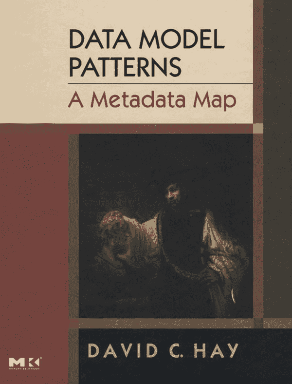

- *数据模型模式：元数据映射* David Hay
- *数据挖掘：概念与技术，第二版* Jiawei Han 和 Micheline Kamber
- *查询 XML：XQuery、XPath 和上下文中的 SQL/XML* Jim Melton 和 Steve Buxton
- *Joe Celko 的 SQL 编程：高级 SQL 编程，第三版* Joe Celko
- *移动对象数据库* Ralf Güting 和 Markus Schneider
- *多维和度量数据结构基础* Hanan Samet
- *Joe Celko 的 SQL 风格* Joe Celko
- *数据挖掘，第二版：概念与技术* Ian Witten 和 Eibe Frank
- *模糊建模与数据挖掘探索的遗传算法* Earl Cox
- *数据建模基础，第三版* Graeme C. Simsion 和 Graham C. Witt
- *基于位置的服务* Jochen Schiller 和 Agnes Voisard
- *企业架构师数据库建模* Terry Halpin, Ken Evans, Patrick Hallock, Bill Maclean
- *数据密集型 Web 应用* Stephano Ceri, Piero Fraternali, Aldo Bongio, Marco Brambilla, Sara Comai, Maristella Matera
- *挖掘 Web：从超文本数据中发现知识* Soumen Chakrabarti
- *高级 SQL：1999——理解对象关系和其他高级功能*
- *高级应用的数据库查询原理* Clement T. Yu 和 Weiyi Meng
- *事务信息系统：理论、算法与并发恢复实践* Gerhard Weikum 和 Gottfried Vossen
- *多媒体数据库原理* V. S. Subrahmanian
- *空间数据库：结合 GIS 应用* Philippe Rigaux, Michel Scholl 和 Agnes Voisard
- *信息建模与关系型数据库：从概念分析到逻辑设计* Terry Halpin
- *组件数据库系统* Klaus R. Dittrich 和 Andreas Geppert 编辑
- *异构与自主数据库管理* Ahmed Elmagarmid, Marek Rusinkiewicz 和 Amit Sheth
- *对象关系 DBMS：追踪下一大浪潮，第二版* Michael Stonebraker 和 Paul Brown, Dorothy Moore
- *DB2 通用数据库完全指南* Don Chamberlin
- *通用数据库管理：对象关系技术指南* Cynthia Maro Saracco
- *数据库系统教程，第三版* Michael Stonebraker 和 Joseph M. Hellerstein 编辑
- *理解 SQL 存储过程：SQL/PSM 完全指南* Jim Melton
- *理解 SQL 和 Java：SQLJ、JDBC 及相关技术指南* Jim Melton 和 Andrew Eisenberg
- *数据库：原理、编程与性能，第二版* Patrick 和 Elizabeth O’Neil
- *对象数据标准：ODMG 3.0* R. G. G. Cattell 和 Douglas K. Barry
- *Web 上的数据：从关系到半结构数据和 XML* Serge Abiteoul, Peter Buneman 和 Dan Suciu
- *数据挖掘：带有 Java 实现的实用机器学习工具与技术* Ian Witten 和 Eibe Frank
- *Joe Celko 的 SQL 编程：高级 SQL 编程，第二版* Joe Celko
- *Joe Celko 的数据与数据库：实践中的概念* Joe Celko
- *在 SQL 中开发时间型数据库应用* Richard T. Snodgrass
- *数据仓库的 Web 农场* Richard D. Hackathorn
- *数据库调优：原理、实验与故障排除* Dennis Shasha 和 Philippe
- *数据挖掘与知识发现中的信息可视化* Usama Fayyad, Georges Grinstein 和 Andreas Weisse
- *高级数据库系统* Carlo Zaniolo, Stefano Ceri, Christos Faloutsos, Richard T. Snodgrass, V. S. Subrahmanian, and Roberto Zicari
- *事务处理原理* Philip A. Bernstein and Eric Newcomer
- *使用新的 DB2：IBM 的对象关系数据库系统* Don Chamberlin
- *分布式算法* Nancy A. Lynch
- *活动数据库系统：用于高级数据库处理的触发器与规则* Jennifer Widom and Stefano Ceri 编
- *遗留系统迁移：网关、接口与增量化方法* Michael L. Brodie and Michael Stonebraker
- *原子事务* Nancy Lynch, Michael Merritt, William Weihl, and Alan Fekete
- *高级数据库系统的查询处理* Johann Christoph Freytag, David Maier, and Gottfried Vossen 编
- *事务处理：概念与技术* Jim Gray and Andreas Reuter
- *构建面向对象的数据库系统：O[2] 的故事* François Bancilhon, Claude Delobel, and Paris Kanellakis 编
- *面向高级应用的数据库事务模型* Ahmed K. Elmagarmid 编
- *开发客户端/服务器 SQL 应用程序指南* Setrag Khoshafian, Arvola Chan, Anna Wong, and Harry K. T. Wong
- *数据库与事务处理系统基准手册，第二版* Jim Gray 编
- *Camelot 和 Avalon：分布式事务设施* Jeffrey. Eppinger, Lily B. Mummert, and Alfred Z. Spector 编
- *面向对象数据库系统读* Stanley B. Zdonik and David Maier 编

# 版权

Morgan Kaufmann Publishers 是 Elsevier 的旗下出版社。

500 Sansome Street, Suite 400, San Francisco, CA 94111

本书书印在无酸纸上。

© 2006, David C. Hay. 由 Elsevier Inc. 出版。保留所有权利。

公司用于区分其产品的标识通常被主张为商标或注册商标。在 Morgan Kaufmann Publishers 获知的所有主张情况下，产品名称均以首字母大写或全大写出现。然而，读者应联系相关公司以获取有关商标和注册的更完整信息。

未经出版者事先书面许可，本出版物的任何部分均不得复制、存储在检索系统中或以任何形式或通过手段（电子、机械、复印、扫描或其他）传输。

许可可直接向英国牛津的 Elsevier 科学与技术权利部门申请：电话：(+44) 1865 843830，传真：(+44) 1865 853333，电子邮件：permissions@elsevier.com。您也可以通过 Elsevier 首页（[`elsevier.com`](http://elsevier.com)）在线完成请求，选择“Support & Contact”，然后选择“Copyright and Permission”，最后选择“Obtaining Permissions（获取许可）”。

# 美国国会图书馆出版数据

Hay, David C., 1947-

数据模型模式：元数据映射图 / David C. Hay。

p. 厘米。

1. 数据仓库。2. 元数据。I. 标题。

ISBN-13: 978-0-12-088798-9 (平装：纤维纸)

ISBN-10: 0-12-088798-3 (平装：纤维纸)

QA76.9.D37.H38 2006

005.74–dc22 2006011123

有关所有 Morgan Kaufmann 出版物的信息，请访问我们的网站 [www.mkp.com](http://www.mkp.com) 或 [www.books.elsevier.com](http://www.books.elsevier.com)。

美国美国制造

06 07 08 09 10 5 4 3 2 1

# 献词

献给我的母亲 Henrietta Hay，她教会我如何写好文章，并欣赏优秀的文字。

# 献词

*时空任意汇聚点*——想象一下，你爸爸是地球上存在过的最聪明的人，他知道一切可以发现的事，而且对每事都是完全正确的，并且能证明自己对每事都是正确的。现在再想象在百万光年外的某个美妙世界上有另一个小孩，那个孩子的爸爸是到目前为止那个遥远世界上存在过的最聪明的人。他和你爸爸一样聪明，和你爸爸一样正确。两个爸爸都是聪明的，也是正确的。

*只有当他们相遇时，才会发生一场可怕的争论，因为他们对任何事情都无法达成一致。现在，你说你爸爸是对的，而另一个孩子的爸爸是错的，但宇宙是一个非常大的地方。有足够的空间让许多人在某些事情上都是正确的，却无法达成一致。*

*两个爸爸之所以可能都是的还会发生激烈争斗，是因为正确的方法有很多种。然而，在宇宙中有些地方，每个爸爸都能理解对方在说什么。我们把这些地方称为时空任意汇聚点。chrono（ROH-no）意味着时间。synclastic（sin-tick）意味着向同一侧弯曲，就像橘子皮一样。infundulum（in-fun-D-lum）是古代罗马人如尤利叶·西撒对漏斗的称呼。*

Kurt Vonnegut, Jr., 来自《泰坦之炉》，版权所有 1988, Kurt Vonnegut。经 Dell Publishing（Random House, Inc. 分公司）许可。

# 前言：关于元数据

二十年前，当我开始担任`Oracle Corporation`的顾问时，我学习了一种特定的数据建模方法。在此之前，我已经做了多年的数据库设计，并经常用图表辅助设计。然而，我在`Oracle`学习的这种特定风格非常不同。我第一次对公司的结构——语言进行建模，而不仅仅是数据库结构。组织如何理解自己，我该如何将其呈现出来以便我们讨论需求？

得益于这种方法，我能够进入一个对我几乎没有任何先验知识的公司，并迅速理解该组织的本质和问题——往往比那里的大多数人还要清楚。

我很快意识到，要高效完成工作，重要的不是语法（表示法）的约定，而是语义（含义）的约定。这就是我第一本书《数据模型模式：思维约定》的来源。我发现几乎所有的商业和政府组织——在几乎所有的行业——都共享某些语义结构，理解这些结构使得我能快速理解每个组织独特的语义。

然而，在这个方面尚未得到妥善解决的唯一行业是我们自己的行业——信息技术。至少是因为处理大多数业务的模式对于理解这个行业并没有太大帮助。当业务模型代表业务的语义时，我们需要的是表示语义本身的模型。我们需要用于描述业务的模型的模型。

由于许多公司没有数据模型的原因，我们的行业也因为同样的原因没有得到妥善解决：我们尚未看到这种需求。正如对组织数据进行建模的想法对于许多业务人士来说似乎有些过于深奥一样，对信息技术数据进行建模的想法对我们中的许多人来说也显得太奇怪了。但这种需求确实存在。如果一个组织要成功地获取和使用系统来满足客户需求，那么它更好地理解其数据的底层本质（并借此理解自身结构的底层本质）是至关重要的；同理，如果我们要成功地为客户产出信息系统产品，那么理解我们数据的底层本质（并借此理解行业自身结构的底层本质）也是至关重要的。

正如你将看到的，某些语义模式在信息技术领域与在任何其他行业实际上是相同的。最值得注意的是，人和组织是信息技术世界的组成部分，就像它们是任何业务的核心一样。同样，在信息技术世界中定位程序和数据，与在业务世界定位产品和客户并没有太大区别。然而，除了这些主题，书中的模型与典型的商业模型非常不同。业务关注的是产品和流程的建模，而我们的模型关注的是对产品或流程进行`描述的概念`建模。

亚里士多德将他的著作称为“Meta”物理学，仅仅是因为他在写完关于物理学的著作后写的这一本，而`meta`在希腊语中是“之后”的意思。这本书也可以关于一个“元”模型，仅仅是因为我在创建了多年业务模型之后了它。但它不仅于此。由于亚里士多德形而上学的特殊性质，`meta`一词变成了“之上”或“超越”。由于这个模型的特殊性质，我确定没有人会反对在这种更具宇宙意义的层面使用这个词。

## 关于本书

`metadata`（元数据）中的“data”意味着我们对行业的这一描述将以数据模型的形式表达。这里的概念使用语义数据构造来呈现。但数据并不是该模型的唯一`主体`。本书旨在比之前的努力更具`全面性`，因为它将涵盖我们行业的更多方面。因为这是对元数据的全面观察，因此需要一个对世界的全面观察。本书不仅描述了数据建模的结构，还描述了活动、人、组织、地点、事件和时间以及动机的模型。

是的，你们中熟悉约翰·扎克曼（John Zachman）的企业架构框架的人会认出这些主题。他们他理解信息系统开发世界这一知识体系的方法中，关于“什么、如何、谁、在哪里、何时以及为什么”的列。这些列确实构成了书中章节的基础。

虽然该模型旨在是全面的，但顺便说一下，我敏锐地意识到它可能还不够全面。首先，并不是所有的行都被覆盖了。建模构建者的世界（第五行）需要对每种不同品牌的关系型数据库、编程语言以及处理业务规则和其他领域的新工具进行建模。光是这些模型就需要几本这种大小的书了。因此，从“小处”着手是合理的。

其次，正如书名所示，这些真的只是为元数据建模的模式。这并不是一个“元数据仓库”的全面设计。相反，这个模型是尝试识别必须在此类仓库中存在的最基础且最广泛适用的的概念。我敏锐地意识到一个事实：如果你在特定环境中构建一个仓库，你将在许多领域需要更具体的细节。我唯一的希望是这个模型能让你清楚在何添加这些细节。

除了解决约翰·扎克曼架构框架中的各个列之外，本书还探讨了系统开发过程中不同人员所采取的观点：首席执行官、经营业务的人、信息架构师、设计师、构建者以及系统的用户。通过探讨框架中描述的不同视角，本书应该比之前的努力更`易于理解`。它描述了业务所有者、系统架构师和设计师视角下的元数据——用他们的术语来描述。

由于这里描述的架构框架的每一行都代表一个特定的视角，而描述该行的模型部分是以适用于该视角的语言呈现的，因此业务元数据和技术元数据都被包含在内。每个部分旨在让其目标受众阅读并理解。此外，模型是一小块地呈现的，以确保描述的结构可以被任何受过教育的——即使不精通技术的读者所理解。

本书的主题是控制系统开发和管理的元数据的单一`概念数据模型`（一个`实体关系模型`）。它是一个概念数据模型，因为它是对我们所处业务的统一描述，而不是针对特定数据库的设计。事实上，它根本不是元数据仓库的设计，尽管它确实描述了此类仓库应该包含什么，而且任何设计师在承担此类设计之前，都被建议彻底理解它。从根本上说，这是一个三行模型（Row Three model）。这本书本身使用特定的词汇（尽可能接近受过教育的英语）来描述这里包含的概念。然而，所描述的内容之一本身就是词汇这个概念。这意味着所使用的模型本身就是所描述内容的示例。（对于那些尽管作者付尽了努力但仍发现模型意义并非直观易见的人，呈现的所有实体类和属性在文中和书末的词表里都有了定义。）

当一家公司开发其业务的数据模型时，该模型是开发新数据库的有用产品。然而，产生模型本身的工作往往会让参与人员对他们业务的本质产生深刻的见解。这些见解通常代表了企业的直接利益，优于从模型中获得的任何改进系统。它给了他们一个机会去理解他们赖以生存工作的`影响`——对他们的系统、同事以及整个业务的影响。

所以，你拥有的是一个在我们尝试改进组织信息管理时背后主要概念的模型。有趣的是，一旦我们理解了这些概念，过去几十年困扰我们行业的主要争议（例如对象对象与关系型、实体关系图与 UML 类模型等）就不再那么激烈了。事实证明，人们对任何特定技术变化的价值并没有真正的分歧，只是在竞争者的观点上有分歧。理解了这些视角的差异，争论消失了。

书中的模型展示的正是这些技术变化意味着什么。这个新工具改变了我们编写程序的方式吗？它改变了我们构建（或执行）流程的方式吗？它改变了我们分析需求的方式吗？将技术正确放在框架中有助于理解其意义——实际上，增加了增加了我们有效实施的能力。

例如，`UML`被誉为建模领域的一项伟大创新。确实，它在某些方面的表达能力比以前所见的要强。但重要的是，要理解它真正新颖在哪里，哪些仅仅是可以用其他方式表示的事物的新表示法。书中的模型应当明确区分这种区别。

本书面向数据管理社区——数据管理员、数据库管理员、数据建模师等此类人员。但它对系统开发人员也应该有用，帮助他们更轻松地理解自己所做内容的意义，以及这些内容在宏大蓝图中的位置。它在学术环境中教授上述所有这些人时也应该是很有用的。这可能要求过高，但如果信息技术经理至少了解这些模型的大轮廓，也将具有价值，因为这同样是为了确保他们理解自己所做工作的背景。

这些页面中的模型试图从许多不同的视角展示信息处理世界。如果运气的话，也许我们真的拥有一个“时空同步漏斗”（chrono-synclastic infundibula）。

## 致谢

我必须首先对 Allan Kolber 表示感谢，他不仅在整个过程中鼓励我，还对`Zachman Framework`提供了非常有价值的见解，特别是对`Business Owner’s View`（业务所有者视角）真实含义。我仍然保留在细节上与他持不同意见的权利，但他的见解对本书至关重要。

当然，还要感谢我的`Business Rules Group`同事，他们为业务规则和`Architecture Framework`的孵化提供了一个极好的平台。他们成为`Business Rules Team`合作者是向前迈出的重要一步，我感谢《业务词汇与业务规则的语义》（Semantics of Business Vocabulary and Business Rules）的出版。我诚心希望本书是对那项工作的恰当补充。特别是 Cheryl Estep，花了许多时间帮助澄清我的工作在哪些地方与`Business Rule Team`的努力产生了分歧。

请注意，我大量借鉴了`BRT`早期草稿。虽然我想对成员的贡献表示感谢，但任何解释上的错误或与最终定稿的偏差完全由我负责。

还必须感谢 Bob Seiner 多年来忠实地出版了《数据管理简报》（[`www.tdan.com`](http://www.tdan.com)）。除了为世界提供了一个关于所有数据管理事务的绝佳知识来源外，它还为我提供了一个极佳的平台，用于探索最终导致本书的理念。

感谢 Meiler Page-Jones，他写下了我发现的关于对象设计的最好的书籍[Page-Jones 2000]。它足够清晰，可以作为我对象方向模型的基础。

从 ANSI 到 John Zachman，我一直对我书单中的所有作者（以及其他人）怀感激，他们为我在这里所做的任何事情形成了智力基础。

我很幸能够向各种组织展示这一模型。我特别想要感谢德克萨斯建模与用户小组，特别感谢 Lee Leclair 提供的富有见解的评论。还要感谢加拿大信息资源管理协会的款待；特别是 Dorothy Russel、Kerel Vitrofsky 和 Deborah Henderson 的意见非常有帮助。也感谢来自波士顿和罗彻斯特`DAMA`分会的意见。在伦敦参加`Metadata 2005 Conference`的人员也帮助帮助我指出了模型中一些剩余的错误。

如果没有我在 Morgan Kaufmann 的拥护人 Diane Cerra 以及整合这一切的项目经理/编辑 Marilyn E. Rash 的帮助，这一切将是不可能的。此外，由于所有慷慨花时间审阅手稿内容的人的建议，书籍的质量得到了极大提升：James Bean, Charles Betz, Malcolm Chisolm, Michael Eulenberg, Dagna Gaythorpe, Terry Halpin, Mike Lynott, Dave McComb, Ken Orr 和 Graeme Simseon。

当然，一如既往，感谢我的妻子 Jola，以及 Pamela 和 Bob 的陪伴。

## 前言

马塞尔·普鲁斯特（Marcel Proust）曾写道，真正的发现之旅不在于寻找新的风景，而在于拥有新的眼光。在信息系统领域，景观的一部分变化如此迅速，以至于我们很容易忽视从新鲜视角中可以发现的价值。这对于系统规范尤为如此，这里的进步更多来自于新想法而非新技术。

系统规范传统上根据其过程进行讨论。初学者学习阶段和任务；辩论集中在不同方法论的优缺点上。然而，信息系统专家很久以前就知道，虽然过程分析可能是理解业务最明显的方法，但它不是唯一的方法。观察数据——关注`是什么`（what）而不是`如何做`（how）——不仅补充了过程视角，而且可能产生更深入、更简洁、更稳定的描述。数据建模师经常获得过程建模师会遗漏的洞察。

在书中，Dave Hay 将专家数据建模师的视角引入了系统规范业务。他的起点是`Zachman Framework for Enterprise Architecture`（企业架构 Zachman 框架），该框架本身的长寿至少部分归功于对产物而非活动的关注。

本书从对`Framework`的一些见见且实用的调整开始。在二十多年后，反思型用户应该会有一些改进建议，这并不意外；如果纯主义者将这些变化视为对`Framework`持续适用性和适应性的确认，那将是令人失望的。随后，Dave 详细介绍了每个相关单元格中使用的信息的结构。根据他数据建模的哲学，他寻求描述而非规定，阐明已有的方法而非提出自己的方法。

结果是构成信息系统规范的全面蓝图，从业务需求到逻辑设计。Dave 将其称为“IT 行业的企业数据模型”——对系统专业人员完成工作所需的数据描述。无论我们使用什么方法论，无论我们是记录数据还是非正式地传递数据，这些都是我们需要的内容。对于 Zachman Framework 的用户来说，这里的信息提供了一个清晰的“下一层”。对于普通的信息系统从业者、学生和学者来说，它提供了一个即使在方法和技术变化时也可能具有持续价值的视角。

本书的语言是数据建模——这是它的特别优势之一。使用数据模型，而非依赖文本和示例，提供了该领域许多其他工作所缺乏的完整性和严谨性。Dave 作为一名在职数据建模师的背景，在模型的内容和呈现中，以及他用于说明模型的示例中是显而易见的。读过他早期关于数据模型模式和系统规范书籍的读者将知道，他为这项任务带来了学科领域知识和数据建模专业知识的独特结合。

因此，阅读这本书不仅是为了获得对系统规范的“新眼光”，更是为了看到专家建模师如何使用数据建模语言来表示和交流复杂而重要的领域。

Graeme Simsion, Simsion & Associates 以及墨尔本大学

# 1 关于元数据模型

*曾经有一个叫 Corey 的家伙*

*他的职业生涯未曾光辉*

*由于他有了糟糕的一天*

*因为他就是说不出*

元数据仓库。

## 什么是元数据？

在 20 世纪 90 年代，`data warehouse`的概念席卷了整个信息技术行业。在经历了多年的尝试后，公司似乎终于能够将其所有数据存储在一个地方，用于报告和分析。实现这一点的技术仍然很新，初期的尝试结果参差不齐，但这种努力是非常严肃的。

这一努力过程中产生的问题之一是：人们意识到，如果高级管理人员要向一个巨大的数据库提问，就必须知道数据库中究竟包含什么，以及应该提什么类型的问题。因此，除了数据本身之外，还需要保留关于数据的数据。20 世纪 90 年代为这种“关于数据的数据”创造的术语是`元数据`（metadata）。

从那时起，关于主题出版了大量的书籍和杂志文章，但大多数都集中在为什么元数据很重要，以及管理元数据的技术和方法上。这些出版物遗漏的是对这些东西究竟`是什么`的清晰描述。十年过去了，仍然没有一种简单、清晰的元数据描述，它既足够全面以涵盖我们的行业，又易于人们理解和使用。本书试图产生这样一种描述。

与所有的流行术语一样，元数据这个术语一旦发明就有了自己的生命力。它被各种描述为：

- `关于组织数据资源的任何数据` [[Brackett 2000], [p. 149]]。
- `组织内外的所有物理数据和知识，包括关于物理数据的信息、技术和业务流程、数据的规则和约束，以及公司所使用的数据结构` [[Marco 2000], [p. 5]]。
- `对实例数据的详细描述。已填充实例数据的格式和特征：实例和值，取决于元数据接收者的角色` [[Tannenbaum 2002], [p. 93]]。

从这些定义中得出了几个重要的点。首先，正如 Marco 先生指出的，`业务元数据`（business metadata）和`技术元数据`（technical metadata）之间存在区别。元数据的业务用户感兴趣的是语言的定义和结构，作为所检索信息类型的术语。技术人员则关注用于存储和管理数据的物理技术。这两个观点都是重要的，并且必须同时解决。

其次，该主题涉及的不是数据。正如 Brackett 先生所说，它是“关于组织数据资源的`任何`数据”。一旦你开始观察组织的数据结构，你就必须也要考虑其活动、人员、组织、地点、时间、事件以及动机。

第三，正如 Tannenbaum 女士指出的，问题的“元”（meta）维度是一个观点问题。相对于业务收集的数据，存在元数据。还有`元元数据`（meta-metadata），用于理解和管理元数据。

最后一点在[图 1-1]中得到了说明。在这里，底部显示了信息系统中经常被描述的世界中的事物。“朱莉娅·罗伯茨”（Julia Roberts）是一个真实的人。银行的“华街分行”是开展业务的物理场所。储蓄账户“09743569”是特定客户（例如朱莉娅·罗伯茨）在该银行的一个特定账户。该账户的客户可能会在特定时间执行实际的“ATM 取款”。

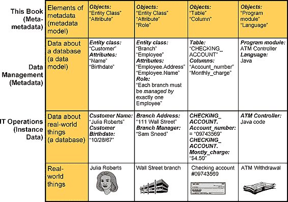

图 1-1 数据与元数据。

再上一行在前三列中显示了可能描述这三件事的数据：(1) 客户的名字为“朱莉娅·罗伯茨”，“出生日期”为“10/28/67”。(2) 分行的地址为“华街 111 号”，经理是“Sam Sneed”。(3) 储蓄账户的账号为“09743569”，每月费用为“$4.50”。在第四列中，从底部起的第一行显示一个特定的程序（在此称为“Java 代码”）负责“取款交易”。这些是管理银行业务数据的人员所关心的事项。注意，每个术语都被描述为它们是什么：客户名、分行经理、账号等。

从倒数第三行收集了这些描述符并依次对它们进行标记。这是为了创建我们数据管理领域所说的`元数据`。这些标签包含两个部分。首先是业务数据所描述的重要事物的名称，例如实体类`Customer`（客户）和`Branch`（分行）。其次，这些每个项又由属性描述，例如“姓名”、“地址”和“出生日期”。在银行分行的案例中，我们还发现实际上还有一个实体类`Manager`（经理），并且与`Branch`相关（“每个分行必须恰好由一名员工管理。”）。

在储蓄账户列中，我们看到储蓄账户实际上是数据库中一个表的主体。该表名为`CHECKING_ACCOUNT`，具有`Account_number`（账号）和`Monthly_charge`（每月费用）列。第二行中简单描述为“Java 代码”的 ATM 程序实际上是语言`Java`中名为`ATM Controller`（ATM 控制器）的程序模块。正如我们看到的，元数据行本身包含了几种不同对象（`实体类`、`属性`、`表`、`列`、`程序模块`和`语言`）。顶行代表的元数据行的任务是展示这些对象是如何相互关联的。

当然，要意识到即使是业务数据和元数据之间的界限也不像看起来那样清晰。例如，`PRODUCT TYPE`（产品类型）关于约束业务模型中许多属性的引用数据。尽管如此，产品类型列表的规范仍然属于业务领域，而不是数据管理员。它既扮演了业务数据又是元数据的角色。可能更属于元数据管理人员领域的是`PRODUCT CATEGORY`（产品类别）。这类应该相对少，且列表应该相对稳定。

## 寻找元数据

`Metadata repository`（元数据仓库）是一个辞藻过大的术语，其实无非一个包含元数据的计算机数据库，用于支持企业大部分系统的开发、维护和运行。除其他外，这样的仓库可以作为数据仓库的基础。

在过去的三十多年里，这一构想被以许多不同的方式进行解释。第一批元数据仓库是 20 世纪 70 年代和 80 年代程序中的`data dictionaries`（数据字典）和`copy libraries`（拷贝库）。`data dictionary`只是传统大型机数据处理应用程序文件中特定类型记录所包含字段的列表。`Sometimes`这还会伴随着对每个文件和字段含义的定义。`copy library`是一个包含数据定义部分的文件，供多个程序使用（通常是`COBOL`程序，但其他语言也使用拷贝库）。特定的程序随后将利用`copy library`获取它们的数据规格。这很少伴随着对程序代码中每个术语的定义。

自 20 世纪 80 年代以来，`computer-aided systems engineering`（CASE，计算机辅助软件工程）工具一直在记录它们组织中创建和管理的结构描述，某些`CASE`工具厂商提供了他们自己的底层数据结构模型（通常这些是作为数据和功能模型及其背后文档捕获的数据和活动模型）。即使是现在，需求分析期间收集的业务信息通常也是任何开发项目中捕获的元数据的第一个组件。

思路类似，“百科全书”被开发以支持其他类型的工具，例如`extraction, transfer, and load`（ETL，提取、转换和加载）设施。在 20 世纪 80 年代和 90 年代初，IBM 花了巨大的精力开发了一种名为`Repository Manager MVS`（`RM/MVS`）的通用元数据管理工具。该工具是 IBM 作为`CASE`运动一部分开发的`AD/Cycle`工具活动的核心。IBM 与多个`CASE`合作伙伴和其他组织合作，试图为从规划到运行的所有应用开发构建一个通用的、端到端的元数据管理体系。

各种软件供应商都尝试过改进`CASE`工具之间的通信，这要求它们对元数据的内部结构进行建模。然而，这种结构通常是专有的，这些厂商没有动力发布他们的版本。近年来，随着数据仓库运动的兴起，关于元数据仓库的文献大量增多。有大量的书籍和杂志文章描述了元数据的重要性以及它们对 21 世纪运营的企业的意义。

Tannenbaum 女士、Brackett 先生和 Marco 先生的原始著作（在本章前文中已提到）包含了前述引用的定义，并且是目前关于元数据及其对现代商业意义这一主题最完善的资源。但尽管它们描述了元数据的重要性和影响，但它们对元数据仓库中应该包含什么内容的描述并没有呈现出一个完整的模型。

Tannenbaum 女士确实提供了一份分类应包含内容的列表 [Tannenbaum 2002]，但她并没有尝试对这些进行建模。Marco 先生在他 2000 年的书中提出了一个简单的模型，但即使他也承认这只是一个起点。他的最新书籍 [Marco and Jennings 2004] 是一个更好的数据仓库设计实用元模型改进版本，但尽管如此，它遗漏了许多可以包含的内容：它还没有远到能够解决我们整个行业的底层结构问题。

20 世纪 90 年代，几家公司提供了元数据仓库产品，每个产品都由一个空数据库和操作此类数据库可能包含的元数据的工具组成。然而，这些产品只描述了部分所需的信息——很大程度上只是表和列结构，以及跟踪更新历史的能力。

元数据联盟（`MDC`）曾尝试开发一个更全面的元数据模型，并在 1999 年发表了它的模型`Object Information Model`（对象信息模型）。然而，它是非常复杂且抽象的，非常难以理解。`MDC`此后被并入对象管理小组（`OMG`），合并后的组织现在发布了`Common Warehouse Metamodel`（`CWM`，通用仓库元数据模型）和`Meta Object Facility`（`MOF`，元对象设施）。John Poole 和他的同事在`Common Warehouse Metamodel`[Poole et al. 2002]中描述了这些。更详细的描述可以在 OMG 网站`http://www.omg.org/cwm/`上找到。

`CWM`旨在成为业务元数据模型，而`MOF`旨在成为元数据的元数据模型。虽然比`MDC`模型好得多，但这两个模型都存在在面向对象的设计环境中开发的缺陷，并且侧于适用于定义设计而非显示概念本身的元素。这两个模型对于那些只想查看业务规则、实体类及关系或功能层次的人来说，并不容易理解。那么，这一切给我们留下了什么？我们应该在元数据仓库中包含什么？

## 架构框架

由于这里介绍的模型旨在代表整个信息管理行业，因此需要一个`Architecture Framework`来组织知识体系。这里使用的架构框架基于 John Zachman 1987 年和 1992 年的`Enterprise Architecture Framework`[Zachman 1987; Sowa and Zachman 1992]。

`Zachman Framework`由一个矩阵组成，行代表不同的人对信息技术项目的视角，列代表他们从每个视角看到的内容。后者包括数据、活动、动机等等。（这里使用的架构框架关注同一个矩阵，但在行的定义上与 Zachman 先生的版本略有不同。）事实证明，我们对信息系统想知道的一切都在这个矩阵的一个或多个单元格中，而这些单元格集合为组织本书提供了一个非常有用的基础。这里介绍的模型每个部分描述了一个或多个单元格的内容。在本引言章节之后，每一章将处理一列。

架构框架如图图 1-2 所示。框架中的行代表了系统开发过程中不同参与者的视角，而列代表了从每个视角观察的事物。尽管这些概念是相同的，但某些行的名称与 Zachman 先生在其原始论文使用的名称有所不同。

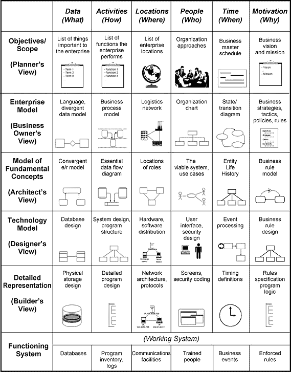

图 1-2 架构框架。

### 行

框架中的每一行`row`都代表了系统开发过程中某一类参与者的视角，而每一列则代表了该过程的不同方面。这些视角包括：

- `范围`（`规划者视角`）：这定义了企业的方向和业务目的。这对于为任何系统开发工作建立背景是必要的。它包含了对系统或其他项目边界的定义。
- `业务模型`（`业务所有者视角`）：这从业务术语的角度定义了业务的本质，包括其结构、流程、组织等。通常，一个特定的企业会有多个业务所有者视角，这些视角可能会重叠甚至相互矛盾。这些业务所有者的视角可以分为两类。

  - `业务当前实体状况的视图：`业务中的大多数人关注的是按照目前存在的方式开展业务所需的特定组织、计算机系统、表单和程序。这种世界观构成了美国国家标准协会在 1975 年所说的“外部模式”[ANSI 1975]。
  - `对业务底层本质的单一视图：`每个业务所有者所看到的单个事物通常是更具通用性和更基础的事物的示例。这种视角是相对抽象的，尽管它尚未被结构化以作为设计计算机系统的基础。这是业务“概念性”模式（模型）的开始[ANSI 1975]。

  这一行的本质在于它捕捉了组织的`semantics`（语义）。也就是说，这一行是关于业务所有者视角下看到的业务词汇。

- `基本概念模型`（`架构师视角`）：这一视角将第二行中的底层结构以一种更严谨的方式呈现出来，完善了业务的概念模型。这仍然没有参考任何特定的技术。

例如，业务所有者对业务规则的视角涵盖了可能施加于业务的所有约束，而架构师视角仅关注影响数据更新或执行此类更新过程的约束。业务所有者的数据视角可以包含多对多关系、三个或更多实体类之间的关系（`n 元关系`）以及`multi-valued attributes`（多值属性）。架构师视角消除了所有这些。

Zachman 先生最初将此称为“信息设计者视角”，因为它在使结构适用于自动化方面发挥了作用。然而，`designer`（设计师）一词带有将技术应用于问题解决方案的含义，尽管这一行实际上仅仅代表了尽可能严谨地描述企业的最终阶段。建筑项目的建筑师负责描述其结构，重点在于设计而非技术。出于这个原因，将其称为“架构师视角”似乎更为合适。

- `技术模型`（`设计者视角`）：这描述了如何使用技术来解决上述行中所确定的信息处理需求。在这里，选择了对象型数据库而非关系型数据库（或反之），选择了编程语言类型（第三代或第四代、面向对象等等），定义了程序结构，指定了用户界面等。

前三个视角是业务的视角。这是第一个关于信息技术的视角。

ANSI 的数据视图将其称为“逻辑”模式 [ANSI 1975]，但在多年后的以后，它变为了“物理模型”的名称。事实上，即使是 Zachman 先生也将这一视角称为“构建者视角”。这很遗憾，因为下一行似乎才更符合“构建者”和所有“物理”事物的领域。这第四行是关于新构件的`design`（设计），而不是它们的`construction`（构建）。

- `详细表示`（`构建者视角`）：构建者看到了特定语言的细节、数据库存储规范、网络等。这就是 ANSI 所说的“物理”模式 [ANSI 1975]。

Zachman 先生将此称为“分包商视角”。

- `运行中的系统`（`清单视角`）：最后，以新系统的形式向组织呈现了一个新视角。这是安装在特定位置的实际计算机系统及其数据库的视角。来自第四行的单一系统设计可能实现在许多系统中。

## 列

架构框架中的每一列`column`代表了每个视角感兴趣的领域。列描述了开发的维度。这些是：

- `数据`：该列的每一行都处理企业关注的、需要存储信息的事物。在第一行中，它是关于企业处理的对象。在第二行中，它是关于所使用的语言——术语、事实和定义；在第三行中，它是关于具体定义的实体类及其相互关系。第四行关注计算机软件和数据库管理系统对数据的表示。这可以是表和列、对象类或其他任何系统开发方法的产物来表示。在第五行中，它是关于使用特定数据管理技术在计算机上物理存储的方式。这一行通过表空间、磁盘驱动柱等进行描述。第六行是关于数据库的物理清单。

- `活动`：第二列的行关注企业为了支持自身所做的事情。在第一行中，这些是业务整体功能。在第二行中，这些是执行这些功能的物理流程。在第三行中，它们是第二行流程的核心活动。第四行关注程序的运行，第五行视角关注编程语言的细节。第六行是关于程序代码的物理清单。

- `位置`：这一列关注运营的地理分布及其元素如何相互通信。在第一行中，它关注企业运营区域。在第二行中，它专门关注企业的各个办公室及其相互关系。在第三行中，它关注每个位置扮演的角色，以及如何与其他位置进行通信。第四行关注计算机网络和通信的设计，而第五行关注通信网络的协议和特定组件。第六行是关于网络中每个节点的物理组件和位置，以及连接它们的通信设施。

- `人员`：这一列描述了谁参与了业务以及技术的引入和管理。第一行涉及企业对人力资源管理的态度和哲学。第二行专门关注人员对语言、流程等第二行产物的责任。第三行涉及对定义和架构的管理责任（stewardship）。第四行关注人机界面的设计，包括安全和访问问题，而第五行（结合“活动”列）则涉及这些界面的编程。第六行关于受过培训的人员在安全高效的环境中与系统进行交互。

- `时间`：这一列描述了时间对企业的影响。这包括第一行的年度规划、第二行的业务事件以及第三行的数据相关事件。第四行将数据相关事件转换为系统触发器。第五行涉及这些触发器的实现。第六行关于对实际事件的跟踪。

- `动机`：正如扎赫曼先生（Mr. Zachman）最初描述这一列时那样，它涉及将业务目标和策略转化为具体的终和手段。从以后，这已扩展到适用于企业努力的全套约束条件（业务规则），因为正是这些约束决定了人们为何行事所为。第一行关注企业的愿景和使命。第二行处理其目标、目的、策略和战术，并将它们转变为业务政策和业务规则。第三行处理系统约束对数据影响的特定表述。第四行关于设计实现这些影响（以及应用于活动的约束）的程序，而第五行关于这些程序的构建。第六行是实现规则的程序集合（包括数据库管理系统）。

## 元模型与框架

因此，框架中的每个单元格都包含了从从特定视角对企业某个层面的描述。通常情况下，这种描述以一个或多个模型的形式呈现，尽管大多数第一行的产物仅仅是列表。对这些描述（模型或列表）的描述就是元数据。那么，本书的主体模型，就是对这些描述的模型。

本书按列组织结构，但底层模型是按行组织的。也就是说，每个视角都会产生一个涵盖该行内所有框架单元格（行/列交汇点）的模型。在介绍某个单元格时，模型中的概念将作为“属于”该列中的该单元格而被引入，但它几乎总会在同一行其他列单元格概念的语文中进行展示。

由于列之间存在重叠，按顺序介绍它们会有些棘手。在某些情况下，必须在介绍其所属的列之前先引入概念。这需要耐心。

在大多数情况下，行之间没有相同程度的重叠。大多数概念只属于一个视角。然而，例外也是。首先，第二行的数据列涉及`BUSINESS CONCEPT`（业务概念）的概念。在第三行中，`ENTITY CLASS`（实体类）和`ATTRIBUTE`（属性）被作为`BUSINESS CONCEPT`的子类型（示例）。还有其他一些行间重叠的情况。但更常见的是，在每一列中，实体类的示例简单连接了来自不同行的概念（例如第三行描述的属性与第四行列之间的`ATTRIBUTE COLUMN MAPPING`）。

本书介绍的模型本身就是数据列的一个产物，其中涉及的“企业”是指参与信息系统开发、维护和运行的人员集合。它是外部业务所有者视图（Business Owner’s View）与概念架构师视图（Architect’s View）的交叉体。它首先是一个架构师的概念模型，因为它遵循所有数据建模的规范化学科，并完全以二值关系表示。除此之外，这涉及到解决多对多的关系。它还是一个连贯、统一的视图——整个元数据管理元素的单一模型。

然而，该模型也类似于业务所有者视图，因为它完全使用元数据管理器和系统开发者的语言。它极少使用这些术语的抽象，并且在需要抽象时，会解释其原理（和结果）。该模型提供了一套讨论元数据的词汇，该词汇的术语在正文和书末的附表中均有定义。

本书的模型旨在描述架构框架第二行到第四行所有列的元数据。也就是说，它展示了每一列中不同部分的图表，这些部分按顺序反映了业务所有者视图、架构师视图和设计者视图。此外，它将涵盖数据、活动、位置和动机列的第六行（运行中的系统）。为了建立上下文，偶尔会引用其他行的模型。

这一切都说明框架的单元格并不是整齐划的。在某些情况下，行之间的差异无非模型的内容。在另一些情况下，列的元模型利用了来自同一列其他视角的元素。在另一些示例中，图可能会描述来自多个一个列的元素。具体而言，模型的组织方式如下节所示。

### 数据

数据由以下部分组成：

- `第二行`关注业务语言。它处理概念、事实、词汇和符号。模型的这部分源自业务规则团队联合对象管理小组 [`BRT 2005`]的开创性工作。

- `第三行`关于实体关系模型（“概念性”数据模型）。也就是说，它关注实体类、属性和关系，用严谨的术语描述对业务具有重要意义的事物。这些实际上是第二行中表述的概念的子类型。

- `第四行`描述了用于特定技术的数据结构。在前三行中，描述的是业务的本质，而在第四行中，模型是设计产物——关系型数据库表、面向对象的设计类等。这一行中的表或类在从上与第三行中出现的实体类不同。所选择的技术会影响该行的元模型。关系型数据库设计模型与面向对象的类模型是不同的。注意，建模符号`UML`原意是作为在第四行中建模面向对象设计的方法。`UML 类图`中的某些符号也可以用于创建第三行的实体关系图，这并没有改变第三行模型的含义在根本上不同于第四行模型的事实。

- `第六行`描述构成真实数据库的表和列的实际实例。

## 活动

活动由以下部分组成：

- `第二行`描述业务的功能（在功能层次结构中，不考虑时间或机制）以及执行这些功能的特定业务流程（带有机制、参与者和时间要求）。

- `第三行`对具有顺序和时间的关键系统过程进行建模，但不包含机制。最重要的是，`essential data flow diagram`（关键数据流图）模拟了数据从一个过程传递到另一个过程的方式以及每个过程执行的转换。

- `Row Four`根据所采用的技术描述计算机处理过程。在这里，你将看到对程序模块、其结构以及它们使用和产生的数据引用。

- `Row Six`关于实际程序模块的清单及其运行日志。

## 位置 (Locations)

位置由以下部分组成：

- `All rows`：此模型利用了地理位置业务模型，但将那里的相关概念链接到框架中每一行的元模型（metamodel）概念。在元数据世界中，我们关注活动发生在哪里、数据在何处捕获和分类等，就像在业务模型中我们关注人们居住在哪里、设施位于何处以及生产在哪里一样。行之间的区别取决于每个位置中对象的类型。

## 人员与组织 (People and Organizations)

人员和组织由以下部分组成：

- `All rows`：同样，元级别的人员和组织模型大量使用了业务级别的概念。在仓库中，我们希望记录谁负责实体类或程序模块，就像在业务中我们想知道谁负责产品或合同一样。同样，层级之间的唯一区别在于每个人或每个组织负责的内容。

## 时间 (Timing)

时序由以下部分组成：

- `Rows Two and Three`都关注`状态转换图`(state-transition diagram)——展示了实体类（或业务概念）可以经历的状态以及触发这些状态变化的事件。在 Row Three 中，我们增加了对`实体生命历史`(entity life history)的引用，并重新审视了`基本数据流图`(essential data flow diagram)。

- `Row Four`有它自己的模型，描述了程序元素的触发器。

## 动机 (Motivation)

动机包括：

- `Rows One and Two`是业务运行中的`动机`(motivation)模型。Row One 描述了企业的`愿景`(vision)和`使命`(mission)，而 Row Two 关注`目标、目的、策略、战术、业务策略`以及`业务规则`(business rules)。请注意，业务目标可能包括对新系统的业务需求。

- `Row Three`是数据的`约束`(constraints)模型，包括域。业务规则被翻译对属性值、关系存在性和实体类实例存在性的约束。这些约束反过来可以作为系统需求的依据。

- `Row Four`是程序模块如何实现 Row Three 中定义的系统需求的模型。这包括通常由数据库管理系统管理的引用完整性和唯一性约束，以及必须由存储过程和其他程序实现的其他约束。

- `Row Six`关于真实数据库中数据质量控制程序的执行。

## 记法：对象与实体类 (THE NOTATION: OBJECT AND ENTITY CLASSES)

元数据仓库模型是数据体结构的图形化表示。因此，它可以使用任何描述数据结构的技术来表示。这些包括各种形式的实体关系建模、信息工程、UML 等。在进入元模型的细节之前，值得探讨记法的问题。由于呈现的元数据实际上是数据，让我们深入架构框架的“数据”列，以探索数据模型背后的概念。

### 类模型 (Class Model (UML))

UML 正成为一种表示数据模型的流行记法。在 UML 类图中，我们可以将`对象类`(object class) 表示为业务对象的定义——组织对某个具有重要意义并希望对其捕获信息的实体。图 1-3 中的 UML 类图展示了我们可能为描述销售业务准备的模型示例。方框（`Customer`、`SalesOrder`、`LineItem` 和 `ProductType`）代表对象类；即对业务具有重要意义且业务希望持有信息的实体。

图 1-3 一个 UML 类图。

在每个对象类框内列出了`attributes`(属性），描述了要关于每个对象类捕获的信息。例如，`Customer` 由`Name`、`Shipping address`配送地址）和`Billing address`账单地址）描述。对于`Customer` 的每个实例，每个属性必须至少有一个值，但不能超过一个，如 `[1..1]` 所示。这些每一个数据类型都是 `string`，意味着其值是一段文本。注意，对象类 `ProductType` 的`Description`(描述）和`Unit cost`（单元成本）都用标识符 `[0..1]` 显示，这意味着如果合适，`ProductType` 的实例在这两个属性上的任何一个都没有值。

注意，通常对象类之间是成对关联的，如它们之间的线所示。连接两个方框的线意味着一个对象类的实例以某种方式与另一个对象类的实例相关。关系名称的设计是为了在每个方向上读取，例如，“每个 Customer 可能是一个或多个 SalesOrders 中的买家”，以及“每个 SalesOrder 必须来自且仅来自一个 Customer”。

在书中，为了清晰起见，对关系名称应用了 UML 实践者通常不遵循的约定。每个角色名称都被设计成一个结构化句子的一部分，以准确地传达可选性（optionality）和基数（cardinality）约束。

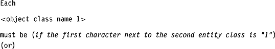

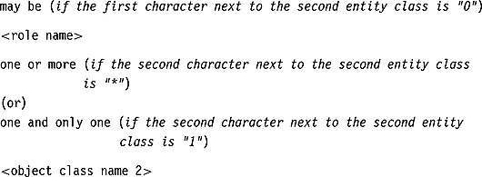

例如，每个角色可以读作：“每个 Customer 可能是一个或多个 SalesOrders 中的买家”，以及“每个 SalesOrder 必须来自且仅来自一个 Customer”。

在介绍之后，让我们开始建模我们将使用的语言。图 1-4 显示了语言对象的开始。在这个模型中，`ObjectClass` 本身是一个对象类的示例，`Attribute` 也是。

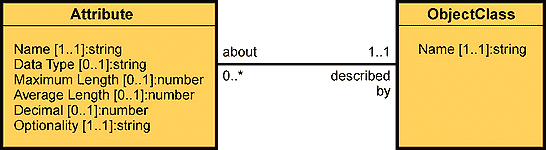

图 1-4 对象类。

`attribute`(属性) 是关于对象类的某些信息的定义。在 UML 图中，属性显示在每个对象类框内部。由于 `ObjectClass` 在此模型中本身也是一个对象类，它有属性——至少有一个（即 `Name`）。这在图 1-4 中所示，并包含了属性可以包含的数据类型——在这种情况下为 `string`。此外，`Name` 旁边的[1..1]` 意味着它是强制性的，且其值不能超过一个。也就是说，对于 `ObjectClass` 的每个实例，`Name` 必须恰有一个值。

由于它是我们感兴趣的事物，`Attribute` 也是图中对象类的示例。`Attribute` 也有属性，包括它的 `Name`，以及它的 `Data Type`数据类型、`Maximum Length`最大长度、`Average Length`平均长度、`number of Decimal places`小数位数和`Optionality`可选性。再次，`Name` 是强制性的，`Optionality` 也是，但其他属性对于每个实例可能有零或一个值——它们是可选的。这通过强制属性旁边的 `[1..1]` 和可选属性旁边的 `[0..1]` 显示出来。由于我们是在关系环境中构建概念业务模型，在实践中，每个属性被限制为不能超过一个值，如注释中的 `[..1]` 部分所示。UML 允许放松该约束并允许每个属性实例具有多个值，但你的的作者并不这样做。

如果将图 1-4 中的模型转换为关系数据库设计，你将拥有一个名为 `ObjectClass` 的表，而实例将（如表 1-1 所示）以 `ObjectClass` 和 `Attribute` 的名称显示。你还将拥有名为 `Attributes` 的表（在表 1-1 中所示）。`Attributes` 表的列包括 `Name`（来自 `ObjectClass` 表）、`Name`、`Data Type`、`Maximum Length` 等。

#### 表 1-1

对象类和属性。

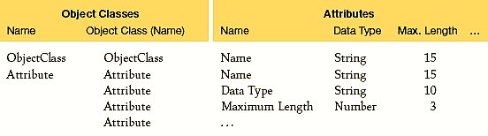

对象类之间可以相互关联。正如我们之前看到的，`association` 在 UML 中通过对象类之间的带注释线进行图形化表示。

关联的每个部分（向一个方向）都是 `role`。`Role` 随后是我们元模型中的另一个对象类，如图 1-5 所示。`Role` 的一个属性是 `Cardinality`，它是与扮演角色的类的实例相关的关联类实例的最大数量。另一个属性是 `Optionality`，这是一个二值变量，决定了角色的实例是否必须存在。当然，每个角色都必须有一个 `Name`。

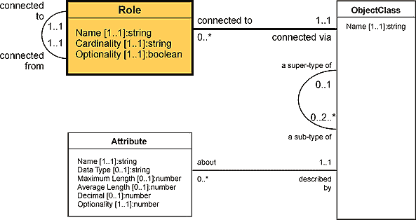

图 1-5 角色 (Roles)。

模型图中的 `Optionality` 由表示扮演角色的对象类框旁符号的前半部分表示。正如我们之前看到的，初始位置的字符 `1` 意味着相反对象的类的每个实例**必须**与相邻对象的类的至少一个实例关联。因此，该角色是`mandatory`（强制的）。（`Role` 的 `Optionality` 属性值为 `False`）。字符 `0` 意味着相反对象的类的每个实例**可以**与相邻对象的任何实例关联。也就是说，该角色是`optional`（可选的）。（`Role` 的 `Optionality` 属性值为 `True`）。使用元模型本身作为示例，“每个 Role 必须连接到且仅连接到一个 ObjectClass”，但“每个 ObjectClass 可能或可能通过 Role 连接”。

模型图中的 `Cardinality` 由每个对象类旁符号的后半部分表示。第二个位置的字符 `1` 意味着相反对象的类的每个实例可以与相邻对象的**不多于一个**实例关联。（也就是说，`Role` 的 `Cardinality` 属性值为 `1`。）字符 `^*` 意味着相反对象的类的每个实例可以与相邻对象的**一个或多个**实例关联。（`Role` 的 `Cardinality` 属性值为 `^*` 或某个特定数字。）例如，在图 1-5 中，“每个 `Role` 必须连接到且仅连接到一个 `ObjectClass`”，但“每个 `ObjectClass` 可能通过一个或多个 `Roles` 连接”。

那么，在模型中（正如我们之前看到的），每个属性必须与恰一个 `[1..1]` `ObjectClass` 实例关联。每个 `ObjectClass` 可以与零、一个或多个 `[0..^*]` `Attribute` 实例关联。同样，每个 `ObjectClass` 可以通过一个或多个 `Roles` 连接，每个 `Role` 必须连接到另一个 `Role`，而该 `Role` 必须连接到相同或另一个 `ObjectClass`。

相同的符号适用于属性。正如我们之前看到的，`Name` 边的 `[1..1]` 意味着对于任何 `Attribute` 实例，`Name` 必须有一个值。`Data Type` 边的 `[0..1]` 意味着 `Attribute` 实例可以在没有 `Data Type` 值的情况下，但它的值不能超过一个。因此，`Optionality` 是 `Attribute` 的一个属性，但 `Cardinality` 不是。^*

`sub-type`（子类型）是一个包含 `super-type`（超类型）对象类某些实例的对象类。也就是说，超类型的实例可以被分类为两个或多个子类型。例如，对象类 `Person` 可能有 `MalePerson` 和 `FemalePerson` 作为子类型。那么，图 1-5 显示，每个对象类可以是两个或多个其他对象类的 `super-type of`（零、两个或多个）。每个对象类反过来可以是一个且仅一个另一个对象类的 `sub-type of`（零或一个）。^*

### 实体关系模型（Entity-Relationship Model）

很多都是对象类和关联（正如我们之前看到的）。如果你是那些仍然对实体进行建模的人，那么实体关系模型长什么样？图 1-6 显示了实体的对象模型。

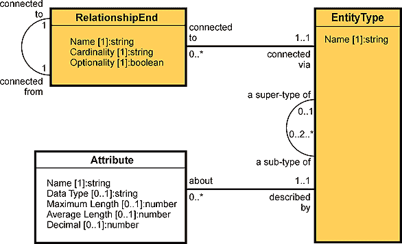

图 1-6 实体关系版本。

具体来说：

- 实体由一个或多个 `Attributes` 描述。
- 每个实体类型可以通过一个或多个 `RelationshipEnds` 连接，每个 `RelationshipEnd` 必须连接到另一个 `RelationshipEnd`，而该 `RelationshipEnd` 必须连接到相同或另一个 `EntityType`。
- 每个实体类型可以是两个或多个其他实体的超类型（零或一个子类型）。

关于实体和关系的元模型有一个有趣的现象：只需更改几个名称，图 1-6（实体类型的元模型）看起来与图 1-5（对象和角色的元模型）非常相似。这并非巧合。它们代表的是相同的内容。

对象类模型（至少就我们目前所知）实际上就是实体关系模型。实体类型和对象类都代表了业务希望持有的某种信息的定义。

然而，UML 符号包含许多不适用于架构师模型的特征。当它描述系统对象而非业务对象时，它偏离了实体关系建模。它包含许多描述面向对象设计考虑的符号。这些包括组合、关联导航等。

图 1-7 显示了实体关系图（ERD），它是我们模型的一个版本。它使用了结构化系统分析与设计（SSADM）方法 [Eva 1994]，该方法由英国政府资助。这种符号在欧洲广泛使用，也是 Oracle 公司在其 Designer CASE 工具中使用的实体关系表示法。

UML 和实体关系表示法当然不同。这两种方法之间有三个主要区别。

首先，最明显的一点是排版和图形（语法）是不同的。这里显示的实体关系（entity-relationship）表示法是为了提高非技术读者对图表的可读性。如果模型需要提交给用户社区进行验证，这一点非常重要。例如，通常世界期望在名称的单词之间看到空格。

在关系表示法中，不再使用第一个字符“0”，而是在第一个实体类旁看到一个 `dashed line half`（虚线半线段）。这意味着该关系是可选的（在之前的关联句子中为“可能”）。而不是使用第一个字符“1”，你会在第一个实体类旁看到一个 `solid line half`（实线半线段）。这表示强制性关系（在先的句子示例中为“必须”）。

而不是使用第二个字符“^*”，你看到的是一个表示“一个或多个”的“乌爪脚”符号。缺少乌爪脚则表示 UML 的第二个字符“1”，并代表“有且仅有一个”。实体类名称采用全大写，且单词之间插入了空格。

### 语法与语义

现在在实体关系图中读取关系的语法如下。

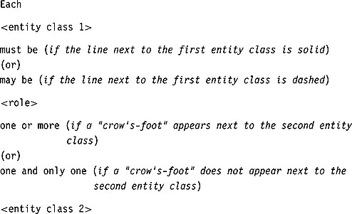

因此，以元模型为例，每个 `ENTITY CLASS` 可以被 `described by` 一个或多个 `ATTRIBUTES`，且每个 `ATTRIBUTE` 必须 `about` 有且仅有一个 `ENTITY CLASS`。此外，模型还说明每个 `ENTITY CLASS` 可以通过 `connected via` 一个或多个 `RELATIONSHIP ROLES`，且每个 `RELATIONSHIP ROLE` 必须 `connected to` 有且仅有一个 `ENTITY CLASS`。和以前一样，每个 `RELATIONSHIP ROLE` 必须 `connected to` 另一个 `RELATIONSHIP ROLE`，而该角色本身必须 `connected to` 有且仅有一个 `ENTITY CLASS`。

### 属性信息

实体关系表示法与 UML 之间的第二个区别在于每个属性表示的信息。由于这些模型仅用于说明，而不是设计的基础，因此没有必要在图中描述每个属性的数据类型。这样做会使图表变得杂乱。^*（当然，这些信息应该记录在支持绘图的存储库中。）

然而，能够看到属性值是否必用是有用的，因此在每个属性名称旁边仍然保留了“可选性”符号。如果符号是星号（`^*`）或井号（`#`），实体类的每次出现都必须具有属性值（等于 UML 中的 `1..`）。如果符号是空圈（`o`），则实体类的出现可能具有或不具有该属性（等于 UML 中的 `0..`）。同样，由于这是一个规范化的概念模型——在任何情况下属性都不可能有多个值——因此 ERD 表示法没有理由显示 UML 基数表示法的后半部分（`..1` 和 `..`）。^*

### 标识符

在标识符领域，实体关系模型比 UML 模型更具表达力。在面向对象的设计中，假设每个对象类都有一个对象标识符（`OID`）来识别类的实例。因此，不需要显式地指定属性或角色为标识性。然而，在实体关系模型支持的关系型世界中，实体实例的标识符非常重要，因为它预期显式由可见的属性或关系组成。

图 1-7 显示在每个实体类的“Name（名称）”旁边都有井号（`#`）。这意味着在每种情况下，属性至少部分负责识别实体类的实例。例如，这里假设每个 `ENTITY CLASS` 将被赋予一个唯一的名称。但在 `RELATIONSHIP ROLE` 的情况下，可能存在多个 `RELATIONSHIP ROLE` 实例具有相同的名称。在这种情况下，在指向 `ENTITY CLASS` 的关系上也会打一个标记，以指示有必要指定所涉及的 `ENTITY CLASS`（以及其 `Name`）来唯一标识每个 `RELATIONSHIP ROLE` 出现情况。

### 基数

实体关系模型在描述复杂基数方面并不完全像 UML 类图那样具有表达力。UML 版本可以断言“每个 `ENTITY CLASS` 可以是 `two or more` `ENTITY CLASSES` 的超类型”。标准的实体关系表示法只能说一个 `ENTITY CLASS` 可以是一个或多个其他实体的超类型。它不能将该语句限制为`两个`或更多。然而，为了本模型的目的，我们的表示法已经修改为显示这一点。

### 表示法选择

多年来，使用哪种表示法一直是信息技术领域广泛争论的基础。开发了不同的表示法来服务不同的目的和不同的受众。UML 类图是与面向对象的开发人员通信的表示法，而实体关系图是专门为支持与不熟悉数据建模的业务人员讨论概念而设计的。由于这个原因，它对普通读者来说稍微易读。由于本书的目的是解释概念，而不是提供构建系统的原理图，因此这里使用了这种表示法。

因此，UML 类图并不是对系统开发过程的宏大新概念化。这种表示法只是创建概念实体关系模型的另一种方式。新之处在于它表示面向对象设计的能力。^*

## 抽象层次

可以在不同的抽象程度上对任何事物进行建模。每当尝试创建一个数据模型时，就会出现将其抽象到什么程度的问题。做得太抽象，对于想要理解它的人来说就没有意义。做得不够抽象，它就会容易变化。达到恰好的平衡既是艺术也是科学。

最终，所有元数据的模型可以是图 1-8 所示模型的变体。在这里，模型中所有感兴趣的事物都简单地表示为 `THING`。每个 `THING` 必须是 `an of` 有且仅有一个 `THING TYPE`，其中 `THING TYPE` 是 `THINGS` 类的定义。

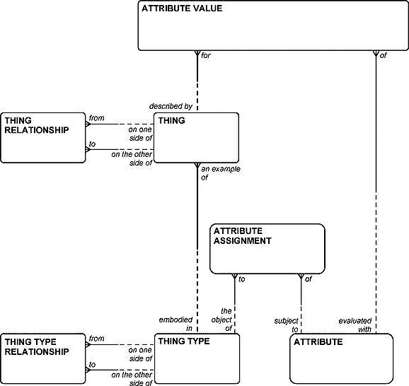

图 1-8 终极元模型

在接下来的章节中，UML 伞下的各种类型模型，以及类模型的额外表示法将在元模型中讨论。

该模型实际上可以描述我们可能包含在存储库中的*任何*事物。在这种情况下，它可以表示实体类、类、程序单元、人员、概念等。

那么，我们所知的具体模型每一个都可以被视为这一更抽象模型的*视图*。例如，一个 `ENTITY CLASS`（实体类）可以定义为“一个作为 `entity class` 类型实例的事物（THING）”。另一个视图可以将 `ATTRIBUTE`（属性）定义为“一个作为 `attribute` 类型实例的事物（THING）”。`THING TYPE RELATIONSHIP`（事物类型关系）被定义为从 `entity class` 类型到 `attribute` 类型，名称为“被描述”。另一个 `THING TYPE RELATIONSHIP` 被定义为从 `attribute` 类型到 `entity class` 类型，名称为“关于”。

实际上，图 1-8 中的模型可以通过显示其仅由 `THING`（事物）和 `THING RELATIONSHIP`（事物关系）组成来变得更加抽象。毕竟，`THING` 到 `THING TYPE` 的关联本身仅仅是两个高级 `THINGS` 之间的关联。

事实上，书中包含的所有实体类都只是图 1-8 中实体类的视图。因此，元数据仓库拥有基于图 1-8 抽象模型的*物理*结构是完全合理的。这使得管理仓库的工具在处理未来需求时具有最大的灵活性。然而，作为对我们元数据业务的描述，它并没有告诉我们很多实际发生的情况。当人们去仓库获取信息时，他们希望使用比这丰富得多的词汇。他们将寻找关于*业务术语*的定义、*程序*何时运行，或者*数据*是如何受到约束的信息。

因此，为仓库用户提供一组更符合其需求的词汇视图是至关重要的。由于这个原因，在书中，我们必须产出一个并不完全像图 1-8 中所示那样抽象的模型。在编写这本书时，作者努力达到正确的抽象水平。他是否成功了，由你，读者来判断。

---

好吧，这是事实。我在高中学过拉丁语，并一直认为 `data` 是单词 `datum` 的复数形式。我意识到我可能是在逆潮流而行，但嘿！这是我的书！

用粗体斜字体显示的关键词和短语定义在书末的词表中。

某天在进行关于宇宙学的讲座时，亚瑟·爱丁顿爵简要概述了宇宙的早期理论。其中，他提到了美洲印第安人的观点，即世界在一个巨大乌龟的背上，并补充说这不是特别实用的模型，因为它无法解释乌龟本身支撑在什么。讲座结束后，一位老太太找到了爱丁顿。

“你非常聪明，年轻人，非常聪明，”她有力地宣告道，“但你对印第安宇宙学有一点并不理解：层层都是乌龟！”

本节基于你作者的著作《需求分析：从业务视图到架构》中对架构框架的类似描述 [Hay 2003]。

多值属性是指那些每一行可以取多个值的属性，例如当一个人可以有多个值时，使用 `Address` 作为属性。

在此语境下，二元关系是指仅两个实体类之间的关系。

UML 中至少有六种不同类型的模型。表示数据结构的“类”图只是其中之一。

注意，本书遵循一种约定，关系名称和多重性指示器（`[1..1]`、`[0..^*]` 等）应按顺时针方向读取。

递归（参见 *Recursion*）。

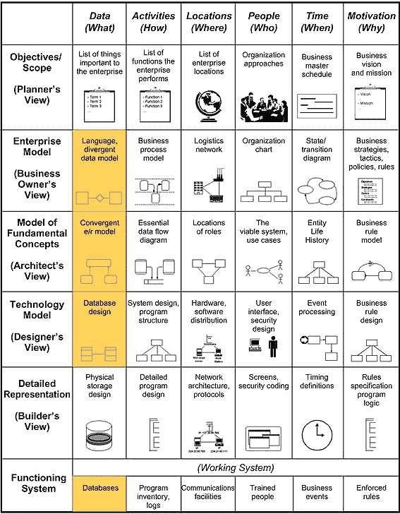

图 2-1 数据列。

# 业务所有者与业务规则

业务规则小组（曾称为业务规则 GUIDE 项目）于 1995 年发表了一篇描述业务规则类别的论文 [Business Rules Group 1995]。该论文从根本上讨论了架构师视角的业务规则，侧重于如何捕获并组织这些规则，以便最终在信息系统中实现。

在其他观察结果中，该论文指出，第三行（Row Three）的业务规则最好被理解为定义或约束关于企业 `data` 的陈述。诚然，某些规则用 `events`（事件）和 `activities`（活动）来描述更为合适，但大多数规则最好用数据的允许状态来表达。业务规则小组论文识别的类别为：

- `Terms`（术语，以及这些术语所描述的业务概念）：业务术语的定义本身就是一条描述人们如何思考和谈论事物的规则。因此，根据这种观点，术语的定义（即其底层的业务概念）建立了一类业务规则。例如，这可以是数据模型中使用的术语（如 `product type`），也可以是业务中简单使用的术语，如 `prestige client`。
- `Facts`（事实）：这些事实连接了术语。组织的性质和运作结构都可以通过将企业术语相互关联的事实来描述。例如，说“客户可以下单”就是一个事实；因此是一条业务规则。事实可以以自然语言句的形式记录，也可以以图形模型中的关系、属性或泛化结构的形式记录。例如，一个事实可以用一个句子表达，如“每个产品实例可能位于一个或多个站点。”
- `Derivations`（推导）：这些是业务规则（包括自然法则），定义了一种形式的知识如何转换为其他知识（可能以不同的形式）。产品成本和利润率的计算就是此类类别的示例。
- `Constraints`（约束）：每家企业都会以某种方式限制行为，这与对哪些数据可以或不可以更新的约束密切相关。这些包括业务约束（例如控制向谁发放信贷的约束）以及数据约束（例如对数据元素可以取值的约束）Business Rules Group 1995, [p.6]。

在业务规则小组的论文中，术语和事实被称为 `structural assertions`（结构断言），而约束被称为 `action assertions`（动作断言）。推导是一个独立的类别，尽管推导的结果 `derived facts`（派生事实，结构断言）。在大多数情况下，结构断言（术语和事实）是数据列的产物——可以在实体关系（或对象）模型中表示——而动作断言（约束）是动机列的产物，大部分无法在实体关系模型中表示。派生术语（属性）是可以在数据模型中呈现的结构断言，尽管其推导逻辑是无法表示的。

自该篇原始论文发表以来，业务规则小组与其他组织以及对象管理组（Object Management Group）合作，形成了他们所谓的“业务规则团队”（Business Rules Team）。^* 他们的任务是尝试不从架构师视角（第三行），而是从业务所有者视角（第二行）更详细地处理数据列和动机列。他们设定的具体实践目标是描述一种语言的特征，这种语言既可以用来用业务所有者的术语描述业务，又能（使用形式逻辑）以严谨的方式传达这种意义，从而对技术设计人员有用。通过这项工作，他们对语言在操控业务概念和技术方面发挥的作用产生了一些深刻的见解 [BRT 2006]。

该小组得出的结论之一是，严格来说，术语和事实并不是业务规则。首先，术语背后的 `business concepts`（业务概念）才是重要的。其次，一组事实的定义（实际上是 `fact types`，关于这一点稍后详述）对于理解企业的本质比事实本身更有用。严格来说，这两者都不是业务规则。相反，业务规则团队认为，业务规则（前者的动作断言）是建立在事实类型之上的，而事实类型又建立在术语背后的业务概念之上。

这种第一个大类别——结构断言的另一个术语是 `universe of discourse`（论域）。它由术语和事实类型背后的 `business concepts` 组成，每一个概念都是一个事实类别的定义。

术语、概念和事实类型是架构框架第二行业务所有者视角中数据列的领域。它们将在接下来的章节中进行更严谨的描述。第二行的业务规则（以及随之产生的数据和数据库管理系统约束）属于动机列，并在第七章中进行更充分的探讨。

# 第二行：业务术语、概念和事实类型

对第二行的检查始于描述每个业务用户所看到的具体且有形的（尽管通常很窄）的世界。这种观点描述了事物的特定发生（例如，“A-26 车床”），并且通常与当前系统交织在一起（例如，“我的工作是查看 Framis 报告并确定哪些项目需要维护”）。从这里的第一步是将这些观察结果泛化为更通用的结构。那么，示例中的泛化结构可能是“设备”和“确定维护需求”。

然而，这些结构仍然是没有约束的。这里的模型可能包含 `many-to-many relationships`（多对多关系）、`ternary (and higher-order) relationships`（三元及更高阶关系）、`multi-valued attributes`（多值属性）以及其他规范问题。这些约束在第三行添加。

在数据列，第二行主要关注组织的`semantics`（语义）。语义是研究意义的哲学分支 [Kemerling 1997–2002]，这里的任务是确定业务在使用某些语言时的含义。语义最近被明确认为是知识库开发的一个重要领域，事实上，即使未被意识到，它在开发任何能够顺畅运行的系统中一直是重要的。当你讨论组织部分之间相互通信的方式时，你讨论的就是语义。

## 术语与概念

图 2-2 显示，对于我们的目的，`BUSINESS TERM`被定义为使用单个`WORD`或`PHRASE`来表示单个`BUSINESS CONCEPT`。^*。`BUSINESS CONCEPT`简单来说是我们理解为存在的事物。在这种语境下，`BUSINESS CONCEPT`是企业运营或环境的一个方面。它可以是有形的东西，也可以是从特定实例中泛化出来的抽象思想。`BUSINESS CONCEPTS`的集合赋予了我们的语言意义。

这可能是我们数据建模人员所描述的一个实体类（例如“产品”）、此类类的一个属性（例如“颜色”）或该类的一个实例（例如“IBM ThinkPad Model T24”）。然而，更重要的是，它也可能是对业务非常重要的内容，但并不一定包含在我们的数据模型中（例如“ICD 10”，医学世界的疾病目录，或`completion`——石油行业的一个术语，指井中带孔的部分，石油通过这些孔从地面流向井中）。

一个`PHRASE`（短语）可以由一个或多个`WORDS`（单词）组成。一个`WORD`可以是一个或多个`PHRASES`（短语）的一部分。那么，`WORD USAGE`（词用法）是在一个`PHRASE`中使用一个`WORD`的行为。在传统语言中，`term`（术语）几乎等同于`word`或`phrase`，但这里使用的`BUSINESS TERM`（业务术语）的限定定义允许我们处理这种事实：同一个`BUSINESS CONCEPT`（业务概念）可以用许多不同的`WORDS`或`PHRASES`（`synonyms`同义词）来描述，而同一个`WORD`或`PHRASE`可能代表许多`BUSINESS CONCEPTS`（`homonyms`同音词）。

例如，`client`、`customer`和`account`通常是同义词。另一种，石油公司中的`facility`是为了执行某功能而组合的大型设备复合体，而银行中的`facility`是一项向特定客户提供规定金额信贷的内部协议。这些是同音词。因此，将`BUSINESS TERM`限制为将单个单词或短语分配给单一含义是非常有用的。

我们在这里关注的`BUSINESS TERMS`可能是任何用于描述组织及其运作的单词（例如`product`）。然而，它们也可能是描述特定行业（或特定公司）的词汇，用于描述流程的各个方面或企业的其他方面（例如，银行使用“instrument”一词，它所描述的概念与管弦乐队使用“instrument”一词的概念完全不同）。

请注意，该模型中存在一个异常：在模型中，我们无法在不使用单词的情况下讨论`BUSINESS CONCEPT`的实例。因此，“Name”（名称）显示为一个完全合理的属性。然而，事实上，任何语言都无法引用一个不属于`used in` `BUSINESS TERMS`的`WORDS`和`PHRASES`的`to represent` `BUSINESS CONCEPT`。事实上，重要的一点是，`BUSINESS CONCEPT`的存在独立于我们描述它的能力。

## Business Rule（业务规则）

至少，每个`BUSINESS CONCEPT`必须被`BUSINESS TERM`表示，而`BUSINESS TERM`是一个`WORD`或`PHRASE`的使用，其值等同于`BUSINESS CONCEPT`的“Name”属性的值。

***

正如书中将变得显而易见的，业务规则与数据模型中通常显示的内容非常不同。这要求我们单独对它们进行记录。书中描绘的元数据模型背后的业务规则与任何规模相当的企业模型所预期的一样。因此，在这里，我们以这种形式将它们添加到文中。

`BUSINESS CONCEPTS`还是描述它们的`WORDS`都不是孤立存在的。人们必须使用它们。在图 2-3 中，每个`BUSINESS CONCEPT`必须是`SEMANTIC COMMUNITY`（语义社区）的`the shared understanding of`。也就是说，只有当一群人认可它时，概念才被识别。`SEMANTIC COMMUNITY`是一组对一组`BUSINESS CONCEPTS`的含义表示一致的人，例如油井工人或数据建模人员。

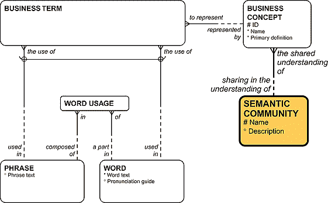

图 2-3 语义社区。

在图 2-4 中，`SPEECH COMMUNITY`（言语社区）被定义为任何`part of` `SEMANTIC COMMUNITY`且是特定`LANGUAGE`的`speakers of`的人群。在一般层面上，这可以是“英国人口”或简单来说是“英语使用者”，但也可以具体到某种特定的方言。因此，`SPEECH COMMUNITY`可能由一个或多个其他`SPEECH COMMUNITIES`组成。

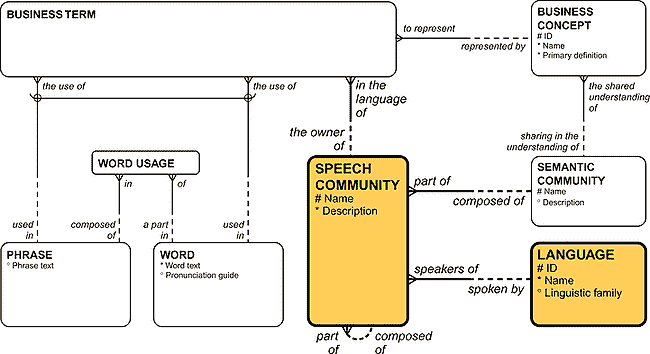

图 2-4 言语社区。

根据定义，`SPEECH COMMUNITY`的所有成员都是同一个`LANGUAGE`的`speakers of`且同一个`SEMANTIC COMMUNITY`的`part of`。在图 2-4 中，每个`BUSINESS TERM`都显示为`in the language of`正好一个`SPEECH COMMUNITY`。即使一个`WORD`或`PHRASE`存在于多个`SPEECH COMMUNITIES`中，每个`BUSINESS TERM`都显示为`in the language of`正好一个`SPEECH COMMUNITY`。（注：原文此处存在大量重复，译文已按要求处理并翻译）。

任何作为`SYMBOL`的`ONTOLOGICAL CLASSIFICATION`的`ONTOLOGY`必须由相同的`SEMANTIC COMMUNITY` `defined by`，该社区也对`SYMBOL`所代表的`BUSINESS CONCEPT`共享理解。换句话说，定义`ONTOLOGY`的`SEMANTIC COMMUNITY`必须是该`ONTOLOGY`中所有`SYMBOLS`来源的`SEMANTIC COMMUNITY`。

任何系统分析师的首要任务是协调组织内部不同`SEMANTIC COMMUNITIES`之间的语言。这具有挑战性，但大多数行业在该行业大多数公司都有共同的基础词汇，这提供了便利。信息处理行业中的语义方法开始做的之一就是对这些行业词汇进行编码。本体论开始在万维网上出现，其形式允许它们被整合到公司本体论中。

事实上，正努力让本体论成为 Web 的基础部分。从一开始开始，蒂姆·伯纳斯-李（Web 发明者）就预见到它最终将超越其作为`协作媒介`的原始目标，实现`语义网`的目标——即机器可以理解并因此可以`处理`的。也就是说，语义网是“机器可处理的智能数据网络，[其中]智能数据是独立于应用的、可组合的、分类的且更大信息生态系统（本体论）的一部分的数据” [Daconta et al. 2003, p. 4]。语义网预计通过包含本体论来支持不仅搜索文档标签而且搜索文档本身文本的技术。对主题的搜索不仅能找到显式标识为该主题的文档，还能找到文本中提到该主题的文档。

一种特殊的本体论被称为`taxonomy`（分类法）。这是概念的层次级组织。其中广为人的是生命结构本身的生物分类。它是通过门、科、属、种等来描述的。遗憾的是，企业中许多感兴趣的领域并不容易进行层次级表示，尽管这种表示可能方便。

### Propositions（命题）

`PROPOSITION`是一个可能真或假的陈述。`PROPOSITIONS`将概念连接在一起。是命题描述了业务在做什么以及是如何做的。

每个`PROPOSITION`将`BUSINESS CONCEPTS`连接在一起。也就是说，每个`PROPOSITION`必须`composed of`两个或多个`PROPOSITION ELEMENTS`，每个元素都必须`about`一个`BUSINESS CONCEPT`。这在图 2-8 中所示。

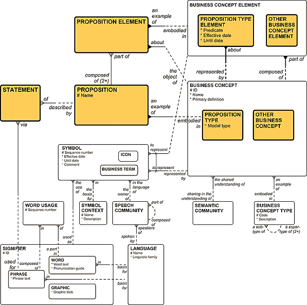

图 2-8 命题。

同样注意，在图 2-8 中，每个`PROPOSITION`必须是恰好一个`PROPOSITION TYPE`的`example of`，而该类型本身也是一种`BUSINESS CONCEPT`。就像每个`PROPOSITION`必须`composed of`两个或多个`PROPOSITION ELEMENTS`一样，每个`PROPOSITION TYPE`也也必须`composed of`两个或多个`PROPOSITION TYPE ELEMENTS`。由于`PROPOSITION TYPE`是`BUSINESS CONCEPT`的示例，因此识别一个`BUSINESS CONCEPT ELEMENT`是合适的，即`BUSINESS CONCEPT`内部（`part of`）的组件。这是`PROPOSITION TYPE ELEMENT`的超类型。

特定`PROPOSITION TYPE`的所有`PROPOSITIONS`的真值可能是：

- `Deontic`（道论）——这是对义务的陈述（要求必须如此）或许可的陈述（允许如此）。这是业务规则的领域。

- `Alethic`（真值论）——这是对必然性的陈述（必须是真的）或可能性的陈述。这是物理学领域。

- `Epistemological`（认识论）——这是对某事为人知的陈述。认识论命题以典型的数据模型呈现。

这通过`PROPOSITION TYPE`属性`Modal type`表示。

`PROPOSITION ELEMENT`的一个属性是`Predicate`（谓词），谓词是“逻辑命题中对主体所肯或否定的某些内容” [Merriam-Webster 2005]。命题“太阳明天会升起”由两个`PROPOSITION ELEMENTS`。一个连接到`BUSINESS CONCEPT`“明天”，谓词为`will rise`。另一个连接到`BUSINESS CONCEPT`“太阳”，谓词为`<subject>`，表示“太阳”是该`PROPOSITION`的主体。

### Fact Types（事实类型）

一个`FACT`是一个永远为真的`PROPOSITION`。因此，图 2-9 中的元模型显示`FACT`是`PROPOSITION`的一种类型。一个`FACT`可能是“查理在 1 月 14 日被分配到 Z 项目”。这把`BUSINESS CONCEPT`“查理”与`BUSINESS CONCEPTS`“Z 项目”和“1 月 14 日”连接在一起。

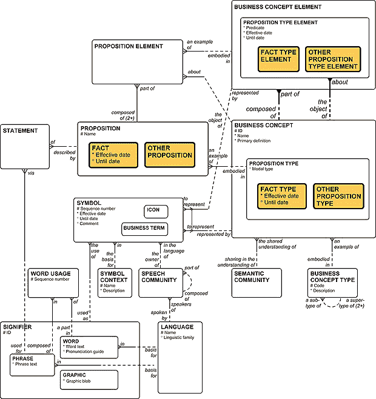

图 2-9 事实。

每个`FACT`必须`composed of`两个或多个`PROPOSITION ELEMENTS`，每个元素`about`一个`BUSINESS CONCEPT`。事实类型是相似事实的定义。`FACT TYPE`的一个属性是`Predicate`。`FACTS`包括：

- 查理在 1 月 14 日被分配到 Z 项目

- 太阳明天会升起

### Characteristics（特性）

一种`FACT TYPE`，如图 2-10

图 2-10 特性。

`BUSINESS CONCEPT`实例的规范在于其使用一组指定的`CHARACTERISTICS`。“磁盘空间大小”、“内存大小”、“长度”和“宽度”是可以应用于计算机和其他事物的`CHARACTERISTICS`。例如，一个`CHARACTERISTIC ASSIGNMENT`可能会将`CHARACTERISTIC`“随机内存大小”连接到另一个`BUSINESS CONCEPT`“笔记本电脑”。

注意`CHARACTERISTIC ASSIGNMENT`的属性`Essential indicator`和`Delimiting indicator`。如果`Essential indicator`为“True”，则对于通过`CHARACTERISTIC ASSIGNMENT`连接的`BUSINESS CONCEPT`实例，该`CHARACTERISTIC`是必要的。如果`Delimiting indicator`为“True”，则该`CHARACTERISTIC`的值将一个`BUSINESS CONCEPT`的实例与其他区分来。

除非“必要指示”（Essential indicator）已设置为“True”，否则“界定指示”（Delimiting indicator）可能无法设置为“True”。

这揭示了在同一个模型中包含通用概念和特定概念的问题。`CHARACTERISTIC`确实是`BUSINESS CONCEPT`的一种，而`CHARACTERISTIC ASSIGNMENT`确实是`BUSINESS CONCEPT ELEMENT`的一种。同样，`CHARACTERISTIC ASSIGNMENT`与`CHARACTERISTIC`之间的关系（"of"）实际上是`BUSINESS CONCEPT ELEMENT`与`BUSINESS CONCEPT`之间关系（"part of"）的一种`sub-type`。

同样，关系角色“每个`CHARACTERISTIC ASSIGNMENT`必须指向（to）一个且唯一的`BUSINESS CONCEPT`”是“每个`PROPOSITION TYPE ELEMENT`必须描述于（descriptive of）一个且唯一的`BUSINESS CONCEPT`”的子类型。问题在于这些关系的名称确实应该是不同的，但在不显得冗余的情况下无法显示两者。为了清晰起见，这里显示了两者，而且这并不是唯一出现此类问题的地方。作为替代，如果不显示冗余的关系，可以记录以下业务规则。

## 业务规则

每个作为`CHARACTERISTIC ASSIGNMENT`的`BUSINESS CONCEPT ELEMENT`必须属于（part of）一个且唯一的作为`CHARACTERISTIC`的`BUSINESS CONCEPT`。

#### 资源

这些`SYMBOLS`（`BUSINESS TERMS`和`ICONS`）所代表的信息来自哪里？通常它们最初记录在某种文档中：规格书、录像带、电子邮件等。`图 2-11`显示`RESOURCE`是一个或多个`SYMBOLS`的来源（source of）。`RESOURCE`是一组`SYMBOLS`的集合。

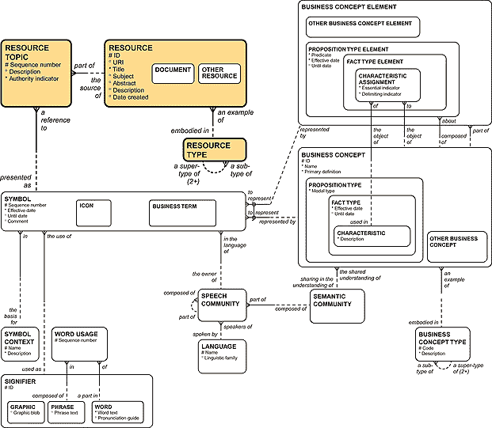

图 2-11 资源。

由于每个`SYMBOL`也可能创建自（created from）一个或多个`RESOURCES`，因此“交叉”实体类`RESOURCE ELEMENT`定义为：特定的`SYMBOL`被某个`RESOURCE`提到的事实。也就是说，每个`RESOURCE ELEMENT`必须属于（part of）恰好一个`RESOURCE`，并且引用（reference to）恰好一个`SYMBOL`。注意，资源元素的一个属性是“权威性指示”（authority indicator），表示该特定资源是否是该符号（业务术语或图标）定义的权威来源。

`RESOURCE`的属性包括：

* `Uniform resource identifier`（`URI`）：一种标识资源的方法。

* `Title`（标题）：命名资源的文本。

* `Subject`（主题）：简述资源主要用途的文本。

* `Abstract`（摘要）：对资源内容的描述，长度不超过两个段落。

* `Description`（描述）：摘要的替代方案，是对资源的更详细描述。

* `Date created`（创建日期）。

每个`RESOURCE`必须是恰好一个`RESOURCE TYPE`的示例（example of），但可能的`RESOURCE TYPES`列表比作为`RESOURCE`子类型显示的`DOCUMENT`详得多（尽管这也是`RESOURCE TYPE`的一个例子）。`BUSINESS CONCEPTS`的识别和定义也可能是由某种事件、甚至是服务的执行引起的。都柏林核心（Dublin Core）是一个尝试标准化描述文档的元数据的组织。它识别了以下`RESOURCE TYPES`：

* `Document`（文档）

* `Collection`（集合）

* `Data Set`（数据集）

* `Image`（图像）

* `Interactive Resource`（交互式资源）

* `Moving Image`（动态图像）

* `Physical Object`（实体）

* `Software`（软件）

* `Sound`（音频）

* `Still Image`（静态图像）

* `Text`（文本，文档）

* `Other Resource Types`（其他资源类型）

* `Event`（事件）

* `Service`（服务）

每个`RESOURCE TYPE`可能是其他（2+）`RESOURCE TYPES`的超类型（super-type of）。注意，每个`RESOURCE`可能是一个或多个`SYMBOLS`的来源，每个符号原则上可能属于不同的语言。不过，在大多数情况下，作为`RESOURCE`呈现（presented as）的所有`SYMBOLS`更有可能是同一种语言。然而，模型中并未显示这一点。

在`图 2-12`中，`RESOURCE STRUCTURE`是一个`RESOURCE`以指定方式与另一个相关的实体。也就是说，`RESOURCE STRUCTURE`是一个`RESOURCE STRUCTURE TYPE`的示例（example of）。目前，候选的`RESOURCE STRUCTURE TYPES`（再次来自都柏林核心）如下：

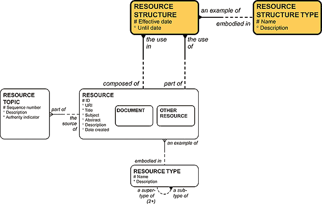

图 2-12 资源结构。

- `A reference to`（引用）
- `The source of`（来源）
- `Bibliographic citation`（文献引用）
- `Conforms to`（符合）
- `Structure`（结构）
- `Has format of`（格式为）
- `Replacement for`（替换）
- `Required by`（被……需要）
- `Updated version of`（更新版本）
- `Derived from`（源自）

其他情况也是可能的。

### 身份

`图 2-13`引入了`PARTY`类，该类在第五章中有更详细的描述。它被突出显示是因为`PARTY`属于我们正在讨论的特定`RESOURCE`。

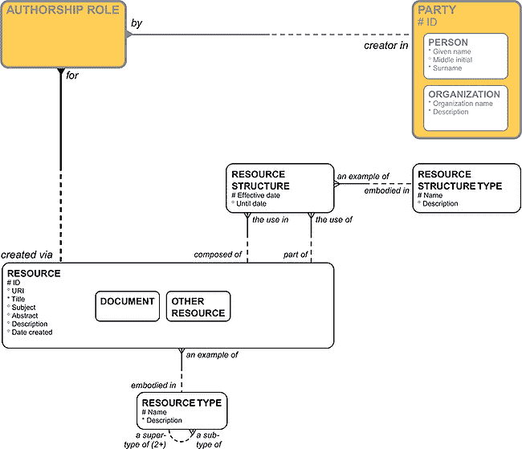

图 2-13 身份。

`PARTY`是为了特定目的指定的地点（location），例如房屋、办公室或仓库。由于`RESOURCE`也可能由一个或多个`PARTIES`加工，`AUTHORSHIP ROLE`被定义为特定的`PARTY`参与了创建。根据标准，以下是`AUTHORSHIP`的种类：

- `Author`（作者）
- `Contributor`（贡献者）
- `Publisher`（出版者）
- `Rights Holder`（权利持有者）

### 文档发行

`RESOURCE`是抽象的。它是受版权保护的表达，独立于其物理表现。特别是，它的存在是`SYMBOLS`的集合。也就是说，每个`RESOURCE`必须体现为（embodied in）至少一个（可能多个）`COPY`。`COPY`可以是`PHYSICAL COPY`（如书籍或期刊）或`VIRTUAL COPY`（如电子邮件或网站）。

`SITE`是另一个在其他章节中有更完整定义的实体类——在本例中为第四章。每个`COPY`发送到一个或多个`PARTIES`和/或一个或多个`SITES`。具体来说，`RESOURCE DISTRIBUTION`是特定的`COPY`在特定时间发送（to）特定`PARTY`或`SITE`（当涉及的`PARTY`未识别时）的事实。

### 范围

`图 2-15`显示了`GEOGRAPHIC LOCATION`，这是借自第四章的另一个实体类。`GEOGRAPHIC LOCATION`是地球表面一个边界明确的地点，例如州或省、销售区域或测量的土地。该图还显示，每个资源都可能被用于描述（used to describe an aspect of）一个或多个`COVERAGES`，其中`COVERAGE`是关于一个`RESOURCE`且关于一个`GEOGRAPHIC LOCATION`的事实。

`GEOGRAPHIC LOCATION`（地理位置）可以是`GEOGRAPHIC AREA`（地理区域，所示）或`GEOGRAPHIC POINT`（地理点，在第四章中描述）。`GEOGRAPHIC AREA`进一步可以是`GEOPOLITICAL AREA`（地缘政治区域，如城市、州、国家等）、`MANAGEMENT AREA`（管理区域，其边界由企业定义，例如“西南销售区”）、`NATURAL AREA`（自然区域，如栖息地或湖泊）或`SURVEYED AREA`（测量区域，其边界按镇、分区等单位具体测量）。在这些区域中，元数据领域通常只有`GEOPOLITICAL AREA`和`MANAGEMENT AREA`是受关注的兴趣点，但其中任何一个都可以由`RESOURCE`（资源）来描述。

### 柏林核心（The Dublin Core）

前文提到的柏林核心已为其描述数据资源所需的基础属性集获得了 ISO 认证。如你所见，完整模型比描述文档的简单属性集要复杂一些，但实际上所有的柏林/ISO 属性都被该模型涵盖了，如表 2-1 所示 [ISO 2003; DCMI 2005]。柏林核心指定的“其他元素和元素细化”的附加属性也被该模型涵盖，其中大部分以`RESOURCE STRUCTURE TYPES`（资源结构类型）的形式存在。

表 2-1：柏林核心等效项。

| 柏林核心术语 | 元数据元素 |
| :--- | :--- |
| Contributor（贡献者） | 通过`AUTHORSHIP ROLE`（作者角色）创建的/是`AUTHORSHIP ROLE TYPE`（作者角色类型）的示例 Contributor |
| Coverage（范围/范围） | 描述`COVERAGES`（覆盖范围）的一个方面/关于`GEOGRAPHIC LOCATION`（地理位置） |
| Creator（创建者） | 通过`AUTHORSHIP ROLES`（作者角色）创建的/是`AUTHORSHIP ROLE TYPE`（作者角色类型）的示例 Creator |
| Date（日期） | `RESOURCE: Date Created`（资源创建日期） |
| Description（描述） | `RESOURCE: Description`（资源描述） |
| Format（格式） | 体现在`COPY: Format`（副本格式）中 |
| Identifier（标识符） | `RESOURCE: ID`（资源 ID）；`RESOURCE: URI` |
| Language（语言） | `RESOURCE ELEMENTS`（资源元素）的来源/`ASYMBOL`（符号）的引用/使用`SPEECH COMMUNITY`（语言社区）的语言/`LANGUAGE`的使用者^* |
| Publisher（出版者） | 通过`AUTHORSHIP ROLES`（作者角色）创建的/是`AUTHORSHIP ROLE TYPE`（作者角色类型）的示例 Publisher |
| Relation（关系） | `RESOURCE STRUCTURE`（资源结构）的一部分/另一个`RESOURCE`（资源）的使用 |
| Rights（权利） | 通过`AUTHORSHIP ROLES`（作者角色）创建的/是`AUTHORSHIP ROLE TYPE`（作者角色类型）的示例权利持有者 |
| Source（来源） | `RESOURCE STRUCTURE`（资源结构）的一部分/`RESOURCE STRUCTURE TYPE`（资源结构类型）的示例 Source |
| Subject（主题） | `RESOURCE: Subject`（资源主题） |
| Title（标题） | `RESOURCE: Title`（资源标题） |
| Type（类型） | `RESOURCE TYPE: Name`（资源类型名称） |

注：表中的每一行都应读作前面带有该短语：“每个资源可能……”。

*将`/`读作“正如（或是）……”*

### 数据治理（Data Stewardship）

第五章详细讨论了人员、组织、职位等在管理元数据方面扮演的角色。然而，在这里定义`BUSINESS CONCEPTS`（业务概念）的表示（`SYMBOLS`，符号）的具体责任在图 2-16 中所示。

## 业务规则

1. `实体类名称`必须专门用于表示一个`实体类`，而不是任何其他类型的`业务概念`或`业务概念元素`。
2. `属性名称`必须专门用于表示一个`属性`，而不是任何其他类型的`业务概念`或`业务概念元素`。

请注意，`属性`被显示为`领域`（DOMAIN）`特征`（CHARACTERISTIC）的一种`特征赋值`（CHARACTERISTIC ASSIGNMENT，一个事实类型元素）。也就是说，每个`属性`都必须被`领域`约束。它的意思是`领域`在抽象上是一种`特征`，它可以分配给许多`实体类`。

`属性`是特定`领域`适用于特定`实体类`的事实。当我们说`产品`具有“名称”、“长度”和“宽度”等属性时，我们通常没有意识到领域的存在，但它确实在那里。它是我们所指的属性含义的定义。它可以简单到如格式规范，也可以复杂到如计算出的约束，但它隐式或显式地存在。请注意，`领域`被突出显示了。它实际上在第七章中作为约束进行了更充分的记录。

我们已经看到，“每个`特征赋值`必须属于一个`特征`”的关系是“每个`业务概念元素`必须属于一个`业务概念`”的关系的关系特定子类型。同样，“每个`属性`必须被一个且仅一个`领域`约束”是其他关系的进一步子类型。同样，“每个`属性`必须关于一个`实体类`”的断言是“每个`命题类型元素`必须描述一个`业务概念`”的关系的一个特例。要消除冗余表示，需要显式说明以下业务规则。

## 业务规则

1. 每个`特征赋值`都是一个`业务概念元素`，必须属于一个作为`特征`的`业务概念`。
2. 每个`属性`都是`业务概念`，必须属于一个且仅一个作为`领域`的`事实类型`。
3. 每个`属性`都是`业务概念`，必须描述一个且仅一个作为`实体类`的`业务概念`。

`属性`的属性包括“默认值”、“格式”、“最大长度”、“平均长度”和“小数位”数量。“默认可选性”也是一种属性，通常用于指定该`属性`是否是强制性的。事实上，可选性是一个比这更复杂表示的概念（参见第七章），但定义一个“默认可选性指示器”对于最初绘制数据模型足够了。

模型中包含了“基数指示器”以保持完整，但它也是一种约束，并在第七章中进行了更广泛的讨论。它允许你指定该`属性`在该`实体类`中值的出现最大次数。如果规范化关系模型是本次练习的对象，则该值必须为“1”。然而，某些环境不是归一化的，因此如果你想捕捉这一事实，这就是记录它的地方。（UML 提供了指定此能力。）

## 关系与关系角色

正如我们在第一章中所示，`关系角色`（RELSHIP ROLE）是`实体类`参与另一个`实体类`之间关系的事实。每个`关系角色`必须由一个`实体类`扮演，并必须连接到另一个由相同或另一个`实体类`扮演的`关系角色`。图 2-19 展示了这一点。

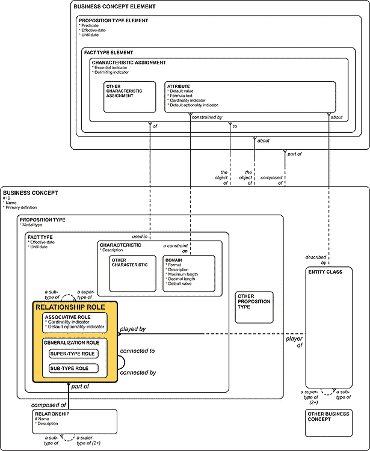

图 2-19 关系角色。

### 关系角色

请注意，每个`关系角色`必须连接到另一个`关系角色`，而该角色反过来必须由相同或另一个`实体类`扮演。因此，两个`实体类`的发生通过两个`关系角色`连接。这两个角色属于一个`关系`，该关系是两个`实体类`之间的。也就是说，每个`关系`必须由多个（在本例中为两个）`关系角色`组成。

“关系角色必须仅由一个实体类扮演”等同于“每个`关系角色`可以由一个`命题类型元素`（实际上是`事实类型元素`）组成，该元素关于一个作为实体类的`业务概念`”。直接的关系更简洁且易于理解，但它是冗余的。

就此而言，`关系角色`与`实体类`之间的关系以及`关系角色`与其自身的关系同样是冗余的。关系的基数由“基数指示器”属性传达，但显式关系实体无法通过这些更间接的关系来表达。

换句话说，每个`业务概念`（在本例中为`关系角色`）可以由多个`业务概念元素`（在本例中为如`played by`和`connected to`）组成。每个`关系`可以是两个或多个`关系`的子类型。与其显示冗余的关系子类型，相同的约束可以通过业务规则来表达。

## 业务规则

1. 每个作为`关系角色`的`业务概念`必须由一个`命题类型元素`（名称为`played by`）组成，该元素必须关于是实体的类的`业务概念`。

2. 每个作为`关系角色`的`业务概念`必须由一个`命题类型元素`（名称为`connected to`）组成，该元素必须关于是角色的`业务概念`。

3. 每个作为`关系角色`的`业务概念`必须由一个`业务概念元素`（名称为`connected from`）组成，该元素必须关于是角色的`业务概念`。

请注意，“每个实体类可以是另一个实体类的子类型”这种关系角色（以及反之反过来）并不是冗余的，因为`实体类`既不是`命题类型`也不是`命题类型元素`。

图 2-19 显示`RELATIONSHIP ROLE`（关系角色）要么是`ASSOCIATIVE ROLE`（关联角色），要么是`GENERALIZATION ROLE`（泛化角色）。`ASSOCIATIVE ROLE`描述当`ENTITY CLASS`（实体类）代表本质上不同的事物（或同一事物的不同发生，例如递归物料结构中将一种产品类型与另一种类型关联起来）时，从一个`ENTITY CLASS`到另一个类的关系。以此模型作为数据模型的示例，作为`BUSINESS CONCEPT ELEMENT`（业务概念元素）的`ENTITY CLASS`是`ASSOCIATIVE ROLE`“部分属于”的`player of`，它`connected to` `ASSOCIATIVE ROLE`“组成”，而后者是由`BUSINESS CONCEPT`（业务概念）这一`ENTITY CLASS`所`played by`。

`GENERALIZATION ROLE`描述了一个`ENTITY CLASS`的实例实际上是另一个实例的事实。`GENERALIZATION ROLE`必须是`SUB-TYPE ROLE`（子类型角色）或`SUPER-TYPE ROLE`（父类型角色）。如果一个`ENTITY CLASS`是`SUB-TYPE ROLE`的`player of`，那么它必须`connected to`一个由另一个`ENTITY CLASS`所`played by`的`SUPER-TYPE ROLE`。那么，第一个`ENTITY CLASS`的发生根据定义也是第二个`ENTITY CLASS`的发生。

再次使用此模型作为示例，作为`OTHER BUSINESS CONCEPT`（其他业务概念）的`ENTITY CLASS`是`SUB-TYPE ROLE`的`player of`，该角色`connected to`由`BUSINESS CONCEPT` `ENTITY CLASS`所`played by`的`SUPER-TYPE ROLE`。实体类`ASSOCIATIVE ROLE`有两个属性：“基数指示器”（Cardinality Indicator）和“默认可选性指示器”（Default Optionality Indicator）。这两将在第七章中有更详细的讨论。

将图 2-19 本身作为实体关系图的示例，从`ENTITY CLASS`到命名为`player of`的`RELATIONSHIP ROLE`的`ASSOCIATIVE ROLE`的“基数指示器”为“True”，这意味着`ENTITY CLASS`的角色是对应多个`RELATIONSHIP ROLE`的发生。命名为“played by”的`ASSOCIATIVE ROLE`的“基数指示器”为“False”，这意味着`RELATIONSHIP ROLE`的角色仅对应一个`ENTITY CLASS`的发生。或者，该属性也可以称为“基数值”（Cardinality value），值为“1”、“^*”、“<2”等。在信息工程和其他类似的表示法中，基数只能是“一个且仅有一个”（“False”或“1”）或“一个或多个”（“True”或“^*”）；然而，在UML中，可以隐含其他值，例如“>4”、“2, 4, 或 6”等。

与`ATTRIBUTE`（属性）类似，从`ASSOCIATIVE ROLE`中本应被称为“可选性指示器”（Optionality indicator）的属性实际上被称为“默认可选性指示器”，因为`ASSOCIATIVE ROLE`的可选性可能是其自身状态或受影响`ENTITY CLASS`状态的函数。（参见第七章）。但目前，我们假设它的默认只有一个“可选性指示器”值。对于此模型中命名为“player of”的角色，它是“true”——这意味着每个`ENTITY CLASS`的发生可能是或不是至少一个`RELATIONSHIP ROLE`的`player of`。命名为“played by”的`RELATIONSHIP ROLE`的“默认可选性指示器”为“False”，意味着不会创建任何不是被至少一个`ENTITY CLASS`所`played by`的`RELATIONSHIP ROLE`发生。

### 关联类角色 (Association Class Roles)

之前描述的角色被称为`INFORMATION ENGINEERING ROLES`（信息工程角色），因为它们受到该技术的约束。在信息工程及相关学科中，例如这些图中使用的Barker/结构化系统分析与设计方法 (SSADM)，所有关系都假假设是二元的，即它们只存在两个实体类之间。这为该练习提供了某种严谨性，你的作者认为这是非常理想的。然而，还有其他表示法并没有那么严格限制。

例如，UML主要使用信息工程方法，但它也有处理多对多关系的特殊方法。在信息工程或SSADM中，当遇到多对多关系时，响应是创建一个新的实体类，其每个发生都代表一个实体类的发生与另一个实体类的发生相关。

例如，想象图 2-20 所示的模型，其中`PROJECT`（项目）和`PERSON`（人员）之间存在多对多关系（每个`PROJECT`可能是一个或多个`PEOPLE`的`work site for`；每个`PERSON`可能被`assigned to`一个或多个`PROJECT`）。在这种情况下，信息工程的响应（在此处使用UML表示法）是创建一个`intersect entity class`（交叉实体类，如图 2-21 所示）。

图 2-20 多对多关系。

图 2-21 关联类。

然而，UML还提供了创建*关联类*（association class）的选择。这是一个表示关系本身，而不仅仅是类之间的交互集合。图 2-22 显示了一个示例关联类作为`ProjectAssignment`。该实体类与任何实体类相关，只与关系相关。

图 2-22 关联类。

注意，这是一个非常有约束性的设备。所示，它假设特定的`PERSON`分配到特定`PROJECT`的只有一个，因为根据定义，关联类的每次发生是由这两个类的标识确定的。

如果Charlie为项目工作了几个月，离开了，然后又重新分配到该项目，这是无法记录的。在这种情况下，必须使用图 2-22 所示的交叉实体类。注意，交叉实体方法允许指定`sequenceNumber`属性，它可以包含在唯一标识中以保持实例唯一。这样特定的`PERSON`到特定`PROJECT`就可以无限多个`PROJECT ASSIGNMENT`发生。

在`PROJECT`多次分配给`PERSON`的情况下，如果在`PERSON`或`PROJECT`中添加“累计次数”属性，可以使用关联类，但这将无法指定每次分配的时间。

UML的这一特性要求在我们的元模型中定义一种新的`RELATIONSHIP ROLE`，即`ASSOCIATION CLASS ROLE`，如图 2-23 所示。在这里，每个`RELATIONSHIP`必须由一个或多个`RELATIONSHIP ROLES`组成，但这次不是一个角色`connected to`另一个`RELATIONSHIP ROLE`，而是每个`ASSOCIATION CLASS ROLE`必须“描述”另一个`RELATIONSHIP`。这里还创建了一个新的`ENTITY CLASS`子类型——`ASSOCIATION ENTITY CLASS`——用于描述`ASSOCIATION CLASS ROLE`的末端。

图 2-23 关联类角色。

这是`ENTITY CLASS`的一种，因此它可以是一个或多个`RELATIONSHIP ROLES`的`player of`，但在这种情况下，它被限制扮演`ASSOCIATION CLASS ROLE`。之前讨论的`RELATIONSHIP ROLE`在此处渲染为`INFORMATION ENGINEERING ROLE`以与`ASSOCIATION CLASS ROLE`区分。

`INFORMATION ENGINEERING ROLE`（信息工程角色）用于实体关系图，既适用于原始的信息工程技术，也适用于基于此的技术（包括本书中使用的Barker/SSADM记法）。`ASSOCIATION CLASS ROLE`（关联类角色）仅出现在UML和IDEF1X中，尽管这两者主要使用`INFORMATION ENGINEERING ROLES`。

## 业务规则

1. `ASSOCIATION CLASS ROLE`必须由`ASSOCIATION ENTITY CLASS`（关联实体类）*扮演*。相反，`ASSOCIATION ENTITY CLASS`必须是一个且仅一个`ASSOCIATION CLASS ROLE`的*参与者*。^*

2. 在图 2-23 中，一个`INFORMATION ENGINEERING ROLE`只能由`OTHER ENTITY CLASS`（其他实体类）扮演。（后文将详细介绍此点。）

3. 如果一个关系由`ASSOCIATION CLASSES`（关联类）组成，则它仅由*一个*此类类组成。

4. 如果一个关系由`INFORMATION ENGINEERING CLASSES`（信息工程类）组成，则它正好由*两个*此类类组成。

^*在这里，使用业务规则来代替显式地描述每个`ASSOCIATION CLASS ROLE`必须由一个`ASSOCIATION ENTITY CLASS`*扮演*。

### 多元关系

即使引入了`ASSOCIATION CLASS ROLES`，UML仍然主要关注二元关系。但那些允许真正的三元及高阶关系的记法（包括UML）又是怎样的？其中主要的是*对象角色建模*（`ORM`）和*Chen记法*（Chen notation）。在这些记法中，多个对象（实体类和属性）可以在不受限制的情况下相互关联。图 2-24 显示，对于每种记法，都展示了一个关于“项目”（Project）与“人员”（Person）关联的示例（如前所述），在这种情况下，关系中存在第三个参与者（“位置”Location）。也就是说，该模型断言人员可以被分配到特定位置的项目中。

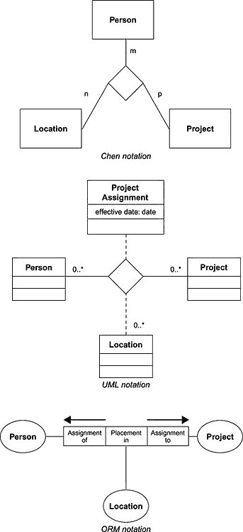

图 2-24 三元关系示例。

注意，在UML中，也可以添加一个`ASSOCIATION CLASS ROLE`来描述（即为三元关系本身添加属性）。在ORM中，带有箭头的线段表示每个“项目/人员”的组合是唯一的。这种约束在上一个示例的UML关联类中是隐式的。一个人员只能对一个项目工作一次。在ORM中，这种约束是显式的，并由建模者控制。虽然一个人员只能对一个项目工作一次，但一个人员可以在同一地点工作多次，就像一个项目可以出现在同一地点多次一样。

这要求对我们的模型进行进一步的细化。图 2-25 展示了`RELATIONSHIP`（关系）必须*由*（三个）或多个`N-ARY ROLES`（多元角色）组成，且对涉及的数量没有限制。在UML示例中，一个`RELATIONSHIP`将*由*三个`N-ARY ROLES`和一个`ASSOCIATION CLASS ROLE`组成。

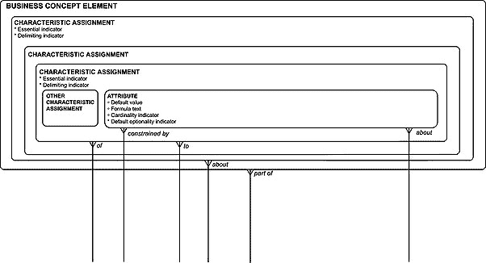

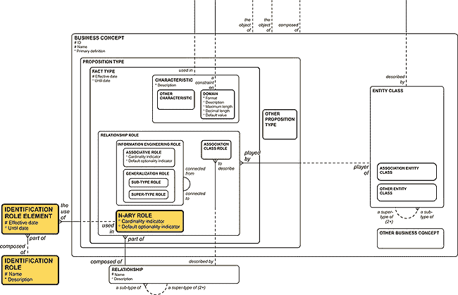

图 2-25 多元角色。

## 业务规则

一个`N-ARY ROLE`（多元角色）必须由一个且仅一个`OTHER ENTITY CLASS`*扮演*。

注意，由于ORM包含了唯一标识`N-ARY ROLES`组合的记法，图 2-25 增加了`IDENTIFICATION ROLE`（标识角色）的概念。每个`N-ARY ROLE`都可以*用于*一个或多个`IDENTIFICATION ROLE ELEMENTS`，每个元素都必须是一个`IDENTIFICATION ROLE`*的一部分*。在之前的ORM示例中，一个`IDENTIFICATION ROLE`由`N-ARY ROLES` `assignment of`（分配的）和`assignment to`（分配到）组成。

### 实体类视图

三层概念数据模型受限于`ENTITY CLASSES`（实体类），这些类代表了对业务具有意义的基础性且通常是抽象的实体。然而，二层业务所有者所看到的事物往往更具体，并且通常是概念模型中`ENTITY CLASSES`的示例、组合或子类。

我们之前规定过，多个`BUSINESS TERMS`（业务术语）可以*表示*一个`BUSINESS CONCEPT`（业务概念，`ENTITY CLASS`或`ATTRIBUTE`），但这通常不足以描述这两种语言之间详细的交互。我们需要的是*虚拟实体类*来表示业务所有者的语言，但它可以显式地映射到更基础的类。

在原始的ANSI三模式架构中，外部模式被认为是概念模型的“视图”。关系型数据库管理系统已经实现了这种视图的概念，但目前没有工具支持这一点。在图 2-26 中，外部视图是概念模型的“视图”：

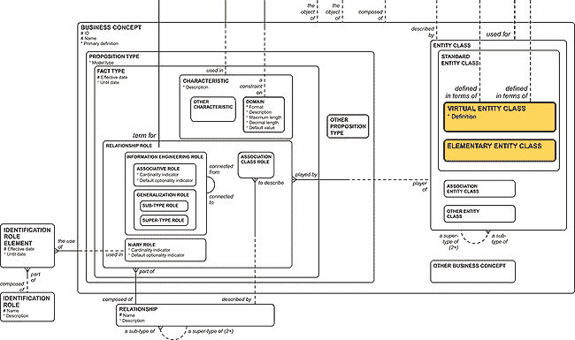

图 2-26 视图。

## 业务规则

每个`INFORMATION ENGINEERING ROLE`必须由一个`ENTITY CLASS`*扮演*。`VIRTUAL ENTITY CLASS`（虚拟实体类）是视图。

此外，每个`VIRTUAL ENTITY CLASS`可以由一个或多个`SELECTION CONDITIONS`（选择条件）填充，每个条件要么是基于`ATTRIBUTE`，要么基于`RELATIONSHIP ROLE`。`SELECTION CONDITION`中的`Operator`（运算符）会评估`ATTRIBUTE`或`RELATIONSHIP ROLE`。例如，来自`ENTITY CLASS`的行可以被选中，如果`SELECTION CONDITION`是关于`ATTRIBUTE` `Length`（关于`Part`类），运算符为“小于”，且值为“24”。也就是说，该视图将包含所有小于24（单位）^*的部分。

作为另一个例子，在图 2-17 所示的示例模型中，假设你想定义`CUSTOMER`（客户）视图，它是`ENTITY CLASS` `PARTY`（在`ORDER`中的购买者）的行集。为了这一点，`VIRTUAL ENTITY CLASS`将由`ENTITY CLASS` `PARTY`的`ENTITY CLASS SELECTION`*定义*。这反过来将由表 2-2 所示的`ATTRIBUTE SELECTIONS`组成。

表 2-2 虚拟实体类示例。

| 关于 | 每一个 | 意味着 |
| :--- | :--- | :--- |
| ATTRIBUTE | Party ID | ENTITY CLASS Party |
| ATTRIBUTE | Person given name | ENTITY CLASS Person |
| ATTRIBUTE | Person surname | ENTITY CLASS Person |
| ATTRIBUTE | Person middle initial | ENTITY CLASS Person |
| ATTRIBUTE | Organization name | ENTITY CLASS Organization |

因此，构建`VIRTUAL ENTITY CLASS`的过程由以下业务规则控制。

每次`ATTRIBUTE SELECTION`的出现必须`属于`一个`ATTRIBUTE`，而该属性`关于`一个`ENTITY CLASS`。每个`ATTRIBUTE`的出现也必须`属于`一个`ENTITY CLASS SELECTION`，而该选择`属于`一个`ENTITY CLASS`。对于每个`ATTRIBUTE SELECTION`，同一个`ENTITY CLASS`必须位于这两个导航的末尾。

## 关于参考数据

在每个业务数据模型中，某些实体类不依赖于其他实体类。也就是说，`reference data` 没有强制性关系。通常，这些是包含其他实体所使用的参考术语的实体类。参考数据包括如 `STATUS`、`CURRENCY`、`EVENT TYPE`、`LICENSE TYPE` 等值。通常，这些每项都只有几个值，由组织定义。它们代表了模型其他地方用术语的合法值。因此，确保这些实例被定义正确，是创建使用这些系统的人员的工作——正由于这个原因，它们通常被视为元数据的一部分。

这些参考实体类在这里没有单独表示，因为它们没有为模型的结构添加任何内容。然而，管理元数据的人必须注意这些参考数据，并在管理使用它们的任何系统的结构的同时也管理它们。

在在本章开头的引言中，亚里士多德断言两个或多个事物之间的连接确实是一个事实。是的，我们关注的是涉及的事物（业务概念）是否存在。我们还关注业务概念的本质（由事实揭示）。关于连接 `为什么` 存在的问题超出了本书的范围。

## 第四行：数据设计

架构框架的第四行是设计者视图（Designer’s View）。在 `Data` 列的情况下，这指的是引入的管理第三行所描述数据的特定类型数据处理技术。截至 2006 年，最常用的技术是关系型数据库和面向对象的程序设计。

关系技术侧重于数据如何被存储，而面向对象的技术解决数据如何在程序中被处理。原则上，这些者应该是兼容的，因为存储的数据必须以某种方式被程序处理，而处理过的数据通常必须被存储。

数据库管理的优先级是确保其设计尽可能不冗余，并控制对数据结构的修改和对数据的访问。数据库实现的关系方法支持这种方法。它利用数据库管理系统（`DBMS`）软件来存储和处理组织成二维表的数据。根据 E. F. Codd 的 `relational theory` [Codd 1970]，根据关系规则存储数据可以最大限地减少存储中的冗余，但它不会以任何方式限制如何编写程序来使用和处理这些存储的数据。

尽管数据库设计中的一个组件解决了性能问题，但数据库管理员对数据在程序中如何使用并不关心。另一方面，数据的面向对象方法强调程序的正确设计和编写。数据结构被嵌入在程序中，描述了所谓的“对象”类。这些类可能对应于之前描述的用于第三行概念模型的业务实体类，也可能是仅供程序使用的对象类。然后将过程（称为“行为”）附加到这些类上。

当面向对象的程序的对象必须变得是 `persistent`（持久化）的——即在程序终止后保留其取值时——涉及的数据必须存储在某处。这里没有单一的面向对象方法，因此，尽管这不是唯一的解决方案，但它在行业中的普及表明关系型数据库是存储此类持久化数据的合理场所。然而，这样做需要将程序的对象结构翻译成数据库的表和列。如果对象结构和数据库结构都紧密接近概念模型的结构，这应该是非常简单的。在这两种情况下，数据都假设有一种结构，原则上，这两种结构应该源于同一个第三行模型。但在实践中，映射往往并不容易。

无论是从实体关系模型翻译还是从面向对象设计翻译，关系型数据库缺乏处理继承的能力使得该方向的翻译成为一项需要思考的巨大工作。

此外，关系型设计者和面向对象设计者都会修改结构以适应处理瓶颈，但他们对什么构成此类瓶颈观点完全不同。

存储在关系型 `DBMS` 中的数据受到广泛规则的约束以保护其完整性并控制对它们的访问。这些规则并不一定适用于程序中所使用的数据结构。本章的其余部分描述了关系型和面向对象方法的元模型，揭示了两种数据视图之间的相似与不同。

## 关系型数据库设计

Codd 原始的关系模型通过 `relations, attributes` 和 `tuples`（元组）描述数据。这些在概念模型中反映为 `entity classes, attributes,*` 和 `occurrences`。在关系型数据库设计中，它们分别被实现为 `tables, columns` 和 `rows`。

### 表和列

实体类 `TABLE` 和 `COLUMN` 显示在图 2-27 中。这种结构与之前描述的 `ENTITY CLASS` 和 `ATTRIBUTE` 相似。一个 `TABLE` 是关于某事的数据的集合，组织成一组行和列。也就是说，`TABLE` 的结构由一组 `COLUMNS` 定义。因此，每个 `TABLE` 可能 `由`一个或多个 `COLUMNS` 组成，而每个 `COLUMN` 必须 `属于`单个 `TABLE`。

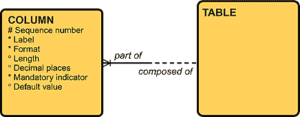

图 2-27 列的视图。

`COLUMN` 不能在表中重复，它定义了 `TABLE` 所描述的特定事物。`ROW` 是 `TABLE` 所关于的事物的实例。行和列可以是任何顺序。它们的顺序不被赋予任何意义。

### 业务规则（关系理论版本）

1. 每个 `COLUMN` 在 `TABLE` 中只能出现一次。

2. 每个 `COLUMN` 的实例（即列在行中的出现）一次只能包含一个值。

3. `COLUMNS` 在 `TABLE` 中的呈现方式没有隐含顺序。

4. 行在 `TABLE` 中出现的顺序没有隐含顺序。

每个 `COLUMN` 由一个“标签”描述，除其他外，该标签在 `COLUMN` 出现在屏幕或报告时都可以显示。列的特征由其 `Format` 定义，可选由其 `Length` 和（数量）`Decimal places` 定义。其 `Mandatory indicator` 决定了是否必须为所有行提供该列提供值。`COLUMN` 的实例可以被分配一个“默认值”。

图 2-28 显示了一个数据库设计图，该图可以从图 2-17 的示例实体类模型中推导出来。这是一个通用的数据库设计图，由 Oracle 的 Designer 建模工具生成。其他工具可能会以不同的方式呈现相同的信息。在这张图中，每个表由一个矩形表示，矩形内部列出了所有列。与实体类模型一样，星号表示必填列，空心圆表示可选列。此外，实心圆表示作为 `primary key`（主键）一部分的列（主键已在第七章

图 2-28 示例数据库设计。

因此，在这个示例中，“Parties”、“Orders”、“Line Items”、“Product types”和“Service types”都是图 2-27 中实体类 `TABLE` 的示例。请注意，在此设计中保留了概念模型中的弧形表示法。在这种情况下，这意味着必须由存储过程或其他类型的程序化约束来强制排他性。`Pdty_pdty_id` 或 `St_service_type_id` 必须为为空。此外，取决于概念模型中的约束，另一列必须是“空”或“非空”。

数据库设计中的大部分内容涉及对约束的提供：主键、外键、域、列约束、弧等。由于这些是业务规则的实现，因此对这些内容的详细讨论推迟到了第七章。

### 视图

SQL 作为关系型数据库的语言，提供了定义 `views`（视图）的能力，视图是组织成类似于表的数据集合，但它们实际上派生自其他表。图 2-29 将 `VIEW` 和 `TABLE` 显示为更通用的概念 `DATA GROUP`（数据组）的子类型。`DATA GROUP` 是任何组织的数据集合，可以是 `TABLE`，也可以是从一个或多个其他 `TABLE` 派生的 `VIEW`。这与之前描述的实体类模型视图结构相同。

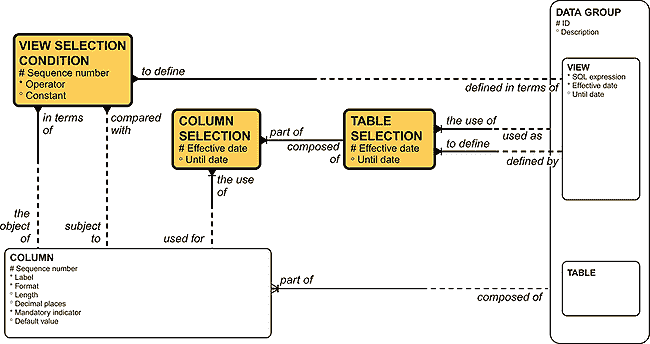

图 2-29 表视图。

`VIEW` 必须由一个或多个 `TABLE SELECTIONS`（表选择）定义，其中每个 `TABLE SELECTION` 是使用另一个 `DATA GROUP`（`TABLE` 或 `VIEW`）。每个 `TABLE SELECTION` 反而可能由一个或多个 `COLUMN SELECTIONS`（列选择）组成，每个列选择使用该表中的一列。通过根据一个或多个 `VIEW SELECTION CONDITIONS`（视图选择条件）评估所选 `DATA GROUPS` 和 `COLUMNS`，从组件 `DATA GROUPS` 中的数据填充视图。每个 `VIEW SELECTION CRITERION`（视图选择标准）将指定 `COLUMN` 的值与“常量”或另一列的值进行比较。

## 业务规则

任何用于作为 `TABLE SELECTION` 部分的 `COLUMN SELECTION` 必须是该 `TABLE SELECTION` 中使用的 `DATA GROUP` 的一部分。

例如，在图 2-28 所示的示例数据库设计中，可以为 `CUSTOMER` 构建一个视图，其实例被定义为参与 `ORDER` 的 `PARTY`（“Party_ID_from”），其中作为“Party_ID_to”的 `PARTY` 是我们。在 SQL 中，视图定义如下：

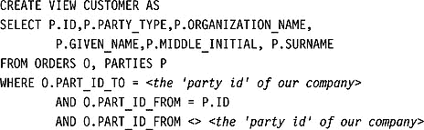

在我们的模型中，这翻译为一个名为“Customer”的 `VIEW`，由以下 `TABLE SELECTIONS` 定义：

- 使用 `DATA GROUP` (`TABLE`) “Orders”

- 使用 `DATA GROUP` (`TABLE`) “Parties”，并由属于 `DATA GROUP` (`TABLE`) “Parties”的以下 `COLUMNS` 组成：

→ `ID`

→ `Party_type`

→ `Organization_name`

→ `Given_name`

→ `Middle_initial`

→ `Surname`

- 根据以下 `TABLE SELECTION CONDITIONS` 定义，这些条件比较了以下 `COLUMNS`：

→ 根据第一个 `TABLE SELECTION` 条件定义

• 根据属于 `TABLE` “Order” 的 `COLUMN` “Party_id_from” 定义

• 运算符 `=` “equal”

• 与属于 `TABLE` “Party” 的 `COLUMN` “ID” 比较 `<and>`

• 根据属于 `TABLE` “Order” 的 `COLUMN` “Party_id_from” 定义

• 运算符 `=` “equal”

• 与常量 `<the party of company>` 比较

→ 根据第二个 `TABLE SELECTION` 条件定义

• 根据属于 `TABLE` “Order” 的 `COLUMN` “Party_id_to” 定义

• 运算符 `=` “not equal”

• 与常量 `<the party of company>` 比较

定义视图的 SQL 语句是属性值。由于 `VIEWS` 派生自 `ENTITY CLASSES`，每个 `TABLE SELECTION` 必须基于 `ENTITY CLASS SELECTION`，每个 `COLUMN SELECTION` 必须基于 `ATTRIBUTE SELECTION`，且每个 `TABLE SELECTION` 必须基于 `CRITERION`。

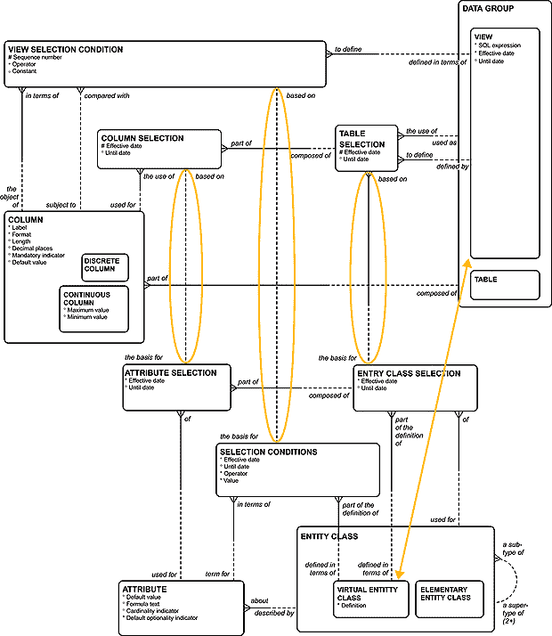

图 2-30 实体类与表视图

### 数据组与应用程序系统

图 2-31 显示了表和视图为了方便而进行的分组。这可能与开发和实现的方式有关，也可能具有功能上的意义。无论 `DATA GROUPS` 是如何组织的，它们最终应该按 `APPLICATION SYSTEM` 组织。本书以这种方式呈现元模型，尽管并非所有的信息技术部门都会这样做。对于我们的目的，`APPLICATION SYSTEM` 是为了实现业务功能而的数据分组。（程序也是 `APPLICATION SYSTEM` 的部分，[第三章](#B9780120887989500048.htm_chapter3)将详细讨论这一点，以及 `APPLICATION SYSTEM` 如何运作。）

### 面对象数据设计

描述数据的另一种方法是使用面向对象的方法设计程序的人所采用的方法。这种方法关注不是数据的存储方式，而是它们在程序中的处理方式。然而，结构是相关的，因为它们也派生自概念模型。

2005 年最常用的面向对象数据的表示法是 UML 类图，它是 20 世纪 90 年代一组设计师开发的 [OMG 2003]。它与之前描述的实体关系表示相似，事实上（正如我们在[第一章](#B9780120887989500024.htm_chapter1)中所看到的），可以使用 UML 的子集绘制实体关系图。

关于 UML 优点的说法之一是，在需求分析期间用于描述业务实体类的符号也可以用于描述为计算机系统创建的类。这令人遗憾，因为这些*并不是同一个东西*，在描述两者时使用相同的符号和术语具有误导性。正如我们在这里看到的，面向对象的设计模型与分析模型完全不同，无论其表示法如何。

在关系世界中，区分了对业务具有重要意义的“实体”与在计算机中表示这些事物的“表和列”。虽然关系世界中的许多数据建模者确实混淆了它们，但至少在原则上，实体和表是可以分开处理的。事实上，尽管数据库设计应该*基于*实体模型，但出于性能或其他物理特性的考虑，让设计人员*偏离*该结构通常是合适的。

同样，在面向对象的世界中，世界中事物的“类”与计算机产物的“类”仍然非常不同。这些事物之间的混淆可能会导致遗憾的结果。即使在面向对象的世界中，描述类的代码片段与代码所描述的实体类并不是同一种事物。

此外，面向对象的程序还关注业务完全不可见的事物。这些是纯粹为了辅助计算机处理而定义的对象。尽管如此，与关系世界一样，如果为了响应业务需求，面向对象设计的类结构应该派源于业务的实体关系模型。然而，与关系模型一样，面向对象的设计模型也可能出于良好且有效的设计原因与实体关系模型产生差异。

由于需求分析中的现实世界“类”与设计中的计算机化“类”具有区分的重要性，前者在此处将继续被称为 `ENTITY CLASS`。后者在此处被称为 `CLASS IMPLEMENTATION`。图 2-32 显示了 `CLASS IMPLEMENTATION`，它代表描述类的代码片段。因为它指的是一段程序代码，`CLASS IMPLEMENTATION`将在第三章中进行更详细的描述，此处类型为灰色。

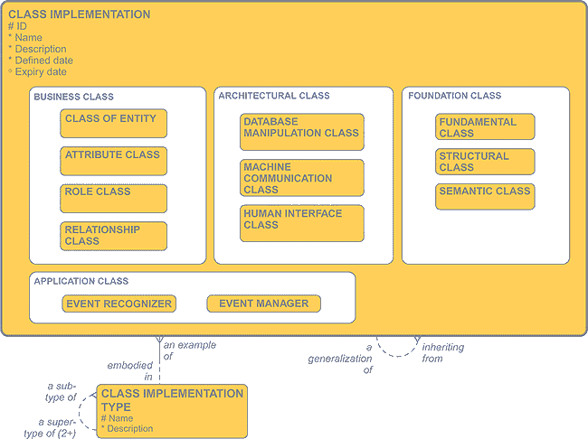

图 2-32 类实现。

与关系世界不同，子类型和超类型（父类）可以直接在面向对象设计中实现。也就是说，每个 `CLASS` 都可以是一个或多个其他 `CLASSES`的*泛化*，并且每个 `CLASS` 可以*继承自*一个且仅一个另一个 `CLASS`。（出于哲学原因，在书中我们排除了多重继承。尽管当然，模型可以更改以适应它。）[^* Meilir Page-Jones 将 `CLASS IMPLEMENTATION` 描述为四类类别之一，此处表示为 `CLASS IMPLEMENTATION` 的子类型 [Page-Jones 2000, pp. 233–240]。

– 一个 `BUSINESS CLASS` 代表业务中的某物，可能是以下任何一种。

→ 一个 `CLASS OF ENTITY`，例如“人员”或“合同”

→ 一个 `ATTRIBUTE CLASS`，为 `INSTANCE ATTRIBUTES`（后文将描述）提供数据类型，例如“余额”（银行账户）或“单位成本”（产品）

→ 一个 `ROLE CLASS`，例如“客户”或“患者”

→ 一个 `RELATIONSHIP CLASS`，例如“账户所有权”或“患者监督”（类似于三表实体关系图中的交叉实体）

这些分别对应于（并应该基于）概念模型的实体类、属性、关系角色和关联类。其余的类别仅是面向对象设计者和程序员关注的。

– 一个 `ARCHITECTURAL CLASS` 涉及在特定计算机上的实现细节。这可能是以下之一。

→ 一个 `HUMAN INTERFACE CLASS`，例如“窗口”或“命令按钮”

→ 一个 `DATABASE MANIPULATION CLASS`，例如“事务”或“备份”

→ 一个 `MACHINE-COMMUNICATION CLASS`，例如“端口”或“远程机器”

– 一个 `FOUNDATION CLASS`，广泛可用。`FOUNDATION CLASSES` 包括以下：

→ 一个 `FUNDAMENTAL CLASS`，例如“整数”、“布尔值”和“字符”

→ 一个实现数据结构的 `STRUCTURAL CLASS`，例如“栈”、“队列”等等

→ 一个 `SEMANTIC CLASS`，例如“日期”、“时间”、“角度”等。（这些类具有比基础类丰富的含义。此外，它们的属性值可以用特定单位表示，例如“英尺”或“秒” [Page-Jones 2000, pp. 233–240]。）

– 一个 `APPLICATION CLASS` 代表特定于应用程序，可能是以下之一。

→ 一个 `EVENT-RECOGNIZER`，寻找“患者发热”事件

→ 一个 `EVENT-MANAGER`，执行“患者发热”事件

# 类与对象

→ 一个`RELATIONSHIP CLASS`，例如“账户所有权”或“患者监督”（类似于三表实体关系图）

这些分别对应于（并应该基于）概念模型的实体类、属性、关系角色和关联类。其余的类别仅是面向对象设计者和程序员关注的。

– 一个`ARCHITECTURAL CLASS`涉及在特定计算机上的实现细节。这可能是以下之一。

→ 一个`HUMAN INTERFACE CLASS`，例如“窗口”或“命令按钮”

→ 一个`DATABASE MANIPULATION CLASS`，例如“事务”或“备份”

→ 一个`MACHINE-COMMUNICATION CLASS`，例如“端口”或“远程机器”

– 一个`FOUNDATION CLASS`，广泛可用。`FOUNDATION CLASSES`包括以下：

→ 一个`FUNDAMENTAL CLASS`，例如“整数”、“布尔值”和“字符”。

→ 一个实现数据结构的`STRUCTURAL CLASS`，例如“栈”、“队列”等。

→ 一个`SEMANTIC CLASS`，例如“日期”、“时间”、“角度”等。（这些类具有比基础类丰富的含义。此外，它们的属性值可以用特定单位表示，例如“英尺”或“秒” [Page-Jones 2000, pp. 233–240]。）

– 一个`APPLICATION CLASS`代表特定于应用程序，可能是以下之一。

→ 一个`EVENT-RECOGNIZER`，寻找“患者发热”事件。

→ 一个`EVENT-MANAGER`，执行“患者发热”事件。

为了提供更大的灵活性，`CLASS IMPLEMENTATION`可能是一个或多个其他`CLASSES`的*超类型*。此外，每个`CLASS`可能是一个且仅一个另一个`CLASS`的*超类型*。

### 规则

由于需求分析中的现实世界“类”与设计中的计算机化“类”具有区分的重要性，前者在此处将继续被称为`ENTITY CLASS`。后者在此处被称为`CLASS IMPLEMENTATION`。图 2-32 显示了`CLASS IMPLEMENTATION`，代表描述类的代码片段。因为它指的是一段程序代码，`CLASS IMPLEMENTATION`将在第三章中进行更详细的描述，此处类型为灰色。

- **受保护 (Protected):** `CLASS ELEMENT`只能在其`CLASS IMPLEMENTATION`内部以及由继承自该类的类被可见和使用。

- **私有 (Private):** `CLASS ELEMENT`仅在在其`CLASS IMPLEMENTATION`的上下文中可见的。

其他类型的可见性由特定的面向对象语言实现，但这三种是最常用的。请注意，`CLASS ELEMENT`本身可以是另一个`CLASS IMPLEMENTATION`的*使用*——具体来说，是一个`FOUNDATION CLASS`（基础类）或`ARCHITECTURE CLASS`（架构类）。例如`INSTANCE ATTRIBUTE` “Name”本身可以是一个`ATTRIBUTE CLASS`。同样请注意，尽管`CLASS IMPLEMENTATION`显示为灰色——因为作为程序代码，它实际上属于“活动”（Activities）列（参考第三章）——但`CLASS ELEMENT`并不是。它只出现在数据（Data）列中。

### 对象

图 2-34 显示`CLASS`可以*体现于*一个或多个实际的`OBJECTS`；也就是说，一个`OBJECT`是一个且仅一个`CLASS`的*实例*。^*

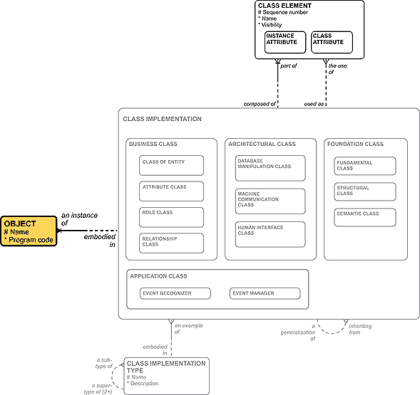

图 2-34 对象。

### 从概念模型到关系数据库设计

图 2-35 显示了`COLUMN`和`TABLE`的定义如何基于`ATTRIBUTE`和`ENTITY CLASS`的定义——通过`COLUMN ATTRIBUTE MAPPINGS`（列属性映射）和`TABLE ENTITY CLASS MAPPINGS`（表实体类映射）。原则上，初始数据库设计应该直接源自实体关系模型结构。在大多数情况下，一个`TABLE`应该*基于*单个`ENTITY CLASS`。当然，情况并不总是那么整洁，因为由于等原因，实体关系模型中的超类型/子类型结构无法直接在纯关系型数据库中实现。

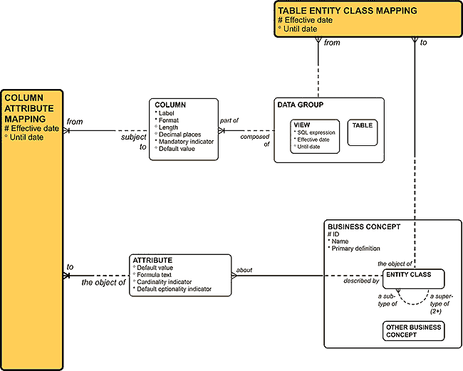

图 2-35 表和实体类。

将超类型/子类型结构映射到扁平关系表原则上有三种不同的方法。每种方法都有优缺点，因此选择方法时必须谨慎：

- 可以为每个超类型定义一个`table`，包含其所有的子类型。然后为超类型属性以及每个子类型中的属性定义列。这种方法的优点是简单，但意味着许多列将具有空值。此外，将无法对任何子类型列强制值。描述子类型的列仅对代表该子类型发生情况的行有值。

- 可以为每个子类型定义一个`table`，包括源自其属性的列以及包含所有继承的超类型属性的列。这允许对列的每一行强制值，但增加了结构的复杂性。任何指向超类型的关系（例如），现在必须（通过排斥性弧）使用指向每个相应子类型表的外键来实现。此外，超类型的列必须在每个子类型中冗余地定义。

- 可以为超类型和每个子类型分别定义一个`table`，并用外键从超类型指向每个子类型。这种方法最优雅，冗余最少且控制力最强，但实现起来也最复杂。

原则上，没有必要连接`ENTITY CLASS`和`TABLE`，因为这种关系已经通过`ATTRIBUTE`和`COLUMN`之间的映射实体类`COLUMN ATTRIBUTE MAPPING`隐含地包含了。然而，在设计过程中，通常在映射单个列和属性之前，就已经确定了实体类和表之间的关系。此处所示的配置提供了做出此类临时设计决策的能力。再次强调，这是临时的。一旦完成`COLUMN ATTRIBUTE MAPPINGS`，`TABLE ENTITY CLASS MAPPING`实体类就是多余的。

### 从概念模型到面向对象的设计

正如之前的定义所暗示的那样，`BUSINESS CLASS`可以直接源自需求分析期间创建的概念模型。具体而言，如图 2-36 所示，`BUSINESS CLASS`可以*基于*一个或多个`CLASS DEFINITIONS`，每一个定义反过来都是`ATTRIBUTE`、`ENTITY CLASS`或`RELATIONSHIP ROLE`的*使用*。由于这些中的每一个都可能被*用于*一个或多个`BUSINESS CLASSES`，交叉实体类`CLASS DEFINITION ELEMENT`被定义为：特定的`CLASS DEFINITION`正在使用特定的`ATTRIBUTE`、`ENTITY CLASS`或`RELATIONSHIP ROLE`。

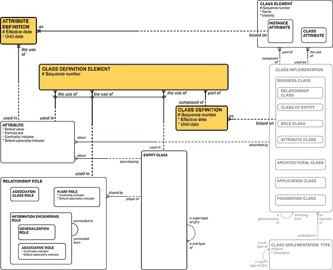

图 2-36 类定义。

正如之前的定义所暗示的，一个`ENTITY CLASS`是特定的`ATTRIBUTE`的*使用*。同样，在面向对象世界中，所有属性都会被考虑到。注意，`CLASS IMPLEMENTATION`这种可以*基于*一个`ATTRIBUTE`。

*可扩展标记语言*（*XML*）是一种用于描述和为文本及数值数据提供结构的语言，以便将其从一个地方传输到另一个地方。它利用`tags`（类似于 HTML `tags`）来识别数据以及数据与其他数据之间的关系。它类似于数据建模，因为它为数据提供了结构，但它不是图形表示，而是一种通过文本对数据进行标记的手段。以下是一个 XML 示例，用于描述可能在文档中呈现的数据记录。

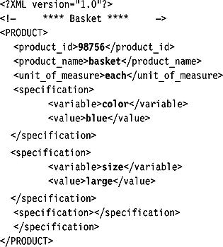

你看到的大部分内容都是描述结构的。唯一的数据元素是**粗体**显示的值。在每个数据元素周围都有描述它的`tags`。每个`tag`都括在`<角括号>` 中。每个`tag`都是成对出现的。第一个是一个单词或短语（例如，`<PRODUCT>`）；第二个在下方，具有相同的单词或短语，前面有一个右斜杠（例如，`</PRODUCT>`）。根据 XML 的规则，指定一组数据始终需要`end tag`，尽管起始标签和结束标签之间可能没有数据（例如，`<specification></specification>`）。单个`tag`可以表示这种情况，右斜杠只需跟在初始标签短语之后（如，`<specification/>`）。

`Tags`可以嵌套。在以前的示例中，`tag` `<PRODUCT>` 包含了（其他之外的）`<specification>` 的`tag`，而它又包含了 `<variable>` 和 `<value>` 的`tags`。图 2-38 中的数据模型显示，一个 XML DOCUMENT 可能`由`一个或多个 XML `TAGS` 组成，每个 `TAGS` 反过来也可以`由`更多 XML `TAGS` 组成。注意 XML `TAGS` 的属性““Tag”，它包含了作为该元素`tag`的单词或短语。

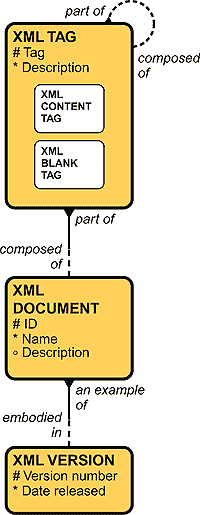

图 2-38 XML 文档和元素。

注意，之前的 XML 示例像所有 XML 文件一样，以标准头开头，揭示了文档所使用的 XML 版本。也就是说，每个 XML DOCUMENT 都是根据其所`示例的`的 XML VERSION 相应的规则定义的。

你可能注意到，在示例中 `<PRODUCT>` 是由每个 `<product_id>`、`<product_name>` 和 `<unit_of_measure>` 描述的，但 `<specification>` 出现了多次。XML 本身没有任何规定来决定在何处使用哪些`tags`，但这种嵌套结构可以通过一种特殊的 XML 文档——`document type declaration`（`DTD`）来控制。该示例的 `DTD` 如下。

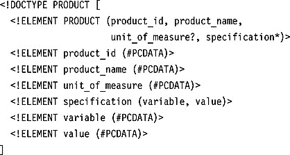

由于 DOCUMENT 的的主是是产品，因此 `DOCTYPE` 称为 `PRODUCT`。该规范的第一个 `ELEMENT` 标识了第一个 `tag`（也称为 `PRODUCT`），随后是其中包含的 `tags` 列表（`product_id`、`product_name`、unit of measure 和 `specification`）。

`unit_of_measure` 后面的问号 `?` 意味着每当指定 `<PRODUCT>` 时，可能有一个 `<unit_of_measure>` `tag`，但后面可能不超过一组。`specification` 后面的星号 `^*` 意味着 `<PRODUCT>` 后面可能有一个或多个 `<specification>` `tag` 组，也可以没有。如果在任何 `tag` 后面有一个加号 `+`，则意味着必须有一个或多个。也就是说，`tag` 必须出现在父标签之后，它可以出现多次。缺少星号或问号（如“<product id>”和“<product name>”）意味着对于每个 `<PRODUCT>` 出现，必须有且只有一个值。

在 `PRODUCT` 内部的 `tags` 列表之后，每个 `tag` 都有它自己的 `ELEMENT` 行。在大多数情况下，每个标签的参数是 (`#PCDATA`)，这意味着该 `tag` 将描述数据。另一方面，`Specification` 有它自己的参数列表“variable”和“value”，就像 `PRODUCT` 一样。它的 `tags` 随后被列为它们自己的 `ELEMENTS`。

图 2-39 显示每个 XML DOCUMENT 必须`受限于`恰好一个 DOCUMENT TYPE DECLARATION。（实际上，你可以创建一个没有 `DTD` 的 XML DOCUMENT，但不建议这样做。）那么，每个 DOCUMENT TYPE DECLARATION 必须`由`一个或多个 XML `ELEMENTS` 组成，其中每个 XML `ELEMENT` 可能会`体现在`真实 XML 文档上的一个或多个 XML `TAGS` 中。

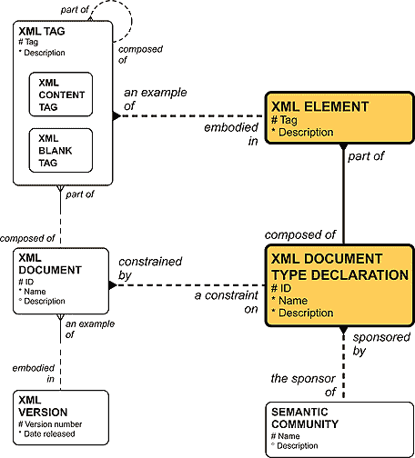

图 2-39 XML 文档类型声明。

除了起始标签之间的数据外，还可以为 `attributes` 指定值。例如，之前示例的替代方案可能是：

这看起来像是：

在 图 2-40 中，XML `ATTRIBUTE` 是 `ELEMENT` 的限定符。同样，XML CONTENT 可能是部分：

图 2-40 XML 属性。

XML 显然是一种数据方式，但它的优势在于表达概念。合理的做法是将 `tags` 映射到 图 2-41。这显示了一个或多个 XML `TAGS` 如何定义 XML CONTENT：

图 2-41 XML 元素。

# 第六章：生产系统

建模第五章（构建者视图）需要描述 Oracle、DB2、Sybase 等内部机制的元模型。这超出了本书的范围。

然而，有用的是花时间查看一个构建好的数据库模型。如图 2-42 所示。每个 DATA GROUP 通过一个或多个 TABLE INSTANCES 实现，根据定义，每个都必须由 ROW INSTANCES 和 COLUMN INSTANCES 组成。一行和一列的交点是一个 CELL INSTANCE。数据库中的每个数据都对应一个 CELL INSTANCE。

图 2-42 表实例。

如图 2-43 所示，构成 TABLE INSTANCES 的 CELLS 集合必须储放在某处。事实上，它们被`保存在` DATABASE INSTANCE 中，这是一种虚拟站点（在第四章中进一步描述）。每个 DATABASE INSTANCE 和 TABLE INSTANCE 反过来都必须在数据库管理系统（DBMS）的程序副本上`创建`。

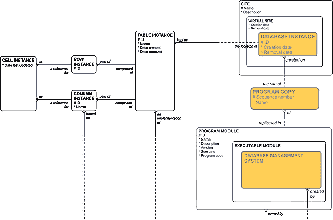

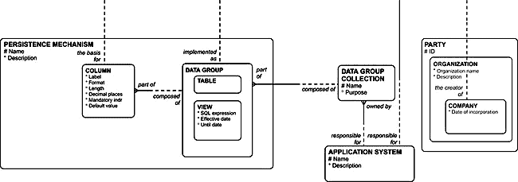

图 2-43 物理数据库。

数据库管理系统由公司创建，例如 Oracle、Microsoft、IBM、Sybase 或类似的公司。请注意，`DATABASE MANAGEMENT SYSTEMS` 会随时间而变化，当安装一个新版本的 `PROGRAM COPY` 时，它会带来一组新的 `DATABASE INSTANCES` 和 `TABLE INSTANCES`。新一组 `TABLE INSTANCES` 仍然可以是旧 `DATA GROUP` 的实现，就像新一组 `COLUMNS` 仍然可以基于旧的 `COLUMN` 设计一样。

## 业务规则

`DATABASE INSTANCE` 必须仅在 `属于` `DATABASE MANAGEMENT SYSTEM` 的 `PROGRAM COPY` 上创建。

***

### 尾注

*   `Business Rules Team` 现在将供应商包含为成员，而 `Business Rules Group` 则不包含。

*   如前所述，本节的大部分内容灵感来自 `Business Rules Team` [BRT 2005] 的工作。然而，这里显示的结果是我个人的见解。

*   当然，在美国，餐厅里的“facilities”（设施）指的是完全不同的意思。

*   嗯，某些数据建模者是这样。

*   例如，地理本体论请参见 `http://www.getty.edu/research/conducting_research/vocabularies/tgn/index.html`。

*   任何想要使用 `CASE` 工具从此模型创建默认数据库设计的人应该小心。

*   在整书中，你将看到这类从其他章节借用的实体示例。在每个情况下，引入时都会有一个简短的定义，但你应该去对应的章节获取更完整的描述。

*   这假设单位已经处理过了。

*   在 David C. Hay 的《需求分析：从业务视图到架构》中也可以找到关于规范化过程的简要描述。

*   好吧，如果你坚持的话，把模型改为“每个类可以继承自一个或多个类”。你当然意识到这意味着你必须添加交叉实体，例如 `STRUCTURE`。

*   Page-Jones 先生每个类别称为 `domain`，但我们已经在使用这个词指代其他意思，所以这里使用 `category`。

*   严格来说，这并不是元模型的一部分，而是业务模型本身。`OBJECTS` 包含了应用程序的实际数据值。在这里显示是有用的，因为一些重要的元模型概念只能通过 `OBJECTS` 来描述。

*   确实有人正在使用 `XML` 创建数据库。这非常令人担忧。

## 活动、功能与流程

一流智力的测试是能够在大脑中同时持有两个对立的观点，并仍然保持运作的能力。 — SCOTT FITZGERALD

家用电脑被要求执行许多新功能，包括处理被狗吃掉的作业。— DOUG LARSON

猫是为了告诉我们，自然界中并非万物都有功能。 — 未知

### 活动与架构框架

架构框架中的“活动”列（见图 3-1）涉及企业`如何`执行其工作。

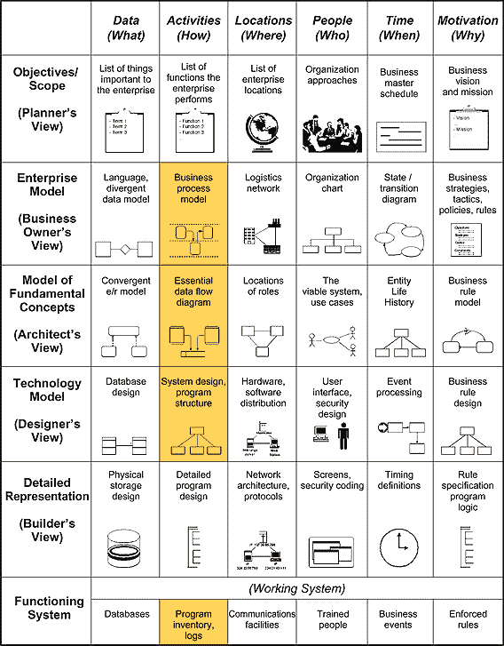

图 3-1 活动列。

- `planner`（规划者）查看企业的愿景和使命，并规划组织如何运作的方法。
- `business owner`（业务所有者）看到业务的整体功能，以及占据其日常生活的实际流程，这些流程涉及执行机制、参与人员以及双方沟通的方式。
- `architect`（架构师）将流程视为业务功能的表达，而不考虑执行它们所需的系统和其他机制。架构师随后根据对外部事件的响应对其进行组织。
- `designer`（设计者）关注为了协助执行流程而创建程序的结构。
- `builder`（构建者）深度参与编程语言以及创建系统所需的其他技术的复杂细节。
- `functioning system`（运行系统）是程序和其他技术的清单，以及跟踪它们使用情况的流程。

图 3-1 显示了框架，并强调了本章将处理的单元格。这些单元代表了业务所有者、架构师、设计者和运行系统的视图。

### 定义

在原始框架中，John Zachman 将第二列标记为 `Function`（功能）。在原始的数据流图表示法以及后来的业务流程重组中，公司所做的被称为 `process`（流程）。在日常对话中，我们谈论 `activities`（活动）。事实上，在日常对话中，这三个术语被混用，仿佛它们是同义词一样。但对于我们来说，对这些术语进行区分是非常重要的。

- `activity`（活动）：涵盖以下所有术语的最通用超类型。
- `function`（功能）是一种为实现企业目标的活动。它完全根据其预期完成的任务来描述，而不考虑执行它时使用的技术或由谁来执行。这种描述同样不参考时间。功能代表了第二行中“业务所有者视图”的概念版本。它们从全局视角（企业的使命是什么？）开始，并可能被拆解以显示大量的细节。
- `process`（流程）是企业为产生特定输出或实现目标而执行的活动类型。可以根据、也可以不根据所使用的机制或执行它的参与方进行描述。一组流程通常按顺序描述。`business process`（业务流程）描述了由业务人员执行的活动，包括涉及的机制。这属于第二行“业务所有者视图”的领域。或者，第三行的架构师看到的是 `system process`（系统流程），它是关于执行流程所涉及的数据转换的。无论哪种，流程都可以从高层或原子级进行查看。

图 3-2 显示了 `ACTIVITY`（活动）的第二行（业务所有者视图），`FUNCTION` 和 `BUSINESS PROCESS` 是子类型。稍后将详细介绍。

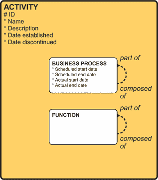

图 3-2 活动、功能与流程。

术语在表 3-1 中进行了比较。对于本书，术语 `activity` 将作为架构框架列的标题，因为它涵盖了所有概念，尽管在该模型中 `ACTIVITY` 将与 `SYSTEM PROCESS`（系统流程）区分开，后者在第三行部分描述（见第 142 至 157 页）。

表 3-1

活动类型。

描述活动建模的一个困难在于，实现它的方法实在太多了！诚然地说，其底层概念是非常通用的，但仅仅看现有的各种技术，你永远无法发现这一点。

### 过程建模的演变

第一种通用的过程模型几乎同时由 Tom DeMarco [DeMarco 1978] 以及 Chris Gane 和 Trish Sarson [Gane and Sarson 1979] 引入。这就是`数据流图`（data flow diagram），它提供了一种表示过程、外部实体（数据的最终来源和终点）以及`数据存储`（数据在过程之间临时存放的地方）之间数据流的方法。它包含了将过程分解为更详细细节。此外，作者们区分了`物理数据流图`和`逻辑数据流图`。DeMarco 先生扩展了这些思想，描述了从当前物理数据流图到逻辑数据流图，再到新的物理数据流图的转换。

然而，DeMarco 先生对于如何区分物理数据流图和逻辑数据流图显得有些模糊。直到 James McMenamin 和 John Palmer 出版了《本质系统分析》（Essential Systems Analysis）[McMenamin and Palmer 1984]，这一过程才被形式化。McMenamin 和 Palmer 先生提出了`本质数据流图`（essential data flow diagram）的概念。它的特征是由`本质过程`（essential processes）构成的，这些过程被定义为对外部事件的完整响应。本质过程又被细分为`基础过程`（fundamental processes，负责执行企业工作）和`托管过程`（custodial processes，负责维护基础过程所需的数据）。

在 20 世纪 90 年代初，`业务流程重组`主题变得流行，并导致了 Geary Rummler 和 Alan Brache 所说的`流程图`（process map）的兴起[Rummler and Brache 1995]。这些与物理数据流图类似，但它们根据执行过程的部门或人员来组织过程。它们与其关注正在通信的数据，不如说关注用通用语言表达的任务序列；它们不再关注物理和逻辑数据流，而是简单地反映了当前存在（“现状”）以及作为分析结果而规划的（“目标态”）的任务结构。

### 用例与 IDEF 系列

不久之后，`用例`（use cases）在面向对象的世界中流行起来。这种技术最初由 Ivar Jacobson 描述[Jacobson 1992]，随后由 Alistair Cockburn [Cockburn 2000] 等人进行了详述。这些也与数据流图相似，之处在于它们在外部实体（此处称为“用例者”）和过程之间有通信，但假设是所涉及的过程代表了计算机系统（通常只显示为代表整个系统的单一过程）。数据流的内容没有被记录，而且这些细节并不是被分解为更低级的细节，而是简单地用文本描述为“步骤”。这里没有在中间数据存储中存储数据的概念。

与此同时，当 Sarson 女士以及 DeMarco 和 Gane 先生发明数据流图时，联邦政府正启动其集成计算机辅助制造（ICAM）项目。这是一种设计和建造飞机机的方法。这项工作产生了一些建模技术，后来被 ITT 规范为结构化分析与设计技术（SADT）。1981 年，空军认可了 SADT 的价值，并要求出一个适用于空军的版本。这就是`IDEF`系列建模技术的源头。*^*

“完整的 IDEF 集合（IDEF0、IDEF1 和 IDEF3——后来扩展包含 IDEF1X、IDEF4 和 IDEF5）, p. 7]。`IDEF1` 是一种建模数据的通用方法，而 `IDEF1X` 专门解决关系数据库的设计。IDEF4 是一种观察面向对象设计的方法。IDEF5 提供了一种协助`本体`（ontologies）创建、修改和维护的方法。

`IDEF3` 是一种根据所做决策来描述流的方法，而 `IDEF0` 则用于简单的布局企业功能。根据 IDEF 网站，“IDEF0 是一种用于建模组织或系统的决策、行动和活动的方法” [KBSI 2005]。

1998 年，Clarence Feldmann 出版了《使用 IDEF0 进行业务流程重组的实用指南》（The Practical Guide to Business Process Re-engineering Using IDEF0）[Feldmann 1998]，对该技术非常清晰的描述。然而，它讨论了“行动”，这使得功能与过程之间更微妙的区别未能得到解决。

IDEF0 在严谨性上与数据流图非常相似，尽管它没有显式地记录外部实体或数据存储。它对每个过程的逻辑结构建模，但在每个情况下都包含了添加箭头来描述所用机制的能力。UML 提供的模型类型之一是过程模型 [Rumbaugh et al. 1999]。它的组织方式类似于 BPR 过程模型，取决于谁在进行处理，并且它有以“对象”形式存在的数据存储。它还有一个表示并行发生过程的显式符号。

###

表 3-2 显示了上述技术及其主要特征。本书中元模型的目标是涵盖几乎所有这些技术揭示的概念。由于需要，每个实体类只能有一个名称（其中许多来自数据流图），但意图是提供一个能够适应所有方法的结构。

表 3-2

技术对比。

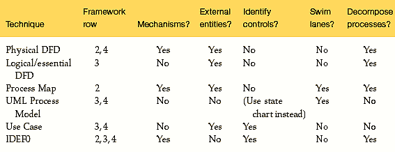

## 第二行：功能与业务流程

接下来的章节将探讨功能和业务流程。

### 功能

`功能`（function）是业务执行的活动，描述时时不考虑执行它的任何机制、顺序或参与者。每个功能都旨在执行企业的“任务”，这就是为什么它们通常以分级形式呈现，任务位于顶部。也就是说，在任务下方通常呈现五个到九个执行它的功能。然后，这些每个功能进一步分解为另外五个到九个功能。重复这一过程，直到得到一组构成层级底部的基础业务功能。

`基础业务功能`被定义为最细粒度的函数。这种函数一旦启动，在不改变其性质的情况下无法停止 [Barker and Longman 1992, p. 40]。公共图书馆的示例功能层级图见图 3-3。*

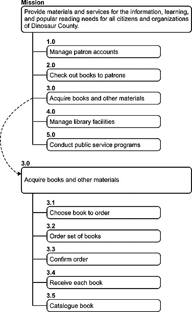

图 3-3 功能层级示例。

组织的**使命**（MISSION）与其**功能**（FUNCTIONS）不同之处在于，前者为公司所做的一切奠定了基调。它不仅仅是描述某件要做的事，更是组织持续运行的整体方法的陈述。**功能**倾向于简短的动词-名词组合（如“招聘员工”），而使命倾向于是一个复杂的句子，不仅描述了组织想要做什么（如“为社区提供甜甜圈”），还包含了对为什么要这么做的描述。它包含了诸如价值声明，例如“……从而增加该社区的快乐和愉悦”。

以功能层级图如图 3-3 所示的图书馆为例，其使命是“为恐龙县的所有公民和组织提供信息、学习和通俗阅读所需的材料和及”。更简洁地说，功能包括“管理读者账户”、“向读者借出书籍”等。请注意，“获取书籍和其他材料”被进一步细分为五个子功能。

图 3-4 显示了作为层级结构的的功能元模型，从顶部的组织**使命**开始，下方是许多**业务功能**，最后是底部的一组**基础业务功能**。也就是说，一个**使命**可以`通过`一个或多个**功能**执行。每个**其他功能**（即每个不是基础业务功能的功能）都可以`由`一个或多个**其他功能**或**基础业务功能**组成。

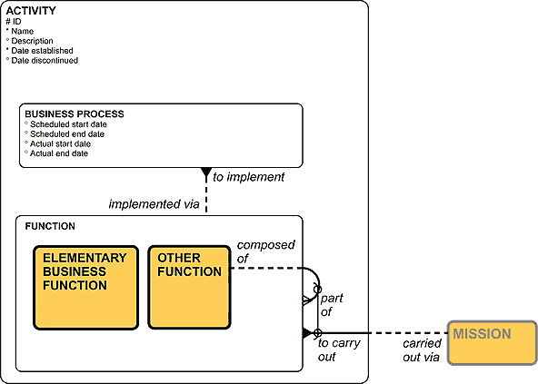

图 3-4 功能。

因此，每个**功能**必须`执行`一个**使命**或一个**其他功能**。注意，**使命**是灰色的。这里借用自第七章。之前提到过，每层应出现“五到九个”功能。这些数字并不是偶然得到的：在一项引人入胜的 1956 年研究《神奇数字七，加减二：我们信息处理能力的某些限制》[Miller 1956]中，G. A. Miller 假设人类大脑在活动记忆中只能容纳七（加减二）“东西”。

这就是为什么我们以前能记住七位电话号码，但现在由于区码失去了意义，我们学习朋友新的 10 位号码时非常困难。当面对演示稿中的两个或三个要点时，我们认为它是微不足道的。*当面对 10 个或更多点时，它看起来很复杂。简而言之，为了使功能层级易于理解，层级中的每一行应该只有七加减二个功能。

建立**功能**层级是可能的，每个功能都符合之前描述的标准（没有机制或执行者，且没有顺序），一直直到**基础业务功能**。然而，越往下，人们越容易描述为了`实施`这些**功能**每一个而正在执行的实际**业务流程**。这在图 3-4 中也有体现。

### 业务流程

`业务流程`是一种将物理材料或数据从一种状态转换为另一种状态的活动。由于上一个流程的输出通常被下一个流程使用，因此隐含了一个顺序。也可以描述用于执行每个过程的具体机制（表单、设备、计算机系统等）。

图 3-5 显示一个**功能**可以`通过`一个或多个**业务流程**`实施`。和**功能**一样，每个**其他业务流程**都可能`由`一个或多个**其他业务流程**或**基础业务流程**组成。

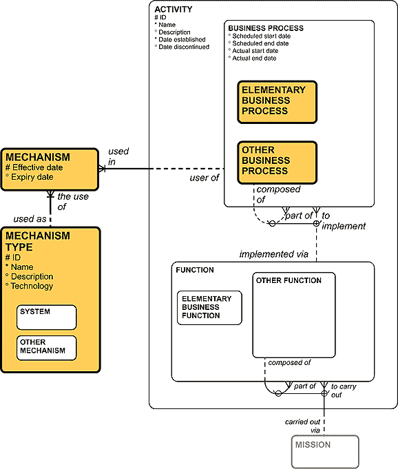

图 3-5 业务流程。

根据定义，**基础业务功能**位于树的底部，因此它可能不`由`任何其他功能组成。

图 3-7 引入了`核心业务流程`，它被定义为一组`基础业务流程`的集合，这些流程共同构成了对某种`外部业务事件类型`的完整响应。正如在第六章中详细讨论的那样，`外部业务事件类型`是发生在世界上的、在企业控制之外的事情。这不仅可能是某个发生的事，例如收到订单；它可能仅仅是时间的流逝，例如“季度末”或“每月初”。在这种情况下，`外部业务事件类型`的“时间指示”属性`必须设置为`为“真”。这与`内部业务事件类型`不同，后者是企业内部另一个`业务流程`的`动作`。

图 3-7 核心业务流程。

一个`核心业务流程`必须是`基础业务流程`（直接用于`实施`某个`业务功能`）或`支撑业务流程`，后者为`基础业务流程`提供所需的数据。例如，“维护产品定义”的流程是一个`支撑业务功能`，用于支持`基础业务流程”“销售产品”。`内部事件类型`必须是任何类型`业务流程`的`触发器`，但`外部事件类型`必须具体地作为`核心业务流程`的`基础（定义）。

### 示例流程模型

图 3-8 显示了前述功能层级模型所示描述的图书馆 3.4 和 3.5 功能的详细流程模型。它以“泳道”的形式组织，使得由同一部门执行的所有流程都在同一个泳道中。在这个示例中，收货部门的工作从“收到书籍”事件开始。然后，该部门通过与文件中存档的采购单“蓝色”副本进行比对，确认货物是正确的。（推测在订书时，采购单的蓝色副本已发送到收货部门以达到目的。）书籍被交给编目部门，该部门随后为其分配一个十威分类法，从而识别其分类——并据此确定其在图书馆中的准确位置。然后，书籍被放在书架上，并准备一张目录卡，描述该书籍并记录其十威分类号。^*

图 3-8 示例业务流程模型。

收货部门还会在蓝色采购单副本上标记为“已收到”，并将其发送到应付账部门。（这等同于发送了一条消息“已收到书籍”）。当该部门随后收到供应商发的发票时，它将支付书籍的费用。图 3-8 显示了三个`基础业务流程`。

- 确认标题、数量
- 分类书籍
- 支付发票

此外，还显示了四个`数据存储`：

- 待处理订单
- 待付发票
- 书架上的书籍
- 更新后的目录卡

所有这些元素，除了两个与发票有关的，都可以汇总为`核心业务流程`“接收每本书”。在这种情况下，控制性的`外部业务事件类型`是“收到书籍”。支付发票”不是这个`核心业务流程`的一部分，因为它不是由“收到书籍”事件触发的。相反，它是由`外部事件类型`“收到发票”和`内部事件类型”“收到书籍”组合触发的。

除了*外部*`事件类型`之外，组织内部`其他业务流程`经常触发`基础业务流程`和`其他业务流程`。这些触发（如之前描述的“收到书籍”消息）是`内部业务事件类型`的示例。也就是说，这些描述的是企业内部的、受控的事件。

### 业务流程的驱动

在第七章中，我们将学习作为公司动力基础的手段和目的。然而，在这里理解这些概念是有用的，至少在某种程度上如此。在在该章中，你将学习企业实现目标的`手段`可以是`使命`或`行动方案`。在这种情况下，一种行动方案必须是`策略`或`战术`。

如图 3-9 所示，重要的是，这些`手段`对`业务流程`有影响。在可能的影响中，主要的是由`行动方案`发起的`努力`，通过使用`业务流程`来实现`预期结果`。

图 3-9 努力。

例如，图书馆循环率提高 10%的目标可以通过“在当地报纸上登广告”这一`战术`的`努力`来实现。

# 访问角色

第五章描述了`人员`和`组织`对元模型的影响。在那里，你将看到更复杂的`位置`，但关于这一点请见第二章](#B9780120887989500036.htm_chapter2)，那里引入了`实体`，即个人或组织。`位置`是由`组织`定义的特定责任 set。

图 3-10 显示了`实体`（个人或组织）或定义的`位置`可以是一个或多个`访问角色`的`执行者`。这涉及流程模型中的“泳道”。`访问角色`简单是指`实体`或`位置`处于企业的某个方面。在这种背景下，`访问角色`必须是`管理角色`、`规格角色`或`权限角色`，或者可以是`其他访问角色`。

图 3-10 访问角色。

具体来说：

- `管理角色`是关于管理`活动`的`实体`或`位置`。
- `规格角色`描述了`实体`或`位置`负责*指定*具体的`活动`、`努力`或`手段`。
- `权限角色`断言`实体`或`位置`被*允许或禁止*参与`业务流程`。

在之前的示例中，“编目员”这一`位置`（即编目部门的职责）是`基础业务流程`“书籍分类”的`管理角色`的`执行者`。

## 数据处理

如果`业务流程`描述的是业务做什么，那么我们如何描述支持这些活动的相应数据处理呢？这些“数据处理”（在此处称为*系统流程*）将在本节中详细描述。再次，记住，这里说的“系统”仅是指以自动化所需的严谨性进行定义的。这使得它们的定义比为业务所有者描述的“业务流程”更严谨。`系统流程`不涉及任何可能采用的技术。

## 数据流图

一种用于描述系统过程结构及其相互通信的经典且仍在使用使用的模型是`数据流图`。`图 3-11`展示了一个数据流图。`*`。该图与之前描述的二行过程模型（`(图 3-8)`）有几处不同之处。首先，它具有更多的数据细节，具体描述了每条数据流的内容，并包含一个“记录货物到达”的过程。

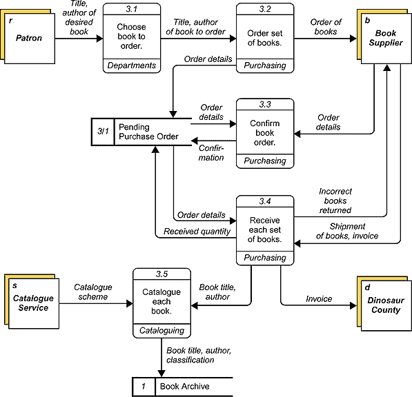

图 3-11 数据流图。

其次，它不是用涉及的表单和机制来表示的。例如，过程模型中的卡片索引在这里被简单地描述为“图书存档”。这有助于人们避免假设在未来的系统中它必须以 3 英寸乘 5 英寸纸质卡的格式存在。

第三，`数据存储`——数据在等待其他过程停留的地方——被显式地显示为开放侧矩形。最后，系统过程模型与业务过程模型不同，因为它没有被组织成泳道（swim lanes）。事实上，尽管在这个示例中，每个系统过程都识别出是由哪个部门在执行，但通常通常不这样做，以避免对任何未来的实现产生偏见。

注意，这种记法也可以用于生成二行过程模型。“物理”数据流图根据所使用的机制来描述过程和数据流，正如之前描述的过程模型那样。事实上，这是一个很好的方法，因为它在描述数据流和数据存储方面提供了更详细的细节。

要得到三行的“逻辑”（或“本质”）数据流图，有必要：

- 移除所有对物理机制的引用，将术语更改为描述涉及的实际数据的术语。
- 移除任何仅作为“缓冲区”的数据存储，以解释两个过程之间处理速度的差异。
- 移除任何仅仅验证上一个过程结果的过程。（相反，修复上一个过程。）

`图 3-12`跨越了框架中二行和三行的边界。它显示了每个业务过程可以通过一个或多个业务过程设计来执行，其中每个业务过程设计由一个系统过程来描述。因此，接收货物的业务过程通过以下系统（数据）过程执行：“记录收货”、“记录差异”、“向应付账部门发送货物已到的消息”等。

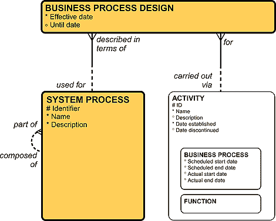

图 3-12 业务过程与系统过程。

注意，与功能（FUNCTIONS）和业务过程（BUSINESS PROCESSES）一样，每个系统过程由一个或多个其他系统过程组成。这种关系实际上比这更复杂，如下所示，但正如此处所示，该概念是有效的。这支持了选取之前提到的过程之一（如“接收每本书”）并据此创建另一个数据流图，从而揭示其组成过程的想法。

## 系统过程与数据流

`图 3-11`的数据流图显示了代表`系统过程`的圆角框，其中数据从一种结构转换为另一种结构。`数据流`（如“所需书籍的标题、作者”、“订单详情”等）由带标签的箭头表示。根据定义，所有数据都源于并最终到达直角框，称为`外部实体`，例如“读者”、“图书供应商”等。在我们的元模型中，这些外部实体几乎总是对应于我们的参与方（PARTIES）——无论是人员还是组织。

在图中，系统过程的示例包括“选择订购书籍”、“订购一套书籍”等。右侧开放的矩形代表`数据存储`，数据在被进一步处理之前可能会在那里停留一段时间。该图显示了两个数据存储：“待处理采购订单”（一份等待货物到达的订单列表）和“图书存档”（以前称为卡片索引的现代用词）。如上所述，箭头代表从一个系统过程、外部实体或数据存储到另一个的数据流。

数据流箭头和数据存储用标准英语对流和存储的内容进行标记。这些中的每一个都代表了一组数据实体类、关系和属性的`视图`，正如在`第二章`中讨论的那样。也就是说，每一个代表一个虚拟实体类（VIRTUAL ENTITY CLASS），它包含一组重新构建的基础实体类（ENTITY CLASSES）、关系角色（RELATIONSHIP ROLES）和属性（ATTRIBUTES）（如在`第二章`中描述）。

`图 3-13`显示了数据流元模型的开始，这里`数据流`描述了数据如何从一个系统过程移动到另一个。事实上，一个系统过程可以是一个或多个数据流的源。之前引用的图书馆示例中，虚拟实体类“所需书籍的标题、作者”是从系统过程“选择订购书籍”到系统过程“订购一套书籍”的数据流。

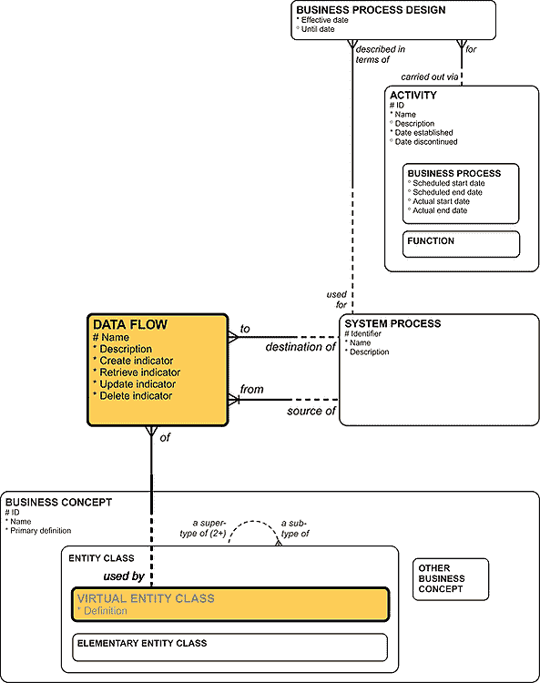

图 3-13 数据流与过程。

处理通常不是连续的。处理之前可能需要数据。在三行模型中，这只是因为过程在等待数据。在二行模型中，它可以是一个“缓冲区”，仅仅是因为处理速度不相同。对于三行模型，此类数据存储必须移除。`图 3-14`显示数据存储也是虚拟实体类的使用，并且它可以是数据流的源或终点。也就是说，数据流可能来自系统过程或指向数据存储。

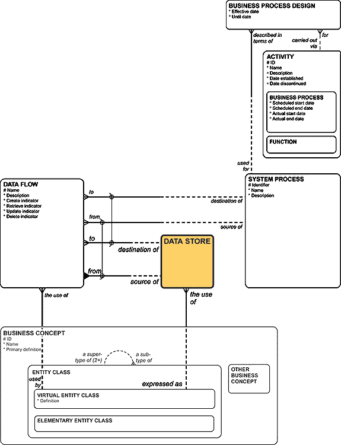

图 3-14 数据存储。

在示例中，“待处理采购订单”是一个数据存储，它是同名虚拟实体类的使用。该虚拟实体类由“读者”、“订单”、“项目”和“书籍”的实体类汇。“订单详情”是该虚拟实体类从数据存储“待处理采购订单”到系统过程“接收每本书”的流。

在业务所有者看来，过程很少与执行它们的机制和人员分开。但在创建三行数据流图时，不应再表示机制。尽管如此，在三行数据流中有必要显示所有数据的源和目的地，因此`图 3-15`再次引入了第三列中的参与方（PARTY）和位置（POSITION）实体类。

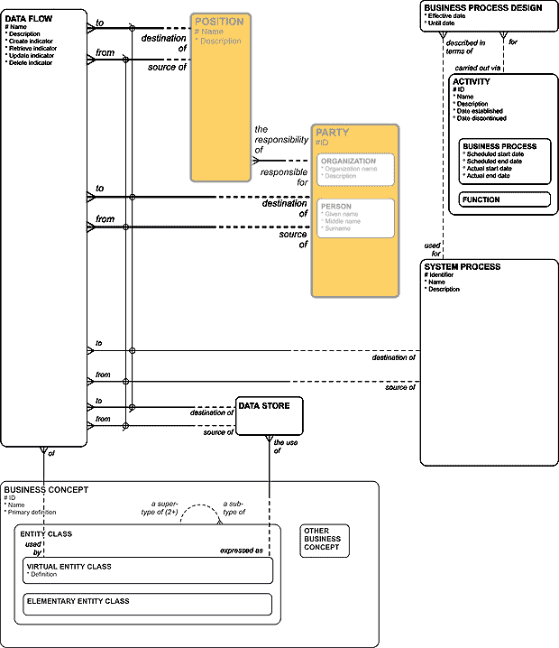

图 3-15 外部实体。

在这里你可以看到，除了目前所看到的之外，数据流还可以来自或指向指定的参与方（例如“莎拉·琼斯”或“会计部门”），或者简单定义为来自或指向某个位置，例如“首席会计”。这些都是外部实体的示例。在示例中，外部实体“目录服务”和“图书供应商”将是公司（组织的一种）；“恐龙县”（政府）是一个政府机构；而“读者”可以被视为参与方类型（PARTY TYPE）。

请注意，在第三行中，实际上很少看到数据流被标识为指向（to）或来自（from）某个人。涉及的`PARTY`（参与者）通常是一个`ORGANIZATION`（组织），例如供应商公司或部门。图 3-15 显示，`DATA FLOW`（数据流）必须来自以下之一：

- `PARTY`（参与者）
- `PARTY TYPE`（参与者类型）
- `POSITION`（位置）
- `SYSTEM PROCESS`（系统过程）
- `DATA STORE`（数据存储）

此外，它必须指向相同实体类之一。

## 访问角色与系统事件

在之前的示例图中，从外部实体“图书供应商”到过程“接收每本书”的数据流线被标记为“书籍发运”。该流实际上并不需要包含任何信息，除了收到书籍这一事实之外。由于这个原因，与其说它是一个`DATA FLOW`，不如说它是一个`SYSTEM EVENT TYPE`（系统事件类型），如图 3-16 所示。也就是说，`SYSTEM EVENT TYPE`是发送给过程的消息，导致某些事情的发生。它可能不包含任何待处理的数据。相反，它仅仅是过程的触发器。`SYSTEM EVENT TYPE`必须来自另一个`SYSTEM PROCESS`，或者来自一个`PARTY`或`POSITION`，或者必须是另一个`SYSTEM PROCESS`的操作。在后一种，由于`SYSTEM EVENT TYPE`是一个时间点，而`SYSTEM PROCESS`是随时间发生的，因此`SYSTEM EVENT TYPE`具有与`BUSINESS EVENT TYPE`（业务事件类型）相同的属性——即之前描述的“位置”、“滞后数量”和“滞后单位”。

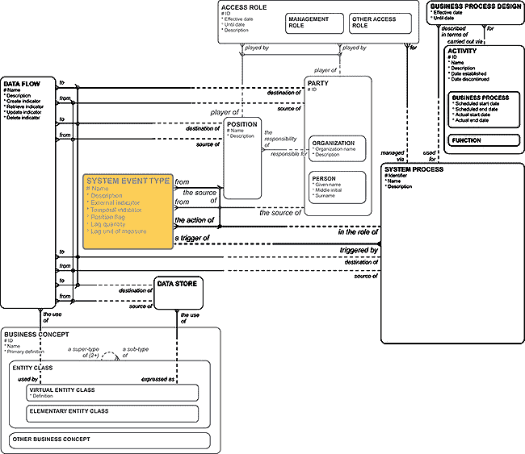

图 3-16 系统事件类型。

如前所述，我们在这里只关注事件类型，即事件类型的定义。该示例是关于接收书籍的概念，而不是 7 月 18 日的实际收据。注意，适用于`BUSINESS PROCESS`的`MANAGEMENT ROLE`（管理角色）也适用于`SYSTEM PROCESS`。

## 核心系统过程

之前谈论`FUNCTIONS`（功能）和`BUSINESS PROCESSES`（业务过程）时，强调了这样一个事实：在最低层面可以找到`ELEMENTARY FUNCTIONS`（基础功能）和`ELEMENTARY BUSINESS PROCESSES`（基础业务过程）。如图 3-17 所示，在分析`SYSTEM PROCESS`的层次结构时也可以发现类似的内容——`ELEMENTARY SYSTEM PROCESS`（基础系统过程）。与`ELEMENTARY FUNCTIONS`和`ELEMENTARY BUSINESS PROCESSES`一样，`ELEMENTARY SYSTEM PROCESS`是保留其身份的最小工作单元。你可以通过意识到这一点来识别这个最原化的过程：一旦一旦开始，说它在完成之前可以停止是没有意义的。因此，每个`OTHER SYSTEM PROCESS`可能由一个或多个`OTHER SYSTEM PROCESSES`、`ESSENTIAL SYSTEM PROCESSES`（核心系统过程）和/或`ELEMENTARY SYSTEM PROCESSES`组成。

图 3-17 核心系统过程。

`EXTERNAL BUSINESS EVENT TYPES`（外部业务事件类型）将`ELEMENTARY BUSINESS PROCESSES`组合成`ESSENTIAL BUSINESS PROCESSES`。同样，`ELEMENTARY SYSTEM PROCESSES`可以通过`SYSTEM EVENT TYPES`分组，以创建一个`ESSENTIAL SYSTEM PROCESS` [McMenamin and Palmer 1984]。

之前我们断言，`SYSTEM PROCESS`可以由`SYSTEM EVENT TYPE`触发。同样，我们寻找的是代表对外部事件的“完整响应”的过程级别。例如，当收到客户订单时（一个`SYSTEM EVENT TYPE`），可能需要许多步骤来先填写订单，然后进行订单装入。这些步骤中的每一步都可以合理地称为一个`SYSTEM PROCESS`（具体来说是一个`ELEMENTARY SYSTEM PROCESS`）。但整个努力的目标是完成订单。

包含所有这些`ELEMENTARY SYSTEM PROCESSES`的`SYSTEM PROCESS`在这里被称为`ESSENTIAL SYSTEM PROCESS`。也就是说，根据定义，`ESSENTIAL SYSTEM PROCESS`必须是对特定`EVENT TYPE`（由其定义）的完整响应。注意，虽然每个`ESSENTIAL SYSTEM PROCESS`必须由恰好一个`SYSTEM EVENT TYPE`定义，但它可能由一个或多个`ELEMENTARY SYSTEM PROCESSES`组成。

与`ESSENTIAL BUSINESS PROCESSES`一样，重要的是，只有“外部”的`SYSTEM EVENTS`可以作为定义`ESSENTIAL SYSTEM PROCESS`的依据。在`BUSINESS EVENT TYPE`的情况下，这种区别在子类型`EXTERNAL BUSINESS EVENT`（外部业务事件）和`INTERNAL BUSINESS EVENT`（内部业务事件）中体现，而在这里通过“外部指示器”（External indicator）属性显示。如果`SYSTEM EVENT TYPE`是外部的，该属性值为“True”。否则，为“False”。

## 业务规则

如果`SYSTEM EVENT TYPE`是`ESSENTIAL SYSTEM PROCESS`的依据，则属性“外部指示器”的值必须为“True”。

图 3-17 也显示，在`ESSENTIAL BUSINESS PROCESS`的情况下，一个`FUNDAMENTAL PROCESS`（基础过程）是由一个的`CUSTODIAL PROCESS`（维护过程）触发的`FUNDAMENTAL PROCESS`。为了执行该`FUNDAMENTAL PROCESS`，需要一些数据。这些`CUSTODIAL PROCESS`是负责维护数据的，由`SYSTEM EVENT TYPES`定义。图 3-18 显示了为了构成“接收每本书”这一`ESSENTIAL SYSTEM PROCESS`的集合。为了简单起见，在更高层删除了`ORGANIZATIONS`（组织）。

图 3-18 示例数据流。

指向这些外部实体的`DATA FLOWS`在过程边界处标记了 X。除了该事件外，还有其他通信没有带到摘要层。这些在边界处也标记了 X。

### 业务规则

1. 在分解过程中识别的外部实体、数据流和数据存储不需要出现在更高层次的过程中。
2. 高层次过程中描绘的每个数据存储、外部实体和数据流必须出现在其分解中。

## 第四行：程序模块

一旦映射了活动——过程，就可以询问这些哪些活动应该自动化。此外，当业务规则（在第七章中描述）完整记录后，就可以询问它们将如何实现。这种实现将通过程序模块进行。第四行涉及这些模块的设计。因此，设计者的活动列完全是关于程序的。

## 模块结构

`PROGRAM MODULE`是执行业务任务的程序代码。这可能是数据的处理、报告的或某些内部处理或计算。每个`PROGRAM MODULE`必须用`PROGRAMMING LANGUAGE`（编程语言）编写，例如 Java、C++、COBOL 甚至 FORTRAN。这在图 3-19 中所示。在图中，显示了七种类型的`PROGRAM MODULES`。当我们以后讨论面向对象时，会添加更多，但目前足够了。

图 3-19 模块。

- `DBMS TRIGGER`：与数据库`TABLE`或`COLUMN`关联的代码段，在发生指定操作（如更新`COLUMN`）时激活。
- `STORED PROCEDURE`：存储在数据库管理系统中的程序代码，用于控制数据的更新和检索。

## 模块定义

- `DATABASE MANAGEMENT SYSTEM`：一种复杂的软件，执行许多与数据存储和检索相关的有用功能，并在保护数据完整性方面起着关键作用。
- `SYSTEM MODULE`：一个操作系统或操作系统的部分（包括服务器软件和服务）。
- `UTILITY`：一种执行支持性功能的程序，为其他软件的用户提供服务。
- `INTERACTIVE MODULE`：控制屏幕元素（其窗口、光标等）的程序代码。
- `OTHER EXECUTABLE MODULE`：其他所有内容。

该模型还显示，每个`PROGRAM MODULE`必须是恰好一个`PROGRAM MODULE TYPE`的实例。这些中的第一个类型与作为`PROGRAM MODULE`自身的子类型所示的类型相同。每个`PROGRAM MODULE TYPE`可以是两个或多个其他`PROGRAM MODULE TYPE`的父类型。正如我们之前看到的，这种结构允许基于它的系统的用户定义比模型中所示更详细的类型。

## 业务规则

`PROGRAM MODULE TYPE`的第一个实例必须是`DBMS Trigger`、`Stored procedure`（存储过程）等，以与之前所示的子类型相对应。

可以描述一个代表模块处理过程的场景。这加上程序代码本身，都是`PROGRAM MODULE`的属性。`PROGRAM MODULES`可以以至少三种不同的方式链接。

首先，`PROGRAM MODULE`可能由一个或多个其他`PROGRAM MODULES`组成。图 3-20 则显示，每个`PROGRAM MODULE COMPOSITION`必须是在另一个`PROGRAM MODULE`中使用`PROGRAM MODULE`。

图 3-20 程序模块链接。

其次，图中显示每个`PROGRAM MODULE`可能依赖于另一个`PROGRAM MODULE`。也就是说，每个`PROGRAM MODULE`都可能被另一个`PROGRAM MODULE`调用，这里表现为每个`PROGRAM MODULE`可能受到一个或多个`PROGRAM MODULE DEPENDENCIES`的影响，每个依赖必须位于另一个`PROGRAM MODULE`。

第三，每个`PROGRAM MODULE`可能是向其他`PROGRAM MODULES`发出的一个或多个`PROGRAM MODULE COMMUNICATIONS`的源。注意，这些行四`PROGRAM MODULE COMMUNICATIONS`中的每一个可能是之前描述的行三`DATA FLOW`的实现。

在数据库管理系统和面向对象设计之前，几乎所有的程序都属于`OTHER EXECUTABLE MODULE`类别。然而，正如本章其余部分所示，近年来这些区别变得越来越重要。

图 3-21 总结了来自图 3-20 的链接。`PROGRAM MODULE STRUCTURE`是包含`PROGRAM MODULE DEPENDENCY`、`PROGRAM MODULE COMMUNICATION`和`PROGRAM MODULE COMPOSITION`的父类型，同时增加了`OTHER PROGRAM MODULE STRUCTURE`的可能性。因此，每个`PROGRAM MODULE STRUCTURE`必须从一个`PROGRAM MODULE`到另一个`PROGRAM MODULE`。

图 3-21 程序模块结构。

正如实体类型有父类型一样，关系也可以有父类型。遗憾的是，这在实体关系图中并不容易显示。在这种情况下，关系“每个`PROGRAM MODULE STRUCTURE`必须来自一个且仅一个`PROGRAM MODULE`”具有以下子类型：

- 每个`PROGRAM MODULE DEPENDENCY`必须属于一个且仅一个`PROGRAM MODULE`。这包括子程序调用。

- 每个`PROGRAM MODULE COMMUNICATION`必须来自一个且仅一个`PROGRAM MODULE`，包括从一个`PROGRAM MODULE`发送到另一个的类型类型。消息将在对象模块章节中讨论（请参见第 171 页）。
- 每个`PROGRAM MODULE DECOMPOSITION`必须使用一个且仅一个`PROGRAM MODULE`。一个大型`PROGRAM MODULE`（实际上是一个程序模块组）可能由一个或多个其他`PROGRAM MODULES`组成。

当然，相反的关系角色也有相应的子类型结构。这非常重要，因为为了清晰地解释这里介绍的概念，有时在介绍更通用的父类型关系之前，呈现两个子类型之间的关系。遗憾的是，子类型级别使用的语言并不总是与父类型级别的语言对应。

在书中，作者尝试了两种方法。在这种情况下，图 3-20 中看到的子类型关系名称未出现在图 3-21 中，尽管它们继续存在于底层模型中。^* 在其他情况下，父类型名称并不总是对应。图 3-22 显示`PROGRAM MODULE STRUCTURE`是包含`PROGRAM MODULE DEPENDENCY`、`PROGRAM MODULE COMMUNICATION`和`PROGRAM MODULE COMPOSITION`的父类型，同时增加了`OTHER PROGRAM MODULE STRUCTURE`的可能性。因此，每个`PROGRAM MODULE STRUCTURE`必须从一个`PROGRAM MODULE`到另一个`PROGRAM MODULE`。

图 3-22。

正如实体类型有父类型一样，关系也可以有父类型。遗憾的是，这在实体关系图中并不容易显示。在这种情况下，关系“每个`PROGRAM MODULE STRUCTURE`必须来自一个且仅一个`PROGRAM MODULE`”具有以下子类型：

- 每个`PROGRAM MODULE DEPENDENCY`必须属于一个且仅一个`PROGRAM MODULE`。这包括子程序调用。
- 每个`PROGRAM MODULE COMMUNICATION`必须来自一个且仅一个`PROGRAM MODULE`，包括从一个`PROGRAM MODULE`发送到另一个的类型类型。消息将在对象模块章节中讨论（请参见第 171 页）。
- 每个`PROGRAM MODULE DECOMPOSITION`必须使用一个且仅一个`PROGRAM MODULE`。一个大型`PROGRAM MODULE`（实际上是一个程序模块组）可能由一个或多个其他`PROGRAM MODULES`组成。

当然，相反的关系角色也有相应的子类型结构。这非常重要，因为为了清晰地解释这里介绍的概念，有时在介绍更通用的父类型关系之前，呈现两个子类型之间的关系。遗憾的是，子类型级别使用的语言并不总是与父类型级别的语言对应。

在书中，作者尝试了两种方法。在这种情况下，图 3-20 中看到的子类型关系名称未出现在图 3-21 中，尽管它们继续存在于底层模型中。^* 在其他情况下，父类型名称并不总是对应。图 3-22 显示`PROGRAM MODULE STRUCTURE`是包含`PROGRAM MODULE DEPENDENCY`、`PROGRAM MODULE COMMUNICATION`和`PROGRAM MODULE COMPOSITION`的父类型，同时增加了`OTHER PROGRAM MODULE STRUCTURE`的可能性。因此，每个`PROGRAM MODULE STRUCTURE`必须从一个`PROGRAM MODULE`到另一个`PROGRAM MODULE`。

图 3-22。

图 3-24 显示`MODULE USAGE`——即特定的`PROGRAM MODULE`特别创建、检索、更新或删除整个`DATA GROUP`或特定`COLUMN`的实例。每个属性标识了是否执行了该操作。

图 3-24。

## 程序角色

不同的人和组织在创建`PROGRAM MODULES`时扮演不同的角色，无论是单个`PROGRAM MODULE`还是更复杂的`APPLICATION SYSTEMS`。这些角色可能包括各种类型的程序员、经理或管理员。图 3-25 借用了第五章的内容来显示`PARTY`、`ACCESS ROLE`和`ACCESS ROLE TYPE`。`ACCESS ROLE`是一个复杂的话题，在第五章中详细讨论，但这里显示了`ACCESS ROLE`的三个子类型：

图 3-25 访问角色。

- `PROGRAMMING ROLE`：简单是指某个`PARTY`（或`POSITION`等）与创建`PROGRAM MODULE`或`APPLICATION SYSTEM`的某些方面有关。
- `MANAGEMENT ROLE`：指某个`PARTY`负责`PROGRAM MODULE`或`APPLICATION SYSTEM`的开发或部署。
- `PERMISSION ROLE`：指`PARTY`（主体）被允许或禁止访问`PROGRAM MODULE`（程序模块）或整个`APPLICATION SYSTEM`（应用程序系统）。如果该角色表示`PARTY`被禁止访问`PROGRAM MODULE`或`APPLICATION SYSTEM`，则属性`Prohibition indicator`（禁止指示）为`True`；如果该角色表示允许，则为`False`。

在这里我们引入一个断言：每个`ACCESS ROLE`（访问角色）必须是某种`ACCESS ROLE TYPE`（访问角色类型）的实例。这些类型必须包括`Programming role`（编程角色）、`Management role`（管理角色）和`Permission role`（权限角色）。每个`ACCESS ROLE TYPE`可以是两个或多个`ACCESS ROLE TYPE`的超类型，因此`Program module role`可以是`Programmer`（程序员）和`Programming manager`（编程经理）等角色的超类型。

或者，如果不需要更多细节，`Programmer`和`Programming manager`可以仅仅是`PROGRAM MODULE ROLE`（程序模块角色）的实例。

## 业务规则

1. `ACCESS ROLE TYPE`的一个实例必须是`Programming role`。
2. 如果一个`ACCESS ROLE`是`PROGRAMMING ROLE`，它可能仅针对一个`PROGRAM MODULE`或`APPLICATION SYSTEM`。

`APPLICATION SYSTEM`一词的常见用法通常比之前描述的要缺乏律得多。公司往往认为一个程序模块或表被多个应用程序系统所有。但如果要成功管理它们，系统的每个元素的责任必须根据最初负责其创建的特定项目（`APPLICATION SYSTEM`）来指定。

鉴于这种责任划分，访问权限可以广泛分布。一旦`APPLICATION SYSTEMS`经过仔细定义，通常`ACCESS ROLES`可以完全根据它们来定义，而对访问特定`PROGRAM MODULES`或`TABLES`（表）的需求降至最低。

有时`PROGRAM MODULES`是为了生成其他`PROGRAM MODULES`而编写的。图 3-26 显示，`GENERATION SPECIFICATION`（生成规范）可以针对一个`PROGRAM MODULE`，并根据一个`DATA GROUP`（数据组），该数据组包含了该`PROGRAM MODULE`的实际规范。一旦创建了`GENERATION SPECIFICATION`中作为生成器的`PROGRAM MODULE`，当它运行时（在“生成日期”上），它将成为一个或多个其他`PROGRAM MODULES`的`GENERATIONS`（生成）的基础。

图 3-26 模块生成。

图 3-27 显示四行构件`PROGRAM MODULE`也基于一个或多个三行`SYSTEM PROCESSES`（系统过程）。具体而言，它可能基于一个或多个`PROCESS IMPLEMENTATIONS`（过程实现），每个实现必须属于且仅属于一个`SYSTEM PROCESS`。然而，一个`SYSTEM PROCESS`可以是`PROGRAM MODULE`或整个`APPLICATION SYSTEM`的来源。也就是说，一个`SYSTEM PROCESS`不仅可以作为单个`PROGRAM MODULES`存在于一个或多个实现中，也可以作为完整的`APPLICATION SYSTEMS`存在于一个或多个实现中。

图 3-27 过程实现。

## 对象模块

图 3-28 显示了两种新的`PROGRAM MODULE`类型。第一，`CLASS IMPLEMENTATION`（类实现，如第二章所示）扮演了四行数据项的角色，但它实际上是一段代码。因此，它在该章节中被描述并在处被高亮显示。`CLASS IMPLEMENTATION`在第二章中被描述为描述类（“类”）对象的代码。它可以指的是一个`BUSINESS ENTITY CLASS`（业务实体类），也可以对计算机系统部分的“对象”进行分类，例如窗口光标、屏幕窗口和其他元素。

图 3-28 可执行模块的类型。

第二种`PROGRAM MODULE`是`EXECUTABLE MODULE`（可执行模块）。这是老手们会简单记忆为曾经被称为“计算机程序”的代码。也就是说，它是任何执行某些操作程序（或程序组件）。注意（如图 3-28 所示），`EXECUTABLE MODULE`包含了之前介绍的七种子类型，再加上两个新的、专门面向对象的类型：

- `METHOD`：执行`OPERATION`（操作）的程序。
- `PACKAGE`：`CLASS IMPLEMENTATIONS`的集合。也就是说，一个`PACKAGE`可以由一个或多个`CLASS IMPLEMENTATIONS`组成。

`MESSAGE`存在于对象之间，是`PROGRAM MODULE`运行时发生的实际通信。因此，每个`MESSAGE`必须是`MESSAGE TYPE`的一个实例，而`MESSAGE TYPE`被设计为`PROGRAM MODULE`的一部分。具体而言，每个`MESSAGE TYPE`必须由一个`OPERATION`发送，并可以调用另一个`OPERATION`。每个`MESSAGE TYPE`还必须通过`PROGRAM MODULE COMMUNICATION`（即两个`PROGRAM MODULES`之间的链接）进行。`MESSAGE TYPE`必须是以下类型之一：

- `INFORMATIVE MESSAGE TYPE`（信息消息类型），为对象提供更新自身的信息
- `INTERROGATIVE MESSAGE TYPE`（查询消息类型），请求对象披露自身信息
- `IMPERATIVE MESSAGE TYPE`（命令消息类型），请求对象对其执行某些操作

每个`MESSAGE`可能包含一个或多个输入或输出`MESSAGE ARGUMENTS`，如图 3-31 所示。每个`MESSAGE ARGUMENT`必须针对特定的`MESSAGE`，并且可以是指向另一个`OBJECT`的引用。同样，由于`MESSAGES`只存在于运行时，它们的`MESSAGE ARGUMENTS`也是如此。因此，`MESSAGE TYPE`的定义也包含了`MESSAGE ARGUMENT TYPE`。

图 3-31 参数。

`MESSAGE`参数可以是输入参数也可以是输出参数，这由每个`MESSAGE ARGUMENT TYPE`的“In indicator”（输入指示）和“Out indicator”（输出指示）的值决定。这两个指示都存在，因为同一个`MESSAGE ARGUMENT TYPE`既可以是输入参数也可以输出参数。在程序中，这些参数显示为输入参数在前（可选跟在单词“in”），随后是单词“out”和输出参数，可选跟在“inout”以及任何既是输入又是输出的参数。

在 Page-Jones 先生的示例中，如果`PROGRAM MODULE`（一个`PACKAGE`）`hom1`的执行创建了一个类为`Hominoid`的`OBJECT`，则`MESSAGE TYPE` `advance`被指定为`hom1.advance(noOfSquares, out advanceOK)`。在这里，`noOfSquares`是输入参数（要移动的格子数），`advanceOK`是输出参数（“True”或“False”，取决于移动是否成功）[Page-Jones 2000, p. 22]。同样，`advance`的运行时实例将有一个对象 ID，并且实际上会移动特定数量的格子（例如“5”）。

每个`MESSAGE ARGUMENT`本身通常是对`OBJECT`的引用，这反映了每个`MESSAGE ARGUMENT TYPE`可能是`CLASS IMPLEMENTATION`的引用。这可以是指向“基础类”（Foundation Class）中对象的引用——例如，整数、字符或类似的类型。在以前的示例中，`MESSAGE ARGUMENT TYPE` “noOfSquares”可以引用`IMPLEMENTATION CLASS` “Integer”中的对象。

## 第六行：程序清单

第六行涉及现有系统的清单。这不仅包括内部开发的系统，还包括商业现成软件包。在第四行中，我们设计了程序，确定了它们的结构，并定义了它们如何使用数据。第五行将涉及编码工作。第六行则是我们记录已产生的实际程序副本，以及它们产生和使用的数据（在第二章中进行描述）。

图 3-32 显示了在第四行设计的每个`PROGRAM MODULE`的`PROGRAM COPIES`。因此，每个`PROGRAM COPY`必须属于一个`PROGRAM MODULE`，并且必须保存在作为`SERVER`的`VIRTUAL SITE`中。`SERVER`在第四章中有更详细的定义，它是支持程序持续运行的操作系统，使得`PROGRAM MODULE`能够与其他程序异步交互。也就是说，`SERVER`身通过一个或多个`SERVER IMPLEMENTATIONS`实现，其中每个实现都必须是对另一个`PROGRAM COPY`的使用。

图 3-32 程序副本。

这意味着，例如 Oracle 数据库管理系统的`PROGRAM COPY`可以用作单独`SERVERS`的一个或多个`SERVER IMPLEMENTATIONS`。这也被称为数据库管理系统具有多个实例。

图 3-33 描述了`PROGRAM COPY`的运行、它产生的数据以及产生这些数据所使用的数据。具体而言，`TRANSFORMATION RUN`必须是`PROGRAM COPY`的实现，在特定的“Run date”（运行日期）上执行。

给任何尝试实现此操作者的提示：在尝试生成测试数据库设计之前，确保你已经减少了概念模型中的关系数量。如果不这样做，你将导致额外的外键。

我听说现在这种现象的时髦说法是*应用程序组合集*（application portfolio）。由于我们谈论的是存储在某处的程序集合，我觉得*清单*（inventory）一词更合适，且不那么自命。

# 4 位置 (LOCATIONS)

网络——任何以等距离网格化或交叉，且交叉点之间有间隙的物体。萨缪尔·约翰逊 [1755]

## 关于位置

架构框架中的“位置”（Locations）列关注企业开展业务的*地点*。

- `规划者`（planner）看到一组简单的企业位置，通常按城市划分。
- `业务所有者`（business owner）看到一组构成企业物流网络的办公室、工厂和仓库。
- `架构师`（architect）看到每个位置在信息和通信处理中扮演的角色。
- `设计者`（designer）看到硬件和软件的潜在分布以及通信网络的设计。
- `构建者`（builder）关注通信节点和协议的细节。
- `运行系统`（functioning system）由发生通信的设施组成。

图 4-1 显示了架构框架，并突出了本章关注的单元。具体而言，这些是业务所有者、架构师、设计者和运行系统的视图。

图 4-1 位置列。

“位置”列既涉及事物所在之处，也涉及它们相互连接的网络。业务发生在哪里？它的组件之间如何通信？数据如何在地点与地点之间传输？我们将如何将技术布线在一起？这些问题的答案属于“位置”列的范畴。

对数据实体类或活动的*结构*进行建模，与对业务中的实体类或活动*本身*进行建模并不是回事。在我们的数据元模型中，我们关注的是例如“实体类”和“属性”的概念。在我们的活动模型中，我们关注的是“过程”和“功能”的概念。描述特定公司的实际实体类（例如`PRODUCT`）和过程（例如“接受订单”）本身将在为该公司开发系统的过程中进行建模。但在大多数情况下，业务数据和元数据的领域是完全不同的。

另一方面，位置在业务层面和元数据层面的建模方式基本上是相同的。正如第五章描述的“人员和组织”（People and Organizations）列一样，“位置”列的中心实体类实际上取自通用业务模型。在业务模型和元模型中，我们必须对我们关注的位置进行建模，无论我们是在那里开展业务还是在那里运行系统。出于这个原因，正如第五章一样，本章模型的核心大量使用了《数据模型模式：思维惯》（*Data Model Patterns: Conventions of Thought*）[[Hay 1996]]中介绍的位置业务模型。

“位置”列与“人员和组织”列共享另一个特征：“位置”列和“人员和组织”列主要关乎*其他*列的位置和管理。具体而言，模型中的位置部分显示了*活动、业务规则、表*等等的位置。

## 站点 (Site)

“位置”列中的所有视图都使用相同的核心实体类`SITE`，如[图 4-2]所示。一个也可以称为`地址`（ADDRESS）的`SITE`是定位人员、组织或其他资源的手段。`SITE`有两种主要类型。

图 4-2 站点。

- `物理站点`（PHYSICAL SITE）是地球上具有特定用途的实体场所，如办公楼、家庭或油井。另一个名称是`设施`（FACILITY）。它必须是以下内容之一：

    → `街道地址`（STREET ADDRESS）：这包括对一条或多条街道的引用，加上站点所在的城市、州或省份。

    → `邮政箱`（POST OFFICE BOX）：因为邮政箱也有唯一的物理位置，因此`物理站点`也包含这些。

- `虚拟站点`（VIRTUAL SITE）除了某处计算机中的比特之外，没有物理现实。它通过仅在电子环境中才有意义的地址进行识别。这包括：

    → `电子邮件站点`（E-MAIL SITE）：通过电子邮件地址识别。

    → `网站`（WEB SITE）：通过“统一资源定位符 (URL)”、“万维网”识别。

    → `电话站点`（TELEPHONIC SITE）：通过“国家代码”、“区码”、“分机号”识别。

    → `数据库实例`（DATABASE INSTANCE）：数据可能所在的地方。

    → `服务器`（SERVER）：系统的一部分。

    → `其他虚拟站点`（OTHER VIRTUAL SITE）：不是上述任何一个。

`SITE`类型冗余地表示了所示的`子类型`（sub-types）。每个`站点类型`（SITE TYPE）可以是两个或多个`站点类型`的父类型。例如，子类型可以是“办公楼”、“家庭”、“仓库”。

`站点类型`的第一个实例必须包含“物理站点”、“虚拟站点”、“电子邮件站点”等。

[图 4-3] 引入了`站点结构`（SITE STRUCTURE）的概念，它必须是`物理通信链路`（PHYSICAL COMMUNICATION LINK，即从一个站点向另一个站点发送消息的事）、`站点组合`（SITE COMPOSITION，即一个站点包含另一个站点的事）或`其他站点结构`。`站点组合`的属性`重叠指示`（Overlap indicator）决定了两个`站点`是否重叠（真）或一个在另一个内部（假）。

图 4-3 站点结构。

每个`站点结构`必须是仅一个`站点类型`的实例。每个`站点类型`可以是至少两个其他`站点类型`的父类型。

根据定义，`站点类型`的第一个实例必须是“站点组合”、“物理通信链路”和“其他站点结构”。

## 地理位置 (Geographic Location)

如果`物理站点`是一个具有用途的场所，那么它在哪里？[图 4-4]显示`地理位置`仅仅是地球上任何被识别的地点。这可以是`地理区域`（GEOGRAPHIC AREA）或`地理点`（GEOGRAPHIC POINT）。`地理区域`可以是`地缘区域`（GEOPOLITICAL AREA）或`管理区域`（MANAGEMENT AREA）。`地缘区域`（如州或邮政区）的边界是由法律或条约定义的。`管理区域`（如“东南销售区”）的边界是由公司自身定义的。

`GEOGRAPHIC POINT`（地理点）简单来说是一维中的一个点。在这个模型中，属性显示为纬度、经度以及海拔的组件。参考方案可以比这复杂得多，但对于元数据目的来说已经足够。与该模型中的其他实体类一样，每个`GEOGRAPHIC LOCATION`（地理位置）必须恰好是一个`GEOGRAPHIC LOCATION TYPE`（地理位置类型）的实例，其中`GEOGRAPHIC LOCATION TYPE`的第一个实例对应于`GEOGRAPHIC LOCATION`显式显示的`sub-types`（子类型）。`Geopolitical area`（地缘区域）的`Sub-types`可以是“州”、“国家”、“邮政区”、“城市”等。`ADMINISTRATIVE AREA`（行政区域）的`sub-type of`可以是“邮政区”。

### 业务规则

`GEOGRAPHIC LOCATION TYPE`的前两个实例必须是“地理区域”、“地理点”、“地缘区域”和“管理区域”，其中“地缘区域”和“管理区域”都是“地理区域”的`sub-types`。

由于某些`PHYSICAL SITE`（物理场所）可能位于多个`GEOGRAPHIC LOCATION`，反之亦然，交叉实体类`SITE LOCATION`（场所位置）代表了单个`PHYSICAL SITE`位于特定`GEOGRAPHIC LOCATION`的事实。注意，`PHYSICAL SITE`的属性“（城市）”、“（州）”、“（国家）”和“（邮政区）”用括号括表示它们实际上是派生属性。它们通过`SITE LOCATION`实体类派生自`GEOGRAPHIC LOCATION`实体类，其中`SITE LOCATION`是特定`SITE`位于特定`GEOGRAPHIC LOCATION`的事实。例如，`PHYSICAL SITE`中`(City)`的值实际上是该`GEOGRAPHIC LOCATION`的“名称”，它是`GEOGRAPHIC LOCATION TYPE`“城市”的`an example of`，并且是涉及`PHYSICAL SITE`的`SITE LOCATION`的`the location of`。

### 业务规则

尽管一个`PHYSICAL SITE`可能与多个地理位置关联，但它与每个“城市”、“州”、“国家”和“邮政区”只能关联一个。

`GEOGRAPHIC LOCATION`可以是复杂的。例如，一个美国的“邮政区”可能位于两个（或更多？）城市。因此，有必要添加实体类`GEOGRAPHIC STRUCTURE`（地理结构），它允许任何`GEOGRAPHIC LOCATION`成为一个或多个（`GEOGRAPHIC STRUCTURES`，每个结构必须`the placement in`一个且仅一个）其他`GEOGRAPHIC LOCATION`的`part of`。属性“叠加指示”描述了一个`GEOGRAPHIC LOCATION`是完全包含在另一个内部（“否”），还是它们仅仅重叠（“是”）。

注意，此外，这允许每个`GEOGRAPHIC AREA`（地理区域）根据标记边界的`GEOGRAPHIC POINTS`集合来定义。由于每个`PHYSICAL SITE`可能通过一个或多个`GEOGRAPHIC LOCATION` `located via`，且每个`GEOGRAPHIC LOCATION`可能是一个或多个`PHYSICAL SITES`的`the location of`，实体类`SITE LOCATION`的每个实例都是一个`PHYSICAL SITE`位于一个`GEOGRAPHIC LOCATION`的事实。

## 第二行：放置主体、业务流程和动机

### 业务位置

除了`PARTY`（主体）与`SITE`（场所）之间的关系（来自人员和组织列，在见第五章显示了`SITE`与`BUSINESS PROCESS`（业务流程）之间的关系（来自活动列，在第三章所示，`BUSINESS LOCATION`（业务位置）被定义为一个`SITE`在特定时间与一个`BUSINESS PROCESS`关联（*为了*）的事实。位置的时间受属性“生效日期”和“截止日期”的约束。关联的性质由`BUSINESS LOCATION TYPE`定义，可以是“执行于”、“通过管理”等。

图 4-5 业务流程位置。

### 手段、目标和努力

图 4-6 复制了第七章中关于动机列的模型部分。特别是，这是模型的第二行视图，显示了`END`（目标）、`MEANS`（手段）和`EFFORT`（努力）。组织的`END`简单来说就是它打算完成的事情。其中最重要的是当然是它的`VISION`（愿景）。其他`ENDS`包括各种`DESIRED RESULT`（预期结果）。

图 4-6 努力。

`MEANS`是任何为了实现`ENDS`而可能被调用的能力。`MEANS`的主要类型是`COURSE OF ACTION`（方案）和`DIRECTIVE`（指令）。`COURSE OF ACTION`是一种方法或计划，而`DIRECTIVE`是一种约束`COURSE OF ACTION`的规范——例如业务规则。

如图 4-6 所示，`EFFORT`是应用`BUSINESS ACTIVITY`来执行`COURSE OF ACTION`。具体来说，`EFFORT`是一个`PROJECT`（项目）或一个`PROGRAM`（计划）。

`MEANS`、`END`和`EFFORT`在图 4-6 中显示，以便为在`SITE`定位它们做准备。图 4-7 引入了（再次，借自第七章）`INFLUENCER`（影响因素）。`INFLUENCER`是任何在没有明显努力的情况下对企业产生影响的事物。`INFLUENCER`通常在没有刻意意图的情况下作用。

图 4-7 动机位置。

`INFLUENCERS`是`INTERNAL INFLUENCERS`（公司内部，例如“可用技术的限制”）或外部影响因素，如“竞争”或“供应问题”。参见第七章获取更多关于`INFLUENCERS`的信息。这一切的意义在于，`SITE`的`MOTIVATION LOCATION`可能是某个`INFLUENCER`的。图 4-7 显示，`SITE`的`MOTIVATION LOCATION`必须是`EFFORT`、`DIRECTIVE`或`INFLUENCER`的位置。

## 第三行：数据流图

在大多数情况下，第三行是一个概念模型，描述了流程和数据流，而不考虑这些内容在哪里发生。应由第二行（业务发生的地方）、第四行（计划发生的地方）和第六行（系统安装的地方）来适应位置列。

然而，网络的概念对系统的设计非常重要，它在这里同样适用，主要以`DATA FLOWS`（数据流）的形式存在。图 4-8 源自元模型的第三章（活动）视图，显示了`DATA FLOWS`以及它们连接的`SYSTEM PROCESSES`（系统过程）、`DATA STORES`（数据存储）、`PARTIES`（参与方）和`POSITIONS`（位置）。如前所述，这是一个概念网络，不考虑机制、已识别的人员或办公室。然而，可以确定这种数据流可能是*通过*两个`SITES`（站点，如前文所述）之间的`PHYSICAL COMMUNICATION LINK`（物理通信链路），作为记录三行模型含义含义的一种。再次，这不会在基本数据流图中完成。

图. 4-8 数据流图。

## 第四行：放置数据和程序

第四行涉及系统设计，这种设计必须考虑程序和数据将放在何处以及程序之间如何相互通信。图 4-9 显示了第二、第三章中讨论的设计的第四行模型的一部分。在图中我们看到了实体类`CLASS IMPLEMENTATION`（类实现）、`CLASS ELEMENT`（类元素）和`PERSISTENCE MECHANISM`（持久化机制，特别是`TABLE`、`VIEW`和`COLUMN`）。在此基础上我们增加了`SITE`（站点），并通过`PERSISTENCE MECHANISM LOCATION`（持久化机制位置）将其与表和列连接。也就是说，`PERSISTENCE MECHANISM LOCATION`是指特定的`TABLE`、`VIEW`或`COLUMN`预计保留在特定`SITE`中的事实。

图. 4-9 持久化机制。

注意，这允许我们不仅将`TABLE`放在克利夫兰数据中心（例如），还可以放在特定的数据库中。也就是说，`PERSISTENCE MECHANISM`可能*特定于*某个`SITE TYPE`某处的`PERSISTENCE MECHANISM LOCATION`。从设计者的角度来看，指定特定的`SITE`可能还为过早。相反，通过在`SITE TYPE`处创建`PERSISTENCE MECHANISM LOCATION`，设计师只需指定该位置是`PHYSICAL SITE`（如上述克利夫兰数据中心）还是`VIRTUAL SITE`（虚拟站点，例如`WHIMSY`^* `DATABASE INSTANCE`（数据库实例））。

这是一个通过*超类型之*关系扩展`SITE TYPES`列表的机会。自然地，`SITE STRUCTURE`也允许你指定`WHIMSY DATABASE INSTANCE`是克利夫兰数据中心`PHYSICAL SITE`的*一部分*，因此没有必要为它们都指定`PERSISTENCE MECHANISM LOCATION`。

图 4-10 借用了第三章模型中面向对象的部分，并显示了`MODULE LOCATION`可以连接`SITE TYPE`与`PROGRAM MODULE`或特定的`OPERATION`。

图. 4-10 模块位置。

图 4-11 显示了设计网络的另一种方法。首先，“物理链路”是一个`SITE TYPE`，它是一个或多个其他`SITE STRUCTURE`的超类型。因此，我们有一种对可能的“物理通信”类型进行分类的方法。

图. 4-11 链接。

如第三章所示，`PROGRAM MODULE COMMUNICATION`是其部分一个`PROGRAM MODULE`向另一个发送消息的事实。在图 4-11 中，`DESIGN LINK`是`PROGRAM MODULE COMMUNICATION`使用了特定的`SITE TYPE`。具体来说，`DESIGN LINK`必须用于`PROGRAM MODULE COMMUNICATION`，并且是特定`SITE TYPE`的使用，特别是该`SITE TYPE`的子类型，“物理链路”。例如，`PROGRAM MODULE COMMUNICATION`可能描述调用`PROGRAM MODULE B`的`PROGRAM MODULE A`。

在石油行业中，也有必要使用“地理实体”（GEOGRAPHIC SOLID）来描述油层，但这超出了本书的范围。

当然，还有“仓库信息系统”……

# 人与组织

*人类存在之所以如此困惑且悲剧，众多原因之一在于社会组织既是必要的又是致命的。人类为了自己的便利不断创造这样的组织，却永远发现自己成了这些亲手制造的怪物的受害者。*

——奥尔德·赫胥黎（ALDOUS HUXLEY）[1950]

## 人与组织列

人员与组织的视角涵盖以下内容：

- `planner`（规划者）负责说明组织的理念和人力资源管理方法。这是一个威权主义组织（如军队），还是非正式的组织（如公社）？

- `business owner`（业务所有者）查看组织图。企业在汇报结构和整体责任方面是如何组织的？

- `architect`（架构师）捕捉并描述角色和职责。在角色和职位方面，每个人在公司运营中负责什么？

- `designer`（设计师）指定用户界面和安全需求。首先，人们将如何与任何潜在系统交互？其次，哪些元素涉及提供数据访问的安全保障？

- `builder`（构建者）负责用户界面和安全方案的实际构建。

- `functioning system`（运行系统）由控制访问系统和数据库的实际机制组成。

[图 5-1]显示了架构框架，其中高亮了我们在本章将涵盖的单元。具体来说，这些包括业务所有者、架构师、设计师和运行系统的视图。

图 5-1 人员与组织列。

## 关于人员与组织

正如第四章中描述的位置一样，人员和组织在业务层和元数据级别的建模方式是相同的。我们必须对关注的人员和组织进行建模，无论他们是在经营业务还是管理数据仓库。由于这个原因，本章中的模型将与《数据模型模式：思维约定》（Data Model Patterns: Conventions of Thought）[Hay 1996]中关于人员和组织的模型非常相似。区别在于，业务中的主要实体类关联的不是其他业务实体类，而是我们一直在讨论的元模型实体类。此外，元模型借用的业务实体类将用在所有行中。

[图 5-2]显示了主题中的主要实体类。正如`PERSON`（人员）是任何业务模型中的重要实体类一样，它对于我们的元模型也是本质的。这里包含了对特定工作感兴趣的所有人员的记录。在业务中，这些是员工、客户、供应商、代理人等。在元模型世界中，人员也扮演许多角色（数据库管理员、程序员、数据管理师等），但这些是为了产生系统并维护企业所使用的每条数据的质量（准确性、时效性等）。

图 5-2 人员与组织。

`PEOPLE`（人员）组成了`ORGANIZATIONS`（组织）。业务和数据经理感兴趣的`ORGANIZATIONS`可能包括`COMPANY`（公司）、`GOVERNMENT AGENCY`（政府机构）和`INTERNAL ORGANIZATION`（内部组织）。一个`COMPANY`是为了开展业务而组织的。在美国，一个`COMPANY`可以是公司、独资企业或合伙企业。

`GOVERNMENT AGENCY`（政府机构）是国家、州、省级或地方政府中的`ORGANIZATION`（组织）。这还包括国家以及国际组织，如欧盟和联合国。`INTERNAL ORGANIZATION`（内部组织）是`COMPANY`或`GOVERNMENT AGENCY`内部的任何永久或临时的部门、科、分支或其他小组。这包括临时组织，如项目组和工作小组。此外，还有一些不属于这些类别的`OTHER ORGANIZATIONS`（其他组织）。这些可能是工会、专业协会或家庭。

在元数据世界中，最感兴趣的是作为业务规则、数据质量标准等的来源的组织。这些很大程度上是`INTERNAL ORGANIZATIONS`，尽管在许多行业中`GOVERNMENT AGENCIES`也是一个因素。

有许多适用于`PERSON`或`ORGANIZATION`的关系示例。因此，发明`PARTY`（参与方）的概念是方便的，它是我们感兴趣的`PERSON`或`ORGANIZATION`。这在[图 5-3]中所示。

图 5-3 参与方。

事实上，`PARTIES`经常相互关联。`Corporate structure`（公司结构）指的是一个`INTERNAL ORGANIZATION`是另一个`INTERNAL ORGANIZATION`的一部分；`Employment`（雇佣）描述了一个`PERSON`被`COMPANY`或`GOVERNMENT AGENCY`雇佣，等等。一个`PERSON`与另一个`PERSON`结婚。[图 5-4]显示了`PARTY RELATIONSHIP`（参与方关系）是一个`PARTY`与另一个`PARTY`关联的事实。也就是说，`PARTY RELATIONSHIP`必须从一个`PARTY`到另一个`PARTY`。

图 5-4 参与方关系。

在[图 5-5]中，每个`PARTY RELATIONSHIP`被视为一个`PARTY RELATIONSHIP TYPE`的示例。`PARTY RELATIONSHIP TYPE`的示例如上所示。`Corporate structure`（公司结构）指的是一个`INTERNAL ORGANIZATION`是另一个`INTERNAL ORGANIZATION`的一部分；`Employment`（雇佣）描述了一个`PERSON`被`COMPANY`或`GOVERNMENT AGENCY`雇佣，等等。

图 5-5 雇佣。

`EMPLOYMENT`（雇佣）是一种特殊的`PARTY RELATIONSHIP`类型，它总是关于`PERSON`且与`ORGANIZATION`的。注意，这与将`EMPLOYEE`作为实体类是一种替代方案。如果你仔细一想，一个`PERSON`本质上并不是员工。他或她通过与`ORGANIZATION`维持`EMPLOYMENT`关系才成为员工。

这是另一个……`TYPE`实体类复制了父实体类的子类型结构。在这种情况下，`PARTY RELATIONSHIP TYPE`的前两个实例必须是“雇佣”和“其他参与方关系”。然而，每个`PARTY RELATIONSHIP TYPE`可以是两个或多个其他`PARTY RELATIONSHIP TYPE`的父类型，因此可以指定`OTHER RELATIONSHIP`（其他关系）的子类型作为该实体类的实例。这些可能包括“组织结构”、“公司所有权”等等。`CONTRACT EMPLOYMENT`（合同雇佣）没有在图中显式显示为子类型，但它可以作为`PARTY RELATIONSHIP TYPE`的另一个实例包含。根据公司政策，“承包商”可以被认为是“雇佣”的子类型，也可以仅仅是“其他参与方关系”的子类型。

一个 `EMPLOYMENT`（推此类推，一个 `PARTY`）可以拥有一个或多个 `POSITION ASSIGNMENTs`（岗位分配），且每个 `POSITION ASSIGNMENT` 必须对应一个且仅对应一个 `POSITION`（职位）。`POSITION` 是对具有特定技能的人员所完成的特定类别工作的定义。因此，`POSITION ASSIGNMENT` 是某个特定 `EMPLOYMENT`（即某个特定的受雇 `PERSON`）拥有某个特定 `POSITION` 的事实。图 5-6 显示了这一点，其中每个 `POSITION` 都是一个且仅一个 `ORGANIZATION`（组织）的责任。

图 5-6 职位。

请注意，一个 `PERSON` 的 `EMPLOYMENT` 随着时间的推移可能涉及对 `POSITIONs` 的多个 `POSITION ASSIGNMENTs`。这还包括临时外调^* 到不同部门。这也意味着在任何时间点，由某个部门（通过 `EMPLOYMENT`）雇佣的人数并不一定等于在该部门负责的 `POSITIONs` 中实际工作的人数。

`POSITION RESPONSIBILITY`（职位责任/职责，详见图 5-7）是分配给 `POSITION ASSIGNMENT` 中的 `PERSON`（对应某个 `POSITION`）或任何持有该 `POSITION` 的人的任务类型。例如，任何持有“数据库管理员”这一 `POSITION` 的人都拥有（除其他之外）“安装新 DBMS 版本”`POSITION RESPONSIBILITY`。由于一个 `POSITION ASSIGNMENT` 可能拥有多个 `POSITION RESPONSIBILITYs`，且每个 `POSITION RESPONSIBILITY` 都可能被包含于一个或多个 `POSITION ASSIGNMENTs` 或一个或多个 `POSITIONs` 中，因此实体类 `POSITION RESPONSIBILITY HOLDING` 是特定 `POSITION` 或 `POSITION ASSIGNMENT` 拥有某个特定 `POSITION RESPONSIBILITY` 的事实。也就是说，每个 `POSITION RESPONSIBILITY HOLDING` 必须由一个 `POSITION ASSIGNMENT` 或 `POSITION` 产生，并且属于一个特定的 `POSITION RESPONSIBILITY`。

图 5-7 职位责任。

## 第二行：业务所有者的视图

### 访问角色 (Access Roles)

既然我们已经描述了元数据的业务环境——人及其在组织的工作——我们就可以开始观察业务实体类与我们一直关注的元数据实体类之间是如何相关的。接下来的图表（从图 5-8 开始）显示，`ACCESS ROLE`（访问角色）是某人在企业系统的某个方面（在这种情况下）扮演角色的事实。具体而言，一个 `ACCESS ROLE` 必须由以下者之一扮演：

图 5-8 访问角色与站点。

– 一个特定的 `PARTY`（`PERSON` 或 `ORGANIZATION`）

– 某个受雇于 `ORGANIZATION` 的 `PERSON` 对应某个 `POSITION` 的 `POSITION ASSIGNMENT`

– 在指定 `POSITION` 中的任何人

– 任何人对某个 `POSITION RESPONSIBILITY` 拥有的 `POSITION RESPONSIBILITY HOLDING`

– 任何持有特定 `POSITION RESPONSIBILITY` 的人

最初，我们可以说一个 `ACCESS ROLE` 必须是以下之一：

– `PLACEMENT ROLE`（安置角色），将 `PERSON`、`POSITION` 等在物理上放置于所涉及的事物中

– `PERMISSION ROLE`（权限角色），授予 `PERSON`、`POSITION` 等访问某些事物的权限。（属性“禁止指示器”如果为“True”，则表示该角色实际上是禁止 `PARTY` 等访问的。）

– `MANAGEMENT ROLE`（管理角色），断言 `PERSON`、`POSITION` 等对涉及 `ACCESS ROLE` 的事物具有管理责任

– `OTHER ACCESS ROLE`（其他访问角色），涵盖除上述角色之外的任何角色

每个 `ACCESS ROLE` 必须是 `ACCESS ROLE TYPE`（访问角色类型）的一个实例。再次请注意，此实体类冗余地表示了与 `ACCESS ROLE` 子类型结构所示的相同事实。

随着本章的进行，我们将看到 `ACCESS ROLE` 可以用于元模型中的许多不同事物。首先，在图 5-8 中，一个 `ACCESS ROLE` 可能是为了一个 `SITE`（站点）^*，其中 `SITE` 是一个地方。一个 `ACCESS ROLE` 可能是为了一个 `SITE`，`SITE` 是放置 `PEOPLE`、`ORGANIZATIONS` 的地方。一个 `PLACEMENT ROLE` 可能是说某个 `PERSON` 位于某个特定的 `SITE`。而 `PERMISSION ROLE` 则表示该 `PERSON` 有权访问该 `SITE`。在大多数情况下，`ACCESS ROLE` 只是属于一个 `SITE`。

业务规则

每个 `ACCESS ROLE` 必须是 `ACCESS ROLE TYPE` 的实例。

### 概念、符号与标识符 (Concepts, Symbols, and Signifiers)

在第二章中，我们看到一个 `SYMBOL` 是一个 `WORD`、`PHRASE` 或 `GRAPHIC`，代表一个 `BUSINESS CONCEPT`。图 5-9 显示 `PARTIES` 和 `SIGNIFIERS` 拥有 `ACCESS ROLES`——针对 `BUSINESS CONCEPTS`。在列出的 `ACCESS ROLE` 类型中，只有 `MANAGEMENT ROLE` 适用。

图 5-9 概念与符号。

– `ENFORCEMENT ROLE`（执行角色）：由数据管理员执行^*，以确保整个组织使用的 `WORDS` 和 `PHRASES` 一致。

– `SPECIFICATION ROLE`（规范角色）：由针对 `BUSINESS CONCEPTS` 和 `SYMBOLS` 的适当人员执行

注意连线。每个 `ACCESS ROLE` 必须对应一个且仅一个 `SITE`。也就是说，每个 `ACCESS ROLE` 必须针对一个 `SITE`、一个 `SYMBOL` 或一个 `BUSINESS CONCEPT`。随着其他元素的添加，连线将扩展到这些元素。

除了 `BUSINESS CONCEPTS` 和 `BUSINESS CONCEPT ELEMENTS`（以及 `SYMBOLS` 和 `SIGNIFIERS`）之外，`ACCESS ROLES` 还可以定义为针对 `RESOURCES` 本身或针对它们的 `COPIES`。这在图 5-10 中所示。除了之前描述的 `MANAGEMENT ROLE` 和 `PERMISSION ROLE` 之外，该图引入了以下内容：

图 5-10 资源。

– `AUTHORSHIP ROLE`：仅适用于 `RESOURCE`（所有 `COPIES`），并描述资源的创建者。`ACCESS ROLE TYPES` 作为“作者角色”的子类型可以是“作者”、“出版者”、“编辑”等。

业务规则

每个 `AUTHORSHIP ROLE` 必须专门针对一个且仅针对一个 `RESOURCE`。（这通常是一个 `DOCUMENT`，但可能是针对某个 `RESOURCE`。）

### 活动、决策与事件 (Activities, Decisions, and Events)

一个 `ACCESS ROLE` 可能用于一个 `ACTIVITY`（`ACTIVITY` 已在第三章中定义）。这在图 5-11 中所示（参见第 226 页和 227 页）。因此，一个 `PARTY`（或 `POSITION` 中的 `PARTY` 或具有 `POSITION RESPONSIBILITY` 的 `PARTY`）可以是某个 `ACTIVITY` 的 `ACCESS ROLE` 扮演者。这可能适用于 `FUNCTION` 或 `BUSINESS PROCESS`。

图 5-11 活动与事件。

具体而言，用于 `ACTIVITY` 的 `ACCESS ROLES` 包括：`SPECIFICATION ROLE`（定义 `ACTIVITY` 的性质）；`ENFORCEMENT ROLE`（要求在适当的情况下执行 `ACTIVITY`）；`PERMISSION ROLE`（允许或禁止参与 `ACTIVITY`）；`MANAGEMENT ROLE`（负责 `ACTIVITY` 的整体执行）；以及一如往常的，`OTHER ACCESS ROLE`。再次注意，用于一个 `ACTIVITY` 的关系与我们见过的其他关系的 `ACCESS ROLES` 是“弧形”连接在一起的。

### 手段与目的

第七章对架构框架中 `Motivation` 列的描述比这里能做的更详尽。然而，总之，在业务所有者的行二行视图的 `Motivation` 列中，该单元格描述了组织的目标和目的、策略和战术，以及使其这一切运行的指令（业务政策和业务规则）。具体而言，模型集中于以下内容：

- `END`：组织试图实现的某事，例如：

  → `A VISION`

  → `A GOAL`

  → `An OBJECTIVE`

- `MEANS`：组织用来实现它的能力，通过：

  → `A MISSION`

  → `A COURSE OF ACTION`，例如策略或战术

  → `A DIRECTIVE`，例如业务政策或业务规则

- 对 `INFLUENCER` 的 `ASSESSMENT`，例如“竞争”对 `MEANS` 或 `END` 的影响（on）

当然，这些实体类在这里是相关的，因为可以指定在 `MEANS`、`END`、`INFLUENCER` 或 `ASSESSMENT` 中扮演 `ACCESS ROLE` 的 `PARTIES`（参见图 5-12）。`ACCESS ROLE` 可能由 `PARTY`（或 `POSITION` 等）扮演，这些实体是负责 `DIRECTIVE` `ENFORCEMENT` 的 `PARTY`、负责 `ASSESSMENT` `MANAGEMENT` 的 `PARTY` 或负责 `INFLUENCER`、`END` 或 `MEANS` 的 `MANAGEMENT` 的 `PARTY`。注意，通常在行二中，特别是这里，如果 `ACCESS ROLE` 由一个 `PARTY` 扮演，它很可能是由一个 `INTERNAL ORGANIZATION` 扮演，尽管它也可以由一个 `COMPANY` 或 `GOVERNMENT AGENCY` 扮演。

图 5-12 手段与目的。

此外，`Motivation` 列描述了一种 `EFFORT`（参见图 5-13），例如项目或计划，旨在通过使用 `BUSINESS PROCESS` 来实现 `DESIRED RESULT`。此 `EFFORT` 也可以通过 `MANAGEMENT ROLE` 进行。

图 5-13 努力。

## 第三行：架构师视图

正如`ACCESS ROLE`决定了`PARTIES`等实体如何与行二内容（如`BUSINESS CONCEPTS`和`ACTIVITIES`）相关，它也可以用于表示人们对此类行三产物（如`SYSTEM PROCESSES`和`DATA FLOWS`）的责任。其中之一在图 5-14 中所示。在这里，由所示的各种实体类之一扮演的`ACCESS ROLE`必须用于一个`SYSTEM PROCESS`。

图 5-14 角色。

注意，在行三数据图中，我们通常不识别谁是`MANAGEMENT ROLE`。尽管如此，说明`ACCESS ROLE`由一个`PARTY`扮演是有用的，它很可能是由一个`INTERNAL ORGANIZATION`扮演，尽管也可以由一个`COMPANY`或`GOVERNMENT AGENCY`扮演。此外，`Motivation`列描述了一个`EFFORT`（参见图 5-13），例如项目或计划，旨在通过使用`BUSINESS PROCESS`来实现`DESIRED RESULT`。此`EFFORT`也可以通过`MANAGEMENT ROLE`进行管理。注意，在行三数据图中，我们通常不识别谁是`MANAGEMENT ROLE`。尽管如此，说明`ACCESS ROLE`由一个`PARTY`扮演是有用的，它很可能是由一个`INTERNAL ORGANIZATION`扮演，尽管也可以由一个`COMPANY`或`GOVERNMENT AGENCY`扮演。

图 5-19 持久化机制。

## 交互模块

正如我们所见，处理人员和组织的基础元模型与处理人员和组织的业务模型是相同的。区别在于，元模型描述的是它们在管理信息和系统中所扮演的角色，而不是在管理业务中所扮演的角色。

为现代计算机系统编写的大量软件都涉及屏幕上信息的显示和输入。作者在 20 世纪 60 年代后期通过一次偶然进入计算机行业，当时在使用一种名为`computer time-sharing`（计算机分时共享）的新技术。那时，大多数计算机处理的是打孔卡，有限的处理能力意味着编程工作的重心完全放在执行构成程序工作的计算和其他任务上。

然而，随着`computer time-sharing`的出现，现在可以坐在打字机前输入内容，并让计算机返回响应。这是一个革命性的想法！除此之外，在这种环境下开发系统时，人们很快发现，必须关注人机对话的性质。特别是，打字机非常慢（每秒仅 10 个字符，或 100 波），因此信息提示是否过长非常重要。没有人有耐心等待计算机问一个非常长的问题。但新用户需要更多帮助。因此在早期，计算机对话被设计为两种模式：初学者和专家。

这一点在于，支持交互所需的代码是执行工作所需代码之外的。更重要的是，它必须经过技巧巧妙的设计。多年来，分时共享世界一直处于主流计算之外。那些谈论用户界面的人对于普通的`COBOL`程序员来说，显然像是在说外语。

然后个人电脑出现了。突然，开发的软件开始供那些不熟悉计算机的人使用。突然，人机交互的特征变得重要起来。与此同时，计算经济学发生了变化，使得可以将计算周期花费在用户界面的细节上。

在 21 世纪，大多数程序代码中最大的部分都分配给了用户界面，无论是直接实现，还是通过调用该目的的程序库。即使是产生一个用户界面的通用模型也使得本书面临未来过时的风险，但在 2005 年，这种结构是如此基础，以至于值得一看。

[图 5-20]显示了`EXECUTABLE MODULE`的一种新类型，`INTERACTIVE MODULE`。就像一个`PACKAGE`一样，`INTERACTIVE MODULE`可能由一个或多个`CLASS IMPLEMENTATIONS`组成，具体来说是`HUMAN INTERFACE CLASSES`的`ARCHITECTURAL CLASSES`。事实上，我们在这里观察到两种特定的`HUMAN INTERFACE CLASSES`类型：`WINDOW`和`DISPLAY GROUP`。`WINDOW`是屏幕上的一个定义区域，可以作为一个对象独立被实现。这然后可以由一个或多个`DISPLAY GROUPS`组成，其中`DISPLAY GROUP`是一组被视为逻辑单元的字段或其他对象。

图 5-20 窗口。

每个`DISPLAY GROUP`必须是某个`PROGRAM MODULE TYPE`的一个实例，该类型是“Display group type”的子类型。`WINDOW`可能是“模态的”，即如果它打开，则没有其他`WINDOW`可以被操作；它可能是“非模态的”，意味着其他窗口可以移动到前面并进行操作。“Modal indicator”属性决定了这一点。

这些是`CLASS IMPLEMENTATION`的示例，它们是计算机对象，而不是业务世界中某些东西的类比。即使在`UML`中绘制，它们也不会出现在实体关系图中。请注意，这些对象并没有在`PERSISTENCE MECHANISM`中被持久化。

[图 5-21]显示了`WINDOW`和`DISPLAY GROUP`都可能由一个或多个其他`HUMAN INTERFACE CLASSES`组成，这次是`INTERFACE ELEMENTS`。一个`INTERFACE ELEMENT`必须是以下内容之一。

图 5-21 界面元素。

- `FIELD`，显示数据库中的一列，或接受输入的键值以添加到数据库中。也就是说，一个`FIELD`必须是且仅是对一个`PERSISTENCE MECHANISM`的使用或显示（通常是数据库中的一个`COLUMN`）。`FIELD`也可以在按下回车键时作为`EXECUTABLE MODULE`的触发器。

- `DISPLAY ELEMENT`，仅显示特定的文本或图形元素。

- `ICONIC TRIGGER`，如果被光标触碰将导致另一个程序动作（`ICONIC TRIGGER`必须是且仅是一个`EXECUTABLE MODULE`的组成部分）。

- `OTHER INTERFACE ELEMENT`，可以是窗口中显示的任何其他内容（图形或文本）。

每个`INTERFACE ELEMENT`必须恰好对应一种“Interface type”。

## 业务规则

`PROGRAM MODULE`“Interface type”的第一个实例必须是“Field”、“Display element”、“Interface trigger”和“Other element”。这些中的每一个随后都可以作为其他`MODULE TYPES`的超类类型。

# 第六行：安全与治理

`Framework`的运行系统视图关注实际的数据库和程序。这意味着在人员和组织中，我们关注以下内容的`ACCESS ROLES`：

- `PROGRAM COPIES`
- `DATABASE INSTANCES`
- `TABLE INSTANCES`

[图 5-22]显示了这一点，同样显示了`PROGRAM MODULE`（特别是`DATABASE MANAGEMENT SYSTEM`）的`ACCESS ROLE`。注意，在这种情况下，我们只向`PARTIES`授予`ACCESS ROLES`。特别是，这些是`ENFORCEMENT ROLE`和`PERMISSION ROLE`。当然，`PERMISSION ROLE`只是一个`PARTY`有权限进入`DATABASE INSTANCE`或`TABLE INSTANCE`的事实。`ENFORCEMENT ROLE`是`DATABASE MANAGEMENT SYSTEM`为其中任何一个建立规则（以及`PERMISSION ROLES`）的能力。`MANAGEMENT ROLE`或`PROGRAMMING ROLE`负责处理`PROGRAM COPIES`。

图 5-22 数据库与程序。

---

- 如果`data`是复数，单数必须用`datum`，对吗？
- 我知道，这与元数据无关，但它是`PARTY RELATIONSHIP`的一个很好的例子。
- 注意，在业务设置中，断言每个`DEPLOYMENT`必须属于一个`ORGANIZATION`是合理的，但在更通用的情况下，个人可以雇佣女佣或司机，因此该模型的纯粹版本是由`PARTY`发起的，但在我们的元数据环境中，呈现的版本是合适的。
- 给我们的美国读者：“Seconded”是临时派往其他地方英国英语。一个很棒的词！
- 关系说必须，是因为正如你很快就会看到的，这是一个广泛弧的一部分，而且确实每个`ACCESS ROLE`必须对应备选方案之一。当我们讨论每种备选方案时，该方案显然是可选的。

是的，模型指出一个特定的`SIGNIFIER`可以代表多个`BUSINESS CONCEPT`，而且这种情况经常发生，但数据管理的目标是尽可能地减少这种情况的发生。而且，当然，必须有人负责`BUSINESS CONCEPT`定义的管理。

自然地，这种关系处于之前所示的弧线之下，用于指定`ACCESS ROLE`可能的所有用途。例如，一个`ACCESS ROLE`必须是为了第二行的`BUSINESS CONCEPT`、第三行的`ACTIVITY`或`SYSTEM PROCESS`。

与今天拥有 54,000,000 波特的 DSL 线路相比，这简直太简单了！

# 事件与时间

*时间是这种让事件不会同时发生的自然属性。最近，它似乎没起作用。*

——佚

*当我无法处理事件时，我就让它们自己处理自己。*

——亨利·福特

## 事件与时间列

架构框架中的活动（Activities）列关注企业**何时**执行其工作。

- `planner`（规划者）制定年度和长期的计划与进度。
- `business owner`（业务所有者）查看控制业务行为的业务事件类型。
- `architect`（架构师）查看控制数据处理的系统事件类型。
- `designer`（设计师）定义程序事件类型以触发特定的程序活动。
- `builder`（构建者）关注响应系统事件所需的详细编程。
- `functioning system`（运行中的系统）是在事件发生时对其做出响应的系统。

`Figure 6-1`显示了高亮了本章单元格的架构框架。特别是，我们将从三个视角来看事件类型：业务所有者、架构师和设计师。

图 6-1 时间列。

## 第二行：业务事件类型

对业务和系统活动的时间进行建模，实际上是对*事件*类型进行建模。事件是正在发生并导致另一某事情发生的事情。这可以是触发企业内部活动的业务事件，也可以是导致计算机系统中发生某事情的技术事件。*事件类型*是对一类事件的定义。因为我们在这里关注的是元数据而非业务数据，所以此模型将涵盖事件类型，而不是发生在特定日期的实际事件。

注意，这包含了*时间事件*（temporal event）概念，它仅仅是指时钟（包括日历）过了某一点的事。例如，月底可能是触发公司结账的时间事件。进度表（例如制造主计划）仅仅是时间事件的集合。

时间列的元模型与活动的元模型有显著的重叠，后者在`Chapter Three`中进行了详细描述。在这里，第二行中，*业务事件类型*是导致*业务过程*执行发生的因素。

### 外部业务事件类型

在`Chapter Three`中，我们看到`ESSENTIAL BUSINESS PROCESS`（核心业务过程）被定义为`ELEMENTARY BUSINESS PROCESSES`（基础业务过程）的集合，形成对外部事件类型的完整响应。`Figure 6-2`显示了涵盖这部分的元模型。具体而言，我们将`ESSENTIAL BUSINESS PROCESS`的本质定义为：它必须基于`EXTERNAL BUSINESS EVENT TYPE`（外部业务事件类型）。`EXTERNAL BUSINESS EVENT TYPE`定义了企业控制之外发生的事情。这包括诸如“收到付款”、“候选人到达”等。注意，这也可以包括发生在组织设施内部的事情，例如“炼油厂火灾”，只要它不是在企业的控制范围内。这与`INTERNAL BUSINESS EVENT TYPE`（内部业务事件类型）相反，后者定义了企业控制下发生的事情，例如制造步骤的完成（`INTERNAL BUSINESS EVENT TYPES`在后续材料中进一步讨论）。

图 6-2 外部事件类型和核心过程。

注意，`EXTERNAL BUSINESS EVENT TYPE`的属性是“时间指示”（Temporal indicator），它指示该类型的事件是否为时间事件。如前所述，时间事件是由时间的流逝触发的，例如“每月初”、“12 月 25 日”等。

`Figure 6-3`显示了最初在`Chapter Three`中描述的详细业务模型。注意有两个`EXTERNAL EVENT TYPES`驱动该模型：`Receipt of invoice`（收到发票）和`Receipt of book`（收到书籍）。`Receipt of book`触发了两个`ELEMENTARY PROCESSES`，然后它们可以汇总为核心过程`ESSENTIAL BUSINESS PROCESS` `Book received`（收到书籍）。它还向`BUSINESS PROCESS` `Pay invoice`（支付发票）发送消息`Marked ‘Blue’`（标记为蓝色）。注意，在`EXTERNAL EVENT TYPE`类型的`Receipt of invoice`的事件发生之前，`Pay invoice`无法发生。

图 6-3 示例核心过程模型。

### 内部业务事件类型

除了组织内的`EXTERNAL EVENT TYPES`、`ELEMENTARY PROCESSES`和`OTHER BUSINESS PROCESSES`外，通常也由`BUSINESS PROCESSES`触发。这些触发（如消息`Book received`）是`INTERNAL EVENT TYPES`的示例。也就是说，它们描述的是企业内部的、受控制的事件。

在`Figure 6-3`中，我们看到了相互影响的`ELEMENTARY PROCESSES`。模型中有两种流。粗线是物理书籍的移动。细线是所需的信息从一个过程传递到下一个过程所需的机制移动（如带颜色的订单副本）。这些流实际上都是`INTERNAL EVENT TYPE`（如`Figure 6-4`所示）。

图 6-4 内部事件类型。

`INTERNAL EVENT TYPE`代表一个`BUSINESS PROCESS`可能会触发另一个的事实。作为`BUSINESS PROCESS`触发因素的`INTERNAL EVENT TYPE`可能是另一个`BUSINESS PROCESS`的动作。也就是说，一个`BUSINESS PROCESS`可以是触发一个或多个`INTERNAL EVENT TYPES`的决策，而每个类型随后必须是另一个`BUSINESS PROCESS`的触发因素。

注意，决策本身没有在模型中显式表示。触发某个`INTERNAL EVENT TYPE/BUSINESS PROCESS`而不是另一个的决策包含在触发它的`BUSINESS PROCESS`逻辑中。

在`Figure 6-3`中，`PROCESS FRAGMENT`（`BUSINESS PROCESS`的一种类型）`Classify book`是由一个`INTERNAL EVENT TYPE`启动的，即`PROCESS FRAGMENT` `Title, quantity confirmed`的完成。`EXTERNAL EVENT TYPE`是企业控制之外发生的事情。它可以发生在市场上、天灾或仅仅是时间的（由`Temporal indicator`属性为“True”定义）。根据定义，时间事件不能是内部事件。

顺便请注意，尽管`BUSINESS PROCESS`（业务过程）可能扮演`INTERNAL BUSINESS EVENT TYPE`（内部业务事件类型）的角色，但事件类型与过程有很大不同。根据定义，过程是跨越时间发生的，而事件类型是瞬时发生的。如果说`BUSINESS PROCESS`是触发`BUSINESS EVENT TYPE`（业务事件类型）的决策，那么执行这一点的并不是整个过程，而是`BUSINESS PROCESS`完成时、开始时或持续期间的某个时间点充当了`BUSINESS EVENT`（业务事件）。

`INTERNAL BUSINESS EVENT TYPE` 属性 `Position flag`（位置标记）在事件类型位于 `BUSINESS PROCESS` 开始时取值为 `Beginning`（开始）。如果事件类型位于 `BUSINESS PROCESS` 结束时，取值为 `End`（结束）；如果位于 `BUSINESS PROCESS` 开始后的预定义点，则取值为 `Lag`（延迟）。如果是 `Lag`，则属性 `Lag quantity`（延迟数量）是指从 `BUSINESS PROCESS` 开始后构成事件的时间长度。`Lag quantity` 必须有一个 `Unit of measure`（单位），如 `Weeks`（周）或 `Days`（天），并存储在属性 `Lag unit of measure`（延迟单位）中。

图 6-4 也显示 `INTERNAL BUSINESS EVENT TYPE` 和 `EXTERNAL BUSINESS EVENT TYPE`（外部业务事件类型）都是 `BUSINESS EVENT TYPE` 的子类型。再次记住，我们在这里讨论的是事件*类型*。实际事件的日期和时间不是本模型的主题。

### 动机

请注意，在目前模型中，`BUSINESS EVENT TYPE` 定义了对 `BUSINESS PROCESS` 的直接影响。在第七章中，我们将遇到 `INFLUENCERS`（影响因素），影响因素是指“任何可以在不明显施加有形力量或直接行使命令的情况下对企业产生影响的事物” [Business Rules Group 2005, p. 21]。也就是说，`BUSINESS EVENT TYPE` 直接导致 `BUSINESS PROCESS` 的发生，而 `INFLUENCER` 的影响则更为间接。它首先必须被判定为重要的。

正如第七章中所描述，`INFLUENCER` 通过影响 `ENDS`（目标，特别是 `DESIRED RESULTS` 预期结果）发挥作用，这些目标描述了企业经营业务要完成的任务（见图 6-5）。它还影响 `MEANS`（手段，特别是 `COURSES OF ACTION` 行动方案），这些定义了为了实现组织目标可能调用、激活或强制执行的任何能力。因此，可用的 `MEANS` 限制了可能的 `BUSINESS PROCESSES`。

图 6-5 事件与影响因素。

具体来说，第二行（所有者视角）关注的是触发企业工作的 `BUSINESS EVENTS`，而第三行（架构师视角）关注的是处理企业数据的 `SYSTEM EVENTS`^*。本章描述了三种类型的模型来记录事件类型：

- `state-transition diagram`（状态转换图）：表示实体类（或系统）在定义类型事件的触发下可能经历的状态转换序列。

- `entity life history`（实体生命周期历史）：也表示实体类可能经历的状态转换序列，但其重点更多在于触发这些状态更改的事件类型，而不是状态本身。

- `essential system process diagram`（核心系统过程图）：它与核心*业务*过程图一样，将过程简化为执行公司对某类系统事件响应所需的过程。

### 状态转换图

图 6-6 显示了一个 `state-transition diagram` 示例。这是一项相对较老的技术例如，[Martin and McClure 1985, pp. 219–230]，但它包含在 UML 支持范围内例如，[Booch et al. 1999]]。实际事件的日期和时间不是本模型的主题。

请注意，与 Row Two 模型讨论的情况类似，我们在这里感兴趣的是 `event types`（事件类型），而不是 `system processes`（系统过程）。事件是世界上发生的某件事，导致其他事情的发生。这意味着事件中没有 `elapsed`（经过）时间——只有时间上的一个 `point`（点）。即使业务或系统过程是由另一个过程触发的，触发它的也是上一个过程的 `completion of`（或 `beginning of` 等），而不是它的持续时间。

具体来说，`SYSTEM EVENT TYPE`（系统事件类型）是由 `SYSTEM PROCESS`（系统过程）`caused by`，而 `Position flag`（位置标记）属性告诉我们 `SYSTEM EVENT TYPE` 是 `BUSINESS PROCESS`（业务过程）的 `Beginning`（开始）、`End`（结束），还是相对于 `BUSINESS PROCESS` 开始时间延迟了指定的 `Lag time`（延迟时间）。`Lag time` 属性通过 `Lag unit of measure`（延迟单位）属性表示，例如 `weeks`（周）或 `days`（天）。

## 实体生命历史 (Entity Life History)

对象社区声称，对象建模优于实体关系模型的优势在于对象模型对 `object class behavior`（对象类行为）的表示。也就是说，该类中的对象在其生命周期内发生了什么。由于对象模型从根本上是关于程序设计的，这并不奇。这一点尤为真实，因为行为在模型中并不是通过程序逻辑实际表示的，而是通过程序的名称表示。这使得实现变得非常容易。

在原则上，实体关系模型中的实体框也可以扩展以包含对行为的引用。问题在于，在此类模型所代表的现实世界中，行为无法通过命名包简单识别。当然，可以对实体类的行为进行建模，但这会导致生成的模型比挤进模型中实体类框的模型复杂得多。

一种专门解决此任务的模型类型被称为 `entity life history`（实体生命历史）[Jackson 1983; Eva 1994]。这里的思想是，根据影响实体类典型实例整个生命周期的 `system events`（系统事件）来描述实体类。

Figure 6-8 显示了一个示例。在图中，顶部显示了实体类 `(PURCHASE) ORDER`（采购订单），一组矩形代表以层级形式悬挂在其下方的事件。在这种情况下，`(PURCHASE) ORDER` 的目的是获取产品。有三种事件。

图 6-8 实体生命历史示例。

- `Sequence`（序列）：预计这些每一项都按照所示顺序发生。

- `Iteration`（迭代）：这些每一项都可能发生多次。

- `Alternative`（备选）：在一个父事件的发生过程中，这组事件中只能发生一个。

在 Figure 6-9 的元模型中，实体类 `SYSTEM EVENT TYPE` 的实例现在显示为 `SEQUENTIAL SYSTEM EVENT TYPE`（顺序系统事件类型）、`ITERATIVE SYSTEM EVENT TYPE`（迭代系统事件类型）或 `ALTERNATIVE SYSTEM EVENT TYPE`（备选系统事件类型）。这对应于刚刚描述的三种事件类型*^* 实体类 `SEQUENTIAL SYSTEM EVENT TYPE` 显示位于 `EVENT TYPE SEQUENCE`（事件类型序列）的之后，而该序列又在另一个 `SEQUENTIAL SYSTEM EVENT TYPE` 之后。图中还显示每个 `SYSTEM EVENT TYPE` 可能由一个或多个其他 `SYSTEM EVENT TYPES` 组成。在 Figure 6-8 中，事件的主 `sequence`（按此顺序执行）是：

图 6-9 系统事件类型。

- `Order issued`（订单发布）：创建订单的每个实例

- `Order life`（订单生命）：由在其生命期间可能发生的事件组成

- `Completion life`（完成生命）：满足订单条款

- `Order end`（订单结束）：触发订单的正式关闭

- `Obsolescence`（过时）：导致订单的物理删除

在这个示例中，三个 `SEQUENTIAL EVENT TYPES` 确实由其他 `SYSTEM EVENT TYPES` 组成。例如，`Order life` 由一个 `ITERATIVE SYSTEM EVENT TYPE`——即 `Order event`（订单事件）组成。`Order event` 又由三个 `ALTERNATIVE SYSTEM EVENT TYPES` 组成。

- `Order found obsolete`（发现订单过时）

- `Party no longer needs`（当不再需要）

- `New line item needed`（需要新行项目）

每个 `Order event` 必须是以下事实之一（仅限一个）：

- 订单被发现有误（因此必须修正）。

- 参与其中的某一方离开了订单（因此必须从订单中移除）。

- 需要一个新的行项目（指的是一个新的订单项）。

## 核心系统过程 (Essential System Processes)

Chapter Three 讨论了开发 *essential system process model*（核心系统过程模型）的过程 [McMenamin and Palmer 1984]。Figure 6-12 重现了 Chapter Three 中的示例数据流图，展示了从过程片段推导出核心数据流图的过程。在这里我们从外部系统事件 `Receipt of books`（书籍接收）的角度进行检查，以及连接从 `SYSTEM PROCESS` `Check shipment against purchase order`（根据采购订单检查装货）的 `Book received`（收到书籍）到 `SYSTEM PROCESS` `Classify book`（书籍分类）的内部系统事件。

此内容的元模型如图图 6-13 所示。它包含了我们之前见过的实体类，但增加了一个特殊的关系，显示每个 `ESSENTIAL SYSTEM PROCESS` 必须由恰一个 `SYSTEM EVENT TYPE` `定义`。也就是说，虽然一个 `SYSTEM EVENT TYPE` 确实可以是任何类型 `SYSTEM PROCESS` 的 `触发器`，但它只能是 `ESSENTIAL SYSTEM PROCESS` 的 `基础`。与 `ESSENTIAL BUSINESS PROCESS` 类似，每个 `ESSENTIAL SYSTEM PROCESS` 可能由一个或多个 `ELEMENTARY SYSTEM PROCESSES` `组成`。

图 6-13 核心系统过程。

## 业务规则

只有当 `SYSTEM EVENT TYPE` 的“外部指示”为“True”时，它才可以作为 `ESSENTIAL SYSTEM PROCESS` 的 `基础`。

### 反馈循环

二十世纪 `控制论` 领域的一个伟大见解是对控制结构的表征。其前提是，任何过程都必须通过某种控制器进行管理。控制器向过程发送指令，并接收关于其性能的反馈信息。返回的信息根据指定的 `set points`（设定点）进行评估，这些值是用于比较信息的标准。（参见图 6-14）。

图 6-14 反馈循环。

这最为人知的例子是家用恒温器。设定一个目标温度（“Set point”），并持续监控房间的实际温度（返回的“Values”）。如果温度高于设定点，则会发送一个指令给空调将其开启。^*

这种结构源于二战期间的工程和过程控制。一旦它被清晰地阐述 [Ashby 1956]，人们就会发现它也适用于企业管理等较“软”的学科。从根本上说，所有的管理数据处理活动（数据仓库等）都涉及向管理层反馈适当的信息，以便做出适当决策来控制和引导组织。事实上，斯坦福德·比尔（Stafford Beer）写了《企业的心脏》来记录他描述业务的特定控制论模型 [Beer 1979]。作者在《需求分析：从业务视图到架构》中总结了这些原则 [Hay 2003, 第 210–235 页]。

图 6-15 显示了 `PROCESS OBJECTIVE` 和 `SUCCESS CRITERION`，它们是控制论的基础。（此处的 `SUCCESS CRITERION` 是“Set point”）。每个 `SYSTEM PROCESS` 都可能 `指向` 一个或多个 `PROCESS OBJECTIVES`。这些每一个目标反过来由一个或多个 `SUCCESS CRITERIA`（设定点）`控制`。`SUCCESS CRITERION` 由“最大值”或“最小值”定义。

图 6-15 指令。

图 6-16 显示了循环的反馈部分。它添加了实体类 `PROCESS MEASUREMENT`，该类属于 `SUCCESS CRITERION` 所 `依据的` `ATTRIBUTE`。此 `PROCESS MEASUREMENT` 就可以作为 `SYSTEM EVENT TYPE` 的 `来源`，而后者反又是另一个 `SYSTEM PROCESS` 的触发器。

图 6-16 反馈。

## 第四：程序事件

在传统的计算机编程中，事件最初并没有发挥重要作用。隐式事件是启动程序，因此步骤按顺序执行。有两个趋势改变了这一点：面向对象以及基于用户与计算机直接交互的系统运动。

# 面向对象

图 6-17 显示了面向对象的扩展。这是第三章中面向对象模型的扩展。它是由`SUCCESS CRITERION`衡量其`ATTRIBUTE`的`PROCESS MEASUREMENT`。此`PROCESS MEASUREMENT`就可以作为`SYSTEM EVENT TYPE`的来源，而后者又是另一个`SYSTEM PROCESS`的触发器。

注意`DISCRETE INSTANCE`的增加。`DISCRETE INSTANCE`可以接受任何数字或文本。`DISCRETE INSTANCE`只能接受一个列表。`DISCRETE INSTANCE`是`STATE`。`DISCRETE INSTANCE`在任何时候都是空值。`DISCRETE INSTANCE`是`STATE`，是`CLASS IMPLEMENTATION`的一部分。

图 6-17 状态。

`MESSAGE TYPE`可以作为一个或多个状态的触发器。也就是说，一个`STATE`可以通过`MESSAGE`移动到另一个`VALUE`。^*

## 业务规则

1. 只有当`SYSTEM EVENT TYPE`的“外部指示”为“True”时，它才可以作为`ESSENTIAL SYSTEM PROCESS`的基础。
2. 如前所述，任何`DISCRETE INSTANCE`都由一个或多个值控制。
3. 在模型中，一个`TRANSFORMATION`表现为从一个`VALUE`到另一个。事实上，一个`STATE TRANSFORMATION`专门适用于`DISCRETE INSTANCE`。同样，一个`OTHER TRANSFORMATION`只适用于`DISCRETE INSTANCE`。

顺便说一下，状态的概念也可以在关系设计中实现。然而，由于面向对象模型起源于实时世界，这个概念更为核心。

例如，假设之前的示例是由面向对象的应用程序实现的，`ORDER`的`CLASS IMPLEMENTATION`可能具有从“Issued”的`VALID ATTRIBUTE`值到“Complete”的`TRANSFORMATIONS`，以及从“Complete”到“Closed”，但可能没有从“Issued”到“Closed”的`TRANSFORMATION`。由“接收收货”操作向“目录书籍”操作发送的`MESSAGE`可以作为从“Issued”到“Complete”的`TRANSFORMATION`的触发器。

在描述类人的第三章的程序代码示例中，`INSTANCE ATTRIBUTE` `facingWall`是一个`STATE`的例子。在这个模型中，管理`TRANSFORMATION`的业务规则简单地呈现为`STATE TRIGGER`的文本属性。也许更复杂的模型可以更明确地表示这种规则的结构。这留给读者练习。

---

^* 再次需要注意的是，这里使用“系统”一词是为了表示我们正在查看可以自动化的事件，而不是预计使用任何特定的技术。

^* 稍后我们将看到，它必须由`BUSINESS EVENT TYPE`或`BUSINESS PROCESS`触发。这就是为什么图中的关系线是强制实线，即使文本说的是“可能”。

这些子类型是我之前之所以选择不将`INTERNAL EVENT TYPE`和`EXTERNAL EVENT TYPE`表示为`EVENT TYPE`的子类型，而是使用“外部指示器”（External indicator）属性来显示这种区别的原因。

对于那些处于较冷气候地区的人来说，如果温度低于设定点，就会向锅炉发送一个指令让其开启。同样的道理。

在实践中，`STATE`通常不被视为一个显式属性，而是其他属性值的复合。也就是说，一个`CLASS`的完整“状态”是其所有`STATE`属性值的总和。然而，出于这个模型的考虑，这样表示会更简单。

# 动机（MOTIVATION）

> “该死，这里没有规则——我们正在完成某些事情。”
>
> ——托马斯·A·爱迪生

> “成功有两个规则：1. 永远不要说出你知道的一切。”
>
> ——罗杰·H·林肯

## 动机列（THE MOTIVATION COLUMN）

动机列关注企业为什么要做正在做的事情。

- **规划者**（planner）制定了企业的愿景和使命，以及定义业务策略和规则的方法。
- **业务所有者**（business owner）关注所有激励企业业务活动的因素，从规划者视角所赋予的愿景和使命，到构成业务计划的目标、目的以及策略和战术。还包括约束业务运营的业务策略和业务规则。
- **架构师**（architect）负责将业务规则转换为架构数据模型中数据结构上的约束。
- **设计师**（designer）负责实现约束——包括直接存在于数据库管理系统内部的约束，以及必须在数据库外部通过程序编写的约束。
- **构建者**（builder）负责构建将监控和执行业务规则的系统及系统组件。
- **运行系统**（functioning system）实施并执行企业的业务规则和政策。

### 关于动机（About Motivation）

[图 7-1] 显示了架构框架，其中高亮显示的单元格将是本章的主题。2000 年，业务规则小组（Business Rules Group）发表了一篇论文，从业务所有者的视角描述了动机列。该论文在 2005 年进行了更新并重新出版，是本章第一部分的依据 [BRG 2005]。在那篇论文中，小组旨在描述业务计划的终点和手段，以及塑造这些计划元素的影响因素。此外，论文还描述了对这些因素影响的评估，以及启动和约束计划执行的指令。

图 7-1 动机列。

业务规划的元素被认为是元数据，因为它们描述了实际业务过程发生的结构（以及动机）。支持业务所需的概念和事实在这里被描述，恰恰作为业务所有者视角元数据的一部分。

整个企业受到竞争、物理定律和政府的约束。它的目标、目的以及策略和战术，无论如何都会受到这些约束的影响。此外，在表达目标和目的时，管理层对其员工施加了进一步的约束。由于这些原因，来自所有角度的业务规则都是动机列的重要组成部分。

### 使命与愿景（Mission and Vision）

根据业务规则小组（BRG）的说法，“如果一个企业对其业务活动规定了某种方法，它应该能够说明原因；也就是说，该方法旨在实现什么结果……BRG 早期就意识到，任何处理动机的工作基石必须是企业的抱负（其愿景 Vision）以及如何实现的行动计划（其使命 Mission）” [BRG 2005, p. 3]。

与其第二行（Row Two），企业的使命和愿景代表了规划者对公司动机的第一行（Row One）视角。然而，它们为理解第二行的元素提供了背景，因此我们将花一点时间来处理它们。[图 7-2] 将`MISSION`和`VISION`显示为实体类。如所述，这些确实是第一行的领域，即规划者视角。在这里，`VISION`是企业期望未来状态的描述，而不考虑如何实现它。

图 7-2 使命与愿景。

一份特别著名的愿景声明是由制药巨头强生雅约翰公司（Johnson & Johnson）在 1943 年作为其“信条”（Credo）开发的。该声明包含四个段落，每一段都致力于公司对每一位伙伴的责任：医生、护士和患者；其员工；社区以及其股东 [1943]。

另一方面，`MISSION`（使命）是企业的整体方法——即业务每天正在或将要做的事情。请注意，模型断言每个`VISION`可以由多个`MISSION`变为生效，但每个`MISSION`只能使一个`VISION`生效。在原始的业务规则模型中，没有对基数的可选性做出断言。

### 终点（Ends）

[图 7-3] 显示`VISION`只是`END`（终点）的一种。对于组织来说，`END`只是它想要完成的事情。虽然公司的`VISION`是主要的`END`，其他的包括各种类型的`DESIRED RESULT`（预期结果）。`DESIRED RESULT`是企业意图维持的一种`END`或目标。

图 7-3 终点。

`DESIRED RESULTS`有两种类型：`GOALS`（目标）和`OBJECTIVES`（指标）。`GOAL`是一种`DESIRED RESULT`，是关于通过`MEANS`（手段）实现或维持的企业状态或条件的特定陈述。（稍后详细介绍`MEANS`。）`GOAL`是`VISION`的放大器。换句话说，当`VISION`泛指企业的未来状态时，`GOAL`是实现该`VISION`所采取的步骤之一。根据定义，`GOAL`比`VISION`更窄。

`OBJECTIVE`是对可实现的、有时间目标的且可衡量的`DESIRED RESULT`的陈述，企业为了实现其`GOALS`而寻求满足。注意，`GOAL`比`VISION`窄，但比`OBJECTIVE`更通用。与`GOAL`不同，`OBJECTIVE`是：

- **可实现的**（Attainable）：你可以判断它何时被实现。
- **有时间目标的**（Time-targeted）：有一个特定的日期（如“2007 年 12 月 31 日”）或相对日期（如“两年内”）。
- **可衡量的**（Measurable）：`OBJECTIVE`的表达中必须包含一个或多个具体的标准，以便衡量以判断目标何时实现，例如“销售额增长 10%”。

如果说“目标”（`GOAL`）是对理想未来状态的通用陈述，那么“业务目标”（`OBJECTIVE`）就是类似的表达，但使用了具体的、可量化的术语。一个目标可以是“每年增加收入”，但一个业务目标应该是“明年收入增长 10%”。除了业务目标可能是目标的量化（quantifier）这一显式关系外，“期望结果”（`DESIRED RESULT`）也可能由（composed of）一个或多个其他期望结果组成。通常情况下，这种情况仅适用于目标或业务目标内部（目标可以由其他目标组成，业务目标可以由其他业务目标组成），但并非总是如此。

## 手段（Means）

正如“愿景”（`VISION`）是“目的”（`END`）的一种类型，“使命”（`MISSION`）也是“手段”（`MEANS`）的一种类型，如图 7-4 所示。

图 7-4 手段。

行动方案必须是“策略”（`STRATEGY`）或“战术”（`TACTIC`）。策略是为了实现企业“目的”——特别是“目标”而尝试采取的核心“行动方案”。此外，策略必须是执行（to carry out）恰一个“使命”。

战术是代表策略的一个或多个细节的行动方案。因此，一个策略可能通过（implemented by）一个或多个战术来实施。例如，一家图书馆的愿景是“为全县提供阅读和其他知识材料”，其策略是“运营县立图书馆”；而其战术之一是“获取各种主题的最新书籍”。请注意，尽管模型没有强制这一约束，但通常情况下，策略针对“目标”，而战术针对“业务目标”。

除了每个策略可能通过一个或多个战术实施这一显式关系外，通常任何行动方案都可能由一个或多个其他行动方案组成。此外，一个行动方案可以启用另一个行动方案。也就是说，一个使得另一个方案成为可能。图 7-4 显示了“启用”（`ENABLEMENT`）实体类，即特定行动方案启用另一个行动方案这一事实。换句话说，每个“启用”必须是一个行动方案通过另一个行动方案实现的。例如，“为销售团队的每位成员提供笔记本电脑”这一战术启用了“在现场输入销售订单”这一战术。

## 指令（Directives）

手段的第三种类型是“指令”（`DIRECTIVE`）——一种约束行动方案的规范。它通过两种方式实现这一点。

首先，它可能仅仅被设计为管理（to govern）某个行动方案。例如，“不向信用评级低于 B 的人发放贷款”管理了涉及发放贷款的行动方案。

第二个效果是，有时指令本身就是行动方案的来源（the source of）。这适用于那些其全部目的在于执行指令的行动方案。例如，图书馆的“业务策略”（`BUSINESS POLICY`）可能是“尽可能为读者提供计算机”，这就是“将现有计算机数量翻倍”这一行动方案（一个战术）的来源（source of）；图 7-5 显示了这一点。它还显示了指令必须是“业务策略”或“业务规则”（`BUSINESS RULE`）。

图 7-5 指令。

业务策略是一种不可直接执行的指令，用于指导业务活动或以通用方式管理这些活动。请注意，它是“管理”，而不是控制或塑造行动方案。例如，说“我们不允许实地访问”限制了为了实现“增加市场份额”这一策略而可选的战术。它并没有规定这些战术应该是什么。

业务规则是对企业更具体、更具操作性的约束（constraint on）。特别是，基于（based on）业务策略，它对“事实”（`FACT`）或“事实类型”（`FACT TYPE`）施加约束。例如，一个事实类型可以是“客户为租赁汽车的损坏支付费用”这一断言。业务规则可以为此陈述增加义务，如下：“客户必须（must be）为租赁汽车的损坏付费”。或者规则可以为事实类型增加许可：“客户不需要（need not）为租赁汽车的损坏付费”。

在业务规则团队提交给对象管理小组（Object Management Group）的报告《业务词汇和业务规则的语义》中，他们将业务规则定义为“一个引入义务或必要性的元素” [BRT 2005, 第 14–15 页]。通常，业务策略为行动方案设定方向，而业务规则是对其更具体的约束。图 7-6 显示了更多关于指令的内容。具体而言，它显示了每个指令可能取决于（subject to）一个或多个“执行实现”（`ENFORCEMENT IMPLEMENTATIONS`），其中每一个都必须是特定的“执行级别”（`ENFORCEMENT LEVEL`）。执行级别是衡量业务规则执行程度的指标。

图 7-6 执行级别。

虽然执行级别可以通过多种方式定义，但业务规则小组列出了：

- `严格执行`（Strictly enforced）：如果违反规则，则始终执行惩罚。
- `预先授权覆盖`（Pre-authorized override）：执行但允许预先批准。
- `事后证明覆盖`（Post-justified override）：如果事后未获得批准，可能会受到制裁或其他后果。
- `带解释覆盖`（Override with explanation）：发生违规时，必须有说明注释。
- `指南`（Guideline）：建议性的规则，但不执行。

执行实现是指特定业务规则按照指定的执行级别被执行的事实。这种执行实现才是一个或多个“后果调用”（`CONSEQUENCE INVOCATIONS`）的来源。每个后果调用反过来必须是特定“后果”（`CONSEQUENCE`）的示例，例如“解雇”、“扣薪”等。

因此，例如，“公司车辆不得用于个人事务”这一业务规则可能取决于一个属于预先授权覆盖执行级别的执行实现（经预先批准后可以借用），而“没有签名字的取货单不允许从库存中提取材料”的规则可能是一个严格执行级别的执行实现对象。这种执行实现反过来可能是“损失薪水”这一后果调用的来源。

请注意，指令的执行实现可能受到受该指令管理（governed by）或基于其制定（formulated based on）的战术的影响。也就是说，在一种战术下，指令可能是“严格执行”，但在另一种战术下，同一个指令可能是“事后证明覆盖”。^*

为了完全理解一个组织的动机，必须处理其运作的环境。在这个模型中，环境被刻画为一组`INFLUENCERS`（影响因素），其中`INFLUENCER`是指任何可以在不明显施加实体力量或直接行使命令的情况下对企业产生影响的事。影响因素通常在没有刻意努力或意图的情况下发挥作用。

影响因素必须是源于组织内部的`INTERNAL INFLUENCER`，或者是以某种形式来自外部世界的`EXTERNAL INFLUENCER`。每个影响因素必须恰好属于一种`INFLUENCER TYPE`。这种冗余表示意味着前两种类型是“内部影响因素”和“外部影响因素”。

根据业务规则小组（Business Rules Group），内部影响因素包括：

- `Habit`（习惯）：惯常做法或用法。
- `Assumption`（假设）：被视为理所当然或未经证明的断言。
- `Infrastructure`（基础设施）：企业的基础特征。
- `Issue`（问题）：两个竞争双方之间的争议点或事项。
- `Prerogative`（特权）：根据企业中的所有权或职位行使的权利或优先权。
- `Resource`（资源）：开展企业业务的可用资源，特别是它们的质量。
- `Corporate value`（企业价值观）：企业推广或认可的理想、习惯或制度。其中每项必须是：
  - `Explicit corporate value: A`（显性企业价值观）：作为书面政策说明的价值观。
  - `Implicit corporate value: A`（隐含企业价值观）：企业内部部分或全员理解但未明确说明的价值观。
- `Other internal influencer`（其他内部影响因素）：此处未列出的内部影响因素 [BRG 2005, p. 29]。

同样根据业务规则小组，企业的每个外部影响因素必须是以下之一：

- `Environment`（环境）：影响企业存在或发展的周围条件的和。
- `Technology`（技术）：应用于企业的技术流程、方法或知识的发展及其局限性。
- `Supplier`（供应商）：能够为企业提供或供应产品或服务的个人或企业。
- `Customer`（客户）：调查过、订购、接收或支付过企业产品或服务的个人或企业。
- `Competitor`（竞争对手）：竞争企业。
- `Partner`（合作伙伴）：由于互利互惠，与目标企业共享风险和利润的企业。
- `Regulation`（监管）：由政府机构或企业管理层等权威规定的命令。
- `Other external influencer`（其他外部影响因素）：此处未列出的外部影响因素 [BRG 2005, p. 26]。

图 7-7 显示，影响因素对`MEANS`（手段）和`ENDS`（目的）的影响由一个或多个`ASSESSMENTS`（评估）决定，而一个`ASSESSMENT`是对影响因素相对于一个或多个`MEANS`（如特定的`COURSE OF ACTION`行动方案）或相对于一个或多个`ENDS`（如特定的`DESIRED RESULT`预期结果）的判断，因为一个评估可能有多种影响。因此，模型还显示每个`ASSESSMENT`必须由一个或多个`ASSESSMENT ELEMENTS`（评估元素）组成。然后，这些元素中的每一个必须针对一个`MEANS`或一个`END`。

图 7-7 影响因素与评估。

此外，图 7-7 根据一种称为“SWOT”的特定评估方法，显示了`ASSESSMENT ELEMENT`的四种子类型。该方法认为，对影响因素进行评估可以构成针对某个`END`或`MEANS`的以下之一：

- `STRENGTH`（优势）：企业内部优势领域的优点。
- `WEAKNESS`（劣势）：企业内部不足的领域。
- `OPPORTUNITY`（机会）：有利的影响。
- `THREAT`（威胁）：不利的影响。

存在其他评估影响因素的方案。例如，“企业价值观”如果与新趋势兼容，可以代表针对特定`COURSE OF ACTION`的`STRENGTH`；或者如果它导致了损害销售的行为，可以代表针对特定`OBJECTIVE`目标的`WEAKNESS`。竞争对手营销活动的问题可能是机会，而与合作伙伴（`PARTNER`）的问题可能是威胁。

`ASSESSMENT ELEMENT`的净效应是识别一个衡量的`POTENTIAL IMPACT`（潜在影响），这可能是潜在的`RISK`（风险）或潜在的`REWARD`（奖励）。`POTENTIAL IMPACT`可以用`RISK`或`REWARD`的“概率”及其“影响值”来表示。该值以“单位”为准。

## 第三行：架构师视图

在处理动机主题时，架构师关注`business rules`（业务规则），并将其视为`system constraints`（系统约束）。正如本章开头所述，整个企业受到竞争、物理定律、物流和政府的约束。它的目标和目的以及策略和战术受到这些约束的影响。此外，管理层在表达其目标和目的时对其员工施加了进一步的约束。由于这些原因，所有角度的业务规则都是`Motivation`（动机）列的重要组成部分。架构师对这些约束的视图专门关注规则如何在数据中被解释。

### 关于业务规则

第二行模型建立了描述公司动机的参数。当你到达第三行的架构师视图时，有必要更具体地描述约束和指导企业行为的业务规则。具体来说，架构师关注业务规则如何约束`data`（数据）。

1994 年，Ron Ross 规定了描述业务规则的语法。同时，他意识到在信息处理背景下，业务规则对数据的应用比对过程的应用更多 [Ross 1994, 1997]。几乎每条规则都是对数据可以更新、删除或访问——以及何时访问的约束。

1995 年（2000 年更新），业务规则小组（Business Rules Group）从信息系统（第三行）的角度概述了业务规则的概念。尽管他们将其称为“定义或约束业务某些层面的陈述” [BRG 2000]，但他们的意图是描述业务规则对数据的影响。出于这个原因，这里的第三行业务规则将被称为`system constraints`（系统约束）。^* 在“定义业务规则”论文中，业务规则小组将业务规则分为以下几类：

- 结构性断言，包括：
  - 术语（及其背后的概念）
  - 事实（基于术语的组合）
  - 衍生
- 动作性断言，可以进一步分类为：
  - 唯一性约束
  - 可选性和功能性
  - 引用完整性约束
  - 对数据的其他所有约束 [BRG 2000, p. 6]

在这些规则中，只有术语和事实可以在实体-关系模型中很容易地描述，因为它们是关于数据结构的。另一方面，动作性断言是关于数据处理的，因此通常不表示在实体-关系图中。由于这个原因，术语和事实的概念不是业务规则讨论的一部分，而是在第二章中被描述为第一列（数据）主题。这也是为什么业务规则团队最近将术语和事实从“业务规则”类别中排除出去。相反，他们断言业务规则是建立在事实类型之上的 [BRT 2005]。

Ross 先生的努力强调的一点是，在大多数情况下数据模型无法描述动作性断言。为此，需要不同的模型。这与数据建模与关系理论的联系有关。可以想象数据库管理系统执行引用完整性、唯一性和可选性，但对于其他所有情况，都需要编写程序来实现约束。^*

有一些在数据模型中显示的结构性约束（基数、可选性、领域），但它们是事实约束，因此在这里的业务规则语境下被恰当地讨论。衍生也是如此，尽管衍生属性可以在实体-关系模型中显示。

动作性断言是最难处理的。其中较小的是找到一种语言来表达它们。Ross 先生创建了一种符号，作为《业务规则》（Ross 1997）的基础，而对象角色技术（Object Role technique）具有描述某些规则的语法，但两者都没有被广泛接受。对这种语言的需求是业务规则团队将语义作为其目标部分的动力，这项工作在第二章中描述 [BRT 2005]。

然而，我们可以使用元模型来分解第三行约束的含义。这里的模型描述了这种语言应该表达的内容。它将从处理由数据模型处理的约束（唯一标识符、可选性和基数）开始。它将处理动作性断言，在这里称为`system constraints`。

### 示例模型

为了说明本节及后续章节的主题，图 7-11 显示了在第二章中首次显示的示例实体关系模型。在图中，一个`ORDER`（订单）必须从一个`PARTY`（买方）到另一个`PARTY`（卖家）。它由一个或多个`LINE ITEMS`（行项目）组成，每个行项目必须属于一个`PRODUCT TYPE`（产品类型）或一个`SERVICE TYPE`（服务类型）。下面的图说明了可以在此类模型中表示的约束。

图 7-11 示例实体关系模型。

- 任何参与`unique identifier`（唯一标识符）的`ATTRIBUTE`（属性）都用井号（`#`）标记，任何参与的`RELATIONSHIP ROLE`（关系角色）都通过跨越关系线靠近被识别实体类的短线来显示。其他表示法不同，但含义相同。
- 关系中的每条实线半线意味着其相邻的实体类的每个发生实例必须与对立实体类的至少一个实例相关联（可选性约束）。
- 如果关系线的一端没有被“乌鸦爪”标记，则对立实体类的发生实例可能不会与相邻实体类的多个发生实例相关联（基数约束）。
- 括号中显示的属性是派生的。例如，`LINE ITEM`中的“（Value）”是通过从`PRODUCT TYPE`或`SERVICE TYPE`推导出“Price”或“Rate per hour”，然后乘以`LINE ITEM`中的“Quantity”得到的。`ORDER`中的“（（Total value）”是通过对所有属于`ORDER`实例的`LINE ITEMS`求和“（Value）”来计算的。
- 跨越`LINE ITEM`的两个`for`关系的弧意味着每个`LINE ITEM`必须是为了一个`SERVICE TYPE`或为了一个`PRODUCT TYPE`（排他性约束）。

这些将在后续章节中进行更详细的描述和建模。

# 唯一标识符

关系环境中应用的第一个约束是根据定义，每个实体类的发生都必须被唯一标识。也就是说，你必须能够区分`ENTITY CLASS`的一个发生实例与另一个。这是通过一个或多个`ATTRIBUTES`或`RELATIONSHIP ROLES`的值实现的。用于唯一标识`ENTITY CLASS`发生的`ATTRIBUTES`和`ASSOCIATIVE ROLES`的组合就是该`ENTITY CLASS`的唯一标识符。

图 7-12 中的模型显示，每个`ENTITY CLASS`的`UNIQUE IDENTIFIER`（作为`FACT TYPE`）必须由一个或多个`UNIQUE IDENTIFIER ELEMENTS`（作为`FACT TYPE ELEMENTS`）组成。因此，每个`UNIQUE IDENTIFIER ELEMENT`必须使用`ATTRIBUTE`或`ASSOCIATIVE ROLE`。

图 7-12 唯一标识符。

## 业务规则

1. 每个`UNIQUE IDENTIFIER ELEMENT`必须属于唯一的`UNIQUE IDENTIFIER`。
2. 每个`UNIQUE IDENTIFIER`必须由至少一个或多个`UNIQUE IDENTIFIER ELEMENTS`组成。

## 可选性约束

在数据模型中，关系角色的参数之一是对于第一个类的每个发生是否存在第二个类的发生。换句话说，角色是强制的还是可选的？同样，对于实体类的每个发生，每个属性是强制的还是可选的？

大多数符号都有符号来表示这一点。在本书使用的符号中，如果靠近第一个实体的线段是虚线，则角色是可选的；如果该线段是实线，则是强制的。如果属性在图上的名字前面有一个圆圈（`o`），它是可选的；如果前面有星号（`^*`）或井号（`#`），则是强制的。

图 7-13 默认可选性。

我们需要根据涉及的实体类的状态指定可选性如何变化。也许当某事处于“待处理”时是可选的，但在“生效”之前是强制的，当它变成“过时”时又是可选的。

图 7-16 基数。

对于实体/关系表示法，`Cardinality indicator`（基数指示器）的值必须为`True`（只允许属性或关系存在一个实例）或`False`（允许多个）。对于 UML，`Cardinality indicator`可以取特定值（如`"1"`、`^*`、`2–3`等）。

## 推导

*derivation*（推导）是从业务中其他知识中推得出的知识陈。在从业务所有者处收集二层（Row Two）信息时，将最重要的推导捕获并记录为`FACT TYPES`（事实类型）可能是合适的。然而，要将推导添加到我们的三层（Row Three）元模型中，必须用三层的`ENTITY CLASSES`（实体类）、`ATTRIBUTES`（属性）和`RELATIONSHIP ROLES`（关系角色）来表示它们。这在图 7-17 中所示。

图 7-17 推导。

## 业务规则

1. 作为一个`FACT TYPE`，一个`DERIVATION`（推导）必须由一个或多个作为`ATTRIBUTES`的`FACT TYPES ELEMENTS`组成，并由一个或多个作为`DERIVATION ELEMENTS`的`FACT TYPES ELEMENTS`组成。
2. 每个`DERIVATION ELEMENT`必须属于一个且仅一个`DERIVATION`。

一个`DERIVATION ELEMENT`也可以通过（`"SUM-THROUGH"`或`"INFER-THROUGH"`）一个`ASSOCIATIVE ROLE`（关联角色）。

公式的计算可以使用逆波兰表达式法（Reverse Polish Notation）表示：公式中的每个变量都被分离并分配一个`Operator`（运算符）。因此，每个`DERIVATION ELEMENT`可能是使用一个变量，该变量是另一个`ATTRIBUTE`、`SYSTEM VARIABLE`（系统变量）或`"Constant"`（常量）。除了变量外，每个`DERIVATION ELEMENT`还包含属性`Operator`，以定义变量在公式中的作用。例如，根据公式`"A = B + C ^* D + 15"`，属性`A`可以由属性`B`、`C`和`D`推导出。

注意，这是架构师视图（Architect’s View），而不是设计视图（Designer’s View）。这里没有说明计算是在数据输入时完成（然后存储），还是在请求结果时动态完成。这是一个基于预期更新和检索频率的设计决策。

同样注意，计算可以跨实体类关系进行。例如，在图 7-11 中，`PRODUCT`的`"Price"`可以跨`LINE ITEM`和`PRODUCT`之间的关系推导出来。由于每个`LINE ITEM`必须对应一个且仅一个`PRODUCT`，因此`"Price"`对`LINE ITEM`可用。因此，`LINE ITEM`的`(Value)`可能被表示为`"Quantity ^* INFER-THROUGH (** PRODUCT TYPE)"`。

# 系统约束

由于数据模型可以表示基数和可选性、唯一标识符以及派生属性，因此这些约束的元模型（以及域的元模型）与第二章中描述的数据模型元模型密切相关。然而，还有许多实体关系模型无法表示的约束。因此，用于数据建模的元数据也不足以表示这些约束。但在表示法有限的情况下，该元模型并非如此。模型可以很容易地扩展，如图 7-21 所示。

图 7-21 系统约束。

此图引入了`SYSTEM CONSTRAINT`的概念，它必须约束`ATTRIBUTE`、`ASSOCIATIVE ROLE`或`ENTITY CLASS`。也就是说，`SYSTEM CONSTRAINT`是限制可以创建或更新数据的断言。推测，这是`BUSINESS RULE`的反映，该规则断言了业务中可以做什么或不能做什么。

每个`SYSTEM CONSTRAINT`可能是更复杂的`SYSTEM CONSTRAINT`的一部分。请注意，`SYSTEM CONSTRAINT`只是我们已经看到的`OPTIONALITY CONSTRAINT`和`EXCLUSIVITY CONSTRAINT`的泛化。

属性“Condition indicator”（指示器）决定了`SYSTEM CONSTRAINT`是一个`integrity constraint`（指示器值为`False`）——意味着它在断言某事必须成立——还是一个`condition`（指示器值为`True`），意味着如果存在某种情况，则必须发生其他指定的动作。请注意，根据定义，`OPTIONALITY CONSTRAINT`和`EXCLUSIVITY CONSTRAINT`都是完整性约束。

图 7-21 还显示了`SYSTEM CONSTRAINT`可能是一个或多个`SYSTEM CONSTRAINT TRIGGERS`的源，每个触发器都必须是`SYSTEM PROCESS`或另一个`SYSTEM CONSTRAINT`。请注意，只有当`SYSTEM CONSTRAINT`为“True”时，才可能这样做。

## 业务规则

1. 只有“指标”为“True”的`SYSTEM CONSTRAINT`可作为一个或多个`SYSTEM CONSTRAINT TRIGGERS`的源。
2. 根据定义，每个`EXCLUSIVITY CONSTRAINT`必须是完整性约束，其“指标”为“False”。
3. `OPTIONALITY CONSTRAINT`必须基于唯一的`ENTITY CLASS`。

### 系统约束元素与参数

如果`SYSTEM CONSTRAINT`要约束某些东西，是什么在进行约束？例如，`EXCLUSIVITY CONSTRAINT`约束了`ASSOCIATIVE ROLES`。也就是说，它被两个或多个`EXCLUSIVITY ELEMENTS`约束，其中每个元素都由一个唯一的`ASSOCIATIVE ROLE`约束。

图 7-22 显示每个`SYSTEM CONSTRAINT`由一个或多个`SYSTEM CONSTRAINT ELEMENTS`组成，每个元素都是另一个`ENTITY CLASS`、`ATTRIBUTE`或`RELATIONSHIP ROLE`的约束。或者，它可以是另一个`SYSTEM CONSTRAINT`的约束。图还显示了`SYSTEM CONSTRAINT`或`SYSTEM CONSTRAINT ELEMENT`如何由一个或多个`SYSTEM CONSTRAINT ARGUMENTS`进行限定。

Ross 先生在其著作 [Ross 1997] 中，列举了四十种`SYSTEM CONSTRAINT TYPES`，并将其分为七类：

- 实例验证器（Instance verifiers）：完整性约束要求受约束对象的实例存在。这包含了之前描述的可选性约束。条件用于检查其是否存在。
- 类型验证器（Type verifiers）：完整性约束要求受约束对象的实例以指定的关系相互关联（互斥、互包含等）。
- 位置验证器（Position verifiers）：完整性约束要求受约束对象相对于对象具有特定的排序。
- 功能验证器（Functional verifiers）：完整性约束要求一个对象相对于受约束对象承担某种功能。
- 比较评估器（Comparative evaluators）：通常应用于属性，完整性约束要求一个对象大于、小于或等于受约束对象。
- 数学评估器（Mathematical evaluators）：完整性约束规定根据公式或函数（如`SUM`）对受约束实体类进行属性计算。
- 投影控制器（Projection controllers）：当其他类型的约束阻止某些事情发生时，投影控制器断言在特定情况下某些事情必须发生。

### 业务规则映射

请注意，本节描述的所有系统约束都派生自`BUSINESS RULES`，正如上一节中为第二行指定的那样。图 7-24 具体展示了来自第二行的`BUSINESS RULE`如何映射到此处描述的、适用于第三行的任何约束上。

图 7-24 业务规则映射。

- 唯一标识符（Unique Identifiers）
- 域（Domains）
- 系统约束（System Constraints）

具体而言，每个`BUSINESS RULE`都可能适用于一个或多个`BUSINESS RULE MAPPINGS`，其中每一个映射反过来必须由一个或多个`BUSINESS RULE MAPPING ELEMENTS`组成。那么，每个`BUSINESS RULE MAPPING ELEMENT`必须映射到`DOMAIN`、`UNIQUE IDENTIFIER`或`SYSTEM CONSTRAINT`。

# 数据质量

构成`ATTRIBUTES`和`RELATIONSHIP ROLES`的数据质量通常用一个或多个`QUALITY CHARACTERISTICS`来衡量。首先，有内在质量的衡量：

- **定义符合性（Definition conformance）**：实际数据与其定义之间的一致性。
- **完整性（Completeness）**：实体类的所有实例都具有值的程度。
- **有效性或业务规则（Validity or business rule）**：数据符合其域的程度。
- **对源数据的准确性（Accuracy to surrogate source）**：数据与原始源一致的程度。
- **对现实的准确性（Accuracy to reality）**：数据准确反映所描述的现实对象或事件的程度。
- **精确性（Precision）**：数据粒度正确的特性。
- **去重复性（Nonduplication）**：记录与现实对象之间一一对应的程度。
- **冗余或分布式数据的等效性（Equivalence of redundant or distributed data）**：一个数据集或数据库中的数据与另一个数据库中相同对象或数据的语义相等程度。
- **冗余或分布式数据的并发性（Concurrency of redundant or distributed data）**：数据在一个数据库中已知到在另一个数据库中已知的时间延迟。
- **可访问性（Accessibility）**：在需要时访问数据的特性。

其次，有实用质量的衡量，包括呈现的直观性和对知识工作者的价值：

- **及时性（Timeliness）**：在执行流程所需的时间表内支持给定流程的数据相对可用性。
- **上下文清晰度（Contextual clarity）**：数据呈现使知识工作者理解数据含义并避免误解的相对程度。
- **派生完整性（Derivation integrity）**：派生或计算数据根据其基础数据计算的正确性。
- **可用性（Usability）**：信息呈现为了其目的而直接且高效使用的程度。
- **“正确性”或事实完整性（“Rightness” or fact completeness）**：支持给定流程或决策的正确类型和正确质量数据的程度。

图 7-26 数据质量。

用于描述`ATTRIBUTE`或`RELATIONSHIP ROLE`的捕获数据随后可以通过一个或多个`QUALITY STANDARDS`进行评估，其中每个`QUALITY STANDARD`必须是使用单一`VALID QUALITY CHARACTERISTIC VALUE`。因此，对于第二章中图 7-11 所示的模型，其业务策略可能规定`PERSON`的“姓氏”必须是“非常准确的”，并且通过`ORDER`的`from`角色确定的`PARTY`身份必须是“完美准确”。

## 第四行：设计者视图

在第二行中，我们查看了业务运行的整体动机和约束；在第三行中查看了从数据角度（系统约束）来看业务规则的具体结构；而第四行关注如何使用数据库技术以及其他技术来实现业务规则。在可能的范围内，我们将使用关系数据库结构，但如果系统约束超出了此类结构，我们不得不扩展模型以引用执行处理的程序。

### 示例数据库设计

图 7-27 是第二章中最初展示的表的副本。它展示了可以从图 7-11 中的示例实体类模型派生的示例数据库设计。

图 7-27 示例数据库设计。

#### 唯一键

在前面的节中，一种约束类型是`UNIQUE IDENTIFIER`。`UNIQUE IDENTIFIER`在关系技术中通过`unique key`实现，它可以是`primary key`也可以是`alternative key`。

根据关系理论，表中的每行都必须通过表中一个或多个列的值被唯一标识。图 7-28 显示了此元模型。在该模型中，每个`TABLE`必须围绕一个或多个`UNIQUE KEYS`组织。每个`UNIQUE KEY`反而必须由一个或多个`UNIQUE KEY ELEMENTS`组成，其中每个元素都必须使用一个`COLUMN`。`UNIQUE KEY`必须是`PRIMARY KEY`或`ALTERNATIVE KEY`。

图 7-28 唯一键。

## 业务规则

每个`TABLE`必须恰好围绕一个`PRIMARY KEY`组织，但它也可以围绕一个或多个`ALTERNATIVE KEYS`组织。

#### 外键

正如实体类之间通过关系相互关联一样，关系数据库中的表通过`foreign keys`在逻辑上相互关联。`foreign key`是一个表中的一个或多个列对另一个表中的一个或多个列的引用。

### 列域（Column Domains）

在图 7-31 中，我们看到`COLUMN`必须是`DISCRETE COLUMN`或`CONTINUOUS COLUMN`。`CONTINUOUS COLUMN`可以取任何实数作为值，尽管该值可能被限制在“最大值”和“最小值”之间。然而，`DISCRETE COLUMN`只能取指定`CODE SET`部分的`VALID CODE`作为值。也就是说，每个`DISCRETE COLUMN`必须由一个且仅一个`CODE SET`评估。

图 7-31 列域。

## 数据库约束

图 7-32 显示了`UNIQUE KEYS`、`COMPUTATIONS`和`FOREIGN KEYS`是`DATABASE`概念的例子。因此，我们可以推断`COLUMNS`上存在其他的`DATABASE CONSTRAINTS`。

## 面向对象的约束

与`ATTRIBUTES`和关系型`COLUMNS`一样，面向对象的`INSTANCE ATTRIBUTES`有两种类型，如图 7-33 所示。`DISCRETE INSTANCE ATTRIBUTES`取自`INSTANCE VALID`列表。另一种`INSTANCE ATTRIBUTE`取自连续范围，并可能有“最小值”和“最大值”。

图 7-33 类元素。

## 链接

### 行三

之前，我们看到架构视图中的`ENTITY CLASSES`如何变为数据库设计中的`TABLES`，`ATTRIBUTES`如何变为`COLUMNS`。然后我们看到设计者视图中的`COMPUTATIONS`如何派生自架构视图中的`DERIVATIONS`。

图 7-34 通过显示`UNIQUE KEYS`与`UNIQUE IDENTIFIERS`之间的连接、`FOREIGN KEYS`与`INFORMATION ENGINEERING ROLES`之间的连接以及`OTHER CONSTRAINTS`与`SYSTEM CONSTRAINTS`之间的连接来延续这一内容。

图 7-34 唯一键、外键与概念模型。

## 编程约束

外键约束和主键约束可以通过数据库管理系统实现。`COMPUTATIONS`需要软件来实现逆波兰表示法。`OTHER CONSTRAINTS`显然也需要软件，无论是以数据库触发器、存储过程或其他程序的形式。

[图 7-35] 显示每个`CONSTRAINT`必须由且仅由一个`PROGRAM MODULE`实现。常用的`PROGRAM MODULES`类型包括 DBMS 本身、`STORED PROCEDURES`和`TRIGGERS`，以及`OTHER EXECUTABLE MODULES`。

图 7-35 约束实现。

# 第六行：衡量数据质量

正如我们在前面的章节中所看到的，第六行是实际实现系统的视图。在“动机”（Motivation）列中，我们关注了规则和约束等内容。对数据质量约束的实现进行建模是可能的，如图 7-37 所示。

图 7-37 衡量数据质量。

应用于属性和关系的标准定义在图 7-26 中给出，作为之前讨论的第三行模型的一部分。这在图 7-36 的第四行模型中扩展到了列。在这里，我们看到实际的`QUALITY VALUE ASSIGNMENT`是特定`CELL INSTANCE`的`VALID QUALITY CHARACTERISTIC VALUE`。

此处指定的`CELL INSTANCE`的`VALID QUALITY`至少应与评估所有`COLUMN`单元实例的`VALID QUALITY CHARACTERISTIC VALUE`一样。

# 术语表

后续页面包含了书中显示的特殊词汇定义，以及其模型中所有类的定义。在定义中，其他单词也被突出显示。`CAPITALS`（大写字母/资本）是模型中的实体类。其他单词在书中被简单提及。每个定义的右侧是讨论该术语的章节列表；主章节。

# 参考文献及进一步阅读

——艾萨克·牛顿（ISAAC NEWTON）

写给罗伯特·霍克（ROBERT HOKE），1676

美国国家标准协会（ANSI）。“ANSI/X3/SPARC 数据库管理系统；中期报告”。`Bulletin of ACM SIGMOD`。1975;7:2。

亚里士多德（Aristotle）。公元前 320 年。后期分析。芝加哥：译。

阿斯比（Ashby W.R.）。控制论简介。纽约：John Wiley and Sons，1956。

巴克（Barker R.）。CASE 方法：功能与过程模型。沃金汉姆：Addison-Wesley，1992。

伯纳斯·李（Berners-Lee T.）。统一资源标识符（URI）。互联网工程任务组/网络工作小组。1998。[`www.ietf.org/rfc2396`](http://www.ietf.org/rfc2396)。

布鲁奇（Booch G.）、鲁姆博（Rumbaugh J.）、雅各布森（Jacobson I）。统一建模语言用户指南。伦敦：Addison-Wesley，1999。

布拉克特（Brackett M.H.）。数据资源质量。波士顿：Addison-Wesley，2000。

业务规则小组（BRG）。“定义业务规则：它们是什么？”第 4 版。2000。

德马科（DeMarco T.）。结构化分析与规范。埃尔格利特悬崖：Prentice-Hall，1978。

业务规则小组报告。[`www.BusinessRulesGroup.org`](http://www.BusinessRulesGroup.org)。

最后，“组织业务计划：业务规则的标准模型”（2000 年 11 月）。

业务规则小组（The Business Rules Group）。[`www.BusinessRules.org`](http://www.BusinessRules.org)提交给业务规则团队（BRT）。“业务规则的语义”。2005。

库伯恩（Cockburn A.）。编写用例。波士顿：Addison-Wesley，2001。

奥德（Codd E.F.）。“大型共享数据库的关系模型”。`Communications of the ACM`。13(6), 1970。

核心元数据计划（DCMI）。“DCMI 类型”。[`www.dublincore.org/dcmi/type`](http://www.dublincore.org/dcmi/type)。2004。

核心元数据计划（DCMI）。“DCMI 术语”。[`www.dublincore.org/dcmi/terms`](http://www.dublincore.org/dcmi/terms)。2005。

英语（English L.）。改进数据仓库和信息质量。纽约：John Wiley & Sons，1999。

国际标准组织（ISO）。“信息和文档——都柏林核心元数据元素集”。ISO 15836:2003(E)。[`www.niso.org/international/SC4/n515.pdf`](http://www.niso.org/international/SC4/n515.pdf)。2003。

杰克逊（Jackson M.）。系统开发。埃尔格利特悬崖：Prentice-Hall，1983。

雅各森（Jacobson I.）。面向对象的软件工程。哈洛：Addison-Wesley，1992。

约翰逊约翰公司（Johnson & Johnson, Inc.）。信条。1943。[`www.jnj.com/our_credo`](http://www.jnj.com/our_credo)。

罗斯（Ross R.）。《业务规则书：规则的分类、定义与建模》，第二版。波士顿：Database Research Group，1997。

罗斯（Ross R.）。《业务规则书：规则的分类、定义与建模》，第一版。波士顿：Database Research Group，1994。

Rumbaugh J., Jacobson I., Booch G.《统一建模语言参考手册》。马萨诸塞州：Addison-Wesley，1999。

Rummler G.A., Brache A.P.《绩效提升：如何管理组织图上的空白》。旧金山：Jossey-Bass，1995。

Sowa J.F., Zachman J.A. “扩展与形式化信息系统架构框架”。`IBM Systems Journal`。31(3), 1992。

Tannenbaum A.《元数据解决方案》。波士顿：Addison-Wesley，2002。

von Halle B.《业务规则应用》。纽约：John Wiley & Sons，2002。

Vonnegut K.《泰坦的诱女》。纽约：Dell Publishing，1959。

Zachman J. “信息系统架构框架”。`IBM Systems Journal`。26(3), 1987。

# 关于作者

David C. Hay 是 Essential Strategies, Inc. 的创始人，该咨询公司致力于帮助客户定义企业信息架构、识别需求并为新系统（包括数据仓库）的实施制定策略。他是使用标准数据模型处理标准业务场景的先驱，同时是`Data Model Patterns: Conventions of Thought`的作者。凭借帮助公司识别系统需求的三十多年经验，他还是`Requirements Analysis: From Business Views to Architecture`的作者。Dave 是国际 DAMA 协会和 Oracle 开发工具用户组的成员，并经常在这些组织及其他组织的赞助活动中演讲。

# 索引

## A

### 访问角色

142, 143, 150–152, 153, 164, 218–221, 219, 224, 225, 230, 234, 243, 320

### 访问角色类型

164, 167, 219, 220, 221, 224

### 访问性

321, 321–322

### 账户类型

5

### 准确性（对应现实）

321

### 准确性（对应代理源）

321

### 操作断言

36

### 活动

15–16, 34, 125, 126, 142, 185, 224, 228, 230, 289, 290

## B

- `builder`: 34, 123, 183, 209, 245, 273
- `业务概念`: 14, 37–56, 64, 67, 69, 70, 72, 73, 82, 221–224, 230
- `业务规则`: 17, 185, 282, 284, 292
- `业务规则映射`: 318, 319
- `业务流程`: 125, 133–138, 140, 142, 145–147, 152, 192, 195, 224, 230, 231, 247, 250, 257, 289
- `业务策略`: 17, 280, 282, 289
- `业务所有者`: 33, 123, 183, 209, 245, 273

## C

### 基数约束

295, 300–302

### 单元实例

118, 119, 180, 181, 338, 342

### 类

97–103, 171

### 类实现

98, 99, 101, 103, 108, 110, 171, 172, 175, 178, 199, 241, 270, 333

### 代码集

310, 331, 333

### 列

11–13, 89–95, 104–106, 108, 110, 119, 164, 199, 241, 324, 326, 328, 329, 331, 333, 334, 338, 342

### 完整性

321, 322

### 计算

234, 329

### 计算元素

329, 330

### 外键

234, 326–329, 333, 336

### 约束

17, 36

## D

### 数据架构概述

- 虚线半：26
- 数据：11–12, 15, 33–121
- 架构框架
- 权限划分：33–34
- 业务所有者和业务规则：57–60
- 特性：34–37
- 范围：52–54
- 数据治理：60–62
- 设计：64
- 链接：87–115
- 面向对象的数据设计：101–112
- 关系型数据库设计：87–88
- 实体关系图：63
- 类视图：64–65
- 实体类和属性：82–86
- 参考数据：64
- 关系和角色：86–87
- 样本：70–82
- 本体论：66–67
- 事实类型：45–51
- 命题：45–48
- 生产系统：33
- 资源：115–121
- 术语和概念：54–57
- 数据字典：38–45

### 数据流

5, 146–148, 150, 157, 160, 164, 195, 198, 230, 232

### 数据库约束

1, 234, 237, 333, 334

### 数据库管理系统

119, 120, 159, 204, 205, 243, 244

### DBMS 触发器

159

## E

### 实体类

14, 26–31, 66–70, 72, 73, 76, 82–86, 88, 89, 97, 98, 101, 103, 106, 115, 147, 164, 230, 233, 234, 255, 256, 296, 300, 314

### 事件类型

86, 155, 247, 257, 260

### 面向对象

254–257

### 排他性约束

307, 308, 312

### 可执行模块

171, 172, 175, 239, 241

### 可扩展标记语言（XML）

110–115

## F

### 事实

36, 49–51, 281

### 事实类型

37, 45–52, 54, 64, 69, 72, 222, 280–282

### 功能性验证器

315

### 功能性系统

11, 34, 123, 183, 209, 245, 273

### 外键

234, 326–329, 333, 336

## G

### 目标

273, 278

### 治理

150

### 政府机构

210, 213, 225

### 引导

252

## I

### IDEF

- `IDEF0`: 129
- `IDEF1`: 128
- `IDEF1X`: 128
- `IDEF3`: 129

### 实例属性

98, 101, 103, 106, 108, 110, 171, 174, 270, 272, 333, 334

### 实例验证器

315

### 完整性约束

312

### 内部事件类型

138, 140, 247, 250

### 影响者

195, 225, 229, 252–253, 284–286

### 信息工程角色

74, 76, 77, 83

## M

### 管理角色

64, 65, 142, 164, 167, 220, 221, 224, 230, 234, 243

### 数学评估器

315

### 手段

140, 142, 192–195, 225–230, 252, 253, 279, 285, 287

### 消息

175, 176, 178

### 元数据

1–8

### 使命

130, 132, 133, 140, 274, 276

### 动机列

273–292

## O

### 机会

103, 171, 173–175, 261, 272

### 可选约束

23, 295, 296–300, 301, 312

### 组织

57, 142, 147, 150, 157, 210, 212, 214, 220, 230

### 其他约束

332, 336

## R

### 关系数据库设计

88–96

### 关系模型

108–110

### 关系角色

26–29, 67, 70–73, 76, 86, 106, 147, 295, 298, 321, 322, 338

### 行实例

118, 119, 180, 181

## S

### 状态

5, 67, 83, 270

### 状态转换图

49, 16–17, 252, 254–257

### 存储过程

86

### 系统约束

234–235, 292–294, 312–318

### 系统约束参数

315–316, 336

### 系统约束元素

315–316

### 系统约束触发器

313, 316

### 系统约束类型

313–314

### 系统事件类型

152, 153, 155, 254, 257, 259, 260

## T

- `TABLE`: 89–95, 103, 110, 164, 185, 199, 324, 326, 328, 329
- `TABLE ENTITY CLASS MAPPING`: 103, 105–106
- `TABLE INSTANCE`: 118–119, 180–181, 202, 243–244
- `TABLE SELECTION`: 92–94
- `TACTIC`: 17, 140, 278–280, 284
- `TAG`: 110, 115
- `technology model (Designer’s View)`: 2
- `TRANSFORMATION`: 272
- `TRIGGERS`: 338
- `type verifiers`: 315

## U

- `UNIQUE IDENTIFIER`: 295–297, 324, 336
- `UNIQUE KEY`: 324, 326, 328, 333
- `UNIQUE KEY ELEMENT`: 324, 326, 328
- `UNIQUENESS CONSTRAINT`: 234
- `usability`: 322

## V

- `VALID ATTRIBUTE VALUES`: 270, 272
- `VALID CODE`: 311–312
- `VALID QUALITY CHARACTERISTIC VALUE`: 322–323, 338
- `VALUE CODE`: 321, 331
- `VALUE EXPRESSION`: 310
- `VALUE SET`: 310, 331, 333
- `VIEW`: 90–94, 110, 164
- `VISION`: 205, 274
- `vocabulary`: 276, 45

## W

- `WEAKNESS`: 287
- `WEB SITE`: 187
- `WINDOW`: 240–241
- `WORD`: 38–41
- `WORD USAGE`: 38–39

## X

- `XML ATTRIBUTE`: 114–115
- `XML ATTRIBUTE VALUE`: 114–115
- `XML DOCUMENT`: 111–112
- `XML DOCUMENT TYPE DECLARATION`: 113
- `XML ELEMENT`: 112–113
- `XML ELEMENT CONTENT`: 115–116
- `XML TAG`: 111–112, 115
- `XML TAG DEFINITION`: 116
- `XML VERSION`: 111–112

## Z

- `Zachman Framework`: 8
