# Python 和 R 数据科学使用指南 (Wiley 数据挖掘方法与应用丛书)


## 前言

## 使用 Python 和 R 进行数据科学

### 为何需要本书

原因 1. 数据科学很火。真的很火。彭博社将数据科学家称为“美国最热门的工作。”商业内幕将其称为“当前美国最好的工作。”Glassdoor.com 将其评为 2018 年世界上最好的工作，这是连续第三年。《哈佛商业评论》将数据科学家称为“21 世纪最性感的工作。”

原因 2：顶级两种开源工具。Python 和 R 是世界上顶级的两种开源数据科学工具。来自世界各地的分析师和程序员努力构建分析包，Python 和 R 用户随后可以免费应用。

《使用 Python 和 R 进行数据科学》将使用世界上最广泛的开源分析工具，唤醒你在这一前沿领域的专业知识。在《使用 Python 和 R 进行数据科学》中，你将找到使用最先进技术解决现实世界商业问题的逐步实操方案。简而言之，你将通过做数据科学来学习数据科学。

### 面向初学者和非初学者

《使用 Python 和 R 进行数据科学》面向普通读者编写，无需之前的分析或编程经验。我们知道，信息时代的经济正在让许多英语专业和历史专业的学生转行，以利用对数据科学家的巨大需求。这就是我们提供以下材料的原因，以帮助该领域的新手快速上手。

1 https://www.bloomberg.com/news/articles/2018-05-18/-sexiest-job-ignites-talent-wars-as-demand-for-data-geeks-soars。2 https://www.businessinsider.com/what-its-like-to-be-a-data-scientist-best-job-in-america-2017-9。3 https://www.forbes.com/sites/louiscolumbus/2018/01/29/data-scientist-is-the-best-job-in-america-according-glassdoors-2018-rankings/#d43b6505557。4 https://www.hbs.edu/faculty/Pages/item.aspx?num=43110。5 例如，https://www.kdnuggets.com/2017/08/python-overtakes-r-leader-analytics-data-science.html。6 例如，2017 年 5 月，IBM 预测，到 2020 年，对“数据科学家、数据开发人员和数据工程师”的年度需求将达到近 700,000 个职位空缺。Forbes，https://www.forbes.com/sites/louiscolumbus/2017/05/13/ibm-predicts-demand-for-data-scientists-will-soar-28-by-2020/#b6d6e2c77e3b

- 一个专门用于学习使用 Python 和 R 基础知识的章节，面向初学者。使用哪个平台。下载哪些包。开始所需的一切。
- 一个附录，用于弥补你在入门数据分析知识方面可能存在的任何不足，名为 *数据汇总与可视化*。
- 全书逐步说明。每个操作的每一条说明。
- 每章都有练习，你可以检查自己的理解和进度。

拥有分析或编程经验的人会喜欢有一个一站式场所来学习如何同时使用 Python 和 R 进行数据科学。经理、CIO、CEO 和 CFO 将喜欢能够更好地与他们的数据分析师和数据库分析师沟通。本书对准确核算模型成本的强调将帮助每个人从数据中挖掘出最有价值的知识金块，同时避免可能使公司损失数百万美元的潜在陷阱。

《使用 Python 和 R 进行数据科学》涵盖了诸如以下的激动人心的新主题：

- 随机森林，
- 广义线性模型，以及
- 用于提高盈利能力的数据驱动误差成本。

本书中使用的许多数据集均可在图书系列网站上免费获取：DataMiningConsultant.com。

### 《使用 Python 和 R 进行数据科学》作为教材

《使用 Python 和 R 进行数据科学》自然适合作为一学期课程或入门和中级数据科学两学期课程序列的教材。教师将欣赏*每章末尾的练习*，全书共有超过 500 道练习。练习分为三类，从测试基本理解到对新的和具有挑战性的应用进行更多实操分析。

- **澄清概念。** 这些练习测试学生对材料的基本理解，以确保学生已经吸收了所读内容。
- **使用数据。** 这些应用练习要求学生在 Python 和 R 中工作，遵循章节中介绍的逐步说明。
- **实操分析。** 这是学生学习过程中的真正核心，他们在此应用新获得的知识和技能，在新数据集中发现模式和趋势。在此，学生的专业知识在接近真实世界的条件下受到挑战。全书超过一半的练习包含 *实操分析*。


以下支持材料也可供本书的教职采用者免费获取。

- 完整的解答手册，不仅提供答案，还提供如何得出答案的方法。
- 每章的Powerpoint演示文稿，以便您可以帮助学生理解材料，而不仅仅是布置他们阅读。

如需获取这些材料的访问权限，请联系您当地的Wiley代表，并请他们发电子邮件给作者，确认您已为您的课程采用了本书。

《使用Python和R进行数据科学》适合高年级本科生或研究生课程。不需要先前的统计学、计算机编程或数据库专业知识。需要的是学习的愿望。

## 本书结构

《使用Python和R进行数据科学》围绕数据科学方法论构建。

数据科学方法论是在科学框架内对数据进行分析的一种分阶段、自适应、迭代的方法。

- 1. 问题理解阶段。首先，明确阐述项目目标。然后，将这些目标转化为可以使用数据科学解决的问题的表述。
  - 第3章：数据准备中有所涵盖。
- 2. 数据准备阶段。数据清洗/准备可能是整个数据科学过程中最费力的阶段。
  - 第3章：数据准备中有所涵盖。
- 3. 探索性数据分析阶段。通过图形探索深入了解您的数据。
  - 第4章：探索性数据分析中有所涵盖。
- 4. 设置阶段。建立基线模型性能。划分数据。如有需要，平衡数据。
  - 第5章：准备建模数据中有所涵盖。
- 5. 建模阶段。数据科学过程的核心。应用最先进的算法来发现数据中隐藏的一些非常有利可图的关系。
  - 第6章和第8–14章中有所涵盖。
- 6. 评估阶段。确定您的模型是否有效。从一组竞争模型中选择表现最好的模型。
  - 第7章：模型评估中有所涵盖。
- 7. 部署阶段。与管理层接口，以便将您的模型调整为实际部署。

## 关于作者

Chantal D. Larose博士和Daniel T. Larose博士是一对独特的父女数据科学家组合。这是他们作为合著者的第三本书。此前，他们撰写了：

- 《数据挖掘与预测分析》，第二版，Wiley，2015。
  - 这本800页的巨著对于希望深入该领域的人来说，将是本书的绝佳伴侣。
- 《从数据中发现知识：数据挖掘导论》，第二版，Wiley，2014。

**Chantal D. Larose**于2015年在康涅狄格大学完成统计学博士学位，论文题为_基于模型的不完整数据聚类_。作为纽约州立大学新帕尔茨分校决策科学助理教授，她帮助开发了商业分析理学学士学位。现在，作为东康涅狄格州立大学统计学与数据科学助理教授，她正在帮助开发数学科学系的数据科学课程。

**Daniel T. Larose**于1996年在康涅狄格大学完成统计学博士学位，论文题为_元分析的贝叶斯方法_。他是中央康涅狄格州立大学统计学与数据科学教授。2001年，他开发了世界上第一个在线数据挖掘理学硕士项目。这是他撰写或合著的第12本教科书。他经营一家小型咨询公司DataMiningConsultant.com。他还负责CCSU的在线数据科学硕士项目。

## 尚塔尔致谢

最衷心地感谢我的父亲Daniel，他在校对时的冷笑话。他的指导和对这门技艺的热情反映并增强了我自己的热情，并使与他合作成为一种乐趣。非常感谢我的小妹妹Ravel，感谢她无限的爱以及不可思议的音乐和科学天赋。我的同行者，她是我的灵感来源。感谢我的兄弟Tristan，感谢他在学校的所有努力，并让我在《马里奥赛车》中正好赢过他一次。感谢我的母亲Debra，感谢食物和拥抱。还有，咖啡。非常非常感谢咖啡。

CHANTAL D. LAROSE, 博士

东康涅狄格州立大学统计学与数据科学助理教授

## 丹尼尔致谢

这全都是关于家庭。我想感谢我的女儿Chantal，感谢她敏锐的心智、温柔的陪伴，以及她为每一天带来的快乐。感谢我的女儿Ravel，感谢她的独特性，以及她有勇气追随梦想并成为一名化学家。感谢我的儿子Tristan，感谢他的数学和计算机技能，以及他帮忙在后院搬运石头。我还要感谢我的夭折女儿Ellyriane Soleil。我们多么想念你本可以成为什么样的人。最后，感谢我亲爱的妻子Debra，多年来她对我们所有人深沉的爱与关怀。我非常爱你们所有人。

DANIEL T. LAROSE, 博士

中央康涅狄格州立大学统计学与数据科学教授

www.ccsu.edu/faculty/larose

## 数据科学导论

### 1.1 为什么选择数据科学？

数据科学是世界上发展最快的领域之一，2017年的职位空缺数量是2012年的6.5倍。未来对数据科学家的需求预计将增加。例如，2017年5月，IBM预测，到2020年，对“数据科学家、数据开发人员和数据工程师”的年度需求将达到近70万个职位空缺。据 http://InfoWorld.com 报道，数据科学家继续保持美国排名第一工作的“头号原因”是“人才短缺”。这就是我们编写本书的原因，以帮助缓解合格数据科学家的短缺。

### 1.2 什么是数据科学？

简单来说，数据科学是在科学框架内对数据进行的系统分析。也就是说，数据科学是

- 对数据进行分析的自适应、迭代和分阶段的方法，
- 在系统框架内执行，
- 发现最优模型，
- 通过评估和考虑预测错误的真实成本。

《福布斯》, https://www.forbes.com/sites/louiscolumbus/2017/12/11/linkedins-fastest-growing-jobs-today-are-in-data-science-machine-learning/#53100051bd
《福布斯》, https://www.forbes.com/sites/louiscolumbus/2017/05/13/ibm-predicts-demand-for-data-scientists-will-soar-28-by-2020/#6b6dc227e3b
http://infoworld.com, https://www.infoworld.com/article/3190008/big-data/3-reasons-why-data-scientist-remains-the-top-job-in-america.html

《使用Python和R进行数据科学》，第一版。Chantal D. Larose 和 Daniel T. Larose 著。© 2019 John Wiley & Sons, Inc. 2019年由John Wiley & Sons, Inc.出版。

数据科学结合了

- 统计数据分析的数据驱动方法，
- 计算机科学的计算能力和编程技巧，以及
- 领域特定的商业智能，

以便从大型数据库中挖掘出可操作且有利可图的信息肥矿。

换句话说，数据科学使我们能够从利用不足的数据库中提取可操作的知识。这样一来，那些积灰已久的数据仓库现在可以被利用来挖掘隐藏的利润并提升业绩。数据科学让人们利用大量数据和计算能力来解决复杂问题。模式可以从数据中产生，否则这些模式无法被发现。这些发现可以带来强大的结果，例如更有效地治疗医疗患者或为公司带来更多利润。

### 1.3 数据科学方法论

我们遵循数据科学方法论（DSM），*它帮助分析师跟踪自己正在执行分析的哪个阶段。图1.1说明了DSM的自适应和迭代性质，使用以下阶段：

- 1. 问题理解阶段。团队有多少次努力解决一个问题，却后来发现他们解决的是错误的问题？此外，营销团队和分析团队有多少次不在同一页上？此阶段试图避免这些陷阱。
  - a. 首先，明确阐述项目目标，
  - b. 然后，将这些目标转化为可以使用数据科学解决的问题的表述。
- 2. 数据准备阶段。来自数据存储库的原始数据很少能直接用于算法。相反，它需要被清洗或“为分析做准备”。当分析师首次检查数据时，他们会发现总是似乎会发生的不可避免的数据质量问题。正是在这个阶段，我们修复这些问题。数据清洗/准备可能是整个数据科学过程中最费力的阶段。以下是等待数据准备者解决的问题的非详尽列表。
  - a. 识别异常值并确定如何处理它们。
  - b. 转换和标准化数据。
  - c. 重新分类分类变量。
  - d. 对数值变量进行分箱。
  - e. 添加索引字段。


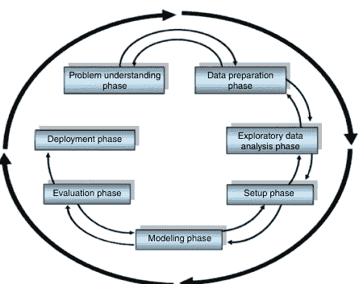

图 1.1 数据科学方法论：七个阶段。

数据准备阶段在第 3 章中介绍。

#### 3. 探索性数据分析阶段。

既然你的数据已经整洁完备，我们就可以开始探索数据，并了解一些基本信息。图形探索是这里的重点。现在不是使用复杂算法的时候。相反，我们使用简单的探索方法来帮助我们获得一些初步的洞察。你可能会发现，仅使用这些简单方法就能学到不少东西。以下是我们可以采用的一些方法。

- a. 探索预测变量与目标变量之间的单变量关系。
- b. 探索变量之间的多变量关系。
- c. 基于预测价值的分箱，以增强我们的模型。
- d. 基于现有变量的组合推导新变量。

我们在第 4 章中介绍探索性数据分析阶段。

#### 4. 准备阶段。

此时，我们几乎准备好开始对数据建模了。我们只需要先处理几项重要的琐事，例如：

- a. 交叉验证，可以是两折或 n 折。这是为了避免数据挖掘（data dredging）所必需的。此外，还需要对数据分区进行评估，以确保它们确实是随机的。
- b. 平衡数据。这能增强某些算法挖掘数据中关系的能力。
- c. 建立基准性能。假设我们告诉你，我们有一个模型能够以 99% 的准确率预测信用卡交易是否欺诈。你印象深刻吗？你不应该。非欺诈交易率为 99.932%。因此，我们的模型可以简单地预测每笔交易都不是欺诈，并且有 99.932% 的时间是正确的。这说明为你的模型建立基准性能的重要性，以便我们可以校准模型并确定它们是否有效。

准备阶段在第 5 章中介绍。

#### 5. 建模阶段。

建模阶段代表了应用最先进的算法来挖掘数据中隐藏的一些非常有利可图的关系的机会。建模阶段是你数据科学调查的核心，包括以下内容：

- a. 选择并实施适当的建模算法。应用不当的技术会导致不准确的结果，可能会让你的公司损失惨重。

- b. 确保我们的模型优于基准模型。

- c. 微调你的模型算法以优化结果。我们的决策树应该宽还是深？我们的神经网络应该有一个隐藏层还是两个？我们的切断点应该设在哪里才能最大化利润？分析师需要花一些时间来微调他们的模型，才能得出最优解。

建模阶段代表了你数据科学工作的核心，在第 6 章和第 8–14 章中介绍。

#### 6. 评估阶段。

你在工作中的伙伴可能认为他对超级碗的预测稳操胜券。但他的预测好不好呢？这就是问题所在。任何人都可以做预测。预测与真实数据的表现如何，才是真正的考验。在评估阶段，我们评估我们的模型表现如何，它们是否在赚钱，或者我们是否需要回去尝试改进我们的预测模型。

- a. 你的模型需要根据准备阶段的基准性能指标进行评估。我们是否战胜了“猴子飞镖模型”？如果没有，最好再试一次。

- b. 你需要确定你的模型是否真的在解决手头的问题。你的模型是否真的实现了在问题理解阶段为其设定的目标？问题的某些重要方面是否没有得到充分考虑？

- c. 应用数据固有的误差成本，因为数据驱动的成本评估是模拟实际涉及成本的最佳方式。例如，在营销活动中，假阳性的代价不如假阴性高。然而，对于抵押贷款放款人来说，假阳性的代价要高得多。

- d. 你应该列出一组模型并确定哪个模型表现最好。选择单一的最佳模型，或少量模型，以进入部署阶段。

评估阶段在第 7 章中介绍。

#### 7. 部署阶段。

终于，你的模型准备好正式部署了！向管理层汇报你的最佳模型，并与管理层合作，将你的模型调整为实际部署。

- a. 撰写结果报告可以被视为部署的一个简单示例。在你的报告中，专注于管理层感兴趣的结果。展示你解决了问题，并在适用的情况下报告预计利润。

- b. 继续参与项目！参与模型部署涉及的会议和流程，以便它们始终专注于手头的问题。

应当强调，DSM 是迭代且自适应的。By *自适应*，我们的意思是，有时有必要根据当前阶段获得的一些知识，返回到之前的阶段进行进一步工作。这就是为什么大多数阶段之间都有双向箭头的原因。例如，在评估阶段，我们可能会发现我们精心打造的模型并没有真正解决手头的原始问题，并且我们需要返回到建模阶段来开发一个能够做到这一点的模型。

另外，DSM 是 *迭代* 的，因为有时我们可能会利用在类似问题上构建有效模型的经验。也就是说，我们创建的模型作为相关问题调查的输入。这就是为什么图 1.1 中外圈的箭头显示了旧模型不断被回收，用作检查新问题新解决方案的输入。

### 1.4 数据科学任务

最常见的数据科学任务如下：

- 描述
- 估计
- 分类
- 聚类
- 预测
- 关联

接下来，我们描述每个任务代表什么，以及这些任务在哪些章节中介绍。

#### 1.4.1 描述

数据科学家经常被要求 _描述_ 数据中隐藏的模式和趋势。例如，数据科学家可能会描述一组最有可能离开我们公司服务的客户，这些客户的特点是高使用分钟数和大量客户服务电话。在描述了这个集群之后，数据科学家可能会解释，大量的客户服务电话可能表明客户不满意。与营销团队合作，分析师随后可以提出可能的干预措施来探索，以留住此类客户。

描述任务在全球范围内被专家和非专家广泛使用。例如，当体育播音员说一名棒球运动员的终生打击率（安打/击球次数）为 0.350时，他或她正在描述这名球员的终生打击表现。这是描述性统计的一个示例；更多示例可参见附录：数据汇总与可视化。书中几乎每一章都包含描述任务的示例，从第 4 章的图形探索性数据分析方法，到第 10 章的数据集群描述，再到第 11 章的双变量关系。

#### 1.4.2 估计

估计是指使用一组预测变量来近似数值目标变量的值。估计模型是使用目标值已知的记录构建的，以便模型可以学习哪些目标值与哪些预测值相关联。然后，估计模型可以为目标值未知的新数据估计目标值。例如，分析师可以根据一组个人和人口统计因素，估计潜在客户能够负担的抵押贷款金额。这个估计是基于查看以前客户能够负担多少的过去模型构建的。估计要求目标变量必须是数值型。估计方法在第 9、11 和 13 章中介绍。

#### 1.4.3 分类

分类与估计类似，只是目标变量是分类型而非连续型。分类可能是数据科学中最普遍、也最有利可图的任务。例如，抵押贷款放款人会有兴趣确定他们的哪些客户可能会违约


抵押贷款。同样，对于信用卡公司也是如此。分类模型会被展示大量包含过去客户实际违约状态的完整记录。然后模型学习哪些属性与违约客户相关联。最后，这些训练好的模型会被部署到新数据上，即申请过贷款或信用卡的客户，期望模型能帮助分类哪些客户最有可能违约贷款。分类方法在第6、8、9和13章中介绍。

#### 1.4.4 聚类

聚类任务旨在识别相似的记录组。例如，在信用卡申请人数据集中，一个聚类可能代表年轻、受教育程度较高的客户，而另一个聚类可能代表年长、受教育程度较低的客户。其理念是，一个聚类中的记录与同一聚类中的其他记录相似，但与其他聚类中的记录不同。找到可行的聚类至少在两个方面有用：(i) 您的客户可能对聚类概况感兴趣，即对每个聚类特征的详细描述，或者 (ii) 聚类本身可以作为下游分类或估计模型的输入。聚类方法在第10章中介绍。

#### 1.4.5 预测

预测任务与估计或分类类似，区别在于预测的预测涉及未来。例如，金融分析师可能有兴趣预测三个月后苹果股票的价格。这既代表估计，因为价格是数值变量，也代表预测，因为它涉及未来。或者，药物发现化学家可能有兴趣某个特定分子是否会为制药公司带来盈利的新药。这既代表预测也代表分类，因为目标变量是是/否变量，即该药物是否会盈利。

#### 1.4.6 关联

关联任务涉及确定哪些属性相互关联，即哪些属性“搭配在一起”。使用关联的数据科学家寻求揭示量化两个或多个属性之间关系的规则。这些关联规则采用“如果前件，则后件”的形式，并附带关联规则的支持度和置信度的度量。例如，试图避免客户流失的营销人员可能会发现以下关联规则：“如果致电客服次数超过三次，则客户将流失。”支持度是指规则适用的记录比例；置信度是指规则正确的比例。我们在第14章中介绍关联任务。

### 练习

### 澄清概念

- 1. 什么是数据科学？
- 2. 数据科学结合了哪些研究领域？
- 3. 数据科学的目标是什么？
- 4. 列出DSM的七个阶段。
- 5. 设立问题理解阶段为什么是个好主意？
- 6. 为什么需要数据准备阶段？列出该阶段处理的三个问题。
- 7. 数据分析师在哪个阶段开始探索数据以了解一些简单信息？
- 8. 用你自己的话解释为什么我们需要为模型建立基准性能。这发生在哪个阶段？
- 9. 哪个阶段代表了你数据科学调查的核心？为什么我们可能会应用多个算法来解决问题？
- 10. 我们如何确定预测是否良好？这发生在哪个阶段？
- 11. 判断正误：数据科学家的工作在评估阶段结束。解释。
- 12. 解释DSM是如何自适应的。
- 13. 描述DSM是如何迭代的。
- 14. 列出最常见的数据科学任务。
- 15. 许多非专业人士一直在做哪些任务？
- 16. 什么是估计？在估计中，目标变量必须满足什么条件？
- 17. 数据科学中最普遍的任务是什么？对于这个任务，目标变量必须满足什么条件？
- 18. 什么是聚类概况？
- 19. 判断正误：预测只能用于分类目标变量。解释。
- 20. 对于关联规则，支持度是什么意思？

### 2.1 下载Python

要运行Python代码，您需要使用Python编译器。在本文中，我们将使用Spyder编译器，它包含在Anaconda软件包中。通过下载和安装Anaconda，我们将同时下载和安装Python。

要下载Anaconda，请访问Spyder安装页面¹，并在Windows或MacOS X选项下选择Anaconda链接。安装完成后，找到Spyder程序并打开它。

第一次打开Spyder时，您将看到图2.1所示的屏幕。左侧框是您编写Python代码的地方。我们将大部分时间都花在这个框中。右上角框列出了通过运行Python代码创建的数据集和其他项目。右下角框是我们的输出将出现的地方，以及任何错误消息或其他信息。

### 2.2 Python编程基础

在Python中，如同大多数其他编程语言一样，您运行执行某个操作的代码。某些操作还会生成输出。本章将重点介绍五种操作：使用注释、导入包、执行命令、保存输出和将数据导入Python。

#### 2.2.1 在Python中使用注释

注释是编译器不执行的代码片段。为什么我们要从不会运行的命令开始编程章节？因为注释是任何编程项目的重要组成部分。

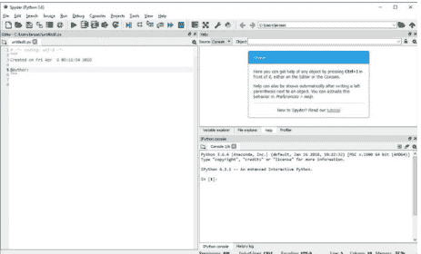

图2.1 首次打开程序时的Spyder窗口。

注释是程序员放在那里以便他人更好地理解代码的代码行。例如，如果您想解释某段代码的作用，可以先写一条注释，说明它的作用以及结果会是什么。

如何在Python中编写注释？注释是以井号#开头的代码行。以下是注释示例。

```
#### This is a comment!
```

请注意，本教材中任何代码（甚至注释）的字体都将以粗体显示。这适用于Python和R代码。

#### 2.2.2 在Python中执行命令

您输入的任何代码都需要运行（或执行）才能工作。执行代码有几种不同的方式。

大多数情况下，您的光标将位于一行代码上，并且您想要运行该行。Spyder中有一个按钮可以运行单行代码。还有一个键盘快捷方式，将鼠标悬停在该按钮上时会显示。按钮和悬停文本都在图2.2中显示。

您可能希望同时运行多行代码。在这种情况下，请突出显示相关行并按下“运行选定内容或当前行”按钮，或按下键盘快捷方式。所有突出显示的代码将同时运行。

您也可以尝试执行注释。如前所述，注释不会被编译，也不会产生输出。但是，它们会出现在


图2.2 Spyder中运行选定内容或一行Python代码的按钮和悬停文本。

Spyder的右下角窗口中。这告诉您Spyder编译器已经查看了注释，尽管在读取注释后Spyder没有任何操作要执行。

#### 2.2.3 在Python中导入包

虽然许多事情可以在Python中“开箱即用”（即下载安装后直接进行），但我们想要完成的大部分工作都需要导入包。包包含特别设计的代码，使我们无需自己编写代码即可执行复杂的数据科学任务。例如，在第6章中，我们需要构建分类和回归树（CART）模型。与其从头开始研究如何构建CART模型，不如导入包含该代码的包。导入包后，我们可以运行代码来创建CART模型。

某些命令是专用的，例如sklearn.naive_bayes包中的MultinomialNB()命令（参见第10章）。另一方面，有些命令将在每一章中使用。这些是pandas和numpy包。要导入这些包，您需要输入并运行以下两行代码：

```
import pandas as pd
import numpy as np
```

请注意，我们使用import导入包。之后的as pd和as np又是什么意思呢？as代码使用我们可以指定的名称重命名包。我们重命名包是为了使使用它们更加容易。

要使用pandas和numpy包中包含的命令，我们需要在命令名称之前说明包名称。例如，在第2.2.4节中，我们使用pandas的read_csv()命令。要使用该命令，我们需要输入pandas.read_csv()。如果您多次使用某个特定命令，或使用名称很长的包中的代码，您将不得不进行大量输入！为了节省一些输入，我们可以给包起个绰号。在上述情况中，我们使用as pd将pandas包重命名为pd，使用as np将numpy包重命名为np。这就是在第2.2.4节中，我们可以使用代码pd.read_csv()来使用read_csv()命令的方式。重命名包将从长远来看为我们节省大量输入！


我们还可以从包中导入特定部分，而无需导入整个包。例如，在第 6 章中，我们将使用 sklearn.tree 包中的 DecisionTreeClassifier() 和 export_graphviz 命令。为此，我们将使用以下代码：

```
from sklearn.tree import DecisionTreeClassifier, export_graphviz
```

请注意，语法与我们之前导入包的方式有所不同。我们不再使用 import sklearn.tree，而是以 from sklearn.tree 开头。使用 from 告诉 Python 在哪里查找我们想要的命令。在 from sklearn.tree 之后，我们使用 import 指定要导入的内容。如果我们只导入 DecisionTreeClassifier 命令，则在该命令名称后结束该行。但是，由于我们要导入两个命令，我们添加一个逗号并继续使用第二个命令名称 export_graphviz。执行此行将导入这两个命令。

#### 2.2.4 将数据导入 Python

现在我们将讨论如何将数据集导入 Python。在本文中，我们将使用 read_csv 命令，采用以下结构：

```
your_name_for_the_data_set = pd.read_csv(*the_path_to_the_file*)
```

read_csv 命令来自 pandas 包。按照第 2.2.3 节中的代码，我们将 pandas 包导入为 pd。导入 pandas 包后，我们可以通过输入 pd 来访问 read_csv 命令。要使用 read_csv() 命令，请输入 pd，然后加一个句点，接着是命令 read_csv。

代码的下一部分是数据文件的路径，包含在双引号中。对于许多 Windows 用户，路径将以 C:/ 开头并以文件名结尾。例如，在第 4 章中，您需要导入 bank_marketing_training 数据集。导入数据集的代码如下所示。

```
bank_train = pd.read_csv("C:/ ... /bank_marketing_training")
```

程序员将使用自己的文件路径替换上述路径中的 "C:/..." 部分。导入数据文件的示例如下所示。

```
bank_train = pd.read_csv("C:/Users/Data Science/Data/bank_marketing_training")
```

第 4 章的 Python 指南告诉读者将 bank_marketing_training 数据集读入为 bank_train。这不仅指定了要导入的数据集，还指定了调用数据集的名称。要遵循该指令，您应将数据集的名称指定为 bank_train，如上述代码所示。请记住您将数据集保存为什么名称，并尽量保持名称相对较短。您保存数据的名称将是您在其余代码中每次想要使用该数据时都要输入的名称。

#### 2.2.5 在 Python 中保存输出

某些命令生成可在其他代码行中使用的输出。要在后续代码中使用输出，您需要将输出保存为命名对象。要保存输出，请遵循以下结构：

```
your_name_for_the_output = the_command_that_generated_the_output
```

您可能会注意到上述结构与我们用来导入 bank_marketing_training 数据集的结构相似。您可能正确推断出，我们使用的命令 read_csv() 生成了 bank_marketing_training 数据集的“输出”，并且我们将该输出命名为 bank。导入数据集使用与在特定名称下保存输出相同的编码语法。现在让我们使用列联表来说明运行命令但不保存输出与运行命令并保存输出之间的区别。

在第 4 章中，您需要创建一个列联表并保存它，以便使用该表制作条形图。创建列联表的代码只有一行，如下所示，并在图 2.3 中显示。

```
pd.crosstab(bank_train['previous_outcome'], bank_train['response'])
```

如果不保存 crosstab() 命令生成的输出，则生成的列联表将在 Spyder 中显示，如图 2.3 所示。在图中，“In”表示我们运行的代码，“Out”表示生成的输出。

如果我们只想制作一个表，而不在代码的其他地方使用它，那么这就足够了。但是，我们想使用这个表来制作条形图。因此，我们必须保存它。要保存它，我们在生成输出的命令左侧添加一个保存项目的名称和一个等号。代码如下所示，并在图 2.4 中显示。

```
In [9]: pd.crosstab(bank_train['previous_outcome'], bank_train['response'])
Out[9]:
response        yes
previous_outcome  no   yes
failure         2390  385
nonexistent     21176 2834
success         328   569
```

图 2.3 在 Python 中不保存输出的情况下创建列联表。

```
In [10]: crosstab_01 = pd.crosstab(bank_train['previous_outcome'], bank_train['response'])
```

```
In [11]:
```

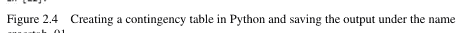

```
In [11]: crosstab_01
Out[11]:
response        no   yes
previous_outcome
failure         2390  385
nonexistent     21176 2034
success         328   569
```

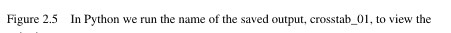

```
crosstab_01 = pd.crosstab(bank_train['previous_outcome'], bank_train['response'])
```

名称可以是任何内容，前提是它以字母（而不是数字或符号）开头，并且不包含句点或下划线以外的其他特殊字符。在图 2.4 中，我们将表命名为 crosstab_01。

请注意，图 2.4 中没有输出。“In”语句从“In [10]”跳到“In [11]”，中间没有指定“Out [10]”。Python 跳过“Out”语句，因为 crosstab() 命令生成的输出已保存为名称 crosstab_01。

要查看输出，请单独运行我们给输出的名称，在此例中为 crosstab_01。结果如图 2.5 所示。

#### 2.2.6 在 Python 中访问记录和变量

在您的数据科学探险中，您可能想要检查特定记录。例如，我们如何访问 bank_train 数据集中的记录？我们使用所有 pandas 数据框都具有的 loc 属性，并说明您想查看数据框的哪一部分。

Python 从记录零开始引用其记录，因此如果我们想查看第一条记录，我们请求记录 0。同样，要查看第二条记录，请求记录 1，依此类推。例如，要查看 bank_train 的第一条记录，请使用以下代码：

```
bank_train.loc[0]
```

如上使用 loc 属性查看第一条记录将返回该记录的所有变量值。图 2.6 显示 bank_train 数据集中第一条记录的前四个变量值。

```
In [30]: bank_train.loc[0]
Out[30]:
age             56
job        housemaid
marital       married
education      basic.4y
```

图 2.6 Python 显示 bank_train 数据集中第一条记录的变量值（仅显示前四个变量）。

如果我们想访问许多记录怎么办？我们将使用 .loc 属性并列出我们想查看的记录。如果您想要第一、第三和第四行，请使用以下代码：

```
bank_train.loc[[0, 2, 3]]
```

另一方面，如果您想要前 10 行（包含第 10 行），则应使用以下代码：

```
bank_train[0:10]
```

虽然我们按数字引用行，但我们的列有名称。这意味着，如果我们想指定要查看哪个变量，我们需要提供其名称。

```
bank_train['age']
```

使用一组括号并将变量名放在单引号中将返回整个变量。代码和前四个 age 值如图 2.7 所示。

如果我们想查看多个变量怎么办？我们将使用 .loc 属性并列出我们想查看的变量。如果我们想查看 age 和 job 变量，我们将每个变量名放在单引号中，放在双括号内，并用逗号分隔。

```
bank_train[['age', 'job']]
```

此命令的输出如图 2.8 所示。

#### 2.2.7 在 Python 中设置图形

在离开 Python 编码部分之前，我们还需要解决一件事：如何在 Python 中获取和调整图形输出。

默认情况下，Spyder 在右下角窗口的 IPython 控制台中显示所有图形。图 2.9 显示了一个示例，使用直方图。这些没有编辑选项的小型显示对于简单图形可能是可以接受的。但是，我们将制作复杂图形，这将需要进一步编辑和更大的显示。为了使我们能够详细查看和操作图形，我们需要更改 Spyder 的图形设置。


```
In [48]: bank_train['age']
Out[48]:
0    56
1    57
2    41
3    25
```

图 2.7 Python 显示 age 变量的值（仅显示前四个值）。

```
In [49]: bank_train[['age', 'job']]
Out[49]:
   age       job
0   56   housemaid
1   57   services
2   41  blue-collar
3   25   services
```

图 2.8 Python 显示 age 和 job 变量的值（仅显示前四个值）。

以下步骤仅需执行一次，即可设置我们需要的图形选项：

- 1. 在 Spyder 中，单击菜单栏上的 Tools，然后选择 Preferences。
- 2. 在 Preferences 窗口左侧列表中，单击 IPython console。
- 3. 选择右侧窗口顶部的 Graphics 选项卡。
- 4. 在 Graphics backend 下，单击 Backend 下拉菜单并选择 Automatic。此过程中的窗口示例如图 2.10 所示。
- 5. 选择 Automatic 后，单击 Apply 和 OK 按钮。

按照上述步骤更改图形选项后，关闭 Spyder 并重新打开它，以使新设置生效。

更改图形后端将在新窗口中打开图形输出。显示图形的窗口如图 2.11 所示。除了让我们更详细地查看图形外，该窗口还提供多个自定义选项，在本书余下部分中将非常有用。例如，请考虑“配置子图”按钮，它位于右侧第三个，如图 2.11 中的悬停文本所示。选择此按钮将允许我们更改图表的边距。“编辑轴”按钮位于右侧第二个，将允许我们编辑标题和轴标签。“保存”按钮位于最右侧，将允许您保存图形。在从本文中的代码获取图形输出时，请随意尝试这些设置。

现在你已经掌握了 Python 编程的核心操作，正在成为 Python 程序员的道路上！我们将在后续章节中介绍更具体的命令、包和输出，并贯穿始终地提供技巧和解释。

```
In [5]: bank_train['age'].plot(kind='hist')
Out[5]: <matplotlib.axes._subplots.AxesSubplot at 0x1aff31e1518>
```

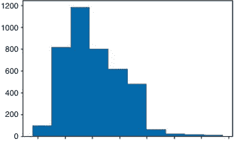

图 2.9 Spyder 输出部分显示的直方图示例。

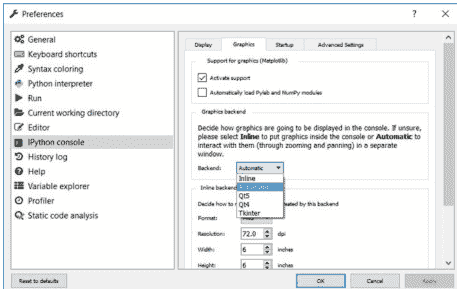

图 2.10 准备更改图形选项时 Spyder 中的 Preferences 窗口。

### 2.3 下载 R 和 RStudio

是时候切换编程语言了。在本节中，我们将介绍统计编程语言 R 的相同基本技能，就像上一节为 Python 所做的那样。在本章和整本书中，您会发现 Python 和 R 在做事情方面有很多相似之处，例如保存输出，也有很多不同之处，例如导入包。

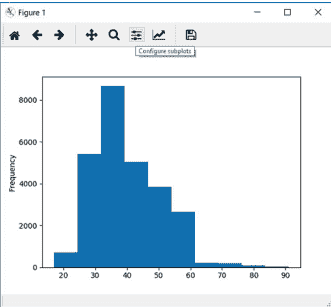

图 2.11 Spyder 中的新窗口，用于保存我们的图形输出，并指示了“配置子图”按钮。

要运行 R 代码，我们需要下载 R 和 RStudio。要下载 R，请访问 R 安装页面，选择一个镜像，并按照针对您的操作系统下载 R 的说明进行操作。要下载 RStudio，请访问 RStudio 安装页面并选择适用于您的操作系统的下载链接。安装后，找到 RStudio 并打开它。

图 2.12 显示了首次打开 RStudio 时的窗口。如果您打开 RStudio 且只有三个面板，请单击 File > New File > R Script 以获得图 2.12 所示的四面板显示。左上角的框是您输入 R 代码的地方。右上角的框有“导入数据集”按钮，我们将使用它将数据读入 R。它还有“环境”选项卡，将显示您在 R 中导入或创建的所有数据集和对象。左下角的框是文本输出出现的地方，以及任何反馈或错误消息。最后，右下角的框有许多选项卡。我们将大部分时间花在“图表”选项卡中，任何图形输出都将显示在那里。右下角的框还有“帮助”选项卡，可用于快速访问 R 命令的文档。


图 2.12 首次打开程序时的 RStudio 窗口。

### 2.4 R 编码基础

与使用 Python 一样，使用 R 时您执行会生成输出的命令。R 代码的大部分结构与 Python 代码类似，只有几个重要的区别。在本节中，我们将讨论之前使用 Python 介绍过的五种编程操作，这次使用 R：使用注释、导入包、执行命令、保存输出和将数据导入 Python。

#### 2.4.1 在 R 中使用注释

在 R 中编码时使用注释与在 Python 中编码时同样重要。注释允许您描述代码的功能及其他重要信息。

注释是以井号 # 开头的代码行，如下面的代码所示。

```
#### This is a comment, and won't be compiled by R!
```

请记住，在本文中 R 代码将以粗体显示。不要害怕在代码中添加注释，即使本文中的示例和练习没有提示。使用此工具使您的代码尽可能清晰，让其他人易于理解！

#### 2.4.2 在 R 中执行命令

您编写的 R 代码需要执行后才能发挥应有的作用。

大多数时候，您会想要运行单行代码。有两种方法可以做到这一点。首先，您可以单击 RStudio 左上角面板中的 Run 按钮，即您将输入 R 代码的同一面板。您也可以使用键盘快捷键，将鼠标悬停在 Run 按钮上即可显示。图 2.13 显示了按钮和悬停文本（适用于 Windows 操作系统）。

#### 2.4.3 在 R 中导入包

虽然 R 的“基础”或初始下载包含许多对数据科学家有用的命令，但它不包括本教材所需的一切。因此，在整本书中，我们需要下载并打开称为包的特别设计的 R 命令批次。使此额外代码可用有两个步骤：(i) 下载包含代码的包和 (ii) 打开包。

让我们以名为 ggplot2 的包为例演示此过程。该包将在第 4 章中使用，因此通过导入此代码，我们现在为该章做准备。下载和访问代码的两行代码如下所示。

```
install.packages("ggplot2")
library(ggplot2)
```

首先，让我们看看第一行代码。下载包的命令是 install.packages()。要下载 ggplot2 包，请将包名放在双引号内的 install.packages() 命令中。这样就得到了上面的第一行代码。

如果您是第一次下载包，在安装继续之前需要选择一个 CRAN 镜像。您可以选择任何镜像，但可能希望选择靠近您地理位置的镜像。

需要注意的是，您只需下载一次包。安装完成后，包就在您的计算机上，随时可以打开并在您希望的任何代码中使用。但是，在使用 ggplot2 包中的命令之前，您需要打开它。每当您希望使用包中的函数时，都需要执行此操作。

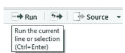

图 2.13 在 RStudio 中运行选定内容或一行 R 代码的按钮和悬停文本。

为此，我们使用上面的第二行代码。打开包的命令是 library()。要打开 ggplot2 包，请将包名放在不带引号的 library() 命令中。这样就得到了上面的第二行代码。

#### 2.4.4 将数据导入 R

将数据集导入 R 有两种方法：使用 RStudio 环境选项卡中的“导入数据集”按钮（我们强烈推荐！）或将文件路径编码到 R 中。

将数据集导入 R 的最简单方法是 Import Dataset 按钮，位于 RStudio 右上角窗口的顶部。图 2.14 显示了右上角窗口，并选中了 Import Dataset 按钮。选择该按钮将向您显示不同的选项。我们将选择“从文本 (base)...”作为我们的选项。

选择“从文本 (base)...”后，将出现一个文件资源管理器窗口。使用该窗口定位您的数据集。导航到您的数据集并选择“打开”。

选择数据集文件并单击“打开”后，将出现一个新的“导入数据集”窗口。如图 2.15 所示，该窗口左侧列出了许多导入数据集的选项。“标题”选择尤为重要。本文中使用的所有数据集都有列标题，因此告诉 R 这些标题存在非常重要。请确保已选择“标题”的“是”按钮。如果您在“是”和“否”选项之间切换，将在右下角窗口中看到变化，该窗口是数据集导入到 R 时的预览。请确保列名称（“age”、“job”等）为粗体。

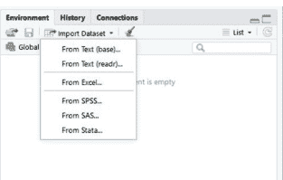

图 2.14 单击 RStudio 中的“导入数据集”按钮后，将显示一个下拉菜单，我们从中选择“从文本 (base)...”


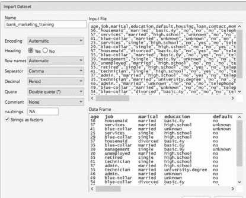

图 2.15 R 中 bank_marketing_training 数据集的“导入数据集”窗口，已选择“标题：是”。

粗体表示它们将作为变量名导入，而不是作为数据集中的实际记录。在此窗口中，您还可以更改分隔符、缺失值代码以及导入数据集的其他选项。最后，要导入数据集，请单击“导入”。左上角窗口将打开一个新选项卡，显示数据集。返回包含代码的选项卡以继续工作。

虽然您可以使用“名称”字段更改导入时的数据集名称，但我们建议保留默认值。在 R 代码本身中，您可以通过将数据集保存为较短的名称来缩短名称。第 4 章的说明指出“将 bank_marketing_training 数据集读入为 bank_train”。导入数据集后，您可以使用左指箭头以缩短的名称保存数据集，如下所示。

```
bank_train <- bank_marketing_training
```

请注意，下面所示的小于号和减号组成一个左指箭头，<-。该箭头从右侧的被重命名对象指向左侧的新名称。小于号和减号之间不能有空格，尽管它们形成的左指箭头两侧可以有空格。重命名数据集的一般形式为：

```
object_name <- object_to_be_saved
```

如果您非常熟悉编码和访问文件属性，可以通过以下结构将文件路径编码到 R 中来打开数据集：

```
your_name_for_the_data <- read.csv(file = "the path to
the file")
```

使用此方法，我们将使用 read.csv() 命令输入数据。read.csv() 命令中的 file = 输入指定双引号内的文件路径。

下面给出了打开 bank_marketing_training 数据集的代码示例。

```
bank_train <- read.csv(file = "C:/Users/Data Science/
Data/bank_marketing_training")
```

#### 2.4.5 在 R 中保存输出

与 Python 类似，您通常希望将代码输出保存为特定名称，以便在程序中稍后使用。要将输出保存为特定名称，请使用与重命名数据集相同的结构：

```
object_name <- object_to_be_saved
```

例如，要创建列联表，请使用下面给出的代码。代码及其输出如图 2.16 所示。

```
table(bank_train$response, bank_train$previous_outcome)
```

如果要创建行和列总计，或计算此表的比例，应首先将表保存为其自身名称。为简单起见，让我们将表保存为 t1，即“表 #1”。

下面给出了代码，如图 2.17 所示。请注意，如果我们将表保存为 t1 名称，则不会显示列联表。要查看表格，请单独运行 t1 代码。仅运行 t1 的结果如图 2.18 所示。

```
> table(bank_train$response, bank_train$previous_outcome)
```

| | failure | nonexistent | success |
|---|---|---|---|
| no | 2390 | 21176 | 320 |
| yes | 385 | 2034 | 569 |

图 2.16 在 R 中未保存输出的情况下创建列联表。

```
> t1 <- table(bank_train$response, bank_train$previous_outcome)
>
```

图 2.17 在 R 中创建列联表并将输出保存为名称 t1。

```
> t1
```

| | failure | nonexistent | success |
|---|---|---|---|
| no | 2390 | 21176 | 320 |
| yes | 385 | 2034 | 569 |

图 2.18 R 中保存的表 t1 的输出。

#### 2.4.6 在 R 中访问记录和变量

与 Python 类似，有时您希望 R 为您提供特定的记录或变量。例如，我们如何访问 bank_train 数据集中的第一条记录？或者该数据集中的 age 变量？

R 从 1 开始引用其记录，因此如果我们想查看第一条记录，我们请求记录 1。例如，要访问 bank_train 数据集中的第一条记录，请使用以下代码：

```
bank_train[1, ]
```

请注意，没有单独的命令用于隔离特定记录。相反，使用括号表示法。括号表示法的结构为：

```
data_set_name[ rows of interest , columns of interest ]
```

请注意，数据集名称和左括号之间不应有空格。

让我们看一些示例。我们将使用的数据集名为 bank_train。由于我们对第一行感兴趣，我们在感兴趣的行区域放入 1。目前，没有感兴趣的列，因此我们将该输入留空。

```
bank_train[ 1, ]
```

如果您想要第一、第三和第四条记录，请使用以下代码：

```
bank_train[c(1,3,4), ]
```

我们使用 1、3、4 输入来指定感兴趣的行。将这些数字括在 c() 命令中告诉 R 所有这些数字都属于一起，因此它们都被视为感兴趣的行。由于未指定感兴趣的列，将返回所有列。输出（仅显示前四列）如图 2.19 所示。

```
> bank_train[c(1,3,4), ]
age    job       marital   education
1  56   housemaid married   basic.4y
3  41   blue-collar married unknown
4  25   services  single    high.school
```

图 2.19 R 显示了 bank_train 数据集中第一、第三和第四条记录的内容（仅显示前四个变量）。

```
> bank_train[, c(1, 3)]
age marital
1  56 married
2  57 married
3  41 married
4  25 single
5  29 single
```

图 2.20 R 显示了第一和第三个变量的内容（仅显示前五条记录）。

变量呢？我们可以以与记录相同的方式识别感兴趣的变量：使用括号表示法，并将我们想要的列的数字放在感兴趣的列部分中。例如，变量 age 和 marital 是数据集中的第一和第三个变量。要访问这些变量，请在括号内的适当位置放入 1 和 3，如下所示。

```
bank_train[, c(1, 3)]
```

结果如图 2.20 所示。

当然，您可以结合感兴趣的行和列来指定您感兴趣的特定行和列。例如，您可以请求 age 和 marital 变量的前三条记录。我们将此结果留作练习。

当我们导入数据集时，它们作为数据框导入。这些数据框有一个非常好的属性：我们可以使用美元符号 $ 来识别感兴趣的变量。例如，假设我们想要 bank_train 数据集中的 age 变量。我们写下数据集的名称和变量的名称，用美元符号连接，如下所示。

```
bank_train$age
```

恭喜，您现在已学习 R 编程的核心操作！您正在成为 R 程序员的道路上。与 Python 一样，本书的其余部分将介绍更具体的命令、包和输出，并将附带编程提示和解释。

现在您已经掌握了两种编程语言的基础知识，准备好使用 Python 和 R 进行数据科学了！

### 参考文献

- K. Jarrod Millman 和 Michael Aivazis, 面向科学家和工程师的 Python, Computing in Science & Engineering, 13, 9–12, 2011. doi:https://doi.org/10.1109/MCSE.2011.36.
- Wes McKinney. Python 中用于统计计算的数据结构. 在第 9 届 Python 科学会议论文集中，第 51–56 页，2010.
- Travis E. Oliphant, NumPy 指南, Trelgol Publishing, Spanish Fork, 2006.
- Travis E. Oliphant, 用于科学计算的 Python. Computing in Science & Engineering, 9, 10–20, 2007. doi:https://doi.org/10.1109/MCSE.2007.58.
- R Core Team, R: 用于统计计算的语言和环境, R 统计计算基金会, 维也纳, 奥地利, 2018.

### 练习

### 澄清概念

- 1. 本章讨论的 Python 和 R 代码的五个操作是什么？
- 2. 注释用于什么？注释生成什么输出？什么特殊字符开始注释？
- 3. 我们为什么要导入包？
- 4. 导入 Python 包时，“as”代码的用途是什么？
- 5. 我们如何保存 Python 代码生成的输出？
- 6. 我们如何保存 R 代码生成的输出？
- 7. 我们为什么要保存输出？
- 8. 我们如何将数据集导入 Python？
- 9. 指定我们的数据集是否有列标题为什么很重要？
- 10. 我们可以通过哪两种方式将数据集导入 R？

### 使用数据

对于以下练习，请使用 bank_marketing_training 数据集。使用 Python 或 R 解决每个问题。

- 11. 下载程序并打开编译器。右下角窗口中包含什么？左侧（用于 Python）或左上角（用于 R）？
- 12. 输入一条注释，说明您正在处理第 2 章练习。
- 13. 找到“运行”按钮，并记录是否有键盘快捷键。
- 14. 执行上一练习中的注释。输出是什么？解释您的答案。
- 15. 导入以下包：


### 实操分析

- a. 对于 Python，导入 `pandas` 和 `numpy` 包。将 `pandas` 包重命名为 "pd"，将 `numpy` 包重命名为 "np"。
- b. 对于 R，导入 `ggplot2` 包。确保同时安装并加载该包。

- 16. 导入 `bank_marketing_training` 数据集并将其命名为 `bank_train`。
- 17. 使用 `bank_train` 数据集中的变量 `response` 和 `previous_outcome` 创建列联表。不要保存代码的输出。
- 18. 重新运行上一题的代码，这次将输出保存为 `crosstab_01`（用于 Python 代码）或 `t`（用于 R 代码）。
- 19. 在上一题中保存输出后，使用保存的输出名称显示输出。
- 20. 使用不同的名称保存列联表。这次，使用你的姓氏和最喜欢的数字作为名称；例如，`larose42`。
- 21. 将 `bank_train` 数据集的前九条记录保存为独立的数据框。
- 22. 将 `bank_train` 数据集的年龄和婚姻记录保存为独立的数据框。
- 23. 将变量 `age` 和 `marital` 的前三条记录保存为独立的数据框。

- 24. 使用“标题：是”设置导入 `adult_ch3_training` 数据集。导入后将数据集重命名为 `adult`。
- 25. 编写注释解释数据集名称的更改。
- 26. 导入以下包：
    - a. 对于 Python，从 `sklearn.tree` 包导入 `DecisionTreeClassifier` 命令。
    - b. 对于 R，导入 `rpart` 包。确保同时安装并加载该包。
- 27. 创建 `workclass` 和 `sex` 的列联表。将输出保存为 `table01`。
- 28. 创建 `sex` 和 `marital status` 的列联表。将输出保存为 `table02`。
- 29. 显示第一条记录中人员的 `sex` 和 `workclass` 值。他们属于 `table01` 的哪个单元格？数据集中还有多少条记录具有相同的 `sex` 和 `workclass` 值？
- 30. 显示第 6–10 条记录中人员的 `sex` 和 `marital status` 值。他们属于 `table02` 的哪些单元格？数据集中还有多少条记录具有相同的 `sex` 和 `marital status` 值组合？
- 31. 创建一个仅包含 `marital status` 为 "Married-civ-spouse" 的记录的新数据集，并将该数据集命名为 `adultMarried`。
- 32. 使用 `adultMarried` 数据集重新创建 `sex` 和 `workclass` 的列联表。你注意到两性之间有什么差异？
- 33. 创建一个仅包含 `age` 值大于 40 的记录的新数据集。将新数据集命名为 `adultOver40`。
- 34. 使用 `adultOver40` 数据集重新创建 `sex` 和 `marital status` 的列联表。你注意到什么差异？

## 第 3 章 数据准备

### 3.1 银行营销数据集

我们将使用 bank_marketing_training 和 bank_marketing_test 数据集，演示如何执行数据科学方法论的前两个阶段。读者可从图书系列网站下载这些数据集：www.dataminingconsultant.com。这些数据集改编自 UCI 机器学习库的 bank_additional_full.txt 数据集。我们仅使用四个预测变量（age、education、previous_outcome 和 days_since_previous），以及目标变量 response。数据涉及葡萄牙一家银行开展的电话直销活动。该银行有兴趣了解联系人是否会在该银行订阅定期存款账户。bank_marketing_training 数据集包含 26,874 条记录，而 bank_marketing_test 包含 10,255 条记录。

### 3.2 问题理解阶段

我们从问题理解阶段开始，以确保我们辛苦攀登的梯子没有靠在错误的墙上。

#### 3.2.1 清晰阐述项目目标

本分析的目标如下：

- 1. 了解我们的潜在客户。即，了解选择与我们银行业务的客户以及不选择的客户的特征。

¹Sérgio Moro, Paulo Cortez, 和 Paulo Rita, 《利用数据驱动方法预测银行电话营销成功》, 决策支持系统, Elsevier, 62:22–31, 2014年6月。²加州大学欧文分校机器学习库, https://archive.ics.uci.edu/ml/index.php。

- 2. 开发一种识别可能正面响应者的盈利方法，以便节省时间和金钱。即，开发一个或多个模型来识别可能的正面响应者。量化使用这些模型的预期利润。

#### 3.2.2 将这些目标转化为数据科学问题

我们应如何运用数据科学来实现项目目标？

- 1. 了解潜在客户的方法有很多。
    - a. 使用探索性数据分析来表达变量之间的一些简单图形关系。例如，使用叠加有关响应 *是/否* 信息的 *年龄* 直方图，以可视化年龄是否影响客户响应。
    - b. 使用聚类分析来确定我们的潜在客户中是否存在自然分组，例如，年轻/受教育程度高 vs 年长/受教育程度低。然后，查看这些聚类在营销响应方面是否存在差异。
    - c. 使用关联规则来查看记录子集中是否存在有用的关系。例如，假设规则“如果有手机，则响应 = 是”具有良好的支持度和高置信度。这将使我们的营销人员能够针对手机用户开展有针对性的活动，而不受我们整体建模结果的影响。

- 2. 我们可以开发一套强大的数据科学模型来识别可能的正面响应者。请注意，由于响应（是/否）是类别型变量，我们可以使用分类模型，但不能使用估计模型。
    - a. 使用以下算法开发我们能开发的最佳分类模型：
        - i. 决策树
        - ii. 随机森林
        - iii. 朴素贝叶斯分类
        - iv. 神经网络
        - v. 逻辑回归
    - b. 基于预定的模型评估标准（例如误分类成本）评估每个模型。构建最佳模型及其成本的表格。
    - c. 与管理层商讨用于进入部署阶段的最佳模型或模型。

因此，我们已（i）清晰阐述了目标，并（ii）将这些目标转化为一组待实施的数据科学任务。因此，第一阶段：问题理解阶段已完成。

### 3.3 数据准备阶段

接下来，我们进入数据准备阶段，在此阶段对数据进行清洗和预处理以供分析。数据准备的完整指南需要的篇幅远超我们此处所能提供的。（读者可参阅《数据挖掘与预测分析》³，了解更多数据准备内容。）每个数据集都有其自身必需的数据准备任务。在本章中，我们将重点介绍以下数据准备任务：

- • 添加索引字段
- • 更改错误字段值
- • 将类别数据重新表示为数值数据
- • 标准化数值字段
- • 识别异常值。

### 3.4 添加索引字段

数据科学家可能希望通过添加新变量来丰富数据集，以增强理解。例如，并非所有数据集（包括 bank_marketing 数据集）都自带 ID 字段。因此，我们可以向数据中添加一个索引字段，它将发挥两个作用：（i）它充当没有此类字段的数据集的 ID 字段，以及（ii）它跟踪数据库中记录的排序顺序。在数据科学中，我们经常对数据进行分区和重新排序；因此，拥有一个索引字段非常有用，以便在需要时恢复原始排序顺序。使用 Python 和 R 添加索引字段的方法如下。

#### 3.4.1 如何使用 Python 添加索引字段

首先，我们需要使用上一章讨论的代码打开所需的包。

```
import pandas as pd
```

接下来，使用 read_csv() 命令并指定文件位置，以 bank_train 名称导入数据集。

```
bank_train = pd.read_csv("C:.../bank_marketing_training")
```

如前一章所讨论，由于 read_csv 命令位于 pandas 包中，我们需要在命令前给出包名。由于我们将 pandas 包打开为 pd，因此完整命令是 pd.read_csv()。


要创建索引，我们首先需要找到数据集中的记录数和列数。

```
bank_train.shape
```

在数据集名称后使用.shape将给出数据集中的行数和列数。输出中的第一个数字是记录数，26,874。第二个是变量数。

一旦我们知道了记录数，我们就创建一个新变量，为每条记录分配一个唯一的整数。

```
bank_train['index'] = pd.Series(range(0,26874))
```

嵌套命令Series()和range()创建一串数字，其下限为零，上限为记录数。由于Series()命令包含在pandas包中，并且我们将pandas包重命名为pd，因此在Series()命令前加上pd和一个句点。结果是代码pd.Series()。请注意，range()命令的下限为零而不是一，因为Python从零开始计数位置。我们将这串数字作为数据集中的新变量index保存，方法是使用bank_train['index']将pd.Series(range())的输出分配给bank_train数据集的index变量。

要查看带有新变量的数据集，我们可以查看数据集的开头部分。

```
bank_train.head
```

在数据集名称后使用.head将生成包含数据集中每个变量的前30条和后30条记录的输出。

#### 3.4.2 如何使用R添加索引字段

使用RStudio中的Import Dataset按钮将数据集导入为bank_train名称。要创建索引字段，我们首先需要知道数据集中有多少条记录。

```
n <- dim(bank_train)[1]
```

dim()命令给出将其名称用作输入值的数据集的记录数和变量数；在此例中为bank_train数据集。在dim(bank_train)末尾添加[1]将导致仅输出第一个数字，即记录数。我们将输出保存为小写字母“n”，这是样本量的常用表示法。如果单独执行n，输出将是数字26,874，即数据集中的记录数。

一旦我们有了记录数，我们就创建一个新变量，为每条记录分配一个唯一的整数，以指定其在数据集中的顺序。

```
bank_train$Index <- c(1:n)
```

函数c()将其输入值合并为单个对象。在我们的例子中，输入是1:n，代表“从1到n的整数（包含两端）”。命令c(1:n)将给出从1到bank数据集记录数的一串数字。我们将这串数字作为数据集中的新变量Index保存，方法是将c(1:n)保存为bank_train$Index。

要查看带有新索引变量的数据集，请运行head()命令，以bank_train数据集作为其唯一输入。

```
head(bank_train)
```

生成的输出是所有变量（包括Index变量）的前六条记录。

### 3.5 更改误导性字段值

字段days_since_previous是自上次市场活动联系客户以来的天数计数。该字段明显是数值型，因此我们可以查看图3.1中R提供的days_since_previous直方图。请注意，大多数数据值接近1000，少数值接近零。事实证明，数据库管理员使用代码999表示以前未被联系过的客户。因此，我们需要将字段值999更改为缺失值，在Python和R中操作如下。

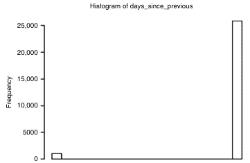

图3.1 R中days_since_previous的直方图，大多数值接近1000。

4参见附录。数据汇总与可视化。

#### 3.5.1 如何使用Python更改误导性字段值

如果您未按前一节Python部分所述打开`pandas`包或读入数据集，请立即执行此操作。本节我们还需要导入`numpy`包。

```
import numpy as np
```

我们需要识别所有`days_since_previous`值为999的记录，并将其替换为Python中表示缺失值的代码`NaN`。完成替换后，我们将在`days_since_previous`变量名下保存该变量，从而有效覆盖先前变量的值。

```
bank_train['days_since_previous'] = bank_train['days_since_previous'].replace({999: np.NaN})
```

代码`bank_train['days_since_previous']`访问变量`days_since_previous`。命令`replace({999: np.NaN})`查找`days_since_previous`变量中的每个999实例，并将其替换为值`NaN`。要将新编辑的变量保存到其原始名称下，我们通过重用变量名`bank_train['days_since_previous']`将右侧设置为等于左侧的原始`days_since_previous`变量。

要创建变量的直方图，请使用`hist()`命令。

```
bank_train['days_since_previous'].plot(kind = 'hist', title = 'Histogram of Days Since Previous')
```

在变量名后使用`.plot()`将绘制变量的图表。我们使用`kind = 'hist'`指定应制作直方图。`title`输入（包含在单引号中）创建直方图的标题。输出如图3.2所示。在第4章中，我们将查看更复杂的直方图。

#### 3.5.2 如何使用R更改误导性字段值

如果您未按前一节R部分所述读入数据集，请立即执行此操作。

我们需要识别`days_since_previous`变量中每个999的实例，并将其替换为R中表示缺失值的代码值`NA`。

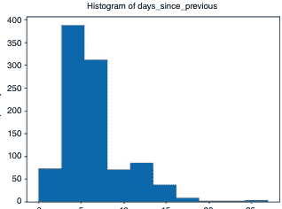

图3.2 Python中days_since_previous的直方图，缺失值已正确编码。

```
bank_train$days_since_previous <- ifelse(test = bank_train$days_since_previous == 999,
yes = NA, no = bank_train$days_since_previous)
```

ifelse()命令检查test =下指定的条件，如果测试条件为真，则将days_since_previous变量赋值为yes =后给出的值；如果测试条件为假，则将days_since_previous变量赋值为no =后给出的值。

在我们的例子中，对每条记录进行检查，看其是否在days_since_previous变量中包含值999。如果是，则返回值NA。如果不是，则返回days_since_previous变量中的原始值。要将返回值字符串保存为变量days_since_previous，请使用bank_train$days_since_previous将输出保存为变量。

要创建变量的直方图，请使用hist()命令。

```
hist(bank_train$days_since_previous, xlab = "days_since_previous",
main = "Histogram of days_since_previous - Missing values replaced by NA")
```

hist()命令有一个必需输入，即感兴趣的变量。我们使用bank_train$days_since_previous作为感兴趣的变量。可选输入值main和xlab分别指定直方图的标题和X轴标签。请注意，标签必须包含在引号中。

图3.3显示了排除缺失值后的days_since_previous直方图。

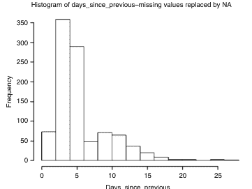

图3.3 R中days_since_previous的直方图，缺失值已排除。

### 3.6 将分类数据重新表示为数值

图3.4显示了education字段的条形图。请注意，该字段是分类型的，意味着字段值之间没有顺序。换句话说，如果我们保持字段原样，那么我们的数据科学算法将不知道university_degree表示的教育程度高于basic.4yr。为了向算法提供此信息，我们将数据值转换为数值，其中一个值明显大于另一个值。执行此操作时需要谨慎，以便保持各类别之间的相对差异。

表3.1展示了我们计划如何完成此转换。temporary course的值1/2来源于脚注中所示的出版物，作为通常高中学习课程的替代方案。当然，未知值也需要重新表示为缺失值。

#### 3.6.1 如何使用Python重新表示分类字段值

我们将复制education变量，并将其命名为education_numeric，以准备将其分类值替换为数值。

```
bank_train['education_numeric'] = bank_train['education']
```


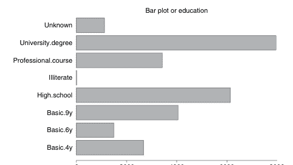

图 3.4 R 中的教育变量条形图。

表 3.1 将教育变量的值重新表示为数值

| 类别值 | 数值 |
| :--- | :--- |
| illiterate | 0 |
| basic.4y | 4 |
| basic.6y | 6 |
| basic.9y | 9 |
| high.school | 12 |
| professional.course | 12* |
| university.degree | 16 |
| unknown | Missing |

* 此值基于 In-Vet，Preventing initial dropout and fostering initial inclusion，http://ivet-project.eu/wp-content/uploads/2014/06/National-Report-Portugal_Final.pdf。这两个组，professional 和 high school，将使用相同的数值 12 进行合并。这两个组中积极响应者的比例相似（111 对 10.78%），因此我们大概可以接受将它们合并。

等号右侧指定 education 变量，等号将这些值赋给左侧。当前不存在名为 education_numeric 的变量，因此将创建一个变量，并赋予 education 变量的值。

我们需要专门设置一个字典，用于将 education_numeric 变量中的分类值转换为数值。字典包含在花括号 { } 中，设置我们的字典，如下所示：

```
dict_edu = {"education_numeric": {"illiterate": 0,
"basic.4y": 4, "basic.6y": 6,
"basic.9y": 9, "high.school":12, "professional.course": 12, "university.degree":16,
"unknown": np.nan}}
```

在字典中，我们使用 **"education_numeric"** 来指定要重新编码的变量，后跟一个冒号和另一组花括号。在这第二组花括号中，我们按以下顺序指定重新编码：

变量的原始值 = 变量的新值

每个规范之间用逗号分隔。请注意，在必要时，我们使用 Python 的缺失数值 **NaN**。

最后，我们告诉 Python 使用字典来替换变量的值。

```
bank_train.replace(dict_edu, inplace=True)
```

replace() 命令将根据字典 dict_edu 中的规则替换值。

#### 3.6.2 如何使用 R 重新表示分类字段值

首先，我们需要安装并加载 _plyr_ 包。

```
install.packages("plyr"); library(plyr)
```

我们需要指定 education 的哪些值对应哪些数值，遵循表 3.1 中指定的规则。

```
edu.num <- revalue(x = bank_train$education, replace =
c("illiterate" = 0, "basic.4y" = 4,
"basic.6y" = 6, "basic.9y" = 9, "high.school" = 12,
"professional.course" = 12,
"university.degree" = 16, "unknown" = NA))
```

revalue() 函数根据 **replace** 输入中给出的规则，替换 **x** 输入中给定变量的值。在 **replace** = 输入中，我们使用 **c**() 将每个重新编码片段连接在一起，使用以下结构：

变量的原始值 = 变量的新值

每个规范之间用逗号分隔。请注意，在必要时，我们使用 R 的缺失值 **NA**。我们将输出保存为 **edu.num**。

目前，**edu.num** 的值不是数值（例如，你无法使用它们制作直方图），因此我们需要将变量的水平转换为数值类型。对象 edu.num 是一个因子，我们使用以下代码将其值转换为数字：

```
bank_train$education_numeric <- as.numeric(levels(edu.num))[edu.num]
```

levels() 命令获取 edu.num 变量的因子水平，这些水平是字符串。as.numeric() 命令将它们转换为数字。这些新值应用于 edu.num 变量，结果保存为我们的新变量 education_numeric。图 3.5 显示了重新表示的教育字段 education_numeric 的直方图。

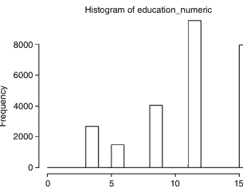

图 3.5 R 中的 education_numeric 直方图。

### 3.7 标准化数值字段

当数值字段被标准化，使得字段均值等于 0 且字段标准差等于 1 时，某些算法表现会更好，如下所示：

$z = Standardized Value = \frac{x - \bar{x}}{s} = \frac{Data value - mean}{Standard deviation}$

正 z 值可解释为数据值位于均值以上的标准差个数，而负 z 值表示数据值位于均值以下的标准差个数。一些分析师作为惯例会标准化所有数值字段。接下来，我们展示如何在 Python 和 R 中标准化数值字段。

#### 3.7.1 如何使用 Python 标准化数值字段

导入所需的包。

```
from scipy import stats
```

我们将标准化 age 变量，并将其保存为新变量 age_z。

zscore 函数计算给定变量的 z 值，在此例中为 age，在代码中写作 bank_train['age']。由于 zscore() 命令是 stats 包的一部分，我们将命令写作 stats.zscore()。我们将其保存为数据集中的新变量 age_z。

#### 3.7.2 如何使用 R 标准化数值字段

此代码无需安装或加载包。我们将使用的命令 scale() 包含在 R 的初始下载中。

```
bank_train$age_z <- scale(x = bank_train$age)
```

scale() 函数可以通过减去均值来中心化变量，通过除以标准差来缩放变量，或两者兼施。默认情况下，它两者都执行，以计算 z 分数。因此，在 bank_train$age 变量上使用 scale() 函数的默认设置将返回该变量的 z 分数。我们可以使用 bank_train$age_z 将 z 值保存为数据集中的新变量。

### 3.8 识别异常值

数值字段标准化后，可以使用 z 值来识别异常值，异常值是在某一维度或多个维度上具有极端值的记录。例如，考虑字段 number_of_contacts，它表示营销活动过程中与客户的联系次数。每位客户的平均联系次数为 2.6，标准差为 2.7（允许四舍五入）。因此，我们得到标准化字段如下：

number_of_contacts_z = \frac{number_of_contacts - 2.6}{2.7}

一个经验法则是，如果数据值的 z 值大于 3 或小于 -3，则该数据值为异常值。例如，一位被联系了 10 次（似乎很多）的客户将具有标准化值，

number_of_contacts_z = \frac{10-2.6}{2.7} = 2.7

因此，10 次联系虽然很多，但使用此方法不被识别为异常值，因为 2.7 < 3。

数据科学家应与客户协商，商讨如何处理任何异常值。不应自动删除异常值！也不应自动更改它们。它们的异常值可能会揭示数据的重要方面，这些方面应与客户或数据库管理员讨论。

#### 3.8.1 如何使用 Python 识别异常值

在此示例中，我们将继续使用前一节中创建的 age_z 变量。我们将使用 query() 函数来查找异常值，该函数识别满足特定条件的行。

```
bank_train.query('age_z > 3 | age_z < -3')
```

我们希望所有返回记录满足的条件为 'age_z > 3 | age_z < -3'。用文字来说，此条件要求每条记录要么具有大于 3 的 age_z 值，要么具有小于 -3 的 age_z 值。"|" 由两个条件之间的字符 | 指定。

将返回所有满足指定条件的记录。在我们的示例中，有 228 条记录的 age_z 值大于 3 或小于 -3。我们可以使用这些记录创建一个仅由这些值组成的新数据集。

```
bank_train_outliers = bank_train.query('age_z > 3 |
age_z < -3')
```

通过为 query() 命令的输出命名，我们创建了一个仅包含异常值的新数据集，我们将其命名为 bank_train_outliers。

让我们按 age_z 变量对数据集 bank_train_outliers 进行排序。

```
bank_train_sort = bank_train.sort_values(['age_z'],
ascending = False)
```

.sort_values() 命令将根据指定变量对数据集中的记录进行排序。排序可以是升序或降序。在此示例中，我们希望最大的 age_z 值位于顶部，因此我们按降序排序，通过


指定 ascending = False。我们可以将此排序后的数据集保存为自己的名称，例如 bank_train_sort。

最后，假设我们想要报告 age_z 值最大的 15 个人的年龄和婚姻状况。此条件同时指定了要报告的行数（15）和要报告的列（名为 age 和 marital 的变量）。

```
bank_train_sort[['age', 'marital']].head(n=15)
```

在数据集名称后给出的双括号表示法允许我们指定要包含哪些列。head() 命令将给出顶部记录，如果给出 n，则在 n 条记录后停止，如果未给出 n 值，则在五条记录后停止。在我们的情况中，我们指定 n = 15。结果是 age_z 值最大的 15 个人的年龄和婚姻状况。

#### 3.8.2 如何使用 R 识别异常值

在本示例中，我们将继续使用前一节中创建的 age_z 变量。我们可以使用前一章详细介绍的括号表示法来隔离单个记录。我们的代码结构将如下开始：

```
bank_train[ rows of interest, ]
```

请注意，逗号右侧留空。由于我们未指定任何感兴趣的列，此命令的输出将返回所有列。

我们现在需要填写我们感兴趣的行。which() 命令将识别满足指定条件的记录。

```
bank_outliers <- bank_train[ which(bank_train$age_z < -3 | bank_train$age_z > 3), ]
```

作为 which() 命令输入给出的条件表明，我们想要所有 age_z 值小于 -3 或大于 3 的记录。which() 命令返回所有此类记录的行索引。括号表示法将返回 bank_train 数据集的一个子集，仅包含这些记录。我们可以将这些记录保存为新数据集 bank_outliers。

要按变量对数据集进行排序，我们使用 order() 命令。

```
bank_train_sort <- bank_train[ order(- bank_train$age_z), ]
```

order() 命令将要排序的变量作为输入。它返回变量排序后的行索引。默认情况下，值按升序排序。要改为按降序排序，我们在变量前加上减号，如所示。

将 order() 命令放在括号表示法内，具体位于感兴趣的行所在的位置，将根据 order() 命令返回的排序重新排序数据集中的记录。我们将这个新的排序后的数据集保存为 bank_train.sort。

要查看新数据集的前 10 条记录（即 age_z 值最大的 10 条记录），请使用括号表示法并指定第 1 到第 10 行。

```
bank_train_sort [ 1:10, ]
```

同样，留空列将返回数据集的所有列（变量）。

要仅返回几列，我们需要注意哪个变量位于哪一列。我们可以使用 head() 来完成此操作。

```
head(bank_train_sort)
```

变量 age 位于第 1 列，变量 marital 位于第 3 列。要返回第 1 列和第 3 列的前 10 条记录，请在括号表示法中同时指定感兴趣的行和列。

```
bank_train_sort [ 1:10, c(1,3) ]
```

输出包含 age_z 值最大的 10 位客户的年龄和婚姻状况。

本章讨论的主题旨在让您了解数据准备阶段等待您的挑战类型。在动手分析练习中，我们探讨如何推导原始变量的函数形式的新变量，以便从数据集中提取更多信息。有关数据准备的更多内容，请参阅《数据挖掘与预测分析》，该书提供了更多数据准备主题，以及如何使用 R 来执行这些操作。

### 参考文献

Python 中的 scipy 包处理许多不同的数学和计算任务。有关更多详细信息，请参阅网站：E. Jones, E. Oliphant, 和 P. Peterson 等人，SciPy: Open Source Scientific Tools for Python, 2001–, www.scipy.org。

R 中的 plyr 包具有处理和组织数据的类似目标。有关更多详细信息，请参阅原始出版物：Hadley Wickham，《用于数据分析的分割-应用-合并策略》，《统计软件期刊》，40(1)，1–29，2011。

### 练习

### 澄清概念

- 1. 在问题理解阶段所述的 bank_marketing 分析的两个主要目标是什么？
- 2. 我们计划以哪三种方式实现了解潜在客户的目标？
- 3. 解释我们计划如何实现为识别可能的正向响应者开发盈利模型的目标。
- 4. 描述向数据集添加索引字段可能是个好主意的两个原因。
- 5. 解释为什么在处理 999 代码之前，字段 days_since_previous 基本上是无用的。
- 6. 为什么将 education 重新表示为数值字段很重要？
- 7. 假设一个数据值的 z 值为 1。我们如何解释这个值？
- 8. 使用 z 值识别异常值的经验法则是什么？
- 9. 异常值应该自动删除或更改吗？为什么或为什么不？
- 10. 我们应该如何处理已识别的异常值？

### 使用数据

对于以下练习，请使用 bank_marketing_training 数据集。使用 Python 或 R 解决每个问题。

- 11. 推导一个索引字段并将其添加到数据集。
- 12. 对于 days_since_previous 字段，将字段值 999 更改为缺失值的适当代码。
- 13. 对于 education 字段，将字段值重新表示为表 3.1 中显示的数值。
- 14. 标准化字段 age。打印前 10 条记录的列表，包括变量 age 和 age_z。
- 15. 获取根据字段 age_z 为异常值的所有记录列表。打印 10 个最大 age_z 值的列表。
- 16. 对于 job 字段，将记录少于 5% 的工作合并为名为 other 的字段。
- 17. 将默认预测器重命名为 credit_default。
- 18. 对于变量 month，将字段值更改为 1–12，但保持变量为分类变量。
- 19. 对 duration 字段执行以下操作。
  - a. 标准化变量。
  - b. 识别有多少个异常值并识别最极端的异常值。

### 动手分析

对于练习 21–25，请使用 *Nutrition_subset* 数据集。该数据集包含 961 种食物的克重以及饱和脂肪和胆固醇的含量。使用 Python 或 R 解决每个问题。

- 21. 此数据集中的元素是各种大小的食品，从一茶匙肉桂到一整块胡萝卜蛋糕。
  - a. 按饱和脂肪（*saturated_fat*）对数据集进行排序，并生成饱和脂肪含量最高的五种食品列表。
  - b. 评论比较不同大小食品的有效性。

- 22. 通过将饱和脂肪含量除以克重来推导新变量 *saturated_fat_per_gram*。
  - a. 按 *saturated_fat_per_gram* 对数据集进行排序，并生成每克饱和脂肪含量最高的五种食品列表。
  - b. 哪种食品每克饱和脂肪含量最高？

- 23. 推导新变量 *cholesterol_per_gram*。
  - a. 按 *cholesterol_per_gram* 对数据集进行排序，并生成每克胆固醇含量最高的五种食品列表。
  - b. 哪种食品每克胆固醇含量最高？

- 24. 标准化字段 *saturated_fat_per_gram*。生成量表高端所有异常值食品的列表。量表低端有多少种食品是异常值？

- 25. 标准化字段 *cholesterol_per_gram*。生成量表高端所有异常值食品的列表。

对于练习 26–30，请使用 *adult_ch3_training* 数据集。响应变量是 education 是否超过 $50,000。

- 26. 向数据集添加记录索引字段。

- 27. 确定 *education* 字段是否存在任何异常值。

- 28. 对 age 字段执行以下操作。
  - a. 标准化变量。
  - b. 识别有多少个异常值并识别最极端的异常值。

- 29. 为 capital-gain 推导一个标志，称为 capital-gain-flag，当 capital gain 等于零时等于 0，否则等于 1。

- 30. 年龄异常？仅选择 age 至少为 80 的记录。构建 age 的直方图。用一句话解释你看到的内容，并用另一句话解释原因。


### 4.1 EDA 与 HT

客户或分析师通常持有希望数据验证的先验假设。此类假设的一个示例是：与固定电话用户相比，手机用户的正面响应率是否更高？由此产生的假设检验（HT）可以使用经典统计方法或数据科学的交叉验证方法（第 5 章）来执行。

另一方面，客户或分析师可能对数据可能揭示的内容没有任何显著的先验概念。在这种情况下，他们可能更倾向于使用探索性数据分析（EDA）或图形数据分析。EDA 允许用户：

- 使用图形探索预测变量与目标变量之间的关系。
- 使用图形和表格推导将提高预测价值的新变量。
- 合理使用分箱，以提高预测价值。

在本章中，我们将继续探索第 3 章中的 bank_marketing_training 数据集。我们首先使用图形来研究目标响应与分类预测变量之间的关系。

### 4.2 带响应叠加的条形图

我们可以使用带响应叠加的条形图来探索分类预测变量与目标变量之间的关系。图 4.1 显示了带目标响应叠加的 previous_outcome 条形图。previous_outcome 指的是与同一客户之前营销活动的结果，大多数客户没有此类之前的经历。

显然，大多数客户与该变量没有任何之前的营销经历（变量值 nonexistent）。一般而言，（未归一化的）条形图

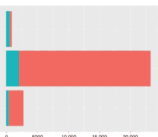

#### 图 4.1 来自 R 的带响应叠加的 previous_outcome 条形图。

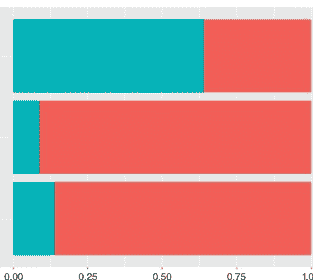

#### 图 4.2 来自 R 的带响应叠加的 previous_outcome 归一化条形图。

对于显示分类变量值的分布很有用。但是，不清楚哪个类别的响应者比例更大。Nonexistent 拥有最多的响应者，但也拥有最多的非响应者。为了澄清此类情况，我们可以获得一个归一化条形图，它使每个条形的长度相等，从而更容易比较响应比例。图 4.2 表示 previous_outcome 的此类归一化条形图，

带响应叠加。从图 4.2 可以清楚地看出，正面响应比例最高的群组是 success，即那些对公司之前活动做出正面响应的客户。有趣的是，上次做出负面响应（failure）的客户，此次的成功率也略高于没有之前联系的客户。

此练习展示了使用条形图时的两项最佳实践。

#### 最佳实践：条形图

- 当带叠加的条形图对响应比例不清楚时，用归一化条形图加以补充。
- 但是，切勿在未提供其未归一化版本的情况下提供归一化条形图，因为归一化版本未指示原始分布（每个类别中的记录数量）。

#### 4.2.1 使用 Python 构建带叠加的条形图

加载所需的包，并将 bank_marketing_training 数据集读取为 bank_train。

```
import pandas as pd
bank_train = pd.read_csv("C:/.../bank_marketing_training")
```

创建条形图的第一步是创建预测变量和目标变量值的列联表。我们使用 crosstab() 命令创建表格。

```
crosstab_01 = pd.crosstab(bank_train['previous_outcome'], bank_train['response'])
```

此代码稍后将详细检查。目前，我们将表格保存为 crosstab_01。

现在，我们可以根据表格创建条形图。

```
crosstab_01.plot(kind='bar', stacked = True)
```

要创建条形图，请将 .plot() 附加到 crosstab_01 对象的末尾。plot() 命令接受各种可选输入值。我们指定 kind = 'bar' 来绘制条形图，并指定 stacked = True 来指定堆叠条形图。

要创建归一化版本，我们需要更改表格，使每个单元格中的值是预测变量 previous_outcome 每个值中 "no" 和 "yes" 响应值的比例，如下所示：

```
crosstab_norm = crosstab_01.div(crosstab_01.sum(1), axis = 0)
```

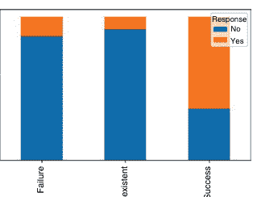

#### 图 4.3 来自 Python 的带响应叠加的 previous_outcome 归一化条形图。

div() 命令将在每个指定轴内，用另一个对象除以表格的值。在我们的示例中，我们希望用表格第 1 行单元格之和除以第 1 行的单元格，以此类推，适用于第 2 行和第 3 行。为了实现这一点，我们首先将要除以的值设置为 crosstab_01.sum(1)，即表格中每一行的和。然后我们设置 axis = 0 以指定我们希望用这些值除以表格的行。结果是一个表格，其单元格是该行中落在该列的数据比例。我们将生成的表格保存为 crosstab_norm。

保存表格后，使用上述堆叠条形图代码对其进行可视化。

```
crosstab_norm.plot(kind='bar', stacked = True)
```

生成的图表如图 4.3 所示。

#### 4.2.2 使用 R 构建带叠加的条形图

使用 bank_train 读取 bank_marketing_training 数据集。我们将使用 ggplot2 包来创建图表。您需要使用 install.packages() 安装一次该包，然后在每次编写新代码时使用 library() 打开它。

```
install.packages("ggplot2"); library(ggplot2)
```

ggplot 代码使用加号（+）将不同的命令链接在一起，如以下示例所示。请注意，加号必须紧跟在前面的命令之后，中间没有换行，但后面可以跟换行。

要创建 *先前结果* 变量的条形图，我们使用 `ggplot()` 和 `geom_bar()` 命令。

```
ggplot(bank_train, aes(previous_outcome)) + geom_bar() +
coord_flip()
```

`ggplot()` 命令开始绘制图表。`bank_train` 输入指定正在使用的数据集，感兴趣的变量列在 `aes()` 下（“aes”代表“美学”）。第二段代码是 `geom_bar()`，它指定应制作条形图。代码知道使用哪个变量是因为前面的 `ggplot()` 命令。可选的第三段代码是 `coord_flip()`，它将使条形水平运行。

要创建带 *响应* 叠加的条形图，我们添加 fill 输入。

```
ggplot(bank_train, aes(previous_outcome)) + geom_bar(aes(fill = response)) + coord_flip()
```

请注意，唯一的变化是在 `geom_bar()` 内部添加 `aes(fill = response)`。结果是图 4.1 所示的图表。

要归一化条形图，请在 `geom_bar()` 内部添加 `position = "fill"`，如下所示。

```
ggplot(bank_train, aes(previous_outcome)) + geom_bar(aes(fill = response),
position = "fill") + coord_flip()
```

输入 `position = "fill"` 添加到 `geom_bar()` 命令内部，但在 `aes()` 外部。结果是图 4.2 所示的图表。

### 4.3 列联表

为了帮助量化分类预测变量与目标之间的关系，我们可以构建一个 *列联表*，它是两个变量的交叉表，并包含每个变量值组合（即每种情况）的一个单元格。图 4.4 包含 *先前结果* 与 *响应* 的列联表。请注意，通常的做法是让目标变量表示行，预测变量表示列。对于 EDA，包含列百分比也很有帮助。图 4.5 包含带列百分比的表格。大多数客户没有之前的营销活动（*不存在*），因此请注意，其中 21,176 个响应了 *否* 而 2034 个响应了 *是*。总体而言，请注意，*是* 响应的比例仅为 *失败* 的 13.9% 和 *不存在* 的 8.8%，但当客户之前的营销活动 *成功* 时，则高达 64%。

列联表的最佳实践如下。


#### 最佳实践：列联表

- 让响应变量代表行。
- 然后，获取列百分比以直接比较预测器每个类别的响应比例。

| | 失败 | 不存在 | 成功 | 总计 |
|---|---|---|---|---|
| 否 | 2390 | 21176 | 320 | 23886 |
| 是 | 385 | 2014 | 569 | 2988 |
| 总计 | 2775 | 23210 | 889 | 26874 |

图 4.4 R 中 previous_outcome 与响应的列联表。

| | 失败 | 不存在 | 成功 |
|---|---|---|---|
| 否 | 86.1 | 91.2 | 36.0 |
| 是 | 13.9 | 8.8 | 64.0 |

图 4.5 R 中 previous_outcome 与响应的列联表，使用列百分比而非计数。

#### 4.3.1 使用 Python 构建列联表

为了制作条形图，我们不得不创建一个列联表，但没有详细研究代码。让我们更仔细地检查表格的代码。

```
crosstab_01 = pd.crosstab(bank_train['previous_outcome'], bank_train['outcome'])
```

注意变量的顺序。此代码构建的表格将 previous_outcome 作为行。此表格创建了上一节所需的条形图，但为了遵循最佳实践并让目标变量代表行，我们需要将代码更改为：

```
crosstab_02 = pd.crosstab(bank_train['response'], bank_train['previous_outcome'])
```

确保保存表格。我们将输出保存为 crosstab_02。结果将是一个与图 4.4 等效的表格。

要计算表格的列比例，我们需要将每一列除以列总和。我们以类似于上一节的方式使用 sum() 和 div() 命令。但是，这次我们获得的是列百分比，而不是行百分比。

```
round(crosstab_02.div(crosstab_02.sum(0), axis = 1)*100, 1)
```

请注意，我们将结果表乘以 100 以获得百分比而不是比例。除了 sum() 和 div() 命令外，我们还将表格的代码放入 round() 命令中。round() 命令将表格中的数字四舍五入到指定的有效数字位数；在这里，我们指定一位数字。结果是一个与图 4.5 等效的表格。

#### 4.3.2 使用 R 构建列联表

创建表格的命令是 table()，感兴趣的变量放在括号内。

```
t.v1 <- table(bank_train$response, bank_train$previous_outcome)
```

第一个变量 bank_train$response 构成行，而第二个变量 bank_train$previous_outcome 构成列。我们将表格保存为 t.v1，以便可以对其进行编辑。

要向表格添加行和列总计，请使用 addmargins() 命令。

```
t.v2 <- addmargins(A = t.v1, FUN = list(total = sum),
quiet = TRUE)
```

输入 A = t.v1 指定要编辑的表格，在本例中为 t.v1。输入 FUN = list(total = sum) 指定要执行的函数列表，以创建边际行和列。在本例中，我们希望创建一个名为 total 的行和列，其中包含行和列的总和。我们将编辑后的表格保存为 t.v2。要查看完成的表格，单独运行 t.v2。结果如图 4.4 所示。

现在我们想要编辑表格 t.v1，使其给出列百分比。

```
round(prop.table(t.v1, margin = 2)*100, 1)
```

要计算表格单元格中条目的比例，请使用 prop.table()。输入 t.v1 告诉 prop.table() 要为哪个表格计算比例。

margin = 2 输入告诉 R 计算列百分比。将结果乘以 100（*100）将给出百分比而不是比例。最后，将 prop.table() 命令放入 round() 命令中，将条目四舍五入到特定的小数位数；在本例中为一位（1）小数。结果如图 4.5 所示。

### 4.4 带响应叠加的直方图

直方图是数值变量频率分布的图形表示。图 4.6 显示了带有响应叠加的年龄变量直方图。大多数客户的年龄范围大约从 20 多岁中后期到 60 岁左右。所以

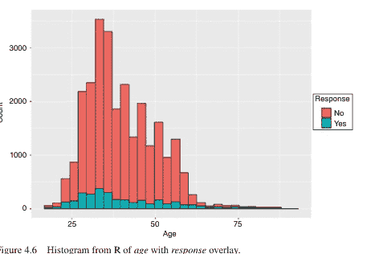

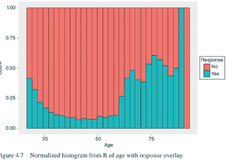

（未归一化）直方图有助于查看数值变量值的分布。

然而，再次，要确定响应比例中的任何模式都有些困难。为了更好地澄清这些响应比例，我们转向带有响应重叠的归一化直方图，如图 4.7 所示。突然，响应模式变得一目了然：20 岁客户的响应率开始较高，逐渐下降，在 30–60 岁客户中保持低位平稳，然后对 60 岁以上客户再次急剧上升。因此，归一化直方图使我们能够更好地区分这些响应模式，但不幸的是，归一化直方图无法告诉我们客户群中年龄的原始分布。这引出了我们针对直方图的两个最佳实践。

#### 最佳实践：直方图

- 使用未归一化直方图以获取数据值的原始分布。
- 如有需要，使用归一化直方图以帮助更好地区分响应模式。

#### 4.4.1 使用 Python 构建带叠加的直方图

加载所需的包。

```
import numpy as np
import matplotlib.pyplot as plt
```

按要使用的叠加项分离要绘制的变量。由于我们使用响应叠加创建年龄直方图，我们按响应变量的两个值分离变量 age，bank_train['age']。将每个部分保存为各自的变量。

```
bt_age_y = bank_train[bank_train.response == "yes"]['age']
bt_age_n = bank_train[bank_train.response == "no"]['age']
```

结果是两个变量，bt_age_y 和 bt_age_n，分别仅包含 response = "yes" 和 response = "no" 记录的年龄值。

创建变量后，创建两个变量的堆叠直方图。

```
plt.hist([bt_age_y, bt_age_n], bins = 10, stacked = True)
plt.legend(['Response = Yes', 'Response = No'])
plt.title('Histogram of Age with Response Overlay')
plt.xlabel('Age'); plt.ylabel('Frequency'); plt.show()
```

对于 hist() 命令，输入 stacked = True 将堆叠两个变量，而 bins = 10 指定直方图中的箱数。legend()、title()、xlabel() 和 ylabel() 命令指定图例、标题、x 轴标签和 y 轴标签的值。最后，show() 显示图形。结果如图 4.8 所示。

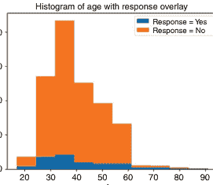

图 4.8 Python 中带响应叠加的年龄直方图。

我们现在将创建一个归一化直方图。首先，创建一个堆叠直方图，但这次保存直方图生成的信息。

```
(n, bins, patches) = plt.hist([bt_age_y, bt_age_n], bins = 10, stacked = True)
```

代码左侧保存直方图的几个信息片段。具体来说，n 是直方图箱的高度，bins 是直方图中每个箱的边界。请注意，由于直方图中绘制了两个变量，n 有两组数字。第一组用于第一个变量，第二组用于第二个变量。每组中的第一个数字是每个变量第一个柱子的高度。

要创建我们的归一化直方图，我们需要知道每个变量代表每个箱的什么比例。为了实现这一点，我们需要将 n 中包含的信息放入矩阵并获取列比例。

要开始构建矩阵，请使用 column_stack() 命令将两个变量柱子的高度合并为一个数组。

```
n_table = np.column_stack((n[0], n[1]))
```

结果 n_table 是一个两列矩阵，其中每列的条目保存每个柱子的高度。

要计算每个变量占柱子的比例，我们需要将每一行除以该行的总和。

```
n_norm = n_table / n_table.sum(axis=1)[:, None]
```

现在，n_norm 中的每一行总和为一，每行中的列给出构成该行的变量的比例。


在我们的最后准备步骤中，我们创建一个数组，其行是每个 bin 的确切切分点。

```
ourbins = np.column_stack((bins[0:10], bins[1:11]))
```

**ourbins** 中的每一行给出每个 bin 的上界和下界。

现在，我们准备好创建归一化直方图了。

```
p1 = plt.bar(x = ourbins[:, 0], height = n_norm[:, 0],
width = ourbins[:, 1] - ourbins[:, 0])
p2 = plt.bar(x = ourbins[:, 0], height = n_norm[:, 1],
bottom = n_norm[:, 0],
width = ourbins[:, 1] - ourbins[:, 0])
plt.legend(['Response = Yes', 'Response = No'])
plt.title('Normalized Histogram of Age with Response Overlay')
plt.xlabel('Age'); plt.ylabel('Proportion'); plt.show()
```

在 bar() 命令中，x 输入指定 bin 的上界和下界，**height** 输入使用我们之前创建的归一化计数值来指定每个柱状图两个部分的高度，**width** 输入重用原始柱状图中的柱宽。第二个 **bar()** 命令中的 **bottom = n_norm[:,0]** 输入指定两个柱状图部分中的第二个部分从第一个部分之上开始。其余命令是我们之前在堆叠柱状图中使用的相同自定义选项。结果如图 4.9 所示。

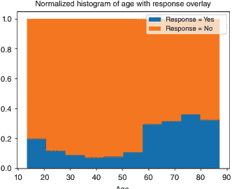

图 4.9 来自 Python 的 *age* 带 *response* 叠加层的归一化直方图。

#### 4.4.2 使用 R 构建带叠加层的直方图

我们从 ggplot() 命令开始，指定数据集 bank_train，并在 aes() 命令中指定变量 age。要制作直方图，我们添加 geom_histogram() 命令。

```
ggplot(bank_train, aes(age)) + geom_histogram(color="black")
```

可选的 color = "black" 输入在直方图的每个柱子周围创建黑色线条。结果是一个没有叠加层的直方图。

要使用目标变量向直方图添加叠加层，将 aes(fill = response) 输入添加到 geom_histogram() 中。

```
ggplot(bank_train, aes(age)) + geom_histogram(aes(fill = response), color="black")
```

带叠加层的结果直方图如图 4.6 所示。

要归一化直方图，将 position = "fill" 输入添加到 geom_histogram() 中。

```
ggplot(bank_train, aes(age)) +
geom_histogram(aes(fill = response), color="black",
position = "fill")
```

带叠加层的归一化结果直方图如图 4.7 所示。

### 4.5 基于预测值的分箱

某些算法在处理分类变量时比数值变量效果更好，因此分析师使用分箱来根据数值预测器的不同值集与响应的关系来推导新的分类变量可能很有用。例如，请看图 4.7。为了从数据中优化我们的信号，我们问自己：如何对年龄的数值进行分类，使得各类别的响应比例差异很大？显然，一个类别是 60 岁及以上的客户，他们具有较高的响应比例。这与中间群体（大约 20 多岁到 60 岁）形成对比，该群体的响应概率较低。最后，还有最年轻的群体（20 多岁以下），其响应比例也较高。因此，我们可以将新变量大致定义如下（27 的切分点有些任意；25 或 26 也可以）：

```
age_binned =
{ 1: Under 27
  2: 27 to 60
  3: 60 and up }
```

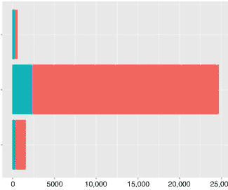

图 4.10 来自 R 的 age_binned 带响应叠加层的柱状图。

图 4.10 显示了 age_binned 的带叠加层的柱状图。图 4.11 显示了柱状图的归一化版本。然后，图 4.12 显示了 age_binned 与响应的列联表，图 4.13 给出了列联表的列百分比。显然，年长群体和年轻群体的响应率都远高于中间群体。不幸的是，超过 90% 的客户属于这个中间群体。关于分箱，这里有一个需要记住的重要最佳实践。

> **最佳实践：分箱**
> 
> - 许多软件包提供“自动”分箱方法，例如等类别宽度分箱或每类别等记录数分箱。虽然这些方法可能有其用途，但如果您有兴趣增强分析的预测能力，则应始终尝试使用我们在此处演示的基于预测值的分箱。

#### 4.5.1 使用 Python 执行基于预测值的分箱

加载所需的包。

```
import pandas as pd
```

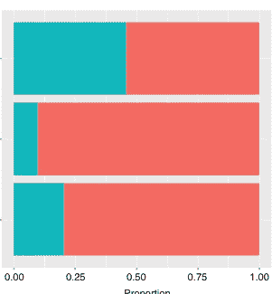

图 4.11 来自 R 的 age_binned 带响应叠加层的归一化柱状图。

| | 27 岁以下 | 27 到 60 | 60 岁以上 | 总计 |
|---|---|---|---|---|
| 否 | 1255 | 22315 | 316 | 23886 |
| 是 | 322 | 2399 | 267 | 2988 |
| 总计 | 1377 | 24714 | 583 | 26674 |

图 4.12 来自 R 的 age_binned 和响应的列联表。

| | 27 岁以下 | 27 到 60 | 60 岁以上 |
|---|---|---|---|
| 否 | 79.6 | 90.3 | 54.2 |
| 是 | 20.4 | 9.7 | 45.8 |

图 4.13 来自 R 的 age_binned 和响应的带列百分比的列联表。

使用 pandas 包中的 cut() 对值进行分箱。

```python
bank_train['age_binned'] = pd.cut(x = bank_train['age'],
                                  bins = [0, 27, 60.01, 100],
                                  labels=["Under 27", "27 to 60", "Over 60"], right =
                                  False)
```

x = 输入指定您想要划分为类别的变量。bins = 输入指定每个 bin 的边缘。labels = 输入指定 bin 标签。right = False 输入指定我们希望我们的 bin 排除右侧切分点。例如，第一个 bin 将包括从 0 岁到（但

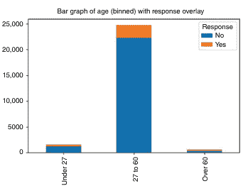

图 4.14 来自 Python 的 age_binned 带响应叠加层的柱状图。

不包括) 27 岁。我们使用 bank_train['age_binned'] 将新的分类变量保存到名为 age_binned 的数据集中。

请注意，虽然我们为 bin 拥有大部分直观的切分点，例如第一个 bin 的下界为零，最后一个 bin 的上界为 100，但我们还有一个 60.01 的切分点。指定 60.01 的切分点（或 60 和 61 之间但不包括 60 和 61 的任何数字），结合 right = False 输入，将确保我们的中间类别包括 27 到 60 岁的所有年龄（包含两端）。具体来说，我们告诉 Python 从 27 岁开始制作一个 bin，直到但不包括 60.01。由于此数据集中的年龄是整数，这实际上使该 bin 包括 27–60 岁（包含两端）。

要绘制带响应叠加层的分箱图，请创建必要的列联表并绘制它，使用与我们之前使用的代码类似的代码。结果图如图 4.14 所示。

```
crosstab_02 = pd.crosstab(bank_train['age_binned'],
                                  bank_train['response'])
crosstab_02.plot(kind='bar', stacked = True,
                 title = 'Bar Graph of Age (Binned) with Response Overlay')
```

要创建归一化柱状图，请遵循之前讨论的相同准则。结果图如图 4.15 所示。

要获取响应变量和我们新分类变量的列联表，请使用 crosstab() 命令。请记住使用目标变量 response 作为表格的行。要获取列比例表，请在结果表上使用 div() 和 sum() 命令。我们在使用 Python 创建直方图时之前讨论过此代码。

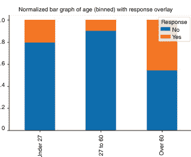

图 4.15 来自 Python 的 age_binned 带响应叠加层的归一化柱状图。

#### 4.5.2 使用 R 执行基于预测值的分箱

要创建我们的分类变量，我们将在 age 变量上使用 cut() 命令。

```r
bank_train$age_binned <- cut(x = bank_train$age, breaks = c(0, 27, 60.01, 100),
right = FALSE, labels = c("Under 27", "27 to 60",
"Over 60"))
```

x 输入指定要分箱的变量。breaks 输入指定每个 bin 的切分点。right = FALSE 输入指出每个 bin 的右侧切分点应从类别中排除。可选的 labels 输入使用用户指定的标签覆盖每个 bin 的默认标签，这些标签将按顺序应用于每个 bin（例如，0-27 bin 的 "Under 27"）。我们使用 bin 值 60.01 而不是 60，并出于与 Python 部分中讨论的相同原因使用 right = FALSE 输入。我们将结果保存在 bank_train 数据集中，名为 age_binned。

一旦我们有了分类变量，就可以使用之前介绍的 ggplot 命令绘制带响应叠加层的图。

```r
ggplot(bank_train, aes(age_binned)) + geom_bar(aes(fill = response)) + coord_flip()
```

带叠加层的结果柱状图如图 4.10 所示。要为这些变量创建归一化柱状图，请遵循之前讨论的相同准则。


前一个归一化条形图。生成的归一化条形图如图 4.11 所示。

我们可以使用 table() 命令构建分类变量和响应变量的列联表，并使用 prop.table() 命令构建列比例表。这两个命令的细节之前已讨论过。代码如下。

```
t2 <- table(bank_train$response, bank_train$age_bin); t2
round(prop.table(t2, margin = 2)*100, 1)
```

注意第一行中分号的使用，如何允许表格的构建和保存以及表格的打印在一行中完成。生成的表格如图 4.12 和 4.13 所示。

EDA 的进一步方法可参见《数据挖掘与预测分析》。1

### 参考文献

Python 的 matplotlib 包提供了广泛的图形选项。要开始进一步探索，请参阅出版物：John D. Hunter. Matplotlib: a 2D graphics environment, Computing in Science & Engineering, 9, 90–95, 2007, doi:https://doi.org/10.1109/MCSE.2007.55

我们才刚刚接触 ggplot2 包的表面！有关更多信息，请参阅以下出版物：H. Wickham, ggplot2: Elegant Graphics for Data Analysis, Springer-Verlag, New York, 2009.

### 练习

### 澄清概念

- 1. 分析师何时应使用探索性数据分析（EDA）而非假设检验？
- 2. EDA 允许用户执行哪些操作的示例有哪些？
- 3. 我们使用哪种图来探索分类预测变量与目标变量之间的关系？
- 4. （非归一化）条形图有什么用？
- 5. 陈述使用归一化条形图的一个优点和一个缺点。
- 6. 使用条形图进行 EDA 时的两个最佳实践是什么？
- 7. 列联表帮助我们做什么？
- 8. 解释在 EDA 中使用列联表时的两个最佳实践。
- 9. 什么是直方图？
- 10. 描述使用归一化直方图的一个优点和一个缺点。
- 11. 在 EDA 中使用直方图的最佳实践是什么？
- 12. 为什么对分析师来说对数值变量进行分箱可能很有用？
- 13. 为什么我们使用本章展示的分箱方法而不是自动分箱方法？
- 14. 根据您对上一个问题的回答进行推断，并解释为什么数据科学家应非常谨慎地使用自动数据分析方法。

### 使用数据

对于以下练习，请使用 bank_marketing_training 数据集。使用 Python 或 R 解决每个问题。

- 15. 创建 previous_outcome 变量的条形图，并叠加 response。
- 16. 创建带有 response 叠加的 previous_outcome 变量的归一化条形图。描述 previous_outcome 与 response 之间的关系。
- 17. 创建 previous_outcome 和 response 的列联表。将列联表与非归一化条形图和归一化条形图进行比较。
- 18. 创建带有 response 叠加的 age 直方图。
- 19. 创建带有 response 叠加的 age 归一化直方图。描述 age 与 response 之间的关系。
- 20. 使用本章指定的分箱对 age 变量进行分箱，并创建带有 response 叠加的分箱后 age 变量的条形图。

### 实践分析

对于练习 21–30，继续使用 bank_marketing_training 数据集。使用 Python 或 R 解决每个问题。

- 21. 生成以下图表。每个图表的优点是什么？缺点是什么？
  - a. marital 的条形图。
  - b. 带有 response 叠加的 marital 条形图。
  - c. 带有 response 叠加的 marital 归一化条形图。
- 22. 使用练习 21c 的图表，描述 marital 与 response 之间的关系。
- 23. 对变量 marital 和 response 执行以下操作。
  - a. 构建列联表，注意正确的变量表示行和列。报告计数和列百分比。
  - b. 描述列联表告诉您的内容。
- 24. 重复上一个练习，这次报告行百分比。解释此表格的解释与之前列联表的区别。
- 25. 生成以下图表。每个图表的优点是什么？缺点是什么？
  - a. duration 的直方图。
  - b. 带有 response 叠加的 duration 直方图。
  - c. 带有 response 叠加的 duration 归一化直方图。
- 26. 使用练习 25c 的图表，描述 duration 与 response 之间的关系。
- 27. 检查带有 response 叠加的 duration 非归一化和归一化直方图。确定 duration 的截止点，以区分 response 的低值和高值。使用您确定的截止点定义新的分类变量 duration_binned。
- 28. 提供以下内容。描述每个结果。
  - a. duration_binned 与 response 的列联表，包含计数和列百分比。
  - b. duration_binned 的非归一化条形图，带有 response 叠加。
  - c. duration_binned 的归一化条形图，带有 response 叠加。
- 29. 构建 job 与 response 的列联表，包含计数和列百分比。
- 30. 参考上一个练习，执行以下操作：
  - a. 根据以下 response 百分比合并 job 类别：0 < 10，10 < 25，25 < 33。将新变量命名为 job2。
  - b. 提供 job2 与 response 的列联表，包含计数和列百分比。描述您看到的内容。
  - c. 提供带有 response 的 job2 归一化直方图。描述关系。

对于练习 31–36，请使用 cereals 数据集。使用 Python 或 R 解决每个问题。

- 31. 创建带有 Type 叠加的 Manuf 变量条形图。
- 32. 创建带有 Type 叠加的 Manuf 变量归一化条形图。
- 33. 创建 Manuf 和 Type 的列联表。
- 34. 创建带有 Manuf 叠加的 Calories 直方图。
- 35. 创建带有 Manuf 叠加的 Calories 归一化直方图。
- 36. 使用 0–90、90–110 和 110 以上卡路里的分箱对 Calories 变量进行分箱。创建带有 Manuf 叠加的分箱后卡路里变量的条形图。

对于练习 37–60，请使用 adult_ch3_training 数据集。

对于练习 37–40，我们演示了一个示例，说明为什么不建议在 EDA 阶段删除异常值，因为这会改变数据集的特性。

- 37. 考虑 capital-loss。使用 Z-score 方法识别 capital-loss 中的异常值。有多少个异常值？
- 38. 为这些异常值记录构建 Income 的条形图。
- 39. 为 adult_ch3_training 数据集整体构建 Income 的条形图，不省略异常值。
- 40. 比较前两个练习中的条形图。描述两个条形图之间的差异。描述如果删除这些异常值记录，数据集特性将发生的变化。陈述您关于在 EDA 阶段删除异常值的结论。
- 41. 为 capital-loss 推导一个标志，称为 capital-loss-flag，当 capital-loss 等于 0 时等于 0，否则等于 1。提供 capital-loss-flag 的条形图。
- 42. 对 capital-gain-flag 重复上一个练习。
- 43. 构建 capital-loss-flag 与 Income 的列联表。包含计数和列百分比。清楚描述有任何资本损失对 Income 的影响。
- 44. 构建 capital-gain-flag 与 Income 的列联表。包含计数和列百分比。清楚描述有任何资本收益对 Income 的影响。
- 45. 为进一步工作做准备，将 workclass 重命名为 workclass-old，将 marital-status 重命名为 marital-status-old，将 occupation 重命名为 occupation-old。
- 46. 构建一个以 income 为行、workclass-old 为列的列联表，要求包含计数和列百分比。
- 47. 参考上一个练习的列联表，执行以下操作：
  - a. 提供一句理由，解释为什么应将 never-worked 和 without-pay 合并为 no-pay。
  - b. 提供一句理由，解释为什么可以将 local-gov 和 state-gov 合并为 state-local-gov。
- 48. 执行上一个练习中提到的更改，并将 "?" 更改为 "unknown"。将新变量命名为 workclass。构建一个以 Income 为行、workclass 为列的列联表，包含计数和列百分比。用几句话描述您的表格。
- 49. 构建一个以 income 为行、marital-status-old 为列的列联表，要求包含计数和列百分比。
- 50. 参考上一句的列联表，提供两句话的理由，解释为什么应将 Married-AF-spouse 和 Married-civ-spouse 合并为新类别 Married，并将其他状态合并为新类别 Other。
- 51. 执行上一个练习中提到的更改。构建一个以 income 为行、marital-status 为列的列联表，包含计数和列百分比。用几句话描述您的表格。
- 52. 构建一个以 income 为行、occupation-old 为列的列联表，要求包含计数和列百分比。


- **53.** 为以下每种组合提供一句话说明为什么应该这样做：
- a. 将 Exec-managerial 和 Prof-specialty 合并为新类别 Exec/prof。
- b. 将收入百分比 >50k 的职业合并为新类别 Mid-level。
- c. 将其余职业合并为新类别 Low-Level。
- d. 将未知类别合并入 Low-Level 类别。

- **54.** 执行上一题所述的更改。将新变量命名为 occupation。构建一个列联表，行变量为 income，列变量为 occupation，包含计数和列百分比。用几句话描述你的表格。

- **55.** 对 education 变量执行以下操作：
- a. 提供 education 的未归一化和归一化直方图，并叠加 income。
- b. 用一句话描述这种关系，并再用一句话说明你对 education 在预测 income 中有用性的预期。

- **56.** 对 age 变量执行以下操作：
- a. 提供 age 的未归一化和归一化直方图，并叠加 income。
- b. 用一句话描述这种关系。
- c. 为以下分箱提供另一句理由：age < 30，age 30-60，age > 60。

- **57.** 执行上一题中提到的分箱，通过派生新变量 age_binned。
- a. 提供带有 income 叠加的 age_binned 归一化条形图。
- b. 用一句话解释条形图。

- **58.** 对 sex 预测器提供以下分析：
- a. sex 的未归一化条形图，并叠加 income。
- b. sex 的归一化条形图，并叠加 income。
- c. 用一句话解释归一化条形图。

- **59.** 构建以下内容：
- a. occupation 的未归一化条形图，并叠加 sex。
- b. occupation 的归一化条形图，并叠加 sex。描述这种关系。

- **60.** 构建一个列联表，行变量为 sex，列变量为 occupation，包含计数和列百分比。将列联表与归一化条形图进行比较。

## 为建模做准备

### 5.1 目前为止的进展

为回顾我们迄今的进展，我们正在按照数据科学方法论逐步推进。

- 1. 在第 3 章中，我们讨论了问题理解阶段的重要性。
- 2. 同样在第 3 章中，我们处理了关于数据准备阶段的几个问题。
- 3. 在第 4 章中，我们涵盖了探索性数据分析阶段的一些重要主题。
- 4. 现在，在第 5 章中，我们准备好应对设置阶段。

设置阶段包含若干项非常重要的任务，必须在开始数据建模之前完成。这些任务包括：

- * 数据分区
- * 验证数据分区
- * 平衡数据
- * 建立基线模型性能

本章将依次介绍这些主题。

### 5.2 数据分区

数据科学方法论不使用从样本到总体进行推广的统计推断范式。原因有二。

- 1. 将统计推断应用于数据科学中遇到的巨大样本量时，往往会得出统计显著性结果，即使这些结果没有实际意义。
- 2. 在统计范式中，统计学家心中有先验假设，而数据科学方法论不需要此类先验假设，而是自由地在数据中搜索可操作的结果。

由于缺乏先验假设，数据科学家需要警惕数据挖掘，即仅由于随机变化而非真实效应而发现的虚假结果。数据科学通过交叉验证过程避免数据挖掘，这是一种确保结果可推广到独立、未见数据集的技术。最常见的方法是二折交叉验证和 k 折交叉验证。在二折交叉验证中，数据通过随机分配被分区为训练数据集和测试数据集（也称为保留数据集）。

训练集记录是完整的，但测试集记录应（暂时）省略目标变量。因此，数据科学模型使用训练数据集来学习数据中的模式和趋势。这些模型应用于测试集，对目标变量的暂时未知值进行预测。然后，使用总体误差率或均方误差等评估指标，将这些预测与（现已恢复）的真实目标值进行评估。通过这种方式，交叉验证防范虚假结果，因为同一随机变化同时出现在训练集和测试集中的可能性极低。

分区的大小取决于数据集的大小和复杂度。对于高度复杂的数据集，例如神经网络模型需要学习数据中许多非线性关系的情况，建议使用更多训练记录，例如原始数据的 75–90%。此外，如果数据集非常大，在训练集中保留更多记录会更方便。另一方面，对于较小或较不复杂的数据集，应保留足够记录以进行准确评估，因此训练集仅包含原始数据的 50–67%。

#### 5.2.1 在 Python 中如何分区数据

导入以下包：

```
import pandas as pd
from sklearn.model_selection import train_test_split
import random
```

读入 bank-additional 数据集并将其命名为 bank。

```
bank = pd.read_csv("C:/.../bank-additional.csv")
```

要分区数据集，我们将使用 train_test_split() 命令。

```
bank_train, bank_test = train_test_split(bank, test_size = 0.25, random_state = 7)
```

该命令创建两个数据集，`bank_train` 和 `bank_test`。虽然数据集名称是任意的，但测试数据集始终是创建的第二个。第一个输入 `bank` 指定我们正在分区 `bank` 数据集，而 `test_size = 0.25` 输入表示 bank 数据集的 25% 应在测试数据集中，其余 75% 应在训练数据集中。`random_state` 输入为将随机将数据分为训练集和测试集的随机数生成器设置种子。输入值本身是任意的。重要的是指定种子，并在想要复制结果时使用相同的数字。设置随机种子将确保你得到与之前相同的答案。

要确认数据集分区正确，可以使用 `shape` 属性比较原始数据集、训练集和测试集的形状。

```
bank.shape
bank_train.shape
bank_test.shape
```

`bank_train.shape` 和 `bank_test.shape` 输出给出的第一个数字之和应等于 `bank.shape` 输出的第一个数字。此外，`bank_test.shape` 输出的第一个数字应约为 `bank.shape` 输出第一个数字的 25%。

#### 5.2.2 在 R 中如何分区数据

将 `bank-additional` 数据集读入为 `bank`。接下来，我们需要为本节后面将使用的随机数生成器设置“种子”。

```
set.seed(7)
```

传递给 `set.seed()` 命令的数字是任意的。但是，如果你想重新运行代码并获得相同的随机结果，种子（无论是什么）必须与初始运行中使用的种子匹配。在我们的例子中，种子是七，即 7。

为准备分区数据，我们确定数据集中有多少条记录。

```
n <- dim(bank)[1]
```

`dim()` 命令及其附加的 `[1]` 规范的用法与前几章相同。

一旦我们有了记录数 `n`，就可以通过随机数生成器确定哪些记录将在训练数据集中。

```
train_ind <- runif(n) < 0.75
```


runif() 命令在零和一之间随机抽取数字，每个数字出现的概率相等。输入 n 会生成 n 个这样的数字，每个数据集中的记录对应一个。条件 < 0.75 会检查 runif() 生成的每个数字，看该数字是高于还是低于 0.75。如果数字低于 0.75，则返回值 TRUE，而如果数字高于 0.75，则返回值 FALSE。你可以单独运行 train_ind 来查看 TRUE 和 FALSE 值的系列。虽然 runif() 生成的数字每次都会不同，但平均而言约有 75% 为 TRUE。

现在我们有了一系列 TRUE 和 FALSE 值，将使用它们来创建训练数据集和测试数据集。我们使用括号表示法，通过为每个分区指定感兴趣的行，将 bank 数据集分成两半。请记住，括号表示法在逗号之前指定感兴趣的行，在逗号之后指定感兴趣的列。

```
bank_train <- bank[ train_ind, ]
bank_test <- bank[ !train_ind, ]
```

通过运行 bank[ train_ind, ]，我们只对 bank 中 train_ind 值等于 TRUE 的记录进行子集化。由于 train_ind 中约 75% 的值等于 TRUE，因此 bank 中约 75% 的记录将位于 bank_train 数据集中。对于 bank_test，我们想要那些 train_ind 值等于 FALSE 的 bank 记录。通过使用 bank[ !train_ind, ]，我们只对 bank 中 train_ind 值不等于 TRUE 的记录进行子集化（其中感叹号 ! 表示“不”）。

现在我们有了训练数据集和测试数据集。

### 5.3 验证您的分区

由于整个数据科学方法论的合法性取决于分区的有效性，因此检查训练数据集和测试数据集之间是否存在系统性差异非常重要。我们可以通过逐变量检查训练集和测试集是否存在差异来做到这一点。由于数据集中可能有许多变量，我们将自己限制对一小组随机选择的变量进行抽检。根据涉及的变量类型，需要不同的统计检验。

- 对于数值变量，使用双样本 t 检验来检验均值差异。
- 对于具有两个类别的分类变量，使用双样本 Z 检验来检验比例差异。
- 对于具有超过两个类别的分类变量，使用比例齐性检验。

有关如何执行这些检验的详细信息，请参见我们之前的文本。1

### 5.4 平衡训练数据集

在某些分类模型中，目标变量的一个类别的相对频率远低于其他类别。在这种情况下，可能会建议平衡训练数据集。平衡的目的是为分类算法提供每个类别的丰富记录选择。这样，算法就有机会了解所有类型的记录，而不仅仅是高频记录。例如，假设 100,000 笔信用卡交易中有 1000 笔是欺诈交易。分类模型可以通过对每笔交易都预测“非欺诈”来简单地达到 99% 的准确率。显然，这个模型是无用的。

相反，分析师应该平衡训练集，以增加欺诈交易的比例。这种平衡是通过对欺诈（罕见）记录进行重采样来实现的。

重采样是从数据集中以随机且有放回的方式进行抽样的过程。例如，目前我们的欺诈记录占训练集的 1%。假设我们希望将其提高到 25%。那么，我们将添加 32,000 条重采样的欺诈记录，这样总共就有 33,000 条欺诈记录。训练集中的记录总数将变为 100,000 + 32,000 = 132,000。我们将有 33,000 / 132,000 = 0.25 = 25% 的欺诈记录，正如所期望的那样。

那么，我们是如何得出 32,000 条重采样记录这个神奇数字的呢？我们使用了以下方程：

```
1000 + x = 0.25(100,000 + x)
```

并求解 x，即需要重采样的额外记录数。一般来说，这个方程是

```
rare + x = p (records + x)
```

求解 x 得到：

```
x = \frac{p(records) - rare}{1 - p}
```

其中 x 是需要重采样的记录数，records 是不平衡数据集中的记录数，rare 表示当前罕见目标值的数量。

测试数据集绝不应该平衡！请记住，测试数据集代表模型从未见过的留出数据。现实世界中的数据集当然不会为了我们的分类模型的便利而方便地重新平衡，因此我们的测试集也不应该重新平衡。此外，所有模型评估都将应用于测试数据集，这意味着模型将在类似现实世界的数据条件下进行评估。

#### 5.4.1 如何在 Python 中平衡训练数据集

首先，我们使用 value_counts() 命令来识别 bank_train 中有多少条记录的 response 取较少见的值“yes”。

```
bank_train['response'].value_counts()
```

“yes” 响应的计数将取决于分区。对于使用先前 Python 代码中指定的随机种子的分区，训练数据集中有 3089 条记录，其中 338 条具有“yes”响应值。因此，约 12% 的训练数据集具有“yes”响应值。

假设我们希望将“yes”响应的百分比提高到 30%。由于 p = 0.3、records = 3089 和 rare = 338，我们得到

```
x = 0.3(3089) - 338 / 0.7 = 841
```

也就是说，我们需要重采样 841 条响应为“yes”的记录，并将它们添加到我们的训练数据集中。

要开始重采样，我们隔离想要重采样的记录。

```
to_resample = bank_train.loc[bank_train['response'] == "yes"]
```

loc 命令根据条件 bank_train['response'] == "yes" 对 bank_train 数据进行子集化，并将生成的数据集保存为 to_resample。

接下来，我们需要从感兴趣的记录中进行采样

```
our_resample = to_resample.sample(n = 841, replace = True)
```

sample() 命令从 to_resample 中随机抽取记录，to_resample 保存了我们想要替换的记录。输入 n = 841 指定要抽取多少条记录，而输入 replace = True 指定有放回地进行抽样。输出是由这 841 条随机重采样记录组成的数据集，我们将其保存为 our_resample。

最后，我们将重采样的记录添加到我们的原始训练数据集中。

```
bank_train_rebal = pd.concat([bank_train, our_resample])
```

concat() 命令通过将行相互堆叠来连接两个数据集。结果是一个单一数据集，由 bank_train 和 our_resample 中的记录组成，并作为其自己的数据集保存为 bank_train_rebal。

```
In [44]: bank_train_rebal['response'].value_counts()
Out[44]:
no    2751
yes   1179
Name: response, dtype: int64
```

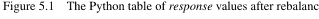

要检查是否获得了所需的“yes”响应百分比，请检查响应变量的表格。

```
bank_train_rebal['response'].value_counts()
```

生成的表格如图 5.1 所示。现在有 3930 条记录中有 1179 条具有“yes”响应，约占 30%。

#### 5.4.2 如何在 R 中平衡训练数据集

首先，让我们找出 bank_train 数据集中有多少条记录的响应值为 "yes"。

```
table(bank_train$response)
```

“yes” 响应的数量对于每个分区都会不同。对于基于先前 R 代码中使用的随机种子的分区，训练数据集中有 3103 条记录，其中 336 条具有“yes”响应值。这使得约 11% 的训练数据集具有“yes”响应。

让我们重采样以将“yes”响应的百分比提高到 30%。由于 p = 0.3、records = 3103 和 rare = 336，我们得到

x = \frac{0.3(3103) - 336}{0.7} = 850

也就是说，我们需要重采样 850 条响应为 "yes" 的记录，并将它们添加到我们的训练数据集中。

首先，我们使用 which() 命令来识别我们想要重采样的记录索引。

```
to.resample <- which(bank_train$response == "yes")
```

which() 命令返回与满足指定条件的记录对应的行号。在我们的情况中，我们想要那些 y 值为 "yes" 的记录的行号，因此我们的条件是 bank_train$response ==


"yes"。我们将记录编号保存为 to.resample，因为这些是我们想要重新采样的值。

接下来，我们从 to.resample 中的值中随机采样。

```
our.resample <- sample(x = to.resample, size = 850,
                           replace = TRUE)
```

x = to.resample 输入指定我们要从先前创建的记录索引系列中进行采样。size = 850 输入指定应重新采样多少个数字。replace = TRUE 输入告诉算法进行有放回采样。输出是一系列 850 个记录索引，从我们的 to.resample 向量中采样。

现在我们想要获取记录编号位于 our.resample 中的那些记录。

```
our.resample <- bank_train[our.resample, ]
```

使用括号表示法即可完成此任务。新数据集 our.resample 中的记录数为 850，即我们想要重新采样的记录数。

最后，我们需要将重新采样的记录添加回原始训练数据集。

```
train_bank_rebal <- rbind(bank_train, our.resample)
```

rbind() 命令代表“行绑定”，意思是通过将行相互堆叠来追加两个数据集。通过在原始训练数据 bank_train 和 our.resample 中的 850 条重新采样记录上使用 rbind()，我们创建了重新平衡的数据集，并将其命名为 train_bank_rebal。

要确认重新采样已提供所需数量的稀有记录，请查看我们重新平衡数据集中的响应值表。

```
t.v1 <- table(train_bank_rebal$response)
t.v2 <- rbind(t.v1, round(prop.table(t.v1), 4))
colnames(t.v2) <- c("Response = No", "Response = Yes");
rownames(t.v2) <- c("Count", "Proportion")
t.v2
```

结果如图 5.2 所示。“yes”响应的百分比约为 30%，即我们想要的稀有记录的百分比。

| | 响应 = 否 | 响应 = 是 |
|---|---|---|
| 计数 | 2767.0 | 1186.0 |
| 比例 | 0.7 | 0.3 |

图 5.2 重新平衡后的响应值 R 表。

### 5.5 建立基线模型性能

在评估模型性能之前，数据科学家应首先将结果与某些基线模型性能进行校准。例如，在上述欺诈场景中，假设我们开发了一个报告 98% 准确率的复杂欺诈检测模型。听起来很令人印象深刻，直到我们记得一个“全负”模型（仅将所有记录分类为非欺诈）将具有 99% 的准确率。如果没有与基线进行比较，我们的客户无法确定我们的结果是否良好。

我们为二元分类情况提供以下两个基线模型。

#### 二元分类的基线模型

让二元目标类中的一个代表正类，另一个代表负类。

让 p 表示数据中正类记录的比例。

- 全正模型。将所有预测分配为正类。
    - 此模型的准确率将为 p。
- 全负模型。将所有预测分配为负类。
    - 此模型的准确率将为 1-p。

例如，在我们的欺诈场景中，p = 0.01 或 1% 的欺诈记录，其中我们让欺诈记录代表正类。那么全正模型的准确率将为 0.01，全负模型的准确率将为 0.99。我们开发的任何模型都需要超过这个 99% 的准确率才能被视为有用。

我们可以将此扩展到 k-ary 情况，k ≥ 3，如下所示：

#### k-ary 分类的基线模型

让响应变量有 k 个类，C1, C2, ..., Ck。

让 pi 表示数据中类 Ci 记录的比例，i = 1, ..., k。

- 最大类别模型。将所有预测分配给最大类别。
    - 此模型的准确率为 pmax，即最大的 pi。

例如，如果您的训练集有 30% 的民主党人、30% 的共和党人和 40% 的无党派人士，则基线模型将所有记录分配给无党派人士，准确率为 40%。

那么，对于估计问题，我们应该使用哪种基线模型呢？对于回归，可以简单地将我们的估计与 y = ȳ 模型进行比较，其中每条记录响应的估计仅为平均响应。但这真的是门槛太低，因为几乎任何回归模型肯定都能超过它。请注意，基线 y = ȳ 模型完全忽略了预测因子中蕴含的丰富信息。相反，我们可以提出这样的问题：“学科专家会认为什么样的预测误差是平庸的？”例如，如果我们是一家贷款公司，试图估计我们的抵押贷款客户能负担多少，我们可以说我们可以接受一个通常偏差 5,000 美元的模型，因此这将是一个平庸的预测误差。然后，当我们构建回归模型时，我们需要 s（估计的标准误）的值低于 50,000 美元。

当然，校准任何模型的最佳基准是将其与文献（或专有业务模型）提供的当前金标准模型性能进行比较。例如，假设我们的贷款公司多年前进行过一项研究，其中实现了 25,000 美元的标准误。那么，这个 s = 25,000 美元就是我们的基线基准，我们构建的模型将与之进行比较。

总结一下，在本章中，我们学习了数据科学方法论的设置阶段，其中包括以下步骤：

- 数据划分
- 验证数据划分
- 数据平衡
- 建立基线模型性能

下次，我们可以开始建模阶段，转到第 6 章。

### 参考文献

关于 random 包核心的出版物：M. Matsumoto 和 T. Nishimura，Mersenne twister：623 维等距分布均匀伪随机数生成器，ACM Transactions on Modeling and Computer Simulation，8(1)，3–30，1998 年 1 月。

我们将花更多时间学习 sklearn 包！要更熟悉它，请参阅以下内容：F. Pedregosa 等人，Scikit-learn：Python 中的机器学习，Journal of Machine Learning Research，12，2825–2830，2011 年。

### 练习

### 澄清概念

- 1. 设置阶段应进行哪四项任务？
- 2. 说明数据科学方法论不遵循常规统计推断范式的两个原因。
- 3. 描述什么是数据挖掘（data dredging），以及为什么数据科学家需要避免它。
- 4. 数据科学家如何避免数据挖掘？
- 5. 描述训练数据集和测试数据集之间的区别。
- 6. 在验证划分时，数据科学家需要检查每个字段吗？
- 7. 在验证划分时，数值变量使用哪种统计检验？
- 8. 什么是平衡？为什么使用它？
- 9. 描述我们所说的重新采样是什么意思。
- 10. 测试数据集何时应进行平衡？
- 11. 为什么建立基线模型性能很重要？
- 12. 描述二元分类的两个基线模型。
- 13. 判断正误：k-ary 分类没有基线模型。
- 14. 校准模型性能的最佳基准是什么？

### 使用数据

对于练习 15–20，请使用 *bank_additional* 数据集。使用 Python 或 R 解决每个问题。

- 15. 划分数据集，使 75% 的记录包含在训练数据集中，25% 包含在测试数据集中。使用条形图确认您的比例。
- 16. 确定训练数据集中的记录总数以及训练数据集中响应变量值为“yes”的记录数量。
- 17. 使用上一题的答案，计算需要重新采样多少条“yes”响应记录，以使重新平衡数据集中 20% 的记录具有“yes”响应值。
- 18. 执行上一题中描述的重新平衡，并确认重新平衡数据集中 20% 的记录具有“yes”响应值。
- 19. 我们应该平衡上面创建的测试数据集吗？解释原因。
- 20. 我们使用哪个基线模型来比较我们的分类模型性能？该基线模型将所有预测分配给哪个值？该基线模型的准确率是多少？

### 实践分析

对于练习 21–28，请使用 *adult* 数据集。

- 21. 划分数据集，使 50% 的记录包含在训练数据集中，50% 包含在测试数据集中。使用条形图确认您的比例。
- 22. 确定训练数据集中的记录总数，以及训练数据集中收入值为 >50 K 的记录数量。


- 23. 使用上一题的答案，计算需要重新采样多少条收入大于50K的记录，才能使重新平衡的数据集中有35%的记录收入大于50K。

- 24. 执行上一题中描述的重新平衡操作，并确认重新平衡的数据集中有35%的记录收入大于50K。

- 25. 我们使用哪个基线模型来评估分类模型的性能？该基线模型将所有预测分配给哪个值？该基线模型的准确率是多少？

- 26. 通过对训练集与测试集的平均年龄进行双样本Z检验（均值差异）来验证你的划分。*

- 27. 通过对训练集与测试集中收入大于50K的记录比例进行双样本Z检验（比例差异）来验证你的划分。

对于练习28–34，请使用churn数据集。

- 28. 划分数据集，使67%的记录包含在训练数据集中，33%包含在测试数据集中。使用条形图来确认你的比例。

- 29. 确定训练数据集中的记录总数，以及训练数据集中有多少条记录的流失值为true。

- 30. 使用上一题的答案，计算需要重新采样多少条真实流失记录，才能使重新平衡的数据集中有20%的记录具有真实流失值。

- 31. 执行上一题中描述的重新平衡操作，并确认重新平衡的数据集中有20%的记录具有真实流失值。

- 32. 我们使用哪个基线模型来评估分类模型的性能？该基线模型将所有预测分配给哪个值？该基线模型的准确率是多少？

- 33. 通过检验训练集与测试集的平均白天通话分钟数的差异来验证你的划分。

- 34. 通过检验训练集与测试集中真实流失记录比例的差异来验证你的划分。

对于练习35，请使用cereals数据集。在这里，我们试图基于一组预测变量来估计数值目标，即评分（营养评分）。

- 35. 我们使用哪个营养模型来评估估计模型的性能？该基线模型将所有预测分配给哪个值？

### 6.1 决策树入门

至此，我们已了解数据科学方法论的前四个阶段：

- 1. 数据理解阶段
- 2. 数据准备阶段
- 3. 探索性数据分析阶段
- 4. 设置阶段。

我们终于准备好在建模阶段开始对数据进行建模了。数据科学为建模大型数据集提供了多种方法和算法。我们将从最简单的方法之一入手：决策树。在本章中，我们将使用adult_ch6_training和adult_ch6_test数据集。这些数据集改编自UCI存储库中的Adult数据集。为简化起见，仅保留两个预测变量和目标变量，如下所示：

- 婚姻状况，一个类别预测变量，类别包括married、divorced、never-married、separated和widowed。
- Cap_gains_losses，一个数值预测变量，等于资本收益加上资本损失。
- Income，一个类别目标变量，有两个类别，>50k和≤50k，分别代表年收入大于50,000美元的个人和年收入小于或等于50,000美元的个人。

决策树由一组决策节点组成，通过分支连接，从根节点向下延伸，直到终止于叶节点。从顶部节点开始，按照惯例，该节点位于决策树的顶部

> 'C.L. Blake和C.J. Merz，UCI机器学习数据库存储库，加州大学欧文分校信息与计算机科学系，1998年。Adult数据集由Ron Kohavi捐赠。

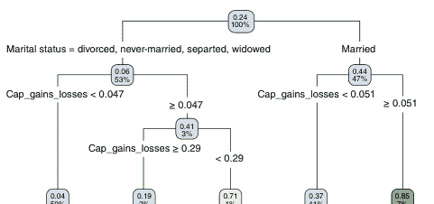

图6.1 使用R对adult_ch6__training数据进行响应结果分类的决策树。

图中，在决策节点上对变量进行测试，每个可能的结果都会产生一个分支。每个分支随后通向另一个决策节点或一个终止叶节点。图6.1提供了一个简单决策树的示例，使用分类和回归树（CART）算法，应用于adult_ch6__training数据集中的18,761条记录。

可以想象，所有数据记录通过树顶部的根节点进入决策树，并根据每个决策节点关于变量值的决策在树中下降。根节点中的100%证明了这一点。根节点还告诉我们，adult_ch6__training数据集中有24%（0.24）的记录具有高收入（>50K）。因此，每个节点都告诉我们该节点中高收入记录的比例，以及到达该节点的记录百分比。在根节点分割处，CART识别出最有效的可能二元分割，即根据变量婚姻状况的值将记录分为两组：一组婚姻状况为married，另一组包含所有其他婚姻状况：divorced、never-married、separated和widowed。请注意，married组包含44%的高收入，而另一组仅包含6%的高收入。married组的高收入记录比例高出七倍。正是这一显著差异，使得该分割被CART算法选为根节点分割。还请注意，根节点分割将数据几乎平分，47%为married，53%为not married。

在married节点处，CART随后基于变量Cap_Gains_Losses进行第二次分割。如果（最小-最大归一化的）资本收益和损失超过0.051，则85%的记录具有高收入。然而，这组代表married且具有高资本收益和损失的人的记录仅占训练数据集的7%，如右下角的叶节点所示。另一方面，married但没有高资本收益和损失的人占数据集的41%，但仅包含37%的高收入。右下角的两个节点是叶节点，因为对它们不再进行进一步分割。

回到非married婚姻状况节点的记录，我们看到也基于归一化的资本收益和损失进行了一次分割。非married且没有高资本收益和损失的人占训练数据集的整整50%。其中，只有4%具有高收入。具有高资本收益和损失的非married人仅占数据集的3%，但具有更高比例的高收入：41%。对这3%的记录进行最终分割，更精细地调整资本收益和损失的水平，较高组为71%高收入，较低组为19%高收入。当无法再进行进一步分割时，决策树停止生长。

那么，决策树是如何工作的？决策树试图创建一组尽可能“纯”的叶节点，即特定叶节点中的每条记录都具有相同的分类。这样一来，决策树可以提供可用的最高置信度的分类分配。然而，如何衡量一致性，或者反过来，如何衡量异质性？我们将考察衡量叶节点纯度的许多方法中的两种，这些方法导致了构建决策树的两种主要算法：

- CART算法
- C5.0算法

### 6.2 分类和回归树

CART方法生成严格二元的决策树，每个决策节点恰好包含两个分支。CART递归地将训练数据集中的记录划分为目标属性值相似的记录子集。CART算法通过对每个决策节点进行所有可用变量和所有可能分割值的穷尽搜索，根据基尼系数（来自Kennedy等人）选择最优分割，从而生长树。

设\(\Phi(s|t)\)为节点t处候选分割s的“优劣”度量，其中

```
\(\Phi(s|t)=2P_tP_R \sum_{j=1}^{\text{\# classes}} |P(j|t_L)-P(j|t_R)|\)
```

Leo Breiman、Jerome Friedman、Richard Olshen和Charles Stone，《分类和回归树》，Chapman & Hall/CRC Press，Boca Raton，FL，1984年。

Ruby L. Kennedy、Yuchun Lee、Benjamin Van Roy、Christopher D. Reed和Richard P. Lippman，《通过模式识别解决数据挖掘问题》，Pearson Education，Upper Saddle River，NJ，1995年。


and where

$t_L = \text{节点 } t \text{ 的左子节点}$
$t_R = \text{节点 } t \text{ 的右子节点}$
$P_L = \frac{\text{在 } t_L \text{ 处的记录数}}{\text{训练集中的记录总数}}$
$P_R = \frac{\text{在 } t_R \text{ 处的记录数}}{\text{训练集中的记录总数}}$
$P(j|t_L) = \frac{\text{在 } t_L \text{ 处的类别 } j \text{ 记录数}}{\text{在 } t \text{ 处的记录数}}$
$P(j|t_R) = \frac{\text{在 } t_R \text{ 处的类别 } j \text{ 记录数}}{\text{在 } t \text{ 处的记录数}}$

Then, the optimal split is whichever split maximizes this measure $\Phi(s|t)$ over all possible splits at node $t$. Thus, CART identified the root node split in Figure 6.1 as maximizing $\Phi(s|t)$ over all candidate root node splits.

然后，最优分裂是在节点 $t$ 的所有可能分裂中，使该度量 $\Phi(s|t)$ 达到最大的分裂。因此，CART 将图 6.1 中的根节点分裂确定为在所有候选根节点分裂中使 $\Phi(s|t)$ 达到最大的分裂。

#### 6.2.1 使用 Python 构建 CART 决策树

加载所需的包，并将训练数据集读入为 adult_tr。

```python
import pandas as pd
import numpy as np
import statsmodels.tools.tools as stattools
from sklearn.tree import DecisionTreeClassifier, export_graphviz
adult_tr = pd.read_csv("C:/.../adult_ch6_training")
```

为简单起见，我们将 Income 变量保存为 y。

```python
y = adult_tr[['Income']]
```

在我们的预测变量中有一个分类变量，即婚姻状况（Marital status）。sklearn 包中实现的 CART 模型需要将分类变量转换为虚拟变量形式。因此，我们将使用 categorical() 命令为婚姻状况创建一系列虚拟变量。

```python
mar_np = np.array(adult_tr['Marital status'])
(mar_cat, mar_cat_dict) = stattools.categorical(mar_np,
drop=True, dictnames=True)
```

我们使用 array() 将变量婚姻状况转换为数组，然后使用 stattools 包中的 categorical() 命令为婚姻状况的每个值创建一个虚拟变量矩阵。我们使用 (mar_cat, mar_cat_dict) 分别保存矩阵和字典。

矩阵 mar_cat 包含五列，每列对应原始婚姻状况变量中的一个类别。每一行代表 adult_tr 数据集中的一条记录。每一行在与该记录在原始婚姻状况变量中具有的值相匹配的列中会有一个 1。你可以通过查看 mar_cat_dict 来判断哪一列代表哪个类别。在我们的例子中，mar_cat 的第一行在第三列有一个 1。通过查看 mar_cat_dict，我们知道第三列代表“从未结婚”（Never married）类别。果然，adult_tr 的第一条记录的婚姻状况变量值为“从未结婚”。

现在，我们需要将新创建的虚拟变量添加回 X 变量中。

```python
mar_cat_pd = pd.DataFrame(mar_cat)
X = pd.concat((adult_tr[['Cap_Gains_Losses']], mar_cat_pd), axis = 1)
```

我们首先使用 DataFrame() 命令将 mar_cat 矩阵转换为数据框。然后我们使用 concat() 命令将预测变量 Cap_Gains_Losses 附加到表示婚姻状况的虚拟变量数据框上。我们将结果保存为 X。

在运行 CART 算法之前，请注意 X 的列不包括婚姻状况变量的不同值。运行 mar_cat_dict 可以看到第一列对应“离婚”（Divorced），第二列对应“已婚”（Married），依此类推。由于 X 的第一列是 Cap_Gains_Losses，我们可以指定 X 中每一列的名称。

```python
X_names = ["Cap_Gains_Losses", "Divorced", "Married",
"Never-married", "Separated", "Widowed"]
```

在可视化 CART 模型时，了解 y 的水平也会有所帮助。

```python
y_names = ["<=50K", ">50K"]
```

现在，我们准备好运行 CART 算法了！

```python
cart01 = DecisionTreeClassifier(criterion = "gini", max_leaf_nodes=5).fit(X,y)
```

要运行 CART 算法，我们使用 DecisionTreeClassifier() 命令。DecisionTreeClassifier() 命令设置决策树的各种参数。例如，criterion = "gini" 输入指定我们使用基于基尼准则的 CART 模型，而 max_leaf_nodes 输入将 CART 树修剪为最多具有指定数量的叶节点。在本示例中，我们将树限制为五个叶节点。

fit() 命令告诉 Python 将先前指定的决策树拟合到数据上。首先给出预测变量，然后是目标变量。因此，fit() 的两个输入是我们创建的 X 和 y 对象。我们将决策树保存为 cart01。

最后，要获取树结构，我们使用 export_graphviz() 命令。

```python
export_graphviz(cart01, out_file = "C:/.../cart01.dot",
feature_names=X_names, class_names=y_names)
```

第一个输入是决策树本身，我们将其保存为 cart01。out_file 输入将树结构保存到指定位置，并将文件命名为 cart01.dot。通过 graphviz 包运行文件内容以显示 CART 模型。指定 feature_names = X_names 和 class_names = y_names 会将预测变量名称和目标变量值添加到 cart01 dot 文件中，大大提高其可读性。

要获取训练数据集中每个变量的 Income 变量分类，请使用 predict() 命令。

```python
predIncomeCART = cart01.predict(X)
```

在 cart01 上使用 predict() 命令表示我们想要使用 CART 模型进行分类。将预测变量 X 作为输入指定我们想要对这些特定记录进行预测。结果是根据我们的 CART 模型，对训练数据集中每条记录的分类。我们将预测结果保存为 predIncomeCART。

#### 6.2.2 使用 R 构建 CART 决策树

导入训练数据集并将其命名为 adult_tr。一旦数据集加载到 R 中，将“婚姻状况”（Marital status）重命名为“maritalStatus”以删除空格。此更改将有助于我们后续的代码。

```r
colnames(adult_tr)[1] <- "maritalStatus"
```

colnames() 命令列出 adult_tr 数据集中每个变量的名称。单独运行它，它将按顺序输出列名。请注意，第一列包含婚姻状况变量。使用 colnames(adult_tr) 末尾的 [1] 可以隔离出婚姻状况的变量名。我们通过创建字符串“maritalStatus”并将其保存为变量名来重命名该变量。

我们然后将两个分类变量都转换为因子。

```r
adult_tr$Income <- factor(adult_tr$Income)
adult_tr$maritalStatus <- factor(adult_tr$maritalStatus)
```

要运行和可视化 CART 模型，我们需要安装并打开所需的包，rpart 和 rpart.plot。

```r
install.packages(c("rpart", "rpart.plot"))
library(rpart) ; library(rpart.plot)
```

最后，让我们运行 rpart() 命令来构建 CART 模型。

```r
cart01 <- rpart(formula = Income ~ maritalStatus + Cap_Gains_Losses,
                data = adult_tr, method = "class")
```

formula 输入的结构为 Target ~ Predictors，其中预测变量名称由加号分隔。data 输入指定变量来自哪个数据集。method = "class" 输入指定我们想要使用分类（CART）模型。最后，我们将生成的模型保存为 cart01。

构建 CART 模型后，我们可以使用 rpart.plot 命令以默认显示选项绘制 CART 模型。

```r
rpart.plot(cart01)
```

rpart.plot() 命令只需要将保存 CART 模型的名称作为其必需输入。由于我们将模型命名为 cart01，因此这就是我们的输入。

请注意，使用 rpart.plot() 的默认设置构建的图表不复制图 6.1。还有哪些其他设置？

```r
?rpart.plot
```

运行 ?rpart.plot 以查看不同的显示选项，位于 type 和 extra 参数下。尝试使用 type = 4 为每个分支标记其特定值，而不是在分裂顶部使用是/否；并使用 extra = 2 为每个节点添加正确的分类比例。

```r
rpart.plot(cart01, type = 4, extra = 2)
```

结果如图 6.1 所示。

要使用 CART 模型获取数据集中每条记录的分类，您首先需要创建一个包含要分类的记录的预测变量的数据框。

```r
X = data.frame(maritalStatus = adult_tr$maritalStatus,
               Cap_Gains_Losses =
               adult_tr$Cap_Gains_Losses)
```

数据框 X 包含用于构建 CART 模型的两个预测变量。至关重要的是，此新数据框中的变量名称必须与用于构建 CART 模型的变量名称完全匹配。

一旦您拥有要分类的预测变量，请使用 predict() 命令。

```r
predIncomeCART = predict(object = cart01, newdata = X,
                         type = "class")
```


输入对象 = cart01 表明分类是使用你保存为 cart01 的 CART 模型进行的。newdata = X 将数据框 X 中的数据传入 CART 模型，以到达叶节点并进行分类。type = "class" 输入指定我们希望将分类本身作为输出。我们将预测结果保存为 predIncomeCART。

### 6.3 用于构建决策树的 C5.0 算法

C5.0 算法是 J. Ross Quinlan 对其自身 C4.5 算法的扩展，用于生成决策树。与 CART 不同，C5.0 算法不局限于二元分割。C5.0 算法使用信息增益或熵减少的概念来选择最优分割。假设我们有一个变量 X，其 k 个可能值的概率为 p1, p2, ... pk。传输表示观察到的 X 值的符号流所需的平均每个符号的最小比特数称为 X 的熵，定义为

```
H(X) = -\sum_j p_j \log_2(p_j)
```

C5.0 使用熵的方式如下。假设我们有一个候选分割 S，它将训练数据集 T 划分为几个子集，T1, T2, ..., Ti。平均信息需求可以计算为各个子集熵的加权和，如下所示：

```
H_S(T) = -\sum_{i=1}^L p_i H_i(T_i)
```

其中 p_i 表示子集 i 中记录的比例。我们可以定义信息增益为 gain(S) = H(T) - H_S(T)，即根据此候选分割 S 划分训练数据 T 所产生的信息增加。在每个决策节点，C5.0 选择最优分割，即具有最大信息增益 gain(S) 的分割。

图 6.2 显示了 R 针对 adult1_ch6_training 数据集输出的 C5.0 决策树。根节点分割（节点 1）基于 Cap.Gains_Losses（CGL）是否超过 0.05。如果没有，则该分支立即终止于一个叶节点（节点 2），其中大多数记录的收入较低。请注意，节点 2 包含 17,007 条记录，占数据集的 90.7%。决策树的其余部分，节点 3-11，共同仅处理 9.3% 的数据集。

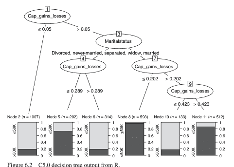

如果 CGL 确实超过 0.05，则下一个决策节点（节点 3）基于婚姻状况。如果已婚，则树分支到节点 7。如果是其他婚姻状况，则树分支到节点 4，该节点再次测试 CGL，这次是判断其是否超过 0.289。出人意料的是，CGL > 0.289 的组在其节点 6 中的高收入比例低于节点 5 中较低 CGL 组的比例。节点 7 接收 CGL > 0.05 的已婚个体。然后它根据 CGL 是否超过 0.202 进行分割。如果没有，则叶节点（节点 8）几乎全部为高收入。如果 CGL > 0.202，则节点 9 中的最后一个分割测试 CGL 是否超过 0.423。如果是，则 512 条记录主要为高收入，否则不是。

CART 和 C5.0 构建的决策树之间存在一些有趣的差异。与将超过 90% 的记录导向单个节点的 C5.0 树相比，CART 树的根节点分割（图 6.1）基于婚姻状况，导致了一个相当平衡的分割，这可能是由于基尼指数的性质，其中包含 $P_k P_c$ 系数，倾向于平衡分支。

#### 6.3.1 使用 Python 构建 C5.0 决策树

Python 包不直接实现 C5.0。相反，我们将再次使用 sklearn 包，这次将分割标准从基尼指数更改为熵。

在运行本节中的代码之前，请运行上一节 Python 部分中的代码，直到但不包括以“现在我们准备好运行 CART 算法了！”开头的段落。其中包含的代码将设置我们的变量和变量名，为运行此决策树做准备。

要使用熵作为分割标准来获取决策树，我们再次使用 DecisionTreeClassifier() 命令。

```
c50_01 = DecisionTreeClassifier(criterion="entropy",
max_leaf_nodes=5).fit(X,y)
```

输入 criterion = "entropy" 使用信息增益来识别最佳候选分割。

要导出 C5.0 树的摘要，请运行 export_graphviz() 命令。代码如下，其解释在上一节 Python 部分中。

```
export_graphviz(c50_01, out_file = "C:/.../c50_01.dot",
feature_names=X.names,
class_names=y.names)
```

要获取训练数据集中每条记录的分类，请在保存的输出名称 c50_01 上运行 predict() 命令，并将预测变量 X 作为输入。

```
c50_01.predict(X)
```

结果是训练数据集中每条记录的一个分类。

#### 6.3.2 使用 R 构建 C5.0 决策树

如果您尚未更改婚姻状况变量名，或将分类变量转换为因子，请立即按照上一节 R 部分中的相关步骤进行操作。然后，安装并加载运行 C5.0 所需的包。

```
install.packages("C50"); library(C50)
```

使用 C5.0() 命令运行该算法。

```
C5 <- C5.0(formula = Income ~ maritalStatus + Cap_Gains_Losses, data = adult_tr,
control = C5.0Control(minCases=75))
```

核心输入值是 formula 输入，它与其 CART 对应项相同。与以前一样，目标变量位于波浪号左侧，预测变量位于右侧，用加号分隔。data = adult_tr 输入指定我们正在从 adult_tr 数据集中提取变量。control = C5.0Control(minCases = 75)) 输入要求决策树中的数据节点至少包含 75 条记录。我们将生成的树保存为 C5。

我们可以使用 plot() 命令可视化该树。

```
plot(C5)
```

plot(C5) 的输出显示在图 6.2 中。

要获取数据集中每条记录的分类，请像上一节 R 部分中一样创建 X 数据框，并运行 predict() 命令。

```
predict(object = C5, newdata = X)
```

将 object = C5 设置为使用本节构建的 C5.0 树。保留 newdata = X 输入，如上一节 R 部分中所示。结果是训练数据集中每条记录的 Income 变量分类。

### 6.4 随机森林

CART 和 C5.0 都基于训练数据集中的所有记录和指定变量生成单个决策树。然而，有一种方法使用多棵树，在确定每条记录的最终分类时会考虑每棵树的输出。

随机森林构建一系列决策树，并将每棵树对每条记录的不同分类合并为一个最终分类。随机森林是集成方法的一个示例。集成方法是一类建模技术，它们在得出单一答案时会考虑多个模型的输出。不同的集成方法以不同方式考虑模型的输出。有关集成模型的更多信息，请参阅我们之前的文本。

随机森林算法通过从原始训练数据集中进行有放回的随机抽样来开始构建每棵决策树。这样，每棵树都将拥有不同的用于构建的数据集。对于决策树的每个节点，会选取一部分预测变量供考虑。以这种方式，可能会导致本应给出“最佳”分割（例如，根据基尼准则）的变量无法供考虑。决策树以这种方式完成，对树的大小没有限制。

构建不同的树后，它们被用于对原始训练数据集中的记录进行分类。数据集中的每条记录都会被每棵树赋予一个分类。由于这些分类对于所有记录高度不可能达成一致，因此每个分类都被视为针对该特定目标变量值的一票“投票”。得票最多的值被视为该记录的最终分类。


#### 6.4.1 如何在 Python 中构建随机森林

与之前一样，运行 CART Python 部分中的代码，直到但不包括以“现在我们准备好运行 CART 算法！”开头的段落中的代码。你需要运行代码来设置本节代码所需的预测变量和目标变量。

接下来，加载所需的库。

```
from sklearn.ensemble import RandomForestClassifier
import numpy as np
```

Python 中的随机森林命令要求响应变量格式化为一维数组，因此我们使用 numpy 的 ravel() 命令来创建该格式。

```
rfy = np.ravel(y)
```

我们使用 RandomForestClassifier() 命令来创建随机森林。

```
rf01 = RandomForestClassifier(n_estimators = 100,
criterion="gini").fit(X,rfy)
```

与之前一样，RandomForestClassifier() 命令设置算法的参数。n_estimators 输入指定要构建的树的数量，而 criterion = “gini” 指定使用基尼指数来确定最佳分割。fit() 命令使用预测变量 X 和目标变量 y 来构建实际的决策树。将结果保存为 rf01。

要查看随机森林算法在训练数据集上做出的分类，请使用 predict() 命令。

```
rf01.predict(X)
```

结果是一系列分类，数据集中的每条记录对应一个分类。

#### 6.4.2 如何在 R 中构建随机森林

如果你尚未更改婚姻状态变量名，或将分类变量转换为因子，请立即按照前一节 R 部分中的相关步骤进行操作。加载数据。

安装并打开 randomForest 包。

```
install.packages("randomForest"); library(randomForest)
```

现在，我们运行随机森林算法，使用与之前相同的公式输入。

```
rf01 <- randomForest(formula = Income ~ maritalStatus +
Cap_Gains_Losses,
data = adult_tr, ntree = 100, type = "classification")
```

构建随机森林的命令是 randomForest()，第一个输入 formula 与前一节 R 部分中的 CART 和 C5.0 公式相同。data 输入指定 formula 中变量的来源。ntree 输入告诉算法要构建多少棵树。对于我们相对较小的数据集，我们使用 100 棵树。最后一个输入 type = "classification" 指定我们正在对数据进行分类。我们将输出保存为 rf01。

要查看算法做出的分类，请查看保存在 rf01 下的预测值。

```
rf01$predicted
```

结果是数据集中每条记录的一个分类。

### 参考文献

要查看 C50 包的详细信息，请参阅文档：Max Kuhn 和 Ross Quinlan。C50：C5.0 决策树和基于规则的模型。R 包版本 0.1.2，2018 年。https://CRAN.R-project.org/package=C50。

如果你想探索完整的 randomForest 包，请从核心出版物开始：A. Liaw 和 M. Wiener，Classification and regression by randomForest，R News，2(3)，18–22，2002 年。

我们展示了 rpart.plot 包用于表示 CART 模型的一些选项。你可以在此处找到该包的完整文档：Stephen Milborrow，rpart.plot：绘制 "rpart" 模型："plot.rpart" 的增强版本。R 包版本 2.2.0，2018 年。https://CRAN.R-project.org/package=rpart.plot。

查看详细介绍 Python statsmodels 包的论文集：Skipper Seabold 和 Josef Perktold。"Statsmodels：使用 Python 进行计量经济学和统计建模。"在第 9 届 Python 科学会议论文集中，2010 年。

R 中用于 CART 模型的包：Terry Therneau 和 Beth Atkinson，rpart：递归分区和回归树。R 包版本 4.1-13，2018 年。https://CRAN.R-project.org/package=rpart。

### 练习

### 澄清概念

- 1. 什么是决策树？
- 2. 决策节点和叶节点有什么区别？
- 3. 在决策树中，所有可能的分割中最强大的分割在哪里进行？
- 4. 决策树何时停止生长？
- 5. 决策树如何工作？
- 6. 如果我们对三元分类预测变量感兴趣，CART 是否是一个好的算法？
- 7. CART 使用哪个标准来评估哪个分割是最优的？
- 8. C5.0 算法使用哪个概念来选择最优分割？
- 9. 什么是随机森林？
- 10. 随机森林如何工作？
- 11. 所有预测变量是否都是随机森林构建的树中每个节点的“最佳”分割候选项？
- 12. 随机森林中用于构建每棵树的数据集是否相同？
- 13. 随机森林算法如何为训练数据集提供最终分类？

### 处理数据

对于练习 14–20，请使用 adult_ch6_training 和 adult_ch6_test 数据集。使用 Python 或 R 解决每个问题。

- 14. 使用训练数据集创建一个 CART 模型，使用婚姻状态和资本收益与损失来预测收入。可视化决策树（即，提供决策树输出）。描述决策树中的前几个分割。
- 15. 使用测试数据集开发一个 CART 模型，使用相同的目标变量和预测变量。可视化决策树。比较决策树。测试数据结果是否与训练数据结果匹配？
- 16. 使用训练数据集构建一个 C5.0 模型，使用婚姻状态和资本收益与损失来预测收入。指定每个终端节点最少 75 个案例。可视化决策树。描述决策树中的前几个分割。
- 17. 你的 C5.0 模型与 CART 模型相比如何？描述相似之处和差异。
- 18. 使用测试数据集构建一个 C5.0 模型，使用相同的目标变量、预测变量和最小案例标准。可视化决策树。测试数据结果是否与训练数据结果匹配？
- 19. 在训练数据集上使用随机森林，使用婚姻状态和资本收益与损失来预测收入。
- 20. 使用测试数据集使用随机森林，使用相同的目标变量和预测变量。测试数据结果是否与训练数据结果匹配？

### 实践分析

对于练习 21–27，请使用 loans_training 和 loans_test 数据集。使用 Python 或 R 解决每个问题。

- 21. 使用训练数据集创建一个 CART 模型，使用收入负债比、FICO 分数和请求金额来预测批准。可视化决策树。描述决策树中的前几个分割。
- 22. 使用测试数据集开发一个 CART 模型，使用相同的目标变量和预测变量。可视化决策树。调查决策树中的分割。使用测试数据构建的树是否与使用训练数据构建的树匹配？
- 23. 使用训练数据集构建一个 C5.0 模型，使用收入负债比、FICO 分数和请求金额来预测批准。指定每个终端节点最少 1000 个案例。可视化决策树。描述决策树中的前几个分割。
- 24. 你的 C5.0 模型与针对 loans_training 数据的 CART 模型相比如何？描述相似之处和差异。
- 25. 使用测试数据集创建一个 C5.0 模型，使用相同的目标变量、预测变量和最小案例标准。可视化决策树。使用测试数据构建的树是否与使用训练数据构建的树匹配？
- 26. 在训练数据集上使用随机森林，使用与 CART 和 C5.0 模型相同的预测变量来获取批准的预测值。
- 27. 在测试数据集上使用随机森林，获取测试数据集中批准的预测值。构建一个表格比较训练和测试数据集的预测。它们相比如何？

对于练习 28–34，请使用 bank_marketing_training 和 bank_marketing_test 数据集。使用 Python 或 R 解决每个问题。

- 28. 使用训练数据集创建一个 CART 模型，使用你认为合适的任何预测变量来预测响应。可视化决策树。描述决策树中的前几个分割。
- 29. 使用测试数据集和相同的目标变量和预测变量开发一个 CART 模型。可视化决策树。调查决策树中的分割。使用测试数据构建的树是否与使用训练数据构建的树匹配？
- 30. 使用训练数据集构建一个 C5.0 模型，预测响应并使用相同的目标变量和预测变量。指定每个终端节点最少 1000 个案例。可视化决策树。描述决策树中的前几个分割。
- 31. 你的 C5.0 模型与针对 bank_marketing_training 数据的 CART 模型相比如何？描述相似之处和差异。
- 32. 使用测试数据集创建一个 C5.0 模型，使用相同的目标变量、预测变量和最小案例标准。可视化决策树。使用测试数据构建的树是否与使用训练数据构建的树匹配？
- 33. 在训练数据集上使用随机森林，使用与 CART 和 C5.0 模型相同的预测变量来获取响应的预测值。
- 34. 在测试数据集上使用随机森林，获取测试数据集中响应的预测值。构建一个表格比较训练和测试数据集的预测。它们相比如何？

对于练习 35–41，请使用你在第 5 章练习中通过分区 Churn 数据集获得的训练和测试数据集。使用 Python 或 R 解决每个问题。

- 35. 使用训练数据集创建一个 CART 模型，使用你认为合适的任何预测变量来预测流失。可视化决策树。描述决策树中的前几个分割。


- 36. 使用测试数据集以及相同的目标变量和预测变量来开发一个 CART 模型。可视化决策树。调查决策树中的分割。使用测试数据构建的树是否与使用训练数据构建的树一致？

- 37. 使用训练数据集构建一个 C5.0 模型来预测 Churn，并使用相同的目标变量和预测变量。指定每个终端节点最少 1000 个案例。可视化决策树。描述决策树中的前几个分割。

- 38. 你的 C5.0 模型与针对 churn_training 数据的 CART 模型相比如何？描述相似之处和不同之处。

- 39. 使用测试数据集创建一个 C5.0 模型，使用相同的目标变量、预测变量和最小案例数标准。可视化决策树。使用测试数据构建的树是否与使用训练数据构建的树一致？

- 40. 在训练数据集上使用随机森林，利用与 CART 和 C5.0 模型中相同的预测变量来获得 Churn 的预测值。

- 41. 在测试数据集上使用随机森林来获得测试数据集中 Churn 的预测值。构建一个表格来比较训练和测试数据集的预测结果。它们相比如何？

### 7.1 模型评估简介

迄今为止，在《使用 Python 和 R 进行数据科学》中，我们已介绍了数据科学方法论的前五个阶段：

- 1. 数据理解阶段
- 2. 数据准备阶段
- 3. 探索性数据分析阶段
- 4. 设置阶段
- 5. 建模阶段（至少涉及了一点）

但是，迄今为止我们尚未检查我们的模型是否有效。也就是说，我们尚未评估其在进行预测方面的实用性。请注意评估与验证之间的区别。模型验证仅确保我们的模型结果在训练和测试数据集之间保持一致。但是，模型验证并不能告诉我们我们的模型有多准确，或者其误差率是多少。对于此类度量，我们需要转向模型评估。由于我们迄今为止仅学习了用于分类的决策树，因此我们将讨论限制在分类模型的评估度量上。

### 7.2 分类评估度量

我们将为二元目标变量的情况开发分类评估度量。为了应用本章将学习的度量，我们需要将两个目标结果中的一个（如有需要，可任意）标记为正，另一个标记为负。例如，假设我们正在尝试预测收入，

#### TABLE 7.1 二元分类的列联表一般形式

| | | 预测类别 | | |
|---|---|---|---|---|
| | | 0 | 1 | 总计 |
| 实际类别 | 0 | 真阴性：预测 0 实际 0 | 假阳性：预测 1 实际 0 | 实际阴性总数 |
| | 1 | 假阴性：预测 0 实际 1 | 真阳性：预测 1 实际 1 | 实际阳性总数 |
| | 总计 | 预测阴性总数 | 预测阳性总数 | 总计 |

一个值为高收入和低收入的二元变量。我们可以将高收入标记为正，将低收入标记为负。¹

现在，本章将学习的分类模型评估度量是分类模型生成的列联表²中条目的函数，其一般形式如表 7.1 所示。请注意，按照惯例，实际值由行表示，而预测值由列表示。表 7.1 中左上角的单元格表示模型预测为负响应且实际响应值确实为负的记录数，因此此预测为真阴性。其下方的单元格表示模型预测为负响应，但实际响应值为正的记录数，因此此预测为假阴性。其他单元格的定义类似。

令 TN、FN、FP 和 TP 分别表示列联表中真阴性、假阴性、假阳性和真阳性的数量。此外，令

TAN = 实际阴性总数 = TN + FP  
TAP = 实际阳性总数 = FN + TP  
TPN = 预测阴性总数 = TN + FN  
TPP = 预测阳性总数 = FP + TP  

进一步，令 GT = TN + FN + FP + TP 表示四个单元格中计数的总计。然后，我们可以将表 7.1 重新表示为表 7.2。

然后，使用表 7.2 中的符号，我们定义一组分类评估度量。

```
Accuracy = \frac{TN + TP}{TN + FN + FP + TP} = \frac{TN + TP}{GT}
```

#### TABLE 7.2 重新表示的列联表一般形式

| | 0 | 1 | 总计 |
|---|---|---|---|
| 0 | TN | FP | TAN |
| 1 | FN | TP | TAP |
| 总计 | TPN | TPP | GT |

Error Rate = 1 - Accuracy = \frac{FN + FP}{TN + FN + FP + TP} = \frac{FN + FP}{GT}

准确率表示模型做出的正确分类所占比例的总体度量，而误差率表示列联表中所有单元格的错误分类所占比例。然而，这些度量不区分各种类型的错误或各种类型的正确决策。我们开始使用灵敏度和特异度来区分，如下所示：

### 7.3 灵敏度和特异度

Sensitivity = \frac{真阳性数量}{实际阳性总数} = \frac{TP}{TP + FN}

Specificity = \frac{真阴性数量}{实际阴性总数} = \frac{TN}{FP + TN}

灵敏度衡量模型将记录分类为正的能力，而特异度衡量将记录分类为负的能力。灵敏度衡量模型捕获的所有正记录所占的比例，而特异度衡量模型捕获的所有负记录所占的比例。当然，一个完美的分类模型将具有灵敏度 = 1.0 = 100%。然而，一个仅将所有客户分类为正的模型也将具有灵敏度 = 1.0。显然，仅识别正响应是不够的。分类模型还需要具有特异性，这意味着它应该识别出高比例的负客户。当然，一个完美的分类模型将具有特异度 = 1.0。但是，一个将所有客户分类为负的模型也会如此。一个好的分类模型应该具有可接受的灵敏度和特异度水平，但什么是可接受的因领域而异。

### 7.4 精确率、召回率和 F_beta 分数

被我们的模型分类为正的记录中，有多少比例是真阳性？解决这个问题的度量称为精确率，定义如下：

Precision = \frac{TP}{TPP}

在信息检索领域（例如搜索引擎）中，精确率度量回答的问题是：“所选项目中有多少比例是相关的？”此度量通常与召回率配对使用，召回率只是灵敏度的另一个名称。

Recall = Specificity = \frac{TN}{TAN}

将精确率和召回率合并为单一指标将很有用。为此，我们可以使用 \( F_\beta \) 分数，定义如下：

\( F_\beta = (1 + \beta^2) \cdot \frac{precision \cdot recall}{(\beta^2 \cdot precision) + recall} \)

for \( \beta > 0 \)。

- 当 \( \beta = 1 \) 时，这称为精确率和召回率的调和平均数，因此在度量 \( F_1 \) 中两者权重相等。
- 当 \( \beta > 1 \) 时，\( F_\beta \) 使召回率的权重高于精确率。
- 当 \( \beta < 1 \) 时，\( F_\beta \) 使召回率的权重低于精确率。
- 因此，\( F_2 \) 将使召回率的权重是精确率的两倍，而 \( F_{0.5} \) 将使召回率的权重是精确率的一半。

### 7.5 模型评估方法

模型评估的一般方法如下。这适用于任何分类或估计模型。

- **模型评估方法**
- 1. 使用训练数据集开发模型。
- 2. 使用测试数据集评估模型。也就是说，使用训练数据集开发的模型并将其应用于测试数据集。换句话说，将测试集通过由训练集生成的模型。

### 7.6 模型评估应用示例

我们将使用 `clothing_data_driven_training` 和 `clothing_data_driven_test` 数据集。任务是根据三个连续预测变量预测客户是否会响应电话/邮件营销活动：

- 自购买以来的天数
- 购买访问次数
- 每次访问的销售额


目标变量是一个标志，Response，1 表示正向响应，0 表示负向响应。

我们使用 clothing_data_driven_training 数据集开发一个 C5.0 模型来分类响应。将此模型称为模型 1。我们将使用 clothing_data_driven_test 数据集来评估模型 1。具体操作如下：

#### 评估模型 1 的方法

- 1. 获取模型 1 在训练数据集上生成的 Response 预测值。
- 2. 将模型 1 应用于测试数据集，并将步骤 1 中的预测 Response 值与测试数据集中的实际 Response 值进行比较。

当我们将模型 1 的预测 Response 值与 clothing_data_driven_test 数据集中的实际 Response 值进行比较时，我们得到表 7.3 中的列联表。

请注意，TAN = 9,614、TAP = 1,940 和 GT = 11,554 在任何模型中都成立，因为这些是实际值，而非预测值。其余数字因模型而异，取决于预测结果。我们的八项评估指标结果如表 7.4 所示。

模型 1 的准确率为 0.8410 或 84.10%。这好吗？嗯，回顾第 5 章，我们应始终将结果与基准性能进行校准。在此情况下，共有 TAN = 9614 条负记录，总记录数为 GT = 11,554 条，因此基准全负模型（将所有预测均设为负）的准确率为

Accuracy_{AllNegative Model} = \frac{9614}{11,554} = 0.8321

因此，模型 1 确实勉强超过了基准全负模型的准确率。（当然，我们可以做得更好？见下文。）

模型 1 的特异度为 0.9541，非常出色，意味着该模型成功将

\frac{TN}{TAN} = \frac{9173}{9614} = 95.41%

#### 表 7.3 评估模型 1 的列联表

| | 0 | 1 | 总计 |
|---|---|---|---|
| 0 | TN = 9173 | FP = 441 | TAN = 9614 |
| 1 | FN = 1396 | TP = 544 | TAP = 1940 |
| 总计 | TPN = 10,569 | TPP = 985 | GT = 11,554 |

#### 表 7.4 R C5.0 模型的评估指标

| 评估指标 | 公式 | 值 |
| :--- | :--- | :--- |
| 准确率 | \(\frac{TN + TP}{9173 + 544} = \frac{11,554}{...}\) | 0.8410 |
| 错误率 | \(1 - Accuracy\) | 0.1590 |
| 灵敏度 | \(\frac{TP}{TAP} = \frac{544}{1940}\) | 0.2804 |
| 特异度 | \(\frac{TN}{TAN} = \frac{9614}{...}\) | 0.9541 |
| 精确度 | \(\frac{TP}{TPP} = \frac{544}{985}\) | 0.5523 |
| \(F_1\) | \(2 \cdot \frac{precision \cdot recall}{precision + recall}\) | 0.3720 |
| \(F_2\) | \(5 \cdot \frac{precision \cdot recall}{(4 \cdot precision) + recall}\) | 0.3110 |
| \(F_{0.5}\) | \(1.25 \cdot \frac{precision \cdot recall}{(0.25 \cdot precision) + recall}\) | 0.4626 |

的实际负记录分类为负。也就是说，该模型在正确识别不会对营销活动做出响应的客户方面表现出色。然而，模型的灵敏度为 0.2804，相当差，意味着只有

\(\frac{TP}{TAP} = \frac{544}{1940} = 28.04\%\)

的实际正记录被模型分类为正。换句话说，该模型在正确识别会对营销活动做出积极响应的客户方面表现不佳。

模型的精确度并不比抛硬币好多少：

\(\frac{TP}{TPP} = \frac{544}{985} = 55.23\%\)

这意味着，在被模型分类为正的客户中，55.23% 实际上会对营销做出积极响应。请注意，三个 \(F_\beta\) 分数的值介于精确度和召回率之间，这也是必然的。\(F_1\) 是精确度和召回率的调和平均数，其值为 0.372。\(F_2\) 的值更侧重召回率而非精确度，因此更接近召回率，而 \(F_{0.5}\) 的值更接近精确度。请注意，我们不对这些值提供像对其他指标那样的简要解释。相反，这些指标用于模型选择，通过直接比较 \(F_\beta\) 值来选择最佳模型。

#### 7.6.1 如何使用 R 进行模型评估

要验证模型，我们需要

- 1. 使用训练数据开发模型 1，以及
- 2. 然后将测试数据通过模型 1 运行。

将 clothing_data_driven_training 数据集读入为 clothing_train，将 clothing_data_driven_test 数据集读入为 clothing_test。如有需要，使用 library(C50) 加载所需包。使用此处给出的代码将训练数据集通过 C5.0 运行以获得模型 1，并将结果保存为 C5。

```
C5 <- C5.0(Response ~ Days.since.Purchase + Number.of.Purchase.Visits + Sales.per.Visit, data = clothing_train)
```

接下来，从测试数据集中将预测变量子集化为各自的数据框。

```
test.X <- subset(x = clothing_test, select = c("Days.since.Purchase", "Number.of.Purchase.Visits", "Sales.per.Visit"))
```

subset() 命令以 x = clothing_test 作为输入来指定要子集化的对象。在我们的情况中，我们是从 clothing_test 数据集进行子集化。select 输入指定要从数据中子集化的变量名称。我们要子集化所有三个预测变量，因此我们将这些变量的名称用双引号括起来，并在 c() 命令中列出它们。我们将生成的数据集保存为 test.X。

现在，我们准备好将测试数据通过训练数据模型（模型 1）运行。

```
ypred <- predict(object = C5, newdata = test.X)
```

predict() 命令要求输入用于进行预测的模型（标记为 object）和用于进行预测的数据（标记为 newdata）。在我们的情况中，我们使用训练数据集中的 C5 作为模型，以及测试数据集中的预测变量。

当使用 C5.0 模型作为 object 时，predict() 命令的输出是预测目标变量标签的列表，测试数据集中的每条记录对应一个标签。我们将这一系列预测保存为 ypred。由于 C5.0 模型中的响应变量值为 0 和 1，ypred 的内容将是 clothing_test 数据集中每条记录的 0 或 1 值。

现在我们有了预测，可以将其与测试数据集中的实际响应值进行比较。我们使用表格来完成此操作。

```
t1 <- table(clothing_test$Response, ypred)
row.names(t1) <- c("Actual: 0", "Actual: 1")
colnames(t1) <- c("Predicted: 0", "Predicted: 1")
t1 <- addmargins(A = t1, FUN = list(Total = sum), quiet = TRUE); t1
```

我们使用 `table()` 命令构建表格本身，行使用测试数据中的目标变量 `clothing_test$Response`，列使用预测目标变量值 `ypred`。为了清晰起见，我们为表格添加行名和列名，以区分实际值和预测值。我们使用 `rownames()` 将行命名为“实际：0”和“实际：1”，并使用 `colnames()` 将列命名为“预测：0”和“预测：1”，以使生成的表格尽可能易读。如前所述，`addmargins()` 命令添加一个 `Total` 行和列。生成的表格等同于表 7.3。

### 7.7 考虑不等误差成本

现在，模型 1 的内在假设是两种分类错误（假阳性和假阴性）的成本相等。但是，作为一家服装零售商，可能有数百万美元的利益攸关，我们需要问自己，这个假设是否成立？让我们通过提出与各种情况相关的成本来进行调查。这些成本如表 7.5 所示。

这些成本的理由如下：

- **真阴性。** 这表示未响应者被正确分类为未响应者。零售商不会费心联系这位客户，即使联系了他也不会响应。没有资金损失或收益。\(Cost_{tn} = \$0\)。
- **假阳性。** 这表示未响应者被错误分类为响应者。对于零售商来说，这不是一个非常严重的错误，因为联系每位客户（通过电话和邮寄）的成本，假设为 $10。\(Cost_{fp} = \$10\)。
- **假阴性。** 这表示积极响应者被错误分类为未响应者。令人遗憾，但没有直接产生成本。\(Cost_{fn} = \$0\)。
- **真阳性。** 这表示积极响应者被正确分类为积极响应者。零售商将联系客户，客户将前来消费，平均而言，假设花费 $40。由于利润等于负成本，我们有 \(Cost_{tp} = -\$40\)。

#### 表 7.5 零售商的成本矩阵

| | 预测类别 |
|---|---|---|
| | 0 | 1 |
| 实际类别 0 | \(Cost_{tn} = \$0\) | \(Cost_{fp} = \$10\) |
| 1 | \(Cost_{fn} = \$0\) | \(Cost_{tp} = -\$40\) |


| | 预测类别 | |
|---|---|---|
| | 0 | 1 |
| 实际类别 0 | Cost_00 = 0 | Cost_01 = 1 |
| 1 | Cost_10 = 4 | Cost_11 = 0 |

我们可以在底部行添加 $40，然后将所有单元格除以 $10，这样我们的调整后成本矩阵就变成了表 7.6。

换句话说，零售商的假阴性成本是假阳性成本的四倍。因此，很明显，模型 1 认为两种错误成本相等的假设是无效的。相反，我们应该转向一个新模型，模型 2，它结合了表 7.6 中的不等错误成本。

#### 7.7.1 使用 R 考虑不等错误成本

一旦你创建了如表 7.6 所示的成本矩阵，就可以将该矩阵添加到你的 C5.0 模型中。首先，创建矩阵本身。

```
cost.CS <- matrix(c(0,4,1,0), byrow = TRUE, ncol=2)
dimnames(cost.CS) <- list(c("0", "1"), c("0", "1"))
```

需要注意的是，C5.0 使用行作为预测值、列作为实际值来定义其成本矩阵（详细信息包含在 C5.0 帮助页面中，可以通过运行 ?C5.0 找到）。这与我们在表 7.6 中定义的成本映射相反。当我们为 C5.0 模型创建成本矩阵时，它在表 7.6 中为 "4" 的位置会有 "1"，在表 7.6 中为 "1" 的位置会有 "4"。将成本矩阵保存为 "cost.C5"。指定成本矩阵的 dimnames() 将确保 C5.0 算法正确识别不同的成本。

```
C5.costs <- C5.0(Response ~ Days.since.Purchase + Number.of.Purchase.Visits + Sales.per.Visit, data = clothing_train, costs = cost.C5)
```

上述代码与之前的 C5.0 R 代码在两个方面有所不同。首先，我们使用不同的名称保存模型，因此不会丢失之前模型的信息。其次，我们将输入 costs = cost.C5 添加到 C5.0() 命令中，以将成本矩阵添加到模型中。

### 7.8 比较具有和不具有不等错误成本的模型

当我们使用 R 开发模型 2（有关代码详细信息请参见上一节）并对其进行评估时，我们得到表 7.7 所示的列联表。

#### 每条记录的模型成本和每条记录的模型利润

当错误成本不等时，用于模型选择的最重要评估指标之一是每条记录的模型成本。首先，计算总体模型成本，如下所示：

```
Overall Model Cost = TN - Cost_tn + FP - Cost_fp + FN - Cost_fn + TP - Cost_tp
```

通常，真阴性和假阴性的错误成本等于零，因为没有采取任何行动。在这种情况下，总体模型成本简化为：

```
Overall Model Cost = FP - Cost_fp + TP - Cost_tp
```

然后，

```
Model Cost per Record = Overall Model Cost / GT
```

最后，

```
Model Profit per Record = -Model Cost per Record
```

对于模型选择，选择每条记录模型成本最小的模型，或者反过来，选择模型利润最大的模型。报告每条记录的成本或利润很重要，因为总体成本随数据集大小而变化。

使用表 7.6 中列出的成本，我们计算模型 1 和模型 2 的总体模型成本如下：

```
Overall Model Cost_Model1 =
= FP · Cost_fp + TP · Cost_tp
= 441 · $10 + 544 · -$40
= -$17,350
```

#### 表 7.7 评估模型 2 的列联表，该模型结合了非对称错误成本

| | 预测 0 | 预测 1 | 总计 |
|---|---|---|---|
| 实际 0 | TN = 7163 | FP = 2451 | TAN = 9614 |
| 实际 1 | FN = 618 | TP = 1322 | TAP = 1940 |
| 总计 | TPN = 7781 | TPP = 3773 | GT = 11,554 |

总体模型成本_模型 2 =
= FP · Cost_fp + TP · Cost_tp
= 2451 · $10 + 1322 · -$40
= -$28,370

然后，每个模型的每位客户模型利润如下：

每位客户利润_模型 1 = -总体模型成本_模型 1 / GT = $17,350 / 11,554 = $1.5016

每位客户利润_模型 2 = -总体模型成本_模型 2 / GT = $28,370 / 11,554 = $2.4554

换句话说，我们仅通过考虑不等错误成本，就将零售商的利润提高了近 64%！

### 7.9 数据驱动的错误成本

在大数据时代，企业应该利用现有数据库中的信息，以帮助发现最佳预测模型。换句话说，与其因为“这些成本值对我们的顾问来说似乎是正确的”或者“我们一直都是这样建模的”而分配错误成本，不如我们最好倾听数据，并从数据本身了解错误成本应该是什么。让我们通过继续我们的示例来说明数据驱动错误成本的力量。

请回顾，我们唯一的非零成本是 Cost_fp = $10 和 Cost_tp = -$40。幸运的是，我们可以访问能够更好地了解 Cost_tp 的数据，即预测的每次访问销售额。这个预测器提供了每位客户每次访问平均花费的金额。因此，如果我们计算所有客户的平均每次访问销售额，我们可以将其用作客户平均会来花费多少钱的更好估计。我们之前的估计是 $40。但是，训练数据集中所有记录的平均每次访问销售额是 $113.58。因此，我们的真阳性数据驱动成本更新为 Cost_tp = -$113.58。不幸的是，没有类似的数据让我们更好地估计 Cost_fp = $10，因此它保持为 $10。这给出了表 7.8 中的修订成本矩阵。

表 7.8 服装店问题的数据驱动成本矩阵

| | 预测 0 | 预测 1 |
|---|---|---|
| 实际 0 | Cost_tn = $0 | Cost_fp = $10 |
| 实际 1 | Cost_fn = $0 | Cost_tp = -$113.58 |

从底部行减去 Cost_tp = -$113.58，然后将每个单元格除以 $10，得到了表 7.9 中的简化数据驱动成本矩阵。

| | 预测 0 | 预测 1 |
|---|---|---|
| 实际 0 | 0 | 1 |
| 实际 1 | 11.358 | 0 |

因此，我们的假阴性成本是假阳性成本的 11.358 倍。

使用训练集开发了另一个 C5.0 模型，称为模型 3，然后使用测试数据集对其进行评估。生成的列联表显示在表 7.10 中。

| | 预测 0 | 预测 1 | 总计 |
|---|---|---|---|
| 实际 0 | TN = 4237 | FP = 5377 | TAN = 9614 |
| 实际 1 | FN = 201 | TP = 1739 | TAP = 1940 |
| 总计 | TPN = 4438 | TPP = 7116 | GT = 11,554 |

我们计算模型 3 的总体模型成本如下：

```
Overall Model Cost_Model3 =
= FP · Cost_fp + TP · Cost_tp
= 5377 · $10 + 1739 · -$113.58
= -$143,745.62
```

然后，模型 3 的每位客户模型利润如下：

```
Profit per Customer_Model3 = -Overall Model Cost_Model3 / GT = $143,745.62 / 11,554 = $12.4412
```

与之前的模型相比，盈利能力大幅提高。然而，这种提高很大程度上是由于 Cost_tp 数据驱动增加到 $113.58 所致。为了公平起见，我们应该根据新的模型成本来比较所有三个模型。这在表 7.11 中针对我们所有评估指标进行了展示。

表 7.11 所有模型的模型评估指标

| 评估指标 | 模型 1：无错误成本 | 模型 2：错误成本 4 倍 | 模型 3：错误成本 11.358 倍 |
|---|---|---|---|
| 准确率 | 0.8410 | 0.7344 | 0.5172 |
| 错误率 | 0.1590 | 0.2656 | 0.4828 |
| 灵敏度 | 0.2804 | 0.6814 | 0.8964 |
| 特异度 | 0.9541 | 0.7451 | 0.4407 |
| 精确率 | 0.5523 | 0.3504 | 0.2444 |
| F1 | 0.3720 | 0.4628 | 0.3841 |
| F2 | 0.3110 | 0.5731 | 0.5845 |
| F0.5 | 0.4626 | 0.3881 | 0.2860 |
| 总体模型成本 | -$57,377.52 | -$125,642.76 | -$143,745.62 |
| 每位客户利润 | $4.97 | $10.87 | $12.44 |

因为每个真阳性都能给我们带来 $113.58，所以倾向于做出更多正预测的模型表现更好。灵敏度（召回率），即模型捕获的所有正响应者的比例，因此被证明比特异度（捕获非响应者）更重要。因此，我们表现最好的模型具有最高的灵敏度，而表现最差的模型具有最低的灵敏度。特异度则呈现相反的关系。

精确率似乎也不太重要，因为模型 1 的稳健精确率部分归功于其较少的正预测。F2（偏好召回率/灵敏度而非精确率）在模型 3 中最高，而 F0.5（偏好精确率而非召回率）在模型 1 中最高。

最后，我们还应该确保我们的模型优于基准模型：全正模型和全负模型。由于在全负模型中没有联系任何客户，因此没有利润。另一方面，全正模型表现相当不错，总体模型利润为 $124,205.20，每位客户利润为 $10.75，几乎超过了上述模型 2。

总而言之，数据科学家应该始终评估他们的模型。在本章中，我们学习了一系列用于评估分类模型的指标。我们发现错误成本并不总是相等，当不相等时，每条记录的模型成本可能是最佳指标。最后，我们说明了数据驱动的错误成本如何进一步提高我们分类模型的盈利能力。

### 练习

### 澄清概念

- 1. 解释模型评估和模型验证之间的区别。
- 2. 列联表包含什么？


### 使用数据

对于第11–22题，请使用clothing_data_driven_training和clothing_data_driven_test数据集。使用R解决每个问题。

- 11. 使用训练数据集，创建一个C5.0模型（模型1），使用自购买以来的天数、购买访问次数和每次访问销售额来预测客户的响应。获取预测响应。
- 12. 使用测试数据集评估模型1。构建一个列联表来比较响应的实际值和预测值。
- 13. 对于模型1，重述文本中的表7.4，计算表中显示的所有模型评估指标。将此表称为模型评估表。为模型2和模型3留出空间。
- 14. 清晰且完整地解释模型评估表中模型1的每个评估指标。
- 15. 创建一个称为4x成本矩阵的成本矩阵，指定假正例比假负例严重四倍。
- 16. 使用训练数据集，构建一个C5.0模型（模型2），使用自购买以来的天数、购买访问次数和每次访问销售额来预测客户的响应，使用4x成本矩阵。
- 17. 使用测试数据集中的实际响应值评估模型2的预测结果。将整体模型成本和每位客户利润添加到模型评估表中。计算模型评估表中的所有指标。
- 18. 使用4x成本矩阵比较模型1和模型2的评估指标。讨论每个模型的优缺点。
- 19. 按如下方式构建简化的数据驱动成本矩阵：
  - a. 从训练数据集中获取每次访问销售额变量的均值，并将该值的负值设为真正例的“成本”。设假正例成本等于$10。
  - b. 构建适当的成本矩阵并对其进行简化，以获得简化的数据驱动成本矩阵。
- 20. 使用训练集，构建一个C5.0模型（模型3），使用自购买以来的天数、购买访问次数和每次访问销售额来预测客户的响应，使用数据驱动成本矩阵。
- 21. 使用数据驱动成本矩阵，用模型3的评估指标填充模型评估表。
- 22. 使用模型评估表比较模型1、模型2和模型3。

### 实践分析

对于以下练习，请使用adult_ch6_training和adult_ch6_test数据集。使用R解决每个问题。

- 23. 使用训练数据集，创建一个C5.0模型（模型1），使用婚姻状况和资本收益与损失来预测客户的收入。获取预测响应。
- 24. 使用测试数据集评估模型1。构建一个列联表来比较收入的实际值和预测值。
- 25. 对于模型1，重述文本中的表7.4，计算表中显示的所有模型评估指标。将此表称为模型评估表。为模型2留出空间。
- 26. 清晰且完整地解释模型评估表中模型1的每个评估指标。
- 27. 创建一个称为3x成本矩阵的成本矩阵，指定假正例比假负例严重四倍。
- 28. 使用训练数据集，构建一个C5.0模型（模型2），使用婚姻状况和资本收益与损失来预测客户的收入，使用3x成本矩阵。
- 29. 使用测试数据集中的实际响应值评估模型2的预测结果。将整体模型成本和每位客户利润添加到模型评估表中。计算模型评估表中的所有指标。
- 30. 使用3x成本矩阵比较模型1和模型2的评估指标。讨论每个模型的优缺点。

对于以下练习，请使用Loans_Training和Loans_Test数据集。使用R解决每个问题。

- 31. 使用训练数据集，创建一个C5.0模型（模型1），使用负债收入比、FICO评分和请求金额来预测贷款申请人的批准情况。获取预测响应。
- 32. 使用测试数据集评估模型1。构建一个列联表来比较批准情况的实际值和预测值。
- 33. 对于模型1，重述文本中的表7.4，计算表中显示的所有模型评估指标。将此表称为模型评估表。为模型2留出空间。
- 34. 清晰且完整地解释模型评估表中模型1的每个评估指标。
- 35. 按以下步骤构建简化的数据驱动成本矩阵。
  - a. 计算训练数据集中每位贷款申请人的利息均值。将该值的负值设为真正例的“成本”。
  - b. 计算训练数据集中每位贷款申请人的请求金额均值。将该值设为假正例的成本。
  - c. 获得简化的数据驱动成本矩阵。
- 36. 使用训练集，构建一个C5.0模型（模型2），使用负债收入比、FICO评分和请求金额来预测贷款申请人的批准情况，使用简化的数据驱动成本矩阵。
- 37. 使用数据驱动成本矩阵，用模型2的评估指标填充模型评估表。
- 38. 清晰且完整地解释模型评估表中模型2的每个评估指标。
- 39. 使用模型评估表比较模型1和模型2。讨论每个模型的优缺点。
- 40. 我们通过使用数据驱动误差成本来评估模型，为银行赚了多少钱？

### 8.1 朴素贝叶斯简介

当然，分类建模不仅限于决策树。还有许多其他分类方法可用，包括朴素贝叶斯分类。朴素贝叶斯分类方法基于由托马斯·贝叶斯牧师¹开发的贝叶斯定理。贝叶斯定理通过将我们之前的知识（称为先验分布）与从观察数据中获得的新信息相结合，更新我们对数据参数的知识，从而得到更新的参数知识（称为后验分布）。

### 8.2 贝叶斯定理

考虑一个由两个预测变量X = X1, X2和一个响应变量Y组成的数据集，其中响应变量采用三个可能类别值之一：y1、y2和y3。我们的目标是确定对于特定预测变量值组合，y1、y2和y3中哪个最可能。让我们称这个最可能的组合为X' = {X1 = x1, X2 = x2}。

我们可以通过以下方式使用贝叶斯定理来确定对于特定预测变量值组合，哪个类别最可能：

- 1. 计算预测变量x1和x2组合下y1、y2和y3各自的后验概率，以及
- 2. 选择后验概率最高的y值。

让y'成为Y的三个潜在值之一。贝叶斯定理告诉我们：

```
p(Y=y'|X') = \frac{p(X'|Y=y')p(Y=y')}{p(X')} (8.1)
```

> ¹托马斯·贝叶斯，《论在变化原理中解决一个问题的方法》，《伦敦皇家学会哲学汇刊》，1793年。

现在，$p(Y = y')$代表我们在开始之前对类别值y'可能性的了解。由于该信息在我们的分析之前就已知晓，我们称$p(Y = y')$为**先验概率**。这些先验信息与$p(X' | Y = y')$相结合，后者表示当响应等于y'时数据的行为。分母$p(X')$是数据在不参考响应类别值的情况下的行为，也称为数据的**边缘概率**。

该公式的结果，$p(Y = y' | X')$，代表如果我们观察到特定的预测变量值X'，我们对类别值y'可能性的了解或想法。由于该信息在检查数据后从$P(Y = y')$更新而来，我们称$p(Y = y' | X')$为**后验概率**。

如果我们对参数没有任何先验知识怎么办？在这种情况下，可以使用**非信息性先验**，它表示每个类别值都同样可能。通过使用非信息性先验，您的后验概率仅基于数据。

### 8.3 最大后验假设

我们如何使用贝叶斯定理概率来对记录进行分类？在上面的示例中，我们有y'的三个不同可能值。对于固定的X'值，我们为Y的三个可能值中的每一个计算一个贝叶斯定理概率：

```
p(Y = y_1|X') = \frac{p(X'|Y = y_1) p(Y = y_1)}{p(X')}

p(Y = y_2|X') = \frac{p(X'|Y = y_2) p(Y = y_2)}{p(X')}

p(Y = y_3|X') = \frac{p(X'|Y = y_3) p(Y = y_3)}{p(X')}
```

**最大后验假设**告诉我们将记录X'分类为具有最高后验概率的Y值。换句话说，选择与我们计算的三个后验概率中最大值相对应的Y类别值。

### 8.4 类条件独立性

如果我们有多个预测变量，那么类条件独立性假设允许我们将$p(X' | Y = y')$写为独立事件的乘积。例如，假设我们有两个预测变量$X' = (X_1 = x_1, X_2 = x_2)$。要写出$p(X' | Y = y')$，我们将写成$p(X_1 = x_1 | Y = y') \times p(X_2 = x_2 | Y = y')$。我们将在第8.5节中看到这一点的演示。


### 8.5 朴素贝叶斯分类的应用

我们将使用 wine_flag_training 和 wine_flag_test 数据集来演示如何使用朴素贝叶斯对响应变量进行分类。假设我们想根据酒精和糖分含量是高是低来预测葡萄酒是红酒还是白酒。如果酒精和糖分含量低于该变量的中位数，则被视为低；如果高于中位数，则被视为高。

首先，我们构建两个列联表，一个用于 Type 和 Alcohol_flag，另一个用于 Type 和 Sugar_flag。请回顾，目标变量的类值构成行，预测变量的类值构成列。Type 和 Alcohol_flag 的列联表如图 8.1 所示，而 Type 和 Sugar_flag 的列联表如图 8.2 所示。

我们可以使用图 8.1 和 8.2 来计算执行朴素贝叶斯分类所需的值。让我们先来看看响应变量 Type。Type 有两个类别：Red 和 White。使用任一列联表，我们可以计算每个 Type 类别的先验概率：

- p(Type = Red) = 500/1000 = 0.5
- p(Type = White) = 500/1000 = 0.5

这两个类型概率构成了 p(Y) 的两个可能值，即 Type 的先验分布。例如，我们现在知道，从该数据集中随机选择的任何葡萄酒有 50% 的概率是红酒。

我们使用图 8.1 来计算预测变量 Alcohol_flag 的边缘概率。Alcohol_flag 有两个级别：High 和 Low。这两个值将构成第一个预测变量的分布 p(X)。

- p(Alcohol_flag = High) = 486/1000 = 0.486
- p(Alcohol_flag = Low) = 514/1000 = 0.514

例如，我们现在知道，从该数据集中随机选择的葡萄酒有 48.6% 的概率酒精含量较高。请注意，这个边缘分布不考虑响应值 Y。

| 类型 | 酒精 = 高 | 酒精 = 低 | 总计 |
|---|---|---|---|
| 类型 = 红酒 | 218 | 282 | 500 |
| 类型 = 白酒 | 268 | 232 | 500 |
| 总计 | 486 | 514 | 1000 |

图 8.1 由 R 生成的 Type 和 Alcohol_flag 的列联表。

| 类型 | 糖分 = 高 | 糖分 = 低 | 总计 |
|---|---|---|---|
| 类型 = 红酒 | 116 | 384 | 500 |
| 类型 = 白酒 | 300 | 200 | 500 |
| 总计 | 416 | 584 | 1000 |

图 8.2 由 R 生成的 Type 和 Sugar_flag 的列联表。

我们使用图 8.2 来计算预测变量 Sugar_flag 的边缘概率。Sugar_flag 也有两个级别：High 和 Low。这两个值将构成第二个预测变量的分布 p(X)：

- p(Sugar_flag = High) = 416/1000 = 0.416
- p(Sugar_flag = Low) = 584/1000 = 0.584

例如，我们现在知道，从该数据集中随机选择的葡萄酒有 41.6% 的概率糖分含量较高。

那么 p(X | Y) 如何，即给定目标变量时每个预测变量的条件概率？对于每个预测变量，我们都有四个不同的概率，分别对应预测变量和目标变量的四对级别。

根据图 8.1 和 8.2，我们可以计算 Alcohol_flag 和 Type 的四个条件概率，如下所示：

- p(Alcohol_flag = High | Type = Red) = 218 / 500 = 0.436
- p(Alcohol_flag = Low | Type = Red) = 282 / 500 = 0.564
- p(Alcohol_flag = High | Type = White) = 268 / 500 = 0.536
- p(Alcohol_flag = Low | Type = White) = 232 / 500 = 0.464

例如，我们现在知道，如果一款葡萄酒是红酒，它有 56.4% 的概率酒精含量较低，而有 43.6% 的概率酒精含量较高。为了可视化这一差异，我们可以使用归一化条形图，如图 8.1 左侧所示。

Sugar_flag 和 Type 的四个条件概率如下所示。

- p(Sugar_flag = High | Type = Red) = 116 / 500 = 0.232
- p(Sugar_flag = Low | Type = Red) = 384 / 500 = 0.768
- p(Sugar_flag = High | Type = White) = 300 / 500 = 0.6
- p(Sugar_flag = Low | Type = White) = 200 / 500 = 0.4

例如，我们现在知道，如果一款葡萄酒是红酒，它有 76.8% 的概率糖分含量较低，而有 23.2% 的概率糖分含量较高。为了可视化这一差异，我们可以使用归一化条形图，如图 8.3 右侧所示。

现在我们有了 p(Y)、p(X) 和 p(X | Y) 的所有值，准备好计算 Type 每个级别的后验概率 p(Y = y' | X)。换句话说，我们终于可以解决手头的问题了：给定酒精和糖分含量，朴素贝叶斯会如何分类葡萄酒？要找出答案，我们使用最大后验假设。我们检查给定特定 Alcohol_flag 和 Sugar_flag 值时每个可能 Type 的后验概率，并选择后验概率最高的 Type。

首先，让我们考虑一种酒精和糖分含量均较低的葡萄酒。使用我们的概率表示法，我们想知道以下每一项：

- p(Y = y1 | X') = p(Red | Alcohol_flag = Low, Sugar_flag = Low)
- p(Y = y2 | X') = p(White | Alcohol_flag = Low, Sugar_flag = Low)

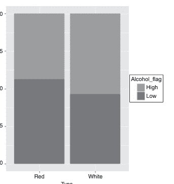
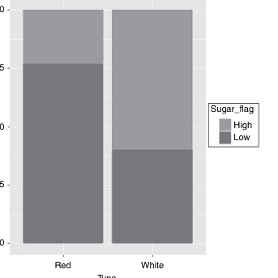

图 8.3 带有 Alcohol_flag（顶部）和 Sugar_flag（底部）叠加的 Type 归一化条形图。

要计算 p(Red | Alcohol_flag = Low, Sugar_flag = Low)，我们建立贝叶斯定理：

```
p(Y = y_i | X') = \frac{p(X' | Y = y_i) p(Y = y_i)}{p(X')}
= \frac{p(Alcohol\_flag = Low, Sugar\_flag = Low | Red) \times p(Red)}{p(Alcohol\_flag = Low, Sugar\_flag = Low)}
= \frac{p(Alcohol\_flag = Low | Type = Red) \times p(Sugar\_flag = Low | Type = Red) \times p(Red)}{p(Alcohol\_flag = Low) \times p(Sugar\_flag = Low)}
```

请注意，我们使用条件独立性假设来得到最后这一步。

我们已经计算出求解此方程所需的每个概率，因此代入每个数值并进行计算：

```
\frac{0.564 \times 0.768 \times 0.5}{0.514 \times 0.584} = 0.7215
```

鉴于其酒精和糖分含量均较低，葡萄酒是红酒的概率约为 72.15%。

接下来，我们需要求出 p(White | Alcohol_flag = Low, Sugar_flag = Low)：

```
p(Y = y_i | X') = \frac{p(X' | Y = y_i) p(Y = y_i)}{p(X')}
= \frac{p(Alcohol\_flag = Low, Sugar\_flag = Low | White) \times p(White)}{p(Alcohol\_flag = Low, Sugar\_flag = Low)}
= \frac{p(Alcohol\_flag = Low | Type = White) \times p(Sugar\_flag = Low | Type = White) \times p(White)}{p(Alcohol\_flag = Low) \times p(Sugar\_flag = Low)}
```

我们已经计算出求解此方程所需的每个概率，因此代入每个数值并进行计算：

```
\frac{0.464 \times 0.4 \times 0.5}{0.514 \times 0.584} = 0.3092
```

鉴于其酒精和糖分含量均较低，葡萄酒是白酒的概率约为 30.92%。由于酒精和糖分含量均较低的葡萄酒是红酒的后验概率高于其是白酒的后验概率，朴素贝叶斯算法将把该葡萄酒分类为红酒。

让我们将葡萄酒是红酒的先验概率与鉴于其酒精和糖分含量较低时葡萄酒是红酒的后验概率进行比较。随机选择的葡萄酒是红酒的概率为 p(Type = Red) = 50%。但是，在考虑到该葡萄酒酒精和糖分含量较低后，它是红酒的概率上升到了 72.15%？为什么？因为数据告诉我们，与白葡萄酒相比，红葡萄酒更有可能酒精含量较低（56.4% 对比 46.4%），并且与白葡萄酒相比，红葡萄酒也更有可能糖分含量较低（76.8% 对比 40%）。朴素贝叶斯考虑了这些信息，并用其得出结论：酒精和糖分含量较低的葡萄酒更可能是红酒而非白酒。

那么酒精和糖分含量均较高的葡萄酒呢？我们使用与上面相同的公式，更改 X' 值以反映我们的新值。我们想比较两个后验概率：

- p(Y = y_1 | X') = p(Red | Alcohol_flag = High, Sugar_flag = High)
- p(Y = y_1 | X') = p(White | Alcohol_flag = High, Sugar_flag = High)

让我们先从 p(Red | Alcohol_flag = High, Sugar_flag = High) 开始。

```
p(Y = y_1 | X') = \frac{p(X' | Y = y_1) p(Y = y_1)}{p(X')}
= \frac{p(Alcohol\_flag = High, Sugar\_flag = High | Red) \times p(Red)}{p(Alcohol\_flag = High, Sugar\_flag = High)}
= \frac{p(Alcohol\_flag = High | Type = Red) \times p(Sugar\_flag = High | Type = Red) \times p(Red)}{p(Alcohol\_flag = High) \times p(Sugar\_flag = High)}
```

将特定概率代入上述公式，我们得到后验概率：

```
\frac{0.436 \times 0.232 \times 0.5}{0.486 \times 0.416} = 0.2502
```

鉴于其酒精和糖分含量均较高，葡萄酒是红酒的概率约为 25.02%。

接下来，p(White | Alcohol_flag = High, Sugar_flag = High)。

```
p(Y = y_1 | X') = \frac{p(X' | Y = y_1) p(Y = y_1)}{p(X')}
= \frac{p(Alcohol\_flag = High, Sugar\_flag = High | White) \times p(White)}{p(Alcohol\_flag = High, Sugar\_flag = High)}
= \frac{p(Alcohol\_flag = High | Type = White) \times p(Sugar\_flag = High | Type = White) \times p(White)}{p(Alcohol\_flag = High) \times p(Sugar\_flag = High)}
```


将上述公式中的具体概率代入，我们得到后验概率：

\(\frac{0.536 \times 0.6 \times 0.5}{0.486 \times 0.416} = 0.7953\)

酒精和糖分含量均高的葡萄酒为白葡萄酒的概率约为 79.53%。由于高酒精、高糖葡萄酒为白葡萄酒的后验概率高于同一葡萄酒为红葡萄酒的后验概率，Naive Bayes 算法将该葡萄酒分类为白葡萄酒。

预测变量还有两种组合尚未介绍：低酒精和高糖，以及高糖和低酒精。低酒精、高糖葡萄酒的 Naive Bayes 分类为白葡萄酒，高酒精、低糖葡萄酒的 Naive Bayes 分类为红葡萄酒。这些葡萄酒的后验概率计算细节留作练习。综上所述，Naive Bayes 分类模型可由表 8.1 总结。

我们可以使用测试数据集来评估上述示例中发现的 Naive Bayes 模型。在本示例中，我们使用 wine_flag_test 数据来评估使用 wine_flag_training 数据集构建的模型。Type 的实际值和预测值的列联表如图 8.4 所示。

从图 8.4 可以看出，模型的准确率为 (464+1082)/2345 = 0.6593。使用我们的 Naïve Bayes 模型，我们有 65.93% 的时间能正确预测葡萄酒类型。我们的模型有 464/585 = 0.7932，即 79.32% 的时间能正确分类红葡萄酒，有 1082/1760 = 0.6148，即 61.48% 的时间能正确分类白葡萄酒。由于一半葡萄酒是红葡萄酒，一半是白葡萄酒，我们的基准准确率为 50%，因此我们的 Naïve Bayes 模型优于基准模型。

表 8.1 基于酒精和糖分含量预测葡萄酒类型的 Naive Bayes 模型摘要

| 酒精含量为... | 且糖分含量为... | 则我们将该葡萄酒分类为... |
| :--- | :--- | :--- |
| ... 高 ... | ... 高 ... | 白葡萄酒 |
| ... 高 ... | ... 低 ... | 红葡萄酒 |
| ... 低 ... | ... 高 ... | 白葡萄酒 |
| ... 低 ... | ... 低 ... | 红葡萄酒 |

| | 预测：红 | 预测：白 | 总计 |
| :--- | :--- | :--- | :--- |
| 实际：红 | 464 | 121 | 585 |
| 实际：白 | 678 | 1082 | 1760 |
| 总计 | 1142 | 1203 | 2345 |

图 8.4 R 中针对在测试数据集上评估的 Naive Bayes 模型，实际葡萄酒 Type 与预测葡萄酒 Type 的列联表。

#### 8.5.1 Python 中的 Naïve Bayes

首先导入所有所需的库。

```python
import pandas as pd
import numpy as np
from sklearn.naive_bayes import MultinomialNB
import statsmodels.tools.tools as stattools
```

加载训练和测试数据集，并分别将它们命名为 wines_tr 和 wines_test。

```python
wine_tr = pd.read_csv("C:/.../wine_flag_training.csv")
wine_test = pd.read_csv("C:/.../wine_flag_test.csv")
```

首先，我们使用列联表查看数据。这些表将使我们能够获得执行手动 Naïve Bayes 计算所需的边缘概率和条件概率（如果我们选择这样做的话）。

```python
t1 = pd.crosstab(wine_tr['Type'], wine_tr['Alcohol_flag'])
t1['Total'] = t1.sum(axis=1)
t1.loc['Total'] = t1.sum()
t1
```

表格如图 8.5 所示。从中，我们可以获得 Type、Alcohol_flag 和 Sugar_flag 的边缘概率，以及给定 Type 时的 Alcohol_flag 和 Sugar_flag 的条件概率。

我们还可以创建柱状图来可视化表格中的概率。为此，我们需要调整列联表的代码，如第 4 章所述。

```python
t1_plot = pd.crosstab(wine_tr['Alcohol_flag'], wine_tr['Type'])
t1_plot.plot(kind='bar', stacked = True)
```

现在我们转向 Naïve Bayes 算法本身。与之前一样，sklearn 不会自动处理分类变量。这意味着在运行算法之前，我们需要将 Alcohol_flag 和 Sugar_flag 转换为它们的虚拟变量版本。我们遵循与第 6 章相同的方法。

```python
X_Alcohol_ind = np.array(wine_tr['Alcohol_flag'])
(X_Alcohol_ind , X_Alcohol_ind_dict) = stattools.categorical(X_Alcohol_ind,
drop=True, dictnames = True)
X_Alcohol_ind = pd.DataFrame(X_Alcohol_ind)
X_Sugar_ind = np.array(wine_tr['Sugar_flag'])
(X_Sugar_ind , X_Sugar_ind_dict) = stattools.categorical(X_Sugar_ind,
    drop=True, dictnames = True)
X_Sugar_ind = pd.DataFrame(X_Sugar_ind)
X = pd.concat([X_Alcohol_ind, X_Sugar_ind], axis = 1)
```

| Alcohol_flag | 高 | 低 | 总计 |
| :--- | :--- | :--- | :--- |
| Type | | | |
| 红 | 218 | 282 | 500 |
| 白 | 268 | 232 | 500 |
| 总计 | 486 | 514 | 1000 |

| Sugar_flag | 高 | 低 | 总计 |
| :--- | :--- | :--- | :--- |
| Type | | | |
| 红 | 116 | 384 | 500 |
| 白 | 300 | 200 | 500 |
| 总计 | 416 | 584 | 1000 |

图 8.5 Python 中 Type 与 Alcohol_flag（左）以及 Type 与 Sugar_flag（右）的列联表。

在 X（我们的预测虚拟变量矩阵）中，有四列。前两列对应 Alcohol_flag，其中第一列如果酒精含量高则为 1，否则为 0。同样，第二列如果酒精含量低则为 1，否则为 0。第三列和第四列同样对应高糖含量和低糖含量。我们还将目标变量保存为 Y，以便清晰。

```python
Y = wine_tr['Type']
```

最后，我们转向 Naïve Bayes 算法。

```python
nb_01 = MultinomialNB().fit(X, Y)
```

与之前的算法一样，有两个步骤：指定算法的参数，并将特定于参数的算法拟合到数据。在本例中，对于 MultinomialNB 算法，没有额外参数需要设置。当我们将模型拟合到 X 和 Y 变量时，我们将输出保存为 nb_01。

要在测试数据上测试 Naïve Bayes 估计器，我们首先需要将测试数据集中的 X 变量设置为虚拟变量。我们遵循与训练数据相同的步骤，如下所示。

```python
X_Alcohol_ind_test = np.array(wine_test['Alcohol_flag'])
(X_Alcohol_ind_test, X_Alcohol_ind_dict_test) =
    stattools.categorical(X_Alcohol_ind_test,
        drop=True, dictnames = True)
X_Alcohol_ind_test = pd.DataFrame(X_Alcohol_ind_test)
X_Sugar_ind_test = np.array(wine_test['Sugar_flag'])
(X_Sugar_ind_test, X_Sugar_ind_dict_test) = stattools.categorical(X_Sugar_ind_test,
    drop=True, dictnames = True)
X_Sugar_ind_test = pd.DataFrame(X_Sugar_ind_test)
X_test = pd.concat([X_Alcohol_ind_test, X_Sugar_ind_test], axis = 1)
```

一旦我们设置了测试数据集的预测变量，就可以生成预测。

```python
Y_predicted = nb_01.predict(X_test)
```

| | 红 | 白 | 总计 |
|---|---|---|---|
| 红 | 464 | 121 | 585 |
| 白 | 678 | 1082 | 1760 |
| 总计 | 1142 | 1203 | 2345 |

图 8.6 Python 中实际和预测葡萄酒类型的列联表。

在我们的 Naive Bayes 对象 **nb_01** 上使用 **predict()** 命令将为测试数据集中的每条记录生成一个标签数组，红 或 白。

最后，我们想要实际和预测葡萄酒类型的列联表。

我们再次使用 **crosstab()** 命令。

```python
ypred = pd.crosstab(wine_test['Type'], Y_predicted,
rownames = ['Actual'],
colnames = ['Predicted'])
ypred['Total'] = ypred.sum(axis=1); ypred.loc['Total'] =
ypred.sum(); ypred
```

变量 **wine_test['Type']** 中的真实葡萄酒类型构成行，预测葡萄酒类型 **Y_predicted** 构成列。可选输入值 **rownames** 和 **colnames** 标记行和列的开头，以提高表格的可读性。总行和总列是按照本节开头使用的列联表相同的步骤添加的。结果如图 8.6 所示。

#### 8.5.2 R 中的 Naïve Bayes

将 **wine_flag_training** 和 **wine_flag_test** 数据集导入 R，并分别将它们命名为 **wine_tr** 和 **wine_test**。

我们首先创建表格，以便在选择时手动计算所需的概率。第一个表将是 **Type** 和 **Alcohol_flag** 的列联表。

```r
ta <- table(wine_tr$Type, wine_tr$Alcohol_flag)
colnames(ta) <- c("Alcohol = High", "Alcohol = Low")
rownames(ta) <- c("Type = Red", "Type = White")
addmargins(A = ta, FUN = list(Total = sum), quiet = TRUE)
```

**addmargins()** 命令的结果显示在图 8.1 的列联表中。

第二个表将是 **Type** 和 **Sugar_flag** 的列联表。

```r
ts <- table(wine_tr$Type, wine_tr$Sugar_flag)
colnames(ts) <- c("Sugar = High", "Sugar = Low")
rownames(ts) <- c("Type = Red", "Type = White")
addmargins(A = ts, FUN = list(Total = sum), quiet = TRUE)
```


addmargins()命令的结果显示在图8.2的列联表中。

我们还可以创建图8.3中所示的并排条形图。核心代码是ggplot()代码，本文前面已介绍过。但是，为了将图表并排放置，我们将调整核心代码。

首先，安装允许我们将图表并排放置的包：gridExtra包。

```
install.packages("gridExtra"); library(gridExtra)
```

然后，运行如所示的ggplot()代码。

```
plot1 <- ggplot(wine_tr, aes(Type)) + geom_bar(aes(fill =
Alcohol_flag), position = "fill") +
ylab("Proportion")
```

```
plot2 <- ggplot(wine_tr, aes(Type)) + geom_bar(aes(fill =
Sugar_flag), position = "fill") +
ylab("Proportion")
```

```
grid.arrange(plot1, plot2, nrow = 1)
```

ggplot()代码本身来自第4章，应该很熟悉。请注意，我们为每个图保存自己的名称；plot1用于Alcohol_flag叠加，plot2用于Sugar_flag叠加。保存每个图后，我们运行grid.arrange()命令，包含三个输入值：plot1、plot2和nrow = 1，以指定我们希望图表在一行中并排显示。结果显示在图8.3的并排图表中。

现在我们有了列联表和图表，接下来进入朴素贝叶斯算法。e1071包包含朴素贝叶斯分类算法。安装并打开该包。

```
install.packages("e1071"); library(e1071)
```

运行朴素贝叶斯估计器。

```
nb01 <- naiveBayes(formula = Type ~ Alcohol_flag +
Sugar_flag, data = wine_tr)
```

naiveBayes()命令将构建模型。formula输入将波浪号左侧的目标变量Type和波浪号右侧的两个预测变量Alcohol_flag和Sugar_flag（用加号分隔）作为输入。data输入指定这些变量来源的数据集。我们将模型保存为nb01。

要观察朴素贝叶斯模型中使用的先验概率和条件概率，请单独运行模型名称。

```
nb01
```

离散预测器的朴素贝叶斯分类器
调用：
naiveBayes.default(x = X, y = Y, laplace = laplace)

先验概率：

| Y | 概率 |
|---|-------------|
| Red | 0.5 |
| White | 0.5 |

条件概率：

Alcohol_flag

| Y | High | Low |
|---|------|-----|
| Red | 0.436 | 0.564 |
| White | 0.536 | 0.464 |

Sugar_flag

| Y | High | Low |
|---|------|-----|
| Red | 0.232 | 0.768 |
| White | 0.600 | 0.400 |

图8.7 R中朴素贝叶斯模型的输出。

输出显示在图8.7中。

输出中两个主要关注项是**先验概率**和**条件概率**。先验概率是p(Y)的值，条件概率是p(X|Y)的结果值。

要预测测试数据集中每种葡萄酒的类型，我们使用**predict()**命令

```
ypred <- predict(object = nb01, newdata = wine_test)
```

object = nb01指定我们使用的是我们的朴素贝叶斯模型，newdata = wine_test说明要使用的测试数据集。该算法将测试数据集中的每条记录分类为白葡萄酒或红葡萄酒，并将分类字符串保存为ypred。

最后，我们创建实际与预测葡萄酒类型的列联表。

```
t.preds <- table(wine_test$Type, ypred)
rownames(t.preds) <- c("Actual: Red", "Actual: White")
colnames(t.preds) <- c("Predicted: Red", "Predicted: White")
addmargins(a = t.preds, FUN = list(Total = sum), quiet = TRUE)
```

addmargins()命令的结果显示在图8.4中。

### 参考文献

我们使用了一个新包gridExtra来格式化多个ggplot图表。如果您想了解新包的内部工作原理的更多细节，请查看此处：Baptiste Auguie, gridExtra: “Grid”图形的杂项函数。R包版本2.3，2017年。https://CRAN.R-project.org/package=gridExtra.

e1071包远不止朴素贝叶斯！有关完整描述，请参阅引用：David Meyer, Evgenia Dimitriadou, Kurt Hornik, Andreas Weingessel, 和 Friedrich Leisch, e1071: 维也纳科技大学统计学、概率论小组（原E1071）的杂项函数。R包版本1.6-8，2017年。http://CRAN.R-project.org/package=e1071.

### 练习

### 澄清概念

- 1. 贝叶斯定理使用什么信息来更新我们对数据参数的先前知识？
- 2. 先验概率代表什么？
- 3. 什么公式表示数据在目标变量的类别值内的表现？
- 4. 什么公式表示数据在不参考类别值的情况下的表现？
- 5. 上一练习中的公式称为什么？
- 6. 后验概率代表什么？
- 7. 如果我们对参数没有任何先验知识，使用什么作为先验概率？
- 8. 最大后验假设如何帮助我们对记录进行分类？
- 9. 类条件独立性假设是什么？
- 10. 如果有多个预测变量，当有两个预测变量X = [X1, x2, X3]时，如何写出p(X|Y = y')？

### 使用数据

对于以下练习，使用wine_flag_training和wine_flag_test数据集。使用Python或R解决每个问题。

- 11. 创建两个列联表，一个包含Type和Alcohol_flag，另一个包含Type和Sugar_flag。
- 12. 使用上一练习中的表格计算：
  - a. Type = Red和Type = White的先验概率。
  - b. 高和低酒精含量的概率。
  - c. 高和低糖含量的概率。
  - d. 条件概率p(Alcohol_flag = High| Type = Red)和p(Alcohol_flag = Low| Type = Red)。
  - e. 条件概率p(Alcohol_flag = High| Type = White)和p(Alcohol_flag = Low| Type = White)。
  - f. 条件概率p(Sugar_flag = High | Type = Red)和p(Sugar_flag = Low | Type = Red)。
  - g. 条件概率p(Sugar_flag = High | Type = White)和p(Sugar_flag = Low | Type = White)。

- 13. 使用上一练习中的概率讨论：
  - a. 随机选取的葡萄酒是红葡萄酒的可能性有多大。
  - b. 随机选取的葡萄酒具有高酒精含量的可能性有多大。
  - c. 随机选取的葡萄酒具有低糖含量的可能性有多大。

- 14. 使用之前找到的条件概率讨论：
  - a. 典型白葡萄酒的酒精和糖含量可能是多少。
  - b. 典型红葡萄酒的酒精和糖含量可能是多少。

- 15. 为Type创建并排条形图，一个叠加Alcohol_flag，另一个叠加Sugar_flag。将图表与您计算的条件概率进行比较。

- 16. 计算酒精含量低且糖含量高的葡萄酒的Type = Red的后验概率。计算同一葡萄酒的Type = White的后验概率。

- 17. 使用您对上一练习的回答，确定对于酒精含量低且糖含量高的葡萄酒，红葡萄酒还是白葡萄酒更可能。朴素贝叶斯分类器会将此葡萄酒分类为什么类型？

- 18. 计算酒精含量高且糖含量低的葡萄酒的Type = Red的后验概率。计算同一葡萄酒的Type = White的后验概率。

- 19. 使用您对上一练习的回答，确定对于酒精含量高且糖含量低的葡萄酒，红葡萄酒还是白葡萄酒更可能。朴素贝叶斯分类器会将此葡萄酒分类为什么类型？

- 20. 运行朴素贝叶斯分类器，根据酒精和糖含量将葡萄酒分类为白葡萄酒或红葡萄酒。

- 21. 在wines_test数据集上评估朴素贝叶斯模型。在列联表中显示结果。编辑表格的行名和列名，使表格更易读。包含总计行和列。

- 22. 根据您在上一练习中的表格，找出朴素贝叶斯模型的以下值：
  - a. 准确率
  - b. 错误率

- 23. 根据您的列联表，找出朴素贝叶斯模型的以下值：
  - a. 它正确分类红葡萄酒的频率。
  - b. 它正确分类白葡萄酒的频率。


### 实践分析

对于以下练习，请使用 framingham_nb_training 和 framingham_nb_test 数据集。使用 Python 或 R 之一来解决每个问题。

- 24. 将所有变量（Death、Sex 和 Educ）转换为因子。
- 25. 创建两个列联表，一个包含 Death 和 Sex，另一个包含 Death 和 Educ。
- 26. 使用上一练习中的表格计算：
  - a. 随机选中的人存活或死亡的概率。
  - b. 随机选中的人是男性的概率。
  - c. 随机选中的人 Educ 值为 3 的概率。
  - d. 已死亡者为教育水平 1 的男性的概率，以及存活者为教育水平 1 的男性的概率。
  - e. 存活者为教育水平 2 的女性的概率，以及已死亡者为教育水平 2 的女性的概率。
- 27. 为 Death 创建并排条形图，一个叠加 Sex，另一个叠加 Educ。
- 28. 使用上一练习中的图表回答以下问题：
  - a. 如果知道某人已死亡，他们更可能是男性还是女性？
  - b. 如果知道某人存活，他们更可能是男性还是女性？
  - c. 如果知道某人已死亡，他们最可能拥有什么教育水平？
  - d. 如果知道某人存活，他们最可能拥有什么教育水平？
  - e. 哪些教育水平在死亡者中更普遍？在生存者中呢？
- 29. 计算教育水平为 1 的男性 Death = 0（人存活）的后验概率。计算教育水平为 1 的男性 Death = 1（人已死亡）的后验概率。
- 30. 计算教育水平为 2 的女性 Death = 0（人存活）的后验概率。计算教育水平为 2 的女性 Death = 1（人已死亡）的后验概率。
- 31. 运行朴素贝叶斯分类器，根据性别和教育程度将人分类为存活或死亡。
- 32. 在 framingham_nb_test 数据集上评估朴素贝叶斯模型。在列联表中显示结果。编辑行和列名以使表格更易读。包含总计行和列。
- 33. 根据上一练习中的列联表，求朴素贝叶斯模型的以下值：
  - a. 准确率
  - b. 错误率
- 34. 根据列联表，求朴素贝叶斯模型的以下值：
  - a. 它正确分类死亡者的频率。
  - b. 它正确分类生存者的频率。

### 9.1 神经网络简介

神经网络试图在最基本的层面上模仿自然界中神经元网络（如人脑）中发生的非线性学习类型。如图 9.1 所示，人脑中的神经元使用树突收集来自其他神经元的输入并结合输入信息，当达到某个阈值时产生非线性响应（“发放”），并通过轴突将其发送到其他神经元。图 9.1 还显示了大多数神经网络中使用的人工神经元模型。输入（x_i）从上游神经元（或数据集）收集，并通过求和（Σ）等组合函数结合，然后输入到（通常是非线性的）激活函数中以产生输出响应（y），该响应随后可能被传输到下游的其他神经元。

神经网络的主要优点是，由于激活函数的非线性特性，它们对噪声、复杂或非线性数据非常稳健。另一方面，神经网络的主要缺点是，与决策树相比，它们对人类解释来说相对不透明。

### 9.2 神经网络结构

让我们来看看图 9.2 中所示的简单神经网络。

神经网络由分层的、前馈的、完全连接的人工神经元或节点网络组成。

- 网络的前馈特性将网络限制为单向流动，不允许循环或环路。
- 大多数网络由三层组成：输入层、隐藏层和输出层。
  - 可能有多个隐藏层，尽管大多数网络只包含一个，这对于大多数目的来说已经足够了。

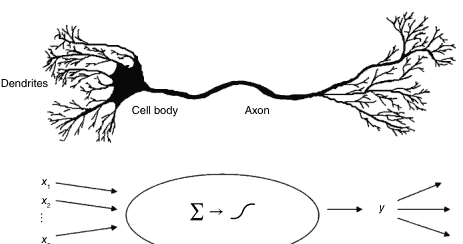
图 9.1 真实神经元和人工神经元模型。

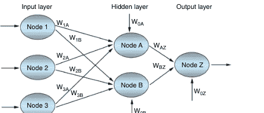
图 9.2 神经网络简单示例。

- 神经网络是完全连接的，这意味着给定层中的每个节点都与相邻层中的每个节点相连，但不与同一层中的其他节点相连。
- 节点之间的每个连接都有一个相关的权重（例如 $W_{i,j}$）。
- 在初始化时，这些权重被随机分配给 0 到 1 之间的值。

输入节点的数量取决于数据集中属性的数量和类型。输入层接受来自数据集的输入，例如属性值，并简单地将这些值传递给隐藏层，无需进一步处理。

隐藏层的数量和每个隐藏层中的节点数量均由分析师配置。隐藏层中应该有多少个节点？由于隐藏层中节点越多，网络识别复杂模式的能力和灵活性就越强，人们可能会倾向于在隐藏层中设置大量节点。然而，过大的隐藏层会导致过拟合，以牺牲对验证集的泛化能力为代价来记忆训练集。如果发生过拟合，可以考虑减少隐藏层中的节点数量。相反，如果训练准确率不可接受地低，可以考虑增加隐藏层中的节点数量。

### 9.3 连接权重和组合函数

隐藏层和输出层中的节点会收集来自前一层的输入，并使用*组合函数*将其结合。该组合函数（通常是求和，\(\Sigma\)）将节点输入和连接权重的线性组合生成一个单一标量值，我们将其称为*net*。因此，对于给定的节点 \(j\)，

$$
net_j = \sum_i W_{ji} x_{ij} = W_{j0} x_{0j} + W_{j1} x_{1j} + ... + W_{jI} x_{Ij}
$$

其中 \(x_{ij}\) 表示节点 \(j\) 的第 \(i\) 个输入，\(W_{ji}\) 表示与节点 \(j\) 的第 \(i\) 个输入相关的权重，且节点 \(j\) 有 \(I+1\) 个输入。请注意，\(x_1, x_2, ..., x_I\) 表示来自上游节点的输入，而 \(x_i\) 表示一个*常数输入*，类似于回归模型中的常数项，按惯例唯一取值 \(x_0 = 1\)。因此，每个隐藏层或输出层节点 \(j\) 包含一个“额外”输入，等于特定权重 \(W_{j0}x_{0j} = W_{j0}\)，例如节点 \(B\) 的 \(W_{j0}\)。

我们使用表 9.1 中提供的玩具示例数据来说明隐藏层节点和输出层节点的结构。

例如，对于隐藏层中的节点 A，我们有

$$
net_A = \sum_i W_{iA} x_{iA} = W_{0A}(1) + W_{1A} x_{1A} + W_{2A} x_{2A} + W_{3A} x_{3A} = 0.5 + 0.6(0.4) + 0.80(0.2) + 0.6(0.7) = 1.32
$$

因此，在图 9.3 中，我们看到节点 A 将其输入组合为 1.32 的*净输入*。在节点 A 内部，此组合函数 \(net_A = 1.32\) 然后用作激活函数的输入。在生物神经元中，信号在神经元之间传输

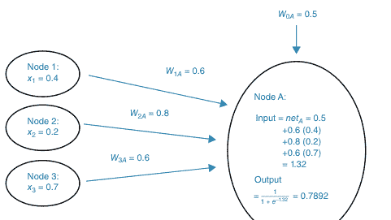

图 9.3 神经网络详情，显示节点 A 的输入、组合函数和来自节点 A 的输出。

当特定神经元的输入组合超过某个阈值且神经元“发放”时，信号会在神经元之间传输。这是非线性行为，因为发放响应不一定与输入刺激的增量呈线性关系。

最常见的激活函数是 Sigmoid 函数：

$$
y = \frac{1}{1 + e^{-x}}
$$

其中 e 是自然对数的底数，约等于 2.718281828。因此，在节点 A 内部，激活函数将 net_A = 1.32 作为输入传递给 Sigmoid 激活函数，并产生输出值

$$
y = f(net_A) = \frac{1}{1 + e^{-1.32}} = 0.7892
$$

节点 A 的工作暂时完成，然后该输出值将沿连接传递到输出节点 Z，在那里它将通过另一次线性组合成为 net_z 的一个组成部分。

将计算 net_z = 1.5 和 f(net_z) = \frac{1}{1 + e^{-1.3}} = 0.8176 作为练习留给读者。

然后，节点 Z 通过 net_z（一个加权和）结合来自节点 A 和 B 的这些输出，使用这些节点之间连接相关的权重。请注意，节点 Z 的输入 x_i 不是数据属性值，而是来自上游节点的 Sigmoid 函数输出：

**表 9.1 神经网络权重的数据输入和初始值**

| x_i = 1.0 | W_0A = 0.5 | W_0w = 0.7 | W_0z = 0.5 |
|---|---|---|---|
| x_i = 0.4 | W_1A = 0.6 | W_1w = 0.9 | W_2z = 0.9 |
| x_i = 0.2 | W_2A = 0.8 | W_2w = 0.8 | W_3z = 0.9 |
| x_i = 0.7 | W_3A = 0.6 | W_3w = 0.4 | — |


net_z = \sum W_{iz}x_{iz} = W_{0z}(1) + W_{az}x_{az} + W_{bz}x_{bz}
= 0.5 + 0.9(0.7892) + 0.9(0.8176) = 1.9461

最后，net_z 作为输入传入节点 Z 中的 Sigmoid 激活函数，得到

f(net_z) = \frac{1}{1 + e^{-1.9461}} = 0.8750

这个 0.8750 的值是神经网络第一次前向传递时的输出，代表了对第一个观测值目标变量的预测值。

### 9.4 Sigmoid 激活函数

一种常见的激活函数是 Sigmoid 函数

y = f(x) = \frac{1}{1 + e^{-x}}

为什么使用 Sigmoid 函数？因为它结合了近似线性行为、曲线行为和近似常数行为，具体取决于输入的值。图 9.4 显示了 -5 < x < 5 范围内 Sigmoid 函数的图像。在输入 x 域的大部分中心区域（例如，-1 < x < 1），f(x) 的行为近似线性。当输入远离中心时，f(x) 变为曲线行为。当输入达到极端值时，f(x) 变为近似常数。x 值的中等增量会产生不同大小的 f(x) 增量，具体取决于 x 的位置。靠近中心时，x 值的中等增量会产生 f(x) 值的中等增量；然而，靠近极端值时，x 值的中等增量只会产生 f(x) 值的微小增量。

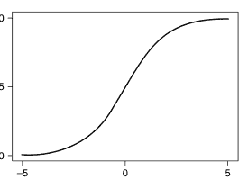

图 9.4 Sigmoid 函数 y = f(x) = 1/(1 + e^-x) 的图像。

### 9.5 反向传播

神经网络如何学习？当训练集中的每个观测值通过网络处理时，输出节点会产生一个输出值。然后将此输出值与该训练集观测值的目标变量实际值进行比较，并计算误差（实际 – 输出）。这个预测误差类似于线性回归模型中的预测误差。为了衡量输出预测与实际目标值的拟合程度，大多数神经网络模型使用误差平方和（SSE）：

SSE = \sum_{records} \sum_{output nodes} (actual - output)^2

其中，平方预测误差在所有输出节点和训练集中的所有记录上求和。因此，问题是要*构建一组可最小化 SSE 的模型权重*。这样一来，权重类似于回归模型的参数。可最小化 SSE 的权重的“真实”值是未知的，我们的任务是根据数据对它们进行估计。

然而，由于渗透网络的 Sigmoid 函数的非线性特性，不存在像最小二乘回归那样用于最小化 SSE 的解析解。随后使用优化方法，具体来说是梯度下降方法。

反向传播算法执行以下操作：

- 1. 它获取特定记录的预测误差（实际 – 输出），并将误差向回通过网络传递。
- 2. 将误差的分担责任分配给各个连接。
- 3. 然后使用梯度下降法调整这些连接上的权重以减小误差。¹

### 9.6 神经网络模型的一个应用

接下来，我们将使用 Framingham Heart Study 数据的一个子集，介绍一个神经网络模型示例。² 数据集 *Framingham_training* 包含 7953 名患者的三个变量的信息。*性别* 是一个二元预测变量，1 = 男性，2 = 女性。年龄是一个连续预测变量。目标变量是死亡，取值 0 = 存活，1 = 死亡。通过探索性数据分析，具体来说是通过图 9.5 和 9.6 以及表 9.2 和 9.3，获得预测变量与目标变量之间关系的线索。图 9.5 和 9.6 中的直方图显示，随着年龄的增加，死亡的比例增加。表 9.2 和 9.3 显示，与女性相比，男性死亡的比例更大。因此，这些相互关系应当体现在我们的神经网络模型结果中。

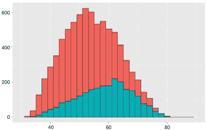

图 9.5 来自 R 的年龄直方图，带有死亡叠加。

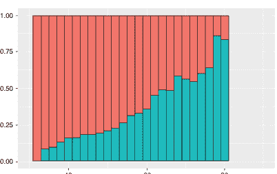

图 9.6 来自 R 的年龄归一化直方图，带有死亡叠加。

#### 表 9.2 性别和死亡的列联表

| | 男性 | 女性 | 总计 |
|---|---|---|---|
| Death 0 | 2113 | 3422 | 5535 |
| 1 | 1324 | 1094 | 2418 |
| 总计 | 3437 | 4516 | 7953 |

#### 表 9.3 带有列百分比的性别和死亡列联表

| | 男性 (%) | 女性 (%) |
|---|---|---|
| Death 0 | 61.5 | 75.8 |
| 1 | 38.5 | 24.2 |

为清晰起见，我们只选择一个隐藏层，且仅包含一个神经元。图 9.7 显示了使用 R 构建、由 Framingham_training 数据集生成的神经网络模型。

### 9.7 解释神经网络模型中的权重

神经网络模型中的权重代表了模型在给定数据的情况下试图告诉你的内容。这些权重类似于回归模型中的预测变量系数。让我们从图 9.7 的权重中提取可获取的信息。

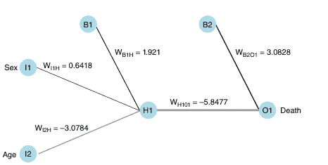

图 9.7 基于 Framingham Heart Study 数据的神经网络模型。

首先，让我们忽略偏置（常数项）权重 B1 和 B2，因为它们不影响预测变量与响应变量之间的关系。接下来，回顾我们的探索性数据分析（EDA），其中我们发现，年龄更大和男性性别都与 Framingham Heart Study 中更高的死亡概率相关。另外，性别是一个二元预测变量，1 = 男性，2 = 女性，因此性别值的增加应与死亡概率降低相关。让我们看看这些 EDA 结果是如何以及是否体现在神经网络权重中。

现在，隐藏层节点 H1 与输出节点 O1 之间的权重取负值，$W_{H1O1} = -5.8477$。因此，当隐藏层节点 H1 被激发到高值时，由于这个负权重，它实际上对死亡具有保护作用，降低了其概率。

接下来，从性别预测变量到隐藏层节点的权重取正值，$W_{SexH1} = 0.6418$。这意味着性别的较大值（女性）倾向于将隐藏神经元 H1 激发到更高的值。正如我们刚才了解到的，H1 的这种高值会降低死亡概率。因此，权重告诉我们，女性有助于防范死亡概率，这与我们在 EDA 中看到的情况一致。

最后，从年龄预测变量到隐藏层节点的权重取负值，$W_{AgeH1} = -3.0784$。这意味着年龄的较高值会导致隐藏层神经元 H1 的值较低。H1 到输出节点 O1 的低值会导致较高的死亡概率，因为其权重也是负的。因此，权重告诉我们，年龄增加与死亡概率增加相关，这与我们在 EDA 中看到的情况完全一致。

### 9.8 如何在 R 中使用神经网络

首先，将 Framingham_training 数据集读入为 fram_train，并将二元和有序变量死亡和性别转换为因子。

```
fram_train$Death <- as.factor(fram_train$Death)
fram_train$Sex <- as.factor(fram_train$Sex)
```

对年龄变量执行最小-最大标准化

```
fram_train$Age.mm <- (fram_train$Age - min(fram_train$Age)) / (max(fram_train$Age) - min(fram_train$Age))
```

安装 nnet 和 NeuralNetTools 包，并打开这两个包。

```
install.packages("nnet"); install.packages("NeuralNetTools")
library(nnet); library(NeuralNetTools)
```

运行神经网络算法。

```
nnet01 <- nnet(Death ~ Sex + Age.mm, data = fram_train, size = 1)
```

注意公式结构，目标变量死亡在波浪号左侧，两个预测变量性别和年龄在右侧。The


data = fram_train 输入指定三个变量的来源。size = 1 命令表示隐藏层中有一个单位。

请注意，神经网络输出保存为 nnet01。保存输出是为了获取神经网络的图和权重所必需的。

接下来，绘制神经网络。

```
plotnet (nnet01)
```

使用 nnet01 输入的 plotnet() 命令的输出将与图 9.7 匹配。

最后，获取权重。

```
nnet01$wts
```

### 参考文献

NeuralNetTools 包可视化了我们的神经网络模型。要查看选项和其他功能，请查看该包的文档：M. Beck, NeuralNetTools: Visualization and Analysis Tools for Neural Networks. R package version 1.5.1, 2018. http://CRAN.R-project.org/package=NeuralNetTools.

nnet 包用于创建神经网络。有关更多信息，请参阅出版物：W. N. Venables and B. D. Ripley, Modern Applied Statistics with S, Fourth Edition, Springer, New York, 2002.

### 练习

### 澄清概念

- 1. 神经网络分类试图模仿什么？
- 2. 使用图 9.1，解释人工神经元模型如何模仿真实神经元的作用。
- 3. 神经网络用于建模的主要好处是什么？是什么赋予了神经网络这种能力？
- 4. 描述神经网络建模的主要缺点。
- 5. 解释当我们说神经网络是完全连接时是什么意思。
- 6. 描述在隐藏层中使用更多或更少节点的好处和缺点。
- 7. 参考文本中的示例，计算 net_k = 1.5 和 f(net_k) = 1 / (1 + e^-1.5) = 0.8176。
- 8. 解释 Sigmoid 函数如何结合近似线性行为、曲线行为和近似常数行为。
- 9. 描述反向传播的过程。
- 10. 神经网络的基本问题是构建一组权重，以最小化什么？

### 处理数据

对于以下练习，请使用 Framingham_training 和 Framingham_test 数据集。使用 Python 或 R 解决每个问题。

- 11. 将二进制或序数变量 Sex 和 Educ 转换为因子。
- 12. 运行神经网络算法，使用 Sex 和 Educ 预测 Death。
- 13. 绘制神经网络。
- 14. 获取神经网络的权重。识别网络的哪个部分具有哪个权重。
- 15. 使用 Framingham_test 数据集评估您的神经网络模型。构建列联表以比较 Death 的实际值和预测值。
- 16. 我们将您的神经网络模型与哪个基线模型进行比较？根据准确率，它是否优于基线？

### 实践分析

对于以下练习，请使用 adult_ch6_training 和 adult_ch6_test 数据集。使用 Python 或 R 解决每个问题。

- 17. 通过以下步骤为神经网络建模准备数据集：
- a. 如果 Cap_Gains_Losses 大于零，则创建一个等于一的二进制变量，否则等于零。将其命名为 CapGainsLossesPositive。
- b. 将 Marital.status、Income 和 CapGainsLossesPositive 转换为因子。
- 18. 使用训练数据集，创建一个神经网络模型，使用 Marital.status 和 CapGainsLossesPositive 预测客户的 Income。将此模型命名为 NNM1（神经网络模型 1）。获取预测响应。
- 19. 绘制 NNM1 神经网络。
- 20. 使用测试数据集评估 NNM1。构建列联表以比较 Income 的实际值和预测值。
- 21. 我们将 NNM1 与哪个基线模型进行比较？根据准确率，NNM1 是否优于基线？
- 22. 收集您在第 6 章和第 8 章练习中对 adult_ch6_training 和 adult_ch6_test 数据集之前建模的结果（列联表）。来自第 6 章，将 CART 模型称为 CARTM1，将 C5.0 模型称为 C5M1。来自第 8 章，将 Naive Bayes 模型称为 NBM1。
- 23. 根据以下标准，将 NNM1 结果与上一练习中的三个模型进行比较。详细讨论根据每个标准哪个模型表现最好和最差。
- a. 准确率
- b. 灵敏度
- c. 特异度

对于以下练习，请使用 bank_marketing_training 和 bank_marketing_test 数据集。使用 Python 或 R 解决每个问题。

- 24. 为神经网络建模准备数据集，包括标准化变量。
- 25. 使用训练数据集，创建一个神经网络模型，使用您认为合适的任何预测变量来预测客户的 Response。获取预测响应。
- 26. 绘制神经网络。
- 27. 使用测试数据集评估神经网络模型。构建列联表以比较 Response 的实际值和预测值。
- 28. 我们将您的神经网络模型与哪个基线模型进行比较？根据准确率，它是否优于基线？
- 29. 使用与神经网络模型相同的预测变量，使用以下算法构建模型来预测 Response：
- a. CART
- b. C5.0
- c. 朴素贝叶斯
- 30. 根据以下标准，将您的神经网络模型结果与上一练习中的三个模型进行比较。详细讨论根据每个标准哪个模型表现最好和最差。
- a. 准确率
- b. 灵敏度
- c. 特异度

## 第 10 章 聚类

### 10.1 什么是聚类？

聚类是指将记录、观测值或案例分组为相似对象的类。聚类是彼此相似且与其他聚类中的记录不相似的记录集合。聚类与分类不同，因为聚类没有目标变量。聚类任务不试图分类、估计或预测目标变量的值。相反，聚类算法试图将整个数据集分割为相对同质的子组或聚类，其中聚类内记录的相似性最大化，聚类外记录的相似性最小化。

例如，由 Claritas, Inc. 开发的 Nielsen PRIZM 分段代表了美国每个地理区域的人口统计特征，按邮编定义的不同生活方式类型。例如，加利福尼亚州比弗利山庄邮编 90210 识别出的聚类为：

- 聚类 01: Upper Crust Estates
- 聚类 03: Movers and Shakers
- 聚类 04: Young Digirati
- 聚类 07: Money and Brains
- 聚类 16: Bohemian Mix

聚类 01: Upper Crust 的描述是：“全国最独特的地址，Upper Crust 是美国最富有的生活方式，是 45 至 64 岁空巢夫妇的天堂。没有哪个分段的年收入超过 100,000 美元并拥有研究生学位的居民集中度更高。也没有哪个分段拥有更奢华的生活水平。”

商业和研究中的聚类任务示例包括：

- 针对没有大型营销预算的小型资本化企业的利基产品进行目标营销。

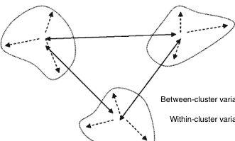

图 10.1 与组间变异相比，聚类内部变异应较小。

- 为了会计审计目的，将财务行为分为良性和可疑类别。
- 用于基因表达聚类，其中大量基因可能表现出相似行为。

聚类通常作为数据挖掘过程的初步步骤，生成的聚类被用作下游不同技术（例如神经网络）的进一步输入。由于当今许多数据库的巨大规模，首先应用聚类分析通常很有帮助，以减少下游算法的搜索空间。

所有聚类方法的目标都是识别记录组，使组内相似性非常高，而与其他组记录的相似性非常低。换句话说，如图 10.1 所示，聚类算法试图构建记录聚类，使组间变异大于组内变异。

### 10.2 K-Means 聚类算法简介

有多种不同的聚类方法，包括层次聚类、Kohonen 网络聚类和 BIRCH 聚类。1 在这里，我们将重点介绍 k-means 聚类算法。k-means 聚类算法2 是 a

1有关这些聚类方法的详细信息，请参见 Daniel T. Larose 和 Chantal D. Larose 所著《数据挖掘与预测分析》第二版，John Wiley and Sons, Inc., 2015。
2James B. MacQueen, Some methods for classification and analysis of multivariate observations. In Proceedings of the 5th Berkeley Symposium on Mathematical Statistics and Probability, Vol. 1, pp. 281–297, University of California Press, Berkeley, CA, 1967.


在数据中查找聚类的简单有效算法。该算法步骤如下：

- 步骤 1：询问用户数据集应划分为多少个聚类 k。
- 步骤 2：随机分配 k 条记录作为初始聚类中心位置。
- 步骤 3：对于每条记录，找到最近的聚类中心。从某种意义上说，每个聚类中心“拥有”记录的一个子集，从而代表数据集的一个划分。因此，我们有 k 个聚类，C1、C2、……、Ck。
- 步骤 4：对于每个 k 个聚类，找到聚类质心，并将每个聚类中心的位置更新为质心的新值。
- 步骤 5：重复步骤 3–5，直到收敛或终止。

步骤 3 中的“最近”准则通常是欧氏距离，尽管也可以应用其他准则。步骤 4 中的聚类质心计算如下。假设我们有 n 个数据点 (a1, b1, c1)、(a2, b2, c2)、……、(an, bn, cn)，这些点的质心是这些点的重心，位于点 (Σa/n, Σb/n, Σc/n)。例如，点 (1,1,1)、(1,2,1)、(1,3,1) 和 (2,1,1) 的质心为

\(\left( \frac{1+1+1+2}{4}, \frac{1+2+3+1}{4}, \frac{1+1+1+1}{4} \right) = (1.25, 1.75, 1.00)\)

当质心不再变化时，算法终止。换句话说，当所有聚类 C1、C2、……、Ck 中，每个聚类中心“拥有”的所有记录都保留在该聚类中时，算法终止。有关 k-means 聚类的更多信息，请参见《数据挖掘与预测分析》。

### 10.3 K-Means 聚类的应用

我们将 k-means 聚类算法应用于 white_wine_training 和 white_wine_test 数据集。这些数据集改编自 UCI 的 Wine Quality 数据集。3 数据包含一组葡萄牙白葡萄酒的化学和质量特征。预测变量为酒精和糖分。目标变量为 quality，即专业品酒师评定的葡萄酒质量。在构建聚类时，重要的是不要将目标变量作为聚类算法的输入。如果以后使用聚类来预测目标，这样做会使结果产生偏差。同样重要的是对所有预测变量进行标准化或归一化，以便某个预测变量的较大变异性不会主导聚类构建过程。

现在，k-means 算法要求分析人员指定所需的聚类数量。为简单起见，我们指定 k = 2 个聚类，并将 k-means 聚类算法应用于预测变量酒精和糖分。使用了 Python。表 10.1 显示了两个生成聚类中每个预测变量的平均值。聚类 1 包含 712 款葡萄酒，其平均糖分含量比训练数据集中所有白葡萄酒的总体平均糖分含量高出 0.96 个标准差。（也就是说，标准正态变量 sugar_z 在聚类 1 中的平均值为 0.96。）然而，聚类 1 的平均酒精含量比所有葡萄酒的平均酒精水平低 0.76 个标准差。另一方面，聚类 2 包含 1097 款葡萄酒，其平均糖分含量低于聚类 1（低于总体平均值 0.62 个标准差），但酒精含量较高，高于总体平均值 0.49 个标准差。

因此，我们可以将聚类 1 识别为“甜型葡萄酒”，糖分高但酒精低，而聚类 2 包含“干型葡萄酒”，糖分低但酒精劲头更大。也许，最重要的聚类验证方法是获得对学科专家有意义的聚类。快速的互联网搜索显示了我们在现实世界中如何获得这些不同的葡萄酒。“在发酵过程中，酵母将糖转化为……乙醇[酒精]……” 因此，我们的聚类算法发现这两种“自然”的白葡萄酒聚类：甜型葡萄酒和干型葡萄酒，这并不奇怪。总体而言，干型葡萄酒显然经历了比甜型葡萄酒更长的发酵过程。

3https://archive.ics.uci.edu/ml/datasets/wine+quality. 另见 P. Cortez, A. Cerdeira, F. Almeida, T. Matos, 和 J. Reis. 《基于理化性质的数据挖掘建模葡萄酒偏好》。决策支持系统，Elsevier, 47(4), 547-553. 2009.

#### 表 10.1 按聚类划分的 white_wine_training 数据集的平均变量值

| 变量 | 聚类 1：712 款葡萄酒“甜型葡萄酒” | 聚类 2：1097 款葡萄酒“干型葡萄酒” |
| :--- | :--- | :--- |
| Sugar_z | 0.96 | -0.62 |
| Alcohol_z | -0.76 | 0.49 |

图 10.2 中的 Python 结果已复制到此处的表 10.1 中。

### 10.4 聚类验证

应验证聚类解。由于未使用训练数据集进行预测，我们只是重新应用 k-means 算法，这次应用于 white_wine_test 数据集，并将所得结果与训练集进行比较。表 10.2

#### 表 10.2 按聚类划分的 white_wine_test 数据集的平均变量值

| 变量 | 聚类 1：638 款葡萄酒“甜型葡萄酒” | 聚类 2：1122 款葡萄酒“干型葡萄酒” |
| :--- | :--- | :--- |
| Sugar_z | 1.07 | -0.61 |
| Alcohol_z | -0.80 | 0.46 |

本表使用图 10.3 中的 Python 结果。为便于解释，聚类标签“聚类 1”和“聚类 2”已被反转。这些聚类标签由算法任意分配

| 变量 | 训练集 – 测试集“甜型葡萄酒” | 训练集 – 测试集“干型葡萄酒” |
|---|---|---|
| Sugar_z | 0.96 – 1.07 = -0.11 | -0.62 – (-0.61) = -0.01 |
| Alcohol_z | -0.76 – (-0.80) = 0.04 | 0.49 – 0.46 = 0.03 |

包含按聚类划分的结果平均变量值。如表 10.3 所示，平均值差异（训练集减去测试集）相对较小。希望进行进一步验证的分析人员可在此执行双样本 t 检验。

### 10.5 如何使用 Python 执行 K-Means 聚类

加载所需的包。

```
import pandas as pd
from scipy import stats
from sklearn.cluster import KMeans
```

将 white_wine_training 数据集读入为 wine_train。

```
wine_train = pd.read_csv('C:/.../white_wine_training')
```

为简单起见，让我们隔离预测变量并将其保存为 X。

```
X = wine_train[['alcohol', 'sugar']]
```

获得预测变量后，使用 z-score 转换对其进行标准化，并将结果保存为数据框。

```
Xz = pd.DataFrame(stats.zscore(X), columns=['alcohol', 'sugar'])
```

如第 3 章所示，stats.zscore 命令将 X 中的变量转换为它们的 z-score。我们使用 DataFrame() 命令将新的标准化变量保存为数据框。可选输入 columns 使用给定名称作为列名。我们将结果保存为 Xz。

现在，我们在训练数据集上运行 k-means 聚类。

```
kmeans01 = KMeans(n_clusters = 2).fit(Xz)
```

KMeans() 命令设置 k-means 算法的参数。在我们的例子中，输入 n_cluster = 2 指定我们想要两个聚类。fit() 命令在我们的数据上运行指定的 k-means 算法，输入 Xz 给出我们要聚类的数据集。聚类结果保存为 kmeans01。

为了研究聚类结果，我们需要将聚类成员身份保存为其自身的变量。

```
cluster = kmeans01.labels_
```

聚类成员信息包含在我们之前保存的 kmeans01 结果的 labels_ 中。为简单起见，我们将其保存为名为 cluster 的独立对象。

获得聚类成员信息后，我们可以根据聚类成员身份将记录分为两组。

```
Cluster1 = Xz.loc[cluster == 0]
Cluster2 = Xz.loc[cluster == 1]
```

结果是两个数据集，一个用于聚类 1 中的记录，另一个用于聚类 2 中的记录。

最后，我们使用 describe() 命令计算两个聚类的汇总统计量。

```
Cluster1.describe()
Cluster2.describe()
```

describe() 命令打印每个聚类中变量的各种统计量，如表 10.2 所示。图 10.2 中的均值已复制到表 10.1。

为了验证聚类结果，在测试数据集上运行 k-means 聚类算法。下面给出了代码，与训练集情况类似。测试数据集的 describe 结果如图 10.3 所示，均值已复制到表 10.2。

```
wine_test = pd.read_csv('C:/.../white_wine_test')
X_test = wine_test[['alcohol', 'sugar']]
Xz_test = pd.DataFrame(stats.zscore(X_test),
columns=['alcohol', 'sugar'])
```

| | 聚类 1 | 聚类 2 |
| :--- | :--- | :--- |
| 命令 | In [106]: Cluster1.describe() | In [107]: Cluster2.describe() |
| 输出 | Out [106]: | Out [107]: |
| | alcohol_z sugar_z | alcohol_z sugar_z |
| count | 712.000000 712.000000 | 1097.000000 1097.000000 |
| mean | -0.755428 0.961034 | 0.490305 -0.623752 |
| std | 0.580989 0.818726 | 0.905663 0.475694 |
| min | -1.826971 -0.908740 | -1.576448 -1.122791 |
| 25% | -1.158911 0.354160 | -0.156821 -0.951551 |
| 50% | -0.908388 0.867883 | 0.427732 -0.844525 |
| 75% | -0.407343 1.488630 | 1.179299 -0.352208 |
| max | 2.014374 5.512788 | 2.891203 1.477928 |

图 10.2 训练数据集中聚类 1（左）和聚类 2（右）的 Python 描述。


In [115]: Cluster1_test.describe()
Out[115]:

| | alcohol_z | sugar_z |
|---|---|---|
| count | 1122.000000 | 1122.000000 |
| mean | 0.456397 | -0.605782 |
| std | 0.903287 | 0.459740 |
| min | -1.675754 | -1.089453 |
| 25% | -0.218729 | -0.945241 |
| 50% | 0.368123 | -0.821632 |
| 75% | 1.157351 | -0.429308 |
| max | 2.776268 | 1.423949 |

In [116]: Cluster2_test.describe()
Out[116]:

| | alcohol_z | sugar_z |
|---|---|---|
| count | 638.000000 | 638.000000 |
| mean | -0.802630 | 1.065341 |
| std | 0.561207 | 0.779670 |
| min | -2.080483 | -1.037949 |
| 25% | -1.199079 | 0.396441 |
| 50% | -0.907241 | 1.053518 |
| 75% | -0.542512 | 1.583812 |
| max | 1.562080 | 3.209700 |

图 10.3 测试数据集中 Cluster 1（左）和 Cluster 2（右）的 Python 描述。

```
kmeans_test = KMeans(n_clusters = 2).fit(Xz_test)
cluster_test = kmeans_test.labels_ # Cluster membership
Cluster1_test = Xz_test.loc[cluster_test == 0]
Cluster2_test = Xz_test.loc[cluster_test == 1]
Cluster1_test.describe()
Cluster2_test.describe()
```

### 10.6 使用 R 执行 K-Means 聚类

将 white_wine_training 数据集读入为 wine_train，并将预测变量子集化为各自的矩阵。

```
X <- subset(wine_train, select = c("alcohol", "sugar"))
```

subset() 命令将从 wine_train 数据集中选择名为 alcohol 和 sugar 的两个变量，并将其以各自的名称 X 存储。

现在，我们对两个预测变量进行标准化，并将输出保存为数据框。运行 kmeans() 命令需要数据框格式。

```
Xs <- as.data.frame(scale(X))
colnames(Xs) <- c("alcohol_z", "sugar_z")
```

scale() 命令将 X 中的变量转换为各自的 z 分数，而 as.data.frame 将结果保存为数据框。结果保存为 Xs。我们使用 colnames() 编辑列名，以强调变量现在已标准化。

kmeans() 命令包含在 R 的基础安装中。但是，如果出现“找不到函数‘kmeans’”的错误，请使用 install.packages("stats"); library(stats) 安装并打开 stats 包。

```
kmeans01 <- kmeans(Xs, centers = 2)
```

所需输入为 Xs（数据框）和 centers = 2（算法将查找的聚类数量）。请注意，我们将聚类算法输出保存为 kmeans01。

我们需要将每条记录的聚类成员身份保存为各自的变量。

```
cluster <- as.factor(kmeans01$cluster)
```

代码 kmeans01$cluster 将获取每条记录的聚类成员身份。由于本示例中有两个聚类，kmeans01$cluster 的值将为 1 或 2。as.factor() 命令将该数字字符串保存为因子。

现在让我们来看看每个聚类的描述性统计。首先，根据记录所属的聚类，将记录分为两组。

```
Cluster1 <- Xs [ which(cluster == 1), ]
Cluster2 <- Xs [ which(cluster == 2), ]
```

which() 命令用于逗号左侧括号表示法中，仅选择聚类成员身份为 1（用于 Cluster1）或 2（用于 Cluster2）的记录。然后，我们分别对每个组运行 summary() 命令，并记录感兴趣的输出。

```
summary(Cluster1)
summary(Cluster2)
```

结果如图 10.4 所示。

要验证聚类，请将 white_wine_test 数据集作为 wine_test 读入，并子集化 alcohol 和 sugar 变量。对测试数据集执行变量标准化和 K-Means 聚类。代码如下所示。结果如图 10.5 所示。

```
X_test <- subset(wine_test, select = c("alcohol", "sugar"))
Xs_test <- as.data.frame(scale(X_test))
colnames(Xs_test) <- c("alcohol_z", "sugar_z")
kmeans01_test <- kmeans(Xs_test, centers = 2)
cluster_test <- as.factor(kmeans01_test$cluster)
Cluster1_test <- Xs [ which(cluster_test == 1), ]
Cluster2_test <- Xs [ which(cluster_test == 2), ]
summary(Cluster1_test); summary(Cluster2_test)
```

> summary(Cluster1)

| | alcohol_z | sugar_z |
|---|---|---|
| Min. | -1.5760 | -1.1225 |
| 1st Qu. | -1.1568 | -0.9513 |
| Median | 0.4276 | 0.8443 |
| Mean | 0.4902 | -0.6236 |
| 3rd Qu. | 1.1790 | -0.3521 |
| Max. | 2.8904 | 1.4775 |

> summary(Cluster2)

| | alcohol_z | sugar_z |
|---|---|---|
| Min. | -1.8265 | -0.9085 |
| 1st Qu. | -1.1586 | -0.3541 |
| Median | 0.9081 | 0.8676 |
| Mean | -0.7552 | 0.9608 |
| 3rd Qu. | -0.4072 | 1.4882 |
| Max. | 2.0138 | 5.5113 |

图 10.4 训练数据集中 Cluster 1 和 Cluster 2 的 R 描述。

> summary(Cluster1_test)

| | alcohol_z | sugar_z |
|---|---|---|
| Min. | -1.9285 | -1.1011 |
| 1st Qu. | -0.7421 | -0.7601 |
| Median | -0.9081 | -0.3327 |
| Mean | -0.8267 | 0.3606 |
| 3rd Qu. | -0.5742 | 1.2100 |
| Max. | 1.4294 | 5.5113 |

> summary(Cluster2_test)

| | alcohol_z | sugar_z |
|---|---|---|
| Min. | -1.7430 | -1.1225 |
| 1st Qu. | -0.7403 | -0.9245 |
| Median | -0.3441 | -0.5019 |
| Mean | 0.3697 | -0.1869 |
| 3rd Qu. | 1.0120 | 0.3327 |
| Max. | 1.9303 | 3.5853 |

图 10.5 测试数据集中 Cluster 1（左）和 Cluster 2（右）的 R 描述。

### 练习

### 澄清概念

- 1. 使用簇间变异和簇内变异的概念，解释聚类试图完成什么。
- 2. 聚类试图对记录还是变量进行分组？
- 3. 为什么在建模过程中较早应用聚类是有帮助的？
- 4. 判断正误：K-Means 聚类会自动选择最优的聚类数量。
- 5. 为什么我们将目标变量作为聚类算法的输入而省略？
- 6. 解释我们如何进行聚类验证。
- 7. 为什么我们在聚类前对数值预测变量进行标准化？
- 8. 也许最重要的聚类验证方法是什么？
- 9. 点 (1, 5)、(2, 4) 和 (3, 3) 的质心是什么？
- 10. 举出本章未讨论过的日常世界中聚类的一个例子。

### 使用数据

对于以下练习，请使用 white_wine_training 和 white_wine_test 数据集。使用 Python 或 R 解决每个问题。

- 11. 输入并标准化训练和测试数据集。
- 12. 在训练数据集上运行 K-Means 聚类，使用两个聚类。
- 13. 给出每个聚类中每个变量的均值，并使用均值识别“干型葡萄酒”和“甜型葡萄酒”聚类。
- 14. 通过在测试数据集上运行 K-Means 聚类（使用两个聚类）并识别“干型葡萄酒”和“甜型葡萄酒”聚类来验证聚类结果。

### 实践分析

对于以下练习，请使用 cereals 数据集。使用 Python 或 R 解决每个问题。

- 15. 将 Fat 和 Sodium 变量子集化为各自的数据框 X。标准化数据集。
- 16. 在数据集上运行 K-Means 聚类，使用三个聚类。
- 17. 获取每个聚类中每个变量的摘要，并使用摘要来识别：
  - a. 低脂肪、低钠聚类。
  - b. 低脂肪、高钠聚类。
  - c. 高脂肪、高钠聚类。

对于以下练习，请使用 Framingham_training 和 Framingham_test 数据集。仅使用 Sex 和 Age 字段。对 Age 进行标准化。

- 18. 在 Framingham_training 数据集上运行 K-Means 聚类，请求 k = 2 个聚类。
- 19. 构建一个汇总聚类的统计表。描述这两个聚类包含什么内容。
- 20. 在 Framingham_test 数据集上执行 K-Means 聚类，请求 k = 2 个聚类。
- 21. 报告测试集的结果。你的聚类得到了验证吗？
- 22. 再次在 Framingham_training 数据集上运行 K-Means 聚类，这次指定 k = 3 个聚类。
- 23. 构建一个汇总聚类的统计表。描述哪些记录属于每个聚类。
- 24. 在 Framingham_test 数据集上执行 K-Means 聚类，指定 k = 3 个聚类。
- 25. 报告测试集的结果。你的聚类得到了验证吗？
- 26. 在 Framingham_training 数据集上运行 K-Means 聚类。指定 k = 4 个聚类。
- 27. 构建一个汇总四个聚类的统计表。清楚地描述你的四个聚类。
- 28. 在 Framingham_test 数据集上执行 K-Means 聚类，请求 k = 4 个聚类。
- 29. 报告测试集的结果。你的聚类得到了验证吗？
- 30. 你更喜欢哪种聚类方案，k = 2、3 或 4，为什么？


### 11.1 估计任务

在建模阶段，我们已介绍以下任务：

- 分类任务
- 聚类任务

还有两个任务需要介绍：

- 估计任务
- 关联任务

在本章中，我们介绍估计任务；稍后，在第 14 章中，我们将介绍关联任务。

执行估计任务最广泛使用的方法是线性回归。简单线性回归使用直线来近似数值预测变量与连续目标之间的关系。多元回归建模使用 p 维平面或超平面来近似 p > 1 个预测变量集合与单个连续目标之间的关系。

### 11.2 描述性回归建模

通常的多元回归模型是一个参数模型，由以下方程定义：

```
y = β₀ + β₁x₁ + β₂x₂ + ⋯ + βₚxₚ + ε
```

其中 x 表示预测变量，β 表示未知模型参数，其值使用数据进行估计。现在，估计

> 有关推断性回归建模的更多内容，请参阅《数据挖掘与预测分析》。

使用样本数据估计模型参数代表经典统计推断。然而，第 1 章中概述的数据科学方法论采用交叉验证而非经典统计推断来验证模型结果。因此，在本书中，我们将跳过上述参数回归方程，转而采用描述性回归建模方法，使用以下回归方程：

```
\hat{y} = b_0 + b_1x_1 + b_2x_2 + \cdots + b_px_p
```

在这个回归方程中，\hat{y} 表示目标变量 y 的估计值，b 表示回归系数的已知值，x 表示预测变量。

### 11.3 多元回归建模的应用

为了说明多元回归，我们转向 clothing_sales_training 和 clothing_sales_test 数据集。客户有一些关于客户消费的数据，并希望在给定三个预测变量的情况下估计 Sales_per_Visit：

- 购买间隔天数（"Days"）。连续型：购买之间的平均天数。
- 信用卡（"CC"）。标志：客户是否拥有商店信用卡？
- 网页账户（"Web"）。标志：客户是否拥有网页账户？

因此，我们的临时回归方程将是：

```
Sales per Visit=b_0+b_1(Days between purchases)+b_2(Credit Card)+b_3(Web Account)
```

由于只有一个连续预测变量，因此无需对预测变量进行标准化。训练集中 Sales per Visit 与三个预测变量的回归结果如图 11.1 所示。我们使用 p 值作为指南，以判断哪些变量应纳入模型。请注意，我们并未进行推断（这是 p 值的常规领域），因为我们将仔细使用测试数据集对这些结果进行交叉验证。回归模型中保留变量的常规 p 值截止值约为 0.05，尽管截止值因领域而异。p 值低于截止值的变量将保留在模型中。

从图 11.1 可以看出，Web Account 的 p 值为 0.533，不应纳入模型。图 11.2 中测试数据集的回归结果也认同 Web Account 不应纳入模型。因此，我们的回归方程如下：

```
Sales per Visit = b_0 + b_1(Days between purchases) + b_2(Credit Card)
```

| | 系数 | 标准误 | t 值 | P>\|t| | [0.025 \| 0.975] |
|---|---|---|---|---|---|
| 常数项 | 73.3654 | 4.676 | 15.689 | 0.000 | 64.192 \| 82.538 |
| 信用卡 | 21.8175 | 4.766 | 4.578 | 0.000 | 12.468 \| 31.167 |
| 购买间隔天数 | 0.1644 | 0.017 | 9.802 | 0.000 | 0.131 \| 0.197 |
| 网页账户 | 7.2755 | 11.658 | 0.624 | 0.533 | -15.593 \| 30.144 |

图 11.1 训练数据集的 Python 回归结果。

| | 系数 | 标准误 | t 值 | P>\|t| | [0.025 \| 0.975] |
|---|---|---|---|---|---|
| 常数项 | 80.2877 | 4.900 | 20.071 | 0.000 | 72.441 \| 88.135 |
| 信用卡 | 20.8955 | 4.178 | 5.011 | 0.000 | 12.716 \| 29.075 |
| 购买间隔天数 | 0.1261 | 0.014 | 9.120 | 0.000 | 0.099 \| 0.153 |
| 网页账户 | 12.4811 | 9.054 | 1.378 | 0.168 | -5.280 \| 30.242 |

图 11.2 使用测试数据集对回归结果进行的 Python 验证。

| | 系数 | 标准误 | t 值 | P>\|t| | [0.025 \| 0.975] |
|---|---|---|---|---|---|
| 常数项 | 73.6209 | 4.657 | 15.808 | 0.000 | 64.485 \| 82.757 |
| 信用卡 | 22.1357 | 4.738 | 4.672 | 0.000 | 12.842 \| 31.429 |
| 购买间隔天数 | 0.1637 | 0.017 | 9.784 | 0.000 | 0.131 \| 0.197 |

图 11.3 使用 Python 对训练数据集的最终回归模型。

| | 系数 | 标准误 | t 值 | P>\|t| | [0.025 \| 0.975] |
|---|---|---|---|---|---|
| 常数项 | 80.7656 | 3.986 | 20.260 | 0.000 | 72.946 \| 88.586 |
| 信用卡 | 21.5262 | 4.146 | 5.192 | 0.000 | 13.393 \| 29.659 |
| 购买间隔天数 | 0.1254 | 0.014 | 9.071 | 0.000 | 0.098 \| 0.152 |

图 11.4 使用 Python 对测试数据集的最终回归模型进行验证。

因此，我们重新运行回归模型，这次从模型中省略 Web Account。训练集和测试集的结果如图 11.3 和 11.4 所示。使用训练集的系数，我们得到最终回归模型为：

每次访问销售额 = 73.6209 + 0.1637(购买间隔天数) + 22.1357(信用卡)

也就是说，我们的客户群估计每次访问销售额为 73.6209 美元，加上购买间隔天数乘以 0.1637 美元，如果他们持有商店信用卡，则再加上 22.1357 美元。我们可以看出，持有商店信用卡的客户倾向于花费更多。此外，两次访问之间的时间越长，客户倾向于花费越多。

我们对这些回归系数的解释如下：

- 信用卡。当购买间隔天数保持不变时，持有商店信用卡的客户（与未持有商店信用卡的客户相比）每次访问销售额的估计增加额为 22.1357 美元。

- 购买间隔天数。当信用卡保持不变时，平均购买间隔天数每增加一天，每次访问销售额的估计增加额为 0.1637 美元。如果我们比较两位购物者，客户 A 和客户 B，其中客户 A 的平均购买间隔天数比客户 B 长一个月（30 天），则可以更好地理解这一点。那么，在信用卡保持不变的情况下，客户 A 的每次访问销售额比客户 B 多 30×0.1637 = 4.91 美元。

### 11.4 如何使用 Python 执行多元回归建模

首先，和往常一样，我们加载所需的包。

```
import pandas as pd
import numpy as np
import statsmodels.api as sm
```

接下来，我们分别将 clothing_sales_training 和 clothing_sales_test 数据集导入为 sales_train 和 sales_test。

```
sales_train = pd.read_csv("C:/.../clothing_sales_training.csv")
sales_test = pd.read_csv("C:/.../clothing_sales_test.csv")
```

为简单起见，我们将预测变量和目标变量分开。我们将预测变量的数据框称为 X，目标变量称为 y。

```
X = pd.DataFrame(sales_train[["CC", "Days", "Web"]])
y = pd.DataFrame(sales_train[["Sales per Visit"]])
```

为了在回归模型中包含常数项 b0，我们需要向预测变量添加一个常数变量。

```
X = sm.add_constant(X)
```

对 X 变量运行 add_constant() 命令将向数据框添加一列，填充值为 1（1.0）。

最后，我们运行多元回归模型。

```
model01 = sm.OLS(y, X).fit()
```

OLS 代表“普通最小二乘法”，这是用于拟合此回归模型的方法。请注意，OLS() 命令的两个输入是目标变量 y 和预测变量 X。将拟合的模型保存为 model01。要获取回归模型的结果，请在 model01 上运行 summary() 命令。

```
model01.summary()
```

summary() 命令输出的摘录如图 11.1 所示。回归系数位于 coef 列中。

为验证回归模型结果，我们在 sales_test 数据集上运行相同的代码。代码如下，说明与本节前面给出的等效。

```
X_test = pd.DataFrame(sales_test[['CC', 'Days', 'Web']])
y_test = pd.DataFrame(sales_test[['Sales per Visit']])
X_test = sm.add_constant(X_test)
model01_test = sm.OLS(y_test, X_test).fit()
model01_test.summary()
```

在 model01_test 上运行 summary() 命令的结果摘录如图 11.2 所示。结果验证了 model01 的结果。

要从回归模型中删除变量 Web，我们重新定义 X 数据框以仅包含剩余的两个预测变量。这样做后，我们还需要将常数项重新添加到预测变量数据框中。

```
X = pd.DataFrame(sales_train[['CC', 'Days']])
X = sm.add_constant(X)
```

一旦预测变量数据框准备就绪，我们就在目标变量 y 和新的 X 数据框上再次运行 OLS() 和 fit() 命令。请注意，我们没有更改 y 输入，因为只需要更改 X 输入。将新模型保存为 model02，并在 model02 上运行 summary() 命令以查看结果。

```
model02 = sm.OLS(y, X).fit()
model02.summary()
```

model02.summary() 命令输出的摘录如图 11.3 所示。

为验证这个更小的模型，我们在测试数据上运行类似的代码。再次说明，说明与前面的示例类似。

```
X_test = pd.DataFrame(sales_test[['CC', 'Days']])
X_test = sm.add_constant(X_test)
model02_test = sm.OLS(y_test, X_test).fit()
model02_test.summary()
```

model02_test.summary() 命令输出的摘录如图 11.4 所示。


### 11.5 使用 R 进行多元回归建模

分别将 clothing_sales_training 和 clothing_sales_test 数据集加载为 sales_train 和 sales_test。接下来，确保两个数据集中的二元变量均为因子。

```
sales_train$CC <- as.factor(sales_train$CC)
sales_train$Web <- as.factor(sales_train$Web)
sales_test$CC <- as.factor(sales_test$CC)
sales_test$Web <- as.factor(sales_test$Web)
```

现在，为训练数据集运行完整模型。

```
model101 <- lm(formula = Sales.per.Visit ~ Days + Web + CC, data = sales_train)
```

请注意所需的两个输入：formula 和 data。formula 采用与之前见过的相同的 ~ 目标 - 预测器 形式。data = sales_train 输入指定变量来源的数据集。我们将回归建模结果保存为 model101。要查看模型结果摘要，请在 model101 上运行 summary() 命令。

```
summary(model101)
```

summary(model101) 生成的输出摘录如图 11.5 所示。

要验证模型，请更改 data 输入以指定变量现在来自 sales_test 数据集。

```
model01_test <- lm(formula = Sales.per.Visit ~ Days + Web + CC, data = sales_test)
```

要查看此新模型的回归摘要，请运行 summary(model01_test)。该命令生成的输出摘录如图 11.6 所示。

要从模型中删除变量，请从 lm() 命令中波浪号右侧的预测器变量系列中删除其名称。

| | 估计值 | 标准误 | t 值 | Pr(>|t|) |
|---|---|---|---|---|
| (Intercept) | 73.36537 | 4.67621 | 15.689 | < 2e-16 *** |
| Days | 0.16438 | 0.01677 | 9.802 | < 2e-16 *** |
| Web1 | 7.27550 | 11.63786 | 0.624 | 0.533 |
| CC1 | 21.81750 | 4.76607 | 4.578 | 5.1e-06 *** |

显著性代码：0 ‘***’ 0.001 ‘**’ 0.01 ‘*’ 0.05 ‘.’ 0.1 ‘ ’ 1

| | 估计值 | 标准误 | t 值 | Pr(>|t|) |
|---|---|---|---|---|
| (Intercept) | 80.28768 | 4.00016 | 20.071 | < 2e-16 *** |
| Days | 0.12610 | 0.01383 | 9.120 | < 2e-16 *** |
| Web1 | 12.48109 | 9.05412 | 1.378 | 0.168 |
| CC1 | 20.89548 | 4.16987 | 5.011 | 6.11e-07 *** |

图 11.6 使用测试数据集验证 R 的回归结果。

| | 估计值 | 标准误 | t 值 | Pr(>|t|) |
|---|---|---|---|---|
| (Intercept) | 73.62090 | 4.65727 | 15.808 | < 2e-16 *** |
| Days | 0.16374 | 0.01674 | 9.784 | < 2e-16 *** |
| CC1 | 22.13570 | 4.73772 | 4.672 | 3.26e-06 *** |

图 11.7 针对训练数据集的 R 最终回归结果。

| | 估计值 | 标准误 | t 值 | Pr(>|t|) |
|---|---|---|---|---|
| (Intercept) | 80.76564 | 3.98640 | 20.260 | < 2e-16 *** |
| Days | 0.12538 | 0.01382 | 9.071 | < 2e-16 *** |
| CC1 | 21.52618 | 4.14603 | 5.192 | 2.39e-07 *** |

图 11.8 使用测试数据集验证 R 的最终回归结果。

运行新模型并生成摘要输出的命令如下。

```
model02 <- lm(formula = Sales.per.Visit ~ Days + CC,
data = sales_train)
summary(model02)
model02_test <- lm(formula = Sales.per.Visit ~ Days +
CC, data = sales_test)
summary(model02_test)
```

请注意，summary(model02) 和 summary(model02_test) 生成的输出摘录分别显示在图 11.7 和 11.8 中。

### 11.6 估计的模型评估

我们可以使用回归方程对每次访问的销售额进行预测（估计）。例如，考虑训练集中的客户 1，其购买间隔为 333 天且没有商店信用卡（信用卡 = 0）。将这些值代入回归方程，我们得到：

每次访问销售额 = 73.62 + 0.1637(333) + 22.14(0) = $128.13

```
In [194]: np.sqrt(model02.scale)
Out[194]: 87.54136112817613
```

图 11.9 来自 Python 的估计标准误。

也就是说，使用回归模型，我们将估计该客户的平均每次访问销售额为 \(\hat{y} = \$128.13\)。然而，该客户的（实际）每次访问销售额为 \(y = \$184.23\)。因此，该客户的预测误差（残差）为：
预测误差 = \((y - \hat{y}) = 184.23 - 128.13 = \$56.10\)

因此，考虑到其访问间隔天数和信用卡状态，该客户比预期多花费 $56.10。

预测误差的典型大小由统计量 \(s\)（即估计标准误）给出。

\(s = \sqrt{MSE} = \sqrt{\frac{SSE}{n-p-1}} = \sqrt{\frac{\sum(y-\hat{y})^2}{n-p-1}}\)

这里，\(s = \$87.54\)，意味着模型的典型预测误差大小约为 $87.54，如图 11.9 所示。这一较大值是由于我们的数据摘录自一个更大的数据集，其中包含几十个更多预测器，有助于使我们的模型估计更精确。然而，通常 \(s\) 是衡量回归模型效能的非常重要的指标。

在其推导中，\(s\) 对预测误差进行平方，从而可能使异常值在统计量的大小中拥有不当影响。因此，数据科学家应将 \(s\) 与平均绝对误差（MAE）进行比较，MAE 由以下公式给出：

\(Mean Absolute Error = \frac{\sum|y - \hat{y}|}{n}\)

MAE 计算 \(y\) 的实际值与预测值之间的距离，并求这些距离的平均值。这里没有平方操作。与任何模型评估统计量一样，我们应执行以下操作：

- 1. 使用训练数据集开发回归模型。
- 2. 通过将测试数据集传入在训练数据集上训练的模型来计算 MAE。

对于训练数据集，我们有 \(MAE = \$53.39\)。

#### 估计模型指标

评估估计模型时，应始终同时报告 \(s\) 和 \(MAE\)。

| 因变量： | 每次访问销售额 | R-squared： | 0.065 |
| 模型： | OLS | 调整后的 R-squared： | 0.064 |
| 方法： | 最小二乘法 | F 统计量： | 89.72 |
| 日期： | 2018 年 8 月 13 日，星期一 | Prob (F-statistic)： | 5.12e-22 |
| 时间： | 12:33:41 | 对数似然： | -8546.4 |
| 观测数： | 14451 | AIC： | 1.710e+04 |
| 残差自由度： | 14448 | BIC： | 1.711e+04 |
| 模型自由度： | 2 | | |
| 协方差类型： | 非稳健 | | |

图 11.10 来自 Python 的最终回归模型 \( R^2 \)。

最后，\( R^2 \) 是一个广为人知的回归指标。它被解释为模型中预测器所解释的响应变异性的比例。对于多元回归模型，分析师应使用 \( R^2_{adj} \)，它会对模型中包含过多无用预测器的 \( R^2 \) 进行惩罚。我们的回归模型具有 \( R^2_{adj} = 0.064 \)，如图 11.10 所示。也就是说，_每次访问销售额_ 中 6.4% 的变异性由预测器 _自上次购买以来的天数_ 和 _信用卡_ 解释。这一小比例并不令人惊讶，因为有许多其他因素影响客户的花费。

#### 11.6.1 使用 Python 进行估计模型评估的方法

要使用回归模型预测客户每次访问的销售额，我们首先需要为 Python 回归模型指定第一个客户的变量值。由于模型中的变量顺序为 _常数项_、_CC_、_天数_，因此我们按此顺序指定值。

```
cust01 = np.column_stack((1, 0, 333))
```

`column_stack()` 命令中的第一个输入是 1，用于模型中的常数项。

构建好所涉客户后，在 `cust01` 上运行 `predict()` 命令。由于我们使用存储在 `model02` 中的结果来预测销售额，因此使用 `model02.predict()`。

```
model02.predict(cust01)
```

要获取测试数据集中所有客户的预测值，请将 `predict()` 命令的输入更改为测试数据预测器变量数据框 `X_test`。

```
ypred = model02.predict(X_test)
```

结果是一列预测值，测试数据集中的每条记录对应一个值。这些值将使我们能够在本节后面计算 MAE。


In [191]: met.mean_absolute_error(y_true = ytrue, y_pred = ypred)
Out[191]: 53.38639553829432

图 11.11 Python 中的 MAE。

Python 不会自动提供估计的标准误。但是，可以使用模型的尺度参数的平方根来计算它。

```
np.sqrt(model02.scale)
```

要计算 MAE，我们需要 y 的预测值和实际值。实际值是目标变量的值，下面为了清晰起见重命名为 ytrue。ypred 值来自上面的代码。

```
ytrue = sales_train[['Sales per Visit']]
met.mean_absolute_error(y_true = ytrue, y_pred = ypred)
```

代码的最终输出约为 53.39，即 MAE 的值。带有此结果的代码如图 11.11 所示。

要获得 R^2_{adj} 的值，请检查前一节 Python 部分中演示的 summary() 命令的输出，如图 11.10 所示。

#### 11.6.2 如何使用 R 进行估计模型评估

要使用我们的模型来预测特定客户的每次访问销售额，我们构建一个包含该客户信息的数据框。

```
cust01 <- data.frame(CC = as.factor(0), Days = 333)
```

data.frame() 命令将使用输入内容创建一个数据框。变量名称必须与模型中的预测变量名称完全匹配。由于构建模型时信用卡变量是因子，因此在创建此新客户时请确保它们也是因子。将此新客户数据保存为 cust01。请注意，我们没有包含目标变量。

```
predict(object = model02, newdata = cust01)
```

当我们使用 object = model02 和 newdata = cust01 运行 predict() 命令时，输出是预测的每次访问销售额数量。

估计的标准误是 summary() 命令生成的输出的一部分。图 11.12 显示了 summary(model02) 生成的输出摘要。此输出中的重要统计量 s 称为“残差标准误”，在图 11.12 中为此模型报告为 87.54，同时还有 R^2_{adj} 的值，称为“调整后的 R 平方”。

要计算 MAE，我们需要使用训练数据模型对测试数据集中的所有记录获取实际值和预测值。

```
X_test <- data.frame(Days = sales_test$Days, CC = sales_test$CC)
ypred <- predict(object = model02, newdata = X_test)
```

残差标准误：1448 自由度上的 87.54
多重 R 平方：0.06547，调整后的 R 平方：0.06418
F 统计量：2 和 1448 DF 上的 70.72，p 值：< 2.2e-16

图 11.12 R 中的标准误和调整后的 R 平方。

```
> MAE(y_pred = ypred, y_true = ytrue)
```

```
[1] 53.3864
```

图 11.13 R 中的 MAE。

```
ytrue <- sales_test$Sales.per.Visit
```

我们还需要安装并打开 MLmetrics 包。

```
install.packages("MLmetrics"); library(MLmetrics)
```

打开包后，您可以计算 MAE。

```
MAE(y_pred = ypred, y_true = ytrue)
```

MAE() 命令的两个输入是 y_pred 和 y_true。将 y_pred = ypred 设置为您从回归模型中获得的值；并将 y_true = ytrue 设置为训练数据集中的目标变量。运行此命令的结果是 MAE，其代码和输出如图 11.13 所示。

### 11.7 逐步回归

在这个小示例中，我们只有三个预测变量。但是，大多数数据科学项目使用几十个甚至数百个预测变量。因此，我们需要一种方法来简化最佳回归模型的选择。这种方法称为逐步回归。在逐步回归中，有用的预测变量一次一个地进入模型，从最有用的预测变量开始。由于多重共线性或其他影响，当几个有用的变量进入时，其中一个可能不再被认为有用，应该被丢弃。出于这个原因，逐步回归一次将最有用的预测变量加入模型，然后检查它们是否都仍然适合。最后，逐步算法无法再找到有用的预测变量，并收敛到一个最终模型。

对 clothing_sales_training 和 clothing_sales_test 数据集应用逐步回归（未显示）收敛于图 11.13 和 11.14 中显示的最终模型。重要的是要理解，逐步回归不保证能发现最优模型，因为其搜索算法不会执行所有可能的回归。要保证最优模型，您可以使用最佳子集回归，² 尽管软件可能会将预测变量的数量限制为最佳子集算法。

Start: AIC=12982.67
Sales.per.Visit ~ Days + Web + CC

| | Df | Sum of Sq | RSS | AIC |
|---|---|---|---|---|
| - Web | 1 | 2986 | 11096733 | 12981 |
| <none> | | | 11093747 | 12983 |
| - CC | 1 | 160657 | 11254404 | 13002 |
| - Days | 1 | 736574 | 11830321 | 13074 |

Step: AIC=12981.06
Sales.per.Visit ~ Days + CC

| | Df | Sum of Sq | RSS | AIC |
|---|---|---|---|---|
| <none> | | | 11096733 | 12981 |
| - CC | 1 | 167291 | 11264025 | 13001 |
| - Days | 1 | 733593 | 11830326 | 13072 |

图 11.14 R 中逐步回归的输出。

#### 11.7.1 如何使用 R 进行逐步回归

要运行逐步回归，您首先需要安装并打开 MASS 包。

```
install.packages("MASS"); library(MASS)
```

运行回归模型，包括所有考虑中的变量。以一个名称保存模型。在此示例中，我们将使用 model01，我们知道它有一个名为 Web 的变量不属于该模型。

保存模型后，就可以进行逐步回归了。

```
model01_step <- stepAIC(object = model01)
```

stepAIC() 命令将在指定的对象上运行逐步回归。对于我们的示例，我们希望对 model01 运行逐步回归。我们将结果保存为 model01_step。

即使将 stepAIC() 输出保存为名称，也会显示一些输出，如图 11.14 所示。输出显示了收敛到模型所采取的步骤。从输出的上半部分移动到下半部分显示逐步算法采取了一步。即，它删除了变量 Web。

如果单独运行名称 model01_step，它将为您提供最终模型的回归系数。如果运行 summary(model01_step)，它将提供最终模型的完整摘要，这将与 summary(model02) 给出的输出匹配，因为逐步回归收敛到的最终模型是我们保存为 model02 的回归模型。

### 11.8 回归的基线模型

通常用于与回归模型比较的基线模型是简单的 y = ȳ 模型。如果任何预测变量在估计响应方面都有帮助，那么该模型将优于 y = ȳ 模型。尽管如此，我们仍应正式验证我们的回归模型（或任何估计模型）是否优于 y = ȳ 模型，如下所示：³

#### 估计模型的基线模型比较

- 1. 计算基线模型产生的误差。这些误差采用 Error = y - ȳ 的形式。
- 2. 计算基线模型的 MAE，如下所示：
  \( MAE_{Baseline} = \frac{\sum |y - \bar{y}|}{n} \)
- 3. 将 \( MAE_{Baseline} \) 与估计模型的 MAE 进行比较。
  \( MAE_{Regression} = \frac{\sum |y - \hat{y}|}{n} \)
- 4. 当 \( MAE_{Regression} < MAE_{Baseline} \) 时，估计模型优于基线模型

我们对最终回归模型（图 11.3）应用基线模型比较，如下所示：

- 1. 我们使用测试数据集提供的 \(\bar{y} = \$112.57\) 计算基线模型的误差。
- 2. 我们计算 \( MAE_{Baseline} = \$55.53 \)。
- 3. 我们通过将测试数据集传递由训练数据集开发的模型获得的 \( MAE_{Regression} \) 为 $53.39。
- 4. 由于 \(\$53.39 = MAE_{Regression} < MAE_{Baseline} = \$55.53\)，我们的回归模型确实击败了基线模型。

### 参考文献

MASS 包与我们之前看到的 nnet 包共享同一核心出版物：W. N. Venables 和 B. D. Ripley, Modern Applied Statistics with S, Fourth Edition, Springer, New York, 2002。

MLmetrics 包使我们能够在 R 中获得 MAE，可以在此进一步探索：Yachen Yan, MLmetrics: Machine Learning Evaluation Metrics. R package version 1.1.1. 2016. https://CRAN.R-project.org/package=MLmetrics


### 练习

### 澄清概念

- 1. 多元回归如何近似两组预测变量与单一数值目标之间的关系？

- 2. 解释我们如何绕过回归的经典统计推断方法。

- 3. 解释为什么当只有一个连续预测变量而其他为标志变量时，不需要标准化预测变量？

- 4. 判断正误：我们使用 p 值作为确定模型变量纳入的指南，这意味着我们正在使用统计推断。如果错误，请解释原因。

- 5. 针对图 11.13 中训练集的结果，假设两位客户都持有商店信用卡，但客户 A 的购买间隔天数比客户 B 多 100 天。描述两位客户每次到店预计销售额的差异。

- 6. 针对图 11.13 中训练集的结果，假设两位客户的购买间隔天数相同，但客户 C 持有商店信用卡而客户 D 没有。描述两位客户每次到店预计销售额的差异。

- 7. 计算训练集中客户 2 的预测误差。

- 8. 计算测试数据集的 s。

- 9. 计算测试数据集的 MAE。

- 10. 判断正误：逐步回归总能找到最优的预测变量集。

### 处理数据

对于以下练习，请使用 clothing_sales_training 和 clothing_sales_test 数据集。使用 Python 或 R 解决每个问题。

- 11. 使用训练集运行回归模型，以购买间隔天数、信用卡和网络账户预测每次到店销售额。识别哪个预测变量不应包含在模型中。

- 12. 通过使用测试数据集运行回归，验证上一练习中的模型。

- 13. 假设有人说：“没有证据表明每次到店销售额与客户是否持有商店信用卡之间存在关系。”你会如何回应？

- 14. 假设有人说：“没有证据表明每次到店销售额与客户是否拥有商店网络账户之间存在关系。”你会如何回应？

- 15. 运行回归模型预测每次到店销售额，仅使用上一回归模型中发现显著的变量。

- 16. 验证上一练习中的模型。

- 17. 使用回归方程完成这句话：“预计每次到店销售额等于...”

- 18. 计算并解释回归的估计标准误。

- 19. 查找并解释 $R^2_{adj}$。

- 20. 计算并解释回归模型的 MAE。将其与标准误进行比较。

- 21. 对练习 11 中的模型执行逐步回归。确认其收敛到练习 13 中的模型。

- 22. 计算 $MAE_{baseline}$。

- 23. 计算 $MAE_{regression}$。

- 24. 确定回归模型是否优于其基线模型。

### 实操分析

对于以下练习，请使用 `adult` 数据集。使用 Python 或 R 解决每个问题。

- 25. 将数据集划分为训练集和测试集，每个包含大约一半的记录。

- 26. 运行回归模型，使用年龄和教育年数预测每周工作小时数。获取模型摘要。是否有任何预测变量不应包含在模型中？

- 27. 验证上一练习中的模型。

- 28. 使用回归方程完成这句话：“预计每周工作小时数等于 ...”

- 29. 解释年龄的系数。

- 30. 解释教育年数的系数。

- 31. 查找并解释 s 的值。

- 32. 查找并解释 $R^2_{adj}$。

- 33. 查找 $MAE_{baseline}$ 和 $MAE_{regression}$，并确定回归模型是否优于其基线模型。

对于以下练习，请使用 `bank_reg_training` 和 `bank_reg_test` 数据集。使用 Python 或 R 解决每个问题。

- 34. 使用训练集运行回归模型预测信用评分，基于收入负债比和请求金额。获取模型摘要。两个预测变量是否都应包含在模型中？

- 35. 验证上一练习中的模型。

- 36. 使用回归方程完成这句话：“预计信用评分等于 ...”

- 37. 解释收入负债比的系数。

- 38. 解释请求金额的系数。

- 39. 查找并解释 s 的值。

- 40. 查找并解释 $R^2_{adj}$。发表评论。

- 41. 查找 $MAE_{baseline}$ 和 $MAE_{regression}$，并确定回归模型是否优于其基线模型。

- 42. 构建回归模型预测利息，使用请求金额。获取模型摘要。

- 43. 解释上一练习结果中不寻常的地方。

- 44. 构建利息与请求金额的散点图。描述变量之间的关系。解释这种关系如何解释回归模型中不寻常的结果。

对于以下练习，请使用 Framingham_training 和 Framingham_test 数据集。将 Sex 重新表示为标志变量，男性为 0，女性为 1。使用 Python 或 R 解决每个问题。

- 45. 使用训练集运行回归模型预测年龄，基于性别和教育。获取模型摘要。两个预测变量是否都应包含在模型中？

- 46. 验证上一练习中的模型。

- 47. 使用回归方程完成这句话：“预计年龄等于...”

- 48. 解释性别的系数。

- 49. 解释教育的系数。

- 50. 查找并解释 s 的值。

- 51. 查找并解释 $R^2_{adj}$。

- 52. 查找 $MAE_{baseline}$ 和 $MAE_{regression}$，并确定回归模型是否优于其基线模型。

对于以下练习，请使用 white_wine_training 和 white_wine_test 数据集。使用 Python 或 R 解决每个问题。

- 53. 使用训练集运行回归模型预测质量，基于酒精和糖分。获取模型摘要。两个预测变量是否都应包含在模型中？

- 54. 验证上一练习中的模型。

- 55. 使用回归方程完成这句话：“预计质量等于...”

- 56. 解释酒精的系数。

- 57. 解释糖分的系数。

- 58. 查找并解释 s 的值。

- 59. 查找并解释 $R^2_{adj}$。

- 60. 查找 $MAE_{baseline}$ 和 $MAE_{regression}$，并确定回归模型是否优于其基线模型。

### 12.1 降维的必要性

数据科学中的高维性是指数据集中包含大量预测变量。例如，100 个预测变量描述一个 100 维空间。那么，为什么我们需要在数据科学中进行降维？

- **多重共线性。** 通常，大型数据库有许多预测变量。这些预测变量全部不相关的可能性不大。多重共线性是指预测变量之间存在显著相关性的情况，可能导致不稳定的回归模型。

- **重复计算。** 包含高度相关的预测变量往往会过度强调模型的某个特定方面，即本质上对该方面进行了双重计算。例如，假设我们试图使用数学知识、身高和体重来估计年轻人的年龄。由于身高和体重相关，模型本质上是在与智力成分相比，对年轻人的身体成分进行了双重计算。

- **维度灾难。** 随着维度增加，预测空间的体积呈指数增长，即增长速度快于预测变量本身的数量。因此，即使对于巨大的样本量，高维空间也是稀疏的。例如，经验法则指出，大约 68% 的正态分布数据位于均值一个标准差以内。但这仅适用于一维。对于 10 维，只有 2% 的数据位于类似的超球体内。

- **违反简约原则。** 使用过多预测变量也违反了简约原则，这一科学原则在许多科学分支中可见，即事物通常以相当经济的方式运行。在数据科学中，比较模型时应考虑简单性（简约性），将预测变量的数量保持在易于解释的规模。

- **过拟合。** 在模型中保留过多预测变量往往会导致过拟合，即研究结果的普遍性受到阻碍，因为新数据在许多预测变量方面的表现与训练数据不一致。


- 6. 忽略全局。此外，分析师应努力把握全局，仅在变量层面进行分析可能会忽略预测变量之间关系的基本面。相反，几个预测变量可能自然地归入一个单一组（一个因子或成分），该组涉及数据的单一方面。例如，变量储蓄账户余额、支票账户余额、房屋净值、股票组合价值和 401k 余额可能都归入单一成分，资产。

总之，降维方法利用预测变量之间的相关结构来完成以下任务：

- 1. 减少预测变量的数量。
- 2. 帮助确保这些预测变量之间不相关。
- 3. 为结果的可解释性提供框架。

### 12.2 多重共线性

数据科学家需要防范多重共线性，这是一种某些预测变量彼此相关的状况。多重共线性会导致解空间不稳定，例如，导致不可信的回归系数，因为系数的变异性非常大。多重共线性是数据科学家的职业病，因为许多数据集有几十个甚至上百个预测变量，其中一些通常是相关的。

请参考图 12.1 和 12.2。图 12.1 说明了一种预测变量 $x_1$ 和 $x_2$ 不相关的情况；也就是说，它们是正交的或独立的。在这种情况下，预测变量形成一个坚实的基础，响应面 $y$ 可以稳固地建立在其上，从而提供稳定的系数估计 $b_1$ 和 $b_2$，且变异性很小。另一方面，图 12.2 说明了一种多重共线性情况，其中预测变量 $x_1$ 和 $x_2$ 彼此相关，因此当其中一个增加时，另一个也随之增加。在这种情况下，预测变量不再形成响应面可以稳固建立的坚实基础。相反，当预测变量相关时，响应面是不稳定的，提供高度可变的系数估计 $b_1$ 和 $b_2$。

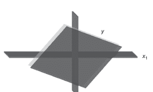

图 12.1 当预测变量 $x_1$ 和 $x_2$ 不相关时，响应面 $y$ 建立在坚实的基础上，提供稳定的系数估计。

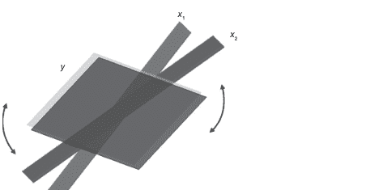

图 12.2 多重共线性：当预测变量相关时，响应面是不稳定的，导致可疑且高度可变的系数估计。

与估计相关的高变异性意味着不同的样本可能产生数值差异很大的系数估计。例如，一个样本可能为 $x_1$ 产生正系数估计，而第二个样本可能产生负系数估计。当分析任务要求单独解释响应与预测变量之间的关系时，这种情况是不可接受的。

让我们看一个玩具示例，以帮助我们理解这个问题。请参考表 12.1 中的微小总体。

显然，$x_1$ 和 $x_2$ 是相关的，$r = 0.938$，$p$-值约为 0。现在，将其分为两个样本，如表 12.2 和 12.3 所示。样本 1 的回归方程为：

```
$$ \hat{y} = -0.542 + 2.552 x_1 - 0.206 x_2 $$
```

样本 2 的回归方程为：

```
$$ \hat{y} = -1.08 + 0.547 x_1 + 1.759 x_2 $$
```

请注意，$x_1$ 的系数在样本 1 中为负，在样本 2 中为正。这代表了回归系数的不稳定行为，由预测变量之间的相关性引起。基本上，我们不能信任回归系数的值，甚至不能信任其符号。因此，为我们的客户解释回归系数

#### 表 12.1 我们玩具示例的微小总体

| x1 | x2 | 目标, y |
|---|---|---|
| 1 | 1 | 2.0693 |
| 1 | 2 | 2.6392 |
| 2 | 2 | 3.7501 |
| 2 | 3 | 5.6432 |
| 3 | 3 | 5.8925 |
| 3 | 4 | 6.4308 |
| 4 | 4 | 8.3950 |
| 4 | 5 | 8.4947 |
| 5 | 5 | 11.3236 |
| 5 | 5 | 10.1562 |

#### 表 12.2 我们微小总体中的样本 1

| x1 | x2 | 目标, y |
|---|---|---|
| 1 | 1 | 2.0693 |
| 2 | 2 | 3.7501 |
| 3 | 4 | 6.4308 |
| 4 | 5 | 8.4947 |
| 5 | 5 | 11.3236 |

#### 表 12.3 我们微小总体中的样本 2

| x1 | x2 | 目标, y |
|---|---|---|
| 1 | 2 | 2.6392 |
| 2 | 3 | 5.6432 |
| 3 | 3 | 5.8925 |
| 4 | 4 | 8.3950 |
| 5 | 5 | 10.1562 |

可能不是个好主意。数值和符号可能会因样本而异，因此仅根据一个样本解释系数可能会让您的客户蒙受重大损失。这就是为什么我们需要处理这种多重共线性的方法。

我们将使用 Cereals 数据集的一个子集，其中我们使用纤维、钾和糖来估计早餐谷物的营养评级。我们的回归方程如下：

```
rating = b0 + b1 · fiber + b2 · potassium + b3 · sugars
```

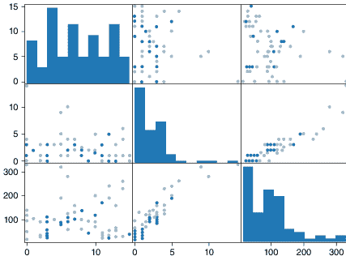

图 12.3 来自 Python 的预测变量矩阵图。纤维和钾是相关的。

为了意识到可能的多重共线性，分析师应调查预测变量之间的相关结构。图 12.3 提供了预测变量的矩阵图。显然，钾和纤维呈正相关。事实上，它们的相关系数为 r = 0.912（未显示）。这种强相关性会膨胀回归系数的变异性，使我们的回归模型不稳定。

### 12.3 使用方差膨胀因子识别多重共线性

然而，假设我们没有检查预测变量之间是否存在相关性，并且仍然进行了回归分析。回归结果有什么方式可以警告我们多重共线性的存在吗？答案是肯定的：我们可以要求报告方差膨胀因子（VIF）。

第 i 个预测变量的 VIF 由以下公式给出：

```
VIF_i = \frac{1}{1 - R_i^2}
```

```
> vif(model03)
Fiber Potass Sugars
6.850050 6.693982 1.158761
```

图 12.4 回归结果，带有来自 R 的方差膨胀因子，指示存在多重共线性问题。

其中，$R_i^2$ 表示通过将 $x_i$ 对其他预测变量进行回归所获得的 $R_i^2$ 值。请注意，当 $x_i$ 与其他预测变量高度相关时，$R_i^2$ 会很大，从而使 VIF 变大。

解释 VIF 值的一个经验法则是，将 $VIF \ge 5$ 视为中度多重共线性的指标，将 $VIF \ge 10$ 视为严重多重共线性的指标。VIF 为 5 对应 $R_i^2 = 0.80$，而 VIF = 10 对应 $R_i^2 = 0.90$。

对于营养评级对纤维、钾和糖的回归，我们有图 12.4 中提供的输出。纤维的 VIF 为 6.85，钾的 VIF 为 6.69，两个值都表明存在中度到强多重共线性。

#### 12.3.1 如何使用 Python 识别多重共线性

首先，我们加载所需的包，并以 cereals 为名称读入谷物数据集。

```
import pandas as pd
import statsmodels.api as sm
import statsmodels.stats.outliers_influence as inf
cereals = pd.read_csv("C:/.../cereals.csv")
```

一旦数据集进入 Python，提取三个预测变量并将它们放入各自的数据框中。将数据框命名为 X。

```
X = pd.DataFrame(cereals[['Sugars', 'Fiber', 'Potass']])
```

现在我们已将所有预测变量放在一起，使用 scatter_matrix() 命令并以 X 作为输入来创建散点图矩阵。

```
pd.plotting.scatter_matrix(X)
```

scatter_matrix() 命令的结果如上图 12.3 所示。请注意，该命令同时创建散点图和直方图。

要获取 VIF 值，我们需要先进行一些数据清理。在 X 数据框上使用 dropna() 命令以删除任何包含缺失值的记录。

```
X = X.dropna()
```

然后，确保在 X 数据框中添加常数项。

```
X = sm.add_constant(X)
```


最后，按如下所示运行 variance_inflation_factor() 命令，以获取 X 数据框中所有四列的 VIF 值。

```
[variance_inflation_factor(X.values, i) for i in range(X.shape[1])]
```

输出将包含我们添加的常数项的 VIF 值；请忽略它。我们感兴趣的 VIF 值是针对三个预测变量的，它们是 variance_inflation_factor() 命令输出的第二、第三和第四个数字。

#### 12.3.2 如何在 R 中识别多重共线性

要在 R 中构建散点图矩阵，我们首先需要确定数据集中哪些列包含我们的预测变量。

```
names(cereals)
```

您可以看到，Sugars、Potass 和 Fiber 变量分别位于第 10、8 和 11 列。这些是您将放入图 12.5 中的散点图矩阵的列。

```
pairs(x = cereals[, c(10, 8, 11)], pch = 16)
```

散点图矩阵的命令是 pairs()。所需输入是 x，它要求指定要包含在散点矩阵中的列。我们使用 cereals[ , c(10, 8, 11)] 指定列。可选输入 pch = 16 将把散点图点从空心圆更改为实心圆。

要计算 VIF，我们首先需要安装并加载 car 包。

```
install.packages("car") ; library(car)
```

一旦 car 包加载完成，我们就构建要检查其系数以进行多重共线性分析的模型，并保存模型输出。

```
model03 <- lm(formula = Rating ~ Fiber + Potass + Sugars, data = cereals)
```

最后，我们在模型上使用 vif() 命令。

```
vif(model03)
```

vif() 命令的唯一所需输入是我们保存模型时使用的名称。输出（如图 12.4 所示）是每个预测变量的 VIF。

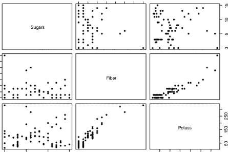

图 12.5 R 中的预测变量散点图矩阵。

### 12.4 主成分分析

那么，既然我们已经识别出预测变量之间的多重共线性，现在该怎么办呢？

一种解决方案是应用主成分分析。主成分分析（PCA）试图解释一组预测变量的相关结构，使用这些变量的一组较小的不相关线性组合，称为成分。完整的 m 个预测变量产生的总变异通常可以由一组较小的 k<m 个成分大部分解释。这意味着 k 个成分中包含的信息几乎与原始 m 个变量一样多。此外，k 个成分彼此之间不相关，而原始相关预测变量则不是。如果需要，分析人员可以用 k<m 个成分替换原始的 m 个变量，这样工作数据集现在由 k 个成分上的 n 条记录组成，而不是 m 个预测变量上的 n 条记录。这就是降维！

分析人员应注意，PCA 仅作用于预测变量，忽略目标变量。此外，预测变量应进行标准化或归一化。从数学上讲，主成分是预测变量的不相关线性组合 Y，具有以下特征：

- 第一个主成分通常是最重要的。它解释的预测变量间变异比任何其他成分都大。
- 第二个主成分解释第二大的变异，并且与第一个不相关。
- 第三个主成分解释第三大的变异，并且与前两个不相关，以此类推。

### 12.5 主成分分析的应用

为了说明 PCA 的应用，我们转向 clothing_store_PCA_training 和 clothing_store_PCA_test 数据集。我们有兴趣使用预测变量购买访问次数、存档天数、购买间隔天数、购买的不同商品数和上次购买至今天数来估计响应变量每次访问销售额。然而，图 12.6 显示预测变量之间存在显著相关性。此外，图 12.7 显示每次访问销售额对预测变量的回归，表明一些 VIF 指标适度膨胀。

因此，我们对这些预测变量执行 PCA，在训练数据集上使用 varimax 旋转。

旋转 PCA 解有助于提高成分的可解释性。检查图 12.8 中的旋转成分，我们发现，如果只提取第一个主成分，我们将只解释预测变量中 31.3% 的方差。如果提取两个成分，我们将解释约 52.2%（见图 12.8 中的累积方差），以此类推。那么，问题来了，我们应该提取多少个成分？

| | Days.since.Purchase.Z | Purchase.Visits.Z | Days.on.File.Z | Days.between.Purchases.Z | Diff.Items.Purchased.Z |
|---|---|---|---|---|---|
| Days.since.Purchase.Z | 1.000 | -0.440 | -0.159 | 0.573 | -0.379 |
| Purchase.Visits.Z | -0.440 | 1.000 | 0.084 | -0.453 | 0.821 |
| Days.on.File.Z | -0.159 | 0.364 | 1.000 | 0.203 | 0.303 |
| Days.between.Purchases.Z | 0.573 | -0.453 | 0.203 | 1.000 | -0.493 |
| Diff.Items.Purchased.Z | -0.379 | 0.821 | 0.303 | -0.493 | 1.000 |

图 12.6 R 中的相关系数矩阵显示预测变量之间存在显著相关性。

| 变量 | VIF |
|---|---|
| Days.since.Purchase.Z | 1.701947 |
| Purchase.Visits.Z | 3.793173 |
| Days.on.File.Z | 1.536395 |
| Days.between.Purchases.Z | 2.1435807 |
| Diff.Items.Purchased.Z | 3.070706 |

图 12.7 R 中的回归显示一些 VIF 值趋向于适度较大。

| 变量 | RC1 | RC2 | RC3 | RC4 | RC5 |
|---|---|---|---|---|---|
| Days.since.Purchase.Z | | | 0.935 | | |
| Purchase.Visits.Z | 0.725 | | | | 0.573 |
| Days.on.File.Z | | 0.971 | | | |
| Days.between.Purchases.Z | | | | 0.910 | |
| Diff.Items.Purchased.Z | 0.965 | | | | |

| | RC1 | RC2 | RC3 | RC4 | RC5 |
|---|---|---|---|---|---|
| SS 载荷 | 1.566 | 1.045 | 1.035 | 1.006 | 0.348 |
| 方差比例 | 0.313 | 0.209 | 0.207 | 0.201 | 0.070 |
| 累积方差 | 0.313 | 0.522 | 0.729 | 0.930 | 1.000 |

图 12.8 R 中 PCA 结果的摘录。

### 12.6 我们应该提取多少个成分？

请回顾，PCA 的动机之一是降低维度。问题来了，“我们如何确定要提取多少个成分？”例如，我们是否应仅保留前两个主成分，因为它们解释了总变异的一半以上（52% 累积方差）？或者，我们是否应保留所有五个成分，因为它们解释了 100% 的变异？显然，保留所有五个成分并不能帮助我们降低维度。一如既往，答案介于这两个极端之间。

#### 12.6.1 特征值准则

在图 12.8 中，特征值标记为“SS 载荷”。特征值为 1.0 意味着该成分将解释总变异中大约“一个预测变量的量”。使用特征值准则的理由是，每个成分应至少解释一个预测变量的变异量，因此，特征值准则指出，只有特征值大于 1 的成分才应保留。请注意，如果预测变量少于 20 个，特征值准则倾向于建议提取过少的成分，而如果变量超过 50 个，该准则可能建议提取过多的成分。从图 12.9 可以看出，四个旋转成分的特征值大于 1，因此被保留。成分 5 的旋转特征值远低于 1.0，因此我们不包括成分 5。特征值准则因此建议我们提取 k = 4 个主成分。

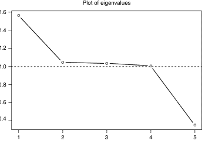

图 12.9 R 中的特征值图，特征值为 1 处有虚线。

#### 12.6.2 解释方差比例准则

对于解释方差比例准则，客户或分析人员首先指定希望主成分解释总变异的比例。然后，分析人员只需逐个选择成分，直到达到所需的解释变异比例。例如，假设我们希望成分解释预测变量中约 70% 的变异。那么，从图 12.8 中，我们将选择成分 1–3，它们共同解释了 72.9% 的变异。另一方面，如果我们希望成分解释 90% 的变异，那么我们还需要包括成分 4，它与前三个成分共同解释了 93% 的变异。在没有客户进一步输入的情况下，我们可以说，解释方差比例准则建议选择 k = 3 或 k = 4 个成分。由于特征值准则建议 k = 4 个成分，而解释方差比例准则对 k = 3 或 k = 4 个成分都可以接受，因此我们一致决定提取 k = 4 个成分。


### 12.7 使用 K = 4 执行主成分分析

图 12.10 显示了提取三个分量时得到的（i）未旋转和（ii）旋转分量矩阵。让我们先检查图 12.10b 中的旋转矩阵。请注意，小于 0.5 的分量权重已被抑制，以增强可解释性。第一个主成分（RC1，即旋转分量 1）是“购买不同商品数”和“购买访问次数”的组合，两者彼此正相关，因为它们的分量权重符号相同。分量可以包含彼此正相关或负相关的预测变量组合。如果恰好有一个分量权重为负，那将表明“购买不同商品数”和“购买访问次数”呈负相关。其余的主成分是“单例”，每个仅包含一个预测变量。

现在，假设我们没有旋转分量矩阵，最终得到图 12.10a 中的未旋转分量矩阵。请注意，主成分的解释不那么清晰。分量 1 非常庞大，包含五个预测变量中的四个，且正负相关混杂在一起。相比之下，旋转分量矩阵的解释要清晰得多。

### 12.8 主成分的验证

与其他任何数据科学方法一样，PCA 的结果应使用测试数据集进行验证。图 12.11 显示了所有五个分量解释的方差比例，百分比与训练集相差不大。

| | PC1 | PC2 | PC3 | PC4 |
|---|---|---|---|---|
| Days.since.Purchase | -0.718 | | | 0.569 |
| Purchase.Visits | 0.898 | | 0.825 | |
| Days.on.File | -0.662 | | 0.647 | |
| Diff.between.Purchases | 0.849 | | | |

| | RC1 | RC2 | RC3 | RC4 |
|---|---|---|---|---|
| Days.since.Purchase | | | 0.933 | |
| Purchase.Visits | 0.862 | 0.965 | | |
| Days.on.File | | | | |
| Diff.between.Purchases | 0.898 | | | |

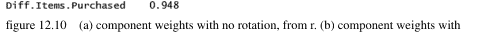

| | RC1 | RC2 | RC3 | RC4 | RC5 |
|---|---|---|---|---|---|
| SS Loadings | 1.805 | 1.035 | 1.033 | 0.993 | 0.134 |
| Proportion Var | 0.361 | 0.207 | 0.207 | 0.199 | 0.027 |
| Cumulative Var | 0.361 | 0.568 | 0.775 | 0.973 | 1.000 |

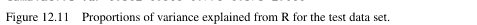

| | RC1 | RC2 | RC3 | RC4 |
|---|---|---|---|---|
| Days.since.Purchase | | | 0.932 | |
| Purchase.Visits | 0.891 | | | |
| Days.on.File | | 0.965 | | |
| Days.between.Purchases | | | | 0.901 |
| Diff.items.Purchased | 0.944 | | | |

图 12.12 来自 R 的测试数据集分量权重。

```
> round(cor(pca02_rot$scores),2)
```

| | RC1 | RC2 | RC3 | RC4 |
|---|---|---|---|---|
| RC1 | 1 | 0 | 0 | 0 |
| RC2 | 0 | 1 | 0 | 0 |
| RC3 | 0 | 0 | 1 | 0 |
| RC4 | 0 | 0 | 0 | 1 |

图 12.13 R 输出显示主成分不相关。

```
> vif(model.pca)
```

| PC1 | PC2 | PC3 | PC4 |
|---|---|---|---|
| 1 | 1 | 1 | 1 |

图 12.14 R 输出显示使用主成分进行回归消除了多重共线性。

如图 12.8 所示。测试集的四个旋转分量（如图 12.12 所示）与训练集（图 12.10b）中的相似。那么，PCA 是否缓解了我们的多重共线性问题？我们可以通过检查来验证：

- 四个分量之间的相关性。
- 对分量进行响应回归时的预测变量 VIF。

主成分的相关矩阵如图 12.13 所示。所有相关性均为零，意味着分量不相关。最后，我们获得了用四个提取的主成分替换原始预测变量后，对每次访问销售额（Sales per Visit）进行回归的 VIF 值。图 12.14 所示的这些 VIF 结果表明，所有 VIF 均等于 1，即最小值。

### 12.9 使用 Python 执行主成分分析

加载所需的包。

```
import pandas as pd
import numpy as np
from sklearn.preprocessing import StandardScaler
from sklearn.decomposition import PCA
```

| | Days since Purchase | Purchase Visits | Days on File |
|---|---|---|---|
| Days since Purchase | 1.000000 | -0.439821 | -0.158718 |
| Purchase Visits | -0.439821 | 1.000000 | 0.363729 |
| Days on File | -0.158718 | 0.363729 | 1.000000 |
| Days between Purchases | 0.573090 | -0.453024 | 0.202890 |
| Diff Items Purchased | -0.378658 | 0.821257 | 0.302624 |

| | Days between Purchases | Diff Items Purchased |
|---|---|---|
| Days since Purchase | 0.573090 | -0.378658 |
| Purchase Visits | -0.453024 | 0.821257 |
| Days on File | 0.202890 | 0.302624 |
| Days between Purchases | 1.000000 | -0.371018 |
| Diff Items Purchased | -0.371018 | 1.000000 |

图 12.15 来自 Python 的相关矩阵。

读入两个数据集，clothing_store_PCA_training 和 clothing_store_PCA_test，分别作为 clothes_train 和 clothes_test。

```
clothes_train = pd.read_csv("C:/.../clothing_store_PCA_training")
clothes_test = pd.read_csv("C:/.../clothing_store_PCA_test")
```

使用 drop() 命令将预测变量与训练数据集的其余部分分开。请注意，我们删除了目标变量 Sales per Visit，因此只剩下预测变量。当目标变量和感兴趣的预测变量是数据中仅有的变量时，这种方法最为合适。将变量保存为 X。

```
X = clothes_train.drop('Sales per Visit', 1)
```

使用 corr() 命令获取 X 变量的相关矩阵。

```
X.corr()
```

corr() 命令的输出如图 12.15 所示。

现在，我们将运行包含五个分量的 PCA。首先，我们将在 PCA() 命令中使用 n_components 指定分量数量，然后使用 fit_transform() 将 X 作为输入将 PCA 拟合到数据中。

```
pca01 = PCA(n_components=5)
principComp = pca01.fit_transform(X)
```

运行 PCA 后，我们的下一任务是查看每个分量解释的变异量及相应的累积解释变异量。使用 pca01 对象和 explained_variance_ratio_ 获取每个分量解释的变异量。

```
pca01.explained_variance_ratio_
```

通过对 pca01.explained_variance_ratio_ 运行 cumsum() 命令获取累积解释变异量。

```
np.cumsum(pca01.explained_variance_ratio_)
```

本节的结果针对的是原始的未旋转分量。就本文撰写时而言，Python 的 sklearn 包没有现成的命令来对分量执行 varimax 旋转。

### 12.10 使用 R 执行主成分分析

分别将 clothing_store_PCA_training 和 clothing_store_PCA_test 数据集导入为 clothes_train 和 clothes_test。为了简化后续代码，我们将训练数据和测试数据分为 X 和 y 变量。

```
y <- clothes_train$Sales.per.Visit
X <- clothes_train[, c(1:5)]
X_test <- clothes_test[, c(1:5)]
```

请记住标准化预测变量。

```
X_z <- as.data.frame(scale(X))
colnames(X_z) <- c("Days.since.Purchase.Z", "Purchase.Visits.Z", "Days.on.File.Z",
"Days.between.Purchases.Z", "Diff.Items.Purchased.Z")
```

要获取相关矩阵，我们使用 cor() 命令。

```
round(cor(X_z), 3)
```

cor() 命令以预测变量 X_z 作为输入，放置在 round() 命令内部。round() 命令的第二个输入是答案将被四舍五入到的有效数字位数。在我们的情况中，我们指定了三位有效数字。round() 命令的输出如图 12.6 所示。

要获取 VIF 值，我们需要先运行回归模型，然后使用 car 包中的 vif() 命令，如之前的 R 部分所述。

```
model01 <- lm(formula = y ~ Days.since.Purchase.Z +
Purchase.Visits.Z + Days.on.File.Z +
Days.between.Purchases.Z + Diff.Items.Purchased.Z,
data = X_z)
vif(model01)
```

vif() 命令的输出如图 12.7 所示。


要运行 PCA，我们必须先安装并打开 *psych* 包。

```
install.packages("psych"); library(psych)
```

打开包后，我们使用 *principal()* 命令执行 PCA。

```
pca01 <- principal(r = X_z, rotate = "varimax", nfactors = 5)
```

我们使用带有三个输入值的 *principal()* 命令。输入 r = X_z 指定我们要分析的变量。rotate = "varimax" 告诉 R 在呈现结果前对组件执行 varimax 旋转。最后，nfactors = 5 输入表示我们想要五个组件。我们将 PCA 输出保存为 pca01。

我们关注 pca01 结果的载荷。

```
print(pca01$loadings, cutoff = 0.49)
```

我们使用 cutoff = 0.49 来抑制较小的 PCA 权重。上述代码生成的输出如图 12.8 所示。

要创建特征值图，我们需要旋转组件的特征值。这些值位于图 12.8 的 "SS Loadings" 下方。将这些值保存为独立向量后，使用 plot() 命令绘制它们。

```
ss.load <- c(1.566, 1.045, 1.035, 1.006, 0.348)
plot(ss.load, type = "b", main = "Plot of Eigenvalues",
ylab = "Value",
xlab = "Component"); abline(h = 1, lty = 2)
```

输入 type = "b" 使用点和连接线同时绘制特征值。main、xlab 和 ylab 输入自定义标题和轴标签。abline() 命令向图中添加一条线。输入值 h = 1 添加水平位置为 1 的线，输入 lty = 2 指定虚线。结果如图 12.9 所示。

要比较无旋转与 varimax 旋转的结果，请使用 rotate = "none" 运行 principal() 命令以进行无旋转，使用 rotate = "varimax" 进行 varimax 旋转。

```
pca02_notorot <- principal(r = X, rotate = "none",
nfactors = 4)
print(pca02_notorot$loadings, cutoff = 0.5)
pca02_rot <- principal(r = X, rotate = "varimax",
nfactors = 4)
print(pca02_rot$loadings, cutoff = 0.5)
```

*pca02_notorot$loadings* 的 *print()* 输出摘录如图 12.10a 所示，而 *pca02_rot$loadings* 的 *print()* 输出摘录如图 12.10b 所示。请注意，两个命令都使用 *cutoff = 0.5* 来抑制低于 0.5 的权重。

要验证 PCA 结果，请在测试数据上运行该算法。首先，标准化数据。

```
X_test_z <- scale(X_test)
```

然后，确认推荐四个组件。

```
pca02_test <- principal(r = X_test_z, rotate =
"varimax", nfactors = 5)
pca02_test$loadings
```

输出摘录如图 12.11 所示。确认推荐四个组件后，检查组件权重。

```
pca02_test <- principal(r = X_test_z, rotate =
"varimax", nfactors = 4)
print(pca02_test$loadings, cutoff = 0.5)
```

输出摘录如图 12.12 所示。

要获取训练数据集中组件的相关性，请在 **pca02_rot** 的得分上运行 **round(cor())** 命令。

```
round(cor(pca02_rot$scores),2)
```

在此例中，我们保留两位有效数字。结果如图 12.13 所示。要将目标变量回归到组件上，您可能希望将每个组件保存为独立变量。如下所示。

```
PC1 <- pca02_rot$scores[,1]; PC2 <- pca02_rot$scores[,2]
PC3 <- pca02_rot$scores[,3]; PC4 <- pca02_rot$scores[,4]
```

现在您可以运行回归模型并获取 VIF。代码如下所示。

```
model.pca <- lm(y ~ PC1 + PC2 + PC3 + PC4) ; vif(model.pca)
```

vif() 命令的输出如图 12.14 所示。

### 12.11 多重共线性何时不是问题？

现在，取决于分析师面临的任务，多重共线性实际上可能并非致命缺陷。Weiss 指出，多重共线性“不会不利影响样本回归方程预测响应变量的能力”。他补充说，多重共线性不会显著影响目标变量的点估计、平均响应值的置信区间或随机选择的响应值的预测区间。然而，数据科学家必须因此将多重共线性模型的使用严格限制在目标变量的估计和预测上。在存在多重共线性的情况下，模型解释将不合适，因为单个系数可能没有意义。总结来说，未考虑多重共线性的模型可用于估计，但不可用于描述或解释。

### 参考文献

car 包的名称代表应用回归伴侣，详情可在此处找到：John Fox 和 Sanford Weisberg。An {R} Companion to Applied Regression，第二版，Sage，Thousand Oaks，CA，2011。psych 包（让我们能够进行带有 varimax 旋转的 PCA）的文档可在此处找到：W. Revelle。Psych: Procedures for Personality and Psychological Research，Northwestern University，Evanston，IL，2018。

### 练习

### 澄清概念

- 1. 在数据科学中，高维性是什么意思？
- 2. 为什么我们需要降维方法？
- 3. 主成分用什么取代原来的 m 个预测变量？
- 4. 哪个主成分解释了最多的变异性？
- 5. 其他哪个主成分与第一个主成分相关？
- 6. 为什么我们使用旋转？
- 7. 解释特征值准则？
- 8. 什么是解释方差比例准则？
- 9. 判断正误：不需要对主成分进行验证。
- 10. 当我们将主成分用作回归模型中的预测变量时，VIF 取什么值？这表示什么？

### 使用数据

对于以下练习，请使用 clothing_store_PCA_training 和 clothing_store_PCA_test 数据集。使用 Python 或 R 解决每个问题。

- 11. 标准化或归一化预测变量。
- 12. 为预测变量 Purchase Visits、Days on File、Days between Purchases、Different Items Purchased 和 Days since Purchase 构建相关矩阵。哪些变量高度相关？
- 13. 计算每个预测变量的 VIF。哪个预测变量的 VIF 表明多重共线性是一个问题？
- 14. 使用 varimax 旋转和五个组件运行 PCA。一个组件解释了多少百分比的变异性？两个组件呢？所有五个组件呢？
- 15. 绘制特征值图。使用特征值准则，你会保留多少个组件？
- 16. 假设我们想要解释至少 80% 的变异性。你会保留多少个组件？
- 17. 使用 varimax 旋转和四个组件运行 PCA。四个组件解释了多少百分比的变异性？
- 18. 每个组件包含哪些变量？
- 19. 将四个组件用作回归模型中的预测变量来估计 Sales per Visit。四个组件的回归系数是多少？
- 20. 回归模型中四个组件的 VIF 是多少？

### 实践分析

对于以下练习，请使用 cereals 数据集。使用 Python 或 R 解决每个问题。

- 21. 标准化或归一化预测变量 Sugars、Fiber 和 Potass。
- 22. 为 Sugars、Fiber 和 Potass 构建相关矩阵。哪些变量高度相关？
- 23. 构建回归模型以根据 Sugars、Fiber 和 Potass 估计 Rating。从模型中获取 VIF。哪些 VIF 表明多重共线性是一个问题？
- 24. 使用 varimax 旋转和三个组件运行 PCA。一个组件解释了多少百分比的变异性？两个组件呢？所有三个组件呢？
- 25. 绘制三个组件的特征值图。使用特征值准则，你会保留多少个组件？
- 26. 假设我们想要解释至少 70% 的变异性。你会保留多少个组件？
- 27. 使用 varimax 旋转和两个组件运行 PCA。两个组件解释了多少百分比的变异性？
- 28. 组件 1 包含哪些变量？组件 2 包含哪些变量？
- 29. 将两个组件用作回归模型中的预测变量来估计 Rating。两个组件的回归系数是多少？
- 30. 回归模型中两个组件的 VIF 是多少？

对于以下练习，请使用 red_wine_PCA_training 和 red_wine_PCA_test 数据集。使用 Python 或 R 解决每个问题。目标变量是葡萄酒质量。预测变量是酒精、残糖、pH 值、密度和固定酸度。


- 31. 标准化或归一化预测变量。
- 32. 构建预测变量的相关矩阵。在哪些预测变量之间发现了最高的相关性？
- 33. 基于预测变量构建回归模型以估计*quality*。从模型中获取VIF。哪些VIF表明多重共线性是一个问题？将高VIF的变量与前一个练习中的相关变量进行比较。
- 34. 使用varimax旋转执行主成分分析（PCA）。显示提取最多五个成分时旋转后的方差解释比例。一个成分解释了多少百分比的方差？两个成分呢？三个成分呢？四个成分呢？所有五个成分呢？
- 35. 假设我们希望解释至少90%的变异性。方差解释比例准则建议提取多少个成分？
- 36. 绘制五个成分的特征值图。根据特征值准则，我们应该提取多少个成分？
- 37. 结合两个准则的建议，就应提取多少个成分达成共识。
- 38. 对每个成分进行画像，说明包含哪些变量，并注明其成分内相关性（正或负）。为简单起见，仅考虑大于0.5的成分权重。
- 39. 生成成分的相关矩阵。这些值是什么意思？
- 40. 接下来，仅使用提取的成分来利用回归模型估计葡萄酒质量。不要包含原始预测变量。
  - a. 比较PCA回归与原始回归模型之间s和$R^2_{adj}$的值。
  - b. 解释为什么原始模型略优于PCA模型。
  - c. 解释PCA模型如何可能被视为更优，尽管略逊一筹？
- 41. 在上一个练习的回归中，回归模型中两个成分的VIF是多少？这些值是什么意思？

### 13.1 广义线性模型概述

在第11章中，我们考察的线性回归模型都具有连续响应变量。但是，如果我们想为二元响应构建回归模型，会发生什么情况呢？或者对于数值离散响应呢？幸运的是，有一类线性模型涵盖了回归响应变量的所有三种情况——连续、数值离散和二元——即广义线性模型（GLMs）。

为了解释三种不同类型响应的回归如何相关联，我们将简要地再次查看每种情况的参数回归方程。一旦建立了它们之间的关系，我们将使用它们的描述性版本，就像在第11章中所做的那样。

回顾这里给出的多元回归参数模型。

\( y = \beta_0 + \beta_1 x_1 + \beta_2 x_2 + \cdots + \beta_p x_p + \varepsilon \)

和 \(\beta_0 + \beta_1 x_1 + \beta_2 x_2 + \cdots + \beta_p x_p\) 称为*线性预测器*。为简洁起见，我们将线性预测器写作 \(\mathbf{X}\boldsymbol{\beta}\)。将线性预测器与给定预测变量值集下y变量的均值 \(\mu\) 相连接的公式称为*链接函数*，\(g(\mu)\)。

不同的链接函数对应不同的回归模型，每个链接函数与特定的响应类型相关联。对于我们讨论的每种不同响应类型，我们将指定一个特定的 \(g(\mu)\)，使得 \(\mathbf{X}\boldsymbol{\beta} = g(\mu)\)，并求解 \(\mu\) 以获得模型的最终形式。

我们首先通过展示线性回归如何表示为GLM来演示GLM的工作原理。然后，我们将演示两种新的回归模型作为GLM：逻辑回归和泊松回归。

### 13.2 作为广义线性模型的线性回归

当响应变量在每组给定预测变量值下服从正态分布时，我们就回到了线性回归的领域。在这个领域中，链接函数只是恒等函数，其中

\( g(\mu) = \mu \)

使用这个恒等链接将 \( X\beta \) 设为等于 \( g(\mu) \)，得到 \( X\beta = g(\mu) = \mu \)。一旦建立了 \( X\beta \) 与 \( \mu \) 之间的函数关系，我们就可以通过扩展缩写符号来倒推，从而得到回归模型的最终形式。这样就得到了线性回归的总体方程：

\( y = \beta_0 + \beta_1 x_1 + \beta_2 x_2 + \cdots + \beta_p x_p + \varepsilon \)

由此可以得到描述性形式

\( \hat{y} = b_0 + b_1 x_1 + b_2 x_2 + \cdots + b_p x_p \)

这就是我们在第11章中使用的形式。

### 13.3 作为广义线性模型的逻辑回归

接下来，假设我们试图预测二元响应，例如客户是否拥有商店信用卡。在这种情况下，我们的响应变量分布将是二元的：1或0，表示是或否。

二元响应变量的链接函数是 \( g(\mu) = \ln \left( \frac{\mu}{1-\mu} \right) \)。我们将此函数设为等于线性预测器 \( X\beta \)，以得到

\( X\beta = \ln \left( \frac{\mu}{1-\mu} \right) \)

为了隔离 \( \mu \)，我们利用 \( e^{\ln(x)} = x \) 这一事实，得到

\( \mu = \frac{e^{X\beta}}{1 + e^{X\beta}} \)

上述公式确保响应变量的均值 \( \mu \) 始终在零和一之间。换句话说，回归模型可用于估计 \( y = 1 \) 的*概率*。

为了澄清逻辑回归的预测值是概率而非二元值，让我们将回归模型写为预测 \( p(y) \)，即 y = 1 的概率。如果我们从缩写符号倒推，就得到模型的参数形式

\( p(y) = \frac{\exp(\beta_0 + \beta_1 x_1 + \beta_2 x_2 + \cdots + \beta_p x_p)}{1 + \exp(\beta_0 + \beta_1 x_1 + \beta_2 x_2 + \cdots + \beta_p x_p)} + \varepsilon \)

并可以将描述性形式写为

\( \hat{p}(y) = \frac{\exp(b_0 + b_1 x_1 + b_2 x_2 + \cdots + b_p x_p)}{1 + \exp(b_0 + b_1 x_1 + b_2 x_2 + \cdots + b_p x_p)} \)

### 13.4 逻辑回归建模的应用

让我们重新审视 _服装销售训练_ 和 _服装销售测试_ 数据集。这次，我们的目标是确定客户是否拥有商店信用卡，以便我们的营销团队可以向非持卡人发送广告，诱使他们注册办卡。在这种情况下，我们的响应变量是二元的：是，客户有卡；或者否，客户没有卡。由于响应变量是二元的，我们将使用逻辑回归。

我们的临时逻辑回归模型将是

\( \hat{p}(credit card) = \frac{\exp(b_0 + b_1 (Days between Purchases) + b_2 (Web Account))}{1 + \exp(b_0 + b_1 (Days between Purchases) + b_2 (Web Account))} \)

图13.1显示了信用卡对两个预测变量的回归结果。输出中显示的_p_-值告诉我们两个变量都应纳入模型。当我们用测试数据集交叉验证结果时，我们得到图13.2所示的结果。

测试模型证实两个变量都应纳入模型。使用训练数据集中的系数，我们得到最终逻辑回归模型：

\( \hat{p}(credit card) = \frac{\exp(0.496 - 0.004(Days between Purchases) + 1.254(Web Account))}{1 + \exp(0.496 - 0.004(Days between Purchases) + 1.254(Web Account))} \)

| | 系数 | 标准误 | z | P>|z| | 0.025 | 0.975 |
|---|---|---|---|---|---|---|---|
| 常数项 | 0.4962 | 0.0887 | 5.5968 | 0.0000 | 0.3224 | 0.6699 |
| 天数 | -0.0037 | 0.0004 | -8.4491 | 0.0000 | -0.0046 | -0.0028 |
| 网页账户 | 1.2537 | 0.3307 | 3.7914 | 0.0001 | 0.6056 | 1.9018 |

图13.1 训练数据集的Python逻辑回归结果。

| | 系数 | 标准误 | z | P>|z| | 0.025 | 0.975 |
|---|---|---|---|---|---|---|---|
| 常数项 | 0.4634 | 0.0873 | 5.3185 | 0.0000 | 0.2924 | 0.6345 |
| 天数 | -0.0035 | 0.0004 | -8.2261 | 0.0000 | -0.0043 | -0.0026 |
| 网页账户 | 1.0973 | 0.2830 | 3.8780 | 0.0001 | 0.5427 | 1.6519 |

图13.2 测试数据集的Python逻辑回归结果。

那么，我们如何解释逻辑回归系数呢？每个回归系数描述了当系数的预测变量增加一个单位时，响应变量对数几率的估计变化。为了说明，请考虑二元预测变量 `Web Account`。`Web Account` 的回归系数为1.254。通过计算 $e^{1.254} = 3.504$，我们发现，与没有网页账户相比，如果客户有网页账户，他们拥有商店信用卡的可能性大约是3.5倍。

我们可以对 `Days between Purchases` 的系数进行类似操作。通过计算 $e^{-0.004} = 0.996$，我们发现，购买间隔每增加一天，客户拥有商店信用卡的可能性就降低0.4%。由于计算单个天数可能过于狭窄，我们可以将系数乘以30，得到 $e^{-30 \times 0.004} = 0.89$，并发现，每没有购买30天，客户拥有商店信用卡的可能性就会再降低11%。$^1$

#### 13.4.1 如何使用Python执行逻辑回归

加载所需的包，并分别将 `clothing_sales_training` 和 `clothing_sales_test` 数据集导入为 `sales_train` 和 `sales_test`。

```
import pandas as pd
import numpy as np
import statsmodels.api as sm
from scipy import stats
sales_train = pd.read_csv("C:/.../clothing_sales_training.csv")
sales_test = pd.read_csv("C:/.../clothing_sales_test.csv")
```

为简单起见，我们将变量分为预测变量X和响应变量y。向X数据框添加一个常数，以便在回归模型中包含常数项。

```
X = pd.DataFrame(sales_train[['Days', 'Web']])
X = sm.add_constant(X)
y = pd.DataFrame(sales_train[['CC']])
```

$^1$有关逻辑回归的更多信息，请参阅《数据挖掘与预测分析》。


要执行逻辑回归，请使用 Logit() 和 fit() 命令。保存模型输出，并在保存的模型输出上运行 summary2() 命令以查看模型结果。

```
logreg01 = sm.Logit(y, X).fit()
logreg01.summary2()
```

结果摘录如图 13.1 所示。

要验证模型，请在测试数据集上执行相同的步骤。代码如下所示。

```
X_test = pd.DataFrame(sales_test[['Days', 'Web']])
X_test = sm.add_constant(X_test)
y_test = pd.DataFrame(sales_test[['CC']])
logreg01_test = sm.Logit(y_test, X_test).fit()
logreg01_test.summary2()
```

结果摘录如图 13.2 所示。

#### 13.4.2 如何使用 R 执行逻辑回归

分别将 clothing_sales_training 和 clothing_sales_test 数据集导入为 sales_train 和 sales_test。

要运行逻辑回归模型，我们将使用 glm() 命令。

```
logreg01 <- glm(formula = CC ~ Days + Web, data = sales_train,
family = binomial)
```

大部分代码与第 11 章中的类似；formula 输入列出响应变量和预测变量，data = sales_train 输入指定数据集。唯一的变化是 glm() 命令和添加 family = binomial 输入。glm() 命令将运行 GLM 分析，family = binomial 指定逻辑回归模型。将模型输出保存为 logreg01。

要查看模型摘要，请运行 summary() 命令，以保存的模型名称作为唯一输入。输出摘录如图 13.3 所示。

```
summary(logreg01)
```

| | 估计值 | 标准误 | z 值 | Pr(>|z|) |
|---|---|---|---|---|
| (Intercept) | 0.4961706 | 0.0886529 | 5.597 | 2.18e-08 *** |
| Days | -0.0037016 | 0.0004381 | -8.449 | < 2e-16 *** |
| Web | 1.2536955 | 0.3306672 | 3.791 | 0.00015 *** |

显著性代码：0 '***' 0.001 '**' 0.01 '*' 0.05 '.' 0.1 ' ' 1

图 13.3 R 训练数据集的逻辑回归结果。

| | 估计值 | 标准误 | z 值 | Pr(>|z|) |
|---|---|---|---|---|
| (Intercept) | 0.4634478 | 0.0872706 | 5.310 | 1.09e-07 *** |
| Days | -0.0034721 | 0.0004221 | -8.226 | < 2e-16 *** |
| Web | 1.0972994 | 0.2829570 | 3.878 | 0.000105 *** |

显著性代码：0 '***' 0.001 '**' 0.01 '*' 0.05 '.' 0.1 ' ' 1

图 13.4 R 测试数据集的逻辑回归结果。

要验证模型，请在测试数据上运行模型并获取模型摘要（图 13.4）。代码如下所示。

```
logreg01_test <- glm(formula = CC ~ Days + Web, data =
sales_test, family = binomial)
summary(logreg01_test)
```

### 13.5 泊松回归

GLM 的伞下还有许多其他类型的回归模型。我们将再考察一种：泊松回归。当您想要预测事件计数时（例如客户将联系客服的次数），会使用泊松回归。响应变量的分布将是发生次数的计数，最小值为零。

计数响应变量的链接函数为 \(g(\mu) = \text{ln}(\mu)\)。我们将链接函数设为等于线性预测器，以得到

\(X\beta = \text{ln}(\mu)\)

在隔离 \(\mu\) 后，我们得到

\(\mu = e^{X\beta}\)

从我们的缩写符号反向推导，我们得到泊松回归方程的参数形式

\(y = e^{\beta_0 + \beta_1 x_1 + \beta_2 x_2 + \cdots + \beta_p x_p} + \varepsilon\)

由此我们可以写出描述形式

\(\hat{y} = e^{\hat{\beta}_0 + \hat{\beta}_1 x_1 + \hat{\beta}_2 x_2 + \cdots + \hat{\beta}_p x_p}\)

### 13.6 泊松回归建模应用

我们将使用 churn 数据集构建一个模型，根据客户是否流失来估计客服呼叫次数。我们的响应变量是整数值变量，这就是为什么我们在此估计中使用泊松回归而非线性回归。

| | 系数 | 标准误 | z | P>|z| | [0.025 | 0.975] |
|---|---|---|---|---|---|---|
| const | 0.3714 | 0.016 | 23.877 | 0.000 | 0.341 | 0.402 |
| Churn = True | 0.4305 | 0.034 | 12.582 | 0.000 | 0.363 | 0.498 |

图 13.5 用于预测客服呼叫次数的 Python 泊松回归结果。

我们的泊松回归模型结构将为

$CustServ Calls = \exp(b_0 + b_1(Churn))$

回归分析结果如图 13.5 所示。使用上述系数，我们可以构建泊松回归模型

$CustServ Calls = \exp(0.3714 + 0.4305(Churn = True))$

现在，我们如何解释泊松回归系数？当用作 e 的指数时，回归系数描述了当系数的预测变量增加一个单位时，响应变量的估计乘数变化。在我们的例子中，回归系数为 0.4305，这给出了 $e^{0.4305} = 1.538$。系数的预测变量 Churn，如果客户不流失则为零，如果流失则为一。因此，从不流失客户转变为流失客户，会使该客户预测的客服呼叫次数增加 1.538 倍，即 53.8%。

#### 13.6.1 如何使用 Python 执行泊松回归

自然，为了验证我们的建模结果，您首先需要将数据分为训练集和测试集。由于交叉验证在其他章节以及逻辑回归中已有展示，本节仅限于说明如何构建泊松回归模型。

加载所需的包。

```
import pandas as pd
import numpy as np
import statsmodels.api as sm
import statsmodels.tools.tools as stattools
```

将 churn 数据集读入 Python，命名为 churn。

```
churn = pd.read_csv("C:/.../churn")
```

我们的预测变量是 Churn，它是分类变量。与之前的建模任务类似，我们需要将 Churn 的分类值转换为虚拟变量。在此练习中，我们将使用一个虚拟变量，如果客户已流失，则该变量等于一。

```
churn_ind = pd.get_dummies(churn['Churn'], drop_first = True)
```

get_dummies() 命令创建两个指示变量，分别对应 Churn 中的每个分类值。drop_first = True 输入将删除第一个虚拟变量（在我们的例子中对应 Churn = False），并保留剩余的虚拟变量（对应 Churn = True）。

其余命令将新的虚拟变量保存为数据框，添加常数项以便回归模型包含常数，并重命名列以使输出更易读。

```
X = pd.DataFrame(churn_ind)
X = sm.add_constant(X)
X.columns = ['const', 'Churn = True']
```

我们还准备响应变量。

```
y = pd.DataFrame(churn[['CustServ Calls']])
```

最后，我们使用 GLM() 命令运行泊松回归。

```
poisreg01 = sm.GLM(y, X, family = sm.families.Poisson()).fit()
```

请注意 GLM() 命令的三个输入值。前两个 y 和 X 分别指定响应变量和预测变量。第三个 family = sm.families.Poisson() 指定应使用泊松回归。fit() 命令将模型拟合到我们的数据上。我们将结果保存为 poisreg01。使用 summary() 命令查看模型结果。

```
poisreg01.summary()
```

summary() 输出的摘录如图 13.5 所示。

#### 13.6.2 如何使用 R 执行泊松回归

与我们的 Python 示例一样，本节仅限于说明如何构建泊松回归模型。我们再次使用之前用于构建逻辑回归模型的 glm() 命令，现在用于构建泊松回归模型。

```
poisreg01 <- glm(formula = CustServ.Calls ~ Churn, data = churn, family = poisson)
```

系数：

| | 估计值 | 标准误 | z 值 | Pr(>|z|) |
|---|---|---|---|---|
| (Intercept) | 0.37377 | 0.01638 | 22.82 | <2e-16 *** |
| ChurnTrue | 0.42795 | 0.03602 | 11.88 | <2e-16 *** |

显著性代码：0 '***' 0.001 '**' 0.01 '*' 0.05 '.' 0.1 ' ' 1

图 13.6 R 泊松回归结果。

输入 **公式** 现在将 *客服呼叫次数* 指定为响应变量，*流失* 指定为预测变量。输入 **family = 泊松** 指定应将泊松回归应用于数据。将回归输出保存为 **poisreg01**。

使用 **summary()** 命令查看模型详细信息。

```
summary(poisreg01)
```

**summary()** 命令的摘录如图 13.6 所示。

### 参考文献

有关探索 GLM 世界的完整文本：P. McCullagh 和 J. A. Nelder，《广义线性模型》，第二版，Chapman & Hall，伦敦，1992。

### 练习

### 澄清概念

- 1. 本章讨论了哪三种回归响应变量情况？
- 2. 哪一类回归模型包含所有三种响应变量情况？
- 3. 我们称线性预测器为什么？如何写出其缩写形式？
- 4. 链接函数连接哪两个事物？如何写出其缩写形式？
- 5. 线性回归的链接函数是什么？
- 6. 当试图预测二元响应变量时，我们应该使用哪种回归？
- 7. 逻辑回归的链接函数是什么？
- 8. 逻辑回归的预测值是概率还是二元值？
- 9. 逻辑回归模型的描述形式是什么？
- 10. 当试图预测计数响应变量时，我们应该使用哪种回归？
- 11. 泊松回归的链接函数是什么？
- 12. 泊松回归模型的描述形式是什么？


### 使用数据

对于以下练习，请使用 clothing_sales_training 和 clothing_sales_test 数据集。使用 Python 或 R 解决每个问题。

- 13. 创建一个逻辑回归模型，根据客户是否有网络账户以及购买之间的天数来预测客户是否拥有商店信用卡。获取模型的摘要。

- 14. 是否有任何变量应该从模型中移除？如果是，移除它们并重新运行模型。

- 15. 使用问题 1 获得的系数编写逻辑回归模型的描述形式。

- 16. 使用测试数据集验证模型。

- 17. 获取数据集中每条记录的响应变量的预测值。

对于以下练习，请使用 churn 数据。使用 Python 或 R 解决每个问题。

- 18. 创建一个泊松回归模型，根据客户是否流失来预测一个人进行客户服务呼叫的次数。获取模型的摘要。

- 19. 编写上一练习中泊松回归模型的描述形式。

### 实操分析

对于以下练习，请使用 adult 数据。使用 Python 或 R 解决每个问题。

- 20. 构建一个逻辑回归模型，根据人的年龄、教育程度（作为数字，变量为 education.num）以及每周工作小时数来预测其收入。获取模型的摘要。

- 21. 是否有任何变量应该从上一练习的模型中移除？如果是，移除变量并重新运行模型。

- 22. 编写上一练习中最终逻辑回归模型的描述形式。

- 23. 解释年龄变量的系数。

- 24. 计算一个人每增加 10 岁对高收入概率的影响。

- 25. 解释 education.num 变量的系数。

- 26. 计算一个人每多接受四年教育对高收入概率的影响。

- 27. 解释 hours.per.week 变量的系数。

- 28. 计算一个人每周每多工作五小时对高收入概率的影响。

- 29. 使用上一练习的模型获取预测值。将预测值与实际值进行比较。

- 30. 构建一个泊松回归模型，根据人的年龄和每周工作小时数来预测其受教育年限（使用变量 education.num）。获取模型的摘要。

- 31. 是否有任何变量应该从上一练习的模型中移除？如果是，移除变量并重新运行模型。

- 32. 编写上一练习中最终泊松回归模型的描述形式。

- 33. 使用上一练习的模型获取预测值。将预测值与实际值进行比较。

### 14.1 关联规则简介

关联规则旨在发现变量之间的关联，并采用“如果前件，则后件”的形式，以及与规则相关的支持度和置信度。例如，某超市可能发现，在周四晚上购物的 1000 名顾客中，有 200 人购买了尿布，而在购买尿布的 200 人中，有 50 人购买了啤酒。因此，关联规则为：“如果购买尿布，则购买啤酒”，支持度为 50/1000 = 5%，置信度为 50/200 = 25%。

任何此类算法都面临的艰巨问题是维度灾难：可能的关联规则数量随属性数量呈指数增长。具体来说，如果有 k 个属性，我们将自己限制为二进制属性，只考虑正例（例如，购买尿布 = 是），则可能的关联规则数量约为 k · 2^(k-1)！考虑到关联规则的典型应用是市场篮子分析，并且可能有数千个二进制属性（购买啤酒？购买爆米花？购买牛奶？购买面包？等等），乍一看，搜索问题似乎完全无望。例如，假设一家小型便利店只有 100 种不同的商品，顾客可以购买或不购买这 100 种商品的任何组合。那么，将有 2^100 ≈ 1.27 × 10^30 个可能的关联规则等待你不当的搜索算法。幸运的是，然而，用于挖掘关联规则的先验算法利用规则本身内部的结构，将搜索问题减少到更易于管理的规模。²

¹David J. Hand, Heikki Mannila, and Padhraic Smyth, 《数据挖掘原理》, MIT Press, Cambridge, 2001.

²有关先验算法工作原理的详细信息，请参阅《数据挖掘与预测分析》。

### 14.2 关联规则挖掘的简单示例

我们从一个简单的示例开始。假设一位当地农民在路边设立了一个蔬菜摊，并出售以下商品：{芦笋、豆类、西兰花、玉米、青椒、南瓜和西红柿}。将这组商品表示为 I。

顾客一个接一个地停车，拿起购物篮，购买这些商品的各种组合，即 I 的子集。

设 D 为表 14.1 中表示的事务集，其中 D 中的每个事务 T 表示包含在 I 中的一组商品。

假设我们有一组特定的商品 A（例如，豆类和南瓜）和另一组商品 B（例如，芦笋）。然后，定义关联规则如下：

> 关联规则采用以下形式：
> 
> 如果 A 则 B（即 A => B）。
> 
> 其中前件 A 和后件 B 是 I 的真子集，且 A 与 B 互斥。

此定义将排除诸如“如果购买豆类和南瓜，则购买豆类”这类平凡规则。

| 事务 | 购买的商品 |
| :--- | :--- |
| 1 | 西兰花、青椒、玉米 |
| 2 | 芦笋、南瓜、玉米 |
| 3 | 玉米、西红柿、豆类、南瓜 |
| 4 | 青椒、玉米、西红柿、豆类 |
| 5 | 豆类、芦笋、西兰花 |
| 6 | 南瓜、芦笋、豆类、西红柿 |
| 7 | 西红柿、玉米 |
| 8 | 西兰花、西红柿、青椒 |
| 9 | 南瓜、芦笋、豆类 |
| 10 | 豆类、玉米 |
| 11 | 青椒、西兰花、豆类、南瓜 |
| 12 | 芦笋、豆类、南瓜 |
| 13 | 南瓜、玉米、芦笋、豆类 |
| 14 | 玉米、青椒、西红柿、豆类、西兰花 |

### 14.3 支持度、置信度和提升度

关联规则的优劣度量包括支持度、置信度和提升度。特定关联规则 A => B 的支持度是 D 中同时包含 A 和 B 的事务所占比例。即，

support = P(A ∩ B) = \frac{\text{同时包含 A 和 B 的事务数}}{\text{事务总数}}

关联规则 A => B 的**置信度**是衡量规则准确性的指标，由 D 中包含 A 且同时包含 B 的事务所占百分比决定。换句话说，

confidence = P(B|A) = \frac{P(A \cap B)}{P(A)} = \frac{\text{同时包含 A 和 B 的事务数}}{\text{包含 A 的事务数}}

在概率语言中，置信度表示在给定 A 的条件下 B 的条件概率。

例如，考虑关联规则“如果购买南瓜，则购买豆类”，其中 A 表示南瓜，B 表示豆类。根据表 14.1，我们有以下购买南瓜的七笔交易（表 14.2）。其中同时购买豆类的六笔交易以粗体显示。因此：

support = P(A ∩ B) = \frac{\text{同时包含 A 和 B 的事务数}}{\text{事务总数}} = \frac{6}{14} = 42.9%

confidence = P(B|A) = \frac{\text{同时包含 A 和 B 的事务数}}{\text{包含 A 的事务数}} = \frac{6}{7} = 85.7%

量化关联规则有用性的另一个度量是**提升度**。提升度将使用我们关联规则的置信度与不借助关联规则而随机选择后件的概率进行比较。我们定义提升度如下：

Lift = \frac{\text{规则置信度}}{\text{后件的先验比例}}

| 事务 | 购买的商品 |
|---|---|
| 2 | 芦笋、南瓜、玉米 |
| 3 | 玉米、西红柿、豆类、南瓜 |
| 6 | 南瓜、芦笋、豆类、西红柿 |
| 9 | 南瓜、芦笋、豆类 |
| 11 | 青椒、西兰花、豆类、南瓜 |
| 12 | 芦笋、豆类、南瓜 |
| 13 | 南瓜、玉米、芦笋、豆类 |


回顾超市示例：在1000名客户中，有200人购买了尿布，而在这200名购买尿布的客户中，有50人还购买了啤酒。

假设1000名客户中有100人购买了啤酒。因此，购买啤酒的先验比例为100/1000 = 10%。规则置信度为50/200 = 25%。因此，关联规则“如果购买尿布，则购买啤酒”的提升度为

$$ Lift = \frac{\text{Rule confidence}}{\text{Prior proportion of the consequent}} = \frac{0.25}{0.10} = 2.5 $$

这可以解释为：“购买尿布的客户购买啤酒的可能性是整个数据集中客户的2.5倍。”显然，对于希望销售更多啤酒的商店经理来说，这条关联规则将很有用。

对于关联规则“如果购买南瓜（A）则购买豆类（B）”，我们有：

$$ Lift = \frac{\text{Rule confidence}}{\text{Prior proportion of the consequent}} = \frac{6/17}{9/14} = 1.33 $$

购买南瓜的客户购买豆类的可能性比一般客户群高33%。

### 14.4 挖掘关联规则

那么，让我们使用_Churn_Training_File数据集动手挖掘关联规则。准备工作如下：

- 将以下变量子集化为各自的数据框：_VMail Plan_、_Intl Plan_、_CustServ Calls_ 和 _Churn_。
- 将 _CustServ Calls_ 设置为有序因子。

让我们首先找出各变量的“基准”比例，以便日后将关联规则的置信度与这些基准水平进行核对。这些比例可在图14.1和图14.2中找到。例如，流失客户的比例为14.53%。

现在，让我们使用以下设置生成一些关联规则：

- 指定关联类型为“rules”
- 最小支持度等于0.01（1%）
- 最小置信度等于0.4（40%）
- 前项最大数量为1

生成规则后，可能需要删除前项中包含Churn的规则。这样做后得到的规则如图14.3所示，按提升度排序。

```
> t11
  Intl.Plan = no Intl.Plan = yes
Count    2705.0000    295.0000
Proportion   0.9017    0.0983
> t22
  VMail.Plan = no VMail.Plan = yes
Count    2170.0000    830.0000
Proportion   0.7233    0.2767
> t33
  Churn = False Churn = True
Count    2564.0000    436.0000
Proportion   0.8547    0.1453
```

图14.1 来自R的国际计划、语音信箱计划和流失比例。

```
> t44
  CSC = 0 CSC = 1 CSC = 2 CSC = 3 CSC = 4
Count   626.00000 1068.0000 679.00000 383.00000 149.00000
Proportion   0.20867   0.356   0.22633   0.12767   0.04967
CSC = 5 CSC = 6 CSC = 7 CSC = 8 CSC = 9
Count   61.00000 22.00000 8.000000 2.000000 2.00000
Proportion   0.02033 0.00733 0.00267 0.00067 0.00067
```

图14.2 来自R的客户服务呼叫比例。

```
[1] {CustServ.Calls=5} => {Churn=True} support confidence lift count
[2] {CustServ.Calls=4} => {Churn=True} 0.02200000 0.5901639 4.0607610 36
[3] {Intl.Plan=yes} => {Churn=True} 0.02266667 0.4563758 3.1402007 68
[4] {Intl.Plan=yes} => {Churn=True(no)} 0.04233333 0.4305085 2.9622143 127
[5] {CustServ.Calls=3} => {VMail.Plan=yes} 0.02200000 0.2010101 1.0577294 66
[6] {CustServ.Calls=2} => {VMail.Plan=yes} 0.25200000 0.1084934 0.5715794 756
[7] {CustServ.Calls=1} => {Churn=False} 0.32000000 0.8988764 1.0517275 960
[8] {CustServ.Calls=3} => {Churn=False} 0.11433333 0.8953614 1.0478487 343
[9] {CustServ.Calls=2} => {Churn=False} 0.25200000 0.8915166 1.0433142 756
[10] {Intl.Plan=no} => {Churn=False} 0.20066667 0.8865979 1.0373611 602
[10] {Intl.Plan=no} => {Churn=False} 0.79866667 0.8857671 1.0363890 2396
```

图14.3 R发现的前10条关联规则，按提升度排序。

提升度最大的关联规则是第一条，规则ID为[1]：

*如果客户服务呼叫次数 = 5 则 Churn = True*

规则ID [1] 的提升度约为4.06。

#### 14.4.1 如何使用R挖掘关联规则

读入Churn_Training_File数据集并将其命名为churn。第一步是从数据集中仅子集化我们想要关联规则的列。

```
min.churn <-
subset(churn, select = c("Intl.Plan", "VMail.Plan",
"CustServ.Calls",
"Churn"))
```

如前所述，**subset()**命令接受一个数据集并从中提取指定的行或列。由于我们想要四列，我们将它们的名称放在输入**select**下的一个向量中。我们将新数据框命名为**min.churn**。

要将客户服务呼叫次数更改为因子，我们使用**ordered()**命令。

```
min.churn$CustServ.Calls <- ordered(as.factor(min.churn$CustServ.Calls))
```

这里我们使用两个嵌套命令。首先，**as.factor()** 获取 **CustServ.Calls** 变量并为不同值创建一个因子。然而，该变量将被视为名义型而非有序型。要将级别设置为有序，我们将 **as.factor()** 命令包含在 **ordered()** 命令中。因子 **CustServ.Calls** 中级别的顺序现在将被设置为升序。

要获取四个变量的基准分布，我们使用表格。第一个表格的代码如下所示。其余三个表格留作练习。

```
t1 <- table(min.churn$Intl.Plan)
t11 <- rbind(t1, round(prop.table(t1), 4))
```

**table()**、**prop.table()** 和 **round()** 命令在前面章节中已讨论过。表格 **t1** 包含拥有和不拥有国际计划的客户计数，而 **prop.table()** 命令返回包含这些类别比例的表格。**rbind()** 命令创建一个将计数和比例合并在一起的矩阵。将矩阵保存为 **t11**。

为了使表格更易读，我们添加列名和行名。

```
colnames(t11) <- c("Intl.Plan = no", "Intl.Plan = yes")
rownames(t11) <- c("Count", "Proportion")
t11
```

要了解 **colnames()** 值的顺序，请查看 **t1**。第一列包含 "no" 值。我们使用此信息来确定 **colnames()** 值的顺序。即，"Intl.Plan = no" 值排在第一位，随后是 "Intl.Plan = yes"。结果 **t11** 显示为图14.1中的第一个值。

一旦我们完成数据设置并获取基准分布信息，就安装并加载关联规则包：**arules**包。

```
install.packages("arules"); library(arules)
```

要获取关联规则，请运行 **arules** 包中的 **apriori()** 命令。

```
all.rules <- apriori(data = min.churn, parameter =
list(supp = 0.01, target = "rules",
conf = 0.4, minlen = 2, maxlen = 2))
```

| | 左侧 | 右侧 | 支持度 | 置信度 | 提升度 | 计数 |
|---|---|---|---|---|---|---|
| [1] | {CustServ.Calls=5} => | {Churn=True} | 0.01200220 | 0.6060606 | 4.188209 | 40 |
| [2] | {CustServ.Calls=4} => | {Churn=True} | 0.01800330 | 0.5833333 | 4.023921 | 60 |
| [3] | {Intl.Plan=yes} => | {Churn=True} | 0.04310413 | 0.4248485 | 2.930689 | 137 |
| [4] | {Churn=True} => | {VMail.Plan=no} | 0.12091209 | 0.8343685 | 1.153443 | 403 |
| [5] | {VMail.Plan=yes} => | {Churn=False} | 0.25262526 | 0.9133221 | 1.068001 | 842 |
| [6] | {Intl.Plan=no} => | {Churn=False} | 0.42542542 | 0.8673267 | 1.014478 | 1418 |
| [7] | {CustServ.Calls=3} => | {Churn=False} | 0.11551155 | 0.8974359 | 1.049528 | 385 |
| [8] | {CustServ.Calls=1} => | {Churn=False} | 0.31773177 | 0.8966977 | 1.048664 | 1059 |
| [9] | {CustServ.Calls=2} => | {Churn=False} | 0.20162016 | 0.8853755 | 1.035423 | 672 |
| [10] | {Churn=False} => | {Intl.Plan=no} | 0.79927993 | 0.9347368 | 1.035042 | 2664 |

图14.4 来自R的all.rules中的前10条规则，按提升度值排序。

虽然唯一必需的输入是 data = min.churn，但我们需要指定先前概述的参数设置。首先，support = 0.01 将最小支持度设置为1%。target = "rules" 输入指定我们想要关联规则。minlen = 2 和 maxlen = 2 输入值指定我们想要恰好包含一个项目的前项，因为前项为空的规则被视为长度为一。最后，conf = 0.4 将最小置信度设置为40%。将此算法的结果保存为 all.rules。

要查看我们获得的前10条规则，按提升度值排序，请使用 inspect() 和 head() 命令。

```
inspect(head(all.rules, by = "lift", n = 10))
```

by 和 n 值指定排序标准以及要返回的规则最大数量。结果如图14.4所示。

请注意，图14.4包含一些前项（“lhs”或“左侧”）中带有 Churn 的规则。我们不想要这些规则。这意味着我们的下一步是从 all.rules 中仅子集化那些前项不包含 Churn 的规则。

首先，我们需要识别哪些规则的前项（lhs）中包含 Churn。要处理 lhs，我们需要将规则格式化为数据框。然而，apriori() 算法不返回格式化为数据框的输出。要将 lhs 的格式转换为数据框，我们使用两个 as() 命令。

```
all.rules.ant.df <- as(as(attr(all.rules, "lhs"), "transactions"), "data.frame")
```

核心代码 attr(all.rules, "lhs") 指定我们正在处理 all.rules 中包含的规则的前项（lhs）。第一个 as() 命令将 attr() 代码作为输入并添加额外输入 "transactions"，将前项更改为 arules() 包特有的名为 transactions 的格式。此步骤是必需的，因为类型为 transactions 的对象随后可以使用第二个 as() 命令转换为 data.frame 格式，这次使用第二个输入值 "data.frame"。我们将结果保存为 all.rules.ant.df，以表示 all.rules 对象的前项（“ant”）已转换为数据框（“df”）。


现在我们已经将前件隔离成可处理的形式，接下来检查它们，看哪些包含 Churn = True 或 Churn = False。

```
t1 <- rules.dataframe$items == "[Churn=True]"
t2 <- rules.dataframe$items == "[Churn=False]"
non.churn.ant <- abs(t1+t2-1)
```

向量 t1 和 t2 是一系列 0 和 1，其中 0 表示前件未满足条件，1 表示满足条件。当我们使用 abs() 命令对 t1+t2-1 取绝对值时，结果是一个单一的 0 和 1 向量，其中 1 表示不包含流失的前件。我们将此二进制向量保存为 non.churn.ant。

最后，我们从 all.rules 中仅子集化出 non.churn.ant 等于 1 的那些规则。换句话说，我们仅子集化出前件中不包含流失的那些规则。

```
good.rules <- all.rules[non.churn.ant == 1]
```

将生成的规则保存为 good.rules。

我们可以再次使用 inspect() 和 head() 命令，按降序提升度值查看 good.rules。

```
inspect(head(good.rules, by = "lift", n = 28))
```

此命令输出的前 10 行如图 14.3 所示。要制作下面将使用的流失与客户服务呼叫的列联表，请运行以下代码：

```
t.csc.churn <- table(min.churn$Churn, min.churn$CustServ.Calls)
colnames(t.csc.churn) <- c("CSC = 0", "CSC = 1", "CSC = 2", "CSC = 3", "CSC = 4",
"CSC = 5", "CSC = 6", "CSC = 7", "CSC = 8", "CSC = 9")
rownames(t.csc.churn) <- c("Churn = False", "Churn = True")
addmargins(A = t.csc.churn, FUN = list(Total = sum),
quiet = TRUE)
```

结果如图 14.5 所示。

| | CSC = 0 | CSC = 1 | CSC = 2 | CSC = 3 | CSC = 4 | CSC = 5 | CSC = 6 | CSC = 7 | CSC = 8 | CSC = 9 | 总计 |
|---|---|---|---|---|---|---|---|---|---|---|---|
| 流失 = 假 | 540 | 960 | 602 | 343 | 81 | 25 | 6 | 4 | 1 | 0 | 2564 |
| 流失 = 真 | 86 | 108 | 77 | 40 | 68 | 36 | 14 | 4 | 1 | 2 | 436 |
| 总计 | 626 | 1068 | 679 | 383 | 149 | 61 | 22 | 8 | 2 | 2 | 3000 |

图 14.5 来自 R 的流失与客户服务呼叫列联表。

### 14.5 验证我们的指标

我们将规则 ID [1] 称为“规则 1”。接下来，让我们使用迄今所学的知识，验证规则 1 的以下值：

- 1. 支持度，
- 2. 置信度，
- 3. 提升度。

#### 1. 支持度。

```
s = support = P(CSC = 5 and Churn = True)
= transactions with both CSC = 5 and Churn = True / total number of transactions
= 36 / 3000 = 1.2%
```

36 是如何得出的？支持度要求两个事件的交集，可以通过生成客户服务呼叫与流失的列联表（如图 14.5 所示）来找到。请注意，CSC = 5 且流失 = 真 的单元格中包含 Count = 36，占总记录数的 1.2%。

#### 2. 置信度。使用列联表来确认这等于条件概率 P(B|A)。

```
confidence = P(Churn = True | CSC = 5) = P(Churn = True and CSC = 5) / P(CSC = 5)
= number of transactions containing both CSC = 5 and Churn = True / number of transactions containing CSC = 5
```

这两个数值均可在图 14.5 中找到。因此，

```
confidence = P(Churn = True | CSC = 5) = 36 / 61 = 59.016%
```

#### 3. 提升度。解释此值。

```
Lift = Rule confidence for Rule 1 / Prior proportion of Churn = True
```

根据 (2)，置信度 = 59.016%。根据图 14.1，流失 = 真 的先验百分比为 14.53%。因此，

```
Lift = Rule confidence for Rule 1 / Prior proportion of Churn = True = 0.59016 / 0.1453 = 4.061
```

换句话说，拨打五次客户服务电话的客户流失可能性是我们一般客户群体的 4.061 倍。

### 14.6 置信度差异标准

上述关联规则是使用最小置信度标准生成的。然而，生成关联规则还有其他标准。接下来，我们考虑*置信度差异标准*。置信度差异评估度量给出了*后件的先验概率*（此处为流失状态）与*规则置信度*之间的绝对差值。因此，在此情况下，只有当以下条件满足时，规则才会被包含：

| 后件的先验概率 – 规则置信度 | ≥ 0.40 |
|---|---|

图 14.6 显示了使用置信度差异下界 40（以及最小前件支持度 1%、最小规则置信度 5% 和最大前件数 1）生成的唯一关联规则。该关联规则的规则置信度为 0.59016，*流失 = 真* 的先验概率为 0.14533，因此得到：

| 后件的先验概率 – 规则置信度 | = \|0.14533 – 0.59016\| = 0.44483 ≥ 0.40 |
|---|---|

图 14.6 中的 *diff* 统计量等于此绝对差值 0.44483。置信度与后件先验概率相近的规则可能不具有趣趣性。例如，从数据中随机选择一条交易，获得流失客户的概率为 0.14533。如果生成的规则的置信度与 0.14533 相差不大，那么随机选择同样适用。因此，置信度差异可以指示偏离随机选择的规则。在此示例中，可以看出，拨打五次客户服务电话的客户的流失率与从数据中随机选择的客户明显不同。置信度差异度量有助于筛选掉明显的规则，例如“如果怀孕，则为女性”。它还考虑了偏斜或不均匀的分布。

#### 14.6.1 如何使用 R 应用置信度差异标准

要将置信度差异标准纳入关联规则设置中，我们返回到 **apriori()** 命令并添加其他输入值。

```
lhs rhs support confidence diff lift count
[1] {CustServ.calls=5} => {Churn=True} 0.012 0.5901639 0.4448306 4.060761 36
```

图 14.6 使用置信度差异下界 = 40 找到的关联规则。

```
rules.confdiff <- apriori(data = min.churn, parameter =
list(arem = "diff", aval = TRUE,
minval = 0.4, supp = 0.01, target = "rules", conf
= 0.05, minlen = 2, maxlen = 2))
```

请注意 parameter = list() 下的三个新输入设置。第一个，arem = "diff"，指定应使用置信度商标准。第二个，aval = TRUE，表示在显示结果时应报告该标准的值。第三个，minval = 0.4，将置信度差异的下界设置为 40。将输出保存为 rules.confdiff。

要查看新规则，请使用 inspect() 和 head() 命令，这次以 rules.confdiff 作为主要输入。

```
inspect(head(rules.confdiff, by = "lift", n = 10))
```

### 14.7 置信度商标准

为演示置信度商标准，我们使用下界 40 生成规则（以及最小前件支持度 1%、最小规则置信度 5% 和最大前件数 1）。在删除前件中包含流失的任何规则后，我们得到图 14.7 中显示的三条关联规则。

置信度商评估度量给出了后果（流失 = 真）的先验概率与规则置信度之间的绝对比率。因此，在此情况下，只有当满足以下条件时，规则才会被包含：

```
{
  1 - Rule confidence / Prior proportion of consequent >= 0.40
  or
  1 - Prior proportion of consequent / Rule confidence >= 0.40
}
```

取非负值者。

| 前件 => 后件 | 支持度 | 置信度 | 商 | 提升度 | 计数 |
|---|---|---|---|---|---|
| {客服呼叫=5} => {流失=真} | 0.01200000 | 0.5901639 | 0.7537407 | 4.060761 | 36 |
| {客服呼叫=4} => {流失=真} | 0.02266667 | 0.4563758 | 0.6815490 | 3.140201 | 68 |
| {国际计划=是} => {流失=真} | 0.04233333 | 0.4305085 | 0.6624147 | 2.962214 | 127 |

图 14.7 在 R 中使用置信度商下界 = 40 找到的关联规则。

输出将包含前件中含有流失的规则。在仅子集化出前件中不含流失的规则后（如之前的 R 部分所示），输出将与图 14.6 所示一致。


让我们确认图 14.5 中规则 [3] 的计算。该规则的置信度为 0.43051。从图 14.1 可知，后件（Churn = True）的先验比例等于 0.14533。因此，

\( 1 - \frac{\text{后件的先验比例}}{\text{规则置信度}} = 1 - \frac{0.14533}{0.43051} = 0.66242 \ge 0.40 \)

考虑到舍入误差，图 14.7 中的 **quot** 统计量等于我们上面得到的值，0.66242。

像置信度差异一样，此方法会考虑不均匀分布。它尤其擅长发现预测罕见事件的规则。当然，像任何其他使用交叉验证的数据科学任务一样，关联规则挖掘需要经过验证。我们将在练习中展示如何进行验证。

#### 14.7.1 如何使用 R 应用置信度商准则

要将置信度差异准则纳入我们的关联规则设置中，我们返回到 **apriori()** 命令并更改输入值。

```r
rules.confquot <- apriori(data = min.churn, parameter = list(arem = "quot", aval = TRUE,
minval = 0.4, supp = 0.01, target = "rules", conf =
0.05, minlen = 2, maxlen = 2))
inspect(head(rules.confquot, by = "lift", n = 10))
```

上述代码的输出（未显示）包括前件中包含 **Churn** 的规则。

我们的下一步是从已获得的规则中仅子集化那些前件中不包含 **Churn** 的规则。我们遵循与第 14.4.1 节相同的一般步骤。

```r
rules.confquot.ant.df <- as(as(attr(rules.confquot,
"lhs"), "transactions"), "data.frame")
t1 <- rules.confquot.ant.df$items == "(Churn=True)"
t2 <- rules.confquot.ant.df$items == "(Churn=False)"
non.churn.ant <- abs(t1+t2-1)
good.rules.confquot <- rules.confquot[non.churn.ant == 1]
inspect(good.rules.confquot)
```

结果如图 14.7 所示。

## 致谢

作者们感谢您与我们一起学习使用 Python 和 R 进行数据科学。您应该花点时间品味您的成就！看看您学到了多少！我们祝您在继续人生和数据科学之旅时一切顺利。

## 参考文献

我们在关联规则方面的工作很大程度上依赖于 arules 包，其引用如下：Michael Hahsler, Christian Buchta, Bettina Gruen, and Kurt Hornik, arules: Mining Association Rules and Frequent Itemsets. R package version 1.6-1. 2018. https://CRAN.R-project.org/package=arules

Michael Hahsler, Bettina Gruen, and Kurt Hornik, arules – A Computational Environment for Mining Association Rules and Frequent Item Sets, Journal of Statistical Software, 14(15), 2005. https://doi.org/10.18637/jss.v014.i15.

Michael Hahsler, Sudheer Chelluboina, Kurt Hornik, and Christian Buchta, The arules R-package ecosystem: analyzing interesting patterns from large transaction datasets, Journal of Machine Learning Research, 12, 1977–1981, 2011.

### 练习

### 澄清概念

- 1. 维度灾难如何使发现关联规则变得具有挑战性？
- 2. 关联规则采用什么形式？
- 3. 用您自己的话，解释我们所说的关联规则的支持度是什么意思。
- 4. 规则的置信度等同于什么概率？
- 5. 解释什么是提升度。
- 6. 什么是置信度差异准则，为什么使用它？
- 7. 描述置信度比率准则。
- 使用表 14.1 回答以下问题。
- 8. 计算规则“如果玉米，则西红柿”的支持度。
- 9. 找出规则“如果玉米，则西红柿”的置信度。
- 10. 计算规则“如果玉米，则西红柿”的提升度。

### 使用数据

对于以下练习，使用 Churn_Training_File 数据集。使用 R 解决每个问题。

- 11. 将变量 VMail Plan、Int’l Plan、CustServ Calls 和 Churn 子集化为各自的数据框。将 CustServ Calls 更改为有序因子。
- 12. 为每个变量创建表格。每个表格中同时包含计数和比例。使用表格讨论每个变量的“基准”分布。
- 13. 使用第 14.4 节概述的设置获取关联规则。
- 14. 子集化上一练习中的规则，使任何前件都不包含 Churn 变量。按降序提升度值显示规则。
- 15. 使用第 14.6 节概述的置信度差异准则获取关联规则。
- 16. 手动验证上一练习中第一条规则的置信度差异准则值是否正确。
- 17. 使用第 14.7 节概述的置信度商准则获取关联规则。仅子集化前件中不包含 Churn 的规则。
- 18. 手动验证上一练习中第一条规则的置信度商准则值是否正确。

### 实践分析

对于以下内容，使用 Adult 数据集。使用 R 解决每个问题。

- 19. 将变量 education、marital.status 和 income 子集化为各自的数据框。
- 20. 为每个变量创建表格。每个表格中同时包含计数和比例。这些表格将用于获取各种值的先验比例。
- 21. 使用最小支持度 2%、最小置信度 50% 和最大前件数 1 获取关联规则。
- 22. 子集化上一练习中的规则，使任何前件都不包含 income 变量。按降序提升度值显示规则。
- 23. 使用置信度差异准则获取关联规则，置信度差异下限为 30，最小前件支持度 2%，最小规则置信度 50%，最大前件数 1。
- 24. 子集化上一练习中的规则，使任何前件都不包含 income 变量。按降序提升度值显示规则。
- 25. 手动验证上一练习中第一条规则的置信度差异准则值是否正确。
- 26. 使用置信度商准则获取关联规则，置信度商下限为 30，最小前件支持度 2%，最小规则置信度 50%，最大前件数 1。
- 27. 子集化上一练习中的规则，使任何前件都不包含 income 变量。按降序提升度值显示规则。
- 28. 手动验证上一练习中第一条规则的置信度商准则值是否正确。

对于以下练习，使用 AR_Training 和 AR_Test 数据集。Response 是目标变量，因此仅考虑它作为唯一可能后件的规则。其他变量是预测变量，因此仅考虑预测变量作为前件的规则。在另行通知之前，请使用训练集。

- 29. 为每个变量创建表格。每个表格中同时包含计数和比例。这些表格将用于获取各种值的先验比例。
- 30. 使用最小支持度 5%、最小置信度 5% 和最大前件数 1 生成关联规则。按降序提升度值显示规则。
- 31. 从上一练习中选择提升度最大的规则。向不熟悉数据科学的人解释此提升度值。
- 32. 继续使用上一练习中的关联规则。找出所需的任何先验比例并构建所需的任何列联表，以手动验证您为以下数量获得的值：
  - a. 支持度
  - b. 置信度
  - c. 提升度
- 33. 使用最小支持度 5%、最小置信度 5% 和最大前件数 2 生成关联规则。按降序提升度值显示规则。
- 34. 从上一练习中选择提升度最大的规则。将此规则与前件数 = 1 的最高提升度规则进行比较。
  - a. 哪个规则的提升度更好？
  - b. 哪个规则的支持度更大？
  - c. 如果您是市场经理，且只能资助其中一条规则，会是哪一条，为什么？
- 35. 使用置信度差异准则获取关联规则，置信度差异下限为 30，最小支持度 5%，最小置信度 5%，最大前件数 1。按降序提升度值显示规则。
- 36. 从上一练习中选择提升度最大的规则。手动验证置信度差异的值。
- 37. 使用置信度差异准则获取关联规则，置信度差异下限为 10，最小支持度 5%，最小置信度 5%，最大前件数 2。按降序提升度值显示规则。
- 38. 从上一练习中选择提升度第二大的规则。将此规则与前件数 = 1 的最高提升度规则进行比较。
  - a. 哪个规则的提升度更好？
  - b. 哪个规则的支持度更大？
  - c. 如果您是市场经理，且只能资助其中一条规则，会是哪一条，为什么？
- 39. 使用置信度商准则获取关联规则，置信度商下限为 30，最小前件支持度 5%，最小规则置信度 5%，最大前件数 3。按降序提升度值显示规则。
- 40. 从上一练习中选择提升度最大的规则。手动验证置信度商的值。


对于下一组练习，我们将验证之前找到的关联规则。使用 AR_Test 数据集。

- 41. 为每个变量创建表格。每个表格中包含计数和比例。这些表格将用于获取各种值的先验比例。

- 42. 使用最小支持度 5%、最小置信度 5% 和最大前件数 1 生成关联规则。按降序提升值显示规则。

- 43. 将你在上一练习中获得的规则与使用相同标准从训练数据集中获得的规则进行比较。你会说我们的关联规则已得到验证吗？

这里我们对汇总和可视化数据的方法进行了非常简要的回顾。如需更深入的内容，请参阅 Daniel T. Larose 所著的《Discovering Statistics》（W.H. Freeman，第二版，2013）。

## PART 1：汇总 1：数据分析的基础模块

- 描述统计是指用于汇总和组织数据集中信息的方法。

- 考虑表 A.1，我们将使用它来说明一些统计概念。

- 收集信息的实体称为元素。在表 A.1 中，元素是 10 名申请人。元素也称为案例或主体。

- 变量是元素的一个特征，对于不同的元素采取不同的值。表 A.1 中的变量包括婚姻状况、抵押、收入、等级、年份和风险。变量也称为属性。

- 特定元素的变量值集合称为观测值。观测值也称为记录。申请人 2 的观测值为：

| 申请人 | 婚姻状况 | 抵押 | 收入 ($) | 收入等级 | 年份 | 风险 |
|---|---|---|---|---|---|---|
| 2 | 已婚 | 是 | 32,000 | 7 | 2010 | 良好 |

- 变量可以是定性的或定量的。

- 定性变量使元素能够根据某些特征进行分类或归类。表 A.1 中的定性变量包括婚姻状况、抵押、等级和风险。定性变量也称为类别变量。

| 申请人 | 婚姻状况 | 抵押 | 收入 ($) | 收入等级 | 年份 | 风险 |
|---|---|---|---|---|---|---|
| 1 | 单身 | 是 | 38,000 | 2 | 2009 | 良好 |
| 2 | 已婚 | 是 | 32,000 | 7 | 2010 | 良好 |
| 3 | 其他 | 否 | 25,000 | 9 | 2011 | 良好 |
| 4 | 其他 | 否 | 36,000 | 3 | 2009 | 良好 |
| 5 | 其他 | 是 | 33,000 | 4 | 2010 | 良好 |
| 6 | 其他 | 否 | 24,000 | 10 | 2008 | 不良 |
| 7 | 已婚 | 是 | 25,100 | 8 | 2010 | 良好 |
| 8 | 已婚 | 是 | 48,000 | 1 | 2007 | 良好 |
| 9 | 已婚 | 是 | 32,100 | 6 | 2009 | 不良 |
| 10 | 已婚 | 是 | 32,200 | 5 | 2010 | 良好 |

定量变量采用数值，并允许对其进行有意义的算术运算。表 A.1 中的定量变量是收入和年份。定量变量也称为数值变量。

- 数据可按四个测量水平分类：名目、顺序、间距和比率。名目数据和顺序数据是类别数据。间距数据和比率数据是数值数据。

- 名目数据指名称、标签或类别。没有自然顺序，也不能对名目数据进行算术运算。表 A.1 中的名目变量是婚姻状况、抵押和风险。

- 顺序数据可以排列成特定顺序。但是，不能对顺序数据进行有意义的算术运算。表 A.1 中的顺序变量是收入等级。

- 间距数据由定义在没有自然零点的区间上的定量数据组成。可以对间距数据进行加法和减法。表 A.1 中的间距变量是年份。（请注意，不存在“零年”。日历从公元前 1 年到公元 1 年）

- 比率数据是可以进行加法、减法、乘法和除法的定量数据。比率数据存在自然零点。表 A.1 中的比率变量是收入。

- 可以取有限个或可数个值的数值变量是离散变量，每个值都可以作为单独的点绘制，点与点之间有间隔。表 A.1 中的离散变量是年份。

- 可以取无限多个值的数值变量是连续变量，其可能值在数轴上形成一个区间，点与点之间没有间隔。表 A.1 中的连续变量是收入。

- 总体是特定问题感兴趣的所有元素的集合。**参数**是总体的一个特征。例如，总体是所有美国选民的集合，参数是支持每吨碳征收 1 美元税的总体比例。

- 参数的值通常未知，但它是一个常数。

- 样本由总体的一个子集组成。样本的一个特征称为**统计量**。例如，样本是你教室里的美国选民集合，统计量是支持每吨碳征收 1 美元税的样本比例。

- 统计量的值通常已知，但会随样本而变化。

- **普查**是从总体中的每个元素收集信息。例如，这里的普查将是询问每个美国选民是否支持每吨碳征收 1 美元税。这种普查不切实际，因此我们转向统计推断。

- **统计推断**是指基于总体样本的特征来估计或得出关于总体特征结论的方法。例如，假设你教室里 50% 的选民支持该税；使用统计推断，我们将**推断**所有美国选民中有 50% 支持该税。显然，这存在问题。样本既不是随机的，也不具代表性。估计没有置信水平，等等。

- 当我们选取一个每个元素被选中的机会均等的样本时，我们就得到了一个**随机样本**。

- **预测变量**是用于帮助预测响应变量值的变量。表 A.1 中的预测变量是除 **风险** 之外的所有变量。

- **响应变量**是感兴趣的变量，其值据推测至少部分由预测变量集合决定。表 A.1 中的响应变量是 **风险**。

## PART 2：可视化：用于汇总和组织数据的图表和表格

### A.1 类别变量

- 类别的**频数**（或**计数**）是每个类别中的数据值数量。类别变量中特定类别的**相对频数**等于其频数除以病例数。

- 类别变量的**（相对）频数分布**由变量采用的所有类别以及每个值的（相对）频数组成。频数之和等于病例数；相对频数之和等于 1。

| 婚姻状况类别 | 频数 | 相对频数 |
| :--- | :--- | :--- |
| 已婚 | 5 | 0.5 |
| 其他 | 4 | 0.4 |
| 单身 | 1 | 0.1 |
| 总计 | 10 | 1.0 |

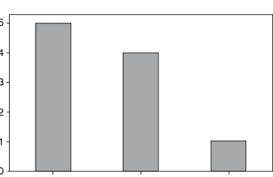

图 A.1 婚姻状况条形图。

- 例如，表 A.2 包含表 A.1 数据中婚姻状况变量的频数分布和相对频数分布。

- 条形图是用于表示类别变量频数或相对频数的图表。请注意，条形之间不相接。

- 帕累托图是条形按降序排列的条形图。图 A.1 是帕累托图的一个示例。

- 饼图是一个被分成若干扇区的圆，每个扇区的大小与其关联类别的相对频数成正比。图 A.2 显示了婚姻状况的饼图。

### A.2 定量变量

- 定量数据被分组为类别。类别的下限（上限）等于该类别中的最小（最大）值。类宽是连续下限之间的差值。

- 对于定量数据，（相对）频数分布将数据划分为等类宽的不重叠类别。表 A.3 显示了


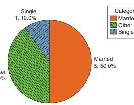

#### 图 A.2 婚姻状况饼图。

#### 表 A.3 收入的频数分布和相对频数分布

| 收入类别 ($) | 频数 | 相对频数 |
|---|---|---|
| 24,000–29,999 | 3 | 0.3 |
| 30,000–35,999 | 4 | 0.4 |
| 36,000–41,999 | 2 | 0.2 |
| 42,000–48,999 | 1 | 0.1 |
| 总计 | 10 | 1.0 |

#### 表 A.4 收入的累积频数分布和累积相对频数分布

| 收入类别 ($) | 累积频数 | 累积相对频数 |
|---|---|---|
| 24,000–29,999 | 3 | 0.3 |
| 30,000–35,999 | 7 | 0.7 |
| 36,000–41,999 | 9 | 0.9 |
| 42,000–48,999 | 10 | 1.0 |

来自表 A.1 的连续变量收入的频数分布和相对频数分布。

- 累积（相对）频数分布显示小于或等于上限类别的数据值的总数（相对频数）（表 A.4）。

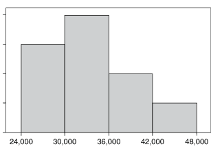

#### 图 A.3 收入直方图。

- 变量的分布是指定数据集中所有元素的变量值和频数的图形、表格或公式。例如，表 A.3 表示变量收入的分布。

- 直方图是定量变量的（相对）频数分布的图形表示（图 A.3）。请注意，直方图代表数据平滑的简单版本，因此其形状会因类别的数量和宽度而异。因此，解读直方图时应谨慎。参见 Daniel T. Larose (W.H. Freeman) 著《Discovering Statistics》第 2.4 节，了解通过更改直方图类别的数量和宽度，使数据集同时呈现对称和右偏的示例。

- 茎叶图在保留显示中原始数据值（精确或近似）的同时，展示了数据分布的形状。叶子单位定义为 10 的幂，茎单位是叶子单位的 10 倍。然后，每个叶子通过茎叶组合表示一个数据值。例如，在图 A.4 中，叶子单位（右侧列）为 1000s，茎单位（左侧列）为 10,000s。因此，“2 4”表示 2 × 10,000 + 4 × 1000 = 24,000 美元，而“2 55”表示两个相等的 25,000 美元收入（一个精确，一个近似——25,100 美元）。请注意，将图 A.4 向左旋转 90°，即可呈现数据分布的形状。

- 在点图中，每个点代表数轴上方的一个或多个数据值（图 A.5）。

- 如果存在一条对称轴（一条直线）将分布分成两个近似互为镜像的半部，则该分布是对称的（图 A.6a）。

#### 收入的茎叶图
叶子单位 = 1000

```
2   4
2   55
3   2223
3   68
4   8
4   8
```

#### 图 A.4 收入的茎叶图显示。

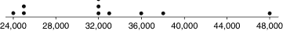

#### 图 A.5 收入的点图。


#### 图 A.6 (a) 钟形曲线是对称的。(b) 右偏分布。(c) 左偏分布。

- 右偏数据的右尾比左尾长（图 A.6b）。左偏数据的左尾比右尾长（图 A.6c）。

## 第三部分：总结 2：中心、变异性和位置的度量

- 求和符号 \(\Sigma x\) 表示将所有数据值 \(x\) 相加。样本容量为 \(n\)，总体容量为 \(N\)。

- 中心趋势度量指示数据中心部分在数轴上的位置。我们将学习的中心趋势度量包括均值、中位数、众数和中极值。

- 均值是数据集的算术平均值。要计算均值，将所有值相加并除以值的个数。表 A.1 中的平均收入为：

```
\frac{38,000 + 32,000 + ... + 32,200}{10} = \frac{325,400}{10} = \$32,540
```

- 样本均值是样本的算术平均值，记作 \(\bar{X}\)（“x-bar”）。

- 总体均值是总体的算术平均值，记作 \(\mu\)（“myu”，表示 m 的希腊字母）。

- 中位数是数据值数量为奇数且数据已按升序排列时的中间数据值。如果是偶数个，中位数是两个中间数据值的均值。当收入数据按升序排列时，两个中间值为 32,100 美元和 32,200 美元，其均值即为中位数收入 32,150 美元。

- 众数是出现频率最高的数据值。定量变量和定性变量都可以有众数，但只有定量变量才能有均值或中位数。每个收入值只出现一次，因此没有众数。年份的众数是 2010，频数为 4。

- 中极值是数据集中最大值和最小值的平均值。中极值收入为

```
midrange(income) = \frac{(max(income) + min(income))}{2} = \frac{48,000 + 24,000}{2} = \$36,000
```

- 偏度与中心趋势度量。以下是趋势，而非严格规则。

- 对于对称数据，均值和中位数近似相等。

- 对于右偏数据，均值大于中位数。

- 对于左偏数据，中位数大于均值。

- **变异性度量**量化数据中存在的变异、分散或离散程度。我们将学习的变异性度量包括极差、方差、标准差，以及后来的四分位距（IQR）。

- 变量的 **极差** 等于最大值与最小值之差。收入的极差为：极差 = max(income) - min(income) = 48,000 - 24,000 = 24,000。

- **偏差** 是数据值与均值之间的有符号差值。对于申请人 1，收入的偏差等于 x - x̄ = 38,000 - 32,540 = 5,460。对于任何可想象的数据集，平均偏差始终等于零，因为偏差之和等于零。

- 总体 **方差** 是平方偏差的均值，记作 σ²（“sigma-squared”):

```
\sigma^2 = \frac{\sum(x-\mu)^2}{N}
```

- 总体 **标准差** 是总体方差的平方根：\sigma = \sqrt{\sigma^2}。

- 样本 **方差** 近似为平方偏差的均值，分母中将 n 替换为 n - 1，以使其成为 \sigma^2 的无偏估计量。（**无偏估计量** 是期望值等于其目标参数的统计量。）

```
s^2 = \frac{\sum(x-\bar{x})^2}{n-1}
```

- 样本 **标准差** 是样本方差的平方根：s = \sqrt{s^2}。

- 方差以 **平方单位** 表示，这种解释对非专业人士可能难以理解。因此，在报告结果时，更倾向于使用以原始单位表示的标准差。例如，收入的样本方差为 s^2 = 51,860,444 平方美元，其含义对客户可能不清楚。最好报告样本标准差 s = 7,201 美元。

- 样本标准差 s 被解释为 **典型偏差** 的大小，即数据值与均值数据值之间典型差异的大小。例如，收入通常偏离其均值 7,201 美元。

- 位置度量指示特定数据值在数据分布中的相对位置。我们在此介绍的位置度量包括百分位数、百分位等级、Z 分数和四分位数。

- 数据集的 p 百分位数是使得数据集中 p% 的值小于或等于该值的数据值。第 50 百分位数是中位数。例如，中位数收入为 32,150 美元，50% 的数据值小于或等于该值。

- 数据值的百分位等级等于数据集中小于或等于该值的值的百分比。例如，申请人 1 收入 38,000 美元的百分位等级为 90%，因为这是等于或小于 38,000 美元的收入的百分比。

- 特定数据值的 Z 分数表示该数据值高于或低于均值多少个标准差。对于样本，Z 分数为：

```
Z-score = \frac{x - \bar{x}}{s}
```

对于申请人 6，Z 分数为

```
\frac{24,000 - 32,540}{7201} \approx -1.2
```

申请人 6 的收入低于均值 1.2 个标准差。

- 给定 z 分数，我们也可以找到数据值。假设不会向收入低于均值 2 个标准差以上的人发放贷款。在这里，Z 分数 = -2，相应的最低收入为：

```
income = Z-score \cdot s + \bar{x} = (-2)(7201) + 32,540 = \$18,138
```

不会向收入低于 18,138 美元的申请人提供贷款。

- 如果数据分布呈正态分布，则经验法则指出：

- 约 68% 的数据在均值一个标准差范围内。

- 约 95% 的数据在均值两个标准差范围内。

- 约 99.7% 的数据在均值三个标准差范围内。

- 第一四分位数（Q1）是数据集的第 25 百分位数；第二四分位数（Q2）是第 50 百分位数（中位数）；第三四分位数（Q3）是第 75 百分位数。


图 A.7 左偏数据的箱线图。

- 四分位距（IQR）是衡量变异程度的指标，对异常值的存在不敏感。\(IQR = Q3 - Q1\)。
- 在用于检测异常值的IQR方法中，数据值\(x\)如果满足以下任一条件，则为异常值：
  - \(x \le Q1 - 1.5(IQR)\)，或
  - \(x \ge Q3 + 1.5(IQR)\)。
- 数据集的五数概要包括最小值、\(Q1\)、中位数、\(Q3\)和最大值。
- 箱线图是基于五数概要的图形，用于识别对称性和偏态。假设对于某个特定数据集（非来自表A.1），我们有\(Min = 15, Q1 = 29, Median = 36, Q3 = 42\)，且\(Max = 47\)。则箱线图如图A.7所示。
  - 箱体覆盖从Q1到Q3的数据“中间一半”。
  - 左须线延伸至非异常值的最小值。
  - 右须线延伸至非异常值的最大值。
  - 当左须线比右须线长时，分布呈左偏，反之亦然。
  - 当两须线长度大致相等时，分布呈对称。图A.7中的分布显示出左偏的证据。

## 第4部分：双变量关系的汇总与可视化

- 双变量关系是两个变量之间的关系。
- 两个分类变量之间的关系使用列联表进行汇总，列联表是对两个变量的交叉汇总，并包含每个变量值组合（即每种情况）的一个单元格。表A.5是变量mortgage和risk的列联表。总计列包含risk的边缘分布，即仅针对该变量的频数分布。同样，总计行代表mortgage的边缘分布。

- 从列联表中可以学到很多。坏风险的基准比例为2/10 = 20%。然而，没有抵押的申请人的坏风险比例为1/3 = 33%，高于基准；有抵押的申请人的坏风险比例仅为1/7 = 1%，低于基准风险。因此，申请人是否有抵押对于预测风险很有用。

- 聚类柱状图是列联表的图形表示。图A.8显示了按mortgage聚类的risk的聚类柱状图。请注意，两组之间的差异一目了然。

- 要汇总定量变量与分类变量之间的关系，我们为分类变量的每个水平计算定量变量的汇总统计量。例如，Minitab提供了收入的以下汇总统计量，分别针对坏风险记录和好风险记录。所有汇总指标在好风险下均更大。差异显著吗？我们需要进行假设检验来找出答案（第4章）。

### 表A.5 Mortgage与Risk的列联表

| 风险 | 是 | 否 | 总计 |
| :--- | :--- | :--- | :--- |
| 好 | 6 | 2 | 8 |
| 坏 | 1 | 1 | 2 |
| 总计 | 7 | 3 | 10 |


图A.8 按mortgage聚类的risk聚类柱状图。


图A.9 收入与风险的个体值图。

### 描述统计量：收入

| 变量 | 风险 | 均值 | 标准差 | 最小值 | 中位数 | 最大值 |
| :--- | :--- | :--- | :--- | :--- | :--- | :--- |
| 收入 | 坏 | 28,050 | 5728 | 24,000 | 28,050 | 32,100 |
| 收入 | 好 | 33,663 | 7402 | 25,000 | 32,600 | 48,000 |

- 要可视化定量变量与分类变量之间的关系，我们可以使用**个体值图**，它本质上是一组垂直点图，分类变量中的每个类别对应一个。图A.9显示了收入与风险的个体值图，表明好风险的收入往往更大。

- **散点图**用于可视化两个定量变量x和y之间的关系。每个(x, y)点在笛卡尔平面上作图，x轴在水平方向，y轴在垂直方向。图A.10显示了八个散点图，展示了变量之间的一些可能关系类型，以及**相关系数r**的值。

- **相关系数r**量化了两个定量变量之间线性关系的强度和方向。相关系数定义为

```
r = \frac{\sum (x - \bar{x})(y - \bar{y})}{(n-1)s_x s_y}
```

完美正线性关系，r = 1

强正线性关系，r = 0.9

中等正线性关系，r = 0.5

完美负线性关系，r = -1

强负线性关系，r = -0.9

中等负线性关系，r = -0.5

无明显线性关系，r = 0

存在非线性关系但无线性关系，r = 0

图A.10 x和y之间的一些可能关系。

其中\(s_x\)和\(s_y\)分别表示x变量和y变量的标准差。\(-1 \le r \le 1\)。

- 在数据挖掘中，当记录数量很大（超过1000条）时，即使r值很小（如–0.1 ≤ r ≤ 0.1）也可能具有统计显著性。

- 如果r为正且显著，我们说x和y正相关。x的增加与y的增加相关联。

- 如果r为负且显著，我们说x和y负相关。x的增加与y的减少相关联。

## 索引

a priori algorithm, 47, 70, 199
accounting auditing purposes, 142
add_constant() command, 154
addmargins() command, 53, 123–4, 125
adult_ch6_test data set, 81
adult_ch6_training data set, 81, 82
aes() command, 58
Alcohol_flag, 115, 116, 117, 122, 124
All Negative Model, 77, 101, 109
All Positive Model, 77, 109
Anaconda software package, 9
apriori() command, 208, 210
A-priori probabilities, 125
arules package, 204, 205
as.factor() command, 148
as.numeric() command, 36
association, 5.7
association rules, 30
confidence difference criterion, 208–9
confidence of, 201
confidence quotient criterion, 209–10
confirming our metrics, 207–8
lift, 201–2
mining, 200, 202–6
support for, 200–201
valediction, 210
attributes, 215
backpropagation algorithm, 134
bank_additional data set, 71
bank_additional_full.txt data set, 29
bank_marketing_test data set, 29, 31
bank_marketing_training data set, 22–3, 29, 47, 49, 50
bank_train data set, 24, 25
bar chart, 218

bar() commands, 55, 57
bar graphs
best practices, 49
with response overlay, 47–51
from Python of age_binned, 61, 62, 63
from R of age_binned, 59, 60
from R of previous outcome, 47, 48
using Python, 49–50
using R, 50–51
in R of education variable, 36, 37
baseline model performance, 4, 78
for Binary Classification, 77
k-ary classification, 77
for regression, 162–3
for estimation models, 163
final regression model, 163
Bayes theorem
marginal probability, 114
noninformative prior, 114
posterior probability, 114
predictor variable values, 113
prior probability, 114
best subsets regression, 161
using R, 162
between-cluster variation, 142
Biggest Category Model, 77
binning
based on predictive value
using Python, 59–62
using R, 62–3
best practices, 59
BIRCH clustering, 142
bivariate relationship, 225
boxplot, 225
branches, 81

C5.0 algorithm
decision trees
using Python, 89–90
using R, 89, 90–91
R, evaluation measures of, 102, 103
CART see classification and regression tree (CART) model
cases or subjects, 215
categorical() command, 84
categorical data as numeric, reexpression of using Python, 36–8
using R, 38–9
categorical variables see also qualitative variables
bar chart, 218
frequency (or count), 217, 218
(relative) frequency distribution, 217, 218
pie chart, 218
c() command, 24, 103
census, 217
class conditional independence, 114
classification, 5, 6–7
classification and regression tree (CART) model, 11
married node, 82–3
non-married marital status node, 83
root node split, 82, 83–4
using Python, 84–6
using R, 86–8
clothing_data_driven_test data set, 101
clothing_data_driven_training data set, 103
clothing_sales_test data sets, 152, 154, 156, 161, 189, 190, 191
clothing_sales_training data sets, 152, 154, 156, 161, 189, 190, 191
clothing_store_PCA_test data sets, 175
clothing_store_PCA_training data sets, 175
clustered bar chart, 226
clustering, 5, 7, 30
accounting auditing purposes, 142
BIRCH, 142
gene expression, 142
hierarchical, 142
K-means, 142–4
Kohonen networks, 142
target marketing, 141
validation, 144–5
colnames() command, 86
colnames() values, 204

columns of interest section, 25
column_stack() command, 56, 159
combination function, 131–3
components, 175
concat() command, 74
conditional independence, 118
conditional probabilities, 125
confidence difference criterion, 208–9
using R, 208–9
confidence of the rule, 209
confidence quotient criterion using R, 209–10
contingency tables, 225, 226
best practices, 52
for evaluating model 1, 101
for evaluating model 2, 106
for evaluating model 3, 108
of sex and death, 136
using Python, 13–14, 52–3, 123
using R, 23–4, 53
corr variable, 216
corr() command, 181
correlation coefficient, 227, 229
correlation matrix from Python, 180
credit card, 154, 157
cross(tab) command, 13, 14, 49, 61
cross-validation process, 3, 70
cumulative (relative) frequency distribution, 219
curvilinear behavior, 133
cut() command, 62
data, 216
data balancing, 3
data debugging, 70
data.frame() command, 85, 145, 160
data mining process, 142
data modeling, preparation balancing training data set, 73–6
baseline model performance, 77–8
data partitioning, 69–72
Setup Phase, 69
validating your partition, 72
data partitioning, 69–72
data preparation adding an index field using Python, 31–2
using R, 32–3
bank marketing data set, 29


- 修改误导性字段值
  - 使用 Python，34
  - 使用 R，34–6
- 识别异常值
  - 使用 Python，41–2
  - 使用 R，42–3
- 阶段，31
- 问题理解阶段
  - 数据科学问题，30
  - 项目目标，29–30
- 将分类数据重新表示为数值
  - 使用 Python，36–8
  - 使用 R，38–9
- 标准化数值字段
  - 使用 Python，40
  - 使用 R，40
- 数据准备阶段，2
- 数据科学，1
- 数据科学方法论 (DSM)
  - 迭代和自适应特性，1, 2, 5
  - 阶段，3
  - 数据准备阶段，2
  - 部署阶段，5
  - 评估阶段，4–5
  - 探索性数据分析阶段，3
  - 建模阶段，4
  - 问题理解阶段，2
  - 设置阶段，3–4
- 数据科学任务
  - 关联，5, 7
  - 分类，5, 6–7
  - 聚类，5, 7
  - 描述，5, 6
  - 估计，5, 6
  - 预测，5, 7
- 数据科学家，6
- 数据汇总
  - 双变量关系，225–9
  - 数据分析的构建块，215–17
  - 集中趋势度量，222–3
  - 位置度量，224–5
  - 变异度量，223–4
- 购买间隔天数，154
- days_since_previous 变量，34, 34, 35, 36
- 决策节点，81
- DecisionTreeClassifier() 命令，85, 90
- 决策树，30
- C5.0 算法，88–91
- 分类和回归树，83–8
- 随机森林，91–3
- 部署阶段，5
- describe() 命令，146
- 描述，5, 6
- 描述性回归建模，151–2
- 描述性统计，6, 215
- 偏差，223
- dim() 命令，32, 71
- 维度灾难，167, 199
- 维度约简
  - 应提取的成分，176–7
  - 特征值准则，176–7
  - 方差解释比例准则，177
  - 维度灾难，167
  - 重复计数，167
  - 多重共线性，167, 168–74, 183–4
  - 过拟合，167
  - 使用 K = 4 执行 PCA，178
  - 主成分分析，175–6, 178–83
  - 违反简约原则，167
- 离散变量，216
- 分布，220
- div() 命令，50, 52, 53
- 点图，220, 221
- 重复计数，167
- drop() 命令，180
- dropna() 命令，172
- DSM 参见 数据科学方法论 (DSM)
- EDA 参见 探索性数据分析 (EDA)
- education_numeric 变量，36, 37, 38, 39
- education 变量，36, 37
- 特征值准则，176–7
- 元素，215
- 经验法则，224
- 集成方法，91
- X 的熵，88
- 估计，5, 6
- 评估阶段，4–5
- 探索性数据分析 (EDA)，30
  - 带响应叠加的条形图，47–51
  - 基于预测值的分箱，58–63
  - 列联表，31–3
  - Framingham 心脏病研究，136, 137
  - 带响应叠加的直方图，53–8
  - 与 HT 的对比，47
- 探索性数据分析阶段，3
- export_graphviz() 命令，86, 90
- 最终逻辑回归模型，189
- 最终回归模型，153, 159
- R 的最终回归结果，157
- 第一四分位数 (Q1)，224
- fit() 命令，85, 155, 191, 194
- 五数概括，225
- Framingham 心脏病研究数据，136
- Framingham_training 数据集，137
- 频数分布，218
- 基因表达聚类，142
- 广义线性模型 (GLM)
  - 线性回归，188
  - 逻辑回归，188–92
  - 泊松回归，192–5
- geom_bar() 命令，51, 58
- geom_histogram() 命令，58
- get_dummies() 命令，194
- ggplot() 代码，124
- ggplot() 命令，51, 57
- ggplot2 包，20–21
- Gini 准则，91
- Gini 指数，83
- GLM 参见 广义线性模型 (GLM)
- GLM() 命令，194
- 图形化数据分析，47
- grid.arrange() 命令，124
- gridExtra 包，124
- head() 命令，33, 42, 43, 205, 209
- 层次聚类，142
- hist() 命令，34, 35
- 直方图，15, 220
  - 最佳实践，55
  - 在 Python 中，35
  - 在 R 中，33, 36, 39
  - 带响应叠加，53–8
  - 使用 Python，55–7
  - 使用 R，54, 58
  - Spyder 中的，16, 17
- 保留数据集，70
- 比例齐性检验，72
- HT 参见 假设检验 (HT)
- 假设检验 (HT)，47
  - 与 EDA 的对比，47
- ifelse() 命令，35
- "导入数据集" 窗口，21, 22
- 导入包
  - 在 Python 中，11–12
  - 在 R 中，20–21
- 添加索引字段
  - 使用 Python，31–2
  - 使用 R，32–3
- 个体值图，227
- 信息增益或熵减的概念，88
- inspect() 命令，205, 209
- install.packages() 命令，20
- 间隔数据，216
- IQR，225
- 用于检测异常值的 IQR 方法，225
- k 折交叉验证，70
- K-means 聚类算法
  - 应用，143–4
  - 使用 Python，145–7
  - 在 R 中，147–9
- KMeans() 命令，145, 147
- Kohonen 网络聚类，142
- 叶节点，81
- legend() 命令，55
- levels() 命令，39
- library() 命令，21
- 线性预测器，187
- 线性回归
  - 作为一般线性模型，188
  - 链接函数，187, 188
- lm() 命令，156
- 逻辑回归，30
  - 应用，189–92
  - 作为一般线性模型，188–9
  - 使用 Python，190–191
  - 使用 R，191–2
- Logit() 命令，191
- MAE() 命令，161
- 边缘分布，226
- 最大后验假设，114
- 均值，222
- 平均绝对误差 (MAE)，158, 160, 161
- 集中趋势度量，222–4
- 位置度量，224–5
- 中位数，222
- 度量，208
  - 置信度，207
  - 提升度，207
  - 支持度，207
- miningdance，222
- 关联规则挖掘
  - "基准" 比例，202, 203
  - Churn_Training_File 数据集，202
  - 示例，200
  - 使用 R，203-6
- 误导性字段值，33-6
  - days_since_previous 的直方图，33
  - 使用 Python，34
  - 使用 R，34-6
- 众数，222
- 模型评估
  - 考虑不等误差成本
    - 调整后的成本矩阵，105
    - 成本矩阵，104
  - 应用，100-104
  - 预测变量，100
  - 分类评估度量，97-9
  - 每条记录的成本和每条记录的利润，106
  - 数据驱动的误差成本
    - 成本矩阵，107, 108
    - 简化，108
  - 方法，100
  - 所有模型的度量，109
  - 精确率、召回率和 Fβ 分数，99-100
  - 灵敏度和特异度，99
  - 不等误差成本，模型比较，106-7
- 建模阶段，4
- model02.summary() 命令，155
- model02.test.summary() 命令，155
- 多重共线性，167, 183-4
  - 来自 Python 的预测变量，171
  - 回归系数，169-70
  - 回归方程，170
  - 稳定系数，168
  - 不稳定的回归模型，167
  - 使用 Python，172-3
  - 使用 R，173, 174
  - 使用方差膨胀因子，171-4
  - 变量系数，168-9
- MultinomialNB() 命令，11
- 多元回归建模
  - 应用，152-4
  - 使用 Python，153, 154-5
  - 使用 R，156-7
- 朴素贝叶斯分类，30
  - 应用，115-25
  - 贝叶斯定理，113-14
  - 类条件独立性，114
  - 最大后验假设，114
  - 在 Python 中，121-3
  - 在 R 中，123-5
- naïveBayes() 命令，124
- 几乎恒定行为，133
- 几乎线性行为，133
- 净输入，131
- 神经网络模型，30, 70
  - 应用，134-6
  - 反向传播，134
  - 连接权重和组合函数，131-3
  - 数据输入和初始值，131
  - 示例，130
  - 探索性数据分析，135-6
  - 隐藏层和节点，130-131
  - 权重解释，136-7
  - 净输入，131-2
  - 输出值，132
  - 在 R 中，137-8
  - 真实神经元和人工神经元模型，129, 130
  - Sigmoid 激活函数，133-4
  - Sigmoid 函数，132
  - 结构，129-31
    - 完全连接网络，130
    - 前馈特性，129
    - 分层，129
  - 神经元模型，真实和人工，129, 130
- 名义数据，216
- 正态分布，188
- mtrec，93
- MultinomialNB() 算法，122
- 数值变量 参见 定量变量
- NumPy 包，11, 12, 34
- OLS() 命令，154-5
- order() 命令，42-3
- ordered() 命令，204
- 序数数据，216
- "普通最小二乘法" (OLS)，154
- 过拟合，167
- 包，20
- pandas 包 pd，32
- pandas 包，11, 12, 32, 34
- 参数，217
- Pareto 图，218
- 简约原则，167
- PCA 参见 主成分分析 (PCA)
- PCA() 命令，180
- 百分位排名，224
- 饼图，218
- plot() 命令，49, 90, 182
- plotnet() 命令，138
- 泊松回归模型
  - 应用，192–5
  - 结构，193
  - 使用 Python，193–4
  - 使用 R，194–5
- 总体，217
- 总体均值，222
- 总体标准差，223
- 总体方差，223
- 后验分布，113, 119, 120
- predict() 命令，86, 91, 92, 103, 123, 125, 159, 160
- 预测，5, 7
- 预测变量，154, 217
- Previous_outcome，47, 48, 49, 50
- principal() 命令，182
- 主成分分析 (PCA)
  - 应用，175–6
  - 使用 K = 4，178
  - 预测变量，175
  - R 的结果，176
  - R 输出，179
  - 使用 Python，179–81
  - 使用 R，181–3
  - 验证，178–9
- 前验分布，113, 119
- 问题理解阶段，2
  - 将目标转化为数据科学问题，30
  - 项目目标，29–30
- proj.table() 命令，63, 204
- 暂定回归方程，152
- 第 p 个百分位数，224
- p 值，152, 189
- Python，40
  - 添加索引字段，31–2
  - 平衡训练数据集，74–5
  - 带响应叠加的条形图，49–50
  - Python 编码基础
    - 在 Python 中访问记录和变量，14–15
    - 按钮和悬停文本，11
    - 执行命令，10–11
    - 将数据导入 Python，12–13
    - 在 Python 中导入包，11–12
    - 在 Python 中保存输出，13–14
    - 在 Python 中设置图形，15–17
    - 使用注释，9–10
  - 基于预测值的分箱，59–62
  - C5.0 算法，89–90
  - CART 模型，84–6
  - 将分类数据作为数值，正则表达式，36–8
  - 列联表，52–3
  - 来自 Python 的相关矩阵，180
  - 下载，9
  - 带响应叠加的直方图，55–7
  - 识别异常值，41–2
  - 导入包，11–12
  - K-means 聚类算法，145–7
  - 逻辑回归，190–191
  - 误导性字段值，34
  - 估计的模型评估，159–60
  - 多重共线性，172–3
  - 多元回归建模，154–5
  - 朴素贝叶斯分类，121–3
  - PCA，179–81
  - 泊松回归模型，193–4
  - 随机森林，92
  - 标准化数值字段，40
- Python 逻辑回归，190
- 定性变量，215
- 定量变量，215, 216
  - 类别，218
  - 累积（相对）频数分布，219
  - 分布，220
  - 点图，220, 221
  - （相对）频数分布，218–19
  - 直方图，220
  - 偏斜数据，221, 222


- 茎叶图, 220, 221
- 对称分布, 220, 221
- query() 命令, 41
- R
  - 关联规则, 209
  - 带响应叠加的条形图, 50-51
  - 编码基础
    - 访问记录和变量, 24-5
    - 执行命令, 20
    - 获取数据, 21-3
    - 导入包, 20-21
    - 保存输出, 23-4
    - 使用注释, 19
  - 最佳子集回归, 162
  - 基于预测值的分箱, 62-3
  - C5.0 算法, 89, 90-91
  - 类别数据作为数值，其重表达, 38-9
  - 置信度差异准则, 208-9
  - 置信度商准则, 209-10
  - 列联表, 53
  - 下载, 17-19
  - 最终回归结果, 157
  - 带响应叠加的直方图, 58
  - 导入包, 20-21
  - 添加索引字段, 32-3
  - K-means 聚类算法, 147-9
  - 逻辑回归, 191-2
  - 挖掘关联规则, 203-6
  - 误导性字段值, 34-6
  - 多重共线性, 173, 174
  - 多元回归建模, 156-7
  - 朴素贝叶斯分类, 123-5
  - 神经网络模型, 137-8
  - 数值字段，标准化, 40
  - 异常值，识别, 42-3
  - PCA, 181-3
  - 泊松回归模型, 194-5
  - 随机森林, 92-3
  - 逐步回归, 162
  - 训练数据集, 75-6
- R^2, 159
- R^2 (调整后的 R-squared), 160, 161
- RandomForestClassifier() 命令, 92
- 随机森林, 30
  - 在 Python 中, 92
  - 在 R 中, 92-3
- 随机样本, 217
- 范围, 223
- range() 命令, 32
- 比率数据, 216
- rbind() 命令, 76, 204
- R C5.0 模型，评估度量, 102
- read.csv() 命令, 11, 23, 31, 123
- 回归系数, 154
- 回归建模
  - 回归的基线模型, 162-3
  - 描述性回归建模, 151-2
  - 估计的模型评估
    - 估计模型指标, 158
    - 使用 Python, 159-60
    - 使用 R, 160-161
  - 多元（参见多元回归建模）
  - R 中的结果, 157
  - 逐步回归, 161-2
- 回归树, 83-8
- 相对频数分布, 217, 218-19
- 重采样, 73
- 响应叠加
  - 条形图（带响应叠加）, 47-51
  - 直方图（带响应叠加）, 53-8
- 响应值, 101
  - 重平衡后, 75
- 响应变量, 217
- 根节点, 81
- 旋转成分矩阵, 178
- round() 命令, 53, 181, 204
- RStudio, 19-25
- RStudio 窗口, 18, 19
- runif() 命令, 72
- sales_test 数据集, 156
- 样本, 217
- sample() 命令, 74
- 样本均值, 222
- 样本标准差, 223
- 样本方差, 223
- scale() 命令, 147
- scatter_matrix() 命令, 172
- 散点图, 227, 228
- 第二四分位数 (Q2), 224
- Series() 命令, 32
- set.seed() 命令, 71
- 设置阶段, 3-4, 69
- Sigmoid 激活函数, 132-3
- 偏态数据, 221, 222
- 偏度, 222-3
- sklearn, 121
- sklearn.naive_bayes 包, 11
- sklearn 包, 89
- sort_values() 命令, 41
- Spyder
  - 图形输出, 16, 18
  - 直方图, 15, 17
  - 首选项窗口, 16, 17
  - Spyder 控制台, 9
  - Spyder 窗口, 10
- "SS 载荷," 176
- 最先进的算法, 4
- 统计量, 217
- 统计推断, 217
- stats.zscore 命令, 145
- 茎叶图, 220, 221
- stepAIC() 命令, 162
- 逐步回归, 161-2
  - 使用 R, 162
- subset() 命令, 204
- Sugar_flag, 115, 116, 117, 124
- sum() 命令, 52, 53, 61
- summary() 命令, 148, 155, 156, 160, 191, 195
- summary() 命令, 191
- 求和符号, 222
- 误差平方和 (SSE), 134
- 对称分布, 220, 221
- table() 命令, 63, 104, 204
- 目标营销, 141
- 目标变量, 154
- 测试数据集, 70
- 第三四分位数 (Q3), 224
- title() 命令, 55
- 训练数据集, 70, 73-6
  - 在 Python 中, 74-5
  - 在 R 中, 75-6
- 训练集减去测试集, 145
- 双样本 t 检验, 72
- 二重交叉验证, 70
- 无偏估计量, 223
- 未旋转成分矩阵, 178
- 上须, 141
- 验证你的分区, 72
- value_counts() 命令, 74
- 变量, 215
  - 定性, 215
  - 定量, 215, 216
- 方差, 223
- variance_inflation_factor() 命令, 173
- 方差膨胀因子 (VIFs), 171-2, 173, 176
- 方差，比例, 178
- varimax 旋转, 178
- vif() 命令, 173, 181
- 可视化
  - 双变量关系的, 225-9
  - 用于汇总和组织数据的图表和表格, 217-22
  - 类别变量, 217-18
  - 数值变量, 218-22
- Web 账户, 152, 153, 190
- which() 命令, 42, 75
- white_wine_test 数据集, 143, 144
- white_wine_training 数据集, 143, 144, 145, 147
- wine_flag_test 数据集, 115, 120
- wine_flag_training 数据集, 115, 120
- xlabel() 命令, 55
- "是" 响应的百分比, 74-5
- ylabel() 命令, 53, 55
- ypred 值, 103, 104, 125, 160
- zscore() 命令, 40
- z-score 转换, 145, 224
- 双样本 Z 检验, 72

