# C++ 数据结构和算法使用指南：实用实现


# 前言

欢迎使用《使用 C++ 的数据结构与算法》第一版。数据结构是内存中数据的逻辑或数学排列。为了有效，数据必须以一种提高算法效率的方式组织，并描述这些数据项之间的关系以及可以对这些项执行的操作。选择合适的数据结构和算法是设计高效程序的基本步骤。因此，对于希望使用 C++（一种在学术界和工业界都广受欢迎的面向对象编程语言）进行系统软件设计与实现的学生来说，深入理解数据结构概念至关重要。因此，本书旨在全面且逻辑清晰地介绍栈、队列、链表、树和图等数据结构，使其成为学习数据结构的优秀教材。本书的目标是介绍数据结构的概念，并将这些概念应用于现实问题的解决中。书中大部分示例源于课堂上与学生的互动。本书采用系统的方法，即每种数据结构的设计之后，接着是可对其执行的不同操作的算法，以及这些算法的运行时间分析。

本书旨在作为各学科本科工科学生和计算机应用研究生课程的教材。从事高效数据存储及相关应用的年轻研究人员也会发现，本书是一本有用的参考资料，可指导他们掌握这一快速发展的研究领域中新确立的技术。

Dr. Sachi Nandan Mohanty 和 Prof. Pabitra Kumar Tripathy 2020 年 12 月

# 1 数据结构简介

## 1.1 数据结构的定义与用途

数据结构是数据单个元素之间存在的逻辑关系的表示。换句话说，数据结构是一种组织所有数据项的方式，它不仅考虑存储的元素，还考虑它们之间的关系。数据结构指定

- 数据的组织
- 访问方法
- 关联程度
- 信息的处理替代方案

数据结构是程序的构建模块，因此选择特定的数据结构强调

- 数据结构在结构上必须足够丰富，以反映数据之间的关系，并且
- 结构应简单，以便在需要时能有效处理数据。

在数学上，算法 + 数据结构 = 程序。最后，我们也可以将数据结构定义为“特定数据组织的逻辑和数学模型”。

## 1.2 数据结构的类型

数据结构大致可分为线性和非线性两类。

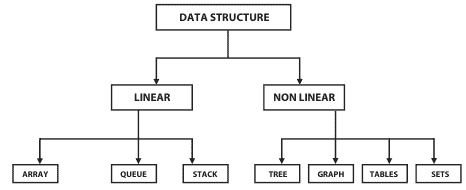

### 线性数据结构

在线性数据结构中，值以线性方式排列。数组、链表、栈和队列是线性数据结构的示例，其中值按序列存储。

### 非线性数据结构

此类与线性相反。该结构中的数据值不按顺序排列。树、图、表和集合是非线性数据结构的示例。

### 数据结构中执行的操作

在数据结构中，我们可以执行以下操作

- 遍历
- 插入
- 删除
- 合并
- 排序
- 查找

## 1.3 算法

解决问题的逐步过程称为算法。算法是一个组织良好、预先安排并定义的计算模块，接收一些值或一组值作为输入，并提供单个值或一组值作为输出。这些明确定义的计算步骤按顺序排列，将给定的输入处理为输出。

只有当算法提供确切所需的输出时，才被认为是准确和真实的。

算法的效率取决于时间和空间复杂度。算法的复杂度是一个函数，它以输入规模为函数给出运行时间和/或空间。

### 开发算法所需的步骤

- 寻找解决问题的方法。算法的每个步骤都应以精确和清晰的方式定义。伪代码也用于描述算法。

- 下一步是验证算法。此步骤包括算法中的所有步骤，应手动完成：给出所需输入，执行算法中包含的所需步骤，并在有限时间内获得所需的输出量。

- 最后，使用编程语言实现算法。

### 数学符号与函数

### 下取整与上取整函数

下取整函数返回不超过该数的最大整数。

上取整函数返回不小于该数的最小整数。

⌊n⌋ 表示下取整函数

⌈n⌉ 表示上取整函数

示例：

⌊5.23⌋ = 5   ⌈5.23⌉ = 6

### 余数函数

要查找余数，使用 "mod" 函数，如下所示

```
A mod B
```

### 查找数字的整数部分和绝对值

INT(5.34) = 5 该语句返回数字的整数部分。INT(- 6.45) = 6 该语句返回数字的绝对值和整数部分。

### 求和符号

要将一系列数字相加，如 a1 + a2 + a3 + ... + an，使用符号 Σ

```
n
Σ ai
i=1
```

### 数字的阶乘

1 到 n 的正整数乘积称为 n 的阶乘，表示为 n!。

```
0! = 1
```

### 算法符号

编写算法时，注释放在 [ ] 中。赋值应使用符号 ":=" 而不是 "="。输入使用 Read：变量名。输出使用 write：消息/变量名。

控制结构也可以在算法中使用，但其处理方式会有些不同，如下所示

### 简单 If

```
If condition, then:
Statements
[end of if structure]
```

### If...else

```
If condition, then:
Statements
Else :
Statements
[end of if structure]
```

### If...else 级联

```
If condition1, then:
Statements
Else if condition2, then:
Statements
Else if condition3, then:
Statements
....................
....................
....................
Else If conditionN, then:
Statements
Else:
Statements
[end of if structure]
```

### 循环结构

```
Repeat for var = start_value to end_value by
step_value
Statements
[end of loop]
Repeat while condition:
Statements
[end of loop]
Ex : repeat for I = 1 to 10 by 2
Write: i
[end of loop]
```

### 输出

1 3 5 7 9


## 1.4 算法的复杂度

程序的复杂度可以通过以下标准来判断：是否满足原始规范任务、代码是否可读等。这些因素会影响程序的计算时间和存储需求。

### 空间复杂度

程序的空间复杂度是指程序运行至完成所需的内存量。程序所需的空间由以下部分组成：

- 固定部分：包括代码空间、简单变量空间、固定大小的组件变量空间、常量空间等。
- 可变部分：由大小取决于所求特定问题实例的组件变量所需空间，以及递归过程使用的栈空间组成。

### 时间复杂度

程序的时间复杂度是指程序运行至完成所需的计算机时间量。时间复杂度有两种类型：

- 编译时间
- 运行时间

编译器编译算法所花费的时间称为编译时间。在编译期间，它不计算可执行语句，只计算声明语句并检查是否存在语法和语义错误。

运行时间取决于算法的规模。如果算法中的指令数量较多，则运行时间也较长；如果算法中的指令数量较少，则程序执行时间也较短。运行时间仅针对可执行语句计算，而不针对声明语句。

假设某个算法的空间固定，那么在获取算法复杂度时只需考虑运行时间，这些情况包括：

- 最佳情况
- 最坏情况
- 平均情况

### 最佳情况

通常，大多数算法有时会表现出最佳情况。在这种情况下，算法第一次自行搜索到元素。例如：在线性搜索中，如果算法第一次自行找到元素，则表现为最佳情况。最佳情况执行时间最短，因为它使算法完成的工作量最少。

### 最坏情况

在最坏情况下，我们在末尾找到元素，或者元素搜索失败。这可能涉及将键与列表中的每个值进行比较，总共进行 N 次比较。
例如，在线性搜索中，假设算法正在搜索的元素是数组的最后一个元素，或者该元素在数组中不可用，则算法表现为最坏情况。

### 平均情况

分析算法的平均情况行为比最佳情况和最坏情况稍微复杂一些。在这里，我们使用一组数据的概率。算法的平均情况应该是平均步数，但由于数据可能位于任何位置，因此很难确定算法的确切行为。随着数据量的增加，算法的平均情况表现得像算法的最坏情况。

## 1.5 算法的效率

算法的效率可以通过衡量执行程序所用的时间和资源量来确定。算法所花费的时间可以通过计算算法执行的步骤数来计算，而空间是指其内存存储所需的单位数量。

## 1.6 渐进符号

渐进符号是用于求解不同算法的符号，这些符号包括：

- 大 O 符号 (O)
- 小 o 符号 (o)
- Omega 符号 (Ω)
- Theta 符号 (Θ)

### 大 O (O) 符号

该符号给出函数的上界，误差在常数因子范围内。如果存在正常数 n0 和 C，使得在 n0 之后，f(n) 的值始终小于或等于 Cg(n)，则记作 f(n) = O(g(n))。

### Omega 符号 (Ω)

该符号给出函数的下界，误差在常数因子范围内。如果存在正常数 n0 和 C，使得在 n0 之后，f(n) 的值始终大于或等于 Cg(n)，则记作 f(n) = Ω(g(n))。

### Theta 符号 (Θ)

该符号将函数界定在常数因子范围内。如果存在正常数 n0、C1 和 C2，使得在 n0 之后，f(n) 的值始终介于 c1g(n) 和 c2g(n) 之间（包含边界），则称 f(n) = Θ(g(n))。

### 小 o 符号 (o)

f(n) = o(g(n)) 当且仅当 f(n) = O(g(n)) 且 f(n) != Ω(g(n))。

### 简介

一个重要的问题是：算法或一段代码的效率如何？效率涵盖许多资源，包括：

- CPU（时间）使用率
- 内存使用率
- 磁盘使用率
- 网络使用率

这些都很重要，但我们将主要讨论 CPU 时间。
请注意区分：

**性能：** 程序运行时实际使用的时间/内存/磁盘/... 的量。这取决于机器、编译器等，以及代码。

**复杂度：** 程序或算法的资源需求如何随规模变化，即随着所求问题规模增大会发生什么。复杂度影响性能，但反之则不然。方法所需的时间与其执行的“基本操作”数量成正比。以下是一些基本操作示例：

- 一次算术运算（例如，+、*）。
- 一次赋值
- 一次测试（例如，x == 0）
- 一次读取
- 一次写入（原始类型）

- 注：例如，
- O(1) 指常数时间。
- O(n) 表示线性时间；
- O(n^k)（k 固定）指多项式时间；
- O(log n) 称为对数时间；
- O(2^n) 指指数时间，等等。

n^2 + 3n + 4 是 O(n^2)，因为当 n > 10 时，n^2 + 3n + 4 < 2n^2。严格来说，
3n + 4 也是 O(n^2)，但大 O 符号常被误用为表示“等于”而非“小于”。

## 1.7 如何确定复杂度

一般来说，如何确定一段代码的运行时间？
答案是，这取决于所使用的语句类型。

### 1. 语句序列

```
statement 1;
statement 2;
...
statement k;
```

注意：这段代码确实正好是 k 条语句；这**不是**上面所示的 N 次 `addBefore` 调用的展开循环)。总时间是通过将所有语句的时间相加得到的：

```
total time = time(statement 1) + time (statement 2) + ... + time(statement k)
```

如果每条语句都是“简单”的（仅涉及基本操作），那么每条语句的时间是常数，总时间也是常数：O(1)。在以下示例中，除非另有说明，否则假设语句都是简单的。

### 2. if-then-else 语句

```
if (cond) {
    sequence of statements 1
}
else {
    sequence of statements 2
}
```

在这里，要么执行序列 1，要么执行序列 2。因此，最坏情况时间是两种可能性中较慢的那个：max(time(sequence 1), time(sequence 2))。例如，如果序列 1 是 O(N)，序列 2 是 O(1)，那么整个 if-then-else 语句的最坏情况时间将是 O(N)。

### 3. for 循环

```
for (i = 0; i < N; i++) {
    sequence of statements
}
```

循环执行 N 次，因此语句序列也执行 N 次。由于我们假设语句是 O(1)，for 循环的总时间为 N * O(1)，总体为 O(N)。

### 4. 嵌套循环

```
for (i = 0; i < N; i++) {
    for (j = 0; j < M; j++) {
        sequence of statements
    }
}
```

外层循环执行 N 次。每次外层循环执行时，内层循环执行 M 次。因此，内层循环中的语句总共执行 N * M 次。因此，复杂度为 O(N * M)。在常见的特殊情况下，如果内层循环的停止条件是 j < N 而不是 j < M（即内层循环也执行 N 次），那么两个循环的总复杂度为 O(N^2)。

### 5. 带方法调用的语句：

当语句涉及方法调用时，语句的复杂度包括方法调用的复杂度。假设你知道方法 f 需要常数时间，而方法 g 需要与其参数 k 成正比（线性）的时间。那么下面的语句具有指示的时间复杂度。

```
f(k) ; // O(1)
g(k) ; // O(k)
```

当涉及循环时，相同的规则适用。例如：

```
for (j = 0; j < N; j++) g(N) ;
```

其复杂度为 O(N^2)。循环执行 N 次，每次方法调用 g(N) 的复杂度为 O(N)。

### 示例

### Q1. 以下每个代码片段的最坏情况复杂度是多少？

两个循环依次排列：

```
for (i = 0; i < N; i++) {
    sequence of statements
}
for (j = 0; j < M; j++) {
    sequence of statements
}
```

### 答案：

第一个循环是 O(N)，第二个循环是 O(M)。由于你不知道哪个更大，你说这是 O(N+M)。这也可以写成 O(max(N,M))。在第二个循环运行到 N 而不是 M 的情况下，复杂度是 O(N)。你可以从上述任一表达式中看出这一点。O(N+M) 变为 O(2N)，当你舍弃常数时，它是 O(N)。O(max(N,M)) 变为 O(max(N,N))，即 O(N)。


## Q2. 如果第二个循环运行到 N 而不是 M，复杂度会如何变化？

一个嵌套循环后跟一个非嵌套循环：

```cpp
for (i = 0; i < N; i++) {
    for (j = 0; j < N; j++) {
        sequence of statements
    }
}
for (k = 0; k < N; k++) {
    sequence of statements
}
```

答：第一组嵌套循环是 O(N^2)，第二个循环是 O(N)。这是 O(max(N^2,N))，即 O(N^2)。

## Q3. 一个嵌套循环，其中内层循环执行的次数取决于外层循环索引的值：

```cpp
for (i = 0; i < N; i++) {
    for (j = i; j < N; j++) {
        sequence of statements
    }
}
```

答：当 i 为 0 时，内层循环执行 N 次。当 i 为 1 时，内层循环执行 N-1 次。在外层循环的最后一次迭代中，当 i 为 N-1 时，内层循环执行 1 次。内层循环语句执行的次数为 N + N-1 + ... + 2 + 1。该和为 N(N+1)/2，即 O(N^2)。

## Q4. 对于下面每个带有方法调用的循环，确定总体复杂度。如上所述，假设方法 f 耗时常数，方法 g 耗时与其参数值成线性关系。

- a. `for (j = 0; j < N; j++) f(j);`
- b. `for (j = 0; j < N; j++) g(j);`
- c. `for (j = 0; j < N; j++) g(k);`

答：a. 每次调用 f(j) 都是 O(1)。循环执行 N 次，因此是 N x O(1) 或 O(N)。b. 循环第一次执行时 j 为 0，g(0) 耗时“无操作”。下一次 j 为 1，g(1) 耗时 1 次操作。最后一次循环执行时 j 为 N-1，g(N-1) 耗时 N-1 次操作。总工作量是前 N-1 个数之和，为 O(N^2)。c. 每次循环 g(k) 耗时 k 次操作，循环执行 N 次。由于不知道 k 和 N 的相对大小，总体复杂度为 O(N x k)。

## 1.8 问题

- 1. 什么是数据结构？
- 2. 可以使用数据结构执行哪些类型的操作？
- 3. 什么是渐近符号，为什么使用它？
- 4. 什么是复杂度及其类型？
- 5. 求 3n^2 + 5n 的复杂度。
- 6. 区分线性和非线性数据结构。
- 7. 是否有必要在每个领域都使用数据结构？请证明你的答案。

# 2 对 'C++' 概念的回顾

## 2.1 数组

每当我们想要存储一些值时，就需要借助变量，并且必须在使用前声明它。如果我们想要存储学生的详细信息，为此目的我们需要声明如下变量：

```cpp
char name[20], add[30] ;
int roll, age, regdno ;
float total, avg ;
etc......
```

用于单个学生。

如果我们想要存储多个学生的详细信息，则需要声明大量变量，且访问起来非常困难。即，程序长度会增加得太快。因此，最好将变量分组声明。即，name 变量将用于多个学生，roll 变量将用于多个学生，等等。

将同类变量分组声明称为数组，数组概念仅为此目的而使用。

定义：数组是使用单个变量名的多个同类元素的集合。

### 数组类型：

数组可进一步分为两大类：

- 一维数组（具有一个边界规范的数组）
- 多维数组（具有多个边界规范的数组）

### 2.1.1 一维数组

### 声明：

### 语法：

```cpp
Data type variable_name[bound] ;
```

数据类型可以是我们学过的数据类型之一。变量名与普通变量名相同，但 bound 是指定要将多少个变量合并为一个单元的数量。

示例：int roll[15];

在上述示例中，roll 是一个包含 15 个变量的数组，其容量用于存储 15 名学生的 roll_number。

各个变量为 roll[0] , roll[1], roll[2], roll[3] , ...............roll[14]

### 内存中的数组元素

数组元素在内存中以连续方式存储。即，它们分配顺序内存。

示例：int x[7]; 假设 x[0] 位于内存地址 568，则整个数组在内存中可表示为

| x[0] | X[1] | X[2] | X[3] | X[4] | X[5] | X[6] |
|---|---|---|---|---|---|---|
| 568 | 570 | 572 | 574 | 576 | 578 | 580 |

### 初始化：

数组的初始化也与其他普通变量相同，只是我们需要用逗号分隔的一组元素放在链式括号中。

示例：int x[5] = { 24,23,5,67,897 } ;

在上述语句中，x[0] = 24，x[1] = 23，x[2]=5，x[3]=67，x[4]=897

### 从数组中检索和存储某些值

由于数组是多个同类元素的集合，因此在对数组执行任何任务时都需要重复执行该工作。因此，在从数组中检索或存储元素时，必须使用循环概念。

### 示例：编写一个程序，将 10 个元素输入数组并显示它们。

```cpp
#include<iostream.h>
void main()
{
int x[10],i;
;
cout<<"\nEnter 10 elements into the array";
for(i=0 ; i<10; i++)
cin>>x[i];
cout<<"\n THE ENTERED ARRAY ELEMENTS ARE :";
for(i=0 ; i<10; i++)
cout<<" " <<x[i];
}
```

### 输出

请向数组中输入 10 个元素
12
36
89
54
6
125
35
87
49
6
输入的数组元素为：12 36
89 54 6 125 35 87 49 6

### 2.1.2 多维数组

具有多个边界规范的数组称为多维数组。多维数组中要存储的元素总数等于其边界的乘积。但我们使用二维数组来处理矩阵操作。二维数组具有两个边界规范。

### 二维数组的声明

二维数组的声明与一维数组类似，只是不使用单个边界，而是需要使用两个边界规范。

### 语法

```cpp
data_type variable_name[boundary1][boundary2];
```

示例：int x[3][4];
在上述示例中，x 是一个二维数组，能够存储 (3x4) 12 个元素。各个元素如下

```cpp
x[0][0] x[0][1] x[0][2] x[0][3]
x[1][0] x[1][1] x[1][2] x[1][3]
x[2][0] x[2][1] x[2][2] x[2][3]
```

### 初始化

数组也可以像一维数组一样进行初始化。

```cpp
Ex: int x[3][4] = {{3,5,7,8}, {45,12,34,3}, {56,89,56,23}};
```

或

```cpp
int x[3][4] = {3,5,7,8,45,12,34,3,56,89,56,23};
```

上述初始化后

```cpp
x[0][0]=3 x[0][1]=5 x[0][2]=7 x[0][3]=8
x[1][0]=45 x[1][1]=12 x[1][2]=34 x[1][3]=3
x[2][0]=56 x[2][1]=89 x[2][2]=56 x[2][3]=23
```

### 二维数组的处理

处理二维数组时需要使用两个循环。

### 示例：编写程序输入一个 3x3 矩阵并求出下三角元素之和。

```cpp
#include<iostream.h>
void main()
{
int mat[3][3],i,j,sum=0;
```

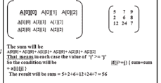

/* 输入数组 */

```cpp
for(i=0 ; i<3 ; i++)
for(j=0 ; j<3 ; j++)
{
cout<<"\nEnter number";
cin>>mat[i][j];
}
```

/* 求和下三角元素的逻辑 */

```cpp
for(i=0 ; i<3 ; i++)
for(j=0 ; j<3 ; j++)
{
if(i>=j)
sum=sum+mat[i][j];
}
```

/* 打印数组 */

```cpp
cout<<"\nTHE ENTERED MATRIX IS\n";
for(i=0 ; i<3 ; i++)
{
for(j=0 ; j<3 ; j++)
cout<<" "<<mat[i][j];
cout<<"\n";
}
cout<<"\nSum of the lower triangular matrix is"<<sum;
}
```

### 输出

输入一个数字 5
输入一个数字 7
输入一个数字 9
输入一个数字 2
输入一个数字 6
输入一个数字 8
输入一个数字 12
输入一个数字 24
输入一个数字 7

### 输入的矩阵是

| 5 | 7 | 9 |
|---|---|---|
| 2 | 6 | 8 |
| 12 | 24 | 7 |

下三角矩阵之和为 56

### 2.1.3 字符串处理

字符串是多个字符的集合。因此也可以称为字符数组。由于其特殊性质，访问字符串/字符数组的方式与普通数组有些不同。其特殊性在于字符串始终以 NULL ('\0') 字符结束。因此，在访问字符串时，无需频繁使用循环。（我们可以借助循环将其作为数组来访问。）当我们使用循环访问它时（如 int、float 等数组），NULL 字符不会被分配到其末尾，因此在打印时我们必须再次使用循环。如果要将字符数组转换为字符串，则需要手动在其末尾分配 NULL 字符。

字符串和字符数组的表示

```cpp
Let char x[10]="India"; /* Representation of a string*/
```

| I | n | d | i | a | \0 | | | | |
|---|---|---|---|---|---|---|---|---|---|
| 0 | 1 | 2 | 3 | 4 | 5 | 6 | 7 | 8 | 9 |


```
char x[10] = {'I','n','d','i','a'}; /* Character Array */
```

| I | n | d | i | a | | | | | |
|---|---|---|---|---|---|---|---|---|---|
| 0 | 1 | 2 | 3 | 4 | 5 | 6 | 7 | 8 | 9 |

## 字符数组的声明

字符串/字符数组的声明与普通数组相同，只不过不使用其他数据类型，而是使用数据类型 'char'。

```
Syntax : Data_type var_name[size] ;
```

```
Ex: char name[20];
```

## 字符串的初始化

```
Let char x[10]="India"; /* Representation of a string*/
```

| I | n | d | i | a | \0 | | | | |
|---|---|---|---|---|---|---|---|---|---|
| 0 | 1 | 2 | 3 | 4 | 5 | 6 | 7 | 8 | 9 |

```
char x[10] = {'I','n','d','i','a'}; /* Character Array */
```

## 示例：编写程序输入字符串并显示它。

```
#include<iostream.h>
void main()
{
char x[20];
cout<<"\nEnter a string";
gets(x);
cout<<"\n THE ENTERED STRING IS "<<x;
}
```

## 输出

Enter a string Hello
THE ENTERED STRING IS Hello

或

```
#include<iostream.h>
void main()
{
 char x[20];
 int i;
 cout<<"\nEnter a string";
 for(i=0;i<10;i++)
 cin>>x[i];
 x[i]='\0'; /* CONVERTING THE CHARACTER ARRAY
TO STRING */
 cout<<"\n THE ENTERED STRING IS "<<x;
}
```

或

```
#include<iostream.h>
void main()
{
 char x[20];
 int i;
 cout<<"\nEnter a string";
 gets(x);
 cout<<"\n THE ENTERED STRING IS ";
 for(i=0; x[i]!='\0'; i++)
 cout<<x[i];
}
```

## 输出

Enter a string Hello
THE ENTERED STRING IS Hello

> 注意：如果我们想要将字符串作为单个字符来扫描，则必须使用循环 for(i=0; str[i] != '\0'; i++)
> 输入字符串后，此规则适用于所有字符串。

## 示例 - 2

编写一个程序来输入字符串并统计其中包含多少个元音字母。

```
#include<iostream.h>
void main()
{
char x[20];
int i,count=0;
cout<<"\n Enter a string";
gets(x);
cout<<"\n The Entered string is"<<x;
for(i=0; x[i]!='\0';i++)
if(toupper(x[i])=='A' || toupper(x[i])=='E'
|| toupper(x[i])=='I' || toupper(x[i])=='O' ||
toupper(x[i])=='U')
count++;
cout<<"\n The string"<<x<< "having"<<count<<"numbers of vowels";
}
```

## 输出

Enter a string Wel Come
The entered string is Wel Come
The string Wel Come having 3 numbers of vowels.

## 示例：

编写一个程序来查找字符串的长度。

```
#include<iostream.h>
void main()
{
char x[20];
int i,len=0;
cout<<"\n Enter a string";
gets(x);
for(i=0;x[i]!='\0';i++)
len++;
cout<<"\n THE LENGTH OF"<<x<<"IS"<<len;
}
```

## 输出

Enter a string hello India
THE LENGTH OF hello India IS 11

或

```
#include<iostream.h>
void main()
{
 char x[20];
 int i;
 cout<<"\n Enter a string";
 gets(x);
 for(i=0;x[i] !='\0';i++) ;
 cout<<"\n THE LENGTH OF"<<x<<" IS "<<len;
}
```

## 输出

Enter a string hello India
THE LENGTH OF hello India IS 11

## 字符串操作

字符串不能使用普通运算符进行操作，因此为了进行某些操作，我们必须借助特定的字符串处理函数。'C'语言提供了许多字符串处理函数，其中最常用的函数有

- a. Strlen()
- b. Strrev()
- c. Strcat()
- d. Strcmp()
- e. Strcpy()
- f. Strupr()
- g. Strlwr()

这些函数的原型在头文件 string.h 中声明。

### Strlen()

**用途**：用于查找字符串的长度。
**语法**：integer_variable = strlen(string);

### Strrev()

**用途**：用于查找字符串的逆序。
**语法**：strrev(string);

### Strcat()

**用途**：用于连接（合并）两个字符串。它将源字符串追加到目标字符串的末尾。目标字符串的长度将为源字符串长度 + 目标字符串长度。
**语法**：strcat(destination,source);

### Strcmp()

**用途**：用于比较两个字符串。
**过程**：字符串比较始终从每个字符串的第一个字符开始，并继续比较后续字符，直到对应字符不同或到达字符串末尾为止。
该函数返回一个整数值，其值为

- < 0 如果 s1 < s2
- == 0 如果 s1 == s2
- >0 如果 s1 > s2

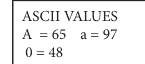

**语法**：integer_variable = strcmp(s1,s2);

### Strcpy()

**用途**：将一个字符串复制到另一个字符串。
**语法**：strcpy(destination,source);

### Strupr()

**用途**：将所有小写字母转换为对应的大写字母。
**语法**：strupr(string);

### Strlwr()

**用途**：将所有大写字母转换为对应的小写字母。
**语法**：strlwr(string);

## 2.2 函数

**定义**：将一条或多条语句组合在一起，形成一个具有特定名称和特定任务的代码块。
'C'语言中的函数分为两类

- a. 库函数或预定义函数
- b. 用户定义函数

库函数随 'C' 编译器（语言）一起提供。
示例：printf(), scanf(), gets(), clrscr(), strlen() 等。
用户定义函数由程序员在需要时定义。

### 2.2.1 用户定义函数

我们将通过与库函数进行比较来开发函数，
即，所有库函数可以分为四类

- 1. integer variable = strlen(string/string variable)
   [strlen() 获取一个字符串，计算其长度，并将其返回给一个整数变量]
- 2. gets(string variable);
   [gets() 获取一个变量并将用户输入的字符串存储在其中]
- 3. character variable = getch();
   [getch() 不获取任何值/变量，但它将用户输入的字符存储到字符变量中]
- 4. clrscr();
   [此函数不接受参数也不返回值，但它会执行其工作，即清除屏幕]

通过研究上述四种类型的函数，我们得出结论：根据函数接受的参数和函数返回的值，函数可以分为四类

- 1. 函数既接受参数，也返回值。
- 2. 函数不接受参数，但返回值。
- 3. 函数接受参数，但不返回值。
- 4. 函数既不接受参数，也不返回值。

### 函数的组成部分

一个函数通常由三部分组成

- 1. 声明（指定函数的工作方式，它仅准备函数的框架）
- 2. 调用 [用于执行函数的调用]
- 3. 定义 [指定函数的工作，即函数的主体部分]

### 2.2.2 函数的构建

#### 1. 函数既接受参数，也返回值。

##### 声明

```
Return_type function_name(data type, data_type, data_type,.......);
Ex: int sum(int,int);
```

##### 调用

```
Variable = function_name(var1,var2,var3,..........);
Ex: x = sum(a,b);
Where a,b,x are the integer variables
```

##### 定义

```
Return_type function_name(data_type var1, data_type var2,.......)
{
 Body of the function ;
 Return (value/variable/expression) ;
}
```

```
Ex:
int sum(int p, int q)
{
 int z;
 z = p+q;
 return(z) ;
}
```

#### 2. 函数不接受参数，但返回值。

##### 声明

```
Return_type function_name();
Or
Return_type function_name(void);
Ex : int sum();
```

##### 调用

```
Variable = function_name();
Ex : x = sum();
Where x is an integer.
```

##### 定义

```
Return_type function_name()
{
   Body of function;
   Return(value/variable/expression) ;
}
```

```
Ex:
int sum()
{
   int a,b;
   cout<<"\nEnter 2 numbers";
   cin>>a>>b;
   return (a+b) ;
}
```

#### 3. 函数接受参数，但不返回值

##### 声明

```
void function_name(data_type1, data_type2,..........);
Ex : void sum(int,int);
```

##### 调用

```
function_name(var1,var2,var3..........);
Ex : sum(x,y);
Where x and y is an integer.
```

##### 定义

```
void function_name (data_type1 v1, data_type2 v2,.........)
{
   Body of function ;
}
```

```
Ex:
void sum(int x, int y)
{
   cout<<"\nSum = "<<x+y;
}
```


## 4. 函数不接受参数且不返回值。

### 声明

```
void function_name(void);
```

示例：void sum();

### 调用

```
function_name();
```

示例：sum();

### 定义

```
void function_name()
{
    Body of function;
}
```

示例：

```
void sum()
{
    int x,y;
    cout<<"\n Enter two numbers";
    cin>>x>>y;
    cout<<"\nSum = "<<x+y;
}
```

参数：函数工作所依据的内容。

返回类型：函数返回/给调用部分的值。

## 编写程序求两个数之和

### 类别 - 1

```
#include<iostream.h>
void main()
{
    int sum(int,int);
    int x,y,z;
    cout<<"\n Enter two numbers";
    cin>>x>>y;
    z = sum(x,y);
    cout<<"\n Addition of"<<x<<"and"<<y<<"is"<<z;
}
int sum(int p,int q)
{
    int r;
    r = p+q;
    return(r);
}
```

### 输出

输入两个数字 5
6
5 和 6 的和是 11

### 类别 - 2

```
#include<iostream.h>
void main()
{
int sum();
int z;
z = sum();
cout<<"\n Addition is"<<z;
}
int sum()
{
int x,y;
cout<<"\n Enter two numbers";
cin>>x>>y;
return(x+y);
}
```

### 输出

输入两个数字 5
6
和是 11

### 类别 - 3

```
#include<iostream.h>
void main()
{
void sum(int,int);
int x,y;
cout<<"\n Enter two numbers";
cin>>x>>y;
sum(x,y);
}
void sum(int p,int q)
{
cout<<"\n Addition
of"<<p<<"and"<<q<<"is"<<p+q;
}
```

### 输出

输入两个数字 5
6
5 和 6 的和是 11

### 类别 - 4

```
#include<iostream.h>
void main()
{
void sum();
sum();
}
void sum()
{
int x,y;
cout<<"Enter two numbers";
cin>>x>>y;
cout<<"Addition of"<<x<<"and"<<y<<"is"<<x+y;
}
```

### 输出

输入两个数字 5
6
5 和 6 的和是 11

### 2.2.3 实际参数和形式参数

函数调用中保留的参数称为实际参数，函数定义中保留的参数称为形式参数（因为这些参数用于仅存储实际参数的值来维持形式性）。

### 示例：

```
#include<iostream.h>
void main()
{
int sum(int,int);
int x,y,z;
cout<<"Enter two numbers";
cin>>x>>y;
z = sum(x,y); /* Here X and y are called as the actual argument*/
cout<<"Addition of"<<x<<"and"<<y<<"is"<<z;
}
int sum( int p, int q) /* Here p and q are called as the formal argument */
{
int r;
r = p+q;
return(r);
}
```

### 输出

```
Enter two numbers 5
6
Addition of 5 and 6 is 11
```

如果函数要使用参数，则必须声明接受参数值的变量。这些变量称为函数的**形式参数**。

形式参数在函数内部的行为类似于其他局部变量，在进入函数时创建，在退出函数时销毁。

调用函数时，参数传递给函数有两种方式：

| 调用类型 | 描述 |
| :--- | :--- |
| 按值调用 | 此方法将参数的实际值复制到函数的形式参数中。在这种情况下，对函数内部参数所做的更改不会影响该参数。 |
| 按指针调用 | 此方法将参数的地址复制到形式参数中。在函数内部，使用该地址访问调用中使用的实际参数。这意味着对参数所做的更改会影响该参数。 |
| 按引用调用 | 此方法将参数的引用复制到形式参数中。在函数内部，使用该引用访问调用中使用的实际参数。这意味着对参数所做的更改会影响该参数。 |

默认情况下，C++ 使用**按值调用**来传递参数。通常这意味着函数内部的代码不能更改用于调用函数的参数，上面提到的调用 max() 函数的示例也使用了相同的方法。

### 2.2.4 按值调用和按引用调用

当按值调用函数时，该函数调用称为按值调用。

当按引用/地址调用函数时，该函数调用称为按引用调用。

## 按值调用与按引用调用的区别

在按值调用中，如果函数内部更改了变量的值，则不会影响其原始值，因为实际参数的值被复制到形式参数中，因此它们之间没有关联。

但在按引用调用中，如果函数内部更改了变量的值，则会影响其原始值，因为在按引用调用中，实际参数的地址被复制到形式参数中，因此它们之间存在关联。所以对形式参数所做的任何更改都会影响实际值。

示例：

按值调用

```
#include<iostream.h>
void main()
{
int x=5,y=6;
void change(int,int);
cout<<"\n X="<<x<<"and Y="<<y;
change(x,y);
cout<<"\n X="<<x<<"and Y="<<y;
}
void change(int a,int b)
{
a=a+5;
b=b+5;
cout<<"\n X="<<a<<"and Y="<<b;
}
```

输出
X = 5 和 Y = 6
X = 10 和 Y = 11
X = 5 和 Y = 6

按引用调用

```
#include<iostream.h>
void main()
{
int x=5,y=6;
void change(int *,int *);
cout<<"\n X="<<x<<"and Y="<<y;
change(&x, &y);
cout<<"\n X="<<x<<"and Y="<<y;
}
void change(int *a,int *b)
{
*a=*a+5;
*b= *b+5;
cout<<"\n X="<<*a<<"and Y="<<*b;
}
```

输出
X = 5 和 Y = 6
X = 10 和 Y = 11
X = 10 和 Y = 11

### 2.2.5 参数的默认值

定义函数时，可以为每个最后的参数指定默认值。如果在调用函数时相应的参数留空，则将使用此值。

这是通过在函数定义中使用赋值运算符并为参数赋值来完成的。如果在调用函数时未传递该参数的值，则使用给定的默认值，但如果指定了值，则忽略此默认值并改用传递的值。请参考以下示例：

```
#include <iostream>
int sum(int a, int b=20)
{
int result;
result = a + b;
return (result);
}
int main ()
{
// local variable declaration:
int a = 100;
int b = 200;
int result;

// calling a function to add the values.
result = sum(a, b);
cout << "Total value is :" << result << endl;

// calling a function again as follows.
result = sum(a);
cout << "Total value is :" << result << endl;

return 0;
}
```

编译并执行上述代码后，将产生以下结果：

结果：
总值是：300
总值是：120

### 2.2.6 存储类说明符

存储类说明符是用于声明变量的关键字。如果没有存储类说明符的帮助，我们就无法声明变量，但到目前为止，我们在不使用存储类说明符的情况下声明变量。这是因为默认情况下 C 语言将变量包含在 'auto' 存储类中。

C++ 语言支持四种存储类说明符：auto、static、extern、register

- **自动**
- 初始值：垃圾值
- 存储区域：内存
- 生命周期：在声明它的块内
- 作用域：局部

- **静态**
- 初始值：零
- 存储区域：内存
- 生命周期：在声明它的块内
- 作用域：变量的值在不同函数调用之间保持

- **外部**
- 初始值：零
- 存储区域：内存
- 生命周期：变量可以在程序的任何位置访问
- 作用域：全局

### 寄存器

- 初始值：垃圾值
- 存储区域：CPU 内存
- 生命周期：在声明它的块内
- 作用域：局部

## 静态与自动的区别

```
#include<stdio.h>
void main()
{
void change();
change();
change();
change();
}
void change()
{
auto int x=0;
printf("\n X = %d",x);
x++;
}
```

输出
X = 0
X = 0
X = 0

```
#include<stdio.h>
void main()
{
void change();
change();
change();
change();
}
void change()
{
static int x;
printf("\n X = %d",x);
x++;
}
```

输出
X = 0
X = 1
X = 2


## 2.3 指针

指针是可以存储另一个变量地址的变量。无论通过指针对变量值做出何种更改，都会直接影响该变量。

### 2.3.1 指针的声明

与其他变量一样，指针变量在使用前也应声明。

```
SYNTAX
Data_type *variable_name;
Example: int *p;
```

### 2.3.2 指针的初始化

初始化是指赋予初始值，由于指针只能存储地址，因此在初始化时需要赋予另一个变量的地址。

```
Ex: int *x,p;
x=&p; /* INITIALIZATION */
```

> 注意：声明指针变量后，如果直接写变量名，则表示地址；而 *variable 表示值。但在 C++ 中，我们始终需要使用 *variable，因为它处理的是对象。

示例：（C 语言）编写一个程序来输入一个数字并显示它。

```
#include<iostream.h>
void main()
{
 int *p,x;
 p=&x;
 printf("\n Enter a number");
 scanf("%d",&x);
 printf("\n THE VALUE OF X (THROUGH POINTER) IS %d",*p);
 printf("\n THE VALUE OF X IS %d",x);
}
```

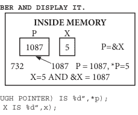

### 输出

Enter a number 5

THE VALUE OF X(THROUGH POINTER) IS 5
THE VALUE OF X IS 5

### （C++ 语言）

### 编写一个程序来输入一个数字并显示它。

```
#include<iostream.h>
void main()
{
int *p,x;
p=&x;
cout<<"\n Enter a number";
cin>>x;
cout<<"\n THE VALUE OF X(THROUGH POINTER) IS "<<*p;
cout<<"\n THE VALUE OF X IS"<<x;
}
```

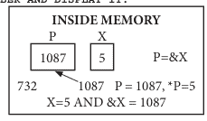

### 输出

Enter a number 5

THE VALUE OF X(THROUGH POINTER) IS 5
THE VALUE OF X IS 5

### 2.3.3 指针运算

一般来说，算术运算包括加法、减法、乘法和除法。但在指针的情况下，我们只能执行加法和减法运算。这意味着当我们对指针执行加法/减法运算时，它会移动位置，因为指针表示地址。如果我们给整型指针加 1，它将移动两个字节（int 在内存中占用两个字节），因此对于 float 为 4 个字节，char 为 1 个字节，long double 为 4 个字节，依此类推，它将移动位置。

示例：设 int *p, x;
p=&x;

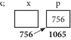

- 现在 p = 756
- p + 1 = 758
- p + 2 = 760
- p+5 = 766
- p-6 = 754

### 注意：指针表示地址，因此我们可以对 *p（地址处的值）执行任何类型的操作。

### 2.3.4 将指针传递给函数

与普通变量一样，我们也可以将指针作为参数传递给函数。

### 声明

```
Return_type function_name(data_type *, data_type *,..........);
```

### 调用

```
Variable = function_name(ptrvar, ptrvar,ptrvar,.........);
```

### 定义

```
Return_type function_name(data_type *var, data_type *var,..........)
{
body of function ;
return(value/var/exp) ;
}
```

### 示例：

### 编写一个程序来计算一个数的阶乘

```
#include<iostream.h>
void main()
{
long int fact(int *);
int *n;
long int f;
cout<<"Enter a number";
cin>>*n;
f=fact(n);
cout<<"\n Factorial Is"<<f;
}
long int fact(int *p)
{
int i;
long int f=1;
for(i=1;i<=*p;i++)
f*=i;
return(f);
}
```

当调用函数 f=fact(n) 时，指针变量 n 中的地址将被复制到指针变量 p（形参）中。因此，在这种情况下，对 'p' 所做的任何更改都会直接影响 'n'。

```
OUTPUT
Enter a number 5
Factorial is 120
```

### 2.3.5 函数返回指针

### 声明

```
Return_type * function_name(data type,data type.........);
```

### 调用

```
Ptr_Variable = function_name(var1,var2,.........);
```

### 定义

```
Return_type* function_name(data_type v1,............)
{
body of function
return(pointer_var);
}
```

### 示例

编写一个程序来计算一个数的阶乘

```
#include<iostream.h>
void main ()
{
long int * fact(int *);
int n;
long int *f;
cout<<"Enter a number";
cin>>n;
f=fact(&n);
cout<<"\n Factorial Is %ld"<<*f;
}
long int * fact(int *p)
{
int i;
long int f=1;
for(i=1;i<=*p;i++)
f*=i;
return (&f);
}
```

```
Enter a number 5
Factorial is 120
```

### 2.3.6 C++ 空指针

在没有确切地址可赋值时，将指针 NULL 赋给指针变量始终是一种良好的做法。这在变量声明时完成。被赋值为 NULL 的指针称为空指针。

NULL 指针是一个值为零的常量，定义在多个标准库中，包括 iostream。请考虑以下程序：

```
#include <iostream>
using namespace std;
int main ()
{
   int *ptr = NULL;
   cout << "The value of ptr is " << ptr ;
   return 0;
}
```

当上述代码被编译和执行时，它会产生以下结果：

```
The value of ptr is 0
```

在大多数操作系统中，程序不允许访问地址 0 处的内存，因为该内存由操作系统保留。但是，内存地址 0 具有特殊意义；它表示指针不打算指向可访问的内存位置。但按照惯例，如果指针包含 null（零）值，则假设它指向空。

要检查空指针，可以按如下方式使用 if 语句：

```
if(ptr)     // succeeds if p is not null
if(!ptr)    // succeeds if p is null
```

因此，如果将所有未使用的指针赋予 null 值，并避免使用空指针，就可以避免意外滥用未初始化的指针。许多时候，未初始化的变量包含一些垃圾值，这使得调试程序变得困难。

## 2.4 结构体

结构体是对相同名称下引用的不同数据类型的数据项（字段）或变量的集合。它提供了一种方便的方式来将相关信息保持在一起。

### 声明

```
struct tag_name
{
    Data type member1 ;
    Data type member2;
    ............
    ............
    ............
};
```

关键字 struct 告诉编译器正在定义一个结构模板，该模板可用于创建结构变量。tag_name 标识特定的结构及其类型说明符。构成结构的字段称为成员或结构元素。结构中的所有元素在逻辑上相互关联。

让我们考虑一个员工数据库，它包含姓名、年龄和工资等字段，因此相应的结构声明将是

```
struct emp
{
    char name[25];
    int age;
    float salary;
};
```

在这里，关键字 struct 定义了一个用于保存员工详细信息的结构，tag_name emp 是结构的名称。

总体而言，struct emp 是一个用户定义的数据类型。

因此，要使用此结构体的成员，我们必须声明 struct emp 类型的变量，结构体变量声明与普通变量声明相同，形式为 struct tag_name variable_name;

示例：struct emp e;

在这里，e 是一个结构体变量，能够保存姓名、年龄和工资，访问结构体这些单独成员的方式是

`Structure_variable.member_name;`

即，要访问年龄和工资，变量将是 e.name、e.age、e.salary

### 示例：编写程序输入员工的姓名、年龄和工资并显示。

```
#include<iostream.h>
struct emp //CREATION OF STRUCT EMP DATA TYPE
{
char name[25];
int age;
float salary;
};
void main()
{
struct emp e; //Declaration of the structure variable
cout<<"\n Enter the name,age and salary";
gets(e.name); //Input the name
cin>>e.age>>e.salary; // Input the age and salary
cout<<"\n NAME IS "<<e.name; //Display name
cout<<"\n AGE IS "<<e.age; //Display age
cout<<"\n SALARY IS "<<e.salary; //Display salary
}
```

### 输出

Enter the name ,age and salary
H.Narayanan
56
72000

NAME IS H.Narayanan
AGE IS 56
SALARY IS 72000.000000

上述讨论的结构体通常用于 'C'，但 'C++' 对结构体进行了一些修改，即在 C++ 中，我们还可以将成员函数作为其成员存储。


## 示例：使用函数输入一个数字并显示它

毫无疑问，结构在此程序中并未被高效使用，因为结构用于需要处理多个不同类型元素的场景。但在上述程序中只需使用单个变量，不过为了便于理解 C 语言结构体与 C++ 结构体的区别，这个示例更合适。

```
IN 'C'

#include<stdio.h>
struct print
{
int x;
} ;
void main()
{
struct print p;
void display(struct print);
printf("\n Enter the number");
scanf("%d",&p.x);
display(p);
}
void display(struct print p)
{
printf(" THE ENTERED NUMBER IS %d",p.x);
}
```

输出

Enter the number 23
THE ENTERED NUMBER IS 23

```
IN C++

#include<iostream.h>
struct print
{
int x;
void display( )//Arguments are not required
because both x and display( ) are in the same scope
{
cout<<"\n Enter the number";
cin>>x;
cout<<"THE ENTERED NUMBER IS "<<x;
} } ;
void main()
{
print p;//In C++ to declare the structure variable struct is not mandatory
p.display() ;
}
```

## 输出

Enter the number 23
THE ENTERED NUMBER IS 23

可以看出，C++ 结构体优于 C 语言结构体，但也存在一些局限。也就是说，上述程序还可以这样编写：

> 在 void main() 内部，我们不必以 p.display() 的方式调用函数，也可以将其替换为
> cout<<"Enter the number";
> cin>>p.x;
> cout<<"THE ENTERED NUMBER IS"<<p.x;
>
> 这并非一个小错误，它会让程序员感到沮丧：即使程序员提供了一个用于完成工作的函数，我们却没有使用它，而是按照自己的逻辑来操作。在这里，设计者的重要性为零，这是因为结构体允许其所有成员在程序的任何地方使用。但是，如果不允许在 main() 内部使用数据成员 'x'，那么我们就必须使用程序员提供的函数。
> 因此，最终的主要缺点是结构体不对其成员施加任何限制。

为解决这个问题，C++ 引入了一种广泛使用的新数据类型，称为“class”（类），它与结构体非常相似，但允许对成员进行安全控制，即程序员可以控制其成员。

注意：C++ 结构体也提供数据隐藏和封装，但它不支持继承、多态等其他特性。因此，为克服这一问题，C++ 引入了类。

### 2.4.1 typedef 关键字

定义结构体有一种更简单的方法，或者你可以为自己创建的类型建立“别名”。例如：

```
typedef struct
{
    char    title[50] ;
    char    author[50] ;
    char    subject[100] ;
    int     book_id ;
}Books ;
```

现在你可以直接使用 Books 来定义 Books 类型的变量，而无需使用 struct 关键字。示例如下：

```
Books Book1, Book2;
```

你也可以对非结构体使用 typedef 关键字，如下所示：

```
typedef long int *ptr32;
```

ptr32 x, y, z; x、y 和 z 都是指向 long int 的指针

## 联合体（UNION）

联合体也是一种用户定义的数据类型，与结构体类似，可以存储多个不同数据类型的元素。其所有操作与结构体相同。结构体与联合体的唯一区别在于内存管理：结构体数据类型占用的字节数等于其各个数据成员所占字节数之和，而联合体则占用其数据成员中占用字节数最大的那个。

## 示例 7.11

编写一个程序来演示结构体与联合体之间的区别。

```
#include<iostream.h>
struct std
{
    char name[20],add[30] ;
int roll,total;
float avg;
};
union std1
{
char name[20],add[30];
int roll,total;
float avg;
};
void main()
{
struct std s;
union std1 si;
cout<<" \nThe no.of bytes occupied by the structure is"<<sizeof(struct std));
cout<<" \nThe no.of bytes occupied by the union is"<<sizeof(union std1));
}
```

## 输出

结构体占用的字节数为 58
联合体占用的字节数为 30

注意：在使用联合体时，我们在向任何成员输入任何值之前都会使用变量的值。这是因为联合体为所有数据成员共享一个内存区域。

## 2.5 问题

- 1. 结构体相比联合体有哪些优势？
- 2. 什么是指针及其类型？
- 3. 库函数与用户定义函数有什么区别？
- 4. 按值调用与按引用调用有什么区别？
- 5. 数组与指针有什么区别？
- 6. 使用宏还是函数更好？
- 7. 什么是字符串？
- 8. 讨论不同类型的存储类说明符。
- 9. 讨论局部变量和全局变量。
- 10. 使用结构体还是数组更有好处？请证明你的答案。

## 3.1 什么是稀疏矩阵

在计算机编程中，矩阵可以用二维数组来定义。任何带有 'm' 列和 'n' 行的数组都表示一个 m×n 矩阵。可能存在一种情况，即矩阵中零值的数量多于非零值的数量。这种矩阵称为稀疏矩阵。

稀疏矩阵是指包含非常少非零元素的矩阵。当使用二维数组表示稀疏矩阵时，我们会浪费大量空间来表示该矩阵。例如，考虑一个大小为 100×100 且仅包含 10 个非零元素的矩阵。

在这个矩阵中，只有 10 个空间填充了非零值，矩阵的其余空间填充了零。也就是说，我们总共分配了 100×100×2 = 20000 字节的空间来存储这个整数矩阵，而要访问这 10 个非零元素，我们需要扫描 10,000 次。

## 3.2 稀疏矩阵表示法

稀疏矩阵可以使用两种表示法，例如：

- 1. 三元组表示法
- 2. 链表表示法

### 方法 1：三元组表示法

在这种表示法中，我们只考虑非零值及其行索引和列索引值。在这种表示法中，第 0 行存储矩阵的总行数、总列数和非零值总数。

For example If a Matrix

| 7 | 0 | 0 | 1 | 0 | 2 |
|---|---|---|---|---|---|
| 0 | 1 | 9 | 0 | 0 | 0 |
| 0 | 0 | 0 | 7 | 0 | 0 |
| 0 | 0 | 0 | 0 | 0 | 0 |
| 8 | 0 | 0 | 0 | 0 | 0 |
| 0 | 0 | 3 | 0 | 0 | 0 |

Sparse Matrix of the Above array is

| 6 | 6 | 8 |
|---|---|---|
| 0 | 0 | 7 |
| 0 | 3 | 1 |
| 0 | 5 | 2 |
| 1 | 1 | 1 |
| 1 | 2 | 9 |
| 2 | 3 | 7 |
| 4 | 0 | 8 |
| 5 | 2 | 3 |

元素 arr[0][0] 和 arr[0][1] 分别包含稀疏矩阵的行数和列数。元素 arr[0][2] 包含稀疏矩阵中非零元素的数量。

稀疏矩阵的声明形式如下

```
Data type sparse[terms + 1][3];
```

其中 term 是矩阵中非零元素的数量。

### 方法 2：使用链表

在链表中，每个节点有四个字段。这四个字段定义如下：

- 行：非零元素所在行的索引
- 列：非零元素所在列的索引
- 值：索引 (row,column) 处非零元素的值
- 下一节点：下一节点的地址

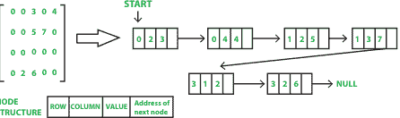

## 3.3 表示稀疏矩阵的算法

- 步骤 1：输入 m×n 元素的数组。
- 步骤 2：[统计非零元素的数量]
- 重复 For I = 1 到 m
- 重复 For j = 1 到 n
- 如果 arr[i][j] != 0 则：
- Count := count + 1
- [结束 IF]
- [结束循环]
- [结束循环]
- 步骤 3：SP[0][0] := m
- SP[0][1] := n
- SP[0][2] := COUNT
- 步骤 4：K := 1
- 重复 For I = 0 到 m
- 重复 For j = 0 到 n
- 如果 arr[i][j] != 0 则：
- Sp[k][0] := i
- Sp[k][1] := j
- Sp[k][2] := arr[i][j]
- K := K + 1
- [结束 IF]
- [结束循环]
- [结束循环]
- 步骤 5：重复 For I = 1 到 k+1
- 重复 For j = 1 到 3
- 打印 sp[i][j]
- [结束循环]
- [结束循环]
- 步骤 6：退出


## 3.4 与稀疏矩阵相关的程序

### 稀疏矩阵数组表示的程序

```cpp
#include<iostream>
#include<iomanip>
using namespace std;
//Driver program
int main()
{
 int arr[10][10],i,j,row,col,count=0,k=0,sp[15][3];
 //ask user about the number of rows and columns sparse matrix
 cout<<"\nENTER HOW MANY ROWS AND COLUMNS";
 //read row and col
 cin>>row>>col;
 //loop to read the normal matrix
 for(i=0;i<row;++i)
 {
 for(j=0;j<col;j++)
 {
 cout<<endl<<"Enter a number";
 cin>>arr[i][j];
 }
 }
 //loop to print the normal matrix that read from user
 cout<<"\nTHE ENTERED ARRAY ELEMENTS ARE\n";
 for(i=0;i<row;++i)
 {
 for(j=0;j<col;++j)
 {
 cout<<setw(4)<<arr[i][j];
 cout<<endl;
 }
 }
 //loop to count the number of non zero elements in the matrix
 for(i=0;i<row;++i)
 {
 for(j=0;j<col;++j)
 {
 if(arr[i][j]!=0)//condition for non zero elements
 count++;//increase the count
 }
 //set the first row of sparse matrix
 sp[0][0]=row;
 sp[0][1]=col;
 sp[0][2]=count;
 k=1;//k points to second row of sparse matrix
 //loop to fill the other rows of sparse matrix
 for(i=0;i<row;++i)
 {
 for(j=0;j<col;++j)
 {
 if(arr[i][j]!=0)
 {
 sp[k][0]=i;
 sp[k][1]=j;
 sp[k][2]=arr[i][j];
 k++;
 }
 }
 }
 }
/*print the sparse matrix */
cout<<"\nTHE SPARSE MATRIX IS\n";
for (i=0;i<count;i++)
{
for (j=0;j<3;j++)
cout<<" "<<sp[i][j];
cout<<endl;
}
}
```

### 输出

```
ENTER HOW MANY ROWS AND COLUMNS
4
3
Enter a number
0
0
Enter a number
0
Enter a number
0
Enter a number
3
Enter a number
0
Enter a number
5
Enter a number
0
Enter a number
6
Enter a number
0
Enter a number
0
Enter a number
8
THE ENTERED ARRAY ELEMENTS ARE
0 0 0
0 0 0
5 0 6
0 0 8
THE SPARSE MATRIX IS
4 3 4
1 1 3
2 0 5
2 2 6
3 2 8
```

### 稀疏矩阵的转置

```cpp
#include<iostream>
#include<conio.h>
using namespace std;
int main()
{
int arr[10][10],i,j,row,col,count=0,k=0,sp[15][3],tran[10][3];
//ask user about the number of rows and columns sparse matrix
cout<<"\nENTER HOW MANY ROWS AND COLUMNS";
//read row and col
cin>>row>>col;
//loop to read the normal matrix
for(i=0;i<row;i++)
for(j=0;j<col;j++)
{
cout<<endl<<"Enter a number";
cin>>arr[i][j];
}
//loop to print the normal matrix that read from user
cout<<"\nTHE ENTERED ARRAY ELEMENTS ARE\n";
for(i=0;i<row;i++)
for(j=0;j<col;j++)
cout<<setw(4)<<arr[i][j];
cout<<endl;
}
//loop to count the number of non zero elements in the matrix
for(i=0;i<row;i++)
for(j=0;j<col;j++)
if(arr[i][j]!=0)//condition for non zero elements
count++; //increase the count
//set the first row of sparse matrix
sp[0][0]=row;
sp[0][1]=col;
sp[0][2]=count;
k=1;//k points to second row of sparse matrix
//loop to fill the other rows of sparse matrix
for(i=0;i<row;i++)
for(j=0;j<col;j++)
{
if(arr[i][j]!=0)
{
    sp[k][0]=i;
    sp[k][1]=j;
    sp[k][2]=arr[i][j];
    k++;
    }
    }
    }
/*print the sparse matrix */
cout<<"\nTHE SPARSE MATRIX IS\n";
for(i=0;i<count;i++)
    {
    for(j=0;j<3;j++)
    cout<<sp[i][j];
    cout<<endl;
    cout<<endl;
    }
    }
/**TRANSPOSE**/
tran[0][0]=col;
tran[0][1]=row;
tran[0][2]=count;
k=1;
for(i=0;i<col;i++)
    for(j=1;j<count;j++)
    {
    if(sp[j][1]==i)
    {
    tran[k][0]=sp[j][1];
    tran[k][1]=sp[j][0];
    tran[k][2]=sp[j][2];
    k++;
    }
    }
    cout<<"\nTRANSPOSE OF THE SPARSE MATRIX\nIS\n";
for(i=0;i<count;i++)
    {
    for(j=0;j<3;j++)
    cout<<setw(5)<<tran[i][j];
    cout<<endl;
    }
}
```

### 输出

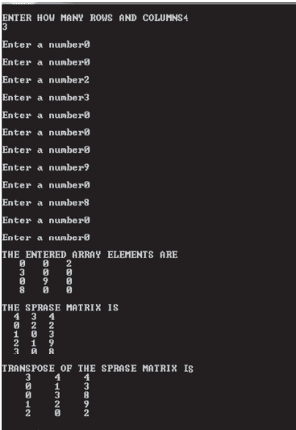

## 3.5 为何使用稀疏矩阵而非简单矩阵？

- 存储：非零元素少于零元素，因此可以只存储非零元素来节省内存。

- 计算时间：通过逻辑设计仅遍历非零元素的数据结构，可以节省计算时间。

## 3.6 稀疏矩阵的缺点

### 稀疏矩阵的内存缺点

程序数组的每个元素都占用内存，稀疏矩阵可能会占用不必要的内存空间。例如，一个10x10的数组可以占用 10 x 10 x 1 字节（假设每个元素1字节）= 100 字节。如果其中大部分元素（例如100个中有70个）是零，那么70字节的空间基本上被浪费了。有时大型稀疏矩阵太大，无法装入内存。

### 稀疏矩阵的计算缺点

执行算法计算（例如矩阵乘法）会为每个零计算花费大量不必要的时间。任何数乘以零都等于零，但仍需执行此操作，这被视为计算时间的浪费。

稀疏矩阵可以被压缩，通过仅存储非零元素来实现内存减少。然而，这也需要在访问元素时编程额外的结构来恢复原始矩阵，但总体而言，压缩的稀疏矩阵最终可以提高计算速度。

稀疏矩阵在机器学习算法中非常常见。既然你的问题“什么是稀疏矩阵”已得到解答，让我们来了解一些示例及其用途。

## 3.7 稀疏矩阵与机器学习

如前所述，稀疏矩阵在机器学习算法中很常见。

### 1. 数据存储中

- (a) 在类似Netflix的电影应用程序中，存储目录中哪些电影已观看和未观看的数组。

- (b) 在电子商务程序中，表示用户购买和未购买产品的数据。

- (c) 在音乐应用程序中，用户听过和未听过的歌曲计数。

### 2. 数据准备中

稀疏矩阵常见于用于数据准备的编码方案中。

- 示例：

- (a) 独热编码，用于将分类数据表示为稀疏二进制向量。

- (b) 计数编码，用于表示文档中单词的频率。

- (c) TF-IDF编码，用于表示词汇表中单词的频率分数。

### 3. 机器学习研究领域

有时，机器学习研究领域需要开发专门的方法来处理作为输入数据的稀疏矩阵。示例包括：

- (a) 处理文本文档时的自然语言处理

- (b) 产品目录程序的推荐系统。

- (c) 在计算机视觉中，当扫描图像有大量深色或黑色像素时。

### 稀疏矩阵表示与压缩的不同方法

存储稀疏矩阵会占用不必要的空间并增加计算时间。存在以“压缩”格式表示稀疏矩阵的方法，这提高了其效率。

## 3.8 问题

- 1. 什么是稀疏矩阵？

- 2. 编写一些稀疏矩阵的实现领域。

- 3. 如何表示稀疏矩阵。

- 4. 通过合适的示例区分稀疏矩阵的表示。

- 5. 使用稀疏矩阵比使用稠密矩阵更有益吗？请解释你的答案。

- 6. 稀疏矩阵的局限性是什么？

- 7. 列举稀疏矩阵的几个局限性。

## 类的概念

## 4.1 类介绍

与结构体一样，类也是一种用户定义的数据类型或抽象数据类型（将不同数据类型的属性派生/组合到一个单元中），它将数据成员和成员函数组合到一个单元中。类完全支持面向对象的属性，如数据封装和数据隐藏。

与结构体一样，类也有其声明，在使用前必须声明它。类的声明非常简单，只是类的所有成员可以排列在不同的部分（块）中以实现数据隐藏。

C++编程的主要目的是向C编程语言添加面向对象特性，而类是支持面向对象编程的C++核心特性，通常被称为用户定义类型。

类用于指定对象的形式，它将数据表示和操作该数据的方法组合到一个整洁的包中。类中的数据和函数称为类的成员。

当你定义一个类时，你定义了一个数据类型的蓝图。这并不实际定义任何数据，但它定义了类名的含义，即类的对象将包含什么以及可以对该对象执行哪些操作。


## 4.2 C++ 中的访问说明符

顾名思义，这些是控制类成员的访问说明符。为了实现面向对象编程（OOP）的特性，类提供了三种不同的访问说明符，如下

- 私有（Private）
- 公有（Public）
- 保护（Protected）

这些也称为成员访问控制。

### 私有（Private）：

在私有组中声明的成员不允许在类外部使用；只有类的成员可以访问它们，这实现了数据隐藏。

### 公有（Public）：

在此类别中声明的成员允许在程序的任何地方使用。

### 保护（Protected）：

在单个类中使用时，此部分与私有类别相同。唯一的区别是，在继承情况下，这些成员可以传递给派生类。

## 4.3 类的声明

```
class class_name
{
private:
    data members;
    member functions();
public:
    data members;
    member functions();
protected:
    data members;
    member functions();
};
```

### 成员函数

类的成员函数是指其定义或原型位于类定义内部的函数，就像其他变量一样。它作用于其所属类的任何对象，并可以访问该对象的类的所有成员。

### 示例

```
class print
{
private:
    int x;
public:
    void display()
    {
        cout<<"\n Enter the number";
        cin>>x;
        cout<<"THE ENTERED NUMBER IS "<<x;
    }
};
```

函数 display() 被放在公有部分，因为只有通过它才能打印 x 的值，而 x 位于私有类别中，因此任何想要显示数字的人都必须使用 display()。这就是类的优势。

### 类与结构体的区别

| 类 | 结构体 |
| :--- | :--- |
| 使用关键字 class | 使用关键字 struct |
| 它提供继承和多态 | 它不提供这些概念 |
| 默认情况下，类的成员是私有的 | 默认情况下，结构体的成员是公有的 |
| 支持数据抽象 | 不支持 |

### 对象的声明

对象是类的实例。通过对象可以使用类的成员。

语法：class_name object_name;

### 访问类的成员

类的成员可以通过对象来访问，就像结构体一样。即：object_name.member_name；

### 以编程方式区分 PRIVATE、PUBLIC 和 PROTECTED

### 示例

```
class differ
{
private:
    int x;
public:
    int y;
protected:
    int z;
};

void main()
{
    differ obj;    // Declaration of the object
    cout<<"Enter a number for x";
    cin>>obj.x;    // Error, because x is private
    cout<<"Enter a number for y";
    cin>>obj.y;    // No Error, since y is public
    cout<<"Enter a number for z";
    cin>>obj.z;    // Error, because z is protected
}
```

## 4.4 C++ 中使用的一些操纵符

C++ 允许一些操纵符函数，用于在输出期间进行额外格式化。其中最常用的操纵符函数有

- endl
- setw()
- setfill()
- dec
- oct
- hex
- setprecision()

这些操纵符定义在 <iomanip.h> 中，因此在使用前必须包含 <iomanip.h>。

### endl

此操纵符用于换行。它的作用与 “\n” 相同。示例：cout<<"HELLO"<<endl<<"WEL COME";

输出
HELLO
WEL COME

### setw()

此操纵符用于在两个数字之间留出一些间隔。
示例：int x=5, y=4
cout<<x<<setw(5)<<y;

输出
5___4 _（下划线表示空格）

### setfill()

此操纵符用于用 setw() 操纵符提供的字符填充间隔。
示例：
int x=5, y=4;
cout<<setfill('$');
cout<<x<<setw(5)<<y;

输出
5$$$$4

### dec、oct、hex

这些操纵符用于以不同进制显示整数。
dec：以整数格式显示数字
oct：以八进制格式显示数字
hex：以十六进制格式显示数字

```
Ex:
void main()
{
    int x = 14;
    cout<<"DECIMAL"<<dec<<x;
    cout<<endl<<"OCTAL"<<oct<<x;
    cout<<endl<<"HEXADECIMAL"<<hex<<x;
}
```

输出
DECIMAL 14
OCTAL 16
HEXADECIMAL e

### setprecision()

此操纵符用于控制浮点数小数点后显示的位数。

```
Ex:
float x=5.23456;
cout<<setprecision(2)<<x;
cout<<endl<<setprecision(0)<<x;
cout<<endl<<setprecision(6)<<x;
```

### 输出

5.23
5.23456
5.23456

## 4.5 在类外部定义成员函数

我们已经知道，类由不同的数据成员和成员函数组成，当我们将成员函数的定义放在类内部时，类会变得复杂，并且也难以处理错误。

因此，最好在类内部声明成员函数，但在类外部提供定义。为了实现这一点，使用了作用域解析运算符。

在类外部定义成员函数的过程如下

```
Return_type class_name::function_name(data_type var1, data_type var2......)
{
    Body of function;
    Return value/variable/expression;
}
```

## 4.6 对象数组

与其他普通变量一样，对象也可以用作数组，其声明方式也与普通数组相同。

### 声明

```
class_name object[size];
```

### 示例

编写一个程序，输入 5 名学生的详细信息并显示它们。

```
class student
{
    char name[20], add[30];
    int roll, age;
public:
    void input();
    void print();
};
void student::input()
{
    cout<<endl<<"Enter the name and address";
    gets(name);
    gets(add);
    cout<<endl<<"Enter the roll and age";
    cin>>roll>>age;
}
void student::print()
{
    cout<<endl<<"NAME IS "<<name;
    cout<<endl<<"ADDRESS"<<add;
    cout<<endl<<"AGE IS "<<age;
    cout<<endl<<"ROLL IS"<<roll;
}
void main()
{
    student obj[5];
    int i;
    for(i=0; i<5; i++)
    {
        obj[i].input();
    }
    for(i=0; i<5; i++)
    {
        obj[i].print();
    }
}
```

## 4.7 对象指针

如果对象是指针，则可以使用间接运算符访问类的成员，如下所示

```
object_name->member_name;
```

### 示例：编写程序检查一个数是否为质数

```
#include <iostream.h>
class prime
{
private:
    int x;
public:
    void input();
    void check();
};
void prime::input()
{
    cout<<"Enter the number";
    cin>>x;
}
void prime::check()
{
    int i;
    for(i=2; i<=x; i++)
    {
        if(x%i==0)
            break;
    }
    if(i==x || x==1)
        cout<<"PRIME";
    else
        cout<<"NOT PRIME";
}
void main()
{
    prime *p;
    p->input();
    p->check();
}
```

## 4.8 内联成员函数

C++ 为其常规用户提供了使用 inline 关键字的功能。C++ 提供内联函数，编译器会将函数的代码直接写在调用处，而不是为函数生成目标函数并在每次需要时调用它。

当调用普通函数时，控制权总是从调用处转移到定义部分，这在执行一系列用于转移控制、保存寄存器、将值返回给调用函数以及安排值的指令时会花费更多额外时间。

为了避免这种情况，我们可以使用宏来替代该任务，例如：#define min(a,b) (a<b ? a:b)

这通过在程序中简单地文本替换表达式 min(a,b) (a<b ? a : b) 来节省函数调用的开销。

宏的主要缺点是它们不是真正的函数，因此在编译期间不会进行通常的错误检查。

因此，为了避免这种情况，C++ 引入了一种称为内联函数的新功能，它在调用时会内联展开。也就是说，当调用函数时，编译器用函数定义替换其调用。通常，inline 用于大小较小的函数。inline 不是命令，而是对编译器的请求，函数是否被视为内联取决于编译器，即使我们声明了 inline。

在 C++ 中，当我们在类体内部定义类的成员函数时，默认情况下这些函数会被视为内联函数，但当我们在类体外部定义函数时，则必须显式地将函数定义为 inline。

当我们在类内部定义成员函数时，C++ 编译器默认会将其视为内联函数，但当我们在类外部提供函数定义时，也可以通过 inline 关键字将其设置为内联。

```
inline return_type class_name::function_name(data_type var............)
{
    Body of function;
    Return(value/variable/expression);
}


## 示例
## 编写程序求两个数的最大公约数

```cpp
#include<iostream.h>
class GCD
{
private:
    int a, b;
public:
    void input();
    void find();
};
inline void GCD :: input()
{
    cout << endl << "Enter two numbers";
    cin >> a >> b;
}
inline void GCD :: find()
{
    int r;
    if (a > b) // Makes a as greater than b
    {
        r = a;
        a = b;
        b = r;
    }
    r = a % b;
    while (r != 0)
    {
        a = b;
        b = r;
        r = a % b;
    }
    cout << "GCD" << b;
}
void main()
{
    GCD obj;
    obj.input();
    obj.find();
}
```

## 语法

```cpp
inline return_type function_name(argument list...)
{
    Body of function;
    Return(value/variable/expression);
}
```

使用内联函数有一些限制，例如

- 如果函数包含静态变量
- 如果函数包含循环、switch 或 goto 语句、条件语句
- 如果函数是递归的
- 如果函数包含 return 语句。

## 4.9 友元函数

在正常情况下，我们可以通过将数据成员声明在私有部分来隐藏/保护它们。但友元可以访问类的任何成员，无论其访问说明如何。关键字 friend 使函数成为类的非成员，即使其声明在类内部。

友元函数可以在类的任何位置声明。由于它不是类的成员，因此必须将对象作为其参数传递，以提取类的成员。

## 语法

```cpp
friend return_type function_name(data_type var,..........);
```

关键字 friend 可从四种不同的方式来学习

- 简单友元函数
- 带内联替换的友元
- 将友谊授予另一个类
- 两个或多个类拥有相同的友元函数。

## 4.9.1 简单友元函数

```cpp
#include<iostream.h>
class a
{
private:
    friend void display(a obj);
    int x;
};
void display(a obj)
{
    cout << "Enter a number";
    cin >> obj.x;
    cout << "The value is " << obj.x;
}
void main()
{
    a obj;
    display(obj);
}
```

## 输出

Enter a number 23
The value is 23

问题：友元函数在类内部声明，那么它是如何成为类的非成员的？

答：毫无疑问，友元函数在类内部声明，但它不遵循类成员的属性，这意味着如果我们要提取类的成员，则必须通过对象来访问，即 Object_name.member_name，但友元函数在 main() 中作为普通函数调用。第二点是，作为类的成员，如果我们要在类外部提供定义，则必须使用作用域解析运算符，但在这里我们将友元函数定义为普通函数。因此，从上述讨论中我们知道，即使友元函数在类内部声明，它也不是类的成员。

## 4.9.2 带内联替换的友元

```cpp
#include<iostream.h>
class a
{
private:
    int x;
public:
    friend void display(a obj);
};
inline void display(a obj)
{
    cout << "Enter a number";
    cin >> obj.x;
    cout << "The value is " << obj.x;
}
void main()
{
    a obj;
    display(obj);
}
```

## 4.9.3 将友谊授予另一个类（友元类）

在这种方法中，一个类可以将其友谊授予另一个类。例如，让我们考虑两个类 A 和 B。如果 A 将友谊授予 B，那么 B 有能力访问类 A 的成员，但反之则不然。

## 语法

```cpp
class A
{
    friend class B;
private:
    data member;
    member function();
public:
    data member;
    member function();
protected:
    data member;
    member function();
};
class B
{
private:
    data member;
    member function();
    return_type function_name(A obj);
public:
    data member;
    member function();
    return_type function_name(A obj);
protected:
    data member;
    member function();
    return_type function_name(A obj);
};
```

## 示例

```cpp
#include<iostream.h>
#include<stdio.h>
class std
{
    friend class mark;
private:
    char name[20], add[20];
    int age, roll, m[5], total;
    float avg;
public:
    void input();
};
class mark
{
public:
    void result(std obj);
};
void std :: input()
{
    total = 0;
    cout << "Enter the name and address";
    gets(name);
    gets(add);
    cout << "Enter the age, roll";
    cin >> age >> roll;
    cout << "Enter the marks in 5 subjects";
    for (int i = 0; i < 5; i++)
    {
        cin >> m[i];
        total = total + m[i];
    }
    avg = float(total) / 5;
}
void mark :: result(std obj)
{
    cout << endl << "NAME IS " << obj.name;
    cout << endl << "ADDRESS " << obj.add;
    cout << endl << "AGE IS " << obj.age;
    cout << endl << "ROLL IS " << obj.roll;
    for (int i = 0; i < 5; i++)
        cout << endl << "MARK " << i + 1 << " IS " << obj.m[i];
    cout << endl << "TOTAL IS " << obj.total;
    cout << endl << "AVERAGE IS " << obj.avg;
    if (obj.avg >= 50)
        cout << endl << "P A S S";
    else
        cout << endl << "F A I L";
}
void main()
{
    std obj;
    mark obj1;
    obj.input();
    obj1.result(obj);
}
```

## 4.9.4 多个类拥有相同的友元函数

友元函数也可用于不同的类。为此，如果 N 个类希望将一个友元函数作为共用，那么我们必须将 N-1 个类声明为前置声明。

```cpp
class name1;
class name2
........................
........................
class nameN-1;
class nameN
{
private:
    data member;
    member function();
public:
    data member;
    member function();
    friend return_type function_name(name1 obj1, name2 obj2, ..., nameN objn);
protected:
    data member;
    member function();
};
class name1
{
private:
    data member;
    member function();
public:
    data member;
    member function();
    friend return_type function_name(name1 obj1, name2 obj2, ..., nameN objn);
protected:
    data member;
    member function();
};
class nameN-1
{
private:
    data member;
    member function();
public:
    data member;
    member function();
    friend return_type function_name(name1 obj1, name2 obj2, ..., nameN objn);
protected:
    data member;
    member function();
}
```

## 示例

```cpp
#include<iostream.h>
class A;
class B;
class C
{
private:
    int x;
public:
    void input();
    friend void average(A obj1, B obj2, C obj2);
};
class A
{
private:
    int y;
public:
    void input();
    friend void average(A obj1, B obj2, C obj2);
};
class B
{
private:
    int z;
public:
    void input();
    friend void average(A obj1, B obj2, C obj2);
};
void C :: input()
{
    cout << "Enter a number";
    cin >> x;
}
void A :: input()
{
    cout << "Enter a number";
    cin >> y;
}
void B :: input()
{
    cout << "Enter a number";
    cin >> z;
}

void average(A obj, B obj1, C obj2)
{
    float avg;
    avg = float(obj2.x + obj.y + obj1.z) / 3;
    cout << "AVERAGE OF " << obj2.x << " " << obj1.z << " " << obj1.y << " IS " << avg;
}
void main()
{
    A obj;
    B obj1;
    C obj2;
    obj.input();
    obj1.input();
    obj2.input();
    average(obj, obj1, obj2);
}
```

## 4.10 静态数据成员和成员函数

static 是一个存储类说明符，通常用于声明具有特定性的变量，与其他普通变量相比，即使变量超出函数作用域，它也能保持变量值的一致性。在 C++ 中，我们可以将 static 用于类的成员。当我们将数据成员声明为 static 时，变量的初始化值为零，并且它会为所有对象创建变量的单个副本，该副本由所有对象共享。静态变量的作用域是局部的，但它的工作方式类似于全局变量。

静态数据成员在编译期间分配内存，而非静态数据成员在编译期间分配内存。

在 main 函数之前，我们必须定义静态数据成员，如下所示

```cpp
data_type class_name :: variable;
or
data_type class_name :: variable = value;
```

## 普通数据成员与静态数据成员的区别

```cpp
class demo
{
private:
    int x;
};
void main()
{
    demo obj1, obj2, obj3;
    .........
    .........
}
```

在上述情况下，对于三个对象 obj1、obj2、obj3 将创建数据成员 'x' 的 3 个副本。因此，如果我们通过 obj1 更改 'x'，则不会影响 obj2 和 obj3 的 'x'。

```cpp
class demo
{
private:
    static int x;
};
int demo :: x;
void main()
{
    demo obj1, obj2, obj3;
    .........
    .........
}
```

在这种情况下，它不会创建三个副本，而是为所有对象创建数据成员 'x' 的单个副本，并由对象共享。因此，如果我们通过 obj1 更改数据成员的值，则会影响 obj2 和 obj3。


## 示例

```cpp
#include<iostream.h>
class demo
{
private:
static int x;
public:
void change();
void display();
};
void demo :: display()
{
cout<<x;
}
void demo :: change()
{
x++;
}
int demo :: x=5;
void main()
{
demo obj,obj1,obj2;
obj.display();
obj1.display();
obj2.display();
obj.change();
obj.display();
obj1.display();
obj2.display();
}
```

## 输出 555666

关键字 static 也可用于成员函数。该函数的特点在于它只能使用静态数据成员，并可通过类名以 class_name :: function_name() 的形式调用。

```cpp
#include<iostream.h>
class demo
{
static int x;
public :
static void print();
};
void demo :: print()
{
cout<<endl<<++x;
}
int demo :: x=5;
void main()
{
demo obj;
demo :: print();
obj.print();
}
```

输出 6 7

## 4.11 构造函数和析构函数

### 4.11.1 构造函数

构造函数是用于初始化的特殊成员函数。它之所以特殊，是因为其工作方式和表示形式与普通函数完全不同。我们不能在 private 部分内初始化数据成员，通常也会将数据成员安排在 private 部分内。因此，如果我们想要初始化成员，就必须在成员函数内完成，但这并不理想，因为要获得已初始化的值，我们需要调用一个成员函数。因此，最好在类成员被激活以供使用时（即对象被创建时）初始化数据成员。为了实现这一点，C++ 为其传统程序员提供了构造函数。

构造函数是特殊的成员函数，在创建对象时会自动调用。

使用构造函数时需要遵循以下规则：

- 构造函数的名称与类名相同。
- 构造函数没有返回类型，甚至不包括 void。
- 它们不能被继承。
- virtual、const、volatile、static 等关键字不能使用。

构造函数有四种类型：

- 空构造函数
- 默认构造函数
- 参数化构造函数
- 拷贝构造函数

#### 4.11.1.1 空构造函数

从名称本身可以看出，构造函数的主体部分缺失时称为空构造函数。这些构造函数不被使用。

### 语法：

```cpp
constructor_name()
{
}
```

#### 4.11.1.2 默认构造函数

在默认构造函数中，我们需要通过为数据成员赋值来对其进行初始化，无论赋予什么值，该值对所有对象都固定不变，这意味着默认情况下对象的成员将存储在默认构造函数中给出的值。

### 语法：

```cpp
constructor_name()
{
data_member = value;
data_member = value;
.......................
data_member = value;
}
```

### 示例

```cpp
#include<iostream.h>
class hello
{
private:
int x;
public :
hello();
void display();
};
hello :: hello()
{
x=5;
}
void hello :: display()
{
cout<<endl<<x;
}
void main()
{
hello obj1,obj1,obj2; //constructors are called
obj1.display();
obj1.display();
obj2.display();
}
```

## 输出

5
5
5

#### 4.11.1.3 参数化构造函数

当我们希望根据用户给定的值来初始化数据成员时，则需要选择参数化构造函数。在这种类型中，在创建对象时需要传递一些参数。

### 语法：

```cpp
constructor name(data type V1, data type V2............. data type Vn)
{
Member1 = V1;
Member2 = V2;
Member3 = V3;
..............
..............
..............
Membern = Vn;
}
```

在创建对象时，格式如下：

```cpp
class_name obj (v1,v2,...vn);
```

### 示例

```cpp
#include<iostream.h>
#include<conio.h>
#include<iomanip.h>
class fibo
{
private:
int a,b,c,n;
public :
fibo(int);
void generate();
};
fibo :: fibo(int x)
{
a=0;
b=1;
c=a+b;
n=x;
}
void fibo :: generate()
{
cout<<"THE FIBONACCI SERIES NUMBERS ARE";
cout<<endl<<a<<setw(4)<<b;
for(int i=3;i<=n;i++)
{
c=a+b;
cout<<setw(4)<<c;
a=b;
b=c;
}
}
void main()
{
int n;
cout<<"Enter how many digits U want to print";
cin>>n;
fibo obj(n);
clrscr();
obj.generate();
}
```

## 输出

```
Enter how many digits U want to print 8
THE FIBONACCI SERIES NUMBERS ARE
0 1 1 2 3 5 8 13
```

#### 4.11.1.4 拷贝构造函数

拷贝构造函数是一种特殊的构造函数，其中数据成员由对象进行初始化。因此，当需要通过对象进行初始化时，应使用拷贝构造函数。其格式与参数化构造函数相同，区别在于构造函数的参数应始终是对象。

由于数据成员由对象初始化，因此在此之前对象必须先被初始化，所以在使用拷贝构造函数时，必须使用默认构造函数或参数化构造函数。这是因为对象的数据成员首先会被初始化，然后再通过该对象再次初始化数据成员。由于数据成员获得了两次相同的值，因此该构造函数如此命名。

### 语法

```cpp
constructor name(class name &object);
```

### 示例

```cpp
#include<iostream.h>
#include<conio.h>
#include<iomanip.h>
class fibo
{
private:
int a,b,c,n;
public :
fibo(int );
fibo(fibo &obj);
void generate();
};
fibo :: fibo(fibo &obj)
{
a=obj.a;
b=obj.b;
c=obj.c;
n=obj.n;
}
fibo :: fibo(int x)
{
a=0;
b=1;
c=a+b;
n=x;
}
void fibo :: generate()
{
cout<<"THE FIBONACCI SERIES NUMBERS ARE";
cout<<endl<<a<<setw(4)<<b;
for(int i=3;i<=n;i++)
{
c=a+b;
cout<<setw(4)<<c;
a=b;
b=c;
}
}
void main()
{
int n;
cout<<"Enter how many digits U want to print";
cin>>n;
fibo obj (n);
obj.generate(); }
```

## 输出

输入您想打印的位数 8
斐波那契系列数字为
0 1 1 2 3 5 8 13

#### 4.11.1.5 析构函数

析构函数也是类的成员函数，用于销毁由构造函数创建的对象。也就是说，它用于内存释放目的。析构函数的声明与构造函数相同，区别在于析构函数使用波浪号(~)符号声明，且没有返回类型，也没有任何参数。

析构函数也会自动调用。关键字“virtual”可与析构函数一起使用。

### 示例：

```cpp
#include<iostream.h>
#include<conio.h>
class demo
{
public:
demo()
{
cout<<"CONSTRUCTOR IS CALLED";
}
void input()
{
cout<<endl<<"HELLO";
}
~demo()
{
cout<<endl<<"DESTRUCTOR IS CALLED";
getch();
}
};
void main()
{
    demo obj;
    obj.input();
}
```

## 输出

构造函数已调用
你好
析构函数已调用

## 4.12 动态内存分配

在运行期间为变量分配内存称为动态内存分配。

### 动态内存分配的必要性。

当需要处理多个同类元素时，会实现数组的概念。在声明数组时，我们必须指定其大小，这与数组的灵活性相悖，因为如果指定了数组的边界点，那么该数组将仅限于处理那么多量的数据；如果数据量超过边界，数组将无法处理。另一方面，如果为数组指定一个大容量的边界，虽然可以克服第一个缺点，但会导致内存损失，因为从一个大块内存中利用了一部分，剩余未使用的内存被阻塞/保留，且不会被其他程序使用。但作为一名更好的程序员，他/她应该注意内存使用，即尽量用最少的内存完成任务。因此，为避免这一问题，最好根据用户的选择/需求预留内存，而这只能在运行时实现。为了实现动态内存分配，C++ 允许使用“new”运算符，而对于内存释放，它提供了“delete”运算符，其作用与 C 语言中的 free() 相同。

### 语法：

```cpp
new operator
Data_type *var = new data_type; //for single memory allocation
Data_type *var = new data_type[n]; //for more than one memory allocation
```


## delete 运算符

```
delete var ; //for single memory cell
```

```
delete [] var; // for an array
```

我们也可以在分配期间初始化变量。

```
int *x = new int(5);
```

## 示例：

```
#include<iostream.h>
#include<conio.h>
void main()
{
 int n;
 cout<<"Enter how many elements to be handle";
 cin>>n;
 int *p = new int[n];
 for(int i=0;i<n;i++)
 {
 cout<<"Enter a number";
 cin>>*(p+i);
 }
 cout<<"THE ELEMENTS ARE";
 for(i=0;i<n;i++)
 cout<<setw(5)<<*(p+i);
 delete [] p;
}
```

编写程序以输入 N 个元素，并借助类、构造函数和析构函数显示它们。

```
#include<iostream.h>
#include<conio.h>
class dynamic
{
 private:
 int *p,n;
 public:
 dynamic(int );
 ~dynamic();
 void show();
};
dynamic :: dynamic(int a)
{
 n=a;
 p = new int[n];
 if(p==NULL)
 cout<<"UNABLE TO ALLOCATE MEMORY";
 else
 cout<<"SUCCESSFULLY ALLOCATED";
}
dynamic :: ~dynamic()
{
    delete [] p;
}
void dynamic :: show()
{
    for(int i=0;i<n;i++)
    {
        cout<<"Enter a number";
        cin>>*(p+i);
    }
    cout<<"THE ELEMENTS ARE";
    for(i=0;i<n;++i)
    cout<<setw(5)<<*(p+i);
    }
}
void main()
{
    int a;
    cout<<"Enter how many elements";
    cin>>a;
    dynamic obj(a);
    obj.show();
}
```

## 4.13 this 指针

this 指针是一种特殊类型的指针，用于获取当前对象的地址，这意味着它始终存储当前对象的地址。我们也可以使用 this->member_name 来处理类的成员；

## 示例：

```
#include<iostream.h>
class even
{
private:
int n;
public:
void input();
void check();
};
void even :: input()
{
cout<<"Enter a number";
cin>>this->n;
}
```

```
void even::check()
{
 cout<<"THE ADDRESS OF OBJECT IS "<<this;
 if(this->n %2==0)
 cout<<endl<<this->n<<"IS EVEN";
 else
 cout<<endl<<this->n<<"IS NOT EVEN";
}
```

```
void main()
{
 even obj();
 obj.input();
 obj.check();
}
```

## 输出

输入一个数字 5
对象的地址是 0x8fa7fff4
5 不是偶数

## 4.14 类中的类

类似于结构体中的结构体，我们也可以将一个类作为另一个类的成员，这称为类中的类。它也被称为嵌套类。

## 示例

```
#include<iostream.h>
#include<conio.h>
class a
{
public:
 void input()
 {
 cout<<"HELLO";
 }
};
class b
{
public:
 a obj;
 void print()
 {
 cout<<"INDIA";
 }
};
void main()
{
 b B;
 B.print();
 B.obj.input();
}
```

## 或者

```
#include<iostream.h>
class a
{
private:
int x;
public:
void check();
class b
{
private:
int y;
public:
void print();
};
};
void a::check()
{
cout<<"Enter the number";
cin>>x;
if(x>0)
cout<<endl<<"+VE";
else
cout<<endl<<"-VE";
}
void a::b::print()
{
cout<<endl<<"Enter the number";
cin>>y;
if(y>=0)
cout<<endl<<"EVEN";
else
cout<<endl<<"ODD";
}
void main()
{
 a obj;
 a::b obj1;
 obj.check();
 obj1.print();
}
```

## 4.15 问题

- 1. 定义面向对象范式的特征。
- 2. 类中使用的访问说明符有哪些？
- 3. 区分内联和宏。
- 4. 使用友元函数的好处是什么？
- 5. 构造函数有哪些类型？
- 6. 什么是动态内存分配？
- 7. this 指针的用途是什么？
- 8. C++ 中有哪些类型的操纵符？
- 9. 讨论静态数据成员和静态成员函数的特征。
- 10. 区分结构体和类。

## 5.1 栈

栈是一种线性数据结构，遵循 LIFO（后进先出）原则。换句话说，如果用数组实现 LIFO 原则，则称为栈。

## 5.2 与栈一起执行的操作

与栈一起实现的最常见操作是 PUSH 和 POP。

除了这两个之外，还可以使用栈实现 PEEP 和 UPDATE 等更多操作。

PUSH 操作称为插入操作，POP 操作称为删除操作。在 PUSH 操作期间，我们需要检查溢出条件；在 POP 操作期间，我们需要检查下溢条件。

### 溢出

如果尝试向已填充的栈中插入元素，则该情况称为溢出。

一般来说，如果尝试向已填充的数据结构中插入元素，则称为溢出。

### 溢出条件

- Top = size - 1（栈从 0 开始）
- Top = size（栈从 1 开始）

### 下溢

如果尝试从空栈中删除元素，则该情况称为下溢。

一般来说，如果尝试从空数据结构中删除元素，则称为下溢。

### 下溢条件

- Top = -1（栈从 0 开始）
- Top = 0（栈从 1 开始）

### 示例

STACK[5]

[ ] [ ] [ ] [ ] [ ]
0   1   2   3   4

top = -1（空栈条件）

PUSH(5)

[5] [ ] [ ] [ ] [ ]
0   1   2   3   4

top = 0

PUSH(25)

[5] [25] [ ] [ ] [ ]
0   1   2   3   4

top = 1

PUSH(53)

[5] [25] [53] [ ] [ ]
0   1   2   3   4

top = 2

PUSH(78)

[5] [25] [53] [78] [ ]
0   1   2   3   4

top = 3

PUSH(99)

[5] [25] [53] [78] [99]
0   1   2   3   4

top = 4

PUSH(145)
"溢出"
(Top = size - 1 溢出条件)

POP
| 5 | 25 | 53 | 78 | |
|---|---|---|---|---|
| 0 | 1 | 2 | 3 | 4 |
top = 3

POP
| 5 | 25 | 53 | | |
|---|---|---|---|---|
| 0 | 1 | 2 | 3 | 4 |
top = 2

POP
| 5 | 25 | | | |
|---|---|---|---|---|
| 0 | 1 | 2 | 3 | 4 |
top = 1

POP
| 5 | | | | |
|---|---|---|---|---|
| 0 | 1 | 2 | 3 | 4 |
top = 0

POP
| | | | | |
|---|---|---|---|---|
| 0 | 1 | 2 | 3 | 4 |
top = -1

POP
"下溢"
(top = -1 下溢条件)

## 5.3 算法

### PUSH 操作算法

```
PUSH(STACK[SIZE], NO, TOP)       [STACK[SIZE] is the Stack]
                                         [NO is the Number to Insert]
                                         [Top is the position of the stack]
STEP-1 : IF (TOP = SIZE - 1) THEN :
               WRITE : 'OVERFLOW'
               RETURN
[END OF IF]
STEP-2: TOP := TOP +1
STACK[TOP] := NO
STEP-3: RETURN
```

### POP 操作算法

```
POP(STACK[SIZE], TOP) [STACK[SIZE] is the Stack]
[Top is the position of the stack]
STEP-1: IF (TOP = - 1) THEN :
WRITE : "UNDERFLOW"
RETURN
[END OF IF]
STEP-2: WRITE : STACK[TOP]
TOP := TOP - 1
STEP-3: RETURN
```

### 遍历操作算法

```
TRAVERSE(STACK[SIZE], TOP) [STACK[SIZE] is the Stack]
[Top is the position of the stack]
STEP-1: IF (TOP = - 1) THEN :
WRITE : "STACK IS EMPTY"
RETURN
[END OF IF]
Step-2: SET I := 0
STEP-3: REPEAT FOR I = TOP TO 0 BY - 1
WRITE : STACK[I]
[END OF LOOP]
STEP-4: RETURN
```

### PEEP 操作算法

```
PEEP(STACK[SIZE], NO, TOP) [STACK[SIZE] is the Stack]
[NO is the Number to Search]
[Top is the position of the stack]
STEP-1 : IF (TOP = - 1) THEN :
WRITE : "STACK IS EMPTY"
RETURN
[END OF IF]
STEP-2 : SET I := 0
STEP-3 : REPEAT FOR I = TOP TO 0 BY -1
  IF (NO = STACK[I]) THEN:
    WRITE : "NUMBER IS FOUND AT"
    WRITE : TOP+I+1
    WRITE : "POSITION"
    RETURN
  [END OF IF]
  IF I=0 THEN:
    WRITE : "NUMBER IS NOT FOUND"
  [END OF IF]
[END OF LOOP]
STEP-4 : RETURN
```

或者

```
PEEP(STACK[SIZE], IN, TOP) [STACK[SIZE] is the Stack]
[IN is the Index Number to Search]
[Top is the position of the stack]
STEP-1 : IF (TOP -IN +1 < 0) THEN :
  WRITE : "OUT OF BOUND"
  RETURN
[END OF IF]
STEP-2 : SET I : STACK[TOP-IN+1]
STEP-3 : RETURN
```

### UPDATE 操作算法

```
UPDATE(STACK[SIZE], NO, TOP) [STACK[SIZE] is the Stack]
[NO is the Number to Update]
[Top is the position of the stack]
STEP-1 : IF (TOP = - 1) THEN :
  WRITE : "STACK IS EMPTY"
  RETURN
[END OF IF]
STEP-2 : SET I = 0
STEP-3 : REPEAT FOR I = TOP TO 0 BY -1
  IF (NO = STACK[I]) THEN:
    STACK[I] = NO
    RETURN
  [END OF IF]
  IF I=0 THEN:
    WRITE : "UPDATE SUCCESSFULLY NOT COMPLETED"
  [END OF IF]
[END OF LOOP]
STEP 4 : RETURN
```

## 5.4 栈的应用

- 表达式的括号检查
- 字符串反转
- 在递归中
- 表达式求值

### 表达式括号检查过程

首先扫描表达式，如果发现左括号则将其 PUSH，如果发现右括号则将其 POP，此操作将持续到扫描完表达式的所有元素。

最后检查 TOP 的状态，即如果 top == -1，则表达式正确，否则表达式不正确。

其次，如果发现右括号但栈中没有括号，也应显示表达式不正确。

### 程序

编写程序，使用栈检查表达式括号的正确性。

```
#include<stdio.h>
#include<stdlib.h>
#include<iostream>
using namespace std;
//declare the top
static int top = -1;
//declare the stack
char stack[25];
//definition for push()
void push(char no)
{
    //condition for overflow
    if(top == 24)
    cout<<endl<<"STACK OVERFLOW";
    else
```


```cpp
void push(char no)
{
  //insert the open grouping character into stack
  top = top+1; //increase the value of top
  stack[top] = no; //store the character to stack
}
//definition of pop()
void pop(char ch)
{
  if(top == -1) //condition for underflow
  {
    cout<<"\n STACK UNDERFLOW";
    cout<<"\n INVALID EXPRESSION";
    exit(0);
  }
  //pop the character if proper closing character is found
  if(ch==')' && stack[top]=='(' || ch=='}' && stack[top]=='{' ||
     ch==']' && stack[top]=='[')
  --top; //decrease the value of top
}

int main()
{
  string str;
  int i;
  cout<<"\n ENTER THE EXPRESSION";
  cin>>str;
  for(i=0; str[i] != '\0'; i++)
  {
    if(str[i]=='(' || str[i]=='{' || str[i]=='[')
    push(str[i]);
    if(str[i]==')' || str[i]=='{' || str[i]=='}')
    pop(str[i]);
  }
  if(top == -1)
  cout<<"\n EQUATION IS CORRECT";
  else
  cout<<"\n INVALID EXPRESSION";
}
```

## OUTPUT

```
ENTER THE EXPRESSION<(a+b)*(c-d)>
EQUATION IS CORRECT
-----------------------------------
Process exited after 10.66 seconds with return value 0
Press any key to continue . . .
```

```
ENTER THE EXPRESSION a<(b-c+d)->e>
INVALID EXPRESSION
-----------------------------------
Process exited after 12.95 seconds with return value 0
Press any key to continue . . .
```

- 编写一个使用栈反转字符串的程序。

```cpp
#include<iostream>
#include<string.h>
using namespace std;
// A structure to represent a stack
class reverse
{
public:
    int top;
    int size;
    char* stk;
};
reverse* BuildStack(unsigned size)
{
    reverse* stack = new reverse();
    stack->size = size;
    stack->top = -1;
    stack->stk = new char[stack->size * sizeof(char)];
    return stack;
}
// Stack is full when top is equal to the last index
int Full(reverse* stack)
{ return stack->top == stack->size - 1; }
// Stack is empty when top is equal to -1
int Empty(reverse* stack)
{ return stack->top == -1; }
// Function to add an item to stack.
// It increases top by 1
void push(reverse* stack, char item)
{
    if (Full(stack))
        return;
    stack->stk[++stack->top] = item;
}
// Function to remove an item from stack.
// It decreases top by 1
char pop(reverse* stack)
{
    if (Empty(stack))
        return -1;
    return stack->stk[stack->top--];
}
// A stack based function to reverse a string
void Reverse(char str[])
{
    // Create a stack of capacity
    // equal to length of string
    int n = strlen(str);
    reverse* stack = BuildStack(n);

    // Push all characters of string to stack
    int i;
    for (i = 0; i < n; i++)
        push(stack, str[i]);

    // Pop all characters of string and
    // put them back to str
    for (i = 0; i < n; i++)
        str[i] = pop(stack);
}
// Driver code
int main()
{
    char str[50];
    cout<<endl<<"Enter a string";
    gets(str);
    Reverse(str);
    cout << "Reversed string is " << str;
    return 0;
}
```

## Output

```
Enter a string wel cone
Reversed string is eoc lew
---------------------------------------
Process exited after 2.132 seconds with return value 0
Press any key to continue . . .
```

在递归方法中，栈用于存储每次函数调用的值。

## 表达式转换

通常，表达式以中缀（INFIX）表示法表示，即运算符位于操作数之间。但在求值过程中，给定的表达式会根据要求转换为后缀（POSTFIX）或前缀（PREFIX）表示法。

- **中缀（INFIX）：** 运算符用于操作数之间。
  示例：A+B
- **后缀（POSTFIX）：** 运算符用于操作数之后。它也称为波兰（POLISH）记法。
  示例：AB+
- **前缀（PREFIX）：** 运算符用于操作数之前。它也称为逆波兰（REVERSE POLISH）记法。
  示例：+AB

在转换过程中，我们需要关注运算符的优先级，例如：

- 优先级
- 第一：( ), [ ], { }
- 第二：^, $, 箭头标记
- 第三：*, /, [从左到右]
- 第四：+ -, (从左到右)

### 将中缀转换为后缀（逆波兰）算法

- 步骤 1：首先在表达式开头插入一个左括号，在结尾插入一个右括号。
- 步骤 2：将表达式排列在数组中。
- 步骤 3：扫描数组中的每个元素，如果是操作数，则将其存储在后缀表达式中；如果是运算符，则将其压入栈中，随后执行步骤 4 和步骤 5。
- 步骤 4：如果扫描到的运算符优先级小于或等于栈中现有运算符的优先级，则从栈中弹出运算符，直到遇到优先级更低的运算符或左括号为止。
- 步骤 5：如果扫描到的运算符是右括号，则从栈中弹出运算符直到遇到左括号，丢弃这对括号，并将弹出的运算符存储在后缀表达式中。
- 步骤 6：重复步骤 3、步骤 4、步骤 5，直到数组中所有元素都被扫描。
- 步骤 7：将后缀表达式作为结果输出。

### 将中缀转换为前缀（波兰）算法

- 步骤 1：首先在表达式开头插入一个左括号，在结尾插入一个右括号。
- 步骤 2：通过交换括号（即左括号用右括号，反之亦然），将表达式以逆序排列在数组中。
- 步骤 3：扫描数组中的每个元素，如果是操作数，则将其存储在前缀表达式中；如果是运算符，则将其压入栈中，随后执行步骤 4 和步骤 5。
- 步骤 4：如果扫描到的运算符优先级低于栈中现有运算符的优先级，则从栈中弹出运算符，直到遇到优先级更低或相等的运算符或左括号为止。
- 步骤 5：如果扫描到的运算符是右括号，则从栈中弹出运算符直到遇到左括号，丢弃这对括号，并将弹出的运算符存储在前缀表达式中。
- 步骤 6：重复步骤 3、步骤 4、步骤 5，直到数组中所有元素都被扫描。
- 步骤 7：以逆序输出前缀表达式作为结果。

### 示例：

使用栈将 A + B – (C * D – E + F ^ G) + (H + I * J) 转换为后缀表达式。

| 数组 | 栈 | 后缀 |
|---|---|---|
| ( | ( | |
| A | ( | A |
| + | (+ | A |
| B | (+ | AB |
| - | (- | AB + |
| ( | (-( | AB+ |
| C | (-( | AB+C |
| * | (-(* | AB+C |
| D | (-(* | AB+CD |
| - | (-(- | AB+CD* |
| E | (-(- | AB+CD*E |
| + | (-(-+ | AB+CD*E- |
| F | (-(-+ | AB+CD*E-F |
| ^ | (-(-+^ | AB+CD*E-F |
| G | (-(-+^ | AB+CD*E-FG |
| ) | (- | AB+CD*E-FG^+ |
| + | (+ | AB+CD*E-FG^+- |
| ( | (+( | AB+CD*E-FG^+- |
| H | (+( | AB+CD*E-FG^+-H |
| + | (+(+ | AB+CD*E-FG^+-H |
| I | (+(+ | AB+CD*E-FG^+-HI |
| * | (+(+* | AB+CD*E-FG^+-HI |
| J | (+(+* | AB+CD*E-FG^+--HIJ |
| ) | (+ | AB+CD*E-FG^+--HIJ*+ |
| ) | | AB+CD*E-FG^+--HIJ*++ |

使用栈将 A + B – (C * D – E + F ^ G) + (H + I * J) 转换为前缀表达式。

| 数组 | 栈 | 前缀 |
|---|---|---|
| ( | ( | |
| ( | (( | |
| J | (( | J |
| * | ((* | J |
| I | ((* | JI |
| + | ((+ | JI* |
| H | ((+ | JI*H |
| ) | ( | JI*H+ |
| + | (+ | JI*H+ |
| ( | (+( | JI*H+ |
| G | (+( | JI*H+G |
| ^ | (+(^ | JI*H+G |
| F | (+(^ | JI*H+GF |
| + | (+(+ | JI*H+GF^ |
| E | (+(+ | JI*H+GF^AE |
| - | (+(+- | JI*H+GF^AE |
| D | (+(+- | JI*H+GF^AED |
| * | (+(+-* | JI*H+GF^AED |
| C | (+(+-* | JI*H+GF^EDC |
| ) | (+ | JI*H+GF^EDC*-+ |
| - | (+- | JI*H+GF^EDC*-++ |
| B | (+- | JI*H+GF^EDC*-+B |
| + | (+-++ | JI*H+GF^EDC*-+B |
| A | (+-++ | JI*H+GF^EDC*-+BA |
| ) | | JI*H+GF^EDC*-+BA++- |

最终结果，即前缀表达式为 ++-AB+*C^DE^FG+H*IJ

## 将后缀转换为中缀的算法

- 步骤 1：将给定的后缀表达式排列在数组中。
- 步骤 2：扫描数组中的每个元素并将其压入栈中。
- 步骤 3：如果发现运算符，则考虑两个操作数对其进行处理（转换为中缀），并将其放入一对括号中。
- 步骤 4：最后显示结果。

### 示例：

将 ABC*D-E^F/+ 转换为中缀表达式

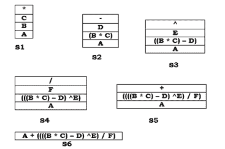


## 前缀转中缀算法

- STEP-1: 将给定的前缀按逆序排列在数组中。
- STEP-2: 扫描数组中的每个元素并将其压入栈中
- STEP-3: 如果发现运算符，则处理它（将其转换为中缀），考虑两个操作数并将它们放在一对括号中。
- STEP-4: 最后按逆序显示结果。

## 示例

将 +A/- * ^BCDEF 转换为中缀，首先将其反转为 FEDCB * - / ^ A +

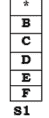
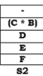
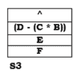
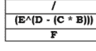
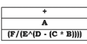
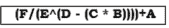

最后将其反转为 A + (((B*C) – D) ^ E) / F)

## 使用栈计算表达式。

计算 12 5 2 * 4 - 2 ^ 6 / +

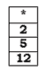
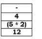
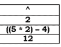
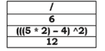
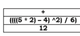
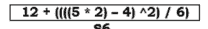

结果：18

## 5.5 栈的编程实现

- 编写程序以执行栈的 PUSH、POP 和 TRAVERSE 操作。

```cpp
#include <iostream>
#include <stdlib.h>
using namespace std;
static int *s, size, top = -1;
//method to push an integer into stack
void push(int no)
{
    if (top == size - 1)
    {
        cout << "\n STACK OVERFLOW";
    }
    else
    {
        top = top + 1;
        *(s + top) = no;
    }
}
//method to pop an element from stack
void pop()
{
    if (top == -1)
        cout << "\n STACK UNDERFLOW";
    else
    {
        cout << *(s + top) << " IS DELETED";
        --top;
    }
}
//method to display the elements of the stack
void traverse()
{
    int i;
    if (top == -1)
        cout << "\n STACK IS EMPTY";
    else
        for (i = top; i >= 0; i--)
            cout << *(s + i) << " ";
}
//driver program
int main()
{
    int opt;
    cout << "\n Enter the size of the stack";
    cin >> size; //ask user about the size of stack
    s = (int *)malloc(size * sizeof(int)); //dynamically allocate memory for stack
    //infinite loop to handle the operations of stack
    while (1)
    {
        cout << "\n Enter the choice";
        cout << "\n 1.PUSH 2. POP 3. DISPLAY 0. EXIT";
        cin >> opt;
        if (opt == 1)
        {
            cout << "\n Enter the number to insert";
            cin >> opt;
            push(opt);
        }
        else if (opt == 2)
            pop();
        else if (opt == 3)
            traverse();
        else if (opt == 0)
        {
            exit(0);
        }
        else
        {
            cout << "\n INVALID CHOICE";
        }
    }
}
```

## 输出

```
Enter the size of the stack5
Enter the choice
1.PUSH 2. POP 3. DISPLAY 0. EXIT12
STACK UNDERFLOW
Enter the choice
1.PUSH 2. POP 3. DISPLAY 0. EXIT11
Enter the number to insert25
Enter the choice
1.PUSH 2. POP 3. DISPLAY 0. EXIT11
Enter the number to insert63
Enter the choice
1.PUSH 2. POP 3. DISPLAY 0. EXIT11
Enter the number to insert85
Enter the choice
1.PUSH 2. POP 3. DISPLAY 0. EXIT11
Enter the number to insert95
Enter the choice
1.PUSH 2. POP 3. DISPLAY 0. EXIT11
Enter the number to insert85
Enter the choice
1.PUSH 2. POP 3. DISPLAY 0. EXIT11
Enter the number to insert54
STACK OVERFLOW
Enter the choice
1.PUSH 2. POP 3. DISPLAY 0. EXIT13
85 95 85 63 25
Enter the choice
1.PUSH 2. POP 3. DISPLAY 0. EXIT2
85 IS DELETED
Enter the choice
1.PUSH 2. POP 3. DISPLAY 0. EXIT2
95 IS DELETED
Enter the choice
1.PUSH 2. POP 3. DISPLAY 0. EXIT3
85 63 25
Enter the choice
1.PUSH 2. POP 3. DISPLAY 0. EXIT0
Process exited after 48 seconds with return value 0
Press any key to continue . . .
```

## 使用 STL 的栈操作

```cpp
#include <iostream>
#include <stack>
using namespace std;

int main()
{
    stack <int> myStack;
    int n, opt;
    while (1)
    {
        cout << endl << "1. PUSH  2. POP  3. SIZE OF STACK  4. TOP OF STACK  5. QUIT";
        cin >> opt;
        if (opt == 1)
        {
            cout << endl << "Enter a number to push";
            cin >> n;
            myStack.push(n);
        }
        else if (opt == 2)
        {
            if (myStack.empty())
                cout << endl << "Underflow";
            else
            {
                myStack.pop();
                cout << endl << "Pop operation completed successfully";
            }
        }
        else if (opt == 3)
        {
            cout << endl << myStack.size() << " elements are in stack";
        }
        else if (opt == 4)
        {
            if (myStack.empty())
                cout << endl << "NO ELEMENTS ARE IN STACK";
            else
                cout << endl << "The top value is : " << myStack.top();
        }
        else if (opt == 5)
            exit(0);
        else
            cout << endl << "Invalid choice";
    }
    return 0;
}
```

## 输出

```
1. PUSH 2. POP 3. SIZE OF STACK 4. TOP OF STACK 5. QUIT1
Enter a number to push23
1. PUSH 2. POP 3. SIZE OF STACK 4. TOP OF STACK 5. QUIT1
Enter a number to push45
1. PUSH 2. POP 3. SIZE OF STACK 4. TOP OF STACK 5. QUIT1
Enter a number to push66
1. PUSH 2. POP 3. SIZE OF STACK 4. TOP OF STACK 5. QUIT2
Pop operation completed successfully
1. PUSH 2. POP 3. SIZE OF STACK 4. TOP OF STACK 5. QUIT3
2 elements are in stack
1. PUSH 2. POP 3. SIZE OF STACK 4. TOP OF STACK 5. QUIT4
The top value is : 45
1. PUSH 2. POP 3. SIZE OF STACK 4. TOP OF STACK 5. QUIT5
Process exited after 24.29 seconds with return value 0
Press any key to continue . . .
```

## 后缀表达式求值

```cpp
#include <iostream>
using namespace std;
int stack[1000]; //declare a stack of size 1000
static int top = -1; //set the value of top to -1 for empty

//push method to push the characters of expression
void push(int x)
{
    stack[++top] = x;
}
//pop method will delete the top element of stack
int pop()
{
    return stack[top--];
}
//method to check the validity of expression
int isValid(char str[])
{
    int i, cd = 0, co = 0;
    for (i = 0; str[i] != '\0'; i++)
    {
        if (str[i] >= '0' && str[i] <= '9')
            cd++; //count number of digits
        else
            co++; //count number of operators
    }
    if (cd - co == 1) //for a valid expression number of digit - number of operator must be 1
        return 1; //return 1 for valid expressison
    else
        return 0; //return 0 for invalid expression
}

//driver program
int main()
{
    char postfix[1000]; //declare the postfix as string to store the expression
    int a, b, c, val;
    //read the postfix expression
    cout << "Enter the expression :";
    cin >> postfix;
    if (!isValid(postfix))
    {
        cout << endl << "Invalid expression";
        exit(0);
    }

    //loop to scan each character of the expression
    for (int i = 0; postfix[i] != '\0'; i++)
    {
        if (postfix[i] >= '0' && postfix[i] <= '9') // check for digit
        {
            val = postfix[i] - 48; //convert to numeric format
            push(val); //push it to stack
        }
        else
        {
            a = pop(); //pop an element
            b = pop(); //again pop another element for operation
            switch (postfix[i]) //switch case is use to check the type of operator
            {
            case '+': //condition for +
            {
                c = a + b; //add two numbers
                break;
            }
            case '-': //condition for -
            {
                c = b - a; //subtract
                break;
            }
            case '*':
            {
                c = a * b; //multiply
                break;
            }
            case '/':
            {
                c = b / a; //divide
                break;
            }
            }
            push(c); //push the result into stack
        }
    }
    //prin t the result
    cout << "\nThe Value of expression " << postfix << " is " << pop();
    return 0;
}
```

## 输出

```
Enter the expression : 512+4*+3-
The Value of expression 512+4*+3- is 14
Process exited after 10.63 seconds with return value 0
Press any key to continue . . .
```

## 将中缀转换为后缀的程序（仅支持 +,-,*/）

```cpp
#include <iostream>
#include <string.h>
using namespace std;
char str[100]; //declare a string variable to store the operators as stack
int top = -1; //initially set -1 to top as empty stack

//push method
void push(char s)
{
    top = top + 1; //increase the value of top
    str[top] = s; //assign the operator into stack
}
```

```cpp
//pop method
char pop()
{
    char i;
    if (top == -1) //condition for empty stack
    {
        cout << endl << "Stack is empty";
        return 0;
    }
    else
    {
        i = str[top]; //store the popped operator
        top = top - 1;
    }
    return i; //return the popped operator
}
```

```cpp
//method precedence
int prec(char c)
{
    if (c == '/' || c == '*')
        return 3; //return 3 for * and /
    if (c == '+' || c == '-')
        return 2; //return 2 for + and -
    return 1; //return 1 for other operator if any
}
```

```cpp
//method to convert the infix to postfix
void infix2pofx(char in[])
{
    int i = 0, px = 0;
    char s, t;
    char pofx[80];
    int l = strlen(in); //find the length of infix expression
    while (i < l)
    {
        s = in[i]; //extract one by one character from infix
        switch (s) //check for operator precedence
        {
        case '(':
            push(s);
            break;
        case ')':
            t = pop(); //pop from the stack when close parenthesis is found
            while (t != '(')
            {
                pofx[px] = t;
                px = px + 1;
                t = pop();
            }
            break;
        }
    }
}
```


case '+':
case '-':
case '*':
case '/':
    while(prec(str[top])>prec(s))
    {
    t=pop();
    pofx[px++]=t;
    }
    push(s);
    break;
default: pofx[px++]=s;
    break;
}
i=i+1;
}

while(top>-1)
{
t=pop();
pofx[px++]=t;
}
pofx[px++]='\0';
puts(pofx);
return;
}

//driver program
int main(void)
{
char ifx[50];
cout<<endl<<"Enter the infix expression";
//read the infix expression
gets(ifx);
infx2pofx(ifx); //call to the method
return 0;
}

## 输出

```
Enter the infix expressionA+B*(C+D/E)+F-G
AB+CD*E/+F-G-
-----------------------------------
Process exited after 11.17 seconds with return value 0
Press any key to continue . . .
```

## 将后缀表达式转换为中缀表达式的程序（仅支持 +,-,*,/）

```
#include <bits/stdc++.h>
using namespace std;
//method to return true if operand otherwise return false
bool checkOperand(char x)
{
    if((x >= 'a' && x <= 'z') || (x >= 'A' && x <= 'Z'))
        return true;
    else
        return false;
}

//method to convert the postfix to infix
string Infix2Postfix(string post)
{
    stack<string> infix;

    for(int i=0; post[i]!='\0'; i++)
    {
        // Push operands
        if (checkOperand(post[i]))
        {
            string op(1, post[i]);
            infix.push(op);
        }

        // We assume that input is
        // a valid postfix and expect
        // an operator.
        else
        {
            string op1 = infix.top();
            infix.pop();

            string op2 = infix.top();
            infix.pop();
            infix.push("(" + op2 + post[i] + op1 + ")"); // reform the expression
        }
    }
    return infix.top();
}
```

//main() method
int main()
{
    string post;
    cout<<endl<<"Enter the postfix expression";
    getline(cin, post);
    cout << Infix2Postfix(post);
    return 0;
}

## 输出

```
Enter the postfix expression98+CD+E/F-G-
(((K+(B)-((C+D)/E))*F^2)-G)
Process exited after 14.49 seconds with return value 0
Press any key to continue . . .
```

## 中缀表达式求值程序

```
#include <bits/stdc++.h>
using namespace std;
//method declarations
int priority(char);
int operate(int,char,int);
int solve(string);
```

//driver program
int main()
{
    string infix;//declare a string to store the infix expression
    cout<<endl<<"Enter an Infix expression(Provide a space between operator and operands)";
    getline(cin,infix);//read the expression
    cout<<endl<<infix<< " = "<<solve(infix);//print the result
    return 0;
}
```

//returns the precedence of the operator
int priority(char op) {
    if(op == '+'||op == '-')
    return 1;
    if(op == '*'|| op == '/')
    return 2;
    return 0;
}
```

//perform the operation according to the operator given
int operate(int x, char ch, int y)
{
    if(ch=='+')
        return x + y;
    else
    if(ch=='-')
        return x - y;
    else
    if(ch=='*')
        return x * y;
    else
    if(ch=='/')
        return x / y;
}
```

//method to return the result of the expression
int solve(string expression)
{
    int i,x,y,n,res;
    char ch;

    //numArr is used to store the numbers
    stack<int> numArr;

    // oplist is used to store the operators
    stack<char> oplist;

    for(i = 0; i < expression.length(); i++)
    {
        //condition for space then no action is needed
        if(expression[i] == ' ')
            continue;

        //if the scanned character is an opening bracket then
        //push it into the oplist stack
        else if(expression[i] == '(')
            oplist.push(expression[i]);

        //if scanned digit is a number then push it into the
        //stack
        else if(isdigit(expression[i]))
        {
            n = 0;
            //form the number by accumulating the sequence of
            //digits till operator or space is found
            //It is used for the numbers having more than 1
            //digits
            while(i < expression.length() &&
                    isdigit(expression[i]))
            {
                n = (n*10) + (expression[i]-'0'); //form the number
                i++;
            }
            numArr.push(n); //push the number into the stack
        }

        //scanned character is a closing bracket then perform
        //operation till open bracket
        else if(expression[i] == ')')
        {
            while(!oplist.empty() && oplist.top() != '(') //condition for empty bracket and till stack is empty
            {
                y = numArr.top(); //extract the top element into y
                numArr.pop(); //pop the stack

                x = numArr.top(); //extract the top element into x
                numArr.pop(); //pop the stack

                ch = oplist.top(); //extract the operator in top of the stack
                oplist.pop(); //pop the stack

                res = operate(x,ch, y); //perform the operation
                numArr.push(res); //push the result into the stack
            }
        }
        //pop the opening bracket
        if(!oplist.empty())
            oplist.pop();
    }

    //if the scanned character is operator
    else
    {
        //perform the operation if the operator in
        //oplist having equal or higher priority to the scanned
        //character, then perform the operation
        while(!oplist.empty() && priority(oplist.top())
        >= priority(expression[i]))
        {
            y = numArr.top(); //extract the top element into y
            numArr.pop(); //pop the stack
            x = numArr.top(); //extract the top element into x
            numArr.pop(); //pop the stack
            ch = oplist.top(); //extract the operator in top of the stack
            oplist.pop(); //pop the stack
            res = operate(x,ch, y);//perform the operation
            numArr.push(res); //push the result into the stack
        }
        oplist.push(expression[i]);
    }
}

    while(!oplist.empty())
    {
        y = numArr.top(); //extract the top element into y
        numArr.pop(); //pop the stack
        x = numArr.top(); //extract the top element into x
        numArr.pop(); //pop the stack
        ch = oplist.top(); //extract the operator in top of the stack
        oplist.pop(); //pop the stack
        res = operate(x,ch, y);//perform the operation
        numArr.push(res); //push the result into the stack
    }

// Top of 'values' contains result, return it.
return numArr.top();
}
```

## 输出

```
Enter an Infix expression(Provide a space between operator and operands>
10 + 12 * ( 120 + 10 ) - 3 * 2 ^ 1
10 * 12 * - ( 120 + 10 ) - 3 * 2 * 1 = 245
Process exited after 23.71 seconds with return value 0
Press any key to continue . . .
```

/* peep operation of the stack using arrays */
#include <stdio.h>
#include <ctype.h>
int top = -1,n;
int *s;
/* Definition of the push function */
void push(int d)
{
    if(top == (n-1))
        printf("\n OVERFLOW");
    else
    {
        ++top;
        *(s+top) = d;
    }
}
/* Definition of the peep function */
void peep()
{
    int i;
    int p;
    printf("\nENTER THE INDEX TO PEEP");
    scanf("%d",&i);
    if((top-i+1) < 0)
    {
        printf("\n OUT OF BOUND");
    }
    else
    {
        printf("THE PEEPED ELEMENT IS %d",
            *(s+(top-i+1)));
    }
}

/* Definition of the display function */
void display()
{
    int i;
    if(top == -1)
    {
        printf("\n Stack is empty");
    }
    else
    {
        for(i = top; i >= 0; --i)
            printf("\n %d", *(s+i));
    }
}

void main()        /* Function main */
{
    int no;
    clrscr();
    printf("\nEnter the boundary of the stack");
    scanf("%d", &n);
    s = (int *)malloc(n * 2);
    while(1)
    {
        printf("WHICH OPERATION DO YOU WANT TO PERFORM:\n");
        printf("\n 1. Push 2. PEEP 0. EXIT");
        scanf("%d", &no);
        if(no==1)
        {
            printf("\n Input the element to push:*");
            scanf("%d", &no);
            push(no);
            printf("\n After inserting ");
            display();
        }
        else
        if(no==2)
        {
            peep();
            display();
        }
        else
        if(no == 0)
            exit(0);
        else
            printf("\n INVALID OPTION");
    }
}

/* update operation of the stack using arrays */
#include <stdio.h>
#include <ctype.h>
int top = -1,n;
int flag = 0;
int *stack;
void push(int *, int);
int update(int *);
void display(int *);
/* Definition of the push function */

void push(int *s, int d)
{
    if(top == n-1)
        flag = 0;
    else
    {
        flag = 1;
        ++top;
        *(s+top) = d;
    }
}
/* Definition of the update function */
int update(int *s)
{
    int i;
    int u;
    printf("\nEnter the index*");
    scanf("%d",&i);
    if((top+1-i) < 0)
    {
        u = 0;
        flag = 0;
    }
    else
    {
        flag = 1;
        u = *(s+(top+1-i));
        printf("\nENTER THE NUMBER TO UPDATE");
        scanf("%d", &s[top+1-i]);
        return u;
    }
}
/* Definition of the display function */
void display(int *s)
{


int i;
if(top == -1)
{
printf("\n Stack is empty");
}
else
{
for(i = top; i >= 0; --i)
printf("\n %d", *(s+i) );
}
}

void main()
{
int no,q=0;
char ch;
int top = -1;
printf("\n Enter the boundary of the stack");
scanf("%d",&n);
stack = (int *)malloc(n * 2 );
up:
printf("WHICH OPERATION DO YOU WANT TO PERFORM:\n");
printf("\n Push->s\n update->p");
printf("\n input the choice : ");
fflush(stdin);
scanf("%c",&ch);
printf("Your choice is : %c",ch);
if(tolower(ch)=='s')
{
printf("\n Input the element to push:");
scanf("%d",&no);
push(stack,no);
if(flag)
{
printf("\n After inserting ");
display(stack);
if(top == (n-1))
printf("\n Stack is full");
}
else
printf("\n Stack overflow after pushing");
}
else
if(tolower(ch)=='p')
{
no = update(stack);
if(flag)
{
           printf("\n The No %d is updated", no);
           printf("\n Rest data in stack is as follows:\n");
           display(stack);
    }
    else
           printf("\n Stack underflow" );
    }
    opt:
    printf("\nDO YOU WANT TO OPERATE MORE");
    fflush(stdin);
    scanf("%c",&ch);
    if(toupper(ch)=='Y')
    goto up;
    else
    if(tolower(ch)=='n')
    exit();
    else
    {
    printf("\nINVALID CHARACTER...Try Again");
    goto opt;
    }
    }
}

## 将中缀表达式转换为前缀表示法

#include<stdio.h>
#include<conio.h>
#include<string.h>
char str[100];
int top=-1;
void push(char s)
{
top=top+1; str[top]=s;
}
char pop()
{
char i;
if(top==-1)
{
printf("\n The stack is Empty");
getch();
return 0;
}
else
{
i=str[top];
top=top-1;
}
return i;
}

int preced(char c)
{
if(c=='/' || c=='^')
return 4;
if(c=='*' || c=='/')
return 3;
if(c=='+' || c=='-')
return 2;
return 1;
}

void infx2prefx(char in[])
{
int i=0,px=0;
char s,t;
char pofx[80];
strlen(in);
while(in[i])
{
s=in[i];
switch(s)
{
case ')': push(s);break;
case '(': t=pop();
while(t != ')')
{
pofx[px]=t;
px=px+1;
t=pop();
}
break;
case '^' :
case '*' :
case '/' :
case '^' :
while (preced(str[top]) > preced(s))
{
    t=pop();
    pofx[px]=t;
    px++;
}
push(s);
break;
default : pofx[px++]=s;
break;
}
i=i+1;
}
while(top>-1)
{
    t=pop();
    pofx[px++]=t;
}
pofx[px++]='\0';
strrev(pofx);
puts(pofx);
return;
}

int main(void)
{
    char ifx[50];
    printf("\n Enter the infix expression ::");
    gets(ifx);
    strrev(ifx);
    //scanf("%s",ifx);
    infx2prefx(ifx);
    return 0;
}

## 5.6 问题

- 1. 栈遵循什么原理？
- 2. 编写一些栈的实现。
- 3. 什么是波兰表示法和逆波兰表示法？
- 4. 编写一个递归程序来检查表达式中括号 (),{},[] 的有效性。

- 5. 编写一个递归程序，使用栈反转字符串。

- 6. 用合适的示例从结构上解释栈在递归中的使用方式。

- 7. 将 (a+b*c) - (d/e^g) 转换为等效的前缀和后缀表达式。

- 8. 栈中的溢出和下溢条件是什么？

- 9. 使用栈求值：5,3,2,*,+,4,-

- 10. 编写一个递归方法来计算一个数的阶乘。

# 6 队列

## 6.1 队列

队列是一种遵循 FIFO 原则的线性数据结构。换句话说，如果用数组实现 FIFO 原则，那么它就被称为 QUEUE。

队列中最常用的操作是 INSERT、DELETE。

除了这两个之外，还可以用 QUEUE 实现 PEEP 和 UPDATE 等操作。

在 INSERT 操作期间，我们需要检查 OVERFLOW 条件；在 DELETE 操作期间，我们需要检查 UNDERFLOW 条件。

执行插入操作的一端称为 REAR 端，执行删除操作的一端称为 FRONT 端。

## 6.2 队列类型

- 线性队列
- 循环队列
- D - 队列（双端队列）
- 优先队列。

## 6.3 线性队列

### 溢出

如果尝试向已填满的 QUEUE 插入元素，则该情况称为溢出。

### 溢出条件

- Rear = size -1（QUEUE 从 0 开始）
- Rear = size（QUEUE 从 1 开始）

### 下溢

如果尝试从空 QUEUE 删除元素，则该情况称为下溢。

### 下溢条件

- Front = -1（QUEUE 从 0 开始）
- front = 0（QUEUE 从 1 开始）

### 空队列条件

- Front = -1 且 Rear = -1 [QUEUE 从 0 开始]
- Front = 0 且 Rear = 0 [QUEUE 从 1 开始]

### 示例

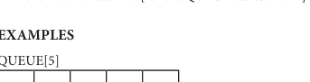

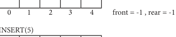

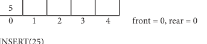

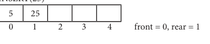

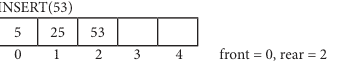

INSERT(99)

| 5 | 25 | 53 | 78 | 99 |
|---|---|---|---|---|
| 0 | 1 | 2 | 3 | 4 |
front = 0, rear = 4

INSERT(145)
"溢出"
(rear = size-1 溢出条件)

DELETE

| | 25 | 53 | 78 | 99 |
|---|---|---|---|---|
| 0 | 1 | 2 | 3 | 4 |
front = 1, rear = 4

DELETE

| | | 53 | 78 | 99 |
|---|---|---|---|---|
| 0 | 1 | 2 | 3 | 4 |
front = 2, rear = 4

DELETE

| | | | 78 | 99 |
|---|---|---|---|---|
| 0 | 1 | 2 | 3 | 4 |
front = 3, rear = 4

DELETE

| | | | | 99 |
|---|---|---|---|---|
| 0 | 1 | 2 | 3 | 4 |
front = 4, rear = 4

DELETE

| | | | | |
|---|---|---|---|---|
| 0 | 1 | 2 | 3 | 4 |
front = -1, rear = -1

DELETE
"下溢"
(front = -1 下溢条件)

### 插入操作算法

```
INSERT(QUEUE[SIZE], FRONT, REAR, NO)
STEP 1 : IF (REAR = SIZE - 1) THEN :
WRITE : "OVERFLOW"
RETURN
[END OF IF]
STEP 2 : IF (REAR = -1) THEN :
    FRONT := 0
    REAR :=0
ELSE :
    REAR :=REAR+1
[END OF IF]
STEP 3: QUEUE[REAR] :=NO
STEP 4: RETURN
```

### 删除操作算法

```
DELETE(QUEUE[SIZE], FRONT, REAR)
STEP 1 : IF (FRONT = -1) THEN :
    WRITE: "UNDERFLOW"
    RETURN
[END OF IF]
STEP 2 : WRITE: QUEUE[FRONT]
STEP 3 : IF (FRONT ==REAR) THEN :
    FRONT := -1
    REAR := -1
ELSE :
    FRONT := FRONT +1
[END OF IF]
STEP 4: RETURN
```

### 遍历操作算法

```
TRAVERSE(QUEUE[SIZE], FRONT, REAR)
STEP 1 : IF (FRONT = -1) THEN :
    WRITE : " QUEUE IS EMPTY "
    RETURN
[END OF IF]
STEP 2: SET I:=0
STEP 3 : REPEAT FOR I = FRONT TO REAR
    WRITE : QUEUE[I]
[END OF LOOP]
STEP 4: RETURN
```

### PEEP 操作算法

PEEP(QUEUE[SIZE], NO, FRONT, REAR)
[QUEUE[SIZE] is the Stack]
[NO is the Number to Search]
[Front & Rear are the positions of the stack]

- STEP-1 : IF (REAR = - 1) THEN :
- WRITE : "STACK IS EMPTY"
- RETURN
- [END OF IF]
- STEP-2 : SET I = 0
- STEP-3 : REPEAT FOR I = FRONT TO REAR
- IF (NO = QUEUE[I]) THEN:
- WRITE : "NUMBER IS FOUND AT"
- WRITE : I+1
- WRITE : "POSITION"
- RETURN
- [END OF IF]
- IF I= REAR THEN:
- WRITE : "NUMBER IS NOT FOUND"
- [END OF IF]
- [END OF LOOP]
- STEP-4 : RETURN

### 更新操作算法

UPDATE(QUEUE[SIZE], NO, FRONT, REAR)
[QUEUE[SIZE] is the QUEUE]
[NO is the Number to Update]
[FRONT & REAR is the position of the stack]

- STEP-1 : IF (REAR = - 1) THEN :
- WRITE : "STACK IS EMPTY"
- RETURN
- [END OF IF]
- STEP-2 : SET I = 0
- STEP-3 : REPEAT FOR I = FRONT TO REAR
- IF (NO = QUEUE[I]) THEN:
- QUEUE[I] = NO
- RETURN
- [END OF IF]
- IF I=REAR THEN:
- WRITE : "UPDATE SUCCESSFULLY NOT COMPLETED"
- [END OF IF]
- [END OF LOOP]
- STEP -4 : RETURN

## 6.4 循环队列

在循环队列中，队列的 rear 和 front 端相互连接，即，在到达 rear 端后，如果 front 端不在零位，则 rear 将再次设置为零，front 端也同样实现。

### 溢出

如果尝试向已填满的 QUEUE 插入元素，则该情况称为溢出。

### 溢出条件

- rear = size -1 and front = 0 OR FRONT = REAR +1（QUEUE 从 0 开始）
- Rear = size and front = 1 OR FRONT = REAR +1（QUEUE 从 1 开始）

### 下溢

如果尝试从空 QUEUE 删除元素，则该情况称为下溢。

### 下溢条件

- Front = -1（QUEUE 从 0 开始）
- front = 0（QUEUE 从 1 开始）

### 空队列条件

- Front = -1 且 Rear = -1 [QUEUE 从 0 开始]
- Front = 0 且 Rear = 0 [QUEUE 从 1 开始]


## 示例

### C_QUEUE[5]

| | | | | |
|---|---|---|---|---|
| 0 | 1 | 2 | 3 | 4 |

front = -1, rear = -1

### INSERT(5)

| 5 | | | | |
|---|---|---|---|---|
| 0 | 1 | 2 | 3 | 4 |

front = 0, rear = 0

### INSERT(25)

| 5 | 25 | | | |
|---|---|---|---|---|
| 0 | 1 | 2 | 3 | 4 |

front = 0, rear = 1

### INSERT(53)

| 5 | 25 | 53 | | |
|---|---|---|---|---|
| 0 | 1 | 2 | 3 | 4 |

front = 0, rear = 2

### INSERT(78)

| 5 | 25 | 53 | 78 | |
|---|---|---|---|---|
| 0 | 1 | 2 | 3 | 4 |

front = 0, rear = 3

### INSERT(99)

| 5 | 25 | 53 | 78 | 99 |
|---|---|---|---|---|
| 0 | 1 | 2 | 3 | 4 |

front = 0, rear = 4

### INSERT(145)

"溢出" (rear = size-1) 溢出条件

### DELETE

| | 25 | 53 | 78 | 99 |
|---|---|---|---|---|
| 0 | 1 | 2 | 3 | 4 |

front = 1, rear = 4

### DELETE

| | | 53 | 78 | 99 |
|---|---|---|---|---|
| 0 | 1 | 2 | 3 | 4 |

front = 2, rear = 4

### DELETE

| | | | 78 | 99 |
|---|---|---|---|---|
| 0 | 1 | 2 | 3 | 4 |

front = 3, rear = 4

### INSERT(87)

| 87 | | | 78 | 99 |
|---|---|---|---|---|
| 0 | 1 | 2 | 3 | 4 |

front = 3, rear = 0

### INSERT(65)

| 87 | 65 | | 78 | 99 |
|---|---|---|---|---|
| 0 | 1 | 2 | 3 | 4 |

front = 3, rear = 1

### INSERT(5)

| 87 | 65 | 5 | 78 | 99 |
|---|---|---|---|---|
| 0 | 1 | 2 | 3 | 4 |

front = 3, rear = 2

### INSERT(89)

"OVERFLOW"

### DELETE

| 87 | 65 | 5 | | 99 |
|---|---|---|---|---|
| 0 | 1 | 2 | 3 | 4 |

front = 4, rear = 2

### DELETE

| 87 | 65 | 5 | | |
|---|---|---|---|---|
| 0 | 1 | 2 | 3 | 4 |

front = 0, rear = 2

### DELETE

| | 65 | 5 | | |
|---|---|---|---|---|
| 0 | 1 | 2 | 3 | 4 |

front = 1, rear = 2

### DELETE

| | | 5 | | |
|---|---|---|---|---|
| 0 | 1 | 2 | 3 | 4 |

front = 2, rear = 2

删除

| | | | | |
|---|---|---|---|---|
| 0 | 1 | 2 | 3 | 4 |

front = -1, rear = -1

删除

“下溢”

(front = -1) 下溢条件

### 插入操作算法

```
INSERT(C_QUEUE[SIZE], FRONT, REAR, NO)
STEP 1: IF (REAR = SIZE - 1 AND FRONT = 0 OR FRONT = REAR + 1) THEN:
WRITE: “OVERFLOW”
RETURN
[END OF IF]
STEP 2: IF (REAR = SIZE - 1) THEN:
REAR := 0
ELSE:
IF (REAR = -1) THEN:
FRONT := 0
REAR := 0
ELSE
REAR := REAR + 1
[END OF IF]
STEP 3: C_QUEUE[REAR] := NO
STEP 4: RETURN
```

### 删除操作算法

```
DELETE(C_QUEUE[SIZE], FRONT, REAR)
STEP 1: IF (FRONT = -1) THEN:
WRITE: “UNDERFLOW”
RETURN
[END OF IF]
STEP 2: WRITE: C_QUEUE[FRONT]
STEP 3: IF (FRONT == REAR) THEN:
FRONT := -1
REAR := -1
ELSE:
IF (FRONT = SIZE - 1) THEN:
FRONT = 0
ELSE:
FRONT := FRONT + 1
[END OF IF]
STEP 4: RETURN
```

### 遍历操作算法

```
TRAVERSE(C_QUEUE[SIZE], FRONT, REAR)
STEP 1: IF (FRONT = -1) THEN:
WRITE: “ QUEUE IS EMPTY ”
RETURN
[END OF IF]
STEP 2: SET I = 0
STEP 3: IF (FRONT > REAR) THEN:
REPEAT FOR I = FRONT TO SIZE - 1
WRITE: C_QUEUE[I]
[END OF LOOP]
REPEAT FOR I = 0 TO REAR
WRITE: C_QUEUE[I]
[END OF LOOP]
ELSE:
REPEAT FOR I = FRONT TO REAR
WRITE: C_QUEUE[I]
[END OF LOOP]
STEP 4: RETURN
```

## 6.5 双端队列

双端队列也称为 D-QUEUE 或 DE-QUEUE 或 DEQUE，它允许在两端执行插入和删除操作。根据操作，可分为两类：

- 输入受限双端队列
- 输出受限双端队列

## 6.6 优先队列

优先队列是一种队列，其中元素按优先级顺序出队。

- 它们是可变数据抽象：入队和出队具有破坏性。
- 每个元素都有一个优先级，是全序集合的一个元素（通常是一个数字）
- 更重要的东西会先出来，即使它们是后来添加的
- 我们的约定：数字越小，优先级越高
- 没有（快速）操作来判断任意元素是否在队列中
- 用于基于事件的模拟器（优先级 = 模拟时间）、实时游戏、搜索、路由、通过 Huffman 编码进行压缩

根据堆的不同，优先队列也分为两类：最小优先队列和最大优先队列。

最大优先队列的操作如下：

- Insert(A, N): 将元素 N 插入到 A 中
- Maximum(A, X): 从 A 中查找 X，其中 X 为最大值
- Extract_Max(A): 移除并返回具有最大键的元素
- Increase_Key(A, x, k): 将元素 x 的值增加到新值 k，假设 k 至少等于 x 的当前键值。

最小优先队列的操作如下：

- Insert
- Minimum
- Extract_Min
- Decrease_Key

最大优先队列最重要的应用是在共享计算机上调度作业。最大优先队列跟踪待执行的作业及其相对优先级。当作业完成或中断时，使用 Extract-Max 从待处理作业中选择最高优先级的作业。可以随时使用 Insert 将新作业添加到队列中。

EXTRACT_MAX 操作返回最大元素。因此，从无序列表中查找最大元素需要 θ(n) 时间。另一种方法是使用有序线性列表。如果使用顺序表示，元素按非递减顺序排列。

Extract-Max 操作需要 θ(1) 时间，Insert 时间为 O(n)。当使用最大堆时，Extract-max 和 insert 都可以在 O(logn) 时间内完成。

### 算法 MAXIMUM(A, X)

- 1. 返回 A[1]

### 算法 EXTRACT-MAX(A)

- 1. 如果 heapsize[A] < 1
- 2. 则写入：“堆下溢”
- 3. Max <- A[1]
- 4. A[1] <- A[heapsize[A]]
- 5. heapsize[A] <- heapsize[A] - 1
- 6. Max_Heap(A, 1)
- 7. 返回 Max

### 算法 INCREASE-KEY(A, i, key)

- 1. 如果 key < A[i]
- 2. 则写入 "key 小于当前键"
- 3. A[i] <- key
- 4. 当 i > 1 且 A[PARENT(i)] < A[i]
- 5. 交换 A[i] <-> A[PARENT(i)]
- 6. i <- PARENT(i)

### 算法 INSERT(A, key)

- 1. heapsize[A] <- heapsize[A] + 1
- 2. A[heapsize[A]] <- -∞
- 3. INCREASE-KEY(A, heapsize[A], key)

在 n 元素堆上执行 INSERT 的运行时间为 O(lgn)。堆可以在 O(lgn) 时间内支持大小为 n 的集合上的任何优先队列操作。

### 最小优先队列的操作

### 算法 MINIMUM(A, X)

- 2. 返回 A[1]

### 算法 EXTRACT-MIN(A)

- 8. 如果 heapsize[A] < 1
- 9. 则写入 "堆下溢"
- 10. Min <- A[1]
- 11. A[1] <- A[heapsize[A]]
- 12. heapsize[A] <- heapsize[A] - 1
- 13. Min_Heap(A, 1)
- 14. 返回 Min

### 算法 DECREASE-KEY(A, i, key)

- 7. 如果 key > A[i]
- 8. 则写入 "key 大于当前键"
- 9. A[i] <- key
- 10. 当 i > 1 且 A[PARENT(i)] > A[i]
- 11. 交换 A[i] <-> A[PARENT(i)]
- 12. i <- PARENT(i)

### 算法 INSERT(A, key)

- 4. heapsize[A] <- heapsize[A] + 1
- 5. A[heapsize[A]] <- -∞
- 6. DECREASE-KEY(A, heapsize[A], key)

## 6.7 程序

```c
/* INSERTION AND DELETION IN A QUEUE ARRAY */
#include <iostream>
#include <stdio.h>
using namespace std;
int *q, size, front = -1, rear = -1;
void insert(int n)
{
    if (rear == size - 1)
    cout << "\n QUEUE OVERFLOW";
    else
    {
        rear++;
        *(q + rear) = n;
        if (front == -1)
        front = 0;
    }
}
/* Function to delete an element from queue */
void Delete()
{
    if (front == -1)
    {
        cout << "\n Underflow";
        return;
    }
    cout << "\n Element deleted : " << *(q + front);
    if (front == rear)
    {
        front = -1;
        rear = -1;
    }
    else
```


```cpp
front = front + 1;
}
void display()
{
    int i;
    if (front == -1)
    cout<<"\n EMPTY QUEUE";
    else
    {
    cout<<"\n THE QUEUE ELEMENTS ARE";
    for(i = front ; i <= rear; i++)
    cout<<"\t"<<q[i];
    }
}
int main()
{
    int opt;
    cout<<"\n Enter the size of the QUEUE";
    cin>>size;
    q = (int *)malloc(size * sizeof(int));
    while(1)
    {
    cout<<"\n Enter the choice";
    cout<<"\n 1. INSERT 2. DELETE 3. DISPLAY 0. EXIT";
    cin>>opt;
    if(opt == 1)
    {
    cout<<"\n Enter the number to insert";
    cin>>opt;
    insert(opt);
    }
    else
    {
    if(opt == 2)
    Delete();
    else
    if(opt == 3)
    display();
    else
    if(opt == 0)
    exit(0);
    else
    cout<<"\n INVALID CHOICE";
    }
    }
}
```

## 输出

```
Enter the size of the QUEUE
4
Enter the choice
1. INSERT 2. DELETE 3. DISPLAY 0. EXIT
1
Enter the number to insert
23
Enter the choice
1. INSERT 2. DELETE 3. DISPLAY 0. EXIT
1
Enter the number to insert
43
Enter the choice
1. INSERT 2. DELETE 3. DISPLAY 0. EXIT
1
Enter the number to insert
65
Enter the choice
1. INSERT 2. DELETE 3. DISPLAY 0. EXIT
1
Enter the number to insert
?77
Enter the choice
1. INSERT 2. DELETE 3. DISPLAY 0. EXIT
1
Enter the number to insert
88
QUEUE OVERFLOW
Enter the choice
1. INSERT 2. DELETE 3. DISPLAY 0. EXIT
3
THE QUEUE ELEMENTS ARE 23 43 65 ?77
Enter the choice
1. INSERT 2. DELETE 3. DISPLAY 0. EXIT
2
Element deleted : 23
Enter the choice
1. INSERT 2. DELETE 3. DISPLAY 0. EXIT
2
Element deleted : 43
Enter the choice
1. INSERT 2. DELETE 3. DISPLAY 0. EXIT
2
Element deleted : 65
Enter the choice
1. INSERT 2. DELETE 3. DISPLAY 0. EXIT
2
Element deleted : ?77
Enter the choice
1. INSERT 2. DELETE 3. DISPLAY 0. EXIT
2
Underflow
Enter the choice
1. INSERT 2. DELETE 3. DISPLAY 0. EXIT
0
Process exited after 22.92 seconds with return value 0
Press any key to continue . . .
```

## 2. 循环队列操作

```cpp
#include<iostream>
#include<iomanip>
using namespace std;
/body of class
class CircularQueue
{
    private : //declare data members
        int front,rear,size,cq;
    public:
        CircularQueue(int); //constructor
        //method declarations
        void Enqueue(int);
        void Dequeue();
        void Print();
        bool isEmpty();
        bool isFull();
        void Clear();
        int getRear();
        int getFront();
};
//body of constructor
CircularQueue :: CircularQueue(int n)
{
    size= n;
    front=-1; //initialize front
    rear=-1; //initialize rear
    cq = new int[size]; //allocate memory for circular queue
}
//method will return the value of rear
int CircularQueue :: getRear()
{
    return rear;
}
//method will return the value of front
int CircularQueue :: getFront()
{
    return front;
}
//method will clear the elements of queue
void CircularQueue :: Clear()
{
    front=-1; //set front to -1
    rear=-1; //set rear to -1
}
//method will return true if circular queue is full
bool CircularQueue :: isFull()
{
    //condition for circular queue is full
    if(front==0 && rear == size-1 || front == rear+1)
    return true;
    else
    return false;
}
//method will return true if the circular queue is empty
bool CircularQueue :: isEmpty()
{
    if(front==-1) //condition for empty
    return true;
    else
    return false;
}
//method will print the elements of circular queue
void CircularQueue :: Print()
{
    int i;
    if(isEmpty()) //check for empty queue
    printf("\n CIRCULAR QUEUE IS EMPTY");
    else
    if (front > rear) //print the elements when front > rear
    {
        for(i = front; i <= size-1; i++)
        cout<<cq[i]<<setw(5);
        for(i = 0; i <= rear; i++)
        cout<<cq[i]<<setw(5);
    }
    else //print the elements from front to rear
    for(i = front; i <= rear; i++)
    cout<<cq[i]<<setw(5);
}
//method will insert an element into circular queue
void CircularQueue :: Enqueue(int n)
{
    if (isFull()) //condition for overflow
    {
    printf("\n Overflow");
    return;
    }
    if (rear == -1) /* Insert first element */
    {
        front = 0;
        rear = 0;
    }
    else
        if (rear == size-1) //if rear is at last then assign it to first
        rear = 0;
        else
            rear++; //increment the value of rear
    //assign the number into circular queue
    cq[rear] = n ;
}
//method to delete the elements from queue
void CircularQueue :: Dequeue()
{
    int ch;
    if (isEmpty()) //condition for underflow
    {
        printf("\nUnderflow");
        return ;
    }
    //print the element which is to be delete
    cout<<endl<<cq[front]<<" deleted from circular queue";
    if (front == rear) //condition for queue having single element
    {
        Clear();
    }
    else
    if ( front == size-1)
    front = 0;
    else
        front++;
}
//driver program
int main()
{
    int op,n;
    char ch;
    cout<<endl<<"Enter the size of circular queue";
    cin>>n; //ask user about the size of circular queue
    CircularQueue obj(n); //declare an object

    //infinite loop to control the program
    while(1)
    {
    cout<<endl<<"********** M E N U **********";
    cout<<endl<<"e. ENQUEUE";
    cout<<endl<<"d. Dequeue";
    cout<<endl<<"m. isEmpty";
    cout<<endl<<"u. isFull";
    cout<<endl<<"c. Clear";
    cout<<endl<<"f. Get Front";
    cout<<endl<<"r. Get Rear";
    cout<<endl<<"p. Print";
    cout<<endl<<"n. Quit";
    cout<<endl<<"Enter Choice : ";
    cin>>ch;

    //condition for enqueue()
    if(ch=='e' || ch=='E')
    {
    cout<<endl<<"Enter the number to insert";
    cin>>opt;

    obj.Enqueue(opt);
    }
    else //condition for dequeue()
    if(ch=='d' || ch=='D')
    {
    obj.Dequeue();
    }
    else //condition for call to isEmpty()
    if(ch=='m' || ch=='M')
    {
    if(obj.isEmpty())
    cout<<endl<<"Circular Queue is EMPTY";
    else
    cout<<endl<<"Circular Queue is not empty" ;
    }
    else //condition to call isFull()
    if(ch=='u' || ch=='U')
    {
    if(obj.isFull())
    cout<<endl<<"Circular Queue is FULL";
    else
    cout<<endl<<"Circular Queue is not Full" ;
    }
    else //condition to call clear()
    if(ch=='c' || ch=='C')
    obj.Clear();
    else
    if(ch=='F' || ch=='f') //condition to call getFront()
    cout<<endl<<"Front = "<<obj.getFront();
    else
    if(ch=='R' || ch=='r') //condition to call getRear()
    cout<<endl<<"Rear = "<<obj.getRear();
    else //condition to call Print()
    obj.Print();
    else //condition to terminate the program
    if(ch=='q' || ch=='Q')
    exit(0);
    else
    cout<<endl<<"Invalid Choice";
    }
}
```

## 输出

```
Enter the size of circular queue
3
**********************************
****** M E N U ******
1. Enqueue
2. Dequeue
3. isEmpty
4. isFull
5. Clear
6. Get Front
7. Get Rear
8. Print
9. Quit
Enter Choice : P
CIRCULAR QUEUE IS EMPTY
**********************************
****** M E N U ******
1. Enqueue
2. Dequeue
3. isEmpty
4. isFull
5. Clear
6. Get Front
7. Get Rear
8. Print
9. Quit
Enter Choice : R
Rear = -1
**********************************
****** M E N U ******
1. Enqueue
2. Dequeue
3. isEmpty
4. isFull
5. Clear
6. Get Front
7. Get Rear
8. Print
9. Quit
Enter Choice : F
Front = -1
**********************************
****** M E N U ******
1. Enqueue
2. Dequeue
3. isEmpty
4. isFull
5. Clear
6. Get Front
7. Get Rear
8. Print
9. Quit
Enter Choice : U
Circular Queue is not Full
**********************************
****** M E N U ******
1. Enqueue
2. Dequeue
3. isEmpty
4. isFull
5. Clear
6. Get Front
7. Get Rear
8. Print
9. Quit
Enter Choice : M
Circular Queue is EMPTY
********** M E N U **********
e. ENQUEUE
d. Dequeue
m. isEmpty
u. isFull
c. Clear
f. Get Front
r. Get Rear
p. Print
q. Quit
Enter Choice : E
Enter the number to insert
12
********** M E N U **********
e. ENQUEUE
d. Dequeue
m. isEmpty
u. isFull
c. Clear
f. Get Front
r. Get Rear
p. Print
q. Quit
Enter Choice : E
Enter the number to insert
34
********** M E N U **********
e. ENQUEUE
d. Dequeue
m. isEmpty
u. isFull
c. Clear
f. Get Front
r. Get Rear
p. Print
q. Quit
Enter Choice : E
Enter the number to insert
56
********** M E N U **********
e. ENQUEUE
d. Dequeue
m. isEmpty
u. isFull
c. Clear
f. Get Front
r. Get Rear
p. Print
q. Quit
Enter Choice : E
Enter the number to insert
2
Overflow
```


```
**************** M E N U ****************
e. ENQUEUE
d. Dequeue
m. isEmpty
u. isFull
c. Clear
f. Get Front
r. Get Rear
p. Print
q. Quit
Enter Choice : P
12
34
56
**************** M E N U ****************
e. ENQUEUE
d. Dequeue
m. isEmpty
u. isFull
c. Clear
f. Get Front
r. Get Rear
p. Print
q. Quit
Enter Choice : D

12 deleted from circular queue
**************** M E N U ****************
e. ENQUEUE
d. Dequeue
m. isEmpty
u. isFull
c. Clear
f. Get Front
r. Get Rear
p. Print
q. Quit
Enter Choice : P
56
****** M E N U ******
e. ENQUEUE
d. Dequeue
m. isEmpty
u. isFull
c. Clear
f. Get Front
g. Get Rear
p. Print
q. Quit
Enter Choice : U
Circular Queue is not Full

****** M E N U ******
e. ENQUEUE
d. Dequeue
m. isEmpty
u. isFull
c. Clear
f. Get Front
g. Get Rear
p. Print
q. Quit
Enter Choice : M
Circular Queue is not empty

****** M E N U ******
e. ENQUEUE
d. Dequeue
m. isEmpty
u. isFull
c. Clear
f. Get Front
g. Get Rear
p. Print
q. Quit
Enter Choice : E
Enter the number to insert 34

****** M E N U ******
e. ENQUEUE
d. Dequeue
m. isEmpty
u. isFull
c. Clear
f. Get Front
g. Get Rear
p. Print
q. Quit
Enter Choice : E
Enter the number to insert 77

****** M E N U ******
e. ENQUEUE
d. Dequeue
m. isEmpty
u. isFull
c. Clear
f. Get Front
g. Get Rear
p. Print
q. Quit
Enter Choice : P
56 34 77
**************** MENU ****************
a. ENQUEUE
d. DEQUEUE
m. isEmpty
u. isFull
c. Clear
f. Get Front
b. Get Rear
t. Traverse
s. Count
q. Quit
Enter Choice : C
**************** MENU ****************
a. ENQUEUE
d. DEQUEUE
m. isEmpty
u. isFull
c. Clear
f. Get Front
b. Get Rear
t. Traverse
s. Count
q. Quit
Enter Choice : D
**************** MENU ****************
a. ENQUEUE
d. DEQUEUE
m. isEmpty
u. isFull
c. Clear
f. Get Front
b. Get Rear
t. Traverse
s. Count
q. Quit
Enter Choice : Q
Process exited after 203.3 seconds with return value 0
Press any key to continue . . .
```

## 3. 循环队列插入、删除、搜索和遍历操作程序

```cpp
#include<iostream>
using namespace std;
//structure of class cqueue
class cqueue
{
	private:
		int front,rear,cnt,queue[10];
	public:
		cqueue(); //constructor
		void enqueue(); //prototype of enqueue()
		int dequeue(); //prototype of dequeue()
		int count(); //count the number of elements in queue
		void traverse(); //traverse the queue elements
		bool search(int); //search an element in circular queue
};
```

```cpp
cqueue :: cqueue()
{
	front=-1; //assign -1 to front and rear for empty queue
	rear=-1;
	cnt=0; //set 0 to count
}
```

```cpp
//method to insert an element into the queue
void cqueue :: enqueue()
{
	//condition for overflow
	if(front == 0 && rear==9 || front == rear+1)
	{
		cout<<endl<<"OVERFLOW";
	}
	else
	{
		if(rear==-1) //condition for queue does not having any element
		{
			front=0; //set the front and rear to 0
			rear=0;
		}
		else
		if(rear==9 && front!=0) //condition for rear at last but queue having empty space
		{
			rear=0;
		}
		else
		{ //increase the rear for insertion
			rear++;
		}
		//insert an element into the queue
		cout<<endl<<"Enter an element to insert into queue";
		cin>>queue[rear];
	}
}
```

```cpp
//method to delete an element from queue
void cqueue :: dequeue()
{
	if(front==-1) //condition for underflow
	{
		cout<<endl<<"UNDERFLOW";
	}
	else
	{
		//print the element to delete
		cout<<endl<<queue[front]<<" deleted from queue";
		//set the front
		if(front==rear) //queue having single element
		{
			front=-1;
			rear=-1;
		}
		else
		{
			if(front==9) //condition for front is at last
				front=0;
			else
				front=front+1; //increase the front
		}
	}
}
```

```cpp
//method to traverse the queue
void cqueue :: traverse()
{
	int i;
	if(front==-1) //condition for empty queue
	{
		cout<<endl<<"EMPTY QUEUE";
	}
	else
	{
		if(front > rear) //condition for front is greater than rear
		{
			for(i=front;i<=9;i++) //print the elements from front to last
				cout<<queue[i]<< " ";
			for(i=0;i<=rear;i++) //print the elements from 0 to rear
				cout<<queue[i]<< " ";
		}
		else
		{
			for(i=front;i<=rear;i++) //print the elements from front to rear
				cout<<queue[i]<< " ";
		}
	}
}
```

```cpp
//method to count the number of elements in queue
int cqueue :: count()
{
	int i;
	cnt=0;
	if(rear==-1) //condition for queue does not having element
		return cnt;//return cnt as 0
	else
	if(front > rear) //condition having front greater than rear
	{
		for(i=front;i<=9;i++) //count number of elements from front to last
			cnt++;
		for(i=0;i<=rear;i++) //count the elements from 0 to rear
			cnt++;
	}
	else
		for(i=front;i<=rear;i++) //count the elements from front to rear
			cnt++;
	return cnt; //return count
}
```

```cpp
//method to search an element in queue
bool cqueue :: search(int n)
{
	int i;
	if(rear==-1) //if queue does not having any element then return false
		return false;
	if(front > rear) //condition having front greater than rear
	{
		for(i=front;i<=9;i++)//search number of elements from front to last
			if(n==queue[i])
				return true;
		for(i=0;i<=rear;i++)//search the elements from 0 to rear
			if(n==queue[i])
				return true;
	}
	else
		for(i=front;i<=rear;i++)//search the elements from front to rear
			if(n==queue[i])
				return true;
	return false;
}
//driver program
```

```cpp
int main()
{
	int opt,n;
	cqueue obj;
	cout<<endl<<"***********************************************\n";
	cout<<endl<<"CIRCULAR QUEUE OPERATIONS";
	cout<<endl<<"***********************************************\n";
	//loop to operate the operations with queue till user wants
	while(1)
	{
		//display the menu
		cout<<endl<<"1. INSERT 2. DELETE 3. COUNT 4. SEARCH 5. TRAVERSE 0. EXIT";
		cout<<endl<<"Enter your choice";
		cin>>opt; //read the choice
		if(opt==1) //Condition for insert operation
			obj.enqueue();
		else
		if(opt==2) //condition for delete operation
			obj.dequeue();
		else
		if(opt==3) //condition for count operation
			cout<<endl<<"Circular queue having "<<obj.count()<<" number of elements";
		else
		if(opt==4) //condition for search operation
		{
			cout<<endl<<"Enter an element to search";
			cin>>n;
			if(obj.search(n))
				cout<<endl<<n<<" is inside the queue";
			else
				cout<<endl<<n<<" is not inside the queue";
		}
		else
		if(opt==5) //condition for traverse operation
			obj.traverse();
		else
		if(opt==0) //condition for terminate the loop
			break;
		else //invalid option
			cout<<endl<<"Invalid choice";
	}
}
```

## 输出

```
****************************************
CIRCULAR QUEUE OPERATIONS
****************************************
1. INSERT 2. DELETE 3. COUNT 4. SEARCH 5. TRAVERSE 0. EXIT
Enter your choice 1
Enter an element to insert into queue 23
1. INSERT 2. DELETE 3. COUNT 4. SEARCH 5. TRAVERSE 0. EXIT
Enter your choice 1
Enter an element to insert into queue 24
1. INSERT 2. DELETE 3. COUNT 4. SEARCH 5. TRAVERSE 0. EXIT
Enter your choice 1
Enter an element to insert into queue 5
1. INSERT 2. DELETE 3. COUNT 4. SEARCH 5. TRAVERSE 0. EXIT
Enter your choice 1
Enter an element to insert into queue 65
1. INSERT 2. DELETE 3. COUNT 4. SEARCH 5. TRAVERSE 0. EXIT
Enter your choice 1
Enter an element to insert into queue 76
1. INSERT 2. DELETE 3. COUNT 4. SEARCH 5. TRAVERSE 0. EXIT
Enter your choice 1
Enter an element to insert into queue 87
1. INSERT 2. DELETE 3. COUNT 4. SEARCH 5. TRAVERSE 0. EXIT
Enter your choice 1
Enter an element to insert into queue 5
1. INSERT 2. DELETE 3. COUNT 4. SEARCH 5. TRAVERSE 0. EXIT
Enter your choice 1
Enter an element to insert into queue 3
1. INSERT 2. DELETE 3. COUNT 4. SEARCH 5. TRAVERSE 0. EXIT
Enter your choice 1
Enter an element to insert into queue 76
1. INSERT 2. DELETE 3. COUNT 4. SEARCH 5. TRAVERSE 0. EXIT
Enter your choice 1
Enter an element to insert into queue 43
1. INSERT 2. DELETE 3. COUNT 4. SEARCH 5. TRAVERSE 0. EXIT
Enter your choice 1
OVERFLOW
1. INSERT 2. DELETE 3. COUNT 4. SEARCH 5. TRAVERSE 0. EXIT
Enter your choice 5
23 34 5 65 76 87 5 3 76 43
```


```
1. INSERT 2. DELETE 3. COUNT 4. SEARCH 5. TRAVERSE 0.EXIT
Enter your choice: 2
23 deleted from queue
1. INSERT 2. DELETE 3. COUNT 4. SEARCH 5. TRAVERSE 0.EXIT
Enter your choice: 2
34 deleted from queue
1. INSERT 2. DELETE 3. COUNT 4. SEARCH 5. TRAVERSE 0.EXIT
Enter your choice: 5
1. INSERT 2. DELETE 3. COUNT 4. SEARCH 5. TRAVERSE 0.EXIT
Enter your choice: 1
Enter an element to insert into queue: 33
1. INSERT 2. DELETE 3. COUNT 4. SEARCH 5. TRAVERSE 0.EXIT
Enter your choice: 1
Enter an element to insert into queue: 44
1. INSERT 2. DELETE 3. COUNT 4. SEARCH 5. TRAVERSE 0.EXIT
Circular queue having 9 number of elements
1. INSERT 2. DELETE 3. COUNT 4. SEARCH 5. TRAVERSE 0.EXIT
Enter your choice: 1
Enter an element to insert into queue: 56
1. INSERT 2. DELETE 3. COUNT 4. SEARCH 5. TRAVERSE 0.EXIT
Enter your choice: 1
OVERFLOW
1. INSERT 2. DELETE 3. COUNT 4. SEARCH 5. TRAVERSE 0.EXIT
Enter your choice: 3
Circular queue having 10 number of elements
1. INSERT 2. DELETE 3. COUNT 4. SEARCH 5. TRAVERSE 0.EXIT
Enter your choice: 5
65 76 89 5 6 76 43 33 44 56
1. INSERT 2. DELETE 3. COUNT 4. SEARCH 5. TRAVERSE 0.EXIT
Enter your choice: 3
Circular queue having 10 number of elements
1. INSERT 2. DELETE 3. COUNT 4. SEARCH 5. TRAVERSE 0.EXIT
Enter your choice: 33
Invalid choice
1. INSERT 2. DELETE 3. COUNT 4. SEARCH 5. TRAVERSE 0.EXIT
Enter your choice: 4
Enter an element to search: 33
33 is inside the queue
1. INSERT 2. DELETE 3. COUNT 4. SEARCH 5. TRAVERSE 0.EXIT
Enter your choice: 4
Enter an element to search: 1
1 is not inside the queue
1. INSERT 2. DELETE 3. COUNT 4. SEARCH 5. TRAVERSE 0.EXIT
Enter your choice: 1
65 76 89 5 6 76 43 33 44 56
1. INSERT 2. DELETE 3. COUNT 4. SEARCH 5. TRAVERSE 0.EXIT
Enter your choice: 2
65 deleted from queue
1. INSERT 2. DELETE 3. COUNT 4. SEARCH 5. TRAVERSE 0.EXIT
Enter your choice: 2
76 deleted from queue
1. INSERT 2. DELETE 3. COUNT 4. SEARCH 5. TRAVERSE 0.EXIT
Enter your choice: 2
89 deleted from queue
1. INSERT 2. DELETE 3. COUNT 4. SEARCH 5. TRAVERSE 0.EXIT
Enter your choice: 2
5 deleted from queue
1. INSERT 2. DELETE 3. COUNT 4. SEARCH 5. TRAVERSE 0.EXIT
Enter your choice: 2
3 deleted from queue
1. INSERT 2. DELETE 3. COUNT 4. SEARCH 5. TRAVERSE 0.EXIT
Enter your choice: 2
76 deleted from queue
1. INSERT 2. DELETE 3. COUNT 4. SEARCH 5. TRAVERSE 0.EXIT
Enter your choice: 2
43 deleted from queue
1. INSERT 2. DELETE 3. COUNT 4. SEARCH 5. TRAVERSE 0.EXIT
Enter your choice: 5
33
44
56
1. INSERT 2. DELETE 3. COUNT 4. SEARCH 5. TRAVERSE 0.EXIT
Enter your choice: 3
Counting 3 number of elements
1. INSERT 2. DELETE 3. COUNT 4. SEARCH 5. TRAVERSE 0.EXIT
Enter your choice: 2
33 deleted from queue
1. INSERT 2. DELETE 3. COUNT 4. SEARCH 5. TRAVERSE 0.EXIT
Enter your choice: 2
44 deleted from queue
1. INSERT 2. DELETE 3. COUNT 4. SEARCH 5. TRAVERSE 0.EXIT
Enter your choice: 1
Enter an element to insert into queue: 56
1. INSERT 2. DELETE 3. COUNT 4. SEARCH 5. TRAVERSE 0.EXIT
Enter your choice: 5
56
1. INSERT 2. DELETE 3. COUNT 4. SEARCH 5. TRAVERSE 0.EXIT
Enter your choice: 2
56 deleted from queue
1. INSERT 2. DELETE 3. COUNT 4. SEARCH 5. TRAVERSE 0.EXIT
Enter your choice: 2
UNDERFLOW
1. INSERT 2. DELETE 3. COUNT 4. SEARCH 5. TRAVERSE 0.EXIT
Enter your choice: 3
Circular queue having 0 number of elements
1. INSERT 2. DELETE 3. COUNT 4. SEARCH 5. TRAVERSE 0.EXIT
Enter your choice: 4
Enter an element to search: 56
56 is not inside the queue
1. INSERT 2. DELETE 3. COUNT 4. SEARCH 5. TRAVERSE 0.EXIT
Enter your choice: 8
Process exited after 100.8 seconds with return value 0 Press any key to continue . . .
```

## 4. 双端队列插入和删除程序

```cpp
#include <iostream>
using namespace std;
#define SIZE 50
class dequeue {
 int a[50], f, r;
 public:
 dequeue();
 void insert_at_beg(int);
 void insert_at_end(int);
 void delete_fr_front();
 void delete_fr_rear();
 void show();
};
dequeue::dequeue() {
 f = -1;
 r = -1;
}
void dequeue::insert_at_end(int i) {
 if (r >= SIZE - 1) {
 cout << "\n insertion is not possible, overflow!!!!";
 } else {
 if (f == -1) {
 f++;
 r++;
 } else {
 r++;
 }
 a[r] = i;
 cout << "\nInserted item is " << a[r];
 }
}
void dequeue::insert_at_beg(int i) {
 if (f == -1) {
 f = 0;
 a[++r] = i;
 cout << "\n inserted element is: " << c;
 } else if (f != 0) {
 a[--f] = i;
 cout << "\n inserted element is: " << c;
 } else {
 cout << "\n insertion is not possible, overflow!!!";
 }
}
void dequeue::delete_fr_front() {
 if (f == -1) {
 cout << "deletion is not possible: deque is empty";
 return;
 } else {
 cout << "the deleted element is: " << a[f];
 if (f == r) {
 f = r = -1;
 return;
 } else
 f = f + 1;
 }
}
void dequeue::delete_fr_rear() {
 if (f == -1) {
 cout << "deletion is not possible: deque is empty";
 return;
 } else {
 cout << "the deleted element is: " << a[r];
 if (f == r) {
 f = r = -1;
 } else
 r = r - 1;
 }
}
void dequeue::show() {
 if (f == -1)
 cout << "Deque is empty";
 else {
 for (int i = f; i < r; i++)
 cout << a[i] << " ";
 }
}
int main() {
    int c, i;
    dequeue d;
    do // perform switch operation
    {
        cout << "\n 1.insert at beginning";
        cout << "\n 2.insert at end";
        cout << "\n 3.show";
        cout << "\n 4.deletion from front";
        cout << "\n 5.deletion from rear";
        cout << "\n 6.exit";
        cout << "\n enter your choice:";
        cin >> c;
        switch (c)
        {
            case 1:
                cout << "enter the element to be inserted";
                cin >> i;
                d.insert_at_beg(i);
                break;
            case 2:
                cout << "enter the element to be inserted";
                cin >> i;
                d.insert_at_end(i);
                break;
            case 3:
                d.show();
                break;
            case 4:
                d.delete_fr_front();
                break;
            case 5:
                d.delete_fr_rear();
                break;
            case 6:
                exit(1);
                break;
            default:
                cout << "invalid choice";
                break;
        }
    } while (c != 7);
}
```

## 6.8 问题

- 1. 什么是队列数据结构？
- 2. 循环队列相对于线性队列有什么优势？
- 3. 什么是双端队列？
- 4. 优先队列执行哪些操作？
- 5. 编写优先队列的几个应用。
- 6. 说明循环队列的上溢和下溢条件。
- 7. 编写一个程序以展示双端队列的实现。

# 7 链表

链表是表示数据结构的一种方式，该结构可以是线性的也可以是非线性的。链表中的元素将在内存中随机分配，并彼此之间存在关系。链表中的元素称为节点。

由于内存使用得当，链表比数组更好。

## 7.1 为什么使用链表？

数组始终要求内存按顺序排列，而链表只需要一次内存分配，这足以存储数据。在数组的情况下，即使内存空间大于所需空间，也可能无法分配内存，因为该空间可能不是按顺序排列的。

## 7.2 链表的类型

链表有四种类型，例如：

- 单链表
- 双链表
- 循环链表
- 头链表

## 7.3 单链表

### 链表节点的结构

链表节点具有存储数据及其下一节点地址的能力，数据可能因用户需求而异，因此最好将节点的数据类型选择为结构体，它能够存储不同类型的元素。

节点的一般格式为

```
struct tagname
{
Data type member1;
Data type member2;
............
............
Data type membern;
struct tagname *var;
};
```

示例：

```
struct link
{
int info;
struct link *next;
};
```

这种结构也称为自引用结构。

### 创建链表的概念

```
int *p, q = 5;
p = &q;
*p = 10;
After this the value of q is being changed to 10.
The main observation here is that if a pointer variable points to another variable then what ever the changes made with the pointer that will directly affect to the variable whose address is stored inside the pointer and concept is used to design/create the linked list.
```


## 创建逻辑

```c
struct link
{
    int info;
    struct link *next;
};
struct link start, *node;
```

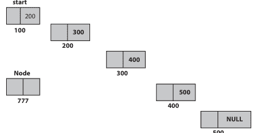

## 逻辑

- NODE = &START
- Node->next = (struct link *)malloc(sizeof(struct link))
- Node = node->next
- Node->next = NULL
- Input node->info

## 单链表创建算法

```c
struct link
{
    int info;
    struct link *next;
};
CREATE(START, NODE)
[START IS THE STRUCTURE TYPE OF VARIABLE]
[NODE IS THE STRUCTURE TYPE OF POINTER]
```

## 单链表遍历算法

```c
struct link
{
    int info;
    struct link *next;
};
TRAVERSE(START, NODE) [START IS THE STRUCTURE TYPE OF VARIABLE]
                     [NODE IS THE STRUCTURE TYPE OF POINTER]
STEP-1 : NODE := NEXT[START]
STEP-2 : REPEAT WHILE ( NEXT[NODE] != NULL )
         WRITE : INFO[NODE]
         NODE := NEXT[NODE]
         END OF LOOP
STEP-3 : RETURN
```

## 插入

链表的插入过程可以分为以下四种不同的方式讨论：

- 在开头插入
- 在末尾插入
- 已知节点编号时插入
- 已知信息时插入

## 逻辑

First = &start
Node = start.next
为 NEW 分配内存
输入 NEW->info
First->next = NEW
NEW->next = node.

## 链表开头插入算法

```c
struct link
{
    int info;
    struct link *next;
};
INSBEG(START, FIRST, NODE) [START IS THE STRUCTURE TYPE OF VARIABLE]
[NODE and FIRST IS THE STRUCTURE TYPE OF POINTER VARIABLE]
STEP-1: FIRST := ADDRESS OF START
        NODE := NEXT[START]
STEP-2: ALLOCATE A MEMORY TO NEW
        INPUT : INFO(NEW)
        NEXT[FIRST] := NEW
        NEXT[NEW] := NODE
STEP-3: RETURN
```

## 链表末尾插入算法

```c
struct link
{
    int info;
    struct link *next;
};
INSLAST(START, FIRST, NODE) [START IS THE STRUCTURE TYPE OF VARIABLE]
[NODE and FIRST IS THE STRUCTURE TYPE OF POINTER VARIABLE]
STEP-1: FIRST := ADDRESS OF START
        NODE := NEXT[START]
STEP-2: REPEAT WHILE (NODE != NULL)
        NODE := NEXT[NODE]
        FIRST := NEXT[FIRST]
        [END OF LOOP]
STEP-3: ALLOCATE A MEMORY TO NEW
        INPUT : INFO[NEW]
        NEXT[FIRST] := NEW
        NEXT[NEW] := NODE
STEP-4: RETURN
```

## 已知节点编号时的节点插入算法

```c
struct link
{
    int info;
    struct link *next;
};
INSNODE(START, FIRST, NODE, NO) [START IS THE STRUCTURE TYPE OF VARIABLE]
[NODE and FIRST IS THE STRUCTURE TYPE OF POINTER VARIABLE]
[NO IS THE NODE NUMBER]
STEP-1: FIRST := ADDRESS OF START
        NODE := NEXT[START]
        COUNT := 1
STEP-2: REPEAT WHILE (NODE != NULL)
        IF (COUNT = NO) THEN:
            ALLOCATE A MEMORY TO NEW
            INPUT : INFO[NEW]
            NEXT[FIRST] := NEW
            NEXT[NEW] := NODE
            RETURN
        ELSE:
            NODE := NEXT[NODE]
            FIRST := NEXT[FIRST]
            COUNT := COUNT + 1
        END OF IF
        [END OF LOOP]
STEP-5: RETURN
```

## 已知信息时的节点插入算法

```c
struct link
{
    int info;
    struct link *next;
};
INSNODE(START, FIRST, NODE, NO) [START IS THE STRUCTURE TYPE OF VARIABLE]
[NODE AND FIRST IS THE STRUCTURE TYPE OF POINTER VARIABLE]
[NO IS THE INFORMATION TO INSERT]
STEP-1: FIRST := ADDRESS OF START
        NODE := NEXT[START]
STEP-2: REPEAT WHILE (NODE != NULL)
        IF (INFO[NODE] >= NO) THEN:
            ALLOCATE A MEMORY TO NEW
            INPUT : INFO[NEW]
            NEXT[FIRST] := NEW
            NEXT[NEW] := NODE
            RETURN
        ELSE:
            NODE := NEXT[NODE]
            FIRST := NEXT[FIRST]
        [END OF IF]
        [END OF LOOP]
STEP-5: RETURN
```

## 链表开头删除算法

```c
struct link
{
    int info;
    struct link *next;
};
DELBEG(START, FIRST, NODE) [START IS THE STRUCTURE TYPE OF VARIABLE]
[NODE and FIRST IS THE STRUCTURE TYPE OF POINTER VARIABLE]
STEP-1 : FIRST := ADDRESS OF START
         NODE := NEXT[START]
STEP-2 : WRITE := INFO[NODE]
         NEXT[FIRST] := NEXT[NODE]
         FREE(NODE)
STEP-3 : RETURN
```

## 最后一个节点删除算法

```c
struct link
{
    int info;
    struct link *next;
};
DELLAST(START, FIRST, NODE) [START IS THE STRUCTURE TYPE OF VARIABLE]
[NODE and FIRST IS THE STRUCTURE TYPE OF POINTER VARIABLE]
STEP-1 : FIRST := ADDRESS OF START
         NODE := NEXT[START]
         COUNT := 1
STEP-2: REPEAT WHILE (NODE != NULL)
         NODE := NEXT[NODE]
         COUNT := COUNT + 1
         [END OF LOOP]
STEP-3 : NODE := NEXT[START]
STEP-4: REPEAT WHILE (COUNT != 1)
         NODE := NEXT[NODE]
         FIRST := NEXT[FIRST]
         COUNT := COUNT - 1
         [END OF LOOP]
STEP-5: WRITE : INFO[NODE]
        NEXT[FIRST] := NEXT[NODE]
        FREE(NODE)
STEP-6: RETURN
```

## 已知节点编号时的节点删除算法

```c
struct link
{
    int info;
    struct link *next;
};
DELNODE(START, FIRST, NODE, NO) [START IS THE STRUCTURE TYPE OF VARIABLE]
[NODE and FIRST IS THE STRUCTURE TYPE OF POINTER VARIABLE]
[NO IS THE NODE NUMBER]
STEP-1 : FIRST := ADDRESS OF START
         NODE := NEXT[START]
         COUNT := 1
STEP-2: REPEAT WHILE (NODE != NULL)
         IF (COUNT = NO) THEN:
             WRITE : INFO[NODE]
             NEXT[FIRST] := NEXT[NODE]
             FREE(NODE)
             RETURN
         ELSE:
             NODE := NEXT[NODE]
             FIRST := NEXT[FIRST]
             COUNT := COUNT + 1
         [END OF IF]
         [END OF LOOP]
STEP-5 : RETURN
```

## 已知信息时的节点删除算法

```c
struct link
{
    int info;
    struct link *next;
};
DELINFO(START, FIRST, NODE, NO) [START IS THE STRUCTURE TYPE OF VARIABLE]
[NODE AND FIRST IS THE STRUCTURE TYPE OF POINTER VARIABLE]
[NO IS THE INFORMATION TO INSERT]
STEP-1 : FIRST := ADDRESS OF START
         NODE := NEXT[START]
STEP-2 : REPEAT WHILE (NODE != NULL)
         IF (INFO[NODE] = NO) THEN:
             WRITE : INFO[NODE]
             NEXT[FIRST] := NEXT[NODE]
             FREE(NODE)
             RETURN
         ELSE :
             NODE := NEXT[NODE]
             FIRST := NEXT[FIRST]
         [END OF IF]
         [END OF LOOP]
STEP-5 : RETURN
```

## 7.4 与单链表相关的程序

### 7.4.1 /* 创建链表 */

```cpp
#include<iostream>
#include<iomanip>
#include<stdlib.h>
using namespace std;
struct link
{
    int info;
    struct link *next;
};
struct link start;
/* Function main */
void create(struct link *);
void display(struct link *);
int main()
{
    struct link *node;
    create(node);
    display(node);
}
```

```cpp
void create(struct link *node) /*LOGIC TO CREATE A LINK LIST*/
{
    char ch = 'y';
    start.next = NULL;
    node = &start;    /* Point to the start of the list */
    while (ch == 'y' || ch == 'Y')
    {
        node->next = (struct link *) malloc(sizeof(struct link));
        node = node->next;
        cout << "\n ENTER A NUMBER : ";
        cin >> node->info;
        node->next = NULL;
        cout << "\n DO YOU WANT TO CREATE MORE NODES : ";
        cin >> ch;
    }
}
```

```cpp
void display(struct link *node)
{
    /*DISPLAY THE LINKED LIST*/
    node = start.next;
    cout << "After Inserting a node list is as follows:\n";
    while (node)
    {
        cout << setw(5) << node->info;
        node = node->next;
    }
}
```

## 输出

```
ENTER A NUMBER : 5
DO YOU WANT TO CREATE MORE NODES: y
ENTER A NUMBER : 32
DO YOU WANT TO CREATE MORE NODES: y
ENTER A NUMBER : 58
DO YOU WANT TO CREATE MORE NODES: y
ENTER A NUMBER : 98
DO YOU WANT TO CREATE MORE NODES: y
ENTER A NUMBER : 5
DO YOU WANT TO CREATE MORE NODES: n
After Inserting a node list is as follows:
5 32 58 98 5
------------------------------
Process exited after 12.23 seconds with return value 0
Press any key to continue . . .
```

### 7.4.2 /* 在简单链表开头插入节点*/

```cpp
#include<iostream>
#include<conio.h>
#include<stdlib.h>
using namespace std;
struct list
{
    int info;
    struct list *next;
};
```

```cpp
struct list start, *first, *New;
/* Function main */
void create(struct list *);
void display(struct list *);
void insert(struct list *);

int main()
{
    struct list *node;
    create(node);
    insert(node);
    display(node);
}
```

```cpp
void create(struct list *node) /*LOGIC TO CREATE A LINK LIST*/
{
    char ch = 'y';
    start.next = NULL;
    node = &start; /* Point to the start of the list */
    while (ch == 'y' || ch == 'Y')
    {
        node->next = (struct list *) malloc(sizeof(struct list));
        node = node->next;
        cout << "\n ENTER A NUMBER : ";
        cin >> node->info;
        node->next = NULL;
        cout << "\n DO YOU WANT TO CREATE MORE NODES : ";
        cin >> ch;
    }
}
```

```cpp
void display(struct list *node) /*DISPLAY THE LINKED LIST*/
{
    node = start.next;
    cout << "\n After Inserting a node list is as follows:\n";
    while (node)
    {
        cout << setw(5) << node->info;
        node = node->next;
    }
}
```

```cpp
void insert(struct list *node)
{ /*INSERT AN ELEMENT AT THE FIRST NODE*/
    node = start.next;
}
```


first = &start;
New = (struct list* ) malloc(sizeof(struct list));
New->next = node ;
first->next = New;
cout<<"\n Input the first node value: ";
cin>>New->info;
}

输出

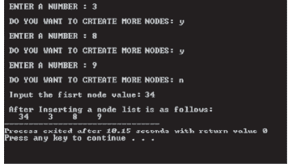

## 7.4.3 /* 在简单链表末尾插入一个节点 */

```cpp
#include<iostream>
#include<conio.h>
#include<stdio.h>
#include<stdlib.h>
using namespace std;
struct list
{
    int info;
    struct list *next;
};
struct list start, *first, *New,*last;
/* Function main */
void create(struct list *);
void display(struct list *);
void insert(struct list *);
int main()
{
    struct list *node;
    create(node);
    insert(node);
    display(node);
}
```

```cpp
void create(struct list *node) /*LOGIC TO CREATE A LINK LIST*/
{
 char ch='y';
 start.next = NULL;
 node = &start; /* Point to the start of the list */
 while(ch =='y' || ch =='Y')
 {
 node->next = (struct list * )
 malloc(sizeof(struct list));
 node = node->next;
 cout<<"\n ENTER A NUMBER : ";
 cin>>node->info;
 node->next = NULL;
 cout<<"\n DO YOU WANT TO CREATE MORE NODES : ";
 cin>>ch;
 }
 }
```

```cpp
void display(struct list *node)
{
 node = start.next;
 /*DISPLAY THE LINKED LIST*/
 cout<<"\n After Inserting a node list is as follows:\n";
 while (node)
 {
 cout<<setw(5)<<node->info;
 node = node->next;
 }
}
```

```cpp
void insert(struct list *node)
{ /* LOGIC OF INSERTION(LAST NODE) */
 node = start.next;
 last = &start;
 while(node)
 {
 node = node->next;
 last = last->next;
 }
 if(node == NULL)
 {
 New = (struct list* ) malloc(sizeof(struct list));
 New->next = node ;
 last->next = New;
 cout<<"\n ENTER THE VALUE OF LAST NODE : ";
 cin>>New->info;
 } }
```

### 输出

```
ENTER A NUMBER : 12
DO YOU WANT TO CREATE MORE NODES: y
ENTER A NUMBER : 65
DO YOU WANT TO CREATE MORE NODES: y
ENTER A NUMBER : 98
DO YOU WANT TO CREATE MORE NODES: y
ENTER A NUMBER : 22
DO YOU WANT TO CREATE MORE NODES: n
ENTER THE VALUE OF LAST NODE: 3
After Inserting a node list is as follows:
12 65 98 22 3
Process exited after 88.413 seconds with return value 0
Press any key to continue . . .
```

## 7.4.4 /* 当节点已知时向简单链表插入一个节点 */

```cpp
#include<iostream>
#include<iomanip>
#include<stdio.h>
#include<stdlib.h>
using namespace std;
struct link
{
    int info;
    struct link *next;
};
struct link start,*first,*New,*previous;
/* Function main */
void create(struct link *);
void display(struct link *);
void insert(struct link *);
int main()
{
    struct link *node;
    create(node);
    insert(node);
    display(node);
}
```

```cpp
void create(struct link *node) /*LOGIC TO CREATE A LINK LIST*/
{
char ch='Y';
start.next = NULL;
node = &start; /* Point to the start of the list */
while(ch=='Y' || ch=='y')
{
node->next = (struct link* )
malloc(sizeof(struct link));
node = node->next;
cout<<"\n ENTER A NUMBER : ";
cin>>node->info;
node->next = NULL;
cout<<"\n DO YOU WANT TO CREATE MORE NODES: ";
cin>>ch;
}
}
```

```cpp
void display(struct link *node)
{
node = start.next;
cout<<"\n After Inserting a node list is as follows:\n";
while (node)
{
cout<<setw(5)<<node->info;
node = node->next;
}
}
```

```cpp
void insert(struct link *node)
{
/* * Inserting a node */
int non = 0;
int pos;
node = start.next;
previous = &start;
cout<<"\n ENTER THE POSITION TO INSERT:";
cin>>pos;
while(node)
{
if((non+1) == pos)
{
New = (struct link* ) malloc(sizeof(struct link));
New->next = node ;
previous->next = New;
cout<<endl<<"\n Input the node value : ";
cin>>New->info;
break ;
}
else
{
node = node->next;
previous= previous->next;
}
non++;
}
}
```

### 输出

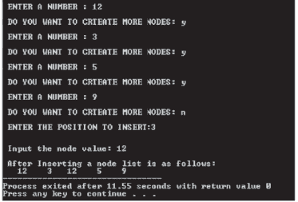

## 7.4.5 /* 当节点信息已知且插入到某个指定节点之后时向简单链表插入一个节点 */

```cpp
#include<iostream>
#include<conio.h>
#include<stdlib.h>
using namespace std;
struct link
{
    int info;
    struct link *next;
};
struct link start, *first, *New,*before;
/* Function main */
void create(struct link *);
void display(struct link *);
void insert(struct link *);

int main()
{
    struct link *node;
    create(node);
    insert(node);
    display(node);
}
```

```cpp
void create(struct link *node) /*LOGIC TO CREATE A LINK LIST*/
{
    char ch='y';
    start.next = NULL;
    node = &start;    /* Point to the start of the list */
    while(ch =='y' || ch =='Y')
    {
        node->next = (struct link * )
        malloc(sizeof(struct link));
        node = node->next;
        cout<<"\n ENTER A NUMBER : ";
        cin>>node->info;
        node->next = NULL;
        cout<<"\n DO YOU WANT TO CREATE MORE NODES : ";
        cin>>ch;
    }
}
```

```cpp
void display(struct link *node) /*DISPLAY THE LINKED LIST*/
{
    node = start.next;
    cout<<"\n After Inserting a node list is as follows:\n";
    while (node)
    {
        cout<<setw(5)<<node->info;
        node = node->next;
    }
}
```

```cpp
void insert(struct link *node)
{
    int no= 0;
    int ins;
    node = start.next;
    before = &start;
    cout<<" \n Input value node the node you want to insert :";
    fflush(stdin);
    cin>>ins;
    while(node)
    {
        if(node->info <= ins)
        {
            New = (struct link *) malloc(sizeof(struct link));
            New->next = node;
            before->next = New;
            New->info = ins;
            break ;
        }
        else
        {
            node = node->next;
            before= before->next;
            no++;
        }
    }
}
```

### 输出

```
ENTER A NUMBER : 12
DO YOU WANT TO CREATE MORE NODES: y
ENTER A NUMBER : 32
DO YOU WANT TO CREATE MORE NODES: y
ENTER A NUMBER : 85
DO YOU WANT TO CREATE MORE NODES: y
ENTER A NUMBER : 95
DO YOU WANT TO CREATE MORE NODES: y
ENTER A NUMBER : 4
DO YOU WANT TO CREATE MORE NODES: n
Input value node the node you want to insert:95
After Inserting a node list is as follows:
95 12 32 85 95 4
Process exited after 12.81 seconds with return value 0
Press any key to continue . . .
```

## 7.4.6 /* 从简单链表中删除第一个节点 */

```cpp
#include<iostream>
#include<conio.h>
#include<stdio.h>
using namespace std;
struct link
{
    int info;
    struct link *next;
};
struct link start,*previous,*node;
/* Function main */
void create(struct link *);
void display(struct link *);
void delet(struct link *);
int main()
{
    create(node);
    printf("\n THE CREATED LINKED LIST IS :\n");
    display(node);
    delet(node);
    printf("\n AFTER DELETING THE FIRST NODE THE LINKED LIST IS ");
    display(node);
}
```

```cpp
void create(struct link *node) /*LOGIC TO CREATE A LINK LIST*/
{
    char ch='y';
    start.next = NULL;
    node = &start; /* Point to the start of the list */
    while(ch =='y' || ch=='Y')
    {
        node->next = (struct link *) malloc(sizeof(struct link));
        node = node->next;
        cout<<"\n ENTER A NUMBER : ";
        cin>>node->info;
        node->next = NULL;
        cout<<"\n DO YOU WANT TO CREATE MORE NODES: ";
        cin>>ch;
    }
}
```

```cpp
void display(struct link *node)
{
    node = start.next; /*DISPLAY THE LINKED LIST*/
    while (node)
    {
        cout<<setw(5)<<node->info;
        node = node->next;
    }
}
```

```cpp
void delet(struct link *node)
{
    node = start.next;
    previous = &start;
    if (node == NULL)
        cout<<"\n Under flow";
    else
    {
        previous->next = node->next;
        free(node);
    }
}
```

### 输出

```
ENTER A NUMBER : 12
DO YOU WANT TO CREATE MORE NODES: Y
ENTER A NUMBER : 34
DO YOU WANT TO CREATE MORE NODES: Y
ENTER A NUMBER : 65
DO YOU WANT TO CREATE MORE NODES: Y
ENTER A NUMBER : 32
DO YOU WANT TO CREATE MORE NODES: N
THE CREATED LINKED LIST IS :
12 34 65 32
AFTER DELETING THE FIRST NODE: THE LINKED LIST IS 34 65 32
Process exited after 62.4 seconds with return value 0
Press any key to continue . . .
```

## 7.4.7 /* 从简单链表中删除最后一个节点 */

```cpp
#include<iostream>
#include<conio.h>
#include<stdlib.h>
using namespace std;
struct link
{
    int info;
    struct link *next;
};
struct link start,*previous,*node;
/* Function main */
void create(struct link *);
void display(struct link *);
void delete(struct link *);
int main()
{
    create(node);
    printf("\n THE CREATED LINKED LIST IS :\n");
    display(node);
    delete(node);
    printf("\n AFTER DELETING THE LAST NODE THE LINKED LIST IS ");
    display(node);
}
void create(struct link *node) /*LOGIC TO CREATE A LINK LIST*/
{


```cpp
char ch='y';
start.next = NULL;
node = &start; /* Point to the start of the list */
while( ch == 'y' || ch == 'Y' )
{
    node->next = (struct link* ) malloc(sizeof(struct link));
    node = node->next;
    cout<<"\n ENTER A NUMBER : ";
    cin>>node->info;
    node->next = NULL;
    cout<<"\n DO YOU WANT TO CREATE MORE NODES : ";
    cin>>ch;
}
}

void display(struct link *node)
{
    node = start.next; /*DISPLAY THE LINKED LIST*/
    while (node)
    {
        cout<<setw(5)<<node->info;
        node = node->next;
    }
}

void delet(struct link *node)
{
    int n = 0;
    node = start.next;
    previous = &start;
    if (node == NULL)
        cout<<"\n Underflow";
    else
    {
        while(node)
        {
            node = node->next;
            previous = previous->next;
            n++;
        }
    }
    node = start.next;
    previous = &start;
    while(n != 1)
    {
        node = node->next;
        previous = previous->next;
        n --;
    }
}

previous->next = node->next;
free(node);
}
```

### 输出

```
ENTER A NUMBER : 43
DO YOU WANT TO CREATE MORE NODES: Y
ENTER A NUMBER : 65
DO YOU WANT TO CREATE MORE NODES: Y
ENTER A NUMBER : 87
DO YOU WANT TO CREATE MORE NODES: Y
ENTER A NUMBER : 23
DO YOU WANT TO CREATE MORE NODES: Y
ENTER A NUMBER : 44
DO YOU WANT TO CREATE MORE NODES: N
THE CREATED LINKED LIST IS :
AFTER DELETING THE LAST NODE THE LINKED LIST IS   43 65 87 23
Process exited after 15.62 seconds with return value 8
Press any key to continue . . .
```

## 7.4.8 当节点编号已知时从简单链表中删除节点

```cpp
#include<iostream>
#include<conio.h>
#include<stdlib.h>
using namespace std;
struct link
{
    int info;
    struct link *next;
};
struct link start, *previous,*node;
/* Function main */
void create(struct link *);
void display(struct link *);
void delet(struct link *);

int main()
{
    create(node);
    printf("\n THE CREATED LINKED LIST IS :\n");
    display(node);
    delet(node);
    printf("\n AFTER DELETION THE LINKED LIST IS ");
    display(node);
}

void create(struct link *node) /*LOGIC TO CREATE A LINK LIST*/
{
    char ch='y';
    start.next = NULL;
    node = &start;     /* Point to the start of the list */
    while(ch =='y' || ch =='Y')
    {
        node->next = (struct link *) malloc(sizeof(struct link));
        node = node->next;
        cout<<"\n ENTER A NUMBER : ";
        cin>>node->info;
        node->next = NULL;
        cout<<"\n DO YOU WANT TO CREATE MORE NODES: ";
        cin>>ch;
    }
}

void display(struct link *node) /*DISPLAY THE LINKED LIST*/
{
    node = start.next;
    while (node)
    {
        cout<<setw(5)<<node->info;
        node = node->next;
    }
}

void delet(struct link *node)
{
    int n = 1;
    int pos;
    node = start.next;
    previous = &start;
    printf("\n Input node number you want to delete:");
    scanf(" %d", &pos);
    while(node)
    {
        if(n == pos)
        {
            previous->next = node->next;
            free(node);
            break ;
        }
        else
        {
            node = node->next;
            previous = previous->next;
        }
        n++;
    }
}
```

### 输出

```
ENTER A NUMBER : 45
DO YOU WANT TO CREATE MORE NODES: Y
ENTER A NUMBER : 32
DO YOU WANT TO CREATE MORE NODES: Y
ENTER A NUMBER : 95
DO YOU WANT TO CREATE MORE NODES: Y
ENTER A NUMBER : 25
DO YOU WANT TO CREATE MORE NODES: N
THE CREATED LINKED LIST IS :
45 32 95 25
Input node number you want to delete:3
AFTER DELETION THE LINKED LIST IS 45 32 25
Process exited after 14.11 seconds with return value 0
Press any key to continue . . .
```

## 7.4.9 当给定节点信息时从简单链表中删除节点

```cpp
#include<iostream>
#include<conio.h>
#include<stdio.h>
using namespace std;
struct link
{
    int info;
    struct link *next;
};
struct link start, *previous,*node;
/* Function main */
void create(struct link *);
void display(struct link *);
void delet(struct link *);

int main()
{
    create(node);
    printf("\n THE CREATED LINKED LIST IS :\n");
    display(node);
    delet(node);
    printf("\n AFTER DELETION THE LINKED LIST IS ");
    display(node);
}

void create(struct link *node) /*LOGIC TO CREATE A LINK LIST*/
{
    char ch='y';
    start.next = NULL;
    node = &start;     /* Point to the start of the list */
    while(ch == 'y' || ch=='Y')
    {
        node->next = (struct link *) malloc(sizeof(struct link));
        node = node->next;
        cout<<"\n ENTER A NUMBER : ";
        cin>>node->info;
        node->next = NULL;
        cout<<"\n DO YOU WANT TO CREATE MORE NODES: ";
        cin>>ch;
    }
}

void display(struct link *node) /*DISPLAY THE LINKED LIST*/
{
    node = start.next;
    while (node)
    {
        cout<<setw(5)<<node->info;
        node = node->next;
    }
}

void delet(struct link *node)
{
    int non = 1;
    int dnode;
    node = start.next;
    previous = &start;
    printf("\n Input information of a node you want to delete : ");
    scanf("%d", &dnode);
    while(node)
    {
        if(node->info == dnode)
        {
            printf("\n Position of the information in the list is : %d", non);
            previous->next = node->next;
            free(node);
            break ;
        }
        else
        {
            node = node->next;
            previous = previous->next;
            non++;
        }
    }
}
```

### 输出

```
ENTER A NUMBER : 25
DO YOU WANT TO CREATE MORE NODES: Y
ENTER A NUMBER : 54
DO YOU WANT TO CREATE MORE NODES: Y
ENTER A NUMBER : 76
DO YOU WANT TO CREATE MORE NODES: Y
ENTER A NUMBER : 89
DO YOU WANT TO CREATE MORE NODES: Y
ENTER A NUMBER : 32
DO YOU WANT TO CREATE MORE NODES: N
THE CREATED LINKED LIST IS :
25 54 76 89 32
Input information of a node you want to delete: 54
Position of the information in the list is : 2
AFTER DELETION THE LINKED LIST IS 25 76 89 32
Process exited after 15.22 seconds with return value 0
Press any key to continue . . .
```

## 搜索算法

```
struct link
{
    int info;
    struct link *next;
};
SEARCH(START,NODE,NO) [START IS THE STRUCTURE TYPE OF VARIABLE]
[NODE IS THE STRUCTURE TYPE OF POINTER VARIABLE]
[NO IS THE INFORMATION TO SEARCH]
STEP-1: NODE := NEXT[START]
STEP-2: SET COUNT := 1
SET OPT := 0
STEP-3: REPEAT WHILE(NODE != NULL)
IF(COUNT = NO) THEN:
WRITE : INFO[NODE]
WRITE : "IS FOUND AT "
WRITE : COUNT
WRITE : "POSITION"
OPT := 1
RETURN
ELSE
NODE := NEXT[NODE]
COUNT := COUNT + 1
[END OF IF]
[END OF LOOP]
STEP-4: IF (OPT != 1)
WRITE : "THE NUMBER IS NOT FOUND"
[END OF IF]
STEP-5: RETURN
```

## 7.4.10 在已知信息的情况下在简单链表中搜索节点

```cpp
#include<iostream>
#include<conio.h>
#include<stdlib.h>
using namespace std;
struct link
{
    int info;
    struct link *next;
};
struct link start, *new1,*node;
/* Function main */
void create(struct link *);
void display(struct link *);
void search(struct link *);

int main()
{
    create(node);
    printf("\n THE CREATED LINKED LIST IS :\n");
    display(node);
    search(node);
}

void create(struct link *node) /*LOGIC TO CREATE A LINK LIST*/
{
    char ch='y';
    start.next = NULL;
    node = &start;     /* Point to the start of the list */
    while(ch =='y' || ch=='Y')
    {
        node->next = (struct link* ) malloc(sizeof(struct link));
        node = node->next;
        cout<<"\n ENTER A NUMBER : ";
        cin>>node->info;
        node->next = NULL;
        cout<<"\n DO YOU WANT TO CREATE MORE NODES : ";
        cin>>ch;
    }
}

void display(struct link *node) /*DISPLAY THE LINKED LIST*/
{
    node = start.next;
    while (node)
    {
        cout<<setw(5)<<node->info;
        node = node->next;
    }
}

void search(struct link *node)
{
    int val;
    int flag = 0,n=0;
    node = start.next;
    cout<<"\n ENTER THE NUMBER TO SEARCH";
    cin>>val;
    if (node == NULL)
    {
        cout<<"\n List is empty";
    }
    while(node)
    {
        if ( val == node->info )
        {
            cout<<"\n THE NUMBER "<<val<<" IS AT "<<n<<" POSITION IN THE LIST";
            node = node->next;
            flag = 1;
        }
    }
}
```


```
    break;
}
else
    node = node->next;
}
n++;
}
if(!flag)
{
    cout<<"\n THE NUMBER %d IS NOT FOUND IN THE LIST"<<val;
}
}
```

### 输出

```
ENTER A NUMBER : 25
DO YOU WANT TO CREATE MORE NODES : y
ENTER A NUMBER : 3
DO YOU WANT TO CREATE MORE NODES : y
ENTER A NUMBER : 85
DO YOU WANT TO CREATE MORE NODES : y
ENTER A NUMBER : 95
DO YOU WANT TO CREATE MORE NODES : y
ENTER A NUMBER : 24
DO YOU WANT TO CREATE MORE NODES : n
THE CREATED LINKED LIST IS :
25 3 85 95 24
ENTER THE NUMBER TO SEARCH:24
THE NUMBER 24 IS AT 5 POSITION IN THE LIST
Process exited after 45.11 seconds with return value 0
Press any key to continue . . .
```

## 7.4.11 按升序对链表进行排序

```cpp
#include<iostream>
#include<conio.h>
#include<stdlib.h>
using namespace std;
struct link
{
    int info;
    struct link *next;
};
struct link start, *New,*node,*temp;
/* Function main */
void create(struct link *);
void display(struct link *);
void sort(struct link *);

int main()
{
    create(node);
    cout<<"\n THE CREATED LINKED LIST IS :\n";
    display(node);

    sort(node);
    cout<<"\n AFTER SORT THE LINKED LIST IS :\n";
    display(node);

}
```

```cpp
void create(struct link *node) /*LOGIC TO CREATE A LINK LIST*/
{
    char ch='y';
    start.next = NULL;
    node = &start; /* Point to the start of the list */
    while(ch =='y' || ch=='Y')
    {
        node->next = (struct link *) malloc(sizeof(struct link));
        node = node->next;
        cout<<"\n ENTER A NUMBER : ";
        cin>>node->info;
        node->next = NULL;
        cout<<"\n DO YOU WANT TO CREATE MORE NODES : ";
        cin>>ch;
    }
}
```

```cpp
void display(struct link *node)
{
    node = start.next; /*DISPLAY THE LINKED LIST*/
    while (node)
    {
        cout<<setw(5)<<node->info;
        node = node->next;
    }
}
```

```cpp
void sort(struct link *node)
{
    for(New = start.next; New->next != NULL; New = New->next)
    {
        for(temp = New->next; temp != NULL; temp = temp->next)
        {
            if(New->info > temp->info)
            {
                int t = New->info;
                New->info = temp->info;
                temp->info = t;
            }
        }
    }
}
```

### 输出

```
ENTER A NUMBER : 58
DO YOU WANT TO CREATE MORE NODES : y
ENTER A NUMBER : 7
DO YOU WANT TO CREATE MORE NODES : y
ENTER A NUMBER : 65
DO YOU WANT TO CREATE MORE NODES : y
ENTER A NUMBER : 3
DO YOU WANT TO CREATE MORE NODES : y
ENTER A NUMBER : 11
DO YOU WANT TO CREATE MORE NODES : n
THE CREATED LINKED LIST IS :
58 7 65 3 11
AFTER SORT THE LINKED LIST IS :
3 7 11 58 65
Process exited after 59.188 seconds with return value 0
Press any key to continue . . .
```

## 7.4.12 反转链表

```cpp
#include <stdio.h>
#include <alloc.h>
struct link
{
    int info;
    struct link *next;
};
int i, no;
struct link *start, *pnode, *previous, *current, *counter;
void display(struct link *);
void create(struct link *);
struct link * reverse(struct link *);
void main()
{
    struct link *node;
    struct link *p;
    node = (struct link *) malloc(sizeof(struct link));
    create(node);
    printf("\n Original List is as follows:\n");
    display(node);
    p = (struct link *)malloc(sizeof(struct link));
    p = reverse(node);
    printf("\n After reverse operation list is as follows:\n");
    display(p);
}
struct link * reverse(struct link *start)
{
    current = start;
    previous = NULL ;
    while( current != NULL )
    {
        counter = (struct link*)malloc(sizeof(struct link));
        counter = current->next ;
        current->next = previous ;
        previous = current ;
        current = counter ;
    }
    start = previous;
    return(start);
}
void display(struct link *node)
{
    while ( node != NULL)
    {
        printf( "%d", node->info );
        node = node->next;
    }
}
void create( struct link *node)
{
    int i;
    int no;
    printf( "\n Input the number of nodes you want to create." );
    scanf( "%d", &no );
    for ( i = 0; i < no ; i++)
    {
        printf( "\nEnter the number" );
        scanf( "%d", &node->info );
        node->next = ( struct link * ) malloc( sizeof( struct link ) );
        if ( i == no - 1)
            node->next = NULL;
        else
            node = node->next;
    }
    node->next = NULL;
}
```

## 7.4.13 使用链表的学生数据程序

```cpp
#include<iostream>
#include<fstream>
#include<stdlib.h>
#include<conio.h>
using namespace std;
struct student
{
    string fname,lname;
    int yob,mob,dob;
    char sex;
    float mark;
    struct student *next;
};
struct student start,*last,*New;
//method declarations
void insert(struct student *);
void create(struct student *);
void display(struct student *);
void average(struct student *);
void maximum(struct student *);
void search(struct student *);

//driver program
int main()
{
    struct student *node;
    create(node);    //create the link list
    int opt;
    //infinite loop
    while(1)
    {
        //display the menu
        cout<<endl<<"1. Add Friend \n2. Display friends\n8. Print Average age of friends\n 9. Print Male Friends\n0. Exit\n";
        cout<<"Enter choice";
        cin>>opt;    //read the choice
        //call to the corresponding methods according to the users input
        if(opt==1)
        insert(node);
        else
        if(opt==2)
        display(node);
        else
        if(opt==8)
        average(node);
        else
        if(opt==9)
        printmale(node);
        else
        if(opt==0)
        exit(0);
        else
        cout<<endl<<"Invalid choice";
    }
}
//create method read the data from file and stores it into link list
void create(struct student *node)
{
    int n;
    char ch;
    string name;
    node = &start;    //* Point to the start of the list */
    while(1)
    {
        //allocate memory for a node of list
        node->next = (struct student * ) malloc(sizeof(struct student));
        node = node->next; //shift the node to next node
        cout<<endl<<"Enter the first name";
        cin>>name;
        node->fname=name;
        cout<<endl<<"Enter the last name";
        cin>>name;
        node->lname=name;
        cout<<endl<<"Enter the year of birth";
        cin>>yob;
        node->yob=yob;
        cout<<endl<<"Enter the month of birth";
        cin>>mob;
        node->mob=mob;
        cout<<endl<<"Enter the day of birth";
        cin>>dob;
        node->dob=dob;
        cout<<endl<<"Enter the sex[m/f]";
        cin>>ch;
        node->sex=ch;
        node->next = NULL;//assign NULL to end
        cout<<endl<<"Do you want to create more nodes [y/n]";
        cin>>ch;
        if(ch=='n' || ch=='N')
        break;
    }
}

//insert a new node
void insert(struct student *node)
{
    string name;
    int n;
    char ch;
    node = start.next;
    last = &start;
    while(node)//loop will continue till end
    {
        node = node->next;
        last = last->next;
    }
    if(node == NULL)
    {
        //allocate new memory for new node
        New = (struct student* ) malloc(sizeof(struct student));
        //logic for insertion
        New->next = node ;
        last->next = New;
        //ask data to user
        cout<<endl<<"Enter the first name";
        cin>>name;
        New->fname=name;
        cout<<endl<<"Enter the last name";
        cin>>name;
        New->lname=name;
        cout<<endl<<"Enter the year of birth";
        cin>>yob;
        New->yob=yob;
        cout<<endl<<"Enter the month of birth";
        cin>>mob;
        New->mob=mob;
        cout<<endl<<"Enter the day of birth";
        cin>>dob;
        New->dob=dob;
        cout<<endl<<"Enter the sex[m/f]";
        cin>>ch;
        New->sex=ch;
    }
}

//method to display the data
void display(struct student *node)
{
    node = start.next;//points to first node oflist
    while (node)//loop will continue till end of list
    {
        //print the data
        cout<<endl<<node->fname<<"\t"<<node->lname<<"\t"<<node->yob<<"\t"<<node->mob<<"\t"<<node->dob<<"\t"<<node->sex;
        node = node->next;//shift the pointer to next node
    }
}

void printmale(struct student *node)
{
    node = start.next;//points to first node oflist
    while (node)//loop will continue till end of list
    {
        if(node->sex=='m' || node->sex=='M')
        {
            //print the data
            cout<<endl<<node->fname<<"\t"<<node->lname<<"\t"<<node->yob<<"\t"<<node->mob<<"\t"<<node->dob<<"\t"<<node->sex;
            node = node->next;//shift the pointer to next node
        }
    }
}

void average(struct student *node)
{
}


```cpp
float avg;
int sum=0,c=0;
node = start->next;//points to first node of list
while (node)//loop will continue till end of list
{
    c++;
    sum=sum+ node->age;
    node = node->next;//shift the pointer to next node
}
avg=(float)sum/c;
```

```cpp
void youngest(struct student *node)
{
    int minyear,minmon,minday,c=0;
    string name1,name2;
    node = start->next;//points to first node of list
    minyear=node->yob;
    minmon=node->mob;
    minday=node->dob;
    while (node)//loop will continue till end of list
    {
        if(minyear>node->yob)
        {
            name1=node->fname;
            name2=node->lname;
        }
        if(minyear == node->yob && minmon > node->mob)
        {
            name1=node->fname;
            name2=node->lname;
        }
        if(minyear == node->yob && minmon == node->mob &&
        minday >node->dob)
        {
            name1=node->fname;
            name2=node->lname;
        }
    node = node->next;//shift the pointer to next node
    }
cout<<endl<<"Youngest Friend is "<<name1<<" "<<name2;
}
```

```cpp
void oldest(struct student *node)
{
    int minyear,minmon,minday,c=0;
    string name1,name2;
    node = start->next;//points to first node of list
    minyear=node->yob;
    minmon=node->mob;
    minday=node->dob;

    while (node)//Loop will continue till end of list
    {
        if(minyear < node->yob)
        {
            name1=node->fname;
            name2=node->lname;
        }
        if(minyear == node->yob && minmon < node->mob)
        {
            name1=node->fname;
            name2=node->lname;
        }
        if(minyear == node->yob && minmon == node->mob &&
        minday < node->dob)
        {
            name1=node->fname;
            name2=node->lname;
        }
        node = node->next;//shift the pointer to next node
    }
cout<<endl<<"Oldest Friend is "<<name1<<"\t"<<name2;
}
```

## 输出

```
1. Display Student Details
2. Calculate average of all student marks
3. Search for a particular student's mark
4. Find Maximum
5. Add a new student
6. Quit program
Enter choice
John   101561724   78
Andy   101072354   67
Bob    101452731   54
Sam    202673489   23
Peter  101345782   98
Mathew 101672341   78
Adam   101872354   80
John   101722222   75
Sandy  101673423   34
Amanda 101782314   65

1. Display Student Details
2. Calculate average of all student marks
3. Search for a particular student's mark
4. Find Maximum
5. Add a new student
6. Quit program
Enter choice
Average : 66.40

1. Display Student Details
2. Calculate average of all student marks
3. Search for a particular student's mark
4. Find Maximum
5. Add a new student
6. Quit program
Enter choice
Enter the id of student to know the mark 101072354
The mark of student with ID 101072354 is 80.00

1. Display Student Details
2. Calculate average of all student marks
3. Search for a particular student's mark
4. Find Maximum
5. Add a new student
6. Quit program
Enter choice
Peter with ID 101345782 secures highest mark as 98.00
```

1. 显示学生详细信息
2. 计算所有学生成绩的平均值
3. 搜索特定学生的成绩
4. 查找最大值
5. 添加新学生
6. 退出程序
输入选择 5
输入姓名 Sonu
输入 ID 181782876
输入成绩 95
1. 显示学生详细信息
2. 计算所有学生成绩的平均值
3. 搜索特定学生的成绩
4. 查找最大值
5. 查找最小值
6. 退出程序
输入选择 1
John 101561724 78.00
Riya 101456781 67.00
Babara 181452731 54.00
Sam 202673480 23.00
Ravi 181672482 60.00
Mathew 181672431 90.00
Riya 101456781 67.00
Sandra 181692312 75.00
Sany 181672423 34.00
Sonu 181782876 95.00
Ravi 181672482 60.00
1. 显示学生详细信息
2. 计算所有学生成绩的平均值
3. 搜索特定学生的成绩
4. 查找最大值
5. 查找最小值
6. 退出程序
输入选择 6
平均值是：69.00
1. 显示学生详细信息
2. 计算所有学生成绩的平均值
3. 搜索特定学生的成绩
4. 查找最大值
5. 查找最小值
6. 退出程序
输入选择 6
进程在 98.42 秒后退出，返回值为 0
按任意键继续...

## 7.5 双向链表

双向链表的设计方式是使列表中的每个节点都能存储两个地址部分，一个是其下一个节点，另一个是其前一个节点。

双向链表节点的一般格式如下

```cpp
Struct tagname
{
Data type member1;
Data type member2;
................
................
Data type membern;
Struct link *var1,*var2;
}
```

### 示例：

```cpp
Struct Dlink
{
int info;
struct Dlink *next,*prev ;
};
```

### 图形表示

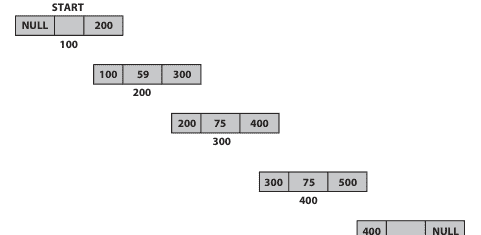

### 创建逻辑

```cpp
Struct link
{
int info;
struct link *next,*prev;
};

Struct link start,*node;
Node=&start;
Allocate a memory to node->next
Node->next ->prev = node
Node = node->next
Node->next = NULL
```

### 创建双向链表的算法
CREATE(START,NODE)
STEP-1 : NEXT[START]:=NULL
PREV[START]:=NULL
STEP-2 : 为 NEXT[NODE] 分配内存
PREV[NEXT][NODE] := NODE
NODE := NEXT[NODE]
NEXT[NODE] := NULL
STEP-3 : 输入 : INFO[NODE]
STEP-4 : 重复步骤-2 和 步骤-3 以创建更多节点
STEP-5 : 返回

### 双向链表遍历算法
TRAVERSE(START,NODE)
STEP-1 : NODE := NEXT[START]
STEP-2 : 输出 : "正向遍历"
STEP-3 : 重复 WHILE (NEXT[NODE] != NULL)
输出 : INFO[NODE]
NODE := NEXT[NODE]
[循环结束]
STEP-4 : 输出 : "逆向遍历"
STEP-5 : 重复 WHILE (PREV[NODE]!=NULL)
输出 : INFO[NODE]
NODE := PREV[NODE]
[循环结束]
STEP-6 : 返回

### 在开头插入节点的算法
INSBEG(START,NODE)
STEP-1 : NODE := NEXT[START]
STEP-2 : 为 NEW 分配内存
STEP-3 : PREV[NEW] := PREV[NODE]
NEXT[NEW] := NODE
PREV[NODE] := NEW
NEXT[PREV[NODE]] := NEW
STEP-4 : 输入 : INFO[NEW]
STEP-5 : 返回

### 在末尾插入节点的算法
INLAST(START,NODE)
STEP-1: NODE. := NEXT[START]
STEP-2: 重复 WHILE (NEXT[NODE]!=NULL)
NODE. = NEXT[NODE]
[循环结束]
STEP-3: 为 NEW 分配内存
STEP-4: PREV[NEW] := PREV[NODE]
NEXT[NEW] := NODE
NEXT[PREV[NODE]] := NEW
PREV[NODE] :=NEW
STEP-5: 输入 : INFO[NEW]
STEP-6: 返回

### 当节点编号已知时插入节点的算法
INSNODE(START,NODE,NO)
STEP-1: NODE. := NEXT[START]
STEP-2: COUNT := 1
STEP-3: 重复 WHILE (NEXT[NODE]!=NULL)
IF(COUNT = NO ) THEN:
为 NEW 分配内存
PREV[NEW] := PREV[NODE]
NEXT[NEW] := NODE
NEXT[PREV[NODE]] := NEW
PREV[NODE] :=NEW
ELSE:
NODE. := NEXT[NODE]
COUNT := COUNT+1
[结束 IF]
[结束循环]
STEP-4: 输入 : INFO[NEW]
STEP-5: 返回

### 当信息已知时插入节点的算法

```cpp
INSINFO(START,NODE,VAL)
STEP-1 : NODE := NEXT[START]
STEP-2 : REPEAT WHILE (NEXT[NODE]!=NULL)
IF(INFO[NODE] <=VAL) THEN:
    ALLOCATE A MEMORY TO NEW
    PREV[NEW] := PREV[NODE]
    NEXT[NEW] := NODE
    NEXT[PREV[NODE]] := NEW
    PREV[NODE] :=NEW
ELSE:
    NODE := NEXT[NODE]
[END OF IF]
[END OF LOOP]
STEP-3 : INFO[NEW] :=VAL
STEP-4 : RETURN
```

### 删除

### 在开头删除节点的算法

```cpp
DELBEG(START,NODE)
STEP-1 : NODE := NEXT[START]
STEP-2 : WRITE : INFO[NODE]
STEP-3 : NEXT[PREV[NODE]] := NEXT[NODE]
PREV[NEXT[NODE]] := PREV[NODE]
STEP-4: FREE(NODE)
STEP-5 : RETURN
```

### 在末尾删除节点的算法

```cpp
DELAST(START,NODE)
STEP-1 : NODE := NEXT[START]
STEP-2 : COUNT := 1
STEP-3: REPEAT WHILE (NEXT[NODE]!=NULL)
    NODE := NEXT[NODE]
    COUNT := COUNT+1
[END OF LOOP]
STEP-4 : NODE := NEXT[START]
STEP-5 : REPEAT WHILE (COUNT != 1)
    NODE := NEXT[NODE]
    COUNT := COUNT-1
    [END OF LOOP]
STEP-6 : WRITE : INFO[NODE]
STEP-7 : NEXT[PREV[NODE]] := NEXT[NODE]
    PREV[NEXT[NODE]] := PREV[NODE]
STEP-8 : FREE(NODE)
STEP-9 : RETURN
```

或

```cpp
DELAST(START,NODE)
STEP-1 : NODE := NEXT[START]
STEP-2 : REPEAT WHILE (NEXT[NODE]!=NULL)
    NODE := NEXT[NODE]
    COUNT := COUNT+1
    [END OF LOOP]
STEP-3 : NODE := PREV[NODE]
STEP-4 : WRITE : INFO[NODE]
STEP-5 : NEXT[PREV[NODE]] := NEXT[NODE]
    PREV[NEXT[NODE]] := PREV[NODE]
STEP-6 : FREE(NODE)
STEP-7 : RETURN
```

### 当节点编号已知时删除节点的算法

```cpp
INSNODE(START,NODE,NO)
STEP-1 : NODE := NEXT[START]
STEP-2 : COUNT := 1
STEP-3 : REPEAT WHILE (NEXT[NODE]!=NULL)
    IF(COUNT = NO ) THEN:
        WRITE : INFO[NODE]
        NEXT[PREV[NODE]] := NEXT[NODE]
        PREV[NEXT[NODE]] := PREV[NODE]
        FREE(NODE)
```


```
ELSE:
NODE := NEXT[NODE]
COUNT := COUNT+1
[END OF IF]
[END OF LOOP]
STEP-4 : RETURN

ALGORITHM FOR INSERTION OF A NODE WHEN INFORMATION IS KNOWN
INSINFO(START,NODE,VAL)
STEP-1 : NODE := NEXT[START]
STEP-2 : REPEAT WHILE [NEXT[NODE]!=[NULL]
IF(INFO[NODE] = VAL) THEN:
    WRITE : INFO[NODE]
    NEXT[PREV[NODE]] := NEXT[NODE]
    PREV[NEXT[NODE]] := PREV[NODE]
    FREE(NODE)
ELSE:
    NODE := NEXT[NODE]
[END OF IF]
[END OF LOOP]
STEP-3 : RETURN
```

## 7.6 双向链表上的程序

### 7.6.1 /* 创建双向链表 */

```cpp
#include <iostream>
#include <stdlib.h>
using namespace std;
struct link
{
    int info;
    struct link *next;
    struct link *previous;
};
struct link start;
void create (struct link *);
void display (struct link *);

void create(struct link *node)
{
    char ch='y';
    start.next = NULL; /* Empty list */
    start.previous = NULL;
    node = &start; /* Point to the start of the list */
    while( ch == 'y' || ch=='Y')
    {
        node->next = (struct link *)
        malloc(sizeof(struct link));
        node->next->previous = node;
        node = node->next;
        cout<<"\n ENTER THE NUMBER";
        fflush(stdin);
        cin>>node->info;
        node->next = NULL;
        fflush(stdin);
        cout<<"\nDO YOU WANT TO CREATE MORE NODES[Y/N] ";
        cin>>ch;
    }
}

void display (struct link *node)
{
    node = start.next;
    cout << endl << "Link list elements printing in Forward Direction\n";
    while(node->next)
    {
        cout<<setw(5)<<node->info;
        node = node->next;
    }
    cout<<setw(5)<<node->info;
    cout<<endl<<"Link list elements printing in Backward Direction\n";
    do {
        cout<<setw(5)<<node->info;
        node = node->previous;
    } while (node->previous);
}

int main()
{
    struct link *node;
    create(node);
    cout<<"\n AFTER CREATING THE LINKED LIST IS \n";
    display(node);
}
```

### 输出

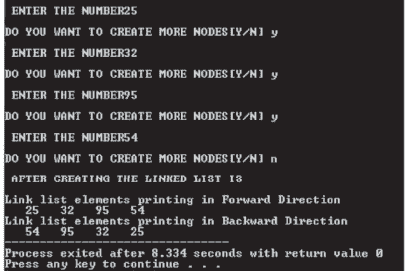

### 7.6.2 /* 在双向链表中插入第一个节点 */

```cpp
#include <iostream>
#include <stdlib.h>
using namespace std;
struct link
{
    int info;
    struct link *next;
    struct link *previous;
};
struct link start,*New;
void create (struct link *);
void display (struct link *);
void insert(struct link *);

void create(struct link *node)
{
    char ch='y';
    start.next = NULL; /* Empty list */
    start.previous = NULL;
    node = &start; /* Point to the start of the list */
    while ( ch == 'y' || ch=='Y')
    {
        node->next = (struct link *)
        malloc(sizeof(struct link));
        node->next->previous = node;
        node = node->next;
        cout<<"\n ENTER THE NUMBER";
        fflush(stdin);
        cin>>node->info;
        node->next = NULL;
        fflush(stdin);
        cout<<"\nDO YOU WANT TO CREATE MORE NODES[Y/N] ";
        fflush(stdin);
        cin>>ch;
    }
}

void display (struct link *node)
{
    node = start.next;
    cout<<endl<<"Link list elements printing in Forward Direction\n";
    while(node->next)
    {
        cout<<setw(5)<<node->info;
        node = node->next;
    }
    cout<<setw(5)<<node->info;
    cout<<endl<<"Link list elements printing in Backward Direction\n";
    do {
        cout<<setw(5)<<node->info;
        node = node->previous;
    } while (node->previous);
}

void insert(struct link *node)
{
    node = start.next;
    New = (struct link *) malloc(sizeof(struct link ));
    fflush(stdin);
    cout<<"\n Input the first node value: ";
    cin>>New->info;
    New->next = node;
    New->previous = node->previous;
    node->previous->next = New;
    node->previous = New;
}

int main()
{
    struct link *node;
    create(node);
    cout<<"\n AFTER CREATING THE LINKED LIST IS \n";
    display(node);
    insert(node);
    cout<<"\n List after insertion of first node \n";
    display(node);
}
```

### 输出

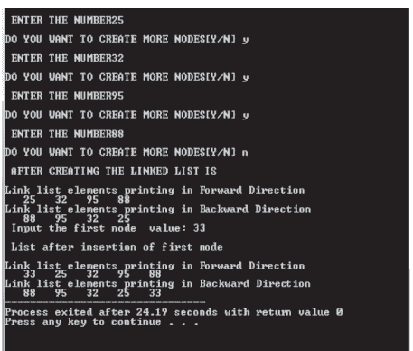

### 7.6.3 /* 当节点编号已知时在双向链表中插入节点 */

```cpp
#include <iostream>
#include <iomanip>
#include <stdlib.h>
using namespace std;
struct link
{
    int info;
    struct link *next;
    struct link *previous;
};
struct link start,*New;
void create (struct link *);
void display (struct link *);
void insert(struct link *);

void create(struct link *node)
{
    char ch='y';
    start.next = NULL;    /* Empty list */
    start.previous = NULL;
    node = &start;    /* Point to the start of the list */
    while( ch == 'y' || ch=='Y')
    {
        node->next = (struct link *)
        malloc(sizeof(struct link));
        node->next->previous = node;
        node = node->next;
        cout<<"\n ENTER THE NUMBER";
        fflush(stdin);
        cin>>node->info;
        node->next = NULL;
        fflush(stdin);
        cout<<"\nDO YOU WANT TO CREATE MORE NODES[Y/N] ";
        cout<<"\n";
        fflush(stdin);
        cin>>ch;
    }
}

void display (struct link *node)
{
    node = start.next;
    cout<<endl<<"Link list elements printing in Forward Direction\n";
    while(node->next)
    {
        cout<<setw(5)<<node->info;
        node = node->next;
    }
    cout<<setw(5)<<node->info;
    cout<<endl<<"Link list elements printing in Backward Direction\n";
    do {
        cout<<setw(5)<<node->info;
        node = node->previous;
    } while (node->previous);
}

void insert(struct link *node)
{
    int n,i;
    cout<<"\nENTER THE NODE NUMBER TO INSERT";
    cin>>n;
    i=1;
    node = start.next;
    New = (struct link *)malloc(sizeof(struct link ));
    fflush(stdin);
    cout<<"\n ENTER THE VALUE TO INSERT ";
    cin>>New->info;
    while(node)
    {
        if(i==n)
        {
        New->next = node;
        New->previous = node->previous;
        node->previous->next = New;
        node->previous = New;
        break;
        }

    else
    {
        node=node->next;
        i++;
        }
    }
}

int main()
{
    struct link *node;
    create(node);
    cout<<"\n AFTER CREATING THE LINKED LIST IS \n";
    display(node);
    insert(node);
    cout<<"\n List after insertion of first node \n";
    display (node);
}
```

### 输出

```
ENTER THE NUMBER25
DO YOU WANT TO CREATE MORE NODES(Y/N) y
ENTER THE NUMBER78
DO YOU WANT TO CREATE MORE NODES(Y/N) y
ENTER THE NUMBER6
DO YOU WANT TO CREATE MORE NODES(Y/N) y
ENTER THE NUMBER32
DO YOU WANT TO CREATE MORE NODES(Y/N) y
ENTER THE NUMBER12
DO YOU WANT TO CREATE MORE NODES(Y/N) n
AFTER CREATING THE LINKED LIST IS
Link list elements printing in Forward Direction
25 78 6 32 12
Link list elements printing in Backward Direction
12 32 6 78 25
ENTER THE NODE NUMBER TO INSERT2
ENTER THE VALUE TO INSERT 100
List after insertion of first node
Link list elements printing in Forward Direction
25 100 78 6 32 12
Link list elements printing in Backward Direction
12 32 6 78 100 25
Process exited after 16.89 seconds with return value 0
Press any key to continue . . .
```

### 7.6.4 /* 当信息已知时在双向链表中插入节点 */

```cpp
#include <iostream>
#include <iomanip>
#include <stdlib.h>
using namespace std;
struct link
{
    int info;
    struct link *next;
    struct link *previous;
};
struct link start,*New;
void create (struct link *);
void display (struct link *);
void insert(struct link *);

void create(struct link *node)
{
    char ch='y';
    start.next = NULL; /* Empty list */
    start.previous = NULL;
    node = &start; /* Point to the start of the list */
    while( ch == 'y' || ch=='Y')
    {
        node->next = (struct link *)
        malloc(sizeof(struct link));
        node->next->previous = node;
        node = node->next;
        cout<<"\n ENTER THE NUMBER";
        fflush(stdin);
        cin>>node->info;
        node->next = NULL;
        fflush(stdin);
        cout<<"\nDO YOU WANT TO CREATE MORE NODES [Y/N] ";
        cin>>ch;
    }
}

void display (struct link *node)
{
    node = start.next;
    cout<<endl<<"Link list elements printing in Forward Direction\n";
    while(node->next)
    {
        cout<<setw(5)<<node->info;
        node = node->next;
    }
    cout<<setw(5)<<node->info;
    cout<<endl<<"Link list elements printing in Backward Direction\n";
    do {
        cout<<setw(5)<<node->info;
```


void insert(struct link *node)
{
    int n;
    cout<<"\nENTER THE INFORMATION VALUE TO INSERT";
    cin>>n;
    node = start.next;
    while(node)
    {
        if(node->info >= n)
        {
            New=(struct link *)malloc(sizeof(struct link));
            New->info = n;
            New->next = node;
            New->previous = node->previous;
            node->previous->next = New;
            node->previous = New;
            break;
        }
        else
        {
            node=node->next;
        }
    }
}

int main()
{
    struct link *node;
    create(node);
    cout<<"\n AFTER CREATING THE LINKED LIST IS \n";
    display(node);
    insert(node);
    cout<<"\n List after insertion of first node \n";
    display (node);
}

# 输出

```
ENTER THE NUMBER 25
DO YOU WANT TO CREATE MORE NODES(Y/N) Y
ENTER THE NUMBER 9
DO YOU WANT TO CREATE MORE NODES(Y/N) Y
ENTER THE NUMBER 35
DO YOU WANT TO CREATE MORE NODES(Y/N) Y
ENTER THE NUMBER 21
DO YOU WANT TO CREATE MORE NODES(Y/N) N
AFTER CREATING THE LINKED LIST IS
Link list elements printing in Forward Direction
25 95 35 21
Link list elements printing in Backward Direction
21 35 95 25
ENTER THE INFORMATION VALUE TO INSERT 50
List after insertion of first node
Link list elements printing in Forward Direction
25 50 95 35 21
Link list elements printing in Backward Direction
21 35 95 50 25
Process exited after 21.42 seconds with return value 0
Press any key to continue . . .
```

## 7.6.5 /* 从双链表中删除第一个节点 */

```
# include <iostream>
#include<iostream.h>
#include <stdlib.h>
using namespace std;
struct link
{
    int info;
    struct link *next;
    struct link *previous;
};
struct link start,*New;
void create (struct link *);
void display (struct link *);
void Delete(struct link *);
```

```
void create(struct link *node)
{
    char ch='y';
    start.next = NULL; /* Empty list */
    start.previous = NULL;
    node = &start; /* Point to the start of the list */
    while( ch == 'y' || ch=='Y')
    {
        node->next = (struct link *) malloc(sizeof(struct link));
        node->next->previous = node;
        node = node->next;
        cout<<"\n ENTER THE NUMBER";
        fflush(stdin);
        cin>>node->info;
        node->next = NULL;
        fflush(stdin);
        cout<<"\nDO YOU WANT TO CREATE MORE NODES[Y/N] ";
        cin>>ch;
    }
}

void display (struct link *node)
{
    node = start.next;
    cout<<endl<<"Link list elements printing in Forward Direction\n";
    while(node->next)
    {
        cout<<setw(5)<<node->info;
        node = node->next;
    }
    cout<<setw(5)<<node->info;
    cout<<endl<<"Link list elements printing in Backward Direction\n";
    do {
        cout<<setw(5)<<node->info;
        node = node->previous;
    } while (node->previous);
}

void Delete(struct link *node)
{
    node = start.next;
    if( node == NULL)
    {
        printf("\n Underflow");
    }
    else
    {
        node->previous->next = node->next ;
        node->next->previous = node->previous ;
        free(node) ;
    }
}
```

```
int main()
{
    struct link *node;
    create(node);
    cout<<"\n AFTER CREATING THE LINKED LIST IS \n";
    display(node);
    Delete(node);
    cout<<"\n List Deletion of first node \n";
    display (node);
}
```

# 输出

```
ENTER THE NUMBER 25
DO YOU WANT TO CREATE MORE NODES(Y/N) Y
ENTER THE NUMBER 36
DO YOU WANT TO CREATE MORE NODES(Y/N) Y
ENTER THE NUMBER 85
DO YOU WANT TO CREATE MORE NODES(Y/N) Y
DO YOU WANT TO CREATE MORE NODES(Y/N) Y
ENTER THE NUMBER 89
DO YOU WANT TO CREATE MORE NODES(Y/N) Y
ENTER THE NUMBER 12
DO YOU WANT TO CREATE MORE NODES(Y/N) N
AFTER CREATING THE LINKED LIST IS
Link list elements printing in Forward Direction
25 36 85 9 12
Link list elements printing in Backward Direction
12 9 85 36 25
List Deletion of first node
Link list elements printing in Forward Direction
36 56 78 8 12
Link list elements printing in Backward Direction
12 8 9 85 36
Process exited after 11.9 seconds with return value 0
Press any key to continue . . .
```

## 7.6.6 /* 从双链表中删除最后一个节点 */

```
#include <iostream>
#include<conio.h>
# include <stdio.h>
using namespace std;
struct link
{
    int info;
    struct link *next;
    struct link *previous;
};
struct link start,*New;
void create(struct link *);
void display(struct link *);
void Delete(struct link *);
void create(struct link *node)
{
    char ch='y';
    start.next = NULL; /* Empty list */
    start.previous = NULL;
    node = &start; /* Point to the start of the list */
    while( ch == 'y' || ch=='Y')
    {
        node->next = (struct link *) malloc(sizeof(struct link));
        node->next->previous = node;
        node = node->next;
        cout<<"\n ENTER THE NUMBER";
        fflush(stdin);
        cin>>node->info;
        node->next = NULL;
        fflush(stdin);
        cout<<"\nDO YOU WANT TO CREATE MORE NODES[Y/N] ";
        fflush(stdin);
        cin>>ch;
    }
}
```

```
void display (struct link *node)
{
    node = start.next;
    cout<<endl<<"Link list elements \n";
    while(node->next)
    {
        cout<<setw(5)<<node->info;
        node = node->next;
    }
    cout<<setw(5)<<node->info;
}

void Delete(struct link *node)
{
    int n=0;
    node = start.next;
    if ( node == NULL)
    {
        cout<<"\n Underflow";
    }
    else
        while(node->next)
        {
            node = node->next;
            n++;
        }

    node = start.next;
    while(n != 1)
    {
        node = node->next;
        n--;
    }
    node->next;
    node->previous->next = NULL;
    free(node);
}
```

```
int main()
{
    struct link *node;
    int n;
    create(node);
    cout<<"\n AFTER CREATING THE LINKED LIST IS \n";
    display(node);
    Delete(node);
    cout<<"\n List Deletion of Last node \n";
    display (node);
}
```

# 输出

```
ENTER THE NUMBER 12
DO YOU WANT TO CREATE MORE NODES...Y/N y
ENTER THE NUMBER 4
DO YOU WANT TO CREATE MORE NODES...Y/N y
ENTER THE NUMBER 7
DO YOU WANT TO CREATE MORE NODES...Y/N y
ENTER THE NUMBER 8
DO YOU WANT TO CREATE MORE NODES...Y/N n
AFTER CREATING THE LINKED LIST IS
Link list elements
12 54 67 8
List Deletion of Last node
Link list elements
12 54 67
Process exited after 29.63 seconds with return value 0
Press any key to continue . . .
```

## 7.7 头链表

头链表是一种特殊的链表，其中将使用一个特殊节点作为头节点。该节点的目的是存储链表中存在的元素总数。在必要时，我们可以轻松访问链表的元素。

### 头链表的类型

- 基本上使用两种类型的头链表
- 带地头链表和循环头链表。

### 1. 带地头链表

在这种类型的链表中，最后一个节点将具有 NULL 指针。在头链表中，start 指针始终指向头节点。start -> next = NULL 表示带地头链表为空。与单链表和双链表一样，我们也可以对这种类型的头链表执行所有类型的操作。

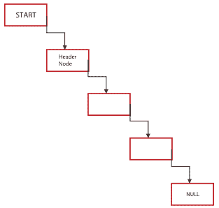

### 2. 循环头链表

在这种类型的链表中，最后一个节点将指向或连接到头节点。因为在循环链表中，最后一个节点将连接到链表的第一个节点。因此，我们可以正式地说，该列表不指示第一个或最后一个节点。在这种情况下，外部指针提供参考框架，因为循环链表的最后一个节点不包含 NULL 指针。与单链表和双链表一样，我们也可以对这种类型的头链表执行所有类型的操作。

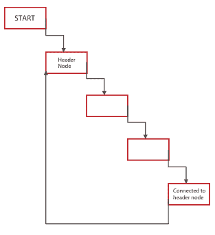

## 7.7.1 /* 将节点插入头链表 */

```c
# include <stdio.h>
# include <alloc.h>
struct link
{
	int info;
	struct link *next;
};
int i;
int number;
struct link *start, *new;
void insert(struct link *);
void create(struct link *);
void display(struct link *);
void create(struct link *node)
{
	char ch='y';

	start->next = NULL; /* Empty list */

	node = start; /* Point to the header node of the
list */
```


```c
node->next = (struct link*) malloc(sizeof(struct link)); /* Create header node */
i = 0;
while (ch == 'Y' || ch == 'y')
{
    node->next = (struct link*) malloc(sizeof(struct link));
    node = node->next;
    printf("\nENTER THE NUMBER");
    scanf("%d", &node->info);
    node->next = NULL;
    fflush(stdin);
    printf("\nDO YOU WANT TO CREATE MORE NODES[Y/N]");
    scanf("%c", &ch);
    i++;
}
printf("\n NUMBER OF NODES = %d", i);
node->info = i; /* ASSIGN TOTAL NUMBER OF NODES INTO THE HEADER LIST */
}

void insert(struct link *node)
{
    int n = 1;
    int no, count;
    node = start;
    count = node->info;
    node = node->next;
    printf("\nENTER THE NODE NUMBER TO INSERT");
    fflush(stdin);
    scanf("%d", &no);
    while (count)
    {
        if (n == no)
        {
            new = (struct link*) malloc(sizeof(struct link));
            new->next = node->next;
            node->next = new;
            printf("\nENTER THE VALUE");
            fflush(stdin);
            scanf("%d", &new->info);
            node = node->next;
        }
        else
        {
            node = node->next;
            count--;
            n++;
        }
    }
    node = start;
    node->info = node->info + 1;
}
void display(struct link *node)
{
    int count;
    node = start;
    count = node->info;
    node = node->next;
    printf("\n THE LINKED LIST IS \n");
    while (count)
    {
        printf("%d", node->info);
        node = node->next;
        count--;
    }
}
void main()
{
    struct link *node;
    clrscr();
    create(node);
    display(node);
    insert(node);
    display(node);
}
```

## 7.8 循环链表

正如名称所指定，这种链表形成一个圆圈。这意味着列表的最后一个节点将连接到链表的开头。这可以分为

- 单向循环链表
- 双向循环链表
- 示例

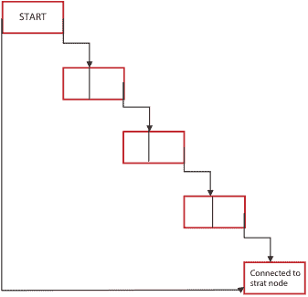

### 循环链表的优点：

- 1) 任何节点都可以作为起点。我们可以从任意点开始遍历整个列表。只需在第一个访问的节点再次被访问时停止即可。
- 2) 有助于队列的实现。与这种实现不同，如果使用循环链表，我们不需要维护两个指针来指向队首和队尾。我们可以维护一个指向最后插入节点的指针，队首始终可以通过最后一个节点的 next 获得。
- 3) 循环列表在需要反复遍历列表的应用中很有用。例如，当 PC 上运行多个应用程序时，操作系统通常将运行中的应用程序放入一个列表，然后循环遍历它们，给每个应用程序分配一段时间片执行，然后让它们等待，而将 CPU 分配给另一个应用程序。操作系统使用循环列表很方便，这样当它到达列表末尾时，可以循环回到列表的开头。
- 4) 循环双向链表用于实现斐波那契堆等高级数据结构。

### 创建循环头节点链表

```c
#include <stdio.h>
#include <stdlib.h>
#include <conio.h>
struct link
{
    int info;
    struct link *next;
};
int i; /* Represents number of nodes in the list */
int number = 0;
struct link *start, *node, *new1;
void create()
{
    char ch;
    node = start; /* Point to the header node in the list */
    i = 0;
    do
    {
        node->next = (struct link*) malloc(sizeof(struct link));
        node = node->next;
        printf("\n Input the node : %d.", (i + 1));
        scanf("%d", &node->info);
        fflush(stdin);
        printf("\n DO YOU WANT TO CREATE MORE[Y/N] ");
        ch = getchar();
        i++;
    } while (ch == 'Y' || ch == 'y');
    node->next = start;
    start->info = i; /* Assign total number of nodes to the header node */
}
void insertion()
{
    struct link *first;
    first = start;
    node = start->next;
    int opt;
    int count = node->info;
    int node_number = 1;
    int insert_node;
    node = node->next;
    printf("\n Input node number you want to insert: ");
    printf("\n Value should be less than or equal to the");
    printf("\n number of nodes in the list: ");
    scanf("%d", &insert_node);
    while (count--)
    {
        if (node_number == insert_node)
        {
            new1 = (struct link*) malloc(sizeof(struct link));
            first->next = new1;
            new1->next = node;
            printf("\n Input the node value: ");
            scanf("%d", &new1->info);
            opt = 1;
            break;
        }
        else
        {
            node = node->next;
            first = first->next;
        }
        node_number++;
    }
    if (opt == 1)
    {
        node = start; /* Points to header node */
        node->info = node->info + 1;
    }
}

/* Display the list */
void display()
{
    node = start;
    int count = node->info;
    do
    {
        printf("\n%d ", node->info);
        node = node->next;
    } while (count--);
}

int main()
{
    create();
    printf("\n Before inserting a node list is as follows:\n");
    display();
    insertion();
    printf("\n After inserting a node list is as follows:\n");
    display();
}
```

## 7.9 链表的应用

- 1. 不同数据结构的表示：链式栈和队列、稀疏矩阵、树、图等...
- 2. 图的实现：图的邻接表表示最为流行，它使用链表存储相邻顶点。
- 3. 动态内存分配：我们使用空闲块的链表。
- 4. 维护名称目录
- 5. 对长整数进行算术运算
- 6. 通过在链表节点中存储常数来操作多项式

### 7.9.1 两个多项式的相加

```text
struct poly
{
    int coef, exp;
    struct poly *next;
};
SUM(P1, P2, P3)
STEP-1 : REPEAT WHILE ( P1 != NULL AND P2 != NULL)
 IF (DEGREE[P1] > DEGREE(P2)) THEN :
 ADD(P3, DEGREE[P1], COEF[P1])
 P1 := NEXT[P1]
 ELSE :
 IF (DEGREE[P1] < DEGREE(P2)) THEN :
 ADD(P3, DEGREE[P2], COEF[P2])
 P2 := NEXT[P2]
 ELSE :
 ADD(P3, DEGREE(P1), (COEF(P1) + COEF(P2)))
 P1 := NEXT[P1]
 P2 := NEXT[P2]
 [END OF IF]
 [END OF LOOP]
STEP-2 : IF (P1 = NULL)
 REPEAT WHILE ( P2 != NULL)
 ADD(P3, DEGREE(P2), COEF(P2))
 P2 := NEXT(P2)
 [END OF LOOP]
 [END OF IF]
STEP-3: IF (P2 = NULL)
 REPEAT WHILE (P1 != NULL)
 ADD(P3, DEGREE(P1), COEF(P1))
 P1 := NEXT(P1)
 [END OF LOOP]
 [END OF IF]
STEP-4: RETURN
```

### ADD(P3, COEF, EXP)

步骤 1：为 P3->NEXT 分配内存
步骤 2：P3 := NEXT[P3]
步骤 3：COEF[P3] := COEF
EXP[P3] := EXP
步骤 4：NEXT[P3] := NULL
步骤 5：返回

### 7.9.2 借助链表的多项式

```c
#include <stdio.h>
#include <alloc.h>
struct link
{
    int coef;
    int expo;
    struct link *next;
};
int i;
int number;
struct link *start, *previous, *new;
void create(struct link *node)
{
    char ch = 'y';
    start->next = NULL; /* Empty list */
    node = start; /* Point to the start of the list */
    i = 0;
    while (ch == 'y' || ch == 'Y')
    {
        node->next = (struct link*) malloc(sizeof(struct link));
        node = node->next;
        printf("\nENTER THE COEFFICIENT VALUE:");
        fflush(stdin);
        scanf("%d", &node->coef);
        printf("\nENTER THE EXPONENT VALUE:");
        fflush(stdin);
        scanf("%d", &node->expo);
        node->next = NULL;
        fflush(stdin);
        printf("\nDO YOU WANT TO CREATE MORE NODES[Y/N] ");
        scanf("%c", &ch);
        i++;
    }
    printf("\nNUMBER OF NODES = %d\n", i);
}

void display(struct link *node)
{
    node = start;
    node = node->next;
    printf("%d", node->coef); // PRINTING THE FIRST ELEMENT
    printf("%d", node->expo);
    node = node->next;
    while (node)
    {
        printf("+ %d", node->coef);
        printf("X^%d", node->expo);
        node = node->next;
    }
}

void main()
{
    struct link *node;
    create(node);
    display(node);
}
```

### 7.9.3 链式队列程序

```c
#include <stdio.h>
#include <iostream>
using namespace std;
struct Q
{
    int info;
    struct Q *next;
};
struct Q *front, *rear, *New;

void insert()
{
    New = (struct Q*) malloc(sizeof(struct Q));
    printf("\n Enter a number");
    scanf("%d", &New->info);
    New->next = NULL;
    if (front == NULL)
    {
        front = New;
        rear = New;
    }
    else
    {
        rear->next = New;
        rear = rear->next;
    }
}

void delete()
{
    if (front == NULL)
    {
        printf("\n QUEUE IS EMPTY");
        return;
    }
    New = front;
    if (New != NULL)
    {
        printf("%d IS DELETED", New->info);
        front = front->next;
        free(New);
    }
}

void display()
{
    New = front;
    if (New == NULL)
    {
        printf("\n QUEUE IS EMPTY");
        return;
    }
    printf("\n THE QUEUE IS ");
    while (New != NULL)
    {
        printf("%5d", New->info);
        New = New->next;
    }
}
```


int main()
{
    int opt;
    while(1)
    {
        cout<<"\n 1. INSERT 2. DELETE 0. EXIT";
        cin>>opt;
        if(opt==1)
        {
            insert();
            cout<<"\n AFTER INSERTION THE QUEUE IS :";
            display();
        }
        else
        if(opt==2)
        {
            delete();
            printf("\n AFTER DELETE THE QUEUE IS :");
            display();
        }
        else
        if(opt==0)
            exit(0);
    }
}

## 7.9.4 链栈程序

```c
#include<stdio.h>
#include<dos.h>
struct stack
{
    int info;
    struct stack *next;
};
struct stack *start=NULL,*node, *first,*New;
void push()
{
    New = (struct stack *)malloc(sizeof(struct stack));
    printf("\n Enter a number");
    scanf("%d",&New->info);
    if(start == NULL)
    {
        start = New;
        New->next = NULL;
    }
    else
    {
        New->next = start;
        start = New;
    }
}

void pop()
{
    first = start;
    if(start == NULL)
        printf("\n STACK IS EMPTY");
    else
    {
        start = start->next;
        printf("\n %d IS POPPED",first->info);
        free(first);
    }
}

void traverse()
{
    if(start == NULL)
        printf("\n EMPTY STACK");
    else
    {
        first = start;
        while(first)
        {
            printf(" %d",first->info);
            first = first->next;
        }
    }
}

int main()
{
    int opt;
    while(1)
    {
        printf("\n 1. PUSH 2. POP 0. EXIT");
        scanf("%d",&opt);
        if(opt==1)
        {
            push();
            printf("\n AFTER PUSH THE STACK IS ");
            traverse();
        }
        else
        if(opt==2)
        {
            pop();
            printf("\n AFTER DELETE THE STACK IS ");
            traverse();
        }
        else
        if(opt==0)
            exit(0);
    }
}
```

## 7.10 垃圾回收与压缩

使用任何内存后，它必须可重复使用，操作系统的工作是找出那些已分配但未在任何地方使用的内存，因此操作系统将执行一项任务，结果这些未使用的内存空间将被添加到空闲内存空间中。

执行此回收操作的技术称为垃圾回收。

当空闲存储列表中仅剩少量空间或完全没有空间时，或者当 CPU 空闲并有时间执行回收时，可能会发生垃圾回收。垃圾回收对程序员不可见。

内存管理系统使用一种称为压缩的概念，它收集所有空闲内存块并将它们放在一个位置的单个空闲块中。因此，内存分配请求将从此空闲块中提出。内存管理系统使用某种技术来实现这一点。从空闲块分配请求内存的不同方法包括：

- 首次适应法
- 最佳适应法
- 最差适应法

在*首次适应*内存分配方法中，系统会选取第一个空闲块大小等于或大于所需大小的条目。

例如

| 0 | 100 | 190 | 250 | 370 | 450 |
|---|---|---|---|---|---|
| 空闲 | A | 空闲 | 空闲 | C | |

| 0 | 100 | 190 | 250 | 370 | 450 |
|---|---|---|---|---|---|
| B | A | | 空闲 | | |

现在，为 B 分配 30 字节内存时，系统将选择 0–100 的内存区域。

在*最佳适应*内存分配方法中，系统会选取所有大小等于或大于所需大小的条目中最小的一个。

例如

| 0 | 100 | 190 | 250 | 370 | 450 |
|---|---|---|---|---|---|
| 空闲 | A | 空闲 | 空闲 | C | |

| 0 | 100 | 190 | 250 | 370 | 450 |
|---|---|---|---|---|---|
| 空闲 | A | B | 空闲 | | |

现在，为 B 分配 30 字节内存时，系统将选择 190–250 的内存区域。

在*最差适应*内存分配方法中，系统始终分配内存中最大空闲块的一部分。

例如

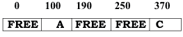

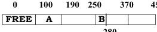

现在，为 B 分配 30 字节内存时，系统将选择 250-370 的内存区域。

## 7.11 问题

- 1. 链表相对于数组有什么优点？
- 2. 链表有哪些类型？
- 3. 什么是垃圾回收？
- 4. 什么是压缩？
- 5. 内存分配有哪些类型？
- 6. 什么是带头链表？
- 7. 编写一个使用双向链表实现员工数据库的程序。
- 8. 编写一个使用带头链表实现电话目录系统的程序。
- 9. 链表有什么用途？
- 10. 编写一个使用链表实现两个多项式相加、相减和相乘的程序。

树是一种非线性数据结构，其中元素以父子关系排列。我们也可以说，在树数据结构中，元素可以按排序顺序存储，并用于表示层次关系。

> 树是一种动态数据结构，表示单个数据项之间的层次关系。
> 
> 在树中，节点以层次方式组织，使得
> 
> - 有一个特别指定的节点称为根节点，位于结构的开头，除非树为空
> - 连接节点的线称为分支，除根节点外，每个节点都只连接到下一更高层级（父节点）的一个节点
> - 没有子节点的节点称为叶子节点或终端节点。

## 8.1 树术语

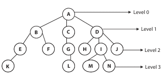

### 节点
树的每个元素称为节点。它是树中的基本结构。它指定信息和指向其他数据项的链接（分支）。在上图中共有 14 个节点。

### 根节点
它是树中特别指定的节点。它是数据项层次排列中的第一个节点。在图中，A 是根节点。

### 父节点
节点的父节点是该节点的直接前驱。这里 B 是 E 和 F 的父节点。

### 子节点
节点的每个直接后继称为子节点。在上图中，B、C、D 是 A 的子节点。

### 兄弟节点
给定父节点的子节点称为兄弟节点。在图中，H、I、J 是兄弟节点。

### 节点的度
给定树中节点的子树数量称为该节点的度。在图中，节点 A 的度为 3，节点 B 的度为 2，节点 G 的度为 1，节点 F 的度为 0。

### 树的度
给定树中节点的最大度称为树的度。在图中，节点 A 和 D 的最大度为 3。因此，树的度为 3。

### 终端节点
度为零的节点称为终端节点或叶子。在图中，K、F、L、H、M、N、J 是终端节点。

### 非终端节点
任何（根节点除外）度不为零的节点称为非终端节点。在上述树中，B、E、C、G、D、I 是非终端节点。

### 层次
整个树结构分层，使得根节点始终在第 0 层，其直接子节点在第 1 层，它们的直接子节点在第 2 层，依此类推，直到叶子节点。上述树有四层。

### 边
边是连接两个节点的线。CG 是上述树的一条边。

### 路径
路径是从源节点到目标节点的连续边序列。在上述树中，A 和 M 之间的路径是 (A,D)、(D,I)、(I,M)。

### 深度
节点 n 的深度是从根节点到 n 的唯一路径的长度。E 的深度为 2，B 的深度为 1。

### 高度
节点 n 的高度是从 n 到叶子节点的最长路径的长度。B 的高度为 2，F 的高度为 0。

### 二叉树
二叉树是树的一种特殊形式，其中树的每个节点最多可以有两个子节点。
或者
在二叉树中，每个节点的度小于或等于 2。

### 示例
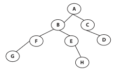

## 8.2 二叉树

二叉树有三种类型，如下

- 完全二叉树
- 几乎完全二叉树
- 严格二叉树
- 扩展二叉树

## 完全二叉树

具有 n 个节点且深度为 d 的二叉树是严格二叉树，其所有终端节点都在第 d 层。在完全二叉树中，每个节点的出度要么是 2，要么是 Nil。


## 示例：

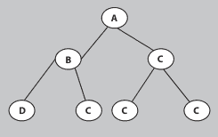

## 几乎完全二叉树

几乎完全二叉树是指满足以下条件的二叉树：

- 1. 所有叶节点都位于最底层或倒数第二层
- 2. 所有叶节点都位于最左侧可能的位置，且所有层级都完全填满节点。

## 严格二叉树

如果二叉树中每个非终端节点都包含非空的左子树和右子树，则该树称为严格二叉树。

## 示例

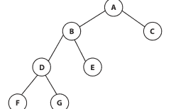

## 扩展二叉树

如果二叉树中每个节点都有零个或两个子节点，则该二叉树称为扩展二叉树或 2-TREE。在这种情况下，有 2 个子节点的节点称为内部节点，有 0 个子节点的节点称为外部节点。

## 示例

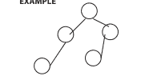

它不是 2-TREE，而是二叉树

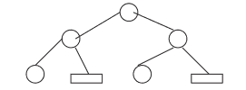

它是前一棵二叉树的扩展形式，并且是 2-TREE

## 8.3 二叉树的表示

二叉树可以使用以下方式表示：

- 数组
- 链表

### 8.3.1 树的数组表示

数组可用于表示二叉树。数组中元素的总数取决于树中节点的总数。根节点始终作为数组的第一个元素保留，即在 0-索引处存储根节点。然后，在连续的内存位置中存储左子节点和右子节点。例如：

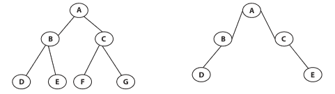

### 数组表示

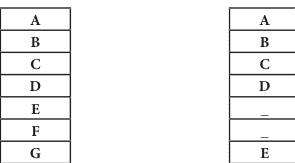

### 8.3.2 树的链表表示

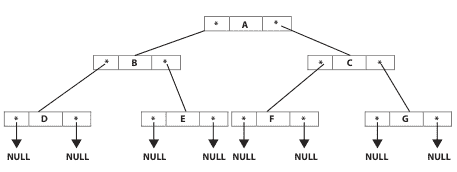

在表示二叉树时，我们需要使用双链表的概念。

## 8.4 与二叉树相关的操作

与二叉树最常用的操作包括：

- 创建
- 插入
- 删除
- 查找
- 其他一些操作包括：
- 复制
- 合并
- 更新

### 二叉树创建算法

```
CREATE (NODE, INFO) [NODE is the Structure type Variable having both left and right pointer. INFO is the information]

STEP-1: IF (NODE = NULL) THEN:
ALLOCATE A MEMORY TO NODE
INFO[NODE] := INFO
LEFT[NODE] := NULL
RIGHT[NODE] := NULL
RETURN
[END OF IF]

STEP-2: IF INFO[NODE] >= INFO THEN:
CREATE(LEFT[NODE],INFO)
ELSE:
CREATE(RIGHT[NODE],INFO)
[END OF IF]

STEP3: RETURN(NODE)
```

### 8.4.1 /*创建一棵树*/

```
#include<stdio.h>
# include<alloc.h>
struct node
{
    int info;
    struct node *left;
    struct node *right;
};

struct node *create(int , struct node *);
void display(struct node *, int );
void main()
{
    int info ;
    char ch='y';
    struct node *tree ;
    tree = NULL;
    while(ch == 'Y' || ch=='y')
    {
    printf("\n Input information of the node : ");
    scanf ( "%d", &info);
    tree = create(info,tree);
    printf("\n Tree is ");
    display(tree, 1);
    printf("\nDO YOU WANT TO CREATE MORE
CHILDS [Y/N] ");
    scanf("%c",&ch);
    }
}
struct node * create(int info, struct node *n)
{
if (n == NULL)
{
n = (struct node *) malloc( sizeof(struct node ) );
n->info = info;
n->left = NULL;
n->right = NULL;
return (n);
}
if (n->info >= info )
n->left = create(info, n->left);
else
n->right = create(info, n->right); return(n);
}
void display(struct node *tree, int no)
{
int i;
if (tree)
{
display(tree->right, no+1);
printf("\n ");
for (i = 0; i < no; i++)
printf(" ");
printf("%d", tree->info);
printf("\n ");
display(tree->left, no+1);
}
}
```

## 8.5 树的遍历

树的遍历是指按特定顺序访问树中所有节点的方式。树的遍历可以通过三种不同的方式完成，例如：

- 中序遍历
- 后序遍历
- 前序遍历。
- 层序遍历

树的遍历可以通过两种不同的方式执行，例如：

- 使用递归
- 不使用递归

### 递归方式

### 中序遍历

- 中序遍历左子树（INORDER(Left)）
- 访问根节点
- 中序遍历右子树（INORDER(Right)）

### 前序遍历

- 访问根节点
- 前序遍历左子树（PREORDER(Left)）
- 前序遍历右子树（PREORDER(Right)）

### 后序遍历

- 后序遍历左子树（POSTORDER(Left)）
- 后序遍历右子树（POSTORDER(Right)）
- 访问根节点

### 不使用递归

### 非递归中序遍历算法

```
STEP-1 NODE = root;
STEP-2 Repeat while(node or stack is nonempty)
if(node ! = NULL) then
stack->node=>info
node=node->link
else
pop stack into node;
visit the node
node = node->right
[end of if]
OR
```

- 步骤 1：当栈不为空或 Ptr 不等于 NULL 时，重复步骤 2、3。
- 步骤 2：如果 Ptr 不等于 NULL
- 将 ptr 压入栈
- Ptr = ptr -> left_child
- 步骤 3：如果 ptr 等于 NULL
- 从栈中弹出一个地址
- 遍历该地址处的节点
- Ptr = ptr->right_child

### 非递归前序遍历算法

- 步骤 1：node = root；// 从根节点开始遍历
- 步骤 2：while(node or stack is nonempty)
- if(node)
- 访问节点
- stack<-node->info
- node = node->left
- else
- 将栈弹出到 node
- node = node->right
- [end of if]
- 或
- 步骤 1：将根节点的地址压入栈
- 步骤 2：从栈中弹出一个地址
- 步骤 3：如果弹出的地址不为 NULL
- 遍历该节点
- 将节点的右子节点压入栈
- 将节点的左子节点压入栈
- [END OF IF]
- 步骤 4：重复步骤 2、3，直到栈不为空

### 非递归后序遍历算法

- 步骤 1：首先将 NULL 压入栈
- 步骤 2：当 ptr != NULL 时，重复步骤 3、4、5
- 步骤 3：沿以 ptr 为根的最左路径移动，路径上的所有节点都要压入栈，并将这些节点的标志值设为 1。除了将这些节点压入栈外，我们还检查节点是否有右子节点，如果节点有右子节点，则该右子节点也要压入栈，并将这类节点的标志值设为 -1。
- 步骤 4：保存 top_prev 的值，然后从栈中弹出一个地址并将其赋给 ptr。
- 步骤 5：当 flag[top_prev] = 1 时，重复以下步骤
- 遍历地址为 ptr 的节点。
- 从栈中再弹出一个节点。

### 层序遍历

在这种遍历方式中，元素将按层级访问，但目前尚未广泛使用。

### 示例

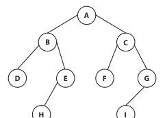

- 中序遍历：DBHEAFCIG
- 前序遍历：ABDEHCFGI
- 后序遍历：DHEBFIGCA
- 层序遍历：ABCDEFGHI

### 8.5.1 /* 二叉树遍历 */

```
# include<stdio.h>
struct link
{
    int info;
    struct link *left;
    struct link *right;
};
struct link *binary(int *list, int lower, int upper)
{
    struct node *node;
    int mid = (lower + upper)/2;
    node = (struct link *) malloc(sizeof(struct link));
    node->info = list [mid];
    if ( lower>= upper)
    {
        node->left = NULL;
        node->right = NULL;
        return (node);
    }

    if (lower <= mid - 1)
        node->left=binary(list, lower, mid - 1);
    else
        node->left = NULL;
    if (mid + 1 <= upper)
        node->right = binary(list, mid + 1, upper);
    else
        node->right = NULL;
    return(node);
}
void output(struct link *t, int level)
{
    int i;
    if (t)
    {
        output(t->right, level+1);
        printf("\n");
        for (i = 0; i < level; i++)
        printf("%s", t);
        printf("%d", t->info);
        output(t->left, level+1);
    }
}
void preorder (struct link *node)
{
    if (node)
    {
        printf( "%d", node->info);
        preorder(node->left);
        preorder(node->right);
    }
}
void inorder (struct link *node)
{
    if (node)
```


```c
{
   inorder(node->left);
   printf(" %d", node->info);
   inorder(node->right);
}
```

```c
void postorder (struct link *node)
{
   if (node)
   {
      postorder(node->left);
      postorder(node->right);
      printf(" %d", node->info);
   }
}
```

```c
void main()
{
   int list[100];
   int number = 0;
   int info;
   char ch='y';
   struct link *t;
   t = NULL;
   while(ch == 'y' || ch=='Y')
   {
      printf("\n Enter the value of the node");
      scanf("%d", &info);
      list[number++] = info;
      printf("\n DO YOU WANT TO CREATE MORE
NODES[Y/N]");
      scanf("%c",&ch);
   }
   number--;
   printf("\n Number of elements in the list is %d",
   number);
   t = binary(list, 0, number);
   output(t,1);
   printf("\n Pre-order traversal\n");
   preorder (t);
   printf("\n In-order traversal\n");
   inorder (t);
   printf("\n Post-order traversal\n");
   postorder (t);
}
```

## 8.6 从中序和前序转换树

中序遍历：D B H E A F C I G
前序遍历：A B D E H C F G I
从前序中选择根节点，从中序中找到左右子树的节点，此过程将持续到前序/中序中的所有元素都被选出。

步骤1：从前序中 A 是根节点，从中序中我们会发现 A 左侧是 (D,B,H,E)，右侧是 (F,C,I,G)

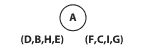

步骤2：再次从前序中选择 'B' 作为父节点，从中序中 B 左侧是 (D)，右侧是 (H,E)。

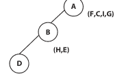

步骤3：从前序中选择 'E' 作为父节点，从中序中其左侧存在 'H'。

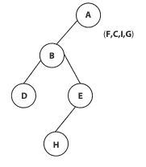

步骤4：从前序中我们将选择 'C' 作为父节点，从中序中我们观察到 'C' 左侧将放置 (F)，右侧是 (I,G)。


步骤5：从前序中我们观察到 'G' 是父节点，从中序中 'I' 将被用作 'G' 的左子节点：


## 从中序和后序转换树

中序遍历：D B H E A F C I G
后序遍历：D H B E F I G C A
从后序（从右侧）选择根节点，从中序中找到左右子树的节点，此过程将持续到后序/中序中的所有元素都被选出。

步骤1：从后序右侧选择 'A' 作为根节点，从中序中我们观察到 A 左侧是 (D,B,H,E)，右侧是 (F,C,I,G)。

(D,B,H,E,A)       (F,C,I,G)

步骤2：从后序中选择 'C' 作为父节点，从中序中我们观察到 'C' 右侧是 (I,G)，左侧是 (F) 将被使用。


步骤3：从后序右侧选择 'G' 作为父节点，从中序中 'G' 左侧的 (I) 将被使用。


步骤4：从后序右侧选择 'B' 作为父节点，从中序中我们观察到 'B' 右侧是 (H,E,A)，左侧是 (D) 将被使用。


步骤5：从后序右侧我们将选择 'E' 作为父节点，从中序中 'E' 左侧的 (H) 将被使用。


## 8.7 二叉树的类型

存在不同类型的二叉树，但其中经常使用的有：

- 表达式树 (Expression Tree)
- 二叉搜索树 (Binary Search Tree)
- 平衡二叉树 (AVL Tree)
- 线索化二叉树 (Threaded Binary Tree)
- 堆树 (Heap Tree)
- 霍夫曼树 (Huffman Tree)
- 决策树 (Decision Tree)
- 红黑树 (Red Black Tree)

## 8.8 表达式树

表达式树是一种存储/表示数学（算术）表达式的二叉树。

表达式树的叶子节点是操作数，例如常量或变量名，所有内部节点都是运算符。表达式树始终是二叉树，因为算术表达式包含二元运算符或一元运算符。

正式地，我们可以将表达式树定义为一种特殊的二叉树，其中：

- 每个叶子都是操作数。示例：a, b, c, 6, 100
- 根节点和内部节点是运算符。示例：+, -, *, /, ^
- 子树是以运算符为根的子表达式。

### 表达式树的构建：

现在，构建表达式树时我们使用栈。我们遍历输入表达式，对每个字符执行以下操作。

- 1) 如果字符是操作数，将其压入栈。
- 2) 如果字符是运算符，从栈中弹出两个值，将其作为子节点，然后再次将当前节点压入栈。

最后，栈中仅剩的元素将是表达式树的根节点。

### 示例

### 表示表达式树

A + (B*(C) - (D^E) / F + G * H

构建树时，选择运算符的方式使得括号内的项位于一侧（以便更好地构建），并选择优先级更高的运算符。

### 步骤1：


### 步骤2：


### 步骤3：


根据所使用的表达式，我们有不同类型的表达式：

- 前缀表达式
- 中缀表达式
- 后缀表达式

### 示例

为 5 7 - 3 / 构建表达式树。

从左到右扫描符号，因为 5 和 7 是操作数，所以将它们压入栈。


接下来读取 '-'；因为 '-' 是运算符，所以弹出栈并将这些作为运算符的子节点。


接下来，将读取 '3' 并将其压入栈。


最后读取字符 '/'，因为它是运算符，所以从栈中弹出符号并将它们添加到 '/' 作为其子节点。


## 8.9 二叉搜索树

二叉搜索树是一种二叉树，要么为空，要么每个节点都有一个满足以下属性的键：

- 左子树中的元素小于根节点的键
- 右子树中的元素大于或等于根节点
- 左子树和右子树也是二叉搜索树。

### 与 BST 执行的操作

与 BST 最常用的操作是：

- 插入
- 删除
- 搜索


### 搜索

要在二叉树中搜索任何节点，最初将要搜索的数据项与根节点的数据进行比较。如果数据等于根节点的数据，则搜索成功。

如果数据大于根节点的数据，则搜索继续在右子树中进行，否则搜索过程在左子树中进行。

重复相同的过程直到找到元素，在搜索过程中如果找到叶子节点，则打印未找到该数字。

### 插入

要将任何节点插入二叉搜索树，最初将要插入的数据项与根节点的数据进行比较。

如果数据项大于或等于根节点的数据项，则新节点插入根节点的右子树，否则新节点插入根节点的左子树。

然后取右子树或左子树的根节点，将其数据与要插入的数据进行比较，并重复相同的过程。这样做直到要插入新节点的左子树或右子树被发现为空。最后，新节点成为当前节点的适当子节点。

### 删除

在删除过程中，如果被删除节点只有一个子树，在这种情况下，只需将被删除节点的父节点链接到其子树。

当被删除节点同时拥有左子树和右子树时，过程会变得复杂，我们需要遵循以下四种情况：

- 情况1：树中没有节点包含指定的数据项。
- 情况2：包含数据项的节点没有子节点
- 情况3：包含数据项的节点恰好有一个子节点
- 情况4：包含数据项的节点有两个子节点。

### 情况1

在第一种情况下，我们需要检查树是否为空。

条件是

```
IF (ROOT = NULL)
WRITE : "TREE IS EMPTY"
[END OF IF]
```

### 情况2

在这种情况下，要删除的节点是叶子节点，即它没有左节点和右节点，只需将 NULL 赋值给其父节点即可删除它。

条件是

```
IF ([left]item = NULL AND [RIGHT]ITEM = NULL)
```

示例：如果我们想删除 52，则向 49 添加 NULL。

### 情况3

在这种情况下，节点要么有左子树，要么有右子树。

条件是

```
IF ([left]item != NULL AND [RIGHT]ITEM = NULL)
IF ([left]item = NULL AND [RIGHT]ITEM != NULL)
```

示例：如果我们想删除 49，它只有一个子节点，所以我们可以通过将右子节点的地址赋给其父节点的左指针来简单地删除它。这里 55 是 49 的父节点，52 是 49 的右子节点。因此，删除 49 后，52 将被添加到 55 的左侧。


## 案例 4


在这种情况下，要删除的节点有两个子节点。现在我们需要考虑节点同时拥有左子和右子的情况。这可以这样检查

```
if(left[item] !=NULL AND right[item]!=NULL)
```

例如，假设我们要删除 78，它有左右子节点，为此我们首先要删除 78 的中序后继节点。这里 80 是 78 的中序后继。我们通过将 80 的父节点的左指针设为 NULL 来删除 80。


## 8.10 高度平衡树（AVL 树）

高度平衡树是一种二叉树，其中每个节点的左子树和右子树的高度差不超过 1。

树的高度是从根到任意叶子节点的最长路径上的节点数。

该树的性质由两位俄罗斯数学家 G.M. Adelson – vel'skii 和 E.M. Landis 描述。因此，这棵树以他们的名字命名。

任何节点的右子树和左子树高度差小于或等于 1 的二叉搜索树称为 AVL 树。

在向树中插入任何节点时，我们需要找出平衡因子，即左高度减去右高度的差值。

- 平衡因子为 1 时，树为左重
- 如果平衡因子为 -1，树为右重
- 如果平衡因子为 0，树为平衡

## AVL 树中的插入

我们可以先使用常规的二叉树插入技术，将新节点插入 AVL 树，即比较新节点的键与根节点的键，并将新节点准确地插入左子树或右子树。

但 AVL 树有一个属性，即左子树和右子树的高度差最大为 1。假设插入新节点后，此差值变大于 1，即平衡因子的值不是 -1、0 或 1 中的任意一个。因此，我们现在的工作是再次恢复 AVL 树的属性。

要将不平衡树转换为 AVL 树，需要进行一些旋转，例如：

- LR 旋转
- RL 旋转
- LL 旋转
- RR 旋转

## 技巧 1


## 技巧 2


## 技巧 3


## 技巧 4


## 技巧 5


## 技巧 6


## 根据数字 12, 25, 32, 65, 74, 26, 13, 08, 45 构建 AVL 树

## 步骤 1


## 步骤 2


## 步骤 3


旋转后


## 步骤 4


## 步骤 5


旋转后


## 步骤 6


旋转后


## 步骤 7


旋转后


## 步骤 8


删除：从 AVL 树中删除与二叉搜索树相同。

## 8.11 线索化二叉树

当使用指针表示二叉树时，指向空子树的指针被设置为 NULL。也就是说，左子节点为空子树的节点的左指针通常设置为 NULL，同样，右子节点为空子树的节点的右指针也设置为 NULL。因此，大量指针被设置为 NULL。将这些指针字段用于保存二叉树操作中的其他信息将很有用。二叉树中最常见的操作是遍历。我们可以使用这些指针字段来存放地址指针，该指针指向树中更高层的节点。这种保存树中更高层节点地址的指针称为线索。实现这些指针的二叉树称为线索化二叉树。

在数据结构的语境下，线索化二叉树有三种类型：

- 左线索化二叉树
- 右线索化二叉树
- 完全线索化二叉树

## 优点

线索机制用于避免递归函数调用，同时节省栈和内存。

## 左线索化二叉树


这里所有左指针都指向其中序前驱。

## 右线索化二叉树


这里所有右指针都指向其中序前驱。

## 完全线索化二叉树


## 8.12 堆树

堆是一棵完全二叉树，以数组的顺序表示形式实现，而不是链式表示。堆可以以两种不同的方式构建，即 MAX-HEAP 或 MIN-HEAP。

如果堆中每个节点的值大于或等于其每个子节点的值，则该堆称为最大堆或降序堆。在最大堆中，根节点的值将是最大的数。

如果堆中每个节点的值小于或等于其每个子节点的值，则该堆称为最小堆或升序堆。

## 堆树的创建

当我们想要创建一个堆时，必须按顺序填充，即从左侧或右侧开始。填满一层后，下一层的操作将开始。

示例：考虑数字 14, 52, 2, 65, 84, 44, 35 创建一个 MAX-HEAP。

## 步骤 1

## 步骤 2

## 步骤 3

## 步骤 4


## 步骤 5


## 步骤 6


## 步骤 7


与 MAX-HEAP 类似，我们也可以遵循相同的程序创建 MIN-HEAP，但主要目标是根节点必须是最小的元素。

## 堆中的插入

当我们想要向堆中插入一个元素时，它必须满足堆的性质，如果不满足，则需要与该树进行一些交换。

## 从堆中删除

删除操作可以如下：

- 找到要删除的数字的索引号
- 将树的最后一个节点放在被删除节点的位置
- 将节点放在合适的位置。

为了将节点放在正确的位置，步骤如下：

- 将其与父节点比较，如果父节点小于该节点，则与父节点交换。再次与新的父节点比较，直到父节点大于插入的项目。
- 如果父节点大于该节点，则将其与左右子节点比较，如果它较小，则用值较大的子节点替换它。再次比较，直到它大于或等于左右子节点。

## 8.13 哈夫曼树

通常，HUFFMAN TREE 概念基于扩展二叉树的概念实现。在扩展二叉树中，我们知道每个节点有零个或两个子节点。有两个子节点的节点称为内部节点，没有子节点的节点称为外部节点。

在任何扩展二叉树中，外部节点的数量多于内部节点的数量。

从数学上讲：

```
External node = internal node + 1
i.e. E = I+1
```


外部节点由方括号表示，内部节点由圆圈表示。任何节点的路径长度是从根节点到该节点所遍历的最少节点数。在上图中，内部节点和外部节点的总长度为：
Path(I) = 0 + 1 + 2 + 1 + 2 + 3 = 9
Path(E) = 2 + 3 + 3 + 2 + 4 + 4 + 4 + 3 = 21
我们也可以得到外部节点的总路径长度为
PATH(E) = PATH(I) + 2N 其中 N 是内部节点的数量。
假设每个节点都有某些权重，那么加权路径长度将是
P = W1P1 + W2P2 + ... + WNPN
W 是权重，P 是外部节点的路径长度。

### 示例

让我们创建不同的树，包含 5、8、10、6

## 数据结构中的编程


### 类型 1：
P = 5*2 + 8*2 + 10*2 + 6*2 = 10 + 16 + 20 + 12 = 58

### 类型 2：
P = 10*1 + 5*2 + 8*3 + 6*3 = 10 + 10 + 24 + 18 = 62

### 类型 3：
P = 6*1 + 10*2 + 8*3 + 5*3 = 6 + 20 + 24 + 15 = 65

### 类型 4：
P = 8*2 + 10*1 + 5*3 + 6*3 = 16 + 10 + 15 + 18 = 59

从上面我们可以观察到，即使是同一类型的树，不同的树也有不同的路径长度。因此问题在于找到最小加权路径长度。这种扩展二叉树可以通过 Huffman 算法获得。

## Huffman 算法

- 步骤 1：假设有 N 个权重为 W1, W2, ..., WN
- 步骤 2：取两个最小权重并创建一棵子树。假设 W1 和 W2 是前两个最小权重，那么子树将采用如下形式


- 步骤 3：现在剩余的权重将是 W1 + W2, W3, ..., WN
- 步骤 4：在最后一个权重处创建所有子树

### 示例

通过将以下数字作为输入来创建 Huffman 树：

- 15, 18, 25, 7, 8, 11, 5
- 步骤 1：取两个权重最小的节点，即 5 和 7


现在列表中的元素为：15, 18, 25, 12, 8, 11

- 步骤 2：取两个权重最小的节点，即 8 和 11


现在剩余的节点为 15, 18, 25, 12, 19

- 步骤 3：取两个权重最小的节点，即 12 和 15


现在剩余的元素为 18, 25, 27, 19

- 步骤 4：取两个权重最小的节点，即 18 和 19


现在剩余的元素为 37, 25, 27

- 步骤 5：取两个权重最小的节点，即 25 和 27


现在剩余的元素为 37 和 52

- 步骤 6：取剩下的两个元素 37 和 52，树将如下所示


## 8.14 决策树

决策树是一种二叉树，其中节点表示某个决策，从节点发出的边表示决策的结果。外部节点表示最终决策。


### 示例

找出 3 个数中的最大值


## 8.15 B 树

B 树是一种平衡多路树。

- 它也被称为平衡排序树。
- 它不是二叉树。
- 树的所有叶子节点必须位于同一层级，且树的高度必须保持最小。

阶为 N 的 B 树可以定义为

- 所有非叶子节点（除根节点外）至少有 (n/2) 个子节点，最多有 (n) 个子节点。
- 所有叶子节点位于同一层级
- 所有叶子节点最多可包含 (n-1) 个键。
- 所有非叶子节点可包含 (m-1) 个键，其中 m 是该节点的子节点数量。
- 节点最左侧子节点中出现的所有值都小于该节点的第一个值。节点最右侧子节点中出现的所有值都大于该节点的最后一个值。

### B 树中的插入

在插入过程中，我们需要使用遍历。通过遍历，它将找到要插入的键是否已存在。假设键不存在于树中，则通过遍历将到达叶子节点。现在我们需要关注两种情况，例如

- 节点未满
- 节点已满

在第一种情况下，我们可以直接将键添加到该节点。但在第二种情况下，我们需要将节点拆分为两个节点，中位键将移动到该节点的父节点。如果父节点也已满，则重复此操作，直到找到非满父节点。假设根节点已满，则它将拆分为两个节点，中位键将成为根节点。

### 示例

创建一个阶为 5 的 B 树
12, 15, 33, 66, 55, 24, 22, 11, 85, 102, 105, 210, 153, 653, 38, 308, 350, 450

- 步骤 1：插入 12


- 步骤 2：插入 15


- 步骤 3：插入 33


- 步骤 4：插入 66


- 步骤 5：插入 55


- 步骤 6：插入 24


- 步骤 7：插入 22


- 步骤 8：插入 11


- 步骤 9：插入 85


- 步骤 10：插入 102


- 步骤 11：插入 105


- 步骤 12：插入 210


- 步骤 13：插入 153


- 步骤 14：插入 653


- 步骤 15：插入 38


- 步骤 16：插入 308


- 步骤 17：插入 350


- 步骤 18：插入 450


### 从 B 树中删除

从 B 树中删除与插入类似。最初，我们需要找到要删除值的节点。删除值后，我们需要检查树是否仍然保持 B 树的属性。

与插入类似，这里也会出现两种情况

- 节点是叶子节点
- 节点是非叶子节点

例如：删除 55


删除 33


## 8.16 B+ 树

在 B 树中，我们可以随机访问记录，但它不提供顺序遍历。B+ 树是一种特殊的树，既提供随机访问，也提供顺序遍历。

在 B+ 树中，所有非叶子节点相互连接，即叶子节点将指向下一个叶子节点。


## 8.17 一般树

一般树是这样一种树，其中没有规则或限制，例如


要将一般树转换为二叉树，只需在它们之间创建链接，如


## 森林

森林是若干棵互不连接的树的集合。通过从有根树中移除根节点可以得到森林。

## 8.18 红黑树

红黑树是一种二叉搜索树，每个节点有一个额外属性：颜色，可以是红色或黑色。我们还需要跟踪每个节点的父节点，因此红黑树的节点结构如下：

```
struct TREE {
    enum { red, black } colour;
    void *item;
    struct t_red_black_node *left,
    *right,
    *parent;
}
```

为了本次讨论的目的，终止树的 NULL 节点被视为叶子节点，并着色为黑色。

### 红黑树的定义

红黑树是一种具有以下红黑属性的二叉搜索树：

- 1. 每个节点要么是红色，要么是黑色。
- 2. 每个叶子（NULL）是黑色。
- 3. 如果一个节点是红色，那么它的两个子节点都是黑色。
- 4. 从一个节点到后代叶子的每条简单路径都包含相同数量的黑色节点。

具有 n 个内部节点的红黑树高度最多为 2log(n+1)。

## 8.19 问题

- 1. 什么是 TREE 数据结构，它如何在计算机系统中使用？
- 2. 有哪些不同类型的树遍历？
- 3. 提供树遍历的非递归算法。
- 4. 什么是表达式，它如何形成？请用合适的示例说明。
- 5. 什么是高度平衡树？使用 12, 45, 65, 7, 87, 98, 6, 54, 22, 23 构建。
- 6. 如何在二叉树中找到两个节点的最近公共祖先？
- 7. B 树和 B+ 树有什么区别？
- 8. 什么是堆树？它有什么用途？
- 9. 什么是 2-3 树？
- 10. 什么是红黑树。


# 9 图

GRAPH is a non-linear data structure in which the elements are arranged randomly inside the memory and are interconnected with each other like a tree. The GRAPH has a wide range of application in general life implementation like road map, electrical circuit designs, etc.

A graph G is an ordered pair of sets (V, E) where V is the set of vertices and E is the edges which connect the vertices.

A graph can be of two types such as

- Directed Graph
- Undirected Graph

### DIRECTED GRAPH

A graph in which every edge is directed is called a directed graph.

### UNDIRECTED GRAPH

A graph in which every edge is undirected is called an undirected graph.

If in a graph some edges are directed and some are undirected, then that graph will be called a mixed graph.

## 9.1 Graph Terminologies

#### DIRECTED GRAPH

A graph in which every edge is directed is called a directed graph.

#### UNDIRECTED GRAPH

A graph in which every edge is undirected is called an undirected graph.

#### WEIGHTED GRAPH

A graph is said to be weighted if its edges have been assigned some non-negative value as weight.

#### ADJACENT NODES

A node N0 is adjacent to another node or is a neighbor of another node N1 if there is an edge from node N0 to N1.
In an undirected graph, if (N0, N1) is an edge, then N0 is adjacent to N1 and N1 is adjacent to N0.
In a digraph, <N0, N1> is an edge; then N0 is adjacent to N1 and N1 is adjacent from N0.

#### INCIDENCE

In an undirected graph, the edge (V0, V1) is incident on nodes V0 and V1.
In a digraph, the edge <V0, V1> is incident from node V0 and is incident to node V1.

#### PATH

A path from a node U0 to node Un is a sequence of nodes U1, U2, U3, ..., Un such that U0 is adjacent to U1, U1 is adjacent to U2, ..., Un-1 is adjacent to Un.
In other words, we can say that (U0, U1), (U1, U2), (U2, U3), ... are the edges.

#### LENGTH OF PATH

It is the total number of edges included in the path.

#### CLOSED PATH

A path is said to be closed if the first and last nodes of the path are the same.

#### SIMPLE PATH

A simple path is a path in which all the nodes are distinct, with the exception that the first and last nodes of the path can be the same.

#### CYCLE

A cycle is a simple path in which the first and last nodes are the same, or we can say that a closed simple path is a cycle.

In a digraph, a path is called a cycle if it has one or more nodes and the start node is connected to the last node.

In an undirected graph, a path is called a cycle if it has at least three nodes and the start node is connected to the last node. In an undirected graph, if (u, v) is an edge, then u-v-u should not be considered a path since (u, v) and (v, u) are the same edges. So, for a path to be a cycle in an undirected graph, there should be at least three nodes.

#### CYCLIC GRAPH

A graph that has cycles is called a cyclic graph.

#### ACYCLIC GRAPH

A graph that has no cycle is known as an acyclic graph.

#### DAG

A directed acyclic graph is named a DAG after its acronym. Graph-5 is a DAG.

#### DEGREE

In an undirected graph, the number of edges connected to a node is called the degree of that node, or we can say that the degree of a node is the number of edges incident on it. In Graph-2, the degree of node A is 1, and the degree of node B is 0. In Graph-3, the degree of node A is 3, and the degree of node B is 2.

In a digraph, there are two degrees for every node, known as indegree and outdegree.

#### INDEGREE

The indegree of a node is the number of edges coming to that node, or in other words, edges incident to it. In Graph-8, the indegree of nodes A, B, D, and G are 0, 2, 6, and 1, respectively.

#### OUTDEGREE

The outdegree of a node is the number of edges going outside from that node, or in other words, the edges incident from it. In Graph-8, the outdegrees of nodes A, B, D, F, and G are 3, 1, 6, 3, and 2, respectively.

#### SOURCE

A node which has no incoming edges but has outgoing edges is called a source. The indegree of a source is zero. In Graph-8, nodes A and F are sources.

#### SINK

A node which has no outgoing edges but has incoming edges is called a sink. The outdegree of a sink is zero. In Graph-8, node D is a sink.

#### PENDANT NODE

A node is said to be pendant if its indegree is equal to 1 and its outdegree is equal to 0.

#### REACHABLE

If there is a path from a node to any other node, then it will be called reachable from that node.

#### ISOLATED NODE

If a node has no edges connected with any other node, then its degree will be 0 and it will be called an isolated node. In Graph-2, node B is an isolated node.

#### SUCCESSOR AND PREDECESSOR

In a graph, if a node u is adjacent to node v, then u is the predecessor of v and v is the successor of u.

#### CONNECTED GRAPH

An undirected graph is connected if there is a path from any node of the graph to any other node, or any node is reachable from any other node. Graph-2 is not a connected graph.

#### STRONGLY CONNECTED

A digraph is strongly connected if there is a directed path from any node of the graph to any other node. We can also say that a digraph is strongly connected if, for any pair of nodes u and v, there is a path from u to v and also a path from v to u. Graph-7 is strongly connected.

#### WEAKLY CONNECTED

A digraph is weakly connected or unilaterally connected if, for any pair of nodes u and v, there is a path from u to v or a path from v to u. If, from the digraph, we remove the directions and the resulting undirected graph is connected, then that digraph is weakly connected. Graph-6 is a weakly connected graph.

#### MAXIMUM EDGES IN GRAPH

In an undirected graph, there can be n(n - 1)/2 maximum edges, and in a digraph, there can be n(n - 1) maximum edges, where n is the total number of nodes in the graph.

#### COMPLETE GRAPH

A graph is complete if any node in the graph is adjacent to all the nodes of the graph, or we can say that there is an edge between any pair of nodes in the graph. An undirected complete graph will contain n(n - 1)/2 edges.

#### MULTIPLE EDGE

If between a pair of nodes there is more than one edge, then they are known as multiple edges or parallel edges. In Graph-3, there are multiple edges between nodes A and C.

#### LOOP

An edge will be called a loop or self-edge if it starts and ends on the same node. Graph-4 has a loop at node B.

#### MULTIGRAPH

A graph which has a loop or multiple edges can be described as a multigraph. Graph-3 and Graph-4 are multigraphs.

#### REGULAR GRAPH

A graph is regular if every node is adjacent to the same number of nodes. Graph-1 is regular since every node is adjacent to the other three nodes.

#### PLANAR GRAPH

A graph is called planar if it can be drawn in a plane without any two edges intersecting. Graph-1 is not a planar graph, while Graph-2, Graph-3, and Graph-4 are planar graphs.

#### ARTICULATION POINT

If, on removing a node from the graph, the graph becomes disconnected, then that node is called the articulation point.

#### BRIDGE

If, on removing an edge from the graph, the graph becomes disconnected, then that edge is called the bridge.

#### TREE

An undirected connected graph will be called a tree if there is no cycle in it.

#### BICONNECTED GRAPH

A graph with no articulation points is called a biconnected graph.


## 9.2 Representation of Graph

The major components of the graph are nodes and edges. Like a tree, the graph can also be represented in two different ways, such as

- ARRAY REPRESENTATION
- LINKED REPRESENTATION

But overall, there are four major approaches to represent the graph as

- Adjacency Matrix
- Adjacency Lists
- Adjacency Multilists
- Incidence Matrix

#### ADJACENCY MATRIX

The nodes that are adjacent to one another are represented as a matrix. Thus, the adjacency matrix is the matrix that keeps the information of adjacent or nearby nodes. In other words, we can say that this matrix keeps the information of whether a node is adjacent to any other node or not.

The adjacency matrix is a square matrix with one row and one column for each vertex. The values in the matrix are either 0 or 1. The adjacency matrix of graph G is a two-dimensional array of size n × n (where n is the number of vertices in the graph) with the property that A[I][J] = 1 if the edge (Vp, Vq) is in the set of edges, and A[I][J] = 0 if there is no such edge.

#### EXAMPLE


#### ADJACENCY MATRIX IS

| | V1 | V2 | V3 | V4 | V5 | V6 |
|---|---|---|---|---|---|---|
| V1 | 0 | 0 | 0 | 0 | 0 | 0 |
| V2 | 1 | 0 | 0 | 0 | 0 | 0 |
| V3 | 0 | 0 | 0 | 0 | 0 | 0 |


| | V1 | V2 | V3 | V4 | V5 | V6 |
|---|---|---|---|---|---|---|
| V4 | 1 | 1 | 0 | 0 | 0 | 0 |
| V5 | 0 | 0 | 1 | 1 | 0 | 1 |
| V6 | 0 | 0 | 0 | 0 | 1 | 0 |

如果上述为无向图，则矩阵将为


| | V1 | V2 | V3 | V4 | V5 | V6 |
|---|---|---|---|---|---|---|
| V1 | 0 | 1 | 0 | 1 | 0 | 0 |
| V2 | 1 | 0 | 0 | 1 | 0 | 0 |
| V3 | 0 | 0 | 0 | 0 | 1 | 0 |
| V4 | 1 | 1 | 0 | 0 | 1 | 0 |
| V5 | 0 | 0 | 1 | 1 | 0 | 1 |
| V6 | 0 | 0 | 0 | 0 | 1 | 0 |

## 邻接表

使用邻接矩阵表示图由于其实现是静态的，因此不足。解决此问题的方法是使用链表结构，即通过邻接表表示图。如果图不是稠密的，也就是说图是稀疏的，那么更好的解决方案在于邻接表表示。

对于每个顶点，我们保存一个所有相邻顶点的列表。在图的邻接表表示中，我们将维护两个列表。第一个列表用于跟踪图中的所有节点，在第二个列表中，我们为每个节点维护一个相邻节点列表。每个列表都有一个头节点，该头节点将是第一个列表中的对应节点。头节点是顺序排列的，为任何特定顶点的邻接表提供便捷的随机访问。

### 示例


## 关联矩阵

考虑如下图


在这种表示形式中，主要部分是图的边，它清楚地表明边连接到哪些顶点。边起始的顶点表示为 1，边结束的顶点表示为 –1

| | V1 | V2 | V3 | V4 | V5 | V6 |
|---|---|---|---|---|---|---|
| E1 | 1 | -1 | 0 | 0 | 0 | 0 |
| E2 | -1 | 0 | 0 | 0 | 0 | 1 |
| E3 | 0 | -1 | 0 | 1 | 0 | 0 |
| E4 | 0 | 1 | 0 | 0 | -1 | 0 |
| E5 | 0 | 0 | 1 | 0 | 0 | -1 |
| E6 | 0 | 0 | 1 | 0 | -1 | 0 |
| E7 | 0 | 0 | 1 | -1 | 0 | 0 |
| E8 | 0 | 0 | 0 | -1 | 1 | 0 |

## 9.3 图的遍历

图的遍历有两种类型，如下

- 广度优先搜索 (BFS)
- 深度优先搜索 (DFS)

### 9.3.1 广度优先搜索 (BFS)

BFS 从给定顶点开始，该顶点位于第 ‘0’ 层。在第一阶段，我们访问第 1 层的所有顶点。在第二阶段，我们访问第 2 层的所有顶点。这些新顶点与第 1 层顶点相邻，以此类推。当每个顶点都被访问时，BFS 终止。BFS 用于解决

- 1. 测试图是否连通。
- 2. 计算图的生成森林。
- 3. 计算图中的环，或报告不存在这样的环。
- 4. 计算图中每个顶点从起始顶点到当前顶点的边数最少的路径，或报告不存在这样的路径。

分析：BFS 的总运行时间 = O(V + E)

### 算法 BFS(G,S)

- 1. 对每个顶点 u ∈ V[G] - {S}
- 2. 令 color[u] ← white
- 3. d[u] ← ∞ 即从 S 的距离
- 4. P[u] ← NIL 即 BFS 树中的父节点
- 5. color[S] ← gray
- 6. d[S] ← 0
- 7. Q ← {S}
- 8. 当 Q ≠ φ 时
- 9. u ← head[Q]
- 10. 对每个 v ∈ Adj[u] 执行
- 11. 如果 color[v] = white 则
- 12. color[v] ← gray
- 13. d[v] ← d[u] + 1
- 14. p[v] ← u
- 15. ENQUEUE(Q,v)
- 16. DEQUEUE(Q)
- 17. color[u] ← black

### 示例


```
BFS(G,S)
for each vertex u ∈ V[G] - {S}
    do color[u] ← white
    do color[S] = white
    color[S] = gray
d[S] = 0
Q = {S}
```

### 步骤-2 当 Q != $\phi$ 时

由于 Q 不为空，因此 S = Head[Q]
对每个 v $\in$ Adj[u]
即对每个 v $\in$ Adj[S]
找到 Adj[S] = [R, W]
如果 color[v] = white 即 color[R] = WHITE 和 color[W] = white
则 color[R] = gray 和 color[W] = gray
d[v] = d[u] + 1 即 d[R] = d[S] + 1 = 0 + 1 = 1
d[W] = d[S] + 1 = 0 + 1 = 1
ENQUEUE(Q,v)
即 ENQUEUE(Q,R) 和 ENQUEUE(Q,W)
DEQUEUE(Q) 和 color[S] = BLACK
即 DEQUEUE(S) 和 color[S] = black。


### 步骤-3


### 步骤-4


### 步骤-5

步骤-5
R 1   S 0   T 2   U(灰) 3
V 2   W 1
X(灰)      Y
2         ∞
Q[X,V,U]

### 步骤-6

步骤-6
R 1   S 0   T 2   U(灰) 3
V(灰) 2  W 1
X           Y(灰)
2           3
Q[U,V,Y]

### 步骤-7

步骤-7
R 1   S 0   T 2   U(灰) 3
V 2   W 1
X           Y(灰)
2           3
Q[U,Y]

### 步骤-8

步骤-8
R 1   S 0   T 2   U 3
V 2   W 1
X           Y(灰)
Q[Y]

### 步骤-9


BFS 的最终结果为 S,W,R,T,X,V,U,Y

### BFS 的最简单方法


### 广度优先搜索

BFS 使用 QUEUE 进行图的遍历。

### 过程

- 1. 将起始节点插入 QUEUE
- 2. 从队列中删除前端元素，并将其所有未访问的邻居插入队列末端并遍历它们。同时将这些节点的访问数组值设为 true。
- 3. 重复步骤-2，直到队列为空

### 步骤-1

将起始节点 1 插入 QUEUE
遍历节点 = 1
Visited[1] = T
Front = 0 Rear = 0 queue = 1
遍历 = 1

### 步骤-2

从队列中删除元素，并将所有未访问的邻居插入队列，即，
遍历节点 = 2,4,5
Visited[2] = T Visited[4] = T visited [5] = T
Front = 0 Rear = 2 queue = 2,4,5
遍历 = 1,2,4,5

### 步骤-3

从队列中删除前端元素节点 2，遍历其未访问的邻居
3 并将其插入队列
遍历节点 = 3
Visited [3] = T
Front = 1 Rear = 3 queue = 4,5,3
遍历 = 1,2,4,5,3

### 步骤-4

删除 4 并插入 7
遍历节点 = 7
Visited[7] = T
Front = 2 Rear = 4 queue = 5,3,7
遍历 = 1,2,4,5,3,7

### 步骤-5

删除 5 并插入 6,8
遍历节点 - 6,8
Visited[6] = T Visited[8] = T
Front = 3 Rear = 6 queue = 3,7,6,8
遍历 = 1,2,4,5,3,7,6,8

### 步骤-6

删除 3，由于它没有未访问的邻居，因此插入操作不会执行
Front = 4 Rear = 6 queue = 7,6, 8
遍历 = 1,2,4,5,3,7,6,8

### 步骤-7

删除 7，由于它没有未访问的邻居，因此插入操作不会执行
Front = 5 Rear = 6 queue = 6, 8
遍历 = 1,2,4,5,3,7,6,8

### 步骤-8

删除 6，由于它没有未访问的邻居，因此插入操作不会执行
Front = 6 Rear = 6 queue = 8
遍历 = 1,2,4,5,3,7,6,8

### 步骤-9

删除 8 并插入 9
Front = 0 Rear = 0 queue = 9
遍历 = 1,2,4,5,3,7,6,8,9

### 步骤-10

删除 9，由于它没有未访问的邻居，因此插入操作不会执行
Front = -1 Rear = -1 queue = EMPTY
遍历 = 1,2,4,5,3,7,6,8,9

### 9.3.2 深度优先搜索

**深度优先搜索** 是遍历图的另一种方式。它使用 STACK 数据结构进行遍历。

### 算法 DFS(G)

- 1. 对每个顶点 u ∈ V[G]
- 2. 令 color[u] ← white
- 3. π (u) ← NIL
- 4. time ← 0
- 5. 对每个顶点 u ∈ V[G]
- 6. 如果 color[u] ← white
- 7. DFS-VISIT(u)

### 算法 DFS-VISIT(u)

- 1. color[u] → gray
- 2. time ← time + 1
- 3. d[u] ← time
- 4. 对每个顶点 v ∈ Adj[u]
- 5. 如果 color[v] ← white
- 6. 则 π (v) ← u
- 7. DFS-VISIT(v)
- 8. color[u] → black
- 9. finish[u] ← time ← time+1

### 示例


步骤-1 u=R
Color[R] = gray, time = 0+1 = 1 d[R] = 1
v ∈ Adj[u] => v = (S,V)
如果 color(S) = white 且 由于 color(S) = white
π (S) = u => π (S) = R

### 颜色

### 父节点 (π)

| R | S | T | U | V | W | X | Y |
|---|---|---|---|---|---|---|---|
| 无 | 无 | 无 | 无 | 无 | 无 | 无 | 无 |
| | R | W | Y | R | S | T | X |

### 时间

| R | S | T | U | V | W | X | Y |
|---|---|---|---|---|---|---|---|
| 1 | 2 | 4 | 7 | 14 | 3 | 5 | 6 |
| 16 | 13 | 11 | 8 | 15 | 12 | 10 | 9 |

| R | S | T | U | V | W | X | Y |
|---|---|---|---|---|---|---|---|
| 白色 | 白色 | 白色 | 白色 | 白色 | 白色 | 白色 | 白色 |
| 灰色 | 灰色 | 灰色 | 灰色 | 灰色 | 灰色 | 灰色 | 灰色 |
| 黑色 | 黑色 | 黑色 | 黑色 | 黑色 | 黑色 | 黑色 | 黑色 |
| 8 | 6 | 4 | 1 | 7 | 5 | 3 | 2 |


## DFS的最简单方式


## 深度优先搜索

DFS使用栈来遍历图。

## 过程

- 1. 将起始节点压入栈
- 2. 从栈中弹出一个元素，如果它尚未被遍历则遍历它，如果已经被遍历过则忽略它。遍历后，将此节点的访问数组值设为true。
- 3. 现在将弹出元素的所有未访问邻接节点压入栈。即使该元素已经在栈上，也要压入。
- 4. 重复步骤3和步骤4，直到栈为空。

### 步骤-1

```
PUSH 1 into STACK
Top = 0 stack = 1
```

### 步骤-2

```
Pop 1 and traverse it and add all the unvisited adjacent node as 5,4,2
Traverse Node = 1
Visited[1] = T
Top = 2 stack = 5,4,2
Traversal = 1
```

### 步骤-3

```
Pop 2 and traverse it and insert 5,3 into STACK
Traverse node = 2
Visited[2] = T
Top = 3 stack = 5,4,5,3
Traversal = 1,2
```

### 步骤-4

```
Pop 3 , traverse it and insert 6 into the STACK
Traverse node = 3
Visited [3] = T
Top = 3 stack = 5,4,5,6
Traversal = 1,2,3
```

### 步骤-5

```
Pop 6 , traverse it and nothing is to PUSH into the STACK
Traverse node = 6
Visited [6] = T
Top = 2 stack = 5,4,5
Traversal = 1,2,3,6
```

### 步骤-6

```
Pop 5 , traverse it and PUSH 8 into the STACK and 6 is also adjacent but since it is visited so it will not PUSH.
Traverse node = 5
Visited [5] = T
Top = 2 stack = 5,4,8
Traversal = 1,2,3,6,5
```

### 步骤-7

```
Pop 8 , traverse it and PUSH 9 into the STACK.
Traverse node = 8
Visited [8] = T
Top = 2 stack = 5,4,9
Traversal = 1,2,3,6,5,8
```

### 步骤-8

```
Pop 9 , traverse it and nothing is to PUSH into the STACK.
Traverse node = 9
Visited [9] = T
Top = 1 stack = 5,4
Traversal = 1,2,3,6,5,8,9
```

### 步骤-9

```
Pop 4 , traverse it and PUSH 7 into the STACK.
Traverse node = 4
Visited [4] = T
Top = 1 stack = 5,7
Traversal = 1,2,3,6,5,8,9,4
```

### 步骤-10

```
Pop 7 , traverse it and nothing is to PUSH into the STACK.
Traverse node = 7
Visited [7] = T
Top = 0 stack = 5
Traversal = 1,2,3,6,5,8,9,4,7
```

### 步骤-11

```
Pop 5 , traverse it but since Visited[5] = T so just ignore it.
Top = 0 stack = EMPTY
```

## 9.4 生成树

设图G = (V,E)，如果T是G的子图且包含所有顶点但没有环/回路，则T可称为生成树。

## 最小生成树

如果考虑带权图，则图G的生成树(T)的权重可以通过求和生成树中所有单独的权重来计算。但我们观察到，对于一个图，有许多生成树可用，但最小生成树意味着具有最小权重的生成树。

树是一个没有环的连通图

- 1. 当且仅当连接图中任意两个顶点有且仅有一条路径时，该图是一棵树。
- 2. 当且仅当连通图的每条边都是桥时，该连通图是一棵树。
- 3. 当且仅当连通图有N个顶点和N-1条边时，该连通图是一棵树。

MST的一个实际应用是在网络设计中。MST的另一个有用应用是寻找航空路线。

### 9.4.1 Kruskal算法

Kruskal算法用于在森林中构建最小生成树。最初，每个顶点都在森林中自己的树里。然后算法按权重递增顺序依次考虑每条边。如果边(u,v)连接两棵不同的树，则(u,v)被加入MST的边集中，由边(u,v)连接的两棵树合并为一棵树。另一方面，如果边(u,v)连接同一棵树中的两个顶点，则边(u,v)被丢弃。它使用不相交集数据结构来维护多个元素的不相交集。每个集合包含当前森林中一棵树的顶点。

### 算法 KRUSKAL(G,W)

- 1. A = { φ }
- 2. 对每个顶点 v ∈ V[G]
- 3. 执行 MAKE-SET(v)
- 4. 按权重W的递增顺序对边E进行排序
- 5. 对每条边(u,v) ∈ E(G)
- 6. 如果 FIND-SET(u) ≠ FIND-SET(v)
- 7. 则 A = A U {(u,v)}
- 8. UNION(u,v)
- 9. 返回 A

### 示例：


首先按权重升序对边进行排序。

| 边 | 权重 |
| :--- | :--- |
| (B,C) | 1 |
| (G,D) | 2 |
| (C,D) | 3 |
| (F,G) | 4 |
| (A,B) | 5 |
| (C,G) | 5 |
| (G,E) | 5 |
| (A,G) | 6 |
| (F,E) | 6 |
| (E,D) | 7 |
| (A,F) | 8 |
| (B,G) | 9 |

现在从上述列表的开头连接每条边，如果发现闭合路径，则丢弃该边。

```
(B,C)

B ---1--- C

(G,D)

B ---1--- C

G ---2--- D

(C,D)

B ---1--- C ---3--- D

G ---2--- D

(F,G)

B ---1--- C ---3--- D

G ---2--- D

F ---4--- G
```

### (A,B)


由于(C,G)形成闭合路径，因此丢弃它。

### (G,E)


由于(A,G)、(F,E)、(E,D)、(A,F)、(B,G)形成闭合路径，因此丢弃它们，上述图即为最小生成树。

Kruskal算法是一种贪心算法，因为在每一步中，它向森林中添加一条尽可能小的边。

### 9.4.2 Prim算法

高效实现Prim算法的关键是使伪代码中易于选择一条新边加入由A中的边形成的树，连通图G和要生长的最小生成树的根R是算法的输入。在算法执行期间，所有不在树中的顶点都驻留在基于键字段的最小优先级队列Q中。对于每个顶点V，Key[V]是连接V到树中某个顶点的任意边的最小权重，如果没有这样的边，则按惯例key[V] = ∞。字段π(V)命名V在树中的父节点。

### 算法 PRIM(G,W,R)

- 1. 对每个 u ∈ V(G)
- 2. 执行 key[u] ← ∞
- 3. π(u) ← Nil
- 4. Key[R] ← 0
- 5. Q ← V(G)
- 6. 当 Q ≠ φ
- 7. 执行 u ← EXTRACT-MIN(Q)
- 8. 对每个 v ∈ Q 且 w(u,v) < key(v)
- 9. 则 π(v) ← u
- 10. key[v] ← w(u,v)

### 示例:


### 队列：

| A | B | C | D | E | F | G | H | I |
|---|---|---|---|---|---|---|---|---|

### 键值

| 步骤 | A | B | C | D | E | F | G | H | I |
|-------|---|---|---|---|---|---|---|---|---|
| | ∞ | ∞ | ∞ | ∞ | ∞ | ∞ | ∞ | ∞ | ∞ |
| 0 | 0 | | | | | | | | |
| 1 | | 4 | | | | | | 8 | |
| 2 | | | 8 | | | | | | |
| 3 | | | | 7 | | 4 | | | 2 |
| 4 | | | | | | | 6 | 7 | |
| 5 | | | | | 10 | | 2 | | |
| 6 | | | | | | | | | 1 |
| 7 | | | | | 9 | | | | |

### 父节点 (π)

| 步骤 | A | B | C | D | E | F | G | H | I |
|---|---|---|---|---|---|---|---|---|---|
| | Nil | Nil | Nil | Nil | Nil | Nil | Nil | Nil | Nil |
| 1 | | A | | | | | | A | |
| 2 | | | B | | | | | | |
| 3 | | | | C | | C | | | C |
| 4 | | | | | | | I | I | |
| 5 | | | | | F | | F | | |
| 6 | | | | | | | | G | |
| 7 | | | | D | | | | | |

**步骤-1: u = Extract_min(Q) 即 A，且 Key[A] = 0**
V = {B,H} [A的邻接点]
W(A,B) < Key[B] 即 4 < ∞，所以 Key[B] = 4，π(B) = A
W(A,H) < Key[H] 即 8 < ∞，所以 Key[H] = 8，π(H) = A，删除 A

**步骤-2: u = Extract_min(Q) 即 B，因为 [4,8] 的最小值是 4，即 B**
V = {C,H} [B的邻接点]
W(B,C) < Key[C] 即 8 < ∞，所以 Key[C] = 8，π(C) = B
W(B,H) < Key[H] 即 8 < 8，由于条件为假，因此不执行任何操作，删除 B

**步骤-3: u = Extract_min(Q) 即 (8,8) 的最小值为 C**
V = {B,I,E,D} [C的邻接点] 由于 B 不在 Q 中，因此不考虑 B。
W(C,I) < Key[I] 即 2 < ∞，所以 Key[I] = 2，π(I) = C
W(C,F) < Key[F] 即 4 < ∞，所以 Key[F] = 4，π(F) = C
W(C,D) < Key[D] 即 7 < ∞，所以 Key[D] = 7，π(D) = C，删除 C

**步骤-4: u = Extract_min(Q) 即 (7,4,8,2) 的最小值为 I**
V = {C,H,G} [I的邻接点] 由于 C 不在 Q 中，因此不考虑 C
W(I,H) < Key[H] 即 7 < 8，所以 Key[H] = 7，π(H) = I
W(I,G) < Key[G] 即 6 < ∞，所以 Key[G] = 6，π(G) = I，删除 I

**步骤-5: u = Extract_min(Q) 即 (7,4,6,7) 的最小值为 F**
V = {E,C,D,G} [F的邻接点] 由于 C 不在 Q 中，因此不考虑 C
W(F,G) < Key[G] 即 2 < 6，所以 Key[G] = 2，π(G) = F
W(F,E) < Key[E] 即 10 < ∞，所以 Key[E] = 10，π(E) = F，删除 F
W(F,D) < Key[D] 即 14 < 7 (假)

**步骤-6: u = Extract_min(Q) 即 (D,E,G,H)(7,10,2,7) 的最小值为 G**
V = {H,I,F} [G的邻接点] I,F 不会被考虑 (不在队列中)
W(G,H) < Key[H] 即 1 < 7，所以 Key[H] = 1，π(H) = G，删除 G

**步骤-7: u = Extract_min(Q) 即 (D,E,H)(7,10,1) 的最小值为 H**
V = {A,B,I,G} [H的邻接点]
由于都不在队列中，因此全部丢弃
删除 H

**步骤-8: u = Extract_min(Q) 即 (D,E)(7,10) 的最小值为 D**
V = {C,F,E} [D的邻接点] C,F 不会被考虑 (不在队列中)
W(D,E) < Key[E] 即 9 < 10，所以 Key[E] = 9，π(E) = D，删除 D

**步骤-9: u = Extract_min(Q) 即 (E)(9) 的最小值为 E**
V = {D,F} [E的邻接点]
由于都不在队列中，因此全部丢弃
删除 E

最后，Q中所有顶点都被删除。现在根据父节点表绘制图像。


## 9.5 单源最短路径

加权图中从顶点 u ∈ V 到顶点 v ∈ V 的最短路径权重是所有从 u 到 v 的路径中的最小成本。如果不存在从顶点 u 到顶点 v 的路径，则最短路径的权重为 ∞。

我们也可以定义为
δ(u, v) = {
  Min(w(p): u → v) 如果存在从 u 到 v 的路径
  ∞
  否则
}

### 负权重边

负权重环是总权重为负的环。从起始顶点 S 到环上某个顶点的路径不能是最短路径。

由于一条路径可以绕着环走很多很多次，因此它可能获得任何负成本，换句话说，我们可以说负环使基于边权重的距离概念失效。

如果从 S 到 v 的某条路径包含负成本环，则不存在最短路径；否则存在一条简单路径。


### 松弛技术

该技术包括测试是否可以改进迄今找到的最短路径，如果可以，则更新最短路径。松弛步骤可能会降低最短路径估计值，也可能不会。

### 算法 RELAX(u,v,w)

- 1. if d[u] + w(u,v) < d[v]
- 2. then d[v] <- d[u] + w(u,v)
- 3. π[v] <- u

示例：


### 算法 INITIALIZE_SINGLE_SOURCE(G,S)

- 1. for each vertex v ∈ V[G]
- 2. do d[v] ← ∞
- 3. π[v] ← 空
- 4. d[s] ← 0

### 9.5.1 Bellman-Ford 算法

Bellman-Ford 算法在一般情况下解决单源最短路径问题，即给定有向图的边可以具有负权重，只要 G 不包含负环。

它使用 d[u] 作为从 u 到 v 的距离 d[u,v] 的上界。该算法逐步减小从源顶点 S 到 V 中每个顶点 v 的最短路径权重估计值 d[v]，直到达到实际最短路径。

如果给定有向图不包含从源顶点 S 可达的负环，则该算法返回 TRUE，否则返回 FALSE。

### 算法 BELLMAN-FORD(G,W,S)

- 1. INITIALIZE-SINGLE-SOURCE(G,S)
- 2. for each edge i = 1 to V[G] – 1 do
- 3. for each edge (u,v) ∈ E(G) do
- 4. RELAX(u,v,w)
- 5. for each edge (u,v) in E(G)
- 6. do if d[u] + w(u,v) < d[v]
- 7. then return FALSE
- 8. Return TRUE


| 步骤 | S | U | V | Y | X |
|---|---|---|---|---|---|
| | ∞ | ∞ | ∞ | ∞ | ∞ |
| | 0 | | | | |
| 1 | | 6 | | | 7 |
| 2 | | | 11 | 2 | |
| 3 | | | 9 | | |
| 4 | | | 4 | | |
| 5 | | 2 | | | |
| 6 | | | | -2 | |
| 7 | 无影响 | | | | |

父节点 (π)

| 步骤 | S | U | V | Y | X |
|---|---|---|---|---|---|
| | 空 | 空 | 空 | 空 | 空 |
| 1 | | S | | | S |
| 2 | | | U | U | |
| 3 | | | Y | | |
| 4 | | | X | | |
| 5 | | V | | | |
| 6 | | | | U | |
| 7 | 无影响 | | | | |

### 步骤

**当 i=1 时** 考虑顶点 S
现在，由于 Adj(S) = (U,X)，现在用 (S,U) 和 (S,X) 实现松弛
Relax(s,u,w)
d[s] + w(s,u) < d[u] = 0 + 6 < ∞，所以 d[u] = 6 且 π(u) = S
Relax(s,x,w)
d[s] + w(s,x) < d[x] = 0 + 7 < ∞，所以 d[x] = 7 且 π(x) = S

**当 i=2 时** 考虑顶点 U (min(u,x))
现在，由于 Adj(U) = (V,X,Y)，现在用 (U,V)、(U,X) 和 (U,Y) 实现松弛
Relax(u,v,w)
d[u] + w(u,v) < d[v] = 6 + 5 < ∞，所以 d[v] = 11 且 π(v) = u
Relax(u,x,w)
d[u] + w(u,x) < d[x] = 6 + 8 < 7 (False)
Relax(u,y,w)
d[u] + w(u,y) < d[y] = 6 + -4 < ∞，所以 d[y] = 2 且 π(y) = u

**当 i=3 时** 考虑顶点 Y (最小值)
现在，由于 Adj(Y) = (V,S)，现在用 (Y,V) 和 (Y,S) 实现松弛
Relax(y,v,w)
d[y] + w(y,v) < d[v] = 2 + 7 < 11，所以 d[v] = 9 且 π(v) = y
Relax(y,s,w)
d[y] + w(y,s) < d[s] = 2 + 2 < 0 (False)

**当 i=4 时** 考虑顶点 X (最小值)
现在，由于 Adj(X) = (V,Y)，现在用 (X,V) 和 (X,Y) 实现松弛
Relax(x,v,w)
d[x] + w(x,v) < d[v] = 7 + -3 < 9，所以 d[v] = 4 且 π(v) = x
Relax(x,y,w)
d[x] + w(x,y) < d[y] = 7 + 9 < 2 (False)

**当 i=5 时** 考虑顶点 V (最小值)
现在，由于 Adj[V] = (U)，现在用 (V,U) 实现松弛
Relax(v,u,w)
d[v] + w(v,u) < d[u] = 4 + -2 < 6，所以 d[u] = 2 且 π(u) = v

**当 i=6 时** 考虑顶点 U (最小值)
现在，由于 Adj[U] = (V,Y,X)，现在用 (U,V)、(U,Y) 和 (U,X) 实现松弛
Relax(u,v,w)
d[u] + w(u,v) < d[v] = 2 + 5 < 4 (False)
Relax(u,y,w)
d[u] + w(u,y) < d[y] = 2 + -4 < 2，所以 d[y] = -2 且 π(y) = u
Relax(u,x,w)
d[u] + w(u,x) < d[x] = 2 + 8 < 7 (False)

**当 i=7 时** 考虑顶点 Y (最小值)
现在，由于 Adj[Y] = (V,S)，现在用 (Y,V) 和 (Y,S) 实现松弛
Relax(y,v,w)
d[y] + w(y,v) < d[v] = -2 + 7 < 4 (False)
Relax(y,s,w)
d[y] + w(y,s) < d[s] = -2 + 2 < 0 (False)

因此，最短路径图为


### 9.5.2 Dijkstra 算法

Dijkstra 算法在所有边都具有非负权重时解决单源最短路径问题。它是一种贪心算法，与 Prim 算法类似。算法从源顶点 S 开始，生长一棵最终覆盖从 S 可达所有顶点的树 T。顶点按距离顺序加入 T，即先是 S，然后是离 S 最近的顶点，接着是下一个最近的顶点，依此类推。

### 算法 DIJKSTRA(G,W,S)

- 1. INITIALIZE-SINGLE-SOURCE(G,S)
- 2. S <- {}
- 3. 初始化优先队列，即 Q <- V[G]
- 4. While Q != ∅
- 5. do u <- Extract_min(Q)
- 6. S <- S ∪ {u}
- 7. for each vertex v ∈ Adj[u]
- 8. do RELAX(u,v,w)

示例：


| 步骤 | S | U | V | Y | X |
|---|---|---|---|---|---|
| | ∞ | ∞ | ∞ | ∞ | ∞ |
| | 0 | | | | |
| 1 | | 10 | | | 5 |
| 2 | | 8 | 14 | 7 | |
| 3 | | | 13 | | |
| 4 | | | 9 | | |

父节点 (π)

| 步骤 | S | U | V | Y | X |
|---|---|---|---|---|---|
| | 空 | 空 | 空 | 空 | 空 |
| 1 | | S | | | S |
| 2 | | X | X | X | |
| 3 | | | Y | | |
| 4 | | | U | | |

**步骤 1** 考虑顶点 S
现在，由于 Adj(S) = (X,U)，现在用 (S,U) 和 (S,X,Y) 实现松弛
Relax(s,u,w)
d[s] + w(s,u) < d[u] = 0 + 10 < ∞，所以 d[u] = 10 且 π(u) = S
Relax(s,x,w)
d[s] + w(s,x) < d[x] = 0 + 5 < ∞，所以 d[x] = 5 且 π(x) = S，删除 S

**步骤 2** 考虑顶点 X (最小值)
现在，由于 Adj(X) = (U,Y,V)，现在用 (X,U)、(X,Y) 和 (X,V) 实现松弛
Relax(x,u,w)
d[x] + w(x,u) < d[u] = 5 + 3 < 10，所以 d[u] = 8 且 π(u) = X
Relax(x,v,w)
d[x] + w(x,v) < d[v] = 5 + 9 < ∞，所以 d[v] = 14 且 π(v) = X
Relax(x,y,w)
d[x] + w(x,y) < d[y] = 5 + 2 < ∞，所以 d[y] = 7 且 π(y) = X，删除 X

**步骤 3** 考虑顶点 Y (最小值)
现在，由于 Adj(Y) = (S,V)，现在用 (Y,S) 和 (Y,V) 实现松弛
Relax(y,s,w)
d[y] + w(y,s) < d[s] = 7 + 7 < 0 (False)
Relax(y,v,w)
d[y] + w(y,v) < d[v] = 7 + 6 < 14，所以 d[v] = 13 且 π(v) = Y
删除 Y

**步骤 4** 考虑顶点 U (最小值)

现在，由于 Adj(U) = (V,X)，现在用 (U,V) 和 (U,X) 实现松弛

Relax(u,v,w)
d[u] + w(u,v) < d[v] = 8 + 1 < 13，所以 d[v] = 9 且 π(v) = U

Relax(u,x,w)
d[u] + w(u,x) < d[x] = 8 + 2 < 5 (False)

删除 U

因此，最终最短路径矩阵为


Dsv = Dsx + Dxu + Duv = 5 + 3 + 1 = 9

### 使用 Dijkstra 算法的程序

```c
#include<stdio.h>
#include<conio.h>
#define INFINITY 9999
#define MAX 10
void createGraph(int G[MAX][MAX],int n);
void dijkstra(int G[MAX][MAX],int n,int startnode);
int main()
{
 int G[MAX][MAX],i,j,n,u;
 char ch;
 //input the number of vertices
 printf("\nEnter no. of vertices:");
 scanf("%d",&n);
 createGraph(G,n);
 printf("\nEnter the starting node.:");
 fflush(stdin);
 scanf("%c",&ch); //read the starting vertex
 u= toupper(ch)-65; //convert to its equivalent numeric value i.e. a=0,b=1,c=2 and so on....
 dijkstra(G,n,u);
 return 0;
}

//create the graph by using the concepts of adjacency matrix.
void createGraph(int G[MAX][MAX],int n)
{
 int i,j;
 //read the adjacency matrix
 printf("\nEnter the adjacency matrix:\n");
 for(i=0;i<n;i++)
 for(j=0;j<n;j++)
 scanf("%d",&G[i][j]);
}

void dijkstra(int G[MAX][MAX],int n,int startnode)
{
 int cost[MAX][MAX],distance[MAX],pred[MAX];
 int visited[MAX],count,mindistance,nextnode,i,j;
 char version='A';
 //pred[] stores the predecessor of each node
 //count gives the number of nodes seen so far
 //create the cost matrix
 for(i=0;i<n;i++)
 for(j=0;j<n;j++)
 if(G[i][j]==0)
 cost[i][j]=INFINITY;
 else
 cost[i][j]=G[i][j];
 //initialize pred[], distance[] and visited[]
 for(i=0;i<n;i++)
 {
 distance[i]=cost[startnode][i];
 pred[i]=startnode;
 visited[i]=0;
 }
 distance[startnode]=0;
}
```


```
visited[startnode]=1;
count=1;

while(count<n-1)
{
    mindistance=INFINITY;

    //nextnode gives the node with minimum
    distance
    for(i=0;i<n;i++)
    if(distance[i]<mindistance&&!visited[i])
    {
        mindistance=distance[i];
        nextnode=i;
    }

    //check if a better path exists through
    nextnode or not
    visited[nextnode]=1;
    for(i=0;i<n;i++)
    if(!visited[i])
    if(mindistance+cost[nextnode][i]<distance[i])
    {
        distance[i]=mindistance+cost[nextnode][i];
        pred[i]=nextnode;
    }
    count++;
}

//print the path and distance of each node from
starting node
for(i=0;i<n;++i)
if(i!=startnode)
{
    printf("\nDistance of node from %c to %c = %d",ver, ver+i,distance[i]);
    printf("\nPath=%c",ver+i);
    j=i;
    do
    {
        j=pred[j];
        printf("<-%c",ver+j);
    }while(j!=startnode);
}
}
```

# 输出


## 使用邻接矩阵

```
#include<iostream.h>

#define INFINITY 9999

void dijkstra(int gra[50][50],int n,int startnode,int last);

int main()
{
int gra[50][50], i, j, n, u, v;
cout<<"Enter no. of vertices:";
cin>>n; // ask about the number of vertices
cout<<"\nEnter the adjacency matrix:\n";

// enter the graph
for(i=1;i<=n;i++)
for(j=1;j<=n;j++)
cin>>gra[i][j];
cout<<endl<<"GRAPH IS \n";
for(i=1;i<=n;i++)
{
for(j=1;j<=n;j++)
cout<<" "<<gra[i][j];
cout<<endl;
}
cout<<"\nEnter the starting node:";
cin>>u; // input the starting vertex
cout<<"\n Enter the last vertex";
cin>>v; //enter the last vertex
dijkstra(gra,n,u,v);
}
return 0;
}
```

```
//find the shortest path
void dijkstra(int gra[50][50],int n,int startnode,int last)
{
int cost[50][50],distance[50],pred[50];
int visited[50],count,mindistance,nextnode,i,j;
//pred[] stores the predecessor of each node
//count gives the number of nodes seen so far
//create the cost matrix
for(i=1;i<=n;i++)
for(j=1;j<=n;j++)
if(gra[i][j]==0)
cost[i][j]=INFINITY;
else
cost[i][j]=gra[i][j];
//initialize pred[],distance[] and visited[]
for(i=1;i<=n;i++)
{
distance[i]=cost[startnode][i];
pred[i]=startnode;
visited[i]=0;
}
distance[startnode]=0;
visited[startnode]=1;
count=1;

while(count<n-1)
{
mindistance=INFINITY;
//nextnode gives the node at minimum distance
for(i=1;i<=n;i++)
if(distance[i]<mindistance&&!visited[i])
{
mindistance=distance[i];
nextnode=i;
}

//check if a better path exists through nextnode
visited[nextnode]=1;
for(i=1;i<=n;++i)
if(!visited[i])
if(mindistance+cost[nextnode][i]<distance[i])
{
 distance[i]=mindistance+cost[nextnode][i];
pred[i]=nextnode;
}
count++;
}

//print the path and distance of each node
for(i=1;i<=n;++i)
if(i!=startnode&& i==last)
{
 cout<<"\nShortest Distance from "<<startnode<<" to "<<i<<" = "<<distance[i];
cout<<"\nShortest Path = "<<i;
 j=i;
 do
{
 j=pred[j];
 cout<<"<"<<j;
}while(j!=startnode);
}
}
```

# 输出

```
GRAPH IS
12 7 0 14 6 0 0 0 0 0
12 0 0 4 0 0 12 0 0 0
7 4 6 0 2 0 0 0 0 0
0 14 0 2 0 7 0 0 0 0
0 0 0 0 7 0 5 4 1 0
0 0 12 0 0 5 0 0 4 0
0 0 0 0 4 14 0 0 0 2
0 0 0 0 0 1 4 0 0 2
0 0 0 0 0 0 0 2 0 0

Enter the starting node:1
Enter the last vertex4
Shortest Distance 1 to 4 = 13
Shortest Path = 4<3<1
```

## 9.6 所有顶点对最短路径

给定一个有向连通加权图 G(V,E)，对于每条边 (u,v)∈E，边关联一个权重 w(u,v)。所有顶点对最短路径问题（APSP）是指为 V 中每一对顶点 u 和 v 找到从 u 到 v 的最短路径。

*G 的表示*

输入是一个 n×n 矩阵 W=(wij)。

\(\ w(i,j) = \left\{ \begin{array}{ll} 0 & \text{if } i = j \\ \text{the weight of the directed edge}(i,j) & \text{if } i \neq j \land (i,j) \in E \\ \infty & \text{if } i \neq j \land (i,j) \notin E \end{array} \right.\)

所有顶点对最短路径问题是单源最短路径问题的推广，因此我们可以使用 Floyd 算法，或 Dijkstra 算法（对所有节点变换源节点）。

- Floyd 算法的时间复杂度为 O(N^3)
- 使用邻接矩阵的 Dijkstra 算法时间复杂度为 O(N^2)，因此对 N 个源节点变换的总复杂度为 O(N^3)

- 使用邻接表的 Dijkstra 算法时间复杂度为 O(E log N)，因此对 N 个源节点变换的总复杂度为 O(N E log N)

对于大型稀疏图，Dijkstra 算法更可取。

## Floyd-Warshall 算法

Floyd–Warshall 算法基于以下观察：连接任意两个顶点 u 和 v 的路径可能有零个或多个中间顶点。算法最初禁止所有中间顶点。在这种情况下，部分解仅仅是图的初始权重，或者如果没有边则为无穷大。

算法每步允许增加一个中间顶点。每次引入新的中间顶点 x 时，任意两个顶点 u 和 v（x,u,v∈V）之间的最短路径是 δ(u,v) 的之前最佳估计与路径 u→x 和 x→v 的组合中的较小值。

Floyd–Warshall 算法比较图中每对顶点之间的所有可能路径。它仅需 Θ(|V|^3) 次比较即可在图中完成此操作。考虑到图中可能多达 Ω(|V|^2) 条边，并且测试了每种边的组合，这非常值得注意。它通过逐步改进两个顶点之间最短路径的估计值，直到估计值最优来实现这一点。

```
δ(u,v)←min(δ(u,v),δ(u,x)+δ(x,v))
```

设有向图由加权矩阵 W 表示。

## FLOYD-WARSHALL (W)

```
1 n ← rows [W]
2 D(0) ← W
3 for k ← 1 to n
4     do for i ← 1 to n
5         do for j ← 1 to n
6             do d_ij^(k) ← MIN(d_ij^(k-1), d_ik^(k-1) + d_kj^(k-1))
7 return D(n)
```

上述算法的时间复杂度为 O(n^3)。

## 示例


路径矩阵为

```
D⁰ =
7   5   ∞   ∞
7   ∞   ∞   2
∞   3   ∞   ∞
4   ∞   1   ∞
```

根据算法，k = 4，i = 4，j = 4。

因此总迭代次数为 O(4³) = 64

我们需要计算 D1、D2、D3、D4。

```
For k = 1 & I = 1
J=1 : D^1[1][1] = min(D⁰[1][1], D⁰[1][1] + D⁰[1][1]) = (7,7+7) = 7
J=2 : D^1[1][2] = min(D⁰[1][2], D⁰[1][1] + D⁰[1][2]) = (5,7+5) = 5
J=3 : D^1[1][3] = min(D⁰[1][3], D⁰[1][1] + D⁰[1][3]) = (∞,7+∞) = ∞
J=4 : D^1[1][4] = min(D⁰[1][4], D⁰[1][1] + D⁰[1][4]) = (∞,7+∞) = ∞
```

```
For k = 1 & I = 2
J=1 : D^1[2][1] = min(D⁰[2][1], D⁰[2][1] + D⁰[1][1]) = (7,7+7) = 7
J=2 : D^1[2][2] = min(D⁰[2][2], D⁰[2][1] + D⁰[1][2]) = (∞,7+5) = 12
J=3 : D^1[2][3] = min(D⁰[2][3], D⁰[2][1] + D⁰[1][3]) = (∞,7+∞) = ∞
J=4 : D^1[2][4] = min(D⁰[2][4], D⁰[2][1] + D⁰[1][4]) = (2,7+∞) = 2
```

```
For k = 1 & I = 3
J=1 : D^1[3][1] = min(D⁰[3][1], D⁰[3][1] + D⁰[1][1]) = (∞,∞+7) = ∞
J=2 : D^1[3][2] = min(D⁰[3][2], D⁰[3][1] + D⁰[1][2]) = (3, ∞+5) = 3
J=3 : D^1[3][3] = min(D⁰[3][3], D⁰[3][1] + D⁰[1][3]) = (∞,∞+∞) = ∞
J=4 : D^1[3][4] = min(D⁰[3][4], D⁰[3][1] + D⁰[1][4]) = (∞,∞+∞) = ∞
```

```
For k = 1 & I = 4
J=1 : D^1[4][1] = min(D⁰[4][1], D⁰[4][1] + D⁰[1][1]) = (4,4+7) = 4
J=2 : D^1[4][2] = min(D⁰[4][2], D⁰[4][1] + D⁰[1][2]) = (∞,4+5) = 9
J=3 : D^1[4][3] = min(D⁰[4][3], D⁰[4][1] + D⁰[1][3]) = (1,4+∞) = 1
J=4 : D^1[4][4] = min(D⁰[4][4], D⁰[4][1] + D⁰[1][4]) = (∞,4+∞) = ∞
```

| | | | |
|---|---|---|---|
| 7 | 5 | ∞ | ∞ |
| 7 | 12 | ∞ | 2 |
| ∞ | 3 | ∞ | ∞ |
| 4 | 9 | 1 | ∞ |

```
For k = 2 & I = 1
J=1 : D^1[1][1] = min(D^1[1][1], D^1[1][2] + D^1[2][1]) = (7,5+7) = 7
J=2 : D^1[1][2] = min(D^1[1][2], D^1[1][2] + D^1[2][2]) = (5,5+12) = 5
J=3 : D^1[1][3] = min(D^1[1][3], D^1[1][2] + D^1[2][3]) = (∞,5+∞) = ∞
J=4 : D^1[1][4] = min(D^1[1][4], D^1[1][2] + D^1[2][4]) = (∞,5+2) = 7
```

```
For k = 2 & I = 2
J=1 : D^1[2][1] = min(D^1[2][1], D^1[2][2] + D^1[2][1]) = (7,12+7) = 7
J=2 : D^1[2][2] = min(D^1[2][2], D^1[2][2] + D^1[2][2]) = (12,12+12) = 12
J=3 : D^1[2][3] = min(D^1[2][3], D^1[2][2] + D^1[2][3]) = (∞,12+∞) = ∞
J=4 : D^1[2][4] = min(D^1[2][4], D^1[2][2] + D^1[2][4]) = (2,12+2) = 2
```

```
For k = 2 & I = 3
J=1 : D^1[3][1] = min(D^1[3][1], D^1[3][2] + D^1[2][1]) = (∞,3+7) = 10
J=2 : D^1[3][2] = min(D^1[3][2], D^1[3][2] + D^1[2][2]) = (3, 3+12) = 3
J=3 : D^1[3][3] = min(D^1[3][3], D^1[3][2] + D^1[2][3]) = (∞,3+∞) = ∞
J=4 : D^1[3][4] = min(D^1[3][4], D^1[3][2] + D^1[2][4]) = (∞,3+2) = 5
```

```
For k = 2 & I = 4
J=1 : D^1[4][1] = min(D^1[4][1], D^1[4][2] + D^1[2][1]) = (4,9+7) = 4
J=2 : D^1[4][2] = min(D^1[4][2], D^1[4][2] + D^1[2][2]) = (9,9+12) = 9
J=3 : D^1[4][3] = min(D^1[4][3], D^1[4][2] + D^1[2][3]) = (1,9+∞) = 1
J=4 : D^1[4][4] = min(D^1[4][4], D^1[4][2] + D^1[2][4]) = (∞,9+2) = 11
```

| | | | |
|---|---|---|---|
| 7 | 5 | ∞ | 7 |
| 7 | 12 | ∞ | 2 |
| 10 | 3 | ∞ | 5 |
| 4 | 9 | 1 | 11 |


### 对于 k = 3 & I = 1

- J=1 : D^1[1][1] = min{D^1[1][1], D^1[1][3] + D^3[3][1]} = (7, +∞+10) = 7
- J=2 : D^1[1][2] = min{D^1[1][2], D^1[1][3] + D^3[3][2]} = (5, +∞+3) = 5
- J=3 : D^1[1][3] = min{D^1[1][3], D^1[1][3] + D^3[3][3]} = (∞, +∞+∞) = ∞
- J=4 : D^1[1][4] = min{D^1[1][4], D^1[1][3] + D^3[3][4]} = (7, +∞+5) = 7

### 对于 k = 3 & I = 2

- J=1 : D^2[2][1] = min{D^2[2][1], D^2[2][3] + D^3[3][1]} = (7, +∞+10) = 7
- J=2 : D^2[2][2] = min{D^2[2][2], D^2[2][3] + D^3[3][2]} = (12, +∞+3) = 12
- J=3 : D^2[2][3] = min{D^2[2][3], D^2[2][3] + D^3[3][3]} = (∞, +∞+∞) = ∞
- J=4 : D^2[2][4] = min{D^2[2][4], D^2[2][3] + D^3[3][4]} = (2, +∞+5) = 2

### 对于 k = 3 & I = 3

- J=1 : D^3[3][1] = min{D^3[3][1], D^3[3][3] + D^3[3][1]} = (10, +∞+10) = 10
- J=2 : D^3[3][2] = min{D^3[3][2], D^3[3][3] + D^3[3][2]} = (3, +∞+3) = 3
- J=3 : D^3[3][3] = min{D^3[3][3], D^3[3][3] + D^3[3][3]} = (∞, +∞+∞) = ∞
- J=4 : D^3[3][4] = min{D^3[3][4], D^3[3][3] + D^3[3][4]} = (5, +∞+5) = 5

### 对于 k = 3 & I = 4

- J=1 : D^4[4][1] = min{D^4[4][1], D^4[4][3] + D^3[3][1]} = (4, 1+10) = 4
- J=2 : D^4[4][2] = min{D^4[4][2], D^4[4][3] + D^3[3][2]} = (9, 1+3) = 4
- J=3 : D^4[4][3] = min{D^4[4][3], D^4[4][3] + D^3[3][3]} = (1, 1+∞) = 1
- J=4 : D^4[4][4] = min{D^4[4][4], D^4[4][3] + D^3[3][4]} = (11, 1+5) = 6

| | 7 | 5 | ∞ | 7 |
|---|---|---|---|---|
| D^3 = | 7 | 12 | ∞ | 2 |
| | 10 | 3 | ∞ | 5 |
| | 4 | 4 | 1 | 6 |

### 对于 k = 4 & I = 1

- J=1 : D^1[1][1] = min{D^1[1][1], D^1[1][4] + D^4[4][1]} = (7, 7+4) = 7
- J=2 : D^1[1][2] = min{D^1[1][2], D^1[1][4] + D^4[4][2]} = (5, 7+4) = 5
- J=3 : D^1[1][3] = min{D^1[1][3], D^1[1][4] + D^4[4][3]} = (∞, 7+1) = 8
- J=4 : D^1[1][4] = min{D^1[1][4], D^1[1][4] + D^4[4][4]} = (7, 7+6) = 7

### 对于 k = 4 & I = 2

- J=1 : D^2[2][1] = min{D^2[2][1], D^2[2][4] + D^4[4][1]} = (7, 2+4) = 6
- J=2 : D^2[2][2] = min{D^2[2][2], D^2[2][4] + D^4[4][2]} = (12, 2+4) = 6
- J=3 : D^2[2][3] = min{D^2[2][3], D^2[2][4] + D^4[4][3]} = (∞, 2+1) = 3
- J=4 : D^2[2][4] = min{D^2[2][4], D^2[2][4] + D^4[4][4]} = (2, 2+6) = 2

### 对于 k = 4 & I = 3

- J=1 : D^4[3][1] = min(D^4[3][1], D^4[3][4] + D^4[4][1]) = (10, 5+4) = 9
- J=2 : D^4[3][2] = min(D^4[3][2], D^4[3][4] + D^4[4][2]) = (3, 5+4) = 3
- J=3 : D^4[3][3] = min(D^4[3][3], D^4[3][4] + D^4[4][3]) = (∞, 5+1) = 6
- J=4 : D^4[3][4] = min(D^4[3][4], D^4[3][4] + D^4[4][4]) = (5, 5+6) = 5

### 对于 k = 4 & I = 4

- J=1 : D^4[4][1] = min(D^4[4][1], D^4[4][4] + D^4[4][1]) = (4, 6+4) = 4
- J=2 : D^4[4][2] = min(D^4[4][2], D^4[4][4] + D^4[4][2]) = (4, 6+4) = 4
- J=3 : D^4[4][3] = min(D^4[4][3], D^4[4][4] + D^4[4][3]) = (1, 6+1) = 1
- J=4 : D^4[4][4] = min(D^4[4][4], D^4[4][4] + D^4[4][4]) = (6, 6+6) = 6

| | 7 | 5 | 8 | 7 |
|---|---|---|---|---|
| D^4 = | 6 | 6 | 3 | 2 |
| | 9 | 3 | 6 | 5 |
| | 4 | 4 | 1 | 6 |

从上述矩阵中，我们可以绘制出所有顶点对最短路径图。

## 示例

### 路径矩阵为

D^0 =
| | 0 | 8 | ∞ | 1 |
|---|---|---|---|---|
| | ∞ | 0 | 1 | ∞ |
| | 4 | ∞ | 0 | ∞ |
| | ∞ | 2 | 9 | 0 |

根据算法，k = 4，i = 4，j = 4。
因此重复次数总数将为 O(4^3) = 64
我们需要计算 D1、D2、D3、D4。

### 对于 k=1 & I = 1

- J=1 : D^1[1][1] = min(D^1[1][1], D^1[1][1] + D^1[1][1]) = (0,0+0) = 0
- J=2 : D^1[1][2] = min(D^1[1][2], D^1[1][1] + D^1[1][2]) = (8,0+8) = 8
- J=3 : D^1[1][3] = min(D^1[1][3], D^1[1][1] + D^1[1][3]) = (∞,0+∞) = ∞
- J=4 : D^1[1][4] = min(D^1[1][4], D^1[1][1] + D^1[1][4]) = (1,0+∞) = 1

### 对于 k=1 & I = 2

- J=1 : D^1[2][1] = min(D^1[2][1], D^1[2][1] + D^1[1][1]) = (∞,∞+0) = ∞
- J=2 : D^1[2][2] = min(D^1[2][2], D^1[2][1] + D^1[1][2]) = (0, ∞+8) = 0
- J=3 : D^1[2][3] = min(D^1[2][3], D^1[2][1] + D^1[1][3]) = (1, +∞+∞) = 1
- J=4 : D^1[2][4] = min(D^1[2][4], D^1[2][1] + D^1[1][4]) = (∞, ∞+∞) = ∞

### 对于 k = 1 & I = 3

- J=1 : D^1[3][1] = min(D^1[3][1], D^1[3][1] + D^1[1][1]) = (4,4+0) = 4
- J=2 : D^1[3][2] = min(D^1[3][2], D^1[3][1] + D^1[1][2]) = (∞, 4+8) = 12
- J=3 : D^1[3][3] = min(D^1[3][3], D^1[3][1] + D^1[1][3]) = (0,4+∞) = 0
- J=4 : D^1[3][4] = min(D^1[3][4], D^1[3][1] + D^1[1][4]) = (∞, 4+1) = 5

### 对于 k = 1 & I = 4

- J=1 : D^1[4][1] = min(D^1[4][1], D^1[4][1] + D^1[1][1]) = (∞,∞+0) = ∞
- J=2 : D^1[4][2] = min(D^1[4][2], D^1[4][1] + D^1[1][2]) = (2, ∞+8) = 2
- J=3 : D^1[4][3] = min(D^1[4][3], D^1[4][1] + D^1[1][3]) = (9, ∞+∞) = 9
- J=4 : D^1[4][4] = min(D^1[4][4], D^1[4][1] + D^1[1][4]) = (0, ∞+1) = 0

| | 0 | 8 | ∞ | 1 |
|---|---|---|---|---|
| D^1 = | ∞ | 0 | 1 | ∞ |
| | 4 | 12 | 0 | 5 |
| | ∞ | 2 | 9 | 0 |

### 对于 k = 2 & I = 1

- J=1 : D^2[1][1] = min(D^2[1][1], D^2[1][2] + D^2[2][1]) = (0,8+∞) = 0
- J=2 : D^2[1][2] = min(D^2[1][2], D^2[1][2] + D^2[2][2]) = (8,8+0) = 8
- J=3 : D^2[1][3] = min(D^2[1][3], D^2[1][2] + D^2[2][3]) = (∞,8+1) = 9
- J=4 : D^2[1][4] = min(D^2[1][4], D^2[1][2] + D^2[2][4]) = (1,8+∞) = 1

### 对于 k = 2 & I = 2

- J=1 : D^2[2][1] = min(D^2[2][1], D^2[2][2] + D^2[2][1]) = (∞,0+∞) = ∞
- J=2 : D^2[2][2] = min(D^2[2][2], D^2[2][2] + D^2[2][2]) = (0,0+0) = 0
- J=3 : D^2[2][3] = min(D^2[2][3], D^2[2][2] + D^2[2][3]) = (1,0+1) = 1
- J=4 : D^2[2][4] = min(D^2[2][4], D^2[2][2] + D^2[2][4]) = (∞,0+∞) = ∞

### 对于 k = 2 & I = 3

- J=1 : D^2[3][1] = min(D^2[3][1], D^2[3][2] + D^2[2][1]) = (4,12+∞) = 4
- J=2 : D^2[3][2] = min(D^2[3][2], D^2[3][2] + D^2[2][2]) = (12, 12+0) = 12
- J=3 : D^2[3][3] = min(D^2[3][3], D^2[3][2] + D^2[2][3]) = (0,12+1) = 0
- J=4 : D^2[3][4] = min(D^2[3][4], D^2[3][2] + D^2[2][4]) = (5,12+∞) = 5

### 对于 k = 2 & I = 4

- J=1 : D^2[4][1] = min(D^2[4][1], D^2[4][2] + D^2[2][1]) = (∞,2+∞) = ∞
- J=2 : D^2[4][2] = min(D^2[4][2], D^2[4][2] + D^2[2][2]) = (2,2+0) = 2
- J=3 : D^2[4][3] = min(D^2[4][3], D^2[4][2] + D^2[2][3]) = (9, 2+1) = 3
- J=4 : D^2[4][4] = min(D^2[4][4], D^2[4][2] + D^2[2][4]) = (0, 2+∞) = 0

| 0 | 8 | 9 | 1 |
|---|---|---|---|
| ∞ | 0 | 1 | ∞ |
| 4 | 12 | 0 | 5 |
| ∞ | 2 | 3 | 0 |

### 对于 k=3 & I=1

- J=1 : D^3[1][1] = min(D^3[1][1], D^3[1][3] + D^3[3][1]) = (0, 9+4) = 0
- J=2 : D^3[1][2] = min(D^3[1][2], D^3[1][3] + D^3[3][2]) = (8, 9+12) = 8
- J=3 : D^3[1][3] = min(D^3[1][3], D^3[1][3] + D^3[3][3]) = (9, 9+0) = 9
- J=4 : D^3[1][4] = min(D^3[1][4], D^3[1][3] + D^3[3][4]) = (1, 9+5) = 1

### 对于 k=3 & I=2

- J=1 : D^3[2][1] = min(D^3[2][1], D^3[2][3] + D^3[3][1]) = (∞, 1+4) = 5
- J=2 : D^3[2][2] = min(D^3[2][2], D^3[2][3] + D^3[3][2]) = (0, 1+12) = 0
- J=3 : D^3[2][3] = min(D^3[2][3], D^3[2][3] + D^3[3][3]) = (1, 1+0) = 1
- J=4 : D^3[2][4] = min(D^3[2][4], D^3[2][3] + D^3[3][4]) = (∞, 1+5) = 6

### 对于 k=3 & I=3

- J=1 : D^3[3][1] = min(D^3[3][1], D^3[3][3] + D^3[3][1]) = (4, 0+4) = 4
- J=2 : D^3[3][2] = min(D^3[3][2], D^3[3][3] + D^3[3][2]) = (12, 0+12) = 12
- J=3 : D^3[3][3] = min(D^3[3][3], D^3[3][3] + D^3[3][3]) = (0, 0+0) = 0
- J=4 : D^3[3][4] = min(D^3[3][4], D^3[3][3] + D^3[3][4]) = (5, 0+5) = 5

### 对于 k=3 & I=4

- J=1 : D^3[4][1] = min(D^3[4][1], D^3[4][3] + D^3[3][1]) = (∞, 3+4) = 7
- J=2 : D^3[4][2] = min(D^3[4][2], D^3[4][3] + D^3[3][2]) = (2, 3+12) = 2
- J=3 : D^3[4][3] = min(D^3[4][3], D^3[4][3] + D^3[3][3]) = (3, 3+0) = 3
- J=4 : D^3[4][4] = min(D^3[4][4], D^3[4][3] + D^3[3][4]) = (0, 3+5) = 0

| 0 | 8 | 9 | 1 |
|---|---|---|---|
| 5 | 0 | 1 | 6 |
| 4 | 12 | 0 | 5 |
| 7 | 2 | 3 | 0 |

### 对于 k=4 & I=1

- J=1 : D^4[1][1] = min(D^4[1][1], D^4[1][4] + D^4[4][1]) = (0, 1+7) = 0
- J=2 : D^4[1][2] = min(D^4[1][2], D^4[1][4] + D^4[4][2]) = (8, 1+2) = 3
- J=3 : D^4[1][3] = min(D^4[1][3], D^4[1][4] + D^4[4][3]) = (9, 1+3) = 4
- J=4 : D^4[1][4] = min(D^4[1][4], D^4[1][4] + D^4[4][4]) = (1, 1+0) = 1

### 对于 k = 4 & I = 2

- J=1 : D^4[2][1] = min(D^4[2][1], D^4[2][4] + D^4[4][1]) = (5,6+7) = 5
- J=2 : D^4[2][2] = min(D^4[2][2], D^4[2][4] + D^4[4][2]) = (0, 6+2) = 0
- J=3 : D^4[2][3] = min(D^4[2][3], D^4[2][4] + D^4[4][3]) = (1,6+3) = 1
- J=4 : D^4[2][4] = min(D^4[2][4], D^4[2][4] + D^4[4][4]) = (6, 6+0) = 6

### 对于 k = 4 & I = 3

- J=1 : D^4[3][1] = min(D^4[3][1], D^4[3][4] + D^4[4][1]) = (4, 5+7) = 4
- J=2 : D^4[3][2] = min(D^4[3][2], D^4[3][4] + D^4[4][2]) = (12, 5+2) = 7
- J=3 : D^4[3][3] = min(D^4[3][3], D^4[3][4] + D^4[4][3]) = (0, 5+3) = 0
- J=4 : D^4[3][4] = min(D^4[3][4], D^4[3][4] + D^4[4][4]) = (5, 5+0) = 5

### 对于 k = 4 & I = 4

- J=1 : D^4[4][1] = min(D^4[4][1], D^4[4][4] + D^4[4][1]) = (7,0+7) = 7
- J=2 : D^4[4][2] = min(D^4[4][2], D^4[4][4] + D^4[4][2]) = (2,0+2) = 2
- J=3 : D^4[4][3] = min(D^4[4][3], D^4[4][4] + D^4[4][3]) = (3,0+3) = 3
- J=4 : D^4[4][4] = min(D^4[4][4], D^4[4][4] + D^4[4][4]) = (0,0+0) = 0

所有顶点对最短路径矩阵为

| 0 | 3 | 4 | 1 |
|---|---|---|---|
| 5 | 0 | 1 | 6 |
| 4 | 7 | 0 | 5 |
| 7 | 2 | 3 | 0 |

## 弗洛伊德-沃肖尔算法程序

```c
#include<stdio.h>
int i, j, k, n, x, y, dist[10][10];
void FloydWarshall()
{
    for (k = 0; k < n; k++)
    {
        printf("\n For K = %d", k);
        for (i = 0; i < n; i++)
        {
            for (j = 0; j < n; j++)
            {
                if (dist[i][k] + dist[k][j] < dist[i][j])
                {
                    printf("\nFor i=%d, j = %d, dist[%d][%d] + dist[%d][%d] < dist[%d][%d], dist[%d][%d] = %d",
                           i, j, i, k, k, j, i, j, i, j, dist[i][k] + dist[k][j]);
                }
            }
        }
    }
}
```


 dist[i][j] = dist[i][k] + dist[k][j];
 }
 else
 {
 printf("dist[%d][%d] = dist[%d][%d] + dist[%d][%d] i.e. d < d (False)", i, j, i, k, k, j, dist[i][k], dist[k][j], dist[i][j]);
 }
 }
 }
 }
 printf("\n\n PATH MATRIX - %d\n", k + 1);
 for (x = 0; x < n; x++)
 {
 for (y = 0; y < n; y++)
 printf("%d\t", dist[x][y]);
 printf("\n");
 }
 getch();
 }
 }
 }
```

```
int main()
{
 int i,j;
 printf("enter no of vertices:");
 scanf("%d",&n);
 printf("\n");
 for(i=0;i<n;i++)
 for(j=0;j<n;++j)
 {
 printf("dist[%d]:",i,j);
 scanf("%d",&dist[i][j]);
 }
 floydWarshall();
 printf("\n\n shortest distances between every pair of\n vertices \n");
 for (i = 0; i < n; i++)
 {
 for (j = 0; j < n; j++)
 printf("%d\t", dist[i][j]);
 printf("\n");
 }
 return 0;
 }
```

## 9.7 拓扑排序

在任何无环的有向图中，拓扑排序会给出所有节点的线性顺序；如果存在从 x 到 y 的路径，则 x 在线性顺序中位于 y 之前。因此，这种线性顺序将指示一个任务对另一个任务的依赖关系。

拓扑排序的步骤如下

- 获取所有入度为零的节点。
- 删除这些节点以及从这些节点出发的边。
- 重复上述过程，直到所有节点都被删除。

示例：


上图的邻接表如下

```
A -> B,F
B -> E,F
C -> B,D
D -> B,E
E ->
F ->
G -> E,F
```

### 步骤 1：

各节点的入度如下

```
A=0, B=3, C=0, D=1, E=3, F=3, G=0
```

### 步骤 2：

- 1) 获取所有入度为零的节点
  A,C,G
- 2) 将所有入度为零的节点加入队列
  QUEUE : A,C,G   front = 1 Rear = 3

### 步骤 3：

- 3) 删除节点 A 以及从 A 出发的边
  QUEUE : C,G front = 2 Rear = 3 SORT : A
- 4) 此时各节点的入度将变为
  B=2, D=1, E=3, F=2

### 步骤 4：

- 1) 删除节点 C 以及从 C 出发的边
  QUEUE : G front = 3 Rear = 3 SORT : A,C
- 2) 此时各节点的入度将变为
  B=1, D=0, E=3, F=2

### 步骤 5：

- 1) 将节点 D 加入队列
  QUEUE : G,D front = 3, rear = 4 SORT : A,C
- 2) 删除节点 G 以及从 G 出发的边
  QUEUE : D front = 4 Rear = 4 SORT : A,C,G
- 3) 此时各节点的入度将变为
  B=1, E=2, F=1

### 步骤 6：

- 1) 删除节点 D 以及从 D 出发的边
  QUEUE : front = 0 Rear = 0 SORT : A,C,G,D
- 2) 此时各节点的入度将变为
  B=0, E=1, F=1

### 步骤 7：

- 1) 将节点 B 加入队列
  QUEUE : B front = 1, rear = 1 SORT : A,C,G,D
- 2) 删除节点 B 以及从 B 出发的边
  QUEUE : front = 0 Rear = 0 SORT : A,C,G,D,B
- 3) 此时各节点的入度将变为
  E=0, F=0

### 步骤 8：

- 1) 将节点 E,F 加入队列
  QUEUE : E,F front = 1, rear = 2 SORT : A,C,G,D,B
- 2) 删除节点 E 以及从 E 出发的边
  QUEUE : F front = 2 Rear = 2 SORT : A,C,G,D,B,E

### 步骤 9：

- 1) 删除节点 F 以及从 F 出发的边
  QUEUE : front = 0 Rear = 0 SORT : A,C,G,D,B,E,F

拓扑排序结果为 A,C,G,D,B,E,F

## 9.8 问题

- 1. 什么是图数据结构？
- 2. 绘制以下图的最小生成树


- 3. 编写程序实现 PRIM 算法。
- 4. 图遍历有哪些类型？
- 5. Dijkstra 算法与 Bellman–Ford 算法有什么区别？
- 6. 什么是拓扑排序？

# 10 查找与排序

查找是查找列表中元素位置的过程。如果在列表中找到该元素，则查找过程成功；否则查找过程失败。

查找分为两种类型

- 线性查找
- 二分查找

## 10.1 线性查找

这是最简单的查找方法。在此方法中，要查找的元素会在列表中依次进行搜索。

该方法可应用于有序列表或无序列表。对于有序列表，从第 0 个元素开始，一直搜索直到找到该元素，或者遇到一个值大于所查找值的元素（假设列表按升序排列）。

与此相反，对于无序列表，搜索从第 0 个元素开始，一直持续直到找到该元素或到达列表末尾。

### 算法

```
N → Boundary of the list
Item → Searching number
Data → Linear array
Step-1 I=0
Step-2 Repeat while I<=n
If (item = data[I])
Print "Searching is successful"
Exit
Else
Print “Searching is Unsuccessful”
Step-3 exit
```

### 顺序查找分析

成功查找所需的比较次数取决于关键值所在的位置。如果所查找的值位于第 1 个位置，则只需 1 次比较。因此，一般来说，查找第 m 个元素需要 m 次比较。

### 最佳情况复杂度

如果关键值位于数组的第一个位置，则 T(n) = O(1)

### 最坏情况复杂度

如果值位于数组末尾，则 T(n) = O(n)

### 平均情况复杂度

(最佳情况 + 最坏情况) / 2 = (1+n)/2
T(n) = O(n)

### 线性查找程序

```
#include<iostream>
using namespace std;
int main()
{
int *a,n,no,i;
//ask user to input the number of elements to store in the
array
cout<<"\nENTER HOW MANY ELEMENTS TO BE STORED IN THE LIST";
cin>>n; //read the number
a = new int[n]; //dynamically allocate memory for array
//loop to input the elements into the array
for(i=0;i<n;i++)
{
cout<<"\nENTER A NUMBER";
cin>>a[i];
}
cout<<"\nENTER THE NUMBER TO SEARCH";
cin>>no; //ask user to input the number to search
//loop to search the number in the list
for(i=0;i<n;i++)
{
if (a[i]==no)
{
cout<<"\nTHE NUMBER IS FOUND IN THE LIST";
break;
}
else
if(i==n-1)
cout<<"\nTHE NUMBER IS NOT FOUND IN THE LIST";
}
```

### 输出


## 10.2 二分查找

二分查找方法非常快速且高效。此方法要求元素列表必须是有序的。

在此方法中，要搜索一个元素，我们将其与列表中间位置的元素进行比较。如果匹配，则搜索成功。否则，列表被分为两半：一半从第 0 个位置到中间位置（第 1 半），另一半从中间位置到最后一个元素（第 2 半）。

结果是，第 1 半中的所有元素都小于中间元素，而第 2 半中的所有元素都大于中间元素。搜索现在将根据元素是大于还是小于中间元素，在两半中的某一半中进行。如果元素小于中间元素，则在第 1 半中进行搜索；否则在第 2 半中进行。将所需元素与中间元素进行比较，如果未找到，则将元素分为两半的相同过程会对第 1 半或第 2 半重复。此过程重复进行，直到找到元素，或者将一半部分划分为一个元素为止。

例如

1 2 3 9 11 13 17 25 57 80

假设数组包含 10 个已排序的数字，而 57 是要搜索的数字。那么将二分查找方法应用于此数组时，其工作方式如下。

57 与列表中间位置的元素（即 11）进行比较，因为 57 大于它，因此搜索仅应用于数组的第 2 半。

现在，57 与数组第 2 半的中间元素（即 25）进行比较。同样，57 大于 25，因此搜索现在在 25 和最后一个元素 90 之间的元素中进行。

此过程重复进行，直到找到 57 或无法再划分数组为止。

### 算法

```
STEP-1 low=0,up=n-1
Step-2 Repeat while low<=up
         mid = int(low+up)/2
         if(no=arr[mid])
         print "Searched element is found"
         exit
         else
         if(no < arr[mid]) then
         up = mid-1
         else
         low = mid+1
step-3 print "searched element is not found"
step-4 exit
```

### 最佳情况复杂度

如果所查找的值位于列表中间，则所需的比较次数 T(n) = O(1)

### 最坏情况复杂度

设 k 为满足 n<=2^k 的最小整数，c 为一次比较所需的常数时间，则

```
T(n) = T(n/2) + c
T(2^k) = T(2^k/2) + c => T(2^k) = T(2^(k-1)) + c
```

通过归纳法，我们有

```
T(2^k) = T(2^(k-1)) + c
T(2^(k-1)) = T(2^(k-2)) + c
....................
....................
....................
T(2^1) = T(2^(k-(k-1))) + c
```

```
T(2^k) = T(1) + kc
T(n) <= kc   T(1) as constant
T(n) <= c * log n, n = 2^k => k = log n
T(n) = O(log n)
```

### 二分查找程序

```
//input the elements in ascending order
#include<iostream>
using namespace std;
int main()
{
int *a,no,up,i,low=0,f=0;
cout<<"\nENTER HOW MANY ELEMENTS TO BE STORED IN THE LIST";
cin>>up;
a = new int[up];
//loop to input the elements into the array
for(i=0;i<up;i++)
```


```
{
    cout<<"\nENTER A NUMBER";
    cin>>a[i];
    }
    cout<<"\nENTER THE NUMBER TO SEARCH";
    cin>>no;
    for(i=(low+up)/2;low<=up;i=(low+up)/2)
    {
    if(a[i]==no)
    {
    f=1;
    break;
    }
    else
    if(a[i]>no)
    {
    up=i-1;
    }
    else
    low = i+1;
    if(f==1)
    cout<<"\nTHE SEARCHING ELEMENT IS FOUND";
    else
    cout<<"\nTHE SEARCHING ELEMENT IS NOT FOUND";
    }
```


## 输出

## 排序

排序是指将数据按特定顺序排列，即升序或降序。

排序有不同的方法。这些方法可分为两类，例如

- 内部排序
- 外部排序

### 内部排序

如果所有待排序的数据一次性都能装入内存，则可以使用内部排序方法。

### 外部排序

当待排序的数据量非常大，部分数据位于内存，部分存储在辅助存储器（硬盘、软盘、磁带等）中时，则使用外部排序方法。

### 内部排序

使用了多种内部排序方法，其中部分方法将在此讨论。下面所有方法均针对升序进行讨论。

### 10.3 冒泡排序

> 冒泡排序适用于对少量项目进行排序，且实现简单，是一种合理的排序算法。

但对于较小的列表，此排序过程运行良好。

采用此方法将元素按升序排列，从第0个元素开始，将其与第1个元素进行比较。如果发现它大于第1个元素，则交换它们。然后将第1个元素与第2个元素比较。如果发现它更大，则交换它们。以同样的方式，所有元素（最后一个除外）都与它们的下一个元素进行比较，并在需要时进行交换。

这是第1次迭代，完成此迭代后，最大元素将被放置在最后位置。同样，在第2次迭代中，比较一直进行到倒数第二个元素，此时第二大元素将被放置在列表的倒数第二个位置。因此，在完成所有迭代后，列表变成一个已排序的列表。

例如。

设有一个包含五个数字的数组。

| 8 | 12 | 10 | 78 | 5 |
|---|---|---|---|---|

步骤1：在第1次迭代中，第0个元素8与第1个元素12进行比较，由于8小于12，因此无需操作。

步骤2：现在将第1个元素12与第2个元素10进行比较，这里将执行交换。

步骤3：此过程重复进行，直到第(n-2)个元素与第(n-1)个元素进行比较，在比较过程中，如果第1个元素大于第2个元素则交换，否则不进行交换。

步骤4：如果有n个元素，则需要n-1次迭代。

### 算法

- n->数组的元素个数
- 步骤1 I=0
- 重复执行步骤3，直到(I<n)
- 步骤2 j=0
- 重复执行步骤3，直到j<n-I
- 步骤3 如果arr[j]>arr[j+1]
  - Temp = arr[j]
  - arr[j+1] = arr[j]
  - arr[j]=temp
- 步骤4 退出

### 冒泡排序程序

```
#include <iostream>
#include<iostream.h>
using namespace std;
void sort(int a[], int size)
{
int i, j,temp;
for (i = 0; i < size-1; i++)
// Last i elements are already in place
for (j = 0; j < size-i-1; j++)
if (a[j] > a[j+1])
{
temp = a[j];
a[j] = a[j+1];
a[j+1] = temp;
}
}

//method to display the array elements
void display(int a[], int size)
{
int i;
for (i = 0; i < size; i++)
cout << a[i] << " ";
cout << endl;
}

//driver program
int main ()
{
int *arr,i,j,temp,no;
cout<<"\nHOW MANY ELEMENTS TO BE INSERTED INTO THE LIST";
cin>>no;
arr = new int[no];
for (i = 0; i < no; i++)
{
cout<<"\nENTER A NUMBER";
cin>>arr[i];
}
sort(arr,no);
cout<<"\n Sorted list is as follows\n";
display(arr,no);
}
```

### 输出


使用函数

```
#include<stdio.h>
#include<math.h>
#define SIZE 20
//Function prototypes
void FillArray(int *array,int size);
void PrintArray(int *array,int size);
void BubbleSort(int *array,int size);
void swap(int *x,int *y);
//driver program
int main()
{
    int NumList[SIZE],i;
    FillArray(&NumList,SIZE);
    printf("\n Before sort array elements are :\n");
    PrintArray(&NumList,SIZE);
    BubbleSort(&NumList,SIZE);
    printf("\n After sort array elements are :\n");
    PrintArray(&NumList,SIZE);
}
//code for fillarray()
void FillArray(int *array,int size)
{
    int i;
    for(i=0;i<SIZE;i++)
    *(array+i)= rand() % 100 ; //generate 20 random numbers and assigned to array
}
//logic for printing the array elements
void PrintArray(int *array,int size)
{
 int i;
 for(i=0;i<SIZE;i++) //loop to print the array elements
 printf("%5d", *(array+i));
}
//logic for bubble sort
void BubbleSort(int *array,int size)
{
 int i,j;
 //logic for bubble sort
 for(i=0;i<SIZE-1;i++)
 {
 for(j=0;j<SIZE-1-i;j++)
 { //condition for descending order sorting
 if(*(array+j) < *(array+(j+1)))
 swap(&array[j], &array[j+1]); // invoke swap()
 }
 }
}
//logic for swapping of two numbers
void swap(int *x,int *y)
{
 int z;
 z=*x;
 *x=*y;
 *y=z;
}
```


### 10.4 选择排序

这是最简单的排序方法。选择排序从第1个元素开始，搜索整个列表直到找到最小值。排序将最小值放在第一个位置，选择第二个元素并搜索第二小的元素。此过程将持续进行，直到整个列表排序完成。

### 算法

- 步骤1 重复执行步骤3，直到I < n
- 步骤2 重复执行步骤3，直到k = I+1 到 n
- 步骤3 如果arr[i] > arr[k]
  - Temp = arr[k]
  - arr[k] = arr[i]
  - arr[i] = temp
- 步骤4 退出

### 选择排序程序

```
#include<iostream>
#include<conio.h>
using namespace std;
int main()
{
 int n,*arr;
 int i,k,temp;
 cout<<endl<<"Input the number of elements in the list:";
 cin>>n;
 arr = new int[n];
 for(i = 0 ; i < n ; i++)
 {
 cout<<endl<<"Enter a number";
 cin>>arr[i];
 }
 cout<<endl<<"LIST BEFORE SORTING :\n";
 for(i=0;i<n;++i)
 cout<<setw(5)<<arr[i];
 for(i=0; i<n-1 ; i++)
 for(k = i+1; k<n;k++)
 {
 if(arr[i] > arr[k])
 {
 temp = arr[k];
 arr[k] = arr[i];
 arr[i]=temp ;
 }
 }
 cout<<endl<<"LIST AFTER SORTING :\n";
 for(i=0;i<n;++i)
 cout<<setw(5)<<arr[i];
}
```

### 输出

```
Input the number of elements in the list:5
Enter a number12
Enter a number32
Enter a number52
Enter a number9
Enter a number85
LIST BEFORE SORTING :
12 92 35 52 85
LIST AFTER SORTING :
9 12 12 32 52 85
Process exited after 5.546 seconds with return value 0
Press any Key to continue . . .
```

### 10.5 插入排序

插入排序通过将特定元素插入到合适位置来实现。在此方法中，第一次迭代从将第1个元素与第0个元素进行比较开始。在第二次迭代中，第2个元素分别与第0个元素和第1个元素进行比较。

通常，在每次迭代中，一个元素都会与它之前的所有元素进行比较。在比较过程中，如果发现该元素可以插入到合适的位置，则通过将其他元素向右移动一位来为其创建空间，并将元素插入到合适的位置。此过程对数组中的所有元素重复执行。

例如。

考虑数组

| 76 | 52 | 66 | 45 | 33 |
|---|---|---|---|---|

- 步骤1：在第一个循环中，第1个元素52与第0个元素76进行比较。由于52<76，52被插入到第0个位置。第0个元素76向右移动一位。
- 步骤2：在第二个循环中，第2个元素66与第0个元素52进行比较，由于66>52，因此不会进行任何更改。然后将第二个元素与第1个元素进行比较，并将继续相同的过程。


Step-3 : 在第三个循环中，第3个元素与第0个元素52进行比较，因为45小于52，所以45被插入到数组的第0个位置，且从第0个到第2个的所有元素向右移动一个位置。

Step-4 : 在第四个循环中，第4个元素33与第0个元素45进行比较，因为33 < 45，所以第4个元素被插入到第0个位置，且从第0个到第3个的所有元素向右移动一个位置，最终得到有序数组。

### 算法

- Step-1 当 (i < no) 时重复执行步骤1至步骤4
- Step-2 当 j < i 时重复执行
- Step-3 如果 arr[j] > arr[i]
    - Temp = arr[j]
    - Arr[j] = arr[i]
    - 重复执行 k = 1 到 j
    - Arr[k] = arr[k-1]
- Step-4 Arr[k+1] = temp

### 插入排序程序

```cpp
#include<iostream>
#include<conio.h>
using namespace std;
int main()
{
    int *arr,i,j,k,temp,no;
    cout<<"\nHOW MANY ELEMENTS TO BE INSERTED INTO THE LIST";
    cin>>no;
    arr = new int[no];
    for (i = 0; i < no; i++)
    {
        cout<<"\nENTER A NUMBER";
        cin>>arr[i];
    }
    for (i = 1; i < no; i++)
    {
        for (j = 0; j < i; j++)
        {
            if (arr[j] > arr[i])
            {
                temp = arr[j];
                arr[j] = arr[i];
                for(k=i;k>j;k--)
                    arr[k] = arr[k-1];
                arr[k+1]=temp;
            }
        }
    }
    cout<<"\n Sorted list is as follows\n";
    for (i=0;i<no;i++)
        cout<<setw(5)<<arr[i];
}
```

### 输出


## 10.6 归并排序

归并是指将两个有序列表合并为一个有序列表。为此，需要比较两个有序列表中的元素。将两个元素中较小的一个存储到第三个数组中。当两个列表中的所有元素都放入第三个列表时，排序完成。

### 算法

- Step-1 i = 0
- j = 0
- k = 0
- Step-2 当 i < n 且 j < m 时重复执行步骤3
- Step-3 如果 (list[i] < list[j])
    - list[k] = list[i]
    - i = i + 1

```cpp
k = k + 1
Else
if (list[j] > list[i])
    list[k] = list[j]
    j = j + 1
    k = k + 1
Else
    list[k] = list[i]
    i = i + 1
    j = j + 1
    k = k + 1
Step-4 if i < n
Step-5 for l = i to n - 1
    list[k] = list[i]
    i = i + 1
    k = k + 1
Step-6 else
    if j < m
Step-7 for l = j to m - 1
    list[k] = list[j]
    j = j + 1
    k = k + 1
Step-8 stop
```

### 程序

```cpp
#include<iostream>
#include<conio.h>
using namespace std;
int main ()
{
    int a[5];
    int b[5];
    int c[10];
    int i, j, k, temp ;
    cout<<endl<<"Enter 5 elements for first array";
    for(i=0;i<5;i++)
    {
        cout<<"\nENTER A NUMBER";
        cin>>a[i];
    }
    cout<<endl<<"Enter 5 elements for second array";
    for(i=0;i<5;i++)
    {
        cout<<" \nENTER A NUMBER";
        cin>>b[i];
    }
    cout<<" \nFirst array :\n";
    for ( i = 0 ; i < 5 ; i++ )
        cout<<setw(5)<<a[i];

    cout<<" \nSecond array :\n";
    for ( i = 0 ; i < 5 ; i++ )
        cout<<setw(5)<<b[i];

    for ( i = 0 ; i < 5 ; i++ )
    {
        for ( j = i + 1 ; j <= 4 ; j++ )
        {
            if ( a[i] > a[j] )
            {
                temp = a[i] ;
                a[i] = a[j] ;
                a[j] = temp ;
            }
        }
    }

    for ( i = 0 ; i < 5 ; i++ )
    {
        for ( j = i + 1 ; j <= 4 ; j++ )
        {
            if ( b[i] > b[j] )
            {
                temp = b[i] ;
                b[i] = b[j] ;
                b[j] = temp ;
            }
        }
    }

    for(i = j = k = 0; i <= 9;)
    {
        if ( a[j] < b[k] )
            c[i++] = a[j++] ;
        else
            if (a[j] > b[k])
                c[i++] = b[k++] ;
            else
            {
                c[i++] = a[j++]; ++k;
                j++;
            }
        if ( j == 5 || k == 5 )
            break ;
    }

    for ( ; j <= 4 ; )
        c[i++] = a[j++] ;
    for ( ; k <= 4 ; )
        c[i++] = b[k++] ;
    cout<<"\nArray after sorting :\n";
    for ( i = 0 ; i <= 9 ; i++ )
        cout<<setw(5)<<c[i] ;
}
```

### 输出


## 10.7 快速排序

快速排序使用分治法的概念。它也称为分区交换排序。要对列表进行分区，我们首先从列表中选择一个键，大约一半的键位于其前，一半位于其后。这个选定的键称为基准值。接下来，我们对条目进行分区，使得所有小于基准值的键位于一个子列表中，所有大于基准值的键位于另一个子列表中。我们将重复相同的过程，直到列表中的所有元素都位于列表中的正确位置。

### 示例

- 20 55 46 37 9 89 82 32

从上述列表中选择第一个数字作为基准值，即 20，并将列表分为两个子类。

- (9) 和 (55 46 37 89 82 32)

此时，20 位于数组 x[1] 的正确位置，该位置下方的每个元素 (9) 都小于或等于 20，该位置上方的每个元素 (55 46 37 89 82 32) 都大于或等于 20。

问题被分解为两个子问题，即对两个子数组进行排序。由于第一个子数组只包含一个元素，因此它已经是有序的。要对第二个子数组进行排序，我们选择其第一个元素 55 作为基准值，并再次得到两个子数组 (46 37 32) 和 (89 82)。

因此，整个数组可以表示为

- 9 20 (46 37 32) 55 (89 82)

重复相同的过程，我们将通过以下步骤得到结果：

- 20 55 46 37 9 89 82 32
- 9 20 (46 37 32) 55 (89 82)
- 9 20 (37 32) 46 55 (89 82)
- 9 20 (32) 37 46 55 (89 82)
- 9 20 32 37 46 55 (82) 89
- 9 20 32 37 46 55 82 89

快速排序的平均运行时间效率为 O(n log n)。在最坏情况下，当数组已经有序时，快速排序的效率可能会下降到 O(n^2)。

### 程序

```cpp
#include<iostream>
#include<iomanip>
using namespace std;
int split ( int *, int, int ) ;
void quicksort ( int *, int, int ) ;

int main()
{
    int arr[10] = { 11, 2, 9, 13, 57, 25, 17, 1, 90, 3 };
    int i ;
    cout<< "\nTHE GIVEN ARRAY IS\n" ;
    for ( i = 0 ; i <= 9 ; i++ )
        cout<<setw(5)<<arr[i] ;
    quicksort ( arr, 0, 9 ) ;
    cout<< "\nSORTED ARRAY IS\n" ;
    for ( i = 0 ; i <= 9 ; i++ )
        cout<<setw(5)<<arr[i] ;
}

void quicksort ( int a[], int lower, int upper )
{
    int i ;
    if ( upper > lower )
    {
        i = split ( a, lower, upper ) ;
        quicksort ( a, lower, i - 1 ) ;
        quicksort ( a, i + 1, upper ) ;
    }
}

int split ( int a[], int lower, int upper )
{
    int i, p, q, t ;
    p = lower + 1 ;
    q = upper ;
    i = a[lower] ;
    while ( q >= p )
    {
        while ( a[p] < i )
            p++ ;
        while ( a[q] > i )
            q-- ;
        if ( q > p )
        {
            t = a[p] ;
            a[p] = a[q] ;
            a[q] = t ;
        }
    }
    t = a[lower] ;
    a[lower] = a[q] ;
    a[q] = t ;
    return q ;
}
```

```
THE GIVEN ARRAY IS
11 2 9 13 57 25 17 1 90 3
SORTED ARRAY IS
1 2 3 9 11 13 17 25 57 90
Process exited after 0.3055 seconds with return value 0
Press any key to continue . . .
```

## 10.8 基数排序

基数排序基于所存数字的实际数位的位值。此方法早前在机械卡片分类机上执行。例如，十进制表示法中的数字 245，百位写作 2，十位写作 4，个位写作 5。这三个数字最多需要三趟排序。第一趟对个位进行排序，第二趟对十位进行排序，第三趟也是最后一趟对百位进行排序。当需要对大量姓名进行字母顺序排序时，也会使用基数排序技术。

例如，对以下数字进行排序：

```
42 20 64 51 34 70 31 16 15 12 19 33
```

第一趟对个位进行排序，即：

| 数字 | 0 | 1 | 2 | 3 | 4 | 5 | 6 | 7 | 8 | 9 |
|---|---|---|---|---|---|---|---|---|---|---|
| 42 | | | 42 | | | | | | | |
| 20 | 20 | | | | | | | | | |
| 64 | | | | | 64 | | | | | |
| 51 | | 51 | | | | | | | | |
| 34 | | | | 34 | | | | | | |
| 70 | 70 | | | | | | | | | |
| 31 | | 31 | | | | | | | | |
| 16 | | | | | | | 16 | | | |
| 15 | | | | | 15 | | | | | |
| 12 | | | 12 | | | | | | | |
| 19 | | | | | | | | | | 19 |
| 33 | | | | 33 | | | | | | |

第二趟对十位进行排序，即：

| 数字 | 0 | 1 | 2 | 3 | 4 | 5 | 6 | 7 | 8 | 9 |
|---|---|---|---|---|---|---|---|---|---|---|
| 20 | | | 20 | | | | | | | |
| 70 | | | | | | | 70 | | | |
| 51 | | | | | 51 | | | | | |
| 31 | | | | 31 | | | | | | |
| 42 | | | | | 42 | | | | | |
| 12 | | 12 | | | | | | | | |
| 33 | | | | 33 | | | | | | |
| 64 | | | | | | 64 | | | | |
| 34 | | | | 34 | | | | | | |
| 15 | | 15 | | | | | | | | |
| 16 | | 16 | | | | | | | | |
| 19 | | 19 | | | | | | | | |

最终我们将得到有序列表：

- 12 15 16 19 20 31 33 34 42 51 64 70


## 基数排序程序

```cpp
#include<iostream>
using namespace std;
```

```cpp
//method to find the maximum value in the array
int maximum(int a[], int n)
{
	int max = a[0], i;
	for (i = 1; i < n; i++)
		if (a[i] > max)
			max = a[i];
	return max;
}
```

```cpp
void sort(int a[], int n, int exp)
{
	int out[n]; // output array
	int i, count[10] = {0};
	for (i = 0; i < n; i++)
		count[ (a[i]/exp)%10 ]++;

	for (i = 1; i < 10; i++)
		count[i] += count[i - 1];

	//construct the output array
	for (i = n - 1; i >= 0; i--)
	{
		out[count[ (a[i]/exp)%10 ] - 1] = a[i];
		count[ (a[i]/exp)%10 ]--;
	}

	for (i = 0; i < n; i++)
		a[i] = out[i];
}
```

```cpp
void radix(int a[], int n)
{
	// Find the maximum number to know number of digits
	int m = maximum(a, n);
	for (int exp = 1; m/exp > 0; exp *= 10)
		sort(a, n, exp);
}
```

```cpp
void print(int a[], int n)
{
 for (int i = 0; i < n; i++)
  cout << a[i] << " ";
}
```

```cpp
int main()
{
 int n,*arr,i;
 cout<<endl<<"Input the number of elements in the list:";
 cin>>n;
 arr = new int[n];
 for(i = 0 ; i < n ; i++)
 {
  cout<<endl<<"Enter a number";
  cin>>arr[i];
 }
 radix(arr, n);
 print(arr, n);
 return 0;
}
```

## 输出


## 10.9 堆排序

堆基于完全树的概念。形式上，如果一个二叉树的高度为 h 且拥有 2^(h+1) - 1 个节点，则它是完全满的。高度为 h 的二叉树是完全的，如果

- 1. 它是空的，或
- 2. 其左子树是高度为 h – 1 的完全树，且其右子树是高度为 h – 2 的完全满树，或
- 3. 其左子树是高度为 h – 1 的完全满树，且其右子树是高度为 h – 1 的完全树。

如果一个二叉树具有堆属性，如果

- 1. 它是空的，或
- 2. 根中的键大于任一子节点中的键，且两个子树都具有堆属性。

堆可以用作优先队列：最高优先级的项目位于根节点，可以轻松提取。但是，如果删除根节点，我们将剩下两个子树，并且必须高效地重新创建一棵具有堆属性的单一树。堆结构的价值在于，我们可以在 O(logn) 时间内既提取最高优先级的项目，又插入一个新项目。

堆是一个有序的平衡二叉树（完全二叉树），其中任何子树根节点的值小于或等于其任一子节点的值。

## 算法

- 步骤-1 创建一个堆
- 步骤-2 [执行排序]
- 对 k 从 n 到 2 重复执行步骤-10
- 步骤-3 list[1] = list[k]
- 步骤-4 temp = list[1]
- I=1
- J=2
- 步骤-5 [查找新元素最大子节点的索引]
- 如果 j+1<k 则
- 如果 list[j+1] > list[j]
- 则 j=j+1
- 步骤-6 构建新堆
- 步骤-7 当 j<=k-1 且 list[j]>temp 时重复执行步骤-10
- 步骤-8 交换元素 List[I] = list[j]
- 步骤-8 获取左子节点
- I=j
- J=2*I
- 步骤-9 [获取下一个最大子节点的索引]
- 如果 j+1<k
- 如果 list[j+1] > list[j] 则 j=j+1
- 否则
- 如果 j>n 则 j=1
- 步骤-10 [将元素复制到其适当位置]
- List[j] = temp
- 步骤-11 退出

## /*堆排序程序*/

```cpp
#include<iostream>
#include<conio.h>
using namespace std;
void heap(int *, int );
void create(int *, int);
void display(int *, int);

int main()
{
 int arr[100];
 int i, size;
 cout<<endl<<"Enter number of elements";
 cin>>size;
 cout<<"\nSize of the list: "<<size;
 for(i = 1 ; i <= size ; ++i)
 {
  cout<<"\nEnter a number";
  cin>>arr[i];
 }
 cout<<"\nEntered list is as follows:\n";
 display(arr, size);
 create(arr, size);
 cout<<"\nHeap tree is\n";
 display(arr, size);
 cout<<endl<<endl;
 heap(arr,size);
 cout<<"\n\n Sorted list is as follows :\n\n";
 display(arr,size);
}
void create(int list[], int n )
{
 int k, j, i, temp;
 for(k = 2 ; k < n; ++k)
 {
     i = k ;
     temp = list[k] ;
     j = i / 2 ;
     while((i > 1) && (temp > list[j]))
     {
         list[i] = list[j] ;
         i = j ;
         j = i / 2 ;
         if ( j < 1 )
             j = 1 ;
     }
     list[i] = temp ;
 }
}
```

```cpp
void heap(int arr[], int n)
{
    int k, temp, value, j, i, p;
    int step = 1;
    for(k = n ; k >= 2; --k)
    {
        temp = arr[1] ;
        arr[1] = arr[k] ;
        arr[k] = temp ;

        i = 1 ;
        value = arr[1];
        j = 2 ;

        if((j+1 < k))
        {
            if(arr[j+1] > arr[j])
                j ++;
        }
        while((j <= k) && (arr[j] > value))
        {
            arr[i] = arr[j];
            i = j ;
            j = 2*i ;
            if((j+1) < k)
            {
                if(arr[j+1] > arr[j])
                    j++;
            }
            else
                if ( j > n)
                    j = n ;
        }
        arr[i] = value;
    }
    cout<<"\n Step = "<<step;
    step++;
    for(p = 1; p < n; p++)
        cout<<setw(5)<<arr[p];
}
void display(int arr[], int n)
{
int i;
for(i = 1 ; i <= n; ++ i)
{
cout<<setw(5)<<arr[i];
}
}
```

## 输出

```
Enter number of elements?
Size of the list:
Enter a number:25
Enter a number62
Enter a number8
Enter a number93
Enter a number5
Enter a number:
Enter a number45
Entered list is as follows:
25 62 8 93 5 7 45
Heap tree is
93 62 45 25 5 7 8
Step = 1 62 25 45 5 8 5 7 93
Step = 2 45 25 7 7 8 5 62 93
Step = 3 25 5 8 7 5 45 62 93
Step = 4 8 5 5 7 25 45 62 93
Step = 5 7 5 8 25 45 62 93
Step = 6 5 7 8 25 45 62 93
Sorted list is as follows :
5 7 8 25 45 62 93
Process exited after 9.935 seconds with return value 0
Press any key to continue . . .
```

| 排序技术 | 最佳情况 | 平均情况 | 最坏情况 |
|---|---|---|---|
| 冒泡 | O(n) | O(n²) | O(n²) |
| 插入 | O(n) | O(n²) | O(n²) |
| 选择 | O(n²) | O(n²) | O(n²) |
| 快速 | O(n²) | O(n logn) | O(n²) |
| 归并 | O(n logn) | O(n logn) | O(n logn) |
| 基数 | O(n²) | O(n logn) | O(n logn) |
| 堆 | O(n logn) | O(n logn) | O(n logn) |

## 排序程序之间的比较

```cpp
#include<iostream>
#include <ctime>
#include <stdlib.h>
void adjust(int );
void heapify(int);
void swap(long int &, long int &);
int partition(int,int);
void quickSort(int,int);
void merge(int l, int m, int r);
void mergesort(int l, int r);
using namespace std;
long int *a;
int n;
void swap(long int* a, long int* b)
{
 long int t = *a;
 *a = *b;
 *b = t;
}
//selection sort
void selection(int n)
{
 int i,j;
 long int t;
 //logic to sort the array of elements
 for(i=0;i<n;i++)
 {
 for(j=1+r;j<n;j++)
 {
  if(a[i]>a[j])
  {
  //swap the numbers
  t=a[i];
  a[i]=a[j];
  a[j]=t;
  }
 }
 }
}

//method to generate n random numbers and store it into array
void input(int n)
{
int i;
int timetaken[5] [6];
a = new long int[n];//allocate memory for n number of
elements
for(i=0;i<n;i++)
{ //generate the numbers and assign to array
a[i] = rand() % 10000 + 1;
}
}

//heapsort() method
void heapsort(int n)
{
int i,t;
heapify(n); //call to heapify method
for(i=n-1;i>=0;i--)
{ t = a[0]; //perform swap operation
a[0] = a[i];
a[i] = t;
adjust(i);
}
}

//heapify() method
void heapify(int n) {
int k,i,j,item;
for (k=1;k<=n;k++) {
item = a[k];
i = k;
j = (i-1)/2;
while ((i>0)&&(item>a[j])) {
a[i] = a[j];
i = j;
j = (i-1)/2;
}
a[i] = item;
}
}
```

```cpp
//adjust() method
void adjust(int n) {
    int i,j,item;
    j = 0;
    item = a[j];
    i = 2*j+1;
    while(i<=n-1) {
        if(i+1 < n-1)
            if(a[i] < a[i+1])
                i++;
        if(item<a[i]) {
            a[j] = a[i];
            j = i;
            i = 2*j+1;
            else
                break;
        }
        a[j] = item;
    }
}
```

```cpp
//quick sort
int partition(int low, int high)
{
    long int pivot = a[high];     //assign the pivot element
    int i = (low - 1);
    for (int j = low; j <= high-1; j++)
    {
        if (a[j] <= pivot)
        {
            i++;     // increment index of smaller element
            swap(&a[i], &a[j]);
        }
    }
    swap(&a[i + 1], &a[high]);
    return (i + 1);
}
```

```cpp
void quicksort( int low, int high)
{
    if (low < high)
    {
        int pi = partition(low, high) ;
```


```cpp
quicksort(low, pi - 1);
quicksort(pi + 1, high);
}
```

### 归并排序

```cpp
void mergesort(int l, int r)
{
    if (l < r)
    {
        int m = l + (r - l) / 2;
        // Sort first and second halves
        mergesort(l, m);
        mergesort(m + 1, r);
        merge(l, m, r);
    }
}

void merge(int l, int m, int r)
{
    int i, j, k;
    int n1 = m - l + 1;
    int n2 = r - m;
    int L[n1], R[n2];
    for (i = 0; i < n1; i++)
        L[i] = a[l + i];
    for (j = 0; j < n2; j++)
        R[j] = a[m + 1 + j];
    i = 0;
    j = 0;
    k = l; // index for merge array
    while (i < n1 && j < n2)
    {
        if (L[i] <= R[j])
        {
            a[k] = L[i];
            i++;
        }
        else
        {
            a[k] = R[j];
            j++;
        }
        k++;
    }
    // copy the rest elements of left array
    while (i < n1)
    {
        a[k] = L[i];
        i++;
        k++;
    }
    // copy the remaining elements of right array
    while (j < n2)
    {
        a[k] = R[j];
        j++;
        k++;
    }
}
```

### 冒泡排序

```cpp
void bubble(int n)
{
    int i, j;
    for (i = 0; i < n; ++i)
    {
        for (j = 0; j < n - 1 - i; ++j)
        {
            if (a[j] > a[j + 1])
            {
                a[j] = a[j] + a[j + 1];
                a[j + 1] = a[j] - a[j + 1];
                a[j] = a[j] - a[j + 1];
            }
        }
    }
}
```

### 插入排序

```cpp
void insertion(int n)
{
    int k, t, j;
    for (int k = 1; k < n; k++)
    {
        t = a[k];
        j = k - 1;
        while (j >= 0 && t < a[j])
        {
            a[j + 1] = a[j];
            j = j - 1;
        }
        a[j + 1] = t;
    }
}
```

### 驱动程序

```cpp
int main()
{
    int timetaken[5][6], i, j;
    clock_t start, finish;
    double duration;

    // selection sort
    // assign 10000 to n
    n = 10000;
    input(n);
    start = clock(); // time in milliseconds
    selection(n);
    finish = clock(); // time in milliseconds
    duration = (double)(finish - start); // time in secs.
    timetaken[0][0] = duration;
    delete a;

    // assign 20000 to n
    n = 20000;
    input(n);
    start = clock(); // time in milliseconds
    selection(n);
    finish = clock(); // time in milliseconds
    duration = (double)(finish - start); // time in secs.
    timetaken[1][0] = duration;
    delete a;

    // assign 30000 to n
    n = 30000;
    input(n);
    start = clock(); // time in milliseconds
    selection(n);
    finish = clock(); // time in milliseconds
    duration = (double)(finish - start); // time in secs.
    timetaken[2][0] = duration;
    delete a;

    // assign 40000 to n
    n = 40000;
    input(n);
    start = clock(); // time in milliseconds
    selection(n);
    finish = clock(); // time in milliseconds
    duration = (double)(finish - start); // time in secs.
    timetaken[3][0] = duration;
    delete a;

    // assign 50000 to n
    n = 50000;
    input(n);
    start = clock(); // time in milliseconds
    selection(n);
    finish = clock(); // time in milliseconds
    duration = (double)(finish - start); // time in secs.
    timetaken[4][0] = duration;
    delete a;

    // heap sort
    // assign 10000 to n
    n = 10000;
    input(n);
    start = clock(); // time in milliseconds
    heapsort(n);
    finish = clock(); // time in milliseconds
    duration = (double)(finish - start); // time in secs.
    timetaken[0][1] = duration;
    delete a;

    // assign 20000 to n
    n = 20000;
    input(n);
    start = clock(); // time in milliseconds
    heapsort(n);
    finish = clock(); // time in milliseconds
    duration = (double)(finish - start); // time in secs.
    timetaken[1][1] = duration;
    delete a;

    // assign 30000 to n
    n = 30000;
    input(n);
    start = clock(); // time in milliseconds
    heapsort(n);
    finish = clock(); // time in milliseconds
    duration = (double)(finish - start); // time in secs.
    timetaken[2][1] = duration;
    delete a;

    // assign 40000 to n
    n = 40000;
    input(n);
    start = clock(); // time in milliseconds
    heapsort(n);
    finish = clock(); // time in milliseconds
    duration = (double)(finish - start); // time in secs.
    timetaken[3][1] = duration;
    delete a;

    // assign 50000 to n
    n = 50000;
    input(n);
    start = clock(); // time in milliseconds
    heapsort(n);
    finish = clock(); // time in milliseconds
    duration = (double)(finish - start); // time in secs.
    timetaken[4][1] = duration;
    delete a;

    // quick sort
    // assign 10000 to n
    n = 10000;
    input(n);
    start = clock(); // time in milliseconds
    quicksort(0, n - 1);
    finish = clock(); // time in milliseconds
    duration = (double)(finish - start); // time in secs.
    timetaken[0][2] = duration;
    delete a;

    // assign 20000 to n
    n = 20000;
    input(n);
    start = clock(); // time in milliseconds
    quicksort(0, n - 1);
    finish = clock(); // time in milliseconds
    duration = (double)(finish - start); // time in secs.
    timetaken[1][2] = duration;
    delete a;

    // assign 30000 to n
    n = 30000;
    input(n);
    start = clock(); // time in milliseconds
    quicksort(0, n - 1);
    finish = clock(); // time in milliseconds
    duration = (double)(finish - start); // time in secs.
    timetaken[2][2] = duration;
    delete a;

    // assign 40000 to n
    n = 40000;
    input(n);
    start = clock(); // time in milliseconds
    quicksort(0, n - 1);
    finish = clock(); // time in milliseconds
    duration = (double)(finish - start); // time in secs.
    timetaken[3][2] = duration;
    delete a;

    // assign 50000 to n
    n = 50000;
    input(n);
    start = clock(); // time in milliseconds
    quicksort(0, n - 1);
    finish = clock(); // time in milliseconds
    duration = (double)(finish - start); // time in secs.
    timetaken[4][2] = duration;
    delete a;

    // merge sort
    // assign 10000 to n
    n = 10000;
    input(n);
    start = clock(); // time in milliseconds
    mergesort(0, n - 1);
    finish = clock(); // time in milliseconds
    duration = (double)(finish - start); // time in secs.
    timetaken[0][3] = duration;
    delete a;

    // assign 20000 to n
    n = 20000;
    input(n);
    start = clock(); // time in milliseconds
    mergesort(0, n - 1);
    finish = clock(); // time in milliseconds
    duration = (double)(finish - start); // time in secs.
    timetaken[1][3] = duration;
    delete a;

    // assign 30000 to n
    n = 30000;
    input(n);
    start = clock(); // time in milliseconds
    mergesort(0, n - 1);
    finish = clock(); // time in milliseconds
    duration = (double)(finish - start); // time in secs.
    timetaken[2][3] = duration;
    delete a;

    // assign 40000 to n
    n = 40000;
    input(n);
    start = clock(); // time in milliseconds
    mergesort(0, n - 1);
    finish = clock(); // time in milliseconds
    duration = (double)(finish - start); // time in secs.
    timetaken[3][3] = duration;
    delete a;

    // assign 50000 to n
    n = 50000;
    input(n);
    start = clock(); // time in milliseconds
    mergesort(0, n - 1);
    finish = clock(); // time in milliseconds
    duration = (double)(finish - start); // time in secs.
    timetaken[4][3] = duration;
    delete a;

    // bubble sort
    // assign 10000 to n
    n = 10000;
    input(n);
    start = clock(); // time in milliseconds
    bubble(n);
    finish = clock(); // time in milliseconds
    duration = (double)(finish - start); // time in secs.
    timetaken[0][4] = duration;
    delete a;

    // assign 20000 to n
    n = 20000;
    input(n);
    start = clock(); // time in milliseconds
    bubble(n);
    finish = clock(); // time in milliseconds
    duration = (double)(finish - start); // time in secs.
    timetaken[1][4] = duration;
    delete a;

    // assign 30000 to n
    n = 30000;
    input(n);
    start = clock(); // time in milliseconds
    bubble(n);
    finish = clock(); // time in milliseconds
    duration = (double)(finish - start); // time in secs.
    timetaken[2][4] = duration;
    delete a;

    // assign 40000 to n
    n = 40000;
    input(n);
    start = clock(); // time in milliseconds
    bubble(n);
    finish = clock(); // time in milliseconds
    duration = (double)(finish - start); // time in secs.
    timetaken[3][4] = duration;
    delete a;

    // assign 50000 to n
    n = 50000;
    input(n);
    start = clock(); // time in milliseconds
    bubble(n);
    finish = clock(); // time in milliseconds
    duration = (double)(finish - start); // time in secs.
    timetaken[4][4] = duration;
    delete a;

    // insertion sort
    // assign 10000 to n
    n = 10000;
    input(n);
    start = clock(); // time in milliseconds
    insertion(n);
    finish = clock(); // time in milliseconds
    duration = (double)(finish - start); // time in secs.
    timetaken[0][5] = duration;
    delete a;

    // assign 20000 to n
    n = 20000;
    input(n);
    start = clock(); // time in milliseconds
    insertion(n);
    finish = clock(); // time in milliseconds
    duration = (double)(finish - start); // time in secs.
    timetaken[1][5] = duration;
    delete a;

    // assign 30000 to n
    n = 30000;
    input(n);
    start = clock(); // time in milliseconds
    insertion(n);
    finish = clock(); // time in milliseconds
    duration = (double)(finish - start); // time in secs.
    timetaken[2][5] = duration;
    delete a;

    // assign 40000 to n
    n = 40000;
    input(n);
    start = clock(); // time in milliseconds
    insertion(n);
```


```
finish = clock(); //time in milliseconds
    duration = (double) ( (finish-start)); //time in secs.
    timetaken[3][5] = duration;
    delete a;
    //assign 50000 to n
    n = 50000;
    input(n);
start = clock(); //time in milliseconds
insertion(n);
finish = clock(); //time in milliseconds
    duration = (double) ( (finish-start)); //time in secs.
    timetaken[4][5] = duration;
    delete a;
```

```
//print the details
cout<<endl<<"SELECTION HEAP QUICK MERGE BUBBLE INSERTION\n\n";
for(i=0;i<5;i++)
{
cout<<(i+1)*10000<<"\t";
for(j=0;j<6;j++)
{
cout<<timetaken[i][j]<<"\t";
}
cout<<endl;
}
```

# 输出

| | 选择排序 | 堆排序 | 快速排序 | 归并排序 | 冒泡排序 | 插入排序 |
|---|---|---|---|---|---|---|
| 10000 | 292 | 2 | 2 | 2 | 337 | 88 |
| 20000 | 1232 | 3 | 8 | 4 | 1455 | 361 |
| 30000 | 2150 | 6 | 8 | 6 | 3107 | 791 |
| 40000 | 3655 | 7 | 10 | 8 | 5557 | 1406 |
| 50000 | 5510 | 9 | 14 | 10 | 5184 | 2194 |

进程在 33.76 秒后退出，返回值为 0
按任意键继续 ...

## 10.10 问题

- 1. 使用详细步骤，对 12,34,54,6,78,34,2,33,41,87 进行堆排序。
- 2. 编写快速排序的算法。
- 3. 编写一个程序来实现归并排序。
- 4. 编写一个程序，通过生成 1000 个随机数来比较选择排序、插入排序和冒泡排序。
- 5. 比较所有排序技术在对 10,000 个随机生成的数字进行排序时所耗费的时间。
- 6. 二分查找和线性查找在什么情况下实现？请用示例说明。
- 7. 使用基数排序对 123,435,678,8765,32,23,4,56 进行排序。

哈希表本质上是一个通过函数寻址的数组。例如，下面的哈希表是一个包含八个元素的数组。每个元素都是指向数值数据链表的指针。本示例的哈希函数只是将数据键除以 8，并使用余数作为表中的索引。这将产生 0 到 7 之间的数字。由于哈希表的索引范围是 0 到 7。要在表中插入新项，我们对键进行哈希以确定该术语进入哪个列表，然后在列表开头插入该项。例如，要插入 11，我们将 11 除以 8，其余数为 3。因此，11 进入从哈希表 [3] 开始的列表。要查找一个数字，我们对该数字进行哈希并沿正确的列表链式查找，以查看它是否在表中。要删除一个数字，我们找到该数字并从链表中移除该节点。

## 11.1 哈希函数

哈希函数的选择旨在避免冲突，并且操作简单。当我们选择某种特定的哈希方法时，应注意哈希函数不应偏向哈希表中的任何特定槽位，以便尽量减少冲突。此外，哈希函数应具有这样的特性：每个键都可能映射到哈希表中任何可用的槽位。一些哈希函数如下。

### 除法运算法

该方法被认为是最简单的方法。在此方法中，整数 x 除以 M，然后使用余数。这种方法也称为哈希的除法运算法。

哈希函数的格式为 H(x) = x mod m；
该方法适用于几乎任何 M 值。在选择 M 的值时应小心，最好选取一个大质数。通过将 M 设为大质数，键可以均匀分布。除法哈希函数的优点是简单，缺点在于连续键会映射到连续的哈希值。

### 中间平方法

中间平方法采用一种避免使用除法的哈希方法，其工作原理是将键乘以其自身，然后从平方的中间选择适当数量的位或数字来获取地址。选择取决于表大小，并且应能装入一个计算机字的内存中。平方中的相同位置必须用于所有键。

示例：56,789 平方后变为 3,224,990,521。如果需要三位地址，则选择 990。

### 乘法运算法

我们可以通过对中间平方法进行微小变化来形成这种哈希方法。在此技术中，不是将值乘以其自身，而是将数字乘以一个常数，然后从结果中提取中间 K 位。

### 折叠法

在此技术中，键被分成若干部分，每部分长度应相等。最后一部分除外。然后将分割的部分相加，如果产生最终进位，则应忽略。

示例：让我们考虑 456,123,789。现在将此键分为三个子部分，相加得到 456 + 123 + 789 = 1386。

因此，忽略最终进位 1 后，我们得到 368，这种方法称为折叠移位法。

也可以通过反转第一个和最后一个子部分来实现轻微变化。此过程称为折叠边界法。

## 11.2 冲突

不能保证哈希函数会为所有条目生成唯一的哈希键值。也可能发生两个或多个条目具有相同键值的情况。在这种情况下，这两条记录必须放在同一哈希表的同一位置，这是不可能的。这种情况会导致冲突。因此，需要为新分配的元素找到空间。避免这些冲突的问题是设计良好哈希函数的挑战。良好的哈希函数通过将元素均匀分布在整个数组中来最小化冲突。但是，冲突的最小化非常困难。

## 11.3 冲突解决方法

### 线性探测

解决冲突的一种简单方法是将冲突记录存储到下一个可用空间。这种技术称为线性探测。线性探测通过从哈希函数返回的位置开始顺序搜索哈希表来解决哈希冲突。如果键哈希到数组的最后一个索引且该空间已被占用，会发生什么情况？我们将数组视为循环结构，并继续在数组开头查找空位。

示例：考虑哈希函数 h(x) = x%7，然后将数字 23,50,30,38 排列在哈希表中

| 0 | 1 | 2 | 3 | 4 | 5 | 6 |
|---|---|---|---|---|---|---|
| | 50 | 23 | 30 | 38 | | |

### 二次探测

在这种情况下，当哈希地址 h 处发生冲突时，该方法在 h+1、h+4、h+9 等位置搜索表。哈希函数定义为 (h(x) + i²) % hash size。

示例：数字为 23,81,93,113，函数为 h(x) = x % 10

| 0 | 1 | 2 | 3 | 4 | 5 | 6 | 7 | 8 | 9 |
|---|---|---|---|---|---|---|---|---|---|
| | 81 | | 23 | 93 | | | 113 | | |

### 链地址法

哈希函数为 h(x) = x %10

存储数字 23,45,56,78,81,38,113


哈希表中的条目是动态分配的，并与每个哈希表条目关联的链表中输入。这种技术称为链地址法。另一种方法是将所有条目存储在哈希表本身中，称为直接寻址或开放寻址，可在参考文献中找到。

## 11.4 聚集

线性探测的一个问题是其会导致一种称为聚集的情况。良好的哈希函数会导致整个数组中索引的均匀分布，每个位置被填充的可能性相等。

### 桶和链地址法

处理冲突的另一种替代方法是允许多个元素键哈希到同一位置。一种解决方案是让每个计算出的哈希位置包含多个元素的空间，而不仅仅是一个元素。每个这些多元素位置称为桶。使用此方法，我们可以允许冲突在同一哈希位置产生重复条目，直到某个点。当桶满时，我们必须再次处理冲突。

另一种避免此问题的解决方案是使用哈希值，而不是作为元素的实际位置，而是作为指针数组的索引。每个指针访问共享相同哈希位置的元素链。


## 选择良好的哈希函数

减少冲突的一种方法是使用比实际所需元素数量更多空间的数据结构，以扩大哈希函数的范围。

## 11.5 问题

- 1. 为什么需要哈希？
- 2. 讨论不同的哈希方法。
- 3. 什么是冲突，如何避免？
- 4. 讨论不同的冲突解决方法，并举例说明。
- 5. 如何尽量减少冲突？
- 6. 给定键为 3,7,17,33,47,9,26,14,13,23,50,40。哈希函数为 H(x) = x%10。使用线性探测和二次探测解释哈希过程。
- 7. 给定元素为 66,47,87,90,126,140,145,153,177,285, 393,395,467,566,620,735。哈希函数为 h(X) = x mod 20。再哈希键为 (key+3) mod 20。在大小为20的堆中分配元素。

## 索引

- 绝对值, 4
- 访问说明符, 60
- 实际参数, 31–33
- 无环图, 297
- 邻接表, 239, 302, 303, 304, 336, 345
- 邻接矩阵, 302, 303, 330, 332, 335
- 邻接多重集, 302
- 算法表示法, 4
- 算法, 1–9, 51, 57, 93–95, 101, 104, 105, 131–133, 137–142, 169–176, 196, 212–216, 255, 257, 258, 284, 306, 311, 315–321, 327, 329, 335–337, 349, 352, 356, 360, 362, 363, 373
- 所有顶点对最短路径, 335, 340, 343
- 指针算术, 38
- 数组, 2, 15–22, 47, 49, 50–54, 57, 64, 84, 85, 91, 101–105, 120, 122, 129, 164, 247, 253, 254, 279, 301, 302, 309, 356–368, 371, 377, 378, 380, 381
- 数组元素, 16, 17, 52, 54, 357–359
- 割点, 300
- 渐近表示法, 8, 13
- Auto, 35, 36
- 平均情况, 7, 350, 377
- B树, 287, 288, 291, 292, 372, 373
- B+树, 292, 294
- Bellman-Ford算法, 323, 347
- 最佳情况, 7, 350, 353, 377
- 最佳适应, 245, 246
- 双连通图, 300
- 大O表示法, 8
- 二分查找, 249, 251–253, 265, 268, 269, 272, 276, 289, 293, 294
- 二叉搜索树, 265, 268, 269, 272, 276, 293, 294
- 二叉树, 251–255, 259, 265, 266, 268, 269, 272, 277–279, 282, 284, 286, 287, 293, 294, 297, 297, 373
- 广度优先搜索, 305, 309
- 桥, 300, 315
- 冒泡排序, 355, 356, 359, 381, 386, 389
- 引用调用, 32, 33, 47
- 值调用, 32, 33, 47
- 上取整函数, 3
- 子节点, 249–253, 256, 258, 259, 263, 266, 268–271, 277, 279, 282, 287, 294, 373
- 循环链表, 323, 235, 235, 236
- 循环队列, 129, 134, 145–148, 154, 158, 165
- 类, 35, 45, 47, 59–89, 98, 145, 154, 162
- 聚集, 394
- 冲突解决方法, 393, 395
- 冲突, 393, 394, 395
- 压缩, 245, 247
- 完全图, 299
- 复杂度, 3, 6, 7, 9–12, 350, 353
- 连通图, 298–300, 315, 318
- 函数的构造, 27
- 构造函数, 78–85, 89, 145, 154
- 拷贝构造函数, 78, 81, 82
- 创建, 80, 168, 177, 211, 212, 216, 254, 255, 279
- 树的创建, 255
- 环图, 297
- DAG, 297
- 数据结构, 1, 2, 91, 92, 129, 167, 236, 239, 249, 277, 283, 295, 311, 316
- Dec, 62
- 决策树, 265, 286
- 声明, 6, 16, 18, 21, 27–29, 34, 37, 39–43, 50, 59–64, 69, 73, 75, 83, 84, 116, 145, 203
- 指针声明, 37
- Decrease_Key, 140
- 默认构造函数, 78, 79, 82
- 节点的度, 250, 297
- 树的度, 250
- 删除, 138, 139, 142, 162–164, 174–176, 192, 194, 214, 215, 228, 231, 254, 268, 270, 276, 281, 291
- 深度, 251, 305, 311, 313
- 深度优先搜索, 305, 311, 313
- 出队, 139, 145, 147, 148, 154, 155, 158, 162, 163, 164, 306, 307
- 析构函数, 78, 83, 84, 85
- Dijkstra算法, 327, 335, 336
- 双端队列, 129, 138, 165
- 双向链表, 162, 210, 212, 216, 226, 229, 254
- 动态内存分配, 84, 89, 239
- 边, 250, 286, 295–302, 305, 306, 315–318, 322, 323, 327, 335, 336, 345–347
- 效率, 3, 7, 8, 58, 367
- 空构造函数, 78, 79
- endl, 35, 52–55, 62–65, 68, 72
- 入队, 139, 145, 146, 148, 154, 155, 158, 306, 307
- 表达式树, 265–267
- extern, 35
- Extract_MAX, 140
- Extract_MIN, 140, 320, 321, 327
- 阶乘, 4, 39–41, 127
- 首次适应, 245
- 下取整函数, 3
- FOR循环, 10
- 形式参数, 31, 33, 40
- 友元类, 71, 72
- 友元函数, 69, 70, 73, 89
- 队头, 129–139, 142–149, 154–157, 162–164, 236, 241, 242, 309–311, 345–347
- 垃圾回收, 245, 247
- GCD, 68
- 一般树, 293
- 图, 2, 299, 295–309, 311, 313, 315, 317–319, 321–333, 335–337, 339–341, 343, 345, 347
- 图术语, 295
- 哈希函数, 391
- 哈希, 391, 392, 393, 395
- 头节点链表, 231–233, 237, 247
- 堆排序, 372, 374, 383, 389
- 堆树, 265, 279, 294, 374
- 堆大小, 140–142
- 高度, 251, 265, 272, 287, 294, 372, 373
- 高度平衡树, 265, 272, 294
- Hex, 62, 63
- 哈夫曼树, 265, 282, 284
- if...else, 5
- if...else阶梯, 5
- 关联矩阵, 302
- 入度, 297, 298, 345, 346
- 中缀, 100, 101, 104, 105, 112, 113, 115, 116, 126, 267
- 指针初始化, 37
- 内联成员函数, 67
- 内联替换, 69, 70
- 中序遍历, 256–265, 271, 278, 395
- 插入, 2, 129, 138, 139, 142, 155, 162, 163, 170–173, 181, 205, 212–214, 216, 220, 225, 237, 238, 243, 254, 268, 269, 272, 281, 288
- 插入排序, 361, 362, 381, 387, 389
- 孤立节点, 298
- 键, 7, 140–142, 268, 272, 287, 288, 318–321
- Kruskal算法, 315, 318
- 层, 249–252, 256, 259, 260, 279, 287, 305
- 线性队列, 129, 165
- 线性搜索, 7, 349, 350, 389
- 链表, 2, 50, 167–211, 213, 215–229, 231–237, 239–241, 245, 247, 253, 254, 303, 391, 394
- 小o表示法, 8
- LL旋转, 272
- 循环结构, 5
- LR旋转, 272
- 机器学习, 57, 58
- 操纵符, 62–64
- 最大堆, 279, 281
- 成员函数, 43, 59–61, 64, 67, 71, 73–75, 77, 78, 83
- 归并排序, 363, 380, 385, 389
- 合并, 2, 254, 363
- 最小堆, 279
- 最小值, 140, 141, 245, 283–287, 306, 315, 318, 320, 322, 325, 326, 328, 329, 331
- 最小生成树, 315, 318, 347
- 多维数组, 17
- 多重图, 299
- 嵌套循环, 10
- 非终端节点, 250, 252
- 空指针, 41, 232
- 对象, 62, 64, 75, 76, 78–80, 83
- Oct, 62, 63
- Omega, 8
- 一维数组, 16
- 出度, 297, 298
- 溢出, 91–93, 96, 106, 120, 123, 127, 129–131, 134, 135, 137, 142, 146, 155, 162, 163, 165
- 参数化构造函数, 80, 82
- 路径, 250, 251, 258, 283, 284, 294, 296–299, 306, 317, 318, 322, 323, 337
- 悬挂节点, 298
- 平面图, 300
- 指针, 32, 37–41, 46–48, 66, 86, 89, 168–173, 175, 176, 196, 206–208, 232, 236, 255, 270, 271, 277, 278
- POP, 91–94, 97, 99, 101, 106, 107, 109–115, 118, 119, 124–126, 239, 244, 245, 257–259, 266–268, 313–315
- 后缀, 101–104, 110–113, 115, 116, 127
- 后序遍历, 257, 258, 261, 263–265
- 前驱, 250, 278, 298, 330, 333
- 前缀, 100–105, 124, 127, 267
- 前序遍历, 257–263
- Prim算法, 318, 327, 347
- 优先队列, 129, 139–141, 165, 318, 327, 373
- 私有, 60–62, 65, 66, 68, 70–74, 77, 79, 81–83, 85–88, 98, 145, 154
- 保护, 60, 62, 71–74
- 公有, 60–62, 66, 68–74, 76–80, 82, 85, 86, 88, 145, 154
- PUSH, 91–93, 96, 97, 99, 101, 104–107, 109–112, 114–126, 243–245, 258, 259, 266, 267, 268, 313, 314, 315
- 队列, 2, 129–165, 236, 239, 241–243, 306, 307, 309–311, 318, 319, 321, 327, 345–347, 373
- 快速排序, 366, 367, 379, 384, 389
- 基数排序, 369, 371, 389
- 队尾, 129–139, 142–149, 154–157, 162–164, 236, 241, 242, 309–311, 345–347
- Recalib, 298, 323
- 递归, 96, 127, 257
- 红黑树, 265, 293, 294
- register, 35, 36, 67
- 正则图, 300
- 余数函数, 4, 391
- 图的表示, 239, 301, 303
- RL旋转, 272
- 根, 249–251, 253, 257, 258, 262, 263, 266, 268–270, 272, 279, 281, 283, 287, 288, 293, 318, 373
- RR旋转, 272
- 搜索, 7, 94, 95, 133, 154, 157, 158, 196–198, 203, 265, 268, 269, 272, 276, 293, 294, 305, 309, 311, 313, 349–354, 359, 389
- 查找, 2, 7, 139, 196, 254, 268, 269, 349–355, 359, 363, 365, 367, 369, 371, 373, 375, 379, 381, 383, 385, 387, 389
- 选择排序, 359, 360, 377, 382, 389
- setfill(), 62, 63
- setprecision(), 62, 63
- setw(), 52, 54, 55, 62, 63, 81, 85, 86, 146, 178–183, 185, 188, 190, 192, 194, 198, 201, 217, 219
- 兄弟节点, 250
- 单源最短路径, 322, 323, 327
- 简单if, 4
- 单链表, 167–170, 177, 232
- 汇点, 298
- 排序, 2, 199, 345, 347, 349, 351, 353, 355, 357, 359–361, 363, 367, 369, 371, 373, 375, 377, 379, 381, 383, 385, 387, 389
- 源, 25, 250, 298, 322, 323, 327, 335, 336
- 生成树, 315, 318, 347
- 稀疏, 49, 50, 53–58, 239, 303, 336
- 栈, 2, 6, 91–127, 129, 133, 239, 243–245, 257–259, 266–268, 277, 311, 313–315
- static, 35, 36, 69, 75–78, 89, 96, 106, 110, 113, 125, 303
- STL, 108
- 存储类说明符, 35, 47
- strcat(), 24, 25
- strcmp(), 24, 25
- strcpy(), 24, 25
- 字符串处理, 20, 24
- strlen(), 24, 26, 99, 113, 125
- strlwr(), 24, 25
- strupr(), 24, 25, 126
- 结构体, 42
- strtoup(), 24, 25
- 后继, 250, 271, 298
- 求和符号, 4
- Theta, 8
- this指针, 84, 89, 239
- 线索二叉树, 265, 277, 278
- 栈顶, 91–99, 106, 107, 109, 110, 112–116, 118–126, 236, 259, 313–315
- 拓扑排序, 345, 347
- 转置, 54, 55
- 图的遍历, 305, 309, 313
- 遍历, 2, 56, 170, 256, 277, 288, 311, 313, 347
- 树, 2, 239, 249–259, 262–279, 281–295, 300, 301, 306, 306, 315, 316, 318, 327, 347, 372–374
- 树术语, 249
- typedef, 46
- 下溢, 91–94, 97, 106, 109, 124, 127, 129–132, 134, 137, 140–142, 147, 155, 156, 165, 190, 227, 230
- 共用体, 46, 47, 316
- 更新, 254
- 最坏情况, 7, 350, 353, 367, 377
- 最差适应, 245, 246

