# 数据结构简明：C++ 实现使用指南

Dedicated to
my beloved sister Anita, my respected
father Sh. Jabar Singh Yadav
&
my mother Smt. R.B. Yadav

# Preface

This book has been written to develop the necessary skill needed to understand the data structure concept and programming. Important topics of data structure are extensively covered. We have started our book from Abstract data type and algorithm. In abstract data type, we have discussed about the significance of Abstract data type in data structure. The second focus of this chapter is to highlight the significance of algorithm in designing and solving the computer problems. We believe that understanding of this topic before the implementation of other topics will enable the readers in effective reading as well as writing of code. Mere writing the algorithm is not enough, instead writing an efficient algorithm is the need of an hour. This can be accomplished with the help of an efficient and effective algorithm writing and same has been highlighted in the remaining chapters.

Arrays and pointers are one of the most important topics in data structure. Familiarization with these topics at early stage of learning will facilitates readers in comprehensive learning of complex code that is written using pointers and array. This chapter covers the usage of array and pointers. To ensure that the students have grasped the concept completely, enough exercises along with their answers have been included within the chapter as well as at the end of the chapter. Strong understanding of arrays and pointers will be extremely helpful in understanding the advance topics, including the link list, stack, trees among others.

In areas where access of one item after another is needed, link list is most appropriate for such type of requirements. Usage of link list allows the linear traversal. In link list, user can traverse with the help of next pointer that is stored in each node of a link list. Various aspects of link list including insertion of the node at any position and deletion of any node is discussed in detail. Majority of the topics related to the link list are extensively covered. This topic is discussed before the stack to highlight the concept of dynamic memory allocation and organizing the element in a dynamic data structure. This will also assist readers in the creation of dynamic stack that is widely used in subsequent chapters of the book.

The next two chapters are related to the arrangement and accessing of the item. We have started it from the data structure that is opened from one end. This data structure is termed as stack. The second data structure is also related to the arrangement of item(s). However, it is equipped with two ends and knows as queue. One end is utilized for insertion whereas the other one is utilized for the removal of items. We will be widely utilizing this data structure in the other chapters of this book wherever we need to store the element and access them in the order of insertion.

Linear data structure is followed by non-linear data structure and started with definition of trees and the need of the tree. Heading further, we have discussed the special case of a tree known as a binary search tree (BST). Major concepts pertaining to BST including insertion of a node, traversal in a BST, deletion of the node have been extensively covered. In addition, we have also covered the programming of tree in detail. All the programs written in this chapter and the subsequent chapters are adequately tested (Turboc compiler) before including them in this text book.

Further extending the topic of tree, we have considered the advance tree in which the major limitations

# Acknowledgement

It was indeed motivation and encouragement from many of my students who have consistently inspired me for writing this book. Infact, students were aiming for the text book that should enrich them both theoretically as well as practically. At the same time, the book should be simple to read. Over and above, it should enable them to learn the domain where the data structures can be applied.

This journey would have not been completed without the support of many of my colleagues. It will not be possible to name all of them, indeed, it is worth naming few of them. First and foremost, I am extremely thankful to Dr. Vikas Kumar, who has taught me the art of presenting the text. He has also encouraged me to write few books after submission of my thesis. I am also grateful to my colleagues in PGDAV College (University of Delhi, India), Stratford University, USA (India Campus), who have always discussed me about data structure and the need of a book that should have wide coverage on the case study aspect of data structure.

I am extremely thankful to my wife Ms. Nitu and son Varunjit Singh for extending their cooperation and sparing me for long hours that were needed for writing this book. Finally, I devote this book to my parents who are the constant source of my motivation and inspiration. They have indeed encouraged me to contribute in computer domain in order to benefit the entire computer fraternity, and people below the bottom line in particular.

Jitendra Singh

## 基本概念

**章节目标**

- 描述抽象数据类型
- 抽象数据类型的使用
- 定义算法
- 算法的特性
- 算法的类型
- 衡量算法的复杂度

## 1.1 引言

数据结构在计算机科学的多个领域中被广泛使用。随着计算机电子技术的进步，处理速度和内存已不再是计算机系统的制约因素。然而，对于海量数据处理，高效的程序在生成即时结果方面仍发挥着重要作用。因此，所采用的算法应当是高效的，同时执行时占用尽可能少的时间和空间，这一点非常重要。

同样重要的是，服务于一个目标的程序应能在不进行重大修改的情况下解决其他类似目标。在程序实现过程中，底层复杂性应对用户保持隐藏。为了达到上述所有目标，本章重点介绍算法对程序性能产生显著影响的各个方面。

## 1.2 抽象数据类型（ADT）

在某种语言中，数据类型在数据表示中起着重要作用。ADT 可以定义为一种数学表示，它管理着各种因素，包括：

- 可接受的信息类型。
- 允许值的范围。
- 所需的内存空间。
- 数据类型上允许的操作。

基本数据类型包括整数、实数、字符等。对于这些数据类型，只允许进行加法、减法、乘法等基本运算。因此，复杂运算不能应用于基本数据类型。通过 ADT，这一限制已被克服，因为它需要定义复杂运算。

在抽象数据类型（ADT）中，用户只能获得他们真正需要的有限细节；其余信息对用户隐藏且不可访问。向用户隐藏实现细节可以达到广泛的目的。例如，由于缺陷或任何其他原因，可能需要修改代码。通过使用 ADT，只需更改隐藏的细节，而不会影响用户级别的可访问性。因此，用户不会因修改或增加任何附加功能而受到影响。

面向对象语言能够支持抽象数据类型。在面向对象语言中，需要定义复杂操作以及附加操作。ADT 有助于定义在基本数据类型上无法实现的附加操作。面向对象语言也广泛支持隐藏内部细节。在面向对象方法中，为了隐藏成员，它们被声明为私有。在复杂程序中，不允许使用友元函数，因为它允许访问私有成员。ADT 为定义复杂结构提供了灵活性，尽管它可能已经针对基本数据类型实现过。

### 1.2.1 对 ADT 的需求

由于多种原因，用户需要实现抽象数据类型。这一点通过实现者提供的接口得以实现。抽象数据类型需要实现各种细节。作为先决条件，所提供的代码应可靠且健壮。可靠性可以通过数据隐藏来实现。因此，用户不能灵活地访问已定义的变量。

### 1.2.2 ADT 的实现

尽管 ADT 因其各种前景广阔的特性而被广泛使用，但在实现之前，读者需要学习许多相关的重要术语及其含义。下面将对它们进行定义：

**构造函数/修改器 -** 在某种语言中，构造函数是一种特殊的方法，能够构建或改变对象的状态。构造函数的名称不能随意指定；它的名称由要为其创建构造函数的类名决定。构造函数名与类名相同。构造函数在对象创建时由其对象隐式调用。

**访问器 -** 借助对象可以访问的方法称为访问器。变量的值可以借助访问器来赋值。以队列实现为例，可以开发一个访问器来执行所需的各种操作。例如，在队列中插入项称为入队（enqueue），而移除项则称为出队（dequeue）（不了解队列的读者，请参阅 6.1 节的基本定义，以清楚理解该主题）。相应地，可以实现入队和出队访问器。由于使用了 ADT，用户不需要知道实现细节，而可以专注于入队和出队访问器提供的各种函数的使用。除了上述操作外，还可以应用另一种操作，该操作不移除项，但让我们确定队列前端可用的项而不移除它。

在实现 ADT 的过程中，我们需要了解插入项可能引起的各种输入、输出和变化。实际上，我们需要确定在更改完成后得到的最终输出。表 1.1 通过队列的例子列举了这些内容。

**表 1.1：队列接口**

| 名称 | 描述 | 输入 | 输出 | 变化 |
|---|---|---|---|---|
| Enqueue（入队） | 如果队列未满，将一项放在队列末尾 | 队列和一项 | 整数值 | 添加项后，队尾指针将向后移动一位 |
| Dequeue（出队） | 如果队列不为空，从队列前端移除一项 | 队列 | 整数值 | 移除队首项，队首指针指向下一个元素 |
| Empty（判空） | 检查队列是否为空 | 队列 | 布尔值 |  |
| Item（取队首） | 返回第一个元素，而不对队首做任何更改 | 队列 | 队列的队首 |  |

公理 - 公理是利用 ADT 可执行的各项操作的数学表示。考虑一个情况：如果队列是 q1，要插入的项是 'e'，则公理如下：

- Enqueue(q1,e)=e //Element inserted
- Dequeue ( Enqueue(q1,e))=e    //Element removed
- Empty (Enqueue(q1,e))=Boolean  //status flag
- Item(Enqueue(q1,e))=e    //first element of queue

一旦写出公理，它们就为表示可用于完成特定任务的函数原型奠定了基础。上述公理的原型可以如下：

```
Template<class T>
T enqueue (Q q, T t1); //insert the items in the queue.
T dequeue (Q q); //returns the item removed.
bool Empty (Q);   // To check whether the queue is empty
T Q (T item);      // to determine the first element of the queue
```

上述函数表明，ADT 的使用让程序员的生活变得轻松。任何错误或复杂性都可以提前进行很好的分析。相应地，在测试阶段节省了大量时间。

## 1.3 算法

在计算机中，我们需要解决各种现有问题，其中大多数属于简单或复杂类别。任何问题都可以通过应用一系列语句来解决。算法由解决给定问题所需的一组语句组成。

算法 - 在大多数情况下，算法使用伪代码编写。编码人员或开发人员会将算法中使用的伪代码转换成目标编程语言的具体代码。好的算法是良好函数的先决条件。要解决一个问题，一系列顺序语句被组合在一起，并可能被分类为简单语句、条件语句、循环语句等。利用这些语言结构编写高效且成本低廉的代码需要仔细思考。例如，一旦搜索已经完成，所编写的逻辑不应允许循环继续。如果已经找到该元素，则循环语句必须终止。下面讨论了一个有缺陷的搜索元素的算法：

```
Write an algorithm to search an item in a given array
int search (a [], element)
{
found=false;
k=0;
while (not end of a)
{
if (a[k] == element)
{
found=true;
} // end of if
increment k;
}// end of while
}// end of search
```

在上述算法中，即使元素在第一个位置就被找到，搜索仍会继续，直到到达数组末尾。然而，这是不期望的；因为循环被允许在没有目标的情况下执行。因此，我们毫无目标地浪费了宝贵的处理器周期。为了获得高效率，上述代码需要以某种方式修改，以消除任何可能不必要的循环周期。下面的程序描述了相同的内容。


可归类为以下类型：

- 非递归
- 递归

### 1.3.2 非递归

在非递归算法中，我们使用条件语句或循环语句来解决特定问题。这种方法被认为简单，并且被开发人员在编码中广泛使用。调试递归算法简单且需要较少的精力。

```
To find out the sum of n numbers
int sum_array (int x [])
{
int total=0;      //initialize the total to zero
while(x[i])
{
    total=total+x[i]; //add the element with total
    i++;  //go to the next element
}
return total;
}
```

与利用栈来存储/保存其各种状态的递归方法相比，非递归算法的开销更小。然而，有许多实例，使用非递归方法解决问题的复杂性很高，例如在树中遍历、汉诺塔、阶乘等。在这种情况下，应用递归方法会使程序员的生活变得简单。

### 1.3.3 递归方法

一个使用非递归方法解决的问题也可以借助递归方法来解决。在递归算法中，函数在其自身术语中定义。然而，函数包含一个约束，以防止无限地调用自身。例如，考虑一个将数组的所有元素相加的情况。

```
int sum (int x [], int n)// Array element sum, recursively
{
if (n==0)   // base condition
return 0;
return total=sum(x, n-1) +x[n];      //decreasing n
}
```

在上面的示例中，整个问题已在 sum 函数的术语中得到解决。每当我们编写递归方法时，必须包含两个条件，并且已在此提及：

- 基础条件（函数终止的条件）。
- 导致基础条件的后续调用

在上面的程序中，'if n==0' 是基础条件，而 sum(x, n-1) 是导致基础条件的调用。为了实现这一目标，使用表达式 'n-1' 对 'n' 的值进行递减。

## 1.4 复杂度分析

可以应用多种方法来解决一个问题。程序员根据自己的看法和理解来解决这些问题(s)。由于存在多种解决方案，选择能产生最佳性能的解决方案变得极具挑战性。

最优解决方案的选择受多种因素支配，例如，为解决一个问题所需的计算周期、内存空间需求、存储需求等。计算时间最少、内存空间最少的解决方案被认为是最佳解决方案。

根据时间和空间需求选择的算法称为渐近算法。在这种类型的算法中，我们根据最佳或最坏情况计算复杂度。分析是任何算法编写的主要组成部分之一。在最佳情况下，算法可以在几次迭代或甚至一次迭代中解决给定问题。然而，在最坏情况下，它可以在最后一步或倒数第二步解决所考虑的问题。

计算效率的另一种方法称为摊销方法。在摊销方法中，我们不根据最佳或最坏情况计算算法的效率，而是根据平均时间。然而，在渐近中，复杂度效率以以下方式确定：

- 所需的最大时间。
- 所需的最小时间。
- 所需的相等时间。

相应地，它们被归类为下界、上界、等界等。在本书中，我们考虑了大写字母 O，它代表上界。

### 1.4.1 Big-Oh

对于具有 'n' 个数字的函数，Big Oh 可以定义为 f (n) <=c*g (n) 对所有 n, n>=n0 成立；Big (Oh) 充当上界，这意味着它代表最大项的复杂度。然而，算法在实际中可能需要的時間比 Big (O) 所表示的更少。

掌握大写 'O' 复杂度是那些离开数学或记不住许多公式的学生的主要挑战。在大写 Oh 中，主要的复杂度结果是 O (1)、O (n)、O (n2)、O (2n)、O (log n)。本节以非常简单的术语枚举 Big Oh，并提供足够的示例以提供深刻的简单性。

#### A. O(1)

Big O (1) 是 Big Oh 记号中其他复杂度中最简单的。O (1) 表示只需要一次比较。在各种场合下，人们观察到程序本身就是单条语句。因此，复杂度结果为 O (1)。在 O (1) 记号中，计算时间始终保持不变。因为该项目已在第一步本身被搜索。例如，考虑以下示例：

```
Problem: To find out the greater between two numbers

// Solution to find out the greater between two numbers
bool max_value (int a, int b) // function that accept two numbers
{

if (a> b)          // Compare the two numbers
return true;       // if first is greater return true
else
return false;     // otherwise return false
}
```

在上面的示例中，只需要一次比较，因此整体性能将保持不变，与任何其他因素无关。所以该算法的复杂度是 O (1)。相应地，复杂度不依赖于元素的数量。

#### B. O(n)

O (n) 也称为线性复杂度。在 O (n) 中，我们从第一个元素开始，然后是第二个元素，继续直到达到最后一个元素。到达最后一个元素时，可能会发生要搜索的项目未找到。然而，也可能发生要搜索的项目在第 nᵗʰ 元素之前就已找到，但我们仍将其视为第 nᵗʰ。因此，复杂度表示为 O (n)。以下示例已对此进行了描述。

```
// Program to search a number from a list of numbers
// number is to be searched, n is size //of number
bool search (int arr [], int number, int n)
{

bool found=false;

for (int i=0; i<n; i++)
        {
            if (arr[i] ==number)
            {
found=true;
break;
}      // end of if
}      // end of for
return found;
}      // end of function
```

在上面的示例中，要搜索的元素可能在第一个位置，在这种情况下复杂度将为 O (1)。然而在大多数情况下它将在第二个位置、第三个位置或可能在第 nᵗʰ 位置。然而，我们仍将其复杂度视为 O (n)。

#### C. O(n²)

O (n²) 类型的复杂度称为二次复杂度。O (n²) 是由于算法中涉及的嵌套循环而产生的。因此，对于外部循环的第 1ˢᵗ 次迭代，内部循环执行 'n' 次。以下示例已对此进行了描述。

```
Problem: Write a program to sort the series of numbers using Bubble sort

Solution: Bubble sort method to sort the given array

void array (int arr [], int n)
{
int i, j;
for (i=0; i<n; i++)       // start of outer loop
{
    for (j=1; j<n-i; j++)   // inner loop
    {
        if (arr [j+1] > arr[j]) // comparing the elements
        {
                         // swapping if the adjacent is larger
temp=arr [j+1];
arr [j+1] =arr[j];
arr[j] =temp;
        }      // end of if
    }      //end of inner for loop
}      // end of outer for loop
}
```

上面的示例表明，对于外部循环的一次迭代，内部循环执行 'n-i' 次。因此，总迭代次数可以计算为：

n [n-1+n-2+n-3+………..3+2+1].

=n (n+1)/2

=n² [我们认为 'n' 的值很高（这里的高表示 'n' 的值至少为五位数，即 10000），在这种情况下，'n' 的值相对于 n² 可以忽略不计]。

从上面的示例可以明显看出，随着嵌套的增加，'n' 的幂也会增加。考虑一个有三个嵌套循环的情况，相应地该算法的复杂度将为 O (n³)。如果使用四个嵌套循环，则将为 O (n⁴)。

#### D. O(2ⁿ)

O (2ⁿ) 类型的复杂度被称为多项式，并且如果连续项是前一项的两倍，则会产生。考虑此处给出的示例：

| 所需步骤数 | 2 | 4 | 8 | 16 | 32 | 64 | 128 | 256 | 512 |

在上面的示例中，我们可以观察到连续项是前一项的两倍。因此，这样的序列的复杂度也将为 2(2ⁿ⁻¹ -1)，即 O (2ⁿ)，考虑到 'n' 的值足够大。

#### E. O(log n)

对数类型的复杂度是由于将给定序列分成两半而产生的。随后，从两半中我们只选择一半。所选择的一半进一步分为左右两半。此过程一直持续到将序列分割的目标未完成为止。这种方法也称为分而治之方法。

考虑二分查找，我们遵循上述方法。要解决二分查找，首先我们将通过将数组中下界和上界（最后一个）元素的索引相加来计算 mid。随后，将得到的结果除以 2。这里要搜索的数字与已计算的 mid 元素进行比较。在比较过程中，我们可能会遇到以下可能性。

- 要搜索的项目位于列表的中间位置。
- 中间元素小于要搜索的数字。
- 中间元素大于要搜索的数字。

如果要搜索的数字大于中间元素，在这种情况下我们遵循右半部分，否则我们遵循序列的左半部分。此过程一直持续到数字未找到或序列未耗尽为止。二分查找的算法如下所述：

```
Program: Write an algorithm to search the element from the series by using the binary search techniques.
bool bsearch (b [], n, low, upper) // 'n' is the number to be searched
{
bool found=false;


## 基本概念

```
while (low<=upper)
{
mid= (low+upper)/2;             // find out the center
if (b [mid] ==n)
{
found=true;
break;
}
if (n < b [mid])
    {
    upper=mid-1;    // Select the left half
    }
        else
low=mid+1;          //Select the right half
}       end of while loops
return found;
}
```

应用上述算法后，序列中剩余的项目数将为上一步的一半。因此，剩余的总项目数可以计算为：

n + n/2+ n/4…………4+2+1.

当我们应用对数的定义并随后对其进行简化时，该算法的结果为 O log (n)

## 练习

## A. 描述性答案

- 1. 数据类型在编程语言中的意义是什么？
- 2. ADT 是数据类型的补充而不是其替代品，请证明。
- 3. ADT 如何与面向对象语言相关？
- 4. 什么是算法？它与程序有何不同？
- 5. 高效的算法是高效程序的前提，请证明？
- 6. 编写二分排序的算法？

7. 什么是渐近记号？它如何计算程序的效率？

8. 如何定义大‘O’？

9. 如何在复杂度分析中定义上界和下界？

10. 考虑一种情况，在复杂度计算中，它已在对数中计算，如果对数的底数发生变化，计算出的值会有什么影响？

11. 复杂度在最好情况、平均情况和最坏情况下可能有何不同？请借助合适的例子证明？

12. 以下算法的复杂度是多少：

- - 插入排序。
- - 线性搜索。
- - 二分搜索。

13. 在上述问题（12）中，每种方法的效率会如何变化？其中哪一种最好？请从数学上证明。

## B. 多选题

（标记最合适的答案。在某些情况下，如果有多个选项为真，请选择最合适的。）

B.1 抽象数据类型，允许定义：

- i) 新数据类型
- ii) 扩展现有类型的功能。
- iii) i 和 ii 两者
- iv) 以上都不是

B.2 抽象数据类型在现代编程中被广泛使用：

- i) 对所有语言都为真
- ii) 对所有语言都为假。
- iii) i) 和 ii) 两者
- iv) 以上都不是。

B.3 在渐近记号中，我们计算

- i) 时间复杂度。
- ii) 空间复杂度。
- iii) 运行复杂度。
- iv) 以上都不是

## 基本概念

B.4 大‘O’是

- i) 算法的上界。
- ii) 算法的下界。
- iii) i) 和 ii) 两者
- iv) 以上都不是。

B.5 快速排序的大‘O’是

- i) log n.
- ii) n².
- iii) n log n
- iv) 以上都不是。

B.6 在大‘O’中，如果对数的底数发生变化

- i) 它将改变结果值。
- ii) 它不会改变结果值。
- iii) 它将改变值，然而这种变化可以忽略不计，因此可以忽略。
- iv) 以上都不是。

## 数组和指针

## 章节目标

- - 定义数组
- - 描述数组的类型
- - 单维数组和二维数组的使用
- - 定义指针
- - 描述单指针及其使用
- - 描述指针到指针及其使用。

### 2.1 引言

数组在任何编程语言中都被广泛使用。在需要存储相似元素集合的情况下，它非常有用。它有助于减少程序复杂度，同时提高程序员的生产力。在 C++ 中，它用于借助字符数组实现字符串。根据元素组织方式，数组可分为以下几类：

- - 单维数组。
- - 双维数组。
- - 多维数组。

对于本教科书，多维数组超出了范围，这里仅为完整性而讨论。剩余主题已在即将到来的小节中描述。

### 2.2 单维数组

考虑一种情况，我们需要存储五名学生的成绩；为了存储这五名学生的成绩，我们需要声明五个不同的变量。由于需要存储同质信息，声明的变量应为同一类型。存储五个元素的程序如下所示：

```
Program: To accept marks of five subjects and display them (without an array)
Solution:
int main ()
```

```
{
int marks1, marks2, marks3, marks4, marks5;
cout<<"enter marks1";
cin>>marks1;
cout<<"enter marks2";
cin>>marks2;
cout<<"enter marks3";
cin>>marks3;
cout<<"enter marks4";
cin>>marks4;
cout<<"enter marks5";
cin>>marks5;
return 0;
}
```

在上述程序中，我们观察到为了存储 05 个不同科目的成绩，我们必须创建五个不同的变量。上述程序的复杂度将在科目增加时进一步增长。相应地，为了输入 100 名或更多学生的详细信息，上述程序的复杂度将呈现象级增长。为了克服这种限制，我们需要发展上述方法以减少复杂度，同时提高程序员的生产力。这里的解决方案在于使用数组。一旦声明数组，为数组需要的空间将连续分配。该空间在编译时分配。

数组可以定义为：

- - 用于存储相似数据类型的集合。
- - 在数组中，元素存储在连续的内存位置。
- - 索引或下标从 0 开始。
- - 数组的大小应为常量。
- - 字符数组以特殊符号 '\0' 终止，称为空。

索引也称为下标，从 '0th' 号开始。在索引 '0' 处存储第一个元素。图 2.2 已对此进行了说明。

#### 2.2.1 数组的声明

如果我们打算创建一个能够存储 10 个元素的数组。假设要存储的数字为整数类型。要声明此数组，可以使用以下语法。

```
int number [10];
```

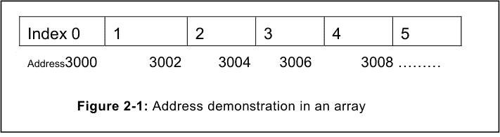

在上述语句中，number 充当数组标识符。这里创建了一个整数类型的数组，能够存储 10 个整数类型数字。如果我们假设整数的大小为 2；也假设数组的第一个地址为 3000，那么我们可以计算后续元素的地址。数组各种元素的地址计算已在图 2.1 中说明。

在数组中，元素一个接一个放置；然而，在任何索引/下标处的存储都是可能的。例如，如果元素的到达顺序为 15、10 和 7，则它们不一定必须分别存储在索引 0、1、2。我们可以根据可用性将它们存储在数组的任何索引处。例如，第一个元素可以存储在数组索引 2，10 存储在索引 1，元素 7 存储在索引号 0。这些元素的初始化如下：

```
array [2] =15;

array [0] =10;

array [1] =7.
```

然而，作为良好实践，建议使用连续地址进行存储。相应地，要访问存储在第 4 个索引处的数组元素，需要使用语法 array [4]。值得一提的是，存储在数组第 5 个位置的元素将被访问（因为索引从 0 开始）。例如，如果数组为 **int array1 = {4, 9, 12, 67, 90, 45}**，在这种情况下，array1 [4] 将为 90。因为，索引 4 即数组的第 5 个元素的值为 90。

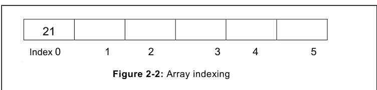

数组提供了许多优点，例如它消除了创建许多变量的需要。因此，程序的复杂度大大降低。另一个优点是数组相对于动态分配的变量更快。以下程序演示


## 数据结构简明教程

数组的使用。

```cpp
程序：使用数组接收并显示五个成绩
int main ()
{

//创建一个用于存储五个元素的数组
int marks [5];
int i;
// 输入五个元素
cout<<"请输入五个学生的成绩";
for (i=0; i<=4; i++)
cin>>marks[i];
cout<<"五个学生的成绩为："<<endl;
//显示五个学生的成绩
for (i=0; i<=4; i++)
cout<<marks[i] <<endl;
return 0;
}
```

类似地，我们可以从给定的元素集合中找出具有最大值的元素。我们将使用数组来存储这些元素。

```cpp
// 程序：输入5个随机数并找出最大元素。

（提示：假设第一个元素为最大元素）

int maximum (int a [])
{
int i=0;
int m=a [0];
while (a[i])     // 检查数组中的所有元素
{
if (a[i]>max)     // 如果数组元素大于最大值
max=a[i];    // 将该元素设为最大值
i++;  // 递增下标
}
return max; //返回最大值
}
```

### 2.2.2　数组的初始化

除了使用输入技术赋值外，数组还可以在创建时初始化。一旦数组在创建时初始化，就无需声明数组的大小。

```cpp
int A[5] = {45, 6, 7, 8, 12};      (1)

int A[] = {45, 6, 7, 8, 12};        (2)
```

上述(1)是冗余的，因为数组在创建时已初始化。因此，建议使用(2)所示的语法，因为编译器会根据初始化的元素数量自动分配数组大小。

```
程序：在创建期间初始化数组

解决方案：

void array1 ()
{
int arr [] = {12, 5, 67, 98, 54};
int i=0;
while(arr[i])
{
cout<<arr[i]<<endl;
i++;
} //while 语句结束
} //函数结束
```

在上述程序中，数组在创建时初始化。这里的数组大小将为5，如果用户试图将数组大小初始化为比如 arr [3]，那么编译器也会将其覆盖，新大小将为5。在我们知道要枚举的值的数量时，这一特性极为有用。

```
程序：编写一个演示在创建时初始化数组的程序。

void array1 ()
{
int arr [] = {12, 5, 67, 98, 54};
int i=0;
while(arr[i])
{
cout<<arr[i]<<endl;
i++;

```
```
} //while 语句结束
} //函数结束
```

#### A. 初始化的特殊情况

除了上述初始化方法之外，还有一种值得在此讨论的初始化方法。在此方法中，我们不逐个初始化所有下标，而是只初始化一个下标，其余下标由编译器初始化。程序语法如(3)所示。

```
int arr [8] = {0};
(3)
```

在上述语句中，所有的数组下标都将被初始化为0（即 arr[0] 到 arr[7]）。

但考虑另一个示例：

```
int arr [7] = {4};
(4)
```

在上述情况(4)中，并非所有下标都被初始化为数据4；相反，第七个下标将具有值4，而其他下标则仅具有值0。方法(3)在我们需要将数组的所有下标初始化为0或任何其他值的情况下非常有用。

#### B. 基于整数数组的问题及其解决方案

在本节中，我们将讨论一些与整数数组相关的有趣问题及其解决方案。

```
程序：在数组中搜索元素。
void array1 (int arr [], int element) // 要从 arr 数组中搜索的元素
{
int i=0;
int found=0;                //最初，未找到元素
while (arr[i])    // 一直运行到数组中不存在元素
{
if (arr[i] ==element)    //找到元素
{
found=1;
break;            //终止进一步搜索
}
i++;
}      //while 语句结束
return found; //现在我们需要返回找到的状态
} //函数结束
```

解释：在此程序中，用户打算从数组中搜索一个元素。为了实现这一目标，需要从第一个下标开始扫描数组，直至到达最后一个下标。在搜索过程中，有两种可能性：i) 元素存在于数组中。ii) 元素不存在于数组中，在第二种情况下，found 应返回假值。如果在数组中找到元素，循环应在找到元素的位置终止，而不是继续运行到末尾。found 的值应改为1，表示成功。最终，将假值返回给调用者。

```
问题：统计数组中大于给定数字的元素个数
//函数：计算值大于给定数字 'n' 的元素个数。
int countNumbers(int array [], int number)
{
int count=0;
int i=0;
while(array[i])
{
if (array[i]> number) // 测试数组元素是否大于数字
count++;   //递增计数
i++;  //递增数组下标
}
return count;     // 返回计数
}
```

解释：在此程序中，我们打算统计数组中大于给定数字(n)的元素个数。在这种情况下，我们必须从第一个元素开始扫描数组，并一直持续到最后一个元素。每次运行时，都需要将数组元素与给定数字进行比较，如果大于给定数字，则每次递增 count 变量。最终，保存计数的变量返回给调用者。

```
程序：将数组元素修改为某个特定的倍数。例如，如果倍数是5，则应将每个元素乘以5。
void increase (int array1 [], int mul)
{
int i=0;
while(array1 [i])
{
//将元素乘以给定的倍数
```

```
```c
while(name[len++]!='\0');  // 从头到尾
return len;                 //返回长度。
}
```
```

在上述程序中，从第一个下标开始遍历数组，我们递增下标直到到达数组末尾。一旦到达数组末尾，数组长度即返回给调用函数。

这些函数对其他字符串函数有很大帮助。相应地，我们可以判断一个给定的字符串是否为回文。如果从左或从右读取结果相同，则该字符串称为回文。例如，madam、Malayalam、nitin、pop 等是广泛使用的字符串回文。

为了判断字符串是否为回文，需要将第一个元素与最后一个元素比较，第二个元素与倒数第二个元素比较，以此类推，直到到达中间元素。如果所有这些元素都相同，则给定的字符串称为回文，否则不是回文。下面给出了判断回文的函数。

```c
// 程序：判断字符串是否为回文（// 创建
// palindrome 函数并接受一个字符串类型的参数）

int palindrome(char str[])
{
int l=length(str);       // 求出字符串的长度

int i=0, flag=1;

while(i<=l) // 执行循环直到中间元素
{

if(str[i]!=str[l])
{
flag=0;                 // 将标志值设为假并跳出循环
break
}
i--;
l--;
}

return flag;            // 将标志值返回给调用函数
}
```

#### 2.2.3.1　字符串程序

在上述函数中，我们假定给定的字符串是回文，相应地，flag 被设为真。在 while 循环中，我们将第一个元素与最后一个元素比较，如果两者相同，则将第二个元素与倒数第二个元素比较。如果这两个也相同，则继续测试其余元素的相等性。这一过程将持续到字符串遍历完毕。在任意时刻，如果匹配的字符不相同，则将 flag 设为假，并终止对元素进一步测试。最终，flag 返回给调用函数，在那里对 flag 的状态进行评估，以显示相应的消息（真或假）。

除了上述讨论的字符串程序之外，还有许多其他有趣的数组程序。其中几个已在详细讨论中涉及。

#### A. 连接两个字符串的程序

在日常使用中，我们需要将第二个字符串与第一个字符串连接起来。例如，在存储名字和姓氏的数据库中，需要将第二个名字与第一个名字连接起来，最终显示连接后的字符串。

```c
// 程序：将第二个字符串连接到第一个字符串
// 函数：将 string2 连接到 string1
void concate(char s1[],char s2[])
{
    int i=0,j=0;
    // 运行到第一个字符串的末尾
    while(s1[i]!='\0')
        i++;
    // 从末尾将第二个字符串连接到第一个字符串中
    while(s2[j])
    {
        s1[i]=s2[j];
        i++;
        j++;
    }
    s1[i]=s2[j];    // 将空字符复制到第一个字符串中
}
int main()
{
    clrscr();
```


```
char str[40];
cout<<"Enter string "<<endl;
cin>>str;
char str1[]="singh";
concate(str,str1);
cout<<"String after concatenation"<<str<<endl;
getch();
return 0;
}
```

#### B. 将一个字符串复制到另一个字符串的程序

在这个程序中，我们将一个字符串复制到另一个字符串中；这里我们考虑将第一个字符串复制到第二个字符串。要将字符串一（str1）复制到字符串二（str2），必须将str1的字符逐个复制到str2中，直到str1的字符全部复制完毕。复制完成后，str1的空字符（NULL）也会被复制到str2中。否则，生成的字符串将没有空字符，这会给后续操作（如显示、计算字符串长度等）带来问题。下面的程序演示了这一点。

```
//function to copy first string into second
void strcpy(char s1[],char s2[])
{
int i=0;
while(s1[i]!='\0')
{
s2[i]=s1[i];
i++;
}
s2[i]=s1[i]; //copy the null character
}
```

### 2.3 二维数组

在二维数组中，元素按行和列排列。二维数组的索引从第0个索引开始。创建二维数组的语句如下所示：

```
int A[row][column]; //declaration
```

```
int A[5][4]; // should have constant type parameters
```

在上述语句中，将创建一个具有5行、每行4列的矩阵。
在计算机中，元素将按单行排列，其索引从0开始。
如下图所示。

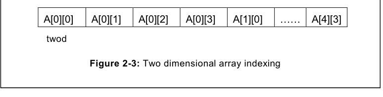

当列的索引达到最大值时，第二行的索引才会开始。在上面的例子中，声明的列总数为4，因此第1行将在第0行耗尽列的上限（即3）之后开始。然而，在随机存储中，我们可以将元素存储在二维数组中的任意位置，而无需等待所有列填充完毕。这意味着类似 A[3][3]=90 的语句是允许的，无论前面索引中的元素处于什么状态。

#### 2.3.1 二维整数数组

二维数组也称为矩阵。与一维数组类似，二维数组可以在创建时进行初始化。创建时初始化矩阵的方法如下所示。

```c
Int x[3][4]={
        {1, 2, 3, 4},
        {5, 6, 7, 8},
        {2, 4, 6, 3},
};
```

上述矩阵有三行四列。相应地，我们也可以通过以下方式创建二维数组：

- 声明二维数组
- 初始化二维数组的元素。

以下小节描述了如何接收和显示矩阵。

#### A. 接收矩阵的程序

如前所述，对于二维数组，第一条语句用于声明该数组是特定数据类型的二维数组。为实现这一目标，我们可以使用以下语法：

```c
int mat[3][4];
```

这里使用的关键字“int”表示该二维数组是整数类型。Mat[3][4] 表示它将包含三行四列。之后，我们可以使用嵌套循环来接收矩阵的元素。外层循环表示行，内层循环表示列。完整的程序将在后续页面中展示。

```
**Program:** Program to accept the matrix and to display it.
**Solution:**

void inmatrix(int mat[3][4]) //function inmatrix accept the matrix
{
int i,j;
cout<<"enter the element of the matrix";
for(i=0;i<=2;i++)      // start of outer loop
{
for(j=0;j<4;j++)      //start of inner loop
{
cin>>mat[i][j];
}
}
void display(int mat[3][4]) // function to display the elements input previously
{
int i,j;
cout<<"element of the matrix are :"<<endl;
for(i=0;i<=2;i++)      // start of outer loop for the row
{
for(j=0;j<4;j++)      //inner loop for columns
{
cout<<mat[i][j];
}
//change the line after completion of the row
cout<<endl;
}      //completion of column loop
//void type therefore no need to return any value
}
```

#### B. 求两个矩阵之和的程序

在数学课程中，我们已经学习了矩阵求和的方法。基本规则是，两个矩阵相加时，将第一个矩阵的第一行第一列的元素与第二个矩阵的相应元素相加。相加得到的结果存储在第三个数组中。在我们的例子中，我们将第三个数组命名为“result”。对第二个及后续元素执行相同的过程。当所有元素都处理完毕后，程序终止。

```
Program: To sum two matrix
void sum(int matrix1[2][3],int matrix2[2][3])
{
int result[3][4];
for(int i=0;i<3;i++)
{
for(j=0;j<=3;j++)
{ //storing the sum of matrix1 and matrix2 into result matrix
result[i][j]=matrix1[i][j]+matrix2[i][j];
}
}
}
```

#### C. 矩阵转置的程序

在矩阵中，如果我们将矩阵的行与相应的列互换，则称为矩阵的转置。在矩阵转置中，我们将第一行与第一列互换，第二行与第二列互换，依此类推。

我们可以通过将行换成列、列换成行来实现矩阵的转置。为了实现这一目标，我们创建了transpose函数，该函数将行转换为列，并将结果元素存储到名为tp的临时矩阵中。一旦矩阵被转置到tp矩阵中，它就会被复制回原始矩阵。下面的程序演示了这一点。

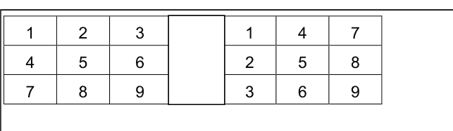

图2-4：矩阵的转置

```
Program: To transpose the matrix; (elements of row and columns are interchanged)
void transpose(int m[3][3]);
int main()
{
clrscr();
int matrix[3][3]={{3,4,5},
                {6,7,8},
                {9,10,11}};
    int i, j;
    cout<<"Matrix output"<<endl;
for(i=0;i<=2;i++)
{
for(j=0;j<=2;j++)
{
cout<<matrix[i][j]<<"\t";      // display of matrix element
}
cout<<endl;
}
transpose(matrix);      //transposing the matrix
cout<<"Matrix after transpose"<<endl;
for(i=0;i<=2;i++)
{
for(j=0;j<=2;j++)
{
cout<<matrix[i][j]<<"\t";
}
cout<<endl;
}
getch();
return 0;
}

//program to transpose the matrix
```

```cpp
void transpose(int matrix[3][3])
{
    int tp[3][3];
    int i,j;
    for(i=0;i<=2;i++)
    {
        for(j=0;j<=2;j++)
        {
            tp[j][i]=matrix[i][j];  // transposing and storing in tp matrix
        }
    }
    cout<<" Matrix after transpose"<<endl;
    for(i=0;i<=2;i++)
    {
        for(j=0;j<=2;j++)
        {
            matrix[i][j]=tp[i][j];  // Reassigning the tp back to the matrix
        }
        cout<<endl;
    }
}//end of the function
```

#### D. 两个矩阵相乘的程序

我们知道，在两个矩阵相乘时，确定相乘的可行性非常重要。相乘的可能性可以通过第一个矩阵的列数与第二个矩阵的行数来判断。如果两者相同，则可以进行乘法运算，否则相乘是不可能的。根据上述乘法规则，我们可以确定结果矩阵的行数和列数。

```cpp
Program : Program to multiply two matrices

void multiply(int a[r1][c1], int b[r2][c2])
{
    int c[c1][r2];
int sum=0;
if(c1!=r2)
```

{
cout<<" multiplication not possible"<<endl;
getch();            // wait for the key to be pressed
return;             // return to the calling function
}
//if the matrix product is possible, in that case
for(int i=0;i<=c1;i++)
{
    value=1;
for(j=0;j<=r2;j++)
{
for(k=0;k<c2;k++)
sum=sum+a[i][k]*b[k][j];
}
c[i][j]=sum;
sum=0;
}

矩阵的对角线元素很容易追踪。在矩阵中，存在两种对角线，即前向对角线和后向对角线。我们在讨论中考虑前向对角线，下面的例子展示了这一点。

```
Program to display the forward diagonal of the matrix
void fordiagonal(int matrix[][])
{
int row,col;
for(row=0;row<n;row++)
{
col=row;    // diagonal can be accessed if both row and
           //column index are same
cout<<matrix[row][col];
}
}}
```

二维字符数组在存储多个名称时具有重要作用，因为名称只能存储在二维数组中。可以使用以下语法创建二维字符数组。

```
char name[number][length];
```


这里的第一个参数表示要输入的名字数量，而第二个参数[length]表示名字可以取的最大长度。

输入10个名字的程序已经在这里讨论过了。

程序：编写一个程序，可以接受10个名字，并显示输出

## 解决方案

```
char name[10][40];
void main
{
int i=0, j=0;
cout<<"enter 10 names";
for(i=0;i<=9;i++)
cin>>name[i];
cout<<" here is the output of names";
for(i=0;i<=9;i++)
cout<<name[i]<<endl;
}
```

读者应当重点了解，二维字符数组的元素可以借助指针轻松访问。

### 2.4 指针

指针是一种变量，能够保存另一个变量的地址。在许多情况下需要保存另一个变量的地址，包括：

-   访问数组元素
-   从函数中改变变量的值
-   动态分配内存
-   在复杂编程中，如链表、树、B树等

为了表示某个变量是指针，它们前面会加上符号“*”。例如，`int *x`，这里的指针是整数类型。这意味着该指针可以保存整数类型变量的地址。

### 2.4.1 声明指针

如前所述，指针是一种能够保存另一个变量地址的变量，相应地，我们需要一个变量，其地址可以存储在指针中，从而我们可以借助指针访问该变量。要声明指针，变量名前面加上星号（*）符号，下面的程序已经演示了这一点。

```
int x=8;
int *p;// variable that is pointer of int type
p=&x; //p now holds the address of variable x
cout<<p;   // print the address of x;
cout<<*p;   // print the value pointed by p;
```

上述语句的工作方式已在图2.5中说明。最初，声明变量“x”，并假设它被分配了地址位置1000。类似地，当声明 `int *p` 时，它也像其他任何变量一样被分配地址。这里我们假设指针“p”被分配了一个新地址，位于内存位置1010。因此，我们可以得出结论：两者是不同的变量，适用于变量的定义仍然适用于指针变量。此外，适用于指针变量的操作也可以应用于它们。

### 2.4.2 访问指针变量

指针也是一个变量，但它不是保存值，而是保存另一个变量的地址。我们假设它保存的是变量“x”的地址，即地址1000。现在，它的值部分将包含1000这个地址，如图2-5所示。当用户显示这个指针的值时，他会得到这个地址作为值。

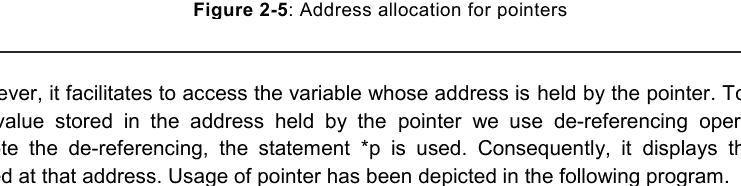

然而，它便于访问指针所保存地址对应的变量。要访问指针所保存地址中存储的值，我们使用解引用运算符。为了表示解引用，使用语句 `*p`。因此，它会显示存储在该地址的值。指针的用法已在下面的程序中描述。

```
// Program to display the use of pointer
int x=8;
int *p;
p=&x;
cout<<" value of x "<<x // 8
cout<<" value of p="<<p //1000
cout<<" value pointed by *p"<<*p;   // 8 will be printed
```

## 数据结构简化

```
```cpp
*p=30;

cout<<" value of x"<<x; // 30

cout<<" value of p="<<p;          1000

cout<<" value of *p="<<*p;    // 30
```
```

指针广泛用于字符数组（字符串）。同样，指针也用于整数数组。指针在数组中的用法将在后续章节中描述。

### 2.4.3 指针的指针

有时，我们需要存储一个指针的地址，这可以借助指针的指针来完成。指针的指针是一个变量，它保存另一个指针类型变量的地址。

#### 声明指针的指针

声明指针的指针与普通指针类型不同。在指针的指针表示法中，标识符前有两个星号（**）。

-   `int **pp;`             (2.4.1)
-   `int *p;`                (2.4.2)
-   `pp=&p;`                 (2.4.3)

在第2.4.1行中，声明的变量是指针的指针类型。它能够存储另一个指针变量的地址。在第2.4.3行中描述了将指针的地址存储到“指针的指针”中的表示法。指针的指针类型的用法通过以下示例说明。

```
```cpp
// Program to display the use of double pointer
#include<iostream.h>
#include<conio.h>
int main()
{
int v=20;
int *p;
int **pp;
// Assigning address to pointer
p=&v;
pp=&p;
cout<<"value of v="<<v<<endl;
cout<<"Address of v="<<&v<<endl;
cout<<"Address held by p="<<p<<endl;
cout<<" Address of p="<<&p<<endl;
```

```
cout<<"Valued de-referenced of p:"<<*p<<endl;
cout<<" Address of pp:"<<&pp<<endl;
cout<<"Address hold by pp:"<<pp<<endl;
cout<<"Valued de-referenced of *pp:"<<*pp<<endl;
cout<<"Valued de-referenced of **pp:"<<**pp<<endl;
getch();
return 0;
}
```

## 输出

Value of v=20;

Address of v=0xfc1fff4

Address of *p=0xfc1fff2 // Now address of p

Address held by p=0xfc1fff4   //Address hold by p (i.e. of v)

Valued de-referenced of p=20  //de-referencing the value of p (i.e. of v)

Address of pp=0xfc1fff0      // Now address of pp

Address held by pp=0xfc1fff4  //Address hold by pp (i.e. of p)

Valued de-referenced of pp=20 // de-referencing the value of pp(i.e. of v)

### 2.4.4 指针在数组中的使用

指针广泛用于数组。要访问数组元素，我们可以将数组的索引初始化给一个指针变量。例如，在数组“a”中，我们用一个数字列表对其进行了初始化。借助指针访问数组元素已在下面的程序中描述。

```
// Program to access the array element with the help of pointers
int main()
{
int a[]={10,50,20,40,70};
int *x;
x=&a[0];
cout<<x<<endl;
cout<<*x;        //output 10
cout<<*(x+2);        // output 20
cout<<a[2];     // output 20
cout<<*(x+3);        // output 40
```

```
```cpp
cout<<a[3];        // output 40

return 0;
}
```
```

在上面的程序中，指针用数组的基地址进行初始化。因此，语句 `*x` 显示存储在索引“0”处的元素。当使用语句 `*(x+2)` 时，它表示将2加到基地址上，结果得到 `x[2]`。因此，`*(x+2)` 和 `x[2]` 访问的元素结果是相同的。同样，语句 `*(x+3)` 将得到0+3，即第3个索引。相应地，将访问存储在第3个索引处的元素。

### 2.4.5 动态数组的创建

在创建数组时，数组大小可以在运行时或编译时分配。相应地，它可以分为：

-   静态数组
-   动态数组

在编译时分配大小的数组称为静态数组。前面章节中讨论的数组都属于静态数组的范畴。

另一种类型的数组是动态数组，动态数组的空间在运行时分配。在C++中，创建动态数组是借助 `new` 运算符来完成的。下面的示例对此进行了说明。

```
```cpp
程序：创建动态数组并讨论其各种初始化方式。

解决方案：

#include<iostream.h>

#include<conio.h>

int main()
{
int *x;

int *y;
y=new int(45);
x=new int[4];
clrscr();
// elements initialization will follow
x[0]=90;
x[1]=55;
x[2]=32;
```

```
```cpp
x[3]=67;

// From this statement onwards dynamic array will be created.
int i=0;
cout<<"Dynamic array elements are"<<endl;
while(i<3)
{
cout<<"x[i] i="<<i<<"  "<<x[i]<<endl;
i++;
}
cout<<"y ="<<*y<<endl;
getch();
return 0;
}
```
```

```
```cpp
// Program to initialize the dynamic pointer.
#include<conio.h>
int main()
{
int *y;
clrscr();
y=new int(45);
int i=0;
cout<<"y ="<<*y<<endl; //Output will be 45
getch();
return 0;
}
```
```

### 2.4.6 指针数组

指针数组是一个保存指针（地址）的数组。在需要存储多个相似类型指针的地址时，指针数组的使用非常重要。指针数组便于访问，同时提高了所编写程序的效率。指针数组主要用于处理二维数组类型的问题。例如，如果我们打算存储两个或更多数组，那么我们可以使用指针数组。使用指针数组访问三个数组的示例已在下面的程序中描述。


// Program: Create a program to access integer arrays using array of pointer.
Solution:
#include<iostream.h>
#include<conio.h>
int main()
{
int a[]={26,89,4};
int b[]={98,5,42};
int c[]={78,6,23};
int *arrp[4];
arrp[0]=a;  // Storing the base address of array a
arrp[1]=b;  // Storing the base address of array b
arrp[2]=c;  // Storing the base address of array c
cout<<"Output of the array is"<<endl;
int i=0;
for(i=0;i<=2;i++)
{
for(int j=0;j<=2;j++)
{
cout<<arrp[i][j]<<" ";
}
cout<<endl;
}
return 0;
}

在上述程序中，我们使用指针数组来存储三个数组的地址。由于命名数组表示第一个基地址；因此，这些数组指针保存了所分配数组的第一个地址的地址。使用指针数组，我们可以像上述程序中所示的那样访问数组的各个元素。

指针数组的另一个潜在用途是在字符数组（也称为字符串）中，这里可以存储 'n' 个实体的详细信息，并且这些详细信息可以使用指针数组轻松访问。

在下面的程序中，我们演示了如何将保存值的各种数组轻松地与指针数组链接起来，并可以轻松访问其值。

Program : Accessing of character array(string) using array of pointers
#include<iostream.h>
#include<conio.h>
int main()
{
char ca[]="first";
char cb[]="second";
char cc[]="third";
char *cp[3];
cp[0]=ca;
cp[1]=cb;
cp[2]=cc;
cout<<"Output of the array is"<<endl;
int i=0;
    cout<<" Output of character array"<<endl;
    for(i=0;i<=2;i++)
    cout<<"output of array "<<i+1<<cp[i]<<endl;
getch();
return 0;
}

# Output

Output of array 1 first
Output of array 2 second
Output of array 3 third

在字符指针中，语句 cp[0]=ca 保存字符数组 ca 的基地址 Correspondingly, cp[1]=cb 保存字符数组 cb 的基地址，cp[2]=cc 保存字符数组 cc 的地址。在 for 循环中，显示字符数组的第一个地址的值，它继续向前移动直到遇到 '\0' 字符为止。因此，第一个字符的结果将被显示。同样，其他数组元素的输出将在后续迭代中逐一显示。

## EXERCISE

### Descriptive Type Questions

+   1. How array is different from other variables.
+   2. What are the advantages of array?
+   3. An array is consisting of 10 elements. Delete the 4th element; correspondingly move the remaining elements, so that now array should consist of 9 elements.
+   4. In the above array, insert the element at 3rd position and move the third to nth element to the right hand side, so that there is no overlapping.
+   5. Write a program (WAP) to find out the minimum element from the given array.
+   6. Write a program to increase the value of each array element by 2. For instance, if the array element were 2, 3, 9, and 4 then after adding 2 they should become 4, 5, 11, and 6.
+   7. WAP to find out the maximum and minimum element hold by the array. Use only one function, these minimum and maximum variable should be capable to be accessed from any other function.
+   8. Write a program to swap the first element with the second, third with forth, till the end of an array.
+   9. Write a program to swap first element with the last element, second element with the penultimate element and so forth. After making changes see the changes by creating a new function name it as display.
+   10. Write a program to merge the element of two arrays into the third array.
+   11. Write a program to store the string into the array without initializing it or accepting from the keyboard.
+   12. Write a program that eliminates the immediate repetition. For instance, if the string is ‘ijjiitie’ then the resultant string should be ‘jitie’.
+   13. Write a function to copy the string into another array.
+   14. Write a program to capitalize the first element of an array.
+   15. Write a program that accepts numbers, character and special characters. Your program should count the number of characters, numbers and special characters.
+   16. Write a program that accept the string in small case and converts all the character into upper case.
+   17. Character array is of size 20; write a program that extracts the character from 4th position to 9th position.

### Predict Output

```
int x[]={3,8,5,90,12,34};
int y=2;

cout<<x<<endl;
```

```
```cpp
cout<<*x<<endl;
cout<<*(x+3)<<endl;
cout<<*(x+y)<<endl;
```
```

+   2. ```cpp
+   `int *x=new int[4];
+   int *y=new int(4);
+   ```

+   3. ```cpp
+   char x[]="jitendra";
+   cout<<x;
+   cout<<*x;
+   cout<<*(x+1);
+   cout<<(x+1);
+   cout<<*(x+3);
+   cout<<(x+3;
+   cout<<x+3;
+   cout<<*x+3;
+   cout<<(*x)+3;
+   ```

# Find out error(s), if any, in the following codes.

```
```cpp
Problem 1
int x[5]={4,6,1.89,8};
cout<<x;
cout<<*(x+5);
cout<<*x+4;
```
```

```
```cpp
Problem 2
int x[4]={67,9,2,78,45,54};
cout<<x;
for(int i=0;i<4;i++)
cout<<x[i];
```
```

## Problem 3

```
int x[4]= {67,9,2,78,45,54};
int y=2;
cout<<*(x);
cout<<x;
cout<<*(x+y);
x=x+y;
cout<<x;
cout<<*x;
```

## Problem 4

```
int x[2]= {67,9,2,78,45,54};
int y=2;
cout<<*(x);
cout<<x;
cout<<*x+y;
```

## Link List

## Chapter Objective

- Describe and create link list
- Display/Traversal in a link list
- Inserting a node at various position
- Deletion of any node in a link list
- Reversing the link list
- Operator overloading in a link list
- Application of a link list
- Limitation of a link list and defining circular link list
- Benefits of circular link list .

### 3.1 INTRODUCTION

Array suffers from the size limitations, specifically, if the number of elements to be stored in the array is not known in advance. In such cases usage of array is inefficient. Consider a case in which array size allocated is more but items to be inserted are less. This will lead to wastage of array space. On the other hand, if size of an array defined is less and elements to be stored in the array are more, in that case many elements would not be placed inside an array. To address the variable need of data storage, a new data structure known as link list has been envisioned.

This chapter highlights many significant features of the link list that includes:

- Creating the link list.
- Display of the link list.
- Inserting the node in a link list.
- Deleting the node from a link list.
- Usage of operator overloading in a link list( +operator)
- Searching an item from a link list.
- Orderly link list
- Reversing the link list.
- Circular Link list

### 3.2 CREATION OF LINK LIST

The complex part of the link list is its creation. It can be accomplished by creating the nodes and then connecting them immediately after creation. In a link list, the smallest entity is node and is created dynamically. Each node consists of two parts

- Data Part
- Address part

Data part is capable to hold the data in a node. This data may be simple type or complex type like structure or any other data type created by the user. Whereas, address part represent the address of next node. Initially, there is only one node therefore, it’s next pointer holds NULL. Structure of a node is illustrated in the figure 3.1.

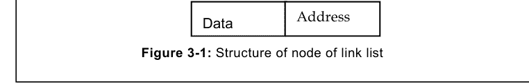

In the figure 3.1, data part will hold the user’s data, whereas address part points to the address of a next node. Structure of a node can be defined as:

```
// Creating the template for the node
class node
{
public:
int data;
node *next;
};
```

During the dynamic creation of first node ‘new’ operator is used for allocation of address of next node. It is introduced in C++, since it was lacking in ‘C’ language. New operator is an improvement over the earlier malloc function of ‘C’. For instance, no casting is needed in ‘new’ operator, whereas it was needed in malloc function. To create a node, we can use the syntax as given below:

```
node *one;
one=new node;// node created
one->data=10;
one->next=NULL;
```

A. Creation type

During the creation of a link list, it can grow in forward or the backward direction. This is entirely governed by the method of insertion of a new node either:


- 在链表的末尾，或
- 在链表的开头/前端

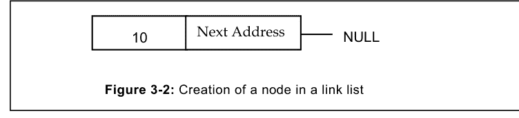

从末尾插入时，新节点被放置在现有链表的末尾。例如，在已有节点 10 的链表中插入值为 20 的节点，如下图所示。这里，20 将被放置在 10 之后，并且指针将被适当地调整。插入 20 之后，假设我们必须在现有链表中插入 30。图 3.3(b) 中展示了相同的情况。这被称为链表的后向增长，因为新节点被附加在末尾。

类似地，我们可以创建一个前向增长的链表。在前向链表中，新节点被插入到开头，而不是末尾。图 3.4 中展示了相同的情况。考虑图 3.4 的情况。在这种情况下，已经存在一个值为 5 的节点。创建值为 10 的新节点；相应地，它将被插入到现有链表的开头。类似地，新到达的节点是 20。它将被放置在 10 的开头（参见图 3.4）。这种链表增长类型被称为前向增长链表。

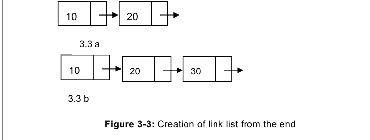

#### B. 显示节点

一旦链表创建完成，无论是前向增长还是后向增长，我们都希望查看链表中各个节点保存的数据。为了显示节点元素，我们从开头即第一个节点开始，并持续向末尾节点移动。最后一个节点的 next 指针指向 NULL，可用于停止遍历。遍历的逻辑已在下面的程序中描述：

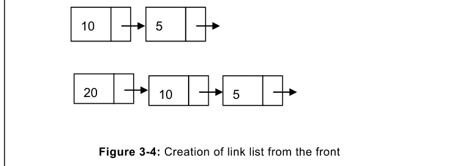

```
dnode *current;
current=first      //initialize with the first pointer
while (current!=NULL)  // moving upto the end of a list
{
cout<<"current->info"<<current->info; //displaying info part
current=current->next; //move to the next node
}
```

创建和显示链表的完整程序如下所示：

```
Program1: Create and display the node of a list. In the program, node is to be inserted from the end.
// class to define the structure of a node
class node
{
public:
int info;
node *next;
};
// class of a link list
class list
{
node *first, *end;      // creation of first and end pointer
public:
// Defining constructor for the list
list()
{
```

```
{
    cout<<current->data<<" -> ";
    current=current->next;
}
```

#### C. 通过在开头插入来创建链表

链表也可以通过将元素插入到开头来创建。被附加的新节点成为链表的第一个节点。例如，如果要为序列 10、20、30、5、9、100 创建链表，那么链表将如图 3.5 所示增长。

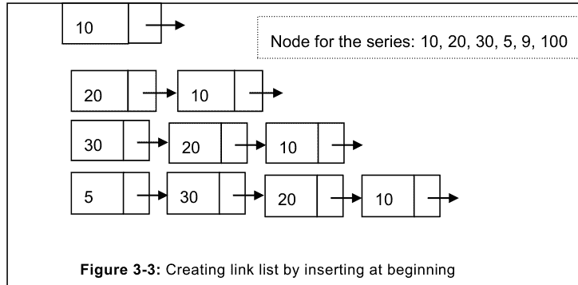

一旦新节点被创建，它将被连接到已有链表的第一个节点，因此现有的第一个节点将移动到第二个位置。因此，新节点应该成为第一个节点。在链表中插入节点的完整程序如下所示：

```
//function to create the list from the beginning
void list::create_beg(int el)
{
    node *current,*temp;
    // if the list does not exist
    if(first==NULL)
    {
        first=new node;
        first->data=el;
        first->next=NULL;
        end=first;
```

```
return;
}
// If the link list exist then program will start from here
current=new node;
current->data=el;
current->next=first; //link current to first
first=current; // make the current node as first node
} //end of create_beg
```

### 3.3 在现有链表中插入节点

在现有链表中，节点可以按用户的意图插入到任何位置。然而，从程序的角度来看，我们需要考虑两种情况，它们将涵盖所有插入位置。这些情况可以是：

- 第一个位置
- 除第一个位置以外的其他位置

所有这些情况及其连接方法将在以下小节中描述。

#### 3.3.1 在第一个位置插入

考虑如图 3.6 所示的链表。在这个链表中，一个新节点将被放置（插入）在开头。为了实现这个目标，首先我们必须创建新节点，并将这个新节点附加到现有第一个节点之前。此操作如图 3.6 所示。

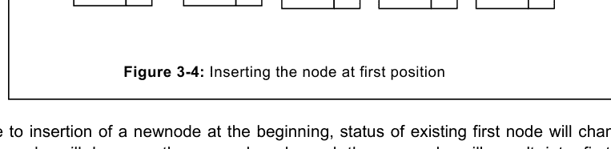

由于在开头插入了新节点，现有第一个节点的状态将改变。因为第一个节点将变成第二个节点，而新节点将成为第一个节点。因此，first 指针必须移动到新节点。完整的操作顺序描述如下：

##### 在第一个位置插入的方法

要在第一个位置插入节点，需要遵循以下顺序。

- 创建新节点
- 将其链接到第一个节点
- 将 first 节点的位置改为这个新节点。
- 返回这个新第一个节点的指针

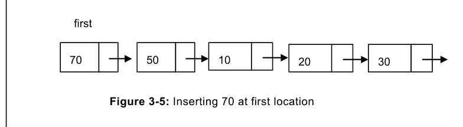

假设链表包含的项目为：50、10、20、30。要插入的新元素是“70”。现在第一个节点移动到第二个节点，新节点成为第一个节点。结果链表如图 3.5 所示。代码如下：

```
newnode=new node;
newnode->data=el;
newnode->next=first;
first=newnode;
```

#### 3.3.2 在非第一个位置插入节点

为了在中间插入节点，我们将确定新节点将要插入的两个节点。

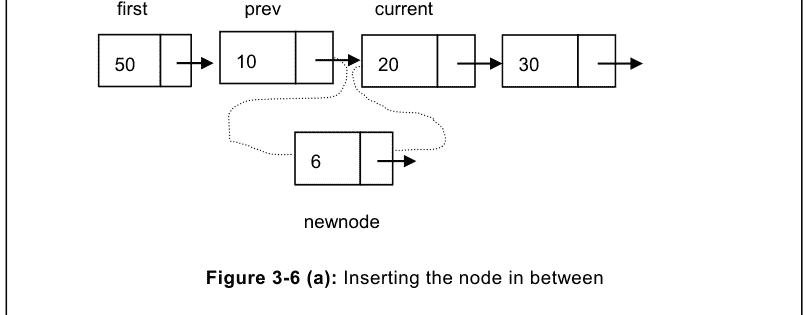

位于这个节点之前的节点将被称为前一个节点（previous node），位于这个节点之后的节点将被称为后一个节点（forward node）。在我们的程序中，我们将后一个节点命名为当前节点（current node）。图 3.6 中展示了相同的情况。

在现有链表中，前一个节点的指针需要连接到新节点，而新节点的指针需要连接到当前节点。

```
prev->next=newnode;
newnode->next=current;
```

在链表中插入节点的完整方法已在 insert 函数中描述。在讨论的函数中，我们接受作为参数传递的位置，并将其与该特定时刻链表包含的节点数进行比较。用户想要的位置不应超过现有链表大小（节点数）加 1。例如，如果节点总数为 n，那么提供的位置不应超过 n+1。

```
Program: Insert the node at any position in a list
Solution

//function to insert at particular position
void list::insert(int el, int pos)
{
node *current,*newnode,*prev=NULL;
int cnt=count();//count number of nodes
if(pos<=cnt+1)
{
current=first;
// Create a new node
newnode=new node;
newnode->data=el;
newnode->next=NULL;
int i=1;
//moving to the appropriate position
while(i<pos)
{
prev=current;
current=current->next;
i++;
}//end of while
```

```
if(prev==NULL)// to be inserted at first position
{
    newnode->next=first;
    first=newnode;
    return;
} //end of inner if
// if node is to be inserted is other than the first node
newnode->next=current;
    prev->next=newnode;
}  //end of outer if
else
cout<<"Size less than position, Try again-..\n";
}//end of function
```

上述程序非常适合在最后一个位置插入。因为当在最后一个位置插入时，涉及将新节点放置在末尾，在此之前需要将现有最后一个节点与新节点连接。新节点的插入如图 3.7 所示。

为中间位置编写的代码也支持在最后一个位置插入节点。

```
prev->next=newnode;      (1)
newnode->next=current    (2)
```

然而，prev 节点将指向最后一个节点，而 current 将指向 NULL。由于代码 (1) 将把最后一个节点连接到新节点，因此一个目标将完成。而代码 (2) 将把新节点连接到当前节点，而当前节点已经为 NULL，如图 3.7 所示。因此，该代码适用于在除第一个位置之外的任何位置插入节点。

#### 3.3.3 删除链表中的节点

链表持有数据的方式与其他类型类似，区别在于它是动态的。链表中存储的数据可能不再需要。这导致需要对链表进行另一种称为删除的操作。由于链表是借助指针连接的，因此需要格外小心，以确保即使在删除一个或多个节点之后链表仍然保持连接。在删除节点期间，需要考虑以下与位置相关的可能性。

- 删除第一个节点。
- 删除除第一个节点以外的其他节点。


#### 3.3.4 删除首节点

当用户想要删除首节点时，首节点的指针将会丢失。因此，删除首节点需要遵循以下步骤序列。

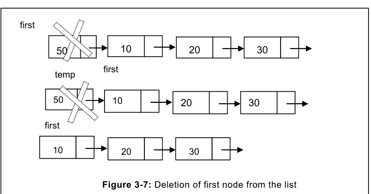

- 持有首节点。
- 找到第二个节点。
- 将首节点存入临时变量 temp。
- 将第二个节点的地址赋给首节点。
- 从链表中删除临时节点（即原来的首节点），以释放资源。

删除首节点的代码如下所示。

```
node *temp;
temp=first; //将首节点存入temp
```

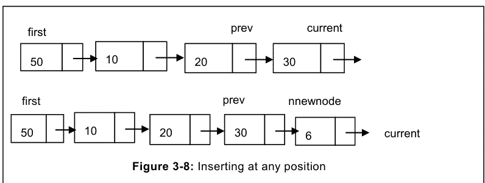

```
first=first->next; //将first指针移动到下一个节点
delete temp; //删除temp节点并释放空间
```

#### 3.3.5 删除首节点以外的节点

删除节点的完整方法已在图3.8中说明。

假设用户需要删除值为20的第三个节点。要删除此节点，需要遵循以下步骤。

- 遍历到目标节点，同时保存前一个节点的指针。
- 将目标节点（当前节点，即待删除的节点，值为20）的指针存入temp。
- 将前一个节点连接到当前节点（待删除节点）的下一个节点。

要删除该节点，用户需要在保留前一个节点指针的同时遍历到当前节点。如果前向节点的指针为NULL，则前一个指针将指向NULL。类似地，如果待删除的节点是首节点，则前一个指针将为NULL。在这种情况下，first被移动到first->forward。刚刚遍历过的节点（即前一个节点）被删除。最后，要删除中间的节点，将前一个节点的next连接到目标节点的next指针。同时，删除目标节点（即当前节点），以释放堆中的空闲空间。

```
temp=current;
prev->next=current->next;
delete temp;
```

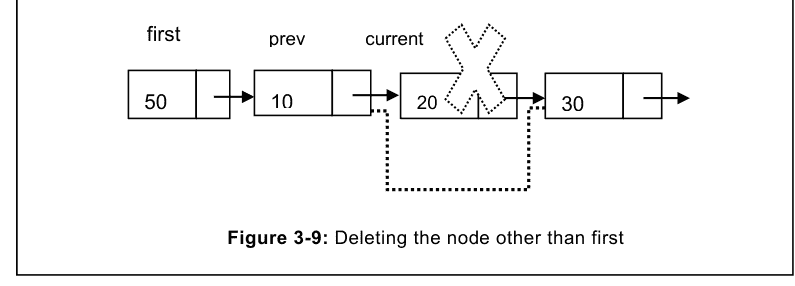

完整的程序在下面的程序中讨论。

```
从链表中删除节点的程序
void list::deletenode(int element)
{
node* current,*prev=NULL;
int found=0;

current=first;
while(current!=NULL)
{
if(current->data==element)
{
found=1;
break;
}
prev=current;
current=current->next;
}
if(found)  // 如果找到了待删除的节点
{
if(prev==NULL)  // 如果是首节点
{
prev=current->next;
first=prev;
}
else // 对于首节点以外的其他节点
prev->next=current->next;
delete current;
}
else
cout<<"element not in the list"<<endl;
}//deletenode函数结束
```

### 3.4 在链表中查找元素

链表是一种线性数据结构；因此需要从头开始查找元素。在链表中，首先在首节点处查找元素。然后依次访问后续节点，直到找到元素或链表遍历完毕。在最佳情况下，要查找的元素可能就在第一个位置。在最坏情况下，要查找的元素可能在最后一个位置。因此，在最佳情况下，复杂度为O(1)。如果节点数为'n'，则最坏情况下的复杂度为O(n)。也存在中间情况的可能性。然而，在渐近表示法中，只考虑最佳和最坏情况。查找元素的程序如下所示：

```
在链表中查找元素的程序
    int list::search(int el) //查找函数
    {
        //初始时未找到任何项，因此其值初始化为零。
        int found=0;
        node *current=first;
        while(current)
        {
            if(current->data==el)
            {
                found=1;
                break;
            }
            current=current->next;
        }
        return found;
    }//查找函数结束
```

### 3.5 有序链表

在有序链表中，元素按一定顺序排列，即升序或降序。在有序链表中，创建时需要额外的开销。然而，它在查找、寻找最小值或最大值等方面提供了出色的性能。因为在搜索过程中，不需要搜索所有元素，一旦遇到值更大的元素，循环就需要终止。因此，有序链表相对于普通链表具有更好的性能。

在有序链表中，元素从构建阶段起就按升序排列。每当要在有序链表中插入一个新节点时，都需要应用插入逻辑。例如，考虑将数字20、5、13、90、100、25插入到一个有序链表中。

详细步骤如下所述：

- 如果链表为空，则将元素插入到第一个位置。
- 在所有其他情况下，继续向右移动，直到遇到值更大的元素。
- 一旦遇到更大的元素，终止遍历。

创建节点并将元素插入其中。遍历链表中的适当位置，将新节点连接到该位置，同时将先前节点的下一个节点连接到...

```
//链表构造函数
list()
{
    first=NULL;
}
void order_list(int);
void display();
};
void list::order_list(int element)
{
    if(first==NULL)    // 如果链表不存在
    {
    first=new node;
    first->data=element;
    first->next=NULL;
    return;
    }
    //如果链表不为空
    node *temp,*prev=NULL,*current;
    temp=new node;
    temp->data=element;
    //temp->next=NULL;
    current=first;
    while((current->data < element)&& (current!=NULL))
    {
        prev=current;
        current=current->next;
    }
    if(prev==NULL)    // 如果节点要插入到第一个位置
    {
    temp->next=current;
    first=temp;
    }
    else
    {
```

```
```cpp
prev->next=temp;
temp->next=current;
}
}//函数结束

void list::display()
{
    node *current;
    current=first;
    cout<<"Ordered linked list:"<<endl;
    while(current!=NULL)
    {
        cout<<current->data<<" -> ";
        current=current->next;
    }
    cout<<endl;
}

int main()
{
    list l1;
    clrscr();
    cout<<"Creating ordered list"<<endl;
    l1.order_list(29);
    l1.order_list(14);
    l1.order_list(70);
    l1.order_list(12);
    l1.order_list(30);
    l1.order_list(121);
    l1.display();
    getch();
    return 0;
}
```
```

### 3.6 反转链表

反转链表是一项复杂的操作，需要深入理解指针。丢失任何指针都会导致节点和信息的丢失。在反转链表的过程中，我们从前往后遍历到最后一个节点。在遍历过程中，最后访问到的节点将被附加到新链表的开头，类似于从开头插入的操作。我们需要反转这个链表，如图3.11所示。在所考虑的链表中，首节点是50，最初它将附加在开头。

当新节点（即10）到达时，它将被附加在50的开头，如图3.11和3.12所示。

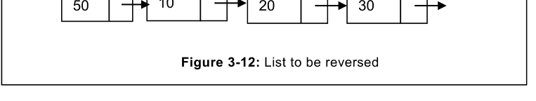

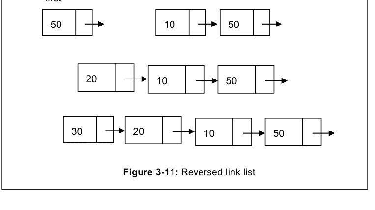

链表反转在图示中逐步演示。

```
问题：编写一个程序来反转链表
解决方案：
// 反转一个由first指针指向首节点的链表。
void list::reverse()
{
```

```
cout<<" Reverse of a list is ::"<<endl;
    // 将所有节点初始化为NULL。
        node *current,*forward,*back=NULL;
    current=first;
    forward=current->next;
    while(forward!=NULL)
    {
        current->next=back;
        back=current;
        current=forward;
        forward=forward->next;
    }
        current->next=back;
        first=current;
}
```

### 3.7 合并两个链表

由于各种原因，我们需要合并链表，以便将多个链表中的数据容纳到单个链表中。在合并过程中，需要特别注意确保两个链表中的元素在合并到第三个链表时保持有序。合并链表将带来更好的性能和管理。我们创建了第三个链表，其中存储了两个链表的内容。合并两个链表的详细方法和程序如下所述。

```
list list:: merge(list l1,list l2)// 合并链表1和链表2。
    {
        list l3;
        node *one,*two,*current;
        one=l1.first;
        two=l2.first;
        if(one->data < two->data)    // 如果第一个链表的元素较小
        {
        l3.first=current=one;
        one=one->next;// 移动到下一个节点
        }
```


## 数据结构简化

```
else
{
    l3.first=current=two;  // initialize with the first node of second list
    two=two->next;
}
while((one!=NULL) && (two!=NULL))
{
    if(one->data < two->data)
    {
        current->next=one;  // connect current to the one
        current=one;        // move one to the current
        one=one->next;      // move to the next node
    }
    else
    {
        current->next=two;  // connect current to the two
        current=two;         // move two to the current
        two=two->next;      // move to the next node
    }
}// end of while
if(one)           // if list one is not exhausted
{
    current->next=one;
}
else if(two)      // if list two is not exhausted
{
    current->next=two;
}
return l3;
}
```

### 3.8 链表中的运算符重载

运算符重载允许程序员按照自己的方式定义运算符的功能，而不是按照为基本数据类型定义的方式使用。然而，重载的使用仅限于其定义的位置和作用域，超出该范围后，它又可以按照其正常定义来使用。例如，`+` 运算符被定义为对两个整数求和。不过，它也可以用来拼接两个字符串或连接两个链表。类似地，`++` 运算符可以用来移动到链表的下一个节点。运算符 `=` 也可以用来比较两个链表中的节点数量，并返回所比较的链表长度是否相等。

我们可以使用 `+` 运算符来连接两个链表。在本例中，我们想编写语句 `List3=list1+list2`，这应得到同时包含 list1 和 list2 的 list3。为实现上述目标，代码如下：

```
list operator +(list l2)
{
while(first->next!=NULL)        // Move to the last node of the list1
first=first->next;
first->next=l2.first;  // connect the last node to the first node
of list l2
return *this;     // return the first list
}
```

为了完成上述任务，首先我们需要创建链表 l1 和链表 l2。然后，我们可以使用重载的 `+` 运算符来调用它们。main 函数的代码如下：

```
int main()
{
list l1, l2, l3;
l1.create_beg(10);
l1.create_beg(20);
l2.create_beg(6);
l2.create_beg(33);
l3=l1+l2;
```

使用相同的方法，还可以使用其他运算符，如 `==`、`<`、`>` 等。建议读者针对上述运算符编写运算符重载程序。

### 3.9 自组织链表

链表是一种线性数据结构，因此，每当用户需要执行任何操作时，都必须从第一个节点开始，一个接一个地遍历后续节点，直到到达目标节点或链表被遍历完。因此，链表的效率取决于链表的大小。如果链表很大，链表的效率就会下降。为了克服这一限制，人们设计了一种称为自组织链表的新版本链表。自组织链表能够根据使用准则重新组织节点。因此，相比普通链表，它能产生更好的性能。

根据我们的日常经验，在给定的列表中，某些项目比其他项目更常用。自组织链表利用了这种趋势，并根据可访问性组织节点。链表可以组织的可能方法有：

- 基于有序。
- 基于先来先服务（FCFS）。
- 计数法。
- 移位法。

#### 3.9.1 有序链表

在有序链表中，项目按其值排列。这意味着项目按升序或降序排列。当新项目到达时，会根据其值插入到现有链表中。这个位置可以在开头、中间或末尾。我们已经在前面详细讨论了有序链表。不过，这里将讨论其差异，并在图 3.13 中再次说明。

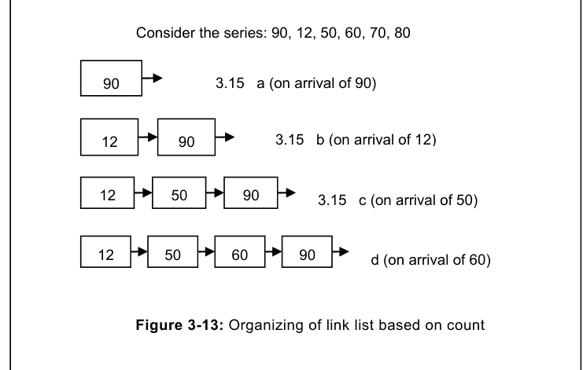

有序链表相比普通链表有以下优点：

- 在插入节点时，我们一直遍历，直到遇到一个值更大的节点或链表被遍历完。
- 在删除时，同样会进行遍历，直到找到包含目标值的节点，或者节点值小于要搜索的节点，之后搜索终止。

由于我们不需要遍历所有节点，因此相比简单链表，它能产生更好的性能。

#### 3.9.2 基于计数的链表

在基于计数的链表中，每个节点都提供一个名为 `count` 的额外数据成员。`count` 的值根据节点的可访问性来赋值。每次访问时，`count` 的值增加 1。在排列时，`count` 最大的节点放在第一个位置，而 `count` 最小的节点放在末尾。

在图 3.14 a 中，演示了链表的结构。在图 3.14 b 中，节点根据其 `count` 进行组织。`count` 最大的节点放在第一个位置。在图 3.14 c 中，如果 `count` 发生变化，节点会相应地根据其 `count` 重新排列。图 3.14 c 也对此进行了说明。

#### 3.9.3 先来先服务（FCFS）

在先来先服务方法中，节点按到达顺序排列。晚到的节点放在末尾。

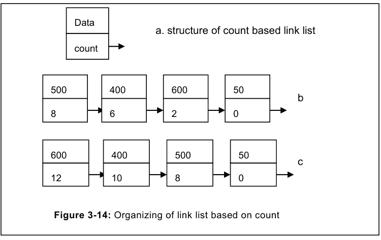

基于 FCFS 的链表的创建已在图 3.15 中说明。最初，500 到达，由于没有元素，因此它放在第一个位置。随后是 400，相应地，它被放在现有节点之后，这里现有节点是 500，见图 3.15 b。最后，12 到达，相应地，创建一个新节点并附加到现有链表的末尾，见图 3.15 c。同样的过程也适用于其他元素。

从上述描述中可以明显看出，FCFS 遵循的序列与在末尾插入类似。基于 FCFS 的算法在那些旨在根据到达时间服务元素的场景中非常有用。例如，铁路订票系统。

#### 3.9.4 移位法

在移位法中，被访问的节点向起始方向移动一个位置。这种方法与基于计数的方法相当相似。移位法的工作原理已在图 3.16 中展示。

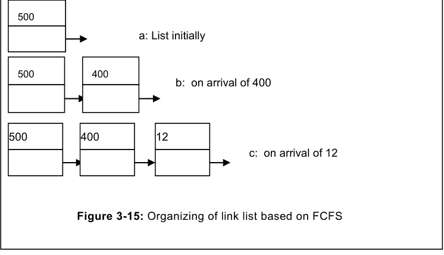

**图 3-15：基于 FCFS 组织链表**

然而，在基于计数的方法中，位置主要由计数方法决定；而在移位法中，位置由最后一次访问决定。例如，位于第一个位置的节点可能已经被访问了 5 次，因此它被放在第一个位置；而第二个节点可能一次都没有被访问过，但它仍然在第二个位置。一旦第二个节点被访问，它将与第一个节点交换位置，而不管它以前被访问过多少次。

#### 3.9.5 跳跃链表

为了显著提高性能，设计了一种称为跳跃链表的新型链表。跳跃链表是有序链表的一种特殊情况，在组织和遍历时会跳过某些节点。在这类链表中，不是逐节点遍历，而是跳过若干节点，以提高遍历或搜索节点的性能。这种链表相较于前面描述的其他类型链表具有显著优势。两种广泛使用的跳跃链表是：

- 偶数跳跃链表
- 随机跳跃链表

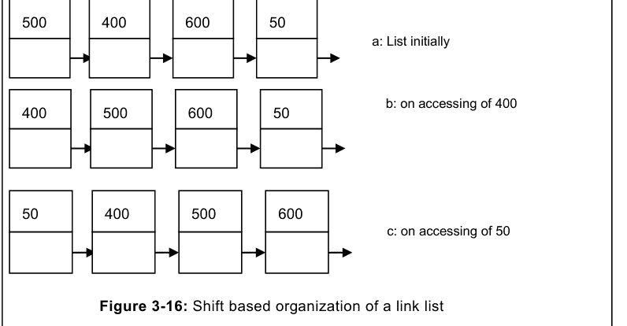

### 3.10 从主函数调用

定义了多种函数来执行各种链表操作。这些函数需要从主函数调用。定义的各种参数和函数调用方法如下：

```
// Calling the function from the main function
int main()
{
int el;
list list1,list2,list3,list4;
clrscr();
//creating the list from beginning calling
list1.create_beg(40);
list1.create_beg(2);
list1.create_beg(14);
list1.display();
cout<<" inserting 100 at 1 position"<<endl;
list1.insert(100,1);
list1.display();
cout<<" inserting 34 at 3 position"<<endl;
list1.insert(34,3);
```


## 数据结构简化

```cpp
list1.display();
cout<<" inserting 200 at 6ᵗʰ position"<<endl;
list1.insert(200,6);
list1.display();
cout<<" Total number of nodes now:\t"<<list1.count()<<endl;
cout<<" List after deleting 200"<<endl;
list1.deletenode(500);
list1.display();
cout<<" List2 inserting from the end"<<endl;
list2.create_end(1);
list2.create_end(7);
list2.create_end(3);
list2.create_end(4);
cout<<" List2 Now :"<<endl;
list2.display();
cout<<" Inserting the node in list2"<<endl;
list2.insert(70,1);
list2.display();
list3=list1+list2;
cout<<" List3 after list1+list2"<<endl;
list1.display();
if(list2.search(30))
cout<<"Element found"<<endl;
else
cout<<"Element not in the list"<<endl;
if(list4.emptylist())
cout<<"List4 is empty"<<endl;
if(list1.emptylist())
cout<<"list1 is empty"<<endl;
else
cout<<"list1 not empty"<<endl;
getch();
return 0;
}
```

### 3.11 使用模板创建链表

在前面的示例中，我们考虑了使用整数链表来插入元素。类似地，如果需要为字符创建链表，则需要为字符类型创建新的链表。这导致现有代码被多次重写。在新编写的代码中，可能会出现错误，从而需要对已经测试过的程序进行重新测试。为了克服这一限制，我们可以使用模板来创建链表。完整程序只需编写一次，即可适用于所有数据类型。（不了解模板概念的读者请参考附录A）

```
Link list using template
//Singly linked list using template
#include<iostream.h>
#include<conio.h>
template<class T>
class node
{
public:
T data; //data part of the list
node<T> *next;// address of next node
};
template<class T>
class list
{
//creating the first pointer of the list
node<T> *first,*end;
//public part of class
public:
//linked list constructor
list()
{
first=NULL;
}
// create the link list by inserting at beginning
void create_beg(T);
// create the link list by inserting at end
void create_end(T);
```

```
found=1;
break;
}
prev=current;
current=current->next;
}
if(found)
{
if(prev==NULL)
{
prev=current->next;
first=prev;
}
else
prev->next=current->next;
delete current;
}
else
cout<<"element not in the list"<<endl;
}//end of deletenode
//function to create the list from end
template<class T>
void list<T>::create_end(T el)
{
char ch;
node<T> *current,*temp;
if(first==NULL)
{
first=new node<T>;
first->data=el;
first->next=NULL;
end=first;
return;
}
current=new node<T>;
```

```
current->data=el;
current->next=NULL;
end->next=current;
end=current;
} //end of create_beg

//function for creating linked lists from
template<class T>
void list<T>::create_beg(T el)
{
char ch;
node<T> *current,*temp;
if(first==NULL)
{
first=new node<T>;
first->data=el;
first->next=NULL;
end=first;
return;
}
current=new node<T>;
current->data=el;
current->next=first;
first=current;
} //end of create_beg
//function to insert at particular position
template<class T>
void list<T>::insert(T el, int pos)
{
node<T> *current,*newnode,*prev=NULL;
int cnt=count();//count number of nodes
if(pos<=cnt+1)
{
current=first;
newnode=new node<T>;
```

```
newnode->data=el;
newnode->next=NULL;
int i=1;
//moving to the right position
while(i<pos)
{
prev=current;
current=current->next;
i++;
}//end of while
if(prev==NULL)
{
newnode->next=first;
first=newnode;
return;
} //end of inner if
newnode->next=current;
prev->next=newnode;
}  //end of out if
else
cout<<"List size less than position, Try again....."
}//end of function insert_beg

//search function
template <class T>
int list<T>::search(T el)
{
    int found=0;
    node<T> *current=first;
    while(current)
    {
        if(current->data==el)
        {
            found=1;
            break;
```

```
}
    current=current->next;
}
    return found;
}//end of search function
//overloading + operator
template<class T>
list<T> list<T>::operator +(list<T> l1)
{
    node<T> *current;
    current=first;
    while(current->next!=NULL)
    current=current->next;
    current->next=l1.first;
    return *this;
}
//reverse function
template<class T>
void list<T>::reverse()
{
    node<T> *a,*b,*temp;
    a=first;
    b=a->next;
    temp=b->next;
    a->next=NULL;
    while(temp!=NULL)
    {
        b->next=a;
        a=b;
        b=temp;
        temp=temp->next;
        //this->display();
    }
    b->next=a;
    first=b;
```

```
}
//counting nodes in a linked list
template<class T>
int list<T>::count()
{
    node<T> *current;
    int c=0;
    current=first;
    while(current!=NULL)
    {
        c++;
        current=current->next;
    }
    return c;
}
//function to display linked list
template <class T>
void list<T>::display()
{
    node<T> *current;
    current=first;
    cout<<"Linked list:"<<endl;
    while(current!=NULL)
    {
        cout<<current->data<<" -> ";
        current=current->next;
    }
    cout<<endl;
}
// Declaring the main function
int main()
{
int el;
//creating the integer type template
list<int> list1;
```

```
clrscr();
//creating the list from beginning calling
list1.create_beg(40);
list1.create_beg(2);
list1.create_beg(14);
list1.display();
cout<<" inserting 100 at 1 position"<<endl;
list1.insert(100,1);
list1.display();
cout<<" inserting 34 at 3 position"<<endl;
list1.insert(34,3);
list1.display();
cout<<" inserting 200 at 6th position"<<endl;
list1.insert(200,6);
list1.display();
cout<<" Total number of nodes now:\t"<<list1.count()<<endl;
cout<<" List after deleting 200"<<endl;
list1.deletenode(500);
list1.display();
//list<int> list3;
list<char> list2;
cout<<" List2 inserting from the end"<<endl;
list2.create_end('A');
list2.create_end('Z');
list2.create_end('B');
list2.create_end('C');
cout<<" List2 Now :"<<endl;
list2.display();
cout<<" Inserting the node in list2"<<endl;
list2.insert('I',1);
list2.insert('T',3);
list2.display();
//list3=list1+list2;
cout<<" List3 after list1+list2"<<endl;
list1.display();
```

```
if(list2.search('I'))
cout<<"Element found"<<endl;
else
cout<<"Element not in the list"<<endl;
if(list2.emptylist())
cout<<"List4 is empty"<<endl;
if(list1.emptylist())
cout<<"list1 is empty"<<endl;
else
cout<<"list1 not empty"<<endl;
getch();
return 0;
}
```

### 3.12 循环链表

在链表中，用户只能沿一个方向遍历，即从第一个节点到最后一个节点。一旦到达最后一个节点，就没有办法向后遍历回第一个节点，因为链表只维护下一个节点的指针，因此只能沿一个方向遍历。为了克服这一限制，提出了一种修改方法，即通过将最后一个节点的指针连接到第一个节点，将其合并到链表中。最后一个节点连接到第一个节点的列表称为循环链表。

#### 3.12.1 创建循环链表

在循环链表中创建节点与线性链表类似。然而，在创建过程中需要特别注意第一个节点。循环链表中第一个节点的下一个指针不会指向NULL，而是会连接到自身，如图3.17所示。当循环链表增长时，新节点将放置在该第一个节点之后。同样，新节点的下一个指针需要指向第一个节点。这是通过将第一个节点的指针替换为新节点的指针来实现的。详细步骤如下图所示。

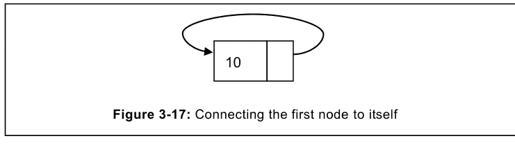

如果要在第一个位置插入节点，则需要纳入以下更改：

- 将新节点连接到第一个节点。
- 将最后一个节点的指针连接到这个新的第一个节点。

相应地，如果要在列表末尾插入节点，在这种情况下，需要进行以下更改：

- 将现有最后一个节点的下一个指针连接到新的最后一个节点的下一个指针。
- 将现有最后一个节点的指针连接到这个新的最后一个节点。

实现上述所有目标的完整代码如下所述。

```
// Program to attach the last node to the circular link list.
node *temp;
// create a new node.
temp=new node;
// assign data to the new node
temp->data=20.
//Connect the next node to the first node.
temp->next=end->next;
//connecting the node to the last node of the circular link list.
end->next=temp;
```

```
Program to attach a new node at the first position of a circular link list.
node *temp;
// create a new node.
temp=new node;
// assign data to the new node
temp->data=20.
//Connect the temp node to the first node.
temp->next=first;
//connecting the last node to the new first node (temp).
end->next=temp;
```

#### 3.12.3 循环链表中的遍历

循环链表中的遍历与线性链表类似。然而，在循环链表中，当到达最后一个节点时需要格外小心，因为最后一个节点连接到


第一个节点。相应地，链表没有末尾，最后一个节点也不存在指向 NULL 的指针，因此在遍历时如果限制设置为 NULL，遍历将不会终止。相反，它会到达第一个节点并无限循环遍历。在我们的代码中，我们从第一个节点开始遍历，直到链表的下一个节点指向第一个节点为止。由于最后一个节点未被访问，因此特意安排访问这最后一个节点。遍历循环链表的代码如下所示。

```
while(current->next!=first)// Till next node is not the first node
{
    cout<<current->data<<" -> ";
    current=current->next;
}
cout<<current->data<<" -> "; //visit the last node
```

包含创建、遍历、插入和删除等各种操作的完整代码如下所示。我们首先定义了节点的结构，随后是在循环链表中执行的其他操作。

```
//Creation of Circular link list
#include<iostream.h>
#include<conio.h>
class node
{
public:
int data; //data part of the list
node *next;// address of next node
};

// Complete program and various operations on circular link list.
class list
{
    //creating the first pointer of the list
    node *first,*end;
    //public part of class
    public:
    //circular list constructor
    list()
    {
first=NULL;
}      // create the link list by inserting at end
void create_end(int);
// Insert the element at specific position
void insert(int el, int pos);
//To delete the node consisting the value
void deletenode(int el);
//To search the element in the list
int search(int);
// To count number of nodes
int count();
    //function to traverse the list
void display();
//function to reverse the list
void reverse();
//To find out list is empty
int emptylist();
// To concatenate the two list
    list operator+(list);
};
int list::emptylist()
{
int empty=0;
if(first==NULL)
empty=1;
return empty;
}//end of emptylist
void list::deletenode(int element)
{
node* current,*prev=NULL;
int found=0;
current=first;
while(current!=NULL)
{
if(current->data==element)
{
    found=1;
    break;
}
prev=current;
current=current->next;
}
if(found)
{
if(prev==NULL)
{
    prev=current->next;
    first=prev;
}
else
prev->next=current->next;
delete current;
}
else
cout<<"element not in the list"<<endl;
}//end of deletenode
//function to create the list from end
void list::create_end(int el)
{
char ch;
node *current,*temp;
if(first==NULL)
{
    first=new node;
    first->data=el;
    first->next=first;
    end=first;
    return;
}
current=new node;
current->data=el;
current->next=end->next;
end->next=current;
end=current;
} //end of create_beg

//function for creating linked lists from
/* void list::create_beg(int el)
{
node *current,*temp;
if(first==NULL)
{
first=new node;
first->data=el;
first->next=NULL;
end=first;
return;
}
current=new node;
current->data=el;
current->next=first;
first=current;
} //end of create_beg */
//function to insert at particular position
void list::insert(int el, int pos)
{
node *current,*newnode,*prev=NULL;
int cnt=count();//count number of nodes
if(pos<=cnt+1)
{
current=first;
newnode=new node;
newnode->data=el;
newnode->next=NULL;
int i=1;
//moving to the right position
while(i<pos)
{
prev=current;
current=current->next;
i++;
}//end of while
if(prev==NULL)
{
newnode->next=first;
first=newnode;
end->next=first;
return;
} //end of inner if
newnode->next=current;
prev->next=newnode;
}  //end of out if
else
cout<<"List size less than position, try again..\n";
}//end of function insert_beg
//search function
int list::search(int el)
{
int found=0;
node *current=first;
int i=0,cnt;
cnt=count();
while(i<=cnt)
{
if(current->data==el)
{
found=1;
break;
}
current=current->next;
i++;
}
    return found;
}//end of search function
    //counting nodes in a linked list
    int list::count()
{
    node *current;
    int c=0;
    current=first;
    while(current->next!=first)
    {
        c++;
        current=current->next;
    }
    return c+1;
}

    //function to display linked list
    void list::display()
{
    node *current;
    current=first;
    cout<<"Linked list:"<<endl;
    while(current->next!=first)
    {
        cout<<current->data<<" -> ";
        current=current->next;
    }
    cout<<current->data<<" -> ";
    cout<<endl;
}
int main()
{
int el;
list list1,list2,list3,list4;
clrscr();
//creating the list from beginning calling
list1.create_end(40);
list1.create_end(2);
list1.create_end(100);
list1.create_end(14);
list1.display();
cout<<" inserting 5 at 3 position"<<endl;
list1.insert(5,3);
list1.display();
if(list1.search(20))
cout<<"Found"<<endl;
else
cout<<"Element not in the list"<<endl;
/*cout<<" inserting 34 at 3 position"<<endl;
getch();
return 0;
}
```

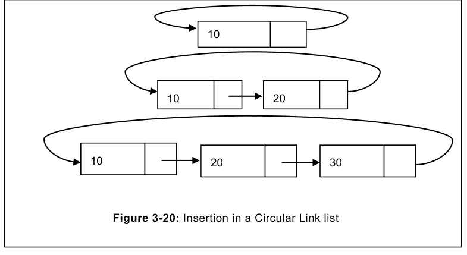

### 3.13 基于链表的案例研究

一家金融机构从事股票交易业务。它通过提供股票交易应用程序来服务客户，客户可以通过互联网访问该应用程序。该机构利用存储设备进行数据存储。存储了与客户相关的各种信息，包括客户的基本信息、其持有的股票、其投资组合的价值等。必要的信息、其字段以及简要说明如下所示：

**表 3.1：客户文件**

| 序号 | 字段 | 描述 |
|---|---|---|
| 1. | 姓名 | 客户姓名 |
| 2. | 编号 | 客户的唯一编号 |
| 3. | 地址 | 客户的唯一地址 |
| 4. | 出生日期 | 客户的出生日期 |

**表 3.2：股票列表**

| 序号 | 字段 | 描述 |
|---|---|---|
| 1. | 股票编号 | 股票的唯一编号 |
| 2. | 股票名称 | 股票的名称 |
| 3. | 市场价格 | 股票的当前市场价格 |
| 4. | 总股本 | 特定公司的总股本数 |

**表 3.3：买入表**

| 序号 | 字段 | 描述 |
|---|---|---|
| 1. | 股票编号 | 股票的唯一编号 |
| 2. | 股票名称 | 股票的名称 |
| 3. | 市场价格 | 股票的当前市场价格 |
| 4. | 买入数量 | 买入的特定公司的股票总数 |

## 表 3.4：卖出股票

| 序号 | 字段 | 描述 |
|---|---|---|
| 1. | 股票编号 | 股票的唯一编号 |
| 2. | 股票名称 | 股票的名称 |
| 3. | 市场价格 | 股票的当前市场价格 |
| 4. | 卖出数量 | 卖出的特定公司的股票总数 |

用户从事股票交易业务，需要按照上表所述存储数据。他打算在客户开户后立即存储客户记录，以维护股票的买入或卖出情况。基于上表，创建一个链表节点，该节点应具备存储上述数据的功能。每当有新客户加入公司时，应为其分配一个新的客户编号，并将其添加到链表中。他进行的任何交易也应与客户编号关联。在任何时候，用户都应能够查看其投资组合，包括其持有的股票数量、买入价格、库存总价值等。

最后，如果客户退出经纪公司，无论其在链表中的位置如何（第一个、中间或最后一个），其记录都需要从链表中删除。所有被删除的记录都应存储在已删除链表中。这将使公司能够跟踪所有曾在该公司开户但已不再关联的客户。这将使公司能够从数据中获取洞察，例如：

-   了解被删除账户的总数
-   客户关闭账户的原因
-   识别所提供的服务与所需求服务之间的差距
-   满足维护客户详细信息所需的监管合规要求

除上述细节外，实现者还可以假设上述案例中未列出的任何其他信息，但这些信息可能对实现上述案例有用。

## 练习

## 简答题

1.  链表的需求是什么？
2.  链表有哪些额外开销？
3.  描述数组相对于链表的优势。


4. 描述链表相较于数组的优势。
5. 在链表中设置首指针和尾指针这两个指针有哪些好处？
6. 在链表开头插入与在链表其他任意位置插入有何不同？
7. 在链表中间插入与在链表末尾插入是否相同？在插入逻辑中应如何管理？
8. 编写一个程序，将第一个节点与第二个节点交换，第三个节点与第四个节点交换，依此类推，直到链表遍历完毕。
9. 编写一个程序，将第一个节点与最后一个节点交换，第二个节点与倒数第二个节点交换，依此类推。
10. 编写一个程序，使用 + 运算符（运算符重载）将两个链表相加。
11. 编写一个程序，通过重载 ++ 运算符（运算符重载）来遍历下一个节点。
12. 编写一个程序，在链表中重载以下运算符：
= （用于检查两个链表中的节点数是否相同）。
– （用于在链表中向后遍历一个节点）。
> 用于检查链表一的大小是否大于链表二。
13. 为什么删除第一个节点与删除其他任何节点不同？
14. 删除第一个节点时需要注意哪些事项？
15. 删除中间节点与删除最后一个节点有何不同？
16. 在创建有序链表期间需要牢记哪些要点？
17. 链表的主要局限性有哪些？
18. 证明自组织链表相较于普通链表的优势？将所讨论的自组织方法与其在计算机中的使用联系起来。
19. 为什么使用循环链表而不是线性链表？
20. 循环链表与线性链表有何不同？
21. 循环链表相较于线性链表有哪些缺点？

22. 循环链表的显示函数与线性链表的显示函数有何不同？

23. 如何删除循环链表的最后一个节点？详细讨论指针调整问题。

24. 描述在循环链表的第一个位置插入节点时，你将进行的必要更改。

25. 考虑两个链表 list1 和 list2。删除 list1 中位于 list2 给定位置上的节点。例如，如果 list1=(m, n, o, p, q, r, s)，list2=(1, 3, 4)，则结果链表将为 {n, q, r, s}。

26. 编写一个函数，比较给定的两个链表（list1 和 list2）是否相同，比较时需考虑链表的内容。

27. 写出使用递归计算节点数量的函数。
28. 编写一个使用递归创建链表的函数。
29. 编写一个反转链表的函数，使用以下方法：
- 迭代方法
- 递归方法

30. 编写一个函数，将链表中的任意给定节点移动到首位。例如，如果用户给定节点 4，则第 4 个节点应成为第一个节点。

31. 在给定的链表中，考虑增加一个数据成员 count。最初，创建的节点其 count 为 0。一旦访问该节点（例如给定的节点被搜索或显示等），count 应增加 1。根据 count 调整节点的位置。例如，count 最大的节点应放在第一个位置。count 第二高的节点应放在第二个位置。如果 count 相同，则按照以下算法放置它们。

a) 采用先到先服务技术，即当前位置的节点不应被改变。

b) 考虑值（数据部分），如果较小，则将节点放在值较大的节点之前。

## A. 多项选择题

在给定的问题中，一个或多个选项可能为正确答案。选择最能描述答案的一项。

1. 在链表程序中，new 运算符返回以下哪种数据类型：
- a) 整型      c) 空类型
- b) 节点类型     d) 以上皆非

2. 链表中使用的节点大小为
a) 02 字节      c) 04 字节
b) 06 字节      d) 以上皆非

3. new 类似于 C 语言中对应的 malloc 函数
a) 正确
b) 错误

4. 循环链表
a) 允许双向遍历
b) 仅允许单向遍历。
c) 无法移动。
d) 以上皆非

5. 在有序链表中
a) 元素按升序排列。
b) 元素可以按降序排列。
c) ‘a’或‘b’均可
d) 以上皆非

6. 最坏情况下遍历线性链表的复杂度为：
a) O(1)          c) O(n²)
b) O(n)          d) 以上皆非

7. 线性链表和有序链表的最坏情况复杂度相同：
a) 正确          b) 错误

8. 如果在链表中，搜索方法基于二分查找技术，则：
a) 对性能没有影响。
b) 性能将得到改善。
c) 以上皆非

9. 使用递归反转链表比非递归算法更有效：
a) 正确
b) 错误。

10. 数组比链表更快。
a) 正确
b) 错误。

- 数据部分
- 两个指针（一个指向下一个节点，另一个指向前一个节点）

双向链表节点的结构如图 4.1 所示。链表的数据部分可以是原始数据类型，也可以是复杂的或用户定义的数据类型。

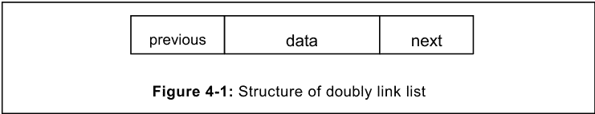

两个指针都将保存相邻节点的地址。一个指针指向前一个节点，另一个指针指向下一个节点，如图 4.1 所示。

### 4.3 双向链表的创建

在创建双向链表期间，首先需要定义双向链表（DLL）节点的结构。在创建 DLL 节点期间，所需的空间将从堆中分配。然后将两个指针（指向前一个和下一个）连接到 NULL，而数据部分将填入提供的数据。为实现上述目标所需的类和其他函数如下所示：

```
// 双向链表的结构
class dnode
{
public:
int info;
dnode *prev,*next;
};
// 双向链表的类
class dlist
{
dnode *first, *end;
public:
dlist()
{
first=NULL;
}
};
```

在创建双向链表期间，我们通过一次创建一个节点来创建它。定义节点结构后，所需的空间将从内存中分配。为新节点分配内存，连接前一个和下一个指针以及节点数据的过程如下所示：

```
dnode *newnode;
newnode=new dnode;
newnode->prev=NULL;
newnode->next=NULL;
newnode->data=5;
```

创建双向链表节点、其数据和分配赋值的完整操作如图 4.2 所示。

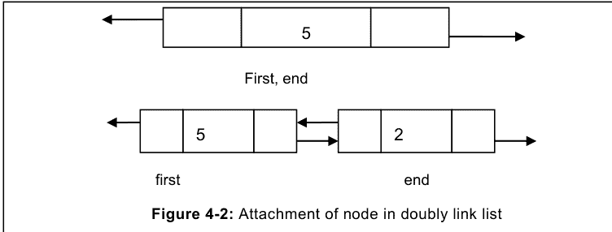

### 4.4 显示双向链表的项目

在双向链表中，可以进行双向遍历。我们可以从第一个节点开始，使用 next 指针到达最后一个节点。类似地，从最后一个节点，我们可以使用 previous 指针到达第一个节点。我们采用了这两种方法来遍历双向链表。每一种方法都在以下程序中进行了说明。

```
程序：显示双向链表的项目
解决方案：
//使用 next 指针从第一个节点遍历到最后一个节点
void doubly_display()
{
dnode *current;
current=first;
while(current!=NULL)
{
cout<<current->data;
current=current->next;
}      // while 循环结束
}      // 显示函数结束
```

类似地，从最后一个节点到第一个节点的遍历可以通过使用 previous 指针来完成，如下面的程序所示：

```
程序：显示双向链表的内容
//使用 previous 指针从最后一个节点遍历到第一个节点
void display_end()
{

dnode *current;

current=end;
while(current!=NULL)
{
cout<<current->data;
current=current->previous;
}      // while 结束
}      // 函数结束
```

```
//双向链表节点的类
class dnode
{
public:
    int data;
    dnode *prev,*next;
};

class dlist
{
    int n;
    dnode *first,*last;
    public:
        //用于初始化数据成员的构造函数
        dlist();
```


## 双向链表

```
//To create the node in doubly linked list
void create(int);
//To count the number of node
int count();
//To search element in doubly linked list
int search(int);
//To insert the element at particular position
void insert(int, int);
//To reverse the doubly linked list
void reverse();
//To concatenate two doubly linked list
dlist operator+(dlist);
//To display content of doubly linked list
void display();
    void display1();      //To display content from last to first
};
```

上述类中声明的函数的定义已在以下程序中给出。

```
// defining constructor for the doubly linked list
dlist::dlist()
{
    first=NULL;
    last=NULL;
}
//function to create the node of a doubly linked list
void dlist::create(int item) // creation of link list, front to end
{
    dnode *current,*temp;
    if(first==NULL) // if no node create the first node
    {
        first=new dnode;
        first->data=item;
        first->next=NULL;
        first->prev=NULL;
        last=first;
    }
    else
    {
        temp=new dnode;
        temp->data=item;
        temp->next=NULL;
        temp->prev=last;
        last->next=temp;
        last=temp;
    }
}
//function to display the element of doubly linked list
//Display from front to last using next pointer.
void dlist::display()
{
    dnode *current;
    current=first;
    cout<<"Data in doubly linked list(front to last):\n";
    while(current!=NULL)
    {
        cout<<current->data<<" <-> ";
        current=current->next;
    }
    cout<<endl;
}
// function to display the node element from last to first
void dlist::display1()
{
    dnode *current;
    current=last;
    cout<<"Data in doubly linked list from end to first:\n";
    while(current!=NULL)
    {
        cout<<current->data<<" <-> ";
        current=current->prev;
    }
    cout<<endl;
}
```

### 4.5 在双向链表中插入元素（节点）

在双向链表中，新节点可以插入到任意位置，包括第一个、中间或最后一个位置。与单向链表相比，在双向链表中插入节点更加简便。由于双向链表中存在两个可用的指针，其复杂度得以降低。在双向链表中插入节点时，需要遵循以下步骤：

- 确定要插入新节点的位置。
- 待插入位置应小于或等于双向链表的长度；如果大于节点总数，则该位置无法插入节点。
- 如果满足上述条件，则遍历到紧靠待插入位置之前的节点。假设该节点称为前一个节点。
- 找出当前节点的 next 指针。
- 将新节点与前方节点以及位于该节点之前的节点（即前一个节点）连接起来。
- 如果要将节点插入到第一个位置，则应将 first 指针改为指向这个新节点。
- 类似地，如果要插入的是最后一个节点，则应将 last 指针改为指向这个新节点。

上述所有情况都将在接下来的小节中讨论。

#### A. 在开头插入

在双向链表中，可以将节点插入链表开头，但此时 first 指针将移动到附加在第一个位置的这个新节点上。完整过程定义如下：

- 创建新节点。
- 将其 next 指针连接到已有的 first 指针。
- 将现有第一个节点的指针改为指向刚插入的节点。

一旦连接到第一个节点，first 指针也会相应移动到新节点，因为该节点已成为第一个节点。下面通过示例说明。在示例中，值为 3 的节点将被附加到第一个位置。该新节点完成连接后将成为第一个节点。

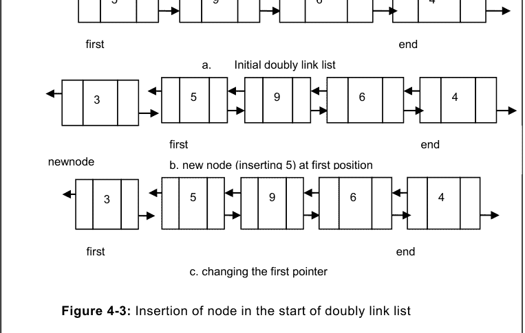

#### B. 在非首位位置插入

在这种情况下，我们假设节点要插入到双向链表中除第一个位置以外的位置。也就是说，位置可以是第二个及其以后的任意值，包括最后一个。每当我们把节点插入到第一个节点之后的任意其他位置（即给定链表的中间位置或最后一个位置）时，都需要为新节点腾出空间，并将新节点与前一节点和后方节点连接起来。我们将遵循以下步骤：

- 创建新节点。
- 遍历到要插入节点的位置。
- 将新节点的 next 指针连接到前方节点。
- 将新节点的 prev 指针连接到当前节点。
- 最后，将到达节点的 next 指针指向该新节点。

整个过程在下面的图中逐步说明。

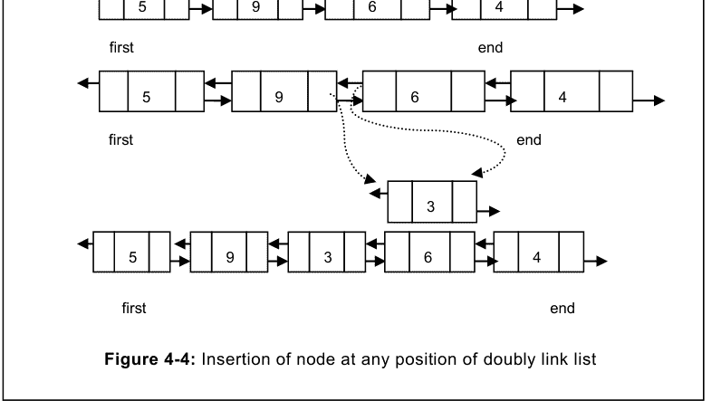

通过精心实现该逻辑，第二种和第三种情况（在中间插入和在末尾插入）可以合并为一种。我们在程序中考虑了所有插入位置。完整实现如下所示：

```
//function to insert the node at a specific location. This function, takes two arguments, one is the position where the node is to be inserted and the second is the elements value that need to be inserted in a doubly linked list.
void dlist::insert(int pos, int el)
{
    int b=count();    //finding out the number of nodes
    cout<<"Length of list :"<<b<<endl;
    if(pos<=b+1) //checking insert location is less than length+1
    {
        cout<<"Inserting "<<el<<" at position"<<pos<<endl;
        node *current,*forward,*temp; //pointer for first and next
        current=first;
        temp=new dnode;
        temp->data=el;
        temp->next=temp->prev=NULL;
        if(pos==1) //checking the first position
        {
            temp->next=first;
            first->prev=temp;
            first=temp;
        }
        // if node to be inserted at any other location
        else if(pos<=b)
        {
            for(int i=1;i<pos-1;i++)
                current=current->next;
            forward=current->next;
            temp->next=forward;
            temp->prev=current;
            current->next=temp;
            forward->prev=temp;
        }
        else
        {
            last->next=temp;
            temp->prev=last;
            temp->next=NULL;
            last=temp;
        }
        cout<<"Node inserted at position "<<pos<<endl;
    }
    else
        cout<<"Can't be inserted\n";
}
```

### 4.6 从双向链表中删除元素（节点）

为了完整性，从双向链表中删除节点时需要考虑多种情况。从双向链表中删除节点的各种情况包括：

- 从第一个位置删除
- 从任何其他位置（除第一个位置外）删除

```
//function to delete node from doubly linked list
void dlist::deletenode(int el)
{
//int found=0;
dnode *current,*temp;
current=first;
while(current!=NULL)
{
    if(current->data==el)
    {
        //Node to be deleted is the last node
        if(current->next==NULL)
        {
            last=current->prev;
            current->prev->next=current->next;
            delete current;
            break;
        }
        else if(current->prev==NULL)// node is first node
        {
            current->next->prev=current->prev;
            first=current->next;
            delete current;
            break;
        }
        else // any other node to be deleted
        {
            current->prev->next=current->next;
            current->next->prev=current->prev;
            delete current;
            break;
        }
    }
    current=current->next;// otherwise continue to next node
}
```

### 4.7 在双向链表中查找元素

双向链表便于双向遍历。例如，我们既可以从前往后遍历，也可以从后往前遍历到第一个节点。在遍历过程中，可以通过匹配节点保存的值来定位包含特定值的节点。需要注意确保遍历仅限于链表中实际存在的节点数量。一旦遇到包含该元素的节点，就应立即终止查找。整个过程如下面的程序所示。

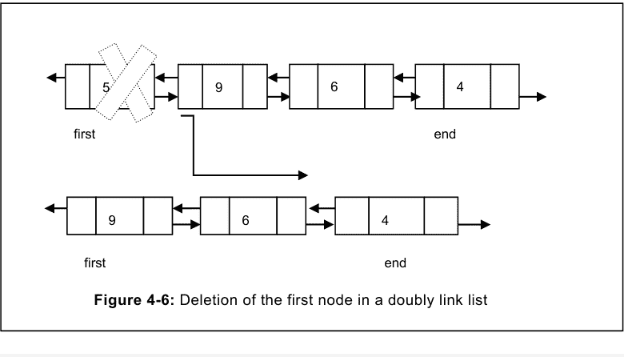

```
//function to search an element from a doubly linked list
int dlist::search(int element)
{
    int flag=0;
    dnode *current;
    int b=count();
    current=first;
    for(int i=1;i<=b;i++)
    {
        if(current->data==element)
        {
            flag=1;
            break;
        }
        current=current->next;
    }
```


```cpp
}

    return flag;
}
```

在上面的程序中，我们声明了一个变量 `flag` 来表示要搜索条目的状态。我们将其初始化为 `'0'`，表示该条目不在列表中。如果在双向链表中找到了要搜索的条目，循环会借助 `break` 语句立即终止，并将 `flag` 的状态设置为新值 `1`，表示该条目位于链表中。最后，将 `flag` 的状态返回给调用者。

### 4.8 计算双向链表中的节点数

在许多情况下都需要计算双向链表中的节点数，例如，了解双向链表的长度、在插入节点时、在删除节点时等。因此，计算节点数是双向链表中的一个重要函数。计算双向链表中的所有节点并不复杂。这里，用户必须从第一个节点开始，一直到达最后一个节点。在遍历节点时需要计数。由于双向链表支持双向遍历，我们也可以从末尾开始遍历来计算节点数。在这种遍历过程中，我们可以使用 `previous` 指针到达第一个节点，同时可以计算双向链表中的节点数。然而，在我们的示例中，我们考虑的是从开始节点向末尾节点进行遍历。下面的程序对此进行了说明。

```cpp
// Program to count the number of nodes in a doubly link list
Solution:
int count()
{
    dnode *current = first;
    int cnt = 0;
    while (current != NULL)       // till the doubly link list is not exhausted
    {
        cnt++;                    // count the node
        current = current->next;  // move to the next node
    }
    return cnt;
}
```

### 4.9 循环双向链表

尽管双向链表允许双向遍历，但有时我们需要将最后一个节点连接到第一个节点。这种类型的双向链表被称为循环双向链表。双向链表具有以下优点。

-   没有任何空指针。
-   提高效率，特别是当需要从最后一个节点向第一个节点遍历时。
-   提高性能，如果要求从第一个节点向最后一个节点方向遍历的话。

循环双向链表如图 4.7 所示。

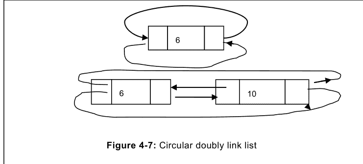

#### 4.9.1 创建循环链表

创建循环双向链表不同于创建普通的双向链表。一旦创建了第一个节点，与双向链表不同，我们不会将 `previous` 和 `next` 指针指向 `NULL`。相反，我们将它们连接到节点本身。这一点已在图 4.7(a) 中说明。一旦创建了第二个节点，它的前驱节点会连接到第一个节点。第一个节点的指针也需要调整，因为第一个（现有）节点的 `next` 指针将指向这个新节点，而这个新节点的 `next` 指针需要指向第一个节点。插入、删除和遍历等操作可以像普通链表一样执行。在循环双向链表上执行各种操作（函数）的类已在下面的程序中描述。

```cpp
#include <iostream.h>
#include <conio.h>

// class to define the structure of a node in a doubly link list
class dnode
{
public:
    int data;
    dnode *prev;
    dnode *next;
};

// Class for the doubly link list
class dblyList
{
    dnode *first;
    dnode *end;
public:
    dblyList()
    {
        first = NULL;
        end = NULL;
    }
    void create(int);
    void display();
    void insert(int, int);
    int count();
    void deletenode(int);
};
```

#### 4.9.2 创建循环双向链表的函数

在创建循环双向链表时，我们假设有两个指针，即 `first` 和 `end`。这两个指针分别代表循环双向链表的第一个节点和最后一个节点。通过使用 `last` 的 `next`，我们可以到达循环双向链表的第一个节点。相应地，我们也可以通过 `first` 的 `previous` 到达最后一个节点。当创建第一个节点且双向链表只有一个节点时，在这种情况下，`first` 和 `last` 节点都将指向同一个节点。要插入其他节点，需要将 `last` 的指针和 `first` 节点的 `previous` 指针连接到新创建的 `newnode`。完整程序如下所示。

```cpp
// Prob: Write a program to create the first node or any other node

// To create the first node
void create(int element)
{
    if (first == NULL)
    {
        first = new dnode;
        first->data = element;
        first->next = first;
        first->prev = first;
        end = first;
        return;
    } // end of if statement

    dnode *newnode;            // to create any other node
    newnode = new dnode;
    newnode->data = element;
    newnode->next = end->next;
    newnode->prev = end;
    end->next = newnode;
    first->prev = newnode;
    end = newnode;
}
```

将节点插入循环双向链表后，我们需要查看循环双向链表中可用的数据。这个目标可以通过 `display` 函数来实现。在 `display` 函数中，需要格外小心，以避免无限循环。由于在循环双向链表中，最后一个节点连接到第一个节点，因此循环必须在 `end` 节点处终止；否则，将导致无限循环。

```cpp
void dblyList::display()
{
    dnode *current = first;
    while (current->next != first)
    {
        cout << current->data << "->";
        current = current->next;
    }
    // to display the data of the last node
    cout << current->data << "->";
}
```

#### 4.9.3 计算循环双向链表中的节点数

要计算循环双向链表中的节点数，我们需要从前面或后面开始遍历。在循环双向链表中，由于第一个节点连接到最后一个节点，而最后一个节点指向第一个节点，因此，在遍历过程中需要格外小心，以防止循环。在我们的例子中，我们应用了条件，从而检查我们是否尚未到达开始遍历时的节点。实现此效果的函数如下所示：

```cpp
// To count the number of nodes in a doubly link list
int dblyList::count()
{
    // initialize the count to 0
    int c = 0;
    // store the address of first to the current node
    dnode *current = first;
    // run the loop till we are not reaching the first node
    while (current->next != first)
    {
        c++;       // increment the count
        // move the pointer to the next node
        current = current->next;
    }

    // One node was left due to current->next, count that node also;
    c = c + 1;
    return c;
}
```

变量 `c` 表示计数；最初，该值为零，因此已将其初始化为零。在访问每个节点期间，我们将此变量的值加一。由于我们在最后一个节点处终止，因此没有到达该节点。为了计算这个节点，我们将变量 `c` 的当前值加 1。最后，将 `c` 的值返回给调用者。

#### 4.9.4 在给定位置插入节点

在循环链表中插入节点时，我们需要确保插入后循环属性不会丢失。这一点尤其适用于在第一个位置或最后一个位置插入节点的情况。当要插入的节点在中间时，循环双向链表与双向链表之间没有区别。在循环链表中插入节点的完整过程如下所述：

-   确定要插入新节点的位置是否有效（必须位于第一个节点和最后一个节点加一之间）。
-   如果要插入节点的位置是第一个，将 `newnode` 的前驱节点连接到现有 `first` 节点的前驱节点。将 `next` 指针连接到 `first` 节点。通过将 `first` 指针移动到这个 `newnode`，将此 `newnode` 命名为第一个节点。类似地，将 `last` 节点的 `next` 指针更改为此 `newnode`（即第一个节点）。
-   要在中间插入节点（第一个和最后一个节点除外），将 `newnode` 的 `next` 指针替换为当前节点（`newnode` 将插入其后的节点）的 `next` 指针。将 `newnode` 的前驱节点连接到当前节点。将当前节点的 `next` 指针连接到 `newnode`。
-   要在末尾位置插入，将此 `newnode` 的 `next` 指针替换为 `end` 节点现有的 `next` 指针（该指针指向第一个节点）。将现有 `end` 节点的 `next` 指针连接到 `newnode`（这将作为最后一个节点），将 `newnode` 的前驱节点连接到现有的最后一个节点。最后，将 `end` 节点移动到此 `newnode`。

演示整个操作的程序如下所示：

```cpp
// To insert the node at a given position
void dblyList::insert(int element, int pos)
{
    int n = count();
    dnode *current, *temp;
    temp = new dnode;
    temp->data = element;
    if (pos <= (n + 1))
    {
        if (pos == (n + 1))
        {    // insert at the end
            temp->prev = end;
            temp->next = end->next;
            end->next = temp;
            first->prev = temp;
            end = temp;
        }
        else
        {
            current = first;
            int i = 1;
            while (i < pos)
            {

```


```cpp
current=current->next;
    i++;
}
temp->next=current;
temp->prev=current->prev;
current->prev->next=temp;
current->prev=temp;
//if the position is 1, change the first pointer
if(pos==1)
    first=temp;
}
}
else
cout<<" Cannot be inserted beyond the list length"<<endl;
}
```

#### 4.9.5 从循环链表中删除一个节点

从循环双向链表中删除节点与双向链表有很大不同。在删除循环双向链表的第一个或最后一个节点时需要格外注意。如果要删除第一个节点，则 first 需要移动到现有 first 节点之后的一个节点。尽管删除了第一个节点，链表的循环特性仍需保留。因此，这个新的 first 必须连接到末尾节点。相应地，循环双向链表的最后一个节点也需要调整。最后一个节点即 End 节点的指针需要连接到双向链表的第一个节点。以下程序中已对此进行了描述。

```cpp
//To delete the node based on a user supplied value
    void dblyList::deletenode(int element)
    {
    dnode *current,*prev1=NULL,*temp;
    current=first;
    do{
        if( current->data==element)
        {
            break;
        }
        prev1=current;
```
```cpp
current=current->next;
}while(current!=first);
// if node to be deleted is first node
if(prev1==NULL)
{
temp=first;
current=first->next;
//connecting the new first to the last node
first->next->prev=first->prev;
end->next=current;
first=current;
}
// if node to be deleted is the last node
else if(current==end)
{
temp=current;
//Connecting the first node to the last node
first->prev=prev1;
// connecting the last node to the first node
prev1->next=first;
end=prev1;
}
// if the node to be deleted is the in-between node
else
{
temp=current;
prev1->next=current->next;
current->next->prev=prev1;
}
delete temp;
}
```

### 4.10 使用模板的双向链表

双向链表已进行了详细讨论，然而我们假设插入的数据为整数数据类型。如果我们需要为其他数据类型实现，则

程序需要相应修改。为解决这些情况，我们建议实现模板双向链表。此模板链表会根据要插入的类型进行修改。链表可以类似于使用指针实现的链表实现。仅由于模板形成才需要进行更改。完整的代码已如下所示，以便读者方便。

```cpp
//operations on double ended linked list
#include<iostream.h>
#include<conio.h>
template<class t>
class dnode
{
    public:
        t data;
        dnode *prev,*next;
};
template<class t>
class dlist
{
    dnode<t> *first,*last;
    public:
        //constructor to initialize the data member
        dlist();
        //to create the doubly link list
        void create(t);
        //to count the number of node
        int count();
        //to search element in doubly link list
        int search(t);
        //to insert the element at particular position
        void insert(int, t);
        //to reverse the doubly link list
        void reverse();
        //to concatenate the doubly link list
        dlist operator+(dlist);
```
```cpp
current->next->prev=current->prev;
first=current->next;
delete current;
break;
}
else
{
// any other node to be deleted
current->prev->next=current->next;
current->next->prev=current->prev;
delete current;
break;
}
}
current=current->next;
}
}

//function to create the doubly link list
template<class t>
void dlist<t>::create(t item)
{
    dnode<t> *current,*temp;
    if(first==null)
    {
    first=new dnode<t>;
    first->data=item;
    first->next=null;
    first->prev=null;
    last=first;
    }
    else
    {
    temp=new dnode<t>;
    temp->data=item;
    temp->next=null;
```
```cpp
temp->prev=last;
last->next=temp;
last=temp;
}
}
//function to display the element of doubly link list
template<class t>
void dlist<t>::display()
{
    dnode<t> *current;
    current=first;
    cout<<"data in doubly linked list(front to last):\n";
    while(current!=null)
    {
        cout<<current->data<<" <-> ";
        current=current->next;
    }
    cout<<endl;
}
// To display all the element of list
template<class t>
void dlist<t>::display1()
{
    dnode<t> *current;
    current=last;
    cout<<"Doubly link list end to  first:\n";
    while(current!=null)
    {
        cout<<current->data<<" <-> ";
        current=current->prev;
    }
    cout<<endl;
}
//reverse function
template<class t>
```
## Data Structure simplified
```cpp
void dlist<t>::reverse()
{
    int n;
        n=count();
        dnode<t> *current;
        current=last;
        cout<<"the data after reversing the linked list:\n";
        for(int i=1;i<=n;i++)
        {
                cout<<current->data<<" -> ";
                current=current->prev;
        }
}
//count function
template<class t>
int dlist<t>::count()
{
        int c=0;
        dnode<t> *current;
        current=first;
        while(current!=null)
        {
                c++;
                current=current->next;
        }
        return c;
}
//to insert el(element) at particular position
template<class t>
void dlist<t>::insert(int pos, t el)
{
        int b=count();
        cout<<"length of list :"<<b<<endl;
        if(pos<=b+1)
        {
```
## Doubly link list
```cpp
cout<<"inserting "<<el<<"  at position"<<pos<<endl;
    dnode<t> *current,*forward,*temp;
    current=first;
    temp=new dnode<t>;
    temp->data=el;
    temp->next=temp->prev=null;
    if(pos==1)
    {
        //temp->prev=null;
        temp->next=first;
        first->prev=temp;
        first=temp;
    }
    else if(pos<=b)
    {
        for(int i=1;i<pos-1;i++)
        current=current->next;
        forward=current->next;
        temp->next=forward;
        temp->prev=current;
        current->next=temp;
        forward->prev=temp;
        // forward->prev=temp;
    }
    else
    {
        last->next=temp;
        temp->prev=last;
        temp->next=null;
        last=temp;
    }
    cout<<"node inserted at position "<<pos<<endl;
}
else
cout<<"can't be inserted\n";
```
```cpp
}
//search function
template<class t>
int dlist<t>::search(t element)
{
    int flag=0;
    dnode<t> *current;
    int b=count();
    current=first;
    cout<<"searching element "<<element<<endl;
    for(int i=1;i<=b;i++)
    {
        if(current->data==element)
        {
            flag=1;
            break;
        }
        current=current->next;
    }
    return flag;
}
//overloading + operator
template<class t>
dlist<t> dlist<t>::operator +(dlist<t> l)
{
    dlist l6;
    l6.first=first;
    l6.last=last;
    l6.last->next=l.first;
    l.first->prev=l6.last;
    return l6;
}
main()
{
    int n,el;
```
## Doubly link list
```cpp
dlist<int> l1,l3,l2;// creating the doubly list for integer type
clrscr();
l1.create(34);
l1.create(7);
l1.create(153);
l1.create(40);
l1.display();
//l1.insert(4,112);
l1.display();
if(l1.search(40))
cout<<"element found"<<endl;
else
cout<<"element not in doubly link list"<<endl;
cout<<"enter element to be deleted"<<endl;
cin>>el;
l1.deletenode(el);
l1.display();
}
```

### 4.11 基于双向链表的案例研究

参考链表章节中已列举的案例，并使用双向链表实现。如果使用双向链表实现相同的程序，性能会有什么影响。通过在链表示例中列举的双向链表程序中加入更多数据成员来扩展该程序。这些成员应与学生详细信息相关。这些成员已如下所示：

#### 表 4.1：学生描述

| 序号 | 数据成员 | 描述 |
|------|--------------|-------------|
| 1. | Stud_id | 所有学生的唯一 ID。 |
| 2. | Student_name | 学生姓名 |
| 3. | Subject | 科目名称（每个学生有 5 门科目） |
| 4. | Marks | 科目的成绩（对于以上 05 门科目，各自有对应的成绩）。 |
| 5. | Total | 以上所有科目成绩的总和 |


- 每个节点应包含上述信息。考虑学生总数为 20 的情况。将数据保存在双向链表本身中。编写一个函数，根据总成绩对双向链表的记录（节点）进行组织。例如，获得最高成绩的学生应放在第一位，然后是第二高，依此类推。编写一个函数，在给定的双向链表中搜索节点（记录）。
- 在上述程序的基础上，在双向链表中增加一个数据成员。该数据成员的名称应为 count。根据记录（节点）被搜索的次数，count 的值应递增 1。重新排列节点。例如，如果第 4 个节点的 count 最大，则应将其置于第一位。

## EXERCISE

### A. Descriptive Questions

- 1. 编写一个函数，在双向链表中不遍历双向链表的情况下，在最后一个节点之后插入新节点。
- 2. 修改上述函数，使其无需检查第一个节点是否为 NULL。
- 3. 编写一个函数，在双向链表中插入新节点。函数应管理以下内容：
  a. 列表是否存在。
  b. 给定的位置是否在允许范围内。例如，如果节点总数为 5，而要插入节点的位置为 8，则不允许。
- 4. 编写一个函数，根据以下因素在双向链表中删除节点：
  a. 基于现有列表。
  b. 考虑给定的位置是否在允许范围内。例如，如果节点总数为 5，而要删除节点的位置为 8，则不允许。
  c. 根据用户接收到的值删除节点。
- 5. 编写一个函数从双向链表中删除一个节点。
- 6. 删除双向链表的第一个节点。
- 7. 删除位于中间的节点（除第一个和最后一个之外）。
- 8. 删除位于末尾的节点。
- 9. 删除节点后相应地调整指针。例如，如果删除了最后一个节点，则前一个节点必须指向 NULL，因为现在倒数第二个节点充当最后一个节点。

### B. Multiple Choice Questions

1. 用于定义双向链表结构的类的大小是多少。
a. 02 bytes        c. 40 bytes.
b. 06 bytes        d. 12 bytes.

2. 我们可以通过包含指针作为参数来修改现有的 create 函数吗？
a. Yes
b. No.
（写下支持和反对你陈述的要点并请其核实）。

3. 如果 current 指向双向链表的当前节点。要访问 current 节点前面的两个节点，可以使用以下语句。
a. current->next        c. current->next->next
b. current->next->prev        d. None of these

4. 如果 current 指向当前节点并且 forward 指向 current 前面的一个节点。那么代码 forward->prev 指向
a. Current node.        b. One node ahead of the forward node.
c. One node previous to the current node.
d. None of these

5. 在上述问题中，要删除位于双向链表的第一个节点和最后一个节点之间的节点，代码 current->next 删除 forward 节点：
a. True
b. False

考虑我们已经在栈中有三个元素的情况，因此栈将指向顶部位置。在图 5.2 中，栈的顶部元素是‘C’，因此 top 位于索引 2。一旦弹出一个项目，则 top 将递减一个索引并指向‘B’（参见图 5.2 b）

**Note:** 除了 push 和 pop 操作之外，还可以对栈执行另一种可能的运算，称为 NoOperation(Nop)。在 Nop 中，没有任何操作发生。换句话说，top 没有移动；相反，在不移动 top 的情况下进行活动。例如，显示栈中的元素就属于此类，因为它不涉及栈顶的移动。确定栈顶元素的另一个例子也与 Nop 相关，其中栈顶元素将被返回而不会移动 top 指针。

### 5.4 IMPLEMENTATIONS OF STACK

栈是计算机科学中广泛使用的数据结构，使用栈可以提高整体性能，同时简化代码。在栈中，有时我们事先知道需要插入的最大元素数量。然而，有时要插入的项目数量无法准确预测。相应地，为满足这些需求，栈被分为以下几类：

- Static stack
- Dynamic stack

在栈中，如果可以预先预测可以插入的项目总数，则此类栈可以用数组实现并称为 **static stack**。此类栈相对于其他类型的栈具有更好的性能。

在无法获知要插入的项目总数或要插入的最小项目数与最大项目数之间的变化很大的情况下，我们使用另一种称为 **dynamic stack** 的栈。但该栈涉及与内存分配和释放相关的性能开销。

#### 5.4.1 Static Stack

静态栈是借助数组实现的。在创建栈之前，必须定义其结构以确定它将保存的信息类型。另一个约束与指向栈顶的 top 指针有关。表示数据成员和可在数据成员上完成的操作的类如下所示：

```
Program for the push, pop and display function of the static stack.
// Program that depicts push and pop operation on the stack
const int size=5; // size of the stack
// Defining the structure of the stack
class stk
{
int stack[size];
int top;
public:
// constructor to initialize the value of top
stk()
{
top=-1;
}
// To push the element in the stack
int push(int);
//To pop the element from the stack and return the top/pop element
int pop();
// To display the items in the stack.
void display();
// To display the number of element in the stack.
void count_elements();
// To examine whether the stack is empty or not
int isEmpty();
};
```

最初，栈为空，并通过将 top 的值赋为 -1 来表示。每当向栈中插入一个项目时，都会检查其容量（由 size 表示）以避免溢出。如果栈未满，则只允许将项目插入栈中。相应地，top 指针递增 +1 以表示 top 的新位置。

Push 函数返回整数值。该值用于确定 push 操作是否成功或不成功。如果成功，push 函数返回 1，而在失败的情况下，它返回 0。

```
// function to implement the push operation of stack.
int stacks::push(int element)
{
    if(top==(size-1))
    {
cout<<"overflow, more elements cannot be inserted \n";
return 0;
    }
    else
{
    stack [++top] =element;
}
return 1;
}
```

要从栈中弹出元素，首先我们会检查空条件。如果栈为空，则会向用户显示 underflow 消息。为了检查空条件，我们检查与 top 变量关联的值。

if (top== -1)

值 -1 表示空条件。如果栈中有多于零个元素，则可以执行 pop 操作。在 pop 操作之前，栈顶元素存储在 temp 变量中。之后，top 向下移动一个指针，最后将存储在 temp 变量中的 top 的值返回给调用函数，以供以后使用（如有需要）。

```
//function to pop the element from the stack
int stacks::pop ()
{
    int temp=0;
    // Examine whether stack is empty or not.
    if (top==-1)  // top=-1 indicates the empty state of stack
    {
        cout<<"underflow: \n";
    }
    else
    {
        temp=stack [top--];
    }
    return temp;
}
```

我们还设计了 isEmpty () 函数来确定栈是否为空。isEmpty() 函数可以在多个地方使用，例如在任何时间点确定栈中的元素数量。在执行 pop 操作之前可以使用此函数。如果栈为空，则不允许 pop，相反需要向用户显示合适的消息。它返回 1 表示 true，如果栈为空，否则返回 0 表示 false。相同的内容已在以下程序中说明。


// To examine whether the stack is empty.
int stacks::isEmpty ()
{
    if (top==-1)
    return 1;
    else
    return 0;
}

尽管执行了压入和弹出操作，我们并不知道栈中可用的元素。为了实现这一目标，创建了 display () 函数。该函数显示栈中的所有元素。它从栈顶开始向栈底遍历。为了确保 top 不偏离当前位置，使用了一个名为 'i' 的新变量，并将 top 的值赋给该变量。

// Program to display the element(s) of the stack.
void stacks::display ()
{
    for (int i=top; i>=0; i--)
    cout<<stack[i]<<" ";
    cout<<endl;
}

在很多情况下，我们需要确定在任意特定时刻栈中元素的数量。为了实现这一目标，我们创建了 count_elements () 函数。

##### 5.4.1.1 统计元素个数

要统计栈中元素的数量，我们从栈顶开始向栈底移动。在此循环过程中，用于计数栈元素的变量 cnt 每次加 1。最后，当所有元素都遍历完毕后，将 'cnt' 变量的值返回给调用函数。

//function to count the number of element(s) in the stack;
int stacks::count_elements()
{
//initialize the t with top and cnt with 0.
int cnt=0,t=top;
// Continue till stack is not empty.
while(t>=0)

## 栈

最初，动态栈为空。为了突出这种情况，我们用 NULL 初始化了 top。由于所有栈都是从空状态开始创建的，因此我们借助构造函数对其进行了初始化。

一旦将元素插入（压入）栈中，top 将移动到新位置。栈的插入操作如图 5.3 所示。最初，栈为空，因此 top 指向 NULL。当插入 10 时，top 将指向新位置。类似地，当插入 20 时，top 的新位置如图 5.3 (c) 所示。

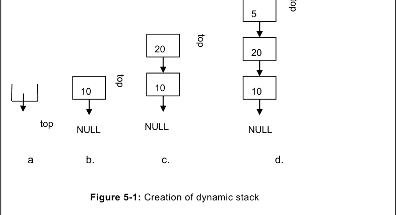

```
```cpp
stack::stack()
{

top=NULL;

}
void stack::push(int element)
{

    if(top==NULL)
    {

        top=new stacknode;
        top->data=element;
        top->next=NULL;

    }
    else
```
```
{
    stacknode *temp;
    temp=new stacknode;
    temp->data=element;
    temp->next=top;
    top=temp;
}
}
```

为了显示动态栈中的当前元素，我们使用 current 指针，它接收 top 的地址并有助于保留 top 的值。在我们的程序中，临时变量用名称 current 表示。为了遍历整个栈列表，使用 while 循环，该循环一直执行直到所有元素都被访问。

```
void stack::display()
{
    stacknode *current;
    current=top;   // storing the address of top to the current
    cout<<" Elements in the stack are: "<<endl;
    while(current!=NULL)
    {
        cout<<current->data<<"     "; //display the data
        current=current->next;   // move to the next node, towards the base
    }
    cout<<endl;
}
```

为了从栈中弹出元素，我们使用了 pop 函数。该函数用于从栈中移除元素。在取出（弹出）任何元素之前，首先要检查栈中是否有可用元素。如果栈中没有可用元素，则显示栈为空的提示信息，并且函数返回失败状态。如果栈中有一个或多个元素，则返回被移除的元素。调用者将收到该返回值以供后续使用。描述 pop 操作的函数如下所示。

```
int stack::pop()// function to pop the element of the dynamic stack
{
    if(top==NULL)
    {
```
```
cout<<"Stack is empty "<<endl;
return 0;
}

stacknode* temp=top;
int el=temp->data;
top=top->next;
delete temp;
return el;
}
```

类似地，我们可以为动态栈创建 size () 函数，用于统计当前栈中元素的数量。为了完成此任务，我们从栈顶开始向栈底移动。在此遍历过程中，表示“计数”的变量每次增加 1。表示动态栈大小的函数如下所示：

```
// function to determine the size (number of count) of the dynamic stack
int stack::size()
{
int count=0;
if(top==NULL)
{
cout<<"No element in the stack "<<endl;
return count;
}
stacknode *current;
current=top;  // storing the address of top to the current
while(current!=NULL)
{
count++;
}
return count;
}
```

调用栈函数的顺序在主函数中展示。函数调用的顺序完全由要执行的具体操作决定。但是，首先将从 push 开始，因为在从栈中移除元素之前，需要先插入前几个元素。

```
stacks()
{
    top=-1;
}
int push(t);
t pop();
int isEmpty();
void display();
int count_elements();
};
// function to count the number of elements
template<class t>
int stacks<t>::count_elements()
{
int cnt=0,t1=top;
while(t1>=0)
{
cnt++;
t1--;
}
return cnt;
}
template<class t>
int stacks<t>::push(int element)
{
if(top==(size-1))
{
cout<<"overflow element not entered\n";
return 0;
}
else
{
stack[++top]=element;
}
return 1;
```

```
}
template<class t>
    t stacks<t>::pop()
    {
        t a=stack[top];
        if(top==-1)
        {
            cout<<"underflow:\n";
        }
        else
        {
            a=stack[top--];
        }
        return a;
    }
//function to display the item in the stack.
    template<class t>
    void stacks<t>::display()
    {
        for(int i=top;i>=0;i--)
        cout<<stack[i]<<" ";
        cout<<endl;
    }
    template<class t>
    int stacks<t>::isEmpty()
    {
        if(top==-1)
        return 1;
        else
        return 0;
    }
// Completion of all function and starting of main function
int main()
{
int n,n1;
```
```
stacks<int> s1;
clrscr();
if(s1.isEmpty())
cout<<"Stack is empty"<<endl;
else
cout<<"Stack is not empty";
s1.push(10);
s1.push(5);
//s1.push(7);
s1.push(14);
cout<<"Total    number    of    elements    in    stack    are:"<<s1.count_elements()<<endl;
s1.push(90);
//s1.push(299);
cout<<" Element(s) in the stack are:"<<endl;
s1.display();
n=s1.pop();
cout<<" Element pop is "<<n<<endl;
getch();
return 0;
}
```

#### 5.5.2 使用模板的动态栈

```
#include<iostream.h>
#include<conio.h>
//using namespace std;
const int size=5;
template <class t>
class stacks
{
    t stack[size];
    int top;
    public:
        stacks()
        {
```
```
top=-1;
}
int push(t);
t pop();
int isempty();
void display();
int count_elements();
};
template<class t>
int stacks<t>::count_elements()
{
int cnt=0,t1=top;
while(t1>=0)
{
cnt++;
t1--;
}
return cnt;
}
template<class t>
int stacks<t>::push(int element)
{
if(top==(size-1))
{
cout<<"overflow element not entered\n";
return 0;
}
else
{
stack[++top]=element;
}
return 1;
}
template<class t>
t stacks<t>::pop()
```

## 栈

```
```cpp
{
    t a=stack[top];
    if(top==-1)
    {
        cout<<"underflow:\n";
    }
    else
    {
        a=stack[top--];
    }
    return a;
}
template<class t>
void stacks<t>::display()
{
    for(int i=top;i>=0;i--)
        cout<<stack[i]<<" ";
    cout<<endl;
}
template<class t>
int stacks<t>::isempty()
{
    if(top==-1)
        return 1;
    else
        return 0;
}
int main()
{
int n,n1;
stacks<int> s1;
clrscr();
if(s1.isempty())
cout<<"stack is empty"<<endl;
else
```
```
cout<<"stack is not empty";
s1.push(10);
s1.push(5);
//s1.push(7);
//s1.push(14);
cout<<"total    number    of    elements    in    stack    are:"<<s1.count_elements()<<endl;
s1.push(90);
//s1.push(299);
cout<<" element(s) in the stack are:"<<endl;
s1.display();
n=s1.pop();
cout<<" element pop is "<<n<<endl;
n=s1.pop();
cout<<" element pop is "<<n<<endl;
n=s1.pop();
cout<<" element pop is "<<n<<endl;
if(s1.isempty())
cout<<"stack under flow"<<endl;
else
{
n=s1.pop();
cout<<" element pop is "<<n<<endl;
}
getch();
return 0;
}
```

### 5.6 栈的应用

栈应用于各种场景。在大多数应用中，栈的用法要么是显式的，要么是隐式的。例如，在树的非递归遍历中，这种数据结构被显式使用。在递归中，它被程序隐式使用。栈广泛用于括号匹配、中缀转后缀、复杂表达式求值等应用。使用栈的应用将在接下来的小节中讨论。


#### 5.6.1 括号匹配

为了计算复杂表达式，我们将其用括号括起来以确保表达式按正确顺序计算。同样重要的是使用正确数量的括号并且顺序正确。我们在数学中已经学到，关闭括号的顺序由打开括号的顺序决定。我们先关闭最后打开的括号。下面通过以下示例进行说明。

```
2+ [4.9+1-{23*5-(54+12) +90/15} +98]
```

在上述示例中，括号‘(‘是在最后打开的，因此它必须先关闭。同样，其他括号也适用相同规则。同样重要的是，打开的括号也必须关闭。否则，这也会导致括号不匹配。简而言之，为了检查括号的正确性，需要检查以下几点：

- 括号按正确的顺序打开和关闭。
- 打开括号的数量有对应的关闭括号。
- 关闭括号的数量不应超过已打开的括号。

为了实现上述目标，栈非常有用。为了求值任何表达式，我们认为表达式由操作数和运算符组成。符号‘+’、‘-’、‘*’等被称为运算符。我们逐字符扫描给定的表达式；栈会压入打开的括号。一旦遇到关闭括号，就从栈中弹出一个元素。弹出操作获得的括号应与关闭括号相对应。如果满足这些条件，则继续处理其他元素。如果不匹配，程序将在此点终止并显示相关的不匹配消息。为了实现此任务，我们使用了基于括号的两个函数。

- 括号检查。
- 表达式求值

在括号检查程序中，每个括号都被分配了优先级。在程序中，特别注意确保具有较高优先级的括号不会替换具有较低优先级的括号。换句话说，‘(‘不应出现在‘[‘或‘{‘之前。括号不匹配可能出现的各种情况已在图 5.4 中说明。

在我们的程序中，我们将从表达式开头逐字符扫描。遇到打开括号时，我们将其压入栈中。随后，我们将继续扫描表达式。遇到关闭括号时，栈顶元素将使用 pop 函数弹出。弹出的项目将与关闭括号进行检查，如果匹配正确则继续，否则在此终止并向用户显示错误消息。

为了处理多余的打开括号的情况，如果表达式中没有元素但栈不为空，这意味着表达式中存在多余的括号。同样，如果遇到关闭括号而栈为空，则为多余的关闭括号的情况。所有这些情况都已在下面的图 5.4 中考虑。

为了在考虑上述各种情况的情况下求值表达式，我们使用了之前创建的动态栈（链表栈）。程序在以下示例中讨论。

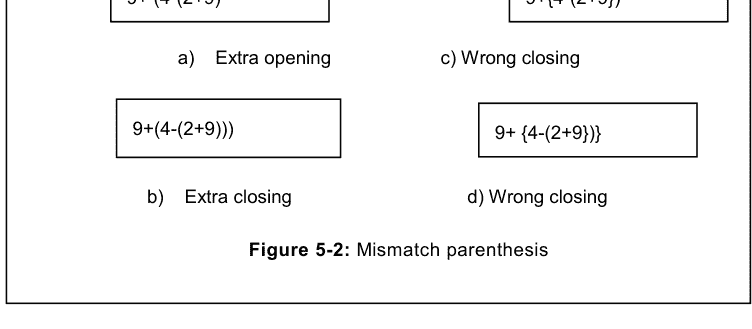

```
Program: To match the parenthesis in the given expression
Solution:
#include<dyn.h>
class appl
{
public:
void parenth(char*); // function to match the parenthesis
int open_brack(char);  // To determine whether the opening of a bracket
int close_brack(char); // To determine whether the closing of a bracket
int matching(char, char); // To examine that opening bracket has the ....
                        // corresponding closing brackets
};
int appl::matching(char sym, char expr)
{
int ans=0; // initially, mismatch
if((sym=='(' && expr==')')||(sym=='{' && expr=='}')||(sym=='[' && expr==']'))
ans=1;        // Matching exist
return ans;
```

```
}
int appl::open_brack(char b)
{
    int flag=0;
    if(b=='('|| b=='{'||b=='[')
    flag=1;
    return flag;
}
int appl::close_brack(char b)
{
    int flag=0;
    if(b==')'|| b=='}'||b==']')
    flag=1;
    return flag;
}
void appl::parenth(char expr[])
{
    int i=0;
    stacks<char> s1;
    while(expr[i])
    {
    if(open_brack(expr[i]))
    s1.push(expr[i]);
    else
    {
    if(close_brack(expr[i]))
    {
    if(!s1.empty())
    {
    char symbol=s1.pop();
        if(!matching(symbol,expr[i]))
        {
        cout<<" Not a matching parenthesis"<<endl;
        return;
        // break;
```

```
}
    // symbol='$';
}// empty
else
{
cout<<"Extra closing"<<endl;
return;
}// else of empty
}  // close brack
} //else
    i++;
}      // while
if(s1.empty())
    cout<<" Brackets are matching"<<endl;
else
    cout<<" Non Matching Brackets"<<endl;
}
int main()
{
clrscr();
appl a1;
char x[]="[(3+(9.4)+)]";
a1.parenth(x);
getch();
return 0;
}
```

#### 5.6.2 中缀表达式转换为后缀表达式

我们求值数学表达式以确定其值。中缀表示法在世界范围内被广泛用于计算表达式。其主要原因在于它对人类大脑友好。我们人类对中缀表示法更为舒适。然而，在计算机中计算中缀表示法会带来巨大挑战。计算机可以使用其他表示法，例如前缀或后缀表示法用于计算目的。然而，人类在书写中缀表达式时更为舒适。因此，需要将以中缀表示法书写的表达式转换为前缀或后缀表示法。栈是广泛使用的数据结构，用于将中缀表示法转换为前缀或后缀表示法。

在探讨转换方法之前，值得理解的是，任何表达式都由两个组成部分组成，即运算符和操作数。运算符表示对操作数要执行的操作。考虑以下表达式

3+6*5-56/28

我们可以将其分类为

运算符：+, *, -, /

操作数：3, 6, 5, 56, 28

在转换阶段，表达式运算符的优先级与 BODMAS 保持一致。在扫描阶段，运算符一个一个地压入栈中。一旦遇到优先级低于栈顶运算符的运算符，先前压入的运算符将被弹出。在表达式 3+6*5-56/28 中，首先将 + 压入栈，随后压入 '*'。当遇到 '-' 时，在这种情况下，所有先前压入的运算符将被弹出，因为遇到了优先级低于栈顶即 (*) 的运算符。因此，表达式将显示为

3,6,5 *+

之后，压入操作将重新开始，其余运算符将被压入。由于没有遇到优先级较低的运算符但表达式已耗尽，因此将弹出栈中压入的所有运算符。结果，完整的转换将得到表达式为：

3,6,5*+56,28/-

### 5.7 基于栈的案例研究

一个空军基地有飞机自动停车系统。完成出动后，飞机停放在各自的位置。这些飞机一架接一架地停放。飞机滑行和进出停车位的通道只能容纳一架飞机一次移动（参见图 5.5）。因此，最后停放的飞机将最先起飞。每个车道只能停放固定数量的飞机。共有 3 个车道（车道1、车道2 和车道3），其容量分别为 4、5 和 4。停车区域的示意图已在下面的图 5.5 中说明。

最初，飞机停车从一个车道开始，只有当使用的车道填满后才进行到下一个车道。飞机首先停放在车道1，一旦达到其容量，则飞机停放在车道2；以此类推。你需要设计一个程序来实现以下目标。

- i) 将飞机停放在各自的车道中。
- ii) 确定特定车道中停放的飞机数量。
- iii) 如果前一个车道已满，则更改新到达飞机的车道。


iv) 确定所有停机道中的飞机总数。

v) 如果停机道已满，而更多飞机正在寻找同一停机道停放，则生成合适的消息。

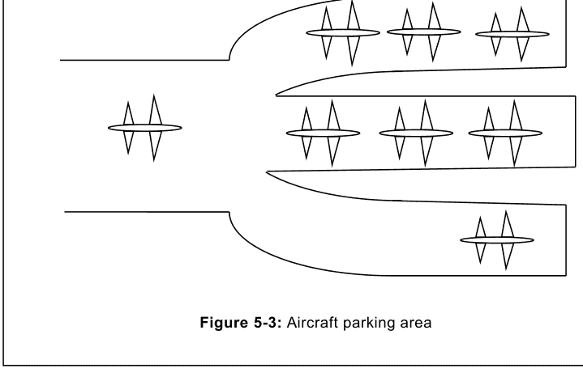

## 习题

### A. 描述性问答

1. 你如何理解栈？写出栈的应用。
2. 你如何理解 FIFO？它如何应用于栈？
3. 写出几个现实生活中应用了 FIFO 的例子。
4. 在静态栈中，你认为 FIFO 顺序会被违反吗？请说明理由。
5. 编写一个栈程序，其中 top 初始化为 0，而不是示例中给出的 -1。并相应地写出 push 和 pop 等其他函数。
6. 编写一个程序来显示栈的内容。
7. 讨论将栈顶 top 从 0 开始初始化可能存在的缺点。
8. 我们能否修改静态栈，使其大小值由用户在运行时提供？请说明理由。
9. 使用以下方法反转给定栈的内容：
   - a) 一个栈
   - b) 使用两个栈
10. 编写一个基于栈的程序，判断字符串是否为回文。
11. 如何使用基于队列的方法实现栈？（如果不了解队列的相关概念，请参阅下一章及其实现。）
12. 是否可以从栈中移除中间的元素？请在这两种情况下分别说明理由。
13. 写出一个超过 5 位的大数。将这个数字逐位存入栈中。例如，如果数字是 95487245，则应按以下顺序压入栈中：9、5、4、8、7、2、4、5。
14. 在上述程序中，求出压入栈中的所有数字之和。
15. 编写一个程序，存储两个大数，并使用栈将这两个数相加。
16. 接受一个字符串，并将该字符串逐字符压入栈中。字符的压入顺序应与其到达顺序相反。例如，如果要插入 "Push"，则插入顺序应为 h、s、u、P。
17. 扩展上述程序，从压入栈中的字符串中找出子串。子串是由字符串的一部分组成的部分字符串，可以位于字符串的开头、中间或末尾。例如，如果插入的单词是 'Ramayana'，那么 'Rama' 和 'maya' 等词就是它的不同子串，它们位于给定字符串中的不同位置。
18. 创建一个栈函数，用于确定栈中元素的总数。要完成此任务，请定义：
    - a) 将 count 变量作为栈类的成员。
    - b) 不将 count 作为数据成员。
19. 你将如何定义动态栈的大小？讨论与栈大小相关的各种限制。
20. 编写一个程序从栈中删除元素。删除元素后，应将其插入另一个栈中。需要时，可以显示已删除的元素以供审计。请分别在静态栈和动态栈中实现这种情况。
21. 静态栈中元素的显示与动态栈有何不同？
22. 写出适合使用动态栈的情况。
23. 写出不适合使用静态栈的情况。
24. 动态栈如何处理下溢情况？简要讨论与之相关的各种情况。

4. 在显示函数中，编写了如下代码：

```
void display()
{
int beg=0;
while(beg<=top)
cout<<stack[beg++]<<endl;
}
```

```
void display()
{
int t=top;
while(t>=0)
cout<<stack[t++]<<endl;
}
```

在纠正这两个函数中的错误（如果有）之后，你会优先选择哪个版本？

5. 在动态栈中，编写的代码如下：

```
void push(int element)
{
snode * temp;
temp=new snode;    // creation of a new node
snode->data=element;    // assigning the numeric value
snode->next=NULL; // pointing the next to the NUL
top=temp;    // assigning the top to this new position
}
```

6. 在动态栈中，从栈中弹出元素的代码如下：

```
int pop()
{
int x=top->data;
if(top==NULL)
cout<<" Stack underflow"<<endl;
return;
delete top; // Remove the top node
top=top->next;    // move the top to the previous position
}
```

它仅根据元素的到达情况一次增长一个元素。两者各有优缺点。接下来的小节将详细介绍这两种队列。

### 6.2.1 静态队列

如果在创建队列时就声明了队列的大小，那么这种队列称为静态队列。在这种队列中，元素从称为队尾（rear）的一端插入。一旦插入了元素，rear 指针就会相应地从前端向后端移动。当 rear 到达最末端（队列的阈值）时，就不能再插入更多元素。如果我们试图向一个已满的队列中插入更多元素，则称为溢出。

向队列中插入元素也称为入队（enqueue）。最初，front 和 rear 都被初始化为 -1。因此，它们不指向队列的任何索引，表示队列为空。

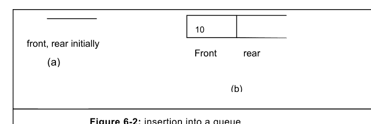

当第一个元素插入后，front 被初始化为 0，相应地，rear 也会递增。入队操作决定了队列 rear 索引的位置/移动。在插入过程中，rear 的最大值可以达到队列的大小。一旦 rear 到达最后一个位置，再插入任何元素都将导致溢出。

图 6.3 展示了队列在插入阶段的完整工作过程。

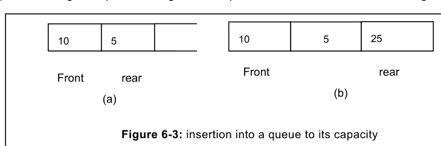

在静态队列中，首要要求是定义队列的大小，以确保队列所需的空间可以在编译时分配。

在插入每个元素时，都会检查 rear，以确定是否可以继续插入元素，或者 rear 是否已经达到其阈值。如果尚未到达末尾位置，则可以继续向队列中插入元素；否则，会生成一条合适的消息（队列已满）。描述静态队列的程序如下所示。

```
const int size=5;
class Q
{
        int front, rear;
        int queue[size];
public:
        Q();
        // To insert the element in the queue
        void enqueue(int);
        // To remove the element from the queue
        int dequeue();
        // To display the elements in the queue
        void display();
        //To investigate, if queue is empty
        int isEmpty();
        // To count the number of elements in the queue
        int count();
        // To shift the front to the 0th index
        void shiftElements();
        // function to find out the first element, without changing the order
        int FrontElement();
};
Q::Q()
{
        front=rear=-1;
}

void Q::enqueue(int element)
{
        if(((rear-front)==(size-1))&&(rear==(size-1)))
        {
            cout<<"overflow element cannot be entered\n";
            return;
        }
        else if(front==-1)
        {
            queue[++rear]=element;
            front=0;
        }
        else if(rear<(size-1))
        {
            queue[++rear]=element;
        }
}
```

#### 6.2.1.1 队列元素的显示

要显示队列元素，可以使用 front 和 rear 索引，它们表示数据元素所在的范围。在显示队列元素时，我们必须从 front 开始，一直到达 rear。在此过程中，front 或 rear 不应移动。为了实现这一目标，我们可以使用局部变量，如下例所示。

```
void Q::display()
{
    if(front>=0) //if any item in the queue
    for(int i=front;i<=rear;i++)
    cout<<queue[i]<<" ";
}
```

#### 6.2.1.2 从队列中移除元素

队列按照先进先出（FIFO）的顺序工作。这意味着最先插入的元素将最先被移除。由于队列有两个端（front 和 rear），它从 front 端移除元素，因此 front 会向 rear 方向移动。在从队列中移除任何元素之前，必须确认队列不为空。从队列中移除的元素应存储在临时变量中，并可以返回给调用者。从队列中删除元素会在队列的第一个位置产生一个空位。完整的 dequeue 函数如下所示：

```
int Q::dequeue()
{
    int a;
    if((rear== -1)||(front== -1))
    {
        cout<<"underflow:\n";
        return 0;
    }
    else
    {
        a=queue[front];
        front++;
        if(front>rear)//after removal if queue is empty
        {
            front=rear=-1;
        }
    }
    return a;
}
```

#### 6.2.1.3 统计元素数量

要统计队列中的元素数量，我们必须从队首开始。由于 `front` 可能位于第 0 个索引，也可能在部分元素被移除（出队）后远离该位置。计数应一直进行到队尾元素为止，因为它表示元素的最后一个位置（索引）。

```
// Program to count the number of elements in the queue
int Q::count()
{
int f,r, c=0;
f=front,r=rear;// initialize f with front and rear
while(f++<=r) //execute the loop till last element is not reached
{
c++;  //count the elements
}
return c;   // return the count
}
```

#### 6.2.1.4 查找队列中的第一个元素

我们可以在不改变第一个索引的情况下确定队列中的第一个元素。一旦队列中的元素被显示出来，它将再次显示所有元素，包括 `FirstElement()` 函数返回的第一个元素。该函数的代码如下例所示：

```
// Program : Write the program to determine the first element in a
queue without changing the first index.

int firstelement()
{
if(first==0)
{
cout<<" queue is empty";
return 0;
}
int x=queue[first];      // Store the first element of the stack
return x;   // return the first element
}
```

### 6.2.2 主函数

前面各小节中定义的函数都能实现各自的目标。要调用它们，我们可以使用主函数，调用方式如下例所示。

```
int main()
{
clrscr();
Q q1;
q1.enqueue(90);
q1.enqueue(5);
q1.enqueue(78);
q1.enqueue(35);
q1.enqueue(10);
q1.enqueue(14);
cout<<" Total number of elements "<<q1.count()<<endl;
q1.display();
cout<<"Dequeue item: "<<q1.dequeue()<<endl;
cout<<"Dequeue item: "<<q1.dequeue()<<endl;
```
```
cout<<" Total number of elements "<<q1.count()<<endl;
q1.display();
if(q1.isEmpty())
    cout<<"Queue is empty"<<endl;
else
cout<<"Not empty"<<endl;
getch();
return 0;
}
```

### 6.2.3 队列的局限性

队列因执行出队操作而有一个主要局限。出队时，`front` 会向 `rear` 移动。因此，从第 0 个索引到 `front` 之间不再有元素。虽然空间仍然存在，但用户无法利用这些空间，因为 `front` 已经越过了第 0 个索引。为了克服这一局限，可以将元素从当前位置移动到第 0 个索引及其之后的位置。因此，`front` 和 `rear` 的值也需要相应改变。

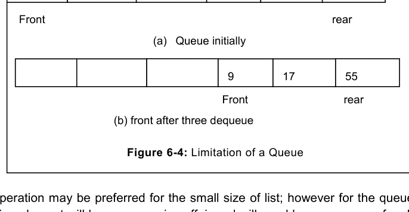

对于较小规模的列表，移动操作可能是更好的选择；但对于规模很大的队列，移动元素将代价高昂，并且需要大量资源来移动元素。

```
// To shift the Element after dequeue
void Q::shiftElements()
{
int f=front,t=-1;
while(f<=rear)
{
queue[++t]=queue[f++]; // initialize the front member in the 0th index
}
front=0;
rear=t;
cout<<endl<<"Items shifted in the Q"<<endl;
```

### 6.3 动态队列

动态队列克服了静态队列的局限。动态队列可以扩展到任意程度，唯一限制是硬件限制。在动态队列中，无需测试队满条件，因为它由硬件容量决定。不过，与之前一样，仍需要测试队空条件。

动态队列的结构通过以下类定义。下面的程序给出了各个函数及其功能。

```
//Structure of queue node
class qnode
{
public:
int info;
qnode *next;
};
class queue            //class for queue
{
//defining the front and rear pointer
qnode *front,*rear;
public:
//constructor for queue
queue();
//function to enqueue in dynamic queue
void enqueue(int);
//function to deque in the queue
int dequeue();
//To display the items in the queue
void display();
};
```

如果队列为空，则表示队列中没有元素。因此，不能移除任何元素，并返回不成功标志（0）。

第二种情况下，从队首移除元素。元素出队后，队列将为空。为了反映这一变化，需要将 `front` 和 `rear` 初始化为 NULL。

第三种情况下，当队列中元素多于一个时，`front` 必须移动到下一个可用位置。需要删除数据项以及存储在 `temp` 中的前一个 `front` 指针，以释放原先由 `front` 指针占用的空间。

```
// Function to dequeue the element from the queue
int queue::dequeue()
{
int x=front->info;
if(front==NULL)
{
cout<<"Queue is empty"<<endl;
}
else
{
qnode *temp=front;
if(front==rear)
{
front=NULL;
rear=NULL;
delete temp;
return x;
}
front=front->next;
}
return x;
}
```

入队操作会插入元素，而出队操作则从队列中移除元素。在入队和出队操作之后，大多数情况下队列中仍会剩余一些元素。为了观察这一变化，可以使用 `display` 函数。该函数显示当前动态队列中的元素。

要显示元素，我们从 `front` 开始，持续访问节点，直到到达队列末尾。队列末尾位置由 `rear` 表示。

```
void queue::display()
{
    qnode *current;
    if(front==NULL)
    {
    cout<<"queue is empty"<<endl;
    return;
    }
    current=front;
    while(current!=rear)
    {
    cout<<current->info<<endl;
    current=current->next;
    }
    cout<<current->info<<endl;
}
```

`isEmpty()` 是本程序中另一个具有重要作用的函数。它可以同时支持入队和出队。在入队期间，它可用来检查队列是否为空，并据此启动下一步操作。

该函数在调用 `dequeue` 函数时也起着重要作用。我们可以将 `isEmpty()` 作为条件包含到其他函数中。如果队列为空，则无法执行出队操作。`isEmpty()` 函数在下面的程序中定义。

```
int queue::isEmpty()
{
    int flag=0;
    if(front==NULL)
    {
    flag=1;
    }
    return flag;
}
```

上述所有函数都可以从主函数中调用。需要传递的顺序和参数已在主函数中给出。下面的主函数展示了这一点。

```
// Main function to call other queue function
void main()
{
    clrscr();
    queue q1;
    q1.enqueue(40);
    q1.enqueue(27);
    if(q1.isEmpty())
    {
        cout<<"Q is empty"<<endl;
    }
    //q1.enqueue(12);
    //q1.enqueue(64);
    q1.display();
    int j;
    j=q1.dequeue();
    cout<<" element deleted "<<j<<endl;
    q1.display();
    j=q1.dequeue();
    cout<<" element deleted "<<j<<endl;
    if(q1.isEmpty())
    {
        cout<<"Q is empty"<<endl;
    }
    q1.display();
    j=q1.dequeue();
    cout<<" element deleted "<<j<<endl;
    q1.display();
    getch();
}
```

### 6.4 使用模板的队列

动态队列在数据结构中有着广泛的应用。动态队列主要用于树的遍历，尤其是广度优先遍历。同时，我们还可以享受队列大小不受限制的灵活性。前面一节中给出的队列存在一个局限：对于不同的数据类型，程序需要相应修改。例如，前面讨论的程序使用了整数数据类型；如果必须使用字符数据类型，则需要适当修改程序。

为了解决这类问题并使程序适用于任何数据类型，我们可以使用模板。下面的程序演示了队列模板 `t` 的使用：

```
#include<conio.h>
#include<iostream.h>
//Structure of queue node
template<class t>
class qnode
{
public:
t info;
qnode<t> *next;
};
//class for queue
template<class t>
class queue
{
//defining the front and rear pointer
qnode<t> *front,*rear;
public:
//constructor for queue
queue();
//function to enqueue in dynamic queue
void enqueue(t);
//function to deque in the queue
 t dequeue();
//To display the items in the queue
void display();
//To check for queue empty or not
int isEmpty();
};
template<class t>
queue<t>::queue()
{
```


front=NULL;
rear=NULL;
}
template<class t>
void queue<t>::enqueue(t x)
{
if(rear==NULL)
{
rear=new qnode<t>;
rear->next=NULL;
rear->info=x;
front=rear;
}
else
{
qnode<t> *temp;
temp=new qnode<t>;
temp->info=x;
temp->next=NULL;
rear->next=temp;
rear=temp;
}
}
template<class t>
void queue<t>::display()
{
qnode<t> *current;
if(front==NULL)
{
cout<<"queue is empty"<<endl;
return;
}
current=front;
while(current!=rear)
{
cout<<current->info<<endl;
current=current->next;
}
cout<<current->info<<endl;
}
template<class t>
t queue<t>::dequeue()
{
t x=front->info;
if(front==NULL)
{
cout<<"Queue is empty"<<endl;
}
else
{
qnode<t> *temp=front;
front=front->next;
if(front==NULL)// if no node in the bst
rear=NULL; // point the rear also to the NULL
delete temp; // Delete the node
}
return x;
}
template<class t>
int queue<t>::isEmpty()
{
int flag=0;
if(front==NULL)
{
flag=1;
}
return flag;
}
void main()
{
clrscr();
queue<int> q1;
q1.enqueue(40);
q1.enqueue(27);
if(q1.isEmpty())
{
cout<<"Q is empty"<<endl;
}
//q1.enqueue(12);
//q1.enqueue(64);
q1.display();
int j;
j=q1.dequeue();
cout<<" element deleted "<<j<<endl;
q1.display();
j=q1.dequeue();
cout<<" element deleted "<<j<<endl;
if(q1.isEmpty())
{
cout<<"Q is empty"<<endl;
}
q1.display();
j=q1.dequeue();
cout<<" element deleted "<<j<<endl;
q1.display();
getch();
}

### 6.5 循环队列

如前所述，队列因front向rear移动而存在局限性。因此，由于front移动所产生的空余空间没有得到利用。尽管移动元素（shifting）已被提议作为消除队列前端空余空间的方法之一，但移动元素所产生的开销很大，不可忽视。为了解决这个问题，采用了循环队列。循环队列的功能将在下面讨论。

在循环队列中，元素仍然从队尾（rear）插入。插入操作会持续进行，直到遇到队首（front）。在循环队列中，rear的值在'0'到'size - 1'之间移动。当rear达到最大值时，其下一个值将重新初始化为零。这是通过使用取模运算符来实现的。我们知道，取模运算广泛用于计算余数，且该余数不会超过其右侧数字的值。例如，如果队列大小为4，由于使用了取模方法，可能的值将只落在0到3的范围内。

为了在队列中插入元素，我们创建了'insert'函数。该函数接受一个整型参数，且不返回任何值。为了插入值，我们递增rear。一旦rear递增后，它总是与front进行比较，以确保它不会超过front（即插入的值不超过队列的容量）。完整的函数如下例所示。

// Program to insert the item in a circular queue.
void insert (int &n)
{
    if ((rear+1) %size!=front)
    {
        rear= (rear+1) %size;
        queue [rear] =n;
        if (front<0)
            front=0;
    }
    else
    {
        cout<<"Queue overflow, element not inserted: \n";
    }
}

在元素插入后，另一项主要任务是从队列中移除元素。在从队列中移除元素之前，需要检查队列是否为空。移除元素时，会从队列的队首（front）移除。相应地，front会向rear索引方向移动。这里，我们考虑了队列的两种重要情况：
- 队列中只有一个元素（front和rear处于同一位置）。
- 队列中有多个元素。

以下讨论的remove()函数中已考虑了这两种情况：

// Program to remove the items from the queue
int remove ()
{
int a=0;
if (! empty ())
{
    if (front==rear)            //only one element in the queue
    {
        a=queue [front];
        front=rear=-1;
    }
    else
    {            // More than one element in the queue
        a=queue [front];
        front= (front+1) %size;
    }
}
else
{
    cout<<"Queue underflow: \n";
}
return a;
}

另一个重要的函数是empty函数。该函数用于判断队列是否为空。如果队列为空，则返回'1'，否则返回'0'。

// function to check if any item in the list or empty
int empty ()
    {
        if (front==-1)
        return 1;
        else
        return 0;
    }

最后，有必要讨论一下display函数。虽然它看起来类似于我们学过的其他display函数，但有着显著的不同，因为（显示时）值需要在'0'和'size-1'之间循环。一旦达到最大值，它会重新初始化为零。在讨论的函数中，我们从front位置开始，持续遍历，直到到达队尾（最后一个元素）。一旦到达最后一个元素，循环终止，并显示剩余元素。在显示元素之前，需要确认队列是否为空。如果队列为空，则不再显示任何元素，而是显示相应提示信息（即队列为空）。

void display ()
{
    if (empty ())
    {
        cout<<"Empty queue: \n";
    }
    else
    {
        int r, f;
        r=rear;
        f=front;
        // examine that both front and rear are not at same position
        while (f!=r)
        {
        cout<<queue[f] <<endl;
        f= (f+1) %size;
        }
        cout<<queue[f] <<endl;
    }
}

上述函数可以包含在类中，如下面程序所示。类的成员可以通过main函数中的类实例来调用。下面的程序演示了如何调用各个成员。

#include<iostream.h>
#include<conio.h>
const int size=4; // Size of the queue
class CQ
{
    int queue [size];
    int front, rear;
    public:
        CQ ()
{
    front=-1;
    rear=-1;
}
// function to insert the element
void insert (const int &);
// function to display the element
void display ();
// function to remove the element
void remove ();
// To examine whether the queue is empty or not
int empty ();
};
int main ()
{
CQ q1;       // Creating instance of the queue
clrscr ();
q1.insert (10);    //inserting the element in the queue
q1.insert (45);
q1.insert (90);
q1.insert (21);
cout<<"Elements in the queue are "<<endl;
q1.display ();     // display of the queue
q1.remove ();
q1.remove ();
q1.remove ();
cout<<"Elements after removal"<<endl;
q1.display ();
q1.insert (17);
q1.insert (56);
q1.insert (34);
cout<<"Elements in the queue are "<<endl;
q1.display ();
q1.remove ();
q1.remove ();
```

## 数据结构简化

### 6.7 基于队列的案例研究

医院中有许多按疾病划分的科室。主要科室包括皮肤科、心内科、妇科、病理科等。每个科室都能以更加公平的方式为患者服务。为了获得治疗服务，患者前往相关科室，并在那里获得一个排队号（token number）。排队号的分配完全基于到达时间。每个科室都维护着独立的队列。

医院维护以下关于患者的信息。

**表6.1：患者信息**

| 序号 | 信息 | 信息类型 |
|---|---|---|
| 1. | Patientid | 以字母数字存储 |
| 2. | Social_id | 数值 |
| 3. | Occupation | 字符值 |
| 4. | Disease_reported | 字符值 |
| 5. | Treatment prescribed | 字符值 |
| 6. | Previous treated | 是/否 |
| 7. | Token number | 数字 |
| 8. | dateOfVisit | 日期 |

基于以上信息，解决医院必须面对的以下挑战。
- 为每位患者分配唯一的排队号。
- 存储与上述字段相关的所有信息。
- 特定队列中的患者总数。
- 医院里有多少患者正在等待。
- 一天内有多少患者到达（你可以取一周或一个月的平均值）？
- 你更倾向于使用哪种数据结构？请解释它相对于你认为可能合适的其他数据结构的优势。


## 习题

## A. 简答题

- 1. 如何定义队列？写出队列中允许的各种操作？
- 2. 队列中插入和删除元素使用了几端？这一现象在队列中是如何实现的？
- 3. 队列的主要缺点是什么？这些缺点是如何解决的？
- 4. 有哪些方法可以帮助我们克服队列的缺点？
- 5. 实现一个函数，统计队列中元素的个数？
- 6. 循环队列与普通队列有何不同？
- 7. 循环队列中的循环特性如何在队列中实现，请说明？
- 8. 在循环队列中插入元素时，需要考虑哪些主要问题？
- 9. 编写一个函数，在循环队列中查找一个元素？
- 10. 编写一个程序，使用队列反转栈中的元素？
- 11. 编写一个程序，通过重载运算符 (+) 连接两个队列中的元素。
- 12. 编写一个程序，通过重载运算符 (>) 根据元素个数比较两个数组。
- 13. 编写一个函数，在向队列中插入元素时实现优先级。
- 14. 在循环队列中，如何确保当所有元素出队后，它指向 Null 条件。

## B. 改正代码（如果有错误）

- 1. 在给定的队列中，front 和 rear 已初始化为 0。队列的插入函数如下：

```
void insert (int x)
{

if (rear+1==size)
cout<<"queue overflow"<<endl;
++rear=x;
}
```

- 2. 在循环队列中，front 和 rear 已初始化为 -1。队列的插入函数如下：

```
void insert (int x)
{
if (rear+1==size)
cout<<"queue overflow"<<endl;
rear+1=x;
}
```

3. 在循环队列中，front 和 rear 已初始化为 -1。队列的插入函数如下：

```
void insert (int x)
{
if (rear+1==front)
cout<<"queue overflow"<<endl;
rear+1=x;
}
```

4. 在动态队列中，front 和 rear 已初始化为 NULL。改正以下的入队代码。

```
void enqueue (int x)
{
if (front==rear)
{
front=new qnode;
front->data=x;
front->next=null;
}
else
{
qnode *temp;
temp=new qnode;
temp->data=x;
temp->next=null;
rear->next=temp;
}
}
```

5. 在动态队列中，front 和 rear 已初始化为 NULL。改正以下的出队代码。

```
qnode* dequeue ( )
{
if (front==rear)
{
cout<<"queue is empty";
}
else
{
qnode *temp;
temp=front;
rear=rear->next;
}
}
```

6. 是否可以从队列中间移除元素？正确/错误

7. 在队列中，插入第一个元素和其他元素应以相同的方式考虑。正确/错误

8. 使用“循环队列”而不是普通队列的原因是什么？

+   a) 提高了 enqueue () 的运行时间
+   b) 重用空余空间
+   c) 可以更高效地遍历所有元素
+   d) 以上都不是

9. 队列和栈之间的一个区别是：

+   A. 队列需要链表，但栈不需要。
+   B. 栈需要链表，但队列不需要。
+   C. 队列使用结构的两端；栈只使用一端。
+   D. 栈使用结构的两端，队列只使用一端。

10. 如果字符 'D', 'C', 'B', 'A' 按顺序放入队列，然后一次移除一个，它们将按什么顺序被移除？

+   A. ABCD
+   B. ABDC
+   C. DCAB
+   D. DCBA

11. 假设我们使用循环数组实现队列类，队列中有十个项存储在 data [2] 到 data [11] 中。当前容量为 42。insert 方法将新条目放置在数组中的什么位置？

+   A. data [1]
+   B. data [2]
+   C. data [11]
+   D. data [12]

12. 考虑使用循环数组实现队列。如果试图将所有项保持在部分填充数组的前端（使得 data [0] 始终是队首），会出现什么问题？

+   A. 构造函数将需要线性时间。
+   B. getFront 方法将需要线性时间。
+   C. insert 方法将需要线性时间。
+   D. isEmpty 方法将需要线性时间。

13. 在队列类的链表实现中，insert 方法将新条目放置在链表中的什么位置？

+   A. 在头部
+   B. 在尾部
+   C. 在所有大于新条目的条目之后。
+   D. 在所有小于新条目的条目之后。

14. 在队列类的循环数组版本中，哪些操作在最坏情况下需要线性时间？

+   A. getFront
+   B. 当容量尚未达到时的 insert
+   C. isEmpty
+   D. 这些操作都不需要线性时间。

15. 在队列类的链表版本中，哪些操作在最坏情况下需要线性时间？

+   A. getFront
+   B. insert
+   C. isEmpty
+   D. 这些操作都不需要线性时间。

16. 如果 data 是一个包含 CAPACITY 个元素的循环数组，并且 rear 是该数组的一个索引，那么 rear 之后的下一个索引的公式是什么？
A. (rear % 1) + CAPACITY
B. rear % (1 + CAPACITY)
C. (rear + 1) % CAPACITY
D. rear + (1 % CAPACITY)

17. 我已经使用循环数组实现了队列，并跟踪 front、rear 和 manyItems（数组中的项数）。假设 front 为零，而 rear 比当前容量小一。关于 manyItems 你能告诉我什么？
A. manyItems 必须为零。
B. manyItems 必须等于当前容量。
C. count 可能为零或容量，但不可能出现其他值。
D. 以上都不是。

18. 我已经使用链表实现了队列，用两个引用变量跟踪 front 节点和 rear 节点。在向非空队列插入元素时，这些引用变量中的哪一个会改变？
A. 两者都不变
B. 只有 front 改变。
C. 只有 rear 改变。
D. 两者都改变。

19. 优先队列中，假设在一个具有恰好两个相同优先级条目的优先队列上调用 getFront。getFront 的返回值是如何选择的？
A. 随机选择其中一个。
B. 先插入的那个。
C. 最近插入的那个。
D. 这种情况永远不会发生（违反前置条件）

## 树

## 本章目标

- 定义树及其术语
- 定义二叉搜索树（BST）
- 使用递归和非递归方法创建 BST
- 使用递归和非递归方法遍历 BST
- 从 BST 中删除节点
- 基于遍历序列构造 BST
- 在 BST 中搜索元素
- 描述确定 BST 高度的各种方法
- 确定树的镜像。

### 7.1 树

数据结构可以以线性或非线性方式增长，因此数据结构可以分为以下两类：

- 线性。
- 非线性。

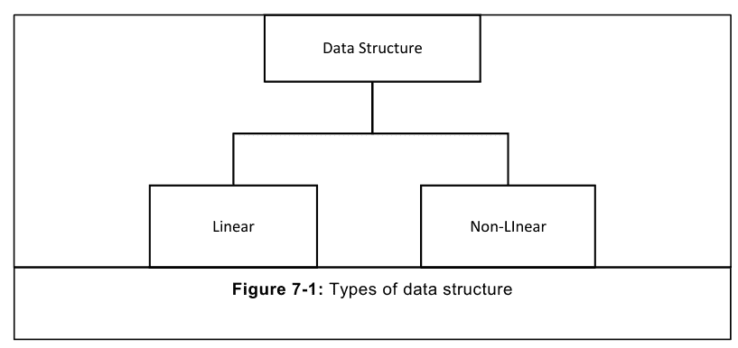

前面书中讨论的各种主题，包括栈、队列、链表，都属于线性数据结构的范畴。在线性数据结构中，项按顺序一个接一个排列。在访问项时，遍历需要访问之前放置的所有节点。线性数据结构的复杂度为 O(n)。相应地，性能是线性数据结构的主要瓶颈。为了提高性能，设计了一种新的数据结构——树。树是非线性数据结构的一个例子。在非线性数据结构中，数据按父子关系排列。下图展示了这一点。

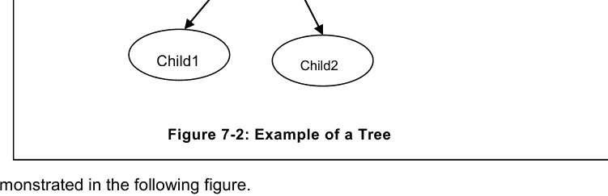

树的分类取决于任一父节点在任何时刻能够容纳的最大子节点数。然而，一个节点的子节点数可能少于其能够容纳的最大节点数。树进一步根据其度来定义。例如，度为“2”的树称为二叉树，度为“3”的树称为三叉树，而度为“n”的树称为 n 叉树。在本章中，我们只考虑二叉树。

### 7.2 基本术语

在任何时刻，一棵树可能包含多个节点，这些节点按父子关系排列。树的起始节点称为根。根节点之后的节点是另一个节点的子节点，这样继续下去，直到到达叶节点。每个节点（除根节点外）都充当另一个节点的子节点。因此，树可以定义为按父子关系组织的非线性数据结构。每个节点本身又可以看作一棵树。

在讨论树之前，有必要讨论一些在整个讨论中会经常使用的术语。

兄弟节点：同一父节点的子节点称为兄弟节点。在图 7.3 所示的树中，值为 5 和 40 的两个节点是兄弟节点，因为它们都是同一个父节点（即节点 20）的子节点。

非终端节点：树中至少有一个子节点的节点称为非终端节点。也可以定义为除终端节点以外的所有节点都称为非


terminal node. In figure 7.4, nodes with the value 20, 5, 40 are the example of non-terminal nodes.

**Leaf Node**: Leaf nodes are the one in a tree that don't have any child node. Leaf nodes are also termed as terminal node. In figure 7.4, node with the value 9 and 40 are examples of terminal nodes, since they don't have any child node.

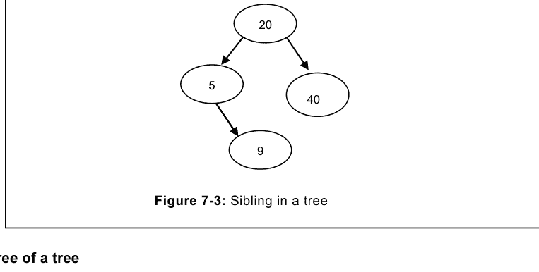

## Degree of a tree

In a tree the maximum number of child nodes that a particular node can have is termed as degree of a tree. If a node can have maximum two children then its degree is two, it is also

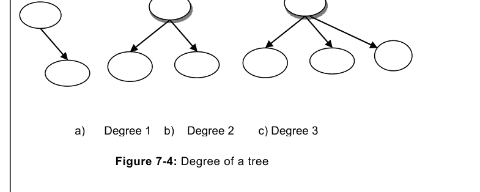

known as binary node. Examples of a degree have been given in the following figure 7.4.

**Strictly Balanced Binary tree:** Trees in which all the children have at-least two nodes or no node (in case of leaf node). Such a tree is known as strictly binary tree. In the following figure strictly tree has been illustrated. Strictly balance tree is also known as almost balanced tree.

## Completely Balanced Binary tree

A binary tree can be termed as completely balance binary tree, if all its nodes, other than the leaf nodes are having both the nodes. In addition, all the leaf nodes must be at the same level. This property makes the completely balanced tree different from the almost balanced binary tree.

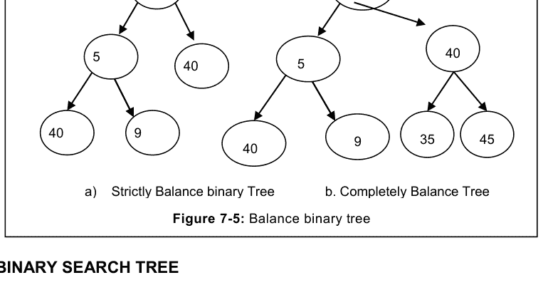

### 7.3 BINARY SEARCH TREE

Binary search tree (BST) is the special case of a binary tree in which nodes are placed depending upon their values. BST has to follow additional restrictions that are applicable to the binary tree:

- All the right nodes are more than the parent node.
- All the left nodes are less than the parent node.
- Comparison begin from the root, and continues upto leaf node is not encountered. i.e left pointer or the right pointer is not NULL.

Therefore, while creating the BST special attention is to be paid, as explained in the upcoming section.

#### 7.3.1 Creation of Binary search tree

Consider that the list of items (20, 5, 9,40,70,60) as shown in figure 7.6, is required to be inserted into the BST. The first item of the list is assigned to the root node of the BST, rest are compared with the root element. According to their values, elements are routed to the left or right hand side of the root according to the tree definition.

As illustrated in the figure 7.6, first the root node is created and it is having the value of 20 and its left and right node will be pointing to the NULL. The other elements are compared with this node. Element with greater to its parent node, they will be attached to the right, otherwise

it will be attached to the left. Consequently, on the arrival of next item i.e. 5, it will be compared with the root node (20), since it is less than the root node therefore, it will head towards the left hand side. Since, no left node is existing so this node will be attached to the left hand side and will have the value 5. The next number that is arrived is 9, again the comparison starts from the root node(20), since 9 is less than 20 so it will be heading towards the left, after heading one level down left, node with value of 5 is reached, since, 9 is more than 5 therefore it will head towards the right of 5, since, no node is attached to the right of 5, that's why this node will be attached to the right of 5, refer figure 7.6 b.

The next number in the series is 40, again the comparison will start from the root i.e. 20, since 40 is greater than the 20 it will head towards the right of 20, since the tree don't have any node attached to the right of 20, the new node having value of 40 will be attached to the right of 20, it is illustrated in the figure 7.6 'c'. Continuing to create the tree, the next node to be inserted in the tree is with the value of 70. Corresponding to the previous node, comparison will start from the root node (20), since, 70 is more than 20 it will head towards the right hand side, going one level down, it is again compared with the node having value 40, since still it is greater, therefore it will head towards the right of this node also, since its right is NULL, consequently, it will be attached to the right of this node, same has been illustrated in the figure 7.6 'd'. The next node to be inserted is having value 60. Corresponding to the previous insertion, comparison will restart from the root node(20), since it is more than 20, therefore it will head towards the right of this node, during heading one level down towards the right, 40 is encountered, since 60 is more than the 40, therefore, it will head towards the right of it. Now, 70 will be encountered, since 60 is less than the 70, therefore, it will head towards the left of it. Since, its left is NULL, consequently, 60 will be attached to this node. Final tree has been illustrated in the figure 7.6 'e'.

Construct the BST for the Series of items: 20, 5, 9,40,70,60

a.

b.

c.

d.

e.

f

Figure 7-6: Construction of a BST

#### A. Program to create BST (Non-recursive)

First we would like to define the structure of the BST. The structure of the BST comprise of three items i.e. left child pointer, right child pointer, and the data part. Structure of the BST, as discussed above has been defined as follows:

```
class tnode
{
public:
int info;
tnode *left, *right;
};
```

It is significant to understand that the member created here must be public, otherwise they will not be accessible outside the class.

Class to create the BST, along with the members has been shown below:

```
class bst
{
tnode *root;
void create(int);
};
```

Creation of a tree is started with the root node. This can be accomplished by the following statements.

```
root=new tnode;
root->left=root->right=NULL;
root->data=element;
```

Consequently, structure as illustrated in the following diagram will be created.

```
// Program to create a BST
void bst::create(int element)
{
//creating the root of bst
if(root==NULL)
{
root=new bnode;
root->info=element;
root->left=root->right=NULL;
return;
}
```

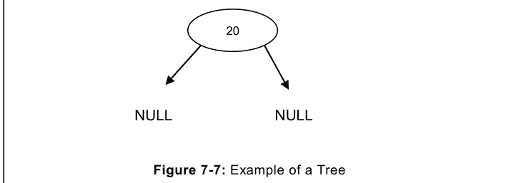

Figure 7-7: Example of a Tree

```
//creating a node to be inserted in a bst(root already exist)
bnode *temp,*r;
temp=new bnode;
temp->info=element;
temp->left=temp->right=NULL;
//initializing the r with root
r=root;
while(r!=NULL)
{
// if element is less than r then move to the left
if(element < r->info)
{
// if left is NULL attach the temp node to the left side.
if(r->left==NULL)
{
r->left=temp;
break;
}
else
r=r->left;  // Move to the left
}
else if(element > r->info)
{
// if element is more than r move toward the right
if(r->right==NULL)
```

```
{
    //if right is NULL attach temp to the right
    r->right=temp;
    break;
}
else
    r=r->right; // go to the right node
}
}
}
```

#### 7.3.2 Recursive BST Creation

In the recursive BST creation, the BST will be created that will be similar with the one created with the help of non-recursive method. However, in the recursive function we are making use of recursive call. In our program, we have divided the working of the program as:

- Creation of root.
- Inserting the left or right node in a BST.

To accomplish first objective, we have created the rec_create (int data) function and same has been depicted in the following program. Logic begins by taking the root into account. If the root is not NULL (tree is already existing), in that case rec_create (bnode*, int) is called, otherwise, the root will be created and the program will return to the caller function.

```
// Function for recursive call
void bst::rec_create (int data)
{
if (root==NULL)   // if no
{
root=new bnode;
root->left=root->right=NULL;
root->info=data;
return;
}
bnode *r=root;
rec_create(r, data);
}
```

If the tree already exists, then the new value will be compared with the root value, if the new value is less, it will be routed towards the left side. If the left side is NULL, then the new node will be created and it will be attached to the left side.

In the other case, if the new value to be inserted is greater than the root node, it will be routed to the right side. If the right side is NULL then a new node with the passed value will be created and attached to the right side of the tree.

Recursive function has been depicted in the following program.

```
void bst::rec_create (bnode *r, int data)
{
if (data < r->info)
{
if(r->left==NULL)
{
bnode *temp;
temp=new bnode;
temp->info=data;
temp->left=temp->right=NULL;
r->left=temp;
return;
}
rec_create(r->left, data);
}
else
{
if (data> r->info)
{
if(r->right==NULL)
{
bnode *temp=new bnode;
temp->left=temp->right=NULL;
temp->info=data;
r->right=temp;
return;
}
rec_create(r->right, data);
```


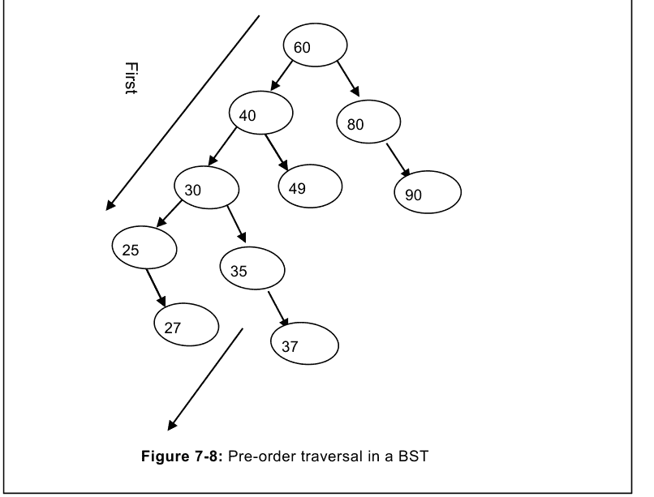

Figure 7-8: Pre-order traversal in a BST

#### 7.4.3 Non-recursive traversal

We can also traverse in pre-order by using non-recursive approach. Traversal method in non-recursive method is not different with the one using the recursive approach. However, it is much more complex relative to the recursive approach defined earlier. In the non-recursive function, we initialize the pointer of root into the new pointer 'x'. To simplify our work, we can import the file that enumerates the dynamic stack defined in the stack chapter.

```cpp
// Program: To traverse the tree in pre-order, using non-recursive approach.
void bst::pre_orderNR()
{
    bnode *x = root;          // initializing the x with the root
    int visited = 0;          // initializing the visited as false
    stack<bnode *> s;         // declaring the stack as BST node type
    s.push(x);                // Push the root into the stack.
    do
    {
        while ((x != NULL) && (!visited))
        {
            cout << "info = " << x->info << endl;  // Traverse the node
            s.push(x);                             // Push the node into the stack
            x = x->left;                           // continue to move left
        }
        visited = 1;        // Make the visited true, to avoid re-traversal
        x = s.pop();        // Pop one node from the stack.
        if (x->right != NULL)   // if right node exists
        {
            x = x->right;       // move towards the right
            visited = 0;        // set the visited value to false
        }
    } while (!s.empty());       // Continue till node in the stack exist
} // End of function
```

#### 7.4.4 In-order Traversal

In the in-order traversal, the following sequence is followed to visit the nodes:

- Left node
- Info
- Right node

In the in-order traversal, we head towards the extreme end of the left branch of the tree. During this traversal, nodes are stored in the stack. Once the extreme end of the left is reached then we can access the information. Afterwards, if the right node of the tree is not empty then we traverse towards the right. Again, we start traversal towards the left hand side by pushing the nodes into the stack, as earlier. Upon encounter of NULL, this process is over.

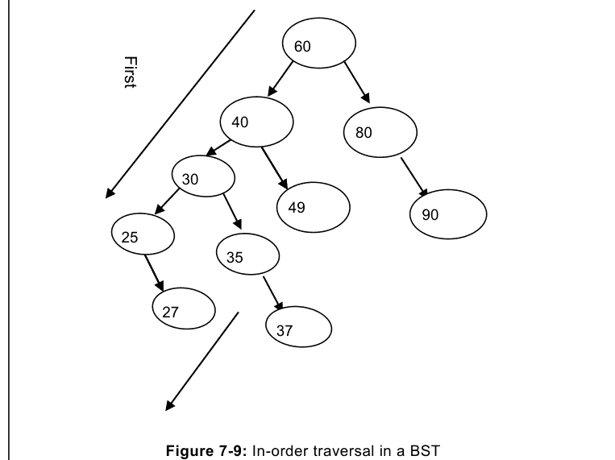

Figure 7-9: In-order traversal in a BST

#### 7.4.5 Non-recursive approach

In the non-recursive approach, programmer has to manage the various sequence of operation needed for the traversal that include creating the stack, push and pop of BST node required for insertion and deletion respectively. Traversal will take place as already explained in the recursive approach. Managing the stack has been depicted in the following program.

```cpp
// Program: Non-recursive approach for the in-order traversal of a BST
#include<stack.h> //include the stack header file defined earlier
void bst::inorderNR()
{
    bnode *x, *r = root;      // initializing the root with r
    int visited = 0;          // initializing the variable visited with 0
    stack<bnode*> s1;         // creating the stack for the BST node type
    x = r;
    s1.push(x);               // pushing the first element into the stack
    while (!s1.empty())
    {
        //x=s1.pop();
        // Go to the left if not already visited and
        // traverse to the extreme end of left branch
        while ((x->left != NULL) && (!visited))
        {
            x = x->left;
            s1.push(x);
        }
        visited = 1;               // Make the visit true as left side is visited
        x = s1.pop();              // pop the last node from the stack
        cout << x->info << endl;   // visit the extreme left node popped
        if (x->right != NULL)      // check for the presence of right node
        {
            x = x->right;
            s1.push(x);
            visited = 0;           // if right node present, make the visit false
        }
    }
}
```

#### 7.4.6 Post order Traversal

In the post order traversal, sequence of visiting various nodes and information has been given as follows:

- Left node
- Right node
- Info

From the above sequence, it is apparent that first we will move towards the extreme left node, then right node and again towards extreme left node. Once no child is available or the child already visited then only the info is traversed. After traversing the extreme left node (leaf node here) the node stored in the stack is popped and same procedure is to be applied. We continue to apply this procedure till all the nodes are not visited.

```cpp
void bst::post_order(const tnode *roote) // Program to traverse in post order
{
    if (roote != NULL)
    {
        post_order(roote->left);
        post_order(roote->right);
        cout << roote->data << endl;
    }
}
```

Traversal of the nodes has been given as follows:  
27, 25, 30, 35, 37, 40, 49  
27, 25, 37, 35, 30, 49, 40, 90, 80, 60

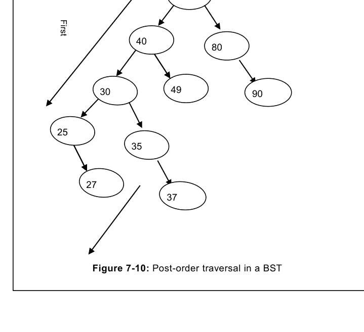

Figure 7-10: Post-order traversal in a BST

#### 7.4.7 Constructing the tree from the given traversal

We can construct the tree, if we have given the traversal such as in-order and pre-order, or in-order and post-order. Consider a case that the pre-order and in-order traversal has been given as follows:

**Pre-order traversal of a tree is:** 60, 30, 20, 10, 25, 27, 70, 65, 68, 80

**In-order traversal of a tree is:** 10, 20, 25, 27, 30, 60, 65, 68, 70, 80

It is possible to construct the BST from the given traversals. To construct the BST, if two traversals have been given, one is in-order the other is pre-order or the post-order in such case, BST can be easily constructed. We know from the various traversal enumerated earlier in the chapter that during pre-order traversal, first node that is traversed is the root node. Locate this value in the in-order traversal and divide the given traversal in left and right half.

In the in-order traversal, values that are less than the value of pre-order is to be placed in left half whereas, values greater than the first node of the pre-order value are placed in the right half. Same has been depicted in the following figures.

Value considered 60  
Value considered 30  
a)  
b)  

Value considered 10  
Value considered 25  
c)  
d)  


Figure 7-11: Constructing the tree from given in-order and pre-order

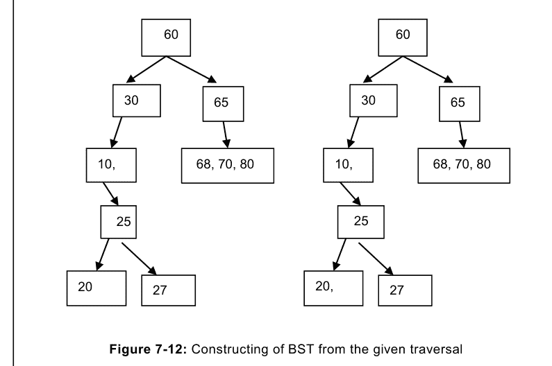

Figure 7-12: Constructing of BST from the given traversal

### 7.5 DELETION OF A NODE

Data inserted in the BST is required to be deleted in the event when it is no longer needed. Deletion of a node in a BST is more cumbersome relative to the insertion of the node. The node to be deleted is termed as target node. During deletion of a target node, followings are the various cases that have been considered:

- Target node does not have any child node (leaf node).
- Target node has only one child (may be left or right).
- Target node has both the children.

Deletion of a node for all the above cases has been discussed as follows:

Case a): To delete a node that does not have any child, we need to determine its parent. Once the parent is known, simply make the child pointer of this parent node as NULL, since it will not have any other node.

Case b): In this case, we have considered that the node to be deleted has only one child. This child node may be at the left or the right branch of the target node of a BST. In this case, we need to determine the parent node of the node to be deleted. Once, the parent node is determined, we have to find out whether the node to be deleted is left of the parent or the right node. Connect the parent node of the target node (node to be deleted) to the child node of the node to be deleted. Same has been illustrated in the figure 7.15 (a).


Resultant tree has been illustrated in the figure 7.15 (b).

**Case c:** In the third case, we have considered that the target node (node to be deleted) has both the children (left and right child). In this case also, we need to determine the parent of the target node. Since the node to be deleted has two children; therefore both the children cannot be attached to the parent node of the target node. Since the parent may already have one child. As a result, total number of nodes to be attached to the parent node will become three. Which is not possible, due to the structure limitation, and structure is governed by the tree definition. To delete such a node, we can follow any one of the following methods.

- Delete by copy
- Delete by merging

#### 7.5.1 Delete by Copying

To delete the node by copying, we do not delete the node physically. Instead, we find out the in-order predecessor or the in-order successor as well as their parent. Value of the node to be deleted is copied with the node of in-order predecessor or in-order successor already determined. Replace the value of in-order successor node to the value of the node to be deleted and set this node as NULL. Complete program to delete the node using copying method is given in the following program.

In our approach, to delete the target node, we will follow the in-order successor (instead of in-order predecessor) approach. The in-order successor node is the leftmost node of the right child of the target node. Function to determine the in-order successor has been depicted in the following program.

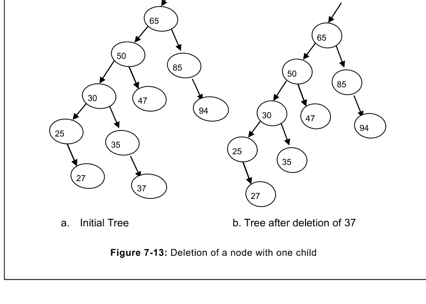

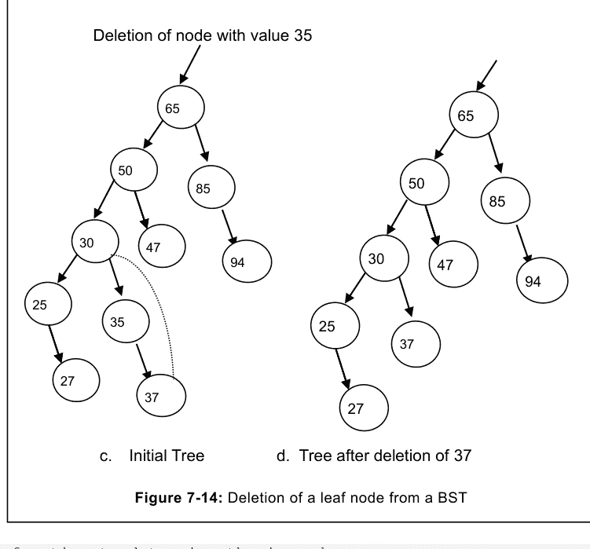

```cpp
// function to determine the in-order successor
bnode *bst::inSuccessor (bnode *current)
{
    bnode *prev=NULL;
    bnode *insucc;
    current=current->right;
    while (current->left !=NULL)      // Go to the extreme left of the BST
    {
        prev=current;
        current=current->left;
    }
    insucc=current;
    if (prev) // if prev is not NULL (prev exist)
    {
        prev->left=NULL;  //set the left child of the prev as NULL
    }
    return insucc;
}
```

Consider the BST illustrated in the figure 7.16. Node to be deleted (Target node) is 50, if we need to determine the in-order successor then we have to go to the right from where we have to head towards the extreme left end. In the given figure 32 is in-order successor.

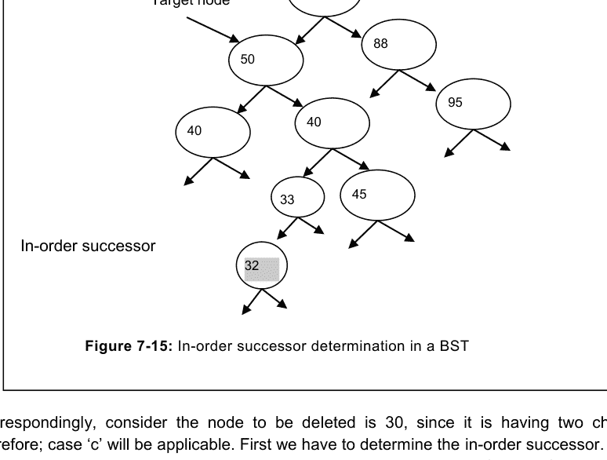

Figure 7.16: In-order successor determination in a BST

Correspondingly, consider the node to be deleted is 30, since it is having two children therefore; case 'c' will be applicable. First we have to determine the in-order successor. In the considered tree it will be 35, since the node 35 does not have any left child. Consequently, the node '35' itself will act as an in-order successor.

Once we determine the in-order successor, it is obvious that it will not have any left node. Therefore, we will connect the left node of the target node to the left of in-order successor. Whereas right node will be connected to the in-order successor of this node.

#### 7.5.2 Delete by merging

In the delete-by-merging method, the target node is deleted physically. Since the node to be deleted will have the two children and if its parent already contains one node then attaching these nodes to the parent is not possible. To address this problem, we have to find out the in-order predecessor or the in-order successor. Consider a case that we are aiming to determine the in-order successor, since we have reached the leftmost node then we are sure that it will not have any left node. Connect the right node of the node to be deleted to the left side of the in-order successor that we have just attached. The above case has been depicted in the following program.

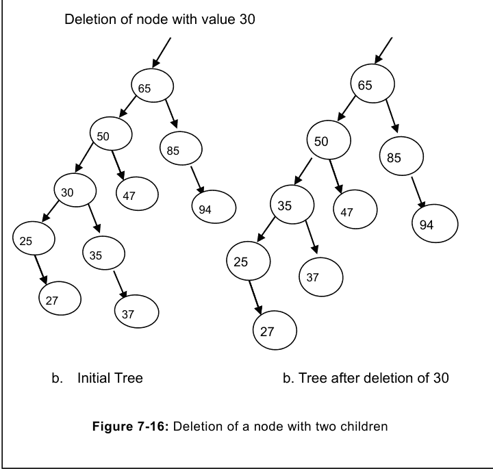

```cpp
void bst::deletenode (int node_data)
{
    bnode *r, *parent=NULL, *temp;
    r=root;
    while(r != NULL)
    {
        if(r->info==node_data)
            break;
        parent=r;
        if (node_data < r->info)
            r=r->left;
        else
            r=r->right;
    }// end of while
    if(r==NULL)
    {
        cout<<" Data is not in the BST"<<endl;
        cout<<"Press any key to continue...."<<endl;
        getch ();
        return;
    }
    else if ((r->left != NULL) && (r->right != NULL))
    {
        bnode *insucc=inSuccessor(r);
        cout<<"   we   are   evaluating   Inorder   successor=......."<<insucc->info<<endl;
        getch ();
        deleteMerge (parent, r, insucc);
    }
    else if (parent->info < r->info) // if target(r) node is towards the right
    {
        if ((r->right==NULL) && (r->left != NULL)) // if r has only left child
        {
            temp=r;
            parent->right=r->left;
            delete temp;
        }
        else if ((r->right!=NULL) && (r->left==NULL)) // if r has only right child
        {
            temp=r;
            parent->right=r->right;
            delete temp;
        }
        else if ((r->left==NULL) &&(r->right==NULL)) // if r is leaf node
        {
            temp=r;
            parent->right=NULL;
            delete temp;
        }
    }
    else if (parent->info > r->info) // if target(r) node is towards the left
    {
        if ((r->right==NULL) && (r->left!=NULL)) // if r has only left child
        {
            temp=r;
            parent->left=r->left;
            delete temp;
        }
        else if ((r->right!=NULL) && (r->left==NULL)) // if r has only right child
        {
            temp=r;
            parent->left=r->right;
            delete temp;
        }
        else if ((r->left==NULL) &&(r->right==NULL)) // if r is leaf node
        {
            temp=r;
            parent->left=NULL;
            delete temp;
        }
    }
}
void bst::deleteMerge (bnode* parent, bnode *r, bnode *insucc)
{
    bnode *temp=r;
    insucc->left=r->left;
    if (insucc==r->right)// if insucc is right child itself
        insucc->right=NULL;
    else
        insucc->right=r->right;
    if (parent->info < insucc->info)
        parent->right=insucc;
    else
        parent->left=insucc;
    delete temp;
}
```

### 7.6 SEARCHING AN ITEM IN A BST

Searching in a BST is used to determine the existence of a specific node (data) in the considered BST. To accomplish the searching, we will follow the technique of in-order traversal. As soon as the node to be deleted is determined, further searching will be terminated and the node consisting of the needed value is returned.

During the search process, if no node is remaining then we can conclude that the target node does not exist in the given tree. In this case NULL will be returned to the caller.

Program to depict the searching in a BST has been discussed as follows:

Program: Write a program to search a node that consists of a value passed by the user.

```cpp
tnode* bst::search (int el)
{
    tnode *rt;
    tnode *found=NULL;
    rt=root;    //initialize it with root
    while (rt != NULL)  // continue search till node is null
    {
        if (rt->data==el)
        {
            found=rt;
            break;
        }
        if (el < rt->data)
            rt=rt->left;
        else
            rt=rt->right;
    }
    return found;
}
```

### 7.7 COUNTING NUMBER OF NODES IN A BST

There are many instances in which we need to count the nodes of a BST. Total nodes of a BST consist of the sum of left half nodes and right half nodes of a tree. Method to count the number of nodes has been depicted in the upcoming sub-section.

#### 7.7.1 Counting the left half nodes

To count all the nodes attached to the left side of a BST, we can make use of Queue. Whenever any node is encountered (should not be NULL), it is enqueued into the queue. Afterwards, we dequeue the node and check for the left node, if the left node exist, count is incremented by one. When the queue underflow occurs, we terminate counting and return the total left node count to the caller. In this program, we will use the dynamic queue that has already been created by us in the queue section. Complete program is depicted as follows:

```cpp
int bst::leftCount()
{
    int count=0;      // initializing the count to 0
    bnode *x=root;    // initializing the x with the root
    queue<bnode*> q1;      //defining the queue of bnode type
    q1.enqueue(x); // inserting the node into queue
    while(!q1.isEmpty()) // Till queue is not empty
    {
        x=q1.dequeue(); // insert the node into the queue
        if(x->left!=NULL) // if left node exist
        {
            q1.enqueue(x->left); // insert the left node in q
            count++;            // increase the count
        }
        if(x->right!=NULL) // if right node exist
            q1.enqueue(x->right);  // insert the right node in q
    }
    return count;
}
```

#### 7.7.2 Counting the right half nodes

Corresponding to the left side node, we can compute the total number of nodes attached to the right side of a BST. We can make use of Queue as shown in the above example. Whenever any node is encountered (should not be NULL), it is enqueued into the queue. Afterwards, we dequeue the node and check for the right node, If it is right node, count is incremented by one. When the queue underflow occurs, we terminate counting and return the total number of right count to the caller. Complete code to accomplish this task has been depicted as follows:

```cpp
// Function to count the right hand side node in a BST
int bst::rightCount()
{
    int count=0;
    bnode *x=root;
    queue<bnode*> q1;
    q1.enqueue(x); // inserting the node into queue
    while(!q1.isEmpty()) // Till queue is not empty
    {
        x=q1.dequeue();
        if(x->left!=NULL) // if left node exist
        {
            q1.enqueue(x->left); // insert the left node in q
        }
        if(x->right!=NULL) // if right node exist
```


```
{
q1.enqueue(x->right);  // insert the right node in q
count++; // count the right node
}
    }
    return count;
}
```

#### 7.7.3 Counting all the nodes in a BST

要计算 BST 中的总节点数，我们可以计算 BST 的左半部分节点数以及右半部分节点数。之后，我们可以通过对左半部分和右半部分求和来计算总节点数。然而，我们尚未计算根节点。因此，BST 中的总节点数可以计算为

总节点数 = 左节点总数 + 右节点总数 + 根节点

因此，我们可以使用上面编写的函数来计算总节点数。

- leftTotal= int bst:: leftCount();
- rightTotal=int bst:: rightCount();
- 总节点数=leftTotal + rightTotal +1;

### 7.8 DETERMINING THE HEIGHT OF A TREE

树的高度对于理解树的确切深度非常重要。树的效率由树的高度决定。如果一棵树包含许多未填满的分支，那么树的高度会急剧增长，而树的性能会急剧下降。因此，我们需要了解树的高度以及如何控制它。

BST 的高度是其左侧或右侧存在的最长路径。例如，最大路径可能存在于左节点的右侧。BST 的高度已通过以下示例进行了解释。

#### 7.8.1 Non-recursive method

在确定树高度的非递归方法中，我们按层遍历树。一旦到达新层，高度就会增加一。为了按层遍历，我们可以利用上一章中创建的动态队列。在此方法中，如果树存在，则根节点会被插入队列。随后会计算队列中的节点数。我们可以借助队列函数‘size ()’来确定特定层级的总节点数，该函数确定队列中的节点数。最初，节点数为 1（仅根节点）。我们可以将根节点出队并

检查其左节点或右节点是否存在；如果它们可用，则会被插入队列。现在队列中的总节点数将是队列中非空且可用的节点。我们在访问树的全部节点后也会增加高度。整个过程会一直持续到树的全部节点都被访问为止。最后，我们返回


树的高度给调用函数。确定 BST 高度的完整程序如下所示

```
Program: Determine the height of tree (non recursive method)
// Non recursive function to determine the height of a tree
int bst::height_NR ()
{
int ht=0;  // initially height is 0
queue<bnode*> q1; // create the queue of tree node type
int count=0;    //total number of node in a queue
bnode *temp;    // temporary variable to store bnode
if (root!=NULL) // if tree exist
```

```
return 0;
else
{
    /* compute the depth of each sub tree */
    int lheight = height1(r->left);
    cout<<" after left call"<<lheight<<endl;
    int rheight = height1(r->right);
    cout<<" after right call"<<rheight<<endl;
    /* Find the larger one */
    if (rheight > lheight)
        return (rheight +1);
    else return (lheight+1);
}
}
```

### 7.9 MIRROR OF A TREE

一旦我们站在镜子前，我们会观察到我们的左手看起来像右手，反之亦然。相应地，在树的镜像中，给定的 BST 会被转置。左节点会显示为右节点，右节点显示为左节点。

考虑图 7.19 (a) 的 BST，它表示原始树。树的镜像已在图 7.19 (b) 中说明。通过将右节点连接到左节点并将左节点连接到右侧来实现镜像。为了完成镜像，我们可以采用自上而下的方式，也可以从底部开始。镜像可以通过递归或非递归函数实现。我们已从非递归方法开始讨论。

#### 7.9.1 Non-recursive method

在镜像的非递归方法中，我们将逐层遍历并转置附加到右侧和左侧的子节点。在我们的方法中，我们将节点插入队列，我们在每次迭代中检查队列以确定队列是否已耗尽。如果队列为空，则表示所有节点都已被遍历，并且所考虑的树已被转置。

从队列中，我们逐个移除节点，随后交换其左右子节点。之后我们需要检查左节点和右节点的可用性，如果其中任何一个可用，则将其插入队列。在我们讨论的方法中，我们遵循了自上而下的方法，这意味着镜像从顶部开始并一直持续到底部。逐步方法已在图 7.19 中说明

# Tree


a) Original tree

b) Mirror tree

Figure 7-18: Mirroring of a tree

```
// function to find out the mirror of a BST
void bst::mirror ()
{
    bnode *current,*temp, *x=root;
    queue<bnode*> q1;
    q1.enqueue(x); // inserting the node into queue
    while (! q1.isEmpty ()) // Till queue is not empty
    {
    current=q1.dequeue ();        // take out one node from a queue
    temp=current->left;           // swap left and right node
    current->left=current->right;
    current->right=temp;
    if (current->left!=NULL)// if left is not NULL insert in queue
    q1.enqueue (current->left); //insert left node in a queue
    if(current->right!=NULL)    // if right is not NULL
    q1.enqueue(current->right); // insert right node in a queue
    }// end of while statement
}    // end of function
```

#### 7.9.2 Recursive Approach for Mirroring

在递归方法中，我们遵循自下而上的方法，因此最高层（最底层）的节点首先被转置。随后是其上方的节点。演示镜像的完整程序如下所示：

```
Problem: Recursive function for the mirroring
void bst:: mirror(bnode *root)
{
if(root==NULL)
return;
else
{
bnode *temp;
mirror(root->left);
mirror(root->right);
temp=root->left;
root->left=root->right;
root->right=temp;
}
}
```

为了理解使用递归函数进行镜像的工作原理，请考虑图 7.19 所示的树。递归函数 mirror(root->left) 将使我们能够到达树的左most节点。随后将进行右侧遍历。由于它没有右节点。因此，值为 20 的节点将充当根。由于它不包含任何子节点，因此不会有任何变化。

随后是节点 30，由于值为 30 的节点没有右节点，因此不会进行向右移动。现在 30 充当根节点。以下语句 temp=root->left 将保存左节点的地址，由于它在右侧没有 NULL 节点。因此，20 将附加到右方，NULL 将附加到根节点（30）的左侧。

之后，50 将被返回，随后向右一步即 90，随后到达极左。在给定的树中它是 70。由于 70 没有右子节点和左子节点，因此不会有任何变化。接下来访问的节点将是 90，随后向右移动一步即节点 120，随后到达极左。在本例中它是 105。由于 105 没有任何子节点，因此通过左右附加（交换）所做的更改将不可见。随后是其上方的节点即 120。节点 105 将成为 120 的右节点。

之后，将访问节点 90，90 的当前状态如以下图 7.20 所示。其左侧分支将连接到右侧，而右侧将由于以下语句的存在而成为左侧。

```
temp=root->left;

root->left=root->right;

root->right=temp;
```

因此，节点将如图所示 7.20 所示。


最终，将到达 50。其左右两侧的节点将如上所述进行交换。最后，树将如图所示 7.20 所示。

# EXERCISE

# A. Descriptive Type Questions

- 1. 创建一个 BST 的类。为了在对象创建时创建节点，请适当地修改构造函数。
- 2. 创建一个函数，使用深度优先遍历访问每个节点。
- 3. 修改广度优先遍历函数。在修改后的函数中，自底向上逐层遍历。


+   4. 编写一个程序，使显示也按层级出现。（提示使用两个队列）
+   5. 编写一个先序遍历的程序，该程序使用队列插入元素。遍历完成后显示队列中存储的每个节点。
+   6. 编写一个函数，按层级统计并显示 BST 中节点的数量。
+   7. 编写一个合并两个 BST 的程序。确保合并后得到的树仍为 BST。
+   8. 编写一个函数，用于确定 BST 中任意特定节点的以下信息
+      a) 中序前驱
+      b) 中序后继
+   9. 编写一个程序，统计 BST 中叶子节点的数量。
+   10. 编写一个程序，确定 BST 的层数。

## 高级树

## 章节目标

- 定义 BST 的局限性
- 定义线索树
- 定义各种类型的线索树
- 定义与高度相关的 BST 局限性
- 定义 AVL 树
- 在 AVL 树中插入节点
- 讨论 AVL 树中各种类型的旋转
- 调整 AVL 树的平衡因子。

### 8.1 高级树

上一章讨论的 BST 存在各种局限性，包括无法向后遍历、存在大量 NULL 节点等。BST 的另一个主要局限性是，如果 BST 是按升序或降序的序列创建的，它会表现为链表。为克服这些局限性，可以使用高级树，如线索树和 AVL 树。线索树有助于解决 BST 中 NULL 节点的数量问题，同时便于向后遍历。AVL 解决了 BST 向一侧倾斜的行为。这两个主题已在后续章节中描述。

### 8.2 线索树

线索树是 BST 的一种特殊情况，因此需要额外的组件来表示线索。存在多种线索树，可用于其特定场景。主要存在的线索树类型包括：

- 左线索树
- 右线索树
- 中序线索

在 BST 中，仅节点的左指针（为 NULL）作为线索起作用的树称为左线索树。类似地，在 BST 中，仅节点的右指针（为 NULL）作为线索起作用的 BST 称为右线索树。节点的左右指针都作为线索起作用的树称为中序线索树。考虑到中序线索树的复杂性，我们在后续章节中描述了这种（中序线索）线索树。

#### 8.2.1 线索树的必要性

从之前的讨论可以明显看出，叶子节点没有子节点。因此，其左右指针表示为 NULL。随着层数的增加，NULL 指针的数量也会增加。只能单向遍历是 BST 的另一个主要局限性。为解决所有这些问题，使用线索树。在线索树中，我们将叶子的 NULL 指针连接如下：

- 左指针连接到中序前驱。
- 右指针连接到中序后继。
- 如果不存在前驱或后继，则在这种情况下 NULL 指针连接到根节点。

将指针附加到前驱和后继不仅消除了 NULL 指针，而且还便于向后遍历。在我们的后续讨论中，我们考虑了中序线索树。一旦读者能够实现中序线索树，实现左线索树或右线索树就可以轻松映射。

#### 8.2.2 线索树的创建

中序线索树通常称为线索树。线索树的结构和节点的插入已在以下小节中讨论。

##### 8.2.2.1 表示中序线索树

中序线索树是 BST 的高级版本，其中还包括两个额外的组件。除了左右指针外，还管理两个线索的设置，即左线索和右线索。中序线索树的完整结构已在图 8.1 中说明。

| lthread | Left node | Data | rightNode | rthread |

Figure 8-1: Structure of an in-threaded tree

在上图中，所用符号的含义如下：

lthread: 表示左线索

leftnode: 表示左节点

info: data part of the tree

rightnode denotes the right node

rthread denotes the right thread

```
Pre-order successor in a Threaded tree
tnode * presucc( )
{
if(p->lthread==0)
return p->left;
else
{
tnode *succ=p->right;
while(p->rthread==1)
p=p->right;
}
return p;
}
```

### 8.3 线索树节点的类

用于表示图 8.1 所示的线索节点结构的类已在即将到来的程序中描述。与二叉搜索树（BST）类似，tnode（线索节点）的成员应为 public，否则这些成员在该类外部将不可见。

```
class tnode //class to create the thread tree node
{
public:
int info;
tnode *left,*right;
int lthread, rthread;  // to represent the left and right thread
tnode ()        //default constructor
{ }
tnode (int);
};
// Defining the constructor outside the class
tnode::tnode (int x)    //constructor with one argument
{
this->info=x;
lthread=rthread=1;
}
```

#### 8.3.1 线索树的成员

与线索节点一致，可以创建一个类来表示线索树。该类将由线索节点和执行线索树中各种活动所需的功能组成。这些活动包括在线索树中插入项目、在线索树中遍历、在线索树中删除项目等。

```
// Class to represent the threaded tree
class thread
{
tnode *root;      // defining the threaded node
public:
thread ();
void insert (int);    // function to insert the element in threaded tree
void inorder ();
void in_order(tnode*);
void inorder_nr();// Non-recursive in order traversal
};
thread::thread() //initializing the root to zero
{
root=NULL;
}
```

在上述类中，root 已初始化为 NULL。因此，它可以表示线索树为空。

### 8.4 在线索树中插入节点

在线索树中插入项目/节点是一个复杂的过程，并且由于以下原因需要谨慎操作：

- 识别在线索树中插入节点的位置。
- 调整此新节点的左右指针。
- 调整作为新节点的父节点的节点的指针和线索。
- 考虑一种情况，即中序线索树中仅存在根节点，在这种情况下左右节点将没有节点。因此其左右线索将指向 NULL。
- 在所有其他情况下，左线索连接到中序前驱，右线索连接到中序后继。如果不存在前驱或后继。在这些情况下，线索将连接到根节点。

用于定义线索树所需各种数据成员和函数的类已描述如下：

```
Problem: To create threaded tree and inserting the node
class threadtree
{
threadnode *root; // Root of a threaded tree
void insert (int);      // function to insert the node
void inorder ();  // function for the in-order traversal
};
void threatree::insert (int x) // inserting the node in a threaded tree
{
if (root==NULL)
{
root=new threadnode;
root->data=x;
root->left=root;
root->right=root;
root->lthread=1;
root->rthread=1;
return;
}
r=root;
threadnode *newnode;
while (1)
{
if(x < r->info)
{
if(r->lthread!=0)
{
newnode->left=r->left;
r->lthread=0;
newnode->lthread=1;
newnode->right=r;
newnode->rthread=1;
```


```
break;
else
r=r->left;
}
else
{
if(r->rthread==1)
{
newnode->left=r->left;
r->lthread=0;
newnode->lthread=1;
newnode->right=r->right;
newnode->rthread=1;
r->rthread=0;
break;
}
else
r=r->right;
}      //end of else
}// end of while
```

### 8.5 线程树的遍历

线程树的遍历是一个复杂的过程。遍历过程中需要考虑多种因素。由于子节点的线程可能连接到根节点，因此会形成循环，导致无限循环。因此，必须谨慎操作以防止这种无限循环。

在普通的二叉搜索树中，遍历时我们只检查 NULL 的存在，在此终止遍历。类似地，在线程树中，我们会一直向前直到遇到线程为止。线程树中的中序遍历如下所示：

```
void thread::inorder()
{
tNode *r=root;
in_order(r);
}
void thread::in_order(tNode *root) // start of in order threaded function
```

```
{
if(!root->lthread)
{
cout<<"display of lthread"<<endl;
in_order(root->left);
cout<<"info="<<root->info<<endl;
cout<<"left   and   right   thread"<<root->lthread<<"\t"<<root->rthread<<endl;
cout<<"Press any key to continue........"<<endl;
getch();
if(!root->rthread);
in_order(root->right);
}
cout<<"info="<<root->info<<endl;
cout<<"left   and   right   thread"<<root->lthread<<"\t"<<root->rthread<<endl;
cout<<"Press any key to continue........"<<endl;
}//end of function
void inorder(threadtree *root) // function for the inorder traversal
{
threadtree *r=root;
while(*r!=*root)
{
cout<<r->info;
r=insucc(r);
}
}
```

### 8.6 线程树中的非递归遍历

```
// Program: Traversal in a Threaded tree
void thread::inorder_nr()
{
t node *r1;
int count=0;
r1=root;
while(r1->lthread==0)
```

```cpp
{
r1=r1->left;
}

while(count<2)//regulating the loop with
    {//the help of root node visit
    cout<<"info ="<<r1->info<<endl;
    if(r1->rthread==1) //go one step right
    {
    r1=r1->right;
    if(r1==root)
    count++;
    }
    else
    {
    r1=r1->right;
    while(r1->lthread==0)
        { //if right child exist go the extreme left
        r1=r1->left;
        }//end of while
    } //end of else
    }//end of outer while
}//end of function
```

### 8.7 从主函数调用

```cpp
int main ()
{
clrscr ();
thread t1;
t1.insert (20);
t1.insert (30);
t1.insert (25);
t1.insert (32);
t1.insert (15);
t1.inorder_nr ();
```

right. AVL tree along with the balancing factor has been illustrated in the following example.
In many books, the symbol {/ , 0, \} are used to represent the left heavy, balanced and right heavy respectively. However, in this book we have used the numeric value discussed earlier.
There may be various cases in which left or right node may be heavy. Correspondingly, AVL may be homogeneously or non-homogeneously balanced. Same has been described in detail in the upcoming section.

In the homogeneous unbalance AVL tree, it is unbalanced due to the unbalancing factor at the same side. For instance, consider the case of figure 8.2 (e & f), both are unbalanced AVL tree. The tree one illustrated in the figure 8.2 (e) is left heavy and the balance factor of the


grand parent of node 5 is 2. Similarly, upon computing the balance factor of its parent ‘5’ it is +1. Therefore, such type of unbalance tree is known as homogeneous unbalanced tree. Since the tree is unbalance to homogeneously attachment of the nodes. Correspondingly, we can define that the AVL tree shown in figure 8.2 (f) is homogeneous right unbalanced tree.

## Data Structure simplified


**Figure 8-4:** AVL tree with balancing factor

#### 8.8.2 异构不平衡树

在异构不平衡树中，不平衡效应是由于异构不平衡引起的。例如，考虑图 8.5 (a) 的情况，它是左重的，但其子节点是右重的。同样，在图 8.5 (b) 中，根是右重的，但当我们到达其子节点 30 时，它是左重的。上述讨论的不平衡树的情况被称为异构不平衡。为了平衡这种类型的 AVL 树，我们必须遵循特定的方法来进行平衡，相关内容已在本章的旋转部分中讨论


Figure 8-5: Heterogeneous unbalance AVL tree

#### 8.8.3 AVL 树的创建

为了确保二叉搜索树不会充当线性链表，额外成员，即平衡因子，被容纳在 AVL 树的结构中。我们定期监控平衡因子，以确保树不会向某一方向倾斜。随着节点在 AVL 树中的附加，该平衡因子会发生变化。AVL 树的数据成员将为：

```
class AVLnode
{
public:
// for the data part of the AVL Tree
int info;
// for the balancing factor
int bfactor;
AVLnode *left, *right; // left and right node of the AVL
};
```

为了理解 AVL 树是如何生长的，让我们借助一个示例来理解。考虑序列 80, 25, 66, 90, 32, 60, 11 在 AVL 树中插入/创建 80 时，不存在任何节点，因此需要创建根节点，并且该节点的平衡因子为 0。再考虑另一个数字 25，该节点将附加到 80 的左侧，其平衡因子为 0。每当有新节点附加到 AVL 时，其平衡因子始终等于零。然而，其前驱节点的平衡因子需要更改。该平衡因子将向上传播至祖父节点，如果存在。在祖父节点的平衡因子被违反的情况下，AVL 需要适当旋转，以便它能继续符合 AVL 树的定义。AVL 树的创建已在以下图 8.6 中说明。

最初，插入 80 并且其平衡因子更改为 '0'。由于它是根节点，因此平衡无法向上传播。

在 80 之后，图 8.6 (b) 中正在插入另一个数字 25，由于它小于 80，它将被引导向左侧并与 80 连接。新节点的平衡因子将为 '0'。平衡因子将向上传播，由于 25 上方仅存在一个节点，因此其平衡因子可以确定为

```
New balancing factor=old balancing factor + 1
New balancing factor=0 + 1=1
```

因此，80 的新平衡因子将为 1。

再看另一个例子（图 c），其中正在插入 90。该节点将向根的右侧移动。该新节点（90）的平衡因子将为 0。插入此节点后，平衡因子将向上方向传播，其父节点的平衡因子将增加 1。由于节点附加到右侧，因此增量为 -1。新的平衡因子可以通过以下方式计算：

```
New balancing factor =old balancing factor + (-1)
New balancing factor =1-1
=0
```

这种传播不会在此终止，而是会到达根的左侧。任何节点的新的平衡因子都可以用上面给出的公式帮助计算。因此，很明显平衡 AVL 树是一个复杂的过程，需要有前途的算法来平衡当前节点和后续节点。然而，一旦 AVL 创建完成，其性能优于 BST，因为树保持高度平衡。

最后，随着 10 的插入以及随后 2 的插入，节点 2 的祖父节点的平衡因子将更改为 2，此条件是不可接受的。因此，我们需要平衡这棵树，以确保它继续符合 AVL 的定义，我们考虑同质和异构不平衡来旋转祖父节点。

AVL 树的类和函数如下所示：

```
class avl
{
avlnode *root;
public:
avl ();
void insert (int);
avlnode*lrotate (avlnode*);
avlnode*rrotate (avlnode*);
void inorder ();
void in_order (avlnode*);
void leftbalance (stack<avlnode*>&, int);
void preorder ();
void pre_order (avlnode*);
void rightbalance (stack<avlnode*>&, int);
```


//avlnode *leftrotate (avlnode*);
//avlnode *rightrotate (avlnode*);
avlnode *lrrotate (avlnode*);
avlnode *rlrotate (avlnode*);
};

#### 8.8.4 左旋转

当 AVL 树的右侧较重时，需要进行左旋转。考虑下图中所示的树。在图 8.8 的树中，一旦插入 98，该树就会变得不平衡。值为 90 的节点将具有新的平衡因子，其值等于 2。由于它是右重，因此需要对节点 90 进行左旋转。考虑图 8.8(a) 中，98 为子节点，94 为 98 的父节点，90 为 98 的祖父节点（gp）。通过以下函数可以实现对 gp 节点的左旋转：


```
avlnode* avl::lrotate (avlnode *gp)
{
    avlnode *child;
    child=gp->right;
    gp->right=child->left;
    child->left=gp;
    child->bfactor=child->bfactor-1;
    gp->bfactor=gp->bfactor-1;
    return child;
    //end of leftrotate
}
```

#### 8.8.5 右旋转

插入节点后，如果左侧节点较重，则需要向右旋转以确保所得树保持平衡。

```
avlnode *avl::rrotate (avlnode *gp)
{
    avlnode *child;
    child=gp->left;
    gp->left=child->right;
    child->right=gp;
    child->bfactor=child->bfactor+1;
    gp->bfactor=gp->bfactor+1;
    return child;
}
```

### 8.9 右左旋转

在右左旋转中，首先需要将 BST 向右旋转。完成左旋转后接着进行左旋转。这种旋转适用于异构不平衡树的情形。所谓异构，是指右侧较重，但向下遍历时可知其是由于左侧较重的节点所致。BST 已在图 8.5(a 和 b) 中举例说明，该树为异构平衡。

//function for right left rotation
avlnode* avl::rlrotate (avlnode *gp)
{
avlnode*parent;
parent=gp->left;
gp->left=lrotate (parent);
gp=rrotate (gp);
return gp;
}


图 8-9：右旋转

//Process of double rotation.
// function for left right rotation
avlnode* avl::lrrotate (avlnode *gp)
{
avlnode *parent;
parent=gp->right;
gp->right=rrotate (parent);
gp=lrotate (gp);
return gp;
}

#### 8.9.1 左右旋转

在第 8.7.1 节中，我们考虑了祖父节点和父节点均为右重的情况。然而，这并不总是如此。还可能出现祖父节点右重但父节点左重的情况。对第二种情况的平衡较为复杂，需要进行双旋转。首先对父节点进行右旋转。之后对祖父节点进行左旋转。以下示例对此进行了说明。

```
avlnode* avl::lrrotate (avlnode *gp)
{
avlnode *parent;
parent=gp->right;
gp->right=rrotate (parent);
gp=lrotate (gp);
return gp;
}
```

如果我们考虑上面图 8.8 中给出的 AVL 树，可以观察到由于向节点 94 插入值为 92 的节点，其祖父节点 90 的平衡因子为 2，超出了容忍极限。但当我们考虑 92 的父节点时，可以观察到其平衡因子为 -1。这表明该节点为左重，因此两者为不同平衡的 AVL。在这种情况下，我们需要进行双旋转。首先对父节点进行右旋转，而在第一次旋转后，祖父节点将进行左旋转。

#### 8.9.2 在 AVL 树中插入元素

在 AVL 树中插入元素是一个复杂的过程，需要考虑许多因素。例如，当在平衡因子为‘0’的平衡树中插入项目时，在这种情况下插入的元素不会导致 AVL 失衡。

如果平衡因子已经为 1，则存在多种可能性。因此，如果需要旋转，则将由第 8.7 节中已指定的旋转规则来决定。


图 8-11：AVL 树的平衡

```
void avl::insert (int x)
{
if (root==NULL)
{
root=new avlnode(x);
return;
}
avlnode * temp,*root1,*parent;
root1=root;
stack<avlnode*> stack1;
while (root1 !=NULL)
{
stack1.push (root1);
if(x < root1->info)
root1=root1->left;
else
root1=root1->right;
} //end of while loop
parent=stack1.pop ();
if(x< parent->info)
{
parent->left=new avlnode(x);
parent->bfactor=parent->bfactor-1;
if (! stack1.isEmpty ())
leftbalance (stack1, x);
}
else
{
parent->right=new avlnode(x);
parent->bfactor=parent->bfactor+1;
if (! stack1.isEmpty ())
rightbalance (stack1, x);
}
}
```

#### 8.9.3 AVL 的左平衡

AVL 树左旋转的程序如下所示。

```
void avl::leftbalance (stack<avlnode*> &stack1, int x)
{
avlnode *gp;
int rotated=false;
while ((! rotated) && (! stack1.isEmpty ()))
{
gp=stack1.pop ();
switch (gp->bfactor)
{
case -1: gp=rrotate (gp); rotated=true; break;
case 1: gp=lrrotate (gp); rotated=true; break;
case 0: gp->bfactor=gp->bfactor-1; break;
} //end of switch
}//end of while
if (stack1.isEmpty ())
root=gp;
else
{
avlnode *temp=stack1.pop (); if (gp->info<temp->info) temp->left=gp; else temp->right=gp; }//end of else } //end of function leftbalance
```

#### 8.9.4 AVL 的右平衡

AVL 树右旋转的程序如下所示。

// Program to write the right balance
void avl::rightbalance (stack<avlnode*>&stack1, int x)
{
 avlnode *gp;
 int rotated=false;
 while ((! rotated) && (! stack1.isEmpty ())
 {
 gp=stack1.pop ();
 switch (gp->bfactor)
 {
 case -1: gp=rlrotate (gp); rotated=1; break;
 case 1: gp=lrotate (gp); rotated=1; break;
 case 0: gp->bfactor=gp->bfactor+1; break;
 } //end of switch
 }//end of while
 if (stack1.isEmpty ())
 {
 root=gp;
 }
 else
 {
 avlnode *temp=stack1.pop ();
 if (gp->info<temp->info)
 temp->left=gp;
 else
 temp->right=gp;
}
}
```

#### 8.9.5 AVL 树的遍历

AVL 树的遍历与 BST 中的遍历并无不同。事实上，由于 AVL 几乎是平衡树，深度变化仅可能存在 1，因此遍历 AVL 更高效。适用于 BST 的常用遍历技术包括中序、先序和后序遍历，这些同样适用于 AVL 树。读者请参阅 BST 部分以了解本节的解释。

```
void avl::preorder ()
{
avlnode *root1=root;
pre_order (root1);
}
void avl::pre_order (avlnode *root1)
{
if (root1 !=NULL)
{
cout<<"info="<<root1->info<<endl;
pre_order (root1->left);
pre_order (root1->right);
}
}
void avl::in_order (avlnode *root)
{
if (root !=NULL)
{
in_order (root->left);
cout<<"info ="<<root->info<<"\t";
cout<<"balance factor="<<root->bfactor<<endl;
in_order (root->right);
}
}
void avl::inorder ()
{
avlnode *root1=root;
in_order (root1);
}
```

#### 8.9.6 从主函数调用

// Calling the aforementioned functions from the main functions in order it is needed
int main ()
{
    clrscr ();
    avl avl1;
    avl1.insert (40);
    avl1.insert (50);
    avl1.insert (45);
    avl1.insert (60);
    avl1.insert (80);
    avl1.insert (90);
    // avl1.insert (2);
    // display of data from the tree.
    cout<<"inorder traversal "<<endl;
    avl1.inorder ();
    cout<<"Pre-order traversal "<<endl;
    avl1.preorder ();
    getch ();
    return 0;
}

#### 8.9.7 删除 AVL 树中的节点

从 AVL 树中删除节点与插入节点的复杂程度相似。节点一旦被删除，就需要对 AVL 的平衡因子进行评估，因为删除节点可能导致 AVL 树失衡。一旦发现 AVL 不平衡，就需要适当地进行旋转，以使平衡因子不超过允许的限制。

考虑图 8.13 所示的情况，删除节点后，平衡因子未超过允许限制，因此不需要旋转。然而，在图 8.12‘a’的情况下，删除节点会导致平衡因子发生变化。在评估平衡因子后，发现其已超过平衡因子的允许限制；


因此，该节点需要进行旋转。AVL 树的各个节点的新平衡因子已在图 8.12 中说明。在 8.12 中，节点 91 已被删除，其结果是


## 图 8-12：由于删除导致的不平衡树


## 图 8-12：旋转后平衡 AVL

节点 80 将变得不平衡，其新的平衡因子将为 2。由于它是左重；因此需要进行右旋转。最终，在进行右旋转后，节点将被平衡，如图所示。

## EXERCISE

## A. 描述性问题

+ 1. 什么是 AVL 树？AVL 树中平衡因子的意义是什么？
+ 2. AVL 树与 BST 有何不同？请证明你的答案。
+ 3. 如果用户在其应用程序中应用 AVL 数据结构，可以利用哪些优势？请证明。
+ 4. AVL 树中可应用的旋转类型有哪些？请解释-
+ 5. 详细讨论在 AVL 树中何时需要左-右。LR 旋转？
+ 6. AVL 树的遍历与 BST 的遍历有何不同？
+ 7. 讨论从 AVL 树中删除节点时适用的各种条件。
+ 8. AVL 树的各种局限性是什么？
+ 9. 计算在 AVL 树中插入一个节点的复杂度。
+ 10. 讨论在插入时不发生旋转的情况。
+ 11. 讨论一旦在插入元素期间 AVL 树变得不平衡，将会影响其上方的层数。

## B. 简答题

（按照说明解决给定的问题）

+ i. AVL 树也是 BST [真/假]。
+ ii. 相对于 BST，AVL 树产生更好的性能 [真/假]。
+ iii. 相对于 BST，AVL 树在以下情况下较慢：
+ a. 遍历
+ c. 插入时间
+ b. 显示
+ d. 以上都不是
+ iv. AVL 在以下情况下产生良好的性能：
+ a. 搜索
+ c. 删除
+ b. 插入
+ d. 以上全部
+ v. 在 AVL 树中可以进行左-左-右旋转 [真/ 假]。
+ vi. 在 AVL 树中可以进行左-右-右旋转 [真/ 假]。
+ vii. 在 AVL 树中可以进行右-左-右旋转 [真/ 假]。
+ viii. AVL 树的遍历与 BST 的遍历相似 [真/ 假]。

ix. 在 AVL 树的遍历期间需要旋转 [真/假]。

x. 如果需要，可能在以下操作中进行旋转。

+ a. 遍历
+ c. a 和 b 都
+ b. 插入
+ d. 以上都不是

xi. 在 AVL 树中，平衡因子可能传播到

+ a. 上一层
+ c. 上三层
+ b. 上两层
+ d. 以上都不是

xii. 在 AVL 树中，插入节点后，根的平衡因子为 1，而其右子节点的平衡因子为 -1。建议进行哪种旋转以使树符合 AVL 树的定义。

+ a. 左旋转
+ b. 右旋转
+ c. 左右旋转
+ d. 右左旋转

- 在 B 树中，键按排序顺序排列
- 如果根节点不是叶子节点，则根节点将至少有两个节点。
- 每个非叶子节点在每个级别上将至少有 n/2 个子节点。但是，这不适用于根节点的情况。
- 节点中的键总数应小于‘n’。例如，如果树的阶为‘n’，则键总数应小于 n。阶为 n 的 B 树最多可以有 n-1 个键。
- 左节点中的所有键都小于父键，而右边的键大于父键。
- 所有叶子节点都在同一级别。
- 所有节点至少包含 (n/2) -1 个键，除根节点外，根节点可以有一个键。

建议为 B 树取的数字‘n’应为奇数。

B 树的结构如下所示：

```
// 定义 B 树的结构
const int n=5;    // B 树的阶
// 为 bst 命名节点
class bnode
{
// 键的总数=n-1
int keys [n-1];
// 定义节点总数 =n
bnode *next[n];
};
```

### 9.2.1 B 树的创建

为了理解 B 树，请考虑以下序列。

78, 5, 56, 90, 12, 25, 10, 45, 98, 100, 88,

假设我们有一个阶为 5 的 B 树，即 n=5；因此它可以拥有的键总数为 4，因为应用了公式 (n-1)。最初，78、5、56、90 可以插入，如图 9.1(a) 所示。然而，在 12 到来时，条件（最多四个键）将被违反。因此，从所有可用的键中，即 [5, 12, 56, 78, 90] 将发生分支，并且 56 将作为根节点，并且小于 56 的数据将被放置在左节点，而大于 56 的键将被放置在右侧。在 56 到来时，如果不存在，将创建一个新节点。如果节点已存在。56 将根据其权重和 B 树中先前可用的值放置在适当的位置。没有先前节点的 resultant 树已在图 9.1(a) 中说明。

## 多路树

插入 78, 5, 56, 90

12 到来时

图 9-1(a)：阶为 5 的 B 树的创建

插入 25

图 9.1 (b)：在 B 树中插入节点

插入 10

图 9.1 (c)：在 B 树中插入节点

之后我们想插入 25，它将朝向 56 的左侧，并将导致 B 树如图所示 9.1(b)。在项目 10 到来时，它将朝向 56 的左侧。Resultant B 树如图 9.1(c) 所示。

## 数据结构简化


在 45 到来时，它将被引导到左分支。左子节点已满至其容量；因此，它将把节点分成两个分支。Resultant 树如图 9.1(d) 所示。

在上面，考虑一种情况；如果父节点中的键数为四个，在这种情况下它将无法包含所有五个键。因此，它将被拆分。最后，父节点也将被拆分以容纳该键。

最后，B 树如图 9.1(e) 所示。有时拆分也会传播到上层。考虑图 9.2 所示的 B 树。由于插入了 33，第二分支将被拆分；因此，中间元素即 33 将进入上层节点。


图 9-3：B 树的拆分和高度增加


图 9-2：B 树中的拆分传播

然而，上层节点也已满至其容量。因此，在此级别上还会发生另一个拆分。Resultant 树如图 9.3 所示。

#### C. B 树中的删除

B 树中的删除相对于 B 树的创建要复杂得多。在插入期间键在叶子处插入 Correspondingly，键必须从叶子中删除。B 树中的复杂性在于在 B 树中发生下溢时合并。

在 B 树中删除期间，可能发生以下四种情况：

## 情况 1：从图 9.3 a 中删除 22，Resultant B 树在 9.3 b


a

b

图 9-4：B 树的拆分和高度增加

- 在删除键时，如果剩余的键数量不违反任何条件 (n/2-1)，则允许 B 树保持原样。
- 如果键不在叶子节点中，在这种情况下可以保证其前驱或后继将在叶子节点中，在这种情况下我们将前驱或后继提升到叶子节点。

## 情况 2：从图 9.4 a 中删除 25，Resultant B 树在 9.4 b

a

b

# 图 9-6：B 树的拆分和高度增加

## 情况 3：从图 9.5 a 中删除 12，Resultant B 树在 9.5 b

a

b

# 图 9-5：B 树的拆分和高度增加


需要插入的是 10，它将被导向左侧。由于左侧节点已满载至其容量。因此，插入 10 将导致节点分裂。然而，已注意到其右兄弟节点未满。因此，在 B* 树中，分裂将被推迟，直到所考虑层级的所有节点都未满至 2/3。由于在所考虑的 B* 树中，其右节点未满 2/3。因此，所有节点将被线性排列，线性顺序的中间元素将被插入顶部，而较小的元素将被安排在左侧，较大的元素将被放置在右侧。同样，如果 B* 树的节点已满，在这种情况下它将分裂。如前所述。

### 9.4 B+ 树

B+ 树是 B 树的特殊情况，其中数据在树的叶节点处组织。内部节点仅维护引用。所有叶节点都连接在一起形成一个链接列表。因此，在 B+ 树中可以实现顺序访问。由于 B+ 树在存储设备中存储数据时被广泛使用。因此，项目需要


图 9-8：在 B* 树中插入 10

以有序的方式排列，以确保其表现如有序树。我们知道，有序树相对于普通列表具有更好的性能。

对于一棵树，要符合 B+ 树的定义，它应满足以下属性。

考虑一棵阶为 ‘n’ 的 B+ 树

- 根节点充当叶节点，如果它至少有一个元素。
- 每个节点最多包含 n 个子节点和 n-1 个键。
- 非叶节点包含 (n/2)-1 个键。
- 叶节点相互连接。

B+ 树是用于存储的广泛使用的数据结构，由于数据在叶节点可用。顶部可用的引用提供了路由能力。

**在 B+ 树中插入：** 考虑图 9.9 的 B+ 树，从所说明的图中可以明显看出所有节点都存在于叶节点，并且各种叶通过链接连接。

考虑将 ‘9’ 插入 B+ 树的情况。因此，它将导致分裂，如图 9.10 所示。

因此，可以推断分裂后，键的副本也会传播到上层。


**在 B+ 树中删除：** 在 B+ 树中删除与 B 树类似。如果删除键不会违反 B+ 树所需的规则，则不会发生合并。然而，如果删除节点导致剩余键的数量违反 B+ 树的条件，在这种情况下节点可能会被合并。

## 图 9-10：B 树中的分裂传播


## 练习

### A. 描述性问题

- 1. 你如何理解多路树？解释何时一棵树可以被归类为多路树？请证明。
- 2. 区分多路树和二叉搜索树。
- 3. B 树适用的限制是什么？
- 4. 定义 B+ 树。解释 B+ 树的重要优点。
- 5. 定义 B* 树。讨论 B* 树的重要优点和缺点。
- 6. 写下 B 树的 3 个主要用途。这些多路树如何决定性能？
- 7. 区分 B+ 树和 B* 树。
- 8. 假设你被给出一个问题，在分析问题后；你可以确定你需要应用多路树。你想应用哪种多路树。请证明你的答案。

### B. 简答题

- 1. B 树也是 BST [真/假]。
- 2. 所有 BST 都可以称为 B 树 [真/假]。

3. 具有............的树可以称为多路树。

- a. n 个子节点
- c. n 个键。
- b. a 和 c 都对
- d. 以上都不是

4. 在阶为 N 的 B 树中，它可以有............个最小子节点：

- a. N
- c. 2^N
- b. 2^(N-1)
- d. 以上都不是

5. 在阶为 N 的 B+ 树中，叶节点总数将为

- a. N/2
- c. 2^N
- b. 无法预测
- d. 以上都不是。

6. 在 B 树中，如果节点数小于 n/2，则可能发生分裂 [真/假]。

7. 在 B+ 树中，分裂被推迟直到子节点未填满到 ...。

- a. 2/3
- c. ½
- b. a 和 c 都对
- d. 以上都不是。

## 搜索和排序

章节目标

- 定义搜索及其意义
- 描述各种类型的搜索
- 定义排序及其各种类型
- 描述简单的排序方法
- 描述复杂的排序。

### 10.1 引言

排序和搜索是任何企业维护的记录集合的基本操作。查询或请求的记录应在最短时间内访问。访问延迟会导致较差的体验。排序数据有助于快速访问/搜索记录。这两个操作互为补充。接下来的部分强调了对本主题具有重要意义的众多突出搜索和排序技术。

### 10.2 搜索

排序和搜索在数据结构中非常重要。在查询时，我们需要从现有数据库中搜索记录。排序列表中的搜索时间相对于未排序的列表而言最小。此外，访问所有节点或跳过某些节点对性能有很大影响。因此，搜索被归类为以下类型。

#### 10.2.1 线性搜索

在线性搜索中，数据根据其到达顺序随机放置，没有规则适用。在此方法中，列表的每个元素都与要搜索的项目进行匹配。此过程一直持续到元素未找到或列表未耗尽为止。线性搜索是一种简单易实现的方法，但性能较低。随着列表大小的增加，性能进一步下降。

```
Program: To search the element from the given list and return the search status
int search (int list [], int element)
{
```

```
int i=0, found=0;
while (list[i])
{
if (list[i] ==element) // if the element is found, terminate
{
found=1;
break;
}
i++;
}
return found;
}
```

我们也可以返回索引值，而不是返回标志的状态。在列表中，如果存在超过两个具有相同值的数字，在这种情况下，将返回搜索到的位置。要从上述程序返回索引而不是状态，可以适当地修改为以下程序所示。

```
Program: To search the element from the given list and return the index where item is found
int search (int list [], int element)
{
int i=0, index=-1;
while (list[i])
{
if (list[i] ==element) // if the element is found, terminate checking
{
index=i;
break;
}
i++;
}
return index;
}
```

搜索程序的性能取决于追踪目标元素所需的比较次数。如果目标元素在第一个位置本身找到，则其复杂度为 O (1)。同样，如果它在最后一个位置找到，则其复杂度为 O (n)。

在线性搜索的最坏情况下，复杂度为 O (n)。这意味着搜索延迟完全取决于元素的数量。然而，基于当前对性能的需求，造成的延迟是显著的。如果项目不存在于列表中，在这种情况下，所有元素都需要与目标项目进行比较。

为了获得丰富的性能体验，我们可以使用排序线性列表。基于可访问性的另一种解决方案存在。在此方法中，元素根据其可访问性排列。可以观察到，在给定的列表中 20 % 的项目经常被访问。如果我们可以识别这些 20 % 的项目并将其安排在开头，则线性搜索的性能可以显著提高。因此，需要对列表进行排列以获得更好的性能。

#### 10.2.2 二分搜索

二分搜索是另一种用于搜索的方法。然而，相对于线性搜索，它更有效。按排序顺序排列项目是二分搜索的先决条件。在二分搜索中，我们不会像线性搜索那样一个接一个地追踪目标元素。相反，我们遵循与在字典中使用的方法类似的方法，在那里我们打开随机页面，寻找单词，如果单词在同一页上，则开始搜索单词。否则，如果字母大于要搜索的单词，我们向左移动，如果字母小于，则向右移动。在二分搜索中，我们遵循相同的方法。二分搜索可以用递归和非递归方法实现。

##### 10.2.2.1 递归方法

在递归方法中，我们确定数组的中间元素。如果中间元素等于目标项目，则在此处本身终止，否则我们递归调用函数。在任何时间点，较低索引超过较高索引，二分搜索终止，并且项目未找到的消息被适当地返回。我们在基本条件中放置对较低和较高索引的测试。

```
//function for the recursive search
int rec_bsearch (int x [], int l, int u, int num)
{
int mid= (l+u)/2;
cout<<" l="<<l<<" u="<<u<<endl;
if(x [mid] ==num)
return l;
if (l>u)


return 0;
if (num < x [mid])
    return rec_bsearch(x, l, mid-1, num);
else
    return rec_bsearch(x, mid+1, u, num);
}

#### 10.2.2.2 非递归方法

在非递归方法中，我们初始化最低和最高元素并遵循与递归方法相同的方法，但使用非递归技术。在此方法中，一旦追踪到项目，我们立即终止搜索过程。为了实现这一目标，我们使用了变量‘flag’来确定项目是否已在给定列表中定位。最初，我们认为该项目不存在于列表中；相应地，我们将其值设为 0。一旦定位到元素，在这种情况下 flag 被设为 1。

// 非递归函数用于搜索元素
int bsearch (int x [], int num)
{
int lower, upper, mid, flag=0;
lower=0;
upper=9;
while (lower<=upper)
{
mid= (lower+upper)/2;
if(x [mid] ==num)
{
flag=1;
break;
}
if (num < x [mid])    // 元素可能在左侧
    upper=mid-1; // 将最高值移至左侧
else            // 元素可能在右侧
    lower=mid+1; // 将最低值移至右侧
}
return flag; // 最后，返回标志
}

### 10.3 排序

列表中排列的项目是随机顺序，在搜索期间性能较低。虽然，一旦我们计算排序或未排序数组的复杂度，结果相同；然而，实际上排序数组相对于未排序数组具有更好的性能。排序可以大致分为两类：

- 外部排序
- 内部排序

排序中并非所有元素都加载到内存中，而是存储在辅助存储中，则这种类型的排序称为外部排序。

另一种排序称为内部排序，其中元素存储在内存中以进行排序。由于项目在主内存中可用，内部排序相对于外部排序更快。本书中讨论的排序技术是内部排序的示例。

#### A. 冒泡排序

冒泡排序的工作方式类似于具有因重量轻而上升到上表面的特性的气泡，换句话说，较重的元素沉降向下。冒泡排序使用上述技术。在第一次遍历中，最重的元素被排列在最右位置。在第二次遍历中，第二大元素被排列在列表的倒数第二位置，依此类推。冒泡排序的工作原理已在图 10.1 中说明。


在冒泡排序中，循环的迭代次数完全由排列的项目决定。由于在每次遍历中，一个元素将被放置在适当的位置，因此在第二次遍历及以后此元素将不会被打乱。因此，我们做出安排以确保迭代不会达到该元素。

另一种情况是给定的数组已经排序。在这种情况下不会交换任何项目。为了确保编写的程序保持高效，我们需要确定是否正在进行元素的交换。如果没有发生，则表示元素已排序。相应地，我们在此处终止循环。程序的工作原理已在以下程序中演示。

// 问题：使用冒泡排序对序列进行排序的程序
void bubble (int a [])
{
int i, j, temp;
for (i=0; i<8; i++)
{
for (j=0; j<7-i; j++)
{
    if (a[j]>a [j+1]) // 如果项目大于下一个项目
    {
    temp=a[j];      // 如果右侧元素更大则交换
    a[j] =a [j+1];
    a [j+1] =temp;
    }
}
cout<<endl;
}
}

为了确定冒泡排序的复杂度，我们观察到第一次遍历内部循环运行 n-1 次。第二次遍历运行 n-2 次。这意味着对于所有元素总迭代次数为 1+2+3+..........n-1，结果为 n (n+1)/2。因此，我们可以得出结论，冒泡排序的复杂度为 O (n²)。

#### B. 插入排序

在插入排序中，元素从左到右放置在适当位置。最初，我们认为第一个元素处于适当位置。已排序的元素排列在列表中称为左侧。在第一个元素之后，我们考虑第二个元素并将其与左侧可用的项目进行比较。在扫描项目期间，它被放置在适当位置。所有剩余项目都向右移动。插入排序的工作原理在以下程序中演示。

// 程序对数组进行排序
void insert (int a []) // 用于插入数组的函数
{
    int k, index, temp, item, i;
    for (k=0; k<n; k++)    // 从数组的第一个到第 n 个元素开始
    {
        item=a[k];      // 将当前元素存储在 item 中
        for (i=0; i<k; i++) // 确定位置
        {
            if (a[i] > a[k])    // 如果找到较大元素
            {
                for (int t=k; t>i; t--) // 将所有元素向右移动
                    a[t] =a [t-1];          // 逐个元素
                a[i] =item;         // 将项目放置在正确位置
                break;              // 停止内部循环
            }
        }
    }
}

外部 for 循环用于一次一个地对数组的所有元素进行排序。随后是内部循环，从第 0 个索引运行到正在考虑的位置。例如，如果正在考虑的索引/位置为 5，则元素必须插入到第 0 到第 4 个位置之间。因此，元素应插入在遇到比当前元素值更大的元素的位置。第三个循环使用变量‘t’从最后一个索引开始并逐个移动元素。这导致为正在考虑的项目创建空间。最终，元素被放置在创建的空位中。

#### C. 选择排序

在选择排序中，从正在考虑的整个列表中选择最小项目。在每次遍历中，此最小元素被放置在适当位置。在第一次遍历中，我们从数组中所有可用项目中找到最小项目。一旦追踪到它，我们就可以将其放置在第一个位置。在第二次遍历中，我们尝试从剩余列表中找出最小项目（除已是最小的第一个项目外），一旦追踪到它，就将其放置在第二个位置，依此类推。这里需要注意的是，正在考虑的元素与最后最小元素交换。选择排序的工作原理在以下程序中演示。

if (min > a[j])
{
min=a[j];
index=j;
cout<<" Min "<<min<<"index="<<j<<endl;
}
}
if (i != j)//项目不是最小值
{
a [index] =a[i];
a[i] =min;
}

### 10.4 高效排序算法

上面讨论的所有算法都基于交换原理工作，因此算法效率较低。所有算法的复杂度均为 O (n²)。它们的效率如下比较：

表 10.1：各种 N 的值

|  | N= | 1 | 100 | 1000 |
| efficiency |  |  |  | |
| N | 1 | 100 | 1000 |
| N² | 1 | 10000 | 1000000 |
| logN | 0 | 4.60 | 6.9 |

因此，我们需要算法以获得更好的性能。下面讨论的算法具有更好的性能。

#### A. 桶排序

在桶排序算法中，我们根据其类别将项目分组。这些项目类别由起始值决定。例如，考虑序列 28、17、40、99、27、22、96、98。在此序列中，项目按其权重分组。在十位为 1 的序列被分组到一个桶中，类似地十位为 2 的数字将被分组到第 2 组。过程将继续到 9 的值。对于给定的序列，桶已在以下图中说明。


| 初始列表 |
|---| 
| 28, |
| 17, |
| 40, |
| 99, |
| 27, |
| 22, |
| 96, |
| 98 |

| 阶段 1 完成后元素 |  |  |
|---|---|---|
| 17, |  |  |
| 22, | 27, | 28, |
| 40, |  |  |
| 96, | 98, | 99 |
|  |  |  |
|  |  |  |
|  |  |  |
|  |  |  |

图 10-2：桶排序

在桶内，元素按排序顺序排列。例如，如果数字以数字 2 开头且有 3 个元素为 28、22、27。这些数字将被按排序顺序排列为 22、27、28。放置阶段完成后，我们开始定位阶段。这里我们从第一个桶、第二个桶、第三个桶等开始挑选项目，直到所有桶都被耗尽为止。在将项目放入数组时要格外小心，不要改变桶内项目的顺序。由于桶内的项目按排序顺序放置，因此所有数字都将按排序顺序排列。

#### B. 计数排序

计数排序是另一种日益高效的排序方法。在计数排序中，我们考虑范围在 '0' 到 'm' 之间的 'n' 个元素。我们找出小于特定元素的元素。在此情况下，我们认为数字是相等的。这里首先统计特定数字的个数，然后进行数字的交换。为了求解计数排序，我们将考虑两个数组，一个包含元素，而另一个存储特定数字的计数。考虑一个由 10 个数字组成的序列。所有这些数字的范围为 0 到 7。计数排序的工作原理已在图 10.3 中说明。

n 在所考虑的情况下：

n=10

范围=0.6

## 图 10-3：计数排序

因此，我们将统计相等的数字。相应地，计数如图所示 ii。最后计数是可交换的，有助于确定小于当前数字的元素数量。参考 i) 中给出的列表- 元素为 6，转到 iii 的第 6 个索引。在这种情况下，值为 10。因此，6 应放在排序列表的第 10 个位置。由于已经放置了一个项目。将索引位置处的和减少 1。随后传播 (-1) 直到未达到最后一个元素。在所考虑的示例中，由于最后一个项目已被考虑，因此没有传播，值将减少。

#### C. 基数排序

在基数排序中，数字是根据其基数排列的。我们将基数定义为基。例如，在十进制数中基数为 10。在基数排序中，数字是根据数字的位值排列的。首先按最高有效值，然后向最低有效值移动。在每次遍历中，我们根据一个位值对它们进行排列。最后，整个序列都按排序顺序排列。此序列使用计数排序并根据计数方法对序列进行排列。

#### D. 快速排序

快速排序是排序序列的常用技术。在每次遍历中，序列被分为几部分。枢轴元素决定了序列应从何处分割。枢轴元素可以定义为序列的第一个元素，需要将其放置在适当的位置。其左侧的所有元素都小于枢轴元素，而所有大于枢轴元素的元素都放置在其右侧。

将枢轴元素放置在适当位置需要多次迭代。移动在遇到大于枢轴元素的项目时立即终止。此元素的索引被存储并称为下限索引。之后枢轴元素从最右侧向左移动，直到元素大于枢轴元素。一旦遇到小于枢轴元素的项目，我们就在此处终止。此位置称为上限索引。如果下限索引小于上限索引，则交换这两个项目。随后从左侧比较元素，我们在此处停留（左索引），并从右侧应用前面讨论过的过程。完成整个过程后，枢轴元素被放置在确切位置。枢轴左侧的项目会更小，枢轴右侧的项目会更大。考虑图 10.4 的序列


图 10.4。

该序列共有 09 个元素。因此，下限索引将为 0，而上限索引将为 07。在给定的序列中，第一个元素为 34，该元素称为枢轴元素。该元素与序列中的其他元素（从序列左侧开始）逐一比较。此比较从左侧开始；在我们的例子中，我们将左侧作为起点。在向右移动时，我们确保遇到的元素小于枢轴元素。如果元素不是更小，我们的遍历就会终止，我们必须从最右侧开始检查。从右侧，我们继续向左移动，直到遇到小于枢轴元素的元素。一旦遇到小于枢轴的元素，我们就终止移动，并在此处交换两个元素（左侧较大的元素与右侧较小的元素），即下限索引处的项目与上限索引处的项目。

枢轴
lo
u
34 20 45 12 89 78 30 66 98

a) 比较元素

34 20 30 12 89 78 45 66 98

b) 交换 45 和 30 后

20 30 12 34 89 78 45 66 98

c) 枢轴元素 34 已正确放置

## 图 10-5：枢轴元素的定位

```
// program for the quick sort using recursive method
void quicksort (int ar [], int lower, int upper)
{
int i;
if (upper > lower)// number of elements greater than 1
{
i=partition (ar, lower, upper);
quicksort (ar, lower, i-1); // quicksort for the left half
quicksort (ar, i+1, upper); // quicksort for the right half
}
}
```

分区函数如下

```
// function to partition after placing the pivot element at the appropriate place.
int partition (in ar, int left, int right)
{
int l, r, temp, i; // l for the left, r for right
l=left;
r=right +1;
while(r>= l)
```

## Data Structure simplified

```
```text
{

while (ar [++l] < i); // move right till elements are smaller than pivot

while (ar [--r] > i); // move towards left till elements are greater than pivot

if (l > u)
{
	t=ar[l];
	ar[l] =ar[r];
	ar[r] =t;
}
}

t=ar [lower];
ar [lower] =ar[r];
ar[r] =t;
return r;
}
```
```

#### E. 归并排序

在归并排序中，我们遵循分而治之的方法。在分而治之中，首先我们将序列分成单个数字，然后我们征服它们，我们将项目按组排列。最后，我们遵循合并方法来创建完整的列表。因此，归并排序是分而治之方法的流行示例。归并排序的运行依赖于计数排序和基数排序。它被认为是属于渐近算法类别的最有效算法之一。在图 10.4 给出的序列中，元素总数为 8；因此它将被分为两组。

一个列表将包含前四个元素，而第二个序列包含其余的四个元素。现在两个序列分别为 (28, 17, 40, 99) 和 (27, 22, 96, 98)。在分而治之的方法中，我们一直到最低级别，这意味着序列必须进一步划分。由于每个序列包含 4 个元素，因此各自的序列必须分为 02 组。(((28, 17), (40, 99)), ((27, 22), (96, 98))。最后，我们将其分为 1 组为 (((28), (17)), (40), (99)), ((27), (22), (96), (98))。现在它们被分为最低组件。这里，每个序列包含一个元素，因此被认为是已排序的。之后，元素按两个分组并排序为 (17, 28) (40, 99) (22, 27), (96, 98)。之后它们合并为四组并在其中排序为 (17, 28, 40, 99) (22, 27, 96, 98)。现在两个序列都按排序顺序排列。最后，我们将两个序列分组并对它们进行排序。因此，得到的序列将按排序顺序排列为 (17 22 27 28 40 96 98 99)。这种方法称为自底向上方法。


| 28 | 17 | 40 | 99 | 27 | 22 | 96 | 98 |

元素总数为8

将它们分成两个序列，每个序列有 08/2=4 个元素

(28, 17, 40, 99)   (27, 22, 96, 98)

元素总数为4

将它们分成两个序列，每个序列有 4/2=2 个元素

(28, 17) (40, 99)   (27, 22) (96, 98)

图10-6：快速排序中的分治法

下面给出了描述归并排序的程序。

```
// Program to sort the array using mergesort
void mergesort (int ar [], int lower, int upper)
{
int mid;
if (upper > lower)
{
mid= (lower+upper)/2;
mergesort (ar, lower, mid);   // divide the series into two (left side)
mergesort (ar, mid+1, upper); // divide the series into two (right side)
merge (ar, lower, mid, mid+1, upper); // merge the half
}      // end of if
}      // end of function
```

#### F. 堆排序

堆是一种广泛应用于优先队列的数据结构。堆的定义如下：

- 一块大的动态内存区域，程序员可以使用，不需要时可以释放。
- 一种平衡的、左对齐的二叉树，其中任何节点的值都不大于其父节点的值。

堆排序遵循第二种定义。快速排序在排序算法中被证明非常有效。同样明显的是，其性能产生 O（n log

注意它违反了堆的定义。因此，它再次被上移——这里它充当根节点。由于没有更上层可用，因此允许它留在那里。同时也可以观察到，现在它不再违反任何堆定义。


## 数据结构简化

这个过程一直持续到所有元素都插入堆中。完整的堆如图10.8所示。

下一个任务是从堆中选择元素，以便将它们按排序顺序存储在数组中。在元素选择过程中，首先选择根节点，因为它是最大的元素。它被放在数组的最后一个索引位置，如图10.10所示。


接下来是确定树最底层最右边的节点。如果最右边的节点不可用，则考虑用同一父节点的左节点替换根节点，如图10.9(b)所示。在所考虑的图中，最底层的最右边节点不存在。然而，同一父节点（即70）的左节点（20）将被放置在根节点。

替换元素可能导致违反堆定义。因此，需要再次检查所有元素的值。如果元素更大，就会进行上移操作。由于在图10.9(b)的结果树中，树中存在比根节点更大的元素，从而违反了堆定义。因此，需要执行上移操作。结果树如图10.11所示。


类似地，我们将从堆中移除下一个根元素，并将其放入数组中（放在节点最右侧的第一个可用位置，即数组的最后一个索引）。现在根节点中可用的最大元素是70，因此选择该元素并放入数组。从正在进行的列表中可以看出，元素排列在


从数组的最后一个索引开始按降序排列。

移除根元素后，结果树如图10.12(a)所示。之后，我们找出最底层最右边的元素。在这种情况下，它是40；因此，它将被放置在树的根节点。我们再次检查剩余的树是否符合堆的定义，如果违反了堆的定义，则执行上移操作，使其进一步符合堆的要求。因此，结果树如图10.12(c)所示。

不存在，而同一父节点的左元素是9。因此，这将得到10.13(b)的堆。由于该堆违反了条件，因此结果树如图10.13(c)所示。现在再次，由于根节点是最大的元素，在这种情况下是40，它将选择并放入数组。因此，得到的数组将是


图10-13：移除56之后

|  |  | 40 | 56 | 70 | 90 |
|---|---|----|----|----|----|
| 0 | 1 | 2 | 3 | 4 | 5 |

然而，移除40后，堆将如图10.14 a所示。同样，我们必须找出最底层最右边的元素。在这种情况下是20。因此，这将得到10.14(b)的堆。由于该堆不违反条件，因此结果树如图10.14(b)所示。

现在再次，由于根节点是最大的元素，在这种情况下是20，它将选择并放入数组。因此，得到的数组将是

|  | 20 | 40 | 56 | 70 | 90 |
|---|---|----|----|----|----|
| 0 | 1 | 2 | 3 | 4 | 5 |

然而，移除40后，堆将如图10.14 a所示。同样，我们必须找出最底层最右边的元素。由于最右边的元素不存在，而同一父节点的左元素是9。因此，这将得到10.15(b)的堆。由于该堆不违反条件，因此结果树如图10.15(b)所示。然而，移除20后，堆将如图10.15 a所示。同样，我们必须找出最底层最右边的元素。在这种情况下是20。因此，这将得到10.14(b)的堆。由于不再存在更多节点，因此该堆不违反条件，结果树已在
10.15(b)中示出。


图10-14：移除40之后

最终，只剩下一个节点和一个空间，因此将选择剩余的节点并放入数组，如下所示。


图10-15：移除20之后

| 9 | 20 | 40 | 56 | 70 | 90 |
| 0 | 1 | 2 | 3 | 4 | 5 |

从上述讨论中可以明显看出，堆排序的结果是一个如上所示的已排序数组。

## 数据结构简化

- III. 插入排序、冒泡排序和选择排序的性能相同。
- IV. 在堆中从根节点移除元素后，堆的定义可能会被违反。
- V. 在快速排序中，枢轴元素将元素放置在数组的最右侧。
- VI. 堆排序的时间复杂度始终为 O(n log n)。
- VII. 在时间至关重要的场景中应使用快速排序。

## 字符串

第11章

## 本章目标

- 在C++中定义字符串
- 定义字符串的各种函数，如 upper、lower、mid、left
- 在字符串中搜索模式
- 讨论暴力匹配、KMP 和 Rabin-Karp 算法。

### 11.1 引言

字符串在数据结构的文本相关部分中被广泛使用。在 C 和 C++ 等语言中，字符串借助字符数组来表示。为了操作字符串，string 头文件中已经存在许多函数。然而，我们可能需要更多函数来完成许多常规任务，例如提取字符串、搜索特定模式、大小写转换等。

对于字符串，完成一个任务可能存在许多函数，每个函数都基于其专业视角代表了不同的方法。然而，这些方法的使用受到多种因素的制约，包括处理时间、易用性和资源能力。

下一小节将介绍我们各种需求所需的许多字符串函数。

### 11.2 重要的字符串函数

要完成任何与字符串相关的任务，我们要么使用 string 头文件中已定义的函数，要么创建自己的函数。本节介绍一些广泛需要的复杂字符串函数。

#### 11.2.1 将字符串大小写转换为其他形式

由于各种原因，我们需要将字符串文本转换为大写、小写或句子大小写形式。因此，必须存在能够促进大小写之间转换的函数。下面定义了各种常用的大小写转换函数，如小写、大写、句子大小写等。

#### A. 大写转换

大写转换函数用于将字符串字符从小写转换为


大写。为实现此目的，我们使用了字符的 ASCII 值。如果字符落在小写字母范围内，则通过从字符值中减去 32 将其转换为大写字母。下面的程序中列举了 Upper 函数。

```
// Program to convert the given string into upper characters
// function to convert the string into upper case
void toupper (char str [])
{
int i=0;
while (str[i] !='\0')// continue till end of the string is not encountered
{
if ((str[i]>=97) && (str[i] <=122))
str[i] =str[i]-32;    // change it into corresponding upper case
i++;
}
}
```

#### B. 小写转换

与大写转换类似，如果用户输入的是大写字母字符串，我们也可以将其转换为小写。与大写转换相对应，我们使用 ASCII 表将字符串字符转换为小写（如果它不属于小写字母类别）。下面的程序描述了从大写到小写的转换。

```
// Program to convert the upper case letter in lowercase
//function to convert into lower case
void tolower (char str [])
{
int i=0;
while (str[i] !='\0')
{
if ((str[i]>=65) && (str[i] <=90))
str[i] =str[i] +32;
i++;
}
}
```

#### 11.2.2 提取子串

除了将字符串从一种大小写转换为另一种大小写之外，我们还可以从字符串中提取一组字符。这些字符可以来自字符串的开头、中间或结尾。此外，还需要截断用户输入的前导空格。相应地，为实现上述目标，定义的各种函数如下：

#### A. 移除前导空格

在输入字符串时，用户可能会在字符串中输入空格。这些前导空格是不需要的，并且会影响字符串的长度。更糟糕的是，由于前导空格的存在，在很多情况下无法得到正确的结果。

为了移除前导空格，我们定义了函数 `trim (char [])`，它接受字符数组（字符串）并移除前导空格。

为了移除前导空格，我们使用了一个标志 `start`，它表示这是字符串的开头。为了判断当前字符是否为空格，我们再次使用 ASCII 表，其中空格的值为 32。相应地，我们使用的逻辑是：如果它是字符串的开头并且是空格，则字符串应继续移动到下一个字符。一旦出现任何其他字符，就将其复制。同时，`start` 将被设置为 false，因为字符已经开始。最后，还复制了 NULL 字符。

```
// Function to remove the leading space from a string
void trim (char str [])
{
    int i=0, j=0, start=1;
    while (str[i] != '\0')
    {
        if ((str[i] ==32) && (start))    // if space at the beginning
        {
            i++;
            //cout<<"blank found ";
            continue;
        }
        str[j] =str[i];
        start=0;        // Now if the space exist, it is in-between
        j++;
        i++;
        // cout<<"in trim"<<endl;
        //  cout<<endl;
    }
    str[j] ='\0';
}
```

#### B. 从开头提取字符

我们可以从字符串的开头提取字符。为实现此任务，我们创建了一个名为 `temp` 的临时数组。我们逐字符读取给定的字符串，直到用户想要的字符为止。例如，如果用户想要提取前 4 个字符，则应该从第 0 个索引开始，并持续到第 3 个索引（这样总共将是 4 个字符）。整个程序如下所示。

```
// Program to extract the first n character from the given string
// given string is st and number of characters are n
void left (char st [], int n)    {
    int i=0;
    char temp [20];
    while (i<n)//copying the string into temp
    {
    temp[i] =st[i];
    i++;
    }
    temp[i] ='\0';
    strcpy (st, temp); //copying the temp string back to the st
}
```

#### C. 从中间提取字符

我们也可以从中间提取字符串。为实现此任务，我们使用了 `mid` 函数。这里重要的是，索引与用户提供的位置之间的差异不应有任何不匹配。假设用户想要从第 2 个位置提取到第 5 个位置。在数组中，所提供参数的索引将是第 1 个和第 4 个。因此，必须对参数进行索引，以消除索引与用户对字符位置的感知之间的差异。

```
void mid (char str [], int start, int last)
{
    int i=start-1, j=0;
    char temp [20];
    while (i<last)//copying the string into temp
    {
    temp[j] =str[i];
    i++;
    j++;
    }
    temp[j] ='\0';
    strcpy (str, temp); //copying the temp string back to the st
}
```

在上面的程序中，我们提取了从开始到结束的字符到一个临时字符串中。最终，使用定义在 `string.h` 头文件中的 `strcpy ()` 函数将临时字符串复制回原始字符串。

#### D. 从末尾提取字符串

与前面讨论的其他提取方法相比，从末尾提取字符串相当复杂。在从末尾提取字符串时，我们可以使用下面程序中描述的逻辑。

```
// Program to extract the 'n' character from the end of a string
void last (char str [], int n)
{
int len=strlen (str); // determine the length of the string
int sp=len-n; //find out the starting position from where the...
// string extraction start
char temp [30];
int i=0;
while (str [sp]!='\0')
{
temp[i] =str [sp];
i++;
sp++;
}
temp[i] =str [sp]; // copying the NULL character
strcpy (str, temp); // copying the extracted string back to the original string
}
```

在上面的程序中，首先我们确定字符串的长度，这可以通过定义在 `string.h` 中的字符串函数 `strlen ()` 来确定。之后，我们计算从末尾开始提取的位置。为实现此目标，我们从已经计算出的字符串长度中减去用户传递的 `n` 值。例如，如果用户想要提取字符串的最后 4 个字符，首先我们确定字符串的长度，假设为 15。根据可用数据，数组的起始点可以通过计算 15-4=11 得出。这表示我们必须从第 11 个索引开始，并一直持续到末尾，即第 14 个索引。

### 11.3 字符串匹配算法

在字符串匹配中，我们将字符串与提供的模式进行比较，以确定所考虑的字符串中是否存在特定模式。如果模式存在，则应显示相应的消息，否则应显示模式不存在的消息。流行的字符串匹配算法将在接下来的小节中讨论。

#### 11.3.1 暴力字符串匹配

在暴力字符串匹配算法中，我们尝试识别给定字符串中是否存在模式。在这种方法中，从起始索引 `0` 开始检查字符串中是否存在模式，如果字符串的第一个字符与模式匹配，则比较下一个字符；如果字符串和模式的任何字符不匹配，则终止进一步检查。之后，从字符串的第 1 个索引和模式的第 0 个索引开始检查模式是否存在。我们一直继续，直到模式耗尽或字符串耗尽。如果模式耗尽，则表示该模式存在于给定字符串中。暴力匹配的程序描述如下。

```
// Program to find out the pattern based on brute force algorithm
int bforce(char st[], char pattern[])
{
int i=0, status=0;
int index;
while (st[i]!= '\0')
{
j=0;
index=i;
{
while ((st[i]!='\0')&& (pattern[j]!='\0'))
{
if (st[i]==pattern[j])
{
i++;
j++;
}
} // end of inner while loop
```


```
if(pattern[i]=='\0')      // if the pattern is exhausted
{
status=1;            // change the status as successful
break;
}
i=index;    // set the i with the value as before inner while loop
i++;   // increment the index so that next element can be checked
}      // end of outer loop
return status;
} // end of function
```

在我们的程序中使用了两个循环，分别是外层循环和内层while循环。外层循环由字符串的长度控制，而内层循环由待检查的模式和字符串控制。如果匹配继续进行，则内层循环继续。内层循环退出后，检查模式是否已耗尽。如果已耗尽，则终止进一步检查。

如果模式未耗尽，在这种情况下，我们用索引恢复i的值，该索引表示内层循环开始前i的值。最后，'i'自增，以便可以开始检查下一个元素。这种检查将一直持续到模式或字符串耗尽为止。如果模式耗尽，则表示状态为1，否则状态为0。

#### 11.3.2 克努特-莫里斯-普拉特（KMP）

暴力算法存在一个主要局限：它从头开始评估字符串，并继续匹配，直到不匹配发生或字符串耗尽。在不匹配的情况下，它会从第1个索引（或上一次开始位置的下一个地址）开始检查。它从未考虑过，一旦匹配已经进行到第4或第5个字符，模式从第1个索引开始存在的可能性会降低。因此，人们认为暴力算法从未应用任何智能。例如，考虑一种情况：我们从开头开始比较，字符串的第一个字符与给定模式匹配，第二个也匹配，第三个也匹配。然而，在第四个位置发生了不匹配。在这种情况下，从第二个元素开始，模式存在的可能性为零。任何匹配的可能性只会从第5个字符开始。然而，暴力算法没有考虑这种情况，而是会从下一个（此处即第二个）字符开始搜索。

上述局限性已由克努特-莫里斯-普拉特（KMP）算法解决。在该算法中，我们从开头开始，并通过应用智能来将模式与字符串进行比较。KMP的工作方式如下所示：

```
// Program to display the KMP
int KMP(char str[], char patt[])
{
int sl=strlen(str);
int pl=strlen(patt);
cout<<"String length ="<<sl<<endl;
cout<<"Pattern length ="<<pl<<endl;
int index=-1;
int i=0,j=0;
while(i<=sl)    // Check till the i is less then string
{
j=0;
while((str[i]==patt[j]) && (j<=pl)) // if string and pattern is matching
{    // at the same time, less than pattern
i++;    // go to the next character of string
j++;    // go to the next character of pattern
}
if(j>=pl)    // if pattern completely found in the string
{
index=i-pl; // first index of the string where matching found
break;
}
i++; // if no matching found, go to the next character
}
return index;    // return the starting index if found, otherwise
return -1
}
```

在上述KMP算法中，首先我们确定字符串和模式的长度。外层循环由字符串的总长度控制，而内层循环由模式长度控制。如果找到匹配的字符，则字符串和模式的索引都会增加。如果模式已被完全检查（不再有字符存在），则应防止进一步比较，这通过语句 if (j>=pl) 来考虑。所使用的条件语句表示模式已耗尽。为了停止进一步比较，使用了‘break’语句来阻止任何进一步的比较。最终，返回模式开始的字符串索引。

## 字符串

如果模式没有匹配的字符，则需要评估字符串的下一个字符。这是通过外层循环结束前的 i++ 语句实现的。

## 练习

- 1. 暴力字符串模式匹配算法的目标是什么？
- 2. KMP如何工作？确定KMP的复杂度。
- 3. 暴力算法与KMP之间的区别是什么？
- 4. 使用KMP如何实现效率？
- 5. 模式匹配与字符串匹配有何不同？讨论。
- 6. 模式匹配存在哪些不同的方法？
- 7. 取一个字符串 RAMAYAN，对于该字符串，考虑模式“RAM”和“MAY”。使用暴力算法和KMP进行模式匹配的干跑。并找出在暴力算法和KMP算法情况下所需的比较次数。

## 哈希

## 本章目标

- 定义哈希及哈希的重要性
- 描述各种哈希函数
- 描述冲突
- 描述哈希中各种冲突处理技术

### 12.1 哈希

在线性搜索或二分搜索中，性能是主要挑战。尽管线性搜索能够实现搜索的目的，但性能是主要关注点。二分搜索相对于线性搜索提供了更好的性能，然而，线性搜索的主要局限在于要求序列必须是有序的。为了克服这一挑战，存在另一种称为哈希的方法，它允许基于直接索引创建和访问元素，因此，该算法的性能被认为是 O(1)，而不是 O(n) 或 O(log n)。为了在哈希中组织元素，我们使用哈希函数。

### 12.2 哈希函数

哈希函数用于为元素生成唯一的索引。相应地，元素被分配到这一新的索引/地址。越来越重要的是，所选择的函数应生成唯一的索引，以确保元素被放置在数组内的唯一位置。

哈希函数是性能改进的关键驱动力。它允许我们将项目放置在数组内的适当位置，从而在从数组中搜索时，使我们能够以最短的时间进行搜索。虽然存在各种函数使我们能够创建唯一地址，但我们仅限于介绍主要的哈希函数，这些函数将在接下来的部分中讨论。

#### 12.2.1 除法方法

该函数的主要目的是生成唯一索引，以便将项目放置在适当的位置。在除法方法中，有两个数字：

- 用于生成索引的键。
- 给定表中待分配的元素总数（大小）。

在这种方法中，我们用键除以大小并求出余数。计算出的余数作为给定键的索引。由于它基于余数工作，因此也被称为余数法。生成索引的语法为：

Index= K mod size.

考虑数列 34, 78, 47, 90, 12。使用 k mod n 方法分配索引。这里设 n 为 10，我们需要为其分配地址。

| 数字 | 90 |  | 12 |  | 34 |  |  | 47 | 78 |
| 索引 | 0 | 1 | 2 | 3 | 4 | 5 | 6 | 7 | 8 |

图12-1：使用余数法分配项目

例如，假设需要分配的元素总数为100。需要分配地址的数字（键）为34。在这种情况下，余数为34（34 mod 100）。因此，34将被分配到索引34。现在，考虑数字254。在这种情况下，254 mod 100，余数为54；因此，254将被分配到索引54。因此，数字可能足够大；然而，余数将在0到（大小-1）之间。

在图12.1中，展示了使用余数法分配索引。在所考虑的数列中，对于第一个元素，索引计算为‘34 mod 10’，因此其索引结果为第4个位置。相应地，其余元素的索引可以计算，结果分别为索引8、7、0、2。

哈希函数并不总是提供唯一地址。例如，考虑一个新数字154，应用上述规则，将生成地址‘4’。然而，4已经被另一个数字占用。如果同一个索引被分配给多个元素，那么这种现象称为冲突。冲突总是不可取的，因此，在选择用作除数的数字时需要格外小心。建议选择的大小数字应为素数。人们认为，如果大小是素数，则会产生更少的重复索引。然而，冲突并未完全消除。为了解决冲突，存在多种方法，其中一些主要方法已在第12.3节中讨论。

#### 12.2.2 平方取中法

从上述讨论中可以明显看出，除法方法会导致过多的冲突，因为我们直接对键本身进行操作。借助平方取中法也可以计算索引。在这种方法中，我们不是直接应用规则，而是我们


平方给定的键。一旦已知键的平方，我们就根据索引的长度取该数字的中间部分。例如，考虑数字 311。首先平方所考虑的键，结果为 96721。从计算出的结果中，我们取该数字的中间部分。需要提取的数字位数由表的大小决定。在我们的例子中，假设表的大小为 1000，则中间数字为 672。可以写成 H(311) = 672。上述数字生成的索引将为 672。现在显而易见，生成的索引与键完全不同。在此方法中，生成相同索引的概率已显著降低。

#### 12.2.3 折叠方法

在此方法中，数字被折叠以便进行计算。我们可以应用两种类型的折叠方法：
- 移位折叠
- 边界折叠

在折叠方法中，计算出的数字除以大小以确定键的索引。它被视为哈希，因为它涉及数字的除法和分组。考虑数字 254/326/547/251，对于该数字我们可以应用两种折叠方法中的任何一种。在**移位折叠**中，数字也可以移至其他组。假设数字被分为 03 位的组，则结果数字将为 254、326、547、251。随后将这些数字相加。在正在讨论的情况下，它将为 1374（254 + 326 + 547 + 251）。为了计算索引，我们可以使用除法方法作为（数字 mod 大小）。如果我们将大小视为 100，则生成的索引将为‘1374 mod 100=74’。通过移位方法生成的索引不是唯一的，相反，多个元素可能具有相同的索引。

在**折叠方法**中，我们将数字分成相等部分的组，然后像折叠纸一样折叠给定的数字。之后，将获得的数字相加。由此得到的结果进行取模运算。例如，考虑数字 123674987。这里数字被分为三组，123、674、987。我们对由此获得的数字进行加法运算，即 123+674+987=1784。最后，对结果数字进行取模大小运算，在此数字（键）为 1784，我们考虑的大小为 100，因此结果将为‘1784 mod 100=84’。因此，通过比较移位和折叠方法的结果，已揭示出两种方法生成的索引是不同的。

#### 12.2.4 提取

在提取方法中，我们仅提取键的部分数字来计算地址，而键的其余数字则被省略。例如，如果数字为 785/897/345，我们可以提取前三位数字或前六位，或四位数字或任何其他组合。此提取的数字将作为键并用于生成索引。观察发现，如果仔细选择，则由此生成的索引会产生良好的结果并最小化冲突。例如，考虑分配给员工的 employee_id

数字是使用‘x mod 10’排列的，其中‘x’为数字，而 10 是用于计算余数的大小。包括 32 在内的各种数字的索引生成已在图 12.2 a 中说明。在 32 到达时，这也将导致第 2 个索引，然而这是不允许的，因为该索引处的数字已存在。为了解决冲突，线性探测方法从冲突的单元开始探测未分配的单元。在所考虑的列表中，下一个可用单元是第 3 个，因此该数字将被分配到第 3 个索引，并且已在图 12.3 b 中说明。现在，假设下一个元素是 53，在这种情况下索引将为‘53 mod 10’，即等于 3。由于索引 3 已被占用，因此它将从冲突点开始线性探测。因此，它将被分配索引 6。因此，许多项目将不会被分配实际索引，从而导致性能进一步下降。


#### B. 链地址法

在链地址法中，当第二个项目导致相同地址时，在该索引处创建一个链表并称为链- 所有导致元素已存储的地址的元素，这些元素存储在链表的节点中。在到达任何其他元素到同一地址时，再次创建一个新节点以存储该项目。因此，元素以无序形式排列。在访问元素期间，我们继续搜索元素，直到找不到该项目或所考虑的列表耗尽为止。与线性探测方法相比，此冲突处理方法可获得更好的性能。然而，主要的开销在于插入时间（链地址）期间，因为创建节点需要时间。

考虑图 12.4 所示的列表，将创建一个节点，类似于链表节点

它将在起始索引处具有链接。所有其他将导致相同索引的节点将与现有链表连接。链地址法已通过图 12.3 说明。

考虑图 12.4 的系列，在 52 到达时，它将被分配到第二个索引，因为该索引已被占用，因此会发生冲突。为了解决它，将创建一个链接节点，在该节点中分配此新项目。相应地，在新项目 12 到达时，将在索引 2 处创建一个新节点，其中数字 12 将被放置，参见图 12.4。


图 12-3：用于冲突处理的链地址法

#### C. 双链地址法

在链地址法中，导致相同索引的元素通过链连接在一起。在此方法中；对于所有导致相同索引的元素，将创建一个新节点，类似于链表。虽然以此方法排列项目，如果需要将两个以上的变量分配给同一索引，则使用双链地址法。在双链地址法中，元素以排序方式存储，而不是按到达顺序存储。排序链表方法可显著提高性能。

## 练习

## 描述性问题
- 1. 什么是哈希？它与查找索引的其他方法有何不同？
- 2. 哈希能否被定义为搜索？请证明
- 3. 哈希的各种方法是什么？定义它们各自的优点和缺点？
- 4. 什么是冲突？它如何在哈希中发生？请借助合适的例子证明。
- 5. 讨论解决冲突的各种方法？讨论它们的优点和缺点。
- 6. 研究哈希已用于实现的各种情况。枚举其优点和缺点。
- 7. 线性探测方法的主要局限性是什么？它是如何被后续方法解决的。
- 8. 区分线性探测方法和链地址法。讨论它们的优势和劣势。
- 9. 链地址法的局限性是如何被克服的？

## 第 13 章

## 基础图

## 章节目标
- 定义图及其术语。
- 讨论各种类型的图
- 表示图
- 图的遍历
- 图中的最小生成树
- 图中的最短路径

### 13.1 引言

之前的章节完全致力于线性数据结构或树数据结构。树从父节点到子节点形成一对多的关系。同时，它不形成循环。尽管树是广泛使用的数据结构之一，但仍无法满足许多目标。例如，考虑如果数据需要发送到最短路径，同时需要返回成功或失败的确认。在这种需求下，需要一条具有多个连接的特定路径。同时，应有返回的途径。为实现这一目标，我们使用一种新的数据结构，称为图。

### 13.2 基本定义

图由顶点（类似于树的节点）组成，各种顶点通过边连接在一起。在任何图中，我们都有顶点和边的集合。

#### A. 图

图‘G’可以定义为包含有限的非空顶点集（V）和边集‘E’的数据结构。图‘G’由一个二元组（V，E）表示。在图中，顶点具有名称并且可以表示其他属性。在图中，边用于表示两个对象之间的关系。例如，两个顶点之间的距离。图 13.1 包含 08 个顶点，分别为‘a’、‘b’、‘c’、‘d’、‘e’、‘f’、‘g’、‘h’。每个顶点都与一对顶点连接。


#### B. 有向图

在图中，如果我们在边中标注方向，则称之为有向图，如图13.2所示。这种图也称为有序图。在图13.2的有向图中，边‘ad’与‘da’不同。我们可以借助给定的方向来区分各条边。

考虑一种情况，如果需要从顶点‘a’访问到‘f’。在这种情况下，一条路径是‘ac’、‘ce’、‘ef’，另一条可能的路径是‘ab’、‘bf’。然而，如果我们想要从‘f’到达‘a’


图13-1：带有顶点和边的图


图13-2：有六个顶点的有向图

#### F. 邻接

在无向图中，如果一条边‘e’借助两个顶点V_i和V_j直接连接，那么这两个顶点称为相邻。考虑图13.1所示的图，边‘ab’和‘ac’都与‘a’相邻。

表13.1：图13.2中各顶点的度

| 顶点 | 入度 | 出度 | 度 |
|---|---|---|---|
| A | 0 | 2 | 2 |
| B | 2 | 2 | 4 |
| C | 1 | 2 | 3 |
| D | 2 | 0 | 2 |

#### G. 路径

图中的路径是从源点到目的地所经过的一组顶点。例如，考虑图13.2，从源点‘a’到目的地‘f’的路径是‘ac-> ce-> ef’。

如果路径包含图中所有顶点，则称为哈密顿路径。

#### H. 回路

在任何图中，如果我们从源顶点开始，并返回到我们出发的顶点（源顶点），则称形成了回路。在有向图中，从源点到目的地的路径可能不会形成回路。然而，在无向图中，形成回路的概率更高，因为无向图不涉及方向。

#### I. 加权图

给边赋予权重的图称为加权图。加权图如图13.4所示。在所示图中，边E12的权重为7，边E13的权重为5。

### 13.3 图的表示

前面章节中创建的图都是图形形式。这种形式对计算机来说没有意义。我们需要制定策略，确保图能够在计算机中表示；这称为图的表示。以下是可用于表示图的各种方法。


# 图13-4：加权图

#### 13.3.1 邻接矩阵

邻接矩阵使用矩阵形式来表示两个顶点之间的边。如果顶点Vᵢ通过称为边的链接连接到顶点Vⱼ，则我们将这条边表示为‘1’。如果没有连接，则表示为‘0’。我们在下表中列出了图13.1的邻接矩阵。

# 表13.2：图13.1的邻接矩阵

|   | a | b | c | d | e | f | G | h |
|---|---|---|---|---|---|---|---|---|
| a | 0 | 1 | 1 | 0 | 0 | 0 | 0 | 0 |
| b | 1 | 0 | 1 | 0 | 0 | 0 | 0 | 0 |
| c | 1 | 1 | 0 | 1 | 1 | 0 | 0 | 0 |
| d | 0 | 0 | 1 | 0 | 1 | 1 | 0 | 0 |
| e | 0 | 0 | 1 | 0 | 1 | 1 | 1 | 0 |
| f | 0 | 0 | 0 | 1 | 1 | 0 | 0 | 0 |
| g | 0 | 0 | 0 | 0 | 1 | 0 | 1 | 0 |
| h | 1 | 0 | 0 | 0 | 0 | 0 | 0 | 0 |

在无向图中，如果顶点Aᵢ到顶点Aⱼ之间存在边，则在Aᵢⱼ和Aⱼᵢ处都应放置1，因为方向在无向图中没有意义。无向图得到的邻接矩阵是对称的，这意味着如果从顶点Aᵢ到Aⱼ存在边，那么从Aⱼ到Aᵢ也同样适用。任何顶点的度都可以借助邻接矩阵来确定。**任何节点的度是顶点所在特定行中所有1的和。** 在表13.2中，我们可以确定顶点‘c’的度为4。相应地，可以确定其他顶点的度。

在有向图中，邻接矩阵与无向图有显著不同。对于有向图，只考虑表示图中两个顶点之间边的那些边。例如，如果我们说‘ab’，意味着我们假设边是从‘a’指向‘b’。如果我们考虑‘ba’，它与‘ab’显著不同，其中方向是从源点‘a’指向目的地‘b’，而‘ba’边是从‘b’指向‘a’。

**表13.3：** 图13.2的邻接矩阵

|   | a | b | c | d | e | f | g |
|---|---:|---:|---:|---:|---:|---:|---:|
| a | 0 | 1 | 0 | 1 | 0 | 0 | 0 |
| b | 0 | 0 | 0 | 0 | 0 | 1 | 0 |
| c | 0 | 0 | 0 | 0 | 1 | 0 | 0 |
| d | 0 | 0 | 0 | 0 | 0 | 0 | 0 |
| e | 0 | 0 | 0 | 1 | 0 | 1 | 0 |
| f | 0 | 0 | 0 | 0 | 0 | 0 | 0 |

在有向图中，从顶点Vᵢ到Vⱼ可能存在边，但从Vⱼ到Vᵢ则不一定存在。因此，有向图的邻接矩阵不是对称的。

有向图的度可以定义为任意顶点的入度和出度之和。有向图中任意顶点的入度是该列中‘1’的总数，而出度是该行中‘1’的总数。因此，任何节点的度可按以下公式计算：

*顶点(Vᵢ)的度 = 顶点(Vᵢ)的入度 + 顶点(Vᵢ)的出度*

#### 13.3.2 邻接表

在邻接表中，我们为顶点及其所有相邻节点创建链表。例如，每个顶点代表一个链表，该顶点的节点由相邻顶点表示。因此，从特定节点可访问的所有相邻节点都被纳入一个单一邻接表。图13.1的邻接表如图13.5所示。可以使用链表程序创建邻接表。类似地，有向图的邻接表可以像无向图一样创建。然而，由于有向图的方向分量参与，存在一个微小差异。图13.2所示的有向图的邻接表已在下面图13.6中示出。


图13-6：图13.1的邻接表


图13-5：图13.2的有向图邻接表

在邻接表中，顶点‘b’和‘d’没有任何邻接表，因此它们将指向NULL。

#### 13.3.3 关联矩阵

考虑图‘G’，它有“n”个顶点和“ne”条边，且没有自环。考虑矩阵 A= (a_ij)，其大小为 n x ne，其中 n 是顶点数，ne 是边数，如下所示。

A_ij=1，如果“e_j”与顶点“v_i”关联
=0，否则

这样的矩阵称为图的关联矩阵。换句话说，关联矩阵是与特定顶点关联的边。因此，我们写出所有关联边和所有顶点。如果关联边属于该特定顶点，则置1，否则置0。考虑图13.7，在该图中，关联边为 (1, 2)、(2, 3)、(2, 4)、(3, 5)、(3, 6)、(3, 7)。图13.7的关联情况已在下表13.4中描述。

有向图的关联矩阵与无向图不同。对于图中的任意边a_ij，关联矩阵按以下规则导出。

+   A_ij=1，如果“e_i”是从V_i发出的关联边。
+   = -1，如果“e_i”是进入V_i的关联边。
+   = 0，如果“e_i”不与V_i关联。


# 表13.4：图13.7的关联矩阵

|  | (1,2), | (2,3) | (2,4) | (3,5) | (3,6) | (3,7) |
|---|---|---|---|---|---|---|
| 1. | 1 | 0 | 0 | 0 | 0 | 0 |
| 2. | 1 | 1 | 1 |  | 0 | 0 |
| 3. | 0 | 1 |  | 1 | 1 | 1 |
| 4. | 0 | 0 | 1 | 0 | 0 | 0 |
| 5. | 0 | 0 | 0 | 1 | 0 | 0 |
| 6. | 0 | 0 | 0 | 0 | 1 | 0 |
| 7. | 0 | 0 | 0 | 0 | 0 | 1 |


### 13.4 最小生成树

图“G”已在图 13.8 中示出，该图形成了环。图在最近一段时间受到了很多关注。很多时候它由于父子关系而被与树进行比较。但图与树之间存在显著差异。图与树之间一个显著差异涉及环。在图中可能形成环；然而，在树的情况下不能形成环。考虑图 13.8(a)，对应的树已在图 13.8(b) 中绘制。图 13.8(b) 的树与在前几章中讨论过的树相似。但主要区别在于它没有显式的根。在无向图中，父子关系也不明显。因此，我们可以将树称为不具有环的图。

图 13.8(a) 的一个子图包含所有顶点且不形成环，已在图 13.8(b) 中示出。

最小生成树是图的子图（树），通过选择子图的最小权重形成树。存在各种算法可用于创建最小生成树。它们各自以自己的方式创建最小生成树。其中一些重要算法已在下个小节中讨论。


图 13-8：图到树的转换


图 13-9：加权图

#### 13.4.1 Kruskal 算法

在 Kruskal 算法中，为了确定最小生成树，按递增顺序考虑权重。具有 'n' 个顶点的图将具有 'n' 棵树的森林。在每一步中，考虑从所有可用边中最小的一条边。只有当它不形成树中的环时，最小边才会被考虑。

在图 13.9 中，将选择具有最小权重的边。在所考虑的图中，顶点 V3,5 的边的最小权重为 4。因此，它将首先被选中。相同的情况已在图 13.10(b) 中示出。

在下一步中，从可用边中考虑另一条最小边。现在，可用集合中的最小节点为 7，即连接顶点 V1,2 的边。所得生成树将如图所示 13.11 所示。同样，其他边按递增顺序考虑。接下来将被考虑的另一条边是 E1,3，与此顶点相关的权重为 15。在选择 15 之后，下一条边是 E2,4 为 19，但如果选择此边将形成环，因此，此边将被丢弃。下一个权重为 20，与边 "e5,6" 相关，被选中。即使其他边还剩下，但它们不能被选中，因为它们会导致环。最后，可以通过将由此获得的 MST 的所有权重相加来计算与此图相关的权重。

总权重 = 4+7+12+15+20
=58


a) 具有 n=6 个顶点的森林

b) 选择最小边后

# 图 13-11：最小生成树的创建


a) 选择 7 后

b) 选择 12 后

# 图 13-10：树的创建

#### 13.4.2 Prim 算法

Prim 算法是用于构造最小生成树（MST）的另一种方法。与 Kruskal 算法不同，在 Prim 算法中，我们从图中选择任意一条边。这被称为从图中任意选择边。从此边出发，我们可以从可用边中选择边。然而，选择权重最小的边。此过程将继续直到所有顶点都被遍历。Prim 方法的运行情况在以下图中描述。


图 13-14：Prim 算法中任意边的选择


图 13-13：从可用边中选择最小边

考虑图 13.12，我们需要从中确定最小生成树。在此方法中，我们将选择任意一条边，在我们的例子中我们考虑了边 “e13” 且权重为 15。

现在图的可用边为 E12、E16 和 E35，这些边的权重为 7、28 和 4。由于在可用权重中 4 是最小的，即边 E3,5 的权重，因此下一步将被选中的边是 E35。因此，新的生成树将如图所示 15.14 所示。此后，我们将检查可用边，它们为 E12、E16、E54、E56，权重分别为 7、28、12 和 20。在可用边及其各自权重中，边 E12 的权重最小，即 7。

现在可用边为 E₅₆、E₄₅、E₁₂、E₁₆。在可用边中与它们相关的权重分别为 20、12、7 和 28。在可用权重中边 E₁₂ 的权重最小。


图 13-15：从可用边中选择最小边

最小权重。因此，下一步将被选中的边是 E₁₂。相同的情况已在以下图中示出。

在此步骤之后，现在我们剩下 E₅₆、E₄₅、E₂₄、E₁₆。与它们相关的权重分别为 20、12、19 和 28。因此，可用的最小权重为 12，与其相关的边为 E₄₅。


图 13-16：从可用边中选择最小边

此后，剩余可用的边为 E₅₆、E₂₄、E₁₆，在这些边中 E₂₄ 不能被考虑，因为它会形成环。因此，剩下的边为 E₅₆、E₁₆，与它们相关的权重分别为 20 和 28。在它们之间，最小的是 20，因此将被选中。最后，最小生成树在图 13.16 中示出。由于剩下的边会形成环，因此它们不能被考虑。可以按如下方式计算与此图相关的总权重：

MST =4+7+12+15+20
=58

从两种方法可以明显看出，最小生成树的数值相同，为 58。因此，这表明 MST 不会因算法的变化而改变。


### 13.5 图的遍历

在图中一次访问每个节点被称为遍历。在图遍历中，任何节点都不应被访问超过一次，且任何节点都不应未被访问。在图中，有两种主要遍历技术被广泛使用。它们已在下一节中讨论。

#### 13.5.1 深度优先搜索

在深度优先搜索方法中，我们从一个顶点开始并继续遍历到最深的层级。在一次遍历中，只选择一侧进行遍历并到达最深层级。这允许基于深度访问顶点。

考虑图 13.18 的情况，在此图中，我们可以从任何顶点开始，然而，我们从顶点-1 开始。随后是此节点下一层的全部节点。在此情况下，它们为 2、5、6。此后，我们希望遍历直接连接到顶点 2 的其他所有顶点。在图 13.18 中，它是 3，因为访问 6 已完成。此后，我们再次考虑直接连接到顶点-1 的其他顶点。在所考虑的图中，它是 4。我们不会考虑节点 6，因为它已被标记为已访问。因此，整个深度优先遍历为 1、2、5、6、3、4。读者请参考树遍历（第 7.4 节）中解释和编码的深度优先搜索方法。


图 13-18：深度优先遍历

在广度优先搜索方法中，我们从顶点 V_i 开始，一旦顶点 V_i 的所有邻居都被访问，然后我们访问邻居的邻居，并将继续直到每个节点都被访问。在访问节点时应谨慎操作以避免重复访问任何节点。广度优先搜索类似于二叉树的 BFS。在遍历顶点 Vi 时，我们识别此顶点的所有邻居，一旦邻居被识别，它们就被插入队列中。因此，最后插入的边最后被移除。为了实现逐层遍历，我们可以使用两个队列。考虑图 13.18 的图，广度优先遍历可以按如下方式进行：

- i) 假设我们已访问第一个顶点且为 V1。
- ii) V1 的邻居为 V2、V3、V4，因此它们都需要被插入队列。
- iii) 插入后，从队列中移除一个元素（出队），队列中第一个位置的元素先被移除。在此情况下，第一个顶点为 V2，因此它被移除并标记为已访问。
- iv) V2 的邻居被插入队列的末尾，在此情况下为 V5。因此，结果队列将为 V3、V4、V5
- v) 随后是对已插入邻居的出队，即 V3。其邻居为 V6，因此它将被插入队列。因此，结果队列将为 V4,V5, V6。
- vi) 在下一步中，我们将从队列中出队，因此我们将得到 V4。此节点的邻居为 V6 已被访问，因此不会再添加节点。因此，结果队列将为 V5、V6。


vii) 下一步，再次将下一个顶点出队，本例中为 V5。V5 的邻接点只有 V6，而 V6 已被访问。因此，现有队列中不会再有节点加入，队列中将只剩下顶点 V6。

viii) 最后，我们会将 V6 从队列中出队。由于它没有任何邻接点，因此不再有顶点可以入队。同时队列也为空，因此整个操作将终止。广度优先遍历的最终队列为：V1, V2, V3, V4, V5, V6。


请读者参阅第7.4节，了解该程序的实现。不过，需要增加一个名为 visited 的数据成员。默认情况下，其值为 ‘0’，表示该顶点未被遍历。一旦顶点被访问，其值将设置为 1。这将防止对同一顶点的重复访问。

### 13.6 最短路径算法

最短路径算法用于确定图中从选定源点到任意给定目标点之间的最短路径。很多时候，我们需要知道从源点到目标点的最短距离，以最小化遍历成本或降低延迟。

为确定从源点到目标点的最短路径，存在多种算法。这些算法在降低从给定源点到目标点遍历所带来的开销/成本方面非常有用。以下各小节将介绍其中一些著名的算法。

#### 13.6.1 迪杰斯特拉算法

迪杰斯特拉算法非常流行且广泛用于确定从给定源点出发的最短路径。该算法应用于众多场景。例如，在需要从可用路径列表中选择最短路径的网络中。

最短路径算法的效率由以下因素决定：

- 算法的准确性
- 所选路径的效率

主要目标是找出最短路径，以最大程度地减少延迟。

在迪杰斯特拉算法中，除源点外，我们认为所有节点均处于无限距离。因此，所有节点都被赋予无穷大。考虑图13.19；我们需要确定从源点 A 到目标点 H 的最短路径。完整过程如下所示：

- i. 找出源点的所有邻接节点。
- ii. 计算从源点到其他各邻接节点的距离，并选择最小值对应的节点，将其记为 B。将该节点标记为已访问，距离值为 1。
- iii. 计算所有开放节点的总距离。此处，从 B 出发的开放节点为 C 和 D，总距离分别为 5 和 4。类似地，从 A 出发的开放节点为 D 和 E，总距离分别为 5 和 7。
- iv. 在可用选项中，最小值为 4，因此下一个里程碑节点 D 将被选中。D 的值将为 4。
- v. 现在，反向路径（即从 A 到 D）将不再考虑，因为从 A 到 D 的最短路径已经已知。
- vi. 现在，开放路径为 C、F、E。

## 练习

- 1. 定义图。图与树有何不同？请引用适当的示例加以说明。
- 2. 你对哈密顿图有何理解？定义哈密顿图的优缺点？
- 3. 解释图中的度、遍历、环？它与树有何不同？
- 4. 你对图中的遍历有何理解？借助适当的示例定义它们。
- 5. 你对图的表示有何理解？为什么需要它？请说明理由。
- 6. 各种图表示技术之间的主要区别是什么？借助适当的示例加以描述。
- 7. 有向图和无向图的表示方式是否相同？请借助适当的示例说明理由。
- 8. 如何计算对称图和非对称图的度？如何借助图表示方法计算度？
- 9. 克鲁斯卡尔算法与普里姆算法有何不同？借助适当的示例加以描述。
- 10. 克鲁斯卡尔算法中有哪些需要避免的情况？在定义算法时如何满足这些条件？
- 11. 你对最短路径有何理解？列举现有用于求解最短路径的各种算法？比较它们各自的性能？

## 第14章

## 递归

## 本章目标

- 定义递归
- 使用活动记录
- 基准条件
- 定义递归的类型
- 讨论典型的递归示例

### 14.1 递归

计算机程序用于解决所面对的问题。程序由函数组成，而函数是需要执行的一组语句。执行函数中的这组语句有多种方法。广义上，执行的语句可分为以下类别：

- 迭代
- 递归

迭代方法使用循环来多次执行一条或多条语句。执行语句组的另一种方法非常流行，被称为递归。它同样重要且被广泛使用。

### 14.2 定义递归

在递归中，函数会多次调用自身。换句话说，函数以自身的方式解决问题。递归与其他函数一样，接受参数，计算变量的值（或完成所承担的任务），并将计算后的值返回给调用者。正如递归的定义所示，函数会多次调用自身，因此我们需要对调用进行调节，以避免无限调用。这可以通过基准条件来实现。

为了深入理解递归，用户需要学习一些基本术语。这将极大地提高用户编写高效递归函数的能力。这些基本术语包括：

- 基准条件
- 调用的递增/递减

#### 14.2.1 基准条件

基准条件通过指定循环终止的条件，控制函数调用自身的次数。它有助于防止无限循环。递归函数通过指定基准条件来终止。基准条件的语法如下：

```
If(x==0)
return x;
```

上述条件称为基准条件，允许在满足指定条件时从函数返回。在给定情况下，该条件为 0。

#### 14.2.2 函数调用的递增/递减

由于递归函数会调用自身，并且一旦达到基准条件就可以终止。因此，必须有一条语句通向基准条件。该基准条件可以通过函数调用中语句的递增/递减来实现。例如：

```
print(x-1)
```

如果 x 的值为 8，并且该值在每次调用中减 1，那么最终它将满足基准条件中给出的条件。这类通过递减变量值来通向基准条件的语句称为递减型函数调用。再考虑另一种调用：

```
print(x+1)
```

在上述调用中，可以通过从调用函数开始递增该值来达到基准条件。

下面给出了同时使用基准条件和递增/递减函数调用的完整程序：

```
Program to print the number from 10 to 1
void print (int x)// value of x passed is 1
{
if(x! =10)  //base condition
{
cout<<"x="<<x;
print(x+1); // incrementing call
}
}
```

在上述程序中，print(x+1) 是递增型递归调用。我们假设最初传入的 x 值为 1。借助该程序，我们旨在打印从 10 到 1 的数字。为了终止递归调用，基准条件被指定为 10。一旦 x 的值达到 10，函数调用将因所涉及的基准条件而终止。

### 14.3 活动记录

在现代编程语言中，函数被广泛用于完成特定任务。被调用的函数包含在特定调用中使用的局部变量。这些局部变量在退出时被销毁。然而，在递归中，这些局部变量需要继续存在，以便在后续调用中使用。在递归中，函数只有在满足基准条件时才会返回。因此，所有这些调用都存储在栈中，以便它们以后进先出（LIFO）的顺序工作。栈中用于函数调用的部分称为栈帧或活动记录。

与每次函数调用关联的信息块（“帧”）包括：

- 参数
- 局部变量
- 调用后的返回地址
- 函数退出时存放返回值的位置
- 指向调用者活动记录的控制链
- 保存的寄存器
- 中间结果

### 14.4 递归的类型

为了满足各种不同的需求，存在多种类型的递归函数，并根据需求加以使用。常见的递归类型可分类如下：

- 线性递归
- 尾递归
- 非尾递归
- 二元递归
- 相互递归
- 间接递归

#### 14.4.1 线性递归

在线性递归中，递归函数调用自身，且该调用位于函数末尾。它会持续执行这组语句，直到达到基准条件为止。这是最简单的递归类型，被广泛使用。

考虑求解给定数 ‘n’ 的阶乘的情况。这一点我们已经知道。


也就是说阶乘是通过将从 n 到 1 的数字相乘得到的，即 n*(n-1)*(n-2)*(n-3)........-1。因此，阶乘可以定义为：

f(n) = {1  if n = 0
else n * f(n − 1)

根据上图所示的方程，可以很容易地编写递归函数。这里 If (n==0) 将作为基本条件，一旦满足基本条件，它将返回给调用者。确定阶乘的完整程序如下所示：

// Program to determine the factorial of a number n.
int factorial (int n)
{
if (n==0)
return 1;
else
return n*factorial (n-1);
}

上述函数有助于确定作为参数传递给定的数字的阶乘。递归地，该函数将通过递减变量‘n’来调用。一旦‘n’达到‘0’，它将返回 1 给调用者，即 factorial (2)。这反过来又返回 2 给调用它的函数，即 factorial (3)。这一过程将继续，直到保存在栈中的所有调用都耗尽。

#### 14.4.2 尾递归

尾递归是广泛使用的另一种递归函数类别。在尾递归中，递归调用放在所有语句的末尾。递归函数之前的语句与循环类似执行。一旦满足基本条件，递归调用将被终止。

```
Program to print the number from 10 to 1
void print (int x)// value of x passed is 10
{
if(x!=0)        //base condition
{
cout<<"x="<<x;
print(x-1); //decrementing call
}
}
```

#### 14.4.3 非尾递归

在非尾递归中，一个或多个语句存在于递归调用之后。因此，递归调用之后的所有语句都将根据递归函数所做的调用而执行。例如，如果递归调用已执行四次，则递归函数之后的语句将被执行四次。非尾函数的示例已在下面描述：

//program of non-tail recursion
void nontail1 (int x)  // value of x passed is 5
{
if(x!=0)
nontail1(x-1);
cout<<"x="<<x<<"\t";
}
Output for x=5:  0      1      2      3      4      5

从上述函数可以看出，递归调用存储在栈中。因此，它们一个一个地弹出，直到栈不为空。考虑另一个具有在末尾可用的返回类型的非尾递归函数的示例。

```
//Non-tail recursion with return statement
int nontail (int x)
{
if(x!=0)  // if x is not zero
nontail(x-1);     // continue to call non-tail function
return x;  // Eventually, return x
}
Output: 5 will be returned to the caller
```

必须极其重要地理解我们可以将 return 语句用于返回值的目的。例如，在上述程序中，所有从 '0' 到 '5' 的值都将返回给调用者。然而，最后返回的那个将可供访问。因为，其他值被覆盖。同样，如果参数作为 7 传递，上述函数将返回 7。

#### 14.4.4 互递归

在互递归中，两个不同的函数相互调用以确保递归发生。这里一个函数 func1 () 调用另一个函数 func2 ()。而函数 func2 () 将调用函数 func1 ()。这种调用将继续，直到调用函数的基条件未被达到为止。为了显示从 'n' 到 1 的数字，互函数已在以下示例中描述。

```
// Program of mutual function to print the value from n to 1.
int fun1 (int a)
{
if (a==1)
return a;
cout<<a<<endl;
return fun2 (a-1);
}
int fun2 (int b)
{
if (b==1)
return b;
cout<<b<<endl;
return fun1 (b-1);
}
int main ()
{
clrscr ();
int x=fun1 (10);
cout<<"Resultant value of x is"<<x;
getch ();
return 0;
}
```

在上述程序中，两个函数 func1 () 和 func2 () 充当互函数并促进递归。从 main 函数，如果 10 作为参数传递给函数 func1 ()。然后从函数 func1 () 另一个函数 func2 () 被调用，这反过来再次调用函数 func1 ()。在这些调用期间，参数的值递减 1，以便函数可以达到基条件。达到基条件时调用终止，最终控制权传递回主程序。因为，n（这里为 10）作为参数传递，并且在每次调用中递减 1，因此值从 10 到 1 将由递归函数打印出来。

#### 14.4.5 二叉递归

在许多情况下，需要使用序列的前两个项来生成序列的其余部分。例如，斐波那契数列。在斐波那契数列中，第三项是前两项的结果，并且序列的其余部分可以通过使用紧接的最后两项来生成。因此，二叉递归可以应用于斐波那契数列的情况。在二叉递归函数中，两个不同的条件充当基条件并促进二叉函数的终止。

二叉递归导致树状结构。由于一个调用导致两个调用，因此生成了分层/树状结构。例如，考虑斐波那契数列的情况。如果要确定斐波那契的第 n 项，则在这种情况下将调用 fibo (n)。如果‘n’为 4，则根据定义，它将导致两个调用 fib (3) 和 fib (2)。这两个函数在这里不会终止，因为基条件是 0 和 1。这些函数中的每一个（fib (3) 和 fib (2)）都将作为独立函数运行，并将从各自生成两个更多函数。在斐波那契调用的情况下，只有当 n 的值


为‘0’或‘1’时，如基条件中指定的那样，才能终止。结果树已在下图中说明。

突出显示定义及其调用的完整程序已在以下程序中描述。

```
// Recursive function to compute the nᵗʰ term of a Fibonacci series.
int fibo (int n)
{
if (n==0)  //base condition one, here it is n=0
return 0;
if (n==1) // base condition two, here n is 1
return 1;
return fibo (n-1) +fibo (n-2);     // Branching of fibo in two
}
int main ()
{
clrscr ();
int n=6;
cout<<endl<<"Output of n series in Fibonacci is :"<< endl;
// Computing the Fibonacci series upto nᵗʰ integer
for (int i=0; i<n; i++)
{
int x=fibo (i);
cout<<x<<"\t";
}      // end of for clause
getch ();
return 0;
}      //end of main function
```

#### 14.4.6 间接递归

间接递归是递归的特殊情况，其中函数调用自身，但在调用了一些其他函数之后。例如，如果 rec1 () 是递归函数，它将调用函数 A ()，A () 可能调用一些其他函数，最后递归函数 rec1 () 将被调用。间接递归的示例已在下面描述：

rec1()->A()->B()->C()->D()->rec1()

在上述函数中，首先调用递归函数 rec1 ()。随后是 A ()，A () 调用 B ()，随后是 C ()，随后是 D ()。最终，D () 调用 rec1 ()。在这种类型的函数调用中形成循环的地方被称为间接递归。图 14.2 突出了间接递归形成的循环。

### 14.5 递归的突出示例

递归可用于多种需求。大多数程序都可以用递归来解决。由于实现简单且解决问题的代码较少，因此程序员/开发人员非常青睐它。然而，递归的使用应推迟到绝对需要时，因为递归涉及性能开销。递归函数相对于迭代函数较慢。具有其用法的突出递归函数已在以下示例中描述。


Figure 14-2: Cycle in recursion

#### A. 计算幂的递归函数

考虑计算给定数字 x 的幂的情况。幂的值可以由用户指定并将其视为‘n’。因此，递归函数应能够计算 xⁿ。

为实现上述目标，下面描述了一个递归函数。

```
//power of x in `n` terms or x to power n
int power(int x, int n)// raising the power of x to n
{
if(n==1)
return x;
else
return x*power(x, n-1);
}
```

为了将数字‘x’的幂提高到 n，即 xⁿ，数字 x 必须相乘‘n’次。为实现这一目标，已调用 x*power(x,n-1) 的调用。为了确保达到基于条件，每次调用中‘n’递减 1。当‘n’达到 1 时，‘x’被返回。因此，x 被乘以 n 次。最终，结果将返回给调用者。

#### B. 递归函数乘以两个数字

对应于前面定义和讨论的幂函数，乘法函数也可以以递归形式定义。此函数在其参数中将有两个数字。因为，两个数字的乘法意味着将一个数字加到另一个数字的次数。因此，递归函数可以用这些术语定义。递归函数乘以两个数字已在以下示例中描述。


// 递归函数用于乘以两个数字。
int multiply(int number, int times)
{
if(times==0)
return 0 ;
return number + multiply(number,times-1);
}

在上述函数中，变量‘times’用于将数字‘number’乘以‘times’次。每次调用时变量‘times’的值递减一。只要 times 到达 0，就返回值为 0。

#### C. 递归函数计算两个数字的和

两个数字可以通过递归函数相加。考虑名为 sum 的函数，它接受两个整数类型的参数‘a’和‘b’。要对这两个数字‘a’和‘b’求和，我们将‘1’加到 a 上 b 次。最终，这两个数字的总和可以返回给调用者。

//函数返回 a 和 b 的和
int sum(int a, int b)
{
if(b==0)
return a;
return 1+sum(a,b-1);
}

在上述函数中，调用次数将由‘b’的值决定。例如，如果 b=4，则函数将执行四次，一旦 b 到达 0，第一个数字的值即 a 将被返回。因此，总和为 a+1+1+1+1，最终将‘a+4’返回给调用者。

#### D. 递归函数在字符串中查找字符

递归函数也可以用来确定给定的字符是否存在于字符串中。例如，如果要计算字符‘c’是否存在于字符串“jitendra”中，可以使用递归函数。此函数如以下示例所述返回整数值。如果字符存在则返回 1，否则返回 0。

从调用函数传递三个参数，第一个是字符串，第二个是字符，最后是等于 0 的整数‘i’。这里‘i’在每次调用中递增。相应地，将作为参数传递的字符与给定字符串的每个字符逐一比较。一旦字符匹配，函数终止并返回成功。如果没有匹配，将遇到 Null，相应地将不成功返回给调用者。

//函数用于查找字符串中字符的存在
int pattern(char str[20], char p, int i)
{
if(str[i]=='\0')   // 未匹配
return 0;    //返回不成功
if(str[i]==p)      // 匹配
return 1;    //返回成功
pattern(str,p,i+1);      //  调用同一函数，将‘i’的值递增
}

#### E. 递归函数反转字符串

字符串也可以借助递归来反转。在这种情况下，我们可以利用插入在字符串末尾的 '\0' 字符。这将在到达字符串末尾时促进字符串的终止。描述字符串反转的完整程序如下所示：

// 计算字符串的反转
void reverse(char str[], int i=0)
{
if(str[i]!='\0')
reverse(str,i+1);
cout<<str[i];//逐字符反转字符串
}

在上述程序中，字符串在 reverse 函数中接收。这里使用了默认函数。它将‘i’的值初始化为 0。每次调用时，i 的值递增 1。一旦字符串到达‘\0’，递归将终止。其后将进行弹出操作，该操作将在已经发生的递归调用上进行。最终，将逐字符从 i 的最后一个值显示。因此，字符串将被反转。或者，我们也可以将其存储在临时变量中，调用函数可以利用它。

#### F. 从十进制到二进制的函数

使用手动方法从十进制转换为二进制相当简单。然而，在计算机上实现它则明显复杂。这种复杂性已通过递归函数消除。如手动方法中，我们计算结果直到数字未达到 0。到达零时，二进制数被返回。如果数字尚未达到零，在这种情况下计算余数并根据其重要性调整数字（基于位置）。从主函数传递 b 和 factor 的值为 0 和 1。整个函数如下所示：

//函数将十进制转换为二进制
int dTobinary(int dec, int b, int factor)
{
if(dec<=0)
return b;
int rem=dec%2;
b=b+rem*factor;
return dTobinary(dec/2,b,factor*10);
}

#### G. 反转数字的函数

递归也可以用于逐位计算给定数字的反转。例如，如果数字是 704，则答案将结果为 407。递归函数从主函数接收数字的值和结果。数字的值可以是任何值，而变量‘result’的值作为 0 传递。当数字达到 0 时它返回结果。最终，结果返回给调用者。整个函数如下所示：

//函数反转数字
int rev_digit(int number, int result)
{
if(number==0)
{
return result;
}
int rem=number%10;
result=result*10+rem;
return rev_digit(number/10,result);
}

#### H. 数字和

计算数字和的完整函数如下所示。对应于非递归函数，大多数逻辑保持相同。和是通过将变量 sum 与余数相加计算的。假设传递的值是 365，所以最初 sum 将为 5，数字将通过调用 sum_digit(num/10,sum) 减少到 36，语句 *sum=sum + remainder* 将导致 5+6=11 因为新的余数是 6。最后，3 将发送到新调用。它不是 0，因此其余语句将执行即 *11+3=14*，因为新的余数将为 3。在下一次调用中，num 将变为 0，因此 sum 将结果返回给调用者。在这种情况下它是 14。

//使用递归的数字和
int sum_digit(int num, int sum)
{
if(num==0)
{
return sum;
}
sum=sum+num%10;
return sum_digit(num/10,sum);
}  //函数结束

在此函数中，从主函数我们必须传递两个数字，一个是我们需要计算和的数字。在给定情况下它是 365，第二个数字是 sum 应该为 0。

#### I. 其他递归函数

本书中已经讨论了许多递归函数，但为了减少冗余而未包含在内。这些递归函数包括

- BST 的遍历。
- 创建一棵树。
- 树的高度。
- 树的镜像。
- BST 中的二分查找

读者请参考相关章节中的这些程序以更深入地理解递归。

## EXERCISE

## A. 描述性问题

- 1) 什么是递归？讨论递归在现代编程语言中的意义。
- 2) 活动记录的意义是什么。活动记录的各种组成部分是什么。
- 3) 基础条件的角色是什么？如果基础条件是 i) 未编写 ii) 编写不佳，会有什么后果
- 4) 互函数与间接函数有何不同？
- 5) 二进制函数的用途是什么？讨论二进制函数中基础条件的执行。
- 6) 讨论递归情况下涉及的性能开销。
- 7) 递归函数中的栈和堆是什么。它们在递归函数中的意义是什么？
- 8) 解释尾递归的运行方式。
- 9) 编写使用递归反转链表的程序。
- 10) 编写使用递归计算 GCD 的程序。
- 11) 使用递归计算一个数字的排列？
- 12) 使用递归计算两个数字中的较大者（不要使用 if 语句）。
- 13) 为以下方程编写递归函数。
  0 if n=0
  f(n)= f(2n) if n is odd
        1+f(n-1) if n is even
- 14) 为以下方程编写递归函数。
  if n=0
  f(n)= n+ f(2n) if n is odd
        f(n-1)+f(n-2) if n is even

## B. 多项选择答案

- 1. 在递归中，函数可以调用另一个函数。 (True/False)。
- 2. 可能存在不向调用者返回值的递归函数 (True/False)。
- 3. 递归函数相对于迭代函数具有更好的性能。
- 4. 递归函数相对于迭代函数总是更简洁 (True/False)。


5.  在递归中，递增/递减语句会导致

+   a) 无限循环
+   c) 基准条件
+   b) 以上两者皆是
+   d) 以上皆非

6.  预测以下递归函数的输出。假设 x 的值为 2。

```
rec(int x)
{
if(x<1)
return 1;
if(x%2==0)
rec(x*x+1);
return rec(x/2);
}
```

+   a) 24
+   c) 无限调用
+   b) 1
+   d) 以上皆非

7.  预测第 13 题在 n=1、n=2、n=8、n=9 时的输出。

8.  预测第 14 题在 n=1、n=2、n=8、n=9 时的输出。

## 附录

## 模板

## 目标

+   - 定义模板
+   - 模板的场景
+   - 模板的使用
+   - 模板的创建
+   - 讨论典型示例。

## 引言

模板用于创建通用类和通用函数。它是 C++ 最近新增的特性。模板具有以下优点：

+   - 避免重复编写代码。
+   - 消除对重写代码的测试。
+   - 防止因重写代码而可能引入的错误。

上述原因是模板得以广泛流行的众多原因之一。通过以下小节，我们可以理解不使用模板所存在的局限性。

## 模板的必要性

考虑一种情况：用户打算在函数调用中初始化一个整数。类似地，使用相同的数组大小来初始化浮点成员。在每种情况下，根据数据类型将参数传递给函数。因此，为了实现这一目标，他/她必须定义以下程序。

```
#include<iostream.h>
#include<conio.h>
const int size=4;
class one
{
int a [size];
float b [size];
public:
one (int []);
one (float []);
```

```
void sum ();
void sum (float);
};
void one::sum (float s1)
{
    float s=0.0;
    cout<<" In the float sum"<<endl;
    for (int i=0; i<size; i++)
    s=s+b[i];
    cout<<" Float sum"<<s<<endl;
}
one::one (int aa [])
{
    for (int i=0; i<size; i++)
    a[i] =aa[i];
}
one::one (float bb [])
{
    for (int i=0; i<size; i++)
    b[i] =bb[i];
}
void one::sum ()
{
    int s=0;
    for (int i=0; i<size; i++)
    s=s+a[i];
    cout<<" Integer sum"<<s<<endl;
}
int main ()
{
    clrscr ();
    int arr [] = {2,3,4,5};
    float farr[]={4.2,6.3,4.7,9.4};
    float s=0.0;
    one a(arr);
```

```
one b(farr);
a.sum();
b.sum(s);
getch();
return 0;
}
```

从上述代码可以看出，由于数据类型不同，函数定义中存在冗余。这种冗余不仅需要重写代码，还增加了重写代码的工作量。此外，在重写代码的过程中还可能引入错误。

## 模板的使用

模板使我们能够只编写一次代码，只要参数数量相同，该代码就适用于所有数据类型。模板将在接下来的章节中详细讨论。概括来说，模板可以分为：

+   - 类模板
+   - 函数模板

类模板用于需要为整个类指定数据类型的场景，正如上述示例所示。类似地，函数模板可以用作接受任意类型参数并执行所需功能的函数。最终，函数模板以返回类型结束，并且能够像其他函数一样返回任何类型的值。

## 类模板

类模板用于需要创建一种数据类型，并且该类型需要被类的许多成员访问的情况。要创建模板，我们必须使用以下语法：

### 带单一参数类型的类模板

template<class type>

这里的 type 可以是内置类型，也可以是用户定义类型。在我们的例子中，我们用小写的‘t’来表示，因此语句将是：

template<class t>

如果需要，我们可以在参数中定义多种类型。相应地，类可以接受多种数据类型。多种数据类型的语法为：

template< class t1, class t2,......., class tn>

在上述模板中，最多传递了‘n’种类型的参数，不过我们只限制到两种参数类型。

在下面的示例中，我们展示了如何使用类模板来定义一个类型，该类型适用于整个类并可通过类访问：

```
Program: Use of class template
const int size=4;
template<class t>
class one
{
t a[size];  // declaring the t type
public:
one(t[]);
void sum();
};
template<class t>
one<t>::one(t aa[])
{
for(int i=0;i<size;i++)
a[i]=aa[i];
}
template<class t>
void one<t>::sum()      // defining the function outside the class
{
t s=0;
for(int i=0;i<size;i++)
s=s+a[i];        // adding the number one by one
cout<<" sum of all numbers: "<<s<<endl;
}
int main()
{
clrscr();
int arr[]={2,3,4,5};
float farr[]={2.5,3.2,4.6,5.9};
one<int> a(arr); // creating the template as integer type
one<float> b(farr);    // creating the template as float type
a.sum();
cout<<" Sum of float array"<<endl;
```

```
b.sum( );
getch( );
return 0;
}
```

在上面的示例中，我们使用了模板类，并将相同的定义应用于整数类型和浮点类型。从上述示例可以看出，相同的定义可以应用于多种类型，而无需修改代码。因此，它在代码重写和代码测试所需的人力投入方面节省了大量成本。

### 带两个参数的类模板

在许多情况下，我们需要为多于两种数据类型创建模板。这可以通过在类数据类型中传递两个参数来实现。为了满足上述要求，我们可以使用以下语法：

template<class t1, class t2>

考虑以下示例：程序员旨在接受两种不同类型的参数。在这种情况下，我们可以使用接受两个参数而不是一个参数的模板。实现上述目标的完整程序可以编写为：

```
// Program to enumerate the use of two argument type in the class
template<class type1, class type2>
class one
{
type1 first;
type2 second;
public:
one (type1 o, type2 t);
void display ();
};
template<class type1, class type2>
one<type1, type2>:: one (type1 o, type2 t)
{
first=o;
second=t;
}
template<class type1, class type2>
void one<type1, type2>:: display ()
```

```
{
for (int i=0; i<second; i++)
cout<<first<<"\t";
}
int main ()
{
clrscr ();
one<char*, int> o1 ("jitendra", 2);
one<int, int> o2 (30, 4);
o1.display ();
cout<<endl;
o2.display ();
getch ();
return 0;
}
Output
Jitendra          jitendra
30    30    30    30
}
```

在上面的例子中，我们使用了接受两个参数的类模板。在第一个对象 o1 中，我们传递了两个不同类型的参数：第一个参数是字符串，第二个参数是整数类型。第一个参数（字符串）会根据第二个参数的值重复相应次数。

在第二个对象中，我们同样传递了两个参数，但这次类型相同。这意味着即使我们定义了两个参数，也可以传递相同类型的参数。准确地说，模板参数的数量决定了可以传递的参数个数，而不是数据类型个数。在我们的例子中，第一个参数是要打印的内容，第二个参数是第一个参数要打印的次数。

## 函数模板

函数模板用于创建通用函数。因此，同一个函数可以适用于多种数据类型。为了声明函数是模板类型，我们使用关键字 template 来定义函数，类似于类类型。声明通用函数的语法可以写成如下形式：

```
template<class t>
return-type function_name (class t);
```

### 使用一个参数的函数模板

带一个参数的通用函数将使用户能够支持多种数据类型的单一参数。函数模板的必要性可以通过下面的例子来了解。

假设用户打算传递字符数组或整数数组，以及要在所提供数组中搜索的元素。如果要在字符数组中搜索字符，并在整数数组中搜索整数，在这种情况下，必须创建两个不同的函数，如以下程序所述。

```
// Program to search the element from the integer/character array
const int size=4;
//function to search the integer type element from integer array
void search(int a[size], int element)
{
int i=0;
int flag=0;
while(i<size)
{
if(a[i]==element)
{
flag=1;
break;
}
i++;
} //end of while
if(flag)
cout<<" item found";
else
cout<<"item not in the list";
}//end of function
//function to search the char type element from character type array
void search(char a[size], char element)
{
int i=0;
int flag=0;
while(i<size)
```


{
    if(a[i]==element)
    {
        flag=1;
        break;
    }
    i++;
}  //end of while
if(flag)
cout<<" item found";
else
cout<<"item not in the list";
}//end of function
int main()
{
clrscr();
int arr[]={2,3,4,5};
float farr[]={2.5,3.2,4.6,5.9};
char a[]={'a','c','e','g'};
cout<<"integer result"<<endl;
search(arr,14);
cout<<"character result"<<endl;
search(a,'c');
getch();
return 0;
}

为了避免重复编写相同的代码，可以使用函数模板。在接下来的程序中，我们在模板中**使用了两个参数，然而它们的类型相同。**

```
// Program to search the element using generic function
const int size=4;
template<class t>
void search(t a[size], t element)
{
```
int i=0;
int flag=0;
while(i<size)
{
if(a[i]==element)
{
flag=1;
break;
}
i++;
} //end of while
if(flag)
cout<<" item found";
else
cout<<"item not in the list";
}//end of function
int main()
{
clrscr();
int arr[]={2,3,4,5};
float farr[]={2.5,3.2,4.6,5.9};
char a[]={'a','c','e','g'};
cout<<"integer result"<<endl;
search(arr,14);
cout<<"character result"<<endl;
search(a,'c');
cout<<"Float result"<<endl;
search(farr,3.2);
getch();
return 0;
}
```

在上述例子中，我们将函数声明为泛型类型。因此，在调用整数类型时，即 search(arr,14)，它会被转换为整数类型。而在字符数组时，即 search(a,'c')，它会被转换为字符类型。因此，由于模板的创建，同一调用可以用于调用不同类型的数据。

# 使用两个参数的函数模板

与单参数类型的模板函数类似，我们可以创建双参数类型的模板函数。这样，它就能让我们传递两个不同数据类型的参数。

考虑这样一种情况：我们希望根据第二个参数的值（即第二个变量的值的出现次数）来打印第一个参数。第一个参数可以是任何数据类型。下面通过示例来说明这一点：

```
// Function template type, accepting two different types of arguments
template<class type1, class type2>
void display (type1 one, type2 two)
{
int i=0;
while (i<two) {
cout<<one<<"\t";
i++;
} //end of while
}//end of function
int main ()
{
clrscr ();
display ("jitendra", 5);
display (58, 3);
getch ();
return 0;
}
Output
jitendra    jitendra    jitendra    jitendra    jitendra
58    58    58
}
```

在上述程序中，我们首先传递字符串以及该字符串要打印的次数。因此，在调用函数 display ("jitendra", 5) 时，它将显示名字 'jitendra' 5次。在第二次调用中，我们通过 display (58, 3) 传递整数类型，因此，58会打印3次。

# 显著特点

数据结构是计算机科学中极其重要的学科。关于这一主题有许多书籍，它们基于各自的方法论充实着学生们。然而，本书的编写方式使读者可以仅借助本书来学习数据结构。本书的其他特点如下：

+   > 使用简单的语言进行编码。
+   > 主要关注链表、树、栈和队列。
+   > 特别强调递归。
+   > 在大多数情况下，对单个操作同时使用递归和非递归函数。
+   > 使用C++进行编程的面向对象方法。
+   > 每章目标在开头进行讨论。
+   > 代码配有大量图形和描述。
+   > 所有编写的代码均经过测试和执行。
+   > 对新手和专家同样有益。
+   > 每章后面附有案例研究。
+   > 章末包含练习，使读者能够进行自我评估。

Horowitz, E., Sahni, S., & Anderson-Freed, S. (1983). 数据结构基础 (No. 04; QA76. D35, H6.). 伦敦: Pitman.

Horowitz, E., Sahni, S., & Rajasckaran, S. (1996). 计算机算法：C++. WH Freeman & Co.

Kanetkar, Y. (2008). 通过C++学习数据结构.

Kanetkar, Y. P. (2016). 让我们学C. BPB publications.

Lafore, R. (1997). C++面向对象编程. Pearson Education.

Lafore, R. (1999). Sams 24小时自学数据结构和算法（附光盘）. Sams.

Manindra Agrawal, Neeraj Kayal, and Nitin Saxena. PRIMES属于P类问题. 数学年鉴, 160(2):781–793, 2004.

Mehta, D. P., & Sahni, S. (编). (2004). 数据结构与应用手册. CRC Press.

Ravindra K. Ahuja, Kurt Mehlhorn, James B. Orlin, and Robert E. Tarjan. 最短路径问题的更快速算法. ACM杂志, 37:213–223, 1990.

Ravindra K. Ahuja, Thomas L. Magnanti, and James B. Orlin. 网络流：理论,

Selim G. Akl. 并行算法的设计与分析. Prentice Hall, 1989.

Stroustrup, B. (1995). C++编程语言. Pearson Education India.

Structures, D. (1998). C++算法. Adam Drozdek, 4.

Vandevoorde, D., & Josuttis, N. M. (2002). C++模板. Addison-Wesley Longman Publishing Co., Inc.

West, D. B. (2001). 图论导论 (第2卷). Upper Saddle River: Prentice hall.

# 索引

# A

AVL树, 228
接受矩阵, 27
访问指针, 33
访问数组元素, 17
激活记录, 321
地址部分, 44
邻接, 303
邻接矩阵, 304
算法, 4
栈的应用, 142
数组, 15
数组初始化, 19
整数数组, 17
指针数组, 37
数组, 16
广度优先搜索方法, 315
蛮力法, 288
冒泡排序, 263
桶排序, 267

# B

B树, 247
B+树, 255
基本情况, 320
基本术语, 182
大(1), 8
大O, 7
二元递归, 325
二分查找, 261
二叉搜索树, 184
信息块, 321
边界折叠, 295
括号检查, 143

# C

基于双向链表的案例研究, 121
基于链表的案例研究, 87
基于队列的案例研究, 174
基于栈的案例研究, 147
字符元素, 22
循环双向链表, 106
循环链表, 77
循环链表遍历, 79
循环队列, 168
散列中的冲突处理技术, 296
完全平衡二叉树, 184
复杂度, 267
复杂度, 7
连接新节点, 79
构建树, 198
中缀转后缀, 146
复制, 25
计数排序, 268
计算节点数, 109
统计BST中的所有节点, 211
统计元素个数, 157
统计BST中的节点数, 209
统计左半部分节点, 209
统计元素个数, 130

# 参考资料与参考文献

统计节点数, 106
统计右半部分节点, 210
在有序链表中创建并插入节点, 57
创建链表, 44
创建链表, 43
双向链表的创建, 94
二叉搜索树的创建, 184
循环双向链表的创建, 107
根节点的创建, 189
循环双向链表的创建, 108
环, 303
出队, 162
迪杰斯特拉算法, 316
有向图, 301
显示节点, 45
队列的显示, 156
显示双向链表的节点, 95
分治法, 10
二维, 15
双向链表, 93
使用模板的双向链表, 113
动态数组, 36
动态数组, 36
动态栈, 127, 132
使用模板的动态栈, 139
D
数据部分, 44
数据结构, 1
数据结构分类, 181
声明数组, 16
声明指针, 34
声明指针, 32
节点的度, 183
图的度, 302
复制删除, 202
合并删除, 205
删除第一个节点, 53
删除第一个节点, 103
删除节点, 52, 54
从链表中删除节点, 54
从双向链表中删除节点, 102
B树中的删除, 251
节点的删除, 201
节点的删除, 201
深度优先搜索, 314
E
 在开头插入元素, 48
入队, 162
表达式求值, 143
外部排序, 263
提取法, 295
F
错误算法, 4
折叠法, 295
帧, 321
出栈函数, 129
G
图, 300


## H
- 哈希，293
- 哈希函数，293
- 堆排序，273
- 二叉搜索树的高度，211
- 异构不平衡树，231
- 均质不平衡 AVL 树，229
- 线性递归，321
- 线性搜索，259
- 线性。，181
- 链接列表，43
- 使用模板的链接列表，69
- 使用模板的列表，69
- 对数类型，10

## I
## M
- 栈的实现，127
- 入射，302
- 入射矩阵，306
- 递增/递减函数，320
- 索引，16
- 第二行的索引，26
- 中序遍历，194
- 在给定位置插入节点，110
- 在第一个位置插入节点，50
- 在中间插入节点，50
- 插入项目，99
- 在线索树中插入元素，223
- 插入节点，78
- 插入排序，264
- 内部排序，263
- isEmpty，163
- 归并排序，272
- 初始化方法，20
- 中间平方，294
- 树的镜像，214
- 多维，15
- 乘以两个矩阵，30
- 多路树，247
- 互递归，323

## N
- 非线性，181
- 非递归，6
- 非递归，195
- 非递归方法，262
- 镜像的非递归方法，214
- 非递归遍历，193
- 非终端节点，182

## K

## O
- 克鲁斯卡尔算法，309
- O(2^n)，10

## L
- O(n)，8
- 叶节点，183
- O(n2)，9
- 队列的限制，159
- 面向对象语言，2
- 链接列表的限制，93
- 面向对象语言，2

## P
- 栈操作，126
- 运算符重载，62
- 有序链接列表，56
- 输出，5
- 回文，23
- 图中的路径，303
- 数组指针，38
- 指针到指针，34
- 指针，32
- 多项式，10
- 弹出，126
- 后序遍历，197
- 先序遍历，191
- 普里姆算法，311
- 优先队列，173
- push、pop 的程序，127
- Push。参见

## Q
- 队列，153
- 使用模板的队列，164
- 快速排序，270

## R
- 基数排序，269
- 基数变换方法，296
- 递归，6
- 递归，195
- 递归方法，261
- 先序的递归方法，191
- 递归二叉搜索树创建，189
- 高度的递归方法，213
- 从队列中删除元素，156
- 图的表示，303
- 反转链接列表，60
- 根节点，184

## S
- 在二叉搜索树中搜索，208
- 搜索元素，55
- 选择排序，265
- 移位折叠，295
- 移位折叠，295
- 移位操作，159
- 最短路径算法，316
- 兄弟节点，182
- 单维，15
- 已排序数组，263
- 排序和搜索，259
- 栈，125
- 栈定义，125
- 使用模板的栈实现，136
- 静态和动态队列，153
- 静态数组，36
- 静态栈，127
- 使用模板的静态栈，136
- 严格二叉树，183
- 字符串，22
- 字符串连接，24
- 字符串匹配，288
- 字符串程序，24
- 字符串，283
- 求和两个矩阵，28

## T
- 二维数组，26
- 递归类型，321
- 尾递归，322
- 终端节点，183

## U
- 终止，5
- 指针的使用，35
- 碰撞，296

## W
- 线索树，219
- 加权图，303
- 树的遍历，191
- 动态栈的工作原理，132
- 二维数组，25

