# C++ 数据结构与算法分析


本页故意留空


本页故意留空

## 前言 xv


## 目的/目标

《C++数据结构与算法分析》第四版描述了数据结构、组织大量数据的方法以及算法分析，即对算法运行时间的估算。随着计算机速度越来越快，能够处理大量输入的程序的需求变得更加迫切。出人意料的是，这需要更加仔细地关注效率，因为程序中的低效率在输入规模较大时最为明显。通过在实际编码之前分析算法，学生可以判断某个特定解决方案是否可行。例如，在本教材中，学生会研究具体问题，并看到仔细的实现如何将大量数据的时间限制从几个世纪缩短到不到一秒。因此，任何算法或数据结构的介绍都不会缺少对其运行时间的解释。在某些情况下，会探讨影响实现运行时间的微小细节。

一旦确定了解决方案，仍需编写程序。随着计算机变得更加强大，它们解决的问题也变得更大、更复杂，需要开发更复杂的程序。本教材的目标是同时教授学生良好的编程和算法分析技能，以便他们能以最高效率开发此类程序。

本书适用于高级数据结构课程或算法分析的一年级研究生课程。学生应具备中级编程知识，包括指针、递归和面向对象编程等主题，以及离散数学背景。

## 方法

尽管本教材的内容在很大程度上与语言无关，但编程需要使用特定的语言。正如书名所示，我们为本书选择了C++。

C++已成为领先的系统编程语言。除了修复C语言的许多语法缺陷外，C++还提供直接的构造（类和模板）来将泛型数据结构实现为抽象数据类型。

编写本书最困难的部分是决定包含多少C++内容。使用过多的C++特性会导致文本难以理解；使用太少则只不过是一本支持类的C语言教材。

我们采用的方法是以基于对象的方式呈现材料。因此，文中几乎不使用继承。我们使用类模板来描述泛型数据结构。我们通常避免使用晦涩的C++特性，并使用现在已成为C++标准一部分的vector和string类。以前的版本通过将类模板接口与其实现分离来实现类模板。虽然这可以说是首选方法，但它暴露了编译器问题，使得读者难以实际使用代码。因此，在本版中，在线代码将类模板表示为一个单元，不分离接口和实现。第1章回顾了全书使用的C++特性，并描述了我们对类模板的方法。附录A描述了如何重写类模板以使用分离编译。

数据结构的完整版本（C++和Java）可在互联网上获得。我们使用相似的编码约定，以使两种语言之间的对应关系更加明显。

## 第四版中最重要的变更摘要

第四版包含大量错误修复，书中许多部分已进行修订以提高表达的清晰度。此外，

- 第4章包含AVL树删除算法的实现——这是读者经常要求的一个主题。

- 第5章经过了大幅修订和扩充，现在包含两种较新算法的内容：布谷鸟哈希和跳跃哈希。此外，新增了关于通用哈希的章节。还新增了对C++11中引入的unordered_set和unordered_map类模板的简要讨论。

- 第6章基本保持不变；然而，二叉堆的实现使用了C++11中引入的移动操作。

- 第7章现在包含基数排序的内容，并新增了关于下界证明的章节。排序代码使用了C++11中引入的移动操作。

- 第8章使用Seidel和Sharir的新并查集分析，展示了O(M a(M, N))界，而不是之前版本中较弱的O(M log* N)界。

- 第12章新增了关于后缀树和后缀数组的内容，包括Kärkkäinen和Sanders的后缀数组线性时间构造算法（附有实现）。涵盖确定性跳表和AA树的章节已被删除。

- 全书代码已更新为使用C++11。值得注意的是，这意味着使用新的C++11特性，包括auto关键字、基于范围的for循环、移动构造和赋值以及统一初始化。

## 概述

第1章包含离散数学和递归的复习材料。我认为，要熟悉递归的唯一方法是反复看到良好的用法。因此，递归在本教材中很普遍，除了第5章外，每章都有示例。第1章还包含作为基本C++复习的材料。其中包括对模板和C++类设计中重要构造的讨论。

第2章讨论算法分析。本章解释了渐近分析及其主要弱点。提供了许多示例，包括对数运行时间的深入解释。简单的递归程序通过直观地将其转换为迭代程序来进行分析。介绍了更复杂的分治程序，但部分分析（求解递推关系）被隐含地推迟到第7章，在该章中会详细进行。


第3章介绍列表、栈和队列。本章讨论了STL vector和list类，包括迭代器相关内容，并提供了STL vector和list类的重要子集的实现。

第4章介绍树，重点介绍搜索树，包括外部搜索树（B树）。UNIX文件系统和表达式树作为示例。介绍了AVL树和伸展树。第12章对搜索树实现细节进行了更仔细的处理。关于树的其他内容，如文件压缩和游戏树，推迟到第10章介绍。外部介质的数据结构作为几章中的最后一个主题进行讨论。包括对STL set和map类的讨论，包括一个重要示例，说明如何使用三个独立的映射高效地解决问题。

第5章讨论散列表，包括分离链接和线性及二次探测等经典算法，以及布谷鸟散列和跳跃散列等几种较新的算法。还讨论了通用散列，可扩展散列在章末介绍。

第6章介绍优先队列。介绍了二叉堆，并对优先队列的一些理论上有趣的实现进行了补充介绍。斐波那契堆在第11章讨论，配对堆在第12章讨论。

第7章介绍排序。在编码细节和分析方面非常具体。介绍并比较了所有重要的通用排序算法。详细分析了四种算法：插入排序、Shell排序、堆排序和快速排序。本版新增了基数排序和与选择相关问题的下界证明。外部排序在章末介绍。

第8章讨论不相交集算法及其运行时间证明。这是一章简短且具体的章节，如果不讨论Kruskal算法，可以跳过。

第9章介绍图算法。图算法很有趣，不仅因为它们在实践中经常出现，还因为它们的运行时间在很大程度上取决于数据结构的正确使用。几乎所有标准算法都配合适当的数据结构、伪代码和运行时间分析进行介绍。为了将这些问题置于适当的上下文中，提供了关于复杂性理论（包括NP完全性和不可判定性）的简短讨论。

第10章通过考察常见的问题解决技术来介绍算法设计。本章大量使用示例。后续章节使用伪代码，以免学生对示例算法的理解被实现细节所掩盖。

第11章讨论摊还分析。分析了第4章和第6章中的三种数据结构以及本章介绍的斐波那契堆。

第12章介绍搜索树算法、后缀树和数组、k-d树以及配对堆。本章与文本其他部分不同，为搜索树和配对堆提供了完整且仔细的实现。材料的结构使教师可以将章节整合到其他章节的讨论中。例如，第12章中的自顶向下红黑树可以与AVL树（在第4章中）一起讨论。

第1至9章为大多数一学期数据结构课程提供了足够的材料。如果时间允许，可以讲解第10章。算法分析研究生课程可以涵盖第7至11章。第11章中分析的高级数据结构可以轻松地在前面的章节中引用。第9章中关于NP完全性的讨论过于简短，无法用于此类课程。您可能会发现使用一本关于NP完全性的额外著作来补充本教材很有用。

## 练习

每章末尾提供的练习与材料呈现的顺序相匹配。最后的练习可能涉及整个章节，而不是特定部分。困难的练习用星号标记，更具挑战性的练习用两个星号标记。

## 参考文献

参考文献放在每章末尾。通常，参考文献要么是历史性的，代表材料的原始来源，要么代表对文本中给出结果的扩展和改进。一些参考文献代表练习的解答。

## 补充材料

以下补充材料对所有读者在 http://cssupport.pearsoncmg.com/ 上可用：

- 示例程序的源代码
- 勘误表

此外，以下材料仅在Pearson教师资源中心（www.pearsonhighered.com/irc）对合格教师可用。访问IRC或联系您的Pearson教育销售代表以获取访问权限。

- 精选练习的解答
- 书中的图表
- 勘误表

## 致谢

许多人在本系列图书的编写过程中给予了帮助。有些人在书的其他版本中列出；感谢所有人。

一如既往，Pearson的专业人员使写作过程变得更加轻松。我想感谢我的编辑Tracy Johnson和制作编辑Marilyn Lloyd。我可爱的妻子Jill为她所做的一切值得特别感谢。

最后，我想感谢无数发送电子邮件并指出早期版本中错误或不一致之处的读者。我的网站www.cs.fiu.edu/~weiss还将包含更新的源代码（C++和Java）、勘误列表以及提交错误报告的链接。

M.A.W.
佛罗里达州迈阿密

## 编程：总览

本章讨论本教材的目标和宗旨，并简要回顾编程概念和离散数学。我们将……

- 了解程序对相当大输入的表现与其对中等输入量的表现同样重要。
- 总结本书其余部分所需的基本数学背景。
- 简要回顾递归。
- 总结文本中使用的C++的一些重要特性。

### 1.1 这本书讲什么？

假设你有一组N个数字，想要确定第k大的数。这被称为选择问题。大多数修过一两门编程课程的学生都能毫不困难地编写程序来解决这个问题。有不少“显而易见”的解决方案。

一种解决此问题的方法是将N个数字读入数组，使用冒泡排序等简单算法按降序对数组进行排序，然后返回位置k处的元素。

一种稍好一些的算法可能是将前k个元素读入数组并对其排序（按降序）。接下来，逐个读取其余元素。当新元素到达时，如果它小于数组中第k个元素，则忽略它。否则，将其放置在数组中的正确位置，将一个元素挤出数组。当算法结束时，返回第k个位置的元素作为答案。

这两种算法都很简单，我们鼓励你尝试编写。那么，自然的问题是：哪种算法更好？更重要的是，任何一种算法是否足够好？使用包含3000万个元素和k = 15,000,000的随机文件进行模拟将显示，两种算法都无法在合理时间内完成；每种都需要几天的计算机处理才能终止（虽然最终会给出正确答案）。第7章讨论的一种替代方法大约在一秒钟内给出解决方案。因此，尽管我们提出的算法可行，但不能被视为好的算法，

| | 1 | 2 | 3 | 4 |
|---|---|---|---|---|
| 1 | t | h | i | s |
| 2 | w | a | t | s |
| 3 | o | a | h | g |
| 4 | f | g | d | t |

**图1.1** 示例单词谜题

因为对于第三种算法可以在合理时间内处理的输入规模，它们完全不切实际。

第二个问题是求解一个流行的单词谜题。输入由一个二维字母数组和一个单词列表组成。目标是在谜题中找到单词。这些单词可以是水平、垂直或任何方向的对角线。例如，图1.1所示的谜题包含单词this、fat和that。单词this从第1行第1列（即(1,1)）开始，延伸到(1,4)；two从(1,1)到(3,1)；fat从(4,1)到(2,3)，that从(4,4)到(1,1)。

同样，至少有两种直接的算法可以解决这个问题。对于单词列表中的每个单词，我们检查每个有序三元组（行、列、方向）中是否存在该单词。这涉及大量嵌套for循环，但基本上很简单。或者，对于每个不超出谜题边界的有序四元组（行、列、方向、字符数），我们可以测试指示的单词是否在单词列表中。同样，这涉及大量嵌套for循环。如果已知任何单词中的最大字符数，则可以节省一些时间。

任何一种解决方案都相对容易编码，并可以解决杂志上常见的许多现实生活谜题。这些谜题通常有16行、16列和大约40个单词。然而，假设我们考虑一种变体：只给出谜题板，而单词列表基本上是一本英语词典。所提出的两种解决方案都需要相当长的时间来解决这个问题，因此可能不可接受。但是，即使是大型单词列表，也有可能非常快速地解决这个问题。

一个重要的概念是，在许多问题中，编写一个可运行的程序是不够的。如果程序要在大型数据集上运行，那么运行时间就成为一个问题。在整本书中，我们将看到如何估计程序对大输入的运行时间，更重要的是，如何在不实际编码的情况下比较两个程序的运行时间。我们将看到大幅提高程序速度的技术以及确定程序瓶颈的方法。这些技术将使我们能够找到应集中优化工作的代码部分。

### 1.2 数学复习

本节列出了一些你需要记忆或能够推导的基本公式，并回顾了基本的证明技巧。


## 1.2.1 指数

$$
X^A X^B = X^{A+B}
$$

$$
\frac{X^A}{X^B} = X^{A-B}
$$

$$
(X^A)^B = X^{AB}
$$

$$
X^N + X^N = 2X^N \neq X^{2N}
$$

$$
2^N + 2^N = 2^{N+1}
$$

## 1.2.2 对数

在计算机科学中，除非另有说明，所有对数均以 2 为底。

### 定义 1.1

$$
X^A = B \text{ if and only if } \log_X B = A
$$

从该定义可推导出若干方便的等式。

### 定理 1.1

$$
\log_A B = \frac{\log_C B}{\log_C A} ; A, B, C > 0, A \neq 1
$$

### 证明

设 \( X = \log_C B, Y = \log_C A, \text{且 } Z = \log_A B \)。然后，根据对数的定义，\( C^X = B, C^Y = A, \text{且 } A^Z = B \)。结合这三个等式可得 \( B = C^X = (C^Y)^Z \)。因此，\( X = YZ \)，这意味着 \( Z = X/Y \)，从而证明了该定理。

### 定理 1.2

$$
\log AB = \log A + \log B ; A, B > 0
$$

### 证明

设 \( X = \log A, Y = \log B, \text{且 } Z = \log AB \)。然后，假设默认底数为 2，\( 2^X = A, 2^Y = B, \text{且 } 2^Z = AB \)。结合最后三个等式可得 \( 2^{X+Y} = AB = 2^Z \)。因此，\( X + Y = Z \)，这证明了该定理。

以下是一些其他有用的公式，它们都可以以类似的方式推导出来。

$$
\log A/B = \log A - \log B
$$

$$
\log(A^B) = B \log A
$$

$$
\log X < X \text{ for all } X > 0
$$

$$
\log 1 = 0, \quad \log 2 = 1, \quad \log 1,024 = 10, \quad \log 1,048,576 = 20
$$

## 1.2.3 级数

最容易记住的公式是

$$
\sum_{i=0}^N 2^i = 2^{N+1} - 1
$$

及其配套公式，

$$
\sum_{i=0}^N A^i = \frac{A^{N+1} - 1}{A - 1}
$$

在后一个公式中，如果 0 < A < 1，则

$$
\sum_{i=0}^N A^i \le \frac{1}{1 - A}
$$

并且当 N 趋于 \infty 时，和趋近于 1/(1 - A)。这些是“等比级数”公式。

我们可以用以下方式推导最后一个关于 \sum_{i=0}^\infty A^i (0 < A < 1) 的公式。设 S 为该和。则

$$
S = 1 + A + A^2 + A^3 + A^4 + A^5 + \cdots
$$

然后

$$
AS = A + A^2 + A^3 + A^4 + A^5 + \cdots
$$

如果我们减去这两个方程（这仅对于收敛级数是允许的），右边几乎所有项都会抵消，剩下

$$
S - AS = 1
$$

这意味着

$$
S = \frac{1}{1 - A}
$$

我们可以使用同样的技术来计算 \sum_{i=1}^\infty 1/2^i，这是一个经常出现的和。我们写

$$
S = \frac{1}{2} + \frac{2}{2^2} + \frac{3}{2^3} + \frac{4}{2^4} + \frac{5}{2^5} + \cdots
$$

并乘以 2，得到

$$
2S = 1 + \frac{2}{2} + \frac{3}{2^2} + \frac{4}{2^3} + \frac{5}{2^4} + \frac{6}{2^5} + \cdots
$$

减去这两个方程得到

$$
S = 1 + \frac{1}{2} + \frac{1}{2^2} + \frac{1}{2^3} + \frac{1}{2^4} + \frac{1}{2^5} + \cdots
$$

因此，S = 2。

## 1.2.4 模运算

我们说 $A$ 模 $N$ 与 $B$ 同余，记作 $A \equiv B \pmod N$，是指 $N$ 整除 $A - B$。直观地讲，这意味着当 $A$ 或 $B$ 除以 $N$ 时，余数相同。因此，$81 \equiv 61 \equiv 1 \pmod{10}$。与等式类似，如果 $A \equiv B \pmod N$，则 $A + C \equiv B + C \pmod N$ 且 $AD \equiv BD \pmod N$。

通常，N 是一个质数。在这种情况下，有三个重要定理：

首先，如果 N 是质数，则 ab ≡ 0 (mod N) 成立当且仅当 a ≡ 0 (mod N) 或 b ≡ 0 (mod N)。换句话说，如果质数 N 整除两个数的乘积，则它至少整除其中一个数。

其次，如果 N 是质数，则方程 ax ≡ 1 (mod N) 对所有 0 < a < N 都有唯一解 (mod N)。这个解，0 < x < N，是乘法逆元。

第三，如果 N 是质数，则方程 x^2 ≡ a (mod N) 对所有 0 < a < N 要么有两个解 (mod N)，要么没有解。

有许多定理适用于模运算，其中一些需要数论中非同寻常的证明。我们将谨慎使用模运算，前述定理已足够。

## 1.2.5 “P”字

在数据结构分析中，证明陈述的两种最常见方法是归纳法证明和反证法（以及偶尔使用的威胁式证明，仅限教授使用）。证明一个定理为假的最佳方法是举出反例。

### 归纳法证明

归纳法证明有两个标准部分。第一步是证明基础情况，即确立定理对某些小的（通常是退化的）值成立；这一步几乎总是平凡的。接下来，假设归纳假设。通常这意味着假设定理对直到某个极限 k 的所有情况都成立。利用这个假设，然后证明定理对下一个值（通常是 k + 1）成立。这就证明了定理（只要 k 是有限的）。

例如，我们证明斐波那契数 $F_0 = 1, F_1 = 1, F_2 = 2, F_3 = 3, F_4 = 5, \dots, F_i = F_{i-1} + F_{i-2}$ 满足 $F_i < (5/3)^i$，其中 $i \ge 1$。（某些定义中 $F_0 = 0$，这会移动级数。）为此，我们首先验证定理对平凡情况成立。很容易验证 $F_1 = 1 < 5/3$ 且 $F_2 = 2 < 25/9$；这证明了基础。我们假设定理对 $i = 1, 2, \dots, k$ 成立；这是归纳假设。为了证明定理，我们需要证明 $F_{i+1} < (5/3)^{i+1}$。我们有

$$
F_{i+1} = F_i + F_{i-1}
$$

根据定义，并且我们可以在右边使用归纳假设，得到

$$
F_{i+1} < (5/3)^i + (5/3)^{i-1}
< (3/5)(5/3)^{i+1} + (3/5)^2(5/3)^{i+1}
< (3/5)(5/3)^{i+1} + (9/25)(5/3)^{i+1}
$$

这简化为

$$
F_{k+1} < (3/5 + 9/25)(5/3)^{k+1}
< (24/25)(5/3)^{k+1}
< (5/3)^{k+1}
$$

从而证明了定理。

作为第二个例子，我们建立以下定理。

### 定理 1.3

如果 $N \ge 1$，则 $\sum_{i=1}^N i^2 = \frac{N(N+1)(2N+1)}{6}$

### 证明

证明采用归纳法。对于基础情况，可以轻易看出当 $N = 1$ 时定理成立。对于归纳假设，假设定理对 $1 \le k \le N$ 成立。我们将建立，在此假设下，定理对 $N + 1$ 成立。我们有

$\sum_{i=1}^{N+1} i^2 = \sum_{i=1}^N i^2 + (N + 1)^2$

应用归纳假设，我们得到

$\sum_{i=1}^{N+1} i^2 = \frac{N(N+1)(2N+1)}{6} + (N + 1)^2$
$= (N + 1) \left[ \frac{N(2N + 1)}{6} + (N + 1) \right]$
$= (N + 1) \frac{2N^2 + 7N + 6}{6}$
$= \frac{(N + 1)(N + 2)(2N + 3)}{6}$

因此，

$\sum_{i=1}^{N+1} i^2 = \frac{(N + 1)[(N + 1) + 1][2(N + 1) + 1]}{6}$

从而证明了定理。

### 反例证明

陈述 $F_k \le k^2$ 是错误的。证明这一点的最简单方法是计算 $F_{11} = 144 > 11^2$。

### 反证法

反证法通过假设定理为假，并表明该假设意味着某些已知性质为假，从而说明原始假设是错误的。一个经典例子是证明存在无穷多个质数。为了证明这一点，我们假设定理为假，因此存在某个最大质数 $P_k$。设 $P_1, P_2, ..., P_k$ 为按顺序排列的所有质数，并考虑


\( N = P_1 P_2 P_3 \cdots P_k + 1 \)

显然，\( N \) 大于 \( P_k \)，因此，根据假设，\( N \) 不是质数。然而，\( P_1, P_2, ..., P_k \) 中没有一个能整除 \( N \)，因为总会余下 1。这是一个矛盾，因为每个数要么是质数，要么是质数的乘积。因此，原来的假设，即 \( P_k \) 是最大质数，是错误的，这意味着该定理为真。

## 1.3 递归简介

我们熟悉的大多数数学函数都由一个简单的公式描述。例如，我们可以通过应用公式将华氏温度转换为摄氏温度

\( C = 5(F - 32)/9 \)

有了这个公式，去掉声明和花括号后，编写一个 C++ 函数就微不足道了，一行公式翻译成一行 C++ 代码。

数学函数有时以非标准形式定义。例如，我们可以定义一个在非负整数上有效的函数 \( f \)，它满足 \( f(0) = 0 \) 和 \( f(x) = 2(x - 1) + x^2 \)。从这个定义我们可以看出，\( f(1) = 1 \)，\( f(2) = 6 \)，\( f(3) = 21 \)，\( f(4) = 58 \)。一个以自身定义的函数称为 **递归的**。C++ 允许函数是递归的。重要的是要记住，C++ 提供的只是试图遵循递归精神。并非所有在数学上递归的函数都能被 C++ 模拟高效（或正确）地实现。其思想是，递归函数 \( f \) 应该能够用几行代码表达，就像非递归函数一样。图 1.2 展示了 \( f \) 的递归实现。

第 3 行和第 4 行处理所谓的 **基本情况**，即无需诉诸递归就能直接知道函数值的情况。就像在数学上，如果不包含 \( f(0) = 0 \) 这一事实，声明 \( f(x) = 2(x - 1) + x^2 \) 就没有意义一样，没有基本情况的递归 C++ 函数也说不通。第 6 行进行递归调用。

```
1 int f( int x )
2 {
3
4    if( x == 0 )
5       return 0;
6    else
7       return 2 * f( x - 1 ) + x * x;
8 }
```

**图 1.2** 递归函数

关于递归有几个重要且可能令人困惑的点。一个常见的问题是：这不就是循环逻辑吗？答案是，虽然我们是以自身来定义函数，但我们并不是以自身来定义函数的某个特定实例。换句话说，通过计算 f(5) 来求值 f(5) 将是循环的。通过计算 f(4) 来求值 f(5) 不是循环的——当然，除非 f(4) 是通过最终计算 f(5) 来求值的。最重要的两个问题可能是“如何”和“为什么”的问题。在第 3 章中，“如何”和“为什么”的问题将得到正式解决。我们在此给出一个不完整的描述。

事实证明，递归调用的处理方式与其他调用并无不同。如果 f 以值 4 被调用，那么第 6 行需要计算 2 * f(3) + 4 * 4。因此，会进行一次调用来计算 f(3)。这需要计算 2 * f(2) + 3 * 3。因此，会进行另一次调用来计算 f(2)。这意味着必须求值 2 * f(1) + 2 * 2。为此，f(1) 被计算为 2 * f(0) + 1 * 1。现在，必须求值 f(0)。由于这是一个基本情况，我们事先知道 f(0) = 0。这使得 f(1) 的计算得以完成，现在可以看出 f(1) 为 1。然后，f(2)、f(3) 以及最后的 f(4) 都可以确定。计算机会自动完成所有跟踪待处理函数调用（已启动但正在等待递归调用完成）及其变量所需的簿记工作。然而，一个重要的点是，递归调用将不断进行，直到达到基本情况。例如，尝试求值 f(-1) 将导致对 f(-2)、f(-3) 等等的调用。由于这永远无法达到基本情况，程序将无法计算出答案（反正答案也是未定义的）。偶尔，会发生一种更微妙的错误，如图 1.3 所示。图 1.3 中的错误是，bad(1) 由第 6 行定义为 bad(1)。显然，这没有提供任何关于 bad(1) 实际是什么的线索。因此，计算机将反复调用 bad(1) 以尝试解析其值。最终，其簿记系统将耗尽空间，程序将异常终止。通常，我们会说这个函数对某个特殊情况不起作用，但在其他情况下是正确的。在这里情况并非如此，因为 bad(2) 调用 bad(1)。因此，bad(2) 也无法求值。此外，bad(3)、bad(4) 和 bad(5) 都会调用 bad(2)。由于 bad(2) 不可求值，这些值也都不可求值。事实上，这个程序对于除了 0 以外的任何非负 n 值都不起作用。对于递归程序，不存在“特殊情况”这一说。

这些考虑导致了递归的前两条基本规则：

- 1. 基本情况。你必须始终有一些基本情况，这些情况可以不通过递归来解决。
- 2. 取得进展。对于要以递归方式解决的情况，递归调用必须始终指向一个朝着基本情况取得进展的情况。

```
int bad( int n )
{
    if( n == 0 )
        return 0;
    else
        return bad( n / 3 + 1 ) + n - 1;
}
```

**图 1.3** 非终止递归函数

在本书中，我们将使用递归来解决问题。作为非数学用法的示例，考虑一本大词典。词典中的单词是用其他单词定义的。当我们查找一个单词时，我们可能并不总是理解定义，因此可能需要查找定义中的单词。同样，我们可能不理解其中一些单词，因此可能需要继续这种搜索一段时间。因为词典是有限的，最终要么（1）我们会来到一个理解某个定义中所有单词的点（从而理解该定义并沿着其他定义的路径回溯），要么（2）我们会发现定义是循环的并且我们陷入了困境，或者某个我们需要理解以用于定义的单词不在词典中。我们理解单词的递归策略如下：如果我们知道一个单词的含义，那么我们就完成了；否则，我们在词典中查找该单词。如果我们理解定义中的所有单词，我们就完成了；否则，我们通过 *递归地* 查找我们不知道的单词来弄清楚定义的含义。如果词典定义良好，此过程将终止；但如果某个单词要么未定义，要么循环定义，则可能会无限循环。

## 打印数字

假设我们有一个正整数 n，希望将其打印出来。我们的例程将使用函数头 printOut( n )。假设唯一可用的 I/O 例程将接受一个单个数字并将其输出。我们将此例程称为 printDigit；例如，printDigit( 4 ) 将输出 4。

递归为这个问题提供了一个非常简洁的解决方案。要打印 76234，我们需要先打印 7623，然后打印 4。第二步可以通过语句 printDigit( n%10 ) 轻松完成，但第一步似乎并不比原问题更简单。事实上，它几乎是同一个问题，因此我们可以通过语句 printOut( n/10 ) 以递归方式解决它。

这告诉我们如何解决一般问题，但我们仍需要确保程序不会无限循环。由于我们尚未定义基本情况，显然我们还有事情要做。我们的基本情况将是当 0 <= n < 10 时的 printDigit( n )。现在，printOut( n) 对 0 到 9 之间的每个正数都有定义，而较大的数则以较小的正数来定义。因此，没有循环。整个函数如图 1.4 所示。

我们没有努力使其高效。我们本可以避免使用取模例程（这可能非常昂贵），因为对于正 n，n%10 = n - ⌊n/10⌋ * 10 成立。

```
1 void printOut( int n ) // Print nonnegative n
2 {
3   if( n >= 10 )
4     printOut( n / 10 );
5   printDigit( n % 10 );
6 }
```

**图 1.4** 打印整数的递归例程


## 递归与归纳

让我们（相当）严谨地证明递归数字打印程序是正确的。为此，我们将使用归纳法证明。

定理 1.4 递归数字打印算法对 n >= 0 是正确的。

证明（对 n 的位数进行归纳）首先，如果 n 只有一位，则该程序显然正确，因为它仅调用 printDigit。假设 printout 对所有不超过 k 位的数字都能正确工作。一个 k+1 位的数由其前 k 位数字和最低有效位组成。但由前 k 位数字组成的数正好是 [n/10]，根据归纳假设，它被正确打印，而最后一位是 n mod 10，因此该程序能正确打印出任何 k+1 位数。故由归纳法，所有数字都被正确打印。

这个证明可能看起来有点奇怪，因为它几乎与算法描述完全相同。它说明在设计递归程序时，可以假设同一问题的所有较小实例（即通向基础情况的路径上的实例）都能正确工作。递归程序只需将较小问题的解（这些解通过递归“神奇地”获得）组合成当前问题的解即可。这在数学上的依据是归纳法证明。这给出了递归的第三条规则：

- 3. 设计规则。假设所有递归调用都能工作。

这条规则很重要，因为它意味着在设计递归程序时，你通常不需要知道记账安排的细节，也不必试图追踪无数的递归调用。通常，要追踪实际的递归调用序列是极其困难的。当然，在许多情况下，这是递归使用良好的迹象，因为计算机被允许处理复杂的细节。

递归的主要问题是隐藏的记账成本。虽然这些成本几乎总是合理的，因为递归程序不仅简化了算法设计，而且往往能产生更简洁的代码，但递归不应作为简单 for 循环的替代品。我们将在 3.6 节中更详细地讨论递归涉及的开销。

编写递归例程时，牢记递归的四条基本规则至关重要：

- 1. 基础情况。你必须始终有一些基础情况，这些情况可以在不使用递归的情况下求解。

- 2. 取得进展。对于要递归求解的情况，递归调用必须始终指向一个朝着基础情况取得进展的情况。

- 3. 设计规则。假设所有递归调用都能工作。

- 4. 复利规则。永远不要通过在单独的递归调用中求解同一问题的同一实例来重复工作。

第四条规则（将在后续章节中证明，连同其别名一起）是使用递归来计算简单数学函数（例如斐波那契数）通常是个坏主意的原因。只要你牢记这些规则，递归编程应该是简单直接的。

## 1.4 C++ 类

在本文中，我们将编写许多数据结构。所有数据结构都将是存储数据（通常是同类型项目的集合）的对象，并提供操作该集合的函数。在 C++（及其他语言）中，这是通过使用类来实现的。本节描述 C++ 类。

### 1.4.1 基本类语法

C++ 中的类由其成员组成。这些成员可以是数据或函数。函数称为成员函数。类的每个实例都是一个对象。每个对象包含类中指定的数据组件（除非数据组件是 static，这是一个目前可以安全忽略的细节）。成员函数用于作用于对象。成员函数通常称为方法。

例如，图 1.5 是 IntCell 类。在 IntCell 类中，每个 IntCell 实例——即一个 IntCell 对象——包含一个名为 storedValue 的单个数据成员。这个特定类中的其他所有内容都是方法。在我们的示例中，有四个方法。其中两个方法是 read 和 write。另外两个是称为构造函数的特殊方法。让我们描述一些关键特性。

首先，注意 public 和 private 两个标签。这些标签决定类成员的可见性。在这个示例中，除了 storedValue 数据成员外，其他所有内容都是 public。storedValue 是 private。public 成员可以被任何类中的任何方法访问。private 成员只能被其所在类的方法访问。通常，数据成员被声明为 private，从而限制对类内部细节的访问，而供一般用途的方法则设为 public。这被称为信息隐藏。通过使用 private 数据成员，我们可以更改对象的内部表示，而不会影响使用该对象的程序的其他部分。这是因为对象是通过 public 成员函数访问的，其可观察行为保持不变。类的用户不需要知道类的实现内部细节。在许多情况下，拥有这种访问权会导致麻烦。例如，在一个使用月、日、年存储日期的类中，通过将月、日、年设为 private，我们禁止外部人员将这些数据成员设置为非法日期，例如 2013 年 2 月 29 日。然而，有些方法可能仅供内部使用，可以是 private。在类中，所有成员默认都是 private，因此初始的 public 不是可选的。

其次，我们看到两个构造函数。构造函数是描述如何构造类实例的方法。如果没有显式定义构造函数，则会自动生成一个使用语言默认值初始化数据成员的构造函数。IntCell 类定义了两个构造函数。第一个在未指定参数时被调用。第二个在提供 int 参数时被调用，并使用该 int 来初始化 storedValue 成员。

```
1 /**
2  * A class for simulating an integer memory cell.
3  */
4 class IntCell
5 {
6   public:
7   /**
8    * Construct the IntCell.
9    * Initial value is 0.
10   */
11 IntCell( )
12 { storedValue = 0; }
13
14 /**
15  * Construct the IntCell.
16  * Initial value is initialValue.
17  */
18 IntCell( int initialValue )
19 { storedValue = initialValue; }
20
21 /**
22  * Return the stored value.
23  */
24 int read( )
25 { return storedValue; }
26
27 /**
28  * Change the stored value to x.
29  */
30 void write( int x )
31 { storedValue = x; }
32
33 private:
34 int storedValue;
35 };
```

图 1.5 IntCell 类的完整声明

### 1.4.2 额外的构造函数语法和访问器

虽然类按原样编写可以工作，但有一些额外语法可以编写出更好的代码。图 1.6 展示了四处更改（为简洁起见，我们省略了注释）。差异如下：

### 默认参数

IntCell 构造函数说明了默认参数。结果是，仍然定义了两个 IntCell 构造函数。一个接受 initialValue。另一个是零参数构造函数，这是隐含的，因为单参数构造函数说明 initialValue 是可选的。默认值 0 表示如果未提供参数，则使用 0。默认参数可以用于任何函数，但它们最常用于构造函数。

### 初始化列表

IntCell 构造函数在构造函数体之前使用初始化列表（图 1.6，第 8 行）。初始化列表用于直接初始化数据成员。在图 1.6 中，差异几乎可以忽略不计，但在数据成员是具有复杂初始化的类类型的情况下，使用初始化列表而不是在函数体中使用赋值语句可以节省时间。在某些情况下这是必需的。例如，如果数据成员是 const（意味着对象构造后不可更改），则该数据成员的值只能在初始化列表中初始化。另外，如果数据成员本身是一个没有零参数构造函数的类类型，则必须在初始化列表中初始化它。

图 1.6 中的第 8 行使用以下语法

```
: storedValue{ initialValue } { }
```

而不是传统的

```
: storedValue( initialValue ) { }
```

使用花括号而不是圆括号是 C++11 中的新特性，是为在各处提供统一初始化语法而做出的更大努力的一部分。一般来说，任何可以初始化的地方，都可以通过将初始化括在花括号中来完成（尽管有一个重要的例外，在 1.4.4 节中，与向量有关）。

```
1 /**
2  * A class for simulating an integer memory cell.
3  */
4 class IntCell
5 {
6 public:
7   explicit IntCell( int initialValue = 0 )
8   : storedValue{ initialValue } { }
9   int read( ) const
10  { return storedValue; }
11  void write( int x )
12  { storedValue = x; }
13 private:
14  int storedValue;
15 };
```

图 1.6 经过修订的 IntCell 类


## explicit Constructor

IntCell 构造函数是显式的。你应该将所有单参数构造函数声明为显式的，以避免幕后的类型转换。否则，有一些宽松的规则会允许在没有显式转换操作的情况下进行类型转换。通常，这是不希望的行为，它破坏了强类型，并可能导致难以查找的错误。作为示例，请考虑以下内容：

```
IntCell obj;    // obj is an IntCell
obj = 37;       // Should not compile: type mismatch
```

上面的代码片段构造了一个 IntCell 对象，然后执行一条赋值语句。但是赋值语句不应该工作，因为赋值运算符的右侧不是另一个 IntCell。相反，应该使用 obj 的 write 方法。但是，C++ 有宽松的规则。通常，单参数构造函数定义了一个隐式类型转换，其中创建一个临时对象，使赋值（或函数参数）兼容。在这种情况下，编译器会尝试转换

```
obj = 37;       // Should not compile: type mismatch
```

转换为

```
IntCell temporary = 37;
obj = temporary;
```

请注意，临时对象的构造可以使用单参数构造函数来执行。使用 explicit 意味着单参数构造函数不能用于生成隐式临时对象。因此，由于 IntCell 的构造函数被声明为 explicit，编译器将正确地抱怨存在类型不匹配。

## Constant Member Function

检查但不更改其对象状态的成员函数是访问器。更改状态的成员函数是修改器（因为它会改变对象的状态）。例如，在典型的集合类中，isEmpty 是访问器，而 makeEmpty 是修改器。

在 C++ 中，我们可以将每个成员函数标记为访问器或修改器。这样做是设计过程的重要组成部分，不应被视为仅仅是注释。事实上，有重要的语义后果。例如，修改器不能应用于 const 对象。默认情况下，所有成员函数都是修改器。要使成员函数成为访问器，必须在结束参数类型列表的右括号后添加关键字 const。const 属性是签名的一部分。const 可以有多种不同的含义。函数声明可以在三种不同的上下文中使用 const。只有右括号后的 const 表示访问器。其他用法在 1.5.3 节和 1.5.4 节中描述。

在 IntCell 类中，read 显然是访问器：它不会更改 IntCell 的状态。因此，它在第 9 行被设为常量成员函数。如果成员函数被标记为访问器，但其实现更改了任何数据成员的值，则会生成编译器错误。3

## 1.4.3 接口与实现分离

图 1.6 中的类包含所有正确的语法结构。但是，在 C++ 中，更常见的是将类接口与其实现分开。接口列出类及其成员（数据和函数）。实现提供函数的实现。

图 1.7 显示 IntCell 的类接口，图 1.8 显示实现，图 1.9 显示使用 IntCell 的 main 例程。接下来是一些重要要点：

## 预处理器命令

接口通常放在以 .h 结尾的文件中。需要了解接口的源代码必须 #include 接口文件。在我们的情况中，这既是实现文件，也是包含 main 的文件。偶尔，复杂的项目会有文件包含其他文件，并且存在在编译文件过程中接口可能被读取两次的危险。这可能是非法的。为了防止这种情况，每个头文件在读取类接口时都使用预处理器定义一个符号。这在图 1.7 的前两行中显示。符号名称 IntCell_H 不应出现在任何其他文件中；通常，我们从文件名构造它。接口文件的第一行

```
1 #ifndef IntCell_H
2 #define IntCell_H
3
4 /**
5 * A class for simulating an integer memory cell.
6 */
7 class IntCell
8 {
9 public:
10 explicit IntCell( int initialValue = 0 );
11 int read( ) const;
12 void write( int x );
13
14 private:
15 int storedValue;
16 };
17
18 #endif
```

**图 1.7** 文件 IntCell.h 中的 IntCell 类接口

3 数据成员可以标记为 mutable，以指示 const 属性不应应用于它们。

```cpp
#include "IntCell.h"
/**
 * Construct the IntCell with initialValue
 */
IntCell::IntCell( int initialValue ) : storedValue{ initialValue }
{
}
/**
 * Return the stored value.
 */
int IntCell::read( ) const
{
    return storedValue;
}
/**
 * Store x.
 */
void IntCell::write( int x )
{
    storedValue = x;
}
```

**图 1.8** 文件 IntCell.cpp 中的 IntCell 类实现

```cpp
#include <iostream>
#include "IntCell.h"
using namespace std;

int main( )
{
    IntCell m;

    m.write( 5 );
    cout << "Cell contents: " << m.read( ) << endl;

    return 0;
}
```

**图 1.9** 文件 TestIntCell.cpp 中使用 IntCell 的程序

测试符号是否未定义。如果是，我们可以处理该文件。否则，我们不处理该文件（通过跳转到 #endif），因为我们知道已经读取过该文件。

## 作用域解析运算符

在实现文件中（通常以 .cpp、.cc 或 .c 结尾），每个成员函数必须标识它所属的类。否则，将假设该函数在全局作用域中（并会导致无数错误）。语法是 ClassName::member。:: 称为作用域解析运算符。

## 签名必须完全匹配

已实现成员函数的签名必须与类接口中列出的签名完全匹配。请记住，成员函数是访问器（通过末尾的 const）还是修改器是签名的一部分。因此，例如，如果图 1.7 和 1.8 中 read 的签名恰好有一个省略了 const，就会导致错误。请注意，默认参数仅在接口中指定。在实现中省略它们。

## 对象声明如同原始类型

在经典 C++ 中，对象声明就像原始类型一样。因此，以下是 IntCell 对象的合法声明：

```
IntCell obj1; // Zero parameter constructor
IntCell obj2( 12 ); // One parameter constructor
```

另一方面，以下是不正确的：

```
IntCell obj3 = 37; // Constructor is explicit
IntCell obj4( ); // Function declaration
```

obj3 的声明是非法的，因为单参数构造函数是 explicit 的。否则它是合法的。（换句话说，在经典 C++ 中，使用单参数构造函数的声明必须使用括号来表示初始值。）obj4 的声明表明它是一个函数（在其他地方定义），不带参数并返回一个 IntCell。

obj4 的混淆是使用花括号的统一初始化语法的原因之一。在构造函数初始化列表（图 1.6，第 8 行）中用零参数初始化需要带有无参数的括号，但相同的语法在其他地方（对于 obj4）是非法的，这很丑陋。在 C++11 中，我们可以改为编写：

```
IntCell obj1; // Zero parameter constructor, same as before
IntCell obj2{ 12 }; // One parameter constructor, same as before
IntCell obj4{ }; // Zero parameter constructor
```

obj4 的声明更好，因为用零参数构造函数初始化不再是特殊语法案例；初始化风格是统一的。

```
#include <iostream>
#include <vector>
using namespace std;

int main( )
{
    vector<int> squares( 100 );

    for( int i = 0; i < squares.size( ); ++i )
        squares[ i ] = i * i;

    for( int i = 0; i < squares.size( ); ++i )
        cout << i << " " << squares[ i ] << endl;

    return 0;
}
```


## 1.4.4 vector 和 string

C++ 标准定义了两个类：vector 和 string。vector 旨在替换内置的 C++ 数组，后者带来无穷的麻烦。内置 C++ 数组的问题在于它不表现得像一等对象。例如，内置数组不能用 * 复制，内置数组不记得它可以存储多少项，并且其索引运算符不检查索引是否有效。内置字符串只是一个字符数组，因此具有数组的缺点再加上更多缺点。例如，== 不能正确比较两个内置字符串。

STL 中的 vector 和 string 类将数组和字符串视为一等对象。vector 知道它有多大。两个 string 对象可以用 ==、< 等进行比较。vector 和 string 都可以用 = 复制。如果可能，应避免使用内置的 C++ 数组和字符串。我们在第 3 章中讨论内置数组，以展示如何实现 vector。

vector 和 string 易于使用。图 1.10 中的代码创建一个存储一百个完全平方数的 vector 并输出它们。还要注意，size 是一个返回 vector 大小的方法。我们在第 3 章中探讨的 vector 的一个好特性是很容易更改其大小。在许多情况下，初始大小为 0，vector 会根据需要增长。

C++ 长期以来一直允许初始化内置 C++ 数组：

```
int daysInMonth[] = { 31, 28, 31, 30, 31, 30, 31, 30, 31, 30, 31 };
```

令人恼火的是，这种语法对 vector 不合法。在旧版 C++ 中，vector 要么用大小 0 初始化，要么可能通过指定大小来初始化。例如，我们会编写：


vector<int> daysInMonth( 12 ); // No { } before C++11
daysInMonth[ 0 ] = 31; daysInMonth[ 1 ] = 28; daysInMonth[ 2 ] = 31;
daysInMonth[ 3 ] = 30; daysInMonth[ 4 ] = 31; daysInMonth[ 5 ] = 30;
daysInMonth[ 6 ] = 31; daysInMonth[ 7 ] = 31; daysInMonth[ 8 ] = 30;
daysInMonth[ 9 ] = 31; daysInMonth[ 10 ] = 30; daysInMonth[ 11 ] = 31;

当然，这仍有不足之处。C++11 修复了这个问题，并允许：

```
vector<int> daysInMonth = { 31, 28, 31, 30, 31, 30, 31, 30, 31, 30, 31 };
```

在初始化中要求使用 = 违反了统一初始化的精神，因为现在我们必须记住何时适合使用 =。因此，C++11 也允许（有些人更喜欢）：

```
vector<int> daysInMonth { 31, 28, 31, 30, 31, 30, 31, 30, 31, 30, 31 };
```

然而，随语法而来的是歧义，如下面的声明所示：

```
vector<int> daysInMonth ( 12 );
```

这是一个大小为 12 的 vector，还是一个大小为 1、位置 0 处只有一个元素 12 的 vector？C++11 赋予初始化列表优先级，因此事实上这是一个大小为 1、位置 0 处只有一个元素 12 的 vector；如果意图是初始化一个大小为 12 的 vector，则必须使用旧式 C++ 语法（即使用圆括号）：

```
vector<int> daysInMonth( 12 ); // Must use ( ) to call constructor that takes size
```

string 也很易于使用，并拥有所有关系运算符和相等运算符来比较两个字符串。因此，如果两个字符串的值相同，则 str1<=str2 为 true。它还有一个 length 方法，用于返回字符串长度。

如图 1.10 所示，数组的基本操作是使用 [] 进行索引。因此，平方和可以计算为：

```
int sum = 0;
for ( int i = 0; i < squares.size( ); ++i )
 sum += squares[ i ];
```

在数组或 vector 等集合中按顺序访问每个元素的模式是基础性的，而为此目的使用数组索引并不能清晰地表达这一惯用法。C++11 添加了基于范围的 for 语法来实现此目的。上述片段可以改写为：

```
int sum = 0;
for ( int x : squares )
 sum += x;
```

在许多情况下，基于范围的 for 语句中不需要声明类型；如果 squares 是 vector<int>，那么显然 x 应为 int。因此，C++11 还允许使用保留字 auto 来表示编译器会自动推断适当的类型：

```
int sum = 0;
for ( auto x : squares )
 sum += x;
```

基于范围的 for 循环仅在按顺序访问每个项目且不需要索引时才合适。因此，在图 1.10 中，这两个循环不能改写为基于范围的 for 循环，因为索引 i 还被用于其他目的。迄今所示的基于范围的 for 循环仅允许查看项目；修改项目可以使用第 1.5.4 节中描述的语法。

## 1.5 C++ 细节

与任何语言一样，C++ 也有其细节和语言特性。本节将讨论其中一些内容。

### 1.5.1 指针

指针变量是存储另一个对象所在地址的变量。它是许多数据结构中使用的基础机制。例如，存储一系列项目时，我们可以使用连续数组，但向连续数组中间插入元素需要移动许多项目。与其将集合存储在数组中，不如在程序运行时将每个项目存储在单独的非连续内存块中，这是常见的做法。每个对象旁边都有一个指向下一个对象的链接。这个链接是一个指针变量，因为它存储了另一个对象的内存位置。这就是经典的链表，将在第 3 章中更详细地讨论。

为了说明适用于指针的操作，我们重写了图 1.9 以动态分配 IntCell。必须强调的是，对于简单的 IntCell 类，没有充分理由以这种方式编写 C++ 代码。我们这样做仅是为了在简单的上下文中说明动态内存分配。在后文中，我们将看到更复杂的类，在这种类中，该技术既有用又必要。新版本如图 1.11 所示。

### 声明

第 3 行说明了 m 的声明。* 表示 m 是一个指针变量；它可以指向一个 IntCell 对象。m 的值是其所指向对象的地址。

```
1 int main( )
2 {
3     IntCell *m;
4
5     m = new IntCell{ 0 };
6     m->write( 5 );
7     cout << "Cell contents: " << m->read( ) << endl;
8
9     delete m;
10    return 0;
11 }
```

图 1.11 使用指向 IntCell 指针的程序（这样做没有充分理由）

此时 m 未初始化。在 C++ 中，不会执行此类检查来验证 m 在使用前是否已赋值（不过，几家厂商提供执行额外检查的产品，包括本教材）。使用未初始化的指针通常会导致程序崩溃，因为它们会访问不存在的内存位置。一般来说，提供初始值是个好主意，可以通过合并第 3 行和第 5 行，或将 m 初始化为空指针来实现。

### 动态对象创建

第 5 行说明了如何动态创建对象。在 C++ 中，new 返回指向新创建对象的指针。在 C++ 中，有几种方法可以使用无参构造函数创建对象。以下是合法的：

```
m = new IntCell( ); // OK
m = new IntCell[ ]; // C++11
m = new IntCell; // Preferred in this text
```

我们通常使用最后一种形式，因为第 1.4.3 节中 obj4 所示的问题。

### 垃圾回收与 delete

在某些语言中，当对象不再被引用时，它会被自动垃圾回收；程序员无需担心此问题。C++ 没有垃圾回收。当通过 new 分配的对象不再被引用时，必须通过指针对该对象应用 delete 操作。否则，它占用的内存将丢失（直到程序终止）。这被称为内存泄漏。不幸的是，内存泄漏在许多 C++ 程序中很常见。幸运的是，通过小心处理，许多内存泄漏源可以自动消除。一条重要规则是：当可以使用自动变量时，不要使用 new。在原始程序中，IntCell 不是通过 new 分配的，而是作为局部变量分配的。在这种情况下，当声明 IntCell 的函数返回时，其内存会被自动回收。delete 运算符在图 1.11 的第 9 行中得到说明。

### 指针的赋值与比较

在 C++ 中，指针变量的赋值和比较基于指针的值，即其存储的内存地址。因此，如果两个指针变量指向同一个对象，则它们相等。如果它们指向不同的对象，则指针变量不相等，即使所指向的对象本身相等也是如此。如果 lhs 和 rhs 是指针变量（兼容类型），则 lhs==rhs 使 lhs 指向 rhs 所指向的同一个对象。⁴

⁴ 在本教材中，我们使用 lhs 和 rhs 来表示二元运算符的左操作数和右操作数。

### 通过指针访问对象成员

如果指针变量指向类类型，则可以通过 -> 运算符访问所指向对象的（可见）成员。这在图 1.11 的第 6 行和第 7 行中得到说明。

### 取地址运算符 (&)

一个重要的运算符是 **取地址运算符** &。该运算符返回对象所在的内存位置，对于实现第 1.5.6 节中讨论的别名测试很有用。

### 1.5.2 左值、右值与引用

除了指针类型，C++ 还定义了引用类型。C++11 的主要变化之一是创建了一种新的引用类型，称为右值引用。为了讨论右值引用和更标准的左值引用，我们需要讨论左值和右值的概念。请注意，精确规则很复杂，我们提供一般性描述，而不是关注语言规范和编译器编写者重要的边界情况。

一个 **左值** 是标识非临时对象的表达式。一个 **右值** 是标识临时对象的表达式，或是与任何对象无关的值（如字面量常量）。

例如，请考虑以下内容：

```
vector<string> arr( 3 );
const int x = 2;
int y;
...
int z = x + y;
string str = "foo";
vector<string> *ptr = &arr;
```

有了这些声明，arr、str、arr[x]、&x、y、z、ptr、*ptr、(*ptr)[x] 都是左值。此外，x 也是左值，尽管它不是可修改的左值。一般来说，如果你为变量有一个名称，那么它就是左值，无论它是否可修改。

对于上述声明，2、"foo"、x*y、str.substr(0,1) 都是右值。2 和 "foo" 是右值，因为它们是字面量。直觉上，x*y 是右值，因为它的值是临时的；它肯定不是 x 或 y，但在被赋值给 z 之前，它被存储在某个位置。str.substr(0,1) 也适用类似逻辑。

请注意其后果：在某些情况下，函数调用或运算符调用的结果可以是左值（因为 *ptr 和 arr[x] 生成左值），cin>>x>>y 也是如此；而在其他情况下，结果可以是右值。因此，语言语法允许函数调用或运算符重载在返回类型中指定这一点，此方面将在第 1.5.4 节中讨论。直觉上，如果函数调用计算的表达式在调用前不存在，调用结束后也不存在（除非被复制到某处），那么它很可能是右值。

引用类型允许我们为现有值定义一个新名称。在经典 C++ 中，引用通常只能是左值的名称，因为引用临时对象会导致能够访问一个理论上已声明不再需要的对象，因此其资源可能已被回收给另一个对象。然而，在 C++11 中，我们可以有两种引用：左值引用和右值引用。


在 C++11 中，**左值引用**是通过在某个类型后放置 & 来声明的。左值引用随后成为它所引用对象的同义词（即另一个名称）。例如，

```
string str = "hello";
string & rstr = str; // rstr is another name for str
rstr += "o"; // changes str to "hello"
bool cond = (rstr == &rstr); // true; str and rstr are same object
string & bad1 = "hello"; // Illegal: "hello" is not a modifiable lvalue
string & bad2 = str + ""; // Illegal: str+"" is not an lvalue
string & sub = str.substr( 0, 4 ); // Illegal: str.substr( 0, 4 ) is not an lvalue
```

在 C++11 中，**右值引用**是通过在某个类型后放置 && 来声明的。右值引用与左值引用具有相同的特性，只不过与左值引用不同的是，右值引用还可以引用右值（即临时对象）。例如，

```
string str = "hello";
string && bad1 = "hello"; // Legal
string && bad2 = str + ""; // Legal
string && sub = str.substr( 0, 4 ); // Legal
```

虽然左值引用在 C++ 中有几个明确的用途，但右值引用的实用性并不明显。现在将讨论左值引用的几种用途；右值引用推迟到 1.5.3 节。

### 左值引用用途 #1：为复杂名称创建别名

最简单的用途（我们将在第 5 章中看到）是仅为了给一个由复杂表达式标识的对象重命名而使用局部引用变量。我们将看到的代码类似于以下内容：

```
auto & whichList = theLists[ myhash( x, theLists.size( ) ) ];
if ( find( begin( whichList ), end( whichList ), x ) == end( whichList ) )
    return false;
whichList.push_back( x );
```

使用引用变量是为了避免四次编写（然后求值）要复杂得多的表达式 theLists[myhash(x,theLists.size())]。仅编写

```
auto whichList = theLists[ myhash( x, theLists.size( ) ) ];
```

将不起作用；它会创建一个副本，然后最后一行的 push_back 操作将应用于副本，而不是原始对象。

### 左值引用用途 #2：范围 for 循环

第二种用途是在范围 for 语句中。假设我们想将向量中所有值加 1。使用 for 循环很容易做到这一点：

```
for( int i = 0; i < arr.size( ); ++i )
    ++arr[ i ];
```

但当然，范围 for 循环会更优雅。不幸的是，自然的代码不起作用，因为 x 会假设向量中每个值的副本。

```
for (auto x : arr ) // broken
++x;
```

我们真正想要的是让 x 成为向量中每个值的另一个名称，如果 x 是引用，这很容易做到：

```
for (auto & x : arr ) // works
++x;
```

### 左值引用用途 #3：避免副本

假设我们有一个函数 findMax，它返回向量或其他大型集合中的最大值。然后给定一个向量 arr，如果我们调用 findMax，我们自然会写

```
auto x = findMax( arr );
```

但是请注意，如果向量存储大对象，那么结果是 x 将是 arr 中最大值的副本。如果出于某种原因我们需要副本，那也没问题；但是，在许多情况下，我们只需要该值，并且不会对 x 进行任何更改。在这种情况下，声明 x 是 arr 中最大值的另一个名称会更高效，因此我们会将 x 声明为引用（auto 会推断 constness；如果不使用 auto，则通常会用 const 显式声明不可修改的引用）：

```
auto & x = findMax( arr );
```

通常，这意味着 findMax 也会指定一个指示引用变量的返回类型（1.5.4 节）。

这段代码说明了两个重要概念：

- 1. 引用变量通常用于避免在函数调用边界（无论是函数调用还是函数返回）复制对象。
- 2. 函数声明和返回中需要语法来启用使用引用而不是副本进行传递和返回。

### 1.5.3 参数传递

许多语言（包括 C 和 Java）都使用按值传递来传递所有参数：实际参数被复制到形式参数中。但是，C++ 中的参数可能是大型复杂对象，复制它们效率低下。此外，有时希望能够修改传入的值。因此，C++ 历史上一直有三种不同的参数传递方式，C++11 增加了第四种。我们将首先描述经典 C++ 中的三种参数传递机制，然后解释最近添加的新参数传递机制。

为了了解为什么按值传递不足以作为 C++ 中唯一的参数传递机制，请考虑以下三个函数声明：

```
double average( double a, double b ); // returns average of a and b
void swap( double a, double b ); // swaps a and b; wrong parameter types
string randomItem( vector<string>& arr ); // returns a random item in arr; inefficient
```

average 说明了按值传递的理想用途。如果我们进行调用

```
double z = average( x, y );
```

那么按值传递会将 x 复制到 a，将 y 复制到 b，然后执行在其他地方完全指定的 average 函数定义的代码。假设 x 和 y 是 average 无法访问的局部变量，那么保证当 average 返回时，x 和 y 保持不变，这是一个非常理想的属性。但是，这个理想的属性正是按值传递无法用于 swap 的原因。如果我们进行调用

```
swap( x, y );
```

那么按值传递保证，无论 swap 如何实现，x 和 y 都将保持不变。我们需要的相反是声明 a 和 b 是引用：

```
void swap( double& a, double& b ); // swaps a and b; correct parameter types
```

使用此签名，a 是 x 的同义词，b 是 y 的同义词。因此，在 swap 的实现中对 a 和 b 的更改就是对 x 和 y 的更改。这种参数传递形式在 C++ 中一直被称为按引用传递。在 C++11 中，这从技术上讲更准确地说是按值引用传递，但我们将在整篇文本中使用按引用传递来指代这种参数传递风格。

randomItem 说明了按值传递的第二个问题。此函数旨在从向量 arr 中返回一个随机项；原则上，这是一个快速操作，包括生成 0 到 arr.size()-1 之间（包含）的“随机”数字，以确定数组索引并返回该随机选择的数组索引处的项。但是，使用按值传递作为参数传递机制会强制在调用 randomItem(vec) 时复制向量 vec。与计算并返回随机选择的数组索引的成本相比，这是一个极其昂贵的操作，并且完全没有必要。通常，制作副本的唯一原因是对副本进行更改，同时保留原始对象。但是 randomItem 根本不打算进行任何更改；它只是查看 arr。因此，我们可以通过声明 arr 是 vec 的常量引用来避免副本，但实现相同的语义；结果是，arr 是 vec 的同义词，没有副本，但由于它是 const，因此不能修改。这基本上提供了与按值传递相同的可视行为。签名将是

```
string randomItem( const vector<string>& arr ); // returns a random item in arr
```

这种参数传递形式在 C++ 中被称为按常量引用传递，但由于该术语过于冗长且 const 在 & 之前，它也被称为更简单的术语：按常量引用传递。

因此，C++11 之前的 C++ 参数传递机制通常可以通过两部分测试来决定：

- 1. 如果形式参数应该能够更改实际参数的值，则必须使用按引用传递。
- 2. 否则，实际参数的值不能被形式参数更改。如果类型是原始类型，则使用按值传递。否则，类型是类类型，通常使用按常量引用传递，除非它是异常小且易于复制的类型（例如，存储两个或更少原始类型的类型）。

换句话说，

- 1. 按值传递适用于不应被函数修改的小对象。
- 2. 按常量引用传递适用于不应被函数修改且复制成本高昂的大对象。
- 3. 按引用传递适用于可能被函数修改的所有对象。

因为 C++11 添加了右值引用，所以有第四种参数传递方式：按右值引用传递。核心概念是，由于右值存储即将被销毁的临时对象，因此像 `x=rval`（其中 `rval` 是右值）这样的表达式可以通过移动而不是复制来实现：移动对象的状态通常比复制它容易得多，因为它可能只涉及简单的指针更改。我们在这里看到的是，如果 `y` 是左值，`x=y` 可以是复制，但如果 `y` 是右值，则可以是移动。这提供了基于参数是左值还是右值来重载函数的主要用例，例如：

```
string randomItem( const vector<string>& arr ); // returns random item in lvalue arr
string randomItem( vector<string>&& arr ); // returns random item in lvalue arr
vector<string> v { "hello", "world" };
cout << randomItem( v ) << endl; // invokes lvalue method
cout << randomItem( { "hello", "world" } ) << endl; // invokes rvalue method
```

很容易测试，当两个函数都编写时，第二个重载在右值上被调用，而第一个重载在左值上被调用，如上所示。这种惯用法最常见的用途是在定义 * 和 * 在编写构造函数中，此讨论推迟到 1.5.6 节。

### 1.5.4 返回传递

在 C++ 中，有几种不同的从函数返回的机制。最直接的机制是按值返回，如这些签名所示：

```
double average( double a, double b ); // returns average of a and b
LargeType randomItem( const vector<LargeType>& arr ); // potentially inefficient
vector<int> partialSum( const vector<int>& arr ); // efficient in C++11
```

这些签名都传达了基本思想，即函数返回调用者可以使用的适当类型的对象；在所有情况下，函数调用的结果都是右值。但是，对 randomItem 的调用存在潜在的低效问题。对 partialSum 的调用同样存在潜在的低效问题，尽管在 C++11 中该调用可能非常高效。


```
1 LargeType randomItem1( const vector<LargeType>& arr )
2 {
3 return arr[ randomInt( 0, arr.size( ) - 1 ) ];
4 }
5
6 const LargeType& randomItem2( const vector<LargeType>& arr )
7 {
8 return arr[ randomInt( 0, arr.size( ) - 1 ) ];
9 }
10
11 vector<LargeType> vec;
12 ...
13 LargeType item1 = randomItem1( vec ); // copy
14 LargeType item2 = randomItem2( vec ); // copy
15 const LargeType& item3 = randomItem2( vec ); // no copy
```

**Figure 1.12 获取数组中随机项的两个版本；第二个版本避免创建临时 LargeType 对象，但前提是调用者使用常量引用访问它**

首先，考虑 randomItem 的两个实现。图 1.12 中第 1–4 行所示的第一个实现使用按值返回。结果，随机数组索引处的 LargeType 将作为返回序列的一部分被复制。之所以进行此复制，是因为一般来说，返回表达式可能是值（例如，return arr[x]），因此在函数调用于第 13 行返回时，它们在逻辑上将不再存在。但在此例中，返回类型是一个左值，它将在函数调用返回后长期存在，因为 arr 与 vec 相同。第 6–9 行所示的第二个实现利用了这一点，并使用按常量引用返回以避免立即复制。但是，调用者也必须使用常量引用来访问返回值，如第 15 行所示；否则，仍然会发生复制。常量引用表示我们不希望调用者通过使用返回值进行更改；在此例中，这是必需的，因为 arr 本身是一个不可修改的向量。另一种方法是在第 15 行使用 & 来声明 item3。

Figure 1.13 说明了类似的情况，在经典 C++ 中，按值传递由于创建和最终清理副本而效率低下。历史上，C++ 程序员不得不以不自然的方式重写他们的代码，使用涉及指针或额外参数的技术，这些技术降低了可读性和可维护性，最终导致编程错误。在 C++11 中，对象可以定义移动语义，当出现按值返回时可以使用它；实际上，结果向量将被移动到 sums，并且向量实现经过优化，仅需指针更改即可完成此操作。这意味着，如图 1.13 所示的部分和可以预期避免不必要的复制，且不需要任何更改。移动语义的实现细节在第 1.5.6 节中讨论；向量实现在第 3.4 节中讨论。请注意，移动语义可以在图 1.13 的第 9 行对 result 调用，但不能在图 1.12 的第 3 行对返回表达式调用。这是临时对象与非临时对象之间的区别，以及左值引用与右值引用之间的区别的结果。

```
1 vector<int> partialSum( const vector<int>& arr )
2 {
3     vector<int> result( arr.size() );
4
5     result[ 0 ] = arr[ 0 ];
6     for( int i = 1; i < arr.size(); ++i )
7         result[ i ] = result[ i - 1 ] + arr[ i ];
8
9     return result;
10 }
11
12 vector<int> vec;
13 ...
14 vector<int> sums = partialSum( vec ); // Copy in old C++; move in C++11
```

**Figure 1.13 在 C++11 中返回栈分配的右值**

除了按值返回和按常量引用返回的惯用法之外，函数还可以使用按引用返回。此惯用法在少数几个地方使用，以允许函数的调用者对类的内部数据表示具有可修改的访问权限。在此上下文中，按引用返回将在我们实现一个简单的矩阵类时在第 1.7.2 节中讨论。

## 1.5.5 std::swap 和 std::move

在本节中，我们已经讨论了 C++11 允许程序员轻松用移动替换昂贵复制的实例。交换例程的实现是另一个示例。交换双精度浮点数可以通过三个复制轻松实现，如图 1.14 所示。但是，尽管相同的逻辑可用于交换较大的类型，但它带来了显著的代价：现在复制非常昂贵！但是，很容易看出不需要复制；我们实际上想要的是执行移动而不是复制。在 C++11 中，如果赋值运算符（或构造函数）的右侧是右值，并且对象支持移动，则可以自动避免复制。换句话说，如果 vector<string> 支持高效移动，并且在第 10 行 x 是右值，则 x 可以移动到 tmp；同样，如果在第 11 行 y 是右值，则它可以移动到 y。vector 确实支持移动；但是，x、y 和 tmp 在第 10、11、12 行都是左值（请记住，如果对象有名称，它就是左值）。图 1.15 显示了如何解决此问题；第 1–6 行的 swap 实现表明，我们可以使用类型转换将第 10–12 行的右侧视为右值。静态类型转换的语法令人生畏；幸运的是，函数 std::move 存在，它将任何左值（或右值）转换为右值。请注意，名称具有误导性：std::move 不会移动任何东西；相反，它使值成为可被移动的对象。图 1.15 中第 8–13 行的修订版 swap 实现也展示了 std::move 的用法。交换函数 std::swap 也是标准库的一部分，并适用于任何类型。

```
void swap( double &x, double &y )
{
    double tmp = x;
    x = y;
    y = tmp;
}
```

**Figure 1.14 通过三个复制进行交换**

```
void swap( vector<string>& x, vector<string>& y )
{
    vector<string> tmp = static_cast<vector<string>&&>( x );
    x = static_cast<vector<string>&&>( y );
    y = static_cast<vector<string>&&>( tmp );
}
void swap( vector<string>& x, vector<string>& y )
{
    vector<string> tmp = std::move( x );
    x = std::move( y );
    y = std::move( tmp );
}
```

**Figure 1.15 通过三个移动进行交换；首先使用类型转换，其次使用 std::move**

## 1.5.6 五大特殊成员函数：析构函数、拷贝构造函数、移动构造函数、拷贝赋值运算符 operator=、移动赋值运算符 operator=

在 C++11 中，类带有五个已经为你编写好的特殊函数。这些是析构函数、拷贝构造函数、移动构造函数、拷贝赋值运算符和移动赋值运算符。统称为五大特殊成员函数。在许多情况下，您可以接受编译器为五大特殊成员函数提供的默认行为。有时您不能。

### 析构函数

每当对象超出作用域或被 delete 时，都会调用析构函数。通常，析构函数的唯一职责是释放对象使用期间获取的任何资源。这包括为任何相应的 new 调用 delete、关闭任何打开的文件，等等。默认行为只是对每个数据成员应用析构函数。

### 拷贝构造函数和移动构造函数

有两个特殊构造函数用于构造一个新对象，并将其初始化为与同一类型的另一个对象相同的状态。如果现有对象是左值，则使用拷贝构造函数；如果现有对象是右值（即即将被销毁的临时对象），则使用移动构造函数。对于任何对象，例如 IntCell 对象，在以下情况下会调用拷贝构造函数或移动构造函数：

- 带初始化的声明，例如
  - IntCell B = C; // 如果 C 是左值则进行拷贝构造；如果 C 是右值则进行移动构造
  - IntCell B { C }; // 如果 C 是左值则进行拷贝构造；如果 C 是右值则进行移动构造
  - 但不是
  - B = C; // 赋值运算符，稍后讨论
- 使用按值传递（而不是按 & 或 const & 传递）的对象，如前所述，这本应很少进行。
- 按值返回（而不是按 & 或 const & 返回）的对象。同样，如果被返回的对象是左值，则调用拷贝构造函数；如果被返回的对象是右值，则调用移动构造函数。

默认情况下，拷贝构造函数通过依次对每个数据成员应用拷贝构造函数来实现。对于原始类型（例如 int、double 或指针）的数据成员，执行简单的赋值。这将是我们 IntCell 类中 storedValue 数据成员的情况。对于本身是类对象的数据成员，将对每个数据成员的类应用相应的拷贝构造函数或移动构造函数。

### 拷贝赋值和移动赋值 (operator=)

当 = 应用于两个先前构造的对象时，会调用赋值运算符。其右操作数旨在将右操作数的状态复制到左操作数。如果右操作数是左值，则通过使用拷贝赋值运算符来完成；如果右操作数是右值（即即将被销毁的临时对象），则通过使用移动赋值运算符来完成。默认情况下，拷贝赋值运算符通过依次对每个数据成员应用拷贝赋值运算符来实现。

### 默认值

如果我们检查 IntCell 类，会发现默认值完全可接受，因此我们不需要做任何事情。这通常是这种情况。如果一个类仅由原始类型和默认值合理的对象组成的数据成员构成，那么该类的默认值通常也是合理的。因此，数据成员为 int、double、vector<int>、string，甚至 vector<string> 的类可以接受默认值。


主要问题出现在包含指针数据成员的类中。我们将在第三章详细描述问题和解决方案；目前，我们可以先勾勒问题。假设类包含一个指针数据成员。该指针指向一个动态分配的对象。默认析构函数不对指针数据成员做任何处理（这是有充分理由的——请记住我们必须自己删除）。此外，拷贝构造函数和拷贝赋值运算符都复制指针的值，而不是所指向的对象。因此，我们会得到两个类实例，它们包含的指针指向同一个对象。这被称为浅拷贝。通常，我们期望的是深拷贝，即创建整个对象的副本。因此，当类包含指针作为数据成员，且深语义很重要时，我们通常必须自己实现析构函数、拷贝赋值和拷贝构造函数。这样做会移除移动默认操作，因此我们也必须实现移动赋值和移动构造函数。作为一般规则，要么接受所有五个操作的默认值，要么应该声明所有五个，并显式定义、默认（使用关键字 default），或禁止每个（使用关键字 delete）。通常我们会定义所有五个。

对于 IntCell，这些操作的签名如下

```
~IntCell( ); // Destructor
IntCell( const IntCell & rhs ); // Copy constructor
IntCell( IntCell && rhs ); // Move constructor
IntCell & operator=( const IntCell & rhs ); // Copy assignment
IntCell & operator=( IntCell && rhs ); // Move assignment
```

operator= 的返回类型是调用对象的引用，以允许链式赋值 a+=b+c。虽然看起来返回类型应该是 const 引用，以禁止 (a+b)=c 等无意义的表达式，但该表达式在 C++ 中实际上是允许的，即使对于整数类型也是如此。因此，习惯上使用引用返回类型（而不是 const 引用返回类型），但语言规范并未严格要求。

如果你编写了 big-five（五大操作）中的任何操作，最好显式考虑所有其他操作，因为默认值可能无效或不适当。在析构函数中放置调试代码的简单示例中，不会生成默认移动操作。并且，虽然会生成未指定的拷贝操作，但该保证已被弃用，未来的语言版本中可能不再存在。因此，最好再次显式列出拷贝和移动操作

```
~IntCell( ) { cout << "Invoking destructor" << endl; } // Destructor
IntCell( const IntCell & rhs ) = default; // Copy constructor
IntCell( IntCell && rhs ) = default; // Move constructor
IntCell & operator= ( const IntCell & rhs ) = default; // Copy assignment
IntCell & operator= ( IntCell && rhs ) = default; // Move assignment
```

或者，我们可以禁止 IntCell 的所有拷贝和移动

```
IntCell( const IntCell & rhs ) = delete; // No Copy constructor
IntCell( IntCell && rhs ) = delete; // No Move constructor
IntCell & operator= ( const IntCell & rhs ) = delete; // No Copy assignment
IntCell & operator= ( IntCell && rhs ) = delete; // No Move assignment
```

如果默认值在我们编写的例程中有意义，我们将始终接受它们。但是，如果默认值没有意义，我们将需要实现析构函数、拷贝和移动构造函数，以及拷贝和移动赋值运算符。当默认值不起作用时，拷贝赋值运算符通常可以通过使用拷贝构造函数创建副本，然后将其与现有对象交换来实现。移动赋值运算符通常可以通过逐个成员交换来实现。

## 当默认值不起作用时

默认值不起作用的最常见情况是：数据成员是指针类型，且指针由某个对象成员函数（例如构造函数）分配。例如，假设我们通过动态分配一个 `int` 来实现 `IntCell`，如图 1.16 所示。为简单起见，我们不分离接口和实现。

图 1.17 暴露出许多问题。首先，输出是三个 4，尽管逻辑上只有 a 应该是 4。问题在于，默认拷贝赋值运算符和拷贝构造函数复制了 `storedValue`。因此，`a.storedValue`、`b.storedValue` 和 `c.storedValue` 都指向同一个 `int` 值。这些拷贝是浅拷贝；复制的是指针而不是被指向的对象。第二个不太明显的问题是内存泄漏。最初由 `cs` 构造函数分配的 `IntCell` 仍然保持分配状态，需要被回收。由 `cs` 构造函数分配的 `IntCell` 不再被任何指针变量引用。它也需要被回收，但我们不再拥有指向它的指针。

为修复这些问题，我们实现了 big-five（五大操作）。结果（同样不分离接口和实现）如图 1.18 所示。可以看出，一旦实现了析构函数，浅拷贝就会导致编程错误：两个 `IntCell` 对象的 `storedValue` 都将指向同一个 `int` 对象。一旦第一个 `IntCell` 对象的析构函数被调用以回收其 `storedValue` 所查看的对象，第二个 `IntCell` 对象将拥有一个悬空的 `storedValue` 指针。这就是为什么 C++11 弃用了之前允许即使编写了析构函数也使用默认拷贝操作的行为。

```
1 class IntCell
2 {
3 public:
4 explicit IntCell( int initialValue = 0 )
5 { storedValue = new int{ initialValue }; }
6
7 int read( ) const
8 { return *storedValue; }
9 void write( int x )
10 { *storedValue = x; }
11
12 private:
13 int *storedValue;
14 };
```

图 1.16 数据成员是指针；默认值不佳

```
1   int f ( )
2   {
3       IntCell a { 2 };
4       IntCell b = a;
5       IntCell c;
6
7       c = b;
8
9       a.write( 4 );
10      cout << a.read( ) << endl << b.read( ) << endl << c.read( ) << endl;
11
12      return 0;
13  }
```

图 1.17 暴露图 1.16 中问题的简单函数

第 16–21 行的拷贝赋值运算符使用了一种标准惯用法，即在第 18 行检查别名（即自赋值，客户端正在进行 obj=obj 调用），然后根据需要逐个复制每个数据字段。完成后，它使用 *this 返回对自身的引用。在 C++11 中，拷贝赋值通常使用拷贝-交换惯用法编写，从而导致另一种实现：

```
16   IntCell & operator= ( const IntCell & rhs )    // Copy assignment
17   {
18       IntCell copy = rhs;
19       std::swap( *this, copy );
20       return *this;
21   }
```

第 18 行使用拷贝构造函数将 rhs 的副本放入 copy 中。然后将此副本交换到 *this 中，将旧内容放入 copy。返回时，会为 copy 调用析构函数，清理旧内存。对于 IntCell 来说，这有点低效，但对于其他类型，尤其是具有许多复杂交互数据成员的类型，这可以是一个相当不错的默认值。请注意，如果 swap 使用图 1.14 中的基本拷贝算法实现，则拷贝-交换惯用法将不起作用，因为会发生相互非终止递归。在 C++11 中，我们基本期望交换是通过三次移动或逐个成员交换来实现的。

第 13 和 14 行的移动构造函数将 rhs 的数据表示移动到 *this；然后将 rhs 的原始数据（包括指针）设置为有效但易于销毁的状态。请注意，如果存在非原始数据，则该数据必须在初始化列表中移动。例如，如果还有 vector<string> items，则构造函数将是：

```
IntCell( IntCell && rhs ) : storedValue( rhs.storedValue ),    // Move constructor
    items( std::move( rhs.items ) )
{ rhs.storedValue = nullptr; }
```

```
1 class IntCell
2 {
3 public:
4 explicit IntCell( int initialValue = 0 )
5 { storedValue = new int{ initialValue }; }
6
7 ~IntCell( )
8 { delete storedValue; } // Destructor
9
10 IntCell( const IntCell & rhs ) // Copy constructor
11 { storedValue = new int{ *rhs.storedValue }; }
12
13 IntCell( IntCell && rhs ) : storedValue{ rhs.storedValue } // Move constructor
14 { rhs.storedValue = nullptr; }
15
16 IntCell & operator= ( const IntCell & rhs ) // Copy assignment
17 {
18 if( this != &rhs )
19 *storedValue = *rhs.storedValue;
20
21 return *this;
22 }
23
24 IntCell & operator= ( IntCell && rhs ) // Move assignment
25 {
26 std::swap( storedValue, rhs.storedValue );
27 return *this;
28 }
29
30 int read( ) const
31 { return *storedValue; }
32
33 void write( int x )
34 { *storedValue = x; }
35
36 private:
37 int *storedValue;
38 };
```

图 1.18 数据成员是指针；已编写 big-five（五大操作）

最后，第 23–27 行的移动赋值运算符实现为逐个成员交换。请注意，有时它以与拷贝赋值运算符相同的方式实现为对象的单次交换，但这只有在 swap 本身实现为逐个成员交换时才有效。如果 swap 实现为三次移动，则会发生相互非终止递归。

### 1.5.7 C 风格数组和字符串

C++ 语言提供内置的 C 风格数组类型。要声明一个包含 10 个整数的数组 arr1，可以这样写：

```
int arr1[ 10 ];
```


arr1 实际上是一个指向足够存储 10 个 int 的内存的指针，而不是一等数组类型。因此，对数组应用 = 试图复制两个指针值，而不是整个数组，根据上面的声明，这是非法的，因为 arr1 是一个常量指针。当 arr1 传递给函数时，只传递指针的值；数组大小的信息会丢失。因此，大小必须作为额外参数传递。由于大小未知，没有索引范围检查。在上面的声明中，数组大小必须在编译时已知。变量不能替换 10。如果大小未知，我们必须显式声明一个指针并通过 new[] 分配内存。例如，

```
int *arr2 = new int [ n ];
```

现在 arr2 的行为类似于 arr1，只是它不是常量指针。因此，它可以被指向更大的内存块。但是，由于内存已动态分配，某个时刻必须使用 delete[] 释放它：

```
delete [ ] arr2;
```

否则，会导致内存泄漏，如果数组很大，泄漏可能会非常严重。内置的 C 风格字符串实现为字符数组。为了避免传递字符串长度，特殊的空终止符 "\0" 被用作指示字符串逻辑结束的字符。字符串由 strcpy 复制，由 strcmp 比较，其长度可由 strlen 确定。单个字符可以通过数组索引运算符访问。这些字符串具有数组相关的所有问题，包括内存管理困难，而且由于在复制字符串时假设目标数组足够大以容纳结果，问题更加复杂。如果不够大，就会导致困难的调试，通常是因为没有为空终止符留出空间。

标准 vector 类和 string 类通过隐藏内置 C 风格数组和字符串的行为来实现。第 3 章讨论了 vector 类的实现。几乎总是更好的做法是使用 vector 和 string 类，但当与为同时支持 C 和 C++ 而设计的库例程交互时，你可能被迫使用 C 风格。偶尔（虽然很少）也需要在必须针对速度进行优化的代码部分中使用 C 风格。

## 1.6 模板

考虑在项数组中查找最大项的问题。一个简单的算法是顺序扫描，即按顺序检查每个项，同时跟踪最大值。与许多算法一样，顺序扫描算法是类型独立的。类型独立意味着该算法的逻辑不依赖于数组中存储的项的类型。相同的逻辑适用于整数、浮点数数组，或任何可以有意义地定义比较的类型。在本文中，我们将描述类型独立的算法和数据结构。当为类型独立的算法或数据结构编写 C++ 代码时，我们更希望只编写一次代码，而不是为每种不同的类型重新编写。

### 1.6.1 函数模板

函数模板通常非常容易编写。函数模板不是实际函数，而是可能成为函数的模式。图 1.19 说明了函数模板 findMax。包含模板声明的行指示 Comparable 是模板参数。它可以被任何类型替换以生成函数。例如，如果使用 vector<string> 作为参数调用 findMax，则通过将 Comparable 替换为 string 来生成一个函数。

图 1.20 说明函数模板会根据需要自动展开。应当注意，为每种新类型展开都会生成额外代码；当在大型项目中发生这种情况时，这被称为代码膨胀。还应注意，调用 findMax(v4) 会导致编译时错误。这是因为当 Comparable 被 IntCell 替换时，图 1.19 中的第 12 行变得非法；IntCell 没有定义 < 函数。因此，在任何模板之前，惯例是包含说明对模板参数所做假设的注释。这包括关于所需构造函数类型的假设。

由于模板参数可以是任何类类型，在决定参数传递和返回传递约定时，应假设模板参数不是原始类型。这就是为什么我们按常量引用返回的原因。

毫不奇怪，有许多涉及函数模板的晦涩规则。大多数问题出在模板无法为参数提供精确匹配，但可以通过隐式类型转换来接近匹配时。必须有方法来消除歧义，而且规则相当复杂。请注意，如果有一个非模板和一个模板都匹配，则非模板优先。还请注意，如果有两个同样接近的近似匹配，则代码非法，编译器会声明歧义。

```
/**
 * Return the maximum item in array a.
 * Assumes a.size( ) > 0.
 * Comparable objects must provide operator< and operator=
 */
template <typename Comparable>
const Comparable & findMax( const vector<Comparable> & a )
{
    int maxIndex = 0;

    for( int i = 1; i < a.size( ); ++i )
        if( a[ maxIndex ] < a[ i ] )
            maxIndex = i;

    return a[ maxIndex ];
}
```

图 1.19 findMax 函数模板

```
1 int main( )
2 {
3    vector<int> v1( 37 );
4    vector<double> v2( 40 );
5    vector<string> v3( 80 );
6    vector<IntCell> v4( 75 );
7
8    // Additional code to fill in the vectors not shown
9
10   cout << findMax( v1 ) << endl; // OK: Comparable = int
11   cout << findMax( v2 ) << endl; // OK: Comparable = double
12   cout << findMax( v3 ) << endl; // OK: Comparable = string
13   cout << findMax( v4 ) << endl; // Illegal: operator< undefined
14
15   return 0;
16 }
```

图 1.20 使用 findMax 函数模板

### 1.6.2 类模板

在最简单的版本中，类模板的工作方式与函数模板非常相似。图 1.21 显示了 MemoryCell 类模板。MemoryCell 类似于 IntCell 类，但适用于任何类型

```
1 /**
2  * A class for simulating a memory cell.
3  * /
4 template <typename Object>
5 class MemoryCell
6 {
7   public:
8      explicit MemoryCell( const Object & initialValue = Object{ } )
9         : storedValue{ initialValue } { }
10
11      const Object & read( ) const
12         { return storedValue; }
13
14      void write( const Object & x )
15         { storedValue = x; }
16
17   private:
18      Object storedValue;
19 };
```

图 1.21 不带分离的 MemoryCell 类模板

```
int main()
{
 MemoryCell<int> m1;
 MemoryCell<string> m2 = {"hello"};

 m1.write( 37 );
 m2.write( m2.read() + "world" );
 cout << "m1.read() << " << m1.read() << endl;

 return 0;
}
```

图 1.22 使用 MemoryCell 类模板的程序

Object，前提是 Object 具有无参构造函数、拷贝构造函数和拷贝赋值运算符。

请注意，Object 是按常量引用传递的。还要注意，构造函数的默认参数不是 0，因为 0 可能不是有效的 Object。相反，默认参数是使用 Object 的无参构造函数构造的结果。

图 1.22 展示了如何使用 MemoryCell 存储原始类型和类类型的对象。请注意，MemoryCell 不是一个类；它只是一个类模板。MemoryCell<int> 和 MemoryCell<string> 是实际的类。

如果将类模板作为一个单元实现，那么语法负担非常小。事实上，许多类模板都是以这种方式实现的，因为目前模板的分离编译在许多平台上效果不佳。因此，在许多情况下，整个连同其实现的类都必须放在 .h 文件中。STL 的流行实现遵循此策略。

附录 A 中讨论的一种替代方案是分离类模板的接口和实现。这会增加额外的语法和负担，并且历史上编译器很难干净利落地处理。为了避免本文中的额外语法，我们在必要时在在线代码中提供不分离接口和实现的类模板。在图中，接口显示为使用了分离编译，但成员函数实现显示为避免了分离编译。这使我们能够避免关注语法。

### 1.6.3 Object、Comparable 和示例

在本文中，我们反复使用 Object 和 Comparable 作为泛型类型。假设 Object 具有无参构造函数、operator+ 和拷贝构造函数。如 findMax 示例所示，Comparable 以 operator< 的形式具有额外功能，可用于提供全序。

5 第 12 章中的一些数据结构除了 operator< 之外还使用 operator==。请注意，为了提供全序，如果 a<b 和 b<a 都为假，则 a<=b；因此使用 operator== 仅仅是为了方便。


```cpp
class Square
{
public:
    explicit Square( double s = 0.0 ) : side{ s }
    {
    }

    double getSide( ) const
    {
        return side;
    }
    double getArea( ) const
    {
        return side * side;
    }
    double getPerimeter( ) const
    {
        return 4 * side;
    }

    void print( ostream & out = cout ) const
    {
        out << "(square * " << getSide( ) << " ) ";
    }

    bool operator<( const Square & rhs ) const
    {
        return getSide( ) < rhs.getSide( );
    }

private:
    double side;
};

// Define an output operator for Square
ostream & operator<<( ostream & out, const Square & rhs )
{
    rhs.print( out );
    return out;
}

int main( )
{
    vector<Square> v = { Square{ 3.0 }, Square{ 2.0 }, Square{ 2.5 } };

    cout << "Largest square: " << findMax( v ) << endl;

    return 0;
}
```

图 1.23 Comparable 可以是类类型，例如 Square

图 1.23 展示了一个实现 Comparable 所需功能的类类型示例，并说明了运算符重载。运算符重载允许我们定义内置运算符的含义。Square 类通过存储边长来表示正方形，并定义 operator<。Square 类还提供一个无参数构造函数、operator* 和拷贝构造函数（均为默认）。因此，它足以在 findMax 中用作 Comparable。

图 1.23 展示了一个最小实现，并说明了为新类类型提供输出函数的广泛使用惯用法。该惯用法是提供一个名为 print 的公共成员函数，接受 ostream 作为参数。然后可以由全局非类函数 operator<< 调用该公共成员函数，该函数接受一个 ostream 和一个要输出的对象。

## 1.6.4 函数对象

在 1.6.1 节中，我们展示了如何使用函数模板编写泛型算法。例如，图 1.19 中的函数模板可用于查找数组中的最大项。

但是，该模板有一个重要限制：它仅适用于定义了 operator< 函数的对象，并且将该 operator< 作为所有比较决策的基础。在许多情况下，这种方法不可行。例如，假设 Rectangle 类会实现 operator< 是牵强的，即使它实现了，它可能具有的 compareTo 方法可能不是我们想要的。例如，给定一个 2 乘 10 的矩形和一个 5 乘 5 的矩形，哪个矩形更大？答案取决于我们是使用面积还是宽度来决定。或者，也许我们试图将矩形通过一个开口，较大的矩形是具有较大最小维度的矩形。第二个例子是，如果我们想要在字符串数组中找到最大字符串（字母顺序最后），默认的 operator< 不会忽略大小写区别，因此“ZEBRA”将被认为在字母顺序上位于“alligator”之前，这可能不是我们想要的。第三个例子是，如果我们有一个指向对象的指针数组（这在使用继承（我们在本教材中不大使用）这一特性的高级 C++ 程序中很常见）。

在这些情况下，解决方案是重写 findMax 以接受对象数组和一个比较函数作为参数，该函数说明如何决定哪个对象较大，哪个对象较小。实际上，数组不再知道如何比较自身；相反，此信息与数组中的对象完全解耦。

将函数作为参数传递的巧妙方法是注意到对象既包含数据也包含成员函数，因此我们可以定义一个没有数据且只有一个成员函数的类，并传递该类的实例。实际上，函数是通过将其放入对象中来传递的。这个对象通常称为函数对象。

图 1.24 展示了函数对象思想的最简单实现。findMax 接受第二个参数，它是泛型类型。为了使 findMax 模板无错误地展开，泛型类型必须有一个名为 isLessThan 的成员函数，该函数接受第一个泛型类型（对象）的两个参数并返回 bool。否则，当编译器尝试展开模板时，将在第 9 行生成错误。在第 25 行，我们可以看到 findMax 是通过传递一个字符串数组和一个包含 isLessThan 方法（带有两个字符串参数）的对象来调用的。

C++ 函数对象使用这一基本思想实现，但带有一些花哨的语法。首先，我们不使用命名函数，而是使用运算符重载。函数不是 isLessThan，而是 operator()。其次，在调用 operator() 时，

```cpp
// Generic findMax, with a function object, Version #1.
// Precondition: a.size( ) > 0.
template <typename Object, typename Comparator>
const Object & findMax( const vector<Object> & arr, Comparator cmp )
{
    int maxIndex = 0;

    for( int i = 1; i < arr.size( ); ++i )
        if( cmp.isLessThan( arr[ maxIndex ], arr[ i ] ) )
            maxIndex = i;

    return arr[ maxIndex ];
}

class CaseInsensitiveCompare
{
    public:
        bool isLessThan( const string & lhs, const string & rhs ) const
        { return strcasecmp( lhs.c_str( ), rhs.c_str( ) ) < 0; }
};

int main( )
{
    vector<string> arr = { "ZEBRA", "alligator", "crocodile" };
    cout << findMax( arr, CaseInsensitiveCompare( ) ) << endl;

    return 0;
}
```

图 1.24 将函数对象作为 findMax 的第二个参数的最简单想法；输出是 ZEBRA

cmp.operator()( x,y ) 可以缩短为 cmp( x,y )（换句话说，它看起来像函数调用，因此 operator() 被称为函数调用运算符）。结果，参数名称可以改为更有意义的 isLessThan，调用为 isLessThan( x,y )。第三，我们可以提供一个不需要函数对象的 findMax 版本。该实现使用标准库函数对象模板 less（定义在头文件 <functional>）来生成一个施加正常默认顺序的函数对象。图 1.25 展示了使用更典型、有些晦涩的 C++ 惯用法的实现。

在第 4 章中，我们将给出一个需要对其存储的项目进行排序的类示例。我们将使用 Comparable 编写大部分代码，并展示使用函数对象所需的调整。在书中其他地方，我们将避免函数对象的细节，以保持代码尽可能简单，知道以后添加函数对象并不困难。

```cpp
// Generic findMax, with a function object, C++ style.
// Precondition: a.size( ) > 0.
template <typename Object, typename Comparator>
const Object & findMax( const vector<Object> & arr, Comparator isLessThan )
{
    int maxIndex = 0;

    for ( int i = 1; i < arr.size( ); ++i )
        if ( isLessThan( arr[ maxIndex ], arr[ i ] ) )
            maxIndex = i;

    return arr[ maxIndex ];
}

// Generic findMax, using default ordering.
#include <functional>
template <typename Object>
const Object & findMax( const vector<Object> & arr )
{
    return findMax( arr, less<Object>( ) );
}

class CaseInsensitiveCompare
{
public:
    bool operator( )( const string & lhs, const string & rhs ) const
    { return strcasecmp( lhs.c_str( ), rhs.c_str( ) ) < 0; }
};

int main( )
{
    vector<string> arr = { "ZEBRA", "alligator", "crocodile" };

    cout << findMax( arr, CaseInsensitiveCompare( ) ) << endl;
    cout << findMax( arr ) << endl;

    return 0;
}
```

图 1.25 以 C++ 风格使用函数对象，带有第二个版本的 findMax；输出是 ZEBRA，然后是 crocodile

## 1.6.5 类模板的分离编译

与常规类一样，类模板可以完全在其声明中实现，也可以将接口与实现分离。但是，编译器对模板分离编译的支持历史上一直薄弱且特定于平台。因此，在许多情况下，带有其实现的整个类模板被放置在单个头文件中。标准库的流行实现遵循此策略来实现类模板。

附录 A 描述了模板分离编译涉及的机制。模板接口的声明正是你所期望的：成员函数以单个分号结尾，而不是提供实现。但是，如附录 A 所示，成员函数的实现可能会引入看起来复杂的语法，尤其是对于像 operator* 这样的复杂函数。更糟的是，在编译时，编译器经常会抱怨缺少函数，避免此问题需要特定于平台的解决方案。

因此，在伴随文本的在线代码中，我们在单个头文件的声明中完全实现所有类模板。我们这样做是因为这似乎是避免跨平台编译问题的唯一方法。在文本中，在说明代码时，我们提供类接口，仿佛分离编译是合适的，因为这很容易呈现，但实现显示为在线代码中的样子。如果需要，可以以特定于平台的方式机械地将我们的单个头文件实现转换为分离编译实现。有关可能适用的不同场景，请参见附录 A。

## 1.7 使用矩阵

第 10 章中的几个算法使用二维数组，通常称为矩阵。C++ 库不提供矩阵类。但是，可以快速编写一个合理的矩阵类。基本思想是使用 vector of vectors。这样做需要额外了解运算符重载。对于矩阵，我们定义 operator[]，即数组索引运算符。矩阵类在图 1.26 中给出。

### 1.7.1 数据成员、构造函数和基本访问器

矩阵由一个数组数据成员表示，该成员声明为 vector of vector<Object>。构造函数首先构造 array，使其具有 rows 个条目，每个条目都是使用无参数构造函数构造的 vector<Object> 类型。因此，我们有 rows 个长度为零的 Object 向量。

然后进入构造函数体，每个行被调整大小以具有 cols 个列。因此，构造函数以看起来像二维数组的方式终止。numrows 和 numcols 访问器随后很容易实现，如所示。


```cpp
#ifndef MATRIX_H
#define MATRIX_H

#include <vector>
using namespace std;

template <typename Object>
class matrix
{
  public:
    matrix( int rows, int cols ) : array( rows )
    {
        for( auto & thisRow : array )
            thisRow.resize( cols );
    }

    matrix( vector< vector< Object > > v ) : array{ v }
    { }

    matrix( vector< vector< Object > > && v ) : array{ std::move( v ) }
    { }

    const vector< Object > & operator[]( int row ) const
    { return array[ row ]; }

    vector< Object > & operator[]( int row )
    { return array[ row ]; }

    int numrows( ) const
    { return array.size( ); }

    int numcols( ) const
    { return numrows( ) ? array[ 0 ].size( ) : 0; }

  private:
    vector< vector< Object > > array;
};
#endif
```

**图 1.26** 一个完整的矩阵类

## 1.7.2 operator[]

operator[] 的思想是，如果我们有一个矩阵 m，那么 m[i] 应该返回与矩阵 m 的第 i 行对应的向量。如果这样做，那么 m[i][j] 将使用普通向量索引给出向量 m[i] 中位置 j 的条目。因此，矩阵 operator[] 返回一个 vector<Object> 而不是一个 Object。

我们现在知道 `operator[]` 应该返回类型为 `vector<Object>` 的实体。我们应该使用按值返回、按引用返回还是按常量引用返回？我们立即排除按值返回，因为返回的实体很大，但调用后保证存在。因此，我们只剩下按引用返回或按常量引用返回。考虑以下方法（忽略别名或大小不兼容的可能性，这两者都不影响算法）：

```
void copy( const matrix<int>& from, matrix<int>& to )
{
    for( int i = 0; i < to.numrows( ); ++i )
        to[ i ] = from[ i ];
}
```

在 copy 函数中，我们试图将矩阵 `from` 中的每一行复制到矩阵 `to` 的对应行中。显然，如果 `operator[]` 返回常量引用，那么 `to[i]` 不能出现在赋值语句的左侧。因此，看起来 `operator[]` 应该返回一个引用。但是，如果我们这样做，那么诸如 `from[i]=to[i]` 这样的表达式将能够编译，因为 `from[i]` 将不是一个常量向量，尽管 `from` 是一个常量矩阵。在良好的设计中，这是不允许的。

所以我们真正需要的是 `operator[]` 对 `from` 返回常量引用，而对 `to` 返回普通引用。换句话说，我们需要两个版本的 `operator[]`，它们仅在返回类型上有所不同。这是不允许的。然而，有一个漏洞：由于成员函数的 const-ness（即函数是访问器还是修改器）是签名的一部分，我们可以让 `operator[]` 的访问器版本返回常量引用，并让修改器版本返回简单引用。这样一切就都没问题了。如图 1.26 所示。

## 1.7.3 Big-Five

这些都会自动处理，因为 `vector` 已经处理好了。因此，这是一个功能完整的 `matrix` 类所需的全部代码。

## 摘要

本章为本书其余部分奠定了基础。算法面对大量输入时所耗费的时间，将是判断其是否为好算法的重要标准。（当然，正确性最为重要。）我们将在下一章开始解决这些问题，并将使用本章讨论的数学来建立形式模型。

## 练习

- 1.1 编写一个程序来解决选择问题。令 k = N/2。绘制一个表格，显示程序在不同 N 值下的运行时间。

- 1.2 编写一个程序来解决单词谜题问题。

- 1.3 编写一个函数，仅使用 `printDigit` 进行 I/O 来输出任意 double 数字（可能是负数）。

- 1.4 C++ 允许以下形式的语句：
  
  ```
  #include filename
  ```
  
  该语句读取 `filename` 并将其内容插入到 `include` 语句的位置。`Include` 语句可以嵌套；换句话说，文件 `filename` 本身可能包含一个 include 语句，但显然，一个文件在任何链中都不能包含它自身。编写一个程序，读取一个文件并输出由 `include` 语句修改后的文件。

- 1.5 编写一个递归函数，返回 N 的二进制表示中 1 的个数。利用这一事实：这等于 N/2 的表示中 1 的个数，如果 N 是奇数，则加 1。

- 1.6 编写具有以下声明的例程：
  
  ```
  void permute( const string & str );
  void permute( const string & str, int low, int high );
  ```
  
  第一个例程是一个驱动程序，它调用第二个例程并打印字符串 str 中字符的所有排列。如果 str 是 "abc"，那么输出的字符串为 abc、acb、bca、bac、cab 和 cba。对第二个例程使用递归。

- 1.7 证明以下公式：
  a. 对于所有 X > 0，log X < X
  b. log(A^B) = B log A

- 1.8 计算以下求和：
  a. \sum_{i=0}^{\infty} \frac{1}{4^i}
  b. \sum_{i=0}^{\infty} \frac{i}{4^i}
  * c. \sum_{i=0}^{\infty} \frac{i^2}{4^i}
  ** d. \sum_{i=0}^{\infty} \frac{i^3}{4^i}

- 1.9 估计
  
  \sum_{i=\lfloor N/2 \rfloor}^{N} \frac{1}{i}

- *1.10 2^{100} (mod 5) 是多少？

- 1.11 设 F_i 为第 1.2 节中定义的斐波那契数。证明以下内容：
  a. \sum_{i=1}^{N} F_i = F_{N+2} - 2
  b. F_N < \phi^N，其中 \phi = (1 + \sqrt{5})/2

- ** 给出 F_N 的精确闭式表达式。

- 1.12 证明以下公式：
  a. \sum_{i=1}^{N} (2i - 1) = N^2
  b. \sum_{i=1}^{N} i^3 = \left( \sum_{i=1}^{N} i \right)^2

- 1.13 设计一个类模板 `Collection`，它存储一个 `Object` 对象的集合（在数组中），以及集合的当前大小。提供 `public` 函数 `isEmpty`、`makeEmpty`、`insert`、`remove`，以及 `contains(x)`，当且仅当集合中存在等于 `x` 的 `Object` 对象时返回 true。

- 1.14 设计一个类模板 `OrderedCollection`，它存储一个 `Comparable` 对象的集合（在数组中），以及集合的当前大小。提供公共函数 `isEmpty`、`makeEmpty`、`insert`、`remove`、`findMin` 和 `findMax`，其中 `findMin` 和 `findMax` 分别返回集合中最小和最大元素的引用。解释如果对空集合执行这些操作可以做什么。

- 1.15 定义一个 `Rectangle` 类，提供 `getLength` 和 `getWidth`。使用图 1.25 中的 `findMax` 例程，编写一个 `main` 函数，创建一个 `Rectangle` 数组，并首先基于面积，然后基于周长找到最大的 `Rectangle`。

- 1.16 对于 `matrix` 类，添加一个 `resize` 成员函数和一个无参构造函数。

## 参考文献

有许多优秀的教材涵盖了本章回顾的数学内容。其中一小部分是 [1]、[2]、[3]、[9]、[14] 和 [16]。参考文献 [9] 专门针对算法分析。它是三卷本系列的第一卷，将在全书中引用。更高级的内容在 [6] 中介绍。

在全书中，我们将假设读者具备 C++ 知识。大部分情况下，[15] 描述了 C++11 的最终草案标准，并且由于它是由 C++ 的原始设计者编写的，仍然是最权威的参考。另一本标准参考书是 [10]。C++ 的高级主题在 [5] 中讨论。两部分系列 [11, 12] 对 C++ 中的许多陷阱进行了精彩的讨论。我们将在全书中调查的标准模板库在 [13] 中有描述。1.4–1.7 节的内容旨在概述我们将在本教材中使用的特性。我们还假设读者熟悉指针和递归（本章中的递归摘要旨在快速复习）。我们将在教材中适当的地方尝试提供关于它们使用的提示。不熟悉这些内容的读者应查阅 [17] 或任何优秀的中级编程教材。

几本书讨论了一般教材风格。一些经典著作是 [4]、[7] 和 [8]。

- 1. M. O. Albertson 和 J. P. Hutchinson, *算法离散数学*, John Wiley & Sons, New York, 1988.
- 2. Z. Bavel, *计算机科学数学伴侣*, Reston Publishing Co., Reston, Va., 1982.
- 3. R. A. Brualdi, *组合数学导论*, 第 5 版, Pearson, Boston, Mass, 2009.
- 4. E. W. Dijkstra, *编程的纪律*, Prentice Hall, Englewood Cliffs, N.J., 1976.
- 5. B. Eckel, *C++ 程序设计思想*, 第 2 版, Prentice Hall, Englewood Cliffs, N.J., 2002.
- 6. R. L. Graham, D. E. Knuth, 和 O. Patashnik, *具体数学*, Addison-Wesley, Reading, Mass., 1989.
- 7. D. Gries, *编程科学*, Springer-Verlag, New York, 1981.


- 8. B. W. Kernighan 和 P. J. Plauger, *程序设计风格*, 第 2 版, McGraw-Hill, 纽约, 1978.
- 9. D. E. Knuth, *计算机程序设计艺术. 第 1 卷: 基本算法*, 第 3 版, Addison-Wesley, 麻省雷丁, 1997.
- 10. S. B. Lippman, J. Lajoie, 和 B. E. Moo, *C++ Primer*, 第 5 版, Pearson, 麻省波士顿, 2013.
- 11. S. Meyers, *改善程序与设计的 50 个具体方法*, 第 3 版, Addison-Wesley, 麻省波士顿, 2005.
- 12. S. Meyers, *更高效的 C++: 改善程序与设计的 35 种新方法*, Addison-Wesley, 麻省雷丁, 1996.
- 13. D. R. Musser, G. J. Derge, 和 A. Saini, *STL 教程与参考指南: 基于标准模板库的 C++ 程序设计*, 第 2 版, Addison-Wesley, 麻省雷丁, 2001.
- 14. E. S. Roberts 和 B. Tesman, *应用组合数学*, 第 2 版, Prentice Hall, 新泽西州恩格尔伍德克利夫斯, 2003.
- 15. B. Stroustrup, *C++ 程序设计语言*, 第 4 版, Pearson, 麻省波士顿, 2013.
- 16. A. Tucker, *应用组合数学*, 第 6 版, John Wiley & Sons, 纽约, 2012.
- 17. M. A. Weiss, *算法、数据结构及 C++ 问题求解*, 第 2 版, Addison-Wesley, 麻省雷丁, 2000.

本页故意留空

## 算法分析

**算法** 是解决问题所遵循的一组明确指定的简单指令。一旦为某个问题给出了算法，并（以某种方式）判定其正确，一个重要步骤就是确定该算法需要多少资源，例如时间或空间。一个解决问题但需要一年的算法几乎毫无用处。同样，一个需要数千千兆字节主内存的算法在大多数机器上目前也无用。

本章将讨论 ...

- 如何估算程序所需的时间。
- 如何将程序的运行时间从数天或数年缩短到几分之一秒。
- 递归滥用的后果。
- 求幂和计算两个数最大公约数的非常高效的算法。

### 2.1 数学背景

估算算法资源使用量所需的分析通常是一个理论问题，因此需要一个正式框架。我们从一些数学定义开始。

在本书中，我们将使用以下四个定义：

**定义 2.1**
T(N) = O(f(N)) 当存在正常数 c 和 n0，使得当 N >= n0 时 T(N) <= c f(N)。

**定义 2.2**
T(N) = Ω(g(N)) 当存在正常数 c 和 n0，使得当 N >= n0 时 T(N) >= c g(N)。

**定义 2.3**
T(N) = Θ(h(N)) 当且仅当 T(N) = O(h(N)) 且 T(N) = Ω(h(N))。

**定义 2.4**
T(N) = o(p(N)) 当对于所有正常数 c，都存在一个 n0，使得当 N > n0 时 T(N) < c p(N)。非正式地说：T(N) = o(p(N)) 当 T(N) = O(p(N)) 且 T(N) != Θ(p(N))。

这些定义的思想是建立函数之间的相对顺序。给定两个函数，通常存在某一点使得一个函数小于另一个。因此，声称例如 f(N) < g(N) 是没有意义的。因此，我们比较它们的 *相对增长率*。当我们将此应用于算法分析时，我们将看到为什么这是一个重要的度量。

尽管对于较小的 N 值，1,000N 大于 N^2，但 N^2 增长速度更快，因此 N^2 最终将成为更大的函数。在此例中，转折点是 N = 1,000。第一个定义指出，最终存在某个点 n0，超过该点后 c * f(N) 始终至少和 T(N) 一样大，因此如果忽略常数因子，f(N) 至少和 T(N) 一样大。在我们的例子中，T(N) = 1,000N，f(N) = N^2，n0 = 1,000，c = 1。我们也可以使用 n0 = 10 和 c = 100。因此，我们可以说 1,000N = O(N^2)（N 的平方阶）。这种记法称为 **大 O 表示法**。通常，与其说“...阶”，不如说“大 O ...”。

如果使用传统不等式运算符来比较增长率，则第一个定义表示 T(N) 的增长率小于或等于（≤）f(N) 的增长率。第二个定义，T(N) = Ω(g(N)（读作“omega”），表示 T(N) 的增长率大于或等于（≥）g(N) 的增长率。第三个定义，T(N) = Θ(h(N)（读作“theta”），表示 T(N) 的增长率等于（=）h(N) 的增长率。最后一个定义，T(N) = o(p(N)（读作“little-oh”），表示 T(N) 的增长率小于（<）p(N) 的增长率。这与大 O 不同，因为大 O 允许增长率相同的可能性。

要证明某个函数 T(N) = O(f(N))，我们通常不正式应用这些定义，而是使用一套已知结果。一般来说，这意味着证明（或确定假设不正确）是一个非常简单的计算，除非在特殊情况下，否则不应涉及微积分（在算法分析中不太可能发生）。

当我们说 T(N) = O(f(N)) 时，我们保证函数 T(N) 的增长速度不快于 f(N)；因此 f(N) 是 T(N) 的 **上界**。由于这意味着 f(N) = Ω(T(N))，我们说 T(N) 是 f(N) 的 **下界**。

例如，N^2 增长速度快于 N，因此可以说 N^2 = O(N^3) 或 N^3 = Ω(N^2)。f(N) = N^2 和 g(N) = 2N^2 增长速度相同，因此 f(N) = O(g(N)) 和 f(N) = Ω(g(N)) 都成立。当两个函数增长速度相同时，是否用 Θ 表示取决于具体情况。直观地，如果 g(N) = 2N^2，那么 g(N) = O(N^4)、g(N) = O(N^2) 和 g(N) = O(N^2) 在技术上都正确，但最后一个选项是最佳答案。写出 g(N) = O(N^2) 不仅表示 g(N) = O(N^2)，还表示结果尽可能好（紧）。

需要知道的重要事项如下：

### 规则 1

- 如果 T1(N) = O(f(N)) 且 T2(N) = O(g(N))，则
  - (a) T1(N) + T2(N) = O(f(N) + g(N))（直观且较非正式地，它是 O(max(f(N), g(N)))）。
  - (b) T1(N) * T2(N) = O(f(N) * g(N))。

### 规则 2

如果 T(N) 是 k 次多项式，则 T(N) = Θ(N^k)。

| 函数 | 名称 |
|---|---|
| c | 常数 |
| log N | 对数 |
| log<sup>2</sup> N | 对数平方 |
| N | 线性 |
| N log N | |
| N<sup>2</sup> | 平方 |
| N<sup>3</sup> | 立方 |
| 2<sup>N</sup> | 指数 |

### 图 2.1 典型增长率

**规则 3**
对于任何常数 k，log<sup>k</sup> N = O(N)。这告诉我们对数增长非常缓慢。

这些信息足以按增长率排列大多数常见函数（参见图 2.1）。

以下几点需要注意。首先，在大 O 内包含常数或低阶项是非常不好的风格。不要说 T(N) = O(2N<sup>2</sup>) 或 T(N) = O(N<sup>2</sup> + N)。在这两种情况下，正确形式都是 T(N) = O(N<sup>2</sup>)。这意味着在任何需要大 O 答案的分析中，都有各种捷径可走。通常可以忽略低阶项，并丢弃常数。在这些情况下，所需的精度要低得多。

其次，我们可以通过计算 lim<sub>N→∞</sub> f(N)/g(N)（必要时使用洛必达法则）<sup>1</sup> 来始终确定两个函数 f(N) 和 g(N) 的相对增长率。极限可能有四种可能的值：

- 极限为 0：这意味着 f(N) = o(g(N))。
- 极限为 c ≠ 0：这意味着 f(N) = Θ(g(N))。
- 极限为 ∞：这意味着 g(N) = o(f(N))。
- 极限不存在：没有关系（在我们的上下文中不会发生）。

使用此方法几乎总是大材小用。通常，f(N) 和 g(N) 之间的关系可以通过简单的代数推导。例如，如果 f(N) = N log N 且 g(N) = N<sup>1.5</sup>，那么要决定 f(N) 和 g(N) 哪个增长更快，实际上需要确定 log N 和 N<sup>0.5</sup> 哪个增长更快。这类似于确定 log<sup>2</sup> N 和 N 哪个增长更快。这是一个简单的问题，因为已知 N 的增长速度快于任何对数的幂。因此，g(N) 增长速度快于 f(N)。

一个风格说明：说 f(N) <= O(g(N)) 是不好的，因为不等式由定义隐含。写 f(N) >= Ω(g(N)) 是错误的，因为这没有意义。

<sup>1</sup> 洛必达法则指出，如果 lim<sub>x→∞</sub> f(x) = ∞ 且 lim<sub>x→∞</sub> g(x) = ∞，则 lim<sub>x→∞</sub> f(x)/g(x) = lim<sub>x→∞</sub> f'(x)/g'(x)，其中 f'(x) 和 g'(x) 分别是 f(x) 和 g(x) 的导数。


作为典型分析的示例，考虑通过 Internet 下载文件的问题。假设存在初始 3 秒延迟（用于建立连接），之后下载以 1.5M(bytes)/sec 的速度进行。那么，如果文件为 N 兆字节，下载时间由公式 T(N) = N/1.5 + 3 描述。这是一个 **线性函数**。请注意，下载 1,500M 文件（1,003 秒）的时间大约（但不完全）是下载 750M 文件（503 秒）时间的两倍。这是线性函数的典型特征。同样请注意，如果连接速度加倍，两个时间都会减少，但 1,500M 文件仍然大约需要下载 750M 文件两倍的时间。这是线性时间算法的典型特征，也是我们写 T(N) = O(N) 并忽略常数因子的原因。（虽然使用 big-theta 会更精确，但通常给出 Big-Oh 答案。）

同样请注意，这种观点并不适用于所有算法。对于第 1.1 节中描述的第一个选择算法，运行时间由执行排序所需的时间控制。对于简单的排序算法，例如建议的冒泡排序，当输入量加倍时，对于大量输入，运行时间会增加四倍。这是因为这些算法不是线性的。相反，正如我们在讨论排序时将看到的，简单的排序算法是 O(N^2)，即平方级。

## 2.2 模型

为了在形式化框架内分析算法，我们需要一个计算模型。我们的模型基本上是一台普通计算机，其中指令按顺序执行。我们的模型具有标准的简单指令集，例如加法、乘法、比较和赋值，但与真实计算机不同，做任何（简单的）事情都正好需要一个时间单位。为了合理，我们将假设，像现代计算机一样，我们的模型具有固定大小（例如 32 位）整数，并且没有花哨的操作，例如矩阵反转或排序，这些显然无法在一个时间单位内完成。我们还假设无限内存。

这个模型显然有一些弱点。显然，在现实生活中，并非所有操作都需要完全相同的时间。特别是，在我们的模型中，一次磁盘读取与一次加法计算的代价相同，尽管加法通常快几个数量级。另外，通过假设无限内存，我们忽略了这样一个事实：当由于更大的内存需求而使用较慢内存时，内存访问的成本可能会增加。

## 2.3 分析什么

最重要的分析资源通常是运行时间。几个因素会影响程序的运行时间。有些因素，例如使用的编译器和计算机，显然超出了任何理论模型的范围，因此，尽管它们很重要，但我们无法在此处讨论。其他主要因素是使用的算法和算法的输入。

通常，输入大小是主要考虑因素。我们定义两个函数，T_avg(N) 和 T_worst(N)，分别表示算法在大小为 N 的输入上的平均运行时间和最坏情况运行时间。显然，T_avg(N) <= T_worst(N)。如果有多个输入，这些函数可能有多个参数。

偶尔，会分析算法的最佳情况性能。然而，这通常兴趣不大，因为它不代表典型行为。平均情况性能通常反映典型行为，而最坏情况性能代表对任何可能输入的性能保证。另请注意，虽然在本章中我们分析 C++ 代码，但这些边界实际上是算法的边界，而不是程序的边界。程序是特定编程语言中算法的实现，几乎总是编程语言的细节不会影响 Big-Oh 答案。如果程序运行速度远慢于算法分析所建议的速度，可能存在实现低效率。这在 C++ 中可能发生，当数组被不小心完整复制，而不是通过引用传递时。另一个极其微妙的示例在第 12.6 节的最后两段中。因此，在未来章节中，我们将分析算法而不是程序。

通常，除非另有说明，所需的量是最坏情况时间。这样做的一个原因是，它为所有输入（包括特别糟糕的输入）提供了边界，而平均情况分析不提供。另一个原因是，平均情况边界通常难以计算得多。在某些情况下，“平均”的定义可能会影响结果。（例如，以下问题的平均输入是什么？）

作为示例，在下一节中，我们将考虑以下问题：

### 最大子序列和问题

给定（可能为负）整数 A1, A2, ..., AN，求 \sum_{i=k}^{j} A_i 的最大值。（为方便起见，如果所有整数都是负数，则最大子序列和为 0。）示例：对于输入 -2, 11, -4, 13, -5, -2，答案是 20（A2 到 A4）。

这个问题之所以有趣，主要是因为有那么多算法可以解决它，而且这些算法的性能差异巨大。我们将讨论四种解决此问题的算法。这些算法在某些计算机上的运行时间（具体计算机无关紧要）如图 2.2 所示。

| 输入大小 | 1 O(N^3) | 2 O(N^2) | 3 O(N log N) | 4 O(N) |
|---|---|---|---|---|
| N = 100 | 0.000159 | 0.000006 | 0.000005 | 0.000002 |
| N = 1,000 | 0.095857 | 0.000371 | 0.000060 | 0.000022 |
| N = 10,000 | 86.67 | 0.033322 | 0.000619 | 0.000222 |
| N = 100,000 | NA | 3.33 | 0.006700 | 0.002205 |
| N = 1,000,000 | NA | NA | 0.074870 | 0.022711 |

图 2.2 最大子序列和的几种算法运行时间（秒）

表中有几点值得注意。对于少量输入，所有算法都在转瞬之间运行完毕。因此，只有在预期输入量较小的情况下，花费大量精力设计巧妙算法可能才显得愚蠢。另一方面，如今存在巨大的市场，用于重写五年前基于不再有效的小输入量假设而编写的程序。这些程序现在太慢了，因为它们使用了糟糕的算法。对于大量输入，算法 4 显然是最佳选择（尽管算法 3 仍然可用）。

其次，给出的时间不包括读取输入所需的时间。对于算法 4，仅从磁盘读取输入所需的时间可能比解决问题所需的时间大一个数量级。这是许多高效算法的典型特征。读取数据通常是瓶颈；一旦数据读取完毕，问题就可以快速解决。对于低效算法则不然，必须使用大量计算机资源。因此，只要有可能，算法应足够高效，以免成为问题的瓶颈。

请注意，对于线性的算法 4，随着问题大小增加 10 倍，运行时间也增加 10 倍。平方级的算法 2 不表现出这种行为；输入大小增加 10 倍会导致运行时间增加 100 倍（$10^2$）。而立方级的算法 1 会导致运行时间增加 1000 倍（$10^3$）。我们预计算法 1 在 $N = 100,000$ 时需要近 9,000 秒（或两个半小时）才能完成。同样，我们预计算法 2 在 $N = 1,000,000$ 时大约需要 333 秒才能完成。但是，算法 2 完成所需的时间可能会稍长一些，因为在现代计算机上，$N = 1,000,000$ 可能比 $N = 100,000$ 产生更慢的内存访问，具体取决于内存缓存的大小。

图 2.3 显示了四种算法运行时间的增长率。尽管此图仅涵盖 $N$ 从 10 到 100 的值，但相对

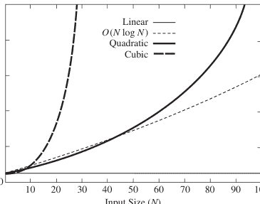

图 2.3 各种算法的图（N 与时间）


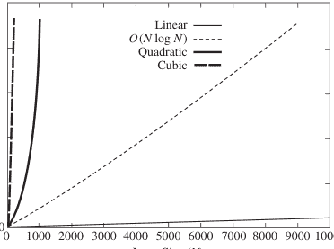

图 2.4 各种算法的 (N vs. time) 图

增长率仍然很明显。尽管 O(N log N) 的图看起来是线性的，但用直尺（或一张纸）很容易验证它并非如此。尽管 O(N) 算法的图看起来是常数的，但这仅是因为对于较小的 N 值，常数项大于线性项。图 2.4 显示了较大值的性能。它生动地说明了，即使是中等规模的输入，低效算法也是多么无用。

## 2.4 运行时间计算

估计程序运行时间有几种方法。前一张表是通过实验获得的。如果两个程序预计耗时相似，那么决定哪个更快的最好方法可能就是把它们都写出来并运行！

一般来说，存在多种算法思路，我们希望尽早排除不好的方案，因此通常需要进行分析。此外，能够进行分析通常有助于设计高效算法。分析还能大致定位瓶颈，这些瓶颈值得仔细编码。

为简化分析，我们将采用不设特定时间单位的约定。因此，我们舍去首项常数。我们还将舍去低阶项，因此我们本质上是在计算 Big-Oh 运行时间。由于 Big-Oh 是上界，我们必须小心，绝不能低估程序的运行时间。实际上，所给出的答案是一个保证，即程序将在一定时间内终止。程序可能比这更早停止，但绝不会更晚。

### 2.4.1 简单示例

下面是一个计算 $\sum_{i=1}^N i^3$ 的简单程序片段。

```
int sum (int n )
{
    int partialSum;

1   partialSum = 0;
2   for( int i = 1; i <= n; ++i )
3       partialSum += i * i * i;
4   return partialSum;
}
```

对该片段的分析很简单。声明不耗时。第 1 行和第 4 行各计 1 个单位。第 3 行每次执行计 4 个单位（两次乘法、一次加法和一次赋值），执行 N 次，总共 4N 个单位。第 2 行有初始化 i、测试 i <= N 和递增 i 的隐藏开销。所有这些的总开销是：初始化 1，所有测试 N + 1，所有递增 N，即 2N + 2。我们忽略函数调用和返回的开销，总共 6N + 4。因此，我们说该函数是 O(N)。

如果每次分析程序时都要做所有这些工作，任务很快就会变得不可行。幸运的是，由于我们以 Big-Oh 形式给出答案，可以采用许多不影响最终结果的捷径。例如，第 3 行显然是一条 O(1) 语句（每次执行），因此精确计算它是两个、三个还是四个单位是愚蠢的；这无关紧要。与 for 循环相比，第 1 行显然微不足道，因此在这里浪费时间也是愚蠢的。这引出了几条一般规则。

### 2.4.2 一般规则

- **规则 1—FOR 循环**
  for 循环的运行时间最多为循环内语句（包括测试）的运行时间乘以迭代次数。

- **规则 2—嵌套循环**
  从内向外分析这些循环。嵌套循环组内某条语句的总运行时间为该语句的运行时间乘以所有循环大小的乘积。

例如，以下程序片段是 O(N^2)：

```
for (i = 0; i < n; ++i )
    for (j = 0; j < n; ++j )
        ++k;
```

- **规则 3—连续语句**
  这些语句的时间直接相加（这意味着最大的那一项是关键；参见第 52 页的规则 1）。

例如，以下程序片段先有 O(N) 的工作，随后有 O(N^2) 的工作，因此也是 O(N^2)：

```
for( i = 0; i < n; ++i )
    a[ i ] = 0;
for( i = 0; i < n; ++i )
    for( j = 0; j < n; ++j )
        a[ i ] += a[ j ] + i + j;
```

### 规则 4—If/Else

对于以下片段

```
if( condition )
    S1
else
    S2
```

if/else 语句的运行时间永远不会超过测试的运行时间加上 S1 和 S2 运行时间中较大的那个。

显然，在某些情况下这可能是高估，但绝不会是低估。

其他规则显而易见，但从内部（或最深处）向外分析的基本策略是有效的。如果有函数调用，必须先分析它们。如果有递归函数，有几种选择。如果递归实际上只是一个披着外衣的循环，分析通常很简单。例如，以下函数实际上只是一个简单的循环，是 O(N)：

```
long factorial( int n )
{
    if( n <= 1 )
        return 1;
    else
        return n * factorial( n - 1 );
}
```

这个示例确实是递归的糟糕用法。当递归被正确使用时，将递归转换为简单的循环结构是困难的。在这种情况下，分析将涉及需要求解的递推关系。为了看看可能发生什么，请考虑以下程序，结果证明这是递归的糟糕用法：

```
long fib( int n )
{
1       if( n <= 1 )
2           return 1;
3       else
        return fib( n - 1 ) + fib( n - 2 );
}
```

乍一看，这似乎是递归的非常巧妙用法。但是，如果对 N 约为 40 的值编写并运行该程序，就会明显看出该程序非常低效。分析相当简单。设 $T(N)$ 为函数调用 fib(n) 的运行时间。如果 $N = 0$ 或 $N = 1$，则运行时间为某个常数值，即执行第 1 行的测试并返回所需的时间。我们可以说 $T(0) = T(1) = 1$，因为常数无关紧要。其他 $N$ 值的运行时间则相对于基本情况的运行时间来衡量。对于 $N > 2$，执行该函数的时间是第 1 行的常数工作加上第 3 行的工作。第 3 行包含一次加法和两次函数调用。由于函数调用不是简单操作，必须单独分析它们。第一个函数调用是 fib(n-1)，因此根据 $T$ 的定义，需要 $T(N - 1)$ 个时间单位。类似的论证表明，第二个函数调用需要 $T(N - 2)$ 个时间单位。所需总时间为 $T(N - 1) + T(N - 2) + 2$，其中 2 表示第 1 行的工作加上第 3 行的加法。因此，对于 $N \ge 2$，我们有 fib(n) 运行时间的以下公式：

$T(N) = T(N - 1) + T(N - 2) + 2$

由于 fib(n) = fib(n-1) + fib(n-2)，可以通过归纳法轻松证明 $T(N) \ge fib(n)$。在第 1.2.5 节中，我们证明了 $fib(n) < (5/3)^N$。类似的计算表明（对于 $N > 4$）$fib(n) \ge (3/2)^N$，因此该程序的运行时间呈指数增长。（这几乎是最糟糕的情况。通过保持一个简单的数组并使用 for 循环，可以大幅降低运行时间。）

该程序运行缓慢是因为进行了大量冗余工作，违反了递归的第四条主要规则（复利规则），该规则在第 1.3 节中介绍过。请注意，第 3 行的第一个调用 fib(n-1) 实际上在某个点会计算 fib(n-2)。这些信息被丢弃，并由第 3 行的第二个调用重新计算。被丢弃的信息量会递归地复合，导致巨大的运行时间。这或许是“不要计算任何超过一次的内容”这一格言的最佳示例，不应让你却步于使用递归。在本书中，我们将看到递归的杰出用法。

## 2.4.3 最大子序列和问题的解法

我们将介绍四种算法来解决前面提出的最大子序列和问题。第一种算法仅是穷举尝试所有可能性，如图 2.5 所示。for 循环中的索引反映了在 C++ 中，数组从 0 开始而不是 1。此外，该算法不计算实际的子序列；需要额外代码来完成此操作。

你可以自己验证该算法是否有效（这不需要太多说服）。运行时间是 $O(N^3)$，完全归因于第 13 行和第 14 行，这两行包含一个埋藏在三层嵌套循环内的 $O(1)$ 语句。第 8 行的循环大小为 $N$。

第二个循环的大小为 $N - i$，可能很小，但也可能是 $N$。我们必须假设最坏情况，知道这可能使最终界限偏高。第三个循环的大小为 $j - i + 1$，同样我们必须假设其大小为 $N$。总计为 $O(1 \cdot N \cdot N \cdot N) = O(N^3)$。第 6 行总共只需 $O(1)$，第 16 行和第 17 行总共只需 $O(N^2)$，因为它们只是两层循环内的简单表达式。


/**
 * Cubic maximum contiguous subsequence sum algorithm.
 */
int maxSubSum( const vector< int > & a )
{
    int maxSum = 0;

    for( int i = 0; i < a.size( ); ++i )
        for( int j = i; j < a.size( ); ++j )
        {
            int thisSum = 0;

            for( int k = i; k < j; ++k )
                thisSum += a[ k ];

            if( thisSum > maxSum )
                maxSum = thisSum;
        }

    return maxSum;
}

### 图 2.5 算法 1

事实证明，更精确的分析（考虑到这些循环的实际大小）表明答案是 \(\Theta(N^3)\)，而我们上面的估计高出了 6 倍（这没关系，因为常数不重要）。这在一般这类问题中都成立。精确分析是从求和 \(\sum_{i=0}^{N-1} \sum_{j=i}^{N-1} \sum_{k=i}^{j} 1\) 得到的，它告诉我们第 14 行被执行了多少次。该求和可以从内到外求值，使用第 1.2.3 节中的公式。特别是，我们将使用前 N 个整数和前 N 个平方数的求和公式。首先，我们有

\(\sum_{k=i}^{j} 1 = j - i + 1\)

接下来我们求值

\(\sum_{j=i}^{N-1} (j - i + 1) = \frac{(N - i + 1)(N - i)}{2}\)

这个求和可以通过观察得出，它只是前 \(N - i\) 个整数的和。为了完成计算，我们求值

\(\sum_{i=0}^{N-1} \frac{(N-i+1)(N-i-1)}{2} = \sum_{i=1}^{N} \frac{(N-i+1)(N-i+2)}{2}\)
\(= \frac{1}{2} \sum_{i=1}^{N} N^2 - \left(N + \frac{3}{2}\right) \sum_{i=1}^{N} i + \frac{1}{2} \sum_{i=1}^{N} (N^2 + 3N + 2) \sum_{i=1}^{N} 1\)
\(= \frac{1}{2} \frac{N(N+1)(2N+1)}{6} - \left(N + \frac{3}{2}\right) \frac{N(N+1)}{2} + \frac{N^2 + 3N + 2}{2} N\)
\(= \frac{N^2 + 3N + 2N}{6}\)

我们可以通过去掉一个 for 循环来避免立方运行时间。这并不总是可行的，但在这种情况下，算法中存在大量不必要的计算。改进算法纠正的低效率可以通过注意到 \(\sum_{i=k}^{N} A_k = \sum_{i=1}^{N} A_k\) 来看出，因此算法 1 中第 13 行和第 14 行的计算代价过高。图 2.6 显示了一个改进的算法。算法 2 显然是 \(O(N^2)\)；分析比之前更简单。

/**
 * Quadratic maximum contiguous subsequence sum algorithm.
 */
int maxSubSum2( const vector<int> & a )
{
  int maxSum = 0;

  for( int i = 0; i < a.size( ); ++i )
  {
    int thisSum = 0;
    for( int j = i; j < a.size( ); ++j )
    {
      thisSum += a[ j ];

      if( thisSum > maxSum )
        maxSum = thisSum;
    }
  }

  return maxSum;
}

### 图 2.6 算法 2

然后递归地求解这些子问题。这是“分解”部分。“合并”阶段包括将两个子问题的解拼合在一起，并可能进行少量额外工作，以得到整个问题的解。

在我们的情况中，最大子序列和可能出现在三个位置之一。要么它完全出现在输入的左半部分，要么完全出现在右半部分，要么它跨越中间并同时出现在两个半部分中。前两种情况可以递归求解。最后一种情况可以通过找到第一个半部分中包含第一个半部分最后一个元素的最大和，以及第二个半部分中包含第二个半部分第一个元素的最大和来得到。然后可以将这两个和相加。例如，考虑以下输入：

| 第一半 | 第二半 |
| :--- | :--- |
| 4 -3 5 -2 | -1 2 6 -2 |

第一个半部分的最大子序列和为 6（元素 A1 到 A3），第二个半部分为 8（元素 A6 到 A7）。

第一个半部分中包含第一个半部分最后一个元素的最大和为 4（元素 A1 到 A4），第二个半部分中包含第二个半部分第一个元素的最大和为 7（元素 A5 到 A7）。因此，跨越两个半部分并经过中间的最大和为 4 + 7 = 11（元素 A1 到 A7）。

因此，我们看到，在形成大最大子序列的三种方式中，对于我们的示例，最佳方式是包含两个半部分的元素。因此，答案是 11。图 2.7 展示了这种策略的实现。

算法 3 的代码值得评论。递归函数调用的一般形式是传递输入数组以及左右边界，这些边界界定了被操作的数组部分。一个单行驱动程序通过传递边界 0 和 N – 1 以及数组来设置此过程。

第 8 到 12 行处理基本情况。如果 left == right，则只有一个元素，如果该元素非负，则它是最大子序列。left > right 的情况不可能发生，除非 N 为负（尽管代码中的微小扰动可能会搞乱这一点）。第 15 和 16 行执行两个递归调用。我们可以看到，递归调用始终处理比原始问题更小的问题，尽管代码中的微小扰动可能会破坏这一属性。第 18 到 24 行和 26 到 32 行计算触及中心分隔线的两个最大和。这两个值的和是跨越两个半部分的最大和。例程 max3（未显示）返回三种可能性中最大的一个。

算法 3 显然比之前的两个算法都需要更多的编码工作。然而，代码更短并不总是意味着代码更好。正如我们在之前显示算法运行时间的表格中所见，对于除最小输入大小以外的所有情况，该算法比其他两个算法快得多。

运行时间分析与计算斐波那契数的程序类似。设 T(N) 为求解大小为 N 的最大子序列和问题所需的时间。如果 N = 1，则程序执行第 8 到 12 行需要一些常数时间，我们将其称为一个单位。因此，T(1) = 1。否则，

```
1 /**
2  * Recursive maximum contiguous subsequence sum algorithm.
3  * Finds maximum sum in subarray spanning a[left..right].
4  * Does not attempt to maintain actual best sequence.
5  *
6  * int maxSubRec( const vector<int>& a, int left, int right )
7  {
8  if( left == right )  // Base case
9  {
10  if( a[ left ] > 0 )
11  return a[ left ];
12  else
13  return 0;
14 }
15
16 int center = ( left + right ) / 2;
17 int maxLeftSum  = maxSubRec( a, left, center );
18 int maxRightSum = maxSubRec( a, center + 1, right );
19
20 int maxLeftBorderSum = 0, leftBorderSum = 0;
21 for( int i = center; i >= left; --i )
22 {
23  leftBorderSum += a[ i ];
24  if( leftBorderSum > maxLeftBorderSum )
25  maxLeftBorderSum = leftBorderSum;
26 }
27
28 int maxRightBorderSum = 0, rightBorderSum = 0;
29 for( int j = center + 1; j <= right; ++j )
30 {
31  rightBorderSum += a[ j ];
32  if( rightBorderSum > maxRightBorderSum )
33  maxRightBorderSum = rightBorderSum;
34 }
35
36 return max3( maxLeftSum, maxRightSum,
37  maxLeftBorderSum + maxRightBorderSum );
38 }
39
40 /**
41  * Driver for divide-and-conquer maximum contiguous
42  * subsequence sum algorithm.
43  */
44 int maxSubSum3( const vector<int>& a )
45 {
46  return maxSubRec( a, 0, a.size( ) - 1 );
47 }
```

### 图 2.7 算法 3

程序必须执行两个递归调用、第 19 到 32 行之间的两个 for 循环，以及少量的记账工作，例如第 14 行和第 34 行。这两个 for 循环合起来遍历子数组中的每个元素，循环内部有常数工作量，因此第 19 到 32 行花费的时间是 O(N)。第 8 到 14 行、18、26 和 34 行的代码都是常数工作量，因此与 O(N) 相比可以忽略不计。其余工作在第 15 和 16 行完成。这些行求解两个大小为 N/2 的子序列问题（假设 N 是偶数）。因此，这些行各花费 T(N/2) 单位时间，总共为 2T(N/2)。算法的总时间为 2T(N/2) + O(N)。这给出了以下方程

T(1) = 1
T(N) = 2T(N/2) + O(N)

为了简化计算，我们可以将上述方程中的 O(N) 项替换为 N，因为 T(N) 无论如何都将用大 O 表示法表示，这不会影响答案。在第 7 章中，我们将看到如何严格地求解这个方程。目前，如果 T(N) = 2T(N/2) + N，且 T(1) = 1，则 T(2) = 4 = 2 * 2，T(4) = 12 = 4 * 3，T(8) = 32 = 8 * 4，T(16) = 80 = 16 * 5。显而易见且可推导的规律是，如果 N = 2^k，则 T(N) = N * (k + 1) = N log N + N = O(N log N)。

此分析假设 N 是偶数，因为否则 N/2 未定义。由于分析的递归性质，它仅在 N 是 2 的幂时才真正有效，因为否则我们最终会得到一个大小不是偶数的子问题，方程无效。当 N 不是 2 的幂时，需要稍微复杂一些的分析，但大 O 结果保持不变。

在未来的章节中，我们将看到递归的几个巧妙应用。在这里，我们介绍了第四个算法来查找最大子序列和。这个算法比递归算法更容易实现，而且效率也更高。它如图 2.8 所示。

时间边界正确的原因应该是显而易见的，但要理解算法为何实际有效需要稍加思考。为了概述逻辑，请注意，与算法 1 和 2 类似，j 表示当前序列的结束，而 i 表示当前序列的开始。如果我们不需要知道实际最佳子序列的位置，则可以将 i 的使用从程序中优化掉，但在设计算法时，让我们假设 i 是需要的，并且我们正在尝试改进算法 2。一个观察是，如果 a[i] 为负，那么它不可能是最优子序列的起始，因为任何以包含 a[i] 开头的子序列都可以通过从 a[i+1] 开头来改进。同样，任何负子序列都不可能是最优子序列的前缀（相同逻辑）。如果在内层循环中，我们检测到从 a[i] 到 a[j] 的子序列为负，那么我们可以推进 i。关键的观察是，我们不仅可以将 i 推进到 i + 1，还可以实际上将 i 一直推进到 j + 1。要理解这一点，设 p 为 i + 1 和 j 之间的任何索引。任何从索引 p 开始的子序列都不会比从索引 i 开始并包含从 a[i] 到 a[p - 1] 的子序列的相应子序列更长，因为后者子序列不是负的（j 是导致从索引 i 开始的子序列变为负的第一个索引）。因此，将 i 推进到 j + 1 是无风险的；我们不会错过最优解。

这个算法是许多巧妙算法的典型：运行时间显而易见，但正确性并非如此。对于这些算法，正式的正确性证明（更正式的


1 /**
2 * Linear-time maximum contiguous subsequence sum algorithm.
3 */
4 int maxSubSum4( const vector<int> & a )
5 {
6 int maxSum = 0, thisSum = 0;
7
8 for ( int j = 0; j < a.size( ); ++j )
9 {
10 thisSum += a [ j ];
11
12 if ( thisSum > maxSum )
13 maxSum = thisSum;
14 else if ( thisSum < 0 )
15 thisSum = 0;
16 }
17
18 return maxSum;
19 }

图 2.8 算法 4

比上述草图）几乎总是需要；即便如此，许多人仍然不信服。此外，许多这些算法需要更棘手的编程，导致更长的开发时间。但当这些算法有效时，它们运行迅速，我们可以通过将其与使用小输入规模的低效（但易于实现）的暴力算法进行比较，来测试大部分代码逻辑。

该算法的额外优势在于它只需遍历数据一次，一旦 a[i] 被读取和处理，就不需要再记住它。因此，如果数组在磁盘上或正在通过互联网传输，它可以按顺序读取，无需将其任何部分存储在主内存中。此外，在任何时间点，该算法都可以正确地为其已经读取的数据给出子序列问题的答案（其他算法不具备此属性）。能够做到这一点的算法称为 **在线算法**。只需要常数空间并以线性时间运行的在线算法几乎是尽可能好的了。

## 2.4.4 运行时间中的对数

分析算法时最令人困惑的方面可能围绕对数展开。我们已经看到，一些分治算法将在 O(N log N) 时间内运行。除了分治算法，对数最常出现的情况围绕以下一般规则：如果以常数（O(1)）时间将问题规模缩小一个比例（通常是 1/2），则该算法是 O(log N)。另一方面，如果仅需常数时间就将问题减少一个常数量（例如使问题小 1），则该算法是 O(N)。

### 二分查找

给定整数 X 和整数 A0, A1, ..., AN-1，它们已预排序并已在内存中，找到 i 使得 Ai = X，如果 X 不在输入中，则返回 i = -1。

显而易见的解决方案是从左到右扫描列表，运行时间为线性。然而，该算法没有利用列表已排序的事实，因此不太可能是最佳的。更好的策略是检查 X 是否是中间元素。如果是，答案就已找到。如果 X 小于中间元素，我们可以将相同的策略应用于中间元素左侧的已排序子数组；同样，如果 X 大于中间元素，我们查看右半部分。（还有何时停止的情况。）图 2.9 显示了二分查找的代码（答案是 mid）。和往常一样，代码反映了 C++ 的约定，即数组从索引 0 开始。

```cpp
/**
 * Performs the standard binary search using two comparisons per level.
 * Returns index where item is found or -1 if not found.
 */
template <typename Comparable>
int binarySearch( const vector<Comparable> & a, const Comparable & x )
{
   int low = 0, high = a.size( ) - 1;
   while( low <= high )
   {
      int mid = ( low + high ) / 2;
      if( a[ mid ] < x )
         low = mid + 1;
      else if( a[ mid ] > x )
         high = mid - 1;
      else
         return mid; // Found
   }
   return NOT_FOUND; // NOT_FOUND is defined as -1
}
```

图 2.9 二分查找

显然，循环内完成的所有工作每次迭代耗时 O(1)，因此分析需要确定循环的次数。循环从 high - low = N - 1 开始，以 high - low >= 1 结束。每次循环，high - low 的值必须至少减半；因此，循环次数最多为 floor(log(N - 1)) + 2。（例如，如果 high - low = 128，那么每次迭代后 high - low 的最大值分别为 64、32、16、8、4、2、1、0、-1。）因此，运行时间为 O(log N)。等价地，我们可以为运行时间编写递归公式，但当你真正理解发生了什么以及原因时，这种暴力方法通常是不必要的。

二分查找可以在我们的第一个数据结构实现中看到。它支持 O(log N) 时间的 contains 操作，但所有其他操作（特别是 insert）都需要 O(N) 时间。在数据为静态（即不允许插入和删除）的应用中，这可能非常有用。输入只需排序一次，之后访问将很快。一个例子是需要维护元素周期表信息的程序（这在化学和物理中出现）。这个表相对稳定，因为新元素很少被添加。元素名称可以保持排序。由于只有大约 118 个元素，最多需要八次访问即可找到一个元素。执行顺序搜索将需要更多的访问次数。

### 欧几里得算法

第二个例子是计算最大公约数的欧几里得算法。两个整数的最大公约数（gcd）是同时整除两者的最大整数。因此，gcd(50, 15) = 5。图 2.10 中的算法计算 gcd(M, N)，假设 M >= N。（如果 N > M，循环的第一次迭代会交换它们。）

该算法通过不断计算余数直到达到 0 来工作。最后一个非零余数即为答案。因此，如果 M = 1,989 和 N = 1,590，那么余数序列为 399, 393, 6, 3, 0。因此，gcd(1989, 1590) = 3。如示例所示，这是一个快速算法。

与之前一样，估计算法的整个运行时间取决于确定余数序列的长度。虽然 log N 看起来是一个好答案，但余数的值必须以常数因子递减这一点并不明显，

```
1 long long gcd( long long m, long long n )
2 {
3 while( n != 0 )
4 {
5 long long rem = m % n;
6 m = n;
7 n = rem;
8 }
9 return m;
10 }
```

图 2.10 欧几里得算法

因为我们看到在示例中余数从 399 降至仅 393。确实，余数在一次迭代中*并不*以常数因子递减。但是，我们可以证明在两次迭代后，余数最多为其原始值的一半。这将表明迭代次数最多为 2 log N = O(log N) 并确定运行时间。这个证明很简单，因此我们在此包含它。它直接源于以下定理。

### 定理 2.1

如果 M > N，则 M mod N < M/2。

### 证明

有两种情况。如果 N <= M/2，那么由于余数小于 N，该定理在此情况下成立。另一种情况是 N > M/2。但此时 N 只能进入 M 一次，余数为 M - N < M/2，从而证明了定理。

有人可能会问这是否是可能的最佳界限，因为在我们的示例中 2 log N 约为 20，但只执行了七次操作。事实证明，在最坏情况下（如果 M 和 N 是连续的斐波那契数，则可实现），常数可以略微改善，约为 1.44 log N。欧几里得算法的平均情况性能需要大量高度复杂的数学分析，结果表明平均迭代次数约为 (12 ln 2 ln N)/pi^2 + 1.47。

### 幂运算

本节的最后一个例子涉及将一个整数提升到一个幂（也是整数）。幂运算的结果通常非常大，因此分析只有在假设我们有一台可以存储如此大整数的机器（或可以模拟此过程的编译器）时才有效。我们将计算乘法次数作为运行时间的度量。

计算 X^N 的显而易见算法使用 N-1 次乘法。递归算法可以做得更好。N <= 1 是递归的基本情况。否则，如果 N 是偶数，则有 X^N = X^(N/2) * X^(N/2)，如果 N 是奇数，则 X^N = X^((N-1)/2) * X^((N-1)/2) * X。

例如，要计算 X^31，该算法执行以下计算，仅涉及九次乘法：

```
X^3 = (X^2) X, X^7 = (X^3)^2 X, X^{15} = (X^7)^2 X, X^{31} = (X^{15})^2 X, X^{62} = (X^{31})^2
```

所需的乘法次数显然最多为 2 log N，因为最多需要两次乘法（如果 N 是奇数）来将问题减半。同样，可以编写并求解递推公式。简单的直觉使暴力方法变得不必要。图 2.11 实现了这一想法。有时，看看代码可以在不影响正确性的情况下被调整多少是很有趣的。在图 2.11 中，第 5 到 6 行实际上是不必要的，因为如果 N 是 1，则第 10 行做正确的事情。第 10 行也可以重写为

```
10    return pow( x, n - 1 ) * x;
```


```c
1 long long pow( long long x, int n )
2 {
3   if( n == 0 )
4     return 1;
5   if( n == 1 )
6     return x;
7   if( isEven( n ) )
8     return pow( x * x, n / 2 );
9   else
10    return pow( x * x, n / 2 ) * x;
11 }
```

## 图 2.11 高效幂运算

without affecting the correctness of the program. Indeed, the program will still run in O(log N), because the sequence of multiplications is the same as before. However, all of the following alternatives for line 8 are bad, even though they look correct:

```
8a    return pow( pow( x, 2 ), n / 2 );
8b    return pow( pow( x, n / 2 ), 2 );
8c    return pow( x, n / 2 ) * pow( x, n / 2 );
```

Both lines 8a and 8b are incorrect because when N is 2, one of the recursive calls to pow has 2 as the second argument. Thus no progress is made, and an infinite loop results (in an eventual crash).

Using line 8c affects the efficiency, because there are now two recursive calls of size N/2 instead of only one. An analysis will show that the running time is no longer O(log N). We leave it as an exercise to the reader to determine the new running time.

## 2.4.5 最坏情况分析的局限性

Sometimes the analysis is shown empirically to be an overestimate. If this is the case, then either the analysis needs to be tightened (usually by a clever observation), or it may be that the average running time is significantly less than the worst-case running time and no improvement in the bound is possible. For many complicated algorithms the worst-case bound is achievable by some bad input but is usually an overestimate in practice. Unfortunately, for most of these problems, an average-case analysis is extremely complex (in many cases still unsolved), and a worst-case bound, even though overly pessimistic, is the best analytical result known.

## 总结

This chapter gives some hints on how to analyze the complexity of programs. Unfortunately, it is not a complete guide. Simple programs usually have simple analyses, but this is not always the case. As an example, later in the text we shall see a sorting algorithm (Shellsort, Chapter 7) and an algorithm for maintaining disjoint sets (Chapter 8), each of which requires about 20 lines of code. The analysis of Shellsort is still not complete, and the disjoint set algorithm has an analysis that until recently was extremely difficult and requires pages and pages of intricate calculations. Most of the analyses that we will encounter here will be simple and involve counting through loops.

An interesting kind of analysis, which we have not touched upon, is lower-bound analysis. We will see an example of this in Chapter 7, where it is proved that any algorithm that sorts by using only comparisons requires $\Omega(N \log N)$ comparisons in the worst case. Lower-bound proofs are generally the most difficult, because they apply not to an algorithm but to a class of algorithms that solve a problem.

We close by mentioning that some of the algorithms described here have real-life application. The gcd algorithm and the exponentiation algorithm are both used in cryptography. Specifically, a 600-digit number is raised to a large power (usually another 600-digit number), with only the low 600 or so digits retained after each multiplication. Since the calculations require dealing with 600-digit numbers, efficiency is obviously important. The straightforward algorithm for exponentiation would require about $10^{900}$ multiplications, whereas the algorithm presented requires only about 4,000 in the worst case.

## 练习

- 2.1 Order the following functions by growth rate: $N$, $\sqrt{N}$, $N^{1.5}$, $N^2$, $N \log N$, $N \log \log N$, $N \log^2 N$, $N \log(N^2)$, $2/N$, $2^{N/2}$, $2^N$, $37$, $N^2 \log N$, $N^3$. Indicate which functions grow at the same rate.

- 2.2 Suppose $T_1(N) = O(f(N))$ and $T_2(N) = O(f(N))$. Which of the following are true?
  - a. $T_1(N) + T_2(N) = O(f(N))$
  - b. $T_1(N) - T_2(N) = o(f(N))$
  - c. $T_1(N) / T_2(N) = O(1)$
  - d. $T_1(N) = O(T_2(N))$

- 2.3 Which function grows faster: $N \log N$ or $N^{1+\epsilon/\sqrt{\log N}}$, $\epsilon > 0$?

- 2.4 Prove that for any constant $k$, $\log^k N = o(N)$.

- 2.5 Find two functions $f(N)$ and $g(N)$ such that neither $f(N) = O(g(N))$ nor $g(N) = O(f(N))$.

- 2.6 In a recent court case, a judge cited a city for contempt and ordered a fine of $2 for the first day. Each subsequent day, until the city followed the judge's order, the fine was squared (i.e., the fine progressed as follows: $2, $4, $16, $256, $65,536, ...).
  - a. What would be the fine on day N?
  - b. How many days would it take for the fine to reach D dollars (a Big-Oh answer will do)?

- 2.7 For each of the following six program fragments:
  - a. Give an analysis of the running time (Big-Oh will do).
  - b. Implement the code in the language of your choice, and give the running time for several values of N.
  - c. Compare your analysis with the actual running times.

    (1) sum = 0;
    for ( i = 0; i < n; ++i )
        ++sum;

    (2) sum = 0;
    for ( i = 0; i < n; ++i )
        for ( j = 0; j < n; ++j )
            ++sum;

    (3) sum = 0;
    for ( i = 0; i < n; ++i )
        for ( j = 0; j < n * n; ++j )
            ++sum;

    (4) sum = 0;
    for ( i = 0; i < n; ++i )
        for ( j = 0; j < i; ++j )
            ++sum;

    (5) sum = 0;
    for ( i = 0; i < n; ++i )
        for ( j = 0; j < i * i; ++j )
            ++sum;

    (6) sum = 0;
    for ( i = 1; i < n; ++i )
        for ( j = 1; j < i * i; ++j )
            if ( j % i == 0 )
                for ( k = 0; k < j; ++k )
                    ++sum;

- 2.8 Suppose you need to generate a random permutation of the first N integers. For example, {4, 3, 1, 5, 2} and {3, 1, 4, 2, 5} are legal permutations, but {5, 4, 1, 2, 1} is not, because one number (1) is duplicated and another (3) is missing. This routine is often used in simulation of algorithms. We assume the existence of a random number generator, r, with method randInt(i,j), that generates integers between i and j with equal probability. Here are three algorithms:
  - 1. Fill the array a from a[0] to a[N-1] as follows: To fill a[i], generate random numbers until you get one that is not already in a[0], a[1], ..., a[i-1].
  - 2. Same as algorithm (1), but keep an extra array called the used array. When a random number, ran, is first put into the array a, set used[ran] = true. This means that when filling a[i] with a random number, you can test in one step to see whether the random number has been used, instead of the (possibly) i steps in the first algorithm.
  - 3. Fill the array such that a[i] = i+1. Then
    ```
    for ( i = 1; i < n; ++i )
        swap( a[ i ], a[ randInt( 0, i ) ] );
    ```
  - a. Prove that all three algorithms generate only legal permutations and that all permutations are equally likely.
  - b. Give as accurate (Big-Oh) an analysis as you can of the expected running time of each algorithm.
  - c. Write (separate) programs to execute each algorithm 10 times, to get a good average. Run program (1) for N = 250, 500, 1,000, 2,000; program (2) for N = 25,000, 50,000, 100,000, 200,000, 400,000, 800,000; and program (3) for N = 100,000, 200,000, 400,000, 800,000, 1,600,000, 3,200,000, 6,400,000.
  - d. Compare your analysis with the actual running times.
  - e. What is the worst-case running time of each algorithm?

## 2.9 Complete the table in Figure 2.2 with estimates for the running times that were too long to simulate. Interpolate the running times for these algorithms and estimate the time required to compute the maximum subsequence sum of 1 million numbers. What assumptions have you made?

- 2.10 Determine, for the typical algorithms that you use to perform calculations by hand, the running time to do the following:
  - a. Add two N-digit integers.
  - b. Multiply two N-digit integers.
  - c. Divide two N-digit integers.

- 2.11 An algorithm takes 0.5 ms for input size 100. How long will it take for input size 500 if the running time is the following (assume low-order terms are negligible)?
  - a. linear
  - b. O(N log N)
  - c. quadratic
  - d. cubic

- 2.12 An algorithm takes 0.5 ms for input size 100. How large a problem can be solved in 1 min if the running time is the following (assume low-order terms are negligible)?
  - a. linear
  - b. O(N log N)
  - c. quadratic
  - d. cubic

- 2.13 How much time is required to compute f(x) = \sum_{i=0}^N a_i x^i.
  - a. Using a simple routine to perform exponentiation?
  - b. Using the routine in Section 2.4.4?

- 2.14 Consider the following algorithm (known as Horner's rule) to evaluate f(x) = \sum_{i=0}^N a_i x^i.

```
poly = 0;
for ( i = n; i >= 0; --i )
    poly = x * poly + a[ i ];
```

  - a. Show how the steps are performed by this algorithm for x = 3, f(x) = 4x^4 + 8x^3 + x + 2.
  - b. Explain why this algorithm works.
  - c. What is the running time of this algorithm?


### 2.15
给出一个高效算法，用于判断在整数数组 $A_1 < A_2 < A_3 < \cdots < A_n$ 中是否存在整数 $i$ 使得 $A_i = i$。你的算法的运行时间是多少？

### 2.16
根据以下观察编写一个替代的 gcd 算法（安排使得 $a > b$）：
- a. 如果 $a$ 和 $b$ 都是偶数，则 $gcd(a, b) = 2gcd(a/2, b/2)$。
- b. 如果 $a$ 是偶数且 $b$ 是奇数，则 $gcd(a, b) = gcd(a/2, b)$。
- c. 如果 $a$ 是奇数且 $b$ 是偶数，则 $gcd(a, b) = gcd(a, b/2)$。
- d. 如果 $a$ 和 $b$ 都是奇数，则 $gcd(a, b) = gcd((a + b)/2, (a - b)/2)$。

### * 2.17
给出高效算法（并附带运行时间分析）：
- a. 找出最小子序列和。
- b. 找出最小正子序列和。
- c. 找出最大子序列积。

### 2.18
数值分析中一个重要的问题是，对于任意函数 $f$，求方程 $f(x) = 0$ 的解。如果函数是连续的，并且存在两个点 $low$ 和 $high$，使得 $f(low)$ 和 $f(high)$ 异号，那么 $low$ 和 $high$ 之间必然存在一个根，并且可以通过二分查找找到。编写一个函数，以 $f$、$low$ 和 $high$ 作为参数，求解零点。你必须做什么来确保终止？

### 2.19
文中给出的最大连续子序列和算法没有提供实际序列的任何指示。修改它们，使其在单个对象中返回最大子序列的值和实际序列的索引。

### 2.20
- a. 编写一个程序，判断正整数 $N$ 是否为素数。
- b. 关于 $N$，你的程序的最坏情况运行时间是多少？（你应该能够在 $O(\sqrt{N})$ 时间内完成。）
- c. 设 $B$ 等于 $N$ 二进制表示中的位数。$B$ 的值是多少？
- d. 关于 $B$，你的程序的最坏情况运行时间是多少？
- e. 比较运行时间，以确定 20 位数和 40 位数是否为素数。
- f. 用 $N$ 还是 $B$ 来表示运行时间更合理？为什么？

### * 2.21
埃拉托斯特尼筛法是一种用于计算小于 $N$ 的所有素数的方法。我们首先制作 2 到 $N$ 的整数表。我们找到未被划掉的最小整数 $i$，打印 $i$，并划掉 $i, 2i, \dots$。当 $i > \sqrt{N}$ 时，算法终止。该算法的运行时间是多少？

### 2.22
证明 $x^{62}$ 只需八次乘法即可计算。

### 2.23
编写不使用递归的快速幂运算例程。

### 2.24
给出快速幂运算例程所用乘法次数的精确计数。（提示：考虑 $N$ 的二进制表示。）

### 2.25
对程序 $A$ 和 $B$ 进行分析，发现它们的最坏情况运行时间分别不超过 $150N \log_2 N$ 和 $N^2$。如果可能，回答以下问题：
- a. 对于较大的 $N$ 值（$N > 10,000$），哪个程序对运行时间有更好的保证？
- b. 对于较小的 $N$ 值（$N < 100$），哪个程序对运行时间有更好的保证？
- c. 对于 $N = 1,000$，哪个程序平均运行更快？
- d. 程序 B 是否可能在所有可能的输入上都比程序 A 运行得更快？

### 2.26
大小为 $N$ 的数组 $A$ 中的多数元素是指出现次数超过 $N/2$ 次的元素（因此，最多只有一个）。例如，数组

```
3, 3, 4, 2, 4, 4, 2, 4, 4
```

有一个多数元素（4），而数组

```
3, 3, 4, 2, 4, 4, 2, 4
```

则没有。如果没有多数元素，你的程序应当指明这一点。以下是解决该问题的算法草图。

首先，找到一个候选多数元素（这是较难的部分）。这个候选元素是唯一可能成为多数元素的元素。第二步确定该候选元素是否确实是多数元素。这只是对数组进行一次顺序搜索。要在数组 $A$ 中找到候选元素，形成第二个数组 $B$。然后比较 $A_1$ 和 $A_2$。如果它们相等，将其中一个加入 $B$；否则不做任何操作。然后比较 $A_3$ 和 $A_4$。同样，如果它们相等，将其中一个加入 $B$；否则不做任何操作。继续这种方式，直到读完整个数组。然后递归地为 $B$ 找到一个候选元素；这就是 $A$ 的候选元素（为什么？）。

- a. 递归如何终止？
- b. 当 $N$ 为奇数时，该情况如何处理？
- c. 该算法的运行时间是多少？
- d. 如何避免使用额外的数组 $B$？
- e. 编写一个程序来计算多数元素。

### 2.27
输入是一个已经在内存中的 $N \times N$ 数字矩阵。每一行从左到右递增。每一列从上到下递增。给出一个最坏情况为 $O(N)$ 的算法，用于判断数字 $X$ 是否在矩阵中。

### 2.28
设计高效算法，输入一个正数数组 $a$，并确定：
- a. $a[j] + a[j+1]$ 的最大值，其中 $j \ge 1$。
- b. $a[j] - a[j+1]$ 的最大值，其中 $j \ge 1$。
- c. $a[j] * a[j+1]$ 的最大值，其中 $j \ge 1$。
- d. $a[j] / a[j+1]$ 的最大值，其中 $j \ge 1$。

### * 2.29
为什么要假设我们的计算机模型中的整数具有固定大小？

### 2.30
考虑第 2 页的单词谜题问题。假设我们将最长单词的大小固定为 10 个字符。
- a. 关于 $R$ 和 $C$（分别是谜题中的行数和列数）以及 $W$（单词数量），第 1 章中描述的算法的运行时间是多少？
- b. 假设单词列表已预排序。展示如何使用二分查找来获得运行时间显著更好的算法。

### 2.31
假设二分查找例程中的第 15 行语句为 `low = mid` 而不是 `low = mid + 1`。该例程仍然有效吗？

### 2.32
实现二分查找，使得每次迭代只执行一次双向比较。

### 2.33
假设算法 3（图 2.7）中的第 15 行和第 16 行被替换为
15 `int maxLeftSum = maxSumRec( a, left, center - 1 );`
16 `int maxRightSum = maxSumRec( a, center, right );`
该例程仍然有效吗？

### * 2.34
立方最大子序列和算法的内层循环执行最内层代码 $N(N+1)(N+2)/6$ 次迭代。二次版本执行 $N(N + 1)/2$ 次迭代。线性版本执行 $N$ 次迭代。有什么明显的规律？你能给出这种现象的组合解释吗？

## 参考文献

算法运行时间分析最初由 Knuth 在三部曲 [5]、[6] 和 [7] 中推广。gcd 算法的分析出现在 [6]。关于该主题的另一本早期著作是 [1]。

大 O、大 Ω、大 Θ 和小 o 记法由 Knuth 在 [8] 中倡导。对此仍然没有统一意见，尤其是在使用 $\Theta()$ 时。许多人更喜欢使用 O，尽管它不够表达。此外，在某些情况下，O 仍被用来表示下界，而此时应使用 $\Omega()$。

最大子序列和问题来自 [3]。图书系列 [2]、[3] 和 [4] 展示了如何优化程序以提高速度。

- 1. A. V. Aho, J. E. Hopcroft, 和 J. D. Ullman, *计算机算法的设计与分析*, Addison-Wesley, Reading, Mass., 1974.
- 2. J. L. Bentley, *编写高效程序*, Prentice Hall, Englewood Cliffs, N.J., 1982.
- 3. J. L. Bentley, *编程珠玑*, Addison-Wesley, Reading, Mass., 1986.
- 4. J. L. Bentley, *更多编程珠玑*, Addison-Wesley, Reading, Mass., 1988.
- 5. D. E. Knuth, *计算机程序设计艺术，第 1 卷：基本算法*, 第 3 版, Addison-Wesley, Reading, Mass., 1997.
- 6. D. E. Knuth, *计算机程序设计艺术，第 2 卷：半数值算法*, 第 3 版, Addison-Wesley, Reading, Mass., 1998.
- 7. D. E. Knuth, *计算机程序设计艺术，第 3 卷：排序与查找*, 第 2 版, Addison-Wesley, Reading, Mass., 1998.
- 8. D. E. Knuth, "Big Omicron and Big Omega and Big Theta," *ACM SIGACT 新闻*, 8 (1976), 18–23.


## 列表、栈和队列

本章讨论三种最简单、最基本的数据结构。几乎每个重要的程序都会显式地使用其中至少一种结构，而栈在程序中总是被隐式地使用，无论你是否声明一个。本章的重点包括...

- 介绍抽象数据类型（ADT）的概念。
- 展示如何高效地对列表执行操作。
- 介绍栈 ADT 及其在实现递归中的应用。
- 介绍队列 ADT 及其在操作系统和算法设计中的应用。

在本章中，我们提供了实现两个库类（vector 和 list）的重要子集的代码。

### 3.1 抽象数据类型（ADT）

一个**抽象数据类型**（ADT）是一组对象及其操作的集合。抽象数据类型是数学抽象；在 ADT 的定义中，绝无提及操作集合是如何实现的。列表、集合和图等对象及其操作，可以被视为 ADT，就像整数、实数和布尔值是数据类型一样。整数、实数和布尔值都有与之关联的操作，ADT 也是如此。对于集合 ADT，我们可能会有 _添加_、_删除_、_大小_ 和 _包含_ 等操作。或者，我们可能只想要并和查找这两个操作，这将定义集合上的另一个 ADT。

C++ 类允许实现 ADT，并适当地隐藏实现细节。因此，程序中任何其他需要对 ADT 执行操作的部分，都可以通过调用相应的方法来完成。如果出于某种原因需要更改实现细节，只需更改执行 ADT 操作的例程即可轻松实现。在理想世界中，这种更改对程序的其余部分将完全透明。

没有规则告诉我们每个 ADT 必须支持哪些操作；这是一个设计决策。错误处理和打破平局（在适当的情况下）也通常由程序设计者决定。本章将学习的三种数据结构是 ADT 的主要示例。我们将看到每种可以以多种方式实现，但如果实现正确，使用它们的程序不一定需要知道使用了哪种实现。

### 3.2 列表 ADT

我们将处理形式为 A0, A1, A2, ..., AN-1 的一般列表。我们说该列表的大小为 N。我们将大小为 0 的特殊列表称为空列表。

对于除空列表外的任何列表，我们说 Ai 紧随（或继承）A(i-1)（i < N），且 A(i-1) 位于 Ai 之前（i > 0）。列表的第一个元素是 A0，最后一个元素是 A(N-1)。我们不会定义 A0 的前驱或 A(N-1) 的后继。元素 Ai 在列表中的位置是 i。在整个讨论中，为了简化问题，我们将假设列表中的元素是整数，但一般来说，允许任意复杂的元素（并且可以通过类模板轻松处理）。

与这些“定义”相关的是一组我们希望在 List ADT 上执行的操作。一些常用操作是 printList 和 makeEmpty，它们执行显而易见的操作；find，它返回某项第一次出现的位置；insert 和 remove，它们通常从列表的某个位置插入和删除某个元素；以及 findKth，它返回某个位置（作为参数指定）的元素。如果列表是 34, 12, 52, 16, 12，那么 find(52) 可能返回 2；insert(x,2) 可能使列表变为 34, 12, x, 52, 16, 12（如果我们在给定的位置插入）；而 remove(52) 可能将该列表变为 34, 12, x, 16, 12。

当然，什么是函数的适当行为完全取决于程序员，特殊情况的处理也是如此（例如，上面的 find(1) 返回什么？）。我们还可以添加 next 和 previous 等操作，它们以位置作为参数，并分别返回后继和前驱的位置。

#### 3.2.1 列表的简单数组实现

所有这些指令都可以通过使用数组来实现。虽然数组是以固定容量创建的，但 vector 类（内部存储数组）允许在需要时通过翻倍容量来增长数组。这解决了使用数组最严重的问题——即，历史上，使用数组需要估计列表的最大尺寸。不再需要此估计。

数组实现允许 printList 在线性时间内完成，而 findKth 操作需要常数时间，这已经是所能期望的最好结果。然而，插入和删除可能代价高昂，具体取决于插入和删除发生的位置。在最坏情况下，插入到位置 0（换句话说，列表的前面）需要将整个数组向下移动一个位置以腾出空间，而删除第一个元素需要将列表中的所有元素向上移动一个位置，因此这些操作的最坏情况是 O(N)。平均而言，任何一种操作都需要移动列表的一半，因此仍然需要线性时间。另一方面，如果所有操作都发生在列表的高端，则不需要移动任何元素，添加和删除则需要 O(1) 时间。

有许多情况是通过在高端进行插入来构建列表，然后只发生数组访问（即 findKth 操作）。在这种情况下，数组是合适的实现。但是，如果插入和删除发生在整个列表中，特别是在列表的前面，那么数组就不是一个好选择。下一节讨论了替代方案：链表。

#### 3.2.2 简单链表

为了避免插入和删除的线性代价，我们需要确保列表不是连续存储的，否则列表的整个部分需要移动。图 3.1 展示了链表的一般概念。

链表由一系列节点组成，这些节点在内存中不一定相邻。每个节点包含元素和指向包含其后继节点的链接。我们称这个为 next 链接。最后一个单元格的 next 链接指向 nullptr。

要执行 printList() 或 find(x)，我们只需从列表的第一个节点开始，然后通过跟随 next 链接遍历列表。此操作显然是线性时间的，与数组实现一样；不过，常数可能比使用数组实现时更大。findKth 操作不再像数组实现那样高效；findKth(i) 需要 O(i) 时间，并通过以显而易见的方式遍历列表来工作。在实践中，这个界限是悲观的，因为 findKth 的调用通常按 i 排序。例如，findKth(2)、findKth(3)、findKth(4) 和 findKth(6) 都可以在一次扫描列表中执行。

remove 方法可以通过一次 next 指针更改来执行。图 3.2 显示了删除原始列表中第三个元素的结果。

insert 方法需要通过 new 调用从系统获取一个新节点，然后执行两次 next 指针操作。一般概念如图 3.3 所示。虚线表示旧指针。

可以看出，原则上，如果我们知道更改应在哪里进行，那么从链表中插入或删除一个项目不需要移动大量项目，而只涉及节点链接的常数次更改。

因此，添加到前面或删除第一个项目的特殊情况是常数时间操作，前提是当然维护了指向链表前面的链接。

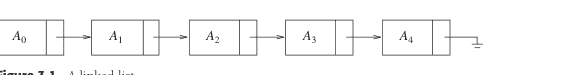

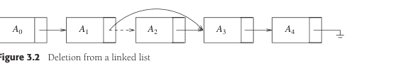

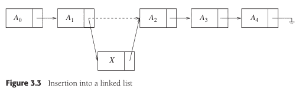

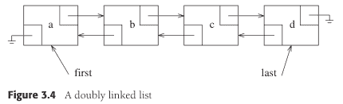

在末尾添加（即使新项目成为最后一个项目）的特殊情况可以是常数时间，只要我们维护指向最后一个节点的链接。因此，典型的链表保留指向列表两端的链接。删除最后一个项目更棘手，因为我们必须找到倒数第二个项目，将其 next 链接更改为 nullptr，然后更新维护最后一个节点的链接。在经典链表中，每个节点存储指向其下一个节点的链接，拥有指向最后一个节点的链接并不提供关于倒数第二个节点的信息。

维护指向倒数第二个节点的第三个链接这一显而易见的想法行不通，因为它在删除时也需要更新。相反，我们让每个节点维护指向列表中其前一个节点的链接。这如图 3.4 所示，称为双向链表。

### 3.3 STL 中的 vector 和 list

C++ 语言在其库中包含常见数据结构的实现。语言的这一部分广为人知地称为标准模板库（STL）。List ADT 是 STL 中实现的数据结构之一。我们将在第 4 章和第 5 章中看到其他一些。一般来说，这些数据结构称为集合或容器。

List ADT 有两种常用实现。vector 提供了 List ADT 的可增长数组实现。使用 vector 的优点是它可以在常数时间内进行索引。缺点是插入新项目和删除现有项目代价高昂，除非更改是在 vector 的末尾进行的。list 提供了 List ADT 的双向链表实现。使用


list 的优点在于插入新项和删除现有项的代价很低，前提是已知更改的位置。缺点是 list 不易索引。vector 和 list 都适用于高效搜索。在本讨论中，list 指的是 STL 中的双向链表，而 list（非等宽字体排版）指的是更通用的 List ADT。

vector 和 list 都是类模板，用它们存储的项的类型进行实例化。两者共有若干方法。下面显示的前三种方法实际上适用于所有 STL 容器：

- int size() const: 返回容器中的元素数量。
- void clear(): 从容器中删除所有元素。
- bool empty() const: 如果容器不包含任何元素，则返回 true，否则返回 false。

vector 和 list 都支持在常数时间内从列表末尾添加和删除元素。vector 和 list 都支持在常数时间内访问列表首项。操作如下：

- void push_back(const Object & x): 将 x 添加到列表末尾。
- void pop_back(): 删除列表末尾的对象。
- const Object & back(): 返回列表末尾的对象（还提供返回引用的修改器）。
- const Object & front(): 返回列表首项的对象（还提供返回引用的修改器）。

因为双向链表允许在头部高效更改，而 vector 不允许，因此以下两种方法仅适用于 list：

- void push_front(const Object & x): 将 x 添加到列表头部。
- void pop_front(): 删除列表头部的对象。

vector 拥有 list 不具备的一组方法。其中两种方法允许高效索引。另外两种方法允许程序员查看和更改内部容量。这些方法是：

- Object & operator[](int idx): 返回 vector 中索引 idx 处的对象，不进行边界检查（还提供返回常量引用的访问器）。
- Object & at(int idx): 返回 vector 中索引 idx 处的对象，进行边界检查（还提供返回常量引用的访问器）。
- int capacity(): 返回 vector 的内部容量。（有关更多详细信息，请参见第 3.4 节。）
- void reserve(int newCapacity): 设置新容量。如果有良好的估计值，可以使用它来避免 vector 扩展。（有关更多详细信息，请参见第 3.4 节。）

#### 3.3.1 迭代器

对列表的一些操作（尤其是在列表中间插入和删除元素的操作）需要位置的概念。在 STL 中，位置由嵌套类型 iterator 表示。特别是，对于 list<string>，位置由类型 list<string>::iterator 表示；对于 vector<int>，位置由类 vector<int>::iterator 表示；以此类推。在描述某些方法时，我们将简单地使用 iterator 作为简写，但在编写代码时，我们将使用实际的嵌套类名。

最初，需要解决三个主要问题：首先，如何获取迭代器；其次，迭代器本身可以执行哪些操作；第三，哪些 List ADT 方法需要将迭代器作为参数。

##### 获取迭代器

针对第一个问题，STL 列表（以及所有其他 STL 容器）定义了一对方法：

- iterator begin(): 返回表示容器中第一个元素的适当迭代器。
- iterator end(): 返回表示容器中结束标记的适当迭代器（即最后一个元素之后的位置）。

end 方法似乎有点不寻常，因为它返回一个“越界”的迭代器。为了理解这一概念，请考虑以下代码，该代码通常用于在 C++11 引入基于范围的循环之前打印 vector v 中的元素：

```
for( int i = 0; i < v.size(); ++i )
    cout << v[i] << endl;
```

如果我们使用迭代器重写此代码，就会看到它与 begin 和 end 方法之间的自然对应关系：

```
for( vector<int>::iterator itr = v.begin(); itr != v.end(); itr++ )
    cout << *itr << endl;
```

在循环终止测试中，itr != v.size() 和 itr != v.end() 旨在测试循环计数器是否已变为“越界”。该代码片段也引出了第二个问题，即迭代器必须具有关联的方法（这些未知方法由 ??? 表示）。

##### 迭代器方法

根据上面的代码片段，很明显迭代器可以使用 != 和 == 进行比较，并且可能定义了拷贝构造函数和运算符。因此，迭代器具有方法，且许多方法使用运算符重载。除了拷贝之外，迭代器上最常用的操作包括以下内容：

- itr++ 和 ++itr: 将迭代器 itr 前移到下一个位置。前缀和后缀形式均可使用。
- *itr: 返回迭代器 itr 位置处存储对象的引用。返回的引用可能可修改，也可能不可修改（我们将稍后讨论这些细节）。
- itr1==itr2: 如果迭代器 itr1 和 itr2 引用同一位置，则返回 true，否则返回 false。
- itr1!=itr2: 如果迭代器 itr1 和 itr2 引用不同位置，则返回 true，否则返回 false。

使用这些运算符，打印代码如下：

```
for( vector<int>::iterator itr = v.begin(); itr != v.end(); ++itr )
    cout << *itr << endl;
```

使用运算符重载可以访问当前项，然后使用 *itr++ 前移到下一项。因此，上面片段的替代方案是：

```
vector<int>::iterator itr = v.begin();
while( itr != v.end() ) {
    cout << *itr++ << endl;
}
```

##### 需要迭代器的容器操作

针对最后一个问题，三种最常用的需要迭代器的方法是那些在指定位置向列表（vector 或 list）添加或删除元素的方法：

- iterator insert(iterator pos, const Object & x): 将 x 插入列表，位置在迭代器 pos 指定的位置之前。这是 list 的常数时间操作，但 vector 不是。返回值是表示插入项位置的迭代器。
- iterator erase(iterator pos): 删除迭代器指定位置的对象。这是 list 的常数时间操作，但 vector 不是。返回值是调用前 pos 之后的元素的位置。此操作使 pos 失效，因为它正在查看的容器项已被删除，因此 pos 现在已过时。
- iterator erase(iterator start, iterator end): 删除从位置 start 开始直到（但不包括）位置 end 的所有项。请注意，可以通过调用 c.erase(c.begin(), c.end()) 删除整个列表。

#### 3.3.2 示例：在列表上使用 erase

作为示例，我们提供一个例程，用于从列表中删除每隔一项，从第一项开始。因此，如果列表包含 6、5、1、4、2，则调用该方法后将包含 5、4。我们通过遍历列表并对每第二项使用 erase 方法来实现这一点。在列表上，这是一个线性时间例程，因为每次 erase 调用都需要常数时间，但在 vector 中，整个例程将需要平方时间，因为每次 erase 调用都很低效，使用 O(N) 时间。因此，我们通常只为列表编写代码。但是，出于实验目的，我们编写了一个通用函数模板，它可以同时用于 list 或 vector，然后提供

```
template <typename Container>
void removeEveryOtherItem( Container & lst )
{
   auto itr = lst.begin();   // itr is a Container::iterator
   while( itr != lst.end() )
   {
      itr = lst.erase(itr);
      if( itr != lst.end() )
         ++itr;
   }
}
```

图 3.5 使用迭代器从列表（vector 或 list）中删除每隔一项。对列表高效，但对 vector 不高效。

时序信息。函数模板如图 3.5 所示。第 4 行中使用 auto 是 C++11 特性，允许我们避免使用较长的类型 Container::iterator。如果运行代码并传入 List<int>，对于 800,000 项的列表耗时 0.039 秒，对于 1,600,000 项的列表耗时 0.073 秒，这显然是一个线性时间例程，因为运行时间随输入大小以相同的因子增加。当传入 vector<int> 时，该例程对 800,000 项的 vector 耗时近五分钟，对 1,600,000 项的 vector 耗时约二十分钟；当输入仅增加两倍时，运行时间增加四倍，这与平方行为一致。

#### 3.3.3 const 迭代器

*itr 的结果不仅是迭代器正在查看的项的值，而且是项本身。这一区别使迭代器非常强大，但也引入了一些复杂性。为了了解其优点，假设我们想要将集合中的所有项更改为指定值。以下例程适用于 vector 和 list，并且以线性时间运行。这是编写泛型、与类型无关代码的绝佳示例。

```
template <typename Container, typename Object>
void change( Container & c, const Object & newValue )
{
   typename Container::iterator itr = c.begin();
   while( itr != c.end() )
      *itr++ = newValue;
}
```

为了了解潜在问题，假设 Container c 通过常量引用传递给例程。这意味着我们预期不允许对 c 进行任何更改，编译器将通过不允许调用其任何修改器来确保这一点。请考虑以下代码，它打印整数列表，但也试图偷偷更改列表：


```cpp
void print( const list<int>& lst, ostream& out = cout )
{
    typename Container::iterator itr = lst.begin( );
    while ( itr != lst.end( ) )
    {
        out << *itr << endl;
        *itr = 0; // This is fishy!!!
        ++itr;
    }
}
```

如果这段代码合法，那么列表的 const 性将完全没有意义，因为它很容易被绕过。该代码不合法且无法编译。STL 提供的解决方案是，每个集合不仅包含一个迭代器嵌套类型，还包含一个 const_iterator 嵌套类型。迭代器和 const_iterator 的主要区别在于，const_iterator 的 operator* 返回常量引用，因此 const_iterator 的 *itr 不能出现在赋值语句的左侧。

此外，编译器会强制你使用 const_iterator 来遍历常量集合。它通过提供两个版本的 begin 和两个版本的 end 来实现，如下所示：

- iterator begin( )
- const_iterator begin( ) const
- iterator end( )
- const_iterator end( ) const

begin 的两个版本能够存在于同一个类中，仅仅是因为方法的 const 性（即它是访问器还是修改器）被视为签名的一部分。我们在第 1.7.2 节中见过这个技巧，并将在第 3.4 节中再次看到，两者都在重载 operator[] 的上下文中。

如果在非常量容器上调用 begin，则会调用返回 iterator 的“修改器”版本。但是，如果在常量容器上调用 begin，则返回的是 const_iterator，且返回值不能赋值给 iterator。如果尝试这样做，将生成编译器错误。一旦 itr 是 const_iterator，*itr = 0 就会被轻易检测为非法。

如果使用 auto 声明迭代器，编译器会为你推断应替换为 iterator 还是 const_iterator；在很大程度上，这使程序员无需跟踪正确的迭代器类型，这正是 auto 的预期用途之一。此外，诸如 vector 和 list 等提供上述迭代器的库类与基于范围的 for 循环兼容，用户定义的类也是如此。

C++11 的一项额外特性允许编写即使 Container 类型没有 begin 和 end 成员函数也能工作的代码。定义了非成员的自由函数 begin 和 end，允许在任何允许使用 c.begin() 的地方使用 begin(c)。使用 begin(c) 而不是 c.begin() 编写泛型代码的优势在于，它使泛型代码既能用于将 begin/end 作为成员的容器，也能用于那些没有 begin/end 但以后可以通过适当的非成员函数进行扩展的容器。C++11 中将 begin 和 end 添加为自由函数，得益于 auto 和 decltype 语言特性的加入，如下面的代码所示。

```cpp
template <typename Container>
void print( const Container & c, ostream & out = cout )
{
    if( c.empty( ) )
        out << "(empty)";
    else
    {
        auto itr = begin( c ); // itr is a Container::const_iterator
        out << "[" << *itr; // Print first item
        while( itr != end( c ) )
            out << ", " << *++itr;
        out << " ]" << endl;
    }
}
```

图 3.6 打印任意容器

```cpp
template<typename Container>
auto begin( Container & c ) -> decltype( c.begin( ) )
{
    return c.begin( );
}
```

```cpp
template<typename Container>
auto begin( const Container & c ) -> decltype( c.begin( ) )
{
    return c.begin( );
}
```

在这段代码中，begin 的返回类型被推断为 c.begin( ) 的类型。图 3.6 中的代码使用 auto 声明迭代器（如图 3.5 所示），并使用非成员函数 begin 和 end。

### 3.4 vector 的实现

在本节中，我们提供一个可用的 vector 类模板的实现。vector 将是一等类型，这意味着与 C++ 中的原始数组不同，vector 可以被复制，并且它使用的内存可以通过其析构函数自动回收。在第 1.5.7 节中，我们描述了 C++ 原始数组的一些重要特性：

- 数组仅仅是指向一块内存的指针变量；实际数组大小必须由程序员单独维护。
- 内存块可以通过 new[] 分配，但随后必须通过 delete[] 释放。
- 内存块不能调整大小（但可以获取一个可能更大的新块并用旧块初始化，然后释放旧块）。

为了避免与库类产生歧义，我们将类模板命名为 Vector。在研究 Vector 代码之前，我们先概述主要细节：

1. Vector 将维护原始数组（通过指向已分配内存块的指针变量）、数组容量以及 Vector 中当前存储的项目数。
2. Vector 将实现 Big-Five，为拷贝构造函数和 operator= 提供深拷贝语义，并提供析构函数来回收原始数组。它还将实现 C++11 移动语义。
3. Vector 将提供一个 resize 例程，用于更改（通常增大）Vector 的大小，以及一个 reserve 例程，用于更改（通常增大）Vector 的容量。容量的更改是通过为原始数组获取新内存块、将旧块复制到新块，并回收旧块来实现的。
4. Vector 将提供 operator[] 的实现（如前所述，在第 1.7.2 节中提到，operator[] 通常同时实现访问器版本和修改器版本）。
5. Vector 将提供基本例程，例如 size、empty、clear（通常是单行代码）、back、pop_back 和 push_back。当大小和容量相同时，push_back 例程会调用 reserve。
6. Vector 将支持嵌套类型 iterator 和 const_iterator，以及相关的 begin 和 end 方法。

图 3.7 和图 3.8 显示了 Vector 类。与其 STL 对应物一样，错误检查有限。稍后我们将简要讨论如何提供错误检查。

如第 118 至 120 行所示，Vector 将大小、容量和原始数组作为其数据成员。第 7 至 9 行的构造函数允许用户指定初始大小，默认为零。然后它初始化数据成员，容量略大于大小，因此可以执行几次 push_back 而无需更改容量。

如第 11 至 17 行所示，拷贝构造函数会创建一个新的 Vector，随后可由使用“交换副本”标准惯用法的 operator= 的简单实现使用。这种惯用法只有在交换通过移动完成时才有效，而这本身需要实现第 29 至 44 行所示的移动构造函数和移动 operator=。同样，这些使用了非常标准的惯用法。使用拷贝构造函数和 swap 实现拷贝赋值运算符 operator=，虽然简单，但肯定不是最高效的方法，尤其是在两个 Vector 大小相同的情况下。在这种情况下（可以进行测试），直接使用 Object 的 operator= 逐个复制每个元素可能更高效。

```cpp
#include <algorithm>

template <typename Object>
class Vector
{
public:
    explicit Vector( int initSize = 0 ) : theSize{ initSize },
        theCapacity{ initSize + SPARE_CAPACITY }
    { objects = new Object[ theCapacity ]; }

    Vector( const Vector & rhs ) : theSize{ rhs.theSize },
        theCapacity{ rhs.theCapacity }, objects{ nullptr }
    {
        objects = new Object[ theCapacity ];
        for( int k = 0; k < theSize; ++k )
            objects[ k ] = rhs.objects[ k ];
    }

    Vector & operator= ( const Vector & rhs )
    {
        Vector copy = rhs;
        std::swap( *this, copy );
        return *this;
    }

    ~Vector( )
    { delete [ ] objects; }

    Vector( Vector && rhs ) : theSize{ rhs.theSize },
        theCapacity{ rhs.theCapacity }, objects{ rhs.objects }
    {
        rhs.objects = nullptr;
        rhs.theSize = 0;
        rhs.theCapacity = 0;
    }

    Vector & operator= ( Vector && rhs )
    {
        std::swap( theSize, rhs.theSize );
        std::swap( theCapacity, rhs.theCapacity );
        std::swap( objects, rhs.objects );

        return *this;
    }
```

图 3.7 vector 类（第 1 部分，共 2 部分）


```cpp
void resize( int newSize )
{
    if( newSize > theCapacity )
        reserve( newSize * 2 );
    theSize = newSize;
}

void reserve( int newCapacity )
{
    if( newCapacity < theSize )
        return;

    Object * newArray = new Object[ newCapacity ];
    for( int k = 0; k < theSize; ++k )
        newArray[ k ] = std::move( objects[ k ] );

    theCapacity = newCapacity;
    std::swap( objects, newArray );
    delete [] newArray;
}
```

#### 图 3.7（续）

resize 例程显示于第 46 至 51 行。该代码在可能扩容之后，仅设置 theSize 数据成员。扩容操作开销很大。因此，如果扩容，则将容量设为大小的两倍，以避免除非大小剧增否则不必再次更改容量（+1 用于处理大小为 0 的情况）。扩容由 reserve 例程完成，显示于第 53 至 65 行。它包括在第 58 行分配新数组、在第 59 和 60 行移动旧内容，以及在第 64 行回收旧数组。如第 55 和 56 行所示，reserve 例程也可用于缩小底层数组，但前提是指定的新容量至少等于大小。如果不是，则忽略 reserve 请求。

operator[] 的两个版本都很简单（实际上与第 1.7.2 节矩阵类中 operator[] 的实现非常相似），显示于第 67 至 70 行。只需确保 index 在 0 到 size()-1 的范围内（包含两端），否则抛出异常，即可轻松添加错误检查。

一系列简短例程，即 empty、size、capacity、push_back、pop_back 和 back，在第 72 至 101 行中实现。在第 83 和 90 行，我们看到了后置 ++ 运算符的用法，它使用 theSize 为数组建立索引，然后增加 theSize。在讨论迭代器时，我们见过同样的惯用法：*itr++ 使用 itr 决定查看哪个元素，然后推进 itr。++ 的位置很重要：在前置 ++ 运算符中，++itr 推进 itr 然后使用新的 itr 决定查看哪个元素；同样，objects[++theSize] 会递增 theSize 并使用新值为数组建立索引（这不是我们想要的）。pop_back 和 back 都可以从错误检查中受益，如果大小为 0 则抛出异常。

```cpp
67 Object & operator[]( int index )
68 { return objects[ index ]; }
69 const Object & operator[]( int index ) const
70 { return objects[ index ]; }
71
72 bool empty( ) const
73 { return size( ) == 0; }
74
75 int size( ) const
76 { return theSize; }
77
78 int capacity( ) const
79 { return theCapacity; }
80
81 void push_back( const Object & x )
82 {
83 if( theSize == theCapacity )
84 reserve( 2 * theCapacity + 1 );
85 objects[ theSize++ ] = x;
86 }
87
88 void push_back( Object && x )
89 {
90 if( theSize == theCapacity )
91 reserve( 2 * theCapacity + 1 );
92 objects[ theSize++ ] = std::move( x );
93 }
94
95 void pop_back( )
96 {
97 --theSize;
98 }
99
100 const Object & back( ) const
101 {
102 return objects[ theSize - 1 ];
103 }
104
105 typedef Object * iterator;
106 typedef const Object * const_iterator;
107
108 iterator begin( )
{ return objects[ 0 ]; }
109 const_iterator begin( ) const
{ return objects[ 0 ]; }
```

#### 图 3.8 vector 类（第 2 部分，共 2 部分）

```cpp
110 iterator end()
111 { return &objects[ size() ]; }
112 const_iterator end() const
113 { return &objects[ size() ]; }
114
115 static const int SPARE_CAPACITY = 16;
116
117 private:
118 int theSize;
119 int theCapacity;
120 Object * objects;
121 };
```

#### 图 3.8（续）

最后，在第 103 至 113 行，我们看到了 iterator 和 const_iterator 嵌套类型的声明，以及两个 begin 和两个 end 方法。这段代码利用了这样一个事实：在 C++ 中，指针变量具有我们期望的迭代器的所有相同操作。指针变量可以被复制和比较；* 运算符返回所指向的对象，而最奇特的是，当 ++ 应用于指针变量时，该指针变量随后指向下一个将按顺序存储的对象：如果指针指向数组内部，则递增指针会将其定位到下一个数组元素。指针的这些语义可以追溯到 20 世纪 70 年代初的 C 编程语言，C++ 正是基于该语言。STL 迭代器机制部分设计用于模拟指针操作。

因此，在第 103 和 104 行，我们看到 typedef 语句，声明 iterator 和 const_iterator 只是指针变量的别名，而 begin 和 end 只需分别返回表示第一个数组位置和第一个无效数组位置的内存地址。

vector 类型中迭代器与指针的对应关系意味着，使用 vector 而非 C++ 数组可能几乎不会带来额外开销。缺点是，按当前编写，代码没有错误检查。如果迭代器 itr 越过结束标记，那么 *itr 或 ++itr 不一定会报错。要修复这个问题，需要将 iterator 和 const_iterator 设为实际的嵌套类类型，而不仅仅是指针变量。使用嵌套类类型更为常见，这也是我们将在第 3.5 节的 List 类中看到的内容。

### 3.5 list 的实现

在本节中，我们提供一个可用的 List 类模板的实现。与 vector 类的情况一样，我们的列表类将命名为 List，以避免与库类产生歧义。

请记住，List 类将作为双向链表实现，并且我们需要维护指向列表两端的指针。这样做使我们能够在每次操作中保持常数时间开销，前提是操作发生在已知位置。已知位置可以位于任一端，或由迭代器指定的位置。

在考虑设计时，我们需要提供四个类：

- 1. `List` 类本身，包含指向两端的链接、列表的大小以及一系列方法。
- 2. `Node` 类，很可能是一个私有嵌套类。节点包含数据以及指向前一个和下一个节点的指针，并附带适当的构造函数。
- 3. `const_iterator` 类，抽象了位置的概念，是一个公有嵌套类。`const_iterator` 存储指向“当前”节点的指针，并以重载运算符（如 `==`、`!=`、`*` 和 `++`）的形式提供基本迭代器操作的实现。
- 4. `iterator` 类，抽象了位置的概念，是一个公有嵌套类。`iterator` 具有与 `const_iterator` 相同的功能，区别在于 `operator*` 返回所查看元素的引用，而不是对该元素的常量引用。一个重要的技术问题是，`iterator` 可以用于任何需要 `const_iterator` 的例程，但反之则不行。换句话说，`iterator IS-A const_iterator`。

因为迭代器类存储指向“当前节点”的指针，且结束标记是一个有效位置，所以在列表末尾创建一个额外节点来表示结束标记是合理的。此外，我们可以在列表前面创建一个额外节点，在逻辑上表示开始标记。这些额外节点有时称为哨兵节点；具体来说，前面的节点有时称为头节点，末尾的节点有时称为尾节点。

使用这些额外节点的优势在于，它们通过消除大量特殊情况来大大简化编码。例如，如果不使用头节点，那么删除第一个节点将成为一种特殊情况，因为在删除过程中必须重置指向第一个节点的链接，而且删除算法通常需要访问被删除节点之前的节点（而没有头节点，第一个节点没有之前的节点）。图 3.9 显示了带有头节点和尾节点的双向链表。

图 3.10 显示了一个空列表。图 3.11 和图 3.12 显示了 List 类的轮廓和部分实现。

我们可以在第 5 行看到私有嵌套 Node 类声明的开始。我们没有使用 class 关键字，而是使用 struct。在 C++ 中，struct 是 C 编程语言的遗留物。C++ 中的 struct 本质上是一个类，其成员默认为 public。请记住，在类中，成员默认为 private。显然，struct

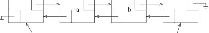

#### 图 3.9 带有头节点和尾节点的双向链表


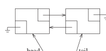

**图 3.10** 带有头节点和尾节点的空双向链表

关键字不是必需的，但你经常会看到它，程序员通常用它来表示一种类型，该类型包含的数据大多是直接访问的，而不是通过方法访问。在我们的例子中，将 `Node` 类的成员设为公有不会成为问题，因为 `Node` 类本身是私有的，在 `List` 类之外不可访问。

在第 9 行，我们看到了公共嵌套 `const_iterator` 类声明的开始，在第 12 行，我们看到了公共嵌套 `iterator` 类声明的开始。这种不寻常的语法是 `inheritance`，这是一种强大的构造，在本书其他地方未使用。继承语法表明 `iterator` 与 `const_iterator` 具有完全相同的功能，可能有一些补充，并且 `iterator` 与 `const_iterator` 类型兼容，可以在需要 `const_iterator` 的任何地方使用。我们将在稍后看到实际实现时讨论这些细节。

第 80 到 82 行包含 `List` 的数据成员，即指向头节点和尾节点的指针。我们还在一个数据成员中跟踪大小，以便 `size` 方法可以在常数时间内实现。

`List` 类的其余部分由构造函数、Big-Five 和大量方法组成。许多方法都是单行代码。`begin` 和 `end` 返回适当的迭代器，第 30 行的调用是典型的实现，在其中我们返回一个构造的迭代器（因此 `iterator` 和 `const_iterator` 类各自都有一个构造函数，其参数为指向 `Node` 的指针）。

第 43 到 47 行的 `clear` 方法通过反复删除元素，直到 `List` 为空。使用此策略使 `clear` 可以避免亲自回收节点，因为节点回收现在被导向到 `pop_front`。第 48 到 67 行的方法都通过巧妙地获取和使用适当的迭代器来工作。回顾一下，`insert` 方法在某个位置之前插入元素，因此 `push_back` 在结束标记之前插入元素，如要求所示。在 `pop_back` 中，请注意 `erase(--end())` 创建一个与结束标记对应的临时迭代器，使该临时迭代器后退，并使用该迭代器来 `erase`。`back` 中也出现类似行为。还要注意，在 `pop_front` 和 `pop_back` 操作中，我们再次避免处理节点回收。

图 3.13 显示了 `Node` 类，由存储的元素、指向前一个和下一个 `Node` 的指针以及一个构造函数组成。所有数据成员都是公有的。

图 3.14 显示了 `const_iterator` 类，图 3.15 显示了 `iterator` 类。

如前所述，图 3.15 中第 39 行的语法表示一种称为 `inheritance` 的高级特性，并意味着 `iterator` IS-A `const_iterator`。当 `iterator` 类以这种方式编写时，它将从 `const_iterator` 继承所有数据和方法。然后它可以添加新数据、添加新方法，并覆盖（即重新定义）现有方法。在最通用的场景中，存在大量语法负担（通常会导致关键字 `virtual` 出现在代码中）。

```cpp
1 template <typename Object>
2 class List
3 {
4   private:
5     struct Node
6     { /* See Figure 3.13 */ };
7
8   public:
9     class const_iterator
10    { /* See Figure 3.14 */ };
11
12    class iterator : public const_iterator
13    { /* See Figure 3.15 */ };
14
15   public:
16    List( )
17    { /* See Figure 3.16 */ }
18    List( const List & rhs )
19    { /* See Figure 3.16 */ }
20    ~List( )
21    { /* See Figure 3.16 */ }
22    List & operator = ( const List & rhs )
23    { /* See Figure 3.16 */ }
24    List( List && rhs )
25    { /* See Figure 3.16 */ }
26    List & operator = ( List && rhs )
27    { /* See Figure 3.16 */ }
28
29    iterator begin( )
30    { return { head->next }; }
31    const_iterator begin( ) const
32    { return { head->next }; }
33    iterator end( )
34    { return { tail }; }
35    const_iterator end( ) const
36    { return { tail }; }
37
38    int size( ) const
39    { return theSize; }
40    bool empty( ) const
41    { return size( ) == 0; }
42
43    void clear( )
44    {
45    while( !empty( ) )
46    pop_front( );
47    }
```

图 3.11 List 类（第 1 部分，共 2 部分）

```cpp
Object & front()
{
    return *begin();
}
const Object & front() const
{
    return *begin();
}
Object & back()
{
    return *--end();
}
const Object & back() const
{
    return *--end();
}
void push_front( const Object & x )
{
    insert( begin(), x );
}
void push_front( Object && x )
{
    insert( begin(), std::move( x ) );
}
void push_back( const Object & x )
{
    insert( end(), x );
}
void push_back( Object && x )
{
    insert( end(), std::move( x ) );
}
void pop_front()
{
    erase( begin() );
}
void pop_back()
{
    erase( --end() );
}

iterator insert( iterator itr, const Object & x )
{ /* See Figure 3.18 */ }
iterator insert( iterator itr, Object && x )
{ /* See Figure 3.18 */ }

iterator erase( iterator itr )
{ /* See Figure 3.20 */ }
iterator erase( iterator from, iterator to )
{ /* See Figure 3.20 */ }

private:
int theSize;
Node * head;
Node * tail;

void init()
{ /* See Figure 3.16 */ }
};
```

```cpp
1   struct Node
2   {
3      Object data;
4      Node *prev;
5      Node *next;
6
7      Node( const Object & d = Object{ }, Node * p = nullptr,
8            Node * n = nullptr )
9         : data{ d }, prev{ p }, next{ n } { }
10
11      Node( Object && d, Node * p = nullptr, Node * n = nullptr )
12         : data{ std::move( d ) }, prev{ p }, next{ n } { }
13   };
```

#### 图 3.13 List 类的嵌套 Node 类

但是，在我们的例子中，我们可以避免大部分语法负担，因为我们没有添加新数据，也不打算更改现有方法的行为。然而，我们正在向 iterator 类添加一些新方法（与 const_iterator 类中现有方法的签名非常相似）。因此，我们可以避免使用 virtual。

在第 28 和 29 行，const_iterator 将指向“当前”节点的指针作为其唯一数据成员。通常，这将是私有的，但如果是私有的，则 iterator 将无法访问它。将 const_iterator 的成员标记为 protected 允许继承自 const_iterator 的类访问这些成员，但不允许其他类访问。

在第 34 和 35 行，我们看到了 const_iterator 的构造函数，它在 List 类的 begin 和 end 实现中被使用。我们不希望所有类都看到这个构造函数（迭代器不应从指针变量可见构造），因此它不能是 public，但我们也希望 iterator 类能够看到它，因此从逻辑上讲，此构造函数被设为 protected。然而，这并未授予 List 对该构造函数的访问权限。解决方案是第 37 行的友元声明，它授予 List 类访问 const_iterator 非公有成员的权限。

const_iterator 中的公共方法都使用运算符重载。operator->、operator++ 和 operator* 都很简单。在第 10 到 21 行，我们看到了 operator++ 的实现。回顾一下，operator++ 的前置版本和后置版本在语义（和优先级）上完全不同，因此我们需要为每种形式编写单独的例程。它们具有相同的名称，因此必须具有不同的签名才能被区分。C++ 要求我们通过为前置形式指定空参数列表、为后置形式指定单个（匿名）int 参数来为它们提供不同的签名。然后 ++itr 调用零参数 operator++，而 itr++ 调用单参数 operator++。int 参数从不使用；它仅存在以提供不同的签名。说明表明，在许多可以在前置或后置 operator++ 之间进行选择的情况下，前置形式将比后置形式更快。

在 iterator 类中，第 64 行的 protected 构造函数使用初始化列表来初始化继承的当前节点。我们不必重新实现 operator++


#### 图 3.14 List 类的嵌套 const_iterator 类

```
class const_iterator
{
public:
    const_iterator( ) : current{ nullptr }
    { }
    const Object & operator* ( ) const
    { return retrieve( ); }
    const_iterator & operator++ ( )
    {
        current = current->next;
        return *this;
    }
    const_iterator operator++ ( int )
    {
        const_iterator old = *this;
        ++( *this );
        return old;
    }
    bool operator== ( const const_iterator & rhs ) const
    { return current == rhs.current; }
    bool operator!= ( const const_iterator & rhs ) const
    { return !( *this == rhs ); }
protected:
    Node *current;
    Object & retrieve( ) const
    { return current->data; }
    const_iterator( Node *p ) : current{ p }
    { }
    friend class List<Object>;
};
```

由于这些是继承且未改变的，因此不提供 operator*=。我们提供了一对新的 operator++ 实现（因为返回类型发生了变化），它们在 const_iterator 中隐藏了原有实现，并且为 operator* 提供了一对访问器/修改器。如第 47 行和第 48 行所示，访问器 operator* 直接使用与 const_iterator 中相同的实现。访问器在 iterator 中被显式实现，因为否则原有实现会被新添加的修改器版本隐藏。

#### 图 3.15 List 类的嵌套 iterator 类

```
class iterator : public const_iterator
{
   public:
   iterator( )
   { }

   Object & operator*( )
   { return const_iterator::retrieve( ); }
   const Object & operator*( ) const
   { return const_iterator::operator*( ); }

   iterator & operator++( )
   {
   this->current = this->current->next;
   return *this;
   }

   iterator operator++( int )
   {
   iterator old = *this;
   ++( *this );
   return old;
   }

   protected:
   iterator( Node *p ) : const_iterator{ p }
   { }

   friend class List<Object>;
};
```

图 3.16 展示了构造函数和 Big-Five（五大特性）。由于无参构造函数和拷贝构造函数都需要分配头节点和尾节点，我们提供了一个私有的 init 例程。init 创建一个空列表。析构函数回收头节点和尾节点；所有其他节点在析构函数调用 clear 时被回收。同样，拷贝构造函数是通过调用公共方法实现的，而不是尝试进行底层指针操作。

图 3.17 说明如何将包含 x 的新节点插入到 p 指向的节点和 p.prev 之间。对节点指针的赋值可以描述如下：

```
Node *newNode = new Node{ x, p->prev, p }; // Steps 1 and 2
p->prev->next = newNode; // Step 3
p->prev = newNode; // Step 4
```

#### 图 3.16 List 类的构造函数、Big-Five 和私有 init 例程

```
1    List()
2    {
3        init();
4    }
5    ~List()
6    {
7        clear();
8        delete head;
9        delete tail;
10   }
11
12   List( const List & rhs )
13   {
14       init();
15       for( auto & x : rhs )
16           push_back( x );
17   }
18
19   List & operator= ( const List & rhs )
20   {
21       List copy = rhs;
22       std::swap( *this, copy );
23       return *this;
24   }
25
26   List( List && rhs )
27       : theSize{ rhs.theSize }, head{ rhs.head }, tail{ rhs.tail }
28   {
29       rhs.theSize = 0;
30       rhs.head = nullptr;
31       rhs.tail = nullptr;
32   }
33
34   List & operator= ( List && rhs )
35   {
36       std::swap( theSize, rhs.theSize );
37       std::swap( head, rhs.head );
38       std::swap( tail, rhs.tail );
39       return *this;
40   }
41
42   void init()
43   {
44       theSize = 0;
45       head = new Node;
46       tail = new Node;
47       head->next = tail;
48       tail->prev = head;
49   }
50   }
```

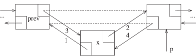

#### 图 3.17 在双向链表中获取新节点并按指示顺序更改指针的插入操作

步骤 3 和 4 可以合并，只需两行：

```
Node *newNode = new Node( x, p->prev, p ); // Steps 1 and 2
p->prev = p->prev->next = newNode; // Steps 3 and 4
```

然后这两行也可以合并，得到：

```
p->prev = p->prev->next = new Node( x, p->prev, p );
```

这使得图 3.18 中的 insert 例程变得简短。

图 3.19 展示了删除节点的逻辑。如果 p 指向要删除的节点，在节点被回收之前，只有两个指针会发生变化：

```
p->prev->next = p->next;
p->next->prev = p->prev;
delete p;
```

图 3.20 展示了一对 erase 例程。erase 的第一个版本包含上面显示的三行代码以及返回表示被删除元素之后的项目的迭代器的代码。

#### 图 3.18 List 类的 insert 例程

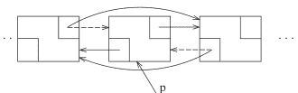

#### 图 3.19 从双向链表中删除由 p 指定的节点

```
1 // Erase item at itr.
2 iterator erase( iterator itr )
3 {
4 Node *p = itr.current;
5 iterator retVal{ p->next };
6 p->prev->next = p->next;
7 p->next->prev = p->prev;
8 delete p;
9 theSize--;
10
11 return retVal;
12 }
13
14 iterator erase( iterator from, iterator to )
15 {
16 for( iterator itr = from; itr != to; )
17 itr = erase( itr );
18
19 return to;
20 }
```

#### 图 3.20 List 类的 erase 例程

被删除的元素。与 insert 类似，erase 必须更新 theSize。erase 的第二个版本只是使用一个迭代器来调用 erase 的第一个版本。请注意，我们不能简单地在第 16 行的 for 循环中使用 itr++ 并忽略第 17 行 erase 的返回值。在调用 erase 之后，itr 的值立即变为过时，这就是 erase 返回迭代器的原因。

在检查代码时，我们可以看到可能发生的一系列错误，且未提供任何检查。例如，传递给 erase 和 insert 的迭代器可能未初始化或属于错误的列表！当迭代器已经位于结束标记或未初始化时，可能对其应用 ++ 或 *。

未初始化的迭代器会使 current 指向 nullptr，因此很容易测试该条件。结束标记的 next 指针指向 nullptr，因此对结束标记条件测试 ++ 或 * 也很容易。然而，为了确定传递给 erase 或 insert 的迭代器是否属于正确的列表，迭代器必须存储一个额外的数据成员，表示指向其构造所在的 List 的指针。

#### 图 3.21 修订后的 const_iterator protected 部分，包含执行额外错误检查的功能

```
protected:
    const List<Object> *theList;
    Node *current;
    const_iterator( const List<Object> & lst, Node *p )
        : theList{ lst }, current{ p }
    {
    }
void assertIsValid( ) const
{
    if( theList == nullptr || current == nullptr || current == theList->head )
        throw IteratorOutOfBoundsException( );
}
```

我们将勾勒基本思路，并将详细内容留作练习。在 const_iterator 类中，我们添加一个指向 List 的指针，并修改 protected 构造函数以将 List 作为参数。我们还可以添加方法，在某些断言未满足时抛出异常。修订后的 protected 部分看起来类似于图 3.21 中的代码。然后，所有以前只接受一个参数的 iterator 和 const_iterator 构造函数调用现在都接受两个参数，如 List 的 begin 方法所示：

```
const_iterator begin( ) const
{
    const_iterator itr{ *this, head };
    return ++itr;
}
```

然后 insert 可以修订为类似于图 3.22 中的代码。我们将这些修改的详细内容留作练习。

```
// Insert x before itr.
iterator insert( iterator itr, const Object & x )
{
    itr.assertIsValid( );
    if( itr.theList != this )
        throw IteratorMismatchException( );
    Node *p = itr.current;
    theSize++;
    return { *this, p->prev = p->prev->next = new Node{ x, p->prev, p } };
}
```

#### 图 3.22 带有额外错误检查的 List insert


### 3.6 栈 ADT

栈是一种列表，其插入和删除操作只能在一个位置进行，即列表的末端，称为栈顶。

#### 3.6.1 栈模型

栈的基本操作是 push，相当于插入，以及 pop，它删除最近插入的元素。可以使用 top 操作在执行 pop 之前检查最近插入的元素。对空栈执行 pop 或 top 通常被视为栈 ADT 中的错误。另一方面，执行 push 时空间不足是实现限制，而非 ADT 错误。

栈有时也被称为 LIFO（后进先出）列表。图 3.23 所示的模型仅表示 push 是输入操作，pop 和 top 是输出操作。创建空栈和测试空栈的常规操作也是功能集的一部分，但基本上你对栈能做的只有 push 和 pop。

图 3.24 显示了经过多次操作后的抽象栈。一般模型是栈顶有一个元素，且它是唯一可见的元素。

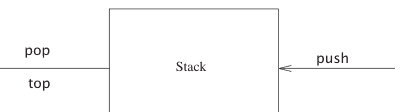

图 3.23 栈模型：向栈输入通过 push；输出通过 pop 和 top

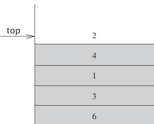

图 3.24 栈模型：只有栈顶元素可访问

#### 3.6.2 栈的实现

由于栈是一种列表，任何列表实现都可以。显然 `list` 和 `vector` 支持栈操作；99% 的时候它们是最合理的选择。偶尔设计专用实现可能更快。由于栈操作是常数时间操作，除非在非常特殊的情况下，否则不太可能带来任何可察觉的改进。

针对这些特殊情况，我们将介绍两种流行的栈实现。一种使用链式结构，另一种使用数组，两者都简化了 `vector` 和 `list` 中的逻辑，因此我们不提供代码。

##### 链表实现栈

栈的第一种实现使用单链表。我们通过在列表前端插入来执行 push。我们通过删除列表前端的元素来执行 pop。top 操作仅检查列表前端的元素并返回其值。有时 pop 和 top 操作会合并为一个。

##### 数组实现栈

另一种实现避免使用链接，可能是更流行的解决方案。它使用 `vector` 中的 `back`、`push_back` 和 `pop_back` 实现，因此实现非常简单。每个栈关联 `theArray` 和 `topOfStack`，对于空栈 `topOfStack` 为 -1（这是空栈的初始化方式）。要将某个元素 `x` 压入栈，我们先递增 `topOfStack`，然后设置 `theArray[topOfStack] = x`。要执行 pop，我们将返回值设置为 `theArray[topOfStack]`，然后递减 `topOfStack`。

请注意，这些操作不仅在常数时间内完成，而且是非常快速的常数时间。在某些机器上，`pushes` 和 `pops`（针对整数）可以写成一条机器指令，对带有自增和自减寻址的寄存器进行操作。大多数现代机器将栈操作作为指令集的一部分，这一事实强化了这样一个观点：栈可能是计算机科学中仅次于数组的最基本数据结构。

#### 3.6.3 应用

如果限制列表上允许的操作，那些操作可以非常快速地执行，这不足为奇。然而，令人惊讶的是，剩下的少量操作如此强大和重要。我们介绍了栈的众多应用中的三个。第三个应用深入揭示了程序的组织方式。

##### 平衡符号

编译器会检查程序中的语法错误，但缺少一个符号（例如缺少花括号或注释起始符）经常会导致编译器输出一百行诊断信息而不指出真正的错误。

在这种情况下，一个有用的工具是检查一切是否平衡的程序。因此，每个右花括号、右方括号和右圆括号都必须与其左侧对应符号匹配。

序列 [()] 是合法的，但 [(] 是错误。显然，为这个编写一个庞大的程序不值得，但事实证明检查这些东西很容易。为简单起见，我们只检查圆括号、方括号和花括号的平衡，忽略出现的任何其他字符。

简单的算法使用栈，如下所示：

创建一个空栈。读取字符直到文件结束。如果字符是开放符号，将其压入栈。如果它是闭合符号且栈为空，则报告错误。否则，弹出栈。如果弹出的符号不是相应的开放符号，则报告错误。在文件结束时，如果栈不为空，则报告错误。

你应该能够说服自己这个算法是有效的。它显然是线性的，并且实际上只对输入进行一次遍历。因此它是在线的，而且相当快。可以做额外的工作来尝试决定在报告错误时该怎么做——例如识别可能的原因。

##### 后缀表达式

假设我们有一个袖珍计算器，想要计算购物行程的费用。为此，我们将一系列数字相加，并将结果乘以 1.06；这计算了添加本地销售税后的某些商品的购买价格。如果商品价格为 4.99、5.99 和 6.99，那么输入的自然方式是以下序列

4.99 + 5.99 + 6.99 * 1.06 =

取决于计算器，这会产生预期的答案 19.05 或科学答案 18.39。大多数简单的四功能计算器会给出第一个答案，但许多高级计算器知道乘法优先级高于加法。

另一方面，有些商品需要纳税，有些不需要，所以如果只有第一个和最后一个商品实际上需要纳税，那么序列

4.99 * 1.06 + 5.99 + 6.99 * 1.06 =

在科学计算器上会给出正确答案（18.69），在简单计算器上会给出错误答案（19.37）。科学计算器通常带有括号，因此我们可以通过加括号始终得到正确答案，但使用简单计算器时我们需要记住中间结果。

这个示例的典型求值序列可能是将 4.99 和 1.06 相乘，将此答案保存为 A1。然后我们将 5.99 和 A1 相加，将结果保存在 A1。我们将 6.99 和 1.06 相乘，将答案保存在 A2，最后将 A1 和 A2 相加，将最终答案留在 A1。我们可以将这一系列操作写成如下：

4.99 1.06 * 5.99 + 6.99 1.06 * +

这种表示法称为后缀表示法，或逆波兰表示法，其求值方式与我们上面描述的完全相同。做到这一点的最简单方法是使用栈。当看到一个数字时，将其压入栈；当看到一个运算符时，将运算符应用于从栈中弹出的两个数字（符号），并将结果压入栈。例如，后缀表达式

```
6 5 2 3 + 8 + 3 + *
```

求值过程如下：

将前四个符号放入栈中。得到的栈是

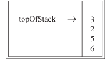

接下来读取一个 ‘+’，因此从栈中弹出 3 和 2，并将它们的和 5 压入栈。

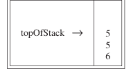

接下来，8 被压入栈。

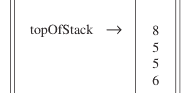

现在看到一个 ‘*’，因此弹出 8 和 5，并将 5 * 8 = 40 压入栈。

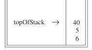

接下来看到一个 ‘+’，因此弹出 40 和 5，并将 5 + 40 = 45 压入栈。

| topOfStack -> | 45 |
|---|---|
| | 6 |

现在，3 被压入栈。

| topOfStack -> | 3 |
|---|---|
| | 45 |
| | 6 |

接下来，‘+’ 弹出 3 和 45 并压入 45 + 3 = 48。

| topOfStack -> | 48 |
|---|---|
| | 6 |

最后，看到一个 ‘*’，弹出 48 和 6；结果 6 * 48 = 288 被压入栈。

| topOfStack -> | 288 |
|---|---|

求值后缀表达式的时间为 O(N)，因为处理输入中的每个元素都包含栈操作，因此需要常数时间。执行此操作的算法非常简单。请注意，当表达式以后缀表示法给出时，不需要知道任何优先级规则；这是一个明显的优势。


#### 中缀到后缀转换

不仅可以使用栈来计算后缀表达式，还可以使用栈将标准形式（即**中缀**）的表达式转换为后缀表达式。我们将通过允许运算符 *、+、(、) 并坚持通常的优先级规则，专注于一般问题的一个小版本。我们还将假设表达式是合法的。假设我们要将中缀表达式

```
a + b * c + ( d * e + f ) * g
```

翻译为后缀表达式。正确答案是 `a b c * d e * f + + g * +`。

当读取操作数时，它会立即放置到输出中。运算符不会立即输出，因此必须将其保存在某个位置。正确的做法是将已看到但尚未放置到输出的运算符放入栈中。遇到左括号时，我们也会将其入栈。我们从一个最初为空的栈开始。

如果看到右括号，则弹出栈并输出符号，直到遇到（对应的）左括号，该左括号被弹出但不输出。

如果看到任何其他符号（*、+、(、)），则从栈中弹出条目，直到找到优先级较低的条目。一个例外是，除非处理 )，否则我们永远不会从栈中移除 (。就此操作而言，+ 具有最低优先级（以及最高优先级）。弹出完成后，我们将运算符压入栈中。

该算法的思想是，当看到运算符时，将其放入栈中。栈表示待处理的运算符。但是，栈中某些优先级较高的运算符现在已知为已完成，应当被弹出，因为它们不再是待处理的。因此，在将运算符放入栈之前，栈中且应在当前运算符之前完成的运算符会被弹出。下表对此进行了说明：

| 表达式 | 处理第三个运算符时的栈 | 动作 |
| :--- | :--- | :--- |
| a*b+c*d | - | - 已完成；* 入栈 |
| a/b*c*d | + | 没有完成任何内容；* 入栈 |
| a-b*c/d | - * | * 已完成；/ 入栈 |
| a-b*c+d | - * | * 和 - 已完成；* 入栈 |

括号只是增加了额外的复杂性。我们可以将左括号视为输入符号时的高优先级运算符（以便待处理运算符保持待处理状态）和栈上的低优先级运算符（以免被运算符意外移除）。右括号作为特殊情况处理。

要了解该算法的执行情况，我们将把上面的长中缀表达式转换为其后缀形式。首先读取符号 a，因此将其传递到输出。然后读取 + 并将其压入栈中。接着读取 b 并将其传递到输出。此时的状态如下：

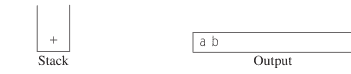

接着读取 *。运算符栈顶条目的优先级低于 *，因此没有输出，并将 * 放入栈中。接着读取 c 并将其输出。目前为止，我们有

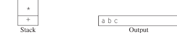

接下来读取的符号是 +。检查栈，我们发现会弹出一个 * 并将其放置到输出，弹出栈上的另一个 +（其优先级不低而是相等）；然后压入 +。

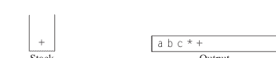

接下来读取的符号是 (。由于其优先级最高，因此将其放入栈中。然后读取 d 并将其输出。

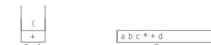

我们继续读取 *。由于除非正在处理右括号，否则左括号不会被移除，因此没有输出。接着读取 e 并将其输出。

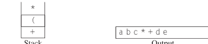

接下来读取的符号是 *。我们弹出并输出 *，然后压入 +。接着读取并输出 f。

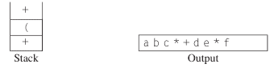

现在我们读取 )，因此栈被清空回到 (。我们输出 *。

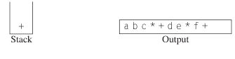

接着我们读取 *；它被压入栈中。然后读取 g 并将其输出。

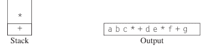

输入现在为空，因此我们从栈中弹出并输出符号，直到栈为空。

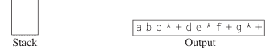

与之前一样，此转换仅需要 O(N) 时间，并且只需一次输入遍历即可完成。我们可以通过将减法和加法赋予相同优先级、乘法和除法赋予相同优先级，将减法和除法添加到此运算符集中。一个微妙之处是，表达式 a - b - c 将转换为 a b - c -，而不是 a c b - -。我们的算法做得正确，因为这些运算符从左到右结合。一般来说，情况不一定如此，因为指数运算从右到左结合。2³²³ = 256，而不是 4³ = 64。将指数运算添加到运算符集中的问题留作练习。

#### 函数调用

检查平衡符号的算法暗示了一种在编译型过程式和面向对象语言中实现函数调用的方法。这里的问题是，当对新函数进行调用时，系统需要保存调用例程的所有局部变量，否则新函数会覆盖调用例程变量所使用的内存。此外，必须保存例程中的当前位置，以便新函数在完成后知道去往何处。变量通常已由编译器分配给机器寄存器，并且必然会出现冲突（通常所有函数都会将一些变量分配给寄存器 #1），尤其是涉及递归时。此问题与平衡符号相似的原因是，函数调用和函数返回本质上与左括号和右括号相同，因此相同的思路应该适用。

当发生函数调用时，所有需要保存的重要信息（例如寄存器值（对应变量名）和返回地址（可从程序计数器获取，通常位于寄存器中））会以抽象方式保存“在一张纸上”，并放在堆栈顶部。然后将控制权转移到新函数，新函数可以自由地用其值替换寄存器。如果它进行其他函数调用，则遵循相同的过程。当函数想要返回时，它会查看堆栈顶部的“纸张”并恢复所有寄存器。然后执行返回跳转。

显然，所有这些工作都可以使用栈来完成，这正是几乎所有实现递归的编程语言中发生的情况。保存的信息称为激活记录或栈帧。通常会做一点调整：当前环境在栈顶表示。因此，返回会给出前一个环境（无需复制）。真实计算机中的栈通常从内存分区的高端向下增长，在许多系统中没有溢出检查。总有可能因为同时活跃的函数过多而耗尽栈空间。不用说，耗尽栈空间始终是致命错误。

在不检查栈溢出的语言和系统中，程序会在没有明确说明的情况下崩溃。在正常情况下，你不应该耗尽栈空间；这样做通常是失控递归（忘记基本情况）的迹象。另一方面，一些完全合法且看似无害的程序可能导致你耗尽栈空间。图 3.25 中打印容器的例程完全合法且实际上正确。它正确处理了空容器的基本情况，递归也没问题。可以证明该程序是正确的。不幸的是，如果容器

```
1 /**
2  * Print container from start up to but not including end.
3  *
4  template <typename Iterator>
5  void print( Iterator start, Iterator end, ostream & out = cout )
6  {
7     if( start == end )
8        return;
9
10     out << *start++ << endl; // Print and advance start
11     print( start, end, out );
12 }
```

##### 图 3.25 递归的不当用法：打印容器


```
1 /**
2  * Print container from start up to but not including end.
3  */
4
5 template <typename Iterator>
6 void print( Iterator start, Iterator end, ostream & out = cout )
7 {
8     while( true )
9     {
10       if( start == end )
11          return;
12
13       out << *start++ << endl; // Print and advance start
14    }
```

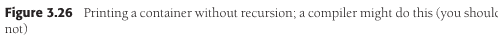

包含 200,000 个元素需要打印，将会有 200,000 个表示行 11 嵌套调用的活动记录栈。活动记录通常很大，因为它们包含的所有信息，因此该程序可能会耗尽栈空间。（如果 200,000 个元素不足以导致程序崩溃，请将数字替换为更大的数。）

此程序是递归极其糟糕用法的示例，称为**尾递归**。尾递归是指位于最后一行的递归调用。可以通过将函数体包装在 `while` 循环中，并用每个函数参数的一次赋值替换递归调用，从而机械地消除尾递归。这模拟了递归调用，因为不需要保存任何内容；递归调用完成后，实际上不需要知道保存的值。因此，我们可以直接使用本应在递归调用中使用的值，回到函数顶部。图 3.26 中的函数展示了该算法生成的机械改进版本。消除尾递归非常简单，以至于一些编译器会自动完成。即便如此，最好也不要发现你的编译器不这样做。

递归始终可以完全消除（编译器在转换为汇编语言时会这样做），但这样做可能非常繁琐。一般策略需要使用栈，只有当你能将栈上的内容减少到最少时才值得这么做。我们不再赘述此点，只需指出，尽管非递归程序当然通常比等效的递归程序更快，但速度优势很少能证明因消除递归而导致的清晰度不足是合理的。

### 3.7 队列 ADT

与栈类似，**队列**是列表。但是，对于队列，插入在一端进行，而删除在另一端进行。

#### 3.7.1 队列模型

队列的基本操作是入队，它在列表末尾（称为队尾）插入一个元素，以及出队，它删除（并返回）列表开头（称为队首）的元素。图 3.27 显示了队列的抽象模型。

#### 3.7.2 队列的数组实现

与栈类似，任何列表实现对队列都是合法的。与栈类似，链表和数组实现都为每个操作提供快速的 O(1) 运行时间。链表实现很简单，留作练习。我们现在将讨论队列的数组实现。

对于每个队列数据结构，我们维护一个名为 theArray 的数组，以及表示队列两端的位置 front 和 back。我们还跟踪实际在队列中的元素数量 currentSize。下表显示了队列的某个中间状态。

| | | 5 | 2 | 7 | 1 | | |
| | | 队首 | | 队尾 | | |

操作应该很清楚。要入队一个元素 x，我们递增 currentSize 和 back，然后设置 theArray[back] = x。要出队一个元素，我们将返回值设置为 theArray[front]，递减 currentSize，然后递增 front。还有其他策略（稍后讨论）。我们将稍后评论错误检查。

此实现存在一个潜在问题。在 10 次入队后，队列看起来已满，因为 back 现在位于数组的最后一个索引，而下一次入队将位于不存在的位置。然而，队列中可能只有少量元素，因为几个元素可能已经被出队。与栈类似，即使有大量操作，队列也经常保持较小。

简单的解决方案是，每当 front 或 back 到达数组末尾时，它就会绕回到开头。下表显示了队列在某些操作期间的状态。这被称为循环数组实现。

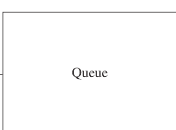

图 3.27 队列模型

初始状态

| | | | | | | | 2 | 4 |
|---|---|---|---|---|---|---|---|---|---|
| | | | | | | | ↑ | ↑ |
| | | | | | | | 队首 | 队尾 |

执行入队(1) 后

| 1 | | | | | | | | | 4 |
|---|---|---|---|---|---|---|---|---|---|
| ↑ | | | | | | | | | ↑ |
| 队尾 | | | | | | | | | 队首 |

执行入队(3) 后

| 1 | 3 | | | | | | | 2 | 4 |
|---|---|---|---|---|---|---|---|---|---|
| | ↑ | | | | | | | | ↑ |
| | 队尾 | | | | | | | | 队首 |

执行出队（返回 2）后

| 1 | 3 | | | | | | | 2 | 4 |
|---|---|---|---|---|---|---|---|---|---|
| | ↑ | | | | | | | | ↑ |
| | 队尾 | | | | | | | | 队首 |

执行出队（返回 4）后

| 1 | 3 | | | | | | | 2 | 4 |
|---|---|---|---|---|---|---|---|---|---|
| ↑ | ↑ | | | | | | | |
| 队首 | 队尾 | | | | | | | |

执行出队（返回 1）后

| 1 | 3 | | | | | | | 2 | 4 |
|---|---|---|---|---|---|---|---|---|---|
| | ↑ | | | | | | | |
| | 队尾 | | | | | | | |
| | 队首 | | | | | | | |

执行出队（返回 3 并使队列为空）后

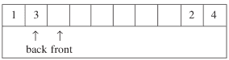

实现环绕所需的额外代码很少（尽管它可能会使运行时间加倍）。如果递增 back 或 front 导致其超过数组范围，则该值将重置为数组中的第一个位置。

一些程序员使用不同的方式来表示队列的队首和队尾。例如，有些人不使用条目来跟踪大小，因为他们依赖于这样的基本情况：当队列为空时，back = front-1。大小是通过比较 back 和 front 隐式计算的。这是一种非常棘手的方法，因为存在一些特殊情况，因此如果您需要修改以这种方式编写的代码，请务必小心。如果 currentSize 未作为显式数据成员维护，那么当队列中有 theArray.capacity()-1 个元素时，队列就是满的，因为只能区分 theArray.capacity() 种不同的大小，而其中一种是 0。选择您喜欢的任何样式，并确保所有例程都保持一致。由于实现有几种选择，如果您不使用 currentSize 数据成员，则在代码中添加一两条注释可能是值得的。

在确定入队次数不会超过队列容量的应用程序中，不需要环绕。与栈类似，除非调用例程确定队列不为空，否则很少执行出队。因此，除关键代码外，此操作的错误检查经常被跳过。这通常是不可辩护的，因为您可能实现的时间节省很小。

#### 3.7.3 队列的应用

许多算法使用队列来实现高效的运行时间。其中几种出现在图论中，我们将在第 9 章讨论它们。目前，我们将给出一些队列使用的简单示例。

当作业提交给打印机时，它们按到达顺序排列。因此，本质上发送到打印机的作业被放置在队列中。1

几乎每条现实生活中的排队（应该是）队列。例如，售票柜台的排队是队列，因为服务是先到先得。

另一个例子涉及计算机网络。有许多个人计算机的网络设置，其中磁盘连接到一台称为文件服务器的机器上。其他机器上的用户按先到先得的方式访问文件，因此该数据结构是队列。

进一步的示例包括：

- 当所有接线员都忙时，拨打大公司的电话通常会被放置在队列中。
- 在资源有限的大型大学中，如果所有计算机都被占用，学生必须登记等候名单。在计算机前待时间最长的学生将被首先强制下机，等待时间最长的学生将是下一个获准使用的用户。

称为**排队论**的数学整个分支致力于概率地计算用户预计在排队中等待的时间、队列有多长以及其他此类问题。答案取决于用户到达排队的频率以及处理一个用户（一旦用户被服务）需要多长时间。这两个参数都以概率分布函数给出。在简单情况下，答案可以解析计算。一个容易的例子是只有一名接线员的电话线。如果接线员忙，来电者会被放置在等待线上（最多达到某个限制）。这个问题对企业很重要，因为研究表明，人们会迅速挂断电话。

如果有 $k$ 名接线员，那么这个问题就难以解决得多。难以解析求解的问题通常通过模拟来解决。在我们的情况中，我们需要使用队列来执行模拟。如果 $k$ 很大，我们还需要其他数据结构来高效地完成此操作。我们将在第 6 章了解如何进行此模拟。然后，我们可以针对多个 $k$ 值运行模拟，并选择能提供合理等待时间的最小 $k$。

队列的其他用途数不胜数，与栈一样，如此简单的数据结构能如此重要，这令人惊叹。

### 摘要

本章描述了 ADT 的概念，并用三种最常见的抽象数据类型来说明该概念。主要目标是将 ADT 的实现与其功能分离。程序必须知道操作做什么，但实际上最好不知道它是如何完成的。

列表、栈和队列可能是计算机科学中三种基本的数据结构，它们的用法通过大量示例得到记录。特别是，我们了解了栈如何用于跟踪函数调用以及递归是如何实际实现的。理解这一点很重要，不仅因为它使过程式语言成为可能，而且因为了解递归的实现方式消除了围绕其使用的许多神秘感。尽管递归非常强大，但它并非完全免费的操作；滥用和误用递归可能导致程序崩溃。

### 练习

- 3.1 给定一个列表 L 和另一个包含按升序排列的整数的列表 P。操作 `printLots(L, P)` 将打印 L 中位置由 P 指定的元素。例如，如果 P = 1, 3, 4, 6，则打印 L 中位置 1、3、4 和 6 的元素。编写过程 `printLots(L, P)`。您只能使用公共 STL 容器操作。您的过程的运行时间是多少？


### 3.2 仅通过调整链接（而非数据）交换两个相邻元素，使用 a. 单链表 b. 双链表

### 3.3 实现 STL find 例程，该例程返回迭代器，指向从 start 开始且不包括 end 的范围内 x 的第一次出现。如果未找到 x，则返回 end。这是一个非 const（全局）函数，签名如下

```
template <typename Iterator, typename Object>
Iterator find( Iterator start, Iterator end, const Object & x );
```

### 3.4 给定两个已排序列表 L1 和 L2，编写一个过程，仅使用基本列表操作来计算 L1 与 L2 的交集。

### 3.5 给定两个已排序列表 L1 和 L2，编写一个过程，仅使用基本列表操作来计算 L1 与 L2 的并集。

### 3.6 约瑟夫问题是如下游戏：N 个人，编号 1 到 N，围坐成一圈。从第 1 个人开始，传递一个烫手山芋。传递 M 次后，持有烫手山芋的人被淘汰，圆圈闭合，游戏由被淘汰者之后坐着的人拿起烫手山芋继续进行。最后剩下的人获胜。因此，如果 M = 0 且 N = 5，玩家按顺序被淘汰，玩家 5 获胜。如果 M = 1 且 N = 5，淘汰顺序为 2、4、1、5。

- a. 编写一个程序来求解一般 M 和 N 值的约瑟夫问题。尽可能使程序高效。确保释放节点。
- b. 你的程序的运行时间是多少？
- c. 如果 M = 1，你的程序的运行时间是多少？对于较大的 N 值（N > 100,000），删除例程如何影响实际速度？

### 3.7 修改 Vector 类，为索引添加边界检查。

### 3.8 向 Vector 类添加 insert 和 erase。

### 3.9 根据 C++ 标准，对 vector 调用 push_back、pop_back、insert 或 erase 会使所有查看该 vector 的迭代器失效（可能变为悬空）。为什么？

### 3.10 修改 Vector 类，通过将迭代器作为类类型而非指针变量来提供严格的迭代器检查。最难的部分是处理悬空迭代器，如练习 3.9 所述。

### 3.11 假设单链表使用头节点实现，但没有尾节点，并且仅维护一个指向头节点的指针。编写一个包含以下方法的类：

- a. 返回链表的大小
- b. 打印链表
- c. 测试值 x 是否包含在链表中
- d. 如果值 x 未包含在链表中，则添加值 x
- e. 如果值 x 包含在链表中，则删除值 x

### 3.12 重复练习 3.11，保持单链表的有序性。

### 3.13 为 List 迭代器类添加对 operator-> 的支持。

### 3.14 在 STL 迭代器中向前查看需要应用 operator++，而这会推进迭代器。在某些情况下，查看列表中的下一项而不推进到该位置可能更可取。编写具有声明 `const_iterator operator+( int k ) const;` 的成员函数，以便在一般情况下便于此操作。二元 operator+ 返回一个迭代器，对应当前位置之后 k 个位置。

### 3.15 向 List 类添加 splice 操作。方法声明 `void splice( iterator position, List<T>& lst );` 从 lst 中移除所有项目，将它们放置在 List *this 的 position 之前。lst 和 *this 必须是不同的列表。你的例程必须在常数时间内运行。

### 3.16 向 STL List 类实现添加反向迭代器。定义 reverse_iterator 和 const_reverse_iterator。添加 rbegin 和 rend 方法，以返回适当的反向迭代器，分别表示结束标记之前的位置和头节点的位置。反向迭代器在内部反转 ++ 和 -- 运算符的含义。你应该能够使用以下代码逆序打印列表 L：

```
List<Object>::reverse_iterator itr = L.rbegin( );
while ( itr != L.rend( ) )
    cout << *itr++ << endl;
```

### 3.17 修改 List 类，使用第 3.5 节末尾建议的思想来提供严格的迭代器检查。

### 3.18 当将 erase 方法应用于列表时，它会使引用已删除节点的任何迭代器失效。这样的迭代器称为悬空迭代器。描述一个高效算法，保证对悬空迭代器的任何操作都表现得好像迭代器的 current 为 nullptr。请注意，可能存在许多悬空迭代器。你必须解释需要重写哪些类才能实现你的算法。

### 3.19 重写 List 类，不使用头节点和尾节点，并描述该类与第 3.5 节提供的类之间的差异。

### 3.20 我们给出的删除策略的一种替代方案是使用惰性删除。要删除一个元素，我们只需将其标记为已删除（使用一个额外的位字段）。列表中已删除和未删除元素的数量作为数据结构的一部分保留。如果已删除元素的数量与未删除元素的数量相同，我们将遍历整个列表，对所有标记的节点执行标准删除算法。

- a. 列出惰性删除的优点和缺点。
- b. 编写例程，使用惰性删除实现标准链表操作。

### 3.21 编写一个程序，检查以下语言中的符号是否匹配：

- a. Pascal (begin, end, {, ], (, ))。
- b. C++ (/* */, /, [, ], {, })。
- * c. 解释如何打印出可能反映可能原因的错误消息。

### 3.22 编写一个程序来求值后缀表达式。

### 3.23 a. 编写一个程序，将包含 (, ), +, -, *, 和 / 的中缀表达式转换为后缀表达式。
- b. 将幂运算符添加到你的操作符集中。
- c. 编写一个程序，将后缀表达式转换为中缀表达式。

### 3.24 编写例程，仅使用一个数组实现两个栈。你的栈例程只有在数组的每个槽位都被使用时才应声明溢出。

### * 3.25
- * a. 提出一种数据结构，支持栈的 push 和 pop 操作以及第三个操作 findMin，该操作返回数据结构中的最小元素，所有操作均在 O(1) 最坏情况下完成。
- * b. 证明，如果添加第四个操作 deleteMin（查找并删除最小元素），那么至少有一个操作必须花费 Ω(log N) 时间。（这需要阅读第 7 章。）

### 3.26 展示如何在一个数组中实现三个栈。

### 3.27 如果第 2.4 节中用于计算斐波那契数的递归例程在 N = 50 时运行，栈空间可能会耗尽吗？为什么或为什么不？

### 3.28 双端队列是一个由项目列表组成的数据结构，支持以下操作：

- push(x)：在双端队列的前端插入项目 x。
- pop()：从双端队列中移除前端项目并返回它。
- inject(x)：在双端队列的后端插入项目 x。
- eject()：从双端队列中移除后端项目并返回它。

编写支持双端队列的例程，每个操作耗时 O(1)。

### 3.29 编写一个算法，仅使用常数额外空间逆序打印单链表。此说明意味着你不能使用递归，但可以假设你的算法是列表的成员函数。如果该例程是常量成员函数，可以编写这样的算法吗？

### 3.30 a. 编写自调整列表的数组实现。在自调整列表中，所有插入都在前端执行。自调整列表添加了一个 find 操作，当元素通过 find 被访问时，它会被移动到列表的前端，而不改变其他项目的相对顺序。
- b. 编写自调整列表的链表实现。
- * c. 假设每个元素有固定概率 pi 被访问。证明访问概率最高的元素预计会靠近前端。

### 3.31 使用无头节点或尾节点的单链表高效实现栈类。

### 3.32 使用无头节点或尾节点的单链表高效实现队列类。

### 3.33 使用循环数组高效实现队列类。你可以使用 vector（而非原始数组）作为底层数组结构。

### 3.34 如果从某个节点 p 开始，跟随足够数量的 next 链接会带回节点 p，则链表包含一个循环。p 不必是第一个节点


在列表中。假设给定一个包含 N 个节点的链表；然而，N 的值未知。

- a. 设计一个 O(N) 算法来确定列表是否包含环。你可以使用 O(N) 的额外空间。
- b. 重复部分 (a)，但仅使用 O(1) 的额外空间。（提示：使用两个迭代器，它们最初位于列表的开头，但以不同速度前进。）

3.35 实现队列的一种方法是使用循环链表，最后一项的 next 指针指向第一个节点。假设列表不包含头节点，并且我们最多可以维护一个指向列表中节点的迭代器。以下哪种表示可以在常数最坏情况下执行所有基本队列操作？证明你的答案。

- a. 维护一个对应列表中第一个项目的迭代器。
- b. 维护一个对应列表中最后一个项目的迭代器。

3.36 假设我们有一个指向单链表中某个节点的指针，该节点保证不是列表中的最后一个节点。我们没有任何其他节点的指针（除非通过链接访问）。描述一个 O(1) 算法，从链表中逻辑删除此类节点存储的值，同时保持链表的完整性。（提示：涉及下一个节点。）

3.37 假设单链表同时实现了头节点和尾节点。描述常数时间算法以

- a. 在迭代器给定的位置 p 之前插入项目 x
- b. 删除迭代器给定的位置 p 处存储的项目

## 树

对于大量输入，链表的线性访问时间是不可接受的。在本章中，我们将研究一种简单的数据结构，其大多数操作的平均运行时间为 O(log N)。我们还将概述对该数据结构的一种概念上简单的修改，以在最坏情况下保证上述时间界，并讨论第二种修改，它基本上为长指令序列中的每个操作提供 O(log N) 的运行时间。

我们所指的数据结构称为**二叉搜索树**。二叉搜索树是两个库集合类 set 和 map 的实现基础，这两个类在许多应用中被使用。树在计算机科学中是非常有用的抽象，因此我们将讨论它们在其他更通用应用中的使用。在本章中，我们将 ...

- 了解树如何用于实现几种流行操作系统的文件系统。
- 了解树如何用于求值算术表达式。
- 展示如何使用树来支持 O(log N) 平均时间的搜索操作，以及如何完善这些想法以获得 O(log N) 最坏情况界限。我们还将看到当数据存储在磁盘上时如何实现这些操作。
- 讨论并使用 set 和 map 类。

### 4.1 预备知识

**树**可以用多种方式定义。定义树的一种自然方式是递归地定义。树是节点的集合。该集合可以为空；否则，树由一个特殊的节点 r 组成，称为**根**，以及零个或多个非空（子）树 T1, T2, ..., Tk，每个子树的根都通过从 r 出发的有向**边**连接。

每个子树的根被称为 r 的**子节点**，r 是每个子树根的**父节点**。图 4.1 显示了使用递归定义的典型树。

从递归定义中，我们发现树是 N 个节点的集合，其中一个是根，还有 N - 1 条边。之所以有 N - 1 条边，是因为每条边将某个节点与其父节点连接，并且除了根以外的每个节点都有一个父节点（参见图 4.2）。

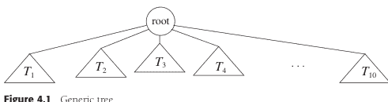

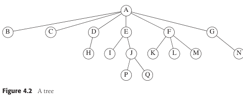

在图 4.2 的树中，根是 A。节点 F 的父节点是 A，子节点是 K、L 和 M。每个节点可以有任意数量的子节点，可能为零。没有子节点的节点称为**叶节点**；上述树中的叶节点是 B、C、H、I、P、Q、K、L、M 和 N。具有相同父节点的节点称为**兄弟节点**；因此，K、L 和 M 都是兄弟节点。祖父母和**孙节点**关系可以以类似的方式定义。

从节点 $n_1$ 到 $n_k$ 的路径定义为节点序列 $n_1, n_2, ..., n_k$，使得对于 $1 \le i < k$，$n_i$ 是 $n_{i+1}$ 的父节点。该路径的**长度**是路径上的边数，即 $k - 1$。从每个节点到其自身存在长度为零的路径。请注意，在树中，从根到每个节点都有且仅有一条路径。

对于任何节点 $n_i$，$n_i$ 的**深度**是从根到 $n_i$ 的唯一路径的长度。因此，根的深度为 0。$n_i$ 的**高度**是从 $n_i$ 到叶节点的最长路径的长度。因此，所有叶节点的高度均为 0。树的高度等于根的高度。对于图 4.2 中的树，E 的深度为 1，高度为 2；F 的深度为 1，高度为 1；树的高度为 3。树的深度等于最深叶节点的深度；这始终等于树的高度。

如果存在从 $n_1$ 到 $n_2$ 的路径，则 $n_1$ 是 $n_2$ 的**祖先**，$n_2$ 是 $n_1$ 的**后代**。如果 $n_1 \neq n_2$，则 $n_1$ 是 $n_2$ 的**严格祖先**，$n_2$ 是 $n_1$ 的**严格后代**。

#### 4.1.1 树的实现

实现树的一种方法是在每个节点中，除了其数据外，还包含指向每个子节点的链接。然而，由于每个节点的子节点数量变化很大且事先未知，将子节点作为数据结构中的直接链接可能不可行，因为会浪费太多空间。解决方案很简单：将每个节点的子节点保存在树节点的链表中。图 4.3 中的声明是典型的。

```
struct TreeNode
{
   Object element;
   TreeNode *firstChild;
   TreeNode *nextSibling;
};
```

图 4.3 树的节点声明

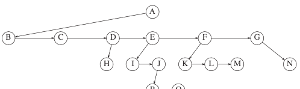

图 4.4 图 4.2 所示树的第一个子节点/下一个兄弟节点表示法

图 4.4 显示了在此实现中树可能的表示方式。向下指的水平箭头是 firstChild 链接。从左到右的箭头是 nextSibling 链接。空链接未绘制，因为太多。

在图 4.4 的树中，节点 E 既有指向兄弟节点（F）的链接，也有指向子节点（I）的链接，而有些节点两者都没有。

#### 4.1.2 带应用的树遍历

树有许多应用。一种流行的用途是许多常见操作系统（包括 unix 和 dos）中的目录结构。图 4.5 是 unix 文件系统中的一个典型目录。

此目录的根是 /usr。（名称旁边的星号表示 /usr 本身是一个目录）/usr 有三个子节点，mark、alex 和 bill，它们本身也是目录。因此，/usr 包含三个目录且没有常规文件。文件名 /usr/mark/book/ch1.r 是通过三次跟随最左侧子节点获得的。第一个 / 之后的每个 / 表示一条边；结果是完整路径名。这种分层文件系统非常流行，因为它允许用户逻辑地组织数据。此外，不同目录中的两个文件可以共享相同的名称，因为它们必须从根处有不同的路径，因此具有不同的路径名。unix 文件系统中的目录只是一个带有所有子节点列表的文件，因此目录的结构几乎完全符合

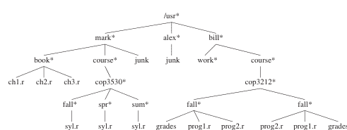

**图 4.5** Unix 目录

```
void FileSystem::listAll( int depth = 0 ) const
{
   printName( depth );    // Print the name of the object
   if( isDirectory( ) )
      for each file c in this directory ( for each child )
         c.listAll( depth + 1 );
}
```

**图 4.6** 在分层文件系统中列出目录的伪代码

假设我们想列出目录中所有文件的名称。我们的输出格式将是深度为 d 的文件的名称将缩进 d 个制表符。我们的算法在图 4.6 中以伪代码给出。

递归函数 listAll 需要以深度 0 启动，以表示根没有缩进。此深度是一个内部记账变量，几乎不是调用例程应该知道的参数。因此，为 depth 提供了默认值 0。

该算法的逻辑易于遵循。文件对象的名称将以适当数量的制表符打印出来。如果条目是目录，则我们逐个递归处理所有子节点。这些子节点深一层，因此需要额外缩进一个空格。输出在图 4.7 中。

这种遍历策略称为先序遍历。在先序遍历中，在处理子节点之前先执行节点上的工作。运行此程序时，很明显第 1 行每个节点恰好执行一次，因为每个名称只输出一次。由于第 1 行每个节点最多执行一次，第 2 行也必须每个节点执行一次

1 UNIX 文件系统中的每个目录还有一个指向自身的条目和一个指向目录父节点的条目。因此，从技术上讲，UNIX 文件系统不是树，而是类树结构。


```
/usr
    mark
        book
            ch1.r
            ch2.r
            ch3.r
        course
            cop3530
                fall
                    syl.r
                spr
                    syl.r
                sum
                    syl.r
            junk
    alex
        junk
    bill
        work
            course
                cop3212
                    fall
                        grades
                            prog1.r
                            prog2.r
                    fall
                        prog2.r
                        prog1.r
                        grades
```

**图 4.7** (前序) 目录列表

节点。此外，第 4 行对于每个节点的每个子节点最多执行一次。但子节点的数量正好比节点数量少 1。最后，for 循环在第 4 行每次执行时迭代一次，加上每次循环结束时各迭代一次。因此，每个节点的总工作量是常数。如果有 N 个文件名需要输出，则运行时间为 O(N)。

遍历树的另一种常用方法是后序遍历。在后序遍历中，对节点的工作在其子节点被求值之后（post）执行。例如，图 4.8 表示与之前相同的目录结构，括号中的数字表示每个文件占用的磁盘块数。

由于目录本身也是文件，它们也有大小。假设我们想要计算树中所有文件使用的块总数。最自然的方法是找到子目录 /usr/mark (30)、/usr/alex (9) 和 /usr/bill (32) 中包含的块数。则块总数是

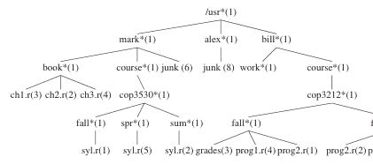

**图 4.8** 通过后序遍历获得文件大小的 Unix 目录

```
int FileSystem::size() const
{
    int totalSize = sizeOfThisFile( );

    if( isDirectory( ) )
        for each file c in this directory ( for each child )
            totalSize += c.size( );

    return totalSize;
}
```

**图 4.9** 计算目录大小的伪代码

子目录中的总数（71）加上 /usr 使用的一个块，总共 72 个块。图 4.9 中的伪代码方法 size 实现了此策略。

如果当前对象不是目录，则 size 仅返回它在当前对象中使用的块数。否则，目录使用的块数将加在所有子节点中（递归）找到的块数之上。要了解后序遍历策略与前序遍历策略之间的区别，图 4.10 显示了算法如何生成每个目录或文件的大小。

### 4.2 二叉树

二叉树是一种任何节点最多有两个子节点的树。

图 4.11 显示，二叉树由一个根和两个子树 $T_L$ 和 $T_R$ 组成，这两个子树都可能为空。

二叉树的一个有时很重要的性质是，平均二叉树的深度远小于 N。分析表明，平均深度为 $O(\sqrt{N})$，而对于一种特殊的二叉树，即 *二叉搜索树*，深度的平均值为 $O(\log N)$。不幸的是，深度可以大到 $N - 1$，如图 4.12 中的示例所示。

| 文件/目录 | 块数 |
|----------------|--------|
| ch1.r | 3 |
| ch2.r | 2 |
| ch3.r | 4 |
| book | 10 |
| syl.r | 1 |
| fall | 2 |
| syl.r | 5 |
| spr | 6 |
| syl.r | 2 |
| sum | 3 |
| cop3530 | 12 |
| course | 13 |
| junk | 6 |
| mark | 30 |
| junk | 8 |
| alex | 9 |
| work | 1 |
| grades | 3 |
| prog1.r | 4 |
| prog2.r | 1 |
| fall | 9 |
| prog2.r | 2 |
| prog1.r | 7 |
| grades | 9 |
| fall | 19 |
| cop3212 | 29 |
| course | 30 |
| bill | 32 |
| /usr | 72 |

**图 4.10** size 函数的跟踪

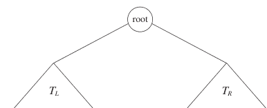

**图 4.11** 通用二叉树

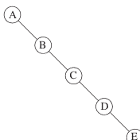

**图 4.12** 最坏情况二叉树

#### 4.2.1 实现

由于二叉树节点最多有两个子节点，我们可以保留指向它们的直接链接。树节点的声明在结构上与双向链表的声明相似，即一个节点是一个由元素信息加上两个指向其他节点的指针（左和右）组成的结构（参见图 4.13）。

我们可以使用链表惯用的矩形框来绘制二叉树，但树通常被绘制为由线连接的圆圈，因为它们实际上是图。在引用树时，我们也不显式绘制 nullPtr 链接，因为每个具有 N 个节点的二叉树都需要 N + 1 个 nullPtr 链接。

二叉树有许多与搜索无关的重要用途。二叉树的主要用途之一是在编译器设计领域，我们将现在探讨这一点。

#### 4.2.2 示例：表达式树

图 4.14 显示了一个表达式树的示例。表达式树的叶子是操作数，例如常量或变量名，而其他节点包含运算符。这个特定的树碰巧是二叉的，因为所有运算符都是二元的，虽然这是最简单的情况，但节点也有可能有超过两个子节点。节点也有可能只有一个子节点，就像一元减运算符的情况一样。我们可以通过将根处的运算符应用于递归求值得到的

```
struct BinaryNode
{
    Object      element;   // The data in the node
    BinaryNode *left;      // Left child
    BinaryNode *right;     // Right child
};
```

**图 4.13** 二叉树节点类（伪代码）

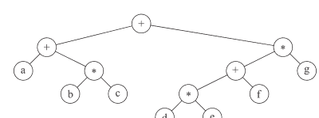

**图 4.14** 表达式树 (a + b * c) + ((d + e + f) * g)

左子树和右子树的值来求值表达式树 T。

在我们的示例中，左子树求值为 a + (b * c)，右子树求值为 ((d + e) * f) * g。因此，整棵树表示 (a + (b * c)) + (((d + e) + f) * g)。

我们可以通过递归生成带括号的左表达式，然后打印根处的运算符，最后递归生成带括号的右表达式，来生成一个（过度加括号的）中缀表达式。这种一般策略（左，节点，右）称为中序遍历；由于它生成的表达式类型，很容易记住。

另一种遍历策略是递归打印左子树、右子树，然后打印运算符。如果将此策略应用于上面的树，输出为 a b c * + d e f + + * g *，可以轻松看出这是第 3.6.3 节的后缀表示法。

这种遍历策略通常称为后序遍历。我们在第 4.1 节中之前见过这种遍历策略。

第三种遍历策略是先打印运算符，然后递归打印左子树和右子树。生成的表达式 ++ + a * b c * + * d e f g 是较不有用的前缀表示法，遍历策略是前序遍历，我们也在第 4.1 节中之前见过。我们将在本章后面再回到这些遍历策略。

##### 构建表达式树

我们现在给出一个将后缀表达式转换为表达式树的算法。由于我们已经有一个将中缀表达式转换为后缀表达式的算法，因此可以从两种常见的输入类型生成表达式树。我们描述的方法与第 3.6.3 节的后缀求值算法非常相似。我们一次读取表达式的一个符号。如果符号是操作数，我们创建一个单节点树并将指向它的指针压入栈中。如果符号是运算符，我们从栈中弹出两棵树 T1 和 T2 的（指针）（T1 先被弹出），并形成一棵新树，其根是运算符，其左子节点和右子节点分别指向 T2 和 T1。然后将指向这棵新树的指针压入栈中。

例如，假设输入为

```
a b + c d e + * *
```

前两个符号是操作数，因此我们创建单节点树并将指向它们的指针压入栈中。²

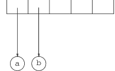

接下来，读取一个 +，因此弹出两个指向树的指针，形成一棵新树，并将指向它的指针压入栈中。

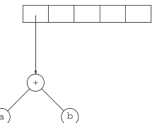

接下来，读取 c、d 和 e，对于每个符号，创建一个单节点树并将指向相应树的指针压入栈中。

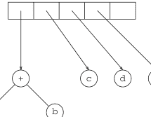

现在读取一个 +，因此合并两棵树。


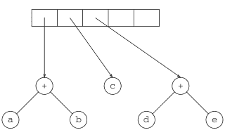

继续，读取一个 *，因此我们弹出两个树指针，并以 * 为根形成一棵新树。

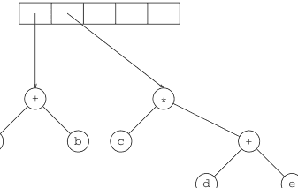

最后，读取最后一个符号，合并两棵树，并将指向最终树的指针留在栈上。

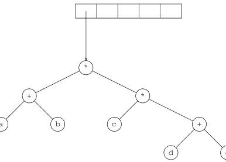

### 4.3 查找树 ADT—二叉搜索树

二叉树的一个重要应用是用于搜索。假设树中的每个节点都存储一个数据项。在我们的示例中，为简单起见，假设这些是整数，尽管在 C++ 中可以轻松处理任意复杂的数据项。我们还假设所有数据项都互不相同，稍后将处理重复项。

将二叉树变成二叉搜索树的属性是：对于树中的每个节点 X，其左子树中所有数据项的值都小于 X 中的数据项，其右子树中所有数据项的值都大于 X 中的数据项。请注意，这意味着树中的所有元素都可以以某种一致的方式排序。在图 4.15 中，左边的树是二叉搜索树，但右边的树不是。右边的树在数据项为 6 的节点的左子树中有一个数据项为 7 的节点（该节点恰好是根）。

我们现在简要描述通常在二叉搜索树上执行的操作。请注意，由于树的递归定义，通常以递归方式编写这些例程。由于二叉搜索树的平均深度为 O(log N)，我们通常不需要担心栈空间耗尽。

图 4.16 显示了 BinarySearchTree 类模板的接口。有几点值得注意。搜索基于必须为特定 Comparable 类型定义的 < 运算符。具体来说，如果 x<y 和 y<x 都为 false，则数据项 x 匹配 y。这允许 Comparable 是一个复杂类型（例如员工记录），其上仅在类型的一部分（例如社会安全号数据成员或薪水）上定义了比较函数。第 1.6.3 节说明了设计可用作 Comparable 的类的一般技术。第 4.3.1 节描述的另一种替代方案是允许函数对象。

数据成员是指向根节点的指针；对于空树，该指针为 nullptr。公共成员函数使用调用私有递归函数的一般技术。图 4.17 显示了如何对 contains、insert 和 remove 执行此操作的示例。

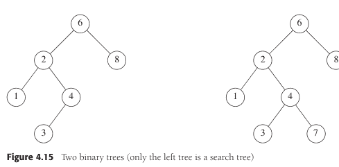

```cpp
template <typename Comparable>
class BinarySearchTree
{
public:
    BinarySearchTree( );
    BinarySearchTree( const BinarySearchTree & rhs );
    BinarySearchTree( BinarySearchTree && rhs );
    ~BinarySearchTree( );

    const Comparable & findMin( ) const;
    const Comparable & findMax( ) const;
    bool contains( const Comparable & x ) const;
    bool isEmpty( ) const;
    void printTree( ostream & out = cout ) const;

    void makeEmpty( );

    void insert( const Comparable & x );
    void insert( Comparable && x );
    void remove( const Comparable & x );

    BinarySearchTree & operator=( const BinarySearchTree & rhs );
    BinarySearchTree & operator=( BinarySearchTree && rhs );

private:

    struct BinaryNode
    {
        Comparable element;
        BinaryNode *left;
        BinaryNode *right;

        BinaryNode( const Comparable & theElement, BinaryNode *lt, BinaryNode *rt )
        : element{ theElement }, left{ lt }, right{ rt } { }

        BinaryNode( Comparable && theElement, BinaryNode *lt, BinaryNode *rt )
        : element{ std::move( theElement ) }, left{ lt }, right{ rt } { }

        BinaryNode *root;

        void insert( const Comparable & x, BinaryNode * & t );
        void insert( Comparable && x, BinaryNode * & t );
        void remove( const Comparable & x, BinaryNode * & t );
        BinaryNode * findMin( BinaryNode *t ) const;
        BinaryNode * findMax( BinaryNode *t ) const;
        bool contains( const Comparable & x, BinaryNode *t ) const;
        void makeEmpty( BinaryNode * & t );
        void printTree( BinaryNode *t, ostream & out ) const;
        BinaryNode * clone( BinaryNode *t ) const;
    };
};
```

图 4.16 二叉搜索树类框架

```cpp
/**
 * Returns true if x is found in the tree.
 *
bool contains( const Comparable & x ) const
{
    return contains( x, root );
}

/**
 * Insert x into the tree; duplicates are ignored.
 *
void insert( const Comparable & x )
{
    insert( x, root );
}

/**
 * Remove x from the tree. Nothing is done if x is not found.
 *
void remove( const Comparable & x )
{
    remove( x, root );
}
```

图 4.17 公共成员函数调用私有递归成员函数的示意图

几个私有成员函数使用通过引用传递指针变量的技术。这允许公共成员函数将指向根的指针传递给私有递归成员函数。然后递归函数可以更改根的值，使根指向另一个节点。我们将在检查 insert 的代码时更详细地描述该技术。我们现在可以描述一些私有方法。

#### 4.3.1 contains

该操作要求：如果树 T 中存在包含数据项 X 的节点，则返回 true；如果不存在这样的节点，则返回 false。树的结构使此操作变得简单。如果 T 为空，则可以直接返回 false。否则，如果 T 中存储的数据项是 X，则可以返回 true。否则，我们对 T 的某个子树（左子树或右子树）进行递归调用，具体取决于 X 与 T 中存储的数据项之间的关系。图 4.18 中的代码是此策略的实现。

```cpp
/**
 * Internal method to test if an item is in a subtree.
 * x is item to search for.
 * t is the node that roots the subtree.
 */
bool contains( const Comparable & x, BinaryNode * t ) const
{
    if( t == nullptr )
        return false;
    else if( x < t->element )
        return contains( x, t->left );
    else if( t->element < x )
        return contains( x, t->right );
    else
        return true;    // Match
}
```

图 4.18 二叉搜索树的 contains 操作

请注意测试的顺序。首先执行空树测试至关重要，因为否则，我们将尝试通过 nullptr 指针访问数据成员而产生运行时错误。其余测试按最不可能的情况排在最后。还要注意，两个递归调用实际上都是尾递归，可以使用 while 循环轻松消除。在这里使用尾递归是合理的，因为算法表达的简单性补偿了速度的下降，并且预计使用的栈空间仅为 O(log N)。

图 4.19 显示了使用函数对象而非要求数据项为 Comparable 所需的微小更改。这模仿了第 1.6.4 节中的惯用法。

#### 4.3.2 findMin 和 findMax

这些私有例程分别返回指向包含树中最小和最大元素的节点的指针。要执行 findMin，从根开始，只要有左子节点就向左走。停止点是最小元素。findMax 例程相同，只是分支指向右子节点。

许多程序员不愿使用递归。我们将以两种方式编写这些例程：findMin 采用递归，findMax 采用非递归（参见图 4.20 和 4.21）。

请注意我们如何小心处理空树的退化情况。虽然这始终很重要，但在递归程序中尤其关键。还要注意，在 findMin 中更改 t 是安全的，因为我们只使用指针的副本。但是，始终要极其小心，因为类似 t->right = t->right->right 的语句会进行更改。

```cpp
template <typename Object, typename Comparator=less<Object>>
class BinarySearchTree
{
  public:
  // Same methods, with Object replacing Comparable
  private:
    BinaryNode *root;
    Comparator isLessThan;
  // Same methods, with Object replacing Comparable
  /**
   *
   * Internal method to test if an item is in a subtree.
   * x is item to search for.
   * t is the node that roots the subtree.
   */
  bool contains( const Object & x, BinaryNode *t ) const
  {
    if( t == nullptr )
      return false;
    else if( isLessThan( x, t->element ) )
      return contains( x, t->left );
    else if( isLessThan( t->element, x ) )
      return contains( x, t->right );
    else
      return true; // Match
  }
};
```

图 4.19 说明使用函数对象实现二叉搜索树

#### 4.3.3 insert

插入例程在概念上很简单。要将 X 插入树 T，请像执行 contains 一样沿树向下遍历。如果找到了 X，则不执行任何操作。否则，在遍历路径的最后位置插入 X。图 4.22 显示了发生的情况。要插入 5，我们像执行 contains 一样遍历树。在数据项为 4 的节点处，我们需要向右走，但没有子树，因此 5 不在树中，而这是放置 5 的正确位置。可以通过在节点记录中保存一个指示出现频率的额外字段来处理重复项。这会为整个树增加一些额外空间，但比将重复项放入树中（往往会使树变得非常深）要好。当然，


/**
 * Internal method to find the smallest item in a subtree t.
 * Return node containing the smallest item.
 */
BinaryNode * findMin( BinaryNode *t ) const
{
    if( t == nullptr )
        return nullptr;
    if( t->left == nullptr )
        return t;
    return findMin( t->left );
}

图 4.20 二叉查找树中 findMin 的递归实现

/**
 * Internal method to find the largest item in a subtree t.
 * Return node containing the largest item.
 */
BinaryNode * findMax( BinaryNode *t ) const
{
    if( t != nullptr )
        while( t->right != nullptr )
            t = t->right;
    return t;
}

图 4.21 二叉查找树中 findMax 的非递归实现

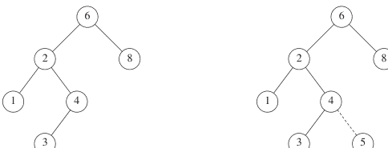

图 4.22 插入 5 前后的二叉查找树

this strategy does not work if the key that guides the < operator is only part of a larger structure. If that is the case, then we can keep all of the structures that have the same key in an auxiliary data structure, such as a list or another search tree.

Figure 4.23 shows the code for the insertion routine. Lines 12 and 14 recursively insert and attach x into the appropriate subtree. Notice that in the recursive routine, the only time that t changes is when a new leaf is created. When this happens, it means that the recursive routine has been called from some other node, p, which is to be the leaf's parent. The call

```
1 /**
2 * Internal method to insert into a subtree.
3 * x is the item to insert.
4 * t is the node that roots the subtree.
5 * Set the new root of the subtree.
6 */
7 void insert( const Comparable & x, BinaryNode * & t )
8 {
9   if( t == nullptr )
10     t = new BinaryNode{ x, nullptr, nullptr };
11   else if( x < t->element )
12     insert( x, t->left );
13   else if( t->element < x )
14     insert( x, t->right );
15   else
16     ; // Duplicate; do nothing
17 }
18
19 /**
20 * Internal method to insert into a subtree.
21 * x is the item to insert by moving.
22 * t is the node that roots the subtree.
23 * Set the new root of the subtree.
24 */
25 void insert( Comparable && x, BinaryNode * & t )
26 {
27   if( t == nullptr )
28     t = new BinaryNode{ std::move( x ), nullptr, nullptr };
29   else if( x < t->element )
30     insert( std::move( x ), t->left );
31   else if( t->element < x )
32     insert( std::move( x ), t->right );
33   else
34     ; // Duplicate; do nothing
35 }
```

图 4.23 向二叉查找树中插入

will be insert(x, p->left) or insert(x, p->right). Either way, t is now a reference to either p->left or p->right, meaning that p->left or p->right will be changed to point at the new node. All in all, a slick maneuver.

#### 4.3.4 remove

As is common with many data structures, the hardest operation is deletion. Once we have found the node to be deleted, we need to consider several possibilities.

If the node is a leaf, it can be deleted immediately. If the node has one child, the node can be deleted after its parent adjusts a link to bypass the node (we will draw the link directions explicitly for clarity). See Figure 4.24.

The complicated case deals with a node with two children. The general strategy is to replace the data of this node with the smallest data of the right subtree (which is easily found) and recursively delete that node (which is now empty). Because the smallest node in the right subtree cannot have a left child, the second remove is an easy one. Figure 4.25 shows an initial tree and the result of a deletion. The node to be deleted is the left child of the root, the key value is 2. It is replaced with the smallest data in its right subtree (3), and then that node is deleted as before.

The code in Figure 4.26 performs deletion. It is inefficient because it makes two passes down the tree to find and delete the smallest node in the right subtree when this is appropriate. It is easy to remove this inefficiency by writing a special removeMin method, and we have left it in only for simplicity.

If the number of deletions is expected to be small, then a popular strategy to use is lazy deletion: When an element is to be deleted, it is left in the tree and merely marked as being deleted. This is especially popular if duplicate items are present, because then the data member that keeps count of the frequency of appearance can be decremented. If the number of real nodes in the tree is the same as the number of “deleted” nodes, then the depth of the tree is only expected to go up by a small constant (why?), so there is a very small time penalty associated with lazy deletion. Also, if a deleted item is reinserted, the overhead of allocating a new cell is avoided.

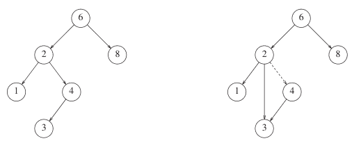

Figure 4.24 Deletion of a node (4) with one child, before and after

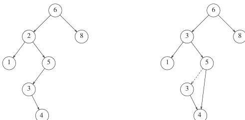

Figure 4.25 Deletion of a node (2) with two children, before and after

/**
 * Internal method to remove from a subtree.
 * x is the item to remove.
 * t is the node that roots the subtree.
 * Set the new root of the subtree.
 */
void remove( const Comparable & x, BinaryNode * & t )
{
    if( t == nullptr )
        return; // Item not found; do nothing
    else if( x < t->element )
        remove( x, t->left );
    else if( t->element < x )
        remove( x, t->right );
    else if( t->left != nullptr && t->right != nullptr ) // Two children
    {
        t->element = findMin( t->right )->element;
        remove( t->element, t->right );
    }
    else
    {
        BinaryNode *oldNode = t;
        t = ( t->left != nullptr ) ? t->left : t->right;
        delete oldNode;
    }
}

Figure 4.26 Deletion routine for binary search trees

#### 4.3.5 Destructor and Copy Constructor

As usual, the destructor calls makeEmpty. The public makeEmpty (not shown) simply calls the private recursive version. As shown in Figure 4.27, after recursively processing t's children, a call to delete is made for t. Thus all nodes are recursively reclaimed. Notice that at the end, t, and thus root, is changed to point at nullptr. The copy constructor, shown in Figure 4.28, follows the usual procedure, first initializing root to nullptr and then making a copy of rhs. We use a very slick recursive function named clone to do all the dirty work.

#### 4.3.6 Average-Case Analysis

Intuitively, we expect that all of the operations described in this section, except makeEmpty and copying, should take O(log N) time, because in constant time we descend a level in the tree, thus operating on a tree that is now roughly half as large. Indeed, the running time of all the operations (except makeEmpty and copying) is O(d), where d is the depth of the node containing the accessed item (in the case of remove, this may be the replacement node in the two-child case).

We prove in this section that the average depth over all nodes in a tree is O(log N) on the assumption that all insertion sequences are equally likely.

The sum of the depths of all nodes in a tree is known as the internal path length. We will now calculate the average internal path length of a binary search tree, where the average is taken over all possible insertion sequences into binary search trees.

```
1 /**
2 * Destructor for the tree
3 *
4 *~BinarySearchTree( )
5 {
6 makeEmpty( );
7 }
8 /**
9 * Internal method to make subtree empty.
10 *
11 void makeEmpty( BinaryNode * & t )
12 {
13 if( t != nullptr )
14 {
15 makeEmpty( t->left );
16 makeEmpty( t->right );
17 delete t;
18 }
19 t = nullptr;
20 }
```

Figure 4.27 Destructor and recursive makeEmpty member function

```
1 /**
2  * Copy constructor
3  */
4 BinarySearchTree( const BinarySearchTree & rhs ) : root( nullptr )
5 {
6     root = clone( rhs.root );
7 }
8
9 /**
10  * Internal method to clone subtree.
11  */
12 BinaryNode * clone( BinaryNode * t ) const
13 {
14     if( t == nullptr )
15         return nullptr;
16     else
17         return new BinaryNode{ t->element, clone( t->left ), clone( t->right ) };
18 }
```

Figure 4.28 Copy constructor and recursive clone member function

Let $D(N)$ be the internal path length for some tree $T$ of $N$ nodes. $D(1) = 0$. An $N$-node tree consists of an $i$-node left subtree and an $(N - i - 1)$-node right subtree, plus a root at depth zero for $0 \le i < N$. $D(i)$ is the internal path length of the left subtree with respect to its root. In the main tree, all these nodes are one level deeper. The same holds for the right subtree. Thus, we get the recurrence

$D(N) = D(i) + D(N - i - 1) + N - 1$

If all subtree sizes are equally likely, which is true for binary search trees (since the subtree size depends only on the relative rank of the first element inserted into the tree), but not binary trees, then the average value of both $D(i)$ and $D(N - i - 1)$ is $(1/N) \sum_{j=0}^{N-1} D(j)$. This yields

$D(N) = \frac{2}{N} \left[ \sum_{j=0}^{N-1} D(j) \right] + N - 1$

This recurrence will be encountered and solved in Chapter 7, obtaining an average value of $D(N) = O(N \log N)$. Thus, the expected depth of any node is $O(\log N)$. As an example, the randomly generated 500-node tree shown in Figure 4.29 has nodes at expected depth 9.98.

It is tempting to say immediately that this result implies that the average running time of all the operations discussed in the previous section is $O(\log N)$, but this is not entirely true. The reason for this is that because of deletions, it is not clear that all binary search trees are equally likely. In particular, the deletion algorithm described above favors making the left subtrees deeper than the right, because we are always replacing a deleted node with a node from the right subtree. The exact effect of this strategy is still unknown, but


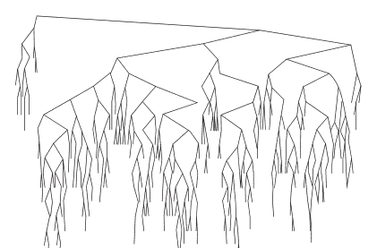

**Figure 4.29** 随机生成的二叉查找树

这似乎只是一个理论上的新奇事物。已证明，如果我们交替进行插入和删除 \(\Theta(N^2)\) 次，则树的预期深度为 \(\Theta(\sqrt{N})\)。在进行了二十五万对随机插入/删除操作后，图 4.29 中原本有些右倾的树在图 4.30 中看起来明显不平衡（平均深度 = 12.51）。我们可以尝试通过在替换被删除元素时，随机选择右子树中最小的元素和左子树中最大的元素来消除这个问题。这显然消除了偏差，应该能保持树的平衡，但尚无人实际证明这一点。无论如何，这种现象似乎大多只是一个理论上的新奇事物，因为这种效应在小树上完全不显现，而且更奇怪的是，如果使用 \(o(N^2)\) 对插入/删除操作，则树似乎会变得更加平衡！

此次讨论的主要观点是，确定“平均”含义通常极其困难，并可能需要一些未必有效的假设。在没有删除操作，或使用惰性删除时，我们可以得出上述操作的平均运行时间为 \(O(\log N)\)。除了像上面讨论过的这种奇怪情况之外，这一结果与观察到的行为非常一致。

如果输入的数据已经有序地插入树中，那么一系列插入操作将花费平方时间，并得到一个非常昂贵的链表实现，因为树将仅由没有左子节点的节点组成。解决这个问题的一个方法是坚持一个称为平衡的额外结构条件：不允许任何节点太深。

实现平衡树的通用算法有相当多。大多数比标准二叉查找树复杂得多，并且所有算法在更新时平均耗时更长。然而，它们确实能防止那些尴尬地简单的情况。下面，我们将勾勒出最古老的平衡查找树形式之一，即 AVL 树。

第二种方法是放弃平衡条件，允许树任意深，但在每次操作后应用一条重构规则，该规则倾向于使未来的操作更高效。这类数据结构通常被归类为自调整型。

对于二叉查找树，我们无法再保证任何单次操作的 \(O(N \log N)\) 上界，但可以证明任何 \(M\) 次操作的序列在最坏情况下总耗时为 \(O(M \log N)\)。这通常足以防范糟糕的最坏情况。我们将讨论的数据结构称为伸展树；其分析相当复杂，并在第 11 章中讨论。

### 4.4 AVL 树

AVL（Adelson-Velskii 和 Landis）树是一种带有**平衡条件**的二叉查找树。平衡条件必须易于维护，并且它确保树的深度为 \(O(\log N)\)。最简单的想法是要求左子树和右子树具有相同的高度。如图 4.31 所示，这个想法并不强制树变得浅。

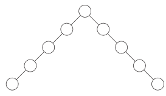

**Figure 4.31** 一棵糟糕的二叉树。仅在根节点要求平衡是不够的。

另一种平衡条件将坚持每个节点必须具有相同高度的左子树和右子树。如果将空子树的高度定义为 -1（通常如此），那么只有完美平衡的 $2^h - 1$ 个节点的树才能满足此标准。因此，尽管这保证了树的深度较小，但平衡条件过于僵硬，无法实用，需要放宽。

AVL 树与二叉查找树相同，区别在于树中每个节点的左子树和右子树高度最多相差 1。（空树的高度定义为 -1。）在图 4.32 中，左边的树是 AVL 树，但右边的不是。每个节点（在节点结构中）都保存高度信息。可以证明，AVL 树的高度最多大约为 $1.44 \log(N + 2) - 1.328$，但在实践中它仅略多于 $\log N$。例如，图 4.33 显示了高度为 9 且节点最少（143 个）的 AVL 树。该树的左子树是一个最小尺寸的高度为 7 的 AVL 树。右子树是一个最小尺寸的高度为 8 的 AVL 树。这告诉我们，高度为 $h$ 的 AVL 树中节点的最小数量 $S(h)$ 由 $S(h) = S(h - 1) + S(h - 2) + 1$ 给出。对于 $h = 0$，$S(h) = 1$。对于 $h = 1$，$S(h) = 2$。函数 $S(h)$ 与斐波那契数密切相关，上述关于 AVL 树高度的界正是由此得出。

因此，除了插入和删除可能除外，所有树操作都可以在 $O(\log N)$ 时间内完成。当我们进行插入时，需要更新返回根节点路径上所有节点的平衡信息，但插入可能很困难的原因是插入一个节点可能会违反 AVL 树属性。（例如，将 6 插入图 4.32 中的 AVL 树将破坏键为 8 的节点处的平衡条件。）如果是这种情况，则在插入步骤被视为完成之前，必须恢复该属性。事实证明，这总是可以通过对树进行简单修改来完成，称为旋转。

插入后，只有从插入点到根节点路径上的节点可能会改变其平衡，因为只有这些节点的子树被改变。当我们沿着路径向上到根节点并更新平衡信息时，我们可能会发现一个新平衡违反 AVL 条件的节点。我们将展示如何在第一个（即最深的）此类节点处重新平衡树，并证明这种重新平衡保证整个树满足 AVL 属性。

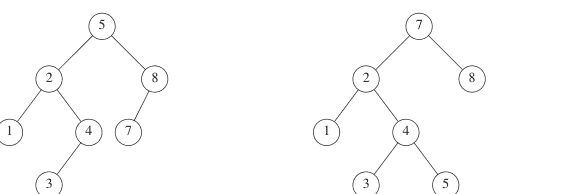

**Figure 4.32** 两棵二叉查找树。只有左边的树是 AVL 树。

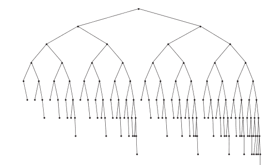

**Figure 4.33** 高度为 9 的最小 AVL 树

让我们称必须重新平衡的节点为 \(\alpha\)。由于任何节点最多有两个子节点，且高度不平衡要求 \(\alpha\) 的两个子树高度相差 2，因此很容易看出违规可能发生在四种情况中：

- 1. 向 \(\alpha\) 的左子节点的左子树中插入
- 2. 向 \(\alpha$ 的左子节点的右子树中插入
- 3. 向 \(\alpha$ 的右子节点的左子树中插入
- 4. 向 \(\alpha$ 的右子节点的右子树中插入

情况 1 和 4 关于 \(\alpha\) 是镜像对称，情况 2 和 3 也是如此。因此，从理论上讲，有两种基本情况。当然，从编程角度来看，仍然有四种情况。

第一种情况，即插入发生在“外部”（也就是左-左或右-右），通过树的单旋转来修复。第二种情况，即插入发生在“内部”（也就是左-右或右-左），由稍微复杂的双旋转处理。这些是树上的基本操作，我们将在平衡树算法中多次看到它们的使用。本节剩余部分描述这些旋转，证明它们足以维持平衡，并给出 AVL 树的一个随意实现。第 12 章描述了其他平衡树方法，着眼于更仔细的实现。

#### 4.4.1 单旋转

图 4.34 显示了修复情况 1 的单旋转。之前的图在左边，之后的图在右边。让我们仔细分析正在发生的事情。节点 k2 违反了 AVL 平衡属性，因为其左子树比右子树深两层（图中间的虚线标记了层级）。图中描绘的情况是唯一可能的情况 1 场景，允许 k2 在插入前满足 AVL 属性但在插入后违反它。子树 X 增长了一层，导致它正好比 Y 深两层。Z 不能与新的 X 在同一层级，否则 k2 在插入前就已经不平衡了，Y 也不能与 Z 在同一层级，否则 k1 将是通往根节点路径上第一个违反 AVL 平衡条件的节点。

为了理想地重新平衡树，我们希望将 X 上移一层，Z 下移一层。请注意，这实际上超过了 AVL 属性的要求。为此，我们将节点重新排列成一棵等价树，如图 4.34 的第二部分所示。这是一个抽象场景。将树想象成柔软的，抓住子节点 k1，闭上眼睛，摇晃它，让重力发挥作用。结果是 k1 将成为新的根节点。二叉查找树属性告诉我们，在原始树中 k2 > k1，因此 k2 在新树中成为 k1 的右子节点。X 和 Z 分别保持为 k1 的左子节点和 k2 的右子节点。子树 Y 保存了原始树中介于 k1 和 k2 之间的项目，可以放置在新树中作为 k2 的左子节点，并满足所有排序要求。

由于这项工作只需要更改几个指针，我们得到了另一棵是 AVL 树的二叉查找树。这是因为 X 上移一层，Y 保持在同一层级，Z 下移一层。k2 和 k1 不仅满足 AVL 要求，而且它们的子树高度也完全相同。此外，整个子树的新高度与导致 X 增长的插入之前的原始子树高度完全相同。因此，不需要再更新通往根节点路径上的高度，结果不需要进一步的旋转。图 4.35 显示，在将 6 插入左侧原始 AVL 树后，节点 8 变得不平衡。因此，我们在 7 和 8 之间进行单旋转，得到右边的树。

如前所述，情况 4 代表一种对称情况。图 4.36 显示了如何应用单旋转。让我们来做一个相当长的示例。假设我们从一个最初为空的 AVL 树开始，按顺序插入项目 3、2、1，然后是 4 到 7。第一个问题出现在插入项目 1 时，因为 AVL


**Figure 4.34** 用于修复情况 1 的单旋转


**图 4.35** 插入 6 后 AVL 性质被破坏，随后通过单次旋转修复


**图 4.36** 单次旋转修复情况 4

根节点处违反了该性质。我们在根节点及其左子节点之间执行单次旋转以修复问题。以下是旋转前后的树：


虚线连接了参与旋转的两个节点。接下来我们插入 4，这不会造成问题，但插入 5 在节点 3 处产生了违规，可通过单次旋转修复。除了旋转引起的局部变化外，程序员必须记住树的其余部分需要被告知此更改。这里这意味着 2 的右子节点必须重置为指向 4 而不是 3。忘记这样做很容易，并且会破坏树（4 将无法访问）。


接下来我们插入 6。这在根节点处引起了平衡问题，因为其左子树高度为 0，而右子树高度将为 2。因此，我们在根节点处在 2 和 4 之间执行单次旋转。


旋转通过将 2 设为 4 的子节点，并将 4 原来的左子树设为 2 的新右子树来执行。该子树中的每个项都必须介于 2 和 4 之间，因此此变换是合理的。接下来我们插入的项是 7，这引发了另一次旋转：


#### 4.4.2 双旋转

上述算法有一个问题：如图 4.37 所示，它不适用于情况 2 或 3。问题是子树 Y 太深，而单次旋转无法使其变浅。解决该问题的双旋转如图 4.38 所示。图 4.37 中子树 Y 已插入一个项这一事实保证了它非空。因此，我们可以假设它具有一个根节点和两个子树。因此，该树可以看作是由三个节点连接的四个子树。如图所示，树 B 或 C 中恰好有一个比 D 深两层（除非它们都为空），但我们无法确定是哪一个。结果证明这无关紧要；在图 4.38 中，B 和 C 都被绘制在 D 下方 1.5 层的位置。


**图 4.37** 单次旋转无法修复情况 2


**图 4.38** 左-右双旋转以修复情况 2

为了重新平衡，我们发现不能让 k3 保持为根节点，且图 4.37 已显示 k3 与 k1 之间的旋转无效，因此唯一的替代方案是将 k2 放置为新根节点。这迫使 k1 成为 k2 的左子节点，k3 成为其右子节点，并且也完全确定了四个子树的最终位置。很容易看出，生成的树满足 AVL 树性质，并且与单次旋转的情况一样，它将高度恢复到插入前的状态，从而保证所有重新平衡和高度更新已完成。图 4.39 显示，对称的情况 3 也可以通过双旋转修复。在两种情况下，效果都与在 \(\alpha\) 的子节点和孙节点之间旋转，然后在 \(\alpha\) 及其新子节点之间旋转相同。


**图 4.39** 右-左双旋转以修复情况 3

我们将继续之前的示例，按逆序插入 10 到 16，然后插入 8 和 9。插入 16 很容易，因为它不会破坏平衡性质，但插入 15 在节点 7 处引起高度不平衡。这是情况 3，可通过右-左双旋转解决。在我们的示例中，右-左双旋转将涉及 7、16 和 15。在此例中，\(k_1\) 是包含项 7 的节点，\(k_3\) 是包含项 16 的节点，\(k_2\) 是包含项 15 的节点。子树 A、B、C 和 D 都是空的。


接下来我们插入 14，这也需要双旋转。这里将恢复树的双旋转再次是右-左双旋转，将涉及 6、15 和 7。在此例中，\(k_1\) 是包含项 6 的节点，\(k_2\) 是包含项 7 的节点，\(k_3\) 是包含项 15 的节点。子树 A 是根节点为包含项 5 的节点的树；子树 B 是原本为包含项 7 的节点左子节点的空子树；子树 C 是根节点为包含项 14 的节点的树；最后，子树 D 是根节点为包含项 16 的节点的树。


如果现在插入 13，根节点处会出现不平衡。由于 13 不在 4 和 7 之间，我们知道单次旋转将有效。


插入 12 也将需要单次旋转：


要插入 11，需要执行单次旋转，随后插入 10 的情况也是如此。我们在不进行旋转的情况下插入 8，创建了一棵近乎完美平衡的树：


最后，我们将插入 9 以展示双旋转的对称情况。请注意，9 导致包含 10 的节点变得不平衡。由于 9 介于 10 和 8 之间（8 是通往 9 的路径上 10 的子节点），需要执行双旋转，得到以下树：


让我们总结一下发生的情况。编程细节相当直接，只是存在几种情况。要将带有项 X 的新节点插入 AVL 树 T，我们递归地将 X 插入 T 的适当子树（我们称此子树为 Tlr）。如果 Tlr 的高度不变，则完成。否则，如果 T 中出现高度不平衡，我们根据 X 以及 T 和 Tlr 中的项执行适当的单次或双旋转，更新高度（与树上其余部分建立连接），然后完成。由于一次旋转总是足够，经过精心编码的非递归版本通常比递归版本更快，但在现代编译器中，差异不如过去显著。然而，非递归版本很难正确编码，而随意的递归实现则易于阅读。

另一个效率问题涉及高度信息的存储。由于真正需要的只是高度差，且保证很小，如果我们真的尝试，可以用两位（表示 +1、0、-1）就足够了。这样做可以避免重复计算平衡因子，但会导致一定的清晰度损失。生成的代码比在每个节点存储高度要复杂一些。如果编写递归例程，速度可能不是主要考虑因素。在这种情况下，存储平衡因子所带来的微小速度优势似乎不值得牺牲清晰度和相对的简单性。此外，由于大多数机器无论如何都会将其对齐到至少 8 位边界，因此使用的空间量不太可能有任何差异。8 位（有符号）char 允许我们存储高达 127 的绝对高度。由于树是平衡的，这不足的情况不可想象（参见练习）。

```
1 struct AvlNode
2 {
3    Comparable element;
4    AvlNode *left;
5    AvlNode *right;
6    int
7       height;
8
9    AvlNode( const Comparable & ele, AvlNode *lt, AvlNode *rt, int h = 0 )
10      : element{ ele }, left{ lt }, right{ rt }, height{ h } { }
11
12    AvlNode( Comparable && ele, AvlNode *lt, AvlNode *rt, int h = 0 )
13      : element{ std::move( ele ) }, left{ lt }, right{ rt }, height{ h } { }
14 };
```

**图 4.40** AVL 树的节点声明

```
1 /**
2  * Return the height of node t or -1 if nullptr.
3  */
4 int height( AvlNode *t ) const
5 {
6    return t == nullptr ? -1 : t->height;
7 }
```

**图 4.41** 计算 AVL 节点高度的函数

有了这些，我们就可以编写 AVL 例程了。我们在此展示部分代码；其余代码在线上。首先，我们需要 `AvlNode` 类。它在图 4.40 中给出。我们还需要一个快速函数来返回节点的高度。此函数对于处理 `nullptr` 指针的烦人情况是必要的。如图 4.41 所示。基本插入例程（参见图 4.42）仅在末尾添加一行调用平衡方法。平衡方法在需要时应用单次或双旋转，更新高度，并返回生成的树。

对于图 4.43 中的树，`rotateWithLeftChild` 将左侧树转换为右侧树，并返回指向新根节点的指针。`rotateWithRightChild` 是对称的。代码如图 4.44 所示。

同样，图 4.45 中描绘的双旋转可以通过图 4.46 所示的代码实现。

由于二叉搜索树中的删除比插入稍微复杂一些，可以假设 AVL 树中的删除也更复杂。在理想世界中，人们希望图 4.26 中的删除例程可以轻松修改，将最后一行改为在调用平衡方法后返回，就像插入时所做的那样。这将产生图 4.47 中的代码。此更改有效！删除可能导致一侧


```cpp
/**
 * Internal method to insert into a subtree.
 * x is the item to insert.
 * t is the node that roots the subtree.
 * Set the new root of the subtree.
 */
void insert( const Comparable & x, AvlNode * & t )
{
    if( t == nullptr )
        t = new AvlNode{ x, nullptr, nullptr };
    else if( x < t->element )
        insert( x, t->left );
    else if( t->element < x )
        insert( x, t->right );

    balance( t );
}

static const int ALLOWED_IMBALANCE = 1;

// Assume t is balanced or within one of being balanced
// void balance( AvlNode * & t )
{
    if( t == nullptr )
        return;

    if( height( t->left ) - height( t->right ) > ALLOWED_IMBALANCE )
        if( height( t->left->left ) > height( t->left->right ) )
            rotateWithLeftChild( t );
        else
            doubleWithLeftChild( t );
    else if( height( t->right ) - height( t->left ) > ALLOWED_IMBALANCE )
        if( height( t->right->right ) > height( t->right->left ) )
            rotateWithRightChild( t );
        else
            doubleWithRightChild( t );

    t->height = max( height( t->left ), height( t->right ) ) + 1;
}
```

##### 图 4.42 AVL 树的插入


##### 图 4.43 单旋转

```cpp
/**
 * Rotate binary tree node with left child.
 * For AVL trees, this is a single rotation for case 1.
 * Update heights, then set new root.
 */
void rotateWithLeftChild( AvlNode * & k2 )
{
   AvlNode *k1 = k2->left;
   k2->left = k1->right;
  k1->right = k2;
  k2->height = max( height( k2->left ), height( k2->right ) ) + 1;
  k1->height = max( height( k1->left ), k2->height ) + 1;
  k2 = k1;
}
```

##### 图 4.44 执行单旋转的例程


##### 图 4.45 双旋转

```cpp
/**
 * Double rotate binary tree node: first left child
 * with its right child; then node k3 with new left child.
 * For AVL trees, this is a double rotation for case 2.
 * Update heights, then set new root.
 */
 void doubleWithLeftChild( AvlNode * & k3 )
 {
     rotateWithRightChild( k3->left );
     rotateWithLeftChild( k3 );
 }
```

##### 图 4.46 执行双旋转的例程

```cpp
/**
 * Internal method to remove from a subtree.
 * x is the item to remove.
 * t is the node that roots the subtree.
 * Set the new root of the subtree.
 */
 void remove( const Comparable & x, AvlNode * & t )
 {
     if( t == nullptr )
         return; // Item not found; do nothing
     if( x < t->element )
         remove( x, t->left );
     else if( t->element < x )
         remove( x, t->right );
     else if( t->left != nullptr && t->right != nullptr ) // Two children
     {
         t->element = findMin( t->right )->element;
         remove( t->element, t->right );
     }
     else
     {
         AvlNode *oldNode = t;
         t = ( t->left != nullptr ) ? t->left : t->right;
         delete oldNode;
     }
      balance( t );
 }
```

##### 图 4.47 AVL 树中的删除

树的一侧比另一侧浅两层。逐情况分析与插入引起的不平衡类似，但并不完全相同。例如，图 4.34 中的情况 1，现在反映的是从树 Z 删除（而非向树 X 插入），必须考虑到树 Y 可能和树 X 一样深的可能性。即便如此，也很容易看出旋转可以重新平衡这种情况以及图 4.36 中的对称情况 4。因此，图 4.42 中 balance 函数的第 28 行和第 34 行使用 >= 而不是 >，专门用于确保在这些情况下执行单旋转而非双旋转。其余情况的验证留作练习。

### 4.5 伸展树

我们现在介绍一种相对简单的数据结构，称为 **伸展树**，它保证从空树开始的任何 M 个连续树操作最多耗时 O(M log N)。虽然此保证并不排除单次操作可能耗时 Θ(N) 的可能性，因此该界限不如每次操作 O(log N) 的最坏情况界限强，但净效果相同：不存在糟糕的输入序列。通常，当一系列 M 次操作的总最坏情况运行时间为 O(Mf(N)) 时，我们称 **摊还** 运行时间为 O(f(N))。因此，伸展树每次操作的摊还代价为 O(log N)。在长序列操作中，有些操作可能耗时更多，有些则更少。

伸展树的基础是：二叉查找树每次操作 O(N) 的最坏情况时间并不糟糕，只要这种情况发生得相对较少即可。任何一次访问，即使耗时 Θ(N)，也很可能极快。二叉查找树的问题在于，一整串糟糕的访问是有可能发生的，而且并不罕见。累积运行时间就会变得显著。一种最坏情况时间为 O(N)，但保证任何 M 次连续操作最多耗时 O(M log N) 的查找树数据结构，当然是令人满意的，因为不存在糟糕的序列。

如果允许某个特定操作具有 O(N) 的最坏情况时间界限，但我们仍希望获得 O(log N) 的摊还时间界限，那么很明显，无论是否访问某个节点，都必须移动它。否则，一旦找到一个深层节点，我们就可以不断对其进行访问。如果节点位置不变，且每次访问耗时 Θ(N)，那么 M 次访问的序列将耗时 Θ(M · N)。

伸展树的基本思想是：在访问一个节点后，通过一系列 AVL 树旋转将其推向根节点。请注意，如果一个节点很深，则路径上有许多节点也相对较深，通过重构，我们可以使未来对所有这些节点的访问变得更便宜。因此，如果该节点不太可能很深，我们希望这种重构的副作用是（在某种程度上）平衡树。除了在理论上提供良好的时间界限外，这种方法可能具有实用价值，因为在许多应用中，当访问一个节点时，它很可能在不久的将来再次被访问。研究表明，这种情况发生的频率比人们预想的要高得多。伸展树也不需要维护高度或平衡信息，从而节省空间并在一定程度上简化代码（尤其是在编写仔细实现时）。

#### 4.5.1 一个简单的想法（行不通）

执行上述重构的一种方法是自底向上执行单旋转。这意味着我们将访问路径上的每个节点与其父节点进行旋转。例如，考虑在以下树上对 k1 进行访问（查找）后会发生什么：


访问路径用虚线表示。首先，我们在 $k_1$ 及其父节点之间执行单旋转，得到以下树：


然后，我们在 $k_1$ 和 $k_3$ 之间旋转，得到下一棵树：


然后再执行两次旋转，直到到达根节点：


这些旋转的效果是将 \( k_1 \) 推到根节点，以便未来对 \( k_1 \) 的访问变得容易（暂时如此）。不幸的是，它还将另一个节点（\( k_3 \)）推得几乎和 \( k_1 \) 以前一样深。对该节点的访问会再将另一个节点推得很深，以此类推。虽然这种策略使未来对 \( k_1 \) 的访问更便宜，但并未显著改善（原始）访问路径上其他节点的情况。事实证明，使用这种策略，存在一系列 \( M \) 次操作需要 \( \Omega(M \cdot N) \ 时间，因此这个想法还不够好。说明这一点的最简单方法是考虑将键 1、2、3、...、\( N \) 插入最初为空的树中形成的树（自行推导此示例）。这会得到一棵仅由左子节点组成的树。不过，这不一定是坏事，因为构建这棵树的总时间为 \( O(N) \)。糟糕的部分是，访问键为 1 的节点需要 \( N \) 个时间单位，其中访问路径上的每个节点计为一个单位。旋转完成后，访问键为 2 的节点需要 \( N \) 个时间单位，键 3 需要 \( N - 1 \) 个单位，以此类推。按顺序访问所有键的总时间为 \( N + \sum_{i=1}^{N} i = \Omega(N^2) \)。访问完它们后，树恢复到原始状态，我们可以重复该序列。

#### 4.5.2 伸展操作

伸展策略与上述旋转想法类似，只是我们对旋转的执行方式更加挑剔。我们仍将沿访问路径自底向上进行旋转


图 4.48 之字形（zig-zag）


图 4.49 之字之字形（zig-zig）

路径。设 X 为访问路径上正在进行旋转的（非根）节点。如果 X 的父节点是树的根，则我们仅旋转 X 和根。这是访问路径上的最后一次旋转。否则，X 既有父节点（P）又有祖父节点（G），需要考虑两种情况，以及它们的对称情况。第一种情况是之字形（zig-zag）情况（参见图 4.48）。在这里，X 是右子节点，P 是左子节点（或反之亦然）。如果是这种情况，我们执行双旋转，完全就像 AVL 双旋转一样。否则，我们有之字之字形（zig-zig）情况：X 和 P 都是左子节点（或者，在对称情况下，都是右子节点）。在这种情况下，我们将图 4.49 左侧的树转换为右侧的树。

作为示例，考虑上一个示例中的树，对 k1 进行旋转：


第一个伸展步骤在 k1 上，显然是之字形（zig-zag），因此我们使用 k1、k2 和 k3 执行标准 AVL 双旋转。得到的树如下：


下一个在 $k_1$ 上的伸展步骤是之字之字形（zig-zig），因此我们使用 $k_1, k_4,$ 和 $k_5$ 执行之字之字形旋转，得到最终树：


虽然从小示例中很难看出，伸展操作不仅将访问的节点移动到根，还大致将访问路径上大多数节点的深度减半（某些浅层节点最多被下推两个层级）。

要了解伸展相对于简单旋转带来的差异，请再次考虑将项目 $1, 2, 3, \dots, N$ 插入到最初为空的树中的效果。总耗时为 $O(N)，与之前一样，并产生与简单旋转相同的树。图 4.50 显示了在项目为 1 的节点上进行伸展的结果。差异在于，在访问项目为 1 的节点后，该操作


图 4.50 在节点 1 上进行伸展的结果

耗时 N 个单位，而对项目为 2 的节点的访问只需大约 N/2 个单位，而不是 N 个单位；不再有像之前那样很深的节点。

对项目为 2 的节点的访问会将节点带到距离根 N/4 以内，此过程重复进行，直到深度大约变为 log N（N = 7 的示例太小，无法很好地看出效果）。图 4.51 至 4.59 显示了在原本仅包含左子节点的 32 节点树中访问项目 1 到 9 的结果。因此，我们不会从伸展树中得到简单旋转策略中普遍存在的同样糟糕行为。（实际上，这被证明是一个非常好的案例。一个相当复杂的证明表明，对于此示例，N 次访问总共耗时 O(N)。）

这些图表突出了伸展树的基本且关键的特性。当访问路径很长，从而导致比正常更长的搜索时间时，旋转往往对未来操作有利。当访问成本低时，旋转就不那么好，甚至可能有害。极端情况是由插入形成的初始树。所有插入都是常数时间操作，导致了一个糟糕的初始树。在那个时候，我们有一棵非常糟糕的树，但我们进度超前，并且总运行时间更少作为补偿。然后，几次非常糟糕的访问留下了一棵近乎平衡的树，但代价是我们必须归还一些节省下来的时间。主要定理（我们将在第 11 章证明）是，我们永远不会落后于每次操作 O(log N) 的进度：我们始终按计划进行，尽管偶尔会有糟糕的操作。


图 4.51 在全左子节点树中在节点 1 上进行伸展的结果


我们可以通过访问要删除的节点来执行删除操作。这会将该节点置于根位置。如果删除它，我们会得到两棵子树 \(T_L\) 和 \(T_R\)（左和右）。如果我们在 \(T_L\) 中找到最大元素（这很容易），则该元素会被旋转到 \(T_L\) 的根，且 \(T_L\) 现在将有一个没有右子节点的根。我们可以通过将 \(T_R\) 设为右子节点来完成删除。


图 4.55 在之前的树上对节点 5 进行伸展的结果


图 4.56 在之前的树上对节点 6 进行伸展的结果


图 4.57 在之前的树上对节点 7 进行伸展的结果


图 4.58 在之前的树上对节点 8 进行伸展的结果


伸展树的分析很困难，因为必须考虑到树不断变化的结构。另一方面，伸展树比大多数平衡搜索树更容易编程，因为需要考虑的情况更少，且无需维护平衡信息。一些经验证据表明，这在实践中转化为更快的代码，尽管对此的论证远未完备。最后，我们指出存在几种伸展树的变体，在实践中可以表现得更好。其中一种变体在第 12 章中有完整的代码实现。

### 4.6 树遍历（再述）

由于二叉搜索树中的有序信息，按排序顺序列出所有项目很简单。图 4.60 中的递归函数完成实际工作。

请自己验证此函数的正确性。如前所述，这种应用于树的例程称为**中序遍历**（这很合理，因为它按顺序列出项目）。中序遍历的一般策略是先处理左子树，然后在当前节点上执行处理，最后处理右子树。除了简单之外，该算法的有趣之处在于总运行时间为 O(N)。这是因为树中的每个节点都在执行常量工作。每个节点被访问一次，每个节点上执行的工作包括针对 nullptr 进行测试、设置两个函数调用以及执行输出语句。由于每个节点有常量工作且共有 N 个节点，因此运行时间为 O(N)。

有时我们需要先处理两个子树，然后才能处理一个节点。例如，要计算节点的高度，我们需要知道子树的高度。图 4.61 中的代码计算此值。由于检查特殊情况始终是个好主意——在涉及递归时至关重要——请注意，该例程会将叶节点的高度声明为零，这是正确的。这种遍历顺序，我们之前也见过，称为**后序遍历**。同样，总运行时间为 O(N)，因为在每个节点上执行常量工作。

```cpp
/**
 * Print the tree contents in sorted order.
 */
void printTree( ostream & out = cout ) const
{
    if( isEmpty( ) )
        out << "Empty tree" << endl;
    else
        printTree( root, out );
}

/**
 * Internal method to print a subtree rooted at t in sorted order.
 */
void printTree( BinaryNode *t, ostream & out ) const
{
    if( t != nullptr )
    {
        printTree( t->left, out );
        out << t->element << endl;
        printTree( t->right, out );
    }
}
```

图 4.60 按顺序打印二叉搜索树的例程

```cpp
/**
 * Internal method to compute the height of a subtree rooted at t.
 */
int height( BinaryNode *t )
{
    if( t == nullptr )
        return -1;
    else
        return 1 + max( height( t->left ), height( t->right ) );
}
```

图 4.61 使用后序遍历计算树高度的例程

我们见过的第三种流行遍历方案是先序遍历。在这里，节点在子节点之前被处理。例如，如果你想给每个节点标记其深度，这会很有用。

所有这些例程中的共同想法是，你先处理 nullptr 情况，然后再处理其余部分。请注意没有多余的变量。这些例程仅传递指针


到根子树的节点，且不要声明或传递任何额外变量。代码越紧凑，愚蠢的 bug 出现的可能性就越小。第四种较少使用的遍历（我们尚未见过）是**层序遍历**。在层序遍历中，深度为 $d$ 的所有节点会在任何深度为 $d + 1$ 的节点之前被处理。层序遍历与其他遍历的不同之处在于，它不是递归完成的；而是使用队列，而不是递归隐式的栈。

### 4.7 B 树

到目前为止，我们一直假设可以将整个数据结构存储在计算机的主内存中。然而，假设我们拥有的数据多于主内存所能容纳的量，因此必须让数据结构驻留在磁盘上。当这种情况发生时，游戏规则就改变了，因为 Big-Oh 模型不再有意义。

问题在于，Big-Oh 分析假设所有操作都是相等的。然而，事实并非如此，尤其是涉及磁盘 I/O 时。现代计算机每秒可执行数十亿条指令。这非常快，主要是因为速度在很大程度上取决于电气特性。另一方面，磁盘是机械的。其速度在很大程度上取决于旋转磁盘和移动磁盘头所需的时间。许多磁盘以 7,200 RPM 转动。因此，在 1 分钟内它转 7,200 圈；因此，一圈发生在 1/1200 秒，即 8.3 ms。平均而言，我们可能期望需要旋转半个磁盘才能找到所需内容，但这由移动磁盘头的时间所补偿，因此我们得到的访问时间为 8.3 ms。（这是一个非常乐观的估计；9–11 ms 的访问时间更常见。）因此，我们每秒可以进行大约 120 次磁盘访问。这听起来不错，直到我们将其与处理器速度进行比较。我们拥有的数十亿条指令等于 120 次磁盘访问：当然，这里的一切都是粗略计算，但相对速度非常清楚：磁盘访问非常昂贵。此外，处理器速度的提高速度远快于磁盘速度（是磁盘容量在相当快地增加）。因此，我们愿意进行大量计算，只为节省一次磁盘访问。在几乎所有情况下，磁盘访问次数将主导运行时间。因此，如果我们将磁盘访问次数减半，运行时间也将减半。

下面是典型搜索树在磁盘上的表现：假设我们想要访问佛罗里达州公民的驾驶记录。我们假设有 10,000,000 个项目，每个键为 32 字节（表示一个姓名），每条记录为 256 字节。我们假设这不适合放入主内存，并且我们是系统上 20 个用户中的 1 个（因此我们拥有 1/20 的资源）。因此，在 1 秒内，我们可以执行数百万条指令或进行六次磁盘访问。

不平衡的二叉搜索树是一场灾难。在最坏情况下，它具有线性深度，因此可能需要 10,000,000 次磁盘访问。平均而言，一次成功的搜索将需要 1.38log N 次磁盘访问，由于 log 10000000 ≈ 24，平均搜索将需要 32 次磁盘访问，即 5 秒。在典型的随机构建树中，我们预期少数节点深度是三倍；这些节点将需要大约 100 次磁盘访问，即 16 秒。AVL 树要好一些。最坏情况下的 1.44log N 不太可能发生，而典型情况非常接近 log N。因此，AVL 树平均将使用大约 25 次磁盘访问，需要 4 秒。


#### 图 4.62 31 个节点的 5 叉树只有三层

我们希望将磁盘访问次数减少到一个非常小的常数，例如三或四次。我们愿意为此编写复杂的代码，因为机器指令基本上是免费的，只要我们不过分不讲道理。可能很明显，二叉搜索树行不通，因为典型的 AVL 树接近最优高度。使用二叉搜索树，我们无法低于 log N。解决方案直观上很简单：如果我们有更多的分支，我们就有更少的高度。因此，虽然 31 个节点的完美二叉树有五层，但 31 个节点的 5 叉树只有三层，如图 4.62 所示。M 叉搜索树允许 M 向分支。随着分支增加，深度减少。而完整二叉树的高度大约是 log2 N，完整 M 叉树的高度大约是 logM N。

我们可以以与二叉搜索树非常相似的方式创建 M 叉搜索树。在二叉搜索树中，我们需要一个键来决定采取哪个分支。在 M 叉搜索树中，我们需要 M - 1 个键来决定采取哪个分支。为了使此方案在最坏情况下高效，我们需要以某种方式确保 M 叉搜索树是平衡的。否则，像二叉搜索树一样，它可能退化为链表。实际上，我们想要一个更严格的平衡条件。也就是说，我们不希望 M 叉搜索树退化为甚至二叉搜索树，因为那样我们将被困在 log N 次访问中。

实现这一点的一种方法是使用 B 树。这里描述了基本的 B 树。已知许多变体和改进，实现有些复杂，因为有相当多的情况。然而，很容易看出，原则上，B 树保证只有少数几次磁盘访问。

阶为 M 的 B 树是具有以下属性的 M 叉树：

- 1. 数据项存储在叶节点上。
- 2. 非叶节点存储最多 M - 1 个键以指导搜索；键 i 表示子树 i + 1 中的最小键。
- 3. 根节点要么是叶节点，要么拥有两到 M 个子节点。
- 4. 所有非叶节点（根节点除外）拥有 [M/2] 到 M 个子节点。
- 5. 所有叶节点位于相同深度，并拥有 [L/2] 到 L 个数据项，其中 L 某个值（L 的确定将在稍后说明）。

3 这里描述的通常被称为 B* 树。

4 对于前 L 次插入，必须放宽规则 3 和 5。


#### 图 4.63 阶为 5 的 B 树

图 4.63 显示了一个阶为 5 的 B 树示例。请注意，所有非叶节点都有三到五个子节点（因此有两到四个键）；根节点可能只有两个子节点。在这里，L = 5。碰巧在这个示例中 L 和 M 相同，但这不是必须的。由于 L 是 5，每个叶节点有三到五个数据项。要求节点半满可保证 B 树不会退化为简单的二叉树。虽然有各种更改此结构的 B 树定义，大多是小的更改，但此定义是一种流行形式。

每个节点代表一个磁盘块，因此我们根据所存储项目的大小来选择 M 和 L。例如，假设一个块容纳 8,192 字节。在我们的佛罗里达示例中，每个键使用 32 字节。在阶为 M 的 B 树中，我们将有 M - 1 个键，总共 32M - 32 字节，加上 M 个分支。由于每个分支基本上是另一个磁盘块的编号，我们可以假设一个分支为 4 字节。因此，分支使用 4M 字节。非叶节点的总内存需求因此为 36M - 32。不超过 8,192 的最大 M 值为 228。因此，我们将选择 M = 228。由于每条数据记录为 256 字节，我们可以在一个块中容纳 32 条记录。因此，我们可以选择 L = 32。我们保证每个叶节点有 16 到 32 条数据记录，并且每个内部节点（根节点除外）至少以 114 种方式分支。由于有 10,000,000 条记录，最多有 625,000 个叶节点。因此，在最坏情况下，叶节点将在第 4 层。更具体地说，最坏情况下的访问次数大约由 log_M/2 N 给出，上下浮动 1。（例如，根节点和下一层可以缓存在主内存中，因此从长远来看，只需要在第 3 层及更深层进行磁盘访问。）

剩下的问题是如何向 B 树添加和删除项目。接下来将概述相关想法。请注意，之前看到的许多主题都会再次出现。

我们首先检查插入操作。假设我们想要将 57 插入图 4.63 中的 B 树。沿树向下搜索会发现它不在树中。我们可以将其作为第五个项添加到叶节点。请注意，为此我们可能需要重新组织叶节点中的所有数据。但是，与磁盘访问相比，这样做的成本可以忽略不计，而在此情况下磁盘访问还包括一次磁盘写入。

当然，那相对轻松，因为叶节点尚未满。假设我们现在想要插入 55。图 4.64 显示了一个问题：55 想要去的叶节点已经满了。解决方案很简单：由于我们现在有 L + 1 个项，我们将它们分成两


叶子，两者都保证拥有所需的最少数据记录数。我们形成每个包含三个项的两个叶子。写入这些叶子需要两次磁盘访问，更新父节点需要第三次磁盘访问。请注意，在父节点中，键和分支都会改变，但它们以受控的方式改变，易于计算。得到的 B 树如图 4.65 所示。虽然分割节点很耗时，因为它至少需要两次额外的磁盘写入，但这是一种相对罕见的情况。例如，如果 L 是 32，那么当节点被分割时，会创建分别包含 16 个和 17 个项的两个叶子。对于包含 17 个项的叶子，我们可以再执行 15 次插入而无需再次分割。换句话说，每次分割大约有 L/2 次非分割。

前面示例中的节点分割之所以有效，是因为父节点没有拥有其全部允许的子节点。但如果它拥有了，又会怎样呢？例如，假设我们向图 4.65 的 B 树中插入 40。我们必须将包含键 35 到 39 以及现在的 40 的叶子分割成两个叶子。但这样做会使父节点有六个子节点，而它只允许有五个。解决方案是分割父节点。结果如图 4.66 所示。当父节点被分割时，我们必须更新键的值以及父节点的父节点，从而导致额外的两次磁盘写入（因此此次插入花费五次磁盘写入）。然而，再次强调，键以非常受控的方式改变，尽管代码肯定不简单，因为存在大量情况。


Figure 4.66 向图 4.65 的 B 树中插入 40 会导致分割成两个叶子，然后分割父节点

当非叶子节点被分割时（如本例所示），其父节点会增加一个子节点。如果父节点已经达到其子节点上限怎么办？那么我们继续沿树向上分割节点，直到找到不需要分割的父节点或到达根节点。如果我们分割了根节点，那么我们就会有两个根节点。显然，这是不可接受的，但我们可以创建一个新根节点，将分割后的根节点作为它的两个子节点。这就是为什么根节点被授予特殊的两个子节点最小豁免。这也是 B 树增加高度的唯一方式。不用说，一直分割到根节点是一个极其罕见的事件。这是因为四层树表明在整个插入序列中根节点已被分割了三次（假设没有发生删除）。事实上，任何非叶子节点的分割也非常罕见。

处理子节点溢出还有其他方法。一种技术是，如果邻居有空间，就将一个子节点“过户”给它。例如，要向图 4.66 的 B 树中插入 29，我们可以通过将 32 移动到下一个叶子来腾出空间。这种技术需要修改父节点，因为键会受到影响。然而，它倾向于保持节点更满，并从长远来看节省空间。

我们可以通过找到需要删除的项然后将其删除来执行删除操作。问题是，如果它所在的叶子原本拥有最少数量的数据项，那么现在它就低于最小值了。如果邻居本身没有达到最小值，我们可以通过“过户”一个邻近项来纠正这种情况。如果邻居已达到最小值，那么我们可以与邻居合并形成一个满的叶子。不幸的是，这意味着父节点失去了一个子节点。如果这导致父节点低于其最小值，那么它遵循相同的策略。这个过程可能


Figure 4.67 从图 4.66 的 B 树中删除 99 后的 B 树

一直向上渗透到根节点。根节点不能只有一个子节点（即使允许，那也是愚蠢的）。如果由于“过户”过程导致根节点只剩下一个子节点，那么我们删除根节点，并使其子节点成为树的新根节点。这是 B 树失去高度的唯一方式。例如，假设我们要从图 4.66 的 B 树中删除 99。由于叶子只有两个项，而其邻居已经达到三个的最小值，我们将项合并成一个包含五个项的新叶子。结果，父节点只有两个子节点。然而，它可以从邻居处“过户”，因为邻居有四个子节点。结果，两者都有三个子节点。结果如图 4.67 所示。

### 4.8 标准库中的集合与映射

第 3 章讨论的 STL 容器——即 vector 和 list——在搜索方面效率低下。因此，STL 提供了两个额外的容器，set 和 map，它们保证基本操作（如插入、删除和搜索）的对数开销。

#### 4.8.1 集合

set 是一个有序容器，不允许重复项。用于访问 vector 和 list 中项的许多惯用法也适用于 set。具体来说，set 中嵌套了 iterator 和 const_iterator 类型，允许遍历 set，并且 vector 和 list 中的几个方法在 set 中也具有相同的名称，包括 begin、end、size 和 empty。如果将 set 传递给图 3.6 中描述的 print 函数模板，它也能正常工作。

set 所需的独特操作是能够插入、删除和执行基本搜索（高效地）。

插入例程恰如其分地命名为 insert。然而，因为 set 不允许重复项，所以 insert 可能会失败。因此，我们希望返回类型能够用一个布尔变量来指示这一点。然而，insert 的返回类型比 bool 更复杂。这是因为 insert 返回一个迭代器，表示 insert 返回时 x 的位置。这个迭代器表示新插入的项或导致 insert 失败的现有项，它很有用，因为知道项的位置可以通过避免搜索并直接访问包含该项的节点，使删除更高效。

STL 定义了一个名为 pair 的类模板，它几乎只是一个带有 first 和 second 成员的结构体，用于访问 pair 中的两个项目。有两个不同的 insert 例程：

```
pair<iterator,bool> insert( const Object & x );
pair<iterator,bool> insert( iterator hint, const Object & x );
```

单参数 insert 的行为与上述描述相同。双参数 insert 允许指定一个提示，表示 x 应该放置的位置。如果提示准确，插入速度很快，通常为 O(1)。如果不准确，插入使用正常的插入算法，其性能与单参数 insert 相当。例如，以下代码使用双参数 insert 可能比使用单参数 insert 更快：

```
set<int> s;
for( int i = 0; i < 1000000; ++i )
    s.insert( s.end( ), i );
```

erase 有几个版本：

```
int erase (const Object & x);
iterator erase (iterator itr);
iterator erase (iterator start, iterator end);
```

第一个单参数 erase 删除 x（如果找到），并返回实际删除的项数，显然是 0 或 1。第二个单参数 erase 的行为与 vector 和 list 中相同。它删除迭代器给定位置的对象，返回一个迭代器，表示 erase 调用前紧随 itr 之后的元素，并使 itr 失效，变为过时。双参数 erase 的行为与 vector 或 list 中相同，删除从 start 开始直到（但不包括）end 处的项的所有项。

对于搜索，set 不提供返回布尔变量的 contains 例程，而是提供一个 find 例程，返回一个表示项位置的迭代器（如果搜索失败则返回结束标记）。这在运行时间无额外开销的情况下提供了大量更多信息。find 的签名是

```
iterator find (const Object & x) const;
```

默认情况下，排序使用 less<Object> 函数对象，它本身是通过为 Object 调用 operator< 来实现的。可以通过用函数对象类型实例化 set 模板来指定替代排序。例如，我们可以创建一个存储 string 对象的 set，使用图 1.25 中编码的 CaseInsensitiveCompare 函数对象忽略大小写区别。在以下代码中，set s 的大小为 1：

```
set<string, CaseInsensitiveCompare> s;
s.insert( "Hello" ); s.insert( "Hello" );
cout << "The size is: " << s.size( ) << endl;
```

#### 4.8.2 映射

map 用于存储由键及其值组成的有序条目集合。键必须是唯一的，但多个键可以映射到相同的值。因此，值不必是唯一的。map 中的键保持逻辑排序顺序。

map 的行为类似于用 pair 实例化的 set，其比较函数仅引用键。因此，它支持 begin、end、size 和 empty，但底层迭代器是一个键值对。换句话说，对于迭代器 itr，*itr 的类型是 pair<KeyType,ValueType>。map 还支持 insert、find 和 erase。对于 insert，必须提供一个 pair<KeyType,ValueType> 对象。虽然 find 只需要一个键，但


迭代器 it 返回对一个 pair 的引用。仅使用这些操作通常并不划算，因为语法开销可能很高。

幸运的是，map 具有一个重要的额外操作，能产生简单的语法。数组下标运算符对 map 进行了如下重载：

```
ValueType & operator[] ( const KeyType & key );
```

operator[] 的语义如下。如果 key 存在于 map 中，则返回对应值的引用。如果 key 不存在于 map 中，则将其以默认值插入 map，并返回对该插入默认值的引用。默认值通过应用无参构造函数，或者对于基本类型使用零来获得。这些语义不允许 operator[] 的断言版本，因此 operator[] 不能用于常量 map。例如，如果 map 是通过常量引用传递的，则在例程内，operator[] 无法使用。

图 4.68 中的代码片段说明了访问 map 中元素的两种技术。首先，请注意在第 3 行，左侧调用了 operator[]，从而将 "Pat" 和值为 0 的 double 插入 map，并返回对该 double 的引用。然后，赋值将 map 中的该 double 改为 75000。第 4 行输出 75000。不幸的是，第 5 行将 "Jan" 和 0.0 的薪水插入 map 并打印它。这可能是正确的做法，也可能不是，这取决于应用程序。如果区分 map 中的元素和不在 map 中的元素很重要，或者不向 map 中插入元素很重要（因为它是不可变的），则可以使用第 7 到 12 行所示的替代方法。在那里，我们看到对 find 的调用。如果未找到 key，则迭代器是结束标记，可以进行测试。如果找到了 key，则可以访问迭代器所引用的 pair 中的第二个项目，即与 key 关联的值。如果 itr 是 iterator 而不是 const_iterator，我们也可以给 itr->second 赋值。

```
1       map<string,double> salaries;
2
3       salaries[ "Pat" ] = 75000.00;
4       cout << salaries[ "Pat" ] << endl;
5       cout << salaries[ "Jan" ] << endl;
6
7       map<string,double>::const_iterator itr;
8       itr = salaries.find( "Chris" );
9       if( itr == salaries.end() )
10          cout << "Not an employee of this company!" << endl;
11      else
12          cout << itr->second << endl;
```

图 4.68 访问 map 中的值

#### 4.8.3 set 和 map 的实现

C++ 要求 set 和 map 在最坏情况下以对数时间支持基本的 insert、erase 和 find 操作。因此，底层实现是平衡二叉搜索树。通常不使用 AVL 树；相反，第 12.2 节中讨论的自顶向下红黑树常被使用。

在实现 set 和 map 时，一个重要的问题是为迭代器类提供支持。当然，在内部，迭代器维护一个指向迭代中“当前”节点的指针。困难的部分是高效地移动到下一个节点。有几种可能的解决方案，其中一些列于此：

- 1. 当迭代器构造时，让每个迭代器将包含 set 项目的数组作为其数据存储。这行不通：这使得在修改 set 后返回迭代器的任何例程（例如某些 erase 和 insert 版本）都无法高效实现。
- 2. 让迭代器维护一个存储通往当前节点路径上节点的栈。有了这些信息，可以推断出迭代中的下一个节点，它要么是当前节点右子树中包含最小项目的节点，要么是包含当前节点在其左子树中的最近祖先。这使得迭代器稍大，并且迭代器代码显得笨拙。
- 3. 让搜索树中的每个节点除了子节点外还存储其父节点。迭代器不会那么大，但现在每个节点需要额外内存，迭代代码仍然笨拙。
- 4. 让每个节点维护额外链接：一个指向下一个较小的节点，一个指向下一个较大的节点。这占用空间，但迭代非常简单，并且易于维护这些链接。
- 5. 仅为具有 nullptr 左链接或右链接的节点维护额外链接，通过使用额外的布尔变量，使例程能够判断左链接是用作标准二叉搜索树左链接还是指向下一个较小节点的链接，右链接亦然（练习 4.49）。这种想法称为线索化树，并在许多 STL 实现中使用。

#### 4.8.4 使用多个 map 的示例

许多单词彼此相似。例如，通过更改第一个字母，单词 wine 可以变成 dine、fine、line、mine、nine、pine 或 wyne。通过更改第三个字母，wine 可以变成 wide、wide、wive、wive 或 wire 等。通过更改第四个字母，wine 可以变成 wind、wing、wink、wino 或 wins 等。这给出了 15 个不同的单词，它们只需更改 wine 中的一个字母即可得到。事实上，有超过 20 个不同的单词，其中一些比较生僻。我们希望编写一个程序，找出所有可以通过单字符替换变成至少 15 个其他单词的单词。我们假设有一个包含约 89,000 个不同长度单词的词典。大多数单词长度在 6 到 11 个字符之间。分布包括 8,205 个五字母单词、11,989 个七字母单词、13,672 个八字母单词、13,014 个九字母单词、11,297 个十字母单词和 8,617 个十一字母单词。（实际上，最易变的单词是三字母、四字母和五字母单词，但较长的单词检查起来最耗时。）

最直接的策略是使用一个 map，其中键是单词，值是包含可以通过单字符替换从键更改而来的单词的向量，这些单词通过单

```
void printHighChangeables( const map<string,vector<string>>& adjacentWords,
             int minWords = 15 )
{
  for( auto & entry : adjacentWords )
  {
    const vector<string>& words = entry.second;
  }
  if( words.size( ) > minWords )
  {
    cout << entry.first << " (" << words.size( ) << "):";
    for( auto & str : words )
    {
      cout << " " << str;
      cout << endl;
    }
  }
}
```

字符替换。

图 4.69 给定一个包含单词作为键以及仅差一个字符的单词向量作为值的 map，输出具有 minWords 或更多可通过单字符替换获得的单词的单词。

单字符替换。图 4.69 中的例程展示了如何使用最终生成的 map（我们尚未编写该部分的代码）来打印所需答案。代码使用范围 for 循环遍历 map，并将条目视为由一个单词和一个单词向量组成的 pair。第 4 行和第 6 行的常量引用用于替换复杂表达式并避免不必要的副本。

主要问题是如何从包含 89,000 个单词的数组构建 map。图 4.70 中的例程是一个简单函数，用于测试两个单词是否仅差一个字符相同。我们可以使用该例程为 map 构建提供最简单的算法，即对所有单词对进行暴力测试。该算法如图 4.71 所示。

如果找到一对仅差一个字符的单词，我们可以在第 12 行和第 13 行更新 map。我们在第 12 行使用的惯用法是，adjWords[str] 表示与 str 仅差一个字符的单词向量。如果之前见过 str，则它在 map 中，我们只需将新单词添加到 map 中的向量，方法是调用 push_back。如果从未见过 str，那么使用 operator[] 的行为会将其放入 map，带有一个大小为 0 的向量，并返回该向量，因此 push_back 将向量更新为大小 1。总的来说，这是一种用于维护值为集合的 map 的非常巧妙的惯用法。

该算法的问题是它很慢，在我们的计算机上需要 97 秒。一个明显的改进是避免比较不同长度的单词。我们可以按长度对单词进行分组，然后在每个单独的组上运行之前的算法。

为此，我们可以使用第二个 map！这里键是表示单词长度的整数，值是该长度的所有单词的集合。我们可以使用 vector 来


```cpp
// Returns true if word1 and word2 are the same length
// and differ in only one character.
bool oneCharOff( const string & word1, const string & word2 )
{
    if( word1.length( ) != word2.length( ) )
        return false;

    int diffs = 0;

    for( int i = 0; i < word1.length( ); ++i )
        if( word1[ i ] != word2[ i ] )
            if( ++diffs > 1 )
                return false;

    return diffs == 1;
}
```

图 4.70 检查两个单词是否仅有一个字符不同的例程

```cpp
// Computes a map in which the keys are words and values are vectors of words
// that differ in only one character from the corresponding key.
// Uses a quadratic algorithm.
map<string,vector<string>> computeAdjacentWords( const vector<string> & words )
{
    map<string,vector<string>> adjWords;

    for( int i = 0; i < words.size( ); ++i )
        for( int j = i + 1; j < words.size( ); ++j )
           if( oneCharOff( words[ i ], words[ j ] ) )
           {
               adjWords[ words[ i ] ].push_back( words[ j ] );
               adjWords[ words[ j ] ].push_back( words[ i ] );
           }

    return adjWords;
}
```

图 4.71 计算包含单词作为键和仅有一个字符不同的单词向量作为值的映射的函数。此版本在 89,000 词的词典上运行需要 1.5 分钟。

存储每个集合，相同的惯用法也适用。代码如图 4.72 所示。第 8 行显示第二个映射的声明，第 11 行和第 12 行填充映射，然后使用额外的循环遍历每个单词组。与第一个算法相比，第二个算法编码难度仅略大，运行时间为 18 秒，大约快六倍。

```cpp
// Computes a map in which the keys are words and values are vectors of words
// that differ in only one character from the corresponding key.
// Uses a quadratic algorithm, but speeds things up a little by
// maintaining an additional map that groups words by their length.
map<string,vector<string>> computeAdjacentWords( const vector<string> & words )
{
   map<string,vector<string>> adjWords;
   map<int,vector<string>> wordsByLength;

   // Group the words by their length
   for( auto & thisWord : words )
      wordsByLength[ thisWord.length( ) ].push_back( thisWord );

   // Work on each group separately
   for( auto & entry : wordsByLength )
   {
      const vector<string> & groupsWords = entry.second;

      for( int i = 0; i < groupsWords.size( ); ++i )
         for( int j = i + 1; j < groupsWords.size( ); ++j )
            if( oneCharOff( groupsWords[ i ], groupsWords[ j ] ) )
            {
               adjWords[ groupsWords[ i ] ].push_back( groupsWords[ j ] );
               adjWords[ groupsWords[ j ] ].push_back( groupsWords[ i ] );
            }
   }

   return adjWords;
}
```

图 4.72. 计算包含单词作为键和仅有一个字符不同的单词向量作为值的映射的函数。它按单词长度将单词分组。此版本在 89,000 词的词典上运行需要 18 秒。

我们的第三个算法更复杂，并使用了额外的映射！与之前一样，我们按单词长度对单词进行分组，然后分别处理每个组。为了了解该算法的工作原理，假设我们正在处理长度为 4 的单词。首先，我们想找到单词对，例如 wine 和 nine，它们除了第一个字母外完全相同。实现这一点的方法如下：对于每个长度为 4 的单词，删除第一个字符，留下一个三个字符的单词代表。构建一个映射，其中键是代表，值是所有具有该代表的单词的向量。例如，在考虑四字母单词组的第一个字符时，代表“ine”对应“dine”、“fine”、“wine”、“nine”、“mine”、“vine”、“pine”、“line”。代表“oot”对应“boot”、“foot”、“hoot”、“loot”、“soot”、“zoot”。这个最新映射中的每个单独向量作为值，构成一个单词团，其中任何单词都可以通过单字符替换变为任何其他单词，因此在构建这个最新映射后，很容易遍历它并将条目添加到正在计算的原始映射中。然后我们将继续处理四字母单词组的第二个字符，使用一个新映射，然后是第三个字符，最后是第四个字符。

The general outline is

```
for each group g, containing words of length len
  for each position p (ranging from 0 to len-1)
  {
    Make an empty map<string,vector<string>> repsToWords
    for each word w
    {
      Obtain w's representative by removing position p
      Update repsToWords
    }
    Use cliques in repsToWords to update adjWords map
  }
```

图 4.73 包含该算法的实现。运行时间改进为两秒。值得注意的是，虽然使用额外的映射使算法更快，语法也相对简洁，但代码并未利用映射的键保持有序这一事实。

```cpp
// Computes a map in which the keys are words and values are vectors of words
// that differ in only one character from the corresponding key.
// Uses an efficient algorithm that is O(N log N) with a map
map<string,vector<string>> computeAdjacentWords( const vector<string>& words )
{
    map<string,vector<string>> adjWords;
    map<int,vector<string>> wordsByLength;
    // Group the words by their length
    for( auto & str : words )
        wordsByLength[ str.length() ].push_back( str );
    // Work on each group separately
    for( auto & entry : wordsByLength )
    {
        const vector<string>& groupsWords = entry.second;
        int groupNum = entry.first;
        // Work on each position in each group
        for( int i = 0; i < groupNum; ++i )
        {
            // Remove one character in specified position, computing representative.
            // Words with same representatives are adjacent; so populate a map ...
            map<string,vector<string>> repToWord;

            for( auto & str : groupsWords )
            {
                string rep = str;
                rep.erase( i, 1 );
                repToWord[ rep ].push_back( str );
            }

            // and then look for map values with more than one string
            for( auto & entry : repToWord )
            {
                const vector<string> & clique = entry.second;
                if( clique.size() > 2 )
                for( int p = 0; p < clique.size(); ++p )
                for( int q = p + 1; q < clique.size(); ++q )
                {
                    adjWords[ clique[ p ] ].push_back( clique[ q ] );
                    adjWords[ clique[ q ] ].push_back( clique[ p ] );
                }
            }
        }
    }

    return adjWords;
}
```


图 4.73（续）

因此，支持映射操作但不保证有序的数据结构可能性能更好，因为它被要求做的工作更少。第 5 章探讨了这种可能性，并讨论了 C++11 添加到标准库的替代映射实现背后的思想，即 unordered_map。无序映射将实现的运行时间从 2 秒缩短到 1.5 秒。

## 摘要

我们已经看到了树在操作系统、编译器设计和搜索中的应用。表达式树是一种更通用结构（称为分析树）的一个小示例，分析树是编译器设计中的核心数据结构。分析树不是二叉树，而是表达式树的相对简单的扩展（尽管构建它们的算法并不那么简单）。

搜索树在算法设计中至关重要。它们支持几乎所有有用的操作，且对数平均开销非常小。搜索树的非递归实现快一些，但递归版本更简洁、更优雅，也更容易理解和调试。搜索树的问题在于，其性能在很大程度上取决于输入是否随机。如果不是这种情况，运行时间会显著增加，以至于搜索树变成昂贵的链表。

我们看到了几种处理这个问题的方法。AVL 树通过坚持所有节点的左子树和右子树高度差最多为 1 来工作。这确保了树不会太深。不改变树的操作（如插入）都可以使用标准的二叉搜索树代码。改变树的操作必须恢复树。这可能有些复杂，尤其是在删除的情况下。我们展示了如何在 O(log N) 时间内在插入后恢复树。

我们还研究了伸展树。伸展树中的节点可以变得任意深，但在每次访问后，树都会以一种有些神秘的方式进行调整。净效果是，任何 M 次操作的序列都需要 O(M log N) 时间，这与平衡树所需的时间相同。

B 树是平衡的 M-way 树（与 2-way 或二叉树相对），非常适合磁盘；一种特例是 2-3 树（M = 3），这是实现平衡搜索树的另一种方式。

在实践中，所有平衡树方案的运行时间，虽然搜索稍快，但插入和删除比简单的二叉搜索树差（常数因子），但考虑到对容易获得的最坏情况输入所提供的保护，这通常是可以接受的。第 12 章讨论了一些额外的搜索树数据结构并提供了详细的实现。

最后说明：通过将元素插入搜索树，然后执行中序遍历，我们可以获得排序后的元素。这给出了一个 O(N log N) 排序算法，如果使用任何复杂的搜索树，这是最坏情况界限。我们将在第 7 章看到更好的方法，但没有一种具有更低的时间界限。

## 练习

- 4.1 对于图 4.74 中的树：
  - a. 哪个节点是根？
  - b. 哪些节点是叶子？

- 4.2 对于图 4.74 树中的每个节点：
  - a. 指出父节点。
  - b. 列出子节点。
  - c. 列出兄弟节点。
  - d. 计算深度。
  - e. 计算高度。

- 4.3 图 4.74 中树的深度是多少？

- 4.4 证明在 N 个节点的二叉树中，有 N + 1 个表示子节点的空指针链接。


图 4.74 练习 4.1 至 4.3 的树

- **4.5** 证明高度为 h 的二叉树中节点的最大数量为 $2^{h+1} - 1$。
- **4.6** 满节点是指拥有两个子节点的节点。证明满节点的数量加一等于非空二叉树中叶子节点的数量。
- **4.7** 假设一棵二叉树的叶子节点 $l_1, l_2, ..., l_M$ 的深度分别为 $d_1, d_2, ..., d_M$。证明 $\sum_{i=1}^M 2^{-d_i} \le 1$，并确定等号何时成立。
- **4.8** 给出与图 4.75 中树对应的前序、中序和后序表达式。
- **4.9** a. 显示将 3, 1, 4, 6, 9, 2, 5, 7 插入初始为空的二叉搜索树后的结果。
  b. 显示删除根节点后的结果。


图 4.75 练习 4.8 的树

- **4.10** 设 $f(N)$ 为 N 节点二叉搜索树中满节点的平均数量。
  a. 确定 $f(0)$ 和 $f(1)$ 的值。
  b. 证明当 $N > 1$ 时

  $$f(N) = \frac{N-2}{N} + \frac{1}{N} \sum_{i=0}^{N-1} (f(i) + f(N-i-1))$$

  c. 证明（通过归纳法）$f(N) = (N - 2)/3$ 是部分 (b) 中方程的一个解，初始条件如部分 (a) 所示。
  d. 利用练习 4.6 的结果，确定 N 节点二叉搜索树中叶子节点的平均数量。

- **4.11** 使用二叉搜索树编写 set 类的实现，包含相关的迭代器。为每个节点添加指向父节点的链接。
- **4.12** 通过存储类型为 set<Pair<KeyType,ValueType>> 的数据成员来编写 map 类的实现。
- **4.13** 使用二叉搜索树编写 set 类的实现，包含相关的迭代器。为每个节点添加指向下一个最小节点和下一个最大节点的链接。为简化代码，添加一个头节点和尾节点，它们不属于二叉搜索树，但有助于简化链表部分的代码。
- **4.14** 假设你想进行一个实验，以验证随机插入/删除对可能引起的问题。这里有一种策略，虽然不是完全随机的，但足够接近。你通过从 1 到 $M = \alpha N$ 的范围中随机选择 N 个元素并插入来构建一棵包含 N 个元素的树。然后你执行 $N^2$ 对插入后跟随删除的操作。假设存在一个例程 `randomInteger(a,b)`，它返回 a 和 b 之间（包含 a 和 b）的均匀随机整数。
  a. 解释如何生成一个介于 1 和 M 之间且不在树中的随机整数（以便执行随机插入）。用 N 和 $\alpha$ 表示，此操作的运行时间是多少？
  b. 解释如何生成一个介于 1 和 M 之间且已在树中的随机整数（以便执行随机删除）。此操作的运行时间是多少？
  c. $\alpha$ 的一个良好选择是什么？为什么。
- **4.15** 编写一个程序，以实证方式评估以下删除有两个子节点的节点的策略：
  a. 用 $T_L$ 中的最大节点 X 替换，并递归删除 X。
  b. 交替地用 $T_L$ 中的最大节点和 $T_R$ 中的最小节点替换，并递归删除相应的节点。
  c. 用 $T_L$ 中的最大节点或 $T_R$ 中的最小节点替换（递归删除相应的节点），随机做出选择。
  哪种策略似乎能提供最好的平衡？哪种处理整个序列所需的 CPU 时间最少？
- **4.16** 重新实现二叉搜索树类以实现惰性删除。请仔细注意，这会影响所有例程。特别是 findMin 和 findMax 具有挑战性，现在必须以递归方式完成。
- **4.17** 证明随机二叉搜索树的深度（最深节点的深度）平均为 $O(\log N)$。
- **4.18** a. 给出高度为 h 的 AVL 树中最小节点数量的精确表达式。
  b. 高度为 15 的 AVL 树中最小节点数量是多少。
- **4.19** 显示将 2, 1, 4, 5, 9, 3, 6, 7 插入初始为空的 AVL 树后的结果。
- **4.20** 将键 1, 2, ..., $2^k - 1$ 按顺序插入初始为空的 AVL 树。证明生成的树是完全平衡的。
- **4.21** 编写剩余的过程以实现 AVL 单旋转和双旋转。
- **4.22** 设计一个线性时间算法，验证 AVL 树中的高度信息是否被正确维护，并且平衡属性是否正确。
- **4.23** 编写一个非递归函数以插入到 AVL 树中。
- **4.24** 证明图 4.47 中的删除算法是正确的。
- **4.25** a. 在 N 节点 AVL 树中，每个节点存储节点高度需要多少位？
  b. 溢出 8 位高度计数器的最小 AVL 树是什么。
- **4.26** 编写执行双旋转的函数，而无需执行两次单旋转的低效率。
- **4.27** 显示按顺序访问图 4.76 中伸展树的键 3, 9, 1, 5 后的结果。
- **4.28** 显示在上一练习生成的伸展树中删除键为 6 的元素后的结果。
- **4.29** a. 证明如果伸展树中的所有节点按顺序访问，生成的树由左子节点链组成。


图 4.76 练习 4.27 的树

  b. 证明如果伸展树中的所有节点按顺序访问，那么总访问时间为 $O(N)$，与初始树无关。
- **4.30** 编写一个程序对伸展树执行随机操作。统计序列中执行的旋转总数。运行时间与 AVL 树和不平衡二叉搜索树相比如何。
- **4.31** 编写高效的函数，仅接受指向二叉树根 T 的指针，并计算
  a. T 中的节点数量
  b. T 中的叶子节点数量
  c. T 中的满节点数量
  你的例程的运行时间是多少。
- **4.32** 设计一个递归线性时间算法，测试二叉树是否在每个节点处满足搜索树顺序属性。
- **4.33** 编写一个递归函数，接受指向树 T 根节点的指针，并返回从 T 中删除所有叶子节点后生成的树的根节点指针。
- **4.34** 编写一个函数，生成带有不同键 1 到 N 的 N 节点随机二叉搜索树。你的例程的运行时间是多少。
- **4.35** 编写一个函数，生成高度为 h 且节点最少的 AVL 树。你的函数的运行时间是多少。
- **4.36** 编写一个函数，生成高度为 h 且键为 1 到 $2^{h+1} - 1$ 的完全平衡二叉搜索树。你的函数的运行时间是多少。
- **4.37** 编写一个函数，输入为二叉搜索树 T 和两个键 k1 和 k2（它们按顺序排列，使得 $k1 \le k2$），并打印树中所有满足 $k1 \le Key(X) \le k2$ 的元素 X。不要假设关于键类型的任何信息，除了它们可以被（一致地）排序。你的程序应在 $O(K + \log N)$ 平均时间内运行，其中 K 是打印的键的数量。给出你算法的运行时间上界。
- **4.38** 本章中较大的二叉树是由一个程序自动生成的。这是通过为每个树节点分配 (x, y) 坐标，在每个坐标周围绘制一个圆（在某些图片中难以看到），并将每个生成的节点连接到其父节点来完成的。假设你有一个存储在内存中的二叉搜索树（可能由上面的某个例程生成），并且每个节点有两个额外字段来存储坐标。
  a. x 坐标可以通过分配中序遍历编号来计算。编写一个例程为树中的每个节点执行此操作。
  b. y 坐标可以通过使用节点深度的负值来计算。编写一个例程为树中的每个节点执行此操作。
  c. 以某个虚构单位为准，图片的尺寸将是多少？你如何调整单位，使树的高度始终大约是其宽度的三分之二。
  d. 证明使用此系统不会有线条交叉，并且对于任何节点 X，X 左子树中的所有元素都出现在 X 的左侧，X 右子树中的所有元素都出现在 X 的右侧。


- 4.39 编写一个通用的树绘制程序，将树转换为以下图形汇编程序指令：
  - a. Circle(X, Y)
  - b. DrawLine(i, j)

  第一条指令在 (X, Y) 处绘制一个圆，第二条指令将第 i 个圆连接到第 j 个圆（圆按绘制顺序编号）。你应将其作为一个程序并定义某种输入语言，或者将其作为一个可从任何程序调用的函数。你的例程的运行时间是多少？

- 4.40 编写一个例程，按层序列出二叉树的节点。列出根节点，然后是深度为 1 的节点，接着是深度为 2 的节点，依此类推。你必须在线性时间内完成。证明你的时间界。

- 4.41
  - a. 编写一个例程，执行向 B 树插入操作。
  - b. 编写一个例程，执行从 B 树删除操作。删除一个项目时，是否需要更新内部节点中的信息？
  - c. 修改你的插入例程，使得如果尝试向已经有 M 个条目的节点添加，则在节点分裂之前先搜索一个子节点少于 M 个的兄弟节点。

- 4.42 阶为 M 的 B+-树是一种 B 树，其中每个内部节点的子节点数在 2M/3 到 M 之间。描述一种向 B+-树插入的方法。

- 4.43 说明图 4.77 中的树如何使用子/兄弟链接实现来表示。

- 4.44 编写一个过程来遍历使用子/兄弟链接存储的树。

- 4.45 如果两个二叉树都为空或都非空且具有相似的左子树和右子树，则称它们相似。编写一个函数来判断两个二叉树是否相似。你的函数的运行时间是多少？

- 4.46 两棵树 T1 和 T2 是同构的，如果可以通过交换 T1 中（某些）节点的左子和右子将 T1 转换为 T2。例如，图 4.78 中的两棵树是同构的，因为如果交换 A、B 和 G 的子节点（但不是其他节点），它们是相同的。
  - a. 给出一个多项式时间算法来判断两棵树是否同构。


图 4.77 练习 4.43 的树


  - b. 你的程序的运行时间是多少（存在线性解）？

- 4.47
  - a. 证明通过 AVL 单旋转，任何二叉搜索树 T1 都可以转换为另一棵搜索树 T2（包含相同的项）。
  - b. 给出一个算法，使用平均 O(N log N) 次旋转来执行此转换。
  - c. 证明此转换可以在最坏情况下使用 O(N) 次旋转完成。

- 4.48 假设我们想要添加 findKth 操作。操作 findKth(k) 返回树中第 k 小的项。假设所有项都不同。说明如何修改二叉搜索树以支持此操作，在平均 O(log N) 时间内完成，而不牺牲任何其他操作的时间界。

- 4.49 由于带有 N 个节点的二叉搜索树有 N + 1 个 nullPtr 指针，二叉搜索树中分配给指针信息的一半空间被浪费。假设如果一个节点有 nullPtr 左子，我们使其左子链接到其中序前驱，如果一个节点有 nullPtr 右子，我们使其右子链接到其中序后继。这称为线索化树，额外的链接称为线索。
  - a. 我们如何区分线索和真实的子指针？
  - b. 编写例程来执行上述方式线索化树中的插入和删除。
  - c. 使用线索化树的优点是什么？

- 4.50 编写一个程序，读取 C++ 源代码文件并输出所有标识符（即变量名，但不包括关键字，且不在注释或字符串常量中）的列表，按字母顺序排列。每个标识符应与其出现的行号列表一起输出。

- 4.51 为一本书生成索引。输入文件由一组索引条目组成。每一行由字符串 IX 组成，后跟用大括号括起来的索引条目名称，后跟用大括号括起来的页码。索引条目名称中的每个 1 表示一个子级。{ 表示范围的开始，} 表示范围的结束。偶尔，这个范围将是同一页。在这种情况下，只输出一个页码。否则，不要自行折叠或扩展范围。例如，图 4.79 显示示例输入，图 4.80 显示相应的输出。

```
IX: {Series|() (2)
IX: {Series|geometric|() (4)
IX: {Euler's constant} (4)
IX: {Series|geometric|} (4)
IX: {Series|arithmetic|} (4)
IX: {Series|arithmetic|} (5)
IX: {Series|harmonic|} (5)
IX: {Euler's constant} (5)
IX: {Series|harmonic|} (5)
IX: {Series|} (5)
```

图 4.79 练习 4.51 的示例输入

欧拉常数: 4, 5
级数: 2-5
等差级数: 4-5
等比级数: 4
调和级数: 5

图 4.80 练习 4.51 的示例输出

## 参考文献

有关二叉搜索树，特别是树的数学性质的更多信息，可以在 Knuth 的两本书 [22] 和 [23] 中找到。

几篇文章讨论了二叉搜索树中由有偏删除算法引起的不平衡问题。Hibbard 的论文 [19] 提出了原始删除算法，并确立了一次删除保持树的随机性。只有对三个节点 [20] 和四个节点 [5] 的树进行了完整分析。Eppinger 的论文 [14] 提供了非随机性的早期经验证据，Culberson 和 Munro 的论文 [10]、[11] 提供了一些分析证据（但不是对插入和删除交错的一般情况的完整证明）。

Adelson-Velskii 和 Landis [1] 提出了 AVL 树。最近证明，对于 AVL 树，如果仅在插入时执行重平衡而不在删除时执行，在某些情况下，生成的结构仍然保持 O(log M) 的深度，其中 M 是插入次数 [28]。[21] 中介绍了 AVL 树及其变体的模拟结果，这些变体允许高度不平衡最多为 k，k 取不同值。AVL 树中平均搜索成本的分析尚不完整，但一些结果包含在 [24] 中。

[3] 和 [8] 考虑了第 4.5.1 节中类型的自调整树。[29] 中描述了伸展树。B 树首次出现在 [6]。原始论文中描述的实现允许数据存储在内部节点和叶子中。我们描述的数据结构有时被称为 B+-树。[9] 中介绍了不同类型的 B 树的调查。各种方案的经验结果在 [17] 中报告。2-3 树和 B 树的分析可以在 [4]、[13] 和 [32] 中找到。

练习 4.17 看似简单实则困难。解答可以在 [15] 中找到。练习 4.29 来自 [32]。关于 B+-树的信息（如练习 4.42 中所述）可以在 [12] 中找到。练习 4.46 来自 [2]。使用 2N - 6 次旋转的练习 4.47 的解答给出在 [30]。使用线索（如练习 4.49）最初是在 [27] 中提出的。k-d 树（处理多维数据）最初在 [7] 中提出，并在第 12 章中讨论。其他流行的平衡搜索树是红黑树 [18] 和权重平衡树 [26]。更多平衡树方案可以在书籍 [16] 和 [25] 中找到。

- 1. G. M. Adelson-Velskii 和 E. M. Landis, "信息组织算法," Soviet. Mat. Doklady, 3 (1962), 1259-1263.
- 2. A. V. Aho, J. E. Hopcroft, 和 J. D. Ullman, 计算机算法的设计与分析, Addison-Wesley, Reading, Mass., 1974.
- 3. B. Allen 和 J. I. Munro, "自组织搜索树," Journal of the ACM, 25 (1978), 526-535.
- 4. R. A. Baeza-Yates, "B+-树在随机插入下的预期行为," Acta Informatica, 26 (1989), 439-471.
- 5. R. A. Baeza-Yates, "一个分析并不平凡的平凡算法：续篇," BIT, 29 (1989), 88-113.
- 6. R. Bayer 和 E. M. McCreight, "大型有序索引的组织与维护," Acta Informatica, 1 (1972), 173-189.
- 7. J. L. Bentley, "用于联想搜索的多维二叉搜索树," Communications of the ACM, 18 (1975), 509-517.
- 8. J. R. Bitner, "动态组织数据结构的启发式," SIAM Journal on Computing 8 (1979), 82-110.
- 9. D. Comer, "无处不在的 B 树," Computing Surveys, 11 (1979), 121-137.
- 10. J. Culberson 和 J. I. Munro, "解释二叉搜索树在长期更新下的行为：模型与模拟," Computer Journal, 32 (1989), 68-75.
- 11. J. Culberson 和 J. I. Munro, "精确匹配域二叉搜索树中标准删除算法的分析," Algorithmica, 5 (1990), 295-311.
- 12. K. Culik, T. Ottman, 和 D. Wood, "稠密多路树," ACM Transactions on Database Systems, 6 (1981), 486-512.
- 13. B. Eisenbath, N. Ziviana, G. H. Gonnet, K. Melhorn, 和 D. Wood, "边缘分析理论及其在 2-3 树和 B 树中的应用," Information and Control, 55 (1982), 125-174.
- 14. J. L. Eppinger, "二叉搜索树中插入和删除的实证研究," Communications of the ACM, 26 (1983), 663-669.
- 15. P. Flajolet 和 A. Odlyzko, "二叉树和其他简单树的平均高度," Journal of Computer and System Sciences, 25 (1982), 171-213.
- 16. G. H. Gonnet 和 R. Baeza-Yates, 算法与数据结构手册, 第 2 版, Addison-Wesley, Reading, Mass., 1991.
- 17. E. Gudes 和 T. S¸ur, "B 树重组实验," ACM SIGMOD 数据管理研讨会论文集 (1980), 200-206.


- 18. L. J. Guibas 和 R. Sedgewick，「平衡树的二色框架」，第 19 届 IEEE 计算机科学基础年会论文集（1978），8–21。
- 19. T. H. Hibbard，「某些树的组合性质及其在搜索和排序中的应用」，ACM 期刊，9 (1962)，13–28。
- 20. A. T. Jonassen 和 D. E. Knuth，「一个分析并不平凡的琐碎算法」，计算机与系统科学期刊，16 (1978)，301–322。
- 21. P. L. Karlton, S. H. Fuller, R. E. Scroggs, 和 E. B. Kaehler，「高度平衡树的性能」，ACM 通讯，19 (1976)，23–28。
- 22. D. E. Knuth，《计算机程序设计艺术：第 1 卷：基本算法》，第 3 版，Addison-Wesley，马萨诸塞州 Reading，1997。
- 23. D. E. Knuth，《计算机程序设计艺术：第 3 卷：排序和搜索》，第 2 版，Addison-Wesley，马萨诸塞州 Reading，1998。
- 24. K. Melhorn，「随机插入和删除下高度平衡树的部分分析」，SIAM 计算期刊，11 (1982)，748–760。
- 25. K. Melhorn，《数据结构与算法 1：排序和搜索》，Springer-Verlag，柏林，1984。
- 26. J. Nievergelt 和 E. M. Reingold，「界平衡的二叉搜索树」，SIAM 计算期刊，2 (1973)，33–43。
- 27. A. J. Perlis 和 C. Thornton，「线索列表中的符号操作」，ACM 通讯，3 (1960)，195–204。
- 28. S. Sen 和 R. E. Tarjan，「平衡二叉树中的无需重平衡的删除」，第 20 届离散算法研讨会论文集（2010），1490–1499。
- 29. D. D. Sleator 和 R. E. Tarjan，「自调整二叉搜索树」，ACM 期刊，32 (1985)，652–686。
- 30. D. D. Sleator, R. E. Tarjan, 和 W. P. Thurston，「旋转距离、三角剖分与双曲几何」，AMS 期刊 (1988)，647–682。
- 31. R. E. Tarjan，「伸展树中的顺序访问需要线性时间」，组合数学，5 (1985)，367–378。
- 32. A. C. Yao，「关于随机 2–3 树」，信息学报，9 (1978)，159–170。

本页故意留空

## 哈希

在第 4 章中，我们讨论了搜索树 ADT，它允许对一组元素执行各种操作。在本章中，我们讨论 **哈希表** ADT，它仅支持二叉搜索树允许的操作的一个子集。

哈希表的实现通常称为 **哈希**。哈希是一种以常数平均时间执行插入、删除和查找的技术。不支持需要元素间顺序信息的树操作。因此，不支持诸如 `findMin`、`findMax` 以及以线性时间按排序顺序打印整个表等操作。

本章的核心数据结构是 **哈希表**。我们将 ...

- 查看实现哈希表的几种方法。
- 从分析角度比较这些方法。
- 展示哈希的众多应用。
- 将哈希表与二叉搜索树进行比较。

### 5.1 总体思路

理想的哈希表数据结构只是一个包含元素的固定大小数组。如第 4 章所述，通常对元素的某一部分（即数据成员）进行搜索。这称为 **键**。例如，一个元素可以由一个字符串（作为键）和其他数据成员（例如，作为大型员工结构一部分的名称）组成。我们将表大小称为 `TableSize`，理解这是哈希数据结构的一部分，而不仅仅是某个全局漂浮的变量。常见的约定是表从 0 运行到 `TableSize` - 1；我们将很快了解原因。

每个键都被映射到 0 到 `TableSize` - 1 范围内的某个数字，并放置在相应的单元格中。这种映射称为 **哈希函数**，理想情况下应易于计算，并确保任何两个不同的键获得不同的单元格。由于单元格数量有限而键的供应几乎取之不用，这显然是不可能的，因此我们寻求一种将键均匀分布到单元格中的哈希函数。图 5.1 是理想情况的典型示例。在此示例中，`john` 哈希到 3，`phil` 哈希到 4，`dave` 哈希到 6，`mary` 哈希到 7。


这就是哈希的基本思想。剩下的唯一问题是选择函数、决定当两个键哈希到相同值时该怎么做（这称为冲突），以及决定表大小。

### 5.2 哈希函数

如果输入键是整数，则简单返回 Key mod TableSize 通常是一种合理的策略，除非 Key 碰巧具有某些不良属性。在这种情况下，哈希函数的选择需要仔细考虑。例如，如果表大小为 10 且所有键都以零结尾，则标准哈希函数是不好的选择。出于我们稍后将看到的原因，并为了避免上述情况，确保表大小为质数通常是个好主意。当输入键是随机整数时，此函数不仅计算非常简单，而且还能均匀分布键。

通常，键是字符串；在这种情况下，需要仔细选择哈希函数。一种选择是将字符串中字符的 ascii 值相加。图 5.2 中的例程实现了此策略。

图 5.2 中描绘的哈希函数实现简单且计算速度快。但是，如果表大小较大，该函数无法很好地分布键。例如，假设 TableSize = 10,007（10,007 是质数）。假设所有键长度不超过八个字符。由于 ascii 字符的整数值最大为 127，哈希函数通常只能取 0 到 1,016 之间的值，即 127 * 8。这显然不是一种可接受的分布！

图 5.3 显示了另一个哈希函数。此哈希函数假设 Key 至少有三个字符。值 27 代表英文字母的字母数加上空格，729 是 27^2。此函数仅检查前三个字符，但如果这些字符是随机的且表大小为 10,007，如前所述，那么我们期望一个

```
int hash( const string & key, int tableSize )
{
   int hashVal = 0;
   for( char ch : key )
      hashVal += ch;
   return hashVal % tableSize;
}

Figure 5.2 A simple hash function
```

```
int hash( const string & key, int tableSize )
{
   return ( key[ 0 ] + 27 * key[ 1 ] + 729 * key[ 2 ] ) % tableSize;
}

Figure 5.3 Another possible hash function—not too good
```

合理均匀的分布。不幸的是，英语并非随机。虽然有 26^3 = 17,576 种可能的三字符组合（忽略空格），但对一个相当大的在线词典的检查显示，不同组合的数量实际上只有 2,851。即使这些组合中没有发生冲突，也只有 28% 的表可以实际哈希。因此，此函数虽然易于计算，但如果哈希表相当大，也不合适。

图 5.4 展示了哈希函数的第三次尝试。此哈希函数涉及键中的所有字符，通常可以期望分布良好（它计算 \sum_{i=0}^{KeySize-1} Key[KeySize - i - 1] * 37^i 并将结果带入适当范围。代码使用 Horner 法则计算一个关于 37 的多项式函数。例如，计算 h_0 = k_0 + 37k_1 + 37^2 k_2 的另一种方法是使用公式 h_k = ((k_2) * 37 + k_1) * 37 + k_0。Horner 法则将此扩展到 n 次多项式。

```
/**
 * A hash routine for string objects.
 */
unsigned int hash( const string & key, int tableSize )
{
   unsigned int hashVal = 0;
   for( char ch : key )
      hashVal = 37 * hashVal + ch;
   return hashVal % tableSize;
}

Figure 5.4 A good hash function
```


散列函数利用允许溢出的事实，并使用 unsigned int 以避免引入负数。

图 5.4 中描述的散列函数不一定在表分布方面是最好的，但它确实具有极度简单的优点，并且速度相当快。如果键非常长，散列函数计算起来会花费太多时间。在这种情况下，常见的做法是不使用所有字符。此时，键的长度和特性将影响选择。例如，键可以是一个完整的街道地址。散列函数可能会从街道地址中选择几个字符，也许还会从城市名称和邮政编码中选择几个字符。一些程序员通过仅使用奇数位置上的字符来实现他们的散列函数，其想法是计算散列函数节省的时间将弥补稍微不够均匀分布的函数。

剩下的主要编程细节是冲突解决。当插入一个元素时，如果它散列到与已插入元素相同的值，那么我们就发生了冲突并需要解决它。有几种方法可以处理这个问题。我们将讨论两种最简单的方法：分离链接和开放寻址；然后我们将看一些最近发现的替代方案。

### 5.3 分离链接

第一种策略，通常称为分离链接，是保留一个所有散列到相同值的元素的列表。我们可以使用标准库的列表实现。如果空间紧张，最好避免使用它们（因为这些列表是双向链接的并浪费空间）。在本节中，我们假设键是前 10 个完全平方数，但散列函数只是 hash(x) = x mod 10。（表大小不是质数，但这里为简单起见使用。）图 5.5 显示了结果的分离链接散列表。

执行搜索时，我们使用散列函数来确定要遍历哪个列表。然后我们搜索相应的列表。执行插入时，我们检查相应的列表以查看元素是否已经存在（如果预期有重复项，通常会保留一个额外的数据成员，在匹配时该数据成员将递增）。如果元素确实在其中，它可以插入到列表的前面，因为这很方便，而且最近插入的元素在不久的将来最有可能被访问。


图 5.5 分离链接散列表

```cpp
template <typename HashedObj>
class HashTable
{
  public:
    explicit HashTable( int size = 101 );

    bool contains( const HashedObj & x ) const;

    void makeEmpty( );
    bool insert( const HashedObj & x );
    bool insert( HashedObj && x );
    bool remove( const HashedObj & x );

  private:
    vector<list<HashedObj>> theLists;   // The array of Lists
    int currentSize;

    void rehash( );
    size_t myhash( const HashedObj & x ) const;
};
```

图 5.6 分离链接散列表的类型声明

分离链接实现的类接口如图 5.6 所示。散列表存储一个链表数组，这些链表在构造函数中分配。

类接口说明了一个语法点：在 C++11 之前，在 theLists 的声明中，两个 `>>` 之间需要一个空格；因为 `>>` 是一个 C++ 标记，并且它比 `>` 长，所以 `>>` 会被识别为该标记。在 C++11 中，不再是这种情况了。

正如二叉搜索树仅适用于可比较对象一样，本章中的散列表仅适用于提供散列函数和相等运算符（operator== 或 operator!=，或可能两者都有）的对象。

与要求散列函数同时接受对象和表大小作为参数不同，我们的散列函数仅将对象作为参数并返回适当的整型类型。实现此目的的标准机制使用函数对象，散列表的协议是在 C++11 中引入的。具体来说，在 C++11 中，散列函数可以由函数对象模板表示：

```cpp
template <typename Key>
class hash
{
  public:
    size_t operator()( const Key & k ) const;
};
```

该模板为 int 和 string 等标准类型提供了默认实现；因此，图 5.4 中描述的散列函数可以实现为

```cpp
template <>
class hash<string>
{
public:
    size_t operator()( const string & key )
    {
        size_t hashVal = 0;

        for( char ch : key )
            hashVal = 37 * hashVal + ch;

        return hashVal;
    }
};
```

类型 size_t 是表示对象大小的无符号整型类型；因此，它保证能够存储数组索引。实现散列表算法的类可以调用泛型散列函数对象来生成整型类型 size_t，然后将结果缩放为合适的数组索引。在我们的散列表中，这体现在私有成员函数 myhash 中，如图 5.7 所示。

```cpp
1      size_t myhash( const HashedObj & x ) const
2      {
3          static hash<HashedObj> hf;
4          return hf( x ) % theLists.size( );
5      }
```

图 5.7 散列表的 myhash 成员函数

图 5.8 说明了一个 Employee 类，该类可以存储在泛型散列表中，并使用 name 成员作为键。Employee 类通过提供相等运算符和散列函数对象来实现 HashedObj 要求。

```cpp
// Example of an Employee class
class Employee
{
  public:
    const string & getName( ) const
    {
        return name;
    }

    bool operator==( const Employee & rhs ) const
    {   return getName( ) == rhs.getName( );  }

    bool operator!=( const Employee & rhs ) const
    {   return !( *this == rhs ); }

  // Additional public members not shown

  private:
    string name;
    double salary;
    int seniority;

  // Additional private members not shown
};

template<>
class hash<Employee>
{
  public:
    size_t operator()( const Employee & item )
    {
        static hash<string> hf;
        return hf( item.getName( ) );
    }
};
```

图 5.8 可用作 HashedObj 的类示例

实现 makeEmpty、contains 和 remove 的代码如图 5.9 所示。接下来是插入例程。如果要插入的项已经存在，则什么都不做；否则，我们将其放入列表中（参见图 5.10）。元素可以放在列表中的任何位置；在我们的情况中，使用 push_back 最方便。whichList 是一个引用变量；有关此引用变量用法的讨论，请参见第 1.5.2 节。

除了链表之外，还可以使用任何方案来解决冲突：二叉搜索树甚至另一个散列表都可以工作，但我们预期如果表很大且散列函数良好，所有列表都应该很短，因此基本的分离链接不会尝试任何复杂的方法。

我们定义散列表的负载因子 $\lambda$ 为散列表中元素数量与表大小的比率。在上面的示例中，$\lambda = 1.0$。列表的平均长度是 $\lambda$。执行搜索所需的工作量是评估散列函数所需的常数时间加上遍历列表的时间。在不成功的搜索中，平均需要检查的节点数量是 \(\lambda\)。成功的搜索需要遍历大约 \(1 + (\lambda/2)\) 个链接。要理解这一点，请注意，正在搜索的列表包含存储匹配项的那个节点，加上零个或多个其他节点。在包含 \(N\) 个元素和 \(M\) 个列表的表中，“其他节点”的预期数量是 \((N-1)/M = \lambda - 1/M\)，这基本上是 \(\lambda\)，因为假设 \(M\) 很大。平均情况下，会搜索一半的“其他节点”，因此加上匹配节点，我们得到的平均搜索成本是 \(1 + \lambda/2\) 个节点。此分析表明，表大小并不重要，但负载因子很重要。分离链接散列的一般规则是使表大小大约等于预期的元素数量（换句话说，令 \(\lambda \approx 1\)）。在图 5.10 的代码中，如果负载因子超过 1，我们通过在第 10 行调用 `rehash` 来扩展表大小。`rehash` 在第 5.5 节中讨论。如前所述，保持表大小为质数也是一个好主意，以确保良好的分布。


```cpp
void makeEmpty( )
{
    for( auto & thisList : theLists )
        thisList.clear( );
}

bool contains( const HashedObj & x ) const
{
    auto & whichList = theLists[ myhash( x ) ];
    return find( begin( whichList ), end( whichList ), x ) != end( whichList );
}

bool remove( const HashedObj & x )
{
    auto & whichList = theLists[ myhash( x ) ];
    auto itr = find( begin( whichList ), end( whichList ), x );

    if( itr == end( whichList ) )
        return false;

    whichList.erase( itr );
    --currentSize;

    return true;
}
```

**图 5.9 分离链接哈希表的 makeEmpty、contains 和 remove 例程**

```cpp
bool insert( const HashedObj & x )
{
    auto & whichList = theLists[ myhash( x ) ];
    if( find( begin( whichList ), end( whichList ), x ) != end( whichList ) )
        return false;

    whichList.push_back( x );

    // Rehash; see Section 5.5
    if( ++currentSize > theLists.size( ) )
        rehash( );

    return true;
}
```

**图 5.10 分离链接哈希表的 insert 例程**

### 5.4 不使用链表的哈希表

分离链接哈希的缺点在于使用了链表。这可能会因为分配新单元所需的时间（尤其是在其他语言中）而稍微减慢算法速度，并且本质上需要实现第二个数据结构。解决冲突的一种替代方法是不使用链表，而是尝试备用单元，直到找到一个空单元为止。更正式地说，会依次尝试单元 h0(x)、h1(x)、h2(x)，...，其中 hi(x) = (hash(x) + f(i)) mod TableSize，且 f(0) = 0。函数 f 是冲突解决策略。由于所有数据都存放在表中，这种方案所需的表比分离链接哈希更大。通常，对于不使用分离链接的哈希表，负载因子应低于 λ = 0.5。我们称这种表为探测哈希表。我们现在来看三种常见的冲突解决策略。

#### 5.4.1 线性探测

在线性探测中，f 是 i 的线性函数，通常 f(i) = i。这相当于依次（带环绕）尝试单元，以查找空单元。图 5.11 显示了将键 (89, 18, 49, 58, 69) 插入哈希表的结果，使用的哈希函数与之前相同，冲突解决策略为 f(i) = i。

第一次冲突发生在插入 49 时；它被放入下一个可用位置，即位置 0，该位置是空的。键 58 与 18、89 然后 49 冲突，在三个位置外找到空单元之前。69 的冲突以类似方式处理。只要表足够大，总能找到空闲单元，但这样做所需的时间可能相当长。更糟的是，即使表相对较空，已占用单元的块也开始形成。这种效应称为一次聚集，意味着任何哈希到该聚集中的键都需要多次尝试来解决冲突，然后它会增加到聚集中。

虽然我们不会在此处进行计算，但可以证明，使用线性探测时，插入的预期探测次数大约为 1/2 (1 + 1/(1 − λ)^2)，而

| 空表 | 插入 89 后 | 插入 18 后 | 插入 49 后 | 插入 58 后 | 插入 69 后 |
|---|---|---|---|---|---|
| 0 | | | 49 | 49 | 49 |
| 1 | | | | 58 | 58 |
| 2 | | | | | 69 |
| 3 | | | | | |
| 4 | | | | | |
| 5 | | | | | |
| 6 | | | | | |
| 7 | | | | | |
| 8 | | 18 | 18 | 18 | 18 |
| 9 | 89 | 89 | 89 | 89 | 89 |

图 5.11 每次插入后的线性探测哈希表

不成功的搜索，而成功的搜索则为 \(\frac{1}{2}(1 + 1/(1 - \lambda))\)。计算相当复杂。从代码中很容易看出，插入和不成功的搜索需要相同次数的探测。稍加思考可知，平均而言，成功的搜索应该比不成功的搜索耗时更少。

如果聚集不是问题，相应的公式相当容易推导。我们将假设表非常大，并且每次探测与之前的探测独立。这些假设由*随机冲突解决策略*满足，除非 \(\lambda\) 非常接近 1，否则是合理的。首先，我们推导不成功搜索的预期探测次数。这只是直到找到空单元之前的预期探测次数。由于空单元的比例是 \(1 - \lambda\)，我们预期要探测的单元数是 \(1/(1 - \lambda)\)。成功搜索的探测次数等于插入特定元素时所需的探测次数。插入元素时，这是作为不成功搜索的结果进行的。因此，我们可以使用不成功搜索的成本来计算成功搜索的平均成本。

需要注意的是，\(\lambda\) 从 0 变化到当前值，因此早期的插入成本较低，应该会拉低平均值。例如，在图 5.11 的表中，\(\lambda = 0.5\)，但访问 18 的成本是在插入 18 时确定的。那时，\(\lambda = 0.2\)。由于 18 是插入到相对较空的表中，访问它应该比访问最近插入的元素（例如 69）更容易。我们可以通过使用积分来计算插入时间的平均值来估计平均值，得到

\(I(\lambda) = \frac{1}{\lambda} \int_0^\lambda \frac{1}{1-x} dx = \frac{1}{\lambda} \ln \frac{1}{1-\lambda}\)

这些公式显然优于线性探测的相应公式。聚集不仅是理论问题，而且在实际实现中也会发生。

图 5.12 将线性探测（虚线曲线）的性能与更随机的冲突解决所期望的性能进行比较。成功搜索用 S 表示，不成功搜索和插入分别用 U 和 I 标记。

如果 \(\lambda = 0.75\)，则上述公式表明线性探测中插入预期需要 8.5 次探测。如果 \(\lambda = 0.9\)，则预期需要 50 次探测，这不合理。这与如果聚集不是问题，相应负载因子下分别需要 4 次和 10 次探测相比。从这些公式可以看出，如果预期表会超过一半满，线性探测可能是个坏主意。但是，如果 \(\lambda = 0.5\)，插入平均只需要 2.5 次探测，成功搜索平均只需要 1.5 次探测。

#### 5.4.2 二次探测

二次探测是一种消除线性探测一次聚集问题的冲突解决方法。二次探测正如你所期望的——冲突函数是二次的。常用的选择是 \(f(i) = i^2\)。图 5.13 显示了使用此冲突函数得到的哈希表，输入与线性探测示例中使用的相同。

当 49 与 89 冲突时，尝试的下一个位置是相隔一个单元的位置。该单元为空，因此 49 被放置在那里。接下来，58 在位置 8 处冲突。然后尝试相隔一个单元的位置，


图 5.12 线性探测（虚线）和随机策略的探测次数与负载因子关系图（$S$ 表示成功搜索，$U$ 表示不成功搜索，$I$ 表示插入）

| | 空表 | 插入 89 后 | 插入 18 后 | 插入 49 后 | 插入 58 后 | 插入 69 后 |
|---|---|---|---|---|---|---|
| 0 | | | | 49 | 49 | 49 |
| 1 | | | | | | |
| 2 | | | | | 58 | 58 |
| 3 | | | | | | 69 |
| 4 | | | | | | |
| 5 | | | | | | |
| 6 | | | | | | |
| 7 | | | | | | |
| 8 | | | 18 | 18 | 18 | 18 |
| 9 | | 89 | 89 | 89 | 89 | 89 |

图 5.13 每次插入后的二次探测哈希表

尝试，但又发生一次冲突。在下一个尝试的单元中找到了空闲单元，该单元相隔 $2^2 = 4$ 个位置。因此 58 被放置在单元 2 中。69 的情况也是如此。

对于线性探测，让哈希表接近满是个坏主意，因为性能会下降。对于二次探测，情况更为严峻：一旦表超过一半满，甚至如果表大小不是质数，在表满一半之前，都无法保证能找到空单元。这是因为最多只能有一半的表可用作解决冲突的备用位置。

事实上，我们现在证明，如果表有一半是空的且表大小是质数，那么我们总是能保证插入新元素。


#### 定理 5.1

如果使用二次探测，且表大小为质数，那么只要表至少有一半为空，就总可以插入新元素。

##### 证明

设表大小 TableSize 为大于 3 的（奇）质数。我们证明，前 [TableSize/2] 个备选位置（包括初始位置 h0(x））均不相同。其中两个位置为 h(x) + i^2 (mod TableSize) 和 h(x) + j^2 (mod TableSize)，其中 0 <= i,j <= [TableSize/2]。假设，为了矛盾，这些位置相同，但 i != j。则

```
h(x) + i^2 = h(x) + j^2 (mod TableSize)
i^2 = j^2 (mod TableSize)
i^2 - j^2 = 0 (mod TableSize)
(i - j)(i + j) = 0 (mod TableSize)
```

由于 TableSize 为质数，可知 (i - j) 或 (i + j) 必有一个等于 0 (mod TableSize)。由于 i 和 j 不同，第一种情况不可能。由于 0 <= i,j <= [TableSize/2]，第二种情况也不可能。因此，前 [TableSize/2] 个备选位置均不相同。如果最多有 [TableSize/2] 个位置被占用，则总能找到一个空位。

如果表甚至超过一半已满，插入可能会失败（尽管这种情况极不可能发生）。因此，务必牢记这一点。同时，表大小必须为质数也至关重要。¹ 如果表大小不是质数，备选位置的数量可能会大幅减少。例如，如果表大小为 16，则唯一的备选位置距离为 1、4 或 9。

标准删除不能在探测哈希表中执行，因为该单元可能导致冲突越过它。例如，如果删除 89，那么几乎所有剩余的查找操作都将失败。因此，探测哈希表需要延迟删除，尽管在这种情况下实际上并未隐含任何延迟。

实现探测哈希表所需的类接口如图 5.14 所示。我们不是使用链表数组，而是使用哈希表条目单元数组。嵌套类 HashEntry 在 info 成员中存储条目的状态；该状态为 ACTIVE、EMPTY 或 DELETED 之一。

我们使用标准枚举类型。

```
enum EntryType { ACTIVE, EMPTY, DELETED };
```

构建表（图 5.15）包括将每个单元的 info 成员设置为 EMPTY。contains(x)（如图 5.16 所示）调用私有成员函数 isActive 和 findPos。私有成员函数 findPos 执行冲突解决。我们在 insert 例程中确保哈希表的大小至少是表中元素数量的两倍，因此二次解决始终有效。在实现中

¹ 如果表大小为 4k + 3 形式的质数，并且使用二次冲突解决策略 f(i) = +/- i^2，则可以探测整个表。代价是例程稍微复杂一些。

```cpp
template <typename HashedObj>
class HashTable
{
 public:
  explicit HashTable( int size = 101 );
  bool contains( const HashedObj & x ) const;
  void makeEmpty( );
  bool insert( const HashedObj & x );
  bool insert( HashedObj && x );
  bool remove( const HashedObj & x );
  enum EntryType { ACTIVE, EMPTY, DELETED };
 private:
  struct HashEntry
  {
    HashedObj element;
    EntryType info;
    HashEntry( const HashedObj & e = HashedObj{ }, EntryType i = EMPTY )
     : element{ e }, info{ i } { }
    HashEntry( HashedObj && e, EntryType i = EMPTY )
     : element{ std::move( e ) }, info{ i } { }
  };
  vector<HashEntry> array;
  int currentSize;
  bool isActive( int currentPos ) const;
  int findPos( const HashedObj & x ) const;
  void rehash( );
  size_t myhash( const HashedObj & x ) const;
};
```

**图 5.14** 使用探测策略的哈希表类接口，包括嵌套 HashEntry 类

在图 5.16 中，标记为已删除的元素被视为在表中。这可能会导致问题，因为表可能过早地变得太满。我们将稍后讨论此事项。

第 12 到 15 行表示执行二次解决的快速方法。根据二次解决函数的定义，f(i) = f(i − 1) + 2i − 1，因此下一个要尝试的单元距离之前尝试的单元有一段距离，并且该距离在连续探测中每次增加 2。

```cpp
1 explicit HashTable( int size = 101 ) : array( nextPrime( size ) )
2 { makeEmpty( ); }
3
4 void makeEmpty( )
5 {
6   currentSize = 0;
7   for( auto & entry : array )
8     entry.info = EMPTY;
9 }
```

**图 5.15** 初始化二次探测哈希表的例程

```cpp
1 bool contains( const HashedObj & x ) const
2 { return isActive( findPos( x ) ); }
3
4 int findPos( const HashedObj & x ) const
5 {
6   int offset = 1;
7   int currentPos = myhash( x );

8   while( array[ currentPos ].info != EMPTY &&
9         array[ currentPos ].element != x )
10   {
11     currentPos += offset; // Compute ith probe
12     offset += 2;
13     if( currentPos >= array.size( ) )
14       currentPos -= array.size( );
15   }
16
17   return currentPos;
18 }
19
20 bool isActive( int currentPos ) const
21 { return array[ currentPos ].info == ACTIVE; }
```

**图 5.16** 带有二次探测的哈希查找 contains 例程（及私有辅助函数）

如果新位置超过数组范围，可以通过减去 `TableSize` 将其放回范围内。这比显而易见的方法更快，因为它避免了似乎需要的乘法和除法。重要警告：第 9 行和第 10 行的测试顺序很重要。不要交换！

最后的例程是插入。与分离链接哈希一样，如果 x 已存在，则不执行任何操作。可以简单修改以执行其他操作。否则，我们将其放置在 `findPos` 例程建议的位置。代码如图 5.17 所示。如果负载因子超过 0.5，则表已满，我们会扩大哈希表。这称为再哈希，并在第 5.5 节中讨论。图 5.17 还显示了 remove。

```cpp
bool insert( const HashedObj & x )
{
    // Insert x as active
    int currentPos = findPos( x );
    if( isActive( currentPos ) )
        return false;

    array[ currentPos ].element = x;
    array[ currentPos ].info = ACTIVE;

    // Rehash; see Section 5.5
    if( ++currentSize > array.size( ) / 2 )
        rehash( );
    return true;
}

bool remove( const HashedObj & x )
{
    int currentPos = findPos( x );
    if( !isActive( currentPos ) )
        return false;

    array[ currentPos ].info = DELETED;
    return true;
}
```

**图 5.17** 带有二次探测的哈希表的一些 insert 和 remove 例程

虽然二次探测消除了原始聚集，但哈希到同一位置的元素将探测相同的备选单元。这称为 **二次聚集**。二次聚集是一个轻微的理论瑕疵。模拟结果表明，它通常每次搜索只会导致不到半次额外探测。以下技术消除了这一点，但代价是计算一个额外的哈希函数。

#### 5.4.3 双哈希

我们将考察的最后一种冲突解决方法是 **双哈希**。对于双哈希，一个常见的选择是 $f(i) = i \cdot hash_2(x)$。该公式表示，我们对 x 应用第二个哈希函数，并在 $hash_2(x), 2hash_2(x), \dots$ 等距离处进行探测。$hash_2(x)$ 的糟糕选择将是灾难性的。例如，如果在之前的示例中插入 99，则明显的选择 $hash_2(x) = x \mod 9` 将无济于事。因此，该函数绝不能求值为零。同样重要的是，要确保所有单元都可以被探测（在下面的示例中不可能，因为表大小不是质数）。诸如 $hash_2(x) = R - (x \mod R)` 之类的函数，其中 R 是小于 `TableSize` 的质数，将工作良好。如果我们选择 R = 7，则图 5.18 显示了插入与之前相同的键后的结果。

| | 空表 | 插入 89 后 | 插入 18 后 | 插入 49 后 | 插入 58 后 | 插入 69 后 |
|---|---|---|---|---|---|---|
| 0 | | | | | | 69 |
| 1 | | | | | | |
| 2 | | | | | | |
| 3 | | | | | 58 | 58 |
| 4 | | | | | | |
| 5 | | | | | | |
| 6 | | | | 49 | 49 | 49 |
| 7 | | | | | | |
| 8 | | | 18 | 18 | 18 | 18 |
| 9 | | 89 | 89 | 89 | 89 | 89 |

**图 5.18** 每次插入后的双哈希哈希表

第一次冲突发生在插入 49 时。$hash_2(49) = 7 - 0 = 7`，因此 49 被插入位置 6。$hash(58) = 7 - 2 = 5`，因此 58 被插入位置 3。最后，69 发生冲突，并以 $hash_2(69) = 7 - 6 = 1` 的距离插入。如果我们尝试将 60 插入位置 0，则会发生冲突。由于 $hash_2(60) = 7 - 4 = 3`，我们将尝试位置 3、6、9，然后是 2，直到找到空位。通常可以找到一些糟糕的情况，但这里不多。

如前所述，我们示例哈希表的大小不是质数。我们这样做是为了方便计算哈希函数，但了解在使用双哈希时确保表大小为质数的重要性是有价值的。如果我们尝试将 23 插入表中，它将与 58 冲突。由于 $hash_2(23) = 7 - 2 = 5`，且表大小为 10，我们本质上只有一个备选位置，而且它已经被占用。因此，如果表大小不是质数，则可能会过早地耗尽备选位置。但是，如果双哈希正确实现，模拟表明预期探测次数几乎与随机冲突解决策略相同。这使得双哈希在理论上很有趣。然而，二次探测不需要使用第二个哈希函数，因此在实践中可能更简单、更快，尤其是对于字符串等哈希函数计算开销大的键。

### 5.5 再哈希

如果表太满，操作的运行时间将开始过长，并且对于使用二次解决的开放寻址，插入可能会失败。如果删除和插入交替过多，就会发生这种情况。因此，一个解决方案是构建一个大约大两倍的表（带有相关的新哈希函数），并扫描整个原始哈希表，为每个（未删除的）元素计算新哈希值并将其插入新表。


| 索引 | 值 |
|---|---|
| 0 | 6 |
| 1 | 15 |
| 2 | |
| 3 | 24 |
| 4 | |
| 5 | |
| 6 | 13 |

图 5.19 线性探测的哈希表，输入为 13, 15, 6, 24

作为示例，假设将元素 13、15、24 和 6 插入到大小为 7 的线性探测哈希表中。哈希函数为 h(x) = x mod 7。生成的哈希表如图 5.19 所示。

如果将 23 插入表中，则图 5.20 所示的表将填充超过 70%。由于表已满，因此会创建一个新表。该表的大小为 17，因为这是第一个是旧表大小两倍的素数。新哈希函数随后为 h(x) = x mod 17。将扫描旧表，并将元素 6、15、23、24 和 13 插入新表中。生成的表如图 5.21 所示。

此整个操作称为再哈希（rehashing）。这显然是一项非常昂贵的操作；运行时间为 O(N)，因为有 N 个元素需要再哈希，且表大小大约为 2N，但实际上并不那么糟糕，因为它发生的频率非常低。特别是，在上一次再哈希之前必定已经进行了 N/2 次插入，因此它本质上为每次插入增加了常数开销。这就是为什么新表的大小是旧表的两倍。如果此数据结构是程序的一部分，则其影响不易察觉。另一方面，如果哈希操作作为交互式系统的一部分执行，那么导致再哈希插入的不幸用户可能会看到速度减慢...

| 索引 | 值 |
|---|---|
| 0 | 6 |
| 1 | 15 |
| 2 | 23 |
| 3 | 24 |
| 4 | |
| 5 | |
| 6 | 13 |

图 5.20 插入 23 后的线性探测哈希表


使用二次探测可以以多种方式实现再哈希。一种替代方案是表半满时立即再哈希。另一种极端情况是仅在插入失败时再哈希。第三种折中策略是当表达到某个负载因子时再哈希。由于负载因子增加时性能会下降，因此第三种策略（如果配置了良好的阈值）可能是最佳选择。

链式哈希表的再哈希类似。图 5.22 表明再哈希实现简单，并提供了链式再哈希的实现。

### 5.6 标准库中的哈希表

在 C++11 中，标准库包含集合和映射的哈希表实现——即 unordered_set 和 unordered_map，它们分别对应 set 和 map。unordered_set 中的元素（或 unordered_map 中的键）必须提供重载的 operator== 和哈希函数，如前所述，在第 5.3 节中。正如 set 和 map 模板可以

/**
 * Rehashing for quadratic probing hash table.
 */
void rehash( )
{
    vector<HashEntry> oldArray = array;

    // Create new double-sized, empty table
    array.resize( nextPrime( 2 * oldArray.size( ) ) );
   for ( auto & entry : array )
       entry.info = EMPTY;

   // Copy table over
   currentSize = 0;
   for ( auto & entry : oldArray )
       if ( entry.info == ACTIVE )
           insert( std::move( entry.element ) );
}

/**
 * Rehashing for separate chaining hash table.
 */
void rehash( )
{
   vector<list<HashedObj>> oldLists = theLists;

   // Create new double-sized, empty table
   theLists.resize( nextPrime( 2 * theLists.size( ) ) );
   for ( auto & thisList : theLists )
       thisList.clear( );

   // Copy table over
   currentSize = 0;
   for ( auto & thisList : oldLists )
       for ( auto & x : thisList )
           insert( std::move( x ) );
}

图 5.22 链式哈希表和探测哈希表的再哈希

也可以使用提供（或覆盖默认）比较函数的函数对象进行实例化，unordered_set 和 unordered_map 可以使用提供哈希函数和相等运算符的函数对象进行实例化。因此，例如，图 5.23 说明了如何维护一个不区分大小写的字符串无序集合，假设某些字符串操作在其他地方实现。

```cpp
class CaseInsensitiveStringHash
{
public:
    size_t operator() ( const string & s ) const
    {
        static hash<string> hf;
        return hf( toLower( s ) );    // toLower implemented elsewhere
    }

    bool operator() ( const string & lhs, const string & rhs ) const
    {
        return equalsIgnoreCase( lhs, rhs ); // equalsIgnoreCase is elsewhere
    }
};

unordered_set<string, CaseInsensitiveStringHash, CaseInsensitiveStringHash> s;
```

图 5.23 创建不区分大小写的 unordered_set

如果条目按排序顺序查看并不重要，则可以使用这些无序类。例如，在第 4.8 节的单词更改示例中，有三个映射：

- 1. 键为单词长度、值为该长度所有单词集合的映射。
- 2. 键为代表元、值为具有该代表元的所有单词集合的映射。
- 3. 键为单词、值为与该单词仅有一个字符不同的所有单词集合的映射。

由于处理单词长度的顺序无关紧要，第一个映射可以是 unordered_map。由于构建第二个映射后甚至不再需要代表元，第二个映射也可以是 unordered_map。第三个映射也可以是 unordered_map，除非我们希望 printHighChangeables 按字母顺序列出可以更改为大量其他单词的单词子集。

unordered_map 的性能通常可能优于 map，但如果不两种方式都编写代码，就很难确定。

### 5.7 最坏情况 O(1) 访问的哈希表

迄今我们考察的哈希表都具有以下特性：在负载因子合理且哈希函数合适的情况下，插入、删除和查找的平均开销为 O(1)。但是，假设哈希函数表现良好，查找的预期最坏情况是多少？

对于链式哈希，假设负载因子为 1，这是经典的球与箱问题的一个版本：将 N 个球随机（均匀地）放入 N 个箱子中，最繁忙箱子中球的预期数量是多少？答案众所周知为 $\Theta(\log N / \log \log N)$，这意味着平均而言，我们预期某些查询将花费近乎对数时间。在探测哈希表中，最长预期探测序列的长度也观察到（或可证明）类似的界限。

我们希望获得 O(1) 的最坏情况开销。在某些应用中，例如路由器和内存缓存的查找表硬件实现，搜索具有确定（即常量）完成时间尤其重要。让我们假设 N 事先已知，因此不需要再哈希。如果允许在插入时重新排列项目，那么搜索可以实现 O(1) 的最坏情况开销。

在本节余下部分，我们将描述解决此问题的最早方案，即完美哈希，然后介绍两种较新的方法，它们似乎为多年来流行的经典哈希方案提供了有希望的替代方案。

#### 5.7.1 完美哈希

为简化起见，假设所有 N 个项目事先已知。如果链式实现可以保证每个列表最多包含常数个项目，那么我们就完成了。我们知道，随着列表数量增加，列表平均会变短，因此理论上，如果我们有足够多的列表，那么以相当高的概率，我们可能根本不会遇到任何冲突！

但这种方法有两个根本问题：第一，列表数量可能过大；第二，即使有大量列表，我们仍然可能运气不好。

从原则上讲，第二个问题相对容易解决。假设我们将列表数量选择为 M（即 TableSize 为 M），其足够大，以保证以至少 $\frac{1}{2}$ 的概率不会发生冲突。然后，如果检测到冲突，我们只需清空表并使用与第一个哈希函数独立的不同哈希函数重试。如果仍然发生冲突，我们尝试第三个哈希函数，以此类推。试验的预期次数最多为 2（因为成功概率为 $\frac{1}{2}$），这全部计入插入开销。第 5.8 节讨论了如何生成额外哈希函数的关键问题。

因此，我们需要确定列表数量 M 需要多大。不幸的是，M 需要相当大；具体来说，$M = \Omega(N^2)$。但是，如果 M = N^2，我们可以证明表以至少 $\frac{1}{2}$ 的概率无冲突，并且可以使用此结果对我们的基本方法进行可行的修改。

**定理 5.2** 如果将 N 个球放入 M = N^2 个箱子中，则没有箱子包含多于一个球的概率小于 $\frac{1}{2}$。

**证明** 如果一对球 (i, j) 被放入同一个箱子，我们称之为冲突。设 C_{i,j} 为任意两个球 (i, j) 产生的冲突的预期数量。显然，任意两个指定球发生冲突的概率为 1/M，因此 C_{i,j} 为 1/M，因为涉及对 (i, j) 的冲突数量要么是 0 要么是 1。因此，预期的冲突数量


整个表中的冲突数为 \(\sum_{(i,j), i<j} C_{i,j}\)。由于共有 \(N(N-1)/2\) 对，该和为 \(N(N-1)/(2M) = N(N-1)/(2N^2) < 1/2\)。由于预期冲突数低于 \(\frac{1}{2}\)，即使只有一次冲突的概率也必须低于 \(\frac{1}{2}\)。

当然，使用 \(N^2\) 个列表是不切实际的。不过，前面的分析提出了以下替代方案。仅使用 \(N\) 个桶，但使用哈希表而不是链表来解决每个桶中的冲突。其思想是，由于每个桶预计只有少量项目，因此每个桶使用的哈希表可以是桶大小的平方级。图 5.24 显示了基本结构。这里，主哈希表有十个桶。桶 1、3、5 和 7 均为空。桶 0、4 和 8 各有一个项目，因此由一个位置的二级哈希表解决。桶 2 和 6 各有两个项目，因此将被解决为具有四个（\(2^2\)）个位置的二级哈希表。桶 9 有三个项目，因此被解决为具有九个（\(3^2\)）个位置的二级哈希表。

与原始想法一样，每个二级哈希表将使用不同的哈希函数构建，直到没有冲突为止。如果产生的冲突数高于要求，主哈希表也可以构建多次。该方案称为**完美哈希**。剩下要证明的是，二级哈希表的总大小确实预期是线性的。

##### 定理 5.3

如果将 \(N\) 个项目放入包含 \(N\) 个桶的主哈希表中，则二级哈希表的总大小的期望值最多为 \(2N\)。

###### 证明

使用与定理 5.2 证明中相同的逻辑，成对冲突的预期数量最多为 \(N(N-1)/2N\)，即 \((N-1)/2\)。设 \(b_i\) 为哈希到主哈希表中位置 \(i\) 的项目数量，可以看出该单元格使用了 \(b_i^2\) 个空间


图 5.24 使用二级哈希表的完美哈希表

在二级哈希表中，并且这对应于 \(b_i (b_i - 1)/2\) 个成对冲突，我们将其称为 \(c_i\)。因此，第 \(i\) 个二级哈希表使用的空间 \(b_i^2\) 为 \(2c_i + b_i\)。总空间为 \(2 \sum c_i + \sum b_i\)。冲突总数为 \((N - 1)/2\)（来自本证明的第一句话）；项目总数当然是 \(N\)，因此我们得到的二级空间总需求为 \(2(N - 1)/2 + N < 2N\)。

因此，二级空间总需求超过 \(4N\) 的概率最多为 \(\frac{1}{2}\)（否则，期望值将高于 \(2N\)），因此我们可以不断为主表选择哈希函数，直到生成适当的二级空间需求。完成此操作后，每个二级哈希表本身只需要平均两次尝试即可实现无冲突。表构建完成后，任何查找都可以在两次探测中完成。

完美哈希在所有项目都预先已知时有效。存在允许插入和删除的动态方案（**动态完美哈希**），但我们将改为研究两种较新的替代方案，它们在实践中似乎与经典哈希算法具有竞争力。

#### 5.7.2 杜鹃哈希

根据我们之前的讨论，我们知道在球与桶问题中，如果将 \(N\) 个项目随机投入 \(N\) 个桶，则最大桶的大小预期为 \(\Theta(\log N / \log \log N)\)。由于这个界限早已为人所知，并且该问题已被数学家深入研究，因此在 20 世纪 90 年代中期，当人们发现如果在每次投掷时随机选择两个桶并将项目投入当时较空的桶中，则最大桶的大小仅为 \(\Theta(\log \log N)\)，这是一个显著更低的数字，这令人惊讶。很快，基于“两种选择的力量”这一新概念，出现了大量潜在的算法和数据结构。

其中一个想法是杜鹃哈希。在杜鹃哈希中，假设我们有 \(N\) 个项目。我们维护两个表，每个表都有一半以上为空，并且有两个独立的哈希函数可以将每个项目分配到每个表中的一个位置。杜鹃哈希保持一个不变量：项目始终存储在这两个位置中的一个。

例如，图 5.25 显示了六个项目的一个潜在杜鹃哈希表，包含两个大小为 5 的表（这些表太小，但可作为示例）。基于

| 表 1 | | 表 2 | | |
|---|---|---|---|---|
| 0 | B | 0 | D | A: 0, 2 |
| 1 | C | 1 | | B: 0, 0 |
| 2 | | 2 | A | C: 1, 4 |
| 3 | E | 3 | | D: 1, 4 |
| 4 | | 4 | F | E: 3, 2 |
| | | | | F: 3, 4 |

**图 5.25** 潜在的杜鹃哈希表。右侧显示了哈希函数。对于这六个项目，表 1 中只有三个有效位置，表 2 中也只有三个有效位置，因此不清楚这种安排是否容易找到。

基于随机选择的哈希函数，项目 A 可以位于表 1 的位置 0 或表 2 的位置 2。项目 F 可以位于表 1 的位置 3 或表 2 的位置 4，以此类推。这立即意味着，在杜鹃哈希表中搜索最多需要两次表访问，一旦找到项目，删除就很简单（现在不需要惰性删除！）。

但有一个重要细节：表是如何构建的？例如，在图 5.25 中，第一个表中为这六个项目只有三个可用位置，第二个表中也只有三个可用位置。因此，这些六个项目只有六个可用位置，所以我们必须为这六个项目找到一个理想的槽位匹配。显然，如果有一个第七个项目 G，其表 1 的位置为 1，表 2 的位置为 2，则任何算法都无法将其插入表中（这七个项目将竞争六个表位置）。有人可能会争辩说这意味着表格负载过高（G 会导致 0.70 的负载因子），但与此同时，如果表中有数千个项目且负载较轻，但我们有 A、B、C、D、E、F、G 且具有这些哈希位置，那么仍然无法插入所有这七个项目。因此，这种方案能否工作绝非显而易见。在这种情况下，答案是选择另一个哈希函数，只要这种情况不太可能发生，这样做就可以。

杜鹃哈希算法本身很简单：要插入新项目 x，首先确保它不已存在。然后可以使用第一个哈希函数，如果（第一个）表位置为空，则可以放置该项目。因此，图 5.26 显示了将 A 插入空哈希表的结果。

假设现在我们要插入 B，其哈希位置为表 1 的位置 0 和表 2 的位置 0。在算法的其余部分，我们将使用 (h1, h2) 来指定两个位置，因此 B 的位置由 (0, 0) 给出。表 1 的位置 0 已经被占用。此时有两个选择：一个是查看表 2。问题是表 2 的位置 0 也可能被占用。碰巧在这种情况下它没有被占用，但标准杜鹃哈希表使用的算法并不费心去查看。相反，它会抢先将新项目 B 放入表 1。为此，它必须置换 A，因此 A 移动到表 2，使用其表 2 哈希位置，即位置 2。结果如图 5.27 所示。插入 C 很容易，如图 5.28 所示。

接下来我们要插入 D，其哈希位置为 (1, 0)。但是表 1 位置（位置 1）已经被占用。还要注意，表 2 位置尚未被占用，但我们不去查看那里。相反，我们让 D 替换 C，然后 C 根据其第二个哈希函数的建议进入表 2 的位置 4。结果表如图 5.29 所示。

| 表 1 | | 表 2 | |
|---|---|---|---|
| 0 | A | 0 | |
| 1 | | 1 | |
| 2 | | 2 | |
| 3 | | 3 | |
| 4 | | 4 | |
A: 0, 2

图 5.26 插入 A 后的杜鹃哈希表


| 表 1 | 表 2 | |
|---|---|---|
| 0 B | 0 | A: 0, 2 |
| 1 | 1 | B: 0, 0 |
| 2 | 2 A | |
| 3 | 3 | |
| 4 | 4 | |

图 5.27 插入 B 后的布谷鸟哈希表

| 表 1 | 表 2 | |
|---|---|---|
| 0 B | 0 | A: 0, 2 |
| 1 C | 1 | B: 0, 0 |
| 2 | 2 A | C: 1, 4 |
| 3 | 3 | |
| 4 | 4 | |

图 5.28 插入 C 后的布谷鸟哈希表

完成此操作后，E 可以轻松插入。目前为止一切顺利，但现在我们可以插入 F 吗？图 5.30 至 5.33 显示，该算法通过先置换 E，再置换 A，最后置换 B，成功插入了 F。

显然，如前所述，我们无法使用哈希位置 (1, 2) 成功插入 G。如果尝试，我们将依次置换 D、B、A、E、F 和 C，然后是 C

| 表 1 | 表 2 | |
|---|---|---|
| 0 B | 0 | A: 0, 2 |
| 1 D | 1 | B: 0, 0 |
| 2 | 2 A | C: 1, 4 |
| 3 E | 3 D | D: 1, 0 |
| 4 | 4 C | E: 3, 2 |

图 5.29 插入 D 后的布谷鸟哈希表

| 表 1 | 表 2 | |
|---|---|---|
| 0 B | 0 | A: 0, 2 |
| 1 D | 1 | B: 0, 0 |
| 2 | 2 A | C: 1, 4 |
| 3 F | 3 D | D: 1, 0 |
| 4 | 4 C | E: 3, 2 |
| | | F: 3, 4 |

图 5.30 将 F 插入图 5.29 所示表格的起始状态。首先，F 置换了 E。


将尝试回到表 1 的位置 1，置换最初放置在那里的 G。这将使我们进入图 5.34 的状态。现在 G 将尝试表 2 中的备用位置（位置 2），然后置换 A，A 置换 B，B 置换 D，D 置换 C，C 置换 F，F 置换 E，E 现在将从位置 2 置换 G。此时，G 将进入一个循环。

核心问题在于：阻止插入完成的循环出现的概率是多少？成功插入所需的置换次数期望值是多少？幸运的是，如果表的负载因子低于 0.5，分析表明循环出现的概率非常低，所需置换次数的期望值是一个小常数，且成功插入需要超过 O(log N) 次置换的可能性极低。因此，我们可以简单地使用新的哈希函数重建表，在检测到一定次数的置换后

| 表 1 | 表 2 |
| :--- | :--- |
| 0 B | 0 D |
| 1 C | 1 |
| 2 | 2 A |
| 3 E | 3 |
| 4 | 4 F |

A: 0, 2
B: 0, 0
C: 1, 4
D: 1, 0
E: 3, 2
F: 3, 4
G: 1, 2

**图 5.34** 将 G 插入图 5.33 所示的表格。G 置换 D，D 置换 B，B 置换 A，A 置换 E，E 置换 F，F 置换 C，C 置换 G。尚未绝望，因为当 G 被置换时，我们将尝试另一个哈希表，在位置 2。然而，虽然这在一般情况下可能成功，但在此例中存在循环，插入将不会终止。

。更准确地说，单次插入需要新一组哈希函数的概率可以降低到 O(1/N^2)；新哈希函数本身会产生 N 次额外插入以重建表，但即便如此，重建成本也微不足道。然而，如果表的负载因子达到 0.5 或更高，则循环的概率会急剧升高，该方案不太可能工作良好。

布谷鸟哈希发表后，提出了许多扩展。例如，我们可以不使用两个表，而是使用更多数量的表，比如 3 个或 4 个。虽然这增加了查找的成本，但也大幅提高了理论空间利用率。在某些应用中，通过独立哈希函数的查找可以并行执行，因此几乎不花额外时间。另一个扩展是允许每个表存储多个键；同样，这可以提高空间利用率，使插入更容易，并且更缓存友好。各种组合都是可能的，如图 5.35 所示。最后，布谷鸟哈希表通常被实现为一个巨大的表，带有两个（或更多）探测整个表的哈希函数，一些变体会尝试在有可用位置时立即将项目放入第二个哈希表，而不是启动一系列置换。

#### 布谷鸟哈希表实现

实现布谷鸟哈希需要一组哈希函数；直接使用 hashCode 生成哈希函数集合没有意义，因为任何 hashCode 冲突都会导致所有哈希函数发生冲突。图 5.36 显示了一个简单的接口，可用于将哈希函数族发送到布谷鸟哈希表。

| | 每个单元格 1 个项目 | 每个单元格 2 个项目 | 每个单元格 4 个项目 |
|---|---|---|---|
| 2 个哈希函数 | 0.49 | 0.86 | 0.93 |
| 3 个哈希函数 | 0.91 | 0.97 | 0.98 |
| 4 个哈希函数 | 0.97 | 0.99 | 0.999 |

**图 5.35** 布谷鸟哈希变体的最大负载因子

```
template <typename AnyType>
class CuckooHashFamily
{
  public:
    size_t hash( const AnyType & x, int which ) const;
    int getNumberOfFunctions( );
    void generateNewFunctions( );
};
```

图 5.36 布谷鸟哈希的通用 HashFamily 接口

图 5.37 提供了布谷鸟哈希的类接口。我们将编写一个变体，允许任意数量的哈希函数（由 HashFamily 模板参数类型指定），该变体使用由所有哈希函数寻址的单一数组。因此，我们的实现与两个分别可寻址的哈希表的经典概念不同。我们可以通过对代码进行相对较小的更改来实现经典版本；然而，本节提供的版本在使用简单哈希函数的测试中似乎表现更好。

在图 5.37 中，我们指定表的最大负载为 0.4；如果允许表的负载因子超过此限制，将执行自动表扩展。我们还定义了 ALLOWED_REHASHES，它指定如果置换耗时过长，我们将执行多少次重哈希。在理论上，ALLOWED_REHASHES 可以是无限的，因为我们预计只需要少量常数次重哈希；在实践中，取决于哈希函数的数量、哈希函数的质量和负载因子等多种因素，重哈希可能会显著减慢速度，扩展表可能是值得的，尽管这会占用空间。布谷鸟哈希表的数据表示很简单：我们存储一个简单数组、当前大小以及由 HashFamily 实例表示的哈希函数集合。我们还维护哈希函数的数量，尽管这总是可以从 HashFamily 实例中获得。

图 5.38 显示了构造函数和 makeEmpty 方法，这些都很简单。图 5.39 显示了一对私有方法。第一个 myHash 用于选择适当的哈希函数，然后将其缩放为有效的数组索引。第二个 findPos 查询所有哈希函数，以返回包含项目 x 的索引，如果未找到 x 则返回 -1。findPos 随后分别由图 5.40 和 5.41 中的 contains 和 remove 使用，我们可以看到这些方法很容易实现。

困难的例程是插入。在图 5.42 中，我们可以看到基本计划是检查项目是否已存在，如果存在则返回。否则，我们检查表是否已完全加载，如果是，则扩展它。最后，我们调用一个辅助例程来完成所有脏活。

插入的辅助例程如图 5.43 所示。我们声明一个变量 rehashes 来跟踪此插入中已进行了多少次重哈希尝试。我们的插入例程是互相递归的：如果需要，insert 最终会调用 rehash，而 rehash 最终又会回调 insert。因此，rehashes 在外部作用域中声明，以简化代码。


```cpp
template <typename AnyType, typename HashFamily>
class CuckooHashTable
{
  public:
    explicit CuckooHashTable( int size = 101 );

    void makeEmpty( );
    bool contains( const AnyType & x ) const;

    bool remove( const AnyType & x );
    bool insert( const AnyType & x );
    bool insert( AnyType && x );

  private:
    struct HashEntry
    {
      AnyType element;
      bool isActive;

      HashEntry( const AnyType & e = AnyType{ }, bool a = false )
        : element{ e }, isActive{ a } { }
      HashEntry( AnyType && e, bool a = false )
        : element{ std::move( e ) }, isActive{ a } { }
    };

    bool insertHelper1( const AnyType & xx );
    bool insertHelper1( AnyType && xx );
    bool isActive( int currentPos ) const;

    size_t myhash( const AnyType & x, int which ) const;
    int findPos( const AnyType & x ) const;
    void expand( );
    void rehash( );
    void rehash( int newSize );

    static const double MAX_LOAD = 0.40;
    static const int ALLOWED_REHASHES = 5;

    vector<HashEntry> array;
    int currentSize;
    int numHashFunctions;
    int rehashes;
    UniformRandom r;
    HashFamily hashFunctions;
  };
```

##### 图 5.37 布谷鸟哈希的类接口

```cpp
explicit CuckooHashTable( int size = 101 ) : array( nextPrime( size ) )
{
    numHashFunctions = hashFunctions.getNumberOfFunctions( );
    rehashes = 0;
    makeEmpty( );
}

void makeEmpty( )
{
    currentSize = 0;
    for( auto & entry : array )
        entry.isActive = false;
}
```

##### 图 5.38 初始化和清空布谷鸟哈希表的例程

```cpp
/**
 * Compute the hash code for x using specified function.
 */
int myhash( const AnyType & x, int which ) const
{
    return hashFunctions.hash( x, which ) % array.size( );
}

/**
 * Search all hash function places. Return the position
 * where the search terminates or -1 if not found.
 */
int findPos( const AnyType & x ) const
{
    for( int i = 0; i < numHashFunctions; ++i )
    {
        int pos = myhash( x, i );

        if( isActive( pos ) && array[ pos ].element == x )
            return pos;
    }

    return -1;
}
```

##### 图 5.39 在布谷鸟哈希表中查找项位置并计算给定表哈希码的例程

```cpp
/**
 * Return true if x is found.
 */
bool contains( const AnyType & x ) const
{
    return findPos( x ) != -1;
}
```

##### 图 5.40 搜索布谷鸟哈希表的例程

```cpp
/**
 * Remove x from the hash table.
 * Return true if item was found and removed.
 */
bool remove( const AnyType & x )
{
    int currentPos = findPos( x );
    if( !isActive( currentPos ) )
        return false;

    array[ currentPos ].isActive = false;
    --currentSize;

    return true;
}
```

##### 图 5.41 从布谷鸟哈希表中删除的例程

```cpp
bool insert( const AnyType & x )
{
    if( contains( x ) )
        return false;

    if( currentSize == array.size( ) * MAX_LOAD )
        expand( );

    return insertHelper1( x );
}
```

##### 图 5.42 布谷鸟哈希的公共插入例程

我们的基本逻辑与经典方案不同。我们已经测试过要插入的项不存在。在第 15 到 25 行，我们检查是否有任何有效位置为空；如果是，我们将项放在第一个可用位置并完成。否则，我们驱逐一个现有项。但是，有一些棘手的问题：

```cpp
1  static const int ALLOWED_REHASHES = 5;
2
3  bool insertHelper1( const AnyType & xx )
4  {
5      const int COUNT_LIMIT = 100;
6      AnyType x = xx;
7
8      while ( true )
9      {
10         int lastPos = -1;
11         int pos;
12
13         for( int count = 0; count < COUNT_LIMIT; ++count )
14         {
15             for( int i = 0; i < numHashFunctions; ++i )
16             {
17                 pos = myhash( x, i );
18
19                 if( isActive( pos ) )
20                 {
21                     array[ pos ] = std::move( HashEntry{ std::move( x ), true } );
22                     ++currentSize;
23                     return true;
24                 }
25             }
26         }
27
28         // None of the spots are available. Evict a random one
29         int i = 0;
30         do
31         {
32             pos = myhash( x, r.nextInt( numHashFunctions ) );
33         } while( pos == lastPos && ++i < 5 );
34
35         lastPos = pos;
36         std::swap( x, array[ pos ].element );
37     }
38
39     if( ++rehashes > ALLOWED_REHASHES )
40     {
41         expand( ); // Make the table bigger
42         rehashes = 0; // Reset the # of rehashes
43     }
44     else
45         rehash( ); // Same table size, new hash functions
46 }
```

##### 图 5.43 布谷鸟哈希的插入例程使用一种不同的算法，随机选择要驱逐的项，并尝试不重复驱逐最后一项。如果驱逐次数过多，表将尝试选择新的哈希函数（rehash）；如果 rehash 次数过多，则会扩展表。

- 在实验中，驱逐第一项的表现不佳。
- 在实验中，驱逐最后一项的表现不佳。
- 在实验中，按顺序驱逐项（即，第一次驱逐使用哈希函数 0，下一次使用哈希函数 1，等等）的表现不佳。
- 在实验中，纯随机驱逐项的表现不佳：特别是，当只有两个哈希函数时，它倾向于创建循环。

为了缓解最后一个问题，我们维护最后被驱逐的位置，如果随机选择的项是最后被驱逐的项，我们就选择一个新的随机项。如果与两个哈希函数一起使用，且两个哈希函数恰好探测到同一位置，而该位置是先前的驱逐位置，那么这将无限循环，因此我们将循环限制为五次迭代（故意使用奇数）。

expand 和 rehash 的代码如图 5.44 所示。expand 创建一个更大的数组但保持相同的哈希函数。无参数的 rehash 保持数组大小不变，但创建一个用新选择的哈希函数填充的新数组。

```cpp
1 void expand() {
2   {
3     rehash( static_cast<int>( array.size( ) / MAX_LOAD ) );
4   }
5 }
6
7 void rehash( )
8 {
9   hashFunctions.generateNewFunctions( );
10  rehash( array.size( ) );
11 }
12
13 void rehash( int newSize )
14 {
15   vector<HashEntry> oldArray = array;
16
17   // Create new double-sized, empty table
18  array.resize( nextPrime( newSize ) );
19   for( auto & entry : array )
20     entry.isActive = false;
21
22   // Copy table over
23   currentSize = 0;
24   for( auto & entry : oldArray )
25     if( entry.isActive )
26       insert( std::move( entry.element ) );
27 }
```

##### 图 5.44 布谷鸟哈希表的 rehash 和扩展代码

```cpp
template <int count>
class StringHashFamily
{
public:
    StringHashFamily() : MULTIPLIERS( count )
    {
        generateNewFunctions( );
    }
    int getNumberOfFunctions( ) const
    {
        return count;
    }
private:
    void generateNewFunctions( )
    {
        for( auto & mult : MULTIPLIERS )
            mult = r.nextInt( );
    }
    size_t hash( const string & x, int which ) const
    {
        const int multiplier = MULTIPLIERS[ which ];
        size_t hashVal = 0;
        for( auto ch : x )
            hashVal = multiplier * hashVal + ch;
        return hashVal;
    }
private:
    vector<int> MULTIPLIERS;
    UniformRandom r;
};
```

##### 图 5.45 布谷鸟哈希的简单字符串哈希；这些哈希函数无法证明满足布谷鸟哈希所需的要求，但如果表负载不高且使用图 5.43 中的替代插入例程，则能提供不错的性能。

最后，图 5.45 显示了 StringHashFamily 类，它为字符串提供了一组简单的哈希函数。这些哈希函数用随机选择的数字（不一定是质数）替换了图 5.4 中的常数 37。

布谷鸟哈希的优点包括最坏情况下的常数查找和删除时间、避免惰性删除和额外数据，以及并行化的潜力。


然而，布谷鸟哈希对哈希函数的选择极其敏感；布谷鸟哈希表的发明者报告称，他们尝试的许多标准哈希函数在测试中表现不佳。此外，虽然只要负载因子低于 $\frac{1}{2}$，插入时间预计就是常数时间，但对于经典的双表布谷鸟哈希（两个表的负载因子均为 $\lambda$），已证明的预期插入成本上限大约为 $1/(1-(4\lambda^2)^{1/3})$，随着负载因子接近 $\frac{1}{2}$，该上限会迅速恶化（当 $\lambda$ 等于或超过 $\frac{1}{2}$ 时，公式本身就没有意义）。使用较低的负载因子或超过两个哈希函数似乎是一个合理的替代方案。

#### 5.7.3 跳跃哈希

跳跃哈希是一种新算法，旨在改进经典的线性探测算法。回顾一下，在线性探测中，单元格按顺序尝试，从哈希位置开始。由于主聚集和二次聚集，随着表的加载，该序列平均可能很长，因此提出了二次探测、双哈希等许多改进方法来减少冲突数量。然而，在某些现代架构中，探测相邻单元格产生的局部性比额外探测更为重要，线性探测仍然可以很实用，甚至是最佳选择。

跳跃哈希的理念是将探测序列的最大长度限制在一个预定义的常数之内，该常数针对底层计算机架构进行了优化。这样做可以在最坏情况下实现常数时间查找，并且像布谷鸟哈希一样，查找可以并行化，以同时检查有限的可能位置集合。

如果插入会将新项目放置得离其哈希位置太远，那么我们会高效地向哈希位置回退，驱逐潜在项目。如果小心处理，驱逐可以快速完成，并保证被驱逐的项目不会被放置得离其哈希位置太远。该算法是确定性的：给定一个哈希函数，项目要么可以被驱逐，要么不能。后一种情况意味着表可能太拥挤，需要重新哈希；但这只会在极高负载因子下发生，超过 0.9。对于负载因子为 $\frac{1}{2}$ 的表，失败概率几乎为零（练习 5.23）。

令 MAX_DIST 为最大探测序列的选定上限。这意味着项目 x 必须位于 hash(x)、hash(x) + 1、...、hash(x) + (MAX_DIST - 1) 列出的 MAX_DIST 个位置中的某个地方。为了高效处理驱逐，我们维护信息，告知对于每个位置 x，备用位置中的项目是否由哈希到位置 x 的元素占据。

例如，图 5.46 显示了一个相当拥挤的跳跃哈希表，使用 MAX_DIST = 4。位置 6 的位数组显示，只有位置 6 有一个项目（C），其哈希值为 6：只有 Hop[6] 的第一位被置位。Hop[7] 的前两位被置位，表示位置 7 和 8（A 和 D）被占据，其哈希值为 7。Hop[8] 只有第三位被置位，表示位置 10 中的项目（E）的哈希值为 8。如果 MAX_DIST 不超过 32，Hop 数组本质上是一个 32 位整数数组，因此额外的空间需求并不显著。如果某个 pos 的 Hop[pos] 全为 1，那么尝试插入哈希值为 pos 的项目显然会失败，因为此时会有 MAX_DIST + 1 个项目试图驻留在 pos 的 MAX_DIST 个位置内——这是不可能的。

| | 项目 | Hop |
|---|---|---|
| ... | | |
| 6 | C | 1000 |
| 7 | A | 1100 |
| 8 | D | 0010 |
| 9 | B | 1000 |
| 10 | E | 0000 |
| 11 | G | 1000 |
| 12 | F | 1000 |
| 13 | | 0000 |
| 14 | | 0000 |
| ... | | |

- A: 7
- B: 9
- C: 6
- D: 7
- E: 8
- F: 12
- G: 11

**图 5.46** 跳跃哈希表。跳跃位告诉块中的哪些位置被包含此哈希值的单元格占据。因此 Hop[8] = 0010 表示，目前只有位置 10 包含哈希值为 8 的项目，而位置 8、9 和 11 不包含。

继续此示例，假设我们现在插入哈希值为 9 的项目 H。正常的线性探测会尝试将其放置在位置 13，但这离哈希值 9 太远。因此，我们改为寻找驱逐一个项目并将其重新定位到位置 13。能进入位置 13 的唯一候选者是哈希值为 10、11、12 或 13 的项目。如果我们检查 Hop[10]，会发现没有哈希值为 10 的候选者。但 Hop[11] 产生了一个候选者 G，其值为 11，可以放置到位置 13。由于位置 11 现在离 H 的哈希值足够近，我们现在可以插入 H。这些步骤，以及对 Hop 信息的更改，如图 5.47 所示。

| | 项目 | Hop |
|---|---|---|
| ... | | |
| 6 | C | 1000 |
| 7 | A | 1100 |
| 8 | D | 0010 |
| 9 | B | 1000 |
| 10 | E | 0000 |
| 11 | G | 1000 |
| 12 | F | 1000 |
| 13 | | 0000 |
| 14 | | 0000 |
| ... | | |

| | 项目 | Hop |
|---|---|---|
| ... | | |
| 6 | C | 1000 |
| 7 | A | 1100 |
| 8 | D | 0010 |
| 9 | B | 1000 |
| 10 | E | 0000 |
| 11 | | 0010 |
| 12 | F | 1000 |
| 13 | G | 0000 |
| 14 | | 0000 |
| ... | | |

| | 项目 | Hop |
|---|---|---|
| ... | | |
| 6 | C | 1000 |
| 7 | A | 1100 |
| 8 | D | 0010 |
| 9 | B | 0100 |
| 10 | E | 0000 |
| 11 | H | 0010 |
| 12 | F | 1000 |
| 13 | G | 0000 |
| 14 | | 0000 |
| ... | | |

- A: 7
- B: 9
- C: 6
- D: 7
- E: 8
- F: 12
- G: 11
- H: 9

**图 5.47** 跳跃哈希表。尝试插入 H。线性探测建议位置 13，但这太远了，因此我们从位置 11 驱逐 G 以找到更近的位置。

| | 项目 | Hop |
|---|---|---|
| ... | | |
| 6 | C | 1000 |
| 7 | A | 1100 |
| 8 | D | 0010 |
| 9 | B | 1010 |
| 10 | E | 0000 |
| 11 | H | 0010 |
| 12 | F | 1000 |
| 13 | G | 0000 |
| 14 | | 0000 |
| ... | | |

| | 项目 | Hop |
|---|---|---|
| ... | | |
| 6 | C | 1000 |
| 7 | A | 1100 |
| 8 | D | 0010 |
| 9 | B | 1010 |
| 10 | E | 0000 |
| 11 | H | 0001 |
| 12 | F | 1000 |
| 13 | G | 0000 |
| 14 | | 0000 |
| ... | | |

| | 项目 | Hop |
|---|---|---|
| ... | | |
| 6 | C | 1000 |
| 7 | A | 1100 |
| 8 | D | 0010 |
| 9 | B | 1010 |
| 10 | E | 0000 |
| 11 | H | 0001 |
| 12 | F | 0100 |
| 13 | F | 0000 |
| 14 | G | 0000 |
| ... | | |

- A: 7
- B: 9
- C: 6
- D: 7
- E: 8
- F: 11
- G: 12
- H: 9
- I: 6

**图 5.48** 跳跃哈希表。尝试插入 I。线性探测建议位置 14，但这太远了；查询 Hop[11]，我们看到 G 可以向下移动，腾出位置 13。查询 Hop[10] 没有建议。Hop[11] 也没有帮助（为什么？），因此 Hop[12] 建议移动 F。

跳跃哈希是一种相对较新的算法，但初步实验结果非常有希望，尤其是对于使用多处理器并需要大量并行性和并发性的应用程序。目前尚不清楚布谷鸟哈希或跳跃哈希是否会成为经典链地址法和线性/二次探测方案的实用替代方案。


| | 项目 | 跳跃 |
|---|---|---|
| ... | ... | ... |
| 6 | C | 1000 |
| 7 | A | 1100 |
| 8 | D | 0010 |
| 9 | B | 1010 |
| 10 | E | 0000 |
| 11 | H | 0001 |
| 12 | | 0100 |
| 13 | F | 0000 |
| 14 | G | 0000 |
| ... | ... | ... |

| | 项目 | 跳跃 |
|---|---|---|
| ... | ... | ... |
| 6 | C | 1000 |
| 7 | A | 1100 |
| 8 | D | 0010 |
| 9 | | 0011 |
| 10 | E | 0000 |
| 11 | H | 0001 |
| 12 | B | 0100 |
| 13 | F | 0000 |
| 14 | G | 0000 |
| ... | ... | ... |

| | 项目 | 跳跃 |
|---|---|---|
| ... | ... | ... |
| 6 | C | 1001 |
| 7 | A | 1100 |
| 8 | D | 0010 |
| 9 | I | 0011 |
| 10 | E | 0000 |
| 11 | H | 0001 |
| 12 | B | 0100 |
| 13 | F | 0000 |
| 14 | G | 0000 |
| ... | ... | ... |

- A: 7
- B: 9
- C: 6
- D: 7
- E: 8
- F: 12
- G: 11
- H: 9
- I: 6

图 5.49 跳跃哈希表。I 的插入继续：接下来，B 被驱逐，最后，我们找到一个足够接近哈希值的位置并插入 I。

### 5.8 通用哈希

虽然哈希表非常高效，每次操作的平均成本为常数，假设负载因子合适，但其分析和性能依赖于哈希函数具有两个基本属性：

- 1. 哈希函数必须可在常数时间内计算（即，与哈希表中的项目数量无关）。
- 2. 哈希函数必须将其项目均匀分布到数组槽位中。

特别是，如果哈希函数较差，那么一切都无从谈起，每次操作的成本可能是线性的。在本节中，我们讨论通用哈希函数，它们允许我们以随机的方式选择哈希函数，从而满足上述条件 2。如第 5.7 节所示，我们使用 M 表示表大小。使用通用哈希函数的一个强大动机是为经典哈希表分析中使用的假设提供理论依据，但这些函数也可用于需要高度鲁棒性的应用，在这些应用中，最坏情况（或甚至显著降级）的性能，也许基于破坏者或黑客生成的输入，根本无法容忍。

如第 5.7 节所示，我们使用 M 表示表大小。

#### 定义 5.1
哈希函数族 H 是通用的，如果对于任意 x ≠ y，H 中满足 h(x) = h(y) 的哈希函数 h 的数量最多为 |H|/M。

请注意，此定义适用于每一对项目，而不是对所有项目对取平均。上述定义意味着，如果我们从通用族 H 中随机选择一个哈希函数，那么任何两个不同项目之间发生冲突的概率最多为 1/M，并且在向包含 N 个项目的表中添加时，初始点发生冲突的概率最多为 N/M，即负载因子。

在分离链接或跳跃哈希中使用通用哈希函数足以满足这些数据结构分析中使用的假设。然而，对于杜鹃哈希来说，这还不够，因为它需要更强的独立性概念。

在杜鹃哈希中，我们首先检查是否有空闲位置；如果没有，并且我们进行驱逐，那么现在会有另一个项目参与查找空闲位置。这一过程重复进行，直到找到空闲位置，或决定重新哈希[通常在 O(log N) 步以内]。为了使分析成立，每一步都必须独立地具有 N/M 的冲突概率，且不同的项目 x 受哈希函数作用。我们可以在以下定义中形式化这一独立性要求。

#### 定义 5.2
哈希函数族 H 是 k-通用的，如果对于任意 x1 != y1, x2 != y2, ..., xk != yk，H 中满足 h(x1) = h(y1), h(x2) = h(y2), ..., 且 h(xk) = h(yk) 的哈希函数 h 的数量最多为 |H|/Mk。

有了这个定义，我们可以看到杜鹃哈希的分析需要一个 O(log N)-通用哈希函数（经过那么多次驱逐后，我们放弃并重新哈希）。在本节中，我们只研究通用哈希函数。

要设计一个简单的通用哈希函数，我们首先假设将非常大的整数映射到 0 到 M - 1 之间的较小整数。设 p 为大于最大输入键的素数。

我们的通用族 H 将由以下函数集组成，其中 a 和 b 随机选择：

H = {Hab,b(x) = ((ax + b) mod p) mod M, where 1 <= a <= p - 1, 0 <= b <= p - 1}

例如，在此族中，(a, b) 的三种可能随机选择产生三个不同的哈希函数：

- H3,7(x) = ((3x + 7) mod p) mod M
- H4,1(x) = ((4x + 1) mod p) mod M
- H6,0(x) = ((8x) mod p) mod M

请注意，可选择的哈希函数共有 p(p - 1) 个。

#### 定理 5.4
哈希族 H = {Hab,b(x) = ((ax + b) mod p) mod M, where 1 <= a <= p - 1, 0 <= b <= p - 1} 是通用的。

##### 证明
设 x 和 y 为不同的值，且 x != y，使得 Hab,b(x) = Hab,b(y)。

显然，如果 (ax + b) mod p 等于 (ay + b) mod p，那么我们就会发生冲突。然而，这种情况不可能发生：相减方程得到 a(x - y) == 0 (mod p)，这意味着 p 整除 a 或 p 整除 x - y，因为 p 是素数。但两者都不可能发生，因为 a 和 x - y 都在 1 到 p - 1 之间。

因此，设 r = (ax + b) mod p，s = (ay + b) mod p，根据上述论证，r != s。因此 r 有 p 个可能的值，对于每个 r，s 有 p - 1 个可能的值，总共有 p(p - 1) 个可能的 (r, s) 对。请注意，(a, b) 对的数量与 (r, s) 对的数量相同，因此如果我们能用 r 和 s 表示 (a, b)，则每个 (r, s) 对将对应正好一个 (a, b) 对。但这很容易：与之前一样，相减方程得到 a(x - y) ≡ (r - s) (mod p)，这意味着通过两边同时乘以 (x - y) 的唯一乘法逆元（该逆元必须存在，因为 x - y 不为零且 p 是素数），我们可以用 r 和 s 表示 a。然后 b 也随之确定。

最终，这意味着 x 和 y 发生冲突的概率等于 r ≡ s (mod M) 的概率，上述分析允许我们假设 r 和 s 是随机选择的，而不是 a 和 b。直觉上会将此概率定为 1/M，但只有当 p 是 M 的精确倍数且所有可能的 (r, s) 对等可能时，这才成立。由于 p 是素数且 r ≠ s，情况并非完全如此，因此需要更仔细的分析。

对于给定的 r，能够模 M 冲突的 s 值的数量最多为 ⌊p/M⌋ - 1（-1 是因为 r ≠ s）。可以轻易看出，这最多为 (p - 1)/M。因此，r 和 s 生成冲突的概率最多为 1/M（我们除以 p - 1，因为如前所述，给定 r 时 s 只有 p - 1 种选择）。这意味着该哈希族是通用的。

实现此哈希函数似乎需要两个 mod 运算：一个是 mod p，另一个是 mod M。图 5.50 显示了一个简单的 C++ 实现，假设 M 远小于 2^31 - 1。由于计算现在必须严格按照指定进行，因此溢出不再可接受，我们提升到 long long 计算，其至少为 64 位。

但是，我们可以选择任何素数 p，只要它大于 M。因此，选择最有利于计算的素数是合理的。这样的一个素数是 p = 2^31 - 1。这种形式的素数称为梅森素数；其他梅森素数包括 2^5 - 1、2^61 - 1 和 2^89 - 1。就像乘以 31 这样的梅森素数可以通过位移和减法实现一样，涉及梅森素数的 mod 运算也可以通过位移和加法实现。

假设 r ≡ y (mod p)。如果将 y 除以 (p + 1)，则 y = q'(p + 1) + r'，其中 q' 和 r' 分别是商和余数。因此，r ≡ q'(p + 1) + r' (mod p)。并且由于 (p + 1) ≡ 1 (mod p)，我们得到 r ≡ q' + r' (mod p)。

图 5.51 实现了这一想法，这被称为卡特-韦格曼技巧。在第 8 行，位移运算计算商，按位与运算计算除以 (p + 1) 时的余数；这些位运算之所以有效，是因为 (p + 1) 是一个精确的幂

```
int universalHash( int x, int A, int B, int P, int M )
{
  return static_cast<int>( ( ( static_cast<long>( A ) * x ) + B ) % P ) % M;
}
```

图 5.50 通用哈希的简单实现


```cpp
1 const int DIGS = 31;
2 const int mersennep = (1<<DIGS) - 1;
3
4 int universalHash( int x, int A, int B, int M )
5 {
6   long long hashVal = static_cast<long>( A ) * x + B;
7
8   hashVal = ( ( hashVal >> DIGS ) + ( hashVal & mersennep ) );
9   if( hashVal >= mersennep )
10     hashVal -= mersennep;
11
12   return static_cast<int>( hashVal ) % M;
13 }
```

**图 5.51 通用哈希的简单实现**

of two. Since the remainder could be almost as large as p, the resulting sum might be larger than p, so we scale it back down at lines 9 and 10.

Universal hash functions exist for strings also. First, choose any prime p, larger than M (and larger than the largest character code). Then use our standard string hashing function, choosing the multiplier randomly between 1 and p - 1 and returning an intermediate hash value between 0 and p - 1, inclusive. Finally, apply a universal hash function to generate the final hash value between 0 and M - 1.

### 5.9 可扩展哈希

Our last topic in this chapter deals with the case where the amount of data is too large to fit in main memory. As we saw in Chapter 4, the main consideration then is the number of disk accesses required to retrieve data.

As before, we assume that at any point we have N records to store; the value of N changes over time. Furthermore, at most M records fit in one disk block. We will use M = 4 in this section.

If either probing hashing or separate chaining hashing is used, the major problem is that collisions could cause several blocks to be examined during a search, even for a well-distributed hash table. Furthermore, when the table gets too full, an extremely expensive rehashing step must be performed, which requires O(N) disk accesses.

A clever alternative, known as extendible hashing, allows a search to be performed in two disk accesses. Insertions also require few disk accesses.

We recall from Chapter 4 that a B-tree has depth O(log_M N). As M increases, the depth of a B-tree decreases. We could in theory choose M to be so large that the depth of the B-tree would be 1. Then any search after the first would take one disk access, since, presumably, the root node could be stored in main memory. The problem with this strategy is that the branching factor is so high that it would take considerable processing to determine which leaf the data was in. If the time to perform this step could be reduced, then we would have a practical scheme. This is exactly the strategy used by extendible hashing.


**图 5.52 可扩展哈希：原始数据**

Let us suppose, for the moment, that our data consists of several 6-bit integers. Figure 5.52 shows an extendible hashing scheme for these data. The root of the "tree" contains four pointers determined by the leading two bits of the data. Each leaf has up to M = 4 elements. It happens that in each leaf the first two bits are identical; this is indicated by the number in parentheses. To be more formal, D will represent the number of bits used by the root, which is sometimes known as the directory. The number of entries in the directory is thus 2^D. d_l is the number of leading bits that all the elements of some leaf L have in common. d_l will depend on the particular leaf, and d_l <= D.

Suppose that we want to insert the key 100100. This would go into the third leaf, but as the third leaf is already full, there is no room. We thus split this leaf into two leaves, which are now determined by the first three bits. This requires increasing the directory size to 3. These changes are reflected in Figure 5.53.

Notice that all the leaves not involved in the split are now pointed to by two adjacent directory entries. Thus, although an entire directory is rewritten, none of the other leaves is actually accessed.

If the key 000000 is now inserted, then the first leaf is split, generating two leaves with d_l = 3. Since D = 3, the only change required in the directory is the updating of the 000 and 001 pointers. See Figure 5.54.

This very simple strategy provides quick access times for insert and search operations on large databases. There are a few important details we have not considered.

First, it is possible that several directory splits will be required if the elements in a leaf agree in more than D + 1 leading bits. For instance, starting at the original example, with D = 2, if 111010, 111011, and finally 111100 are inserted, the directory size must be increased to 4 to distinguish between the five keys. This is an easy detail to take care of, but must not be forgotten. Second, there is the possibility of duplicate keys; if there are more than M duplicates, then this algorithm does not work at all. In this case, some other arrangements need to be made.


**图 5.53 可扩展哈希：插入 100100 并拆分目录后**


**图 5.54 可扩展哈希：插入 000000 并拆分叶子后**

These possibilities suggest that it is important for the bits to be fairly random. This can be accomplished by hashing the keys into a reasonably long integer—hence the name. We close by mentioning some of the performance properties of extendible hashing, which are derived after a very difficult analysis. These results are based on the reasonable assumption that the bit patterns are uniformly distributed. The expected number of leaves is (N/M) log2 e. Thus the average leaf is ln 2 = 0.69 full. This is the same as for B-trees, which is not entirely surprising, since for both data structures new nodes are created when the (M + 1)th entry is added.

The more surprising result is that the expected size of the directory (in other words, 2^D) is O(N^{1+1/M}/M). If M is very small, then the directory can get unduly large. In this case, we can have the leaves contain pointers to the records instead of the actual records, thus increasing the value of M. This adds a second disk access to each search operation in order to maintain a smaller directory. If the directory is too large to fit in main memory, the second disk access would be needed anyway.

## 摘要

Hash tables can be used to implement the insert and contains operations in constant average time. It is especially important to pay attention to details such as load factor when using hash tables, since otherwise the time bounds are not valid. It is also important to choose the hash function carefully when the key is not a short string or integer.

For separate chaining hashing, the load factor should be close to 1, although performance does not significantly degrade unless the load factor becomes very large. For probing hashing, the load factor should not exceed 0.5, unless this is completely unavoidable. If linear probing is used, performance degenerates rapidly as the load factor approaches 1. Rehashing can be implemented to allow the table to grow (and shrink), thus maintaining a reasonable load factor. This is important if space is tight and it is not possible just to declare a huge hash table.

Other alternatives such as cuckoo hashing and hopscotch hashing can also yield good results. Because all these algorithms are constant time, it is difficult to make strong statements about which hash table implementation is the “best”; recent simulation results provide conflicting guidance and suggest that the performance can depend strongly on the types of items being manipulated, the underlying computer hardware, and the programming language.

Binary search trees can also be used to implement insert and contains operations. Although the resulting average time bounds are O(log N), binary search trees also support routines that require order and are thus more powerful. Using a hash table, it is not possible to find the minimum element. It is not possible to search efficiently for a string unless the exact string is known. A binary search tree could quickly find all items in a certain range; this is not supported by hash tables. Furthermore, the O(log N) bound is not necessarily that much more than O(1), especially since no multiplications or divisions are required by search trees.

On the other hand, the worst case for hashing generally results from an implementation error, whereas sorted input can make binary trees perform poorly. Balanced search trees are quite expensive to implement, so if no ordering information is required and there is any suspicion that the input might be sorted, then hashing is the data structure of choice.

Hashing applications are abundant. Compilers use hash tables to keep track of declared variables in source code. The data structure is known as a symbol table. Hash tables are the ideal application for this problem. Identifiers are typically short, so the hash function can be computed quickly, and alphabetizing the variables is often unnecessary.


哈希表对于任何图论问题都很有用，其中节点具有真实名称而不是数字。在这里，在读取输入时，顶点按出现顺序从 1 开始分配整数。同样，输入可能包含大量按字母顺序排列的条目。例如，顶点可能是计算机。那么，如果某个特定安装将其计算机列为 bm1、bm2、bm3、...，如果使用搜索树，可能会对效率产生巨大影响。

哈希表的第三个常见用途是在下棋程序中。当程序搜索不同的走法时，它通过基于位置计算哈希函数（并存储该位置的走法）来跟踪它见过的位置。如果同一位置再次出现，通常是通过简单的走法转置，程序可以避免昂贵的重新计算。所有下棋程序的这一通用特性称为转置表。

哈希的另一个用途是在线拼写检查器。如果拼写错误检测（与纠正相对）很重要，可以预先对整个词典进行哈希处理，并且可以在常数时间内检查单词。哈希表非常适合此用途，因为对单词进行字母排序并不重要；按文档中出现的顺序打印拼写错误当然是可以接受的。

哈希表常用于实现缓存，无论是在软件中（例如，您的 Internet 浏览器中的缓存）还是在硬件中（例如，现代计算机中的内存缓存）。它们也用于路由器的硬件实现中。

本章通过回到第 1 章的单词谜题问题来结束。如果使用第 1 章中描述的第二个算法，并且假设最大单词大小是某个小常数，那么读入包含 W 个单词的词典并将其放入哈希表的时间是 O(W)。这个时间可能由磁盘 I/O 而不是哈希例程所主导。算法的其余部分将为每个有序四元组（行、列、方向、字符数）测试单词的存在。由于每次查找都是 O(1)，并且每个单词只有常数个方向（8 个）和字符，因此此阶段的运行时间将是 O(R · C)。总运行时间将是 O(R · C + W)，这比原始的 O(R · C · W) 有显著改进。我们可以进行进一步优化，这将在实践中减少运行时间；这些在练习中有描述。

## 练习

- 5.1 给定输入 {4371, 1323, 6173, 4199, 4344, 9679, 1989} 和哈希函数 h(x) = x (mod 10)，显示结果的
  - a. 链地址法哈希表
  - b. 使用线性探测的哈希表
  - c. 使用二次探测的哈希表
  - d. 使用第二个哈希函数 h2(x) = 7 - (x mod 7) 的哈希表

- 5.2 显示对练习 5.1 中哈希表进行再哈希的结果。

- 5.3 编写一个程序，计算使用线性探测、二次探测和双哈希在长随机插入序列中所需的冲突次数。

- 5.4 在链地址法哈希表中，大量删除会导致表相当空，从而浪费空间。在这种情况下，我们可以再哈希到一半大小的表。假设当元素数量是表大小的两倍时，我们会再哈希到更大的表。在再哈希到更小的表之前，表应该有多空？

- 5.5 使用单链表向量而不是向量重新实现链地址法哈希表。

- 5.6 二次探测的 isEmpty 例程尚未编写。你能通过返回表达式 currentSize==0 来实现它吗？

- 5.7 在二次探测哈希表中，假设不将新项插入到 findPos 建议的位置，而是将其插入到搜索路径上的第一个非活动单元（因此，可以回收标记为已删除的单元，从而可能节省空间）。
  - a. 重写插入算法以利用这一观察。通过让 findPos 使用一个额外变量来维护它遇到的第一个非活动单元的位置来实现这一点。
  - b. 解释修订算法比原始算法快的情况。它可能更慢吗？

- 5.8 假设不使用二次探测，而是使用“立方探测”；这里第 i 次探测位于 hash(x) + i^3。立方探测是否优于二次探测？

- 5.9 使用标准词典和近似负载因子为 1 的表大小，比较图 5.4 和图 5.5 中哈希函数产生的冲突次数。

- 5.10 各种冲突解决策略的优缺点是什么？

- 5.11 假设为了缓解二次聚集的影响，我们使用冲突解决函数 f(i) = i · r(hash(x))，其中 hash(x) 是 32 位哈希值（尚未缩放到合适的数组索引），r(y) = [48271y (mod (2^31 - 1))] mod TableSize。（第 10.4.1 节描述了一种在不发生溢出的情况下执行此计算的方法，但在这种情况下溢出不太重要。）解释为什么这种策略倾向于避免二次聚集，并将此策略与双哈希和二次探测进行比较。

```
1 /**
2  * A good hash routine for string objects.
3  */
4 unsigned int hash( const string & key, int tableSize )
5 {
6    unsigned int hashVal = 2166136261;
7
8   for( char ch : key )
9      hashVal = ( hashVal ^ ch ) * 16777619;
10
11   return hashVal % tableSize;
12 }
```

图 5.5 练习 5.9 的替代哈希函数。

- 5.12 再哈希需要重新计算哈希表中所有项目的哈希函数。由于计算哈希函数代价高昂，假设对象提供自己的哈希成员函数，并且每个对象在第一次为其计算哈希函数时将结果存储在一个额外的数据成员中。说明这种方案如何应用于图 5.8 中的 Employee 类，并解释在每个 Employee 中，记住的哈希值在什么情况下仍然有效。

- 5.13 编写一个程序，实现乘以两个稀疏多项式 P1 和 P2（大小分别为 M 和 N）的以下策略。每个多项式都表示为由系数和指数组成的对象列表。我们将 P1 中的每个项与 P2 中的一个项相乘，总共进行 MN 次操作。一种方法是对这些项进行排序并合并同类项，但这需要对 MN 条记录进行排序，这可能代价高昂，尤其是在小内存环境中。或者，我们可以在计算项时合并它们，然后对结果进行排序。a. 编写一个程序来实现替代策略。b. 如果输出多项式大约有 O(M + N) 个项，那么两种方法的运行时间是多少？

- * 5.14 描述一种避免初始化哈希表的过程（以内存为代价）。

- 5.15 假设我们想要在长输入字符串 A1 A2 ... AN 中找到字符串 P1 P2 ... Pk 的第一次出现。我们可以通过对模式字符串进行哈希，获得哈希值 HP，并将此值与从 A1 A2 ... Ak、A2 A3 ... Ak+1、... AN-k+1 ... AN-k+2 ... AN 形成的哈希值进行比较来解决这个问题。如果哈希值匹配，我们将按字符比较字符串以验证匹配。如果字符串确实匹配，我们返回位置（在 A 中）；在匹配为假的不太可能的情况下，我们继续。 * a. 证明如果已知 A1 i+1 ... Ai+k-1 的哈希值，则可以在常数时间内计算 A1 i+2 ... Ai+k 的哈希值。 b. 证明运行时间是 O(k + N) 加上驳斥错误匹配所花费的时间。 * c. 证明预期的错误匹配数量可以忽略不计。 d. 编写一个程序来实现此算法。 * e. 描述一个在最坏情况下运行时间为 O(k + N) 的算法。 ** f. 描述一个平均运行时间为 O(N/k) 的算法。

- 5.16 一个非标准的 C++ 扩展添加了允许 switch 语句使用 string 类型（而不是原始整数类型）的语法。解释编译器如何使用哈希表来实现此语言扩展。

- 5.17 一个（旧式）BASIC 程序由一系列按升序编号的语句组成。控制通过使用 goto 或 gosub 和语句号来传递。编写一个程序，读取合法的 BASIC 程序并重新编号语句，以便


第一个语句从编号 $F$ 开始，每条语句的编号比前一条语句大 $D$。你可以假设语句数量的上限为 $N$，但输入中的语句编号可能大到 32 位整数。你的程序必须在线性时间内运行。

### 5.18
- a. 使用本章末尾描述的算法实现单词谜题程序。
- b. 除了存储每个单词 $W$ 之外，还存储 $W$ 的所有前缀，可以大幅提升速度。（如果 $W$ 的某个前缀是字典中的另一个单词，则将其存储为真实单词。）虽然这似乎会大幅增加哈希表的大小，但实际上并不会，因为许多单词具有相同的前缀。在特定方向扫描时，如果查找的单词甚至不在哈希表中作为前缀存在，那么该方向的扫描可以提前终止。使用此想法编写一个改进的程序来解决单词谜题。
- c. 如果我们愿意牺牲哈希表抽象数据类型（ADT）的神圣性，可以通过以下观察来加速 (b) 部分的程序：例如，如果我们刚刚计算出了 “excel” 的哈希函数，就不需要从头开始计算 “excels” 的哈希函数。调整你的哈希函数，使其能够利用之前的计算结果。
- d. 在第 2 章中，我们建议使用二分查找。将使用前缀的想法融入你的二分查找算法中。修改应该很简单。哪种算法更快？

### 5.19
在某些假设下，带有二次聚集的哈希表中插入操作的期望代价由 $1/(1-\lambda) - \ln(1-\lambda)$ 给出。不幸的是，该公式对二次探测不准确。但是，假设它是准确的，确定以下内容：
- a. 不成功查找的期望代价
- b. 成功查找的期望代价

### 5.20
实现一个支持插入和查找操作的泛型 Map。该实现将存储一个键值对（key, definition）的哈希表。你将通过提供键来查找定义。图 5.56 提供了 Map 规范（不包含某些细节）。

```
template <typename HashedObj, typename Object>
class Pair
{
    HashedObj key;
    Object def;
    // Appropriate Constructors, etc.
};

template <typename HashedObj, typename Object>
class Dictionary
{
public:
    Dictionary();
    void insert( const HashedObj & key, const Object & definition );
    const Object & lookup( const HashedObj & key ) const;
    bool isEmpty( ) const;
    void makeEmpty( );
private:
    HashTable<Pair<HashedObj,Object>> items;
};
```

### 图 5.56 练习 5.20 的 Dictionary 骨架

### 5.21
使用哈希表实现一个拼写检查器。假设字典来自两个来源：一个现有的大字典和一个包含个人字典的第二个文件。输出所有拼写错误的单词及其出现的行号。此外，对于每个拼写错误的单词，列出字典中可通过应用以下任一规则获得的单词：
- a. 添加一个字符。
- b. 删除一个字符。
- c. 交换相邻字符。

### 5.22
证明马可夫不等式：如果 $X$ 是任意随机变量且 $a > 0$，则 $\Pr\{X \ge a\} \le E\{X\}/a$。说明此不等式如何应用于定理 5.2 和 5.3。

### 5.23
如果带有参数 MAX_DIST 的跳跃表负载因子为 0.5，插入操作需要重哈希的近似概率是多少？

### 5.24
实现一个跳跃哈希表，并将其性能与线性探测、链地址法和布谷鸟哈希进行比较。

### 5.25
实现经典的布谷鸟哈希表，其中维护两个独立的表。最简单的方法是使用单个数组并修改哈希函数以访问上半部分或下半部分。

### 5.26
将经典的布谷鸟哈希表扩展为使用 $d$ 个哈希函数。

### 5.27
显示将键 1011101、00000010、10011011、10111110、01111111、01010001、11100010、11110000、01101111 插入到最初为空的可扩展哈希数据结构（$M = 4$）中的结果。

### 5.28
编写一个程序来实现可扩展哈希。如果表足够小以适应主内存，其性能与链地址法和开放寻址哈希相比如何？

## 参考文献

尽管哈希表表面上很简单，但其分析大部分相当困难，并且仍有许多未解决的问题。还有许多有趣的理论问题。

哈希表至少可追溯到 1953 年，当时 H. P. Luhn 撰写了一份使用链地址法哈希的 IBM 内部备忘录。早期关于哈希的论文是 [11] 和 [32]。关于该主题的大量信息，包括在完全随机和独立哈希假设下对线性探测哈希的分析，可以在 [25] 中找到。更近期的结果表明，线性探测只需要 5-独立哈希函数 [31]。关于早期经典哈希表方法的优秀综述是 [28]；[29] 包含选择哈希函数的建议和陷阱。关于链地址法、线性探测、二次探测和双重哈希的精确分析和仿真结果可以在 [19] 中找到。然而，由于计算机架构和编译器的变化（改进），仿真结果往往会迅速过时。

关于双重哈希的分析可以在 [20] 和 [27] 中找到。另一种冲突解决方案是合并哈希，如 [33] 所述。Yao [37] 表明，均匀哈希（即不存在冲突）在成功查找的代价方面是最优的，假设项目一旦放置就不能移动。

通用哈希函数最初在 [5] 和 [35] 中描述；后一篇论文介绍了使用梅森素数来避免昂贵的取模运算的“Carter-Wegman 技巧”。完美哈希在 [16] 中描述，动态完美哈希的一个版本在 [8] 中描述。[12] 是一些经典动态哈希方案的综述。

链地址法中最长列表长度的 Θ(log N / log log N) 界限（精确形式）在 [18] 中给出。“两个选择的力量”表明，当从两个随机选择的列表中选择较短的一个时，最长列表长度的界限降低到仅 Θ(log log N)，最初在 [2] 中描述。“两个选择的力量”的一个早期示例是 [4]。关于布谷鸟哈希的经典著作是 [30]；自最初论文以来，大量新结果已经出现，分析哈希函数所需的独立程度并描述替代实现 [7]、[34]、[15]、[10]、[23]、[24]、[1]、[6]、[9] 和 [17]。跳跃哈希出现在 [21]。

可扩展哈希出现在 [13]，分析在 [14] 和 [36]。

练习 5.15 (a–d) 摘自 [22]。部分 (e) 摘自 [26]，部分 (f) 摘自 [3]。练习 5.9 中描述的 FNV-1a 哈希函数由 Fowler、Noll 和 Vo 提出。

- 1. Y. Arbitman、M. Naor 和 G. Segev, “De-Amortized Cuckoo Hashing: Provable Worst-Case Performance and Experimental Results,” *第 36 届自动机、语言与编程国际研讨会论文集* (2009), 107–118.
- 2. Y. Azar、A. Broder、A. Karlin 和 E. Upfal, “Balanced Allocations,” *SIAM 计算期刊*, 29 (1999), 180–200.
- 3. R. S. Boyer 和 J. S. Moore, “A Fast String Searching Algorithm,” *ACM 通讯*, 20 (1977), 762–772.
- 4. A. Broder 和 M. Mitzenmacher, “Using Multiple Hash Functions to Improve IP Lookups,” *第二十届 IEEE INFOCOM 论文集* (2001), 1454–1463.
- 5. J. L. Carter 和 M. N. Wegman, “Universal Classes of Hash Functions,” *计算机与系统科学期刊*, 18 (1979), 143–154.
- 6. J. Cohen 和 D. Kane, “Bounds on the Independence Required for Cuckoo Hashing,” 预印本.
- 7. L. Devroye 和 P. Morin, “Cuckoo Hashing: Further Analysis,” *信息处理快报*, 86 (2003), 215–219.


- 8. M. Dietzfelbinger, A. R. Karlin, K. Melhorn, F. Meyer auf der Heide, H. Rohnert, 和 R. E. Tarjan, “动态完美哈希：上界和下界，” SIAM Journal on Computing, 23 (1994), 738–761.
- 9. M. Dietzfelbinger 和 U. Schellbach, “使用简单通用哈希类的布谷鸟哈希风险，” 第二十届年度 ACM-SIAM 离散算法研讨会论文集 (2009), 795–804.
- 10. M. Dietzfelbinger 和 C. Weidling, “平衡分配与紧凑常量大小桶的字典，” 理论计算机科学, 380 (2007), 47–68.
- 11. I. Dumey, “面向快速随机访问内存的索引，” 计算机与自动化, 5 (1956), 6–9.
- 12. R. J. Enbody 和 H. C. Du, “动态哈希方案，” 计算机调查, 20 (1988), 85–113.
- 13. R. Fagin, J. Nievergelt, N. Pippenger, 和 H. R. Strong, “可扩展哈希——动态文件的快速访问方法，” ACM 数据库系统事务, 4 (1979), 315–344.
- 14. P. Flajolet, “可扩展哈希和 Trie 搜索的性能评估，” 信息学报, 20 (1983), 345–369.
- 15. D. Fotakis, R. Pagh, P. Sanders, 和 P. Spirakis, “空间高效且最坏情况常数访问时间的哈希表，” 计算系统理论, 38 (2005), 229–248.
- 16. M. L. Fredman, J. Komlós, 和 E. Szemerédi, “存储最坏情况常数访问时间的稀疏表，” ACM 期刊, 31 (1984), 538–544.
- 17. A. Frieze, P. Melsted, 和 M. Mitzenmacher, “随机游走布谷鸟哈希分析，” 第十二届组合优化近似算法国际研讨会 (APPROX) 论文集 (2009), 350–364.
- 18. G. Gonnet, “哈希码搜索中最长探测序列的预期长度，” 计算机协会期刊, 28 (1981), 289–304.
- 19. G. H. Gonnet 和 R. Baeza-Yates, 《算法与数据结构手册》, 第 2 版, Addison-Wesley, Reading, Mass., 1991.
- 20. L. J. Guibas 和 E. Szemerédi, “双重哈希分析，” 计算机与系统科学期刊, 16 (1978), 226–274.
- 21. M. Herlihy, N. Shavit, 和 M. Tzafrir, “跳跃哈希，” 第二十二届分布式计算国际研讨会论文集 (2008), 350–364.
- 22. R. M. Karp 和 M. O. Rabin, “高效随机模式匹配算法，” Aiken 计算机实验室报告 TR-31-81, 哈佛大学, Cambridge, Mass., 1981.
- 23. A. Kirsch 和 M. Mitzenmacher, “一次移动的力量：硬件哈希方案，” 第 27 届 IEEE 国际计算机通信会议 (INFOCOM) 论文集 (2008), 106–110.
- 24. A. Kirsch, M. Mitzenmacher, 和 U. Wieder, “更强健的哈希：带暂存区的布谷鸟哈希，” 第十六届年度欧洲算法研讨会论文集 (2008), 611–622.
- 25. D. E. Knuth, 《计算机程序设计艺术》第 3 卷：排序与搜索, 第 2 版, Addison-Wesley, Reading, Mass., 1998.
- 26. D. E. Knuth, J. H. Morris, 和 V. R. Pratt, “字符串中的快速模式匹配，” SIAM Journal on Computing, 6 (1977), 323–350.
- 27. G. Lueker 和 M. Molodowitch, “双重哈希的更多分析，” 第二十届 ACM 计算理论研讨会论文集 (1988), 354–359.
- 28. W. D. Maurer 和 T. G. Lewis, “哈希表方法，” 计算机调查, 7 (1975), 5–20.
- 29. B. J. McKenzie, R. Harries, 和 T. Bell, “选择哈希算法，” 软件——实践与经验, 20 (1990), 209–224.
- 30. R. Pagh 和 F. F. Rodler, “布谷鸟哈希，” 算法期刊, 51 (2004), 122–144.
- 31. M. Patrascu 和 M. Thorup, “线性探测和最小独立性所需的 k-独立性，” 第 37 届自动机、语言与编程国际会议论文集 (2010), 715–726.
- 32. W. W. Peterson, “面向随机访问存储的寻址，” IBM 研究与开发期刊, 1 (1957), 130–146.
- 33. J. S. Vitter, “合并哈希的实现，” ACM 通讯, 25 (1982), 911–926.
- 34. B. Vocking, “不对称如何帮助负载均衡，” ACM 期刊, 50 (2003), 568–589.
- 35. M. N. Wegman 和 J. Carter, “新哈希函数及其在身份验证和集合相等性中的应用，” 计算机与系统科学期刊, 22 (1981), 265–279.
- 36. A. C. Yao, “可扩展哈希分析简述，” 信息处理通讯, 11 (1980), 84–86.
- 37. A. C. Yao, “均匀哈希是最优的，” ACM 期刊, 32 (1985), 687–693.

## 优先队列（堆）

发送到打印机的作业通常被放入队列，但这并不总是最佳做法。例如，某个作业可能特别重要，因此最好允许该作业在打印机可用时立即运行。相反，如果在打印机可用时有若干个 1 页作业和一个 100 页作业，那么让长作业最后执行可能是合理的，即使它不是最后提交的作业。（不幸的是，大多数系统并不这样做，这有时会特别令人恼火。）

同样，在多用户环境中，操作系统调度器必须决定运行哪个进程。通常，进程只允许运行固定的一段时间。一种算法使用队列。作业最初被放在队列末尾。调度器会反复取出队列中的第一个作业，运行它直到其完成或时间片用完，如果未完成则将其放回队列末尾。这种策略通常不合适，因为非常短的作业由于等待运行而看起来需要很长时间。通常，让短作业尽快完成很重要，因此这些作业应优先于已经运行的作业。此外，一些并非很短但仍然非常重要的作业也应具有优先权。

这个特定的应用似乎需要一种特殊的队列，称为优先队列。在本章中，我们将讨论 ...

- 优先队列 ADT 的高效实现。
- 优先队列的用途。
- 优先队列的高级实现。

我们将看到的数据结构是计算机科学中最优雅的数据结构之一。

### 6.1 模型

优先队列是一种数据结构，至少允许以下两种操作：insert（执行显而易见的操作）；以及 deleteMin（查找、返回并删除优先队列中的最小元素）。1 insert 操作相当于 enqueue，deleteMin 是优先队列中相当于队列 dequeue 操作的操作。

1 C++ 代码提供了两个 deleteMin 版本。一个删除最小元素；另一个删除最小元素，并将删除的值存储在通过引用传递的对象中。


**Figure 6.1** 优先队列的基本模型

与大多数数据结构一样，有时可以添加其他操作，但这些是扩展，并不属于图 6.1 中所示的基本模型。除了操作系统，优先队列还有许多应用。在第 7 章中，我们将看到优先队列如何用于外部排序。优先队列在 **贪心算法** 的实现中也很重要，贪心算法通过反复查找最小值来运行；我们将在第 9 章和第 10 章中看到具体示例。在本章中，我们将看到优先队列在离散事件模拟中的一个用法。

### 6.2 简单实现

实现优先队列有几种显而易见的方法。我们可以使用一个简单的链表，在表头以 O(1) 时间执行插入，并遍历链表（需要 O(N) 时间）来删除最小元素。或者，我们可以坚持始终保持列表有序；这使得插入操作代价高昂 O(N)，而 deleteMin 操作代价低廉 O(1)。基于删除操作永远不会多于插入操作这一事实，前者可能是两者中更好的主意。

实现优先队列的另一种方法是使用二叉搜索树。这两种操作的平均运行时间均为 O(log N)。尽管插入是随机的，但删除不是，事实仍然如此。请记住，我们删除的唯一元素就是最小元素。反复删除左子树中的节点似乎会通过使右子树变重而损害树的平衡。然而，右子树是随机的。在最坏情况下，即 deleteMin 操作耗尽了左子树时，右子树中的元素最多只有应有数量的两倍。这只会使其预期深度增加一个小常数。请注意，通过使用平衡树，可以将此界限变为最坏情况界限；这可以防止出现不良的插入序列。

使用搜索树可能有些大材小用，因为它支持许多不需要的操作。我们将使用的基本数据结构不需要链接，并且两种操作的最坏情况时间均为 O(log N)。插入操作平均实际上只需常数时间，并且如果没有删除操作干预，我们的实现将允许在线性时间内构建包含 N 个元素的优先队列。然后我们将讨论如何实现优先队列以支持高效的合并。这一额外操作似乎使事情变得有些复杂，并且显然需要使用链式结构。


### 6.3 二叉堆

我们将使用的实现被称为 **二叉堆**。它在优先队列实现中如此常见，以至于在优先队列的上下文中，当单词 *堆* 没有限定词时，通常被认为是指这种数据结构的实现。在本节中，我们将二叉堆简称为 *堆*。与二叉搜索树一样，堆有两个属性，即结构属性和堆序属性。与 AVL 树一样，对堆的操作可能会破坏其中一个属性，因此堆操作必须在所有堆属性都正确之前不得终止。事实证明，这很容易做到。

#### 6.3.1 结构属性

堆是一个完全填充的二叉树，可能的例外是底层，它从左到右填充。这样的树被称为 **完全二叉树**。图 6.2 显示了一个示例。

很容易证明，高度为 *h* 的完全二叉树拥有 2^h 到 2^(h+1) - 1 个节点。（这意味着完全二叉树的高度是 ⌈log N⌉，显然是 O(log N)。）

一个重要的观察是，由于完全二叉树非常规则，它可以用数组表示，不需要链接。图 6.3 中的数组对应于图 6.2 中的堆。


**图 6.2** 完全二叉树

| | A | B | C | D | E | F | G | H | I | J | | | |
|---|---|---|---|---|---|---|---|---|---|---|---|---|---|
| 0 | 1 | 2 | 3 | 4 | 5 | 6 | 7 | 8 | 9 | 10 | 11 | 12 | 13 |

**图 6.3** 完全二叉树的数组实现

```
template <typename Comparable>
class BinaryHeap
{
  public:
    explicit BinaryHeap( int capacity = 100 );
    explicit BinaryHeap( const vector<Comparable> & items );

    bool isEmpty( ) const;
    const Comparable & findMin( ) const;

    void insert( const Comparable & x );
    void insert( Comparable && x );
    void deleteMin( );
    void deleteMin( Comparable & minItem );
    void makeEmpty( );

  private:
    int currentSize; // Number of elements in heap
    vector<Comparable> array; // The heap array

    void buildHeap( );
    void percolateDown( int hole );
};
```

图 6.4 优先队列的类接口

对于数组位置 i 中的任何元素，左子节点在位置 2i，右子节点在左子节点后面的单元格（2i + 1），父节点在位置 ⌊i/2⌋。因此，不仅不需要链接，而且遍历树所需的操作非常简单，并且在大多数计算机上可能非常快。这种实现的唯一问题是需要预先估计最大堆大小，但通常这不是问题（如果需要，我们可以调整大小）。在图 6.3 中，堆大小限制为 13 个元素。数组有一个位置 0；稍后将详细说明。

因此，堆数据结构将由一个数组（Comparable 对象）和一个表示当前堆大小的整数组成。图 6.4 显示了一个优先队列接口。

在本章中，我们将把堆画成树，隐含的意思是实际实现将使用简单的数组。

#### 6.3.2 堆序属性

允许快速执行操作的属性是堆序属性。由于我们希望能够快速找到最小值，因此最小元素应该位于根节点是合理的。如果我们认为任何子树也应该是一个堆，那么任何节点都应该小于其所有后代。


图 6.5 两个完全树（只有左树是堆）

应用此逻辑，我们得出堆序属性。在堆中，对于每个节点 X，X 的父节点中的键小于（或等于）X 中的键，根节点除外（它没有父节点）。2 在图 6.5 中，左边的树是堆，但右边的树不是（虚线显示了堆序的违反）。根据堆序属性，最小元素始终可以在根节点找到。因此，我们获得了额外的操作 findMin，其时间复杂度为常数。

#### 6.3.3 基本堆操作

执行这两个所需操作既在概念上也在实践上都很容易。所有工作都涉及确保维护堆序属性。

##### 插入

要将元素 X 插入堆中，我们在下一个可用位置创建一个空位，否则树将不完整。如果 X 可以放入空位而不违反堆序，那么我们就这么做并完成。否则，我们将空位父节点中的元素滑入空位，从而将空位向根节点方向上浮。我们继续此过程，直到 X 可以放入空位。图 6.6 显示，要插入 14，我们在下一个可用位置创建一个空位。将 14 插入空位将违反堆序属性，因此 31 被滑入空位。此策略在图 6.7 中继续，直到找到 14 的正确位置。

这种一般策略称为上浮；新元素在堆中上浮，直到找到正确位置。插入可以使用图 6.8 所示的代码轻松实现。

2 类似地，我们可以声明一个（最大）堆，通过更改堆序属性，使我们能够高效地查找和删除最大元素。因此，优先队列可以用于查找最小值或最大值，但这需要事先决定。


```
1 /**
2  * Insert item x, allowing duplicates.
3  */
4 void insert( const Comparable & x )
5 {
6     if( currentSize == array.size( ) - 1 )
7         array.resize( array.size( ) * 2 );
8
9     // Percolate up
10    int hole = ++currentSize;
11    Comparable copy = x;
12
13    array[ 0 ] = std::move( copy );
14    for( ; x < array[ hole / 2 ]; hole /= 2 )
15        array[ hole ] = std::move( array[ hole / 2 ] );
16    array[ hole ] = std::move( array[ 0 ] );
17 }
```

图 6.8 向二叉堆插入的过程

我们本可以在插入例程中通过执行重复交换来实现上浮，直到建立正确顺序，但交换需要三个赋值语句。如果一个元素上浮 d 个级别，交换执行的赋值次数将是 3d。我们的方法使用 d + 1 次赋值。

如果要插入的元素是新的最小值，它将被推到最顶端。在某个时刻，hole 将为 1，我们希望跳出循环。我们可以通过显式测试来做到这一点，或者我们可以将插入项的副本放在位置 0 以使循环终止。我们选择将 X 放入位置 0。

插入所需的时间可能高达 O(log N)，如果要插入的元素是新的最小值并且一直上浮到根节点。平均而言，上浮会提前终止；已证明平均需要 2.607 次比较才能执行插入，因此平均插入将元素上移 1.607 个级别。

##### 删除最小值

删除最小值的处理方式与插入类似。查找最小值很容易；困难的部分是删除它。当最小值被删除时，根节点处会创建一个空位。由于堆现在变小了一个，因此堆中的最后一个元素 X 必须移动到堆中的某个位置。如果 X 可以放入空位，那么我们就完成了。这不太可能，因此我们将空位的较小子节点滑入空位，从而将空位向下推一级。我们重复此步骤，直到 X 可以放入空位。因此，我们的操作是将 X 放置在从根节点开始包含最小子节点的路径上的正确位置。

在图 6.9 中，左图显示删除最小值之前的堆。删除 13 后，我们现在必须尝试将 31 放入堆中。值 31 不能放入空位，因为这将违反堆序。因此，我们将较小的子节点（14）放入空位，将空位向下滑动一级（参见图 6.10）。我们再次重复此步骤，由于 31 大于 19，我们将 19 放入空位并创建一个深一级的新空位。然后我们将 26 放入空位，并在底层创建一个新空位，因为 31 仍然太大。最后，我们能够将 31 放入空位（图 6.11）。这种一般策略称为下沉。我们使用与插入例程相同的技术，以避免在此例程中使用交换。

堆中常见的实现错误发生在堆中有偶数个元素，并且遇到只有一个子节点的那个节点时。你必须


图 6.9 在根节点处创建空位


请确保不要假设总是有两个子节点，因此这通常涉及额外的测试。在图 6.12 所示的代码中，我们在第 40 行执行了此测试。一个极其棘手的解决方案是始终确保你的算法认为每个节点都有两个子节点。具体做法是在堆结束后的位置放置一个值大于堆中任何元素的哨兵，在每次下滤开始时，当堆大小为偶数时这样做。在尝试此方法之前应三思而后行，如果使用此技术，必须加上醒目的注释。虽然这消除了测试右子节点是否存在的需要，但你无法消除到达底部时进行测试的要求，因为这将需要为每个叶子节点设置哨兵。

此操作的最坏情况运行时间为 O(log N)。平均而言，放置在根节点的元素会下滤到堆的几乎底部（即它来自的层级），因此平均运行时间为 O(log N)。

#### 6.3.4 其他堆操作

请注意，虽然查找最小值可以在常数时间内完成，但专为查找最小元素而设计的堆（也称为最小堆）对于查找最大元素毫无帮助。事实上，堆包含的顺序信息非常少，

```cpp
/**
 * Remove the minimum item.
 * Throws UnderflowException if empty.
 */
void deleteMin()
{
    if ( isEmpty( ) )
        throw UnderflowException( );

    array[ 1 ] = std::move( array[ currentSize-- ] );
    percolateDown( 1 );
}
```

```cpp
/**
 * Remove the minimum item and place it in minItem.
 * Throws UnderflowException if empty.
 */
void deleteMin( Comparable &minItem )
{
    if ( isEmpty( ) )
        throw UnderflowException( );

    minItem = std::move( array[ 1 ] );
    array[ 1 ] = std::move( array[ currentSize-- ] );
    percolateDown( 1 );
}
```

```cpp
/**
 * Internal method to percolate down in the heap.
 * hole is the index at which the percolate begins.
 */
void percolateDown( int hole )
{
    int child;
    Comparable tmp = std::move( array[ hole ] );

    for( ; hole * 2 <= currentSize; hole = child )
    {
        child = hole * 2;
        if( child != currentSize && array[ child + 1 ] < array[ child ] )
            ++child;
        if( array[ child ] < tmp )
            array[ hole ] = std::move( array[ child ] );
        else
            break;
    }
    array[ hole ] = std::move( tmp );
}
```

图 6.12 在二叉堆中执行 deleteMin 的方法


图 6.13 一棵非常大的完全二叉树

因此，除非对整个堆进行线性扫描，否则无法找到任何特定元素。要理解这一点，请考虑图 6.13 中的大型堆结构（未显示元素），我们可以看到，关于最大元素的唯一已知信息是它位于某个叶子节点上。然而，一半的元素都包含在叶子节点中，因此这几乎是无用的信息。出于这个原因，如果知道元素的位置很重要，除了堆之外，还必须使用其他数据结构，例如哈希表。（请记住，模型不允许查看堆内部。）

如果假设每个元素的位置通过其他方法已知，那么几个其他操作将变得廉价。下面的前三个操作都以对数最坏情况时间运行。

##### decreaseKey

decreaseKey(p, Δ) 操作将位置 p 处的项目值降低正数量 Δ。由于这可能违反堆序，必须通过上滤来修复。此操作对系统管理员可能很有用：他们可以使自己的程序以最高优先级运行。

##### increaseKey

increaseKey(p, Δ) 操作将位置 p 处的项目值增加正数量 Δ。这是通过下滤完成的。许多调度程序会自动降低占用过多 CPU 时间的进程的优先级。

##### remove

remove(p) 操作从堆中移除位置 p 处的节点。这是通过先执行 decreaseKey(p, ∞) 然后执行 deleteMin() 来完成的。当进程被用户终止（而不是正常结束）时，必须从优先队列中移除它。

##### buildHeap

二叉堆有时是从初始项目集构建的。此构造函数以 N 个项目作为输入并将它们放入堆中。显然，这可以通过 N 次连续插入完成。由于每次插入平均耗时 O(1)，最坏情况耗时 O(log N)，因此该算法的总运行时间平均为 O(N)，最坏情况为 O(N log N)。由于这是一条特殊指令且中间没有其他操作，并且我们已经知道该指令可以在平均线性时间内执行，因此可以合理地期望，通过合理的注意可以保证线性时间界。

一般算法是将 N 个项目以任意顺序放入树中，同时保持结构属性。然后，如果 percolateDown(i) 从节点 i 开始下滤，构造函数可以使用图 6.14 中的 buildHeap 例程来创建一个堆有序树。

图 6.15 中的第一棵树是无序树。图 6.15 到 6.18 中的其余七棵树显示了每次七次下滤的结果。每条虚线对应两次比较：一次用于找到较小的子节点，一次用于将较小的子节点与节点进行比较。请注意，整个算法中只有 10 条虚线（可能有第 11 条——在哪里？），对应 20 次比较。

为了限制 buildHeap 的运行时间，我们必须限制虚线的数量。这可以通过计算堆中所有节点的高度之和来完成，这是虚线的最大数量。我们希望证明这个和是 O(N)。

```cpp
explicit BinaryHeap( const vector<Comparable> & items )
    : array( items.size( ) + 10 ), currentSize{ items.size( ) }
{
    for( int i = 0; i < items.size( ); ++i )
        array[ i + 1 ] = items[ i ];
    buildHeap( );
}

/**
 * Establish heap order property from an arbitrary
 * arrangement of items. Runs in linear time.
 */
void buildHeap( )
{
    for( int i = currentSize / 2; i > 0; --i )
        percolateDown( i );
}
```

图 6.14 buildHeap 和构造函数


**定理 6.1**
对于包含 2^{h+1} - 1 个节点的高度为 h 的完美二叉树，节点高度之和为 2^{h+1} - 1 - (h + 1)。

**证明**
很容易看出，这棵树由高度 h 处的 1 个节点、高度 h - 1 处的 2 个节点、高度 h - 2 处的 2^2 个节点组成，一般来说，高度 h - i 处有 2^i 个节点。所有节点的高度之和为

\( S = \sum_{i=0}^{h} 2^i(h - i) \)
\( = h + 2(h - 1) + 4(h - 2) + 8(h - 3) + 16(h - 4) + \cdots + 2^{h-1}(1) \) (6.1)

两边乘以 2 得到方程

\( 2S = 2h + 4(h - 1) + 8(h - 2) + 16(h - 3) + \cdots + 2^h(1) \) (6.2)

我们减去这两个方程并得到方程 (6.3)。我们发现某些项几乎相互抵消。例如，我们有 \( 2h - 2(h - 1) = 2 \)，\( 4(h - 1) - 4(h - 2) = 4，依此类推。方程 (6.2) 中的最后一项 \( 2^h \) 不出现在方程 (6.1) 中；因此，它出现在方程 (6.3) 中。方程 (6.1) 中的第一项 \( h \) 不出现在方程 (6.2) 中；因此，\( -h \) 出现在方程 (6.3) 中。我们得到

\( S = -h + 2 + 4 + 8 + \cdots + 2^{h-1} + 2^h = (2^{h+1} - 1) - (h + 1) \) (6.3)

这证明了定理。

完全树不是完美二叉树，但我们得到的结果是完全树中节点高度之和的上界。由于完全树的节点数在 \( 2^h \) 到 \( 2^{h+1} \) 之间，该定理表明这个和是 \( O(N) \)，其中 \( N \) 是节点数。

尽管我们得到的结果足以证明 buildHeap 是线性的，但高度之和的上界并不尽可能强。对于具有 \( N = 2^h \) 个节点的完全树，我们得到的上界大约是 \( 2N \)。可以通过归纳法证明高度之和为 \( N - b(N) \)，其中 \( b(N) \) 是 \( N \) 的二进制表示中 1 的个数。

### 6.4 优先队列的应用

我们已经提到过优先队列在操作系统设计中的用法。在第 9 章中，我们将看到如何使用优先队列高效地实现多个图算法。在这里，我们将展示如何使用优先队列来求解两个问题的解决方案。


#### 6.4.1 选择问题

我们将首先考察第 1.1 节中的选择问题。回顾一下，输入是一个包含 N 个元素的列表，这些元素可以完全排序，以及一个整数 k。选择问题的目标是找到第 k 大的元素。

第 1 章中给出了两种算法，但都不够高效。第一种算法，我们称之为算法 1A，是将元素读入数组并对其排序，然后返回相应的元素。假设使用简单的排序算法，运行时间为 O(N^2)。另一种算法 1B，是将 k 个元素读入数组并对其排序。其中最小的一个即为第 k 个元素。我们逐个处理剩余元素。当一个元素到达时，将其与数组中的第 k 个元素进行比较。如果它更大，则移除第 k 个元素，并将新元素放置在剩余 k - 1 个元素中的正确位置。当算法结束时，第 k 位置上的元素即为答案。运行时间为 O(N · k)（为什么？）。如果 k = [N/2]，则两种算法均为 O(N^2)。请注意，对于任何 k，我们都可以解决寻找第 (N - k + 1) 小元素的对称问题，因此 k = [N/2] 实际上是这些算法中最困难的情况。这也恰好是最有趣的情况，因为这个 k 值被称为中位数。

这里我们给出两种算法，它们在 k = [N/2] 的极端情况下的运行时间均为 O(N log N)，这是一个显著的改进。

##### 算法 6A

为简单起见，我们假设感兴趣的是找到第 k 小的元素。算法很简单。我们将 N 个元素读入数组。然后对该数组应用 buildHeap 算法。最后，执行 k 次 deleteMin 操作。从堆中提取的最后一个元素即为答案。很明显，通过更改堆序属性，我们可以解决寻找第 k 大元素的原始问题。

算法的正确性应该是明确的。如果使用 buildHeap，构建堆的最坏情况时间为 O(N)，每次 deleteMin 为 O(log N)。由于有 k 次 deleteMin，总运行时间为 O(N + k · log N)。如果 k = O(N/log N)，则运行时间由 buildHeap 操作主导，为 O(N)。对于较大的 k 值，运行时间为 O(k log N)。如果 k = [N/2]，则运行时间为 Θ(N log N)。

请注意，如果我们对 k = N 运行此程序并记录元素离开堆时的值，我们基本上就在 O(N log N) 时间内对输入文件进行了排序。在第 7 章中，我们将完善这一想法，以获得一种称为堆排序的快速排序算法。

##### 算法 6B

对于第二种算法，我们回到原始问题并找到第 k 大的元素。我们使用算法 1B 的思路。在任意时刻，我们将维护一个包含 k 个最大元素的集合 S。读取前 k 个元素后，当读取新元素时，将其与第 k 大元素（记为 S_k）进行比较。请注意，S_k 是 S 中最小的元素。如果新元素更大，则用它替换 S 中的 S_k。S 将拥有一个新的最小元素，该元素可能是也可能不是新添加的元素。在输入结束时，我们找到 S 中最小的元素并将其作为答案返回。

这基本上与第 1 章中描述的算法相同。然而，在这里，我们将使用堆来实现 S。前 k 个元素通过调用 buildHeap 以总时间 O(k) 放入堆中。处理其余每个元素的时间为 O(1)，用于测试元素是否进入 S，再加上 O(log k)，用于在必要时删除 $S_k$ 并插入新元素。因此，总时间为 $O(k + (N-k) \log k) = O(N \log k)$。该算法对于寻找中位数也给出了 $\Theta(N \log N)$ 的界限。

在第 7 章中，我们将看到如何在 $O(N)$ 平均时间内解决此问题。在第 10 章中，我们将看到一个优雅（尽管不切实际）的算法，以 $O(N)$ 最坏情况时间解决此问题。

#### 6.4.2 事件模拟

在第 3.7.3 节中，我们描述了一个重要的排队问题。回顾一下，我们有一个系统，例如银行，顾客到达并排队等待，直到 k 个柜员中的一名可用。顾客到达遵循概率分布函数，服务时间（柜员可用后服务所需的时间）也是如此。我们关心的统计数据包括顾客平均需要等待多长时间或队列可能有多长。

在某些概率分布和 k 值下，这些答案可以精确计算。然而，随着 k 变大，分析变得相当困难，因此使用计算机模拟银行的运作很有吸引力。这样，银行官员可以确定需要多少名柜员才能确保服务相当顺畅。

模拟由处理事件组成。这里的两个事件是 (a) 顾客到达和 (b) 顾客离开，从而释放一名柜员。

我们可以使用概率函数生成一个输入流，其中包含每个顾客的到达时间和服务时间的有序对，按到达时间排序。我们不需要使用确切的时刻。相反，我们可以使用一个量子单位，我们将其称为一个 tick。

进行此模拟的一种方法是将模拟时钟设置为零个 tick。然后我们一次推进一个时钟 tick，检查是否有事件。如果有，则处理事件并汇编统计数据。当输入流中没有剩余顾客且所有柜员都空闲时，模拟结束。

这种模拟策略的问题是，其运行时间不取决于顾客或事件的数量（每个顾客有两个事件），而是取决于 tick 的数量，而 tick 实际上不是输入的一部分。为了了解为什么这很重要，假设我们将时钟单位更改为毫秒，并将输入中所有时间乘以 1,000。结果将是模拟时间变长 1,000 倍！

避免此问题的关键是在每个阶段将时钟推进到下一个事件时间。从概念上讲，这很容易实现。在任意时刻，可能发生的下一个事件要么是 (a) 输入文件中的下一个顾客到达，要么是 (b) 柜员处的一名顾客离开。由于所有事件发生的时间都可用，我们只需找到最近将在未来发生的事件并处理该事件即可。

如果事件是离开，处理包括为离开的顾客收集统计数据并检查排队线（队列），看是否有另一名顾客在等待。如果是，我们添加该顾客，处理所需的统计数据，计算该顾客离开的时间，并将该离开事件添加到待处理事件集中。

如果事件是到达，我们检查是否有空闲柜员。如果没有，我们将到达的顾客放在排队线（队列）上；否则，我们给顾客分配一名柜员，计算顾客的离开时间，并将离开事件添加到待处理事件集中。

顾客的等待队列可以实现为队列。由于我们需要找到最近将在未来发生的事件，因此将待处理的离开事件集组织为优先队列是合适的。因此，下一个事件是下一个到达或下一个离开（以较早者为准）；两者都很容易获得。

然后编写模拟例程就很简单了，尽管可能很耗时。如果有 C 个顾客（因此有 2C 个事件）和 k 名柜员，则模拟的运行时间将为 O(C log(k + 1))，因为计算和处理每个事件需要 O(log H)，其中 H = k + 1 是堆的大小。3

### 6.5 d-堆

二叉堆非常简单，因此在需要优先队列时几乎总是使用它们。一个简单的推广是 d-堆，它与二叉堆完全相同，只是所有节点都有 d 个子节点（因此，二叉堆是一个 2-堆）。

图 6.19 显示了一个 3-堆。请注意，d-堆比二叉堆浅得多，将插入的运行时间改进为 O(log_d N)。然而，对于较大的 d，deleteMin 操作更昂贵，因为尽管树更浅，但必须找到 d 个子节点中的最小值，使用标准算法需要 d - 1 次比较。这将此操作的时间提高到 O(d log_d N)。如果 d 是常数，那么两种运行时间当然都是 O(log N)。尽管仍然可以使用数组，但查找子节点和父节点的乘法和除法现在是按 d 进行的，除非 d 是 2 的幂，否则这会严重增加运行时间，因为我们不再能通过位移实现除法。d-堆在理论上很有趣，因为有许多算法中插入次数远多于 deleteMin 次数（因此可能实现理论加速）。当优先队列太大无法完全装入主内存时，它们也很有用。


图 6.19 一个 d-堆（d = 3）


在这种情况下，d-堆可以像 B-树一样具有优势。最后，有证据表明 4-堆在实践中可能优于二叉堆。

堆实现最明显的弱点，除了无法执行查找操作之外，就是将两个堆合并为一个是一项困难的操作。这种额外操作称为合并。有多种方法可以实现堆，使得合并的运行时间为 O(log N)。我们将讨论三种支持高效合并操作的数据结构，它们的复杂度各不相同。我们将把任何复杂的分析推迟到第 11 章。

### 6.6 左偏堆

设计一种既能高效支持合并（即在 o(N) 时间内处理合并），又仅使用数组（如二叉堆）的数据结构似乎很困难。原因在于，合并似乎需要将一个数组复制到另一个数组中，对于大小相等的堆，这将花费 Theta(N) 时间。出于这个原因，所有支持高效合并的高级数据结构都需要使用链式数据结构。在实践中，我们可以预期这会使所有其他操作变慢。

与二叉堆一样，左偏堆既有结构性质，也有有序性质。确实，左偏堆（如几乎所有使用的堆一样）具有我们已经见过的相同堆有序性质。此外，左偏堆也是一棵二叉树。左偏堆与二叉堆之间唯一的区别在于，左偏堆并非完全平衡，反而试图非常不平衡。

#### 6.6.1 左偏堆性质

我们定义任意节点 X 的空路径长度 npl(X) 为从 X 到没有两个子节点的节点的最短路径长度。因此，零个或一个子节点的节点的 npl 为 0，而 npl(nullptr) = -1。在图 6.20 的树中，空路径长度在树节点内部指示。

请注意，任何节点的空路径长度都比其子节点的空路径长度的最小值大 1。这适用于少于两个子节点的节点，因为 nullptr 的空路径长度为 -1。

左偏堆性质是：堆中每个节点 X 的左子节点的空路径长度至少与右子节点的空路径长度一样大。图 6.20 中只有一棵树满足此性质，即左边的那棵树。这种性质实际上特意确保树是不平衡的，因为它明显使树向左变深。确实，由长左路径组成的树是可能的（并且实际上更可取，以便于合并）——因此得名左偏堆。

由于左偏堆倾向于有深的左路径，因此右路径应该是短的。确实，左偏堆向下的右路径是堆中最短的路径之一。否则，将会有一条经过某个节点 X 并选择左子节点的路径。那么 X 将违反左偏性质。

> **定理 6.2**
> 右路径上有 r 个节点的左偏树至少有 2^r - 1 个节点。


图 6.20 两棵树的空路径长度；只有左树是左偏树

##### 证明

证明采用归纳法。如果 r = 1，则必须至少有一个树节点。否则，假设定理对 1, 2, ..., r 成立。考虑右路径上有 r + 1 个节点的左偏树。那么根有一个右子树，其右路径上有 r 个节点，以及一个左子树，其右路径上至少有 r 个节点（否则它就不是左偏树）。将归纳假设应用于这些子树，得到每个子树中至少有 2^r - 1 个节点。加上根，树中至少有 2^(r+1) - 1 个节点，从而证明了定理。

由此定理可立即得出，N 个节点的左偏树的右路径最多包含 [log(N + 1)] 个节点。左偏堆操作的一般思路是在右路径上完成所有工作，右路径保证是短的。唯一棘手的部分是，在右路径上执行插入和合并可能会破坏左偏堆性质。结果发现，恢复该性质非常容易。

#### 6.6.2 左偏堆操作

左偏堆的基本操作是合并。请注意，插入仅仅是合并的一种特例，因为我们可以将插入视为将一个单节点堆与较大堆合并。我们将首先给出一个简单的递归解法，然后展示如何以非递归方式完成。我们的输入是图 6.21 中的两个左偏堆 H1 和 H2。你应该检查这些堆确实是左偏堆。请注意，最小元素位于根节点。除了存储数据和左右指针所需的空间外，每个节点还将有一个指示空路径长度的条目。

如果两个堆中有一个为空，则可以返回另一个堆。否则，要合并两个堆，我们比较它们的根。首先，我们递归地将根较大的堆与根较小的堆的右子堆合并。在我们的示例中，这意味着我们递归地将 H2 与根为 8 的 H1 的子堆合并，得到图 6.22 中的堆。

由于此树是递归形成的，并且我们尚未完成算法的描述，因此此时无法展示此堆是如何获得的。但是，可以合理地假设


得到的树是一个左偏堆，因为它是通过递归步骤获得的。这很像归纳证明中的归纳假设。由于我们可以处理基础情况（当一棵树为空时），只要能完成合并，我们就可以假设递归步骤有效；这是我们在第 1 章中讨论过的递归规则 3。我们现在将这个新堆作为 H1 根节点的右子节点（参见图 6.23）。

虽然得到的堆满足堆有序性质，但它不是左偏堆，因为根的左子树的空路径长度为 1，而右子树的空路径长度为 2。因此，左偏性质在根处被违反。然而，很容易看出树的其余部分必须是左偏堆。根的右子树因为递归步骤而是左偏堆。根的左子树没有改变，因此它也仍然是左偏堆。因此，我们只需要修复根。我们可以通过仅交换根的左右子节点（图 6.24）并更新空路径长度——新的空路径长度是 1 加上新右子节点的空路径长度——来使整棵树成为左偏堆，从而完成


图 6.23 将前一图中的左偏堆作为 H1 的右子节点的结果

合并。请注意，如果不更新空路径长度，则所有空路径长度都将为 0，堆将不是左偏堆，而只是随机的。在这种情况下，算法将工作，但我们声称的时间界限将不再有效。

算法的描述可以直接转化为代码。节点类（图 6.25）与二叉树相同，只是增加了 npl（空路径长度）数据成员。左偏堆将根指针作为其数据成员存储。我们在第 4 章中看到，当将元素插入空二叉树时，


图 6.24 交换 H1 根节点子节点的结果

```cpp
template <typename Comparable>
class LeftistHeap
{
public:
    LeftistHeap( );
    LeftistHeap( const LeftistHeap & rhs );
    LeftistHeap( LeftistHeap && rhs );
    ~LeftistHeap( );

    LeftistHeap & operator=( const LeftistHeap & rhs );
    LeftistHeap & operator=( LeftistHeap && rhs );

    bool isEmpty( ) const;
    const Comparable & findMin( ) const;

    void insert( const Comparable & x );
    void insert( Comparable && x );
    void deleteMin( );
    void deleteMin( Comparable & minItem );
    void makeEmpty( );
    void merge( LeftistHeap & rhs );

private:
    struct LeftistNode
    {
        Comparable element;
        LeftistNode *left;
        LeftistNode *right;
        int npl;

        LeftistNode( const Comparable & e, LeftistNode *lt = nullptr,
                     LeftistNode *rt = nullptr, int np = 0 )
            : element{ e }, left{ lt }, right{ rt }, npl{ np } { }

        LeftistNode( Comparable && e, LeftistNode *lt = nullptr,
                     LeftistNode *rt = nullptr, int np = 0 )
            : element{ std::move( e ) }, left{ lt }, right{ rt }, npl{ np } { }
    };

    LeftistNode *root;

    LeftistNode * merge( LeftistNode *h1, LeftistNode *h2 );
    LeftistNode * merge1( LeftistNode *h1, LeftistNode *h2 );
    void swapChildren( LeftistNode * t );
    void reclaimMemory( LeftistNode * t );
    LeftistNode * clone( LeftistNode * t ) const;
};
```

图 6.25 左偏堆类型声明


引用的根节点需要更改。我们使用通常的技术，即实现私有递归方法来进行合并。类骨架也在图 6.25 中显示。

两个合并例程（图 6.26）是设计用来消除特殊情况并确保 H1 具有较小根的驱动程序。实际合并在 merge1（图 6.27）中执行。公共 merge 方法将 rhs 合并到控制堆中。rhs 变为空。公共方法中的别名测试不允许 h.merge(h)。

执行合并所需的时间与右路径长度之和成正比，因为在递归调用期间访问的每个节点都会执行常量工作。因此，我们得到合并两个左偏堆的 O(log N) 时间界限。我们也可以通过本质上执行两遍来非递归地执行此操作。在第一遍中，我们通过合并两个堆的右路径来创建一棵新树。为此，我们将 H1 和 H2 右路径上的节点按排序顺序排列，保留它们各自的左子节点。在我们的示例中，新的右路径是 3, 6, 7, 8, 18，生成的树如图 6.28 所示。

```
/**
 * Merge rhs into the priority queue.
 * rhs becomes empty. rhs must be different from this.
 */
void merge( LeftistHeap& rhs )
{
    if( this == &rhs ) // Avoid aliasing problems
        return;

    root = merge( root, rhs.root );
    rhs.root = nullPtr;
}

/**
 * Internal method to merge two roots.
 * Deals with deviant cases and calls recursive merge1.
 */
LeftistNode * merge( LeftistNode *h1, LeftistNode *h2 )
{
    if( h1 == nullPtr )
        return h2;
    if( h2 == nullPtr )
        return h1;
    if( h1->element < h2->element )
        return merge1( h1, h2 );
    else
        return merge1( h2, h1 );
}
```

图 6.26 合并左偏堆的驱动例程

```
/*
 * Internal method to merge two roots.
 * Assumes trees are not empty, and h1's root contains smallest item.
 */
LeftistNode * merge1( LeftistNode * h1, LeftistNode * h2 )
{
    if ( h1->left == nullPtr ) // Single node
        h1->left = h2; // Other fields in h1 already accurate
    else
    {
        h1->right = merge( h1->right, h2 );
        if ( h1->left->npl < h1->right->npl )
            swapChildren( h1 );
        h1->npl = h1->right->npl + 1;
    }
    return h1;
}
```

图 6.27 合并左偏堆的实际例程

沿堆进行第二遍，并在违反左偏堆属性的节点上执行子节点交换。在图 6.28 中，节点 7 和 3 处存在交换，并得到与之前相同的树。非递归版本更容易可视化但更难编码。我们留给读者证明递归和非递归过程做的是同一件事。


图 6.28 合并 H1 和 H2 右路径的结果

```
/**
 * Inserts x; duplicates allowed.
 */
void insert( const Comparable & x )
{
    root = merge( new LeftistNode{ x }, root );
}
```

图 6.29 左偏堆的插入例程

如上所述，我们可以通过将要插入的项变成一个单节点堆并执行合并来进行插入。要执行 deleteMin，我们只需销毁根，创建两个堆，然后可以合并它们。因此，执行 deleteMin 的时间是 O(log N)。这两个例程在图 6.29 和图 6.30 中编码。

```
/**
 * Remove the minimum item.
 * Throws UnderflowException if empty.
 */
void deleteMin( )
{
    if( isEmpty( ) )
        throw UnderflowException{ };

    LeftistNode *oldRoot = root;
    root = merge( root->left, root->right );
    delete oldRoot;
}

/**
 * Remove the minimum item and place it in minItem.
 * Throws UnderflowException if empty.
 */
void deleteMin( Comparable & minItem )
{
    minItem = findMin( );
    deleteMin( );
}
```

图 6.30 左偏堆的 deleteMin 例程

### 6.7 斜堆

斜堆是左偏堆的一种自调整版本，实现起来非常简单。斜堆与左偏堆的关系类似于伸展树与 AVL 树之间的关系。斜堆是具有堆序的二叉树，但这些树上没有结构约束。与左偏堆不同，不维护任何节点的空路径长度信息。斜堆的右路径在任何时候都可以任意长，因此所有操作的最坏情况运行时间是 O(N)。然而，与伸展树一样，可以证明（见第 11 章），对于任何 M 个连续操作，总的最坏情况运行时间是 O(M log N)。因此，斜堆每个操作的摊销成本是 O(log N)。

与左偏堆一样，斜堆上的基本操作是合并。合并例程再次是递归的，我们执行与之前完全相同的操作，只有一个例外。区别在于，对于左偏堆，我们检查左子节点和右子节点是否满足左偏堆结构属性，如果不满足则交换它们。对于斜堆，交换是无条件的；我们总是执行交换，唯一的例外是右路径上所有节点中最大的那个节点不交换其子节点。这一个例外是自然递归实现中发生的情况，因此它根本不是一个特殊情况。此外，不需要证明界限，但由于保证该节点没有右子节点，执行交换并给它一个右子节点将是愚蠢的。（在我们的示例中，该节点没有子节点，所以我们不必担心。）再次假设我们的输入与之前相同的两个堆。图 6.31。

如果我们递归地将 $H_2$ 与根为 8 的 $H_1$ 的子堆合并，我们将得到图 6.32 中的堆。

同样，这是递归完成的，因此根据递归的第三条规则（第 1.3 节），我们不必担心它是如何获得的。这个堆碰巧是左偏的，但不能保证总是如此。我们将这个堆作为 $H_1$ 的新左子节点，$H_1$ 的旧左子节点变为新的右子节点（见图 6.33）。

整棵树是左偏的，但很容易看出这并不总是成立：将 15 插入这个新堆将破坏左偏属性。

与左偏堆一样，我们可以非递归地执行所有操作，通过合并右路径并交换右路径上每个节点的左右子节点，最后一个节点除外。经过几个示例后，很明显，由于右路径上除最后一个节点外的所有节点都交换了子节点，净效果是这变成了新的左路径（参见前面的示例来使自己信服）。这使得可视化合并两个斜堆变得非常容易。


图 6.31 两个斜堆 $H_1$ 和 $H_2$


4 这与递归实现不完全相同（但产生相同的时间界限）。如果我们只交换右路径上位于由于一个堆的右路径耗尽而导致右路径合并终止的点之上的节点的子节点，我们将得到与递归版本相同的结果。

斜堆的实现留作（简单的）练习。请注意，由于右路径可能很长，递归实现可能会因为栈空间不足而失败，即使性能否则是可接受的。斜堆的优势在于不需要额外空间来维护路径长度，也不需要测试来确定何时交换子节点。确定左偏堆和斜堆的预期右路径长度的精确值是一个未解决的问题（后者无疑更困难）。这样的比较将使确定轻微的平衡信息损失是否由缺乏测试来补偿变得更加容易。

### 6.8 二项式队列

虽然左偏堆和斜堆都支持合并、插入和 `deleteMin`，每个操作都有效地在 O(log N) 时间内完成，但仍有改进空间，因为我们知道二叉堆支持每个操作的 _常数平均_ 时间插入。二项式队列支持所有三个操作，每个操作的最坏情况时间为 O(log N)，但插入平均需要常数时间。

#### 6.8.1 二项式队列结构

**二项式队列**与我们见过的所有优先队列实现不同，因为二项式队列不是一棵堆有序树，而是一组堆有序树，称为 **森林**。每棵堆有序树都是一种受限形式，称为 **二项式树**（名称的原因稍后会很明显）。每个高度最多有一棵二项式树。高度为 0 的二项式树是一棵单节点树；高度为 k 的二项式树 B<sub>k</sub> 是通过将一棵二项式树 B<sub>k-1</sub> 附加到另一棵二项式树 B<sub>k-1</sub> 的根上形成的。图 6.34 显示了二项式树 B<sub>0</sub>、B<sub>1</sub>、B<sub>2</sub>、B<sub>3</sub> 和 B<sub>4</sub>。

从图中我们可以看到，二项式树 B<sub>k</sub> 由一个根节点组成，其子节点为 B<sub>0</sub>、B<sub>1</sub>、...、B<sub>k-1</sub>。高度为 k 的二项式树恰好有 2<sup>k</sup> 个节点，深度为 d 的节点数是二项式系数 \(\binom{k}{d}\)。如果我们对二项式树施加堆序，并允许每个高度最多有一棵二项式树，我们就可以用一组二项式树来表示任何大小的优先队列。例如，大小为 113 的优先队列可以由森林 B<sub>3</sub>、B<sub>2</sub>、B<sub>0</sub> 表示。我们可以将此表示写为 1101，它不仅表示二进制中的 13，还表示 B<sub>3</sub>、B<sub>2</sub> 和 B<sub>0</sub> 存在于表示中，而 B<sub>1</sub> 不存在。

例如，六个元素的优先队列可以如图 6.35 所示表示。

#### 6.8.2 二项式队列操作

然后可以通过扫描所有树的根来找到最小元素。由于最多有 log N 棵不同的树，最小值可以在 O(log N) 时间内找到。或者，我们可以维护最小值的知识，如果在其他操作中最小值发生变化时记得更新它，则可以在 O(1) 时间内执行该操作。

合并两个二项式队列在概念上是一个容易的操作，我们将通过示例来描述。考虑两个二项式队列 H<sub>1</sub> 和 H<sub>2</sub>，分别包含六个和七个元素，如图 6.36 所示。


图 6.34 二项树 $B_0, B_1, B_2, B_3$, 和 $B_4$


图 6.35 含六个元素的二项队列 $H_1$


图 6.36 两个二项队列 $H_1$ 和 $H_2$

合并本质上是将两个队列相加。令 H3 为新的二项队列。由于 H1 没有高度为 0 的二项树，而 H2 有，我们可以直接使用 H2 中高度为 0 的二项树作为 H3 的一部分。接下来，我们添加高度为 1 的二项树。由于 H1 和 H2 都有高度为 1 的二项树，我们将较大的根作为较小根的子树来合并它们，从而创建一个高度为 2 的二项树，如图 6.37 所示。因此，H3 不会有高度为 1 的二项树。现在有三个高度为 2 的二项树，即 H1 和 H2 的原始树，加上上一步形成的树。我们在 H3 中保留一个高度为 2 的二项树，并合并另外两个，创建一个高度为 3 的二项树。由于 H1 和 H2 没有高度为 3 的树，这棵树成为 H3 的一部分，合并完成。得到的二项队列如图 6.38 所示。

几乎任何合理的实现中，合并两个二项树都需要常数时间，并且二项树的数量为 O(log N)，因此合并的最坏情况时间为 O(log N)。为了使此操作高效，我们需要按高度对二项队列中的树进行排序，这当然是一件简单的事。

插入只是合并的一种特例，因为我们只需创建一个单节点树并执行合并。此操作的最坏情况时间同样为 O(log N)。更准确地说，如果要插入元素的优先队列具有这样一个性质：最小的不存在的二项树是 Bi，则运行时间与 i + 1 成正比。例如，H3（图 6.38）缺少高度为 1 的二项树，因此插入将在两个步骤内结束。由于二项队列中每棵树以 1/2 的概率存在，我们可以预期插入将在两个步骤内结束，因此平均时间为常数。此外，分析表明，在最初为空的二项队列上执行 N 次插入的最坏情况时间为 O(N)。确实，可以仅使用 N - 1 次比较完成此操作，我们将此作为练习留给读者。

例如，图 6.39 至 6.45 展示了按顺序插入 1 到 7 时形成的二项队列。插入 4 展示了一个糟糕的情况。我们将 4 与


图 6.37 H1 和 H2 中两棵 B1 树的合并


图 6.38 二项队列 H3：合并 H1 和 H2 的结果


图 6.39 插入 1 之后


图 6.40 插入 2 之后


图 6.41 插入 3 之后


图 6.42 插入 4 之后


图 6.43 插入 5 之后


图 6.44 插入 6 之后


图 6.45 插入 7 之后

与 B0 合并，得到一个高度为 1 的新树。然后我们将此树与 B1 合并，得到一个高度为 2 的树，即新的优先队列。我们将此计为三个步骤（两次树合并加上终止情况）。在插入 7 之后的下一次插入是另一个糟糕的情况，将需要三次树合并。

执行 deleteMin 可以先找到根最小的二项树。令这棵树为 Bk，原始优先队列为 H。我们从 H 的树森林中移除二项树 Bk，形成新的二项队列 H'。我们还移除 Bk 的根，创建二项树 B0, B1, ..., Bk-1，它们共同构成优先队列 H''。通过合并 H' 和 H'' 来完成该操作。

例如，假设我们在 H3 上执行 deleteMin，H3 如图 6.46 所示。最小根是 12，因此我们得到图 6.47 和图 6.48 中的两个优先队列 H' 和 H''。合并 H' 和 H'' 得到的二项队列即为最终答案，如图 6.49 所示。

在分析中，首先要注意 deleteMin 操作将原始二项队列分成两部分。找到包含最小元素的树并创建队列 H' 和 H'' 需要 O(log N) 时间。合并这两个队列需要 O(log N) 时间，因此整个 deleteMin 操作需要 O(log N) 时间。


#### 6.8.3 二项队列的实现

deleteMin 操作需要能够快速找到根的所有子树，因此需要使用通用树的标准表示：每个节点的子节点保存在链表中，每个节点都有一个指向其第一个子节点（如果有）的指针。此操作还要求子节点按其子树的大小排序。我们还需要确保合并两棵树很容易。当合并两棵树时，其中一棵树作为子节点添加到另一棵树上。由于这棵新树将是最大的子树，按递减大小维护子树是合理的。只有这样，我们才能高效地合并两棵二项树，从而合并两个二项队列。二项队列将是一个二项树数组。

总而言之，二项树中的每个节点将包含数据、第一个子节点和右兄弟节点。二项树中的子节点按递减级排列。

图 6.51 展示了图 6.50 中二项队列的表示方式。图 6.52 展示了二项树节点和二项队列接口的类型声明。


```
template <typename Comparable>
class BinomialQueue
{
public:
    BinomialQueue( );
    BinomialQueue( const Comparable & item );
    BinomialQueue( const BinomialQueue & rhs );
    BinomialQueue( BinomialQueue && rhs );
    ~BinomialQueue( );

    BinomialQueue & operator=( const BinomialQueue & rhs );
    BinomialQueue & operator=( BinomialQueue && rhs );

    bool isEmpty( ) const;
    const Comparable & findMin( ) const;

    void insert( const Comparable & x );
    void insert( Comparable && x );
    void deleteMin( );
    void deleteMin( Comparable & minItem );

    void makeEmpty( );
    void merge( BinomialQueue & rhs );

private:
    struct BinomialNode
    {
        Comparable element;
        BinomialNode *leftChild;
        BinomialNode *nextSibling;

        BinomialNode( const Comparable & e, BinomialNode *lt, BinomialNode *rt )
            : element( e ), leftChild( lt ), nextSibling( rt ) { }

        BinomialNode( Comparable && e, BinomialNode *lt, BinomialNode *rt )
            : element( std::move( e ) ), leftChild( lt ), nextSibling( rt ) { }
    };

    const static int DEFAULT_TREES = 1;

    vector<BinomialNode *> theTrees; // An array of tree roots
    int currentSize; // Number of items in the priority queue

    int findMinIndex( ) const;
    int capacity( ) const;
    BinomialNode * combineTrees( BinomialNode *t1, BinomialNode *t2 );
    void makeEmpty( BinomialNode * & t );
    BinomialNode * clone( BinomialNode * t ) const;
};
```

图 6.52 二项队列类接口和节点定义


图 6.53 合并两棵二项树

为了合并两个二项队列，我们需要一个例程来合并大小相同的两棵二项树。图 6.53 展示了合并两棵二项树时链接的变化方式。完成此操作的代码很简单，如图 6.54 所示。

我们提供了合并例程的简单实现。H1 由当前对象表示，H2 由 rhs 表示。该例程合并 H1 和 H2，将结果放在 H1 中并使 H2 为空。在任何时刻，我们处理的是级别为 t1 和 t2 的树，它们分别是 H1 和 H2 中的树，而 carry 是来自上一步的进位树（可能是 nullptr）。根据八种可能的情况中的每一种，形成级别 i 的结果树和级别 i + 1 的进位树。此过程从级别 0 进行到结果二项队列中的最后一个级别。代码如图 6.55 所示。代码改进建议见练习 6.35。

二项队列的 deleteMin 例程如图 6.56 所示（第 280–281 页）。

我们可以扩展二项队列以支持二叉堆允许的一些非标准操作，例如 decreaseKey 和 remove，前提是已知受影响元素的位置。decreaseKey 是一种 percolateUp，如果我们在每个节点中添加一个存储父节点链接的数据成员，则可以在 O(log N) 时间内执行。任意 remove 可以通过 decreaseKey 和 deleteMin 的组合在 O(log N) 时间内执行。

```
1 /**
2  * Return the result of merging equal-sized t1 and t2.
3  */
4 BinomialNode * combineTrees( BinomialNode *t1, BinomialNode *t2 )
5 {
6     if( t2->element < t1->element )
7         return combineTrees( t2, t1 );
8     t2->nextSibling = t1->leftChild;
9     t1->leftChild = t2;
10    return t1;
11 }
```

图 6.54 合并两棵大小相同的二项树的例程


```cpp
1 /**
2  * Merge rhs into the priority queue.
3  * rhs becomes empty. rhs must be different from this.
4  * Exercise 6.35 needed to make this operation more efficient.
5  */
6 void merge( BinomialQueue & rhs )
7 {
8     if( this == &rhs )     // Avoid aliasing problems
9         return;
10
11     currentSize += rhs.currentSize;
12
13     if( currentSize > capacity( ) )
14     {
15         int oldNumTrees = theTrees.size( );
16         int newNumTrees = max( theTrees.size( ), rhs.theTrees.size( ) ) + 1;
17         theTrees.resize( newNumTrees );
18         for( int i = oldNumTrees; i < newNumTrees; ++i )
19             theTrees[ i ] = nullptr;
20     }
21
22     BinomialNode *carry = nullptr;
23     for( int i = 0, j = 1; j <= currentSize; ++i, j *= 2 )
24     {
25         BinomialNode *t1 = theTrees[ i ];
26         BinomialNode *t2 = i < rhs.theTrees.size( ) ? rhs.theTrees[ i ]
27                                                : nullptr;
28         int whichCase = t1 == nullptr ? 0 : 1;
29         whichCase += t2 == nullptr ? 0 : 2;
30         whichCase += carry == nullptr ? 0 : 4;
31
32         switch( whichCase )
33         {
34             case 0: /* No trees     */
35             case 1: /* Only this    */
36                 break;
37             case 2: /* Only rhs     */
38                 theTrees[ i ] = t2;
39                 rhs.theTrees[ i ] = nullptr;
40                 break;
41             case 4: /* Only carry   */
42                 theTrees[ i ] = carry;
43                 carry = nullptr;
44                 break;
45             case 3: /* this and rhs */
46                 carry = combineTrees( t1, t2 );
47                 theTrees[ i ] = rhs.theTrees[ i ] = nullptr;
48                 break;
49
50             case 5: /* this and carry */
51                 carry = combineTrees( t1, carry );
52                 theTrees[ i ] = nullptr;
53                 break;
54             case 6: /* rhs and carry */
55                 carry = combineTrees( t2, carry );
56                 rhs.theTrees[ i ] = nullptr;
57                 break;
58             case 7: /* All three */
59                 theTrees[ i ] = carry;
60                 carry = combineTrees( t1, t2 );
61                 rhs.theTrees[ i ] = nullptr;
62                 break;
63         }
64
65         for( auto & root : rhs.theTrees )
66             root = nullptr;
67         rhs.currentSize = 0;
68     }
}
```

图 6.55 合并两个优先队列的例程

```cpp
1 /**
2  * Remove the minimum item and place it in minItem.
3  * Throws UnderflowException if empty.
4  */
5 void deleteMin( Comparable & minItem )
6 {
7     if( isEmpty( ) )
8         throw UnderflowException( );
9
10    int minIndex = findMinIndex( );
11    minItem = theTrees[ minIndex ]->element;
12
13    BinomialNode *oldRoot = theTrees[ minIndex ];
14    BinomialNode *deletedTree = oldRoot->leftChild;
15    delete oldRoot;
16
17    // Construct H''
18    BinomialQueue deletedQueue;
19    deletedQueue.theTrees.resize( minIndex + 1 );
20    deletedQueue.currentSize = ( 1 << minIndex ) - 1;
21    for( int j = minIndex - 1; j >= 0; --j )
22    {
23        deletedQueue.theTrees[ j ] = deletedTree;
24        deletedTree = deletedTree->nextSibling;
25        deletedQueue.theTrees[ j ]->nextSibling = nullptr;
26    }
27
28    // Construct H'
29    theTrees[ minIndex ] = nullptr;
30    currentSize -= deletedQueue.currentSize + 1;
31
32    merge( deletedQueue );
33 }
34
35 /**
36 * Find index of tree containing the smallest item in the priority queue.
37 * The priority queue must not be empty.
38 * Return the index of tree containing the smallest item.
39 */
40 int findMinIndex( ) const
41 {
42    int i;
43    int minIndex;
44
45    for( i = 0; theTrees[ i ] == nullptr; ++i )
46    ;
47
48    for( minIndex = i; i < theTrees.size( ); ++i )
49    if( theTrees[ i ] != nullptr &&
50        theTrees[ i ]->element < theTrees[ minIndex ]->element )
51        minIndex = i;
52
53    return minIndex;
54 }
```

图 6.56 二项式队列的 deleteMin

```cpp
#include <iostream>
#include <vector>
#include <queue>
#include <functional>
#include <string>
using namespace std;

// Empty the priority queue and print its contents.
template <typename PriorityQueue>
void dumpContents( const string & msg, PriorityQueue & pq )
{
    cout << msg << ":\t" << endl;
    while( !pq.empty( ) )
        cout << pq.top( ) << endl;
    pq.pop( );
}

// Do some inserts and removes (done in dumpContents).
int main( )
{
    priority_queue<int> maxPQ;
    priority_queue<int,vector<int>,greater<int>> minPQ;

    minPQ.push( 4 ); minPQ.push( 3 ); minPQ.push( 5 );
    maxPQ.push( 4 ); maxPQ.push( 3 ); maxPQ.push( 5 );

    dumpContents( "minPQ", minPQ ); // 3 4 5
    dumpContents( "maxPQ", maxPQ ); // 5 4 3

    return 0;
}
```

图 6.57 演示 STL priority_queue 的例程；注释显示预期的输出顺序

### 6.9 标准库中的优先队列

二叉堆在 STL 中由标准头文件 queue 中的类模板 priority_queue 实现。STL 实现的是最大堆而不是最小堆，因此访问的是最大元素而不是最小元素。关键成员函数如下：

```cpp
void push( const Object & x );
const Object & top( ) const;
void pop( );
bool empty( );
void clear( );
```

push 将 x 添加到优先队列中，top 返回优先队列中的最大元素，pop 从优先队列中删除最大元素。允许重复元素；如果有多个最大元素，则只删除其中一个。

优先队列模板用元素类型、容器类型（几乎总是希望使用存储元素的 vector）和比较器进行实例化；最后两个参数允许使用默认值，默认值生成最大堆。使用 greater 函数对象作为比较器可生成最小堆。

图 6.57 展示了一个测试程序，说明如何将 priority_queue 类模板同时用作默认最大堆和最小堆。

## 小结

在本章中，我们了解了优先队列 ADT 的各种实现和用途。标准二叉堆实现因其简洁和高速而优雅。它不需要链接，只需要常数级的额外空间，却能高效地支持优先队列操作。

我们还考虑了额外的合并操作，并开发了三种实现，每种都有其独特之处。左偏堆是递归力量的绝佳示例。斜堆因缺乏平衡准则而代表了一种非凡的数据结构。我们将在第 11 章对其进行分析，这本身也很有趣。二项式队列展示了如何利用一个简单的想法来实现良好的时间界限。

我们还了解了优先队列的几种用途，从操作系统调度到模拟。我们将在第 7、9 和 10 章中再次看到它们的用途。

## 练习

- 6.1 insert 和 findMin 都能在常数时间内实现吗？

- 6.2 a. 将 10, 12, 1, 14, 6, 5, 8, 15, 3, 9, 7, 4, 11, 13, 和 2 逐个插入最初为空的二叉堆中，显示结果。
- b. 使用线性时间算法构建二叉堆，使用相同的输入，显示结果。

- 6.3 在上一题的堆中执行三次 deleteMin 操作，显示结果。

- 6.4 含 N 个元素的完全二叉树使用数组位置 1 到 N。假设我们尝试使用非完全二叉树的数组表示。确定以下情况数组必须有多大。
- a. 具有两个额外层级的二叉树（即非常轻微不平衡）
- b. 最深节点深度为 2 log N 的二叉树
- c. 最深节点深度为 4 + 1 log N 的二叉树
- d. 最坏情况二叉树

- 6.5 通过将插入项的副本放在位置 0 来重写 BinaryHeap insert 例程。

- 6.6 图 6.13 中的大堆有多少个节点？

- 6.7 a. 证明对于二叉堆，buildHeap 最多进行 2N - 2 次元素间的比较。
- b. 证明八个元素的堆可以通过八次堆元素间的比较来构建。
- ** c. 给出一个在 (13/8)N + O(log N) 次元素比较内构建二叉堆的算法。

- 6.8 关于堆中最大元素，证明以下内容：
- a. 它必须位于某个叶节点上。
- b. 恰好有 [N/2] 个叶节点。
- c. 必须检查每个叶节点才能找到它。

- ** 6.9 证明在大型完全堆中，第 k 小元素的预期深度（可假设 N = 2^k - 1）被 log k 所界定。

- 6.10 * a. 给出一个在二叉堆中查找所有小于某个值 X 的节点的算法。你的算法应在 O(K) 时间内运行，其中 K 是输出的节点数。
- b. 你的算法是否可扩展到本章讨论的其他堆结构？
- * c. 给出一个在二叉堆中查找任意元素 X 的算法，使用的比较次数最多约为 3N/4 次。

- ** 6.11 提出一个在 O(M + log N log log N) 时间内将 M 个节点插入含 N 个元素的二叉堆的算法。证明你的时间界限。

- 6.12 编写一个程序，读取 N 个元素并执行以下操作：
- a. 将它们逐个插入堆中。
- b. 在线性时间内构建堆。
- 比较两种算法在有序、逆序和随机输入上的运行时间。

- 6.13 每次 deleteMin 操作在最坏情况下使用 2 log N 次比较。
- * a. 提出一个方案，使 deleteMin 操作仅使用 log N + log log N + O(1) 次元素间的比较。这不一定意味着更少的数据移动。
- ** b. 扩展部分 (a) 中的方案，使仅执行 log N + log log log N + O(1) 次比较。
- ** c. 这个想法可以推广到何种程度？
- d. 比较次数的节省是否弥补了算法复杂度的增加？

- 6.14 如果 d-堆存储为数组，对于位于位置 i 的条目，其父节点和子节点在哪里？


6.15 假设我们需要对最初包含 $N$ 个元素的 $d$-heap 执行 $M$ 次上滤操作和 $N$ 次删除最小操作。
a. 所有操作的总运行时间是多少（用 $M$、$N$ 和 $d$ 表示）？
b. 如果 $d = 2$，所有堆操作的运行时间是多少？
c. 如果 $d = \Theta(N)$，总运行时间是多少？
* d. 选择哪个 $d$ 可以使总运行时间最小？

6.16 假设二叉堆使用显式链接表示。给出一个简单的算法，找到位于隐式位置 $i$ 的树节点。

6.17 假设二叉堆使用显式链接表示。考虑合并二叉堆 lhs 与 rhs 的问题。假设两个堆都是完美二叉树，分别包含 $2^l - 1$ 和 $2^r - 1$ 个节点：
a. 如果 $l = r$，给出一个 $O(\log N)$ 算法来合并两个堆。
b. 如果 $|l - r| = 1$，给出一个 $O(\log N)$ 算法来合并两个堆。
* c. 给出一个 $O(\log^2 N)$ 算法来合并两个堆，无论 $l$ 和 $r$ 如何。

6.18 最小-最大堆是一种数据结构，支持删除最小和删除最大操作，每次操作的时间复杂度为 $O(\log N)$。该结构与二叉堆相同，但堆序性质如下：对于任何处于偶数深度的节点 $X$，存储在 $X$ 中的元素小于其父节点但大于其祖父节点（在有意义的情况下）；对于任何处于奇数深度的节点 $X$，存储在 $X$ 中的元素大于其父节点但小于其祖父节点。参见图 6.58。
a. 如何找到最小元素和最大元素？
* b. 给出一个向最小-最大堆中插入新节点的算法。
* c. 给出执行删除最小和删除最大操作的算法。
* d. 能否在线性时间内构建一个最小-最大堆？
* * e. 假设我们希望支持删除最小、删除最大和合并。提出一种数据结构，使所有操作的时间复杂度均为 $O(\log N)$。


图 6.58 最小-最大堆


图 6.59 练习 6.19 和 6.26 的输入

6.19 合并图 6.59 中的两个左偏堆。

6.20 显示将键 1 到 15 按顺序插入最初为空的左偏堆后的结果。

6.21 证明或反驳：如果将键 1 到 $2^k - 1$ 按顺序插入最初为空的左偏堆，将形成一棵完全平衡的树。

6.22 给出一个生成最佳左偏堆的输入示例。

6.23 a. 左偏堆能否高效地支持减小键值？ b. 为此需要做出哪些更改（如果有，如果可能）？

6.24 在左偏堆中删除已知位置节点的一种方法是使用惰性策略。删除节点时，只需将其标记为已删除。执行查找最小或删除最小时，如果根节点被标记为已删除，则存在潜在问题，因为此时需要实际删除该节点并找到真正的最小值，这可能涉及删除其他标记的节点。在此策略中，删除操作的代价为一个单位，但删除最小或查找最小的代价取决于被标记为已删除的节点数量。假设在执行删除最小或查找最小后，被标记的节点比操作前少了 k 个。
* a. 展示如何在 $O(k \log N)$ 时间内执行删除最小。
** b. 证明一种实现，并进行分析，以表明执行删除最小的时间为 $O(k \log(2N/k))$。

6.25 我们可以通过将每个元素视为一个单节点左偏堆，将所有这些堆放入队列，并执行以下步骤，在线性时间内为左偏堆执行构建堆：直到队列中只剩下一个堆，出队两个堆，合并它们，并将结果入队。
a. 证明该算法在最坏情况下为 $O(N)$。
b. 为什么此算法可能优于文中描述的算法？

6.26 合并图 6.59 中的两个偏斜堆。

6.27 显示将键 1 到 15 按顺序插入偏斜堆后的结果。

6.28 证明或反驳：如果将键 1 到 $2^k - 1$ 按顺序插入最初为空的偏斜堆，将形成一棵完全平衡的树。

6.29 可以使用标准二叉堆算法构建包含 N 个元素的偏斜堆。我们能否对偏斜堆使用练习 6.25 中描述的相同合并策略，以获得 $O(N)$ 的运行时间？

6.30 证明二项树 $B_k$ 的根节点的子节点为二项树 $B_0, B_1, ..., B_{k-1}$。


图 6.60 练习 6.32 的输入

6.31 证明高度为 k 的二项树在深度 d 处有 $\binom{k}{d}$ 个节点。

6.32 合并图 6.60 中的两个二项队列。

6.33
a. 证明向最初为空的二项队列插入 N 次在最坏情况下耗时 $O(N)$。
b. 给出一个构建包含 N 个元素的二项队列的算法，元素间比较次数最多为 N - 1 次。
* c. 提出一个算法，将 M 个节点插入包含 N 个元素的二项队列，最坏情况下时间为 $O(M + \log N)$。证明你的界限。

6.34 编写一个高效的例程，使用二项队列执行插入操作。不要调用合并。

6.35 对于二项队列
a. 修改合并例程，如果 H2 中不再有树且进位树为 nullptr，则终止合并。
b. 修改合并，使较小的树始终合并到较大的树中。

** 6.36 假设我们扩展二项队列，允许每个结构中最多包含两棵相同高度的树。我们能否在保持其他操作为 $O(\log N)$ 的同时，使插入操作的最坏情况时间为 $O(1)$？

6.37 假设你有一些箱子，每个箱子可容纳总重量 C，以及物品 i1, i2, ..., iy，它们的重量分别为 w1, w2, ..., wy。目标是装入所有物品，且任何箱子中的重量不得超过其容量，并尽可能少地使用箱子。例如，如果 C = 5，物品重量为 2, 2, 3, 3，则可以用两个箱子解决该问题。
一般来说，这个问题非常困难，目前没有已知的高效解法。编写程序高效实现以下近似策略：
a. 将重量放入第一个能装下它的箱子中（如果没有足够空间的箱子，则创建一个新箱子）。（此策略及后续所有策略都会得到三个箱子，属于次优解。）
b. 将重量放入剩余空间最多的箱子中。
* c. 将重量放入能接受它且不会溢出的最满箱子中。
** d. 这些策略中是否有任何一种通过按重量预排序物品而得到改进？

6.38 假设我们想要向堆的操作集中添加 decreaseAllKeys(Δ) 操作。该操作的结果是堆中所有键的值都减少一个量 Δ。对于你选择的堆实现，解释必要的修改，使所有其他操作保持其运行时间，且 decreaseAllKeys 在 $O(1)$ 时间内运行。

6.39 两种选择算法中，哪一个具有更好的时间界？

6.40 左偏堆的标准拷贝构造函数和 makeEmpty 可能因递归调用过多而失败。虽然这对于二叉搜索树也是成立的，但对于左偏堆来说问题更严重，因为左偏堆可能非常深，即使它对基本操作具有良好的最坏情况性能。因此，需要重新实现拷贝构造函数和 makeEmpty，以避免左偏堆中的深度递归。具体做法如下：
a. 重新排序递归例程，使对 t->left 的递归调用在对 t->right 的递归调用之后。
b. 重写例程，使最后一条语句是对左子树的递归调用。
c. 消除尾递归。
d. 这些函数仍然是递归的。给出剩余递归深度的精确界限。
* e. 解释如何为偏斜堆重写拷贝构造函数和 makeEmpty。

## 参考文献

二叉堆最初在 [28] 中描述。其线性时间构建算法来自 [14]。

d-堆的首次描述出现在 [19]。最近的研究结果表明，4-堆在某些情况下可能改进二叉堆 [22]。左偏堆由 Crane [11] 发明，并在 Knuth [211] 中描述。偏斜堆由 Sleator 和 Tarjan [24] 开发。二项队列由 Vuillemin [27] 发明；Brown 提供了详细的分析和实证研究，表明如果仔细实现，它们在实践中表现良好 [4]。练习 6.7(b-c) 摘自 [17]。练习 6.10(c) 来自 [6]。一种平均使用约 1.52N 次比较来构建二叉堆的方法在 [23] 中描述。左偏堆中的惰性删除（练习 6.24）来自 [10]。练习 6.36 的解法可见 [8]。

最小-最大堆（练习 6.18）最初在 [1] 中描述。操作的更高效实现见 [18] 和 [25]。双端优先队列的替代表示为 deap 和 diamond deque。详情可见 [5]、[7] 和 [9]。6.18(c) 的解答见 [12] 和 [20]。

一个理论上有趣的优先队列表示是斐波那契堆 [16]，我们将在第 11 章中描述它。斐波那契堆允许所有操作以 O(1) 摊还时间执行，删除操作除外，其时间为 O(log N)。松弛堆 [13] 在最坏情况下实现相同的界限（合并操作除外）。[3] 的过程为所有操作实现了最优的最坏情况界限。另一个有趣的实现是配对堆 [15]，在第 12 章中描述。最后，当数据由小整数组成时工作的优先队列在 [2] 和 [26] 中描述。


- 1. M. D. Atkinson, J. R. Sack, N. Santoro, and T. Strothotte, “最小-最大堆与广义优先队列,” ACM 通讯, 29 (1986), 996–1000.
- 2. J. D. Bright, “受限范围可合并优先队列,” 信息处理快报, 47 (1993), 159–164.
- 3. G. S. Brodal, “最坏情况高效优先队列,” 第七届年度 ACM-SIAM 离散算法研讨会论文集 (1996), 52–58.
- 4. M. R. Brown, “二项式队列算法的实现与分析,” SIAM 计算机期刊, 7 (1978), 298–319.
- 5. S. Carlsson, “Deap——用于实现双端优先队列的双端堆,” 信息处理快报, 26 (1987), 33–36.
- 6. S. Carlsson and J. Chen, “堆的复杂性,” 第三届离散算法研讨会论文集 (1992), 393–402.
- 7. S. Carlsson, J. Chen, and T. Strothotte, “关于构建数据结构‘Deap’的简要说明,” 信息处理快报, 31 (1989), 315–317.
- 8. S. Carlsson, J. I. Munro, and P. V. Poblete, “具有常数插入时间的隐式二项式队列,” 第一届斯堪的纳维亚算法理论研讨会论文集 (1988), 1–13.
- 9. S. C. Chang and M. W. Due, “Diamond Deque：一种用于优先双端队列的简单数据结构,” 信息处理快报, 46 (1993), 231–237.
- 10. D. Cheriton and R. E. Tarjan, “寻找最小生成树,” SIAM 计算机期刊, 5 (1976), 724–742.
- 11. C. A. Crane, “作为平衡二叉树的线性列表和优先队列,” 斯坦福大学计算机科学系技术报告 STAN-CS-72-259, 斯坦福，加利福尼亚州, 1972.
- 12. Y. Ding and M. A. Weiss, “宽松最小-最大堆：一种可合并的双端优先队列,” 信息学报刊, 30 (1993), 215–231.
- 13. J. R. Driscoll, H. N. Gabow, R. Shrairman, and R. E. Tarjan, “宽松堆：斐波那契堆的替代方案及其在并行计算中的应用,” ACM 通讯, 31 (1988), 1343–1354.
- 14. R. W. Floyd, “算法 245：树排序 3,” ACM 通讯, 7 (1964), 701.
- 15. M. L. Fredman, R. Sedgewick, D. D. Sleator, and R. E. Tarjan, “配对堆：一种新的自调整堆形式,” 算法学, 1 (1986), 111–129.
- 16. M. L. Fredman and R. E. Tarjan, “斐波那契堆及其在改进网络优化算法中的应用,” ACM 期刊, 34 (1987), 596–615.
- 17. G. H. Gonnet and J. I. Munro, “堆上的堆,” SIAM 计算机期刊, 15 (1986), 964–971.
- 18. A. Haslam and J. R. Sack, “最小-最大堆的界,” BIT, 27 (1987), 315–323.
- 19. D. B. Johnson, “带更新的优先队列与寻找最小生成树,” 信息处理快报, 4 (1975), 53–57.
- 20. C. M. Khoong and H. W. Leong, “双端二项式队列,” 第四届年度国际算法与计算研讨会论文集 (1993), 128–137.
- 21. D. E. Knuth, 《计算机程序设计艺术》第 3 卷：排序与搜索, 第 2 版, Addison-Wesley, 马萨诸塞州雷丁市, 1998.
- 22. A. LaMarca and R. E. Ladner, “缓存对排序性能的影响,” 第八届年度 ACM-SIAM 离散算法研讨会论文集 (1997), 370–379.
- 23. C. J. H. McDiarmid and B. A. Reed, “快速构建堆,” 算法期刊, 10 (1989), 352–365.
- 24. D. D. Sleator and R. E. Tarjan, “自调整堆,” SIAM 计算机期刊, 15 (1986), 52–69.
- 25. T. Strohotte, P. Eriksson, and S. Vallner, “关于构建最小-最大堆的简要说明,” BIT, 29 (1989), 251–256.
- 26. P. van Emde Boas, R. Kaas, and E. Zijlstra, “高效优先队列的设计与实现,” 数学系统理论, 10 (1977), 99–127.
- 27. J. Vuillemin, “用于操作优先队列的数据结构,” ACM 通讯, 21 (1978), 309–314.
- 28. J. W. J. Williams, “算法 232：堆排序,” ACM 通讯, 7 (1964), 347–348.

## 排序

在本章中，我们讨论对元素数组进行排序的问题。为简化问题，我们在示例中假设数组仅包含整数，尽管我们的核心代码将再次允许更通用的对象。在本章的大部分内容中，我们还假设整个排序可以在主内存中完成，因此元素数量相对较少（少于几百万）。无法在主内存中执行且必须在磁盘或磁带上完成的排序也非常重要。这种排序称为外部排序，将在本章末尾讨论。

我们对内部排序的调查将表明...

- 存在几种在 O(N^2) 时间内排序的简单算法，例如插入排序。
- 存在一种名为 Shellsort 的算法，它非常容易编码，运行时间为 O(N^2)，并且在实践中效率很高。
- 存在稍微复杂一些的 O(N log N) 排序算法。
- 任何通用排序算法都需要 Ω(N log N) 次比较。

本章其余部分将描述和分析各种排序算法。这些算法包含用于代码优化和算法设计的有趣且重要的思想。排序也是可以进行精确分析的一个示例。请注意，在适当的地方，我们将尽可能进行大量分析。

### 7.1 预备知识

我们描述的算法都可以互换。每个算法都将接收一个包含元素的数组；我们假设所有数组位置都包含待排序的数据。我们假设 N 是传递给我们排序例程的元素数量。

我们还假设存在 "<" 和 ">" 运算符，可用于对输入建立一致的顺序。除了赋值运算符外，这些是允许对输入数据进行的唯一操作。在这些条件下的排序称为基于比较的排序。

此接口与 STL 排序算法不同。在 STL 中，排序通过使用函数模板 sort 来完成。sort 的参数表示容器（中范围）的起始和结束标记，以及一个可选的比较器：

```
void sort( Iterator begin, Iterator end );
void sort( Iterator begin, Iterator end, Comparator cmp );
```

迭代器必须支持随机访问。sort 算法不保证相等项保留其原始顺序（如果这很重要，请使用 stable_sort 而不是 sort）。

例如，在

```
std::sort( v.begin( ), v.end( ) );
std::sort( v.begin( ), v.end( ), greater<int>( ) );
std::sort( v.begin( ), v.begin( ) + ( v.end( ) - v.begin( ) ) / 2 );
```

第一次调用将整个容器 v 按非递减顺序排序。第二次调用将整个容器按非递增顺序排序。第三次调用将容器的前半部分按非递减顺序排序。

使用的排序算法通常是快速排序，我们将在第 7.7 节中描述。在第 7.2 节中，我们将使用我们传递可比较项数组的风格（产生最直接的代码）以及 STL 支持的接口（需要更多代码）来实现最简单的排序算法。

### 7.2 插入排序

最简单的排序算法之一是插入排序。

#### 7.2.1 算法

插入排序包含 N - 1 趟。对于 p = 1 到 N - 1 的每一趟，插入排序确保位置 0 到 p 中的元素处于排序顺序。插入排序利用了位置 0 到 p - 1 中的元素已知处于排序顺序这一事实。图 7.1 显示了插入排序每趟后的示例数组。

图 7.1 展示了一般策略。在第 p 趟中，我们将位置 p 中的元素向左移动，直到在前 p + 1 个元素中找到其正确位置。图 7.2 中的代码实现了此策略。第 11 到 14 行在不显式使用交换的情况下实现了该数据移动。位置 p 中的元素被移动到 tmp，所有较大的元素（位置 p 之前的）被向右移动一个位置。然后将 tmp 移动到正确位置。这是二叉堆实现中使用的相同技术。

| 原始数组 | 34 | 8 | 64 | 51 | 32 | 21 | 移动位置数 |
|---|---|---|---|---|---|---|---|
| p = 1 后 | 8 | 34 | 64 | 51 | 32 | 21 | 1 |
| p = 2 后 | 8 | 34 | 64 | 51 | 32 | 21 | 0 |
| p = 3 后 | 8 | 34 | 51 | 64 | 32 | 21 | 1 |
| p = 4 后 | 8 | 32 | 34 | 51 | 64 | 21 | 3 |
| p = 5 后 | 8 | 21 | 32 | 34 | 51 | 64 | 4 |

**图 7.1** 每趟后的插入排序


```
/**
 * Simple insertion sort.
 */
template <typename Comparable>
void insertionSort( vector<Comparable> & a )
{
    for( int p = 1; p < a.size( ); ++p )
    {
        Comparable tmp = std::move( a [ p ] );

        int j;
        for( j = p; j > 0 && tmp < a [ j - 1 ]; --j )
            a [ j ] = std::move( a [ j - 1 ] );
        a [ j ] = std::move( tmp );
    }
}
```

图 7.2 插入排序例程

#### 7.2.2 插入排序的 STL 实现

在 STL 中，排序例程不再将可比较项目的数组作为单个参数，而是接收一对表示范围起始和结束标记的迭代器。两参数排序例程仅使用这一对迭代器，并假设项目可以排序，而三参数排序例程则将函数对象作为第三个参数。

将图 7.2 中的算法转换为使用 STL 会引入若干问题。明显的问题包括：

- 1. 我们必须编写一个两参数排序和一个三参数排序。推测，两参数排序会调用三参数排序，并以 `less<Object>{ }` 作为第三个参数。
- 2. 数组访问必须转换为迭代器访问。
- 3. 原始代码第 11 行要求我们创建 tmp，在新代码中其类型将为 `Object`。

第一个问题最棘手，因为模板类型参数（即两参数排序的泛型类型均为 Iterator；然而 Object 不是泛型类型参数之一。在 C++11 之前，必须编写额外例程来解决此问题。如图 7.3 所示，C++11 引入了 decltype，清晰地表达了意图。

图 7.4 展示了主要的排序代码，它用迭代器替换了数组索引，并用小于函数对象的调用替换了对 operator< 的调用。

请注意，一旦我们实际编码插入排序算法，原始代码中的每条语句都会被新代码中对应的语句替换，新代码直接使用迭代器和函数对象。原始代码可以说要简单得多，因此在编码排序算法时，我们使用更简单的接口而非 STL 接口。

```
/*
 * The two-parameter version calls the three-parameter version,
 * using C++11 decltype
 */
template <typename Iterator>
void insertionSort( const Iterator & begin, const Iterator & end )
{
  insertionSort( begin, end, less<decltype(*begin)>() );
}
```

图 7.3 两参数排序通过 C++11 decltype 调用三参数排序

```
template <typename Iterator, typename Comparator>
void insertionSort( const Iterator & begin, const Iterator & end,
                   Comparator lessThan )
{
  if( begin == end )
    return;

  Iterator j;

  for( Iterator p = begin+1; p != end; ++p )
  {
    auto tmp = std::move( *p );
    for( j = p; j != begin && lessThan( tmp, *( j-1 ) ); --j )
      *j = std::move( *(j-1) );
    *j = std::move( tmp );
  }
}
```

图 7.4 使用迭代器的三参数排序

#### 7.2.3 插入排序分析

由于存在嵌套循环，每个循环最多可执行 N 次迭代，插入排序为 O(N^2)。此外，该界是紧的，因为逆序输入可以达到此界。精确计算表明，图 7.2 中内层循环的测试次数对于每个 p 值最多为 p + 1。对所有 p 求和得到总数为

\sum_{i=2}^{N} i = 2 + 3 + 4 + \cdots + N = \Theta(N^2)

另一方面，如果输入已预排序，运行时间为 $O(N)$，因为内层 for 循环中的测试总是立即失败。确实，如果输入近乎有序（该术语将在下一节中更严格地定义），插入排序将运行得很快。由于这种广泛的差异，分析该算法的平均情况行为是有价值的。结果表明，插入排序以及多种其他排序算法的平均情况均为 $\Theta(N^2)$，正如下一节所示。

### 7.3 简单排序算法的下界

数字数组中的一个 **逆序对** 是任何满足 $i < j$ 但 $a[i] > a[j]$ 的有序对 $(i, j)$。在上一节的示例中，输入列表 34, 8, 64, 51, 32, 21 有九个逆序对，即 (34, 8)、(34, 32)、(34, 21)、(64, 51)、(64, 32)、(64, 21)、(51, 32)、(51, 21) 和 (32, 21)。请注意，这正是插入排序需要（隐式）执行的交换次数。情况总是如此，因为交换两个位置不正确的相邻元素正好消除一个逆序对，而有序数组没有逆序对。由于算法中还有 $O(N)$ 的其他工作，插入排序的运行时间为 $O(I + N)$，其中 $I$ 是原始数组中的逆序对数量。因此，如果逆序对数量为 $O(N)$，插入排序将在线性时间内运行。

我们可以通过计算排列中逆序对的平均数量来计算插入排序平均运行时间的精确界。与往常一样，定义平均值是一个困难的命题。我们将假设没有重复元素（如果允许重复，甚至不清楚平均重复数量是多少）。使用此假设，我们可以假设输入是前 $N$ 个整数的某个排列（因为只有相对顺序重要），并且所有排列都等可能。在这些假设下，我们有以下定理：

#### 定理 7.1

包含 $N$ 个不同元素的数组中逆序对的平均数量为 $N(N - 1)/4$。

##### 证明

对于任何元素列表 $L$，考虑其逆序列表 $L_r$。示例的逆序列表是 21, 32, 51, 64, 8, 34。考虑列表中任意两个元素 $(x, y)$，其中 $y > x$。显然，在 $L$ 和 $L_r$ 中恰好有一个列表中，这个有序对表示一个逆序对。列表 $L$ 及其逆序列表 $L_r$ 中这些对的总数为 $N(N - 1)/2$。因此，平均列表具有一半的数量，即 $N(N - 1)/4$ 个逆序对。

该定理表明插入排序平均情况下是平方级的。它还对任何仅交换相邻元素的算法提供了非常强的下界。

#### 定理 7.2

任何通过交换相邻元素进行排序的算法平均情况下都需要 $\Omega(N^2)$ 时间。

##### 证明

逆序对的平均数量最初为 $N(N-1)/4 = \Omega(N^2)$。每次交换只消除一个逆序对，因此需要 $\Omega(N^2)$ 次交换。

这是一个下界证明的示例。它不仅适用于隐式执行相邻交换的插入排序，也适用于冒泡排序和选择排序等其他简单算法（我们在此不予描述）。事实上，它适用于整个类别的排序算法，包括尚未发现的、仅执行相邻交换的算法。因此，此证明无法通过经验证实。尽管这个下界证明相当简单，但一般来说，证明下界比证明上界要复杂得多，在某些情况下甚至像魔术一样。

这个下界表明，为了使排序算法在次平方或 $o(N^2)$ 时间内运行，它必须进行比较，特别是对相距较远的元素进行交换。排序算法通过消除逆序对来取得进展，为了高效运行，它必须每次交换消除不止一个逆序对。

### 7.4 希尔排序

希尔排序以其发明者 Donald Shell 命名，是最早打破平方时间障碍的算法之一，尽管直到其最初发现几年后才证明了次平方时间界。如前一节所述，它通过比较相距较远的元素来工作；随着算法运行，比较之间的距离逐渐减少，直到最后一阶，此时比较相邻元素。因此，希尔排序有时被称为 **递减增量排序**。

希尔排序使用一个称为 **增量序列** 的序列 $h_1, h_2, \dots, h_t$。只要 $h_1 = 1$，任何增量序列都可以，但有些选择比其他更好（我们稍后讨论此问题）。经过一个 _阶段_，使用某个增量 $h_k$，对于每个 $i$，都有 $a[i] \le a[i + h_k]$（在有意义的情况下）；所有间隔 $h_k$ 的元素都已排序。此时文件称为 $h_k$**-有序**。例如，图 7.5 显示了希尔排序经过几轮后的数组。希尔排序的一个重要属性（我们不加证明地陈述）是，一个先 $h_k$-有序后 $h_{k-1}$**-有序**的文件仍然保持 $h_k$-有序。如果情况并非如此，该算法可能价值不大，因为早期轮次的工作会被后期轮次撤销。

$h_k$-排序的一般策略是：对于 $h_k, h_k + 1, \dots, N - 1$ 中的每个位置 $i$，将元素放置在 $i, i - h_k, i - 2h_k$ 等位置中的正确位置。虽然这并不

| 原始 | 81 | 94 | 11 | 96 | 12 | 35 | 17 | 95 | 28 | 58 | 41 | 75 | 15 |
| :--- | :--- | :--- | :--- | :--- | :--- | :--- | :--- | :--- | :--- | :--- | :--- | :--- | :--- |
| 5 排序后 | 35 | 17 | 11 | 28 | 12 | 41 | 75 | 15 | 96 | 58 | 81 | 94 | 95 |
| 3 排序后 | 28 | 12 | 11 | 35 | 15 | 41 | 58 | 17 | 94 | 75 | 81 | 96 | 95 |
| 1 排序后 | 11 | 12 | 15 | 17 | 28 | 35 | 41 | 58 | 75 | 81 | 94 | 95 | 96 |

**图 7.5** 希尔排序每趟后


```cpp
/**
 * Shellsort, using Shell's (poor) increments.
 */
template <typename Comparable>
void shellsort( vector<Comparable> & a )
{
    for( int gap = a.size( ) / 2; gap > 0; gap /= 2 )
        for( int i = gap; i < a.size( ); i++ )
        {
            Comparable tmp = std::move( a [ i ] );
            int j = i;

            for( ; j >= gap && tmp < a [ j - gap ]; j -= gap )
                a [ j ] = std::move( a [ j - gap ] );
            a [ j ] = std::move( tmp );
        }
}
```

图 7.6 使用 Shell 增量的 Shell 排序例程（可能有更好的增量）

影响实现，仔细检查表明，\(h_t\)-排序的操作是在 \(h_t\) 个独立子数组上执行插入排序。当我们分析 Shell 排序的运行时间时，这一观察将很重要。

增量序列的一个流行（但较差）的选择是使用 Shell 建议的序列：\(h_t = \lfloor N/2 \rfloor\) 和 \(h_k = \lfloor h_{k+1} / 2 \rfloor\)。图 7.6 包含一个使用此序列实现 Shell 排序的函数。我们将在后面看到，有些增量序列可以显著改善算法的运行时间；即使是微小的更改也会极大地影响性能（练习 7.10）。

图 7.6 中的程序以与我们的插入排序实现相同的方式避免了显式使用交换。

#### 7.4.1 Shell 排序的最坏情况分析

虽然 Shell 排序易于编码，但其运行时间的分析则是另一回事。Shell 排序的运行时间取决于增量序列的选择，且证明可能相当复杂。除了最平凡的增量序列外，Shell 排序的平均情况分析是一个长期存在的未解决问题。我们将为两个特定的增量序列证明紧的最坏情况界限。

**定理 7.3**
使用 Shell 增量的 Shell 排序的最坏情况运行时间是 \(\Theta(N^2)\)。

##### 证明

证明不仅需要给出最坏情况运行时间的上界，还需要证明存在某些输入实际上需要 \(\Omega(N^2)\) 时间来运行。

我们首先通过构造一个坏情况来证明下界。首先，我们选择 $N$ 为 2 的幂。这使得所有增量都是偶数，除了最后一个增量，它是 1。现在，我们将输入一个数组，其中 $N/2$ 个最大的数在偶数位置，$N/2$ 个最小的数在奇数位置（对于此证明，第一个位置是位置 1）。由于除了最后一个增量外的所有增量都是偶数，当我们进行到最后一趟时，$N/2$ 个最大的数仍然都在偶数位置，$N/2$ 个最小的数仍然都在奇数位置。因此，第 $i$ 小的数（$\le N/2$）在最后一趟开始前位于位置 $2i - 1$。将第 $i$ 个元素移回其正确位置需要在数组中移动 $i - 1$ 个位置。因此，仅仅将 $N/2$ 个最小的元素放到正确位置至少需要 $\sum_{i=1}^{N/2} i - 1 = \Omega(N^2)$ 的工作量。例如，图 7.7 显示了当 $N = 16$ 时的一个坏（但不是最坏）输入。2 排序后剩余的逆序数为 $1+2+3+4+5+6+7 = 28$；因此，最后一趟将花费相当长的时间。

为了完成证明，我们展示 $O(N^2)$ 的上界。如前所述，增量为 $h_k$ 的一趟包含对约 $N/h_k$ 个元素的 $h_k$ 次插入排序。由于插入排序是平方级的，一趟的总成本是 $O(h_k(N/h_k)^2) = O(N^2/h_k)$。对所有趟求和得到总界 $O(\sum_{i=1}^t N^2/h_i) = O(N^2 \sum_{i=1}^t 1/h_i)$。由于增量构成公比为 2 的等比数列，且数列中最大的项是 $h_1 = 1$，$\sum 1/h_i < 2$。因此我们得到总界 $O(N^2)$。

Shell 增量的问题是增量对不一定互质，因此较小的增量可能几乎没有效果。Hibbard 建议了一个略有不同的增量序列，在实践中（以及理论上）效果更好。他的增量形式为 $1, 3, 7, \dots, 2^k - 1$。虽然这些增量几乎相同，但关键区别在于连续增量没有公因数。我们现在分析此增量序列的 Shell 排序最坏情况运行时间。证明相当复杂。

**定理 7.4**
使用 Hibbard 增量的 Shell 排序的最坏情况运行时间是 $\Theta(N^{3/2})$。

##### 证明

我们将只证明上界，并将下界的证明留作练习。证明需要一些加法数论中众所周知的结果。这些结果的参考文献在章末提供。

对于上界，与之前一样，我们对每一趟的运行时间求界并对所有趟求和。对于增量 $h_k > N^{1/2}$，我们将使用前一节定理中的界 $O(N^2/h_k)$，虽然这个界对其他增量也成立，但它太大而无法使用。直觉上，我们必须利用*这个*增量序列是特殊的事实。我们需要证明的是，对于位置 $p$ 上的任何元素 $d[p]$，在执行 $h_k$-排序时，位置 $p$ 左侧只有少数几个元素大于 $d[p]$。

| 开始 | 1 | 9 | 2 | 10 | 3 | 11 | 4 | 12 | 5 | 13 | 6 | 14 | 7 | 15 | 8 | 16 |
|---|---|---|---|---|---|---|---|---|---|---|---|---|---|---|---|---|
| 8 排序后 | 1 | 9 | 2 | 10 | 3 | 11 | 4 | 12 | 5 | 13 | 6 | 14 | 7 | 15 | 8 | 16 |
| 4 排序后 | 1 | 9 | 2 | 10 | 3 | 11 | 4 | 12 | 5 | 13 | 6 | 14 | 7 | 15 | 8 | 16 |
| 2 排序后 | 1 | 9 | 2 | 10 | 3 | 11 | 4 | 12 | 5 | 13 | 6 | 14 | 7 | 15 | 8 | 16 |
| 1 排序后 | 1 | 2 | 3 | 4 | 5 | 6 | 7 | 8 | 9 | 10 | 11 | 12 | 13 | 14 | 15 | 16 |

图 7.7 使用 Shell 增量的 Shell 排序的坏情况（位置编号为 1 到 16）

前一节定理。虽然这个界对其他增量也成立，但它太大而无法使用。直觉上，我们必须利用*这个*增量序列是特殊的事实。我们需要证明的是，对于位置 $p$ 上的任何元素 $d[p]$，在执行 $h_k$-排序时，位置 $p$ 左侧只有少数几个元素大于 $d[p]$。

当我们对输入数组进行 $h_k$-排序时，我们知道它已经是 $h_{k+1}$- 和 $h_{k+2}$-排序过的。在 $h_k$-排序之前，考虑位置 $p$ 和 $p - i$ 上的元素，$1 \le i \le p$。如果 $i$ 是 $h_{k+1}$ 或 $h_{k+2}$ 的倍数，那么显然 $a[p - i] < a[p]$。然而，我们可以说得更多。如果 $i$ 可以表示为 $h_{k+1}$ 和 $h_{k+2}$ 的线性组合（非负整数），那么 $a[p - i] < a[p]$。例如，当我们进行 3 排序时，文件已经是 7 排序和 15 排序过的。52 可以表示为 7 和 15 的线性组合，因为 $52 = 1 * 7 + 3 * 15$。因此，$a[100]$ 不可能大于 $a[152]$，因为 $a[100] \le a[107] \le a[122] \le a[137] \le a[152]$。

现在，$h_{k+2} = 2h_{k+1} + 1$，因此 $h_{k+1}$ 和 $h_{k+2}$ 不能共享公因数。在这种情况下，可以证明所有至少等于 $(h_{k+1} - 1)(h_{k+2} - 1) = 8h_k^2 + 4h_k$ 的整数都可以表示为 $h_{k+1}$ 和 $h_{k+2}$ 的线性组合（参见章末的参考文献）。

这告诉我们，对于 $N - h_k$ 个位置中的每一个，最内层 for 循环体最多可以执行 $8h_k + 4 = O(h_k)$ 次。这给出了每趟 $O(Nh_k)$ 的界。

利用大约一半的增量满足 $h_k < \sqrt{N}$ 这一事实，并假设 $t$ 是偶数，则总运行时间为

```
O \left( \sum_{k=1}^{t/2} N h_k + \sum_{k=t/2+1}^{t} N^2 / h_k \right) = O \left( N \sum_{k=1}^{t/2} h_k + N^2 \sum_{k=t/2+1}^{t} 1/h_k \right)
```

由于两个求和都是等比数列，且 $h_{t/2} = \Theta(\sqrt{N})$，这简化为

```
= O \left( N h_{t/2} \right) + O \left( \frac{N^2}{h_{t/2}} \right) = O(N^{3/2})
```

使用 Hibbard 增量的 Shell 排序的平均情况运行时间被认为是 $O(N^{5/4})$，基于模拟，但没有人能够证明它。Pratt 已经表明 $\Theta(N^{3/2})$ 界适用于广泛的增量序列。

Sedgewick 提出了几个增量序列，它们给出了 $O(N^{4/3})$ 的最坏情况运行时间（也可实现）。对于这些增量序列，平均运行时间被推测为 $O(N^{7/6})$。实证研究表明，这些序列在实践中比 Hibbard 的序列表现显著更好。其中最好的序列是 $\{1, 5, 19, 41, 109, \dots \}$，其中项的形式为 $9 \cdot 4^i - 9 \cdot 2^i + 1$ 或 $4^i - 3 \cdot 2^i + 1$。最容易的实现方法是将这些值放入数组中。这个增量序列在实践中是已知最好的，尽管仍有可能存在某个增量序列，能够显著改善 Shell 排序的运行时间。

关于 Shell 排序还有其他几个结果，（通常）需要数论和组合数学中的困难定理，主要具有理论兴趣。Shell 排序是一个非常简单的算法但具有极其复杂分析的绝佳示例。


Shellsort 的性能在实践中相当可接受，即使 $N$ 达到几万。代码的简洁性使其成为对中等规模输入进行排序的首选算法。

### 7.5 堆排序

如第 6 章所述，优先队列可用于在 $O(N \log N)$ 时间内进行排序。基于此思想的算法称为 **堆排序**，它是我们迄今为止看到的最佳大 O 运行时间。

回顾第 6 章，基本策略是构建一个包含 $N$ 个元素的二叉堆。此阶段耗时 $O(N)$。随后我们执行 $N$ 次 `deleteMin` 操作。元素按从小到大的顺序离开堆，即排序后的顺序。通过将这些元素记录在第二个数组中，然后将数组复制回原数组，我们对 $N$ 个元素进行排序。由于每次 `deleteMin` 耗时 $O(\log N)$，总运行时间为 $O(N \log N)$。

该算法的主要问题是它使用了一个额外数组。因此，内存需求翻倍。在某些情况下，这可能是个问题。请注意，将第二个数组复制回第一个数组所花费的额外时间仅为 $O(N)$，因此不太可能显著影响运行时间。问题在于空间。

避免使用第二个数组的巧妙方法利用了这样一个事实：每次 `deleteMin` 后，堆缩小 1。因此，堆中原本最后的单元格可用于存储刚刚删除的元素。例如，假设我们有一个包含六个元素的堆。第一次 `deleteMin` 产生 $a_1$。现在堆中只有五个元素，因此我们可以将 $a_1$ 放在位置 6。下一次 `deleteMin` 产生 $a_2$。由于堆现在只有四个元素，我们可以将 $a_2$ 放在位置 5。

采用此策略，最后一次 `deleteMin` 后，数组将包含按递减顺序排序的元素。如果我们希望元素以更典型的 **递增** 顺序排序，可以更改排序属性，使父节点的元素大于子节点。因此，我们得到了一个 (*max*)堆。

在我们的实现中，我们将使用 (max)堆，但出于速度考虑避免使用实际的 ADT。像往常一样，所有操作都在数组中完成。第一步在线性时间内构建堆。然后我们通过将堆中最后一个元素与第一个元素交换、递减堆大小并下滤来执行 $N - 1$ 次 `deleteMax` 操作。当算法终止时，数组包含按排序顺序排列的元素。例如，考虑输入序列 31, 41, 59, 26, 53, 58, 97。生成的堆如图 7.8 所示。

图 7.9 显示了第一次 `deleteMax` 后得到的堆。如图所示，堆中的最后一个元素是 31；97 已被放置在技术上不再属于堆的部分。再执行 5 次 `deleteMax` 操作后，堆实际上只剩一个元素，但堆中剩余的元素将按排序顺序排列。

执行堆排序的代码如图 7.10 所示。稍微复杂的一点是，与数据从数组索引 1 开始的二叉堆不同，堆排序的数组在位置 0 处包含数据。因此，代码与二叉堆代码略有不同。更改很小。


| | 97 | 53 | 59 | 26 | 41 | 58 | 31 | | | |
|---|---|---|---|---|---|---|---|---|---|---|---|
| 0 | 1 | 2 | 3 | 4 | 5 | 6 | 7 | 8 | 9 | 10 |

**图 7.8** buildHeap 阶段后的 (Max) 堆


| | 59 | 53 | 58 | 26 | 41 | 31 | 97 | | | |
|---|---|---|---|---|---|---|---|---|---|---|---|
| 0 | 1 | 2 | 3 | 4 | 5 | 6 | 7 | 8 | 9 | 10 |

**图 7.9** 第一次 deleteMax 后的堆

#### 7.5.1 堆排序分析

如第 6 章所示，第一阶段（即构建堆）使用的比较次数少于 2N 次。在第二阶段，第 i 次 deleteMax 最多使用少于 2(log N - (i + 1)) 次比较，总共最多使用 2N log N - O(N) 次比较（假设 N >= 2）。因此，在最坏情况下，堆排序最多使用 2N log N - O(N) 次比较。练习 7.13 要求你证明所有 deleteMax 操作同时达到最坏情况是可能的。

```
template <typename Comparable>
void heapsort( vector<Comparable> & a )
{
    for( int i = a.size( ) / 2 - 1; i >= 0; --i ) /* buildHeap */
        percDown( a, i, a.size( ) );
    for( int j = a.size( ) - 1; j > 0; --j )
    {
        std::swap( a[ 0 ], a[ j ] );     /* deleteMax */
        percDown( a, 0, j );
    }
}
```

```
inline int leftChild( int i )
{
    return 2 * i + 1;
}
```

```
template <typename Comparable>
void percDown( vector<Comparable> & a, int i, int n )
{
    int child;
    Comparable tmp;

    for( tmp = std::move( a[ i ] ); leftChild( i ) < n; i = child )
    {
        child = leftChild( i );
        if( child != n - 1 && a[ child ] < a[ child + 1 ] )
            ++child;
        if( tmp < a[ child ] )
            a[ i ] = std::move( a[ child ] );
        else
            break;
    }
    a[ i ] = std::move( tmp );
}
```

图 7.10 堆排序

实验表明，堆排序的性能极其一致：平均而言，它使用的比较次数仅比最坏情况界限建议的略少。多年来，无人能够给出堆排序平均运行时间的非平凡界限。问题似乎在于，连续的 deleteMax 操作破坏了堆的随机性，使得概率论证非常复杂。最终，另一种方法证明是成功的。

##### 定理 7.5

对 N 个不同项目的随机排列进行堆排序所使用的平均比较次数为 2N lg N - O(N log log N)。

###### 证明

堆构建阶段平均使用 $\Theta(N)$ 次比较，因此我们只需证明第二阶段的界限。我们假设 $\{1, 2, \dots, N\}$ 的一个排列。

假设 deleteMax 将根元素下推 d 层。那么它使用 2d_i 次比较。对于任何输入的堆排序，存在一个代价序列 D：d_1, d_2, ..., d_N，它定义了第二阶段的代价。该代价由 $M_D = \sum_{i=1}^N d_i$ 给出；因此使用的比较次数为 2M_D。

令 f(N) 为 N 个项目的堆的数量。可以证明（练习 7.58）f(N) > (N/4c)^N（其中 c = 2.71828 ...）。我们将证明，这些堆中只有指数级小的一部分（特别是 (N/16)^N）的代价小于 M = N(lg N - log lg N - 4)。一旦证明这一点，可得出 M_D 的平均值至少为 M 减去一个 o(1) 项，因此平均比较次数至少为 2M。因此，我们的基本目标是证明具有小代价序列的堆非常少。

由于第 d_i 层最多有 2^{d_i} 个节点，对于任何 d_i，根元素有 2^{d_i} 个可能的位置。因此，对于任何序列 D，对应的不同 deleteMax 序列的数量最多为

```
$S_D = 2^{d_1} 2^{d_2} \cdots 2^{d_N}$
```

简单的代数变形表明，对于给定的序列 D，

```
$S_D = 2^{M_D}$
```

由于每个 d_i 可以取 1 到 $\lfloor \lg N \rfloor$ 之间的任何值，因此最多有 $(\log N)^N$ 个可能的序列 D。由此可见，代价恰好等于 M 的不同 deleteMax 序列的数量最多为总代价为 M 的代价序列数量乘以每个此类代价序列的 deleteMax 序列数量。立即可得出界限 $(\log N)^N 2^M$：

代价序列小于 M 的堆的总数最多为

```
$\sum_{i=1}^{M-1} (\log N) N^{2^i} < (\log N) N^{2^M}$
```

如果我们选择 M = N(log N - log log N - 4)，那么代价序列小于 M 的堆的数量最多为 (N/16)^N，定理根据我们之前的评论得证。

使用更复杂的论证，可以证明堆排序总是使用至少 N log N = O(N) 次比较，并且存在可以达到此界限的输入。平均情况分析也可以改进为 2N log N - O(N) 次比较（而不是定理 7.5 中的非线性第二项）。

### 7.6 归并排序

现在我们将注意力转向归并排序。归并排序的最坏情况运行时间为 O(N log N)，使用的比较次数几乎是最优的。它是递归算法的一个优秀示例。

该算法的基本操作是合并两个已排序列表。由于列表已排序，如果将输出放入第三个列表，则可以通过一次输入遍历完成。基本合并算法接受两个输入数组 A 和 B、一个输出数组 C 以及三个计数器 Actr、Bctr 和 Cctr，它们最初分别设置为各自数组的开头。将 A[Actr] 和 B[Bctr] 中较小的一个复制到 C 的下一个条目中，并推进相应的计数器。当任一输入列表耗尽时，将另一列表的其余部分复制到 C。以下示例说明了合并例程的工作原理。


如果数组 A 包含 1, 13, 24, 26，而 B 包含 2, 15, 27, 38，则算法按以下方式进行：首先比较 1 和 2。1 被添加到 C，然后比较 13 和 2。


2 被添加到 C，然后比较 13 和 15。


13 被加入 C，然后比较 24 和 15。此过程持续到比较 26 和 27。


26 被加入 C，A 数组已耗尽。


然后将 B 数组的其余部分复制到 C。


合并两个已排序列表的时间显然是线性的，因为最多进行 N - 1 次比较，其中 N 是元素总数。要理解这一点，请注意，每次比较都会向 C 添加一个元素，最后一次比较除外，它至少添加两个元素。

因此，归并排序算法很容易描述。如果 N = 1，只有一个元素需要排序，答案已得。否则，递归地归并前半部分和后半部分。这样得到两个已排序的半部分，然后可以使用上面描述的归并算法将它们合并在一起。例如，要对八元素数组 24, 13, 26, 1, 2, 27, 38, 15 进行排序，我们递归地对前四个和后四个元素排序，得到 1, 13, 24, 26, 2, 15, 27, 38。然后像上面一样合并两个半部分，得到最终列表 1, 2, 13, 15, 24, 26, 27, 38。这个算法是经典的分治策略。问题被分解为更小的问题并递归求解。合并阶段由将答案拼接在一起组成。分治是递归的一种非常强大的用法，我们将多次遇到。

图 7.11 提供了归并排序的一个实现。单参数归并排序只是四参数递归 mergeSort 的驱动程序。

归并例程很微妙。如果为 merge 的每个递归调用在本地声明一个临时数组，那么在任一时刻可能有 log N 个临时数组处于活动状态。仔细检查表明，由于 merge 是 mergeSort 的最后一行，因此只需要一个

```
1 /**
2  * Mergesort algorithm (driver).
3  */
4 template <typename Comparable>
5 void mergeSort( vector<Comparable> & a )
6 {
7     vector<Comparable> tmpArray( a.size( ) );
8 
9     mergeSort( a, tmpArray, 0, a.size( ) - 1 );
10 }
11 
12 /**
13  * Internal method that makes recursive calls.
14  * a is an array of Comparable items.
15  * tmpArray is an array to place the merged result.
16  * left is the left-most index of the subarray.
17  * right is the right-most index of the subarray.
18  */
19 template <typename Comparable>
20 void mergeSort( vector<Comparable> & a,
21                 vector<Comparable> & tmpArray, int left, int right )
22 {
23     if( left < right )
24     {
25         int center = ( left + right ) / 2;
26         mergeSort( a, tmpArray, left, center );
27         mergeSort( a, tmpArray, center + 1, right );
28         merge( a, tmpArray, left, center + 1, right );
29     }
30 }
```

**图 7.11 归并排序例程**

临时数组在任一时刻处于活动状态，并且临时数组可以在公共归并排序驱动程序中创建。此外，我们可以使用临时数组的任何部分；我们将使用与输入数组 a 相同的部分。这允许本节末尾描述的改进。图 7.12 实现了归并例程。

#### 7.6.1 归并排序分析

归并排序是分析递归例程所用技术的经典示例：我们需要为运行时间写出递推关系。我们假设 N 是 2 的幂，以便始终分成相等的两半。对于 N = 1，归并排序的时间是常数，我们将其表示为 1。否则，对 N 个数进行归并排序的时间等于

```
/**
 * Internal method that merges two sorted halves of a subarray.
 * a is an array of Comparable items.
 * tmpArray is an array to place the merged result.
 * leftPos is the left-most index of the subarray.
 * rightPos is the index of the start of the second half.
 * rightEnd is the right-most index of the subarray.
 */
template <typename Comparable>
void merge( vector<Comparable> & a, vector<Comparable> & tmpArray,
            int leftPos, int rightPos, int rightEnd )
{
    int leftEnd = rightPos - 1;
    int tmpPos = leftPos;
    int numElements = rightEnd - leftPos + 1;

    // Main loop
    while( leftPos <= leftEnd && rightPos <= rightEnd )
        if( a[ leftPos ] <= a[ rightPos ] )
            tmpArray[ tmpPos++ ] = std::move( a[ leftPos++ ] );
        else
            tmpArray[ tmpPos++ ] = std::move( a[ rightPos++ ] );

    while( leftPos <= leftEnd )    // Copy rest of first half
        tmpArray[ tmpPos++ ] = std::move( a[ leftPos++ ] );

    while( rightPos <= rightEnd )  // Copy rest of right half
        tmpArray[ tmpPos++ ] = std::move( a[ rightPos++ ] );

    // Copy tmpArray back
    for( int i = 0; i < numElements; ++i, --rightEnd )
        a[ rightEnd ] = std::move( tmpArray[ rightEnd ] );
}
```

**图 7.12 归并例程**

执行两个大小为 N/2 的递归归并排序的时间，加上归并的时间（为线性）。以下方程精确地说明了这一点：

```
T(1) = 1
T(N) = 2T(N/2) + N
```

这是一个标准的递推关系，可以用多种方法求解。我们将展示两种方法。第一个想法是将递推关系两边同时除以 N。这样做的原因很快就会变得明显。这得到

```
\frac{T(N)}{N} = \frac{T(N/2)}{N/2} + 1
```

该方程对任何 $N$（2 的幂）都成立，因此我们也可以写出

```
\frac{T(N/2)}{N/2} = \frac{T(N/4)}{N/4} + 1
```

以及

```
\frac{T(N/4)}{N/4} = \frac{T(N/8)}{N/8} + 1
```

```
\vdots
```

```
\frac{T(2)}{2} = \frac{T(1)}{1} + 1
```

现在将所有方程相加。这意味着我们将左边所有项相加，并将结果设为右边所有项之和。请注意，项 $T(N/2)/(N/2)$ 出现在两边，因此相互抵消。事实上，几乎所有项都出现在两边并相互抵消。这称为求和的裂项法。在所有项相加后，最终结果是

```
\frac{T(N)}{N} = \frac{T(1)}{1} + \log N
```

因为所有其他项都抵消了，并且有 $\log N$ 个方程，因此这些方程末尾的所有 1 加起来等于 $\log N$。两边同时乘以 $N$ 得到最终答案。

```
T(N) = N \log N + N = O(N \log N)
```

请注意，如果在求解开始时没有两边同时除以 $N$，求和就不会裂项。这就是为什么必须两边同时除以 $N$。

另一种方法是不断在右边代入递推关系。我们有

```
T(N) = 2T(N/2) + N
```

由于我们可以将 $N/2$ 代入主方程，

```
2T(N/2) = 2(2T(N/4) + N/2) = 4T(N/4) + N
```

我们有

```
T(N) = 4T(N/4) + 2N
```

同样，通过将 $N/4$ 代入主方程，我们看到

```
4T(N/4) = 4(2T(N/8) + N/4) = 8T(N/8) + N
```

因此我们有

```
T(N) = 8T(N/8) + 3N
```

继续这样做，我们得到

T(N) = 2^kT(N/2^k) + k \cdot N

使用 k = log N，我们得到

T(N) = NT(1) + N log N = N log N + N

选择使用哪种方法是个人偏好的问题。第一种方法倾向于产生更适合标准 8 1/2 x 11 纸张的草稿工作，从而导致更少的数学错误，但应用它需要一定的经验。第二种方法更多是一种暴力方法。

请记住，我们假设 N = 2^k。分析可以改进以处理 N 不是 2 的幂的情况。结果发现答案几乎相同（这通常是情况）。

虽然归并排序的运行时间是 O(N log N)，但它有一个重大问题：合并两个已排序列表需要线性的额外内存。在整个算法中，复制到临时数组再复制回去的额外工作会显著减慢排序速度。通过在递归的交替层级上明智地切换 a 和 tmpArray 的角色，可以避免这种复制。归并排序的变体也可以非递归地实现（练习 7.16）。

归并排序的运行时间与其他 O(N log N) 替代方案相比，很大程度上取决于比较元素和移动数组（及临时数组）中元素的相对成本。这些成本取决于编程语言。

例如，在 Java 中，执行泛型排序（使用 Comparator）时，元素比较可能很昂贵（因为比较可能不容易内联，因此动态分派的开销可能会减慢速度），但移动元素很便宜（因为它们是引用赋值，而不是大对象的副本）。归并排序在所有流行的排序算法中使用的比较次数最少，因此是 Java 中通用排序的良好候选者。事实上，它是标准 Java 库中用于泛型排序的算法。

另一方面，在经典 C++ 中，在泛型排序中，如果对象很大，复制对象可能很昂贵，而比较对象通常相对便宜，因为编译器能够积极执行内联优化。在这种情况下，如果算法能显著减少数据移动，那么使用更多比较可能也是合理的。我们将在下一节讨论的快速排序实现了这种权衡，并且是 C++ 库中常用的排序例程。新的 C++11 移动语义可能改变这种动态，因此仍有待观察快速排序是否将继续是 C++ 库中使用的排序算法。

### 7.7 快速排序

顾名思义（针对 C++），快速排序在实践中历史上一直是已知最快的通用排序算法。其平均运行时间是 O(N log N)。它非常快，主要归功于一个非常紧凑且高度优化的内循环。它的最坏情况性能是 O(N^2)，但通过一点努力可以使其发生概率呈指数级下降。通过结合快速排序


使用堆排序，我们可以在几乎所有输入上实现快速排序的快速运行时间，同时具有堆排序的 O(n log n) 最坏情况运行时间。练习 7.27 描述了这种方法。

快速排序算法易于理解和证明正确，尽管多年来它一直被认为是一种在理论上可以高度优化但在实践中却无法正确编码的算法。与归并排序一样，快速排序是一种分治递归算法。

让我们从以下简单的排序算法开始来对列表进行排序。任意选择任何一项，然后形成三组：比所选项小的、等于所选项的和比所选项大的。递归地对第一组和第三组进行排序，然后将三组连接起来。结果由递归的基本原理保证是原列表的有序排列。该算法的直接实现如图 7.13 所示，其性能一般来说相当

```
template <typename Comparable>
void SORT( vector<Comparable> & items )
{
if( items.size( ) > 1 )
{
vector<Comparable> smaller;
vector<Comparable> same;
vector<Comparable> larger;

auto chosenItem = items[ items.size( ) / 2 ];

for( auto & i : items )
{
if( i < chosenItem )
smaller.push_back( std::move( i ) );
else if( chosenItem < i )
larger.push_back( std::move( i ) );
else
same.push_back( std::move( i ) );
}

SORT( smaller ); // Recursive call!
SORT( larger ); // Recursive call!

std::move( begin( smaller ), end( smaller ), begin( items ) );
std::move( begin( same ), end( same ), begin( items ) + smaller.size( ) );
std::move( begin( larger ), end( larger ), end( items ) - larger.size( ) );
}
}
```

#### 图 7.13 简单的递归排序算法

在大多数输入上都相当不错。事实上，如果列表包含大量重复项但不同项目相对较少，如有时情况那样，那么性能极好。

我们描述的算法构成了快速排序的基础。然而，通过创建额外列表并递归地这样做，很难看出我们如何改进了归并排序。事实上，到目前为止，我们确实没有。为了做得更好，我们必须避免使用大量额外内存，并拥有整洁的内部循环。因此，快速排序通常以避免创建第二组（等于项）的方式编写，该算法有许多影响性能的微妙细节；问题就在这里。

我们现在描述快速排序最常见的实现——“经典快速排序”，其中输入是一个数组，并且算法不会创建额外的数组。

对数组 S 进行排序的经典快速排序算法包含以下四个简单步骤：

- 1. 如果 S 中的元素数量为 0 或 1，则返回。
- 2. 在 S 中选择任意元素 v。这称为主元。
- 3. 将 S - {v}（S 中的剩余元素）分成两个不相交的组：S1 = {x in S - {v} | x <= v}，和 S2 = {x in S - {v} | x > v}。
- 4. 返回 quicksort(S1)，后跟 v，后跟 quicksort(S2))。

由于分区步骤模糊地描述了如何处理等于主元的元素，这成为一个设计决策。良好实现的一部分是尽可能高效地处理这种情况。直觉上，我们希望大约一半等于主元的元素进入 S1，另一半进入 S2，就像我们喜欢二叉搜索树平衡一样。

图 7.14 展示了快速排序对一组数字的作用。主元（偶然）被选为 65。集合中的剩余元素被分成两个较小的集合。递归地对较小数字的集合进行排序得到 0, 13, 26, 31, 43, 57（根据递归规则 3）。较大数字的集合也同样排序。然后整个集合的有序排列就平凡地得到了。

很明显该算法有效，但不清楚它为什么比归并排序快。与归并排序一样，它递归地求解两个子问题并需要线性额外工作（步骤 3），但与归并排序不同，子问题不保证大小相等，这可能是不好的。快速排序更快的原因是分区步骤实际上可以原地进行且非常高效。这种效率足以弥补等大小递归调用的缺失。

迄今为止描述的算法缺少相当多的细节，我们现在来补充。实现步骤 2 和 3 有很多方法；这里提出的方法是经过广泛分析和实证研究的结果，代表了实现快速排序的一种非常高效的方式。即使是对这种方法的最微小偏差也可能导致出乎意料的糟糕结果。

#### 7.7.1 选择主元

尽管所描述的算法无论选择哪个元素作为主元都能工作，但有些选择显然比其他选择更好。


#### 图 7.14 通过示例说明快速排序的步骤

##### 错误的方法

流行的、未经深思熟虑的选择是使用第一个元素作为主元。如果输入是随机的，这是可以接受的，但如果输入是预排序的或逆序的，那么主元会提供糟糕的分区，因为要么所有元素都进入 S1，要么都进入 S2。更糟的是，这种情况在递归调用中始终如一地发生。实际效果是，如果使用第一个元素作为主元且输入是预排序的，那么快速排序将花费二次时间来基本上什么也不做，这相当尴尬。此外，预排序输入（或包含大量预排序部分的输入）非常常见，因此使用第一个元素作为主元是一个绝对糟糕的主意，应立即放弃。另一种选择是选择前两个不同元素中较大的一个作为主元，但这与仅仅选择第一个元素具有相同的不良特性。也不要使用该主元策略。

##### 安全的策略

安全的做法仅仅是随机选择主元。这种策略通常是完全安全的，除非随机数生成器有缺陷（这不像你想象的那么少见），因为随机主元不太可能始终提供糟糕的分区。另一方面，随机数生成通常是昂贵的，并且根本不会减少算法其余部分的平均运行时间。

##### 三数中值分区

一组 N 个数字的中位数是第 [N/2] 大的数字。最佳的主元选择将是数组的中位数。不幸的是，这很难计算，并且会显著减慢快速排序。通过随机选择三个元素并使用这三个元素的中位数作为主元，可以获得良好的估计。事实证明，随机性帮助不大，因此常见的做法是使用左、右和中间元素的中位数作为主元。例如，与之前一样，输入为 8, 1, 4, 9, 6, 3, 5, 2, 7, 0，左元素是 8，右元素是 0，中间元素（在位置 ([left + right]/2) 处）是 6。因此，主元将是 v = 6。使用三数中值分区明显消除了排序输入的糟糕情况（在这种情况下分区变得相等），并且实际上将比较次数减少了 14%。

#### 7.7.2 分区策略

实践中有几种分区策略，但这里描述的一种已知能产生良好结果。正如我们将看到的，很容易做错或做得低效，但使用已知方法是安全的。第一步是通过将主元与最后一个元素交换来将其移开。i 从第一个元素开始，j 从倒数第二个元素开始。如果原始输入与之前相同，则以下图显示了当前情况：

```
8   1   4   9   0   3   5   2   7   6
↑                   ↑
i                   j
```

目前，我们将假设所有元素都不同。稍后，我们将考虑在存在重复项时该怎么做。作为一种极端情况，如果所有元素都相同，我们的算法必须做正确的事。做错事是多么容易，这令人惊讶。

我们的分区阶段想要做的是将所有小元素移到数组的左部分，将所有大元素移到数组的右部分。“小”和“大”当然是相对于主元而言的。

当 i 在 j 的左侧时，我们将 i 向右移动，跳过比主元小的元素。我们将 j 向左移动，跳过比主元大的元素。当 i 和 j 停止时，i 指向一个大元素，j 指向一个小元素。如果


i 在 j 的左侧，这些元素会被交换。其效果是将大元素推向右侧，小元素推向左侧。在上面的示例中，i 不会移动，而 j 会向右滑动一个位置。情况如下：

| 8 | 1 | 4 | 9 | 0 | 3 | 5 | 2 | 7 | 6 |
|---|---|---|---|---|---|---|---|---|---|
| ↑ |   |   |   |   |   |   | ↑ |   |   |
| i |   |   |   |   |   |   | j |   |   |

然后我们交换 i 和 j 所指向的元素，并重复此过程，直到 i 和 j 交叉：

##### 第一次交换后

| 2 | 1 | 4 | 9 | 0 | 3 | 5 | 8 | 7 | 6 |
|---|---|---|---|---|---|---|---|---|---|
| ↑ |   |   |   |   |   |   | ↑ |   |   |
| i |   |   |   |   |   |   | j |   |   |

##### 第二次交换前

| 2 | 1 | 4 | 9 | 0 | 3 | 5 | 8 | 7 | 6 |
|---|---|---|---|---|---|---|---|---|---|
|   |   |   | ↑ |   |   | ↑ |   |   |   |
|   |   |   | i |   |   | j |   |   |   |

##### 第二次交换后

| 2 | 1 | 4 | 5 | 0 | 3 | 9 | 8 | 7 | 6 |
|---|---|---|---|---|---|---|---|---|---|
|   |   |   | ↑ |   |   | ↑ |   |   |   |
|   |   |   | i |   |   | j |   |   |   |

##### 第三次交换前

| 2 | 1 | 4 | 5 | 0 | 3 | 9 | 8 | 7 | 6 |
|---|---|---|---|---|---|---|---|---|---|
|   |   |   |   |   | ↑ | ↑ |   |   |   |
|   |   |   |   |   | j | i |   |   |   |

此时，i 和 j 已经交叉，因此不执行交换。分区的最后一部分是将基准元素与 i 所指向的元素交换：

##### 与基准值交换后

| 2 | 1 | 4 | 5 | 0 | 3 | 6 | 8 | 7 | 9 |
|---|---|---|---|---|---|---|---|---|---|
|   |   |   |   |   |   | ↑ |   |   | ↑ |
|   |   |   |   |   |   | i |   |   | pivot |

在最后一步将基准值与 i 交换时，我们知道位置 p < i 处的每个元素都必须很小。这是因为位置 p 最初要么包含一个小元素，要么原本在位置 p 上的大元素在交换过程中被替换了。类似的论证表明，位置 p > i 处的元素必须很大。

我们必须考虑的一个重要细节是如何处理等于基准值的元素。问题是，当 i 看到等于基准值的元素时是否应该停止，以及当 j 看到等于基准值的元素时是否应该停止。直觉上，i 和 j 应该做同样的事情，否则分区步骤会有偏差。例如，如果 i 停止而 j 不停止，那么所有等于基准值的元素最终都会出现在 S2 中。

为了了解什么可能是好的，我们考虑数组中所有元素都相同的情况。如果 i 和 j 都停止，那么相同元素之间会有许多交换。虽然这似乎无用，但积极的效果是 i 和 j 会在中间交叉，因此当基准值被替换时，分区会创建两个几乎相等的子数组。归并排序分析告诉我们，总运行时间将是 O(N log N)。

如果 i 和 j 都不停止，并且有代码防止它们运行到数组末尾之外，则不会执行任何交换。虽然这似乎很好，但正确实现会将基准值交换到 i 触碰过的最后一个位置，即倒数第二个位置（或最后一个位置，取决于具体实现）。这将创建非常不均匀的子数组。如果所有元素都相同，运行时间是 O(N^2)。其效果与对预排序输入使用第一个元素作为基准值相同。什么都不做也要花费平方时间！

因此，我们发现进行不必要的交换并创建均匀子数组，比冒着创建极不均匀子数组的风险更好。因此，如果 i 和 j 遇到等于基准值的元素，我们将让它们都停止。这在四种可能性中，是唯一一种对该输入不会花费平方时间的停止方式。

乍一看，担心包含相同元素的数组似乎很荒谬。毕竟，谁会想要对 500,000 个相同元素进行排序呢？然而，请记住快速排序是递归的。假设有 10,000,000 个元素，其中 500,000 个是相同的（或者更可能是，排序键相同的复杂元素）。最终，快速排序将仅对这 500,000 个元素进行递归调用。那时，确保 500,000 个相同元素能够高效排序就非常重要了。

#### 7.7.3 小型数组

对于非常小的数组（N <= 20），快速排序的表现不如插入排序。此外，由于快速排序是递归的，这些情况会频繁出现。一种常见的解决方案是不为小数组递归使用快速排序，而是使用一种对小数组高效的排序算法，例如插入排序。使用此策略实际上可以节省约 15% 的运行时间（相对于完全不设置切断点）。一个良好的切断范围是 N = 10，尽管 5 到 20 之间的任何切断点都可能产生类似结果。这还可以避免棘手的退化情况，例如在只有一个或两个元素时取三个元素的中位数。

#### 7.7.4 实际快速排序例程

快速排序的驱动程序如图 7.15 所示。

```cpp
/**
 * Quicksort algorithm (driver).
 *
 * template <typename Comparable>
 * void quicksort( vector<Comparable> & a )
 * {
 *     quicksort( a, 0, a.size( ) - 1 );
 * }
```

##### 图 7.15 快速排序驱动程序

这些例程的一般形式是传递数组及其要排序的范围（左和右）。首先要处理的例程是基准值选择。最简单的方法是原地对 a[left]、a[right] 和 a[center] 进行排序。这还有一个额外的好处，即三者中最小的一个最终会出现在 a[left] 中，而分区步骤本来就会把它放在那里。最大的一个最终会出现在 a[right] 中，这也是正确的位置，因为它比基准值大。因此，我们可以将基准值放在 a[right - 1] 中，并在分区阶段将 i 和 j 初始化为 left + 1 和 right - 2。另一个好处是，由于 a[left] 比基准值小，它将作为 j 的哨兵。因此，我们不需要担心 j 越过末尾。由于 i 会在等于基准值的元素处停止，将基准值存储在 a[right-1] 中为 i 提供了哨兵。代码在

```cpp
/**
 * Return median of left, center, and right.
 * Order these and hide the pivot.
 */
template <typename Comparable>
const Comparable & median3( vector<Comparable> & a, int left, int right )
{
    int center = ( left + right ) / 2;
    if( a[ center ] < a[ left ] )
        std::swap( a[ left ], a[ center ] );
    if( a[ right ] < a[ left ] )
        std::swap( a[ left ], a[ right ] );
    if( a[ right ] < a[ center ] )
        std::swap( a[ center ], a[ right ] );
    // Place pivot at position right - 1
    std::swap( a[ center ], a[ right - 1 ] );
    return a[ right - 1 ];
}
```

##### 图 7.16 执行三数中值分区的代码

图 7.16 执行三数中值分区，具有上述所有副作用。乍一看，使用一种不实际对 a[left]、a[center] 和 a[right] 排序的方法来计算基准值似乎只是略微低效，但令人惊讶的是，这会产生糟糕的结果（参见练习 7.51）。

快速排序例程的核心在图 7.17 中。它包括分区和递归调用。在这个实现中，有几点值得注意。第 16 行将 i 和 j 初始化为比正确值多 1 的位置，因此不需要考虑特殊情况。这种初始化依赖于三数中值分区具有

```cpp
/**
 * Internal quicksort method that makes recursive calls.
 * Uses median-of-three partitioning and a cutoff of 10.
 * a is an array of Comparable items.
 * left is the left-most index of the subarray.
 * right is the right-most index of the subarray.
 */
template <typename Comparable>
void quicksort( vector<Comparable> & a, int left, int right )
{
    if( left + 10 <= right )
    {
        const Comparable & pivot = median3( a, left, right );

        // Begin partitioning
        int i = left, j = right - 1;
        for( ; ; )
        {
            while( a[ ++i ] < pivot ) { }
            while( pivot < a[ --j ] ) { }
            if( i < j )
                std::swap( a[ i ], a[ j ] );
            else
                break;
        }

        std::swap( a[ i ], a[ right - 1 ] ); // Restore pivot

        quicksort( a, left, i - 1 ); // Sort small elements
        quicksort( a, i + 1, right ); // Sort large elements
    }
    else // Do an insertion sort on the subarray
        insertionSort( a, left, right );
}
```

##### 图 7.17 主快速排序例程


```
16      int i = left + 1, j = right - 2;
17      for( ; ; )
18      {
19          while( a[ i ] < pivot ) i++;
20          while( pivot < a[ j ] ) j--;
21          if( i < j )
22              std::swap( a[ i ], a[ j ] );
23          else
24              break;
25      }
```

图 7.18 对快速排序的微小修改，该修改会破坏算法

一些副作用；如果你尝试在不做任何更改的情况下直接使用带有简单主元策略的此程序，它将无法工作，因为 i 和 j 起始位置不正确，而且 j 不再有哨兵。

第 22 行的交换操作有时会被显式编写，以提高速度。为了使算法运行快，有必要强制编译器将此代码内联。许多编译器如果 swap 声明为 inline 会自动这样做，但对于那些不这样做的编译器，差异可能非常显著。

最后，第 19 行和第 20 行说明了为什么快速排序如此之快。该算法的内循环由一个递增/递减（步长为 1，速度快）、一个测试和一个跳转组成。不像归并排序那样有额外的调整。这段代码仍然出人意料地棘手。很想用图 7.18 中的语句替换第 16 行到第 25 行。但这行不通，因为如果 a[ i ] = a[ j ] = pivot，就会出现无限循环。

#### 7.7.5 快速排序分析

与归并排序类似，快速排序是递归的；因此，其分析需要求解递推公式。我们将对快速排序进行分析，假设主元是随机的（不使用三数中值分区），且对小数组没有切断。我们将取 T(0) = T(1) = 1，与归并排序相同。快速排序的运行时间等于两次递归调用的运行时间加上分区所花费的线性时间（主元选择只需常数时间）。这给出了基本的快速排序关系式

```
T(N) = T(i) + T(N - i - 1) + cN
```

其中 i = |S1| 是 S1 中的元素个数。我们将研究三种情况。

##### 最坏情况分析

主元始终是最小元素。此时 i = 0，如果我们忽略 T(0) = 1（这微不足道），递推式为

```
T(N) = T(N - 1) + cN, N > 1
```

我们反复使用公式 (7.2) 进行逐项消去。因此，

T(N - 1) = T(N - 2) + c(N - 1) (7.3)
T(N - 2) = T(N - 3) + c(N - 2) (7.4)
\(\vdots\)
T(2) = T(1) + c(2) (7.5)

将所有这些方程相加得到

T(N) = T(1) + c \sum_{i=2}^{N} i = \Theta(N^2) (7.6)

正如前面所述。要看出这是最坏可能情况，请注意递归调用深度 d 中所有分区的总成本最多为 N。由于递归深度最多为 N，这给出了快速排序 O(N^2) 的最坏情况界限。

##### 最好情况分析

在最好情况下，主元位于中间。为了简化数学计算，我们假设两个子数组的大小各正好是原始数组的一半，虽然这会略微高估，但这是可以接受的，因为我们只关心大 O 答案。

T(N) = 2T(N/2) + cN (7.7)

将公式 (7.7) 两边同时除以 N。

\frac{T(N)}{N} = \frac{T(N/2)}{N/2} + c (7.8)

我们将使用此方程进行逐项消去：

\frac{T(N/2)}{N/2} = \frac{T(N/4)}{N/4} + c (7.9)
\frac{T(N/4)}{N/4} = \frac{T(N/8)}{N/8} + c (7.10)
\(\vdots\)
\frac{T(2)}{2} = \frac{T(1)}{1} + c (7.11)

我们将从 (7.8) 到 (7.11) 的所有方程相加，并注意其中有 log N 个方程：

\frac{T(N)}{N} = \frac{T(1)}{1} + c \log N (7.12)

这得出

T(N) = cN \log N + N = \Theta(N \log N) (7.13)

请注意，这与归并排序的分析完全相同；因此，我们得到相同的答案。这是最好情况，由第 7.8 节的结果可知。

##### 平均情况分析

这是最困难的部分。对于平均情况，我们假设 S1 的每种大小都等可能，因此概率为 1/N。对于我们的主元和分区策略，这个假设实际上是有效的，但对于其他一些策略则无效。不保持子数组随机性的分区策略无法使用此分析。有趣的是，这些策略似乎会导致程序在实际运行中花费更长时间。

在此假设下，T(i) 的平均值，因此 T(N - i - 1) 的平均值，为 (1/N) \sum_{j=0}^{N-1} T(j)。公式 (7.1) 则变为

```
T(N) = \frac{2}{N} \left[ \sum_{j=0}^{N-1} T(j) \right] + cN \tag{7.14}
```

如果将公式 (7.14) 两边乘以 N，则变为

```
NT(N) = 2 \left[ \sum_{j=0}^{N-1} T(j) \right] + cN^2 \tag{7.15}
```

我们需要去掉求和符号以简化问题。我们注意到可以再加一个方程进行逐项消去：

```
(N - 1)T(N - 1) = 2 \left[ \sum_{j=0}^{N-2} T(j) \right] + c(N - 1)^2 \tag{7.16}
```

如果用公式 (7.15) 减去公式 (7.16)，我们得到

```
NT(N) - (N - 1)T(N - 1) = 2T(N - 1) + 2cN - c \tag{7.17}
```

我们重新排列项，并丢弃右边微不足道的 -c，得到

```
NT(N) = (N + 1)T(N - 1) + 2cN \tag{7.18}
```

我们现在有一个仅用 T(N - 1) 表示 T(N) 的公式。再次采用逐项消去的思路，但公式 (7.18) 的形式不正确。将公式 (7.18) 两边除以 N(N + 1)：

```
\frac{T(N)}{N + 1} = \frac{T(N - 1)}{N} + \frac{2c}{N + 1} \tag{7.19}
```

现在我们可以进行逐项消去了。

```
\frac{T(N - 1)}{N} = \frac{T(N - 2)}{N - 1} + \frac{2c}{N} \tag{7.20}
\frac{T(N - 2)}{N - 1} = \frac{T(N - 3)}{N - 2} + \frac{2c}{N - 1} \tag{7.21}
\vdots
\frac{T(2)}{3} = \frac{T(1)}{2} + \frac{2c}{3} \tag{7.22}
```

将公式 (7.19) 到 (7.22) 相加得到

\(\frac{T(N)}{N+1} = \frac{T(1)}{2} + 2c \sum_{i=3}^{N+1} \frac{1}{i}\) (7.23)

该和大约为 \(\log(N+1) + \gamma - \frac{3}{2}\)，其中 \(\gamma \approx 0.577\) 称为欧拉常数，因此

\(\frac{T(N)}{N+1} = O(\log N)\) (7.24)

进而

\(T(N) = O(N \log N)\) (7.25)

虽然此分析看起来复杂，但实际上并非如此——一旦你见过一些递推关系，步骤就很自然。该分析实际上可以进一步深入。上面描述的高度优化版本也已被分析，其结果极其困难，涉及复杂的递推关系和高等数学。相等元素的影响也已详细分析，结果表明所呈现的代码做对了。

#### 7.7.6 选择问题的线性期望时间算法

快速排序可以修改为解决 *选择问题*，我们在第 1 章和第 6 章中见过。回顾一下，使用优先队列，我们可以在 $O(N + k \log N)$ 时间内找到第 $k$ 大（或最小）元素。对于寻找中位数的特殊情况，这给出了一个 $O(N \log N)$ 算法。

既然我们可以在 $O(N \log N)$ 时间内对数组进行排序，人们可能期望为选择问题获得更好的时间界限。我们提出的用于在集合 $S$ 中找到第 $k$ 小元素的算法与快速排序几乎相同。事实上，前三个步骤是相同的。我们将此算法称为 **快速选择**。设 $|S_i|$ 表示 $S_i$ 中的元素个数。快速选择的步骤如下

- 1. 如果 $|S| = 1$，则 $k = 1$ 并返回 $S$ 中的元素作为答案。如果正在为小数组使用切断且 $|S| \le \text{CUTOFF}$，则对 $S$ 进行排序并返回第 $k$ 小元素。
- 2. 选取一个主元 $v \in S$。
- 3. 将 $S - \{v\}$ 分区为 $S_1$ 和 $S_2$，与快速排序中所做的一样。
- 4. 如果 $k \le |S_1|$，则第 $k$ 小元素必定在 $S_1$ 中。在这种情况下，返回 quickselect($S_1, k$)。如果 $k = 1 + |S_1|$，则主元是第 $k$ 小元素，我们可以将其作为答案返回。否则，第 $k$ 小元素位于 $S_2$ 中，它是 $S_2$ 中的第 $(k - |S_1| - 1)$ 小元素。我们进行递归调用并返回 quickselect($S_2, k - |S_1| - 1$)。

与快速排序不同，快速选择只进行一次递归调用而不是两次。快速选择的最坏情况与快速排序相同，为 $O(N^2)$。直观上讲，这是因为快速排序的最坏情况发生在 $S_1$ 和 $S_2$ 中有一个为空时；因此，快速选择并未真正节省一次递归调用。然而，平均运行时间为 O(N)。分析与快速排序类似，留作练习。

快速选择的实现甚至比抽象描述所暗示的还要简单。实现此功能的代码如图 7.19 所示。当算法终止时，

```cpp
/**
 * Internal selection method that makes recursive calls.
 * Uses median-of-three partitioning and a cutoff of 10.
 * Places the kth smallest item in a[k-1].
 * a is an array of Comparable items.
 * left is the left-most index of the subarray.
 * right is the right-most index of the subarray.
 * k is the desired rank (1 is minimum) in the entire array.
 */
template <typename Comparable>
void quickSelect( vector<Comparable> & a, int left, int right, int k )
{
    if( left + 10 <= right )
    {
        const Comparable & pivot = median3( a, left, right );

        // Begin partitioning
        int i = left, j = right - 1;
        for( ; ; )
        {
            while( a[ ++i ] < pivot ) { }
            while( pivot < a[ --j ] ) { }
            if( i < j )
                std::swap( a[ i ], a[ j ] );
            else
                break;
        }

        std::swap( a[ i ], a[ right - 1 ] ); // Restore pivot

        // Recurse; only this part changes
        if( k <= i )
            quickSelect( a, left, i - 1, k );
        else if( k > i + 1 )
            quickSelect( a, i + 1, right, k );
    }
    else // Do an insertion sort on the subarray
        insertionSort( a, left, right );
}
```

图 7.19 快速选择主例程


第 k 小的元素位于位置 k - 1（因为数组从索引 0 开始）。这会破坏原始顺序；如果这不可取，则必须制作副本。

使用三数中值选取基准的策略，使最坏情况发生的几率几乎可以忽略不计。然而，通过仔细选择基准，我们可以消除平方级的最坏情况并确保一个 O(N) 算法。这样做涉及的开销相当大，因此得到的算法主要具有理论意义。在第 10 章中，我们将研究选择的线性时间最坏情况算法，并且还将看到一种有趣的基准选择技术，该技术在实践中能产生稍快的选择算法。

### 7.8 排序的一般下界

虽然我们有用于排序的 O(N log N) 算法，但尚不清楚这是否是我们能做到的最好。在本节中，我们证明任何仅使用比较的排序算法在最坏情况下需要 Ω(N log N) 次比较（因此也是时间），因此归并排序和堆排序在常数因子范围内是最优的。该证明可以扩展以表明，即使在平均情况下，任何仅使用比较的排序算法也需要 Ω(N log N) 次比较，这意味着快速排序在平均情况下在常数因子范围内是最优的。

具体来说，我们将证明以下结果：任何仅使用比较的排序算法在最坏情况下需要 log(N!) 次比较，在平均情况下也需要 log(N!) 次比较。我们将假设所有 N 个元素都不同，因为任何排序算法都必须适用于这种情况。

#### 7.8.1 决策树

决策树是一种用于证明下界的抽象。在我们的上下文中，决策树是一棵二叉树。每个节点表示一组与已进行的比较一致的元素之间的可能排序。比较的结果是树的边。

图 7.20 中的决策树表示一个对三个元素 a、b 和 c 进行排序的算法。算法的初始状态位于根节点。（我们将交替使用“状态”和“节点”这两个术语。）尚未进行任何比较，因此所有排序都是合法的。此特定算法执行的第一个比较是比较 a 和 b。如果两个结果导致两个可能的状态。如果 a < b，则只剩下三种可能性。如果算法到达节点 2，则它将比较 a 和 c。其他算法可能会做不同的事情；不同的算法会有不同的决策树。如果 a > c，算法进入状态 5。由于只有一个一致的排序，算法可以终止并报告已完成排序。如果 a < c，算法不能这样做，因为有两种可能的排序，它不可能确定哪个是正确的。在这种情况下，算法将需要再进行一次比较。

每个仅使用比较进行排序的算法都可以用决策树表示。当然，仅对极小的输入规模绘制树才可行。排序算法使用的比较次数等于最深


##### 图 7.20 三元素排序的决策树

叶子。在本例中，该算法在最坏情况下使用三次比较。使用的比较次数的平均值等于叶子的平均深度。由于决策树很大，因此必然存在一些长路径。要证明下界，只需展示一些基本的树属性。

##### 引理 7.1

设 T 为深度为 d 的二叉树。则 T 最多有 2^d 个叶子。

###### 证明

证明使用归纳法。如果 d = 0，则最多有一个叶子，因此基础情况成立。否则，我们有一个根节点，它不能是叶子，以及左右子树，每个子树的深度最多为 d - 1。根据归纳假设，它们各自最多可以有 2^(d-1) 个叶子，总共最多有 2^d 个叶子。这证明了引理。

##### 引理 7.2

具有 L 个叶子的二叉树深度至少为 \lceil \log L \rceil。

###### 证明

直接由前一个引理得出。

##### 定理 7.6

任何仅在元素之间使用比较的排序算法在最坏情况下至少需要 $\lceil \log(N!) \rceil$ 次比较。

###### 证明

对 N 个元素进行排序的决策树必须有 $N!$ 个叶子。该定理由前一个引理得出。

##### 定理 7.7

任何仅在元素之间使用比较的排序算法需要 $\Omega(N \log N)$ 次比较。

###### 证明

根据前一个定理，需要 $\log(N!)$ 次比较。

\(\log(N!) = \log(N(N-1)(N-2) \cdots (2)(1))\)
\(= \log N + \log(N-1) + \log(N-2) + \cdots + \log 2 + \log 1\)
\(\ge \log N + \log(N-1) + \log(N-2) + \cdots + \log(N/2)\)
\(\ge \frac{N}{2} \log \frac{N}{2}\)
\(\ge \frac{N}{2} \log N - \frac{N}{2}\)
\(= \Omega(N \log N)\)

这种下界论证，当用于证明最坏情况结果时，有时被称为 **信息论** 下界。一般定理指出，如果有 $P$ 种不同的可能情况需要区分，且问题是 YES/NO 形式，那么任何算法在某些情况下解决问题都始终需要 $\lceil \log P \rceil$ 个问题。可以为任何基于比较的排序算法的平均运行时间证明类似的结果。该结果由以下引理蕴含，该引理作为练习留给读者：任何具有 $L$ 个叶子的二叉树的平均深度至少为 $\log L$。

### 7.9 选择问题的决策树下界

第 7.8 节使用了决策树论证，以表明任何基于比较的排序算法必须使用大约 $N \log N$ 次比较这一基本下界。在本节中，我们展示了 N 元素集合中选择问题的额外下界，具体来说

- 1. 找到最小项需要 $N - 1$ 次比较。
- 2. 找到两个最小项需要 $N + \lceil \log N \rceil - 2$ 次比较。
- 3. 找到中位数需要 $\lceil 3N/2 \rceil - O(\log N)$ 次比较。

所有这些问题的下界，除了查找中位数之外，都是紧的：存在使用恰好指定比较次数的算法。在我们所有的证明中，我们假设所有项都是唯一的。

#### 引理 7.3

如果决策树中所有叶子的深度为 d 或更高，则决策树必须至少有 2^d 个叶子。

##### 证明

请注意，决策树中所有非叶节点都有两个子节点。证明使用归纳法并遵循引理 7.1。

第一个下界，即用于查找最小项的下界，是最容易且最平凡证明的。

#### 定理 7.8

任何用于查找最小元素的基于比较的算法必须至少使用 N - 1 次比较。

##### 证明

除了最小元素之外的每个元素 x，都必须与某个其他元素 y 进行比较，在该比较中 x 被声明大于 y。否则，如果存在两个不同的元素，它们都未被声明大于任何其他元素，那么其中任何一个都可能是最小的。

#### 引理 7.4

查找 N 个元素中最小元素的决策树必须至少有 2^{N-1} 个叶子。

##### 证明

根据定理 7.8，此决策树中所有叶子的深度均为 N - 1 或更高。那么此引理由引理 7.3 得出。

选择问题的下界稍微复杂一些，并且需要查看决策树的结构。它将使我们能够证明列表中问题 2 和 3 的下界。

#### 引理 7.5

查找 N 个元素中第 k 小元素的决策树必须至少有 \binom{N}{k-1} 2^{N-k} 个叶子。

##### 证明

请注意，任何正确识别第 k 小元素 t 的算法都必须能够证明所有其他元素 x 要么大于 t，要么小于 t。否则，无论 x 是大于还是小于 t，它都会给出相同的答案，而在两种情况下答案不能相同。因此，树中的每个叶子，除了表示第 k 小元素之外，还表示已识别的 k - 1 个最小项。

设 T 为决策树，并考虑两个集合：S = {x1, x2, ..., xk-1}，表示 k - 1 个最小项，和 R，即剩余项，包括


图 7.21 最小的三个元素是 \( S = \{ a, b, c \} \)；最大的四个元素是 \( R = \{ d, e, f, g \} \)；在形成树 \( T' \) 时，对于这样的 \( R \) 和 \( S \)，\( b \) 和 \( f \) 之间的比较可以被消除。

第 \( k \) 小的元素。通过删除 \( T \) 中 \( S \) 中元素与 \( R \) 中元素之间的任何比较，形成一个新的决策树 \( T' \)。由于 \( S \) 中的任何元素都小于 \( R \) 中的元素，因此可以从 \( T \) 中删除比较树节点及其右子树，而不会丢失任何信息。图 7.21 展示了如何修剪节点。

输入到 \( T' \) 中的 \( R \) 的任何排列都遵循相同的节点路径，并导致与由 \( S \) 的一个排列后跟相同的 \( R \) 排列组成的相应序列相同的叶子。由于 \( T \) 识别出总体第 \( k \) 小的元素，而 \( R \) 中的最小元素就是该元素，因此 \( T' \) 识别出 \( R \) 中的最小元素。因此 \( T' \) 必须至少有 \( 2^{|R|-1} = 2^{N-k} \) 个叶子。\( T' \) 中的这些叶子直接对应于表示 \( S \) 的 \( 2^{N-k} \) 个叶子。由于 \( S \) 有 \( \binom{N}{k-1} \) 种选择，因此 \( T \) 中必须至少有 \( \binom{N}{k-1} 2^{N-k} \) 个叶子。

直接应用引理 7.5 使我们能够证明寻找第二小元素和中位数的下界。

#### 定理 7.9
任何基于比较的寻找第 \( k \) 小元素的算法必须至少使用 \( N - k + \lceil \log \binom{N}{k-1} \rceil \) 次比较。

##### 证明
直接从引理 7.5 和引理 7.2 得出。

#### 定理 7.10
任何基于比较的寻找第二小元素的算法必须至少使用 \( N + \lceil \log N \rceil - 2 \) 次比较。

##### 证明
应用定理 7.9，取 \( k=2 \) 得到 \( N - 2 + \lceil \log N \rceil \)。

#### 定理 7.11
任何基于比较的寻找中位数的算法必须至少使用 ⌈3N/2⌉ − O(log N) 次比较。

##### 证明
应用定理 7.9，取 \( k = \lceil N/2 \rceil \)。

选择问题的下界并不紧，也不是目前已知的最佳下界；详情请参阅参考文献。

### 7.10 对抗者下界

虽然决策树论证使我们能够展示排序和某些选择问题的下界，但通常得到的下界并不十分紧，有时甚至是平凡的。

例如，考虑寻找最小元素的问题。由于最小元素有 N 种可能的选择，决策树论证产生的信息论下界仅为 log N。在定理 7.8 中，我们能够通过使用本质上是对抗者论证来展示 N − 1 的下界。在本节中，我们将扩展这一论证，并用它来证明以下下界：

- 4. 寻找最小元素和最大元素至少需要 ⌈3N/2⌉ − 2 次比较

回顾我们证明任何寻找最小元素的算法至少需要 N − 1 次比较的证明：

除了最小元素外，每个元素 x 都必须参与与某个其他元素 y 的比较，其中 x 被声明大于 y。否则，如果有两个不同的元素都没有被声明大于任何其他元素，那么其中任何一个都可能是最小元素。

这是对抗者论证的基本思想，包含一些基本步骤：

- 1. 确立任何解决问题的算法都必须获得某些基本量的信息。
- 2. 在算法的每个步骤中，对抗者将维护一个与迄今算法提供的所有答案一致的输入。
- 3. 论证在步骤不足的情况下，存在多个一致的输入会为算法提供不同的答案；因此，算法没有执行足够的步骤，因为如果算法此时提供一个答案，对抗者将能够展示一个使该答案错误的输入。

为了了解这是如何工作的，我们将使用此证明模板重新证明寻找最小元素的下界。

#### 定理 7.8（重述）
任何基于比较的寻找最小元素的算法必须至少使用 N − 1 次比较。

##### 新证明

首先将每个项目标记为 U（表示未知）。当一个项目被声明大于另一个项目时，我们将其标记更改为 E（表示已排除）。此更改表示一个信息单位。最初，每个未知项目的值为 0，但尚未进行任何比较，因此此顺序与先前的答案一致。

两个项目之间的比要么是在两个未知项之间，要么至少涉及一个已被排除为最小值的项目。图 7.22 展示了我们的对抗者将如何基于提问构建输入值。

如果比较是在两个未知项之间，则第一个被声明为较小者，第二个自动被排除，提供一个信息单位。我们随后为其（不可撤销地）分配一个大于 0 的数字；最方便的是已排除项目的数量。如果比较是在一个已排除的数字和一个未知项之间，则已排除的数字（根据前一句大于 0）将被声明为较大者，且不会有任何更改、排除或获得的信息。如果比较两个已排除的数字，则它们会不同，可以提供一个一致的答案，同样没有任何更改，也没有提供信息。

最后，我们需要获得 N-1 个信息单位，而每次比较最多只能提供 1 个单位；因此，至少需要 N-1 次比较。

#### 寻找最小值和最大值的下界

我们可以使用相同的技术来建立同时寻找最小值和最大值的下界。观察到，除了一个项目外，所有项目都必须被排除为最小值，除了一个项目外，所有项目都必须被排除为最大值；因此，任何算法必须获取的总信息量为 2N - 2。然而，比较 x < y 同时排除了 x 作为最大值和 y 作为最小值；因此，一次比较可以提供两个信息单位。因此，这个论证只得出了平凡的 N - 1 下界。我们的对抗者需要做更多工作，以确保它不会提供超过所需数量的两个信息单位。

为了实现这一点，每个项目最初都未标记。如果它“赢得”一次比较（即，它被声明大于某个项目），它将获得一个 W。如果它“输掉”一次比较（即，它被声明小于某个项目），它将获得一个 L。最后，除了两个项目外，所有项目都将是 WL。我们的对抗者将确保只有在比较两个未标记项目时才会提供两个信息单位。这种情况最多只能发生 [N/2] 次；然后剩余的信息必须一次一个单位地获取，这将建立下界。

| x | y | 答案 | 信息 | 新 x | 新 y |
|---|---|---|---|---|---|
| U | U | x < y | 1 | 无更改 | 将 y 标记为 E 将 y 改为 #elim |
| 其他所有 | 一致 | 0 | 无更改 | 无更改 | |

图 7.22 对抗者在算法运行时为寻找最小值构建输入

#### 定理 7.12

任何基于比较的寻找最小值和最大值的算法必须至少使用 \(\lceil 3n/2 \rceil - 2\) 次比较。

##### 证明

基本思想是，如果两个项目都未标记，对抗者必须提供两个信息单位。否则，其中一个项目要么有一个 W，要么有一个 L（可能两者都有）。在这种情况下，通过合理的注意，对抗者应该能够避免提供两个信息单位。例如，如果一个项目 x 有一个 W，而另一个项目 y 未标记，对抗者让 x 再次获胜，即说 x > y。这为 y 提供了一个信息单位，但对 x 没有新信息。原则上可以很容易地看出，如果比较中至少涉及一个未标记项目，对抗者没有理由必须提供超过一个信息单位。

还需要证明对抗者可以维护与其答案一致的值。如果两个项目都未标记，那么显然可以安全地分配与比较答案一致的值；这种情况产生两个信息单位。否则，如果比较中涉及的一个项目未标记，它可以在第一次时分配一个与比较中另一个项目一致的值。这种情况产生一个信息单位。

| x | y | 答案 | 信息 | 新 x | 新 y |
|---|---|---|---|---|---|
| - | - | x < y | 2 | L | W |
| | | | 0 | 0 | 1 |
| L | - | x < y | 1 | L 保持不变 | W x + 1 |
| W 或 WL | - | x > y | 1 | W 或 WL 保持不变 | L x - 1 |
| W 或 WL | W | x < y | 1 或 0 | WL 保持不变 | W max(x + 1, y) |
| L 或 W 或 WL | L | x > y | 1 或 0 | WL 或 W 或 WL 保持不变 | L min(x - 1, y) |
| WL | WL | 一致 | 0 | 保持不变 | 保持不变 |
| - | WL | 对称于上述情况 | | | |
| - | WL | 对称于上述情况 | | | |
| - | L | 对称于上述情况 | | | |
| L | W | 对称于上述情况 | | | |
| L | WL | 对称于上述情况 | | | |
| W | WL | 对称于上述情况 | | | |

图 7.23 对抗者在算法运行时为寻找最大值和最小值构建输入


否则，参与比较的两个项目都会被标记。如果两者都是WL，那么我们可以根据当前分配一致地回答，从而不产生任何信息。¹ 否则，至少有一个项目只有L或只有W。我们将允许该项目进行冗余比较（如果它是L，则再次输；如果它是W，则再次赢），并且如果需要，其值可以根据比较中的另一个项目轻松调整（L可以根据需要降低；W可以根据需要提高）。这最多为比较中的另一个项目产生一个单位的信息，也可能为零。图7.23总结了对手的行为，使y成为在所有情况下值都会变化的主要元素。最多$\lceil N/2 \rceil$次比较产生两个单位的信息，这意味着剩余的信息，即$2N - 2 - 2\lceil N/2 \rceil$个单位，必须每次只通过一次比较来获得。因此，所需的比较总数至少为$2N - 2 - \lceil N/2 \rceil = \lceil 3N/2 \rceil - 2$。

很容易看出这个界限是可达到的。将元素配对，并对每对进行比较。然后在胜者中找到最大值，在败者中找到最小值。

### 7.11 线性时间排序：桶排序和基数排序

虽然我们在第7.8节中证明了任何仅使用比较的通用排序算法在最坏情况下都需要$\Omega(N \log N)$时间，但请记住，在某些特殊情况下仍然可以在线性时间内进行排序。

一个简单的例子是桶排序。要使桶排序工作，必须有额外信息可用。输入$A_1, A_2, ..., A_N$必须仅由小于M的正整数组成。（显然可以对这些进行扩展。）如果是这种情况，那么算法很简单：维护一个名为count的数组，大小为M，初始化为全0。因此，count有M个单元，即桶，最初为空。读取$A_i$时，将count[$A_i$]加1。读取所有输入后，扫描count数组，打印出排序列表的表示。该算法耗时$O(M + N)$；证明留作练习。如果M是$O(N)$，则总时间为$O(N)$。

虽然这个算法似乎违反了下界，但事实证明它没有，因为它使用的操作比简单的比较更强大。通过递增相应的桶，该算法本质上在单位时间内执行M路比较。这与可扩展哈希（第5.9节）中使用的策略类似。这显然不是证明下界所针对的模型。

然而，这个算法确实质疑了用于证明下界的模型的有效性。该模型实际上是一个强模型，因为通用排序算法不能对可能遇到的输入类型做出假设，而必须仅基于排序信息做出决策。自然地，如果有额外信息可用，我们应该期望找到更高效的算法，否则额外信息将被浪费。

虽然桶排序似乎过于简单，不足以派上用场，但事实证明有许多情况输入仅为小整数，因此使用快速排序之类的方法实属大材小用。其中一个例子就是基数排序。

基数排序有时被称为卡片排序，因为在现代计算机出现之前，它一直被用于排序旧式穿孔卡。假设我们有10个0到999范围内的数字需要排序。一般来说，这是N个0到b^p - 1范围内的数字，其中p为某个常数。显然我们不能使用桶排序；桶会太多。诀窍是使用多轮桶排序。自然的算法是按最高有效“位”（位按基数b计）进行桶排序，然后是次高有效位，依此类推。但一个更简单的想法是以相反顺序执行桶排序，先从最低有效“位”开始。当然，不止一个数字可能落入同一个桶，并且与原始桶排序不同，这些数字可能不同，因此我们将它们保存在列表中。每一轮都是稳定的：在当前位上相同的项目保留之前轮次确定的顺序。图7.24中的跟踪显示了对64、8、216、512、27、729、0、1、343、125进行排序的结果，这是随机排列的前十个立方数（我们使用0来清楚地显示十位和百位数字）。第一轮之后，项目按最低有效位排序，一般来说，在第k轮之后，项目按k个最低有效位排序。因此，在最后，项目完全排序。要看出算法有效，请注意唯一可能的失败情况是两个数字以错误的顺序从同一个桶中出来。但之前的轮次确保当多个数字进入一个桶时，它们按k-1个最低有效位的排序顺序进入。运行时间为O(p(N + b))，其中p是轮数，N是要排序的元素数量，b是桶的数量。

基数排序的一个应用是排序字符串。如果所有字符串长度都相同为L，那么通过为每个字符使用桶，我们可以在O(NL)时间内实现基数排序。最直接的方法如图7.25所示。在我们的代码中，我们假设所有字符都是ASCII，位于Unicode字符集的前256个位置。在每一轮中，我们将项目添加到相应的桶中，然后在所有桶都填充完毕后，遍历桶将所有内容倒回数组。请注意，当一个桶在下一轮中被填充并清空时，当前轮次的顺序会被保留。

计数基数排序是基数排序的一种替代实现，避免使用向量来表示桶。相反，我们维护一个计数，记录有多少个项目会进入每个桶；这些信息可以放入一个数组count中，使得count[k]是桶k中的项目数量。然后我们可以使用另一个数组offset，使得offset[k]

| 阶段 | 064 | 008 | 216 | 512 | 027 | 729 | 000 | 001 | 343 | 125 |
|:---|:---|:---|:---|:---|:---|:---|:---|:---|:---|:---|
| 初始项目 | 064 | 008 | 216 | 512 | 027 | 729 | 000 | 001 | 343 | 125 |
| 按个位排序 | 000 | 001 | 512 | 343 | 064 | 125 | 216 | 027 | 008 | 729 |
| 按十位排序 | 000 | 001 | 008 | 512 | 216 | 125 | 027 | 729 | 343 | 064 |
| 按百位排序 | 000 | 001 | 008 | 027 | 064 | 125 | 216 | 343 | 512 | 729 |

#### Figure 7.24 基数排序跟踪

```
/*
 * Radix sort an array of Strings
 * Assume all are all ASCII
 * Assume all have same length
 */
void radixSortA( vector<string>& arr, int stringlen )
{
    const int BUCKETS = 256;
    vector<vector<string>> buckets( BUCKETS );

    for( int pos = stringlen - 1; pos >= 0; --pos )
    {
        for( string & s : arr )
            buckets[ s[ pos ] ].push_back( std::move( s ) );
    }

    int idx = 0;
    for( auto & thisBucket : buckets )
    {
        for( string & s : thisBucket )
            arr[ idx++ ] = std::move( s );

        thisBucket.clear( );
    }
}
```

#### Figure 7.25 使用桶的ArrayList的字符串基数排序简单实现

表示值严格小于k的项目数量。然后在最终扫描中首次遇到值k时，offset[k]告诉我们一个可以写入的有效数组位置（但我们必须使用临时数组进行写入），完成后，offset[k]可以递增。因此，计数基数排序避免了维护列表的需要。作为进一步的优化，我们可以通过重用count数组来避免使用offset。修改方法是，最初让count[k++]表示桶k中的项目数量。然后在计算该信息后，我们可以从最小索引扫描到最大索引，并将count[k]递增count[k-1]。很容易验证，扫描后，count数组存储的信息与原本会存储在offset中的信息完全相同。

图7.26展示了计数基数排序的一个实现。第18到27行实现了上述逻辑，假设项目存储在数组in中，单轮的结果放在数组out中。最初，in代表arr，out代表临时数组缓冲区。每轮之后，我们交换in和out的角色。如果轮数为偶数，那么最后out引用arr，排序完成。否则，我们需要将缓冲区中的内容移回arr。

¹ 两个项目的当前分配可能具有相同的数字；在这种情况下，我们可以将所有当前值大于y的项目增加2，然后给y加1以打破平局。


```
/*
 * Counting radix sort an array of Strings
 * Assume all are all ASCII
 * Assume all have same length
 */
/* countingRadixSort( vector<string> & arr, int stringlen )
{
    const int BUCKETS = 256;

    int N = arr.size( );
    vector<string> buffer( N );

    vector<string> *in = &arr;
    vector<string> *out = &buffer;

    for( int pos = stringlen - 1; pos >= 0; --pos )
    {
        vector<int> count( BUCKETS + 1 );

        for( int i = 0; i < N; ++i )
            ++count[ (*in)[ i ] [ pos ] + 1 ];

        for( int b = 1; b < BUCKETS; ++b )
            count[ b ] += count[ b - 1 ];

        for( int i = 0; i < N; ++i )
            (*out)[ count[ (*in)[ i ] [ pos ] ]++ ] = std::move( (*in)[ i ] );

        // swap in and out roles
        std::swap( in, out );
    }

    // if odd number of passes, in is buffer, out is arr; so move back
    if( stringlen % 2 == 1 )
    {
        for( int i = 0; i < arr.size( ); ++i )
            (*out)[ i ] = std::move( (*in)[ i ] );
    }
}
```

Figure 7.26 Counting radix sort for fixed-length strings

Generally, counting radix sort is preferable to using vectors to store buckets, but it can suffer from poor locality (out is filled in non-sequentially) and thus, surprisingly, it is not always faster than using a vector of vectors.

We can extend either version of radix sort to work with variable-length strings. The basic algorithm is to first sort the strings by their length. Instead of looking at all the strings,

```
/*
 * Radix sort an array of Strings
 * Assume all are all ASCII
 * Assume all have length bounded by maxLen
 */
void radixSort( vector<string>& arr, int maxLen )
{
    const int BUCKETS = 256;
    vector<vector<string>> wordsByLength( maxLen + 1 );
    vector<vector<string>> buckets( BUCKETS );
    for( string & s : arr )
        wordsByLength[ s.length( ) ].push_back( std::move( s ) );
    int idx = 0;
    for( auto & wordlist : wordsByLength )
    {
        for( string & s : wordlist )
            arr[ idx++ ] = std::move( s );
    }
    int startingIndex = arr.size( );
    for( int pos = maxLen - 1; pos >= 0; --pos )
    {
        startingIndex = wordsByLength[ pos + 1 ].size( );
        for( int i = startingIndex; i < arr.size( ); ++i )
            buckets[ arr[ i ][ pos ] ].push_back( std::move( arr[ i ] ) );
        idx = startingIndex;
        for( auto & thisBucket : buckets )
        {
            for( string & s : thisBucket )
                arr[ idx++ ] = std::move( s );
            thisBucket.clear( );
        }
    }
}
```

Figure 7.27 Radix sort for variable-length strings

we can then look only at strings that we know are long enough. Since the string lengths are small numbers, the initial sort by length can be done by—bucket sort! Figure 7.27 shows this implementation of radix sort, with vectors to store buckets. Here, the words are grouped into buckets by length at lines 13 and 14 and then placed back into the array at lines 16 to 19. Lines 26 and 27 look at only those strings that have a character at position pos, by making use of the variable startingIndex, which is maintained at lines 21 and 24. Except for that, lines 21 to 37 in Figure 7.27 are the same as lines 11 to 24 in Figure 7.25.

The running time of this version of radix sort is linear in the total number of characters in all the strings (each character appears exactly once at line 27, and the statement at line 33 executes precisely as many times as line 27). Radix sort for strings will perform especially well when the characters in the string are drawn from a reasonably small alphabet and when the strings either are relatively short or are very similar. Because the O(N log N) comparison-based sorting algorithms will generally look only at a small number of characters in each string comparison, once the average string length starts getting large, radix sort's advantage is minimized or evaporates completely.

### 7.12 External Sorting

So far, all the algorithms we have examined require that the input fit into main memory. There are, however, applications where the input is much too large to fit into memory. This section will discuss external sorting algorithms, which are designed to handle very large inputs.

#### 7.12.1 Why We Need New Algorithms

Most of the internal sorting algorithms take advantage of the fact that memory is directly addressable. Shellsort compares elements a[i] and a[i - hk] in one time unit. Heapsort compares elements a[j] and a[i + 2k + 1] in one time unit. Quicksort, with median-of-three partitioning, requires comparing a[left], a[center], and a[right] in a constant number of time units. If the input is on a tape, then all these operations lose their efficiency, since elements on a tape can only be accessed sequentially. Even if the data are on a disk, there is still a practical loss of efficiency because of the delay required to spin the disk and move the disk head.

To see how slow external accesses really are, create a random file that is large, but not too big to fit in main memory. Read the file in and sort it using an efficient algorithm. The time it takes to read the input is certain to be significant compared to the time to sort the input, even though sorting is an O(N log N) operation and reading the input is only O(N).

#### 7.12.2 Model for External Sorting

The wide variety of mass storage devices makes external sorting much more device dependent than internal sorting. The algorithms that we will consider work on tapes, which are probably the most restrictive storage medium. Since access to an element on tape is done by winding the tape to the correct location, tapes can be efficiently accessed only in sequential order (in either direction).

We will assume that we have at least three tape drives to perform the sorting. We need two drives to do an efficient sort; the third drive simplifies matters. If only one tape drive is present, then we are in trouble. Any algorithm will require Ω(N^2) tape accesses.

#### 7.12.3 The Simple Algorithm

The basic external sorting algorithm uses the merging algorithm from mergesort. Suppose we have four tapes, T_a1, T_a2, T_b1, T_b2, which are two input and two output tapes. Depending on the point in the algorithm, the a and b tapes are either input or output tapes. Suppose the data are initially on T_a1. Suppose further that the internal memory can hold (and sort) M records at a time. A natural first step is to read M records at a time from the input tape, sort the records internally, and then write the sorted records alternately to T_b1 and T_b2. We will call each set of sorted records a run. When this is done, we rewind all the tapes. Suppose we have the same data as our example for Shellsort.

| Tape | Data |
| :--- | :--- |
| T_a1 | 81 94 11 96 12 35 17 99 28 58 41 75 15 |
| T_a2 | |
| T_b1 | |
| T_b2 | |

If M = 3, then after the runs are constructed, the tapes will contain the data indicated in the following figure.

| Tape | Data |
| :--- | :--- |
| T_a1 | |
| T_a2 | |
| T_b1 | 11 81 94 17 28 99 15 |
| T_b2 | 12 35 96 41 58 75 |

Now T_b1 and T_b2 contain a group of runs. We take the first run from each tape and merge them, writing the result, which is a run twice as long, onto T_a1. Recall that merging two sorted lists is simple; we need almost no memory, since the merge is performed as T_b1 and T_b2 advance. Then we take the next run from each tape, merge these, and write the result to T_a2. We continue this process, alternating between T_a1 and T_a2, until either T_b1 or T_b2 is empty. At this point either both are empty or there is one run left. In the latter case, we copy this run to the appropriate tape. We rewind all four tapes and repeat the same steps, this time using the a tapes as input and the b tapes as output. This will give runs of 4M. We continue this process until we get one run of length N.

This algorithm will require [log N/M] passes, plus the initial run-constructing pass. For instance, if we have 10 million records of 128 bytes each, and four megabytes of internal memory, then the first pass will create 320 runs. We would then need nine more passes to complete the sort. Our example requires [log 13/3] = 3 more passes, which are shown in the following figures:

| Tape | Data |
| :--- | :--- |
| T_a1 | 11 12 35 81 94 96 15 |
| T_a2 | 17 28 41 58 75 99 |
| T_b1 | |
| T_b2 | |


| Tape | Values |
| :--- | :--- |
| $T_{a1}$ | |
| $T_{a2}$ | |
| $T_{b1}$ | 11 12 17 28 35 41 58 75 81 94 96 99 |
| $T_{b2}$ | 15 |

| Tape | Values |
| :--- | :--- |
| $T_{a1}$ | 11 12 15 17 28 35 41 58 75 81 94 96 99 |
| $T_{a2}$ | |
| $T_{b1}$ | |
| $T_{b2}$ | |

#### 7.12.4 多路归并

如果我们有额外的磁带，则可以预期减少对输入进行排序所需的遍数。我们通过将基本（两路）归并扩展为 k 归并来实现这一点。

合并两个运行段的方法是将每个输入磁带放置在各自运行段的开头。然后找到较小的元素，将其放在输出磁带上，并推进相应的输入磁带。如果有 k 个输入磁带，此策略的工作方式相同，唯一的区别是找到 k 个元素中最小的元素稍微复杂一些。我们可以使用优先队列来找到这些元素中最小的一个。为了获得要写入输出磁带的下一个元素，我们执行 `deleteMin` 操作。推进相应的输入磁带，如果输入磁带上的运行段尚未完成，我们将新元素插入优先队列。使用与之前相同的示例，我们将输入分布到三个磁带上。

| Tape | Values |
| :--- | :--- |
| $T_{a1}$ | |
| $T_{a2}$ | |
| $T_{a3}$ | |
| $T_{b1}$ | 11 81 94 \| 41 58 75 |
| $T_{b2}$ | 12 35 96 \| 15 |
| $T_{b3}$ | 17 28 99 |

我们还需要两遍三路归并来完成排序。

| Tape | Values |
| :--- | :--- |
| $T_{a1}$ | 11 12 17 28 35 81 94 96 99 |
| $T_{a2}$ | 15 41 58 75 |
| $T_{a3}$ | |
| $T_{b1}$ | |
| $T_{b2}$ | |
| $T_{b3}$ | |

| Tape | Values |
| :--- | :--- |
| $T_{a1}$ | |
| $T_{a2}$ | |
| $T_{a3}$ | |
| $T_{b1}$ | 11 12 15 17 28 35 41 58 75 81 94 96 99 |
| $T_{b2}$ | |
| $T_{b3}$ | |

在初始运行段构建阶段之后，使用 k 归并所需的遍数为 $\lceil \log_k(N/M) \rceil$，因为每遍运行段的大小会变为原来的 k 倍。对于上面的示例，该公式得到验证，因为 $\lceil \log_3(13/3) \rceil = 2$。如果我们有 10 条磁带，则 $k = 5$，前一节中的大示例将需要 $\lceil \log_5 320 \rceil = 4$ 遍。

#### 7.12.5 多相归并

上一节开发的 k 归并策略需要使用 2k 条磁带。这对某些应用来说可能是禁止性的。可以只使用 k + 1 条磁带来完成。作为示例，我们将展示如何仅使用三条磁带进行两路归并。

假设我们有三条磁带，$T_1, T_2,$ 和 $T_3$，且 $T_1$ 上有一个输入文件，将产生 34 个运行段。一种选择是将 17 个运行段分别放在 $T_2$ 和 $T_3$ 上。然后我们可以将此结果合并到 $T_1$，得到一条包含 17 个运行段的磁带。问题是，由于所有运行段都在一条磁带上，我们现在必须将其中一些运行段放在 $T_2$ 上以执行另一次合并。这样做的合乎逻辑的方法是将 $T_1$ 上的前八个运行段复制到 $T_2$，然后执行合并。这会导致每执行一遍合并就增加半遍额外的开销。

另一种方法是将原始的 34 个运行段不均匀地分割。假设我们将 21 个运行段放在 $T_2$ 上，13 个运行段放在 $T_3$ 上。然后我们将在 $T_3$ 清空之前将 13 个运行段合并到 $T_1$ 上。此时，我们可以倒带 $T_1$ 和 $T_3$，并将 $T_1$（包含 13 个运行段）和 $T_2$（包含 8 个运行段）合并到 $T_3$ 上。然后我们可以合并 8 个运行段，直到 $T_2$ 清空，这样 $T_1$ 上将剩下 5 个运行段，$T_3$ 上有 8 个运行段。然后我们可以合并 $T_1$ 和 $T_3$，以此类推。下表显示了每遍合并后每条磁带上的运行段数量：

| | Run Const. | After $T_3 + T_2$ | After $T_1 + T_2$ | After $T_1 + T_3$ | After $T_2 + T_3$ | After $T_1 + T_2$ | After $T_1 + T_3$ | After $T_2 + T_3$ |
|---|---|---|---|---|---|---|---|---|
| $T_1$ | 0 | 13 | 5 | 0 | 3 | 1 | 0 | 1 |
| $T_2$ | 21 | 8 | 0 | 5 | 2 | 0 | 1 | 0 |
| $T_3$ | 13 | 0 | 8 | 3 | 0 | 2 | 1 | 0 |

运行段的初始分布影响很大。例如，如果将 22 个运行段放在 $T_2$ 上，$T_1$ 上有 12 个，那么第一次合并后，我们在 $T_3$ 上得到 12 个运行段，在 $T_2$ 上得到 10 个运行段。再合并一次后，$T_1$ 上有 10 个运行段，$T_3$ 上有 2 个运行段。此时进程变慢，因为在 $T_3$ 耗尽之前我们只能合并两组运行段。然后 $T_1$ 有 8 个运行段，$T_2$ 有 2 个运行段。同样，我们只能合并两组运行段，得到 $T_1$ 有 6 个运行段，$T_3$ 有 2 个运行段。再进行三遍合并后，$T_2$ 有两个运行段，其他磁带为空。我们必须将一个运行段复制到另一条磁带，然后才能完成合并。

结果表明，我们给出的第一种分布是最优的。如果运行段的数量是斐波那契数 $F_N$，那么最佳分布方式是将其分割为两个斐波那契数 $F_{N-1}$ 和 $F_{N-2}$。否则，有必要用虚拟运行段填充磁带，以使运行段数量达到一个斐波那契数。我们将如何将初始运行段集合放置在磁带上的细节留作练习。

我们可以将此扩展到 k 归并，在这种情况下，分布需要 k 阶斐波那契数。其中 k 阶斐波那契数定义为 $F^{(k)}(N) = F^{(k)}(N - 1) + F^{(k)}(N - 2) + \cdots + F^{(k)}(N - k)$，并带有适当的初始条件 $F^{(k)}(N) = 0, 0 \le N \le k - 2, F^{(k)}(k - 1) = 1$。

#### 7.12.6 替换选择

我们将考虑的最后一项是运行段的构建。迄今为止我们使用的策略是最简单的：读取尽可能多的记录并对其排序，将结果写入某条磁带。这似乎是最佳方法，直到人们意识到，一旦第一条记录写入输出磁带，它所使用的内存就可用于另一条记录。如果输入磁带上的下一条记录大于我们刚刚输出的记录，则可以将其包含在运行段中。

利用这一观察，我们可以给出生成运行段的算法。这种技术通常称为 *替换选择*。最初，M 条记录被读入内存并放入优先队列。我们执行 `deleteMin`，将最小（值）的记录写入输出磁带。我们从输入磁带读取下一条记录。如果它大于我们刚刚写入的记录，则可以将其添加到优先队列中。否则，它不能进入当前运行段。由于优先队列少了一个元素，我们可以将此新元素存储在优先队列的死区空间中，直到运行段完成，并将该元素用于下一个运行段。在死区空间中存储元素类似于堆排序中所做的操作。我们继续这样做，直到优先队列的大小为零，此时运行段结束。我们通过构建一个新的优先队列（使用死区空间中的所有元素）来启动一个新运行段。图 7.28 显示了我们一直在使用的小示例的运行段构建，M = 3。死元素由星号表示。

在此示例中，替换选择仅产生三个运行段，而排序得到的是五个运行段。因此，三路归并在一遍内完成，而不是两遍。如果输入是随机分布的，可以证明替换选择产生的运行段平均长度为 2M。对于我们的大示例，我们预计会有 160 个运行段而不是 320 个运行段，因此五路归并将需要四遍。在这种情况下，我们没有节省一遍，尽管如果我们运气好，运行段数量为 125 个或更少，则可能节省。由于外部排序耗时很长，每节省一遍都能对运行时间产生显著影响。

正如我们所见，替换选择可能并不比标准算法更好。但是，输入通常一开始就是有序或近乎有序的，在这种情况下，替换选择仅产生少数几个非常长的运行段。这种输入在外部排序中很常见，使得替换选择极其有价值。

| | h[1] | h[2] | h[3] | Output | Next Element Read |
|---|---|---|---|---|---|
| Run 1 | 11 | 94 | 81 | 11 | 96 |
| | 81 | 94 | 96 | 81 | 12* |
| | 94 | 96 | 12* | 94 | 35* |
| | 96 | 35* | 12* | 96 | 17* |
| | 17* | 35* | 12* | End of Run | Rebuild Heap |
| Run 2 | 12 | 35 | 17 | 12 | 99 |
| | 17 | 35 | 99 | 17 | 28 |
| | 28 | 99 | 35 | 28 | 58 |
| | 35 | 99 | 58 | 35 | 41 |
| | 41 | 99 | 58 | 41 | 15* |
| | 58 | 99 | 15* | 58 | End of Tape |
| | 99 | | 15* | 99 | |
| | | | 15* | End of Run | Rebuild Heap |
| Run 3 | 15 | | | 15 | |

图 7.28 运行段构建示例

## 摘要

排序是计算中最古老、研究最深入的问题之一。对于大多数通用内部排序应用，插入排序、Shell排序、归并排序或快速排序是首选方法。关于使用哪种排序的决定取决于输入的大小和底层环境。插入排序适用于非常少量的输入。Shell排序是排序中等数量输入的良好选择。使用合适的增量序列，它能提供出色的性能且只需几行代码。归并排序具有 O(N log N) 的最坏情况性能，但需要额外空间。然而，使用的比较次数几乎是最优的，因为任何仅使用元素比较进行排序的算法，对于某些输入序列必须至少使用 ⌊log (N!)⌋ 次比较。快速排序本身不提供这种最坏情况保证，且编码棘手。然而，它几乎可以肯定具有 O(N log N) 性能，并可以与堆排序结合以提供 O(N log N) 的最坏情况保证。字符串可以使用基数排序在线性时间内排序，在某些情况下，这可能是基于比较的排序的一个实用替代方案。

## 练习

- 7.1 使用插入排序对序列 3, 1, 4, 1, 5, 9, 2, 6, 5 进行排序。
- 7.2 如果所有元素都相等，插入排序的运行时间是多少？


- 7.3 假设我们交换原本无序的元素 a[i] 和 a[i+k]。证明至少移除 1 个，最多移除 2k - 1 个逆序对。

- 7.4 使用增量序列 {1, 3, 7}，展示对输入 9, 8, 7, 6, 5, 4, 3, 2, 1 运行 Shellsort 的结果。

- 7.5
  - a. 使用双增量序列 {1, 2} 时，Shellsort 的运行时间是多少？
  - b. 证明对于任意 N，存在一个三增量序列，使得 Shellsort 在 O(N^(3/2)) 时间内运行。
  - c. 证明对于任意 N，存在一个六增量序列，使得 Shellsort 在 O(N^(3/2)) 时间内运行。

- 7.6
  - * a. 证明对于任何整数 c，使用形式为 1, c, c^2, ..., c^k 的增量时，Shellsort 的运行时间是 Omega(N^2)。
  - * b. 证明对于这些增量，平均运行时间是 Theta(N^(3/2))。

- 7.7 证明如果一个 k-有序文件随后进行 h-排序，它仍然保持 k-有序。

- 7.8 证明使用 Hibbard 建议的增量序列时，Shellsort 在最坏情况下的运行时间是 Omega(N^(3/2))。（提示：你可以通过考虑所有元素均为 0 或 1 的特殊情况来证明该界。）如果 i 可以表示为 h_i, h_{i-1}, ..., h_floor(log2 N)+1 的线性组合，则令 a[i] = 1，否则令 a[i] = 0。

- 7.9 确定 Shellsort 在以下情况下的运行时间：
  - a. 有序输入
  - * b. 逆序输入

- 7.10 对图 7.6 中 Shellsort 例程的以下任一修改是否会影响最坏情况运行时间？
  - a. 在第 8 行之前，如果 gap 是偶数，则减去 1。
  - b. 在第 8 行之前，如果 gap 是偶数，则加上 1。

- 7.11 展示 heapsort 如何处理输入 142, 543, 123, 65, 453, 879, 572, 434, 111, 242, 811, 102。

- 7.12 对于预排序输入，heapsort 的运行时间是多少？

- 7.13 证明存在这样的输入，使得 heapsort 中的每次 percDown 都一直进行到叶子。（提示：逆向思考。）

- 7.14 重写 heapsort，使其仅对范围 low 到 high（作为额外参数传递）中的项目进行排序。

- 7.15 使用 mergesort 对 3, 1, 4, 1, 5, 9, 2, 6 进行排序。

- 7.16 你将如何在不使用递归的情况下实现 mergesort？

- 7.17 确定 mergesort 在以下情况下的运行时间：
  - a. 有序输入
  - b. 逆序输入
  - c. 随机输入

- 7.18 在 mergesort 的分析中，常数已被忽略。证明 mergesort 在最坏情况下使用的比较次数为 N[ceil(log N)] - 2^(ceil(log N)) + 1。

- 7.19 使用带有三数中值分割和截止值 3 的 quicksort 对 3, 1, 4, 1, 5, 9, 2, 6, 5, 3, 5 进行排序。

- 7.20 使用本章中的 quicksort 实现，确定 quicksort 在以下情况下的运行时间：
  - a. 有序输入
  - b. 逆序输入
  - c. 随机输入

- 7.21 当主元选择为以下情况时，重复练习 7.20：
  - a. 第一个元素
  - b. 前两个不同元素中的较大者
  - c. 一个随机元素
  - d. 集合中所有元素的平均值

- 7.22
  - a. 对于本章中的 quicksort 实现，当所有键都相等时，运行时间是多少？
  - b. 假设我们更改分区策略，使得当找到与主元具有相同键的元素时，i 和 j 都不停止。需要在代码中做哪些修复以保证 quicksort 正常工作，当所有键都相等时运行时间是多少？
  - c. 假设我们更改分区策略，使得 i 在找到与主元具有相同键的元素时停止，但 j 在类似情况下不停止。需要在代码中做哪些修复以保证 quicksort 正常工作，当所有键都相等时，quicksort 的运行时间是多少？

- 7.23 假设我们选择数组中间位置的元素作为主元。这是否使得 quicksort 不太可能需要平方时间？

- 7.24 构造一个 20 个元素的排列，使其对使用三数中值分割和截止值 3 的 quicksort 尽可能糟糕。

- 7.25 文本中的 quicksort 使用两个递归调用。按以下方式删除其中一个调用：
  - a. 重写代码，使第二个递归调用无条件地成为 quicksort 中的最后一行。通过反转 if/else 并在调用 insertionSort 后返回来实现此目的。
  - b. 通过编写 while 循环并修改 left 来删除尾递归。

- 7.26 继续练习 7.25，在部分 (a) 之后：
  - a. 执行一个测试，使较小的子数组由第一个递归调用处理，而较大的子数组由第二个递归调用处理。
  - b. 通过编写 while 循环并根据需要修改 left 或 right 来删除尾递归。
  - c. 证明在最坏情况下，递归调用的次数是对数的。

- 7.27 假设递归 quicksort 从驱动程序接收一个 int 参数 depth，初始值约为 2 log N。
  - a. 修改递归 quicksort，使其在递归层级达到 depth 时对当前子数组调用 heapsort。（提示：在进行递归调用时递减 depth；当其为 0 时，切换到 heapsort。）
  - b. 证明该算法的最坏情况运行时间是 O(N log N)。
  - c. 进行实验以确定 heapsort 被调用的频率。
  - d. 将此技术与练习 7.25 中的尾递归删除结合起来实现。
  - e. 解释为什么练习 7.26 中的技术不再需要。

- 7.28 实现 quicksort 时，如果数组包含大量重复项，执行三向分区（分为小于、等于和大于主元的元素）可能更好，以便进行更小的递归调用。假设使用三向比较。
  - a. 给出一个算法，使用仅 N - 1 次三向比较对 N 元素子数组进行三向原地分区。如果有 d 个项等于主元，你可以使用 d 次额外的 Comparable 交换，超出双向分区算法之外。（提示：当 i 和 j 相互移动时，维护如下所示的五组元素）：

    EQUAL SMALL UNKNOWN LARGE EQUAL

    i j
  - b. 证明使用上述算法，对仅包含 d 个不同值的 N 元素数组进行排序需要 O(dN) 时间。

- 7.29 编写一个程序来实现选择算法。

- 7.30 求解以下递推关系：T(N) = (1/N)Σ(i=0 到 N-1)[T(i)] + cN, T(0) = 0。

- 7.31 如果具有相等元素的元素保持与输入中出现时相同的顺序，则排序算法是稳定的。本章中的哪些排序算法是稳定的，哪些不是？为什么？

- 7.32 假设给定一个包含 N 个元素的有序列表，后跟 f(N) 个随机排序的元素。如果以下情况，你将如何对整个列表进行排序？
  - a. f(N) = O(1)？
  - b. f(N) = O(log N)？
  - c. f(N) = O(√N)？
  - * d. f(N) 可以有多大，使得整个列表仍可在 O(N) 时间内排序？

- 7.33 证明任何在 N 元素有序列表中查找元素 X 的算法都需要 Ω(log N) 次比较。

- 7.34 使用斯特林公式，N! ≈ (N/e)^N √(2πN)，给出 log(N!) 的精确估计。

- 7.35
  - * a. 两个 N 元素的有序数组可以以多少种方式合并？
  - * b. 通过对部分 (a) 中的答案取对数，给出合并两个 N 元素有序列表所需比较次数的非平凡下界。

- 7.36 证明合并两个 N 个项目的有序数组至少需要 2N - 1 次比较。你必须证明，如果合并列表中的两个元素是连续的且来自不同列表，则它们必须被比较。

- 7.37 考虑以下对六个数字进行排序的算法：
  - * 使用算法 A 对前三个数字进行排序。
  - * 使用算法 B 对后三个数字进行排序。
  - * 使用算法 C 合并两个有序组。

  证明无论算法 A、B 和 C 的选择如何，该算法都是次优的。

- 7.38 编写一个程序，读取平面中的 N 个点，并输出任何四个或更多共线点（即位于同一直线上的点）的组合。明显的暴力算法需要 O(N^4) 时间。但是，有一个更好的算法利用排序并在 O(N^2 log N) 时间内运行。

- 7.39 证明 N 个元素中最小的两个元素可以在 N + [log N] - 2 次比较中找到。

- 7.40 提出了以下分治算法来同时查找最大值和最小值：如果只有一个项目，它既是最大值也是最小值；如果有两个项目，则比较它们，在一次比较中即可找到最大值和最小值。否则，将输入分成尽可能均匀的两半（如果 N 是奇数，两半中有一半会比另一半多一个元素）。递归地找到每一半的最大值和最小值，然后在两次额外比较中得出整个问题的最大值和最小值。
  - a. 假设 N 是 2 的幂。该算法使用的比较次数准确是多少？
  - b. 假设 N 的形式为 3 · 2^k。该算法使用的比较次数准确是多少？
  - c. 按以下方式修改算法：当 N 是偶数但不能被 4 整除时，将输入分成 N/2 - 1 和 N/2 + 1 的大小。该算法使用的比较次数准确是多少？

- 7.41 假设我们想将 N 个项目分成 G 个大小相等的组，每组大小为 N/G，使得最小的 N/G 个项目在第 1 组，接下来最小的 N/G 个项目在第 2 组，依此类推。各组本身不需要排序。为简单起见，你可以假设 N 和 G 都是 2 的幂。
  - a. 给出一个 O(N log G) 算法来解决此问题。
  - b. 证明使用基于比较的算法解决此问题的 Ω(N log G) 下界。

- 7.42 给出一个线性时间算法来对 N 个分数进行排序，每个分数的分子和分母都是 1 到 N 之间的整数。

- 7.43 假设数组 A 和 B 都已排序且都包含 N 个元素。给出一个 O(log N) 算法来找到 A ∪ B 的中位数。

- 7.44 假设你有一个包含 N 个元素的数组，仅包含两个不同的键 true 和 false。给出一个 O(N) 算法来重新排列列表，使所有 false 元素位于 true 元素之前。你只能使用常数额外空间。

- 7.45 假设你有一个包含 N 个元素的数组，包含三个不同的键 true、false 和 maybe。给出一个 O(N) 算法来重新排列列表，使所有 false 元素位于 maybe 元素之前，而 maybe 元素又位于 true 元素之前。你只能使用常数额外空间。

- 7.46
  - a. 证明任何基于比较的对 4 个元素进行排序的算法都需要 5 次比较。
  - b. 给出一个在 5 次比较中对 4 个元素进行排序的算法。


- 7.47 a. 证明使用任何基于比较的算法对 5 个元素进行排序需要 7 次比较。* b. 给出一个使用 7 次比较对 5 个元素进行排序的算法。

- 7.48 编写一个高效的希尔排序版本，并比较使用以下增量序列时的性能：a. Shell 的原始序列 b. Hibbard 增量：h_t = 1/3(3^t + 1) c. Knuth 增量：... d. Gonnet 增量：h_t = ... 和 h_k = ...（当 h_2 = 2 时，h_1 = 1）e. Sedgewick 增量

- 7.49 实现快速排序的优化版本，并尝试以下组合：a. 基准元素：首元素、中间元素、随机元素、三数中位数、五数中位数 b. 截止值从 0 到 20

- 7.50 编写一个例程，读取两个已按字母顺序排列的文件并将它们合并，形成第三个已按字母顺序排列的文件。

- 7.51 假设我们按以下方式实现三数中位数例程：找出 a[left]、a[center]、a[right] 的中位数，并将其与 a[right] 交换。从 i = left 和 j = right-1 开始（而不是从 a[left+1] 和 right-2 开始）进行正常的分区步骤。a. 假设输入为 2, 3, 4, ..., N-1, N, 1。对于此输入，此版本的快速排序的运行时间是多少？b. 假设输入为逆序。对于此输入，此版本的快速排序的运行时间是多少？

- 7.52 证明任何基于比较的排序算法平均需要 Ω(N log N) 次比较。

- 7.53 给定一个包含 N 个数字的数组。我们要确定是否存在两个数字，其和等于给定的数字 K。例如，如果输入为 8, 4, 1 和 6，且 K 为 10，则答案是“是”（4 和 6）。一个数字可以使用两次。执行以下操作：a. 给出一个 O(N^2) 算法来解决此问题。b. 给出一个 O(N log N) 算法来解决此问题。（提示：先对项目进行排序。完成后，可以在线性时间内解决该问题。）c. 对两种解决方案进行编码，并比较算法的运行时间。

- 7.54 对四个数字重复练习 7.53。尝试设计一个 O(N^2 log N) 算法。（提示：计算两个元素的所有可能和。对这些可能的和进行排序。然后按练习 7.53 的方式继续。）

- 7.55 对三个数字重复练习 7.53。尝试设计一个 O(N^2) 算法。

- 7.56 考虑以下 percolatedown 策略：在节点 X 处有一个空穴。常规例程是比较 X 的子节点，然后如果子节点大于（在最大堆的情况下）我们试图放置的元素，就将子节点上移到 X，从而将空穴下推；当可以安全地将新元素放置在空穴中时停止。替代策略是尽可能将元素上移和空穴下移，而不测试新单元格是否可以插入。这将把新单元格放在叶子节点上，并且可能违反堆序；为了修复堆序，以常规方式将新单元格上浮。编写一个包含此想法的例程，并将其运行时间与堆排序的标准实现进行比较。

- 7.57 提出一个仅使用两个磁带对大文件进行排序的算法。

- 7.58 a. 证明 buildheap 最多使用 2N 次比较这一事实暗示堆的数量下界为 N!/2^2N。b. 使用 Stirling 公式展开此下界。

- 7.59 M 是一个 N×N 矩阵，其中每行的元素按递增顺序排列，每列的元素也按递增顺序排列（从上到下读取）。考虑使用三向比较确定 x 是否在 M 中的问题（即，x 与 M[i][j] 的一次比较会告诉你 x 小于、等于或大于 M[i][j]）。a. 给出一个最多使用 2N - 1 次比较的算法。b. 证明任何算法都必须至少使用 2N - 1 次比较。

- 7.60 一个奖品藏在一个盒子里；奖品的值是 1 到 N 之间的正整数，并且已知 N。要赢得奖品，你必须猜出它的值。你的目标是用尽可能少的猜测次数做到这一点；但是，在这些猜测中，你最多只能做 g 次猜测过高。g 的值将在游戏开始时指定，如果你做了超过 g 次猜测过高，你将输掉。例如，如果 g = 0，你可以通过简单地猜测序列 1, 2, 3, ... 在 N 次猜测中获胜。a. 假设 g = log N。什么策略可以最小化猜测次数？b. 假设 g = 1。证明你总是可以在 O(N^(1/2)) 次猜测中获胜。c. 假设 g = 1。证明任何赢得奖品的算法都必须使用 Omega(N^(1/2)) 次猜测。* d. 给出一个算法及其匹配的下界，适用于任何常数 g。

## 参考文献

Knuth 的书 [16] 是排序的全面参考。Gonnet 和 Baeza-Yates [5] 有一些更多结果，以及一个巨大的参考书目。

详细阐述希尔排序的原始论文是 [29]。Hibbard [9] 的论文建议使用增量 2^k - 1，并通过避免交换来精简代码。定理 7.4 摘自 [19]。Pratt 的下界（使用比文中建议更复杂的方法）可见 [22]。改进的增量序列和上界出现在 [13]、[28] 和 [31] 中；匹配的下界已在 [32] 中证明。已证明没有增量序列能给出 O(N log N) 的最坏情况运行时间 [20]。希尔排序的平均情况运行时间仍未解决。Yao [34] 对三增量情况进行了极其复杂的分析。该结果尚未扩展到更多增量，但已略有改进 [14]。Jiang、Li 和 Vitányi [15] 的论文表明，p 趟希尔排序的平均情况运行时间下界为 Omega(pN^(1+1/p))。各种增量序列的实验出现在 [30] 中。

堆排序由 Williams [33] 发明；Floyd [4] 提供了堆构建的线性时间算法。定理 7.5 摘自 [23]。

[7] 描述了归并排序的精确平均情况分析。[12] 描述了一个在不使用额外空间的情况下以线性时间执行合并的算法。

快速排序源自 Hoare [10]。本文分析了基本算法，描述了大部分改进，并包含了选择算法。Sedgewick 的博士论文 [27] 的主题是详细分析和实证研究。许多重要结果出现在三篇论文 [24]、[25] 和 [26] 中。[1] 提供了带有一些额外改进的详细 C 实现，并指出旧版 Unix qsort 库例程的实现容易被驱动至二次行为。练习 7.27 摘自 [18]。

决策树和排序最优性在 Ford 和 Johnson [5] 中进行了讨论。本文还提供了一个在比较次数方面几乎满足下界的算法（但不是其他操作）。该算法最终被 Manacher [17] 证明略有次优。

定理 7.9 中得到的选择下界来自 [6]。同时查找最大值和最小值的下界来自 Pohl [21]。查找中位数的当前最佳下界略高于 2N 次比较，归功于 Dor 和 Zwick [3]；他们还拥有最佳上界，大约为 2.95N 次比较 [2]。外部排序在 [16] 中有详细介绍。练习 7.31 中描述的稳定排序已由 Horvath [11] 讨论。

- 1. J. L. Bentley 和 M. D. McIlroy, "工程化排序函数," 软件—实践与经验, 23 (1993), 1249–1265.
- 2. D. Dor 和 U. Zwick, "选择中位数," SIAM 计算杂志, 28 (1999), 1722–1758.
- 3. D. Dor 和 U. Zwick, "中位数选择需要 (2 + ε)n 次比较," SIAM 离散数学杂志, 14 (2001), 312–325.
- 4. R. W. Floyd, "算法 245: Treesort 3," ACM 通讯, 7 (1964), 701.
- 5. L. R. Ford 和 S. M. Johnson, "锦标赛问题," 美国数学月刊, 66 (1959), 387–389.
- 6. F. Fussenegger 和 H. Gabow, "选择问题下界的计数方法," ACM 期刊, 26 (1979), 227–238.
- 7. M. Golin 和 R. Sedgewick, "归并排序的精确分析," 第四届 SIAM 离散数学会议, 1988.
- 8. G. H. Gonnet 和 R. Baeza-Yates, 《算法与数据结构手册》, 第 2 版, Addison-Wesley, Reading, Mass., 1991.
- 9. T. H. Hibbard, "最小存储排序的实证研究," ACM 通讯, 6 (1963), 206–213.
- 10. C. A. R. Hoare, "快速排序," 计算机杂志, 5 (1962), 10–15.
- 11. E. C. Horvath, "渐近最优时间和额外空间中的稳定排序," ACM 期刊, 25 (1978), 177–199.
- 12. B. Huang 和 M. Langston, "实用原地合并," ACM 通讯, 31 (1988), 348–352.
- 13. J. Incerpi 和 R. Sedgewick, "希尔排序的改进上界," 计算机与系统科学杂志, 31 (1985), 210–224.


- 14. S. Janson 和 D. E. Knuth, "带三个增量的 Shell 排序," Random Structures and Algorithms, 10 (1997), 125–142.
- 15. T. Jiang, M. Li, 和 P. Vitanyi, "Shell 排序平均情况复杂度的下界," Journal of the ACM, 47 (2000), 905–911.
- 16. D. E. Knuth, 《计算机程序设计艺术》. 第 3 卷：排序与搜索, 第 2 版, Addison-Wesley, Reading, Mass., 1998.
- 17. G. K. Manacher, "Ford-Johnson 排序算法并非最优," Journal of the ACM, 26 (1979), 441–456.
- 18. D. R. Musser, "内省排序与选择算法," Software—Practice and Experience, 27 (1997), 983–993.
- 19. A. A. Papernov 和 G. V. Stasevich, "计算机存储器中信息排序的一种方法," Problems of Information Transmission, 1 (1965), 63–75.
- 20. C. G. Plaxton, B. Poonen, 和 T. Suel, "Shell 排序下界的改进," 计算机科学基础第三十三届年会论文集 (1992), 226–235.
- 21. I. Pohl, "一种排序问题及其复杂度," Communications of the ACM, 15 (1972), 462–464.
- 22. V. R. Pratt, Shell 排序与排序网络, Garland Publishing, New York, 1979. (最初作为作者的博士论文发表, Stanford University, 1971.)
- 23. R. Schaffer 和 R. Sedgewick, "堆排序的分析," Journal of Algorithms, 14 (1993), 76–100.
- 24. R. Sedgewick, "带等价键的快速排序," SIAM Journal on Computing, 6 (1977), 240–267.
- 25. R. Sedgewick, "快速排序程序的分析," Acta Informatica, 7 (1977), 327–355.
- 26. R. Sedgewick, "实现快速排序程序," Communications of the ACM, 21 (1978), 847–857.
- 27. R. Sedgewick, 快速排序, Garland Publishing, New York, 1978. (最初作为作者的博士论文发表, Stanford University, 1975.)
- 28. R. Sedgewick, "Shell 排序的新上界," Journal of Algorithms, 7 (1986), 159–173.
- 29. D. L. Shell, "一种高速排序过程," Communications of the ACM, 2 (1959), 30–32.
- 30. M. A. Weiss, "Shell 排序运行时间的实证结果," Computer Journal, 34 (1991), 88–91.
- 31. M. A. Weiss 和 R. Sedgewick, "关于 Shell 排序增量序列的更多内容," Information Processing Letters, 34 (1990), 267–270.
- 32. M. A. Weiss 和 R. Sedgewick, "Shell 排序的紧下界," Journal of Algorithms, 11 (1990), 242–251.
- 33. J. W. J. Williams, "算法 232: 堆排序," Communications of the ACM, 7 (1964), 347–348.
- 34. A. C. Yao, "(h, k, 1) Shell 排序的分析," Journal of Algorithms, 1 (1980), 14–50.

本页故意留空

## 不相交集类

在本章中，我们将描述一种用于解决等价问题的高效数据结构。该数据结构实现简单。每个例程只需几行代码，并可使用简单的数组。该实现也极其快速，每次操作只需常数平均时间。从理论角度看，这种数据结构也非常有趣，因为其分析极其困难；最坏情况的函数形式与我们迄今所见的任何形式都不同。对于不相交集数据结构，我们将 ...

- 展示如何以最小的编码工作量实现它。
- 利用仅两个简单的观察，大幅提高其速度。
- 分析快速实现的运行时间。
- 看一个简单的应用。

### 8.1 等价关系

如果对于每一对元素 $(a, b)$，其中 $a, b \in S$，$aRb$ 要么为真要么为假，则称关系 $R$ 定义在集合 $S$ 上。如果 $aRb$ 为真，则我们说 $a$ 与 $b$ 相关。

等价关系是满足三个性质的关系 $R$：

- 1. (自反性) 对所有 $a \in S$，$aRa$。
- 2. (对称性) $aRb$ 当且仅当 $bRa$。
- 3. (传递性) $aRb$ 且 $bRc$ 蕴含 $aRc$。

我们将考虑几个示例。

$\le$ 关系不是等价关系。虽然它是自反的，因为 $a \le a$，且是传递的，因为 $a \le b$ 和 $b \le c$ 蕴含 $a \le c$，但它不是对称的，因为 $a \le b$ 不蕴含 $b \le a$。

电气连接（所有连接均通过金属导线）是一种等价关系。该关系显然是自反的，因为任何组件都与自身相连。如果 $a$ 与 $b$ 电气连接，那么 $b$ 必须与 $a$ 电气连接，因此该关系是对称的。最后，如果 $a$ 与 $b$ 相连且 $b$ 与 $c$ 相连，那么 $a$ 与 $c$ 相连。因此，电气连接是一种等价关系。

如果两个城市位于同一国家，则它们相关。可以轻松验证这是一种等价关系。假设如果可以通过道路从城镇 $a$ 到达 $b$，则称 $a$ 与 $b$ 相关。如果所有道路都是双向的，则该关系是一种等价关系。

### 8.2 动态等价问题

给定等价关系 ~，自然的问题是判断对于任意 a 和 b，是否 a ~ b。如果该关系存储为布尔变量的二维数组，那么当然可以在常数时间内完成。问题是，该关系通常不是显式定义的，而是隐式定义的。

例如，假设等价关系定义在五元集合 {a1, a2, a3, a4, a5} 上。那么有 25 对元素，每对要么相关，要么不相关。然而，信息 a1 ~ a2、a3 ~ a4、a5 ~ a1、a4 ~ a2 蕴含所有元素对都相关。我们希望能够快速推断出这一点。

元素 a ∈ S 的等价类是包含所有与 a 相关的元素的 S 的子集。请注意，等价类构成了 S 的一个划分：S 的每个成员恰好出现在一个等价类中。要判断 a ~ b，只需检查 a 和 b 是否在同一等价类中。这为我们解决等价问题提供了策略。

输入最初是 N 个集合的集合，每个集合包含一个元素。这种初始表示意味着所有关系（除了自反关系）均为假。每个集合都有不同的元素，因此 Si ∩ Sj = ∅；这使得集合不相交。

有两个允许的操作。第一个是 find，它返回包含给定元素的集合的名称（即等价类）。第二个操作添加关系。如果我们想添加关系 a ~ b，则首先检查 a 和 b 是否已经相关。这是通过对 a 和 b 执行 find 并检查它们是否在同一等价类中来完成的。如果不是，则应用 union。该操作将包含 a 和 b 的两个等价类合并为一个新的等价类。从集合的角度来看，其结果是创建一个新集合 Sk = Si ∪ Sj，销毁原始集合并保持所有集合的不相交性。出于这个原因，执行此操作的算法通常称为不相交集 union/find 算法。

该算法是动态的，因为在算法过程中，集合可以通过 union 操作发生变化。该算法还必须在线运行：执行 find 时，必须在继续之前给出答案。另一种可能性是离线算法。这种算法可以看到整个 union 和 find 序列。它为每个 find 提供的答案必须仍然与执行 find 之前进行的所有 union 一致，但算法可以在看到所有问题后再给出所有答案。区别类似于参加笔试（通常是离线的——你只需要在时间到期前给出答案）或口试（是在线的，因为你必须在继续下一个问题之前回答当前问题）。

请注意，我们不执行任何比较元素相对值的操作，而只需要知道它们的位置。出于这个原因，我们可以假设所有元素都已从 0 到 N - 1 依次编号，并且编号可以

1. union 是 C++ 中（很少使用的）保留字。我们在描述 union/find 算法时始终使用它，但在编写代码时，成员函数将命名为 unionSets。


可以通过某种哈希方案轻松确定。因此，最初我们有 $S_i = \{i\}$，其中 i = 0 到 N - 1。

我们的第二个观察是，find 返回的集合名称其实相当任意。真正重要的是，find(a)==find(b) 当且仅当 a 和 b 在同一集合中时才为真。

这些操作在许多图论问题以及处理等价（或类型）声明的编译器中都很重要。我们稍后将看到一个应用。

解决这个问题有两种策略。一种确保 find 指令可以在常数最坏情况下执行，另一种确保 union 指令可以在常数最坏情况下执行。最近已证明，两者不能同时在常数最坏情况下完成。

我们现在将简要讨论第一种方法。为了使 find 操作快速，我们可以在数组中维护每个元素的等价类名称。那么 find 只是一个简单的 O(1) 查找。假设我们要执行 union(a, b)。假设 a 在等价类 i 中，b 在等价类 j 中。然后我们扫描数组，将所有 i 改为 j。不幸的是，这次扫描需要 $\Theta(N)$。因此，一系列 N - 1 次 union（最大值，因为之后所有元素都在一个集合中）将需要 $\Theta(N^2)$ 时间。如果有 $\Omega(N^2)$ 次 find 操作，这种性能是可以接受的，因为算法过程中每次 union 或 find 操作的总运行时间将为 O(1)。如果 find 操作较少，这个界限是不可接受的。

一个想法是将同一等价类中的所有元素保存在链表中。这样在更新时可以节省时间，因为我们不必搜索整个数组。仅此本身并不能减少渐近运行时间，因为在算法过程中仍然可能执行 $\Theta(N^2)$ 次等价类更新。

如果我们还跟踪每个等价类的大小，并在执行 union 时将较小等价类的名称改为较大的，那么 N - 1 次合并的总时间为 O(N log N)。原因是每个元素的等价类最多可更改 log N 次，因为每次更改类时，其新等价类至少是旧等价类的两倍大。使用此策略，任何 M 次 find 和最多 N - 1 次 union 的序列最多需要 O(M + N log N) 时间。

在本章剩余部分，我们将研究一种解决 union/find 问题的方案，它使 union 变得容易但 find 变得困难。即便如此，任何最多 M 次 find 和最多 N - 1 次 union 的序列的运行时间也只比 O(M + N) 稍多。

### 8.3 基本数据结构

请记住，问题不要求 find 操作返回任何特定名称，只要求对两个元素的 find 当且仅当它们在同一集合中时返回相同答案。一个想法可能是使用树来表示每个集合，因为树中的每个元素都有相同的根。因此，根可以用来命名集合。我们将用一棵树来表示每个集合。（请记住，一组树被称为森林。）最初，每个集合包含一个元素。我们将使用的树不一定是二叉树，但它们的表示是


Figure 8.1 八个元素，最初在不同的集合中

很简单，因为我们只需要一个父节点链接。集合的名称由根节点给出。由于只需要父节点的名称，我们可以假设这棵树隐式存储在数组中：数组中的每个条目 s[i] 表示元素 i 的父节点。如果 i 是根，则 s[i] = -1。在图 8.1 的森林中，对于 0 <= i < 8，s[i] = -1。与二叉堆一样，我们将显式绘制树，理解正在使用数组。图 8.1 显示了显式表示。为了方便，我们将垂直绘制根的父节点链接。

要对两个集合执行 union，我们通过将一棵树根的父节点链接到另一棵树的根节点来合并这两棵树。很明显，此操作需要常数时间。图 8.2、8.3 和 8.4 分别表示执行 union(4,5)、union(6,7)、union(4,6) 后的森林，我们采用的约定是 union(x, y) 后的新根为 x。最后一个森林的隐式表示如图 8.5 所示。

对元素 x 执行 find(x) 通过返回包含 x 的树的根来完成。执行此操作的时间与表示 x 的节点的深度成正比，当然，假设我们可以在常数时间内找到表示 x 的节点。使用上述策略，可以创建深度为 N - 1 的树，因此最坏情况下的运行


Figure 8.2 union(4,5) 之后


Figure 8.3 union(6,7) 之后


Figure 8.4 union(4,6) 之后

| -1 | -1 | -1 | -1 | -1 | 4 | 4 | 6 |
|---|---|---|---|---|---|---|---|
| 0 | 1 | 2 | 3 | 4 | 5 | 6 | 7 |

Figure 8.5 前一棵树的隐式表示

find 的时间为 Θ(N)。通常，对一系列 M 条交错指令计算运行时间。在这种情况下，M 个连续操作在最坏情况下可能需要 Θ(MN) 时间。

图 8.6 到 8.9 中的代码表示基本算法的一个实现，假设已经执行了错误检查。在我们的例程中，union 在树的根上执行。有时，通过传递任意两个元素并让 union 执行两次 find 来确定根来执行该操作。在之前见过的数据结构中，find 始终是一个访问器，因此是 const 成员函数。第 8.5 节描述了一个更高效的修改器版本。两个版本都可以

```cpp
class DisjSets
{
public:
    explicit DisjSets( int numElements );

    int find( int x ) const;
    int find( int x );
    void unionSets( int root1, int root2 );

private:
    vector<int> s;
};
```

Figure 8.6 不相交集合类接口

```cpp
/**
 * Construct the disjoint sets object.
 * numElements is the initial number of disjoint sets.
 */
DisjSets::DisjSets( int numElements ) : s( numElements, - 1 )
{
}
```

Figure 8.7 不相交集合初始化例程

```cpp
/**
 * Union two disjoint sets.
 * For simplicity, we assume root1 and root2 are distinct
 * and represent set names.
 * root1 is the root of set 1.
 * root2 is the root of set 2.
 */
void DisjSets::unionSets( int root1, int root2 )
{
    s[ root2 ] = root1;
}
```

Figure 8.8 union（不是最佳方式）

```cpp
/**
 * Perform a find.
 * Error checks omitted again for simplicity.
 * Return the set containing x.
 */
int DisjSets::find( int x ) const
{
    if( s[ x ] < 0 )
        return x;
    else
        return find( s[ x ] );
}
```

Figure 8.9 一个简单的不相交集合 find 算法

同时支持。除非控制对象不可修改，否则始终调用修改器。

平均情况分析相当难以进行。问题之一是答案取决于如何定义平均（相对于 union 操作）。例如，在图 8.4 的森林中，我们可以说，由于有五棵树，下一次 union 有 5 · 4 = 20 个等可能的结果（因为任何两棵不同的树都可以进行 union）。

当然，这个模型的含义是，下一次 union 涉及大树的机会只有 \(\frac{2}{3}\)。另一个模型可能会说，不同树中任何两个元素之间的所有 union 都等可能，因此较大的树比较小的树更有可能参与下一次 union。在上面的示例中，大树参与下一次 union 的机会是 \(\frac{1}{11}$，因为（忽略对称性）在 {0, 1, 2, 3} 中合并两个元素有 6 种方法，将 {4, 5, 6, 7} 中的一个元素与 {0, 1, 2, 3} 中的一个元素合并有 16 种方法。还有更多模型，并且对哪种最佳没有普遍共识。平均运行时间取决于模型：\(\Theta(M)\)、\(\Theta(M \log N)$ 和 \(\Theta(MN)$ 界限实际上已针对三种不同的模型得到证明，尽管后一种界限被认为更现实。

一系列操作的二次运行时间通常是不可接受的。幸运的是，有几种简单的方法可以确保这种运行时间不会发生。

### 8.4 智能 union 算法

上面的 union 相当任意地执行，即将第二棵树作为第一棵树的子树。一个简单的改进是始终将较小的树作为较大树的子树，平局时用任何方法打破；我们称这种方法为按大小合并（union-by-size）。前面示例中的三个 union 都是平局，因此我们可以认为它们是按大小执行的。如果下一个操作是 union(3, 4)，那么将形成图 8.10 中的森林。如果没有使用大小启发式，将形成一棵更深的树（图 8.11）。

我们可以证明，如果按大小执行 union，任何节点的深度永远不会超过 \(\log N$。要理解这一点，请注意，节点最初深度为 0。当其深度因 union 而增加时，它被放置在至少是之前两倍大的树中。因此，其深度最多可增加 \(\log N$ 次。（我们在第 8.2 节末尾的快速查找算法中使用了此参数。）这意味着 find 操作的运行时间为 \(O(\log N)$，一系列 \(M$ 次操作需要 \(O(M \log N)$ 时间。图 8.12 中的树显示了 16 次 union 后可能的最坏情况，并且如果所有 union 都在等大小的树之间进行，则会得到该树（最坏情况树是二项树，在第 6 章中讨论）。

要实现此策略，我们需要跟踪每棵树的大小。由于我们实际上只是在使用数组，我们可以让每个根的数组条目包含负的


Figure 8.10 按大小合并的结果


the size of its tree. Thus, initially the array representation of the tree is all -1s. When a union is performed, check the sizes; the new size is the sum of the old. Thus, union-by-size is not at all difficult to implement and requires no extra space. It is also fast, on average. For virtually all reasonable models, it has been shown that a sequence of M operations requires O(M) average time if union-by-size is used. This is because when random unions are performed, generally very small (usually one-element) sets are merged with large sets throughout the algorithm.

An alternative implementation, which also guarantees that all the trees will have depth at most O(log N), is union-by-height. We keep track of the height, instead of the size, of each tree and perform unions by making the shallow tree a subtree of the deeper tree. This is an easy algorithm, since the height of a tree increases only when two equally deep trees are joined (and then the height goes up by one). Thus, union-by-height is a trivial modification of union-by-size. Since heights of zero would not be negative, we actually store the negative of height, minus an additional 1. Initially, all entries are -1.


| -1 | -1 | -1 | 4 | -5 | 4 | 4 | 6 |
|---|---|---|---|---|---|---|---|
| 0 | 1 | 2 | 3 | 4 | 5 | 6 | 7 |

| -1 | -1 | -1 | 4 | -3 | 4 | 4 | 6 |
|---|---|---|---|---|---|---|---|
| 0 | 1 | 2 | 3 | 4 | 5 | 6 | 7 |

Figure 8.13 Forest with implicit representation for union-by-size and union-by-height

```
/**
 * Union two disjoint sets.
 * For simplicity, we assume root1 and root2 are distinct
 * and represent set names.
 * root1 is the root of set 1.
 * root2 is the root of set 2.
 */
void DisjSets::unionSets( int root1, int root2 )
{
    if( s[ root2 ] < s[ root1 ] )  // root2 is deeper
        s[ root1 ] = root2;        // Make root2 new root
    else
    {
        if( s[ root1 ] == s[ root2 ] )
            --s[ root1 ];          // Update height if same
        s[ root2 ] = root1;        // Make root1 new root
    }
}
```

Figure 8.14 Code for union-by-height (rank)

### 8.5 Path Compression

The union/find algorithm, as described so far, is quite acceptable for most cases. It is very simple and linear on average for a sequence of M instructions (under all models). However, the worst case of O(M log N) can occur fairly easily and naturally. For instance, if we put all the sets on a queue and repeatedly dequeue the first two sets and enqueue the union, the worst case occurs. If there are many more finds than unions, this running time is worse than that of the quick-find algorithm. Moreover, it should be clear that there are probably no more improvements possible for the union algorithm. This is based on the observation that any method to perform the unions will yield the same worst-case trees, since it must break ties arbitrarily. Therefore, the only way to speed the algorithm up, without reworking the data structure entirely, is to do something clever on the find operation.

The clever operation is known as path compression. Path compression is performed during a find operation and is independent of the strategy used to perform unions. Suppose the operation is find(x). Then the effect of path compression is that every node on the path from x to the root has its parent changed to the root. Figure 8.15 shows the effect of path compression after find(14) on the generic worst tree of Figure 8.12.

The effect of path compression is that with an extra two link changes, nodes 12 and 13 are now one position closer to the root and nodes 14 and 15 are now two positions closer. Thus, the last future accesses on these nodes will pay (we hope) for the extra work to do the path compression.

As the code in Figure 8.16 shows, path compression is a trivial change to the basic find algorithm. The only change to the find routine (besides the fact that it is no longer a const member function) is that s[x] is made equal to the value returned by find; thus, after the root of the set is found recursively, x's parent link references it. This occurs recursively to every node on the path to the root, so this implements path compression.

When unions are done arbitrarily, path compression is a good idea, because there is an absence of deep nodes and these are brought near the root by path compression. It has been proven that when path compression is done in this case, a sequence of M


Figure 8.15 An example of path compression

```
1 /**
2  * Perform a find with path compression.
3  * Error checks omitted again for simplicity.
4  * Return the set containing x.
5  */
6
7 int DisjSets::find( int x )
8 {
9   if( s[ x ] < 0 )
10    return x;
11  else
12    return s[ x ] = find( s[ x ] );
13 }
```

Figure 8.16 Code for disjoint sets find with path compression

operations requires at most O(M log N) time. It is still an open problem to determine what the average-case behavior is in this situation.

Path compression is perfectly compatible with union-by-size, and thus both routines can be implemented at the same time. Since doing union-by-size by itself is expected to execute a sequence of M operations in linear time, it is not clear that the extra pass involved in path compression is worthwhile on average. Indeed, this problem is still open. However, as we shall see later, the combination of path compression and a smart union rule guarantees a very efficient algorithm in all cases.

Path compression is not entirely compatible with union-by-height, because path compression can change the heights of the trees. It is not at all clear how to recompute them efficiently. The answer is do not! Then the heights stored for each tree become estimated heights (sometimes known as ranks), but it turns out that union-by-rank (which is what this has now become) is just as efficient in theory as union-by-size. Furthermore, heights are updated less often than sizes. As with union-by-size, it is not clear whether path compression is worthwhile on average. What we will show in the next section is that with either union heuristic, path compression significantly reduces the worst-case running time.

### 8.6 Worst Case for Union-by-Rank and Path Compression

When both heuristics are used, the algorithm is almost linear in the worst case. Specifically, the time required in the worst case is Θ(Mα(M, N)) (provided M ≥ N), where α(M, N) is an incredibly slowly growing function that for all intents and purposes is at most 5 for any problem instance. However, α(M, N) is not a constant, so the running time is not linear.

In the remainder of this section, we first look at some very slow-growing functions, and then in Sections 8.6.2 to 8.6.4, we establish a bound on the worst case for a sequence of at most N - 1 unions and M find operations in an N-element universe in which union is by rank and finds use path compression. The same bound holds if union-by-rank is replaced with union-by-size.

#### 8.6.1 Slowly Growing Functions

Consider the recurrence

```
T(N) = \begin{cases} 0 & N \le 1 \\ T(f(N)) + 1 & N > 1 \end{cases} (8.1)
```

In this equation, T(N) represents the number of times, starting at N, that we must iteratively apply f(N) until we reach 1 (or less). We assume that f(N) is a nicely defined function that reduces N. Call the solution to the equation f*(N).

We have already encountered this recurrence when analyzing binary search. There, f(N) = N/2; each step halves N. We know that this can happen at most log N times until N reaches 1; hence we have f*(N) = log N (we ignore low-order terms, etc.). Observe that in this case, f*(N) is much less than f(N).

Figure 8.17 shows the solution for T(N) for various f(N). In our case, we are most interested in f(N) = log N. The solution T(N) = log* N is known as the iterated logarithm. The iterated logarithm, which represents the number of times the logarithm needs to be iteratively applied until we reach one, is a very slowly growing function. Observe that log* 2 = 1, log* 4 = 2, log* 16 = 3, log* 65536 = 4, and log* 2^65536 = 5. But keep in mind that 2^65536 is a 20,000-digit number. So while log* N is a growing function, for all intents and purposes, it is at most 5. But we can still produce even more slowly growing functions. For instance, if f(N) = log* N, then T(N) = log** N. In fact, we can add stars at will to produce functions that grow slower and slower.

| f(N) | f*(N) |
|---|---|
| N-1 | N-1 |
| N-2 | N/2 |
| N-c | N/c |
| N/2 | log N |
| N/c | log_c N |
| \sqrt{N} | log log N |
| log N | log* N |
| log* N | log** N |
| log** N | log*** N |

Figure 8.17 Different values of the iterated function

#### 8.6.2 An Analysis by Recursive Decomposition

We now establish a tight bound on the running time of a sequence of M = \Omega(N) union/find operations. The unions and finds may occur in any order, but unions are done by rank and finds are done with path compression.


图 8.18 一个大型不相交集合树（节点下方的数字为秩）

我们首先建立两个关于秩性质的引理。图 8.18 直观地展示了这两个引理。

##### 引理 8.1

在执行一系列 union 指令时，秩为 r > 0 的节点必须至少有一个秩为 0, 1, ..., r - 1 的子节点。

###### 证明

使用归纳法。基础情形 r = 1 显然成立。当一个节点从秩 r - 1 增长到秩 r 时，它获得一个秩为 r - 1 的子节点。根据归纳假设，它已经拥有秩为 0, 1, ..., r - 2 的子节点，从而建立了该引理。

下一个引理看起来有些显而易见，但在分析中被隐式使用。

##### 引理 8.2

在 union/find 算法的任何时刻，从叶子到根路径上的节点秩单调递增。

###### 证明

如果没有路径压缩，该引理显然成立。如果在路径压缩后，某个节点 v 是 w 的后代，那么显然在仅考虑 union 时，v 必须是 w 的后代。因此，v 的秩小于 w 的秩。

假设我们有两个算法 A 和 B。算法 A 能正常工作并计算出所有正确答案，但算法 B 计算不正确，甚至无法产生有用答案。然而，假设算法 A 中的每一步都可以映射到算法 B 中的等价步骤。那么很容易看出，算法 B 的运行时间精确地描述了算法 A 的运行时间。

我们可以利用这个想法来分析不相交集合数据结构的运行时间。我们将描述一个算法 B，其运行时间与不相交集合结构完全相同，然后是算法 C，其运行时间与算法 B 完全相同。因此，算法 C 的任何上界都将是不相交集合数据结构的上界。

#### 部分路径压缩

算法 A 是我们标准的按秩合并和带路径压缩的查找操作序列。我们设计一个算法 B，它将执行与算法 A 完全相同的路径压缩操作序列。在算法 B 中，我们在任何查找之前执行所有 union。然后，算法 A 中的每个查找操作被算法 B 中的部分查找操作所替代。部分查找操作指定搜索项和执行路径压缩的节点。将使用的节点是算法 A 中匹配查找执行时本应是根的节点。

图 8.19 显示算法 A 和算法 B 最终将得到等价的树（森林），并且很容易看出，算法 A 的查找执行的父节点变更数量与算法 B 的部分查找完全相同。但算法 B 应该更容易分析，因为我们从方程中移除了 union 和查找的混合。需要分析的基本量是任何部分查找序列中可能发生的父节点变更数量，因为在任何带路径压缩的查找中，除了最顶部的两个节点外，所有节点都将获得新父节点。

#### 递归分解

我们现在想做的是将每棵树分为两半：上半部分和下半部分。然后我们希望确保上半部分的部分查找操作数量加上下半部分的部分查找操作数量，正好等于部分查找操作的总数。然后我们希望写出一个公式，用树中上半部分的路径压缩代价加上下半部分的路径压缩代价来表示树中的总路径压缩代价。在不指定如何决定哪些节点在上半部分、哪些节点在下半部分的情况下，我们可以查看图 8.20、8.21 和 8.22，以了解我们想要做的大部分事情如何立即生效。


**图 8.19** 用等价代价的 union 和部分查找操作替换 union 和查找操作序列

TOP

BOTTOM


**图 8.20** 递归分解，情况 1：部分查找完全在下半部分

TOP

BOTTOM


**图 8.21** 递归分解，情况 2：部分查找完全在上半部分

TOP

BOTTOM


**图 8.22** 递归分解，情况 3：部分查找从下半部分延伸到上半部分

在图 8.21 中，部分查找完全位于上半部分。因此，上半部分的一个部分查找对应一个原始部分查找，费用可以递归地分配给上半部分。

然而，当我们到达图 8.22 时，我们会遇到很多麻烦。这里 x 在下半部分，y 在上半部分。路径压缩将要求从 x 到 y 的子节点的所有节点都将 y 作为其父节点。对于上半部分的节点，这不是问题，但对于下半部分的节点，这是一个无法接受的问题：对下半部分的任何递归费用都必须保持所有内容在下半部分内。因此，如图 8.23 所示，我们可以对上半部分执行路径压缩，但虽然下半部分的一些节点需要新父节点，但不清楚该怎么办，因为这些下半部分节点的新父节点不能是上半部分节点，也不能是其他下半部分节点。

唯一的选择是创建一个循环，使这些节点的父节点为它们自己，并确保这些父节点变更在我们的计费中被正确计入。虽然这是一个新算法，因为它不再能用于生成相同的树，但我们不需要相同的树；我们只需要确保每个原始部分查找可以映射到一个新的部分查找操作，并且费用是相同的。图 8.24 显示新树的样子，因此剩下的大问题是计费。

观察图 8.24，我们看到从 x 到 y 的路径压缩费用可以分为三部分。首先，从 z（向上路径上的第一个上半部分节点）到 y 的路径压缩。显然，这些费用已经通过递归计入。然后是从最顶部的下半部分节点 w 到 z 的费用。但这只是一个单位，每个部分查找操作最多只能有一个这样的费用。事实上，我们可以做得更好。上半部分每个部分查找操作最多只能有一个这样的费用。但是，我们如何计算从 x 到 w 路径上的父节点费用呢？一个想法是主张这些变更的费用将与从 x 到 w 存在一个部分查找时完全相同。但这个想法有一个大问题：它将一个原始部分查找转换为上半部分的一个部分查找加上下半部分的一个部分查找，这意味着操作数 M 将不再相同。


**图 8.23** 递归分解，情况 3：可以对上半部分节点执行路径压缩，但下半部分节点必须获得新父节点；父节点不能是上半部分父节点，也不能是其他下半部分节点


**图 8.24** 递归分解，情况 3：下半部分节点的新父节点是节点本身

幸运的是，有一个更简单的论证：由于下半部分的每个节点只能一次将其父节点设置为自身，因此费用数量受限于下半部分中父节点也在下半部分的节点数量（即，w 被排除在外）。

有一个重要细节我们必须验证：鉴于我们的重新表述将 x 和 w 之间的节点从通往 y 的路径中分离，在后续部分查找中我们会遇到麻烦吗？答案是否定的。在原始部分查找中，假设 x 和 w 之间的任何节点参与了后续的原始部分查找。在这种情况下，它将与 y 的某个祖先一起，当这种情况发生时，这些节点中的任何一个都将在我们的重新表述中成为最顶部的“下半部分节点”。因此，在后续部分查找中，原始部分查找的父节点变更将在我们的重新表述中有一个相应的一个单位费用。

我们现在可以继续分析。设 M 为原始部分查找操作的总数。设 Mt 为仅在上半部分执行的部分查找操作总数，设 Mb 为仅在下半部分执行的部分查找操作总数。设 N 为节点总数。设 Nt 为上半部分节点总数，设 Nb 为下半部分节点总数，设 Nnb 为非根下半部分节点总数（即，在任何部分查找之前，父节点也是下半部分节点的下半部分节点数量）。

##### 引理 8.3
M = Mt + Mb.

###### 证明

在情况 1 和 3 中，每个原始部分查找操作被替换为上半部分的一个部分查找，在情况 2 中，它被替换为下半部分的一个部分查找。因此，每个部分查找都被替换为其中一半上的恰好一个部分查找操作。

我们的基本想法是将节点划分为两部分，使得所有秩为 s 或更低的节点在下半部分，其余节点在上半部分。s 的选择将在证明中稍后确定。下一个引理表明，我们可以提供一个递归公式


为父节点变更次数，通过将费用分为顶部和底部两组。关键思想之一是，递归公式不仅用 M 和 N 表示（这显而易见），还用组内的最大秩表示。

#### 引理 8.4
设 C(M, N, r) 为对 N 个最大秩为 r 的元素进行 M 次带路径压缩的查找序列的父节点变更次数。假设我们进行划分，使得所有秩小于等于 s 的节点在底部，其余节点在顶部。在适当初始条件下，

```
C(M, N, r) < C(M_t, N_t, r) + C(M_b, N_b, s) + M_t + N_{rub}
```

##### 证明

在三种情况中执行的路径压缩均由 C(M_t, N_t, r) + C(M_b, N_b, s) 覆盖。情况 3 中的节点 w 由 M_t 计入。最后，路径上的所有其他底部节点都是非根节点，在整个压缩序列中最多只能一次将其父节点设为自身。它们由 N_{rub} 计入。

如果使用按秩合并，则根据引理 8.1，在部分查找操作开始之前，每个顶部节点都有秩为 0, 1, ..., s 的子节点。这些子节点肯定是底部的根节点（其父节点是一个顶部节点）。因此，对于每个顶部节点，s + 2 个节点（s + 1 个子节点加上顶部节点本身）肯定不包含在 N_{rub} 中。因此，我们可以将引理 8.4 重新表述如下：

#### 引理 8.5
设 C(M, N, r) 为对 N 个最大秩为 r 的元素进行 M 次带路径压缩的查找序列的父节点变更次数。假设我们进行划分，使得所有秩小于等于 s 的节点在底部，其余节点在顶部。在适当初始条件下，

```
C(M, N, r) < C(M_t, N_t, r) + C(M_b, N_b, s) + M_t + N - (s + 2)N_t
```

##### 证明

将 N_{rub} < N - (s + 2)N_t 代入引理 8.4。

如果我们观察引理 8.5，就会发现 C(M, N, r) 是用两个更小的实例递归定义的。我们此时的基本目标是通过为其中一个实例提供上界来将其消除。我们想要消除的是 C(M_t, N_t, r)。为什么呢？因为，如果这样做，剩下的就是 C(M_b, N_b, s)。在这种情况下，我们得到一个递归公式，其中 r 被减小为 s。如果 s 足够小，我们可以利用公式 (8.1) 的一个变体，即，

```
T(N) = \left\{ \begin{array}{ll} 0 & N \le 1 \\ T(\lfloor f(N) \rfloor) + M & N > 1 \end{array} \right. (8.2)
```

的解是 O(M*(N))。那么，让我们先从 C(M, N, r) 的一个简单上界开始：

#### 定理 8.1

$C(M, N, r) < M + N \log r.$

##### 证明

我们从引理 8.5 开始：

$C(M, N, r) < C(M_t, N_t, r) + C(M_b, N_b, s) + M_t + N - (s + 2)N_t \quad (8.3)$

观察顶部一半中，只有秩为 s+1, s+2, ..., r 的节点，因此没有任何节点的父节点变更次数超过 (r-s-2) 次。这给出了 $C(M_t, N_t, r)$ 的一个平凡上界 $N_t(r-s-2)$。因此，

$C(M, N, r) < N(r - s - 2) + C(M_b, N_b, s) + M_t + N - (s + 2)N_t \quad (8.4)$

合并同类项，

$C(M, N, r) < N(r - 2s - 4) + C(M_b, N_b, s) + M_t + N \quad (8.5)$

选取 $s = \lfloor r/2 \rfloor$。则 $r - 2s - 4 < 0$，所以

$C(M, N, r) < C(M_b, N_b, \lfloor r/2 \rfloor) + M_t + N \quad (8.6)$

等价地，根据引理 8.3，$M = M_b + M_t$（没有这一点证明就不成立），

$C(M, N, r) - M < C(M_b, N_b, \lfloor r/2 \rfloor) - M_b + N \quad (8.7)$

令 $D(M, N, r) = C(M, N, r) - M_t$，则

$D(M, N, r) < D(M_b, N_b, \lfloor r/2 \rfloor) + N \quad (8.8)$

这意味着 $D(M, N, r) < N \log r$。由此得出 $C(M, N, r) < M + N \log r$。

#### 定理 8.2

任何包含 N - 1 次合并和 M 次带路径压缩的查找的序列，在查找过程中最多进行 $M + N \log \log N$ 次父节点变更。

##### 证明

由于 $r \le \log N$，该上界直接由定理 8.1 得出。

#### 8.6.3 O(M log* N) 上界

定理 8.2 中的上界相当不错，但稍加努力，我们可以做得更好。请回顾，递归分解的核心思想是选择尽可能小的 s。但要做到这一点，其他项也必须足够小，并且随着 s 变小，我们预期 $C(M_t, N_t, r)$ 会变大。但用于 $C(M_t, N_t, r)$ 的上界采用了粗略估计，而定理 8.1 本身现在可以用于对此项给出更好的估计。由于 $C(M_t, N_t, r)$ 的估计现在会更低，我们将能够使用更小的 s。

##### 定理 8.3

$C(M, N, r) < 2M + N \log^* r.$

###### 证明

根据引理 8.5，我们有

C(M, N, r) < C(M_t, N_t, r) + C(M_b, N_b, s) + M_t + N - (s + 2)N_t (8.9)

又由定理 8.1，C(M_t, N_t, r) < M_t + N_t log r。因此，

C(M, N, r) < M_t + N_t log r + C(M_b, N_b, s) + M_t + N - (s + 2)N_t (8.10)

移项并合并同类项得

C(M, N, r) < C(M_b, N_b, s) + 2M_t + N - (s - log r + 2)N_t (8.11)

因此选取 s = floor(log r)。显然，此选择意味着 (s - log r + 2) > 0，从而得到

C(M, N, r) < C(M_b, N_b, floor(log r)) + 2M_t + N (8.12)

如同定理 8.1 中那样移项，我们得到

C(M, N, r) - 2M < C(M_b, N_b, floor(log r)) - 2M_b + N (8.13)

这次，令 D(M, N, r) = C(M, N, r) - 2M；则

D(M, N, r) < D(M_b, N_b, floor(log r)) + N (8.14)

这意味着 D(M, N, r) < N log* r。由此得出 C(M, N, r) < 2M + N log* r。

#### 8.6.4 O(M α(M, N)) 上界

毫不奇怪，我们现在可以使用定理 8.3 来改进定理 8.3：

##### 定理 8.4

C(M, N, r) < 3M + N log* r.

###### 证明

遵循定理 8.3 证明中的步骤，我们有

C(M, N, r) < C(M_t, N_t, r) + C(M_b, N_b, s) + M_t + N - (s + 2)N_t (8.15)

又由定理 8.3，C(M_t, N_t, r) < 2M_t + N_t log* r。因此，

C(M, N, r) < 2M_t + N_t log* r + C(M_b, N_b, s) + M_t + N - (s + 2)N_t (8.16)

移项并合并同类项得

C(M, N, r) < C(M_b, N_b, s) + 3M_t + N - (s - log* r + 2)N_t (8.17)

因此选取 s = log* r 以得到

C(M, N, r) < C(M_b, N_b, log* r) + 3M_t + N (8.18)

如同定理 8.1 和 8.3 中那样移项，我们得到

```
C(M, N, r) - 3M < C(M_b, N_b, log* r) - 3M_b + N (8.19)
```

这次，令 D(M, N, r) = C(M, N, r) - 3M，则

```
D(M, N, r) < D(M_b, N_b, log* r) + N (8.20)
```

这意味着 D(M, N, r) < N log** r。由此得出 C(M, N, r) < 3M + N log** r。

不言而喻，我们可以无限继续下去。因此，稍加数学推导，我们得到一系列上界：

```
C(M, N, r) < 2M + N log* r
C(M, N, r) < 3M + N log** r
C(M, N, r) < 4M + N log*** r
C(M, N, r) < 5M + N log**** r
C(M, N, r) < 6M + N log***** r
```

这些上界看起来似乎都比前一个更好，毕竟，星号越多，log**... * r 增长得越慢。

然而，这忽略了这样一个事实：虽然 log***** r 小于 log**** r，但 6M 项并不小于 5M 项。

因此，我们希望优化所使用的星号数量。

定义 alpha(M, N) 表示将使用的最优星号数量。具体而言：

```
alpha(M, N) = min { i >= 1 | overbrace{log ... log}^{i times} (log N) <= (M/N) }
```

那么，并查/查找算法的运行时间可以用 O(M alpha(M, N)) 来界定。

#### 定理 8.5

任何包含 N - 1 次合并和 M 次带路径压缩的查找的序列，在查找过程中最多进行

```
(i + 1)M + N overbrace{log ... log}^{i times} (log N)
```

次父节点变更。

##### 证明

这由上述讨论以及 r <= log N 的事实得出。

#### 定理 8.6

任何包含 N - 1 次合并和 M 次带路径压缩的查找的序列，在查找过程中最多进行 M alpha(M, N) + 2M 次父节点变更。

##### 证明

在定理 8.5 中，选取 i 为 alpha(M, N)；因此，我们得到 (i + 1)M + N(M/N) 的上界，即 M alpha(M, N) + 2M。

### 8.7 应用示例

并查/查找数据结构的一个应用示例是生成迷宫，如图 8.25 所示。在图 8.25 中，起点是左上角，终点是右下角。我们可以将迷宫视为一个 50×88 的单元格矩形，其中左上角单元格与右下角单元格相连，单元格通过墙壁与相邻单元格分隔。

生成迷宫的一个简单算法是：在所有地方都设置墙壁（入口和出口除外）。然后我们不断随机选择一堵墙，如果该墙分隔的两个单元格尚未相互连接，就将其击倒。如果我们重复此过程，直到起点和终点单元格相连，那么我们就得到了一个迷宫。实际上，最好继续击倒墙壁，直到每个单元格都可从任何其他单元格到达（这会在迷宫中提供更多误导路径）。

我们用一个 5×5 的迷宫来说明该算法。图 8.26 显示了初始配置。我们使用并查/查找数据结构来表示相互连接的单元格集合。最初，墙壁无处不在，每个单元格都在其自身的等价类中。

图 8.27 显示了算法的后期阶段，在击倒了几堵墙之后。假设在此阶段，连接单元格 8 和 13 的墙被随机选中。由于 8 和 13 已经相连（它们在同一个集合中），我们不会移除该墙，因为这只会使迷宫变得平淡无奇。假设接下来随机选中了单元格 18 和 13。通过执行两次查找操作，我们发现它们在不同的集合中；因此 18 和 13 尚未相连。于是，我们击倒分隔它们的墙，如图 8.28 所示。请注意，此操作的结果是，这些集合


图 8.25 一个 50×88 的迷宫


| 0 | 1 | 2 | 3 | 4 |
|---|---|---|---|---|
| 5 | 6 | 7 | 8 | 9 |
| 10 | 11 | 12 | 13 | 14 |
| 15 | 16 | 17 | 18 | 19 |
| 20 | 21 | 22 | 23 | 24 |

(0) (1) (2) (3) (4) (5) (6) (7) (8) (9) (10) (11) (12) (13) (14) (15) (16) (17) (18) (19) (20) (21) (22) (23) (24)

#### 图 8.26 初始状态：所有墙壁均竖立，所有单元格各自独立

包含 18 和 13 的集合通过并集操作合并。这是因为所有与 18 连接的内容现在都与所有与 13 连接的内容相连。算法结束时（如图 8.29 所示），一切都已连接，任务完成。算法的运行时间主要由并/查操作的开销决定。并/查宇宙的大小等于单元格的数量。查找操作的数量与单元格数量成正比，因为移除的墙壁数量比单元格数量少 1，而仔细观察可知，最初墙壁的数量大约只是单元格数量的两倍。因此，若 N 为单元格数量，由于每个随机选定的墙壁需要进行两次查找，整个算法的查找操作数量估计在（大约）2N 到 4N 之间。因此，该算法的运行时间可视为 O(N log N)，该算法能快速生成迷宫。

| 0 | 1 | 2 | 3 | 4 |
|---|---|---|---|---|
| 5 | 6 | 7 | 8 | 9 |
| 10 | 11 | 12 | 13 | 14 |
| 15 | 16 | 17 | 18 | 19 |
| 20 | 21 | 22 | 23 | 24 |

(0, 1) (2) (3) {4, 6, 7, 8, 9, 13, 14} (5) {10, 11, 15} (12) {16, 17, 18, 22} (19) (20) (21) (23) (24)

#### 图 8.27 算法进行到某一时刻：若干墙壁已拆除，集合已合并；如果此时随机选中 8 和 13 之间的墙壁，则不会拆除该墙，因为 8 和 13 已经相连


(0, 1) {2} {3} {4, 6, 7, 8, 9, 13, 14, 16, 17, 18, 22} {5} {10, 11, 15} {12} {19} {20} {21} {23} {24}

#### 图 8.28 在图 8.27 中随机选中方格 18 和 13 之间的墙壁；该墙被拆除，因为 18 和 13 尚未相连；它们的集合被合并


(0, 1, 2, 3, 4, 5, 6, 7, 8, 9, 10, 11, 12, 13, 14, 15, 16, 17, 18, 19, 20, 21, 22, 23, 24)

#### 图 8.29 最终，24 面墙被拆除；所有元素都在同一个集合中

### 摘要

我们已经看到了一个用于维护不相交集合的非常简单的数据结构。执行并集操作时，就正确性而言，哪个集合保留其名称并不重要。这里值得学到的宝贵经验是，当某个步骤未完全指定时，考虑替代方案可能非常重要。并集步骤具有灵活性；利用这一点，我们能够获得一个更高效的算法。

路径压缩是最早的一种自调整形式，我们在其他地方见过它（伸展树，偏斜堆）。它的用法极其有趣，尤其是从理论角度来看，因为它是第一个具有不那么简单的最坏情况分析的简单算法的示例之一。

- 8.1 显示以下指令序列的结果：union(1,2), union(3,4), union(3,5), union(1,7), union(3,6), union(8,9), union(1,8), union(3,10), union(3,11), union(3,12), union(3,13), union(14,15), union(16,0), union(14,16), union(1,3), union(1, 14)，当并集操作
  - a. 任意执行
  - b. 按高度执行
  - c. 按大小执行

- 8.2 对前一题中的每棵树，对最深节点执行带路径压缩的查找。

- 8.3 编写一个程序，以确定路径压缩和各种并集策略的效果。你的程序应使用所有六种可能的策略来处理一长串等价操作。

- 8.4 证明，如果按高度执行并集，则任何树的深度均为 O(log N)。

- 8.5 假设 f(N) 是一个定义良好的函数，可将 N 缩减为更小的整数。在适当的初始条件下，递推式 T(N) = N / f(N) * T(f(N)) + N 的解是什么？

- 8.6
  - a. 证明，如果 M = N^2，则 M 个并/查操作的运行时间为 O(M)。
  - b. 证明，如果 M = N log N，则 M 个并/查操作的运行时间为 O(M)。
  - * c. 假设 M = $\Theta(N \log \log N)$。M 个并/查操作的运行时间是多少？
  - * d. 假设 M = $\Theta(N \log^* N)$。M 个并/查操作的运行时间是多少？

- 8.7 Tarjan 对并/查算法最初的界定定义了 $\alpha(M, N) = \min\{i \ge 1 | A(i, \lfloor M/N \rfloor) > \log N)\}，其中

```
A(1, j) = 2^j                                  j >= 1
A(i, 1) = A(i - 1, 2)                          i >= 2
A(i, j) = A(i - 1, A(i, j - 1))                i, j >= 2
```

这里，A(m, n) 是 Ackermann 函数的一个版本。$\alpha$ 的两个定义在渐进意义上是否等价？

- 8.8 证明，对于第 8.7 节算法生成的迷宫，从起点到终点的路径是唯一的。

- 8.9 设计一个算法，生成一个从起点到终点无路可走但具有以下性质的迷宫：移除预先指定的墙壁后，会形成一条唯一路径。

- *8.10 假设我们想要添加一个额外操作 deunion，它撤销最后一个尚未被撤销的并集操作。
  - a. 证明，如果我们执行按高度并集且不带路径压缩的查找，则 deunion 很容易，且一系列 M 个并集、查找和 deunion 操作耗时 O(M log N)。
  - b. 为什么路径压缩会使 deunion 变得困难？
  - ** c. 展示如何实现所有三个操作，使得一系列 M 个操作耗时 O(M log N / log log N)。

- * 8.11 假设我们想要添加一个额外操作 remove(x)，它将 x 从当前集合中移除并将其放入自己的集合中。展示如何修改并/查算法，使得一系列 M 个并集、查找和 remove 操作的运行时间为 $O(M\alpha(M, N))$。

- * 8.12 证明，如果所有并集操作都在查找操作之前执行，那么带路径压缩的不相交集合算法需要线性时间，即使并集操作是任意执行的。

- ** 8.13 证明，如果并集操作是任意执行的，但在查找操作上执行路径压缩，那么最坏情况下的运行时间是 $\Theta(M \log N)$。

- * 8.14 证明，如果按大小执行并集操作并执行路径压缩，那么最坏情况下的运行时间是 $O(M\alpha(M, N))$。

- 8.15 第 8.6 节的不相交集合分析可以细化，以提供小 N 的紧界。
  - a. 证明 C(M, N, 0) 和 C(M, N, 1) 均为 0。
  - b. 证明 C(M, N, 2) 最多为 M。
  - c. 设 r ≤ 8。选择 s = 2 并证明 C(M, N, r) 最多为 M + N。

- 8.16 假设我们通过让从 i 到根路径上的每隔一个节点链接到其祖父母（在有意义的情况下）来实现 find(i) 的部分路径压缩。这被称为路径减半。
  - a. 编写一个过程来执行此操作。
  - b. 证明，如果在查找操作上执行路径减半，并且使用按高度并集或按大小并集，那么最坏情况下的运行时间是 $O(M\alpha(M, N))$。

- 8.17 编写一个生成任意大小迷宫的程序。如果你使用的是带有窗口包的系统，请生成类似于图 8.25 的迷宫。否则，描述迷宫的文本表示（例如，每行输出代表一个方块，并包含有关哪些墙壁存在的信息），并让你的程序生成一个表示。

## 参考文献

[6]、[9] 和 [11] 中可以找到并/查问题的各种解决方案。Hopcroft 和 Ullman 使用非递归分解给出了 O(M log* N) 的界。Tarjan [16] 得到了界 $O(M\alpha(M, N))$，其中 $\alpha(M, N)$ 如练习 8.7 中所定义。对于 M < N，一个更精确（但在渐进意义上相同）的界出现在 [2] 和 [19] 中。第 8.6 节的分析归功于 Seidel 和 Sharir [15]。路径压缩和并集的各种其他策略也能达到相同的界；详情见 [19]。

Tarjan [17] 给出了一个下界，表明在某些限制下，处理 M 个并/查操作需要 $\Omega(M\alpha(M, N))$ 时间。在较不严格的条件下，相同的界已在 [7] 和 [14] 中得到证明。

并/查数据结构的应用出现在 [1] 和 [10] 中。并/查问题的某些特殊情况可以在 O(M) 时间内解决 [8]。这缩短了几种算法的运行时间，例如 [1]、图支配性和可归约性（参见参考文献


在第9章中）以α(M, N)为因子。其他，例如[10]和本章中的图连通性问题，不受影响。该论文列出了10个示例。Tarjan已使用路径压缩来为多个图问题获得高效算法[18]。

并查集问题的平均情况结果出现在[5]、[12]、[22]和[3]。对任何单个操作（而非整个序列）的运行时间进行界定的结果出现在[4]和[13]。

练习8.10在[21]中得到解决。一个支持更多操作的通用并查集结构在[20]中给出。

- 1. A. V. Aho, J. E. Hopcroft, and J. D. Ullman, "在树中查找最近公共祖先," 《SIAM计算杂志》, 5 (1976), 115–132.
- 2. L. Banachowski, "关于集合并问题复杂度下界的Tarjan结果的补充," 《信息处理字刊》, 11 (1980), 59–65.
- 3. B. Bollobás and I. Simon, "不相交集合并算法的概率分析," 《SIAM计算杂志》, 22 (1993), 1053–1086.
- 4. N. Blum, "不相交集合并问题单操作最坏情况时间复杂度," 《SIAM计算杂志》, 15 (1986), 1021–1024.
- 5. J. Doyle and R. L. Rivest, "简单并查集算法的线性期望时间," 《信息处理字刊》, 5 (1976), 146–148.
- 6. M. J. Fischer, "等价算法的效率," 收录于《计算机计算复杂性》(R. E. Miller和J. W. Thatcher编), Plenum Press, New York, 1972, 153–168.
- 7. M. L. Fredman and M. E. Saks, "动态数据结构的单元探测复杂性," 《第二十一届计算理论年会论文集》(1989), 345–354.
- 8. H. N. Gabow and R. E. Tarjan, "不相交集合并特殊情况的线性时间算法," 《计算机与系统科学杂志》, 30 (1985), 209–221.
- 9. B. A. Galler and M. J. Fischer, "改进的等价算法," 《ACM通信》, 7 (1964), 301–303.
- 10. J. E. Hopcroft and R. M. Karp, "有限自动机等价性测试算法," 技术报告 TR-71-114, 康奈尔大学计算机科学系, Ithaca, N.Y., 1971.
- 11. J. E. Hopcroft and J. D. Ullman, "集合合并算法," 《SIAM计算杂志》, 2 (1973), 294–303.
- 12. D. E. Knuth and A. Schönhage, "简单等价算法的期望线性性," 《理论计算机科学》, 6 (1978), 281–315.
- 13. J. A. LaPoutre, "并查集问题的新技术," 《第一届ACM-SIAM离散算法年会论文集》(1990), 54–63.
- 14. J. A. LaPoutre, "指针机上并查集和分割查找问题的下界," 《第二十二届ACM计算理论年会论文集》(1990), 34–44.
- 15. R. Seidel and M. Sharir, "路径压缩的自顶向下分析," 《SIAM计算杂志》, 34 (2005), 515–525.
- 16. R. E. Tarjan, "一种良好但非线性的集合并算法的效率," 《ACM杂志》, 22 (1975), 215–225.
- 17. R. E. Tarjan, "一类维护不相交集合需要非线性时间的算法," 《计算机与系统科学杂志》, 18 (1979), 110–127.
- 18. R. E. Tarjan, "平衡树上路径压缩的应用," 《ACM杂志》, 26 (1979), 690–715.
- 19. R. E. Tarjan and J. van Leeuwen, "集合并算法的最坏情况分析," 《ACM杂志》, 31 (1984), 245–281.
- 20. M. J. van Kreveld and M. H. Overmars, "并-复制结构与动态线段树," 《ACM杂志》, 40 (1993), 635–652.
- 21. J. Westbrook and R. E. Tarjan, "带回溯的集合并算法的摊还分析," 《SIAM计算杂志》, 18 (1989), 1–11.
- 22. A. C. Yao, "集合合并算法的平均行为," 《第八届ACM计算理论年会论文集》(1976), 192–195.

## 图算法

在本章中，我们讨论图论中的几个常见问题。这些算法不仅在实践中很有用，而且也很有趣，因为在许多现实生活应用中，除非仔细选择数据结构，否则它们运行太慢。我们将 ...

- 展示几个可以转换为图问题的现实生活问题。
- 给出解决几个常见图问题的算法。
- 展示合适的数据结构选择如何大幅降低这些算法的运行时间。
- 了解一项重要技术，即深度优先搜索，并展示如何使用它在线性时间内解决几个看似非平凡的问题。

### 9.1 定义

图 G = (V, E) 由顶点集合 V 和边集合 E 组成。每条边是一对 (v, w)，其中 v, w ∈ V。边有时也称为弧。如果该对是有序的，则图是有向图。有向图有时也称为 digraphs。顶点 w 与 v 相邻，当且仅当 (v, w) ∈ E。在带有边 (v, w) 的无向图中，因此也有 (w, v)，w 与 v 相邻且 v 与 w 相邻。有时边有一个第三个分量，称为权重或成本。

图中的路径是顶点序列 w1, w2, w3, ..., wN，使得对于 1 ≤ i < N，(wi, wi+1) ∈ E。这样的路径长度是路径上的边数，等于 N – 1。我们允许从一个顶点到其自身的路径；如果该路径不包含任何边，则路径长度为 0。这是定义特殊情况的一种便捷方式。如果图包含从顶点到其自身的边 (v, v)，则路径 v, v 有时被称为环。我们将考虑的图通常是无环的。简单路径是这样的路径：所有顶点都不同，除了第一个和最后一个顶点可以相同。

有向图中的环是长度至少为 1 且满足 w1 = wN 的路径；如果路径是简单的，则该环是简单的。对于无向图，我们要求边互不相同。这些要求的逻辑是，无向图中的路径 u, v, u 不应被视为环，因为 (u, v) 和 (v, u) 是同一条边。在有向图中，它们是不同的边，因此称其为环是合理的。如果有向图没有环，则称为无环图。有向无环图有时简称为 DAG。

如果任意两个顶点之间都存在路径，则无向图是连通的。具有此属性的有向图称为强连通图。如果有向图不是强连通的，但其基础图（忽略弧的方向）是连通的，则该图称为弱连通图。完全图是任意两个顶点之间都有边的图。

可用图建模的现实情况示例是机场系统。每个机场是一个顶点，如果由顶点表示的机场之间有直达航班，则两个顶点由一条边连接。边可以有一个权重，表示航班的时间、距离或成本。假设这样的图是有向的是合理的，因为向不同方向飞行可能需要更长时间或花费更多（例如，取决于当地税收）。我们可能希望确保机场系统是强连通的，这样总是可以从任何机场飞往任何其他机场。我们可能还希望快速确定任意两个机场之间的最佳航班。“最佳”可能指边数最少的路径，也可以相对于一个或所有权重措施来确定。

交通流可以用图建模。每个街道交叉口代表一个顶点，每条街道是一条边。边的成本可以表示，例如，限速或容量（车道数）。然后我们可以请求最短路线，或使用这些信息来找到瓶颈最可能的位置。

在本章余下部分，我们将看到图的更多应用。这些图中的许多可能非常大，因此我们使用的算法必须高效非常重要。

#### 9.1.1 图的表示

我们将考虑有向图（无向图的表示类似）。暂且假设我们可以给顶点编号，从 1 开始。图 9.1 所示的图表示 7 个顶点和 12 条边。


图 9.1 一个有向图


表示图的一种简单方法是使用二维数组。这称为邻接矩阵表示。对于每条边 (u, v)，我们将 A[u][v] 设置为 true；否则数组中的条目为 false。如果边带有权重，则我们可以将 A[u][v] 设置为权重，并使用非常大或非常小的权重作为哨兵值来表示不存在的边。例如，如果我们要寻找最便宜的飞机航线，可以用 $\infty$ 的成本来表示不存在的航班。如果出于某种奇怪的原因，我们要寻找最昂贵的飞机航线，可以使用 $-\infty$（或者也许是 0）来表示不存在的边。

虽然这种方法极其简单，但空间需求为 $\Theta(|V|^2)$，如果图的边不多，这可能是不可接受的。如果图是稠密的，即 $|E| = \Theta(|V|^2)$，则邻接矩阵是一种合适的表示方法。在我们将要看到的大多数应用中，情况并非如此。例如，假设图表示一张街道地图。假设呈曼哈顿式布局，几乎所有街道都呈南北走向或东西走向。因此，任何路口大约连接四条街道，所以如果图是有向图且所有街道都是双向的，则 $|E| \approx 4|V|$。如果有 3,000 个路口，那么我们就有一个包含 3,000 个顶点和 12,000 条边条目的图，这将需要一个大小为 9,000,000 的数组。其中大多数条目将包含零。从直觉上讲，这很糟糕，因为我们希望数据结构表示实际存在的数据，而不是不存在的数据。

如果图不是稠密的，换句话说，如果图是稀疏的，那么更好的解决方案是邻接表表示。对于每个顶点，我们保存一个包含所有相邻顶点的列表。此时空间需求为 $O(|E| + |V|)$，与图的大小呈线性关系。1 抽象表示应从图 9.2 中清晰可见。如果边带有权重，则这些额外信息也存储在邻接表中。

邻接表是表示图的标准方式。无向图可以类似地表示，每条边 (u, v) 出现在两个列表中，因此空间使用量基本翻倍。图算法中的一个常见需求是找到与给定顶点 v 相邻的所有顶点，这可以通过扫描相应的邻接表来完成，所需时间与找到的顶点数量成正比。

维护邻接表有多种替代方案。首先，请注意，列表本身可以使用向量或列表来维护。然而，对于稀疏图，当使用向量时，程序员可能需要用比默认值更小的容量来初始化每个向量；否则，可能会浪费大量空间。

因为能够快速获取任何顶点的相邻顶点列表很重要，因此有两种基本选择：使用一个映射，其中键是顶点，值是邻接表；或者将每个邻接表作为 Vertex 类的数据成员来维护。第一种选择可以说更简单，但第二种选择可能更快，因为它避免了在映射中进行重复查找。

在第二种场景中，如果顶点是一个字符串（例如，机场名称或街道路口的名称），则可以使用一个映射，其中键是顶点名称，值是一个 Vertex（通常是指向 Vertex 的指针），并且每个 Vertex 对象保存一个（指向）相邻顶点的列表，也许还保存原始字符串名称。

1 当我们谈论线性时间图算法时，O(|E| + |V|) 是我们要求的运行时间。

| 索引 | 内容 |
|---|---|
| 1 | 2, 4, 3 |
| 2 | 4, 5 |
| 3 | 6 |
| 4 | 6, 7, 3 |
| 5 | 4, 7 |
| 6 | (空) |
| 7 | 6 |

图 9.2 图的邻接表表示

在本章的大部分内容中，我们将使用伪代码来介绍图算法。这样做是为了节省空间，当然也是为了使算法的介绍更加清晰。在第 9.3 节的末尾，我们提供了一个可运行的 C++ 实现，该例程底层使用最短路径算法来获得其答案。

### 9.2 拓扑排序

拓扑排序是有向无环图中顶点的一种排序，使得如果存在从 v1 到 v2 的路径，则 v2 在排序中出现在 v1 之后。图 9.3 中的图表示迈阿密一所州立大学的课程先修结构。有向边 (v, w) 表示课程 v 必须在课程 w 尝试之前完成。这些课程的拓扑排序是任何不违反先修要求的课程序列。

很明显，如果图中有环，则不可能进行拓扑排序，因为对于环上的两个顶点 v 和 w，v 在 w 之前，而 w 又在 v 之前。此外，排序不一定是唯一的；任何合法的排序都可以。在图 9.4 的图中，v1, v2, v4, v5, v3, v7, v6 和 v1, v2, v4, v5, v7, v3, v6 都是拓扑排序。

寻找拓扑排序的一个简单算法是首先找到任何没有入边的顶点。然后我们可以打印该顶点，将其及其边从图中删除。然后我们对图的其余部分应用相同的策略。

为了形式化这一点，我们将顶点 v 的入度定义为边 (u, v) 的数量。我们计算图中所有顶点的入度。假设每个顶点的入度已存储，并且图已读入邻接表，然后我们可以应用图 9.5 中的算法来生成拓扑排序。函数 findNewVertexOfIndegreeZero 扫描顶点数组，寻找入度为 0 且尚未分配拓扑编号的顶点。如果不存在这样的顶点，它返回 NOT_A_VERTEX；这表明图中有环。因为 findNewVertexOfIndegreeZero 是对顶点数组的简单顺序扫描，每次调用它需要 O(|V|) 时间。由于有 |V| 次这样的调用，该算法的运行时间为 O(|V|^2)。通过更仔细地关注数据结构，可以做得更好。运行时间差的原因是遍历顶点数组的顺序扫描。如果图是稀疏的，我们预计每次迭代中只有少数顶点的入度会被更新。然而，在查找入度为 0 的顶点时，我们会查看（潜在的）所有顶点，尽管只有少数顶点发生了变化。

我们可以通过将所有（未分配的）入度为 0 的顶点保存在一个特殊的盒子中来消除这种低效。然后 findNewVertexOfIndegreeZero 函数返回（并删除）盒子中的任何顶点。当我们减少相邻顶点的入度时，我们检查每个顶点，如果其入度降至 0，则将其放入盒子中。

要实现这个盒子，我们可以使用栈或队列；我们将使用队列。首先，计算每个顶点的入度。然后将所有入度为 0 的顶点放入一个最初为空的队列中。当队列不为空时，移除一个顶点 v，并减少所有与 v 相邻的顶点的入度。一个顶点一旦其入度降至 0 就被放入队列中。拓扑排序就是顶点出队的顺序。图 9.6 显示了每个阶段后的状态。


图 9.3 表示课程先修结构的无环图


图 9.4 无环图

```
void Graph::topsort( )
{
    for (int counter = 0; counter < NUM_VERTICES; counter++ )
    {
        Vertex v = findNewVertexOfIndegreeZero( );
        if( v == NOT_A_VERTEX )
            throw CycleFoundException( );
        v.topNum = counter;
        for each Vertex w adjacent to v
            w.indegree--;
    }
}
```

图 9.5 简单的拓扑排序伪代码

| 顶点 | 1 | 2 | 3 | 4 | 5 | 6 | 7 |
| :--- | :--- | :--- | :--- | :--- | :--- | :--- | :--- |
| v1 | 0 | 0 | 0 | 0 | 0 | 0 | 0 |
| v2 | 1 | 0 | 0 | 0 | 0 | 0 | 0 |
| v3 | 2 | 1 | 1 | 1 | 0 | 0 | 0 |
| v4 | 3 | 2 | 1 | 0 | 0 | 0 | 0 |
| v5 | 1 | 1 | 0 | 0 | 0 | 0 | 0 |
| v6 | 3 | 3 | 3 | 3 | 2 | 1 | 0 |
| v7 | 2 | 2 | 2 | 1 | 0 | 0 | 0 |
| 入队 | v1 | v2 | v5 | v4 | v3, v7 | | v6 |
| 出队 | v1 | v2 | v5 | v4 | v3 | v7 | v6 |

图 9.6 对图 9.4 中的图应用拓扑排序的结果


```cpp
void Graph::topsort( )
{
   Queue<Vertex> q;
   int counter = 0;

   q.makeEmpty( );
   for each Vertex v
      if ( v.indegree == 0 )
         q.enqueue( v );

   while ( !q.isEmpty( ) )
   {
      Vertex v = q.dequeue( );
      v.topnum = ++counter;  // Assign next number

      for each Vertex w adjacent to v
         if ( --w.indegree == 0 )
            q.enqueue( w );
   }

   if( counter != NUM_VERTICES )
      throw CycleFoundException( );
}
```

**图 9.7** 执行拓扑排序的伪代码

本算法的伪代码实现如图 9.7 所示。与之前一样，我们假设图已经读入邻接表，且入度已计算并与顶点一起存储。我们还假设每个顶点都有一个名为 topnum 的数据成员，用于存放其拓扑编号。

如果使用邻接表，执行此算法的时间为 O(|E| + |V|)。一旦意识到 for 循环体对每条边最多执行一次，这便显而易见。计算入度可以使用以下代码完成；同样的逻辑表明，即使存在嵌套循环，此计算的代价也是 O(|E| + |V|)。

```
for each Vertex v
   v.indegree = 0;

for each Vertex v
   for each Vertex w adjacent to v
      w.indegree++;
```

队列操作对每个顶点最多执行一次，其他初始化步骤（包括入度计算）也花费与图的大小成正比的时间。

### 9.3 最短路径算法

在本节中，我们将探讨各种最短路径问题。输入是一个加权图：与每条边 $(v_i, v_j)$ 关联一个遍历该边的代价 $c_{ij}$。路径 $v_1 v_2 \dots v_N$ 的代价为 $\sum_{i=1}^{N-1} c_{i,i+1}$。这被称为**加权路径长度**。**非加权路径长度**仅为路径上的边数，即 $N - 1$。

#### 单源最短路径问题

给定一个加权图 $G = (V, E)$ 和一个特定顶点 s，找到从 s 到 G 中每个其他顶点的最短加权路径。

例如，在图 9.8 的图中，从 $v_1$ 到 $v_6$ 的最短加权路径代价为 6，路径为 $v_1 \to v_4 \to v_7 \to v_6$。这些顶点之间的最短非加权路径为 2。通常，当未指定是指加权路径还是非加权路径时，如果图是加权的，则路径为加权路径。还要注意，在这个图中，从 $v_6$ 到 $v_1$ 没有路径。

前一个示例中的图没有负代价边。图 9.9 显示了负边可能引起的问题。从 $v_5$ 到 $v_4$ 的路径


**图 9.8** 有向图 G


**图 9.9** 含负代价循环的图

代价为 1，但存在一条更短的路径，即沿循环 v5, v4, v2, v5, v4，其代价为 -5。这条路径仍然不是最短的，因为我们可以在循环中停留任意长时间。因此，这两个点之间的最短路径未定义。同样，从 v1 到 v6 的最短路径也未定义，因为我们可以进入同一个循环。这个循环被称为**负代价循环**；当图中存在这样的循环时，最短路径未定义。负代价边不一定是坏的，就像循环那样，但它们的存在似乎使问题变得更难。为了方便，在没有负代价循环的情况下，从 s 到 s 的最短路径为零。

有许多示例中我们可能希望求解最短路径问题。如果顶点代表计算机，边代表计算机之间的链路，而代价代表通信代价（每兆数据的电话费）、延迟代价（传输一兆数据所需的秒数）或这些及其他因素的组合，那么我们可以使用最短路径算法来找到从一台计算机向一组其他计算机发送电子新闻的最便宜方式。

我们可以用图来模拟飞机或其他大众运输路线，并使用最短路径算法来计算两点之间的最佳路线。在这些及许多实际应用中，我们可能希望从一个顶点 s 找到到另一个顶点 t 的最短路径，而非到所有顶点。目前没有任何算法能使从 s 到单个顶点的路径查找比从 s 到所有顶点的查找快（超过常数因子）。

我们将探讨解决此问题四个版本的算法。首先，我们将考虑非加权最短路径问题，并展示如何在 O(|E| + |V|) 时间内求解。接下来，我们将展示如何在假设没有负边的情况下求解加权最短路径问题。当使用合理的数据结构实现时，该算法的运行时间为 O(|E| log |V|)。

如果图中有负边，我们将提供一个简单的解决方案，但不幸的是其时间复杂度为 O(|E| · |V|)。最后，我们将在线性时间内解决无环图这一特殊情况下的加权问题。

#### 9.3.1 非加权最短路径

图 9.10 显示了一个非加权图 G。使用某个顶点 s（作为输入参数），我们希望找到从 s 到所有其他顶点的最短路径。我们只关心路径中包含的边数，因此边上没有权重。这显然是加权最短路径问题的一个特例，因为我们可以给所有边分配权重 1。

目前，假设我们只关心最短路径的长度，而不关心实际路径本身。跟踪实际路径将证明只是简单的记账问题。

假设我们选择 s 为 v3。立即，我们可以判断从 s 到 v3 的最短路径长度为 0。我们可以标记此信息，得到图 9.11 中的图。

现在我们可以开始寻找所有与 s 距离为 1 的顶点。这些顶点可以通过查看与 s 相邻的顶点来找到。如果这样做，我们会发现 v1 和 v6 距离 s 有一条边。如图 9.12 所示。

现在我们可以通过查找与 v1 和 v6（距离为 1 的顶点）相邻的所有顶点，来找到从 s 到其最短路径恰好为 2 的顶点，这些顶点的最短路径尚未


**图 9.10** 非加权有向图 G


**图 9.11** 将起始节点标记为可通过零条边到达后的图


**图 9.12** 找到所有从 s 路径长度为 1 的顶点后的图


**图 9.13** 找到所有最短路径为 2 的顶点后的图

知晓。此搜索告诉我们，到 v2 和 v4 的最短路径为 2。图 9.13 显示了迄今取得的进展。

最后，通过检查最近评估的 v2 和 v4 相邻的顶点，我们可以发现 v5 和 v7 的最短路径为三条边。所有顶点现已计算完毕，因此图 9.14 显示了该算法的最终结果。

这种图搜索策略称为广度优先搜索。它通过分层处理顶点来工作。最接近起点的顶点首先被评估，最远的顶点最后被评估。这与树的层序遍历非常相似。

鉴于此策略，我们必须将其转换为代码。图 9.15 显示了算法将用于跟踪其进度的表格的初始配置。

对于每个顶点，我们将跟踪三个信息。首先，我们将在条目 dv 中保存其与 s 的距离。最初，除 s 外所有顶点均不可达，s 的路径长度为 0。条目 pv 是记账变量，将允许我们打印实际路径。条目 known 在顶点被处理后设置为 true。最初，所有条目均未知，包括起始顶点。当顶点被标记为 known 时，我们有


**图 9.14** 最终最短路径


| v | 已知 | dv | pv |
|---|---|---|---|
| v1 | F | ∞ | 0 |
| v2 | F | ∞ | 0 |
| v3 | F | 0 | 0 |
| v4 | F | ∞ | 0 |
| v5 | F | ∞ | 0 |
| v6 | F | ∞ | 0 |
| v7 | F | ∞ | 0 |

图 9.15 用于无权最短路径计算的表格初始配置

这保证永远不会找到更便宜的路径，因此该顶点的处理基本上已完成。

基本算法可以如图 9.16 所示。图 9.16 中的算法通过将距离 d = 0、然后 d = 1、然后 d = 2 等等的顶点声明为已知，并将所有仍有 dw = ∞ 的相邻顶点 w 设置为距离 dw = d + 1，来模仿这些图示。

```
void Graph::unweighted( Vertex s )
{
    for each Vertex v
    {
        v.dist = INFINITY;
        v.known = false;
    }

    s.dist = 0;

    for( int currDist = 0; currDist < NUM_VERTICES; currDist++ )
        for each Vertex v
            if( !v.known && v.dist == currDist )
            {
                v.known = true;

                for each Vertex w adjacent to v
                    if( w.dist == INFINITY )
                    {
                        w.dist = currDist + 1;
                        w.path = v;
                    }
            }
}
```

图 9.16 无权最短路径算法的伪代码


图 9.17 使用图 9.16 的无权最短路径算法的一个糟糕案例

通过回溯 $p_v$ 变量，可以打印实际路径。当我们讨论加权情况时，将看到如何操作。

该算法的运行时间为 $O(|V|^2)$，因为存在双重嵌套 for 循环。一个明显的低效之处在于，外层循环会持续到 NUM_VERTICES-1，即使所有顶点在更早的时候就都变成了已知状态。虽然可以增加额外的测试来避免这种情况，但它不影响最坏情况下的运行时间，这可以通过推广当输入为图 9.17 中的图且起始顶点为 $v_9$ 时所发生的情况来看出。

我们可以以与拓扑排序时类似的方式消除这种低效。在任意时刻，只有两种 $d_v \neq \infty$ 的 *未知* 顶点：一些顶点的 $d_v = currdist$，其余顶点的 $d_v = currdist + 1$。由于这种额外的结构，在整个表中搜索以找到合适的顶点非常浪费。

一个非常简单但抽象的解决方案是保留两个盒子。盒子 #1 将包含 $d_v = currdist$ 的未知顶点，盒子 #2 将包含 $d_v = currdist + 1$ 的顶点。寻找合适顶点 $v$ 的测试可以替换为在盒子 #1 中找到任意顶点。在更新 $w$（在最内层 if 块中）后，我们可以将 $w$ 添加到盒子 #2。在最外层 for 循环终止后，盒子 #1 为空，盒子 #2 可以转移到盒子 #1 以进行 for 循环的下一轮。

我们可以进一步完善这一想法，只使用一个队列。在每一轮开始时，队列中仅包含距离为 $currdist$ 的顶点。当我们添加距离为 $currdist + 1$ 的相邻顶点时，由于它们在队尾入队，我们保证它们不会在所有距离为 $currdist$ 的顶点被处理之前被处理。在距离为 $currdist$ 的最后一个顶点出队并被处理后，队列中仅包含距离为 $currdist + 1$ 的顶点，因此该过程会持续下去。我们只需将起始节点单独放入队列来启动该过程。

改进后的算法如图 9.18 所示。在伪代码中，我们假设起始顶点 $s$ 作为参数传递。此外，如果某些顶点无法从起始节点到达，队列可能会过早为空。在这种情况下，这些节点将报告 INFINITY 距离，这完全合理。最后，known 数据成员未被使用；一旦顶点被处理，它就永远不会再次进入队列，因此无需重新处理的事实被隐式标记。因此，*已知* 数据成员可以被丢弃。图 9.19 显示了我们一直在使用的图上的值在算法过程中如何变化（它包括如果保留 *已知* 会发生的变化）。

使用与拓扑排序相同的分析，我们看到只要使用邻接表，运行时间就是 $O(|E| + |V|)$。

#### 9.3.2 Dijkstra 算法

如果图是加权的，问题（显然）会变得更难，但我们仍然可以使用无权情况中的思想。

```
void Graph::unweighted( Vertex s )
{
    Queue<Vertex> q;
    for each Vertex v
        v.dist = INFINITY;
    s.dist = 0;
    q.enqueue( s );
    while ( !q.isEmpty( ) )
    {
        Vertex v = q.dequeue( );
        for each Vertex w adjacent to v
            if ( w.dist == INFINITY )
            {
                w.dist = v.dist + 1;
                w.path = v;
                q.enqueue( w );
            }
    }
}
```

图 9.18 无权最短路径算法的伪代码

我们保留与之前相同的所有信息。因此，每个顶点都标记为已知或未知。与之前一样，为每个顶点保留一个暂定距离 dv。这个距离实际上是从 s 到 v 且仅使用已知顶点作为中间点的最短路径长度。与之前一样，我们记录 pv，即导致 dv 变化的最后一个顶点。

解决单源最短路径问题的一般方法称为 Dijkstra 算法。这个三十年的解决方案是贪心算法的典型示例。贪心算法通常通过在每个阶段做看起来最好的事情来分阶段解决问题。例如，在找零美元时，大多数人先数出 25 美分硬币，然后是 10 美分硬币、5 美分硬币和 1 美分硬币。这个贪心算法使用最少数量的硬币来找零。贪心算法的主要问题是它们并不总是有效。添加一个 12 美分硬币会破坏找零 15 美分的算法，因为答案给出一个 12 美分硬币和三个 1 美分硬币不是最优的（一个 10 美分硬币和一个 5 美分硬币）。

Dijkstra 算法分阶段进行，就像无权最短路径算法一样。在每个阶段，Dijkstra 算法选择一个在所有未知顶点中 dv 最小的顶点 v，并声明从 s 到 v 的最短路径已知。阶段的其余部分包括更新 dw 的值。

在无权情况下，如果 dw = infinity，我们设置 dw = dv + 1。因此，如果顶点 v 提供了更短的路径，我们基本上降低了 dw 的值。如果我们将相同的逻辑应用到加权

| | 初始状态 | | | v3 出队 | | | v1 出队 | | | v6 出队 | | |
|---|---|---|---|---|---|---|---|---|---|---|---|---|---|
| v | 已知 | dv | pv | 已知 | dv | pv | 已知 | dv | pv | 已知 | dv | pv |
| v1 | F | ∞ | 0 | F | 1 | v3 | T | 1 | v3 | T | 1 | v3 |
| v2 | F | ∞ | 0 | F | ∞ | 0 | T | 2 | v1 | F | 2 | v1 |
| v3 | F | 0 | 0 | T | 0 | 0 | T | 0 | 0 | T | 0 | 0 |
| v4 | F | ∞ | 0 | F | ∞ | 0 | F | 2 | v1 | F | 2 | v1 |
| v5 | F | ∞ | 0 | F | ∞ | 0 | F | ∞ | 0 | F | ∞ | 0 |
| v6 | F | ∞ | 0 | F | 1 | v3 | F | 1 | v3 | T | 1 | v3 |
| v7 | F | ∞ | 0 | F | ∞ | 0 | F | ∞ | 0 | F | ∞ | 0 |
| Q: | v3 | | | v1, v6 | | | v6, v2, v4 | | | v2, v4 | | |

| | v2 出队 | | | v4 出队 | | | v5 出队 | | | v7 出队 | | |
|---|---|---|---|---|---|---|---|---|---|---|---|---|---|
| v | 已知 | dv | pv | 已知 | dv | pv | 已知 | dv | pv | 已知 | dv | pv |
| v1 | T | 1 | v3 | T | 1 | v3 | T | 1 | v3 | T | 1 | v3 |
| v2 | T | 2 | v1 | T | 2 | v1 | T | 2 | v1 | T | 2 | v1 |
| v3 | T | 0 | 0 | T | 0 | 0 | T | 0 | 0 | T | 0 | 0 |
| v4 | F | 2 | v1 | T | 2 | v1 | T | 2 | v1 | T | 2 | v1 |
| v5 | F | 3 | v2 | F | 3 | v2 | T | 3 | v2 | T | 3 | v2 |
| v6 | T | 1 | v3 | T | 1 | v3 | T | 1 | v3 | T | 1 | v3 |
| v7 | F | ∞ | 0 | F | 3 | v4 | F | 3 | v4 | T | 3 | v4 |
| Q: | v4, v5 | | | v5, v7 | | | v7 | | | empty | | |

图 9.19 无权最短路径算法期间数据的变化

情况，那么如果这个新的 dw 值是一个改进，我们应该设置 dw = dv + c(v,w)。简单来说，算法决定是否在通往 w 的路径上使用 v 是个好主意。原始成本 dw 是不使用 v 的成本；上面计算的成本是使用 v（且仅使用已知顶点）的最便宜路径。

图 9.20 中的图是我们的示例。图 9.21 表示初始配置，假设起始节点 s 是 v1。首先选择的顶点是 v1，路径长度为 0。该顶点被标记为已知。现在 v1 已知，一些条目需要调整。与 v1 相邻的顶点是 v2 和 v4。这两个顶点的条目都会被调整，如图 9.22 所示。

接下来，选择 v4 并将其标记为已知。顶点 v3、v5、v6 和 v7 相邻，结果发现它们都需要调整，如图 9.23 所示。

接下来，选择 v2。v4 相邻但已知，因此不对其执行任何操作。v5 相邻但未被调整，因为经过 v2 的成本是 2 + 10 = 12，而长度为 3 的路径已经知晓。图 9.24 显示了选择这些顶点后的表格。


##### 图 9.20 有向图 G（再次）

| 顶点 | 已知 | dv | pv |
|---|---|---|---|
| v1 | F | 0 | 0 |
| v2 | F | ∞ | 0 |
| v3 | F | ∞ | 0 |
| v4 | F | ∞ | 0 |
| v5 | F | ∞ | 0 |
| v6 | F | ∞ | 0 |
| v7 | F | ∞ | 0 |

##### 图 9.21 Dijkstra 算法使用的表格的初始配置

| 顶点 | 已知 | dv | pv |
|---|---|---|---|
| v1 | T | 0 | 0 |
| v2 | F | 2 | v1 |
| v3 | F | ∞ | 0 |
| v4 | F | 1 | v1 |
| v5 | F | ∞ | 0 |
| v6 | F | ∞ | 0 |
| v7 | F | ∞ | 0 |

##### 图 9.22 v1 被声明为已知后

| 顶点 | 已知 | dv | pv |
|---|---|---|---|
| v1 | T | 0 | 0 |
| v2 | F | 2 | v1 |
| v3 | F | ∞ | 0 |
| v4 | F | 1 | v1 |
| v5 | F | ∞ | 0 |
| v6 | F | ∞ | 0 |
| v7 | F | ∞ | 0 |

接下来选定的顶点是 v5，代价为 3。v7 是唯一的邻接顶点，但未进行调整，因为 3 + 6 > 5。然后选定 v3，v6 的距离被调整为 3 + 5 = 8。得到的表格如图 9.25 所示。接着，选定 v7；v6 被更新为 5 + 1 = 6。得到的表格如图 9.26 所示。

##### 图 9.23 v4 被声明为已知后

| 顶点 | 已知 | dv | pv |
|---|---|---|---|
| v1 | T | 0 | 0 |
| v2 | F | 2 | v1 |
| v3 | F | 3 | v4 |
| v4 | T | 1 | v1 |
| v5 | F | 3 | v4 |
| v6 | F | 9 | v4 |
| v7 | F | 5 | v4 |

##### 图 9.24 v2 被声明为已知后

| 顶点 | 已知 | dv | pv |
|---|---|---|---|
| v1 | T | 0 | 0 |
| v2 | T | 2 | v1 |
| v3 | F | 3 | v4 |
| v4 | T | 1 | v1 |
| v5 | F | 3 | v4 |
| v6 | F | 9 | v4 |
| v7 | F | 5 | v4 |

##### 图 9.25 v5 和 v3 先后被声明为已知后

| 顶点 | 已知 | dv | pv |
|---|---|---|---|
| v1 | T | 0 | 0 |
| v2 | T | 2 | v1 |
| v3 | T | 3 | v4 |
| v4 | T | 1 | v1 |
| v5 | T | 3 | v4 |
| v6 | F | 8 | v3 |
| v7 | F | 5 | v4 |

最后，选定 v6。最终表格如图 9.27 所示。图 9.28 图形化地展示了在 Dijkstra 算法过程中边如何被标记为已知以及顶点如何被更新。要打印从起始顶点到某个顶点 v 的实际路径，我们可以编写一个递归例程，沿着 p 变量中留下的痕迹进行回溯。我们现在给出实现 Dijkstra 算法的伪代码。每个顶点存储算法中使用的各种数据成员。如图 9.29 所示。

##### 图 9.26 v7 被声明为已知后

| 顶点 | 已知 | dv | pv |
|---|---|---|---|
| v1 | T | 0 | 0 |
| v2 | T | 2 | v1 |
| v3 | T | 3 | v4 |
| v4 | T | 1 | v1 |
| v5 | T | 3 | v4 |
| v6 | F | 6 | v7 |
| v7 | T | 5 | v4 |

##### 图 9.27 v6 被声明为已知且算法终止后

| 顶点 | 已知 | dv | pv |
|---|---|---|---|
| v1 | T | 0 | 0 |
| v2 | T | 2 | v1 |
| v3 | T | 3 | v4 |
| v4 | T | 1 | v1 |
| v5 | T | 3 | v4 |
| v6 | T | 6 | v7 |
| v7 | T | 5 | v4 |

可以使用图 9.30 中的递归例程打印路径。该例程递归地打印路径上 v 之前的所有顶点，然后只打印 v。之所以有效，是因为路径是简单路径。

图 9.31 展示了主算法，它只是一个 for 循环，使用贪心选择规则来填充表格。

反证法将证明，只要没有边的代价为负，该算法始终有效。如果任何边有负代价，算法可能会产生错误答案（参见练习 9.7(a)）。运行时间取决于顶点如何被操纵，这一点我们尚未考虑。如果我们使用显而易见的算法，即顺序扫描顶点以找到最小 dv，每个阶段将花费 O(|V|) 时间来找到最小值，因此在算法过程中寻找最小值将花费 O(|V|^2) 时间。更新 dv 的时间每次更新为常数，每条边最多有一次更新，总计为 O(|E|)。因此，总运行时间为 O(|E| + |V|^2) = O(|V|^2)。如果图是稠密图，且 |E| = Θ(|V|^2)，则该算法不仅简单，而且基本上是最优的，因为它按边数的线性时间运行。

如果图是稀疏图，且 |E| = Θ(|V|)，则该算法太慢。在这种情况下，距离需要保存在优先队列中。实际上有两种方法可以做到这一点；两者相似。


选定顶点 v 是一个 deleteMin 操作，因为一旦找到未知的最小顶点，它就不再是未知的，并且必须从未来的考虑中移除。更新 w 的距离有两种实现方法。一种方法将更新视为 decreaseKey 操作。此时，找到最小值的时间为 O(log |V|)，执行更新的时间也是如此，这些更新相当于 decreaseKey 操作。这给出了 O(|E| log |V| + |V| log |V|) = O(|E| log |V|) 的运行时间，相对于稀疏图的先前边界是一种改进。由于优先队列不有效地支持 find 操作，因此需要维护并更新优先队列中每个 dv 值的位置，每当 dv 在优先队列中发生变化时。如果优先队列由二叉堆实现，这会很混乱。如果使用配对堆（第 12 章），代码不会太糟糕。

另一种方法是每当 w 的距离发生变化时，就将 w 和新的 dw 值插入优先队列。因此，优先队列中可能存在多个代表同一顶点的条目。当 deleteMin 操作从优先队列中移除最小顶点时，必须检查它以确保它尚未被标记为已知，并且，如果

```
/**
 * PSEUDOCODE sketch of the Vertex structure.
 * In real C++, path would be of type Vertex *,
 * and many of the code fragments that we describe
 * require either a dereferencing * or use the
 * -> operator instead of the . operator.
 * Needless to say, this obscures the basic algorithmic ideas.
 */
 struct Vertex
 {
     List   adj;       // Adjacency list
     bool   known;
     DistType dist;    // DistType is probably int
     Vertex path;      // Probably Vertex *, as mentioned above
     // Other data and member functions as needed
 };

```

##### 图 9.29 Dijkstra 算法的顶点类（伪代码）

```
/**
 * Print shortest path to v after dijkstra has run.
 * Assume that the path exists.
 */
 void Graph::printPath( Vertex v )
 {
     if( v.path != NOT_A_VERTEX )
     {
         printPath( v.path );
         cout << " to ";
     }
     cout << v;
 }

```

##### 图 9.30 打印实际最短路径的例程

如果是，则将其简单地忽略，并执行另一个 deleteMin 操作。尽管从软件角度来看，这种方法更优，并且肯定更容易编码，但优先队列的大小可能会达到 |E|。这不影响渐近时间边界，因为 |E| <= |V|^2 意味着 log |E| <= 2 log |V|。因此，我们仍然得到一个 O(|E| log |V|) 算法。然而，空间需求确实增加，这在某些应用中可能很重要。此外，由于这种方法需要 |E| 次 deleteMin 而不是仅 |V| 次，因此在实践中可能更慢。

请注意，对于典型问题，例如计算机邮件和大众交通通勤，图通常非常稀疏，因为大多数顶点只有几条边，因此在许多应用中，使用优先队列来解决这个问题很重要。

如果使用不同的数据结构，使用 Dijkstra 算法可以获得更好的时间边界。在第 11 章中，我们将看到另一种称为斐波那契堆的优先队列数据结构。使用它时，运行时间为 O(|E| + |V| log |V|)。斐波那契堆具有良好的理论时间边界，但也带来相当大的开销，因此不清楚在实践中使用斐波那契堆是否实际上比使用二叉堆的 Dijkstra 算法更好。迄今为止，对于这个问题没有有意义的平均情况结果。

#### 9.3.3 带有负边代价的图

如果图具有负边代价，则 Dijkstra 算法不工作。问题在于，一旦顶点 u 被声明为已知，那么从某个其他未知顶点 v 可能存在一条返回到 u 的路径，其代价非常负。在这种情况下，从 s 到 v 再返回 u 的路径比不使用 v 直接从 s 到 u 更好。练习 9.7(a) 要求你构造一个显式示例。

一个诱人的解决方案是给每条边的代价加上一个常数 \(\Delta\)，从而移除负边，在新图上计算最短路径，然后将该结果应用到原图上。该策略的天真实现不奏效，因为包含许多边的路径会比包含少数边的路径更“重”。

加权算法和无权算法的结合将解决这个问题，但代价是运行时间急剧增加。我们忘记了已知顶点的概念，因为我们的算法需要能够改变主意。我们首先将 s 放入队列。然后，在每个阶段，我们从队列中出队一个顶点 v。我们找到所有与 v 相邻且满足 \(d_w > d_v + c_{v,w}\) 的顶点 w。我们更新 \(d_w\) 和 \(p_w\)，如果 w 不在队列中，则将其放入队列。可以为每个顶点设置一位以指示其在队列中的存在。我们重复该过程，直到队列为空。图 9.32（几乎）实现了此算法。

虽然如果没有负代价环，该算法可以工作，但内层 for 循环中的代码不再每条边执行一次。每个顶点最多可以出队 |V| 次，因此如果使用邻接表，运行时间为 O(|E| · |V|)（练习 9.7(b)）。这与 Dijkstra 算法相比是一个相当大的增加，因此幸运的是，在实践中，边的代价是非负的。如果存在负代价环，则按原样编写的算法将无限循环。通过在任何顶点出队 |V| + 1 次后停止算法，我们可以保证终止。

#### 9.3.4 无环图

如果已知图是无环的，我们可以通过更改顶点被声明为已知的顺序（也称为顶点选择规则）来改进 Dijkstra 算法。新规则是按拓扑顺序选择顶点。该算法可以一次完成，因为选择和更新可以在执行拓扑排序的同时进行。

此选择规则之所以有效，是因为当选择顶点 v 时，其距离 \(d_v\) 不再能被降低，因为根据拓扑排序规则，它没有来自未知节点的入边。

使用此选择规则不需要优先队列；运行时间为 O(|E| + |V|)，因为选择操作耗时常数。

无环图可以模拟一些下坡滑雪问题——我们想从点 a 到达点 b，但只能下坡，因此显然没有环。另一个可能的


```
void Graph::weightedNegative( Vertex s )
{
    Queue<Vertex> q;
    for each Vertex v
        v.dist = INFINITY;
    s.dist = 0;
    q.enqueue( s );
    while ( !q.isEmpty( ) )
    {
        Vertex v = q.dequeue( );
        for each Vertex w adjacent to v
            if ( v.dist + cw < w.dist )
            {
                // Update w
                w.dist = v.dist + cw;
                w.path = v;
                if ( w is not already in q )
                    q.enqueue( w );
            }
    }
}
```

##### 图 9.32 带负边权重的最短路径算法伪代码

应用可能是对（不可逆的）化学反应进行建模。我们可以让每个顶点表示实验的某个特定状态。边将表示从一个状态到另一个状态的转换，边权重可能表示释放的能量。如果只允许从高能量状态到低能量状态的转换，则该图是无环图。

无环图更重要的用途是关键路径分析。图 9.33 中的图将作为我们的示例。每个节点表示必须执行的活动，以及完成该活动所需的时间。因此，这种图被称为活动-节点图。边表示优先级关系：边 (v, w) 表示活动 v 必须在活动 w 开始之前完成。当然，这意味着该图必须是无环图。我们假设任何不相互依赖（无论直接还是间接）的活动都可以由不同的服务器并行执行。

这种类型的图可以（并且经常）用于建模建设项目。在这种情况下，有几个重要问题值得回答。首先，项目的最早完成时间是多少？我们可以从图中看到，沿路径 A、C、F、H 需要 10 个时间单位。另一个重要问题是确定哪些活动可以延迟，以及延迟多长时间，而不会影响最小完成时间。例如，延迟 A、C、F 或 H 中的任何一个都会将完成


##### 图 9.33 活动-节点图

时间推迟超过 10 个单位。另一方面，活动 B 不那么关键，可以延迟最多两个时间单位而不会影响最终完成时间。

为了执行这些计算，我们将活动-节点图转换为事件-节点图。每个事件对应一个活动及其所有依赖活动的完成。在事件-节点图中，从节点 v 可达的事件要在事件 v 完成后才能开始。该图可以自动构建，也可以手动构建。当一个活动依赖于多个其他活动时，可能需要插入虚拟边和节点。这是为了避免引入虚假依赖（或虚假的无依赖关系）。与图 9.33 中的图对应的事件-节点图如图 9.34 所示。

要找到项目的最早完成时间，我们只需找到从第一个事件到最后一个事件的最长路径长度。对于一般图，最长路径问题通常没有意义，因为存在正权重环的可能性。这些相当于最短路径问题中的负权重环。如果存在正权重环，我们可以要求最长简单路径，但对于这个问题没有已知的满意解决方案。由于事件-节点图是无环图，我们不必担心环。在这种情况下，很容易调整最短路径算法来计算最早


##### 图 9.34 事件-节点图

图中所有节点的完成时间。如果 $EC_i$ 是节点 i 的最早完成时间，则适用的规则是

```
$EC_1 = 0$
$EC_w = \max_{(v,w) \in E} (EC_v + c_{v,w})$
```

图 9.35 显示了我们示例事件-节点图中每个事件的最早完成时间。

我们还可以计算每个事件可以完成的最晚时间 $LC_i$，而不会影响最终完成时间。为此的公式是

```
$LC_n = EC_n$
$LC_v = \min_{(v,w) \in E} (LC_w - c_{v,w})$
```

这些值可以通过为每个顶点维护所有相邻和前驱顶点的列表，在线性时间内计算。最早完成时间按拓扑顺序为顶点计算，最晚完成时间按逆拓扑顺序计算。最晚完成时间如图 9.36 所示。

事件-节点图中每条边的松弛时间表示相应活动的完成可以延迟的时间量，而不会延迟整体完成。很容易看出

```
$Slack_{(v,w)} = LC_w - EC_v - c_{v,w}$
```


##### 图 9.35 最早完成时间


##### 图 9.36 最晚完成时间


##### 图 9.37 最早完成时间、最晚完成时间和松弛时间

图 9.37 显示了事件-节点图中每个活动的松弛时间（作为第三个条目）。对于每个节点，顶部数字是最早完成时间，底部条目是最晚完成时间。有些活动的松弛时间为零。这些是关键活动，必须按时完成。至少存在一条完全由零松弛边组成的路径；这样的路径是关键路径。

#### 9.3.5 所有点对最短路径

有时，在图中查找所有顶点对之间的最短路径非常重要。虽然我们可以只运行适当的单源算法 |V| 次，但如果我们一次性计算所有信息，可能会期望一个稍快的解决方案，尤其是在稠密图上。

在第 10 章中，我们将看到一个 O(|V|^3) 算法来解决加权图的这个问题。虽然对于稠密图，这与运行 |V| 次简单的（非优先队列）Dijkstra 算法的界限相同，但循环非常紧凑，因此专用的所有点对算法在实践中可能更快。当然，对于稀疏图，运行 |V| 个使用优先队列编码的 Dijkstra 算法更快。

#### 9.3.6 最短路径示例

在本节中，我们将编写一些 C++ 例程来计算单词梯。在单词梯中，每个单词是通过更改梯中前一个单词的一个字符形成的。例如，我们可以通过一系列单字符替换将 zero 转换为 five，如下所示：zero hero here hire fire five。

这是一个无权最短路径问题，其中每个单词是一个顶点，如果两个单词可以通过单字符替换相互转换，则两个顶点之间有边（双向）。

在第 4.8 节中，我们描述并编写了一个 C++ 例程，它将创建一个映射，其中键是单词，值是包含可通过单字符转换得到的单词的向量。因此，此映射以邻接表格式表示图，我们只需编写一个例程来运行单源无权最短路径算法，以及第二个例程来输出单词序列，在

```cpp
// Runs the shortest path calculation from the adjacency map, returning a vector
// that contains the sequence of word changes to get from first to second.
unordered_map<string,string>
findChain( const unordered_map<string,vector<string>> & adjacentWords,
            const string & first, const string & second )
{
    unordered_map<string,string> previousWord;
    queue<string> q;

    q.push( first );

    while ( !q.empty( ) )
    {
        string current = q.front( ); q.pop( );
        auto itr = adjacentWords.find( current );

        const vector<string> & adj = itr->second;
        for( string & str : adj )
            if( previousWord[ str ] == "" )
        {
                previousWord[ str ] = current;
                q.push( str );
            }
        }

        previousWord[ first ] = "";

        return previousWord;
}

// After the shortest path calculation has run, computes the vector that
// contains the sequence of word changes to get from first to second.
vector<string> getChainFromPreviousMap(
            const unordered_map<string,string> & previous, const string & second )
{
    vector<string> result;
    auto & prev = const_cast<unordered_map<string,string> &>( previous );
    for( string current = second; current != ""; current = prev[ current ] )
        result.push_back( current );

    reverse( begin( result ), end( result ) );
    return result;
}
```

##### 图 9.38 查找单词梯的 C++ 代码


单源最短路径算法已完成。这两个例程都在图 9.38 中所示。

第一个例程是 findChain，它接受表示邻接表的映射以及要连接的两个单词，并返回一个映射，其中键是单词，对应的值是从 first 开始的最短单词梯中键之前的单词。换句话说，在上面的示例中，如果起始单词是 zero，则键 five 的值为 fire，键 fire 的值为 hire，键 hire 的值为 here，依此类推。显然，这为第二个例程 getChainFromPrevMap 提供了足够的信息，该例程可以逆向操作。

findChain 是图 9.18 中伪代码的直接实现，为了简单起见，它假设 first 是 adjacentWords 中的键（这在调用前很容易测试，或者我们可以在第 16 行添加额外代码，如果不满足此条件则抛出异常）。基本循环错误地为 first 分配了前一个条目（在处理与 first 相邻的初始单词时），因此在第 25 行修复了该条目。

getChainFromPrevMap 使用 prev 映射和 second（presumably 是映射中的键），通过逆向遍历 prev 返回用于形成单词梯的单词。这会逆向生成单词，因此使用 STL reverse 算法来修复问题。第 36 行中的强制类型转换是必需的，因为 operator[] 不能应用于不可变映射。

可以将此问题推广，以允许包括字符删除或字符添加在内的单字符替换。计算邻接表只需稍加努力：在第 4.8 节的最后一个算法中，每次为组 g 中的单词 w 计算代表时，我们检查该代表是否是组 g - 1 中的单词。如果是，则代表与 w 相邻（这是单字符删除），而 w 与代表相邻（这是单字符添加）。还可以为字符删除或插入分配成本（高于简单替换），这会产生一个可用 Dijkstra 算法求解的加权最短路径问题。

### 9.4 网络流问题

假设给定一个带有边容量 c_v,w 的有向图 G = (V, E)。这些容量可能表示水流经管道的量，或车辆流经两个路口之间街道的量。我们有两个顶点，s（称为源点）和 t（称为汇点）。通过任何边 (v, w)，最多可通过 c_v,w 单位的“流量”。对于任何不是 s 或 t 的顶点 v，流入的总流量必须等于流出的总流量。最大流问题是确定从 s 到 t 可通过的最大流量。例如，对于左侧图 9.39 中的图，最大流为 5，如右侧图所示。虽然此示例图是无环图，但这不是要求；我们的（最终）算法即使在图中有环的情况下也能工作。

根据问题要求，没有边携带的流量超过其容量。顶点 a 有 3 单位的流入流量，它将其分配给 c 和 d。顶点 d 从 a 和 b 接收 3 单位流量并合并，将结果发送到 t。一个顶点可以


以任何方式合并和分配流量，只要不违反边容量且保持流量守恒（流入即流出）。观察图可知，s 有容量为 4 和 2 的边流出，t 有容量为 3 和 3 的边流入。因此，最大流可能是 6 而不是 5。然而，图 9.40 展示了如何证明最大流为 5。我们将图切分为两部分；一部分包含 s 和一些其他顶点；另一部分包含 t。由于流量必须穿过切分，s 分区中的 u 和 t 分区中的 v 之间所有边 (u, v) 的总容量是最大流的上界。这些边是 (a, c) 和 (d, v)，总容量为 5，因此最大流不能超过 5。任何图都有大量切分；总容量最小的切分提供最大流的上界，并且（虽然不明显）最小切分容量正好等于最大流。


#### 9.4.1 一个简单的最大流算法

解决该问题的第一次尝试分阶段进行。我们从图 G 开始，构建一个流图 Gf。Gf 指示算法任何阶段已达到的流量。最初，Gf 中的所有边都没有流量，我们希望当算法终止时，Gf 包含最大流。我们还构建一个称为残留图的图 Gr。Gr 指示对于每条边，还可以添加多少流量。我们可以通过从每条边的容量中减去当前流量来计算这一点。Gr 中的边称为残留边。

在每个阶段，我们在 Gr 中找到从 s 到 t 的一条路径。这条路径称为增广路径。该路径上的最小边是可以添加到路径上每条边的流量。我们通过调整 Gf 并重新计算 Gr 来完成此操作。当在 Gr 中找不到从 s 到 t 的路径时，我们终止。该算法是非确定性的，因为我们可以自由选择任何从 s 到 t 的路径；显然有些选择比其他选择更好，我们将在后面解决这个问题。我们将在示例上运行此算法。下面的图分别是 G、Gf、Gr。请记住，此算法有一个小缺陷。初始配置在图 9.41 中。

残留图中有许多从 s 到 t 的路径。假设我们选择 s, b, d, t。然后我们可以通过该路径上的每条边发送 2 单位流量。我们将采用约定：一旦某条边被填满（饱和），它就从残留图中移除。我们随后得到图 9.42。

接下来，我们可能选择路径 s, a, c, t，这也允许 2 单位流量。进行所需调整后得到图 9.43 中的图。

剩下的唯一可选择路径是 s, a, d, t，它允许 1 单位流量。得到的图如图 9.44 所示。

算法此时终止，因为 t 从 s 不可达。得到的 5 单位流量恰好是最大流。为了了解问题所在，假设在初始图中，我们选择了路径 s, a, d, t。这条路径允许 3 单位流量，因此似乎是个不错的选择。然而，此选择的结果是残留图中只剩下一条从 s 到 t 的路径，它允许再添加 1 单位流量，因此，我们的算法


图 9.41 图、流图和残留图的初始阶段


图 9.42 沿 $s, b, d, t$ 添加 2 单位流量后的 $G, G_f, G_r$


图 9.43 沿 $s, a, c, t$ 添加 2 单位流量后的 $G, G_f, G_r$


图 9.44 沿 $s, a, d, t$ 添加 1 单位流量后的 $G, G_f, G_r$——算法终止


图 9.45 初始操作是沿 s, a, d, t 添加 3 单位流量后的 G, Gf, Gr——算法在再走一步后以次优解终止

未能找到最优解。这是一个贪心算法不奏效的示例。图 9.45 说明了算法为何失败。

为了使此算法工作，我们需要允许算法改变主意。为此，对于流图中每条带有流量 fw,v 的边 (v, w)，我们将在残留图中添加一条容量为 fw,v 的边 (w, v)。实际上，我们允许算法通过向相反方向发送流量来撤销其决定。这最好通过示例来理解。从原始图开始并选择增广路径 s, a, d, t，我们得到图 9.46 中的图。

请注意，在残留图中，a 和 d 之间有双向边。可以从 a 向 d 推送一更多单位流量，或最多推回三个单位——我们可以撤销流量。现在算法找到增广路径 s, b, d, a, c, t，流量为 2。通过从 d 向 a 推送两个单位流量，算法从边 (a, d) 中移除了两个单位流量，实质上是在改变主意。图 9.47 显示了新的图。


图 9.46 使用正确算法沿 s, a, d, t 添加 3 单位流量后的图


图 9.47 使用正确算法沿 s,b,d,a,c,t 添加两个流量单位后的图形

此图中没有增广路径，因此算法终止。请注意，如果在图 9.46 中选择了增广路径 s, a, c, t（允许一个流量单位），也会出现相同的结果，因为之后可以找到后续的增广路径。

很容易看出，如果算法终止，则它必须以最大流终止。终止意味着残留图中不存在从 s 到 t 的路径。因此，对残留图进行切分，将从 s 可达的顶点放在一边，将不可达顶点（包括 t）放在另一边。图 9.48 显示了该切分。显然，原始图 G 中跨越切分的任何边都必须是饱和的；否则，某条边上会残留流量，这将意味着 Gr 中有一条边跨越切分（方向错误，不允许）。但这意味着 G 中的流量正好等于 G 中某个切分的容量；因此，我们得到了最大流。

如果图中的边权是整数，则算法必须终止；每次增广增加一个流量单位，因此我们最终会达到最大流，尽管


图 9.48 残留图中从 s 可达的顶点构成切分的一侧；不可达顶点构成切分的另一侧

无法保证这会高效。特别是，如果所有容量都是整数且最大流为 f，那么，由于每条增广路径至少将流量值增加 1，f 个阶段就足够了，总运行时间为 O(|f|·|E|)，因为可以通过无权最短路径算法在 O(|E|) 时间内找到增广路径。图 9.49 中的图展示了为什么这是一种糟糕的运行时间的经典示例。


图 9.49 增广的经典糟糕情况

通过检查可以看出最大流为 2,000,000，方法是向每一侧发送 1,000,000。随机增广可能会沿着包含由 a 和 b 连接的边的路径不断进行增广。如果这种情况反复发生，将需要 2,000,000 次增广，而实际上只需 2 次即可。

绕过此问题的一个简单方法是始终选择允许最大流量增加的增广路径。找到这样的路径类似于求解加权最短路径问题，对 Dijkstra 算法进行单行修改即可实现。如果 cap_max 是最大边容量，则可以证明 O(|E| log cap_max) 次增广足以找到最大流。在此情况下，由于每次计算增广路径使用 O(|E| log |V|) 时间，因此得到的总界为 O(|E|^2 log |V| log cap_max)。如果所有容量都是小整数，则这将简化为 O(|E|^2 log |V|)。

选择增广路径的另一种方法是始终选择边数最少的路径，合理地期望通过这种方式选择路径，不太可能在路径上出现限制流量的小边。根据此规则，每次增广步骤计算残留图中从 s 到 t 的最短无权路径，因此假设图中的每个顶点维护 d_v，表示残留图中从 s 到 v 的最短路径距离。每次增广步骤可以将新边添加到残留图中，但很明显没有 d_v 可以减小，因为添加的边方向与现有最短路径相反。

每次增广步骤至少饱和一条边。假设边 (u, v) 被饱和；此时，u 的距离为 d_u，v 的距离为 d_v = d_u + 1；然后 (u, v) 从残留图中移除，并添加了反向边 (v, u)。(u, v) 不能再次出现在残留图中，除非且直到 (v, u) 出现在未来的某条增广路径中。但如果发生这种情况，那么此时到 u 的距离必须是 d_v + 1，这比 (u, v) 之前被移除时高出 2。

这意味着每次 (u, v) 重新出现时，u 的距离增加 2。这意味着任何边最多可以重新出现 |V|/2 次。每次增广都会导致某条边重新出现，因此增广次数为 O(|V||E|)。每个步骤耗时 O(|E|)，因为需要进行无权最短路径计算，从而得到运行时间 O(|E|^2|V|) 的界。

该算法还可以进行进一步的数据结构改进，并且存在几种更复杂的算法。经过长期的界改进历史，该问题当前最著名的界已降低到 O(|E|lg|V|)。对于特殊情况，还有许多非常好的界。例如，O(|E|lg|V|^2) 时间可以在图中找到最大流，该图的性质是：除源点和汇点外，所有顶点要么只有一条容量为 1 的入边，要么只有一条容量为 1 的出边。这类图在许多应用中出现。

产生这些界所需的分析相当复杂，且不清楚最坏情况结果与实际遇到的运行时间有何关系。一个相关的、更困难的问题是最小费用流问题。每条边不仅有容量，还有每单位流量的成本。问题是在所有最大流中找到成本最小的那一个流。这两个问题都在积极研究中。

### 9.5 最小生成树

我们将要考虑的下一个问题是在无向图中寻找最小生成树。该问题对有向图也有意义，但似乎更困难。非正式地说，无向图 G 的最小生成树是由图边组成、以最低总成本连接 G 中所有顶点的树。最小生成树存在当且仅当 G 是连通的。虽然健壮的算法应该报告 G 不连通的情况，但我们将假设 G 是连通的，并将健壮性问题留给读者作为练习。

在图 9.50 中，第二个图是第一个图的最小生成树（它碰巧是唯一的，但这不寻常）。请注意，最小生成树中的边数为 |V| - 1。最小生成树是一棵树，因为它是无环的；它是生成的，因为它覆盖了每个顶点；它是最小的，原因显而易见。如果我们需要用最少的电缆为房子布线（假设没有其他电气约束），那么需要解决一个最小生成树问题。

对于任意生成树 T，如果添加一条不在 T 中的边 e，则会创建一个环。删除环上的任何边都会恢复生成树属性。如果生成树的成本低于被移除边的成本，则生成树的成本会降低。如果在创建生成树时，添加的边是避免创建环的最小成本边，那么得到的生成树的成本将无法改进，因为任何替换边的成本至少等于生成树中已有边的成本。这表明贪心策略对最小生成树问题有效。我们介绍的两个算法在选择最小边的方式上有所不同。


图 9.50 图 G 及其最小生成树

#### 9.5.1 Prim 算法

计算最小生成树的一种方法是分阶段生长树。在每个阶段，选择一个节点作为根，并向树中添加一条边及其关联的顶点。

在算法的任何时刻，我们可以看到已经有一组顶点被包含在树中，其余顶点尚未包含。然后，算法在每个阶段通过选择边 (u, v) 来找到要添加到树中的新顶点，使得 (u, v) 的成本在所有 u 在树中而 v 不在树中的边中最小。图 9.51 显示了该算法如何从 v1 开始构建最小生成树。最初，v1 作为没有边的根在树中。每个步骤向树中添加一条边和一个顶点。

可以看出 Prim 算法本质上与 Dijkstra 最短路径算法相同。与之前一样，对于每个顶点，我们保存值 dv 和 pv 以及一个指示它是已知还是未知的标志。dv 是将 v 连接到已知顶点的最短边的权重，pv 与之前一样，是导致 dv 变化的最后一个顶点。算法的其余部分完全相同，区别在于由于 dv 的定义不同，更新规则也不同。对于这个问题，更新规则比之前更简单：在选择顶点 v 之后，对于每个与 v 相邻的未知顶点 w，dw = min(dw, cv,w)。

表格的初始配置如图 9.52 所示。选择 v1，并更新 v2、v3 和 v4。由此得到的表格如图 9.53 所示。下一个顶点


##### 图 9.51 每个阶段后的 Prim 算法

| v | 已知 | $d_v$ | $p_v$ |
|---|---|---|---|
| $v_1$ | F | 0 | 0 |
| $v_2$ | F | $\infty$ | 0 |
| $v_3$ | F | $\infty$ | 0 |
| $v_4$ | F | $\infty$ | 0 |
| $v_5$ | F | $\infty$ | 0 |
| $v_6$ | F | $\infty$ | 0 |
| $v_7$ | F | $\infty$ | 0 |

##### 图 9.52 Prim 算法中使用的表的初始配置

| v | 已知 | $d_v$ | $p_v$ |
|---|---|---|---|
| $v_1$ | T | 0 | 0 |
| $v_2$ | F | 2 | $v_1$ |
| $v_3$ | F | 4 | $v_1$ |
| $v_4$ | F | 1 | $v_1$ |
| $v_5$ | F | $\infty$ | 0 |
| $v_6$ | F | $\infty$ | 0 |
| $v_7$ | F | $\infty$ | 0 |

##### 图 9.53 $v_1$ 被声明为已知后的表

| v | 已知 | $d_v$ | $p_v$ |
|---|---|---|---|
| $v_1$ | T | 0 | 0 |
| $v_2$ | F | 2 | $v_1$ |
| $v_3$ | F | 2 | $v_4$ |
| $v_4$ | T | 1 | $v_1$ |
| $v_5$ | F | 7 | $v_4$ |
| $v_6$ | F | 8 | $v_4$ |
| $v_7$ | F | 4 | $v_4$ |

##### 图 9.54 $v_4$ 被声明为已知后的表

选定的是 $v_4$。每个顶点都与 $v_4$ 相邻。$v_1$ 未被检查，因为它是已知的。$v_2$ 保持不变，因为它的 $d_v = 2$ 且从 $v_4$ 到 $v_2$ 的边代价为 3；其余所有顶点都被更新。图 9.54 显示了结果表。接下来选择的顶点是 $v_2$（任意打破平局）。这不影响任何距离。然后选择 $v_3$，它影响 $v_6$ 中的距离，产生图 9.55。图 9.56 由选择 $v_7$ 得出，这迫使 $v_6$ 和 $v_5$ 进行调整。先选择 $v_6$，然后选择 $v_5$，算法完成。

| v | 已知 | $d_v$ | $p_v$ |
|---|---|---|---|
| $v_1$ | T | 0 | 0 |
| $v_2$ | T | 2 | $v_1$ |
| $v_3$ | T | 2 | $v_4$ |
| $v_4$ | T | 1 | $v_1$ |
| $v_5$ | F | 7 | $v_4$ |
| $v_6$ | F | 5 | $v_3$ |
| $v_7$ | F | 4 | $v_4$ |

##### 图 9.55 $v_2$ 和随后 $v_3$ 被声明为已知后的表

| v | 已知 | $d_v$ | $p_v$ |
|---|---|---|---|
| $v_1$ | T | 0 | 0 |
| $v_2$ | T | 2 | $v_1$ |
| $v_3$ | T | 2 | $v_4$ |
| $v_4$ | T | 1 | $v_1$ |
| $v_5$ | F | 6 | $v_7$ |
| $v_6$ | F | 1 | $v_7$ |
| $v_7$ | T | 4 | $v_4$ |

##### 图 9.56 $v_7$ 被声明为已知后的表

| v | 已知 | $d_v$ | $p_v$ |
|---|---|---|---|
| $v_1$ | T | 0 | 0 |
| $v_2$ | T | 2 | $v_1$ |
| $v_3$ | T | 2 | $v_4$ |
| $v_4$ | T | 1 | $v_1$ |
| $v_5$ | T | 6 | $v_7$ |
| $v_6$ | T | 1 | $v_7$ |
| $v_7$ | T | 4 | $v_4$ |

##### 图 9.57 $v_6$ 和 $v_5$ 被选定后的表（Prim 算法终止）

最终表如图 9.57 所示。生成树中的边可以从表中读取：$(v_2, v_1)$、$(v_3, v_4)$、$(v_4, v_1)$、$(v_5, v_7)$、$(v_6, v_7)$、$(v_7, v_4)$。总代价为 16。

此算法的整个实现与 Dijkstra 算法的实现几乎完全相同，关于 Dijkstra 算法分析的所有内容均适用于此。需注意 Prim 算法运行在无向图上，因此在编码时，请记住将每条边放入两个邻接表中。若不使用堆，运行时间为 $O(|E|^2)$，这对稠密图是最优的；使用二叉堆时，运行时间为 $O(|E| \log |V|)$，这对稀疏图很有好处。

#### 9.5.2 Kruskal 算法

第二种贪心策略是不断按权重从小到大选择边，如果一条边不会导致成环，则接受该边。该算法在前面示例图上的运行过程如图 9.58 所示。

| 边 | 权重 | 操作 |
|---|---|---|
| $(v_1, v_4)$ | 1 | 接受 |
| $(v_6, v_7)$ | 1 | 接受 |
| $(v_1, v_2)$ | 2 | 接受 |
| $(v_3, v_4)$ | 2 | 接受 |
| $(v_2, v_4)$ | 3 | 拒绝 |
| $(v_1, v_3)$ | 4 | 拒绝 |
| $(v_4, v_7)$ | 4 | 接受 |
| $(v_3, v_6)$ | 5 | 拒绝 |
| $(v_5, v_7)$ | 6 | 接受 |

图 9.58 Kruskal 算法在 G 上的运行过程


##### 图 9.59 每个阶段后的 Kruskal 算法

正式地说，Kruskal 算法维护一个森林——一组树。最初，有 $|V|$ 棵单节点树。添加一条边会将两棵树合并为一棵。当算法终止时，只剩下一棵树，这就是最小生成树。图 9.59 显示了边被添加到森林中的顺序。

当接受足够多的边时，算法终止。事实证明，决定是否接受或拒绝边 $(u, v)$ 是很简单的。合适的数据结构是第 8 章中的并查集算法。

我们将使用的不变量是：在过程中的任何时刻，两个顶点属于同一个集合，当且仅当它们在当前的生成森林中是连通的。因此，每个顶点最初都在自己的集合中。如果 $u$ 和 $v$ 在同一个集合中，则拒绝该边，因为由于它们已经连通，添加 $(u, v)$ 会形成一个环。否则，接受该边，并对包含 $u$ 和 $v$ 的两个集合执行合并操作。很容易看出，这维护了集合不变量，因为一旦边 $(u, v)$ 被添加到生成森林中，如果 $w$ 与 $u$ 连通且 $x$ 与 $v$ 连通，那么 $x$ 和 $w$ 现在必须连通，因此属于同一个集合。

可以对边进行排序以方便选择，但在线性时间内构建堆是一个更好的主意。然后 deletemin 会按顺序给出要测试的边。通常，在算法终止前只需要测试一小部分边，尽管总有可能所有边都必须尝试。例如，如果有一个额外的顶点 $v_8$ 和代价为 100 的边 $(v_5, v_9)$，则所有边都必须被检查。图 9.60 中的函数 kruskal 寻找最小生成树。

该算法的最坏情况运行时间为 $O(|E| \log |E|)$，主要由堆操作主导。注意，由于 $|E| = O(|V|^2)$，此运行时间实际上是 $O(|E| \lg |V|)$。在实践中，该算法比这个时间界限所暗示的要快得多。

```cpp
vector<Edge> kruskal( vector<Edge> edges, int numVertices )
{
    DisjSets ds( numVertices );
    priority_queue pq( edges );
    vector<Edge> mst;

    while( mst.size( ) != numVertices - 1 )
    {
        Edge e = pq.pop( );      // Edge e = (u, v)
        SetType uset = ds.find( e.getu( ) );
        SetType vset = ds.find( e.getv( ) );

        if( uset != vset )
        {
            // Accept the edge
            mst.push_back( e );
            ds.union( uset, vset );
        }
    }

    return mst;
}
```

图 9.60 Kruskal 算法的伪代码

### 9.6 深度优先搜索的应用

深度优先搜索是前序遍历的推广。从某个顶点 $v$ 开始，我们处理 $v$，然后递归遍历所有与 $v$ 相邻的顶点。如果在树上执行此过程，则所有树顶点都会被系统地访问，总时间为 $O(|E|)$，因为 $|E| = \Theta(|V|)$。如果在任意图上执行此过程，我们需要小心避免环。为此，当我们访问一个顶点 $v$ 时，我们将 $v$ 标记为已访问，因为我们已经去过那里，并对所有尚未标记的相邻顶点递归调用深度优先搜索。我们隐式地假设，对于无向图，每条边 $(v, w)$ 在邻接表中出现两次：一次作为 $(v, w)$，一次作为 $(w, v)$。图 9.61 中的过程执行深度优先搜索（且绝对不做其他事情），是通用风格的模板。

对于每个顶点，数据成员 visited 初始化为 false。通过仅对未访问过的节点递归调用过程，我们保证不会无限循环。如果图是无向且不连通的，或者是有向且不强连的，此策略可能无法访问某些节点。然后我们搜索一个未标记的节点，

```cpp
void Graph::dfs( Vertex v )
{
  v.visited = true;
  for each Vertex w adjacent to v
    if( !w.visited )
      dfs( w );
}
```

图 9.61 深度优先搜索模板（伪代码）

在那里应用深度优先遍历，并继续此过程，直到没有未标记的节点。² 由于此策略保证每条边只被遇到一次，只要使用邻接表，执行遍历的总时间为 $O(|E| + |V|)$。

#### 9.6.1 无向图

无向图当且仅当从任意节点开始的深度优先搜索访问了每个节点时才是连通的。由于此测试非常容易应用，我们将假设我们处理的图都是连通的。如果不是，则可以找到所有连通分量，并依次在每个分量上应用我们的算法。

以深度优先搜索为例，假设在图 9.62 的图中我们从顶点 A 开始。然后我们将 A 标记为已访问，并递归调用 dfs(B)。dfs(B) 将 B 标记为已访问，并递归调用 dfs(C)。dfs(C) 将 C 标记为已访问，并递归调用 dfs(D)。dfs(D) 看到 A 和 B，但这两个都已标记，因此不进行递归调用。dfs(D) 还看到 C 相邻且已标记，因此在那里也不进行递归调用，然后 dfs(D) 返回到 dfs(C)。dfs(C) 看到 B 相邻，忽略它，发现之前未见过的顶点 E 相邻，因此调用 dfs(E)。dfs(E) 标记 E，忽略 A 和 C，并返回到 dfs(C)。dfs(C) 返回到 dfs(B)。dfs(B) 忽略 A 和 D 并返回。dfs(A) 忽略 D 和 E 并返回。（我们实际上触碰了每条边两次，一次作为 $(v, w)$，再次作为 $(w, v)$，但这实际上是每个邻接表条目一次。）

我们用一棵深度优先生成树来图形化地说明这些步骤。树的根是 A，即第一个被访问的顶点。图中每条边 $(v, w)$ 都存在于树中。如果在处理 $(v, w)$ 时发现 $w$ 未标记，或者在处理 $(w, v)$ 时发现 $v$ 未标记，我们用一条树边来指示这一点。如果在处理 $(v, w)$ 时发现 $w$ 已标记，并且在处理 $(w, v)$ 时发现 $v$ 已标记，我们画一条虚线，我们称之为后向边，以指示这条“边”实际上并不属于树。图 9.62 中图的深度优先搜索如图 9.63 所示。

这棵树将模拟我们执行的遍历。仅使用树边的树的前序编号告诉我们顶点被标记的顺序。如果图不连通，则处理所有节点（和边）需要多次调用 dfs，每次调用生成一棵树。这个整个集合是一棵深度优先生成森林。

² 实现此功能的一种高效方法是从 $v_1$ 开始深度优先搜索。如果需要重新启动深度优先搜索，我们检查序列 $v_k, v_{k+1}, \ldots$ 以寻找未标记的顶点，其中 $v_{k-1}$ 是上次启动深度优先搜索的顶点。这保证了在整个算法中，仅花费 $O(|V|)$ 时间来查找可以启动新深度优先搜索树的顶点。


#### 9.6.2 双连通性

一个连通无向图如果不存在这样的顶点：移除该顶点会使图的其余部分断开，则该图是双连通的。图 9.62 中的图是双连通的。如果节点是计算机，边是链路，那么如果任何计算机宕机，网络邮件


图 9.64 具有关节点 C 和 D 的图

不受影响，当然，宕机的计算机除外。同样，如果大众运输系统是双连通的，用户总是有替代路线，以防某个终端中断。

如果一个图不是双连通的，那么移除后会使图断开的顶点称为关节点。这些节点在许多应用中至关重要。图 9.64 中的图不是双连通的：C 和 D 是关节点。移除 C 会使 G 与图的其余部分断开，移除 D 会使 E 和 F 与图的其余部分断开。

深度优先搜索提供了一种在连通图中找到所有关节点的线性时间算法。首先，从任意顶点开始，执行深度优先搜索，并在访问节点时对其编号。对于每个顶点 v，我们称这个前驱编号为 Num(v)。然后，对于深度优先搜索生成树中的每个顶点 v，我们计算可达的编号最小的顶点，称为 Low(v)，即从 v 出发，经过零条或多条树边，然后可能经过一条后向边（按此顺序）可到达的顶点。图 9.65 中的深度优先搜索树首先显示前驱编号，然后显示按上述规则可到达的编号最小的顶点。

A、B 和 C 可到达的编号最小的顶点是顶点 1（A），因为它们都可以通过树边到达 D，然后通过一条后向边返回 A。我们可以通过对深度优先搜索生成树进行后序遍历来高效计算 Low。根据 Low 的定义，Low(v) 是以下各项的最小值：

- Num(v)
- 所有后向边 (v, w) 中最低的 Num(w)
- 所有树边 (v, w) 中最低的 Low(w)


图 9.65 前一图的深度优先树，带有 Num 和 Low

后向边。这种第三种方法可以用递归调用简洁地描述。因为在计算 Low(v) 之前，我们需要先计算 v 的所有子节点的 Low，所以这是一种后序遍历。对于任意边 (v, w)，仅通过检查 Num(v) 和 Num(w) 就可以判断它是树边还是后向边。因此，计算 Low(v) 很容易：我们只需扫描 v 的邻接表，应用适当的规则，并跟踪最小值。所有计算总共需要 O(|E| + |V|) 时间。

剩下要做的就是利用这些信息来找到关节点。根是关节点当且仅当它有多个子节点，因为如果它有两个子节点，移除根会断开不同子树中的节点；如果它只有一个子节点，移除根仅会断开根本身。任何其他顶点 v 是关节点当且仅当 v 存在某个子节点 w，使得 Low(w) >= Num(v)。请注意，该条件在根处始终满足，因此需要特殊测试。

当我们检查算法确定的关节点（即 C 和 D）时，证明的“如果”部分很清楚。D 有一个子节点 E，且 Low(E) >= Num(D)，因为两者都是 4。因此，E 到达 D 上方任何节点的唯一方式就是通过 D。同样，C 是关节点，因为 Low(G) >= Num(C)。要证明该算法正确，必须证明该断言的“仅当”部分为真（即，这能找到所有关节点）。我们将此作为练习留给读者。作为第二个示例，我们展示（图 9.66）在同一图上应用该算法的结果，深度优先搜索从 C 开始。


图 9.66 如果深度优先搜索从 C 开始，则得到的深度优先树

最后，我们给出实现该算法的伪代码。我们假设 Vertex 包含数据成员 visited（初始化为 false）、num、low 和 parent。我们还将保留一个名为 counter 的（图）类变量，初始化为 1，用于分配前驱遍历编号 num。我们还省略了对根的易于实现的测试。

如我们已经所述，该算法可以通过先序遍历来计算 Num，然后通过后序遍历来计算 Low。第三次遍历可用于检查哪些顶点满足关节点标准。然而，执行三次遍历将是一种浪费。第一遍如图 9.67 所示。

第二遍和第三遍（均为后序遍历）可以通过图 9.68 中的代码实现。最后的 if 语句处理一种特殊情况。如果 w 与 v 相邻，

```
/**
 * Assign num and compute parents.
 */
 void Graph::assignNum( Vertex v )
 {
     v.num = counter++;
     v.visited = true;
     for each Vertex w adjacent to v
         if( !w.visited )
         {
             w.parent = v;
             assignNum( w );
         }
 }
```

图 9.67 为顶点分配 Num 的例程（伪代码）

```
/**
 * Assign low; also check for articulation points.
 */

void Graph::assignLow( Vertex v )
{
    v.low = v.num; // Rule 1
    for each Vertex w adjacent to v
    {
        if ( w.num > v.num ) // Forward edge
        {
            assignLow( w );
            if ( w.low >= v.num )
                cout << v << " is an articulation point" << endl;
            v.low = min( v.low, w.low ); // Rule 3
        }
        else
        if ( v.parent != w ) // Back edge
            v.low = min( v.low, w.num ); // Rule 2
    }
}
```

图 9.68 计算 Low 并测试关节点的伪代码（省略了对根的测试）

没有规定遍历必须是先序或后序。可以在递归调用之前和之后都进行处理。图 9.69 中的过程以简单的方式将两个例程 assignNum 和 assignLow 组合起来，生成过程 findArt。

#### 9.6.3 欧拉回路

考虑图 9.70 中的三个图形。一个流行的谜题是用笔重新绘制这些图形，每条线只画一次。在绘图过程中，笔不能离开纸张。作为额外挑战，让笔在开始的同一点结束。这个谜题有一个出人意料的简单解法。如果你想尝试自己解决，请停止阅读。

第一个图形只有在起点是左下角或右下角时才能画出，且无法在起点结束。第二个图形可以轻松画出，终点与起点相同，但第三个图形在谜题的参数范围内完全无法画出。

我们可以通过给每个交叉点分配一个顶点，将此问题转换为图论问题。然后可以以自然的方式分配边，如图 9.71 所示。

```
void Graph::findArt( Vertex v )
{
  v.visited = true;
  v.low = v.num = counter++; // Rule 1
  for each Vertex w adjacent to v
  {
    if( !w.visited ) // Forward edge
    {
      w.parent = v;
      findArt( w );
      if( w.low >= v.num )
        cout << "v = " << v << " is an articulation point" << endl;
      v.low = min( v.low, w.low ); // Rule 3
    }
    else if( v.parent != w ) // Back edge
      v.low = min( v.low, w.num ); // Rule 2
  }
}
```

图 9.69 在一次深度优先搜索中测试关节点（省略了对根的测试）（伪代码）


图 9.70 三个图形


图 9.71 谜题转换为图


执行此转换后，我们必须在图中找到一条访问每条边恰好一次的路径。如果我们要解决"额外挑战"，则必须找到一条访问每条边恰好一次的环路。这个图论问题于 1736 年由欧拉解决，标志着图论的开端。因此，该问题通常被称为欧拉路径（有时也称为欧拉巡回）或欧拉回路问题，具体取决于问题描述。欧拉巡回和欧拉回路问题虽然略有不同，但具有相同的基本解法。因此，本节将讨论欧拉回路问题。

首先可以观察到，欧拉回路（必须以起点顶点结束）只有在图是连通的且每个顶点的度数（边数）均为偶数时才可能。这是因为，在欧拉回路上，一个顶点被进入后又被离开。如果任何顶点 v 的度数为奇数，那么最终我们会遇到这样一种情况：只有一条进入 v 的边未被访问，而走过它后我们就会停留在 v。如果恰好有两个顶点的度数为奇数，那么只要从其中一个奇度顶点出发并在另一个结束，欧拉巡回（必须访问每条边但不需要返回起点）仍然是可能的。如果超过两个顶点的度数为奇数，则欧拉巡回不可能。

前一段的观察为我们提供了欧拉回路存在的必要条件。然而，它并不告诉我们所有满足此属性的连通图都必须有欧拉回路，也不提供如何找到欧拉回路的指导。事实证明，必要条件也是充分条件。也就是说，任何连通图，只要其所有顶点的度数均为偶数，就必须存在欧拉回路。此外，可以在线性时间内找到一个回路。

我们可以假设已知欧拉回路存在，因为我们可以在线性时间内检验必要且充分的条件。然后，基本算法是执行深度优先搜索。有惊人数量的"显而易见"解法行不通。其中一些将在练习中介绍。

主要问题是，我们可能访问图的一部分并过早返回起点。如果从起点顶点发出的所有边都已用完，那么图的一部分就未被遍历。修复此问题的最简单方法是找到这条路径上第一个拥有未访问边的顶点，并执行另一次深度优先搜索。这将得到另一个回路，可以将其拼接到原回路中。此过程持续进行，直到所有边都被遍历。

例如，考虑图 9.72 中的图。可以轻易看出该图有欧拉回路。假设我们从顶点 5 开始，遍历回路 5, 4, 10, 5。然后我们就陷入困境，图的大部分仍未被遍历。情况如图 9.73 所示。

然后我们从顶点 4 继续，该顶点仍有未探索的边。深度优先搜索可能会得出路径 4, 1, 3, 7, 4, 11, 10, 7, 9, 3, 11。如果我们将这条路径拼接到之前的路径 5, 4, 10, 5 中，那么我们将得到一条新路径 5, 4, 1, 3, 7, 4, 11, 10, 7, 9, 3, 4, 10, 5。

此操作后剩余的图如图 9.74 所示。请注意，在这个图中，所有顶点的度数必须为偶数，因此我们保证能找到一个可添加的环。剩余图可能不连通，但这并不重要。路径上下一个拥有未访问边的顶点是顶点 3。一个可能的回路是 3, 2, 8, 9, 6, 3。拼接后，这将得到路径 5, 4, 1, 3, 2, 8, 9, 6, 3, 7, 4, 11, 10, 7, 9, 3, 4, 10, 5。

剩余的图如图 9.75 所示。在这条路径上，下一个拥有未遍历边的顶点是 9，算法找到回路 9, 12, 10, 9。当此回路被添加到


图 9.72 欧拉回路问题的图


图 9.73 路径 5, 4, 10, 5 后剩余的图


图 9.74 路径 5, 4, 1, 3, 7, 4, 11, 10, 7, 9, 3, 4, 10, 5 后的图

当前路径，得到回路 5, 4, 1, 3, 2, 8, 9, 12, 10, 9, 6, 3, 7, 4, 11, 10, 7, 9, 3, 4, 10, 5。由于所有边都被遍历，算法以一个欧拉回路终止。为了使该算法高效，我们必须使用适当的数据结构。我们将勾勒一些想法，将实现作为练习留给读者。为了使拼接简单，路径应作为链表维护。为了避免重复扫描邻接表，我们必须为每个邻接表维护一个指向最后扫描边的指针。当一条路径被拼接进来时，寻找用于执行下一次深度优先搜索的新顶点的搜索必须从拼接点的开始处开始。这保证了


图 9.75 路径 5, 4, 1, 3, 2, 8, 9, 6, 3, 7, 4, 11, 10, 7, 9, 3, 4, 10, 5 后剩余的图

在整个算法生命周期中，顶点搜索阶段执行的总工作量为 O(|E|)。使用适当的数据结构，算法的运行时间为 O(|E| + |V|)。

一个非常相似的问题是在无向图中找到一条访问每个顶点的简单环。这被称为**哈密顿回路问题**。虽然它看起来几乎与欧拉回路问题相同，但目前尚不知有针对它的高效算法。我们将在第 9.7 节中再次讨论这个问题。

#### 9.6.4 有向图

与无向图采用相同的策略，有向图可以使用深度优先搜索在线性时间内遍历。如果图不是强连通的，从某个节点开始的深度优先搜索可能不会访问所有节点。在这种情况下，我们反复从某个未标记节点开始执行深度优先搜索，直到访问所有顶点。例如，考虑图 9.76 中的有向图。

我们任意在顶点 B 开始深度优先搜索。这访问了顶点 B、C、A、D、E 和 F。然后我们在某个未访问的顶点重新开始。任意地，我们从 H 开始，它访问了 J 和 I。最后，我们从 G 开始，这是最后需要访问的顶点。相应的深度优先搜索树如图 9.77 所示。

深度优先扩展森林中的虚线箭头是边 (v, w)，其中 w 在考虑时已被标记。在无向图中，这些总是后向边，但如我们所见，有三种不导致新顶点的边。首先，有**后向边**，例如 (A, B) 和 (I, H)。还有**前向边**，例如 (C, D) 和 (C, E)，它们从树节点指向后代。最后，有**交叉边**，例如 (F, C) 和 (G, F)，它们连接两个没有直接关系的树节点。深度优先搜索森林通常按从左到右的顺序绘制，子节点和新树被添加到森林中。以这种方式绘制的有向图的深度优先搜索中，交叉边总是从右指向左。

一些使用深度优先搜索的算法需要区分这三种非树边。在执行深度优先搜索时很容易检查这一点，这将作为练习留给读者。


图 9.76 一个有向图


图 9.77 前一图的深度优先搜索

深度优先搜索的一个用途是测试有向图是否为无环图。规则是，有向图是无环图当且仅当它没有后向边。（上面的图有后向边，因此不是无环图。）读者可能记得，拓扑排序也可以用来确定图是否为无环图。执行拓扑排序的另一种方法是通过深度优先扩展森林的后序遍历，为顶点分配拓扑编号 N、N - 1、...、1。只要图是无环图，此顺序就是一致的。


#### 9.6.5 寻找强连通分量

通过执行两次深度优先搜索，我们可以测试有向图是否强连通，如果不是，我们实际上可以生成强连通的顶点子集。这也可以只用一次深度优先搜索完成，但这里使用的方法要简单得多，更容易理解。

首先，对输入图 G 执行深度优先搜索。G 的顶点按深度优先扩展森林的后序遍历进行编号，然后反转 G 中的所有边，形成 Gr。图 9.78 中的图表示图 9.76 所示图 G 的 Gr，顶点显示其编号。

算法通过对 Gr 执行深度优先搜索来完成，始终从编号最高的顶点开始新的深度优先搜索。因此，我们从编号为 10 的顶点 G 开始对 Gr 进行深度优先搜索。这没有任何结果，因此下一次搜索从 H 开始。这次调用访问 I 和 J。下一次调用从 B 开始，访问 A、C 和 F。随后的调用是 dfs(D)，最后是 dfs(E)。生成的深度优先扩展森林如图 9.79 所示。

这个深度优先扩展森林中的每棵树（如果完全忽略所有非树边，这更容易看出）都形成一个强连通分量。因此，对于我们的示例，强连通分量为 {G}、{H, I, J}、{B, A, C, F}、{D} 和 {E}。

要了解此算法为何有效，首先请注意，如果两个顶点 v 和 w 在同一个强连通分量中，那么在原始图 G 中存在从 v 到 w 以及从 w 到 v 的路径，在 Gr 中也存在这样的路径。现在，如果两个顶点 v 和 w 不在 Gr 的同一棵深度优先扩展树中，显然它们不可能在同一个强连通分量中。


图 9.78 按 G 的后序遍历编号的 Gr（来自图 9.76）


图 9.79 对 $G_r$ 进行深度优先搜索——强连通分量为 $\{G\}, \{H, I, J\}, \{B, A, C, F\}, \{D\}, \{E\}$

要证明此算法有效，我们必须表明，如果两个顶点 v 和 w 在 $G_r$ 的同一棵深度优先扩展树中，则必须存在从 v 到 w 以及从 w 到 v 的路径。等价地，我们可以表明，如果 x 是包含 v 的 $G$ 的深度优先扩展树的根，则存在从 x 到 v 以及从 v 到 x 的路径。对 w 应用相同的逻辑，则会得到从 x 到 w 以及从 w 到 x 的路径。这些路径将意味着从 v 到 w 以及从 w 到 v 的路径（经过 x）。由于 v 是 $G_r$ 深度优先扩展树中 x 的后代，因此在 $G_r$ 中存在从 x 到 v 的路径，从而在 $G$ 中存在从 v 到 x 的路径。此外，由于 x 是根，x 具有第一次深度优先搜索中的最高后序编号。因此，在第一次深度优先搜索期间，处理 v 的所有工作都在 x 的工作完成之前完成。由于存在从 v 到 x 的路径，因此 v 必须是 $G$ 的扩展树中 x 的后代——否则 v 将在 x 之后完成。这意味着在 $G$ 中存在从 x 到 v 的路径，从而完成证明。

### 9.7 NP-完备性简介

在本章中，我们已经看到各种图论问题的解决方案。所有这些问题都具有多项式运行时间，除了网络流问题外，运行时间要么是线性的，要么仅略高于线性（$O(|E| \log |E|)$）。我们也顺便提到，对于某些问题，某些变体似乎比原问题更难。

请回顾，欧拉回路问题（即寻找恰好触及每条边一次的路径）可以在线性时间内求解。哈密顿回路问题要求一个包含每个顶点的简单回路。目前尚不知该问题的线性时间算法。

有向图的单源无权最短路径问题也可以在线性时间内求解。对于相应的最长简单路径问题，目前尚不知线性时间算法。

这些问题变体的情况实际上比我们描述的要糟糕得多。不仅这些变体没有已知的线性算法，而且没有已知的算法能保证在多项式时间内运行。这些问题的最佳已知算法在某些输入上可能需要指数时间。

在本节中，我们将简要地看一下这个问题。这个主题相当复杂，因此我们将只对它进行快速且非正式的介绍。因此，讨论在某些地方可能（必然）有些不精确。

我们将看到，存在大量复杂度大致等价的重要问题。这些问题构成一个称为 NP-完备问题的类。这些 NP-完备问题的确切复杂度尚未确定，仍然是理论计算机科学中最主要的未解决问题。要么所有这些问题都有多项式时间解，要么一个也没有。

#### 9.7.1 易与难

在对问题进行分类时，第一步是考察边界。我们已经看到，许多问题可以在线性时间内求解。我们也看到过一些 O(log N) 的运行时间，但这些要么假设某些预处理（例如输入已被读取或数据结构已被构建），要么出现在算术示例中。例如，对两个数 M 和 N 应用最大公约数算法时，需要 O(log N) 时间。由于这些数分别由 log M 和 log N 位组成，最大公约数算法实际上花费的时间与输入量或输入大小呈线性关系。因此，当我们衡量运行时间时，将关注运行时间作为输入量的函数。一般来说，我们不能期望比线性运行时间更好的结果。

在光谱的另一端，存在一些真正困难的问题。这些问题如此困难，以至于它们是不可能求解的。这并不意味着典型的沮丧抱怨，即解决问题需要天才。正如实数不足以表示 $x^2 < 0$ 的解一样，可以证明计算机无法解决每一个出现的问题。这些“不可能”问题被称为不可判定问题。

一个特定的不可判定问题是停机问题。是否可以让 C++ 编译器具有一个额外功能，不仅能检测语法错误，还能检测所有无限循环？这似乎是一个难题，但人们可能期望，如果一些非常聪明的程序员花足够的时间，他们可以制作出这个增强功能。该问题不可判定的直观原因是，这样的程序可能很难检查它自身。因此，这些问题有时被称为递归不可判定问题。

如果可以编写一个无限循环检查程序，当然可以用它来检查它自身。我们可以制作一个名为 LOOP 的程序。LOOP 以程序 P 作为输入，并在 P 上运行 P 本身。如果 P 在自身上运行时循环，则打印 YES。如果 P 在自身上运行时终止，自然的做法是打印 NO。但我们不这样做，而是让 LOOP 进入无限循环。

当将 LOOP 作为输入时会发生什么？要么 LOOP 停止，要么它不停止。问题是，这两种可能性都会导致矛盾，这与“这句话是谎言”这句话的情况非常相似。

根据我们的定义，如果 P 终止，LOOP(P) 将进入无限循环。假设 P = LOOP，P(P) 终止。那么，根据 LOOP 程序，LOOP(P) 有义务进入无限循环。因此，我们必须有 LOOP(LOOP) 终止并进入无限循环，这显然是不可能的。

另一方面，假设当 P = LOOP 时，P(P) 进入无限循环。那么 LOOP(P) 必须终止，我们会得到同一组矛盾。因此，我们看到程序 LOOP 不可能存在。

#### 9.7.2 NP 类

在不可判定问题的恐怖之下几步，是 NP 类。NP 代表非确定性多项式时间。确定性机器在每个时刻都在执行一条指令。根据指令，它随后转到某个唯一的下一条指令。非确定性机器有多个下一步的选择。它可以自由选择任何它希望的步骤，如果其中某一步骤导致解，它将始终选择正确的步骤。因此，非确定性机器具有极佳（最优）猜测的能力。这可能看起来像是一个荒谬的模型，因为没有人可能构建非确定性计算机，而且它似乎是对标准计算机的难以置信的升级（每个问题现在可能都显得平凡）。我们将看到，非确定性是一个非常有用的理论构造。此外，非确定性并不像人们想象的那样强大。例如，即使允许非确定性，不可判定问题仍然是不可判定的。

检查一个问题是否在 NP 中的一个简单方法是将问题表述为是/否问题。如果可以在多项式时间内证明任何“是”实例是正确的，则该问题在 NP 中。我们不必担心“否”实例，因为程序总是做出正确的选择。因此，对于哈密顿回路问题，一个“是”实例将是图中包含所有顶点的任何简单回路。这在 NP 中，因为给定路径后，检查它是否真的是哈密顿回路是一件简单的事情。适当表述的问题，例如“是否存在长度 > K 的简单路径？”也可以轻松检查，并且在 NP 中。任何满足此属性的路径都可以平凡地检查。

NP 类包含所有具有多项式时间解的问题，因为显然解提供了一个检查。人们会期望，由于检查答案比从零开始想出答案要容易得多，因此 NP 中会存在没有多项式时间解的问题。到目前为止，尚未找到这样的问题，因此完全有可能，尽管专家不认为可能，非确定性并不是如此重要的改进。问题是，证明指数下界是一项极其困难的任务。我们用来证明排序需要 Ω(N log N) 次比较的信息论界技术，似乎不足以完成这项任务，因为决策树远远不够大。

还要注意，并非所有可判定问题都在 NP 中。考虑确定图中是否不存在哈密顿回路的问题。证明图中存在哈密顿回路是一件相对简单的事情——我们只需展示一个即可。没有人知道如何在多项式时间内证明图中不存在哈密顿回路。似乎必须枚举所有回路并逐一检查。因此，非哈密顿回路问题目前尚不知是在 NP 中。

#### 9.7.3 NP-完备问题

在所有已知在 NP 中的问题中，有一个子集，称为 NP-完备问题，包含最难的问题。NP-完备问题具有这样的属性：NP 中的任何问题都可以多项式归约到它。


问题 P1 可以归约到 P2，方法如下：提供一个映射，使得 P1 的任何实例都可以转换为 P2 的一个实例。求解 P2，然后将答案映射回原问题。例如，数字以十进制输入到袖珍计算器中。十进制数被转换为二进制，所有计算都在二进制中进行。然后将最终答案转换回十进制以供显示。要使 P1 多项式归约到 P2，与转换相关的所有工作都必须在多项式时间内完成。

NP-完全问题之所以是所有 NP 问题中最难的，是因为一个 NP-完全问题本质上可以作为 NP 中任何问题的子程序来使用，且仅带来多项式的额外开销。因此，如果任何 NP-完全问题存在多项式时间解，那么 NP 中的每个问题都必须存在多项式时间解。这使得 NP-完全问题成为所有 NP 问题中最难的。

假设我们有一个 NP-完全问题 P1。假设 P2 已知属于 NP。再假设 P1 多项式归约到 P2，因此我们可以使用 P2 来求解 P1，且仅带来多项式时间惩罚。由于 P1 是 NP-完全的，NP 中的每个问题都多项式归约到 P1。通过应用多项式的封闭性质，我们可以看出 NP 中的每个问题都多项式归约到 P2。我们将问题归约到 P1，然后将 P1 归约到 P2。因此，P2 是 NP-完全的。

例如，假设我们已经知道哈密顿回路问题是 NP-完全的。旅行商问题如下。

#### 旅行商问题

给定一个带边权的完全图 G = (V, E) 和一个整数 K，是否存在一条访问所有顶点且总代价 ≤ K 的简单回路？

该问题与哈密顿回路问题不同，因为所有 |V|(|V|-1)/2 条边都存在，且图是带权的。该问题有许多重要应用。例如，印刷电路板需要打孔，以便放置芯片、电阻器和其他电子元件。这是机械完成的。打孔是一个快速操作；耗时的步骤是定位打孔机。定位所需的时间取决于从一个孔到另一个孔的移动距离。由于我们希望打完每个孔（然后返回起点以处理下一块电路板），并最小化总行程时间，因此这就是一个旅行商问题。

旅行商问题是 NP-完全的。很容易看出，一个解可以在多项式时间内被验证，因此它肯定属于 NP。为了证明它是 NP-完全的，我们将哈密顿回路问题多项式归约到它。为此，我们构造一个新图 G'。G' 与 G 具有相同的顶点。对于 G'，每条边 (v, w) 如果 (v, w) ∈ G，则权重为 1，否则为 2。我们选择 K = |V|。参见图 9.80。

很容易验证，G 存在哈密顿回路当且仅当 G' 存在总权重为 |V| 的旅行商环路。

现在已知 NP-完全问题的列表很长。要证明某个新问题是 NP-完全的，必须首先证明它属于 NP，然后将一个合适的 NP-完全问题转换为它。尽管归约到旅行商问题相当直接，但大多数归约实际上都相当复杂，需要一些巧妙的构造。


##### 图 9.80 哈密顿回路问题归约到旅行商问题

通常，在给出实际提供归约的问题之前，会考虑几个不同的 NP-完全问题。由于我们只关心一般思想，我们不会展示更多的归约；感兴趣的读者可以查阅参考文献。

敏锐的读者可能会好奇，第一个 NP-完全问题究竟是如何被证明为 NP-完全的。由于证明一个问题是 NP-完全的需要将其从另一个 NP-完全问题转换而来，因此必然存在某个 NP-完全问题，这种策略对其不适用。第一个被证明为 NP-完全的问题是可满足性问题。**可满足性问题**以布尔表达式作为输入，并询问该表达式是否存在对变量的赋值，使其值为真。

可满足性肯定属于 NP，因为评估一个布尔表达式并检查结果是否为真很容易。1971 年，Cook 通过直接证明 NP 中的所有问题都可以转换为可满足性问题，表明可满足性问题是 NP-完全的。为此，他利用了关于 NP 中每个问题的一个已知事实：NP 中的每个问题都可以由非确定性计算机在多项式时间内求解。计算机的形式模型称为**图灵机**。Cook 展示了该机器的操作如何被模拟为一个极其复杂且冗长，但仍然是多项式的布尔公式。当且仅当图灵机运行的程序对其输入产生“是”答案时，这个布尔公式才为真。

一旦可满足性问题被证明为 NP-完全，大量新的 NP-完全问题（包括一些最经典的问题）也被证明为 NP-完全。

除了我们已经考察过的可满足性、哈密顿回路、旅行商和最长路径问题之外，我们未讨论的一些更著名的 NP-完全问题包括 _箱子装填问题_、_背包问题_、_图着色问题_ 和 _团问题_。该列表非常广泛，包括来自操作系统（调度和安全）、数据库系统、运筹学、逻辑学以及尤其是图论的问题。

### 总结

在本章中，我们了解了如何使用图来建模许多现实生活中的问题。出现的许多图通常非常稀疏，因此关注用于实现它们的数据结构非常重要。

我们还了解了一类似乎没有高效解法的问题。在第 10 章中，将讨论处理这些问题的一些技术。

## 练习

- 9.1 为图 9.81 中的图找到一个拓扑排序。
- 9.2 如果在第 9.2 节的拓扑排序算法中使用栈而不是队列，是否会得到不同的排序？为什么一种数据结构可能会给出“更好”的答案？
- 9.3 编写一个程序，对图执行拓扑排序。
- 9.4 邻接矩阵仅使用标准双重循环进行初始化就需要 O(|V|^2)。提出一种方法，将图存储在邻接矩阵中（以便测试边的存在是 O(1)），但避免二次运行时间。
- 9.5 a. 找到图 9.82 中从 A 到所有其他顶点的最短路径。
- b. 找到图 9.82 中从 B 到所有其他顶点的最短无权路径。
- 9.6 当使用 d-堆（第 6.5 节）实现时，Dijkstra 算法的最坏情况运行时间是多少？
- 9.7 a. 举一个例子，其中 Dijkstra 算法在存在负边但没有负代价环路的情况下给出错误答案。
- b. 证明第 9.3.3 节中建议的加权最短路径算法在存在负权边但没有负代价环路时有效，并且该算法的运行时间为 O(|E| · |V|)。


### 图 9.81 练习 9.1 和 9.11 中使用的图


### 图 9.82 练习 9.5 中使用的图

- 9.8 假设图中所有边权都是 1 到 |E| 之间的整数。Dijkstra 算法可以多快实现？
- 9.9 编写一个程序来解决单源最短路径问题。
- 9.10 a. 解释如何修改 Dijkstra 算法以计算从 v 到 w 的不同最短路径的数量。b. 解释如何修改 Dijkstra 算法，以便如果从 v 到 w 有多条最短路径，则选择边数最少的一条路径。
- 9.11 找到图 9.81 网络中的最大流。
- 9.12 假设 G = (V, E) 是一棵树，s 是根，并且我们添加一个顶点 t 以及从 G 中所有叶子到 t 的无穷容量边。给出一个线性时间算法，从 s 到 t 找到最大流。
- 9.13 二分图 G = (V, E) 是一个图，其中 V 可以分为两个子集 V1 和 V2，且没有边的两个端点都在同一子集中。a. 给出一个线性算法来判断一个图是否是二分图。b. 二分图匹配问题是找到 E 的最大子集 E'，使得没有顶点被包含在多于一条边中。图 9.83 显示了一个四条边的匹配（由虚线边表示）。存在一条五条边的匹配，这是最大的。展示二分图匹配问题如何用于解决以下问题：我们有一组教师，一组课程，以及每位教师有资格教授的课程列表。如果不要求任何教师教授超过一门课程，且每门课程只能由一位教师教授，那么最多可以开设多少门课程？c. 证明网络流问题可以用于解决二分图匹配问题。d. 你对部分 (b) 的解决方案的时间复杂度是多少？


图 9.83 二分图

- **9.14** a. 给出一个算法，以找到允许最大流的增广路。
  b. 设 f 为残留图中剩余的流量。证明部分 (a) 中算法产生的增广路存在一条容量为 f/|E| 的路径。
  c. 证明在 |E| 次连续迭代后，残留图中剩余的总流量从 f 减少到至多 f/e，其中 e ≈ 2.71828。
  d. 证明 |E| ln f 次迭代足以产生最大流。

- **9.15** a. 使用 Prim 算法和 Kruskal 算法，为图 9.84 中的图找到一棵最小生成树。
  b. 这个最小生成树是唯一的吗？为什么？

- **9.16** 如果存在负边权重，Prim 算法或 Kruskal 算法是否仍然有效？

- **9.17** 证明一个具有 V 个顶点的图可以有 V^(V-2) 棵最小生成树。

- **9.18** 编写一个程序来实现 Kruskal 算法。

- **9.19** 如果图中所有边的权重都在 1 到 |E| 之间，最小生成树可以以多快的速度计算？


图 9.84 练习 9.15 使用的图


图 9.85 练习 9.21 使用的图

- 9.20 给出一个寻找最大生成树的算法。这比寻找最小生成树更难吗？
- 9.21 找出图 9.85 中图的所有割点。展示深度优先生成树以及每个顶点的 Num 和 Low 值。
- 9.22 证明寻找割点的算法是正确的。
- 9.23 a. 给出一个算法，找出需要从无向图中移除的最少边数，使得得到的图是无环图。
  * b. 证明对于有向图，此问题是 NP-完全的。
- 9.24 证明在有向图的深度优先生成森林中，所有交叉边都从右指向左。
- 9.25 给出一个算法，判断有向图深度优先生成森林中的边 (v, w) 是树边、后向边、交叉边还是前向边。
- 9.26 找出图 9.86 中图的强连通分量。


图 9.86 练习 9.26 使用的图

9.27 编写一个程序，找出有向图中的强连通分量。

- * 9.28 给出一个算法，仅在一次深度优先搜索中找到强连通分量。使用与双连通性算法类似的算法。

9.29 图 G 的双连通分量是将边划分为集合的一种方式，使得由每组边形成的图是双连通的。修改图 9.69 中的算法，以找到双连通分量而不是割点。

9.30 假设我们对无向图进行广度优先搜索并构建一棵广度优先生成树。证明树中的所有边要么是树边，要么是交叉边。

9.31 给出一个算法，在无向（连通）图中找到一条路径，该路径每条边在每个方向上恰好经过一次。

9.32 a. 编写一个程序，如果存在欧拉回路，则在图中找到一个欧拉回路。b. 编写一个程序，如果存在欧拉巡回，则在图中找到一个欧拉巡回。

9.33 有向图中的欧拉回路是一条每条边恰好被访问一次的循环。* a. 证明一个有向图具有欧拉回路当且仅当它是强连通的且每个顶点的入度等于出度。* b. 给出一个线性时间算法，在存在欧拉回路的有向图中找到一个欧拉回路。

9.34 a. 考虑欧拉回路问题的以下解决方案：假设图是双连通的。执行深度优先搜索，仅在不得已时才选取后向边。如果图不是双连通的，则在双连通分量上递归应用该算法。该算法有效吗？b. 假设在选取后向边时，我们选取指向最近祖先的后向边。该算法有效吗？

9.35 平面图是可以在平面上绘制且任意两条边不相交的图。* a. 证明图 9.87 中的两个图都不是平面图。b. 证明在平面图中，必定存在某个顶点，其连接的节点不超过五个。** c. 证明在平面图中，|E| <= 3|V| - 6。


图 9.87 练习 9.35 使用的图

**9.36** 多重图是允许顶点对之间存在多条边的图。本章中哪些算法无需修改即可用于多重图？对其他算法需要做哪些修改？

- **9.37** 设 G = (V, E) 为无向图。使用深度优先搜索设计一个线性算法，将 G 中的每条边转换为有向边，使得得到的图是强连通的，或确定这是不可能的。

**9.38** 给定一组 N 根棒子，它们以某种配置相互叠放。每根棒子由其两个端点指定；每个端点是一个给出其 x、y 和 z 坐标的有序三元组；没有棒子是垂直的。只有当棒子上方没有其他棒子时，才可以拾起该棒子。
a. 解释如何编写一个子程序，接受两根棒子 a 和 b，并报告 a 在 b 之上、之下还是无关。（这与图论无关。）
b. 给出一个算法，判断是否可以拾起所有棒子，如果可以，则提供一套拾取棒子的序列以完成此任务。

**9.39** 如果每个顶点可以被赋予 k 种颜色之一，且没有边连接颜色相同的顶点，则称图是 k-可着色的。给出一个线性时间算法来测试图的二色性。假设图以邻接表格式存储；你必须指定所需的任何其他数据结构。

**9.40** 给出一个多项式时间算法，找到 |V/2| 个顶点，这些顶点共同覆盖任意无向图中至少四分之三（3/4）的边。

**9.41** 展示如何修改拓扑排序算法，使得如果图不是无环图，算法会打印出某个环。你不得使用深度优先搜索。

**9.42** 设 G 为具有 N 个顶点的有向图。如果对于 V 中的每个 v（s != v），都存在边 (v, s)，且不存在形式为 (s, v) 的边，则称顶点 s 为汇点。给出一个 O(N) 算法，判断 G 是否有汇点，假设 G 由其 N x N 邻接矩阵给出。

**9.43** 当从树中移除一个顶点及其关联边时，将剩下一组子树。给出一个线性时间算法，找到一个顶点，使得从 N 个顶点的树中移除该顶点后，不留下任何超过 N/2 个顶点的子树。

**9.44** 给出一个线性时间算法，确定无环无向图（即树）中最长的无权路径。

**9.45** 考虑一个 N×N 网格，其中某些方格被黑色圆圈占据。如果两个方格共享一条公共边，则它们属于同一组。在图 9.88 中，有一组四个被占据的方格，三组两个被占据的方格，以及两个单独的被占据方格。假设网格由一个二维数组表示。编写一个程序，完成以下任务：
a. 给出组中一个方格时，计算该组的大小。
b. 计算不同组的数量。
c. 列出所有组。

**9.46** 第 8.7 节描述了迷宫的生成。假设我们想要输出迷宫中的路径。假设迷宫表示为一个矩阵；矩阵中的每个单元格存储关于存在哪些墙壁（或不存在）的信息。


图 9.88 练习 9.45 的网格

- a. 编写一个程序，计算足够的信息以输出迷宫中的路径。输出形式为 SEN...（表示先向南，再向东，然后向北，等等）。
- b. 如果你使用带有窗口包的 C++ 编译器，编写一个程序来绘制迷宫，并在按下按钮时绘制路径。

9.47 假设迷宫中的墙壁可以被击破，代价为 P 个方格。P 作为参数指定给算法。（如果代价为 0，则问题平凡。）描述一个解决此问题版本的算法。你的算法的运行时间是多少？

- 9.48 假设迷宫可能有解，也可能无解。
  a. 描述一个线性时间算法，确定需要击破的最少墙壁数量以创建一个解。（提示：使用双端队列。）
  b. 描述一个算法（不一定是线性时间），在击破最少数量的墙壁后找到一条最短路径。注意，部分 (a) 的解不会提供关于哪些墙壁最适合击破的任何信息。（提示：使用练习 9.47。）

9.49 编写一个程序来计算单词阶梯，其中单字符替换的代价为 1，单字符添加或删除的代价为 p > 0，由用户指定。如第 9.3.6 节末尾所述，这本质上是一个加权最短路径问题。

解释如何通过应用最短路径算法来解决以下每个问题（练习 9.50-9.53）。然后设计一种表示输入的机制，并编写一个解决该问题的程序。

9.50 输入是一份联赛比赛得分列表（且没有平局）。如果所有球队至少有一场胜利和一场失败，我们通常可以通过一个荒谬的传递性论证来“证明”，


任何一支球队都比其他任何球队强。例如，在一个六支球队的联赛中，每支球队都要进行三场比赛，假设我们有以下比赛结果：A 战胜了 B 和 C，B 战胜了 C 和 F，C 战胜了 D，E 战胜了 A，E 战胜了 F，F 战胜了 D 和 E。那么我们可以证明 A 比 F 强，因为 A 战胜了 B，而 B 又战胜了 F。同样，我们可以证明 F 比 A 强，因为 F 战胜了 E，而 E 又战胜了 A。给定一份比赛得分列表和两支球队 X 和 Y，要么找到一个证明（如果存在）表明 X 比 Y 强，要么指出无法找到这种形式的证明。

### 9.51
输入是一组货币及其汇率。是否存在一系列交换可以立即赚钱？例如，如果货币为 X、Y 和 Z，汇率为 1 X 等于 2 Y，1 Y 等于 2 Z，1 X 等于 3 Z，那么 300 Z 可以购买 100 X，进而购买 200 Y，进而购买 400 Z。我们就这样赚取了 33% 的利润。

### 9.52
一名学生需要修读一定数量的课程才能毕业，这些课程有必须遵循的先修课程。假设所有课程每学期都开设，且学生可以修读无限数量的课程。给定一份课程及其先修课程的列表，计算一个所需学期数最少的课程表。

### 9.53
凯文·培根游戏的目标是通过共同的电影角色将一位电影演员与凯文·培根联系起来。最少的连接数即为该演员的培根数。例如，汤姆·汉克斯的培根数为 1；他与凯文·培根共同出演了《阿波罗 13 号》。莎莉·菲尔德的培根数为 2，因为她与汤姆·汉克斯共同出演了《阿甘正传》，而汤姆·汉克斯又与凯文·培根共同出演了《阿波罗 13 号》。几乎所有知名演员的培根数都是 1 或 2。假设你拥有一份包含角色的全面演员列表，并完成以下任务：
- a. 解释如何查找演员的培根数。
- b. 解释如何查找培根数最高的演员。
- c. 解释如何查找两个任意演员之间的最少连接数。

### 9.54
团问题可以表述如下：给定一个无向图 G = (V, E) 和一个整数 K，G 是否包含至少 K 个顶点的完全子图？
顶点覆盖问题可以表述如下：给定一个无向图 G = (V, E) 和一个整数 K，G 是否包含一个子集 V'（V' 是 V 的子集），使得 |V'| ≤ K 且 G 中的每条边都有一个顶点在 V' 中？证明团问题可以多项式归约为顶点覆盖问题。

### 9.55
假设哈密顿回路问题对无向图是 NP-完全的。证明哈密顿回路问题对有向图也是 NP-完全的。
- b. 证明无权简单最长路径问题对有向图是 NP-完全的。

### 9.56
棒球卡收藏家问题如下：给定包 P1、P2、...、PM，每个包包含当年的棒球卡的一个子集，以及一个整数 K，是否可以通过选择不超过 K 个包来收集所有棒球卡？证明棒球卡收藏家问题是 NP-完全的。

## 参考文献

优秀的图论教材包括 [9]、[14]、[24] 和 [39]。更高级的主题，包括对运行时间的更仔细关注，在 [41]、[44] 和 [51] 中有所涉及。

邻接表的使用在 [26] 中被提倡。拓扑排序算法来自 [31]，如 [36] 中所述。Dijkstra 算法出现在 [10]。使用 d-堆和斐波那契堆的改进分别在 [30] 和 [16] 中描述。带有负权边的最短路径算法由 Bellman [3] 提出；Tarjan [51] 描述了一种更高效的保证终止的方法。

Ford 和 Fulkerson 关于网络流的开创性著作是 [15]。沿最短路径或允许最大流量增加的路径进行增广的想法来自 [13]。该问题的其他方法可以在 [11]、[34]、[23]、[7]、[35]、[22] 和 [43] 中找到。最小费用流问题的算法可以在 [20] 中找到。

早期的最小生成树算法可以在 [4] 中找到。Prim 算法来自 [45]；Kruskal 算法出现在 [37]。两个 O(|E| log |V|) 算法是 [6] 和 [52]。理论上最著名的算法出现在 [16]、[18]、[32] 和 [5]。对这些算法的实证研究表明，使用 decreasekey 实现的 Prim 算法在大多数图上效果最好 [42]。

双连通分量算法来自 [47]。第一个线性时间强连通分量算法（练习 9.28）出现在同一篇论文中。文中提出的算法归功于 Kosaraju（未发表）和 Sharir [46]。深度优先搜索的其他应用出现在 [27]、[28]、[48] 和 [49] 中（如第 8 章所述，[48] 和 [49] 中的结果已得到改进，但基本算法不变）。

NP-完全问题理论的经典参考著作是 [21]。更多材料可以在 [1] 中找到。可满足性的 NP-完全性在 [8] 中得到证明，并由 Levin 独立证明。另一篇开创性论文是 [33]，它证明了 21 个问题的 NP-完全性。复杂性理论的优秀综述是 [50]。旅行售货员问题的近似算法（通常给出近乎最优的结果）可以在 [40] 中找到。

练习 9.8 的解答可以在 [2] 中找到。练习 9.13 中二分图匹配问题的解答可以在 [25] 和 [38] 中找到。该问题可以通过给边加权并移除图必须是二分图的限制来推广。一般图的无权匹配问题的高效解法相当复杂。详情可以在 [12]、[17] 和 [19] 中找到。

练习 9.35 涉及平面图，平面图在实践中很常见。平面图非常稀疏，许多困难问题在平面图上更容易解决。一个例子是图同构问题，对于平面图可以在线性时间内解决 [29]。对于一般图，尚不知晓多项式时间算法。

- 1. A. V. Aho, J. E. Hopcroft, 和 J. D. Ullman, 计算机算法的设计与分析, Addison-Wesley, Reading, Mass., 1974.
- 2. R. K. Ahuja, K. Melhorn, J. B. Orlin, 和 R. E. Tarjan, “最短路径问题的更快算法”, ACM 期刊, 37 (1990), 213–223.
- 3. R. E. Bellman, “关于一个路由问题”, 应用数学季刊, 16 (1958), 87–90.
- 4. O. Borůvka, “关于一个最小问题 (On a Minimal Problem)”, 摩拉维亚自然科学协会论文集, 3 (1926), 37–58.
- 5. B. Chazelle, “一种具有逆阿克曼型复杂度的最小生成树算法”, ACM 期刊, 47 (2000), 1028–1047.
- 6. D. Cheriton 和 R. E. Tarjan, “寻找最小生成树”, SIAM 计算期刊, 5 (1976), 724–742.
- 7. J. Cheriyan 和 T. Hagerup, “一种随机最大流算法”, SIAM 计算期刊, 24 (1995), 203–226.
- 8. S. Cook, “定理证明过程的复杂性”, 第三届年度 ACM 计算理论研讨会论文集 (1971), 151–158.
- 9. N. Deo, 面向工程和计算机科学的图论及其应用, Prentice Hall, Englewood Cliffs, NJ, 1974.
- 10. E. W. Dijkstra, “关于与图有关的两个问题的说明”, 数值数学, 1 (1959), 269–271.
- 11. E. A. Dinic, “带有功率估计的网络最大流问题求解算法”, 苏联数学快报, 11 (1970), 1277–1280.
- 12. J. Edmonds, “路径、树和花”, 加拿大数学期刊, 17 (1965), 449–467.
- 13. J. Edmonds 和 R. M. Karp, “网络流问题算法效率的理论改进”, ACM 期刊, 19 (1972), 248–264.
- 14. S. Even, 图算法, Computer Science Press, Potomac, Md., 1979.
- 15. L. R. Ford, Jr., 和 D. R. Fulkerson, 网络流, Princeton University Press, Princeton, N.J., 1962.
- 16. M. L. Fredman 和 R. E. Tarjan, “斐波那契堆及其在改进网络优化算法中的应用”, ACM 期刊, 34 (1987), 596–615.
- 17. H. N. Gabow, “带链接的加权匹配和最近公共祖先的数据结构”, 第一届年度 ACM-SIAM 离散算法研讨会论文集 (1990), 434–443.
- 18. H. N. Gabow, Z. Galil, T. H. Spencer, 和 R. E. Tarjan, “在有向图和无向图上寻找最小生成树的高效算法”, Combinatorica, 6 (1986), 109–122.
- 19. Z. Galil, “在图中寻找最大匹配的高效算法”, ACM 计算调查, 18 (1986), 23–38.
- 20. Z. Galil 和 E. Tardos, “一种 O(n²(m + n log n) log n) 最小费用流算法”, ACM 期刊, 35 (1988), 374–386.
- 21. M. R. Garey 和 D. S. Johnson, 计算机与不可处理性：NP-完全性理论指南, Freeman, San Francisco, 1979.
- 22. A. V. Goldberg 和 S. Rao, “超越流分解障碍”, ACM 期刊, 45 (1998), 783–797.
- 23. A. V. Goldberg 和 R. E. Tarjan, “最大流问题的新方法”, ACM 期刊, 35 (1988), 921–940.
- 24. E. Harary, 图论, Addison-Wesley, Reading, Mass., 1969.
- 25. J. E. Hopcroft 和 R. M. Karp, “二分图最大匹配的 n^(5/2) 算法”, SIAM 计算期刊, 2 (1973), 225–231.
- 26. J. E. Hopcroft 和 R. E. Tarjan, “算法 447：图操作的高效算法”, ACM 通讯, 16 (1973), 372–378.


- 27. J. E. Hopcroft 和 R. E. Tarjan, “将图划分为三连通分量,” 《SIAM 计算机期刊》, 2 (1973), 135–158.

- 28. J. E. Hopcroft 和 R. E. Tarjan, “高效平面性测试,” 《ACM 期刊》, 21 (1974), 549–568.

- 29. J. E. Hopcroft 和 J. K. Wong, “平面图同构的线性时间算法,” 《第六届年度 ACM 计算理论研讨会论文集》 (1974), 172–184.

- 30. D. B. Johnson, “稀疏网络中最短路径的高效算法,” 《ACM 期刊》, 24 (1977), 1–13.

- 31. A. B. Kahn, “大型网络的拓扑排序,” 《ACM 通讯》, 5 (1962), 558–562.

- 32. D. R. Karger, P. N. Klein 和 R. E. Tarjan, “寻找最小生成树的随机线性时间算法,” 《ACM 期刊》, 42 (1995), 321–328.

- 33. R. M. Karp, “组合问题之间的可归约性,” 《计算机计算的复杂性》（R. E. Miller 和 J. W. Thatcher 编）, Plenum Press, New York, 1972, 85–103.

- 34. A. V. Karzanov, “利用预流法确定网络中的最大流,” 《苏联数学多克拉季》, 15 (1974), 434–437.

- 35. V. King, S. Rao 和 R. E. Tarjan, “更快的确定性最大流算法,” 《算法期刊》, 17 (1994), 447–474.

- 36. D. E. Knuth, 《计算机程序设计艺术》. 第 1 卷：基本算法, 第 3 版, Addison-Wesley, Reading, Mass., 1997.

- 37. J. B. Kruskal, Jr., “关于图的最短生成子树与旅行售货员问题,” 《美国数学学会论文集》, 7 (1956), 48–50.

- 38. H. W. Kuhn, “指派问题的匈牙利算法,” 《海军研究后勤季刊》, 2 (1955), 83–97.

- 39. E. L. Lawler, 《组合优化：网络与独立系统》, Holt, Rinehart and Winston, New York, 1976.

- 40. S. Lin 和 B. W. Kernighan, “旅行售货员问题的有效启发式算法,” 《运筹学》, 21 (1973), 498–516.

- 41. K. Mehlhorn, 《数据结构与算法 2：图算法与 NP-完全性》, Springer-Verlag, Berlin, 1984.

- 42. B. M. E. Moret 和 H. D. Shapiro, “构建最小生成树算法的实证分析,” 《第二届算法与数据结构研讨会论文集》 (1991), 400–411.

- 43. J. B. Orlin, “O(nm) 时间或更短时间内的最大流,” 《第四十五届年度 ACM 计算理论研讨会论文集》 (2013).

- 44. C. H. Papadimitriou 和 K. Steiglitz, 《组合优化：算法与复杂性》, Prentice Hall, Englewood Cliffs, N. J., 1982.

- 45. R. C. Prim, “最短连接网络及其一些推广,” 《贝尔系统技术期刊》, 36 (1957), 1389–1401.

- 46. M. Sharir, “强连通性算法及其在数据流分析中的应用,” 《计算机与数学及其应用》, 7 (1981), 67–72.

- 47. R. E. Tarjan, “深度优先搜索与线性图算法,” 《SIAM 计算机期刊》, 1 (1972), 146–160.

- 48. R. E. Tarjan, “流图可归约性测试,” 《计算机与系统科学期刊》, 9 (1974), 355–365.

- 49. R. E. Tarjan, “在有向图中寻找支配点,” 《SIAM 计算机期刊》, 3 (1974), 62–89.

- 50. R. E. Tarjan, “组合算法的复杂性,” 《SIAM 评论》, 20 (1978), 457–491.

- 51. R. E. Tarjan, 《数据结构与网络算法》, 工业与应用数学学会, Philadelphia, 1983.

- 52. A. C. Yao, “寻找最小生成树的 O(|E| log log |V|) 算法,” 《信息处理快报》, 4 (1975), 21–23.

## 算法设计技术

迄今为止，我们一直关注算法的高效实现。我们已经看到，当给定一个算法时，实际的数据结构无需指定。程序员可以选择合适的数据结构，以使运行时间尽可能小。

在本章中，我们将关注点从算法的实现转移到算法的设计上。我们迄今所见的大多数算法都比较直接和简单。第 9 章包含一些更为微妙的算法，有些需要论证（在某些情况下论证过程很长）来证明它们确实正确。在本章中，我们将重点介绍用于解决问题的五种常见算法类型。对于许多问题，这些方法中至少有一种行之有效的可能性相当大。具体来说，对于每种算法类型，我们将 ...

- 查看一般方法。
- 查看多个示例（章末的练习提供了更多示例）。
- 适当时，从一般角度讨论时间和空间复杂度。

### 10.1 贪心算法

我们将要考察的第一种算法是贪心算法。我们在第 9 章中已经见过三种贪心算法：Dijkstra 算法、Prim 算法和 Kruskal 算法。贪心算法分阶段工作。在每个阶段，都会做出一个看起来不错的决策，而不考虑未来的后果。一般来说，这意味着选择某个局部最优解。这种“眼前得什么就拿什么”的策略是这类算法名称的由来。当算法终止时，我们希望局部最优等于全局最优。如果是这种情况，则算法正确；否则，算法产生了一个次优解。如果不需要绝对最佳答案，则有时会使用简单的贪心算法来生成近似答案，而不是使用通常生成精确答案所需的更复杂的算法。

贪心算法有几个现实生活中的例子。最明显的是找零问题。在美元货币中找零时，我们反复发放最大面额。因此，要找零十七美元六十一美分，我们会发放一张十美元钞票、一张五美元钞票、两张一美元钞票、两个 25 美分硬币、一个 10 美分硬币和一个 1 美分硬币。这样做，我们可以保证钞票和硬币的数量最少。该算法并非在所有货币体系中都适用，但幸运的是，我们可以证明它在美国货币体系中有效。事实上，即使允许两美元钞票和五十美分硬币，它也有效。

交通问题提供了一个例子，说明做出局部最优选择并不总是有效。例如，在迈阿密的某些高峰时段，即使主要街道看起来空旷，最好也避开它们，因为一英里外的道路上交通会陷入瘫痪，你会被困住。更令人震惊的是，在某些情况下，朝与目的地相反的方向临时绕行，以避开所有交通瓶颈，反而更好。

在本节的其余部分，我们将介绍几个使用贪心算法的应用。第一个应用是一个简单的调度问题。几乎所有调度问题要么是 NP-complete（或具有类似的困难复杂度），要么可以用贪心算法求解。第二个应用涉及文件压缩，是计算机科学最早的成果之一。最后，我们将介绍一个贪心近似算法的示例。

#### 10.1.1 一个简单的调度问题

我们有 n 个作业 j1, j2, ..., jn，它们的已知运行时间分别为 t1, t2, ..., tn。我们有一个单处理器。为了最小化平均完成时间，安排这些作业的最佳方式是什么？在本节中，我们将假设非抢占式调度：一旦作业开始，就必须运行到完成。

例如，假设我们有图 10.1 中所示的四个作业及其相关运行时间。图 10.2 显示了一种可能的调度。因为 j1 在 15

| 作业 | 时间 |
|---|---|
| j1 | 15 |
| j2 | 8 |
| j3 | 3 |
| j4 | 10 |

图 10.1 作业和时间


图 10.2 调度 #1

| | $j_3$ | $j_2$ | $j_4$ | $j_1$ |
|---|---|---|---|---|
| 0 | 3 | 11 | 21 | 36 |

图 10.3 调度 #2（最优）

（时间单位）。$j_2$ 在 23，$j_3$ 在 26，$j_4$ 在 36，平均完成时间为 25。图 10.3 显示了一个更好的调度，其平均完成时间为 17.75。

图 10.3 给出的调度是按最短作业优先排列的。我们可以证明，这总是能产生一个最优调度。设调度中的作业为 $j_1, j_2, \dots, j_N$。第一个作业在时间 $t_1$ 完成。第二个作业在 $t_1 + t_2$ 后完成，第三个作业在 $t_1 + t_2 + t_3$ 后完成。由此可知，调度的总成本 $C$ 为

```
$C = \sum_{k=1}^N (N - k + 1)t_k$ (10.1)
```

```
$C = (N + 1) \sum_{k=1}^N t_k - \sum_{k=1}^N k \cdot t_k$ (10.2)
```

注意，在公式 (10.2) 中，第一个求和与作业顺序无关，因此只有第二个求和影响总成本。假设在某个顺序中存在 $x > y$ 且 $t_x < t_y$。计算表明，交换 $j_x$ 和 $j_y$ 会使第二个求和增大，从而降低总成本。因此，任何作业时间不是单调非递减的调度都必须是次优的。剩下的唯一调度是那些按最小运行时间优先排列作业的调度，并列情况任意打破。

这一结果说明了操作系统调度程序通常优先处理较短作业的原因。

#### 多处理器情况

我们可以将此问题扩展到多个处理器的情况。同样，我们有作业 $j_1, j_2, \dots, j_N$，相关运行时间为 $t_1, t_2, \dots, t_N$，以及 $P$ 个处理器。不失一般性，我们假设作业已按最短运行时间优先排序。例如，假设 $P = 3$，作业如图 10.4 所示。

图 10.5 显示了最小化平均完成时间的最优安排。作业 $j_1, j_4$ 和 $j_7$ 在处理器 1 上运行。处理器 2 处理 $j_2, j_5$ 和 $j_8$，处理器 3 运行剩余作业。总完成时间为 165，平均值为 $\frac{165}{3} = 18.33$。

求解多处理器情况的算法是按顺序启动作业，轮流分配给处理器。不难证明，没有其他顺序能做得更好，尽管如果处理器数量 $P$ 能整除作业数量 $N$，则存在许多最优顺序。具体做法是，对于每个 $0 \le i < N/P$，将作业 $j_{iP+1}$ 到 $j_{(i+1)P}$ 各放在不同的处理器上。在我们的例子中，图 10.6 显示了第二个最优解。

即使 $P$ 不能整除 $N$，仍可能存在许多最优解，即使所有作业时间都不相同。我们将进一步调查此问题作为练习留给读者。


| 作业 | 时间 |
|---|---|
| j1 | 3 |
| j2 | 5 |
| j3 | 6 |
| j4 | 10 |
| j5 | 11 |
| j6 | 14 |
| j7 | 15 |
| j8 | 18 |
| j9 | 20 |

图 10.4 作业和时间


图 10.5 多处理器情况的最优解


图 10.6 多处理器情况的第二个最优解

## *最小化最终完成时间*

本节通过考虑一个非常相似的问题来结束。假设我们只关心最后一个作业何时完成。在上面的两个示例中，这些完成时间分别为 40 和 38。图 10.7 显示最小最终完成时间为 34，并且这显然无法改进，因为每个处理器始终忙碌。

虽然此调度不具有最小平均完成时间，但其优点在于整个序列的完成时间更早。如果同一用户拥有所有这些作业，那么这是首选的调度方法。虽然这些问题非常相似，但这个新问题被证明是 NP-完全；它只是背包问题或装箱问题的另一种表述方式，我们将在本节后面遇到。因此，最小化最终完成时间显然比最小化平均完成时间要难得多。

## **10.1.2 Huffman 编码**

在本节中，我们考虑贪心算法的第二个应用，即文件压缩。

标准 ASCII 字符集由大约 100 个“可打印”字符组成。为了区分这些字符，需要 $\lceil \log 100 \rceil = 7$ 位。7 位可以表示 128 个字符，因此 ASCII 字符集添加了一些其他“不可打印”字符。第八位作为奇偶校验位添加。然而，重要的是，如果字符集的大小为 $C$，则标准编码中需要 $\lceil \log C \rceil$ 位。

假设我们有一个文件，仅包含字符 $a, c, i, s, t$，以及空格和换行符。假设此外，该文件有十个 $a$，十五个 $e$，十二个 $i$，三个 $s$，四个 $t$，十三个空格和一个换行符。如图 10.8 中的表格所示，此文件需要 174 位来表示，因为有 58 个字符，每个字符需要三位。

在现实生活中，文件可能非常大。许多非常大的文件是某些程序的输出，通常最常见和最不常见字符之间存在很大差异。例如，许多大型数据文件包含大量数字、空格和换行符，但很少有 $\varphi$ 和 x。我们可能有兴趣在


| 字符 | 代码 | 频率 | 总位数 |
|---|---|---|---|
| a | 000 | 10 | 30 |
| e | 001 | 15 | 45 |
| i | 010 | 12 | 36 |
| s | 011 | 3 | 9 |
| t | 100 | 4 | 12 |
| 空格 | 101 | 13 | 39 |
| 换行符 | 110 | 1 | 3 |
| 总计 | | | 174 |

图 10.8 使用标准编码方案

通过慢速电话线传输它的情况下减小文件大小。此外，由于几乎每台机器上的磁盘空间都很宝贵，人们可能会想知道是否可以提供更好的代码并减少所需的总位数。

答案是这是可能的，一种简单的策略在典型的大型文件上可实现 25% 的节省，在许多大型文件上可实现高达 50% 到 60% 的节省。一般策略是允许代码长度因字符而异，并确保经常出现的字符具有短代码。请注意，如果所有字符出现的频率相同，则不太可能有任何节省。

表示字母表的二进制代码可以由图 10.9 所示的二叉树表示。

图 10.9 中的树仅在叶子处有数据。每个字符的表示可以通过从根开始并记录路径来找到，使用 0 表示左分支，使用 1 表示右分支。例如，s 通过先向左，再向右，最后再向右到达。这被编码为 011。这种数据结构有时被称为前缀树。如果字符 $c_i$ 位于深度 $d_i$ 并出现 $f_i$ 次，则代码的成本等于 $\sum d_i f_i$。

通过注意到换行符是独生子，可以获得比图 10.9 中给出的更好的代码。通过将换行符符号提升一级到其父节点，我们得到图 10.10 中的新树。这棵新树的成本为 173，但仍远未最优。


图 10.9 树中原始代码的表示


图 10.10 稍好一些的树

请注意，图 10.10 中的树是一棵 **全树**：所有节点要么是叶子，要么有两个子节点。最优代码将始终具有此属性，因为否则，正如我们已经看到的，只有一个子节点的节点可以向上移动一级。

如果字符仅放置在叶子处，则任何比特序列始终可以无歧义地解码。例如，假设 01001111001011001000111 是编码字符串。0 不是字符代码，01 不是字符代码，但 010 表示 i，因此第一个字符是 i。然后是 011，得到 s。然后是 11，即换行符。其余代码是 a、空格、t、i、e 和换行符。因此，字符代码长度不同并不重要，只要没有一个字符代码是另一个字符代码的前缀即可。这种编码称为 **前缀代码**。相反，如果字符包含在非叶节点中，则无法再保证解码无歧义。

将这些事实结合起来，我们发现基本问题是找到总成本最小的全二叉树（如上定义），其中所有字符都包含在叶子中。图 10.11 中的树显示了我们示例字母表的最优树。如图 10.12 所示，此代码仅使用 146 位。

请注意，存在许多最优代码。这些可以通过在编码树中交换子节点来获得。那么，主要未解决的问题是如何构建编码树。完成此操作的算法由 Huffman 于 1952 年提出。因此，这种编码系统通常称为 Huffman 代码。


图 10.11 最优前缀代码

| 字符 | 代码 | 频率 | 总位数 |
|---|---|---|---|
| a | 001 | 10 | 30 |
| e | 01 | 15 | 30 |
| i | 10 | 12 | 24 |
| s | 00000 | 3 | 15 |
| t | 0001 | 4 | 16 |
| 空格 | 11 | 13 | 26 |
| 换行符 | 00001 | 1 | 5 |
| 总计 | | | 146 |

图 10.12 最优前缀代码

## Huffman 算法

在本节中，我们将假设字符的数量为 C。Huffman 算法可以描述如下：我们维护一棵树的森林。树的权重等于其叶子频率之和。C−1 次，选择权重最小的两棵树 T1 和 T2，平局时任意选择，并形成一棵以 T1 和 T2 为子树的新树。在算法开始时，有 C 棵单节点树——每个字符一棵。在算法结束时，只有一棵树，这就是最优 Huffman 编码树。

一个示例将使算法的操作清晰明了。图 10.13 显示了初始森林；每棵树的权重以小字体显示在根处。将权重最低的两棵树合并在一起，创建图 10.14 所示的森林。我们将新根命名为 T1，以便以后的合并可以无歧义地表述。我们任意将 s 设为左子节点；可以使用任何平局处理程序。新树的总权重只是旧树权重之和，因此可以轻松计算。创建新树也是一件简单的事情，因为我们只需要获取一个新节点，设置左指针和右指针，并记录权重。

现在有六棵树，我们再次选择权重最小的两棵树。这些碰巧是 T1 和 t，然后将它们合并为一棵根为 T2、权重为 8 的新树。


图 10.13 Huffman 算法的初始阶段


图 10.14 第一次合并后的 Huffman 算法


图 10.15 哈夫曼算法在第二次合并后


图 10.16 哈夫曼算法在第三次合并后

如图 10.15 所示。第三步合并 T2 和 a，创建 T3，权重为 10 + 8 = 18。图 10.16 显示了此操作的结果。

第三次合并完成后，权重最低的两棵树是表示 i 和空格的单节点树。图 10.17 展示了这些树如何合并为根为 T4 的新树。第五步是合并根为 c 和 T3 的树，因为这些树具有两个最小权重。此步骤的结果如图 10.18 所示。

最后，通过合并剩余的两棵树得到最优树，如图 10.11 所示。图 10.19 显示了这棵最优树，根为 T6。

我们将勾勒证明哈夫曼算法产生最优码所涉及的思想；细节留作练习。首先，通过反证法不难证明树必须是满树，因为我们已经看到非满树如何被改进。


图 10.17 哈夫曼算法在第四次合并后


图 10.18 哈夫曼算法在第五次合并后

接下来，我们必须证明出现频率最低的两个字符 \(\alpha\) 和 \(\beta\) 必须是两个最深的节点（尽管其他节点可能同样深）。同样，这可以通过反证法轻松证明，因为如果 \(\alpha\) 或 \(\beta\) 中任何一个不是最深节点，那么必然存在某个 \(\gamma\) 是最深节点（回顾树是满树）。如果 \(\alpha\) 的出现频率低于 \(\gamma\)，那么我们可以通过在树中交换它们来改进代价。

然后我们可以论证，任何两个相同深度节点中的字符都可以交换而不影响最优性。这表明，总可以找到一棵最优树，其中包含出现频率最低的两个符号作为兄弟节点；因此，第一步并非错误。

证明可以通过归纳法完成。在合并树的过程中，我们将新的字符集视为根中的字符。因此，在我们的示例中，四次合并后，我们可以将字符集视为由 \(a\) 和元字符 \(T3\) 和 \(T4\) 组成。这可能是证明中最棘手的部分；我们敦促你填充所有细节。

之所以这是一个贪心算法，是因为在每个阶段我们执行合并而不考虑全局因素。我们只是选择两棵最小的树。

如果我们将树维护在按权重排序的优先队列中，那么运行时间为 \(O(C \log C)\)，因为在优先队列上会有一次 buildHeap、\(2C - 2\) 次 deleteMins 和 \(C - 2\) 次 inserts，且该优先队列元素数量永远不超过 C 个。使用列表的简单优先队列实现将产生一个 \(O(C^2)\) 算法。优先队列实现的选择取决于 C 的大小。在典型的 ASCII 字符集情况下，C 足够小，使得二次运行时间是可以接受的。在这种情况下，几乎所有运行时间都将花费在读取输入文件和写出压缩版本所需的磁盘 I/O 上。


图 10.19 哈夫曼算法在最终合并后

必须考虑两个细节。首先，编码信息必须在压缩文件开头传输，否则将无法解码。有几种方法可以做到这一点；参见练习 10.4。对于小文件，传输此表的成本将超过压缩可能带来的任何节省，结果可能是文件膨胀。当然，这可以被检测到，并且原始文件保持完好。对于大文件，表的大小不重要。

第二个问题是，如所述，这是一个两遍算法。第一遍收集频率数据，第二遍进行编码。这显然不是处理大文件的程序的理想属性。参考文献中描述了一些替代方案。

## 10.1.3 近似箱子装箱

在本节中，我们将考虑一些解决箱子装箱问题的算法。这些算法运行速度快，但不一定产生最优解。然而，我们将证明，产生的解与最优解相差不远。

给定 N 个大小为 \(s_1, s_2, \dots, s_N\) 的物品。所有大小都满足 \(0 < s_i \le 1\)。问题是在每个箱子容量为单位的情况下，用最少数量的箱子装下这些物品。例如，图 10.20 显示了大小为 0.2、0.5、0.4、0.7、0.1、0.3、0.8 的物品列表的最优装箱。

箱子装箱问题有两个版本。第一个版本是在线箱子装箱。在这个版本中，每个物品必须在处理下一个物品之前放入箱子。第二个版本是离线箱子装箱问题。在离线算法中，在读取所有输入之前不需要做任何事情。在线算法和离线算法之间的区别已在第 8.2 节中讨论。


图 10.20 0.2、0.5、0.4、0.7、0.1、0.3、0.8 的最优装箱

### 在线算法

首先要考虑的问题是，在线算法是否实际上总能给出最优答案，即使允许无限计算。请记住，即使允许无限计算，在线算法也必须在处理下一个物品之前放置一个物品，并且不能更改其决定。

为了表明在线算法不能总是给出最优解，我们将给它提供特别困难的数据来处理。考虑一个输入序列 I1，包含 M 个小物品，每个重量为 \(1/2 - \epsilon\)，后跟 M 个大物品，重量为 \(1/2 + \epsilon\)，\(0 < \epsilon < 0.01\)。很明显，如果我们在每个箱子中放一个小物品和一个大物品，这些物品可以装入 M 个箱子。假设存在一个最优在线算法 A，能够执行此装箱。考虑算法 A 在序列 I2 上的操作，I2 仅包含 M 个重量为 \(1/2 - \epsilon\) 的小物品。I2 可以装入 \(\lfloor M/2 \rfloor\) 个箱子。然而，A 会将每个物品放在单独的箱子中，因为 A 必须在 I2 上产生与在 I1 前半部分相同的结果，而 I1 的前半部分与 I2 的输入完全相同。这意味着 A 将使用比 I2 的最优解多两倍的箱子。我们已经证明，对于在线箱子装箱问题不存在最优算法。

上述论证表明，在线算法永远不知道输入何时结束，因此它提供的任何性能保证都必须在算法的每个时刻都成立。如果我们遵循前述策略，可以证明以下结论。

### 定理 10.1

存在输入，迫使任何在线箱子装箱算法使用至少 4/3 倍的箱子数量。

**证明**

假设否则，且为简单起见，假设 M 是偶数。考虑上述输入序列 I1 上运行的任何在线算法 A。回顾该序列包含 M 个小物品后跟 M 个大物品。让我们考虑算法 A 在处理第 M 个物品后所做的操作。假设 A 已经使用了 b 个箱子。在算法的这个点上，最优箱子数量是 M/2，因为我们可以在每个箱子中放置两个元素。因此，根据我们对优于 4/3 性能保证的假设，我们知道 \(2b/M < 3/2\)。

现在考虑算法 A 在所有物品装箱后的性能。在第 b 个箱子之后创建的所有箱子必须恰好包含一个物品，因为所有小物品都放在前 b 个箱子中，且两个大物品无法放入一个箱子。由于前 b 个箱子每个最多可容纳 2 个物品，而剩余箱子每个包含一个物品，我们看到装箱 2M 个物品至少需要 \(2M - b\) 个箱子。由于 2M 个物品可以使用 M 个箱子最优装箱，我们的性能保证向我们保证 \((2M - b)/M < 4/3\)。

第一个不等式意味着 \(b/M < 3/4\)，第二个不等式意味着 \(b/M > 2/3\)，这是一个矛盾。因此，没有在线算法可以保证产生的装箱方案所用箱子数量少于最优箱子数量的 4/3 倍。

有三种简单的算法保证使用的箱子数量不超过最优解的两倍。还有相当多更复杂的算法具有更好的保证。


## 下一个适应

可能最简单的算法是 **下一个适应**。处理任何项目时，我们检查它是否能放入与上一个项目相同的容器中。如果可以，则将其放入其中；否则，创建一个新容器。该算法实现非常简单，并且以线性时间运行。图 10.21 显示了与图 10.20 相同输入下的打包结果。

不仅下一个适应易于编程，其最坏情况行为也易于分析。

## 定理 10.2

设 $M$ 为打包项目列表 $I$ 所需的最优容器数量。那么下一个适应永远不会使用超过 $2M$ 个容器。存在这样的序列，使得下一个适应使用 $2M - 2$ 个容器。

### 证明

考虑任意相邻容器 $B_j$ 和 $B_{j+1}$。$B_j$ 和 $B_{j+1}$ 中所有项目的大小之和必须大于 1，否则所有这些项目都会被放入 $B_j$。如果将此结果应用于所有相邻容器对，我们可以看到最多有一半的空间被浪费。因此，下一个适应使用的容器数量最多是最优容器数量的两倍。

要看到这个比率 2 是紧的，假设 $N$ 个项目的大小为：当 $i$ 为奇数时 $s_i = 0.5$，当 $i$ 为偶数时 $s_i = 2/N$。假设 $N$ 可被 4 整除。最优打包（如图 10.22 所示）由 $N/4$ 个容器组成，每个容器包含 2 个大小为 0.5 的元素，以及一个包含 $N/2$ 个大小为 $2/N$ 的元素的容器，总共 $(N/4) + 1$ 个。图 10.23 显示下一个适应使用 $N/2$ 个容器。因此，可以强制下一个适应使用几乎是最优两倍的容器数量。

## 首个适应

虽然下一个适应有合理的性能保证，但在实践中表现不佳，因为它在不需要时也会创建新容器。在示例运行中，它本可以将大小为 0.3 的项目放入 $B_1$ 或 $B_2$ 中，而不是创建一个新容器。

**首个适应**策略是按顺序扫描容器，并将新项目放入第一个足够大以容纳它的容器中。因此，只有在先前放置的结果没有其他选择时，才会创建新容器。图 10.24 显示了在标准输入上首个适应所产生的打包结果。


**图 10.21** 下一个适应：0.2, 0.5, 0.4, 0.7, 0.1, 0.3, 0.8


实现首个适应的简单方法是按顺序扫描容器列表来处理每个项目。这将花费 $O(N^2)$。可以实现首个适应以 $O(N \log N)$ 运行；我们将此作为练习。

稍加思考即可相信，在任意时刻，最多只有一个容器可以有一半以上为空，因为如果第二个容器也有一半为空，其内容可以放入第一个容器。因此，我们可以立即得出结论：首个适应保证的解决方案最多使用最优容器数量的两倍。

另一方面，我们在下一个适应的性能边界证明中使用的坏情况不适用于首个适应。因此，人们可能会想知道是否可以证明更好的边界。答案是否定的，但证明很复杂。

## 定理 10.3

设 $M$ 为打包项目列表 $I$ 所需的最优容器数量。那么首个适应永远不会使用超过 $11/9 M + 7/9$ 个容器。存在这样的序列，使得首个适应使用 $11/9 (M - 1)$ 个容器。

### 证明

参见本章末尾的参考文献。

图 10.25 显示了一个示例，其中首个适应的表现几乎与前一个定理所指示的一样差。输入由 $6M$ 个大小为 $1/2 + \epsilon$ 的项目组成，接着是 $6M$ 个大小为 $1/3 + \epsilon$ 的项目，接着是 $6M$ 个大小为 $1/7 + \epsilon$ 的项目。这种打包方式将每种大小的一个项目放入一个容器中，需要 $6M$ 个容器。首个适应需要 $10M$ 个容器。

当在大小在 0 到 1 之间均匀分布的大量项目上运行首个适应时，经验结果表明首个适应使用的容器比最优多出大约 2%。在许多情况下，这是可以接受的。

## 最佳适应

我们将要考察的第三种在线策略是最佳适应。它不是将新项目放入找到的第一个位置，而是将其放入所有容器中最紧凑的位置。典型的打包如图 10.26 所示。


图 10.25 首个适应使用 10M 个容器而不是 6M 个容器的情况


**图 10.26** 最佳适应：0.2, 0.5, 0.4, 0.7, 0.1, 0.3, 0.8

## 离线算法

如果在生成答案之前允许查看整个项目列表，那么我们应该期望做得更好。确实，由于我们可以通过穷举搜索最终找到最优打包，我们已经相对于在线情况有了理论上的改进。

所有在线算法的主要问题是很难打包大项目，尤其是当它们出现在输入的后面时。绕过这个问题的自然方法是对项目进行排序，先放置最大的项目。然后我们可以应用首个适应或最佳适应，分别得到首个适应递减和最佳适应递减算法。图 10.27


**图 10.27** 首个适应：0.8, 0.7, 0.5, 0.4, 0.3, 0.2, 0.1

表明在我们的情况下，这产生了一个最优解（当然，这在一般情况下并不成立）。

在本节中，我们将处理首个适应递减。最佳适应递减的结果几乎相同。由于项目大小可能不互异，一些作者更喜欢称该算法为首个适应非递增。我们将保留原始名称。我们还将假设，不失一般性，输入大小已经排序。

我们可以首先指出，当项目已排序时，显示首个适应使用 10M 个容器而不是 6M 个容器的坏情况不适用。我们将证明，如果最优打包使用 $M$ 个容器，那么首个适应递减永远不会使用超过 $(4M + 1)/3$ 个容器。

该结果依赖于两个观察。首先，所有重量大于 1/3 的项目将被放置在前 $M$ 个容器中。这意味着所有在额外容器中的项目重量最多为 1/3。第二个观察是，额外容器中的项目数量最多为 $M - 1$。结合这两个结果，我们发现最多需要 $\lfloor (M - 1)/3 \rfloor$ 个额外容器。我们现在证明这两个观察。

### 引理 10.1。

设 $N$ 个项目的（按递减顺序排序）输入大小分别为 $s_1, s_2, \dots, s_N$，并假设最优打包为 $M$ 个容器。那么首个适应递减放置在额外容器中的所有项目大小最多为 1/3。

### 证明

假设第 $i$ 个项目是第一个被放入容器 $M + 1$ 的项目。我们需要证明 $s_i \le 1/3$。我们将通过反证法证明这一点。假设 $s_i > 1/3$。

由此可见，$s_1, s_2, \dots, s_{i-1} > 1/3$，因为大小按排序顺序排列。由此可见，所有容器 $B_1, B_2, \dots, B_d$ 每个最多包含两个项目。

考虑在 $(i-1)$ 个项目被放入容器后、但在第 $i$ 个项目被放入之前的系统状态。我们现在想证明，（在假设 $s_i > 1/3$ 下）前 $M$ 个容器的排列如下：首先，有一些容器恰好包含一个元素，然后剩余的容器包含两个元素。

假设存在两个容器 $B_x$ 和 $B_y$，使得 $1 \le x < y \le M$，$B_x$ 有两个项目，而 $B_y$ 有一个项目。设 $x_1$ 和 $x_2$ 为 $B_x$ 中的两个项目，$y_1$ 为 $B_y$ 中的项目。由于 $x_1$ 被放入较早的容器，因此 $x_1 \ge y_1$。通过类似推理，$x_2 \ge s_i$。因此，$x_1 + x_2 \ge y_1 + s_i$。这意味着 $s_i$ 可以放入 $B_y$。根据我们的假设，这是不可能的。因此，如果 $s_i > 1/3$，那么在我们尝试处理 $s_i$ 时，前 $M$ 个容器的排列方式是：前 $j$ 个容器各有一个元素，接下来的 $M - j$ 个容器各有两个元素。

为了证明引理，我们将展示无法将所有项目放入 $M$ 个容器中，这与引理的前提相矛盾。

显然，任何算法都无法将 $s_1, s_2, \dots, s_j$ 中的任意两个项目放入同一个容器，因为如果可以，首个适应也会这样做。我们还知道，首个适应没有将大小为 $s_{j+1}, s_{j+2}, \dots, s_i$ 的任何项目放入前 $j$ 个容器，因此它们都不适合。因此，在任何打包中，特别是最优打包中，必须有 $j$ 个容器不包含这些项目。由此可见，大小为 $s_{j+1}, s_{j+2}, \dots, s_{i-1}$ 的项目必须包含在


某个由 $M - j$ 个桶组成的集合，根据前面的考虑，此类物品的总数为 $2(M - j)$。¹

证明的完成在于注意到，如果 $s_i > 1/3$，则 $s_i$ 无法放入这 $M$ 个桶中的任何一个。显然，它不能放入那 $j$ 个桶中的任何一个，因为如果可以，首次适应算法也会这样做。要将它放入剩余 $M - j$ 个桶中的一个，需要将 $2(M - j) + 1$ 个物品分配到 $M - j$ 个桶中。因此，某个桶将不得不包含三个物品，每个都大于 $1/3$，这显然是不可能的。这与所有大小都可以放入 $M$ 个桶这一事实相矛盾，因此原始假设必须不正确。因此，$s_i \le 1/3$。

## 引理 10.2

放入额外桶中的对象数量最多为 $M - 1$。

### 证明

假设有至少 $M$ 个对象被放入额外桶中。我们知道 $\sum_{i=1}^N s_i \le M$，因为所有对象都能装入 $M$ 个桶。假设 $B_j$ 的总重量为 $W_j$，其中 $1 \le j \le M$。假设前 $M$ 个额外对象的大小为 $x_1, x_2, \dots, x_M$。那么，由于前 $M$ 个桶中的物品加上前 $M$ 个额外物品是所有物品的一个子集，可得

$$
\sum_{i=1}^N s_i \ge \sum_{j=1}^M W_j + \sum_{j=1}^M x_j \ge \sum_{j=1}^M (W_j + x_j)
$$

现在 $W_j + x_j > 1$，因为否则对应于 $x_j$ 的物品会被放入 $B_j$。因此

$$
\sum_{i=1}^N s_i > \sum_{j=1}^M 1 > M
$$

但如果 $N$ 个物品可以装入 $M$ 个桶中，这不可能。因此，最多可以有 $M - 1$ 个额外物品。

## 定理 10.4

设 $M$ 为打包物品列表 $I$ 所需的最优桶数。那么首次适应递减算法使用的桶数永远不会超过 $(4M + 1)/3$ 个。

### 证明

最多有 $M - 1$ 个额外物品，每个的大小最多为 $1/3$。因此，最多可以有 $\lfloor (M - 1)/3 \rfloor$ 个额外桶。首次适应递减算法使用的桶总数因此最多为 $\lfloor (4M - 1)/3 \rfloor \le (4M + 1)/3$。

可以为首次适应递减算法和下一个适应递减算法证明一个更紧的上界。

¹ 回想一下，首次适应算法将这些元素打包到 $M - j$ 个桶中，每个桶放两个物品。因此，共有 $2(M - j)$ 个物品。


图 10.28 首次适应递减算法使用 $11k + 8$ 个桶，但只需要 $9k + 6$ 个桶的示例

## 定理 10.5

设 $M$ 为打包物品列表 $I$ 所需的最优桶数。那么首次适应递减算法使用的桶数永远不会超过 $\frac{11}{9}M + \frac{6}{9}$ 个。存在这样的序列，使得首次适应递减算法使用 $\frac{11}{9}M + \frac{6}{9}$ 个桶。

### 证明

上界需要非常复杂的分析。下界由一个序列展示，该序列由 $6k + 4$ 个大小为 $1/3 + e$ 的元素组成，接着是 $6k + 4$ 个大小为 $1/4 + 2e$ 的元素，接着是 $6k + 4$ 个大小为 $1/4 + e$ 的元素，接着是 $12k + 8$ 个大小为 $1/2 - 2e$ 的元素。图 10.28 显示最优打包需要 $9k + 6$ 个桶，但首次适应递减算法使用 $11k + 8$ 个桶。令 $M = 9k + 6$，结果即得。

在实践中，首次适应递减算法表现极佳。如果大小在单位区间上均匀选择，那么额外桶的期望数量为 $\Theta(\sqrt{M})$。装箱问题是简单贪心启发式可以取得良好结果的一个绝佳示例。

## 10.2 分治法

设计算法的另一种常用技术是分治法。分治算法由两部分组成：

- 分解：较小的问题通过递归求解（当然，基本情况除外）。
- 征服：原问题的解则由子问题的解构建而成。

传统上，例程中包含至少两个递归调用的称为分治算法，而例程中仅包含一个递归调用的则不称为分治算法。我们通常要求子问题不相交（即基本上不重叠）。让我们回顾一下本文中已介绍的一些递归算法。

我们已经见过几个分治算法。在第 2.4.3 节中，我们见到了最大子段和问题的 $O(N \log N)$ 解法。在第 4 章中，我们见到了线性时间树遍历策略。在第 7 章中，我们见到了分治法的经典示例，即归并排序和快速排序，它们的最坏情况和平均情况界限分别为 $O(N \log N)$。

我们还见过几个递归算法的示例，它们可能不属于分治算法，而只是将问题归约为一个更简单的情况。在第 1.3 节中，我们见到了一个打印数字的简单例程。在第 2 章中，我们使用递归来执行高效的幂运算。在第 4 章中，我们研究了二叉搜索树的简单搜索例程。在第 6.6 节中，我们见到了用于合并左偏堆的简单递归。在第 7.7 节中，给出了一个选择算法，其平均时间为线性。不相交集的查找操作在第 8 章中以递归方式编写。第 9 章展示了用于在 Dijkstra 算法中恢复最短路径的例程以及在图中执行深度优先搜索的其他过程。这些算法都不真正是分治算法，因为只执行了一次递归调用。

我们还在第 2.4 节中见到了一个计算斐波那契数的非常糟糕的递归例程。这可以被称为分治算法，但它效率极低，因为问题实际上根本没有被分解。

在本节中，我们将看到更多分治范式的示例。我们的第一个应用是计算几何中的一个问题：给定平面上的 $N$ 个点，我们将展示最近点对可以在 $O(N \log N)$ 时间内找到。练习描述了其他一些可通过分治法求解的计算几何问题。本节的其余部分展示了一些非常有趣但大多是理论性的结果。我们提供了一个在 $O(N)$ 最坏情况下求解选择问题的算法。我们还表明，两个 $N$ 位数可以在 $o(N^2)$ 次操作内相乘，两个 $N \times N$ 矩阵可以在 $o(N^3)$ 次操作内相乘。不幸的是，尽管这些算法的最坏情况界限优于常规算法，但除了非常大的输入外，没有一个是实用的。

### 10.2.1 分治算法的运行时间

我们将看到的所有高效分治算法都将问题分解为子问题，每个子问题都是原问题的一部分，然后执行一些额外工作以计算最终答案。例如，我们已经看到归并排序处理两个问题，每个问题的规模都是原问题的一半，然后使用 $O(N)$ 的额外工作。这得出了运行时间方程（带有适当的初始条件）

$$
T(N) = 2T(N/2) + O(N)
$$

我们在第 7 章中看到，该方程的解为 $O(N \log N)$。以下定理可用于确定大多数分治算法的运行时间。

## 定理 10.6

方程 $T(N) = aT(N/b) + \Theta(N^k)$ 的解为，其中 $a \ge 1$ 且 $b > 1$：

$$
T(N) = \begin{cases}
O(N^{\log_b a}) & \text{if } a > b^k \\
O(N^k \log N) & \text{if } a = b^k \\
O(N^k) & \text{if } a < b^k
\end{cases}
$$

### 证明

沿用第 7 章中归并排序的分析，我们假设 $N$ 是 $b$ 的幂；因此，令 $N = b^m$。那么 $N/b = b^{m-1}$ 且 $N^k = (b^m)^k = b^{mk} = (b^k)^m$。假设 $T(1) = 1$，并忽略 $\Theta(N^k)$ 中的常数因子。那么我们有

$$
T(b^m) = aT(b^{m-1}) + (b^k)^m
$$

如果两边同时除以 $a^m$，我们得到方程

$$
\frac{T(b^m)}{a^m} = \frac{T(b^{m-1})}{a^{m-1}} + \left\{ \frac{b^k}{a} \right\}^m \tag{10.3}
$$

我们可以对其他 $m$ 值应用此方程，得到

$$
\frac{T(b^{m-1})}{a^{m-1}} = \frac{T(b^{m-2})}{a^{m-2}} + \left\{ \frac{b^k}{a} \right\}^{m-1} \tag{10.4}
$$

$$
\frac{T(b^{m-2})}{a^{m-2}} = \frac{T(b^{m-3})}{a^{m-3}} + \left\{ \frac{b^k}{a} \right\}^{m-2} \tag{10.5}
$$

$$
\frac{T(b^1)}{a^1} = \frac{T(b^0)}{a^0} + \left\{ \frac{b^k}{a} \right\}^1 \tag{10.6}
$$

我们使用标准技巧，将望远镜求和方程 (10.3) 到 (10.6) 相加。左边几乎所有项都抵消右边的首项，得到

$$
\frac{T(b^m)}{a^m} = 1 + \sum_{i=1}^m \left\{ \frac{b^k}{a} \right\}^i \tag{10.7}
$$

$$
= \sum_{i=0}^m \left\{ \frac{b^k}{a} \right\}^i \tag{10.8}
$$

因此

$$
T(N) = T(b^m) = a^m \sum_{i=0}^m \left\{ \frac{b^k}{a} \right\}^i \tag{10.9}
$$


如果 $a > b^k$，则该和是一个比值小于 1 的等比数列。由于无穷级数的和会收敛到一个常数，这个有限和也由一个常数界定，因此适用公式 (10.10)：

$T(N) = O(a^m) = O(a^{\log_b N}) = O(N^{\log_b a})$ (10.10)

如果 $a = b^k$，则和中的每一项都是 1。由于和包含 $1 + \log_b N$ 项，且 $a = b^k$ 意味着 $\log_b a = k$，

$T(N) = O(a^m \log_b N) = O(N^{\log_b a} \log_b N) = O(N^k \log_b N) = O(N^k \log N)$ (10.11)

最后，如果 $a < b^k$，则等比数列中的项大于 1，且第 1.2.3 节中的第二个公式适用。我们得到

$T(N) = a^m \frac{(b^k/a)^{m+1} - 1}{(b^k/a) - 1} = O(a^m (b^k/a)^m) = O((b^k)^m) = O(N^k)$ (10.12)

从而证明了定理的最后一种情况。

例如，归并排序有 $a = b = 2$ 且 $k = 1$。第二种情况适用，得到答案 $O(N \log N)$。如果我们求解三个问题，每个问题的规模都是原始规模的一半，并用 $O(N)$ 的额外工作合并解，则 $a = 3, b = 2$，且 $k = 1$。此处适用第 1 种情况，得到界 $O(N^{\log_2 3}) = O(N^{1.59})$。一个求解三个半规模问题，但需要 $O(N^2)$ 工作来合并解的算法，其运行时间为 $O(N^3)$，因为第三种情况将适用。

定理 10.6 未涵盖两个重要情况。我们再陈述两个定理，证明留作练习。定理 10.7 推广了前一个定理。

## 定理 10.7

方程 $T(N) = aT(N/b) + \Theta(N^k \log^p N)$ 的解，其中 $a \ge 1, b > 1$，且 $p \ge 0$ 为

$T(N) = \begin{cases} O(N^{\log_b a}) & \text{if } a > b^k \\ O(N^k \log^{p+1} N) & \text{if } a = b^k \\ O(N^k \log^p N) & \text{if } a < b^k \end{cases}$

## 定理 10.8

如果 $\sum_{i=1}^k \alpha_i < 1$，则方程 $T(N) = \sum_{i=1}^k T(\alpha_i N) + O(N)$ 的解为 $T(N) = O(N)$。

## 10.2.2 最近点对问题

我们第一个问题的输入是平面上点的一个列表 $P$。如果 $p_1 = (x_1, y_1)$ 且 $p_2 = (x_2, y_2)$，则 $p_1$ 和 $p_2$ 之间的欧氏距离为 $[(x_1 - x_2)^2 + (y_1 - y_2)^2]^{1/2}$。

我们需要找到最近的一对点。两个点可能位于同一位置；在这种情况下，该对就是最近的，距离为零。

如果有 N 个点，则有 N(N - 1)/2 对距离。我们可以检查所有这些对，得到一个非常短的程序，但代价是一个 O(N^2) 算法。由于这种方法只是穷举搜索，我们应该期望做得更好。

假设点已按 x 坐标排序。最坏情况下，这会将 O(N log N) 加到最终时间界上。由于我们将对整个算法展示 O(N log N) 的界，从复杂性角度看，这个排序基本上是免费的。

图 10.29 显示了一个小的示例点集 P。由于点已按 x 坐标排序，我们可以画一条想象中的垂直线，将点集划分为两半，$P_L$ 和 $P_R$。这当然很容易做到。现在我们有了与第 2.4.3 节中最大子段和问题几乎完全相同的情况。最近点要么都在 $P_L$ 中，要么都在 $P_R$ 中，要么一个在 $P_L$ 中，另一个在 $P_R$ 中。我们将这些距离称为 $d_L$、$d_R$ 和 $d_C$。图 10.30 显示了点集的划分和这三个距离。

我们可以递归地计算 $d_L$ 和 $d_R$。那么问题就是计算 $d_C$。由于我们想要一个 O(N log N) 的解，我们必须能够仅用 O(N) 的额外工作来计算 $d_C$。我们已经看到，如果一个过程包含两个半规模的递归调用和 O(N) 的额外工作，那么总时间将是 O(N log N)。

令 $\delta = \min(d_L, d_R)$。第一个观察是，只有当 $d_C$ 改进了 $\delta$ 时，我们才需要计算 $d_C$。如果 $d_C$ 是这样的距离，那么定义 $d_C$ 的两个点必须位于分割线 $\delta$ 以内；我们将这个区域称为一条带。如图 10.31 所示，这个观察限制了需要考虑的点的数量（在我们的情况中，$\delta = d_R$）。

有两种策略可以尝试来计算 $d_C$。对于均匀分布的大点集，预期位于带中的点数量非常小。确实，可以很容易地论证，平均只有 $O(\sqrt{N})$ 个点在带中。因此，我们可以在 O(N) 时间内对这些点进行暴力计算。伪代码


图 10.29 一个小点集


图 10.30 P 划分为 $P_L$ 和 $P_R$；显示了最短距离

图 10.32 实现了这种策略，假设 C++ 约定，即点从 0 开始索引。

在最坏情况下，所有点都可能位于带中，因此这种策略并不总是以线性时间工作。我们可以通过以下观察来改进这个算法：定义 $d_C$ 的两个点的 y 坐标最多相差 $\delta$。否则，$d_C > \delta$。假设带中的点按其 y 坐标排序。因此，如果 $p_i$ 和 $p_j$ 的


图 10.31 双车道带，包含所有为 $d_C$ 考虑的点的带

```
Points are all in the strip
for ( i = 0; i < numPointsInStrip; i++ )
    for ( j = i + 1; j < numPointsInStrip; j++ )
        if ( dist(p_i, p_j) < \delta )
            \delta = dist(p_i, p_j);
```

图 10.32 min($\delta, d_C$) 的暴力计算

```
Points are all in the strip and sorted by y-coordinate
for ( i = 0; i < numPointsInStrip; i++ )
    for ( j = i + 1; j < numPointsInStrip; j++ )
        if ( p_i and p_j's y-coordinates differ by more than \delta )
            break; // Go to next p_i.
        else
            if ( dist(p_i, p_j) < \delta )
                \delta = dist(p_i, p_j);
```

图 10.33 min($\delta, d_C$) 的改进计算

y 坐标相差超过 $\delta$，那么我们可以继续处理 $p_{i+1}$。这个简单的修改在图 10.33 中实现。这个额外的测试对运行时间有显著影响，因为对于每个 $p_i$，只有少数几个点 $p_j$ 被检查，直到 $p_i$ 和 $p_j$ 的 y 坐标相差超过 $\delta$ 并强制退出内层 for 循环。图 10.34 显示，例如，对于点 $p_3$，只有两个点 $p_4$ 和 $p_5$ 位于带内且垂直距离在 $\delta$ 以内。


图 10.34 第二个 for 循环中只考虑 $p_4$ 和 $p_5$

在最坏情况下，对于任何点 \( p_i \)，最多考虑 7 个点 \( p_j \)。这是因为这些点必须位于带左半部分的 \(\delta\)-by-\(\delta\) 正方形中，或位于带右半部分的 \(\delta\)-by-\(\delta\) 正方形中。另一方面，每个 \(\delta\)-by-\(\delta\) 正方形中的所有点相互分离至少 \(\delta\)。在最坏情况下，每个正方形包含四个点，每个角一个。其中一个点是 \( p_i \)，剩下最多七个点需要考虑。这种最坏情况在图 10.35 中显示。请注意，尽管 \( p_{L2} \) 和 \( p_{R1} \) 具有相同的坐标，但它们可能是不同的点。对于实际分析，重要的是 \(\delta\)-by-\(2\delta\) 矩形中的点数为 \( O(1) \)，这一点当然是明确的。

因为对于每个 \( p_i \) 最多考虑七个点，所以计算一个比 \(\delta\) 更好的 \( d_C \) 的时间是 \( O(N) \)。因此，我们似乎有一个基于两个半规模递归调用加上线性额外工作来合并两个结果的 \( O(N \log N) \) 最近点对问题解。然而，我们还不完全拥有一个 \( O(N \log N) \) 解。

问题是，我们假设一个按 y 坐标排序的点列表是可用的。如果我们为每个递归调用执行此排序，那么我们有 \( O(N \log^2 N) \) 的额外工作：这给出了一个 \( O(N \log^2 N) \) 算法。这并不算太差，特别是与暴力 \( O(N^2) \) 相比。然而，将每个递归调用的工作量减少到 \( O(N) \) 并不难，从而确保一个 \( O(N \log N) \) 算法。

我们将维护两个列表。一个是按 x 坐标排序的点列表，另一个是按 y 坐标排序的点列表。我们将分别将这些列表称为 \( P \) 和 \( Q \)。这些可以通过预处理排序步骤以 \( O(N \log N) \) 的成本获得，因此不影响时间界。\( P_L \) 和 \( Q_L \) 是传递给左半部分递归调用的列表，\( P_R \) 和 \( Q_R \) 是传递给右半部分递归调用的列表。我们已经看到 \( P \) 很容易在中间分割。一旦分割线已知，我们就顺序遍历 \( Q \，将每个元素适当地放入 \( Q_L \) 或 \( Q_R \)。很容易看出 \( Q_L \) 和 \( Q_R \) 将自动按 y 坐标排序。当递归调用返回时，我们扫描 \( Q \) 列表并丢弃所有 x 坐标不在带内的点。然后 Q


图 10.35 最多八个点可容纳在矩形中；有两个坐标各由两个点共享


仅包含带状区域中的点，且这些点保证按其 y 坐标排序。此策略确保整个算法为 $O(N \log N)$，因为只执行了 $O(N)$ 的额外工作。

## 10.2.3 选择问题

选择问题要求我们在包含 N 个元素的集合 S 中找到第 k 小的元素。特别感兴趣的特殊情况是寻找中位数。这种情况发生在 $k = \lfloor N/2 \rfloor$ 时。

在第 1、6 和 7 章中，我们已经看到了选择问题的几种解决方案。第 7 章中的解决方案使用快速排序的变体，并在 $O(N)$ 平均时间内运行。确实，它在 Hoare 关于快速排序的原始论文中有所描述。

尽管该算法在平均时间内为线性，但其最坏情况为 $O(N^2)$。通过对元素排序，选择问题可以轻松地在 $O(N \log N)$ 最坏情况下求解，但长期以来人们不知道选择问题是否可以在 $O(N)$ 最坏情况下完成。第 7.7.6 节中概述的快速选择算法在实践中非常高效，因此这主要是一个理论兴趣问题。

回顾一下，基本算法是一种简单的递归策略。假设 N 大于元素直接排序的切断点，则选择一个元素 v（称为基准元素）。剩余元素被放入两个集合 S1 和 S2 中。S1 包含保证不大于 v 的元素，S2 包含保证不小于 v 的元素。最后，如果 $k \le |S1|$，则 S 中的第 k 小元素可以通过递归计算 S1 中的第 k 小元素来找到。如果 $k = |S1| + 1$，则基准元素是第 k 小元素。否则，第 k 小元素是 S2 中的第 $(k - |S1| - 1)$ 小元素。该算法与快速排序的主要区别在于只需要解决一个子问题而不是两个。

为了获得线性算法，我们必须确保子问题只是原问题的一小部分，而不仅仅是比原问题少几个元素。当然，如果我们愿意花些时间，总是可以找到这样的元素。困难的问题是我们不能花太多时间来寻找基准元素。

对于快速排序，我们看到一个好的基准元素选择是选取三个元素并使用其中位数。这使得基准元素不太差有一定期望，但不提供保证。我们可以随机选择 21 个元素，在常数时间内对它们排序，使用第 11 大的元素作为基准元素，并得到一个更可能是好的基准元素。然而，如果这 21 个元素是 21 个最大的元素，那么基准元素仍然会很差。将此推广，我们可以使用多达 $O(N/\log N)$ 个元素，使用堆排序在 $O(N)$ 总时间内对它们排序，并从统计角度几乎可以肯定能获得一个好的基准元素。然而，在最坏情况下，这不起作用，因为我们可能会选择 $O(N/\log N)$ 个最大的元素，然后基准元素将是第 $[N - O(N/\log N)]$ 大的元素，这不是 N 的常数分数。

基本思想仍然有用。事实上，我们将看到可以使用它来改进快速选择所做的比较次数的期望值。然而，为了获得良好的最坏情况，关键思想是使用多一层间接性。我们不再从随机元素样本中查找中位数，而是从中位数样本中查找中位数。

基本基准元素选择算法如下：

- 1. 将 N 个元素排列成 $\lfloor N/5 \rfloor$ 个五元素组，忽略（最多四个）多余元素。
- 2. 找出每个组的中位数。这给出了一个包含 $\lfloor N/5 \rfloor$ 个中位数的列表 M。
- 3. 找出 M 的中位数。将其作为基准元素 v 返回。

我们将使用术语 **五中位数的中位数分区** 来描述使用上述基准元素选择规则的快速选择算法。我们将展示五中位数的中位数分区保证每个递归子问题最多大约是原问题的 70%。我们还将展示基准元素可以足够快地计算，以保证整个选择算法的 $O(N)$ 运行时间。

暂且假设 N 可以被 5 整除，因此没有多余元素。再假设 $N/5$ 是奇数，因此集合 M 包含奇数个元素。正如我们将看到的，这提供了一些对称性。因此，为方便起见，我们假设 N 的形式为 $10k + 5$。我们还假设所有元素都互不相同。实际算法必须确保处理这种情况不成立的情况。图 10.36 显示了当 N = 45 时基准元素可能是如何选择的。

在图 10.36 中，v 表示算法选择的基准元素。由于 v 是九个元素的中位数，并且我们假设所有元素都互不相同，因此必须有四个中位数大于 v，四个中位数小于 v。我们分别用 L 和 S 表示这些中位数。考虑一个具有较大中位数（类型 L）的五元素组。该组的中位数小于组中的两个元素，大于组中的两个元素。


图 10.36 基准元素的选择方式

我们将让 $H$ 表示 *巨大* 元素。这些是已知大于某个大中位数的元素。同样，$T$ 表示 *微小* 元素，它们小于某个小中位数。有 10 个类型 $H$ 的元素：每个具有 $L$ 类型中位数的组中有两个，还有两个元素与 $v$ 在同一组中。同样，有 10 个类型 $T$ 的元素。

类型 $L$ 或 $H$ 的元素保证大于 $v$，类型 $S$ 或 $T$ 的元素保证小于 $v$。因此，我们的问题中保证有 14 个大元素和 14 个小元素。因此，递归调用最多可能针对 $45 - 14 - 1 = 30$ 个元素。

让我们将此分析扩展到形式为 $10k + 5$ 的一般 $N$。在这种情况下，有 $k$ 个类型 $L$ 的元素和 $k$ 个类型 $S$ 的元素。有 $2k + 2$ 个类型 $H$ 的元素，以及 $2k + 2$ 个类型 $T$ 的元素。因此，有 $3k + 2$ 个元素保证大于 $v$，以及 $3k + 2$ 个元素保证小于 $v$。因此，在这种情况下，递归调用最多可以包含 $7k + 2 < 0.7N$ 个元素。如果 $N$ 不是 $10k + 5$ 的形式，可以进行类似的论证而不影响基本结果。

还需要界定运行时间以获得基准元素结果。有两个基本步骤。我们可以在常数时间内找到五个元素的中位数。例如，用八次比较对五个元素排序并不困难。我们需要做 $\lceil N/5 \rceil$ 次，因此此步骤耗时 $O(N)$。然后我们必须计算 $\lceil N/5 \rceil$ 个元素组的中位数。显而易见的方法是对该组排序并返回中间的元素。但这需要 $O(\lceil N/5 \rceil \log(\lceil N/5 \rceil)) = O(N \log N)$ 时间，因此行不通。解决方案是在 $\lceil N/5 \rceil$ 个元素上递归调用选择算法。

这就完成了基本算法的描述。如果需要实际实现，仍有一些细节需要填充。例如，必须正确处理重复元素，并且算法需要足够大的切断点以确保递归调用取得进展。涉及相当大的开销，该算法完全不实用，因此我们不会描述更多需要考虑的细节。即便如此，从理论角度来看，该算法是一项重大突破，因为，如下面的定理所示，运行时间在最坏情况下是线性的。

## 定理 10.9

使用五中位数的中位数分区的快速选择的运行时间为 $O(N)$。

## 证明

该算法包含两个大小为 $0.7N$ 和 $0.2N$ 的递归调用，加上线性额外工作。根据定理 10.8，运行时间是线性的。

## 减少平均比较次数

分治法也可以用来减少选择算法所需的比较次数的期望值。让我们看一个具体的例子。假设我们有一个包含 1,000 个数字的组 $S$，并且正在寻找第 100 小的数字，我们将其称为 $X$。我们从 $S$ 中选择一个包含 100 个数字的子集 $S'$。我们预期 $X$ 的值大小与 $S'$ 中第 10 小的数字相似。更具体地说，$S'$ 中第 5 小的数字几乎肯定小于 $X$，而 $S'$ 中第 15 小的数字几乎肯定大于 $X$。


## 10.2.4 算术问题的理论改进

更一般地，从 N 个元素中选取一个包含 s 个元素的样本 S。令 δ 为某个数值，我们将稍后选择它以使该过程使用的比较次数平均值最小化。我们在 S' 中找到第 (v1 = ks/N − δ) 小和第 (v2 = ks/N + δ) 小的元素。几乎可以肯定，S 中的第 k 小元素将落在 v1 和 v2 之间，因此我们只剩下一个在 2δ 个元素上的选择问题。以低概率，第 k 小元素不落在这个范围内，我们需要做大量工作。然而，通过良好选择 s 和 δ，我们可以根据概率定律确保第二种情况不会对总工作量产生不利影响。

如果进行分析，我们会发现，如果 \(s = N^{2/3} \log^{1/3} N\) 且 \(\delta = N^{1/3} \log^{2/3} N\)，那么预期的比较次数为 \(N + k + O(N^{2/3} \log^{2/3} N)\)，除了低阶项外，这是最优的。（如果 \(k > N/2\)，我们可以考虑寻找第 (N - k) 大元素的对称问题。）

大部分分析都很容易完成。最后一项表示执行两次选择以确定 v1 和 v2 的成本。假设采用相当巧妙的策略，分区的平均成本等于 N 加上 v2 在 S 中的预期排名，即 \(N + k + O(N\delta/s)\)。如果第 k 个元素落在 S' 中，完成算法的成本等于在 S' 上进行选择的成本，即 \(O(s)\)。如果第 k 小元素不落在 S' 中，成本为 \(O(N)\)。然而，s 和 δ 已被选择以保证这种情况以非常低的概率 \(o(1/N)\) 发生，因此这种可能性的预期成本为 \(o(1)\)，这是一个随着 N 增大而趋于零的项。精确计算留作练习 10.22。

该分析表明，求中位数平均需要大约 1.5N 次比较。当然，该算法需要一些浮点运算来计算 s，这可能会在某些机器上减慢算法速度。尽管如此，实验表明，如果正确实现，该算法与第 7 章中的 quickselect 实现相比表现不俗。

在本节中，我们描述了一种分治算法，用于乘以两个 N 位数。我们之前的计算模型假设乘法在常数时间内完成，因为数字很小。对于大数，此假设不再成立。如果我们根据被乘数的大小来衡量乘法，那么自然乘法算法需要平方时间。分治算法的运行时间为次平方时间。我们还介绍了经典的分治算法，用于在次立方时间内乘以两个 N×N 矩阵。

### 整数乘法

假设我们要乘以两个 N 位数 X 和 Y。如果 X 和 Y 中恰好有一个为负数，则结果为负数；否则为正数。因此，我们可以执行此检查，然后假设 X, Y ≥ 0。几乎所有人在手算乘法时使用的算法需要 \(\Theta(N^2)\) 次操作，因为 X 中的每个数字都要乘以 Y 中的每个数字。

如果 X = 61,438,521 且 Y = 94,736,407，则 XY = 5,820,464,730,934,047。让我们将 X 和 Y 分别分为两半，分别包含最高有效位和最低有效位。那么 \(X_L = 6,143\)，\(X_R = 8,521\)，\(Y_L = 9,473\)，\(Y_R = 6,407\)。我们还有 \(X = X_L 10^4 + X_R\) 和 \(Y = Y_L 10^4 + Y_R\)。由此可得

\(XY = X_L Y_L 10^8 + (X_L Y_R + X_R Y_L) 10^4 + X_R Y_R\)

请注意，该方程包含四个乘法，\(X_L Y_L\)、\(X_L Y_R\)、\(X_R Y_L\) 和 \(X_R Y_R\)，每个都是原问题的一半规模（N/2 位数字）。乘以 \(10^8\) 和 \(10^4\) 相当于填充零。这以及随后的加法仅增加 \(O(N)\) 的额外工作量。如果我们使用此算法递归执行这四个乘法，在适当的基础情况下停止，则得到递推关系

\(T(N) = 4T(N/2) + O(N)\)

根据定理 10.6，我们看到 \(T(N) = O(N^2)\)，因此，不幸的是，我们没有改进算法。要实现次平方算法，我们必须使用少于四次递归调用。关键观察是

\(X_L Y_R + X_R Y_L = (X_L - X_R)(Y_R - Y_L) + X_L Y_L + X_R Y_R\)

因此，我们不需要使用两个乘法来计算 \(10^4\) 的系数，而是可以使用一个乘法，加上已经执行过的两个乘法的结果。图 10.37 显示只需求解三个递归子问题。

| 函数 | 值 | 计算复杂度 |
|---|---|---|
| \(X_L\) | 6,143 | 给定 |
| \(X_R\) | 8,521 | 给定 |
| \(Y_L\) | 9,473 | 给定 |
| \(Y_R\) | 6,407 | 给定 |
| \(D_1 = X_L - X_R\) | -2,378 | \(O(N)\) |
| \(D_2 = Y_R - Y_L\) | -3,066 | \(O(N)\) |
| \(X_L Y_L\) | 58,192,639 | \(T(N/2)\) |
| \(X_R Y_R\) | 54,594,047 | \(T(N/2)\) |
| \(D_1 D_2\) | 7,290,948 | \(T(N/2)\) |
| \(D_3 = D_1 D_2 + X_L Y_L + X_R Y_R\) | 120,077,634 | \(O(N)\) |
| \(X_R Y_R\) | 54,594,047 | 如上计算 |
| \(D_3 10^4\) | 1,200,776,340,000 | \(O(N)\) |
| \(X_L Y_L 10^8\) | 5,819,263,900,000,000 | \(O(N)\) |
| \(X_L Y_L 10^8 + D_3 10^4 + X_R Y_R\) | 5,820,464,730,934,047 | \(O(N)\) |

**图 10.37** 分治算法的实际应用

可以轻易看出，现在递推方程满足

\(T(N) = 3T(N/2) + O(N)\)

因此我们得到 \(T(N) = O(N^{\log_2 3}) = O(N^{1.59})\)。为了完成算法，我们必须有一个可以不通过递归求解的基础情况。

当两个数都是一位数时，我们可以通过查表进行乘法。如果一个数有零位数字，则返回零。在实践中，如果我们使用此算法，将选择对机器最方便的基础情况。

尽管该算法的渐近性能优于标准平方算法，但很少使用，因为对于小 \(N\)，开销显著，而对于较大的 \(N\)，还有更好的算法。这些算法也大量使用分治法。

### 矩阵乘法

一个基本的数值问题是两个矩阵的乘法。图 10.38 给出了一个简单的 \(O(N^3)\) 算法来计算 \(C = AB\)，其中 \(A\)、\(B\) 和 \(C\) 是 \(N \times N\) 矩阵。该算法直接源自矩阵乘法的定义。要计算 \(C_{i,j}\)，我们计算 \(A\) 中第 \(i\) 行与 \(B\) 中第 \(j\) 列的点积。像往常一样，数组从索引 0 开始。

```
1 /**
2  * Standard matrix multiplication.
3  * Arrays start at 0.
4  * Assumes a and b are square.
5  *
6  matrix<int> operator*( const matrix<int> & a, const matrix<int> & b )
7  {
8   int n = a.numrows( );
9   matrix<int> c( n, n );
10
11  for( int i = 0; i < n; ++i )      // Initialization
12      for( int j = 0; j < n; ++j )
13          c[ i ][ j ] = 0;
14
15  for( int i = 0; i < n; ++i )
16      for( int j = 0; j < n; ++j )
17          for( int k = 0; k < n; ++k )
18              c[ i ][ j ] += a[ i ][ k ] * b[ k ][ j ];
19
20  return c;
21 }
```

图 10.38 简单的 \(O(N^3)\) 矩阵乘法


长期以来，人们一直认为矩阵乘法需要 \(\Omega(N^3)\)。然而，在 20 世纪 60 年代末，Strassen 展示了如何突破 \(\Omega(N^3)\) 障碍。Strassen 算法的基本思想是将每个矩阵分为四个象限，如图 10.39 所示。然后很容易证明

\(C_{1,1} = A_{1,1}B_{1,1} + A_{1,2}B_{2,1}\)
\(C_{1,2} = A_{1,1}B_{1,2} + A_{1,2}B_{2,2}\)
\(C_{2,1} = A_{2,1}B_{1,1} + A_{2,2}B_{2,1}\)
\(C_{2,2} = A_{2,1}B_{1,2} + A_{2,2}B_{2,2}\)

例如，要执行乘法 AB

$$
AB = \begin{bmatrix} 3 & 4 & 1 & 6 \\ 1 & 2 & 5 & 7 \\ 5 & 1 & 2 & 9 \\ 4 & 3 & 5 & 6 \end{bmatrix} \begin{bmatrix} 5 & 6 & 9 & 3 \\ 4 & 5 & 3 & 1 \\ 1 & 1 & 8 & 4 \\ 3 & 1 & 4 & 1 \end{bmatrix}
$$

我们定义以下八个 N/2×N/2 矩阵：

\(A_{1,1} = \begin{bmatrix} 3 & 4 \\ 1 & 2 \end{bmatrix}, A_{1,2} = \begin{bmatrix} 1 & 6 \\ 5 & 7 \end{bmatrix}, B_{1,1} = \begin{bmatrix} 5 & 6 \\ 4 & 5 \end{bmatrix}, B_{1,2} = \begin{bmatrix} 9 & 3 \\ 3 & 1 \end{bmatrix}\)
\(A_{2,1} = \begin{bmatrix} 5 & 1 \\ 4 & 3 \end{bmatrix}, A_{2,2} = \begin{bmatrix} 2 & 9 \\ 5 & 6 \end{bmatrix}, B_{2,1} = \begin{bmatrix} 1 & 1 \\ 3 & 1 \end{bmatrix}, B_{2,2} = \begin{bmatrix} 8 & 4 \\ 4 & 1 \end{bmatrix}\)

然后我们可以执行八个 N/2×N/2 矩阵乘法和四个 N/2×N/2 矩阵加法。矩阵加法需要 \(O(N^2)\) 时间。如果矩阵乘法递归执行，则运行时间满足

\(T(N) = 8T(N/2) + O(N^2)\)

根据定理 10.6，我们看到 \(T(N) = O(N^3)\)，因此我们没有改进。就像我们在整数乘法中看到的那样，我们必须将子问题的数量减少到 8 以下。Strassen 使用了与整数乘法分治算法类似的策略，并展示了如何通过仔细安排计算只使用七次递归调用。七个乘法是


M₁ = (A₁,₂ - A₂,₂)(B₁,₁ + B₂,₂)
M₂ = (A₁,₁ + A₂,₂)(B₁,₁ + B₂,₂)
M₃ = (A₁,₁ - A₂,₁)(B₁,₁ + B₁,₂)
M₄ = (A₁,₁ + A₁,₂)B₂,₂
M₅ = A₁,₁(B₁,₂ - B₂,₂)
M₆ = A₂,₂(B₂,₁ - B₁,₁)
M₇ = (A₂,₁ + A₂,₂)B₁,₁

Once the multiplications are performed, the final answer can be obtained with eight more additions.

C₁,₁ = M₁ + M₂ - M₄ + M₆
C₁,₂ = M₄ + M₅
C₂,₁ = M₆ + M₇
C₂,₂ = M₂ - M₃ + M₅ - M₇

It is straightforward to verify that this tricky ordering produces the desired values. The running time now satisfies the recurrence

T(N) = 7T(N/2) + O(N²)

The solution of this recurrence is T(N) = O(N^(log₂ 7)) = O(N^2.81).

As usual, there are details to consider, such as the case when N is not a power of 2, but these are basically minor nuances. Strassen's algorithm is worse than the straightforward algorithm when N is fairly large. It does not generalize for the case where the matrices are sparse (contain many zero entries), and it does not easily parallelize. When run with floating-point entries, it is less stable numerically than the classic algorithm. Thus, until recently it had only limited applicability. Nevertheless, it has always represented an important theoretical milestone and certainly shows that in computer science, as in many other fields, even though a problem seems to have an intrinsic complexity, nothing is certain until proven.

## 10.3 动态规划

In the previous section, we saw that a problem that can be mathematically expressed recursively can also be expressed as a recursive algorithm, in many cases yielding a significant performance improvement over a more naive exhaustive search.

Any recursive mathematical formula could be directly translated to a recursive algorithm, but the underlying reality is that often the compiler will not do justice to the recursive algorithm, and an inefficient program results. When we suspect that this is likely to be the case, we must provide a little more help to the compiler, by rewriting the recursive algorithm as a nonrecursive algorithm that systematically records the answers to the subproblems in a table. One technique that makes use of this approach is known as dynamic programming.

### 10.3.1 使用表格代替递归

In Chapter 2, we saw that the natural recursive program to compute the Fibonacci numbers is very inefficient. Recall that the program shown in Figure 10.40 has a running time, T(N), that satisfies T(N) >= T(N - 1) + T(N - 2). Since T(N) satisfies the same recurrence relation as the Fibonacci numbers and has the same initial conditions, T(N) in fact grows at the same rate as the Fibonacci numbers and is thus exponential.

On the other hand, since to compute FN, all that is needed is FN-1 and FN-2, we only need to record the two most recently computed Fibonacci numbers. This yields the O(N) algorithm in Figure 10.41.

```
1 /**
2 * Compute Fibonacci numbers as described in Chapter 1.
3 */
4 long long fib( int n )
5 {
6 if( n <= 1 )
7 return 1;
8 else
9 return fib( n - 1 ) + fib( n - 2 );
10 }
```

图 10.40 计算斐波那契数的低效算法

```
1 /**
2 * Compute Fibonacci numbers as described in Chapter 1.
3 */
4 long long fibonacci( int n )
5 {
6 if( n <= 1 )
7 return 1;
8 long long last = 1;
9 long long nextToLast = 1;
10 long long answer = 1;
11
12 for( int i = 2; i <= n; ++i )
13 {
14 answer = last + nextToLast;
15 nextToLast = last;
16 last = answer;
17 }
18 return answer;
19
20 }
```

图 10.41 计算斐波那契数的线性算法

The reason that the recursive algorithm is so slow is because of the algorithm used to simulate recursion. To compute FN, there is one call to FN-1 and FN-2. However, since FN-1 recursively makes a call to FN-2 and FN-3, there are actually two separate calls to compute FN-2. If one traces out the entire algorithm, then we can see that FN-3 is computed three times, FN-4 is computed five times, FN-5 is computed eight times, and so on. As Figure 10.42 shows, the growth of redundant calculations is explosive. If the compiler's recursion simulation algorithm were able to keep a list of all precomputed values and not make a recursive call for an already solved subproblem, then this exponential explosion would be avoided. This is why the program in Figure 10.41 is so much more efficient.

(2/N) * \sum_{i=0}^{N-1} C(i) + N, with C(0) = 1. Suppose that we want to check, numerically, whether the solution we obtained is correct. We could then write the simple program in Figure 10.43 to evaluate the recursion.

Once again, the recursive calls duplicate work. In this case, the running time T(N) satisfies T(N) = \sum_{i=0}^{N-1} T(i) + N, because, as shown in Figure 10.44, there is one (direct) recursive call of size i from 0 to N - 1, plus O(N) additional work (where else have we seen the tree shown in Figure 10.44?). Solving for T(N), we find that it grows exponentially.


**图 10.42** 斐波那契数递归计算的跟踪

```
double eval( int n )
{
    if( n == 0 )
        return 1.0;
    else
    {
        double sum = 0.0;

        for( int i = 0; i < n; ++i )
            sum += eval( i );
        return 2.0 * sum / n + n;
    }
}
```

**图 10.43** 求解 C(N) = 2/N \sum_{i=0}^{N-1} C(i) + N 的递归函数


**图 10.44** eval 中递归计算的跟踪

```
double eval( int n )
{
    vector<double> c( n + 1 );
    c[ 0 ] = 1.0;
    for( int i = 1; i <= n; ++i )
    {
        double sum = 0.0;
        for( int j = 0; j < i; ++j )
            sum += c[ j ];
        c[ i ] = 2.0 * sum / i + i;
    }
    return c[ n ];
}
```

**图 10.45** 使用表格求解 C(N) = 2/N \sum_{i=0}^{N-1} C(i) + N

By using a table, we obtain the program in Figure 10.45. This program avoids the redundant recursive calls and runs in O(N^2). It is not a perfect program; as an exercise, you should make the simple change that reduces its running time to O(N).

### 10.3.2 矩阵乘法顺序

Suppose we are given four matrices, A, B, C, and D, of dimensions A = 50 × 10, B = 10 × 40, C = 40 × 30, and D = 30 × 5. Although matrix multiplication is not commutative, it is associative, which means that the matrix product ABCD can be parenthesized, and thus evaluated, in any order. The obvious way to multiply two matrices of dimensions p × q and q × r, respectively, uses pqr scalar multiplications. (Using a theoretically superior algorithm such as Strassen's algorithm does not significantly alter the problem we will consider, so we will assume this performance bound.) What is the best way to perform the three matrix multiplications required to compute ABCD?

In the case of four matrices, it is simple to solve the problem by exhaustive search, since there are only five ways to order the multiplications. We evaluate each case below:

- ((A(BC))D): Evaluating BC requires 10 × 40 × 30 = 12,000 multiplications. Evaluating (BC)D requires the 12,000 multiplications to compute BC, plus an additional 10 × 30 × 5 = 1,500 multiplications, for a total of 13,500. Evaluating (A((BC)D)) requires 13,500 multiplications for ((BC)D), plus an additional 50 × 10 × 5 = 2,500 multiplications, for a grand total of 16,000 multiplications.

- (A(B(CD))): Evaluating CD requires 40 × 30 × 5 = 6,000 multiplications. Evaluating B(CD) requires the 6,000 multiplications to compute CD, plus an additional 10 × 40 × 5 = 2,000 multiplications, for a total of 8,000. Evaluating (A(B(CD))) requires 8,000 multiplications for B(CD), plus an additional 50 × 10 × 5 = 2,500 multiplications, for a grand total of 10,500 multiplications.

- ((AB)(CD)): Evaluating CD requires 40 × 30 × 5 = 6,000 multiplications. Evaluating AB requires 50 × 10 × 40 = 20,000 multiplications. Evaluating ((AB)(CD)) requires 6,000 multiplications for CD, 20,000 multiplications for AB, plus an additional 50 × 40 × 5 = 10,000 multiplications for a grand total of 36,000 multiplications.

- (((AB)C)D): Evaluating AB requires 50 × 10 × 40 = 20,000 multiplications. Evaluating (AB)C requires the 20,000 multiplications to compute AB, plus an additional 50 × 40 × 30 = 60,000 multiplications, for a total of 80,000. Evaluating (((AB)C)D) requires 80,000 multiplications for ((AB)C), plus an additional 50 × 30 × 5 = 7,500 multiplications, for a grand total of 87,500 multiplications.

- ((A(BC))D): Evaluating BC requires 10 × 40 × 30 = 12,000 multiplications. Evaluating (A(BC)) requires the 12,000 multiplications to compute BC, plus an additional 50 × 10 × 30 = 15,000 multiplications, for a total of 27,000. Evaluating ((A(BC))D) requires 27,000 multiplications for (A(BC)), plus an additional 50 × 30 × 5 = 7,500 multiplications, for a grand total of 34,500 multiplications.

The calculations show that the best ordering uses roughly one-ninth the number of multiplications as the worst ordering. Thus, it might be worthwhile to perform a few calculations to determine the optimal ordering. Unfortunately, none of the obvious greedy strategies seems to work. Moreover, the number of possible orderings grows quickly. Suppose we define T(N) to be this number. Then T(1) = T(2) = 1, T(3) = 2, and T(4) = 5, as we have seen. In general,

T(N) = \sum_{i=1}^{N-1} T(i)T(N - i)

To see this, suppose that the matrices are A1, A2, ..., AN, and the last multiplication performed is (A1Ai · · · Ai)(Ai+1Ai+2 · · · AN). Then there are T(i) ways to compute (A1A2 · · · Ai) and T(N − i) ways to compute (Ai+1Ai+2 · · · AN). Thus, there are T(i)T(N − i) ways to compute (A1A2 · · · AN)(Ai+1Ai+2 · · · AN) for each possible i.


这个递推关系的解是著名的卡塔兰数，其呈指数增长。因此，对于较大的 $N$，穷举所有可能的顺序是无用的。尽管如此，这个计数论证为一个远优于指数级的解提供了基础。设 $c$ 为矩阵 $\mathbf{A}_i$ 的列数，其中 $1 \le i \le N$。那么 $\mathbf{A}_i$ 有 $c_{i-1}$ 行，否则乘法无效。我们将定义 $c_0$ 为第一个矩阵 $\mathbf{A}_1$ 的行数。

设 $m_{Left, Right}$ 为乘积 $\mathbf{A}_{Left}\mathbf{A}_{Left+1} \cdots \mathbf{A}_{Right-1}\mathbf{A}_{Right}$ 所需的乘法次数。为保持一致性，$m_{Left, Left} = 0$。假设最后一次乘法是 $(\mathbf{A}_{Left} \cdots \mathbf{A}_i)(\mathbf{A}_{i+1} \cdots \mathbf{A}_{Right})$，其中 $Left \le i < Right$。那么所用的乘法次数为 $m_{Left, i} + m_{i+1, Right} + c_{Left-1} c_i c_{Right}$。这三项分别表示计算 $(\mathbf{A}_{Left} \cdots \mathbf{A}_i)$、$(\mathbf{A}_{i+1} \cdots \mathbf{A}_{Right})$ 及其乘积所需的乘法次数。

如果我们将 $M_{Left, Right}$ 定义为 *最优* 顺序所需的乘法次数，那么，如果 $Left < Right$，

$M_{Left, Right} = \min_{Left \le i < Right} \{ M_{Left, i} + M_{i+1, Right} + c_{Left-1} c_i c_{Right} \}$

该方程表明，如果我们有 $\mathbf{A}_{Left} \cdots \mathbf{A}_{Right}$ 的最优乘法安排，那么子问题 $\mathbf{A}_{Left} \cdots \mathbf{A}_i$ 和 $\mathbf{A}_{i+1} \cdots \mathbf{A}_{Right}$ 不能以非最优方式执行。这应该是显而易见的，因为否则我们可以通过用最优计算替换非最优计算来改进整个结果。

该公式可以直接转化为递归程序，但正如我们在上一节中看到的，这样的程序效率极低。然而，由于只需要计算大约 $N^2/2$ 个 $M_{Left, Right}$ 的值，显然可以使用表格来存储这些值。进一步检查表明，如果 $Right - Left = k$，那么在计算 $M_{Left, Right}$ 时所需的唯一 $M_{x, y}$ 值满足 $y - x < k$。这告诉了我们计算表格所需的顺序。

如果我们想在输出最终答案 $M_{1, N}$ 的同时打印乘法的实际顺序，则可以使用第 9 章中最短路径算法的思想。每当我们对 $M_{Left, Right}$ 进行更改时，我们就记录负责的 $i$ 值。这给出了图 10.46 中所示的简单程序。

虽然本章的重点不是编码，但值得注意的是，许多程序员倾向于将变量名缩短为单个字母，c、i 和 k 被用作单字母变量，因为这与我们在算法描述中使用的名称一致，该描述非常数学化。然而，通常最好避免将 l 用作变量名，因为 l 与 1 太相似，如果你在转录时出错，会导致非常困难的调试。

回到算法问题，该程序包含三重嵌套循环，很容易看出其运行时间为 $O(N^3)$。参考文献描述了一个更快的算法，但由于执行实际矩阵乘法的时间仍可能远大于计算最优顺序的时间，因此该算法仍然非常实用。

## 10.3.3 最优二叉搜索树

我们的第二个动态规划示例考虑以下输入：我们给定一个单词列表，$w_1, w_2, \dots, w_N$，以及它们出现的固定概率，$p_1, p_2, \dots, p_N$。

```
1 /**
2  * Compute optimal ordering of matrix multiplication.
3  * c contains the number of columns for each of the n matrices.
4  * c[ 0 ] is the number of rows in matrix 1.
5  * The minimum number of multiplications is left in m [ 1 ] [ n ].
6  * Actual ordering is computed via another procedure using lastChange.
7  * m and lastChange are indexed starting at 1, instead of 0.
8  * Note: Entries below main diagonals of m and lastChange
9  * are meaningless and uninitialized.
10 */
11 void optMatrix( const vector< int > & c,
12                 matrix< int > & m, matrix< int > & lastChange )
13 {
14     int n = c.size( ) - 1;
15
16     for( int left = 1; left <= n; ++left )
17         m[ left ] [ left ] = 0;
18
19     for( int k = 1; k < n; ++k ) // k is right - left
20         for( int left = 1; left <= n - k; ++left )
21         {
22             // For each position
23             int right = left + k;
24             m[ left ] [ right ] = INFINITY;
25
26             for( int i = left; i < right; ++i )
27             {
28                 int thisCost = m[ left ] [ i ] + m[ i + 1 ] [ right ]
29                     + c[ left - 1 ] * c[ i ] * c[ right ];
30
31                 if( thisCost < m[ left ] [ right ] ) // Update min
32                 {
33                     m[ left ] [ right ] = thisCost;
34                     lastChange[ left ] [ right ] = i;
35                 }
36             }
37         }
38 }
```

图 10.46 查找矩阵乘法最优顺序的程序

问题在于以一种方式安排这些单词在二叉搜索树中，以最小化预期总访问时间。在二叉搜索树中，访问深度为 d 的元素所需的比较次数是 d + 1，因此如果 w_i 放置在深度 d_i，那么我们希望最小化 \sum_{i=1}^N p_i(1 + d_i)。

例如，图 10.47 显示了七个单词及其在某些上下文中出现的概率。图 10.48 显示了三个可能的二叉搜索树。它们的搜索成本在图 10.49 中显示。

| 单词 | 概率 |
|---|---|
| a | 0.22 |
| am | 0.18 |
| and | 0.20 |
| egg | 0.05 |
| if | 0.25 |
| the | 0.02 |
| two | 0.08 |

图 10.47 最优二叉搜索树问题的示例输入


图 10.48 前一张表中数据的三个可能二叉搜索树

第一棵树是使用贪心策略构建的：访问概率最高的单词被放置在根节点。然后递归地形成左子树和右子树。第二棵树是完全平衡的搜索树。这两棵树都不是最优的，正如第三棵树的存在所证明的那样。由此可见，显而易见的解决方案都行不通。

| 单词 | 概率 | 树 #1 单次访问成本 | 树 #1 访问成本序列 | 树 #2 单次访问成本 | 树 #2 访问成本序列 | 树 #3 单次访问成本 | 树 #3 访问成本序列 |
|---|---|---|---|---|---|---|---|
| $w_i$ | $p_i$ | | | | | | |
| a | 0.22 | 2 | 0.44 | 3 | 0.66 | 2 | 0.44 |
| am | 0.18 | 4 | 0.72 | 2 | 0.36 | 3 | 0.54 |
| and | 0.20 | 3 | 0.60 | 3 | 0.60 | 1 | 0.20 |
| egg | 0.05 | 4 | 0.20 | 1 | 0.05 | 3 | 0.15 |
| if | 0.25 | 1 | 0.25 | 3 | 0.75 | 2 | 0.50 |
| the | 0.02 | 3 | 0.06 | 2 | 0.04 | 4 | 0.08 |
| two | 0.08 | 2 | 0.16 | 3 | 0.24 | 3 | 0.24 |
| 总计 | 1.00 | | 2.43 | | 2.70 | | 2.15 |

图 10.49 三个二叉搜索树的比较

起初这令人惊讶，因为该问题看起来与构建哈夫曼编码树非常相似，正如我们已经看到的，哈夫曼编码树可以通过贪心算法求解。构建最优二叉搜索树更难，因为数据不限于仅出现在叶节点，而且树必须满足二叉搜索树属性。

动态规划解法源于两个观察。再次假设，我们试图将（排序后的）单词 \(W_{Left}, W_{Left+1}, \dots, W_{Right-1}, W_{Right}\) 放入二叉搜索树中。假设最优二叉搜索树以 \(w_i\) 为根，其中 \(Left \le i \le Right\)。那么左子树必须包含 \(w_{Left}, \dots, w_{i-1}\)，右子树必须包含 \(w_{i+1}, \dots, w_{Right}\)（根据二叉搜索树属性）。此外，这两个子树也必须是最优的，因为否则它们可以被最优子树替换，从而为 \(w_{Left}, \dots, w_{Right}\) 提供更好的解。因此，我们可以写出最优二叉搜索树成本 \(C_{Left, Right}\) 的公式。图 10.50 可能会有所帮助。

如果 \(Left > Right\)，则树的成本为 0；这是空树情况，在二叉搜索树中总是存在。否则，根的成本为 \(p_i\)。左子树相对于其根的成本为 \(C_{Left, i-1}\)，右子树相对于其根的成本为 \(C_{i+1, Right}\)。如图 10.50 所示，这些子树中的每个节点从 \(w_i\) 看去比从其各自根节点看去深一层，因此我们必须加上 \(\sum_{j=Left}^{i-1} p_j\) 和 \(\sum_{j=i+1}^{Right} p_j\)。这给出了公式

```
\(\begin{aligned} C_{Left, Right} &= \min_{Left \le i \le Right} \left\{ p_i + C_{Left, i-1} + C_{i+1, Right} + \sum_{j=Left}^{i-1} p_j + \sum_{j=i+1}^{Right} p_j \right\} \\ &= \min_{Left \le i \le Right} \left\{ C_{Left, i-1} + C_{i+1, Right} + \sum_{j=Left}^{Right} p_j \right\} \end{aligned}\)
```

从这个方程，可以直接编写程序来计算最优二叉搜索树的成本。像往常一样，可以通过保存最小化 \(C_{Left, Right}\) 的 \(i\) 值来维护实际搜索树。标准递归例程可用于打印实际树。


图 10.50 最优二叉搜索树的结构


| | 左=1 | 左=2 | 左=3 | 左=4 | 左=5 | 左=6 | 左=7 |
|---|---|---|---|---|---|---|---|
| 迭代=1 | a.a .22 | am.am .18 | and.and .20 | egg.egg .05 | if.if .25 | the.the .02 | two.two .08 |
| 迭代=2 | .am .58 | am.and .56 | and.egg .30 | egg.if .35 | if.the .19 | the.two .12 | |
| 迭代=3 | .and .102 | am.egg .66 | and.if .80 | egg.the .39 | if.two .47 | | |
| 迭代=4 | a.egg 1.17 | am.if 1.21 | and.the .84 | egg.two .57 | | | |
| 迭代=5 | a.if 1.83 | am.the 1.27 | and.two 1.02 | | | | |
| 迭代=6 | a.the 1.89 | am.two 1.53 | | | | | |
| 迭代=7 | a.two 2.15 | | | | | | |

图 10.51 示例输入的最优二叉查找树计算

图 10.51 显示了算法将生成的表格。对于每个单词子范围，都会维护最优二叉查找树的代价和根。最底部的条目计算输入中整个单词集的最优二叉查找树。最优树是图 10.48 中显示的第三棵树。

对于特定子范围（即 am, if）的最优二叉查找树的精确计算，如图 10.52 所示。它是通过将 am, and, egg, and if 放在根上所得到的最小代价树来计算的。例如，当 and 放在根上时，左子树包含 am, am（代价为 0.18，通过之前的计算得出），右子树包含 egg, if（代价为 0.35），且 p_am + p_and + p_egg + p_if = 0.68，总代价为 1.21。

该算法的运行时间为 O(n^3)，因为其实现时会得到一个三重循环。该问题的 O(n^2) 算法在练习中有概述。

## 10.3.4 所有点对最短路径

我们第三个也是最后一个动态规划应用是一个算法，用于计算有向图 G = (V, E) 中每对点之间的最短加权路径。在第 9 章中，我们见过单源最短路径问题的算法，它从某个任意顶点 s 到所有其他顶点找到最短路径。该算法（Dijkstra's 算法）在稠密图上运行时间为 O(|V|^2)，但在稀疏图上要快得多。我们将给出一个简短算法来解决稠密图的所有点对问题。该算法的运行时间为 O(|V|^3)，这并非对 |V| 次 Dijkstra's 算法迭代的渐进改进，但在非常稠密的图上可能更快，因为它的循环更紧凑。如果存在负边代价但没有负代价环，该算法也能正确运行；Dijkstra's 算法在这种情况下会失败。


图 10.52 计算表项 (1.21, and for am..if

让我们回顾 Dijkstra's 算法的重要细节（读者可能希望复习第 9.3 节）。Dijkstra's 算法从顶点 s 开始，分阶段工作。图中的每个顶点最终都会被选为中间顶点。如果当前选定的顶点是 v，那么对于每个 w ∈ V，我们设置 dw = min(dw, dv + cv,w)。这个公式表示，从 s 到 w 的最佳距离要么是之前已知的从 s 到 w 的距离，要么是从 s 到 v（最优地）再直接从 v 到 w 的结果。

Dijkstra's 算法为动态规划算法提供了思路：我们按顺序选择顶点。我们将定义 Dk,i,j 为从 vi 到 vj 且仅使用 v1, v2, ..., vk 作为中间顶点的最短路径的权重。根据此定义，D0,i,j = ci,j，其中如果 (vi, vj) 不是图中的边，则 ci,j 为 ∞。同样，根据定义，D|V|,i,j 是图中从 vi 到 vj 的最短路径。

如图 10.53 所示，当 k > 0 时，我们可以为 Dk,i,j 写出一个简单的公式。从 vi 到 vj 且仅使用 v1, v2, ..., vk 作为中间顶点的最短路径，要么根本不使用 vk 作为中间顶点，要么由两条路径 vi → vk 和 vk → vj 合并而成，每条路径都仅使用前 k − 1 个顶点作为中间顶点。这导出了公式

```
D_{k,i,j} = \min\{D_{k-1,i,j}, D_{k-1,i,k} + D_{k-1,k,j}\}
```

时间要求再次为 O(|V|^3)。与之前的两个动态规划示例不同，这个时间边界未被其他方法显著降低。

/**
 * Compute all-shortest paths.
 * a contains the adjacency matrix with
 * a[ i ][ i ] presumed to be zero.
 * d contains the values of the shortest path.
 * Vertices are numbered starting at 0; all arrays
 * have equal dimension. A negative cycle exists if
 * d [ i ][ i ] is set to a negative value.
 * Actual path can be computed using path [ ][ ].
 * NOT_A_VERTEX is -1
 */
void allPairs( const matrix< int > & a, matrix< int > & d, matrix< int > & path )
{
    int n = a.numrows( );

    // Initialize d and path
    for( int i = 0; i < n; ++i )
        for( int j = 0; j < n; ++j )
        {
            d[ i ][ j ] = a[ i ][ j ];
            path[ i ][ j ] = NOT_A_VERTEX;
        }

    for( int k = 0; k < n; ++k )
        // Consider each vertex as an intermediate
        for( int i = 0; i < n; ++i )
            for( int j = 0; j < n; ++j )
                if( d[ i ][ k ] + d[ k ][ j ] < d[ i ][ j ] )
                {
                    d[ i ][ j ] = d[ i ][ k ] + d[ k ][ j ];
                    path[ i ][ j ] = k;
                }
}

图 10.53 所有点对最短路径

由于第 k 阶段仅取决于第 (k - 1) 阶段，看起来只需要维护两个 |V| × |V| 矩阵。但是，在以 k 开始或以 k 结束的路径上使用 k 作为中间顶点，除非存在负环，否则不会改善结果。因此，只需要一个矩阵，因为 D_{k-1,j,k} = D_{k,j,k} 且 D_{k-1,k,j} = D_{k,k,j}，这意味着右侧的任何项都不会改变值且不需要保存。这一观察导致了图 10.53 中的简单程序，该程序将顶点从零开始编号以符合 C++ 的惯例。

在完全图中，每对顶点都相互连接（双向），该算法几乎肯定比 |V| 次 Dijkstra's 算法迭代更快，因为循环非常紧凑。第 17 到 21 行可以并行执行，第 26 到 33 行亦然。因此，该算法似乎非常适合并行计算。

动态规划是一种强大的算法设计技术，为解决方案提供了起点。它本质上是先求解更简单问题的分治范式，重要区别在于更简单的问题并非原问题的清晰划分。由于子问题会被反复求解，因此重要的是在表中记录它们的解，而不是重新计算它们。在某些情况下，解可以改进（虽然这当然并非总是显而易见且常常很困难），而在其他情况下，动态规划技术是已知的最佳方法。

从某种意义上说，如果你见过一个动态规划问题，你就见过它们全部了。更多动态规划示例可以在练习和参考文献中找到。

## 10.4 随机化算法

假设你是一位教授，每周布置编程作业。你想确保学生们自己编写程序，或者至少理解他们提交的代码。一个解决方案是在每个程序到期当天进行小测验。另一方面，这些测验占用课堂时间，因此可能只对大约一半的程序这样做是实际的。你的问题是决定何时进行测验。

当然，如果提前宣布测验，这可能被视为对那 50% 不会进行测验的程序的默许作弊许可。可以采用未公布的策略，在交替的程序上进行测验，但学生很快就会发现这个策略。另一种可能性是对看起来重要的程序进行测验，但这可能会导致学期与学期之间相似的测验模式。由于学生的传言渠道一向如此，这个策略在一个学期后可能就毫无价值了。

一种似乎能消除这些问题的方法是使用硬币。为每个程序制作测验（制作测验远不如批改测验耗时），并在上课开始时，教授抛硬币决定是否进行测验。这样，在上课前不可能知道测验是否会进行，而且这些模式不会在学期之间重复。因此，学生必须预期无论之前的测验模式如何，测验都有 50% 的概率发生。缺点是可能整个学期都没有测验。这不太可能发生，除非硬币有问题。每个学期，预期的测验数量是程序数量的一半，并且高概率下，测验数量不会偏离这个数值太多。

这个示例说明了我们所谓的随机化算法。在算法中至少有一次，会使用随机数来做出决策。算法的运行时间不仅取决于特定的输入，还取决于发生的随机数。


随机化算法的最坏情况运行时间通常与非随机化算法的最坏情况运行时间相同。重要的区别在于，一个好的随机化算法没有糟糕的输入，只有糟糕的随机数（相对于特定输入而言）。这可能看起来只是一个哲学上的区别，但实际上非常重要，如下面的示例所示。

考虑快速排序的两个变体。变体 A 使用第一个元素作为基准，而变体 B 使用随机选择的元素作为基准。在这两种情况下，最坏情况运行时间都是 $\Theta(N^2)$，因为在每一步都有可能选择最大元素作为基准。这些最坏情况之间的区别在于，有一个特定的输入可以始终呈现给变体 A 以导致糟糕的运行时间。每当给变体 A 一个已经排序的列表时，它都会以 $\Theta(N^2)$ 时间运行。如果将相同的输入两次呈现给变体 B，它将根据出现的随机数而具有两种不同的运行时间。

在全文中，在我们计算运行时间时，我们假设所有输入都同样可能发生。这并不正确，例如，近乎有序的输入出现的频率远高于统计预期，这会导致问题，特别是对于快速排序和二叉搜索树。通过使用随机化算法，特定输入不再重要。随机数很重要，我们可以获得**预期运行时间**，现在我们对所有可能的随机数求平均，而不是对所有可能的输入求平均。使用随机基准的快速排序给出了一个 $O(N \log N)$ 预期时间算法。这意味着对于任何输入（包括已经排序的输入），基于随机数的统计，运行时间预期为 $O(N \log N)$。预期运行时间界比平均情况界稍强，但当然比相应的最坏情况界弱。另一方面，正如我们在选择问题中看到的，达到最坏情况界的解决方案通常不如其平均情况对照体实用。随机化算法通常是实用的。

随机化算法在完美哈希和通用哈希（第 5.7 节和第 5.8 节）中被隐式使用。在本节中，我们将考察随机化的两种用途。首先，我们将看到一种支持二叉搜索树操作的新方案，其预期时间为 $O(\log N)$。再次，这意味着没有糟糕的输入，只有糟糕的随机数。从理论角度来看，这并不十分令人兴奋，因为平衡搜索树在最坏情况下就能达到这个界限。尽管如此，使用随机化会导致搜索、插入和尤其是删除的相对简单的算法。

我们的第二个应用是一个用于测试大数素性的随机化算法。我们提出的算法运行速度快，但偶尔会出错。然而，出错的概率可以被设得微乎其微。

### 10.4.1 随机数生成器

由于我们的算法需要随机数，我们必须有一种方法来生成它们。实际上，在计算机上几乎不可能实现真正的随机性，因为这些数字将取决于算法，因此不可能是随机的。通常，生成**伪随机**数就足够了，这些数字看起来是随机的。随机数有许多已知的统计特性；伪随机数满足其中大部分特性。令人惊讶的是，这也远非易事。

假设我们只需要抛一枚硬币；因此，我们必须随机生成 0（正面）或 1（反面）。一种方法是检查系统时钟。时钟可能将时间记录为一个整数，计算从某个起始时间以来的秒数。然后我们可以使用最低位。问题是，如果需要一系列随机数，这种方法效果不好。一秒钟是很长的时间，程序运行时时钟可能根本不会改变。即使时间以微秒为单位记录，如果程序独自运行，生成的数字序列也远非随机，因为每次程序调用生成器之间的时间基本上是相同的。因此，我们看到，真正需要的是一组*序列*的随机数。这些数字应该看起来是独立的。如果抛硬币出现正面，下一次抛硬币出现正面或反面的概率仍然相等。

生成随机数的最简单方法是**线性同余生成器**，它最早由 Lehmer 在 1951 年描述。生成满足以下条件的数字 $x_1, x_2, \dots$

$x_{i+1} = Ax_i \mod M$

要启动序列，必须给出某个 $x_0$ 值。这个值称为**种子**。如果 $x_0 = 0$，则序列远非随机，但如果 $A$ 和 $M$ 选择正确，则任何其他 $1 \le x_0 < M$ 都同样有效。如果 $M$ 是质数，则 $x_i$ 永远不会为 0。例如，如果 $M = 11, A = 7$，且 $x_0 = 1$，则生成的数字为

$7, 5, 2, 3, 10, 4, 6, 9, 8, 1, 7, 5, 2, \dots$

请注意，在 $M - 1 = 10$ 个数字之后，序列重复。因此，该序列的周期为 $M - 1$，这是尽可能大的（根据抽屉原理）。如果 $M$ 是质数，则总有选择 $A$ 使其具有 $M - 1$ 的完整周期。某些 $A$ 的选择不行；如果 $A = 5$ 且 $x_0 = 1$，则序列的周期很短，为 5。

$5, 3, 4, 9, 1, 5, 3, 4, \dots$

如果 $M$ 被选择为一个大的 31 位质数，则对于大多数应用，周期应该足够大。Lehmer 建议使用 31 位质数 $M = 2^{31} - 1 = 2,147,483,647$。对于这个质数，$A = 48,271$ 是许多能产生完整周期生成器的值之一。它的用法已得到充分研究，并得到该领域专家的推荐。我们稍后将看到，对于随机数生成器，随意修改通常意味着损坏，因此最好坚持使用此公式，直到另有说明为止。$^3$

$^2$ 在本节的其余部分，我们将使用 random 代替 pseudorandom。

$^3$ 例如，似乎

$x_{i+1} = (48,271x_i + 1) \mod (2^{31} - 1)$

不知何故会更加随机。这说明这些生成器是多么脆弱。

$([48,271(179,424,105) + 1] \mod (2^{31} - 1)) = 179,424,105$

所以如果种子是 179,424,105，生成器将陷入周期为 1 的循环。

这看起来像是一个简单的例程来实现。通常，使用类变量来保存 $x$ 序列中的当前值。在调试使用随机数的程序时，最好设置 \(x_0 = 1\)，以便每次都出现相同的随机序列。当程序似乎工作正常时，可以使用系统时钟，也可以要求用户输入种子值。

返回开区间 \((0, 1)\) 中的随机实数（0 和 1 都不是可能的值）也是常见的做法；这可以通过除以 \(M\) 来完成。从此，可以通过归一化计算任何闭区间 \([a, b]\) 中的随机数。这得出了图 10.54 中“显而易见”的类，不幸的是，它是错误的。

这个类的问题是乘法可能会溢出；虽然这不是错误，但它会影响结果，从而影响伪随机性。尽管我们可以使用 64 位整数，但这可能会减慢计算速度。Schrage 提出了一种过程，在该过程中，所有计算都可以在 32 位机器上进行而不会溢出。我们计算 \(M/A\) 的商和余数，并分别将它们定义为 \(Q\) 和 \(R\)。在我们的例子中，\(Q = 44,488\)，\(R = 3,399\)，且 \(R < Q\)。我们有

```
x_{i+1} = Ax_i \mod M = Ax_i - M \left\lfloor \frac{Ax_i}{M} \right\rfloor
= Ax_i - M \left\lfloor \frac{x_i}{Q} \right\rfloor + M \left\lfloor \frac{x_i}{Q} \right\rfloor - M \left\lfloor \frac{Ax_i}{M} \right\rfloor
= Ax_i - M \left\lfloor \frac{x_i}{Q} \right\rfloor + M \left( \left\lfloor \frac{x_i}{Q} \right\rfloor - \left\lfloor \frac{Ax_i}{M} \right\rfloor \right)
```

由于 \(x_i = Q \lfloor \frac{x_i}{Q} \rfloor + x_i \mod Q\)，我们可以替换开头的 \(Ax_i\) 并得到

```
x_{i+1} = A \left( Q \left\lfloor \frac{x_i}{Q} \right\rfloor + x_i \mod Q \right) - M \left\lfloor \frac{x_i}{Q} \right\rfloor + M \left( \left\lfloor \frac{x_i}{Q} \right\rfloor - \left\lfloor \frac{Ax_i}{M} \right\rfloor \right)
= (AQ - M) \left\lfloor \frac{x_i}{Q} \right\rfloor + A(x_i \mod Q) + M \left( \left\lfloor \frac{x_i}{Q} \right\rfloor - \left\lfloor \frac{Ax_i}{M} \right\rfloor \right)
```

由于 \(M = AQ + R\)，可得 \(AQ - M = -R\)。因此，我们得到

```
x_{i+1} = A(x_i \mod Q) - R \left\lfloor \frac{x_i}{Q} \right\rfloor + M \left( \left\lfloor \frac{x_i}{Q} \right\rfloor - \left\lfloor \frac{Ax_i}{M} \right\rfloor \right)
```

项 \(\delta(x_i) = \lfloor \frac{x_i}{Q} \rfloor - \lfloor \frac{Ax_i}{M} \rfloor\) 要么是 0，要么是 1，因为两项都是整数且它们的差介于 0 和 1 之间。因此，我们有

```
x_{i+1} = A(x_i \mod Q) - R \left\lfloor \frac{x_i}{Q} \right\rfloor + M \delta(x_i)
```

快速检查表明，由于 \(R < Q\)，所有剩余项都可以在不溢出的情况下计算（这是选择 \(A = 48,271\) 的原因之一）。此外，\(\delta(x_i) = 1\) 仅当剩余项的值小于零时才成立。因此，\(\delta(x_i)\) 不需要显式计算，而可以通过简单的测试来确定。这导致了图 10.55 中的修订。

人们可能会诱导地认为，所有机器的标准库中都至少有一个和图 10.55 中一样好的随机数生成器。不幸的是，事实并非如此。许多库都有基于以下函数的生成器


static const int A = 48271;
static const int M = 2147483647;

class Random
{
public:
explicit Random( int initialValue = 1 );

int randomInt( );
double random0_1( );
int randomInt( int low, int high );

private:
int state;
};

/**
* 使用 initialValue 构造状态。
*/
Random::Random( int initialValue )
{
if( initialValue < 0 )
initialValue += M;

state = initialValue;
if( state == 0 )
state = 1;
}

/**
* 返回一个伪随机 int，并更改
* 内部状态。此实现不正确。
* 正确的实现见图 10.55。
*/
int Random::randomInt( )
{
return state = ( A * state ) % M;
}

/**
* 返回一个在开区间 0..1 中的伪随机 double
* 并更改内部状态。
*/
double Random::random0_1( )
{
return static_cast<double>( randomInt( ) ) / M;
}

图 10.54 无法正常工作的随机数生成器

static const int A = 48271;
static const int M = 2147483647;
static const int Q = M / A;
static const int R = M % A;

/**
* 返回一个伪随机 int，并更改内部状态。
*/
int Random::randomInt( )
{
   int tmpState = A * ( state % Q ) - R * ( state / Q );

   if( tmpState > 0 )
      state = tmpState;
   else
      state = tmpState + M;

   return state;
}

图 10.55 在 32 位机器上不会溢出的随机数修改版

$x_{i+1} = (Ax_i + C) \pmod{2^B}$

其中 B 被选为与机器整数的位数相匹配，且 A 和 C 为奇数。不幸的是，这些生成器始终产生在奇偶之间交替的 x_i 值——几乎不是一个可取的属性。确实，较低的 k 位周期最多为 2^k。许多其他随机数生成器的周期比图 10.55 中提供的要小得多。这些不适合需要更长随机数序列的情况。UNIX drand48 函数使用这种形式的生成器。然而，它使用 48 位线性同余生成器，并且只返回高 32 位，从而避免了低位中的循环问题。常数为 A = 25,214,903,917；B = 48；以及 C = 11。

C++11 为随机数生成提供了一个非常通用的框架。在此框架中，随机数生成（即所使用的随机数生成器类型）与实际使用的分布（即数字是均匀分布在整数上、一组实数范围内，还是遵循其他分布，如正态分布或泊松分布）是分离的。

所提供的生成器包括线性同余生成器，使用类模板 linear_congruential_engine，它允许指定参数 A、C 和 M。

```
template <typename UnsignedType, UnsignedType A, UnsignedType C, UnsignedType M>
class linear_congruential_engine;
```

以及此 typedef，它生成前面描述的随机数生成器（“最小标准”）：

```
typedef linear_congruential_engine<unsigned int, 48271, 0, 2147483647> minstd_rand0;
```

该库还提供了一种基于更新算法的生成器，称为梅森旋转（Mersenne Twister），其描述超出了本书的范围，还提供了一个使用其最常用参数的 typedef mt19937，以及第三种随机数生成器，称为“带进位子集”（subset-with-carry）生成器。

图 10.56 说明了如何将随机数生成器引擎与分布（一个函数对象）结合，以提供一个易于使用的类来生成随机数。

## 10.4.2 跳表

我们对随机化的首次应用是一种数据结构，它支持以 O(log N) 的预期时间进行搜索和插入。如前所述，这意味着对任何输入序列的每个操作的运行时间预期值为 O(log N)，其中期望基于随机数生成器。可以添加删除以及所有涉及排序的操作，并获得与二叉搜索树平均时间边界相匹配的预期时间边界。

支持搜索的最简单的数据结构是链表。图 10.57 显示了一个简单的链表。执行搜索所需的时间与必须检查的节点数成正比，最多为 N。

图 10.58 显示了一个链表，其中每隔一个节点有一个额外的链接指向列表中前方两个位置的节点。因此，在最坏情况下最多检查 ⌊N/2⌋ + 1 个节点。

我们可以扩展这个想法并得到图 10.59。在这里，每第四个节点都有一个指向前方四个位置节点的链接。只检查 ⌊N/4⌋ + 2 个节点。

此论证的极限情况如图 10.60 所示。每个 2^i 个节点都有一个指向前方 2^i 个位置节点的链接。链接总数仅翻了一倍，但现在搜索过程中最多检查 ⌊log N⌋ 个节点。不难看出，搜索所花费的总时间为 O(log N)，因为搜索要么是前进到一个新节点，要么是在同一节点中下降到较低的链接。这些步骤中的每一个在搜索过程中消耗的总时间最多为 O(log N)。请注意，此数据结构中的搜索本质上是二分查找。

此数据结构的问题是它过于僵硬，无法实现高效插入。使此数据结构可用的关键是稍微放宽结构条件。我们将具有 k 个链接的节点定义为 level k 节点。如图 10.60 所示，任何 level k 节点（k ≥ i）中的第 i 个链接指向下一个至少具有 i 个链接的节点。这是一个易于维护的属性；然而，图 10.60 显示了比这更严格的属性。因此，我们放弃了第 i 个链接指向前方 2^i 个节点的限制，并用上述较不严格的条件替代它。

当需要插入新元素时，我们为其分配一个新节点。此时必须决定节点的级别。检查图 10.60，我们发现大约一半的节点是 level 1 节点，大约四分之一是 level 2 节点，一般来说，大约 1/2^i 的节点是 level i 节点。我们随机选择节点的级别，按照

#include <chrono>
#include <random>
#include <functional>
using namespace std;

class UniformRandom
{
public:
    UniformRandom( int seed = currentTimeSeconds() ) : generator{ seed }
    {
    }

    // 返回一个伪随机 int
    int nextInt( )
    {
        static uniform_int_distribution<unsigned int> distribution;
        return distribution( generator );
    }

    // 返回范围 [0..high] 中的一个伪随机 int
    int nextInt( int high )
    {
        return nextInt( 0, high - 1 );
    }

    // 返回范围 [low..high] 中的一个伪随机 int
    int nextInt( int low, int high )
    {
        uniform_int_distribution<int> distribution( low, high );
        return distribution( generator );
    }

    // 返回范围 [0..1] 中的一个伪随机 double
    double nextDouble( )
    {
        static uniform_real_distribution<double> distribution( 0, 1 );
        return distribution( generator );
    }

private:
    mt19937 generator;
};

int currentTimeSeconds( )
{
    auto now = chrono::high_resolution_clock::now( ).time_since_epoch( );
    return ( chrono::duration_cast<chrono::seconds>( now ) ).count( );
}

图 10.56 使用 C++11 随机数设施的类


此概率分布。最简单的方法是抛硬币直到出现正面，并使用总抛掷次数作为节点级别。图 10.61 显示了一个典型的跳表。

鉴于此，跳表算法很简单。要执行搜索，我们从头节点的最高链接开始。沿此层遍历，直到发现下一个节点大于我们要查找的节点（或 nullptr）。发生这种情况时，我们转到下一较低层并继续该策略。当进度在 level 1 停止时，要么我们位于要查找的节点前面，要么它不在列表中。要执行插入，我们


图 10.62 插入前后

如同查找一样进行，并记录每次切换到较低层的位置。然后，层数由随机决定的新节点被拼接到列表中。此操作如图 10.62 所示。

粗略分析表明，由于每层的预期节点数与原始（非随机）算法保持不变，因此在同一层遍历节点所需的预期工作总量保持不变。这告诉我们，这些操作的预期成本为 O(log N)。当然，还需要更正式的证明，但它与此并无太大不同。

跳表与哈希表相似，因为它们都需要估计列表中将包含的元素数量（以便确定层数）。如果无法获得估计值，可以假设一个较大的数字，或使用类似于再哈希的技术。实验表明，跳表与许多平衡搜索树实现一样高效，并且在许多语言中实现起来简单得多。跳表还具有高效的并发实现，而平衡二叉搜索树则不具备。因此，它们在 Java 库中提供，但尚未在 C++ 中提供。

## 10.4.3 素性测试

在本节中，我们将探讨如何确定一个大数是否为素数。如第 2 章末尾所述，某些加密方案依赖于将一个 600 位的大数分解为两个 300 位素数的困难性。为了实现此方案，我们需要一种生成这两个素数的方法。如果 d 是 N 的位数，那么从 3 到 sqrt(N) 测试奇数可除性的明显方法需要大约 sqrt(N) 次除法，约为 10^(d/2)，对于 600 位数字来说完全不切实际。

在本节中，我们将给出一个多项式时间算法来测试素性。如果算法声明一个数不是素数，我们可以确定该数不是素数。如果算法声明该数是素数，那么以高概率但并非 100% 确定性，该数是素数。错误概率不取决于被测试的特定数字，而是取决于算法做出的随机选择。因此，该算法偶尔会出错，但我们将看到错误比率可以被任意小地忽略。

该算法的关键是费马的一个著名定理。

### 定理 10.10（费马小定理）

如果 P 是素数，且 0 < A < P，则 A^(P-1) ≡ 1 (mod P)。

### 证明

此定理的证明可以在任何数论教科书中找到。

例如，由于 67 是素数，2^66 ≡ 1 (mod 67)。这暗示了一种测试数字 N 是否为素数的算法。只需检查 2^(N-1) ≡ 1 (mod N) 是否成立。如果 2^(N-1) ≢ 1 (mod N)，则我们可以确定 N 不是素数。另一方面，如果等式成立，则 N 可能是素数。例如，满足 2^(N-1) ≡ 1 (mod N) 但不是素数的最小 N 是 N = 341。

该算法偶尔会出错，但问题是它总是会犯同样的错误。换句话说，存在一组固定的 N，对于这些 N 该算法不起作用。我们可以尝试如下随机化该算法：随机选取 1 < A < N - 1。如果 A^(N-1) ≡ 1 (mod N)，则声明 N 可能是素数；否则声明 N 肯定不是素数。如果 N = 341，且 A = 3，我们发现 3^340 ≡ 56 (mod 341)。因此，如果算法碰巧选择 A = 3，它将为 N = 341 得到正确答案。

虽然这似乎有效，但存在一些数字，即使对于大多数 A 的选择也能欺骗此算法。这样的一组数字被称为卡迈克尔数。这些数不是素数，但对于所有与 N 互质的 0 < A < N，都满足 A^(N-1) ≡ 1 (mod N)。这样的最小数字是 561。因此，我们需要额外的测试来提高不出错的机会。

在第 7 章中，我们证明了与二次探测相关的一个定理。该定理的一个特例如下：

### 定理 10.11

如果 P 是素数且 0 < X < P，则 X^2 ≡ 1 (mod P) 的唯一解是 X = 1, P - 1。

### 证明

X^2 ≡ 1 (mod P) 意味着 X^2 - 1 ≡ 0 (mod P)。这意味着 (X - 1)(X + 1) ≡ 0 (mod P)。由于 P 是素数，0 < X < P，且 P 必须整除 (X - 1) 或 (X + 1)，因此定理得证。

因此，如果在计算 A^(N-1) (mod N) 的任何点发现违反此定理，我们可以得出结论 N 肯定不是素数。如果我们使用来自第 2.4.4 节的 pow，我们会看到有几次机会应用此测试。我们修改此例程以执行 mod N 操作，并应用定理 10.11 的测试。此策略在图 10.63 所示的伪代码中实现。

请回顾，如果 witness 返回除 1 以外的任何值，它就证明了 N 不可能是素数。证明是非构造性的，因为它没有提供实际寻找因子的方法。已经证明，对于任何（足够大的）N，最多有 (N - 9)/4 个 A 值会欺骗此算法。因此，如果随机选择 A，且算法回答 N 是（可能）素数，则算法至少有 75% 的时间是正确的。假设 witness 运行 50 次。算法被欺骗一次的概率最多为 1/4。因此，50 次独立随机试验欺骗算法的概率永远不会超过

```
1 /**
2  * Function that implements the basic primality test.
3  * If witness does not return 1, n is definitely composite.
4  * Do this by computing a^i (mod n) and looking for
5  * non-trivial square roots of 1 along the way.
6  *
7  HugeInt witness( const HugeInt & a, const HugeInt & i, const HugeInt & n )
8  {
9   if( i == 0 )
10   return 1;
11
12  HugeInt x = witness( a, i / 2, n );
13  if( x == 0 ) // If n is recursively composite, stop
14   return 0;
15
16  // n is not prime if we find a non-trivial square root of 1
17  HugeInt y = ( x * x ) % n;
18  if( y == 1 && x != 1 && x != n - 1 )
19   return 0;
20
21  if( i % 2 == 1 )
22   y = ( a * y ) % n;
23
24  return y;
25 }
26
27 /**
28  * The number of witnesses queried in randomized primality test.
29  *
30  const int TRIALS = 5;
31
32 /**
33  * Randomized primality test.
34  * Adjust TRIALS to increase confidence level.
35  * n is the number to test.
36  * If return value is false, n is definitely not prime.
37  * If return value is true, n is probably prime.
39  bool isPrime( const HugeInt & n )
40  {
41   Random r;
42
43  for( int counter = 0; counter < TRIALS; ++counter )
44   if( witness( r.randomHugeInt( 2, n - 2 ), n - 1, n ) != 1 )
45   return false;
46
47  return true;
48 }
```

图 10.63 概率性素性测试算法

1/4^50 = 2^-100。这实际上是一个非常保守的估计，仅适用于少数几个 N 的选择。即便如此，看到硬件错误的可能性也大于对素性的错误声称。

素性测试的随机化算法很重要，因为它们长期以来一直比最好的非随机化算法快得多，并且尽管随机化算法偶尔会产生假阳性，但这种情况发生的概率可以被缩小到足以忽略不计。

多年来，人们一直怀疑可以在 d 的多项式时间内确定性地测试 d 位数字的素性，但尚未知晓这样的算法。最近，发现了素性测试的确定性多项式时间算法。虽然这些算法是非常令人兴奋的理论结果，但它们尚未与随机化算法竞争。本章末尾的参考文献提供了更多信息。

## 10.5 回溯算法

我们将要考察的最后一种算法设计技术是回溯。在许多情况下，回溯算法相当于穷举搜索的巧妙实现，其性能通常不理想。然而，情况并非总是如此，即使如此，在某些情况下，与暴力穷举搜索相比节省的开销可能是显著的。性能当然是相对的：排序的 O(N^2) 算法相当糟糕，但旅行商（或任何 NP-完全）问题的 O(N^2) 算法将是一个里程碑式的结果。

回溯算法的一个实际例子是新房中家具摆放的问题。有许多可能性可以尝试，但通常只有少数几种会被实际考虑。从无摆放开始，每件家具被放置在房间的某个部分。如果所有家具都已放置且房主满意，则算法终止。如果我们到达一个点，之后所有家具摆放都不可取，我们必须撤销上一步并尝试替代方案。当然，这可能迫使另一次撤销，依此类推。如果我们发现撤销了所有可能的第一步，那么就没有令人满意的家具摆放。否则，我们最终会以令人满意的摆放终止。请注意，尽管该算法本质上是暴力法，但它并不直接尝试所有可能性。例如，考虑将沙发放在厨房中的摆放永远不会被尝试。许多其他不良摆放会被早期丢弃，因为检测到摆放的一个不良子集。一步中消除大量可能性被称为剪枝。

我们将看到两个回溯算法的示例。第一个是计算几何中的问题。我们的第二个示例展示了计算机如何在游戏中选择移动，例如国际象棋和跳棋。

### 10.5.1 回程道重建问题

假设我们给定 N 个点，p1, p2, ..., pN，位于 x 轴上。xi 是 pi 的 x 坐标。我们进一步假设 x1 = 0 且点是从左到右给出的。这 N 个点确定了 N(N - 1)/2（不一定唯一）的距离 d1, d2, ..., dN 之间


形式为 $|x_i - x_j|$ ($i \neq j$) 的每一对点。很明显，如果给定点集，构造距离集在 $O(N^2)$ 时间内是容易的。这个集合不会被排序，但如果我们愿意接受 $O(N^2 \log N)$ 的时间界限，距离也可以被排序。**收费公路重建问题**是从距离重建点集。这在物理和分子生物学中有应用（参见参考文献以获取更具体信息的指针）。这个名称源自将点类比为东海岸高速公路上收费公路出口的类比。正如因式分解似乎比乘法更难一样，重建问题似乎比构造问题更难。没有人能够给出保证在多项式时间内工作的算法。我们将要介绍的算法通常在 $O(N^2 \log N)$ 时间内运行，但在最坏情况下可能需要指数时间。

当然，给定问题的一个解后，通过给所有点加上一个偏移量，可以构造出无数个其他解。这就是为什么我们坚持第一个点锚定在 0，并且构成解的点集以非递减顺序输出。

令 $D$ 为距离集，并假设 $|D| = M = N(N - 1)/2$。作为示例，假设

$D = \{1, 2, 2, 2, 3, 3, 3, 4, 5, 5, 5, 6, 7, 8, 10\}$

由于 $|D| = 15$，我们知道 $N = 6$。我们通过设置 $x_1 = 0$ 来启动算法。显然，$x_6 = 10$，因为 10 是 $D$ 中最大的元素。我们从 $D$ 中移除 10。我们已放置的点和剩余距离如下图所示：


最大的剩余距离是 8，这意味着要么 $x_2 = 2$，要么 $x_5 = 8$。通过对称性，我们可以得出选择无关紧要的结论，因为要么两种选择都导致解（它们是彼此的镜像），要么都不导致，因此我们可以设置 $x_5 = 8$ 而不影响解。然后我们从 $D$ 中移除距离 $x_6 - x_5 = 2$ 和 $x_5 - x_1 = 8$，得到


下一步并不明显。由于 7 是 $D$ 中最大的值，要么 $x_4 = 7$，要么 $x_2 = 3$。如果 $x_4 = 7$，则距离 $x_6 - 7 = 3$ 和 $x_5 - 7 = 1$ 也必须存在于 $D$ 中。快速检查表明它们确实存在。另一方面，如果我们设置 $x_2 = 3$，则 $3 - x_1 = 3$ 和 $x_5 - 3 = 5$ 必须存在于 $D$ 中。这些距离也在 $D$ 中，因此我们无法得知应做出哪种选择。因此，我们尝试其中一种，看是否能导致解。如果结果不行，我们可以回来尝试另一种。尝试第一种选择，我们设置 $x_4 = 7$，这留下了


此时，我们有 $x_1 = 0, x_4 = 7, x_5 = 8$，和 $x_6 = 10$。现在最大距离是 6，所以要么 $x_3 = 6$，要么 $x_2 = 4$。但如果 $x_3 = 6$，则 $x_4 - x_3 = 1$，这是不可能的，因为 1 不再在 $D$ 中。另一方面，如果 $x_2 = 4$，则 $x_2 - x_1 = 4$，且 $x_5 - x_2 = 4$。这也是不可能的，因为 4 在 $D$ 中只出现一次。因此，这种推理没有留下解，所以我们回溯。

由于 $x_4 = 7$ 未能产生解，我们尝试 $x_2 = 3$。如果这也失败，我们就放弃并报告无解。我们现在有


再次，我们必须在 $x_4 = 6$ 和 $x_3 = 4$ 之间做出选择。$x_3 = 4$ 是不可能的，因为 $D$ 中只有一个 4，而这种选择会暗示有两个。$x_4 = 6$ 是可能的，因此我们得到


唯一剩下的选择是分配 $x_3 = 5$；这有效，因为它使 $D$ 为空，因此我们得到了一个解。


图 10.64 显示了一个决策树，表示为到达解所采取的操作。我们没有给分支加标签，而是将标签放在了分支的目标节点中。带有星号的节点表示所选点与给定距离不一致；带有两个星号的节点只有不可能的节点作为子节点，因此表示一条错误的路径。


图 10.64 收费公路重建示例的决策树

实现此算法的伪码大多比较直接。驱动例程 `turnpike` 如图 10.65 所示。它接收点数组 x（无需初始化）以及距离集 D 和 N。如果发现解，则返回 true，答案将放置在 x 中，且 D 将为空。否则，将返回 false，x 将未定义，且距离集 D 将保持不变。该例程如上所述设置 x1、xN-1 和 xN，修改 D，并调用回溯算法 place 来放置其他点。我们假设已经进行过检查以确保 |D| = N(N - 1)/2。

```
bool turnpike( vector<int>& x, DistSet d, int n )
{
    x[1] = 0;
    d.deleteMax( x[ n ] );
    d.deleteMax( x[ n - 1 ] );
    if( x[ n ] - x[ n - 1 ] == d )
    {
        d.remove( x[ n ] - x[ n - 1 ] );
        return place( x, d, n, 2, n - 2 );
    }
    else
        return false;
}
```

图 10.65 收费公路重建算法：驱动例程（伪码）

更困难的部分是回溯算法，如图 10.66 所示。与大多数回溯算法一样，最方便的实现是递归的。我们传递相同的参数加上边界 Left 和 Right。xLeft,...,xRight 是我们试图放置的点的 x 坐标。如果 D 为空（或 Left > Right），则已找到解，我们可以返回。否则，我们首先尝试放置 xRight = Dmax。如果所有适当的距离都存在（数量正确），则我们暂时放置该点，移除这些距离，并尝试从 Left 填充到 Right - 1。如果距离不存在，或从 Left 到 Right - 1 的填充尝试失败，则我们尝试设置 xLeft = xN - dmax，使用类似的策略。如果这不起作用，则无解；否则已找到解，此信息最终通过 return 语句和 x 数组传回给 `turnpike`：

```
/**
 * Backtracking algorithm to place the points x[left] ... x[right].
 * x[1]...x[left-1] and x[right+1]...x[n] already tentatively placed.
 * If place returns true, then x[left]...x[right] will have values.
 */
/* place place(vector<int>& x, DistSet d, int n, int left, int right )
{
    int dmax;
    bool found = false;

1   if ( d.isEmpty( ) )
2       return true;
3   dmax = d.findMax( );

    // Check if setting x[right] = dmax is feasible.
4   if ( | x[ j ] - dmax | ∈ d for all 1 ≤ j < left and right < j ≤ n )
5   {
6       x[ right ] = dmax;        // Try x[right]=dmax
7       for ( 1 ≤ j < left, right < j ≤ n )
8           d.remove( | x[ j ] - dmax | );
9       found = place( x, d, n, left, right - 1 );
10  }
11  if ( found ) // Backtrack
12      for ( 1 ≤ j < left, right < j ≤ n ) // Undo the deletion
13          d.insert( | x[ j ] - dmax | );
14  }
    // If first attempt failed, try to see if setting
    // x[left] = x[n] - dmax is feasible.
15  if ( !found && ( | x[n] - dmax | ∈ d )
16      for all 1 ≤ j < left and right < j ≤ n )
17  {
18      x[ left ] = x[ n ] - dmax;    // Same logic as before
19      for ( 1 ≤ j < left, right < j ≤ n )
20          d.remove( | x[ n ] - dmax - x[ j ] | );
21      found = place( x, d, n, left + 1, right );
22  }
23  if ( found ) // Backtrack
24      for ( 1 ≤ j < left, right < j ≤ n ) // Undo the deletion
25          d.insert( | x[ n ] - dmax - x[ j ] | );
26  }
27  return found;
28 }
```

图 10.66 收费公路重建算法：回溯步骤（伪码）

4 我们使用了单字母变量名，这通常是不良风格，但为了与示例保持一致。此外，为简单起见，我们不给出变量的类型。最后，我们从 1 而不是 0 开始索引数组。


算法的分析涉及两个因素。假设第 9 到 11 行和第 18 到 20 行从不执行。我们可以将 D 维护为平衡二叉搜索（或伸展）树（当然，这需要修改代码）。如果我们从不回溯，涉及 D 的操作最多有 O(N^2) 次，例如删除以及第 4、12 和 13 行隐含的内容。对于删除，这一说法显而易见，因为 D 有 O(N^2) 个元素且没有元素会被重新插入。每次调用 place 最多使用 2N 次 contains，并且由于 place 在此分析中从不回溯，因此最多有 2N^2 次 contains。因此，如果没有回溯，运行时间为 O(N^2 log N)。

当然，回溯会发生，如果反复发生，则会影响算法的性能。可以通过构造病态案例来强制发生这种情况。实验表明，如果点的整数坐标均匀随机分布于 [0, Dmax]（其中 Dmax = \Theta(N^2)），那么几乎可以肯定，在整个算法过程中最多只会进行一次回溯。

## 10.5.2 游戏

作为我们的最后一个应用，我们将考虑计算机可能用于玩策略游戏（如跳棋或国际象棋）的策略。我们将以更简单的井字棋为例，因为这使得点更容易说明。

井字棋在双方都下得最好的情况下是平局。通过仔细的逐案分析，构建一个从不输掉并在有机会时总能获胜的算法并非难事。之所以可以做到，是因为某些位置是已知的陷阱，可以通过查找表来处理。其他策略，例如在可用时占据中心方格，使得分析更简单。如果这样做，那么通过使用表，我们可以始终仅根据当前位置选择一步棋。当然，这种策略需要程序员，而不是计算机，来完成大部分
```
Value;
  int dc; // dc means don't care; its value is unused
  int value;

  if( fullBoard( ) )
    value = DRAW;
  else
    if( immediateCompWin( bestMove ) )
      return COMP_WIN; // bestMove will be set by immediateCompWin
    else
    {
      value = COMP_LOSS; bestMove = 1;
      for( i = 1; i <= 9; i++ ) // Try each square
      {
        if( isEmpty( i ) )
        {
          place( i, COMP );
          responseValue = findHumanMove( dc );
          unplace( i ); // Restore board
        }
        if( responseValue > value )
        {
          // Update best move
          value = responseValue;
          bestMove = i;
        }
      }
    }
  }
  return value;
}
```

图 10.67 Minimax 井字棋算法：计算机选择

positions，第 21 行将其初始化为最小可能值，第 22 到 37 行的循环查找改进。每个后继位置依次由第 26 到 28 行递归求值。这是递归的，因为，正如我们将看到的，findHumanMove 调用 findCompMove。如果人类对某步棋的回应使计算机获得的位置比之前最佳计算机走法所获得的位置更有利，则 value 和 bestMove 会被更新。图 10.68 显示了人类走法选择的函数。逻辑几乎完全相同，只是人类玩家选择通向最低价值位置的走法。确实，通过传递一个额外变量（指示轮到谁走棋），将这两个过程合并为一个并不困难。

```
int TicTacToe::findHumanMove( int & bestMove )
{
   int i, responseValue;
   int dc; // dc means don't care; its value is unused
   int value;

   if( fullBoard( ) )
      value = DRAW;
   else
      if( immediateHumanWin( bestMove ) )
         return COMP_LOSS;
      else
      {
         value = COMP_WIN; bestMove = 1;
         for( i = 1; i <= 9; ++i ) // Try each square
         {
            if( isEmpty( i ) )
            {
               place( i, HUMAN );
               responseValue = findCompMove( dc );
               unplace( i ); // Restore board
               if( responseValue < value )
               {
                  // Update best move
                  value = responseValue;
                  bestMove = i;
               }
            }
         }
      }
   return value;
}
```

图 10.68 Minimax 井字棋算法：人类选择

传递一个额外变量，指示轮到谁走棋。这确实使代码的可读性稍微降低一些，因此我们坚持使用独立的例程。

我们将支持例程作为练习留给读者。最耗时的计算是计算机被要求选择开局走法的情况。由于此时游戏是被迫平局，计算机选择方格 1。总共检查了 97,162 个位置，计算花费了几秒钟。未对代码进行任何优化。当计算机后手走棋时，如果人类选择中心方格，则检查的位置数为 5,185；选择角方格时为 9,761；选择非角边方格时为 13,233。

对于更复杂的游戏，如跳棋和国际象棋，显然无法一直搜索到终端节点。9 在这种情况下，我们必须在达到一定递归深度后停止搜索。停止递归的节点成为终端节点。这些终端节点使用估计位置值的函数进行求值。例如，在国际象棋程序中，求值函数衡量棋子的相对数量和强度以及位置因素等变量。求值函数对成功至关重要，因为计算机的走法选择基于最大化此函数。最好的计算机国际象棋程序具有出奇复杂的求值函数。

尽管如此，对于计算机国际象棋，似乎最重要的单一因素是程序能够进行的前瞻步数。这有时称为 ply；它等于递归的深度。要实现这一点，给搜索例程传递一个额外参数。

在游戏程序中，提高前瞻因素的基本方法是想出在不丢失任何信息的情况下评估更少节点的方法。我们已经看到的一种方法是使用表格来跟踪所有已评估的位置。例如，在搜索第一步棋的过程中，程序将检查图 10.69 中的位置。如果保存了位置的值，则位置的第二次出现无需重新计算；它基本上成为一个终端位置。记录此信息的数据结构称为置换表；它几乎总是通过哈希实现。在许多情况下，这可以节省大量计算。例如，在国际象棋残局中，由于棋子相对较少，节省的时间可以使搜索深入几个层级。

### α-β 剪枝

一般来说，可以获得的最重要的改进可能就是 α-β 剪枝。图 10.70 显示了用于评估假设游戏中某个假设位置的递归调用跟踪。这通常被称为游戏树。（我们到目前为止一直避免使用这个术语，因为它有些误导：不

3 我们从左上角开始向右对方格进行编号。然而，这仅对支持例程很重要。

4 估计如果对国际象棋进行此类搜索，第一步将至少检查 10^100 个位置。即使纳入本节后面描述的改进，这个数字也无法降低到实际水平。


图 10.69 两次搜索到达相同位置

tree is actually constructed by the algorithm. The game tree is just an abstract concept.) The value of the game tree is 44.

图 10.71 显示了同一棵博弈树的评估，其中包含若干（但并非所有可能的）未评估节点。近一半的终端节点尚未被检查。我们表明，评估它们不会改变根节点的值。

首先，考虑节点 D。图 10.72 显示了在评估 D 时已收集的信息。此时，我们仍在 findHumanMove 中，正在考虑对 D 调用 findCompMove。然而，我们已经知道 findHumanMove 最多返回 40，因为它是一个 min 节点。另一方面，其 max 节点父节点已经找到一条保证 44 的序列。D 所做的任何事情都不可能增加这个值。因此，D 不需要被评估。这种树的剪枝称为 α 剪枝。在节点 B 上也会出现完全相同的情况。要实现 α 剪枝，findCompMove 将其暂定最大值（α）传递给 findHumanMove。如果 findHumanMove 的暂定最小值低于此值，则 findHumanMove 立即返回。

类似的情况发生在节点 A 和 C 上。这一次，我们正在 findCompMove 的中间，即将调用 findHumanMove 来评估 C。图 10.73 显示了在节点 C 遇到的情况。然而，处于 min


图 10.70 一个假设的博弈树


图 10.71 一棵被剪枝的博弈树


图 10.72 标记为 ? 的节点不重要


图 10.73 标记为 ? 的节点不重要

level，which has called findCompMove，has already determined that it can force a value of at most 44 (recall that low values are good for the human side). Since findCompMove has a tentative maximum of 68, nothing that C does will affect the result at the min level. Therefore, C should not be evaluated. This type of pruning is known as β pruning; it is the symmetric version of α pruning. When both techniques are combined, we have α-β pruning.

```
1 /**
2 * Same as before, but perform alpha-beta pruning.
3 * The main routine should make the call with
4 * alpha = COMP_LOSS and beta = COMP_WIN.
5 */
6 /* TicTacToe::findCompMove( int & bestMove, int alpha, int beta )
7 {
8 int i, responseValue;
9 int dc; // dc means don't care; its value is unused
10 int value;
11
12 if( fullBoard( ) )
13 value = DRAW;
14 else
15 if( immediateCompWin( bestMove ) )
16 return COMP_WIN; // bestMove will be set by immediateCompWin
17 else
18 {
19 value = alpha; bestMove = 1;
20 for( i = 1; i <= 9 && value < beta; ++i ) // Try each square
21 {
22 if( isEmpty( i ) )
23 {
24 place( i, COMP );
25 responseValue = findHumanMove( dc, value, beta );
26 unplace( i ); // Restore board
27
28 if( responseValue > value )
29 {
30 // Update best move
31 value = responseValue;
32 bestMove = i;
33 }
34 }
35 }
36 }
37 return value;
38 }
```

### 图 10.74 带 α-β 剪枝的极大极小井字棋算法：计算机选择

实现 α-β 剪枝所需的代码出奇地少。图 10.74 显示了 α-β 剪枝方案的一半（不包括类型声明）；你应该能毫不困难地编写另一半。

为了充分利用 α-β 剪枝，游戏程序通常尝试将评估函数应用于非终端节点，以便尽早放置最佳着法。其结果比随机排序节点所预期的剪枝更多。还会采用其他技术，例如在更活跃的对弈线路中搜索更深。

在实践中，α-β 剪枝将搜索限制在仅 O(√N) 个节点，其中 N 是完整博弈树的大小。这是巨大的节省，意味着使用 α-β 剪枝的搜索相比未剪枝树可以深入两倍。我们的井字棋示例并不理想，因为有太多相同的值，但即便如此，最初的 97,162 个节点搜索也减少到了 4,493 个节点。（这些计数包括非终端节点。）

在许多游戏中，计算机都是世界上最好的棋手之一。所使用的技术非常有趣，并可应用于更严肃的问题。更多细节可在参考文献中找到。

## 摘要

本章阐释了算法设计中最常见的五种技术。面对问题时，值得看看是否有任何方法适用。算法的合适选择，加上数据结构的审慎使用，通常可以快速得出高效解决方案。

## 练习

- 10.1 证明用于多处理器作业调度以最小化平均完成时间的贪心算法是有效的。

- 10.2 输入是一组作业 \(j_1, j_2, \dots, j_N\)，每个作业完成需要一个时间单位。每个作业 \(j_i\) 如果在时间限制 \(t_i\) 之前完成，则赚取 \(d_i\) 美元，如果在时间限制之后完成，则不赚钱。
  - a. 给出一个 \(O(N^2)\) 贪心算法来解决该问题。
  - **b. 修改你的算法以获得 \(O(N \log N)\) 时间界限。（提示：时间界限完全归因于按金额对作业进行排序。算法的其余部分可以使用不相交集数据结构在 \(O(N \log N)\) 中实现。）**

- 10.3 一个文件仅包含冒号、空格、换行符、逗号和数字，其频率如下：冒号 (100)，空格 (605)，换行符 (100)，逗号 (705)，0 (431)，1 (242)，2 (176)，3 (59)，4 (185)，5 (250)，6 (174)，7 (199)，8 (205)，9 (217)。构造 Huffman 码。

- 10.4 编码文件的一部分必须是一个指示 Huffman 码的头部。给出一种构造大小最多为 \(O(N)\)（符号之外）的头部的方法，其中 \(N\) 是符号的数量。

- 10.5 完成证明 Huffman 算法生成最优前缀码。

- 10.6 证明如果按频率对符号排序，Huffman 算法可以在线性时间内实现。

- 10.7 编写一个程序，使用 Huffman 算法实现文件压缩（和解压缩）。

- 10.8 证明任何在线箱子装箱算法都可能被迫使用至少 3/2 倍于最优箱子数量的箱子，方法是考虑以下物品序列：N 个大小为 1/2 - epsilon 的物品，N 个大小为 1/4 + epsilon 的物品，N 个大小为 1/4 + epsilon 的物品。

- 10.9 给出一个简单的分析，以显示首次递减装箱的性能界限，当
  - a. 最小物品大小大于 1/3。
  - b. 最小物品大小大于 1/4。
  - c. 最小物品大小小于 1/11。

- 10.10 解释如何在 O(N log N) 时间内实现首次适配和最佳适配。

- 10.11 显示第 10.1.3 节讨论的所有装箱策略在输入 0.42, 0.25, 0.27, 0.07, 0.72, 0.86, 0.09, 0.44, 0.50, 0.68, 0.73, 0.31, 0.78, 0.17, 0.79, 0.37, 0.73, 0.23, 0.30 上的操作。

- 10.12 编写一个程序，比较各种装箱启发式算法的性能（包括时间和使用的箱子数量）。

- 10.13 证明定理 10.7。

- 10.14 证明定理 10.8。

- 10.15 N 个点放置在一个单位正方形中。证明最近点对之间的距离是 O(N^-1/2)。

- 10.16 论证对于最近点对算法，带状区域中点的平均数量是 O(sqrt(N))。（提示：使用上一题的结果。）

- 10.17 编写一个程序来实现最近点对算法。

- 10.18 使用三中位数中位数分区策略的 quickselect 的渐近运行时间是多少？

- 10.19 证明使用七中位数中位数分区的 quickselect 是线性的。为什么证明中不使用七中位数中位数分区？

- 10.20 实现第 7 章中的 quickselect 算法、使用五中位数中位数分区的 quickselect，以及第 10.2.3 节末尾的采样算法。比较运行时间。

- 10.21 用于计算五中位数中位数的大部分信息被丢弃了。展示如何通过更仔细地使用信息来减少比较次数。

- 10.22 完成第 10.2.3 节末尾描述的采样算法的分析，并解释 delta 和 s 的值是如何选择的。

- 10.23 展示递归乘法算法如何计算 XY，其中 X = 1234 且 Y = 4521。包括所有递归计算。

- 10.24 展示如何仅使用三次乘法来乘以两个复数 X = a + bi 和 Y = c + di。

- 10.25 a. 证明

  X_L Y_R + X_R Y_L = (X_L + X_R)(Y_L + Y_R) - X_L Y_L - X_R Y_R


b. 这给出了一个 O(N^{1.59}) 算法来对 N 位数进行乘法。将此方法与文本中的解决方案进行比较。

- 10.26 * a. 展示如何通过求解五个规模大约为原始规模三分之一的问题来乘以两个数。b. 将此问题推广，以获得对任何常数 \epsilon > 0 的 O(N^{1+\epsilon}) 算法。c. 部分 (b) 中的算法是否优于 O(N log N)？

- 10.27 为什么 Strassen 算法在 2 x 2 矩阵乘法中不使用交换律很重要？

- 10.28 两个 70 x 70 矩阵可以使用 143,640 次乘法相乘。展示如何利用这一点来改进 Strassen 算法给出的界。

- 10.29 计算 A_1A_2A_3A_4A_5A_6 的最优方式是什么，其中矩阵的维度为：A_1: 10 x 20，A_2: 20 x 1，A_3: 1 x 40，A_4: 40 x 5，A_5: 5 x 30，A_6: 30 x 15？

- 10.30 证明以下用于链式矩阵乘法的贪心算法都不奏效。在每一步 a. 计算最便宜的乘法。b. 计算最昂贵的乘法。c. 计算两个矩阵 M_i 和 M_{i+1} 之间的乘法，使得 M_i 中的列数最小化（打破平局时使用上述规则之一）。

- 10.31 编写一个程序来计算矩阵乘法的最佳顺序。包括打印实际顺序的例程。

- 10.32 显示以下单词的最优二叉搜索树，出现频率在括号中：a (0.18)，and (0.19)，I (0.23)，it (0.21)，or (0.19)。

- * 10.33 扩展最优二叉搜索树算法以允许不成功的搜索。在这种情况下，q_i，对于 1 <= i < N，是搜索任何满足 w_i < W < w_{i+1} 的单词 W 的概率。q_0 是搜索 W < w_1 的概率，q_N 是搜索 W > w_N 的概率。注意 \sum_{i=1}^N p_i + \sum_{i=0}^N q_i = 1。

- * 10.34 假设 C_{i,i} = 0，否则 C_{i,j} = w_{i,j} + \min_{i \le k < j} (C_{i,k-1} + C_{k,j}) 假设 W 满足四边形不等式，即，对于所有 i \le i' \le j \le j'，W_{i,j} + W_{i',j'} \le W_{i',j} + W_{i,j'}，进一步假设 W 是单调的：如果 i \le i' 且 j \le j'，则 W_{i,j} \le W_{i',j'}。a. 证明 C 满足四边形不等式。b. 设 R_{i,j} 是实现最小值 C_{i,k-1} + C_{k,j} 的最大 k。（也就是说，在出现平局时，选择最大的 k。）证明 R_{i,j} \le R_{i,j+1} \le R_{i+1,j+1}

- c. 证明 R 沿每一行和每一列是非递减的。

- d. 利用这一点证明 C 中的所有条目都可以在 O(N^2) 时间内计算。

- e. 哪些动态规划算法可以使用这些技术在 O(N^2) 时间内求解？

- 10.35 编写一个例程，从第 10.3.4 节的算法中重建最短路径。

- 10.36 二项式系数 C(N, k) 可以递归定义如下：C(N, 0) = C(N, N) = 1，并且，对于 0 < k < N，C(N, k) = C(N - 1, k) + C(N - 1, k - 1)。编写一个函数并给出运行时间分析，以计算二项式系数，如下：a. 递归 b. 使用动态规划

- 10.37 编写例程以在跳表中执行插入、删除和搜索。

- 10.38 给出一个正式证明，证明跳表操作的预期时间为 O(log N)。

- 10.39 a. 检查系统上的随机数生成器。它有多随机？b. 图 10.75 显示了一个抛硬币的例程，假设 random 返回一个整数（在许多系统中很常见）。如果随机数生成器使用形式为 M = 2^b 的模数（不幸的是在许多系统中很常见），跳表算法的预期性能如何？

- 10.40 a. 使用幂运算算法证明 2^340 ≡ 1 (mod 341)。b. 展示随机素性测试如何对 N = 561 及多个 A 的选择工作。

- 10.41 实现收费公路重建算法。

- 10.42 如果两个点集产生相同的距离集且不是彼此的旋转，则称它们为同度量的。以下距离集给出了两个不同的点集：{ 1, 2, 3, 4, 5, 6, 7, 8, 9, 10, 11, 12, 13, 16, 17 }。找出这两个点集。

- 10.43 扩展重建算法，以给定距离集找到所有同度量点集。

- 10.44 显示图 10.76 中树的 α-β 剪枝结果。

- 10.45 a. 图 10.74 中的代码实现的是 α 剪枝还是 β 剪枝？b. 实现互补例程。

```
CoinSide flip()
{
    if( ( random() % 2 ) == 0 )
        return HEADS;
    else
        return TAILS;
}
```

Figure 10.75 可疑的抛硬币器


- 10.46 编写井字棋的剩余过程。

- 10.47 一维圆圈打包问题如下：你有 N 个半径为 r_1, r_2, ..., r_N 的圆圈。这些圆圈被打包在一个盒子中，使得每个圆圈都与盒子底部相切，并按原始顺序排列。问题是找到最小尺寸盒子的宽度。图 10.77 显示了一个半径分别为 2、1、2 的圆圈的示例。最小尺寸盒子的宽度为 4 + 4√2。

- * 10.48 假设无向图 G 中的边满足三角不等式：c_{u,v} + c_{v,w} ≥ c_{u,w}。展示如何计算成本最多为最优解两倍的旅行商巡回赛。（提示：构造最小生成树。）

- * 10.49 你是一名锦标赛主管，需要在 N = 2k 名选手中安排一场循环赛。在这场锦标赛中，每个人每天恰好打一场比赛；经过 N − 1 天后，每对选手之间都进行过一场比赛。给出一个递归算法来实现这一点。

- 10.50 * a. 证明在循环赛中，总是可以将选手按 p_1, p_2, ..., p_N 的顺序排列，使得对于所有 1 ≤ j < N，p_j 都赢得了对 p_{j+1} 的比赛。b. 给出一个 O(N log N) 算法来找到这样的排列。你的算法可以作为部分 (a) 的证明。


### Figure 10.78 Voronoi 图

- * 10.51 给定平面上 N 个点的集合 P = p_1, p_2, ..., p_N。Voronoi 图是将平面划分为 N 个区域 R_i 的划分，使得 R_i 中的所有点比 P 中的任何其他点都更接近 p_i。图 10.78 显示了七个（排列良好）点的示例 Voronoi 图。给出一个构造 Voronoi 图的 O(N log N) 算法。

- * 10.52 凸多边形是具有以下性质的多边形：任何端点在多边形上的线段完全位于多边形内部。凸包问题包括找到围绕平面上一组点的最小（面积）凸多边形。图 10.79 显示了 40 个点集的凸包。给出一个查找凸包的 O(N log N) 算法。


### Figure 10.79 凸包示例

- * 10.53 考虑右对齐段落的问题。段落包含长度为 $\alpha_1, \alpha_2, \dots, \alpha_N$ 的单词序列 $w_1, w_2, \dots, w_N$，我们希望将其分割成长度为 $L$ 的行。单词之间由空格分隔，空格的理想长度为 $b$（毫米），但空格可以根据需要拉伸或收缩（但必须 $> 0$），使得一行 $w_{i+1} \dots w_j$ 的长度正好为 $L$。但是，对于每个空格 $b'$，我们收取 $|b' - b|$ 个丑陋度点。例外情况是最后一行，只有在 $b' < b$ 时才收费（换句话说，我们只对收缩收费），因为最后一行不需要对齐。因此，如果 $b_i$ 是 $\alpha_i$ 和 $\alpha_{i+1}$ 之间的空格长度，那么对于 $j > i$ 设置任何一行（最后一行除外）$w_{i+1} \dots w_j$ 的丑陋度为 $\sum_{k=i}^{j-1} |b_k - b| = (j - i)b' - b$，其中 $b'$ 是该行上空格的平均大小。这仅在 $b' < b$ 时对最后一行成立，否则最后一行根本不丑陋。

- a. 给出一个动态规划算法，以找到将 $w_1, w_2, \dots, w_N$ 设置为长度为 $L$ 的行的最不丑陋的方式。（提示：对于 $i = N, N - 1, \dots, 1$，计算设置 $w_i, w_{i+1}, \dots, w_N$ 的最佳方式。）

- b. 给出你的算法的时间和空间复杂度（作为单词数量 $N$ 的函数）。

- c. 考虑使用等宽字体的特殊情况，并假设 $b$ 的最优值为 1（空格）。在这种情况下，不允许收缩空格，因为下一个更小的空格大小将是 0。给出一个线性时间算法来生成这种情况下的最不丑陋设置。

- * 10.54 最长递增子序列问题如下：给定数字 $a_1, a_2, \dots, a_N$，找到 $k$ 的最大值，使得 $a_{i_1} < a_{i_2} < \dots < a_{i_k}$ 且 $i_1 < i_2 < \dots < i_k$。例如，如果输入是 3, 1, 4, 1, 5, 1, 9, 2, 6, 5，则最长递增子序列的长度为 4（例如 1, 4, 5, 9 等）。给出一个 $O(N^2)$ 算法来解决最长递增子序列问题。

- * 10.55 最长公共子序列问题如下：给定两个序列 $A = a_1, a_2, \dots, a_m$ 和 $B = b_1, b_2, \dots, b_N$，找到最长序列 $C = c_1, c_2, \dots, c_k$ 的长度 $k$，使得 $C$ 是 $A$ 和 $B$ 的子序列（不一定是连续的）。例如，如果
- $A = d, y, n, a, m, i, c$
- 和
- $B = p, r, o, g, r, a, m, m, i, n, g$，
- 那么最长公共子序列是 a,m,i，长度为 3。给出一个解决最长公共子序列问题的算法。你的算法应在 $O(MN)$ 时间内运行。

- * 10.56 模式匹配问题如下：给定一个文本字符串 $S$ 和一个模式 $P$，在 $S$ 中找到 $P$ 的第一次出现。近似模式匹配允许三种类型的 $k$ 个不匹配：
- (1) $S$ 中可以有一个字符不在 $P$ 中。
- (2) $P$ 中可以有一个字符不在 $S$ 中。
- (3) $P$ 和 $S$ 在某个位置可以不同。


作为示例，如果我们在字符串 "data structures txtborkp" 中搜索模式 "textbook"，最多允许三个不匹配，则会找到一个匹配（插入一个 \(\epsilon\)，将 r 改为 o，删除 p）。给出一个 O(MN) 算法来解决近似字符串匹配问题，其中 M = |P| 且 N = |S|。

- 10.57 背包问题的一种形式如下：给定一组整数 \(A = a_1, a_2, \dots, a_n\) 和一个整数 K。是否存在 A 的一个子集，其和恰好为 K？
  a. 给出一个在 O(NK) 时间内解决背包问题的算法。
  b. 为什么这不能说明 P = NP？

- 10.58 给定一个货币系统，硬币面值为（递减的）\(c_1, c_2, \dots, c_N\) 美分。
  a. 给出一个计算找零 K 美分所需最少硬币数量的算法。
  b. 给出一个计算找零 K 美分的不同方式数量的算法。

- 10.59 考虑在八乘八棋盘上放置八个皇后的问题。如果两个皇后位于同一行、同一列或同一对角线上（不一定是主对角线），则说它们互相攻击。
  a. 给出一个随机化算法，在棋盘上放置八个不互相攻击的皇后。
  b. 给出一个回溯算法来解决同一问题。
  c. 实现这两个算法并比较运行时间。

- 10.60 在国际象棋中，位于第 R 行和第 C 列的骑士可以移动到第 \(1 \le R' \le B\) 行和第 \(1 \le C' \le B\) 列（其中 B 是棋盘大小），前提是满足以下条件之一：
  \(|R - R'| = 2\) 且 \(|C - C'| = 1\)
  或
  \(|R - R'| = 1\) 且 \(|C - C'| = 2\)

  骑士周游是一系列移动，在返回起点之前恰好访问所有方格一次。
  a. 如果 B 是奇数，证明骑士周游不可能存在。
  b. 给出一个寻找骑士周游的回溯算法。

- 10.61 考虑图 10.80 中用于在无环图中从 s 到 t 寻找最短加权路径的递归算法。
  a. 为什么此算法不适用于一般图？
  b. 证明该算法对无环图终止。
  c. 该算法的最坏情况运行时间是多少？

```
Distance Graph::shortest( s, t )
{
    Distance d_t, tmp;
    if( s == t )
        return 0;
    d_t = \infty;
    for each Vertex v adjacent to s
    {
        tmp = shortest( v, t );
        if( c_{s,v} + tmp < d_t )
            d_t = c_{s,v} + tmp;
    }
    return d_t;
}
```

图 10.80 递归最短路径算法（伪代码）

| 1 | 0 | 1 | 1 | 1 | 0 | 0 | 0 |
|---|---|---|---|---|---|---|---|
| 0 | 0 | 0 | 1 | 0 | 1 | 0 | 0 |
| 0 | 0 | 1 | 1 | 1 | 0 | 0 | 0 |
| 0 | 0 | 1 | 1 | 1 | 0 | 1 | 0 |
| 0 | 0 | 1 | 1 | 1 | 1 | 1 | 1 |
| 0 | 1 | 0 | 1 | 1 | 1 | 1 | 0 |
| 0 | 1 | 0 | 1 | 1 | 1 | 1 | 0 |
| 0 | 0 | 0 | 1 | 1 | 1 | 1 | 0 |

  b. 如果允许 S 为矩形而非正方形，重复部分 (a)。最大按面积衡量。

- 10.63 即使计算机有立即获胜的着法，如果它检测到另一个也保证获胜的着法，也可能不下该着法。一些早期的国际象棋程序存在这样的问题：在检测到必胜着法时会陷入局面重复，从而允许对手声称和棋。在井字棋中，这不是问题，因为程序最终会获胜。修改井字棋算法，使得在找到获胜局面时，总是选择导致最快获胜的着法。你可以通过向 COMP_WIN 添加 9-depth 来实现这一点，这样最快的获胜将获得最高值。

- 10.64 编写一个程序来玩五乘五井字棋，四子连珠获胜。你可以搜索到终端节点吗？

- 10.65 Boggle 游戏由一个字母网格和一个单词列表组成。目标是在网格中找到单词，受限于两个相邻字母在网格中必须相邻，且网格中的每个项目在每个单词中最多只能使用一次。编写一个程序来玩 Boggle。

- 10.66 编写一个程序来玩 MAXIT。棋盘表示为游戏开始时随机放置的 N 乘 N 数字网格。指定一个位置作为初始当前位置。两名玩家轮流行动。每回合，玩家必须选择当前行或列中的一个网格元素。所选位置的值将加到玩家得分，该位置成为当前位置且不能再次选择。玩家轮流进行，直到当前行和列中的所有网格元素都已被选中，此时游戏结束，得分较高的玩家获胜。

- 10.67 在六乘六棋盘上玩奥赛罗（Othello）是黑方的必胜。通过编写程序来证明这一点。如果双方都走最优棋，最终得分是多少？

## 参考文献

关于 Huffman 编码的原始论文是 [27]。该算法的变体在 [35]、[36] 和 [39] 中讨论。另一种流行的压缩方案是 Ziv–Lempel 编码 [72]、[73]。这里代码具有固定长度，但表示字符串而不是字符。[10] 和 [41] 是常见压缩方案的良好综述。

箱装启发式分析最早出现在 Johnson 的博士论文中，并发表在 [28]。first fit 和 first fit decreasing 的边界加法常数的改进分别给出在 [68] 和 [17]。Exercise 10.8 中给出的在线箱装改进下界来自 [69]；此结果在 [43]、[65] 和 [5] 中得到进一步改进。[58] 描述了另一种在线箱装方法。

定理 10.7 来自 [9]。最近点对算法出现在 [60]。[62] 描述了 turnpike 重建问题及其应用。指数级最坏情况输入由 [71] 给出。计算几何方面的书籍包括 [18]、[49]、[50] 和 [54]。[2] 包含在 MIT 开设的计算几何课程的讲义；其中包含详尽的参考书目。

线性时间选择算法出现在 [11]。当前选择中位数的最佳边界约为 2.95N 次比较 [16]。[21] 讨论了采样方法，该方法在 1.5N 次预期比较中找到中位数。O(N^1.99) 乘法来自 [29]。推广在 [12] 和 [31] 中讨论。Strassen 算法出现在短论文 [63] 中。该论文陈述了结果，除此之外没什么内容。Pan [51] 给出了几个分治算法，包括 Exercise 10.28 中的算法。Coopersmith 和 Winograd [14] 给出了一个 O(N^2.376) 算法，该算法在二十多年里是最著名的。此边界在 2010 年由 Stothers 悄悄降低到 O(N^2.3736)，随后在 2011 年由 Vassilevska-Williams 降低到 O(N^2.3727) [66]。

动态规划的经典参考文献是书籍 [7] 和 [8]。矩阵排序问题最初在 [23] 中研究。[26] 表明该问题可以在 O(N log N) 时间内解决。

Knuth [32] 为构造最优二叉搜索树提供了一个 O(N^2) 算法。所有点对最短路径算法来自 Floyd [20]。Fredman [22] 给出了一个理论上更好的 O(N^3 log N log N / log N^(1/3)) 算法，但不出所料，它不实用。[64] 给出了一个略微改进的边界（用 1/2 代替 1/3），降低到 O(N^3 sqrt(log N / log N) [74])，最近降低到 O(N^3 log N / log^2 N) [25]；相关结果另见 [4]。对于无向图，所有点对问题可以在 O(|E||V| log alpha(|E|, |V|) ) 时间内解决，其中 alpha 此前在第 8 章的并查集分析中出现过 [53]。在某些条件下，动态规划的运行时间可以自动提高 N 倍或更多。这在 Exercise 10.34、[19] 和 [70] 中讨论。

随机数生成器的讨论基于 [52]。Park 和 Miller 将可移植实现归功于 Schrage [61]。梅森旋转生成器在 [45] 中提出；带进位减法生成器在 [44] 中描述。跳表由 Pugh 在 [55] 中讨论。一种替代方案，即 *treap*，在第 12 章中描述。随机素性测试算法由 Miller [46] 和 Rabin [57] 提出。最多有 $(N-9)/4$ 个 a 值会欺骗该算法的定理来自 Monier [47]。2002 年，发现了一个 $O(d^{12})$ 的确定性多项式时间素性测试算法 [3]，随后发现了一个运行时间为 $O(d^6)$ 的改进算法 [42]。然而，这些算法比随机算法慢。其他随机算法在 [56] 中讨论。更多随机化技术示例可见 [26]、[30] 和 [48]。

关于 $\alpha-\beta$ 剪枝的更多信息可见 [1]、[33] 和 [36]。在 1990年代，下国际象棋、跳棋、奥赛罗和双陆棋的顶级程序都达到了世界级水平。世界领先的跳棋程序 Chinook 已改进到 2007 年时被证明不可能输掉一局棋 [59]。[40] 描述了一个奥赛罗程序。该论文发表在计算机游戏（主要是国际象棋）专刊上；该专刊是创意的宝库。其中一篇论文描述了使用动态规划在棋盘上只剩下少数棋子时完全解决国际象棋残局。相关研究导致 1989 年（后来在 1992 年解决）在某些情况下修改了 50 步规则。

Exercise 10.42 在 [10] 中得到解决。确定对于 N>6 是否存在无重复距离的同度量点集是一个开放问题。Christofides [14] 给出了 Exercise 10.48 的解，以及一个生成最多为 $\frac{3}{2}$ 最优巡回赛的算法。Exercise 10.53 在 [34] 中讨论。Exercise 10.56 在 [67] 中得到解决。[37] 给出了一个 O(N^2) 算法。Exercise 10.58 在 [13] 中讨论，但不要被论文标题误导。

- 1. B. Abramson, “双人游戏的控制策略,” *ACM Computing Surveys*, 21 (1989), 137–161.
- 2. A. Aggarwal 和 J. Wein, *计算几何：18.409 课程讲义*, MIT 计算机科学实验室, 1988.
- 3. M. Agrawal, N. Kayal, 和 N. Saxena, “PRIMES 在 P 中,” *Annals of Mathematics*, 160 (2004), 781–793.
- 4. N. Alon, Z. Galil, 和 O. Margalit, “关于所有点对最短路径问题的指数,” *Proceedings of the Thirty-second Annual Symposium on the Foundations of Computer Science* (1991), 569–575.
- 5. J. Balogh, J. Békési, 和 G. Galambos, “某些类箱装算法的新下界,” *Theoretical Computer Science*, 440–441 (2012), 1–13.
- 6. T. Bell, I. H. Witten, 和 J. G. Cleary, “文本压缩建模,” *ACM Computing Surveys*, 21 (1989), 557–591.
- 7. R. E. Bellman, *动态规划*, Princeton University Press, Princeton, N. J., 1957.
- 8. R. E. Bellman 和 S. E. Dreyfus, *应用动态规划*, Princeton University Press, Princeton, N.J., 1962.
- 9. J. L. Bentley, D. Haken, 和 J. B. Saxe, “求解分治递推关系的一般方法,” *SIGACT News*, 12 (1980), 36–44.


- 10. G. S. Bloom, "皮卡德定理的一个反例," *组合论杂志 A* (1977), 378–379.

- 11. M. Blum, R. W. Floyd, V. R. Pratt, R. L. Rivest, and R. E. Tarjan, "选择的时间界," *计算机与系统科学杂志*, 7 (1973), 448–461.

- 12. A. Borodin and I. I. Munro, *代数与数值问题的计算复杂性*, 美洲爱思唯尔, 纽约, 1975.

- 13. L. Chang and J. Korsh, "规范硬币找零与贪心解法," *ACM期刊*, 23 (1976), 418–422.

- 14. N. Christofides, "旅行商问题新启发法的最坏情况分析," *管理科学研究报告 #388*, 卡内基梅隆大学, 匹兹堡, 宾夕法尼亚, 1976.

- 15. D. Coppersmith and S. Winograd, "基于等差数列的矩阵乘法," *第19届年度ACM计算理论研讨会论文集* (1987), 1–6.

- 16. D. Dor and U. Zwick, "中位数选择," *SIAM计算期刊*, 28 (1999), 1722–1758.

- 17. G. Dosa, "首次递减装箱算法的紧确界为 FFD(I)=(11/9)OPT(I)+6/9," *组合论、算法、概率与实验方法论* (ESCAPE 2007), (2007), 1–11.

- 18. H. Edelsbrunner, *组合几何算法*, Springer-Verlag, 柏林, 1987.

- 19. D. Eppstein, Z. Galil, and R. Giancarlo, "加速动态规划," *第29届年度IEEE计算机科学基础研讨会论文集* (1988), 488–495.

- 20. R. W. Floyd, "算法97：最短路径," *ACM通讯*, 5 (1962), 345.

- 21. R. W. Floyd and R. L. Rivest, "选择的预期时间界," *ACM通讯*, 18 (1975), 165–172.

- 22. M. L. Fredman, "最短路径问题复杂性的新界," *SIAM计算期刊*, 5 (1976), 83–89.

- 23. S. Godbole, "关于矩阵链乘积的高效计算," *IEEE计算机汇刊*, 9 (1973), 864–866.

- 24. R. Gupta, S. A. Smolka, and S. Bhaskar, "关于顺序与分布式算法中的随机化," *ACM计算机调查*, 26 (1994), 7–86.

- 25. Y. Han and T. Takaoka, "所有点对最短路径的 O(n log log n / log n) 时间算法," *第13届斯堪的纳维亚算法理论研讨会及工作坊论文集* (2012), 131–141.

- 26. T. C. Hu and M. R. Shing, "矩阵链乘积的计算，第一部分," *SIAM计算期刊*, 11 (1982), 362–373.

- 27. D. A. Huffman, "构建最小冗余码的一种方法," *IRE论文集*, 40 (1952), 1098–1101.

- 28. D. S. Johnson, A. Demers, J. D. Ullman, M. R. Garey, and R. L. Graham, "简单一维装箱算法的最坏情况性能界," *SIAM计算期刊*, 3 (1974), 299–325.

- 29. A. Karatsuba and Y. Ofman, "自动机上的多位数乘法," *苏联科学院院报*, 145 (1962), 293–294.

- 30. D. R. Karger, "图优化问题中的随机采样," 博士论文, 斯坦福大学, 1995.

- 31. D. E. Knuth, *计算机程序设计艺术*, Vol. 2: *半数值算法*, 第3版, Addison-Wesley, 马萨诸塞州雷丁, 1998.

- 32. D. E. Knuth, "最优二叉查找树," *信息学报*, 1 (1971), 14–25.

- 33. D. E. Knuth, "α-β剪切分析," *人工智能*, 6 (1975), 293–326.

- 34. D. E. Knuth, *TeX和METAFont*, *排版新方向*, Digital Press, 马萨诸塞州贝德福德, 1981.

- 35. D. E. Knuth, "动态哈夫曼编码," *算法期刊*, 6 (1985), 163–180.

- 36. D. E. Knuth and R. W. Moore, "回溯程序效率估计," *计算数学*, 29 (1975), 121–136.

- 37. G. M. Landau and U. Vishkin, "将高效并行性引入近似字符串匹配及一种新的串行算法," *第18届年度ACM计算理论研讨会论文集* (1986), 220–230.

- 38. L. L. Larmore, "高度受限最优二叉树," *SIAM计算期刊*, 16 (1987), 1115–1123.

- 39. L. L. Larmore and D. S. Hirschberg, "最优长度受限哈夫曼码的快速算法," *ACM期刊*, 37 (1990), 464–473.

- 40. K. Lee and S. Mahajan, "世界级奥赛程序的开发," *人工智能*, 43 (1990), 21–36.

- 41. D. A. Lelewer and D. S. Hirschberg, "数据压缩," *ACM计算机调查*, 19 (1987), 261–296.

- 42. H. W. Lenstra, Jr. and C. Pomerance, "基于高斯周期的素性测试," 手稿 (2003).

- 43. F. M. Liang, "在线装箱的下界," *信息处理快报*, 10 (1980), 76–79.

- 44. G. Marsaglia and A. Zaman, "一类新的随机数生成器," *应用概率年刊*, 1 (1991), 462–480.

- 45. M. Matsumoto and T. Nishimura, "梅森旋转：一种623维均匀分布的伪随机数生成器," *ACM建模与计算机仿真汇刊 (TOMACS)*, 8 (1998), 3–30.

- 46. G. L. Miller, "黎曼假设与素性测试," *计算机与系统科学杂志*, 13 (1976), 300–317.

- 47. L. Monier, "两种高效概率素性测试算法的评估与比较," *理论计算机科学*, 12 (1980), 97–108.

- 48. R. Motwani and P. Raghavan, *随机算法*, Cambridge University Press, 纽约, 1995.

- 49. K. Mulmuley, *计算几何：通过随机算法入门*, Prentice Hall, 新泽西州恩格尔伍德克利夫斯, 1994.

- 50. J. O'Rourke, *C语言计算几何*, Cambridge University Press, 纽约, 1994.

- 51. V. Pan, "斯特拉森算法并非最优," *第19届年度IEEE计算机科学基础研讨会论文集* (1978), 166–176.

- 52. S. K. Park and K. W. Miller, "随机数生成器：好的难以找到," *ACM通讯*, 31 (1988), 1192–1201. (另见技术通信，载于 36 (1993) 105–110。)

- 53. S. Pettie and V. Ramachandran, "无向图最短路径算法," *SIAM计算期刊*, 34 (2005), 1398–1431.

- 54. F. P. Preparata and M. I. Shamos, *计算几何：导论*, Springer-Verlag, 纽约, 1985.

- 55. W. Pugh, "跳表：平衡树的一种概率替代方案," *ACM通讯*, 33 (1990), 668–676.

- 56. M. O. Rabin, "概率算法," 载于 *算法与复杂性：最新结果与新方向* (J. F. Traub, 编), Academic Press, 纽约, 1976, 21–39.

- 57. M. O. Rabin, "素性测试的概率算法," *数论期刊*, 12 (1980), 128–138.

- 58. P. Ramanan, D. J. Brown, C. C. Lee, and D. T. Lee, "线性时间在线装箱," *算法期刊*, 10 (1989), 305–326.

- 59. J. Schaeffer, N. Burch, Y. Björnsson, A. Kishimoto, M. Müller, R. Lake, P. Lu, and S. Sutphen, "跳棋已被解决," *科学*, 317 (2007), 1518–1522.

- 60. M. I. Shamos and D. Hoey, "最近点问题," *第16届年度IEEE计算机科学基础研讨会论文集* (1975), 151–162.

- 61. L. Schrage, "一种更可移植的FORTRAN随机数生成器," *ACM数学软件汇刊*, 5 (1979), 132–138.

- 62. S. S. Skiena, W. D. Smith, and P. Lemke, "从点间距离重建集合," *第6届年度ACM计算几何研讨会论文集* (1990), 332–339.

- 63. V. Strassen, "高斯消元并非最优," *数值数学*, 13 (1969), 354–356.

- 64. T. Takaoka, "所有点对最短路径问题复杂性的新上界," *信息处理快报*, 43 (1992), 195–199.

- 65. A. van Vliet, "在线装箱算法改进下界," *信息处理快报*, 43 (1992), 277–284.

- 66. V. Vassilevska-Williams, "比Coppersmith-Winograd更快的矩阵乘法," *第43届计算理论研讨会论文集* (2012), 887–898.

- 67. R. A. Wagner and M. J. Fischer, "字符串到字符串校正问题," *ACM期刊*, 21 (1974), 168–173.

- 68. B. Xia and Z. Tan, "装箱问题首次匹配算法的更紧界," *离散应用数学*, (2010), 1668–1675.

- 69. A. C. Yao, "装箱的新算法," *ACM期刊*, 27 (1980), 207–227.

- 70. F. F. Yao, "利用四边形不等式的高效动态规划," *第12届年度ACM计算理论研讨会论文集* (1980), 429–435.

- 71. Z. Zhang, "部分消化映射算法的指数示例," *计算分子生物学期刊*, 1 (1994), 235–239.

- 72. J. Ziv and A. Lempel, "顺序数据压缩的通用算法," *IEEE信息论汇刊 IT-23* (1977), 337–343.

- 73. J. Ziv and A. Lempel, "通过可变速率编码对单个序列进行压缩," *IEEE信息论汇刊 IT-24* (1978), 530–536.

- 74. U. Zwick, "带实数边长的所有点对最短路径问题的略改进次立方算法," *第15届国际算法与计算研讨会论文集* (2004), 921–932.


本页故意留空

## 摊还分析

在本章中，我们将分析第 4 章和第 6 章中介绍的几种高级数据结构的运行时间。特别是，我们将考虑任何 M 次操作序列的最坏情况运行时间。这与更典型的分析形成对比，后者为任何单个操作给出最坏情况界限。

例如，我们已经看到 AVL 树支持标准树操作，每次操作的最坏情况时间为 O(log N)。AVL 树的实现有些复杂，不仅因为有大量情况，还因为高度平衡信息必须被正确维护和更新。使用 AVL 树的原因是，对不平衡查找树进行 Θ(N) 次操作序列可能需要 Θ(N^2) 时间，代价很高。对于查找树，操作的 O(N) 最坏情况运行时间并非真正的问题。主要问题是这种情况可能反复发生。伸展树提供了一种令人愉快的替代方案。虽然任何操作仍可能需要 Θ(N) 时间，但这种退化行为不能反复发生，我们可以证明任何 M 次操作序列总共需要 O(M log N) 的最坏情况时间。因此，从长远来看，这种数据结构的表现就像每次操作都需要 O(log N) 时间。我们称之为摊还时间界限。

摊还界限比相应的最坏情况界限要弱，因为对任何单个操作都没有保证。由于这通常不重要，如果我们能为操作序列保持相同的界限，同时简化数据结构，我们就愿意牺牲单个操作的界限。摊还界限比等效的平均情况界限要强。例如，二叉查找树每次操作的平均时间为 O(log N)，但 M 次操作序列仍可能需要 O(MN) 时间。

因为推导摊还界限需要我们查看整个操作序列，而不仅仅是单个操作，我们预期分析会更棘手。我们将看到，这种预期通常会得到证实。

在本章中，我们将 ...

- 分析二项式队列操作。
- 分析偏斜堆。
- 介绍并分析斐波那契堆。
- 分析伸展树。

### 11.1 一个无关的谜题

考虑下面的谜题：两只小猫被放置在足球场的两端，相距 100 码。它们以每分钟 10 码的速度相向而行。同时，它们的母亲在场地的一端。她可以以每分钟 100 码的速度奔跑。母亲在一只小猫和另一只小猫之间奔跑，转弯时没有速度损失，直到小猫（因此母亲也）在中场相遇。母亲跑了多远？

用暴力计算解决这个谜题并不难。我们将细节留给你，但人们预计这个计算将涉及计算一个无穷等比级数的和。虽然这种直接的计算会得出答案，但事实证明，通过引入一个额外变量（即时间），可以得出一个更简单的解决方案。

因为小猫相距 100 码，以每分钟 20 码的合速度相互靠近，它们需要五分钟才能到达中场。由于母亲以每分钟 100 码的速度奔跑，她的总距离是 500 码。

这个谜题说明了一个观点：有时间接解决问题比直接解决问题更容易。我们将进行的摊还分析将使用这个想法。我们将引入一个额外变量，称为**势能**，以使我们能够证明那些看起来很难以其他方式建立的结果。

### 11.2 二项式队列

我们将要研究的第一个数据结构是第 6 章中的二项式队列，我们现在简要回顾一下。回顾一下，二项式树 $B_0$ 是一个单节点树，对于 $k > 0$，二项式树 $B_k$ 是通过合并两个二项式树 $B_{k-1}$ 构建的。二项式树 $B_0$ 到 $B_4$ 如图 11.1 所示。

二项式树中节点的秩等于其子节点的数量；特别是，$B_k$ 的根的秩为 $k$。二项式队列是堆有序二项式树的集合，对于任何 $k$，最多包含一个二项式树 $B_k$。图 11.2 显示了两个二项式队列 $H_1$ 和 $H_2$。

最重要的操作是**合并**。要合并两个二项式队列，执行类似于二进制整数加法的操作。在任何阶段，我们可能有零个、一个、两个或可能三个 $B_k$ 树，这取决于两个优先队列是否包含 $B_k$ 树，以及是否有一个 $B_k$ 树从上一步进位。如果有零个或一个 $B_k$ 树，它作为树放置在结果二项式队列中。如果有两个 $B_k$ 树，它们被合并成一个 $B_{k+1}$ 树并进位；如果有三个 $B_k$ 树，一个作为树放置在二项式队列中，另外两个被合并并进位。合并 $H_1$ 和 $H_2$ 的结果如图 11.3 所示。

插入通过创建一个单节点二项式队列并执行**合并**来完成。这样做的时间是 $M + 1$，其中 $M$ 表示二项式队列中不存在的最小类型的二项式树 $B_M$。因此，向包含 $B_0$ 树但没有 $B_1$ 树的二项式队列中插入需要两个步骤。删除最小值通过移除


图 11.1 二项式树 $B_0, B_1, B_2, B_3$ 和 $B_4$


图 11.2 两个二项式队列 $H_1$ 和 $H_2$


图 11.3 二项式队列 $H_3$：合并 $H_1$ 和 $H_2$ 的结果

最小值，并将原始二项式队列分割成两个二项式队列，然后将它们合并。这些操作的不那么简洁的解释在第 6 章中给出。

我们先考虑一个非常简单的问题。假设我们要构建一个包含 N 个元素的二项式队列。我们知道构建包含 N 个元素的二叉堆可以在 O(N) 时间内完成，因此我们期望二项式队列也有类似的界限。

#### 声明

包含 N 个元素的二项式队列可以通过 N 次连续插入在 O(N) 时间内构建。

如果该声明为真，它将提供一个极其简单的算法。由于每次插入的最坏情况时间是 O(log N)，显然该声明为真并不明显。回顾一下，如果将此算法应用于二叉堆，运行时间将是 O(N log N)。

要证明该声明，我们可以进行直接计算。为了衡量运行时间，我们将每次插入的成本定义为一个时间单位，加上每个链接步骤的额外单位。对所有插入求和此成本得到总运行时间。这个总数是 N 个单位加上链接步骤的总数。第 1、3、5 步以及所有奇数步骤不需要链接步骤，因为在插入时没有 $B_0$ 树存在。因此，一半的插入不需要链接步骤。四分之一的插入只需要一个链接步骤（第 2、6、10 步，等等）。八分之一需要两个，以此类推。我们可以把这些加起来，将链接步骤的数量界定为 N，从而证明该声明。当我们试图分析包含不仅仅是插入的操作序列时，这种暴力计算将无济于事，因此我们将使用另一种方法来证明此结果。

考虑插入的结果。如果在插入时没有 $B_0$ 树存在，那么使用与上面相同的会计方法，插入总共花费一个单位。插入的结果是现在有一个 $B_0$ 树，因此我们向二项式树森林中添加了一棵树。如果有一个 $B_0$ 树但没有 $B_1$ 树，那么插入花费两个单位。新的森林将有一个 $B_1$ 树，但不再有 $B_0$ 树，因此森林中的树的数量保持不变。花费三个单位的插入将创建一个 $B_2$ 树，但销毁一个 $B_0$ 和 $B_1$ 树，导致森林中树的净减少一棵。事实上，很容易看出，一般来说，花费 c 个单位的插入会导致森林中树的净增加 2 - c 棵，因为创建了一个 $B_{c-1}$ 树，但移除了所有 $B_i$ 树 $0 \le i < c - 1$。因此，昂贵的插入移除树，而廉价的插入创建树。

设 $C_i$ 为第 i 次插入的成本。设 $T_i$ 为第 i 次插入后的树的数量。$T_0 = 0$ 是初始时的树的数量。那么我们有不变式

$$C_i + (T_i - T_{i-1}) = 2 \quad (11.1)$$

然后我们有

$C_1 + (T_1 - T_0) = 2$
$C_2 + (T_2 - T_1) = 2$
...
$C_{N-1} + (T_{N-1} - T_{N-2}) = 2$
$C_N + (T_N - T_{N-1}) = 2$


如果我们把所有这些方程相加，大多数 \( T_i \) 项会被抵消，剩下

```
\(\sum_{i=1}^N C_i + T_N - T_0 = 2N\)
```

或者等价地，

```
\(\sum_{i=1}^N C_i = 2N - (T_N - T_0)\)
```

回顾一下，\( T_0 = 0 \)，而 \( T_N \)（即 \( N \) 次插入后的树的数量）肯定不是负数，因此 \( (T_N - T_0) 也不是负数。因此

```
\(\sum_{i=1}^N C_i \le 2N\)
```

这证明了该结论。在构建二项式队列的过程中，每次插入的最坏情况时间为 \( O(\log N) \)，但由于整个过程最多使用了 \( 2N \) 个时间单位，这些插入的表现就好像每次都不超过两个时间单位一样。

这个示例说明了我们将使用的一般技术。数据结构在任意时刻的状态由一个称为 *势能*（potential）的函数给出。势能函数并非由程序维护，而是一种有助于分析的记账工具。当操作所花时间少于我们为其分配的时间时，未使用的时间会以更高势能的形式被“保存”。在我们的示例中，数据结构的势能仅仅是树的数量。在上述分析中，当插入操作只使用一个单位时间，而不是分配的两个单位时间时，多出的单位会通过势能的增加被保存以供以后使用。当发生超过分配时间的操作时，超出的时间会通过势能的减少来抵消。可以将势能视为代表一个储蓄账户。如果一个操作使用的时间少于其分配的时间，差额会被保存，以供以后由更昂贵的操作使用。图 11.4 显示了在一系列插入操作中构建二项式队列所使用的累积运行时间。请注意，运行时间从不超过 \( 2N \)，并且任何插入操作后二项式队列中的势能都衡量了节省的时间量。

一旦选定势能函数，我们就写出主方程：

```
\( T_{actual} + \Delta Potential = T_{amortized} \) (11.2)
```

\( T_{actual} \)，即操作的实际时间，表示执行特定操作所需的确切（观察到的）时间量。例如，在二叉搜索树中，执行 find(x) 的实际时间是 1 加上包含 x 的节点的深度。如果我们对整个序列求和基本方程，并且最终势能至少与初始势能一样大，那么摊还时间就是序列执行期间实际使用时间的上界。请注意，虽然 \( T_{actual} \) 因操作而异，但 \( T_{amortized} \) 是稳定的。

选择一个能证明有意义界限的势能函数是一项非常棘手的任务；没有一种通用的方法。通常，在找到有效的势能函数之前，会尝试许多势能函数。


才会被找到。尽管如此，上述讨论提出了一些规则，告诉我们良好势能函数应具备的属性。势能函数应该

- 始终在序列开始时取其最小值。选择势能函数的一种常用方法是确保势能函数最初为 0 且始终非负。我们将遇到的所有示例都采用这种策略。
- 抵消实际时间中的一项。在我们的情况中，如果实际成本为 c，则势能变化为 2 - c。将它们相加后，得到摊还成本为 2。图 11.5 显示了这一点。

现在我们可以对二项式队列操作进行完整分析了。

#### 定理 11.1

对于二项式队列，插入（insert）、删除最小值（deleteMin）和合并（merge）的摊还运行时间分别为 O(1)、O(log N) 和 O(log N)。

##### 证明

势能函数是树的数量。初始势能为 0，且势能始终非负，因此摊还时间是实际时间的上界。插入的分析源自上述论证。对于合并，假设两个队列分别有 N1 和 N2 个节点，以及 T1 和 T2 棵树。令 N = N1 + N2。执行合并的实际时间为 O(log(N1) + log(N2)) = O(log N)。合并后，最多有 log N 棵树，因此势能最多增加 O(log N)。这给出了 O(log N) 的摊还界。删除最小值的界以类似方式得出。


图 11.5 序列中每个操作的插入成本和势能变化

### 11.3 偏斜堆

二项式队列的分析是摊还分析的一个相当容易的示例。我们现在来看偏斜堆。与我们许多示例一样，一旦找到合适的势能函数，分析就很容易。困难的部分是选择一个有意义的势能函数。

回顾一下，对于偏斜堆，关键操作是合并。要合并两个偏斜堆，我们合并它们的右路径，并将其作为新的左路径。对于新路径上的每个节点（最后一个除外），旧的左子树被作为右子树挂接。已知新左路径上的最后一个节点没有右子树，因此给它一个右子树是愚蠢的。界不依赖于此例外，如果例程以递归方式编码，这将自动发生。图 11.6 显示了合并两个偏斜堆的结果。

假设我们有两个偏斜堆 H1 和 H2，它们各自的右路径上分别有 r1 和 r2 个节点。那么执行合并的实际时间与 r1 + r2 成正比，因此我们


图 11.6 合并两个偏斜堆

将放弃大 O 表示法，并对路径上的每个节点收取一个时间单位。由于堆没有结构，两个堆中的所有节点都可能位于右路径上，这将给合并堆带来 \(\Theta(N)\) 的最坏情况界限（练习 11.3 要求你构造一个示例）。我们将展示，合并两个偏斜堆的摊还时间为 \(O(\log N)\)。

我们需要一种能够捕捉偏斜堆操作效应的势能函数。回顾一下，合并的效应是右路径上的每个节点被移动到左路径，其旧的左子节点变为新的右子节点。一个想法可能是根据每个节点是否为右子节点，将其分类为右节点或左节点，并使用右节点的数量作为势能函数。虽然势能最初为 0 且始终非负，但问题是合并后势能不会减少，因此不能充分反映数据结构中的节省。结果是，这个势能函数不能用于证明所需的界。

类似的想法是根据任何节点的右子树是否比左子树包含更多节点，将节点分类为重节点或轻节点。

#### 定义

一个节点 \(p\) 如果其右子树的后代数量至少为 \(p\) 的后代数量的一半，则称为重节点，否则称为轻节点。请注意，节点的后代数量包括该节点本身。

例如，图 11.7 显示了一个偏斜堆。值为 15、3、6、12 和 7 的节点是重节点，所有其他节点都是轻节点。

我们将使用的势能函数是（堆的集合中）重节点的数量。这似乎是一个不错的选择，因为长右路径将包含过多的重节点。由于该路径上的节点子节点被交换，这些节点会因合并而转换为轻节点。

#### 定理 11.2

合并两个偏斜堆的摊还时间为 \(O(\log N)\)。


图 11.7 偏斜堆——重节点为 3、6、7、12 和 15


图 11.8 合并后重/轻状态的变化

##### 证明

设 H1 和 H2 为两个堆，分别有 N1 和 N2 个节点。假设 H1 的右路径有 l1 个轻节点和 h1 个重节点，总共 l1 + h1 个节点。同样，H2 的右路径有 l2 个轻节点和 h2 个重节点，总共 l2 + h2 个节点。

如果我们采用这样的约定：合并两个偏斜堆的代价是它们右路径上节点的总数，那么执行合并的实际时间为 l1 + l2 + h1 + h2。现在，唯一可能改变重/轻状态的节点是最初位于右路径（并最终位于左路径）的节点，因为其他节点的子树未被改变。图 11.8 中的示例说明了这一点。

如果一个重节点最初位于右路径，那么合并后它必须变成轻节点。最初位于右路径的其他节点是轻节点，可能变成重节点也可能不变，但由于我们要证明上界，必须假设最坏情况，即它们变成重节点并增加势能。那么重节点数量的净变化最多为 l1 + l2 - h1 - h2。将实际时间和势能变化（方程 (11.2)）相加，得到摊还界为 2(l1 + h2)。

现在我们必须证明 l1 + l2 = O(log N)。由于 l1 和 l2 是原始右路径上的轻节点数量，且轻节点的右子树小于以该轻节点为根的树的一半大小，因此可以直接得出右路径上的轻节点数量最多为 log N1 + log N2，即 O(log N)。

通过指出初始势能为 0 且势能始终非负，证明即告完成。验证这一点很重要，因为否则摊还时间不再界定实际时间，也就失去了意义。

由于插入和删除最小值操作基本上只是合并，它们也具有 O(log N) 的摊还界。

### 11.4 斐波那契堆

在 9.3.2 节中，我们展示了如何使用优先队列来改进 Dijkstra 最短路径算法朴素的 O(|V|^2) 运行时间。重要的观察是，运行时间由 |E| 次 decreaseKey 操作和 |V| 次 insert 和 deleteMin 操作所主导。这些操作在大小最多为 |V| 的集合上进行。通过使用二叉堆，所有这些操作都需要 O(log |V|) 时间，因此 Dijkstra 算法的结果界可以降低到 O(|E| log |V|)。


为了降低这个时间上界，必须改进执行 decreaseKey 操作所需的时间。d-堆（在 6.5 节中描述）为 decreaseKey 操作和 insert 操作提供了 O(log_d |V|) 的时间上界，但 deleteMin 操作的上界为 O(d log_d |V|)。通过选择 d 来平衡 |E| 次 decreaseKey 操作与 |V| 次 deleteMin 操作的开销，并记住 d 必须始终至少为 2，我们可以看出 d 的一个好选择是

```
d = max(2, ⌈|E|/|V|⌉)
```

这将 Dijkstra 算法的时间上界改进为

```
O(|E| log_{2+|E|/|V|} |V|)
```

斐波那契堆是一种数据结构，它支持所有基本堆操作在 O(1) 摊还时间内完成，deleteMin 和 remove 除外，它们需要 O(log N) 摊还时间。可以立即得出，Dijkstra 算法中的堆操作总共需要 O(|E| + |V| log |V|) 时间。

斐波那契堆通过添加两个新概念来推广二项式队列：

- decreaseKey 的不同实现。我们之前看到的方法是将元素向上向根上浮。对于这种策略，似乎不合理地期望 O(1) 摊还上界，因此需要一种新方法。

- 懒合并。只有在需要时才合并两个堆。这与懒删除类似。对于懒合并，合并操作很便宜，但由于懒合并并不实际合并树，deleteMin 操作可能会遇到大量树，使得该操作代价高昂。任何一次 deleteMin 都可能需要线性时间，但总是可以将时间归因于之前的合并操作。特别是，代价高昂的 deleteMin 必须之前有大量过于廉价的合并操作，这些操作能够存储额外的势能。

#### 11.4.1 左偏堆中的节点切断

在二叉堆中，decreaseKey 操作通过降低节点的值，然后将其向上向根上浮，直到建立堆序。在最坏情况下，这可能需要 O(log N) 时间，即平衡树中向根的最长路径的长度。

如果表示优先队列的树没有 O(log N) 深度，则此策略不适用。例如，如果将此策略应用于左偏堆，则 decreaseKey 操作可能需要 Θ(N) 时间，如图 11.9 所示。

我们可以看出，对于左偏堆，decreaseKey 操作需要另一种策略。我们的示例将是图 11.10 中的左偏堆。假设我们想要将值为 9 的键减小到 0。如果我们进行更改，我们会发现创建了堆序违规，如图 11.11 中的虚线所示。

1 该名称来自这种数据结构的一个属性，我们将在本节后面证明。


##### 图 11.9 通过上浮将 N - 1 减小到 0 需要 Θ(N) 时间


##### 图 11.10 示例左偏堆 H


##### 图 11.11 将 9 减小到 0 会创建堆序违规


##### 图 11.12 切断后的两棵树

我们不想将 0 上浮到根，因为，正如我们所见，有些情况下这可能代价高昂。解决方案是沿虚线 **切断** 堆，从而创建两棵树，然后将两棵树合并回一棵。令 X 为正在应用 **减小键** 操作的节点，令 P 为其父节点。切断后，我们有两棵树，即，根为 X 的 H<sub>1</sub>，以及移除了 H<sub>1</sub> 的原始树 T<sub>2</sub>。情况如图 11.12 所示。

如果这两棵树都是左偏堆，那么它们可以在 O(log N) 时间内合并，我们就完成了。很容易看出 H<sub>1</sub> 是左偏堆，因为它的任何节点的后代都没有发生变化。因此，由于它的所有节点最初都满足左偏属性，它们仍然必须满足。

然而，这个方案似乎行不通，因为 T<sub>2</sub> 不一定是左偏堆。但是，可以使用两个观察轻松恢复左偏堆属性：

- 只有从 P 到 T<sub>2</sub> 根的路径上的节点可能违反左偏堆属性；这些可以通过交换子节点来修复。

- 由于最长右路径长度最多有 \(\lfloor \log(N+1) \rfloor\) 个节点，我们只需要检查从 P 到 T<sub>2</sub> 根的路径上的前 \(\lfloor \log N + 1 \rfloor\) 个节点。图 11.13 显示了将 T<sub>2</sub> 转换为左偏堆后的 H<sub>1</sub> 和 T<sub>2</sub>。

因为我们可以在 O(log N) 步骤内将 T<sub>2</sub> 转换为左偏堆 H<sub>2</sub>，然后合并 H<sub>1</sub> 和 H<sub>2</sub>，我们有一个在左偏堆中执行 **减小键** 操作的 O(log N) 算法。我们示例中得到的堆如图 11.14 所示。


#### 11.4.2 二项式队列的懒合并

斐波那契堆使用的第二个想法是 **懒合并**。我们将把这个想法应用于二项式队列，并表明执行 **合并** 操作（以及插入，这是一种特殊情况）的摊还时间是 O(1)。“**删除最小**”的摊还时间仍将是 O(log N)。

想法如下：要合并两个二项式队列，只需将两个二项式树列表连接起来，创建一个新的二项式队列。这个新队列可能有多个相同大小的树，因此违反了二项式队列属性。为了保持一致性，我们将此称为懒二项式队列。这是一个快速操作，始终需要常数（最坏情况）时间。与之前一样，插入是通过创建一个单节点二项式队列并合并来完成的。区别在于合并是懒的。

删除最小 操作要痛苦得多，因为这是我们最终将懒二项式队列转换回标准二项式队列的地方，但，正如我们将展示的，它仍然是 O(log N) 摊还时间——但不是 O(log N) 最坏情况时间，与之前一样。要执行 deleteMin，我们找到（并最终返回）最小元素。与之前一样，我们从队列中删除它，使其每个子节点成为新树。然后我们通过合并两个相同大小的树，直到不再可能，将所有树合并为一个二项式队列。

例如，图 11.15 显示了一个懒二项式队列。在懒二项式队列中，可以有多个相同大小的树。要执行 deleteMin，我们像之前一样移除最小元素，并得到图 11.16 中的树。

我们现在必须合并所有树并获得一个标准二项式队列。标准二项式队列每个秩最多有一棵树。为了高效地做到这一点，我们必须能够以与现有树的数量（T）成比例的时间（或 log N，取较大者）来执行合并。为此，我们形成一个列表数组，L0, L1, ..., LRmax+1，其中 Rmax 是最大树的秩。每个列表 LR 包含所有秩为 R 的树。然后应用图 11.17 中的过程。


##### 图 11.15 懒二项式队列


##### 图 11.16 移除最小元素（3）后的懒二项式队列

```
for( R = 0; R < ⌊ lg N ⌋; ++R )
while( |L_R| > 2 )
{
   Remove two trees from L_R;
   Merge the two trees into a new tree;
   Add the new tree to L_{R+1};
}
```

##### 图 11.17 恢复二项式队列的过程

每次循环，在第 4 到 6 行，树的总数减少 1。这意味着这段代码（每次执行需要常数时间）只能执行 T − 1 次，其中 T 是树的数量。while 循环末尾的 for 循环计数器和测试需要 O(log N) 时间，因此运行时间是 O(T + log N)，如所要求。图 11.18 显示了该算法在之前的二项式树集合上的执行情况。

#### 懒二项式队列的摊还分析

为了进行懒二项式队列的摊还分析，我们将使用与标准二项式队列相同的势能函数。因此，懒二项式队列的势能是树的数量。


图 11.18 将二项树合并为二项队列

##### 定理 11.3

对于懒惰二项队列，merge 和 insert 的摊销运行时间均为 O(1)，deleteMin 的摊销运行时间为 O(log n)。

###### 证明

势函数是二项队列集合中的树的数量。初始势为 0，且势始终非负。因此，在一系列操作中，总的摊销时间是总的实际时间的上界。

对于 merge 操作，实际时间为常数，且二项队列集合中的树的数量不变，因此根据公式 (11.2)，摊销时间为 O(1)。

对于 insert 操作，实际时间为常数，且树的数量最多增加 1，因此摊销时间为 O(1)。

deleteMin 操作更为复杂。设 R 为包含最小元素的树的秩，T 为树的数量。因此，deleteMin 操作开始时的势为 T。执行 deleteMin 时，最小节点的子节点被分离成独立的树。这会创建 T + R 棵树，必须将其合并为标准二项队列。根据上述论证，若忽略大 O 表示法中的常数，执行此操作的实际时间为 T+R+log N。² 完成此操作后，最多可剩下 log N 棵树，因此势函数最多增加 (log N) − T。将实际时间与势的变化相加，得到摊销界为 2 log N + R。由于所有树均为二项树，我们知道 R ≤ log N。因此，我们得到 deleteMin 操作的 O(log N) 摊销时间界。

#### 11.4.3 斐波那契堆操作

如前所述，斐波那契堆结合了左偏堆的 decreaseKey 操作与懒惰二项队列的 merge 操作。不幸的是，我们不能在不做轻微修改的情况下同时使用这两个操作。问题在于，如果在二项树中进行任意切割，生成的森林将不再是二项树的集合。因此，每棵树的秩至多为 ⌈log N⌉ 这一事实不再成立。由于懒惰二项队列中 deleteMin 的摊销界被证明为 2 log N + R，我们需要 R = O(log N) 才能使 deleteMin 的界成立。

为确保 R = O(log n)，我们对所有非根节点应用以下规则。

- 第一次失去子节点（由于切割）时，标记一个（非根）节点。
- 如果一个已标记节点再次失去子节点，则将其从父节点切断。该节点现在成为独立树的根节点，且不再被标记。这称为级联切割，因为在一次 decreaseKey 操作中可能发生多次此类切割。


图 11.19 将 39 减小到 12 之前斐波那契堆中的一棵树


图 11.20 decrease-key 操作后斐波那契堆的生成片段

它失去了第二个子节点，因此从 5 被切断。过程在此停止，因为 5 未被标记。节点 5 现在被标记。结果如图 11.20 所示。

请注意，10 和 33 曾经是已标记节点，但现在不再被标记，因为它们现在是根节点。这将是我们在时间界证明中的一个关键观察。

#### 11.4.4 时间界证明

请回顾，标记节点的原因是我们需要界定任何节点的秩（子节点数量）R。我们现在将证明，任何拥有 N 个后代的节点的秩为 O(log N)。

##### 引理 11.11

设 X 为斐波那契堆中的任意节点。设 ci 为 X 的第 i 个最年长的子节点。则 ci 的秩至少为 i - 2。

###### 证明

在 ci 被链接到 X 时，X 已经有（年长的）子节点 c1, c2, ..., ci-1。因此，当 X 链接到 ci 时，X 至少有 i - 1 个子节点。由于节点仅在具有相同秩时才会被链接，因此在 ci 被链接到 X 时，ci 至少有 i - 1 个子节点。从那时起，它最多只能失去一个子节点，否则它就会从 X 被切断。因此，ci 至少有 i - 2 个子节点。

根据引理 11.11，很容易证明任何秩为 R 的节点必须有大量后代。

##### 引理 11.12

设 Fi 为斐波那契数（如第 1.2 节所定义），由 F0 = 1, F1 = 1, 且 Fi = Fi-1 + Fi-2 定义。任何秩 R >= 1 的节点至少有 FR+1 个后代（包括其自身）。

###### 证明

设 SR 为秩为 R 的最小树。显然，S0 = 1 且 S1 = 2。根据引理 11.1，秩为 R 的树必须具有秩至少为 R - 2, R - 3, ..., 1, 和 0 的子树，再加上另一个至少有一个节点的子树。连同 SR 自身的根节点，这给出了 SR-1 的最小值为 SR = 2 + sum(i=0 to R-3) Si。很容易证明 SR = FR+1（练习 1.11 (a)）。

由于众所周知斐波那契数呈指数增长，因此任何拥有 s 个后代的节点的秩至多为 O(log s)。因此，我们有

##### 引理 11.3

斐波那契堆中任何节点的秩均为 O(log N)。

###### 证明

根据上述讨论立即得出。

如果我们只关心 merge、insert 和 deleteMin 操作的时间界，那么我们可以在此停止并证明所需的摊销时间界。当然，斐波那契堆的整个重点是还要获得 decreaseKey 的 O(1) 时间界。

decreaseKey 操作所需的实际时间为 1 加上操作期间执行的级联切割次数。由于级联切割次数可能远多于 O(1)，我们需要通过势的损失来为此付费。如果我们查看图 11.20，会发现每次级联切割后树的数量实际上都会增加，因此我们需要增强势函数，使其包含在级联切割期间会减少的某项内容。请注意，我们不能只是从势函数中丢弃树的数量，因为那样我们就无法证明 merge 操作的时间界。再次查看图 11.20，我们发现级联切割会导致已标记节点数量减少，因为每个成为级联切割受害者的节点都会变成未标记的根节点。由于每次级联切割花费 1 单位实际时间并使树势增加 1，我们将每个已标记节点计为 2 单位势。这样一来，我们就有机会抵消级联切割的次数。

##### 定理 11.4

斐波那契堆的摊销时间界为：insert、merge 和 decreaseKey 均为 O(1)，deleteMin 为 O(log N)。

###### 证明

势为斐波那契堆集合中的树的数量加上已标记节点数量的两倍。像往常一样，初始势为 0 且始终非负。因此，在一系列操作中，总的摊销时间是总的实际时间的上界。

对于 merge 操作，实际时间为常数，且树的数量和已标记节点数量不变，因此根据公式 (11.2)，摊销时间为 O(1)。

对于 insert 操作，实际时间为常数，树的数量增加 1，且已标记节点数量不变。因此，势最多增加 1，所以摊销时间为 O(1)。

对于 deleteMin 操作，设 R 为包含最小元素的树的秩，T 为操作前的树的数量。执行 deleteMin 时，我们再次分割一棵树的子节点，创建 R 棵额外的新树。请注意，虽然这可以移除已标记节点（通过将其变为未标记根节点），但不会创建任何额外的已标记节点。这 R 棵新树连同其他 T 棵树，现在必须合并，根据引理 11.3，成本为 T + R + log N = T + O(log N)。由于最多可有 O(log N) 棵树，且已标记节点数量不能


增加，势变化最多为 O(log N)。将实际时间和势变化相加，得到 deleteMin 的 O(log N) 摊还界。

最后，对于 decreaseKey 操作，设 C 为级联切割的次数。decreaseKey 的实际代价为 C + 1，即所执行切割的总次数。第一次（非级联）切割创建一棵新树，从而使势增加 1。每次级联切割创建一棵新树，但将一个标记节点转换为未标记（根）节点，每次级联切割净损失一个单位。最后一次切割也可以将一个未标记节点（在图 11.20 中为节点 5）转换为标记节点，从而使势增加 2。因此势的总变化最多为 3 - C。将实际时间和势变化相加，总计为 4，即 O(1)。

### 11.5 伸展树

作为最后一个示例，我们分析伸展树的运行时间。回顾第 4 章，在对某个项目 X 进行访问后，伸展步骤通过一系列三种操作：zig、zig-zag 和 zig-zig，将 X 移动到根。这些树旋转如图 11.21 所示。我们采用如下约定：如果在节点 X 上执行树旋转，则在旋转之前，P 是其父节点，（如果 X 不是根的子节点）G 是其祖父节点。

回顾，对节点 X 执行任何树操作所需的时间与从根到 X 的路径上的节点数成正比。如果将每个 zig 操作计为一次旋转，将每个 zig-zig 或 zig-zag 计为两次旋转，那么任何访问的代价等于 1 加上旋转次数。


图 11.21 zig、zig-zag 和 zig-zig 操作；每个都有对称情况（未显示）

为了证明伸展步骤的 O(log N) 摊还界，我们需要一个势函数，该函数在整个伸展步骤中最多增加 O(log N)，并且还能抵消步骤中执行的旋转次数。找到满足这些条件的势函数绝非易事。对势函数的一个简单初步猜测可能是树中所有节点深度之和。这行不通，因为在访问期间势可能增加 $\Theta(N)$。这种情况的典型示例是元素按顺序插入时。

$$\Phi(T) = \sum_{i \in T} \log S(i)$$

其中 $S(i)$ 表示 $i$ 的后代数量（包括 $i$ 本身）。势函数是树 $T$ 中所有节点 $i$ 的 $S(i)$ 的对数之和。

为了简化记法，我们定义

$$R(i) = \log S(i)$$

这使得

$$\Phi(T) = \sum_{i \in T} R(i)$$

$R(i)$ 表示节点 $i$ 的秩（rank）。该术语与我们在不相交集算法、二项队列和斐波那契堆的分析中使用的类似。在这些数据结构中，秩的含义略有不同，但秩通常旨在处于树大小对数的数量级（量级）。对于具有 $N$ 个节点的树 $T$，根的秩简单为 $R(T) = \log N$。将秩之和作为势函数类似于将高度之和作为势函数。重要区别在于，虽然旋转可以改变树中许多节点的高度，但只有 $X$、$P$ 和 $G$ 的秩可能发生变化。

在证明主定理之前，我们需要以下引理。

#### 引理 11.4

如果 $a + b \le c$，且 $a$ 和 $b$ 都是正整数，那么

$$\log a + \log b \le 2 \log c - 2$$

##### 证明

根据算术-几何平均不等式，

$$\sqrt{ab} \le (a + b)/2$$

因此，

$$\sqrt{ab} \le c/2$$

两边平方得

$ab \le c^2 / 4$

对两边取对数即可证明该引理。

在处理完预备知识后，我们现在准备证明主定理。

#### 定理 11.5

对根为 T 的树在节点 X 处进行伸展的摊还时间最多为 3(R(T) - R(X)) + 1 = O(log N)。

##### 证明

势函数是 T 中节点秩之和。

如果 X 是 T 的根，则没有旋转，因此势没有变化。

访问节点的实际时间为 1；因此，摊还时间为 1，定理成立。因此，我们可以假设至少有一次旋转。

对于任何伸展步骤，设 R(X) 和 S(X) 分别为步骤前 X 的秩和大小，设 R'(X) 和 S'(X) 分别为伸展步骤后立即的 X 的秩和大小。

我们将证明 zig 所需的摊还时间最多为 3(R'(X) - R(X)) + 1，而 zig-zag 或 zig-zig 的摊还时间最多为 3(R'(X) - R(X))。

我们将证明，当对所有步骤求和时，总和会折叠为所需的时间界。

Zig 步骤：对于 zig 步骤，实际时间为 1（单次旋转），势变化为 R'(X) + R'(P) - R(X) - R(P)。请注意，势变化易于计算，因为只有 X 和 P 的树会改变秩。因此，使用 AT 表示摊还时间，

$AT_{zig} = 1 + R'(X) + R'(P) - R(X) - R(P)$

从图 11.21 可以看出 $S'(X) \ge S'(P)$，因此可得 $R'(X) \ge R'(P)$。于是，

$AT_{zig} \le 1 + R'(X) - R(X)$

由于 $S'(X) \ge S(X)$，可得 $R'(X) - R(X) \ge 0$，因此我们可以增大右边，得到

$AT_{zig} \le 1 + 3(R'(X) - R(X))$

Zig-zag 步骤：对于 zig-zag 情况，实际代价为 2，势变化为 $R'(X) + R'(P) + R'(G) - R(X) - R(P) - R(G)$。这给出了摊还时间界

$AT_{zig-zag} = 2 + R'(X) + R'(P) + R'(G) - R(X) - R(P) - R(G)$

从图 11.21 可以看出 $S'(X) = S'(G)$，因此它们的秩必须相等。于是，得到

$AT_{zig-zag} = 2 + R'(P) + R'(G) - R(X) - R(P)$

我们还看到 $S(P) \ge S(X)$。因此，$R(X) \le R(P)$。作此代换得到

$AT_{zig-zag} \le 2 + R(P) + R(G) - 2R(X)$

从图 11.21 可以看出 $S(P) + S(G) \le S(X)$。如果应用引理 11.4，则得到

$\log S(P) + \log S(G) \le 2 \log S(X) - 2$

根据 $rank$ 的定义，这变为

$R(P) + R(G) \le 2R(X) - 2$

代入此式，得到

$AT_{zig-zag} \le 2R(X) - 2R(X)$
$\le 2(R(X) - R(X))$

由于 $R(X) \ge R(X)$，得到

$AT_{zig-zag} \le 3(R(X) - R(X))$

Zig-zig 步骤。第三种情况是 zig-zig。此情况的证明与 zig-zag 情况非常相似。重要的不等式是 $R(X) = R(G)$、$R(X) \ge R(P)$、$R(X) \le R(P)$ 和 $S(X) + S(G) \le S(X)$。详细内容留作练习 11.8。

整个伸展的摊还代价是各伸展步骤摊还代价之和。图 11.22 显示了在节点 2 处进行伸展时执行的步骤。设 $R_1(2)$、$R_2(2)$、$R_3(2)$ 和 $R_4(2)$ 为节点 2 在四棵树中的秩。第一步（为 zig-zag）的代价最多为 $3(R_1(2) - R_1(2))$。第二步（为 zig-zig）的代价为 $3(R_2(2) - R_2(2))$。最后一步是 zig，代价不大于 $3(R_4(2) - R_3(2)) + 1$。因此总代价折叠为 $3(R_4(2) - R_1(2)) + 1$。


图 11.22 在节点 2 处进行伸展所涉及的伸展步骤

通常，通过累加所有旋转的摊还代价（其中最多只有一次可以是 zig），我们看到在节点 X 处进行伸展的总摊还代价最多为 3(R(X) - R(X)) + 1，其中 R(X) 是第一次伸展步骤前 X 的秩，R(X) 是最后一次伸展步骤后 X 的秩。由于最后一次伸展步骤将 X 放在根上，我们得到摊还界 3(R(T) - R(X)) + 1，即 O(log N)。

由于伸展树上的每个操作都需要伸展，任何操作的摊还代价与伸展的摊还代价在常数因子之内。因此，所有伸展树访问操作的摊还时间均为 O(log N)。要证明插入和删除的摊还时间为 O(log N)，应考虑伸展步骤前后发生的势变化。

在插入的情况下，假设我们正在向一个具有 N-1 个节点的树中插入。因此，插入后，我们有一个具有 N 个节点的树，伸展界适用。但是，在叶节点处的插入会在伸展之前为从叶节点到根的路径上的每个节点增加势。设 n1, n2, ..., nk 为插入叶之前路径上的节点（nk 是根），并假设它们的大小为 s1, s2, ..., sk。插入后，大小变为 s1 + 1, s2 + 1, ..., sk + 1。（叶节点对势的贡献为 0，因此可以忽略。）请注意，（除根节点外）$s_j + 1 \le s_{j+1}$，因此 nj 的新秩不大于 nj+1 的旧秩。因此，秩的增加（即添加新叶导致的势的最大增加）受限于根的新秩，即 O(log N)。

删除包含一个非伸展步骤，该步骤将一棵树附加到另一棵树上。这确实会增加一个节点的秩，但受限于 log N（并由移除一个节点来补偿，该节点当时是根）。因此，伸展代价准确地界定了删除的代价。

通过使用更通用的势函数，可以证明伸展树具有几个显著特性。这将在练习中更详细地讨论。

### 总结

在本章中，我们了解了摊还分析如何用于在操作之间分摊费用。要进行分析，我们发明一个虚构的势函数。势函数衡量系统的状态。高势数据结构是不稳定的，它是在相对廉价的操作之上构建的。当操作的昂贵账单到来时，它由之前操作的节省来支付。可以将势视为潜在灾难的代名词，因为非常昂贵的操作只能在数据结构具有高势且使用的时间远少于分配的时间时发生。

数据结构中的低势意味着每个操作的代价大致等于为其分配的量。负势意味着债务；花费的时间多于分配的时间，因此分配的（或摊还的）时间不是一个有意义的界。

如方程 (11.2) 所示，操作的摊还时间等于实际时间与势变化之和。在整个操作序列中，序列的摊还时间等于序列总时间加上势的净变化。只要这个净变化为正，摊还界就为实际花费的时间提供了一个上界，并且是有意义的。


选择势函数的关键在于保证算法开始时势最小，并使廉价操作增加势、昂贵操作减少势。重要的是，多余或节省的时间应通过势的相反变化来衡量。不幸的是，这有时说来容易做来难。

## 练习

- 11.1 什么时候向二项队列中连续插入 M 次所需时间少于 2M 个时间单位？

- 11.2 假设构建了一个包含 N = 2^k - 1 个元素的二项队列。交替执行 M 对 insert 和 deleteMin 操作。显然，每个操作耗时 O(log N)。为什么这不与插入的摊销界限 O(1) 相矛盾？

- * 11.3 通过给出一系列导致合并操作耗时 Θ(N) 的操作序列，证明文中描述的偏斜堆操作的摊销界限 O(log N) 不能转换为最坏情况界限。

- * 11.4 展示如何通过一次自顶向下遍历合并两个偏斜堆，并将合并成本降低为 O(1) 摊销时间。

- 11.5 扩展偏斜堆以支持 O(log N) 摊销时间的 decreaseKey 操作。

- 11.6 实现斐波那契堆，并比较其在 Dijkstra 算法中使用时与二叉堆的性能。

- 11.7 斐波那契堆的标准实现每个节点需要四个链接（父节点、子节点和两个兄弟节点）。展示如何减少链接数量，代价是运行时间最多增加一个常数因子。

- 11.8 证明之字形伸展（zig-zag splay）的摊销时间最多为 3(R_r(X) - R_i(X))。

- 11.9 通过改变势函数，可以证明伸展操作的不同界限。设权重函数 W(i) 是分配给树中每个节点的某个函数，设 S(i) 为以 i 为根的子树中所有节点（包括 i 本身）的权重之和。所有节点 W(i) = 1 的特殊情况对应于证明伸展界限时使用的函数。设 N 为树中节点的数量，M 为访问次数。证明以下两个定理：
  - a. 总访问时间为 O(M + (M + N) log N)。
  - * b. 如果 q_i 是项目 i 被访问的次数，且对所有 i 都有 q_i > 0，则总访问时间为
    O ( M + \sum_{i=1}^{N} q_i log(M/q_i) )

- 11.10
  - a. 展示如何在伸展树上实现合并操作，使得从 N 个单元素树开始的任意 N - 1 次合并序列耗时 O(N log^2 N)。
  - * b. 将界限改进为 O(N log N)。

- 11.11 在第 5 章中，我们描述了重哈希：当表超过一半满时，会构建一个两倍大的新表，并对整个旧表重新哈希。给出一个带势函数的正式摊销分析，以证明插入的摊销成本仍为 O(1)。

- 11.12 斐波那契堆的最大深度是多少？

- 11.13 带堆序的双端队列是一种由项目列表组成的数据结构，支持以下操作：
  - push(x)：将项目 x 插入双端队列的前端。
  - pop()：从双端队列移除前端项目并返回它。
  - inject(x)：将项目 x 插入双端队列的后端。
  - eject()：从双端队列移除后端项目并返回它。
  - findMin()：返回双端队列中最小的项目（平局时任意选择）。
  - a. 描述如何以每个操作常数摊销时间支持这些操作。
  - **b. 描述如何以每个操作常数最坏情况时间支持这些操作。

- 11.14 证明二项队列实际上支持 O(1) 摊销时间的合并。将二项队列的势定义为树的数量加上最大树的秩。

- 11.15 假设为了节省时间，我们每隔一次树操作就进行一次伸展。摊销成本是否仍然是对数的？

- 11.16 使用证明伸展树界限时的势函数，伸展树的最大势和最小势分别是多少？一次伸展中势函数最多能减少多少？一次伸展中势函数最多能增加多少？你可以给出大 O 答案。

- 11.17 作为伸展的结果，访问路径上的大多数节点被移动到距离根节点一半的位置，而路径上的几个节点下移一层。这暗示使用所有节点深度的对数之和作为势函数。
  - a. 势函数的最大值是多少？
  - b. 势函数的最小值是多少？
  - c. 部分 (a) 和 (b) 答案的差异表明这个势函数并不太好。证明一次伸展操作可能使势增加 Θ(N / log N)。

## 参考文献

[10] 提供了一份关于摊销分析的优秀综述。
下面的大部分参考文献与前面章节中的引用重复。我们再次引用它们以方便和完整。二项队列最初在 [11] 中描述，并在 [1] 中进行分析。练习 11.3 和 11.4 的解答出现在 [9]。斐波那契堆在 [3] 中描述。练习 11.9(a) 表明伸展树是最优的，与最佳静态搜索树相差一个常数因子。练习 11.9(b) 表明伸展树是最优的，与最佳最优搜索树相差一个常数因子。这些以及另外两个强结果，在原始伸展树论文 [7] 中得到证明。

[2] 中使用摊销来高效合并平衡搜索树。伸展树的合并操作在 [6] 中描述。练习 11.13 的解答可以在 [4] 中找到。练习 11.14 摘自 [5]。

[8] 中使用摊销分析来设计一个在线算法，该算法处理一系列查询的时间仅比其类中任何离线算法大一个常数因子。

- 1. M. R. Brown, “二项队列算法的实现与分析,” SIAM Journal on Computing, 7 (1978), 298–319.
- 2. M. R. Brown 和 R. E. Tarjan, “表示排序列表的数据结构的设计与分析,” SIAM Journal on Computing, 9 (1980), 594–614.
- 3. M. L. Fredman 和 R. E. Tarjan, “斐波那契堆及其在改进网络优化算法中的应用,” Journal of the ACM, 34 (1987), 596–615.
- 4. H. Gajewska 和 R. E. Tarjan, “带堆序的双端队列,” Information Processing Letters, 22 (1986), 197–200.
- 5. C. M. Khoong 和 H. W. Leong, “双端二项队列,” 第四届年度国际算法与计算研讨会论文集 (1993), 128–137.
- 6. G. Port 和 A. Moffat, “伸展树合并的快速算法,” 第一届算法与数据结构研讨会论文集 (1989), 450–459.
- 7. D. D. Sleator 和 R. E. Tarjan, “自调整二叉搜索树,” Journal of the ACM, 32 (1985), 652–686.
- 8. D. D. Sleator 和 R. E. Tarjan, “列表更新和分页规则的摊销效率,” Communications of the ACM, 28 (1985), 202–208.
- 9. D. D. Sleator 和 R. E. Tarjan, “自调整堆,” SIAM Journal on Computing, 15 (1986), 52–69.
- 10. R. E. Tarjan, “摊销计算复杂性,” SIAM Journal on Algebraic and Discrete Methods, 6 (1985), 306–318.
- 11. J. Vuillemin, “操作优先队列的数据结构,” Communications of the ACM, 21 (1978), 309–314.

## 高级数据结构与实现

本章讨论六种数据结构，侧重于实用性。我们首先考察第 4 章中讨论的 AVL 树的替代方案。这些包括伸展树的优化版本、红黑树和 treap。我们还考察后缀树，它允许在大文本中搜索模式。

接着，我们考察一种可用于多维数据的数据结构。在这种情况下，每个项目可能有多个键。k-d 树允许相对于任何键进行搜索。

最后，我们考察配对堆，它似乎是斐波那契堆最实用的替代方案。

反复出现的主题包括 ...

- • 在适当时采用非递归、自顶向下（而非自底向上）的搜索树实现。

- • 利用哨兵节点等机制的实现。

### 12.1 自顶向下伸展树

在第 4 章中，我们讨论了伸展树的基本操作。当一个项目 X 作为叶子插入时，一系列称为伸展（splay）的树旋转会使 X 成为树的新根。在搜索过程中也会执行伸展，如果未找到某个项目，则会对访问路径上的最后一个节点执行伸展。在第 11 章中，我们证明了伸展树操作的摊销成本为 O(log N)。

这种策略的直接实现需要从根节点向下遍历树，然后进行自底向上遍历以实现伸展步骤。这可以通过维护父节点链接，或将访问路径存储在栈中来完成。不幸的是，这两种方法都需要大量开销，并且都必须处理许多特殊情况。在本节中，我们展示如何在初始访问路径上执行旋转。结果是一个在实践中更快、仅使用 O(1) 额外空间，但保留 O(log N) 摊销时间界限的过程。

图 12.1 显示了 zig、zig-zig 和 zig-zag 情况的旋转。（按照惯例，省略了三个对称旋转。）在访问的任何时刻，我们都有一个当前节点，


#### 图 12.1 自顶向下伸展旋转：zig、zig-zig 和 zig-zag

X，即其子树的根；在我们的图表中，这表示为“中间”树。1 树 L 存储树 T 中小于 X 但不在 X 子树中的节点；同样，树 R 存储树 T 中大于 X 但不在 X 子树中的节点。最初，X 是 T 的根，L 和 R 均为空。

1 为简单起见，我们不区分“节点”和节点中的项。

如果旋转应为 zig，则以 Y 为根的树将成为中间树的新根。X 和子树 B 被作为 R 中最小项的左子树附加。X 的左子节点在逻辑上被设置为 nullptr。2 因此，X 成为 R 中的新最小项。请注意，zig 情况的应用并不要求 Y 必须是叶子。如果我们正在搜索小于 Y 的项，且 Y 没有左子节点（但有右子节点），则 zig 情况将适用。

2 在代码中，R 中的最小节点没有 nullptr 左链接，因为没有必要为 t。这意味着 printTree(r) 将包含一些逻辑上不在 R 中的项

对于 zig-zig 情况，我们有类似的分解。关键点是执行 X 和 Y 之间的旋转。zig-zag 情况将底部节点 Z 提升到中间树的顶部，并分别将子树 X 和 Y 附加到 R 和 L。请注意，Y 被附加到 L，并成为 L 中的最大项。

zig-zag 步骤可以在某种程度上简化，因为不执行旋转。与其将 Z 设为中间树的根，不如将 Y 设为根。如图 12.2 所示。这简化了编码，因为 zig-zag 情况的操作变得与 zig 情况相同。这似乎有利，因为测试大量情况很耗时。缺点是，由于只下降一层，伸展过程中的迭代次数更多。

一旦执行了最后的伸展步骤，图 12.3 显示了 L、R 和中间树如何排列形成一棵单一的树。请注意，结果与自底向上伸展不同。关键事实是 O(log N) 分摊界限被保留（练习 12.1）。

图 12.4 展示了自顶向下伸展算法的一个示例。我们尝试在树中访问 19。第一步是 zig-zag。根据（图 12.2 的对称版本），我们将以 25 为根的子树提升到中间树的根，并将 12 及其左子树附加到 L。

接下来是 zig-zig；15 被提升到中间树的根，并执行 20 和 25 之间的旋转，生成的子树被附加到 R。搜索 19 然后导致终端 zig。中间树的新根是 18，15 及其左子树被作为 L 最大节点的右子节点附加。根据图 12.3 的重新组装终止伸展步骤。

我们将使用一个带有左链和右链的头节点，最终包含左树和右树的根。由于这些树最初为空，头节点用于分别对应右树或左树的最小节点或最大节点，在此初始状态下。这样代码可以避免检查空树。左树第一次变为非空时，右指针将被初始化且以后不会改变；因此，在自顶向下搜索结束时，它将包含左树的根。同样，左指针最终将包含右树的根。

图 12.5 显示了 SplayTree 类接口，以及其构造函数和析构函数。构造函数分配 nullNode 哨兵。我们使用哨兵 nullNode 在逻辑上表示 nullptr 指针；析构函数在调用 makeEmpty 后删除它。


#### 图 12.2 简化的自顶向下 zig-zag


#### 图 12.3 自顶向下伸展的最终排列


简化的 zig-zag


zig-zig


zig


重新组装


#### 图 12.4 自顶向下伸展的步骤（在顶层树中访问 19）

```cpp
template <typename Comparable>
class SplayTree
{
  public:
    SplayTree( )
    {
        nullNode = new BinaryNode;
        nullNode->left = nullNode->right = nullNode;
        root = nullNode;
    }

    ~SplayTree( )
    {
        makeEmpty( );
        delete nullNode;
    }

    // Same methods as for BinarySearchTree (omitted)
    SplayTree( const SplayTree & rhs );
    SplayTree( SplayTree && rhs );
    SplayTree & operator=( const SplayTree & rhs );
    SplayTree & operator=( SplayTree && rhs );

  private:
    struct BinaryNode
    {
        /* * Usual code for binary search tree nodes * */;
        BinaryNode *root;
        BinaryNode *nullNode;

        // Same methods as for BinarySearchTree (omitted)

        // Tree manipulations
        void rotateWithLeftChild( BinaryNode * & k2 );
        void rotateWithRightChild( BinaryNode * & k1 );
        void splay( const Comparable & x, BinaryNode * & t );
    };
}
```

#### 图 12.5 伸展树：类接口、构造函数和析构函数

我们将反复使用此技术来简化代码（并因此使代码稍快一些）。图 12.6 给出了伸展过程的代码。头节点使我们可以确定可以将 X 附加到 R 中的最大节点，而无需担心 R 可能为空（处理 L 的对称情况也是如此）。

```cpp
1 /**
2  * Internal method to perform a top-down splay.
3  * The last accessed node becomes the new root.
4  * This method may be overridden to use a different
5  * splaying algorithm, however, the splay tree code
6  * depends on the accessed item going to the root.
7  * x is the target item to splay around.
8  * t is the root of the subtree to splay.
9  * /
10 void splay( const Comparable & x, BinaryNode * & t )
11 {
12    BinaryNode *leftTreeMax, *rightTreeMin;
13    static BinaryNode header;
14    header.left = header.right = nullNode;
15    leftTreeMax = rightTreeMin = &header;
16    nullNode->element = x;    // Guarantee a match
17    for( ; ; )
18    {
19        if( x < t->element )
20        {
21            if( x < t->left->element )
22            {
23                rotateWithLeftChild( t );
24                if( t->left == nullNode )
25                    break;
26            // Link Right
27            rightTreeMin->left = t;
28            rightTreeMin = t;
29            t = t->left;
30        }
31        else if( t->element < x )
32        {
33            if( t->right->element < x )
34            {
35                rotateWithRightChild( t );
36                if( t->right == nullNode )
37                    break;
38            // Link Left
39            leftTreeMax->right = t;
40            leftTreeMax = t;
41            t = t->right;
42        }
43        else
44            break;
45    leftTreeMax->right = t->left;
46    rightTreeMin->left = t->right;
47    t->left = header.right;
48    t->right = header.left;
49 }
```

#### 图 12.6 自顶向下伸展方法

如上文所述，在伸展结束时的重新组装之前，header.left 和 header.right 分别指向 R 和 L 的根（这不是笔误——跟随链接）。除了这个细节，代码相对简单。

图 12.7 显示了向树中插入项的方法。如有必要，分配一个新节点；如果树为空，则创建一个单节点树。否则，我们围绕插入值 x 对根进行伸展。如果新根中的数据等于 x，则我们有一个

```cpp
1 void insert( const Comparable & x )
2 {
3     static BinaryNode *newNode = nullptr;
4
5     if( newNode == nullptr )
6         newNode = new BinaryNode;
7     newNode->element = x;
8
9     if( root == nullNode )
10    {
11        newNode->left = newNode->right = nullNode;
12        root = newNode;
13    }
14    else
15    {
16        splay( x, root );
17        if( x < root->element )
18        {
19            newNode->left = root->left;
20            newNode->right = root;
21            root->left = nullNode;
22            root = newNode;
23        }
24        else
25        if( root->element < x )
26        {
27            newNode->right = root->right;
28            newNode->left = root;
29            root->right = nullNode;
30            root = newNode;
31        }
32        else
33            return;
34    }
35    newNode = nullptr; // So next insert will call new
36 }
```

#### 图 12.7 自顶向下伸展树插入


```
1 void remove( const Comparable & x )
2 {
3     if( !contains( x ) )
4         return; // Item not found; do nothing
5
6     // If x is found, it will be splayed to the root by contains
7     BinaryNode *newTree;
8
9     if( root->left == nullNode )
10        newTree = root->right;
11    else
12    {
13        // Find the maximum in the left subtree
14        // Splay it to the root; and then attach right child
15        newTree = root->left;
16        splay( x, newTree );
17        newTree->right = root->right;
18    }
19    delete root;
20    root = newTree;
21 }
```

图 12.8 自顶向下删除过程和 makeEmpty

重复。与其重新插入 x，不如保留 newNode 以供未来插入并立即返回。如果新根包含大于 x 的值，则新根及其右子树成为 newNode 的右子树，而 root 的左子树成为 newNode 的左子树。如果新根包含小于 x 的值，则适用类似逻辑。在任一情况下，newNode 都成为新根。

在第 4 章中，我们展示了伸展树中的删除很容易，因为伸展操作会将删除目标放在根上。我们通过展示图 12.8 中的删除例程来结束本节。删除过程比相应的插入过程更短确实很少见。图 12.8 还展示了 makeEmpty。简单的递归后序遍历以回收树节点是不安全的，因为伸展树可能很不平衡，即使性能良好。在这种情况下，递归可能会耗尽栈空间。我们使用一个仍然是 O(N) 的简单替代方案（尽管这远非显而易见）。对 operator* 也需要类似的考虑。

### 12.2 红黑树

与 AVL 树相比，历史上另一种流行的替代方案是红黑树。红黑树上的操作在最坏情况下需要 O(log N) 时间，而且，正如我们将看到的，一个仔细的非递归实现（用于插入）可以相对轻松地完成（与 AVL 树相比）。

红黑树是具有以下着色属性的二叉搜索树：

- 1. 每个节点都被着色为红色或黑色。
- 2. 根是黑色。
- 3. 如果一个节点是红色，则其子节点必须是黑色。
- 4. 从一个节点到空指针的每条路径必须包含相同数量的黑色节点。

着色规则的一个结果是，红黑树的高度最多为 2 lg(N + 1)。因此，搜索保证是对数操作。

图 12.9 显示了一棵红黑树。红色节点用双圆表示。

像往常一样，困难在于将新项插入树中。像往常一样，新项被放置为树中的叶子。如果我们将此项着色为黑色，那么我们肯定会违反条件 4，因为我们会创建一条更长的黑色节点路径。因此，该项必须着色为红色。如果父节点是黑色，我们就完成了。如果父节点已经是红色，那么通过有连续的红色节点，我们将违反条件 3。在这种情况下，我们必须调整树以确保强制执行条件 3（而不引入违反条件 4 的情况）。用于此目的的基本操作是颜色更改和树旋转。

#### 12.2.1 自底向上插入

如前所述，如果新插入项的父节点是黑色，我们就完成了。因此，将 25 插入图 12.9 中的树是微不足道的。

如果父节点是红色，则需要考虑几种情况（每种都有镜像对称性）。首先，假设父节点的兄弟节点是黑色（我们采用空节点为黑色的约定）。这适用于插入 3 或 8，但不适用于插入 99。设 X 为新添加的叶子，P 为其父节点，S 为父节点的兄弟节点（如果存在），G 为祖父母节点。在这种情况下，只有 X 和 P 是红色；G 是黑色，因为否则在插入之前就会有两个连续的红色节点，违反红黑树规则。采用伸展树术语，X、P 和 G 可以形成 zig-zig


图 12.9 红黑树示例（插入序列为：10, 85, 15, 70, 20, 60, 30, 50, 65, 80, 90, 40, 5, 55）


图 12.10 如果 S 是黑色，则 Zig 旋转和 Zig-Zag 旋转有效

第一种情况对应 P 和 G 之间的单次旋转，第二种情况对应双重旋转，首先在 X 和 P 之间，然后在 X 和 G 之间。编写代码时，我们需要跟踪父节点、祖父母节点，以及为了重新附加目的，曾祖父母节点。

在两种情况下，子树的新根都被着色为黑色，因此即使原始曾祖父母节点是红色，我们也消除了两个连续红色节点的可能性。同样重要的是，由于旋转，进入 A、B 和 C 的路径上的黑色节点数量保持不变。

到目前为止一切都好。但是如果 S 是红色，就像我们尝试在图 12.9 中的树上插入 79 时的情况一样，会发生什么呢？在这种情况下，最初从子树根到 C 的路径上有一个黑色节点。旋转后，仍然必须只有一个黑色节点。但是在两种情况下，通往 C 的路径上有三个节点（新根、G 和 S）。由于只有一个可以是黑色，并且我们不能有连续的红色节点，因此我们必须将 S 和子树的新根都着色为红色，并将 G（以及我们的第四个节点）着色为黑色。这很棒，但如果曾祖父母节点也是红色，会发生什么呢？在这种情况下，我们可以像对待 B 树和二叉堆一样，将此过程向上传播到根，直到不再有两个连续的红色节点，或者我们到达根（将重新着色为黑色）。

#### 12.2.2 自顶向下红黑树

实现传播需要使用堆栈或父节点链接来维护路径。我们看到，如果使用自顶向下的过程，伸展树会更高效，并且它


**图 12.11** 颜色翻转：只有当 X 的父节点是红色时，我们才继续进行旋转

该过程在概念上很简单。在向下的过程中，当我们看到一个有两个红色子节点的节点 X 时，我们将 X 设为红色，将两个子节点设为黑色。（如果 X 是根，颜色翻转后它会变成红色，但可以立即设为黑色以恢复属性 2。）图 12.11 显示了这个颜色翻转。只有当 X 的父节点 P 也是红色时，这才会引起红黑树违规。但是在这种情况下，我们可以应用图 12.10 中的适当旋转。如果 X 的父节点的兄弟节点是红色呢？这种可能性已被我们在向下过程中的操作消除，因此 X 的父节点的兄弟节点不可能是红色！具体来说，如果在向下遍历树时，我们看到一个有两个红色子节点的节点 Y，我们知道 Y 的孙节点必须是黑色，并且由于 Y 的子节点也被设为黑色，即使发生可能的旋转，我们在两个层级内也不会再看到另一个红色节点。因此，当我们看到 X 时，如果 X 的父节点是红色，那么 X 的父节点的兄弟节点也不可能是红色。

例如，假设我们要将 45 插入图 12.9 中的树。在向下遍历树时，我们看到节点 50，它有两个红色子节点。因此，我们执行颜色翻转，将 50 设为红色，将 40 和 55 设为黑色。现在 50 和 60 都是红色。我们在 60 和 70 之间执行单次旋转，使 60 成为 30 右子树的黑色根，并将 70 和 50 都设为红色。然后我们继续，如果在路径上看到包含两个红色子节点的节点，则执行相同的操作。当我们到达叶子时，我们将 45 插入为红色节点，并且由于父节点是黑色，我们就完成了。结果树如图 12.12 所示。

如图 12.12 所示，生成的红黑树通常非常平衡。实验表明，平均红黑树的深度大约与平均 AVL 树相同，因此搜索时间通常接近最优。优势


**图 12.12** 将 45 插入图 12.9


红黑树的插入操作所需的开销相对较低，而且在实际中，旋转发生的频率相对较低。

实际实现之所以复杂，不仅在于可能的旋转种类繁多，还在于某些子树（例如 1 的右子树）可能为空，以及处理根节点的特殊情况（根节点的一个特点是没有父节点）。因此，我们使用两个哨兵节点：一个用于根节点，另一个是 nullNode，它指示一个 nullPtr 指针，就像在伸展树中所做的那样。根哨兵将存储键 -infinity 和指向真实根节点的右链接。因此，搜索和打印过程需要进行调整。递归例程最为棘手。图 12.13 展示了中序遍历是如何重写的。printTree 例程比较直接。测试 t!=null 可以写成 t!=nullNode。但是，在执行深拷贝的类似例程中存在一个陷阱。这也在图 12.13 中显示。拷贝构造函数在其他初始化完成后调用 clone。但是在 clone 中，测试 t==nullNode 不起作用，因为 nullNode 是目标的空节点，而不是源的空节点（即不是 nullNode）。因此，我们使用一个更棘手的测试。

图 12.14 显示了 RedBlackTree 的骨架，以及构造函数。

接下来，图 12.15（第 574 页）显示了执行单次旋转的例程。因为结果树必须附加到父节点，所以 rotate 将父节点作为参数。与其在下降树的过程中跟踪旋转类型，不如将其作为参数传递。由于我们预期在插入过程中旋转次数很少，事实证明这样做不仅更简单，而且实际上更快。rotate 只是返回执行适当单次旋转的结果。

最后，我们在图 12.16（第 574 页）中提供了插入过程。当我们遇到一个有两个红色子节点的节点，以及在插入叶子节点时，会调用例程 handleReorient。最棘手的部分是认识到双旋实际上是两次单次旋转，并且仅在向 X（在 insert 方法中由 current 表示）分支的方向相反时才执行。如前面的讨论中所述，insert 在下降树的过程中必须跟踪父节点、祖父母和曾祖父母。由于这些与 handleReorient 共享，我们将这些设为类成员。请注意，旋转后，存储在祖父母和曾祖父母中的值不再正确。但是，我们可以确保在下次需要它们之前，它们会被恢复。

#### 12.2.3 自顶向下删除

红黑树中的删除也可以自顶向下进行。关键在于能够删除一个叶子节点。这是因为要删除一个有两个子节点的节点，我们用右子树中最小的节点替换它；该节点最多只有一个子节点，然后将其删除。只有一个右子节点的节点可以以同样的方式删除，而只有一个左子节点的节点可以通过用左子树中最大的节点替换它，然后删除该节点来删除。请注意，对于红黑树，我们不想对只有一个子节点的节点使用旁路策略，因为这可能会在树中间连接两个红色节点，使得强制执行红黑条件变得困难。

```cpp
void printTree( ) const
{
    if( header->right == nullNode )
        cout << "Empty tree" << endl;
    else
        printTree( header->right );
}

void printTree( RedBlackNode *t ) const
{
    if( t != t->left )
    {
        printTree( t->left );
        cout << t->element << endl;
        printTree( t->right );
    }
}

RedBlackTree( const RedBlackTree & rhs )
{
    nullNode = new RedBlackNode;
    nullNode->left = nullNode->right = nullNode;

    header = new RedBlackNode( rhs.header->element );
    header->left = nullNode;
    header->right = clone( rhs.header->right );
}

RedBlackNode *clone( RedBlackNode * t ) const
{
    if( t == t->left ) // Cannot test against nullNode!!!
        return nullNode;
    else
        return new RedBlackNode{ t->element, clone( t->left ),
                                 clone( t->right ), t->color };
}
```

图 12.13 带有两个哨兵的树遍历：printTree 和拷贝构造函数

删除红色叶子节点当然是微不足道的。但是，如果叶子节点是黑色的，删除就更复杂了，因为移除黑色节点会违反条件 4。解决方案是在自顶向下遍历过程中确保叶子节点是红色的。

在整个讨论中，令 X 为当前节点，T 为其兄弟节点，P 为它们的父节点。我们首先将根哨兵涂成红色。在下降树的过程中，我们试图确保 X 是红色。当我们到达一个新节点时，我们确定

```cpp
template <typename Comparable>
class RedBlackTree
{
public:
    explicit RedBlackTree( const Comparable & negInf );
    RedBlackTree( const RedBlackTree & rhs );
    RedBlackTree & operator=( const RedBlackTree & rhs );
    ~RedBlackTree( );

    const Comparable & findMin( ) const;
    const Comparable & findMax( ) const;
    bool contains( const Comparable & x ) const;
    bool isEmpty( ) const;
    void printTree( ) const;

    void makeEmpty( );
    void insert( const Comparable & x );
    void remove( const Comparable & x );

    enum { RED, BLACK };

    RedBlackTree & operator=( const RedBlackTree & rhs );
    RedBlackTree & operator=( RedBlackTree && rhs );

private:
    struct RedBlackNode
    {
        Comparable element;
        RedBlackNode *left;
        RedBlackNode *right;
        int color;

        RedBlackNode( const Comparable & theElement = Comparable{ },
                      RedBlackNode *lt = nullptr, RedBlackNode *rt = nullptr,
                      int c = BLACK )
            : element{ theElement }, left{ lt }, right{ rt }, color{ c } { }

        RedBlackNode( Comparable && theElement, RedBlackNode *lt = nullptr,
                      RedBlackNode *rt = nullptr, int c = BLACK )
            : element{ std::move( theElement ) }, left{ lt }, right{ rt }, color{ c } { }
    };

    RedBlackNode *header;    // The tree header (contains negInf)
    RedBlackNode *nullNode;

    // Used in insert routine and its helpers (logically static)
    RedBlackNode *current;
}
```

图 12.14 类接口和构造函数

```cpp
RedBlackNode *parent;
RedBlackNode *grand;
RedBlackNode *great;
// usual recursive stuff
void reclaimMemory( RedBlackNode *t );
void printTree( RedBlackNode *t ) const;
RedBlackNode * clone( RedBlackNode * t ) const;
// Red-black tree manipulations
void handleReorient( const Comparable & item );
RedBlackNode * rotate( const Comparable & item, RedBlackNode *theParent );
void rotateWithLeftChild( RedBlackNode * & k2 );
void rotateWithRightChild( RedBlackNode * & k1 );
};
/**
 * Construct the tree.
 * negInf is a value less than or equal to all others.
 */
explicit RedBlackTree( const Comparable & negInf )
{
    nullNode = new RedBlackNode;
    nullNode->left = nullNode->right = nullNode;
    header = new RedBlackNode( negInf );
    header->left = header->right = nullNode;
}
```

P 是红色的（归纳地，由我们试图维护的不变式），并且 X 和 T 是黑色的（因为我们不能有两个连续的红色节点）。有两种主要情况。

首先，假设 X 有两个黑色子节点。然后有三种子情况，如图 12.17 所示。如果 T 也有两个黑色子节点，我们可以翻转 X、T 和 P 的颜色以维持不变式。否则，T 的一个子节点是红色的。根据是哪一个，我们可以应用图 12.17 中第二种和第三种情况所示的旋转。请仔细注意，这种情况也适用于叶子节点，因为 nullNode 被视为黑色。

如果两个子节点都是红色的，我们可以应用任一旋转。像往常一样，当 X 是右子节点时，还有对称的旋转，这里未显示。


```cpp
/**
 * Internal routine that performs a single or double rotation.
 * Because the result is attached to the parent, there are four cases.
 * Called by handleReorient.
 * item is the item in handleReorient.
 * theParent is the parent of the root of the rotated subtree.
 * Return the root of the rotated subtree.
 */
RedBlackNode * rotate( const Comparable & item, RedBlackNode *theParent )
{
    if( item < theParent->element )
    {
        item < theParent->left->element ?
            rotateWithLeftChild( theParent->left ) : // LL
            rotateWithRightChild( theParent->left ) ; // LR
        return theParent->left;
    }
    else
    {
        item < theParent->right->element ?
            rotateWithLeftChild( theParent->right ) : // RL
            rotateWithRightChild( theParent->right ); // RR
        return theParent->right;
    }
}
```

图 12.15 rotate 方法

```cpp
/**
 * Internal routine that is called during an insertion if a node has two red
 * children. Performs flip and rotations. item is the item being inserted.
 */
void handleReorient( const Comparable & item )
{
    // Do the color flip
    current->color = RED;
    current->left->color = BLACK;
    current->right->color = BLACK;
    if( parent->color == RED ) // Have to rotate
```

图 12.16 插入过程

```cpp
{
    grand->color = RED;
    if ( item < grand->element || item < parent->element )
        parent = rotate( item, grand ); // Start dbl rotate
    current = rotate( item, great );
    current->color = BLACK;
}
header->right->color = BLACK; // Make root black
}
void insert( const Comparable & x )
{
    current = parent = grand = header;
    nullNode->element = x;

    while( current->element != x )
    {
        great = grand; grand = parent; parent = current;
        current = x < current->element ? current->left : current->right;

        // Check if two red children; fix if so
        if ( current->left->color == RED && current->right->color == RED )
            handleReorient( x );
    }
    // Insertion fails if already present
    if( current != nullNode )
        return;
    current = new RedBlackNode( x, nullNode, nullNode );

    // Attach to parent
    if( x < parent->element )
        parent->left = current;
    else
        parent->right = current;
    handleReorient( x );
}
```

图 12.16（续）

否则，X 的一个子节点是红色。在这种情况下，我们会进入下一层，得到新的 X、T 和 P。如果运气好，X 会落在红色子节点上，我们可以继续向下。否则，我们知道 T 会是红色，而 X 和 P 会是黑色。我们可以旋转 T 和 P，使 X 的新父节点变为红色；X 及其祖父节点当然会是黑色。此时，我们可以回到第一种主要情况。


图 12.17 X 为左子节点且有两个黑色子节点时的三种情况

### 12.3 树堆（Treap）

我们最后介绍的二叉查找树类型，称为 **树堆**，可能是所有类型中最简单的。像跳表一样，它使用随机数，并对任何输入提供 O(log N) 的预期时间行为。查找时间与不平衡二叉查找树相同（因此比平衡查找树慢），而插入时间仅比递归不平衡二叉查找树实现稍慢。虽然删除要慢得多，但它仍然是 O(log N) 的预期时间。

树堆非常简单，我们可以不借助图片来描述它。树中的每个节点存储一个元素、一个左指针和一个右指针，以及在节点创建时随机分配的优先级。树堆是一种二叉查找树，具有节点优先级满足堆序的性质：任何节点的优先级必须至少等于其父节点的优先级。

一组互不相同且每个都具有不同优先级的元素只能由一棵树堆表示。这可以通过归纳法轻易推断，因为优先级最低的节点必须是根。因此，树是基于优先级的 N! 种可能排列而形成的，而不是基于元素的 N! 种排序。节点声明很简单，只需添加优先级成员。哨兵 nullNode 的优先级将为 \(\infty\)，如图 12.18 所示。

```cpp
template <typename Comparable>
class Treap
{
  public:
    Treap( )
    {
        nullNode = new TreapNode;
        nullNode->left = nullNode->right = nullNode;
        nullNode->priority = INT_MAX;
        root = nullNode;
    }

    Treap( const Treap & rhs );
    Treap( Treap && rhs );
    ~Treap( );

    Treap & operator=( const Treap & rhs );
    Treap & operator=( Treap && rhs );

    // Additional public member functions (not shown)

  private:
    struct TreapNode
    {
        Comparable element;
        TreapNode *left;
        TreapNode *right;
        int priority;

        TreapNode( ) : left{ nullNode }, right{ nullNode }, priority{ INT_MAX }
        { }

        TreapNode( const Comparable & e, TreapNode *lt, TreapNode *rt, int pr )
            : element{ e }, left{ lt }, right{ rt }, priority{ pr }
        { }

        TreapNode( Comparable && e, TreapNode *lt, TreapNode *rt, int pr )
            : element{ std::move( e ) }, left{ lt }, right{ rt }, priority{ pr }
        { }
    };

    TreapNode *root;
    TreapNode *nullNode;
    UniformRandom randomNums;

    // Additional private member functions (not shown)
};
```

向树堆中插入元素很简单：将元素作为叶子添加后，我们将其沿树堆向上旋转，直到其优先级满足堆序。可以证明，预期旋转次数少于 2 次。找到要删除的元素后，可以通过将其优先级提高到 ∞ 并沿低优先级子节点路径向下旋转来删除它。一旦它成为叶子，就可以将其移除。图 12.19 和图 12.20 中的例程使用递归实现了这些策略。非递归实现留给读者（练习 12.14）。对于删除，请注意，当节点在逻辑上是叶子时，它仍然将 `nullNode` 作为其左右子节点。因此，它会与右子节点进行旋转。旋转后，`t` 为 `nullNode`，而左子节点（现在存储要删除的元素）可以被释放。还请注意，我们的实现假设没有重复元素；如果不是这样，`remove` 可能会失败（为什么？）。

树堆实现永远不需要担心调整优先级数据成员。平衡树方法的困难之一在于，难以追踪因在操作过程中未能更新平衡信息而导致的错误。就合理的插入和删除包的总代码行数而言，树堆（尤其是非递归实现）似乎是不二之选。

```
1 /**
2 * Internal method to insert into a subtree.
3 * x is the item to insert.
4 * t is the node that roots the tree.
5 * Set the new root of the subtree.
6 * (randomNums is a UniformRandom object that is a data member of Treap.)
7 */
8 void insert( const Comparable & x, TreapNode * & t )
9 {
10 if( t == nullNode )
11 t = new TreapNode( x, nullNode, nullNode, randomNums.nextInt( ) );
12 else if( x < t->element )
13 {
14 insert( x, t->left );
15 if( t->left->priority < t->priority )
16 rotateWithLeftChild( t );
17 }
18 else if( t->element < x )
19 {
20 insert( x, t->right );
21 if( t->right->priority < t->priority )
22 rotateWithRightChild( t );
23 }
24 // else duplicate; do nothing
25 }
```

图 12.19 Treaps：插入例程

```cpp
/**
 * Internal method to remove from a subtree.
 * x is the item to remove.
 * t is the node that roots the tree.
 * Set the new root of the subtree.
 */
void remove( const Comparable & x, TreapNode * & t )
{
    if( t != nullNode )
    {
        if( x < t->element )
            remove( x, t->left );
        else if( t->element < x )
            remove( x, t->right );
        else
        {
            // Match found
            if( t->left->priority < t->right->priority )
                rotateWithLeftChild( t );
            else
                rotateWithRightChild( t );

            if( t != nullNode ) // Continue on down
                remove( x, t );
            else
            {
                delete t->left;
                t->left = nullNode; // At a leaf
            }
        }
    }
}
```

图 12.20 Treaps：删除过程

### 12.4 后缀数组和后缀树

数据处理中最基本的问题之一是在文本 T 中查找模式 P 的位置。例如，我们可能有兴趣回答诸如以下问题

- T 中是否存在与 P 匹配的子串？
- P 在 T 中出现多少次？
- T 中 P 的所有出现位置在哪里？


假设 P 的大小小于 T（通常要小得多），那么我们合理地期望，对于给定的 P 和 T，解决这个问题的时间至少是 T 长度的线性，事实上，存在几个 O( |T| ) 算法。

然而，我们更感兴趣的是一个更常见的问题，即 T 是固定的，而不同 P 的查询频繁出现。例如，T 可能是一个巨大的电子邮件消息存档，我们有兴趣反复搜索电子邮件消息以查找不同的模式。在这种情况下，我们愿意将 T 预处理成一种良好的形式，使每次单独的搜索更加高效，所需时间远小于 T 大小的线性——要么是 T 大小的对数，或者更好，独立于 T 且仅取决于 P 的长度。

这样的一种数据结构是后缀数组和后缀树（这听起来像是两种数据结构，但正如我们将看到的，它们基本上是等价的，并以空间换取时间）。

#### 12.4.1 后缀数组

文本 T 的后缀数组只是 T 的所有后缀按排序顺序排列的数组。例如，假设我们的文本字符串是 banana。那么 banana 的后缀数组如图 12.21 所示。

显式存储后缀的后缀数组似乎需要二次空间，因为它存储长度从 1 到 N（其中 N 是 T 的长度）的每个字符串。在 C++ 中，情况并非完全如此，因为在 C++ 中我们可以使用字符串的原始以 null 结尾的 char 数组字符表示，在这种情况下，后缀由指向子字符串第一个字符的 char * 指定。因此，相同的字符数组被共享，额外的内存需求仅是新子字符串的 char * 指针。尽管如此，使用 char * 高度依赖于 C 或 C++；因此，实际实现中常见的做法是在后缀数组中仅存储后缀的起始索引，这要独立于语言得多。图 12.22 显示了将存储的索引。

| 索引 | 后缀 |
| :--- | :--- |
| 0 | a |
| 1 | ana |
| 2 | anana |
| 3 | banana |
| 4 | na |
| 5 | nana |

图 12.21 “banana”的后缀

| | 索引 | 表示的子字符串 |
|---|---|---|
| 0 | 5 | a |
| 1 | 3 | ana |
| 2 | 1 | anana |
| 3 | 0 | banana |
| 4 | 4 | na |
| 5 | 2 | nana |

图 12.22 仅存储索引的后缀数组（完整子字符串仅供参考）

我们也可以使用后缀数组来查找 P 出现的次数。它们将在后缀数组中按顺序存储，因此两次二分查找足以找到一组保证以 P 开头的后缀。加快此搜索的一种方法是为每对连续子字符串计算最长公共前缀（LCP）；如果在构建后缀数组时完成此计算，那么每次查找 P 出现次数的查询都可以加速到 O( |P| + log|T| )，尽管这并不明显。图 12.23 显示了相对于前一个子字符串的每个子字符串的 LCP。

最长公共前缀还提供了关于文本中出现两次的最长模式的信息：查找最大的 LCP 值，并取相应子字符串的那么多字符。在图 12.23 中，这是 3，最长重复模式是 ana。

| | 索引 | LCP | 表示的子字符串 |
|---|---|---|---|
| 0 | 5 | - | a |
| 1 | 3 | 1 | ana |
| 2 | 1 | 3 | anana |
| 3 | 0 | 0 | banana |
| 4 | 4 | 0 | na |
| 5 | 2 | 2 | nana |

图 12.23 "banana"的后缀数组；包含最长公共前缀（LCP）

图 12.24 显示了用于计算任何字符串的后缀数组和最长公共前缀信息的简单代码。第 26 行从 str 获取原始（char *）字符串，第 28 至 31 行通过计算和存储这些指针（使用指针运算，第 31 行）来获取后缀。在第 33 和 34 行，对后缀进行排序，第 34 行的代码代表了 C++11 lambda 特性，其中两个 char * 类型所需的“小于”函数作为第三个参数提供给 sort，而无需编写命名函数。第 36 和 37 行使用指针运算计算后缀的起始索引，第 39 至 41 行通过调用在第 4 至 12 行编写的 computeLCP 例程来计算相邻条目的最长公共前缀。

```
1 /*
2  * Returns the LCP for any two strings
3  *
4 int computeLCP( const string & s1, const string & s2 )
5 {
6  int i = 0;
7
8  while ( i < s1.length() && i < s2.length() && s1[ i ] == s2[ i ] )
9  ++i;
10

11 return i;
12 }
13 
14 /*
15  * Fill in the suffix array and LCP information for String str
16  * str is the input String
17  * SA is an existing array to place the suffix array
18  * LCP is an existing array to place the LCP information
19  *
20 void createSuffixArraysSlow( const string & str, vector<int> & SA, vector<int> & LCP )
21 {
22  if( SA.size() != str.length() || LCP.size() != str.length() )
23  throw invalid_argument( "Mismatched vector sizes" );
24

25 size_t N = str.length();
26 const char *cstr = str.c_str();
27

28 vector<const char *> suffixes( N );
29

30 for( int i = 0; i < N; ++i )
31 suffixes[ i ] = cstr + i;
32

33 std::sort( begin( suffixes ), end( suffixes ),
34  [ ] ( const char *s1, const char *s2 ) { return strcmp( s1, s2 ) < 0; } );
35

36 for( int i = 0; i < N; ++i )
37 SA[ i ] = suffixes[ i ] - cstr;
38

39 LCP[ 0 ] = 0;
40 for( int i = 1; i < N; ++i )
41 LCP[ i ] = computeLCP( suffixes[ i - 1 ], suffixes[ i ] );
42 }
```

图 12.24 创建后缀数组和 LCP 数组的简单算法

后缀数组计算的运行时间由排序步骤主导，该步骤使用 O(N log N) 次比较。在许多情况下，这种性能可以合理地接受。例如，一个 3,000,000 字符的英文小说的后缀数组可以在几秒钟内构建完成。然而，基于比较次数的 O(N log N) 开销掩盖了这样一个事实：s1 和 s2 之间的字符串比较所需时间取决于 LCP(s1, s2)。因此，虽然在自然语言处理中发现的后缀上运行时，几乎所有这些比较都会快速结束，但在存在许多长公共子字符串的应用中，比较将是昂贵的。这样的一个例子出现在 DNA 模式搜索中，其字母表由四个字符（A、C、G、T）组成，且其字符串可以非常大。例如，人类 22 号染色体的 DNA 字符串大约有 3500 万个字符，最大 LCP 约为 200,000，平均 LCP 近 2,000。即使是 JDK 1.3 的 HTML/Java 分发版（比当前分发版小得多）也有近 7000 万个字符，最大 LCP 约为 37,000，平均 LCP 约为 14,000。在只包含一个字符重复 N 次的字符串的退化情况下，很容易看出每次比较需要 O(N) 时间，总成本为 O(N^2 log N)。

在第 12.4.3 节中，我们将展示一个线性时间算法来构建后缀数组。

#### 12.4.2 后缀树

后缀数组可以通过二分查找轻松搜索，但二分查找本身自动意味着 log T 的开销。我们希望能够更高效地找到匹配的后缀。一个想法是将后缀存储在 trie 中。二叉 trie 在我们讨论第 10.1.2 节的 Huffman 编码时已经见过。

trie 的基本思想是将后缀存储在树中。在根节点，而不是有两个分支，我们为每个可能的第一个字符设置一个分支。然后在下一级，我们为下一个字符设置一个分支，依此类推。在每一级，我们进行多路分支，类似于基数排序，因此我们可以在仅取决于匹配长度的时间内找到匹配。

在图 12.25 中，左侧显示了一个用于存储字符串 deed 的后缀的基本 trie。这些后缀是 d、deed、ed 和 eed。在这个 trie 中，内部分支节点用圆圈绘制，到达的后缀用矩形绘制。每个分支都标记了所选的字符，但在完成后缀之前的分支没有标记。

如果有许多只有一个子节点的节点，这种表示可能会浪费大量空间。因此，在图 12.25 中，我们在右侧看到了一个等效的表示，称为压缩 trie。在这里，单分支节点被合并为一个节点。请注意，尽管分支现在有多字符标签，但任何给定节点的所有分支标签必须具有唯一的第一个字符。因此，选择采取哪个分支仍然和以前一样容易。因此我们可以看到，对模式 P 的搜索仅取决于模式 P 的长度，如所期望的那样。（我们假设字母表的字母由数字 1、2、... 表示。然后每个节点存储一个表示每个可能分支的数组，我们可以在常数时间内定位适当的分支。空边标签可以用 0 表示。）

如果原始字符串长度为 N，则分支总数小于 2N。然而，这本身并不意味着压缩 trie 使用线性空间：边上的标签占用空间。压缩 trie 上所有标签的总长度


图 12.25 中的字典树正好比原始字典树在图 12.25 中的内部分支节点数少一个。当然，将所有后缀写在叶子中可能需要二次空间。因此，如果原始字典树使用了二次空间，压缩字典树也是如此。幸运的是，我们可以通过以下方式使用线性空间：

- 1. 在叶子中，我们使用后缀开始的索引（如后缀数组中所示）。
- 2. 在内部节点中，我们存储从根节点到该内部节点匹配的公共字符数；该数字代表字母深度。


字母深度为 1 的内部节点表示其下方所有节点中的公共字符串 "a"。字母深度为 3 的内部节点表示其下方所有节点中的公共字符串 "ana"。字母深度为 2 的内部节点表示其下方所有节点中的公共字符串 "na"。事实上，此分析清楚地说明，后缀树等同于后缀数组加上 LCP 数组。

如果我们拥有后缀树，可以通过对树进行中序遍历来计算后缀数组和 LCP 数组（将图 12.23 与图 12.26 中的后缀树进行比较）。此时，我们可以按以下方式计算 LCP：如果后缀节点值加上父节点的字母深度等于 N，则使用祖父母节点的字母深度作为 LCP；否则使用父节点的字母深度作为 LCP。在图 12.26 中，如果我们按中序进行，则对我们的后缀和 LCP 值得到：

- 后缀 = 5，LCP = 0（祖父母节点），因为 5 + 1 等于 6
- 后缀 = 3，LCP = 1（祖父母节点），因为 3 + 3 等于 6
- 后缀 = 1，LCP = 3（父节点），因为 1 + 3 不等于 6
- 后缀 = 0，LCP = 0（父节点），因为 0 + 0 不等于 6
- 后缀 = 4，LCP = 0（祖父母节点），因为 4 + 2 等于 6
- 后缀 = 2，LCP = 2（父节点），因为 2 + 2 不等于 6

此变换显然可以在线性时间内完成。

后缀数组和 LCP 数组也唯一定义了后缀树。首先，创建一个字母深度为 0 的根节点。然后搜索 LCP 数组（忽略位置 0，因为该位置的 LCP 并未真正定义），查找所有最小值（在此阶段即为零）的出现位置。找到这些最小值后，它们将对数组进行分区（将 LCP 视为位于相邻元素之间）。例如，在我们的示例中，LCP 数组中有两个零，它们将后缀数组分为三部分：一部分包含后缀 (5, 3, 1)，另一部分包含后缀 (0)，第三部分包含后缀 (4, 2)。这些部分的内部节点可以递归构建，然后通过中序遍历附加后缀叶子。虽然这并不明显，但只要小心处理，后缀树可以在线性时间内从后缀数组和 LCP 数组生成。

后缀树可以高效地解决许多问题，尤其是当我们为每个内部节点增加维护其下方存储的后缀数量的功能时。后缀树应用的一小部分示例如下：

- 1. 在 T 中查找最长重复子串：遍历树，找到字母深度最大的内部节点；这表示最大 LCP。运行时间为 O(|T|)。这可推广为查找重复至少 k 次的最长子串。
- 2. 在两个字符串 T1 和 T2 中查找最长公共子串：构造字符串 T1#T2，其中 # 是两个字符串中都不存在的字符。然后为生成的字符串构建后缀树，并找到最深的内部节点，该节点至少有一个以 # 开头之前的后缀和一个以 # 开头之后的后缀。这可以在与字符串总大小成正比的时间内完成，并可推广为针对 k 个总长度为 N 的字符串的 O(kn) 算法。
- 3. 查找模式 P 的出现次数：假设后缀树已增强，使每个节点都跟踪其下方的后缀数量，只需沿树向下跟踪路径；第一个是 P 前缀的内部节点提供答案；如果没有这样的节点，答案为零或一，通过检查搜索终止的后缀来确定。这所需时间与模式 P 的长度成正比，与 |T| 的大小无关。
- 4. 查找指定长度 L > 1 的最常见子串：返回字母深度至少为 L 的内部节点中大小最大的节点。这需要 O(|T|) 时间。

#### 12.4.3 后缀数组和后缀树的线性时间构造

在第 12.4.1 节中，我们展示了构建后缀数组和 LCP 数组的最简单算法，但该算法对 N 个字符的字符串具有 O(N² log N) 的最坏情况运行时间，如果字符串具有长公共前缀的后缀，则可能发生这种情况。在本节中，我们描述了一种计算后缀数组的 O(N) 最坏情况时间算法。该算法也可以增强为在线性时间内计算 LCP 数组，但也有一种非常简单的线性时间算法可以从后缀数组计算 LCP 数组（参见练习 12.2-9 和图 12.49 中的完整代码）。无论如何，我们都可以在线性时间内构建后缀树。

该算法使用分治法。基本思路如下：

- 1. 选择后缀样本 A。
- 2. 通过递归对样本 A 进行排序。
- 3. 使用现已排序的后缀样本 A 对剩余后缀 B 进行排序。
- 4. 合并 A 和 B。

为了直观理解步骤 3 如何工作，假设后缀样本 A 是所有从奇数索引开始的后缀。那么剩余后缀 B 就是那些从偶数索引开始的后缀。因此，假设我们已计算出后缀集合 A 的排序结果。要计算后缀集合 B 的排序结果，实际上需要对所有从偶数索引开始的后缀进行排序。但这些后缀各自由偶数位置的单个字符开头，后跟从第二个字符开始的字符串，该字符必须位于奇数位置。因此，从第二个字符开始的字符串正好是 A 中的一个字符串。所以，要对所有后缀 B 进行排序，我们可以采用类似基数排序的方法：首先按从第二个字符开始对 B 中的字符串进行排序。由于 A 的排序顺序已知，这应当在线性时间内完成。然后按 B 中字符串的第一个字符进行稳定排序。因此，在 A 递归排序后，B 可以在线性时间内排序。如果 A 和 B 之后可以在线性时间内合并，我们就得到了一个线性时间算法。我们提出的算法采用不同的采样步骤，允许简单的线性时间合并步骤。

在描述算法的同时，我们还将展示它如何为字符串 ABRACADABRA 计算后缀数组。我们采用以下约定：

| S[i] | 表示字符串 S 的第 i 个字符 |
|---|---|
| S[i -> ] | 表示从索引 i 开始的 S 的后缀 |
| <-> | 表示一个数组 |

步骤 1：对字符串中的字符进行排序，从 1 开始按顺序分配数字。然后在算法的其余部分中使用这些数字。请注意，分配的数字取决于文本。因此，如果文本仅包含 DNA 字符 A、C、G 和 T，则只有四个数字。然后用三个 0 填充数组以避免边界情况。如果假设字母表大小固定，则排序需要常量时间。

##### 示例：

在我们的示例中，映射为 A = 1、B = 2、C = 3、D = 4 和 R = 5；转换过程可在图 12.27 中可视化。

##### 步骤 2：将文本分为三组：

```
S0 = < S[3i]S[3i + 1]S[3i + 2] for i = 0, 1, 2, ... >
S1 = < S[3i + 1]S[3i + 2]S[3i + 3] for i = 0, 1, 2, ... >
S2 = < S[3i + 2]S[3i + 3]S[3i + 4] for i = 0, 1, 2, ... >
```

其思想是 S0、S1 和 S2 各由大约 N/3 个符号组成，但这些符号不再是原始字母表，而是每个新符号都是原始字母表中三个符号的某个组合。我们将这些称为三字符。最重要的是，S0、S1 和 S2 的后缀组合形成了 S 的后缀。因此，一个想法是递归计算 S0、S1 和 S2 的后缀（按定义，它们隐式表示排序后的字符串），然后在线性时间内合并结果。然而，由于这将是对原始规模 1/3 的问题进行三次递归调用，这将导致 O(N log N) 算法。因此，想法是避免其中一次递归调用，通过递归计算两个后缀组并利用该信息来计算第三个后缀组。

##### 示例：

在我们的示例中，如果我们查看原始字符集并使用 $ 表示填充字符，则得到

```
S0 = [ABR], [ACA], [DAB], [RA$]
S1 = [BRA], [CAD], [ABR], [A$$]
S2 = [RAC], [ADA], [BRA]
```

我们可以看到，在 S0、S1 和 S2 中，每个三字符现在都是原始字母表中三个字符的组合。使用该字母表，S0 和 S1 是长度为四的数组，而 S2 是一个

| 输入字符串 S | A | B | R | A | C | A | D | A | B | R | A | | | |
|---|---|---|---|---|---|---|---|---|---|---|---|---|---|---|
| 新问题 | 1 | 2 | 5 | 1 | 3 | 1 | 4 | 1 | 2 | 5 | 1 | 0 | 0 | 0 |
| 索引 | 0 | 1 | 2 | 3 | 4 | 5 | 6 | 7 | 8 | 9 | 10 | 11 | 12 | 13 |

图 12.27 将字符串中的字符映射为整数数组


长度为三的数组。因此 S0、S1 和 S2 分别具有四、四、三个后缀。S0 的后缀为 [ABR][ACA][DAB][RAS]、[ACA][DAB][RAS]、[DAB][RAS]、[RAS]，它们明显对应于原始字符串 S 中的后缀 ABRACADABRA、ACADABRA、DABRA 和 RA。在原始字符串 S 中，这些后缀分别位于索引 0、3、6 和 9，因此查看 S0、S1 和 S2 这三者，可以看出每个 Si 表示位于 S 中索引 i mod 3 处的后缀。

##### 第 3 步：连接 S1 和 S2 并递归计算后缀数组。

为了计算此后缀数组，我们需要对新的三字符字母表进行排序。由于旧字符在第 1 步中已经排序，这可以通过三趟基数排序在线性时间内完成。如果实际上新字母表中的所有三字符都是唯一的，那么我们甚至不需要进行递归调用。进行三趟基数排序需要线性时间。如果 T(N) 是后缀数组构造算法的运行时间，那么递归调用需要 T(2N/3) 时间。

##### 示例：

在我们的示例中

```
S1 S2 = [BRA], [CAD], [ABR], [A$$], [RAC], [ADA], [BRA]
```

将递归计算的排序后缀将表示三字符字符串，如图 12.28 所示。

请注意，这些与 S 中对应的后缀不完全相同；但是，如果我们从第一个 $ 开始剔除字符，则确实存在后缀匹配。另请注意，递归调用返回的索引不直接对应于 S 中的索引，尽管将它们映射回去是一件简单的事。因此，要了解算法实际如何形成递归调用，请观察三趟基数排序将分配以下字母表：[A$$] = 1，[ABR] = 2，[ADA] = 3，[BRA] = 4，[CAD] = 5，[RAC] = 6。图 12.29 显示了三字符的映射、为 S1 和 S2 形成的结果数组以及递归计算的结果后缀数组。

| 索引 | | 表示的子串 |
|---|---|---|
| 0 | 3 | [A$$] [RAC] [ADA] [BRA] |
| 1 | 2 | [ABR] [A$$] [RAC] [ADA] [BRA] |
| 2 | 5 | [ADA] [BRA] |
| 3 | 6 | [BRA] |
| 4 | 0 | [BRA] [CAD] [ABR] [A$$] [RAC] [ADA] [BRA] |
| 5 | 1 | [CAD] [ABR] [A$$] [RAC] [ADA] [BRA] |
| 6 | 4 | [RAC] [ADA] [BRA] |

图 12.28 三字符集中 S1 S2 的后缀数组

| S1 S2 | [BRA] | [CAD] | [ABR] | [A$$] | [RAC] | [ADA] | [BRA] |
|---|---|---|---|---|---|---|---|
| 整数 | 4 | 5 | 2 | 1 | 6 | 3 | 4 |
| SA[S1 S2] | 3 | 2 | 5 | 6 | 0 | 1 | 4 |
| 索引 | 0 | 1 | 2 | 3 | 4 | 5 | 6 |

图 12.29 三字符的映射、为 S1 和 S2 形成的结果数组以及递归计算的结果后缀数组

##### 第 4 步：计算 S0 的后缀数组。

这样做很容易，因为

```
S0[i ->] = S[3i ->]
= S[3i | S[3i + 1 ->]]
= S[3i | S[i ->]]
= S0[i | S[i ->]]
```

由于我们的递归调用已经对所有 S1[i ->] 进行了排序，我们可以使用简单的两趟基数排序来完成第 4 步：第一趟针对 S1[i ->]，第二趟针对 S0[i]。

##### 示例：

在我们的示例中
S0 = [ABR], [ACA], [DAB], [RAS]

来自第 3 步的递归调用，我们可以对 S1 和 S2 中的后缀进行排名。图 12.30 显示了如何从递归计算的后缀数组中引用原始字符串中的索引，并显示了图 12.29 中的后缀数组如何导致 S1 + S2 中后缀的排名。倒数第二行的条目可以轻松从前两行获得。在最后一行中，第 i 个条目由行 SA[S1, S2] 中 i 的位置给出。

在 S1 中建立的排名可以直接用于 S0 上的第一趟基数排序。然后我们对来自 S1 的单个字符进行第二趟排序，使用先前的基数排序来打破平局。请注意，如果 S1 与 S0 具有完全相同数量的元素，则很方便。图 12.31 显示了如何计算 S0 的后缀数组。

| | S1 | | | | S2 | |
|---|---|---|---|---|---|---|
| | [BRA] | [CAD] | [ABR] | [A$$] | [RAC] | [ADA] | [BRA] |
| S 中的索引 | 1 | 4 | 7 | 10 | 2 | 5 | 8 |
| SA[S1 S2] | 3 | 2 | 5 | 6 | 0 | 1 | 4 |
| 使用 S0 索引的 SA | 10 | 7 | 5 | 8 | 1 | 4 | 2 |
| 组内排名 | 5 | 6 | 2 | 1 | 7 | 3 | 4 |

图 12.30 基于图 12.29 所示后缀数组的后缀排名

| | [ABR] | [ACA] | [DAB] | [RAS] | |
|---|---|---|---|---|---|
| 索引 | 0 | 3 | 6 | 9 | |
| 第二个元素的索引 | 1 | 4 | 7 | 10 | |
| 基数排序第 1 趟顺序 | 5 | 6 | 2 | 1 | 在上述基础上加 1 |
| 基数排序第 2 趟顺序 | 1 | 2 | 3 | 4 | 图 12.30 的最后一行 |
| 组内排名 | 1 | 2 | 3 | 4 | 按首字符稳定基数排序 |
| 使用 S0 索引的 SA | 0 | 3 | 6 | 9 | 使用上一行的结果 |

图 12.31 计算 S0 的后缀数组

##### 第 5 步：使用合并两个有序列表的标准算法合并两个后缀数组。

唯一的问题是我们必须能够在常数时间内比较每对后缀。有两种情况。

情况 1：比较 S0 元素与 S1 元素：比较首字母；如果不匹配，则完成；否则，比较 S0 的其余部分（即 S1 后缀）与 S1 的其余部分（即 S2 后缀）；这些已经有序，因此完成。

情况 2：比较 S0 元素与 S2 元素：最多比较前两个字母；如果仍然匹配，则此时比较 S0 的其余部分（跳过两个字母后变为 S2 后缀）与 S2 的其余部分（跳过两个字母后变为 S1 后缀）；如同情况 1，这些后缀已由 SA12 排序，因此完成。

##### 示例：

在我们的示例中，我们需要合并

| | A | A | D | R |
|---|---|---|---|---|
| S0 的 SA | 0 | 3 | 6 | 9 |

与

| | A | A | A | B | B | C | R |
|---|---|---|---|---|---|---|---|
| S1 和 S2 的 SA | 10 | 7 | 5 | 8 | 1 | 4 | 2 |

第一次比较是在索引 0（一个 A，即 S0 元素）和索引 10（也是一个 A，即 S1 元素）之间。由于这是平局，我们现在需要比较索引 1 与索引 11。通常这已经计算过了，因为索引 1 是 S1，而索引 11 在 S2 中。然而，这是特殊的，因为索引 11 超出了字符串的末尾；因此它在词汇学上始终表示较早的后缀，最终后缀数组中的第一个元素是 10。我们在第二组中前进，现在我们有。

| | A | A | D | R |
|---|---|---|---|---|
| S0 的 SA | 0 | 3 | 6 | 9 |

| | A | A | A | B | B | C | R |
|---|---|---|---|---|---|---|---|
| S1 和 S2 的 SA | 10 | 7 | 5 | 8 | 1 | 4 | 2 |

| 最终 SA | 10 |
|---|---|
| 输入 S | A | B | R | A | C | A | D | A | B | R | A |
| 索引 | 0 | 1 | 2 | 3 | 4 | 5 | 6 | 7 | 8 | 9 | 10 |

首字符再次匹配，因此我们比较索引 1 和索引 8，这已经计算过了，索引 8 具有较小的字符串。这意味着现在 7 进入最终后缀数组，我们推进第二组，得到。

| | A | A | D | R |
|---|---|---|---|---|
| S0 的 SA | 0 | 3 | 6 | 9 |

| | A | A | A | B | B | C | R |
|---|---|---|---|---|---|---|---|
| S1 和 S2 的 SA | 10 | 7 | 5 | 8 | 1 | 4 | 2 |

| 最终 SA | 10 | 7 |
|---|---|---|
| 输入 S | A | B | R | A | C | A | D | A | B | R | A |
| 索引 | 0 | 1 | 2 | 3 | 4 | 5 | 6 | 7 | 8 | 9 | 10 |

再次，首字符匹配，因此我们现在需要比较索引 1 和索引 6。由于这是 S1 元素与 S0 元素之间的比较，我们无法查找结果。因此我们必须直接比较字符。索引 1 包含 B，索引 6 包含 D，因此索引 1 获胜。这意味着 0 进入最终后缀数组，我们推进第一组。

| | A | A | D | R |
|---|---|---|---|---|
| S0 的 SA | 0 | 3 | 6 | 9 |

| | A | A | A | B | B | C | R |
|---|---|---|---|---|---|---|---|
| S1 和 S2 的 SA | 10 | 7 | 5 | 8 | 1 | 4 | 2 |

| 最终 SA | 10 | 7 | 0 |
|---|---|---|---|
| 输入 S | A | B | R | A | C | A | D | A | B | R | A |
| 索引 | 0 | 1 | 2 | 3 | 4 | 5 | 6 | 7 | 8 | 9 | 10 |


在下一次对一对 A 进行比较时，情况相同；第二次比较是在索引 4（一个 C）和索引 6（一个 D）之间，因此第一组的元素前进。

| | A | A | D | R |
|---|---|---|---|---|
| S0 的 SA | 0 | 3 | 6 | 9 |

| | A | A | A | B | B | C | R |
|---|---|---|---|---|---|
| S1 和 S2 的 SA | 10 | 7 | 5 | 8 | 1 | 4 | 2 |

| 最终 SA | 10 | 7 | 0 | 3 | | | | | | | |
|---|---|---|---|---|---|---|---|---|---|---|---|
| 输入 S | A | B | R | A | C | A | D | A | B | R | A |
| 索引 | 0 | 1 | 2 | 3 | 4 | 5 | 6 | 7 | 8 | 9 | 10 |

此时，在一段时间内没有平局，因此我们快速推进到每组的最后一个字符：

| | A | A | D | R |
|---|---|---|---|---|
| S0 的 SA | 0 | 3 | 6 | 9 |

| | A | A | A | B | B | C | R |
|---|---|---|---|---|---|
| S1 和 S2 的 SA | 10 | 7 | 5 | 8 | 1 | 4 | 2 |

| 最终 SA | 10 | 7 | 0 | 3 | 5 | 8 | 1 | 4 | 6 | | |
|---|---|---|---|---|---|---|---|---|---|---|---|
| 输入 S | A | B | R | A | C | A | D | A | B | R | A |
| 索引 | 0 | 1 | 2 | 3 | 4 | 5 | 6 | 7 | 8 | 9 | 10 |

最后，我们到达末尾。两个 R 之间的比较要求我们比较下一个字符，它们位于索引 10 和 3。由于此比较是在 S1 元素和 S0 元素之间，如前所述，我们无法查找结果并必须直接比较。但它们也是相同的，因此现在我们必须比较索引 11 和 4，索引 11 自动获胜（因为它已超过字符串末尾）。因此索引 9 中的 R 前进，然后我们可以完成合并。请注意，如果我们未到达字符串末尾，本可以利用这样一个事实：S2 元素和 S1 元素之间的比较意味着顺序可以从 S1 + S2 的后缀数组中获得。

| | A | A | D | R |
|---|---|---|---|---|
| S0 的 SA | 0 | 3 | 6 | 9 |

| | A | A | A | B | B | C | R |
|---|---|---|---|---|---|
| S1 和 S2 的 SA | 10 | 7 | 5 | 8 | 1 | 4 | 2 |

| 最终 SA | 10 | 7 | 0 | 3 | 5 | 8 | 1 | 4 | 6 | 9 | 2 |
|---|---|---|---|---|---|---|---|---|---|---|---|
| 输入 S | A | B | R | A | C | A | D | A | B | R | A |
| 索引 | 0 | 1 | 2 | 3 | 4 | 5 | 6 | 7 | 8 | 9 | 10 |

```cpp
/**
 * Fill in the suffix array information for String str
 * str is the Input String
 * sa is an existing array to place the suffix array
 * LCP is an existing array to place the LCP information
 */
void createSuffixArray( const string & str, vector<int> & sa, vector<int> & LCP )
{
    if( sa.size( ) != str.length( ) || LCP.size( ) != str.length( ) )
        throw invalid_argument( "Mismatched vector sizes" );
    int N = str.length( );
    vector<int> s( N + 3 );
    vector<int> SA( N + 3 );
    for( int i = 0; i < N; ++i )
        s[ i ] = str[ i ];
    makeSuffixArray( s, SA, N, 250 );
    for( int i = 0; i < N; ++i )
        sa[ i ] = SA[ i ];
    makeLCPArray( s, sa, LCP );
}
```

图 12.32 用于设置对 makeSuffixArray 的首次调用的代码；创建适当大小的数组，并为保持简单，仅使用 256 个 ASCII 字符代码

由于这是标准合并，每对后缀最多进行两次比较，因此此步骤耗时线性。整个算法因此满足 T(N) = T(2N/3) + O(N) 并耗时线性。虽然我们只计算了后缀数组，但 LCP 信息也可以在算法运行时计算，但涉及一些棘手的细节，通常 LCP 信息是由单独的线性时间算法计算的。

最后，我们提供一个可用于计算后缀数组的工作实现；而不是完全实现步骤 1 来对原始字符进行排序，我们将假设字符串中仅存在一小组 ASCII 字符（位于值 1–255）。在图 12.32 中，我们分配带有三个预留填充槽的数组并调用 makeSuffixArray，即基本的线性时间算法。

图 12.33 显示了 makeSuffixArray。在第 11 到 15 行，它分配所有所需的数组，并确保 S0 和 S1 具有相同数量的元素（第 16 到 21 行）；然后它将工作委派给 assignNames、computeS12、computeS0 和 merge。

```
1 // find the suffix array SA of s[0..n-1] in {1..K}^n
2 // requires s[n]=s[n+1]=s[n+2]=0, n>=2
3 void makeSuffixArray( const vector<int> & s, vector<int> & SA, int n, int K )
4 {
5   int n0 = ( n + 2 ) / 3;
6   int n1 = ( n + 1 ) / 3;
7   int n2 = n / 3;
8   int t = n0 - n1; // 1 iff n%3 == 1
9   int n12 = n1 + n2 + t;
10
11  vector<int> s12( n12 + 3 );
12  vector<int> SA12( n12 + 3 );
13  vector<int> s0( n0 );
14  vector<int> SA0( n0 );
15
16  // generate positions in s for items in s12
17  // the "4*" adds a dummy mod 1 suffix if n%3 == 1
18  // at that point, the size of s12 is n12
19  for( int i = 0, j = 0; i < n + t; ++i )
20    if( i % 3 != 0 )
21      s12[ j++ ] = i;
22
23  int K12 = assignNames( s, s12, SA12, n0, n12, K );
24  computeS12( s12, SA12, n2, K12 );
25  computeS0( s, s0, SA0, SA12, n12, n0, n2, K );
26  merge( s, s12, SA, SA0, SA12, n, n0, n12, t );
27 }
```

图 12.33 线性时间后缀数组构建的主例程

```
// Assigns the new supercharacter names.
// At end of routine, SA will have indices into s, in sorted order
// and s12 will have new character names
// Returns the number of names assigned; note that if
// this value is the same as n12, then SA is a suffix array for s12.
int assignNames( const vector<int>& s, vector<int>& s12, vector<int>& SA12,
                 int n0, int n12, int K )
{
   // radix sort the new character trios
   radixPass( s12,  SA12,  s,  2, n12, K );
   radixPass( SA12, s12 ,  s,  1, n12, K );
   radixPass( s12 , SA12, s,  0, n12, K );
   // find lexicographic names of triples
   int name = 0;
   int c0 = -1, c1 = -1, c2 = -1;
   for( int i = 0; i < n12; ++i )
   {
      if( s[ SA12[ i ] ] != c0 || s[ SA12[ i ] + 1 ] != c1 ||
          s[ SA12[ i ] + 2 ] != c2 )
      {
         ++name;
         c0 = s[ SA12[ i ] ];
         c1 = s[ SA12[ i ] + 1 ];
         c2 = s[ SA12[ i ] + 2 ];
      }
      if( SA12[ i ] % 3 == 1 )
         s12[ SA12[ i ] / 3 ]      = name; // S1
      else
         s12[ SA12[ i ] / 3 + n0 ] = name; // S2
   }
   return name;
}
```

图 12.34 用于计算和分配三字符名称的例程

如图 12.34 所示，assignNames 首先执行三遍基数排序。然后，它按顺序分配名称（即数字），如果当前项目的三字符组与前一项不同，则使用下一个可用数字（回顾三字符组已由三遍基数排序排序，并且回顾 S0 和 S1 大小相同，因此在第 32 行，添加 n0 会增加 S1 中的元素数量）。我们可以使用第 7 章中的基本计数基数排序来获得线性时间排序。此代码显示在图 12.35 中。数组 in 表示对 s 的索引；排序结果的

```
1 // stably sort in[0..n-1] with indices into s that has keys in 0..K
2 // into out[0..n-1]; sort is relative to offset into s
3 // uses counting radix sort
4 void radixPass( const vector<int>& in, vector<int>& out,
5                 const vector<int>& s, int offset, int n, int K )
6 {
7     vector<int> count( K + 2 );    // counter array
8
9     for( int i = 0; i < n; ++i )
10        ++count[ s[ in[ i ] + offset ] + 1 ];    // count occurrences
11
12    for( int i = 1; i <= K + 1; ++i )    // compute exclusive sums
13        count[ i ] += count[ i - 1 ];
14
15    for( int i = 0; i < n; ++i )    // sort
16        out[ count[ s[ in[ i ] + offset ] ]++ ] = in[ i ];
17 }
```

```
18 // stably sort in[0..n-1] with indices into s that has keys in 0..K
19 // into out[0..n-1]
20 // uses counting radix sort
21 void radixPass( const vector<int>& in, vector<int>& out,
22                 const vector<int>& s, int n, int K )
23 {
24     radixPass( in, out, s, 0, n, K );
25 }
```

图 12.35 用于后缀数组的计数基数排序

基数排序的特点是索引被排序，使得 s 中的字符在这些索引处排序（索引按指定偏移量）。

图 12.36 包含用于计算 s12 和随后 s0 的后缀数组的例程。

最后，合并例程显示在图 12.37 中，一些支持例程在图 12.38 中。合并例程的基本外观和感觉与图 7.12 中看到的标准合并算法相同。

#### 12.5 k-d 树

假设一家广告公司维护一个数据库，需要为某些选民生成邮寄标签。典型请求可能要求向年龄在 34 到 49 岁之间且年收入在 100,000 美元到 150,000 美元之间的人发送邮件。此问题称为二维范围查询。在一维中，该问题可以通过简单的递归算法在 O(M + log N) 平均时间内解决，方法是遍历预构建的二叉搜索树。这里 M 是数量


```cpp
// Compute the suffix array for s12, placing result into SA12
void computeS12( vector<int>& s12, vector<int>& SA12,
                 int n12, int K12 )
{
    if( K12 == -n12 ) // if unique names, don't need recursion
        for( int i = 0; i < n12; ++i )
            SA12[ s12[ i ] - 1 ] = i;
    else
    {
       makeSuffixArray( s12, SA12, n12, K12 );
       // store unique names in s12 using the suffix array
       for( int i = 0; i < n12; ++i )
           s12[ SA12[ i ] ] = i + 1;
    }
}

void computeS0( const vector<int>& s, vector<int>& s0,
                vector<int>& SA0, const vector<int>& SA12,
                int n0, int n12, int K )
{
   for( int i = 0, j = 0; i < n12; ++i )
       if( SA12[ i ] < n0 )
           s0[ j++ ] = 3 * SA12[ i ];
   radixPass( s0, SA0, s, n0, K );
}
```

##### 图 12.36 为 s12 计算后缀数组（可能递归）和为 s0 计算后缀数组

of matches reported by the query. We would like to obtain a similar bound for two or more dimensions.

The two-dimensional search tree has the simple property that branching on odd levels is done with respect to the first key, and branching on even levels is done with respect to the second key. The root is arbitrarily chosen to be an odd level. Figure 12.39 shows a 2-d tree. Insertion into a 2-d tree is a trivial extension of insertion into a binary search tree. As we go down the tree, we need to maintain the current level. To keep our code simple, we assume that a basic item is an array of two elements. We then need to toggle the level between 0 and 1. Figure 12.40 shows the code to perform an insertion. We use recursion in this section; a nonrecursive implementation that would be used in practice is straightforward and left as Exercise 12.17. One difficulty is duplicates, particularly since several items can agree in one key. Our code allows duplicates, and always places them in right branches; clearly this can be a problem if there are too many duplicates.

A moment's thought will convince you that a randomly constructed 2-d tree has the same structural properties as a random binary search tree: The height is O(log N) on average, but O(N) in the worst case.

```cpp
// merge sorted SA0 suffixes and sorted SA12 suffixes
void merge( const vector<int>& s, const vector<int>& s12,
             vector<int>& SA, const vector<int>& SA0, const vector<int>& SA12,
             int n, int n0, int n12, int t )
{
   int p = 0, k = 0;

   while( t != n12 && p != n0 )
   {
      int i = getIndexIntoS0( SA12, t, n0 ); // S12
      int j = SA0[ p ]; // S0

      if( suffix12IsSmaller( s, s12, SA12, n0, i, j, t ) )
      {
         SA[ k++ ] = i;
         ++t;
      }
      else
      {
         SA[ k++ ] = j;
         ++p;
      }
   }

   while( p < n0 )
      SA[ k++ ] = SA0[ p++ ];
   while( t < n12 )
      SA[ k++ ] = getIndexIntoS0( SA12, t++, n0 );
}
```

##### 图 12.37 合并后缀数组 SA0 和 SA12

Unlike binary search trees, for which clever O(logN) worst-case variants exist, there are no schemes that are known to guarantee a balanced 2-d tree. The problem is that such a scheme would likely be based on tree rotations, and tree rotations don't work in 2-d trees. The best one can do is to periodically rebalance the tree by reconstructing a subtree, as described in the exercises. Similarly, there are no deletion algorithms beyond the obvious lazy deletion strategy. If all the items arrive before we need to process queries, then we can construct a perfectly balanced 2-d tree in O(N log N) time; we leave this as Exercise 12.15(c).

Several kinds of queries are possible on a 2-d tree. We can ask for an exact match or a match based on one of the two keys; the latter type of request is a partial match query. Both of these are special cases of an (orthogonal) range query.

An orthogonal range query gives all items whose first key is between a specified set of values and whose second key is between another specified set of values. This is exactly the problem that was described in the introduction to this section. A range query is easily solved by a recursive tree traversal, as shown in Figure 12.41. By testing before making a recursive call, we can avoid unnecessarily visiting all nodes.

```cpp
int getIndexIntoS0( const vector<int>& SA12, int t, int n0 )
{
    if( SA12[ t ] < n0 )
        return SA12[ t ] * 3 + 1;
    else
        return ( SA12[ t ] - n0 ) * 3 + 2;
}

// True if [ a1 a2 ] <= [ b1 b2 ]
bool leq( int a1, int a2, int b1, int b2 )
{   return a1 < b1 || a1 == b1 && a2 <= b2;  }

// True if [ a1 a2 ] <= [ b1 b2 b3 ]
bool leq( int a1, int a2, int a3, int b1, int b2, int b3 )
{   return a1 < b1 || a1 == b1 && leq( a2, a3, b2, b3 );  }

bool suffix12IsSmaller( const vector<int>& s, const vector<int>& s12,
                        const vector<int>& SA12, int n0, int i, int j, int t )
{
    if( SA12[ t ] < n0 )    // s1 vs s0; can break tie after 1 character
        return leq( s[ i ], s12[ SA12[ t ] + n0 ],
                    s[ j ], s12[ j / 3 + n0 ] );
    else                    // s2 vs s0; can break tie after 2 characters
        return leq( s[ i ], s[ i + 1 ], s12[ SA12[ t ] - n0 + 1 ],
                    s[ j ], s[ j + 1 ], s12[ j / 3 + n0 ] );
}
```

##### 图 12.38 合并后缀数组 SA0 和 SA12 的支持例程


##### 图 12.39 示例 2-d 树

```cpp
public:
   void insert( const vector<Comparable> & x )
   {
      insert( x, root, 0 );
   }

private:
   void insert( const vector<Comparable> & x, KdNode * & t, int level )
   {
     if( t == nullPtr )
        t = new KdNode( x, t );
     else if( x[ level ] < t->data[ level ] )
        insert( x, t->left, 1 - level );
     else
        insert( x, t->right, 1 - level );
   }
```

##### 图 12.40 向 2-d 树中插入

To find a specific item, we can set low equal to high equal to the item we are searching for. To perform a partial match query, we set the range for the key not involved in the match to \(-\infty\) to \(\infty\). The other range is set with the low and high point equal to the value of the key involved in the match.

An insertion or exact match search in a 2-d tree takes time that is proportional to the depth of the tree, namely, O(log N) on average and O(N) in the worst case. The running time of a range search depends on how balanced the tree is, whether or not a partial match is requested, and how many items are actually found. We mention three results that have been shown.

For a perfectly balanced tree, a range query could take O(M + \(\sqrt{N}\)) time in the worst case to report M matches. At any node, we may have to visit two of the four grandchildren, leading to the equation T(N) = 2T(N/4) + O(1). In practice, however, these searches tend to be very efficient, and even the worst case is not poor because for typical N, the difference between \(\sqrt{N}\) and log N is compensated by the smaller constant that is hidden in the Big-Oh notation.

For a randomly constructed tree, the average running time of a partial match query is O(M + N^\alpha), where \(\alpha = (-3 + \sqrt{17})/2\) (see below). A recent, and somewhat surprising, result is that this essentially describes the average running time of a range search of a random 2-d tree.

For k dimensions, the same algorithm works; we just cycle through the keys at each level. However, in practice, the balance starts getting worse because typically the effect of duplicates and nonrandom inputs becomes more pronounced. We leave the coding details as an exercise for the reader and mention the analytical results: For a perfectly balanced

```cpp
public:
/**
 * Print items satisfying
 *   low[ 0 ] <= x[ 0 ] <= high[ 0 ] and
 *   low[ 1 ] <= x[ 1 ] <= high[ 1 ]
 */
void printRange( const vector<Comparable> & low,
                 const vector<Comparable> & high ) const
{
    printRange( low, high, root, 0 );
}

private:
void printRange( const vector<Comparable> & low,
                 const vector<Comparable> & high,
                 KdNode * t, int level ) const
{
    if( t != nullPtr )
    {
        if( low[ 0 ] <= t->data[ 0 ] && high[ 0 ] >= t->data[ 0 ] &&
            low[ 1 ] <= t->data[ 1 ] && high[ 1 ] >= t->data[ 1 ] )
            cout << "(" << t->data[ 0 ] << ", " << t->data[ 1 ] << ")" << endl;

        if( low[ level ] <= t->data[ level ] )
            printRange( low, high, t->left, 1 - level );
        if( high[ level ] >= t->data[ level ] )
            printRange( low, high, t->right, 1 - level );
    }
}
```

##### 图 12.41 2-d 树：范围搜索

tree, the worst-case running time of a range query is O(M + kN<sup>1-1/k</sup>). In a randomly constructed k-d tree, a partial match query that involves p of the k keys takes O(M + N<sup>\alpha</sup>), where \alpha is the (only) positive root of

$(2 + \alpha)^p(1 + \alpha)^{k-p} = 2^k$

Computation of \alpha for various p and k is left as an exercise; the value for k = 2 and p = 1 is reflected in the result stated above for partial matching in random 2-d trees.

Although there are several exotic structures that support range searching, the k-d tree is probably the simplest such structure that achieves respectable running times.


### 12.6 配对堆

我们考察的最后一种数据结构是配对堆。配对堆的分析仍然是一个未解决的问题，但当需要 decreaseKey 操作时，它似乎优于其他堆结构。其高效最可能的原因是其简单性。配对堆表示为堆有序树。图 12.42 显示了一个示例配对堆。

配对堆的实际实现使用左孩子、右兄弟表示法，如第 4 章所讨论。正如我们将看到的，decreaseKey 操作要求每个节点包含一个额外的链接。如果一个节点是最左孩子，则它包含指向其父节点的链接；否则该节点是右兄弟，并包含指向其左兄弟的链接。我们将把这个数据成员称为 prev。为简洁起见，省略了类骨架和配对堆节点声明；它们完全直截了当。图 12.43 显示了图 12.42 中配对堆的实际表示。

我们首先概述基本操作。要合并两个配对堆，我们将根较大的堆作为根较小的堆的左孩子。插入当然是合并的一种特例。要执行 decreaseKey，我们降低请求节点中的值。因为我们没有为所有节点维护父指针，我们


图 12.42 配对堆示例：抽象表示


图 12.43 前一个配对堆的实际表示


图 12.44 compareAndLink 合并两个子堆

不知道这是否违反了堆序。因此，我们将调整后的节点从其父节点中切断，并通过合并由此产生的两个堆来完成 decreaseKey。要执行 deleteMin，我们删除根，创建一组堆。如果根有 c 个孩子，那么 c - 1 次对合并过程的调用将重新组装堆。最重要的细节是执行合并所使用的方法以及如何应用 c - 1 次合并。

图 12.44 显示了如何合并两个子堆。该过程被推广以允许第二个子堆具有兄弟节点。如前所述，根较大的子堆被设为另一个子堆的最左孩子。代码很简单，如图 12.45 所示。请注意，有几种情况是在将 prev 数据成员赋值之前将指针与 nullPtr 进行测试，这暗示也许拥有一个 nullNode 哨兵会很有用，这在本章的搜索树实现中是惯用做法。

因此，insert 和 decreaseKey 操作是对抽象描述的简单实现。decreaseKey 需要一个位置对象，它只是一个 PairNode。由于这在首次插入项目时就被（不可撤销地）确定，insert 会将其分配的 PairNode 指针返回给调用者。代码如图 12.46 所示。我们的 decreaseKey 例程在新值不小于旧值时抛出异常；否则，生成的结构可能不服从堆序。基本的 deleteMin 过程直接源自抽象描述，如图 12.47 所示。

当然，魔鬼在于细节：combineSiblings 如何实现？已经提出了几种变体，但没有一种被证明能提供与斐波那契堆相同的摊销界限。最近已被证明，几乎所有提出的方法实际上在理论上都不如斐波那契堆高效。尽管如此，图 12.48（第 607 页）中编码的方法在涉及大量 decreaseKey 操作的典型图论应用中，似乎总是能与其他堆结构（包括二叉堆）一样好或更好地运行。

这种方法称为两趟合并，是众多建议的变体中最简单、最实用的一种。我们首先从左到右扫描，合并成对的

```
/**
 * Internal method that is the basic operation to maintain order.
 * Links first and second together to satisfy heap order.
 * first is root of tree 1, which may not be nullptr.
 * first->nextSibling MUST be nullptr on entry.
 * second is root of tree 2, which may be nullptr.
 * first becomes the result of the tree merge.
 */
void compareAndLink( PairNode * & first, PairNode *second )
{
    if( second == nullptr )
        return;

    if( second->element < first->element )
    {
        // Attach first as leftmost child of second
        second->prev = first->prev;
        first->prev = second;
        first->nextSibling = second->leftChild;
        if( first->nextSibling != nullptr )
            first->nextSibling->prev = first;
        second->leftChild = first;
        first = second;
    }
    else
    {
        // Attach second as leftmost child of first
        second->prev = first;
        second->nextSibling = first->nextSibling;
        if( first->nextSibling != nullptr )
            first->nextSibling->prev = first;
        second->nextSibling = first->leftChild;
        if( second->nextSibling != nullptr )
            second->nextSibling->prev = second;
        first->leftChild = second;
    }
}
```

图 12.45 配对堆：合并两个子堆的例程

children。第一趟扫描后，我们要合并的树数量减半。然后从右到左进行第二趟扫描。每一步，我们合并第一趟扫描中剩余的最右侧树与当前的合并结果。例如，如果我们有八个孩子 c1 到 c8，第一趟扫描执行 c1 与 c2、c3 与 c4、c5 与 c6、c7 与 c8 的合并。结果，我们得到 d1、d2、d3 和 d4。我们通过合并 d3 和 d4 来执行第二趟，然后将 d2 与该结果合并，最后将 d1 与之前合并的结果合并。

```
/**
 * Insert item x into the priority queue, maintaining heap order.
 * Return the Position (a pointer to the node) containing the new item.
 */
Position insert( const Comparable & x )
{
    PairNode *newNode = new PairNode( x );

    if( root == nullptr )
        root = newNode;
    else
        compareAndLink( root, newNode );
    return newNode;
}

/**
 * Change the value of the item stored in the pairing heap.
 * Throw invalid_argument if newVal is larger than
 * currently stored value.
 * p is a Position returned by insert.
 * newVal is the new value, which must be smaller
 * than the currently stored value.
 */
void decreaseKey( Position p, const Comparable & newVal )
{
    if( p->element < newVal )
        throw invalid_argument{ "newVal too large" };
    p->element = newVal;
    if( p != root )
    {
        if( p->nextSibling != nullptr )
            p->nextSibling->prev = p->prev;
        if( p->prev->leftChild == p )
            p->prev->leftChild = p->nextSibling;
        else
            p->prev->nextSibling = p->nextSibling;

        p->nextSibling = nullptr;
        compareAndLink( root, p );
    }
}
```

图 12.46 配对堆：insert 和 decreaseKey

scan with the current merged result. As an example, if we have eight children, c1 through c8, the first scan performs the merges c1 and c2, c3 and c4, c5 and c6, and c7 and c8. As a result, we obtain d1, d2, d3, and d4. We perform the second pass by merging d3 and d4, d2 is then merged with that result, and then d1 is merged with the result of the previous merge.

We must be careful if there is an odd number of children. When that happens, we merge the last child with the result of the rightmost merge to complete the first scan.

```
void deleteMin( )
{
  if( isEmpty() )
    throw UnderflowException( );

  PairNode *oldRoot = root;

  if( root->leftChild == nullPtr )
    root = nullPtr;
  else
    root = combineSiblings( root->leftChild );

  delete oldRoot;
}
```

图 12.47 配对堆 deleteMin

我们的实现需要一个数组来存储子树。在最坏情况下，N - 1 个项目可能是根的子节点，但声明一个大小为 N 的（非静态）数组而不是 combineSiblings 将产生一个 O(N) 算法。因此，我们使用一个单一的可扩展数组。因为它是静态的，所以在每次调用中都会被重复使用，而无需重新初始化的开销。

练习中讨论了其他合并策略。唯一容易看出效果不佳的简单合并策略是从左到右的单趟合并（练习 12.29）。配对堆是“简单即更好”的一个很好的例子，似乎是需要 decreaseKey 或 merge 操作的严肃应用的首选方法。

### 总结

在本章中，我们已经看到了几种高效的二叉搜索树变体。自顶向下的伸展树提供 O(log N) 摊销性能，树堆提供 O(log N) 随机化性能，而红黑树为基本操作提供 O(log N) 最坏情况性能。各种结构之间的权衡涉及代码复杂性、删除难易度以及不同的搜索和插入成本。很难说任何一种结构都是明显的赢家。反复出现的主题包括树旋转和使用哨兵节点来消除许多原本必要的烦人 nullPtr 测试。后缀树和数组是一种强大的数据结构，允许对固定文本进行快速重复搜索。k-d 树提供了一种执行范围搜索的实用方法，即使其理论界限不是最优的。

最后，我们描述并编码了配对堆，它似乎是最实用的可合并优先队列，尤其是在需要 decreaseKey 操作时，尽管它在理论上不如斐波那契堆高效。


```cpp
/**
 * Internal method that implements two-pass merging.
 * firstSibling the root of the conglomerate and is assumed not nullptr.
 */
PairNode * combineSiblings( PairNode *firstSibling )
{
    if( firstSibling->nextSibling == nullptr )
        return firstSibling;

    // Allocate the array
    static vector<PairNode *> treeArray( 5 );

    // Store the subtrees in an array
    int numSiblings = 0;
    for( ; firstSibling != nullptr; ++numSiblings )
    {
        if( numSiblings == treeArray.size( ) )
        {
            treeArray.resize( numSiblings * 2 );
            treeArray[ numSiblings ] = firstSibling;
            firstSibling->prev->nextSibling = nullptr; // break links
            firstSibling = firstSibling->nextSibling;
        }
    }
    if( numSiblings == treeArray.size( ) )
        treeArray.resize( numSiblings + 1 );
    treeArray[ numSiblings ] = nullptr;

    // Combine subtrees two at a time, going left to right
    int i = 0;
    for( ; i + 1 < numSiblings; i += 2 )
        compareAndLink( treeArray[ i ], treeArray[ i + 1 ] );

    int j = i - 2;

    // j has the result of last compareAndLink.
    // If an odd number of trees, get the last one.
    if( j == numSiblings - 3 )
        compareAndLink( treeArray[ j ], treeArray[ j + 2 ] );

    // Now go right to left, merging last tree with
    // next to last.  The result becomes the new last.
    for( ; j >= 2; j -= 2 )
        compareAndLink( treeArray[ j - 2 ], treeArray[ j ] );
    return treeArray[ 0 ];
}
```

图 12.48 配对堆：两趟合并

## 练习

- 12.1 证明自顶向下伸展的摊还代价为 O(log N)。

- ** 12.2 证明存在访问序列，使得自底向上伸展每次访问需要 2 log N 次旋转。证明类似结果对自顶向下伸展也成立。

- 12.3 修改伸展树以支持对第 k 小元素的查询。

- 12.4 从经验上比较简化的自顶向下伸展与最初描述的自顶向下伸展

- 12.5 编写红黑树的删除过程。

- 12.6 证明红黑树的高度至多为 2 log N，且此界不能显著降低。

- 12.7 证明每棵 AVL 树都可以着色为红黑树。所有红黑树都是 AVL 树吗？

- 12.8 为以下输入字符串绘制后缀树并显示后缀数组和 LCP 数组：a. ABACABCABC b. MISSISSIPPI

- 12.9 构建后缀数组后，图 12.49 中所示的简短例程可从图 12.32 调用以创建最长公共前缀数组。a. 在代码中，rank[i] 表示什么？b. 假设 LCP[rank[i]] = j。证明 LCP[rank[i+1]] >= j - 1。c. 证明图 12.49 中的算法正确计算 LCP 数组。d. 证明图 12.49 中的算法在线性时间内运行。

- 12.10 假设在线性时间后缀数组构建算法中，我们不构建三组，而是构建七组，对 k = 0, 1, 2, 3, 4, 5, 6 使用 Sk = < S[7i + k]S[7i + k + 1]S[7i + k + 2] ... S[7i + k + 6] for i = 0, 1, 2, ... > a. 证明通过对 S5S6 进行递归调用，我们有足够信息对其他四组 S0, S1, S2 和 S4 进行排序。b. 证明这种分区导致线性时间算法。

- 12.11 通过维护栈非递归地实现树堆的插入例程。这值得努力吗？

- 12.12 我们可以通过使用访问次数作为优先级并在每次访问后根据需要执行旋转，使树堆自调整。将此方法与随机策略进行比较。或者，每次访问项目 X 时生成一个随机数。如果该数字小于 X 的当前优先级，则将其用作 X 的新优先级（执行相应的旋转）。

- ** 12.13 证明如果项目已排序，则树堆可以在线性时间内构建，即使优先级未排序。

- 12.14 不使用 nullNode 哨兵实现一些树结构。使用哨兵节省了多少编码工作量？

```cpp
/*
 * Create the LCP array from the suffix array
 * s is the input array populated from 0..N-1, with available pos N
 * sa is an already-computed suffix array 0..N-1
 * LCP is the resulting LCP array 0..N-1
 */
void makeLCPArray( vector<int> & s, const vector<int> & sa, vector<int> & LCP )
{
    int N = s.size( );
    vector<int> rank( N );

    s[ N ] = -1;
    for( int i = 0; i < N; ++i )
        rank[ sa[ i ] ] = i;

    int h = 0;
    for( int i = 0; i < N; ++i )
        if( rank[ i ] > 0 )
        {
            int j = sa[ rank[ i ] - 1 ];

            while( s[ i + h ] == s[ j + h ] )
                ++h;

            LCP[ rank[ i ] ] = h;
            if( h > 0 )
                --h;
        }
}
```

图 12.49 从后缀数组构建 LCP 数组

- 12.15 假设我们为每个节点存储其子树中 nullptr 链接的数量；称此为节点的权重。采用以下策略：如果左子树和右子树的权重不在 2 倍因子以内，则完全重建以该节点为根的子树。证明以下内容：
  - a. 我们可以在 O(S) 时间内重建一个节点，其中 S 是节点的权重。
  - b. 该算法每次插入的摊还代价为 O(log N)。
  - c. 我们可以在 O(S log S) 时间内重建 k-d 树中的一个节点，其中 S 是节点的权重。
  - d. 我们可以将该算法应用于 k-d 树，每次插入的代价为 O(log^2 N)。

- 12.16 假设我们对任意 2-d 树调用 rotateWithLeftChild。详细解释结果不再是可用 2-d 树的所有原因。不要使用递归。

- 12.17 实现 k-d 树的插入和范围搜索。不要使用递归。

- 12.18 确定 k = 3, 4 和 5 对应的 p 值的部分匹配查询时间。

- 12.19 对于完全平衡的 k-d 树，推导文中引用的范围查询的最坏情况运行时间（参见第 600 页）。

- 12.20 2-d 堆是一种允许每个项目具有两个单独键的数据结构。deleteMin 可以针对这两个键中的任何一个执行。2-d 堆是一个完全二叉树，具有以下顺序属性：对于任何位于偶数深度的节点 X，存储在 X 中的项目在其子树中具有最小的键 #1，而对于任何位于奇数深度的节点 X，存储在 X 中的项目在其子树中具有最小的键 #2。
  - a. 为项目 (1,10), (2,9), (3,8), (4,7), (5,6) 绘制一个可能的 2-d 堆。
  - b. 我们如何找到具有最小键 #1 的项目？
  - c. 我们如何找到具有最小键 #2 的项目？
  - d. 给出向 2-d 堆插入新项目的算法。
  - e. 给出针对任一键执行 deleteMin 的算法。
  - f. 给出在线性时间内执行 buildHeap 的算法。

- 12.21 将前一题推广为 k-d 堆，其中每个项目可以有 k 个单独键。你应该能够获得以下界限：插入为 O(log N)，deleteMin 为 O(2^k log N)，buildHeap 为 O(kN)。

- 12.22 证明 k-d 堆可用于实现双端优先队列。

- 12.23 抽象地，将 k-d 堆推广为仅在按键 #1 分支的层级具有两个子节点（所有其他层级有一个子节点）。
  - a. 我们需要指针吗？
  - b. 显然，基本算法仍然有效；新的时间界限是什么？

- 12.24 使用 k-d 树实现 deleteMin。对于随机树，你预期平均运行时间是多少？

- 12.25 使用 k-d 堆实现同时支持 deleteMin 的双端队列。

- 12.26 使用 nullNode 哨兵实现配对堆。

- ** 12.27 证明文中配对堆算法中每个操作的摊还代价为 O(log N)。

- 12.28 combineSiblings 的一种替代方法是将所有兄弟节点放入队列，并反复出队并合并队列中的前两个项目，将结果放在队列末尾。实现此变体。

- 12.29 通过给出导致每次操作 Ω(N) 代价的序列，证明在前一题中使用栈而不是队列是不好的。这是从左到右的单趟合并。

- 12.30 在没有 decreaseKey 的情况下，我们可以删除父链接。结果与斜堆相比有多具竞争力？

- 12.31 假设以下每个都表示为带有子节点和父节点指针的树。解释如何实现 decreaseKey 操作。
  - a. 二叉堆
  - b. 伸展树


图 12.50 插入 \(p_1 = (53, 14)\)、\(p_2 = (27, 28)\)、\(p_3 = (30, 11)\)、\(p_4 = (67, 51)\)、\(p_5 = (70, 3)\) 后由 2-d 树划分的平面

### 12.32
从图形上看，2-d 树中的每个节点都将平面划分为若干区域。例如，图 12.50 显示了图 12.39 中 2-d 树的前五次插入。第一次插入 \(p_1\) 将平面划分为左半部分和右半部分。第二次插入 \(p_2\) 将左半部分划分为上半部分和下半部分，以此类推。
- a. 对于给定的 \(N\) 个元素集合，插入顺序是否会影响最终的划分？
- b. 如果两个不同的插入序列生成相同的树，是否会产生相同的划分？
- c. 给出 \(N\) 次插入后划分所产生的区域数量的公式？
- d. 显示图 12.39 中 2-d 树的最终划分。

### 12.33
2-d 树的一种替代方案是四叉树。图 12.51 展示了四叉树如何划分平面。最初，我们有一个区域（通常是正方形，但不一定是）。每个区域可以存储一个点。如果向一个区域插入第二个点，则该区域被分割为四个大小相等的象限（东北、东南、西南和西北）。如果这使得点落在不同的象限中（如插入 \(p_2\) 时），则完成；否则，我们继续递归分割（如插入 \(p_5\) 时所做的）。
- a. 对于给定的 \(N\) 个元素集合，插入顺序是否会影响最终的划分？
- b. 如果将图 12.39 中 2-d 树中的相同元素插入四叉树，显示最终的划分。

### 12.34
树形数据结构可以存储四叉树。我们维护原始区域的边界。树根表示原始区域。每个节点要么是存储插入项的叶子节点，要么恰好有四个子节点，表示四个象限。要执行搜索，我们从根开始，反复分支到合适的象限，直到到达叶子节点（或空指针）。


图 12.51 插入 \(p_1 = (53, 14)\)、\(p_2 = (27, 28)\)、\(p_3 = (30, 11)\)、\(p_4 = (67, 51)\)、\(p_5 = (70, 3)\) 后由四叉树划分的平面

- a. 绘制与图 12.51 对应的四叉树。
- b. 哪些因素会影响（四叉）树的深度？
- c. 描述一个在四叉树中执行正交范围查询的算法。

## 参考文献

自顶向下的伸展树在原始伸展树论文 [36] 中有所描述。一种类似的策略，但没有关键的旋转，在 [38] 中有所描述。自顶向下的红黑树算法来自 [18]；更易懂的描述可以在 [35] 中找到。[15] 给出了不带哨兵节点的自顶向下红黑树的实现；这有力地证明了 `nullNode` 的有用性。Treaps [3] 基于 [40] 中描述的 **笛卡尔树**。一种相关的数据结构是 **优先搜索树** [27]。

后缀树最初由 Weiner [41] 作为 **位置树** 描述，他提供了一种线性时间构造算法，该算法由 McCreight [28] 简化，随后由 Ukkonen [39] 提供了第一个在线线性时间算法。Farach [13] 提供了一种替代算法，它是许多线性时间后缀数组构造算法的基础。后缀树的众多应用可以在 Gusfield [19] 的著作中找到。

后缀数组由 Manber 和 Myers [25] 描述。文中提出的算法归功于 Kärkkäinen 和 Sanders [21]；另一种线性时间算法归功于 Ko 和 Aluru [23]。练习 12.9 中从后缀数组构造 LCP 数组的线性时间算法在 [22] 中给出。后缀数组构造算法的综述可以在 [32] 中找到。

[1] 表明，任何可以通过后缀树解决的问题都可以用后缀数组在等效时间内解决。由于实际应用的输入规模非常大，空间很重要，因此最近的许多工作都集中在后缀数组和 LCP 数组构造上。特别是，对于许多算法，缓存友好的略非线性算法在实践中可能优于非缓存友好的线性算法 [33]。对于真正巨大的输入规模，内存中的构造并不总是可行的。[6] 是一个算法示例，它可以在只配备 2GB 内存的单台机器上一天内生成 12GB DNA 序列的后缀数组；另请参见 [5] 了解外部内存后缀数组构造算法的综述。

k-d 树最初在 [7] 中提出。其他范围搜索算法在 [8] 中有所描述。平衡 k-d 树中范围搜索的最坏情况在 [24] 中得到，文中引用的平均情况结果来自 [14] 和 [10]。

配对堆以及练习中建议的替代方案在 [17] 中有所描述。研究 [20] 表明，当不需要 **decreaseKey** 操作时，伸展树是首选的优先队列。另一项研究 [37] 表明，配对堆与斐波那契堆具有相同的渐近界，且在实践中性能更好。然而，一项使用优先队列实现最小生成树算法的相关研究 [29] 表明，**decreaseKey** 的摊还成本不是 O(1)。M. Fredman [16] 通过证明存在某些序列，其 **decreaseKey** 操作的摊还成本是次优的（实际上至少为 $\Omega(\log\log N)$），解决了最优性问题。然而，他还表明，当用于实现 Prim 的最小生成树算法时，如果图是略稠密的（即，图中的边数为任何 $\epsilon$ 的 $O(N^{1+\epsilon})$），则配对堆是最优的。Pettie [32] 为 decreaseKey 给出了 O(2√(loglog N)) 的上界。然而，配对堆的完整分析仍然是一个未解决的问题。

大多数练习的解答可以在主要参考文献中找到。

练习 12.15 代表一种“懒惰”平衡策略，这种策略变得有些流行。[26]、[4]、[11] 和 [9] 描述了具体策略；[2] 展示了如何在一个框架中实现所有这些策略。满足练习 12.15 属性的树是权重平衡的。这些树也可以通过旋转 [30] 来维护。部分 (d) 来自 [31]。练习 12.20 到 12.22 的解答可以在 [12] 中找到。四叉树在 [34] 中有所描述。

- 1. M. I. Abouelhoud, S. Kurtz, 和 E. Ohlebusch，“用后缀数组替代后缀树，”离散算法期刊，2 (2004)，53–86。
- 2. A. Andersson，“一般平衡树，”算法期刊，30 (1991)，1–28。
- 3. C. Aragon 和 R. Seidel，“随机搜索树，”第三十届计算机科学基础年会论文集 (1989)，540–545。
- 4. J. L. Baer 和 B. Schwab，“树平衡算法比较，”ACM 通讯，20 (1977)，322–330。
- 5. M. Bansky, U. Stege, 和 A. Thomo，“外部内存中后缀树构造实用算法综述，”软件：实践与经验，40 (2010) 965–988。
- 6. M. Bansky, U. Stege, A. Thomo, 和 C. Upton，“非常大的基因组序列的后缀树，”第十八届 ACM 信息与知识管理会议论文集 (2009)，1417–1420。
- 7. J. L. Bentley，“用于关联搜索的多维二叉搜索树，”ACM 通讯，18 (1975)，509–517。
- 8. J. L. Bentley 和 J. H. Friedman，“范围搜索的数据结构，”计算机调查，11 (1979)，397–409。
- 9. H. Chang 和 S. Iyengar，“全局平衡二叉搜索树的高效算法，”ACM 通讯，27 (1984)，695–702。
- 10. P. Chanzy，“范围搜索和最近邻搜索，”麦吉尔大学硕士论文，1993。
- 11. A. C. Day，“平衡二叉树，”计算机期刊，19 (1976)，360–361。
- 12. Y. Ding 和 M. A. Weiss，“k-d 堆：一种高效的多维优先队列，”第三届算法与数据结构研讨会论文集 (1993)，302–313。
- 13. M. Farach，“大字母表的最优后缀树构造，”第三十八届 IEEE 计算机科学基础年会论文集 (1997)，137–143。
- 14. P. Flajolet 和 C. Puech，“多维数据的部分匹配检索，”ACM 期刊，33 (1986)，371–407。
- 15. B. Flamig，《C++ 中的实用数据结构》，John Wiley，纽约，1994。
- 16. M. Fredman，“配对堆的信息论含义，”第三十届 ACM 计算理论年会论文集 (1998)，319–326。
- 17. M. L. Fredman, R. Sedgewick, D. D. Sleator, 和 R. E. Tarjan，“配对堆：一种新的自调整堆形式，”Algorithmica，1 (1986)，111–129。
- 18. L. J. Guibas 和 R. Sedgewick，“平衡树的二色框架，”第十九届计算机科学基础年会论文集 (1978)，8–21。
- 19. D. Gusfield，《字符串、树和序列上的算法：计算机科学与计算生物学》，剑桥大学出版社，英国剑桥，1997。


- 20. D. W. Jones, “优先队列与事件集实现的实证比较,” *计算机通信*, 29 (1986), 300–311.

- 21. J. Karkkainen 和 P. Sanders, “简单线性工作后缀数组构建,” *第十三届自动机、语言与编程国际研讨会论文集* (2003), 943–955.

- 22. T. Kasai, G. Lee, H. Arimura, S. Arikawa, 和 K. Park, “后缀数组中线性时间最长公共前缀计算及其应用,” *第十二届组合模式匹配年会论文集* (2001), 181–192.

- 23. P. Ko 和 S. Aluru, “空间高效的线性时间后缀数组构建,” *第十四届组合模式匹配年会论文集* (2003), 203–210.

- 24. D. T. Lee 和 C. K. Wong, “多维二叉搜索树和平衡四叉树中区域和部分区域搜索的最坏情况分析,” *信息学报*, 9 (1977), 23–29.

- 25. U. Manber 和 G. Myers, “后缀数组：一种用于在线字符串搜索的新方法,” *SIAM 计算期刊*, 22 (1993), 935–948.

- 26. W. A. Martin 和 D. N. Ness, “基于排序算法生长的二叉树优化,” *计算机通信*, 15 (1972), 88–93.

- 27. E. McCreight, “优先搜索树,” *SIAM 计算期刊*, 14 (1985), 257–276.

- 28. E. M. McCreight, “一种节省空间的后缀树构建算法,” *ACM 期刊*, 23 (1976), 262–272.

- 29. B. M. E. Moret 和 H. D. Shapiro, “构建最小生成树算法的实证分析,” *第二届算法与数据结构研讨会论文集* (1991), 400–411.

- 30. J. Nievergelt 和 E. M. Reingold, “有界平衡二叉搜索树,” *SIAM 计算期刊*, 2 (1973), 33–43.

- 31. M. H. Overmars 和 J. van Leeuwen, “基于四叉树和 K-D 树的动态多维数据结构,” *信息学报*, 17 (1982), 267–285.

- 32. S. Pettie, “走向配对堆的最终分析,” *第四十六届 IEEE 计算机科学基础年会论文集* (2005), 174–183.

- 33. S. J. Puglisi, W. F. Smyth, 和 A. Turpin, “后缀数组构建算法分类学,” *ACM 计算机调查*, 39 (2007), 1–31.

- 34. H. Samet, “四叉树及相关层次数据结构,” *计算机调查*, 16 (1984), 187–260.

- 35. R. Sedgewick 和 K. Wayne, *算法*, 第 4 版, Addison-Wesley Professional, Boston, Mass, 2011.

- 36. D. D. Sleator 和 R. E. Tarjan, “自调整二叉搜索树,” *ACM 期刊*, 32 (1985), 652–686.

- 37. J. T. Stasko 和 J. S. Vitter, “配对堆：实验与分析,” *计算机通信*, 30 (1987), 234–249.

- 38. C. J. Stephenson, “通过在根节点插入构建二叉搜索树的方法,” *计算机与信息科学国际期刊*, 9 (1980), 15–29.

- 39. E. Ukkonen, “后缀树的在线构建,” *算法学*, 14 (1995), 249–260.

- 40. J. Vuillemin, “数据结构的统一视角,” *计算机通信*, 23 (1980), 229–239.

- 41. P. Weiner, “线性模式匹配算法,” *第十四届 IEEE 开关与自动机理论年会论文集* (1973), 1–11.

## 类模板的分离编译

如果我们在类模板的声明中完全实现它，那么如前面所见，语法非常少。事实上，许多类模板都是以这种方式实现的，因为编译器对模板分离编译的支持历来较弱且具有平台特定性。因此，在许多情况下，整个类及其实现都放在一个头文件中。标准库的流行实现遵循此策略来实现类模板。

图 A.1 显示了 MemoryCell 类模板的声明。这部分当然很简单，因为它只是我们已经见过的整个类模板的一个子集。

对于实现，我们有一组函数模板。这意味着每个函数都必须包含模板声明，并且在使用作用域运算符时，类名必须用模板参数进行实例化。因此，在图 A.2 中，类名为 MemoryCell<Object>。尽管语法看起来足够无害，但可能会变得相当繁琐。例如，在规范中定义 operator= 不需要额外的负担。在实现中，我们会有下面这段残酷的代码：

```
template <typename Object>
const MemoryCell<Object> &
MemoryCell<Object>::operator= ( const MemoryCell<Object> & rhs )
{
    if ( this != &rhs )
        storedValue = rhs.storedValue;
    return *this;
}
```

1 请注意，某些 MemoryCell<Object> 的出现（即 :: 之后的那些）可以省略，编译器会将 MemoryCell 解释为 MemoryCell<Object>。

```
#ifndef MEMORY_CELL_H
#define MEMORY_CELL_H

/**
 * A class for simulating a memory cell.
 */
template <typename Object>
class MemoryCell
{
 public:
    explicit MemoryCell( const Object & initialValue = Object{ } );
    const Object & read( ) const;
    void write( const Object & x );

 private:
    Object storedValue;
};

#endif
```

**图 A.1** MemoryCell 类模板接口

即便如此，现在的问题变成了如何组织类模板声明和成员函数模板定义。主要问题是，图 A.2 中的实现并非实际函数；它们只是等待展开的模板。但是，即使在实例化 MemoryCell 模板时，它们也不会被展开。每个成员函数模板仅在被调用时才会展开。

### A.1 所有内容都在头文件中

第一种选择是将声明和实现都放在头文件中。这对于类来说行不通，因为如果多个不同的源文件包含处理该头文件的 include 指令，可能会导致多重定义的函数；但由于这里的一切都是模板而不是实际类，因此没有问题。

采用此策略，为了便于阅读，可以简单地让头文件发出一条 include 指令（在 #endif 之前）以自动读入实现文件。采用此策略，存储模板的 .cpp 文件不会被直接编译。

### A.2 显式实例化

在某些编译器上，如果使用显式实例化，我们可以获得许多分离编译的好处。在这种情况下，我们像通常为类所做的那样设置 .h 和 .cpp 文件。因此，图 A.1 和图 A.2 将完全按当前所示。头文件将没有读取实现的 include 指令。主程序将只有针对头文件的 include 指令。图 A.3 显示了一个典型的测试程序。如果我们编译两个 .cpp 文件，会发现找不到已实例化的成员函数。我们通过创建一个包含我们使用的类型的 MemoryCell 显式实例化的单独文件来修复此问题。显式实例化的示例在图 A.4 中显示。此文件作为项目的一部分进行编译，而模板实现文件（图 A.2）不作为项目的一部分编译。我们使用此技术配合多个旧编译器取得了成功。缺点是程序员必须列出所有模板展开，并且当类模板使用其他类模板时，有时也必须列出那些模板。优点是，如果 MemoryCell 中成员函数的实现发生更改，只需重新编译 MemoryCellExpand.cpp。

```
1 #include "MemoryCell.h"
2 
3 /**
4  * Construct the MemoryCell with initialValue.
5  *
6  */
7 template <typename Object>
8 MemoryCell<Object>::MemoryCell( const Object & initialValue )
9   : storedValue{ initialValue }
10 {
11 }
12 
13 /**
14  * Return the stored value.
15  *
16  */
17 template <typename Object>
18 const Object & MemoryCell<Object>::read( ) const
19 {
20   return storedValue;
21 }
22 
23 /**
24  * Store x.
25  *
26  */
27 template <typename Object>
28 void MemoryCell<Object>::write( const Object & x )
29 {
30   storedValue = x;
31 }
```

**图 A.2 MemoryCell 类模板实现**


```cpp
#include "MemoryCell1.h"
#include <iostream>

using namespace std;

int main( )
{
  MemoryCell<int> m1;
  MemoryCell<double> m2( 3.14 );

  m1.setValue( 37 );
  m2.setValue( m2.getValue( ) * 2 );

  cout << m1.getValue( ) << endl;
  cout << m2.getValue( ) << endl;

  return 0;
}
```

**图 A.3** 使用 MemoryCell 类模板

```cpp
#include "MemoryCell1.cpp"

template class MemoryCell<int>;
template class MemoryCell<double>;
```

**图 A.4** 实例化文件 MemoryCellExpand.cpp

#### A

- A
- Abouelhoda, M. I., 613
- Abramson, B., 528
- 抽象数据类型 (ADTs),
- 77-78
- 不相交集。参见 不相交集
- 哈希表。参见 哈希表
- 列表。参见 列表
- 队列。参见 队列
- 栈。参见 栈
- 访问函数
- 用于类, 13-16
- 成员函数, 44-45
- 阿克曼函数, 375
- 活动记录, 111-112
- 活动节点图, 401-402
- 无环图, 400-402
- 取地址运算符 (&) 用于
- 指针, 23
- Adelson-Velskii, G. M., 190
- 邻接表
- 用于图表示,
- 381-382
- 参考文献, 445
- 邻接矩阵, 381
- 相邻顶点, 381
- 对手参数, 328-331
- Aggarwal, A., 528
- Agrawal, M., 528
- Aho, A. V., 76, 190, 377, 445
- Ahuja, R. K., 445
- 机场系统, 图用于, 380
- Albersson, M. O., 48
- 算法分析, 51
- 组成部分, 54-57
- 计算模型, 54
- 数学背景,
- 51-54
- 运行时间。参见 运行
- 时间
- 算法设计
- 近似箱装。参见
- 近似箱装
- 回溯算法。参见
- 回溯算法
- 分治策略。参见
- 分治策略
- 动态规划。参见
- 动态规划
- 贪心算法。参见 贪心
- 算法
- 随机数生成器,
- 495-500
- 随机化算法,
- 494-506
- 素性测试, 503-506
- 跳表, 500-503
- 所有点对最短路径算法,
- 527
- Allen, B., 190
- allPairs 函数, 493
- Alon, N., 528
- Alpha-beta 剪枝, 517
- Aluru, S., 614
- 摊还分析, 533
- 二项式队列, 534-539
- 斐波那契堆。参见 斐波那契
- 堆
- 参考文献, 537
- 偏斜堆, 537
- 偏斜堆, 539-541
- 伸展树, 531-555
- 摊还界时间, 533
- 树中的祖先, 122
- Anderson, A., 613
- 近似箱装,
- 459-467
- 最佳匹配用于, 463-464
- 首次匹配用于, 461-463
- 下一个匹配用于, 461
- 脱机算法用于, 464-467
- 联机算法用于, 460
- 参考文献, 527
- 近似模式匹配,
- 524
- Aragon, C., 613
- Araceli, Y., 242
- 弧, 图, 379
- Arima, S., 614
- Arimura, H., 614
- 算术问题
- 整数乘法, 478-480
- 矩阵乘法, 480-482
- 等差数列, 5
- 数组
- 用于二叉堆, 247
- C 风格, 35-36
- 用于完全二叉树, 248
- 用于图表示, 381
- 用于哈希表。参见 哈希表
- 逆序, 295-296
- 用于列表, 78-79
- 映射用于, 176-181
- 用于矩阵。参见 矩阵
- 用于队列, 113-115
- 用于快速排序, 315
- 用于排序。参见 排序
- 用于栈, 104
- 字符串用于, 19-21
- 用于向量, 87
- 关节点, 422-425
- ASCII 字符集, 593
- assertValid 函数, 102
- 指针赋值, 225
- assignLow 函数, 425

#### B

- 赋值运算符, 33
- assignment 函数, 425
- at 函数, 81
- Atkinson, M. D., 289
- 辅助堆, F. Meyer, 243
- AVL 树, 408–413
- 平均情况分析, 55, 70
- 二叉搜索树, 141–144
- 快速排序, 320–321
- AVL 树, 144–158
- 删除, 54, 57
- 双旋转, 149–158
- 参考文献, 189–190
- 单旋转, 147–149
- AvlNode 结构, 154
- Azar, Y., 242

- B 树
- 带磁盘访问, 168–173
- 参考文献, 189–190
- 深度优先搜索中的后向边, 420, 429
- back 函数
- 用于列表, 81, 95
- 用于栈, 104
- 用于向量, 81, 87, 90–91
- 回溯算法, 506–518
- 游戏, 511–518
- Alpha-beta 剪枝, 514–518
- 极小极大算法, 511–514
- 原理, 506
- 收费公路重建, 506–511
- 培根数, 444
- Baer, J. L., 613
- Baeza-Yates, R. A., 190, 243, 347, 348
- 平衡条件, 144
- AVL 树, 144–158
- 双旋转, 149–158
- 参考文献, 189–190
- 单旋转, 147–149
- 平衡二叉搜索树, 175–176
- 平衡符号, 栈用于, 104–105
- 球与箱问题, 213
- Balogh, J., 528

- Banachowski, L., 377
- Barsky, M., 613
- 以 2 为底的对数, 3
- 基例
- 递归, 6, 8–9, 11
- 篮球卡收集者问题, 444
- Bavel, Z., 48
- Bayer, R., 190
- begin 函数
- 用于迭代器, 82, 84–86, 90
- 用于列表, 94–95, 101
- 用于集合, 173
- Bell, T., 244, 528
- Bellman, R. E., 445, 528
- Bentley, J. L., 76, 190, 348, 528, 613
- 最佳情况分析, 319
- 最佳匹配箱装算法, 463–464
- bestMove 函数, 513
- Belski, J., 528
- Bhaskar, S., 529
- 二联通图, 421–425
- 大 O 表示法, 52–54, 106, 76
- 大 Ω 表示法, 76
- 箱装, 459–467
- 最佳匹配用于, 463–464
- 首次匹配用于, 461–463
- 下一个匹配用于, 461
- 脱机算法用于, 464–467
- 联机算法用于, 460
- 参考文献, 527
- 二叉堆, 247–257
- 堆序, 248–249
- 操作, 249–257
- buildHeap, 255–257
- decreaseKey, 254
- deleteKey, 254
- deleteMin, 251–253
- increaseKey, 254
- insert, 249–251
- remove, 254–255
- 参考文献, 288
- 结构, 247–248
- 二叉搜索树, 67–68, 126, 132–144
- 平均情况分析, 141–144
- AVL 树, 144–158
- 双旋转, 149–158
- 参考文献, 181–182
- 单旋转, 147–149
- 类模板用于, 132–136
- 操作
- 析构函数, 134–135
- 构造函数和复制赋值, 141
- findMin 和 FindMax, 135–136
- insert, 136–139
- remove, 139–140
- 最优, 487–491
- 用于优先队列实现, 246
- 红黑。参见 红黑树
- 参考文献, 189
- 二分查找, 67
- 二叉树
- 表达式, 128–131
- 哈夫曼编码, 453–59
- 实现, 128
- 遍历, 166–168
- BinaryHeap 类, 248
- BinaryNode 结构
- 二叉搜索树, 133
- 二叉树, 127–128
- 自顶向下伸展树, 563–564
- binarySearch 函数, 67
- BinarySearchTree 类, 132
- 二项式队列, 271–281, 533
- 摊还分析, 534–539
- 实现, 276–281
- 惰性合并用于, 544–548
- 操作, 271–276
- 参考文献, 288, 557–558
- 结构, 271
- 二项式树, 271, 272, 278, 533, 547
- BinomialNode 结构, 277
- BinomialQueue 类, 277–278
- 二分图, 439
- Binner, J. R., 190
- Bjornsson, Y., 531
- Bloom, G. S., 529
- Blum, M., 529
- Blum, N., 377
- Boggle 游戏, 526
- Bollobas, B., 377
- 递归中的簿记开销, 11

#### C

- Borodin, A., 529
- Boruvka, O., 445
- 红黑树中的自底向上插入, 567-568
- 界时间, 摊还, 533, 551-552
- 函数增长的界, 52
- Boyer, R. S., 243
- 花括号 ({}), 平衡, 104-105
- 方括号 ([ ])
- 平衡, 104-105
- 运算符。参见 运算符
- 广度优先搜索, 389
- Bright, J. D., 289
- Brodal, G. S., 289
- Broder, A., 242
- Brown, D. J., 531
- Brown, M. R., 289, 558
- Brualdi, R. A., 48
- 桶排序, 331-336
- buildBinomialQueue 函数, 537
- buildHeap 函数
- 用于二叉堆, 248, 255-257
- 用于堆排序, 301
- 用于哈夫曼算法, 458-459
- 用于左偏堆, 265
- Burch, N., 531

#### C++

- 按值引用调用, 27
- 复制和交换惯用法, 34
- deque, 86, 294
- 左值, 23-24, 26-29, 31
- 左值引用, 23-24, 26, 28
- 移动赋值运算符, 30-31, 33, 35
- 移动构造函数, 30-32, 34-35, 87
- 范围 for 循环, 21, 25, 177
- 右值, 23-24, 27-29, 31
- 右值引用, 23-24, 27-28
- size_t, 197-199, 205, 212, 220-221, 226
- std::move, 29-30
- std::swap, 29-30
- unordered_map, 181, 210-212, 405
- unordered_set, 210-212
- C 风格数组和字符串, 35-36

- 调用, 栈用于, 110-112
- capacity 函数
- 用于二项式队列, 277
- 用于向量, 81, 90-91
- Carlson, S., 289
- 卡迈克尔数, 504
- Carter, J. L., 242, 244
- Carter-Wegman 技巧, 233
- 笛卡尔树, 612
- 斐波那契堆中的级联切割, 548
- CaseInsensitiveCompare 类, 174
- 加泰罗尼亚数, 487
- 哈希表中的链地址法, 196-200
- Chang, H., 613
- Chang, L., 529
- Chang, S. C., 289
- change 函数, 84
- Chazy, P., 613
- 字符集, 454
- 字符替换问题, 176-181
- 字符, 数组, 34
- Chazelle, B., 446
- 跳棋, 314
- Chen, J., 289
- Cheriton, D., 289, 446
- 国际象棋, 4, 46
- 国际象棋, 514, 526
- 树中的子节点, 121-123
- Christofides, N., 529
- 圆包装问题, 522
- 循环数组, 113
- 循环链表, 120
- 循环逻辑, 作为递归, 9
- 类和类模板, 12, 38-39
- 访问函数用于, 15
- 编译, 44, 615-616
- 显式实例化, 616-618
- 构造函数用于, 13-16, 31
- 默认用于, 31-35
- 析构函数用于, 30-31
- 接口/实现分离用于, 16-18
- string 和 vector, 19-21
- 语法用于, 20
- clear 函数
- 用于容器, 81
- 用于列表, 93-94
- 用于优先队列, 282-283
- 用于向量, 87-88
- Cleary, J. G., 528
- 团问题, 444
- 时钟
- 用于事件模拟, 259-260
- 用于随机数, 496
- clone 函数
- 用于二叉搜索树, 142
- 用于二项式队列, 277
- 用于左偏堆, 265
- 用于红黑树, 571
- 用于自顶向下伸展树, 563
- 最近点对问题
- 分治策略, 467-482
- 参考文献, 527
- 哈希表中的聚集, 201, 207
- 代码膨胀, 37
- Cohen, J., 242
- 找零问题, 392
- 集合, 80
- 哈希中的冲突, 194-196, 200
- 双重哈希, 207-208
- 线性探测, 201-202, 209
- 二次探测, 202-207
- 图着色, 436
- combineSiblings 函数, 603, 606
- combineTrees 函数, 277-280
- Comer, D., 190
- 预处理器命令, 16-18
- 可比较对象, 39-41
- 用于二叉搜索树, 132
- compareAndLink 函数, 603
- 基于比较的排序, 291
- 比较
- 数组, 17
- 与迭代器, 83
- 指针, 21
- 在选择问题中, 477-478
- 字符串, 17
- 编译, 44-46, 615-616
- 显式实例化用于, 616-618
- 哈希表用于, 237
- 用于头信息, 616


- 完全二叉树，247, 254

- 完全图，380

- 递归中的复利法则，11

- 压缩
  - 文件，453
  - 路径，360-371

- 计算几何
  - 分治策略中，468
  - 468
  - 地形重建，506-511

- 计算模型，54

- computeAdjointWords 函数，178-180

- 同余生成器，496, 499

- 连通图，380

- 连通性
  - 双连通图，421
  - 电气，351
  - 无向图，420-421

- 运行时间中的连续语句，58

- const 关键字，18

- const_iterators，83-86, 92-93, 96-97

- 常数增长率，53

- 常数个数函数，15-16

- 常量引用
  - 按常量引用传递参数，26
  - 按常量引用返回值，25

- 构造函数，13
  - 拷贝，31, 141
  - 默认参数，13
  - 显式，15
  - 迭代器的构造函数，82-83
  - 矩阵的构造函数，44-45

- 容器，80-81, 83 另见 列表; 队列; 栈

- contains 函数
  - 二叉搜索树的 contains，135
  - 二分查找的 contains，68
  - 哈希表的 contains，196, 200, 205-206
  - 自顶向下伸展树的 contains，563

- continue 保留字，132

- 矛盾证明法，7-8

- 收敛级数，4

- 转换
  - 中缀到后缀，108-110
  - 类型，14

- 凸包，523

- 凸多边形，523

- Cook, S., 436, 446

- Cook 定理，436

- 向量的副本，89

- Coppersmith, D., 529

- 复制-交换惯用法，34

- 拷贝赋值运算符，31-33
  - 二叉搜索树的拷贝赋值运算符，141
  - 矩阵的拷贝赋值运算符，46

- 拷贝构造函数，24
  - 迭代器的拷贝构造函数，77
  - 矩阵的拷贝构造函数，39

- copy 函数，45

- 复制
  - 矩阵，45
  - 浅拷贝和深拷贝，32-33

- 图边的代价，379

- 反例证明法，7

- 归并排序中的计数器，304-305

- 计数基数排序，332-336

- countingRadixSort 方法，334

- Crane, C. A., 288, 289

- createSuffixArray 例程，593-599

- 关键路径，404

- 交叉边，429

- 密码学
  - 其中的最大公约数算法，71
  - 用于的素数，503-504

- 立方增长率，53

- 布谷鸟哈希，215-217, 222-224, 226

- CuckooHashTable 类，221-227

- Culberson, J., 189, 190

- Cull, K., 190

- 列表的当前节点，92

- 左偏堆中的切割节点，542-544

- 双端堆队列，288

- 决策树
  - 下界的决策树，323-325
  - 参考文献，348

- 声明
  - 对象，18
  - 指针，21

- decltype，86, 294

- decreaseKey 函数
  - 二叉堆的 decreaseKey，254
  - 二项队列的 decreaseKey，278
  - Dijkstra 算法的 decreaseKey，399
  - 斐波那契堆的 decreaseKey，542-544, 548-551
  - 配对堆的 decreaseKey，602-606

- 深拷贝
  - 与浅拷贝相比，32
  - 向量的深拷贝，87

- 默认值
  - 构造函数参数的默认值，13-14
  - 默认值的问题，33-35

- 定义，递归中的，9

- delete 函数
  - 二叉搜索树的 delete，141
  - 列表的 delete，100

- 删除操作
  - 2-d 树，549-552
  - AVL 树，144-158
  - 二叉树，247-257
  - 二叉搜索树，67-68, 126, 132-144
  - 二项队列，271-281, 353
  - d-堆，260-261
  - 与析构函数一起，23-24
  - 斐波那契堆，399-400
  - 哈希表，194-196
  - 堆排序，273-274
  - 左偏堆，261-268, 543
  - 链表，73-74
  - 列表，72, 85, 87, 92-93
  - 多路归并，338-339
  - 配对堆，258, 553-559, 563
  - 指针，19-20
  - 优先队列，245-283
  - 红黑树，566-576
  - 集合，165-166
  - 偏斜堆，269-271
  - 跳表，461-499

- 伸展树，158-166

- 堆树，576-579

- 向量，28, 86-91

- deleteKey 函数，254

- deleteMax 函数，300, 301, 303

- deleteMin 函数
  - 二叉堆，251-253
  - 二项队列，271-276
  - d-堆，260-261
  - Dijkstra 算法，391-400
  - 斐波那契堆，548-549
  - 堆排序，273-274
  - Huffman 算法，453-459
  - Kruskal 算法，417-419
  - 左偏堆，261-268, 543
  - 多路归并，338-339
  - 配对堆，258, 553-559, 563
  - 优先队列，245-283
  - 偏斜堆，269-271

- Demers, A., 529

- 稠密图，404, 417, 491

- Deo, N., 446

- 深度优先搜索，419-420
  - 双连通图，421-425
  - 有向图，429-430
  - 欧拉回路，425-429
  - 强连通分量，431-432
  - 无向图，420-421

- 树的深度，42

- 堆序中的深度，557

- 双端队列操作，113, 115, 245

- 指针解引用，398

- 树中的后代，122

- 递归中的设计规则，11

- 析构函数，30-31
  - 二叉搜索树的析构函数，139-140
  - 矩阵的析构函数，46

- Devroye, L., 242

- dfs 函数，420

- 钻石双端队列，288

- 字典，递归中的，10

- Dietzfelbinger, M., 243

- 有向图，379
  - 所有点对最短路径，491-494
  - 深度优先搜索，429-430
  - 表示，380-382

- Dijkstra, E. W., 48

- dijkstra 函数，398-399

- Dijkstra 算法，391-400
  - 所有点对最短路径，491-494
  - 与 Prim 算法，414-417
  - 时间边界改进，541-542

- k-d 树的维度，602

- 递减增量排序。另见 Shellsort

- Ding, Y., 289, 613

- Dinic, E. A., 446

- 有向无环图 (DAGs)，379-380

- 有向边，121

- 有向图，379-380
  - 所有点对最短路径，491-494
  - 深度优先搜索，429-430
  - 表示，380-382

- 目录
  - 可扩展哈希中的目录，233-236
  - 目录的树，123, 125

- 不交集，351-374
  - 动态等价问题，352-353
  - 等价关系，351
  - 迷宫生成，372-374
  - 路径压缩，360-371
  - 参考实现，376-377
  - 并查集算法，357-359
  - 结构，353-357
  - 按秩合并方法的最坏情况分析，361-372

- DisjSets 类，355-356, 359, 361, 419

- 磁盘 I/O 操作
  - 可扩展哈希中的磁盘 I/O 操作，233-236
  - 与运行时间，57-70
  - 排序中的磁盘 I/O 操作，291

- 距离，最近点对问题，470-475

- 分治策略，305, 467-482
  - 最近点对问题，470-475
  - 连通分量，427-428
  - 整数乘法，478-480
  - 矩阵乘法，480-482
  - 最大子序列和，60-66
  - 归并排序中的分治，304-309
  - 快速排序。另见 Quicksort
  - 运行时间，468-470
  - 选择问题，475-478

- Door, D., 348, 529

- 双重哈希，207-208

- 双旋转操作，149-158

- doubleWithLeftChild 函数，155, 157

- 双向链表，80-81, 91-93, 100-101, 117, 128, 196

- Doyle, J., 377

- drand48 函数，499

- Dreyfus, S. E., 528

- Driscoll, J. R., 289

- Du, H. C., 243

- Dume, M. W., 289

- Duney, A. I., 243

- dumpContents 函数，282

- 快速排序中的重复元素，295

- 动态等价问题，352-353

- 动态对象，22

- 动态规划，482-494
  - 所有点对最短路径，491-494
  - 最优二叉搜索树，487-491
  - 矩阵乘法顺序，485-487
  - 参考文献，527
  - 表与递归，483-485

#### E

- Eckel, B., 48

- Edelsbrunner, H., 529

- 边
  - 深度优先搜索中的边，429-430
  - 图的边，379-380
  - 树的边，121

- Edmonds, J., 446

- 八皇后问题，525

- Eisenbath, B., 190

- 电气连通性，351

- Employee 类，198-199, 239

- empty 函数
  - 容器的 empty，81
  - 映射的 empty，174
  - 优先队列的 empty，282
  - 集合的 empty，173
  - 向量的 empty，91-92

- 空列表，78

- Embody, R. J., 243

- end 函数
  - 迭代器的 end，82, 85-86, 90
  - 列表的 end，94
  - 映射的 end，174
  - 集合的 end，173

- #endif 预处理器，16, 18, 45, 616

- 入队操作，113-115

- Eppinger, J. L., 190

- Epstein, D., 529

- 不交集中的等价，352-353

- erase 函数
  - 迭代器的 erase，83
  - 列表的 erase，93, 95, 100-101
  - 映射的 erase，174

- 擦除操作。另见 删除操作

- Erickson, P., 290

- 欧几里得距离，470

- Euclid 算法的运行时间，68-69

- 欧拉回路，425-429

- 欧拉常数，5, 189, 321

- eval 函数，526-527

- Even, S., 446

- 事件节点图，402

- 事件模拟，259-260

- 显式构造函数，15

- 显式实例化，616-618

- 指数增长率，52, 60

- 指数和指数公式，3
  - 运行时间，69-70

- 表达式树，128-131

- 可扩展哈希，233-236

- 外部排序，336-341
  - 算法，336, 337-338
  - 模型，336
  - 需要，336
  - 参考文献，348
  - 替换选择，340-341

#### F

- 阶乘，递归中的，59

- Fagin, R., 243

- Farach, M., 613

- 费马小定理，504

- fib 函数，483

- fibonacci 函数，483

- 斐波那契堆，399-400
  - 左偏堆中的切割节点，542-544
  - Dijkstra 算法，400
  - 二项队列的惰性合并，544-548
  - 操作，548-549
  - 优先队列，288
  - 时间边界证明，549-551

- 斐波那契数
  - 多相归并中的斐波那契数，340
  - 证明，6
  - 递归，59-60, 482-485

- 文件压缩，453

- 文件服务器，115

- 查找操作。另见 搜索
  - 双连通图，421-425
  - 二叉堆，249-257
  - 二叉搜索树，175-176
  - 二项队列，271-281
  - 不交集，331-374
  - 哈希表，205-206
  - 列表，78-79
  - 映射，174
  - 最短路径算法，365-366
  - 自顶向下伸展树，563

- findArt 函数，425

- findChain 函数，406

- findCompMove 函数，513, 515-516

- findHumanMove 函数，513, 515

- findKth 操作，79

- findMax 函数，22
  - 二叉搜索树的 findMax，132-133, 136-137
  - 函数对象的 findMax，41-43
  - 模板，37-38
  - 自顶向下伸展树的 findMax，563

- findMin 函数，135-136, 193, 249
  - 二叉堆的 findMin，248-249
  - 二叉搜索树的 findMin，137
  - 二项队列的 findMin，277
  - 左偏堆的 findMin，265
  - 自顶向下伸展树的 findMin，563

- findMinIndex 函数，277, 280-281

- findVertexIndex 函数，383-384

- findPos 函数，204, 206, 220

- 首次适应算法，462-463

- 首次适应递减算法，464-465

- Fisher, M. J., 377, 531

- Flajolet, P., 190, 243, 613

- Flannig, B., 613

- flip 函数，521

- Floyd, R. W., 289, 348, 529

- 运行时间中的 for 循环，67, 515

- Ford, L. R., 348, 446

- 森林
  - 二项队列的森林，271
  - 深度优先生成树中的森林，422
  - 不交集的森林，354
  - Kruskal 算法的森林，416

- 前向边，429

- Fowkes, D., 243

- Frederick, M. L., 243, 289, 377, 446, 529, 558, 612, 613

- Fredman, J. H., 3

- Fredrickson, 96

- Frieze, A., 243

- front 函数，93

- Fulkerson, D. R., 446

- 满节点，183-184

- 满树，455

- Fuller, S. H., 191

- 函数对象，41-42

- 函数模板，37-38

- 函数和函数调用
  - 成员，12
  - 递归，8-9, 484
  - 调用栈，111-114

- Fussenegger, F., 348


#### G

Gabow, H. N., 289, 348, 377, 446

Gajewska, H., 558

Galambos, G., 528

Gallai, Z., 446, 528, 529

Galler, B. A., 377

Gamow, 511

alpha-beta 剪枝, 513–517

用于 alpha-beta 剪枝的散列表, 237

hashmax 算法, 511–514

垃圾回收, 22

Garey, M. R., 466, 529

gcd（最大公约数）函数, 51, 68

通用排序算法, 291, 309, 331

等比数列, 4

getChainFromPrevMap 函数, 406

getName 函数, 199

Giancarlo, R., 529

全局最优解, 449

Goldberg, S., 529

Goldberg, A. V., 446

Golin, M., 348

Gonnet, G. H., 190, 243, 289, 348

Graham, R. L., 48, 529

树中的孙子节点, 122

树中的祖父母节点, 122

Graph 类, 398–399

图, 379–437
  二分图, 439
  广度优先搜索, 389
  图着色, 436
  图的定义, 379–382
  深度优先搜索。参见深度优先搜索
  k-可着色, 442
  最小生成树, 413–419
  多重图, 442
  网络流问题, 406–413
  NP-完全性, 432–436
  平面图, 400
  参考文献, 445–448
  图的表示, 380–382
  无环图的最短路径算法, 400–404
    所有点对, 404
  Dijkstra 算法, 391–400
    示例, 404–405
    负边权, 400
    单源, 385–387
    无权图, 388–393
  图的拓扑排序, 382–385
  旅行商问题, 522

最大公约数（GCD）函数, 51, 68

贪心算法, 449–467
  近似箱子装填。参见近似箱子装填
  用于找零问题, 451
  Dijkstra 算法, 392
  Huffman 编码, 453–459
  Kruskal 算法, 416–418
  最大流算法, 409
  最小生成树, 413–419
  处理器调度, 450–453

Gries, D., 48

函数的增长率, 52–54

Gudes, E., 190

Gubas, L. J., 191, 243, 613

Gupta, R., 529

Gusfield, D., 613

散列表, 193
  Carter-Wegman 技巧, 233
  杜鹃散列, 215–217, 222–224, 226
  双重散列, 207–208
  可扩展散列, 233–236
  散列函数, 194–196
  跳跃散列, 227–230
  线性探测, 201–203
  概述, 193–195
  完美散列, 213–215
  二次探测, 202–206
  参考文献, 242–243
  再散列, 208–210
  链地址法, 196–200
  标准库中的散列表, 210–212
  通用散列, 230–233

Hasham, A., 289

HashEntry 类, 204–205

HashTable 类, 197, 205–206, 222, 241

头文件, 16–17

头信息的编译, 616

链表的头节点, 92, 563

堆序，带堆序的双端队列, 557

堆序性质, 248–249

堆
  二维, 610
  二叉堆。参见二叉堆
  左偏堆。参见左偏堆
  配对堆, 602–606
  优先队列。参见优先队列
  斜堆, 269–271

堆排序
  分析, 303–305
  编码, 306
  实现, 300–303
  参考文献, 347

heapsort 函数, 302–303

斜堆中的重节点, 540

树的高度
  AVL 树, 154
  二叉树遍历, 167
  完全二叉树, 247

Hibbard, T. H., 191, 348

Hibbard 增量序列, 298–299

信息隐藏, 12

Hirschberg, D. S., 530

Hoare, C. A. R., 348, 475

Hoey, D., 531

同度量点集, 521, 528

Hopcroft, J. E., 76, 190, 377, 445, 446, 447

跳跃散列, 227–230

Horvath, E. C., 348

Hu, T. C., 529

#### I

Huang, B., 348

Huffman, D. A., 529

Huffman 编码, 453–459

凸包, 523

Hutchinson, J. P., 48

归纳中的假设, 6–7

运行时间中的 if/else 语句, 59

实现/接口分离, 16–18

构造函数中的隐式类型转换, 15

不可能问题, 433

Incerpi, J., 348

#include 预处理器, 16

increaseKey 函数, 254

Shell 排序中的增量序列, 296–300

顶点的入度, 382–383

归纳证明过程, 6–7；其中的递归, 10–11

无限循环检查程序, 433

中缀表达式转后缀表达式, 108–110

信息隐藏, 12

信息论下界, 325

链表的继承, 93

init 函数, 95, 98–99

构造函数的初始化列表, 14

中序遍历, 129, 166

运行时间中的输入规模, 56–58

insert 函数和插入操作
  二维树, 599–601
  AVL 树, 144–148
  双旋转, 149–158
  单旋转, 158–160
  B 树, 168–173
  二叉堆, 249–257
  二叉搜索树, 132–135, 137–138
  二分查找, 68
  二项队列, 273–275, 277, 534–539
  d 堆, 260–261
  可扩展散列, 22
  斐波那契堆, 547, 551
  散列表, 196–197, 199, 207
  Huffman 算法, 459
  迭代器, 83
  左偏堆, 262–263, 265
  链表, 79–80
  列表, 78, 92, 93, 100–101
  映射, 174
  多路归并, 338
  配对堆, 602, 605
  优先队列, 245–246
  红黑树, 567–568, 574–575
  集合, 173–174
  斜堆, 253, 541
  跳表, 502–503
  跳树, 161–163, 563, 565
  treaps, 576–579

插入排序
  算法, 292–293
  分析, 294–295
  实现, 293–294

insertionSort 函数, 293–294, 317, 322, 343

显式实例类, 616–618

IntCell 类
  构造函数, 12–15
  默认值, 31–34
  接口/实现分离, 15–17
  指针, 21–23

整数
  最大公约数, 69–70
  乘法, 478–479

内部路径长度, 141

数组中的逆序, 295–296

isActive 函数, 204

isEmpty 函数
  二叉堆, 248
  二叉搜索树, 133
  二项队列, 277
  左偏堆, 265
  自顶向下的伸展树, 563

isLessThan 函数, 41

同构树, 188

isPrime 函数, 505

迭代对数, 362

迭代器
  const_iterator, 84–86
  容器操作, 83
  erase, 84
  获取, 82
  列表, 82–83
  映射, 174–175
  方法, 82–83
  集合, 173–174
  状态, 118

Iyengar, S. S., 613

#### J

Janson, S., 349

Jiang, T., 349

Johnson, D. B., 289, 447

Johnson, D. S., 446, 529

Johnson, S. M., 348

Jonassen, A. T., 191

Jones, D. W., 614

约瑟夫问题, 117

#### K

k-可着色图, 442

k-d 树, 596–601

Kaas, R., 290

Kahler, E. B., 191

Kahn, A. B., 447

Kane, D., 242

Karatsuba, A., 529

Karger, D. R., 447, 529

Karlin, A. R., 242

Karlin, P. L., 191

Karp, R. M., 243, 377, 446, 447

Karkkainen, J., 614

Karzanov, A. V., 447

Kasai, T., 614

Kayal, N., 528

Kernighan, B. W., 48, 447

凯文·培根游戏, 444

键
  散列中的键, 193–196
  映射中的键, 174–178

Khoong, C. M., 289, 598

King, V., 447

Kirsch, A., 243

Kishimoto, A., 531

小猫谜题, 534

Kleon, P. N., 447

背包问题, 436

Knuth 的巡回, 525

Knuth, D. E., 48, 49, 76, 191, 243, 289, 349, 377, 447, 530

Ko, P., 614

Komlos, J., 243

Korsh, J., 529

Kruskal, J. B., Jr., 447

kruskal 函数, 418–419

Kruskal 算法, 417–419

Kuhn, H. W., 447

Kurtz, S., 613

#### L

类成员的标签, 12

Ladner, R. E., 289

Lajoie, J., 49

Lake, R., 531

LaMarca, A., 289

Landau, G. M., 530

Landis, E. M., 144, 190

Langston, M., 348

LaPoutre, J. A., 377

Larmore, L. L., 530

后进先出（LIFO）列表。参见栈

Lawler, E. L., 447

惰性二项队列, 545–546

惰性删除
  AVL 树, 156
  二叉搜索树, 140
  散列表, 204
  左偏堆, 286
  列表, 118–119

惰性合并, 542
  二项队列, 544–548
  斐波那契堆, 542

树中的叶子节点, 122

Lee, C. C., 531

Lee, D. T., 531, 614

Lee, G., 614

Lee, K., 530

leftchild 函数, 277–278, 281, 302, 304, 604–606

左偏堆, 261–268, 543
  切割节点, 542–544
  合并, 266–267
  路径长度, 261–262
  参考文献, 287
  斜堆, 266–270

LeftistHeap 类, 265–266

LeftistNode 结构, 265

Lehmer, D., 496

Leuiler, D. A., 530

Lenke, P., 531

Lempel, A., 531

长度
  二叉搜索树中, 141
  图路径, 379
  树路径, 122

Lenstra, H. W., Jr., 530

Leong, H. W., 289, 558

层序遍历, 168

Lewis, T. G., 243

洛必达法则, 53

Li, M., 349

Liang, F. M., 530

后进先出（LIFO）列表。参见栈

斜堆中的轻节点, 540

函数增长的极限, 53

Lim, S., 447

线性同余发生器, 496, 499–500

线性期望时间选择算法, 321–323

线性增长率, 53–54

线性探测, 201–202, 209

选择问题中的线性最坏情况时间, 475

链表, 79–80
  循环链表, 119
  优先队列, 246
  跳表, 499–501
  栈, 104

Lippman, S. B., 49

List 类, 91–94

listAll 函数, 124

列表
  邻接表, 381
  数组实现, 78–79
  实现, 91–102
  链表。参见链表
  队列。参见队列
  跳表, 500–503
  栈。参见栈
  STL 中的列表, 80–81
  向量。参见向量

散列表的装载因子, 203

局部最优解, 449

对数平方增长率, 53

对数增长率, 53

对数运行时间
  二分查找, 66–68
  欧几里得算法, 70–71
  幂运算, 69–70

对数，公式, 3, 66–70, 362

最长公共前缀（LCP）, 581–586, 594

最长公共子序列问题, 529

最长递增子序列问题, 524

博弈中的前瞻因子, 514

循环
  图中的环, 379
  运行时间中的循环, 56

下界
  函数增长的下界, 52
  最大值和最小值, 328–331
  选择, 325–328
  排序, 295–296

Lu, P., 531

Lueker, G., 243

左值, 23–24, 26–29, 31

左值引用, 23–24, 26, 28

#### M

M 叉搜索树, 169

Mahajan, S., 530

主内存中的排序, 291

多数元素问题, 75

makeEmpty 函数
  二叉堆, 248
  二叉搜索树, 133, 140–141
  二项队列, 277
  散列表, 196, 200, 206
  左偏堆, 265
  列表, 78
  自顶向下的伸展树, 563, 566


makeLPArray, 609

Manacher, G. K., 349

Manber, U., 614

map 类, 121

映射
- 示例, 176–181
- 哈希表, 193–194
- 实现, 175–176
- 操作, 174–175

Margol, O., 528

Margaglia, G., 530

Marin, W. A., 614

数学复习, 2–8
- 用于算法分析, 51–54
- 指数, 3
- 对数, 3
- 模运算, 5–6
- 证明, 6–8
- 递归, 7–11
- 级数, 4–5

矩阵, 44
- 邻接, 380–381
- 数据成员、构造函数和访问器, 44
- 析构函数、复制赋值和复制构造函数, 46
- 乘法, 379–382, 484–487
- operator[] 用于, 44–46

matrix 类, 44–45, 89

Matsumoto, M., 530

Maurer, W. D., 243

最大堆, 300–301

最大值和最小值, 328–331, 345, 348, 557

最大流算法, 408–413

最大子序列和问题
- 分析, 54–56
- 运行时间, 60–68

MAXIT 游戏, 526–527

迷宫生成, 372–374

McCreight, E. M., 190, 614

McDiarmid, C. J. H., 289

McElroy, M. D., 348

McKenzie, B. J., 243

五中取中分区, 476–477, 519

三数取中分区, 313, 316

median3 函数, 316–317, 322

中位数
- 样本, 475
- 在选择问题中, 258

Melhorn, K., 190, 191, 242, 445, 447

Meldst, P., 243

成员函数, 12
- 常量, 15
- 签名, 16

内存
- 取地址运算符, 23
- 在计算模型中, 54
- 内部排序, 291
- 用于向量, 87

内存泄漏, 22, 33, 36

MemoryCell 类
- 编译, 615–618
- 模板, 37–38

merge 函数和合并操作
- 二叉堆, 277–280, 534–539
- d-堆, 260
- 斐波那契堆, 542, 550
- 左偏堆, 261–267
- 归并排序, 307
- 配对堆, 602–604
- 斜堆, 539–541

mergeSort 函数, 306
- 分析, 306–309
- 外部排序, 337–340
- 实现, 303–305
- 多路, 338–339
- 多相, 339–340
- 参考文献, 347

梅森旋转, 500

方法, 12

Meyers, S., 49

Miller, G. L., 530

Miller, K. W., 530

最小费用流问题, 413, 445

最小堆, 283

最小-最大堆, 285, 288

极小极大算法, 511–514

最小生成树, 412–413, 522
- 克鲁斯卡尔算法, 416–417
- 普里姆算法, 414–417
- 参考文献, 444

Mitzenmacher, M., 242, 243

模运算, 5–6

Modf, A., 558

Moldowwich, M., 243

Monier, L., 530

Moore, J. S., 242

Moore, R. W., 530

Moore, B. M. E., 447, 614

Morin, P., 242

Morris, J. H., 243

Motwani, R., 530

移动赋值运算符, 30–31, 33, 35

移动构造函数, 30–32, 34–35, 87

Muller, M., 531

Mulmuley, K., 530

多重图, 442

乘法
- 整数, 478–479
- 矩阵, 479–482, 484–487

调度问题中的多处理器, 451–452

多路归并, 338–339

Munro, J. I., 190, 289, 529

Musset, D. R., 49, 349

修改函数, 15

Myers, G., 614

myHash 函数, 198, 220

#### N

Naor, M., 242

负代价环, 386–387

负边代价, 400

Ness, D. N., 614

运行时间中的嵌套循环, 58

网络流, 406–413
- 最大流算法, 408–413
- 参考文献, 444

网络, 用于队列, 115

new 运算符
- 用于指针, 21–22
- 用于向量, 87

换行符, 454–455

下一个适应算法, 461–462

Nievergelt, J., 191, 243, 614

Nishimura, T., 530

链表的节点类, 92–93, 96

节点
- 二叉搜索树, 132–133
- 二项树, 534
- 决策树, 323
- 表达式树, 128
- 左偏堆, 262–264, 542–544
- 链表, 79–80
- 列表, 91–92
- 配对堆, 600
- 红黑树, 567
- 斜堆, 540–541
- 伸展树, 551, 560
- 堆树, 576
- 树, 121–122

非确定性算法, 408

非确定性, 434

非抢占式调度, 450

不可打印字符, 453

非终止递归函数, 9

NP完全性, 432
- 易 vs. 难, 433–434
- NP 类, 434
- 参考文献, 445
- 旅行商问题, 434–436

左偏堆中的空路径, 261–262, 264

nullPtr, 132

空终止符字符, 36

numcols 函数, 46

numrows 函数, 46

#### O

对象类型, 174

对象, 12
- 声明, 18
- 动态, 21–22
- 函数对象, 41–43
- 传递, 23–24

Odlyzko, A., 190

脱机算法
- 近似箱装, 464–467
- 不交集, 352

Ohman, Y., 529

Oblibush, E., 613

联机算法
- 近似箱装, 460–461
- 定义, 65
- 不交集, 352

一维圆包装问题, 522

一参数集操作, 173–174

oneCharOff 函数, 178–179

表达式树中的操作数, 128–131

运算符
- 表达式树中的 operator= 函数, 128–131
- 哈希表, 199–200
- 列表, 96–97
- operator() 函数, 41–43
- 列表的 operator* 函数, 96–98
- 矩阵, 479–480
- 列表的 operator+ 函数, 96–98
- 矩阵中的 operator+= 函数, 39
- 在 Square 中, 39–40
- 集合, 174
- operator<< 函数, 39–40
- operator> 函数, 31–33
- 二叉搜索树, 133, 141–142
- 二项队列, 277 在 Employee 中, 39
- 迭代器, 82
- 左偏堆, 265
- 列表, 98–99
- 红黑树, 571
- 自顶向下伸展树, 563
- 向量, 87–88
- 哈希表的 operator== 函数, 199–200
- 列表, 96–97
- 列表的 operator[] 函数, 81
- 矩阵, 174–175
- 向量, 44–46
- 向量, 81, 87, 90
- 重载, 39, 41

最优二叉搜索树, 487–491

optMatrix 函数, 488

二叉堆顺序, 247–248
- 矩阵乘法, 485–487

Orlin, J. B., 445, 447

O'Rourke, J., 330

正交范围查询, 598, 612

Othello 游戏, 527

Ottman, T., 190

B-树中的溢出, 172
- 在哈希函数中, 196
- 栈, 111–112

运算符重载, 40–41, 44, 82–83, 85, 96

Overmans, M. H., 378, 614

#### P

Pagh, R., 243
- 映射的 pair 类, 174
- 用于集合, 164

配对堆, 288, 602–606, 611

Pan, V., 530

Papadakis, T., 565

Papadimitriou, C. H., 447

Papernov, A. A., 349

段落, 右对齐, 523–524

默认参数, 12–13
- 传递, 23–24
- 模板, 36

括号 [( )] 平衡, 104–105
- 用于后缀转换, 108–110

树中的父节点, 121–123

Park, K., 614

Park, S. K., 530

语法树, 181

部分查找, 364

部分匹配查询, 598

partialSum 函数, 27–29, 58

分区
- 在 2-d 树中, 611
- 在快速排序中, 311–316
- 在选择问题中, 476–478

传递参数 O(n), 25–26

路径名, 0, 48

路径
- 增广路径, 408–413
- 二叉搜索树, 141
- 路径压缩, 360–371
- 在目录结构中, 123–127
- 图, 379
- 路径减半, 376
- 左偏堆, 261–262, 263
- 最短路径。参见最短路径算法
- 在树中, 122

Patarasu, M., 243

模式匹配问题, 524–525

percDown 函数, 302

percolateDown 函数, 255–257

下滤策略
- 用于二叉堆, 249–257
- 用于堆排序, 302

完美哈希, 213–215

Perl, A. J., 19

Persson, P. N. W., 244

Pettey, S., 530, 614

Phoenix 希尔排序, 295–296

Pippenger, N., 243

快速排序中的基准, 311–313, 476

place 函数, 510–511

平面图, 441, 445

2-d 树中的平面分区, 611

Plauger, P. J., 48

Plaxton, C. G., 349

Plies, 514

Pohlke, P. V., 289

Pohl, I., 349

指针, 22–23
- 在二叉搜索树中, 132–133
- 用于列表, 91
- 操作, 22–23

点, 最近点, 470–475

多边形, 凸多边形, 523

多相归并, 339–340

Poonen, B., 349

pop 函数
- 用于优先队列, 283
- 用于栈, 102–104

pop_back 函数
- 用于列表, 81, 96
- 用于栈, 104
- 用于向量, 81, 87, 90–91

pop_front 函数
- 用于列表, 81, 93, 98
- 用于向量, 81

Port, G., 558

列表元素的位置, 78

正代价环, 402

后缀表达式, 105–107
- 中缀转换为, 108–110
- 用于栈, 105–107

后序遍历, 125–126, 129, 166–167, 431

势函数, 537–539
- 成本, 555
- 用于伸展树, 553

pow（幂）函数, 69–70

Pratt, V. R., 243, 349, 529

前缀码, 455

前序遍历, 124, 129, 167

Preparata, F. P., 531

预处理器命令, 16–18

Prim, R. C., 447

Prim 算法, 414–417

哈希表中的主聚集, 201, 202, 207

质数
- 数量, 70–71
- 概率, 8
- 埃拉托斯特尼筛法, 74
- 测试, 503–506

哈希表的质数表大小, 204

print 函数
- 在 Square 中, 39–40
- 用于迭代器, 84–85

可打印字符, 453

printCollection 函数, 173

printHighChangeables 函数, 212

打印
- 用于队列, 115
- 用于递归, 10, 110–111

printList 函数, 79

printOut 函数, 10

printPath 函数, 398

printRange 函数, 601

printTree 函数
- 用于二叉搜索树, 133
- 用于二叉树, 166–167
- 用于红黑树, 570–571
- 用于自顶向下伸展树, 563

priority_queue 类, 282–283

优先队列, 245–283
- 二叉堆用于。参见二叉堆
- d-堆, 260–261
- 用于 Dijkstra 算法, 399
- 用于堆排序, 299–303
- 在 Huffman 算法中, 459
- 实现, 246
- 左偏堆, 261–268
- 模型, 245–246
- 参考文献, 288
- 用于选择问题, 258–259
- 用于模拟, 259–260
- 斜堆, 269–271
- 在标准库中, 282–283

优先搜索树, 612

私有标签, 12

概率分布函数, 116, 259, 502

哈希表中的探测
- 线性, 201–202
- 二次, 202–207

过程调用计数问题, 450–453

递归中的进展, 9, 11

证明, 6–7, 10–11

树中的真祖先, 122

树中的真后代, 122

剪枝
- Alpha-Beta, 514–518
- 在回溯算法中, 504

伪随机数, 495

公有标签, 12

Puech, C., 613

Pugh, W., 531

Puglisi, S. J., 614

push 函数
- 用于优先队列, 282
- 用于栈, 103–105

push_back 函数
- 用于列表, 81, 93
- 用于栈, 104
- 用于向量, 81, 87, 90–91


- push_front 函数
- 用于列表, 81, 93
- 用于向量, 81

#### Q

- 四叉树, 611
- 四边形不等式, 520
- 二次增长率, 53
- 二次探测
- 在哈希表中, 203, 206-207
- 用于再哈希, 210-211
- 二维树查询, 600-601
- 排队论, 116
- 队列
- 应用, 115-116
- 数组实现, 113-115
- 二项式。参见二项式队列
- 用于广度优先搜索, 391
- 用于层序遍历, 167
- 模型, 113
- 优先。参见二叉堆；
- 优先队列
- 模拟, 259-260
- 用于拓扑排序, 384-385
- 快速排序算法
- 实现, 321-322
- 运行时间, 475-476
- 快速排序
- 算法, 309-310
- 分析, 318-321
- 数组大小, 315-316
- 分区, 313-315
- 主元, 311-313
- 参考文献, 348
- 例程, 315-316
- 用于选择问题, 321-322
- quicksort 排序函数, 317-318

#### R

- Rabin, M. O., 243, 531
- 基数排序, 331-336
- radixSort 方法 333, 335
- Raghavan, P., 530
- Ramachandran, V., 530
- Ramanan, P., 531
- Random 类, 498-499
- 哈希表中的随机冲突, 202
- 随机数生成器
- 创建, 495-499
- 参考文献, 527-528
- 随机排列生成器, 78, 339
- 随机主元选择, 313, 318, 495
- random_0_1 函数, 498
- randomInt 函数, 28, 184, 498-499, 578
- 随机化算法, 494-506
- 素性测试, 503-506
- 随机数生成器, 495-500
- 跳表, 500-503
- 范围 for 循环, 21, 25, 177
- 范围查询, 598
- 秩
- 二项式树节点, 534
- 用于斐波那契堆, 550
- 在路径压缩中, 361-367
- 用于伸展树, 552, 554
- Rao, S., 446, 447
- 函数增长率, 52-54
- read 函数
- 在 IntCell 中, 12-13, 18
- 在 MemoryCell 中, 39
- reclaimMemory 函数
- 用于左偏堆, 265
- 用于左偏堆, 563
- 递归
- 用于自顶向下伸展树, 563
- 递归
- 在归并排序中, 306-309
- 在快速排序中, 318-321
- 递归, 8-11
- 二叉搜索树, 134
- 深度优先搜索, 420
- 分治策略。参见分治策略
- 幂运算, 69-70
- 归纳, 11-12
- 左偏堆, 263
- 最大子序列和问题, 63-67
- 归并排序, 305-309
- 路径压缩, 360-361
- 打印, 10, 111-112
- 快速排序, 315
- 红黑树, 570
- 运行时间, 59-60
- 选择问题, 475-478
- 斜堆, 269-271
- 由递归引起的栈溢出, 111-112
- 与表相比, 482-484
- 树定义, 121
- 树遍历, 166-167
- 递归不可解问题, 433
- 红黑树, 566-576
- 自底向上插入, 567-568
- 参考文献, 189
- 自顶向下删除, 568-570
- 自顶向下插入, 570-576
- RedBlackTree 类, 570
- Reed, B. A., 289
- 引用
- 按引用传递参数, 23
- 按引用返回值, 24
- 引用变量, 24-25, 198
- 自反关系, 351
- 二维树中的区域, 611
- 变量寄存器, 110
- rehash 函数, 199, 220, 224
- 再哈希, 208-210, 225
- Reingold, E. M., 191, 614
- 不相交集中的关系, 351
- 函数相对增长率, 53
- 互质数的概率, 70-71
- 松弛堆, 288
- 取余函数, 5
- remove 函数
- 二叉堆, 254
- 二叉搜索树, 132, 134-135, 138-139
- 二项式队列, 278
- 斐波那契堆, 542
- 哈希表, 197, 198, 205, 207
- SplayTree, 566
- 自顶向下伸展树, 563
- 树堆, 597
- 删除操作。参见删除操作
- removeEveryOtherItem 函数, 84
- 外部排序中的替换选择, 340-341
- reserve 函数, 81, 87-88, 89
- 残余边, 408
- 残余图, 408
- resize 函数, 87, 89
- 返回传递, 27, 37
- 逆波兰表示法, 105
- 段落右对齐, 524
- Rivest, R. L., 377, 329
- Robers, F. S., 49
- Rodler, F. E., 243
- Rohlf, J. H., 242
- 根
- 决策树, 323
- 左偏堆, 262-263
- 自顶向下伸展树, 560
- 树, 121-122
- rotate 函数, 570, 574
- rotateWithLeftChild 函数, 154
- rotateWithRightChild 函数, 154
- 旋转操作
- AVL 树, 145-147
- 双旋转, 149-158
- 单旋转, 147-148
- 红黑树, 567-568
- 伸展树
- 局限性, 159-160
- 运行时间, 551-554
- 自顶向下, 559-561
- 之字形, 106-108
- 之字之字, 57-70
- 运行时间
- 在算法选择中, 55
- 408-470
- 摊还, 188
- 分析, 51-52
- 不相交集, 356-357
- 磁盘 I/O 假设, 168-169
- 分治算法, 467-469
- 示例, 58
- 影响因素, 54-57
- 一般规则, 58-60
- 对数, 66-70
- 最大子序列和问题, 60-66
- 归并排序, 305-308
- 高估, 70
- 快速排序, 309, 318-321
- 随机化算法, 494-495
- 增长率, 52-54
- 希尔排序, 298-300
- 跳表, 499-501
- 伸展树, 551-554
- 外部排序中的串, 337-341
- 右值, 23-24, 27-29, 31
- 右值引用, 23-24, 27-28

#### S

- Sack, J. R., 288, 289
- Saini, A., 49
- Saks, M. E., 377
- 旅行商问题, 435-436
- Samet, H., 614
- 中位数样本, 475-477
- Sanders, P., 243, 614
- Santoro, N., 288
- 可满足性问题, 436
- Saxe, J. B., 528
- Saxena, N., 528
- Schaefer, J., 531
- Schaller, R., 349
- 调度问题, 450-453
- Schellbach, U., 243
- Schonhage, A., 377
- Schrage, L., 531
- Schwab, B., 613
- 作用域解析运算符, 18
- Scroggs, R. E., 191
- 搜索树
- 二叉。参见二叉搜索树
- k-d 树, 596-600, 611
- 红黑。参见红黑树
- 伸展树。参见伸展树
- 树堆, 576-579
- 搜索。另参见查找操作
- 二分查找, 65-67
- 广度优先, 389-391
- 深度优先。参见深度优先搜索
- 哈希表中的二次聚集, 207
- Sedgewick, R., 191, 289, 348, 349, 613, 614
- 随机数种子, 496
- Segev, G., 242
- Seidel, R., 377, 613
- 选择（下界）, 325-328
- 选择问题
- 替代算法, 1-2
- 分治策略, 475-478
- 下界, 325-328
- 优先队列, 258-259
- 快速排序, 321-322
- 参考文献, 327
- 外部替换中的选择, 340-341
- 自调整结构
- 二叉搜索树, 144
- 不相交集。参见不相交集列表, 119
- 路径压缩, 374
- 斜堆, 269-270
- 伸展树。参见伸展树
- Sen, S., 191
- 哨兵节点, 92
- 哈希表中的链地址法, 196-197, 200, 211
- 类模板的分离编译, 42-44, 615-616
- 显式实例化, 616-618
- 用于头文件信息, 616
- 接口与实现的分离, 16-18
- 随机数序列, 499
- 级数, 4-5
- set 类, 121
- 集合
- 不相交。参见不相交集的实现, 175-176
- 操作, 173-174
- setValue 函数, 618
- 浅拷贝, 32
- Shamos, M. I., 531
- Shapiro, H. D., 447, 614
- Sharr, M., 376, 377, 445, 447
- Shell, Donald L., 296-397, 349
- 希尔排序
- 描述, 296-298
- 参考文献, 347
- 最坏情况分析, 297-300
- shellsort 函数, 297
- Shing, M. R., 529
- shortest 函数, 526
- 最短路径算法, 386-406
- 无环图, 400-404
- 所有点对, 404, 493
- Dijkstra 算法, 391–400, 541
- 示例, 404–406
- 负边权, 399–400
- 单源, 385–387
- 无权, 387–391
- Shrairman, R., 289
- 树中的兄弟节点, 122
- 埃拉托斯特尼筛法, 74
- 成员函数签名, 18
- Simon, I., 377
- 简单路径, 379
- 模拟，优先队列用于, 259–260
- AVL 树中的单旋转操作, 147–149
- 局限性, 159–161
- 最短路径问题的单源算法, 386, 491
- 网络流中的汇点, 406
- size 函数和 size 数组, 36, 113–114
- 二项式队列, 271
- 容器, 81
- 目录结构, 125–126
- 哈希表, 193–194, 204
- 最小生成时间, 55–57
- 列表, 93–94
- 映射, 174
- 集合, 173
- 向量, 19–20, 87, 90–91
- size_1, 197–199, 205, 212, 220–221, 226
- 斜堆, 269–271
- 摊还分析, 539–541
- Skiena, S. S., 531
- 跳表, 500–503
- 无环图中的松弛时间, 403
- Slator, D. D., 191, 289, 558, 613, 614
- 智能并集算法, 357–359
- Smith, H. F., 183
- Smith, W. D., 531
- Smolka, S. A., 529
- Smyth, W. E., 614
- sort 函数, 292
- 排序, 291–341
- 算法比较, 344
- 桶排序, 331–336
- 计数基数, 332–336
- 外部排序, 336–341
- 堆排序, 300–304
- 插入排序, 292–295
- 下界, 295–296, 323–325
- 归并排序, 304–309
- 快速排序。参见快速排序
- 基数排序, 331–336
- 参考文献, 347–349
- 希尔排序, 296–300
- 拓扑排序, 382–385
- 网络流中的源点, 406
- 最小生成树, 412–413, 522
- Kruskal 算法, 417–419
- Prim 算法, 414–417
- 参考文献, 444
- 稀疏图
- 邻接表, 381
- 与 Dijkstra 算法一起使用, 404, 491
- 递归中的特殊情况, 9
- 拼写检查器, 237, 240
- Spencer, T. H., 446
- Spralcis, P., 249
- splay 函数, 564
- 伸展树, 158–166
- 摊还分析, 551–555
- 与单旋转相比, 158–159
- 自顶向下, 559–566
- 之字形旋转, 160–166
- SplayTree 类, 561
- Square 类, 39–41
- stable_sort 函数, 292
- 稳定排序算法, 348
- 栈帧, 111
- 栈
- 用于符号平衡, 104–105
- 用于函数调用, 110–112
- 实现, 104
- 用于中缀到后缀转换, 108–111
- 模型, 103
- 用于后缀表达式, 105–107
- 用于拓扑排序, 384
- 失效迭代器, 117–118
- 标准模板库 (STL)
- 容器, 80–81
- 哈希表, 210–212
- 插入排序实现, 293–294
- 映射, 174–175, 210–212
- 优先队列, 282–283
- 集合, 173–174
- 排序算法, 291–292
- Stasevich, G. V., 349
- Stasko, J. T., 614
- 决策树中的状态, 358
- std::move, 29–30
- std::swap, 29–30
- Stege, U., 613
- Steiglitz, K., 447
- Stephenson, C. J., 614
- 斯特林公式, 344, 347
- STL。参见标准模板库 (STL)
- Strassen, V., 531
- Strassen 算法, 481–482, 486, 520, 527, 530
- strcpy 函数, 36
- string 类, 18–20, 36
- C 风格字符串
- 最近点对问题中的字符串区域, 471
- strlen 函数, 36
- Strong, H. R., 243
- 强连通分量, 431–432
- 强连通图, 380
- Strothotte, T., 288, 289, 290
- Stroustrup, B., 49
- 列表中的 struct 关键字, 85
- 次优解, 410, 449
- 替换问题，映射用于, 176–181
- 指针减法, 323
- 游戏中的后继位置, 511
- Suel, T., 349
- 后缀数组, 579–596
- 后缀树, 579–596
- 求和
- 最大子序列和问题, 55–57, 60–66
- 裂项相消, 307, 320
- Sutphen, S., 531
- swapChildren 函数, 265
- 符号表, 236
- 头文件中的符号, 15–16


#### T

- 不相交集合中的对称关系, 351
- 用于随机数的系统时钟, 496
- 瑟梅雷迪, E., 243
- 散列表中的表大小, 193–194, 204
- 表
  - 与递归相比, 483–485
  - 符号, 237
  - 转置, 237, 514
- 尾节点, 92
- 尾递归, 112
- 陶奥库拉, T., 529, 531
- 谭, Z., 531
- 磁带排序, 291, 336–341
- 塔尔多斯, E., 446
- 塔扬, R. E., 191, 242, 289, 375, 376, 377, 378, 445, 446, 447, 448, 529, 558, 613, 614
- 裂项求和, 308, 321
- 模板, 36–44
  - 类, 132
  - Comparable 和 Object, 39–41
  - 编译, 44, 615–616
  - 显式实例化, 616–618
  - 函数, 37–38
- 游戏中的终端位置, 511
- 特斯曼, B., 49
- 素性测试, 503–506
- Theta 记法, 51–54
- 托莫, A., 613
- 索鲁普, C., 191
- 索鲁普, M., 243
- 线索化树, 176
- 线程, 188
- 三参数插入排序, 294
- 瑟斯顿, W. P., 191
- 井字棋游戏, 511–513, 517, 518, 522, 526
- 用于事件模拟的时钟滴答, 259
- 斐波那契堆的时间界证明, 548–551
- 自顶向下红黑树, 568–570
- 自顶向下伸展树, 559–566
- 栈顶, 103
- top 操作，优先队列, 282
- 栈, 103
- 拓扑排序, 382–385
- topSort 函数, 384–386
- 交通流图, 380
- 交通问题, 450
- 传递关系, 351
- 转置表, 237, 514
- 旅行商问题, 435–436, 445, 506, 522
- 遍历
  - 二叉树, 166–167
  - 目录, 123–126
- Treap 类, 576–579
- TreapNode 结构, 577–579
- 树, 576–579
- 树, 121–182
  - 2–3, 182, 190
  - 2-d, 599–600
  - AVL, 144–158
    - 双旋转, 141–158
    - 伸展, 139–141
  - B 树, 168–173
  - 二叉树, 126–131
  - 笛卡尔树, 612
  - 决策树, 323–328
  - 定义, 121–122
  - 用于不相交集合, 363
  - 游戏树, 514
  - 实现, 122–123
  - 同构, 188
  - k-d 树, 596–601
  - 最小生成树, 413–414, 522
    - 克鲁斯卡尔算法, 417–419
    - 普里姆算法, 414–417
  - 语法分析树, 182
  - 四叉树, 611
  - 红黑树, 566–576
    - 自底向上插入, 567–568
    - 自顶向下删除, 570–576
    - 自顶向下插入, 568–570
  - 伸展树, 144, 158
    - 摊还分析, 551–555
    - 与单旋转相比, 158–160
  - 自顶向下, 559–566
    - 自顶向下中的之字形旋转, 160–166
  - 后缀树, 579–596
  - 线索化树, 176
  - 树, 576–579
  - 遍历, 166–168
  - 权平衡树, 456
- 字典树, 454–459
- 特苏尔, S., 190
- 特克, A., 49
- 图灵机, 436
- turing 函数, 508
- turnpike 重建问题, 506–511
- 特平, A., 614
- 2-3 树, 182, 190
- 2-d 堆, 610
- 2-d 树, 599–601
- 二维范围查询, 596–597
- 二参数操作
  - 插入排序, 173–174
  - 集合, 173–174
- 两遍算法
  - 霍夫曼算法, 459
  - 配对堆合并, 604, 606–608
- 类型转换
  - 隐式, 37

#### U

- 乌科宁, E., 614
- 乌尔曼, J. D., 76, 190, 376, 377, 445, 529
- 一元减运算符, 128
- 不可判定问题, 433
- 无向图, 379
  - 双连通, 421–425
  - 深度优先搜索, 420–421
- 未初始化指针, 22
- 并查集算法, 337–359
- 按高度合并策略, 358–359
- 按秩合并策略, 361, 363–365, 368
- 按大小合并策略, 357, 359
- 并查集算法分析, 362–372
  - 用于不相交集合, 392
- 并操作
  - 不相交集合, 352–353
  - 克鲁斯卡尔算法, 417
  - unionSets 函数, 355, 356, 359
- 通用散列, 230–233
- unordered_map, 181, 210–212, 405
- unordered_set, 210–212
- unweighted 函数, 390–391
- 无权路径长度, 386
- 乌普法尔, E., 242
- 函数增长的上界, 52
- 乌普顿, C., 613

#### V

- 瓦尔纳, S., 290
- 值
  - 按值传递参数, 23
  - 返回, 25
- 范·恩德博阿斯, P., 290
- 范·克雷费尔德, M. J., 378
- 范·李乌文, J., 377, 614
- 范·弗利特, A., 530
- 变量
  - 引用, 27
  - 用于变量的栈, 110
- 瓦西列夫斯卡-威廉姆斯, V., 531
- vector 类, 19–21, 36, 87–90
- 向量
  - 用于邻接表, 381
  - 实现, 28, 86–91
  - 用于向量的迭代器, 75–79
  - 用于栈, 104
  - 在 STL 中, 80–86
- 顶点类, 381, 398
- 顶点覆盖问题, 444
- 顶点
  - 图, 379–380
  - 用于顶点的拓扑排序, 379–380
- 维什金, U., 530
- 类中的可见性, 12
- 访问者, P., 349
- 维特, J. S., 244, 614
- 沃克, B., 243
- 沃罗诺伊图, 523
- 维勒明, J., 290, 558, 614

#### W

- 瓦格纳, R. A., 531
- 韦恩, K., 614
- 弱连通图, 380
- 维格曼, M. N., 242, 244
- 瓦伊丁, C., 243
- 权平衡树, 190, 613
- 加权路径长度, 386
- weightedNegative 函数, 401
- 权重
  - 图边, 379–381
  - 图偏移, 455–456
  - 霍夫曼算法, 455–456
- 温, J., 528, 614
- 维纳, P., 614
- 魏斯, M. A., 49, 289, 349, 613
- 韦斯特布鲁克, J., 378
- 维德, U., 243
- 威廉姆斯, J. W. J., 290, 349
- 维诺格拉德, S., 529
- 见证函数, 504–505
- 维滕, I. H., 528
- 王, C. K., 614
- 王, J. K., 447
- 伍德, D., 190
- 单词谜题, 1
  - 用于单词谜题的散列表, 237
  - 单词接龙, 443
  - 单词替换问题, 184–189
- 最坏情况分析, 55
  - 快速排序, 318–319
  - 随机化算法, 449–495
  - 希尔排序, 297–300
  - 按秩合并策略, 361–371
- write 函数
  - 在 IntCell 中, 12–13, 19
  - 在 MemoryCell 中, 38

#### X

- 夏, B., 531

#### Y

- 姚期智, A. C., 191, 244, 349, 378, 448, 531
- 姚, F. E., 531

#### Z

- 扎曼, A., 530
- 零松弛边, 404
- 张, Z., 531
- 之字操作
  - 用于红黑树, 568
  - 用于伸展树, 551–555, 559–560, 562
- 之字形操作
  - 用于红黑树, 568
  - 用于伸展树, 160–166, 551–555, 559–566
- 之字之字操作
  - 用于红黑树, 607
  - 用于伸展树, 551–555, 559–562
- 扎伊尔斯特拉, E., 290
- 兹伊夫, J., 531
- 兹伊夫-莱梅尔编码, 527
- 兹维亚娜, N., 190
- 兹威克, U., 348, 529, 531

