# C 语言数据结构与算法实现：学习与应用

## 通过 C 语言实现数据结构与算法

让我们学习并应用……

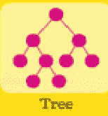


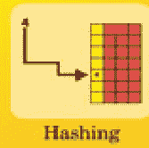


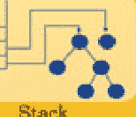

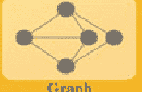

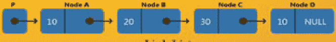

Brijesh Bakariya 博士

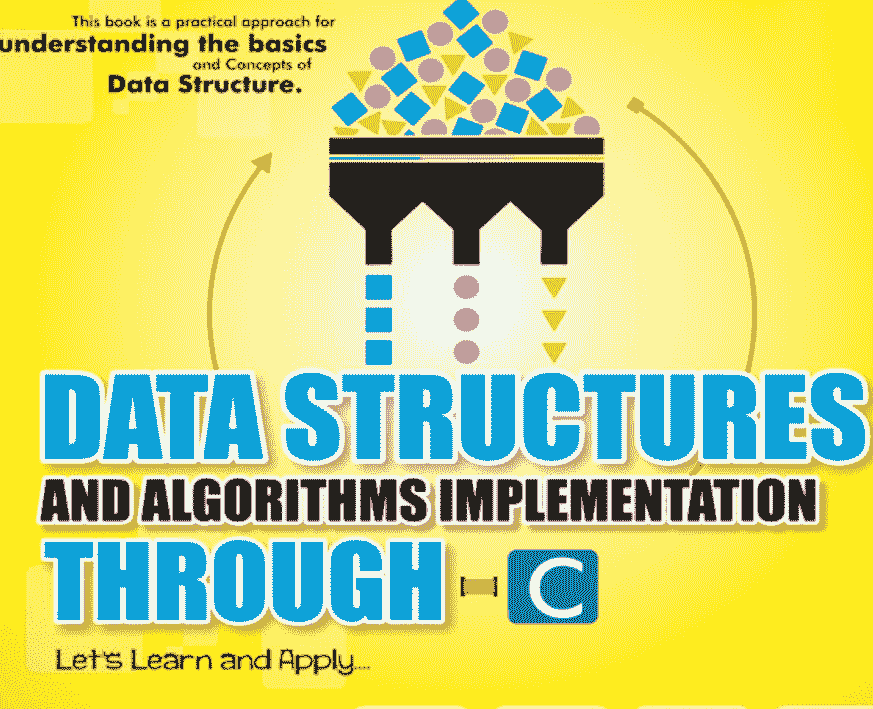

## 通过 C 语言实现数据结构与算法

让我们学习并应用……

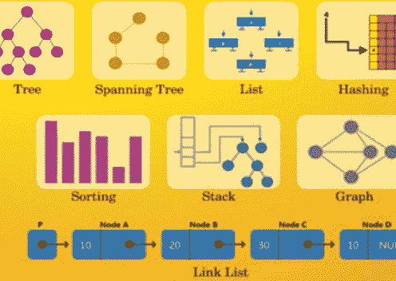

Brijesh Bakariya 博士


## 通过 C 语言实现数据结构与算法

作者：Brijesh Bakariya 博士


## 前言

这本书是一本理解数据结构基础和概念的实用方法。

## 5.4 从数组中删除元素的步骤

## 5.5 数组的合并

## 5.6 多维数组

## 5.7 指针

## 10.18 B+ 树

# 第11章：图

## 11.1 图简介

## 11.3 图的表示

- 11.4.1 DFS（深度优先搜索）

## 11.5 包含树

- 11.5.2 包含树的应用

- 11.6.1.1 Kruskal 算法

## 11.7 最短路径

- 11.7.2 Bellman Ford 算法

## 12.2 搜索的类型

## 13.2 排序的类型

- 13.3.1 冒泡排序

- 13.3.3 插入排序

- 13.3.5 归并排序

## 14.5 冲突解决技术 (CRT)

# 第一章

## 算法与流程图

### 1.1 算法简介

首先，在编写任何程序或软件之前，我们必须对它进行文档编制。这些文档提供了关于该整个软件的信息。该程序或软件可以在任何编程语言中部署，但如果以后需要对该程序或软件进行某些更改，那么它的算法或文档就非常重要。

通过学习文档，你可以获得关于该软件的完整信息，并很容易地对其进行一些更改。因此，我们可以说对软件的理解通过算法得到了增强。

让我们来看一个例子。

| | | |
|---|---|---|
| 2 | 它与高层编程语言密切相关。 | 它用自然语言编写。 |
| 3 | 转换为程序并不容易。 | 它很容易转换为程序。 |

表 1.1: 算法与伪代码之间的区别

### 示例 1：编写一个算法、流程图和程序来打印 1 到 100。

解决方案：

算法：

- 步骤 1. 开始
- 步骤 2. 初始化 `N` 为 0
- 步骤 3. `N` 加 1
- 步骤 4. 打印 `N`
- 步骤 5. 如果 `N` 小于 100，则返回步骤 3。

流程图：

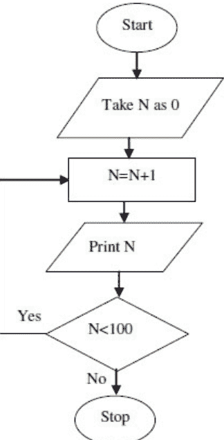

图 1.3: 打印 1 到 100 的流程图

#### C语言程序：

```c
#include <stdio.h>
#include <conio.h>
void main() {
  int N;
  clrscr();
  N=0;
  while (N<100) {
    N=N+1;
    printf("%d", N);
  }
}
```

#### 输出：

12345678910111213141516171819202122232425262728293031323334353637383940142434445464748495051525354555657585960616263646566676869970172737475767778798081828384858687888990919293949596979899100

### 示例 2：编写一个算法、流程图和程序来显示给定数字是偶数还是奇数。

解决方案：

算法：

- 步骤 1. 开始
- 步骤 2. 从用户处获取数字 `num`
- 步骤 3. 检查数字是否被 2 整除
- 步骤 4. 如果是，打印 EVEN（偶数）
- 步骤 5. 否则打印 ODD（奇数）
- 步骤 6. 停止

流程图：

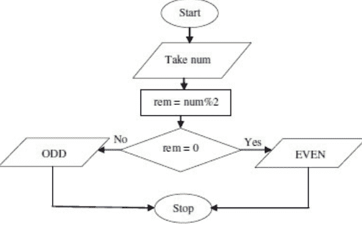

图 1.4: 显示给定数字是偶数还是奇数的流程图

#### C语言程序：

```c
#include <stdio.h>
void main()
{
    int num, rem;
    printf("Enter a number \n");
    scanf("%d", &num);
    rem=num%2;
    if(rem==0)
        printf("EVEN \n");
    else
        printf("ODD \n");
    getch();
}
```

#### 输出：

Enter a Number 18

EVEN

### 示例 3：编写一个算法、流程图和程序显示三个数中的最大数。

解决方案：

算法：

- 步骤 1. 开始。
- 步骤 2. 获取三个数字 `A`, `B` 和 `C`
- 步骤 3. 如果 `A>B` 为真，跳转到步骤 4，否则跳转到步骤 6
- 步骤 4. 如果 `A>C` 为真，则显示 `A` 并跳转到步骤 8
- 步骤 5. 否则显示 `C` 并跳转到步骤 8
- 步骤 6. 如果 `B>C`，则显示 `B` 并跳转到步骤 8
- 步骤 7. 否则跳转到步骤 8
- 步骤 8. 停止

流程图：


图 1.5: 显示三个数最大值的流程图

#### C语言程序：

```c
#include <stdio.h>
#include <conio.h>

void main()
{
    int A, B, C;
    clrscr();
    printf("Enter three numbers\n");
    scanf("%d %d %d", &A, &B, &C);
    if (A > B) {
        if (A > C)
            printf("%d is the greatest", A);
        else
            printf("%d is the greatest", C);
    } else {
        if (B > C)
            printf("%d is the greatest", B);
        else
            printf("%d is the greatest", C);
    }
    getch();
}
```

#### 输出：

Enter three numbers

1

2

19

3 is the greatest

### 示例 4：编写一个算法、流程图和程序来打印前 `N` 个自然数的和。

解决方案：

算法：

- 步骤 1. 开始。
- 步骤 2. 获取数字 `n`
- 步骤 3. 赋值 `Sum=0`, `i=1`;
- 步骤 4. 如果 `i<=N`
- 步骤 5. `Sum=Sum+i`;
- 步骤 6. 返回到步骤 4
- 步骤 7. 打印 `Sum`
- 步骤 8. 停止

流程图：


图 1.6: 打印前 `N` 个自然数的和流程图

#### C语言程序：

```c
#include <stdio.h>
#include <conio.h>

void main()
{
    int i, num, sum = 0;
    clrscr();
    printf("Enter integer number \n");
    scanf("%d", &num);
    for (i = 1; i <= num; i++)
    {
        sum = sum + i;
    }
    printf("Sum of %d natural numbers = %d\n", num, sum);
    getch();
}
```

#### 输出：

Enter integer number

5

Sum of 5 natural numbers = 15

### 示例 5：编写一个算法、流程图和程序检查数字是否为质数。

解决方案：

算法：

- 步骤 1. 开始
- 步骤 2. 获取三个变量 `num`, `i`, `count`
- 步骤 3. 初始化 `i=2` 和 `count=0`
- 步骤 4. 检查 `i` 是否小于 `num/2`
- 步骤 5. 如果是，将 `num` 除以 `i` 并比较余数是否为零
- 步骤 6. 如果是，则增加 `count` 的值
- 步骤 7. 如果是，则显示“该数字是质数”并跳转到步骤 9
- 步骤 8. 否则显示“该数字不是质数”
- 步骤 9. 停止

流程图：


图 1.7: 检查数字是否为质数的流程图

#### C语言程序：

```c
#include<stdio.h>
#include<conio.h>

void main()
{
    int num, i, count = 0;
    printf("Enter a number:");
    scanf("%d", &num);
    for (i = 2; i <= num / 2; i++)
    {
        if(num % i == 0)
        {
          count++;
          break;
        }
    }
    if (count == 0)
      printf("PRIME \n");
    else
      printf("NOT PRIME \n");
    getch();
}
```


图 2.1: 算法分析的流程

算法用于将我们的问题解决方案转换为逐步执行的语句。这些语句可以转换为计算机编程指令，从而形成一个程序。该程序由计算机执行以产生解决方案。算法的总时间取决于编译时间和运行时间。

`T (A) = C (A) + R (A)`。在这里，`T (A)` 是总时间，`C (A)` 是编译时间，而 `R (A)` 是运行时间。编译时间取决于你所使用的编程语言和软件，而运行时间完全取决于硬件。

### 2.5 算法分析

算法分析有两种类型：

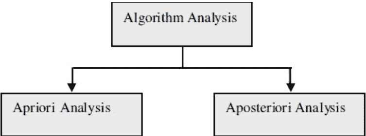

图 2.2: 算法的分析

#### 2.5.1 先验分析 (Apriori Analysis)

它是对语句数量级的确定，或者说，一个特定语句执行了多少次？先验分析取决于编程语言和硬件。它总是给出一个近似解，而不是精确解，因为先验算法总是在实现之前进行分析。

后验算法 (Aposteriori algorithm) 总是在实现后进行分析。这种算法总是给出一个准确的解，因为它在分析中被用于实现编程语言。这种分析取决于具体处理器之间的差异。

以下是计算复杂度的示例。

**示例 1：** 找出以下 C 代码的时间复杂度。

```c
main ()
{
    z = x + y; // statement 1
}
```

**解：** 为了计算上述代码的复杂度，我们只需要检查语句的数量级（或语句的频率）。这里，语句 `z = x + y` 的数量级为 1。因此，语句 1 的时间复杂度为 `O (1)`。

**示例 2：** 找出以下 C 程序的时间复杂度。

```c
main ()
{
    z = x + y; //statement 1
    for (i=1; i <= n; i++)
    {
        a = b + c; // statement 2
    }
}
```

**解：** 语句 1 的数量级是 1，但语句 2 的数量级是 `n`。两个语句的总时间复杂度为 `n + 1` 或 `O (n)`，因为常数的值不影响复杂度。这就是为什么我们忽略了 `O (1)`。

**示例 3：** 找出以下 C 程序的时间复杂度。

```c
main ()
{
  z = x + y; //statement 1
  for (i =1; i <= n; i++)
  {
    a = b + c; // statement 2
  }
  for (p = 1; p <= n; p++)
  {
    for (q = 1; q <= n; q++)
    {
      l = m + n; // statement 3
    }
  }
}
```

**解：** 语句 1 的数量级为 1，语句 2 为 `n`，但语句 3 的数量级是 `n²`。所有三个语句的总时间复杂度为 `n² + n + 1` 或 `O (n²)`，因为我们需要取 `n` 的最高次方。

**示例 4：** 找出以下 C 程序的时间复杂度。

```c
main ()
{
  for (i = 1; i <= n; i++)
  {
    for (j = 1; j <= n; j++)
    {
      x = y + z; //statement 1
      a = b + c; // statement 2
    }
  }
}
```

**解：** 语句 1 和语句 2 的复杂度都是 `n²`。因为常数值不影响复杂度，这就是为什么我们忽略了 `O (1)` 部分。

**示例 5：** 找出以下 C 程序的时间复杂度。

```c
main ()
{
  z = x + y; //statement 1
  for (i = 1; i <= n; i++)
  {
    a = b + c; // statement 2
```

**解：** 语句 1 的数量级是 1，语句 2 的数量级是 `n`。总时间复杂度是 `n + 1` 或 `O (n)`，因为常数值不影响复杂度。

**示例 6：** 找出以下 C 程序的时间复杂度。

```c
main ()
{
  z = x + y; //statement 1
  for (i = 1; i <= n; i++)
  {
    a = b + c; // statement 2
  }
  for (p = 1; p <= n; p++)
  {
    for (q = 1; q <= n; q++)
    {
      l = m + n; // statement 3
    }
  }
}
```

**解：** 语句 1 的数量级为 1，语句 2 为 `n`，语句 3 为 `n²`。总时间复杂度为 `n² + n + 1` 或 `O (n²)`。

即 `f(n) \le c \cdot g(n)`，对于所有 `$n \ge n_0$`。这种符号用于算法的最坏情况分析。

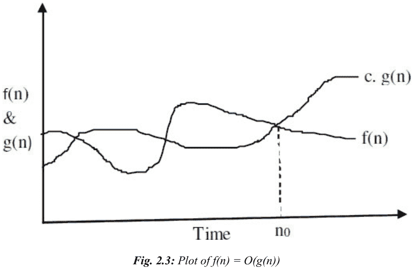

### 示例 10：满足给定函数的 Big-oh 条件

`f(n) = 2n`

`g(n) = n`

解：

`f(n) = O(g(n))`

`2n ≤ c \cdot n`，对于所有 `$n \ge n_0$`

此处 `$c \ge 2$` 以满足该函数。

### 2. Omega 表示法 (Ω 表示法)

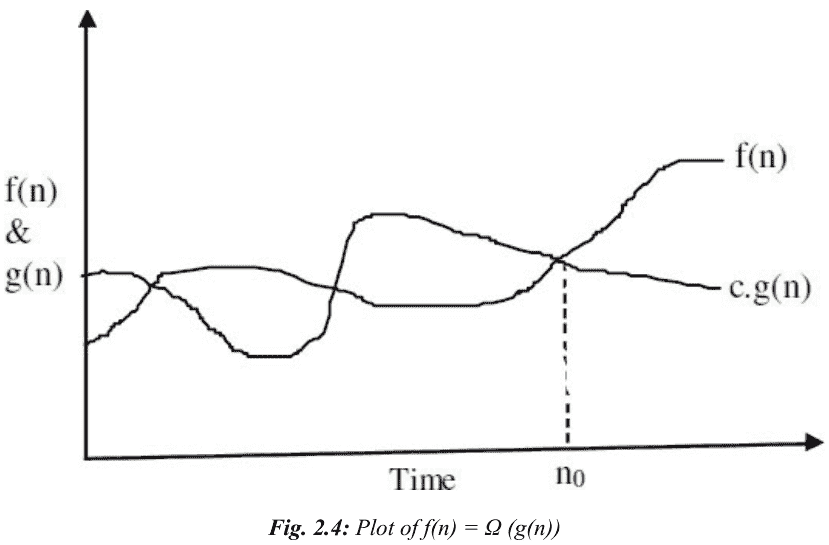

**示例 11：**满足给定函数的 Big-oh 条件

`f(n) = n^2`

`g(n) = n^2`

解：

`f(n) = \Omega(g(n))`

`n^2 ≥ c \cdot n^2`，对于所有 `$n \ge n_0$`

此处 `$c \le 1$` 以满足该函数。

### Theta 表示法 (Θ 表示法)

这是一种算法运行时间下界的方法。假设存在两个非负函数 `f(n)` 和 `g(n)`，那么当且仅当存在两个常数 `$c > 0$` (此处此处应为 `$c_1, c_2 > 0$`) 和 `$n_0 > 0$` 时，对于所有 `$n \ge n_0$` 都有 `$c_1 \cdot g(n) \le f(n) \ge c_2 \cdot g(n)$`。这种符号用于算法的最优情况分析。

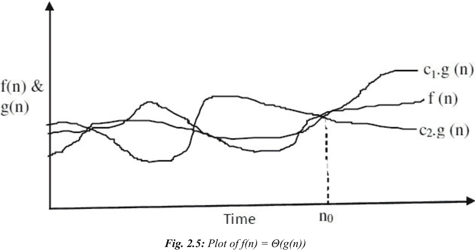

### 示例 12：满足给定函数的 Big-oh 条件

`f(n) = n`

`g(n) = n`

解：

`f(n) = \Theta(g(n))`

`c1 \cdot g(n) \ge f(n)`

`1 * n \ge n`，此处 `$c_1=1$`

`f(n) \ge c2 \cdot g(n)`

`n \ge 1 \times n`，此处 `$c_2=1$`

因此 `f(n) = (g(n))`

根据函数的增长情况，算法在不同的时间内执行指令。以下是根据函数增长的列表：

- 常数时间复杂度 = `O(1)`
- 对数时间复杂度 = `O(log n)`
- 线性时间复杂度 = `O(n)`
- 平方时间复杂度 = `O(n^2)`
- 立方时间复杂度 = `O(n^3)`
- 6. 多项式时间复杂度 = `O(n^k)`，其中 `$k>3$`


7. 指数时间复杂度 = `O(a^n)`，其中 `a > 1`

注意：这些所有类型的复杂度都是按增加顺序排列的。根据时间复杂度的排列如下：

`O(1) < O(log n) < O(n) < O(n^2) < O(n^3) < O(n^k) < O(a^n)`

表 2.1 显示了根据函数增长的值。该表显示了根据不同复杂度的不同值。

| log n | n | n log n | n^2 | n^3 | 2^n |
| --- | --- | --- | --- | --- | --- |
| 0 | 1 | 0 | 1 | 1 | 2 |
| 1 | 2 | 2 | 4 | 8 | 4 |
| 2 | 4 | 8 | 16 | 64 | 16 |
| 3 | 8 | 24 | 64 | 512 | 256 |
| 4 | 16 | 64 | 256 | 4,096 | 65,536 |
| 5 | 32 | 160 | 1,024 | 32,768 | 4,294,967,296 |

表 2.1：不同值下的函数增长

### 示例 13：考虑以下函数

`f(n) = n`

`g(n) = n^2`

以下哪一项正确？

- (a) `f(n) = O(g(n))`
- (b) `f(n) = Ω(g(n))`
- (c) `f(n) = Θ(g(n))`
- (d) 无

解：上述示例的解是 `f(n) = O(g(n))`，因为根据 Big-oh 的定义，`f(n) ≤ c · g(n)`。此处 `f(n) = n` 且 `g(n) = n^2`，则 `n ≤ c · n^2`，其中 `c = 1`。因此 `n ≤ n^2`。选项 a) 是正确的。

### 示例 14：考虑以下函数

`f(n) = n^2`

`g(n) = 2^n`

以下哪一项正确？

- (a) `f(n) = O(g(n))`
- (b) `f(n) = Ω(g(n))`
- (c) `f(n) = Θ(g(n))`
- (d) 无

解：为了得到上述问题的解，我们必须检查上述两个函数的增长情况。

| n | n^2 | 2^n |
| --- | --- | --- |
| 1 | 1 | 2 |
| 2 | 4 | 4 |
| 3 | 9 | 8 |
| 4 | 16 | 16 |
| 5 | 25 | 32 |
| 6 | 36 | 64 |

函数的增长显示 `f(n) = O(g(n))`。对于所有 `n ≥ n0`，`f(n) ≤ c · g(n)`。在此示例中，`n0` 的值为 16。在值 16 之后，函数的增长显示 a) 是正确的。

### 示例 15：考虑以下函数

`f(n) = 2^n`

`g(n) = n`

以下哪一项正确？

- (a) `f(n) = O(g(n))`
- (b) `f(n) = Ω(g(n))`
- (c) `f(n) = Θ(g(n))`
- (d) 无

解：为了得到上述问题的解，我们必须检查上述函数的增长情况。

| n | 2^n | n |
| --- | --- | --- |
| 1 | 2 | 1 |
| 2 | 4 | 2 |
| 3 | 8 | 3 |
| 4 | 16 | 4 |
| 5 | 32 | 5 |

函数的增长显示 `f(n) = O(g(n))`。对于所有 `n ≥ n0`，`f(n) ≤ c · g(n)`。在此示例中，`n0` 的值为 4。在值 4 之后，函数的增长显示 a) 是正确的。

### 示例 16：考虑函数

`f(n) = n^2 log n`

`g(n) = n (log n)`

以下哪一项正确？

- (a) `f(n) = O(g(n))`
- (b) `f(n) = Ω(g(n))`
- (c) `f(n) = Θ(g(n))`
- (d) 无

解：函数 `f(n)` 所花费的时间是二次和对数的乘积。函数 `g(n)` 取的是线性和对数的乘积。根据复杂度，`f(n) ≥ c · g(n)`。因此 `f(n) = Ω(g(n))`，选项 b) 是正确的。

### 示例 17：检查以下陈述正确或错误

- i. `(n + k)^m = O(n^m)` 其中 `k` 是正常数。
- ii. `2^(n+1) = O(2^n)`
- iii. `2^n = O(2^2)`

解：

- i. `(n + k)^m = O(n^m)` 假设 `k = 2` 且 `m = 4`，则 `(n + 2)^4 = n^4`，语句 i) 是正确的。
- ii. `2^(n+1) = O(2^n)` 或 `2^n = O(2^n)` 常数的值没有影响，因此语句 ii) 是正确的。
- iii. `2^n = O(2^2)`。根据 Big-oh 条件，`f(n) ≤ c · g(n)`，则 `2^n ≤ 2^2` 是错误的。因此语句 iii) 是错误的。

### 示例 18：检查以下陈述正确或错误

- i. `n^3 log_b^n = Θ(n^5)`
- ii. `4^n = Θ(2^n)`
- iii. `2^n log 2^n = Θ(n^2)`

解：

- i. `n^3 log_b^n = log_b^a`。根据这个公式，`n^2 log 2^n = n^5`。因此 `n^5 = Θ(n^5)`，语句 i) 是正确的。
- ii. `4^n / 2^n = 2^n`。因此 `2^n = Θ(2^n)`。
- iii. `2^n log 2^n = n^1`。那么 `n^1 = Θ(n^2)` 是正确的。因此 `2^n = Θ(n^2)` 是错误的。

### 示例 19：找到以下函数的复杂度。


解：

`f(n) = 1 + 2 + 3 + ... = n(n + 1) / 2 = O(n^2)`

### 示例 20：找到以下函数的复杂度。


解：

`f(n) = 1^2 + 2^2 + 3^2 + ... + n^2 = (n + 1)(2n + 1) / 6 = O(n^3)`

### 示例 21：找到以下函数的复杂度。

`f(n) = Σ(i=1 到 n) x^i`

解：

`f(n) = x^1 + x^2 + x^3 + ... + x^n = x(x^n - 1) / (x - 1) = O(x^n)`

### 示例 22：找到以下函数的复杂度。

`f(n) = n`

解：

`f(n) = n`

### 示例 23：找到以下函数的复杂度。

`f(n) = n^2 log n`

`g(n) = n (log n)`

### 示例 24：找到以下函数的复杂度。

`f(n) = n^2`

解：

`f(n) = n^2`

### 示例 25：证明 `f(n) = O(n^2)`

解：

为了得到上述问题的解，我们必须检查上述函数的增长情况。

| n | n^2 | 2^n |
| --- | --- | --- |
| 1 | 1 | 2 |
| 2 | 4 | 4 |
| 3 | 9 | 8 |
| 4 | 16 | 16 |
| 5 | 25 | 32 |
| 6 | 36 | 64 |

函数的显示显示 `f(n) = O(g(n))`。对于所有 `n ≥ n0`，`f(n) ≤ c · g(n)`。在此示例中，`n0` 的值为 16。在值 16 之后，函数的增长显示 a) 是正确的。

### 2.7 渐近符号的性质

渐近符号有各种性质。如下：

#### 反射性

- `f(n) = O(f(n))`
- `f(n) = Ω(f(n))`
- `f(n) = Θ(f(n))`

#### 对称性

- `f(n) = O(g(n))` 则 `g(n) ≠ O(f(n))`
- `f(n) = Ω(g(n))` 则 `g(n) ≠ Ω(f(n))`
- `f(n) = Θ(g(n))` 则 `g(n) ≠ Θ(f(n))`

#### 传递性

- `f(n) = O(g(n))` 且 `g(n) = O(h(n))` 则 `f(n) = O(h(n))`
- `f(n) = Ω(g(n))` 且 `g(n) = Ω(h(n))` 则 `f(n) = Ω(h(n))`
- `f(n) = Θ(g(n))` 且 `g(n) = Θ(h(n))` 则 `f(n) = Θ(h(n))`

#### 其他性质

- `f(n) = O(n/2)`
- 如果 `f(n) = O(g(n))` 则 `log(f(n)) = O(log(g(n)))`
- 如果 `f(n) = O(g(n))` 则 `2f(n) = O(2g(n))`
- 如果 `f(n) = O(g(n))` 则 `h(n) · f(n) = O(h(n) · g(n))`
- `f(n) = O(g(n))^2`
- 如果 `f(n) = O(d(n))` 且 `g(n) = O(h(n))` 则 `f(n) + g(n) = O(d(n) + h(n))`
- 如果 `f(n) = O(d(n))` 且 `g(n) = O(h(n))` 则 `f(n) × g(n) = O(d(n) × h(n))`

## 练习

A. 为下列每个问题选择正确选项：

- a. 算法效率的两个主要衡量标准
  1. 处理器和内存
  2. 复杂度和容量
  3. 时间和空间
  4. 数据和空间

- b. O 符号提供了一个渐近的
  1. 上界
  2. 光学界
  3. 下界
  4. 以上均不是

- c. 确定算法效率时，时间因素通过什么衡量
  1. 计数微秒
  2. 计数关键操作次数
  3. 计数语句数量
  4. 计数算法的千字节

- d. 确定算法效率时，空间因素通过什么衡量
  1. 计数算法所需的最大内存
  2. 计数算法所需的最小内存
  3. 计数算法所需的平均内存
  4. 计数算法所需的最大空间

- e. 复杂度理论中不存在哪种情况
  1. 最优情况
  2. 最坏情况
  3. 平均情况
  4. 空情况

B. 该函数的上界是什么？

`f(n) = 11n^3 + 7n^2 + 2n + 9`

C. 编译时间和运行时间有什么区别？

D. 最优情况复杂度与最坏情况复杂度的区别。

E. 下述算法的时间空间复杂度是多少？

```
void show()
{
  int a,b,c,d;
  d = a+b+c;
  printf("%d",d);
}
```

F. 求出下列函数的 Big-oh (O) 符号：

- (a) `f(n) = 4332`
- (b) `f(n) = 22n^2 + 55`
- (c) `f(n) = 76n^2 + 24n + 67`
- (d) `f(n) = n^4 + 33n^2 + 88`

G. 求出下列函数的 Big-omega (Ω) 和 Big-Theta (Θ) 符号：

- (a) `f(n) = 44 × 21 + 37`
- (b) `f(n) = 61n^2 + 10`
- (c) `f(n) = 16n^3 + 14n + 37`
- (d) `f(n) = n^5 + 61n^3 + 12`

# 第 3 章

数据结构引论

## 3.1 引言

通常情况下，数据的组织是必要的，因为数据组织良好后才能于访问。数据结构在我们的日常生活中起着非常重要的角色。在任何商店、商场里，所有商品都放置在合适的位置，这样搜索商品变得更容易。如果任何物品都能得到管理，访问所需的时间就会减少。数据结构也是以适当的方式对数据进行组织。

## 3.2 定义

数据结构表示数据之间的逻辑关系。此外，它是以高效方式组织数据。数据结构主要用于四个功能：

1. 数据组织
2. 数据访问方法
3. 关联程度
4. 信息处理

## 3.3 数据结构的分类

数据结构通常分为两部分：

1. 基础型数据结构
2. 非基础型数据结构

### 3.3.1 基础型数据结构

这是一种基本数据结构，直接在机器指令中操作。例如整数、字符、浮点、指针等。

### 3.3.2 非基础型数据结构

这是一种由预测复合工具派生的复杂数据结构。非基础型数据结构引入了同构类型和异构类型。例如数组和结构。

通常，数据结构可以分为四类：

1. 创建
2. 删除
3. 访问
4. 修改

#### 创建

该操作保留内存。此操作在声明时执行。

#### 删除

该操作销毁内存。占用内存使用 `malloc()` 和 `calloc()` 函数。但如果要销毁内存使用 `free()` 函数。

#### 访问

该操作用于访问数据。如果数据存在数据结构中则操作成功，否则失败。

#### 修改

该操作用于更新数据结构的数据。执行修改操作后，之前的数据会被销毁。（图 3.1）


### 3.4 数组

数组是相同类型元素的集合。它是最重要的数据结构之一，以连续格式存储数据。也被称为线性或同构数据结构，因为它是顺序访问的。当我们声明变量时，关于变量有三个重要点：变量名、变量值和变量地址，如图 3.2 所示。


#### 3.4.1 数组的声明和初始化

假设我们要声明一个长度为 5 的整数数组，声明为：`int a[5];`

我们需要在下标中放入值。该值表示数组的大小。显示数组中的总元素。默认情况下，数组的值是垃圾值，如图 3.3 所示。

| a[0] | a[1] | a[2] | a[3] | a[4] |
| --- | --- | --- | --- | --- |
| 1000 | 1002 | 1004 | 1006 | 1008 |

图 3.3：数组的内存分配

数组的第一个索引从零开始，该地址被称为数组的基地址。数组的总大小是最大索引减 1，因为索引是从零开始。当我们提供数组的值时，被称为数组的初始化，我们可以初始化数组：

1. 在声明数组时。
2. 逐个初始化或使用输入函数 (`scanf()`)

```
int a[5] = {1, 2, 6, 4, 5}
a[0] = 1;
a[1] = 2;
a[2] = 6;
a[3] = 4;
a[4] = 5;
```

当我们初始化数组时，垃圾值被替换为我们提供的值。可以通过图 3.4 理解该过程。

| a[0] | a[1] | a[2] | a[3] | a[4] |
| --- | --- | --- | --- | --- |
| 1 | 2 | 3 | 4 | 5 |
| 1000 | 1002 | 1004 | 1006 | 1008 |

图 3.4：数组的初始化

## 3.5 栈

栈是非常重要的数据结构，它是同类型元素的集合。我们可以按顺序访问数据。插入和删除从栈的一个端——栈顶。在栈中，插入操作称为 `push`，删除操作称为 `pop`。栈遵循后进先出（LIFO）属性，最后插入的元素将第一个被访问。因此，栈推需要常数时间，而在最坏情况下需要线性时间。实现栈数据结构有两种方法，一种是编译时实现，另一种是运行时实现。我们可以通过图 3.5 和图 3.6 理解整个过程。


图 3.5：编译时的栈实现。

## 3.6 队列

队列是插入和删除从两个不同端进行的数据结构。插入操作在一个称为队尾（rear）的端进行，删除在另一个队头（front）的端进行。队列数据结构遵循先进先出（FIFO）属性，即先插入的元素将先被删除。现实生活中有很多队列的例子，如火车预订、电影院的票务柜台队列。实现队列数据结构有两种方法，一种是编译时实现，另一种是运行时（动态）实现。对于编译时实现队列，我们使用数组；对于运行时实现，我们可以通过图 3.7 和图 3.8 理解整个过程。


## 3.7 链表

这是一种线性数据结构之一。链表包含一个或多个元素。我们可以根据需要插入和删除元素。我们可以在链表的任何地方插入、删除和修改数据。例如，我们需要从手机店购买一些商品。这里所有商品都是相互依赖的。（图 3.9）

手机

手机壳

SIM卡

耳机


## 3.8 树

栈、队列、链表是线性数据结构，无法以分层次的方式表示。树是非线性数据结构，可以以分层次的方式表示。树数据结构是节点和边的集合。节点不是按顺序表示的，可以放置在任何地方。树的第一个节点被称为树的根，所有其他节点被称为内部节点和叶子节点。考虑一个例子：

我们可以从图 3.10 中看到马哈哈拉邦（Madhya Pradesh）政府学院的树形结构。


图 3.10：MP 邦不同学院的树形表示

## 3.9 图 (Graph)

这这也是一种非线性数据结构。图是顶点（节点）和边的集合。此外，图可以通过顶点和边的组来构建。树和图的区别在于：在树中，没有自环，或者说树是一种没有自环的特殊类型的图。我们可以通过图 3.11 来理解整个过程。


图 3.11：图的表示

在图 3.11 中，`P`, `Q`, `R`, `S`, `T` 是顶点（节点），`e1`, `e2`, `e3`, `e4`, `e5`, `e6` 是边。图中共有三个自环，即第一个是 `P, Q, R, S`，第二个是 `Q, T, R, S`，第三个是 `Q, T, R`。

## 3.10 C语言中的内存分配

C 中有两种类型的内存分配：

1. 静态
2. 动态

### 3.10.1 静态分配

如果我们将变量声明为静态或全局的，就会发生这种分配。在这种分配中，首先，我们声明变量的块大小。

### 3.10.2 动态分配


这是技术之一，首先由用户在运行时决定块的大小。有四种函数用于决定内存分配和内存释放。

- `malloc()` 函数
- `calloc()` 函数
- `free()` 函数
- `realloc()` 函数

### `malloc()` 函数

该函数在运行时分配内存。在这个函数中，内存将根据用户的需要创建。该函数的优点是内存不会被浪费。内存分配是连续格式的，这意味着假设指针持有第一个块的地址，那么我们可以从该分配中检索所有数据。我们还可以调整内存块的大小。

```
malloc (n * size of (Data type))
```

这里 `n` 是块的数量，`size of` 语句显示你想要插入的数据类型。该函数返回块的基地址（起始地址）。

```
int * P;
```

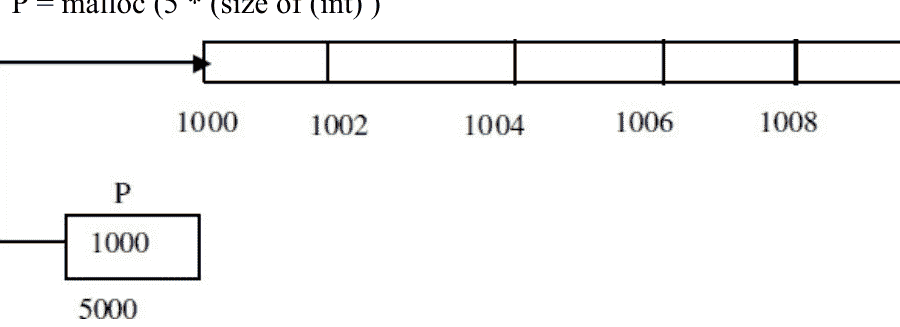

图 3.12：运行时的内存分配过程

**图 3.12**，`p` 是一个持有第一个块地址的指针，有 5 个块，每个块占用 2 字节。我们假设基地址是 1000，这就是为什么指针指向 1000。默认情况下，块的值是垃圾值。这里有以下示例以便更好地理解。

**示例 1：**

```c
#include<stdio.h>
#include<conio.h>
main ()
{
int n;
int *p ;
printf("enter no. of block size");
scanf("%d", &n);
p = malloc(n * size of (int));
for(i = 0; i < n; i++)
{
scanf("%d", (p+i));
}
for(j =0; j < n; j++)
{
  printf("Numbers are: %d", *(p+j));
}
}
```

**输出：**

```
enter no. of block size 5
10 20 30 40 50
Numbers are: 10 20 30 40 50
```

### `calloc()` 函数

该函数用于运行时内存分配。但 `malloc()` 和 `calloc()` 之间有两种类型的区别。第一个是 `malloc()` 函数接受一个参数，而 `calloc()` 接受两个参数。`malloc()` 的默认是垃圾值，而 `calloc()` 是零。如果 `malloc()` 和 `calloc()` 函数无法分配内存，它们将返回 `NULL` 值。以下是 `calloc()` 函数的语法。

```
calloc (number of blocks, size of each block);
```

**示例 2：**

```c
void main()
{
    int *ptr;
    int i;
    int j;
    printf("enter the number of elements");
    scanf("%d", &n);
    p=calloc(n, 2);
    for(i=0;i<n;i++)
    {
        scanf("%d", p+i);
    }
    p=calloc(n, 2);
    for(j=0;j<n;j++)
    {
        printf("Numbers are: %d", *(p+j));
    }
    getch();
}
```

**输出：**

```
enter the number of elements 5
10 20 30 40 50
Numbers are: 10 20 30 40 50
```

### `free()` 函数

此 `free()` 函数用于释放之前由 `malloc()` 和 `calloc()` 函数分配的内存。`free()` 函数在运行时释放内存。`free()` 函数的语法：

```
free(void *ptr);
```

我们必须在 `free()` 函数中传递一个参数。该函数释放整个块，但我们必须传递块的基地址。

### `realloc()` 函数

此 `realloc()` 函数用于运行时调整之前由 `malloc()` 和 `calloc()` 分配的内存大小。`realloc()` 的语法是

```
void * realloc(void *
```

示例 3：

```c
#include <stdio.h>
#include<conio.h>
main ()
{
int n;
int *p ;
printf("enter no. of block size");
scanf("%d", &n);
p = malloc(n * size of (int));
for(i = 0; i < n; i++)
{
scanf("%d", (p+i));
}
for(j =0; j < n; j++)
{
  printf("Numbers are: %d", *(p+j));
}
}
```

## 数据的函数 (Functions of Data)

数据结构上有各种函数操作：

- 遍历：意味着访问所有数据。
- 搜索：为了查找特定的数据。
- 插入：在数据中添加新元素。
- 删除：从数据中移除元素。
- 排序：按升序或降序排列。
- 合并：将两个文件合并为一个文件。

## 练习

A. 为下列各项选择正确选项：

a. 数据结构指的是

1. 数据的组织
2. 标准
3. 编程语句
4. 以上都不是

b. 数据类型根据区分

1. 存储方式
2. 操作类型
3. 使用
4. a 和 b

c. 数据无非

1. 信息的集合
2. 信息的碎片
3. 编程语句
4. 以上都不是

d. 栈也被称为

1. 后进出
2. 先进出
3. 后进先
4. 先进先

e. 可以被程序所有模块访问的变量是

1. 全局变量
2. 静态变量
3. 自动变量
4. 局部变量

f. 当数据需要存储并反向检索时，队列非常有用

1. 栈
2. 队列
3. 列表
4. 链列表

g. 下列是线性数据结构？

1. 栈
2. 列表
3. 字符串
4. 树

h. 下列是非线性类型？

1. 字符串
2. 列表
3. 栈
4. 图

i. 用于层次数据模型的数据结构是

1. 队列。
2. 树
3. 图
4. 栈

B. 写出原始结构和非原始结构的区别。

C. 什么是动态分配？结合示例讨论。

D. 如何声明和初始化数组？

E. 什么是线性和非线性数据结构？

F. 什么是栈和队列数据结构？

G. 什么是树和图数据结构？

# 第4章

## 函数与递归

## 引言

我们可以通过生活中的例子来理解函数，假设一个级有50个学生，全班想组织一次活动。组织活动有5个不同的任务，如装饰、食物、娱乐、奖品发放和主持。组织活动有两种方法，首先是逐个完成任务，其次是将学生分成相等的小组并让每组完成任务。显然，第二种方法简单且高效。同样，函数意味着你将任务或问题划分为不同的模块，并为每个模块编写代码。如果你使用函数，你的代码会自动减少，因为函数可以被多次调用但只定义一次。

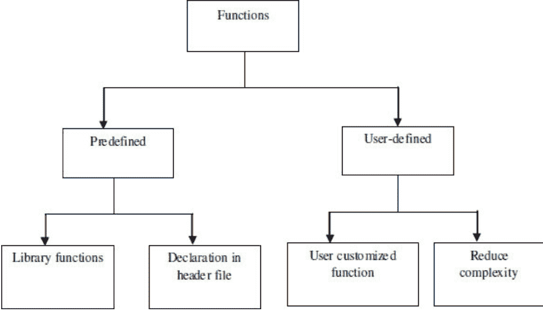

图 4.1: 函数类型

### 预定义函数

预定义函数是 C 语言中的内置函数，用于处理数学计算、I/O 处理、字符串处理等任务。这些函数定义在头文件中。当包含该头文件时，这些函数就可以可以使用。例如：`printf()` 是一个在屏幕上显示输出的预定义函数。该函数定义在 `"stdio.h"` 头文件中，这就是为什么我们首先要写 `#include<stdio.h>`。同样，`scanf()`、`clrscr()`、`getch()` 等也是定义在不同头文件中的。

### 用户定义函数

用户定义函数是为了满足用户需求而构建的。假设我们需要两个两个相加，那么用户定义函数的程序如下：

## 函数原型

函数原型简单来说就是函数的声明，指定了函数的名称、参数和返回类型。它不包含函数体。函数原型告诉编译器，该函数稍后可能会在程序中使用。函数原型的语法是：`返回类型 函数名(传递的参数的数据类型);`

在示例 1 中，`add(int, int);` 是函数原型，它向编译器提供了以下信息：函数名为 `add()`，函数返回类型为 `int`，向函数传递了两个 `int` 类型的参数。

注意：如果用户定义函数定义在 `main()` 函数之前，则不需要函数原型。

### 示例 1：使用预定义函数打印名字的程序。

解决方案：

```
#include<stdio.h>
#include<conio.h>
void main()
{
    char name[20];
    clrscr();
    printf("Enter your name:");
    scanf("%s", name);
    printf("Your name is : %s", name);
    getch();
}
```

#### 输出：

```
Enter your name: MISTHI
Your name is: MISTHI
```

在此代码中使用了四个预定义函数，`printf()` 和 `scanf()` 函数定义在头文件 `"stdio.h"` 中，而 `clrscr()` 和 `getch()` 定义在头文件 `"conio.h"` 中。

### 示例 2：使用用户定义函数两个两个数字的程序。

解决方案：

```
#include<stdio.h>
#include<conio.h>
int add(int, int); // 函数原型
```

```
void main()
{
  int num1, num2, sum;
  clrscr();
  printf("Enter two numbers:", &num1,&num2);
  scanf("%d%d", &num1,num2);
  sum = add(num1, num2); // 函数调用
  printf("The sum of two numbers is: %d", sum);
  getch();
}
```

```
int add(int x, int y) // 函数定义
{
  int z=x+y;
  return(z);
}
```

输出：

```
Enter two numbers:
10
20
The sums of two numbers is: 30
```

用户定义函数有各种优点，例如程序将更易理解、维护和调试。代码是可重用的，可以在其他程序中使用。大型程序可以被分成较小的模块。因此，大型项目可以分配给许多程序员。

## 递归简介

递归是 C 语言中一种强大的工具。许多算法可以在递归的帮助下轻松执行。假设 `X` 是一个调用语句本身的过程，结果返回给 `X`。这整个过程被称为递归过程。因此，函数调用自身就是递归。

### 定义

当函数调用自身时即为递归。此外，当我们定义一个函数并在定义中调用同一个函数时，这意味着代码是递归代码。递归是一种非常高效的技术，但要记住，递归应该终止。如果有终止条件，递归正常工作；如果没有，递归代码将无限运行。

### 递归的类型

递归有两种类型：

- 直接递归
- 间接递归

#### 直接递归

在此递归中，函数在定义中调用自身。不需要中间函数。直接递归有两种类型。

##### (a) 尾递归

在这种类型的递归中，函数在最后调用自身。通过以下示例可以很容易理解。

```
Tail (int n)
{
  if (n <= 0) // 语句 1
    return;
  else {
    printf("% d", n); // 语句 2
    return (n-1)); // 语句 3
  }
}
```

上述程序的输出是： 5, 4, 3, 2, 1 (图 4.2)

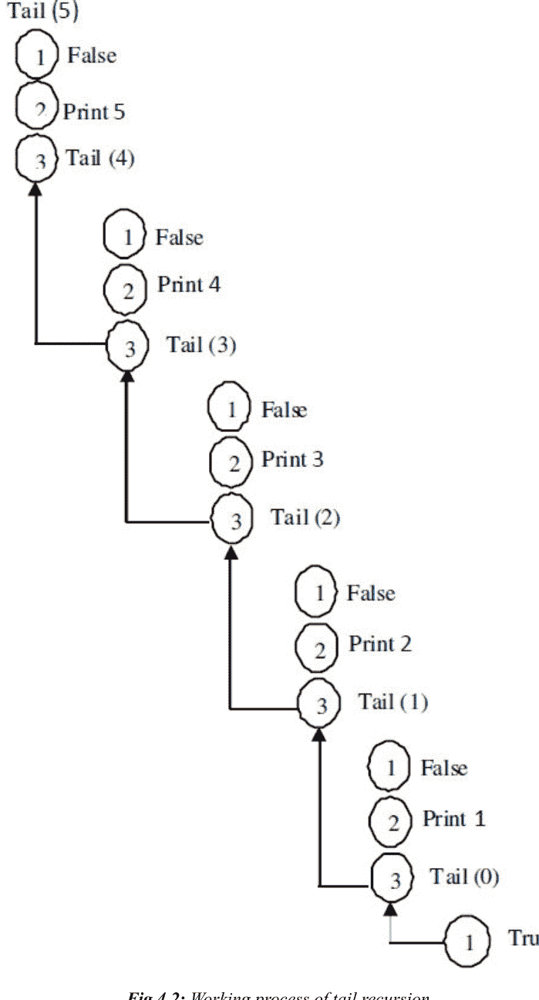

我们可以通过将以下代码分为注释中提到的三个语句来理解上述示例的工作过程。

##### (b) 非尾递归

在这种类型的递归中，函数在定义的任何地方调用自身。通过以下示例可以很容易理解。

```
tail(int n)
{
  if (n < 0)
    return;
  else
  {
    tail (n =1)
    printf("%d", n);tail -1);
  }
}
```

假设 `n` 的值为 2，则工作过程为：(图 4.3)

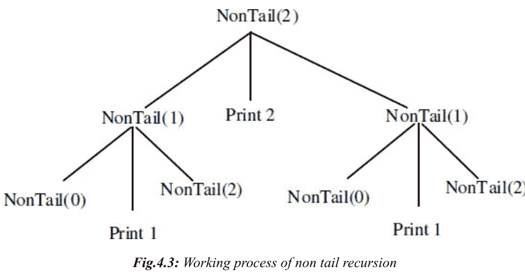

## 嵌套递归

在这种类型的递归中，一个递归函数内部另一个递归函数。这种类型的递归使用阿递归关系。以下是阿递归关系的方程。

```
n + 1 if m = 0
A (m, n) = A (m-1, 1) if m = 0
A (m-1, A (m, n-1)) otherwise
```

对于上述阿递归关系，假设 `m=1` 和 `n=3`。

```
A (1, 3) = A (0, 1,2)
A (0,A(1,1))
A (0, 1)
```

#### 间接递归

在这种递归中，假设有两个函数 `A()` 和 `B()`。`B` 的定义调用 `A()`，`A` 的定义调用 `B()`。这是间接递归的一个示例。间接递归的语法为：

```
A ()
{
  ____
  ____
  B () // 调用 B()
}
```

```
B ()
{
  ____
  ____
  A () // 调用 A()
}
```

## 递归的基本需求

实现良好的程序有一些重要要点：

- 边界情况：这是终止递归的位置。首先，我们必须确定递归代码的终止条件。这是一个非常重要且强制的条件。
- 条件：这是递归终止的条件。
- 任何递归代码都会创建内存，因此递归调用是一项挑战性任务。
- 递归涉及的变量以栈的形式存储。

## 迭代与递归

迭代是计算机程序函数或过程的重复。函数的迭代允许顺序处理多个数据块。这通常通过使用 `while` 循环或 `for` 循环来实现。这些循环会重复过程直到达到某个数字或情况。递归函数也使用迭代，只是重复整个函数。

## 迭代与递归的区别

| 迭代 | 递归 |
|---|---|
| 语句重复执行直到条件不满足。 | 在这种技术中，函数在函数定义内部调用。 |
| 迭代有四种情况：初始化、条件、执行和更新。 | `if` 条件内有终止语句。 |
| 递归问题可以通过递归解决 | 并不是所有问题都可以通过递归解决。 |
| 内存利用更简单。 | 这不是解决简单问题的好方法。 |

表 4.1: 迭代对比递归

## 函数与递归的程序

以下是函数和递归的程序：

### 程序 1：打印用户介绍的程序。

#### 输出：

```
Hi
My name is Rahul
How are you?
```

### 程序 2：计算圆面积的程序。

```
#include <stdio.h>
#include <conio.h>
void main() {
    float a, radius;
    float area();
    printf("Enter the radius\n");
    scanf("%f", &radius);
    a = area(radius);
    printf("Area of circle is : %f\n",a);
    getch();
}
float area (float r)
```

```c
{
  float ar;
  ar = 3.14 * r * r;
  return (ar);
}
```

#### 输出:

```
输入半径: 2.5
圆面积为: 19.62
```

### 程序 3：计算给定数字阶乘的程序。

```c
#include<stdio.h>
#include<conio.h>
int fact(int);
void main() {
  int n, result;
  clrscr();
  printf("输入数字\n\n");
  scanf("%d", &n);
  result = fact(n);
  printf("\n %d 的阶乘为 %d", n, result);
  getch();
}
int fact(int x) {
  if(x==1) {
    return(x);
  } else
    return(x*fact(x-1));
}
```

#### 输出:

```
输入数字 5
5 的阶乘为 120
```

### 程序 4：计算斐波那契数列第 n 个数字的程序。

```c
#include<stdio.h>
#include<conio.h>
int fib(int);
void main() {
    int p,num;
    clrscr();
    printf("输入你想从斐波那契数列获取的元素位置");
    scanf("%d", &p);
    num=fib(p);
    printf("需要的斐波那契数字为 %d",num);
    getch();
}
int fib(int p) {
    if(p==1 || p==0) {
        return (p);
    } else {
        return (fib(p-1)+fib(p-2));
    }
}
```

#### 输出:

```
输入你想从斐波那契数列获取的元素位置=6
需要的斐波那契数字为 =8
```

### 程序 5：计算两个数 `nCr` 二项式系数的程序


```c
#include<stdio.h>
#include<conio.h>
#include<process.h>
void main()
{
  int n,r,ncr;
  clrscr();
  printf("输入 n 和 r 的值\n");
  scanf("%d%d", &n, &r);
  ncr=bincoeff(n,r);
  printf("c(%d,%d) 的二项式系数为 %d",n,r,ncr);
  getch();
}
int bincoeff(int x, int y)
{
  if(y>x) {
    printf("n 的值不能小于 r\n");
    getch();
    exit(1);
  }
  if(y==0 || y==x)/*终止条件*/ {
    return(1);
  } else {
    return(bincoeff(x-1,y-1)+bincoeff(x-1,y));
  }
}
```

输出：

输入 n 和 r 的值= 5 4

c(5, 4) 的二项式系数为 5

## 程序 6：生成斐波那契数列的程序

```c
#include<stdio.h>
void fibseries(int);
void main()
{
  int limit,f1=0,f2=1;
  printf("输入斐波那契数列的限制\n");
  scanf("%d", &limit);
  if (limit>2)
  {
    printf("%d\n%d",f1,f2);
    fibseries(limit-2);
  } else if (limit==2)
  {
    printf("\n%d%d",f1,f2);
  } else if (limit==1)
    printf("%d",f1);
  else
    printf("无法生成数列");
}

void fibseries(int p)
{
    int f;
    static int f1=0,f2=1;
    if(p==0)
    {
        printf("\n 数列在此结束");
    } else
    {
        f=f1+f2;
        f1=f2;
        f2=f;
        printf("\n %d",f);
        fibseries(p-1);
    }
}
```

### 输出：

输入斐波那契数列的限制=6

1 1 2 3 5 8 数列在此结束

## 程序 7：计算数字幂的程序

```c
#include<stdio.h>
int power(int,int);
void main()
{
    int num,pow,output;
    printf("输入数字");
    scanf("%d", &num);
    printf("\n输入要计算的幂\n\n");
    scanf("%d", &pow);
    output=power(num,pow);
    printf("%d 的 %d 次方结果为 %d",num,pow,output);
}
int power(int num,int pow)
{
    static int r=1;
    if(pow==0)
    {
        return(1);
    }
    else
    {
        r=r*num;
        power(num,pow-1);
    }
    return(r);
}
```

### 输出：

输入数字: 5

输入要计算的幂=3

5 的 3 次方结果为 125

## 练习题

### A. 为每个问题选择正确的选项：

a. 以下的函数原型可以：

- 1. 定义函数
- 2. 声明函数
- 3. 擦函数
- 4. 以上

b. 哪个头文件可以用于输入输出函数？

- 1. `math.h`
- 2. `memory.h`
- 3. `dos.h`

c. 在调用程序中，是否有必要声明函数类型如果

- 1. 返回整数
- 2. 返回非整数值
- 3. 在同一个文件中
- 4. 被调用的次数

d. 以下代码的输出是：

```c
#include <stdio.h>
void main()
{
m();
}
void m()
{
printf("hi");
}
```

- 1. 编译时错误
- 2. hi
- 3. 无限 hi
- 4. 无输出

e. 以下代码的输出是：

```c
#include <stdio.h>
void main()
{
    int x;
    x = 5;
    while(x > 0)
    {
        printf("hello");
        x--;
    }
}
```

- 1. 运行时错误
- 2. 无限循环
- 3. 输出 hello
- 4. 无输出

f. 以下代码的输出是：

```c
#include <stdio.h>
void main()
{
    int a[] = {10, 20, 30};
    printf("%d", a[1]);
}
```

- 1. 10
- 2. 20
- 3. 30
- 4. 错误

g. 以下代码的输出是：

```c
#include <stdio.h>
void main()
{
    int i;
    for(i=0; i<3; i++)
    {
        printf("%d", i);
    }
}
```

- 1. 012
- 2. 123
- 3. 321
- 4. 0

h. C语言中用于定义常量关键字是？

- 1. `const`
- 2. `final`
- 3. `static`
- 4. `define`

i. 哪个运算符用于获取变量的地址？

- 1. `*`
- 2. `&`
- 3. `->`
- 4. `%`

### B. 什么是数组？

### C. 如何声明多维数组？

### D. 数组的优点和缺点。

### E. 写一个计算数组元素之和的程序。

### F. 写一个寻找数组中最大值和最小元素的程序。

### G. 写一个在数组中搜索元素的程序。

### H. 写一个对数组进行排序的程序。

```c
int main()
{
    int a[5];
    int n,i,j;
    printf("Enter any number");
    scanf("%d", &n);
    for (i=0; i<n; i++)
    {
        scanf("%d", &a[i]);
    }
    for (j=0; j<n; j++) // 修复：将 i++ 改为 j++
    {
        printf("%d", a[j]);
    }
    return(0);
}
```

### 输出：（注意：这似乎是原始文本示例的一部分）

输入数组大小 5

10 5 3 2 1

10 5 3 2 1

## 5.3.3 数组在内存中的实现

在内存中实现一维数组有如下公式：

`a[p] = a+r*xp`

其中 `a` 是数组的基础地址，`r` 是数据类型的大小，`p` 是元素在数组中的位置。假设元素的大小为 5，基础地址为 1000，元素数据类型为整数，因此在内存中占用 2 字节。假设我们需要一维数组中第 3 个元素的地址，则 `a[3]` 为：

```
a[3]= 1000+2* 3
= 1000+6
= 1006
```

数组的插入可以通过非常简单的方法完成。执行插入时，数组中应该有适当的空间。如果我们要在数组末尾插入数据元素，可以使用最后一个索引或数组大小来插入数组的最后部分。插入函数需要以下参数：

`insert (a, l, p, n)`

其中：

- `a` - 数组的基础地址
- `l` - 数组的长度
- `p` - 元素要插入的位置。
- `n` - 插入的值

### 算法

1. 初始化 `i` 的值
2. `i = 1`
3. 从 `i = 1` 向下遍历元素并逐个插入
4. 在给定位置 `A` 插入元素
5. `a[p]=n`
6. 重复 `l = 1 + 1`
7. 表示新列表
8. 结束

## 5.4 从数组中删除元素

首先，我们必须知道要删除元素的位置。假设从数组中删除一个元素，数组的索引应该向前移动。删除函数有以下参数：

`delete (a, p, n)`

其中：

- `a` - 数组的基础地址
- `p` - 位置
- `n` - 要删除的数量

### 删除元素的算法

1. `item T = a [ p ]`
2. 重复从 `j = p` 到 `n -1`
3. 逐个向上移动
4. 设置
5. `a[ j ] = a[ j + 1]`
6. 表示新列表
7. 结束

### 遍历元素的算法

遍历意味着显示数组中的所有元素。假设 `LB` 是下界（Lower Bound），`UB` 是上限（Upper Bound）

初始化计数器并将 `i` 设置为 `LB`

1. 对于 `i = LB` 到 `UB` 重复遍历所有元素
2. 显示所有元素
3. 终止循环
4. 结束

## 5.5 两个数组的合并

合并意味着合并两个数组并在新数组中表示它们。合并元素有多种方法，首先将所有数组复制到新数组，并对新数组中的元素进行排序。合并元素的算法如下。

| a[0] | 2 |
|---|---|
| a[1] | 4 |
| a[2] | 6 |
| a[3] | 8 |
| a[4] | 10 |
| b[0] | 1 |
| b[1] | 3 |
| b[2] | 5 |
| c[0] | 1 |
| c[1] | 2 |
| c[2] | 3 |
| c[3] | 4 |
| c[4] | 5 |
| c[5] | 6 |
| c[6] | 8 |
| c[7] | 10 |

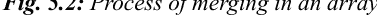

### 算法

1. 创建三个数组
2. `a[10]` `b[10]` `c[10]`
3. 在 `a` 和 `b` 中插入元素
4. 初始化 `m` 和 `n`
5. 检查是否 `[a[n]<b[n]`
6. 将元素赋值给 `c[a]`
7. `c[a] = a[++]`
8. 设置 `c=c+1`
9. 否则
10. `c[a] = b[++]`
11. 设置 `c=c+1`
12. 将 `a` 和 `b` 中的所有元素赋值给 `c`
13. 显示 `c` 中的所有元素
14. 停止

## 5.6 多维数组

这种数组具有多个维度。它的工作方式类似于网格或矩阵。

示例如：

```c
int a[2] [2]
```

这是二维数组。在该数组中有 2 行 2 列。第一个括号表示行，第二个括号表示列。

| a[0][0] | a[0][1] |
|---|---|
| a[1][0] | a[1][1] |


### 5.6.1 二维数组的初始化

```c
int a[2] [2]
```

| a[0][0] | a[0][1] |
|---|---|
| 1 | 2 |
| a[1][0] | a[1][1] |
| 3 | 4 |

图 5.4：二维维数组的内存块初始化

```c
int a[3][3] = {
1, 2, 3,
4, 5, 6,
7, 8, 9,
10, 11, 12,
13, 14, 15,
16, 17, 18,
19, 20, 21,
22, 23, 24
};
```

### 5.6.2 二维数组元素的访问

可以通过行号和列号访问所有元素。可以通过两种方式实现：

1. 行优先（Row-major order）
2. 列优先（Column-major order）

**行优先**：默认情况下，C 编译器遵循行优先。

| a_{11} | a_{12} | a_{13} | a_{14} |
|---|---|---|---|
| a_{21} | a_{22} | a_{23} | a_{24} |
| a_{31} | a_{32} | a_{33} | a_{34} |
| a_{41} | a_{42} | a_{43} | a_{44} |

图 5.5：行优先的内存表示

假设第一个地址是 1000，它可以以如下形式表示：

0 1 2 3 4 5 6 7 8 9 10 11

这是一个结构体变量 `student`。

如果指针持有结构体的基地址，就可以很容易地获取结构体的所有元素，因为结构体占据连续的内存。

```c
struct student *p;
```

这里 `p` 是一个结构体类型的指针

`p=&s;`

`P` 持有结构体的基地址或 `p` 指向结构 `s`

`s.id=10;` // 初始化结构体变量

`s.per=72.6;` // 初始化结构体变量

| id | per |
| --- | --- |
| 10 | 72.6 |

图 5.13：结构体的初始化

有以下程序用于理解整个概念。

## 数组和指针的程序

### 程序 1：编写一个删除数组中元素的程序

```c
#include<stdio.h>
#include<conio.h>
int i,n;
void main()
{
    int a[100],pos;
    void del(int a[],int,int);
    clrscr();
    printf("how many elements in the array\n");
    scanf("%d",&n);
    printf("enter the element to an array\n");
    for (i=0;i<=n-1;i++)
        scanf("%d",&a[i]);
    printf("enter position to delete an element in an array\n");
    scanf("%d",&pos);
    del(a,pos,n);
    getch();
}
void del(int a[],int pos,int n)
{
    int j;
    // item=a[pos];
    for(j=pos-1;j<=n-1;j++)
    {
        a[j]=a[j+1];
    }
    n=n-1;
    printf("new array\n");
    for(i=0;i<=n-1;i++)
    {
        printf("%d\n",a[i]);
    }
}
```

#### 输出：

how many elements in the array:5

enter element to an array:10 25 23 24 36

enter the position to delete element in an array:3

new array:

10 25 24 36

### 程序 2：编写一个生成斐波那契数列的程序

```c
#include<stdio.h>
#include<conio.h>
void fseries(int limit)
{
    int limit,f1=0,f2=1;
    clrscr();
    printf("enter the limit of the Fibonacci series");
    scanf("%d",&limit);
    if(limit>2)
    {
        printf("%d\n%d",f1,f2);
        fseries(limit-2);
    }
    else if(limit==2)
    {
        printf("\n%d\n%d",f1,f2);
    }
    else if(limit==1)
        printf("%d",f1);
    else
        printf("series not possible");
    getch();
}
```

#### 输出：

Enter the limit of Fibonacci series: 5

0 1 2 3

### 程序 3：编写一个向数组插入元素的程序


# 第 6 章 字符串

## 6.1 字符串简介

当我们处理一组类似的整数时，必须使用整数数组；处理一组类似的浮点数时，必须使用浮点数变量数组。同样，如果我们想要一组类似的字符，就必须使用字符数组。例如，如果你想在内存中存储你的名字，你需要一个可以容纳名字的变量。但名字是字符的集合，因此你需要一个字符数组。这个字符数组就是字符串。

## 6.2 定义

字符串是相同类型字符元素的集合。此外，它是一个字符数组。关于字符串有以下重要点：

1. 在字符串中，数据存储在连续的内存位置中。
2. 它具有存储大量字符值的能力。
3. 字符串的声明与普通数组相同。
4. 在字符串的下标中，我们放入字符串的大小。
5. 字符串的第一个索引从零开始。
6. 字符串以空字符（`'\0'`）结束。
7. 字符串第一个索引的地址称为基地址。
8. C 语言中没有字符串越界检查，这意味着它可以包含超出大小的元素。

以下是字符串的声明方式：

```c
char str[6];
```

字符串的初始化为：

```c
str[6] = {'M', 'I', 'S', 'T', 'H', 'I', '\0'}
```

上述字符串的内存分配如下：

| `str[0]` | `str[1]` | `str[2]` | `str[3]` | `str[4]` | `str[5]` | `str[6]` |
| :--- | :--- | :--- | :--- | :--- | :--- | :--- |
| `'M'` | `'I'` | `'S'` | `'T'` | `'H'` | `'I'` | `'\0'` |
| 100 | 101 | 102 | 103 | 104 | 105 | 106 |

图 6.1：字符串内存的初始化

在图 6.1 中，字符串的基地址是 100，我们知道字符串是字符的集合。100 的值是一个字符，字符在内存中占用一个字节，例如下一个地址是 101，依此类推。不需要手动放置空字符（`'\0'`），因为它会自动插入。让我们通过一个例子打印字符串的值。

### 程序 1

```c
#include<stdio.h>
void main()
{
    char str[6]="MISHI";
    int i=0;
    while (i<6)
    {
        printf("%c", str[i]);
        i++;
    }
}
```

#### 输出

```
MISHI
```

另一种实现上述程序的方法。

### 程序 2

```c
#include<stdio.h>
void main()
{
    char str[6]="MISHI";
    int i=0;
    while(str[i]!='\0')
    {
        printf("%c", str[i]);
        i++;
    }
}
```

上述程序也可以通过指针实现。指针获取字符串的基地址（起始地址）并占用连续的内存。让我们来看一个例子。

### 程序 3

```c
#include<stdio.h>
void main()
{
    char str[6]="MISHI";
    char *p;
    p=str;
    while(*p!='\0')
    {
        printf("%c", *p);
        p++;
    }
}
```

| `str[0]` | `str[1]` | `str[2]` | `str[3]` | `str[4]` | `str[5]` | `str[6]` |
| :--- | :--- | :--- | :--- | :--- | :--- | :--- |
| `'M'` | `'I'` | `'S'` | `'T'` | `'H'` | `'I'` | `'\0'` |
| 100 | 101 | 102 | 103 | 104 | 105 | 106 |

图 6.2：通过指针持有基地址

在图 6.2 中，指针 `ptr` 持有字符串的基地址，星号（`*`）运算符可以获取递增 1 后的数据。

```c
#include<stdio.h>
void main()
{
    char str[6]="MISHI";
    printf("%s", str);
}
```

#### 输出

```
MISHI
```

### 程序 4

```c
#include<stdio.h>
void main()
{
    char name[6];
    printf("Enter a name");
    gets(name);
    puts(name);
}
```

#### 输出

```
Enter a name
Ram
```

## 字符串函数

| 函数 | 描述 |
| :--- | :--- |
| `strlen` | 计算字符串的长度。 |

## 程序示例

### 程序 1：在数组中插入元素

```c
#include<stdio.h>
#include<conio.h>
int c,length,loc,number;
void main()
{
    int arr[100];
    void array_insert(int arr[],int,int,int);
    clrscr();
    printf("enter length of array\n");
    scanf("%d",&length);
    printf("enter element to an array\n");
    for (c=0;c<=length-1;c++)
    {
        scanf("%d",&arr[c]);
    }
    printf("enter integer to be inserted in an array\n");
    scanf("%d",&number);
    printf("enter position to insert an element to an array\n");
    scanf("%d",&loc);
    array_insert(arr,length,loc,number);
    getch();
}
void array_insert(int arr[],int length,int loc,int number)
{
    for(c=length;c>=loc;c--)
    {
        arr[c+1]=arr[c];
    }
    arr[loc]=number;
    if(loc>length)
    {
        printf("insertion outside the array");
    }
    length++;
    printf("new array:\n");
    for(c=0;c<length;c++)
    {
        printf("%d\n",arr[c]);
    }
}
```

#### 输出

```
Enter length of an array: 5
enter element to an array 10 20 30 40 50
enter integer to be inserted in an array: 58
enter position to insert an element to an array: 4
10 20 30 58 40 50
```

### 程序 2：计算质数列表

```c
#include<stdio.h>
#include<conio.h>
void pseries(int);
void main()
{
    int limit;
    clrscr();
    printf("\n enter the number");
    scanf("%d",&limit);
    printf("\n2");
    pseries(limit-1);
    getch();
}
void pseries(int a)
{
    static int n=3;
    int i,flag=0;
    if(a==0) {
        printf("\n series end here");
    }
    else {
        for(i=2;i<=n-1;i++) {
            if(n%i!=0) {
                flag=1;
            }
            else {
                flag=0;
                break;
            }
        }
        if(flag) {
            printf("\n%d",n);
            n++;
            pseries(a-1);
        } else {
            n++;
            pseries(a);
        }
    }
}
```

#### 输出

```
enter the number: 5
2 3 5 7 11
```

### 程序 3：合并二维数组

```c
#include<stdio.h>
#include<conio.h>
void main() {
    clrscr();
    int p,q,m,n,c;
    int arr1[50],arr2[50],arr3[200];
    clrscr();
    puts("enter number of element in 1st array");
    scanf("%d",p);
    printf("enter element in 1st array\n");
    for(m=0;m<=p-1;m++)
        scanf("%d",arr1[m]);
    printf("enter number of element in 2nd array");
    scanf("%d",q);
    printf("enter element in 2nd array\n");
    for(n=0;n<=q-1;n++)
        scanf("%d",arr2[n]);
    c=0;
    m=0;
    while (m<p && n<q) {
        if(arr1[m]<arr2[n])
            arr3[c++]=arr1[m++];
        else
            arr3[c++]=arr2[n++];
    }
    while (m<p) {
        arr3[c++]=arr1[m++];
    }
    while (n<q) {
        arr3[c++]=arr2[n++];
    }
    printf("merged array in ascending order\n");
    for(m=0;m<=c-1;m++)
    printf("%d\n",arr3[m]);
}
```

#### 输出

```
enter number of element in 1st array: 3
enter element in 1st array: 10 15
enter number of element in 2nd array: 3
enter element in 2nd array: 85 23
merged array in ascending order
10 14 15 23 85
```

### 程序 4：反转数字

```c
#include<stdio.h>
#include<conio.h>
int rev(int p);
void main()
{
    int n,output;
    clrscr();
    printf("enter the number\n");
    scanf("%d",&n);
    output=rev(n);
    printf("the reverse of number %d",output);
    getch();
}
int rev(int p)
{
    int d;
    static int rem=0;
    if(p==0) {
        return rem;
    }
    else {
        d=p%10;
        rem=rem*10+d;
        return rev(p/10);
    }
}
```

#### 输出

```
enter the number:12365
the reverse of number 12365 is 5321
```

### 程序 5：遍历数组

```c
#include<stdio.h>
#include<conio.h>
void main()
{
    int n,i,array[10];
    clrscr();
    printf("enter the length of the array\n");
    scanf("%d",&n);
    printf("enter the element of the array\n");
    for (i=0;i<=n-1;i++)
    {
        scanf("%d\n",array[i]);
    }
    printf("traversing of the array\n");
    for (i=0;i<=n-1;i++)
    printf("%d",array[i]);
    getch();
}
```

#### 输出

```
enter the length of the array: 3
enter the element of the array: 25 26 42
traversing of the array 25 26 42
```

### 程序 6：两个矩阵求和

```c
#include<stdio.h>
void main()
{
    int a[2][2],b[2][2],s[2][2],i,j;
    clrscr();
    printf("element of the first matrix\n");
    for(i=0;i<=1;i++)
    {
        for(j=0;j<=1;j++)
        {
            scanf("%d",&a[i][j]);
        }
    }
    printf("element of the second matrix\n");
    for(i=0;i<=1;i++)
    {
        for(j=0;j<=1;j++)
        {
            scanf("%d",&b[i][j]);
        }
    }
    for(i=0;i<=1;i++)
    {
        for(j=0;j<=1;j++) {
            s[i][j]=a[i][j]+b[i][j];
        }
    }
    printf("sum of two matrix is:\n");
    for(i=0;i<=1;i++)
    {
        for(j=0;j<=1;j++) {
            printf("%d\n",s[i][j]);
        }
    }
}
```

#### 输出

```
element of the first matrix 1 2
3 4
element of the second matrix 5 6
7 8
sum of two matrix is:
6 8
10 12
```

### 程序 7：矩阵乘法

```c
#include<stdio.h>
void main()
{
    int a[3][3],b[3][3],c[3][3],i,j,k;
    printf("输入第二个矩阵的列数: 3\n");
    printf("输入第一个矩阵的值: ");
    for(i=0;i<3;i++)
        for(j=0;j<3;j++)
            scanf("%d",&a[i][j]);
    printf("输入第二个矩阵的值: ");
    for(i=0;i<3;i++)
        for(j=0;j<3;j++)
            scanf("%d",&b[i][j]);
    for(i=0;i<3;i++)
        for(j=0;j<3;j++)
        {
            c[i][j]=0;
            for(k=0;k<3;k++)
                c[i][j]+=a[i][k]*b[k][j];
        }
    printf("矩阵乘法结果为:\n");
    for(i=0;i<3;i++)
    {
        for(j=0;j<3;j++)
            printf("%d ",c[i][j]);
        printf("\n");
    }
}
```

#### 输出

```
输入第二个矩阵的列数: 3
输入第一个矩阵的值: 3 1 4 2 1 2 4 1 3
输入第二个矩阵的值: 2 1 4 1 2 1 3 4 5
矩阵乘法结果为:
19 21 33
11 12 19
18 18 32
```

## 练习题

A. 为下列每个问题选择正确的选项：

a. 初始化数组的正确方法是？

1. `int num[6] = {2, 4, 12, 5, 45, 5};`
2. `int n[] = {2, 4, 12, 5, 45, 5};`
3. `int n[6] = {2, 4, 12};`
4. `int n(6) = {2, 4, 12, 5, 45, 5};`

b. 数组元素总是存储在内存位置中的。

1. 顺序存储（Sequential）
2. 随机存储（Random）
3. 顺序和随机存储
4. 以上均不是

c. C 语言中数组可能拥有的最大维度是多少？

1. 2
2. 8
3. 20
4. 50

d. 理论上没有限制。实际限制仅是内存大小和编译器。在什么情况下不需要指定数组的大小：

1. 初始化是定义的一部分
2. 它是一个声明
3. 它是一个形式化参数
4. 以上所有

e. 作为参数传递给函数的数组被解释为：

1. 数组的地址。
2. 数组第一个元素的值。
3. 数组第一个元素的地址。
4. 数组的元素个数。

f. 语句 `int **a;`

1. 是非法的
2. 是合法的但无意义
3. 在语法和语义上都是正确的
4. 以上都不是。

g. 为其分配内存的指针变量的基础数据类型是什么？

1. `int`
2. `float`
3. 取决于它所指向的变量类型。
4. `unsigned int`

h. 下列哪种是声明 `float` 指针的正确方法？

1. `float ptr;`
2. `float *ptr;`
3. `*float ptr;`
4. 以上均不是

B. 编写一个 C 程序查找在一维数组中某个元素的出现次数。

C. 编写一个 C 程序将一维数组中所有的偶数元素替换为 0，奇数替换为 1。

D. 编写一个 C 程序删除数组中的所有重复元素。

E. 编写一个 C 程序将数组中的偶数和奇数元素放在两个独立的数组中。

F. 编写一个 C 程序使用指针统计字符串中的元音和辅音。

G. 编写一个 C 程序使用结构体指针读取并打印学生详情，演示带指针的结构体。

H. 编写一个 C 程序在不使用第三变量的情况下交换两个数字。

I. 编写一个 C 程序计算员工的总薪资。


| `strlr` | 将字符串转换为小写。 |
| `strupr` | 将字符串转换为大写。 |
| `strcat` | 在末尾添加。 |
| `strcpy` | 将一个字符串拷贝到另一个。 |
| `strcmp` | 比较两个字符串。 |

## 6.3 字符串库函数

### 使用 `strlen()` 函数

### 程序 5：

```c
#include<stdio.h>
#include<string.h>
#include<conio.h>
void main()
{
    char str[15];
    clrscr();
    printf("enter the string");
    gets(str);
    int l=strlen(str);
    printf("the length of the string is%d",l);
    getch();
}
```

#### 输出：

```
enter the string
Ram
the length of the string is 3
```

### 使用 `strcpy()` 函数

### 程序 6：

```c
#include<stdio.h>
#include<conio.h>
#include<string.h>
void main()
{
    char str1[15],str2[15];
    clrscr();
    printf("enter the string1");
    gets(str1);
    strcpy(str2,str1);
    printf("the required string is%s",str2);
    getch();
}
```

#### 输出：

```
enter the string1 Ram
the required string is Ram
```

### 使用 `strcat()` 函数

### 程序 7：

```c
#include<stdio.h>
#include<conio.h>
#include<string.h>
void main()
{
    char str1[15],str2[15];
    clrscr();
    printf("enter the string1");
    gets(str1);
    printf("enter the string2");
    gets(str2);
    strcat(str1,str2);
    printf("the required string is%s",str1);
    getch();
}
```

#### 输出：

```
enter the string1 Ram
enter the string2 Shyam
the required string is RamShyam
```

### 使用 `strcmp()` 函数

### 程序 8：

```c
#include<stdio.h>
#include<conio.h>
#include<string.h>
void main()
{
    int value;
    char str1[15],str2[15];
    clrscr();
    printf("enter the string 1");
    gets(str1);
    printf("enter the string 2");
    gets(str2);
    value=strcmp(str1,str2);
    printf("the result is %d",value);
    getch();
}
```

#### 输出：

```
enter the string 1
Amit
enter the string 2
Amit
the result is 0
```

### 使用字符串函数的程序

程序 9：转换为小写的程序。

```c
#include<string.h>
void main()
{
    int l;
    char str[15];
    clrscr();
    printf("enter the string");
    gets(str);
    strlwr(str);
    printf("lowercase:%s",str);
    getch();
}
```

#### 输出：

```
enter the string NITESH
lowercase: nitesh
```

### 程序 10：接受字符串并在不使用库函数的情况下将字符串中的所有字符转换为大写的程序。

```c
#include<stdio.h>
#include<conio.h>
#include<string.h>
void main()
{
    char str[60];
    int i=0;
    clrscr();
    printf("enter a string");
    gets(str); while(str[i]!='\0')
{
        if(str[i]>='a' && str[i]='\z')
            str[i]=str[i]-32;
        i++;
    }
    printf("converted string in uppercase is:%s",str);
    getch();
}
```

#### 输出：

```
enter a string akash
converted string in uppercase is AKASH
```

### 程序 11：在使用库函数的情况下将一个字符串拷贝到另一个字符串的程序。

```c
#include<stdio.h>
#include<conio.h>
#include<string.h>
void main()
{
  char source[60],dest[60];
  int i=0;
  clrscr();
  printf("enter a string\n\n");
  gets(source);
  while(source[i]!='\0')
  {
    dest[i]=source[i];
    i++;
  }
  dest[i]='\0';
  printf("required string is%s",dest);
  getch();
}
```

#### 输出：

```
enter the string Ram
required string is Ram
```

### 程序 12：按字母顺序打印字符串的程序。

```c
#include<stdio.h>
#include<conio.h>
#include<string.h>
void main()
{
  char a[20];
  int i,j,k;
  clrscr();
  printf("\nenter the string");
  gets(a);
  printf("the string in alphabetical order is");
  for(i=0;a[i]!='\0';i++)
  {
  j=i;
  for(k=i+1;a[k]!='\0';k++)
  {
    if(a[k]<a[j])
      j=k;
  }
  k=a[i];
  a[i]=a[j];
  a[j]=(char)k;
  printf("%c",a[i]);
  }
  getch();
}
```

#### 输出：

```
enter the string rajiv
the string in alphabetical order is aijrv
```

### 程序 13：检查字符串是否为回文的程序。

```c
#include<stdio.h>
#include<conio.h>
#include<string.h>
void main()
{
  char flag,str[20];
  int i,j;
  clrscr();
  printf("\n enter the string");
  gets(str);
  flag='y';
  printf("\n the entered string");
  for(i=0;str[i]!='\0';i++)
  printf("%c",str[i]);
  for(j=0,i=-1;i>j;j++,i--)
  {
    if(str[i]!=str[j])
    {
        flag='n';
        break;
    }
  }
  if(flag=='n')
  printf("\nis not a palindrome");
}
```

#### 输出：

```
enter the string MALAYAM
the entered string MALAYAM
string is a palindrome
```

### 程序 14：比较两个字符串的程序。

```c
#include<stdio.h>
#include<conio.h>
#include<string.h>
void main()
{
    char string[50],string1[50];
    int i,j,flag;
    clrscr();
    printf("\n enter first string");
    gets(string);
    printf("enter second string");
    gets(string1);
    flag=1;
    while(string[i]!='\0')
    i++;
    while(string1[j]!='\0')
    j++;
    if(i!=j)
    flag=0;
    else
    {
    i=0;
    j=0;
        while(string[i]!='\0' && string1[j]!='\0')
        {
            if(string[i]!=string1[j])
            {
                flag=0;
                break;
            }
            i++;
            j++;
        }
    }
    if(flag==0)
    printf("\n\t string are not equal");
    else
    printf("\n\t string are equal");
    getch();
}
```

**输出：**

```
enter first string AMIT
enter second string AMIT
STRING ARE EQUAL
```

## 练习题

- A. 为下列每个问题选择正确的选项：

- a. 如果两个字符串相同，则 `strcmp()` 函数返回

1. 1

2. 0

3. -1

4. true

- b. 如何在屏幕上打印 `\n`？

1. `printf("\n");`

2. `echo "\n";`

3. `printf("\n");`

4. `printf("\\n");`

- c. 哪个函数更适合读取多单词字符串？

1. `printf();`

2. `scanf();`

3. `gets();`

4. `puts();`

- d. 哪个函数更适合写入多单词字符串？

1. `printf();`

2. `scanf();`

3. `gets();`

4. `puts();`

- e. `strcpy` 函数添加空字符

1. 只有空格时

2. 总是

3. 取决标准

4. 取决编译器

- f. 下列程序的输出是？

```c
#include<stdio.h>
int main()
{
    char t;
    char *p1 = "Ram", *p2;
    p2=p1;
    p1 = "Raj";
    printf("%s %s\n", p1, p2);
}
```

1. Raj Ram

2. Raj Ram

3. Raj

4. Ram

- g. 下列程序的输出是？

```c
#include<stdio.h>
#include<string.h>
int main()
{
    char string[50],string2[50];
    int i=0, j=0,flag;
    printf("enter first string");
    gets(string);
    printf("enter second string");
    gets(string2);
    if(strcmp(string, string2) == 0)
        printf("\n\t string are equal");
    else
        printf("\n\t string are not equal");
    return 0;
}
```

1. STRING ARE EQUAL

2. STRING ARE NOT EQUAL

3. ARE EQUAL

4. NOT EQUAL

## B. 什么是栈？

- C. 静态栈和动态栈的区别是什么？

- D. 编写一个栈程序。

- E. 编写一个推送（`push`）操作程序。

- F. 编写一个弹出（`pop`）操作程序。

- G. 编写一个查看（`peek`）操作程序。

- H. 编写一个搜索（`search`）操作程序。

- I. 编写一个遍历（`traverse`）操作程序。

## 7.5 栈的应用

栈有多种类型的应用：

- 1. 递归

- 2. 逆波兰表达式（中缀转后缀表达式）

- 3. 后缀表达式求值

- 4. 前缀转后缀

- 5. 斐波那契数列

- 6. 汉诺塔问题

示例 1：将中缀表达式 `A + B` 转换为后缀表达式。

解决方案：这里有两个操作数 `A`, `B` 和一个运算符 `+`。那么后缀表达式为 `AB+`。

示例 2：将 `A + B` 转换为前缀表达式。

解决方案：这里有两个操作数 `A`, `B` 和一个运算符 `+`。那么前缀表达式的形式为 `+ AB`。

示例 3：将后缀表达式 `AB+` 转换为中缀表达式。

解决方案：这里有两个操作数 `A`, `B` 和一个运算符 `+`。那么表达式的形式为 `A+B`。

### 运算符优先级：

| 运算符 | 符号 | 优先级 |
| :--- | :--- | :--- |
| 幂 | `^` | 最高优先级 |
| 乘法/除法/取模 | `*`, `/`, `%` | 次高优先级 |
| 加法/减法 | `+`, `-` | 最低 |

表 7.1：运算符优先级表

### 将中缀表达式转换为后缀表达式的算法

* 步骤 1. 将 `"（入栈并添加）"` 添加到栈的末尾。

* 步骤 2. 从左到右扫描栈，对栈的每个元素重复步骤 3 到 6，直到栈为空。

* 步骤 3. 如果遇到操作数，将其添加到栈顶。

* 步骤 4. 如果遇到左括号，将其压入栈。

* 步骤 5. 如果遇到运算符 `$`，则：

    * a. 将 `$` 添加到栈中（`if` 结构结束）

    * b. 重复从栈中弹出并添加优先级与 `$` 相同或更高的 `p` 运算符（在栈顶）。

* 步骤 6. 如果遇到右括号，则重复从栈中弹出并添加 `p` 运算符（在栈顶，直到遇到左括号为止）。

    * a. 左括号

* 步骤 7. 退出

示例 4：使用栈求解表达式。

`(a+(b*c))`

| 表达式 | 栈内 | 输出栈 |
| :--- | :--- | :--- |
| `(` | `(` | - |
| `(a)` | `(` | `A` |
| `(a+)` | `+` | `A` |
| `(a+(` | `+` | `A` |
| `(a+(b*` | `+ (` | `ab` |
| `(a+(b*c` | `+ *` | `ab` |
| `(a+(b*c)` | `+ *` | `abc*` |
| `(a+(b*c))` | `+` | - `abc*+` |

表 7.2：表达式求值表

### 后缀求值

`2+3*4`

`234*+\`

这是一个包含后缀表达式的数组。

```
next=0;
while(postfix[next]!='!='0')
{
    symb=postfix[next];
    if(IsOperand(symb))
    {
        push(symb);
        next++;
    }
    else
    {
        op2=pop();
        opl=pop();
        r=opl symb op2
        push(r);
        next++;
    }
}
printf("%d", pop());
```

注意：在求值后缀表达式时，我们只将操作数压入栈，即操作数栈。

### 前缀转后缀

| 前缀 | 后缀 |
| :--- | :--- |
| `a` | `A` |
| `+ab` | `ab+` |
| `*a+bc` | `abc+` |
| `* +ab-cd` | `ab+ cd-*` |

表 7.3：表达式求值表

### 将前缀转换为后缀表达式的算法


## 7.6 栈程序

### 程序 1：使用 C 语言中的数组实现栈

```c
#include<stdio.h>
#include<conio.h>
#define MAX 5

//栈的定义
typedef struct stack
{
    int entry[MAX];
    int top;
} stack;

//栈初始化
void init(stack *sptr) {
    sptr->top=0;
}

//检查栈是否为空
int isempty(stack *sptr) {
    if(sptr->top==0)
        return(1);
    else
        return(0);
}

//检查栈是否满
int isfull(stack *sptr) {
    if(sptr->top==MAX)
        return(1);
    else
        return(0);
}

//将元素入栈
void push(stack *sptr) {
    int item;
    if(isfull(sptr))
        printf("stack is full you cannot insert new element");
    else
    {
        printf("nEnter the element");
        scanf("%d",&item);
        sptr->entry[sptr->top]=item;
        sptr->top++;
    }
}

//从栈中删除元素
void pop(stack *sptr)
{
    int item;
    if(isempty(sptr))
        printf("stack is empty");
    else
    {
        sptr->top--;
        item=sptr->entry[sptr->top];
        printf("%d has been deleted",item);
    }
}

//遍历栈
void traverse(stack *sptr)
{
    if(isempty(sptr))
        printf("stack is empty");
    else
    {
        int i;
        for(i=sptr->top-1;i>=0;i--)
            printf("%d\n",sptr->entry[i]);
    }
}

void main()
{
    stack s;
    int choice;
    clrscr();
    init(&s);
    do {
        printf("\n 1. PUSH\n");
        printf("\n 2. POP\n");
        printf("\n 3. TRAVERSE\n");
        printf("\n 4. EXIT\n");
        scanf("%d",&choice);
        switch (choice) {
            case 1:
                push(&s);
                break;
            case 2:
                pop(&s);
                break;
            case 3:
                traverse(&s);
                break;
            case 4:
                exit(0);
            default:
                printf("WRONG CHOICE\n");
        }
    } while (1);
    getch();
}
```

#### 输出：

```
1.Push
2.Pop
3.Traverse
4.Exit
Enter the choice 1
Enter the element 10
Enter the choice 1
Enter the element 20
Enter the choice 2
20 has been deleted
Enter the choice 1
Enter the element 30
Enter the choice 1
Enter the element 50
Enter the choice 2
50 has been deleted
Enter the choice 3
40 30 20 10
```

### 程序 2：通过链表指针实现栈

```c
#include<stdio.h>
#include<conio.h>
int count=0;

//链表栈定义
typedef struct node
{
    int data;
    struct node *next;
} stack;

//检查栈是否为空
int isempty()
{
    if(count==0)
        return(1);
    else
        return(0);
}

//初始化栈
void init(stack **sptr)
{
    stack *p;
    int item;
    p=(stack *)malloc(sizeof(stack));
    p->next=NULL;
    *sptr=p;
    count++;
}

//向栈中插入新元素
void push(stack **sptr)
{
    stack *p;
    int item;
    p=(stack *)malloc(sizeof(stack));
    printf("\nEnter the element");
    scanf("%d",&item);
    p->data=item;
    p->next=*sptr;
    *sptr=p;
    count++;
}

//从栈中删除元素
void pop(stack **sptr)
{
    stack *p;
    int item;
    if(isempty())
        printf("stack is empty");
    else
    {
        p=*sptr;
        *sptr=p->next;
        item=p->data;
        printf("%d had been deleted",item);
        free(p);
        count--;
    }
}

//遍历栈元素
void traverse(stack **sptr)
{
    stack *p;
    if(isempty())
    {
        printf("Stack is empty");
    }
    else
    {
        p=*sptr;
        while (p!=NULL)
        {
            printf("\n%d",p->data);
            p=p->next;
            count--;
        }
    }
}

//主函数
void main()
{
    stack s;
    stack *r;
    int choice;
    clrscr();
    r=&s;
    init(&r);
    do
    {
        printf("\n 1.PUSH");
        printf("\n 2.POP");
        printf("\n 3.TRAVERSE");
        printf("\n 4.EXIT");
        printf("\n enter your choice:");
        scanf("%d",&choice);
        switch(choice)
        {
            case 1:
                push(&r);
                break;
            case 2:
                pop(&r);
                break;
            case 3:
                traverse(&r);
                break;
            case 4:
                exit(0);
            default:
                printf("WRONG CHOICE");
        }
    } while(1);
    getch();
}
```

#### 输出：

```
Enter the element 10
1.PUSH
2.POP
3.TRAVERSE
4.EXIT
enter your choice:1
Enter the element20
1.PUSH
2.POP
3.TRAVERSE
4.EXIT
enter your choice:2
20 has been deleted
1.PUSH
2.POP
3.TRAVERSE
4.EXIT
enter your choice:2
10 has been deleted
1.PUSH
2.POP
3.TRAVERSE
4.EXIT
enter your choice:3
Stack is empty
1.PUSH
2.POP
3.TRAVERSE
4.EXIT
enter your choice:4
```

## 7.7 多个栈

我们可以从一个数组中创建多个栈。这通过数组索引实现。它可以在逻辑上划分为多个部分。可以通过[图 7.3](Fig.7.3) 轻松理解。

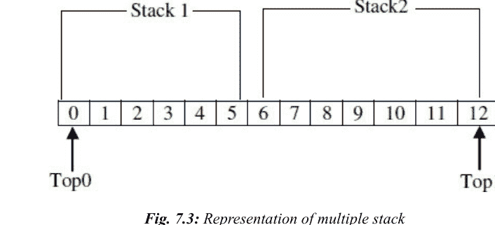

### 程序 3：多栈实现

```c
#include<stdio.h>
#include<conio.h>
#include<alloc.h>
#include<process.h>

#define max 6

typedef struct mstack
{
    int entry[max];
    int top1, top2;
} mstack;

void init(mstack *sptr)
{
    sptr->top1=0;
    sptr->top2=max;
}

int isempty1(stack *sptr)
{
    if(sptr->top1==0)
        return(1);
    else
        return(0);
}

int isempty2(stack *sptr)
{
    if(sptr->top2==max)
        return(1);
    else
        return(0);
}

int isfull(stack *sptr)
{
    if(sptr->top1== sptr->top2)
        return(1);
    else
        return(0);
}

void push1(stack *sptr)
{
    int item;
    if(isfull(sptr))
    {
        printf("栈已满");
    }
    else
    {
        printf("输入一个元素");
        scanf("%d", &item);
        sptr->entry[sptr->top1]=item;
        sptr->top1++;
    }
}

void push2(mstack *sptr)
{
    int item;
    if(isfull(sptr))
    {
        printf("栈已满");
    }
    else
    {
        sptr->top2--;
        printf("输入一个元素");
        scanf("%d", &item);
        sptr->entry[sptr->top2]=item;
    }
}

void pop1(mstack *sptr)
{
    int item;
    if(isempty1(sptr))
        printf("栈为空");
    else
    {
        sptr->top1--;
        item=sptr->entry[sptr->top1];
        printf("%d 被删除", item);
    }
}

void pop2(mstack *sptr)
{
    int item;
    if(isempty2(sptr))
        printf("栈为空");
    else
    {
        item=sptr->entry[sptr->top2];
        printf("%d 被删除", item);
        sptr->top2++;
    }
}

void main()
{
    mstack s;
    int choice;
    clrscr();
    init(&s);
    do
    {
        printf("\n 1. 入栈1");
        printf("\n 2. 入栈2");
        printf("\n 3. 出栈1");
        printf("\n 4. 出栈2");
        printf("\n 5. 遍历1");
        printf("\n 6. 遍历2");
        printf("\n 7. 退出");
        printf("\n请输入选择: ");
        scanf("%d",&choice);

        switch(choice)
        {
            case 1:
                push1(&s);
                break;
            case 2:
                push2(&s);
                break;
            case 3:
                pop1(&s);
                break;
            case 4:
                pop2(&s);
                break;
            case 5:
                traversal(&s);
                break;
            case 6:
                traverse2(&s);
                break;
            case 7:
                exit(0);
            default:
                printf("错误的选择");
        }
    } while(1);
    getch();
}
```

#### 输出：

```
1. 入栈1
2. 入栈2
3. 出栈1
4. 出栈2
5. 遍历1
6. 遍历2
7. 退出
请输入选择 1
输入一个元素 10
1. 入栈1
2. 入栈2
3. 出栈1
4. 出栈2
5. 遍历1
6. 遍历2
7. 退出
请输入选择 1
输入一个元素 20
1. 入栈1
2. 入栈2
3. 出栈1
4. 出栈2
5. 遍历1
6. 遍历2
7. 退出
请输入选择 2
元素为:2010
1. 入栈1
2. 入栈2
3. 出栈1
4. 出栈2
5. 遍历1
6. 遍历2
7. 退出
请输入选择 2
输入一个元素 60
1. 入栈1
2. 入栈2
3. 出栈1
4. 出栈2
5. 遍历1
6. 遍历2
7. 退出
请输入选择
```

### 程序 4：将中缀表达式转换为逆后缀表达式的程序

```c
prepostop(prefix, postfix)
{
    length=strlen(prefix);
    if (length==1) {
        postfix[0]=prefix[0];
        postfix[1]=prefix[1];
        return(postfix);
    }
    else {
        op[0]=prefix[0];
        op[1]='\0';
        substr(prefix, 1, length-1, temp);
        m=find(temp);
        substr(prefix, 1, m, operand1);
        prepostop(operand1, postfix);
        substr(prefix, m+1, length-1, temp);
        n=find(temp);
        substr(prefix, m+1, m+n, operand2);
        prepostop(operand2, post2);
        strcat(post1, post2);
        strcat(post, op);
        substr(post, 0, length, postfix);
        return(postfix);
    }
}
```


# 程序 5：将中缀表达式转换为前缀表达式的程序

```c
#include<stdio.h>
#include<conio.h>
//栈栈优先级函数
int F(char symbol)
{
    switch (symbol)
    {
        case '+':
        case '-':
            return 1;
        case '*':
        case '^':
            return 6;
        case ')':
            return 0;
        case '#':
            return -1;
        default:
            return 8;
    }
}
// 优先级函数
int G(char symbol)
{
  switch(symbol)
  {
    case '+':
    case '-':
      return 2;
    case '*':
      return 4;
    case '^':
      return 5;
    case '(':
      return 0;
    case ')':
      return 9;
    case '#':
      return -1;
    default:
      return 7;
  }
}
void infix_prefix(char infix[], char prefix[])
{
  int top, j, i;
  char symbol, s[40];
  top = -1;
  s[++top] = '#';
  j = 0;
  strrev(infix);
  for(i = 0; i < strlen(infix); i++)
  {
    symbol = infix[i];
    while(F(s[top]) > G(symbol))
    {
      prefix[j++] = s[top--];
    }
    if(F(s[top]) != G(symbol))
    {
      s[++top] = symbol;
    }
    else
    {
      top--;
    }
  }
  while(s[top] != '#')
  {
    prefix[j++] = s[top--];
  }
  prefix[j] = '\0';
  strrev(prefix);
}
void main()
{
  char infix[20];
  char prefix[20];
  printf("输入有效的前缀表达式: ");
  scanf("%s", infix);
  infix_prefix(infix, prefix);
  printf("\n前缀表达式为:\n");
  printf("%s\n", prefix);
}
```

**输入:** `a+b*c`

**输出:** `+a*bc`

# 程序 6：将逆后缀转换为中缀表达式的程序

```c
#include <stdio.h>
#include <conio.h>
#include <stdlib.h>
#define SIZE 30
typedef struct
{
  char s[SIZE], dest[SIZE];
  char t1[2], t2[2];
  char ch1[SIZE], ch2[SIZE], ch3[SIZE];
  int i, top;
} postfix;
void initialization(postfix *p)
{
  p->i = 0;
  p->top = -1;
  strcpy(p->dest, "");
}
void expression(postfix *p, char *c)
{
  strcpy(p->dest, c);
}
void push(postfix *p, char *str)
{
  if (p->top == SIZE - 1)
    printf("\n栈溢出.");
  else
  {
    p->top++;
    strcpy(p->s[p->top], str);
  }
}
void pop(postfix *p, char *a)
{
  if (p->top == -1)
    printf("\n栈为空.");
  else
  {
    strcpy(a, p->s[p->top]);
    p->top--;
  }
}
void trans(postfix *p)
{
    while (p->dest[p->i])
    {
        if (p->dest[p->i] == ' ') 
            p->i++;
        if ((p->dest[p->i] == '+' || p->dest[p->i] == '*') ||
            (p->dest[p->i] == '-' || p->dest[p->i] == '+'))
        {
            if (p->dest[p->i] == '(' || p->dest[p->i] == '$')
            {
              pop(p, p->ch2);
              pop(p, p->ch3);
              p->t1[0] = p->dest[p->i];
              p->t1[1] = '\0';
              strcpy(p->ch1, p->ch3);
              strcat(p->ch1, p->t1);
              strcat(p->ch1, p->ch2);
              push(p, p->ch1);
            }
            else
            {
              p->t1[0] = p->dest[p->i];
              p->t1[1] = '\0';
              strcpy(p->t2, p->t1);
              push(p, p->t2);
            }
        }
        p->i++;
    }
}
void display (postfix p)
{
  char *t;
  t = p.s[0];
  while (*t)
  {
    printf("%c", *t);
    t++;
  }
}
void main()
{
  postfix PF;
  char exp[SIZE];
  clrscr();
  initialization(&PF);
  printf("\n 输入任意逆后缀表达式:\n");
  gets(exp);
  expression(&PF, exp);
  trans(&PF);
  printf("\n结果的中缀表达式为:\n");
  display(PF);
  getch();
}
```

**输入:** `abc+`

**输出:** `a+b*`

# 程序 7：将前缀表达式转换为中缀表达式的程序

```c
#include <string.h>
#include <ctype.h>
char opnds[50][80],oprs[50];
int tpr=-1,topd=-1;
pushd(char *opnd)
{
    strcpy(opnds[++topd],opnd);
}
char *popd()
{
    return(opnds[topd-]);
}
pushr(char opr)
{
    oprs[++topr]=opr;
}
char popr()
{
    return(oprs[topr-]);
}
int empty(int t)
{
    if(t == 0) return(1);
    return(0);
}
main()
{
    char prfx[50],ch,str[50],opnd1[50],opnd2[50],opr[2];
    int i=0,k=0,opndcnt=0;
    gets(prfx);
    printf("给的前缀表达式: %s\n",prfx);
    while((ch=prfx[i++]) != '\0')
    {
        if(isalnum(ch))
        {
            str[0]=ch; str[1]='\0';
            pushd(str); opndcnt++;
            if(opndcnt >= 2)
            {
                // 前缀转换逻辑将在此继续
            }
        }
    }
}
```

```c
strcpy(opnd2,popd());
strcpy(opnd1,popd());
strcpy(str, "");
strcat(str, opnd1);
ch=popr();
opr[0]=ch;opr[1]='\0';
strcat(str, opr);
strcat(str, opnd2);
strcat(str, "");
pushd(str);
opndcnt-=1;
}
```

```c
else
{
pushr(ch);
if(opndcnt==1) opndcnt=0; /* 运算符后接单个操作数*/
}
if(!empty(topd))
{
strcpy(opnd2,popd());
strcpy(opnd1,popd());
strcpy(str, "");
strcat(str, opnd1);
ch=popr();
opr[0]=ch;opr[1]='\0';
strcat(str, opr);
strcat(str, opnd2);
strcat(str, "");
pushd(str);
}
```

```c
printf("Infix Expression:\n");
puts(opnds[topd]);
}
```

**输入：** `+a*bc`

**输出：** `a+b*c`

# 程序 8：将前缀表达式转换为后缀表达式的程序

```c
#include<stdio.h>
#include<string.h>
void push(char item[],int *top, char s[][][20])
{
    *top=*top+1;
    strcpy(s[*top],item);
}
void pop(int *top, char s[][][20])
{
    char *item;
    item=s[*top];
    *top=*top-1;
    return item;
}
void pre_post(char prefix[], char postfix[])
{
    char s[20] [20];
    int top,i;
    char symbol,temp[2];
    char *opl1,op2;
    top=-1;
    strrev(prefix);
    for(i=0;i<strlen(prefix);i++)
    {
        symbol=prefix[i];
        temp[0]=symbol;
        temp[1]='\0';
        switch (symbol)
        {
            case '+':
            case '-':
            case '*':
            case '/':
            case '^':
                opl1=pop(&top,s);
                op2=pop(&top,s);
                strcpy(postfix,opl1);
```

```c
strcat(postfix, op2);
strcat(postfix, temp);
push(postfix, &top, s);
break;
default:
push(temp, &top, s);
}
}
}
```

```c
void main() {
char prefix[20];
char postfix[20];
printf("\n\ Enter the prefix expression \n\n");
scanf("%s", prefix);
pre_post(prefix, postfix);
printf("\n\n The postfix expression is %s \n\n", postfix);
}
```

**输入:** `+a*bc`

**输出:** `a b c* +`

# 程序 9：使用递归查找斐波那契数列中第n个数的C程序

```c
#include <stdio.h>
int fibo(int); // 函数声明
int main()
{
int num;
int result;
printf("Enter the nth number\n");
scanf("%d", &num);
if (num < 0) {
printf("Not possible \n\n");
} else {
result = fibo(num);
```

```c
printf("The %d number in fibacci series is %d\n", num,
result);
}
return 0;
}
int fibo(int num)
{
    if (num == 0)
    {
        return 0;
    }
    else if (num == 1)
    {
        return 1;
    }
    else
    {
        return(fibo(num - 1) + fibo(num - 2));
    }
}
```

#### 输出：

输入第n个数 5

斐波那契数列中的第5个数是 5

# 程序 10：使用递归的汉诺塔C程序

```c
#include <stdio.h>
void towers(int, char frompeg, char auxpeg, char to);
int main()
{
    int num;
    printf("Enter the number of disks:");
```

```c
{
    if (num == 1) {
      printf("\n Move disk 1 from peg %c to peg %c", frompeg, to);
      return;
    }
    towers(num - 1, frompeg, auxpeg, to);
    printf("\n Move disk %d from peg %c to peg %c", num, frompeg, to);
    towers(num - 1, auxpeg, to, frompeg);
}
```

#### 输出：

输入盘子数量: 3

汉诺塔的移动序列如下：

- 将盘子1从柱A移动到 柱C

- 将盘子2从柱A移动到 柱B

- 将盘子1从柱C移动到 柱B

- 将盘子3从柱A移动到 柱C

- 将盘子1从柱B移动到 柱A

- 将盘子2从柱B移动到 柱C

- 将盘子1从柱A移动到 柱C

## 练习题

A. 为下列每项选择正确选项：

a. 表达式 `(A+B)*(C-D)*E` 的后缀形式是：

1. `AB+CD-*E*F`

2. `AB+CD*E-F`

3. `AB+CD*E*F`

4. `AB+CDE-*F`

b. 数据结构中的栈是：

1. 先进先出 (FIFO)

2. 后进先出 (LIFO)

3. 以上均不是

c. 在栈中插入元素的过程称为 ________

1. `Pop`

2. `Evaluation`

3. `Create`

d. 从栈中移除元素的过程称为 ________

1. `Push`

2. `Pop`

3. `Create`

e. `A*B+C/D` 的后缀形式是：

1. `AB*CD+`

2. `AB*CD/+`

3. `A*BC+/D`


# 4. ABCD+/

## f. 在栈中，如果用户尝试从空栈中移除元素，则这称为 ________

1. 空集合 (Empty Collection)
2. 栈上界 (Underflow of Stack)
3. 垃圾回收 (Garbage Collection)
4. 栈溢出 (Overflow of Stack)

## g. 用户在大小为 5 的栈上执行以下操作后：`push(1); pop(); push(2); push(3);` 然后：

```c
printf("OVERFLOW");
}
else
{
    printf("nEnter the item");
    scanf("%d",&item);
    qptr->entry[qptr->rear]=item;
    qptr->rear++;
}
}
```

```c
void del(queue *qptr)
{
    int item;
    if (isempty(qptr))
        printf("UNDERFLOW");
    else
        {
            item=qptr->entry[qptr->front];
            qptr->front++;
            printf("\n%d has been deleted",item);
        }
}
```

```c
void traverse(queue *qptr)
{
    int i;
    if (isempty(qptr))
        printf("queue is empty");
    else
        {
            for(i=qptr->front;i<qptr->rear;i++)
            printf("%d\n",qptr->entry[i]);
        }
}
```

```c
void main()
{
    queue q;
    int choice;
```

```c
clrscr();
init(&q);
do {
    printf("\n1 INSERT");
    printf("\n2 DELETE");
    printf("\n3 TRAVERSE");
    printf("\n4 EXIT");

    printf("\nenter the choice");
    scanf("%d", &choice);
    switch (choice) {
        case 1:
            insert(&q);
            break;
        case 2:
            del(&q);
            break;
        case 3:
            traverse(&q);
            break;
        case 4:
            exit(0);
        default:
            printf("\nInvalid choice");
    }
} while (1);
getch();
```

### 输出:

1 插入

2 删除

3 遍历

4 退出

输入选择 1

输入元素 10

```
1 插入
2 删除
3 遍历
4 退出
输入选择
输入元素20
1 插入
2 删除
3 遍历
4 退出
输入选择
输入元素30
1 插入
2 删除
3 遍历
4 退出
输入选择
输入元素40
1 插入 
2 删除
3 遍历
4 退出
输入选择
输入元素50
1 插入 
2 删除
3 遍历
4 退出
输入选择
溢出
1 插入
2 删除
3 遍历
4 退出
输入选择3
10
20
30
40
50
1 插入 
2 删除
3 遍历
4 退出
输入选择2
10 已删除
1 插入 
2 删除
3 遍历
4 退出
输入选择4
```

# 队列的动态实现

在这个队列中，我们使用动态函数在运行时创建一个节点。这个队列永远不会满，因为运行时会创建新节点，而需要创建多少个节点取决于用户。

在这个队列中，我们将维护两个指针：`front`（头部）和 `rear`（尾部）。当我们创建一个节点时，`front` 和 `rear` 将指向第一个节点。如果创建了更多节点，`front` 指针指向第一个节点，`rear` 指针指向最后一个节点，如图 8.6 所示。

| 头部 (Front) | 尾部 (Rear) |
|---|---|
| 1000 | 1000 |
| 数据 (Data) | 地址 (Address) |
| 10 | NULL |
| 1000 | |

> 图 8.6: 头部和尾部指向单个节点

在图 8.6 中，队列分为两个部分：数据部分和地址部分。数据部分包含数据，地址部分（下一部分）包含下一个节点的地址。这里没有下一个节点，所以地址 1000 的地址部分为 `NULL`。


# 在队列中添加节点的算法

- 步骤 1. `struct Queue NEWPTR temp`
- 步骤 2. `temp = start` [初始化 `temp`]
- 步骤 3. `NEWPTR = new Node`
- 步骤 4. `NEWPTR -> No = Value`
- 步骤 5. `NEWPTR -> Next = NULL`
- 步骤 6. 如果 (`Rear == NULL`)
    设置 `front = NEWPTR`
    设置 `rear = NEWPTR`
    否则:
    当 (`temp->next != NULL`) 时
    `Temp = temp -> Next`
- 步骤 7. `temp -> Next = NEWPTR`
- 步骤 8. 结束

# 从队列中删除节点的算法

- 步骤 1. 如果 (`front = NULL`)
    写入队列为空并退出
    否则
- 步骤 2. `Temp = start`
- 步骤 3. `Value = temp -> No.`
- 步骤 4. `Start = Start -> next`
- 步骤 5. `Free(temp)` [结束否则]
- 步骤 6. 返回 (`value`) [结束 if]
- 步骤 7. 退出

```c
#include<stdio.h>
#include<conio.h>
typeef struct queue
{
    int data;
struct queue *next;
} queue;
int cnt=0;
int isempty()
{
    if(cnt==0)
{
        return(1);
    }
    else
{
        return(0);
    }
}
void init(queue **fptr,queue **rptr)
{
    int item;
    queue *qptr;
qptr=(queue *) malloc(sizeof(queue));
printf("输入元素\n");
scanf("%d",&item);
qptr->data=item;
qptr->next=NULL;
*fptr=qptr;
*rptr=qptr;
cnt++;
}
void insert(queue **rptr)
{
    queue *qptr;
    int item;
qptr=(queue *)malloc(sizeof(queue));
printf("输入元素\n");
scanf("%d", &item);
qptr->data=item;
qptr->next=NULL;
(*rptr)->next=qptr;
*rptr=qptr;
cnt++;
}
void del(queue **fptr)
{
queue *q,*tmp;
q=*fptr;
if (*fptr==NULL)
{
printf("队列为空\n");
}
else if (q->next==NULL)
{
ntmp=q;
printf("删除元素=%d\n", tmp->data);
*fptr=q->next;
free(tmp);
}
else
{
printf("删除元素元素=%d\n", q->data);
*fptr=q->next;
free(q);
}
cnt--;
}
void traverse(queue **fptr)
{
queue *t;
t=*fptr;
printf("节点总数=%d\n", cnt);
if (cnt==0)
{
printf("队列为空\n");
}
while (t!=NULL)
{
    printf("\n%d", t->data);
    t=t->next;
}
void main()
{
    int ch;
    queue *fp,*rp;
fp=&el;
rp=&el;
init(&fp,&rp);
while (1)
{
    printf("\n1 插入\n2 删除\n3 遍历\n4 退出\n输入选择\n");
    scanf("%d",&ch);
    switch(ch)
    {
        case 1:
            insert(&rp);
            break;
        case 2:
            del(&fp);
            break;
        case 3:
            traverse(&fp);
            break;
        case 4: exit(0);
    }
}
getch();
```

```
输入元素 10
1 插入
2 删除
3 遍历
4 退出
输入选择 1
输入元素20
1 插入
2 删除
3 遍历
4 退出
输入选择 1
输入元素30
1 插入
2 删除
3 遍历
4 退出
输入选择 3
节点总数=3
10
20
30
1 插入
2 删除
3 遍历
4 退出
输入选择 1
输入元素40
1 插入
2 删除
3 遍历
4 退出
输入选择 3
节点总数=4 10
20
```

### 输出:

30

40

1 插入

2 删除

3 遍历

4 退出

输入选择 4

# 8.4 循环队列

在线性队列中，当我们从头部指针删除元素时，头部指针会加 1。假设线性队列中有 5 个元素，我们从头部删除了 3 个元素。删除后我们想要再插入一个元素，但无法插入，因为插入可以通过尾部进行，而尾部指针已经指向最后一个元素。此外，如图 8.8 所示，为了解决这个问题，我们创建了一个循环队列。

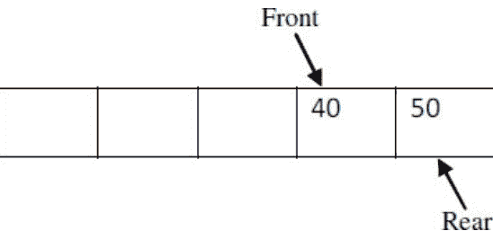

图 8.8: 从线性队列删除

循环队列利用内存，当尾部达到最大值时，它将指向第一个空位。在图 8.8 中，尾部指向 50，假设插入 60，在线性队列中我们无法，但在循环队列中可以。因为在循环队列中尾部将指向第一个块，它可以插入三个元素。循环队列的表示如图 8.9 所示。

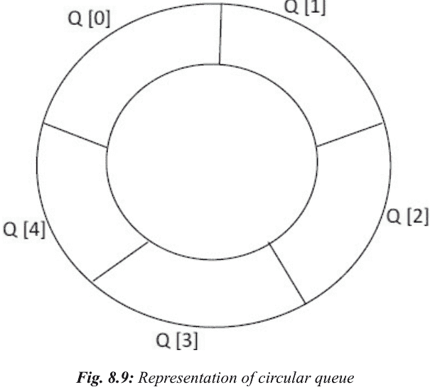

# 8.4.1 关于循环队列的一些重要点

1. 头部始终指向第一个元素。
2. 如果 `front = rear`，则队列为空。
3. 当插入新元素时，尾部的值加 1，即 `rear = rear + 1`。
4. 当删除新元素时，头部的值加 1，即 `front = front + 1`。

# 8.4.2 循环队列的插入

插入过程与线性队列相似，但它强调头部和尾部。

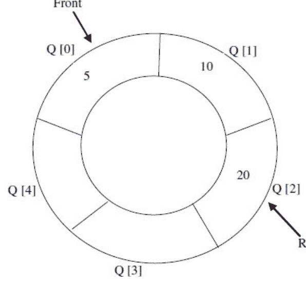

图 8.10: 在循环队列中插入元素

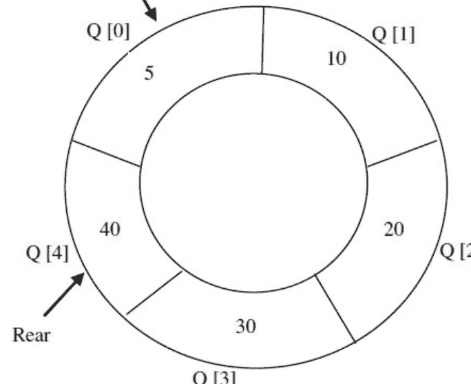

图 8.11: 满循环队列的表示

# 8.4.3 循环队列的删除

循环队列的删除有些不同。当我们从循环队列中删除元素时，我们必须增加头部的值。同样，如图 8.12 所示，它可以删除循环队列中的所有数据。

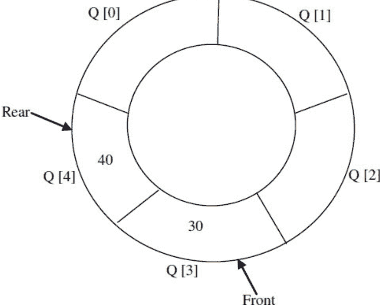

图 8.12: 从循环队列删除

在图 8.12 中，有三个空槽，可以通过尾部填充。为了从尾部填充值，它可以沿循环方向移动，尾部应该指向第一个节点。创建循环队列有两个条件。

1. 循环队列插入的条件

```c
if (qptr->rear==MAX)
{
    qptr->rear=qptr->rear%MAX;
}
```

2. 循环队列删除的条件

```c
if (qptr->front==MAX)
{
    qptr->front=qptr->front%MAX;
}
```

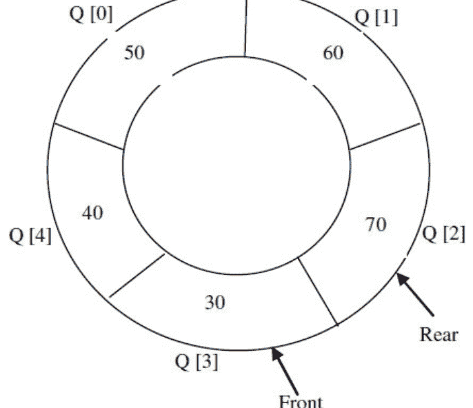

图 8.13: 在循环队列中插入新元素

# 向队列插入元素的算法

- 步骤 1. `QInsert (queue [MAXSIZE], Item)`
  如果 (`front == rear + 1) % MAXSIZE`)
- 步骤 2. 写入队列上界并退出
- 步骤 3. 否则: 取值
- 步骤 4. 如果 (`front == -1`)
- 步骤 5. 设置 `front = Rear = 0`
- 步骤 6. 否则
- 步骤 7. `Rear = ((rear + 1) % MAXSIZE)`
- 步骤 8. [赋值] `queue[rear] = value`
- 步骤 9. 结束

# 从队列删除元素的算法

- 步骤 1. 删除队列 (`[MAXSIZE], Item`)
  如果 (`front = -1`)
- 步骤 2. 写入队列上界并退出
- 步骤 3. `Item = queue[front]`
- 步骤 4. 如果 (`front == rear`)
- 步骤 5. 设置 `front = -1`
- 步骤 6. 设置 `rear = -1`
- 步骤 7. 否则
- 步骤 8. `front = ((front + 1) % MAXSIZE)` 结构结束

# 程序 3: 实现循环队列的程序

```c
#include <stdio.h>
#include <conio.h>
#define MAX 6
typedef struct cqueue
{
    int cq_arr[MAX];
    int rear, front;
} cqueue;
void init(cqueue *cqptr)
{
    cqptr->rear=-1;
    cqptr->front=-1;
}
int isEmpty(cqueue *cqptr)
{
    if (cqptr->front==-1 && cqptr->rear==-1)
    {
        return(1);
    }
    else
    {
        return(0);
    }
}
```

```c
int isfull(cqueue *cqptr)
{
    if((cqptr->front==cqptr->rear+1)%MAX)
    {
        return(1);
    }
    else
    {
        return(0);
    }
}
void insert(cqueue *cqptr)
{
    int item;
    if(isfull(cqptr))
    {
        printf("cqueue IS FULL\n");
    }
    else
    {
        printf("Enter an element\n");
        scanf("%d",&item);
        cqptr->rear=(cqptr->rear+1) %MAX;
        cqptr->cq_arr[cqptr->rear]=item;
    }
    if(cqptr->front==-1)
    {
        cqptr->front=0;
    }
}
void delete(cqueue *cqptr)
{
    int item;
    if(isEmpty(cqptr))
    {
        printf("cqueue IS EMPTY\n");
    }
```

```c
else
{
  item=cqptr->cq_arr[cqptr->front];
  printf("DELETED ELEMENT IS=%d\n",item);
  if (cqptr->front==cqptr->rear) {
    cqptr->front=-1;
    cqptr->rear=-1;
  }
  else {
    cqptr->front=(cqptr->front+1)%MAX;
  }
}

void traverse(cqueue *cqptr) {
  cqueue *p;
  int i,j;
  if (isEmpty(cqptr)) {
    printf("THERE IS NO ELEMENT IN A QUEUE\n");
  }
  if (cqptr->front<=cqptr->rear) {
    for(i=cqptr->front;i<=cqptr->rear;i++) {
      printf("%d\n",cqptr->cq_arr[i]);
    }
  }
else
{
    i=cqptr->front;
    while(i!=cqptr->rear) {
      i=(i+1)%MAX;
      printf("%d\n",cqptr->cq_arr[i]);
    }
  }
```


```c
*/
else
{
    for(i=cqptr->front;i<MAX;i++)
    {
        printf("%d\n",cqptr->cq_arr[i]);
    }
    p=MAX;
    for(j=0;j<=cqptr->rear;j++)
    {
        printf("%d\n",cqptr->cq_arr[p]);
        p=(j+1)%MAX;
    }
}
void main()
{
    int ch;
    cqueue q;
    init(&q);
    while(1)
    {
        printf("\n\n1.INSERT A ELEMENT IN A cqueue\n2.DELETE A\nELEMENT FROM A cqueue\n3.TRAVERSE\n4.EXIT\nPLEASE ENTER YOUR\nCHOICE:\n");
        scanf("%d",&ch);
        switch(ch)
        {
            case 1:
                insert(&q);
                break;
            case 2:
                delete(&q);
                break;
            case 3:
                traverse(&q);
                break;
            case 4:
                exit(0);
        }
        getch();
    }
```

```c
#### 输出:

1. INSERT A ELEMENT IN A cqueue
2. DELETE A\nELEMENT FROM A cqueue
3.TRAVERSE
4. EXIT
PLEASE ENTER YOUR CHOICE:3
THERE IS NO ELEMENT IN A QUEUE

1. INSERT A ELEMENT IN A cqueue
2. DELETE A\nELEMENT FROM A cqueue
3.TRAVERSE
4. EXIT
PLEASE ENTER YOUR CHOICE:1
Enter an element1 10

1. INSERT A ELEMENT IN A cqueue
2. DELETE A ELEMENT FROM A cqueue
3. TRAVERSE
4. EXIT
PLEASE ENTER YOUR CHOICE:3
10

1. INSERT A ELEMENT IN A cqueue
2. DELETE A ELEMENT FROM A cqueue
3. TRAVERSE
4. EXIT
PLEASE ENTER YOUR CHOICE:2
DELETED ELEMENT IS=10

1. INSERT A ELEMENT IN A cqueue
2. DELETE A ELEMENT FROM A cqueue
3. TRAVERSE
4. EXIT
PLEASE ENTER YOUR CHOICE:1
Enter an element 20

1. INSERT A ELEMENT IN A cqueue
2. DELETE A ELEMENT FROM A cqueue
3. TRAVERSE
4. EXIT
PLEASE ENTER YOUR CHOICE:3
20

1. INSERT A ELEMENT IN A cqueue
2. DELETE A ELEMENT FROM A cqueue
3. TRAVERSE
4. EXIT
PLEASE ENTER YOUR CHOICE:4
```

## 8.5 双端队列 (De-queue)

双端队列是一种特殊的队列，可以在两端进行插入、删除和遍历。


图 8.14: 双端队列的表示

双端队列中有元素。插入和删除操作与双向链表相似。可以从头部和尾部进行遍历。功能如下：

1. 从头部插入

```c
insert_f()
{
    front--;
    entry[front]=item;
}
```

2. 从尾部插入

```c
insert_r()
{
    entry[rear]=item;
    rear++;
}
```

3. 从头部删除

```c
delete_f()
{
    item=entry[front];
    front++;
}
```

4. 从尾部删除

```c
delete_r()
{
    rear--;
    item=entry[rear];
}
```

5. 从头部遍历

```c
traverse_f()
{
    item=entry[front];
    front++;
}
```

6. 从尾部遍历

```c
traverse_r()
{
    i=rear-1;
    i>=front
    entry[i]
}
```

## 程序 4: 实现双端队列的程序

```c
#include<stdio.h>
#include<conio.h>
#define SIZE 100
void enQ(int);
int deQF();
int deQR();
void enQR(int);
void enQF(int);
void show();
int queue[SIZE];
int rear = 0;
```

```c
break;
case 4:
    show();
    break;
default:printf("Wrong choice");
}
printf("\nDo you want to perform another operation\n(Y/N):");
ch=getch();
while (ch=='y'||ch=='Y');
getch();
break;
case 2:
-- 选择操作 ---
printf("\n1. Insert at Rear\n2. Insert at Front\n3. Delete\n4. Show");
{
printf("\nEnter your choice for the operation:");
scanf("%d",&ch2);
switch(ch2)
{
    case 1: enQR(value);
    show();
    break;
    case 2: enQF(value);
    show();
    break;
    case 3: value = deQF();
    printf("\nThe value deleted is %d",value);
    show();
    break;
    case 4: show();
    break;
    default:printf("Wrong choice");
}
printf("\nDo you want to perform another operation\n(Y/N):");
```

```c
ch=getch();
} while(ch=='y'||ch=='Y');
getch();
break;
printf("\nDo you want to continue(y/n):");
ch=getch();
} while(ch=='y'||ch=='Y');

void enQR(int value)
{
    char ch;
    if(front == SIZE/2)
    {
        printf("\nQueue is full!!! Insertion is not possible!!!");
        return;
    }
do{
        printf("\nEnter the value to be inserted:");
        scanf("%d",&value);
        queue[front] = value;
        front++;
        printf("Do you want to continue insertion Y/N");
        ch=getch();
    } while(ch=='y');
}
void enQF(int value)
{
    char ch;
    if(front==SIZE/2)
    {
        printf("\nQueue is full!!! Insertion is not possible!!!");
        return;
    }
do
```

```c
printf("\nEnter the value to be inserted:");
scanf("%d",&value);
rear--;
queue[rear] = value;
printf("Do you want to continue insertion Y/N");
ch=getch();
} while(ch=='y');
}
int deQR()
{
    int deleted;
    if(front == rear)
    {
        printf("\nQueue is Empty!!! Deletion is not possible!!!");
        return 0;
    }
    front--;
    deleted = queue[front+1];
    return deleted;
}
int deQF()
{
    int deleted;
    if(front == rear)
    {
        printf("\nQueue is Empty!!! Deletion is not possible!!!");
        return 0;
    }
    rear++;
    deleted = queue[rear-1];
    return deleted;
}
void show()
{
    int i;
    if(front == rear)
    printf("\nQueue is Empty!!!\n");
    else
    for(i=front;i<rear;i++)
    {
        printf("%d\n",queue[i]);
    }
}
```

```c
#include <stdio.h>
#include <conio.h>
#define size 5

int queue[5][2] = {0};
int top = -1;
int bottom;

void push(int value, int pr)
{
    int i,j,k;
    if(top < size-1)
    {
        if(queue[top][1] > pr)
        {
            for(i=0;i<top;i++)
            {
                if(queue[i][1] > pr)
                {
                    break;
                }
            }
            for(j=top;j>=i;j--)
            {
                queue[j+1][0] = queue[j][0];
                queue[j+1][1] = queue[j][1];
            }
            top++;
        }
        queue[i][0] = value;
        queue[i][1] = pr;
    }
    else
    {
        top++;
        queue[top][0] = value;
        queue[top][1] = pr;
    }
}
```

```c
else
{
    printf("队列溢出 \n");
}

void pop()
{
    int i;
    if(queue[0][0] == 0) {
        printf("\n 队列为空 \n");
    } else {
        printf("\n出队后，以下值被删除 \n %d\n", queue[0][0]);
        for(i=0;i<top;i++) {
            queue[i][0] = queue[i+1][0];
            queue[i][1] = queue[i+1][1];
        }
        queue[top][0] = 0;
        queue[top][1] = 0;
        top--;
    }
}

void display()
{
    int i,j;
    printf("元素\t优先级 \n");
    for(i=size - 1;i>=0;i--) {
        for(j=0;j<2;j++) {
            printf("%d\t",queue[i][j]);
        }
    }
    printf("\n");
}

int main()
{
    int i,j, ch=0,value = 0,pr=0;
    while(1)
    {
        printf("\n 请输入选择。 \n");
        printf("1 入队 \n 2 出队 \n 3 显示\n 4\nfor退出: \t \n");
        scanf("%d",&ch);
        switch(ch)
        {
            case 1:
                printf("\n 请输入要插入的数字: \t");
                scanf("%d", &value);
                printf("\n 请输入优先级: \t");
                scanf("%d", &pr);
                push(value,pr);
                break;
            case 2:
                pop();
                break;
            case 3:
                display();
                break;
            case 4:
                exit(0);
                break;
            default:
                printf("你输入的选项错误\n");
        }
    }
}
```

## 输出：

请输入选择。
1 入队

2 出队
3 显示
4 退出:
1

请输入要插入的数字: 4
请输入优先级: 6
请输入选择。
1 入队
2 出队
3 显示
4 退出:
1

请输入要插入的数字: 3
请输入优先级: 6
请输入选择。
1 入队
2 出队
3 显示
4 退出:
1

请输入要插入的数字: 8
请输入优先级: 2

外部指针：此指针包含第一个节点的地址。通过外部指针，可以访问所有节点。

空链：列表中没有节点时称为空列表。有时它也称为空列表（null list）。外部指针的值为零，意味着列表中不存在任何节点。

## 9.3 链表的表示

链表有两个字段：数据域和地址域。

| 数据 (Data) | 地址 (Address) |
|---|---|

图 9.3：节点的表示

节点的定义为：

```c
struct Node {
  int data;
  struct Node * next;
}
```


## 9.4 链表的操作

链表可以执行以下操作：

- 1. 创建
- 2. 插入
- 3. 删除
- 4. 遍历
- 5. 搜索
- 6. 合并
- 7. 显示

### 创建

此操作用于创建链表。首先，它必须使用动态函数在运行时创建一个节点。

### 插入

此操作用于向链表插入一个新节点。它可以插入到链表的任何位置，例如：

- a. 在链表的头部插入节点
- b. 在链表的尾部插入节点
- c. 在链表的特定位置插入节点

### 删除

此操作用于从链表中删除现有的节点。它可以从链表的任何位置删除，例如：

- a. 删除链表头部的节点
- b. 删除链表尾部的节点
- c. 删除链表特定位置的节点

### 遍历

这是一个显示链表中所有元素的过程。遍历有两种类型：正向遍历和反向遍历。在正向遍历中，所有元素按正向方向显示。在反向遍历中，所有元素按反向显示。

### 合并

在这个过程中，有两个列表，需要将第二个列表附加到第一个列表的末尾。

### 显示

此操作用于打印链表中的每一个元素。

## 9.5 链表的类型

链表有四种类型。

- 1. 单链表
- 2. 双链表
- 3. 循环链表
- 4. 循环双链表

### 单链表

在单链表中，所有节点按顺序方式链接。它也被称为线性链表。这种链表有两个端：头部和尾部。单链表的问题是，无法从当前节点到达前驱节点。通过双链表可以解决这个问题。

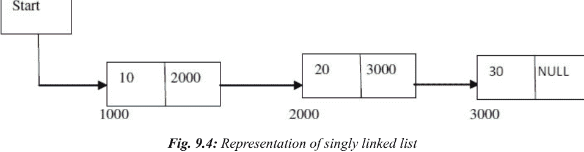

### 双链表

在双链表中，所有节点都是相互链接的。在这个列表中，可以从任何节点访问后继节点和前驱节点。此外，它可以沿正向和反向方向遍历。

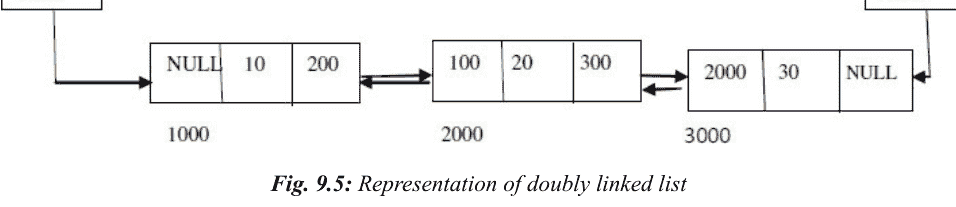

### 循环链表

在循环链表中，没有头部和尾部的划分。单链表可以转换为循环链表。它将第一个节点的地址分配最后一个节点。

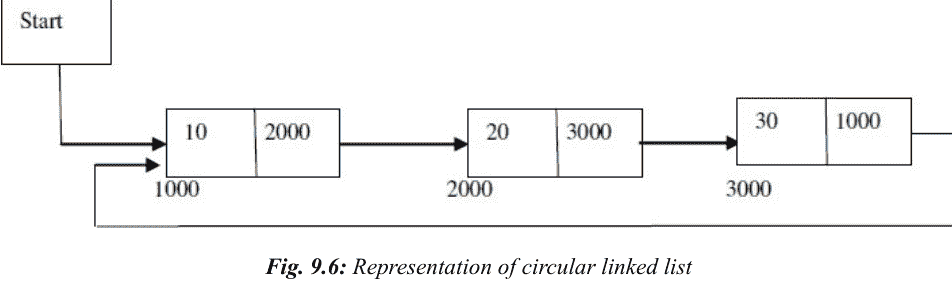

## 9.6 单链表

单链表是动态数据结构之一。它使用自引用链表。在单链表中，节点是通过某些动态分配函数在运行时创建的。对节点的操作（如插入、删除和遍历）是通过外部指针帮助完成的。

节点的结构为：

```c
struct Node
{
  int data;
  struct Node *next;
};
```

节点的运行时分配为：

```c
struct Node * start;
start=(Node*) malloc(sizeof(Node));
```

这里，`start`是一个结构体指针，持有第一个块的地址。结构的所有信息都可以通过`start`指针访问。
`start-> data = 30`意味着在结构体中赋值数据 30。

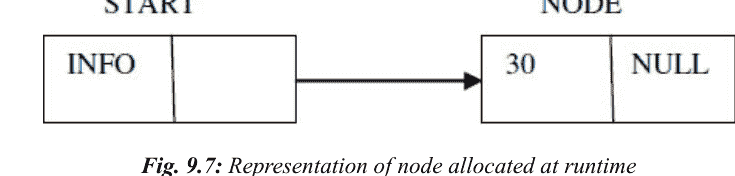

可以在这里插入更多节点，并维护逻辑关系。

```c
Start=malloc(sizeof (NODE));
Start-> ptr.num=100;
Start-> ptr.ptr=NULL;
```

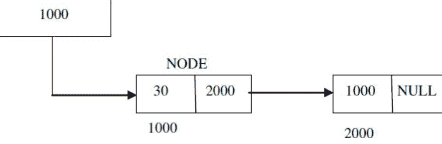

图 9.8：在单链表中插入节点

### 插入节点

插入节点有三个重要点：

- 1. 分配节点。
- 2. 分配数据。
- 3. 调整指针。

新节点可以插入到链表的位置：

- 1. 链表的头部
- 2. 链表的尾部
- 3. 链表的指定位置

### 在头部插入节点

### 算法

```c
INSERT-FIRST (START, ITEM)
```

该算法将`item`插入为`START`所指向的链表的第一个节点。

- 1. 检查溢出：

```c
If PTR=NULL, then
  Print overflow
Else
  PTR=(Node*) malloc (size (node));
```

- 2. 设置`PTR-> INFO`
- 3. 设置`START-> PTR`

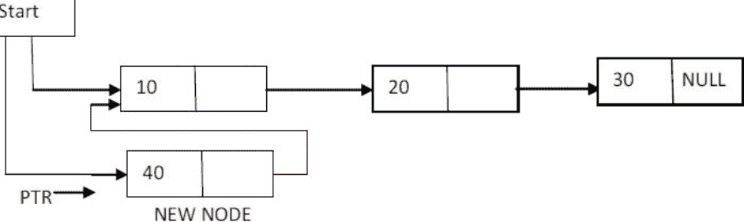

图 9.9：在链表头部插入节点

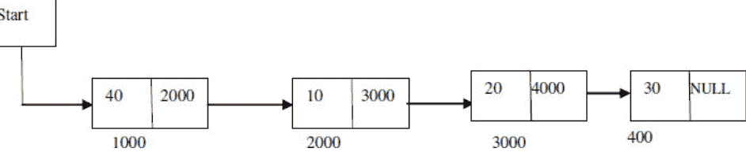

图 9.10：在头部插入节点后的链表

### 在尾部插入节点

### 算法

```c
Insert-last (START, ITEM)
```

该算法将`item`插入到链表的尾部。

- 1. 检查溢出：

```c
If PTR=NULL, then
  Print 'Overflow'
else
  PTR=(Node*) malloc (size (Node));
```

- 2. 设置`PTR-> Info`
- 3. 设置`PTR-> Next=Null`
- 4. 如果`START=NULL`，设置`START=P`
- 5. 设置`LOC->Start`
- 6. 重复步骤 7 直到`loc-> next=NULL`
- 7. 设置`LOC-> next`
- 8. 设置`LOC-> next = P`

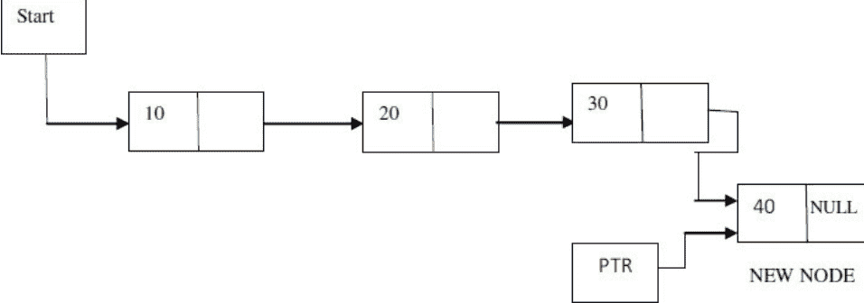

图 9.11：在链表尾部插入节点

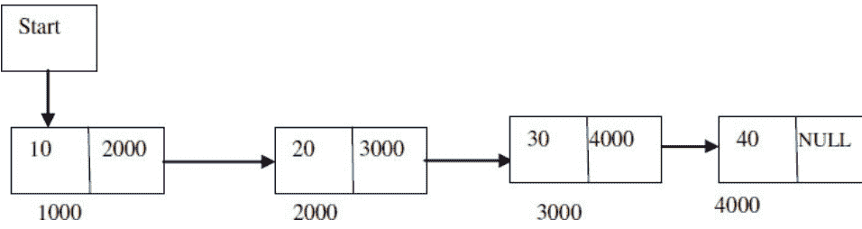

图 9.12：在尾部插入节点后的链表

### 在链表的特定位置插入节点

### 算法

```c
Insert-loc (START, Item, LOC)
```

该算法将`item`插入到链表的特定位置。

- 1. 检查溢出：

```c
If PTR=NULL,
  Print 'Overflow'
Else
  PTR=(NODE*) malloc (size (node));
```

- 2. 设置`PTR->INFO`
- 3. 如果`start = NULL`，则：

```c
Set start=P
Set P-> Next =Null
```

- 4. 初始化计数器`(I)`和：

```c
Pointer (Node* temp)
Set I=0
Set temp = Start
```

- 5. 重复步骤 6 和 7 直到`I < LOC`
- 6. 设置`temp = temp-> next`
- 7. 设置`I=I+1`
- 8. 设置`P-> next=temp-> next`
- 9. 设置`temp-> next = P`

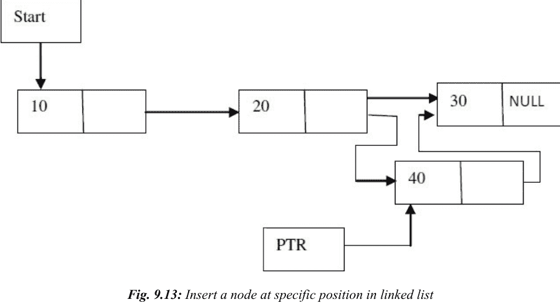

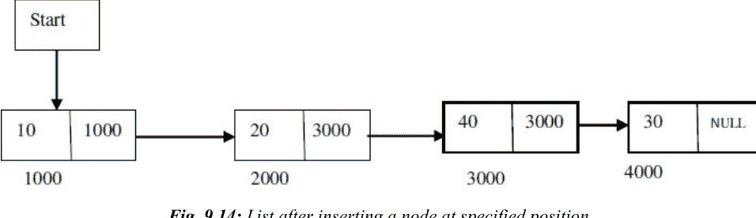

## 删除节点

在本节中，我们删除节点。删除节点有三种方法：

- 1. 删除链表中的第一个节点
- 2. 删除链表中的最后一个节点
- 3. 删除链表中的特定节点

首先，搜索是删除节点非常重要的部分。必须搜索要删除节点的特定位置。删除元素的要点如下：

- 1. 如果链表为空，显示消息“无法从链表中删除”。
- 2. 如果删除一个特定节点，则必须将指针移动到另一个节点。

### 删除链表中的第一个节点

### 算法

```c
Delete First (START)
```

该算法从链表的第一个位置或头部删除元素。

- 1. 检查下溢：

```c
If START=NULL, then
  Print ('Linked list is empty')
  Exit
End if
```

- 2. 设置`PTR=Start`
- 3. 设置`START=START-> next`
- 4. 打印删除的元素为`ptr->Info`
- 5. `free (ptr)`

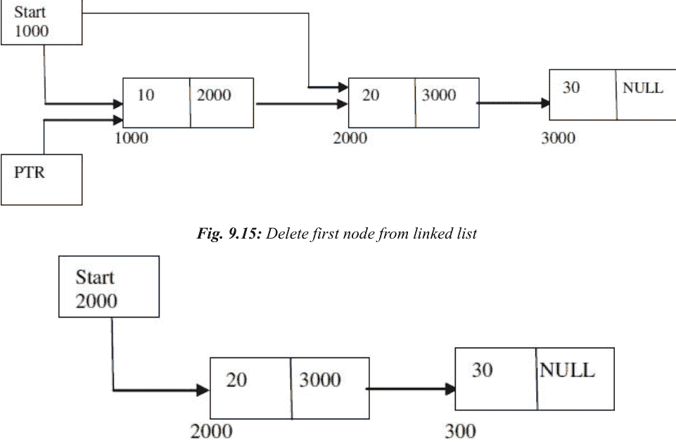

图 9.15：从链表中删除第一个节点

### 删除最后一个节点的算法

### 算法

```c
Delete (START)
```

该算法从链表的最后一个位置删除元素。

- 1. 检查下溢：

```c
If start=Null, then,
  Print ('Linked list is empty')
  Exit
End if
```

- 2. 如果`start->next=Null`，则：
  设置`PTR=Start`
  设置`Start = NULL`
  打印删除的元素为`PTR->info`
  `Free (PTR)`
  End if
- 3. 设置`PTR=START`
- 4. 重复步骤 5 和 6 直到`PTR ->Next= Null`
- 5. 设置`LOC =PTR`
- 6. 设置`PTR=PTR->Next`
- 7. 设置`LOC -> Next=Null`
- 8. `Free (PTR)`

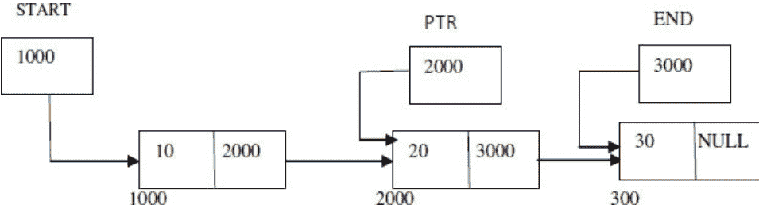

图 9.16：删除第一个节点后的新链表

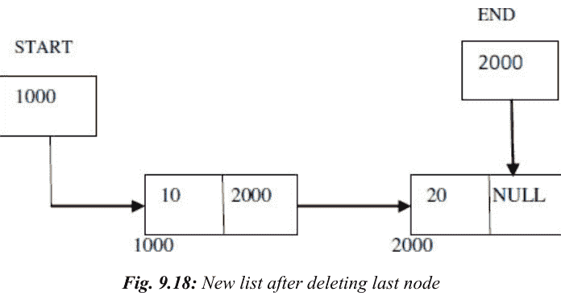

## 删除指定位置节点的算法

算法`Delete location (START, LOC)`该算法从链表的指定位置删除一个项。

- 1. [检查是否下溢？]

```c
If PTR=NULL, then
    Print"Underflow"
    Exit
```

- 2. [初始化计数器`I`和指针]
`Node * temp, node * PTR;`
`Set I=0`
`Set *ptr=START`
- 3. 重复第 4 到 9 步
- 4. `Set temp = PTR`
- 5. `Set PTR=PTR->Next`
- 6. `Set I = I+1`
- 7. 打印"删除的元素是, `ptr->`
- 8. `Set Temp->next=PTR->new`
- 9. `Free (PTR)`

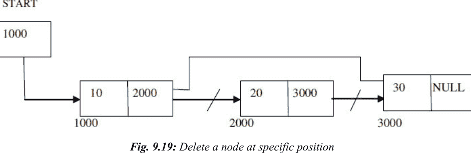

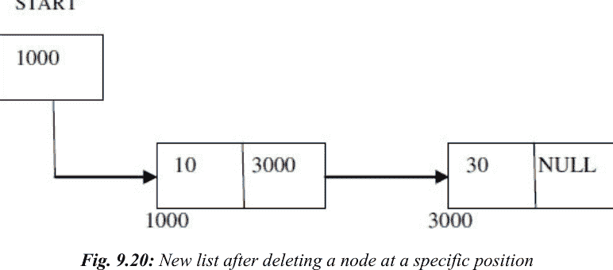

## 9.7 实现链表的程序

程序 1：C 语言中的链表实现。

```c
#include<stdio.h>
#include<conio.h>

typedef struct sng_lnk_lst // 结构体声明
{
    int data;
    struct sng_lnk_lst *next;
} lnk; 

int cnt=0;

int isempty() // 空函数
{
    if(cnt==0)
    {
        return(1);
    }
    else
    {
        return(0);
    }
}

void init(Lnk **fptr, Lnk **rptr) // 链表的初始化
{
  int item;
  lnk *sl;
  sl=(Lnk *) malloc(sizeof(Lnk));
  printf("Enter a element\n");
  scanf("%d", &item);
  sl->data=item;
  sl->next=NULL;
  *fptr=sl;
  *rptr=sl;
  cnt++;
}

void insert_beg(Lnk **fptr)
{
  lnk *sl;
  int item;
  sl=(Lnk *) malloc(sizeof(Lnk));
  printf("Enter a element\n");
  scanf("%d", &item);
  sl->data=item;
  sl->next=*fptr;
  *fptr=sl;
  cnt++;
}

void insert_end(Lnk **rptr)
{
  lnk *sl,*t;
  int item;
  t=*rptr;
  sl=(Lnk *) malloc(sizeof(Lnk));
  printf("Enter a element\n");
  scanf("%d", &item);
  sl->data=item;
  sl->next=NULL;
  t->next=sl;
  *rptr=sl;
  cnt++;
}

void insert_bet(lnk **fptr,lnk **rptr)
{
    lnk *sl,*t;
    int item;
    int pos,i=1;
    printf("Enter the position\n");
    scanf("%d",&pos);
    t=*fptr;
    if(pos>=cnt+2)
    {
        printf("Sorry can't insert the element at that %d position",pos);
    }
    else
    {
        sl=(lnk ) malloc(sizeof(lnk));
        printf("Enter a element\n");
        scanf("%d",&item);
        if(pos==1)
        {
            sl->data=item;
            sl->next=*fptr;
            *rptr=sl;
        }
        else
        {
            sl->data=item;
            sl->next=NULL;
            while(i!=pos-1)
            {
                t=t->next;
                i++;
            }
            if (t->next==NULL)
            {
                sl->next=t->next;
                t->next=sl;
                *rptr=sl;
            }
            sl->next=t->next;
            t->next=sl;
        }
        cnt++;
    }
}

void del_beg(lnk **fptr)
{
    lnk *d,*tmp;
    d=*fptr;
    if (*fptr==NULL)
    {
        printf("LIST IS EMPTY\n");
    }
    else if (d->next==NULL)
    {
        tmp=d;
        printf("DELETED ITEM IS=%d\n", tmp->data);
        *fptr=d->next;
        free(tmp);
    }
    else
    {
        printf("DELETED ITEM IS=%d\n", d->data);
        *fptr=d->next;
        free(d);
    }
    cnt--;
}

void del_end(lnk **fptr) 
{
    lnk *d,*tmp;
    d=*fptr;
    if (cnt==0)
    {
        printf("LIST IS EMPTY\n");
    }
    else
    {
        if (d->next==NULL)
        {
            tmp=d;
            printf("DELETED ELEMENT IS=%d",tmp->data);
            d=d->next;
            *fptr=d;
            free(tmp);
        }
        else
        {
            d=*fptr;
            while (d->next->next!=NULL)
            {
                d=d->next;
            }
            tmp=d->next;
            printf("DELETED ELEMENT IS=%d",tmp->data);
            d->next=tmp->next;
            free(tmp);
        }
        cnt--;
    }
}

void del_bet(lnk **fptr, lnk **ptrptr)
{
    int pos,i=1;
    lnk *d,*tmp;
    d=*fptr;
    if (cnt==0)
    {
        printf("LIST IS EMPTY\n");
    }
    else
    {
        printf("ENTER THE POSITION FROM WHERE ELEMENT TO BELETED\n");
        scanf("%d",&pos);
        if(pos>cnt)
        {
            printf("There is less %d element so cannot delete element",pos);
        }
        else if(pos==1)
        {
            tmp=d;
            printf("DELETED ELEMENT IS=%d",tmp->data);
            *fptr=d->next;
            free(tmp);
        }
        else
        {
            while(i!=pos-1)
            {
                d=d->next;
                i++;
            }
            tmp=d->next;
            printf("DELETED ELEMENT IS=%d",tmp->data);
            d->next=tmp->next;
            free(tmp);
        }
        cnt--;
    }
}
```


```c
{

    if (d->next==NULL)

    {

        printf("DELETED ELEMENT IS=%d\n",d->data);

        free(d);

        free(*rptr);

    }

    else

    {

        tmp=d;

        printf("DELETED ITEM IS=%d\n",tmp->data);

        *fptr=d->next;

        free(tmp);

    }

}

else

{

    while(i!=pos-1)

    {

        d=d->next;

        i++;

    }

    if ((d->next)->next==NULL)

    {

        tmp=d->next;

        printf("DELETED ELEMENT IS=%d\n", tmp->data);

        d->next=tmp->next;

        *rptr=d;

        free(tmp);

    }

    else

    {

        tmp=d->next;

        printf("DELETED ELEMENT IS=%d\n", tmp->data);

        d->next=tmp->next;

        free(tmp);

    }

    cnt--;

}

}
```

```c
void traverse(lnk **fptr)

{

  lnk *t;

  t=*fptr;

  printf("TOTAL NO NODES IS=%d\n",cnt);

  if(cnt==0)

  {

    printf("LIST IS EMPTY\n");

  }

  while(t!=NULL)

  {

    printf("\nd",t->data);

    t=t->next;

  }

}
```

```c
int main()

{

    int ch;

    lnk *fp,*rp;

    fp=NULL;

    rp=NULL;

    init (&fp,&rp);

    while(1)

    {

        printf("\n1.INSERT AT BEGIN\n2.INSERT END\n3.INSERT BETWEEN\n4.TRAVERSE\n5.DELETE ELEMENT FROM BEGINNING\n6.DELETE ELEMENT FROM END\n7.DELETE ELEMENT FROM SPECIFIC POSITION\n8.exit\n ENTER CHOICE\n");

        scanf("%d",&ch);

        switch (ch)

        {

            case 1:

                insert_beg(&fp);

                break;

            case 2:

                insert_end(&rp);

                break;

            case 3:

                insert_bet(&fp,&rp);

                break;

            case 4:

                traverse(&fp);

                break;

            case 5:

                del_beg(&fp);

                break;

            case 6:

                del_end(&fp);

                break;

            case 7:

                del_bet(&fp,&rp);

                break;

            case 8:

                exit(0);

        }

    }

    getch();

    return(0);

}
```

#### 输出:

```
Enter a element 10

1. INSERT AT BEG

2. INSERT END

3. INSERT BETWEEN

4. TRAVERSE

5. DELETE ELEMENT FROM BEGINNING

6. DELETE ELEMENT FROM END

7. DELETE ELEMENT FROM SPECIFIC POSITION

8. exit

ENTER CHOICE 1

Enter a element 5

1. INSERT AT BEG

2. INSERT END

3. INSERT BETWEEN

4. TRAVERSE

5. DELETE ELEMENT FROM BEGINNING

6. DELETE ELEMENT FROM END

7. DELETE ELEMENT FROM SPECIFIC POSITION

8. exit

ENTER CHOICE 4

TOTAL NO OF NODES IS=2

5

10

1. INSERT AT BEG

2. INSERT END

3. INSERT BETWEEN

4. TRAVERSE

5. DELETE ELEMENT FROM BEGINNING

6. DELETE ELEMENT FROM END

7. DELETE ELEMENT FROM SPECIFIC POSITION

8. exit

ENTER CHOICE 2

Enter a element 15

1. INSERT AT BEG

2. INSERT END

3. INSERT BETWEEN

4. TRAVERSE

5. DELETE ELEMENT FROM BEGINNING

6. DELETE ELEMENT FROM END

7. DELETE ELEMENT FROM SPECIFIC POSITION

8. exit

ENTER CHOICE 4

TOTAL NO OF NODES IS=3

5

10

15

1. INSERT AT BEG

2. INSERT END

3. INSERT BETWEEN

4. TRAVERSE

5. DELETE ELEMENT FROM BEGINNING

6. DELETE ELEMENT FROM END

7. DELETE ELEMENT FROM SPECIFIC POSITION

8. exit

ENTER CHOICE 8
```

```
Enter a element 10

1. INSERT AT BEG

2. INSERT END

3. INSERT BETWEEN

4. TRAVERSE

5. DELETE ELEMENT FROM BEGINNING

6. DELETE ELEMENT FROM END

7. DELETE ELEMENT FROM SPECIFIC POSITION

8. exit

ENTER CHOICE 1

Enter a element 5

1. INSERT AT BEG

2. INSERT END

3. INSERT BETWEEN

4. TRAVERSE

5. DELETE ELEMENT FROM BEGINNING

6. DELETE ELEMENT FROM END

7. DELETE ELEMENT FROM SPECIFIC POSITION

8. exit

ENTER CHOICE 4

TOTAL NO OF NODES IS=2

5

10

1. INSERT AT BEG

2. INSERT END

3. INSERT BETWEEN

4. TRAVERSE

5. DELETE ELEMENT FROM BEGINNING

6. DELETE ELEMENT FROM END

7. DELETE ELEMENT FROM SPECIFIC POSITION

8. exit

ENTER CHOICE 2

Enter a element 15

1. INSERT AT BEG

2. INSERT END

3. INSERT BETWEEN

4. TRAVERSE

5. DELETE ELEMENT FROM BEGINNING

6. DELETE ELEMENT FROM END

7. DELETE ELEMENT FROM SPECIFIC POSITION

8. exit

ENTER CHOICE 4

TOTAL NO OF NODES IS=3

5

10

15
```

```
If PTR=NULL Item
  Print, overflow
  Exit
Else
  PTR=(NODE*) Malloc (Size of (node));
End If
```

- 2. 如果 `Start->Num` 为 NULL 空

    Set `ptr->Num = Item`

    Set `ptr->next = ptr`

    Set `ptr->Start=PTR`

    Set `last =PTR`

  End if

- 3. Set `PTR-> num = Item`

4. Set `ptr-> next=Start`

5. Set `start = ptr`

6. Set `last-> next = ptr`

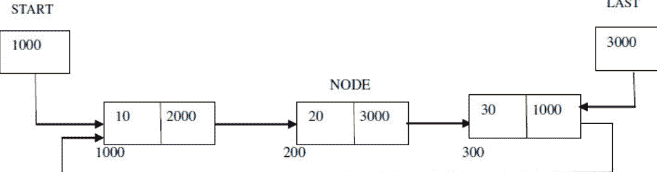

图 9.22: 循环链表的简单形式

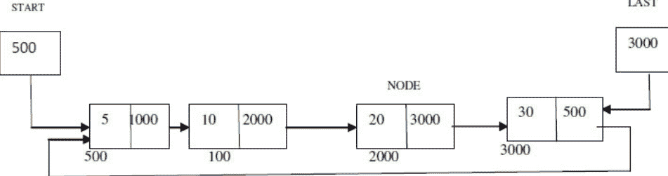

图 9.23: 在头部插入节点

## 在末尾插入节点

### 算法

`Insert-last (START, ITEM)`

该算法将 `item` 插入到链表的末尾。

- 1. [检查溢出？]

   If `ptr=NULL`, then

   Print "overflow"

   Exit

   Else

   `PTR=(Node*) malloc (size of (node));`

   End if

2. 如果 `START=NULL`, then

   Set `ptr-> num=Item`

   Set `ptr-> next->ptr`

   Set `last ->ptr`

   Set `Start = ptr`

   End if

3. Set `ptr-num->item`

4. Set `last->Next = ptr`

5. Set `last = ptr;`

6. Set `last->next = Start`

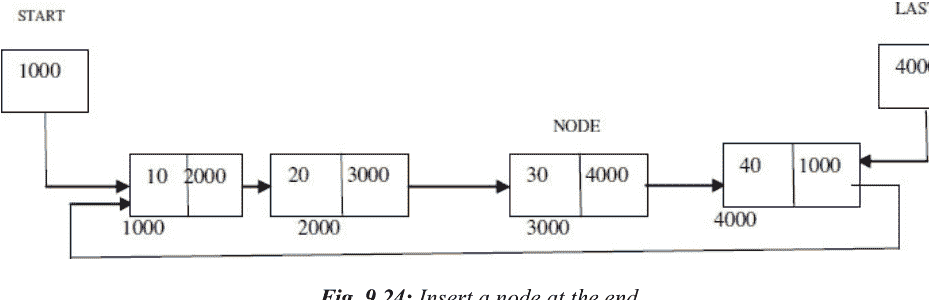

## 从头部删除节点

### 算法

`Delete First (START)`

该算法从第一个位置删除一个元素。

- 1. [检查上溢？]

  If `start -> NULL` then

  Print 'Circular list is empty'

  Exit

  End if

2. Set `ptr = start`

3. Set `Start = Start-> next`

4. Print, element deleted = `ptr-> info`

5. Set `last-> next = start`

6. `Free(ptr)`

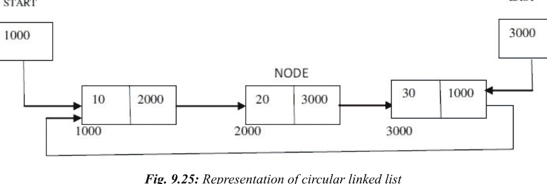

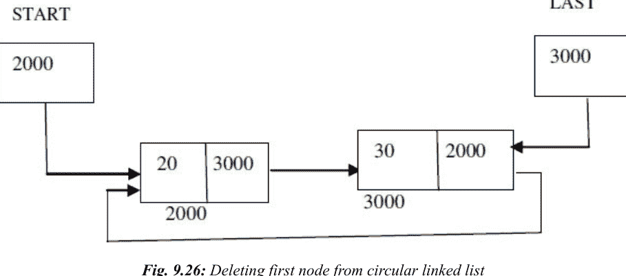

## 删除链表的最后一个节点

### 算法

`Delete Last (START)`

该算法从链表的最后一个位置删除一个元素。

- 1. [检查上溢条件？]

   If `Start = NULL` then

   Print 'Circular list empty'

   Exit

   End if

2. Set `ptr = start`

3. 重复步骤 4 和 5 直到 `ptr1 = start`

4. Set `ptr1 = ptr`

5. Set `ptr = ptr->next;`

6. Print "Element deleted is"

7. Set `ptr1->next = ptr->next`

8. Set `last = ptr1`

9. return `start`

10. `Free(ptr)`

```
ptr->num
```

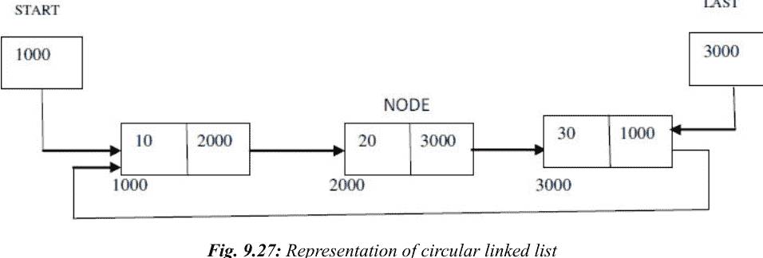

图 9.27: 循环链表的表示

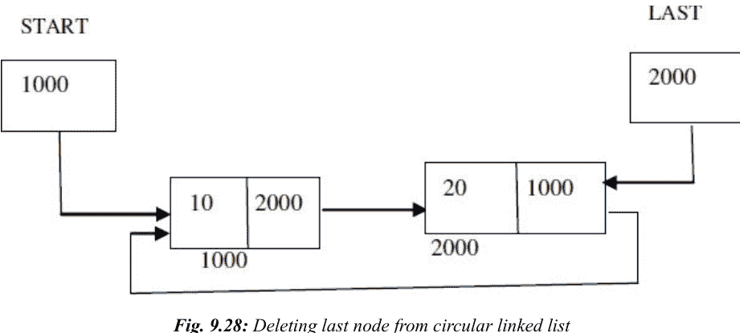

## 9.9 双向链表

我们已经学习了单向链表。单向链表的缺点是不可能进行反向遍历。在双向链表中，可以进行正向和反向遍历。在双向链表中，所有节点都相互连接。节点包含三个部分：数据、前驱地址和后地址。

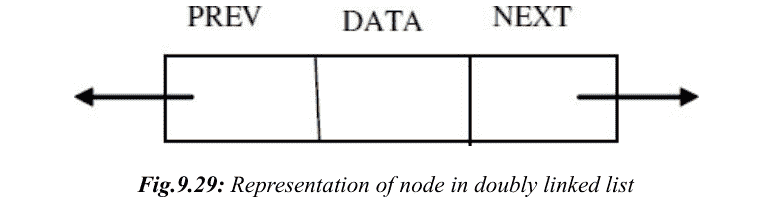

在双向链表中，左侧字段表示前驱节点，右字段表示后继节点。以下是双向链表的结构。

```c
struct node
{
  int num;
  struct node* prev;
  struct node*next;
};
```

### 双向链表节点的插入与删除

#### 在头部插入节点的算法

以下是在双向链表头部插入一个新节点的算法：

- 1. 为新节点分配内存。

2. 给新节点的 `data` 字段赋值。

3. 将 `LEFT` 和 `RIGHT` 链接置为 `NULL`。

4. 使新节点的 `Right` 链接指向链表头。并将头部的 `LEFT` 链接指向新节点。

5. 最后重置头指针。也就是说，让它指向插入在头部的新节点。

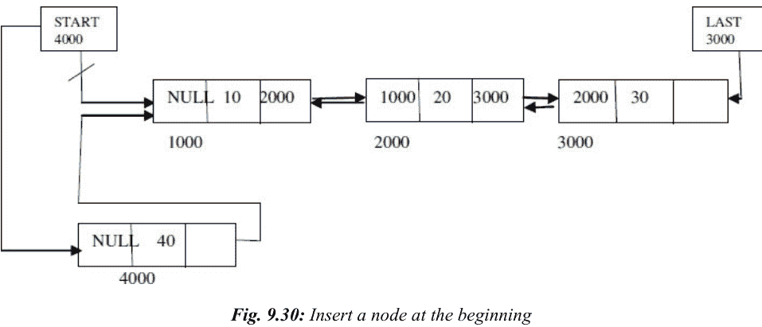

以下是在双向链表末尾插入节点的算法：

- 1. 为新节点分配内存

2. 给新节点的 `data` 字段赋值

3. 将 `LEFT` 和 `RIGHT` 链接置为 `NULL`

4. 如果链表不为空，遍历链表直到末尾，使最后一个节点的 `RIGHT` 链接指向新节点，并将新节点的 `LEFT` 链接指向最后一个节点。


图 9.31: 在末尾插入节点

#### 从双向链表删除起始节点

从双向链表头部（即头位置）删除节点的算法如下：

- 1. 如果链表为空，则显示“Doubly linked list is empty”。

2. 否则，如果第二个节点不为空，让头指针指向第二个节点。

3. 释放第一个节点。


图 9.32: 从双向链表删除第一个节点


图 9.33: 删除第一个节点后的链

#### 从双向链表删除最后一个节点

从双向链表末尾删除节点的算法如下：

- 1. 如果链表为空，则显示“Empty list”。

2. 指向最后一个节点的前驱节点并移动指针。

3. 释放最后一个节点。


## 9.10 实现双向链表的程序

C 语言实现双向链表的程序：


```c
#include<stdio.h>
#include<conio.h>
typedef struct doubly_list {
  int data;
  struct doubly_list *prev,*next;
} link;
int cnt=0;
int isempty()
{
  if (cnt==0)
{
    return(1);
  }
  else
{
    return(0);
  }
}

void init(link **fptr,link **rptr)
{
    int item;
    link *dl;
    dl=(link *) malloc(sizeof(link));
    printf("Enter a element\n");
    scanf("%d",&item);
    dl->data=item;
    dl->prev=NULL;
    dl->next=NULL;
    *fptr=dl;
    *rptr=dl;
    cnt++;
}

void insert_beg(link **fptr)
{
    link *dl,*tmp;
    int item;
    tmp=fptr;
    dl=(link *) malloc(sizeof(link));
    printf("Enter a element\n");
    scanf("%d",&item);
    dl->data=item;
```

[PAGE 237]

```c
dl->next=*fptr;
dl->prev=NULL;
tmp->prev=dl;
*fptr=dl;
cnt++;
}
```

```c
void insert_end(link **rptr)
{
    link *dl,*t;
    int item;
    t=*rptr;
    dl=(link *) malloc(sizeof(link));
    printf("Enter a element\n");
    scanf("%d",&item);
    dl->data=item;
    dl->next=NULL;
    dl->prev=*rptr;
    t->next=dl;
    *rptr=dl;
    cnt++;
}
```

```c
void insert_bet(link **fptr,link **rptr)
{
    link *dl,*t,*tmp;
    int item;
    int pos,i=1;
    dl=(link *) malloc(sizeof(link));
    printf("Enter the position\n");
    scanf("%d",&pos);
    t=*fptr;
    if(pos==cnt+1)
{
    printf("Enter the element\n");
    scanf("%d",&item);
    tmp=*rptr;
    dl->data=item;
```

[PAGE 238]

```c
dl->next=NULL;
dl->prev=*rptr;
tmp->next=dl;
*rptr=dl;
cnt++;
}
else if (pos==1)
{
printf("Enter a element\n",item);
scanf("%d",&item);
dl->data=item;
dl->next=*fptr;
dl->prev=NULL;
t->prev=dl;
*fptr=dl;
cnt++;
}
else
{
printf("Enter the element\n",item);
scanf("%d",&item);
dl->data=item;
dl->next=NULL;
dl->prev=NULL;
while(i!=pos-1)
{
t=t->next;
i++;
}
dl->next=t->next;
t->prev=dl;
cnt++;
}
void del_beg(link **fptr)
```

[PAGE 239]

```c
link *dl,*tmp;
dl=*fptr;
if(isempty())
{
  printf("Circular list is empty");
}
else if(dl->next==NULL)
{
  tmp=dl;
  printf("Circular list is empty");
  *fptr=NULL;
  free(tmp);
}
else
{
  tmp=dl;
  printf("Element deleted is %d\n",tmp->data);
  *fptr=dl->next;
  dl->next->prev=NULL;
  free(tmp);
}
}

void del_end(link **rptr,link **fptr)
{
  link *dl,*tmp;
dl=*rptr;
if(isempty())
{
  printf("Circular list is empty");
}
else if(dl->next==NULL)
{
  tmp=dl;
  printf("Circular list is empty");
  *fptr=NULL;
  *rptr=NULL;
  free(tmp);
}
else
{
  dl=*rptr;
  tmp=dl->prev;
  tmp->next=NULL;
  _printf("Element deleted is %d\n",tmp->data);
  *rptr=tmp;
  free(dl);
}
}

void del_bet(link **fptr,link **rptr)
{
  link *dl,*t,*tmp;
  int item;
  int pos,i=1;
dl=*fptr;
if(isempty())
{
  printf("Circular list is empty");
}
else if(pos==1)
{
  tmp=dl;
  printf("Element deleted is %d\n",tmp->data);
  *fptr=dl->next;
  dl->next->prev=NULL;
  free(tmp);
}
else
{
while(i!=pos-1)
{
dl=dl->next;
i++;
}
tmp=dl->next;
printf("Element deleted is %d\n",tmp->data);
dl->next=tmp->next;
tmp->next->prev=dl;
free(tmp);
}
}
}
void traverse(link **fptr)
{
link *t;
}
}
```

```c
t=*fptr;
printf("TOTAL NUMBER NODES IS=%d\n", cnt);
if (isempty())
{
    printf("LIST IS EMPTY\n");
}
while (t!=NULL)
{
    printf("\n%d",t->data);
    t=t->next;
}
int main()
{
    int ch;
    lnk l,*fp,*rp;
    fp=&l1;
    init(&fp,&ch);
    while (1)
    {
        printf("\n\n1.INSERT AT BEGIN\n2.INSERT END\n3.INSERT IN BETWEEN\n4.TRAVERSE\n5.DELETE ELEMENT FROM BEGINNING\n6.DELETE ELEMENT FROM END\n7.DELETE ELEMENT FROM SPECIFIC POSITION\n8.exit\n9 ENTER YOUR CHOICE\n");
        scanf("%d", &ch); switch(ch)
        {
            case 1:
                insert_beg(&fp);
                break;
            case 2:
                insert_end(&rp);
                break;
            case 3:
                insert_bet(&fp,&rp);
                break;
            case 4:
                traverse(&fp);
                break;
            case 5:
                del_beg(&fp);
                break;
            case 6:
                del_end(&rp,&fp);
                break;
            case 7:
                del_bet(&fp);
                break;
            case 8: exit(0);
        }
    }
getch();
return(0);
```

#### 输出:

输入元素 10

+   1. 在开头插入

2. 在末尾插入

3. 在中间插入

4. 遍历

5. 从开头删除元素

6. 从末尾删除元素

7. 从指定位置删除元素

8. 退出

输入您的选择 1

输入元素 5

+   1. 在开头插入

2. 在末尾插入

3. 在中间插入

4. 遍历

5. 从开头删除元素

6. 从末尾删除元素

7. 从指定位置删除元素

输入您的选择 4

总节点数=2

5

10

1. 在开头插入

2. 在末尾插入

3. 在中间插入

4. 遍历

5. 从开头删除元素

6. 从末尾删除元素

7. 从指定位置删除元素

8. 退出

输入您的选择 3

输入位置 2

输入元素 7

1. 在开头插入

2. 在末尾插入

3. 在中间插入

4. 遍历

5. 从开头删除元素

6. 从末尾删除元素

7. 从指定位置删除元素

8. 退出

输入您的选择 4

总节点数=3

5

7

10

1. 在开头插入

2. 在末尾插入

3. 在中间插入

4. 遍历

5. 从开头删除元素

6. 从末尾删除元素

7. 从指定位置删除元素

8. 退出

输入您的选择 8

双向链表有各种优缺点。

## 优点

- 1. 双向链表的节点易于插入和删除。
- 2. 高效的内存利用。
- 3. 双向链表可以正向和反向遍历。

## 缺点

双向链表有两个空字段（null fields）。第一个空字段在第一个节点中，第二个空字段在最后一个节点中。为了解决这个问题，可以使用循环双向链表。在循环双向链表中，空字段被第一个节点和最后一个节点的地址所占据。

## 9.11 循环双向链表

它是以循环方式表示的双向链表。在循环双向链表中，NULL 值被第一个地址和最后一个地址所占据。


以下是循环双向链表的表示。

```c
Struct node
{
Int num;
Struct node* next;
Struct node * pre;
}
```

### 在循环双向链表中插入第一个节点

我们可以在循环双向链表中插入第一个节点。


如果我们想在循环双向链表的节点 10 之前插入一个节点 5，则处理过程如下：


### 在开头插入节点的算法

- 1. 为新节点分配内存。
- 2. 给其数据字段赋值。
- 3. 使头节点的右链（RIGHT Link）指向新节点，新节点的左链（LEFT Link）指向头节点。简单来说，让新节点的右链指向紧跟在头节点之后的节点，并将该节点的左链指向新节点。

### 在末尾插入新节点的算法

下面给出了在循环双向链表最右侧末尾插入节点的算法：

- 1. 为节点分配内存。
- 2. 给其数据字段赋值。
- 3. 使头节点的左链指向新节点，最右侧节点的右链指向新节点。同样，让新节点的右链指向头节点。


图 39：循环双向链表的表示


图 40：在指定位置插入节点后的循环链表。

### 从循环双向链表中删除第一个节点

算法：

删除循环双向链表开头（即头节点之后的第一个节点）节点的算法如下：

- 2. 使头节点的右链指向第二个节点，第二个节点的左链指向头节点。
- 3. 释放第一个节点的内存。

### 从循环双向链表中删除最后一个节点

算法：

删除循环双向链表末尾（即最后一个节点本身）节点的算法如下：

- 2. 使最后一个节点的右链指向头节点，同样让节点的左链指向最后一个节点。
- 3. 释放最后一个节点的内存。


图 41：循环链表的表示


图 42：从双向链表中删除最后一个节点

## 9.12 多项式的相加

可以通过链表表示多项式。多项式中的项由数据、系数和指数组成。

P(x) = 3x^2 + 2x^2 + 5x + 7

| 系数 | 指数 | 链接 |
|---|---|---|
| | | |


以下是多项式的结构。

```c
struct polynode
{
  Int coeff;
  Int expo;
  Struct polynode *ptr
};
```

多项式的结构。

P = 5x^3 + 2x^2 + 10x + 6


### 优点

- 1. 这是所有多项式的通用表示法。
- 2. 内存利用率。
- 3. 节点的插入和删除更简单。

## 9.13 实现双向链表的程序

程序 2：C 语言实现的循环链表。


```c
#include <stdio.h>
#include <conio.h>
typedef struct cir_dbly_lst
{
    int data;
    struct cir_dbly_lst *next;
    struct cir_dbly_lst *prev;
} lnk;
int cnt=0;
int isEmpty()
{
    if(cnt==0)
{
        return(1);
    }
else
{
        return(0);
    }
}
void init(lnk **fptr, lnk **eptr)
{
    int item;
    lnk *cdl;
    cdl=(lnk) malloc(sizeof(lnk));
    printf("Enter an element\n");
    scanf("%d",&item);
    cdl->data=item;
    cdl->next=cdl;
    cdl->prev=cdl;
    *fptr=cdl;
    *eptr=cdl;
    cnt++;
}

void insert_beg(lnk **fptr, lnk **eptr)
{
    lnk *cdl;
    int item;
    cdl=(lnk *) malloc(sizeof(lnk));
    printf("Enter a element\n");
    scanf("%d",&item);
    cdl->data=item;
    cdl->next=*fptr;
    cdl->prev=*eptr;
    (*fptr)->prev=cdl;
    *fptr=cdl;
    (*eptr)->next=(*fptr);
    cnt++;
}

void insert_end(lnk **fptr, lnk **eptr)
{
    lnk *cdl,*t;
    int item;
    cdl=(lnk *) malloc(sizeof(lnk));
    printf("Enter a element\n");
    scanf("%d",&item);
    cdl->data=item;
    cdl->next=*eptr;
    cdl->prev=*eptr;
    (*eptr)->next=cdl;
    *eptr=cdl;
    (*fptr)->prev=*eptr;
    cnt++;
}

void insert_bet(lnk **fptr, lnk **eptr)
{
    lnk *cdl,*t;
    int item;
    int pos,i=1;

    printf("Enter the position\n");
    scanf("%d",&pos);
    t=*fptr;
    if(pos>cnt+2)
    {
        printf("Sorry can't insert the element at that %d position",pos);
    }
    else
    {
        cdl=(lnk *) malloc(sizeof(lnk));
        printf("Enter a element\n");
        scanf("%d",&item);
        if(pos==1)
        {
            cdl->data=item;
            cdl->next=*fptr;
            (*fptr)->prev=cdl;
            *fptr=cdl;
            cdl->prev=*eptr;
            (*eptr)->next=(*fptr);
            cnt++;
        }
        else
        {
            while(i!=pos-1)
            {
                t=t->next;
                i++;
            }
            if(t->next==(*fptr))
            {
                cdl->data=item;
                cdl->next=('fptr);
                cdl->prev=*eptr;
                t->next=cdl;
                *eptr=cdl;
                (*fptr)->prev=*eptr;
                cnt++;
            }
        }
    }
}
}
```

```c
}
else {
  cdl->next=t->next;
  cdl->prev=t;
  t->next=cdl;
}
cnt++;
}
```

```c
void del_beg(lnk **fptr, ln **eptr) {
  lnk *d,*tmp;
  d=*fptr;
  if(isempty()) {
    printf("LIST IS EMPTY\n");
  }
  else {
    if(d->next==(*fptr)) {
      printf("DELETED ELEMENT IS=%d\n",d->data);
      free (d);
      free (*fptr);
      free (*eptr);
    }
    else {
      printf("DELETED ITEM IS=%d\n",d->data);
      *fptr=d->next;
      free (d);
      (*fptr)->prev=*eptr;
      (*eptr)->next=*fptr;
    }
  }
cnt--;
}
}
```

```c
void del_end(lnk **fptr,lnk ****eptr)
{
    lnk *d,*tmp;
    d=*fptr;
    if (isempty())
    {
        printf("LIST IS EMPTY\n");
    }
    else
    {
        if (d->next==(*fptr))
        {
            printf("DELETED ELEMENT IS=%d",d->data);
            free(fptr);
            free(*eptr);
            free(tmp);
            cnt--;
        }
        else
        {
            tmp=*eptr;
            d=(*eptr)->prev;
            d->next=(*eptr)->next;
            *eptr=d;
            (*eptr)->prev=*eptr;
            printf("DELETED ELEMENT IS=%d\n",tmp->data);
            free(tmp);
            cnt--;
        }
    }
}
void del_bet(lnk **fptr,lnk **eptr)
{
    int pos,i;
```

```c
lnk *d,*tmp;
d=*fptr;
if(isempty())
{
    printf("LIST IS EMPTY\n");
}
else
{
    printf("Enter the position\n");
    scanf("%d",&pos);
    if(pos>cnt)
    {
        printf("There is less than %d element so cannot delete the\nelement\n");
    }
    else if(pos==1)
    {
        if(d->next==(*fptr))
        {
            printf("DELETED ELEMENT IS=%d\n",d->data);
            free(d);
            free(*fptr);
            free(*eptr);
        }
        else
        {
            printf("DELETED ITEM IS=%d\n",d->data);
            *fptr=d->next;
            free(d);
            (*fptr)->prev=*eptr;
            (*eptr)->next=*fptr;
        }
    }
else
{
    i=1;
    while(i!=pos-1)
```

```c
{
  d=d->next;
  i++;
}
if ((d->next)->next== (*fptr)) {
  tmp=d->next;
  printf("DELETED ELEMENT IS=%d\n", tmp->data);
  d->next=tmp->next;
  *eptr=d;
  free(tmp);
  (*fptr)->prev=eptr;
} else {
  tmp=d->next;
  printf("DELETED ELEMENT IS=%d\n", tmp->data);
  d->next=tmp->next;
  tmp->next->prev=d;
  free(tmp);
}
cnt--;
}

void traverse(lnk **fptr) {
  lnk *t;
  int i;
  t=*ptr;
  if(isEmpty()) {
    printf("LIST IS EMPTY\n");
  }
  printf("TOTAL NO OF NODES IS=%d\n", cnt);
  for(i=0;i<cnt;i++))
{
```

```c
t=t->next;
}

int main() {
    int ch;
    lnk l1, *fp, *ep;
    fp=&l;
    ep=&l;
    init(&fp, &ep);
    while (1) {
        printf("\n\n1.INSERT AT BEGIN\n2.AT END\n3.INSERT IN\nBETWEEN\n4.TRAVERSE\n5.DELETE ELEMENT FROM\nBEGINNING\n6.DELETE ELEMENT FROM\n7.DELETE ELEMENT FROM\nSPECIFIC POSITION\n8.exit\n ENTER YOUR CHOICE\n");
        scanf("%d",&ch);
        switch (ch) {
            case 1:
                insert_beg(&fp, &ep);
                break;
            case 2:
                insert_end(&fp, &ep);
                break;
            case 3:
                insert_bet(&fp, &ep);
                break;
            case 4:
                traverse(&fp);
                break;
            case 5:
                del_beg(&fp, &ep);
                break;
            case 6:
                del_end(&fp, &ep);
                break;
        }
    }
```


```c
case 7:
  del_bet(&fp,&ep);
  break;
case 8: exit(0);
}
getch();
  return(0);
```

#### 输出：

输入一个元素 10

1. 在开头插入
2. 在结尾插入
3. 在中间插入
4. 遍历
5. 从开头删除元素
6. 从结尾删除元素
7. 从特定位置删除元素
8. 退出

输入你的选择
输入一个元素 5

1. 在开头插入
2. 在结尾插入
3. 在中间插入
4. 遍历
5. 从开头删除元素
6. 从结尾删除元素
7. 从特定位置删除元素
8. 退出

输入你的选择
节点总数 = 2

1. 在开头插入
2. 在结尾插入
3. 在中间插入
4. 遍历
5. 从开头删除元素
6. 从结尾删除元素
7. 从特定位置删除元素
8. 退出

输入你的选择 3
输入一个位置 7

1. 在开头插入
2. 在结尾插入
3. 在中间插入
4. 遍历
5. 从开头删除元素
6. 从结尾删除元素
7. 从特定位置删除元素
8. 退出

输入你的选择
节点总数 = 3

1. 在开头插入
2. 在结尾插入
3. 在中间插入
4. 遍历
5. 从开头删除元素
6. 从结尾删除元素
7. 从特定位置删除元素
8. 退出

## 练习

A. 为以下每项选择正确选项：

a. 通过指针提供的线性数据集合称为______

1. 链表
2. 队列
3. 栈
4. 图

b. 链表通常被视为______分配的示例。

1. 静态
2. 动态
3. 编译时
4. 无

c. 每个节点包含至少两个字段，其中一个用于存储数据的字段。另一个字段是______。

1. 指向类的指针
2. 指向整数的指针
3. 指向字符的指针
4. 指向节点的指针

d. 最后一个节点指向第一个节点的链表称为______。

1. 双链表
2. 循环链表
3. 单链表
4. 以上都不是

e. 单链表中的每个节点有........字段。

1. 2
2. 3
3. 1
4. 4

f. 单链表中的每个节点有........字段

1. 单向链表
2. 循环链表
3. 双向链表
4. 以上都不是

g. 双向链表也称为

1. 链表
2. 单向链
3. 双向链
4. 链接

h. 以下哪项不是链表的类型？

1. 双链表
2. 单链表
3. 循环链表

i. 在循环链表中

1. 组件按顺序连接在一起。
2. 没有开头和结尾。
3. 组件按层级排列。
4. 允许正反向遍历。

j. 通过指针提供的线性数据集合称为：

1. 链表
2. 节点列表
3. 原始列表
4. 以上都不是

k. 下列哪个操作通过双链表执行更高效？

1. 删除给定位置的节点
2. 在无序列表中搜索给定项目
3. 反转给定位置后的节点
4. 遍历列表处理每个节点

l. 链表的使用大大节省了

1. 空间利用
2. 计算时间
3. 空间与计算时间
4. 无

B. 什么是链表？请详细解释。

C. 写出链表执行的所有基本操作。

D. 写出在单链表中插入和删除节点的算法。

E. 写出在双链表中插入和删除节点的算法。

F. 编写一个 C 程序实现单链表。

G. 编写一个 C 程序实现循环单链表。

H. 编写一个 C 程序实现双链表。

I. 编写一个 C 程序实现循环双链表。

# 第10章 树

## 10.1 树的引言

树是一种非线性数据结构，允许你在数据之间建立父子关系。树这种数据结构允许我们以层级方式安排记录、数据和文件。考虑一个代表你家庭结构的树。假设我们从你的祖父母开始，然后是父母，最后是你和你的兄弟姐妹。通常树分为两类：

1. 通用树
2. 二叉树


## 10.2 树的术语

- 路径 (Path)：路径指的是沿着树的边的节点序列。图 10.1 中，从 A 到 J 的路径为 A-B-F-J。
- 根 (Root)：树顶部的节点称为根。每棵树只有一个根，且从根到任何节点都只有一条路径。图 10.1 中，A 是树的根。
- 父节点 (Parent)：除了根节点外，任何节点都有一条向上指向父节点的边。在图 10.1 中，节点 B、C、D、F 和 I 是父节点。
- 子节点 (Child)：与给定节点通过向下边连接的节点称为子节点。在图 10.1 中，I 有三个孩子，如 K、L 和 M。
- 叶子节点 (Leaf)：没有子节点的节点称为叶子节点。在图 10.1 中，节点 E、J、G、H、K、L 和 M 都是叶子节点。
- 子树 (Subtrees)：子树表示一个节点的后代。
- 访问 (Visiting)：访问是指当控制位于节点上时检查该节点的值。
- 遍历 (Traversing)：遍历意味着按照特定的顺序通过节点。
- 层级 (Levels)：节点的层级表示节点的代际关系。如果根节点在第 0 层，那么它的下一个子节点在第 1 层，孙子节点在第 2 层，依此类推。
- 键 (Keys)：键代表节点的值，根据该值对节点进行搜索操作。
- 树的度 (Degree of a tree)：节点拥有的子树数量。
- 节点的度 (Degree of a node)：节点的最大度。
- 兄弟节点 (Siblings)：同一个父节点的子节点。
- 深度 (Depth)：这是从根节点到叶子节点的树的最大深度。如果根的层级为 0，则树的深度为最大层级+1。如果根的深度为 1，则树的深度为最大层级。

## 10.3 二叉树

二叉树是一种特殊的树，每个节点最多可以有 2 个孩子。一个被称为左孩子，另一个被称为右孩子。


二叉树可以用两种类型表示：

1. 使用数组的二叉树表示
2. 使用链表的二叉树表示

### 10.3.1 使用数组的二叉树表示

以下是数组中二叉树的表示方法。


如果树的高度为 $h$，数组元素的数量为 $2^h - 1$。因此，上述树的高度 $h$ 为 4。那么数组元素的个数为 $2^h - 1$，意味着 $2^4 - 1 = 15$。

| 0 | 1 | 2 | 3 | 4 | 5 | 6 | 7 | 8 | 9 | 10 | 11 | 12 | 13 | 14 |
|---|---|---|---|---|---|---|---|---|---|---|---|---|---|---|
| a | b | c | d | e | f | g | - | h | i | j | k | l | m | - |

图 10.4：二叉树元素的数组表示

如果给定总索引，可以找到父节点、左子节点和右子节点。
父节点 (n) = (n-1)/2
父节点 (15) = (15-1)/2 = 7
左孩子 (n) = 2*n + 1
左孩子 (3) = 2*3 + 1 = 7
右孩子 (n) = 2*n+2

### 10.3.2 使用链表的二叉树表示

节点有三个字段：数据域、左孩子域和右孩子域。为了获取左、右孩子的地址，它使用了指针域。


图 10.5：链表表示的二叉树

## 10.4 二叉搜索树的动态实现

二叉搜索树的声明

```c
typedef struct Node
{
    int data;
    struct Node *Lchild;
    struct Node *Rchild;
} BST;
```

### 初始化二叉搜索树

```c
void init (BST **lptr, BST **rptr)
{
    int item;
    BST *bl;
    bl=malloc(sizeof(BST));
    printf("Enter a item");
    scanf("%d", &item);
    bl->data=item;
    bl->Lchild=NULL;
    bl->Rchild=NULL;
}
```

### 向二叉搜索树中插入元素

```c
void insert (BST **bptr)
{
    BST *p, *prev, *bst;
    int item;
    bst=malloc(sizeof(BST));
    printf("Enter an element");
    scanf("%d", &item);
    bst->data=item;
    bst->Lchild=NULL;
    bst->Rchild=NULL;
    p=*bptr;
    prev=NULL;
    while(p!=NULL)
    {
        prev=p;
        if(item<p->data)
            p=p->Lchild;
        else
            p=p->Rchild;
    }
    if(item<prev->data)
        prev->Lchild=bst;
    else
        prev->Rchild=bst;
}
```

### 从二叉搜索树中删除元素

从二叉搜索树中删除元素有以下几种情况：

1. 情况 1 扫描数据
2. 情况 2. 删除没有孩子的元素
3. 情况 3. 删除只有一个左子节点的元素
4. 情况 4. 删除只有一个右节点的元素
5. 情况 5. 删除有两个孩子的元素

#### 情况 1. 扫描数据

```c
printf("Enter an element");
scanf("%d", &item);
p=*bptr; //根根的地址
while(p->data!=item && p!=NULL)
{
    prev=p;
    if(item<p->data)
        p=p->Lchild;
    else
        p=p->Rchild;
}
```

#### 情况 2. 删除没有孩子的元素

```c
if(p->Lchild==NULL && p->Rchild==NULL)
{
    if (prev->Lchild==p)
        prev->Lchild=NULL;
    else
        prev->Rchild=NULL;
}
```

#### 情况 3. 删除只有一个左子节点的元素

```c
if (p->Lchild!=NULL && p->Rchild==NULL)
{
  if (prev->Lchild==p)
    prev->Lchild=p->Lchild;
  else
    prev->Rchild=p->Lchild;
}
```

#### 情况 4. 删除只有一个右子节点的元素

```c
if (p->Rchild!=NULL && p->Lchild==NULL)
{
  if (prev->Lchild==p)
    prev->Lchild=p->Rchild;
  else
    prev->Rchild=p->Rchild;
}
```

#### 情况 5. 删除有两个孩子的元素

```c
if (p->Lchild!=NULL && p->Rchild!=NULL)
{
  temp=p->Rchild;
  while(temp->Lchild!=NULL)
  {
    temp=temp->Lchild;
  }
  if(prev->Lchild==p)
    prev->Lchild=temp; // 此处原文逻辑通常为替换为后继节点，此处根据逻辑补全
}
```

*(注：原文中 Case 5 的代码片段存在不完整或逻辑错误，此处已根据上下文进行了最小化修正以保持可读性)*

---

*抱歉，在翻译过程中，我发现您提供的原文中 Case 5 代码块不完整，我已尽可能还原翻译。*

在这种遍历方法中，根节点最后被访问，这也是其命名的由来。首先遍历左子树，然后遍历右子树，最后是根节点。在上面的树中，首先会显示左子树的根节点，接着显示右子树，最后是根节点。

后序 (L R R+) - d f g e b p s q n a

## 示例


前序 (R+ L R) - 9 3 4 7 25

中序 (L R+ R) - 4 3 7 9 5 2

后序 (L R R+) - 4 7 3 5 2 9

## 示例


图 10.10：一二叉树

前序 (R+ L R) - A B D I J F C G K H
中序 (L R+ R) - I D J B F A G K C H
后序 (L R R+) - I J D F B K G H C A A

## 示例


前序 (R+ L R) - F B A D C E G I H.
中序 (L R+ R) - A B C D E F G H I.
后序 (L R R+) - A C E D B H I G F.

## 前序遍历算法

- 步骤 1. 检查当前节点为空/null。
- 步骤 2. 显示根节点（或当前节点）的数据部分。
- 步骤 3. 通过递归调用前序函数遍历左子树。
- 步骤 4. 通过递归调用前序函数遍历右子树。

## 中序遍历算法

- 步骤 1. 检查当前节点为空/null。
- 步骤 2. 通过递归调用中序函数遍历左子树。
- 步骤 3. 显示根节点（或当前节点）的数据部分。
- 步骤 4. 通过递归调用中序函数遍历右子树。
- 步骤 5. 在搜索树中，中序遍历可以按排序顺序检索数据。

## 后序遍历算法

- 步骤 1. 检查当前节点为空/null。
- 步骤 2. 通过递归调用后序函数遍历左子树。
- 步骤 3. 通过递归调用后序函数遍历右子树。
- 步骤 4. 显示根节点（或当前节点）的数据部分。

## 10.8 前序、中序和后序遍历的递归代码

### 前序遍历的递归代码

```c
void preorder(BSTTree *bptr)
{
    if (bptr)!=NULL)
    {
        printf("%d", bptr->data);
        preorder(bptr->Lchild);
        preorder(bptr->Rchild);
    }
}
```

### 中序遍历的递归代码

```c
void preorder(BSTTree *bptr)
{
    if (bptr)!=NULL)
    {
        preorder(bptr->Lchild);
        printf("%d", bptr->data);
        preorder(bptr->Rchild);
    }
}
```

### 后序遍历的递归代码

```c
void preorder(BSTTree *bptr)
{
    if (bptr)!=NULL)
    {
        preorder(bptr->Lchild);
        preorder(bptr->Rchild);
        printf("%d", bptr->data);
    }
}
```


# 10.9 树的构建

如果给出两种顺序，就可以构建树。中序是强制的，而前序或后序是可选的。

- 前序 (`R+ L R`) - `9 3 4 7 25`
- 中序 (`L R+ R`) - `4 3 7 9 52`

构建树的步骤如下：

1. 前序中的第一个元素是根节点，即 `9`，然后创建节点 `9` 并在中序列表中标记它。
2. 前序列表中的下一个元素是 `3`，`3` 在中序列表中 `9` 的左侧，标记它并创建它。
3. 前序列表中的下一个元素是 `4`，`4` 在中序列表中 `3` 的左侧，标记它并创建它。
4. 前序列表中的下一个元素是 `7`，`7` 在中序列表中 `9` 的左侧且 `3` 的右侧，标记它并创建它。
5. 前序列表中的下一个元素是 `2`，`2` 在中序列表中 `9` 的右侧，标记它并创建它。
6. 前序列表中的下一个元素是 `5`，`5` 在中序列表中 `2` 的左侧且 `9` 的右侧，标记它并创建它。

有如下的树：


同样，如果给出了后序和中序，则从右侧扫描元素作为前序，并检查中序列表中的元素，因为后序中的元素是根节点。

# 示例

前序 (`R+ L R`) - `x w n p t s k j m d e q r`
中序 (`L R+ R`) - `p t k s w x d m r f`

给出了前序和中序。我们知道第一个元素是根节点，然后检查中序中的第一个节点 `x` 并标记它。之后，我们扫描第二个元素 `w` 并检查中序。如果元素 `w` 在中序中 `x` 的左侧，那么 `w` 就是 `x` 的左节点。第三个元素是 `n`，`n` 出现在中序 `w` 的左侧，则在 `w` 的左侧创建一个节点 `n`。


图 10.13：一二叉树

# 10.10 二叉搜索树

二叉搜索树 (`BST`) 是一种非线性数据结构，具有以下属性：

1. 节点的左子树的键小于或等于其父节点的键。
2. 节点的右子树的键大于其父节点的键。

因此，`BST` 将所有子树分为两个部分：左子树和右子树，并可以定义为左子树（键） $\le$ 右子树（键）。`BST` 是一系列节点集合，其排列方式维持了 `BST` 属性。每个节点都有一个键和一个关联的值。在搜索时，将所需的键与 `BST` 中的键进行比较，如果找到，则检索关联的值。以下是二叉搜索树的表示。假设数据元素为 `10, 20, 5, 16, 28`，那么二叉搜索树为：


图 10.14：二叉搜索树的表示

**示例：** 为以下元素构建二叉搜索树：`14, 4, 11, 32, 17`。

**解：** 选择 `14` 作为根，根据二叉搜索属性，`4` 在 `14` 的左侧，`11` 在 `14` 的右侧。`32` 在 `11` 的右侧，`17` 在 `32` 的左侧。遵循此过程。


图 10.15：二叉搜索树

# 10.11 表达式树

表达式树是一种二叉树，其中内部节点对应运算符，每个叶子节点对应操作数。考虑表达式 `P + (Q * S + T) / V`。解决表达式树的步骤如下：

1. 首先，按照优先级排序。首先要处理括号内的表达式。
2. 之后处理幂。
3. 之后处理除法和乘法。
4. 最后处理加法和减法。


示例：为以下表达式创建表达式树：`3 + ((5+9)*2)`。


# 10.12 二叉树

通过将通常为空的右子指针指向节点的中序后继，并将通常为空的左子指针指向节点的中序前驱，二叉树就变成了线化的。关于线化二叉树有两个重要的点：

1. 我们的指针指向中序遍历中的下一个节点，这被称为“线程”。
2. 我们需要知道指针是实际链接还是线程，因此为每个指针保留一个布尔值。

我们使用线化二叉树是因为二叉树浪费了大量空间：叶子节点有两个空指针。我们可以利用这些指针来帮助中序遍历。线化二叉树使得树遍历更快，因为不需要栈或递归。

# 10.12.1 线化二叉树的类型

**单向线化：** 每个节点仅指向中序前驱或后继，意味着所有右空指针指向中序后继，或所有左空指针指向中序前驱。

**双向线化：** 每个节点同时指向中序前驱和后继，意味着所有右空指针指向中序后继，且所有左空指针指向中序前驱。


# 10.13 AVL树

`AVL` 树是一种二叉搜索树，其中任意节点的左、右子树的高度之差小于或等于 `1`。这个差异被称为平衡因子（`Balance Factor`）。二叉树高度平衡的技术由 `Adelson`、`Velskii` 和 `Landis` 开发，因此简写为 `AVL` 树或平衡二叉树。

二叉搜索树（`BST`）的缺点是，如果我们的 `BST` 是倾斜的，那么最坏情况下的搜索时间为 `O(n)` 而不是 `Log(n)`。在这个例子中，我们取两种类型的倾斜树。


在上面的左右倾斜二叉搜索树中，搜索元素 `50` 或 `10` 将花费 `O(n)` 的时间，因为它必须扫描 `n` 次。这两棵树都是不平衡的，这就是为什么它们需要线性时间而不是对数时间。`AVL` 树克服了这些问题。

关于 `AVL` 树有以下属性：

1. 当左右子树的高度相等时，搜索 `BST` 是高效的。
2. 如果左右子树的高度不相等，则插入和删除元素将需要花费更多时间。
3. 当我们的左子树和右子树平衡时，元素的搜索是快速的。
4. 这种树被称为平衡二叉树。

# 10.14 平衡因子

平衡因子（`BF`）是左子树（`LST`）高度与右子树（`RST`）高度之差。

平衡因子 = | 高度 (`LST`) - 高度 (`RST`) |。此外，一个二叉搜索树当且仅当每个节点的平衡因子为 `0` 或 `1` 时，才被称为 `AVL` 树。

让我们来看一个计算平衡因子的例子：


图 10.22：平衡因子

此外，一个二叉搜索树当且仅当树的每个节点的平衡因子为 `0` 或 `1` 时，才被称为 `AVL` 树。

让我们来看一个计算平衡因子的例子：


图 10.23：二叉搜索树示例

在上面的树中，`1` 的平衡因子（`BF`）为 `1`。平衡因子 (`1`) = | 高度 (`1` 的 `LST`) - 高度 (`1` 的 `RST`) |，那么平衡因子 (`1`) = | `0 - 2` | = `2`，这意味着上面的树是不平衡的。同样，`BF (2)` = | 高度 (`2` 的 `LST`) - 高度 (`2` 的 `RST`) | = | `0-1` | = `1`。`BF (3)` = | 高度 (`3` 的 `LST`) - 高度 (`3` 的 `RST`) | = | `0-0` | = `0`。最后，上面的树是不平衡的，因为 `1` 的平衡因子是 `2`。以下是具有平衡因子的树：

# 树 1


# 树 2


# 树 3


# 树 4


为了解决不平衡问题，需要四种旋转来平衡树：

1. `LL` 旋转
2. `RR` 旋转
3. `LR` 旋转
4. `RL` 旋转

# 1. LL 旋转问题


解决方案：需要一次右旋转。

# 2. RR 旋转问题


解决方案：需要一次左旋转。


# 3. LR 旋转问题


**解决方案**：先需要一次左旋转，然后需要一次右旋转。左旋转在下方的树中。


右旋转在下方的树所示。


# 4. RL 旋转问题


解决方案：先需要一次右旋转，然后需要左旋转。左旋转在下方的树所示。


左旋转在下方的树所示。


# 10.15 AVL 树中的插入


插入到 `BL`。


这是 `LL` 问题，解决方案是一次右旋转。


插入到 `BR`。


这是 `RR` 问题，解决方案是一次左旋转。


插入到 `BR`。


这是 `LR` 问题，解决方案是一次左旋转，之后还需要一次旋转。左旋转在下方的树所示：


一次左旋转。


一次右旋转。


# RL 问题


示例：考虑以下 `AVL` 树：


从上方删除 `47` 后，画出结果 `AVL` 树。


删除 `47` 后，存在 `LR` 旋转。`LR` 旋转的解决方案是先左旋转后右旋转。


# 10.16 多叉树

在上一个主题中，我们学习了二叉搜索树是二叉树的一种特例，其中左节点的键值始终小于节点本身的值，右节点的键值始终大于节点本身的值。这种排列维护了键的顺序，有助于快速搜索和更新操作。

多叉树与多叉搜索树之间也存在这种联系。在多叉搜索树中，节点的键值维护了顺序，多叉搜索树也用于其快速搜索和更新操作。

多叉树有以下属性：

1. 多叉搜索树通过允许在给定节点中存储多个键来泛化二叉搜索树。
2. 指针的数量总是比键多一个。
3. 因此，如果一个节点有两个键，它将有三个指针和三个子节点。
4. 如果树有超过两个子节点，你可以在节点数相同的情况下降低树的高度。
5. 节点中的键按顺序维护的。

最小子节点为 `2`，它有许多键 $k_i k_{i+1} k_{i+2} \dots k_j$


图 10.22：多叉树

对于 $k_a \le k_i \le k_b \le k_{i+1} \le k_c \le k_{i+2} \le k_d \le k_e \le k_j$ 和 $k_j \le k_f$：

多叉搜索树就是 `B` 树。

# 10.17 B 树

`B` 树是一种自平衡搜索树，每个节点有多个键且每个节点有两个以上的子节点。在 `B` 树中，所有叶子节点应处于同一层。这属于平衡属性。

如果是 `M` 阶 `B` 树：

i. 除根节点的所有节点至少包含 `M/2` 个子节点和 `M/2 -1` 个键。
ii. 所有节点最多包含 `M` 个子节点和 `M-1` 个键。

子节点的最大数称为阶（`order`）。让我们取一个例子来理解 `B` 树。

**示例**：构造一个阶数为 `5` 包含以下键的 `B` 树：

- `5, 10, 12, 13, 14, 1, 2, 3, 4`。

**解决方案**：在前面的属性中，最大子数为 `5`，最大键数为 `4`。最小子节点为 `5/2`，最小键数为 `5/2-1`。

最小子节点为 `5/2 = 2.5`，取 `3`。最小键数为 `2`。
构造 `B` 树有以下步骤：

步骤 1.


步骤 2.


步骤 3.


步骤 4.


第 5 步。


第 6 步。


第 7 步。


第 8 步。


第 9 步。


第 10 步。


第 11 步。


# 10.18 B+ 树

`B+`树与`B`树相关联。`B+`树具有以下优势。它与`B`树相似，仅有少数区别。

1. `B+`树由两种节点组成：(1)内部节点和(2)叶子节点。
2. 内部指向树中的其他节点。
3. 叶子节点通过数据指针指向数据库中的数据。数据存储在叶子节点中，所有其他节点存储在索引中。
4. 叶子节点通过兄弟节点按顺序相互连接，形成链表。
5. 扫描整个树时只需要遍历叶子节点，因为数据仅存在于叶子节点，完全不需要访问高节点，这极大地减少了块访问的次数。
6. 与`B`树相比，遍历速度更快，因为`B`树的数据存在于所有节点，这反过来需要更多的块访问。
7. 与`B`树一样，`B+`树也是平衡树（从根节点到叶子节点的每条路径长度相同），且根节点外的每个节点必须至少半满。根节点可以包含至少两个条目。
8. 键可以重复；特定键右侧每个键大于该键，左侧每个键小于或等于该键。
9. 用于关系型数据库的索引。

**示例：** 构建一个阶数为 `3` 且键序列为 `10, 20, 30, 1, 2, 3, 11, 21, 31` 的 `B` 树。

**解：**
最大子节点 = `3`
最小子节点 = `2`
最大键 = `2`
最小键 = `1`

第 1 步。


第 2 步。


溢出 (`Overflow`)

第 3 步。


分裂 (`Split`)


第 4 步。


第 5 步。


第 6 步。


第 7 步。


第 8 步。

# 程序 1：实现二叉搜索树的C语言程序

```c
#include <stdio.h>
#include <stdlib.h>

struct Node {
  int info;
  struct Node *lc, *rc;
};
```


# 程序 3：实现 AVL 树的 C 语言

```c
#include<stdio.h>
#include<malloc.h>
```

```c
typedef enum {FALSE,TRUE} bool;

struct node
{
    int info;
    int balance;
    struct node *lchild;
    struct node *rchild;
};

struct node *insert (int, struct node *, int *);
struct node* search(struct node *, int *);

main()
{
    bool ht_inc;
    int info;
    int choice;
    struct node *root = (struct node *)malloc(sizeof(struct node));
    root = NULL;
    while (1)
    {
        printf("1.插入\n");
        printf("2.显示\n");
        printf("3.退出\n");
        printf("输入你的选择: ");
```

```c
        printf("树为空\n");
        continue;
    }
    printf("树为:\n");
    display(root, 1);
    printf("\n\n");
    printf("中序遍历为:");
    inorder(root);
    printf("\n");
    switch(choice)
    {
        case 3:
            exit(1);
        default:
            printf("选项错误\n");
    }/*End of switch*/
}/*End of while*/
}/*End of main()*/
```

```c
search(struct node *ptr,int info)
{
    if (ptr!=NULL)
    {
        if (info < ptr->info)
            search(ptr->lchild,info);
        else if (info > ptr->info)
            search(ptr->rchild,info);
        return(ptr);
    }
}/*End of search*/
```

```c
insert (int info, struct node *pptr, int *ht_inc)
{
    struct node *aptr;
    struct node *bptr;
    if (pptr==NULL)
    {
        pptr = (struct node*)malloc(sizeof(struct node));
        pptr->info = info;
        pptr->lchild = NULL;
        pptr->rchild = NULL;
        pptr->balance = 0;
        *ht_inc = TRUE;
        return (pptr);
    }
    if (info < pptr->info)
    {
        pptr->lchild = insert(pptr->lchild, ht_inc);
        if(*ht_inc==TRUE)
        {
            switch(pptr->balance)
            {
                case -1: /* 右偏 */
                    pptr->balance = 0;
                    *ht_inc = FALSE;
                    break;
                case 0: /* 平衡 */
                    pptr->balance = 1;
                    break;
                case 1: /* 左偏 */
                    aptr = pptr->lchild;
                    if(aptr->balance == 1)
                    {
                        printf("左左旋转\n");
                        pptr->lchild = aptr->rchild;
                        aptr->rchild = pptr;
                        pptr->balance = 0;
                        aptr->balance=0;
                        pptr = aptr;
                    }
                    else
                    {
                        printf("左右旋转\n");
                        bptr = aptr->rchild;
                        aptr->rchild = bptr->lchild;
                        bptr->lchild = aptr;
                        pptr->lchild = bptr;
                        if (bptr->balance == 1)
                            pptr->balance = -1;
                        else
                            pptr->balance = 0;
                        if (bptr->balance == -1)
                            aptr->balance = 1;
                        else
                            aptr->balance = 0;
                        bptr->balance=0;
                        pptr = bptr;
                    }
            }
        }
    }
```

```c
    if (bptr->balance == 1)
        pptr->balance = -1;
    else
        pptr->balance = 0;
    if (bptr->balance == -1)
        ptr->balance = 1;
    else
        ptr->balance = 0;
    bptr->balance=0;
    pptr = bptr;
}/*End of else*/
*ht_inc = FALSE;
}/*End of switch */
}/*End of if */
}/*End of if*/
```

```c
    if(info > pptr->info)
        pptr->rchild = insert(pptr->rchild, ht_inc);
    if(*ht_inc==TRUE)
    {
        switch(pptr->balance)
        {
            case 1: /* 左偏 */
                pptr->balance = 0;
                *ht_inc = FALSE;
                break;
            case 0: /* 平衡 */
                pptr->balance = -1;
                break;
            case -1: /* 右偏 */
                aptr = pptr->rchild;
                if(aptr->balance == -1)
                {
                    printf("右右旋转\n");
                    pptr->rchild = aptr->lchild;
                    aptr->lchild = pptr;
                    pptr->balance = 0;
                    aptr->balance=0;
                    pptr = aptr;
                }
                else{
                    printf("右左旋转\n");
                    bptr = aptr->lchild;
                    aptr->lchild = bptr->rchild;
                    bptr->rchild = aptr;
                    pptr->rchild = bptr->lchild;
                    bptr->lchild = pptr;
                    if(bptr->balance == -1)
                        pptr->balance = 1;
                    else
                        pptr->balance = 0;
                    if(bptr->balance == 1)
                        aptr->balance = -1;
                    else
                        aptr->balance = 0;
                    bptr->balance=0;
                    pptr = bptr;
                }/*End of else*/
                *ht_inc = FALSE;
        }/*End of switch */
    }/*End of if*/
    return(pptr);
}/*End of insert()*/
```

```c
display(struct node *ptr,int level)
{
    int i;
    if (ptr!=NULL)
    {
        display(ptr->rchild, level+1);
        printf("\n");
        for (i = 0; i < level; i++)
            printf("\t");
        printf("%d", ptr->info);
    }
```

```c
    display(ptr->lchild, level+1);
}/*End of if*/
}/*End of display()*/

inorder(struct node *ptr)
{
    if(ptr!=NULL)
    {
        inorder(ptr->lchild);
        printf("%d",ptr->info);
        inorder(ptr->rchild);
    }
}/*End of inorder()*/
```

## 输出

- 1.插入
- 2.中序遍历
- 3.退出
输入你的选择: 10
选项错误

1.插入
2.中序遍历
3.退出
输入你的选择: 1
输入要插入的数字: 4

1.插入
2.中序遍历
3.退出
输入你的选择: 1
输入要插入的数字: 44

1.插入
2.中序遍历
3.退出
输入你的选择: 1
输入要插入的数字: 32

1.插入
2.中序遍历
3.退出
输入你的选择: 1
输入要插入的数字: 1

1.插入
2.中序遍历
3.退出
输入你的选择: 2
1 4 32 44

1.插入
2.中序遍历
3.退出
输入你的选择: 3

# 程序 3：实现 AVL 树的 C 语言

```c
#include<stdio.h>
#include<malloc.h>
```

```c
typedef enum {FALSE,TRUE} bool;

struct node
{
    int info;
    int balance;
    struct node *lchild;
    struct node *rchild;
};

struct node *insert (int, struct node *, int *);
struct node* search(struct node *, int *);

main()
{
    bool ht_inc;
    int info;
    int choice;
    struct node *root = (struct node *)malloc(sizeof(struct node));
    root = NULL;
    while (1)
    {
        printf("1.插入\n");
        printf("2.显示\n");
        printf("3.退出\n");
        printf("输入你的选择: ");
```

```c
        printf("树为空\n");
        continue;
    }
    printf("树为:\n");
    display(root, 1);
    printf("\n\n");
    printf("中序遍历为:");
    inorder(root);
    printf("\n");
    switch(choice)
    {
        case 3:
            exit(1);
        default:
            printf("选项错误\n");
    }/*End of switch*/
}/*End of while*/
}/*End of main()*/
```

```c
search(struct node *ptr,int info)
{
    if (ptr!=NULL)
    {
        if (info < ptr->info)
            search(ptr->lchild,info);
        else if (info > ptr->info)
            search(ptr->rchild,info);
        return(ptr);
    }
}/*End of search*/
```

```c
insert (int info, struct node *pptr, int *ht_inc)
{
    struct node *aptr;
    struct node *bptr;
    if (pptr==NULL)
    {
        pptr = (struct node*)malloc(sizeof(struct node));
        pptr->info = info;
        pptr->lchild = NULL;
        pptr->rchild = NULL;
        pptr->balance = 0;
        *ht_inc = TRUE;
        return (pptr);
    }
    if (info < pptr->info)
    {
        pptr->lchild = insert(pptr->lchild, ht_inc);
        if(*ht_inc==TRUE)
        {
            switch(pptr->balance)
            {
                case -1: /* 右偏 */
                    pptr->balance = 0;
                    *ht_inc = FALSE;
                    break;
                case 0: /* 平衡 */
                    pptr->balance = 1;
                    break;
                case 1: /* 左偏 */
                    aptr = pptr->lchild;
                    if(aptr->balance == 1)
                    {
                        printf("左左旋转\n");
                        pptr->lchild = aptr->rchild;
                        aptr->rchild = pptr;
                        pptr->balance = 0;
                        aptr->balance=0;
                        pptr = aptr;
                    }
                    else
                    {
                        printf("左右旋转\n");
                        bptr = aptr->rchild;
                        aptr->rchild = bptr->lchild;
                        bptr->lchild = aptr;
                        pptr->lchild = bptr;
                        if (bptr->balance == 1)
                            pptr->balance = -1;
                        else
                            pptr->balance = 0;
                        if (bptr->balance == -1)
                            aptr->balance = 1;
                        else
                            aptr->balance = 0;
                        bptr->balance=0;
                        pptr = bptr;
                    }
            }
        }
    }
```

```c
    if (bptr->balance == 1)
        pptr->balance = -1;
    else
        pptr->balance = 0;
    if (bptr->balance == -1)
        ptr->balance = 1;
    else
        ptr->balance = 0;
    bptr->balance=0;
    pptr = bptr;
}/*End of else*/
*ht_inc = FALSE;
}/*End of switch */
}/*End of if */
}/*End of if*/
```

```c
    if(info > pptr->info)
        pptr->rchild = insert(pptr->rchild, ht_inc);
    if(*ht_inc==TRUE)
    {
        switch(pptr->balance)
        {
            case 1: /* 左偏 */
                pptr->balance = 0;
                *ht_inc = FALSE;
                break;
            case 0: /* 平衡 */
                pptr->balance = -1;
                break;
            case -1: /* 右偏 */
                aptr = pptr->rchild;
                if(aptr->balance == -1)
                {
                    printf("右右旋转\n");
                    pptr->rchild = aptr->lchild;
                    aptr->lchild = pptr;
                    pptr->balance = 0;
                    aptr->balance=0;
                    pptr = aptr;
                }
                else{
                    printf("右左旋转\n");
                    bptr = aptr->lchild;
                    aptr->lchild = bptr->rchild;
                    bptr->rchild = aptr;
                    pptr->rchild = bptr->lchild;
                    bptr->lchild = pptr;
                    if(bptr->balance == -1)
                        pptr->balance = 1;
                    else
                        pptr->balance = 0;
                    if(bptr->balance == 1)
                        aptr->balance = -1;
                    else
                        aptr->balance = 0;
                    bptr->balance=0;
                    pptr = bptr;
                }/*End of else*/
                *ht_inc = FALSE;
        }/*End of switch */
    }/*End of if*/
    return(pptr);
}/*End of insert()*/
```

```c
display(struct node *ptr,int level)
{
    int i;
    if (ptr!=NULL)
    {
        display(ptr->rchild, level+1);
        printf("\n");
        for (i = 0; i < level; i++)
            printf("\t");
        printf("%d", ptr->info);
    }
```

```c
    display(ptr->lchild, level+1);
}/*End of if*/
}/*End of display()*/

inorder(struct node *ptr)
{
    if(ptr!=NULL)
    {
        inorder(ptr->lchild);
        printf("%d",ptr->info);
        inorder(ptr->rchild);
    }
}/*End of inorder()*/
```

## 输出

- 1.插入
- 2.中序遍历
- 3.退出
输入你的选择: 10
选项错误

1.插入
2.中序遍历
3.退出
输入你的选择: 1
输入要插入的数字: 4

1.插入
2.中序遍历
3.退出
输入你的选择: 1
输入要插入的数字: 44

1.插入
2.中序遍历
3.退出
输入你的选择: 1
输入要插入的数字: 32

1.插入
2.中序遍历
3.退出
输入你的选择: 1
输入要插入的数字: 1

1.插入
2.中序遍历
3.退出
输入你的选择: 2
1 4 32 44

1.插入
2.中序遍历
3.退出
输入你的选择: 3


`printf("1.插入\n");`

`printf("2.显示\n");`

`printf("3.退出\n");`

`printf("输入你的选择: ");`

```c
printf("树为空\n");
continue;
}

printf("树为:\n");
display(root, 1);
printf("\n\n");
printf("中序遍历为:");
inorder(root);
printf("\n");

switch(choice)
{
case 3:
    exit(1);
default:
    printf("选项错误\n");
}/*End of switch*/
*/End of while*/
}/*End of main()*/
```

```c
search(struct node *ptr,int info)
{
    if (ptr!=NULL)
    {
        if (info < ptr->info)
            search(ptr->lchild,info);
        else if (info > ptr->info)
            search(ptr->rchild,info);
        return(ptr);
    }
}/*End of search*/
```

```c
insert (int info, struct node *pptr, int *ht_inc)
{
    struct node *aptr;
    struct node *bptr;
    if (pptr==NULL)
    {
        pptr = (struct node*)malloc(sizeof(struct node));
        pptr->info = info;
        pptr->lchild = NULL;
        pptr->rchild = NULL;
        pptr->balance = 0;
        *ht_inc = TRUE;
        return (pptr);
    }
    if (info < pptr->info)
    {
      pptr->lchild = insert(pptr->lchild, ht_inc);
      if(*ht_inc==TRUE)
      {
        switch(pptr->balance)
        {
          case -1: /* 右偏 */
            pptr->balance = 0;
            *ht_inc = FALSE;
            break;
          case 0: /* 平衡 */
            pptr->balance = 1;
            break;
          case 1: /* 左偏 */
            aptr = pptr->lchild;
            if(aptr->balance == 1)
            {
              printf("左左旋转\n");
              pptr->lchild = aptr->rchild;
              aptr->rchild = pptr;
              pptr->balance = 0;
              aptr->balance=0;
              pptr = aptr;
            }
            else
            {
              printf("左右旋转\n");
              bptr = aptr->rchild;
              aptr->rchild = bptr->lchild;
              bptr->lchild = aptr;
              pptr->lchild = bptr;
              if (bptr->balance == 1)
                pptr->balance = -1;
              else
                pptr->balance = 0;
              if (bptr->balance == -1)
                aptr->balance = 1;
              else
                aptr->balance = 0;
              bptr->balance=0;
              pptr = bptr;
            }
        }
      }
```

```c
if (bptr->balance == 1)
pptr->balance = -1;
else
pptr->balance = 0;
if (bptr->balance == -1)
ptr->balance = 1;
else
ptr->balance = 0;
bptr->balance=0;
pptr = bptr;
}/*End of else*/
*ht_inc = FALSE;
*/End of switch */
*/End of if */
*/End of if*/
```

```c
if(info > pptr->info)
pptr->rchild = insert(pptr->rchild, ht_inc);
if(*ht_inc==TRUE)
{
switch(pptr->balance)
{
case 1: /* 左偏 */
pptr->balance = 0;
*ht_inc = FALSE;
break;
case 0: /* 平衡 */
pptr->balance = -1;
break;
case -1: /* 右偏 */
aptr = pptr->rchild;
if(aptr->balance == -1)
{
printf("右右旋转\n");
pptr->rchild = aptr->lchild;
aptr->lchild = pptr;
pptr->balance = 0;
aptr->balance=0;
pptr = aptr;
}
else{
    printf("右左旋转\n");
    bptr = aptr->lchild;
    aptr->lchild = bptr->rchild;
    bptr->rchild = aptr;
    pptr->rchild = bptr->lchild;
    bptr->lchild = pptr;

    if(bptr->balance == -1)
        pptr->balance = 1; else
        pptr->balance = 0;
    if(bptr->balance == 1)
        aptr->balance = -1;
    else
        aptr->balance = 0;
    bptr->balance=0;
    pptr = bptr;
}/*End of else*/
*ht_inc = FALSE;
*/End of switch */
*/End of if*/
*/End of if*/
return(pptr);
}/*End of insert()*/
```

```c
display(struct node *ptr,int level)
{
    int i;
    if (ptr!=NULL)
    {
        display(ptr->rchild, level+1);
        printf("\n");
        for (i = 0; i < level; i++)
            printf("\t");
        printf("%d", ptr->info);
    }
```

```c
display(ptr->lchild, level+1);
/*End of if*/
/*End of display()*/
inorder(struct node *ptr)
{
  if(ptr!=NULL)
{
    inorder(ptr->lchild);
    printf("%d",ptr->info);
    inorder(ptr->rchild);
  }
}
/*End of inorder()*/
```

# 练习

A. 为下列各项选择正确选项：

- a. 二叉树可以有
  - 2个子节点
  - 2个子节点
  - 0个子节点
  - 以上所有

- b. 树的高度为
  - `MAX(左子树, 右子树) + 1`
  - `MAX(左子树, 右子树)`
  - `MAX(左 subtree, 右子树) - 1`
  - 无

- c. 关于 AVL 树的正确说法是
  - 它是一个二叉搜索树。
  - 左节点和右节点的高度差最大为1
  - 最坏情况的时间复杂度为 `O(log2n)`
  - 最坏情况的时间复杂度为 `O(n)`

- d. 哪种遍历方式输出的是排序后的数据？
  - 前序
  - 中序
  - 后序
  - 层序

- e. 完全二叉树的深度公式为：
  - 1. `Dn = n log2n`
  - 2. `Dn = n log2n+1`
  - 3. `Dn = log2n`
  - 4. `Dn = log2n+1`

- f. 当二叉树转换为扩展树时，二叉树中的所有节点都是
  - 1. 扩展树的内部节点
  - 2. 扩展树的外部节点
  - 3. 在扩展树中消失
  - 4. 以上都不是

g. 在二叉树中，某些空节点被替换为指向较高节点的特殊指针以提高效率。这些特殊指针被称为
  - 1. 叶节点
  - 2. 分支
  - 3. 路径
  - 4. 线索

h. 假设有一个包含 `n` 个节点的二叉树，每个节点要么没有子节点要么有两个子节点。树的最大高度为？
  - 1. `(n + 1)/2`
  - 2. `(n - 1)/2`
  - 3. `n/2 - 1`
  - 4. `(n + 1)/2 - 1`

F. 为以下元素构建一个二叉搜索树：12, 4, 19, 22, 3, 7, 10, 32, 18, 45, 67 和 36。在构建二叉搜索树后，写出该树的中序、前序和后序遍历。

## 第 11 章

## 图

## 11.1 图引论

图是顶点和连接图中顶点的弧（`arcs`）的集合。此外，图也是一组连接图中节点的节点和边的集合。通常，一个图 `G` 表示为 `G = (V, E)`，其中 `V` 是顶点集，`E` 是边集。

图由两个部分组成：

- 1. 一个有限顶点集合，也称为节点。
- 2. 一个有限的 `(u, v)` 形式的有序对集合，称为边。该对是有序的，因为在有向图（`di-graph`）中，`(u, v)` 不等于 `(v, u)`。`(u, v)` 形式的表示从顶点 `u` 到顶点 `v` 有一条边。边可以包含权重/值/代价。

图在现实生活中有很多实际应用：

- 1. 图用于表示网络。
- 2. 网络可能包括城市中的路径或电话网络或电路网络。
- 3. 图也用于社交网络，如 Facebook、Twitter 等。
- 4. 图还用于航空公司和卫星。以下是具有 5 个顶点的图的表示：


## 11.2 图的基础术语

**顶点（Vertex）：** 图的单个数据元素称为顶点。顶点也称为节点（`node`）。在上面的示例中，1, 2, 3, 4 和 5 称为顶点。

**边（Edge）：** 边是两个顶点之间的连接链路。边也称为弧（`Arc`）。边表示为 `(起始顶点, 结束顶点)`。例如，在上面的图中，顶点 1 和 2 之间的链路表示为 `(1, 2)`。在上面的图 11.1 中，有 6 条边（即 `(1,2)`, `(2,3)`, `(3,4)`, `(4,5)`, `(1,5)`, `(2,4)`）。边有三种：

- 1. **无向边（Undirected Edge）：** 无向边是双向边。如果顶点 `A` 和 `B` 之间存在无向边，那么边 `(1,2)` 等于边 `(2,1)`。
- 2. **有向边（Directed Edge）：** 有向边是单向边。如果顶点 `A` 和 `B` 之间存在有向边，那么边 `(1,2)` 不等于边 `(2,1)`。
- 3. **加权边（Weighted Edge）：** 加权边是带有代价的边。

**无向图（Undirected Graph）：** 只有无向边的图称为无向图。

**有向图（Directed Graph）：** 只有有向边的图称为有向图。

- 混合图（Mixed Graph）：同时包含无向边和有向边的图称为混合图。
- 端顶点（End Vertices or Endpoints）：由一条边连接的两个顶点称为该边的端顶点（或端点）。
- 起点（Origin）：如果边是有向的，其第一个端点称为它的起点。
- 终点（Destination）：如果边是有向的，其第一个端点称为它的终点，另一个端点称为该边的终点。
- 相邻（Adjacent）：如果顶点 `A` 和 `B` 之间存在一条边，那么 `A` 和 `B` 都称为相邻。换句话说，如果有一条边的起点终点分别为 `A` 和 `B`，则两个顶点 `A` 和 `B` 称为相邻。
- 关联（Incident）：如果一个顶点是某条边的端点之一，则说该边与该顶点关联。
- 出边（Outgoing Edge）：有向边在其起点顶点处称为出边。
- 入边（Incoming Edge）：有向边在其终点顶点处称为入边。
- 度（Degree）：连接到某个顶点的边总数称为该顶点的度。
- 入度（Indegree）：连接到某个顶点的入边总数称为该顶点的入度。
- 出度（Outdegree）：连接到某个顶点的出边总数称为该顶点的出度。
- 并边或重边（Parallel edges or Multiple edges）：如果两条无向边具有相同的端顶点，或者两条有向边具有相同的起点和终点。此类边被称为并边或重边。
- 自环（Self-loop）：如果一条边（无向或有向）的两个端点重合，则该边是自环。
- 简单图（Simple Graph）：如果没有并边和自环，则该图被称为简单图。
- 路径（Path）：路径是顶点和边的交替序列，从一个顶点开始并在一个顶点结束，使得每条边都与其前驱和后续顶点关联。

## 11.3 图的表示

图可以用两种类型表示：

- 1. 邻接矩阵（Adjacency Matrix）
- 2. 邻接表（Adjacency List）


### 邻接矩阵

邻接矩阵是一个大小为 `V x V` 的数组，其中 `V` 是顶点的数量。`adj[i][j] = 1` 表示从顶点 `i` 到顶点 `j` 有一条边。对于无向图，矩阵始终是对称的。对于加权图，`adj[i][j] = w` 表示边的权重。

| 0 | 1 | 2 | 3 | 4 |
|---|---|---|---|---|
| 0 | 0 | 1 | 0 | 0 | 1 |
| 1 | 1 | 0 | 1 | 0 | 0 |
| 2 | 0 | 1 | 0 | 1 | 0 |
| 3 | 0 | 0 | 1 | 0 | 1 |
| 4 | 1 | 0 | 0 | 1 | 0 |


### 邻接表

使用链表数组。数组的大小等于顶点的数量。`array[i]` 表示与顶点相邻的顶点列表。这种表示也可以用于加权图。以下是上述图的邻接表示：


图 11.4: 邻接表

## 11.4 图遍历

图遍历是一种用于在图中搜索顶点的技术。图遍历也用于决定搜索过程中的访问顺序。图遍历在不产生循环的情况下找到搜索过程中使用的边，意味着使用图遍历访问图的所有顶点。

有两种图遍历技术，它们是：

- 1. DFS（深度优先搜索）
- 2. BFS（广度优先搜索）

### 11.4.1 DFS（深度优先搜索）

图的 DFS 遍历产生生成树作为最终结果。生成树是不包含任何环的图。我们使用最大为顶点总数的栈数据结构来实现图的遍历。

使用以下步骤来实现 DFS：

步骤 1. 定义一个大小为顶点总数的栈。

步骤 2. 选择任意顶点作为遍历的起点。访问该顶点并将其入栈。

步骤 3. 访问栈顶顶点任意一个未访问的相邻顶点并将其入栈。

步骤 4. 重复步骤 3，直到栈顶顶点没有新的顶点可以访问。

步骤 5. 当没有新的顶点可以访问时，使用回溯并从栈中弹出一个顶点。

步骤 6. 重复步骤 3、4 和 5，直到栈变空。

步骤 7. 当栈为空时，通过移除图中未使用的边来产生最终的生成树。

步骤 8. 回溯（回到到达当前顶点的顶点）就是回到到达当前顶点的顶点。

以下是 DFS 遍历的示例。

第 1 步：访问 `A` 并将其推入栈中


第 2 步：访问 `A` 的任何未访问的相邻顶点 (`B`)，并将新顶点 `B` 入栈。


第 3 步：访问 `B` 的任何未访问的相邻顶点 (`C`)，并将新顶点 `C` 入栈。


图11.8：DFS 遍历（续）

第 4 步：访问 `C` 的任何未访问的相邻顶点 (`E`)，并将新顶点 `E` 入栈。


图11.9：DFS 遍历（续）

第 5 步：访问 E 的任何未访问的相邻顶点 (D)，并将新顶点 D 入栈。


图11.10：DFS 遍历（续）

第 6 步：从 D 出发没有新的顶点可以访问。因此使用回溯，并将 D 从栈中弹出。


图 11.11：DFS 遍历（续）

第 7 步：访问 E 的任何未访问的相邻顶点 (F)，并将新顶点 F 入栈。


图 11.12：DFS 遍历（续）

第 8 步：访问 F 的任何未访问的相邻顶点 (G)，并将新顶点 G 入栈。


图 11.13：DFS 遍历（续）

第 9 步：从 G 出发没有新的顶点可以访问。因此使用回溯，并将 G 从栈中弹出。


图 11.14：DFS 遍历（续）

第 10 步：从 F 出发没有新的顶点可以访问。因此，使用回溯并将 F 从栈中弹出。


图 11.15：DFS 遍历（续）

第 11 步：从 E 出发没有新的顶点可以访问。因此使用回溯并将 E 从栈中弹出。


图 11.16：DFS 遍历（续）

第 12 步：从 C 出发没有新的顶点可以访问。因此使用回溯并将 C 从栈中弹出。


图 11.17：DFS 遍历（续）

第 13 步：从 B 出发没有新的顶点可以访问。因此，使用回溯并将 B 从栈中弹出。


图 11.18：DFS 遍历（续）

第 14 步：从 A 出发没有新的顶点可以访问。因此，使用回溯并将 A 从栈中弹出。


栈变空。停止 DFS 遍历。DFS 遍历的最终结果如下面的生成树。


## 程序 1：用于图遍历的深度优先搜索 (DFS) C语言程序。

```c
#include <stdio.h>
#include <stdlib.h>
int source,V,E,time,visited[20],G[20][20];
void DFS (int i) {
  int j;
  visited[i]=1;
  printf("%d->",i+1);
  for(j=0;j<V;j++) {
    if(G[i][j]==1&&visited[j]==0)
      DFS(j);
  }
}
int main() {
    int i,j,v1,v2;
    printf("\t\tGraphs\n");
    printf("Enter the no of edges: ");
    scanf("%d",&E);
    printf("Enter the no of vertices: ");
    scanf("%d",&V);
    for(i=0;i<V;i++) {
        for(j=0;j<V;j++) {
            G[i][j]=0;
        }
    }
    /* creating edges */
    for(i=0;i<E;i++) {
        printf("Enter the edges (format: V1 V2): ");
        scanf("%d%d",&v1,&v2);
        G[v1][v2]=1;
    }
    for(i=0;i<V;i++) {
        for(j=0;j<V;j++) {
            printf("%d",G[i][j]);
        }
        printf("\n");
    }
    printf("Enter the source: ");
    scanf("%d",&source);
    DFS(source);
    return 0;
}
```

**输出：**

```
Graphs
Enter the no of edges:4
Enter the no of vertices:3
Enter the edges (format: V1 V2): 1 2
Enter the edges (format: V1 V2): 1 3
Enter the edges (format: V1 V2): 2 3
0 1 1
0 1 1
0 0 0
Enter the source: 1
1-> 2-> 3->按任意键继续 ...
```

## 11.4.2 BFS（广度优先搜索）

图的遍历产生生成树作为最终结果。生成树没有环。我们使用大小为顶点总数的队列来实现图的 BFS 遍历。BFS 遍历步骤如下：

1. 定义一个大小为顶点总数的队列。
2. 选择任意顶点作为起始点。访问该顶点并插入队列。
3. 访问队首顶点所有未访问的相邻顶点并插入队列。
4. 当队首顶点没有新的顶点可以访问时，从队列中删除该顶点。
5. 重复步骤 3 和 4 直到队列为空。
6. 当队列为空时，通过移除图中未使用的边产生最终生成树。

以下是 BFS 遍历的示例。


图11.21：BFS 示例

第 1 步：访问 A 并将(A)插入队列。


图11.22：BFS 遍历（续）

第 2 步：访问 A 的所有未访问的相邻顶点 (D, E, B)，并将新访问的顶点插入队列并从队列中删除 A。


图11.23：BFS 遍历（续）

第 3 步：访问 D 的所有未访问的相邻顶点（无顶点）并从队列中删除 D。


第 4 步：访问 E 的所有未访问的相邻顶点 (C, F)，并将新访问的顶点插入队列并从队列中删除 E。


第 5 步：访问 B 的所有未访问的相邻顶点（无顶点）并从队列中删除 B。


第 6 步：访问 C 的所有未访问的相邻顶点 (G)，并将新访问的顶点插入队列并从队列中删除 C。


图11.27：BFS 遍历（续）

第 7 步：访问 F 的所有未访问的相邻顶点（无顶点）并从队列中删除 F。


图11.28：BFS 遍历（续）

第 8 步：访问 G 的所有未访问的相邻顶点（无顶点）并从队列中删除 G。


图11.29：BFS 遍历（续）

队列变空。停止 BFS 遍历。BFS 遍历的最终结果如下所示的生成树。

在加权图中，最小生成树是与该图中所有其他生成树相比权重最小的树。在现实世界中，这种权重可以被测量为距离、拥堵、交通负载或分配给边的任意值。

## 11.6.1 最小生成树算法

最小生成树算法有两种：

1. Kruskal 算法
2. Prim 算法

### 11.6.1.1 Kruskal 算法

Kruskal 算法用于寻找最小代价生成树，并采用贪心策略。该算法将图视为一个森林，每个节点都都是一棵独立的树。只有当一棵树在所有可用选项中代价最低且不违反 MST 属性时，它才会连接到另一棵树。

Kruskal 算法的步骤如下：

- MST-KRUSKAL(G, w)
1. A ← ∅
2. 对于每个顶点 v ∈ V[G]
3. 执行 MAKE-SET(v)
4. 将边 E 按权重非递减顺序排序
5. 对于每条边 (u, v) ∈ E，按权重非递减顺序取出
6. 执行如果 FIND-SET(u) ≠ FIND-SET(v)
7. 则 A ← {(u, v)}
8. UNION(u, v)
9. 返回 A

程序 3：Kuskal 算法的 C 程序。

```c
#include<stdio.h>
#include<conio.h>
#include<stdlib.h>
```

```c
int i,j,k,a,b,v,n,ne=1;
int min,mincost=0,cost[9][9],parent[9];
int find(int);
int uni(int,int);
void main()
{
    clr();
    printf("\n\tImplementation of Kruskal's algorithm\n");
    printf("\nEnter the no. of vertices:\n");
    scanf("%d",&n);
    printf("\nEnter the cost of adjacency matrix:\n");
    for(i=1;i<=ne;i++)
    {
        for(j=1;j<=n;j++)
        {
            scanf("%d",&cost[i][j]);
            if(cost[i][j]==0)
                cost[i][j]=999;
        }
    }
    printf("\nThe edges of Minimum Cost Spanning Tree are\n");
    while(ne < n)
    {
        for(i=1,min=999;i<=n;i++)
        {
            for(j=1;j<= n;j++)
            {
                if(cost[i][j] < min)
                {
                    min=cost[i][j];
                    a=i;
                    b=j;
                }
            }
        }
        u=find(a);
        v=find(b);
```

```c
if (uni(u,v))
{
    printf("%d edge (%d,%d) =%d\n",ne++,a,b,min);
    mincost +=min;
}
cost[a][b]=cost[b][a]=999;

printf("\n\tminimum cost = %d\n",mincost);
getch();

int find(int i)
{
    while (parent[i])
    i=parent[i];
    return i;
}
int uni(int i,int j)
{
    if(i!=j)
    {
        parent[j]=i;
        return i;
    }
    return 0;
}
```

#### 输出:

```
Kruskal 算法实现
输入顶点数:3
输入邻接矩阵代价：
1 0 3
2 2 1
3 0 3
最小代价生成树的边为：
1 edge (2,3) =1
2 edge (2,1) =2
最小代价 = 3
```

### 11.6.1.2 Prim 算法

Prim 算法用于寻找最小代价生成树（类似于 Kruskal 算法），它采用贪心策略。Prim 算法与最短路径算法有相似之处。

与 Kruskal 算法相比，Prim 算法将节点视为单棵树，并不断从给定图中向生成树中添加新节点。

Prim 算法的步骤如下：

- MST-PRIM(G, w, r)
1. 对于每个 u ∈ V [G]
2. 执行 key[u] ← ∞
3. π[u] ← NIL
4. key[r] ← 0
5. Q ← V [G]
6. while Q ≠ ∅
7. 执行 u ← EXTRACT-MIN(Q)
8. 对于每个 v ∈ Adj[u]
9. 执行如果 v ∈ Q 和 w(u, v) < key[v]
10. 则 π[v] ← u
11. key[v] ← w(u, v)

## 程序 4：prim 算法的 C 程序。

```c
#include <stdio.h>
#include <conio.h>
int a,b,u,v,n,i,j,ne=1;
int visited[10]={0},min,mincost=0,cost[10][10];
void main ()
{
  clrscr();
  printf("\nenter the number of nodes:");
  scanf("%d",&n);
  printf("\nenter the adjacency matrix:\n");
  for(i=1;i<=n;i++)
```

```c
for(j=1;j<=n;j++)
{
    scanf("%d",&cost[i][j]);
    if(cost[i][j]==0)
    cost[i][j]=999;
}
visited[1]=1;
printf("\n");
while(ne < n)
{
    for(i=1,min=999;i<=n;i++)
        for(j=1;j<=n;j++)
            if(cost[i][j]<min)
                if(visited[i]!=0)
                {
                    min=cost[i][j];
                    a=i;
                    b=j;
                }
    if(visited[a]==0 || visited[b]==0)
    {
        printf("\n Edge (%d %d) cost:%d",ne++,a,b,min);
        mincost+=min;
        visited[b]=1;
    }
    cost[a][b]=cost[b][a]=999;
}
printf("\n Minimum cost=%d",mincost);
getch();
```

#### 输出:

```
输入节点数:4
输入邻接矩阵:
1 2 1 3
2 0 1 4
1 1 0 3
3 4 3 0
Edge 1 (3) cost:1
Edge 2 (3) cost:1
Edge 3 (4) cost:1
Minimum cost=3
```

## 11.7 最短路径

边权图是指每个边关联权重或代价的图。从顶点 s 到顶点 t 的最短路径是从 s 到 t 的路径，且没有其他路径的权重更。

最短路径具有以下属性：

1. 路径是有方向的。最短路径必须表示边的。
2. 权重并非距离。几何直觉很有帮助，但边权重可能代表时间或代价。
3. 所有的顶点都是可达的。如果 t 无法从 s 到，则不存在从 s 到 t 的路径。
4. 负权重会引入复杂性。目前假设边权重为正（或为零）。
5. 最短路径通常是简单的。我们的算法忽略形成环的零权重边，因此最短路径没有环。
6. 最短路径并非唯一。从一个顶点到另一个顶点可能有多个最低权重路径；我们要找到任何一个。
7. 可能存在并行边和自环。在文中，我们假设不存在并行边，并使用 v->w 表示 v 到 w 的边，但我们的代码可以处理它们。

获取最短路径有两种算法：

1. Dijkstra 算法
2. Bellman 算法

### 11.7.1 Dijkstra 算法

Dijkstra 算法有许多变体，但最常用的是从源顶点到图中所有其他顶点的最短路径。

算法步骤：

```
DIJKSTRA(G, w, s)
1 INITIALIZE-SINGLE-SOURCE(G, s)
2 S ← Ø
3 Q ← V[G]
4 while Q ≠ Ø
5   u ← EXTRACT-MIN(Q)
6   S ← S {u}
7     for 每个顶点 v ∈ Adj[u]
8       do RELAX(u, v, w)
```

程序 5：Dijkstra 算法的 C 程序。


```c
#include<stdio.h>
#include<conio.h>
#define INFINITY 9999
#define MAX 10

void dijkstra(int G[MAX][MAX], int n, int startnode);

void main() {
  int G[MAX][MAX], i, j, n, u;
  clrscr();
  printf("\nenter the no. of vertices:\n");
  scanf("%d", &n);
  printf("\nenter the adjacency matrix:\n");
  for(i=0;i<n; i++)
    for(j=0; j < n; j++)
      scanf("%d", &G[i][j]);
  printf("\nenter the starting node:\n");
  scanf("%d", &u);
  dijkstra(G,n,u);
```

```c
getch();
}
void dijkstra(int G[MAX][MAX], int n, int startnode)
{
    int cost[MAX][MAX], distance[MAX], pred[MAX];
    int visited[MAX], count, mindistance, nextnode, i,j;
    for(i=0; i < n; i++)
        for(j=0; j < n; j++)
            if(G[i][j]==0)
                cost[i][j]=INFINITY;
            else
                cost[i][j]=G[i][j];

    for(i=0; i<n; i++)
    {
        distance[i]=cost[startnode][i];
        pred[i]=startnode;
        visited[i]=0;
    }
    distance[startnode]=0;
    visited[startnode]=1;
    count=1;
    while(count < n-1) {
        mindistance=INFINITY;
        for(i=0; i < n; i++)
            if(distance[i] < mindistance&&visited[i])
            {
                mindistance=distance[i];
                nextnode=i;
            }
        visited[nextnode]=1;
        for(i=0; i < n; i++)
            if(!visited[i])
                if(mindistance+cost[nextnode][i] < distance[i])
                {
                    distance[i]=mindistance+cost[nextnode][i];
                    pred[i]=nextnode;
                }
    }
    count++;
}

for(i=0;i < n;i++)
    if(i!=startnode)
    {
        printf("\nDistance of %d = %d", i, distance[i]);
        printf("nPath = %d", i);
        j=i;
        do
        {
            j=pred[j];
            printf("-%d", j);
        } while (j!=startnode);
    }
}
```

### 11.7.2 Bellman 算法

Bellman 算法是一种解决加权图中从单源顶点到所有其他顶点最短路径的算法。

Bellman-Ford 算法返回一个布尔值，表示是否存在从源可达的负权重环。如果有

如果存在此类循环，算法表明不存在解。如果没有此类循环，算法将生成最短路径及其权重。

当且仅当图不包含从源点可达的负权循环时，算法返回 TRUE。

# 算法步骤

```
BELLMAN-FORD(G, w, s)
1 INITIALIZE-SINGLE-SOURCE(G, s)
2 for i← 1 to |V(G)| - 1
   3 do each edge (u, v) in E[G]
      4 do RELAX(u, v, w)
   5 for each edge (u, v) in E[G]
      6 if d[v] > d[u] + w(u, v)
         7 then return FALSE
8 return TRUE
```

# 程序 6：Bellman算法的CC语言程序。

```c
#include <stdio.h>
#include <stdlib.h>
int Bellman_Ford(int G[20][20], int V, int E, int edge[20][2])
{
int i,u,v,k,distance[20],parent[20],S,flag=1;
for(i=0;i<V;i++)
   distance[i] = 1000, parent[i] = -1;
   printf("Enter source:");
   scanf("%d",&S);
distance[S-1]=0;
for(i=0;i<V-1;i++)
{
   for(k=0;k<E;k++)
   {
     u = edge[k][0], v = edge[k][1];
     if(distance[u]+G[u][v] < distance[v])
       distance[v] = distance[u] + G[u][v], parent[v]=u;
   }
}
for(k=0;k<E;k++)
{
    u = edge[k][0], v = edge[k][1];
    if(distance[u]+G[u][v] < distance[v])
        flag = 0;
}
if(flag)
for(i=0;i<V;i++)
    printf("Vertex %d -> cost = %d parent %d\n", i+1,distance[i],parent[i]+1);

return flag;
}
int main()
{
    int V,edge[20][20],G[20][20],i,j,k=0;
    printf("BELLMAN FORD\n");
    printf("Enter no. of vertices:\n");
    scanf("%d",&V);
    printf("Enter graph in matrix form:\n");
    for(i=0;i<V;i++)
        for(j=0;j<V;j++)
        {
            scanf("%d",&G[i][j]);
            if(G[i][j]!=0)
                edge[k++][1]=j;
        }
    if (Bellman_Ford(G,V,k,edge))
        printf("\nNo negative weight cycle\n");
    else
        printf("\nNegative weight cycle exists\n");
    return 0;
}
```

#### 输出：

BELLMAN FORD

输入顶点数: 4

以矩阵形式输入图:

1 -1 -2 3

1 2 3 4

3 -2 3 1

1 0 -1 3

输入源点: 3

存在负权循环

## 练习

A. 为下列每个问题选择正确选项：

- a. 网络数据模型中主要数据结构是什么？

1. 栈 (Stack)

2. 树 (Tree)

3. 图 (Graph)

4. 队列 (Queue)

- b. 图是使用 ............ 表示的

1. 邻接树 (Adjacency tree)

2. 邻接链表 (Adjacency linked list)

3. 邻接图 (Adjacency graph)

4. 邻接队列 (Adjacency queue)

- c. 10个顶点的连通图的生成树包含 ............

1. 9条边

2. 11条边

3. 10条边

4. 9个顶点

- d. 连通图中最小生成树的数量是

1. n

2. n(n - 1)

3. 1

4. 0

- e. ............是一种与其边相关的权重成本的图。

1. 网络 (Network)

2. 加权图 (Weighted graph)

3. A 和 B 都对

4. 以上都不是

- f. 说明基于二叉堆实现的 Dijkstra 算法的运行时间。（E = 边数，V = 顶点）

- 1. O(ElogV)

2. O(V²)

3. O(E + VlogV)

4. O(E + V)

- g. 如果无向图中所有的边权重相同，哪种算法能更高效地找到两个节点之间的最短路径？

- 1. Dijkstra

2. Bellman-Ford

3. 深度优先搜索 (Depth-First Search)

4. 广度优先搜索 (Breadth-First Search)

- h. 下述哪个说法是正确的？

- 1. Kruskal算法是寻找MST的多源技术。

2. Kruskal算法用于寻找图的最小生成树，其时间复杂度为 O(EV)。

3. 当图的边较少时，Kruskal算法（选择最佳无环边）比Prim算法（选择最佳边）更好。

4. 1 和 2 都对

- i. 含有 'n' 个顶点的连通图中生成树的最小数量是

1. n-1

2. n/2

3. 2

4. 1

- j. 使用广度优先搜索遍历图时，哪一个最高效？

1. 列表 (List)

2. 集合 (Set)

3. 栈 (Stack)

4. 队列 (Queue)

- k. 使用深度优先搜索遍历图时，哪一个最高效？

1. 列表 (List)

2. 集合 (Set)

3. 栈 (Stack)

4. 队列 (Queue)

- l. 完全图可能有 ...

1. n²棵

2. n^(n-2)棵

3. n^(n+1)棵

4. n棵树

- m. 图遍历与树遍历的区别在于：

1. 树不是连通的

2. 图可能有环

3. 树有根

4. 以上都不是

B. 编写广度优先搜索和深度优先搜索的算法。

C. 广度优先搜索和深度优先搜索之间的区别是什么？

D. 什么是生成树？

E. 编写关于图的所有术语。

# 第 12 章 搜索

## 12.1 引言

搜索是从列表中查找特定元素。此外，搜索是在列表中定位给定值的过程。

## 12.2 搜索类型

有两种搜索类型：

1. 线性搜索 (Linear Search)

2. 二分搜索 (Binary Search)

### 1. 线性搜索

线性搜索意味着从列表中查找元素，也称为顺序搜索。在这种搜索技术中，逐个搜索元素。线性搜索的最坏情况时间复杂度为 O(n)，其中 n 是列表中元素的总数。

搜索过程从列表的第一个元素开始比较。如果不匹配，则与下一个元素比较。如果匹配，则结果找到元素。

## 实现线性搜索的步骤

实现线性搜索的步骤如下：

1. 开始

2. 从用户处输入搜索元素

3. 将搜索元素与列表的第一个元素比较。

4. 如果两个都匹配，则显示“找到元素”。

5. 如果不匹配，则与列表中的下一个元素比较。

6. 重复步骤 3 和 4，直到搜索元素与列表的最后一个元素比较。

7. 如果列表中的最后一个元素也不匹配，则显示“未找到元素”。

8. 根据找到与否终止函数。

9. 停止

让我们通过一个例子理解线性搜索过程。

| 13 | 19 | 3 | 32 | 53 | 17 | 27 | 55 | 84 | 29 |

图 12.1：线性列表

假设我们需要从图 12.1 中搜索元素 27。对于 27 的搜索，必须将 27 与 13 比较，如果匹配则返回位置。如果不匹配则与 19 比较。同样，与所有元素比较。在这种情况下，如果 7 匹配，则返回位置。

# 线性搜索的实现

程序1：线性搜索的 C 语言程序。

```c
#include<stdio.h>
#include<conio.h>
void main(){
    int a[20],n,i,num;
    printf("Enter size of the list");
    scanf("%d",&n);
    printf("Enter any %d integer values",n);
    for(i = 0; i < n; i++)
    scanf("%d",&a[i]);
    printf("Enter the element to Search:");
    scanf("%d",&num);

    for(i = 0; i < n; i++)
    {
      if(num == a[i])
      {
        printf("Element is found at %d index", i);
        break;
      }
    }
    if(i == n)
    printf("Given element is not found in the list!!!");
    getch();
}
```

#### 输出：

输入列表大小 5

输入任意5个整数

12

14

55

输入要搜索的元素：55

在索引 3 处找到元素

# 2. 二分搜索

二分搜索技术用于从元素列表中查找元素。

# 二分搜索的属性

二分搜索有以下属性：

- 1. 它仅适用于有序元素序列。

- 2. 第一次搜索过程从搜索元素与列表中的中间元素开始开始。

- 3. 如果搜索元素小于中间元素，它将搜索列表的左侧并重复。

- 4. 如果搜索元素大于中间元素，它将搜索列表的右侧并重复。

- 5. 二分搜索过程通过递归实现。

- 6. 如果在列表的中间、左侧和右部分找到元素，则显示找到元素。

- 7. 最坏情况的时间复杂度为 log n。它比线性搜索更高效。

# 实现二分搜索的步骤

实现二分搜索的步骤如下：

1. 开始

2. 从用户处输入搜索元素

3. 对元素列表排序

4. 获取排序列表中的中间元素

5. 将搜索元素与排序列表中的中间元素进行比较。

6. 如果两个都匹配，则显示“找到元素”并停止。

7. 如果两个都不匹配，则检查搜索元素是小于还是大于中间元素。

8. 如果搜索元素小于中间元素，则对中间元素的左侧子列表重复步骤 3、4 和 5。

9. 如果搜索元素大于中间元素，则对中间元素的右侧子列表重复步骤 3、4 和 5。

10. 重复相同过程，直到在列表中找到搜索元素，或者子列表仅包含一个元素。

11. 如果该元素也不匹配搜索元素，则显示“未找到元素”并停止。

首先，我们对列表进行排序。

| 12 | 13 | 17 | 19 | 22 | 27 | 37 | 45 | 53 | 74 |

|---|---|---|---|---|---|---|---|---|---|

图 12.3: 排序后的线性列表

列表大小为 10，则中间元素是第 5。第 5 个元素是 22。假设我们要查找的元素是 19。将 19 与中间元素 22 进行比较。如果它比它小，则进入列表的左部分。再次从列表的左部分找到中间元素，并重复整个过程，直到找到该元素。

# 二分查找的实现

程序 2：二分查找的 C 语言

```c
#include<stdio.h>
#include<conio.h>
void main()
{
int f, l, mid, n, num, a[100], i;
clrscr();

printf("Enter the size of the list:");
scanf("%d",&n);
printf("Enter %d integer values in Ascending order\n", n);
for (i = 0; i < n; i++)
{
scanf("%d",&a[i]);
}
printf("Enter value to be search:");
scanf("%d", &num);
f = 0;
l = n - 1;
mid = (f+1)/2;
while (f <= l)
{
if (a[mid] < num)
f = mid + 1;
else if (a[mid] == num)
{
 printf("Element found at index %d.\n",mid+1);
 break;
}
else {
  l = mid - 1;
  mid = (f + 1)/2;
}
if (f > 1) {
 printf("Element Not found in the a.");
 getch();
}
}
```

# 输出

输入列表大小: 7

输入 7 个按升排列的整数值:

12

23

34

45

56

67

输入要查找的数值: 67

在索引 6 找到元素。

## 练习题

A. 为下列每个问题选择正确选项：

- a. 在包含 n 个元素的数组上进行线性查找算法的时间复杂度为

  1. O (log₂ n)

  2. O(n)

  3. O(n log₂ n)

  4. O(n²)

- b. 在元素集中查找给定元素的位置称为......

  1. 发现 (Discovering)

  2. 寻找 (Finding)

  3. 搜索 (Searching)

  4. 挖掘 (Mining)

- c. 排序二叉搜索树元素的时间复杂度为

  1. O(n)


# 第 13 章 排序

## 13.1 引言

排序意味着按升序或降序顺序排列数据。排序算法的主要任务是将数据元素按照特定顺序排列。如果我们的数据经过了正确排序，那么搜索元素的速度会更快。此外，排序可以维护数据结构。排序还被用于以更易读的格式表示数据。排序在现实生活中也有许多例子，例如字典、电话簿等。

## 13.2 排序的类型

- **原地排序 (In-place Sorting)**：在这种排序技术中，元素在数组内部进行排序。排序元素不需要额外的空间。
- **非原地排序 (Not-in-place Sorting)**：在这种排序技术中，元素虽然进行了排序，但需要一个额外的数组。排序元素需要额外的空间。
- **稳定排序 (Stable Sorting)**：如果一个排序算法在对内容排序后，没有改变相同内容出现的原有顺序，则被称为稳定排序。
- **不稳定排序 (Unstable Sorting)**：如果一个排序算法在对内容排序后，改变了相同内容的原有顺序，则被称为不稳定排序。

## 13.3 排序技术

有多种类型的排序技术可以按升序或降序顺序排列数据。

### 13.3.1 冒泡排序

冒泡排序是一种基于比较的算法，对每对相邻元素进行比较，如果它们的顺序不正确，则交换元素。该算法不适用于大数据集，因为其平均和最坏情况的复杂度均为 `O(n²)`，其中 `n` 是元素的数量。

#### 算法

给定：具有 `N` 个元素的数组 `a`

1. 初始化
   - 设置 `I = 0`
2. 重复步骤 3 到 5 直到 `I < N`
   - 设置 `J = 0`
3. 设置 `J = 0`
4. 重复步骤 5 直到 `J < N - I - 1`
5. 如果 `A[J] > A[J + 1]` 则
   - 设置 `temp = A[J]`
   - 设置 `A[J] = A[J + 1]`
   - 设置 `A[J + 1] = temp`
   - 结束如果
6. 退出

让我们来看一个冒泡排序的例子。初始元素 `11, 15, 2, 13, 6`

- 1) `11 15 2 13 6` (无)
- 2) `11 2 15 13 6` (交换)
- 3) `11 2 13 15 6` (交换)
- 4) `11 2 13 6 15` (交换)

图 13.1: 第一轮通过

- 1) `2 11 15 13 6` (交换)
- 2) `2 11 13 15 6` (无)
- 3) `2 11 13 6 15` (交换)
- 4) `2 11 6 13 15` (交换)

图 13.2: 第二轮通过

- 1) `2 11 6 13 15` (交换)
- 2) `2 6 11 13 15` (交换)
- 3) `2 6 11 13 15` (无)

图 13.3: 第三轮通过

#### 冒泡排序分析

第一轮需要 `n-1` 次比较来从数组中获取最大元素并将其放置在实际位置。第二轮中，需要 `n-2` 次比较从数组中获取最大元素并将其放置在实际位置。最后一次轮只需要一次比较。

`f(n) = (n-1) + (n-2) + ... + 1 = n(n-1)/2`，复杂度为 `O(n²)`。

#### 冒泡排序的 C 语言程序

```c
int a[100], x, m, i, j, line;
clrscr();
printf("How many elements\n");
scanf("%d", &x);
printf("Enter the elements of the array\n");
for(i=0; i<=x-1; i++)
{
    scanf("%d", &a[i]);
}
for(m=1; m<=x-1; m++)
{
    line=a[m];
    j=m-1;
    while((line<a[j]) && (j>=0))
    {
        a[j+1]=a[j];
        j=j-1;
    }
    a[j+1]=line;
}
printf("Elements of array after sorting are:\n");
for(i=0; i<x; i++)
{
    printf("%d\n", a[i]);
}
getch();
```

**输出:**

```
多少元素 5
输入数组元素 12
44
22
1
6
数组排序后的元素为:
1
```

### 13.3.4 快速排序

快速排序是一种高效的排序算法，因为它基于数组的划分。它使用分治法，并将数组分成更小的部分。首先，它从数组中选择一个元素作为基准元素（`pivot`），并应用划分技术。划分方法的结果是将基准元素定位到它的实际位置。

在这种技术中，有两种类型的划分。


让我们来看一个快速排序的例子。关键元素为：`45, 26, 177, 14, 68, 61, 97, 39, 99, 90`

首先，我们选择一个元素作为基准或键值。假设 `45` 是键值。之后，它使用两个索引 `low` 和 `high`。`low` 索引处的元素是值小于键值的元素；`high` 索引处的元素是值大于键值的元素。


#### 算法

`a` - 元素列表
`1` - 第一个元素的位置
`n` - 最后一个元素的位置

```
1. [初始]
Low = 1
High = h
Key = a(1 + n/2)
2. 重复执行第7步直到
While (low <= high)
3. 重复执行第4步直到 (a[low] < key)
4. Low = low + 1
5. 重复执行第6步直到 (a[high] > key)
6. High = high - 1
7. 如果 (low <= high)
Temp = a[low]
A[low] = a[high]
A[high] = temp
Low = low + 1
High = high - 1
8. 如果 (l < high) 快速排序 (a, l, high)
9. 如果 (low < n) 快速排序 (a, low, n)
10. 退出
```

#### 快速排序的效率

快速排序的递归关系式为

```
T(n) = T(n/2) + T(n/2) + cn
```

其中

`T(n/2)` = 左子数组的排序时间
`T(n/2)` = 右子数组的排序时间
`cn` = 划分数组所需的时间

#### 最坏情况分析

```
T(n) = c(n) + T(0) + T(n - 1)
T(n) = (cn + T(n - 1))
T(n) = (n + c(n - 1) + t(n - 2))
T(n) = cn + C(n - 1) + c(N - 2) + ........c(1) + T(0)
T(n) = c[n + (n - 1) + (n - 2).....2 + 1]
T(n) = C(n(n + 1)/2)
T(n) = Cn2/2 + Cn/2 T(n) = O(n2)
```

#### 最优情况分析

```
T(n) = 2T(n/2) + n
put n = n/2
= 2[2T(n/2²) + n/2] + n
= 2^2 T(n/2²) + 2n
put n = n/2
= 2^3 T(n/2³) + 3n
repeat k times
2^k T(n/2^k) + kn —1
假设 n = 2^k
对两边取对
log n = k log2 [ log₂ 2 = 1]
k = log n
将 k 的值代入方程 1
n (T(1)) + n log n [T(1) = 1]
T(n) = n log n
```

#### 程序 4: 快速排序的 C 程序

```c
#include<stdio.h>
#include<conio.h>
#define max 100
void input (void);
int a[max],n, i,p;
void main()
{
    input();
    getch();
}
void input (void)
{
    void quick(int a[], int o, p);
    void output(int a[], int n);
    printf("how many elements in the array:");
    scanf("%d", &n);
    printf("Enter the elements:\n");
    for(i=0;i<=n-1;i++)
    {
        scanf("%d", &a[i]);
    }
    o=0;
    p=n-1;
    quick(a, o, p);
    printf("Sorted Array\n");
    output(a);
}
void quick(int a[], int o, p)
{
    int temp, key, low, high;
    low=o;
    high=p;
    key=a[(low+high)/2];
    do
    {
        while(key>a[low])
        {
            low++;
        }
        while(key<a[high])
        {
            high--;
        }
        if(low<=high) {
            temp=a[low];
            a[low]=a[high];
            a[high]=temp;
            low++;
            high--;
        }
    } while (low<=high);
    if(low<p) quick(a, low, p);
    if(o<high) quick(a, o, high);
}
void output(int a[], int n)
{
    for(i=0;i<=n-1;i++)
    {
        printf("%d\n",
    }
}
```

**输出:**

```
数组中有多少元素: 5
输入元素:
11
6
3
2
18
排序后的数组
2
3
6
11
```

### 13.3.5 归并排序

归并排序使用分治法。在归并排序中，未排序列表被分成 `n` 个子列表，每个子列表只有一个元素，因为单元素列表是有序的。然后，它反复合并这些子列表以产生新的有序子列表，最后产生一个有序列表。时间复杂度为 `O(n log n)`。它是稳定排序，但归并排序需要额外的数组。

让我们来看一个归并排序的例子 `5, 76, 46, 92, 30, 41, 12, 19, 93, 3, 50`


图 13.6: 归并排序中的分治过程


图 13.7: 归并排序中的合并过程

#### 程序 5: 归并排序的 C 程序

```c
#include <stdio.h>

void merging(int [], int, int, int);

void partition_fun(int [], int, int);

int main()

{

    int a[50];

    int i, n;

    printf("Enter total number of elements:");

    scanf("%d", &n);

    printf("Enter the elements:\n");

    for(i = 0; i < n; i++)

    {

        scanf("%d", &a[i]);

    }

    partition_fun(a, 0, n - 1);

    printf("After merge sort:\n");

    for(i = 0; i < n; i++)

    {

        printf("%d",a[i]);

    }

    return 0;

}

void partition_fun(int a[], int low, int high)

{

    int mid;

    if(low < high)

    {

        mid = (low + high) / 2;

        partition_fun(a, low, mid);

        partition_fun(a, mid + 1, high);

        merging(a, low, mid, high);

    }

}

void merging(int a[], int low, int mid, int high)

{

    int i, mi, k, lo, temp[50];

    lo = low;

    i = low;

    mi = mid + 1;

    while ((lo <= mid) && (mi <= high))

    {

        if (a[lo] <= a[mi])

        {

          temp[i] = a[lo];

          lo++;

        }

        else {

          temp[i] = a[mi];

          mi++;

        }

        i++;

    }

    if (lo > mid) {

      for (k = mi; k <= high; k++) {

        temp[i] = a[k];

        i++;

      }

    }

    else {

      for (k = lo; k <= mid; k++) {

        temp[i] = a[k];

        i++;

      }

    }

    for (k = low; k <= high; k++)

    {

      a[k] = temp[k];

    }

}
```

## 补充内容

### 复杂度分析

1. `O(nlogn)`
2. `O(n²)`
3. `O(n²logn)`

### B. 什么是查找复杂度？请详细讨论。

### C. 写出二分查找的算法。

### D. 什么是线性查找和二分查找？请结合示例讨论。


#### 输出:

总元素数: 5

输入元素:

11

6

3

2

18

归并排序后:

2

3

6

11

18

## 练习题

A. 为下列问题选择正确的选项：

a. 将数据按特定顺序排列被分类为

+ 1. 排序 (sorting)

2. 排序 (ordering)

3. 学习 (learning)

4. 询问 (inquiring)

b. 下列哪项不是稳定排序算法？

+ 1. 插入排序 (insertion sort)

2. 选择排序 (selection sort)

3. 泡泡排序 (bubble sort)

4. 归并排序 (merge sort)

c. 下列哪项是稳定排序算法？

+ 1. 归并排序 (merge sort)

2. 典型的原地快速排序 (Typical in-place quick sort)

- 3. 堆排序

- 4. 选择排序

d. 下列哪项不是就地排序算法？

- 1. 选择排序

- 2. 堆排序

- 3. 快速排序

- 4. 合并排序

e. 堆排序在最坏情况下的时间复杂度为

- 1. `O(log n)`

- 2. `O(n)`

- 3. `O(nlogn)`

- 4. `O(n²)`

f. 冒泡排序在最好情况下的时间复杂度为

- 1. `θ(n)`

- 2. `θ(nlogn)`

- 3. `θ(n²)`

- 4. `θ(n(log n)²)`

g. 下列排序算法是（哪些是）稳定的

- 1. 计数排序

- 2. 桶排序

- 3. 基数排序

- 4. 以上所有

## B. 什么是排序？请举例说明。

## C. 共有多少种排序？请详细讨论。

## D. 排序复杂度是指什么？请详细讨论。

## E. 写出快速排序的算法。

# 第 14 章 哈希

## 14.1 引言

哈希是一种用于从元素列表中查找元素的技术。哈希有许多现实生活的例子。书的目录可以很容易地识别书的内容。公司的员工编号可以很容易识别员工的状态。

此外，哈希也是搜索技术之一。哈希的目标是 `O(1)` 的搜索时间。

## 14.2 直接寻址表

直接寻表是一个包含索引和键的表。在表 14.1 中，我们可以很容易地理解直接寻表。

| 索引 (Index) | 键 (Keys) |
|-------|-------|
| 0 | |
| 1 | |
| 2 | 2 |
| 3 | |
| 4 | |
| 5 | 5 |
| 6 | |
| 7 | 7 |
| 8 | |
| 9 | 9 |

表 14.1：直接寻表

直接寻表在空间上并不高效，但在时间上是高效的。以下是直接寻表的属性。

- 1. 在直接寻址表中，键是不经过任何算法应用处理的地址。
- 2. 键的范围决定了寻址表的大小。
- 3. 直接寻表在所有实际解决方案中都是可能的，因为它占用更多空间。

## 14.3 哈希函数

哈希函数是通过算法应用将键元素放置在表中的函数。使用表的哈希函数称为哈希表。


## 14.4 冲突

它产生了已经产生的相同哈希地址。在图 14.1 中，键 59 和 79 将进入同一个槽，这意味着存在冲突。

## 14.4.1 哈希函数的类型

哈希函数有四种方法。

- 1. 取模除法法
- 2. 数字提取取法
- 3. 折叠法
    - a. 边界折叠法
    - b. 位移折叠法
- 4. 平方法法

## 1. 取模除法法

在这种方法中，将键除以哈希表的大小，并将键放置在其位置。

哈希表的大小 `M` 为 10。

- 键 = 25, 241, 89。

哈希函数给出 `h(key) = key Mod M`

`h(25) = 25 Mod 10 = 5`

`h(241) = 241 Mod 10 = 1`

`h(89) = 89 Mod 10 = 9`

| 索引 (Index) | 键 (Keys) |
| --- | --- |
| 0 | |
| 1 | 241 |
| . | | |
| . | | |
| 5 | 25 |
| . | | |
| . | | |
| 9 | 89 |

表 14.2：哈希函数和哈希表

在这种方法中，冲突的概率更高，因为多个键可能会被放在同一个槽中。

## 2. 数字提取取法

在这种方法中，我们选择某些数字，并根据数字将键放置在哈希表中。

哈希表的大小 `M` 为 1000 (0 - 999)。

- 键 = 7854123
- 5489246
- 9154216

从所有键中提取任意三个数字，因为最大的数可能是 999（3位数）。我们从键值中选取第 1、第 3 和第 4 位数字。

```
7154123 = 754
5689246 = 589
9854216 = 954
```

| 索引 (Index) | 键 (Keys) |
|---|---|
| 0 | |
| 1 | | |
| . | | |
| 589 | 5689246 |
| . | | |
| 754 | 7154123 |
| . | | |
| . | | |
| 954 | 9854216 |

表 14.3：数字提取法

## 3. 折叠法

(i) 边界折叠法

在这种方法中，我们选择键的边界并相加值，结果作为键的索引。让我们以此方法举例。

`M = 1000 (0 - 999)`

键：2431672

`243 + 672 = 915`

| 索引 (Index) | 键 (Keys) |
|---|---|
| 0 | |
| 1 | |
| - | |
| 675 | 2431672 |
| - | |
| 915 | |

表 14.4：边界折叠法

如果结果大于 1000，则冲突概率更多。

(ii) 位移折叠法

在这种方法中，我们将键分成相等部分并相加值。结果作为键的索引。让我们以此方法举例。

`M = 1000 (0 - 999)`

键：123456789

`123 + 456 + 789 = 1368, 1368 - 1000 = 368`

| 索引 (Index) | 键 (Keys) |
|---|---|
| 0 | |
| 1 | |
| . | | |
| . | | |
| 368 | 123456789 |
| . | | |
| 999 | |

表 14.5：位移折叠法

## 4. 平方法法

在这种方法中，我们将键平方并取中间数字。结果作为键的索引。

`M = 1000 (0 - 999)`

键：59, 79

`59^2 = 3481`，取中间位 481

`79^2 = 6241`，取中间位 241

| 索引 (Index) | 键 (Keys) |
|---|---|
| 0 | |
| 1 | |
| . | | |
| . | | |
| 241 | 79 |
| . | | |
| 481 | 59 |

表 14.6：平方法法

## 5. 冲突

它产生了已经产生的相同哈希地址。在图 14.1 中，键 59 和 79 将进入同一个槽，这意味着存在冲突。

## 5.1 冲突解决 (CRT)

冲突解决有几种方法。

- 1. 链表法 (Chaining)
- 2. 开放寻址法 (Open Addressing)

## 1. 链表法

在这种方法中，当发生冲突时，我们将键存储在该位置的链表中。让我们以此方法举例。

`M = 10`

键：10, 25, 38, 42, 50, 65, 70

哈希函数 `h(key) = key Mod M`

`h(10) = 0`

`h(25) = 5`

`h(38) = 8`

`h(42) = 2`

`h(50) = 0`（冲突）

`h(65) = 5`（冲突）

`h(70) = 0`（冲突）

| 索引 (Index) | 键 (Keys) |
|---|---|
| 0 | 10 -> 50 -> 70 |
| 1 | |
| 2 | 42 |
| 3 | |
| 4 | |
| 5 | 25 -> 65 |
| 6 | |
| 7 | |
| 8 | 38 |
| 9 | |

表 14.7：链表法

## 2. 开放寻址法

在这种方法中，我们尝试将键存储在表中本身。如果某个槽已被占用，则使用不同的哈希函数再次尝试，直到找到空槽。

开放寻址方案有：

- 1. 线性探测法 (Linear Probing)
- 2. 二次探测法 (Quadratic Probing)
- 3. 双哈希 (Double Hashing)

## 1. 线性探测法

让我们理解线性探测的过程。

`M = 10`，

`H(key) = key Mod M`

冲突解决技术 (CRT)= 线性探测 (LP)

键 = 10, 25, 38, 42, 50, 65, 70

`h(key) = key Mod M`

`h(10) = 0`

`h(25) = 5`

`h(38) = 8`

`h(42) = 2`

`h(50) = 0`（冲突） -> `0+1=1`

`h(65) = 5`（冲突） -> `5+1=6`

`h(70) = 0`（冲突） -> `0+1=1`（冲突） -> `1+2=3`

| 索引 (Index) | 键 (Keys) |
|---|---|
| 0 | 10, 50 |
| 1 | 50, 70 |
| 2 | 42 |
| 3 | 70 |
| 4 | |
| 5 | 25, 65 |
| 6 | 65 |
| 7 | |
| 8 | 38 |
| 9 | |

```
= 2 (已就绪)
h(16,1) = (h(16) + 1) Mod 7
= 3
h(30, 0) = (h(30) + 0) Mod 7
= 2 (已就绪)
h(30, 1) = (h(30) + 1) Mod 7
= 3 (已就绪)
h(30, 2) = (h(30) + 1) Mod 7
= 4
```

| Index | Keys |
|---|---|
| 0 | |
| 1 | 29 |
| 2 | 36 |
| 3 | 16 |
| 4 | 30 |
| 5 | |
| 6 | |

表 14.8: 结果表

在线性探测法中，我们一个接一个地探测槽位。如果由 `i` 个满槽位处理了一个空槽位，那么平均搜索时间将会增加。这个问题被称为初级聚集（primary clustering）。

## 2. 二次探测

```
h(key, 0) = (h(key) + 0 + 0^2) Mod M
h(key, 1) = (h(key) + 1 + 1^2) Mod M
h(key, 2) = (h(key) + 2 + 2^2) Mod M
h(key, m - 1) = (h(key) + m - 1 + (m - 1)^2) Mod M
...
h(key, i) = (h(key) + c1i + c2i^2) Mod M
i = {0, 1, 2, ..., m - 1}  c1, c2 为常数
```

示例 2: `M=11`

keys = 10, 22, 31, 4, 15, 17, 18, 59, 26

`h(x) = x`。`c1= 1`  `c2 = 3`

## 二次探测

```
h(x, i) = (h(x)+c1i+c2i^2) Mod 11
h(10, 0) = (h(10) + 1*0 + 3*0^2) Mod 11
= 10
```

同样地

+ `h(22) = 0`
`h(31) = 9`
`h(4) = 4`

```
h(15, 0) = (h(15) + 1*0 + 3*0^2) Mod 11
= 4 (已占用)
h(15, 1) = (h(15) + 1*1 + 3*1^2) Mod 11
= 8
```

同样地

+ `h(17) = 6`
`h(18) = 7`
`h(59) = 1`

这里 `h(26)` 和 `h(59)` 遵循相同的路径。

| Index | Keys |
|---|---|
| 0 | 22 |
| 1 | 59 |
| 2 | |
| 3 | 31 |
| 4 | 4 |
| 5 | |
| 6 | 17 |
| 7 | 18 |
| 8 | 15 |
| 9 | 31 |
| 10 | 10 |

## 表 14.9: 结果表

如果两个键包含相同的起始哈希地址，它们将遵循相同的路径。由于这个原因，会增加平均搜索时间。这个问题被称为次级聚集（secondary clustering）。此外，二次探测受到次级聚集的影响。

| Index | Keys |
|---|---|
| 0 | |
| 1 | 79 |
| 2 | 66 |
| 3 | |
| 4 | 69 |
| 5 | 98 |
| 6 | |
| 7 | 72 |
| 8 | |
| 9 | 14 |
| 10 | |
| 11 | 50 |
| 12 | |

## 表 14.10: 结果表

在双重哈希中，次级聚集几乎被消除，但仍存在次级聚集的可能性。有时使用双重哈希的平均情况搜索时间为 `O(1)`。

## 哈希的局限性

对于任何哈希函数的选择，都存在哈希到相同槽位的坏键集。解决这类问题的解决方案是随机选择哈希函数。这种类型的哈希被称为通用哈希（universal hashing）。

## 3. 双重哈希

`h(k,i) = (h1(k) + i * h2(k)) Mod M`

```
i = {0, 1, 2, ..., m - 1}
h1(k) = k Mod M
h2(k) = 1 + (k Mod(m - 1))
```

示例 3:

`M = 13`

`h1(k) = k Mod M`

`h2(k) = 1 + k Mod (m - 1)`

Keys: 79, 69, 72, 98, 14, 50, 66

CRT = 双重哈希

`h(k, i) = (h1(k) + i * h2(k)) Mod 13`

## 14.6 完美哈希

完美哈希的目标是 `O(1)`。

完美哈希的属性如下：

- 将键映射到相同的槽位。
- 使用哈希函数。
- 这一过程被称为完美哈希。

## 练习

A. 为下列选择正确的选项：

a. 什么是哈希表？

- 值到键的结构
- 键到值的结构
- 用于存储的结构
- 用于栈和队列的结构

b. 直接寻址的复杂度是多少？

- `O(n)`
- `O(log n)`
- `O(n log n)`
- `O(1)`

c. 在简单链法中，哪种数据结构合适？

- 单链表
- 双链表
- 循环链表
- 二叉树

d. 如果多个元素竞争同一个桶，这称为什么？

- 扩散
- 复制
- 冲突
- 以上都不是

e. 什么是哈希函数？

- 为键分配内存的函数
- 计算键在数组中位置的函数
- 创建数组的函数
- 以上都不是

f. 什么是直接寻址？

- 每个可能的键都有一个的数组位置
- 数组位置少于键
- 键少于数组位置
- 以上都不是

g. 简单均匀哈希的复杂度是多少？

- `O(n)`
- `O(log n)`
- `O(n log n)`
- `O(1)`

h. 下列哪些说法正确？

I. 哈希函数接受任意长度的消息并生成固定长度的代码。

II. 哈希函数接受固定长度的消息并生成变长度的代码。

III. 哈希函数可能为不同的消息产生相同的哈希值。

1. 仅 I
2. II 和 III
3. I 和 III
4. 仅 II

B. 你说的哈希是什么？请举例说明。

C. 什么是哈希？请详细描述。

D. 有多少种哈希方法？请详细讨论。

E. 我们说的哈希技术的复杂度是什么？请详细讨论。

F. 我们所说的冲突解决技术是什么？请详细讨论。

G. 解决以下问题 `M = 7`, `h(x) = (3*x + 4) Mod 7`, CRT = LP, Keys 1, 3, 8, 10
