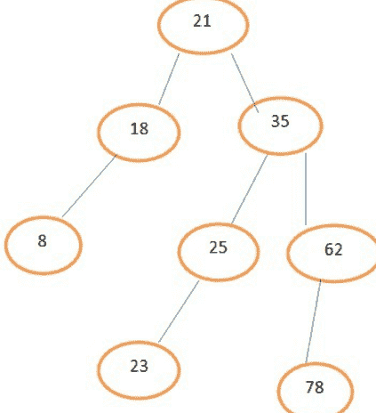
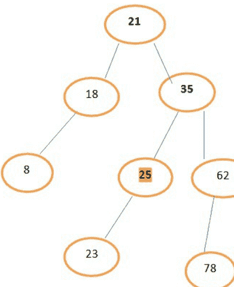

# C++ 数据结构与算法


## 数据结构

数据结构是在计算机中表示数据存储和组织的方式，以便编程语言能够轻松地访问和处理其中的数据。有几种常用的数据结构：我们在这里讨论的数组、链表、队列、栈、二叉树和集合。

不同的数据结构都有自己的特性。这些数据结构被用于大多数编程语言。在这里，我们将使用 C++ 语言来表示这些数据结构并查看如何使用它们。

## 数组

数组是线性顺序上相邻且一个接一个的数据序列。数组元素通常在计算机中相邻存储。数组中的每个元素都分配了一个与其相关的数字，称为索引（index），范围从 0 到 n-1，n 是数组中元素的总数，因为索引从 0 开始而不是从 1。例如，如果数组共有 9 个元素，那么该数组的索引将从 0 到 8，即 0, 1, 2, 3, 4, 5, 6, 7, 8。

在 C++ 中，我们使用 [] 来表示它是一个数组：

```cpp
string A[4] = { "a", "b", "c", "d" };
```

上面的代码显示我们初始化了数组 A 有四个元素："a", "b", "c", "d"。这些元素中的每一个元素都有其从 0 开始的固有索引。"a" 的索引为 0，“b" 的索引为 1，“c" 的索引为 2，“d" 的索引为 3。

数组 A 看起来如下：

| 0 | 1 | 2 | 3 |
| a | b | c | d |

要访问数组内部的元素，我们只需要使用 A[t]，这里 t 可以从 0 到 3；但不能小于 0 或大于 3，因为这里只有 4 个元素，否则将越范围。

要访问第一个元素 "a"，我们使用 A[0]；要访问第二个元素 "b"，我们使用 A[1]；要访问第三个元素 "c"，我们使用 A[2]；要访问第四个元素 "d"，我们使用 A[3]。

所以数组中第 N 个元素的索引是 N-1。要逐个访问数组中的元素，可以使用下面的 "for" 语句。"for" 语句使用索引来访问索引从 0 开始的每个元素。

```cpp
for (int t = 0; t < N; t++)
{
    cout << A[t];
}
```

## 链表

链表是由一个接一个连接的节点列表。链表中的节点指向下一个节点的地址。在计算机中，链表节点是顺序存储的。与数组不同，我们需要从链表的头部开始访问，直到链表的末尾。

A -> B -> C -> D

上面的列表如下所示：


链表中的节点可能并不相邻。箭头表示下一个节点的地址。可以使用“null”来表示没有下一个节点。每个节点有两个属性：data和next。data 字段存储实际数据，如字符串、整数或浮点数；next指针存储下一个节点的地址。

我们可以使用以下结构体持有这两个属性：

```cpp
struct Node
{
    string data;
    Node * next;
};
```

为了构造链表，我们为数据和下一个提供值。

```cpp
Node A;
A.data = "a";
Node B;
B.data = "b";
Node C;
C.data = "c";
Node D;
D.data = "d";
```

```cpp
A.next = &B;
B.next = &C;
C.next = &D;
```

要访问节点，我们需要从第一个节点开始，它是链表的头部。我们使用“current”指针来指示到达的每个节点。对于每个当前节点，在打印它保存的数据后，我们将当前变量移动到下一个节点，直到链表的末尾。

```cpp
Node * current = &A;
while (current != nullptr) {
    cout << current->data;
    current = current->next;
}
```

## 队列

队列的特性是先进先出（FIFO）和后进先（LIFO）。它就像现实世界中的队伍或队列。当你在星巴克购买咖啡时，先来的顾客先被服务，最后来的顾客最后被服务。队列中间的部分将按顺序服务。

| Apple | Orange | Banana | Cherry | Peach | Melon |

在上面的例子中，如果左侧是队列的开头，队列中的第一个是 Apple，接下来是 Orange、Banana、Cherry、Peach、Melon。

```cpp
#include <iostream>
#include <string>
using namespace std;
#include <queue>
```

```cpp
int main ()
{ /*创建一个队列 "Hello World !"
  queue<string> q;
  q.push("Hello");
  q.push("");
  q.push("World");
  q.push("");
  q.push("!");
}
```


```cpp
while (!q.empty())
{
    string s = q.front();
    cout << s;
    q.pop();
}
```

```cpp
return 0;
}
```

它将输出：

Hello World !

## 栈 (Stack)

栈的特点是后进先出（FILO），以及后进先出。例如，你在桌子上放了几本书，一本一叠地放在另一本上面，你放的第一本书书会在最底部；而你最后放的某本书会在最上方。几天后，当你想要移动这些书时，你拿到的第一本书是在顶部的那个，那是你几天前最后放在其他书之上的；而你拿到的最后一本书是底部的那本，那是你几天前先放在桌子上的第一本。在在这种情况下，它是后进先出，也是后进先出。这被称为栈。

如果下面是一个栈而不是队列，假设右侧是栈的末端，那么你可以从栈中弹出的第一个元素是西瓜（Melon）。

| 苹果 | 橙子 | 香蕉 | 樱桃 | 桃子 | 西瓜 |
| :--- | :--- | :--- | :--- | :--- | :--- |

当西瓜从栈中移除后，栈将如下所示。此时，桃子是栈中的顶端元素。此时，我们只能移除或弹出桃子。

| 苹果 | 橙子 | 香蕉 | 樱桃 | 桃子 |
| :--- | :--- | :--- | :--- | :--- |

在这样的序列中，桃子之后将是樱桃；樱桃之后是香蕉，香蕉之后是橙子，最后是苹果。因此，这个序列与队列是相反的。

```cpp
#include <iostream>
#include <string>
#include <stack>
using namespace std;

int main ()
```

```cpp
/**创建一个栈 " World Hello"*/
stack<string> s;
s.push("!");
s.push(" ");
s.push("World");
s.push(" ");
s.push("Hello");
```

```cpp
/**获取栈的每个元素并打印出来 "Hello World !" */
while (!s.empty())
{
    string t = s.top();
    cout << t;
    s.pop();
}

return 0;
}
```

它输出：

Hello World !

## 集合 (Set)

集合是一组独特的对象。集合内部的对象是有良好定义的。

两个集合的操作可以是并集、交集、补集和笛卡尔积。

两个集合的并集是两个集合元素的组合。如果元素存在于两个集合中，并集将只保留公共元素的一个副本。


两个集合的交集是获取两个集合共同拥元素。

集合的补集是在集合 A 可以完全包含在另一个集合 B 中的语境下，那么集合 A 的补集就是 B 减去 A：B-A，它获得了在 B 中但不在 A 中的元素。


笛卡尔积是将一个集合中的每个元素与另一个集合中的每个元素结合，即使某些元素是相同的。它不会移除重复元素。

## 二叉树 (Binary Tree)

树有分支。它可以有 0 个或多个分支。最常用的树类型数据结构是二叉树。二叉树意味着每个节点最多有两个分支：左分支和右分支。

在下面的图中，节点 N 有两个分支：左和右。左节点没有分支，右节点也没有任何分支，它们被称为叶子（leaves）。如果 Node 是树的顶部，它被称为根（root）。在现实世界中，树的根在底部，叶子在顶部。但在计算机中，根在顶部，叶子在底部。


在下面的算法部分，我们将获得更多关于如何在编程中使用数据结构的细节。

### 向数组中插入元素

如果在数组的末尾插入一个元素，操作是简单的，只需将元素分配到数组末尾的可用空间即可。

例如，如果数组空间为 7；目前有 5 个元素，索引从 0 到 4：

| 安 | 汤姆 | 约翰 | 娜西 | 爱丽 | | |
| :--- | :--- | :--- | :--- | :--- | | |

```cpp
string students[8];
students[0] = "Ann";
students[1] = "Tom";
students[2] = "John";
students[3] = "Nancy";
students[4] = "Alice";
```

所以在数组第一个可用空间插入：

**string toInsert = "Kate";**
**students[5] = toInsert;**

| 安 | 汤姆 | 约翰 | 娜西 | 爱丽 | 凯特 | | |
| :--- | :--- | :--- | :--- | :---

如果在数组中间插入一个元素，那么插入位置之后的元素需要向后移动一个空间，以便插入的位置供新元素使用。

当新元素需要插入到数组的开头时，数组中的每个元素都需要向后移动一个位置，以便数组开头有一个空空间存储新插入的元素。为了让每个元素向后移动一个空间，我们将首先移动最后一个元素，然后移动其他元素直到第一个元素。

例如，使用 students 数组的最后一个例子，将“Billy”插入到数组的第三位置（索引为2），需要将第 6 个元素移动到第 7 个，第 5 个元素移动到第 6 个，直到第 3 个元素移动到第 4 个，并将“Billy”元素放在第 3 个位置：

| 安 | 汤姆 | 比利 | 娜西 | 爱丽 | 凯特 |
| :--- | :--- | :--- | :--- | :--- | :--- |

```cpp
students[6] = "Kate";
students[5] = "Alice";
students[4] = "Nancy";
students[3] = "John";
students[2] = "Billy";
```

如果将“Billy”插入到数组的第一个位置（索引为 0），则需要移动更多的 2 个元素：

| 比利 | 安 | 汤姆 | 约翰 | 娜西 | 爱丽 | 凯特 |
| :--- | :--- | :--- | :--- | :--- | :--- | :--- |

```cpp
students[6] = "Kate";
students[5] = "Alice";
students[4] = "Nancy";
students[3] = "John";
students[2] = "Tom";
students[1] = "Ann";
students[0] = "Billy";
```

如果数组中有成百或数千元素，使用上述方法将非常繁琐。我们可以使用“for”循环让上述工作变得更容易。

```cpp
string students[8];
students[0] = "Ann";
students[1] = "Tom";
students[2] = "John";
students[3] = "Nancy";
students[4] = "Alice";
```

```cpp
string students[8];
students[0] = "Ann";
students[1] = "Tom";
students[2] = "John";
students[3] = "Nancy";
students[4] = "Alice";
students[5] = "Kate";
```

```cpp
int currentTotal = 6;
```

```cpp
int InsertIndex = 2;
```

```cpp
for (int i = currentTotal; i > InsertIndex; i--)
{
    students[i] = students[i - 1];
}
```

```cpp
students[InsertIndex] = "Billy";
```

| 安 | 汤姆 | 比利 | 娜西 | 爱丽 | 凯特 |
| :--- | :--- | :--- | :--- | :--- | :--- |

上述算法适用于从 0 到 n 的任意数字，n 是从开头的数量。

### 从数组中删除元素

从索引 q 处的数组中删除元素，删除元素后，数组在该位置会有一个空空间，如果 q 是数组的末尾，该操作是简单的，只需移除数组中的元素，不需要移动其后面的元素。

如果 q 是数组的中间，则需要将 q 之后的所有元素向前移动一个位置，从紧邻 q 的元素元素开始。

例如，有一个如下数组：

| 安 | 汤姆 | 约翰 | 娜西 | 爱丽 | | |
| :--- | :--- | :--- | :--- | :--- | | |

```cpp
string studentsToDelete[6];
studentsToDelete[0] = "Ann";
studentsToDelete[1] = "Tom";
studentsToDelete[2] = "John";
studentsToDelete[3] = "Nancy";
studentsToDelete[4] = "Alice";
studentsToDelete[5] = "Kate";
```

我们要删除第 5 个元素，赋值 '\0' 表示空值：

| 安 | 汤姆 | 约翰 | 娜西 | 爱丽 | | |
| :--- | :--- | :--- | :--- | :--- | | |

```cpp
studentsToDelete[5] = "\0";
```

如果我们想删除第 0 个元素 安，那么我们将后面的元素向前移动一个位置：

| 汤姆 | 约翰 | 娜西 | 爱丽 | 凯特 | | |
| :--- | :--- | :--- | :--- | :--- | | |

```cpp
studentsToDelete[0] = "Tom";
studentsToDelete[1] = "John";
studentsToDelete[2] = "Nancy";
studentsToDelete[3] = "Alice";
studentsToDelete[4] = "Kate";
studentsToDelete[5] = "\0";
```

如果对于原始数组，我们想删除第 3 个元素（索引为 2：约翰）：

| 安 | 汤姆 | 娜西 | 爱丽 | 凯特 | | |
| :--- | :--- | :--- | :--- | :--- | | |

```cpp
studentsToDelete[0] = "Ann";
studentsToDelete[1] = "Tom";
studentsToDelete[2] = "Nancy";
studentsToDelete[3] = "Alice";
studentsToDelete[4] = "Kate";
studentsToDelete[5] = "\0";
```


```
studentsToDelete[2] = "John";
studentsToDelete[3] = "Nancy";
studentsToDelete[4] = "Alice";
studentsToDelete[5] = "Kate";
```

```
int currentArrayTotal = 6;
int deleteIndex = 2;

for (int i = deleteIndex+1; i < currentArrayTotal; i++)
{
 studentsToDelete[i] = studentsToDelete[i + 1];
}
```

```
studentsToDelete[currentArrayTotal] = '0';

currentArrayTotal = currentArrayTotal - 1;
```

上述算法适用于从 0 到 n-1 的任意插入索引（n 是数组中元素的总数），例如，你可以将 `0` 赋值为 `deleteIndex`，这样它将删除数组开头的元素，并将其他元素向前移动。

### 从数组中搜索元素

在数组中搜索一个等于特定值的元素，我们将从头到尾遍历数组中的每个元素，直到找到搜索的元素，或者确定数组中没有元素满足搜索条件。

如果第一个元素满足条件，则操作停止；否则它将逐个与第二个元素、第三个元素进行比较，直到找到搜索结果，或者比较到最后一个元素。

| Ann | Tom | John | Nancy | Alice | Kate |
| :--- | :--- | :--- | :--- | :--- | :--- |

```
string studentsForSearch[8];
studentsForSearch[0] = "Ann";
studentsForSearch[1] = "Tom";
studentsForSearch[2] = "John";
studentsForSearch[3] = "Nancy";
studentsForSearch[4] = "Alice";
studentsForSearch[5] = "Kate";
```

我们想知道数组中是否存在 "Nancy"，我们将比较每个元素以查看是否找到了 "Nancy"。对于包含成百或数千元素的数组，通过编程进行搜索更容易。

```
string studentsForSearch[8];
studentsForSearch[0] = "Ann";
studentsForSearch[1] = "Tom";
studentsForSearch[2] = "John";
studentsForSearch[3] = "Nancy";
```

studentsForSearch[4] = "Alice";
studentsForSearch[5] = "Kate";

```
int currentSearchTotal = 6;
string ToSearch="Nancy";
bool found = false;
```

```
for (int i = 0; i < currentSearchTotal; i++)
{
    if (studentsForSearch[i] == ToSearch)
    found = true;
}
```

你可以将字符串 "ToSearch" 改为 "Steve" 或 "Kate" 或其他用于搜索的字符串。

如果我们想从数组中删除一个特定值的元素，我们首先需要进行搜索以找到待删除元素的位置；找到后，我们将继续删除操作；如果没有找到该元素，则不需要删除。例如，如果我们想看数组中是否有 Nancy，如果是，则删除该元素：

```
string studentsForSearch[8];
studentsForSearch[0] = "Ann";
studentsForSearch[1] = "Tom";
studentsForSearch[2] = "John";
studentsForSearch[3] = "Nancy";
studentsForSearch[4] = "Alice";
studentsForSearch[5] = "Kate";
```

```
int currentTotal = 6;
string ToSearch="Nancy";
int ToDelete = 0;
bool found = false;
for (int i = 0; i < currentTotal; i++)
{
  if (studentsForSearch[i] == ToSearch)
  {
    found = true;
    ToDelete = i;
  }
}
```

```cpp
/*如果找到，删除此元素*/
if (found)
{
  for (int i = ToDelete + 1; i < currentTotal; i++)
  {
    studentsForSearch[i] = studentsForSearch[i + 1];
  }
  studentsForSearch[currentTotal] = '\0';
  currentTotal = currentTotal - 1;
}
```

| Ann | Tom | John | Alice | Kate | |
| --- | --- | --- | --- | --- |

如果我们想在特定值之前或之后插入一个元素，我们需要首先进行搜索找到该元素的位置；找到后，我们将继续插入；如果没有找到元素，则不需要插入。例如，我们想看 “Steve” 是否在数组中，如果在，我们要插入第 5 个索引。如果不在，则什么都不做。

```
string studentsForSearch[8];
studentsForSearch[0] = "Ann";
studentsForSearch[1] = "Tom";
studentsForSearch[2] = "John";
studentsForSearch[3] = "Nancy";
studentsForSearch[4] = "Alice";
studentsForSearch[5] = "Kate";
```

```
int currentTotal = 6;
string ToSearch="Steve";
int toInsert = 5;
bool found = false;
for (int i = 0; i < currentTotal; i++)
{
    if (studentsForSearch[i] == ToSearch)
    {
        found = true;
    }
}
```

```cpp
/*如果没有找到，插入它*/
if (!found)
{
    for (int i = currentTotal; i > toInsert; i--)
    {
        studentsForSearch[i] = studentsForSearch[i - 1];
    }
    studentsForSearch[toInsert] = ToSearch;
    currentTotal = currentTotal + 1;
}
```

| Ann | Tom | Nancy | Kate |
| --- | --- | --- | --- |

### 排序数组

如果数组存储整数值，有时数组中的元素不是升序的。为了按升序排序数组，有不同的算法，如冒泡排序、插入排序，这些都是基础的排序算法。

#### 冒泡排序

为了按升序排序数组，冒泡排序表示最大的元素会像泡沫一样流向数组末尾。最大的元素之后，第二大的元素流向它的位置，以此此类推，直到最小的元素位于数组开头。通过这种方式，所有元素都排序了。

例如，原始数组为：2, 6, 9, 3, 5, 7

我们将从第一个元素开始：
2<6, 不交换；6<9, 不交换；9>3, 交换：2, 6, 3, 9, 5, 7
9>5, 交换：2, 6, 3, 5, 9, 7
9>7, 交换：2, 6, 3, 5, 7, 9
这一轮没有更多交换的元素，9 是数组中最大的元素。

下一轮：2<6, 不交换；6>3, 交换：2, 3, 6, 5, 7, 9
6>5, 交换：2, 3, 5, 6, 7, 9
6<7, 不交换，所以 7 是数组中第二大的元素：2, 3, 5, 6, 7, 9

下一轮：2<3, 不交换；3<5, 不交换；5<6, 不交换：2, 3, 5, 6, 7, 9
下一轮：2<3, 不交换；3<5, 不交换：2, 3, 5, 6, 7, 9
下一轮：2<3, 不交换：2, 3, 5, 6, 7, 9
下一轮：只剩下元素 2 进行比较，不交换：2, 3, 5, 6, 7, 9

数组现在排序好了。算法如下：

```cpp
/* 冒泡排序算法 */
void BubbleSort(int A[], int length)
{
  /*算法中使用的变量 */
  int i, j, temp;

  /* i 表示当前轮将比较到哪个元素；每一轮最大值都会流到索引范围的末尾 */
  for (i = length-1; i >= 0; i--)
  {
    /* 每一轮从范围内的第一个元素比较到最后一个元素 */
    for (j = 1; j <= i; j++)
    {
      /* 比较元素与它的上方元素，如果当前元素比上方元素大，则交换 */
      if (A[j - 1] > A[j])
      {
        /* 在 A[j-1] 和 A[j] 之间交换 */
        temp = A[j - 1];
        A[j - 1] = A[j];
        A[j] = temp;
      }
    }
  }
}
```

#### 插入排序

对于元素数组，从开头开始，将待插入元素之前的元素进行排序（第一个元素本身就是排序好的）；对于待插入的元素，与已排序的元素进行比较，找到插入的位置，直到整个数组都排序好。

例如，数组为：2, 6, 9, 3, 5, 7

我们将从第一个元素开始：
2<6, 不交换；6<9, 不交换；9>3, 交换：2, 6, 3, 9, 5, 7
9>5, 交换：2, 6, 3, 5, 9, 7
9>7, 交换：2, 6, 3, 5, 7, 9

下一轮：2<6, 不交换；6>3, 交换：2, 3, 6, 5, 7, 9
6>5, 交换：2, 3, 5, 6, 7, 9
6<7, 不交换，所以 7 是数组中第二大的元素：2, 3, 5, 6, 7, 9

下一轮：2<3, 不交换；3<5, 不交换；5<6, 不交换：2, 3, 5, 6, 7, 9
下一轮：2<3, 不交换；3<5, 不交换：2, 3, 5, 6, 7, 9
下一轮：2<3, 不交换：2, 3, 5, 6, 7, 9

数组现在排序好了。算法如下：

```cpp
/* 从左到右升序排序 */
int* InsertionSort(int * A, int length)
{
int i, j, current;
/* A[0]-A[i-1] 是已排序的，i 从 1 开始；
从从第二个元素开始到数组的最后一个元素 */
for (i = 1; i < length; i++)
{
current = A[i];
/* j 从与 i 相同的值开始，并向前与已排序的元素比较，
找到小于待插入的当前值的元素的位置 */
for (j = i; j > 0 && A[j - 1] > current; j--)
{
  /* 将一个值较大的元素向后移动以留出插入空间 */
  A[j] = A[j - 1];
}
/* for 循环后获取插入位置 */
A[j] = current;
}
return A;
}
```


#### 选择排序

对于一个元素数组，选择最小的元素，并将其放在数组的开头；然后选择下一个最小的元素，并将其放在紧邻最小元素的位置；重复此操作，直到整个数组完成排序。

例如，原始数组为：2, 6, 9, 3, 5, 7

我们使用 `min` 来存储当前遇到的最小值的索引；从开头的 2 开始，由于开头只遇到了 1 个元素，我们将 `min` 设为 2，然后将其他元素与当前最小元素进行比较，没有元素比 2 小，因此 2 是数组中最小的元素。2 位于数组的开头。此时数组为：2, 6, 9, 3, 5, 7

我们移动到下一个 6，在这一轮中我们不需要考虑已经定位的 2。目前 6 是我们遇到的唯一元素，将 6 的索引赋值为最小；并将其他元素与 6 进行比较，6<9 无变化，6<3，我们将 `min` 赋值为 3 的索引，3<5 无变化，3<7 无变化，因此 `min` 为 3，我们将 3 与当前轮的开头即 6 进行交换：

+ 2, 3, 9, 6, 5, 7

我们现在移动到下一轮的下一个元素即 9；9<6，`min` 指向 6；6<5，`min` 指向 5；5<7 无变化，因此当前轮 5 是最小的，我们将 5 与 9 交换：2, 3, 5, 6, 9, 7

下一轮，`min` 指向 6，6<9 无变化，6<7 无变化，`min` 指向 6：

+ 2, 3, 5, 6, 9, 7

下一轮：`min` 指向 9，9>7，`min` 指向 7；7 与 9 交换：

2, 3, 5, 6, 7, 9

下一轮，`min` 指向 9，即数组的最后一个元素，现在数组已排序：

2, 3, 5, 6, 7, 9

该算法如下：

```cpp
// 选择排序算法
void SelectionSort(int A[], int length)
{
//i 和 j 用于轮次循环
//min 获取最小值的索引
//temp 用作值交换的临时位置
int i, j, min, temp;

// 它需要 length-1 轮循环，每轮选择一个最小值
// 它从第 1 个元素开始，每轮的最小值将与第 i 位置的值进行交换
for (i = 0; i < length - 1; i++)
{
// 将 min 索引赋值为每轮的开头
min = i;

// 比较直到数组末尾的元素
for (j = i + 1; j < length; j++)
{
// 如果找到了更小的值，则将 min 改为较小值的索引
if (A[j] < A[min])
{
min = j;
}
}
// 将最小值与 i 位置的值进行交换
if (min != i)
{
    temp = A[i];
    A[i] = A[min];
    A[min] = temp;
}
// 下一轮 i=i+1，将移动到下一个元素作为下一轮
}
}
```

例如，假设有一个包含 A, B, C 和 D 的列表


在这里我们想要插入另一个元素 H 在 C 和 D 之间，因此链表结构改变如下：

对链表执行插入操作的代码：


```cpp
// 在列表中找到包含 SearchValue 的节点，在找到的值后插入一个带有 ToInsert 值的节点
// 如果未找到该值，则插入到列表末尾
// 完成后返回列表
Node * InsertNode(string ToInsert, Node * AList, string SearchValue)
  // 如果列表为空列表，链表头将指向新节点
  if ((*AList).header == NULL)
  {
    (*AList).header = new Node();
    (*AList).header).data = ToInsert;
    (*(AList).header).next = NULL;
    return AList;
  }

// 如果列表至少有一个节点
Node * current = (*AList).header;

```cpp
// 遍历列表直到找到节点，或到达列表末尾
while ((*current).data != SearchValue && (*current).next!=NULL)
{
    current = (*current).next;
}

// 构造新节点
Node aNewNode;
aNewNode.data = ToInsert;

// 维护连接
aNewNode.next = (*current).next;
(*current).next = &aNewNode;

return AList;
}
```

### 从列表中删除元素

例如，假设有一个包含 A, B, C 和 D 的列表


在这里我们想要删除元素 C，因此链表结构改变如下：


对链表执行删除操作的代码：

```cpp
struct Node
{
  string data;
  Node * next;
  Node * header;
};

// 如果列表不为空
if (AList).header != NULL)
{
    Node * current = AList->header;
    // 遍历列表直到找到节点，或到达列表末尾
    while (current->data != SearchValue && current->next != NULL)
    {
        current = current->next;
    }
    // 删除逻辑将在此之后
}
```

*注：由于原文存在碎片化，已根据提供的代码片段进行了整理。*


输出如下：

2, 3, 1, 5, 9, 0, 2, 10, 12, 26, 3, 1

### 二叉搜索树

在二叉搜索树中，对于每个节点，左子节点的值小于根节点的值；右子节点的值大于根节点的值。例如，对于如下二叉树：


首先让我们编写程序来构建这棵树。

```cpp
#include <iostream>
#include <string>
using namespace std;

//树节点结构
class TreeNode {
public:
TreeNode * leftChild;
TreeNode * rightChild;
int value;

// 默认构造函数
TreeNode(){}
```

```cpp
// 构造函数，给节点赋值
TreeNode(int val)
{
    value = val;
}
```

```cpp
// 二叉树类和根节点属性
class BinaryTree{
public:
    TreeNode * root;
```

```cpp
// 构造函数，给二叉树的根赋值
BinaryTree(int aValue)
{
    root = new TreeNode(aValue);
}
```

```cpp
// 插入节点到树，递归寻找正确的位置
void InsertNode(TreeNode * subRoot, TreeNode * tn)
{
    if (subRoot == NULL) {
        subRoot = tn;
    }

    if (tn->value < subRoot->value)
{
  InsertNode(subRoot->leftChild, tn);
}
else if (tn->value > subRoot->value)
{
  InsertNode(subRoot->rightChild, tn);
}
}
```

```cpp
// 打印二叉树中所有的值
void printTree(TreeNode * subRoot)
{
  if (subRoot->leftChild != NULL) printTree(subRoot->leftChild);
  cout << subRoot->value;
  if (subRoot->rightChild != NULL) printTree(subRoot->rightChild);
}

int main ()
{
  BinaryTree * bt = new BinaryTree(21);

  TreeNode * tn = new TreeNode(18);
  bt->InsertNode(bt->root, tn);
  tn = new TreeNode(8);
  bt->InsertNode(bt->root, tn);
  tn = new TreeNode(35);
  bt->InsertNode(bt->root, tn);
  tn = new TreeNode(25);
  bt->InsertNode(bt->root, tn);
  tn = new TreeNode(23);
  bt->InsertNode(bt->root, tn);
  tn = new TreeNode(62);
  bt->InsertNode(bt->root, tn);
  tn = new TreeNode(78);
  bt->InsertNode(bt->root, tn);

  bt->printTree(bt->root);
  return 0;
}
```

此示例中的 **printTree** 方法是**中序遍历**，它首先遍历左孩子，然后是父节点，最后是右孩子，因此它的输出为：

8, 18, 21, 23, 25, 35, 62, 78.

我们可以看到，通过中序遍历打印，数字是按升序排序的。

### 宽度优先遍历


宽度优先遍历将从根节点开始层层遍历节点。在上面的树中，宽度优先遍历的顺序是：21, 18, 35, 8, 25, 62, 23, 78。

使用队列数据结构的算法如下。为了使用队列，需要在代码最开始添加 #include <queue>

```cpp
void BreadthFirstTraversal(TreeNode *root)
{
queue<TreeNode> que;

if (root == NULL) return;

que.push(*root);
while (!que.empty()) {
  TreeNode temp = que.front();
  int val = temp.value;
  cout << val;

  if (temp.leftChild != NULL) que.push(*temp.leftChild);

  if (temp.rightChild != NULL) que.push(*temp.rightChild);
}
}
```

### 深度优先遍历



深度优先遍历将从根节点开始分支遍历节点。在上面的树中，宽度优先遍历的顺序是：21, 18, 8, 35, 25, 23, 62, 78。

深度优先遍历也是前序遍历。它先遍历父节点，然后遍历左孩子，最后遍历右孩子。

使用栈数据结构的算法如下：

```cpp
void PreOrderTraversal(TreeNode * root)
{
    stack<TreeNode*> sta;

    if (root == NULL) return;

    sta.push(root);
    while (!sta.empty()) {
        TreeNode * temp = sta.top();
        sta.pop();
        int val = temp->value;
        cout << val;

        if (temp->rightChild != NULL) sta.push(temp->rightChild);

        if (temp->leftChild != NULL) sta.push(temp->leftChild);
    }
}
```

### 二叉树搜索

例如，我们需要搜索值 25，我们将 25 与根节点 21 比较，它大于 21，我们继续搜索它的右分支，即 35；25 小于 35，我们将继续搜索 35 的左分支，然后找到了 25。



在二叉搜索树中搜索值，我们将该值与父节点比较，如果值小于父节点，我们搜索它的左分支；如果值大于父节点，我们搜索它的右分支，直到找到该值，或者没有其他可以比较的值了。

```cpp
bool Search(int val, TreeNode * root)
{
  TreeNode * current=root;

  while (current!=NULL) {
    if (val<current->value) current=current->leftChild;
    else if (val>current->value) current=current->rightChild;
    else return true;
  }
  return false;
}
```

