# 数据结构与算法 C++ 使用指南：JNTU


## 作者简介

**阿南达·拉奥·阿克波古** 是贾瓦哈拉尔·尼赫鲁技术大学阿纳塔普尔工学院计算机科学与工程系教授兼系主任，以及阿纳塔普尔学院副校长。他是印度金奈 IIT 马德拉斯校友。他获得海得拉巴大学（安得拉邦）的计算机科学与工程学士（B.Tech.）和人工智能与机器人硕士（M.Tech.）学位，以及印度金奈 IIT 马德拉斯的博士学位。他在 JNT 大学拥有 18 年教学经验。他在各种国际和国内期刊及会议上发表了约 50 篇论文。他还参与了 J. R. Hanly、E. B. Koffman 和 A. Kamthane 合著的《C 语言程序设计与数据结构》以及 Peter Rob 和 Carlos Coronel 合著的《数据库管理系统》的工作。他的研究兴趣包括人工智能、软件工程、云计算和面向对象数据库。

**拉迪卡·拉朱·帕拉吉里** 目前担任贾瓦哈拉尔·尼赫鲁技术大学阿纳塔普尔工学院计算机科学与工程系兼职讲师。她获得 JNTU 阿纳塔普尔的计算机科学硕士学位。她在本科和研究生阶段拥有 13 年教学经验。她的研究兴趣领域是软件工程和专家系统。


## 第 1 章 C++ 简介

- 1.1 简介 1.1
- 1.2 类概述 1.1
- 1.2.1 类 1.2
- 1.2.2 对象 1.2
- 1.2.3 类成员 1.3
- 1.3 I/O 流 1.4
- 1.4 访问控制 1.7
- 1.5 类作用域 1.10
- 1.6 静态类成员 1.11
- 1.6.1 静态成员变量 1.11
- 1.6.2 静态成员函数 1.12
- 1.6.3 静态对象 1.14
- 1.7 函数 1.15
- 1.7.1 参数传递方法 1.16
- 1.7.2 内联函数 1.18
- 1.7.3 friend 函数 1.19
- 1.7.4 函数重载 1.22
- 1.8 this 指针 1.26
- 1.9 动态内存分配与释放 1.27
- 1.9.1 new 运算符 1.27
- 1.9.2 delete 运算符 1.28
- 1.10 异常处理 1.30
- 小结 1.36
- 习题 1.36

## 第 2 章 面向对象概念

- 2.1 目标与原则 2.1
- 2.1.1 面向对象设计目标 2.1
- 2.1.2 面向对象设计原则 2.2
- 2.2 构造函数和析构函数 2.3
- 2.2.1 构造函数 2.3
- 2.2.2 构造函数重载 2.6
- 2.2.3 析构函数 2.7
- 2.3 运算符重载 2.8
- 2.3.1 重载加（+）运算符 2.10
- 2.3.2 重载减（-）运算符 2.11
- 2.3.3 重载一元运算符 2.12
- 2.3.4 重载的后置形式

- 3.5.5 计算指令空间 3.7
- 3.5.6 计算数据空间 3.8
- 3.5.7 数据段大小 3.8
- 3.5.8 只读数据段大小 3.8
- 3.5.9 BSS 段大小 3.8
- 3.6 事前分析 3.9
- 3.7 渐近表示法 3.11
- 3.7.1 大 O 表示法（O）3.11
- 3.7.2 大 Ω 表示法（Ω）3.12
- 3.7.3 大 Θ 表示法（Θ）3.13
- 3.7.4 小 o 表示法（o）3.14
- 3.8 时间复杂度 3.14
- 3.8.1 冒泡排序时间复杂度分析 3.15
- 3.8.2 选择排序时间复杂度分析 3.16
- 3.9 最坏情况、平均情况和最好情况复杂度 3.17
- 3.9.1 最坏情况 3.17
- 3.9.2 平均情况 3.17
- 3.9.3 最好情况 3.17
- 小结 3.17
- 习题 3.18

## 第 4 章 数组

- 4.1 简介 4.1
- 4.1.1 数组 4.2
- 4.2 数组类型 4.2
- 4.2.1 一维数组 4.2
- 4.2.2 多维数组 4.2
- 4.2.3 N 维数组 4.3
- 4.3 数组表示 4.3
- 4.4 数组初始化 4.5
- 4.5 访问数组值 4.6
- 4.6 数组操作 4.6
- 4.6.1 遍历 4.7
- 4.6.2 插入 4.7
- 4.6.3 删除 4.8
- 4.6.4 排序 4.9
- 4.6.5 查找 4.9
- 4.7 数组作为参数 4.13
- 4.8 字符序列 4.14
- 4.9 应用 4.16
- 小结 4.17
- 习题 4.17

## 第 5 章 链表

- 5.1 简介 5.1
- 5.2 内存中的链表表示 5.2
- 5.2.1 静态表示 5.2
- 5.2.2 动态表示 5.3
- 5.3 单链表 5.4
- 5.3.1 操作 5.4
- 5.4 循环链表 5.18
- 5.4.1 两个循环列表的合并 5.20
- 5.5 双向链表 5.21
- 5.5.1 双向链表表示 5.21
- 5.5.2 操作 5.21
- 5.6 各种链表的比较 5.36
- 5.6.1 链表与数组 5.36
- 5.7 应用 5.37
- 5.7.1 多项式运算 5.37
- 小结 5.39
- 习题 5.40

## 第 6 章 栈

- 6.1 定义 6.1
- 6.2 栈的表示 6.2
- 6.2.1 栈的数组表示 6.2
- 6.2.2 栈的链式表示 6.3
- 6.3 栈的操作 6.3
- 6.3.1 栈的数组实现 6.4
- 6.3.2 栈的链式实现 6.9
- 6.4 栈的应用 6.14
- 6.4.1 表达式求值 6.14
- 6.4.2 后缀求值 6.19
- 6.4.3 递归 6.19
- 6.4.4 匹配括号的平衡 6.21
- 小结 6.22
- 习题 6.22

## 第 7 章 队列

- 7.1 简介 7.1
- 7.2 队列的表示 7.2
- 7.2.1 数组表示 7.2
- 7.2.2 链式表示 7.2
- 7.3 队列的操作 7.2
- 7.3.1 使用数组的入队和出队 7.4
- 7.3.2 使用链表的入队和出队 7.9
- 7.4 循环队列 7.18
- 7.4.1 循环队列的操作 7.19


- 7.5 双端队列 7.27
- 7.5.1 双端队列上的操作 7.29
- 7.6 队列的应用 7.30
- 7.6.1 分时系统模拟 7.31
- 7.6.2 队列 ADT 7.32
- 小结 7.33
- 习题 7.33

## 第 8 章 字典

- 8.1 字典 8.1
- 8.2 线性列表表示 8.1
- 8.3 跳表表示 8.2
- 8.3.1 操作 8.3
- 8.3.2 搜索 8.4
- 8.3.3 插入 8.4
- 8.3.4 删除 8.5
- 8.4 哈希表 8.6
- 8.4.1 哈希函数 8.6
- 8.5 冲突 8.7
- 8.5.1 链地址法 8.7
- 8.5.2 开放地址法 8.9
- 8.6 链地址法与开放地址法的比较 8.18
- 8.7 应用 8.18
- 8.8 字典 ADT 8.19
- 小结 8.19
- 习题 8.19

## 第 9 章 树与二叉树

- 9.1 简介 9.1
- 9.2 术语 9.1
- 9.3 树的表示 9.2
- 9.4 二叉树 9.4
- 9.5 二叉树的表示 9.6
- 9.5.1 二叉树的数组表示 9.6
- 9.5.2 二叉树的链式表示 9.7
- 9.6 二叉树操作 9.8
- 9.7 二叉树遍历 9.14
- 9.7.1 中序遍历 (LVR) 9.14
- 9.7.2 前序遍历 (VLR) 9.16
- 9.7.3 后序遍历 (LRV) 9.16
- 9.7.4 层序遍历 9.17
- 9.8 树转二叉树 9.22
- 9.9 线索二叉树 9.25
- 9.9.1 线索二叉树的链式表示 9.26
- 9.10 二叉树的应用 9.27
- 9.10.1 表达式树遍历 9.27
- 9.10.2 表达式树上的操作 9.27
- 9.11 二叉树 ADT 9.28
- 小结 9.29
- 习题 9.30

## 第 10 章 图

- 10.1 简介 10.1
- 10.2 基本术语 10.1
- 10.3 图的表示 10.10
- 10.3.1 图的顺序表示 10.10
- 10.3.2 图的链式表示 10.12
- 10.4 图的操作 10.12
- 10.5 图的遍历 10.24
- 10.5.1 广度优先遍历 10.24
- 10.5.2 深度优先遍历 10.29
- 10.6 应用 10.32
- 10.7 图 ADT 10.34
- 小结 10.34
- 习题 10.35

## 第 11 章 优先队列

- 11.1 简介 11.1
- 11.2 优先队列 ADT 11.3
- 11.3 使用堆实现优先队列 11.3
- 11.3.1 优先队列接口 11.5
- 11.3.2 最小堆–插入 11.6
- 11.3.3 最小堆–删除 11.11
- 11.3.4 最大堆–插入 11.18
- 11.3.5 最大堆–删除 11.20
- 11.4 应用 11.27
- 11.4.1 作业调度 11.27
- 11.5 外部排序 11.28
- 11.5.1 多相归并 11.28
- 11.5.2 多路归并 11.30
- 小结 11.39
- 习题 11.39

## 第 12 章 二叉搜索树和 AVL 树

- 12.1 二叉搜索树 12.1
- 12.2 二叉搜索树的表示 12.2
- 12.3 二叉搜索树上的操作 12.2
- 12.3.1 搜索 12.2
- 12.3.2 插入 12.4
- 12.3.3 删除 12.5
- 12.3.4 二叉搜索树的缺点 12.8
- 12.4 AVL 树 12.16
- 12.5 AVL 搜索树的操作 12.17
- 12.5.1 搜索 12.17
- 12.5.2 插入 12.17
- 12.5.3 删除 12.25
- 12.6 应用 12.40
- 小结 12.40
- 习题 12.40

## 第 13 章 多路树和 B 树

- 13.1 简介 13.1
- 13.2 节点结构表示 13.2
- 13.3 m 路搜索树上的操作 13.3
- 13.3.1 搜索 13.3
- 13.3.2 插入 13.3
- 13.3.3 删除 13.3
- 13.3.4 m 路搜索树的缺点 13.6
- 13.4 B 树 13.7
- 13.5 B 树上的操作 13.8
- 13.5.1 搜索 13.8
- 13.5.2 插入 13.8
- 13.5.3 删除 13.9
- 13.6 B 树的高度 13.22
- 13.7 B 树的变体 13.22
- 13.7.1 B* 树 13.22
- 13.7.2 B+ 树 13.23
- 13.8 应用 13.23
- 13.8.1 数据库 13.23
- 小结 13.24
- 习题 13.24

## 第 14 章 红黑树和伸展树

- 14.1 简介 14.1
- 14.2 红黑树的表示 14.3
- 14.3 操作 14.3
- 14.3.1 搜索 14.4
- 14.3.2 插入 14.4
- 14.3.3 删除 14.14
- 14.4 伸展树 14.36
- 14.4.1 伸展旋转 14.37
- 14.4.2 摊还分析 14.42
- 14.5 应用 14.51
- 小结 14.51
- 习题 14.52

## 第 15 章 模式匹配和 Trie 树

- 15.1 简介 15.1
- 15.2 术语 15.1
- 15.3 模式匹配算法 15.2
- 15.3.1 有限模式匹配算法 15.2
- 15.3.2 正则表达式模式匹配 15.2
- 15.4 固定模式匹配算法 15.3
- 15.4.1 暴力模式匹配算法 15.3
- 15.4.2 Boyer-Moore 算法 15.6
- 15.4.3 Knuth-Morris-Pratt 算法 (KMP) 15.9
- 15.5 模式匹配算法的应用 15.12
- 15.6 Trie 树 15.13
- 15.6.1 标准 Trie 树 15.13
- 15.6.2 压缩 Trie 树 15.26
- 15.6.3 后缀 Trie 树 15.27
- 15.7 Trie 树的应用 15.29
- 小结 15.29
- 习题 15.30

## 第 16 章 排序与搜索

- 16.1 排序 16.1
- 16.1.1 冒泡排序 16.1
- 16.1.2 插入排序 16.5
- 16.1.3 选择排序 16.7
- 16.1.4 快速排序 16.9
- 16.1.5 归并排序 16.13
- 16.1.6 希尔排序 16.18
- 16.1.7 基数排序 16.20
- 16.1.8 堆排序 16.24
- 16.2 搜索 16.31
- 16.2.1 线性搜索或顺序搜索 16.31
- 16.2.2 二分搜索 16.32
- 16.2.3 斐波那契搜索 16.35
- 小结 16.39
- 习题 16.40
- 索引 1.1

## 前言

数据结构的研究是计算机科学与工程的基本组成部分。从事软件系统任何阶段工作的人员都需要具备数据结构的最基本知识。因此，所有计算机科学、工程及其他相关学科都开设这门课程。数据结构及其算法与复杂性分析之间的密切关系也是讨论的重点。

《使用 C++ 的数据结构与算法》有助于掌握数据结构、其算法及这些算法的复杂性分析。

本书满足几乎所有大学的课程大纲要求。书中的每一章都包含抽象数据类型（ADT）及其应用，并对主题进行了详细解释。我们使用以功能强大、可重用性和可移植性著称的 C++ 编程语言，为这些数据结构概念提供了一种实现载体。

本书的前两章专门用于回顾 C++ 编程概念和面向对象概念。那些熟悉 C 语言编程的人可以通过学习第 1 章和第 2 章来掌握 C++。

第 1 章讨论类、定义类成员和对象声明。它涵盖 I/O 流、访问控制、类作用域和静态类成员。它还包括函数、this 指针、动态内存分配和异常处理。

第 2 章解释面向对象的目标和原则、构造函数、析构函数、构造函数和运算符重载。它还涵盖继承、多态、抽象类、带函数的泛型编程、类模板和递归。

第 3 章对算法进行了深入研究。从基本符号、算法类型和性能分析开始。对空间复杂度——指令空间、数据空间和栈空间——进行了非常详细的深入讨论。它还包括先验分析、渐近符号（大 O、Ω、Θ 和小 o）以及时间复杂度。

第 4–7 章介绍了基本和线性数据结构。第 4 章定义并将数据结构分类为线性和非线性数据结构。它详细介绍了一种线性数据结构——数组、其类型和表示。还解释了数组初始化、访问数组值、数组操作、作为参数传递的数组和字符数组。

第 5 章讨论并举例说明链表。解释了链表的静态和动态表示。它涵盖单链表、循环链表和双向链表，以及它们的表示和操作。

第 6 章和第 7 章专门讨论栈和队列。这些数据结构的表示和实现配有示例进行了解释。第 6 章讨论了栈的各种操作。第 7 章解释了循环队列和双端队列。

第 8 章介绍字典和线性列表、跳表以及字典的哈希表表示。它包括冲突发生、克服冲突的技术以及链地址法和开放地址法的比较。

非线性数据结构的研究从第 9 章开始。第 9 章定义了树、其相关术语和表示。它涵盖二叉树——其表示、操作、遍历和线索二叉树。它还包括将一般树转换为二叉树。


第10章讨论图、图的基本术语、其表示和操作。还举例说明了图的广度优先和深度优先遍历。它还包含用于查找图最小代价生成树的Prim算法。

第11章定义优先队列、优先队列的实现以及对最小堆和最大堆的操作。它包含使用多路归并和多相归并的外部排序。第12章涉及二叉搜索树和AVL树的定义及其表示。它列出了二叉搜索树的缺点，并指出需要AVL树作为补救措施。第13章专门讨论多路树和B树。它包含m路树的节点结构、其操作、缺点以及对B树的需求。它还涵盖B树操作和其他B树变体。

第14章介绍红黑树和伸展树。它还讨论红黑树上的常用操作。还解释了伸展树、伸展旋转以及关于伸展树的摊还分析。第15章介绍模式匹配和前缀树及其术语。它详细介绍了暴力算法、Boyer-Moore算法和Knuth-Morris-Pratt算法。还详细解释了前缀树的类别（即标准前缀树、压缩前缀树和后缀前缀树）及其操作。

最后一章，第16章，关于排序和搜索。它涵盖冒泡排序、插入排序、选择排序、快速排序、归并排序、希尔排序、基数排序和堆排序。它还包括流行且常用的搜索技术，如线性搜索、二分搜索和斐波那契搜索。

每一章都通过示例、适当的图表和表格清晰深入地讨论主题。从第4章开始，每一章都提供相应数据结构的抽象数据类型（ADT）以及几个清晰解释的现实世界应用。

关于每种数据结构的概念和技术、其表示、实现和应用都有清晰的示例。每一章都包含带有示例数据和输出的清晰详细的程序代码，这有助于编程知识最少的学生理解并将其扩展到其他操作。每章末尾总结了章节的技术内容。章节的练习部分帮助学生在理论和实践（实验课程）上自我测试技能。

对概念、程序、应用和练习的整体强调使学生能够了解、理解、实现并熟悉使用数据结构。这本书可以帮助学生从数据结构入门开始，最终掌握甚至高级的数据结构概念。

本书可用作开设数据结构课程的本科、研究生和研究课程的教材。本书旨在作为课堂教学材料。它也可以在实验课程中作为伴随指南使用。

本书是极少数几本包含广泛使用的数据结构、模式匹配和前缀树，并以简单清晰的方式配合示例和程序进行解释的书籍之一。

编写本书时已尽最大努力使其无误。但是，如果您发现任何错误，请随时与我们联系。您的建议和反馈可发送至 akepogu@gmail.com。

Ananda Rao Akepogu Radhika Raju Palagiri

## 致谢

我想感谢我的家人——我的母亲Janakamma（纪念父亲）、我的妻子Prasanna、我的女儿Anusha和我的儿子Joel。我也想感谢ROSE（软件工程研究）实验室的学生，特别是Kalpana，她在手稿的所有阶段帮助和鼓励了我。

很高兴能与Pearson团队共同为这一目标努力。

Ananda Rao Akepogu

我想向我的丈夫Venkat、我亲爱的孩子们Janvitha和Hitesh Phalgun、我的父亲Sri. P. Krishnam Raju、我的母亲Smt. V. Sarojamma、我的妹妹Latha和我的兄弟Sathish表示感谢。

Radhika Raju Palagiri

## C++简介

使用程序解决日常问题的结构和算法研究需要一种非常有效的方法来表示数据和算法。在进入数据结构和算法之前，必须具备高效的C++编程技能。

第1章回顾读者熟知的所需技能。本章介绍了C++语言的一些特性。它介绍了C++、类概述（涵盖如何定义类和类成员以及声明其对象）。还涵盖了I/O流、访问控制、类作用域和静态类成员。这详细讨论了函数、this指针和动态内存分配——new和delete运算符以及异常处理。

### 1.1 简介

C++最初由Bjarne Stroustrup于1979年在美国新泽西州默里希尔的贝尔实验室发明。C++融合了SIMULA 67和C的特性，能够支持面向对象编程的特性。最初这种新语言被称为“带类的C”，后来在1983年，由Dick Mascitti命名为C++。C++这个名字源自C的自增运算符++，因此C++被称为C的扩展。C++这个名字可以读作“比C多一个”、“下一个C”或“C的继任者”。它的发音为“see plus plus”。

C++的标准化始于1990年，由美国国家标准学会（ANSI）和国际标准化组织（ISO）主导，并经历了多次修订。最终在1998年，C++被标准化，并被称为“标准C++”。

### 1.2 类概述

类概述详细介绍了类、类的成员（即成员变量和成员函数）。它还讨论了类的对象。

#### 1.2.1 类

类是C++最重要的特性之一。类是不同数据类型的变量和函数的集合。类中的变量称为成员变量，类中的函数称为成员函数或方法。类使用关键字class创建。类与结构体相似，唯一的区别是类的所有成员默认为私有，而结构体的所有成员默认为公有。在语法上，类与结构体相似。

```
class Class-name
{
private:
    members
    access-specifier1
    members
    access-specifier2
    members
    - - - - - -
    - - - - - -
};
```

类体可以包含数据或函数声明的成员。class-name是类的名称，access-specifier可以是public、private或protected三个关键字之一，将在后面讨论。按照惯例，类名应以大写字母开头。

```
class Shape
{
    int l,b;
    public:
    void area()
    {
        cout<<"area of rectangle is:"<< l * b;
    }
};
```

在上述程序中，Shape是类。变量l,b是私有的，函数area()是公有的。每个类必须以分号结束。

#### 1.2.2 对象

类定义了一种结合代码和数据的新数据类型，这种新类型可用于创建该类的对象。因此，对象是类的实例。类具有逻辑外观，而对象具有物理存在。

对象的声明类似于变量的声明。

```
float x,y;                 //declaration of variables
Shape s1,s2;                //declaration of objects with type Shape.
```

对于上述类，Shape s1, s2是对象。s1将保存变量l,b的值和函数area()。同样，s2也将拥有Shape类成员的副本。


对象既保存数据，也保存操作数据的方法。

#### 1.2.3 类成员

类成员包括成员变量（或数据变量）和成员函数（或方法）。类是成员变量和成员函数的组合。[方法与函数的区别在于，定义在类内部的函数称为方法。] 类可以使用访问说明符控制来自类外部对成员的访问。

类的成员可以通过该类的对象和点（.）运算符来访问。

### class Shape

```cpp
class Shape
{
    public:
    int a,b;
    void set()
    {
        - - - - -
    }
};
```

假设 s 是类 Shape 的对象，则类成员基于访问控制通过对象来访问，例如

```cpp
s.a=10, s.b=5 //calling the member-function using object s
```

### 程序 1.1

```cpp
#include<iostream.h>
#include<conio.h>
class Shape
{
    int a,b; //by default private
    public:
    void area()
    {
        cout<<"Enter a&b values:";
        cin>>a>>b;
        cout<<"a="<<a<<"b="<<b;
    }
};
void main()
{
    Shape s1;
    s1.area();
}
```

### 输出

```
Enter a&b values: 5 6
a=5 b=6
```

在程序 1.1 中，类 Shape 定义了变量 a、b 和一个操作变量的方法 area()。创建了对象 s1，它拥有变量 a 和 b 的副本。

### 1.3 I/O 流

流是输入/输出（I/O）设备的逻辑实体。流可以生成或消耗信息，并且直接与 I/O 子系统相关联。流直接连接到物理设备。每当对流执行读取或写入操作时，这些操作都会反映到物理 I/O 设备上。C++ 提供了一组丰富的 I/O 库。

C++ 中提供了两种不同的模板类。一种用于 8 位流，另一种用于 16 位流（宽字符）。类 ios 是 I/O 流的基类。当 C++ 程序加载到内存时，标准输入流（cin）、标准输出流（cout）、标准错误输出流（cerr）以及标准错误输出流的缓冲版本会自动打开。当通过键盘输入任何内容时，可以使用 cin 流收集输入流。当使用 cout 向标准输出流写入任何内容时，字符流将显示在标准输出（屏幕）上。如果在执行时或编译时识别出任何错误，则这些消息将通过 cerr 传递到屏幕。

### 格式化输入/输出

C++ 提供了两种定义输入或输出的方式：

- 1. 通过格式化 ios 类成员（标志）
- 2. 使用 I/O 操纵符

ios 类包含用于格式化 I/O 的不同状态标志。ios 标志可以设置或取消设置。当标志被设置时，I/O 事务期间将执行以下操作。

### ios 类中的不同标志：

- adjustfield：left、right 和 internal 字段统称为 adjustfield。
- basefield：oct、hex 和 dec 字段统称为 basefield。
- boolalpha：布尔值将由关键字 true 或 false 接受。
- dec：I/O 数值系统将设置为十进制。
- fixed：浮点数将以常规表示法显示。
- floatfield：科学计数法和固定字段统称为 floatfield。
- hex：I/O 数值系统将设置为十六进制。
- internal：数值将通过在任何符号和基字符之间插入空格来填充。
- left：输出左对齐。
- oct：I/O 数值系统将设置为八进制。
- right：输出右对齐。
- scientific：浮点数将以科学计数法显示。
- showbase：显示输出时将显示数值基数系统。
- showpoint：浮点值将显示小数点。
- showpos：在值之前显示正号或负号。
- skipws：在对流执行输入操作时用于跳过空白字符。
- unitbuf：插入操作后刷新 I/O 缓冲区。
- uppercase：字符将以大写显示。

### 设置 ios 格式标志：

ios 类成员函数 setf() 用于设置标志。setf 的一般用法如下：

```cpp
fmtflags setf(fmtflags flags);
```

### 程序 1.2

```cpp
#include<iostream.h>
void main()
{
 int a=10;
 cout.setf(ios::showpos);
 cout <<"\n" <<"a="<<a;
}
```

### 输出

```
a=+10
```

在程序 1.2 中，对于 cout 流，设置了 showpos 标志。因此，变量 a 的符号会被显示。

### 程序 1.3

```cpp
#include<iostream.h>
void main()
{
 float a=10.2;
 cout.setf(ios::showpos|ios::showpoint);
 cout <<"\n" <<"A="<<a;
}
```

### 输出

```
A=+10.200000
```

如果未设置 showpoint 标志，则将显示值 +10.2。因为设置了 showpoint 和 showpos 标志，值 10.2 显示为 +10.200000。程序 1.3 演示了可以通过使用管道符号（|）设置两个或多个标志。

取消设置 ios 标志：由于 setf() 用于设置 ios 的标志，因此 ios 类的 unsetf() 成员函数用于取消设置已设置的标志。一般形式如下：

```cpp
void unsetf(fmtflags flags);
```

程序 1.4 取消设置程序 1.3 中设置的标志。

### 程序 1.4

```cpp
#include<iostream.h>
#include<conio.h>
void main()
{
float a=10.2;
clrscr();
cout.setf(ios::showpos | ios::showpoint);
cout<<"After Setting the flags the 'a'="<<a;
cout.unsetf(ios::showpos | ios::showpoint);
cout<<"After Clearing the flags the 'a'="<<a;
}
```

### 输出

```
After Setting the flags the 'a'=+10.200000
After Clearing the flags the 'a'=10.2
```

ios 类的其他成员方法：类 ios 提供了其他成员函数 width()、precision() 和 fill()。width 函数可用于设置最小字段大小。precision 方法可用于设置浮点精度。此外，fill 方法允许开发者使用用户指定的字符修改默认填充值。width、precision 和 fill 方法的一般形式如下：

```cpp
streamsize width(streamsize w);
streamsize precision(streamsize p);
char fill(char ch);
```

### 程序 1.5

```cpp
#include<iostream.h>
#include<conio.h>
void main()
{
float a=10.123456;
clrscr();
cout.precision(2);
cout.width(10);
cout.fill('#');
cout<<a;
}
```

### 输出

```
#####10.12
```

从程序 1.5 可以观察到，因为宽度设置为 10 个字符，输出显示为 10 个字符宽。因为精度设置为 2 个字符，显示 10.12 而不是 10.123456。因为默认对齐方式是右对齐，五个空字符将由 # 字符填充。

输入和输出操纵符：输入/输出操纵符是 ios 的成员。可以使用操纵符成员函数来操作输入流和输出流。这些成员函数不接受输入参数。setiosflags 操纵符类似于 ios 类的 setf 成员函数。两个函数的作用相同。

### 程序 1.6

```cpp
#include<iostream.h>
#include<iomanip.h>
#include<conio.h>
void main()
{
 float a=10.2;
 clrscr();
 cout<<endl<<"After Setting the flags the 'a'="<<setiosflags (ios::showpos|
 ios::showpoint)<<a;
}
```

### 输出

```
After Setting the flags the 'a'=+10.200000
```

在程序 1.6 中，使用了 endl 和 setiosflags 操纵符。endl 操纵符用于换行打印。

### 程序 1.7

```cpp
#include<iostream.h>
#include<iomanip.h>
#include<conio.h>
void main()
{
 clrscr();
 cout<<setiosflags (ios::showbase);
 cout<<hex<<10<<endl;
 cout<<oct<<10<<endl;
}
```

### 输出

```
0xa
012
```

在这里，hex 和 setiosflags 操纵符用于操作 cout 输出流（程序 1.7）。当设置 showbase 标志时，数值将带有基数格式前缀，例如十六进制值带有 '0x' 前缀，八进制值带有 '0' 前缀，十进制值无前缀。第一个输出是带有 '0x' 前缀的 10 的十六进制值，第二个输出是带有 '0' 前缀的 10 的八进制值。

### 1.4 访问控制

访问说明符为类成员提供来自类外部的访问权限。访问说明符是以下关键字之一：
public、private 和 protected。

- 默认情况下，类的所有成员都是私有的，且无法在类外部访问。类的私有成员可以通过同类的公有成员来访问。


- 声明为 public 的成员变量和函数可以被类外部访问。

- 访问说明符 protected 的作用类似于关键字 private。它经常用于继承，继承将在第 2 章中讨论。

**访问说明符的语法：** 关键字 private、public 和 protected 后面跟一个冒号 (:)。

```
class Class-name
{
private or public or protected:
members;
}
```

### 程序 1.8

```
/* Program for private and public access specifier*/
#include<iostream.h>
#include<conio.h>
class Shape
{
private:
int a,b; // private section
void display()
{
cout<<"a="<<a<<"b="<<b;
}
public: // public section
void sum()
{
a=10, b=20; //using private numbers.
cout<<"sum="<<a+b;
}
}
void main()
{
clrscr();
Shape s;
//s.a=10; //private variables not accessible.
//s.b=20; //private variables not accessible.
//s.display(); //private member function not accessible.
s.sum(); //calling public member function.
}
```

### 输出

Sum : 30

在程序 1.8 中，变量 a、b 和方法 display() 定义在 private 部分，而方法 sum() 定义在 public 部分。为类 shape 创建了对象 s。对象 s 不能直接用于初始化私有变量。当使用它时，编译器会给出错误消息，即 shape::a 不可访问，也就是说，私有成员在类外不可访问，私有成员函数 display() 也不能直接由对象访问。使用公有成员函数 sum()，可以访问私有数据成员并对它们执行加法操作。

私有成员函数可以由公有成员函数访问。成员函数也可以在类外定义，此时其原型必须在类内声明。

### 程序 1.9

```
#include<iostream.h>
class Shape
{
 int a,b;
 void set_val() //private function.
 {
 a=10,b=20;
 }
 void display()
 {
 cout<<"a="<<a<<"\n"<<"b="<<b;
 }
 public:
 void sum() //public section
 {
 set_val(); //call to private Functions..
 display();
 cout<<"\nSum="<<a+b;
 }
 void sub(void);
};
void Shape::sub()
{
 a=30;
 b=10;
 cout<<"\nSubtraction="<<a-b;
}
void main()
{
 Shape s;
//s.set_val(); //not accessible
 s.sum();
 s.sub();
}
```

### 输出

a=10
b=20
Sum=30
Subtraction=20

在程序 1.9 中，方法 set_val() 在 private 部分声明，而方法 sum() 和 sub() 在 public 部分声明。方法 sub() 在类外定义，用于对 a 和 b 执行减法操作。私有方法 set_val() 通过在公有成员函数 sum() 中调用它来访问。

### 1.5 类作用域

C++ 中的标识符（如变量名、函数名、typedef）只能在程序的某些区域中使用。这个区域称为标识符的“作用域”。作用域决定标识符的生存期和可见性。它还决定标识符是否会与程序其他部分的另一个标识符冲突。作用域有五种。

- a. 局部作用域：在函数或块中声明的变量具有局部作用域，即它们仅在该块内可访问。如果同一个变量在多个函数中使用，则每个函数都为其定义一个新作用域。块也可以嵌套。在块中声明的名称对该块及其包含的所有块都是局部的。函数的形式参数具有局部作用域，并被视为属于最外层块。

```
{
 int i;
}
```

这里 i 具有局部作用域，因为它是在由大括号括起来的块内声明的，并且在关闭大括号之前没有代码访问它，因此它永远不可访问。

- b. 函数作用域：标签具有函数作用域，只能在函数内访问，不能在函数外访问。

- c. 文件作用域：当标识符不是函数或类定义的一部分时，则它具有文件作用域。文件作用域是程序中最外层的作用域，它包含局部作用域和类作用域。在文件作用域中定义的变量称为全局变量。

- d. 类作用域：每个 C++ 类为其成员定义一个称为类作用域的唯一作用域，即数据成员和成员函数具有类作用域。

```
class A
{
 int a;
 public:
 void b();
}
```

这里必须访问变量 a 和函数 b()，以便编译器确定其类。访问类成员有三种方式：

- i. 使用点 (.) 运算符：
- obj.a，
- obj.b()

- ii. 使用 -> 运算符：
- ptr->a
- ptr->b()

- iii. 使用 :: (作用域访问) 运算符：
- A::a
- a::b()

- e. 原型作用域：在函数原型中声明的变量仅在原型结束前可见。

```
void val(int a, float b, char c)
```

上述原型声明了三个名称，它们在原型结束时超出作用域。

### 1.6 静态类成员

C++ 程序中的每个变量都与内存中的一个存储单元相关联。C++ 有两种存储类：自动和静态。静态成员将使用 .(点) 或 -> 运算符访问。与普通类成员不同，静态成员可以通过将 :: 作用域访问运算符应用于类名来直接访问。访问静态成员不需要创建对象。

### 1.6.1 静态成员变量

为类创建对象时，每个对象都会有类成员的自己的副本。成员函数只创建一次，所有对象都会共享它们。每个对象的每个函数没有单独的副本。像成员函数一样，成员变量也可以通过使用关键字 static 变为公共。它使变量从创建它们的执行点一直持续到程序终止。

通过将成员变量声明为 static，只创建一个变量副本，并由该类的所有对象共享。每个静态变量必须初始化为零，静态变量的作用域在类内。静态变量可以是特定编译单元的全局变量，也可以是类的全局变量。一般形式如下：

```
static variable-declaration;
static function-definition;
```

### 程序 1.10

```
#include<iostream.h>
#include<conio.h>
class Sum
{
static int a;
int b;
public:
void add()
{
b=0;
a++;
b++;
cout<<"a="<<a<<"\tb="<<b;
};
int Sum::a=9; //initialization of static variable
void main()
{
    Sum s1,s2;
    cout<<"\nvalues of a&b in object s1";
    s1.add();
    cout<<"\nvalues of a&b in object s2";
    s2.add();
}
```

### 输出

values of a&b in object s1 a=10 b=0
values of a&b in object s2 a=11 b=0

在程序 1.10 中，类 sum 有两个变量——一个是静态的，另一个是非静态的。静态变量由类的公有成员函数访问。只创建一个数据变量副本。因为它被声明为 static，并且对象 s1 和 s2 共享它，所以对静态变量的任何更改都会反映在其他对象中。

### 1.6.2 静态成员函数

类中的成员函数也可以定义为 static，当函数被声明为 static 时，它们只能访问静态成员变量和函数；静态成员函数不能访问非静态函数。静态成员函数通过使用类名调用，也可以通过使用对象调用。静态方法的作用域在类内是全局的。

### 程序 1.11

```
#include<iostream.h>
class Sum
{
    static int a;
    public:
    static void set()
    {
    a=10;
    }
    static void display()
    {
    cout<<"\na="<<a;
    }
};
int Sum::a=0;
void main()
{
Sum::set();
Sum::display();
}
```

### 输出

A=10

在程序 1.11 中，类 sum 声明了一个静态数据成员和两个静态成员函数。静态数据成员仅通过静态成员函数访问。静态函数通过使用类名和作用域访问运算符调用，例如 Sum::set() 和 Sum::display()。
静态成员函数也可以声明为 private，它们通过公有静态函数访问。声明为 public 的静态值可以在 main() 函数中像普通变量一样初始化，方法是使用类名和作用域访问运算符。

### 程序 1.12

```
#include<iostream.h>
#include<conio.h>
int a=20;
class Sum
{
private:
 static void set()
 {
 b++;
 }
public:
 static int c,b;
 static void display()
 {
 set();
 cout<<"\nb value is = "<<b;
 }
};
int Sum::b=70;
void main()
{
 int b=30;
 cout<<"\nClass variable="<<Sum::b;
 cout<<"\nGlobal variable"<<::a;
 cout<<"\nLocal variable"<<b;
 Sum::display();
}


### 输出

```
Class variable 70
Global variable 20
Local variable 30
b value is = 71
```

在程序 1.12 中，类 Sum 被声明为带有私有静态函数 set()、公有静态函数 display() 和公有静态变量 a、b。set() 函数由公有静态函数 display() 调用，该函数递增 b 的值。公有变量 b 在 main() 函数中初始化。

#### 1.6.3 静态对象

静态变量通常初始化为零。对象是成员的集合。使用构造函数，对象被初始化为所需值。构造函数将在第 2 章讨论。类成员也可以使用 static 关键字初始化为零。通过将对象声明为静态，对象所属的所有成员都将初始化为零。

### 程序 1.13

```cpp
#include<iostream.h>
#include<conio.h>
class Sum
{
private:
int a,b;
public:
void add()
{
a=a+2;
b=b+2;
}
void display()
{
cout<<"A and B values are:\na="<<a<<"\nb="<<b;
}
};
void main()
{
clrscr();
static Sum s;
s.add();
s.display();
}
```

### 输出

```
A and B values are:
a=2;
b=2;
```

在程序 1.13 中，类 sum 有两个成员变量 a、b 和成员函数 add() 和 display()。类 sum 的对象 s 被声明为静态。因此，对象 s 的所有数据成员自动初始化为零。变量 a、b 在程序中未初始化为任何值。当调用 add() 方法时，它向每个变量加 2。

### 1.7 函数

函数是子程序或子程序。大型程序可以分成较小的程序，每个小程序都可以以函数的形式编写。函数可以重复调用，并且可以减小程序的大小。一般形式如下：

```cpp
return_type function-name(parameter_list)
{
    Body of the function;
}
```

返回类型指定函数返回的数据类型，包括 int、float、double 等基本数据类型，参数列表是带有数据类型的变量名列表。函数的参数列表可以为空。如果函数不返回任何内容，则其返回类型声明为 void。包括 main() 在内的每个函数都返回一个整数值。

```cpp
/* main in C++ */
int main()
{
    Statements;
    -------;
    return 0;
}
```

C++ 中的 main() 函数默认始终向操作系统返回一个整数值。如果返回零，则程序被认为成功，否则不成功。函数 main() 可以声明为 void 而无需编写 return 语句。

函数由函数声明和函数定义组成。函数声明涉及函数返回类型、名称和参数列表。函数定义必须与函数原型匹配。

### 示例

```cpp
void main()
{
    float area(float,int)    //function prototype
    float x=2.5,y;
    int z=5;
    y=area(x,z);    //function call;
}
float area(float i, int j)    //function declarator
{
    return (i*j);    //function body
}
```

在上述示例中，x、y 是在函数调用中定义的实际参数，i、j 是在被调用函数中声明的形式参数。该函数返回 float 类型值，因此 area() 的返回类型为 float。

函数可以在程序中的任何位置调用，并且可以调用任意次数。函数必须通过其名称后跟括号并以分号结束来调用。

### 函数的优点：

- 支持模块化
- 可以避免代码重复
- 提供可重用性

#### 1.7.1 参数传递方法

参数可以以三种方式传递给方法，如下所示。

- 按值传递
- 按地址传递
- 按引用传递

调用函数中的参数是实际参数，被调用函数中的参数是形式参数。在向方法传递值时，形式参数和实际参数的数据类型和数量必须相同。

### 按值传递：

使用按值传递方法，实际参数的值传递给形式参数，并在形式参数上执行操作。在此方法中，对形式参数所做的任何更改都不会影响实际参数。对形式参数所做的更改局限于被调用函数的块。

### 程序 1.14

```cpp
/* Program to explain call by value*/
#include<iostream.h>
#include<conio.h>
void main()
{
int x,y;
void input(int,int); //prototype
cout<<"Enter x&y values";
cin>>x>>y;
cout<<"values of the actual parameters are"<<"a="<<x<<"b="<<y;
input(x,y); //function call.
}
void input(int a, int b)
{
a=a+b;
b=b+10;
cout<<"\nvalues of formal parameter";
cout<<"a="<<a<<"b="<<b;
}
```

### 输出

Enter x&y values 4 5
values of the actual parameters are a=4 b=5
values of formal parameter a=9 b=15

在程序 1.14 中，我们将实际参数的值传递给方法 input()。形式参数 a、b 将接收这些值，并且 a 和 b 的值被更改。当控制返回到 main() 函数时，此更改不影响实际参数 x 和 y，因为 a 和 b 的值局限于函数 input()。最后，对形式参数所做的更改不影响实际参数。

### 按地址传递：

在此方法中，实际参数的地址而不是值被传递给形式参数。操作将在其地址处的值上执行。因此，对形式参数所做的任何更改都会影响实际参数。

### 程序 1.15

```cpp
/*Program to explain the call by address*/
#include<iostream.h>
#include<conio.h>
void input (int*x, int*y)
{
int t;
t=*x;
*x=*y;
*y=t;
}
void main()
{
int a, b;
cout<<"\nEnter the values of a, b:";
cin>>a>>b;
cout<<"\nA,B values Before swapping:\na="<<a<<"\nb="<<b;
input (&a,&b);
cout<<"\nAfter Swapping";
cout<<"\nA="<<a<<"\nB="<<b;
}
```

### 输出

Enter the values of a, b:10 20
a, b values Before swapping:
a=10
b=20
After Swapping
a=20
b=10

在程序 1.15 中，我们将实际参数 x 和 y 的地址传递给形式参数 *a 和 *b，它们是指向实际参数的指针。函数 input() 通过指针对实际参数的地址进行操作，实际参数和形式参数的地址相同，因此对形式参数所做的任何更改都会反映在实际参数中。

### 按引用传递：

在此方法中，实际参数的引用可以传递给形式参数。使用 '&' 运算符声明的引用类型与指针变量相同但不相同。请考虑以下示例：

```cpp
float pi=3.14;
float &p = pi;
```

其中 p 是 pi 的引用。

p=3.14，与 pi=3.14 相同，对 p 的任何操作都与对 pi 的操作结果相同。

### 程序 1.16

```cpp
/* Program for call by reference*/
#include<iostream.h>
void main()
{
 int a;
 void input(int &);
 cout<<"Enter a value";
 cin>>a;
 input(a);
}
void input(int &r)
{
 r++;
 cout<<"Value in r:"<<r;
}
```

### 输出

Enter a value 7
Value in r: 8

在程序 1.16 中，函数 input() 按引用接收 a 的值。a 的值通过 r 的值接收。由于它是 a 的引用，两者将具有相同的内存位置。对变量 r 所做的任何更改都反映在实际变量 a 中。因此，使用按引用传递方法，实际变量的值也会更改。

#### 1.7.2 内联函数

内联函数类似于宏，并且函数允许多行代码。当函数前面带有关键字 inline 时，则该函数称为内联函数。每当调用普通函数时，控制权会从调用函数转移到被调用函数，执行后控制权会返回到调用函数。

内联函数涉及的机制是：每当调用函数时，控制权不会移动到函数的定义，而是将函数的定义复制到调用函数的位置。

如果函数很大，将其设为内联函数会降低程序的执行速度。因此，建议对小函数使用内联。CPU 在每次函数调用时存储指令的内存地址，因为函数仅存储在一个位置并在那里本身执行，并且在函数调用之前必须保存寄存器和其他进程，这很耗时。内联函数的一般形式如下：

```cpp
inline data type function-name(arguments)
{
   Body of the function.
}
```

```cpp
inline int area(int i)
{
   return (i*i);
}
```

### 程序 1.17

```cpp
#include<iostream.h>
#include<conio.h>
inline int rectangle(int y)
{
   return 5*y;
}
void main ()
{
   int x;
   clrscr();
   cout<<"enter the input value.";
   cin>>x;
   rectangle(x);
   cout<<"\nthe output is."<<x;
}
```

### 输出

enter the input value:5
the output is:25

在程序 1.17 中，方法 rectangle() 是一个内联函数。inline 指定并通知编译器 rectangle() 是一个内联函数，因此将定义复制到调用它的位置。

#### 1.7.3 friend 函数

在类中，私有数据只能由该类的公有成员函数访问。C++ 提供了一种机制，非成员可以访问类的私有成员。这是通过 the 实现的。


作为类的非成员友元函数，其私有数据需要被访问。使用关键字 friend，可以将非成员函数声明为友元函数。

```cpp
class Class-name
{
private data;
public:
function name();
friend function-name();
};
```

函数名前将加上关键字 friend。一个函数可以被声明为任意数量类的友元。函数的声明前加有关键字 friend，但定义前没有。

## 友元函数的属性

- 友元函数以对象作为参数。
- 它们不能像普通成员函数那样直接访问成员。通过使用对象和点运算符，它们可以访问类的成员。
- 该函数可以在类的任何位置声明，无论是在 private 还是 public 部分。
- 类中可以有多个函数为友元，或者整个类也可以被声明为友元类；这里友谊不是双向的，即将类 A 声明为类 B 的友元并不意味着类 B 是类 A 的友元。

## 程序 1.18

```cpp
/* Program for friend function*/
#include<iostream.h>
#include<conio.h>
class Shape
{
int age;
char name[10];
public:
void set_val()
{
cout << "\nEnter values\n";
cout << "\nEnter the name";
cin >> name;
cout << "\nEnter age";
cin >> age;
}
friend void display(Shape);
};
void display(Shape s)
{
cout << "\nName=" << s.name;
cout << "\nAge=" << s.age;
}

void main()
{
Shape sh;
sh.set_val();
display(sh);
}
```

### 输出

输入值：
输入姓名：Rahul
输入年龄：24
姓名=Rahul
年龄=24

在程序 1.18 中，类 Shape 声明了两个变量和函数 set_val()。它还包含 display()，该函数被声明为类 Shape 的友元。当外部函数被声明为类的友元时，它可以访问该类的私有数据。函数 set_val() 读取变量的值，而友元函数 display() 显示姓名和年龄。

一个类可以被声明为另一个类的友元。友元类可以访问其作为友元的类的成员。

## 程序 1.19

```cpp
/*Program for friend class*/
#include<iostream.h>
#include<conio.h>
class Shape
{
private:
int y;
public:
void set_val_y()
{
y=20;
}
friend class Rectangle;
};
class Rectangle
{
private:
int x;
public:
void set_val_x()
{
x=10;
}
void display(Shape);
};
void rectangle::display(Shape s)
{
cout<<"x="<<x<<"y="<<s.y;
}
void main()
{
clrscr();
Rectangle r;
r.set_val_x();
Shape s1;
s1.set_val_y();
r.display(s1);
}
```

### 输出

x=10
y=20

在程序 1.19 中，声明了两个类 Rectangle 和 Shape。这里，Rectangle 是 Shape 的友元。类 Rectangle 的成员函数可以访问类 Shape 的成员。display() 方法显示两个类的成员值。

#### 1.7.4 函数重载

C++ 提供了一种称为函数重载的机制，以使用共同的函数名来实现不同的功能。函数重载允许开发者在类或程序中定义两个或多个同名函数，但它们的参数不同或参数个数不同。

### 示例

```cpp
int area(int,int)
int area(int,int,int)
double area(double) //here the function area() has been
//overloaded and differentiated
//based upon data type and number of arguments.
```

### 重载函数的属性：

- 所有重载函数都应共享相同的函数名。
- 它们应在参数个数或参数的数据类型上有所不同。

a. area(int,int)
area(int,int,int)

上述两个函数可以重载，尽管参数的数据类型相同，因为它们的参数个数不同。

b. area(int,int)
area(float,float)

这里，这两个函数可以重载，参数个数相同，但数据类型不同。

- 不能有两个函数具有相同的参数个数和相同的参数类型序列。
- 重载函数可以具有默认参数。

area(int,int)
area(int l=10,int b=15,int h=20)

这里，area() 的第二个版本为变量 l、b、h 提供了默认值。

- 编译器调用与数据类型或参数个数匹配的函数。
- 编译器在传递输入参数时会进行自动类型转换。如果存在匹配的函数，则在运行时会调用该函数。
- 重载函数不应仅在返回类型上有所不同。

### 示例

```cpp
int area(int)
void area(int)       //these two functions cannot be overloaded
                     though they differ with data type.
```

程序 1.20 使用函数重载，以相同的函数名和不同的输入参数来计算不同形状（圆形、矩形和立方体）的面积。

## 程序 1.20

```cpp
#include<iostream.h>
//function to calculate area of a circle
float area(float radius)
{
    return(3.141*radius*radius);
}

//function to calculate area of a rectangle
int area(int length,int breadth)
{
    return(length*breadth);
}

//function to calculate area of a cube
int area(int length,int breadth,int height)
{
    return(length*breadth*height);
}

void main()
{
cout<<"\nArea of a circle:"<<area(2.1);
cout<<"\nArea of a rectangle:"<<area(2,3);
cout<<"\nArea of a cube:"<<area(2,3,4);
}
```

### 输出

圆的面积:13.851809
矩形的面积:6
立方体的面积:24

在程序 1.20 中，当传递一个浮点数值作为输入参数时，会调用函数 area(float radius)；当传递两个整数值作为输入参数时，会调用函数 area(int length,int breadth)；当传递三个整数值作为输入参数时，会调用函数 area(int length,int breadth,int height)。

程序 1.21 使用函数重载，以相同的函数名和相同数量的输入参数来计算不同形状（圆形和正方形）的面积。

## 程序 1.21

```cpp
#include<iostream.h>
//function to calculate area of a circle
double area(double radius)
{
return(3.141*radius*radius);
}
//function to calculate area of a square
int area(int length)
{
return(length*length);
}
void main()
{
cout<<"\nArea of a circle:"<<area(2.1);
cout<<"\nArea of a square:"<<area(2);
}
```

### 输出

圆的面积:13.85181
正方形的面积:4

在程序 1.21 中，area() 被重载。一个版本的 area() 用于计算圆形的面积，另一个版本的 area() 用于计算正方形的面积。

函数重载中的歧义：当编译器无法匹配函数时，会执行隐式转换。例如，char 转换为 int，float 转换为 double。因此，在进行类型转换后如果两个函数看起来相同，则不能将它们重载。

歧义是指当基于传递给函数的参数重载了两个或多个函数时，编译器无法选择适当函数的情况。这种情况发生在运行时自动类型转换导致一种数据类型与两个或多个数据类型兼容时。例如，考虑以下函数：

```cpp
long area(long)
double area(double)
```

如果用整数值调用此函数，如 area(20)，编译器将困惑于决定调用哪个版本的 area()。

当直接将常量值而不是变量传递给函数时，也可能发生歧义。当重载 int area(int,int) 和 float area(float,float) 时，用常量值（如 area(2,4) 和 area(4.5,5.4)）调用函数 area() 会让编译器困惑于决定调用哪个版本的 area()。经过内部转换后，上述两次调用都将调用整数版本的 area()。

查找重载函数的地址：要了解重载函数的地址，可以通过函数指针来调用它们。如果方法未重载，只需将方法地址赋值给函数指针即可调用该方法。

如果方法未重载，可以使用以下通用形式调用该方法：

```cpp
Function-pointer=method-name;
Ex: p=myfunction;
```

如果方法已重载，编译器不知道应考虑哪个函数地址。为避免这种歧义，p 应使用方法参数进行声明。

```cpp
Ex: p=myfunction(arguments)
```

## 程序 1.22

```cpp
#include<iostream.h>
//function to calculate area of a square
int area(int length)
{
return(length*length);
}
//function to calculate area of a rectangle
int area(int length,int breadth)
{
return(length*breadth);
}
void main()
{
int(*fp1)(int a); //pointer to int function(int)
fp1=area; //points to the function area(int a)
```


### 程序 1.22

```cpp
int (*fp2)(int a, int b);
fp2 = area;
cout << "\nArea of a square." << fp1(2);
cout << "\nArea of a rectangle." << fp2(2, 3);
}
```

### 输出

```
Area of a square:4
Area of a rectangle:6
```

在程序 1.22 中，方法 area 被重载，函数指针 fp1 声明为 int (*fp1)(int a)，并且 fp1 被赋值为方法 area。因此 fp1 将指向声明为带有一个整数参数的方法。另一个函数指针 fp2 将指向 area(int a, int b)，因为 fp2 声明为 int (*fp2)(int a, int b)。

### 1.8 this 指针

当调用成员函数时，会自动向其传递一个隐式参数，该参数是指向调用对象的指针，这个指针称为 this。关键字 this 是一个局部变量，它始终存在于所有非静态成员函数中，无需声明关键字 this。假设 a 是类 A 的对象，并且具有一个非静态成员函数 fun()，使用对象调用 fun() 表示为 a.fun()。关键字 this 在 fun() 的函数体中存储 a 的地址。静态成员函数没有 this 指针。

### 程序 1.23

```cpp
#include<iostream.h>
#include<conio.h>
class A
{
int a;
public:
void set()
{
this->a = 11;
cout << "\na=" << this->a;
cout << "\na=" << a;
}
};
void main()
{
A obj;
obj.set();
}
```

### 输出

```
a=11
a=11
```

在程序 1.23 中，语句 this->a = 11 使用 this 指针将变量 a 初始化为值 11，这与 a = 11 相同。对于类 A 的常量成员函数，this 指针的类型为 A*，以防止对象被自身修改。在第一个 cout 语句中，通过隐式使用 this 指针访问值 a，在第二个 cout 语句中，通过使用 (->) 箭头运算符显式使用 this 指针来访问变量 a。

### 程序 1.24

```cpp
#include<iostream.h>
#include<conio.h>
class Address
{
private:
char c[10];
public:
void show()
{
cout << "\n the object address is" << this;
}
};
void main()
{
Address a1, a2, a3;
a1.show();
a2.show();
a3.show();
}
```

### 输出

```
the object address is:0x8fc3ffec
the object address is:0x8fc3ffe2
the object address is:0x8fc3ffd8
```

在程序 1.24 中，函数通过对象 a1、a2、a3 调用，隐式地，函数将拥有 this 指针变量，其值为对象的地址，例如 this = &a1、this = &a2 和 this = &a3。

### 1.9 动态内存分配与释放

C++ 使用两个运算符 new 和 delete 提供动态内存分配和释放。运算符 new 用于在运行时分配内存，delete 运算符用于释放内存。

### 1.9.1 new 运算符

new 运算符的工作方式类似于 malloc() 函数，唯一的区别是它可以创建对象，并返回适当类型的指针。但 malloc() 只是分配内存并返回 void 指针。new 运算符从堆中分配所需的内存量。当对象创建并分配内存后，使用后必须将其删除，否则可能导致一些不匹配的操作，从而可能使系统崩溃。new 运算符可以被重载。使用 new 运算符，可以动态分配数组和对象的内存。new 运算符的一般形式如下：

```
p-val = new type;
pointer-variable = new array-type[size];
```

这里指针变量是创建指向持有数组类型内存的指针。

### 示例

```cpp
p = new int[10];
```

该语句动态创建一个大小为 10 的整数数组。

### 1.9.2 delete 运算符

delete 运算符用于删除对象。使用 new 运算符创建的对象将保留在内存中，直到被释放。delete 运算符删除对象并释放内存。delete 运算符的一般形式如下：

```
delete pointer-val;
delete [] p-val;
```

new 和 delete 运算符可以像其他运算符一样被重载。

### 程序 1.25

```cpp
#include<iostream.h>
#include<conio.h>
void main()
{
int x, *y, i;
y = &x;
y = new int[10];
for (i = 0; i <= 5; i++)
y[i] = i;
for (i = 0; i <= 5; i++)
cout << y[i];
delete [] y;
}
```

### 输出

```
y[1]=0   y[2]=1
y[3]=2   y[4]=3
y[5]=4   y[6]=5
```

在程序 1.25 中，声明了整数变量 x 和 y，并且指针变量 y 被初始化为 x 的地址。使用 new 运算符，分配了一个包含 10 个元素的整数数组。使用 for 循环来显示 y 的内容。delete 运算符释放内存。对象也可以动态创建。

### 程序 1.26

```cpp
#include<iostream.h>
#include<conio.h>
class Shape
{
 int a, b;
 public:
 void set_val()
 {
 a = 10;
 b = 20;
 cout << "a=" << a << " b=" << b;
 }
};
void main()
{
Shape *s;
s = new Shape();
s->set_val();
delete s;
}
```

### 输出

```
a=10 b=20
```

在程序 1.26 中，语句 s = new Shape() 使用 new 运算符动态为类 Shape 创建一个对象。

### 程序 1.27

```cpp
#include<iostream.h>
#include<conio.h>
#include<new.h>
#include<stdlib.h>
void main()
{
clrscr();
int i;
void message();
void * operator new(size_t, int);
void operator delete(void *);
char * c = new('$') char[10];
cout << c << " time allocation of memory: p=" << (unsigned long)(c) << endl;
while (i < 10)
{
cout << c[i];
delete c;
c = new(*) char[64000u];
delete c;
}
void message()
{
cout << "\n memory insufficient";
exit(1);
}
void * operator new(size_t s, int v)
{
void * c;
c = malloc(s);
if (c == NULL)
{
message();
memset(c, v, s);
return c;
}
}
void operator delete(void * dd)
{
free(dd);
}
```

### 输出

```
$$$$$$$$$$ time allocation of memory: p=3267
$$$$$$$$$$
Memory insufficient.
```

在程序 1.27 中，new 和 delete 运算符被重载。size_t 用于定义对象的大小。当 malloc() 函数返回 NULL 时，new 运算符会调用 message()。当语句 c = new(*) char[4000ul] 请求内存分配时，new 运算符分配内存失败并调用函数 message()。delete 运算符在通过 free() 调用时释放内存。

### 1.10 异常处理

编写程序时的任何错误都会导致错误，错误分为两类——语法错误和语义错误。异常处理机制用于减少此类错误。异常是在运行时发生的错误，程序会因异常而终止。异常分为两类——同步异常和异步异常。

异常处理机制检测异常，通知异常已发生，接收错误消息并采取必要措施，而不会打扰用户。异常处理机制涉及三个关键字：try、catch、throw。

每当发生异常时，控制权会从异常点传递给异常处理程序，该处理程序与 try 块相关联，并且仅由 throw 语句调用。try、catch 和 throw 的一般形式如下。

```
try
{
Statement 1;       // try block
Statement 2;
}
```

```
throw(excep);
throw excep;
throw; // re-throwing of an exception;
```

这里 excep 可以是任何数据类型，也可以是一个常量。

```
try
{
S-1;
S-2;
}
catch(argument)
{
Statement 3; // catch block
}
```

当发生异常时，try 块内的 throw 语句通过抛出异常通知 catch 块已引发错误。仅在 try 块中发生的错误用于抛出异常。

catch 块接收由 throw 语句抛出的异常。当发现异常时，它会被执行。传递给 catch 块的参数是异常类型，且是可选的。如果没有捕获到异常，则忽略 catch 块。

throw 和 catch 语句中使用的参数类型必须相同。否则，程序将使用 abort() 函数中止。

```
Statements;
Statements;
try // start of the exception handler
{
Statement1;
Statement; // try block
throw(object); // finds the exception and throws it
catch(object)
{
Statement; // catch block statements which takes action on exception.
}
}
```

### 程序 1.28

```cpp
#include<iostream.h>
#include<conio.h>
void main()
{
int a, b, c;
cout << "Enter a, b values";
cin >> a >> b;
c = a / b;
try
```


### 输出

输入 a,b 的值：2 7
捕获异常：1
输入 a,b 的值：7 4
a,b 的差：3

在程序 1.28 中，a、b、c 是整型变量。如果 a>=b，则 c 的值为 0，否则为 1。如果 c=0，则显示 a,b 的差。否则，捕获异常。

## 多个 catch 语句
try 块可以关联多个 catch 块；在这种情况下，它也可能有多个 throw 语句。

```
try
{
    //try block
}
catch(argument)
{
    catch block 1
}
catch(arguments)
{
    catch block 2
}
.
.
.
.
.
.
.
catch(arguments)
{
    catch block n
}
```

当抛出异常时，编译器会查找与抛出的异常类型匹配的 catch 块，然后执行该 catch 块。如果未找到匹配项，程序将终止。

如果异常类型与多个 catch 块参数匹配，则将执行第一个匹配的 catch。

## 程序 1.29

```
#include<iostream.h>
#include<conio.h>
void sum(int s)
{
 try
 {
 if(s==0)throw k;
 else
 if(s>0)
 throw 'p';
 else if(s<0)throw 0.3;
 }
 catch(char c)
 {
 cout<<"caught a positive value";
 }
 catch(int i)
 {
 cout<<"caught a null value";
 }
 catch(float f)
 {
 cout<<"caught a negative value";
 }
}
void main()
{
 cout<<"multiple catches:";
 sum(-5);
 sum(0);
 sum(10);
}
```

### 输出

多个捕获：
捕获了一个负值
捕获了一个零值
捕获了一个正值

在程序 1.29 中，函数 sum() 包含一个 try 块和若干个 catch 块。第一个 catch 块接收 char 类型对象，第二个 catch 块接收整型参数，第三个 catch 语句接收 float 类型参数。函数 sum() 分别传入正值、负值和零值进行调用，参数 s 接收这些值。当 s 接收到正值时，throw 语句抛出 char 类型异常。当 s 接收到整数时，抛出整型异常；同样，当 s 为负数时，抛出 float 类型异常。当 catch 块中的参数类型与 throw 语句的参数匹配时，将执行相应的 catch 块。

可以使用单个 catch 块捕获由不同类型的多个 throw 语句抛出的异常。以下形式的 catch 语句可捕获所有异常：

```
catch(...) {
 catch block;
}
```

## 程序 1.30

```
#include<iostream.h>
#include<conio.h>
void sum()
{
 try
 {
 if(s==0)throw k;
 else
 if(s>0)throw 'p';
 else if(s<0)throw 0.0;
 }
 catch(...) // catch all exception
 {
 cout<<"caught all exception";
 }
}
void main()
{
 sum(-5);
 sum(0);
 sum(10);
}
```

### 输出

```
Caught all exceptions
Caught all exceptions
Caught all exceptions
```

在程序 1.30 中，所有异常都由单个 catch 块捕获。catch(...) 捕获所有异常并对其进行处理。也可以从 catch 块抛出异常。这称为重新抛出异常。

throw：throw 语句不接受任何参数。重新抛出异常时，它不会被同一个 catch 语句捕获，而是传递给下一个 catch 语句。

## 程序 1.31

```
#include<iostream.h>
#include<conio.h>
void sum(int i, int j)
{
 cout<<"in function sum()";
 try
 {
 if(i==0)
 throw i;
 else
 cout<<"subtraction of i&j:"<<i-j;
 }
 catch(int)
 {
 cout<<"caught null values";
 throw;
 }
 cout<<"End of sum()";
}
void main()
{
 cout<<"in main() function";
 try
 {
 sum(10,6);
 sum(0,5);
 }
 catch(int)
 {
 cout<<"caught null value inside main()";
 }
 cout<<"End of main()";
}
```

### 输出

```
In main() function
In function sum()
Subtraction of i&j:4
End of sum().
In function sum()
Caught null values
Caught null value inside main()
End of main()
```

在程序 1.31 中，当用零值调用函数 sum() 时，其内部的 catch 块捕获异常，与该 catch 块关联的 throw 语句重新抛出异常，并由同一个 catch 块捕获。main 函数内部的 catch 块处理重新抛出的异常。

## 摘要

- 类是成员变量和成员函数的集合。
- 对象是类的实例。它既保存数据，也保存操作数据的方法。
- 流是 I/O 设备的逻辑实体。流可以生成或消耗信息，并直接与 I/O 子系统相关联。类 ios 是 I/O 流的基类。
- 访问说明符为类成员从类外部访问提供访问权限。类的私有成员可以通过同一类的公有成员访问。声明为公有的成员变量和函数可以被类外部的成员访问。访问说明符 protected 的作用类似于关键字 private，在继承中非常有用。
- 作用域决定标识符的生存期和可见性。局部作用域、函数作用域、文件作用域、类作用域和原型作用域是不同类型的作用域。
- 类的所有对象共享静态成员的单一副本。每个静态变量必须初始化为零。
- 静态函数只能访问静态成员变量和函数，其作用域在类内是全局的。
- 内联函数在被访问时会复制函数定义。
- 友元函数允许访问类的私有成员。
- 函数重载定义多个同名但操作不同的函数。
- this 指针指向当前调用对象。
- new 运算符动态分配内存，delete 运算符在运行时释放内存。
- 异常是运行时错误。try、catch 和 throw 用于处理异常。
- 重新抛出异常是指从 catch 块抛出异常。

## 练习

### 填空

- 1. 对象是类的______。
- 2. 默认情况下，类的所有成员都是______。
- 3. 静态成员通过使用______来调用。
- 4. new 运算符与 malloc() 函数的区别是______。
- 5. 异常是______，发生在______。
- 6. 异常处理涉及______个关键字。

### 选择题

- 1. iostream 文件包含______。
  - a. 标准输入/输出库的声明
  - b. 程序输入和输出的流
  - c. (a) 和 (b) 都是。
  - d. 以上都不是

- 2. 以下哪项是正确的？
  - a. cout 表示标准输出流
  - b. cout 不是 iostream 的成员
  - c. cout 的默认控制台是键盘
  - d. 以上都不是

- 3. 静态成员可以使用_____运算符访问。
  - a. .(点)
  - b. -> (指针)
  - c. new
  - d. a 和 b 都是

- 4. 当成员变量声明为 static 时
  - a. 每个对象都会有一个单独的副本
  - b. 所有对象将共享成员变量的同一副本
  - c. 它们可以被对象访问
  - d. 以上都不是

- 5. 以下哪个关键字用于处理异常________。
  - a. try
  - b. throw
  - c. catch
  - d. 重新抛出

- 6. 在函数重载中，函数通过_______来区分。
  - a. 参数个数
  - b. 参数类型
  - c. 返回类型
  - d. a 和 b 都是

- 7. 静态函数直接通过使用_______来调用。
  - a. 对象
  - b. 成员函数
  - c. 类名
  - d. 作用域访问运算符 (::)

### 简答题

- 1. 定义类和对象。
- 2. 说明对象和变量的区别。
- 3. 说明访问说明符的用法。
- 4. 什么是作用域？定义各种类型的作用域。
- 5. 什么是静态成员和函数？
- 6. 说明重载函数的特性。
- 7. 定义友元类。
- 8. 讨论内联函数和友元函数。
- 9. 解释 this 指针。

### 论述题

- 1. 详细讨论 I/O 流。
- 2. 解释向方法传递参数的不同方式。
- 3. 详细说明动态内存分配。
- 4. 什么是异常？讨论处理异常的方式。
- 5. 用合适的例子解释函数重载的概念。


## 面向对象概念

在第 1 章中，已回顾了 C++ 的一些重要特性。本章从面向对象目标和原则开始。接着讨论构造函数、析构函数、构造函数和运算符的重载。它还着重介绍了 C++ 的其他重要概念，如继承、多态、抽象类、函数和类模板的泛型编程。最后介绍递归。

### 2.1 目标和原则

面向对象设计在开发现代软件时有一些需要实现的目标。在设计中应遵循面向对象原则，以便实现这些目标。

#### 2.1.1 面向对象设计目标

软件实现应实现以下重要设计目标：

- 健壮性
- 适应性
- 可重用性

##### 2.1.1.1 健壮性

开发者希望生产健壮的软件，该软件对所有输入都能给出正确的输出，并且软件必须健壮，能够处理意外输入。

软件的健壮性不仅能处理意外输入，还能产生准确的解决方案。例如，如果用户试图在数据结构中存储比预期更多的元素，那么软件应该有能力扩展此结构以容纳更多元素。此功能在 C++ 中可用。C++ 标准模板库的 vector 类定义了一个动态增长的数组。

软件还应对所有可能的输入（包括边界情况，例如整数值为 0 或 1 或最大或最小可能值）实现正确性。但是，健壮性和正确性并非自动产生，它们必须从一开始就设计正确。

##### 2.1.1.2 适应性

适应性也称为可演进性或可移植性。这是软件在所有不同硬件和开放系统平台上以最小更改工作的能力。

##### 2.1.1.3 可重用性

可重用性是在需要的地方重用现有代码的过程。由于不同系统的组件在多个应用程序中使用，软件被重用。开发高质量软件非常昂贵。通过重用，可以降低软件成本。如果在重用软件时不采取适当措施，会导致多种软件错误。软件的可重用性节省了成本和时间。

### 2.1.2 面向对象设计原则

面向对象方法中服务于上述目标的重要原则如下：

- 抽象
- 封装
- 模块化

#### 2.1.2.1 抽象

抽象是一种机制，只呈现基本特征而不包括其背景详细信息。考虑 Yahoo 邮件，当用户提交用户名和密码时，它打开邮件，当用户单击撰写按钮时，它打开撰写框。但是，用户不知道打开撰写框内部执行了哪些操作。仅仅打开撰写框是一个基本特征，而打开撰写框的内部操作对用户来说不是基本特征。因此，使用抽象，知道要执行什么，但不知道如何执行。

抽象数据类型（ADT）通过在数据结构设计中应用抽象而发展起来。数据结构的 ADT 指定了存储的数据、对其执行的基本操作以及参数及其类型。

ADT 是一个处理操作执行的接口，而不是如何执行它们。ADT 在 C++ 中表示为类。

#### 2.1.2.2 封装

将数据和代码封装到一个单元中称为封装。它也称为数据隐藏。数据对外部世界不可访问。组合代码和数据创建一个对象。数据隐藏允许用户在不了解其内部工作原理的情况下使用对象。

通过封装，程序员可以自由实现系统的细节，但唯一要做的是维护一个抽象接口。封装通过允许仅更改程序的一部分而不影响程序的其他部分来支持适应性。

#### 2.1.2.3 模块化

一个大型模块化系统可以分为许多可以相互独立实现的组件或模块。每个模块实现一组相关的数据结构和函数。包括 C++ 在内的现代编程语言支持模块化。

模块化软件设计使软件维护更容易并提供可重用性。模块化使面向对象编程（OOP）成为一种有效的编程方法。

### 2.2 构造函数和析构函数

构造函数和析构函数是特殊的成员函数，它们与类具有相同的名称，因此与其他函数不同；析构函数的唯一区别是它们前面带有 ~（波浪号）运算符。每当创建类的对象时，构造函数会自动调用。析构函数用于在对象不再有用时销毁它们。当未定义构造函数和析构函数时，编译器执行默认构造函数和析构函数。

#### 2.2.1 构造函数

构造函数用于创建和初始化对象。例如，

```cpp
class Rectangle
{
Rectangle() { --- } // constructor
-----
}
```

这里类 Rectangle 具有构造函数 Rectangle()。每当为该类创建对象时，构造函数会自动调用并初始化对象；无需显式调用它。

##### 2.2.1.1 构造函数的属性

- 1. 构造函数名称必须与类名相同。
- 2. 它不应有返回类型，甚至不能是 void。
- 3. 构造函数可以重载。
- 4. 它们也可以显式调用。
- 5. 构造函数可以有默认参数。

##### 2.2.1.2 构造函数的类型

构造函数有三种类型：

- 默认构造函数
- 参数化构造函数
- 拷贝构造函数

**默认构造函数：** 不带参数的构造函数称为默认构造函数。

**参数化构造函数：** 带有参数创建的构造函数称为参数化构造函数。为这些构造函数创建对象时，必须将值传递给构造函数。

```cpp
class Area
{
int l,b,h;
public:
Area(int x,int y,int z); // declaration of parameterized constructor
-----
Area() { --- } // default constructor
};
Area::Area(int i,int j,int k) // definition of parameterized constructor
{
a=i;
b=j;
c=k;
}
void main()
{
Area a=Area();
Area b=Area(1,2,3);
}
```

这里类 Area 具有默认构造函数和参数化构造函数。带参数的构造函数的声明在类内部进行，定义在类外部。构造函数也可以在类本身内部定义。语句 Area a=Area() 和 Area b=Area(1,2,3) 创建对象并将值传递给构造函数。在创建对象时，必须将值传递给参数化构造函数，没有其他方法。

### 程序 2.1

```cpp
#include<iostream.h>
class area
{
int l,b,h;
public:
area()
{
cout<<"default constructor";
l=0;b=0;h=0;
}
area(int i,int j)
{
cout<<"\n constructor with two arguments";
l=i;
b=j;
}
area(int x,int y,int z)
{
cout<<"\n constructor with three arguments";
l=x;
b=y;
h=z;
}
void display()
{
cout<<"\n"<<"l="<<l<<" b="<<b<<" h="<<h;
}
};

void main()
{
   area a = area();
   a.display();
   area b = area(10,20);
   b.display();
   area c = area(10,20,30);
   c.display();
}
```

### 输出

```
Default constructor:
l=0 b=0 h=0
Constructor with two arguments
l=10 b=20
Constructor with three arguments
l=10 b=20 h=30
```

在程序 2.1 中，display() 的第一个版本显示默认构造函数的内容，第二个版本显示带两个参数的构造函数的内容，第三个版本显示带三个参数的构造函数的内容。

### 拷贝构造函数

当对象的引用作为参数传递给构造函数时，此类构造函数称为拷贝构造函数。

```cpp
class area
{
   private:
   . . . .
   . . . .
   public:
   area(area);       // here the argument of constructor
   area(area&);      // is same as its class which is invalid
                     // copy constructor; here the reference of
                     // the area class object is passed,
};
```

使用拷贝构造函数，可以通过另一个对象的引用来声明和初始化对象。因此，每当调用构造函数时，就会创建一个对象的副本。

### 程序 2.2

```cpp
class area
{
   int a;
   public:
   area(int b)
   {
   a=b;
```


```
}
area(area&a1) //copy constructor
{
a=a1.a;
}
void display()
{
cout<<a;
}
};
void main()
{
area a1(10);
area a2(a1);
cout<<"value of a in object a1";
a1.display();
cout<<"value of a in object a2";
a2.display();
}
```

### 输出

```
value of a in object a1:10
value of a in object a2:10
```

在程序 2.2 中，类 area 声明了一个整型变量和两个构造函数；一个是带参数的，另一个是拷贝构造函数。创建对象 a1，并使用对象 a1 的引用创建对象 a2。拷贝构造函数中的参数 &a1 接收对象 a2。

### 2.2.2 构造函数重载

一个类如果拥有多个构造函数，则称为构造函数重载。构造函数将根据参数的数量进行区分。编译器会调用与参数数量匹配的构造函数。构造函数重载允许创建已初始化和未初始化的对象。

```
class Sum
{
int a,b;
public:
Sum(int , float b, float c){...}
Sum(int a, int b) {...}
Sum(){...}
};
```

假设 S1(1,2,5,3)、S2(2,5) 和 S3() 是该类的对象。当创建对象 S1 时，会调用带有三个参数的构造函数；对于对象 S2，会调用带有两个参数的构造函数；对于对象 S3，会调用不带参数的构造函数。

### 程序 2.3

一个用于使用已初始化输入参数重载构造函数的程序：

```
#include<iostream.h>
class area
{
    public:
    /*function to calculate area of a circle*/
    area(float radius);
    area(int length, int breadth);
    area(int length, int breadth, int height);
};
area::area(float radius)
{
    cout<<"\nArea of a circle:"<<(3.141*radius*radius);
}
/*function to calculate area of a rectangle*/
area::area(int length,int breadth)
{
    cout<<"\nArea of a rectangle:"<<(length*breadth);
}
/*function to calculate area of a cube*/
area::area(int length,int breadth,int height)
{
    cout<<"\nArea of a cube:"<<(length*breadth*height);
}
void main()
{
    area circle(2.1);
    area rectangle(2,3);
    area cube(2,3,4);
}
```

### 输出

```
Area of a circle:13.58109
Area of a rectangle:6
Area of a cube:24
```

在程序 2.3 中，类 area 的构造函数被重载，并根据输入参数进行调用。

#### 2.2.3 析构函数

析构函数也是成员函数，用于销毁由构造函数创建的对象。每当对象超出其作用域时，析构函数就会被执行，并释放对象占用的内存空间。析构函数的名称与类名相同，但前面加上 (~) 波浪号。

### 析构函数的属性：

- 1. 析构函数不能被重载。
- 2. 析构函数不需要任何参数，甚至不需要返回类型。
- 3. 析构函数是销毁对象的唯一方式。
- 4. 无论程序是通过 return 还是 exit 语句终止，析构函数都会被执行。

### 程序 2.4

```
#include<iostream.h>
#include<conio.h>
class area
{
    area()
    {
        cout<<"object ("<<c<<") created";
    }
    ~area()
    {
        cout<<"object ("<<c<<") released";
    }
};
void main()
{
    Area a1,a2;
};
```

### 输出

```
Object 1 created
Object 2 created
Object 2 released
Object 1 released
```

在程序 2.4 中，类 area 声明了两个对象。构造函数调用并初始化对象。当析构函数被调用时，先创建的对象将最后被释放，后创建的对象将先被释放。

## 2.3 运算符重载

运算符重载是一种更改预定义运算符含义的过程，以便对对象执行某些操作。加号 (+) 运算符是一个预定义运算符，可用于添加两个或多个值或变量。但是，相同的 + 运算符不能用于添加两个或多个相似对象的变量。C++ 提供了修改运算符含义的功能（允许重新定义预定义运算符）。重载运算符后，可以直接将其应用于对象以执行新定义的过程。

```
x+y-z;
x=y-z;       // here x,y,z are basic data types.
```

运算符 +、-、/ 可用于这些变量，但当我们在类的对象上使用它们时，编译器会报错。

### 程序 2.5

/*用于添加两个对象并将结果存储在另一个对象中的程序*/

```
#include<iostream.h>
#include<conio.h>
class vector
{
int x,y,z;
public:
vector() {}
vector(int a,int b,int c)
{
x=a;
y=b;
z=c;
}
vector operator+(vector D)
{
vector T;
T.x=x+D.x;
T.y=y+D.y;
T.z=z+D.z;
return T;
}
void show()
{
cout<<x<<"i+"<<y<<"j+"<<z<<"k";
}
};
void main()
{
vector a(10,20,30),b(1,2,3),c;
clrscr();
cout<<"\nVector A:";
a.show();
cout<<"\nVector B:";
b.show();
c=a+b;
cout<<"\nAddition of Vector A+Vector B :";
cout<<"\nVector C:";
c.show();
}
```

### 输出

```
Vector A:10i+20j+30k
Vector B:1i+2j+3k
Addition of Vector A+Vector B:
Vector C:11i+22j+33k
```

在程序 2.5 中，a、b、c 是 vector 类的对象。每个对象都将拥有变量 x、y、z 的副本。对象 a 和 b 的相加意味着将 a 的成员变量与 b 的成员变量相加，并存储在对象 c 中。在程序 2.5 中，每个变量都单独访问，即 a 的 x 和 b 的 x 相加并存储在 c 的 x 中，其他变量亦然。我们不能直接执行 c=a+b；这可以通过使用运算符重载来解决。

运算符重载的一般形式如下：

```
Return-type class-name::operator<symbol of the operator>(arguments)
{
    //Redefinition of the operator
}
```

### 2.3.1 重载加号 (+) 运算符

### 程序 2.6

```
/*Program to overload+operator*/
#include<iostream.h>
#include<conio.h>
class vector
{
    int x,y,z;
    public:
    vector(){}
    vector(int a,int b,int c)
    {
    x=a;
    y=b;
    z=c;
    }
    void show()
    {
    cout<<x<<"i"<<y<<"j"<<z<<"k";
    }
    vector operator+(vector v)
    {
    vector temp;
    temp.x=x+v.x;
    temp.y=y+v.y;
    temp.z=z+v.z;
    return temp;
    }
};
void main()
{
    vector a(10,20,30),b(1,2,3),c;
    clrscr();
    cout<<"\nVector A:\n";
    a.show();
    cout<<"\nVector B:";
    b.show();
    c=a+b;
    cout<<"\nAddition of Vector A+Vector B:";
    cout<<"\nVector C:";
    c.show();
}
```

### 输出

```
Output:
Vector A:10i+20j+30k
Vector B:1i+2j+3k
Addition of Vector A+Vector B:
Vector C:11i+22j+33k
```

在程序 2.6 中，vector 被定义为一个带有 x、y、z 作为局部变量的类。为了解决向量加法问题，加号 (+) 运算符不能应用于 vector 类的对象。通过以 vector operator+(vector v) 形式重载加号运算符，可以解决向量的加法问题。这里运算符 + 的返回类型是 vector 类型。

### 2.3.2 重载减号 (-) 运算符

### 程序 2.7

```
/*Program to overload-operator*/
#include<iostream.h>
#include<conio.h>
class vector{
int x,y,z;
public:
vector(){
}
vector(int a,int b,int c)
{
x=a;
y=b;
z=c;
}
void show()
{
cout<<x<<"i+"<<y<<"j+"<<z<<"k";
}
vector operator-(vector v)
{
vector temp;
temp.x=x-v.x;
temp.y=y-v.y;
temp.z=z-v.z;
return temp;
}
};
void main()
{
 vector a(10,20,30), b(1,2,3), c;
 clrscr();
 cout<<"\nVector A:";
 a.show();
 cout<<"\nVector B:";
 b.show();
 c=a-b;
 cout<<"\n A-B:";
 c.show();
}
```

### 输出

```
Vector A:10i+20j+30k
Vector B:1i+2j+3k
A-B:9i+18j+27k
```

在程序 2.7 中，vector 被定义为一个带有 x、y、z 作为局部变量的类。为了解决向量减法问题，减号 (-) 运算符不能应用于 vector 类的对象。通过以 vector operator-(vector v) 形式重载减号运算符，可以解决向量的减法问题。这里运算符 - 的返回类型是 vector 类型。

### 2.3.3 重载一元运算符

一元 ++ 运算符前置形式的一般形式

```
return-type operator++()
```

### 程序 2.8

```
/*Program to overload++operator as prefix form*/
#include<iostream.h>
#include<conio.h>
class vector{
 int x,y,z;
 public:
 vector(){}
 vector(int a,int b,int c)
 {
 x=a;
 y=b;
 z=c;
 }
 void show()
 {


```cpp
cout<<x<<"i+"<<y<<"j+"<<z<<"k";
}
vector operator++()
{
++x;
++y;
++z;
return*this;
};
void main()
{
vector a(10,20,30);
clrscr();
cout<<"\n Vector A:";
a.show();
++a;
cout<<"\nAfter Increment A:";
a.show();
}
```

输出

Vector A:10i+20j+30k
After Increment A:11i+21j+31k

在程序 2.8 中，运算符 ++ 被重载以对向量类对象执行前增运算。一元运算符的运算符重载与加法和减法运算符类似。但加法和减法运算符需要参数，而像 ++ 这样的前置形式的一元运算符不需要参数。在上述示例中，++ 一元运算符以前置形式 ++a 被调用。

#### 2.3.4 重载一元运算符 ++ 的后置形式

一元 ++ 运算符的后置形式的一般形式如下：

```
return-type operator++(int x)
```

### 程序 2.9

```cpp
/*Program to overload++operator as postfix form*/
#include<iostream.h>
#include<conio.h>
class vector{
int x,y,z;
public:
vector(){}
vector(int a,int b,int c)
{
x=a;
y=b;
z=c;
}
void show()
{
	cout<<x<<"i+"<<y<<"j+"<<z<<"k";
}
vector operator++(int i)
{
	i=i;
	x+=i;
	y+=i;
	z+=i;
	return*this;
}
}
void main()
{
	vector a(10,20,30);
	clrscr();
	cout<<"\n Vector A:";
	a.show();
	a++;
	cout<<"\nAfter Increment A:";
	a.show();
}
```

输出

```
Vector A:10i+20j+30k
After Increment A:11i+21j+31k
```

在程序 2.9 中，运算符 ++ 被重载以对向量类对象执行后增运算。在后置形式 ++ 运算符中，需要一个整数参数，并且当 ++ 运算符跟在操作数之后时调用该方法。

#### 2.3.5 重载一元运算符 -- 的前置形式

一元 -- 运算符的前置形式的一般形式如下：

```
return-type operator--();
```

在程序 2.10 中，运算符 -- 被重载以对向量类对象执行前减运算。当 -- 运算符跟在操作数之后时，调用方法 operator--()。

### 程序 2.10

```cpp
/*Program to overload--operator as prefix form*/
#include<iostream.h>
#include<conio.h>
class vector
{
 int x,y,z;
 public:
 vector() { }
 vector(int a,int b,int c)
 {
 x=a;
 y=b;
 z=c;
 }
 void show()
 {
 cout<<x<<"i+"<<y<<"j+"<<z<<"k";
 }
 vector operator--()
 {
 --x;
 --y;
 --z;
 return*this;
 }
 };
void main()
{
 vector a(10,20,30);
 clrscr();
 cout<<"\n Vector A:";
 a.show();
 --a;
 cout<<"\nAfter Decrement A:";
 a.show();
}
```

输出

Vector A:10i+20j+30k
After Decrement A:9i+19j+29k

#### 2.3.6 重载一元运算符 -- 的后置形式

一元 -- 运算符的后置形式的返回类型如下：

### 程序 2.11

```cpp
/*Program to overload--operator as postfix form*/
#include<iostream.h>
#include<conio.h>
class vector
{
 int x,y,z;
 public:
 vector() {}
 vector(int a,int b,int c)
 {
 x=a;
 y=b;
 z=c;
 }
 void show()
 {
 cout<<x<<"i+"<<y<<"j+"<<z<<"k";
 }
 vector operator--(int i)
 {
 i=1;
 x-=i;
 y-=i;
 z-=i;
 return*this;
 };
void main()
{
 vector a(10,20,30);
 clrscr();
 cout<<"\n Vector A:";
 a.show();
 a--;
 cout<<"\nAfter Decrement A:";
 a.show();
}
```

输出

Vector A:10i+20j+30k
After Decrement A:9i+19j+29k

在程序 2.11 中，运算符 -- 在 `vector operator--(int i)` 中被重载，以对向量类对象 a 执行后减运算。

像 +=、-=、*=、/= 这样的简写运算符也可以使用运算符重载来重载。

### 程序 2.12

```cpp
/*Program to overload+=operator*/
#include<iostream.h>
#include<conio.h>
class vector
{
 int x,y,z;
 public:
 vector() {}
 vector(int a,int b,int c)
 {
 x=a;
 y=b;
 z=c;
 }
 void show()
 {
 cout<<x<<"i+"<<y<<"j+"<<z<<"k";
 }
 vector operator+=(int i)
 {
 x+=i;
 y+=i;
 z+=i;
 return*this;
 }
 void main()
 {
 vector a(10,20,30);
 clrscr();
 cout<<"\n Vector A:";
 a.show();
 a+=10;
 cout<<"\nAfter Increment A:";
 a.show();
 }
}
```

输出

Vector A:10i+20j+30k
After Increment A:20i+30j+40k

在程序 2.12 中，运算符 += 在 vector operator+=(int i) 中被重载，以将向量类对象的值增加 10。语句 a+=10 是 a=a+10 的简写形式。

### 程序 2.13

```cpp
/*Program to overload-=operator*/
#include<iostream.h>
#include<conio.h>
class vector
{
int x,y,z;
public:
vector() {}
vector(int a,int b,int c)
{
 x=a;
 y=b;
 z=c;
}
void show()
{
 cout<<x<<"i+"<<y<<"j+"<<z<<"k";
}
vector operator-=(int i)
{
 x-=i;
 y-=i;
 z-=i;
 return*this;
}
void main()
{
 vector a(10,20,30);
 clrscr();
 cout<<"\n Vector A:";
 a.show();
 a-=3;
 cout<<"\nAfter Decrement A:";
 a.show();
}
}
```

输出

Vector A:10i+20j+30k
After Decrement A: 7i+17j+27k

在程序 2.13 中，运算符 -= 在 vector operator-=(int i) 中被重载，以将向量类对象的值减少 3。语句 a-=3 是 a=a-3 的简写形式。

## 2.4 继承

继承是将一个对象的属性获取到另一个对象的过程。被继承的类称为基类，继承的类称为派生类。继承基类后，基类的成员成为派生类的成员。继承允许代码重用。

继承的一般形式如下：

```
Class derived-class:access-specifier base-class{
 // members of the derived class
};
```

派生类是从基类继承的新类，也可以拥有自己的成员。访问说明符可以是 public、protected 或 private。基类的成员将根据指定基类时的访问说明符来获取。如果未指定访问说明符，则当派生类为类时，默认说明符为 private；如果派生类为结构体，则默认说明符为 public。

### 2.4.1 基类访问控制

派生类将基于声明类型（如 private、public 或 protected）以及继承基类时的访问说明符，拥有基类的成员。

基类的成员将根据访问说明符对派生类受保护。无论访问说明符如何，基类的所有 private 成员都不会被派生类继承。

如果派生类是一个类，则以下情况将基于访问说明符：

- 情况 1：访问说明符是 public：
  - a. 基类的所有 public 成员将成为派生类的 public 成员。
  - b. 基类的所有 protected 成员将成为派生类的 protected 成员。
  - c. 基类的所有 private 成员不会被继承到派生类。

- 情况 2：访问说明符是 protected：
  - a. 基类的所有 public 成员将成为派生类的 protected 成员。
  - b. 基类的所有 protected 成员将成为派生类的 protected 成员。
  - c. 基类的所有 private 成员不会被继承到派生类。

- 情况 3：访问说明符是 private
  - a. 基类的所有 public 成员将成为派生类的 private 成员。
  - b. 基类的所有 protected 成员将成为派生类的 private 成员。
  - c. 基类的所有 private 成员不会被继承到派生类。

### 2.4.2 继承的类型

继承有两种基本分类

- 单继承
- 多继承

基于上述现有分类，继承可以进一步细分为以下各种类型：

1. 层次继承
2. 单层继承
3. 多层继承
4. 混合继承
5. 多路径继承

#### 2.4.2.1 单继承

如果一个类是从单个基类派生的，这种继承称为单继承。新类称为派生类，旧类称为基类。

示例

类 B 从单个类 A 派生；在这里，类 A 是基类，类 B 是派生类。


单继承的一般形式如下：

```
Class <Derived-Class-Name> : <Access-Specifier> <Base-Class-Name>
```

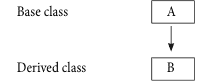

## 程序 2.14

```cpp
#include<iostream.h>
#include<conio.h>
/*Single Inheritance*/
class A
{
public:
int a,b;
void set(int x,int y)
{
a=x;
b=y;
}
};
class B:public A{
public:
int c;
B(int z)
{
c=z;
}
void show()
{
cout<<"A ="<<a<<"\nB="<<b<<"\nC="<<c;
}
};
void main()
{
B obj(30);
obj.set(10,20);
clrscr();
obj.show();
}
```

## 输出

A=10
B=20
C=30

在程序 2.14 中，类 B 继承自类 A。因为类 B 继承自类 A，所以类 B 将拥有类 A 的所有公共成员。obj 是为类 B 创建的对象。在类 B 的定义中，show 方法调用类 A 的成员，这些成员不是类 B 定义的一部分。因为单个派生类 B 派生自单个基类 A，所以继承类型是单层继承。

#### 2.4.2.2 多重继承

如果一个类派生自多个基类，则继承类型称为多重继承。

示例

类 E 派生自三个不同的基类 B、C、D。

```
Class <Derived-Class-Name> : <Access-Specifier> <Base-Class-NameB>, <Access-Specifier> <Base-Class-NameC>, <Access-Specifier> <Base-Class-NameD>
```

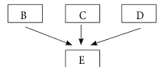

## 程序 2.15

```cpp
#include<iostream.h>
#include<conio.h>
/*Multiple Inheritance*/
class A
{
public:
int a;
void setA(int x)
{
a=x;
}
void showA()
{
cout<<"\nA="<<a;
}
};
class B
{
public:
int b;
void setB(int x)
{
b=x;
}
void showB()
{
cout<<"\nB="<<b;
}
};
class C: public A, public B{
public:
int c;
void setC(int x)
{
c=x;
}
void showC()
{
cout<<"\nC="<<c;
}
};
void main()
{
A objA;
B objB;
C objC;
clrscr();
//Calling Class A methods
cout<<"\nCalling Class A methods";
objA.setA(10);
objA.showA();
//Calling Class B methods
cout<<"\nCalling Class B methods";
objB.setB(20);
objB.showB();
//Calling Class C methods
cout<<"\nCalling Class C methods";
objC.setA(10);
objC.setB(20);
objC.setC(30);
objC.showA();
objC.showB();
objC.showC();
}
```

## 输出

Calling Class A methods
A=10
Calling Class B methods
B=20
Calling Class C methods
A=10
B=20
C=30

一个类可以派生自两个或多个基类。在程序 2.15 中，类 C 继承自类 A 和类 B。因此，类 C 将拥有类 A、类 B 的成员以及其自身的成员。

#### 2.4.2.3 层次继承

当两个或多个类派生自同一个基类时，继承类型称为层次继承。

示例

类 B、类 C 和类 D 派生自基类 A。

层次继承的一般形式如下：

```
Class <Derived-Class-NameB> : <Access-Specifier> <Base-Class-NameA>
Class <Derived-Class-NameC> : <Access-Specifier> <Base-Class-NameA>
Class <Derived-Class-NameD> : <Access-Specifier> <Base-Class-NameA>
```

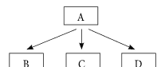

## 程序 2.16

```cpp
#include<iostream.h>
#include<conio.h>
/*Hierarchical Inheritance*/
class A
{
public:
int a;
void setA(int x)
{
a=x;
}
void showA()
{
cout<<"\n"<<a;
}
};
class B: public A
{
public:
int b;
void setB(int x)
{
b=x;
}
void showB()
{
}
};
class C: public A
{
    public:
    int c;
    void setC(int x)
    {
        c=x;
    }
    void showC()
    {
        cout<<"\nC="<<c;
    }
};
void main()
{
    A objA;
    B objB;
    C objC;
    clrscr();
    //Calling Class A methods
    cout<<"\nCalling Class A methods";
    objA.setA(10);
    objA.showA();
    //Calling Class B methods
    cout<<"\nCalling Class B methods";
    objB.setA(10);
    objB.setB(20);
    objB.showA();
    objB.showB();
    //Calling Class C methods
    cout<<"\nCalling Class C methods";
    objC.setA(10);
    objC.setC(30);
    objC.showA();
    objC.showC();
}
```

## 输出

Calling Class A methods
A=10
Calling Class B methods
A=10
B=20
Calling Class C methods
A=10
C=30

程序 2.16 是层次继承的一个示例。在此示例中，类 B 和类 C 继承自同一个基类 A。因此，类 B 将拥有类 B 的成员和类 A 的成员，类 C 将拥有类 C 的成员和类 A 的成员。

#### 2.4.2.4 单层继承

这种继承与单继承相同，唯一的区别是在单层继承中，派生类不能作为基类。

#### 2.4.2.5 多层继承

如果一个类派生自一个派生类，则继承类型称为多层继承。

示例

类 B 派生自类 A，类 C 派生自类 B；现在类 B 是类 C 的基类，也是类 A 的派生类。

多层继承的一般形式如下：

```
Class <Derived-Class-NameB> : <Access-Specifier> <Base-Class-NameA>
Class <Derived-Class-NameC> : <Access-Specifier> <Derived-Class-NameB>
```

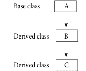

## 程序 2.17

```cpp
#include<iostream.h>
#include<conio.h>
/*Multi-Level Inheritance*/
class A{
public:
int a;
void setA(int x)
{
a=x;
}
void showA()
{
cout<<"\nA="<<a;
}
};
class B: public A {
public:
int b;
void setB(int x)
{
    b=x;
}
void showB()
{
    cout<<"\nB="<<b;
}
};
class C:public B {
public:
    int c;
    void setC(int x)
    {
        c=x;
    }
    void showC()
    {
        cout<<"\nC="<<c;
    }
};
void main()
{
    A objA;
    B objB;
    C objC;
    clrscr();
    //Calling Class A methods
    cout<<"\nCalling Class A methods";
    objA.setA(10);
    objA.showA();
    //Calling Class B methods
    cout<<"\nCalling Class B methods";
    objB.setA(10);
    objB.setB(20);
    objB.showA();
    objB.showB();
    //Calling Class C methods
    cout<<"\nCalling Class C methods";
    objC.setB(20);
    objC.setC(30);
    objC.showB();
    objC.showC();
}
```

## 输出

Calling Class A methods
A=10
Calling Class B methods
A=10
B=20
Calling Class C methods
A=20
C=30

这是多层继承的一个示例。在程序 2.17 中，类 C 派生自派生类 B，类 B 派生自基类 A。当为类 B 创建对象时，该对象将拥有类 A 的所有公共成员，类 C 的对象将拥有类 B 的所有公共成员。

#### 2.4.2.6 混合继承

如果一个类继承了一个或多个基本继承类型的组合，则称为混合继承。

示例

类 B 派生自基类 A，类 D 派生自派生类 B 和基类 C。

多层继承的一般形式如下：

```
Class <Derived-Class-NameB> : <Access-Specifier> <Base-Class-NameA>,
Class <Derived-Class-NameB> : <Access-Specifier> <Derived-Class-NameB>,
Class <Derived-Class-Name> : <Access-Specifier> <Base-Class-NameC>,
```

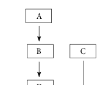

## 程序 2.18

```cpp
#include<iostream.h>
#include<conio.h>
/*Hybrid Inheritance*/
class A
{
    public:
    int a;
    void setA(int x)
    {
    a=x;
    }
    void showA()
    {
        cout<<"\nA="<<a;
    }
};
class C
{
 public:
 int c;
 void setC(int x)
 {
 c=x;
 }
 void showC()
 {
 cout<<"\nC="<<c;
 }
};
class B: public A
{
 public:
 int b;
 void setB(int x)
 {
 b=x;
 }
 void showB()
 {
 cout<<"\nB="<<b;
 }
};
class D: public B, public C
{
 public:
 int b;
 void setB(int x)
 {
 b=x;
 }
 void showB()
 {
 cout<<"\nB="<<b;
 }
};
void main()
{
    A objA;
    B objB;
    C objC;
    D objD;
    clrscr();
    //Calling Class A methods
    cout<<"\nCalling Class A methods";
    objA.setA(10);
    objA.showA();
    //Calling Class B methods
    cout<<"\nCalling Class B methods";
    objB.setA(10);
    objB.setB(20);
    objB.showA();
    objB.showB();
    //Calling Class C methods
    cout<<"\nCalling Class C methods";
    objC.setC(30);
    objC.showC();
    cout<<"\nCalling Class D methods";
    objD.setB(10);
    objD.setC(20);
    objD.showB();
    objD.showC();
}
```

## 输出

Calling Class A methods
A=10
Calling Class B methods
A=10
B=20
Calling Class C methods
C=30
Calling Class D methods
B=10
C=20

在程序 2.18 中，混合继承是多重继承和多层继承的组合。类 A 和类 C 是基类。类 B 派生自类 A，类 D 派生自类 B 和类 C。

#### 2.4.2.7 多路径继承

如果一个类派生自一个或多个派生类，而这些派生类又派生自同一个基类，则这种继承类型称为多路径继承。

示例

类 B 和类 C 派生自同一个基类 A，类 D 派生自类 B 和类 C。


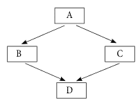

```cpp
class A
{
    public:
    int a;
};
class B:public A
{
    public:int b;
};
class C:public A
{
    public:int c;
};
class D:public B,public C
{
    public:int d;
};
```

在上述程序中，类 B 和类 C 都是从同一基类 A 派生的派生类。类 B 和类 C 可以访问类 A 的变量 a。类 D 从类 B 和类 C 派生，而类 B 和类 C 又都从同一基类 A 派生。当类 D 访问类 A 的变量时，编译器会报错，因为编译器在选择变量 a 时处于歧义状态：是从类 B 中选择，还是从类 C 中选择，因为两者都持有 a 的副本。可以通过使用 `virtual` 关键字来消除这种歧义。

### 访问基类

由于基类成员被派生类继承，基类成员应对派生类具有受控访问权限。当基类的访问说明符为 public 时，基类的所有公共成员均可被派生类访问。基类的所有私有成员均不可被派生类访问。

### 基类的访问说明符为 public

当基类的访问说明符为 public 时，基类的所有公共成员均可被派生类访问。

## 程序 2.19

```cpp
/*Program to demonstrate when the access specifier of the base class
is public*/
#include<iostream.h>
#include<conio.h>

/*Base Class Access Control in inheritance when Access Specifier is
PUBLIC*/
class Base
{
int a; //Private Member Data Variable, Not Accessible by
//the derived Class
void setA(int x) //Private Member Function, Not Accessible by
//the derived Class
{
a=x;
}
void showA() //Private Member Function,Not Accessible by
//the derived Class
{
cout<<"\nA="<<a;
}
public:
int b;
void setB(int y)
{
b=y;
}
void showB()
{
cout<<"\nB="<<b;
}
};
class Derived:public Base{
int c;
public:
void setC(int z)
{
c=z;
}
void showC()
{
cout<<"\nC="<<c;
}
};
void main()
{
Base obj1;
Derived obj2;
clrscr();
//Calling Base Class methods
cout<<" \nCalling Base Class methods";
//obj1.a=1; /*Not Accessible Because of private member of Base Class*/
//obj1.showA(); /*Not Accessible Because of private member of Base Class*/
//obj1.setA(10); /*Not Accessible Because of private member of Base Class*/
//Calling Class B methods
cout<<"\n\nCalling Class B methods";
//obj2.setA(10); /*Not Accessible Because of private member of Base Class*/
obj2.setB(20);
//obj2.showA(); /*Not Accessible Because of private member of Base Class*/
obj2.showB();
obj2.setC(10);
obj2.showC();
}
```

## 输出

调用基类方法
调用类 B 方法
B=20
C=30

在程序 2.19 中，基类的私有成员不可被派生类访问。基类的 setA()、showA() 不可被派生类访问，因为它们是私有成员。基类的公共成员 setB()、showB() 可被派生类访问。这表明基类的所有公共成员都成为派生类的公共成员。基类的所有公共成员均不可被派生类访问。

### 基类的访问说明符为 private

当基类的访问说明符为 private 时，基类的所有公共和受保护成员都成为派生类的私有成员。

## 程序 2.20

```cpp
#include<iostream.h>
#include<conio.h>
class Base
{
int a;
public:
void setA(int x)
{
a=x;
}
void showA()
{
cout<<"\n"<<a;
}
};
class Derived:private Base
{
    int b;
    public:
    void setB(int y)
    {
        b=y;
    }
    void showB()
    {
        cout<<"\nB="<<b;
    }
};
void main()
{
    Derived obj;
    clrscr();
    cout<<"\nDerived Class Members";
    //obj.setA(10); /*Not Accessible*/
    //obj.showA(); /*Not Accessible*/
    obj.setB(20);
    obj.showB();
}
```

## 输出

```
Derived Class Members
B=20
```

在程序 2.20 中，基类的私有成员不可被派生类访问。基类的 setA()、showA() 不可被派生类访问，因为它们是公共成员且基类的访问说明符为 private。这表明当基类的访问说明符为 private 时，基类的所有公共成员都成为派生类的私有成员。基类的所有私有成员均不可被派生类访问。

当基类的访问说明符为 public 时，受保护成员成为派生类的受保护成员。

## 程序 2.21

```cpp
#include<iostream.h>
#include<conio.h>
class Base
{
    protected:
    int a;
    public:
    void setA(int x)
    {
    a=x;
    }
    void showA()
    {
    cout<<"\nA="<<a;
    }
};

class Derived:public Base
{
    int b;
public:
    void setB(int y)
    {
        b=y;
    }
    void showAB()
    {
        cout<<"\nA="<<a<<" B="<<b;
    }
};

void main()
{
    Derived obj;
    clrscr();
    cout<<"\nDerived Class Members";
    obj.setA(10); /*Accessible*/
    obj.showA(); /*Accessible*/
    obj.setB(20);
    obj.showAB();/*The method showAB can access protected variable 'a'*/
}
```

## 输出

派生类成员
A=10
A=10 B=20

在程序 2.21 中，派生类的 showB() 方法调用基类的受保护成员，因为派生类的访问说明符为 public。这表明当基类的访问说明符为 public 时，派生类的成员函数可以访问基类的受保护成员。

### 基类的访问说明符为 protected

当基类的访问说明符为 protected 时，基类的所有公共和受保护成员都成为派生类的受保护成员。基类的所有私有成员均不可被派生类访问。

## 程序 2.22

```cpp
#include<iostream.h>
#include<conio.h>
class Base
{
    protected:
    int a;
    public:
    void setA(int x)
    {
    a=x;
    }
    void showA()
    {
    cout<<" \nA="<<a;
    }
};
class Derived:protected Base
{
    int b;
    public:
    void setB(int y)
    {
    setA(10);
    b=y+a;
    }
    void showAB()
    {
    cout<<" \nA="<<a<<" B="<<b;
    }
};
void main()
{
    Derived obj;
    clrscr();
    cout<<" \nDerived Class Members";
    // obj.setA(10); /*Illegal because setA is protected member of derived class*/
    obj.setB(20);
    obj.showAB();
}
```

## 输出

派生类成员
A=10 B=30

在程序 2.22 中，派生类成员函数 showAB() 调用受保护成员 a，因为当访问说明符为 protected 时，基类的受保护成员成为派生类的受保护成员。

应用继承时构造函数和析构函数的执行顺序：继承允许基类和派生类都具有构造函数和析构函数。编译器知道类的派生顺序；构造函数按相同顺序调用。析构函数的调用顺序与构造函数正好相反。

## 程序 2.23

```cpp
#include<iostream.h>
class Base
{
public:
    Base()
    {
        cout<<"\nCalling Base Class Constructor";
    }
    ~Base()
    {
        cout<<"\nCalling Base Class Destructor";
    }
};
class Derived:public Base
{
public:
    Derived()
    {
        cout<<"\nCalling Derived Class Constructor";
    }
    ~Derived()
    {
        cout<<"\nCalling Derived Class Destructor";
    }
};
void main()
{
    Derived obj;
}
```

## 输出

调用基类构造函数
调用派生类构造函数
调用派生类析构函数
调用基类析构函数

程序 2.23 的 main 函数用于创建派生类的对象。由于派生类是从基类派生的，编译器先调用基类构造函数，然后调用派生类构造函数。析构函数的调用顺序与构造函数的顺序正好相反。


## Program 2.24

```cpp
#include<iostream.h>
#include<conio.h>
class Base
{
public:
Base()
{
cout<<"\nCalling Base Class Constructor";
}
~Base()
{
cout<<"\nCalling Base Class Destructor";
}
};
class DerivedB:public Base
{
public:
DerivedB()
{
cout<<"\nCalling DerivedB Class Constructor";
}
~DerivedB()
{
cout<<"\nCalling DerivedB Class Destructor";
}
};
class DerivedC:public DerivedB
{
public:
DerivedC()
{
cout<<"\nCalling DerivedC Class Constructor";
}
~DerivedC()
{
cout<<"\nCalling DerivedC Class Destructor";
}
};
void main()
{
clrscr();
DerivedC obj;
}
```

### 输出

Calling Base Class Constructor
Calling DerivedB Class Constructor
Calling DerivedC Class Constructor
Calling DerivedC Class Destructor
Calling DerivedB Class Destructor
Calling Base Class Destructor

在多重继承中，需要调用三个或更多构造函数。在程序 2.24 中，类 C 派生自派生类 B。在这种情况下，基类 A、类 B 和类 C 的构造函数分别被调用。析构函数则按相反顺序调用。

## 向基类构造函数传递参数：

继承允许类具有构造函数，构造函数可以有参数，也可以没有参数。这里的问题是，可以为派生类创建对象。如果是这种情况，“在为派生类创建对象时如何将参数传递给基类构造函数”。为了解决这个问题，C++ 允许开发人员在派生类的声明中使用冒号（:）运算符将参数传递给基类构造函数，参数可以按照派生类对象参数、基类参数列表的顺序传递。
假设派生类构造函数具有一个整数参数和两个浮点数参数传递给基类构造函数。那么开发人员可以先传递派生类参数，再传递基类参数。
派生类构造函数声明的一般形式如下：

```
Derived-class-constructor ( args ) : base-class1-constructor ( args ) ,
base-class2-constructor( args )
..... ....
base-classN-constructor(args)
{
    // definition of the derived class
}
```

向派生类构造函数传递参数的一般形式如下：

```
Derived-class object-name(list of derived-class-args, list-of-base-class-args) ;
```

演示向基类构造函数传递参数的程序：

## Program 2.25

```cpp
#include<iostream.h>
#include<conio.h>
class Base{
public:
Base(int x)
{
cout<<"\nCalling Base Class Constructor";
cout<<"\nArgument Value Received by the Base Class:"<<x;
}
~Base()
{
cout<<"\nCalling Base Class Destructor";
}
};
class Derived:public Base
{
public:
/*Derived Class uses only p and the variable q will be passed to the base
class constructor*/
Derived(int p,int q):Base(q)
{
cout<<"\nCalling Derived Class Constructor";
cout<<"\nArgument Value Received by the Derived Class:"<<p;
}
~Derived()
{
cout<<"\nCalling Derived Class Destructor";
}
};
void main()
{
clrscr();
Derived obj(10,20);
}
```

### 输出

Calling Base Class Constructor
Argument Value Received by the Base Class:20
Calling Derived Class Constructor
Argument Value Received by the Derived Class:10
Calling Derived Class Destructor
Calling Base Class Destructor

在程序 2.25 中，派生类 B 只有一个整数输入参数，基类的构造函数也只有一个整数输入参数。为了允许将参数传递给基类构造函数，派生类定义为 Derived(int p, int q):Base(q)。最初，派生类对象接受变量 p 和 q 的输入值。只有 p 被派生类需要，q 会被传递给基类构造函数。在创建派生类对象时，派生类输入参数值 10 被放置，输入参数值 20 被传递给基类构造函数。

## 使用多重继承时向基类构造函数传递输入参数：

## Program 2.26

```cpp
#include<iostream.h>
#include<conio.h>
class Base
{
public:
Base(int x)
{
cout<<"\nCalling Base Class Constructor";
cout<<"\nArgument Value Received by the Base Class:"<<x;
}
~Base()
{
cout<<"\nCalling Base Class Destructor";
}
};
class DerivedA : public Base{
public:
/*DerivedA Class uses only p and the variable q will be
passed to the base class contructor*/
DerivedA(int p,int q):Base(q)
{
cout<<"\nCalling DerivedA Class Constructor";
cout<<"\nArgument Value Received by the DerivedA Class:"<<p;
}
~DerivedA()
{
cout<<"\nCalling DerivedA Class Destructor";
}
};
class DerivedB:public DerivedA{
public:
/* DerivedB Class uses only p and the variables q,r will be passed
to the DerivedA class contructor*/
DerivedB(int p,int q,int r) : DerivedA(q,r)
{
cout<<"\nCalling DerivedB Class Constructor";
cout<<"\nArgument Value Received by the DerivedB Class:"<<p;
}
~DerivedB()
{
cout<<"\nCalling DerivedB Class Destructor";
}
};
void main()
{
clrscr();
DerivedB obj(10,20,30);
}
```

### 输出

Calling Base Class Constructor
Argument Value Received by the Base Class:30
Calling DerivedA Class Constructor
Argument Value Received by the DerivedA Class:20
Calling DerivedB Class Constructor
Argument Value Received by the DerivedB Class:10
Calling DerivedB Class Destructor
Calling DerivedA Class Destructor
Calling Base Class Destructor

在程序 2.26 中，类 B 派生自派生类 A，类 A 派生自基类。所有类的构造函数都接受一个整数参数。基类构造函数定义为 Base(int x)，因此它只接受一个输入参数。类 A 派生自基类。为了将参数传递给基类，类 A 定义为 DerivedA(int p,int q):Base(q)。类 DerivedA 的构造函数在创建对象时接受 p 和 q 作为输入参数，仅用于其自身目的，并将 q 传递给基类构造函数。类 Derived 也继承自类 DerivedA。为了将参数传递给类 A 的构造函数，类 DerivedB 的构造函数应在其构造函数声明中接受参数。所有构造函数的参数均作为 “DerivedB obj(10,20,30)” 传递；值 10 由类 DerivedB 的构造函数使用，参数值 20、30 传递给类 Derived 的构造函数。类 DerivedB 的构造函数接受 20、30 作为输入参数。类 DerivedA 的构造函数仅使用值 20，值 30 将被传递给基类构造函数。通过这种方式，在为派生类创建对象时，可以将参数传递给基类构造函数。

**在继承中将继承的私有成员恢复为其原始访问规范：** 可能存在一种情况，其中一些继承的私有成员需要保持其原始访问规范。在这种情况下，C++ 允许开发人员在派生类中恢复其原始访问规范。

当基类的访问说明符为 *私有* 时，基类的所有公共和受保护成员都成为派生类的私有成员。上述机制允许恢复一些继承的公共和受保护成员，这些成员在派生类中变为私有，并可以将其原始访问规范恢复为公共或受保护。

访问规范的一般形式如下：

Base-class::member; //通过此语句，成员的原始访问规范将被恢复。

## Program 2.27

```cpp
#include<iostream.h>
#include<conio.h>
class Base
{
public:
int a;
Base()
{
a=10;
}
};
class DerivedA:private Base
{
public:
Base::a; //Making the private variable
//to again public access specification
};
class DerivedB:private DerivedA
{
public:
void show()
{
cout<<"A="<<a;
}
};
void main()
{
clrscr();
DerivedB obj;
obj.show();
}
```

### 输出

A=10

在程序 2.27 中，类 DerivedA 从基类继承，基类的访问说明符为 private。因此，基类的所有公共和受保护成员都变为私有。类 DerivedB 从类 DerivedA 继承。因此，DerivedA 类的继承成员不会出现在类 DerivedB 中。在基类中，变量 a 被声明为 public，它在类 DerivedA 中变成了私有。语句 Base::a; 将类 DerivedA 的私有变量恢复为 public，该变量可以进一步继承给其他派生类。

public: int a;
class DerivedA : private Base
public: int a;
become
After the statement Base::a;
the access specifier became public: int a;
public: int a;
become
private: int a;

### 2.4.3 继承的使用原因

特化：从基类派生出一个新类，这个类可能只是在基类基础上添加一些内容，或者与基类略有不同。

泛化：当两个或多个类具有相似属性时，可以将这种相似性组合到一个共同的基类中。

接口：由基类用于定义接口，但不实现其中的一部分或全部内容。

派生类是基类的一种类型（Is-A）。这意味着基类可用的任何地方，派生类也可以使用。当派生类是已存在类的一种类型时，IS-KIND-OF-LIKE 和 IS-A 之间可能存在混淆。


### 2.4.4 优点

- 在层次关系中，继承使开发模型克隆到现实生活中的对象模型。
- 可重用性：基类的公共成员可以被派生类重用，无需重写它们。
- 数据隐藏：基类可以控制某些数据的访问，使其不能被派生类修改。
- 可扩展性：通过派生类扩展基类属性，以生成更强大的对象。

### 2.4.5 缺点

- 对象在用于调用成员函数时会产生更多的编译器开销。
- 分配给未使用数据元素的内存不会被利用，从而浪费内存。
- 如果继承使用不当，会导致程序变得更加复杂。
- 随着 Vtable 的增长，程序的性能会下降。

### 2.4.6 委托

在面向对象编程中，两个类可以通过继承或委托来连接。委托是一种机制，其中一个类的对象被用作另一个类的成员。继承中的关系类型是 IS KIND OF，而在委托中则是 HAS-A 关系。

```
class x
{
};
class y
{
};
class z
{
  x a; //object of class x
  y b; //object of class y
}
```

这里类 z 有两个数据成员 a 和 b，它们是其他类 x 和 y 的对象；这种关系称为 HAS-A 关系。

## 2.5 多态性

多态性可以定义为“多种形式”。Poly 意为“许多”，morph 意为“形式”，而“ism”是一种理论或过程。一般来说，多态性意味着“一个可以有多种形式”。运算符重载和函数重载是多态性的类型。

C++ 支持两种绑定方式——静态绑定和动态绑定。在编译时选择函数调用称为静态绑定。在运行时选择函数调用称为动态绑定。静态绑定通过函数重载和运算符重载实现，而动态绑定使用虚函数实现。

### 2.5.1 虚函数

virtual 关键字用于避免多重继承中的歧义情况。在多重继承中，一个对象可以继承派生对象的属性，这些派生对象继承自相同的基类对象。这种情况会导致歧义。为了避免在调用继承成员时出现歧义，引入了虚函数。使用 virtual 关键字可以解决歧义情况。歧义是编译器错误。

带有歧义的程序：

```
#include <iostream.h>
#include <conio.h>
class Base
{
 public:
 int base_var;
};
class derived1:public Base
{
 public:
 int derived1_var;
};
class derived2:public Base
{
 public:
 int derived2_var;
};
class derived3:public derived1, public derived2
{
 public:
 int derived3_var;
};
void main()
{
 derived3 obj;
 obj.base_var=20; /*derived1 and derived2 instances are inherited
to the obj, compiler cannot address which
member has to be called*/
}
```

在上述程序中，当创建对象 obj 时，对象 obj 将继承 derived1 和 derived2 类的公共属性。因为 derived1 和 derived2 类都继承自基类，所以 derived1 和 derived2 类的实例都会有一个 base_var 成员。因为 derived3 继承自 derived1 和 derived2 类，所以 obj 对象中会存在两个 base_var 变量的副本。当调用 obj.base_var 时，编译器将处于歧义状态，无法决定应访问哪个成员。

如果将基类的访问说明符定义为 virtual，则编译器会避免同一基类的多个实例副本，并在多重继承中仅保留一个基类实例。下面的示例通过使用 virtual 关键字避免了歧义：

```
#include <iostream.h>
#include <conio.h>
class Base
{
public:
int base_var;
};
class derived1:virtual public Base
{
public:
int derived1_var;
};
class derived2:virtual public Base
{
public:
int derived2_var;
};
class derived3:public derived1, public derived2
{
public:
int derived3_var;
};
void main()
{
derived3 obj;
obj.base_var=20; /*derived1 and derived2 instances are inherited
to the obj, compiler copies only one instance
of base class's base_var member*/
}
```

虚函数是定义在基类中且可以被派生类重新定义的函数。虚函数允许实现多态性的概念。因为虚函数在一个类中定义，并可能被派生类重新定义，所以虚函数概念支持一个接口可以有多种形式。

## Program 2.28

```
#include <iostream.h>
#include <string.h>
#include <conio.h>
class base
{
public:
virtual void date(int dd,int mm,int yy)
{
cout<<"\nBase Class date function:"<<dd<<"\\"<<mm<<"\\"<<yy;
}
};
class derived:public base
{
public:
    char month[5];
    void date(int dd,int mm,int yy)
    {
        switch(mm)
        {
            case 1:strcpy(month,"JAN");
            break;
            case 2:strcpy(month,"FEB");
            break;
            case 3:strcpy(month,"MAR");
            break;
            case 4:strcpy(month,"APR");
            break;
            case 5:strcpy(month,"MAY");
            break;
            case 6:strcpy(month,"JUN");
            break;
            case 7:strcpy(month,"JULY");
            break;
            case 8:strcpy(month,"AUG");
            break;
            case 9:strcpy(month,"SEP");
            break;
            case 10:strcpy(month,"OCT");
            break;
            case 11:strcpy(month,"NOV");
            break;
            case 12:strcpy(month,"DEC");
            break;
        }
        cout<<endl<<"Derived Class date function:"<<dd<<"/"<<month<<"/"<<yy;
    }
};
void main()
{
    clrscr();
    base obj;
    obj.date(1,1,2010);
    derived obj2;
    obj2.date(1,1,2010);
}
```

### Output

Base Class date function:1\1\2010
Derived Class date function:1\JAN\2010

在 Program 2.28 中，date() 方法被声明为虚函数，并在基类中定义，以数字格式显示日期，并以整数格式显示 date/month/year。为了派生类的方便，虚函数 date() 将日期重新定义为整数，月份为三个字符，年份为整数。

**通过基类引用体现虚函数的运行时多态性：** 如果在基类中将任何函数声明为虚函数，则该函数可以被派生类重新定义。当创建基类引用指针时，该指针可用于派生类。

/*Virtual Functions*/

## Program 2.29

```
#include <iostream.h>
#include <string.h>
#include <conio.h>
class base
{
public:
virtual void date(int dd,int mm,int yy)
{
cout<<"\nBase Class date function:"<<dd<<"\""<<mm<<"\""<<yy;
}
};
class derived: public base{
public:
char month[5];
void date(int dd,int mm,int yy)
{
switch(mm)
{
case 1: strcpy(month,"JAN") ;
break;
case 2: strcpy(month,"FEB") ;
break;
case 3: strcpy(month,"MAR") ;
break;
case 4: strcpy(month,"APR") ;
break;
case 5: strcpy(month,"MAY") ;
break;
case 6: strcpy(month,"JUN") ;
break;
case 7: strcpy(month,"JULY") ;
break;
case 8 : strcpy(month,"AUG") ;
break ;
case 9 : strcpy(month,"SEP") ;
break ;
case 10 : strcpy(month,"OCT") ;
break ;
case 11 : strcpy(month,"NOV") ;
break ;
case 12 : strcpy(month,"DEC") ;
break ;
} ;
cout<<"\nDerived Class date function:"<<dd<<"\""<<month<<"\""<<yy;
} ;
void main()
{
clrscr() ;
base *p, obj1 ;
p=&obj1 ;
p->date(1,1,2010) ;
derived obj2 ;
p=&obj2 ;
p->date(1,1,2010) ;
}
```

### Output

Base Class date function:1\1\2010

Derived Class date function:1\JAN\2010

在 Program 2.29 中，通过定义 base *p 将指针 p 创建为基类指针。这是因为指针 p 被声明为基类引用指针，不应用于其他类对象。但虚函数概念允许开发者实现运行时多态性。因此，基类指针可用于引用派生类对象。

通过语句 p=&obj1; 和 p->date(1,1,2010); 指针 p 用于引用基类成员。通过语句 p=&obj2; 和 p->date(1,1,2010); 基类指针 p 用于派生类。输出清楚地表明，当执行派生类 date 函数时，语句 p->date(1,1,2010); 会被执行。结果变为 Derived Class date function:1\JAN\2010。

当派生类未重写基类的虚函数时，将调用基类虚函数：当虚函数在基类中定义时，虚函数可能会被派生类重写，也可能不会。如果虚函数被重写，则将调用派生类函数。如果虚函数未被派生类重写或重新定义，则将调用基类虚函数。

## Program 2.30

```
/*Virtual Functions are Hierarchical*/
#include <iostream.h>
```


```cpp
#include<string.h>
#include<conio.h>
class base
{
public:
virtual void date(int dd,int mm,int yy)
{
cout<<"\nBase Class date function:"<<dd<<"\\"<<mm<<"\\"<<yy;
}
};
class derived:public base
{
public:
void show()
{
cout<<"\n I am in the derived class";
}
};
void main()
{
clrscr();
base obj1;
obj1.date(1,1,2010);
derived obj2;
obj2.date(1,1,2010);
obj2.show();
}
```

Output

Base Class date function:1\1\2010
Base Class date function:1\1\2010
I am in the derived class

在程序 2.30 中，虚函数未被派生类重新定义。当调用 obj2.date(1,1,2010) 时，将调用 date 函数的基类定义，因为 date 函数未被派生类重新定义。

### 2.5.2 纯虚函数

纯虚函数是在基类中声明的虚函数，但该虚函数没有定义，以便可以被派生类重写。纯虚函数必须由派生类定义。当在类中将函数声明为纯虚函数时，该类不能用于声明任何对象，因为它变成了抽象类。

纯虚函数可以声明为

```
virtual return-type function-name(args)=0;
```

### 示例

```
virtual void greet()=0;
```

在此示例中，greet 是一个纯虚函数，赋值运算并不用于赋值为零，而是向编译器模拟它是一个纯虚函数且没有定义。

### 程序 2.31

```cpp
/*Program to demonstrate Pure Virtual Function*/
#include<iostream.h>
#include<conio.h>
class Base
{
    public:
    virtual void greet ()=0; /*Pure virtual function, memory will not
    be created for this method, But the derived
    classes can work with runtime polymorphism*/
};
class Derived:public Base
{
    public:
    void greet()
    {
    cout<<"\nHi! i am Derived Class";
    }
};
void main()
{
    Derived obj;
    clrscr();
    obj.greet();
}
```

### 输出

Hi! i am Derived Class

在程序 2.31 的基类中，虚方法 greet() 被声明为纯虚函数，但基类中没有该方法的定义。当派生类定义纯虚函数时，将调用派生类的版本。

### 2.6 抽象类

抽象类是指类中至少定义了一个纯虚函数的类。无法为抽象类创建对象。抽象类可以有指针。抽象类的纯虚函数可以通过指针引用。抽象类可以实现运行时多态。通过将类中的一个或多个函数设为纯虚函数，可以将类定义为抽象类。

### 程序 2.32

```cpp
/*Program to Demonstrate ABSTRACT Class*/
#include<iostream.h>
#include<conio.h>
class Base
{
public:
virtual void greet()=0;
virtual void showBye()=0;
};
class Derived:public Base
{
public:
void greet()
{
cout<<"\nHi i am Derived Class";
}
void showBye()
{
cout<<"\nBye, Have a good day";
}
};
void main()
{
Derived obj;
clrscr();
obj.greet();
obj.showBye();
}
```

### 输出

Hi i am Derived Class Bye, Have a good day

在程序 2.32 的示例中，方法 greet() 和 showBye() 被定义为纯虚函数。因此，基类被称为抽象类。派生类继承了抽象类的虚函数，并在派生类中定义它们。当派生类对象调用方法 greet() 和 showBye() 时，将调用派生类的定义。

## 2.7 使用模板进行泛型编程

模板是 C++ 中最有用的软件复用特性之一。模板定义了一组相关函数，称为函数模板，以及一组相关类，称为类模板。这种技术称为泛型编程。适用于所有函数的函数称为泛型函数。数据类型将作为参数传递给泛型函数。通过为函数 sum() 创建模板，可以用于对任何数据类型执行加法。

当需要对不同数据类型执行操作时，通常使用函数重载，但这会增加程序大小，并且需要创建更多局部变量，从而增加内存需求。模板克服了函数重载的局限性。模板提供的机制也可以应用于类。

泛型函数可用于不同数据类型。可以使用 template 关键字定义泛型函数或类。

### 2.7.1 函数模板

如果函数在所有数据类型上的操作相似，则可以将其定义为模板，而无需重载函数。

模板函数的一般形式如下：

```
template<class Template-type>return-type function-name(args)
{
    //definition of the template function.
}
```

在此处，template 是定义模板函数的关键字，template-type 是数据类型。return-type 是模板函数返回值的数据类型。function-name 是模板函数的名称，args 是模板函数的输入参数列表。模板类型可以用作泛型函数或类函数体中的数据类型。

### 示例

```
template<class T>void echo_value()
{
    T value;
    cout<<“Enter a value:”;
    cin>>value;
    cout<<“\nYou have entered:”<<value;
}
```

在示例中，T 是模板函数 echo_value() 的数据类型。该函数可应用于任何输入参数类型。

模板类或函数可以有任意数量的模板类型。

### 程序 2.33

```cpp
/*A template function with single generic data type*/
#include<iostream.h>
#include<conio.h>
template<class X> void add (X a, X b)
{
    X sum;
    sum=a+b;
    cout<<"\n"<<a<<"+"<<b<<"="<<sum;
}
void main()
{
clrscr();
add(10,20);
add(0.1,0.2);
}
```

### 输出

10+20=30
0.1+0.2=0.3

在程序 2.33 中，考虑了两个数的加法。使用整数参数编写的函数也可用于其他数据类型。为所有数据类型编写单独的 add 函数也很困难。通过函数重载过程，可以为任何数据类型定义 add 函数，但为不同数据类型定义的所有方法的 add 函数逻辑相同。泛型函数允许开发人员编写具有不同数据类型通用逻辑的函数。函数重载最适合逻辑不同的函数。

上述泛型函数 add 是使用模板类 X 定义的。在此处，X 在运行时可以是任何数据类型。在 main 函数中，add(10,20) 被调用，因为 (int,int) 传递给泛型函数，函数使用整数数据类型，即 X 变为整数；在第二条语句 add(0.1,0.2) 中，因为 add 函数作为 add(float,float) 被调用，在执行时 X 变为浮点数，add 函数将使用浮点数据类型。与其为整数加法和浮点数加法编写两个不同的函数，不如使用单个泛型函数适用于任何数据类型。该说法具有普遍性，单个泛型函数可用于不同数据类型，其中所有数据类型的逻辑相同。

模板函数可以有多个模板类型。模板类型可以用作泛型函数或类函数体中的普通数据类型。

### 程序 2.34

```cpp
/*A template function with more than one generic data type*/
#include<iostream.h>
#include<conio.h>
template<class X,class Y>void generic_fun(X a,Y b)
{
cout<<"\nArgument values Received by the function:"<<a<<" "<<b;
}
void main()
{
clrscr();
generic_fun(10,20.2);
generic_fun(0.1,100);
generic_fun(10,"Hello World");
generic_fun(10.2,'H');
}
```

### 输出

Argument values Received by the function:10 20.2
Argument values Received by the function:0.1 100


函数接收到的参数值：10 Hello World
函数接收到的参数值：10.2 H

在程序 2.34 中，X 和 Y 是两种不同的模板类型。这些模板类型用于定义 generic_fun 的 a 和 b 输入参数。当调用 generic_fun<10,20.2> 时，X 变为整数数据类型，Y 变为浮点数据类型。当由 generic_fun 调用 a、b 时，a 和 b 的值将回显到屏幕上。

#### 2.7.1.1 泛型函数可以重载

用普通函数重载模板函数：由于方法可以重载，泛型函数也可以重载，只要为任何数据类型执行相同功能需要新逻辑时即可。

### 程序 2.35

```
/*Explicitly Overloading Generic Functions*/
#include<iostream.h>
#include<conio.h>
template<class X,class Y>void generic_fun(X a,Y b)
{
cout<<"\nA="<<a<<" B="<< b;
}
void generic_fun( int a,int b)
{
int sum=a+b;
cout<<"\nSum="<<sum;
}
void main()
{
clrscr();
generic_fun(10,20); /*int generic_fun will be called*/
generic_fun(10,20.2); /*generic generic_fun will be called*/
generic_fun("Hello"," World");
}
```

### 输出

```
Sum=30
A=10 B=20.2
A=Hello B=World
```

在程序 2.35 中，模板 generic_fun 将为所有数据类型调用，除非 generic_fun 带有两个整数参数被调用。这里，模板函数 generic_fun 与 generic_fun(int,int) 函数重载。每当调用 generic_fun(int,int) 时，将调用 void generic_fun(int a,int b)。对于所有其他数据类型，将调用模板函数 generic_fun。

用另一个模板函数重载模板函数：与模板函数和普通函数重载类似，泛型函数可以与另一个模板函数重载。根据参数的数量，将调用一个泛型函数。在程序 2.36 中，模板函数 generic_fun(X a, b) 与另一个模板函数 generic_fun(X a,Y b) 重载。当调用 generic_fun(10) 时，将调用模板函数 generic_fun(X a)。当调用 generic_fun(10,20.2) 时，将调用第二个重载的模板函数 generic_fun(X a, Y b)。

### 程序 2.36

```
/*Explicitly Overloading Generic Functions*/
#include<iostream.h>
#include<conio.h>
template<class X>void generic_fun( X a)
{
cout<<"\nA="<<a;
}
template<class X,class Y>void generic_fun(X a,Y b)
{
cout<<"\nA="<<a<<" B="<<b;
}
void main()
{
clrscr();
generic_fun(10); /*first template generic_fun will be called*/
generic_fun(10,20.2);/*Second template generic_fun will be called*/
generic_fun("Hello","World");/*Second template generic_fun will be called*/
}
```

### 输出

```
A=10
A=10 B=20.2
A=Hello B=World
```

#### 2.7.1.2 模板函数可以使用标准参数

模板函数可以使用常量和预定义的标准参数来定义。在程序 2.37 中，height 是一个常量参数，模板函数 volume_of_cube(X l, X b) 可以使用标准参数。该程序将 height 作为常量值 8 编写，可以使用泛型函数 volume_of_cube(X l, X b) 计算高度为 8 的立方体的体积。

### 程序 2.37

```
/*Using Standard Parameters with Template Functions, For demonstrating constants can be mixed with the generic data type*/
#include<iostream.h>
#include<conio.h>
const int height=8; /*Here Height of the volume is fixed*/
template<class X>void volume_of_cube(X l,X b)
{
X volume=l*b*height;
cout<<"\nVolume of Cube where has constant height as '8' is:"<< volume;
}
void main()
{
clrscr();
volume_of_cube(10,20);
}
```

### 输出

```
Volume of Cube where has constant height as '8' is:1600
```

### 2.7.2 类模板

既然泛型函数是可能的，使用模板定义泛型类也是可能的。泛型类非常有用，可用于为更多数据类型编写相同逻辑的程序。

模板类的一般形式如下：

```
template<class template-type>class class-name
{
//definition of the template class
}
```

带有更多参数的类模板的一般形式如下：

```
template<class template-type1,class template-type2,...>class class-name
{
//definition of the template class
}
```

在这里，template-type 可以是任何数据类型，并且在模板类定义中可以定义任意数量的类模板类型。

可以使用以下一般形式创建模板类的对象：

```
Class-name<data type>object;
```

栈的操作可以泛化为所有数据类型。因此，与其为不同数据类型编写不同的类，不如将单个泛型类栈程序应用于所有数据类型（程序 2.38）。

### 程序 2.38

```
/*Generic Class*/
#include<iostream.h>
#include<conio.h>
template<class T>class A
{
T a,b,sum;
public:
void setAB(T x,T y)
{
a=x;
b=y;
sum=a+b;
}
void showAB()
{
    cout<<"\nA="<<a<<" B="<<b<<" SUM="<<sum;
}
};
void main()
{
    A<int>obj_int;
    A<float>obj_float;
    clrscr();
    obj_int.setAB(10,20);
    obj_int.showAB();
    obj_float.setAB(0.1,0.2);
    obj_float.showAB();
}
```

### 输出

```
A=10 B=20 SUM=30
A=0.1 B=0.2 SUM=0.3
```

```
/*Generic Class*/
```

### 程序 2.39

```
#include<iostream.h>
#include<conio.h>
template<class T1,class T2>class SUM
{
    T1 a;
    T2 b;
    public:
    SUM(T1 x,T2 y)
    {
        a=x;
        b=y;
    }
    void show()
    {
        cout<<"\nSum of "<<a<<", "<<b<<"="<<(a+b);
    }
};
void main()
{
    clrscr();
    SUM<int> obj1(10,20);
    SUM<float> obj2(0.1,0.2);
    obj1.show();
    obj2.show();
}
```

### 输出

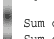

在程序 2.39 中，SUM 是一个用于计算两个数之和的类。泛型类帮助开发者使用同一个泛型模板类来计算两个整数的和以及两个浮点数的和。同一个 SUM 类用于创建整数的 obj1 和浮点数的 obj2，以求解两个数相加的泛型问题。

泛型类可以具有默认参数类型和默认值。

### 2.8 递归

递归是函数自身调用自身的技术。有时函数调用自身可能会产生错误，但当该技术正确使用时非常强大。可以通过 fact() 函数轻松理解递归，其操作是求一个数的阶乘。fact() 的非递归技术如下所示：

fact() 的非递归或迭代方式：

```
int fact(int n)
{
 int i,result;
 result=1;
 for(i=1;i<=n;i++)
 result=result*i;
 return(result);
}
```

在上述程序中，非递归 fact() 函数中的循环从 1 执行到 n 并乘以每个数字。

fact() 的递归方式：

### 程序 2.40

```
#include<iostream.h>
int factorial( int n )
{
 int n;
 int result ;
 cout<<"enter an integer";
 cin>>n;
 result=fact( n);
 cout<<"Factorial of "<<n<<" is "<<result;
 return 0;
}

int fact( int n)
{
 if(n==1) return 1;
 else
 return n*fact(n-1); //call by itself.
}
```

### 输出

```
Enter an integer
5
Factorial of 5 is:120
```

在程序 2.40 中，递归 fact() 的操作有些复杂，当 fact() 带有参数 1 被调用时，函数返回 1，否则返回 n*fact(n-1) 的值。如果值为 5，fact 第一次以 5 作为参数被调用，第二次以 4 作为参数被调用，第三次以 3 作为参数被调用，依此类推，直到 n 等于 1。fact() 的每次调用在以另一个 n 值调用自身时都会存储 n 的值。

当函数调用自身时，会分配一组新的局部变量和参数，函数代码使用这些变量执行。递归调用不会创建函数的新副本，而是创建正在操作的值的新副本。每个递归函数必须结束，否则它将无限地调用自身。程序中的语句 if(n==1) 完成此操作，当 n 值变为 1 时程序终止。

递归函数的主要优点是可以用最简单的方式实现多种算法。使用迭代方式实现快速排序比较困难。因此，有些人可能认为递归比迭代更容易。

## 摘要

- 鲁棒性、适应性和可重用性是面向对象设计的目标。
- 抽象、封装和模块化是面向对象设计的原则。
- 构造函数用于初始化对象。析构函数用于销毁对象。
- 默认构造函数、参数化构造函数和拷贝构造函数是构造函数的类型。
- 构造函数重载是定义多个同名构造函数的技术。
- 运算符重载更改预定义运算符的含义。
- 继承从已存在的类派生出新类。对基类成员的访问通过 public、private 和 protected 访问说明符控制。
- 派生类将基于声明类型（如 private、public 或 protected）以及继承基类时的访问说明符，拥有基类的成员。
- 单继承和多继承是继承的基本分类。
- 继承可以进一步分为多种类型：层次继承、单级继承、多级继承、混合继承和多路径继承。
- 当基类的访问说明符为 public 时，基类的所有 public 成员都可被派生类访问。
- 当基类的访问说明符为 private 时，基类的所有 public 和 protected 成员都变为派生类的 private 成员。
- 当基类的访问说明符为 protected 时，基类的所有 public 和 protected 成员都变为派生类的 protected 成员。基类的所有 private 成员均不可被派生类访问。
- 委派是一种机制，其中一个类的对象用作另一个类的成员。
- 多态性定义一个具有多种形式的接口。


- 虚拟关键字用于避免多路径继承中的歧义。
- 在基类中定义的虚函数可以被派生类重新定义。
- 纯虚函数在基类中声明，由派生类定义。
- 泛型编程定义了一组相关函数（称为函数模板）和一组相关类（称为类模板）。
- 递归是一种由函数自身调用的技术。

## EXERCISES

### FILL IN THE BLANKS

- 1. 可重用性是______的过程。
- 2. 抽象是指______。
- 3. ______用于创建对象。
- 4. 构造函数和析构函数的名称与______相同。
- 5. 含有纯虚函数的类称为______。
- 6. 多态是一种______的技术。
- 7. ______是将数据和数据成员组合成单一单元的过程。
- 8. 泛型编程是______的过程。
- 9. 当函数适用于所有操作时，称为______。
- 10. 泛型函数或类由______定义。
- 11. ______用于为所有数据类型编写程序。
- 12. 递归是______的过程。

### MULTIPLE-CHOICE QUESTIONS

- 1. 模块化软件设计提供______。
  - a. 适应性
  - b. 可移植性
  - c. 可重用性
  - d. 以上都不是

- 2. 当______时调用构造函数。
  - a. 创建对象时
  - b. 初始化变量时
  - c. 调用成员函数时
  - d. 删除对象时

- 3. 析构函数用于______。
  - a. 为对象分配内存
  - b. 销毁对象
  - c. 创建类
  - d. 创建对象

- 4. 当构造函数被重载时，它们通过______不同。
  - a. 参数类型
  - b. 参数个数
  - c. 返回类型
  - d. 类名

- 5. 访问说明符 protected 允许______。
  - a. 派生类直接访问基类成员
  - b. 防止直接访问公共成员
  - c. 对象访问私有成员
  - d. 以上全部

- 6. 当______时，类被称为抽象类。
  - a. 存在至少一个纯虚函数时
  - b. 存在静态函数时
  - c. 存在虚函数时
  - d. 以上都不是

- 7. 歧义发生在______类型的继承中。
  - a. 单继承
  - b. 多路径继承
  - c. 多层继承
  - d. 多重继承

### Short-Answer Questions

- 1. 定义构造函数和析构函数。
- 2. 列出构造函数的属性。
- 3. 讨论虚函数的必要性。
- 4. 解释纯虚函数。
- 5. 说明使用继承的原因。
- 6. 写出继承的优缺点。
- 7. 什么是委托？区分委托和继承。

### Essay Questions

- 1. 讨论面向对象编程的目标和原则。
- 2. 什么是构造函数？解释各种类型的构造函数。
- 3. 详细讨论运算符重载。
- 4. 什么是继承？解释。
- 5. 举例说明泛型编程。
- 6. 泛型函数可以重载吗？用示例解释。

## Chapter 3

## Algorithms

第 3 章对算法进行了专门研究。它讨论了算法中使用的基本符号、存在的各种算法类型以及算法的性能分析。给出了关于空间复杂度、先验分析和渐近符号的详细解释。本章还阐述了时间复杂度以及最坏、平均和最佳情况时间复杂度。

### 3.1 INTRODUCTION

算法是解决问题的逐步过程。它是表示问题解决方案的数学过程或符号。它应该清晰且无歧义。算法指定了要实现的程序的行为。它包括所使用的数据结构、对数据结构使用情况的注释、算法使用的过程语句和子程序（如果有）。

可以为给定问题设计许多算法。其中，根据其所需的空间量和执行时间选择最佳算法。

### 3.2 BASIC NOTATIONS

- 算法以字符串 "Algorithm" 开头，后跟算法名称
- 输入值列表
- 输出值列表
- 将值赋给变量将表示为 "←" 或 "="
  - 示例：Set radius ← 3（此处将值 '3' 赋给变量 radius）
- 算法中的所有变量都是标量（任何值都可以放入变量中，无论其数据类型如何）
  - 示例：SET radius ← 3
  - 示例：SET pi ← 3.141
  - 示例：SET str ← "Welcome to Algorithms"
  - 示例：SET array ← [0,0]

3.2 | 使用 C++ 的数据结构与算法

- 方法调用将使用 call
  - 示例：call calculate_area(radius)
- 条件将使用 if-then-else 计算。
- 执行控制流（例如：循环）将使用类似下面的简单符号
  - For 循环变量 = 初始值 到 最终值
  - Begin = 初始值 到 最终值
  - ...
  - ...
  - End 或 done
  - while (条件)
  - begin 或 do
  - ...
  - ...
  - End 或 done
  - Loop
  - Begin
  - ...
  - End 或 done
- 数组元素可以按以下方式引用
  - Array[0], Array[1], ..., Array[n]
- 如果算法是用于子程序、函数或方法
  - 以字符串 algorithm 开头，后跟字符串 subroutine 或 procedure
- 算法中可以使用无条件执行控制流跳转
  - 示例：Goto Step 4
- 算法可以使用字符串 return 返回一个值作为输出。

#### 3.2.1 Pseudo Code

算法显示了详细的指令过程。当不需要详细指令时，算法可以用部分代码段表示。这些代码段可以称为伪代码。

### 3.3 TYPES OF ALGORITHMS

所有算法都试图解决给定问题。根据解决问题的方法，算法可以分为以下几类：

- 暴力算法
- 分治算法
- 动态规划算法
- 贪心算法
- 分支定界算法
- 递归算法
- 回溯算法
- 随机化算法
- 爬山算法

#### 3.3.1 BRUTE FORCE ALGORITHMS

暴力算法会尝试所有可能的情况，直到找到满意的解决方案。
示例：寻找旅行售货员问题的最佳路径。

#### 3.3.2 DIVIDE AND CONQUER ALGORITHMS

分治算法试图将问题的解分解为同类型的较小子问题，并尝试递归地解决这些问题。最后，将所有较小子问题的解合并以获得完整解。这些算法始终包含对子算法或子程序的递归调用。
示例：快速排序，归并排序。

#### 3.3.3 DYNAMIC PROGRAMMING ALGORITHMS

动态规划算法会记住过去的结果并使用它们来查找结果。这些算法用于优化问题。在这里，编程是指结合旧结果来查找新结果。

#### 3.3.4 GREEDY ALGORITHMS

贪心算法也用于解决优化问题。在每一步中，贪心算法试图在不考虑未来后果的情况下获得最佳解决方案。最后，将所有最佳局部解合并以获得全局最优解。
示例：假设一名公交车票收集员想从他的包里拿 5 卢比：

- 首先他搜索 5 卢比硬币。
- 如果找不到，他尝试拿 2 枚 2 卢比硬币和 1 枚 1 卢比硬币来凑 5 卢比。
- 如果这也找不到，他尝试拿 1 枚 2 卢比硬币和 3 枚 1 卢比硬币来凑 5 卢比。
- 如果这也找不到，他收集 5 枚 1 卢比硬币来凑 5 卢比。

#### 3.3.5 BRANCH AND BOUND ALGORITHMS

分支定界算法用于解决误分类问题（如决策树）中的优化问题。随着算法过程的进行，它试图形成子问题，应用上界和下界。如果边界匹配，那将是可行解，否则将创建一个新的分区。此过程持续进行，直到找到最佳解。

#### 3.3.6 RECURSIVE ALGORITHMS

简单递归算法使用递归过程或重复步骤来获得解决方案。
示例：反转一个 'n' 位数字。


### 3.3.7 回溯算法

回溯算法完全基于深度优先递归搜索方法。在每一步，算法都会尝试验证是否找到解。如果找到解，则退出；否则，它移动到上一步（回溯）并尝试移动到可能的情况。如果没有更多选择且未找到解，则返回失败。

示例：8皇后问题。

### 3.3.8 随机化算法

随机化算法至少做一次随机选择来做出决策。

示例：快速排序使用随机数来选择基准元素。

### 3.3.9 山爬算法

问题的完整解从一个较差的解开始。通过反复应用优化，最终将获得最优解。

### 3.4 性能分析

算法是解决问题的逐步过程。但是，一个问题可以有多种解决方式。在所有可行的解决方案或算法中，很少有算法能以最少的时间和硬件需求提供良好的解决方案。这些可行的解决方案或算法最适合实现。

### 3.4.1 最佳算法的属性

假设有一个问题的一组算法。在所有算法中，最佳算法将具有以下属性：

- 完整执行所需时间更少（时间复杂度）
- 占用内存空间更少（空间复杂度）
- 解的正确性
- 模块化
- 可维护性
- 鲁棒性
- 可靠性
- 可扩展性
- 功能性
- 可扩充性
- 安全性
- 简单性
- 用户友好性
- 程序员时间

算法将提供软件的蓝图。算法将允许分析人员找到开发软件所需的时间，并告知其所需的执行时间和内存空间。

### 3.5 空间复杂度

算法所需的空间单位数称为算法的空间复杂度。在算法的空间复杂度中，每个向量变量分配一个空间单位。但在程序中，空间复杂度取决于所使用的数据类型和所使用的数据项数量。

程序的空间复杂度是执行时所需的总内存空间。每个可执行程序都有以下部分并占用内存：

- 文本节
- 数据节
- Bss节
- Rodata节
- 栈节
- 堆节

### 3.5.1 指令空间

运行时所有指令占用的总内存空间称为指令空间。指令空间可以根据程序使用的静态库或动态库来计算。在执行期间，动态库（DLL）可以根据运行时和条件要求加载到内存中。如果程序中没有引入动态库，那么所有指令占用的总空间称为指令空间。

### 3.5.2 程序的文本节

可执行程序的文本节包含程序的处理器指令。每条指令的内存大小取决于字长，并且与平台相关（处理器和操作系统）。所有指令占用的总内存空间称为指令空间。

### 3.5.3 数据空间

所有已初始化变量、未初始化变量、静态变量和常量变量所需的总内存空间称为程序的数据空间。

- i. 可执行程序的数据节
  - 数据节包含所有已初始化的全局变量和静态变量。

- ii. Rodata节
  - Rodata是只读数据。Rodata节由程序的所有常量组成。用户不能修改此节中的数据。

- iii. Bss节
  - Bss节包含所有未初始化的全局变量和静态变量。

- iv. 堆节
  - 堆节包含程序的所有动态创建的数据。仅在程序执行时，此节才占用内存。

数据空间是所有数据、Bss、rodata和堆节占用的总内存空间。

### 3.5.4 栈空间

栈空间是所有未初始化局部变量、形式参数、帧指针和函数返回指针占用的内存空间。当主函数或用户定义的函数调用另一个子函数时，函数返回指针将存储在栈中。

### 示例 1

一个在屏幕上打印PI值的简单C程序。

### Test.c 程序文件

```c
#include<stdio.h>
#define PI 3.141 /*rodata-8Bytes*/
int main()
{
    printf("PI:%f",PI); /*PI:%f will be stored in rodata*/
}
```

### 使用objdump实用程序对可执行程序的所有节进行反汇编

| 索引 | 名称 | 大小 | VMA | LMA | 文件偏移 | 对齐 |
|---|---|---|---|---|---|---|
| 0 | .text | 00000030 | 00000000 | 00000000 | 00000034 | 2**2 |
| 1 | .data | 00000000 | 00000000 | 00000000 | 00000064 | 2**2 |
| 2 | .bss | 00000000 | 00000000 | 00000000 | 00000064 | 2**2 |
| 3 | .rodata | 00000010 | 00000000 | 00000000 | 00000068 | 2**3 |
| 4 | .comment | 0000002d | 00000000 | 00000000 | 00000078 | 2**0 |
| 5 | .note.GNU-stack | 00000000 | 00000000 | 00000000 | 000000a5 | 2**0 |

### .text 节的反汇编

```
00000000<main>:
   0:   8d 4c 24 04    lea    0x4(%esp),%ecx
   4:   83 e4 f0       and    $0xfffffff0,%esp
   7:   ff 71 fc       pushl  0xfffffff(%ecx)
   a:   55             push   %ebp
   b:   89 e5          mov    %esp,%ebp
   d:   51             push   %ecx
   e:   83 ec 14       sub    $0x14,%esp
  11:   dd 05 08 00 00 00  fldl
  17:   dd 5c 24 04      fstpl  0x4(%esp)
  1b:   c7 04 24 00 00 00  movl   $0x0,(%esp)
  22:   e8 fc ff ff ff   call   23<main+0x23>
  27:   83 c4 14         add    $0x14,%esp
  2a:   59             pop    %ecx
  2b:   5d             pop    %ebp
  2c: 8d 61 fc                    lea     0xffffffff(%ecx),%esp
  2f: c3                          ret
```

### .rodata 节的反汇编：

```
00000000 <.rodata>:
   0: 50                          push   %eax
   1: 49                          dec    %ecx
   2: 3a 25 66 00 00 00           cmp    0x66,%ah
   8: 54                          push   %esp
   9: e3 a5                       jecxz  fffffffb <main+0xfffffffb0>
   b: 5b                          pop    %ebx
   c: c4 20                       les    0x9(%eax),%esp
   e: 09                          .byte 0x9
   f: 40                          inc    %eax
```

### .comment 节的反汇编：

```
00000000 <.comment>:
   0: 00 47 43                    add    %al,0x43(%edi)
   3: 43                          inc    %ebx
   4: 3a 20                       cmp    (%eax),%ah
   6: 28 47 4e                    sub    %al,0x4e(%edi)
   9: 55                          push   %ebp
   a: 29 20                       sub    %esp,(%eax)
   c: 34 2e                       xor    $0x2e,%al
   e: 31 2e                       xor    %ebp,(%esi)
  10: 30 20                       xor    %ah,(%eax)
  12: 32 30                       xor    (%eax),%dh
  14: 30 36                       xor    %dh,(%esi)
  16: 30 33                       xor    %dh,(%ebx)
  18: 30 34 20                    xor    %dh,(%eax)
  1b: 28 52 65                    sub    %dl,0x65(%edx)
  1e: 64 20 48 61                 and    $0x1,%fs:0x61(%eax)
  22: 74 20                       je     44 <main+0x44>
  24: 34 2e                       xor    $0x2e,%al
  26: 31 2e                       xor    %ebp,(%esi)
  28: 30                          .byte 0x30
  29: 2d                          .byte 0x2d
  2a: 33 29                       xor    (%ecx),%ebp
```

### 3.5.5 计算指令空间

指令空间是可执行程序文本节占用的总空间。对于上述程序，文本节的总大小是(30)16。

### 示例

| 索引 | 名称 | 大小 |
|---|---|---|
| 0 | .text | 00000030 |

(30)16的十进制等价是48字节。


所以，上述程序占用的指令空间为 48 字节。

在反汇编程序中，主函数的指令从十六进制值 0 到 2f 开始。

所以，上述主函数占用的总内存为 (30)16 = (48)10。因此，总指令空间为 48 字节。

#### 3.5.6 计算数据空间

数据空间是可执行程序中 data、rodata、bss 和 heap 段占用的总空间。因此，设各所述段占用的空间已求出。由于没有动态内存分配，堆段在运行时不会被创建。

| Idx | Name | Size |
|---|---|---|
| 1. | .data | 00000000 |
| 2. | .bss | 00000000 |
| 3. | .rodata | 00000010 |

从反汇编程序对象转储中，表 3.1 显示了各程序段以十六进制占用的大小。

#### 3.5.7 数据段大小

此段保存所有已初始化的全局变量。在程序中，没有已初始化的变量。因此，大小将为零。在表 3.1 中，第一行显示数据段占用的大小 00000000 即为零。

#### 3.5.8 只读数据段大小

只读数据段由常量值组成，因为该段本身是只读段。在上述程序中，声明了一个值为 3.141 的常量。该常量值占用了十六进制的 00000010 或十进制的 16 字节。

#### 3.5.9 BSS 段大小

此段由未初始化的全局数据组成，因为没有未初始化的变量。因此，BSS 段的大小应为零。如表 3.1 所示，BSS 段占用 00000000 即为零。

因此，总数据空间为

数据空间 = 数据段大小 + 只读数据段大小 + BSS 段大小
数据空间 = 0 + 16 + 0 = 16 字节

程序的总空间复杂度为

空间复杂度 = 指令空间 + 数据空间 + 栈空间
空间复杂度 = 48 + 16 + 0 = 64 字节

因此，给定程序的空间复杂度为 64 字节。

### 示例

```
#include<stdio.h>
#include<stdlib.h>
#define PI 3.141 */rodata*/
int a; /*bss section*/
int b=10; /*data section*/
static int c=20; /*data section*/
int main()
{
	char name[10] ;/*stack*/
	cout<<"\td \d"<<c<b;/*rodata*/
}
```

### 各段

| Idx | Name | Size | VMA | LMA | File off | Algn |
|---|---|---|---|---|---|---|
| 0 | .text | 0000003e | 00000000 | 00000000 | 00000034 | 2**2 |
| | | CONTENTS, ALLOC, LOAD, RELOC, READONLY, DATA | | | | |
| 1 | .data | 00000008 | 00000000 | 00000000 | 00000074 | 2**2 |
| | | CONTENTS, ALLOC, LOAD, DATA | | | | |
| 2 | .bss | 00000004 | 00000000 | 00000000 | 0000007c | 2**2 |
| | | CONTENTS, ALLOC, LOAD, DATA | | | | |
| 3 | .rodata | 00000006 | 00000000 | 00000000 | 0000007c | 2**0 |
| | | CONTENTS, ALLOC, LOAD, READONLY, DATA | | | | |

### 数据空间

数据大小 + 只读数据大小 + BSS 大小 = 8 + 6 + 4 = 18 字节

### 指令空间

(3e)16 = 62 字节

### 栈空间

4 字节帧指针 + 4 字节栈指针 + 12 字节数组 = 20 字节

此处，数组的 10 字节将放置到栈的字块上。当一个字 = 4 字节时，10 字节将被放置到 12 字节（即 3 个字）中。
空间复杂度 = 18 + 62 + 20 = 100 字节

### 3.6 先验分析

经验或理论方法可用于计算算法的时间复杂度。

在经验或事后测试方法中，算法被完全实现，并在计算机上针对问题的各种实例执行。所花费的时间被考虑和比较。在各种算法解决方案中，实现所需时间较少的算法可被视为最佳算法。

在理论或先验方法中，算法所需的资源通过数学确定。在考虑问题时，先验方法作为与问题实例相关的参数的函数来执行。输入实例的大小常被用作参数。对于不同类别的问题，存在将基本操作数、元素比较数或乘法数作为参数的算法，以求找出效率。

先验分析完全独立于机器、语言和程序。在先验分析中，可以针对任何大小的任何输入实例研究算法效率。

对于给定程序，先验分析通过将语句的频次计数作为程序中所有语句总频次计数的函数来计算其效率。此处，频次计数是语句在程序中被执行的次数。

考虑出现在以下三个程序段中的语句 c=a+b。频次计数估计如下

| 程序段 1 | 频次计数 |
| :--- | :--- |
| . . . | . . . |
| c=a+b; | 1 |
| . . . | . . . |
| **总频次计数为 1** | |

| 程序段 2 | 频次计数 |
| :--- | :--- |
| . . . | . . . |
| for i=1 to n do | n+1 |
| c=a+b; | n |
| end | n |
| . . . | . . . |
| **总频次计数为 3n+1** | |

| 程序段 3 | 频次计数 |
| :--- | :--- |
| . . . | . . . |
| for j=1 to n do | n+1 |
| for i=1 to n do | \sum ... |
| c=a+b; | n^2 |
| end | \sum ... |
| **总频次计数为 3n^2+3n+1** | |

在程序段 1 中，该语句的频次计数为 1。在程序段 2 中为 n，因为其 for 循环执行 n 次。在程序段 3 中为 n^2，因为它嵌套在嵌套 for 循环中，每个循环均执行 n 次。

在三个程序段中，总频次计数分别为 1、(3n+1) 和 3n^2+3n+1。总频次计数的量级分别与 1、n 和 n^2 成正比。符号 O 在第 3.7 节中解释。

### 3.7 渐进符号

某些算法指令数量可能较少，但当输入变化时，执行步骤的总数会逐渐增长。渐进符号将有助于预测程序在运行时的行为。它提供一个可测量的值。使用渐进符号，可以找到最佳算法，该算法可优于问题的其他可能算法。渐进符号考虑算法的操作计数或步骤计数。

### 示例

设 A 和 B 为某问题的两个算法，其中

```
A_n=3n^2+2n
B_n=5n
```

两个算法的计算增长随 n 值的变化如图 3.1 所示。在图中，x 轴表示输入变量值，即 n，y 轴表示时间复杂度。

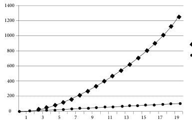

图 3.1 计算增长变化

当 n=1 时，算法 A 和 B 在时间复杂度方面工作类似。

- 时间复杂度 A=5 且
- 时间复杂度 B=5
- 当 n=2 时
- 时间复杂度 A=16 且
- 时间复杂度 B=10

因此，对于 n=2，B 是最优算法。

如上图所示，对于 n 的其他值也可观察到类似变化。

#### 3.7.1 大 O 符号 (O)

### 定义：

设 f(x) 和 g(x) 为定义在实数集上的两个非负函数。f(x) = O(g(x)) 当且仅当存在正常数 c 和 n0，使得对所有 n >= n0 均有 f(n) <= c·g(n)。

大 O 符号考虑函数的上界。

##### 3.7.1.1 求 g(x)、c 和 n0 值

### 示例 1

设某算法的 f(n) = 3n+2。c、n0 和 g(n) 的计算可按 f(n) = 3n+2 进行。该函数可用 g(n) 表示为

```
f(n) <= c*g(n)
3n+2 <= c*g(n) because the function value is more than 3n, consider c=4, then
3n+2 <= 4*g(n) define g(x)=n
3n+2 <= 4n find n0.
Put n=1      3*1+2 <= 4*1 (condition failed)
So put n=2   3*2+2 <= 4*2 (true)
Put n=3      3*3+2 <= 4*3 (true)
Put n=4      3*4+2 <= 4*4 (true)
```

因此，根据数学归纳法，函数 f(x) 可用 g(x) 表示，且从 n0=2 到所有正整数均成立。函数 f(x) 可定义为 f(x)<=4n，其中 n>=2

### 示例 2

设某算法的 f(n) = 3n^4 + 2n^2。c、n0 和 g(n) 的计算可按 f(n) = 3n^4 + 2n^2 进行

```
f(n) <= c*g(n) (Big oh notation)
3n^4 + 2n^2 <= c*g(n)
3n^4 + 2n^4 <= 4*g(n)
3n^4 + 2n^4 <= 4*g(n)   Let g(n) = n^4
3n^4 + 2n^4 <= 4*n^4
for n=1   5 <= 4*1 (Failed)
for n=2   56 <= 64 (True)
for n=3   261 <= 324 (True)
So, for all n>=2 f(x) = 3x^4 can be written as 4*n^4.
```

#### 3.7.2 大 Ω 符号 (Ω)

定义：f(n) = Ω(g(n)) 当且仅当存在正常数 c 和 n0，使得对所有 n >= n0 均有 f(n) >= c·g(n)。在此情况下，将选择最大可能的下界。


例如

| f(x) | g(x) | |
|---|---|---|
| 10n^2 + 3n + 2 | n^2 | f(n) = O(n^2) |
| 4n + 2 | n | f(n) = O(n) |
| 5 | 1 | f(n) = O(1) |

##### 3.7.2.1 查找 g(x)、c 和 n0 的值

### 示例 1

对于某个算法，设 f(n) = 3n + 2。c、n0 和 g(n) 的计算可表示为 f(n) = 3n + 2。该函数可用 g(n) 表示为

f(n) >= c*g(n)
3n + 2 >= c*g(n)，令函数值最近最小值为 3n，考虑 c=3，则
3n + 2 >= 3*g(n) 定义 g(x) = n
3n + 2 >= 3n 求 n0

- 当 n=1 时 ... 5 >= 3 (成立)
- 当 n=2 时 ... 3*2+2 >= 3*2 (成立)
- 当 n=3 时 ... 3*3+2 >= 3*3 (成立)
- 当 n=4 时 ... 3*4+2 >= 3*4 (成立)

因此，根据数学归纳法，函数 f(x) 可用 g(x) 表示，且对所有 n0 个正整数成立。

函数 f(x) 可定义为 f(x) >= 3n，其中 n >= 1。

### 示例 2

对于某个算法，设 f(n) = 3n^4 + 2n^2。c、n0 和 g(n) 的计算可表示为 f(n) = 3n^4 + 2n^2。

f(n) >= c*g(n) (Ω 表示法)
3n^4 + 2n^2 >= c*g(n)
3n^4 + 2n^4 >= 3*g(n)
3n^4 + 2n^4 >= 3*g(n) 令 g(n) = n^4
3n^4 + 2n^4 >= 3*n^4

- 当 n=1 时 ... 5 >= 3 (成立)
- 当 n=2 时 ... 56 >= 48 (成立)
- 当 n=3 时 ... 261 >= 243 (成立)

因此，对于所有 n >= 1，函数 f(x) 可写为 3*n^4。

#### 3.7.3 Theta 表示法 (θ)

**定义：** f(n) = θ(g(n)) 当且仅当存在正常数 c1、c2 和 n0，使得对所有 n >= n0 均有 c1*g(n) <= f(n) <= c2*g(n)。
在此表示法中，将介于上界与最大可能下界之间的值选定。

### 示例

| f(x) | g(x) |
|---|---|
| 10n^2 + 3n + 2 | n^2 |
| 4n+2 | n |

| f(n) | |
|---|---|
| f(n) = θ(n^2) | 因为当所有 n >= 1 时，f(n) > 10n^2 且 f(n) < 15n^2 |
| f(n) = θ(n) | 因为当所有 n >= 1 时，f(n) > 4n 且 f(n) < 6n |

在第一个示例中，f(x)=10n^2 + 3n + 2。函数值始终大于 g(x) = 10n^2，因为在 f(x) 的 g(x) 之后还有其他表达式和常数。考虑 n=1，在此情况下 f(x) = 15 × 1 = 15。因此，为求此函数的上界，需考虑 15 的倍数，此时 g(x)=15n^2 始终大于 f(x)。

在第二个示例中，f(x) = 4n + 2。函数值始终大于 g(x) = 4n，因为在 f(x) 的 g(x) 之后还有其他表达式和常数。考虑 n=1，在此情况下 f(x) = 4 × 1 + 1 = 5。因此，为求此函数的上界，需考虑 5 的倍数，此时 g(x)=5n 始终大于 f(x)。

#### 3.7.4 小 o 表示法 (o)

定义：f(n)=o(g(n)) 当且仅当 f(n)=O(g(n)) 且 f(n)≠Ω(g(n))。

### 示例

| f(n) | g(n) |
|---|---|
| 10n+2 | n^2 |

| f(n) | |
|---|---|
| f(n) = o(n^2) | 因为 f(n) 且 f(n) ≠ Ω(g(n))；然而 f(n) = O(n^2) |

### 3.8 时间复杂度

程序的时间复杂度可定义为编译和执行所需的总时间。程序在运行前必须编译。一旦编译过程生成可执行二进制文件，只要代码未更改，运行程序时就无需重新编译。运行程序需要可执行二进制文件。因此，计算时间复杂度时仅考虑执行时间。

时间复杂度取决于程序使用的空间复杂度、加载程序所需时间、二进制文件中可执行指令的总数、存在的控制循环数量、函数调用次数、使用的算术运算次数、控制台输入/输出操作次数、读写锁数量，最后是程序的输入值。

考虑一个显示 1 到 n 自然数的程序。如果 n=2，则打印函数只会被调用 2 次。如果 n 值非常大，则打印函数会被调用 n 次。

如果程序所需内存超过可用物理内存，则处理器会使用虚拟内存，虚拟内存位于硬盘等二级存储设备中。否则，处理器会等待，直到有足够的物理内存可用。因此，程序的运行时间取决于空间复杂度。当程序的空间复杂度超过可用物理内存时，运行时间会更长。因此，简单程序的时间复杂度远小于复杂大型程序。

由于时间复杂度取决于众多因素，没有确切的方法来确定程序的时间复杂度。但是，通过考虑基本操作及其调用次数，可以估算时间复杂度。时间复杂度可以通过估算执行的指令总数来计算。

#### 3.8.1 冒泡排序的时间复杂度分析

### 程序 3.1

```
//Program for Bubble Sort
#include<iostream.h>
#define MAX 256
void bubble(int a[], int n)
{
int i,j,temp;
//Start of Bubble Sort
for(i=0;i<n;i++)
{
for(j=0;j<(n-1);j++)
{
if(a[j]>a[j+1])
{
temp=a[j];
a[j]=a[j+1];
a[j+1]=temp;
}
}
}
// End of Bubble Sort
cout<<"\nSorted Array:";
for(i=0;i<n;i++)
{
cout<<"\n"<<a[i];
}
}
void main()
{
int i,n,a[256];
cout<<"\nEnter size:";
cin>>n;
for(i=0;i<n;i++)
{
cout<<"\nEnter Element:";
cin>>a[i];
}
bubble(a,n);
}
```

在程序 3.1 中，冒泡排序程序将数组和数组大小作为输入参数。第一个 for 循环继续执行 n 次，内部 for 循环执行 n-1 次，每次执行三条语句。因此，程序中可执行语句的总数为 n+(n-1)×3=3n²-3n。因此，该程序的时间复杂度为 O(n²)。

#### 3.8.2 选择排序的时间复杂度分析

### 程序 3.2

```
//Program for Selection Sort
#include<iostream.h>
//Function returns the maximum index of the array.
int maxindex(int a[], int n)
{
int i,temp,max_index=0;
for(i=1;i<n;i++)
{
if(a[max_index]<a[i])
{
max_index=i;
}
}
return(max_index);
}
void main()
{
int i,n,temp,a[256];
cout<<"\nEnter size :";
cin>>n;
for(i=0;i<n;i++)
{
cout<<"\nEnter Element :";
cin>>a[i];
}
/*Selection Sort Procedure*/
for(int s=n;s>1;s--)
{
int j=maxindex(a,s);
temp=a[j];
a[j]=a[s-1];
a[s-1]=temp;
}
/*Selection Sort Procedure*/
cout<<"\nSorted";
for(i=0;i<n;i++)
cout<<"\nElement :"<<a[i];
}
```

在程序 3.2 中，maxindex 函数返回最大数的索引。在最坏情况下，它运行 n 次。选择排序过程有一个循环，执行 n 次。对于每个 n 值，会调用 maxindex，且交换过程的三条语句会被调用 n 次。因此，时间复杂度为 f(x)=n²+3n = O(n²)。

### 3.9 最坏情况、平均情况和最好情况复杂度

算法在给定输入实例上执行时，其所需步骤数可被得知。为检查算法的正确性，需对所有实例执行它。当算法在所有可能的数据实例上执行时，可以估算最好、最坏和平均情况复杂度。假设对于排序问题，可能的实例是所有可能键的所有可能排列。需要区分至少三种情况，以确定算法的效率。

### 3.9.1 最坏情况

算法的最坏情况复杂度是指算法在任何大小为 n 的实例上所需步骤数最多的情况。大 O 表示法说明了运行时间复杂度的最大上界。大 O 时间复杂度可称为最坏情况，因为无论如何，最大边界都将是 O（大 O）表示法表达式。

### 3.9.2 平均情况

算法的平均情况复杂度是指算法在任何大小为 n 的实例上所需步骤数的平均值。Theta 表示法说明了介于运行时间复杂度的最大下界和最小上界之间的时间复杂度。Theta 时间复杂度可称为平均情况，因为无论如何，时间复杂度都不会超过大 O 和 Ω 最小边界。

### 3.9.3 最好情况

算法的最好情况复杂度是指算法在任何大小为 n 的实例上所需步骤数最少的情况。Ω 表示法说明了时间复杂度，即给定函数的最大可能下界。

考虑在未排序数组上执行线性查找以查找元素。如果元素在第一个单元格中找到，则为最好情况。如果元素在最后一个单元格中找到或在数组中未找到，则为最坏情况。在最坏情况下，将检查所有元素。那么平均情况是什么？假设在整个数组中找到元素的机会是相等的。在这种情况下，元素在第一个单元格中被找到的概率为 1/n，在第二个单元格中被找到的概率为 1/n，依此类推。因此，对所有这些概率求平均值得出查找元素所需的平均步骤数。但是，如果概率不同，则平均情况复杂度也不同。在特定单元格中找到元素的概率对最好情况和最坏情况没有影响。

## 总结

- 算法是解决问题的逐步过程。
- 算法是软件实现之前编写的步骤。算法为获得所需的软件解决方案指明了清晰路径。
- 用于表示算法的代码段可称为伪代码。
- 空间复杂度是算法所需的空间单位数量。


- 程序的空间复杂度是指程序在执行时所需的总内存空间。
- 运行时所有指令所占用的总内存空间称为指令空间。
- 可执行程序的文本段包含程序的处理器指令。
- 所有已初始化变量、未初始化变量、静态变量和常量变量所需的总内存空间称为数据空间。
- 程序的时间复杂度可定义为编译和执行所花费的总时间。
- 时间复杂度可以通过考虑基本操作及其调用次数来估算。
- 时间复杂度可以通过估算执行的指令总数来计算。

## 练习

### 填空题

- 1. 带有部分代码段的算法称为_______。
- 2. _______是最佳算法的一个属性。
- 3. 渐近符号考虑算法的_______。
- 4. 大O符号考虑函数的_______。
- 5. 贪心算法用于解决_______问题。

### 选择题

- 1. 空间复杂度取决于所使用的______和______。
  - a. 数据类型，数据项数量
  - b. 数据类型，函数
  - c. 函数，数据项数量
  - d. 函数调用次数，数据项数量

- 2. 运行时所有指令所占用的总内存空间称为______。
  - a. 数据段
  - b. 指令空间
  - c. 栈空间
  - d. 无

- 3. ______是最佳算法的属性。
  - a. 可移植性
  - b. 模块化
  - c. 可靠性
  - d. b和c都是

- 4. 算法在最坏情况下需要______个步骤。
  - a. 最大
  - b. 最小
  - c. 平均
  - d. 无

- 5. ______符号告诉给定函数的最大可能下界。
  - a. Omega
  - b. Theta
  - c. Big O
  - d. 无

### 简答题

- 1. 什么是算法？
- 2. 讨论各种类型的算法。
- 3. 列出最佳算法的属性。
- 4. 定义空间复杂度。
- 5. 定义时间复杂度。
- 6. 衡量算法效率的不同情况有哪些？
- 7. 定义Big oh-O、Theta-θ、Omega-Ω符号。

### 论述题

- 1. 解释空间复杂度。
- 2. 详细讨论事前分析。
- 3. 关于渐近符号写简短笔记。
- 4. 什么是时间复杂度？用示例说明。
- 5. 关于最坏、平均和最好情况复杂度写简短笔记。

## 数组

本章从数据结构的定义开始，将其分类为线性和非线性数据结构，从而开启数据结构的学习。本章将讨论数组（一种线性数据结构）。这里，清晰地解释了什么是数组、数组类型和数组表示。本章还讨论了数组的初始化、访问数组值、数组操作以及数组如何作为参数传递。数组的字符序列、应用和ADT也得到了深入探讨。

### 4.1 简介

数据结构是表示数据的逻辑或数学模型。构成数据结构及其基本操作的数据称为抽象数据类型（ADT）。

抽象数据类型是数据类型的概念规范，包括对象和操作的描述但不包括实现，以实现以下目的：

- 最大化重用
- 促进面向对象技术
- 使代码更易于维护

抽象数据类型：

ADT包含：

- 各种属性
- 可能有最大大小
- 操作

为了在程序中创建ADT的实际实例，需要将要操作的实际数据添加到其中，但ADT的操作不需要改变。

数据结构分为两类：

- 线性数据结构
- 非线性数据结构

在线性数据结构中，所有元素都按序列排列。线性数据结构的示例包括数组、链表、栈和队列。

与线性数据结构相反，在非线性数据结构中，元素没有序列。此类结构的示例包括树、图和表。

#### 4.1.1 数组

数组是存储在连续内存位置中的同质元素的有限集合，通过添加索引作为唯一标识符分别引用。数组中的数据元素数量可以通过以下公式使用索引获得：

`Size of array = UB-LB+1`

其中UB是上边界值，LB是下边界值。当LB = 1时，数组大小为UB。

数组的元素可以通过下标或括号来赋值，例如A[1]、A[2]、A[3]、...、A[N]或A(1)、A(2)、A(3)、...、A(N)。设A为5个整数的数组，使得A[0]=3、A[1]=4、A[2]=5，且A[4]=8。

### 4.2 数组类型

数组的下标数量决定数组的维度。根据维度，数组可分为一维数组和多维数组。

#### 4.2.1 一维数组

当数组中的元素由单个下标引用时，该数组称为一维数组。

#### 4.2.2 多维数组

多维数组可定义为“数组的数组”。多维数组的元素使用多个下标表示。例如，二维数组可以想象成一个带有相同数据类型元素的表格（图4.1）。

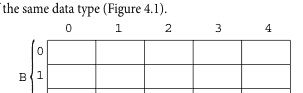

图4.1 二维数组

B表示一个包含3个元素的二维数组，其中每个元素都是由5个整数类型元素组成的一维数组。它可以声明为

```
int B[3][5];
```

其中B[1][3]指的是水平方向第四个、垂直方向第二个元素（图4.2）。

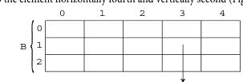

图4.2 引用B[1][3]

设A[1:R, 1:C]为包含R和C个数据元素的二维数组，其中R是数组A的行数，C是列数。数组中的每个元素由一对称为下标的整数表示，例如A[i][j]，其中i的范围是1到R，j的范围是1到C。二维数组也称为矩阵数组。图4.3说明了一个二维数组。

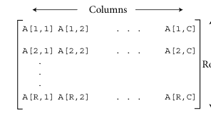

图4.3 二维R x C数组A

#### 4.2.3 N维数组

一个N维的m1 x m2 x ... x mn数组A是m1, m2, m3 ... mn个数据元素的集合，其中每个元素由n个整数列表（如j1, j2, ..., jn）引用，这些整数称为下标，其中1<=j1<=m1, 1<=j2<=m2, 1<=j3<=m3, ..., 1<=jn<=mn。

### 4.3 数组表示

内存中容纳各种维度的数组的说明如下：

一维数组的表示：内存中数组的表示非常简单（图4.4）。假设数组A[10]要存储在内存中，数组中第一个元素的内存位置可以通过以下公式获得：

```
Address of A[K] = R + (K-1).
```

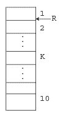

图4.4 数组表示

将公式推广得到Address of A[K]=R+(K-L)*W，其中R是第一个元素的位置，L是下界，W是每个元素所需的字数（大小）。这称为索引公式，用于将逻辑数组映射到物理数组。使用此公式，如果已知第一个元素的位置（即R），则可以轻松找到第k个元素的地址（图4.5）。

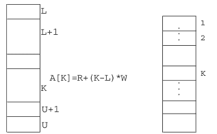

图4.5 通用索引公式

与普通变量一样，数组在使用前必须声明。C++中数组的典型声明如下：

```
data type Array-name[elements];
```

其中data type是像int、float等有效类型。Array-name是有效标识符，elements字段指定数组可容纳的最大元素数量。因此，整数类型的数组A可以声明为：

```
int A[5];
```

二维数组的表示：二维数组在内存中有两种不同的表示方式：

- 行主序
- 列主序

在行主序中，元素按行存储，即第一行元素后跟第二行元素，依此类推。在列主序中，元素按列存储，即第一列元素后跟第二列元素，依此类推。考虑图4.6中的数组A[R,C]。

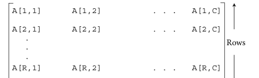

图4.6 数组A[R,C]


使用行主序表示的 A[R,C] 如图 4.7 所示。

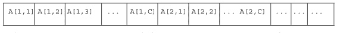

### 图 4.7 使用行主序的数组表示

列主序表示如图 4.8 所示。

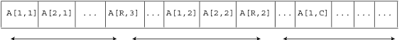

### 图 4.8 使用列主序的数组表示

不同顺序数组的索引公式如下：

**行主序：** A[i,j] 的地址为 A[i,j] = 前 (i-1) 行的所有元素 + 从第 i 列到第 j 列的元素个数 = (i-1) * c + j

**列主序：** A[i,j] = 前 (j-1) 列的所有元素 + 从第 j 列到第 i 行的元素个数 = (j-1) * r + i

### 4.4 初始化数组

声明局部作用域的常规数组（例如在函数内）时，不会对元素进行默认初始化。因此应对其进行初始化，而全局数组和静态数组的元素会自动初始化为默认值，即零。在局部和全局两种情况下，声明数组时，可以通过将值括在花括号 { } 中为每个元素赋予初始值。例如：

```
int A[5]={3,4,5,2,8};
```

它创建如图 4.9 所示的数组。

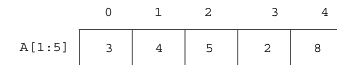

### 图 4.9 数组初始化

花括号 { } 中的值的数量不得超过数组大小。在图 4.9 的示例中，数组 A 声明了 5 个元素，花括号 { } 中的初始值列表被分配给这 5 个元素中的每一个。

在数组初始化期间，不必指定大小，方括号可以留空 [ ]，如

```
int A[]={3,4,5,2,8};
```

在这种情况下，编译器将假设数组的大小与花括号 { } 中的值的数量匹配。

### 4.5 访问数组值

数组的元素可以像普通变量一样单独访问，从而能够读取和修改它们的值。格式如下：

```
Array-name[index]
```

考虑前一个示例，其中 A 有 5 个元素，每个元素的类型均为 int，用于引用每个元素的名称如图 4.10 所示。

| A[0] | A[1] | A[2] | A[3] | A[4] |
|---|---|---|---|---|
| | | | | |

### 图 4.10 引用元素

要将值 75 存储在 A 的第三个元素中，语句写为 A[2]=75；要将 A 的第三个元素的值传递给任何变量，则语句为 a = A[2]。请注意，A 的第三个元素指定为 A[2]，因为数组索引从零开始，即第一个是 A[0]，第二个是 A[1]，因此第三个是 A[2]，最后一个元素是 A[4]。因此，A[5] 指的是 A 的第六个元素，这超过了数组的大小。

在 C++ 中，超出数组有效索引范围在语法上是正确的。这会造成问题，因为访问越界元素不会导致编译错误，但可能导致运行时错误。此时，有必要清楚地区分与数组相关的下标 [ ] 的两种用途。它们执行两项不同的任务：一是在声明数组时指定数组的大小，第二是为具体的数组元素指定索引。

```
int A[5];        //declaration of a new array
A[2];            //access to an element of the array
```

数据类型始终位于变量或数组声明之前，而从不位于访问之前。

### 4.6 数组操作

可对数组执行的各种操作如下：

- 遍历
- 插入
- 删除
- 排序
- 查找

### 4.6.1 遍历

访问数组中每个元素恰好一次称为遍历。此操作用于显示数组中每个元素的内容，以便轻松计算数组中的元素数量。

### 算法 4.1

```
1 Set i=LB //Initializing the counter variable
2 Repeat step3 and 4 while i<=UB
3 VISIT (A[i]) //process the element
4 i=i+1 //Moving to next location, increment the counter
5 End
```

或使用 for 循环

```
1. Repeat for i=LB to UB
2. VISIT (A[i])
3. End
```

在算法 4.1 中，VISIT() 是一个对数组执行操作的过程，例如显示数组的元素等。

### 4.6.2 插入

插入是一种用于向数组中添加元素的操作。在内存可用时，在数组末尾插入元素很容易。当需要在数组中间进行插入时，则必须将大部分元素向下移动，以保持元素的顺序。

算法 4.2 说明了将元素 ITEM 插入到数组 ARR 的给定索引位置 POS。

### 算法 4.2

```
INSERT(ARR,N,POS,ITEM)
ARR is an array of size N. POS is the index to insert the element.
1. Set i=n //Initialize the counter variable
2. Repeat steps 3 and 4 while i>=POS
3. Move ith element downwards
   Set ARR[i+1] = ARR[i].
4. Set i=i-1 //decrement the counter variable.
5. Insert element at 'POS'
   Set ARR[POS]=ITEM
6. Set N=N+1 //Increment N value
7. End
```

算法 4.2 通过从 POS 位置开始将每个元素向下移动来创建内存空间。按逆序移动元素，即移动 ARR[N-1] 和 ARR[POS]，否则数据可能会重叠。创建空间后，将元素 ITEM 插入到 POS 位置。

示例：ARR 是一个大小为 10、包含 6 个元素的数组。数组中的所有项目均按递增顺序排列，如图 4.11(a) 所示。假设向数组中添加 25，则数据元素 30、40、50、60 必须各向下移动一个位置，如图 4.11(b) 所示。

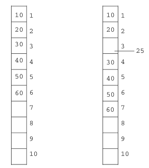

### (a) 包含 6 个元素的数组

### (b) 向下移动元素

### 图 4.11 插入操作

首先将元素 ARR[6]=60 移动到 ARR[7]，将 ARR[5] 移动到 ARR[6]，依此类推。

### 4.6.3 删除

删除是一种用于从数组中移除元素的操作。在数组末尾删除元素可以轻松完成，而在数组中间或指定位置删除元素会导致数据元素各向上移动一个位置以填充数组。

算法 4.3 从包含 N 个元素的数组 ARR 中删除指定位置 POS（其中 POS<=N）处的元素，并将其赋给变量 ITEM。

### 算法 4.3

```
DELETE (ARR, N, POS, ITEM)
1. Set ITEM=ARR [POS]
2. Repeat for i=POS to N-1
3. Set ARR [i] =ARR [i+1] //move elements upward
4. Set N=N-1
5. End
```

示例：考虑一个大小为 10 且包含 6 个数据元素的数组 ARR。删除 A[2] 处的元素会导致其他元素各向上移动一个位置，如图 4.12 所示。

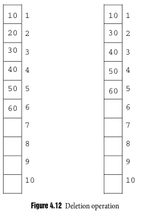

### 4.6.4 排序

排序是一种用于将数组元素按升序或降序排列的操作。算法 4.4 说明了按升序对元素进行排序。

### 算法 4.4

```
SORT : N=UB
1. Set N=UB
2. while i>=LB do
3. Set q=LB //comparing the first
4. while j<=i do
5. check whether A[j] and A[j+1] are in order, if so swap the elements
   SWAP (A[j], A[j+1])
6. Set j=j+1
7. Set i=i-1
8. End
```

### 4.6.5 查找

查找是一种用于从数组元素列表中查找特定元素位置的操作。找到项目后，查找被认为是成功的。存在不同类型的查找算法。这些算法的使用取决于数据元素在数据结构中的排列方式。关于查找技术的详细讨论可见第 16 章。

### 程序 4.1

```
#include<iostream.h>
#include<conio.h>
#include<stdlib.h>
template<class t>
class array
{
    t a[50];
    int n,size;
    public:
    array(int m)
    {
    size=0;
    n=m;
    }
    void insert();
    void delete();
    void display();
};
template<class t>
void array<t>::insert()
{
    t ele;
    if(size==n)
    {
    cout<<"array is overflow\n";
    return;
    }
    size++;
    cout<<"enter the element\n";
    cin>>ele;
    a[size]=ele;
}
template<class t>
void array<t>::deletee()
{
    t ele;
    if(size==0)
    {
    cout<<"array is underflow\n";
    return;
    }
    ele=a[size];
    size--;
    cout<<"the deleted element is"<<ele<<"\n";
}
template<class t>
void array<t>::display()


```cpp
{
 int i;
 if(size==0)
 {
 cout<<"array is underflow\n";
 return;
 }
 cout<<"the elements are\n";
 for(i=1;i<=size;i++)
 cout<<a[i]<<" ";
 cout<<"\n";
 }
 void main()
 {
 int ch,n;
 clrscr();
 cout<<"enter the size of the array\n";
 cin>>n;
 array<float> a(n);
 while(1)
 {
 cout<<"menu\n";
 cout<<"1.add\n";
 cout<<"2.delete\n";
 cout<<"3.display\n";
 cout<<"4.exit\n";
 cout<<"enter your choice\n";
 cin>>ch;
 switch(ch)
 {
 case 1:
 a.insert();
 break;
 case 2:
 a.deletee();
 break;
 case 3:
 a.display();
 break;
 case 4:
 exit(0);
 break;
 default:
 cout<<"invalid option\n";
 break;
 }
 }
 }
```

### 输出

enter the size of the array
10
menu
1.add
2.delete
3.display
4.exit
enter your choice
1
enter the element
2
menu
1.add
2.delete
3.display
4.exit
enter your choice
1
enter the element
3
menu
1.add
2.delete
3.display
4.exit
enter your choice
3
the elements are
2 3
menu
1.add
2.delete
3.display
4.exit
enter your choice
2
the deleted element is 3
menu
1.add
2.delete
3.display
4.exit
enter your choice
4

### 4.7 数组作为参数

数组可以作为参数传递给函数。在 C++ 中，不可能将完整的内存块按值作为参数传递给函数，但允许传递其地址。在实践中，这几乎具有相同的效果，并且速度更快，是一种更高效的操作。

要接受数组作为参数，在声明函数时只需指定数组作为其参数的类型和名称，即一个标识符和一对方括号[]。例如，以下函数：

```cpp
void procedure(int arg[])
```

接受一个类型为 int、名为 arg 的数组参数。要向此函数传递数组，数组声明如下：

```cpp
int myarray[40];
```

编写如下调用即可：

```cpp
procedure(myarray);
```

### 程序 4.2

```cpp
/*arrays as parameters*/
#include<iostream>
using namespace std;
void printarray(int arg[], int length)
{
  for (int n=0;n<length;n++)
    cout<<arg[n]<< " ";
  cout<<endl;
}
int main ()
{
  int firstarray[]={5, 10, 15};
  int secondarray[]={2, 4, 6, 8, 10};
  printarray (firstarray,3);
  printarray (secondarray,5);
  return 0;
}
```

### 输出

5 10 15
2 4 6 8 10

在程序 4.2 中，第一个参数 (int arg[]) 接受任何元素类型为 int 的数组：长度任意。因此，一个指定每个数组长度的第二个参数与第一个参数一起传递给函数。这允许打印数组的 for 循环知道传递数组中的迭代范围，而不会越界。

在函数声明中，也可以包含多维数组。三维数组参数的格式如下：

```cpp
base_type[][depth][depth]
```

以多维数组作为参数的函数可以是：

```cpp
void procedure(int myarray[][3][4])
```

请注意，第一组方括号 [ ] 留空，而另外两组带有值。这是因为编译器必须能够确定函数中每个额外维度的深度。

### 4.8 字符序列

C++ 标准库拥有一个功能强大的 string 类，用于处理和操作字符串非常有用。然而，因为字符串实际上是字符序列，可以表示为 char 元素的数组。数组 char C[20] 可存储最多 20 个 char 类型的元素。它可以如图 4.13 所示表示。

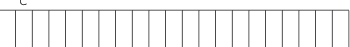

图 4.13 字符数组

此数组可存储最多 20 个字符长的字符序列。但它也可以存储更短的序列。例如，在程序的某个时刻，char 数组 C 可以存储序列 "Hello" 或序列 "Merry Christmas"，因为两者都短于 20 个字符。由于字符数组可以存储比其总长度更短的序列，因此使用一个特殊字符来指示有效序列的结束，即空字符，其字面常量可写为 '\0'（反斜杠，零）。一个包含 20 个 char 类型元素的数组 C，可以通过存储字符序列 "Hello" 和 "Merry Christmas" 来表示，如图 4.14 所示。

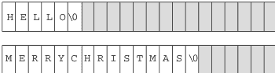

图 4.14 字符串末尾的空字符

请注意，在有效内容之后包含了一个空字符 ('\0') 以指示序列的结束。灰色面板表示值未确定的 char 元素。

### 以空字符结尾的字符序列的初始化：

因为字符数组是普通数组，所以遵循相同的规则。例如，要用某个预定义的字符序列初始化字符数组，可以像其他数组一样进行：

```cpp
char myword[]={'H', 'e', 'l', 'l', 'o', '\0'};
```

在此情况下，声明了一个包含 6 个 char 类型元素的数组，用组成单词 "Hello" 的字符以及末尾的空字符 '\0' 进行初始化。但是 char 元素数组有一种使用字符串字面量初始化其值的附加方法。

在表达式中，通过将文本放在双引号 (") 之间来指定整个字符串，使其成为字符串字面量。例如，

```cpp
"the result is."
```

是一个常量字符串字面量。

带双引号的字符串 (") 是字面常量，其类型实际上是以空字符结尾的字符数组。因此，用双引号括起来的字符串字面量始终会在末尾自动追加一个空字符 ('\0')。

因此，名为 myword 的 char 元素数组通过以下两种方法之一，用以空字符结尾的字符序列进行初始化。

```cpp
char myword[]={'H', 'e', 'l', 'l', 'o', '\0'};
```

```cpp
char myword[]="Hello";
```

在两种情况下，字符数组 myword 都声明为包含 6 个 char 类型元素：组成单词 "Hello" 的 5 个字符加上一个最终的空字符 ('\0')，它指定序列的结束，而在第二种情况下，使用双引号 (") 时会自动追加它。

假设 mystext 是一个 char[] 变量，源代码中的如下表达式

```cpp
mystext = "Hello";
```

```cpp
mystext [] = "Hello";
```

都是无效的。同样，以下也是无效的：

```cpp
mystext={'H', 'e', 'l', 'l', 'o', '\0'};
```

了解更多关于指针的知识后，这可能更容易理解。因此，将澄清数组实际上是一个指向内存块的常量指针。

使用以空字符结尾的字符序列：以空字符结尾的字符序列是在 C++ 中处理字符串的自然方式。例如，cin 和 cout 支持以空字符结尾的序列作为字符序列的有效容器。因此，可以直接用它们从 cin 提取字符串或将字符串插入到 cout 中。

### 程序 4.3

```cpp
/* null-terminated sequences of characters*/
#include <iostream>
using namespace std;
int main ()
{
  char question[]="Please, enter your first name:";
  char greeting[]="Hello, ";
  char yourname[80];
  cout<<question;
  cin>>yourname;
  cout<<greeting<<yourname<<"!";
  return 0;
}
```

### 输出

Please, enter your first name:John
Hello, John!

在程序 4.3 中，声明了三个 char 类型的数组。前两个用字符串字面量常量初始化，而第三个未初始化。大小由它们初始化所用的字面量常量的长度隐式定义。而对于 yourname，则明确指定其大小为 80 个字符。最后，存储在 char 数组中的字符序列可以通过使用赋值运算符轻松转换为 string 对象。

```cpp
string mystring;
char myncts []="some text";
mystring=myncts;
```

### 4.9 应用

数组有广泛的应用。其中一些在此列出，并详细介绍了稀疏矩阵应用。

- 矩阵
- 稀疏矩阵
- 记录
- 有序列表

稀疏矩阵：矩阵是按行和列表示元素的方式。稀疏矩阵是零项比例较高的矩阵。图 4.15 说明了矩阵和稀疏矩阵。

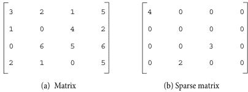

图 4.15 矩阵和稀疏矩阵示例

图 4.16 显示了各种应用中最常用的 n 阶方稀疏矩阵。


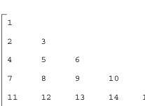

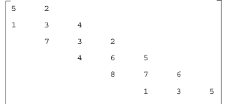

(a) 三角矩阵

(b) 三对角矩阵

### 图 4.16 稀疏矩阵

在图 4.16(a) 中，主对角线上方的所有元素均为零或等效，所有非零元素只能出现在对角线上或对角线以下。这称为下三角矩阵或三角矩阵。

在图 4.16(b) 中，所有非零元素出现在对角线上或对角线上方的元素上。这称为三对角矩阵。

矩阵在内存中需要大量空间。使用二维数组来表示矩阵。因此，1000x1000 矩阵在内存中需要巨大的存储位置。如果它是稀疏矩阵，存储非零元素将浪费大量内存。二维数组可能不适合稀疏矩阵。

假设要在内存中存储三角矩阵，很明显，存储对角线上方的所有元素会浪费内存，因为它们全是零。在这种情况下，使用三元组表示法（i,j,value）可以节省内存来表示稀疏矩阵的非零元素。

**ADT 数组：** 数组是存储索引数据元素的一种特定方法。数据元素在数组的块中按顺序存储。每个元素通过索引或下标引用。

数组支持两种操作。它们是存储和检索：

- 存储：将值写入数组
- 检索：从数组读取

## 摘要

- 数组是一系列相同类型的元素，放置在连续内存位置中，可以通过向唯一标识符添加索引来单独引用。
- 数组可以是一维或多维。
- ADT 数组主要执行两种操作——存储和检索——其他操作包括元素的删除、排序和搜索。

## 练习

### 填空题

- 1. 数组是 ________ 的集合。
- 2. 字符数组以 ________ 结尾。
- 3. 数组是 ________ 类型的结构。
- 4. ________ 是数组上的操作
- 5. ________ 是数组的一个应用。

### 选择题

- 1. 数组是 _______。
  - a. 标量类型
  - c. 联合类型
  - b. 聚合类型
  - d. 枚举类型
- 2. 数组名是一个 _______。
  - a. 变量
  - c. 常量指针
  - b. 指向常量的指针
  - d. 常量
- 3. 唯一可以对数组整体起作用的运算符是 _______。
  - a. 间接运算符
  - c. { }
  - b. sizeof 运算符
  - d. [ ]
- 4. 关于数组，以下哪项是正确的？
  - a. 数组元素存储在连续内存位置中
  - b. 在 C 中，数组按行主序存储
  - c. 数组可以声明为局部或全局
  - d. 以上全部

### 简答题

- 1. 以下数组的最高合法索引是多少？
  - a. int arr1[4];
  - b. double means[12];
- 2. 以下哪些标识符被声明为数组？
  - a. int i[j][4], k;
  - b. float r[3],[2],tu[7];
- 3. 以下数组的最高合法索引是多少？
  - a. int arr1[4];
  - b. double means[12];
- 4. 定义字符序列。
- 5. 解释数组的表示。

### 论述题

- 1. 编写一个 C++ 程序来查找数组的转置。
- 2. 为多项式加法的数组实现编写 ADT 操作。
- 3. 从最右列开始，按列从上到下映射二维数组的元素。
  - a. 按此顺序列出 a[4][4] 的索引。
  - b. 为 a[n][n] 开发映射函数。
- 4. 定义数组。举例说明如何声明、插入元素、删除元素和显示数组。编写一个 C++ 程序来演示数组。
- 5. 定义 ADT。解释数组 ADT。举例说明多维数组并附上 C++ 程序。

## 链表

第 5 章讨论并举例说明了称为链表的数据结构。清晰地解释了链表的静态和动态表示。详细讨论了单链表、循环链表和双链表及其表示和操作。本章还将各种类型的链表与数组进行了比较。本章接着介绍了链表的优点、缺点、应用和 ADT，即抽象数据类型。

### 5.1 简介

数组是线性数据结构，需要预先分配内存以保持数据元素的邻接性。一旦分配内存，就无法根据需要扩展。因此，数组是静态数据结构。

使用数组无法高效地实现插入和删除操作以及内存存储。

链表克服了数组的缺点；链表也被称为动态数据结构，因为内存分配将在运行时进行，可以根据需要扩展。链表也是称为节点的数据元素的线性集合，元素的邻接性由链接或指针提供。节点的一般结构如图 5.1 所示。

| 数据项 1 | 数据项 2 | ... | 数据项 n | 链接 1 | 链接 2 | ... | 链接 n |
|---|---|---|---|---|---|---|---|
| 数据部分 | 数据部分 | 数据部分 | 数据部分 | 链接部分 | 链接部分 | 链接部分 | 链接部分 |

### 图 5.1 节点的一般结构

链表不像数组那样在连续位置存储节点，而节点中的链接字段维护其邻居的地址。

### 5.2 内存中的链表表示

链表可以用两种方式表示：

- 1. 使用数组的静态表示
- 2. 使用空闲存储列表的动态表示

#### 5.2.1 静态表示

链表由两个线性数组维护——一个用于数据，另一个用于链接。设 DATA 和 LINK 为这两个数组，DATA 包含信息部分，其对应的下一节点指针存储在数组 LINK 中。指针变量 HEAD 用于存储链表的第一个位置，空指针用于表示列表的末尾。由于数组下标是正整数，Null 表示为 '0'。图 5.2 说明了链表的静态表示。

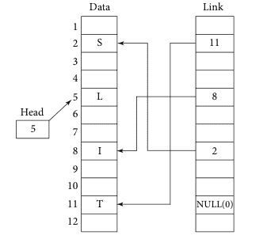

### 图 5.2 静态表示

在图 5.2 中，列表的每个节点包含一个字符。所需字符串可以如下获得：

- HEAD = 5，因此 DATA[5] = L 是第一个字符。DATA[5] 的对应链接存储在 LINK[5] 中。
- LINK[5] = 8 表示 DATA 的第 8 个元素保存下一个元素 I，即 DATA[8] = I，字符串的第二个字符。
- LINK[8] = 2 表示 DATA 的第 2 个元素保存元素 I，即 DATA[2] = S，字符串的第三个字符。
- LINK[2] = 1 表示 DATA 的第 1 个元素将保存元素 T，即 DATA[1] = T，字符串的第四个字符。
- LIST 是所需字符串。

#### 5.2.2 动态表示

在这种表示中，使用了一个内存库，它是一组空闲内存空间和内存管理程序。当要创建新节点时，内存管理在内存库中搜索所需内存，如果找到，则将内存分配给新节点；当节点不再有用时，会调用一个称为垃圾收集器的程序，将未使用的节点返回到内存库。这种内存管理称为动态内存管理。为了动态表示链表，维护一个称为 AVAIL 的特殊列表，即具有自身指针的可用内存空间列表。图 5.3(a) 和 (b) 说明了链表的动态表示。

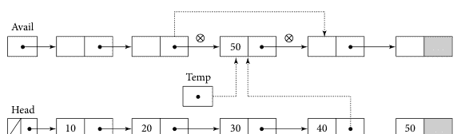

### (a) 向列表分配新节点

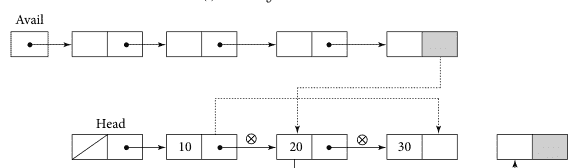

### (b) 节点返回到内存库

### 图 5.3 动态表示

在图 5.3(a) 中，从 AVAIL 取出一个新节点，并在变量中暂时保存新节点的地址。然后将新节点添加到现有列表中。虚线箭头显示将新节点插入列表，符号 'Φ' 用于表示链接的删除。列表中的头节点不包含任何数据。在图 5.3(b) 中，从现有列表中删除新节点，并将其返回到内存库，即 AVAIL。AVAIL 中最后一个节点的 LINK 字段将指向被删除的节点。

链表无论数据字段的数量如何，都分为三种类型：

- 单链表
- 双链表
- 循环链表


### 5.3 单链表

单链表是一种线性数据结构，其中每个节点只包含一个链接字段。图 5.4 说明了单链表。

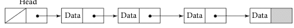

图 5.4 单链表

HEAD 指针包含第一个节点的地址。单链表的表示与第 5.2 节中解释的表示相似。

### 5.3.1 操作

对单链表执行的操作如下：

- 遍历
- 搜索
- 插入
- 删除

要执行插入和删除，使用函数 GETNODE(N) 和 RETURN(N)。GETNODE(N) 用于为节点 N 分配内存，RETURN(N) 用于将未使用的节点返回到内存库。

#### 5.3.1.1 遍历

遍历列表意味着仅访问一次列表中的每个节点，从第一个节点到最后一个节点。

```
Algorithm 5.1: SL-TRAVERSE
1. Set PTR with the current pointer node.
2. Repeat steps 3 and 4.
3. VISIT the current node.
4. Set PTR with pointer to next node.
5. End.
```

#### 5.3.1.2 搜索

搜索操作用于查找单链表中 DATA 字段的值，同时在指定位置向列表中插入项目以及从列表中删除指定位置的项目。执行搜索操作是为了定位带有要删除的 DATA 项目的节点，并在该节点之后插入一个节点以及显示该特定节点。

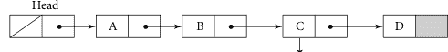

图 5.5 搜索元素

在图 5.5 中，要搜索 DATA 为 C 的节点。让 VALUE 被赋值为 C，并从头节点开始，通过将每个节点的 DATA 与其比较来搜索 VALUE。找到时，显示它；否则显示消息 VALUE 未找到。

#### Algorithm 5.2: SL-SEARCH

1. 将 PTR 设置为 HEAD。//HEAD 是指向头节点的指针
2. 重复步骤 3 到 5，直到 PTR 为 NULL。
3. 检查 PTR 的 DATA 是否为 VALUE，如果是，则写入“搜索成功”。
4. 返回 (PTR)。
5. 否则，写入“VALUE 未找到”。
6. 结束。
7. 结束。

#### 5.3.1.3 插入

插入是向列表中添加节点的操作。在单链表中，节点可以插入到三个不同的位置。

- 作为第一个节点插入
- 作为最后一个节点插入
- 在指定位置插入

##### 作为第一个节点插入：

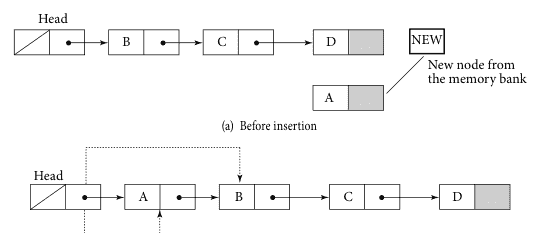

图 5.6 作为第一个节点插入

在图 5.6(b) 中，数据为 A 的节点被插入为列表的第一个节点，现在 HEAD 指针指向节点 A，之前它指向节点 B，节点 A 的 LINK 指向节点 B。

#### Algorithm 5.3: SL-INSERT-F

1. 调用 GETNODE(N) 为节点 N 分配内存并返回 N 的指针。
2. 将 N 的 DATA 设置为 ITEM。
3. 将 N 的 LINK 设置为 HEAD 的 LINK。
4. 将 HEAD 的 LINK 设置为 N。
5. 结束。

##### 作为最后一个节点插入：

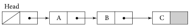

(a) 插入前

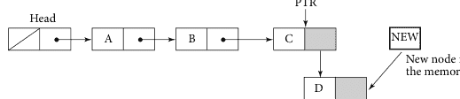

(b) 插入后

图 5.7 作为最后一个节点插入

在图 5.7(b) 中，数据为 D 的新节点被插入为列表的最后一个节点。之前最后一个节点的 LINK 字段（原为 NULL）现在指向新节点。

#### Algorithm 5.4: SL-INSERT-E

1. 调用 GETNODE(N) 为 N 分配内存并返回 N 的指针。
2. 将 PTR 设置为 HEAD。//HEAD 是指向头节点的指针。
3. 循环移动到列表末尾并插入。
4. 将 PTR 设置为 PTR 的 LINK。
5. 结束循环。
6. 将 PTR 的 LINK 设置为 N。
7. 将 N 的 DATA 设置为 ITEM。
8. 结束。

在指定位置插入：搜索 DATA 为 VALUE 的节点；如果找到，则在该节点之后插入节点。

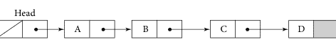

(a) 插入前

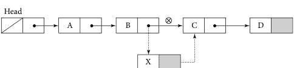

(b) 插入后

图 5.8 在指定位置插入

在图 5.8(b) 中，数据为 X 的新节点被插入在节点 B 和 C 之间。B 的 LINK 字段指向新节点，新节点的链接指向节点 C。让 VALUE 为插入节点之后的节点的 DATA。这里 B 是关键节点，新节点需要插入在其之后。

#### Algorithm 5.5: SL-INSERT-SP

1. 调用 GETNODE(N) 为节点 N 分配内存并返回 N 的指针。
2. 从 HEAD 节点开始，即 PTR=HEAD。//HEAD 是指向头节点的指针
3. 循环查找 DATA 字段为 VALUE 的节点，如果未找到 VALUE 则移动到列表末尾。
4. 将 PTR 设置为 PTR 的 LINK。
5. 结束循环。
6. 检查 PTR 的 LINK 是否为 NULL，如果是，则写入“VALUE 未找到”。
7. 否则
   将 N 的 LINK 设置为 PTR 的 LINK。
   将 N 的 DATA 设置为 ITEM。
   将 PTR 的 LINK 设置为 N。
8. 结束。

#### 5.3.1.4 删除

删除操作用于从列表中删除节点，可以在三个不同的位置执行。

- 删除第一个节点
- 删除最后一个节点
- 在指定位置删除

当删除一个 NODE 时，其内存必须返回到内存库。函数 RETURN(N) 将删除的节点返回到空闲池存储空间。

##### 删除第一个节点：

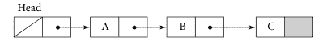

(a) 删除前

图 5.9 删除第一个节点

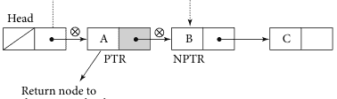

(b) 删除后

图 5.9 续

在图 5.9(b) 中，列表的第一个节点被删除，头节点的 LINK 字段（原指向被删除节点）现在指向下一个节点。要删除的节点的 LINK 字段设置为 NULL。

#### Algorithm 5.6: SL-DELETION-F

1. 将 PTR 设置为 HEAD 的 LINK
2. 检查列表是否为空，否则
3. 将 NPTR 设置为 PTR 的 LINK //NPTR 是下一个节点指针
4. 将 HEAD 的 LINK 设置为 PTR //现在使下一个节点成为第一个节点
5. 返回 (PTR)
6. 结束。

##### 删除最后一个节点：

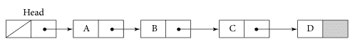

(a) 删除前

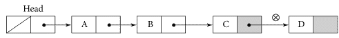

(b) 删除后

图 5.10 删除最后一个节点

在图 5.10(b) 中，列表末尾的节点被删除，前一个节点的 LINK（原指向最后一个节点）设置为 NULL，即删除到下一个节点的链接并将未使用的节点返回到内存库。

#### Algorithm 5.7: SL-DELETION-E

1. PTR=HEAD //HEAD 是指向头节点的指针
2. 检查列表是否为空，否则
3. 循环移动到列表末尾
   将 PPTR 设置为 PTR //PPTR 是前一个节点指针，且
   //PTR 是最后一个节点指针
4. 结束循环
5. 将 PPTR 的 Link 设置为 NULL //使前一个节点指针为 NULL
6. RETURN(PTR)
7. 结束。

在指定位置删除：让 VALUE 为要删除的节点的 DATA。在图 5.11(b) 中，在列表中搜索 VALUE=B，如果它与列表中任何一个节点的 DATA 匹配，则将其删除。这里，数据为 B 的节点被删除，B 指向下一个节点的 LINK 被删除，之前指向 B 的节点 A 现在指向节点 C。

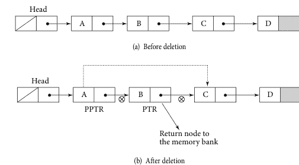

图 5.11 在指定位置删除

#### Algorithm 5.8: SL-DELETION-SP

1. 从头节点开始，即 PPTR=Head
2. 将 PTR 设置为 Head 的链接，即指向第一个节点。
3. 循环直到 PTR 为 NULL
4. 检查 PTR 的 DATA 是否等于 VALUE，如果是
5. 将 PPTR 的 Link 设置为 PTR 的 LINK
6. 否则 将 PPTR 设置为 PTR
   将 PTR 设置为 PTR 的 LINK
7. 返回(PTR)
8. 结束循环
9. 检查 PTR 是否为 NULL，如果是，则写入 "VALUE 未找到，删除不可能"
10. 结束。

## 程序 5.1

```
#include<iostream.h>
#include<conio.h>
#include<stdlib.h>
#include<alloc.h>
template<class t>
class llist
{
struct node
{
t data;
node*link;
}*next,*head,*temp,*temp1;
public:
llist();
void insertf();
void insert();
void inserta();
void deletet();
void deletee();
void deletea();
void display();
};
template<class t>
llist<t>::llist()
{
head->link=NULL;
}
template<class t>
void llist<t>::insertf()
{
t ele;
cout<<"enter the element\n\r";
cin>>ele;
temp=(struct node*)malloc(sizeof(struct node));
if(temp==NULL)
{
cout<<"memory allocation error\n\r";
return;
}
if(head->link==NULL)
{
temp->data=ele;
head->link=temp;
temp->link=NULL;
}
```


```cpp
else
{
  temp->link=head->link;
  head->link=temp;
  temp->data=ele;
}
```

```cpp
template<class t>
void llist<t>::insert()
{
  t ele;
  cout<<"enter the element\n";
  cin>>ele;
  temp=(struct node*) malloc(sizeof( struct node) );
  if (temp==NULL)
  {
    cout<<"memory allocation error\n";
    return;
  }
  if (head->link==NULL)
  {
    temp->data=ele;
    head->link=temp;
    temp->link=NULL;
  }
  else
  {
    for (temp1=head->link; temp1->link!=NULL; temp1=temp1->link)
    {
    }
    temp1->link=temp;
    temp->data=ele;
    temp->link=NULL;
  }
}
```

```cpp
template<class t>
void llist<t>::insert()
{
  t ele;
  int pos,i;
  cout<<"enter the element\n";
  cin>>ele;
  cout<<"enter the position\n";
  cin>>pos;
  temp=(struct node*) malloc(sizeof( struct node) );
  if (temp==NULL)
  {
    cout<<"memory allocation error\n";
    return;
  }
  if (head->link==NULL)
  {
    temp->data=ele;
    head->link=temp;
    temp->link=NULL;
  }
  else
  {
    for (temp1=head, i=1; i<pos; i++)
      temp1=temp1->link;
    temp->link=temp1->link;
    temp1->link=temp;
    temp->data=ele;
  }
}
```

```cpp
template<class t>
void llist<t>::deletef ()
{
    t ele;
    if (head->link==NULL)
    {
    cout<<"linked list is empty\n";
    return;
    }
    temp=head->link;
    temp1=temp->link;
    head->link=temp1;
    ele=temp->data;
    free (temp);
    cout<<"the deleted element is "<<ele<<endl;
}
```

```cpp
template<class t>
void llist<t>::deletee ()
{
    t ele;
    if (head->link==NULL)
    {
    cout<<"linked list is empty\n";
    return;
    }
    for (temp1=head; temp1->link!=NULL; temp1=temp1->link)
    {
    temp=temp1;
    }
    temp->link=NULL;
    ele=temp1->data;
    free(temp1);
    cout<<"the deleted element is "<<ele<<endl;
}
```

```cpp
template<class t>
void llist<t>::deletea()
{
    t ele;
    int pos,i;
    if(head->link==NULL)
    {
        cout<<"linked list is empty\n";
        return;
    }
    cout<<"enter the position\n";
    cin>>pos;
    for(temp1=head, i=0; i<pos; i++, temp1=temp1->link)
    {
    temp=temp1;
    temp->link=temp1->link;
    ele=temp1->data;
    cout<<"the deleted element is "<<ele<<endl;
    free(temp1);
    }
}
```

```cpp
template<class t>
void llist<t>::display()
{
    if(head->link==NULL)
    {
        cout<<"linked list is empty\n";
        return;
    }
    for(temp=head->link; temp!=NULL; temp=temp->link)
    {
        cout<<temp->data<<" ";
    }
}
```

```cpp
void main()
{
    int ch;
    llist<int> l;
    clrscr();
    while(1)
    {
    cout<<"...\n";
    cout<<"1.insertion at front\n";
    cout<<"2.insertion at end\n";
    cout<<"3.insertion at any position\n\n";
    cout<<"4.deletion at front\n";
    cout<<"5.deletion at end\n";
    cout<<"6.deletion at any position\n";
    cout<<"7.display\n\n";
    cout<<"8.exit\n";
    cout<<"enter your choice\n";
    cin>>ch;
    switch(ch)
    {
    case 1:
    l.insertf();
    break;
    case 2:
    l.insert();
    break;
    case 3:
    l.inserta();
    break;
    case 4:
    l.deletef();
    break;
    case 5:
    l.deletee();
    break;
    case 6:
    l.deletea();
    break;
    case 7:
    l.display();
    break;
    case 8:
    exit(0);
    break;
    }
    }
}
```

## 输出

菜单

- 1 头部插入
- 2 尾部插入
- 3 任意位置插入
- 4 头部删除
- 5 尾部删除
- 6 任意位置删除
- 7 显示
- 8 退出

```
menu
1.insertion at front
2.insertion at end
3.insertion at any position
4.deletion at front
5.deletion at end
6.deletion at any position
7.display
8.exit
enter your choice
1
enter the element
10
menu
1.insertion at front
2.insertion at end
3.insertion at any position
4.deletion at front
5.deletion at end
6.deletion at any position
7.display
8.exit
enter your choice
1
enter the element
20
menu
1.insertion at front
2.insertion at end
3.insertion at any position
4.deletion at front
5.deletion at end
6.deletion at any position
7.display
8.exit
enter your choice
7
20 10
menu
1.insertion at front
2.insertion at end
3.insertion at any position
4.deletion at front
5.deletion at end
6.deletion at any position
7.display
8.exit
enter your choice
2
enter the element
30
menu
1.insertion at front
2.insertion at end
3.insertion at any position
4.deletion at front
5.deletion at end
6.deletion at any position
7.display
8.exit
enter your choice
3. insertion at any position
4. deletion at front
5. deletion at end
6. deletion at any position
7. display
8. exit
enter your choice
2
enter the element
40
menu
1. insertion at front
2. insertion at end
3. insertion at any position
4. deletion at front
5. deletion at end
6. deletion at any position
7. display
8. exit
enter your choice
7
menu
1. insertion at front
2. insertion at end
3. insertion at any position
4. deletion at front
5. deletion at end
6. deletion at any position
7. display
8. exit
enter your choice
20 10 30 40
menu
1. insertion at front
2. insertion at end
3. insertion at any position
4. deletion at front
5. deletion at end
6. deletion at any position
7. display
8. exit
enter your choice
3
enter the element
50
enter the position
3
menu
1. insertion at front
2. insertion at end
3. insertion at any position
4. deletion at front
5. deletion at end
6. deletion at any position
7. display
8. exit
enter your choice
7 10 50 30 40
menu
1.insertion at front
2.insertion at end
3.insertion at any position
4.deletion at front
5.deletion at end
6.deletion at any position
7.display
8.exit
enter your choice
4
the deleted element is 20
menu
1.insertion at front
2.insertion at end
3.insertion at any position
4.deletion at front
5.deletion at end
6.deletion at any position
7.display
8.exit
enter your choice
7
10 50 30 40
menu
1.insertion at front
2.insertion at end
3.insertion at any position
4.deletion at front
5.deletion at end
6.deletion at any position
7.display
8.exit
enter your choice
5
the deleted element is 40
menu
1.insertion at front
2.insertion at end
3.insertion at any position
4.deletion at front
5.deletion at end
6.deletion at any position
7.display
8.exit
enter your choice
8
exit
7
10 50 30
menu
1.insertion at front
2.insertion at end
3.insertion at any position
4.deletion at front
5.deletion at end
6.deletion at any position
7.display
8.exit
enter your choice
6
enter the position
2
menu
the deleted element is 50
menu
1.insertion at front
2.insertion at end
3.insertion at any position
4.deletion at front
5.deletion at end
6.deletion at any position
7.display
8.exit
enter your choice
7
10 30
menu
1.insertion at front
2.insertion at end
3.insertion at any position
4.deletion at front
5.deletion at end
6.deletion at any position
7.display
8.exit
enter your choice 8
```

### 5.4 循环链表

将最后一个节点的链接字段赋为第一个节点地址的单链表称为循环链表或循环列表。图 5.12 说明了循环链表的表示。

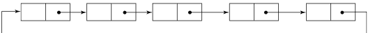

图 5.12 循环链表

在这里，最后一个节点的 LINK 字段指向第一个节点。使用循环链表，可以从任意位置访问任何节点，而无需从第一个节点开始。基于列表的实现，例如列表的连接、分割等，可以使用循环列表高效地执行。

循环列表的一个缺点是，在处理过程中，列表必须确保不会形成无限循环，因为列表中指针的方向是循环的。可以通过 HEAD 节点来解决这个问题，它是列表中的头节点。它帮助我们指示列表的末端并终止循环。

循环链表的插入和删除操作与单链表相同，只是最后一个节点指向第一个节点。因此，在插入第一个节点时，更新头节点指针及其 LINK 字段以指向第一个节点。在删除最后一个节点时，更新最后一个节点的前一个节点以指向头节点。

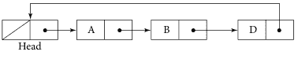

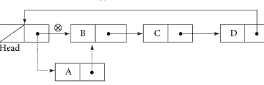

## 图 5.13 循环链表中的插入

在图 5.13(b) 中，节点 A 被插入到头节点和节点 B 之间。首先获取头节点 LINK 字段的值，并使新节点指向节点 B。现在将头节点指针赋为新节点的地址，即头节点指向新节点。

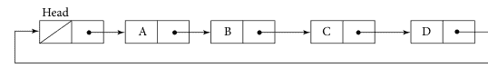

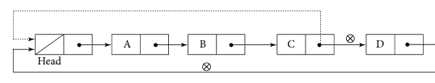

## 图 5.14 循环链表中节点的删除


在图 5.14(b) 中，首先删除最后一个节点 D，获取包含 D 的节点及其前驱节点 C 的地址。现在，节点 C 的 LINK 指向已删除的节点 D，并使其指向头节点，因为它现在是最后一个节点，如图 5.14 中用虚线所示。将未使用的节点返回到内存银行。

#### 5.4.1 合并两个循环列表

设 C1 和 C2 为要合并的两个循环链表，HEAD1 和 HEAD2 分别为 C1 和 C2 的头节点。HEAD1 节点中指向 C1 第一个节点的 LINK 字段被删除，并指向列表 C2 的第一个节点；列表 C2 中指向 HEAD2 的最后一个节点被删除，并指向 C1 的第一个节点；如图 5.15 所示。

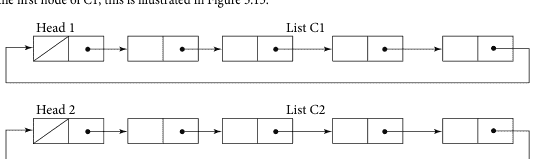

**(a) 合并两个列表之前，C1 和 C2**

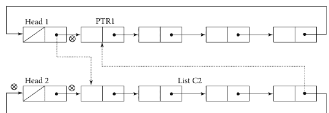

**(b) 合并 C1 和 C2 之后**

**图 5.15 合并两个循环链表**

### 算法 5.9: CL-CONC

- 1. 将 PTR1 设置为 HEAD1 的 LINK
- 2. 将 PTR2 设置为 HEAD2 的 LINK
- 3. 将 HEAD1 的 LINK 设置为 PTR2
- 4. 循环直到 PTR2 的 LINK 等于 HEAD2
- 5. 将 PTR2 设置为 PTR2 的 LINK
- 6. 结束循环
- 7. 将 PTR2 的 LINK 设置为 PTR1
- 8. 返回 (HEAD2) // 将 HEAD2 返回到内存银行。
- 9. 结束。

### 5.5 双向链表

在单向链表中，从一个节点移动到另一个节点只能向一个方向进行，因此称为单向列表。

双向链表是指每个节点包含两个链接，分别指向节点两侧的链表。双向链表中的移动可以是任一方向，即从左到右或从右到左。图 5.16 显示了双向链表中节点的结构。

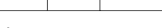

**图 5.16 节点结构**

### 5.5.1 双向链表的表示

双向链表是一种线性数据结构，其中每个节点有两个链接，称为左链接（LLINK）和右链接（RLINK）。

节点的 LLINK 字段指向其左侧的节点，RLINK 指向其右侧的节点。双向链表也可以是循环列表，称为循环双向链表。

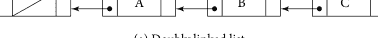

**(a) 双向链表**

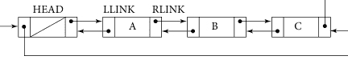

**(b) 循环双向链表**

**图 5.17 双向链表的类型**

在图 5.17(a) 中，除了第一个节点和最后一个节点外，每个节点都有两个链接。最后一个节点的 RLINK 为 NULL，头节点的 LLINK 为 NULL。

图 5.17(b) 显示了一个循环双向链表。在这里，最后一个节点的 RLINK 指向头节点，头节点的 LLINK 指向最后一个节点。

### 5.5.2 操作

在单向链表上执行的所有操作都可以使用双向链表高效地实现。

#### 5.5.2.1 插入

该操作可以通过三种方式执行：

- 1. 作为第一个节点插入
- 2. 作为最后一个节点插入
- 3. 在指定位置插入

### 作为第一个节点插入：

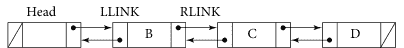

**(a) 插入前**


**(b) 插入后**

**图 5.18 双向链表中的插入操作**

### 算法 5.10: DL_INSERTION_F

- 1. 将 PTR 设置为指向第一个节点
- 2. 调用 GETNODE(N) 为新节点 N 分配内存。
- 3. 将 N 的 LLINK 设置为指向 HEAD
- 4. 将 HEAD 的 RLINK 设置为指向 N
- 5. 将 N 的 RLINK 设置为 PTR
- 6. 将 PTR 的 LLINK 设置为 N
- 7. 将 ITEM 赋值给 N 的 DATA
- 8. 结束

算法 5.10 将节点插入为列表的第一个节点。头节点的 RLINK 指向新节点，新节点的 LLINK 指向头节点，新节点的 RLINK 指向下一个节点，下一个节点的 LLINK 指向新节点（图 5.18）。

在最后一个节点插入：要将节点插入为列表的最后一个节点，需要追踪列表中的最后一个节点，并将最后一个节点的 RLINK 设置为指向新节点，将新节点的 LLINK 设置为指向最后一个节点。新节点的 RLINK 设置为 NULL。因此，新节点将成为最后一个节点（图 5.19；算法 5.11）。


**(a) 插入前**


**(b) 插入后**

**图 5.19 作为最后一个节点插入**

### 算法 5.11: DL_INSERT_E

- 1. 将 PTR 设置为头节点指针
- 2. 循环移动到最后一个节点
- 3. 将 PTR 设置为 PTR 的 RLINK
- 4. 结束循环
- 5. 调用 GETNODE (N) // 获取新节点
- 6. 将 N 的 LLINK 设置为 PTR
- 7. 将 PTR 的 RLINK 设置为 N
- 8. 将 N 的 RLINK 设置为 NULL // 使新节点 (N) 成为最后一个节点
- 9. 将 ITEM 赋值给 N 的 DATA
- 10. 结束

在指定位置插入：要在指定位置插入给定节点，设 DATA 字段为 ITEM 的节点插入在 DATA 字段为 VALUE 的节点之后。因此，搜索 DATA 字段为 VALUE 的节点；如果找到，则在该节点之后插入新节点（图 5.20；算法 5.12）。


**(a) 插入前**


**(b) 插入后**

**图 5.20 在指定位置插入**

### 算法 5.12: DL_INSERTION_SP

- 1. 将 PTR 设置为 HEAD
- 2. 将 PTR 设置为 PTR 的 RLINK
- 3. 结束循环
- 4. 调用 GETNODE(N) // 获取新节点
- 5. 将 NPTR 设置为 PTR 的 RLINK // NPTR 是 VALUE 节点之后下一个节点的指针
- 6. 将 N 的 LLINK 设置为 PTR
- 7. 将 N 的 RLINK 设置为 NPTR
- 8. 将 PTR 的 RLINK 设置为 N
- 9. 将 NPTR 的 LLINK 设置为 N
- 10. 将 PTR 设置为 N
- 11. 将 ITEM 赋值给 N 的 DATA
- 12. 结束

#### 5.5.2.2 删除

与插入类似，删除操作也可以通过三种方式执行：

- 1. 删除第一个节点
- 2. 删除最后一个节点
- 3. 在指定位置删除

**删除第一个节点：** 删除第一个节点，即删除 HEAD 节点与第一个节点之间的链接，并将被删除节点之后的节点的 LLINK 更新为指向 HEAD 节点，然后它成为第一个节点（图 5.21；算法 5.13）。


**图 5.21 删除第一个节点**

### 算法 5.13: DL_DELETION_F

- 1. 将 PTR 设置为指向第一个节点
- 2. 检查列表是否为空，如果为空则写出“删除无法执行”
- 3. 将 NPTR 设置为 PTR 的 RLINK // NPTR 指向下一个节点
- 4. 将 HEAD 的 RLINK 设置为 NPTR
- 5. 将 NPTR 的 LLINK 设置为 HEAD
- 6. 返回(PTR)
- 7. 结束

删除最后一个节点：要删除列表中的最后一个节点，设 PTR 指向最后一个节点，PPTR 是最后一个节点的前一个节点的指针。删除最后一个节点是删除指针 PPTR 和 PTR 所指向的节点之间的链接，然后将 PPTR 节点的 RLINK 设置为 NULL。现在 PPTR 成为列表中的最后一个节点。图 5.22 说明了最后一个节点的删除（算法 5.14）。


**(a) 删除前**


**(b) 删除后**

**图 5.22 删除最后一个节点**

### 算法 5.14: DL_DELETION_E

- 1. 将 PTR 设置为指向头节点
- 2. 循环移动到最后一个节点
- 3. 将 PTR 设置为 PTR 的 RLINK
- 4. 结束循环
- 5. 检查列表是否为空，如果为空则写出“删除不可能”
- 6. 将 PPTR 设置为 PTR 的 LLINK
- 7. 将 PPTR 的 RLINK 设置为 NULL
- 8. 返回(PTR)
- 9. 结束

在指定位置删除：要删除任何指定位置的节点，假设 VALUE 是要删除的节点的 DATA。在列表中搜索 VALUE。设 PTR 指向要删除的节点，NPTR 指向 PTR 的下一个节点，PPTR 指向 PTR 的前一个节点。要删除 PTR，更新 NPTR 的 LLINK 以指向 PPTR，并将 PPTR 的 RLINK 更新为指向 NPTR。图 5.23 说明了在指定位置删除节点（图 5.23，算法 5.15）。


**(a) 删除前**

**图 5.23 在指定位置删除**


#### 算法 5.15: DL_DELETION_SP

- 将 PTR 指向第一个节点
- 检查列表是否为空，如果是则写入 "删除不可能"
- 循环移动到所需节点
- 检查 VALUE
- 将 PTR 设置为 PTR 的 RLINK
- 结束循环
- 当 PTR 的 DATA 等于 VALUE 时
- 将 PPTR 设置为 PTR 的 LLINK
- 将 NPTR 设置为 PTR 的 RLINK
- 将 PPTR 的 RLINK 设置为 NPTR
- 检查被删除节点是否为最后一个节点，如果是
- 将 NPTR 的 LLINK 设置为 NULL
- Return(PTR)
- 结束。

## 程序 5.2

```cpp
#include<iostream.h>
#include<conio.h>
#include<stdio.h>
#include<alloc.h>
template<class t>
class llist
{
struct node
{
t data;
node *flink, *blink;
}*next, *head, *temp, *temp1;
public:
llist();
void insertf();
void inserta();
void inserta();
void deletef();
void deletee();
void fdisplay();
void bdisplay();
};
template<class t>
llist<t>::llist()
{
head->flink=NULL;
head->blink=NULL;
}
template<class t>
void llist<t>::insertf()
{
t ele;
cout<<"enter the element\n";
cin>>ele;
temp=(struct node*) malloc(sizeof(struct node));
if(temp==NULL)
{
cout<<"memory allocation error\n";
return;
}
if(head->flink==NULL)
{
temp->data=ele;
head->flink=temp;
temp->flink=NULL;
temp->blink=head;
}
else
{
temp->flink=head->flink;
temp->blink=head;
head->flink=temp;
temp1=head->flink;
temp1->blink=temp;
}
}
template<class t>
void llist<t>::inserte()
{
t ele;
cout<<"enter the element\n";
cin>>ele;
temp=(struct node*) malloc(sizeof(struct node));
if(temp==NULL)
{
    cout<<"memory allocation error\n";
    return;
}
if(head->flink==NULL)
{
    temp->data=ele;
    head->blink=head;
    head->flink=temp;
    temp->flink=NULL;
}
else
{
    for(temp1=head->flink;temp1->flink!=NULL;temp1=temp1->flink)
    {
        temp1->flink=temp;
        temp->data=ele;
        temp->flink=NULL;
        temp->blink=temp1;
    }
}
template<class t>
void llist<t>::inserta()
{
    t ele;
    int pos,i;
    cout<<"enter the element\n";
    cin>>ele;
    cout<<"enter the position\n";
    cin>>pos;
    temp=(struct node*)malloc(sizeof(struct node));
    if(temp==NULL)
    {
        cout<<"memory allocation error\n";
        return;
    }
    if(head->flink==NULL)
    {
        temp->data=ele;
        head->flink=temp;
        head->blink=head;
        temp->flink=NULL;
    }
    else
    {
        for(temp1=head,i=1;i<pos;i++)
        {
            temp1=temp1->flink;
        }
    }
    temp->flink=temp1->flink;
    temp1->flink=temp;
    temp->data=ele;
    temp->blink=temp1;
    temp1->blink=temp;
}
template<class t>
void llist<t>::deletef()
{
	t ele;
if(head->flink==NULL)
{
	cout<<"linked list is empty\n";
	return;
}
temp=head->flink;
temp1=temp->flink;
head->flink=temp1;
temp1->blink=head;
ele=temp->data;
free(temp);
cout<<"the deleted element is"<<ele<<endl;
}
template<class t>
void llist<t>::deletee()
{
	t ele;
if(head->flink==NULL)
{
	cout<<"linked list is empty\n";
	return;
}
for(temp1=head; temp1->flink!=NULL; temp1=temp1->flink)
{
	temp=temp1;
}
temp->flink=NULL;
ele=temp1->data;
free(temp1);
cout<<"the deleted element is"<<ele<<endl;
}
template<class t>
void llist<t>::deletea()
{
	t ele;
int pos,i;
if(head->flink==NULL)
{
cout<<"linked list is empty\n";
return;
}
cout<<"enter the position\n";
cin>>pos;
for(temp1=head, i=0; i<pos; i++, temp1=temp1->flink)
{
temp=temp1;
}
temp->flink=temp1->flink;
temp=temp1->flink;
temp->blink=temp1->blink;
ele=temp1->data;
cout<<"the deleted element is"<<ele<<endl;
free(temp1);
}
template<class t>
void llist<t>::fdisplay()
{
if(head->flink==NULL)
{
cout<<"linked list is empty\n";
return;
}
for(temp=head->flink; temp!=NULL; temp=temp->flink)
{
cout<<temp->data<<" ";
}
}
template<class t>
void llist<t>::bdisplay()
{
if(head->flink==NULL)
{
cout<<"linked list is empty\n";
return;
}
for(temp=head; temp->flink!=NULL; temp=temp->flink)
{
//cout<<temp->data<<" ";
}
for(temp1=temp; temp1->blink!=NULL; temp1=temp1->blink)
{
cout<<temp1->data<<" ";
}
}
}
void main()
{
 int ch;
 llist<char> l;
 clrscr();
 while(1)
 {
 cout<<"\n\n\n\n";
 cout<<"1.insertion at front\n";
 cout<<"2.insertion at end\n";
 cout<<"3.insertion at any position\n";
 cout<<"4.deletion at front\n";
 cout<<"5.deletion at end\n";
 cout<<"6.deletion at any position\n";
 cout<<"7.fdisplay\n";
 cout<<"8.bdisplay\n";
 cout<<"9.exit\n";
 cout<<"enter your choice\n";
 cin>>ch;
 switch(ch)
 {
 case 1:
 l.insertf();
 break;
 case 2:
 l.inserte();
 break;
 case 3:
 l.inserta();
 break;
 case 4:
 l.deletef();
 break;
 case 5:
 l.deletee();
 break;
 case 6:
 l.deletea();
 break;
 case 7:
 l.fdisplay();
 break;
 case 8:
 l.bdisplay();
 break;
 case 9:
 exit(0);
 }
}
break;
}
}
}
```

## 输出

菜单
1.前端插入
2.尾部插入
3.任意位置插入
4.前端删除
5.尾部删除
6.任意位置删除
7.fdisplay
8.bdisplay
9.退出
请输入您的选择
1
请输入元素
2
菜单
1.前端插入
2.尾部插入
3.任意位置插入
4.前端删除
5.尾部删除
6.任意位置删除
7.fdisplay
8.bdisplay
9.退出
请输入您的选择
1
请输入元素
3
菜单
1.前端插入
2.尾部插入
3.任意位置插入
4.前端删除
5.尾部删除
6.任意位置删除
7.fdisplay
8.bdisplay
9.退出
请输入您的选择
7
3 2
菜单
1.前端插入
2.尾部插入
3.任意位置插入
4.前端删除
5.尾部删除
6.任意位置删除
7.fdisplay
8.bdisplay
9.退出
请输入您的选择
2
请输入元素
5
菜单
1.前端插入
2.尾部插入
3.任意位置插入
4.前端删除
5.尾部删除
6.任意位置删除
7.fdisplay
8.bdisplay
9.退出
请输入您的选择
2
请输入元素
6
菜单
1.前端插入
2.尾部插入
3.任意位置插入
4.前端删除
5.尾部删除
6.任意位置删除
7.fdisplay
8.bdisplay
9.退出
请输入您的选择
8
6 5 2 3
菜单
1.前端插入
2.尾部插入
3.任意位置插入
4.前端删除
5.尾部删除
6.任意位置删除
7.fdisplay
8.bdisplay
9.退出
请输入您的选择
请输入元素
请输入位置
2
菜单
1.前端插入
2.尾部插入
3.任意位置插入
4.前端删除
5.尾部删除
6.任意位置删除
7.fdisplay
8.bdisplay
9.退出
请输入您的选择
7
8 2 5 6
菜单
1.前端插入
2.尾部插入
3.任意位置插入
4.前端删除
5.尾部删除
6.任意位置删除
7.fdisplay
8.bdisplay
9.退出
请输入您的选择
4
被删除的元素是 3
菜单
1.前端插入
2.尾部插入
3.任意位置插入
4.前端删除
5.尾部删除
6.任意位置删除
7.fdisplay
8.bdisplay
9.退出
请输入您的选择
7
8 2 5 6
菜单
1.前端插入
2.尾部插入
3.任意位置插入
4.前端删除
5.尾部删除
6.任意位置删除
7.fdisplay
8.bdisplay
9.退出
请输入您的选择
5
被删除的元素是 6
菜单
1.前端插入
2.尾部插入
3.任意位置插入
4.前端删除
5.尾部删除
6.任意位置删除
7.fdisplay
8.bdisplay
9.退出
请输入您的选择
7
8 2 5
菜单
1.前端插入
2.尾部插入
3.任意位置插入
4.前端删除
5.尾部删除
6.任意位置删除
7.fdisplay
8.bdisplay
9.退出
请输入您的选择
6
请输入位置
2
被删除的元素是 2
菜单
1.前端插入
2.尾部插入
3.任意位置插入
4.前端删除
5.尾部删除
6.任意位置删除
7.fdisplay
8.bdisplay
9.退出
请输入您的选择

### 5.6 各种链表的比较

本节讨论各种类型链表的比较。

### 5.6.1 链表与数组

链表相对于数组具有多种优势。在列表特定位置插入元素是常数时间操作，而在数组中插入需要将一半或更多元素向下移动。虽然从数组中删除元素只需将其槽标记为“空闲”即可在常数时间内完成，但遍历元素的算法可能需要跳过大量空闲槽。

此外，链表可以插入任意数量的元素，仅受可用总内存限制，而数组最终会填满，然后需要调整大小——这是一项昂贵的操作，如果内存碎片化，甚至可能无法进行。同样，从中删除许多元素的数组可能需要调整大小，以避免浪费太多空间。

另一方面，数组允许随机访问，而链表只允许顺序访问元素。事实上，单链表只能单向遍历。这使得链表不适合需要按索引快速查找元素的应用，例如堆排序。数组上的顺序访问也比链表快，因为它们具有更好的引用局部性，因此能更多地从处理器缓存中受益。

链表的另一个缺点是需要额外的存储空间来保存引用，尤其是对于字符或布尔值等小数据项的列表。为每个新元素单独分配内存也可能很慢，并且使用朴素的分配器时会很浪费，这个问题通常通过使用内存池来解决。

一些混合解决方案试图结合两种表示的优点。展开链表在每个列表节点中存储多个元素，提高缓存性能的同时降低引用的内存开销。

一个突出数组与链表使用优劣的好例子是实现一个解决约瑟夫问题的程序。约瑟夫问题是一种选举方法，其工作原理是让一群人站成一个圆圈。从预定的人开始，绕圈计数 n 次。一旦到达第 m 个人，就将其移出圆圈，并让成员们闭合圆圈。然后再次绕圈计数相同的 n 次，重复此过程，直到只剩下一个人。该人赢得选举。这展示了链表相对于数组的优势和劣势，因为人们处于一个循环链表中；它展示了链表删除节点有多容易，因为它只需重新排列到不同节点的链接。然而，链表在查找下一个要移除的人方面表现不佳，需要遍历列表直到找到那个人。另一方面，数组在删除节点（或元素）方面表现不佳，因为它不能在不将列表中所有元素逐个向上移动一位的情况下删除一个节点。然而，通过直接按其在数组中的位置引用，在圆圈中找到第 n 个人非常容易。

列表排名问题涉及将链表表示高效转换为数组。虽然对于传统计算机来说这很平凡，但使用并行算法解决此问题很复杂。


#### 5.6.1.1 单向链表与其他列表

虽然双向链表和/或循环链表相对于单向线性列表具有优势，但线性列表也提供了一些优势，使其在某些情况下更可取。

对单向线性列表的许多操作（例如合并两个列表或按逆序枚举元素）通常具有非常简单的递归算法，远比任何使用迭代命令的解决方案都简单。虽然可以将这些递归解决方案调整为双向链表和循环链表，但过程通常需要额外参数和更复杂的基础情况。

线性单向链表还允许尾共享，即使用子列表的共同最终部分作为两个不同列表的终端部分。特别是，如果在列表开头添加新节点，则原列表仍可作为新列表的尾部可用——这是持久数据结构的一个简单示例。同样，这在其他变体中不成立：一个节点可能永远不会属于两个不同的链表。

特别是，尾哨兵节点可以在非循环单向链表之间共享。甚至可以为每个此类列表使用相同的尾哨兵节点。确实，高级变体的优势通常仅限于算法的复杂性，而非效率。特别是，循环列表通常可以由线性列表加上两个指向第一个和最后一个节点的变量来模拟，且无需额外成本。

#### 5.6.1.2 双向链表与单向链表

双向链表每个节点需要更多空间（除非使用异或链接），并且其基本操作成本更高；但它们通常更易于操作，因为它们允许双向顺序访问列表。特别是，只需给出该节点的地址，就可以在常数次操作中插入或删除节点。要在单向链表中做到同样的事情，必须拥有前一个节点的地址。另一方面，它们不允许尾共享，也不能用作持久数据结构。

#### 5.6.1.3 循环链表与线性链表

循环链表可能是表示天然循环数组的自然选择，例如多边形的角、按 FIFO（先进先出）顺序使用和释放的缓冲池，或者应按轮询顺序共享时间的进程集。在这些应用中，指向任何节点的指针都充当整个列表的句柄。

使用循环列表时，指向最后一个节点的指针通过跟随一个链接也可以轻松访问第一个节点。因此，在需要访问列表两端的应用中（例如队列的实现），循环结构允许使用单个指针而不是两个指针来处理结构。

循环列表可以在常数时间内通过给出每个部分最后一个节点的地址来拆分为两个循环列表。该操作包括交换这两个节点的链接字段的内容。将相同的操作应用于任何两个节点（即两个不同列表中的节点），将两个列表合并为一个。此属性极大地简化了一些算法和数据结构，例如四边和面边。

### 5.7 应用

- 1. 稀疏矩阵表示
- 2. 多项式操作
- 3. 动态内存存储
- 4. 符号表中

### 5.7.1 多项式操作

多项式可以通过简单地存储每个项的系数和指数来表示为数组或链表。但是，对于任何多项式操作（例如多项式的加法或乘法），链表表示更易于处理。表示多项式的节点结构如图 5.24 所示。


在多项式中，非常高阶的多项式不一定包含所有项。考虑 5x^4 + 2x^2 + 4x + 6x^6 + x^2 - 12x，这个 12 阶多项式并不包含所有 13 个项（包括常数项）。使用链表结构表示多项式将非常容易，其中每个节点可以保存有关多项式单个项的信息。每个节点都需要存储每个项的变量 x、指数和系数。通常多项式是 x 还是 y 并不重要。这些信息对于多项式的预期操作可能并不十分关键。因此，需要定义一个节点结构来保存两个整数，即指数和系数。将此表示与使用数组结构存储相同多项式的表示进行比较。

在数组中，应为 x 的每个指数维护一个槽位，因此，如果要排列 50 阶多项式但仅包含 6 个项，则数组中将有大量条目为 0。如果多项式使用链表表示，操作一对多项式也很容易。

#### 5.7.1.1 两个多项式的加法

考虑以下多项式的加法：

- 5x^4 + 2x^4 + 4x + 6x^6 + x^2
- 7x^2 + 2x^4 + 8x^6 + 2x^3 + 3x + 40

结果多项式将是：
5x^4 + 2x^4 + 7x^4 + 6x^6 + 6x^4 + x^2 + x^2 + 3x + 40

现在注意加法是如何进行的。让加法结果存储在第三个列表中。从任何多项式中的最高幂开始。如果没有具有相同指数的项，只需将该项追加到新列表并继续该过程。在任何发现指数匹配的地方，只需添加系数，然后将该项存储在新列表中。如果一个列表先耗尽而另一个列表仍包含一些低阶项，只需将剩余项追加到新列表。算法 5.16 展示了如何添加两个多项式。

### 算法 5.16：ADD-POLY

设 phead1、phead2 和 phead3 表示三个列表的指针，每个节点包含两个整数：指数和系数。假设两个链表已包含关于两个多项式的相关数据。还假设有一个 append() 函数，用于在给定列表末尾插入新节点。

```
1. Set p1=phead1;
2. Set p2=phead2;
3. Call malloc to create a new node p3 to build the third list
4. Set p3=phead3;
5. Traverse the lists till one list gets exhausted
6. Loop if the exponent of p1 is higher than that of p2 then the next term in final list is going to be the node of p1
7. Set p3->exp=p1->exp;
8. Set p3->coeff=p1->coeff;
9. Append(p3, phead3);
11. Set p1=p1->next; /*now move to the next term in list 1*/
12. End loop
13. Loop if p2 exponent turns out to be higher than, then make p3 same as p2 and append to final list
14. Set p3->exp=p2->exp;
15. Set p3->coeff=p2->coeff;
16. Append(p3, phead3);
17. Set p2=p2->next;
18. End loop
19. Loop if both exponents are same and then add the coefficients to get the term for the final
20. Set p3->exp=p1->exp;
21. Set p3->coeff=p1->coeff+p2->coeff;
22. Append(p3, phead3);
23. Set p1=p1->next;
24. Set p2=p2->next;
25. End loop
26. End loop
27. Check whether p1 is exhausted then
28. Append (p1, phead3);
29. Append (p2, phead3);
30. End
```

### 5.7.1 列表 ADT

链表是一种基本数据类型，几乎可以被视为与数组一样基础。

列表是存储单元的有限序列，为其定义了以下操作：

create() 创建一个空列表 l；
insert(item, i, list) 通过在 ai-1 和 ai 之间插入一个项，将列表从形式 (a1,... ai - 1, ai, an) 更改；除非在调用前列表至少有 i - 1 个项，否则调用此操作是错误的。
delete(i, list) 从列表中删除位置 i 处的项，返回包含一个更少项的列表；以及
read(i, list) 返回列表中位置 i 处的项，而不更改列表。

列表上的其他操作有 search()、traverse()、merge()，search() 用于在列表中搜索节点；traverse() 用于访问列表的每个节点，merge() 用于合并两个列表。通常将第一个项称为列表的头部很方便。

## 摘要

- 链表是一种数据结构，是零个或多个节点的集合，其中每个节点包含两个字段。第一个字段包含数据，第二个字段是包含下一个节点地址的指针字段。
- 链表基本上支持插入和删除操作。
- 链表的类型包括单向链表、双向链表、循环单向链表和循环双向链表。
- 单向链表是一种线性数据结构，其中每个节点只包含一个链接字段。
- 单向链表中，如果最后一个节点的链接字段被赋予第一个节点的地址，则称为循环链表或循环列表。


- 双向链表是指每个节点包含两个指向节点两侧的链接的链表。
- 链表的应用包括稀疏矩阵表示、多项式操作、动态内存存储、符号表等。

## 练习

### 填空题

- 1. 链表是 ________________。
- 2. 链表中的节点由 __________ 和 __________ 组成。
- 3. __________ 是指向可用内存空间列表的指针。
- 4. __________ 是链表的类型。
- 5. 双向链表中的节点包含 __________ 和 __________ 指针。
- 6. __________ 是链表的应用。
- 7. 循环链表用于克服单链表的 __________ 缺点。

### 选择题

- 1. 链表是 __________ 结构。
   - a. 静态数据   b. 动态数据
   - c. 非线性数据  d. 无

- 2. 以下哪项陈述是正确的？
   - a. 链表中的插入只能在前端进行
   - b. 只能单向遍历列表
   - c. 链表上的操作可以在列表中的任何位置执行
   - d. a 和 b 都是

- 3. 当链表中 START=NULL 时的情况是
   - a. 下溢      b. 上溢
   - c. 满       d. 饱和

- 4. 以下哪项是双向列表？
   - a. 接地头节点列表      b. 循环头节点列表
   - c. 带有头节点和尾节点的链表   d. 无

- 5. __________ 是链表的一个应用。
   - a. 汉诺塔   b. 递归
   - c. 稀疏矩阵   d. CPU 调度

### 简答题

- 1. 定义链表。
- 2. 定义单链表。
- 3. 定义双向链表。
- 4. 举出单链表的一个缺点和一个优点。
- 5. 举出双向链表的一个缺点和一个优点。
- 6. 列出链表的四个应用。
- 7. 区分单链表和双向链表。
- 8. 用示例定义循环单链表。
- 9. 简要说明如何使用图表向链表中添加节点。
- 10. 区分双向链表和循环单链表。

### 论述题

- 1. 用示例讨论链表数据结构在内存中的表示方式。
- 2. 解释双向链表中的以下操作：
   - (i) 创建 (ii) 插入 (iii) 删除
   - (iv) 显示 (v) 在给定位置插入
- 3. 实现两个循环单链表 List1 和 List2 的连接。使用头节点实现列表。
- 4. 编写算法以在单链表上实现以下功能。
   - (i) 求一组值的平均值
   - (ii) 将列表中给定值的所有出现替换为列表中的另一个值。
   - (iii) 将给定值插入到其适当位置。
- 5. 编写算法以在单链表上实现插入和删除。
- 6. 编写算法以在循环双向链表上实现各种操作。
- 7. 编写程序使用链表执行多项式乘法。

## 栈

本章专门讨论栈数据结构。栈的表示和实现通过示例进行了说明。四个常见应用被陈述并详细说明。

### 6.1 定义

栈是一种线性数据结构，其中元素的插入和删除仅在一端进行，该端称为栈顶。最后插入的元素将是第一个被删除的元素。因此，这被称为后进先出（LIFO）结构。

- **示例**
  1. 餐厅中的托盘堆
  2. 橱柜中的一叠盘子

设 ST 为包含元素 10、20、30 的栈。元素 30 被栈顶指针指向。当要添加新元素 40 时，它被插入到栈顶。现在 Top 指向元素 40，如图 6.1(a) 所示。当要执行元素删除时，首先移除栈顶指针指向的元素，即首先移除 40，如图 6.1(b) 所示。


图 6.1 栈及其工作原理


### 6.2 栈的表示

栈在内存中的表示有两种方式。如下：

- 使用数组的静态表示
- 使用链表的动态表示

#### 6.2.1 栈的数组表示

栈可以使用一维数组表示。分配一块内存以容纳栈的全部容量，栈的元素从内存块的第一个位置开始按顺序存储。


图 6.2 栈及其数组表示

在图 6.2(a) 中，栈是一个一维数组。Top 是一个指向栈顶元素的指针。

#### 6.2.2 栈的链表表示

使用数组表示栈既简单又方便。然而，它适用于固定大小的栈。有时在程序中，栈的大小可能需要在执行期间增加，即动态创建栈。使用链表，可以动态创建栈。使用单链表来表示栈。图 6.3 显示了栈的链表表示。在这里，节点由数据字段和链接字段组成。数据字段用于存储元素，链接字段用于指向下一个字段。


图 6.3 栈的链表表示

第一个节点中的元素是栈顶，最后一个节点中的元素是栈底。

### 6.3 栈的操作

栈的基本操作如下：

- (i) PUSH——将元素插入栈中
- (ii) POP——从栈中删除元素

推入操作：将元素插入栈中称为推入操作。在执行推入操作之前，检查栈上溢条件，即栈是否已满。每次将元素推入栈时，栈顶必须加 1。在图 6.4 中，栈有 2 个元素 10、5。


图 6.4 推入操作

弹出操作：从栈中删除元素称为弹出操作。在执行弹出操作之前，检查栈下溢条件，即栈是否为空。每次从栈中删除元素时，栈顶必须减 1。现在，栈顶指向栈的当前顶部元素。在图 6.5 中，弹出所有元素后栈为空。


图 6.5 弹出操作

推入和弹出是栈上执行的两个重要操作。此外，还可以在栈上执行显示和大小操作。如果栈中已有元素，显示操作将显示栈的所有元素。否则（即，如果栈为空），它将显示栈为空的消息。大小操作返回栈中元素的数量。

#### 6.3.1 栈的数组实现

假设 STACK [1 : N] 是表示栈的线性数组。Top 是一个指针变量，保存栈顶元素的位置，N 是栈中可以存储的元素数量。Top = 0 或 NULL 表示栈为空，Top = N 表示栈已满。以下是使用数组的推入和弹出操作的算法。

#### 算法 6.1: PUSH (STACK, N, TOP, ITEM)

该算法将一个 ITEM 推入 STACK 中；N 是栈的最大大小。

- 1. [检查栈上溢]
   如果 Top=N 则写入:"栈上溢" 并返回
- 2. 设置 Top=Top+1 //将 Top 加 1
- 3. 设置 STACK[Top] = ITEM //将元素插入新的 Top 位置
- 4. 结束

#### 算法 6.2: POP (STACK, TOP, ITEM)

该算法删除 STACK 的顶部元素并将其赋值给变量 ITEM。

- 1. [检查栈下溢]
   如果 Top=0 则写入:栈下溢 并返回
- 2. 设置 ITEM=STACK[Top] //用顶部元素初始化 Item
- 3. 设置 Top=Top-1 //将栈顶减 1
- 4. 结束

考虑一个名为 NUMBERS [1:5] 的五个数值元素的栈。值 10、20、30、40、50 的插入和删除如图 6.6 所示。


- 最初栈 NUMBER [1:5] 为

```
[1] [2] [3] [4] [5]
Top=0
```

- 将 10 压入 NUMBER [1:5]

```
[1] [2] [3] [4] [5]
10
Top
Top=1
```

- 将 20 压入 NUMBER [1:5]

```
[1] [2] [3] [4] [5]
10 20
Top
Top=2
```

- 将 30 压入 NUMBER [1:5]

```
[1] [2] [3] [4] [5]
10 20 30
Top
Top=3
```

- 将 40 压入 NUMBER [1:5]

```
[1] [2] [3] [4] [5]
10 20 30 40
Top
Top=4
```

- 将 50 压入 NUMBER [1:5]

```
[1] [2] [3] [4] [5]
10 20 30 40 50
Top
Top=5
```

- 将 60 压入 NUMBER [1:5]

这里 TOP=N，由于栈溢出条件被触发，无法将 60 插入栈中。

以下步骤说明了对同一栈的弹出操作：

- 从 NUMBER[1:5] 弹出一个元素

| | [1] | [2] | [3] | [4] | [5] |
|---|---|---|---|---|---|
| | 10 | 20 | 30 | 40 | 50 |
Top=4

- 从 NUMBER[1:5] 弹出一个元素

| | [1] | [2] | [3] | [4] | [5] |
|---|---|---|---|---|---|
| | 10 | 20 | 30 | 40 | 50 |
Top=3

### 图 6.6 栈的数组实现

在弹出操作中，Top 值被递减，但元素并未被删除。程序 6.1 是栈的数组实现程序。

### 程序 6.1

```cpp
#include<iostream.h>
#include<conio.h>
#include<stdlib.h>
template<class t>
class stack
{
int top,n;
t a[50];
public:
stack(int m)
{
top=-1;
n=m;
}
void push();
void pop();
void display();
};
template<class t>
void stack<t>::push()
{
t ele;
if(top==n-1)
{
cout<<"stack is overflow\n";
return;
}
top++;
cout<<"enter the element \n";
cin>>ele;
a[top]=ele;
}
template<class t>
void stack<t>::pop()
{
 t ele;
 if(top==-1)
 {
 cout<<"stack is underflow\n";
 return;
 }
 ele=a[top];
 top--;
 cout<<"the deleted element is "<<ele;
}
template<class t>
void stack<t>::display()
{
 int i;
 if(top==-1)
 {
 cout<<"stack is underflow\n";
 return;
 }
 cout<<"the elements are\n";
 for(i=0;i<=top;i++)
 cout<<a[i]<<" ";
}
void main()
{
 int n,ch;
 clrscr();
 cout<<"enter the size of the stack\n";
 cin>>n;
 stack<char>s(n);
 while(1)
 {
 cout<<"\nmenu\n";
 cout<<"1.push\n";
 cout<<"2.pop\n";
 cout<<"3.display\n";
 cout<<"4.exit\n";
 cout<<"enter your choice\n";
 cin>>ch;
 switch(ch)
 {
     case 1:
         s.push();
         break;
     case 2:
         s.pop();
         break;
     case 3:
         s.display();
         break;
     case 4:
         exit(0);
         break;
     default:
         cout<<"invalid option\n";
         break;
 }
}
}
```

### 输出

enter the size of the stack
10
menu
1.push
2.pop
3.display
4.exit
enter your choice
1
enter the element
2
menu
1.push
2.pop
3.display
4.exit
enter your choice
1
enter the element
3
menu
1.push
2.pop
3.display
4.exit
enter your choice
3
2
3
menu
1.push
2.pop
3.display
4.exit
enter your choice
2
the deleted element is 2
menu
1.push
2.pop
3.display
4.exit
enter your choice
4

#### 6.3.2 栈的链表实现

要将一个项插入链栈，请将带有该项的新节点作为单链表的第一个节点插入。之前指向列表中第一个元素的 Top 指针现在指向新节点。要从链栈中删除一个项，删除 top 指向的节点，并使 Top 指向下一个节点。图 6.7 说明了链栈上的操作。

最初栈为


将 40 插入列表


(a) 压入操作

从链栈中删除 40


(b) 弹出操作

### 图 6.7 栈的链表实现

以下是使用链表的压入和弹出操作的算法。

### 算法 6.3：PUSH-LSTACK(TOP, ITEM)

将项 ITEM 插入带有指针 TOP 的链栈 LSTACK

- 1. 将 ITEM 插入 STACK
   NODE=calloc GETNODE (N) //用于项的节点
- 2. 将 NODE 的 DATA 设置为 ITEM //将节点 NODE 插入栈中
- 3. 将 NODE 的 LINK 设置为 Top //更新 top 指针
- 4. Top=NODE
- 5. 结束。

### 算法 6.4：POP-LSTACK (TOP, ITEM)

从 LSTACK 中删除栈顶元素并赋值给 ITEM。

- 1. 检查栈是否为空
   if (Top=0) then write "stack is empty"
- 2. 退出
- 3. 否则
- 4. Temp=Top
- 5. 将 ITEM 设置为 Top 的 DATA
- 6. 将 Top 设置为 Top 的 LINK
- 7. 结束

程序 6.2 是栈的链表表示程序。

### 程序 6.2

```cpp
#include<iostream.h>
#include<conio.h>
#include<stdio.h>
#include<alloc.h>
template<class t>
class llist
{
struct node
{
t data;
node*link;
};
node *top, *head, *temp, *temp1;
public:
llist();
void push();
void pop();
void display();
};
template<class t>
llist<t>::llist()
{
top=NULL;
head->link=NULL;
template<class t>
void llist<t>::push()
{
 t ele;
 cout<<"enter the element\n";
 cin>>ele;
 temp=(struct node*) malloc(sizeof(struct node));
 if(temp==NULL)
 {
 cout<<"memory allocation error\n";
 return;
 }
temp->data=ele;
if(top==NULL)
{
 head->link=temp;
 temp->link=NULL;
}
else
{
 top->link=temp;
 temp->link=NULL;
}
top=temp;
}
template<class t>
void llist<t>::pop()
{
 t ele;
if(top==NULL)
{
 cout<<"linked list is empty\n";
 return;
}
for(temp1=head,temp1=top,temp1=temp1->link)
{
 temp=temp1;
}
temp->link=NULL;
ele=temp1->data;
free(temp1);
top=temp;
cout<<"the deleted element is "<<ele<<endl;
}
template<class t>
void llist<t>::display()
{
if(top==NULL)
{
cout<<"linked list is empty\n";
return;
}
for(temp=head->link;temp!=top->link;temp=temp->link)
{
cout<<temp->data<<" ";
}
}
void main()
{
int ch;
listcnt>1;
clrscr();
while(1)
{
cout<<"\nmenu\n";
cout<<"1.insertion\n";
cout<<"2.deletion\n";
cout<<"3.display\n";
cout<<"4.exit\n";
cout<<"enter your choice\n";
cin>>ch;
switch(ch)
{
case 1:
s.push();
break;
case 2:
s.pop();
break;
case 3:
s.display();
break;
case 4:
exit(0);
break;
}
}
}
```

输出
menu
1. insertion
2. deletion
3. display
4. exit
enter your choice
1
enter the element
10
menu
1.insertion
2.deletion
3.display
4.exit
enter your choice
1
enter the element
20
menu
1.insertion
2.deletion
3.display
4.exit
enter your choice
3
10 20
menu
1.insertion
2.deletion
3.display
4.exit
enter your choice
2
the deleted element is 20
menu
1.insertion
2.deletion
3.display
4.exit
enter your choice
3
10
menu
1.insertion
2.deletion
3.display
4.exit
enter your choice
4

已讨论了使用数组和链表实现栈。在以下部分中，详细解释了栈的应用领域。

### 6.4 栈的应用

栈有广泛的应用。以下是栈的一些应用：

- 表达式求值
- 递归
- 匹配括号的平衡

### 6.4.1 表达式求值

算术表达式可以用三种方式表示：

- 1. 中缀：两个操作数之间的运算符是中缀表达式。
   <operand><operator><operand>
   例：a+b

- 2. 后缀：跟在两个操作数之后的运算符是后缀表达式。
   <operand><operator><operator>
   例：a b+

- 3. 前缀：后面跟着两个操作数的运算符是前缀表达式。
   <operator><operand><operand>
   例：+ab

栈可用于求值表达式，也可用于将表达式从一种形式转换为另一种形式。

中缀转后缀：在代数中，中缀表示法如 a+b.c。相应的后缀表示法是 abc.+。算法 6.5 显示了转换过程。

### 算法 6.5：

- 1. 从左到右扫描中缀字符串。
- 2. 创建一个空栈。
- 3. 如果扫描的字符是操作数，则将其添加到后缀字符串。如果扫描的字符是运算符且栈为空，则将字符压入栈。
- 4. 如果扫描的字符是运算符且栈不为空，则将该字符的优先级与栈顶元素（此后栈顶称为 topStack）的优先级进行比较。如果 topStack 的优先级高于扫描字符，则弹出栈，否则将扫描字符压入栈。只要栈不为空且 topStack 的优先级高于扫描字符，就重复此步骤。继续此步骤直到扫描完所有字符。
- 5. 返回后缀字符串。

考虑中缀字符串：a+b*c-d。最初，栈为空，后缀字符串没有字符。现在，扫描的第一个字符是 'a'。字符 'a' 被添加到后缀字符串。接下来扫描的字符是 '+'，作为运算符，它被压入栈。


接下来，扫描到的字符是 ‘b’，由于它是操作数，将被放入后缀字符串。下一个字符是 ‘*’，它是运算符。现在，栈顶元素是 ‘+’，其优先级低于 ‘*’，因此 ‘*’ 将被压入栈。


下一个字符是 ‘c’，将被放入后缀字符串。接下来扫描的字符是 ‘-’。栈中最顶层的字符是 ‘*’，其优先级高于 ‘-’。因此 ‘*’ 将从栈中弹出并添加到后缀字符串。即使现在栈不为空。现在，栈中最顶层的元素是 ‘+’，其优先级与 ‘-’ 相等。因此，从栈中弹出 ‘+’ 并将其添加到后缀字符串。‘-’ 将被压入栈。


下一个字符是 ‘d’，将被添加到后缀字符串。现在，所有字符都已扫描完毕，因此将栈中剩余元素弹出并添加到后缀字符串。此时，栈中只有 ‘-’。它被弹出并添加到后缀字符串。因此，在扫描完所有字符后，栈和后缀字符串将如下所示：


给定中缀字符串 a+b*c-d 的最终结果是后缀字符串：a b c * + d -

## 程序 6.3

```cpp
/*infix to postfix conversion*/
#include<iostream.h>
#include<string.h>
#include<stdlib.h>
#include<ctype.h>
class expression
{
private:
    char infix[100];
    char stack[200];
    int top;
    int r;
    char postfix[100];
public:
    void convert();
    int input_p(char);
    int stack_p(char);
    int rank(char);
};
int expression::input_p(char c)
{
    if(c=='^+' || c=='^-')
        return 1;
    else if(c=='*' || c=='/')
        return 3;
    else if(c=='^')
        return 6;
    else if(isalpha(c)!=0)
        return 7;
    else if(c=='(')
        return 9;
    else if(c==')')
        return 0;
    else
    {
        cout<<"Invalid expression::input error\n";
        exit(0);
    }
}
int expression::stack_p(char c)
{
    if(c=='^+' || c=='^-')
        return 2;
    else if(c=='*' || c=='/')
        return 4;
    else if(c=='^')
        return 5;
    else if(isalpha(c)!=0)
        return 8;
    else if(c=='(')
        return 0;
    else
    {
        cout<<"Invalid expression::stack error\n";
        exit(0);
    }
}
int expression::rank(char c)
{
    if(c=='+' || c=='-')
        return -1;
    else if(c=='*' || c=='/')
        return 0;
    else if(c=='^')
        return -1;
    else if(isalpha(c)!=0)
        return 1;
    else
    {
        cout<<"Invalid expression::in rank\n";
        exit(0);
    }
}
void expression::convert()
{
    cout<<"infix expression to postfix form";
    cout<<"Enter an infix expression::\n";
    cin>>infix;
    int l=strlen(infix);
    infix[l]=')';
    infix[l+1]='\0';
    //Conversion starts
    top=1;
    stack[top]='(';
    r=0;
    int x=1;
    int i=0;
    char next=infix[i];
    while(next!='\0')
    {
    //Pop all the elements to output into stack which have higher precedence
    while(input_p(next)>stack_p(stack[top]))
    {
    if(top<1)
    {
        cout<<"invalid expression::stack error\n";
        exit(0);
    }
    postfix[++x]=stack[top];
    top--;
    r=r+rank(postfix[x]);
    if (r<1)
    {
        cout<<"Invalid expression::r<1\n";
        exit(0);
    }
    }
    if(input_p(next)!=stack_p(stack[top]))
    stack[++top]=next;
    else
    top--;
    i++;
    next=infix[i];
    }
    postfix[++x]='\0';
    if (r!=1 || top!=0)
    {
        cout<<"Invalid expression::error in rank or stack\n";
        exit(0);
    }
    cout<<"\n\nThe corresponding postfix expression is:\n";
    cout<<postfix<<endl;
}
int main()
{
expression obj;
obj.convert();
return 0;
}
```

## 输出

```
infix expression to postfix form
Enter an infix expression:
(a+b^c^d)*(c+d)
The corresponding postfix expression is:
abcd^^+cd+*
Press any key to continue
```

同样，其他转换也可以使用栈来实现。

### 6.4.2 后缀表达式求值

可以使用栈轻松求值后缀表达式。从左到右扫描表达式，如果发现任何操作数，将其压入栈中。如果发现任何运算符，从栈中弹出所需数量的操作数，然后执行操作。将结果再次压入栈中。最后，求值后的表达式放入栈中。

在后缀表示法中，操作的顺序由表达式中运算符和操作数的优先级层次和结合性决定。算法 6.6 解释了后缀表达式求值。

### 算法 6.6: POST-EVAL (EXP)

- 1. 从左到右扫描 EXP，并对 EXP 的每个元素重复步骤 2 和步骤 1。
- 2. 如果发现操作数，将其压入栈。
  - 1. 如果发现运算符，则
    - 1. 从栈中弹出所需数量的操作数
    - 2. 求值运算符
    - 3. 将结果压回栈中。
  - 结束 if
- 3. 结束 if
- 4. 步骤 1 循环结束
- 5. 从栈中弹出结果
- 6. 结束

考虑以下后缀形式的表达式并对其求值：

| 扫描 | 操作 | 后缀 | 栈 |
|------|-----------|---------|-------|
| 2 | PUSH(2) | | 2 |
| 3 | PUSH(3) | | 2,3 |
| 4 | PUSH(4) | | 2,3,4 |
| + | POP(4),POP(3),PUSH(7) | | 2,7 |
| * | POP(7),POP(2),PUSH(14) | | 14 |
| 21 | PUSH(21) | | 14,21 |
| 7 | PUSH(7) | | 14,21,7 |
| / | POP(7),POP(21),PUSH(3) | | 14,3 |
| - | POP(3),POP(14),PUSH(11) | | 11 |

最后，表达式的值为 11。

### 6.4.3 递归

一个调用自身的函数，或调用另一个函数而该函数又调用第一个函数的情况，称为递归函数。这些递归函数使用栈来执行。被调用方法的返回地址以及所有局部变量和形式参数将存储到栈中。每当调用任何方法时，栈中存储的所有元素将在执行返回后恢复。

递归使用栈这种数据结构来实现。对方法的每次递归调用都需要将以下信息压入系统栈：

- 形式参数
- 局部变量
- 返回地址

这些信息统称为栈帧。每个方法调用的栈帧都不同。例如，对于无参数或无局部变量的方法，其栈帧将仅包含返回地址。编译器会在调用递归方法时处理上述所有所需的栈维护工作。

可以使用以下策略从递归例程中移除递归，尽管不够优雅。对于特定例程可能存在更令人满意的方法，但这种技术非常具有教学意义。它允许通过决定用户自己的栈结构来模拟栈并管理递归。具体实现如下：

- i. 每次在算法中进行递归调用时，将必要信息压入栈。
- ii. 当在此更深层级完成处理时，弹出模拟的栈帧，并继续在更高层级按从栈中弹出的返回地址指示的点进行处理。
- iii. 使用迭代控制结构，循环直到栈中没有剩余返回地址可弹出。

### 算法 6.7: FACT (n)

```
Algorithm 6.7: FACT (n)
1. If (n==0) then set fact=1 and return
2. else p=n-1
3. q=fact (p)
4. fact=n*q;
5. End
```

通过一个简单的递归程序说明了在执行递归时使用栈。考虑图 6.8 中所示的阶乘递归程序。

检查步骤 3 中的递归调用。为了避免对 fact() 的无休止调用系列，步骤 1 中使用了基本情况 n=0。函数 fact()（自身调用）基于 n 的值。函数 fact() 只有在执行基本情况或递归调用成功结束时才具有正常终止。

在执行期间，为了维护参数值的记录并跟踪自身所做的调用，使用了栈。


## 图 6.8 函数 fact() 的递归调用

当函数 fact(5) 被调用并执行时，变量 p 获得值 4 并调用函数 fact(4)，如图 6.8(b) 所示，此时对 fact(5) 的调用尚未完成。每次新的函数调用都会将参数的当前值压入栈中。图 6.8(d) 说明了在调用 fact(4) 及后续调用期间的栈内容。图 6.8(f) 中对 fact(0) 的调用满足步骤 1 中的条件并终止，得出 0! 的值为 1，并将其返回给变量 q。在算法的步骤 4 中，计算 fact = n * q = 1 * 1 = 1。然后，函数 (1) 终止，将值 1 返回给步骤 3 中之前对 fact(2) 的调用，并计算 fact = n * q = 2 * 1 = 2，然后通过将结果返回给 q 来终止，以此类推。

在函数调用期间，由于 push 操作，栈结构的大小会增加，并通过 pop 操作减小自身大小，直到到达第一个对 fact() 的调用，即 fact(5)。在执行 fact(5) 期间，步骤 3 中第一个也是最早的调用计算 q 值为 24，并继续计算 fact = n * q = 5 * 24 = 120，即所需的值。

一般来说，在使用栈实现递归调用时，所有局部变量在调用时都会被压入栈中，在递归调用终止时从栈中弹出，并恢复其原始值。

### 6.4.4 匹配括号的平衡

给定由 '(' 和 ')' 组成的表达式。一个 '(' 必须与一个 ')' 匹配，否则无效。例如，(())、(((())))、(((()))) 是有效的括号集，而 ((( ) ) ) ( 都是非法的。

显然，仅统计表达式中 '(' 和 ')' 的数量是不够的。按照惯例，表达式从左到右读取。一个 ')' 与其左侧最近的未匹配 '(' 匹配。例如，(((()))) 是。

假设要找出对 ')' 来说哪个是最近且未匹配的，从左到右读取表达式；最近的未匹配 '(' 会被 ')' 抵消。为了跟踪，最近读取的 '('（假设有许多待处理的未匹配 '('，栈很有用。

- 处理 ‘(’ 时，将其压入栈中。
- 处理 ‘)’ 时，从栈中弹出它。这个 ‘(’ 与当前的 ’)’ 匹配。
- 如果读取表达式完成，但栈不为空，则表示表达式中 ‘(’ 比 ‘)’ 多，输入无效。

### 6.4.4.1 栈的抽象数据类型

栈是元素或项目的集合，为其定义了以下操作：

- create(S) 创建一个空栈 S。
- isEmpty(S) 是一个谓词，如果 S 存在且为空则返回“真”，否则返回“假”。
- push(S,item) 将给定项目添加到栈 S 中。
- pop(S) 从栈 S 中移除最近添加的项目，并将其作为函数的值返回。

需要原语 isempty 以避免在空栈上调用 pop，这可能会导致错误。有时还会定义一个名为 top(S) 的附加操作，它只返回最后添加到栈中的项目，而不将其移除。

## 摘要

- 栈是一种非原始线性数据结构，元素从同一端（称为 Top）插入和删除。
- 栈支持两种基本操作：Push 和 Pop。
- 栈有许多应用，例如递归消除、表达式求值等。
- 栈可以使用数组或链表实现。

## 练习

### 填空题

- 1. 插入和删除在栈的 ______ 处进行。
- 2. ______ 和 ______ 是栈的操作。
- 3. ______ 是栈的一个应用。
- 4. 当 rear==栈的大小时，栈是 ______。
- 5. 后缀求值基于 ______。

### 选择题

- 1. 栈是一种 ______ 数据结构。
  a. FIFO
  b. LIFO
  c. a 和 b 都是
  d. FILO
- 2. 当 ______ 时，指针 Top 增加。
  a. 插入元素
  b. 删除元素
  c. 显示元素
  d. 无
- 3. 以下哪项不是栈的应用？
  a. 递归
  b. 模板
  c. 字符串反转
  d. 进程调度
- 4. 栈动态表示使用 _______。
  a. 指针
  b. 结构体
  c. 链表
  d. 无
- 5. 什么时候栈被认为是空的？
  a. top=n
  b. top=0
  c. front==0
  d. front-rear=0

### 简答题

- 1. 定义栈。
- 2. 定义后缀表达式。
- 3. 举出中缀、后缀和前缀表达式的例子。
- 4. 将以下后缀表达式转换为中缀表达式 ABCDG/*++。
- 5. 定义前缀表达式。
- 6. 列出栈的任何四个应用。
- 7. 编写一个 C 函数，在栈顶插入一个元素。
- 8. 求值以下后缀表达式：123+*321-+，
- 9. 描述在栈上执行的操作。

### 论述题

- 1. 编写转换后缀表达式的算法；进一步跟踪该算法，清楚地指示以下表达式的栈内容：
  ((A-(B+C) * D)$(E+F)
- 2. 讨论使用栈时应处理的各种异常情况，并将以下表达式转换为中缀和前缀表达式：ABCDE/*-F/G++
- 3. 如何定义数据结构？给出一个 C++ 程序来构建一个整数栈并对其执行所有必要操作。
- 4. 编写一个 C++ 程序，使用单个数组实现多个栈。
- 5. 给出栈的 DS 完整规范，并解释 N 个整数的栈在 C++ 中如何表示。

## 第 7 章

## 队列

第 7 章讨论了队列及其变体，例如循环队列和双端队列。解释并举例说明了所有类型队列的静态、动态表示和操作。列出了队列的各种应用，并详细解释了一种称为“时间共享系统模拟”的应用。

### 7.1 简介

队列是一种线性数据结构，插入在一端（称为 rear）进行，删除在另一端（称为 front）进行。队列也被称为模拟先来先服务顺序（或等效的先进先出 (FIFO) 顺序）的结构。也就是说，先插入队列的元素将是先被删除的元素，而最后插入的元素是最后被删除的。队列中的插入操作也称为 enqueue，删除也称为 dequeue。队列与栈的主要区别在于，队列中的元素从底部放入并从顶部取出，而在栈中，元素从顶部放入并从顶部取出。

### 示例

- 电子邮箱
- 商店、服务柜台、单行道、银行、公交车站等处的等待队列，点唱机播放列表等。
- 计算机系统中等待在处理器上运行的等优先级进程
- 打印作业
- CPU 进程

队列比栈更难实现，因为操作在两端进行。最简单的实现使用数组，在一端添加元素，并在取出一个元素时移动所有元素。

### 7.2 队列的表示

队列可以用两种方式表示：

- 使用数组的静态表示
- 使用链表的动态表示

### 7.2.1 数组表示

使用一维数组来表示队列。考虑一个队列 QUE [1:N]，两个指针 FRONT 和 REAR 表示 QUE 的两端。插入元素时使用 REAR 指针，删除元素时使用 FRONT 指针（图 7.1）。


图 7.1 队列 QUE [1:N] 的数组表示

队列 QUE [1:N] 不能容纳超过 N 个元素，每次插入元素都必须检查 QUE 是否已满，删除元素必须确保 QUE 不为空。

### 7.2.2 链式表示

使用链表，队列是动态创建的，因此队列的大小可以根据应用程序或程序的需要增加，而使用数组时队列的大小是固定的。

图 7.2 显示了队列的单链表表示。指针 FRONT 指向第一个节点，REAR 指向列表中的最后一个节点。


图 7.2 队列的链式表示

当 FRONT=REAR 时，队列被认为是空的。

### 7.3 队列上的操作

队列的两个基本操作是：

- 1. 插入 (Enqueue)——向队列中添加一个元素
- 2. 删除 (Deque)——从队列中移除一个元素


**入队：** 将元素插入队列将在队尾进行。当队列为空时，rear 和 front 都将初始化为 0。在插入任何元素之前，检查队列上溢条件，即队列是否已满。如果已满，显示相应消息，否则插入元素。在插入过程中，检查 front 是否为 0。如果是，这是要插入的第一个元素，因此 front 和 rear 都必须递增。否则，仅递增 rear。图 7.3 说明了插入操作。

| [1] | [2] | [3] | [4] | [5] | [6] |
| --- | --- | --- | --- | --- | --- |
| | | | | | |

FRONT=0 和 REAR=0

(a) 初始队列为空

| [1] | [2] | [3] | [4] | [5] | [6] |
| --- | --- | --- | --- | --- | --- |
| 10 | | | | | |

(b) 插入 10 后

| [1] | [2] | [3] | [4] | [5] | [6] |
| --- | --- | --- | --- | --- | --- |
| 10 | 20 | | | | |

(c) 插入 20 后

图 7.3 插入操作

在图 7.3(a) 中，初始队列为空，FRONT 和 REAR 指针均初始化为零。当插入元素 10 时，FRONT 和 REAR 指针均递增 1，现在都指向第一个位置；如图 7.3(b) 所示。当插入元素 20 时，REAR 指针递增 1，现在指向第二个位置，如图 7.3(c) 所示。

**出队：** 从队列删除元素将在队首进行。先插入的元素将是第一个被删除的元素。最初，检查队列下溢条件，即如果 front 和 rear 都指向 0，这意味着（队列中没有元素）队列为空。在删除元素时，front 将递增 1。

| [1] | [2] | [3] | [4] | [5] | [6] |
| --- | --- | --- | --- | --- | --- |
| 10 | 20 | 30 | 40 | 50 | 45 |

(a) 初始队列

图 7.4 删除操作


(b) 删除 10 后


(c) 删除 20 后

图 7.4 续

在图 7.4(a) 中，队列包含 6 个元素。FRONT 指向第一个元素，REAR 指向第六个元素。删除元素 10 后，FRONT 指针递增 1，如图 7.4(b) 所示。同样，当删除元素 20 时，FRONT 会被更新。

删除所有元素后，front 将大于 rear。因此，对于每次删除，都要检查 front 是否大于 rear 的条件。（在图 7.4(c) 中，假设所有元素 30、40、50、45 都被删除，那么 FRONT 值将为 7（因为删除元素 45 后 FRONT 递增 1），REAR 值将为 6。因此，如果 FRONT 大于 REAR，则再次将 FRONT 和 REAR 都初始化为 0，这表示队列为空。）

因此，插入元素和删除元素是队列的两个重要操作。此外，

- 还有两个其他操作。它们是 size 和 display。
- Size 给出队列中的元素数量
- Display 打印队列中的所有元素

#### 7.3.1 使用数组的入队和出队

以下算法描述了使用数组的插入和删除操作。设 QUE[1:N] 为队列的数组表示。假设 FRONT 和 REAR 是分别指向队列队首和队尾位置的两个指针。最初，FRONT 和 REAR 指针均初始化为 0。

### 算法 7.1: INSERT (QUE, N, ITEM, REAR)

```
1. Check for “Queue is full”
   if (REAR=N)then Write “Queue is full”
2. Else
3. Increment FRONT by 1
4. Increment REAR by 1
5. SET QUE[REAR] to ITEM
6. Endif
6. End
```

在算法 7.1 中，通过递增 REAR 变量来插入新元素。在插入之前，检查 QUE 是否已满，以确保队列不会上溢。

### 算法 7.2: DELETE (QUE, FRONT, REAR, ITEM)

- 1. 检查“队列为空”
   如果(FRONT==REAR) 则 写入“队列为空”
- 2. 否则
- 3. 将 ITEM 设置为 QUE 的 FRONT
- 4. FRONT 递增 1
- 5. 结束条件
- 6. 结束

在算法 7.2 中，通过仅递增 FRONT 变量来删除元素，使其指向下一个元素。

在队列的数组实现中，插入元素时 REAR 远离 FRONT，而删除元素时 FRONT 在数组中向 REAR 移动。当队列为空时 FRONT=REAR，当队列已满时 REAR=N，其中 N 是队列的大小。

### 示例

设 QUE[1:4] 是一个线性队列。QUE 上的插入和删除操作如下所示：

- 初始 QUE[1:4] 为

| [1] | [2] | [3] | [4] |
|---|---|---|---|
| | | | |

FRONT=0 和 REAR=0

- 通过调用 INSERT(QUE, 4, 10, 0) 插入 10，则 QUE 如下：

| [1] | [2] | [3] | [4] |
|---|---|---|---|
| 10 | | | |

FRONT=1 和 REAR=1

- 通过调用 INSERT(QUE, 4, 20, 1) 插入 20，则 QUE 变为：

| [1] | [2] | [3] | [4] |
|---|---|---|---|
| 10 | 20 | | |

FRONT=1 和 REAR=2

- 通过调用 INSERT(QUE, 4, 30, 2) 插入 30，则 QUE 变为：

| [1] | [2] | [3] | [4] |
|---|---|---|---|
| 10 | 20 | 30 | |

FRONT=1 和 REAR=3

- 通过调用 INSERT(QUE, 4, 40, 3) 插入 40，则 QUE 变为：

| [1] | [2] | [3] | [4] |
|---|---|---|---|
| 10 | 20 | 30 | 40 |

FRONT=1 和 REAR=4

- 通过调用 DELETE(QUE,1,4,10) 从 QUE 删除元素 10：

| [1] | [2] | [3] | [4] |
|---|---|---|---|
| | 20 | 30 | 40 |

FRONT=1, REAR=4
和 ITEM=10

- 通过调用 DELETE(QUE,2,4,20) 从 QUE 删除元素 20：

| [1] | [2] | [3] | [4] |
|---|---|---|---|
| | | 30 | 40 |

FRONT=2, REAR=4
和 ITEM=20

- 通过调用 DELETE(QUE,3,4,30) 从 QUE 删除元素 30：

| [1] | [2] | [3] | [4] |
|---|---|---|---|
| | | | 40 |

FRONT=3, REAR=4
和 ITEM=30

- 通过调用 INSERT(QUE,4,50,4) 插入元素 50。会触发队列上溢条件，插入失败，因为 REAR=n 即 REAR=4。因此，QUE 已满。

- 从 QUE 删除元素 40，则其变为：

| [1] | [2] | [3] | [4] |
|---|---|---|---|
| | | | |

FRONT=4, REAR=4
和 ITEM=40

- 再次通过调用 DELETE(QUE,4,4,ITEM) 执行删除，会触发队列下溢条件并显示错误，因为 FRONT=REAR 表示 QUE 为空。

### 程序 7.1

```cpp
// Array implementation of queue.
#include<iostream.h>
#include<conio.h>
#include<stdlib.h>
template<class T>
class queue
{
int rear,front,n;
T a[50];
public:
queue(int m)
{
 rear=front=-1;
 n=m;
}
void pop();
void push();
void display();
};

template<class T>
void queue<T>::push()
{
 T ele;
 if(rear==n-1)
 {
 cout<<"queue is overflow\n";
 return;
 }
 cout<<"enter the element \n";
 cin>>ele;
 if(front==-1)
 rear=front=0;
 else
 rear++;
 a[rear]=ele;
}

template<class T>
void queue<T>::pop()
{
 T ele;
 if(rear==-1)
 {
 cout<<"queue is underflow\n";
 return;
 }
 ele=a[front];
 if(rear==front)
 rear=front=-1;
 else
 front++;
 cout<<"the deleted element is"<<ele;
}

template<class T>
void queue<T>::display()
{
 int i;
 if(rear==-1)
 {
 cout<<"queue is underflow\n";
 return;
 }
 for(i=front;i<=rear;i++)
 cout<<a[i]<<" ";
 cout<<"\n";
}

void main()
{
int ch,n;
clrscr();
cout<<"enter the size of the queue\n";
cin>>n;
queue<int>q(n);
while(1)
{
cout<<"\n\nmenu\n";
cout<<"1.push\n";
cout<<"2.pop\n";
cout<<"3.display\n";
cout<<"4.exit\n";
cout<<"enter your choice\n";
cin>>ch;
switch(ch)
{
case 1:
q.push();
break;
case 2:
q.pop();
break;
case 3:
q.display();
break;
case 4:
exit(0);
break;
default:
cout<<"invalid option\n";
break;
}
}
}
```

### 7.8 | 使用 C++ 的数据结构与算法

### 输出

请输入队列的大小

10


```
menu
1.push
2.pop
3.display
4.exit
enter your choice
1
enter the element
2
menu
1.push
2.pop
3.display
4.exit
enter your choice
1
enter the element
3
menu
1.push
2.pop
3.display
4.exit
enter your choice
3
2
3
menu
1.push
2.pop
3.display
4.exit
enter your choice
2
menu
the deleted element is 2
menu
1.push
2.pop
3.display
4.exit
enter your choice
4
```

#### 7.3.2 使用链表的入队和出队

以下算法描述了使用链表的插入和删除操作。

### 算法 7.3: INSERT-LINK(FRONT, REAR, ITEM)

将 ITEM 插入到队列中，FRONT 和 REAR 分别作为队列的前指针和后指针。

## 7.10 使用 C++ 的数据结构与算法

- 1. 调用 GETNODE(N)
  //创建新节点
- 2. 将 ITEM 设置为新节点的 DATA
- 3. 将新节点的 LINK 设置为 NULL
- 4. 如果 (FRONT=0) 则
- 5. 将 FRONT 和 REAR 设置为 N //如果队列为空，ITEM 是队列中的第一个元素
- 6. 否则
- 7. 将 REAR 的 LINK 设置为 N
- 8. 将 N 设置为 REAR
- 9. 结束

### 算法 7.4: DELETE-LINK(FRONT,ITEM)

- // 检查队列是否为空的条件
- 1. 如果(FRONT=0)则输出 "Queue is empty"
- 2. 否则
- 3. 将 FRONT 设置为 PTR
- 4. 将 ITEM 设置为 PTR 的 DATA
- 5. 将 FRONT 设置为 PTR 的 LINK
- 6. 返回 PTR
- 7. 结束

### 示例

请参考下面的队列，展示了三次插入和两次删除。为了说明起见，未考虑 HEAD 节点。

- 初始时 QUE 为空。将 10 插入列表。


元素 10 是第一个节点，FRONT 和 REAR 都指向该节点。

- 将 20 插入 QUE：


现在 REAR 指向新节点。

- 将 30 插入 QUE 并更新 REAR：


- 现在删除 FRONT 指向的节点，即 10，并更新 FRONT：


现在 FRONT 指向包含元素 20 的节点。

- 将 40 插入 QUEUE 并更新 REAR。


FRONT 指向节点 20，REAR 指向节点 40。

- 删除 FRONT 指向的节点并更新 FRONT。


被删除的 ITEM 是 20。之前 front 指向节点 20，现在已更新为指向节点 30。

程序 7.2 展示了队列的链式实现。

### 程序 7.2

```cpp
#include<iostream.h>
#include<conio.h>
#include<stdlib.h>
#include<alloc.h>
template<class t>
class cqueue
{
    struct node
    {
        t data;
        node*head,*temp,*front,*rear;
    public:
        cqueue();
        void push();
        void pop();
        void display();
    };
template<class t>
cqueue<t>::cqueue()
{
    head->link=NULL;
    rear=NULL;
    front=NULL;
template<class t>
void cqueue<t>::push()
{
    t ele;
    cout<<"enter the element\n";
    cin>>ele;
    temp=(struct node*) malloc(sizeof( struct node) );
    if(temp==NULL)
    {
        cout<<"memory allocation error\n";
        return;
    }
if(front==NULL)
{
    temp->data=ele;
    head->link=temp;
    temp->link=NULL;
    front=rear=temp;
}
else
{
    temp->data=ele;
    rear->link=temp;
    temp->link=NULL;
    rear=temp;
}
}
template<class t>
void cqueue<t>::pop()
{
    t ele;
    if(front==NULL)
    {
        cout<<"linked list is empty\n";
        return;
    }
if(front==rear)
{
    ele=front->data;
    front=rear=NULL;
    }
else
{
    ele=front->data;
    temp=front;
    front=front->link;
    free(temp);
}
cout<<"the deleted element is "<<ele<<endl;
}
template<class t>
void cqueue<t>::display()
{
if(rear==NULL)
{
cout<<"linked list is empty\n";
return;
}
for(temp=front;temp!=rear->link;temp=temp->link)
{
cout<<temp->data<<" " ;
}
}
void main()
{
int ch;
cqueue<int> q;
clrscr();
while(1)
{
cout<<"\n\nmenu\n";
cout<<"1.push\n";
cout<<"2.pop\n";
cout<<"3.display\n";
cout<<"4.exit\n";
cout<<"enter your choice\n";
cin>>ch;
switch(ch)
{
case 1:
q.push();
break;
case 2:
q.pop();
break;
case 3:
q.display();
break;
case 4:
exit(0);
break;
default:
cout<<"invalid option\n";
break;
}
}
}
```

### 输出

```
menu
1.insertion at front
2.insertion at end
3.insertion at any position
4.deletion at front
5.deletion at end
6.deletion at any position
7.display
8.exit
enter your choice
1
enter the element
10
menu
1.insertion at front
2.insertion at end
3.insertion at any position
4.deletion at front
5.deletion at end
6.deletion at any position
7.display
8.exit
enter your choice
1
enter the element
20
menu
1.insertion at front
2.insertion at end
3.insertion at any position
4.deletion at front
5.deletion at end
6.deletion at any position
7.display
8.exit
enter your choice
7
20 10
menu
1.insertion at front
2.insertion at end
3.insertion at any position
4.deletion at front
5.deletion at end
6.deletion at any position
7.display
8.exit
Enter your choice
2
enter the element
30
menu
1.insertion at front
2.insertion at end
3.insertion at any position
4.deletion at front
5.deletion at end
6.deletion at any position
7.display
8.exit
Enter your choice
2
enter the element
40
menu
1.insertion at front
2.insertion at end
3.insertion at any position
4.deletion at front
5.deletion at end
6.deletion at any position
7.display
8.exit
Enter your choice
7
20 10 30 40
menu
1.insertion at front
2.insertion at end
3.insertion at any position
4.deletion at front
5.deletion at end
6.deletion at any position
7.display
8.exit
Enter your choice
3
enter the element
50
enter the position
3
menu
1.insertion at front
2.insertion at end
3.insertion at any position
4.deletion at front
5.deletion at end
6.deletion at any position
7.display
8.exit
enter your choice
7
20 10 50 30 40
menu
1.insertion at front
2.insertion at end
3.insertion at any position
4.deletion at front
5.deletion at end
6.deletion at any position
7.display
8.exit
enter your choice
4
the deleted element is 20
menu
1.insertion at front
2.insertion at end
3.insertion at any position
4.deletion at front
5.deletion at end
6.deletion at any position
7.display
8.exit
enter your choice
7
10 30 40
menu
1.insertion at front
2.insertion at end
3.insertion at any position
4.deletion at front
5.deletion at end
6.deletion at any position
7.display
8.exit
enter your choice
5
the deleted element is 40
menu
1.insertion at front
2.insertion at end
3.insertion at any position
4.deletion at front
5.deletion at end
6.deletion at any position
7.display
8.exit
enter your choice
7

10 50 30
menu
1.insertion at front
2.insertion at end
3.insertion at any position
4.deletion at front
5.deletion at end
6.deletion at any position
7.display
8.exit
enter your choice
6
enter the position
2
the deleted element is 50

menu
1.insertion at front
2.insertion at end
3.insertion at any position
4.deletion at front
5.deletion at end
6.deletion at any position
7.display
8.exit
enter your choice
7

10 30
menu
1.insertion at front
2.insertion at end
3.insertion at any position
4.deletion at front
5.deletion at end
6.deletion at any position
7.display
8.exit
enter your choice
8
```

##### 7.3.2.1 线性队列的缺点

请参考第 7.3.1 节中讨论的示例，即使用数组的入队和出队。元素 50 的插入失败，因为 REAR 值等于队列的最大大小，即 REAR=4，但位置 [1]、[2] 和 [3] 仍然为空。这导致了线性队列的局限性。当 REAR=N 时，队列溢出条件为真，但这并不意味着队列已满，即位置 [1]、[2] 和 [3] 为空。因此，可以在删除元素的位置插入新元素，有些空间可用。可以通过循环队列克服这一局限性。

### 7.4 循环队列

在循环队列中，即使 rear 等于队列的最大大小，只要队列前部有可用空间，也可以插入元素，而在线性队列中这是不可能的。FRONT 和 REAR 指针都按顺时针方向在队列上移动。循环队列的数组表示在物理上与普通队列相同。但在逻辑上，在循环队列中，前部元素位于最后一个元素之后。图 7.5 显示了循环队列的物理视图和逻辑视图。


(a) 循环队列的逻辑视图

(b) 循环队列的物理视图

图 7.5 循环队列

循环队列的表示与普通队列相同，唯一的区别是 REAR 指针不是队列的末尾，并将再次指向起始位置。


#### 7.4.1 循环队列的操作

对队列执行的所有操作也可以在循环队列上执行。算法 INSERTION-CQ 和 DELETION-CQ 描述了循环队列中的插入和删除操作。循环队列的数组实现声明为 CIR-QUE[0, N-1]，以提供 FRONT 和 REAR 指针的循环移动。

```
Algorithm 7.5: INSERT-CQ(CIR-QUE,FRONT,REAR,N,ITEM)
//ITEM is the ITEM to be inserted. CIR-QUE is array representation of
//circular queue. FRONT and //REAR are pointers and N is the size of array.
1. If (FRONT = 0) then
2. Set FRONT to 1
3. Set REAR to 1
4. Set CIR-QUE[REAR] to ITEM
5. Else
6. Set REAR = (REAR + 1) mod N
7. If (FRONT = REAR) then // circular queue is full
   Write "circular queue is logically full"
8. Set CIR-QUE[REAR] to ITEM
9. End.
```

```
Algorithm 7.6: DELETE-CQ(CIR-QUE,FRONT,REAR,N,ITEM)
1. If (FRONT = 0) then
   Write "Queue is empty"
2. Else
3. Set FRONT = (FRONT + 1) mod N // UPDATE FRONT
4. Set ITEM to the FRONT ELEMENT
5. End.
```

以下示例解释了循环队列的工作原理

初始时循环队列为空：

| | 1 | 2 | 3 | 4 | 5 |
|---|---|---|---|---|---|
| FRONT=0 REAR=0 | | | | | |

插入元素 10、20、30：

| | 1 | 2 | 3 | 4 | 5 |
|---|---|---|---|---|---|
| FRONT=1 REAR=3 | 10 | 20 | 30 | | |

删除元素 10：

| | 1 | 2 | 3 | 4 | 5 |
|---|---|---|---|---|---|
| FRONT=2 REAR=3 | | 20 | 30 | | |

插入元素 40、50：

FRONT=2
REAR=5

| | 1 | 2 | 3 | 4 | 5 |
|---|---|---|---|---|---|
| | | 20 | 30 | 40 | 50 |

删除元素 20、30：

FRONT=4
REAR=5

| | 1 | 2 | 3 | 4 | 5 |
|---|---|---|---|---|---|
| | | | | 40 | 50 |

插入元素 60：

FRONT=4
REAR=1

| | 1 | 2 | 3 | 4 | 5 |
|---|---|---|---|---|---|
| | 60 | | | 40 | 50 |

删除元素 40：

FRONT=5
REAR=1

| | 1 | 2 | 3 | 4 | 5 |
|---|---|---|---|---|---|
| | 60 | | | | 50 |

插入元素 70、80、90：

FRONT=5
REAR=5

| | 1 | 2 | 3 | 4 | 5 |
|---|---|---|---|---|---|
| | 60 | 70 | 80 | 90 | 50 |

此阶段插入任何元素都会失败，因为循环队列已满。

删除元素 50：

FRONT=1
REAR=4

| | 1 | 2 | 3 | 4 | 5 |
|---|---|---|---|---|---|
| | 60 | 70 | 80 | 90 | |

删除元素 60：

FRONT=2
REAR=4

| | 1 | 2 | 3 | 4 | 5 |
|---|---|---|---|---|---|
| | | 70 | 80 | 90 | |

删除元素 70、80：

FRONT=4
REAR=4

| | 1 | 2 | 3 | 4 | 5 |
|---|---|---|---|---|---|
| | | | | 90 | |

删除元素 90：

FRONT=0
REAR=0

| | 1 | 2 | 3 | 4 | 5 |
|---|---|---|---|---|---|
| | | | | | |

循环队列为空

## 程序 7.3

```
// Array implementation of Circular Queue
#include<iostream.h>
#include<conio.h>
#include<stdlib.h>
template<class t>
class queue
{
int rear,front,n;
t a[50];
public:
queue(int m)
{
rear=front=-1;
n=m;
}
void push();
void pop();
void display();
};
template<class t>
void queue<t>::push()
{
t ele;
if(front==(rear+1)%n)
{
cout<<"queue is overflow\n";
return;
}
cout<<"enter the element \n";
cin>>ele;
if(front==-1)
rear=front=0;
else
rear=(rear+1)%n;
a[rear]=ele;
}
template<class t>
void queue<t>::pop()
{
t ele;
if(rear==-1)
{
cout<<"queue is underflow\n";
return;
}
ele=a[front];
if(rear==front)
rear=front=-1;
else
front=(front+1)%n;
cout<<"the deleted element is "<<ele;
}
template<class t>
void queue<t>::display()
{
int i;
if(rear==-1)
{
cout<<"queue is underflow\n";
return;
}
if(front<=rear)
{
for(i=front;i<=rear;i++)
cout<<a[i]<<" ";
}
else
{
for(i=front;i<n;i++)
cout<<a[i]<<" ";
for(i=0;i<=rear;i++)
cout<<a[i]<<" ";
}
cout<<"\n";
}
void main()
{
int ch,n;
clrscr();
cout<<"enter the size of the queue\n";
cin>>n;
queue<char>q(n);
while(1)
{
cout<<"\nmenu\n";
cout<<"1.push\n";
cout<<"2.pop\n";
cout<<"3.display\n";
cout<<"4.exit\n";
cout<<"enter your choice\n";
cin>>ch;
switch(ch)
{
case 1:
q.push();
break;
case 2:
q.pop();
break;
case 3:
q.display();
break;
case 4:
exit(0);
break;
default:
cout<<"invalid option\n";
break;
}
}
}
```

## 输出

请输入队列的大小
10
菜单
1.push
2.pop
3.display
4.exit
请输入您的选择
1
请输入元素
2
菜单
1.push
2.pop
3.display
4.exit
请输入您的选择
1
请输入元素
3
菜单
1.push
2.pop
3.display
4.exit
请输入您的选择
3
2 3
菜单
1.push
2.pop
3.display
4.exit
请输入您的选择
2
已删除的元素是 2
菜单
1.push
2.pop
3.display
4.exit
请输入您的选择
4

## 程序 7.4

```
// Linked list implementation of Circular queue
#include<iostream.h>
#include<conio.h>
#include<stdlib.h>
#include<alloc.h>
template<class t>
class queue
{
    struct node
    {
        t data;
        node*link;
    }*head,*temp,*front,*rear;
public:
    queue();
    void push();
    void pop();
    void display();
};
template<class t>
queue<t>::queue()
{
    head->link=NULL;
    rear=NULL;
    front=NULL;
}
template<class t>
void queue<t>::push()
{
    t ele;
    cout<<"enter the element\n";
    cin>>ele;
    temp=(struct node*) malloc(sizeof(struct node)) ;
    if(temp==NULL)
    {
        cout<<"memory allocation error\n";
        return;
    }
    if(front==NULL)
    {
        temp->data=ele;
        head->link=temp;
        temp->link=NULL;
        front=rear=temp;
    }
    else
    {
        temp->data=ele;
        rear->link=temp;
        temp->link=front;
        rear=temp;
    }
}
template<class t>
void queue<t>::pop()
{
    t ele;
    if(front==NULL)
    {
        cout<<"linked list is empty\n";
        return;
    }
    if(front==rear)
    {
        ele=front->data;
        front=rear=NULL;
    }
    else
    {
        ele=front->data;
        rear->link=front->link;
        temp=front;
        front=front->link;
        free(temp);
    }
    cout<<"the deleted element is "<<ele<<endl;
}
template<class t>
void queue<t>::display()
{
    if(rear==NULL)
    {
        cout<<"linked list is empty\n";
        return;
    }
    for(temp=front;temp!=rear;temp=temp->link)
    {
        cout<<temp->data<<" ";
    }
    cout<<temp->data<<" ";
}

void main()
{
    int ch;
    queue<int>q;
    clrscr();
    while(1)
    {
        cout<<"\nmenu\n";
        cout<<"1.push\n";
        cout<<"2.pop\n";
        cout<<"3.display\n";
        cout<<"4.exit\n";
        cout<<"enter your choice\n";
        cin>>ch;
        switch(ch)
        {
            case 1:
            q.push();
            break;
            case 2:
            q.pop();
            break;
            case 3:
            q.display();
            break;
            case 4:
            exit(0);
            break;
        }
    }
}
```

## 输出

```
menu
1.push
2.pop
3.display
4.exit
enter your choice
1
enter the element
2
menu
1.push
2.pop
3.display
4.exit
enter your choice
1
enter the element
3
menu
1.push
2.pop
3.display
4.exit
enter your choice
3
2 3
menu
1.push
2.pop
3.display
4.exit
enter your choice
2
the deleted element is 2
menu
1.push
2.pop
3.display
4.exit
enter your choice
4
```

### 7.5 双端队列

队列的另一种类型是双端队列（deque），发音为 "deck" 或 "deque"。在双端队列中，插入和删除操作可以在队列的两端进行。deque 一词源自双端队列（double-ended queue）。图 7.7 展示了双端队列。

### 图 7.7 双端队列


图 7.8 说明双端队列是栈和队列表示的通用形式，即双端队列可用作栈或队列。

### 图 7.8 栈、队列和双端队列的比较


双端队列分为两种类型：输入受限双端队列和输出受限双端队列。当插入元素仅限于一端而删除可在两个方向进行时，这种双端队列称为输入受限双端队列。在输出受限双端队列中，元素插入可在两个方向进行，但删除仅可在一端进行。双端队列通常使用循环数组实现。图 7.9 显示了不同类型的双端队列。

### 图 7.9 双端队列的类型


#### 7.5.1 双端队列上的操作

可以对双端队列执行四种操作。它们是

- PUSH-DEQ(ITEM) 将 ITEM 插入双端队列的前端。
- POP-DEQ() 删除双端队列前端的项。
- INSERT-DEQ(ITEM) 将 ITEM 插入双端队列的 REAR 端。
- DELETE-DEQ() 从双端队列的 REAR 端删除 ITEM。

POP-DEQ() 和 INSERT-DEQ(ITEM) 操作的算法分别与 DELETE-CQ() 和 INSERT-CQ() 相同。

将 DEQ[1..N] 视为大小为 N 的循环数组表示的双端队列。以下是在前端插入和后端删除的算法。

### 算法 7.7: PUSH-DEQ(DEQ,FRONT,REAR,ITEM)

- //检查 FRONT 是否位于左端
- 1. IF(FRONT=1) 则
- 2. 设置 Temp=N
- 3. 否则 //检查 FRONT 是否位于极右端或双端队列为空
- 4. If(FRONT=N) 或 (FRONT=0) 则
- 5. 设置 Temp=1
- 6. 否则
- 7. 设置 Temp=FRONT-1 //FRONT 位于中间位置
- 8. If(Temp=REAR) 则
- 9. 输出 "双端队列已满"
- 10. 否则
- 11. FRONT=Temp
- 12. DEQ[FRONT]=ITEM
- 13. 结束。

### 算法 7.8: DELETE-DEQ(DEQ,FRONT,REAR,ITEM)

元素从后端删除并赋值给 ITEM

- 1. If (FRONT=0) 则
- 2. 输出 "双端队列为空"
- 3. 否则
- 4. If(FRONT=REAR) 则 //DEQ 包含一个元素
- 5. 设置 ITEM=DEQ[REAR]
- 6. 设置 FRONT=REAR=0 //双端队列变为空
- 7. 否则
- 8. If(REAR=1) 则 //检查 REAR 是否位于极左端
- 9. 设置 ITEM=DEQ[REAR]
- 10. 设置 REAR=N
- 11. 否则
- 12. 设置 ITEM=DEQ[REAR]
- 13. REAR=REAR-1
- 14. 结束

图 7.10 解释了双端队列的工作原理。假设 DEQ[1..6] 是双端队列。对双端队列的操作如下。

- 初始时双端队列包含三个元素：

| [1] | [2] | [3] | [4] | [5] | [6] |
|---|---|---|---|---|---|
| | | 10 | 20 | 30 | |

- 在前端插入 40，在后端插入 50：

| [1] | [2] | [3] | [4] | [5] | [6] |
|---|---|---|---|---|---|
| | 40 | 10 | 20 | 30 | 50 |

- 从后端删除 30 和 50：

| [1] | [2] | [3] | [4] | [5] | [6] |
|---|---|---|---|---|---|
| | 40 | 10 | 20 | | |

- 在前端插入 60、70、80：

| [1] | [2] | [3] | [4] | [5] | [6] |
|---|---|---|---|---|---|
| 60 | 40 | 10 | 20 | 80 | 70 |

- 在后端插入 90，插入失败，因为双端队列已满：FRONT=REAR+1

- 从前端删除两个元素：

| [1] | [2] | [3] | [4] | [5] | [6] |
|---|---|---|---|---|---|
| 60 | 40 | 10 | 20 | | |

### 图 7.10 双端队列上的操作

在图 7.10 的示例中，观察到在前端插入会使 FRONT 减 1(mod)N，在后端插入会使 REAR 加 1(mod)N。在前端删除会使 FRONT 加 1(mod)N，在后端删除会使 REAR 减 1(mod)N，其中 N 是双端队列的大小。

### 7.6 队列的应用

通常，队列常被用作“等待线”。队列可用于的几个示例如下：

- (1) 在操作系统中用于控制对共享系统资源（如打印机、文件、通信线路、磁盘和磁带）的访问。
- (2) 操作系统通常维护一个就绪执行或等待特定事件发生的进程队列。
- (3) 计算机系统通常必须为两个进程、两个程序甚至两个系统之间的消息提供一个“缓存区”。这个缓存区通常称为“缓冲区”，并常作为队列实现。
- (4) 在存在多个用户或在联网计算机系统的情况下，打印机由所有用户共享。当请求打印文件时，该请求会被添加到打印队列中。当请求到达打印队列的前端时，文件被打印。这确保了同一时间只有一个人可以访问打印机，并且按照先到先得的原则分配。
- (5) 计算机网络中的文件服务器处理网络中许多客户端的文件访问请求。服务器为客户端请求服务的能力有限。当超过该容量时，客户端请求会在队列中等待。
- (6) 大多数计算机只有一个处理器，因此同一时间只能服务一个用户。其他用户的条目被放入队列。随着用户获得服务，每个条目逐渐移动到队列前端。队列前端的条目是下一个获得服务的。
  - 例如：
    - i. 建模计算机网络
    - ii. 每个设备通过一个“控制器”连接到网络。
    - iii. 每个控制器在发送消息之前会检查网络是否繁忙。如果繁忙，它会等待；否则，它会发送消息。
    - iv. 当两个控制器同时尝试发送消息时，消息会发生冲突，接收控制器会忽略它。同样，发送控制器会识别问题并重新发送它们的消息。
- (7) 用于模拟现实世界情况。例如，一家新银行可能想知道要安装多少个出纳员。目标是在合理的等待时间内服务每位客户，但又不希望为客户数量配备过多的出纳员。为了找到合适的出纳员数量，他们可以使用队列来表示等待的客户，运行典型客户交易的计算机模拟。
- (8) 当被置于等待状态以等待电话接线员时。例如，当拨打银行的免费电话时，可能会听到一段录音：“感谢您致电 A-I 银行。您的电话将由下一位可用接线员接听。请稍候。”这是一个排队系统。

### 7.6.1 分时系统模拟

在分时系统中，各种用户将同时共享一台计算机。由于只有一个 CPU，它在 n 个用户之间共享。处理器通过允许一个用户程序执行一段较短的时间，然后允许另一个用户程序执行，再接着另一个，等等，直到返回到初始用户程序的执行点。这个循环在所有活动用户程序上反复继续。这种在各种用户之间共享处理器的技术称为分时。以下示例说明了分时系统的工作原理。

假设三个用户程序 U1、U2、U3 在它们连接到单个系统的终端上启动在线会话。下表显示了三个用户程序的时间段：

| 会话开始 | 程序 ID | 请求的 CPU 时间段 |
|---|---|---|
| 0 | U1 | 3, 7, 2 |
| 1 | U2 | 1, 2, 1, 1 |
| 2 | U1 | 3, 5, 1 |

在时间 0 登录系统后，最初分配给用户程序 U1 3 秒 CPU 时间，然后它在终端上接收一条消息。在接收消息时，用户思考一段时间，然后为程序提供新输入。在用户 U1 终端上打印另一条消息之前，还需要 7 秒 CPU 时间。用户再次思考一段时间，并为程序提供新输入。设思考和提供输入的时间段为延迟时间。最后，用户程序 U1 使用 2 秒 CPU 时间，然后注销会话。

在上述讨论中，忽略其他两个用户程序 U2 和 U1 分别在时间 1 和 2 登录，并且它们立即忽略处理器的事实。由于只有一个 CPU，用户程序 U2 和 U1 将等待，直到 U1 完成其第一个请求的 2 秒 CPU 时间段。为了指示用户程序 U2 和 U1 正在等待处理器，在 U1 之后的队列中放置 U1 和 U1 的程序 ID。因此，时间 2 的队列将如图 7.11 所示。


当 U1 完成其第一个请求的 CPU 时间段时，必须使用调度策略在 U1 思考延迟时间的同时将 U2 分配给 CPU。当 U1 完成其 CPU 时间段时，应分配 U1 执行。这种调度技术通常称为先来先服务（FCFS）调度。

这些应用程序的 FCFS 调度规则如下：

- 1. 当程序请求 CPU 时间段时，它被放入队列。
- 2. 前指针指向的程序是当前正在执行的程序。它在整个 CPU 时间段内保持在队列前端。
- 3. 当程序完成其请求的 CPU 时间后，它从队列中移除，并且在提出进一步请求之前不会再次放入队列。

按照上述规则可以调度三个用户程序。这里的问题是模拟这种分时系统的活动。模拟必须根据规则 1 将用户放入队列，并根据规则 3 将其移除。

这种模拟的目的是获取关于分时系统效率的信息。相关数据如下：

```
CPU utilization (for each user) = Total CPU time / Total session time *100
```

每个用户的总等待时间 = 总时间 - 总 CPU 时间 - 总延迟时间

每个用户的总延迟时间 = 延迟时间段 * (CPU 请求数 - 1)

### 7.6.2 队列 ADT

队列是元素或项的集合，为其定义了以下操作：


- 1. Create(Q) 创建一个空队列 Q。
- 2. IsEmpty(Q) 返回队列是否为空。
- 3. IsFull(Q) 返回队列是否已满。
- 4. Enqueue(Element X, Q) 将元素 X 插入队列的 rear 端。
- 5. Dequeue(Q) 移除队列 front 端的元素。

## SUMMARY

- 队列是一种非原始线性数据结构，元素从一端插入，从另一端删除。它也称为先进先出（FIFO），即先插入的元素先被删除。元素插入的一端称为 rear 端，元素删除的一端称为 front 端。
- 队列基本支持两种操作：插入和删除。
- 队列有许多应用，例如在操作系统中用于作业调度，在网络中用于检查给定字符串是否为回文等。
- 队列的类型包括循环队列和双端队列。
- 在循环队列中，当其值为最大尺寸时，元素也可以在 rear 处插入。
- 在双端队列中，插入和删除操作可以在队列的两端进行，因此称为双端队列。
- 输入受限双端队列和输出受限双端队列是双端队列的两种类型。

## EXERCISES

### FILL IN THE BLANKS

- 1. 队列也称为__________结构。
- 2. __________ 是动态队列。
- 3. __________ 是队列的类型。
- 4. 当__________时，队列被认为已满。
- 5. __________ 是线性队列的缺点。
- 6. __________ 称为双端队列。
- 7. 循环队列的优势是__________。

### MULTIPLE-CHOICE QUESTIONS

- 1. 允许从 front 删除数据元素并在 rear 插入的数据结构是__________。
  - a. 栈
  - b. 队列
  - c. 双端队列
  - d. 二叉搜索树

- 2. 识别允许在列表两端删除但仅在一端插入的数据结构。
  - a. 输入受限双端队列
  - b. 输出受限双端队列
  - c. 优先队列
  - d. 以上都不是

- 3. 队列和栈之间的区别是
  - a. 队列需要动态内存；但栈不需要。
  - b. 栈需要动态内存，但队列不需要。
  - c. 队列使用结构的两端，栈仅使用一端。
  - d. 栈使用结构的两端，队列仅使用一端。

- 4. 如果字符 'D', 'C', 'B', 'A' 按相同顺序放入队列，然后逐个移除，它们将以什么顺序被移除？
  - a. ABCD   b. ABCD
  - c. DCAB   d. DCBA

- 5. 以下哪项是队列的应用？
  - a. 递归   b. CPU 调度
  - c. 排序   d. 矩阵

### Short-answer Questions

- 1. 用示例定义队列。
- 2. 用示例定义循环队列。
- 3. 你所说的队列中的优先级是什么意思。
- 4. 列出队列的两个缺点。
- 5. 列出队列的两个优点。
- 6. 列出线性队列的四个应用。
- 7. 列出循环队列的四个应用。
- 8. 说明队列和栈之间的两个区别。
- 9. 给出数据结构队列的规范。
- 10. 一个循环队列大小为 5，包含 3 个元素 20、40、60，其中 FRONT=0 且 REAR=2。展示必要的图表。每次以下操作后 FRONT 和 REAR 的值是多少？
  - (i) 插入一个元素 10
  - (ii) 删除一个元素

### Essay Questions

- 1. 定义输入受限队列。用合适的 C++ 程序展示使用输入受限队列的操作实现队列。
- 2. 使用基本操作解释普通队列的工作原理，并用示例展示下溢和上溢条件。
- 3. 普通队列的缺点是什么，如何克服？用示例解释。
- 4. 什么是循环队列？解释使用链表实现循环队列。为其编写算法。
- 5. 栈队列、队列栈和双端队列队列是如何实现的？为每种数据结构编写例程以实现相应的操作。
  - (i) 插入   (ii) 删除   (iii) 显示
- 6. 编写一个实现双端队列的程序。

## Chapter 8

## 第 8 章

## Dictionaries

## 字典

本章讨论字典及其多种表示方法，例如线性列表表示、跳表表示和哈希表表示。本章还解释了冲突发生的原因和情况以及克服冲突的技术。链接法和开放寻址法的比较、字典的应用和 ADT 也进行了详细说明。

### 8.1 DICTIONARIES

### 8.1 字典

字典包含形式为 (k, v) 的数据元素对，其中 k 是键，v 是值。键字段必须唯一，并用于唯一标识数据元素。不允许两对具有相同的键。

允许重复的字典是指允许两个或多个具有相同键的 (key, value) 对的字典。为了在对具有重复键的元素执行操作时消除歧义，字典应制定一些规则。

字典可以是有序的或无序的。在有序字典中，所有数据元素都按键的升序或降序排列。这里允许对 (key, value) 对进行顺序访问。

在无序字典中，不维护数据元素的特定顺序。这里，数据元素或 (key, value) 对是随机访问的。

### Examples

### 示例

- 存储学生记录的字典
- 一般单词字典
- 类似于单词字典的计算机字典
- 符号表是编译器使用的允许重复的字典

### 8.2 LINEAR LIST REPRESENTATION

### 8.2 线性列表表示

有序字典可以表示为有序线性列表。在此表示中，每个元素或节点都是一个 (key, value) 字典对，通常按键的升序存储。此表示使用排序数组列表和排序链。

此表示使用二分查找方法，因此搜索操作的时间复杂度为 O(log n)。插入和删除操作在插入或删除元素之前会在内部执行搜索操作。插入需要额外的 O(n) 时间来移动 O(n) 对，为新的 (key, value) 对腾出空间。同样，删除也需要额外的 O(n) 时间来向前移动 O(n) 对，以填充被删除对留下的空隙。顺序访问允许以 O(1) 时间访问每个 (key, value) 对，这些对按升序存储。

### 8.3 SKIP LISTS REPRESENTATION

### 8.3 跳表表示

William Pugh 于 1990 年开发了跳表。跳表是平衡树（如 AVL 树或伸展树）的概率替代方案。跳表通过考虑随机数生成器来保持平衡。

平衡树在随机输入数据上对搜索、插入和删除等操作非常高效，时间复杂度为 O(log n)。但是，对于有序输入数据，它们效率较低，为 O(n)。为了平衡树并确保良好性能，平衡树算法会重新排列树。在许多需要在线回答查询的场景中，随机输入数据是不切实际的。

当考虑有序列表时，搜索、插入和删除操作的性能较差，为 O(n)。因为，要找到相关节点，必须从头开始逐个扫描列表节点。跳表背后的基本思想是允许以更大的步长扫描列表。跳表是排序链表，但在两点上有所不同。它们是

- 在跳表中，节点有许多称为前向引用的 'next' 引用，而在普通列表中，节点只有一个 'next' 引用。
- 对于给定节点，前向引用的数量是概率确定的。

在图 8.1 所示的链表中，查找元素可能需要检查每个节点。在有序列表中，列表中的每个第二个节点还指向列表中它前面两个位置的节点，如图 8.2 所示。其中 n 是列表长度，最多需要搜索 n/2+1 个节点。当每个第四个节点也指向它前面两个位置的节点，如图 8.3 所示时，则最多需要搜索 n/4+2 个节点。同样，如果每个 (2^i) 个节点也指向它前面两个节点，如图 8.4 所示，那么需要搜索的节点数可以减少到 log n。跳表对搜索操作非常高效，但对插入和删除则效率较低。最大层数（M 层）将为 log1/p n，其中 p 是概率且 p=1/2。


图 8.1 链表


节点的层级由其拥有的前向指针数量决定。拥有 k 个前向指针的节点称为层级 k 节点。当每个 (2^i) 个节点指向列表中 2^i 个节点时，节点的层级可以进行分布，此时 50% 的节点位于层级 1，25% 的节点位于层级 2，12.5% 的节点位于层级 3，依此类推（图 8.4）。节点的层级可以随机选择，但比例应与图 8.5 所示相同。也就是说，必须考虑不同层级的节点数量，而不考虑它们的位置。节点的第 i 个前向指针指向层级 i 或更高的下一个节点，而不是指向 2^(i-1) 个节点。现在，插入或删除不需要重新结构化，只需要局部修改。因此，插入时选择的节点层级无需更改。

### 8.3.1 操作

字典或符号表可以高效地表示为跳表。对其执行的基本操作包括搜索、插入和删除。跳表还可以轻松支持其他附加操作，例如查找最小键、查找下一个键等。

层级 i 的节点拥有 i 个前向指针，索引范围从 1 到 i。列表的层级是列表中存在的最大层级。当列表为空时，最大层级为 1。列表的头节点持有从层级 1 到最大层级的前向指针。

最初，分配了一个名为 NIL 的元素，其值大于任何合法值。所有跳表的所有层级都以 NIL 结束。新列表初始化时层级为 1，相应列表头节点的所有前向指针都指向 NIL。

### 8.3.2 搜索

搜索元素从遵循最高层级指针开始。如果找到该元素，则搜索成功。如果找到列表末尾或找到大于正在搜索的元素的元素，则在当前层级无法再前进。此时，搜索移动到下一个较低层级并继续，直到找到该元素，或遵循层级 1 指针找到列表末尾或找到大于搜索元素的元素。算法 8.1 解释了搜索过程。

### 算法 8.1: SEARCH(list, key)

```
1. Set p=list[header]
2. Loop for i=list[level] to 1 do
   1. Loop while p->forward[i]->key > key do
   2. Set p=p->forward[i]
3. Set p=p->forward[1]
4. Check whether p->key = key then
   Return p->value
5. Else
   Return failure
6. End
```

向量 ip 用于保存层级 i 或更高的最右侧节点的指针，即插入或删除位置左侧的节点。这也可以称为插入点。

### 8.3.3 插入

字典使用键值对。在插入过程中会搜索键；如果找到该键，则用新值更新其值，否则创建一个随机层级的节点并插入该值。算法 8.2 解释了插入过程。图 8.6 和 8.7 展示了插入过程。


图 8.6 插入前的原始跳表


图 8.7 插入后的跳表

### 算法 8.2: SINSERT(list, key, Item)

```
1. Set p=list[head]
2. Loop for i=list[level] to 1 do
   1. Loop while p->forward[i]->key < key do
      1. Set p=p->forward[i]
      2. Set ip[i]=p
   3. Set p=p->forward[i]
4. Check whether p->key = key then
   5. Set p->value = Item
5. Else
   1. Set v=rLevel()
   2. Check whether v>list[level] then
      1. Loop for i=list[level]+1 to v do
         1. Set ip[i]=list[head]
      2. Set list[level]=v
      3. Set p=MakeNode(v, key, value)
      4. Loop for i=1 to level do
         1. Set p->forward[i]=ip[i]->forward[i]
         2. Set ip[i]->forward[i]=p
6. End
```

### 8.3.4 删除

删除过程也需要搜索键以删除相应的键值对。识别后，向量 ip 指向删除节点之前（左侧）的节点。原本与已删除节点关联的后续节点的链接应分配给原本位于已删除节点左侧的节点。算法 8.3 解释了删除过程。

### 算法 8.3: DELETE(list, key)

```
1. Set p=list[header]
2. Loop for i=list[level] to 1 do
   Loop while p->forward[i]->key < key do
     Set p=p->forward[i]
   Set ip[i]=p
3. Set p=p->forward[1]
4. Check whether p->key = key then
   Loop for i=1 to list[level] do
     1. Check whether ip[i]->forward[i] != p then
        Break
   free(p)
5. Loop while list[level] > 1 and list[header]->forward[list[level]] = NIL do
   Set list[level]=list[level]-1
   End
```

算法 8.4 解释了随机层级生成。

### 算法 8.4: rLevel()

```
1. Set v=1
2. Loop while random()<r and v<MLevel do
   3. Set v=v+1
4. Return v
```

许多应用程序使用跳表而非树来自然表示。与平衡树和自调整树相比，跳表的速度快一个常数因子。每个节点无需存储平衡或优先级信息。跳表可以轻松配置，使得每个元素平均只需要 1/3 个指针甚至更少。因此，跳表在空间方面也很高效。

### 8.4 哈希表

哈希表是实现字典的一种高效方法。哈希函数用于将字典键值对映射到哈希表的位置。哈希表使用一个桶数组。它是一个大小为 n 的数组。数组中的每个单元都被视为一个桶，用于存储键值对。查找某个项时，会对其键进行哈希以找到合适的桶。然后，在桶中搜索正确的键值对。如果一个桶只能存储一个元素，而两个键被映射到同一个桶，则发生冲突。哈希函数的效率在于避免冲突。使用哈希函数，哈希表上的所有操作（如查找键值对、插入键值对或删除键值对）都得以执行。

### 8.4.1 哈希函数

考虑一个包含 n 个元素和 m 个位置（n<=m）的表时，可以使用多种哈希函数为元素分配位置。

用于创建哈希函数的一些方法如下：

- 1. 除法散列法
- 2. 乘法散列法
- 3. 截断法
- 4. 折叠法
- 5. 提取法

1. 除法散列法：通过取 k 除以 m 的余数，将键 k 映射到 m 个槽中的一个。即，哈希函数为 h(k)=k mod m。
示例：如果表大小 m = 12，键 k = 100，则
h(100) = 100 mod 12
= 4

应避免 m = 2^b 这样的 m 值。m 的良好值是质数，且不应过于接近 2 的精确幂。

2. 截断法：忽略键的某些数字，并将其余部分用作数组索引。当键为字母时，可以考虑其数字等效值。这种方法的问题是，表中可能不总是均匀分布。
示例：如果学生 ID 作为键 928324312，则从 9 位数字中仅选择第 4 位和第 8 位数字作为索引，即 31 作为索引。

3. 折叠法：将键分成若干部分，即两部分、三部分或更多部分。各个部分使用加法或乘法等基本算术运算组合。得到的结果可以方便地进行处理，例如截断，以获得要存储的键的索引。折叠法使键在哈希表中分布更好。当使用位模式代替数值时，此过程尤其快速且简单。在面向位的版本中，应用异或运算。

示例：考虑数字 123456。将数字分成三部分，12 | 34 | 56。将三部分相加 12 + 34 + 56 = 112。截断结果得到 12，即哈希表中存储数字 123456 的索引。

4. 提取法：在此方法中，计算地址仅使用键的一部分。从学生 ID 928324312 中，该方法可能使用前四位数字 9283，或后四位数字 4312，或前两位和后两位数字的组合 9212，或任何其他组合。每次仅使用键的一部分。如果这部分被仔细选择，且被省略的部分以无关紧要的方式区分键，则足以用于哈希。例如，ISBN 代码的起始数字对于同一出版社的所有图书都相同。因此，如果数据表仅包含单一出版社的图书，则计算地址时必须排除这些数字。

### 8.5 冲突

当哈希函数将两个不同的键映射到同一位置时，就会发生冲突。因此，相应的记录不能存储在同一位置。考虑一个包含四条记录的数组，每条记录有两个字段，一个用于键，一个用于存储数据。设哈希函数为简单的模运算，即数组索引通过计算键除以 4 的余数来得出：

```
Array Index: = key MOD 4
```

然后，键值 9、13、17 都将哈希到同一索引。当两个（或更多）键哈希到同一值时，即发生冲突（图 8.8）。


图 8.8 冲突

冲突解决技术：冲突解决的两种最流行技术是：

- 1. 链地址法—链表数组实现
- 2. 开放定址法（或闭散列法）——基于数组的实现

### 8.5.1 链地址法

哈希表实现为链表数组。要将项插入表中，将其追加到相应的链表中。要追加到的链表由插入项的哈希值确定。这种技术称为链接法或链地址法或开放散列法，因为哈希表的每个元素都是一个独立的链（链表）。其数据字段包含键或对键的引用。这种技术允许在没有任何冲突的情况下轻松执行所有操作。链地址法如图 8.9 所示：


## 8.5.3 使用 C++ 的数据结构与算法

- 将在索引 i 处哈希的项目 e 直接插入到位置 i 的链表中。同义词被链在同一个链表中。
- 检索哈希地址为 i 的项目 e，即从链表的位置 i 检索它。
- 删除哈希地址为 i 的项目 e，即从链表的位置 i 检索它，并从链表中删除或断开它（图 8.9）。

Insert: A2, A5, A7, B2, B5, B9, C2


图 8.9 链地址法

示例：按相同顺序将键 23、13、21、14、7、8 和 15 加载到大小为 7 的哈希表中，使用链地址法（图 8.10）和哈希函数 h(key)=key%7。

```
h(23)=23%7=2
h(13)=13%7=6
h(21)=21%7=0
h(14)=14%7=0 (collision)
h(7)=7%7=0 (collision)
h(8)=8%7=1 (collision)
h(15)=15%7=1 (collision)
```


图 8.10 链地址法示例

**链式哈希表上的操作：** 本节讨论链式哈希表上非常常用的搜索、插入和删除操作。

**搜索：** 应计算要搜索元素的哈希函数。访问具有相应哈希值的桶，并顺序搜索节点链。如果找到元素，则搜索成功，否则搜索失败。

### 算法 8.5：链式哈希搜索(ht, b, e)

```
/* Search an element e in separate chained hash table*/
/* ht is the hash table, an array of pointer to buckets, b is the bucket
number and e is the element to be searched*/
hf=h(e) /*h(e) is the hash function on e*/
t=ht(hf) /* t is the pointer to the first node in the chain*/
While (DATA(t)!=e and t!=NULL) do
    t=LINK(t);
end while
if (DATA(t)==e) then
    print("Search is Successful");
if (t==NULL) then
    print("Search is Unsuccessful");
End
```

**插入：** 将元素 e 插入哈希表也需要对元素计算哈希函数以确定桶。找到相应桶后，这类似于将元素插入单链表。

如果每条链中的元素保持升序或降序，则执行所有操作的成本会更低。

**删除：** 从哈希表删除元素 e 也需要对元素计算哈希函数以确定桶。找到相应桶后，这类似于从单链表删除元素。

**性能分析：** 桶对应的节点链长度决定了链式哈希表的复杂度。

其搜索操作的最佳情况复杂度为 O(1)。最坏情况复杂度为 O(n)。当所有 n 个元素都映射到同一个桶，且被搜索的元素是 n 节点链中的最后一个元素时会发生这种情况。

### 8.5.2 开放寻址

在开放寻址中，所有记录条目都存储在桶数组中。哈希表的位置称为桶。每个桶被分成若干个槽，如图 8.11 所示。每当需要插入新条目时，都会使用某种探测序列从哈希到的槽开始检查桶，直到找到空槽。

要搜索条目，会按相同顺序扫描所有桶，直到找到该条目或找到空槽（这表明表中不存在该条目）。

在开放寻址中，项目的位置或地址不是由哈希值确定的。数组中的每个位置都处于 EMPTY、DELETED 或 OCCUPIED 状态。如果某个位置的状态为 OCCUPIED，则它包含键和数据，否则没有任何值。初始时，数组中所有位置都处于 EMPTY 状态。当特定位置上的项目被删除时，其状态将变为 DELETED，而非 EMPTY（该项目可能已被删除，但直到有其他元素插入该位置之前，它不会被移除）。这三种状态的必要性由算法 8.6 说明，该算法将项目插入表中。


图 8.11 哈希表

## 链地址法的优点

链地址法相对于开放寻址具有以下几个优点：

- 冲突解决简单高效。
- 哈希表可以容纳更多元素，而不会出现开放寻址那样的显著性能下降（负载因子可以为 1 或更大）。
- 链地址法的性能下降速度比开放寻址慢得多。
- 删除操作简单——不需要特殊标志值。
- 表大小不必是质数。
- 要哈希对象的键不必唯一。

## 链地址法的缺点：

- 它需要为链实现单独的数据结构，并编写管理代码。
- 链地址法的主要成本是链表所需的额外空间。
- 对某些语言来说，创建新节点（用于链表）代价高昂，会拖慢系统。

```
ALGORITHM 8.6:
1. Find the location at which item is to be stored, L=H(key{Item})
2. If location L is not OCCUPIED then insert Item.
3. If location L is OCCUPIED find another location using some probe sequence.
4. Set Location L to ITEM and repeat steps 2 and 3
End
```

以下是常见的探测序列：

- 线性探测：探测之间的间隔通常固定为 1。
- 二次探测：探测之间的间隔通过将二次多项式的连续输出加到哈希函数给出的起始值来增加。
- 双哈希：探测之间的间隔通过使用另一个哈希函数得到。

线性探测：线性探测是一种通过顺序搜索哈希表来查找空闲位置，从而解决哈希函数值哈希冲突的技术。此方法使用两个值：一个是起始值，另一个是连续值之间的间隔。对于所有键，第二个值都相同，它会反复加到起始值上，直到找到空闲位置或遍历完整个表。

对于给定的普通哈希函数 h(x)，线性探测函数为

```
h(x,i) = (h(x) + i) mod n
```

其中 h(x) 是起始值，i 是反复加到起始值上的值，n 是哈希表的大小。当 i 值为 1 时，线性探测通过良好的引用局部性提供良好的内存缓存，但也会导致聚集。请考虑以下示例。

假设表大小为 10，键为两位整数，且 h(x) = x mod 10。

初始时所有位置均为空

| [0] | [1] | [2] | [3] | [4] | [5] | [6] | [7] | [8] | [9] |
|---|---|---|---|---|---|---|---|---|---|
| | | | | | | | | | |

在插入 16、18 和 9 时，不会发生冲突

```
h(x) = x mod10
h(16)=16 mod 10=6, so insert 16 at the 6th location.
h(18)= 18 mod 10=8, so insert 18 at the 8th location.
h(9)=9 mod 10=9, so insert 9 at the 9th location.
```

| [0] | [1] | [2] | [3] | [4] | [5] | [6] | [7] | [8] | [9] |
|---|---|---|---|---|---|---|---|---|---|
| | | | | | | 16 | | 18 | 9 |

现在插入 36，h(36)=36 mod 10= 6，因为位置 6 的状态为 OCCUPIED，所以发生冲突。使用线性探测，下一个空闲位置将是 6+1 mod 10，值 36 将存储在此处。位置 7 的状态为 EMPTY，因此 36 可以插入第 7 个位置。

| [0] | [1] | [2] | [3] | [4] | [5] | [6] | [7] | [8] | [9] |
|---|---|---|---|---|---|---|---|---|---|
| | | | | | | 16 | 36 | 18 | 9 |

现在插入 76。h(76)=76 mod 10=6，因为位置 6 的状态为 OCCUPIED，所以发生冲突。然后寻找另一个位置，即 (6+1 mod 10) = 7，其状态为 OCCUPIED。然后尝试下一个位置 (7+1 mod 10) = 8，状态为 OCCUPIED。最后尝试位置 0，(9+1 mod 10)=0，其状态为 EMPTY，因此将 76 插入第 0 个位置。

| [0] | [1] | [2] | [3] | [4] | [5] | [6] | [7] | [8] | [9] |
|---|---|---|---|---|---|---|---|---|---|
| 76 | | | | | | 16 | 36 | 18 | 9 |

线性探测的缺点是一次聚集。观察上述示例，当进一步插入 86、96 和 56 时，会导致更多冲突，即每个键都会探测与其前驱完全相同的分区。这称为一次聚集。聚集会导致操作效率极低，因为它会造成更多冲突。为了消除聚集，每个不同的键都应以不同的顺序探测表。算法 8.7 表示插入。


### 算法 8.7: INSERT( key, p )

1. 设置 i=h(key)
2. 设置 last=(i+m-1) %m;
3. 重复 while(!last&&!empty(p[i]) &&!deleted(p[i]) &&p[i].k!=key)
4. 设置 i=(i+1) %m;
5. 检查是否 empty p[i] 或 deleted p[i] 则
6. 设置 p[i].k=key //在此处插入
7. 设置 n=n+1
8. 否则 写入 "表溢出或键已在表中"

## 搜索

要在使用线性探测的哈希表中搜索一个项目，从 h(k) 开始，探测连续位置，直到发生以下情况之一：

1. 找到项目
2. 找到空单元格或
3. 已扫描整个表

算法 8.8 使用线性探测在哈希表中搜索一个项目。

### 算法 8.8: LP-SEARCH(K)

1. 设置 i=h(k), p=0
2. 重复直到 p=n
3. 设置 c=p[i]
4. 检查是否 c=NULL 则 写入 "未找到键"
5. 否则 检查是否 c.key()!=k 则 写入 "找到键"
6. 否则
7. 设置 i=(i+1) mod N
8. 设置 p=p+1
9. 结束步骤 2 循环

示例：使用线性探测，按给定顺序对初始为空的大小为 10 的哈希表执行以下操作，其中 i=1，哈希函数为 h(x) = x mod 10：

insert(18), insert(26), insert(35), insert(8), find(15), find(48), delete(35), delete(40), find(8), insert(64), insert(47), find(35).

所需的探测序列由 h(key) = (h(key) + i) mod 10 给出，其中 i=1。

下表显示了上述操作的结果：

| 操作 | 探测序列 | 结果 |
|---|---|---|
| Insert(18) | h(18)=18 mod 10=8 | 成功 |
| Insert(26) | h(26)=26 mod 10=6 | 成功 |
| Insert(35) | h(35)=35 mod 10=5 | 成功 |
| Insert(8) | h(8)=8 mod 10=8<br>h(8)=(8+1) mod 10 | 冲突<br>成功 |
| Find(15) | h(15)=15 mod 10=5<br>h(15)=(5+1) mod 10=6<br>h(15)=(6+1) mod 10=7 | 冲突<br>冲突<br>失败，因为位置 7 不包含 15，<br>即 空 状态 |

| 操作 | 探测序列 | 结果 |
|---|---|---|
| Find(48) | h(48)=48 mod 10=8<br>h(48)=(8+1) mod 10=9<br>h(48)=(9+1) mod 10=0 | 冲突<br>冲突<br>失败，因为位置 0 不包含 48 |
| Delete(35) | h(35)=35 mod 10=5 | 成功，因为位置 5 包含 35<br>且状态为 已占用。状态已<br>更改为 已删除，但键 35 未被移除 |
| Delete(40) | h(40)=40 mod 10=4 | 失败，位置 4 不存在该键且<br>状态为 空 |
| Find(18) | h(18)=18 mod 10=8 | 搜索成功：位置 8 包含键 18 |
| Insert(64) | h(64)=64 mod 10=4 | 成功 |
| Insert(47) | h(47)=47 mod 10=7 | 成功 |
| Find(35) | h(35)=35 mod 10=5 | 失败，因为位置 5 包含 35 但其状态为 已删除 |

下表显示索引值及其状态：

| 索引 | 状态 | 值 |
|---|---|---|
| 0 | E | |
| 1 | E | |
| 2 | E | |
| 3 | E | |
| 4 | O | 64 |
| 5 | D | 35 |
| 6 | E | 26 |
| 7 | O | 47 |
| 8 | O | 18 |
| 9 | E | 8 |
| 10 | E | |
| 11 | E | |
| 12 | E | |

## 二次探测

二次探测是解决哈希表冲突的另一种方法。它通过取原始哈希值并向起始值添加二次多项式的连续值来运行。二次探测避免了线性探测中出现的聚集问题，并且也可能探测同一组备用单元格。

在此方法中，当位置 l 发生冲突时，探测桶 l+1、l+4、...、+9，而线性探测则在 l+1、l+2、l+3 等位置探测桶。一般来说，该方法在 (l+i^2) mod n 位置探测桶，其中 i=1, 2, ....，l 是主桶的位置，n 是桶的数量。

二次探测也可能导致探测同一组备用单元格，这称为二次聚集，发生在哈希表大小不是质数时。如果 n 是质数，则二次探测恰好探测哈希表中位置数量的一半。算法 8.9 和 8.10 分别表示使用二次探测的表上的插入和搜索操作。

### 算法 8.9: INSERTION (key, r)

1. 设置 i=key
2. 设置 c=0
3. 循环 while (c<m) 且 (not empty(r[i])) 且 (not deleted(r[i])) 且
   (r[i].k!=key) 执行
4. 设置 i=(i+c) mod m
5. 设置 c=c+2
6. 结束循环
7. 检查是否 empty(r[i]) 或 deleted(r[i]) 则
8. 设置 r[i].k=key
9. 设置 n=n+1
10. 否则 写入 "表已满，或键已在表中"
11. 结束

### 算法 8.10: QSEARCH (key, r)

1. 设置 i=key
2. c=increment (key)
3. 设置 last=(i+n-1)*c mod m
4. 循环 while (i<last) 且 (not empty(r[i])) 且 (r[i].k!=key) 执行
5. 设置 i=(i+c) mod m
6. 检查是否 r[i].k=key 则
7. Value=i
8. 否则
9. Value=-1 //未找到(key)
10. 结束

## 双重哈希或再哈希

双重哈希是哈希表中用于解决哈希冲突的一种技术。它使用一个哈希值作为起始值，并不断演变一个间隔，直到找到所需值，或找到空位置，或搜索完整个表。

间隔使用另一个独立哈希函数决定，因此称为双重哈希。在这里，间隔取决于数据，因此即使映射到同一位置的值也会有不同的序列，以最大限度地减少重复冲突和聚集效应。对于给定的独立哈希函数 h1 和 h2，大小为 n 的哈希表中值 x 的桶序列中第 i 个位置由以下公式给出：

```
h(x,i) = h1(x) + i*h2(x) mod n
```

考虑与线性探测相同的示例。假设哈希函数 h1 定义为 h1(x)= 1+(x mod 6)。向 h1 添加 1 可确保增量不等于 0。插入值 16、18、9。

| [0] | [1] | [2] | [3] | [4] | [5] | [6] | [7] | [8] | [9] |
|---|---|---|---|---|---|---|---|---|---|
| | | | | | | 16 | | 18 | 9 |

现在插入 36，h1(36)=36 mod 10=6，发生冲突，因为位置 6 的状态为 已占用。因此使用双重哈希查找下一个空闲位置。下一个位置由 h2(x) 函数决定，

即 h1(36) =1+(36 mod 6)=1。将此值加到当前位置会导致探测位置 7，该位置处于 空 状态，因此 36 可以插入第 7 个位置。

| [0] | [1] | [2] | [3] | [4] | [5] | [6] | [7] | [8] | [9] |
|---|---|---|---|---|---|---|---|---|---|
| | | | | | | 16 | 36 | 18 | 9 |

现在插入 26。使用线性探测时，26 遵循与 16 和 36 相同的探测序列，但使用双重哈希则不会。26 最初被哈希到位置 6，该位置为 已占用。下一个空闲位置由 h2 决定。因此 h2(26)=1+(26 mod 6)=2。因此，下一个位置在 (6+2) mod 6，即位置 2。位置 2 的状态为 空，因此可以将 26 插入第 2 个位置。

观察到每个键以不同的顺序探测数组位置。因此，不存在聚集。如果两个键探测相同的位置，它们探测的下一个位置也不同。算法 8.11 和 8.12 表示使用双重哈希将值插入表中。

### 算法 8.11: DINSERT (key, r)

```
1. Set i=h1(key)
2. Set c=increment(key)
3. last=(i+(m-1)*c) % m
4. Loop while ((i!=last && empty(r[i]) && deleted(r[i]) && r[i].k!=key))
5. Set i=(i+c)%m
6. check whether(empty(r[i]) || deleted(r[i])) then
   1. Set r[i].k=key
   2. Set n=n+1
7. Else write "table full, or key already in table"
8. End
```

### 算法 8.12: SEARCH (key, r)

```
1. Set i=h1(key)
2. Set c=increment(key)
3. Set last=(i+(n-1)*c)%m
4. Loop while ((i!=last && empty(r[i]) && r[i].k!=key))
5. Set i=(i+c)%m
6. check whether(r[i].k==key) then
   return(i)
7. Else return(-1)
8. End
```

双重哈希的另一个示例：考虑一个存储整数键的哈希表，使用双重哈希处理冲突，其中 N = 13，h1(x) = x mod 13 和 h2(x) = 7 - x mod 7。按此顺序插入键 18、41、22、44、59、32、31、73。

| [0] | [1] | [2] | [3] | [4] | [5] | [6] | [7] | [8] | [9] | [10] | [11] | [12] |
|---|---|---|---|---|---|---|---|---|---|---|---|---|
| | | | | | | | | | | | | |

下表显示了每个键的探测次数：

| x | h₁(x) | h₂(x) | 探测 |
|---|---|---|---|
| 18 | 5 | 3 | 5 |
| 41 | 2 | 1 | 2 |
| 22 | 9 | 6 | 9 |
| 44 | 5 | 5 | 5, 10 |
| 59 | 7 | 4 | 7 |
| 32 | 6 | 3 | 6 |
| 31 | 5 | 4 | 5, 9, 0 |
| 73 | 8 | 4 | 8 |

插入后的数组如下所示：

| [0] | [1] | [2] | [3] | [4] | [5] | [6] | [7] | [8] | [9] | [10] | [11] | [12] |
|---|---|---|---|---|---|---|---|---|---|---|---|---|
| 31 | 41 | | | 18 | 32 | 59 | 73 | 22 | 44 | | | |

## 可扩展哈希

可扩展哈希使哈希动态化。使用此技术，从桶访问数据是通过间接索引完成的，该索引会动态调整以反映表中的变化。可扩展哈希的主要特点是组织索引，索引是一个可扩展表。

每当对键应用哈希函数时，它返回的值给出索引中的位置——而不是键表，这些值称为伪键。使用可扩展哈希时，在插入和删除发生时无需重新组织表。

使用单个哈希函数 h，但根据索引的大小，使用 h(x) 地址的一部分。h(x) 的地址表示为一串位，仅使用最左侧的 i 位。这里 i 称为目录的深度。

考虑一个示例，其中哈希函数 h 返回五位模式。假设模式为字符串 01101，深度为 2，则最左侧的位 01 用于表示目录中的位置，该位置包含指向桶的指针，所需键可以在其中找到或插入。

在图 8.12 中，哈希函数 h1 的值显示在桶中，这些值表示实际存储在桶中的键。

每个桶都有自己的深度，称为局部深度，指示 h(x) 的最左侧位数。每个桶保存所有局部深度相同的键。在图 8.12 中，桶的局部深度显示在其顶部。桶 b0 包含 h(k) 以 00 位开头的键。局部深度的用途是确定桶是否只能从一个位置访问，或者至少从两个位置访问。

当桶的局部深度小于目录深度时，会发生溢出。现在通过将指向该桶的一半指针更改为指向新创建的桶来拆分桶。在图 8.12(a) 中，要插入 h1 值为 11010 的键，它首先移动到目录的第 4 个桶，通过该桶被发送到桶 b1，该桶保存最左侧位为 1 的键。这里发生溢出，因为桶 b1 中没有空位，因此将 b1 拆分为 b10（b1 的新名称）和 b11（新创建的桶）。桶 b1 的键在 b10 和 b11 之间共享，如图 8.12(b) 所示。


当本地深度等于目录深度且发生溢出时，在分桶后更改目录大小。在图 8.12(b) 中，一个 h 值为 0001 的键将被插入到目录中。由于其最左边的位是 00，它被哈希到目录的第一个位置，通过该位置被移动到 b_w。这里发生溢出是因为 b_w 中没有空槽。由于本地深度等于目录深度，目录大小加倍。现在目录深度从 2 变为 3，即 b_w 变为


(a) 插入 h(k) = 11010


(b) b_1 分割为 b_10 和 b_11


(c) 插入 h_x = 00010，b_00 分割为 b_000 和 b_001

### 图 8.12 使用线性探测的插入

$b_{00}$ 和新创建的桶是 $b_{001}$。所有最左边位为 000 的键都成为 $b_{000}$ 的元素，而值以 001 开头的键成为 $b_{001}$ 的元素，如图 8.12(c) 所示。算法 8.13 表示使用可扩展哈希将值插入表中。

### 算法 8.13: EXH-INSERT (K)

- 1. 设置 pattern = h(k)
- 2. 设置 p_directory(目录深度, pattern 的本地深度)
- 3. 检查 p 指向的桶 $b_p$ 中是否有可用槽，如果有则将 k 插入桶中
- 4. 否则
  - 1. 将桶 $b_d$ 分割为 $b_{0d}$ 和 $b_{1d}$
  - 2. 设置 local depth[$b_{0d}$] 和 $b_{1d}$.depth[$b_d$] + 1
  - 3. 在 $b_{0d}$ 和 $b_{1d}$ 之间共享 $b_d$ 的键
  - 4. 检查 local depth[$b_d$] 是否大于目录深度，如果是，则更新 $b_d$ 的一半指针以指向 $b_{0d}$
- 5. 否则
- 6. 加倍目录大小并递增其本地深度
- 7. 为目录条目设置适当指针
- 8. 结束

### 8.6 链式哈希与开放寻址的比较

- 链式哈希表实现简单，只需要基本数据结构。
- 链式哈希表对聚集不敏感，在编写合适的哈希函数时也是如此。
- 开放寻址依赖更好的哈希函数来避免聚集。
- 随着表填充，链会变长，链式哈希表不会填满，也不会出现开放寻址在近乎填满的表中出现的查找时间突然增加的情况。
- 当哈希表用于存储大型记录时，链式哈希比开放寻址使用更少的内存。
- 对于小型记录，开放寻址比链式哈希更节省空间，因为它们不需要存储任何指针或在哈希表外分配任何额外空间。
- 开放寻址避免了更改外部存储所需的额外间接引用，因为它使用内部存储。它还具有更好的引用局部性，特别是使用线性探测时。由于不使用指针，它们更容易序列化。
- 如果开放寻址表仅存储对元素的引用（外部存储），即使对于大型记录，它使用的空间也与链式哈希相当，但失去了速度优势。另一方面，常规开放寻址对于大型元素是不好的选择，因为这些元素填满整个缓存行，大量空间被浪费在大型空表槽上。
- 通常，开放寻址更适合用于存储小型记录的哈希表，这些记录可以存储在表中并适合一个缓存行。它们特别适合一个字或更小的元素。在表具有高负载因子、记录较大或数据为可变大小的情况下，链式哈希表通常也表现更好。

### 8.7 应用

哈希表在各个领域都有应用。其中一些如下：

- 查找重复记录
- 几何哈希
- 查找相似子串
- 查找相似记录
- 关系数据库中连接操作的求值
- 直接文件组织
- 实现关联数组和动态集合

### 8.8 字典 ADT

字典 D 支持以下操作：

- size(): 返回 D 中的元素数量
- isEmpty(): 如果 D 为空则返回 true
- elements(): 返回 D 的元素
- keys(): 返回 D 的键
- search(k): 如果找到要搜索的项，则返回其位置。如果未找到，则返回空位置
- searchall(k): 返回所有键与 k 匹配的项的位置
- insert(k,v): 将带有键 k 的项 v 插入 D
- delete(k): 从 D 中删除键与 k 匹配的项
- deleteall(k): 从 D 中删除所有键与 k 匹配的项

## 摘要

- 字典包含形式为 (k, v) 的数据元素对，其中 k 是键，v 是值。
- 允许重复的字典是允许两个或多个具有相同键的 (键, 值) 对的字典。
- 有序字典可以表示为有序线性列表。
- 跳表是排序的链表。在跳表中，节点有许多称为前向引用的 'next' 引用，而在普通列表中，节点只有一个 'next' 引用。
- 线性探测是一种通过顺序搜索哈希表以查找空位置来解决哈希函数值哈希冲突的技术。线性探测的缺点是主聚集。
- 二次探测是解决哈希表中冲突的另一种方法。它通过取原始哈希值并将二次多项式的连续值添加到起始值来操作。二次探测避免了线性探测中出现的聚集问题。
- 双重哈希是哈希表中用于解决哈希冲突的一种技术。它使用一个哈希值作为起始值，并不断演变一个间隔，直到找到所需值、找到空位置或搜索完整个表。

## 练习

### 填空题

- 1. 顺序访问需要 ______ 时间来访问每个 (键, 值) 对。
- 2. ______ 是冲突解决技术。
- 3. 将键映射到哈希表中各自位置的过程称为 ______。
- 4. 在 ______ 冲突技术中，间隔是使用另一个独立哈希函数决定的。
- 5. ______ 哈希执行动态哈希。

### 选择题

- 1. 哈希表中的位置称为 _______。
  - a. 槽
  - b. 集合
  - c. 桶
  - d. 条目

- 2. 哈希表是 _______ 的理想数据结构。
  - a. 字典
  - b. 图
  - c. 树
  - d. 无

- 3. 将后续项保留在表中并计算可能位置称为 _______。
  - a. 链式哈希
  - b. 开放寻址
  - c. 直接链式
  - d. 无

- 4. 对于给定的普通哈希函数 h(x)，线性探测函数将是
  - a. h(x) = h(x + 1) % mod n
  - b. h(x) = (h(x) + 1) % mod n
  - c. h(x) = (h(x) % mod n
  - d. 无

- 5. 桶的本地深度给出 _______。
  - a. 最左边位的数量
  - b. 最高有效位的数量
  - c. 位的数量
  - d. 无

- 6. 双重哈希函数定义为
  - a. h(x, i) = h1(x) + (x) mod n
  - b. h(x, i) = h1(x) + i * h1(x) mod n
  - c. h(x, i) = i * h1(x) + h2(x) mod n
  - d. h(x, i) = h1(x) - i * h2(x) mod n

### 简答题

- 1. 解释字典作为 ADT。
- 2. 什么是跳表？用示例解释。
- 3. 定义哈希表。
- 4. 解释定义哈希函数的方法。
- 5. 什么是冲突？
- 6. 给出链式哈希的优缺点。

### 论述题

- 1. 给出需要顺序访问的字典或允许重复的字典的应用。
- 2. 解释可以在线性列表和跳表上执行的操作。
- 3. 链式哈希表中如何处理插入和删除？解释。
- 4. 说明哈希中的线性探测方法。解释其性能分析。
- 5. 什么是再哈希？它如何克服线性探测的缺点？
- 6. 线性探测中如何处理冲突？
- 7. 区分链式哈希和开放寻址。


## 树和二叉树

在前面的章节中，已学习了数组、栈和队列等线性数据结构。树和图在结构上是二维的，被称为非线性数据结构。非线性数据结构的研究在本章及后续章节中进行。本章主要讨论树数据结构的定义、与之相关的术语以及它们的不同表示方式。详细讨论了一种基本的树类型，即二叉树，包括其表示、操作和遍历。本章还包括线索二叉树、二叉树的 ADT、将一般树转换为二叉树，以及关于表达式树作为应用的详细说明。

### 9.1 简介

树是一个或多个节点的有限集合。在这组节点中，一个节点被称为根。其他节点可以划分为 T1、T2、T3 ... Tt，即 t >= 0 的不相交的树集合，并被称为树的子树。

树中的每个节点代表一个信息单元。节点之间的链接/弧称为分支，并指定信息单元之间的关联。一棵树如图 9.1 所示。

所有节点都可以通过称为路径的唯一分支序列从根到达，且树中没有任何节点是孤立的。路径中的弧数称为路径的长度。

根据定义，(1) 连通性和 (2) 无环性或无闭环在树中得到保证。树结构不允许任何一组节点链接在一起形成闭环或成为无环。

### 9.2 术语

与节点关联的分支数称为节点的度。指向节点的分支称为入度分支，从节点发出的分支称为出度分支。节点的度是入度和出度分支之和。入度为零的节点称为根。出度为零的节点称为叶节点或终端节点。树的度是树中节点的最大度。除根和叶节点外的所有节点都是内部节点或非终端节点。除根外的所有节点必须有单一入度。从节点的分支发出的节点称为子节点，分支发出的节点称为父节点。两个或多个具有相同父节点的节点称为兄弟节点。从根到给定节点的路径中出现的节点是给定节点的祖先，从给定节点到叶节点的所有路径中出现的节点是该节点的子孙。节点的层级从根开始定义为第 1 层，其他节点根据其关联关系被赋予更高的层级编号。如果父节点在第 i 层，则其子节点必须在第 i+1 层。树的高度是树中节点的最大层级。零个或多个不相交的树集合称为森林。如果从树中删除根节点，则所有不相交的树集合即子树将形成森林。家庭、大学等层次结构可以非常有效地使用树来描述。在树中，一个节点可以有任意数量的子节点，每个子节点又被视为一棵树，它可能有零个或多个子节点。

在图 9.1 中，A 是根，D、G、H、I、J、K、L、M、N、O、P、Q 是叶节点，其余的是内部节点或非终端节点或非叶节点。节点 G、H 是 B 的子节点，B 是父节点。节点 B、C、D、E、F 是兄弟节点。节点 J、K、L 也是兄弟节点。节点 A、E、J 是节点 Q 的祖先。J、K、L、Q 是 E 的子孙。根 A 在第 1 层，其子节点 B、C、D、E、F 在第 2 层，依此类推。树的高度是最大层级，即 4。当从树中移除 A 时，会产生包含五个不相交树的森林，例如 {B, G, H}、{C, I}、{D}、{E, J, K, L, O}、{F, M, N, O, P}。

树不限制给定节点的子节点数量。一所拥有两个组成学院、每个学院有许多系、每个系有教授、本科生（UG）和研究生（PG）的大学可以使用树清晰地表示（图 9.2）。

### 9.3 树的表示

树可以非常有效地使用链表表示。在此表示中，根节点首先出现，后跟该节点的子树列表。对于树中的每个子树重复此过程。链表的一般节点结构如图 9.3(a) 所示。图 9.1 中所示树的列表形式为：(A, (B, (G, H)), C (I), D, E (J, (Q), K, L)), F (M, N, O, P)))。图 9.3(b) 显示了图 9.1 中所示树的链式表示。


图 9.2 表示大学层次结构的树

| 数据 | 链接 1 | 链接 2 | ... | 链接 N |
|------|--------|--------|-----|--------|

(a) 一般节点结构


(b) 图 9.1 中所示树的链表表示

图 9.3 树的表示

树节点的信息部分存储在节点的 DATA 字段中。指向子节点的指针存储在节点的 LINK 字段中。

### 9.4 二叉树

二叉树 T 是元素的有限集合。空树是二叉树。如果非空，一棵所有节点最多可有两个子节点的树，并被视为两个二叉树，称为 T 的左子树和右子树（图 9.4）。


树和二叉树的主要区别在于：

- 树永远不能为空，而二叉树可以为空且没有节点。
- 树中一个节点可以有任意数量的子树。二叉树中一个节点必须有零个、一个或两个子树。
- 树中子树没有顺序，但在二叉树中所有节点的左子树和右子树的顺序被明确维护。

二叉树在结构和术语上与树非常相似。与二叉树相关的附加特性是：

- 1. 具有 n 个元素的二叉树将有 n-1 条边，其中 n>0。
- 2. 在第 i 层，二叉树最多可有 2^(i-1) 个节点，其中 i>=1。
- 3. 高度为 h 的二叉树最少可有 h 个节点，最多可有 2^h -1 个节点，其中 h>=0。
- 4. 对于具有 n 个元素的二叉树，高度最少为 [log2(n+1)]，最多为 n。
- 5. 在二叉树中，非终端节点的数量将比终端节点的数量少一个。

高度为 h 且包含所有节点允许的最大子节点数（即 2^h-1 个节点）的二叉树称为满二叉树。图 9.5 说明了高度为 4 的满二叉树。满二叉树的节点从根（第 1 层）到第 h 层的节点编号为 1 到 2^(h-1)，并从左到右。

在除最后一层外的所有层级都具有最大允许节点数，并且最后一层的所有节点尽可能靠左的二叉树称为完全二叉树。

完全二叉树的节点也以与满二叉树相同的方式编号。使用此编号，可以轻松找到节点的父节点、左子节点和右子节点。

考虑具有 n 个节点的完全二叉树，如果编号使得 1<=i<=n，其中 i 是节点编号，则它满足以下属性：

- 1. 如果 i=1，则它是二叉树的根。
- 2. 如果 i>1，则，


图 9.5 高度为 4 的满二叉树

  - (i) 该节点的父节点是编号为 ⌊i/2⌋ 的节点。
  - (ii) 该节点的左子节点是编号为 2i 的节点，其中 2i ≤ n。如果 2i > n，则 i 没有左子节点。
  - (iii) 该节点的右子节点是编号为 2i+1 的节点，其中 2i+1 ≤ n。如果 2i+1 > n，则 i 没有右子节点。

具有 n 个节点的完全二叉树的高度为 h = ⌊log2(n+1)⌋。满二叉树是完全二叉树的特例。图 9.6 说明了完全二叉树。

符号 '⌊ ⌋' 指的是向下取整函数。向下取整函数接受一个浮点数并返回小于或等于该数的第一个整数。符号 '⌈ ⌉' 指的是向上取整函数。向上取整函数接受一个浮点数并返回大于或等于该数的第一个整数。


(a)

图 9.6 完全二叉树


### 图 9.6 续

只具有左子女或右子女的二叉树通常称为偏斜二叉树，具体而言，分别称为左偏斜二叉树或右偏斜二叉树。图 9.7 说明了偏斜二叉树。


### 图 9.7 偏斜二叉树

### 9.5 二叉树的表示

二叉树可以使用顺序（数组）和链式数据结构来表示。

### 9.5.1 二叉树的数组表示

节点编号及前一节讨论的属性用于将二叉树表示为数组。编号节点中的元素被放置到数组的相应位置中。二叉树中缺失节点的数组位置在数组中保持空白。因此，这会导致空间浪费。图 9.8 说明了二叉树的数组表示。

对于数组位置 i 中的任何元素，其左子女在位置 2i，右子女在位置 (2i+1)，父节点在位置 ⌊i/2⌋。图 9.8(a) 中所示二叉树的数组表示如图 9.8(b) 所示。在此，根元素 P 放置在数组的第一个位置，即 i=1 位置。其左子女 Q 放置在数组的 2i=2*1=2 号位置。其右子女 R 放置在数组的 2i+1=2*1+1=3 号位置。现在考虑元素 Q，由于它在数组的第 2 个位置，i=2，因为它没有左子女，数组的第 4 个位置保持空白。其右子女 S 放置在数组的 2i+1=2*2+1=5 号位置。同样，在考虑 S 时，i=5，其左子女放置在第 10 个位置，其右子女放置在第 11 个位置。对于二叉树中缺失的元素，其在数组中的相应位置保持空白。


### 图 9.8 二叉树的数组表示

### 9.5.2 二叉树的链式表示

链式表示是相对于数组表示二叉树的一种高效且有利的方法。节点结构包含三个字段：一个 DATA 字段和两个指针 LCHILD 和 RCHILD，分别指向节点的左子女和右子女。通过使用指向根节点的指针可以访问该树。图 9.9 说明了二叉树的链式表示。


### 图 9.9 二叉树的链式表示

对于二叉树中的给定节点，可以使用 LCHILD 和 RCHILD 指针确定其左子女和右子女。但无法确定其父节点。在任何应用中，如果需要父节点引用，则可以在所有节点中再包含一个指针字段。具有 n 个节点的二叉树的链式表示使用 2n 个指针，其中 n+1 个将是空指针。

### 9.6 二叉树操作

可以对二叉树执行各种操作。下面列出了几种常用操作。

- 搜索：搜索是在二叉树上执行的一种操作，用于在树中查找给定的键。如果找到，则搜索成功；如果未找到，则搜索不成功。
- 插入：插入是在二叉树上执行的一种操作，用于将元素包含在现有二叉树中。新元素可以插入到二叉树的任何位置。插入元素时，除了要插入的元素外，还必须指定将新元素作为子女插入到的节点或元素。还可以说明新元素是作为左子女还是右子女插入。
- 删除：删除是在二叉树上执行的一种操作，用于从非空二叉树中移除元素。
- 合并：合并是在二叉树上执行的一种操作，用于将两个二叉树合并为一个。
- 显示：显示是在二叉树上执行的一种操作，用于输出或显示二叉树的元素。

最常用的操作搜索、插入、删除和显示的实现如程序 9.1 所示。

### 程序 9.1 二叉树操作

```c
#include<stdio.h>
#include<iostream.h>
#include<conio.h>
#include<stdlib.h>
int item,k;
struct BTREE
{
int data;
struct BTREE*lchild,*rchild;
}*root=NULL,*n,*ptr,*ptr1,*ptr2,*p;
struct BTREE*search(struct BTREE*ptr,int key)
{
if(ptr==NULL){
if(ptr->lchild->data==key)||(ptr->rchild->data==key))
p=ptr;
if(ptr->data==key)
ptr1=ptr;
else
{
search(ptr->lchild,key);
search(ptr->rchild,key);
}
}
return ptr1;
}
void create()
{
if(root==NULL)
{
cout<<"\nEnter Element To Be Insert";
cin>>item;
n=(struct BTREE*)malloc(sizeof(struct BTREE));
n->data=item;n->lchild=NULL;n->rchild=NULL;
cout<<"\nItem"<<item<<"Is Successfully Inserted"\n;
root=n;
}
else
cout<<"\nBinary Tree Is Already Created"\n;
}
void insert()
{
int key;
char c;
cout<<"\nEnter Element To Be Insert";
cin>>item;
cout<<"\nEnter Key Element";
cin>>key;
ptr=search(root,key);
if(ptr==NULL)
{
cout<<"\nKey element Is Not Found..Insertion Is Not Possible";
return;
}
n=(struct BTREE*)malloc(sizeof(struct BTREE));
if(ptr->lchild==NULL||ptr->rchild==NULL)
{
cout<<"\nWhere Do You Want To Insert Press Left(L) Right(R) ";
c=getch();
if(c=='l'||c=='L')
{
if(ptr->lchild==NULL) {
n->data=item;n->lchild=n->rchild=NULL;
ptr->lchild=n;}
else
cout<<"\nInsertion Is Not Possible As A Left Child";
return;
}
else {if(ptr->rchild==NULL) {
n->data=item;n->lchild=n->rchild=NULL;
ptr->rchild=n;
}
else {
cout<<"\nInsertion Is Not Possible As A Right Child";
return;
}
}
}
else {
cout<<"\nThe Key Node Already Has Child";
return;
}
cout<<"\nItem"<<item<<"Is Successfully Inserted";
}
void delet() {
struct BTREE*ptr3;
if(root==NULL) {
cout<<"\nTree Is Empty";
return;
}
cout<<"\nWhich Element You Want To Delete";
cin>>item;
ptr=search(root,item);
if(ptr==NULL) {
cout<<"\nKey Element Is Not Found";
return;
}
if(ptr->lchild!=NULL&&ptr->rchild!=NULL) {
cout<<"\nKey Element Node Has Two Children...,Deletion Is Not Possible";
return;
}
if(ptr==root) {
if(root->lchild!=NULL)
root=root->lchild;
else
root=root->rchild;
}
else {
if(p->lchild==ptr) {
if(ptr->lchild==NULL&&ptr->rchild==NULL) {
p->lchild=NULL;ptr=NULL;
}
else if (ptr->lchild!=NULL)
{
p->lchild=ptr->lchild;ptr->rchild=NULL;
}
else
{
p->rchild=ptr->rchild;ptr->rchild=NULL;
}
}
else
{
if (ptr->lchild==NULL&&ptr->rchild==NULL)
{
p->rchild=NULL;ptr=NULL;
}
else if (ptr->rchild!=NULL)
{
p->rchild=ptr->lchild;ptr=NULL;
}
else
{
p->rchild=ptr->rchild;ptr=NULL;
}
}
}
cout<<"\n"<<item<<" Is Successfully Deleted";
}
void traverse(struct BTREE *ptr)
{
if(ptr!=NULL)
{
cout<<ptr->data<<" ";
traverse(ptr->lchild);
traverse(ptr->rchild);
}
}
int searchele(struct BTREE*p,int key)
{
if (p!=NULL)
{
if (p->data==key)
k=1;
else
{
searchele(p->lchild,key);
searchele(p->rchild,key);
}
}
return k;
}
void main()
{
int ch,s;
clrscr();
while(1)
{
cout<<"\nBINARY TREE OPERATIONS\n1.CREATION\n2.INSERTION\n3.DELETION\n";
cout<<"4.TRAVERSE\n5.SEARCHING\n6.EXIT";
cout<<"\nEnter Your Choice";
cin>>ch;
switch(ch)
{
case 1:create();break;
case 2:insert();break;
case 3:delet();break;
case 4:if(root==NULL)
cout<<"Tree Is Empty";
else
{
cout<<"\nTree Elements Are";
traverse(root);
}
break;
case 5:if(root==NULL)
cout<<"Tree Is Empty";
else
{
s=k=0;
cout<<"\nEnter Search Element";
cin>>item;
s=searchele(root,item);
if(s==1)
cout<<"\nItem"<<item<<"Is Found";
else
cout<<"\nItem"<<item<<"Is Not Found";
}
break;
case 6:exit(0);
default:cout<<"\nInvalid Choice";
}
}
}
```

## 输出

BINARY TREE OPERATIONS
1.CREATION
2.INSERTION
3.DELETION
4.TRAVERSE
5.SEARCHING
6.EXIT
Enter Your Choice1
Enter Element To Be Insert10
Item 10 Is Successfully Inserted

BINARY TREE OPERATIONS
1.CREATION
2.INSERTION
3.DELETION
4.TRAVERSE
5.SEARCHING
6.EXIT
Enter Your Choice2
Enter Element To Be Insert20


Enter Key Element 10
Where Do You Want To Insert Press Left(L) Right(R)
Item 20 Is Successfully Inserted
BINARY TREE OPERATIONS
1.CREATION
2.INSERTION
3.DELETION
4.TRAVERSE
5.SEARCHING
6.EXIT
Enter Your Choice 2

Enter Element To Be Insert 30
Enter Key Element 20
Where Do You Want To Insert Press Left(L) Right(R)
Item 30 Is Successfully Inserted
BINARY TREE OPERATIONS
1.CREATION
2.INSERTION
3.DELETION
4.TRAVERSE
5.SEARCHING
6.EXIT
Enter Your Choice 4

Tree Elements Are 10 20 30
BINARY TREE OPERATIONS
1.CREATION
2.INSERTION
3.DELETION
4.TRAVERSE
5.SEARCHING
6.EXIT
Enter Your Choice 5
Enter Your Search Element 20
Enter Item 20 Is Found
BINARY TREE OPERATIONS
1.CREATION
2.INSERTION
3.DELETION
4.TRAVERSE
5.SEARCHING
6.EXIT
Enter Your Choice 3

Which Element You Want To Delete 10
ITEM 10 Is Successfully Deleted
BINARY TREE OPERATIONS
1.CREATION
2.INSERTION
3.DELETION
4.TRAVERSE
5.SEARCHING
6.EXIT
Enter Your Choice 6

### 9.7 二叉树遍历

To perform an operation on the element of a node it needs to be visited only once, and visiting a node of a binary tree is known as *traversal*.

During traversal the three tasks that are performed are visiting a node (v), traversing the left subtree (l) and traversing the right subtree (R). Various combinations of these three tasks lead to six different traversals. They are VLR, VRL, LVR, RVL, LRV and RLV. Among these the traversals that move from left to right are very significant. The following are familiar ways of traversals:

- 1. Inorder traversal
- 2. Preorder traversal
- 3. Postorder traversal
- 4. Level-order traversal

### 9.7.1 中序遍历 (LVR)

The inorder traversal starts with the root node and traverses the left subtree. In the left subtree if a node has a left child then it is treated if it does not have any left child then it is visited and traverses its right child in the same way. If it does not have any right child then it traces back by one node and proceeds the traversal in the same manner till all the nodes of the binary tree are visited.

Algorithm 9.1 explains the recursive procedure to perform the inorder traversal of a binary tree.

```
inorder_traversal (NODE)
if NODE != NULL then
{
    inorder_traversal(LCHILD(NODE)); //traverse the left subtree(L)
    visit (DATA (NODE)); //visit the node
    inorder_traversal( RCHILD(NODE)); //traverse the right subtree (R)
}
end if
End inorder_traversal.
```

The inorder traversal of the binary tree starts with the root node traversing the left subtree, visiting the node and traversing the right subtree.


(a) 节点结构

(b) 图 9.10(a) 的二叉树链式存储结构

**图 9.10 用于演示遍历的二叉树**

The inorder traversal of a binary tree in Figure 9.10 starts with the root node A and traverses the left subtree, i.e. B, as node B has the left child move to D and D as its left subtree move to G. Now node G does not have any left subtree, i.e. LCHILD(G)=NULL so visit G. Now as node G does not have any right subtree, trace back by one node, i.e. to D, visit D. Node D also does not have any right subtree to traverse so again trace back by one node to B, visit B. Node B has the right subtree so traverse right subtree E. As it does not have any left child visit E and it also does not have any right child so trace back to B, and B is already visited again, so trace back to A. All the nodes in the left subtree of A are visited, i.e. left subtree is traversed. So visit A. Node A also has the right subtree. So traverse right subtree. Node C, the right child of A, does not have any left child so visit C and move to its right child F as it has the left child move to H and H does not have any left child so visit H. Node H also does not have any right child so trace back by one node, i.e. to F, visit F. Node F also does not have any right child so trace back by one node to C. Now the traversal of the right subtree is also completed. Finally, the output of inorder traversal is GDBEACHF.

### 9.7.2 前序遍历 (VLR)

The preorder traversal visits a node first after which it traverses its left subtree and then traverses its right subtree.

The preorder traversal starts with the root node visiting it. If the root node has a left subtree then it is preorderly traversed and then proceeds to traverse the right subtree in the same manner.

The recursive procedure to perform the preorder traversal is explained by Algorithm 9.2.

### 算法 9.2

```
preorder_traversal (NODE)
if NODE != NIL then
{
   Visit (DATA (NODE)) ; //visit the node
   preorder_traversal (LCHILD (NODE)) ; //preorder traverse of the left subtree(L)
   preorder_traversal (RCHILD (NODE)) ; //preorder traverse of the right subtree(R)
}
End preorder_traversal
```

The preorder traversal of the binary tree depicted in Figure 9.10 starts with the root node, A is visited. It has both the left and right subtrees. According to the preorder traversal, the left subtree should be traversed, so visit the left child of A, i.e. B. Now visit D, the left subtree of B and visit G, the left subtree of D. Node G does not have a left subtree, i.e. LCHILD(G)=NIL and G also does not have a right subtree, i.e. RCHILD(G)=NIL. So trace back by one node, i.e. to D. Node D is already visited, its left child is also visited now it is time to traverse its right child but it does not have right child. So trace back by one node, i.e. to B. Here B is visited, its left child is already visited; now traverse E, the right child of B. Node E does not have both the children, so trace back by one node, i.e. B and as its traversal is completed, trace back to A and proceed to the right subtree of A. Visit C the right child of A. It does not have any left child so traverse its right subtree F. Visit F, it has a left child so move to H and visit H. All the nodes are visited; hence, the traversal is completed. The final output of the preorder traversal of the binary tree is ABDEGCFH.

### 9.7.3 后序遍历 (LRV)

The postorder traversal of a binary tree traverses the left subtree of a node first, and traverses its right subtree and finally visits the node.

The postorder traversal starts with the root node and checks whether it has a left subtree or not. If it has the left subtree then the postorder traversal of the left subtree takes place. Again it checks for the right subtree of the root node. If it has the right subtree, then the postorder traversal of the right subtree takes place. After completing the traversal of the left and right subtrees the root node is visited.

The recursive procedure to perform the postorder traversal is explained by Algorithm 9.3.

### 算法 9.3

```
postorder_traversal (NODE)
if NODE != NIL then
{
   postorder_traversal (LCHILD (NODE)) ; // postorder traverse of the left subtree(L)
   postorder_traversal (RCHILD (NODE)) ; //postorder traverse of the right subtree(R)
   Visit(DATA(NODE)) ; //visit the node
}
End of postorder_traversal.
```

The postorder traversal of the binary tree depicted in Figure 9.10 starts with the root node A, A has the left subtree, LCHILD(A)=B, move to B, B also has a left subtree D, move to D and D also has the left subtree G, move to G. G does not have the left child, LCHILD(G)=NIL and it also does not have the right child, RCHILD(G)=NIL so visit G. Trace back by one node to D, the left subtree of D is visited and it does not have any right child, i.e. RCHILD(D)=NIL, so visit D, trace back by one node to B. The nodes in the left subtree of B are visited, now move to its right subtree E. E does not have both the subtrees so visit E, trace back by one node to B. Now, left and right subtrees are traversed, so visit B, trace back by one node to A. Traversal of the left subtree of A is completed; as A has the right subtree it must be traversed. Move to C, the right subtree of A. Node C does not have any left subtree but it has the right subtree so move to F. Node F has the left subtree so move to H. Node H does not have both left and right subtrees so visit H. Trace back by one node to F. Node F does not have any right subtree, so visit F, trace back by one node to C. As its right subtree is traversed, now visit C and trace back by one node to A, the root node. Now, traversal of left and right subtrees is completed so visit A. Finally, the output of the postorder traversal of the binary tree is GDBEHFCA.

### 9.7.4 层序遍历

The level-order traversal of a binary tree traverses the nodes in a level-by-level manner from top to bottom, and among the nodes of the same level they are traversed from left to right. A data structure called queue is used to keep track of the elements yet to be traversed.

The recursive procedure to perform the level-order traversal is explained by Algorithm 9.4.

### 算法 9.4

```
levelorder-traversal(NODE)
While (NODE != NULL)
{
VISIT (DATA (NODE)) //visit the node
IF (LCHILD (NODE) != NULL)
Insert (LCHILD (NODE)) //insert the left child of NODE into queue
IF (RCHILD (NODE) != NULL)
Insert (RCHILD (NODE)) //insert the right child of NODE into queue
levelorder-traversal (front element of queue)
Delete() ; //delete the front element of queue
}
End levelorder-traversal.
```

The level-order traversal of the binary tree depicted in Figure 9.10 begins with the root node A which is at the first level, i.e. level 1. In a binary tree only one element will be there at the first level, so the elements at level 2 must be traversed now. If more than one element is found in the same level, they should be traversed from left to right. Now, in level 2 traverse the leftmost child B and move towards the right to traverse C. Similarly, in level 3 traverse the leftmost child D and move towards the right to traverse E and F. In the same way, traverse


位于第4层的节点G后跟节点H。二叉树中所有节点均被遍历。因此，层序遍历的输出为ABCDEFGH。

所有四种遍历的空间和时间复杂度均为O(n)。程序9.2展示了二叉树前序、中序和后序遍历的实现。

### Program 9.2

```
// 1. Preorder 2.inorder 3.post order traversals
#include<stdio.h>
#include<conio.h>
#include<stdlib.h>
int item,k;
struct TRAVERSAL
{
 int data;
 struct TRAVERSAL*lchild,*rchild;
}*root=NULL,*n,*ptr,*ptr1;
struct TRAVERSAL*search(struct TRAVERSAL*ptr,int key)
{
 if(ptr!=NULL)
 {
 if(ptr->data==key)
 ptr1=ptr;
 else
 {
 search(ptr->lchild,key);
 search(ptr->rchild,key);
 }
 }
 return ptr1;
}
void insert()
{
 int key;
 char c;
 printf("\nEnter Element To Be Insert");
 scanf("%d",&item);
 if(root==NULL)
 {
 n=(struct TRAVERSAL*)malloc(sizeof(struct TRAVERSAL));
 n->data=item;n->lchild=NULL;n->rchild=NULL;
 printf("\nItem %d Is Successfully Inserted",item);
 root=n;return;
 }
 printf("\nEnter Key Element");
 scanf("%d",&key);
 ptr=search(root,key);
 if(ptr==NULL)
 {
 printf("\nKey element Is Not Found..Insertion Is Not Possible");
 return;
 }
}
n=(struct TRAVERSAL*)malloc(sizeof(struct TRAVERSAL));
if((ptr->lchild==NULL)||(ptr->rchild==NULL))
{
printf("\nWhere Do You Want To Insert Press Left(L) Right(R) ");
c=getch();
if((c=='L')||(c=='l'))
{
if(ptr->lchild==NULL){
n->data=item;n->lchild=n->rchild=NULL;
ptr->lchild=n;
else{
printf("\nInsertion Is Not Possible As A Left Child");
return;
}
}
else{ if((ptr->rchild==NULL){
n->data=item;n->lchild=n->rchild=NULL;
ptr->rchild=n;
}
else{
printf("\nInsertion Is Not Possible As A Right Child");
return;
}
}
}
else
{
printf("\nThe Key Node Already Has Child");
return;
}
printf("\nItem %d Is Successfully Inserted",item);
}
void preorder(struct TRAVERSAL*ptr)
{
if(ptr!=NULL)
{
printf("%3d",ptr->data);
preorder(ptr->lchild);
preorder(ptr->rchild);
}
}
void inorder(struct TRAVERSAL*ptr)
{
if(ptr!=NULL)
{
inorder (ptr->lchild) ;
printf ("%3d", ptr->data) ;
inorder (ptr->rchild) ;
}
}
void postorder (struct TRAVERSAL*ptr)
{
if (ptr!=NULL)
{
postorder (ptr->lchild) ;
postorder (ptr->rchild) ;
printf ("%3d",ptr->data) ;
}
}
main()
{
int ch,s;
clrscr() ;
while (1)
{
printf("\nTREE TRAVERSALS\n1.INSERTION\n2.INORDER\n");
printf ("3.PREORDER\n4.POSTORDER\n5.EXIT") ;
printf("\nEnter Your Choice") ;
scanf ("%d",&ch);
switch(ch)
{
case 1:insert() ; break;
case 2:if (root==NULL){printf("Tree Is Empty");break;}
printf ("\nTree Elements Are") ; inorder (root);break;
case 3:if (root==NULL){printf("Tree Is Empty");break;}
printf ("\nTree Elements Are") ; preorder (root);break;
case 4:if (root==NULL){printf("Tree Is Empty");break;}
printf ("\nTree Elements Are") ; postorder (root);break;
case 5:exit (0) ;
default:printf("\nInvalid Choice") ;
}
}
}
```

### Output

```
TREE TRAVERSALS
1. INSERTION
2. INORDER
3. PREORDER
4. POSTORDER
5. EXIT
Enter Your Choice1
Enter Element To Be Insert92
Item 92 Is Successfully Inserted
TREE TRAVERSALS
1. INSERTION
2. INORDER
3. PREORDER
4. POSTORDER
5. EXIT
Enter Your Choice1
Enter Element To Be Insert45
Enter Key Element92
Where Do You Want To Insert Press Left(L) Right(R)
Item 45 Is Successfully Inserted
TREE TRAVERSALS
1. INSERTION
2. INORDER
3. PREORDER
4. POSTORDER
5. EXIT
Enter Your Choice1
Enter Element To Be Insert67
Enter Key Element92
Where Do You Want To Insert Press Left(L) Right(R)
Item 67 Is Successfully Inserted
TREE TRAVERSALS
1. INSERTION
2. INORDER
3. PREORDER
4. POSTORDER
5. EXIT
Enter Your Choice1
Enter Element To Be Insert38
Enter Key Element45
Where Do You Want To Insert Press Left(L) Right(R)
Item 38 Is Successfully Inserted
TREE TRAVERSALS
1. INSERTION
2. INORDER
3. PREORDER
4. POSTORDER
5. EXIT
Enter Your Choice1
Enter Element To Be Insert59
Enter Key Element45
Where Do You Want To Insert Press Left(L) Right(R)
Item 59 Is Successfully Inserted
TREE TRAVERSALS
1. INSERTION
2. INORDER
3. PREORDER
4. POSTORDER
5. EXIT
Enter Your Choice2
Tree Elements Are 38 45 59 92 67
TREE TRAVERSALS
1. INSERTION
2. INORDER
3. PREORDER
4. POSTORDER
5. EXIT
Enter Your Choice3
Tree Elements Are 92 45 38 59 67
TREE TRAVERSALS
1. INSERTION
2. INORDER
3. PREORDER
4. POSTORDER
5. EXIT
Enter Your Choice4
Tree Elements Are 38 59 45 67 92
TREE TRAVERSALS
1. INSERTION
2. INORDER
3. PREORDER
4. POSTORDER
5. EXIT
Enter Your Choice5
```

### 9.8 将树转换为二叉树

在程序中表示二叉树比表示树更容易。因此，应将普通树转换为二叉树。可以使用以下过程完成：

- 1. 识别从父节点到其第一个子节点的分支，这些分支在二叉树中成为左分支或子树。
- 2. 从最左侧子节点开始，使用分支连接与同一父节点右侧（如果有）且位于同一层级的节点。这些在二叉树中成为右分支或子树。
- 3. 删除从父节点到其子节点的所有不需要的分支。

考虑图9.11(a)所示的树。根据过程的第一步，节点1是根节点，其第一个子节点是节点2。同样，节点6是节点2的第一个子节点，节点9是节点3的第一个子节点，节点10是节点5的第一个子节点。因此，2、6、9和10成为其父节点的左分支。这些由图9.11(b)中的指向链接显示。

根据过程的第二步，从最左侧子节点开始，节点2连接其右侧的节点3、4、5（它们是同一父节点的子节点且位于同一层级）。同样，从节点6连接节点7、8，从节点10连接节点11和12。这些由图9.11(c)中的指向水平链接显示。这些成为二叉树的右分支。


### 图9.11 树转换为二叉树


(d)


(e)

图9.11 续

删除从父节点到其子节点的所有不需要的分支，例如1到3、1到4、1到5、2到7、2到8、5到11和5到12。因此，图9.11(a)所示普通树的结果二叉树显示在图9.11(d)中。这不是常规二叉树格式。因此，重新绘制它可得到完美的二叉树形状，如图9.11(e)所示。

### 9.9 线索化二叉树

第9.5节的二叉树链式表示指出，具有n个节点的二叉树使用2n个指针，其中(n+1)个为空指针。这些(n+1)个空指针可用于指向二叉树的一些有价值信息。为此，A. J. Perlis和C. Thornton引入了线索的概念。线索也是指针或链接。对于节点NODE，如果CHILD(NODE)为NIL，则空指针被替换为线索，该线索指向在中序遍历二叉树时经常出现的节点NODE。如果LCHILD(NODE)为NIL，则此空指针被替换为线索，该线索指向在中序遍历二叉树时位于NODE之前的节点。因此，线索是指向中序遍历对应节点的前驱和后继的指针，其节点使用线索的树称为线索树。线索树可用于二叉树的所有遍历。图9.12展示了一棵线索化二叉树。线索由虚线表示。


图9.12 线索化二叉树

由于节点G和C分别没有前驱和后继，因此G的左子节点和C的右子节点具有悬空的线索。线索化有两种表示方式。它们是单向线索化和双向线索化。单向线索化：这是一种表示方式，其中线索仅出现在节点的RCHILD字段上，当该字段为空时，指向节点的中序后继。双向线索化：这是一种表示方式，其中线索同时出现在节点的LCHILD和RCHILD字段上，当它们为空时，分别指向节点的中序前驱和后继。中序遍历的第一个和最后一个节点持有悬空线索。二叉树的所有遍历（无论是递归还是非递归）都使用栈来跟踪尚未完成处理的节点。这需要额外的时间和空间。在偏斜二叉树的情况下情况更糟，栈需要保存树中几乎所有节点的信息，这对非常大的树来说是一个严重问题。如果可以将栈作为树的一部分来纳入，那将非常高效；这可以通过使用线索来实现。


要了解LCHILD和RCHILD字段是指向节点的子节点还是其前驱和后继，应有一个能澄清这种歧义的节点结构。

### 9.9.1 线索二叉树的链式表示

线索二叉树的链式表示具有如图9.13所示的节点结构。


图9.13 线索二叉树链式表示的节点结构

这种节点结构表示在二叉树的链式表示基础上增加了两个字段。这两个字段作为标志，用于指示LCHILD和RCHILD字段表示线索还是链接。如果LEFT THREAD TAG或RIGHT THREAD TAG字段为真，则相应的LCHILD或RCHILD字段表示线索，否则它们表示指向子节点的链接。悬空线索的问题也可以在这种表示中处理，因为它有一个头节点，悬空线索指向该头节点。按照惯例，头节点的LCHILD指向线索二叉树的根节点。因此，LEFT THREAD TAG设置为false，但RCHILD链接指向头节点自身。图9.14(a)展示了空线索二叉树的链式表示，图9.14(b)展示了非空线索二叉树。


(a) 空线索二叉树


(b) 非空线索二叉树

图9.14 线索二叉树的链式表示

### 9.10 二叉树的应用

二叉树有多种应用。以无歧义方式表示算术、逻辑或关系表达式是重要应用之一。在表达式树中，操作数出现为叶节点或外部节点或终端节点，运算符出现为内部节点或非终端节点。操作数可以是标识符或数字。

20世纪初，波兰逻辑学家扬·Łukasiewicz（Jan Łukasiewicz）发明了一种用于命题逻辑的特殊记号，允许从公式中删除所有括号。这被称为波兰记法。这会降低公式的可读性，但在计算机中非常有用，特别是在编写编译器和解释器时。为了同时提供公式的可读性和无歧义性，必须使用括号等附加符号。但是，如果消除歧义是唯一目标，则可以消除这些符号，这会导致公式中符号顺序的改变。编译器也做同样的事情，即拒绝那些在获取公式正确含义时不重要的内容。

### 9.10.1 表达式树的遍历

遍历作为二叉树的表达式树与遍历二叉树相同。表达式树的中序遍历给出中缀表示法，先序遍历给出前缀表示法，后序遍历给出后缀表示法。

表达式有三种表示方式，即中缀、前缀和后缀。表达式常用的表示方式是中缀，它表示为

```
<operator1><operator2><operand2>
for instance A+R, P*Q
The prefix expression appears as <operator><operand1><operand2>
for instance +AR, *PQ
The postfix expression appears as <operand1><operand2><operator>
for instance AR+, PQ+
```

通常使用中缀表示法，但某些编程语言使用波兰记法。例如，LISP和很大程度上LOGO使用前缀表示法。Forth和Postscript使用后缀表示法。

### 9.10.2 表达式树上的操作

二叉树可以以自顶向下或自底向上的方式创建。自顶向下方法用于实现插入。自底向上方法用于创建表达式树并从左到右扫描中缀表达式。

构建表达式树时，必须保留运算符在构建表达式树的表达式中的优先级和结合性。

考虑代数表达式8+2*3-7。其结果基于运算的求值顺序。如果先进行乘法，然后进行加法和减法，结果将是7。如果先进行加法，然后进行减法和乘法，即(8+2)*(3-7)，结果将是-40。如果在乘法和减法之后进行加法，即8+(2*3)-7，结果将是7。

编译器生成汇编代码，每次只执行一个操作，并保留其结果以供后续操作。因此，所有表达式都必须无歧义地分解为单个操作，并保持其正确顺序。在这里，波兰记法很有用。这允许创建一个表达式树，从而强制执行操作的顺序。例如，表达式8+2*3-7（与8+(2*3)-7相同）由图9.15(a)中的树表示。第二和第三个表达式分别由图9.15(b)和(c)中的树表示。


图9.15 三个表达式树示例及其遍历结果

这种树表示没有歧义。要计算最终结果，必须先计算中间结果。即使没有括号，也不会发现歧义。表达式树非常适合执行符号操作，例如求导。

### 9.11 二叉树的抽象数据类型

由节点组成的二叉树；每个节点包含数据字段DATA和两个链接字段LCHILD和RCHILD。ROOT指向根节点。

### 操作

- isEmpty(ROOT)
  检查二叉树是否为空。

- TRAVERSE_LCHILD(N)
  通过沿其LCHILD指针向下移动来遍历节点N的左子树。

- TRAVERSE_RCHILD(N)
  通过沿其RCHILD指针向下移动来遍历节点N的右子树。

- INSERT(ROOT,ITEM)
  插入一个以ITEM为DATA的节点作为根节点。

- LEFT_INSERT(N,ITEM)
  插入一个以ITEM为DATA的节点作为节点N的左子节点。

- RIGHT_INSERT(N,ITEM)
  插入一个以ITEM为DATA的节点作为节点N的右子节点。

- DELETE(ROOT)
  删除二叉树的根节点。

- DELETE_LCHILD(N)
  删除节点N的左子节点。

- DELETE_RCHILD(N)
  删除节点N的右子节点。

- ADD_DATA(LOC,ITEM)
  将ITEM添加到地址在LOC中的节点。

- RETRIEVE_DATA(LOC,ITEM)
  检索地址为LOC的节点的数据。

- INORDER(T)
  对二叉树T执行中序遍历。

- PREORDER(T)
  对二叉树T执行先序遍历。

- POSTORDER(T)
  对二叉树T执行后序遍历。

## 总结

- 树是一个或多个节点的有限集合。树中的每个节点代表一个信息单元。节点之间的链接/弧称为分支。

- 二叉树T是元素的有限集合。空树是一棵二叉树。

- 高度为h且所有节点都具有最大允许子节点数（即2^h -1个节点）的二叉树称为满二叉树。

- 除最后一层外，所有层都具有最大允许节点数的二叉树称为完全二叉树。只有左子节点或右子节点的二叉树称为倾斜二叉树。

- 二叉树可以使用顺序和链式数据结构来表示。

- 可以对二叉树执行各种操作，如搜索、插入、删除、复制和显示。

- 访问二叉树的一个节点称为遍历。各种遍历技术包括中序、先序、后序和层序。

- 中序遍历从根节点开始，遍历左子树，然后遍历右子树。

- 先序遍历先访问一个节点，然后遍历其左子树，再遍历其右子树。

- 二叉树的后序遍历先遍历节点的左子树，再遍历其右子树，最后访问该节点。

- 二叉树的层序遍历从上到下按层遍历节点，同一层中的节点从左到右遍历。

- 线索是指针或链接。线索树是节点使用线索的树。

## 练习

### 填空题

1. 与节点关联的分支数称为节点的________。

2. 具有n个元素的二叉树将有________条边。

3. ________不能是一棵树。

4. 树的高度是树中的________。

5. 访问树中每个节点恰好一次称为________。

6. 节点使用线索的树称为________。

### 选择题

1. 只有左子节点或右子节点的二叉树称为________。

   a. 完全二叉树
   b. 满二叉树
   c. 倾斜二叉树
   d. 无。

2. 具有n个元素的二叉树将有________条边。

   a. n-1
   b. 2n
   c. n+1
   d. 2n-1。

3. 在第i层，二叉树最多可以有________个节点。

   a. 2^i
   b. 2^(i+1)
   c. 2^(i+1)
   d. 2^(i-1)

4. 具有n个节点的完全二叉树的高度h为________。

   a. log(n+1)
   b. log n
   c. log(n-1)
   d. log 2^(n+1)

5. 在表达式树中，操作数出现为________。

   a. 叶节点
   b. 子节点
   c. 父节点
   d. 无

### 简答题

1. 定义树。

2. 给出树的基本术语。

3. 讨论树的表示。

4. 对于下面的二叉树，求

   i. 根节点
   ii. 节点C的子节点
   iii. 叶节点
   iv. 兄弟节点
   v. 树的高度


## 论述题

- 1. 用示例解释二叉树及其表示。
- 2. 讨论二叉树的各种操作。
- 3. 说明二叉树的各种遍历技术。
- 4. 编写程序实现层序遍历算法。
- 5. 编写程序将树转换为二叉树。

## 第 10 章

## 图

本章简要介绍图的概念，并讨论图的基本术语。各种流行且广泛使用的图的表示方法附有示例进行说明。图上频繁应用的各种操作附有算法、示例及其实现进行说明。图的广度优先和深度优先遍历也有示例。本章还详细讨论了列出的应用中关于图的最小代价生成树的 Prim 算法，随后是图的抽象数据类型。

### 10.1 简介

图论应用于社会科学、物理科学、通信工程等多个领域。图论在计算机科学的多个领域也发挥着重要作用，如人工智能、形式语言、计算机图形学、操作系统和编译器设计。图广泛用于数据结构的表示。

### 10.2 基本术语

在讨论其他相关方面之前，必须了解图的各种术语。

**图：** 图 G = (V, E) 由两个集合组成。一个集合 V 称为所有顶点或节点的集合，一个集合 E 称为所有边或链接或弧的集合。集合 E 是 V 中元素对的集合。


图 10.1 图 G1

在图 10.1 中，V={v1, v2, v3, v4} 和 E={(v1,v2), (v1,v3), (v1,v4), (v2,v1), (v2,v3), (v3,v4)}。

图中由边连接的一对顶点称为邻接顶点。

**标记图：** 如果图 G 的顶点和/或边被赋予某些数据，则称为标记图。使用标签引用边更容易。如图 10.2 所示。


图 10.2 图 G3

在图 10.2 中，v1 和 v2 是邻接顶点。边 (v1, v2) 也可以表示为 e1。

**有向图：** 每条边都有方向的图称为有向图，或简称有向图（digraph）。边是顶点的有序对。边 eij 称为 <vi, vj>，其中 vi、vj 是不同的顶点，vi 是尾，vj 是边的头。


图 10.3 图 G3 和 G4

**无向图：** 每条边都没有方向（无向）的图称为无向图。边是顶点的无序对。边 eij 可以称为 (vi, vj)，与 (vj, vi) 相同，其中 vi、vj 是不同的顶点。

在图 10.3(a) 中，e1 是节点 v1 和 v2 之间的有向边，即 e1 = <v1,v2>。这里 v1 被认为邻接于 v2，v2 被认为从 v1 邻接。在图 10.3(b) 中，e1 是 v1 和 v2 之间的无向边，即 e1=(v1,v2) 与 (v2,v1) 相同。这里 v1、v2 被认为是邻接的。图 G3 和 G4 的顶点和边列表如下

- 顶点 (G3) = {v1, v2, v3}
- 顶点 (G4) = {v1, v2, v3}
- 边 (G3) = {<v1,v2>, <v2,v3>, <v3,v1>, <v1,v3>, <v2,v1>, <v3,v2>} 或 {e1,e2,e3,e4,e5}
- 边 (G4) = {(v1,v2), (v2,v3), (v3,v1)} 或 {e1,e2,e3}

**混合图：** 在图中，如果有些边是有向的，有些边是无向的，则称为混合图。如图 10.4 所示。


**自环：** 图中连接顶点自身的边称为自环。在图 10.5 中，$e_1$ 是一个自环。


**平行边：** 在图中，如果一对顶点由多条边连接，则这些边称为平行边。如图 10.6 所示。


在图 10.6 中，边 $e_4, e_5$ 和 $e_1, e_3$ 是平行边。

**简单图：** 不含平行边和自环的任何图称为简单图，如图 10.7 所示。


**多重图：** 包含一些平行边和自环的任何图称为多重图。
**平凡图：** 只有一个顶点且没有边（即单顶点）的有限图称为平凡图。
**孤立顶点：** 在任何图中，不与任何其他顶点邻接的顶点称为孤立顶点。
**空图：** 没有顶点或只有孤立顶点的图称为空图。空图的边集为空。
**带权图：** 每条边都被赋予权重的图称为带权图。
**有限图和无限图：** 如果图中顶点和边的数量是有限的，则称为有限图，否则称为无限图。

**图的阶和大小：** 设 G 为一个图，则 V(G) 或 V 表示顶点集合，E(G) 或 E 表示图 G 中的边集合。|V(G)| 或 |V| 表示 G 中顶点的数量，称为 G 的阶。同样，|E(G)| 或 |E| 表示 G 中边的数量，称为 G 的大小。

**关联：** 如果顶点 vi 是边 ej 的一个端点顶点，则 vi 和 ej 被认为彼此关联。


图 10.8 图 G9

在图 10.8 中，边 e1、e4 和 e5 关联于顶点 v1。边 e2、e3 和 e8 关联于顶点 v5，依此类推。

**顶点的度：** 关联于顶点 vi 的边的数量（自环计两次）称为顶点 vi 的度。用 deg(vi) 表示。在图 10.8 中，deg(v1)=4；deg(v2)=3。

**有向图的入度：** 关联到顶点 vi 的边的数量称为顶点 vi 的入度。
**有向图的出度：** 从顶点 vi 关联出去的边的数量称为顶点 vi 的出度。如果顶点的度为一，则该顶点称为悬垂顶点。
最大度 δ(G)=0
最小度 Δ(G)=4

**子图：** 如果 V' ⊆ V 且 E' ⊆ E，则图 G'=(V', E') 是图 G=(V, E) 的子图。图 10.9 说明了一个子图。

图 $G_{10}$


图 $G_{11}$


$G_{10}$ 的子图


$G_{11}$ 的子图


图 10.9 子图

**割集：** 从连通图 G 中移除一组边使 G 变得不连通，则这组边称为割集。这些边的任何真子集都不应使图 G 不连通。割集也称为真割集、最小割集或 cocycle。


割集 {e1, e2} 使图 G12 不连通，如图 10.10 所示。同样，{e1, e2}、{e2, e4} 是图的其他割集。

**连通图：** 在图 G 中，如果存在从 v_i 到 v_j 的路径，则两个顶点 v_i 和 v_j 被认为是连通的。如果图 G 中每对不同顶点 v_i、v_j 之间都存在路径，则该图被称为连通图。如果图不连通，则极大连通子图称为连通分量或简称分量。如图 10.11 所示。


具有连通性性质的有向图称为强连通图。如果对于图 G 中每对不同顶点 v_i、v_j，都存在从 v_i 到 v_j 的有向路径以及从 v_j 到 v_i 的有向路径，则有向图 G 被称为强连通。如果有向图不是强连通，则该图被称为弱连通。图 10.12 显示了连通图的类型。


**路径：** 在无向图 G 中，形为 {v0,v1}, {v1,v2}, ..., {vn-1,vn} 或 v0-v1-...-vn 的零条或多条边的序列 P 称为从 v0 到 vn 的路径，其中 v0 是起始顶点，vn 是路径 P 的终端顶点。
在路径的定义中，顶点和边可以重复。
如果 v0=vn，则 P 称为闭路径。
如果 v0 != vn，则 P 称为开路径。

**回路：** 长度 ≥ 1 且除了起始和结束顶点外没有其他重复顶点或边的路径称为回路。

**路径长度：** 路径 P 序列中出现的边的数量称为路径的长度。
如果路径 P 的长度为零，即路径 P 完全没有边，它只包含一个顶点，称为平凡路径。


图 10.13 图 G16

从图 10.13 所示的图 G16 中，可以作出以下观察。
考虑路径 v1-v2-v4-v3-v5-v6-v7-v10-v9-v8-v6。这里，路径的长度为 7，因为路径中涉及 7 条边。虽然路径长度大于 1，但由于 v6 重复，它不是回路。由于终止顶点相同，它是闭路径。

**同构：** 两个图 G 和 G' 被称为同构，当它们的顶点之间和边之间存在一一对应关系，并且保持关联关系。
换句话说，如果 vi 和 vj 是图 G 中的顶点，v'i 和 v'j 是图 G' 中对应的顶点，那么对于在 G 中以 vi 和 vj 为终止顶点的边，在 G' 中存在以 v'i 和 v'j 为终止顶点的对应边。那么 G 和 G' 被称为同构。

- 同构条件：
  - 1. 两个图应具有相同数量的顶点。
  - 2. 两个图应具有相同数量的边。
  - 3. 两个图应具有相同度数的相同数量的顶点。
  - 4. 两个图应具有相同的循环向量 (c1, c2, ..., ck)，其中 ci = 长度为 i 的循环数量。


(a) 图 G17

(b) 图 G18

图 10.14 图 G17 和 图 G18 演示同构

考虑图 10.14 中所示的图 G17 和 G18。两个图都有 6 个顶点和 6 条边。而且它们之间存在一一对应关系，可以表示为
顶点 a–3, b–1, c–2, d–4, e–5, f–6
边 e1–f1, e2–f1, e3–f4, e4–f3, e5–f5, e6–f6
G17 中所有顶点 a, b, c, d, e, f 的度数均为 2，且
G18 中所有顶点 1, 2, 3, 4, 5, 6 的度数也均为 2
因此，上述图 G17 和 G18 是同构的。考虑图 10.15 中所示的图 G19 和 G20。


(a) 图 G19

(b) 图 G20

图 10.15 图 G19 和 图 G20 非同构图

可以作出以下观察：

- 1. |Vg1| = |Vg2| = 8
- 2. |Eg1| = |Eg2| = 10
- 3. 度数相同
- 4. 在 G1 中，循环长度为 8，在 G2 中，循环长度为 6，循环向量不同。因此，两个图 G1 和 G2 不是同构的。

**图的补图：** 图 G 的补图记为 G'，在相同顶点上，当且仅当在 G 中相邻的两个顶点在 G' 中不相邻。

图 10.16 显示了两个图 G11 和 G12，上述补图特征得到满足。因此，图 G12 是图 G11 的补图。


注意：如果两个图是同构的，那么它们的补图也将是同构的。

**欧拉回路：** 如果图 G 的每条边在起止于同一顶点的路径中恰好出现一次，则称为欧拉回路。

具有欧拉回路的图称为欧拉图。


在图 10.17 所示的图 G13 中。
欧拉回路：v1-v2-v3-v4-v5-v1-v2-v3-v4-v1

由于图 G13 具有欧拉回路，它是欧拉图。

**哈密顿路径：** 在连通图中，哈密顿路径定义为遍历图中每个顶点恰好一次的路径，即哈密顿路径的终端顶点互不相同。

**哈密顿回路：** 哈密顿回路是通过图中所有顶点恰好一次的回路，除了起始顶点，因为起始顶点也将是终止顶点。具有哈密顿回路的图称为哈密顿图。图 10.18 说明了哈密顿环和哈密顿回路。


哈密顿回路是：a-b-c-d-f-g-h-e-a

图 10.18 图 G13：哈密顿图

### 10.3 图的表示

图可以用两种方式表示：

- 1. 顺序表示
- 2. 链式表示

所有顺序表示方法都使用矩阵。因此，数组用于实现它们。在链式表示中，单链表用作基本数据结构。

### 10.3.1 图的顺序表示

一些流行的顺序表示方法是：

- 邻接矩阵表示
- 关联矩阵表示

**邻接矩阵表示：** 对于 n 个顶点的图 G=(V,E)，邻接矩阵是一个 n×n 对称二进制矩阵，该矩阵的每个条目定义为

```
a_ij = 1, if there is an edge between vi and vj
a_ij = 0, if there is no edge between vi and vj
```

即，它仅显示顶点之间的直接路径。


图 10.19 图 G25

图 10.19 中图 G25 的邻接矩阵表示为

| | v1 | v2 | v3 | v4 | v5 | v6 |
|---|---|---|---|---|---|---|
| v1 | 0 | 1 | 1 | 0 | 0 | 0 |
| v2 | 1 | 0 | 1 | 1 | 0 | 0 |
| v3 | 1 | 1 | 0 | 1 | 0 | 0 |
| v4 | 0 | 1 | 1 | 0 | 1 | 0 |
| v5 | 0 | 0 | 0 | 1 | 0 | 1 |
| v6 | 0 | 0 | 0 | 0 | 1 | 0 |

这种表示是最佳且广泛使用的表示。其时间复杂度为 O(n^2)，因为必须检查至少 n^2 个条目（不包括对角线元素）。

### 关联矩阵表示：

对于 n 个顶点和 e 条边的图 G=(V,E)，关联矩阵是一个 n×e 矩阵，该矩阵的每个条目定义为

```
a_{ij} = 1, if an edge e_j is incident on vertex v_i
a_{ij} = 0, otherwise
```

| | e1 | e2 | e3 | e4 | e5 | e6 | e7 |
|---|---|---|---|---|---|---|---|
| v1 | 1 | 1 | 0 | 0 | 0 | 0 | 0 |
| v2 | 1 | 0 | 1 | 1 | 0 | 0 | 0 |
| v3 | 0 | 1 | 1 | 0 | 1 | 0 | 0 |
| v4 | 0 | 0 | 0 | 1 | 1 | 1 | 0 |
| v5 | 0 | 0 | 0 | 0 | 0 | 1 | 1 |
| v6 | 0 | 0 | 0 | 0 | 0 | 0 | 1 |

图 G25 的关联矩阵

### 10.3.2 图的链式表示

具有 n 个顶点和 e 条边的图 G=(V, E) 的链式表示创建 n 个头节点，对应 n 个顶点。这些头节点中的每一个都引用一个单链表，该链表保存与头节点对应的顶点的邻接顶点。

这种表示也称为邻接表表示。当作为表实现时，这也称为星形表示。

链式表示被认为比其顺序表示的对应物更高效，对于有向图的时间复杂度为 O(n+e)，对于无向图为 O(n+2e)。图 10.20 显示了图 G25 的邻接表表示。


图 10.20 图 G25 的邻接表表示。

### 10.4 图的操作

可以对图执行多种操作。维护图所需的基本操作是：

- 1. 创建图
- 2. 插入顶点
- 3. 删除顶点
- 4. 插入边
- 5. 删除边
- 6. 搜索顶点
- 7. 遍历图
- 8. 删除或销毁图

其他操作，如顶点计数、顶点的入度、顶点的出度等，取决于应用程序。

图的数据结构：可以使用邻接表表示来存储图。可以添加一个头结构来存储关于列表的元数据。这里仅存储图中顶点的计数以及指向第一个顶点的指针。顶点节点保存关于顶点的数据。顶点的节点结构被选为包含六个字段。除了数据、指向下一个顶点和第一条边的指针外，它还包含入度，


outdegree 和 visit 字段。indegree 字段在删除方面非常有用。仅当顶点的 indegree 为零时，才允许删除顶点，即不应有边指向它。否则不允许删除，并会导致程序失败。visit 字段是一个标志，在遍历期间很有用，用于知道是否已访问过。如果为 true，则顶点已遍历，否则未遍历。边的详细信息存储在其结构中，该结构包含两个字段：destination 和 next edge。图 10.21 显示了图数据结构。


### 图 10.21 图数据结构

## 创建图
最初应创建一个图；可以通过初始化图头结构的元数据元素来完成。算法 10.1 给出了创建图的过程。

### Algorithm 10.1

```
creategraph
1. Set count to 0.
2. Set first to NULL.
3. Return graph head.
End creategraph.
```

## 顶点的插入
插入顶点操作用于向图中添加一个顶点。插入后，新顶点将是一个孤立顶点或不与任何其他顶点连接的离散顶点。这是插入过程的第一步。要将此顶点与另一个顶点连接，必须单独插入与其关联的边。将顶点插入图中如图 10.22 所示。


算法 10.2 解释了将顶点插入图中的过程。

### Algorithm 10.2

```
insertvertex(graph, data)
1. GETNODE (AVAIL)    //memory allocation for new vertex.
2. Set data to new vertex
3. Initialize metadata elements in new node
4. Increment graph count    //finding the insertion point or where to
                          //insert the new vertex
5. If graph is empty
    Set graphfirst to new node.
6. Else
    (i) Search for position of insertion
    (ii) If insertion as a first vertex set graphfirst to new vertex
    (iii)Else
        Insert new vertex (sequentially) as last vertex
    (iv) End if
7. End if
End insertvertex.
```

## 顶点的删除
删除顶点操作用于从图中移除一个顶点。要删除顶点，应先搜索它。如果找到，应确保没有边指向该顶点或从该顶点发出，然后删除顶点，否则不允许删除。图 10.23 显示了顶点的删除。


算法 10.3 解释了从图中删除顶点的过程。

### Algorithm 10.3

```
deletevertex(graph, element)
1. If graph is empty
   Print "element not found".
2. End If
3. Search for the vertex to be deleted
4. If not found
   Print "element not found"
Else
   1. If indegree(vertex)>0 or outdegree(vertex)>0
      Print "deletion is not allowed"
   2. Else
      deletevertex
   3. Decrement graph count
   4. Print "vertex deleted successfully"
6. End deletevertex.
```

## 边的插入
插入边操作用于添加连接顶点和目标顶点的边。要插入边，必须指定两个顶点。在有向图中，一个顶点必须指定为源，另一个指定为目标。如果一个顶点需要多条边，则必须为每个相邻顶点分别调用一次此操作。图 10.24 显示了在图中插入边 {B, D}。


### 图 10.24 边的插入

算法 10.4 详细说明了如何将边插入图中。

### Algorithm 10.4

```
insertedge(graph, fromvertex, tovertex)
1. GETNODE(AVAIL) // memory allocation for new edge
   Find and set fromvertex //identify the source vertex.
3. If fromvertex not found
   Print "fromvertex not found"
4. End if
5. Find and set tovertex //identify destination vertex.
6. If tovertex not found.
   Print "tovertex not found".
7. End if
8. Increment outdegree of fromvertex.
9. Increment indegree of tovertex.
10. Set edge destination to tovertex.
11. If edge list of fromvertex is empty.
    1. Set first edge of fromvertex to new edge.
    2. set next edge of new edge to null
    3. Print "insertion is successful"
12. End if
13. Search for insertion point in adjacency list
14. If insertion as a first edge
    Set first edge of fromvertex to new edge
15. Else
    Insert in edge list.
16. End if
17. Print "insertion successful"
18. End insertedge.
```

## 边的删除
删除边操作用于从图中移除一条边。要删除边，必须识别源顶点和目标顶点。因此，搜索顶点列表以找到源顶点。从源顶点的邻接表中识别目标顶点。现在，边已定位并从邻接表中移除。调整 from 和 to 顶点的度并回收内存。删除边 (B, D) 如图 10.25 所示。


### 图 10.25 边的删除

算法 10.5 给出了从图中删除边的过程。

### Algorithm 10.5

```
delete edge(graph, fromvertex, tovertex)
1. If graph is empty
   Print "source vertex not found".
2. End if
3. Find and set fromvertex //identify source vertex.
4. If fromvertex not found.
   Print "from vertex not found".
5. End if
   //identify the destination vertex in adjacency list.
6. If edge list of fromvertex is null.
   Print "tovertex not found".
7. End if
8. Find the tovertex and set the edge.
9. If tovertex not found
   Print "tovertex not found".
10. End if
    //fromvertex, tovertex and edge are located. Now delete edge.
11. Set tovertex to edge destination.
12. Delete edge.
13. Decrement the outdegree of fromvertex.
14. Decrement the indegree of tovertex.
15. Print "edge successfully deleted"
16. End deleteedge.
```

## 搜索顶点
搜索顶点操作用于返回存储在顶点中的数据。这与链表的搜索操作非常相似。算法 10.6 解释了在图中搜索顶点的过程。

### Algorithm 10.6

```
searchvertex(graph, key, item)
1. If graph is empty
   Print "search is not successful as the graph is empty".
2. End if
3. Search for vertex.
4. If vertex is found
    1. Set data(vertex) to item.
    2. Print "search is successful".
5. Else
   Print "search is not successful"
6. End if
7.End searchvertex.
```

## 销毁图
执行删除顶点操作时，应先通过删除其边将其隔离。销毁图操作在删除顶点之前先删除顶点的所有边。删除所有顶点（包括相应的边）即销毁图。算法 10.7 讨论了销毁图的方法。

### Algorithm 10.7

```
destroygraph (graph)
1. If graph is empty
   Return
2. If graph head count>0 loop
    1. If outdegree of vertex>0loop
       1. Delete first edge of vertex
       2. Decrement the outdegree of vertex by 1
    2. End loop
3. End loop
4. End destroygraph.
```

## 操作的实现
上述讨论的操作的实现在程序 10.1 中说明。

### Program 10.1

```
// To PERFORM GRAPH OPERATIONS USING LINKED LIST REPRESENTATION
#include<iostream.h>
#include<alloc.h>
#include<conio.h>
#include<stdlib.h>
typedef struct graph
{
int vertex,weight;
struct graph*next;
}GRAPH;
GRAPH*adj[100],*ptr;
int n,count=0,a,b,i;
void insertvertex() //To Insert Vertex
{
cout<<"Enter Vertex To Be Insert";
cin>>a;
cout<<"Enter Reference Vertex";
cin>>b;
if(a>n||a<1||b>n||b<1)
{
cout<<"Wrong Input";
return;
}
if(count==0)
{
ptr = adj[b];
while(ptr->vertex!=b)
ptr=ptr->next;
if(ptr==NULL)
{
cout<<"Vertex Not Found";
return;
}
}
ptr=(graph*)malloc(sizeof(graph));
ptr->vertex=b;
ptr->weight=1;
ptr->next=adj[a];
adj[a]=ptr;
if(count==0)
count+=2;
else
count++;
cout<<"Vertex"<<a<<"Is Inserted And Edge Is Established from"<<a<<"To"<<b;
}
void insertedg() //To Insert Edge
```


```cpp
{
int wt;
cout<<"Enter First Vertex";
cin>>a;
cout<<"Enter Second Vertex";
cin>>b;
if (a>n || a<1 || b>n || b<1)
{
cout<<"Wrong Input";
return;
}
ptr=adj[a];
while (ptr!=NULL)
{
if (ptr->vertex==b)
{
cout<<"Vertex Already Exists";
return;
}
ptr=ptr->next;
}
ptr=(graph*)malloc(sizeof(graph));
ptr->vertex=b;
ptr->weight=1;
ptr->next=adj[a];
adj[a]=ptr;
cout<<"Edge Is Inserted";
}
void deletevt () //To Delete Vertex
{
if(count==0)
{
cout<<"Graph Is Empty";
return;
}
cout<<"Enter Vertex To Be Delete";
cin>>a;
if (a>n || a<1)
{
cout<<"Vertex Not Found";
return;
}
for(i=1;i<=n;i++)
{
ptr=adj[i];
while (ptr!=NULL)
{
if(ptr->vertex==a)
```
adj [i] = NULL;
ptr=ptr->next;
}
}
count--;
cout<<"Vertex"<<a<<"Is Deleted";
}
void deletedg () //To Delete Edge
{
GRAPH *prev;
if (count==0)
{
cout<<"Graph Is Empty";
return;
}
cout<<"Enter First Vertex";
cin>>a;
cout<<"Enter Second Vertex";
cin>>b;
if (a>n || a<1 || b>n || b<1)
{
cout<<"Wrong Input";
return;
}
ptr=adj [a];
while (ptr!=NULL&&ptr->vertex!=b)
ptr=ptr->next;
if (ptr==NULL)
{
cout<<"Wrong Input";
return;
}
if (ptr==adj [a])
{
adj [a]=ptr->next;
free (ptr);
return;
}
prev=adj [a];
while (prev->next!=ptr)
prev=prev->next;
prev->next=ptr->next;
free (ptr);
cout<<"Edge Is Deleted";
}
void display () //To Display Edges
{
GRAPH *ptr;
int i;
cout<<"Edges In The Given Graph\n";
for(i=1;i<=n;i++)
{
ptr=adj[i];
while(ptr!=NULL)
{
cout<<i<<"-->"<<ptr->vertex<<endl;
ptr=ptr->next;
}
}
}
void main()
{
int op,x,i;
clrscr();
cout<<"Enter Maximum No Of Nodes";
cin>>n;
for(i=1;i<=n;i++)
adj[i]=NULL;
while(1)
{
cout<<"\nGraph Operations\n1. Insert Vertex\n2. Insert Edge\n3. Delete Vertex\n4. Delete Edge\n5. Display\n";
cout<<"\n6. Exit\nEnter Your Option";
cin>>op;
switch(op)
{
case 1:insertvt();break;
case 2:insertedg();break;
case 3:deletvt();break;
case 4:deletedg();break;
case 5:display();break;
case 6:exit(0);
default:cout<<"Invalid Choice";
}
}
}
```

## Output

```
//OUTPUT FOR GRAPH OPERATIONS USING LINKED LIST REPRESENTATION
Enter Maximum No Of Nodes5
Graph Operations
1. Insert Vertex
2. Insert Edge
3. Delete Vertex
4. Delete Edge
5. Display
6. Exit
Enter Your Option1
Enter Vertex To Be Insert1
Enter Reference Vertex2
Vertex 1 Is Inserted And Edge Is Established B/w 1 To 2
Graph Operations
1. Insert Vertex
2. Insert Edge
3. Delete Vertex
4. Delete Edge
5. Display
6. Exit
Enter Your Option1
Enter Vertex To Be Insert3
Enter Reference Vertex1
Vertex 3 Is Inserted And Edge Is Established B/w 3 To 1
Graph Operations
1. Insert Vertex
2. Insert Edge
3. Delete Vertex
4. Delete Edge
5. Display
6. Exit
Enter Your Option2
Enter Your First Vertex2
Enter Second Vertex3
Edge Is Inserted
Graph Operations
1. Insert Vertex
2. Insert Edge
3. Delete Vertex
4. Delete Edge
5. Display
6. Exit
Enter Your Option5
Edges In The Given Graph
1->2
2->3
3->1
Graph Operations
1. Insert Vertex
2. Insert Edge
3. Delete Vertex
4. Delete Edge
5. Display
6. Exit
Enter Your Option1
Enter Vertex To Be Insert5
Enter Reference Vertex1
Vertex 5 Is Inserted And Edge Is Established B/w 5 To 1
Graph Operations
1. Insert Vertex
2. Insert Edge
3. Delete Vertex
4. Delete Edge
5. Display
6. Exit
Enter Your Option1
Enter Vertex To Be Insert4
Enter Reference Vertex3
Vertex 4 Is Inserted And Edge Is Established B/w 4 To 3
Graph Operations
1. Insert Vertex
2. Insert Edge
3. Delete Vertex
4. Delete Edge
5. Display
6. Exit
Enter Your Option5
Edges In The Given Graph
1->2
2->3
3->1
4->3
5->1
Graph Operations
1. Insert Vertex
2. Insert Edge
3. Delete Vertex
4. Delete Edge
5. Display
6. Exit
Enter Your Option4
Enter First Vertex5
Enter Second Vertex1
Graph Operations
1. Insert Vertex
2. Insert Edge
3. Delete Vertex
4. Delete Edge
5. Display
6. Exit
Enter Your Option5
Edges In The Given Graph
1->2
2 -> 3
3 -> 1
4 -> 3
Graph Operations
1. Insert Vertex
2. Insert Edge
3. Delete Vertex
4. Delete Edge
5. Display
6. Exit
Enter Your Option3
Enter Vertex To Be Delete4
Vertex 4 Is Deleted
Graph Operations
1. Insert Vertex
2. Insert Edge
3. Delete Vertex
4. Delete Edge
5. Display
6. Exit
Enter Your Option5
Edges In The Given Graph
1 -> 2
2 -> 3
3 -> 1
Graph Operations
1. Insert Vertex
2. Insert Edge
3. Delete Vertex
4. Delete Edge
5. Display
6. Exit
Enter Your Option6
```

### 10.5 图遍历

与树的情况类似，遍历以特定方式访问节点的元素。图可以以两种方式进行遍历。它们是：

- 广度优先遍历
- 深度优先遍历

### 10.5.1 广度优先遍历

任意选择一个顶点 V 开始遍历，访问该顶点。访问 V 的所有邻接顶点 a。现在，访问每个 a1、b1 的未访问邻接顶点。此过程持续进行，直到图中所有顶点都被访问。待访问其邻接顶点的顶点存放在队列中。

### 算法 10.8

```
breadthfirsttraversal(G)
```

该算法从图 G 的顶点 V 开始执行广度优先遍历 /*QUEUE 是一个队列，用于跟踪待访问邻接节点的顶点。已访问的顶点设置为 1，最初图中所有顶点均设置为 0*/

- 1. 初始化队列 QUE
- 2. 将 Visit(V) 设置为 1
- 3. 将顶点 V 插入 QUE
- 4. 循环直到 QUE 为空，然后从 QUE 执行删除操作
- 5. 显示已访问的顶点
- 6. 循环遍历 V 的所有邻接顶点 A
- 7. 检查 visit(A) 是否为零，若是则将顶点插入 QUE
- 8. 将 VISIT(A) 设置为 1
- 9. 结束循环
- 10. 结束循环
- 11. 结束

以图 10.26 中的图 G 为例来讨论遍历。


图 10.26 图 G BST

| a |   |   |   |   |   |   |   |   |
|---|---|---|---|---|---|---|---|---|
|   | b | c | d |   |   |   |   |   |
|   |   | c | d | e |   |   |   |   |

图 10.27 BST 的队列表示法

| | | | d | e | f | g | | | |
|---|---|---|---|---|---|---|---|---|---|
| | | | | e | f | g | h | | |
| | | | | | f | g | h | i | |
| | | | | | | h | i | j | |

图 10.27（续）


图 10.28 BST 的结果

选择顶点 'a' 开始遍历并访问 'a'，将 'a' 入队。出队 'a' 以进行访问。与 'a' 相邻的顶点 'b'、'c'、'd' 入队 'b'、'c'、'd'。此时遍历输出为 a。出队 'b' 以访问其唯一邻接顶点 'e'，将 'e' 入队。此时遍历输出为 ab。出队 'c' 以访问其两个邻接顶点 'f'、'g'，然后将其入队，此时遍历输出为 abc。现在，出队 'd' 以访问其邻接顶点 'h' 并将其入队。此时遍历输出为 abcd。出队 'e' 以访问其邻接顶点 'i'，将 'i' 入队。此时遍历输出为 abcde。出队 'f'，其唯一邻接顶点 'i' 已被访问。此时遍历输出为 abcdf。因此，继续出队 'g' 以访问其邻接顶点 'j' 并将其入队。此时遍历输出为 abcdefg。出队 'h'，其唯一邻接节点 'j' 也已被访问。因此，无需入队。此时遍历为 abcdefgh。出队 'i'，它没有任何未访问的顶点，因此无需入队。此时遍历为 abcdefghi。出队 'j'，队列为空，因为其所有邻接顶点均已访问，无需进一步入队。最终遍历输出为 abcdefghij。

### 程序 10.2

```
//PROGRAM FOR BREADTH FIRST TRAVERSAL OF A GRAPH
#include<iostream.h>
#include<conio.h>
char queue[20],g[20][20],x,delet();
int a[20][20],m,n,i,j,state[20],front=0,rear=-1;
void insert(char); void bfs();
void main()
{
clrscr();
cout<<"Enter No Of Nodes Of Graph:";
cin>>n;
cout<<"Enter The Nodes Of Graph (In Alphabets).";
for(i=1;i<=n;i++)
cin>>g[i];
cout<<"Instructions\nPress 1 If Edge Exists Otherwise Press 0\n";
for(i=1;i<=n;i++)
for(j=1;j<=n;j++)
{
cout<<g[i]<<"->"<<g[j]<<":";
cin>>a[i][j];
}
cout<<"The Order Of Visiting The Nodes:";
// Make State Of Each Node To Ready
for(i=1;i<=n;i++)
state[i]=1;
state[1]=2;
insert(g[1]);
bfs();
getch();
}
void bfs()
{
x=delet();
for(i=1;i<=n;i++)
if(g[i]==x)
break;
state[i]=3;
cout<<g[i];
// Make State Of Each Traversed Node As Visited
for(j=1;j<=n;j++)
{
if(a[i][j]==1&&state[j]==1)
{
state[j]=2;
insert(g[j]);
}
}
```


if(front<=rear)
 bfs();
}
void insert(char x)
{
 rear++;
 queue[rear]=x;
}
char delete()
{
 char x;
 x=queue[front];
 front++;
 return(x);
}

## 输出

```
/*BFS OUTPUT*/
Enter NO OF Nodes Of Graph:8
Enter The Nodes Of Graph (In Alphabets):A
B
C
D
E
F
G
H
```

## 说明

| 边 | 权重 | 边 | 权重 | 边 | 权重 |
|---|---|---|---|---|---|
| A 到 B | 1 | A 到 C | 1 | A 到 D | 1 |
| A 到 E | 0 | A 到 F | 0 | A 到 G | 0 |
| A 到 H | 0 | B 到 A | 1 | B 到 C | 0 |
| B 到 D | 0 | B 到 E | 1 | B 到 F | 0 |
| B 到 G | 0 | B 到 H | 0 | C 到 A | 1 |
| C 到 B | 0 | C 到 D | 0 | C 到 E | 0 |
| C 到 F | 0 | C 到 G | 0 | C 到 H | 1 |
| D 到 A | 1 | D 到 G | 1 | D 到 H | 0 |
| D 到 H | 0 | D 到 E | 0 | D 到 G | 1 |
| E 到 C | 0 | E 到 G | 0 | E 到 F | 1 |
| E 到 G | 0 | F 到 C | 0 | F 到 A | 0 |
| F 到 B | 0 | F 到 H | 0 | F 到 H | 1 |
| F 到 E | 1 | G 到 A | 0 | G 到 C | 1 |
| G 到 A | 0 | G 到 E | 0 | G 到 F | 0 |
| G 到 D | 1 | G 到 F | 0 | H 到 B | 0 |
| G 到 H | 1 | H 到 A | 0 | H 到 E | 0 |
| H 到 C | 1 | H 到 E | 0 | | |
| H 到 F | 1 | H 到 G | 1 | | |

访问节点的顺序：ABCDEGHF

### 10.5.2 深度优先遍历

深度优先遍历任意选择顶点 V 开始遍历并访问该顶点。会考虑 V 的所有相邻顶点 a_i，但只访问第一个相邻顶点 a_i，而不访问其他顶点。从这一点开始，可以最好地观察到广度优先遍历和深度优先遍历之间的区别。与广度优先遍历不同，深度优先遍历只选取一个相邻顶点，对其进行遍历，并从其相邻顶点继续遍历，直到访问完所有顶点。现在，在 a 的相邻顶点 b_1 中，只访问第一个相邻顶点 b_1，并以同样的方式继续，直到没有未访问的顶点。栈用于跟踪待访问其相邻顶点的顶点。

```
Algorithm 10.9
depthfirsttraversal(G)
This algorithm performs depth first traversal. V is the starting vertex of graph G.
1. Set VISIT(V) to 1
2. Display the visited vertex V
3. Loop for each adjacent vertex A of V
4. Check whether VISIT(A) is zero then call DFT(A)
5. End Loop
6. End
```

图 G21 在图 10.29 中用于讨论遍历。


## 图 10.29 DST 的结果

顶点 'a' 被任意选择以开始遍历并被访问。会考虑其三个相邻顶点 'b'、'c' 和 'd'，但只选择并访问第一个相邻顶点 'b'。遍历的输出是 ab。遍历的输出是 ab。与 'b' 相邻的顶点是 'e'，它被访问，输出是 abe。'e' 的相邻顶点 'f' 被访问，遍历的输出是 abef。访问 'e' 后，'f' 的相邻顶点，遍历的输出是 abefi。现在，访问 'c' 的相邻顶点 'g'，得到遍历输出为 abefig。'g' 的相邻顶点 'j' 被访问，遍历的输出是 abefigj。与 'j' 相邻的顶点 'h' 被访问，输出是 abefigjh。与 'h' 相邻的顶点 'd' 被访问；此时所有顶点都已访问。因此，遍历的最终输出是 abefigjhd。

邻接矩阵实现中深度优先遍历() 的时间复杂度为 O(n2)，邻接表实现中为 O(e)。深度优先遍历的结果如图 10.29 所示。

广度优先遍历和深度优先遍历这两种遍历都会产生图中所有连通顶点的遍历。如果在任一遍历中有任何顶点未被访问，那么该顶点就是非连通顶点，该图也是非连通图。因此，这两种遍历都有助于判断图是否连通。如果最终输出包含所有顶点，则该图被认为是连通图，否则它是非连通图。

## 程序 10.3

```
//PROGRAM FOR DEPTH FIRST TRAVERSAL OF A GRAPH
#include<iostream.h>
#include<conio.h>
#include<string.h>
#include<stdlib.h>
char stack[20], x, g[20];
int top=-1,n,a[20][20],i,j,state[20],count=0;
void push(char),dfs();
void main()
{
clrscr();
cout<<"Enter No Of Nodes Of Graph:";
cin>>n;
cout<<"Enter The Nodes Of Graph(In Alphabets):";
for(i=1;i<=n;i++)
cin>>g[i];
cout<<"Instructions\nPress 1 If Edge Exists Otherwise Press 0\n";
for(i=1;i<=n;i++)
for(j=1;j<=n;j++)
{
cout<<g[i]<<"->"<<g[j]<<":";
cin>>a[i][j];
}
cout<<"The Order Of Visiting The Nodes:";
// Make State of Each Node To Ready
for(i=1;i<=n;i++)
state[i]=1;
state[1]=2;
dfs();
getch();
}
void dfs()
{
if(count==0)
push(g[1]);
x=pop();
for(i=1;i<=n;i++)
if(g[i]==x)
break;
state[i]=3;
count = i;
count++;
if(count==n)
{
getch();
exit(0);
}
//Made State Of Each Traversed Node As Visited
for(j=n;j>=i;j--)
{
if(a[i][j]==1&&state[j]==3)
push(g[j]);
}
if(top!=-1)
dfs();
}
void push(char x)
{
top++;
stack[top]=x;
}
char pop()
{
char x;
x=stack[top];
top--;
return(x);
}
```

### 输出

Enter No Of Nodes Of Graph:10
Enter The Nodes Of Graph (In Alphabets):A
B
C
D
E
F
G
H
I
J

### 说明

| 边 | 权重 | 边 | 权重 | 边 | 权重 |
|---|---|---|---|---|---|
| A 到 A | 0 | A 到 B | 1 | A 到 C | 1 |
| A 到 D | 1 | A 到 E | 0 | A 到 F | 0 |
| A 到 G | 0 | A 到 H | 0 | A 到 I | 0 |
| A 到 J | 0 | B 到 A | 1 | B 到 B | 0 |
| B 到 C | 0 | B 到 D | 0 | B 到 E | 1 |
| B 到 F | 0 | B 到 G | 0 | B 到 H | 0 |
| B 到 I | 0 | B 到 J | 0 | C 到 A | 1 |
| C 到 B | 0 | C 到 C | 0 | C 到 D | 0 |
| C 到 E | 0 | C 到 F | 1 | C 到 G | 1 |
| C 到 H | 0 | C 到 I | 0 | C 到 J | 0 |
| D 到 A | 1 | D 到 B | 0 | D 到 C | 0 |
| D 到 D | 0 | D 到 E | 0 | D 到 F | 0 |
| D 到 G | 0 | D 到 H | 1 | D 到 I | 0 |
| D 到 J | 0 | E 到 A | 0 | E 到 B | 1 |
| E 到 C | 0 | E 到 D | 0 | E 到 E | 0 |
| E 到 F | 0 | E 到 G | 0 | E 到 H | 0 |
| E 到 I | 1 | E 到 J | 0 | F 到 A | 0 |
| F 到 B | 0 | F 到 C | 1 | F 到 D | 0 |
| F 到 E | 0 | F 到 F | 0 | F 到 G | 0 |
| F 到 H | 0 | F 到 I | 1 | F 到 J | 0 |
| G 到 A | 0 | G 到 B | 0 | G 到 C | 1 |
| G 到 D | 0 | G 到 E | 0 | G 到 F | 0 |
| G 到 G | 0 | G 到 H | 0 | G 到 I | 0 |
| G 到 J | 1 | H 到 A | 0 | H 到 B | 0 |
| H 到 C | 0 | H 到 D | 1 | H 到 E | 0 |
| H 到 F | 0 | H 到 G | 0 | H 到 H | 0 |
| H 到 I | 0 | H 到 J | 1 | I 到 A | 0 |
| I 到 B | 0 | I 到 C | 0 | I 到 D | 0 |
| I 到 E | 1 | I 到 F | 1 | I 到 G | 0 |
| I 到 H | 0 | I 到 I | 0 | I 到 J | 0 |
| J 到 A | 0 | J 到 B | 0 | J 到 C | 0 |
| J 到 D | 0 | J 到 E | 0 | J 到 F | 0 |
| J 到 G | 1 | J 到 H | 1 | J 到 I | 0 |
| J 到 J | 0 | | | | |

访问节点的顺序：ABEIFCGJHD

### 10.6 应用

以下是图的一些应用：

- 最小代价生成树
- 单源最短路径
- 并查集问题
- 分量的连通性

最小代价生成树可以使用普里姆算法或克鲁斯卡尔算法来求解。以下是使用普里姆算法求解最小代价生成树的示例。

考虑一个具有 n 个顶点的图 G，需要找到其最小代价生成树。使用普里姆算法时，将任意顶点视为根节点。在各种关联边中，选择一条最小代价边来连接根节点与其他节点 b，同样，该节点又与另一个节点连接。此过程持续进行，直到所有节点都连接起来。最终，得到给定图的最小代价生成树。

```
Algorithm 10.10
prim(G)
//G(V, E) is a weighted connected undirected graph and E' is the set of edges
//of the obtained minimum cost spanning tree
1. Set E' to NULL
2. Select minimum cost edge (U,V) from E
3. Assign u to V'
4. Loop till V' is not equal to V
   1. Suppose (U,V) is the lowest cost edge such that V'={u} and V is in
      V - V'
   2. Add (U,V) edge to E'
   3. Add V to V'
   4. End Loop
5. End
```

图 G_27 在图 10.30 中用于说明这一点。


图 10.30 图 G_{27}


图 10.31 图 G_{27} 的生成树 T


将节点 1 视为根节点，它有两条关联边，代价分别为 4 和 6。选择代价最小的边 4，用于连接节点 1 与节点 2。节点 2 只有一条代价为 8 的边，用于连接节点 2 与节点 3。节点 3 也只有一条代价为 3 的边，用于连接节点 3 与节点 4。节点 4 有两条关联边，代价分别为 4 和 2。选择代价为 2 的边，用于连接节点 7 与节点 4。节点 7 有两条关联边，代价分别为 1 和 16，代价为 1 的边用于连接节点 5 与节点 7。节点 5 只有一条代价为 3 的边，可用于前往未访问的节点 6。因此，它用于连接节点 6 与节点 5。现在，所有节点均使用最小可能的边代价连接起来，从而形成图 G_s 的最小代价生成树 T，使得 T \subseteq G 是子图，其中 G=(V, E) 且 T=(V', E')（图 10.31）。Prim 算法的时间复杂度为 O(n^2)。

### 10.7 图 ADT

- `is_empty (G)` 检查图 G 是否为空
- `INSERT (G,V)` 将顶点 V 插入图 G
- `INSERT (G,U,V)` 插入连接顶点 U 和 V 的边
- `DELETE(G,V)` 从图 G 中删除顶点 V 及其所有关联边
- `DELETE(G,U,V)` 从图 G 中删除连接顶点 u 和 v 的边
- `ADD-DATA(G,V,ITEM)` 将 ITEM 添加到图 G 的顶点 V 中
- `RETRIEVE (G,V,ITEM)` 检索图 G 中顶点 V 的数据并将其存储在 ITEM 中
- `BREADTH-FIRST(G)` 实现图 G 的广度优先遍历
- `DEPTH-FIRST(G)` 实现图 G 的深度优先遍历

## 摘要

- 图 G=(V,E) 由顶点集 V 和边集 E 组成。
- 每条边都有方向的图称为有向图，或简称 digraph。
- 每条边都没有方向（无向）的图称为无向图。
- 如果两个图 G 和 G_1 的顶点之间以及边之间存在一一对应关系，则称这两个图为同构。
- 如果图 G 的每条边恰好出现一次，则该回路称为欧拉回路。
- 连通图中的哈密顿路径定义为恰好遍历图中每个顶点一次的路径。
- 哈密顿回路是恰好经过图中所有顶点一次（起始顶点除外）的回路。
- 图可以使用邻接矩阵表示法和关联矩阵表示法来表示。
- 图的基本操作包括：创建图、插入顶点、删除顶点、插入边、删除边、查找顶点、遍历图以及删除或销毁图。
- 插入顶点操作用于向图中添加一个顶点。
- 删除顶点操作用于从图中移除一个顶点。
- 插入边操作用于添加连接一个顶点与目标顶点的边。
- 删除边操作用于从图中移除一条边。删除边时，必须标识出源顶点和目标顶点。
- 图有两种遍历方式，即广度优先遍历和深度优先遍历。
- 图的应用包括最小代价生成树、单源最短路径、并查集问题以及分量的连通性。

## 练习

### 填空题

- 1. 每条边都有方向的图称为________。
- 2. ________ 是恰好遍历图中每个顶点一次的路径。
- 3. 图可以使用________和________进行顺序表示。
- 4. 链式表示也称为________。
- 5. ________和________是图的遍历方式。

### 选择题

- 1. ________ 恰好经过图中所有顶点一次（起始顶点除外）。
  - a. 欧拉回路
  - b. 哈密顿回路
  - c. 割集
  - d. 无

- 2. 仅包含孤立顶点的图称为 ________。
  - a. 零图
  - b. 带权图
  - c. 有限图
  - d. 无限图

- 3. 如果图 G 中每对不同顶点 $v_i, v_j$ 之间都存在路径，则称该图为 ________。
  - a. 有向
  - b. 无向
  - c. 连通
  - d. 无

- 4. 长度 $\ge 1$、无重复边且起止顶点相同的路径称为 ________。
  - a. 环
  - b. 路径长度
  - c. 回路
  - d. 度

- 5. 如果图 G 的每条边在路径中恰好出现一次，则称为 ________。
  - a. 哈密顿路径
  - b. 欧拉路径
  - c. 平面性
  - d. 割集

### 简答题

- 1. 定义图。
- 2. 给出图的基本术语。
- 3. 讨论不同类型的图。
- 4. 解释图的链式表示。
- 5. 简要说明同构。

### 论述题

- 1. 定义图并解释其表示方法。

- 2. 判断以下图 G1 和 G2 是否同构？


- 3. 详细讨论图的操作。

- 4. 解释图的遍历。

- 5. 编写程序实现 Prim 算法。

## 优先级队列

本章定义了优先级队列及其抽象数据类型。详细讨论了关于堆、最小堆和最大堆的插入与删除的各种优先级队列实现。本章还详细介绍了使用多路归并和多相归并的外部排序。

### 11.1 简介

队列是 FIFO 结构，其中元素按其到达队列的顺序被删除。优先级队列的插入和删除顺序由元素优先级决定。元素按元素优先级的递减或递增顺序被删除。优先级队列是一种数据结构，至少允许两种操作：插入和删除。插入操作将元素插入优先级队列，删除操作根据优先级从优先级队列中删除元素。可以向此数据结构添加其他操作。

基本上，优先级队列分为两种类型，即：

- 1. 递增优先级队列（最小优先级队列）
  - 删除最小优先级元素

- 2. 递减优先级队列（最大优先级队列）
  - 删除最大优先级元素

优先级队列的规范视图如图 11.1(a) 所示。该视图省略了优先级队列的实现策略。


图 11.1 优先级队列的抽象模型

```
Insert one item --> [List or binary search tree or binary heap] --> Get one item with highest/lowest priority
```

(b) 实现视图

图 11.1（续）

优先级队列的实现视图如图 11.1(b) 所示。在此视图中给出了优先级队列的实现策略。

假设 Pqueue 是一个包含元素 A、B、C、D 的优先级队列，其优先级分别为 3、2、1。

此处元素 A 具有最高优先级，即 3。当要插入具有最高优先级 4 的新元素时，它会被添加到队列前端。当要插入具有相同优先级的元素时，优先级队列会像遵循 FIFO 原则的普通队列一样工作。

设 task 为任务队列 (t)。假设 0、1、2 ... n 是分配给 t 任务的优先级。设 t_i(n) 为优先级为 n 的第 i 个任务。以下讨论了处理一组任务、插入和任务完成的优先级队列实现：

- 初始时，task 包含优先级分别为 1、1、0 的任务 t_1、t_2、t_3。

| t1 | t2 | t3 |
|---|---|---|
| 前端 | | 后端 |

最高优先级任务 t_1(1) 位于前端，最低优先级 t_3(0) 位于后端。

- 优先级为 2 的任务 t_4(2) 到来，它被插入到前端。

| t4 | t1 | t2 | t3 |
|---|---|---|---|
| 前端 | | | 后端 |

- 当优先级为 2 的任务 t_5(2) 到来时，t_4 和 t_5 具有相同优先级；基于 FIFO 属性，t_5 被插入到 t_4 之后。

| t4 | t5 | t1 | t2 | t3 |
|---|---|---|---|---|
| 前端 | | | | 后端 |

元素按元素优先级的递减或递增顺序被删除。

| t4 | t5 | t1 | t2 | t3 |
|---|---|---|---|---|
| 前端 | | | | 后端 |

考虑元素的递减顺序时，最高优先级任务 t_4 首先被删除。

| t5 | t1 | t2 | t3 |
|---|---|---|---|
| 前端 | | | 后端 |

任务 t_5 被删除，然后根据优先级依次删除 t_1、t_2、t_3。

| t1 | t2 | t3 |
|---|---|---|
| 前端 | | 后端 |


## 优先队列可以使用以下方式实现：

- 1. 无序列表：将所有元素存储在无序列表中。元素被添加到列表末尾。通过搜索列表来删除具有最小/最大优先级的元素。这种方法的问题是搜索代价高昂。插入元素所需的时间为 O(1)，而删除具有最小/最大优先级的元素所需的时间为 O(N)，其中 N 是元素的数量。
- 2. 有序列表：始终保持列表有序。插入元素的代价为 O(N)，删除具有最小/最大优先级的元素的代价为 O(1)。
- 3. 二叉搜索树：第三种替代方案是二叉搜索树。这使得插入和删除操作的平均运行时间为 O(log N)。问题是，在非随机输入上，树可能会不平衡。
- 4. 堆：堆是一棵完全二叉树，其中每个节点的元素大于或小于或等于其子节点中的元素。要将元素添加到堆中，将新元素放在下一个可用位置并执行重堆化。要删除元素，将最后一个节点移到根节点并执行重堆化。插入的时间最多可达 O(log N)，删除的平均运行时间为 O(log N)，其中 N 是树中元素（节点）的数量。

### 11.2 优先队列 ADT

最小优先队列的抽象数据类型如图 11.2 所示。

```
empty() : return true iff the queue is empty
full() : return true iff the queue is full
minEleRet() : returns element with minimum priority, but element is not deleted
insertEle() : insert an element into the queue
deleteMinEle() : remove/delete the element with min priority from the queue
```

图 11.2 具有基本操作的最小优先队列抽象数据类型规范

最大优先队列的抽象数据类型如图 11.3 所示。

```
empty() : return true iff the queue is empty
full() : return true iff the queue is full
maxEleRet() : returns element with maximum priority, but element is not deleted
insertEle() : insert an element into the queue
deleteMaxEle() : remove/delete the element with max priority from the queue
```

图 11.3 具有基本操作的最大优先队列抽象数据类型规范

### 11.3 使用堆实现优先队列

优先队列可以使用堆数据结构有效地实现，堆是一种完全二叉树，最有效的存储方式是使用数组表示。堆是一种二叉树，除了底层可能未完全填充外，其他层都已完全填充，且底层从左到右填充。这种树称为完全二叉树。高度为 h 的完全二叉树的节点数在 2^h 到 2^(h+1) - 1 之间。这意味着完全二叉树的高度为 O(log N)，其中 N 是元素的数量。图 11.4 显示了一棵完全二叉树，而图 11.5 中的树不是完全二叉树。


图 11.4 一棵完全二叉树


图 11.5 一棵不完全的二叉树

图 11.5 中的树没有右子树，且左子树中的内部节点也未完全填充。因此，它不是完全二叉树。

**最大堆：**最大堆是一种完全二叉树，其中每个节点的值大于或等于其子节点中的值（如果有）。图 11.6 中的树是最大堆。


图 11.6 一个最大堆

最小堆：最小堆是一种完全二叉树，其中每个节点的值小于或等于其子节点中的值（如果有）。图 11.7 中的树是最小堆。


图 11.7 一个最小堆

由于堆是完全二叉树，因此可以使用一维数组高效地表示堆。图 11.9 中的数组对应于图 11.8 中的最小堆。


图 11.8 一个最小堆

| | 15 | 23 | 18 | 26 | 33 | 21 | 70 | | |
|---|---|---|---|---|---|---|---|---|---|
| 0 | 1 | 2 | 3 | 4 | 5 | 6 | 7 | 8 | 9 |

图 11.9 图 11.8 中给出的完全二叉树的数组实现

对于数组位置 i 中的任何元素，其左子节点在位置 2i，右子节点在左子节点后面的单元格（2i+1）中，父节点在位置 ⌊i/2⌋。因此，不需要使用数组链接，遍历树所需的操作极其简单，且可能运行速度很快。

#### 11.3.1 优先队列接口

假设当使用 < 和 <= 等关系运算符比较两个类型 T 的元素时，会比较元素的优先级。与优先队列的 ADT 规范不同，图 11.10(a) 中的接口规范依赖于编程语言（C++）。

```cpp
template<class T>
class MinHeap
{
    public:
    explicit MinHeap(int capacity=150);
    explicit MinHeap(const vector<T>& items);
    bool empty() const;
    bool full() const;
    void insertEle(const T& x);
    void deleteMinEle(T& minEle);
    private:
    int cSize; // Number of elements in heap
    vector<T> array; // The heap array
    void buildMinHeap();
    void moveDownHeap(int newnode);
};
```

(a) 最小优先队列的类接口

```cpp
template<class T>
class MaxHeap
{
    public:
    explicit MaxHeap(int capacity=150);
    explicit MaxHeap(const vector<T>& items);
    bool empty() const;
    bool full() const;
    void insertEle(const T& x);
    void deleteMaxEle(T& maxEle);
    private:
    int cSize; // Number of elements in heap
    vector<T> array; // The heap array
    void buildMaxHeap();
    void moveDownHeap(int newnode);
};
```

(b) 最大优先队列的类接口

图 11.10 类接口

#### 11.3.2 最小堆-插入

要将元素 x 插入最小堆，在下一个可用位置创建一个新节点，以保持树的完整性（保留完全二叉树的属性）。将新节点上浮以维护最小堆属性。要插入元素 16，在下一个可用的堆位置创建一个新节点（图 11.11(a)）。在新节点中插入 16 将违反最小堆属性。由于新节点的父节点 33 大于 16（要插入的元素），将 33 滑入新节点（这意味着新节点上移：图 11.11(b)）。


(a) 查找插入 16 的位置，创建新节点


(b) 查找插入 16 的位置，新节点上移一层


(c) 查找插入 16 的位置，新节点再上移一层，即为 16 的位置


(d) 将元素 16 插入新节点

图 11.11 元素的插入

此时，将 16 放在新节点中无法实现最小堆属性。因此，新节点需要继续上移。由于新节点的父节点 23 大于 16（要插入的元素），将 23 滑入新节点，新节点上移，如虚线所示（图 11.11(b)）。

现在，将元素 16 放在新节点中，如虚线圆所示（图 11.11(b)），保留了最小堆属性。最小堆是一种完全二叉树，其中每个节点的值小于或等于其子节点中的值（如果有）。由于 16 的父节点小于或等于 16，因此它已到达合适的位置。该位置的元素 16 保留了最小堆属性。因此，元素 16 被插入此位置（图 11.11(d)）。insertEle 方法的 C++ 代码如图 11.12(a) 所示。

将元素 x 插入最小优先队列，保持堆序。

```cpp
template<class T>
void MinHeap<T>::insertEle(const T& x)
{
    // if (full())
    // throw Overflow();
    if (cSize == array.size() - 1)
    array.resize(array.size() * 2); // if the array is full, it is resized
    // Move up
    int newnode = ++cSize;
    for (; newnode > 1 && x < array[newnode / 2]; newnode /= 2)
    array[newnode] = array[newnode / 2];
    array[newnode] = x; // element x inserted
}
```

(a) 将元素插入最小堆的方法


Template<class T>
void MinHeap<T>::insertEle(const T& x)
{
    if (full())
        throw Overflow();
    // Move up
    int newnode = ++cSize;
    int temp;
    for (; newnode > 1 && array[newnode] < array[newnode / 2]; newnode /= 2)
    {
        temp = array[newnode];
        array[newnode] = array[newnode / 2];
        array[newnode / 2] = temp;
    }
    // Ultimately element x is reached to array index of array[newnode].
}

(b) 使用交换操作将元素插入最小堆的方法

**图 11.12 插入元素的方法**

插入元素本可使用交换操作实现。最初，元素应插入新节点，并在元素与其父节点之间进行交换，直到满足最小属性，但一次交换需要三条赋值语句。如果元素上移 m 层，交换所执行的赋值次数将为 3m。上述方法（不使用交换）使用 m + 1 次赋值。使用交换的修改方法如图 11.12(b) 所示。

**使用交换的修改函数：** 将元素 x 插入优先队列，保持堆序。

**使用交换将元素插入最小堆：** 将待插入元素移至其适当位置使用交换操作。最初，通过创建新节点放置待插入元素，使树成为完全二叉树。插入后，如果树是最小堆，则元素不上移。否则，它通过与父节点交换上移，直到满足最小堆属性。


(a) 寻找插入 16 的位置，将 16 暂时插入新节点


(b) 通过交换 33 和 16，元素 16 上移一层


(c) 通过交换 23 和 16，元素 16 上移一层

**图 11.13** 使用交换进行插入

要插入元素 16，在下一个可用的堆位置创建一个新节点（图 11.13(a)）。将 16 插入新节点。该位置的元素 16 将违反最小堆属性。因此，通过与父节点交换将 16 上移。由于新节点的父节点 33 大于 16，交换 33 和 16；16 上移，并用虚线指示：图 11.13(b)。此时（图 11.13(b)），堆不满足最小堆属性。因此，16 需要继续上移。由于 16 的父节点 23 更大，交换 23 和 16（图 11.13(c)），如虚线所示。在图 11.13(c) 中，不需要进一步交换，因为已满足最小堆属性。如果元素一直移动到根节点，将元素插入优先队列的时间最多可能为 O(log N)。

#### 11.3.3 最小堆–删除

当删除最小元素时，根节点会创建一个空节点。由于堆树现在比之前的节点数少一个节点，堆中的最后一个元素必须移动到堆中的某个位置。


(a) 删除最小元素 15


(b) 删除最小元素 15 创建了一个空节点


(c) 空节点下移一层

**图 11.14** 删除元素


(d) 空节点再下移一层


元素 33 的位置

(e) 找到插入最后一个元素 33 的位置


(f) 最后一个元素 33 放置在其位置

**图 11.14**（续）

如图 11.14(b) 所示，删除最小元素创建了一个空节点。树中的最后一个元素 33 应该移动到树中的某个位置。将 33 移动到树中的适当位置意味着在将元素 33 放置在其适当位置后确保最小堆属性。

假设最后一个元素 33 放置在空节点中。现在将 33 与其子节点 16 和 18 进行比较（图 11.14(d)）。如果两个子节点都大于或等于其父节点，则下移停止。否则，将空节点向较小的子节点移动。在此例中，它向左移动。因此，16 上移一层（图 11.14(c)。

假设元素 33 放置在空节点中（图 11.14(c)）。在此位置，它不维护最小堆属性。现在将 33 与其子节点 22 和 34 进行比较（图 11.14(c)）。空节点向左移动，用虚线表示（图 11.14(d)）。

假设元素 33 放置在空节点中（图 11.14(e)）。在此位置，它确实维护了最小堆属性。因此，将元素放置在此空节点中（图 11.14(f)）。

从堆中删除具有最小优先级的元素的方法的 C++ 实现如图 11.15 所示。

从优先队列中删除最小元素并重新建堆。

```cpp
Template<class T>
void MinHeap<T>::deleteMin(T& minEle)
{
   if (empty())
      throw Underflow();
   minEle = array[1];
   array[1] = array[cSize--];
   moveDownHeap(1);
}
// Method to move down the heap
// emptynode is the index at which moving down begins
Template<class T>
void MinHeap<T>::moveDownHeap(int emptynode)
{
   int child;
   T temp = array[emptynode];
   for (; emptynode * 2 <= cSize; emptynode = child)
   {
      child = emptynode * 2;
      if (child != cSize && array[child + 1] < array[child])
         child++;
      if (array[child] < temp)
      {
         array[emptynode] = array[child];
      }
      else
         break;
      }
      array[emptynode] = temp;
   }
}
```

**图 11.15**（续）

通过连续插入 N 个元素，可以构建一个最小堆。定义了一个 buildMinHeap() 方法来构建 N 个元素的堆；该方法如图 11.16 所示。

```cpp
explicit MinHeap(const vector<T>& items)
: array(items.size() + 1), cSize(items.size())
{
   for (int i = 0; i < items.size(); i++)
      array[i + 1] = items[i];
   buildMinHeap();
}
Template<class T>
void MinHeap<T>::buildMinHeap()
{
   for (int i = cSize / 2; i >= 0; i--)
      moveDownHeap(i);
}
```

**图 11.16** 从 N 个元素构建最小堆的方法

## 程序 11.1

```cpp
#include<iostream.h>
#include<process.h>
#include<conio.h>
int n, front = 0, rear = 0, i = 0;
class minheap
{
   int a[50], b[50], item, p;
public:
   void minheapinsert();
   void minheapdelete();
   void minheapdisplay();
};
void minheap::minheapinsert()
{
   if (front == ((rear % n) + 1))
   {
      cout << "queue is overflow";
      return;
   }
   cout << "enter element & priority";
   cin >> item >> p;
   if (front == 0)
      front = rear = 1;
   else
      rear = (rear % n) + 1;
   a[rear] = item;
   b[++i] = p;
   for (int j = i - 1; j > 1; j--)
   {
      for (int k = 1; k <= j; k++)
      {
         if (b[k] > b[k + 1])
         {
            b[k] = (b[k] + b[k + 1]) - (b[k + 1] = b[k]);
            a[k] = (a[k] + a[k + 1]) - (a[k + 1] = a[k]);
         }
      }
   }
   cout << "\nelement is inserted successfully.";
}
void minheap::minheapdelete()
{
   if (front == 0)
   {
      cout << "queue is empty";
      return;
   }
   else
   {
      cout << endl << a[front] << " successfully deleted";
      if (front == rear)
         front = rear = 0;
      else
         front = (front % n) + 1;
   }
}
void minheap::minheapdisplay()
{
   int j;
   if (front == 0)
   {
      cout << endl << "queue is underflow";
      return;
   }
   cout << endl << "elements";
   if (front <= rear)
   {
      for (j = front; j <= rear; j++)
         cout << a[j] << " ";
   }
   else
   {
      for (j = front; j <= n; j++)
         cout << a[j] << " ";
      for (j = 1; j <= rear; j++)
         cout << a[j] << " ";
   }
}
```

```cpp
void main()
{
   int op;
   clrscr();
   minheap ob;
   cout << "enter queue size";
   cin >> n;
   while (1)
   {
      cout << "menu\n1.insert\n2.delete\n3.display\n4.exit\n";
      cout << "enter option";
      cin >> op;
      switch (op)
      {
         case 1:
            ob.minheapinsert();
            break;
         case 2:
            ob.minheapdelete();
            break;
         case 3:
            ob.minheapdisplay(); break;
         case 4:
            exit(0); break;
         default:
            cout << "you are entered invalid choice";
      }
   }
}
```

## 输出

```
enter queue size5
menu
1 insert
2 delete
3 display
4 .exit
enter option1
enter element & priority 12
5
:element is inserted successfully:
menu
1.insert
2.delete
3.display
4.exit
enter option1
enter element & priority 11
8
:element is inserted successfully:
menu
1.insert
2.delete
3.display
4.exit
enter option1
enter element & priority 30
2
:element is inserted successfully:
menu
1.insert
2.delete
3.display
4.exit
enter option3
elements 30 12 10
menu
1.insert
2.delete
3.display
4.exit
enter option2
30 successfully deleted
menu
1.insert
2.delete
3.display
4.exit
enter option3
elements 12 10
menu
1.insert
2.delete
3.display
4.exit
enter option4
```


在程序11.1中，函数minheapinsert()用于根据优先级将元素插入最小堆，minheapdelete()用于从最小堆中删除优先级最高的元素，minheapdisplay()用于显示堆树。

#### 11.3.4 最大堆-插入

要将元素x插入最大堆，在下一个可用位置创建一个新节点，以保持树的完整性（保持完全二叉树的属性）。将新节点上浮以维护最大堆属性。

要插入元素90，在下一个可用的堆位置创建一个新节点（图11.17(a)）。在新节点中插入90将违反最大堆属性。由于新节点的父节点15小于90（要插入的元素），将15移入新节点（这意味着新节点上移，用虚线表示：图11.17(b)）。


(c) 新节点再上移一层

(d) 找到插入元素90的位置

(e) 插入元素90

### 图11.17 将元素插入最大堆

此时，将元素90放置在新节点中不满足最大堆属性。因此，新节点需要继续上移。这里，新节点的父节点22小于90（要插入的元素），将22移入新节点，新节点上移，如虚线所示（图11.17(c)）。

现在将元素90放置在新节点中（图11.17(c)）不保持最大堆属性。这里，新节点的父节点85小于90（要插入的元素），将85移入新节点，新节点上移，如虚线所示（图11.17(d)）。

现在将元素90放置在新节点中（图11.17(d)），保持了最大堆属性。由于没有节点需要测试，该位置的元素90保持最大堆属性，并且它是根节点（图11.17(e)）。

将元素插入最大堆的方法的C++实现如图11.18所示。

```
Template<class T>
void MaxHeap<T>::insertEle(const T&x)
{
    if(full())
        throw OverFlow();
    //Move up
    int newnode=++cSize;
    for(;newnode>1&&x>array[newnode/2];newnode/=2)
        array[newnode]=array[newnode/2];
    array[newnode]=x; //element x inserted
}
```

### 图11.18 将元素插入最大堆的方法

#### 11.3.5 最大堆-删除

删除最大元素时，在根处创建一个空节点。由于堆树现在比之前少一个节点，堆中的最后一个元素必须移动到堆中的某个位置。

删除最大元素85创建了一个空节点，如图11.19(b)所示。树中的最后一个元素6应该移动到树中的某个位置。将6移动到树中的适当位置意味着在将元素6放置在其适当位置后确保最大堆属性。

假设最后一个元素6被放置在一个空节点中。现在将6与其子节点22和40进行比较（图11.19(c)）。如果父节点大于或等于两个子节点，则停止向下移动。否则，将空节点向较大的子节点方向向下移动。在此例中，它向右移动。因此，40上移一层（图11.19(c)）。

假设元素6被放置在一个空节点中（图11.19(c)）。在这个位置，它不维护最大堆属性。现在将6与其子节点26和35进行比较（图11.19(c)）。将空节点向较大的子节点方向向下移动。空节点向右下移动（图11.19(d)）。这是元素6应插入的位置。在此位置插入元素6后，它维护最大堆属性。

插入元素6后的最大堆如图11.19(e)所示。


(a) 删除最大元素85

需放置到适当位置的元素
(b) 删除最大元素85后创建的空节点

(c) 空节点下移一层

### 图11.19 删除最大元素


(d) 找到插入最后一个元素6的位置

(e) 插入元素6

### 图11.19（续）

从最大堆删除元素的方法的C++实现如图11.20所示。
从优先队列中删除最大元素并重新堆化。

```
Template<class T>
void MaxHeap<T>::deleteMaxEle(T&maxEle)
{
if (empty())
throw Underflow();
maxEle=array[1];
array[1]=array[cSize--];
moveDownHeap(1);
}
//Method to move down the heap
//empty node is the index at which moving down begins
```

```
Template<class T>
void MaxHeap<T>::moveDownHeap(int emptynode)
{
    int child;
    T temp=array[emptynode];
    for(;emptynode*2<=cSize;emptynode=child)
    {
        child=emptynode*2;
        if(child!=cSize&&array[child+1]>array[child] )
            child++;
        if(array[child]>temp)
            array[emptynode]=array[child];
        else
            break;
    }
    array[emptynode]=temp;
}
```

### 图11.20 删除具有最高优先级的元素并重新堆化的方法

## 程序11.2

```
#include<iostream.h>
#include<process.h>
#include<conio.h>
int n,front=0,rear=0,i=0;
class maxheap
{
    int a[50],b[50],item,p;
    public:
    void maxheapinsert();
    void maxheapdelete();
    void maxheaptraverse();
};
void maxheap::maxheapinsert()
{
    if(front==((rear%n)+1))
    {
        cout<<"queue is overflow";
        return;
    }
    cout<<"enter element & priority";
    cin>>item>>p;
    if(front==0)
        front=rear=1;
    else
        rear=(rear%n)+1;
    a[rear]=item;
    b[++i]=p;
    for(int j=i-1;j>1;j--)
    {
        for(int k=1;k<=j;k++)
        {
            if(b[k]<b[k-1])
            {
                b[k] = b[k] + b[k-1] - (b[k-1]=b[k]) ;
                a[k] = a[k] + a[k-1] - (a[k-1]=a[k]) ;
            }
        }
    }
    cout<<"\nelement is inserted successfully.";
}

void maxheap::maxheapdelete()
{
    if(front==0)
    {
        cout<<"queue is empty";
        return;
    }
    else
    {
        cout<<endl<<a[front]<<" successfully deleted";
        if(front==rear)
        front=rear=0;
        else
        front=(front%n)+1;
    }
}

void maxheap::maxheaptraverse()
{
    int j;
    if(front==0)
    {
        cout<<endl<<"queue is underflow";
        return;
    }
    cout<<endl<<"elements";
    if(front<rear)
    {
        for(j=front;j<=rear;j++)
        cout<<a[j]<<" ";
    }
    else
    {
        for(j=front;j<=n;j++)
        cout<<a[j]<<" ";
        for(j=1;j<=rear;j++)
        cout<<a[j]<<" ";
    }
}
void main()
{
int op;
clrscr();
maxheap ob;
cout<<"enter queue size";
cin>>n;
while(1)
{
cout<<"menu\n1.insert\n2.delete\n3.traverse\n4.exit\n";
cout<<"enter option";
cin>>op;
switch(op)
{
case 1:
ob.maxheapinsert();
break;
case 2:
ob.maxheapdelete();
break;
case 3:
ob.maxheaptraverse();break;
case 4:
exit(0);break;
default:
cout<<"you entered invalid choice";
}
}
}
```

### 输出

```
enter queue size 5
menu
1.insert
2.delete
3.traverse
4.exit
enter option 1
enter element & priority 11
3
element is inserted successfully:
menu
1.insert
2.delete
3.traverse
4.exit
enter option 1
enter element & priority 21
1
menu
1.insert
2.delete
3.traverse
4.exit
enter option 1
enter element & priority 20
5
element is inserted successfully:
menu
1.insert
2.delete
3.traverse
4.exit
enter option 3
elements 20 11 21
menu
1.insert
2.delete
3.traverse
4.exit
enter option 2
20 successfully deleted
menu
1.insert
2.delete
3.traverse
4.exit
enter option 3
elements 11 21
menu
1.insert
2.delete
3.traverse
4.exit
enter option 4
```

在程序11.2中，函数maxheapinsert()用于根据优先级将元素插入最大堆，maxheapdelete()用于从最大堆中删除优先级最高的元素，maxheaptraverse()用于遍历堆树。


总而言之，最大/最小堆是一棵完全二叉树，其中每个节点的元素大于或等于/小于或等于其子节点中的元素。要向堆中添加元素，将新元素放在下一个可用位置并执行向上的重堆化。要删除元素，删除根元素，并使用从根索引开始的向下重堆化为最后一个元素找到合适的位置。插入（包括重堆化）的最坏情况运行时间为 O(log N)。删除（包括重堆化）的最坏情况和平均运行时间为 O(log N)。

### 11.4 应用

优先队列的主要应用有：

- 作业调度
- 将 CPU 资源分配给最紧急的任务
- 通信
- 先发送最紧急的消息
- 事件驱动仿真
- 打印机队列
- 排序——堆排序
- 最短路径图算法（贪心算法）

### 11.4.1 作业调度

假设有 n 个作业和 m 台机器。在 m 台机器上处理这 n 个作业，每个作业的处理时间用 tj 表示。作业在机器上的处理方式如下：

- 每台机器任何时候只能处理一个作业
- 每个作业任何时候只能由一台机器处理

每台机器在时间 1 时可用，总耗时是处理所有作业所需的总时间。

机器：在图 11.121 中，有三台机器 m1、m2、m3 和六个作业 j1、j2、j3、j4、j5、j6，处理时间分别为 (1,8,3,9,5,2)。作业 j1 在机器 m1 上从时间 1 到 9 处理，作业 j3 在机器 m1 上从时间 1 到 8 处理，然后从时间 8 到 10 处理作业 j6。机器 m3 从时间 1 到 5 处理作业 j1，然后从时间 5 到 9 处理作业 j5，再从时间 9 到 10 处理作业 j2。处理所有作业所需的总时间为 10 个单位。在图 11.21 中，作业是根据作业的最小完成时间分配的。任务是为一组 n 个作业根据 m 台机器的最小完成时间分配作业。这是通过考虑最高处理时间策略来完成的。使用此策略，作业按处理时间 tj 的降序分配给机器。当作业分配给机器时，它会分配给最先空闲的机器。


图 11.21 机器间作业调度

对于上述情况，调度作业按处理时间降序排序，即 (9, 8, 5, 3, 2, 1)。首先要处理作业 j1。由于所有机器最初都可用，j1 可以分配给三台机器中的任何一台。假设 j1 分配给机器 m0，则 m0 在 9 个时间单位内不可用于其他作业。作业 j2 可以分配给两台机器中的任何一台，即 m1 或 m2，因为两者在时间 1 时仍可用。假设作业 j2 分配给机器 m1，则 m1 在 8 个时间单位内不可用。作业 j3 在机器 m2 上从时间 1 到 6 个单位处理。现在要分配作业 3，第一台空闲的机器是时间 6 个单位时的 m1，j3 从 6 到 9 个单位分配给它，下一台空闲的机器是时间 8 个单位时的机器 m2。作业以这种方式分配给机器并最先空闲。

### 11.5 外部排序

如果待排序的数据足够大，无法一次性加载到内存中，且常规排序算法不适用，则需要外部排序。较大的文件可能太大而无法同时装入内存，因此需要外部排序。外部排序使用二级设备（磁带或磁盘）。评估外部排序算法的标准与内部排序不同。内部排序的比较标准包括：所需比较次数、交换次数和内存需求，而外部排序的比较标准主要由 I/O 时间（二级存储与主存之间的传输）主导。使用磁带的外部排序称为磁带排序。

运行列表：外部排序是在内存中对文件中的小记录组进行排序的过程。这些组称为运行列表。这些运行列表的大小取决于用于内部排序的内存。这些运行列表存储在目标文件中，从中检索并合并以形成大型运行列表。此过程持续进行，直到生成单个运行列表，即所需的排序文件。

假设有一个足够容纳 p 条记录的缓冲区和一个包含 q 条记录的文件；始终 p 小于 q。排序涉及生成运行列表，用于将 q 条记录读入内部缓冲区，使用内部排序对其进行排序，并将其写入大小为 q 的目标文件。如果 q 的值小于 15，则可以使用选择排序；对于较大的 q 值，可以使用堆排序。生成运行列表的过程持续进行，直到所有 q 条记录都处理完毕。

### 11.5.1 多相归并

磁带是一种用于数据收集和备份的顺序存储介质。磁带排序的主要缺点是需要进行大量的磁带倒带。多相排序是在磁带上执行外部排序的最佳方法之一。

将预定大小的有序运行列表分布到磁带上，并连续在多个阶段中合并这些运行列表的过程称为多相归并。每个阶段在选择新磁带之前都有固定数量的合并操作。工作磁带上运行列表的初始分布会影响排序性能。然而，发现初始运行列表的斐波那契分布能产生更好的多相归并，多相归并也称为多相排序。

考虑使用 4 条磁带对 9 条记录进行排序。最初，所有记录都在磁带 4 上，如图 11.22(a) 所示。记录由其键表示。使用 n 阶斐波那契数列来确定每条磁带上的运行数量，其中 n=r-1，T 是磁带数量。该数列定义如下：

```
F^n = F^n_{s-1} + F^n_{s-2} + ... + F^n_{s-n}
F^n_s = 0 for 0 <= s <= n-2
```

对于 s 级完美分布，$F_{n-1}^k = 1$，其中 s 是运行列表的大小。通常，在 s 级完美分布中，第 k 条磁带应分配 $F_{n-1}^k + F_{n-2}^k + ... + F_{n-s}^k$ 个初始运行。

因此，在 9 条记录的示例中，当 n=3 时，磁带 1 接收 2 个运行，磁带 2 接收 3 个运行，磁带 3 接收 4 个运行。根据递归公式，初始运行分布在磁带上（图 11.22(b)）。

### 算法 11.1

- 步骤 1：一个用于在磁带上分布运行的循环。该分布是斐波那契分布。
- 步骤 2：倒带磁带以便读取。
- 步骤 3：合并和排序：在合并过程中，源磁带上的运行被比较和排序，并写入对象（输出磁带）。当源磁带变为空时，它承担对象磁带的角色。先前的对象磁带变为源磁带。

为使示例简单，假设所有初始运行长度为 1（每个运行包含一条记录）。在实践中，这些运行应尽可能大。磁带 4 上有 9 个初始运行。磁带 1、2 和 3 上的初始运行分布是斐波那契分布（图 11.22(b)）。


磁带 1、2 和 3 是源磁带，而磁带 4 是对象磁带（输出磁带）。

在第一次合并遍历中，源磁带 1、2 和 3 上的初始运行被合并（即记录 5、11、9），运行 <5, 9, 11> 被放置在最初为空的磁带 4 上（图 11.22(d)）。

第二次合并将运行 <8,13,15> 放置在磁带 4 上（图 11.22(d)）。现在磁带 1 没有更多运行可供读取。因此，它被倒带，为在下一个合并阶段中承担对象磁带（输出磁带）的新角色做准备。磁带 4 也被倒带，以便它可以作为源磁带（输入磁带）。

下一阶段开始于合并来自磁带 2、3 和 4 的运行，结果生成运行 <1,5,9,11,18> 并放置在磁带 1 上。

此时，磁带 2 为空。现在它充当对象磁带，而磁带 1、3 和 4 充当源磁带。

合并来自磁带 1、3 和 4 的运行后，生成运行 <1,5,8,9,11,13,15,18,20> 并放置在磁带 2 上。

此时，其他三条磁带 1、3 和 4 都为空。因此，磁带 2 上的运行已排序（图 11.22(f)）。

待排序的记录数量不一定总是与完美的斐波那契分布完全一致。在这种情况下，需要在磁带上假设空记录或虚拟记录。应包含足够的虚拟记录，以使运行总数达到下一个完美的斐波那契分布。值得注意的是，排序中大部分时间用于磁带倒带，以便可以读取它们。事实上，每次遍历完成后，两条磁带必须倒带。如果磁带也可以向后读取，则可以减少此时间。

### 11.5.2 多路归并

在考虑外部内存中记录排序时，能够直接访问磁盘上的特定记录非常重要。通过直接记录访问，可以忽略根据某些合并模式设置初始运行以及需要倒带工作磁带的问题。具体来说，使用 k 方式合并策略很简单，它允许忽略这两个问题，从而显著减少排序时间。当数据无法装入内存（RAM）时，使用外部（或二级）内存。磁盘是最常用的外部内存类型。由于访问磁盘驱动器的速度远慢于访问 RAM，外部内存算法的分析通常关注磁盘访问次数（I/O 操作）。


#### 11.5.2.1 2-路归并排序

### 算法 11.2

- **第 0 趟：**
  - 逐页读取 N 页中的每一页
  - 分别对每页上的记录进行排序
  - 将排序后的页写入磁盘（排序后的页称为一个运行段）（第 0 趟将 N=2^0 个排序后的运行段写入磁盘，仅使用一个页的缓冲区空间）

- **第 1 趟：**
  - 选择并读取在第 0 趟中写入的两个运行段，
  - 合并它们的记录
  - 将新的两页运行段写入磁盘（逐页）（第 1 趟将 N/2 个运行段写入磁盘，使用三个页的缓冲区空间）

- **第 n 趟：**
  - 选择并读取在第 n-1 趟中写入的两个运行段，
  - 合并它们的记录
  - 将新的 2^n 页运行段写入磁盘（逐页）
  - 第 n 趟将 N/2^n 个运行段写入磁盘，使用三个页的缓冲区空间

- **第 s 趟：**
  - 第 s 趟将一个单一的排序运行段（即完整的排序文件）大小为 2^s=N 写入磁盘。

执行 2-路归并排序所需的存储要求是两个输入缓冲区和一个输出缓冲区（图 11.23）。更一般地，对于 k-路归并，需要 k + 1 个缓冲区。


### 图 11.23 2-路归并排序所需的缓冲区

在第 0 趟中仅使用一个缓冲区。在第 0 趟中，页面使用某种排序算法进行排序。在后续趟次中进行合并，在这些趟次中使用两个输入缓冲区和一个输出缓冲区。使用 2-路归并排序对 8 页进行排序时出现的典型树视图如图 11.24 所示。

使用 2-路归并排序对包含 8 页的文件进行排序如图 11.25 所示。排序该文件共用了 4 趟。在第 0 趟中，初始的单页被排序。排序后的页面是第 0 趟的输出。它们被称为单页运行段。在第 1 趟中，两个单页运行段被合并。此趟 1 的输出是一个 2 页运行段。同样，趟 2 的输出是一个 4 页运行段，趟 3 的输出是一个 8 页运行段。使用 3 个缓冲区的 2-路归并排序总共用了四趟。


### 图 11.24 典型的 2-路归并树


### 图 11.25 2-路归并排序合并趟次中的运行段显示

假设有 r 个初始运行段（页面），可以证明使用 k-路归并对文件进行排序所需的趟次数为 O[⌈log_k r⌉]。对 8 个初始运行段进行 2-路归并排序所需的趟次数为 (⌈log₂8⌉)+1 = 4。

2-路归并排序的总成本（I/O 成本）为：2N(⌈log₂N⌉+1)，其中 N 是文件中的页数。

如果有更多主内存缓冲区可用，通过使用 k-路归并排序，与 2-路归并排序（其中 k>2）相比，总 I/O 成本会降低。

## 程序 11.3

```cpp
#include<iostream.h>
#include<conio.h>
void merge(int [],int ,int);
void mergesort(int [],int,int,int,int);
void main()
{
 int n,a[50],low,up,i;
 clrscr();
 cout<<"\n=========================";
 cout<<"\n2-Way Merge Sort";
 cout<<"\n=========================";
 cout<<"\nHow Many Elements You Want To Sort:";
 cin>>n;
 cout<<"\nEnter numbers:\n";
 for(i=0;i<n;i++)
 cin>>a[i];
 cout<<"\nBefore Sorting Record Elements Are:\n";
 for(i=0;i<n;i++)
 cout<<a[i]<<" ";
 merge(a,0,n-1);
 cout<<"\nAfter Sorting Record Elements Are:\n";
 for(i=0;i<n;i++)
 cout<<a[i]<<" ";
 getch();
}
void merge(int a[],int low,int high)
{
 int mid;
 if(low<high)
 {
 mid=(low+high)/2;
 merge(a,low,mid);
 merge(a,mid+1,high);
 mergesort(a,low,mid,high);
 }
}
void mergesort(int a[],int l,int mid,int h)
{
 int i,j,k=0,b[50];

 i=l;
 j=mid+1;
 while(i<=mid&&j<=h)
 {
 if(a[i]<=a[j])
 b[k++]=a[i++];
 else
 b[k++]=a[j++];
 }
 while(i<=mid)
 b[k++]=a[i++];
 while(j<=h)
 b[k++]=a[j++];
 for(k=0;k<=h-1;k++)
 a[k]=b[k];
}
```

## 输出

### 2-路归并排序

您想要排序多少个元素：6
输入数字：
7
3
0
1
9
4
9
排序前记录元素为
7 3 0 1 4 9
排序后记录元素为：
0 1 3 4 7 9

程序 11.3 使用 2-路归并排序技术将给定列表按升序排序。merge() 方法分割列表并调用 mergesort() 方法，该方法对给定列表进行排序，并且还会调用自身。

#### 11.5.2.2 k-路归并排序

### 算法 11.3

要使用 B 个缓冲区页（k+1）对 N 页的文件进行排序：

- 第 0 趟：生成排序后的 k 页运行段。
- 第 1、2 等趟：合并 k 个运行段。
- 在合并过程中，使用锦标赛树概念来找出第一个获胜者、第二个获胜者等等...

（使用 k 个主内存缓冲区用于输入和一个缓冲区用于输出）。


### 图 11.26 k-路归并排序所需的缓冲区

k-路归并排序需要 k+1 个缓冲区（图 11.26）。2-路归并算法涉及两个值的比较策略，这很容易执行。一般 k-路归并中的主要问题之一是建立涉及多于两个值的高效比较策略。

将参与合并的 k 个运行段中的记录视为锦标赛中的选手。然后可以形成一棵竞赛树，其中特定比赛的获胜者是具有最小键值的记录（图 11.27）。

在 k-路归并中合并 k 个运行段期间的一个典型锦标赛树如图 11.27(a) 所示。上述示例中最小的键值（第一个获胜者）是 2，并被放置在输出缓冲区。同样，接下来要找到第二小的键值（第二个获胜者）。在此例中，它是 4。应注意，记录 2 不参与比较（图 11.27(b)）。

第三个获胜者将是 5。在此例中，假设缓冲区大小为 3 条记录。一旦缓冲区已满，它就被写入磁盘。一旦缓冲区准备好接收接下来的 3 条记录。由于缓冲区内容在已满时写入磁盘，因此输出只需要一个缓冲区，而输入需要 k 个缓冲区。

使用 8-路归并排序对包含 8 页的文件进行排序（图 11.28）。排序共用了两趟。在第 1 趟中，使用锦标赛树进行合并。排序后的 8 页运行段输出如图 11.28 所示。此输出位于磁盘上。

k-路归并排序的总成本为：

```
2N * (# of passes)
= 2N * [ceil(log_k N) + 1].
```

其中 N 是文件中的页数。如果文件包含 8 页，2-路归并的总成本为 = 2*8*4 = 64。如果使用 8-路归并，总成本为 = 2*8*2 = 32。但是 2-路归并所需的主内存缓冲区为 3，而 8-路归并为 9。

## 程序 11.14

```cpp
#include<iostream.h>
#include<conio.h>
void merge(int [],int,int);
void mergesort(int [],int,int);
int n,a[50],low,up,i,k;
void main()
{
clrscr();
cout<<"--------------------------";
cout<<"k-Way Merge Sort";
cout<<"\n--------------------------";
cout<<"\nEnter K Value";
cin>>k;
cout<<"How Many Numbers You Want To Enter";
cin>>n;
cout<<"\nEnter "<<n<<" Elements";
for(i=0;i<n;i++)
cin>>a[i];
cout<<"\nBefore Sorting Record Elements Are\n";
for(i=0;i<n;i++)
cout<<a[i];
merge(a,0,k-1);
cout<<"\nAfter Sorting Record Elements Are:\n";
for(i=0;i<n;i++)
cout<<a[i];
getch();
}

void merge(int a[], int l, int h)
{
int count=1;
while(count<=n)
{
mergesort(a,l,h);
count=count+k;
l=l+k;
h=h+k;
}
}

void mergesort(int a[], int l, int h)
{
int i,j=0,b[50],k,temp;
if(l==0)
{
for(i=1;i<=h;i++)
b[j++]=a[i];k=j;
}
else
{
for(i=l-1;i>=0;i--)
b[j++]=a[i];
for(i=l;i<=h;i++)
b[j++]=a[i];k=j;
}
for(i=j-1;i>=0;i--)
{
for(j=0;j<i;j++)
if(b[j]>b[j+1])
b[j]=(b[j+1]+b[j])-(b[j+1]=b[j]);
}
}

j=0;
for(i=0;i<k;i++)
   a[j++]=b[i];
for(i=k;i<n;i++)
   a[j++]=a[i];
}
```

## 输出

### k-路归并排序

----------------------
k-路归并排序
----------------------
输入 K 值
4
您想要输入多少个数字
13
输入元素
8
1
0
2
5
3
7
10
33
70
90
11
55
排序前记录元素为
8 1 0 2 5 3 7 10 33 70 90 11 55
排序后记录元素为：
0 1 2 3 5 7 8 10 11 33 55 70 90

程序 11.14 使用 k-路归并排序技术将给定元素列表按升序排序。merge() 方法基于 k 值执行合并，并调用 mergesort() 方法，该方法对给定列表进行排序。


图 11.27 k-路归并排序


图 11.28 k=8 时 k-路归并示例

## 摘要

- 优先队列是基于优先级执行插入和删除操作的队列。
- 优先队列可使用未排序列表、已排序列表、二叉搜索树和堆来实现。
- 最小堆是一种完全二叉树，其中每个节点的值小于或等于其子节点的值。
- 最大堆是一种完全二叉树，其中每个节点的值大于或等于其子节点的值。
- 外部排序用于对大到无法存入内存的文件或列表进行排序。因此，使用磁带和磁盘等外部存储设备来存储文件。
- 内存中文件的记录组称为运行列表。
- 将预定大小的有序运行列表分布到磁带上，并连续多阶段合并这些运行列表的过程称为多相归并。

## 练习

## 填空题

- 1. 优先队列中的元素与______值相关联。
- 2. 从堆中删除一个元素的平均运行时间为______。
- 3. 磁带是一种用于______和______的顺序存储介质。
- 4. 外部排序涉及的技术是______。
- 5. 多相排序用于对______进行排序。

## 选择题

- 1. 优先队列与队列的区别在于
  - a. 仅插入操作基于元素的优先级
  - b. 仅删除操作基于元素的优先级
  - c. 插入和删除操作均基于元素的优先级
  - d. 以上都不是

- 2. 优先队列可使用以下结构实现
  - a. AVL 树
  - b. 栈
  - c. 堆树
  - d. B 树

- 3. 下列哪项陈述是正确的？
  - a. 堆是二叉搜索树
  - b. 堆是完全二叉树
  - c. 堆是满二叉树
  - d. 堆仅包含整型数据

- 4. 磁盘排序可使用以下算法实现。
  - a. 堆排序
  - b. 选择排序
  - c. 2-路或 k-路归并排序
  - d. 插入排序

- 5. k-路归并排序的总开销为
  - a. 2n*(log_n)N+1
  - b. 2N*(log_n N)-1
  - c. 2 log_n N+2N
  - d. n*log_n N

## 简答题

- 1. 考虑元素数组 = [ 10, 20, 15, 12, 17, 25, 19, 11, 5, 3, 22, 24]。
  - a. 构建最小堆
  - b. 构建最大堆
  - c. 将元素 2 插入最小堆
  - d. 将元素 55 插入最大堆
  - e. 从最小堆中删除最小元素并重新堆化
  - f. 从最大堆中删除最大元素并重新堆化

- 2. 给出两个不同的理由，解释以下二叉树不是堆：


- 3. 编写一个方法，从最小/最大堆中读取最小/最大元素而不删除该元素。

- 4. 编写一个方法，检查最小/最大优先队列是否为空。

- 5. 编写一个方法，检查最小/最大优先队列是否已满。

- 6. 以示例说明多相排序，简要撰写一段说明。

## 论述题

- 1. 借助合适的示例解释优先队列。

- 2. 详细讨论使用堆实现优先队列的方法。

- 3. 考虑文件中记录的键值 = [ 2, 5, 6, 30, 24, 32, 22, 45, 56, 43, 54, 23, 32, 5, 8, 6, 9, 44]。
  - a. 使用 4 条磁带通过多相归并对记录进行排序。
  - b. 使用 5 条磁带通过多相归并对记录进行排序。
  - c. 使用 2-路归并排序对记录进行排序。
  - d. 使用 k-路归并排序对记录进行排序（假设 k 值）。
  - e. 计算上述情况 a、b、c、d 的 I/O 总开销。

- 4. 编写一个实现多相排序算法的 C++ 程序。

- 5. 编写一个实现 k-路归并排序算法的 C++ 程序。

## 第 12 章

## 二叉搜索树和 AVL 树

第 9 章讨论了树和二叉树。二叉搜索树和 AVL 树属于二叉树范畴，能够提供高效的检索。本章在给出定义的同时，详细阐述了二叉搜索树的操作。在列出二叉搜索树的缺点后，定义了能够弥补这些缺点的 AVL 树，并解释了 AVL 树的操作。本章还包含这两种树的应用与实现。

### 12.1 二叉搜索树

二叉搜索树（BST）是一种二叉树。空二叉树是二叉搜索树。非空二叉搜索树应满足以下属性。

- 1. 所有元素必须具有键，且键必须互不相同。
- 2. 树左子树中的所有键（如果有）必须小于根元素。
- 3. 树右子树中的所有键（如果有）必须大于根元素。
- 4. 树的左子树和右子树也必须是二叉搜索树。


图 12.1 二叉搜索树

二叉搜索树的中序遍历会按升序生成给定元素的有序列表。图 12.1(a) 所示二叉搜索树的中序遍历生成的有序列表为 (22, 30, 40, 60, 70, 75)，即给定列表 (46, 60, 75, 30, 70, 22) 的升序排列；图 12.1(b) 生成的有序列表为 {8, M, N, P, T, Z}，即给定列表 {M, P, 8, N, Z, T} 的升序排列。

### 12.2 二叉搜索树的表示

与二叉树的表示类似，二叉搜索树也采用链式表示方式。为说明该表示，考虑图 12.1(a) 中所示的二叉搜索树；其节点结构和链式表示如图 12.2 所示。

| LCHILD | DATA | RCHILD |

(a) 二叉搜索树的节点结构


(b) 图 12.1(a) 二叉搜索树的链式表示

图 12.2 二叉搜索树的链式表示

节点的空指针不会在物理上表示，而是仅为虚构的，称为外部节点。用实心圆表示的外部节点指定为 e1。从根到外部节点的路径称为外部路径。因此，二叉搜索树的链式表示是由表示键的内部节点和表示空指针的外部节点组成的集合。这种二叉树称为扩展二叉树。

### 12.3 二叉搜索树的操作

可对二叉搜索树执行各种操作，但最常用的是搜索、插入和删除操作。

#### 12.3.1 搜索

在二叉搜索树 T 中，搜索键 u 从根开始。如果键 u 小于根处的键，则仅考虑 T 的左子树来搜索键 u。如果键 u 大于根处的键，则仅考虑 T 的右子树来搜索键 u。如果键 u 等于根处的键，则搜索成功。如果根为空，则搜索不成功。同样，在子树中继续搜索，直到找到键 u 或未找到为止。如果找到键 u，则搜索成功，否则搜索不成功。

所有外部搜索都在相应的内部节点结束，而所有不成功的搜索都在二叉搜索树的相应外部节点结束。外部节点也可称为失败节点。如第 11.1 节所述，二叉搜索树的中序遍历按升序生成元素，如 x1, x2, x3, ..., xn。外部节点 e1, e2, ..., en 的情况亦然。在此，e1 捕获所有小于 x1 的键的不成功搜索，e2 捕获 x1 和 x2 之间所有键的不成功搜索，以此类推，即 e1 捕获所有大于 x1 且小于 xn 的键的不成功搜索。

在二叉搜索树中搜索键时，通过将键与根元素比较，搜索操作仅在其一个子树中进行。因此，二叉搜索树优于顺序列表，并能更高效地执行搜索。

在搜索成功的情况下，如果键在根本身处找到，则被视为最佳情况，其时间复杂度为 O(1)。如果键在等于二叉搜索树高度 h 的层级上的某个叶节点处找到，则时间复杂度为 O(n)。在更糟糕的情况下，高度 h 可能等于元素个数 n，此时时间复杂度为 O(n)。在假设频繁插入和/或删除的平均情况下，二叉搜索树的高度 h 为 O(log n)，时间复杂度为 O(log n)。

### 算法 12.1 BST-SEARCH

该算法用于在二叉搜索树中搜索 ITEM。设 PTR 为指向包含 ITEM 的节点的指针。

- 1. 检查树是否为空。
- 2. 将 PTR 设置为根节点指针。
- 3. 循环直到 PTR 不等于 NULL。
- 4. 情况 1：检查 ITEM 是否小于根节点值，若是则进入左子树。
  情况 2：检查 ITEM 是否等于根节点值，若是则输出 “ITEM found at，” PTR。
  情况 3：检查 ITEM 是否大于根节点值，若是则进入右子树。
- 5. 结束情况
- 6. 结束循环
- 7. 当 PTR=NULL 时，输出 “ITEM not found”。


图 12.3 二叉搜索树


在图 12.3 所示的 BST 中，要搜索键 13，它最初与根 15 进行比较，因为 13 小于 15，只考虑节点 15 的左子树。现在，左子树的根 10 与键 13 进行比较，因为 13 大于 10，考虑其右子树。继续到右子树的根 13，它与键 13 进行比较，因为它们相等，搜索成功。

同样，要搜索键 28，它与根 15 进行比较，因为 28 大于 15，考虑右子树以继续搜索。现在，右子树的根 25 与 28 进行比较，因为 28 大于 25，考虑 25 的右子树。现在，右子树的根 30 与键 28 进行比较，因为 28 小于 30，考虑其左子树以继续搜索，但左子树中的节点是外部节点 e，即失败节点或 NULL。因此，搜索不成功，键 28 未在 BST 中找到。

#### 12.3.2 插入

要执行插入操作，最初需要执行搜索操作。在找到空指针或失败节点的位置，插入带有键的新节点。因此，插入是搜索操作的扩展。其时间复杂度为 O(log n)。

### 算法 12.2 BST-INSERT

该算法将 ITEM 插入二叉搜索树，如果它之前不存在。设 PTR 和 NPTR 为两个指针变量。

- 1. 从根节点开始
   将 PTR 设置为根节点指针
- 2. 循环直到 PTR 不等于 NULL。
- 3. 情况 1: 检查 ITEM 是否小于 PTR 的 DATA，则进入左子树。
   将 NPTR 设置为 PTR。
   情况 2: 检查 ITEM 是否等于 PTR 的 DATA，则写出“ITEM 已存在”。
   情况 3: 检查 ITEM 是否大于 PTR 的 DATA，则
   将 NPTR 设置为 PTR
   进入右子树。
- 4. 结束情况
- 5. 结束循环
- 6. 当 PTR 等于 NULL 时
- 7. 调用 GETNODE(N) /*创建新节点*/
- 8. 将 N 的 DATA 设置为 ITEM。
- 9. 将 N 的 LCHILD 设置为 NULL。
- 10. 将 N 的 RCHILD 设置为 NULL。
- 11. 检查 NPTR 的 DATA 是否为 NULL，则
- 12. 将 NPTR 的 RCHILD 设置为 N /*作为右子节点插入*/
- 13. 否则
   将 NPTR 的 LCHILD 设置为
   /*作为左子节点插入*/
- 14. 结束

要将键 20 插入图 12.4 所示的二叉搜索树，它与根 15 进行比较。因为 20 大于 15，选择其右子树来找到插入 20 的正确位置。在右子树中，键 20 与其根 25 进行比较，因为 20 小于 25，考虑其左子树以继续插入。左子树为 NULL，由外部或失败节点 e 表示，这就是插入带有键 20 的新节点的确切位置。


### 图 12.4 在图 12.3 所示的 BST 中插入元素 20

#### 12.3.3 删除

从 BST 中删除节点的三种不同情况是当它

- i. 是叶子节点
- ii. 只有一个子树（左子树或右子树）
- iii. 同时有左子树和右子树

情况 i：当要删除的节点是叶子节点时，删除很简单，因为只需将其父节点的链接字段设置为 NIL。如图 12.5(a) 所示。

情况 ii：当要删除的节点有左子树或右子树时，其父节点的链接字段应设置为指向相应的子树。如图 12.5(b) 所示。

情况 iii：当要删除的节点同时有左子树和右子树时，它将被左子树中最大的元素或右子树中最小的元素替换。替换后，替换元素将使用情况 i 或情况 ii 中讨论的相应删除方法从树中其原始位置删除。可以保证替换元素要么有空子树，要么只有一个非空子树。右子树包含大于 u 的元素。

在将节点 u（即要删除的节点）的父节点的链接设置为指向 u 的右子树的情况下。然后，为了容纳 u 的左子树，在 u 的右子树中尽可能向左移动（到最左位置），直到找到空左子树，在此指针处放置或链接 u 的左子树。如图 12.5(c) 所示。


### (a) 删除叶子节点 u

### 图 12.5 从 BST 中删除节点


### 图 12.5 续

从图 12.3 所示的 BST 中。删除的情况 i 通过删除节点 2（叶子节点）来说明。其父节点 10 的 LCHILD 链接设置为 NULL。图 12.6(a) 描绘了此删除。删除带有一个子树的节点。删除的情况 ii 可以通过删除 25 来说明，它只有一个右子树，即 30。现在，其父节点 15 的 RCHILD 链接设置为指向节点 30。图 12.6(b) 描绘了同时有左子树和右子树的节点的删除。删除的情况 iii 可以通过删除根节点 15 来说明。现在，节点 25（15 的右子树）成为根，而以节点 10 为根的左子树连接为节点 25 的左子树。此删除在图 12.6(c) 中描绘。


### (b) 删除 25


### (c) 删除 15

### 图 12.6 从图 12.3 所示的 BST 中删除键 2、25 和 15

### 算法 12.3 BST-DELETION

该算法用于删除数据为 ITEM 的节点。设 NODE 为要删除的节点。

- 1. 从根节点开始
- 2. 搜索数据为 ITEM 的节点。
- 3. 情况 1: 当节点是叶子节点时
   NODE 的 LCHILD = NODE 的 RCHILD = NULL
   1. 根据 NODE 是其父节点的左子节点还是右子节点，将 NODE 父节点的 RCHILD 设置为 NULL 或将 NODE 父节点的 LCHILD 设置为 NULL。
   2. 调用 RETURN (NODE)。

- 情况 2: 当 NODE 包含左子树和右子树时
   1. 根据 NODE 分别是其父节点的右子节点或左子节点，将 NODE 父节点的 RCHILD 设置为 NULL 或将 NODE 父节点的 LCHILD 设置为 NODE 的 RCHILD。
   2. 将 TEMP 设置为 NODE 的 RCHILD
   3. 循环直到 TEMP 的 LCHILD 不等于 NULL
      将 TEMP 设置为 TEMP 的 LCHILD
      结束循环
   4. 将 temp 的 LCHILD 设置为 NODE 的 LCHILD
   5. 调用 RETURN (NODE)。

- 情况 3: 当 NODE 只有左子树时
   NODE 的 LCHILD = NULL 且
   NODE 的 RCHILD = NULL
   1. 将 TEMP 设置为 NODE 的 LCHILD
   2. 根据 NODE 分别是其父节点的右子节点或左子节点，将 NODE 父节点的 RCHILD 或 LCHILD 设置为 TEMP。
   3. 调用 RETURN (NODE)。

- 情况 4: 当 NODE 只有右子树时
   NODE 的 LCHILD = NULL 且 NODE 的 RCHILD = NULL
   1. 将 TEMP 设置为 NODE 的 RCHILD
   2. 根据 NODE 分别是其父节点的右子节点或左子节点，将 NODE 父节点的 RCHILD 或 LCHILD 设置为 TEMP。
   3. 调用 RETURN (NODE)。
- 4. 结束情况
- 5. 结束

#### 12.3.4 二叉搜索树的缺点

BST 在执行所有操作时效率很高，其时间复杂度为 O(logn)，优于顺序列表。但是，在最坏情况下，当二叉搜索树的高度 h 等于节点数 n 时，其性能会下降。这是因为其插入和/或删除操作的序列导致了时间复杂度为 O(n) 的偏斜 BST。图 12.7 中的二叉搜索树显示了偏斜 BST。


这种偏斜 BST 会降低其性能。这也破坏了 BST 的基本目的，即在二叉搜索树中只考虑一半进行搜索。在根节点本身就可以减少一半的搜索时间，可以决定二叉搜索树的哪一半被考虑，哪一半被排除。

因此，为了保持 BST 的目的，应检查其高度并保持平衡。即使在最坏情况下，高度为 O(log n) 的树也被称为平衡树。

### 程序 12.1

```
/*BINARY SEARCH TREE OPERATIONS
 1. INSERTION 2.DELETION 3.TRAVERSING 4.SEARCHING*/
#include<stdio.h>
#include<stdlib.h>
#include<iostream.h>
#include<conio.h>
struct BST
{
 int data;
 struct BST*lchild,*rchild;
}*root=NULL,*ptr,*ptr1,*n;
int item,k=0,s;
void insert()
{
 cout<<"Enter Element To Be Insert";
 cin>>item;
 ptr=root;
 if(ptr==NULL)
 {
 n=(struct BST*)malloc(sizeof(struct BST));
 n->data=item;n->lchild=n->rchild=NULL;
 cout<<"Element Is Successfully Inserted";
 root=n;return;
 }
 while(ptr==NULL)
 {
 if(item<ptr->data)
 {
 ptr=ptr;
 ptr=ptr->lchild;
 }
 else if(item>ptr->data)
 {
 ptr=ptr;
 ptr=ptr->rchild;
 }
 else
 {
 if(item==ptr->data)
```


```cpp
{
    cout<<"Item Already Exists";
    return;
}
}
if (ptr==NULL)
{
    n=(struct BST*)malloc(sizeof(struct BST));
    n->data=item;n->lchild=n->rchild=NULL;
    if (ptr1->data<item)
    ptr1->rchild=n;
    else
    ptr1->lchild=n;
}
```

```cpp
void case1()
{
    if (ptr1->lchild==ptr)
    ptr1->lchild=NULL;
    else
    ptr1->rchild=NULL;
    cout<<"Element Is Successfully Deleted";
    ptr=NULL;
}
```

```cpp
void case2()
{
    struct BST*ptr2,*y;
    int x=0;
    ptr2=ptr->rchild;
    if (ptr2->lchild==NULL&&ptr2->rchild==NULL)
    {
    ptr1->lchild=ptr2;
    ptr1->lchild->lchild=ptr2->lchild;
    }
    else if (ptr2->lchild==NULL&&ptr2->rchild!=NULL)
    {
    ptr1->rchild=ptr2;
    ptr1->rchild->lchild=ptr2->lchild;
    ptr2=NULL;
    free(ptr);
    }
    else
    {
    while (ptr2->lchild!=NULL)
    ptr2=ptr2->lchild;
    if (ptr2->rchild!=NULL)
    {x=1;y=ptr2->rchild;}
    }
    ptr1->lchild=ptr2;
    ptr2->lchild=ptr->lchild;
    ptr2->rchild=ptr->rchild;
    if (x==1)
        ptr2->rchild->lchild=y;
    else
    {
        ptr2->rchild->lchild=NULL;
        ptr=NULL;
        free(ptr);
    }
}
```

```cpp
void case3()
{
    if (ptr1->lchild==ptr)
    {
        if (ptr->lchild==NULL)
        {
            ptr1->lchild=ptr->rchild;
        }
        else
        {
            ptr1->lchild=ptr->lchild;
        }
    }
    else
    {
        if (ptr1->rchild==ptr)
        {
            if (ptr->lchild==NULL)
            ptr1->rchild=ptr->rchild;
            else
            ptr1->rchild=ptr->lchild;
        }
    }
    cout<<"Element Is Successfully Deleted";
    ptr=NULL;
}
```

```cpp
void delet(int item)
{
    int c=0;
    struct BST*pt;
    ptr=root;
    if (ptr==NULL)
    {
        cout<<"Tree Is Empty";
        return;
    }
    if (ptr->data==item)
    {
        cout<<"item Is A Root Node Deletion Is Not Possible";
        return;
    }
    if (ptr->data==item&&ptr->lchild==NULL&&ptr->rchild==NULL)
    {
        root=NULL;
        cout<<"Item"<<item<<"Is Successfully Deleted";
        return;
    }
    while (ptr!=NULL && c==0)
    {
        if (item<ptr->data)
        {
            ptr1=ptr;
            ptr=ptr->lchild;
        }
        else if (item>ptr->data)
        {
            ptr1=ptr;
            ptr=ptr->rchild;
        }
        else
        c=1;
    }
    if (c==0)
    {
        cout<<"Item Does Not Exist.. Deletion Is Not Possible";
        return;
    }
    if (ptr->lchild==NULL&&ptr->rchild==NULL)
        case1();
    else if (ptr->lchild==NULL&&ptr->rchild!=NULL)
        case2();
    else
        case3();
}
```

```cpp
void traverse(struct BST*ptr)
{
    if (ptr!=NULL)
    {
        traverse (ptr->lchild);
        cout<<ptr->data<<" ";
        traverse (ptr->rchild);
    }
}
int searching(struct BST*p,int key)
{
    if (p!=NULL)
    {
        if (p->data==key)
        k=1;
    }
    else
    {
        searching(p->lchild,key);
        searching(p->rchild,key);
    }
    return k;
}
main()
{
    int ch;
    clrscr();
    while(1)
    {
        cout<<"\nBINARY SEARCH TREE OPERATIONS\n1.INSERTION\n2.DELETION\n";
        cout<<"3.TRAVERSE\n4.SEARCHING\n5.EXIT\n";
        cout<<"\nEnter Your Choice";
        cin>>ch;
        switch(ch)
        {
            case 1:insert();break;
            case 2:cout<<"Which Item You Want To Delete";cin>>item;
            delet(item);break;
            case 3:if(root==NULL){cout<<"Tree Is Empty";break;}
            cout<<"Tree Elements Are"; traverse(root);break;
            case 4:if(root==NULL){cout<<"Tree Is Empty";break;}
            s=k=0;cout<<"Which Item You Want To Search";
            cin>>item;
            s=searching(root,item);
            if(s==1)
            cout<<"Item"<<item<<"Is Found";
            else
            cout<<"Item"<<item<<"Is Not Found";
            break;
            case 5:exit(0);
            default:cout<<"Invalid Choice";
        }
    }
}
```

```
BINARY SEARCH TREE OPERATIONS
1. INSERTION
2. DELETION
3. TRAVERSE
4. SEARCHING
5. EXIT
Enter Your Choice1
Enter Element To Be Insert 35
```

```
BINARY SEARCH TREE OPERATIONS
1.INSERTION
2.DELETION
3.TRAVERSE
4.SEARCHING
5.EXIT
Enter Your Choice1
Enter Element To Be Insert 20
```

```
BINARY SEARCH TREE OPERATIONS
1.INSERTION
2.DELETION
3.TRAVERSE
4.SEARCHING
5.EXIT
Enter Your Choice1
Enter Element To Be Insert 40
```

```
BINARY SEARCH TREE OPERATIONS
1.INSERTION
2.DELETION
3.TRAVERSE
4.SEARCHING
5.EXIT
Enter Your Choice1
Enter Element To Be Insert 10
```

```
BINARY SEARCH TREE OPERATIONS
1.INSERTION
2.DELETION
3.TRAVERSE
4.SEARCHING
5.EXIT
Enter Your Choice1
Enter Element To Be Insert 24
```

```
BINARY SEARCH TREE OPERATIONS
1.INSERTION
2.DELETION
3.TRAVERSE
4.SEARCHING
5.EXIT
Enter Your Choice1
Enter Element To Be Insert 22
```

```
BINARY SEARCH TREE OPERATIONS
1.INSERTION
2.DELETION
3.TRAVERSE
4.SEARCHING
5.EXIT
Enter Your Choice1
Enter Element To Be Insert 21
```

```
BINARY SEARCH TREE OPERATIONS
1.INSERTION
2.DELETION
3.TRAVERSE
4.SEARCHING
5.EXIT
Enter Your Choice1
Enter Element To Be Insert 23
```

```
BINARY SEARCH TREE OPERATIONS
1.INSERTION
2.DELETION
3.TRAVERSE
4.SEARCHING
5.EXIT
Enter Your Choice1
Enter Element To Be Insert 25
```

```
BINARY SEARCH TREE OPERATIONS
1.INSERTION
2.DELETION
3.TRAVERSE
4.SEARCHING
5.EXIT
Enter Your Choice1
Enter Element To Be Insert 30
Enter Your Choice3
Tree Elements Are 10 20 21 22 23 24 25 30 35 40
```

```
BINARY SEARCH TREE OPERATIONS
1.INSERTION
2.DELETION
3.TRAVERSAL
4.SEARCHING
5.EXIT
Enter Your Choice2
Which Item You Want To Delete 24
```

```
BINARY SEARCH TREE OPERATIONS
1.INSERTION
2.DELETION
3.TRAVERSAL
4.SEARCHING
5.EXIT
Enter Your Choice3
```

```
BINARY SEARCH TREE OPERATIONS
1.INSERTION
2.DELETION
3.TRAVERSAL
4.SEARCHING
5.EXIT
Enter Your Choice3
```

```
Tree Elements Are 10 20 21 22 23 25 30 35 40
BINARY SEARCH TREE OPERATIONS
1.INSERTION
2.DELETION
3.TRAVERSE
4.SEARCHING
5.EXIT
Enter Your Choice2
Which Item You Want To Delete 20
BINARY SEARCH TREE OPERATIONS
1.INSERTION
2.DELETION
3.TRAVERSE
4.SEARCHING
5.EXIT
Enter Your Choice3
Tree Elements Are 10 21 22 23 25 30 35 40
BINARY SEARCH TREE OPERATIONS
1.INSERTION
2.DELETION
3.TRAVERSE
4.SEARCHING
5.EXIT
Enter Your Choice5
```

### 12.4 AVL 树

1962 年，Adelson-Velskii 和 Landis 提出了称为 AVL 树的平衡或高度平衡树。AVL 树是平衡树的一种，在最坏情况下树的高度为 O(log n)。AVL 树是二叉搜索树的高度平衡版本。

定义：空二叉树是 AVL 树。非空二叉树 T 是 AVL 树，当且仅当 (i) T 的左子树 T_L 和右子树 T_R 也是 AVL 树 (ii) |h(T_L) - h(T_R)| <= 1，其中 h(T_L) 和 h(T_R) 分别是 T 的左子树和右子树的高度。

节点 u 的平衡因子，表示为 bf(u)，可定义为 bf(u) = h(u_L) - h(u_R)，其中 h(u_L) 是 u 的左子树的高度，h(u_R) 是 u 的右子树的高度。

AVL 树中的每个节点 u 允许的平衡因子 bf(u) 为 -1、0 或 +1。

同时也是 AVL 树的二叉搜索树称为 AVL 搜索树。图 12.8 清楚地展示了上述讨论的术语。相应节点的平衡因子显示在节点旁边的括号内。观察平衡因子如何为 -1、0 或 1。

AVL 树和 AVL 搜索树的表示与使用链式表示的二叉树和 BST 非常相似。为了高效地进行插入和删除操作，可以在节点结构中添加一个名为平衡因子 bf 的附加字段，用于保存特定节点的平衡因子。

- (a) AVL 树
- (b) 非 AVL 树
- (c) AVL 搜索树
- (d) 非 AVL 搜索树
- 图 12.8 AVL 树和非 AVL 树的实例

### 12.5 AVL 搜索树的操作

对 AVL 搜索树执行的常见操作如下。

### 12.5.1 搜索

在 AVL 搜索树中搜索元素与在 BST 上的搜索操作非常相似。算法 12.1 及其在程序 12.1 中的实现也可用于从 AVL 搜索树中搜索元素。包含 n 个元素的 AVL 搜索树的高度为 O(log n)，因此在其上执行搜索操作的时间复杂度也为 O(log n)。

### 12.5.2 插入

向 AVL 搜索树插入元素遵循与向二叉搜索树插入元素相同的过程。但是，插入可能导致一种情况，即任何节点的平衡因子可能不是 -1、0 或 +1，树变得不平衡。

为了重新平衡树，即使所有平衡因子为 -1、0 或 1，需要对不平衡树的某些子树进行移位，这也称为旋转。这可以在图 12.9 中显示。

关于由于插入导致的不平衡树，可以作出以下观察：

- 1. 不平衡树的平衡因子只能是 -2、-1、0、1 和 +2 之一。
- 2. 插入后，对于平衡因子为 +2 或 -2 的节点，其插入前的相应平衡因子分别为 +1 或 -1。


(a) 插入前的平衡 AVL 查找树


(b) 插入 B 后的不平衡 AVL 查找树


(c) 重新平衡后的 AVL 查找树

图 12.9 AVL 查找树的插入

- 3. 插入可能仅影响从根节点到新插入节点路径上出现的那些节点的平衡因子。
- 4. 新插入节点的最近祖先 A，其平衡因子为 +2 或 -2，将发起旋转。

在 AVL 查找树中，插入之前，如果从根节点到当前插入节点路径上所有节点的平衡因子均为 0，那么即使插入后树也不会变得不平衡。因为插入会使平衡因子变化 -1、0 或 1。

如果插入导致 AVL 查找树不平衡，则必须通过相对于最近祖先进行旋转来调整子树的高度，使其重新平衡。

根据新节点插入的位置，导致不平衡的旋转分为以下四种类型：

- 1. LL 旋转——新节点插入为 A 的左子树（L）的左子树（L）。
- 2. LR 旋转——新节点插入为 A 的左子树（L）的右子树（R）。
- 3. RR 旋转——新节点插入为 A 的右子树（R）的右子树（R）。
- 4. RL 旋转——新节点插入为 A 的右子树（R）的左子树（L）。

LL 旋转：LL 旋转的一般表示如图 12.10 所示。此图展示了插入如何导致 LL 类型不平衡，以及如何进行旋转以再次平衡树。图 12.10(a) 显示了插入前的平衡 AVL 查找树，其中 B 和 C 的平衡因子分别为 0 和 +1。B_L、B_R 和 C_R 分别是 B 和 C 的子树。

(+1) C
(0) B   C_R
B_L  B_R

(a) 插入前的平衡 AVL 查找树

(+2) C
(+1) B   C_R
X
X_L  X_R

(b) 将 X 插入 B_L 后的不平衡 AVL 查找树

(0) B
(0) X   C (0)
X_L  X_R   B_R  C_R

(c) LL 旋转后的平衡 AVL 查找树

图 12.10 LL 旋转的一般表示

在此，一个名为 X 的新节点被插入为祖先节点 C 的左子树（L）的左子树（L）。现在 B 的平衡因子从 0 变为 +1，C 的平衡因子从 +1 变为 +2，树变得不平衡；如图 12.10(b) 所示。要重新平衡树，必须调用 LL 旋转。此旋转将 B 提升到 C 的位置，并将 C 移至其原先右子树的位置。新节点仍作为 B 的左子树，而 B_R（B 原先的右子树）现在连同其右子树成为 C 的左子树，C_R 保持不变。如图 12.10(c) 所示，子树的高度已平衡，所有节点的平衡因子均为 0。因此，LL 旋转后 AVL 查找树已平衡。

(+1) P
(0) G   R (0)
(0) E   M (0)

(a) 插入前的平衡 AVL 查找树

(+2) P
(+1) G   R (0)
(+1) E   M (0)
(0) B

(b) 插入 B 后的不平衡 AVL 查找树

(0) G
(+1) E   P (+1)
(0) B   M (0)   M (0)   R (0)

(c) LL 旋转后的平衡 AVL 查找树

图 12.11 LL 旋转示例

请考虑图 12.11，这是 LL 旋转的一个实例。图 12.11(a) 显示了插入前的 AVL 查找树。将元素 B 插入为祖先节点 P 的左子树的左子树，P 的平衡因子在插入后从 +1 变为 +2，破坏了树的平衡。如图 12.11(b) 所示。LL 旋转将 G 提升到 P 的位置，并将 P 连同其右子树 R 一起下移。节点 M（G 原先的右子树）现在成为 P 的左子树。从图 12.11(c) 可以观察到，树的高度已平衡，所有平衡因子均为 -1、0 或 +1。LR 旋转的一般表示如图 12.12 所示。它说明了插入如何导致 LR 类型不平衡，以及如何使用相应的旋转重新平衡树。图 12.12(a) 显示了插入前的平衡 AVL 查找树。在此树中


图 12.12 LR 旋转的一般表示

C 和 A 是平衡因子分别为 +1 和 0 的节点。A_L 和 A_R 是 A 的子树，C_R 是 C 的右子树。

将某个节点 X 插入为 A 的右子树，即在 A_R 中，会使 A 的平衡因子从 0 变为 -1，C 的平衡因子从 +1 变为 +2。新节点被插入为最近祖先节点 C 的左子树（L）的右子树（R），这导致树失去平衡。如图 12.12(b) 所示。为了重新平衡树，调用 LR 旋转。此旋转将新节点 X 提升到观察到不平衡的祖先节点 C 的位置。C 被移至其右子树 C_R 的位置。图 12.12(c) 显示了 LR 旋转后的平衡 AVL 查找树，其中 X 为根，A 为左子树（A_L 为其左子树，X_L 为 X 原先的左子树，现为其右子树）。C 为右子树（X_R 为 X 原先的右子树，现为其左子树，C_R 为其右子树）。

- 此处，LR 旋转后节点 A 和 C 的平衡因子基于插入后、旋转前新节点的平衡因子。
- 如果 bf(x)=0，则旋转后 bf(A) 和 bf(C) 也将为 0
- 如果 bf(x)=1，则旋转后 bf(A)=0 且 bf(C)=-1
- 如果 bf(x)=-1，则旋转后 bf(A)=1 且 bf(C)=0。


图 12.13 LR 旋转示例

请考虑图 12.13，这是 LR 旋转的一个实例。图 12.13(a) 显示了插入前的平衡 AVL 查找树。在将 F 插入为最近祖先 G 的左子树的右子树后，从根节点到新插入节点路径上的节点平衡因子发生了变化。节点 E 的平衡因子已从 0 变为 -1，节点 G 和节点 P 的平衡因子已从 +1 变为 +2。树变得不平衡，如图 12.13(b) 所示。LR 旋转将新节点 F 移至 G 的位置，并将 G 下移为 E 的右子树。现在，树再次成为平衡的 AVL 查找树，如图 12.13(c) 所示，所有节点的平衡因子均为 +1 或 0。


(a) 插入前的平衡 AVL 查找树 (b) 将 B_R 插入后的不平衡 AVL 查找树 (c) LR 旋转后的平衡 AVL 查找树 图 12.14 复杂 LR 旋转的一般表示

图 12.14 显示了复杂 LR 旋转的一般表示。图 12.14(a) 显示了插入前的平衡 AVL 查找树。此处 C 的平衡因子为 +1，节点 A 和 B 的平衡因子均为 0。在将某个节点 X 插入为 B 的左子树（L）的右子树（R）后，C 的平衡因子从 +1 变为 +2，节点 A 和 B 的平衡因子从 0 变为 -1。现在，树变得不平衡，如图 12.14(b) 所示。调用 LR 旋转以重新平衡树。旋转后，树如图 12.14(c) 所示变得平衡。


(a) 插入前的平衡 AVL 查找树 (b) 插入 I 后的不平衡 AVL 查找树 (c) LR 旋转后的平衡 AVL 查找树 图 12.15 LR 旋转示例

请考虑图 12.15，这是 LR 旋转的一个实例。图 12.15(a) 显示了插入前的平衡 AVL 查找树。在将 I 插入为最近祖先 G 的左子树的右子树后，从根节点到新插入节点路径上的节点平衡因子发生了变化。节点 G 和 H 的平衡因子已从 0 变为 -1，节点 P 的平衡因子已从 +1 变为 +2。这导致树失去平衡，如图 12.15(b) 所示。调用 LR 旋转，这将 H 提升到 P 的位置，并将 P 连同其右子树 S 一起下移。现在节点 I 成为 P 的左子树。重新平衡的 AVL 查找树如图 12.15(c) 所示。


(a) 插入前的平衡 AVL 查找树

(b) 将 D_R 插入后的不平衡 AVL 查找树

(c) RR 旋转后的平衡 AVL 查找树

图 12.16 RR 旋转的一般表示

RR 旋转：RR 旋转的一般表示如图 12.16 所示。插入前的平衡 AVL 查找树如图 12.16(a) 所示。此处 C 和 D 的平衡因子分别为 -1 和 0，D_L 和 D_R 是 D 的子树，C_L 是 C 的左子树。当某个元素 X 被插入为右子树（R）的右子树（R），即在 D_R 中时，D 的平衡因子从 0 变为 -1，最近祖先 C 的平衡因子从 -1 变为 -2。这表明插入后树出现了 RR 类型不平衡，如图 12.16(b) 所示。调用 RR 旋转将节点 D 提升到 C 的位置，并将 C 移至 D 的左子树。新节点 X 仍作为 D 的右子树，X_L 和 X_R 作为其子树。节点 C 连同其左子树 C_L 保持不变，并将 D 原先的左子树 D_L 作为其右子树。现在，RR 旋转后树成为平衡的 AVL 查找树，所有节点的平衡因子均为 0。如图 12.16(c) 所示。


(a) 插入前的平衡 AVL 查找树

(b) 插入 V 后的不平衡 AVL 查找树

(c) RR 旋转后的平衡 AVL 查找树

图 12.17 RR 旋转示例


考虑图 12.17 中所示的 RR 旋转实例。插入前的平衡 AVL 搜索树如图 12.17(a) 所示。在将节点 V 插入为右子树的右子树，即作为 T 的右子树后，从根节点 P 到新插入节点 V 路径上所有节点的平衡因子发生变化，导致树失去平衡，如图 12.17(b) 所示。T 和 S 的平衡因子从 0 变为 -1，P 的平衡因子从 -1 变为 -2。调用 RR 旋转来重新平衡树。这将 S 上移到 P 的位置，P 现在成为 S 的左子树。原先是 S 左子树的节点 Q 现在成为 P 的右子树。RR 旋转后的平衡 AVL 搜索树如图 12.17(c) 所示，所有节点的平衡因子均为 0 或 -1。

## RL 旋转：

RL 旋转的一般表示如图 12.16 所示。


图 12.18 RL 旋转的一般表示

插入前的平衡 AVL 搜索树（节点 C 和 E 的平衡因子分别为 -1 和 0）如图 12.18(a) 所示。E_L 和 E_R 是 E 的子树，C_L 是 C 的左子树。插入某个元素 X，其左子树（L）位于右子树（R）下，导致树出现 R 类型失衡，最近的祖先节点 C 的平衡因子从 -1 变为 -2。E 的平衡因子也从 0 变为 +1。如图 12.18(b) 所示。调用 RL 旋转来重新平衡树。该旋转将新节点 X 上移到祖先节点 C 的位置，并将 C 下移到其左子树的位置。现在 X 的左子树是 C（带有其左子树 C_L），X 作为其右子树（原先是 X 的左子树）。节点 E 现在是 X 的右子树，E_R 作为其右子树，X_R 作为其左子树（原先是 X 的右子树）。RL 旋转后，树成为平衡的 AVL 搜索树。如图 12.18(c) 所示。

考虑图 12.19 中所示的 RL 旋转实例。插入前的平衡 AVL 搜索树如图 12.19(a) 所示。在将新节点 Q 插入为右子树的左子树后，从根节点 P 到 Q 路径上的平衡因子发生变化。S 和 T 的平衡因子从 0 变为 +1，P 的平衡因子从 -1 变为 -2，导致树出现 RL 类型失衡。如图 12.19(b) 所示。调用 RL 旋转来重新平衡树。该旋转将新节点的父节点 S 上移到祖先节点 P 的位置，并将 P 连同节点 M 下移到其左子树的位置。新节点 Q 成为 P 的右子树（原先是 S 的左子树）。现在树的子树高度平衡，所有节点的平衡因子均为 0 或 +1。因此，RL 旋转后树成为平衡的 AVL 搜索树。


### (a) 插入前的平衡 AVL 搜索树
### (b) 插入 Q 后的不平衡 AVL 搜索树
### (c) RL 旋转后的平衡 AVL 搜索树
## 图 12.19 RL 旋转示例

用于解决 LL 和 RR 类型失衡的变换称为单旋转，而 LR 或 RL 类型失衡的变换称为双旋转。LR 类型失衡的变换可视为先执行 RR 旋转再执行 LL 旋转的序列，RL 类型失衡的变换可视为先执行 LL 旋转再执行 RR 旋转。

## 算法 12.4 向 AVL 树插入

- 1. GETNODE (X)
- 2. DATA(X) = element
- 3. LCHILD(X) = RCHILD(X) = NULL 且 bf(X) = 0
- 4. 如果树 T 为空，则
  - (a) 将 T 设置为 X。
  - (b) 退出。
  - //当 AVL 搜索树 T 非空时。
- 5. 从根节点开始查找插入新元素的位置。
- 6. 将最近遇到的平衡因子为 -1 或 +1 的节点标识为祖先节点 A。
- 7. 如果元素已存在
  - (i) 打印 "插入不可能，因为元素已存在"。
  - (ii) 退出。
- 8. 如果不存在祖先节点 A，则更新从根节点开始路径上的平衡因子并退出。
- 9. 如果找到祖先节点 A，则
  - (a) 如果 (bf(A) == +1 且新节点插入在 A 的右子树中) 或 (bf(A) == -1 且新节点插入在 A 的左子树中)，则
    - (i) bf(A) = 0。
    - (ii) 更新从 A 到新插入节点路径上所有节点的平衡因子。
    - (iii) 退出。
  - (b) 否则
    - (i) 识别 A 处的失衡类型并执行相应的旋转。
    - (ii) 根据旋转需求，更新从新子树根节点到新插入节点路径上节点的平衡因子。
    - (iii) 重置相应节点的左子树和右子树。
  - (c) 退出
- 10. 结束。向 AVL 搜索树插入操作的时间复杂度为 O(height)=O(log n)。

#### 12.5.3 删除

从 AVL 搜索树删除元素也可能像插入一样导致失衡，删除后会调用旋转来重新平衡树。旋转的主要分类为 L 和 R，L 旋转可进一步细分为 L0、L1、L-1，R 旋转可进一步细分为 R0、R1、R-1。

设 p 为被删除节点的父节点。由于删除，从根节点到 p 路径上某些或所有节点的平衡因子可能会发生变化。需要从节点 p 向上到根节点更新平衡因子。并非所有删除都会调用旋转。它们被称为无旋转删除。

关于删除，可以作出以下观察：

- 1) 如果从 p 的右子树中删除了节点，则 bf(p) 增加 1；如果从 p 的左子树中删除了节点，则 bf(p) 减少 1。
- 2) 当新的 bf(p) = 0 时，树的高度减少 1。需要更新其父节点和/或祖先节点的平衡因子。
- 3) 当新的 bf(p) = +1 或 -1 时，树的高度保持不变，其祖先节点的平衡因子不会发生变化。
- 4) 当新的 bf(p) = +2 或 -2 时，树在节点 p 处失衡，因此需要调用相应的旋转。

在此过程中，某些节点的平衡因子可能变为 +2 或 -2。在从 p 到根节点的路径中，其中第一个节点是 A，即祖先节点。在节点 A 处需要恢复平衡，因此当删除发生在 A 的左子树时，失衡可分类为 L 类型；当删除发生在 A 的右子树时，失衡可分类为 R 类型。

关于 L 类型，删除前 bf(A) 为 -1，现在变为 -2；即 bf(A) = -2。祖先节点 A 可能有一个以 B 为根的右子树。根据 bf(B)，L 类型旋转进一步分类为：bf(B)=0 时为 L0，bf(B)=+1 时为 L1，bf(B)=-1 时为 L-1。

关于 R 类型，删除前 bf(A) 为 +1，现在变为 +2；即 bf(A)=+2。祖先节点 A 可能有一个以 B 为根的左子树。根据 bf(B)，R 类型旋转进一步分类为：bf(B)=0 时为 R0，bf(B)=+1 时为 R1，bf(B)=-1 时为 R-1。

### R 类旋转：

以下是 R 类旋转的三种类型。它们将伴随表示和示例进行说明。

### R0 旋转：

R0 旋转的一般表示如图 12.20 所示。某节点 X 将从 C 的右子树（即 C_R）中删除。删除后，C 的平衡因子从 +1 变为 +2。C 的左子树节点 B 的平衡因子为 0。因此，应使用 R0 旋转来重新平衡树。它将 B（连同其左子树 B_L）上移到 C 的位置，并将 C 下移到其右子树的位置，连同 C_R，并将 B_L 作为其左子树（即 B 原先的右子树）。这里 C_R 是删除后 C 的右子树。


(a) 删除前的平衡 AVL 搜索树

(b) 删除后的不平衡 AVL 搜索树

(c) 删除后的平衡 AVL 搜索树

## 图 12.20 R0 旋转的一般表示


(a) 删除前的平衡 AVL 搜索树

(b) 删除后的不平衡 AVL 搜索树


(c) R0 旋转后的平衡 AVL 搜索树

## 图 12.21 R0 旋转示例

考虑图 12.21 中的 R0 旋转实例。从图 12.21(a) 所示的平衡 AVL 搜索树中删除节点 R，bf(Q) 从 0 变为 1。此外，祖先节点 P 的 bf(P) 也从 +1 变为 +2，这调用了 R0 旋转，因为其左子树（根节点 M）的平衡因子为 0。不平衡树如图 12.21(b) 所示。R0 旋转后且以节点 M 为根的平衡 AVL 搜索树如图 12.21(c) 所示。


R1 旋转：R1 旋转的一般表示如图 12.22 所示。从祖先节点 C 的右子树 C_r 删除一个节点会导致其平衡因子变为 +2。如果其左子树的根节点平衡因子为 1，则为重新平衡树而调用 R1 旋转。


考虑图 12.23 中所示的 R1 旋转实例。删除节点 R 后，bf(Q) 更新为 0，p 更新为 +2。发生失衡，且 bf(M)=+1。因此调用 R1 旋转。这使得以 M 为根节点的树重新平衡，如图 12.23(c) 所示。

R-1 旋转：R-1 旋转的一般表示如图 12.24 所示。R-1 旋转的一般表示如图 12.24 所示。从祖先节点 C 的右子树 C_R 删除一个节点会导致其平衡因子变为 +2。如果其左子树的根节点平衡因子为 -1，则为重新平衡树而调用 R-1 旋转。


(a) 删除前的平衡 AVL 搜索树


(b) 删除后的不平衡 AVL 搜索树


(c) R-1 旋转后的平衡 AVL 搜索树

图 12.24 R-1 旋转的一般表示


(a) 删除前的平衡 AVL 搜索树


(b) 删除后的不平衡 AVL 搜索树


(c) R-1 旋转后的平衡 AVL 搜索树

图 12.25 R-1 旋转示例

考虑图 12.25 中的 R-1 旋转实例。此处节点 R 被标记为删除。删除后，其父节点 bf(Q) 更新为 0，其祖先节点 P 的 bf(P) = +2。现在树失衡，如图 12.25(b) 所示。由于 P 的左子树 K 的平衡因子为 -1，调用 R-1 旋转。旋转后，AVL 搜索树以 N 为根节点重新平衡，如图 12.25(c) 所示。

### L 类旋转

当从 A 的左子树删除一个节点时，向上路径到根节点的第一个祖先节点导致 bf(A) 变为 -2。然后为重新平衡不平衡的 AVL 搜索树，使用 L 类旋转。根据 A 的右子树根节点的平衡因子，这些旋转可进一步分类为：当其平衡因子为 0 时为 L0，为 +1 时为 L1，为 -1 时为 L-1。L0、L1 和 L-1 旋转的一般表示如图 12.26 所示。此处 $B'_L$ 为删除后 B 的左子树。


AVL 搜索树在删除后可能需要多次旋转才能重新平衡，而插入只需要一次旋转。


(a) 删除前的平衡 AVL 搜索树

(b) 删除后的不平衡 AVL 搜索树

(c) L1 旋转后的平衡 AVL 搜索树

(iii) L1 旋转

图 12.26 L 类旋转

程序 12.2 给出了 AVL 搜索树操作的实现。

## 程序 12.2 AVL 搜索树操作

```c
/*AVL SEARCH TREE OPERATIONS
 * 1.INSERTION 2.DELETION 3.TRAVERSING 4.SEARCHING*/
#include<stdio.h>
#include<stdlib.h>
#include<conio.h>
#include<iostream.h>
struct AVLTREE
{
 struct AVLTREE*lchild,*rchild,*auxchild;
 int height,data;
};
typedef struct AVLTREE tree;
tree*root=NULL,*ptr,*ptr1;
int s,k=0,item;
int findheight(tree*ptr)
{
 if(ptr==NULL)
 return -1;
 else
 return ptr->height;
}
int max(int item1,int item2)
{
 if(item1>item2)
 return item1;
 else
 return item2;
}
void adheight(tree*loc)
{
while (loc!=NULL)
{
loc=loc->auxchild;
loc->height=max(findheight (loc->lchild),findheight (loc->rchild))+1;
}

void rrotate(tree*ptr,tree*prev)
{
tree*hold,*temp;
temp=ptr->lchild;
hold=temp->rchild;
temp->rchild=ptr;
ptr->lchild=hold;
ptr->rchild=hold;
if (ptr==root)
root=temp;
else if (ptr==prev->lchild)
prev->lchild=temp;
else
prev->rchild=temp;
ptr->height=max(findheight (ptr->lchild),findheight (ptr->rchild))+1;
temp->height=max(findheight (temp->lchild),findheight (temp->rchild))+1;
adheight (temp);
temp->auxchild=prev;
if (hold!=NULL)
{
hold->auxchild=ptr;
ptr->auxchild=temp;
}

void lrotate(tree*ptr,tree*prev)
{
tree*hold,*temp;
temp=ptr->rchild;
hold=temp->lchild;
temp->lchild=ptr;
ptr->rchild=hold;
if (ptr==root)
root=temp;
else if (ptr==prev->rchild)
prev->rchild=temp;
else
prev->lchild=temp;
ptr->height=max(findheight (ptr->lchild),findheight (ptr->rchild))+1;
temp->height=max(findheight (temp->lchild),findheight (temp->rchild))+1;
adheight (temp);
temp->auxchild=prev;
if (hold!=NULL)
hold->auxchild=ptr;
ptr->auxchild=temp;
}
```

void inorder(tree*ptr)
{
 if (ptr!=NULL)
 {
 inorder (ptr->lchild) ;
 cout<<ptr->data<<" " ;
 inorder (ptr->rchild) ;
 }
}
void checkbal(tree*ptr, int item)
{
 int hlchild,hrchild,bal;
 while (ptr->auxchild!=NULL)
 {
 ptr=ptr->auxchild;
 hlchild=findheight (ptr->lchild) ;
 hrchild=findheight (ptr->rchild) ;
 bal=hlchild-hrchild;
 if (bal>1)
 {
 if (item>ptr->lchild->data)
 {
 lrotate (ptr->lchild,ptr) ;
 rrotate (ptr,ptr->auxchild) ;
 }
 else
 rrotate (ptr,ptr->auxchild) ;
 }
 else if (bal < -1)
 {
 if (item<ptr->rchild->data)
 {
 rrotate (ptr->rchild,ptr) ;
 lrotate (ptr,ptr->auxchild) ;
 }
 else
 lrotate (ptr,ptr->auxchild) ;
 }
 }
}
void case1 ()
{
 if (ptr1->lchild == ptr)
 ptr1->lchild=NULL;
 else ptr1->rchild=NULL;
 adheight (ptr1) ;
 checkbal (ptr1,item) ;
 cout<<"Element Is Successfully deleted" ;
}

void case2()
{
if (ptr1->lchild == ptr)
{
if (ptr->lchild == NULL)
ptr1->lchild=ptr->rchild;
else
ptr1->lchild=ptr->lchild;
}
else
{
if (ptr1->rchild == ptr)
{
if (ptr->lchild == NULL)
ptr1->rchild=ptr->rchild;
else
ptr1->rchild=ptr->lchild;
}
}
adheight(ptr1);
checkbal(ptr1,item);
cout<<"Element Is Successfully deleted";
}

void delet()
{
int c=0;
ptr=root;
if (ptr==NULL)
{
cout<<"Tree Is Empty";
return;
}
cout<<"Which Item You Want To delete";
cin>>item;
if (ptr->data==item)
{
cout<<item<<"Is A Root Node Deletion Is Not Possible";
return;
}
if (ptr->data==item&&ptr->lchild == NULL&&ptr->rchild == NULL)
{
root=NULL;
cout<<item<<"Is Successfully deleted";
return;
}
while ((ptr!=NULL)&&(c==0))
{
if (item>ptr->data)
{
ptr1=ptr;
ptr=ptr->lchild;
}
else if (item < ptr->data)
{
ptr1=ptr;
ptr=ptr->rchild;
}
else
c=1;
}
if (c == 0)
{
cout<<"Item Does Not Exist..,Deletion Is Not Possible";
return;
}
}
void deleaf()
{
delet();
if (ptr->lchild==NULL&&ptr->rchild==NULL)
case1();
else
cout<<"Your Input Data Is Invalid";
}
void delone()
{
delet();
if ((ptr->lchild!=NULL&&ptr->rchild==NULL) || (ptr->lchild==NULL&&ptr->rchild!=NULL))
case2();
else
cout<<"Your Input Data Is Invalid";
}
void traverse(struct AVLTREE*ptr)
{
if (ptr!=NULL)
{
traverse(ptr->lchild);
cout<<ptr->data<<" ";
traverse(ptr->rchild);
}
}
void insert()
{
tree*loc,*prev;
cout<<"Enter Item To Be Insert";
cin>>item;
tree *tree=malloc(sizeof (tree));
ptr->data=item;
ptr->auxchild=ptr->lchild=ptr->rchild=NULL;
ptr->height=0;
if(root==NULL)
{
    root=ptr;
    cout<<"Item"<<item<<"Is Successfully Inserted";
    return;
}
loc=root;
while(loc!=NULL)
{
    prev=loc;
    if(item >= loc->data)
        loc=loc->lchild;
    else
        loc=loc->rchild;
}
ptr->auxchild=prev;
if(item >= prev->data)
    prev->lchild=ptr;
else
    prev->rchild=ptr;
adheight(ptr);
checkbal(ptr,item);
cout<<"Item"<<item<<"Is Successfully Inserted";
}
```

int searching(tree *p,int key)
{
    if(p!=NULL)
    {
        if(p->data==key)
            k=1;
        else
        {
            searching(p->lchild,key);
            searching(p->rchild,key);
        }
    }
    return k;
}
```

void main()
{
    int n,height,op,x;
    clrscr();
    x:
    {
        while(1)
{


```cpp
cout<<"\\nAVLTREE Operations\\n1.Insert\\n2.Delete\\n3.Traverse\\n";
cout<<"4.Height Of Tree\\n5.Searching\\n6.Exit";
cout<<"\\n\\nEnter Your Option";
cin>>n;
switch(n)
{
 case 1:insert();break;
 case 2:
 if(root==NULL) {cout<<"Tree Is Empty";break;}
 cout<<"\\n1.Delete Leaf Node\\n2.Delete Single Child Node";
 cout<<"\\n\\nEnter Your Option";
 cin>>op;
 switch(op)
 {
 case 1:deleleaf();break;
 case 2:delone();break;
 case 3:goto x;
 default:cout<<"Invalid Choice";
 }
 break;
 case 3:cout<<"Tree Elements Are:";inorder(root);break;
 case 4:height=findheight(root);
 cout<<"Height Of The Tree:"<<height;break;
 case 5:if(root==NULL) {cout<<"Tree Is Empty";break;}
 s=k=0;cout<<"Which Item You Want To Search";
 cin>>item;
 s=searching(root,item);
 if(s==1)
 cout<<"Item"<<item<<"Is Found";
 else
 cout<<"Item"<<item<<"Is Not Found";
 break;
 case 6:exit(0);
 default:cout<<"Invalid Choice";
 }
}
```

## 输出

- AVLTREE 操作
- 1. 插入
- 2. 删除
- 3. 遍历
- 4. 树的高度
- 5. 搜索
- 6. 退出

```
Enter Your Option 1
Enter Item To Be Insert 35
AVLTREE Operations
1.Insert
2.Delete
3.Traverse
4.Height Of Tree
5.Searching
6.Exit
Enter Your Option 1
Enter Item To Be Insert 20
AVLTREE Operations
1.Insert
2.Delete
3.Traverse
4.Height Of Tree
5.Searching
6.Exit
Enter Your Option 1
Enter Item To Be Insert 40
AVLTREE Operations
1.Insert
2.Delete
3.Traverse
4.Height Of Tree
5.Searching
6.Exit
Enter Your Option 1
Enter Item To Be Insert 10
AVLTREE Operations
1.Insert
2.Delete
3.Traverse
4.Height Of Tree
5.Searching
6.Exit
Enter Your Option 1
Enter Item To Be Insert 22
AVLTREE Operations
1.Insert
2.Delete
3.Traverse
4.Height Of Tree
5.Searching
6.Exit
Enter Your Option 1
Enter Item To Be Insert 37
AVLTREE Operations
1.Insert
2.Delete
3.Traverse
4.Height Of Tree
5.Searching
6.Exit
Enter Your Option 1
Enter Item To Be Insert 15
AVLTREE Operations
1.Insert
2.Delete
3.Traverse
4.Height Of Tree
5.Searching
6.Exit
Enter Your Option 1
Enter Item To Be Insert 25
AVLTREE Operations
1.Insert
2.Delete
3.Traverse
4.Height Of Tree
5.Searching
6.Exit
Enter Your Option 1
Enter Item To Be Insert 36
AVLTREE Operations
1.Insert
2.Delete
3.Traverse
4.Height Of Tree
5.Searching
6.Exit
Enter Your Option 3
Tree Elements Are:10 15 20 22 25 35 36 37 40
1.Delete Leaf Node
2.Delete Single Child Node
Enter Your Option 1
Which Item You Want To Delete 15
Element Is Successfully deleted
AVLTREE Operations
1.Insert
2.Delete
3.Traverse
4.Height Of Tree
5.Searching
6.Exit
Enter Your Option 3
Tree Elements Are:10 20 22 25 35 36 37 40
AVLTREE Operations
1.Insert
2.Delete
3.Traverse
4.Height Of Tree
5.Searching
6.Exit
Enter Your Option 2
1.Delete Leaf Node
2.Delete Single Child Node
Enter Your Option 2
Which Item You Want To Delete 22
Element Is Successfully deleted
AVLTREE Operations
1.Insert
2.Delete
3.Traverse
4.Height Of Tree
5.Searching
6.Exit
Enter Your Option 3
Tree Elements Are:10 20 25 35 36 37 40
AVLTREE Operations
1.Insert
2.Delete
3.Traverse
4.Height Of Tree
5.Searching
6.Exit
Enter Your Option 4
Height Of The Tree:3
AVLTREE Operations
1.Insert
2.Delete
3.Traverse
4.Height Of Tree
5.Searching
6.Exit
Enter Your Option 5
Which Item You Want To Search 37
Item 37 Is Found
AVLTREE Operations
1.Insert
2.Delete
3.Traverse
4.Height Of Tree
5.Searching
6.Exit
Enter Your Option 6
```

### 12.6 应用

自平衡二叉搜索树有众多应用。其基本特征是保持元素有序。因此，它应用于所有需要元素顺序的环境中：

- 1. 优先队列
- 2. 基于元素顺序的关联数组（键值对按插入顺序排列）
- 3. 二叉树排序
- 4. 计算几何中的许多算法，如线段、交点问题和点定位问题
- 5. 互联网路由器

## 摘要

- • 非空二叉搜索树应满足以下属性：
  - 1. 所有元素必须有键，且键必须互不相同。
  - 2. 树左子树中的所有键（如果有）。
  - 3. 树右子树中的所有键（如果有）必须大于根元素。
  - 4. 树的左子树和右子树也必须是二叉搜索树。
- • 二叉搜索树的中序遍历会按升序生成给定元素的有序列表。
- • 二叉搜索树上的操作包括搜索、插入和删除。
- • BST 在顺序列表上执行所有操作时效率很高，时间复杂度为 O(log n)。
- • 二叉搜索树存在易退化为偏树的缺点。
- • 空二叉树是 AVL 树。非空二叉树 T 是 AVL 树，当且仅当：
  - 1. T 的左子树 TL 和右子树 TR 也是 AVL 树，且
  - 2. |h(TL) - h(TR)| <= 1，其中 h(TL) 和 h(TR) 分别是 T 左右子树的高度。
- • 节点 u 的平衡因子 bf(u) 可定义为 bf(u)=h(UL)-h(UR)，其中 h(UL) 是 u 左子树的高度，h(UR) 是 u 右子树的高度。
- • AVL 树和 AVL 搜索树的表示与使用链式表示的二叉树和二叉搜索树非常相似。
- • 搜索、插入和删除是 AVL 树上的常见操作。
- • AVL 树上的插入操作与 BST 类似，但会导致不平衡。LL、LR、RL、RR 旋转用于重新平衡树。
- • AVL 树上的删除操作也会执行一些旋转。

## 练习

### 填空题

- 1. 从根节点到外部节点的路径称为 _______。
- 2. 由表示键的内部节点和表示空指针的外部节点组成的二叉搜索树链式表示称为 _______。
- 3. 偏斜二叉搜索树的时间复杂度为 _______。
- 4. AVL 树删除操作中旋转的主要分类是 _______。
- 5. _______ 是向 AVL 树中插入元素时执行的旋转。

### 选择题

- 1. 在假设频繁插入和/或删除的平均情况下，_______ 的时间复杂度。
  - a. O(log n)
  - b. O(n)
  - c. O(n log n)
  - d. 无

- 2. 以下哪种遍历技术按升序列出二叉树的节点？
  - a. 后序遍历
  - b. 中序遍历
  - c. 前序遍历
  - d. 无

- 3. 考虑这棵二叉搜索树：


- 假设我们删除根节点，并用左子树中的某个节点替换它，新的根节点将是什么？
  - a. 1
  - b. 2
  - c. 4
  - d. 5
  - e. 16

- 4. 节点 u 的平衡因子 bf(u) 可定义为 _______。
  - a. bf(u_l)-h(u_r)
  - b. bf(u)-h(u_l)-h(u_r)
  - c. bf(u_l)+h(u_l)-h(u_r)
  - d. bf(u_l)+h(u_l)-h(u_r)

- 5. 以下哪项陈述是正确的？
  - a. AVL 搜索树在删除后可能需要一次旋转来重新平衡。
  - b. AVL 搜索树可能需要多次旋转，插入只需要单次旋转。
  - c. AVL 搜索树在删除后可能需要多次旋转来重新平衡。
  - d. 无。

### 简答题

- 1. 定义二叉搜索树。
- 2. 定义 AVL 树。
- 3. 假设我们想要创建一棵二叉搜索树，其中每个节点包含名为 Item 的某种数据类型的信息（该类型具有默认构造函数和正确的值语义），Item 数据类型还需要什么额外因素？
- 4. 假设二叉搜索树中包含数字 42 作为带有两个子节点的节点。用两三句清晰的话描述从树中删除 42 所需的过程。
- 5. 考虑以下 AVL 树：


在以下每种操作下显示修改后的树：
删除键 4
插入键 16。

### 论述题

- 1. 详细解释二叉搜索树及其操作。
- 2. 详细讨论 AVL 树。
- 3. 给出向 AVL 树中插入元素时涉及的各种旋转的表示。
- 4. 编写 AVL 树删除操作的算法。
- 5. 解释从 AVL 树中删除元素时涉及的各种旋转。


## 多路树和 B 树

本章专门讨论多路树和 B 树。详细解释了 m 路树中节点的结构及其操作。在指出 m 路搜索树的缺点后，解释了 B 树的必要性及其定义。讨论了对 B 树执行的操作及其高度。这还包括 B 树的变体以及数据库作为 B 树的应用。

### 13.1 简介

节点拥有超过两个分支的树数据结构称为多路树。数据结构 m 路搜索树和 B 树属于此类。在数据库等某些应用中，可能会发现非常大的索引条目。此类索引可以作为 m 路搜索树来维护，而不是仅仅是平衡二叉搜索树的 AVL 搜索树。二叉搜索树是一种双向搜索树。m 路搜索树是二叉搜索树的扩展，支持更高效的检索。B 树是 m 路搜索树的高度平衡版本。

定义：m 路搜索树 T 可以是空树。如果 T 是非空 m 路搜索树，则可以从中观察到以下属性：

- 1. 每个节点最多可以有 m 个子树，其中 m 是某个整数，称为树的阶。
- 2. 具有 k 个子树的节点将有 k-1 个元素，其中 k<=m。
- 3. 考虑具有 k 个子树的节点时，节点的所有元素将按升序排列，则 k1, k2, k3, ..., k(k-1) 是节点的元素，顺序为 k1<k2<k3<...<k(k-1)。子树将为 C1, C2, ..., Ck。
- 4. 根为 C0 的子树将具有小于 k1 的元素，而根为 Ck 的子树将具有大于 k(k-1) 的元素。根为 Ci 的子树将具有大于 ki 且小于 k(i+1) 的元素。1<=i<=k。
- 5. 所有子树再次是 m 路树。

### 13.2 节点结构的表示

m 路搜索树是一种扩展树，其中空指针由外部节点表示。在定义 m 路搜索树及讨论其操作时，外部节点非常有用。与树的情况类似，外部节点在物理上不表示，只是虚构的。

m 路搜索树中的一般节点结构如图 13.1 所示。节点包含 m-1 个元素和 m 个子指针，指向 m 个子树的根。指向空子树的指针由外部节点表示，外部节点用实心圆表示，如图 13.2 所示。


图 13.1 m 路搜索树中的节点结构

图 13.2 描绘了一棵 4 路搜索树。节点最多有 4 个子节点，其中一些是外部节点。


图 13.2 一棵 4 路搜索树

根节点包含三个元素 [30, 64, 79] 和四个子树。第一个子树包含小于 30 的元素，第二个子树包含大于 30 且小于 64 的元素。第三个子树应包含大于 64 且小于 79 的元素，但为空。第四个子树包含大于 79 的元素 84。子树中的所有节点都遵循相同的过程。

### 13.3 m 路搜索树上的操作

二叉搜索树是阶为二的 m 路搜索树。m 路搜索树上的操作是二叉搜索树操作的扩展。讨论了一些非常常用的操作。

#### 13.3.1 搜索

搜索从根节点开始。要搜索的元素 k 与根节点的每个元素依次比较。如果所需元素与根元素中的任何一个匹配，则搜索成功。如果 k < x1，搜索继续在第一个子树中进行。如果对于某个 i 值有 ki < k < k(i+1)，搜索继续在相应的子树 Ti+1 中进行。同样，搜索继续进行，直到找到所需元素且搜索成功，或者找到外部节点或空指针，此时搜索不成功。

考虑图 13.2 中描绘的 4 路搜索树。搜索元素 15 时，将其与根的第一个元素 30 进行比较。由于 15 小于 (<) 30，搜索移动到根的第一个子树 [12, 27]。由于 15 大于 (>) 节点的第一个元素 12，它再次向下移动到包含元素 [14, 21, 25] 的子树。由于 15>14 且 15<21，搜索移动到下一个子树，该子树是一个外部节点。因此，搜索终止为不成功的搜索。从同一棵树中，如果要搜索的元素是 42，则 42 与根节点 [30, 64, 79] 进行比较。由于 42>30 且 42<64，搜索移动到第二个子树 [36, 42, 54]。现在，42 与 36 进行比较不匹配，继续到节点的下一个元素 42，找到匹配项。因此，搜索成功。

#### 13.3.2 插入

将元素插入 m 路搜索树始于搜索操作。搜索操作终止的位置即为插入位置。如果现有节点能够容纳，新元素可以插入其中，否则可以作为下一级的新节点插入。

在图 13.2 的 4 路搜索树中，如果要插入元素 29，则搜索 29 在节点 [12, 27] 处终止。该节点能够容纳一个更多元素。因此，将 29 插入为节点中的最后一个元素，则节点变为 [12, 27, 29]。也可以观察相应的指针字段。

如果要插入另一个元素 50，则搜索在节点 [36, 42, 54] 的第三个外部节点处终止。由于该节点已满，无法容纳 50。因此，包含元素 50 及其指针字段的新节点作为 [36, 42, 54] 的第三个子节点出现。这在图 13.3 中有所说明。

#### 13.3.3 删除

从 m 路搜索树中删除元素也遵循搜索操作。当要删除带有其左子树指针 CL 和右子树指针 CR 的元素 k 时，可以在以下四种情况中的任何一种中执行。

- 情况 1：CL = CR = Nil，即如果 k 的左子树和右子树均为 Nil，则删除 k 并调整节点的指针字段数量。


图 13.3 将元素 29 和 50 插入图 13.2 中的 4 路搜索树

- 情况 2：CL ≠ Nil 且 CR = Nil，即如果左子树不为空且右子树为空，则从左子树中选择最大元素，并用它替换 k。这将通过遵循一种或多种四种情况来递归调用最大元素的删除。
- 情况 3：CL = Nil 且 CR ≠ Nil，即如果 k 的左子树为空且右子树不为空。从右子树中选择最小元素，并用它替换 k。这将通过遵循一种或多种四种情况来递归调用最小元素的删除。
- 情况 4：CL ≠ Nil 且 CR ≠ Nil，即如果 k 的左子树和右子树均不为空。从左子树中选择最大元素或从右子树中选择最小元素，并用它替换 k。这遵循适当的步骤从树中删除被替换的元素。

考虑图 13.2 中显示的 4 路搜索树。要删除没有左右子树的元素 14，可以应用情况 1。因此，只需从节点中删除 14 及其相应的指针。删除具有左子树但没有右子树的 27 遵循情况 2。从左子树中，最大元素 25 替换了 27。在删除 25 时再次应用情况 1。要删除具有左右子树的 30，应用情况 4。可以从左子树中选择最大元素 27 或从右子树中选择最小元素 36 来替换 30。这里用 36 替换了 30。再次应用情况 1 从树中删除 36。这些实例可能如图 13.4 所示。


(a) 删除 14


(b) 删除 27

图 13.4 从图 13.2 所示的 4-路搜索树中分别删除 14、27 和 30


(c) 删除 30

图 13.4（续）

#### 13.3.4 M-路搜索树的缺点

对高度为 h（无外部节点）的 m-路搜索树进行搜索、插入和删除操作的复杂度为 O(h)。高度为 h 的 m-路搜索树元素个数最少为 h 个，最多为 m^h - 1 个。最少情况为每层每个节点一个元素；最多情况为每层每个节点都有 m 个子节点和 m - 1 个元素。这意味着第 i 层的最大节点数为 m^(i-1)。在高度为 h 的 m-路搜索树中，节点总数为

$$\sum_{i=1}^{h} m^{i-1} = \frac{(m^h - 1)}{(m - 1)}$$

且每个节点都有 m - 1 个元素，最大元素个数为

$$\frac{(m^h - 1)}{(m - 1)}(m - 1) = (m^h - 1)$$

因为高度为 h 的 m-路搜索树中的元素个数范围是 h 到 m^h - 1，当考虑包含 n 个元素的树时，其高度最小为 log(n+1)，最大为 n。最坏情况下，包含 n 个元素的 m-路搜索树的高度可能为 O(n)，这会导致性能较差。因此，需要在 m-路搜索树中保持平衡高度。

### 13.4 B 树

一种高度平衡的 m-路搜索树版本的数据结构称为 m 阶 B 树。当 m-路搜索树的增长不受控制时，最坏情况下会产生 O(n) 的复杂度。这表明性能下降。因此，需要平衡的 m-路搜索树，以保证搜索、插入和删除操作的复杂度为 O(log n)。

**定义：** m 阶 B 树是一棵 m-路搜索树，可以为空。如果非空，则扩展树必须满足以下属性：

- (i) 根节点应至少有两个子节点，最多有 m 个子节点。
- (ii) 除根节点外的所有内部节点应至少有 [m/2] 个非空子节点，最多有 m 个非空子节点。
- (iii) 所有外部节点位于同一层级。
- (iv) 叶子节点必须至少有 [m/2 - 1] 个元素，最多有 m - 1 个元素。

图 13.2 所示的 4-路搜索树不是 B 树，因为所有外部节点不在同一层级。除根节点外的所有内部节点应至少有 [4/2] = 2 个子节点。但是，节点 [12, 27] 是只有一个子节点的非根内部节点。


图 13.5 阶数为 3 的 B 树（2-3 树）

阶数为 3 的 B 树也称为 2-3 树，因为它们的内部节点只能有两个或三个子节点。图 13.5 显示了一棵阶数为 3 的 B 树。阶数为 4 的 B 树也称为 2-3-4 树或 2-4 树。

图 13.6 显示了一棵阶数为 5 的 B 树。在这棵树中，根节点 [40, 82] 至少有两个子节点。除根节点外的所有内部节点至少有 [m/2] = [5/2] = 3 个子节点，因此在相应的阶数 5 中有两个元素。所有外部节点位于同一层级。由于满足所有属性，它是一棵阶数为 5 的 B 树。


### 13.5 B 树上的操作

B 树以自底向上的方式增长。可以对 m 阶 B 树执行各种操作，但最常用的是搜索、插入和删除操作。

### 13.5.1 搜索

m 阶 B 树上的搜索操作与 m-路搜索树上的操作完全相同。如果 h 是 m 阶 B 树的高度，则搜索操作的复杂度为 O(h)。

### 13.5.2 插入

向 m 阶 B 树中插入一个元素后，会接着对同一元素执行搜索操作。在搜索结束的位置，按照以下两种情况之一插入元素。情况 1：在 m 阶 B 树中，如果要插入元素的节点 X 可以容纳该元素，则将其插入同一节点，并相应调整子指针字段的数量。情况 2：在 m 阶 B 树中，如果要插入元素的节点 x 已满，则首先将元素插入其元素列表。该列表在中位数处分成两部分。小于中位数的元素成为左节点，大于中位数的元素成为右节点。中位数元素上移到 X 的父节点中。将中位数元素容纳到父节点中可能会再次触发任一插入情况。向图 13.6 所示的阶数为 5 的 B 树中插入元素 64 会启动对 64 的搜索操作。搜索结束于节点 [58, 74]。由于该节点未满，它可以容纳 64，节点现在变为 [58, 64, 74]。如图 13.7(a) 所示。要向 B 树中插入元素 99，对 99 的搜索操作结束于节点 [86, 89, 93, 97]。该节点已满，无法容纳 99。因此，将 99 插入元素列表，列表变为 86, 89, 93, 97, 99。这里中位数元素是 93。因此，在中位数处将节点分割为 [86, 89] 和 [97, 99] 两部分。现在中位数元素 93 上移到父节点，即根节点。再次触发情况 1，将 93 插入根节点。如图 13.7(b) 所示。


图 13.7 将 64 和 99 分别插入图 13.6 所示的阶数为 5 的 B 树中

### 13.5.3 删除

从 m 阶 B 树中删除元素可根据以下四种情况之一执行。

情况 1：这是所有情况中最简单的一种。元素属于叶子节点，且删除它不会导致该节点的元素数量少于其最小元素数量。在这种情况下，元素从叶子节点中删除，并相应调整子指针。

情况 2：当要删除非叶子节点中的元素 x 时，用其左子树中最大的元素或右子树中最小的元素替换 x。被替换的元素必须从节点中删除，由于它位于叶子节点，因此按照情况 1 删除它。

考虑图 13.6 所示的阶数为 5 的 B 树。要从树中删除 89，由于它是叶子节点元素，可以遵循情况 1。删除 89 并调整其子指针字段。要删除非叶子节点元素 40，可以遵循情况 2。用其左子树中最大的元素 38 替换 40。删除 38 同样遵循情况 1。如图 13.8 所示


(a) 删除 89 后


(b) 删除 40

**图 13.8** 从图 13.6 所示的阶数为 5 的 B 树中分别删除 89 和 40

如果删除元素导致相应节点中的元素数量少于最小数量，则删除变得复杂。情况 3 和 4 处理此类情况。情况 3：如果从节点中删除元素 k 导致其元素数量少于最小数量，则可以从其任一兄弟节点借用元素。如果左子树节点能够提供元素，则其最大元素上移到父节点。如果右子树节点能够做到，则其最小元素上移到父节点。从父节点中，中间元素下移以填充删除元素创建的空缺。

情况 4：在删除元素导致节点元素数量少于最小数量，且其任一或两个兄弟节点都无法提供元素的情况下，该节点将与兄弟节点合并，包括父节点中的中间元素。这将再次触发一种情况，以从父节点中删除中间元素。

考虑图 13.6 所示的阶数为 5 的 B 树。删除 58 会导致节点只剩一个元素，即少于最小元素数量。可以从其左兄弟节点借用 38。因此，38 替换中间父节点 40，并下移以填充删除 58 创建的空缺。图 13.9(a) 描绘了这种情况。接着调用情况 1 从叶子节点中删除 38。这是情况 3 的示例。

为了说明情况 4，考虑图 13.9(a) 中的阶数为 5 的 B 树，即删除 58 后得到的树。删除 25 会导致节点元素数量少于最小数量。其右兄弟子树无法提供元素。现在，将 11 与 [40, 74] 以及父节点中的中间元素（即 38）合并。因此，新节点为 [11, 38, 40, 74]。如图 13.9(b) 所示。


(a) 删除 58 后


(b) 删除 25 后


## 程序 13.1

```cpp
//Implementation of BTREE Operations
#include<iostream.h>
#include<conio.h>
#include<stdlib.h>
#define MAX 50
struct BTREE
{
 int n;
 int keys[MAX-1];
 struct BTREE *p[MAX];
}*root = NULL;
typedef struct BTREE node1;
int count = 0, ele;
enum KeyStatus {Duplicate, SearchNodeFailure, Success, InsertIt, LessKeys};
enum KeyStatus ins(node1**, int x, int* y, node1** u);
enum KeyStatus del(node1**, int x);
void InsertNode()
{
 node1 *newnode;
 int upKey;
 enum KeyStatus value;
 cout << "Enter Element To Insert";
 cin >> ele;
 value = ins(root, ele, &upKey, &newnode);
 if (value == Duplicate)
 {
  cout << "Element Already Exists\n";
  return;
 }
 if (value == InsertIt)
 {
  node1 *uproot = root;
  root = (node1*) malloc(sizeof(node1));
  root->n = 1;
  root->keys[0] = upKey;
  root->p[0] = uproot;
  root->p[1] = newnode;
 }
 count++;
 cout << "Element Is Successfully Inserted";
}
int SearchNodePos(int key, int* key_arr, int n)
{
 int pos = 0;
 while (pos < n && key > key_arr[pos])
 pos++;
 return pos;
}
enum KeyStatus ins(node1* ptr, int key, int* upKey, node1** newnode)
{
    node1 *newPtr, *lastPtr;
    int pos, i, n, splitPos;
    int newKey, lastKey;
    enum KeyStatus value;
    if (ptr == NULL)
    {
        *newnode = NULL;
        *upKey = key;
        return InsertIt;
    }
    n = ptr->n;
    pos = SearchNodePos(key, ptr->keys, n);
    if (pos < n && key == ptr->keys[pos])
        return Duplicate;
    value = ins(ptr->p[pos], key, &newKey, &newPtr);
    if (value != InsertIt)
        return value;
    if (n < MAX - 1)
    {
        pos = SearchNodePos(newKey, ptr->keys, n);
        for (i = n; i > pos; i--)
        {
            ptr->keys[i] = ptr->keys[i-1];
            ptr->p[i+1] = ptr->p[i];
        }
        ptr->keys[pos] = newKey;
        ptr->p[pos+1] = newPtr;
        ++ptr->n;
        return Success;
    }
    if (pos == MAX - 1)
    {
        lastKey = newKey;
        lastPtr = newPtr;
    }
    else
    {
        lastKey = ptr->keys[MAX-2];
        lastPtr = ptr->p[MAX-1];
        for (i = MAX-2; i > pos; i--)
        {
            ptr->keys[i] = ptr->keys[i-1];
            ptr->p[i+1] = ptr->p[i];
        }
    }
    ptr->keys[pos] = newKey;
    ptr->p[pos+1] = newPtr;
    splitPos = (MAX - 1) / 2;
    (*upKey) = ptr->keys[splitPos];
    (*newnode) = (node1*) malloc(sizeof(node1));
    ptr->n = splitPos;
    (*newnode)->n = MAX - 1 - splitPos;
    for (i = 0; i < (*newnode)->n; i++)
    {
        (*newnode)->p[i] = ptr->p[i + splitPos + 1];
        if (i < (*newnode)->n - 1)
            (*newnode)->keys[i] = ptr->keys[i + splitPos + 1];
        else
            (*newnode)->keys[i] = lastKey;
    }
    (*newnode)->p[(*newnode)->n] = lastPtr;
    return InsertIt;
}
void Display(node1 *ptr, int blanks)
{
    if (count == 0)
    {
        cout << "BTREE Is Empty";
        return;
    }
    if (ptr)
    {
        for (i = 0; i < ptr->n; i++)
            cout << ptr->keys[i] << " ";
        cout << endl;
        for (i = 0; i < ptr->n; i++)
            Display(ptr->p[i], blanks + 10);
    }
}
void search()
{
    int pos, i, n;
    node1 *ptr = root;
    if (count == 0)
    {
        cout << "BTREE Is Empty";
        return;
    }
    cout << "Enter Element To Search Node";
    cin >> ele;
    while (ptr)
    {
        n = ptr->n;
        pos = SearchNodePos(ele, ptr->keys, n);
        if (pos < n && ele == ptr->keys[pos])
        {
            cout << "Element" << ele << "Is Found";
            return;
        }
        ptr = ptr->p[pos];
    }
    cout << "Element" << ele << "Is Not Found";
}
void DeleteNode()
{
    int flag = 1;
    node1 *uproot;
    enum KeyStatus value;
    if (count == 0)
    {
        cout << "BTREE Is Empty";
        return;
    }
    cout << "Enter Element To Delete";
    cin >> ele;
    value = del(root, ele);
    switch(value)
    {
        case SearchNodeFailure: cout << "Element" << ele << "Is Not Available";
            flag = 0; break;
        case LessKeys: uproot = root; root = root->p[0]; free(uproot); break;
    }
    if (flag == 1)
    {
        cout << "Element" << ele << "Is Deleted";
        count--;
    }
}
enum KeyStatus del(node1 *ptr, int key)
{
    int pos, i, pivot, n, MAXin;
    int *key_arr;
    enum KeyStatus value;
    node1 **p, *child, *rchild;
    if (ptr == NULL)
        return SearchNodeFailure;
    n = ptr->n;
    key_arr = ptr->keys;
    p = ptr->p;
    MAXin = (MAX - 1) / 2;
    pos = SearchNodePos(key, key_arr, n);
    if (p[0] == NULL)
    {
        if (pos == n || key == key_arr[pos])
            return SearchNodeFailure;
        for (i = pos + 1; i < n; i++)
        {
            key_arr[i-1] = key_arr[i];
            p[i] = p[i+1];
        }
        return --ptr->n >= (ptr == root ? 1 : MAXin) ? Success : LessKeys;
    }
    if (pos < n && key == key_arr[pos])
    {
        node1 *qp = p[pos], *qp1;
        int nkey;
        while (1)
        {
            nkey = qp->n;
            qp1 = qp->p[nkey];
            if (qp1 == NULL) break;
            qp = qp1;
        }
        key_arr[pos] = qp->keys[nkey-1];
        qp->keys[nkey-1] = key;
    }
    value = del(p[pos], key);
    if (value == LessKeys)
        return value;
    if (pos > 0 && p[pos-1]->n > MAXin)
    {
        pivot = pos - 1;
        lchild = p[pivot];
        rchild = p[pos];
        rchild->p[rchild->n+1] = rchild->p[rchild->n];
        for (i = rchild->n; i > 0; i--)
        {
            rchild->keys[i] = rchild->keys[i-1];
            rchild->p[i] = rchild->p[i-1];
        }
        rchild->n++;
        rchild->keys[0] = key_arr[pivot];
        rchild->p[0] = lchild->p[lchild->n];
        key_arr[pivot] = lchild->keys[--lchild->n];
        return Success;
    }
    if (pos > MAXin)
    {
        pivot = pos;
        lchild = p[pivot];
        rchild = p[pivot+1];
        lchild->keys[lchild->n] = key_arr[pivot];
        lchild->p[lchild->n+1] = rchild->p[0];
        key_arr[pivot] = rchild->keys[0];
        lchild->n++;
        rchild->n--;
        for (i = 0; i < rchild->n; i++)
        {
            rchild->keys[i] = rchild->keys[i+1];
            rchild->p[i] = rchild->p[i+1];
        }
        rchild->p[rchild->n] = rchild->p[rchild->n+1];
        return Success;
    }
    if (pos == n)
        pivot = pos - 1;
    else
        pivot = pos;
    lchild = p[pivot];
    rchild = p[pivot+1];
    lchild->keys[lchild->n] = key_arr[pivot];
    lchild->p[lchild->n+1] = rchild->p[0];
    for (i = 0; i < rchild->n; i++)
    {
        lchild->keys[lchild->n+1+i] = rchild->keys[i];
        lchild->p[lchild->n+2+i] = rchild->p[i+1];
    }
    lchild->n = lchild->n + rchild->n + 1;
    free(rchild);
    for (i = pos + 1; i < n; i++)
    {
        key_arr[i-1] = key_arr[i];
        p[i] = p[i+1];
    }
    return --ptr->n >= (ptr == root ? 1 : MAXin) ? Success : LessKeys;
}
int main()
{
    int op;
    clrscr();
    while (1)
    {
        cout << "\nB TREE Operations\n1.Insertion\n2.Deletion\n3.Searching\n";
        cout << "4. Traversing\n5.Exit\n";
        cout << "Enter Your Option:";
        cin >> op;
        switch(op)
        {
            case 1:
                InsertNode();
                break;
            case 2:
                DeleteNode();
                break;
            case 3:
                search();
                break;
            case 4:
                cout << "BTREE Elements Are:\n";
                Display(root, 0);
                break;
            case 5:
                exit(0);
            default:
                cout << "Invalid Choice\n";
        }
    }
}
```

## 输出

B 树操作
1. 插入
2. 删除
3. 搜索
4. 遍历
5. 退出
请输入您的选项:1
请输入要插入的元素 14
元素已成功插入

B 树操作
1. 插入
2. 删除
3. 搜索
4. 遍历
5. 退出
请输入您的选项:1
请输入要插入的元素 20
元素已成功插入

B 树操作
1. 插入
2. 删除
3. 搜索
4. 遍历
5. 退出
请输入您的选项:1
请输入要插入的元素 6
元素已成功插入

B 树操作
1. 插入
2. 删除
3. 搜索
4. 遍历
5. 退出
请输入您的选项:1
请输入要插入的元素 25
元素已成功插入

B 树操作
1. 插入
2. 删除
3. 搜索
4. 遍历
5. 退出
请输入您的选项:1
请输入要插入的元素 3
元素已成功插入

B 树操作
1. 插入
2. 删除
3. 搜索
4. 遍历
5. 退出
请输入您的选项:1
请输入要插入的元素 30
元素已成功插入

B 树操作
1. 插入
2. 删除
3. 搜索
4. 遍历
5. 退出
请输入您的选项:4
B 树元素为：
3 6 14 20 25 30

B 树操作
1. 插入
2. 删除
3. 搜索
4. 遍历
5. 退出
请输入您的选项:2
请输入要删除的元素 20
元素 20 已删除

B 树操作
1. 插入
2. 删除
3. 搜索
4. 遍历
5. 退出
请输入您的选项:4
B 树元素为：
3 6 14 25 30

B 树操作
1. 插入
2. 删除
3. 搜索
4. 遍历
5. 退出
请输入您的选项:1
请输入要插入的元素 10
元素已成功插入

B 树操作
1. 插入
2. 删除
3. 搜索
4. 遍历
5. 退出
请输入您的选项:4
B 树元素为：
3 6 10 14 25 30

B 树操作
1. 插入
2. 删除
3. 搜索
4. 遍历
5. 退出
请输入您的选项:3
请输入要搜索的节点元素 25
元素 25 已找到

B 树操作
1. 插入
2. 删除
3. 搜索
4. 遍历
5. 退出
请输入您的选项:3
请输入要搜索的节点元素 15
元素 15 未找到

B 树操作
1. 插入
2. 删除
3. 搜索
4. 遍历
5. 退出


请输入您的选项:1
请输入要插入的元素 10
元素已存在
B树操作
1. 插入
2. 删除
3. 查找
4. 遍历
5. 退出
请输入您的选项:1
请输入要插入的元素 20
元素已成功插入
B树操作
1. 插入
2. 删除
3. 查找
4. 遍历
5. 退出
请输入您的选项:4
B树元素为:
3 6 10 14 20 25 30
B树操作
1. 插入
2. 删除
3. 查找
4. 遍历
5. 退出
请输入您的选项:2
请输入要删除的元素 10
元素 10 已删除
B树操作
1. 插入
2. 删除
3. 查找
4. 遍历
5. 退出
请输入您的选项:4
B树元素为:
3 6 14 20 25 30
B树操作
1. 插入
2. 删除
3. 查找
4. 遍历
5. 退出
请输入您的选项:5

### 13.6 B 树的高度

设 T 为阶为 m、高度为 h、包含 n 个元素的 B 树。由于阶为 m 的 B 树是 m 路树，因此 m 满足 n ≤ m^h - 1。现在已知 n 的上界，那么它的下界是多少呢？也就是说，阶为 m 且高度为 h 的 B 树最少能容纳多少个元素。首先找出第 1、2、3 ... (h+1) 层的最小节点数，其中 h+1 是外部节点所在的层级，令 t = ⌈m/2⌉。第 1、2、3 ... (h+1) 层的最小节点数由 1, 2, 2t, 2t^2, ... , 2t^(h-1) 给出，因此 n 的下界由 n ≥ 2t^(h-1) 给出。

由于外部节点数比内部节点数多 1，因此 n 的下界为 n ≥ 2t^(h-1) - 1。因此，n 的上下界为 2t^(h-1) - 1 ≤ n ≤ m^h - 1。由此可以很容易地用对数表示为 log_m((n+1)) ≤ h ≤ log_t((n+1)/2) + 1，这决定了 B 树上操作的最好和最坏情况复杂度，即 O(h)，也就是 B 树的高度。

### 13.7 B 树的变体

B* 树和 B+ 树是 B 树的两种常见变体。

### 13.7.1 B* 树

在元素数量巨大的 B 树中，空间需求可能会变得过高。这是因为近一半的元素将为空。第一个变体 B* 树讨论了大型树的空间使用。与每个节点包含最少一半最大条目不同，最小值被减少到三分之二。

在节点溢出的情况下，不是立即分裂，而是将数据在节点的兄弟节点之间重新分配。这推迟了新节点的创建。分裂仅在所有兄弟节点都满时发生。当节点分裂时，两个满兄弟节点的数据被分配给两个满节点和新节点，使得三个节点都达到三分之二满。图 13.10 显示了在图 13.6 所示的阶 5 B 树中插入 99 时的重新分配。其对应的带分裂的 B 树如图 13.7(b) 所示。


### 13.7.2 B+ 树

在大型文件系统中，既需要随机处理也需要顺序处理数据。对于此类系统，大多数流行的文件组织方法更喜欢并使用 B 树来随机处理数据。但是，当需要顺序处理数据时，B 树在树结构上上下移动会花费大量处理时间。这种低效导致了 B 树的第二种变体，即 B+ 树。
B+ 树与 B 树在两点上不同。它们是：

- 1. 虽然元素出现在内部节点中，但其对应的数据条目必须在叶级别表示。由于内部节点仅用于搜索，因此不存储数据。
- 2. 每个叶节点都有一个额外指针，用于顺序移动到下一个叶节点。

图 13.11 说明了一棵 B+ 树。


要查找所需数据，在随机处理数据时，搜索仅在叶级别进行。因此，搜索时间略有增加。要顺序处理数据，首先识别最左侧条目，然后以类似处理链表的方式处理数据，其中每个节点都是一个数组。

### 13.8 应用

各种数据结构以及二叉搜索树和 AVL 搜索树等搜索树支持对可存储在计算机内部内存中的少量数据进行搜索和检索。要存储在外部存储设备上的大量数据也必须具有高效的存储和检索技术。高效检索基于索引。虽然索引只是查找表，但必须使用高效的数据结构来表示它们，以便以高效的方式提供基本服务。B 树为这一问题提供了解决方案。

### 13.8.1 数据库

数据库是按顺序组织的数据集合，允许更新、检索和管理数据。数据不限于特定类型。数据库可能包含数百万条记录的海量数据，需要许多千兆字节的存储空间。要有用且可用，数据库应允许以更快的速度执行一些所需操作，例如存储和检索。这些数据库不能完全存储在内部内存中。为了索引数据并实现更快的访问，B 树很有用。在 n 个元素的未排序且未索引的数据库中搜索的最坏情况运行时间是 O(n)。当使用 B 树对相同数据进行索引时，它将是 O(log n)。对海量数据进行索引可显著提高搜索性能。B 树非常适合存储索引，其内部节点存储 <键, 地址> 对。在检索过程中，由于其高度平衡，所需的访问次数较少。带有索引的 B 树还优化了昂贵的磁盘访问，在处理大型数据集时必须考虑这一点。

## 摘要

- 节点具有多于两个分支的树称为 *多路* 树。
- 二叉搜索树是双向搜索树。m 路搜索树是二叉搜索树的扩展。
- B 树是 m 路搜索树的高度平衡版本。
- m 路搜索树上的操作是二叉搜索树操作的扩展。
- 高度为 h 的 m 路搜索树上的搜索、插入和删除操作的复杂度为 O(h)。高度为 h 的 m 路搜索树最少有 h 个元素，最多有 m^h - 1 个元素。
- B* 树和 B+ 树是 B 树的两种常见变体。
- B* 树讨论大型树的空间使用。与每个节点包含最少一半最大条目不同，最小值被减少到三分之二。
- 在 B+ 树中，虽然元素出现在内部节点中，但其对应的数据条目位于叶级别。由于内部节点仅用于搜索，因此不存储数据。
- 在 B+ 树中，每个叶节点都有一个额外指针，用于顺序移动到下一个叶节点。

## 练习

### 填空题

- 1. 具有 k 个子树的节点将有 ______ 个元素。
- 2. 高度为 h 的 m 路搜索树上的搜索、插入和删除操作的复杂度为 ______。
- 3. B 树中的叶节点必须至少有 ______ 个元素，最多有 ______ 个元素。
- 4. 阶为 n 的 B 树中 n 的上下界是 ______。
- 5. ______ 和 ______ 是 B 树的两种常见变体。

### 选择题

- 1. 阶为 m 的 B 树是 m 路树，则 n 满足 ______。
  - a. n <= m^h - 1
  - b. n <= m^h
  - c. n <= m^(h+1)
  - d. n <= m^(h+1)

- 2. 在 n 个元素的未排序且未索引的数据库中搜索的最坏情况运行时间是 ______。
  - a. O(n log n)
  - b. O(log n)
  - c. O(n)
  - d. 无

- 3. 高度为 h 的 m 路搜索树最少有 ______ 个元素，最多有 ______ 个元素。
  - a. h, m^h + 1
  - b. h + 1, m^h - 1
  - c. h, h^(h+1)
  - d. h - 1, m^h - 1

- 4. m 路树在第 i 层的最大节点数由 ______ 给出。
  - a. m + 1
  - b. m^i
  - c. m^(i+1)
  - d. m^i - 1


- 5. 含 n 个元素的 m-way 查找树的高度可能为 _______。
- a. O(n-1)
- b. O(n)
- c. O(n+1)
- d. 无

### 简答题

- 1. 定义 m-way 树。
- 2. 解释 m-way 树中节点的表示。
- 3. 解释 m-way 树上的各种操作。
- 4. 定义 B 树并解释其上的操作。
- 5. 定义不同类型的 B 树。

### 论述题

- 1. 详细讨论 m-way 树并给出其操作的算法。
- 2. 编写 B 树上插入和删除操作的算法。
- 3. 关于 B 树高度的笔记。
- 4. 解释 B 树的各种形式。
- 5. 讨论 B 树的应用。

## 第 14 章

## 红黑树和伸展树

本章介绍红黑树和伸展树这两种数据结构。它描述了红黑树存在的原因及其定义和表示。书中举例说明了红黑树上最常用的操作。本章还解释了伸展树、伸展旋转以及相对于伸展树的摊还分析。本章还包括红黑树和伸展树的应用。

### 14.1 引言

前一章讨论的阶为 m 的 B 树有许多应用，因为它们可以最小化磁盘访问次数。要实现其节点，可以调用数组等顺序数据结构。因此，在阶为 m 的 B 树中，每个节点需要两个数组，最大尺寸分别为 m–1 和 m，分别用于元素和子指针。这会导致最坏情况下的空间浪费。B 树中每个节点的元素可以维护为二叉查找树，当 B 树的阶较小时，这将是一个有效的解决方案。但是，链接二叉查找树节点的分支必须与链接 B 树节点的分支不同。这产生了一种称为红黑树的特殊二叉查找树。考虑图 14.1(a) 所示的 2–4 树。每个节点表示为二叉查找树，如图 14.1(b) 所示。这里，细线表示链接二叉查找树节点的分支，而粗线表示原始 B 树节点之间的相同分支。当给细线及其悬挂的节点赋予浅色（红色），给粗线及其悬挂的节点赋予灰色（黑色）时，形成图 14.1(c) 所示的红黑树。根节点始终被着色为黑色。

**定义：** 红黑树是一种扩展的二叉查找树，其中所有节点和边都被着色为红色或黑色。它应满足以下属性：

- 1. 根节点和所有外部节点都被着色为黑色。
- 2. 在从根节点到外部节点的每条路径上，不应出现两个连续的红色节点。
- 3. 从根节点到外部节点的所有路径中黑色节点的数量必须相同。

从父节点来看，黑色子节点通过黑色边连接，红色子节点必须通过红色边连接。基于指针或边的颜色，上述定义可以具有以下附加属性：

- 1. 连接内部节点和外部节点的边必须是黑色的。
- 2. 在从根节点到外部节点的每条路径上，不应出现两个连续的红色边或指针（或红色节点）。
- 3. 从根节点到外部节点的所有路径中黑色边或指针（或黑色节点）的数量必须相同。

在从节点到外部节点的路径上，黑色边的数量给出了节点的秩。因此，所有外部节点的秩均为 0。

在整个章节中，红色节点用普通圆圈表示，红色边用细线表示，黑色节点用阴影圆圈表示，黑色边用粗线表示。


(a) 2–4 树


(b) 2–4 树节点的二叉查找树表示


(c) 红黑树

图 14.1 从 2–4 树得到的红黑树


图 14.2 一棵红黑树

图 14.2 所示的红黑树具有黑色的根节点和所有外部节点。在从根节点到外部节点的任何路径上，不存在两个连续的红色节点。它在每条从根节点到外部节点的路径上都有三个黑色节点和两个黑色指针。

### 14.2 红黑树的表示

红黑树的节点表示与二叉查找树相同，因为它是扩展的二叉查找树。由于颜色起着至关重要的作用，有必要记录节点或从节点发出的两个指针的颜色。根据所采用的方法，节点结构中会添加一个或两个颜色字段。

插入或删除操作可能导致红黑树失去平衡。在重新平衡树时，节点可能会上下移动。为了便于这种移动，红黑树的节点结构中应包含一个持有指向其父节点指针的字段。

### 14.3 操作

在众多操作中，解释了最常用的搜索、插入和删除操作。

#### 14.3.1 搜索

在红黑树中搜索元素的过程与在二叉查找树中搜索元素完全相同。因此，算法 12.1 用于红黑树的搜索操作。

#### 14.3.2 插入

将元素插入红黑树与将其插入二叉查找树相同。必须为新节点设置黑色或红色。在插入之前，如果树为空，则可以将黑色设置为新节点，因为它成为根节点。如果树非空且新节点设置为黑色，则它违反了定义的第三个属性，因为从根节点到外部节点的路径上出现了一个额外的黑色节点。如果将新节点设置为红色，则可能违反定义的第二个属性。这会导致树失去平衡并需要重新平衡。因此，显然将新节点设置为红色是合理的，因为这可能违反也可能不违反定义。但是，如果将新节点设置为黑色，则它肯定违反定义。

当发生失去平衡的情况时，连同新节点 x，其父节点 px 必须是红色的，即两个连续的红色节点。节点 px 不能是根节点，因此 x 的祖父母 gx 必须存在且必须是黑色的。失去平衡的情况可以根据新节点 x 相对于其父节点 (px) 和祖父母 (gx) 的位置以及祖父母 (gx) 的另一个子节点的颜色进行分类。

如果新节点 x 作为其父节点 px 的左子节点插入，而 px 又是 x 的祖父母 gx 的左子节点，且祖父母 gx 的另一个子节点的颜色为黑色，则它是 LLr 类型失去平衡。如果 x 是 px 的左子节点，px 是 gx 的左子节点，且 gx 的另一个子节点是红色，则它是 LRr 类型失去平衡。如果 x 是 px 的右子节点，px 是 gx 的左子节点，且 gx 的另一个子节点是黑色，则它是 LRb 类型失去平衡。类似地，其他失去平衡类型为 RLb、RLr、RRb 和 RRr。

对于祖父母 gx 的其他子节点颜色为红色的失去平衡类型（LLr、LRr、RRr 和 RLr），通过更改节点颜色来重新平衡树。对于祖父母 gx 的其他子节点颜色为黑色的其他类型失去平衡（LLb、RLb、LRb 和 RRb），通过旋转机制来重新平衡树。

LLr、LRr、RRr 和 RLr 失去平衡：图 14.3 说明了 LLr、LRr、RRr 和 RLr 失去平衡的一般表示以及重新平衡树的节点颜色变化。失去平衡的分类通过红黑树边上的 L、R 和 r 符号表示。


### Figure 14.3 LLr、LRr、RRr 和 RLr 失衡及颜色变更的一般表示

考虑图 14.4(a) 所示的红黑树。插入 310 后，如图 14.4(b) 所示，观察到 LLr 失衡。对该失衡树应用 LLr 颜色变更。现在，可以在图 14.4(c) 所示的重新平衡的红黑树中观察到节点 350 的颜色从黑色变为红色，以及节点 330 和 400 的颜色从红色变为黑色。


(a) 插入前


(b) 插入 310 后的 LLr 失衡


(c) LLr 颜色变更以重新平衡树

### Figure 14.4 LLr 失衡和颜色变更示例


(a) 插入前


(b) 插入 340 后的 LRr 失衡


(c) LRr 颜色变更以重新平衡树

### Figure 14.5 LRr 失衡和颜色变更示例


(a) 插入前


(b) 插入 450 后的 RRr 失衡


(c) RRr 颜色变更以重新平衡树

### Figure 14.6 RRr 失衡和颜色变更示例


### Figure 14.7 RLr 失衡和颜色变更示例

插入 340 后的 LRr 类型失衡及其相应的颜色变更如图 14.5 所示。同样，图 14.6 和 14.7 分别显示了插入 450 后的 RRr 类型失衡和插入 375 后的 RLr 类型失衡及其相应的颜色变更。在上述所有示例中，无论是插入前还是重新平衡树后，都可以观察到红黑树定义中关于黑色节点数量以及没有两个连续红色节点的属性。颜色变更仅在 gx 为非根节点时才可能。如果它是根节点，则不可能进行颜色变更。从根节点 (gx) 到外部节点的所有路径上的黑色节点数量增加 1。如果 gx 从黑色变为红色的颜色变更导致树上进一步失衡，则将其识别为一种失衡类型，并应用相应的重新平衡方法。

LLb、LRb、RRb 和 RLb 失衡：LLb、LRb、RRb 和 RLb 失衡及其在重新平衡红黑树时的相应旋转的一般表示如图 14.8 所示。失衡的分类通过红黑树边缘上的 L、R 和 b 表示法来描绘。


RLb 失衡


RLb 旋转后

### Figure 14.8 LLb、LRb、RRb 和 RLb 失衡及旋转的一般表示


(a) 插入前


(b) 插入 320 后的 LLb 失衡


(c) LLb 旋转以重新平衡树

### Figure 14.9 LLb 失衡和旋转示例


### Figure 14.10 LRb 失衡和旋转示例


(c) RRb 旋转以重新平衡树

### Figure 14.11 RRb 失衡和旋转示例


(a) 插入前


(b) 插入 360 后的 RLb 失衡


(c) RLb 旋转以重新平衡树

### Figure 14.12 RLb 失衡和旋转示例

考虑图 14.9(a) 中插入前的红黑树。插入 320 导致 LLb 失衡，如图 14.9(b) 所示。为重新平衡树，调用 LLb 旋转，如图 14.9(c) 所示。这里，330 是子树的新根，320 和 350 分别是其左子节点和右子节点。节点 330 的颜色从红色变为黑色，350 从黑色变为红色，相应地其指针颜色也发生变化。旋转后，从根节点到外部节点的所有路径上的黑色节点数量与插入前相同。也没有发现两个连续的红色节点。因此，结果是一棵重新平衡的红黑树。

同样，图 14.10 说明了由于插入 345 导致的 LRb 失衡及其相应的旋转。图 14.11 和 14.12 分别描绘了插入 400 和 360 后的 RRb 失衡和 RLb 失衡情况及其相应的旋转。

在上述所有示例中，旋转后的重新平衡红黑树满足红黑树的属性。除了颜色变更外，LLb、LRb、RRb 和 RLb 旋转与 AVL 搜索树中的 LL、LR、RR 和 RL 旋转相同。

#### 14.3.3 删除

从红黑树删除元素遵循与二叉搜索树相同的程序。从二叉搜索树删除元素的三种情况为：元素为叶子节点、元素只有一棵子树（仅左子树或仅右子树）以及元素有两棵子树。

删除可能导致红黑树失衡，该失衡可能向根节点传播，并可以通过颜色变更或适当的旋转来解决。

如果删除的节点是红色，则不会违反红黑树的属性。因此，不会发生失衡，树仍然是红黑树。如果删除的节点是黑色，则它违反了红黑树的第三个属性，因为从根节点到通过删除节点的外部节点的路径上的黑色节点数量减少了 1。因此，树失衡。

失衡的类型是左 (L) 或右 (R)，由删除节点相对于其父节点 (py) 的位置决定。这里，y 指的是替换删除节点的节点。如果删除节点的兄弟节点 s 是黑色节点，则失衡类型进一步分类为 LB 或 RB。如果 s 是红色节点，则失衡为 Lr 或 Rr。

如果 s 是黑色，则 Lb 或 Rb 根据 s 是否有 0 个、1 个或 2 个红色子节点，进一步分类为 Lb0、Lb1 和 Lb2 以及 Rb0、Rb1 和 Rb2。如果 s 是红色，则 Lr 或 Rr 根据 s 的 0 个、1 个或 2 个孙子节点，进一步分类为 Lr0、Lr1 和 Lr2 以及 Rr0、Rr1 和 Rr2。

这些失衡通过相应的旋转来处理。在旋转过程中，仅交换元素而不交换颜色。失衡根据其类别进行说明，并附带一般表示和示例。在表示中，带斜线填充的节点表示节点可能是红色或黑色。

**Rb0、Rb1 和 Rb2 失衡：** Rb0、Rb1 和 Rb2 失衡及其相应旋转的一般表示如图 14.13 所示。红黑树边缘上指定的 R、b 和 0 或 1 或 2 表示法指示失衡的分类。

图 14.13 显示了 Rb0 的两种可能情况。重新平衡仅需要节点的颜色变更。这可能将失衡向上传播到子树的根节点，在那里必须采取适当的重新平衡步骤。Rb1 失衡又分为两种类型，分别指定为 Rb1 (类型 1) 和 Rb1 (类型 2)。在这两种情况下，s 在 sL 或 sR 中分别有一个红色子节点。当 s 在 sL 和 sR 中都有两个红色子节点时，会发生 Rb2 失衡。


## Rb0 不平衡

Rb0 颜色变更，将不平衡向上传递到子树的根

### Rb1(类型 1) 不平衡

### Rb1(类型 1) 旋转后

### Rb1(类型 2) 不平衡

### Rb1(类型 2) 旋转后

## 图 14.13 红黑树中 Rb0、Rb1 和 Rb2 不平衡及其相应重新平衡机制的一般表示


## 图 14.13 续

**Rr0、Rr1 和 Rr2 不平衡：** Rr0、Rr1 和 Rr2 不平衡及其相应旋转的一般表示如图 14.14 所示。红黑树边上指定的符号 R、r 和 0 或 1 或 2 指示不平衡的分类。重新平衡需要对所有三种不平衡情况进行旋转。Rr1 又分为两种类型，分别指定为 Rr1(类型 1) 和 Rr1(类型 2)。


### Rr1 (类型 2) 不平衡


### Rr1 (类型 2) 旋转后


### Rr2 不平衡


### Rr2 旋转后

## 图 14.14 红黑树中 Rr0、Rr1 和 Rr2 不平衡及其相应旋转的一般表示

Lb0、Lb1 和 Lb2 不平衡：Lb0、Lb1 和 Lb2 不平衡及其相应旋转的一般表示如图 14.15 所示。红黑树边上指定的符号 L、b、0 或 1 或 2 指示不平衡的分类。

Lb0 不平衡的重新平衡仅需对节点进行颜色变更。Lb1 不平衡又分为两种类型，分别指定为 Lb1 (类型 1) 和 Lb1 (类型 2)。


### Lb2 不平衡

### Lb2 旋转后

## 图 14.15 红黑树中 Lb0、Lb1 和 Lb2 不平衡及其相应重新平衡机制的一般表示

**Lr0、Lr1 和 Lr2 不平衡：** Lr0、Lr1 和 Lr2 不平衡及其相应旋转的一般表示如图 14.16 所示。红黑树边上指定的符号 L、r 和 0 或 1 或 2 指示不平衡的分类。重新平衡需要对所有三种不平衡情况进行旋转。Lr1 又分为两种类型，分别指定为 Lr1(类型 1) 和 Lr1(类型 2)。

### Lr0 不平衡

删除后替换

### Lr0 旋转后

### Lr1(类型 1) 不平衡

删除后替换

### Lr1(类型 1) 旋转后

## 图 14.16 红黑树中 Lr0、Lr1 和 Lr2 不平衡及其相应旋转的一般表示


## 图 14.16 续


### 删除 46


### 删除前


### 删除后

### Rb1(类型 1) 不平衡


### (b)

### Rb1(类型 1) 不平衡后

### 删除 46


### 删除前


### 删除后

## 图 14.17 示例 Rb0、Rb1 和 Rb2 不平衡

### Rb1(类型 2) 不平衡


### Rb1(类型 2) 不平衡后 (c)

### 删除 46


### 删除前


### 删除后

### Rb2 不平衡


### (d) Rb2 旋转后

关于 Rb0、Rb1 和 Rb2 不平衡及其重新平衡机制（如颜色变更和相应旋转）的示例如图 14.17 所示。快照不言自明。


### (b) 红黑树


### (a) Rb0 颜色变更后


### (c) Rb1(类型 2) 旋转后

## 图 14.18 红黑树上删除操作示例


### (e) Rb0 颜色变更后


### (d) 无不平衡


### (f) Rb1(类型 1) 旋转后

## 图 14.18 (续)

考虑图 14.18(a) 所示的红黑树。从树中删除元素 42、94、86、78 和 61 会调用相应的旋转和颜色变更。它们的快照显示于图 14.18(b)–14.18(f)。它们都不言自明。

## 程序 14.1

```
/*To Implement the following RED BLACK TREE Operations
1.Insertion 2.Deletion 3.Searching 4.Traversing */
#include<stdio.h>
#include<conio.h>
#include<iostream.h>
struct RBT
{
int data,*color;
struct RBT*lchild,*rchild,*parent;
}*root;
typedef struct RBT node;
int s,k;
node *minimum(node *ptr)
{
while (ptr->lchild!=NULL)
ptr=ptr->lchild;
return ptr;
}
node*maximum(node*ptr)
{
    while (ptr->rchild!=NULL)
    ptr=ptr->rchild;
    return ptr;
}
void setparent(node*r,node*r1)
{
    if (r1==NULL) r->parent=r1;
}
void rrrotate(node*x)
{
    node*y;
    y=x->lchild;
    x->lchild=y->rchild;
    setparent (y->rchild,x);
    setparent (y,x->parent);
    if (x->parent==NULL)
    root=y;
    else if (x==x->parent->rchild)
    x->parent->rchild=y;
    else
    x->parent->lchild=y;
    y->rchild=x;
    setparent (x,y);
}
void llrotate(node*x)
{
    node*y;
    y=x->rchild;
    x->rchild=y->lchild;
    setparent (y->lchild,x);
    setparent (y,x->parent);
    if (x->parent==NULL)
    root=y;
    else if (x==x->parent->lchild)
    x->parent->lchild=y;
    else
    x->parent->rchild=y;
    y->lchild=x;
    setparent (x,y);
}
node*successor (node*ptr)
{
    node*y;
    if (ptr->rchild!=NULL)
    return(minimum(ptr->rchild)) ;
    y=ptr->parent ;
    while (y!=NULL&&ptr==y->rchild)
    {
    ptr=y;
    y=y->parent ;
    }
    if (y==NULL)
    return ptr;
    else
    return y;
}
node*predecessor(node*ptr)
{
if (ptr->parent!=NULL)
if (ptr->parent->rchild==ptr)
return ptr->parent;
if (ptr->lchild==NULL)
return maximum(ptr->lchild) ;
return ptr;
}
node*binarysearch(int i,node*r)
{
if (r==NULL|| r->data==i) return r;
if (r->data>i)
return binarysearch(i, r->lchild);
else
return binarysearch(i, r->rchild);
}
void RBDeleteFixup(node*x)
{
node*w;
while (x!=NULL&&x->color==1)
{
if (x==x->parent->lchild)
{
w=x->parent->rchild;
if (w!=NULL)
{
if (w->color==0)
{
w->color=1;
x->parent->color=0;
llrotate (x->parent) ;
w=x->parent->rchild;
}
if (w->lchild->color==1&&w->rchild->color==1)
{
    w->color=0;
    x = x->parent;
}
else if (w->rchild->color==1)
{
    w->lchild->color=1;
    w->color=0;
    rrotate(w);
    w=x->parent->rchild;
}
w->color=x->parent->color;
x->parent->color=0;
w->rchild->color=1;
llrotate(x->parent);
x=root;
}
else
{
    w = x->parent->lchild;
    if (w!=NULL)
    {
        if (w->color==0)
        {
            w->color=1;
            x->parent->color=0;
            llrotate((x->parent));
            w=x->parent->lchild;
        }
        if (w->rchild->color==1&&w->lchild->color==1)
        {
            w->color=0;
            x = x->parent;
        }
        else if (w->lchild->color==1)
        {
            w->rchild->color = 1;
            w->color=0;
            rrotate(w);
            w=x->parent->lchild;
        }
        w->color=x->parent->color;
        x->parent->color=0;
        w->lchild->color=1;
        llrotate(x->parent);
        x=root;
    }
}
}
}


```cpp
x->color=1;
}
void delete(node* z)
{
    node* y, * x;
    y = z;
    if (z == NULL)
        cout << "No Node to Delete";
    else
    {
        if (z->lchild == NULL || z->rchild == NULL)
            y = z;
        else
            y = successor(z);
        if (y->lchild == NULL)
            x = y->lchild;
        else
            x = y->rchild;
        setparent(x, y->parent);
        if (y->parent == NULL)
            root = x;
        else if (y == y->parent->lchild)
            y->parent->lchild = x;
        else
            y->parent->rchild = x;
        if (y != z)
            z->data = y->data;
        delete y;
        RBDeleteFixup(x);
    }
}
```

```cpp
void RBInsertFixup(node* x)
{
    node* y;
    while (x->parent != NULL && x->parent->color == 0)
    {
        if (x->parent == x->parent->parent->lchild)
        {
            y = x->parent->parent->rchild;
            if (y != NULL)
            {
                if (y->color == 0)
                {
                    x->parent->color = 1;
                    y->color = 1;
                    x->parent->parent->color = 0;
                    x = x->parent->parent;
                }
                else
                {
                    if (x == x->parent->rchild)
                    {
                        x = x->parent;
                        llrotate(x);
                    }
                    else
                    {
                        x->parent->color = 1;
                        x->parent->parent->color = 0;
                        rrrotate(x->parent->parent);
                    }
                }
            }
        }
        else
        {
            y = x->parent->parent->lchild;
            if (y != NULL)
            {
                if (y->color == 0)
                {
                    x->parent->color = 1;
                    y->color = 1;
                    x->parent->parent->color = 0;
                    x = x->parent->parent;
                }
                else
                {
                    if (x == x->parent->lchild)
                    {
                        x = x->parent;
                        llrotate(x);
                    }
                    else
                    {
                        x->parent->color = 1;
                        x->parent->parent->color = 0;
                        rrrotate(x->parent->parent);
                    }
                }
            }
        }
    }
    root->color = 1;
}
```

```cpp
void insert(node* z)
{
    node* x, * y;
    y = NULL;
    x = root;
    while (x != NULL)
    {
        y = x;
        if (z->data < x->data)
            x = x->lchild;
        else
            x = x->rchild;
    }
    z->parent = y;
    if (y == NULL)
        root = z;
    else
    {
        z->parent = y;
        if (z->data < y->data)
            y->lchild = z;
        else
            y->rchild = z;
    }
    RBInsertFixup(z);
}
```

```cpp
int height(node* ptr)
{
    if (ptr != NULL)
        return ((height(ptr->rchild) > height(ptr->lchild) ? height(ptr->rchild) + 1 : height(ptr->lchild) + 1));
    else
        return -1;
}
```

```cpp
void inorder(node* ptr)
{
    node* z;
    if (ptr->lchild != NULL)
        inorder(ptr->lchild);
    cout << endl << ptr->data << " ";
    cout << "Height: " << height(ptr) << " ";
    cout << "Successor: " << z->data << " ";
    z = successor(ptr);
    cout << "Successor: " << z->data << " ";
    z = predecessor(ptr);
    cout << "Predecessor: " << z->data << " ";
    if (ptr->color == 0)
        cout << "Red";
    else
        cout << "Black";
    if (ptr->parent != NULL)
        cout << "Parent: " << ptr->parent->data;
    if (ptr->rchild != NULL)
        inorder(ptr->rchild);
}
```

```cpp
int search(int key, node* ptr)
{
    if (ptr != NULL)
    {
        if (ptr->data == key)
            k = 1;
        else
        {
            search(key, ptr->lchild);
            search(key, ptr->rchild);
        }
    }
    return k;
}
```

```cpp
void main()
{
    node* z;
    int op, item;
    clrscr();
    root = NULL;
    while (1)
    {
        cout << "\nRed Black Tree Operations";
        cout << "\n1.Insertion\n2.Deletion\n3.Searching\n4.Traversing\n5.Exit";
        cout << "\nEnter your option.";
        cin >> op;
        switch (op)
        {
        case 1:
            z = (node*)malloc(sizeof(node));
            cout << "\nEnter Item To Be Insert";
            cin >> item;
            z->data = item;
            z->color = 0;
            z->rchild = NULL;
            z->lchild = NULL;
            z->parent = NULL;
            insert(z);
            break;
        case 2:
            if (root == NULL)
                cout << "Tree Is Empty";
            else
            {
                cout << "Enter Item To Be Delete";
                cin >> item;
                delete(binarysearch(item, root));
            }
            break;
        case 3:
            s = 0;
            cout << "Enter Element To Search: ";
            cin >> item;
            s = search(item, root);
            if (s == 1)
                cout << "Search Is Found";
            else
                cout << "Search Is Not Found";
            break;
        case 4:
            cout << "Inorder Traversal:\n";
            inorder(root);
            break;
        case 5:
            exit(0);
        }
    }
}
```

## 输出

红黑树操作
1.插入
2.删除
3.查找
4.遍历
5.退出
请输入您的选项:1
请输入要插入的项目11
红黑树操作
1.插入
2.删除
3.查找
4.遍历
5.退出
请输入您的选项:1
请输入要插入的项目2
红黑树操作
1.插入
2.删除
3.查找
4.遍历
5.退出
请输入您的选项:1
请输入要插入的项目14
红黑树操作
1.插入
2.删除
3.查找
4.遍历
5.退出
请输入您的选项:1
请输入要插入的项目1
红黑树操作
1.插入
2.删除
3.查找
4.遍历
5.退出
请输入您的选项:1
请输入要插入的项目7
红黑树操作
1.插入
2.删除
3.查找
4.遍历
5.退出
请输入您的选项:1
请输入要插入的项目15
红黑树操作
1.插入
2.删除
3.查找
4.遍历
5.退出
请输入您的选项:1
请输入要插入的项目5
红黑树操作
1.插入
2.删除
3.查找
4.遍历
5.退出
请输入您的选项:1
请输入要插入的项目8
红黑树操作
1.插入
2.删除
3.查找
4.遍历
5.退出
请输入您的选项:4
请输入您的选项:4
中序遍历:
1 高度:0 后继:2 前驱:1 颜色:黑色 父节点:2
2 高度:2 后继:5 前驱:1 颜色:红色 父节点:11
5 高度:0 后继:7 前驱:5 颜色:红色 父节点:7
7 高度:1 后继:8 前驱:2 颜色:黑色 父节点:2
8 高度:0 后继:11 前驱:7 颜色:红色 父节点:7
11 高度:3 后继:14 前驱:8 颜色:黑色
14 高度:1 后继:15 前驱:11 颜色:黑色 父节点:11
15 高度:0 后继:11 前驱:14 颜色:红色 父节点:14
红黑树操作
1.插入
2.删除
3.查找
4.遍历
5.退出
请输入您的选项:2
请输入要删除的项目:7
红黑树操作
1.插入
2.删除
3.查找
4.遍历
5.退出

遍历:
1 高度:0 后继:2 前驱:1 颜色:黑色 父节点:2
2 高度:2 后继:5 前驱:1 颜色:红色 父节点:11
5 高度:0 后继:8 前驱:5 颜色:红色 父节点:8
8 高度:1 后继:11 前驱:2 颜色:黑色 父节点:2
11 高度:3 后继:14 前驱:8 颜色:黑色
14 高度:1 后继:15 前驱:11 颜色:黑色 父节点:11
15 高度:0 后继:11 前驱:14 颜色:红色 父节点:14
红黑树操作
1.插入
2.删除
3.查找
4.遍历
5.退出
请输入您的选项:3
请输入要查找的元素:8
查找成功
红黑树操作
1.插入
2.删除
3.查找
4.遍历
5.退出

请输入您的选项:3
请输入要查找的元素:10
查找失败
红黑树操作
1.插入
2.删除
3.查找
4. 遍历
5. 退出
请输入您的选项:2
请输入要删除的项目2
红黑树操作
1. 插入
2. 删除
3. 查找
4. 遍历
5. 退出
请输入您的选项:4
中序遍历:

| | 高度:0 | 后继:5 | 前驱:1 | 颜色:黑色 | 父节点:5 |
|---|---|---|---|---|---|
| 5 | 高度:1 | 后继:8 | 前驱:1 | 颜色:红色 | 父节点:11 |
| 8 | 高度:0 | 后继:11 | 前驱:5 | 颜色:黑色 | 父节点:5 |
| 11 | 高度:2 | 后继:14 | 前驱:8 | 颜色:黑色 | |
| 14 | 高度:1 | 后继:15 | 前驱:11 | 颜色:黑色 | 父节点:11 |
| 15 | 高度:0 | 后继:11 | 前驱:14 | 颜色:红色 | 父节点:14 |

红黑树操作
1. 插入
2. 删除
3. 查找
4. 遍历
5. 退出
请输入您的选项:2
请输入要删除的项目11
红黑树操作
1. 插入
2. 删除
3. 查找
4. 遍历
5. 退出
请输入您的选项:4
中序遍历:

| | 高度:0 | 后继:5 | 前驱:1 | 颜色:黑色 | 父节点:5 |
|---|---|---|---|---|---|
| 5 | 高度:1 | 后继:8 | 前驱:1 | 颜色:红色 | 父节点:14 |
| 8 | 高度:0 | 后继:11 | 前驱:5 | 颜色:黑色 | 父节点:5 |
| 14 | 高度:2 | 后继:14 | 前驱:8 | 颜色:黑色 | |

红黑树操作
1. 插入
2. 删除
3. 查找
4. 遍历
5. 退出
请输入您的选项:1
请输入要插入的项目13
红黑树操作
1.插入
2.删除
3.查找
4.遍历
5.退出
请输入您的选项:4
中序遍历:
1   高度:0   后继:5   前驱:1   颜色:黑色   父节点:5
5   高度:2   后继:8   前驱:1   颜色:红色     父节点:14
8   高度:1   后继:13  前驱:5   颜色:黑色   父节点:5
13  高度:0   后继:14  前驱:8   颜色:红色     父节点:8
14  高度:3   后继:14  前驱:13  颜色:黑色   父节点:8
红黑树操作
1.插入
2.删除
3.查找
4.遍历
5.退出
请输入您的选项:5

操作的时间复杂度：红黑树上的查找操作与二叉搜索树上的查找操作完全相同，时间复杂度为 O(log n)。插入和/或删除操作可能会触发颜色变更，该变更可能向上传播直到根节点，并且还可能触发旋转以重新平衡树。旋转和颜色变更仅需要常数时间 O(1)。在最坏情况下，插入或删除操作的时间复杂度为 O(log n)。红黑树的最大高度为 2log2(n+1)。因此，需要 O(h) 的查找、插入和删除操作的时间复杂度为 O(log n)。

### 14.4 伸展树

二叉搜索树、AVL 树或红黑树的最坏情况时间复杂度均为 O(n)。二叉搜索树用于存储一组记录或元素。如果其中某个元素被检索 m 次，则此操作序列的最坏情况时间复杂度为 O(m·n)。在许多日常应用（如字典）中，一旦某个元素被访问，频繁访问同一元素的可能性大于访问未访问过的元素。

如果被访问的元素位于叶节点，则其时间复杂度为 O(n)。由于同一元素在不久的将来可能会被多次访问，如果它位于根节点以供进一步访问，则其时间复杂度将为 O(1)。虽然以这种方式调整树代价高昂，但它使进一步的访问更快、更便宜。在此调整过程中，树中深处的其他元素可能会上移，从而使其访问变得相对更便宜。

Daniel Dominic Sleator 和 Robert Endre Tarjan 发明了一种称为伸展树的数据结构，它提供了上述讨论的机制。伸展树是二叉搜索树，具有某种奇妙的特性，可以针对一系列树操作进行最优适应。当对某个节点执行任何操作（如查找、插入和删除）时，该节点会向根节点移动。在此过程中，不活跃的元素会被移离根节点。


伸展树不需要平衡或高度信息，因此更容易实现。在长检索序列上，伸展树比AVL树更便宜。这通过摊还分析的技术来证明。它是对一系列操作的分析，其中昂贵的操作与较便宜的操作进行平均。如果O(n)是一次访问的时间复杂度，那么对于m个操作的序列，伸展树中访问的摊还分析是O(mlog n)。

#### 14.4.1 伸展旋转

对伸展树执行的所有操作与对二叉搜索树执行的操作相同。但是执行操作后，树会相对于引用节点进行伸展。也就是说，该节点使用称为伸展旋转的机制向上移动到根节点。它们与AVL树旋转相似，并遵循从节点到根节点的自下而上方法。

伸展树的目的是使引用或访问的节点成为根节点。在此过程中，受影响的包括被访问节点x及其父节点px和祖父节点gx。要执行伸展，x在每一步都应向上移动两层。当父节点px成为根节点时，伸展只剩下最后一步。即x在根节点下方一步，需要单次旋转才能使x成为根节点。为此，需要跟踪从根节点到引用节点x的路径。当路径向左转时称为zig，向右转时称为zag。

因此，当x在树中仅下方一步时，路径要么是zig，要么是zag。当需要考虑两步时，路径将是四次旋转，即zig-zig、zig-zag、zag-zig或zag-zag中的一种。在从根节点到引用节点x的路径长度为偶数的情况下，使用相应的两步旋转序列。在长度为奇数的情况下，最终旋转将是相应的单步序列之一。单步和两步序列如图14.19所示。

### Zig


### Zag


### Zig-zig

```
Before splaying:
      gX
     /  \
   pX   gX_R
  /  \
 x   pX_R
/ \
x_L x_R

After splaying:
      x
     /  \
   x_L   pX
        /  \
      x_R   gX
           /  \
         pX_R gX_R
```

### Zig-zag

```
Before splaying:
      gX
     /  \
   pX   gX_R
  /  \
pX_L   x
     /  \
   x_L  x_R

After splaying:
      x
     /  \
   pX   gX
  /  \   \
pX  x_L x_R gX_R
```

### Zag-zig

```
Before splaying:
      gX
     /  \
  gX_L  pX
        /  \
       x  pX_R
      / \
    x_L x_R

After splaying:
      x
     /  \
   gX   pX
  / \   \
gX_L x_L x_R pX_R
```

### Zag-zag


图14.19（续）

执行删除操作时，由于删除的节点不出现在结果树中，伸展作用于删除节点的父节点。

考虑图14.20(a)所示的二叉搜索树。要在节点D处伸展树，从根节点到节点D的路径涉及E-C-D。在自下而上过程中执行zig-zag旋转，伸展后的结果树如图14.20(b)所示。

考虑图14.20(b)所示的树；要在G处伸展，从根节点到节点G的路径涉及D-E-M-G。在自下而上过程中，第一步涉及zag-zig旋转。如图14.20(c)所示，G在根节点下方一步，因此现在应用zag旋转使G成为根节点。如图14.20(d)所示。


(a) 二叉搜索树

图14.20 伸展二叉搜索树


(b) 在D处伸展：Zig-zag


(c) 在G处伸展；步骤1：Zig-zig


### (d) 在G处伸展；步骤2：Zig

图14.20（续）

使用42、60、17、75构建伸展树。序列中的元素可以如图14.21所示。


图14.21 伸展树中插入操作的步骤

将42作为伸展树的根节点插入的步骤如图14.20(a)所示。插入60会导致zig旋转，如图14.20(b)所示。插入17会导致zig-zag旋转，如图14.20(c)所示。插入75需要两次伸展旋转；相应的步骤如图14.20(d)所示。

#### 14.4.2 摊还分析

基于给定算法的输入实例，计算最佳、平均和最坏情况时间复杂度，这称为算法分析。

摊还分析分析一系列操作，以表明虽然序列中的单个操作可能很昂贵，但每个操作的平均成本较低。即使取平均值，也不涉及概率。摊还分析保证了每个操作在最坏情况下的平均性能。然而，摊还分析不是平均情况分析。在一组独立输入实例上，算法完成的工作由平均情况分析处理。但是，摊还分析在相关或关联实例上做同样的事情。

伸展树的摊还时间复杂度为O(log n)。单个操作可能不具有O(log n)，但伸展树中m个操作的摊还复杂度将是O(m log n)。

摊还分析用于建立在使用伸展技术的二叉搜索树中检索节点的效率。对于二叉搜索树t，设nodes(x)为以x为根节点的子树中的节点数：

- rank(x) = log(nodes(x))
- rank(root(t)) = log(n)，其中n是树中的节点数。
- potential(t) = \sum_{x is a node of t} rank(x)。
- 始终有 nodes(x) + 1 <= nodes(parent(x)) 且 rank(x) < rank(parent(x))。

访问节点x时，摊还成本可定义为函数 amCost(x) = cost(x) + potential(t) – potential(t)

其中potential(t)是势能，(t)指访问前后树的势能。应注意，旋转仅影响被访问节点x、其父节点px和祖父节点gx的秩。

## 程序14.2

```
/*To implement the following SPLAY TREE Operations
 1. Insertion 2.Deletion 3.Searching 4.Traversing*/
#define N 50
#include<iostream.h>
#include<conio.h>
#include<stdio.h>
struct SPLAY
{
int data;
struct SPLAY*lchild,*rchild;
}*root=NULL,*r=NULL,*ptr,*ptr1,*ne,*ptr2;
int item,k=0,s,a[N],i,*ptr,count=0,ele;
void splay(struct SPLAY*ptr)
{
if(ptr!=NULL)
{
splay1(ptr->lchild);
a[i++]=ptr->data;
splay1(ptr->rchild);
}
void splay2()
{
int j;
if(count>1)
{
splay1(r);
for(j=0;j<i;j++)
{
ptr=root;
if(ptr->data!=a[j]&&a[j]!=ele){
item=a[j];
while(ptr!=NULL)
{
if(item<ptr->data)
{
ptr1=ptr;
ptr=ptr->lchild;
}
else if(item>ptr->data)
{
ptr1=ptr;
ptr=ptr->rchild;
}
}
if(ptr==NULL)
{
ne=(struct SPLAY*)malloc(sizeof(struct SPLAY));
ne->data=item;ne->lchild=ne->rchild=NULL;
if(ptr1->data<item)
ptr1->rchild=ne;
else
ptr1->lchild=ne;
}
}
}
}
}
r=root;
if(count>1)
i=0;
void insert()
{
int j;
ne=(struct SPLAY*)malloc(sizeof(struct SPLAY));
ne->data=item;ne->lchild=ne->rchild=NULL;
root=ne;
count++;
splay2( );
}
void splay3( )
{
int c=0;
ptr=root;
while((ptr!=NULL)&&(c==0))
{
if(item<ptr->data)
ptr=ptr->lchild;
else if(item>ptr->data)
ptr=ptr->rchild;
else
c=1;
}
ne=(struct SPLAY*)malloc(sizeof(struct SPLAY));
ne->data=ptr->data;ne->lchild=ne->rchild=NULL;
root=ne;
splay2( );
}
void delet( int item)
{
int c=0;
struct SPLAY*pt;
ptr=root;
if(ptr==NULL)
{
cout<<"Tree Is Empty";
return;
}
if((ptr->data==item)&&(ptr->lchild==NULL&&ptr->rchild==NULL))
{
free(root);
root=NULL;
return;
}
else if(ptr->data==item)
{
cout<<"Deletion Is Not Possible(It Is Root Node)";
return;
}
else
while((ptr!=NULL)&&(c==0))
{
    if(item<ptr->data)
    {
        ptr1=ptr;
        ptr=ptr->lchild;
    }
    else if(item>ptr->data)
    {
        ptr1=ptr;
        ptr=ptr->rchild;
    }
    else
    {
        c=1;
    }
    if(c==0)
    {
        cout<<"Item Does Not Exist...,Deletion Is Not Possible";
        return;
    }
    ne=(struct SPLAY*)malloc(sizeof(struct SPLAY));
    ne->data=ptr1->data;ne->lchild=ne->rchild=NULL;
    root=ne;
    splay2();
    count--;
}
void traverse(struct SPLAY*ptr)
{
    if(ptr!=NULL)
    {
        cout<<ptr->data<<" ";
        traverse(ptr->lchild);
        traverse(ptr->rchild);
    }
}
int searching(struct SPLAY*p,int key)
{
    if(p!=NULL)
    {
        if(p->data==key)
        {
            k=1;
        }
        else
        {
            searching(p->lchild,key);
            searching(p->rchild,key);
        }
    }
    return k;
}
```


```cpp
}
main()
{
int ch,a;
clrscr();
while(1)
{
cout<<"\\nSPLAY TREE OPERATIONS\\n1.INSERTION\\n2.DELETION\\n";
cout<<"\\n3.SEARCHING\\n4.TRAVERSING\\n5.EXIT";
cout<<"\\nEnter Your Choice:";
cin>>ch;
switch(ch)
{
case 1:k=0;cout<<"Enter Element To Be Insert.";
cin>>item;
s=searching(root,item);
if(s==1)insert();
else cout<<"Item Already Exists";
break;
case 2:cout<<"Which Item You Want To Delete:";cin>>item;
else item;delete(item);break;
case 3:if(root==NULL)({cout<<"Tree Is Empty";break;})
s=k=0;cout<<"Which Item You Want To Search.";
cin>>item;ele=item;
s=searching(root,item);
if(s==1)
{
cout<<"Item"<<item<<"Is Found";
if(root->lchild==NULL||root->rchild!=NULL)
splay3();
}
else
cout<<"Item"<<item<<"Is Not Found";
break;
case 4:if(root==NULL)({cout<<"Tree Is Empty";break;})
cout<<"Tree Elements Are.";traverse(root);break;
case 5:exit(0);
default:cout<<"Invalid Choice";
}
}
}
```

## 输出

SPLAY 树操作
1. 插入
2. 删除
3. 搜索
4. 遍历
5. 退出
输入您的选择：1
输入要插入的元素：10
SPLAY 树操作
1. 插入
2. 删除
3. 搜索
4. 遍历
5. 退出
输入您的选择：1
输入要插入的元素：5
SPLAY 树操作
1. 插入
2. 删除
3. 搜索
4. 遍历
5. 退出
输入您的选择：1
输入要插入的元素：24
SPLAY 树操作
1. 插入
2. 删除
3. 搜索
4. 遍历
5. 退出
输入您的选择：1
输入要插入的元素：36
SPLAY 树操作
1. 插入
2. 删除
3. 搜索
4. 遍历
5. 退出
输入您的选择：1
输入要插入的元素：40
SPLAY 树操作
1. 插入
2. 删除
3. 搜索
4. 遍历
5. 退出
输入您的选择：1
输入要插入的元素：15
Splay 树操作
1. 插入
2. 删除
3. 搜索
4. 遍历
5. 退出
输入您的选择：4
树元素为：15 5 10 24 36 40
SPLAY 树操作
1.插入
2.删除
3.搜索
4.遍历
5.退出
输入您的选择：3
您想搜索哪个项目：10
找到项目 10
SPLAY 树操作
1.插入
2.删除
3.搜索
4.遍历
5.退出
输入您的选择：4
树元素为：10 5 15 24 36 40
SPLAY 树操作
1.插入
2.删除
3.搜索
4.遍历
5.退出
输入您的选择：2
您想删除哪个项目：24
SPLAY 树操作
1.插入
2.删除
3.搜索
4.遍历
5.退出
输入您的选择：4
树元素为：15 5 10 36 40
SPLAY 树操作
1.插入
2.删除
3.搜索
4.遍历
5.退出
输入您的选择：2
您想删除哪个项目：10
SPLAY 树操作
1.插入
2.删除
3.搜索
4.遍历
5.退出
输入您的选择：4
树元素为：5 15 36 40
SPLAY 树操作
1.插入
2.删除
3.搜索
4.遍历
5.退出
输入您的选择：1
输入要插入的元素：20
SPLAY 树操作
1.插入
2.删除
3.搜索
4.遍历
5.退出
输入您的选择：4
树元素为：20 5 15 36 40
SPLAY 树操作
1.插入
2.删除
3.搜索
4.遍历
5.退出
输入您的选择：3
输入您想搜索的项目：50
未找到项目 50
SPLAY 树操作
1.插入
2.删除
3.搜索
4.遍历
5.退出
输入您的选择：4
树元素为：20 5 15 36 40
SPLAY 树操作
1.插入
2.删除
3.搜索
4.遍历
5.退出
输入您的选择：3
输入您想搜索的项目：36
找到项目 36
SPLAY 树操作
1. 插入
2. 删除
3. 搜索
4. 遍历
5. 退出
输入您的选择：4
树元素为：36 5 15 20 40
SPLAY 树操作
1. 插入
2. 删除
3. 搜索
4. 遍历
5. 退出
输入您的选择：3
您想搜索哪个项目：20
找到项目 20
SPLAY 树操作
1. 插入
2. 删除
3. 搜索
4. 遍历
5. 退出
输入您的选择：4
树元素为：20 5 15 36 40
SPLAY 树操作
1. 插入
2. 删除
3. 搜索
4. 遍历
5. 退出
输入您的选择：2
您想删除哪个项目：15
SPLAY 树操作
1. 插入
2. 删除
3. 搜索
4. 遍历
5. 退出
输入您的选择：4
树元素为：5 20 36 40
SPLAY 树操作
1. 插入
2. 删除
3. 搜索
4. 遍历
5. 退出
输入您的选择：5

### 14.5 应用

在所有使用二叉搜索树的应用中，也可以使用红黑树，因为红黑树源自阶数为 4 的 B 树，而 B 树是二叉搜索树的一种变体。在 Java 和 C++ 中，库映射结构是用红黑树实现的。

Splay 树是自调整二叉搜索树。由于 Splay 树的缓存效应，最近访问的元素的访问时间比访问频率较低的元素更好。它们最适合于最近访问的信息在不久的将来很可能再次被访问的应用。Splay 树通常用于缓存和内存分配器。其他应用包括医院管理系统、大学信息系统、动态 Huffman 编码和数据压缩。

## 摘要

- 红黑树是一种扩展的二叉搜索树，其中所有节点和边缘都被涂成红色或黑色。
- 红黑树应满足以下属性：
  - 根节点和所有外部节点始终涂成黑色。
  - 从每个根节点到外部节点的路径上，不应出现两个连续的红色节点。
  - 从根节点到外部节点的所有路径上的黑色节点数必须相同。
- 将元素插入红黑树与插入二叉搜索树相同。唯一的区别是必须为新节点设置黑色或红色。
- 如果树为空，则可以将黑色设置为新节点，因为它成为根节点。
- 从红黑树中删除元素遵循与从二叉搜索树中删除相同的过程。如果删除的节点是红色，它不会违反红黑树的属性。因此，不会发生不平衡，树仍然是红黑树。
- 如果删除的节点是黑色，则它违反了红黑树的第三个属性。因此，树是不平衡的。
- 红黑树的高度最大为 2log2(n+1)。因此，搜索、插入和删除操作的时间复杂度为 O(log n)。
- Splay 树是具有奇妙属性的二叉搜索树，可以针对一系列树操作进行最优自适应。
- 当对节点执行任何操作时，它会向根节点移动。在此过程中，不活跃的元素会被移离根节点。
- Splay 树不需要平衡或高度信息，因此比 AVL 树更容易实现，并且在长检索序列中更便宜。
- 对 Splay 树执行的所有操作与对二叉搜索树执行的操作相同。但是执行操作后，树会相对于引用节点进行 Splay 操作。
- Splay 操作的目标是使引用或访问的节点成为根节点。
- 分摊分析分析一系列操作，以表明虽然序列中的单个操作可能很昂贵，但每个操作的平均成本很小。

## 练习

### 填空题

1. 红黑树是一种 ______ 树。
2. 如果 x 是 px 的右子节点，px 是 gx 的左子节点，且 gx 的另一个子节点是黑色，则它是 ______ 类型不平衡。
3. 红黑树中的根节点和所有外部节点始终涂成 ______。
4. ______ 和 ______ 发明了称为 Splay 树的数据结构。
5. Splay 树的分摊时间复杂度为 ______。

### 选择题

1. 红黑树的高度最大为 ______。
   a. 2 log₂(n+1)   b. 2 log₂(n+1)   c. log₂(n+1)   d. 2 log₂(n)。
2. 如果 x 是 px 的右子节点，px 是 gx 的左子节点，且 gx 的其他子节点是红色，则它是 ______ 类型不平衡。
   a. LRr   b. LRr   c. LRb   d. 无
3. 红黑树上的搜索、插入和删除操作的时间复杂度为 ______。
   a. O(log n)   b. O(n)   c. O(n log n)   d. 无
4. 对于 m 次操作序列，当一次访问的时间复杂度为 O(n) 时，Splay 树中访问的分摊分析为 ______。
   a. O(m log n)   b. O(log m)   c. O(log n)   d. O(m:n)
5. 用于将节点向上移动到根节点的机制称为 ______ 旋转。
   a. RLr   b. RRb   c. RRr   d. Splay

### 简答题

1. 定义红黑树。
2. 定义 Splay 树。
3. 解释向红黑树中插入节点时涉及的各种旋转。
4. 什么是分摊分析？请解释。
5. 解释各种 Splay 旋转。

### 论述题

1. 详细解释红黑树。
2. 给出红黑树上各种操作的算法。
3. 讨论 Splay 树。
4. 给出 Splay 树上插入和删除操作的算法。
5. 讨论红黑树有用的应用。


## 模式匹配和 Trie

模式匹配和 Trie 及相关术语在此介绍。本章详细讨论了暴力算法、Boyer–Moore 算法和 Knuth–Morris–Pratt 算法，并附有示例及其应用。Trie 的类别（包括标准 Trie、压缩 Trie 和后缀 Trie）及其操作也通过应用进行了清晰说明。

### 15.1 简介

在计算机用户的日常生活中，字符串匹配具有更大的重要性。在文本编辑过程中，用户处理文本、将文本组织成章节和段落，并非常频繁地重新组织文本。文本被搜索以查找子字符串或模式，并用其他文本替换它。在搜索大量文本时（与字典的情况不同），搜索算法的效率非常重要。该算法不仅取决于单词的字母顺序。例如，在分子生物学中，字符串搜索算法的重要性与日俱增。其用途包括在字符串中定位某个模式、将序列与常用子序列进行比较以及从 DNA 中提取信息。基于无法期望完美匹配的假设，需要经常进行某种处理。字符串学处理这类问题，其主要关注领域是模式匹配。

一种支持键长度可变的树形数据结构称为 Trie。在搜索操作中，Trie 使用键的某些部分。Trie 属于多路树类别。

### 15.2 术语

模式是一组元素或重复事件。元素可以是用于生成事物或事物部分的模板或模型。模式是一个可唯一识别的事件。

给定文本文档中的一个单词是一个模式，该模式（单词）是通过按顺序排列字母来构成的。

一个句子可以称为模式，该模式（句子）是通过按顺序排列单词来构成的。

照片中的人脸图像可以称为模式，该模式（人脸）是通过按顺序排列像素来构成的。

因此，模式是自然世界中字母、单词、像素等事件的有序集合。

**模式匹配：** 模式匹配是检查给定模式在给定段落集中是否存在的问题。例如，要在给定文档中搜索模式（单词 'the'），可以查看文档中的所有单词。可以得出结论，模式 'the' 是否存在于文档中。要判断模式 'the' 是否被找到，必须观察以字母 't' 开头、后跟 'h'、再后跟 'e' 的单词。如果在文档中找到这样的结构，则可以说模式 'the' 存在于文档中。

**模式识别：** 模式识别是对段落集中检测到的模式。如果要搜索的模式在给定文档中被找到，则该模式被识别，否则模式未被识别。如果给出一张人像照片，并要求从照片中定位人类的“头部”，由于已知模式“头部”以及头部的样子，因此可以从照片中定位该形状。如果在照片中找到头部，则模式 head 从照片中被识别，否则模式未从照片中被识别。

### 15.3 模式匹配算法

模式匹配算法是在一组模式上匹配或查找给定模式的过程。模式匹配算法分为两种类型：

- 固定模式匹配算法
- 正则表达式模式匹配算法

### 15.3.1 固定模式匹配算法

如果用于搜索的给定模式在搜索完成前保持不变，则该搜索模式称为固定模式，用于模式匹配的算法称为固定模式匹配算法。

示例：在模式集（12, 21, 23, 45, 56, 546, 58）上搜索数字“21”。要搜索的模式是 21，且是固定的。

### 15.3.2 正则表达式模式匹配

考虑在模式集（12, 21, 23, 45, 56, 546, 58）上搜索以数字“1”或“2”开头的数字的问题。在此问题中，搜索模式是变化的，集中识别的模式是 12、21 和 23。在此问题中，子字符串的第一个字符可以是 1 或 2，这意味着第一个模式是变化的。在固定模式搜索中，模式字符在整个搜索过程中不会变化。

正则表达式可以使用一些特殊符号编写。正则表达式中的每个符号都有特殊含义。一些重要的正则表达式符号如下：

| 符号 | 描述 |
| :--- | :--- |
| \d | 匹配单个数字 |
| \w | 匹配单个字符 |
| \W | 匹配单个非单词字符 |
| \s | 匹配单个空格字符 |
| \S | 匹配单个非空格字符 |
| r* | 正则表达式出现零次或多次 |
| r+ | 正则表达式出现一次或多次 |

例如，要搜索模式“一个单词后跟一个空格，再后跟一个数字”，则正则表达式变为“w+\s\d+”。

在这里，正则表达式 \w 匹配一个单词字符，因为正则表达式带有 + 符号。因此，\w+ 匹配一个或多个字符。然后 \s 匹配一个空格字符，而 \d+ 匹配一个或多个数字。

### 15.4 固定模式匹配算法

讨论了用于将给定模式与可用模式匹配的各种算法。在这里，要匹配的模式在整个搜索过程中保持稳定。

### 15.4.1 暴力模式匹配算法

暴力模式匹配算法是一种用于模式匹配的良好且简单的算法。该算法在给定的大字符串上查找所有可能的子字符串，并在所有可能的子字符串上检查给定模式。

如果模式长度为 5，则文本中的第一个子字符串将从第 1 个字符到第 5 个字符。第一个子字符串将与模式交叉检查。如果子字符串和模式匹配，则暴力算法返回 TRUE。如果子字符串和模式不匹配，则第二个子字符串将从文本的第 2 个字符到第 6 个字符。第二个子字符串将与模式交叉检查，如果匹配则返回 TRUE，否则将继续相同的过程，直到子字符串的起始索引达到 n-length(P)。

```
Algorithm 15.1: BruteForceMatch(Text, Pattern)
//n = length of Text and m = length of Pattern
Step 1: for i=0 to n-m do /*For each character of text, loop continues*/
Step 2: for j=0 to m do
/*For each character of pattern, loop continues, used to frame text sub
string with the length of the pattern*/
/*If any character of text substring is not equal to the character
sequence of pattern, Second for loop exits and first for loop continues
with the next possible text substring*/
Step 3: if (Pattern[j] != Text[i+j]) break;
done
Step 4: if (j==m) then return TRUE
/*If any text substring pattern characters fully matches with the pattern,
Function returns true as matched*/
done
Step 5: Return FALSE
/*If all the text substring pattern characters fully match with the
pattern, Function returns false as not-matched*/
```

在这里，n 是文本字符串（T）的长度，m 是模式字符串（P）的长度。在第一步中，算法估计文本字符串上与模式字符串长度相同的可能子字符串数量，即 (n-m)。第二步或循环识别所有可能的字符串。如果模式字符串的所有字符都与子字符串字符匹配，则算法返回 TRUE 并退出，否则继续检查下一个子字符串并与模式字符串交叉检查。此过程对所有子字符串继续进行。如果给定模式与任何子字符串匹配，则算法通过返回 TRUE 退出，即模式匹配消息。


## 15.4.3 使用 C++ 的数据结构与算法

考虑文本 T = “abcdefgh”，要搜索模式 P = “cde”，暴力算法的工作原理如下：

```
T="abcdefgh"
P="cde"
```

- 1. 在文本 (T) 中查找所有可能的子串。
  - a. “abc”
  - b. “bcd”
  - c. “cde”
  - d. “def”
  - e. “efg”
  - f. “fgh”

- 2. 在所有可能的模式上检查模式 P = “cde”
  - a. “abc” 与 “cde” 比较，模式不匹配
  - b. “bcd” 与 “cde” 比较，模式不匹配
  - c. “cde” 与 “cde” 比较，模式匹配，从此点退出并说明模式已匹配。
  - d. “def”
  - e. “efg”
  - f. “fgh”

该算法逐个字符进行搜索。它不会一次性搜索整个字符串。

### 程序 15.1

```
#include<iostream.h>
#include<string.h>
#include<conio.h>
void main()
{
 char Text[256],Pattern[50];
 int m,n;
 cout <<"\nEnter Text, At end enter'.'\n";
 for(int i=0;i<256;i++)
 {
 char ch;
 cin.get(ch);
 if(ch!='.')
 {
 Text[i]=ch;
 }
 else break;
 }
 n=strlen(Text);
 cout<<"\nEnter Pattern For Search.";
 cin>>Pattern;
 m=strlen(Pattern);
 for(i=0;i<(n-m);i++)
 {
 for(int j=0;j<m;j++)
 {
     if (Pattern[j] != Text[i+j]) break;
 }
 if (j==m)
 {
     cout<<"\nThe Pattern '"<<Pattern<<"' Found at "<<i<<"' on the given Text \""<<Text<<"\"\n";
 }
 }
}
```

### 输出

```
Enter Text, At end enter '.'.
DOGS DO NOT SPOT HOT POTS OR CATS.
Enter Pattern for Search: SPOT
The Pattern 'SPOT' Found at 12 on the given Text "DOGS DO NOT SPOT HOT POTS OR CATS"
```

| | 0 | 1 | 2 | 3 | 4 | 5 | 6 | 7 | 8 | 9 | 10 | 11 | 12 | 13 | 14 | 15 | 16 | 17 | 18 | 19 | 20 | 21 | 22 | 23 | 24 | 25 | 26 | 27 | 28 | 29 | 30 | 31 | 32 |
|---|---|---|---|---|---|---|---|---|---|---|---|---|---|---|---|---|---|---|---|---|---|---|---|---|---|---|---|---|---|---|---|---|---|
| | D | O | G | S | | D | O | | N | O | T | | S | P | O | T | | H | O | T | | P | O | T | S | | O | R | | C | A | T | S |
| | | S | P | O | T | | | | | | | | | | | | | | | | | | | | | | | | | | | | | |
| | | | S | P | O | T | | | | | | | | | | | | | | | | | | | | | | | | | | | | | |
| | | | | S | P | O | T | | | | | | | | | | | | | | | | | | | | | | | | | | | | | |
| | | | | | S | P | O | T | | | | | | | | | | | | | | | | | | | | | | | | | | | | | |
| | | | | | | S | P | O | T | | | | | | | | | | | | | | | | | | | | | | | | | | | | | |
| | | | | | | | S | P | O | T | | | | | | | | | | | | | | | | | | | | | | | | | | | | | |
| | | | | | | | | S | P | O | T | | | | | | | | | | | | | | | | | | | | | | | | | | | | | |
| | | | | | | | | | S | P | O | T | | | | | | | | | | | | | | | | | | | | | | | | | | | | |
| | | | | | | | | | | S | P | O | T | | | | | | | | | | | | | | | | | | | | | | | | | | |
| | | | | | | | | | | | S | P | O | T | | | | | | | | | | | | | | | | | | | | | | | | | |
| | | | | | | | | | | | | S | P | O | T | | | | | | | | | | | | | | | | | | | | | | | | |

### 图 15.1 暴力算法的执行跟踪

在图 15.1 中，粗体字符用于交叉检查匹配。在第一次迭代中，文本的字符 "D" 和模式的第一部分 "S" 进行交叉检查，因为匹配失败，算法进入第二次迭代。在第二次迭代中，字符 "O" 和 "S" 进行交叉检查。此次迭代匹配也失败，因此算法进入第三次、第四次等等迭代。在第四次迭代中，第一个字符 "S" 与模式的第一个字符 "S" 匹配，而 "P" 和 ""（空格）不匹配。在第 12 次迭代中，所有字符都匹配。因此，暴力算法返回偏移量 12 作为返回值。

### 暴力算法的性能分析

暴力算法在最坏情况之外表现良好。在最坏情况下，算法搜索 O(mn) 次，因为算法执行 'n' 次字符比较来确认模式不匹配。

### 15.4.2 Boyer-Moore 算法

暴力算法查找所有可以与搜索模式匹配的可能子串，并搜索给定文本的所有字符。当搜索字符串较大时，Boyer–Moore (B–M) 算法是一种更快的算法。它是文本文档中搜索单词的最佳算法之一。与暴力算法不同，Boyer–Moore 算法跳过了不必要的检查。

B–M 算法采用“反向”方法，目标字符串与检查字符串的开头对齐，并将目标字符串的最后一个字符与检查字符串中的相应字符进行检查。如果匹配，则将目标字符串的倒数第二个字符与相应的检查字符串匹配项进行比较。如果不匹配，算法根据不匹配情况计算目标字符串的新对齐方式。在不匹配的情况下，算法会跳过检查某些字符。

Boyer-Moore 算法步骤：字符比较从模式的右向左进行：

- I. 构建移位表
- II. 好后缀移位或坏字符移位

构建移位表：构建一个包含所有 ASCII 256 个字符的 ASCII 表，并将 ASCII 字符与移位次数关联。最初，表中填充的是要匹配的模式的长度。之后，模式中出现的每个字符的移位次数将根据从原始模式长度开始的递减计数进行修改。

例如，搜索模式为 “ALGORITHM”；在初始步骤中，ASCII 表的快照如下所示：

| A | B | C | D | E | F | G | H | I | J | K | L | M | N | O | P | Q | R | S | T | U | V | W | X | Y | Z |
|---|---|---|---|---|---|---|---|---|---|---|---|---|---|---|---|---|---|---|---|---|---|---|---|---|
| 9 | 9 | 9 | 9 | 9 | 9 | 9 | 9 | 9 | 9 | 9 | 9 | 9 | 9 | 9 | 9 | 9 | 9 | 9 | 9 | 9 | 9 | 9 | 9 | 9 | 9 |

搜索模式的字符将根据从模式长度开始的递减计数进行填充。

| A | L | G | O | R | I | T | H | M |
|---|---|---|---|---|---|---|---|---|
| 8 | 7 | 6 | 5 | 4 | 3 | 2 | 1 | |

因此，移位表变为如下所示：

| A | B | C | D | E | F | G | H | I | J | K | L | M | N | O | P | Q | R | S | T | U | V | W | X | Y | Z |
|---|---|---|---|---|---|---|---|---|---|---|---|---|---|---|---|---|---|---|---|---|---|---|---|---|
| 8 | 9 | 9 | 9 | 9 | 9 | 6 | 1 | 3 | 9 | 9 | 7 | 9 | 9 | 5 | 9 | 9 | 4 | 9 | 9 | 2 | 9 | 9 | 9 | 9 | 9 |

当与比较的字符发生不匹配时，执行模式移位。

**好后缀移位：** 要搜索的模式的字符与正在比较的字符不相等，且正在比较的字符存在于模式的字符集中；模式根据移位表中存在的移位次数向前移动。

**坏字符移位：** 要搜索的模式的字符与正在比较的字符不相等，且正在比较的字符不存在于模式的字符集中；模式根据移位表中存在的移位次数（即模式的长度）向前移动。这种移位避免了不必要的字符比较。

### Boyer-Moore 算法

```
/*
T is a Text string
P is a pattern string
$\Sigma$ is the set of pattern symbols or characters. */
```

### 算法 15.2: BM (T, P, $\Sigma$)

```
last=LastFunction(P,$\Sigma$) /*last function prepares the shift table*/
i=m-1
j=m-1
repeat
  if T[i]=P[j]
    if j=0
      return i /*pattern match found at i*/
    else
      i=i-1
      j=j-1
  else /*character-jump*/
    i=last(T[i])
    i=i-max(i,j+1)
    j=m-1
  until i>n-1
return -1 /*pattern not found*/
```

### 带示例的 Boyer-Moore 算法

文本："THIS IS A TEST OF BOYER MOORE ALGORITHM"

模式："ALGORITHM"

在第一步中，移位表使用与模式 “ALGORITHM” 的长度（即 9）关联的所有 ASCII 字符进行填充。在第二步中，移位表根据从模式长度开始的递减计数进行修改。

移位表由与移位次数关联的 ASCII 字符组成。字符匹配从模式的最右字符开始。

**第 1 次遍历**：在此次遍历中，**文本**字符 ‘A’ 与 **模式**字符 ‘M’ 进行比较。在此情况下，比较失败。但字符 ‘A’ 存在于模式的字符集中。此情况称为好后缀移位。在移位表中，字符 ‘A’ 的移位次数为 8。因此，模式 ‘ALGORITHM’ 向前移动 8 个字符。

| A | L | G | O | R | I | T | H | M |
|---|---|---|---|---|---|---|---|---|
| 8 | 7 | 6 | 5 | 4 | 3 | 2 | 1 | |

| | 0 | 1 | 2 | 3 | 4 | 5 | 6 | 7 | 8 | 9 | 10 | 11 | 12 | 13 | 14 | 15 | 16 | 17 | 18 | 19 | 20 | 21 | 22 | 23 | 24 | 25 | 26 | 27 | 28 | 29 | 30 | 31 | 32 | 33 | 34 | 35 | 36 | 37 | 38 | 39 | 40 | 41 | 42 | 43 |
|---|---|---|---|---|---|---|---|---|---|---|---|---|---|---|---|---|---|---|---|---|---|---|---|---|---|---|---|---|---|---|---|---|---|---|---|---|---|---|---|---|---|---|---|---|---|
| 文本 | T | H | I | S | | I | S | | A | | T | E | S | T | | T | E | S | T | | O | F | | B | O | Y | E | R | | M | O | O | R | E | | A | L | G | O | R | I | T | H | M |
| 第 1 次遍历 | A | L | G | O | R | I | T | H | M | | | | | | | | | | | | | | | | | | | | | | | | | | | | | | | | | | | | | | | | |
| 第 2 次遍历 | | | | | | | A | L | G | O | R | I | T | H | M | | | | | | | | | | | | | | | | | | | | | | | | | | | | | | | | | | |
| 第 3 次遍历 | | | | | | | | | | | | | A | L | G | O | R | I | T | H | M | | | | | | | | | | | | | | | | | | | | | | | | | | | | |
| 第 4 次遍历 | | | | | | | | | | | | | | | | | | | | A | L | G | O | R | I | T | H | M | | | | | | | | | | | | | | | | | | | | | | | | | |
| 第 5 次遍历 | | | | | | | | | | | | | | | | | | | | | | | | | A | L | G | O | R | I | T | H | M | | | | | | | | | | | | | | | | | | | | | | |

### 图 15.2 Boyer-Moore 算法的执行跟踪


Pass 2: 在此轮中，文本字符 'F' 与模式字符 'M' 进行比较。在此种情况下比较失败。字符 'F' 不存在于模式的字符集中。此种情况称为坏字符移位。在移位表中，字符 'F' 的移位次数为 9。因此，模式 'ALGORITHM' 向前移动 9 个字符。

Pass 3: 在此轮中，文本字符 'O' 与模式字符 'M' 进行比较。在此种情况下比较失败。但字符 'O' 存在于模式的字符集中。在移位表中，字符 'O' 的移位次数为 5。因此，模式 'ALGORITHM' 向前移动 5 个字符。

Pass 4: 在此轮中，文本字符 'A' 与模式字符 'M' 进行比较。在此种情况下比较失败。但字符 'A' 存在于模式的字符集中。此种情况称为好后缀移位。在移位表中，字符 'A' 的移位次数为 8。因此，模式 'ALGORITHM' 向前移动 8 个字符。

Pass 5: 在此轮中，文本字符 'M' 与模式字符 'M' 进行比较。在此种情况下比较成功。因此，算法比较文本字符 'H' 和模式字符 'H'。再次比较模式和文本的紧邻前一个字符，直到所有字符都比较完毕。因为所有字符都匹配，将返回最后一个匹配字符的索引。

## Program 15.2

```cpp
// Boyer-Moore
//#include<conio.h>
#include<string.h>
#include<iostream.h>
#include<stdio.h>
int build_table(char*p)
{
int last[128];
int i;
for(i=0;i<128;i++) last[i]=-1;
for(i=0;i<strlen(p);i++)
{
last[p[i]]=i;
}
return(last);
}

int min(int a,int b)
{
if(a>b) return(b);
else return(a);
}
int search(char*t,char*p)
{
int n=strlen(t);
int m=strlen(p);
int i=m-1;
if(i>n-1)return (-1);
int j=m-1;
do{
    if(p[j]==t[i])
    if(j==0)return i;
    else {
    i--;
    j--;
    }
    else {
    i+=m-min(j,1+last[t[i]]);
    j=m-1;
    }
}while(i<=n-1);
return(-1);
}

void main(){
    char T[128],P[128];
    int index;
    clrscr();
    cout << "\nEnter Text:";
    gets(T);
    cout << "\nEnter Pattern:";cin>>P;
    index=search(T,P);
    if(index==-1)
    {
    cout<<"\nMatch Found At:"<<index;
    }
    else {
    cout<<"\nMatch Not Found";
    }
}
```

**输出**
Enter Text: Sample Text
Enter Pattern: ple
Match Found At: 3

#### 15.4.3 Knuth-Morris-Pratt Algorithm (KMP)

当模式包含冗余字符时，此算法最为合适。该算法减少了进程内部循环中的重复比较。如果 B-M 算法发现文本中不匹配的模式字符，则算法会丢弃已匹配的信息或知识。KMP 算法利用这些已匹配的或关于模式的知识来避免不必要的检查。

此算法使用 *失效函数*。此失效函数用于查找 P 的精确移位。因此，算法可以重用先前执行的比较。

### 失效函数

失效函数 f(j) 可定义为 P 中作为 P[1..j] 后缀出现的最长前缀的长度。失效函数通过赋值 f(0)=0 开始。失效函数计算 P 的精确移位位置。

### KMP 算法

```
/*
T is a Text string
P is a pattern string.
*/
```

### 算法 15.3: KMP(T[1 .. n], P[1 ..m])

```
j=1
for i=1 to n
while j>0 and T[i]≠P[j] do
j=fail[j]
if j=m //Pattern Found
return (i-m+1)
else
j <- j+1
return 'There is no substring of T matching P.'
```

### 失效函数(P[1 .. m])

```
j <- 0
f(0) <- 0
for i=1 to m
if P[i]=P[j]
f[i] <- j
else
fail[i] <- j
while j>0 and P[i]≠P[j]
j=fail[j]
j <- j+1
```

在 KMP 匹配算法中，“i”和“j”同时递增，或者“j”递减而“i”的值保持不变。

## Program 15.3

```cpp
// Knuth-Morris-Pratt
//include<iostream.h
#include<string.h>
#include<conio.h>
int n,m, fail[256] ;
char T[512], P[256] ;
void FailureFunction()
{
int i,j;
fail[0]=0;
m=strlen(P); //Length of Pattern String
j=0;
i=1;
while(i<m)
{
if(P[j]==P[i])
{
fail[i]=j+1;
i++;
j++;
}
else
if(j>0)j=fail[j-1];
else
{
fail[i]=0;
i++;
}
}
}
void main()
{
char ch;
int i,j,flag=0;
clrscr();

//Reading of Text
cout<<"\nEnter Text (At End press dot(.)):";
i=0;
while((ch=getche())!='.')
{
T[i]=ch;
i++;
}
T[i]='\0';
cout<<"\nText:" << T;

//Reading of Pattern
cout<<"\nEnter Pattern (At End press dot(.)):";
i=0;
while((ch=getche())!='.')
{
P[i]=ch;
i++;
}
P[i]='\0';
cout<<"\nPattern:" << P;

n=strlen(T);
m=strlen(P);
FailureFunction();
i=j=0;
while(i<n)
{
    if(P[j]==T[i])
    {
        if(j==(m-1))
        {
            cout<<"\nPattern Found AT: "<<(i-m+1);
            flag=1;
        }
        i++;
        j++;
    }
    else if(j!=0) j=fail[j-1];
    else i++;
}
if(flag==0)
{
    cout<<"\nPattern Not Found";
}
```

### 输出

Enter Text (At End press dot(.)):ababacab.
Text:
ababacab
Enter Pattern (At End press dot(.)):abacab.
Pattern:
abacab
Pattern Found AT:2

上述讨论的算法最适合在短文本字符串上进行单次模式搜索比较。

### 15.5 模式匹配算法的应用

下面将讨论模式匹配算法的各种应用。

- **搜索引擎：** 从互联网进行信息检索需要最有效的模式匹配算法。搜索引擎会检查所有域，从网站中提取网页，并准备搜索引擎用户期望的可能模式（索引）。

例如，如果要搜索模式 "模式匹配算法"，搜索引擎必须在几秒钟内给出答复。但是，整个 Web 数据将达到数百万太字节。在短时间内对海量数据搜索给定模式确实是一项挑战。搜索引擎服务提供商会进行离线处理以查找可能的模式序列，并为可能的网页保留索引术语。为了从海量数据中搜索索引词或模式，搜索引擎服务提供商需要高度复杂的模式匹配算法。模式匹配算法还用于为搜索查询提供相关答案。

- **数据库管理系统：** 数据库管理系统包含数据及数据接口，例如查询语言接口。如果需要对数据处理任何查询，DBMS 应具备高效的模式匹配算法。由于数据库系统组织海量数据，数据库管理系统的查询处理系统应具备高效的模式匹配算法。

- **基于签名的入侵检测系统：** 入侵检测系统（IDS）是为企业网络提供安全性的系统。大多数 IDS 使用签名逻辑。这里的签名即攻击模式。IDS 维护大量签名以检测各种攻击。如果有数据包到达 IDS，系统必须与可用签名进行交叉核对。如果任何签名与到达的数据包匹配，则 IDS 会通知管理员。为了对到达的数据包交叉核对签名（攻击模式），需要模式匹配算法。

- **文本编辑器：** 像记事本这样的文本编辑器为用户提供添加文本、修改文本、删除文本以及在文本文件中搜索模式的接口等功能。为了在文本文件中搜索文本（模式），需要模式匹配算法。

### 15.6 字典树

字典树（trie，发音为 'try'）是一种基于树的数据结构，将大文本字符串存储为树以实现快速模式匹配。单词 "trie" 源自单词 "retrieval"。当需要在大文本字符串上搜索多个模式时，字典树最为合适。

与二叉树不同，字典树可以有任意数量的子节点。模式匹配从匹配要比较的文本字符串的前缀开始。字典树是一种树状结构，字典树的形状取决于字典树持有的数据节点。

**不同类型的字典树：**

- 标准字典树
- 压缩字典树
- 后缀字典树

### 15.6.1 标准字典树

在标准字典树中，每个字符都表示为树中的一个节点。标准字典树从名为根节点的节点开始。如果要对一组字符串（例如 'S'）进行多模式匹配预处理，则标准字典树将其预处理（存储字符串）为一棵树。如果 'S' 的所有字符串集都不具有不同的前缀字符，则该树成为有序树。

这种方法避免了多次字符匹配。该过程通过单次匹配返回模式的索引出现位置。它使用较少的存储空间并实现快速模式搜索。标准字典树适用于在文档中搜索单词等应用。

假设要搜索指定模式的一组字符串 S = {ant, animal, blew, blue}，在预处理步骤中，集合 'S' 按图 15.3 所示排列为一棵树。


### 图 15.3 标准前缀树示例

如果要搜索模式“BLUE”，搜索从根节点开始，经过节点“B”、“L”、“U”，最后到“E”。因为在树中找到了该模式，标准前缀树返回“B”的偏移量。

标准前缀树也可称为数字搜索树。这些前缀树在字符级或位级上运行。

如果要插入任何节点，则先判断根节点是否为空。如果根节点为空，则创建一个节点并将其视为根节点。具体做法是创建一个节点，将节点值存储在该节点中，并在第一级插入该节点。如果要插入的节点已存在于树中，则插入下一个节点。

## 标准前缀树的缺点：

- 使用的节点数量比其他前缀树更多（空间复杂度高于其他前缀树）
- 不适合匹配非单词模式，例如包含空格的字符串
- 每次只能比较一个字符

## 标准前缀树的节点结构：

标准前缀树节点的结构将包含 256 个符号元素数组和 256 个链接或分支。每个节点都能够处理任何字符，包括可打印字符和不可打印字符。

如果前缀树仅限于大写字母，则符号元素的数量将为 26，分支或链接的数量也将为 26。

| Link | A | B | C | D | E | F | G | H | I | J | K | L | M | N | O | P | Q | R | S | T | U | V | W | X | Y | Z |
|---|---|---|---|---|---|---|---|---|---|---|---|---|---|---|---|---|---|---|---|---|---|---|---|---|---|---|
| 0 | 1 | 2 | 3 | 4 | 5 | 6 | 7 | 8 | 9 | 10 | 11 | 12 | 13 | 14 | 15 | 16 | 17 | 18 | 19 | 20 | 21 | 22 | 23 | 24 | 25 |

## 节点结构：

```
struct trie{
    struct trie *link[26];
};
```

在初始阶段，节点在所有链接位置的值均为 null。如果需要将任何子前缀树添加到前缀树节点，则适当的链接位置将填充子前缀树的地址。

在前缀树中，前缀树的每个节点将充当节点或状态机。输入符号时，将选择路径或链接。对于任何输入符号，分支索引或链接位置可以通过以下方式轻松识别：节点：链接 [输入符号 ASCII 索引的十进制等效值]。

## 算法 15.4：插入 (前缀树 T, 字符串 S)

- 1. Index <- S[0];
- 2. 检查字符串 'S' 是否为空。
  - a. 如果字符串为空，则无需再插入字符。
  - b. 否则
    - 1. 如果 T.link[index]==NULL，则“该字符是新字符，需要插入”。
      - a. 创建一个空节点 'temp'
      - b. T.link[index] <- 节点 'temp' 的地址
      - c. T.link[index] -> s[0]
      - d. S++ /*将字符串 'S' 的地址指针移动到下一个位置。*/
      - e. T <- T.link[index] /*移动到子前缀树位置*/
      - f. 调用 insert (T,S) /*在子前缀树 T 中插入字符串的其余字符。*/
    - 2. 否则
      - a. S++ /*将字符串 'S' 的地址指针移动到下一个位置。*/
      - b. T <- T.link[index] /* 移动到子前缀树位置*/
      - c. 调用 insert (T,S) /* 在子前缀树 T 中插入字符串的其余字符。*/

带示例的插入：要将字符串 "CAR" 和 "CAB" 插入前缀树，

- 1. 字符串 S="CAR";
- 2. 初始时根节点为空，将创建值为 null 的节点。

| 根 | 0 | 1 | 2 | 3 | 4 | 5 | 6 | ... | 255 |
|---|---|---|---|---|---|---|---|---|---|
| 0 | 0 | 0 | 0 | 0 | 0 | 0 | 0 | ... | 0 |

- 3. 开始插入第一个字符 "C"。
  - a. Index = 字符 'C' 的 ASCII 码，即 index=67。
  - b. 因为 root->link[67] = NULL，字符 'C' 不在根级别。
  - c. 创建一个新的空前缀树节点，将根节点的链接填充为新创建的空前缀树节点的地址。因此，"C" 的插入已完成。

| 根 | 0 | 1 | 2 | 3 | 4 | 5 | 6 | ... | 67 | ... | 255 |
|---|---|---|---|---|---|---|---|---|---|---|---|
| 0 | 0 | 0 | 0 | 0 | 0 | 0 | 0 | ... | | ... | 0 |
| C | 0 | 1 | 2 | 3 | 4 | 5 | 6 | ... | | ... | 255 |
| 0 | 0 | 0 | 0 | 0 | 0 | 0 | 0 | ... | | ... | 0 |

- d. 考虑第二个字符“A”。因为“C”节点没有任何分支，创建一个新节点，并将符号“A”存入该新节点，同时将 C 分支或链接 [65] 填充为节点地址“A”。

| 根 | 0 | 1 | 2 | 3 | 4 | 5 | 6 | ... | 67 | ... | 255 |
|---|---|---|---|---|---|---|---|---|---|---|---|
| 0 | 0 | 0 | 0 | 0 | 0 | 0 | 0 | ... | | ... | 0 |
| C | 0 | 1 | 2 | 3 | 4 | 5 | 6 | ... | 65 | ... | 255 |
| 0 | 0 | 0 | 0 | 0 | 0 | 0 | 0 | ... | | ... | 0 |
| A | 0 | 1 | 2 | 3 | 4 | 5 | 6 | ... | | ... | 255 |
| 0 | 0 | 0 | 0 | 0 | 0 | 0 | 0 | ... | | ... | 0 |

- e. 考虑第三个字符“R”。因为“A”节点没有任何分支，创建一个新节点，并再次将“A”分支或链接 [82] 填充为节点地址“R”。

| 根 | 0 | 1 | 2 | 3 | 4 | 5 | 6 | ... | 67 | ... | 255 |
|---|---|---|---|---|---|---|---|---|---|---|---|
| 0 | 0 | 0 | 0 | 0 | 0 | 0 | 0 | ... | | ... | 0 |
| C | 0 | 1 | 2 | 3 | 4 | 5 | 6 | ... | 65 | ... | 255 |
| 0 | 0 | 0 | 0 | 0 | 0 | 0 | 0 | ... | | ... | 0 |
| A | 0 | 1 | 2 | 3 | 4 | 5 | 6 | ... | 82 | ... | 255 |
| 0 | 0 | 0 | 0 | 0 | 0 | 0 | 0 | ... | | ... | 0 |
| R | 0 | 1 | 2 | 3 | 4 | 5 | 6 | ... | | ... | 255 |
| 0 | 0 | 0 | 0 | 0 | 0 | 0 | 0 | ... | | ... | 0 |

- 4. 在插入字符串 "CAB" 时，首先将在根节点中搜索 "C"。
  - a. 因为 "C" 可用，移动到节点 "C"。
  - b. 在节点 "C" 处，检查节点 "A"，因为指向节点 "A" 的链接不为 null，沿该路径移动。
  - c. 检查节点 "B"，因为节点 "B" 不可用，节点 "B" 将被视为新节点，并作为分支节点插入在 "A" 下。


### 图 15.4 CAB 和 CAR 的插入

## 算法 15.5：搜索 (前缀树 T, 字符串 S)

- 1. 查找节点的索引。
  - a. Index = ASCII 码 S[0]
- 2. 如果 length(S) 且 S[0]=='\0'
  - a. 返回 "字符串已找到"
- 3. 否则
  - a. 如果 T->link[index] == NULL
    - i. 返回 "字符串未找到"。
  - b. 否则 /*找到路径，跟随链接*/
    - i. S++
    - ii. T = T->link[index]
    - iii. Search(T, S);

带示例的搜索算法：搜索过程将前缀树 (T) 的地址和搜索字符串 (S) 作为输入参数。假设搜索字符串 S="CAB"，前缀树 (T) 为图 15.4 b 的根节点，则搜索过程如下：

### 第 1 次传递：检查节点 'C'

S = "CAB" 且 前缀树 T =

| 0 | 1 | 2 | 3 | 4 | 5 | 6 | ... | 67 | ... | 255 |
|---|---|---|---|---|---|---|---|---|---|---|
| 0 | 0 | 0 | 0 | 0 | 0 | 0 | ... | | ... | 0 |

- 1. 查找节点的索引。
  - Index = ASCII S[0]
  - = ASCII('C')
  - = 67
- 2. (S) 的长度和 S[0] 不为 null，转到步骤 3
- 3. 检查 T->link[67] 是否为 'NULL'
  - a. 因为它不为 null，转到 '步骤 b'
  - b. 设置 S = 'AB'
  - c. 前缀树(T) = 'C' 子前缀树

### 第 2 次传递：检查节点 'A'

字符串 S = 'AB' 且 前缀树 (T) =

| | 0 | 1 | 2 | 3 | 4 | 5 | 6 | ... | 65 | ... | 255 |
|---|---|---|---|---|---|---|---|---|---|---|---|
| C | 0 | 0 | 0 | 0 | 0 | 0 | 0 | ... | | ... | 0 |

- 1. 查找节点的索引。
  - Index = ASCII(S[0])
  - = ASCII('A')
  - = 65
- 2. (S) 的长度和 S[0] 不为 null，转到步骤 3
- 3. 检查 T->link[65] 是否为 'NULL'
  - a. 因为它不为 null，转到 '步骤 b'
  - b. 设置 S = 'B'
  - c. 前缀树(T) = 'A' 子前缀树

### 第 3 次传递：检查节点 'B'

字符串 S = 'B' 前缀树 (T) =

| | 0 | 1 | 2 | 3 | 4 | 5 | 6 | ... | 66 | ... | 82 | ... | 255 |
|---|---|---|---|---|---|---|---|---|---|---|---|---|---|
| A | 0 | 0 | 0 | 0 | 0 | 0 | 0 | ... | | ... | | ... | 0 |

- 1. 查找节点的索引。
  - Index = ASCII(S[0])
  - = ASCII('B')
  - = 66
- 2. (S) 的长度和 S[0] 不为 null，转到步骤 3
- 3. 检查 T->link[66] 是否为 'NULL'
  - a. 因为它不为 null，转到 '步骤 b'
  - b. 设置 S = '\0' (Null)
  - c. 前缀树(T) = 'B' 子前缀树

### 第 4 次传递：最终传递

字符串 S = '\0' (即空字符串) 前缀树 T =

| | 0 | 1 | 2 | 3 | 4 | 5 | 6 | ... | 255 |
|---|---|---|---|---|---|---|---|---|---|
| B | 0 | 0 | 0 | 0 | 0 | 0 | 0 | ... | 0 |

- 1. 查找节点的索引。
  - Index = ASCII(S[0])
  - = ASCII('\0')
  - = 0


- 2. (S) 和 |S| 的长度为空。因此，在 trie 中找到的所有节点，打印“字符串已找到”消息并退出。

### 算法 15.6：删除（Trie T，字符串 S）

- 1. 检查字符串‘S’在 Trie ‘T’ 上是否存在
- 2. ch = S[0];
- 3. Push(Find_the_node_address(ch));// “将 trie 节点地址插入栈中”
- 4. 对栈中的每个元素
  - a. 检查分支数量
    - i. 如果 no_branches > 1
      - 1. Delete = node[node index];
      - 2. 返回；
    - ii. 否则如果(no_branches == 1)
      - 1. 删除该元素。
        - 否则
        - Delete (element);

带示例的删除算法：删除算法将 Trie (T) 和字符串 (S) 作为输入参数。让我们从 Trie 中删除“CAR”，如图 15.4 所示。

### 步骤 1：通过调用 prepare_stack 过程检查字符串 S = “CAR”是否存在于 trie = ROOT 中。如果未找到，则无法删除，否则转到步骤 2。prepare_stack 过程还会创建一个栈，如图 15.5 所示。

| R | 0 | 1 | 2 | 3 | 4 | 5 | 6 | | | | | | | | 255 |
|---|---|---|---|---|---|---|---|---|---|---|---|---|---|---|
| | 0 | 0 | 0 | 0 | 0 | 0 | 0 | | | | | | | | 0 |
| A | 0 | 1 | 2 | 3 | 4 | 5 | 6 | | | 56 | | | 82 | | 255 |
| | 0 | 0 | 0 | 0 | 0 | 0 | 0 | | | | | | | | 0 |
| C | 0 | 1 | 2 | 3 | 4 | 5 | 6 | | | 65 | | | | | 255 |
| | 0 | 0 | 0 | 0 | 0 | 0 | 0 | | | | | | | | 0 |
| ROOT | 0 | 1 | 2 | 3 | 4 | 5 | 6 | | | 67 | | | | | 255 |
| | 0 | 0 | 0 | 0 | 0 | 0 | 0 | | | | | | | | 0 |

图 15.5 待删除节点的栈

### 步骤 2：对栈中的每个节点或元素，检查分支数量：

- 1. 栈顶是“R”且所有分支均为空。因此，删除该分支。
- 2. 栈顶现在是“A”且有两个分支。因此，将节点“A”中的“R”链接信息填充为空。无法完全删除该节点，因为除了被删除的分支外，节点“A”中还存在另一个分支。

然后 trie 变为如图 15.6 所示。


### 程序 15.4

```cpp
// Standard Trie Operations
#include<stdio.h>
#include<iostream.h>
#include<conio.h>
#include<stdlib.h>
#include<string.h>
#include<alloc.h>
#define ASCII 256
struct trie{
    struct trie*link[ASCII];
};
struct stack{
    struct trie*element;
    struct stack*next;
};
class stries{
    public:
    struct trie*create_node();
    int search(struct trie*,char*);
    int prepare_stack(struct trie*,char*);
    int push(struct trie*);
    int insert(struct trie*,char*);
    int deletion(struct trie*,char*);
```

```cpp
void display();
struct trie*root;
struct stack*front;

stries() //Constructor to initialise root
{
root=create_node();
front=NULL;
};

struct trie*stries::create_node()
{
int i;
struct trie*t=(struct trie*)malloc(sizeof(struct trie));
for(i=0;i<ASCII;i++)
{
t->link[i]=NULL;
}
return(t);
}

int stries::insert(struct trie*T,char*s)
{
int index=s[0];
if(s[0]=='\0')
{
cout<<"\nInsertion Completed.\n\n";
return(1);
}
cout<<"\nTrying to Insert"<<s[0];
if(T->link[index]==NULL)
{
cout<<"\nNode Not Found, Creating Branch";
T->link[index]=create_node();
s++;
T=T->link[index];
insert(T,s);
}
else
{
cout<<"\nNode Found,Moving in the path";
s++;
T=T->link[index];
insert(T,s);
}
return(1);
}
```

```cpp
void stries::display()
{
cout<<"\n1.Insert";
cout<<"\n2.Delete";
cout<<"\n3.Search";
cout<<"\n4.Exit";
cout<<"\nEnter Your Choice:";
}
```

```cpp
int stries::search(struct trie*T,char*s)
{
int index;
if(s[0]=='\0') //Check for the empty search string.
{
cout<<"\nString Found";
return(1);
}
index=s[0];
if(T->link[index]==NULL)
{
cout<<"\nString Not Found";
return(0);
}
else
{
cout<<"\n"<<s[0]<<"<=>Node Found,Moving in the path";
s++;
T=T->link[index];
search(T,s);
}
return(1);
}
```

```cpp
int stries::deletion(struct trie*T,char*s)
{
struct stack *i,*t;
int k,flag,index;
char ch;
if(prepare_stack(T,s)==1)
{
cout<<"\n"<<s<<"String Found in the Trie";
}
else
{
cout<<"\nDeletion not possible, because string does not exists";
return(0);
}
cout<<"\nInverted Trie";
index=strlen(s)-1;
```

```cpp
for(i=front; i!=NULL; i=i->next)
{
flag=0;
for (k=0;k<ASCII;k++)
{
if (i->element->link [k] !=NULL)
{
cout << (char)k<<"-";
flag++;
}
}
cout<<endl;
if (flag == 1)
{
cout<<"\nFound Other nodes in the trie, Deleting the element"<<endl;
free(i->element->link[(int)s[index]]);
i->element->link[(int)s[index]]=NULL;
return (1);
}
else if (flag == 1)
{
cout<<"\nFound Exact Node";
free(i->element->link[(int)s[index]]);
i->element->link[(int)s[index]]=NULL;
index--;
}
else{
free (i->element);
}
}
front=NULL;
return (1);
}
```

```cpp
int stries::prepare_stack(struct trie*T,char*s)
{
int index;
if (s[0]=='\0')
{
cout<<"\nString Found";
push(T);
return(1);
}
index=s[0];
if (T->link[index]==NULL)
{
cout<<"\nString Not Found";
return(0);
}
```

```cpp
else {
cout<<"\n"<<s[0]<<"=Node Found,Moving in the path";
push(T);
s++;
T=T->link[index];
prepare_stack(T,s);
}
return(1);
}

int stries::push(struct trie*T)
{
struct stack*t;
if(front==NULL)
{
front=(struct stack*)malloc(sizeof(struct stack));
front->element=T;
front->next=NULL;
}
else{
t=(struct stack*)malloc(sizeof(struct stack));
t->element=T;
t->next=front;
front=t;
}
return(1);
}

void main()
{
clrscr();
char s[ASCII];
stries obj;
int ch;
while(1)
{
obj.display();
cin >>ch;
switch(ch)
{
case 1:cout<<"\nEnter Word to Insert:";
cin >>s;
obj.insert(obj.root,s);
break;
case 2:cout<<"\nEnter Word to Delete:";
cin >>s;
obj.deletion(obj.root,s);
break;
```

```cpp
case 3:cout<<"\nEnter Word to Search:";
 cin>>s;
 obj.search(obj.root,s);
 break;
 case 4:return;
 default:return;
 };
 }
}
```

```
1. Insert
 2. Delete
 3. Search
 4. Exit
 Enter Your Choice: 1
 Enter Word to Insert: CAR
 Trying to Insert C Node Not Found, Creating Branch
 Trying to Insert A Node Not Found, Creating Branch
 Trying to Insert R Node Not Found, Creating Branch
 Insertion Completed.
 1. Insert
 2. Delete
 3. Search
 4. Exit
 Enter Your Choice: 1
 Enter Word to Insert: CAT
 Trying to Insert C Node Found, Moving in the path
 Trying to Insert A Node Found, Moving in the path
 Trying to Insert T Node Not Found, Creating Branch
 Insertion Completed.
 1. Insert
 2. Delete
 3. Search
 4. Exit
 Enter Your Choice: 3
 Enter Word to Search: CAR
 C = Node Found, Moving in the path
 A = Node Found, Moving in the path
 R = Node Found, Moving in the path
 String Found
 1. Insert
 2. Delete
 3. Search
 4. Exit
 Enter Your Choice: 2
 Enter Word to Delete: CAR
 C = Node Found, Moving in the path
 A = Node Found, Moving in the path
 R = Node Found, Moving in the path
 String Found
 CAR String Found in the Trie
 Inverted Trie
 R-T-
 Found other nodes in the trie, deleting the element
 1. Insert
 2. Delete
 3. Search
 4. Exit
 Enter Your Choice: 3
 Enter Word to Search: CAR
 C = Node Found, Moving in the path
 A = Node Found, Moving in the path
 String Not Found
```

#### 15.6.2 压缩 Trie

压缩 trie 或 Patricia trie 与标准 trie 类似，呈树状结构，但节点的形状取决于其持有的数据。但是，标准 trie 中的节点只有一个字符，而压缩 trie 可以有多个字符。压缩 trie 的每个内部节点至少有两个子节点。

设标准 trie 'T' 有一个内部节点 'v'，且 'v' 不是根节点，并且 'v' 不只有一个分支。那么节点 'v' 的所有子节点都将被转换或压缩为一个单一节点。

设 'v' 具有一个带有 'k' 个子节点的单分支，且每个子节点最多只有一个子节点，那么所有子节点都将被压缩为一个单一节点。

如果 V = (v0,v1) (v1,v2)(v2,v3)(v3,v4).....(vk-1, vk)，其中 v1 有子节点 v2，v2 有子节点 v3，v3 有子节点 v4，……，vk-1 有子节点 vk，则对于 i = 1,2,3,4 ... k-1，vi 是冗余的，而 v0 和 vk 不是冗余的。节点 vk 与 v1...vk 的标签连接一起被压缩（图 15.7）。

### 压缩 trie 的属性：

设 S 为字母表大小为 d 的字符串集合，它将具有以下属性：

- 压缩 trie 中的所有内部节点应至少有两个子节点，最多有 d 个子节点。
- 如果集合 'S' 中的所有字符串都不具有相同的起始后缀字符，则压缩 trie 应有 's' 个外部节点，其中 's' 是 'S' 中字符串的数量。
- 'T' 的节点数为 O(s)。

### 压缩 trie 的缺点：

- 当模式中存在太多重复项时效率低下。
- 每个节点占用至少一个字节
- 更新节点比较困难


### 15.6.3 后缀树

后缀树是一棵树，每个字符串的后缀符号从一个分支延伸。后缀树也可称为位置树或后缀树。此过程更适合从给定的大模式字符串中查找最大重复子串。此过程完全避免了不必要的比较。

### 示例 1：带示例的后缀树构建

设模式 P = "banana"

- 步骤 1：找出所有可能的子串
- T1 = banana
- T2 = anana
- T3 = nana
- T4 = ana
- T5 = na
- T6 = a

- 步骤 2：按字母顺序对所有子串进行排序。
- T6 = a
- T4 = ana
- T2 = anana
- T1 = banana
- T5 = na
- T3 = nana

步骤 3：找出子串共享的前缀。
此处 T2 的前缀由 T6 和 T4 共享。T1 是唯一以该前缀开头的节点，最后 T3 的前缀由 T5 共享。
因此，找到的主要可能字符串为 T2、T1 和 T3。因此，树将如图 15.8 所示。

步骤 4：构建树


图 15.8 后缀树示例

### 示例 2：

设模式 P = "abracadabra"

- 步骤 1：找出所有可能的子串
- T1 = abracadabra
- T2 = bracadabra
- T3 = racadabra
- T4 = acadabra
- T5 = cadabra
- T6 = adabra
- T7 = dabra
- T8 = abra
- T9 = bra
- T10 = ra
- T11 = a

- 步骤 2：按字母顺序对所有子串进行排序
- T11 = a
- T8 = abra
- T1 = abracadabra
- T4 = acadabra
- T6 = adabra
- T9 = bra
- T2 = bracadabra
- T5 = cadabra
- T7 = dabra
- T10 = ra
- T3 = racadabra

步骤 3：找出子串共享的前缀


图 15.9 后缀树示例

### 15.7 前缀树的应用

前缀树有许多应用。其中一些应用说明如下：

- 1. Web 搜索引擎中的前缀树：前缀树可用于存储和维护索引单词及相关网站地址。在 Web 搜索过程中，用户查询索引单词，搜索引擎必须获取适当的链接作为结果。在此过程中，搜索引擎维护索引单词到网页链接或网站地址的表。为了维护单词序列作为索引，搜索引擎遵循前缀树过程以快速检索适当信息。

- 2. 符号表维护：符号表是编译器或解释器等语言翻译器中使用的数据结构。符号表由标识符的地址位置、语法和语义信息、标识符的类型和作用域组成。为了维护所有标识符的信息，编译器或解释器以哈希表的形式使用前缀树过程。

- 3. 域名服务器：域名服务器（DNS）提供将 IP 地址映射到域名的功能。DNS 的用户使用 IP 地址或域名查询 DNS，DNS 服务器分别响应其对应的域名或 IP 地址。DNS 服务器维护一棵前缀树，IP 地址的每个位作为一个节点。

- 4. 图书索引：图书索引包含与页码相关联的索引单词。要准备与页码相关联的索引单词，可以使用前缀树来实现。

- 5. 文档相似性检查：如果给出两个或多个文档，可以使用前缀树来查找文档之间的相似性。

- 6. Internet 路由器中的前缀树：在 Internet 中，路由器将有许多入线和许多出线。如果路由器接收到任何数据包，路由器必须通过适当的出链发送数据包。路由器应以良好的速度工作，为目标 IP 地址找到适当的链接，路由器将 IP 域及其对应的链接作为前缀树来维护。

## SUMMARY

- 模式匹配算法分为两种类型，一种是固定模式匹配，其中模式是固定的；另一种是正则表达式模式匹配，其中模式由正则表达式构成。

- 固定模式匹配算法包括 Brute Force 算法、Boyer–Moore 算法、Knuth–Morris–Pratt 算法和前缀树。

- Brute Force 算法以线性方式搜索模式。它在给定的大字符串上查找可能的模式并检查模式的存在性。

- Boyer–Moore 算法和 Knuth–Morris–Pratt 算法避免不必要的模式搜索。

- Boyer–Moore 算法分两个阶段工作，它准备移位表。使用移位表，搜索字符串将向前移动以避免不必要的检查。但该算法不保证模式匹配。这是该算法的缺点。

- Knuth–Morris–Pratt 算法使用失效函数，该算法在某种程度上优于 Boyer–Moore 算法。

- 前缀树是最常用的技术，用于需要快速信息检索的场景。

- 简单前缀树或标准前缀树的节点数量比其他前缀树（如压缩前缀树和后缀树）更多。

## EXERCISES

### FILL IN THE BLANKS

- 1. ______ 是 Brute Force 算法的时间复杂度。
- 2. ______ 算法适合在文本编辑器中搜索单词。
- 3. ______ 是 Knuth-Morris-Pratt 算法的最坏情况时间复杂度。
- 4. ______ 是 Web 上信息检索最合适的技术。
- 5. ______ 前缀树占用的空间复杂度最少。

### MULTIPLE-CHOICE QUESTIONS

- 1. ______ 算法检查给定文本的所有可能子串以查找模式。
  - a. KMP
  - b. BM
  - c. Brute Force
  - d. Standard tries

- 2. 当 m=n/2 时，Brute Force 算法的时间复杂度为
  - a. O(mn)
  - b. O(m²)
  - c. O(n²)
  - d. O(n+m)

- 3. BM 算法的最坏情况时间复杂度为 ______。
  - a. O(mn)
  - b. O(m²)
  - c. O(n²)
  - d. O(n+m)

- 4. 如果要在同一文本字符串上搜索更多数量的模式，______ 算法是最佳算法。
  - a. BM
  - b. KMP
  - c. Brute Force
  - d. Both a and b

- 5. ______ 前缀树可用于查找搜索字符串的重复模式。
  - a. Standard
  - b. Compressed
  - c. Suffix
  - d. Both a and b

### SHORT-ANSWER QUESTIONS

- 1. 编写 Brute Force 算法并讨论性能分析。
- 2. 编写 Boyer-Moore 算法并讨论性能分析。
- 3. 编写 Knuth-Morris-Pratt 算法并讨论性能分析。
- 4. 给定一个 4 MB 的文本文件；你需要搜索 10 字节的模式。你会选择哪种算法？给出理由。

### ESSAY QUESTIONS

- 1. 以示例说明 Brute-Force 模式匹配算法，并编写 C++ 程序。
- 2. 编写 Boyer–Moore 模式匹配算法，并编写 C++ 程序。
- 3. 编写 Knuth-Morris-Pratt 算法并编写 C++ 程序。
- 4. 以示例说明标准前缀树。
- 5. 以示例说明压缩前缀树。
- 6. 以示例说明后缀树。

- 7. 简要说明 Brute Force、BM 和 KMP 模式匹配算法的空间和时间复杂度。
- 8. 简要说明标准前缀树、压缩前缀树和后缀树的空间和时间复杂度。
- 9. 说明当 P = "abacab" 和 P = "abacabacabacabaabb" 时 KMP 的失效功能。
- 10. 说明当 P = "abacab" 和 P = "abacabacabacabaabb" 时 Boyer–Moore 算法的详细过程。
- 11. 编写并描述标准前缀树的插入、搜索和删除过程的算法，以及 C++ 代码。
- 12. 编写并描述压缩前缀树的插入、搜索和删除过程的算法，以及 C++ 代码。

## Sorting and Searching

本章专门讨论排序和搜索。本章详细介绍了多种排序技术，即冒泡排序、插入排序、选择排序、快速排序、归并排序、希尔排序、基数排序和堆排序。本章还对非常流行且频繁使用的搜索技术（即线性搜索、二分搜索和斐波那契搜索）进行了清晰解释。

### 16.1 SORTING

排序是一种将一组项目按某种顺序排列的技术。它之所以如此有用，是因为在已排序列表中查找某物比在未排序列表中要容易得多。在排序算法中，冒泡排序、插入排序和选择排序足以完成大多数小型任务。要处理大量数据，可从快速排序、归并排序、希尔排序、基数排序、堆排序等排序算法中选择一种。

#### 16.1.1 BUBBLE SORT

最简单的排序算法是冒泡排序。冒泡排序通过从第一个元素到最后一个元素遍历待排序数组，比较每对元素并在必要时交换它们的位置来工作。此过程重复必要的次数，直到数组排序完成。设 L 为包含元素 A1、A2、A3、...、An 的无序列表。将这些元素按递增顺序进行冒泡排序，即 L=[A1, A2, A3, ..., An]，其中 A1<=A2<=A3...<=An。

- 步骤 1：比较 A1 和 A2，如果顺序不正确，则交换它们使得 A1<=A2。然后比较 A2 和 A3 并交换使得 A2<=A3。此过程对所有 n 个元素重复。完成此步骤后，观察到最大元素“冒泡”到第 n 个位置，即 An 包含最大元素。此步骤中进行 n-1 次比较。

- 步骤 2：重复步骤 1，比较次数减少一次，即直到 n-2 个元素。完成此步骤后，第二大元素存储在第 n-1 个位置。


第 n-1 步：最后在第 (n-1) 次比较中，比较 A1 和 A2 并交换，使得 A1 < A2。经过 n-1 次比较后，列表将按排序顺序排列。算法 16.1 是冒泡排序的算法。

### 算法 16.1：冒泡排序 (DATA, N)

//Here DATA is an array with N elements
1. 对 K=1 到 N-1 重复步骤 2 和 3
2. 设 PTR=1 // 初始化遍历指针 PTR
3. 循环直到 PTR=N-K
4. 检查是否 DATA[PTR] > DATA[PTR+1]，若是则
5. 交换 (DATA[PTR], DATA[PTR+1])
6. 设 PTR=PTR+1
7. 结束循环
8. 结束

### 示例 16.1

设 A 为包含元素 23 15 72 58 66 32 31 70 的数组，需进行排序。图 16.1 展示了冒泡排序的各个步骤。

### 第 1 趟：

比较 A1 和 A2：
23 > 15，因此按如下方式交换：
23 15 72 58 66 32 31 70
比较 A2 和 A3：
23 < 72，元素已按顺序排列：
15 23 72 58 66 32 31 70
比较 A3 和 A4：
72 > 58，因此按如下方式交换：
15 23 58 72 66 32 31 70
比较 A4 和 A5：
72 > 66，因此按如下方式交换：
15 23 58 66 72 32 31 70
比较 A5 和 A6：
72 > 32，因此按如下方式交换：
15 23 58 66 32 72 31 70
比较 A6 和 A7：
72 > 31，因此按如下方式交换：
15 23 58 66 32 31 72 70
比较 A7 和 A8：
72 > 70，因此按如下方式交换：
15 23 58 66 32 31 70 72
第一趟结束时，列表中的最大元素被放置在第 n 位，共进行 (n-1) 次比较。

### 第 2 趟：

```
(15) (23) 58 66 32 31 70 72 [No interchange]
15 (23) (58) 66 32 31 70 72 [No interchange]
15 23 (58) (66) 32 31 70 72 [No interchange]
15 23 58 (66) (32) 31 70 72 [Interchange]
15 23 58 32 (66) (31) 70 72 [Interchange]
15 23 58 32 31 (66) (70) 72 [No interchange]
15 23 58 32 31 66 70 72
```

本趟结束时，第二大的元素被放置在第 (n-1) 位，共进行 n-2 次比较。

### 第 3 趟：

```
(15) (23) 58 32 31 66 70 72 [No interchange]
15 (23) (58) 32 31 66 70 72 [No interchange]
15 23 (32) (58) 31 66 70 72 [Interchange]
15 23 32 (31) (58) 66 70 72 [Interchange]
15 23 32 31 (58) (66) 70 72 [No interchange]
```

本趟结束时，第三大的元素被放置在第 (n-2) 位，共进行 n-3 次比较。

### 第 4 趟：

```
(15) (23) 32 31 58 66 70 72 [No interchange]
15 (23) (32) 31 58 66 70 72 [No interchange]
15 23 (31) (32) 58 66 70 72 [Interchange]
15 23 31 32 58 66 70 72
```

本趟结束时，第四大的元素被放置在第 (n-3) 位，共进行 n-4 次比较。

### 第 5 趟：

```
(15) (23) 31 32 58 66 70 72 [No interchange]
15 (23) (31) 32 58 66 70 72 [No interchange]
15 23 (31) (32) 58 66 70 72 [No interchange]
```

本趟结束时，第五大的元素被放置在第 (n-4) 位，共进行 n-5 次比较。

### 第 6 趟：

```
(15) (23) 31 32 58 66 70 72 [No interchange]
15 23 31 32 58 66 70 72
```

本趟结束时，第六大的元素被放置在第 (n-5) 位，共进行 n-6 次比较。

### 第 7 趟：

比较 A1 和 A2，由于 15 < 23，未进行交换。

最终排序后的数组为 (15 23 31 32 58 66 70 72)

### 复杂度：

冒泡排序的比较次数易于计算。第一趟有 n-1 次比较，第二趟有 n-2 次比较，依此类推。比较次数可计算如下：

f(n) = (n-1) + (n-2) + ... + 2 + 1
= n(n-1)/2 = O(n^2)

冒泡排序算法的时间复杂度为 O(n^2)。

### 程序 16.1

```
#include<iostream.h>
#include<conio.h>
void bubblesort(int a[],int n)
{
int i,j;
for(i=n-1;i>0;i--)
for(j=0;j<i;j++)
if(a[j]>a[j+1])
a[j]=(a[j]+a[j+1])-(a[j+1]=a[j]); //Single Line Swapping
}
void main()
{
int a[30],n;
clrscr();
cout<<"Enter Size Of Array:";
cin>>n;
cout<<"Enter"<<n<<"Elements:";
for(i=0;i<n;i++)
cin>>a[i];
cout<<"Before Sorting List Is:\n";
for(i=0;i<n;i++)
cout<<a[i]<<" ";
bubblesort(a,n);
cout<<"\nAfter Sorting List Is:\n";
for(i=0;i<n;i++)
cout<<a[i]<<" ";
getch();
}
```

### 输出

输入数组大小：8
输入 8 个元素：14
21
10
30
45
87
55
46

排序前列表为：
14 21 10 30 45 87 55 46
排序后列表为：
10 14 21 30 45 46 55 87

#### 16.1.2 插入排序

该排序算法通过将每个元素插入到其适当位置来对数组进行排序。设 L 为包含元素 A1,A2,...,An 的无序列表。插入排序算法扫描 A1 到 An，将每个元素 Ak 插入到其前驱的已排序子列表 {A1,A2,...,Ak-1} 中的适当位置，其中 k 是待插入元素的关键位置。插入排序涉及以下步骤：

- 步骤 1：将 A2 与其前驱的已排序子列表（即 {A1}）进行比较，并将 A2 插入到 A1 之后或之前，使得 {A1,A2} 处于排序顺序中。
- 步骤 2：将 A3 与其前驱的已排序子列表（即 {A1,A2}）进行比较，并将 A3 插入到其适当位置，使得 {A1,A2,A3} 处于排序顺序中。
- 步骤 n：将 An 与其前驱的已排序子列表（即 {A1,A2,...,An-1}）进行比较，并将 An 插入到其适当位置，使得 {A1,A2,...,An} 处于排序顺序中。

该算法需要 n 次比较，仅在 n 较小时有用。算法 16.2 是插入排序的算法。

### 算法 16.2：插入排序 (DATA,N)

// DATA[1..N] 是待排序的 N 个元素的数组。
1. 对 k=2 到 n 循环
   1. 设 temp=DATA[k]
   2. 设 PTR=k
   3. 当 (PTR>1) 且 (DATA[PTR-1]) > temp 时重复
      i. 设 DATA[PTR]=DATA[PTR-1]
     ii. 设 PTR=PTR-1
    iii. 设 DATA[PTR]=temp
   4. 结束循环
2. 结束循环

### 示例 16.2

设 DATA 为包含元素 [88,44,55,22,99,33,77,66] 的数组。图 16.2 展示了插入排序算法的过程。

| 趟 | 数组 | 比较 |
|------|-------|------------|
| 第 1 趟：插入 44 | 88 (44) 55 22 99 33 77 66 | K=2 88<44 |
| 第 2 趟：插入 55 | 44 88 (55) 22 99 33 77 66 | K=3 44<55 |
| | | 88<55 |

### 图 16.2 插入排序的跟踪

第 3 趟：插入 22
K=4
88>22
55>22
44>22
44 55 88 (22) 99 33 77 66
第 4 趟：插入 99
K=5
由于 99 之前的所有元素都比它小，因此不进行插入。
22 44 55 88 (99) 33 77 66
第 5 趟：插入 33
K=6
99>33, 88>33,
55>33, 44>33
and 22<33
22 44 55 88 99 (33) 77 66
第 6 趟：插入 77
K=7
99>77
88>77 and 55<77
22 33 44 55 88 99 (77) 66
第 7 趟：插入 66
K=8
99>66, 88>66
77>66 and 55<66
22 33 44 55 77 88 99 (66)
最终排序后的数组为 22 33 44 55 66 77 88 99

### 图 16.2（续）

在图 16.2 中，每个元素都与其前一个元素进行比较，并插入到其适当位置。排序从第二个元素开始，因为没有与第一个元素比较的前一个元素。箭头显示待插入元素的位置。

### 复杂度：

插入排序的时间复杂度为 O(n^2)。

### 程序 16.2

```
/*To Sort the Given List Using INSERTION SORT*/
#include<iostream.h>
#include<conio.h>
void main()
{
 int a[30],n,j,temp,item;
 int i;
 clrscr();
 cout<<"Enter Size Of Array:";
 cin>>n;
 cout<<"Enter"<<n<<"Elements:";
 for(i=0;i<n;i++)
 cin>>a[i];
 cout<<"Before Sorting List Is:\n";
 for(i=0;i<n;i++)
 cout<<a[i]<<" ";
 for(i=0;i<n;i++)
 {
 item=a[i] ;
 j=i-1;
 while((j>=0&&item<a[j]))
 {
 a[j+1]=a[j];
 j--;
 }
 a[j+1]=item;
 }
 cout<<"\nAfter Sorting List Is:\n";
 for(i=0;i<n;i++)
 cout<<a[i]<<" ";
 getch();
 }
```

### 输出

输入数组大小：9
输入 9 个元素：4
6
0
1
5
7
12
10
2
排序前列表为：
4 6 0 1 5 7 12 10 2
排序后列表为：
0 1 2 4 5 6 7 10 12

#### 16.1.3 选择排序

选择排序是所有排序算法中概念最简单的一种。它通过选择数组中最小的元素（若需按降序排序，则为最大元素）并将其放置在数组头部来工作。然后对数组的其余部分重复该过程；选择下一个最大元素并放入下一个位置，依此类推遍历整个数组。选择排序技术选择一个元素并将其放置到适当位置。由于选择排序每次处理的数组部分逐渐变小，因此选择排序略快于冒泡排序。排序过程涉及以下步骤。设 L 为元素 A1, A2, .... An 的无序列表。

- 步骤 1：在第一趟中找到 n 个元素列表中最小元素的位置 POS。然后将 POS 与列表的第一个元素交换，使得第一个最小元素获得其正确位置，即列表中的第一个位置。
- 步骤 2：在第二趟中找到 n-1 个元素列表中第二小元素的位置 POS。将 POS 与列表的第二个元素交换。


第 n 步：在第 (n-1) 趟中，排除列表中的前两个元素，通过查找下一个最小元素并将其与适当元素交换来重复排序过程，直到整个列表排序完成。整个排序需要 (n-1) 趟。

要查找列表中所有元素中的最小元素，首先将变量 SMALL 设置为列表的第一个元素，将变量 POS 设置为第一个元素的位置，然后遍历列表，将 SMALL 与 DATA[i] 中的每个其他元素进行比较，如下所示：

- 1. 如果 SMALL < DATA[i]，则移动到下一个元素
- 2. 如果 SMALL > DATA[i]，则更新 SMALL 和 POS，即 SMALL=DATA[i] 和 POS=i

比较完所有元素后，SMALL 包含所有元素中的最小值，POS 包含其位置。

选择排序也可以通过选择最大元素而不是最小元素，并将其与列表末尾位置的元素交换，来对元素进行降序排序。算法 16.3 是选择排序的算法。算法 FINDMIN 查找列表中的最小元素并将其返回给算法 SELECTION-SORT，后者将最小元素放置在其适当位置。

```
Algorithm 16.3: SELECTION-SORT (DATA, N)
1. Repeat for k=1 to N-1
2. Call FINDMIN(DATA, K, N, POS)
3. Set temp=DATA[K]
4. DATA[K]=DATA[POS]
5. DATA[POS]=temp
6. End loop
7. End
```

```
Algorithm 16.3.1: FINDMIN(DATA, K, N, POS)
/*This algorithm is used to find the smallest element among DATA[K] , DATA[K+1] ,..., DATA[N] */
1. Set SMALL=DATA[K] and POS=K
2. Loop for i=K+1 to N
(i) Check whether SMALL is greater than DATA[i] then
(ii) Set SMALL=DATA[i] and POS=i
3. End loop
4. End
```

## 示例 16.3

设 DATA 为包含元素 88 44 55 22 99 33 77 66 的数组。

图 16.3 显示了数组 DATA 上的选择排序过程。

| 趟 | [1] | [2] | [3] | [4] | [5] | [6] | [7] | [8] |
|---|---|---|---|---|---|---|---|---|
| K=1, POS=4 | 88 | 44 | 55 | 22 | 99 | 33 | 77 | 66 |
| K=2, POS=6 | 22 | 44 | 55 | 88 | 99 | 33 | 77 | 66 |
| K=3, POS=6 | 22 | 33 | 55 | 88 | 99 | 44 | 77 | 66 |
| K=4, POS=6 | 22 | 33 | 44 | 88 | 99 | 55 | 77 | 66 |
| K=5, POS=8 | 22 | 33 | 44 | 55 | 99 | 88 | 77 | 66 |
| K=6, POS=7 | 22 | 33 | 44 | 55 | 66 | 88 | 77 | 99 |
| K=7, POS=7 | 22 | 33 | 44 | 55 | 66 | 77 | 88 | 99 |
| 排序后的数组是 | 22 | 33 | 44 | 55 | 66 | 77 | 88 | 99 |

## 图 16.3 选择排序跟踪

观察图 16.3，在趟 K 中，POS 给出 DATA[K]、DATA[K+1]、...、DATA[N] 中的最小值。带圈元素表示要交换的元素。以类似方式，所有元素都将被排序。

**复杂度：** 选择排序的时间复杂度为 O(n^2)。

在第 1 趟中需要 n-1 次比较，在第 2 趟中需要 n-2 次比较，在第 n 趟中需要 i 次比较。因此，递推关系式为

```
F(n) = (n-1) + (n-2) + ... + 2 + 1 = n(n-1)/2 = O(n^2)
```

#### 16.1.4 快速排序

快速排序属于交换排序家族，其中无序元素相互交换以获得有序列表。

快速排序基于将列表划分为两个子列表的原理进行排序，将列表中的任意一个元素作为关键元素，称为基准元素。基准元素左右两侧各出现一个子列表，即基准元素将被放置在其适当位置。接着，子列表再分别针对其各自的基准元素进一步划分，直到无法再划分为止。此时，列表中的所有元素都将处于有序状态。以下是快速排序的过程。

设 L 为包含元素 [A1, A2, ..., An] 的无序列表。

- 1. 步骤 1：假设选择 A1 作为基准元素，现在将 A1 与列表中的所有元素从左到右进行比较，直到找到第一个大于或等于 A1 的最大数 Ai，即 Ai>=A1。
- 2. 步骤 2：再次将 A1 与元素从右到左进行比较，直到找到第一个小于或等于 A1 的最小数 Aj，即 Aj<=A1。
- 3. 步骤 3：如果 i<j，则交换 Ai 和 Aj。

如果 i>j，则 A1 与 Aj 交换，即 A1 将小于 Aj 且大于 Ai。此时进行划分。列表将基于基准元素分为两个子列表。算法 16.4 是快速排序的算法。

## 算法 16.4：QUICK SORT (DATA, LOW, HIGH)

- 1. 检查 LOW 是否小于 HIGH，然后
   PQUICK(DATA, LOW, HIGH, POS)
   QUICKSORT(DATA, LOW, POS-1)
   QUICKSORT(DATA, POS+1, HIGH)
- 2. 结束

## 算法 16.4.1：PQUICK (DATA, LOW, HIGH, POS)

```
/*This algorithm is used to partition the list into sublists. POS is the position of the pivot element at the end of the partition. LEFT and RIGHT variables hold the first and last positions of the array DATA. The variable PIVOT holds the pivot element.*/
```

- 1. 设置 LEFT=LOW、RIGHT=HIGH 和 PIVOT=DATA[LOW]
- 2. 当 LEFT<RIGHT 时循环
   1. 重复直到 DATA[LEFT]>=PIVOT
      设置 LEFT=LEFT+1 //基准元素从左向右移动
   2. 重复直到 DATA[RIGHT]<PIVOT
      设置 RIGHT=RIGHT-1 //基准元素从右向左移动
   3. 检查 LEFT 是否小于 RIGHT，然后
      交换(DATA[LEFT], DATA[RIGHT])
   4. 结束循环
- 3. 设置 POS=RIGHT
- 4. 交换(DATA[LEFT], DATA[RIGHT])
- 6. 结束

## 示例 16.4

设 DATA 为包含元素 6 2 25 10 75 33 10 的数组。

图 16.4 显示了快速排序的各个阶段

## 阶段 1：

- 选择第一个元素作为基准元素：
  [图示：6 2 25 10 75 33 10，6 被圈出]
- 从左到右扫描，直到出现第一个最大数：
  [图示：2 (25) 10 75 33 10，LEFT 在 25 下方]
- 从右到左扫描，直到出现第一个最小数：
  [图示：6 (2) (25) 10 75 33 10，RIGHT 在 2 下方]
- 由于 LEFT > RIGHT，将基准元素与 RIGHT 交换：
  [图示：2 6 | 25 10 75 33 10]
- 子列表 1 子列表 2
- 现在基准元素已放置在其位置，列表被划分为两个子列表。使用与上述相同的过程对两个子列表进行排序。

## 图 16.4 快速排序跟踪

## 阶段 2：

- 无需对子列表 1 进行排序，因为只有一个元素。
- 对子列表 2 [25, 10, 75, 33, 10] 执行快速排序。
- 选择基准元素为 25
- 从左到右扫描
  [图示：25 10 75 33 10]
- 从右到左扫描
  [图示：25 10 75 33 10，带有 LEFT、RIGHT 箭头]
- 由于 LEFT<RIGHT，交换 LEFT 和 RIGHT：
  [图示：10 25 10 33 75]
- 从左到右扫描
  [图示：10 25 10 33 75]
- 从右到左扫描
  [图示：10 25 10 33 75，带有 RIGHT、LEFT 箭头]
- 由于 LEFT > RIGHT，交换基准元素和 RIGHT：
  [图示：10 10 25 33 75]
- 此时划分后的列表为：
  [图示：2 6 10 10 25 33 75，带有标签 子列表 1、子列表 2]

## 阶段 3：

- 对子列表 {10, 10} 执行快速排序：
  基准 [10]
  [带箭头的图示]
- LEFT=RIGHT
- 将基准元素与 RIGHT 交换。
- 此时划分后的列表
  [图示：2 6 10 10 25 33 75]

## 阶段 4：

- 无需对子列表 [10] 进行排序，因为只有一个元素。
- 对子列表 {33, 75} 执行快速排序。
- 选择基准元素为 33
- 从左到右扫描
  [图示：33 75]
- 从右到左扫描
  [图示：33 75，带有 RIGHT、LEFT 箭头]
- 无需交换。

| 此时排序后的数组是 | 2 | 6 | 10 | 10 | 25 | 33 | 75 |
| 最终排序后的数组是 | 2 | 6 | 10 | 10 | 25 | 33 | 75 |

## 图 16.4 续

## 程序 16.4

```
/*To Sort The Given List Using QUICK SORT*/
#include<iostream.h>
#include<conio.h>
void quicksort(int a[],int lb,int ub)
{
 int key,lb,i=lb,j=ub,temp;
 while(i<j)
 {
 while(a[i]<=a[key])
 i++;
 while(a[j]>=a[key])
j--;
 if(i<j)
 {
a[i]=a[i]+a[j]-(a[j]=a[i]); //Single Line Swapping
a[key]=(a[key]+a[j])-(a[j]=a[key]);
 quicksort(a,lb,j-1);
 quicksort(a,j+1,ub);
 }
 }
void main()
{
 int i,a[30],n;
 clrscr();
 cout<<"Enter Size Of Array:";
 cin>>n;
 cout<<"Enter Size<<"Elements:";
 for(i=0;i<n;i++)
 cin>>a[i];
 cout<<"Before Sorting List Is:\n";
 for(i=0;i<n;i++)
 cout<<a[i]<<" ";
 quicksort(a,0,n-1);
 cout<<"\nAfter Sorting List Is:\n";
 for(i=0;i<n;i++)
 cout<<a[i]<<" ";
 getch();
}
```

## 输出

Enter Size Of Array:8
Enter 8 Elements:7


```
0
4
9
54
26
35
11
Before Sorting List Is:
7 0 4 9 54 26 35 11
After Sorting List Is:
0 4 7 9 11 26 35 54
```

#### 16.1.5 归并排序

在描述归并排序之前，让我们先讨论一下合并。合并是将两个有序元素列表合并成一个有序列表的过程。归并排序可以分为两种形式。第一种方法是递归归并排序，它更复杂。

设要合并的两个有序列表为 list [l..m] 和 list [m+1..n]，结果列表为 mergelist [l..n]。算法 16.5 是合并两个有序列表的算法。

### 算法 16.5: MERGE (list, merge list, l, m, n)

```
1. Set i=l, j=l, k=m+1 //i,j,k are list partitions
2. Loop for i<=m, k<=n; j++
   1. Check whether list[i] <= list[k] then
   2. Set mergelist[j]=list[i]
   3. Set i=i+1
   4. Else
   5. Set mergelist[j]=list[k]
   6. Set k=k+1
   7. Copy (list+i, list+k, mergelist+j) /*copy the remaining elements, if any, of first list*/
   8. Copy (list+k, list+n+1, mergelist+j) /*copy the remaining elements, if any of second list*/
3. End loop
4. End
```

j 在每次循环迭代中都会增加 1。j 的总增量最多为 n-l+1。因此，循环的总迭代次数最多为 n-l+1 次。copy 语句最多复制 n-l+1 个元素。因此，总时间复杂度为 O(n-l+1)。

**非递归归并排序：** 非递归版本的归并排序首先将给定的 n 个元素的输入列表视为 n 个大小为 1 的独立有序子列表。第一趟将所有这些子列表合并为 n/2 个子列表，每个子列表包含两个子列表。如果 n 是奇数，则一个子列表的大小为 1。在第二趟中，所有这些 n/2 个子列表被合并以获得 n/4 个子列表。每趟将子列表的数量减半。继续合并过程，直到只剩下一个子列表。

### 示例 16.5

给定的列表是 {32, 4, 55, 1, 16, 11, 95, 51, 84, 19}，需要对其进行排序。图 16.5 的树说明了每趟中子列表的合并过程。


### 图 16.5 合并树

算法 16.5.2 对待排序元素进行多趟处理。现在可以通过反复调用名为 MERGEPASS 的算法来完成排序。在第一趟中，合并大小为 1 的列表，在第二趟中，合并大小为 2 的列表，依此类推。在第 i 趟中，要合并的列表大小将为 2^(i-1)。因此，合并子列表总共需要 ⌈log₂ n⌉ 趟。由于两个列表以线性时间合并，合并的复杂度为 O(n)，总时间复杂度为 O(n log n)。

### 算法 16.5.1: MERGEPASS (list, FinalList, n, s)

```
/*s is the size of sublists. n is the number of elements in the list. Sublists of size s are merged from list to FinalList.*/
1. Set i=1 // i is the first position in the first sub list being merged
2. Loop for i<=n-2*s+1 do
   1. Set i=i+2*s
   2. MERGE (list, FinalList, i, i+s-1, i+2*s-1);
   3. MERGE (list, FinalList, i, i+s-1, n) // Merging the remaining list
   4. Check whether (i+s-1)<n then
   5. Else
   6. Copy (list+i, list+n+1, FinalList+i)
3. End
```

### 算法 16.5.2: MERGESORT(A, n)

```
/* sorting Array A[1:n] into ascending order. Let temp be an array which holds the sorted elements. l is the length of the sublist that is to be merged.*/
1. Set l=1
2. Loop for (l<n; l*=2)
   1. MERGEPASS (A, temp, n, l)
   2. Set l=l*2
3. MergePass (temp, A, n, l); // interchanging the arrays A and temp
4. End Loop
5. End
```

递归归并排序：递归版本的归并排序使用分治原则。这里，给定的待排序列表被分为两个大小大致相等的子列表。这些子列表被递归排序，所有排序后的子列表被合并成一个列表，即所需的排序列表。算法 16.5.3 是递归归并排序的算法。

### 算法 16.5.3: MERGE SORT (A, BEG, END)

// A [BEG: END] is an array to be sorted
1. Check whether BEG < END then // if more than one element lists
   1. Set MID = [(BEG+END)/2] // find where to divide the list
   2. Mergesort (BEG, MID)
   3. Mergesort (MID+1, END) // sort the sublist
   4. RMerge (BEG, MID, END) // combine the sublists
2. End

### 算法 16.5.4: RMERGE (BEG, MID, END)

// A[beg: end] is an array which contains two sorted sub arrays in A[beg:mid]
// and [mid+1:end]
// This algorithm merges these two sub arrays into a single list.
// temp[] is a temporary array.
1. Set b = BEG, i = BEG, j = MID + 1
2. Loop for b <= MID and j <= END do
   1. Check whether A[b] <= A[j] then
      1. Set temp[i] = A[b];
      2. Set b = b + 1
   2. Else
      1. Set temp[i] = A[j]
      2. Set j = j + 1
      3. Set i = i + 1
   3. End loop
3. Check whether b is greater than MID then
   1. Loop for k = j to END do
      1. Set temp[i] = A[k]
      2. Set i = i + 1
   End loop
4. Else
   1. Loop for k = b to MID do
      1. Set temp[i] = A[k]
      2. Set i = i + 1
   End loop
5. Loop for k = beg to end do // copy array temp to array A
   Set A[k] = temp[k]
6. End

### 示例 16.6

设 A 为元素 {21, 65, 1, 43, 98, 87, 34, 10} 的数组，需要排序。使用归并排序算法，数组 A 在合并以获得排序后的数组 A 之前被分为两个待排序子列表。

图 16.6 显示了一个递归调用树，说明了归并排序在数组 A 上的工作原理。树中的每个节点显示一次归并排序调用，并显示该归并排序调用执行结束时的输出子列表。


### 图 16.6 递归归并排序

### 程序 16.5

```cpp
/* To Sort The Given List Using MERGE SORT */
#include<iostream.h>
#include<conio.h>
void mergesort(int a[], int lb, int mid, int ub)
{
    int i = lb, j = mid + 1, k = 0, b[50];
    while (i <= mid && j <= ub)
    {
        if (a[i] < a[j])
            b[k++] = a[i++];
        else
            b[k++] = a[j++];
    }
    while (i <= mid)
        b[k++] = a[i++];
    while (j <= ub)
        b[k++] = a[j++];
    for (k = 0; k <= ub - lb; k++)
        a[k + lb] = b[k];
}
```

```cpp
void merge(int a[], int low, int high)
{
    int mid;
    if (low < high)
    {
        mid = (low + high) / 2;
        merge(a, low, mid);
        merge(a, mid + 1, high);
        mergesort(a, low, mid, high);
    }
}
void main()
{
    int i, a[30], n;
    clrscr();
    cout << "Enter Size Of Array:";
    cin >> n;
    cout << "Enter " << n << " Elements:";
    for (i = 0; i < n; i++)
        cin >> a[i];
    cout << "Before Sorting List Is:\n";
    for (i = 0; i < n; i++)
        cout << a[i] << " ";
    merge(a, 0, n - 1);
    cout << "\nAfter Sorting List Is:\n";
    for (i = 0; i < n; i++)
        cout << a[i] << " ";
    getch();
}
```

### 输出

```
Enter Size Of Array:10
Enter 10 Elements:9
0
4
6
7
20
15
25
2
Before Sorting List Is:
9 0 4 6 7 20 15 25 5 2
After Sorting List Is:
0 2 4 5 6 7 9 15 20 25
```

#### 16.1.6 希尔排序

希尔排序是一种基于插入排序的推广的排序算法，有两个观察点：

- 如果输入“几乎有序”，插入排序效率高。
- 插入排序通常效率低，因为它一次只移动一个位置的值。

希尔排序以其发明者 DL Shell 在 1959 年的名字命名。它速度快、易于理解且易于实现。然而，其复杂度分析更复杂。希尔排序的思想是将数据序列安排在二维数组中并对数组的列进行排序。其效果是数据序列部分有序。上述过程重复进行，但每次使用更窄的数组，即列数更少。在最后一步，数组只包含一列。在每一步中，序列的有序度都会增加，直到最后一步完全有序。然而，由于前序步骤获得的序列的预排序性，每一步所需的排序操作数量是有限的。

考虑一个初始存储在数组错误位置的小值，这会导致数组无序。使用 O(n^2) 排序（如冒泡排序或插入排序），大约需要 n 次比较和交换才能将此值移动到数组的另一端。希尔排序首先使用巨大的步长移动值，因此小值只需几次比较和交换就能向其最终位置移动很长一段距离。

实际上，数据序列并未安排在二维数组中，而是存储在一个适当索引的一维数组中。例如，位置 0、5、10、15 等的数据元素将形成一个五列数组的第一列。以这种方式索引获得的“列”使用插入排序进行排序，因为该方法对预排序序列性能良好。

算法 16.6 是希尔排序的算法。

### 算法 16.6: SHELL-SORT

```
// An array DATA of length n with array elements numbered 0 to n-1
// Set inc = round(n/2)
1. Repeat while inc > 0 do
   1. Repeat for i = inc to n-1 do
      1. temp = DATA[i]
      2. j = i
      3. Repeat while j >= inc and DATA[j - inc] > temp do
         1. DATA[j] = DATA[j - inc]
         2. j = j - inc
      4. DATA[j] = temp
   2. End loop
   3. inc = round(inc / 2)
   4. End loop
2. End loop
3. End
```

### 示例 16.7

设 3 7 9 0 5 1 6 8 4 2 0 6 1 5 7 3 4 9 8 2 为待排序的数据序列。首先，它被安排在一个七列数组中（左侧），然后对列进行排序（右侧）（图 16.7）

#### (a) 七列数组

| 3 | 7 | 9 | 0 | 5 | 1 | 6 |
|---|---|---|---|---|---|---|
| 8 | 4 | 2 | 0 | 6 | 1 | 5 |
| 7 | 3 | 4 | 9 | 8 | 2 | |

#### (b) 排序后的列

| 3 | 3 | 2 | 0 | 5 | 1 | 5 |
|---|---|---|---|---|---|---|
| 7 | 4 | 4 | 0 | 6 | 1 | 6 |
| 8 | 7 | 9 | 9 | 8 | 2 | |

### 图 16.7 七列排序数组


| 3 | 3 | 2 | | 0 | 0 | 1 |
|---|---|---|---|---|---|---|
| 0 | 5 | 1 | → | 1 | 2 | 2 |
| 5 | 7 | 4 | | 3 | 3 | 4 |
| 4 | 0 | 6 | | 4 | 5 | 6 |
| 1 | 6 | 8 | | 5 | 6 | 8 |
| 7 | 9 | 9 | | 7 | 7 | 9 |
| 8 | 2 | | | 8 | 9 | |

### 图 16.8 通过将元素表示为三列来对元素进行排序

数据元素 8 和 9 已经来到序列末尾，但一个小元素（2）仍然在那里，如图 16.7(b) 所示。在下一步中，序列被排列为三列，然后再次排序。

现在序列几乎完全排序，如图 16.8 所示。在最后一步将其排列为一列时，只有元素 6、8 和 9 需要稍微移动到其正确位置。

### 程序 16.6

```
/*To Sort The Given List Using SHELL SORT*/
#include<iostream.h>
#include<conio.h>
#include<math.h>
int i,a[30],num,b[30],n;
void build(int i)
{
if(b[i] <= n)
b[i+1]=2*b[i];
build(i+1);
}
else
num=i-1;
void shellsort()
{
int temp,i,j,s;
for(;num>=1;num--)
{
s=b[num];
for(i=s+1;i<=n;i++)
{
temp=a[i];
j=i-s;
while((j>=1)&&(a[j]>temp))
{
a[j+s]=a[j];
j-=s;
}
a[j+s]=temp;
}
}
void main()
{
clrscr();
cout<<"Enter Size Of Array:";
cin>>n;
cout<<"Enter"<<n<<"Elements:";
for(i=1;i<=n;i++)
cin>>a[i];
cout<<"Before Sorting List Is:\n";
for(i=1;i<=n;i++)
cout<<a[i]<<" ";
b[1]=1; build(1);
shellsort();
cout<<"\nAfter Sorting List Is:\n";
for(i=1;i<=n;i++)
cout<<a[i]<<" ";
getch();
}
```

# 输出

```
Enter Size Of Array:10
Enter 10 Elements:87
64
2
8
44
66
87
12
14
10
Before Sorting List Is:
87 64 2 8 44 66 87 12 14 10
After Sorting List Is:
2 8 10 12 14 44 64 66 87 87
```

#### 16.1.7 基数排序

基数排序最初用于在多个遍中对穿孔卡进行排序。1954 年，Harold H. Seward 为基数排序发明了一种计算机算法。这种排序在机械卡片分类机上执行。每张卡片包含 80 列，每列可能包含一个字母字符。在使用这种卡片分类器进行排序时，每次只检查一列。

使用金属指针只选择 80 列中的一列。对于数值数据排序，有 10 个口袋对应 10 个十进制数字，排序将给定数据的所有卡片放入相应的口袋中。

分类机的操作员按照 10 个口袋的顺序将所有卡片堆叠在一起，即生成的卡片堆底部是口袋 0，顶部是口袋 9。通常对多位数进行排序；在这种情况下，数字首先按最低有效位排序，然后按第二低有效位排序，依此类推，直到最高有效位。卡片中的每一列都从最低阶列开始排序，并从右向左移动到其他列。

数组的每一遍耗时 O(n)。如果数组中数字的最大数值为 'p'，并且条目被视为基数 'q' 的数字，则需要 1+floor(log_q(p)) 遍。如果 'p' 是常数，基数排序耗时线性时间 O(n)。但是，如果数组中的所有数字都不同，则 m 至少为 O(n)，因此需要 O(n log n) 遍，O(n log n) 是总时间复杂度。

### 算法 16.7：FIND (DATA)

//此算法查找元素数组中的个位数字
1. 设置 max=0
2. 循环 i=1 到 n
3. 检查 DATA[i]>max 是否成立，如果成立
   i. 设置 max=DATA[i]
   ii. 设置 max1=i
4. 当 max1=0 时循环
   i. max=max/10
   ii. max1++
5. 结束循环
6. RADIX SORT (DATA,max1,n)

### 算法 16.8：RADIX SORT (DATA, m,n)

//将元素放入相应的口袋，并按顺序重新收集。
1. 设置 y=0
2. 循环 i=1 到 m
3. 设置 q=1
4. 设置 p= pow(10,y)
5. 设置 y=y+1
6. 循环 j=0 到 9
7. 循环 k=1 到 n
8. 设置 digit= (DATA[k]/p)%10
9. 检查 digit 是否等于 j，如果是
10. 设置 b[q++]=DATA[k]
11. 结束步骤 6 的循环
12. 结束步骤 5 的循环
13. 循环 temp=1 到 n
14. 设置 DATA[temp]=b[temp]
15. 结束步骤 13 的循环
16. 结束步骤 2 的循环

示例 16.8 解释了基数排序。

### 示例 16.8

设 DATA 为元素数组，例如 [82, 43, 64, 11, 56, 75, 49, 63, 99, 78, 70, 18, 61]。

第一遍：

| 口袋 | 0 | 1 | 2 | 3 | 4 | 5 | 6 | 7 | 8 | 9 |
|---|---|---|---|---|---|---|---|---|---|---|
| | 70 | 11 | 82 | 43 | 64 | 75 | 56 | 78 | 49 | 99 |
| | 61 | | | 63 | | | | | |

序列中的个位数字已排序。此时数组将为

70 11 61 82 43 63 64 75 56 78 18 49 99

第二遍：现在比较序列中数字的十位值。

口袋：0 1 2 3 4 5 6 7 8 9

| 口袋 | 0 | 1 | 2 | 3 | 4 | 5 | 6 | 7 | 8 | 9 |
|---|---|---|---|---|---|---|---|---|---|---|
| | 11 | | | | 43 | 56 | 61 | 70 | 82 | 99 |
| | 18 | | | | 49 | | 63 | 75 | | |
| | | | | | | 64 | 78 | | | |

合并所有 10 个口袋得到结果序列：

11 18 43 49 56 61 63 64 70 75 78 82 99

### 程序 16.7

```
/*To Sort The Given List Using RADIX SORT*/
#include<iostream.h>
#include<conio.h>
#include<math.h>
void radixsort(int a[],int m,int n)
{
int temp,i,j,k,y,digit,b[50],p,q;
y=1;
for(i=1;i<=n;i++)
{
q=1; y++; p=pow(10,y);
for (j=0;j<=9;j++)
{
for (k=1;k<=n;k++)
{
digit=(a[k]/p)%10;
if (digit==j)
b[q++]=a[k];
}
}
for (temp=1;temp<=n;temp++)
a[temp]=b[temp];
}
}
void main()
{
int i,a[30],n,max,max1;
clrscr();
cout<<"Enter Size Of Array:";
cin>>n;
cout<<"Enter"<<n<<"Elements:";
for(i=1;i<=n;i++)
cin>>a[i];
cout<<"Before Sorting List Is:\n";
for(i=1;i<=n;i++)
cout<<a[i]<<" ";
max=0;
for(i=1;i<=n;i++)
if(a[i]>max)
max=a[i];
max1=0;
while(max>0)
{
max=max/10;
max1++;
}
radixsort(a,max1,n);
cout<<"\nAfter Sorting List Is:\n";
for(i=1;i<=n;i++)
cout<<a[i]<<" ";
getch();
}
```

# 输出

```
Enter Size Of Array:10
Enter 10 Elements:87
64
23
54
10
2
9
452
100
234
Before Sorting List Is:
87 64 23 54 10 2 9 452 100 234
After Sorting List Is:
2 9 10 23 54 64 87 100 234 452
```

#### 16.1.8 堆排序

堆排序结合了归并排序和插入排序的优点。与归并排序一样，堆排序的最坏情况时间为 O(n log n)；与插入排序一样，堆排序通过将元素插入其适当位置（原地）来进行排序。堆排序算法首先使用过程 BUILD-HEAP 在输入数组 A[1:n] 上构建堆。由于存储在根中的数组最大元素是 A[1]，可以通过将其与 A[n]（A 中的最后一个元素）交换来将其放入正确的最终位置。现在从堆中丢弃节点 n，然后剩余元素可以构建成堆。请注意，根中的新元素可能违反堆属性。只需恢复堆属性即可。

```
Algorithm 16.8: HEAPSORT (A)
1. BUILD-HEAP (A)
2. Loop for i=length (A) down to 2 do
   exchange A[1] and A[i]
   Set heap-size [A] to heap-size [A] -1
   HEAP (A, 1)
3. End
```

HEAPSORT 过程耗时 O(n log n)，因为对 BUILD-HEAP 的调用耗时 O(n)，而 n-1 次对 Heap 的每次调用耗时 O(log n)。

构建堆：使用自底向上的顺序对算法 HEAP，将数组 A[1:n] 转换为堆。由于子数组 A [n/2 +1: n] 中的元素都是叶子，算法 BUILD-HEAP 遍历树的其余节点并在每个节点上运行算法 HEAP。自底向上的处理节点顺序保证了在对父节点运行 HEAP 之前，子节点根的子树已经是堆。

```
Algorithm 16.8.1: BUILD-HEAP (A)
1. Set heap-size=length[A]
2. Loop for i=floor (length[A] /2) to 1 do
3. HEAP (A, i)
4. End
```

堆：算法 HEAP 选择最大的子节点并将其与父节点进行比较。如果父节点大于子节点，则堆过程终止；否则，它将父节点与最大的子节点交换，使父节点现在大于其子节点。需要注意的是，交换可能会破坏以最大子节点为根的子树的堆属性。如果是这种情况，HEAP 会再次调用自身，并使用最大子节点作为新根。

```
Algorithm 16.8.2: HEAP (A, i)
1. Set l=left [i]
2. Set r=right [i]
3. Check whether (l<=heap-size [A] and A[l] >A[i]) then
4. Set largest=l
5. else
6. Set largest=i
7. Check whether (r<=heap-size [A] and A[i]>A[largest]) then
8. Set largest=r
9. Check whether (largest!= i) then
```


10. 交换 [A[i], A[largest]]
11. HEAP (A, largest)

### 示例 16.9

假设从以下元素列表构建一个堆：55, 40, 60, 33, 70, 68, 86, 66。图 16.9 显示了构建堆的各个阶段。假设要创建一个最大堆。首先创建节点 55，当要将节点 40 添加为节点 55 的子节点时，检查父节点是否大于子节点。如果是，则不进行交换；否则交换父节点和子节点。在此例中，55 > 40，因此不进行交换。在图 16.9(c) 中，当将节点 66 添加为节点 55 的右子节点时，会发生交换，因为 66 > 55，即子节点大于父节点。虚线表示节点的交换。继续此过程，可以创建一个最大堆。


(g) ITEM = 88

(g) ITEM = 66

图 16.9 构建堆

### 示例 16.10

设 L 为给定数组 [62, 6, 88, 1, 16, 22, 95, 51, 84, 19]，需对其执行堆排序。图 16.10 显示了给定列表的树形表示。图 16.10(b) 显示了初始堆。


(a) 数组的二叉树表示


(b) 最大堆

图 16.10 堆表示


(a) 大小 = 10


(b) 大小 = 9
已排序列表 [95]


(c) 大小 = 8
已排序列表 [95, 88]


(d) 大小 = 7
已排序列表 [95, 88, 84]


(e) 大小 = 6
已排序列表 [95, 88, 84, 62]


(f) 大小 = 5
已排序列表 [95, 88, 84, 62, 51]


(g) 大小 = 4
已排序列表 [95, 88, 84, 62, 51, 22]


图 16.11 堆排序跟踪

图 16.11 显示了堆排序的各个阶段。删除根元素，然后再次执行重堆化。在图 16.11(b) 中，删除 95 并执行重堆化，使下一个最大元素成为根，即 88。在图 16.11(c) 中，删除 88 并执行重堆化，使剩余元素中下一个最大元素成为根，即 84。以此类推，直到树中只剩一个元素。

### 程序 16.8

```
#include <iostream.h>
#include<conio.h>
int i,j,k,flag;
void swap(int* x,int*y)
{
int temp;
temp=*x;
*x=*y;
*y=temp;
}
void adjust(int a[],int i,int n)
{
k=a[i];
flag=1;
j=2*k;
while(j<=n&&flag)
{
if(j<n&&a[j]<a[j+1])
j++;
if(k>=a[j])
flag=0;
else
{
 a[j/2]=a[j];
 j=j*2;
 }
 }
 a[j/2]=k;
}
void buildheap(int a[],int n)
{
 for(i=(n/2);i>=0;i--)
 adjust(a,i,n-1);
}
void heapsort(int a[],int n)
{
 buildheap(a,n);
 for(i=(n-2); i>=0;i--)
 {
 swap(&a[0],&a[i+1]);
 adjust(a,0,i);
 }
}
void main()
{
 int a[50],n;
 clrscr();
 cout<<"Enter Size Of Array:";
 cin>>n;
 cout<<"Enter"<<n<<"Elements:";
 for(i=0;i<n;i++)
 cin>>a[i];
 cout<<"\nThe List Before Sorting is:\n";
 for(i=0;i<n;i++)
 cout<<a[i]<<" ";
 heapsort(a,n);
 cout<<"\nThe List After Sorting is:\n";
 for(i=0;i<n;i++)
 cout<<a[i]<<" ";
 getch();
}
```

### 输出

Enter Size Of Array:10
Enter 10 Elements:46
23
74
84
96
56
25
88
62
90
排序前列表为:
46 23 84 74 96 56 25 88 62 90
排序后列表为:
23 25 46 56 62 74 84 88 90 96

### 16.2 搜索

搜索是在一组元素中查找给定元素位置的过程。如果找到了给定元素，则搜索被认为是成功的，即该元素确实存在于集合（例如数组）中；否则搜索失败。本节将详细讨论各种经典搜索算法。

### 16.2.1 线性搜索或顺序搜索

线性搜索是通过顺序比较列表中的每个元素来查找列表中给定项目的技术。如果找到该项目，则搜索被认为是成功的；否则，被认为是失败的。

假设 DATA 是一个包含 N 个元素的数组，设 ITEM 为要在 DATA 中搜索的元素。顺序遍历数组 DATA，通过将每个元素与 ITEM 进行比较来搜索 ITEM，即先比较 DATA[1] 与 ITEM，然后比较 DATA[2] 与 ITEM，依此类推，直到找到 ITEM。如果未找到该项目，则搜索被认为是失败的。

算法 16.9 是线性搜索的算法。

```
Algorithm 16.9: LINEAR_SEARCH (DATA, N, ITEM, LOC)
1. Set LOC=1 //initialize the counter variable
2. Repeat while(LOC<=N) and DATA[LOC] !=ITEM
3. Set LOC=LOC+1
4. End loop
5. Check whether DATA[LOC] = ITEM then
Print "unsuccessful search"
6. Else
Print "successful search at location LOC"
7. End
```

### 示例 16.11

设 DATA 为元素数组 [35, 20, 33, 45, 60, 55, 60]。假设要搜索 ITEM=60。搜索沿数组向下进行，将每个元素与 ITEM 比较，直到找到数组中的最后一个元素。最初分配 DATA[N+1]=60。

首先它与 DATA[1] 检查，即 35=60，结果为假，然后它与 DATA[2] 检查，即 20=60，同样为假，然后它与 DATA[3] 检查，即 33=60 也是假。继续此方式，在 LOC=6 时，元素 60 与 ITEM 匹配。因此，搜索被认为是成功的。如果未找到 ITEM，则搜索被认为是失败的。

线性搜索在最佳情况下的时间复杂度为 O(1)，最坏情况下为 O(n)，平均情况下也为 O(n)。

### 程序 16.9

```
/*To search an element in the given list using Linear search*/
#include<iostream.h>
#include<conio.h>
void main()
{
 int a[50],search,n,i;
 clrscr();
 cout<<"Enter Size Of Array:";
 cin>>n;
 cout<<"Enter "<<n<<" Elements:";
 for(i=0;i<n;i++)
 cin>>a[i];
 cout<<"Enter Search Element:";
 cin>>search;
 for(i=0;i<n;i++)
 {
 if(a[i]==search)
 {
 cout<<"Search Element"<<search<<"Is Found At"<<i+1<<"Location";
 getch();
 return;
 }
 }
 cout<<"Search Element"<<search<<"Is Not Found";
 getch();
}
```

### 输出

Enter Size Of Array:6
Enter 6 Elements:4
8
9
1
2
3
Enter Search Element:2
搜索元素 2 在位置 5 找到

### 16.2.2 二分搜索

迄今讨论的线性搜索很简单，如果列表较小则效率较高。假设要在字典中查找一个单词，执行线性搜索需要更多时间，而二分搜索不是从头到尾搜索字典，而是打开字典中间，搜索包含该单词的那一半字典。然后再次将该半部分对半打开，找到包含该单词的四分之一部分。继续这样，可以快速找到单词在字典中的位置，因为在字典中查找它的可能位置数量减少了。这种搜索策略称为二分搜索，优于线性搜索。

二分搜索是一种在有序列表中搜索项目的技术，通过每次比较将列表分为两半，直到找到或未找到该项目。

假设 DATA 是一个有序元素数组。设 ITEM 为要在 DATA 中搜索的元素。首先将 ITEM 与 DATA 的中间元素比较，即 DATA[MID]，其中 MID 值由 MID=(LB+UB)/2 得到，LB 是下界，UB 是上界。如果 ITEM 与 DATA[MID] 匹配，则搜索被认为是成功，变量 LOC 包含 MID 的位置。否则，DATA 的新段设计如下。

- 1. 如果 ITEM=DATA[MID]，则 ITEM 可能出现在 DATA[MID] 的左子列表中，即 DATA[LB], DATA[LB+1] ..., DATA[MID-1]。将 UB 更新为 MID-1 值，然后重新开始搜索。
- 2. 如果 ITEM > DATA[MID]，则 ITEM 可能出现在 DATA[MID] 的右子列表中，即 DATA[MID+1], DATA[MID+2], ..., DATA[UB]。将 LB 值更新为 MID+1，然后重新开始搜索。

算法 16.10 是二分搜索的算法。

### 算法 16.10: BINARY_SEARCH (DATA, LB, UB, ITEM, LOC)

```
/*DATA is the ordered list of elements, LB and UB are lower and upper bounds,
ITEM is the element to be searched. This algorithm finds the location LOC of
the ITEM in DATA. Initially assign LB, UB values to the variables B, E respec-
tively, i.e. B=LB and E=UB*/
1. Find MID value
   Set MID=(B+E)/2
2. Repeat step 3 and 4 for checking whether ( B ≤ E and DATA [MID] ≠ITEM ) .
3. Check whether (ITEM<DATA[MID] ) then
   1. Set E=MID-1
   2. Else
   3. Set B=MID+1
4. update MID as MID=(B+E) / 2
5. End step2 loop
6. check whether DATA [MID] is equal to ITEM then
7. Set LOC=MID and print “search is successful”
8. End
```

### 示例 16.12

设 DATA 为有序元素数组：22, 33, 40, 50, 55, 65, 70, 88, 99。假设 ITEM=40 是要搜索的元素。搜索过程如下所示：

- 1. 最初 B=1 且 E=9，然后
   MID=(B+E)/2=(1+9)/2=5
   所以 DATA[MID]=55。
   首先将 ITEM 与 DATA[MID] 检查
   22 33 40 50 (55) 65 70 88 99
   此处列表被分为两半，由于 ITEM<DATA[MID]，忽略列表的后半部分而不进行搜索。
- 2. 由于 40<55，将 E 的值更新为 E=MID-1，即 E=4，然后 MID=(B+E)/2=(1+4)/2=3，所以 DATA[MID]=40。此处子列表再次被分为两半。
   22 33 40 50 55
- 3. 由于 40=40，即 ITEM=DATA[MID]，搜索被认为是成功的，ITEM 的位置为 3。


## 程序 16.10

```cpp
/*To search an element in the given list using Binary search*/
#include<iostream.h>
#include<conio.h>
void sort(int a[],int n)
{
 int i,j;
 for(i=n-1;i>=0;i--)
  for(j=0;j<i;j++)
   if(a[j]>a[j+1])
   {
    a[j]=(a[j]+a[j+1])-(a[j+1]=a[j]);
   }
}
void main()
{
 int i,a[30],n,low,up,search,mid;
 clrscr();
 cout<<"Enter Size Of Array:";
 cin>>n;
 cout<<"Enter "<<n<<"Elements:";
 for(i=0;i<n;i++)
  cin>>a[i];
 cout<<"Enter Search Element:";
 cin>>search;
 sort(a,n);
 low=0,up=n-1;
 while(low<=up)
 {
  mid=(low+up)/2;
  if(a[mid]==search)
  {
   cout<<"Search Element"<<search<<"Is Found At"<<mid+1<<"Location";
   getch();
   return;
  }
  else if(a[mid]>search)
   up=mid-1;
  else
   low=mid+1;
 }
 cout<<"Search Element"<<search<<"Is Not Found";
 getch();
}
```

### 输出

Enter Size Of Array:7
Enter 7 Elements:8
4
0
6
9
2
1
Enter Search Element :6
搜索元素 6 在位置 5 找到

#### 16.2.3 斐波那契搜索

斐波那契搜索是一种在有序数组中查找的技术，它采用分治原理，利用斐波那契数字缩小可能的位置范围。与二分搜索相比，斐波那契搜索找到的位置地址分布较低。斐波那契搜索相对于二分搜索的优势在于，它略微减少了访问存储位置所需的平均时间。

斐波那契搜索的复杂度为 O(log(n))。这种实现不是将数组从中间拆分，而是根据斐波那契数字拆分数组，斐波那契数字由以下递推关系定义：

```
F_0 = 0
F_1 = 1
F_2 = 1
F_n = F_{n-1} + F_{n-2}, for n>=2
```

当斐波那契序列用作搜索技术时，称为斐波那契搜索。就像二分搜索在新列表中确定中位数作为下一个比较元素一样，斐波那契搜索也确定下一个比较元素，该元素由斐波那契数字序列指示。斐波那契搜索仅在有序列表上执行搜索技术。为便于说明，假设列表数量比斐波那契数字少 1，即 n=F_{n-1}。

考虑祖先、父节点及其子节点，在满足以下属性的决策树上执行斐波那契搜索。如果父节点与祖先之间的索引差为 F_p，则

- i. 如果父节点是左子节点，则父节点与其子节点之间的索引差为 F_{p-1}。
- ii. 如果父节点是右子节点，则父节点与其子节点之间的索引差为 F_{p-2}。

假设考虑一个有序列表 L = {E_1, E_2, E_3, ..., E_n}，其中 n 为 F_{k-1}。斐波那契搜索决策树如图 16.12 所示。当 n=20 且 20=F_{k-1} 时，决策树的根节点（即首先与元素 ITEM 进行比较的元素）是 E_i，其索引 i 是最接近 n 的斐波那契数字。在此例中，n=20 时，13 是最接近的斐波那契序列数字。因此，E_i 是根节点。

如果 Item < E_i，则下一个要比较的元素是 E_i。如果 Item > E_i，则下一个要比较的元素是 E_a，以此类推。根据上述属性，其他决策节点可以轻松确定。E_i 的右子节点应为 E_a，而 E_a 的右子节点应为 E_b，以此类推。

考虑节点 E_a、E_b 和 E_c，由于 E_a 是 E_b 的右子节点，它们之间的差为 3，即 F_p（因为 F_p = F_{p-1} + F_3）。E_a 与其两个子节点之间的差为 F_q，其值为 1。因此，E_a 的两个子节点是 E_a 和 E_b。同样，考虑节点 E_a 和 E_b，它是 E_a 的左子节点，它们之间的差由 F_q 给出，E_a 的两个子节点由 E_a 和 E_b 给出，它们的差为 F_q。

算法 16.11 是斐波那契搜索的算法。在此，DATA 是有序列表，n 是元素个数，满足 F_{k-1} > (n+1) 且 F_{k-2} = (n+1)。Item 是要在列表中搜索的元素。

### 图 16.12 斐波那契搜索决策树


### 算法 16.11：斐波那契搜索 (DATA, n, ITEM)

- 1. 设置 p=Fk-1、q=Fk-2、r=Fk-3 以及 M=(n+1)-(p+q) ；//获取最接近 n+1 的最大斐波那契数字 FK。
- 2. 检查 ITEM 是否大于 DATA [p]，如果是
  - 设置 flag=false；
  - 设置 p=p+m；
  - 设置 flag=false；
- 3. 循环 while (p!=0 且 flag=true)
  1. 检查 ITEM 是否等于 DATA [p]，如果是
     打印 "successful search"；
  2. 检查 ITEM 是否小于 DATA [p]，如果是
     如果 (x=0) 则将 p 设置为 0
     否则
     设置 p=p-r、t=q、q=r 和 r=t-r；
  3. 检查 ITEM 是否大于 DATA [p]，如果是
     如果 (q=1) 则将 p 设置为 0
     否则
     设置 p=p+r、q=q-r 和 r=r-q
  4. 结束
- 4. 结束循环
- 5. 检查 flag 是否为 true，如果是
  打印 "search is unsuccessful")；
- 6. 结束。

### 示例 16.13

通过跟踪算法，可以轻松理解斐波那契搜索算法。斐波那契搜索的跟踪如图 16.13 所示。在此，数组 DATA 包含 20 个元素，满足 F7(n+1) + F6(m=n+1)，其中 m=0 且 n=20。让我们在列表 {10,15,20,25,30,35,40,45,50,55,60,65,70,75,80,85,90,95,100,105} 中搜索元素 K=100。

斐波那契搜索算法首先获取最接近 n+1 的最大数字，在此例中即为 F7。将 K=100 与索引为 F7 的数据元素（即 DATA[13]=70）进行比较。由于 K > DATA[13]，列表缩减为 DATA[14:20]={75,80,85,90,95,100,105}。现在将 K 与 DATA[18]=95 进行比较，由于 K > DATA[18]，列表进一步缩减为 DATA[19:20]={100,105}。再次将 K 与 DATA[20] 进行比较，由于 K < DATA[20]，将列表缩减为 DATA[20:20]={100}，再次搜索时包含搜索元素。该元素搜索成功。

| 搜索元素 | 检查 K, DATA[P] | p,q,r,t 值 | |
|---|---|---|---|
| K=100 | | p=13,q=8,r=5 | n=0, m=0 因为 F7+0=n+1 |
| | K>DATA[13]=70 | p=13,q=8,r=5 | p=p+m 因为 K>DATA[p] |
| | | p=18,q=3,r=2 | |
| | K>DATA[18]=95 | p=20,q=1,r=1,t=1 | |
| | K=DATA[20]=105 | p=19,q=1,r=0 | |
| | K=DATA[19]=100 | | 元素已找到 |


复杂度：时间复杂度按在包含 n 个元素的 DATA 中定位 ITEM 所需的比较次数来衡量。由于每次比较都将数组大小减半，因此定位 ITEM 所需的 f(n) 次比较满足 2f(n)>n 或 f(n)=log n+1。

### 局限性：

- 1. 列表必须已经排序。
- 2. 对任何子列表中的中间元素进行直接访问需要一个排序数组来保存数据，当有大量插入和删除操作时，这将非常昂贵。

## 程序 16.11

```cpp
#include<iostream.h>
#include<conio.h>
void sort (int a[],int n)
{
int i,j;
for(i=n-1;i>0;i--)
for(j=0;j<i;j++)
if(a[j]>a[j+1])
a[j]=a[j]+a[j+1]-(a[j+1]=a[j]) ;
}
int fib(int c)
{
 int f1=-1,f2=1,f3;
 while (f2<=c)
 {
 f3=f1+f2, f1=f2, f2=f3;
 if (f3==c)
 return f3;
 if (f3<c)
 return f1;
 }
 return 0;
}
void fsearch(int a[],int x,int y,int s)
{
 while(x<y)
 {
 int count=0,cl=1,flag=0,i,mid;
 for(i=x;i<y;i++)
 count++;
 mid=fib(count);
 for(i=x;i<y&&(cl==1);i++)
 {
 flag++;
 if(flag==mid)
 mid=x,cl=0;
 }
 if(a[mid]==s)
 {
 cout<<"Search Element "<<s<<" Is Found";
 getch();
 return;
 }
 if(a[mid]>s)
 y=mid-1;
 else
 x=mid+1;
 }
 cout<<"Search Element "<<s<<" Is Not Found";
}
void main()
{
 int i,a[30],n,search;
 clrscr();
 cout<<"Enter Size Of Array:";
 cin>>n;
 cout<<"Enter "<<n<<" Elements:";
 for(i=0;i<n;i++)
 cin>>a[i];
 cout<<"Enter Search Element :";
 cin>>search;
 sort(a,n);
 fsearch(a,0,n,search);
}
```

### 输出

Enter Size Of Array:10
Enter 10 Elements:4 2 6 3 1 5 7 8 10 21
Enter Search Element :8
搜索元素 8 已找到

Enter Size Of Array:5
Enter 5 Elements:6
2
4
3
7
Enter Search Element:10
搜索元素 10 未找到

## 摘要

- 冒泡排序通过从第一个元素到最后一个元素遍历待排序数组，比较每对元素并在必要时交换它们的位置来工作。
- 插入排序将数组的每个元素插入到其正确位置，从而使数组中逐渐增大的已排序段保持有序。
- 快速排序是一种使用分治递归过程的相对简单的排序技术。
- 归并排序是一种快速、稳定的排序例程，保证 O(n log n) 效率。
- Shell 排序的思想是将数据序列安排在二维数组中，并对数组的列进行排序。
- 基数排序通过比较数字的各位来保持元素有序。
- 堆排序是一种基于堆数据结构的相对简单的技术。
- 搜索是在一组元素中查找给定元素位置的过程。
- 线性搜索是通过顺序比较列表中的每个元素来搜索给定项目的技术。
- 二分搜索是一种在有序列表中搜索项目的技术，通过每次比较将列表分为两半，直到找到项目或确定不存在。
- 斐波那契搜索是一种使用分治原理在有序数组中搜索的技术。
- 斐波那契搜索根据斐波那契数字序列确定下一个要比较的元素，并且仅在有序列表上执行搜索技术。


## 练习

### 填空题

- 1. _______ 算法的复杂度与 O(n²) 相同
- 2. 归并排序和快速排序遵循 _______ 原则。
- 3. 归并排序的时间复杂度是________
- 4. 希尔排序通过________对数组进行排序。
- 5. 基数排序使用 _______ 来对元素进行排序。

### 选择题

- 1. 以下哪种排序算法属于分治类型？
  - a. 冒泡排序
  - b. 插入排序
  - c. 快速排序
  - d. 以上都是

- 2. 冒泡排序算法的复杂度是
  - a. O(n)
  - b. O(log n)
  - c. O(n²)
  - d. O(n log n)

- 3. 归并排序算法的复杂度是_______
  - a. O(n)
  - b. O(log n)
  - c. O(n²)
  - d. O(n log n)

- 4. 在堆树中
  - a. 节点中的值大于左子树中的每个值且小于右子树中的每个值
  - b. 节点中的值大于其每个子节点的值
  - c. a 和 b 都是
  - d. 都不是

- 5. 查找给定值元素的位置是_______。
  - a. 遍历
  - b. 查找
  - c. 排序
  - d. 都不是

- 6. 线性查找算法的最坏情况发生在_______。
  - a. 项目在数组中间的某个位置
  - b. 项目根本不在数组中
  - c. 项目是数组中的最后一个元素
  - d. 项目是数组中的最后一个元素或根本不在其中

- 7. 线性查找算法的复杂度是
  - a. O(n)
  - b. O(log n)
  - c. O(n²)
  - d. O(n log n)

- 8. 二分查找算法的复杂度是
  - a. O(n)
  - b. O(log n)
  - c. O(n²)
  - d. O(n log n)

- 9. 以下哪项不是二分查找算法的必需条件？
  - a. 列表必须已排序
  - b. 需要直接访问任何子列表中的中间元素
  - c. 需要在列表中插入和/或删除元素
  - d. 都不是

### 简答题

- 1. 定义各种排序算法。
- 2. 证明任何基于比较的对 4 个元素进行排序的算法至少需要 5 次比较。
- 3. 两个总大小为 N 的已排序数组有多少种合并方式？
- 4. 堆的属性有哪些？
- 5. 对长度为 n 且已按递增顺序排序的数组 A 进行堆排序的运行时间是多少？按递减顺序排序的情况又如何？
- 6. 定义线性查找并给出其复杂度。
- 7. 解释二分查找和斐波那契查找的时间复杂度。

### 论述题

- 1. 对以下内容进行说明：
  - a. 冒泡排序
  - b. 插入排序
  - c. 选择排序

- 2. 详细解释
  - a. 快速排序
  - b. 归并排序

- 3. 写简短笔记
  - a. 希尔排序
  - b. 基数排序

- 4. 对以下列表追踪堆排序算法：
  [25, 44, 55, 99, 30, 37, 15, 10, 2, 4]。

- 5. 修改 BUILD-HEAP 算法以创建最小堆，并用示例说明。
- 6. 比较各种排序算法的复杂度。
- 7. 讨论（i）线性查找和（ii）二分查找。
- 8. 对斐波那契查找进行说明。

## 索引

二路归并 11.32

### A
- 抽象类 2.50
- 抽象 2.2
- 访问说明符 2.19
- 邻接矩阵 10.10
- 邻接表 10.12
- 算法 3.1
- 摊还分析 14.42
- Apriori 3.9
- 数组 4.2
- 渐近符号 3.11
- AVL 树 12.16

### B
- B* 树 13.22
- B+ 树 13.23
- 大 O 符号 3.11
- 二分查找 16.32
- 二叉搜索树 12.1
- 二叉树 9.22
- 绑定 2.43
- Boyer-Moore 15.6
- 广度优先 10.30
- 广度优先遍历 10.24
- 暴力模式匹配 15.3
- 冒泡排序 16.1

### C
- 捕获 1.30
- 拉链法 8.7
- char 1.25
- 回路 10.7
- 循环链表 5.18
- 循环队列 7.18
- 类 1.2
- 类模板 2.51
- 闭路 10.7
- 聚集 8.11
- 冲突 8.7
- 完全二叉树 9.4

- 连通分量 10.6
- 压缩前缀树 15.13, 15.26
- 压缩图 10.6
- 构造函数 2.3
- 拷贝构造函数 2.3, 2.5
- 割集 10.5

### D
- 悬空线程 9.26
- 数据空间 3.5
- 默认构造函数 2.3
- 度 9.1, 10.4
- delete 1.27
- 删除边 10.16
- 删除顶点 10.14, 10.17
- 深度优先 10.30
- 深度优先遍历 10.24, 10.29
- 双端队列 7.1, 7.3, 7.27
- 析构函数 2.7
- 字典 8.1
- 有向图 10.2
- 双哈希 8.14
- 双旋转 12.24
- 双向链表 5.21
- 动态绑定 2.43
- 动态内存分配 1.27

### E
- 封装 2.2
- 入队 7.1, 7.3
- 欧拉回路 10.9
- 欧拉图 10.9
- 表达式树 9.27
- 扩展二叉树 12.2
- 可扩展哈希 8.16
- 外部节点 12.2
- 外部路径 12.2
- 外部排序 11.28
- 异常 1.30

### F
- 失效函数 15.10
- 斐波那契查找 16.35
- FIFO 7.1
- 固定模式 15.2
- 森林 9.2
- friend 1.20
- 队头 7.1
- 满二叉树 9.4
- 函数重载 1.22
- 函数模板 2.51

### G
- 图 10.1

### H
- 哈密顿回路 10.10
- 哈密顿图 10.10
- 哈密顿路径 10.10
- 哈希函数 8.6
- 哈希表 8.6
- 堆 11.3
- 高度 9.2
- B 树高度 13.22
- 层次继承 2.19
- 混合继承 2.19

### I
- 关联 10.4
- 关联矩阵 10.11
- 入度 9.1
- 中缀 6.14
- 中缀表示法 9.27
- 继承 2.18
- inline 1.18
- 中序遍历 9.14, 9.15
- 输入受限双端队列 7.28
- 插入边 10.15
- 插入顶点 10.13
- 插入排序 16.5
- 指令空间 3.5
- 内部节点 9.1, 12.2
- 同构 10.7

### K
- Knuth-Morris-Pratt 算法 15.9
- k 路归并 11.35

### L
- L 类旋转 12.29
- L0 12.29
- L1 12.29
- L-1 旋转 12.29
- Lb0, Lb1 和 Lb2 不平衡 14.17
- 叶子节点 9.1
- 叶子 9.2
- 层序遍历 9.14, 9.17
- 线性数据结构 4.1
- 线性列表表示 8.1
- 线性探测 8.11
- 线性队列 7.18
- 线性查找 16.31
- 链表 5.1
- 小 o 符号 (o) 3.14
- LL 旋转 12.18, 12.19
- LLb 旋转 14.14
- LLb, LRb, RRb 和 RLb 不平衡 14.10
- LLb, LRb, RRb 和 RLb 旋转 14.14
- LLr 不平衡 14.5
- LLr, LRr, RRr 和 RLr 不平衡 14.4
- LR 旋转 12.18, 12.20
- LR0, LR1 和 LR2 不平衡 14.19
- LRb 不平衡 14.14
- LRr 类型不平衡 14.9

### M
- 最大堆 11.4
- 最大优先队列 11.1
- 归并排序 16.13
- 最小堆 11.5
- 最小优先队列 11.1
- 模块化 2.2
- 多级继承 2.19
- 多路继承 2.19
- 多重继承 2.19
- 多路归并 11.31
- 多路树 13.1
- m 路查找树 13.1

### N
- new 1.27
- 非线性数据结构 4.1
- 非终端节点 9.1
- 空图 10.4
- 空指针 9.25

### O
- 对象 1.2
- Ω 符号 3.12
- 单向线索 9.25
- 开放哈希 8.7
- 开放路径 10.7
- 运算符重载 2.8
- 有序字典 8.1
- 出度 9.1

### P
- 参数化构造函数 2.3
- 路径 10.7
- Patricia 前缀树 15.26
- 模式 15.1
- 模式匹配 15.2
- 模式识别 15.2
- 多态性 2.43
- 多相归并 11.28
- POP 6.3
- 后缀 6.14
- 后缀表示法 9.27
- 后序遍历 9.14, 9.16, 9.17
- 前缀 6.14
- 前缀表示法 9.27
- 前序遍历 9.14, 9.16
- Prim 算法 10.32
- 主聚集 8.11
- 优先队列 11.1
- private 1.7
- protected 1.7
- public 1.7
- 纯虚函数 2.49
- PUSH 6.3

### Q
- 二次探测 8.13
- 队列 7.1
- 队列上溢条件 7.3
- 队列下溢条件 7.3
- 快速排序 16.9

### R
- R 类旋转 12.25
- R0 旋转 12.25
- R1 旋转 12.27
- R-1 旋转 12.28
- 基数排序 16.20
- Rb0, Rb1 和 Rb2 14.14, 14.23
- 队尾 7.1
- 递归 2.58, 6.14
- 红黑树 14.1
- 正则表达式 15.2
- RL 旋转 12.18, 12.23
- RLr 类型不平衡 14.9
- 根 9.1, 15.14
- RR 旋转 12.18, 12.22
- RRr 类型不平衡 14.9
- 运行列表 11.28

### S
- 作用域 1.10
- 搜索顶点 10.17
- 查找 16.31
- 选择排序 16.7
- 分离链地址法 8.7
- 希尔排序 16.18
- 兄弟节点 9.2
- 单继承 2.19
- 单旋转 12.24
- 单层继承 2.19
- 单向链表 5.4
- 偏斜二叉树 9.6
- 偏斜二叉搜索树 12.8
- 跳表 8.2
- 跳表表示 8.2
- 有序列表 11.3
- 排序 16.1
- 空间 9.18
- 空间复杂度 3.5
- 伸展树 14.37
- 栈 6.1
- 栈空间 3.6
- 标准前缀树 15.13
- static 11.1, 24.3
- 子图 10.4
- 子树 9.1


- 后缀字典树 15.13, 15.27
- 符号表 8.3
### T
- 模板 2.51
- 终端节点 9.1
- θ记法 3.13
- this 1.26
- 线索化二叉树 9.26
- 线索化树 9.25
- 线索 9.25
- throw 1.30, 1.34
- 时间复杂度 3.14, 9.18
- 分时 7.31
- 栈顶 6.1
- 遍历 9.14
- 树 9.1
- 字典树 15.13
- try 1.30
- 双向线索化 9.25
### U
- 无向图 10.2
- 无序字典 8.1
### V
- 虚函数 2.44
### W
- 带权图 10.4
### Z
- zag 14.37
- zag-zag 14.37
- zag-zig 14.37
- zig 14.37
- zig-zag 14.37
- zig-zig 14.37

## 使用 C++ 的数据结构与算法

Ananda Rao Akepogu | Radhika Raju Palagiri

使用 C++ 的数据结构与算法帮助学生掌握数据结构、其算法以及这些算法的复杂性分析。每一章都包含抽象数据类型（ADT）及其应用，并对主题进行详细解释。本书满足所有印度大学的课程大纲要求。

## 主要特色

- 通过提供合适的示例，广泛讨论了模式匹配、字典树、锦标赛树和红黑树。
- 大量直观图表有助于理解数据结构及其操作。
- 本书包含大量程序、选择题、填空题及其他练习，帮助学生在课程学习及竞赛考试中取得好成绩。


Ananda Rao Akepogu 是计算机科学与工程系教授兼系主任，以及贾瓦哈拉尔·尼赫鲁技术大学阿南塔普尔工程学院（安得拉邦阿南塔普尔）副校长。


Radhika Raju Palagiri 是贾瓦哈拉尔·尼赫鲁技术大学阿南塔普尔工程学院（安得拉邦阿南塔普尔）计算机科学与工程系的兼任讲师。
