# 数据结构与算法：C 使用指南


# 基础

## 1. 数据结构与算法概述

数据结构是一种以高效方式组织数据的系统方法。以下术语是数据结构的基础术语。

- **Interface** – 每个数据结构都有一个接口。接口表示数据结构支持的操作集。接口仅提供支持的操作列表、它们可接受的参数类型以及这些操作的返回类型。
- **Implementation** – 实现提供数据结构的内部表示。实现还提供数据结构操作中使用的算法的定义。

### 数据结构的特性

- **Correctness** – 数据结构实现应正确实现其接口。
- **Time Complexity** – 数据结构操作的运行时间或执行时间应尽可能小。
- **Space Complexity** – 数据结构操作的内存使用量应尽可能少。

### 数据结构的必要性

随着应用程序变得复杂且数据丰富，当今应用程序面临三个常见问题。

- **Data Search** – 假设商店有 100 万（10⁶）件商品的库存。如果应用程序需要搜索某件商品，每次都要在 100 万（10⁶）件商品中搜索，这会减慢搜索速度。随着数据增长，搜索将变得更慢。
- **Processor Speed** – 尽管处理器速度非常高，但如果数据增长到数十亿条记录，其速度也会受到限制。
- **Multiple Requests** – 由于成千上万的用户可以在 Web 服务器上同时搜索数据，即使是快速服务器在搜索数据时也可能失败。

为了解决上述问题，数据结构应运而生。数据可以以一种方式组织在数据结构中，即不需要搜索所有项目，所需数据几乎可以即时搜索到。

### 执行时间情况

通常使用三种情况来相对比较各种数据结构的执行时间。

- **Worst Case** – 这是特定数据结构操作耗时最长的场景。如果操作的最坏情况时间为 f(n)，则该操作不会超过 f(n) 时间，其中 f(n) 表示 n 的函数。
- **Average Case** – 这是描述数据结构操作平均执行时间的场景。如果操作执行耗时 f(n)，则 m 个操作将耗时 mf(n)。
- **Best Case** – 这是描述数据结构操作最少可能执行时间的场景。如果操作执行耗时 f(n)，则实际操作可能耗时随机数，最大为 f(n)。

### 基本术语

- **Data** – 数据是值或一组值。
- **Data Item** – 数据项是指单个值单元。
- **Group Items** – 被分为子项的数据项称为组数据项。
- **Elementary Items** – 不可分割的数据项称为基本数据项。
- **Attribute and Entity** – 实体是包含某些属性或特性的对象，这些属性可以赋值。
- **Entity Set** – 具有相似属性的实体构成实体集。
- **Field** – 字段是表示实体属性的单个基本信息单元。
- **Record** – 记录是给定实体的字段值集合。
- **File** – 文件是给定实体集中实体的记录集合。

## 2. 环境搭建

### 数据结构与算法

### 在线试用选项

学习 C 语言编程，你完全不需要搭建自己的环境。原因很简单，我们已经在线搭建好了 C 语言编程环境，因此你在进行理论学习的同时，可以在线编译和执行所有可用示例。这能让你对所学内容更有信心，并能用不同选项检查结果。随意修改任何示例并在线执行。

使用示例代码框右上角的“试用”选项，尝试以下示例 –

```
#include <stdio.h>
int main(){
/* My first program in C */ printf("Hello, World! \n");
return 0; }
```

本教程中大多数示例都提供“试用”选项，请善加利用，祝学习愉快。

### 本地环境搭建

如果你仍希望为 C 语言编程搭建环境，则需要在计算机上准备以下两种工具：(a) 文本编辑器 和 (b) C 编译器。

#### 文本编辑器

此工具用于编写程序。常见编辑器示例包括 Windows 记事本、OS Edit 命令、Brief、Epsilon、EMACS 以及 vim 或 vi。

文本编辑器的名称和版本在不同操作系统上可能有所不同。例如，Notepad 用于 Windows，而 vim 或 vi 可用于 Windows 以及 Linux 或 UNIX。

使用编辑器创建的文件称为源文件，包含程序源代码。C 程序的源文件通常以“.c”作为扩展名命名。

开始编程前，请确保已安装文本编辑器，并且有足够经验编写计算机程序、将其保存到文件、编译并最终执行。

#### C 编译器

源文件中编写的源代码是程序的人类可读源代码。它需要被“编译”，转换为机器语言，以便 CPU 根据给定指令实际执行程序。

此 C 语言编译器将用于将源代码编译成最终可执行程序。我们假设你具备编程语言编译器的基本知识。

最常用且免费的编译器是 GNU C/C++ 编译器。否则，如果你拥有相应的操作系统 (OS)，也可以使用 HP 或 Solaris 的编译器。

以下部分将指导你在各种操作系统上安装 GNU C/C++ 编译器。我们将 C/C++ 一起提及，因为 GNU GCC 编译器适用于 C 和 C++ 编程语言。

#### 在 UNIX/Linux 上安装

如果你使用 **Linux 或 UNIX**，请通过在命令行中输入以下命令来检查系统是否已安装 GCC –

$ gcc -v

如果你的机器上已安装 GNU 编译器，则应打印类似以下的消息 –

Using built-in specs.
Target: i386-redhat-linux
Configured with: ../configure --prefix=/usr ...... Thread model: posix
gcc version 4.1.2 20080704 (Red Hat 4.1.2-46)

如果未安装 GCC，则需要使用 [详细说明](http://gcc.gnu.org/install/) 上提供的详细说明自行安装。

本教程基于 Linux 编写，所有给定示例均已在 Cent OS 版本的 Linux 系统上编译。

#### 在 Mac OS 上安装

如果你使用 Mac OS X，获取 GCC 的最简单方法是从 Apple 网站下载 Xcode 开发环境并按照简单的安装说明操作。设置好 Xcode 后，你将能够使用 GNU 编译器进行 C/C++ 开发。

Xcode 目前可在 [developer.apple.com/technologies/tools/](developer.apple.com/technologies/tools/) 上获取。

#### 在 Windows 上安装

在 Windows 上安装 GCC，需要先安装 MinGW。要安装 MinGW，请访问 MinGW 主页 [www.mingw.org](www.mingw.org)，并按照链接进入 MinGW 下载页面。下载最新版本的 MinGW 安装程序，其名称应为 MinGW<version>.exe。

安装 MinGW 时，至少必须安装 gcc-core、gcc-g++、binutils 和 MinGW 运行时，但你也可以安装更多组件。

将 MinGW 安装目录的 bin 子目录添加到 PATH 环境变量中，以便可以在命令行中通过简单名称指定这些工具。

安装完成后，你将能够从 Windows 命令行运行 gcc、g++、ar、ranlib、dlltool 以及其他多种 GNU 工具。


## 3. 算法 - 基础数据结构与算法

算法是一种逐步的过程，它定义了一组按特定顺序执行的指令，以获得所需的输出。算法通常与底层语言无关地创建，即一个算法可以用多种编程语言实现。

从数据结构的角度来看，以下是一些重要的算法类别 –

- **搜索** – 在数据结构中搜索某个项目的算法。
- **排序** – 按特定顺序对项目进行排序的算法。
- **插入** – 向数据结构中插入项目的算法。
- **更新** – 更新数据结构中现有项目的算法。
- **删除** – 从数据结构中删除现有项目的算法。

### 算法的特征

并非所有过程都可以称为算法。算法应具有以下特征 –

- **明确性** – 算法应清晰且无歧义。其每个步骤（或阶段）及其输入/输出应清晰，并且只能导致一个含义。
- **输入** – 算法应有 0 个或多个明确定义的输入。
- **输出** – 算法应有 1 个或多个明确定义的输出，且应与所需输出匹配。
- **有限性** – 算法必须在有限步骤后终止。
- **可行性** – 应在可用资源下可行。
- **独立性** – 算法应有逐步指令，且应独立于任何编程代码。

### 如何编写算法？

编写算法没有明确定义的标准。相反，它取决于问题和资源。算法从不为支持特定的编程代码而编写。

众所周知，所有编程语言都共享基本代码结构，如循环（do、for、while）、流程控制（if-else）等。这些常见结构可用于编写算法。

我们以逐步的方式编写算法，但并非总是如此。算法编写是一个过程，在问题领域明确定义后执行。也就是说，我们应该了解正在为其设计解决方案的问题领域。

### 示例

让我们通过一个示例来学习算法编写。

- **问题** – 设计一个算法来加两个数并显示结果。
- **步骤 1** – START
- **步骤 2** – 声明三个整数 a、b 和 c
- **步骤 3** – 定义 a 和 b 的值
- **步骤 4** – 相加 a 和 b 的值
- **步骤 5** – 将步骤 4 的输出存储到 c
- **步骤 6** – 打印 c
- **步骤 7** – STOP

算法告诉程序员如何编写程序。或者，算法可以写成 –

- **步骤 1** – START ADD
- **步骤 2** – 获取 a 和 b 的值
- **步骤 3** – c ← a + b
- **步骤 4** – 显示 c
- **步骤 5** – STOP

在算法设计与分析中，通常使用第二种方法来描述算法。这使分析人员能够忽略所有不必要的定义来分析算法。他可以观察正在使用哪些操作以及过程是如何流动的。

编写步骤编号是可选的。

我们设计算法以求解给定问题。一个问题可以有多种解决方式。

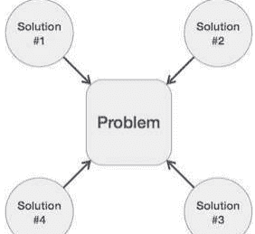

因此，对于给定问题可以推导出许多解决方案算法。下一步是分析这些拟议的解决方案算法并实现最合适的解决方案。

### 算法分析

算法效率可在两个不同阶段分析：实现前和实现后。它们如下 –

**事前分析** – 这是对算法的理论分析。算法效率通过假设所有其他因素（例如处理器速度）均为常数且对实现无影响来衡量。

**事后分析** – 这是对算法的经验分析。所选算法使用编程语言实现。然后在目标计算机上执行。在此分析中，会收集运行时间和所需空间等实际统计数据。

我们将学习事前算法分析。算法分析涉及所涉及各种操作的执行或运行时间。操作的运行时间可定义为每个操作执行的计算机指令数。

### 算法复杂度

假设 X 是一个算法，n 是输入数据的大小，算法 X 使用的时间和空间是决定 X 效率的两个主要因素。

**时间因素** – 时间通过计算关键操作（如排序算法中的比较）的数量来衡量。

**空间因素** – 空间通过计算算法所需的最大内存空间来衡量。

算法 f(n) 的复杂度给出了以输入数据大小 n 为参数的算法所需运行时间和/或存储空间。

### 空间复杂度

算法的空间复杂度表示算法在其生命周期内所需的内存空间量。算法所需的空间等于以下两个组件之和 –

固定部分：存储某些数据和变量所需的空间，这些数据和变量与问题大小无关。例如，使用的简单变量和常量、程序大小等。

可变部分：变量所需的空间，其大小取决于问题的大小。例如，动态内存分配、递归栈空间等。

任何算法 P 的空间复杂度 S(P) 为 S(P) = C + SP(I)，其中 C 是固定部分，S(I) 是算法的可变部分，取决于实例特征 I。以下是一个简单示例，试图解释该概念 –

```
Algorithm: SUM(A, B) Step 1 START
Step 2 C ← A + B + 10 Step 3 Stop
```

这里我们有三个变量 A、B 和 C 以及一个常量。因此 S(P) = 1+3。现在，空间取决于给定变量和常量的数据类型，并将相应乘以。

### 时间复杂度

算法的时间复杂度表示算法运行至完成所需的时间量。时间要求可定义为数值函数 T(n)，其中 T(n) 可按步骤数来衡量，前提是每个步骤消耗常数时间。

例如，两个 n 位整数相加需要 n 步。因此，总计算时间为 T(n) = c*n，其中 c 是两个位相加所需的时间。在这里，我们观察到 T(n) 随输入大小增加而线性增长。

## 4. 渐进分析 数据结构与算法

算法的渐进分析是指定义其运行时性能的数学边界/框架。使用渐进分析，我们可以非常好地得出算法的最佳情况、平均情况和最坏情况场景。渐进分析是输入绑定的，即，如果算法没有输入，则结论是它在常数时间内工作。除了“输入”之外，所有其他因素都被视为常数。

渐进分析是指以计算的数学单位计算任何操作的运行时间。例如，一个操作的运行时间计算为 f(n)，而另一个操作可能计算为 g(n^2)。这意味着第一个操作的运行时间将随 n 的增加而线性增长，第二个操作的运行时间将在 n 增加时指数增长。同样，如果 n 显著较小，两个操作的运行时间将几乎相同。

通常，算法所需时间分为三种类型 – 最佳情况 – 程序执行所需的最短时间。平均情况 – 程序执行所需的平均时间。最坏情况 – 程序执行所需的最长时间。

### 渐进符号

以下是用于计算算法运行时间复杂度的常用渐进符号。

- O 符号
- Ω 符号
- Θ 符号

### 大 O 符号，O

符号 O(n) 是表达算法运行时间上界的正式方式。它衡量最坏情况时间复杂度，即算法可能完成所需的最长时间。

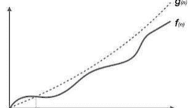

例如，对于函数 f(n)

```
O(f(n)) = { g(n) : there exists c > 0 and n0 such that g(n) ≤ c.f(n) for all n > n0. }
```

### Omega 符号，Ω

符号 Ω(n) 是表达算法运行时间下界的正式方式。它衡量最佳情况时间复杂度，即算法可能完成所需的最短时间。

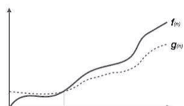

例如，对于函数 f(n)

```
Ω(f(n)) ≥ { g(n) : there exists c > 0 and n0 such that g(n) ≤ c.f(n) for all n > n0. }
```

### Theta 符号，θ


符号 $\theta(n)$ 是表达算法运行时间下界和上界的正式方法。它表示如下 –

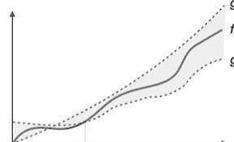

$\theta(f(n)) = \{ g(n) \text{ 当且仅当 } g(n) = O(f(n)) \text{ 且 } g(n) = \Omega(f(n)) \text{ 对于所有 } n > n0. \}$

### 常见渐进符号

以下是一些常见渐进符号的列表：

- 常数 – O(1)
- 对数 – O(log n)
- 线性 – O(n)
- n log n – O(n log n)
- 二次 – O(n²)
- 三次 – O(n³)
- 多项式 – n^O(1)
- 指数 – 2^O(n)

## 5. 贪心算法

算法旨在为给定问题实现最优解。在贪心算法方法中，决策是从给定的解域中做出的。由于贪心，选择看似能提供最优解的最接近解。

贪心算法试图寻找局部最优解，这最终可能导致全局优化解。然而，一般来说，贪心算法并不提供全局优化解。

### 计算硬币

这个问题是通过选择尽可能少的硬币来计算所需值，贪心方法迫使算法选择尽可能大的硬币。如果我们有面值为 €1、2、5 和 10 的硬币，并且需要计算 €18，那么贪心过程将是 –

- 1 – 选择一枚 €10 硬币，剩余金额为 8
- 2 – 然后选择一枚 €5 硬币，剩余金额为 3
- 3 – 然后选择一枚 €2 硬币，剩余金额为 1
- 4 – 最后，选择一枚 €1 硬币即可解决问题

不过，看起来运作良好，对于这个计数我们只需选取 4 枚硬币。但如果稍微改变问题，同样的方法可能无法产生相同的最优结果。

对于硬币面值为 1、7、10 的货币系统，计算面值 18 的硬币是绝对最优的，但对于像 15 这样的计数，可能会使用比必要更多的硬币。

例如，贪心方法将使用 10 + 1 + 1 + 1 + 1 + 1，总共 6 枚硬币。而同样的问题可以通过仅使用 3 枚硬币（7 + 7 + 1）来解决。

因此，我们可以得出结论，贪心方法选择即时优化解，在全局优化是主要考量的地方可能会失败。

### 示例

大多数网络算法使用贪心方法。以下是其中一些示例 –

- 旅行商问题
- Prim 最小生成树算法
- Kruskal 最小生成树算法
- Dijkstra 最小生成树算法
- 图 - 地图着色
- 图 - 顶点覆盖
- 背包问题
- 作业调度问题

有很多类似问题使用贪心方法来寻找最优解。

## 6. 分治法

在分治方法中，手头的问题被分解为更小的子问题，然后每个问题独立求解。当我们不断将子问题划分为更小的子问题时，我们最终可能达到无法再分的阶段。那些“原子”最小可能子问题（部分）被求解。所有子问题的解最终被合并，以获得原始问题的解。

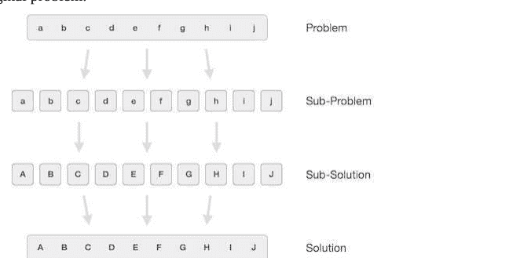

广义上，我们可以将分治方法理解为一个三步过程。

### 分解/拆分

此步骤涉及将问题分解为更小的子问题。子问题应代表原始问题的一部分。此步骤通常采用递归方法分割问题，直到没有子问题可以再分为止。在此阶段，子问题在性质上变得原子化，但仍代表实际问题的一部分。

### 征服/求解

此步骤接收大量待求解的较小子问题。通常，在此级别，问题被视为自行“求解”。

### 合并/合并

当较小的子问题被求解后，此阶段递归地合并它们，直到它们构成原始问题的解。这种算法方法递归工作，征服和合并步骤紧密配合，以至于看起来像是一个步骤。

### 示例

以下计算机算法基于分治编程方法 – 归并排序 快速排序 二分查找 Strassen 矩阵乘法 最近点对（点） 有多种方法可用于解决任何计算机问题，但上述是分治方法的良好示例。

## 7. 动态规划

动态规划方法与分治法类似，都将问题分解为越来越小的可能子问题。但与分治法不同，这些子问题不是独立求解的。相反，这些较小子问题的结果会被记住，并用于相似或重叠的子问题。

动态规划用于可以将问题分解为相似子问题，以便重用其结果的情况。这些算法大多用于优化。在求解当前子问题之前，动态算法会尝试检查先前求解的子问题的结果。子问题的解被组合，以实现最佳解。

因此，我们可以说 –

- 问题应能分解为较小的重叠子问题。
- 可以通过使用较小子问题的最优解来实现最优解。
- 动态算法使用记忆化。

### 比较

与贪心算法（关注局部优化）不同，动态算法旨在实现问题的整体优化。

与分治算法（将解组合以实现整体解）不同，动态算法使用较小子问题的输出，然后尝试优化更大的子问题。动态算法使用记忆化来记住已求解子问题的输出。

### 示例

以下计算机问题可使用动态规划方法求解 –

- 斐波那契数列
- 背包问题
- 汉诺塔
- Floyd-Warshall 所有点对最短路径
- Dijkstra 最短路径
- 项目调度

动态规划可以以自顶向下和自底向上的方式使用。当然，大多数情况下，引用先前解的输出比在 CPU 周期方面重新计算更便宜。

# 数据结构

## 8. 基本概念

本章解释与数据结构相关的基本术语。

### 数据定义

数据定义具有以下特征，用于定义特定数据。

- **原子性** – 定义应定义单一概念。
- **可追溯性** – 定义应能映射到某个数据元素。
- **准确性** – 定义应无歧义。
- **清晰简洁** – 定义应易于理解。

### 数据对象

数据对象表示拥有数据的对象。

### 数据类型

数据类型是对各种数据类型（如整数、字符串等）进行分类的方式，它决定了可与相应数据类型一起使用的值、可对相应数据类型执行的操作类型。有两种数据类型 –

- 内置数据类型
- 派生数据类型

### 内置数据类型

语言内置支持的数据类型称为内置数据类型。例如，大多数语言提供以下内置数据类型。

- 整数
- 布尔值（true, false）
- 浮点数（小数）
- 字符和字符串

### 派生数据类型

与实现无关（可以以多种方式实现）的数据类型称为派生数据类型。这些数据类型通常由基本或内置数据类型及其相关操作组合而成。例如 –

- 列表
- 数组
- 栈
- 队列


### 基本操作

数据结构中的数据由某些操作处理。所选的特定数据结构在很大程度上取决于需要对数据结构执行的操作的频率。

- 遍历
- 搜索
- 插入
- 删除
- 排序
- 合并

## 9. 数组数据结构与算法

数组是一个容器，可以容纳固定数量的项目，这些项目应为相同类型。大多数数据结构都使用数组来实现其算法。以下是理解数组概念的重要术语。

**元素** – 存储在数组中的每个项目称为元素。

**索引** – 数组中每个元素的位置都有一个数值索引，用于标识元素。

### 数组表示

数组可以在不同语言中以多种方式声明。为示例，让我们看看 C 语言的数组声明。

```c
int array[10] = { 35, 33, 42, 10, 14, 19, 27, 44, 26, 31 }
```

| 元素 | 35 | 33 | 42 | 10 | 14 | 19 | 27 | 44 | 26 | 31 |
|------|----|----|----|----|----|----|----|----|----|----|
| 索引 | 0  | 1  | 2  | 3  | 4  | 5  | 6  | 7  | 8  | 9  |

以下是需要考虑的重要点。

索引从 0 开始。

数组长度为 10，这意味着它可以存储 10 个元素。

每个元素可以通过其索引访问。例如，我们可以获取索引 6 处的元素为 27。

### 基本操作

以下是数组支持的基本操作。

- **遍历** – 逐个打印所有数组元素。
- **插入** – 在给定索引处添加一个元素。
- **删除** – 删除给定索引处的一个元素。
- **搜索** – 使用给定索引或按值搜索元素。
- **更新** – 更新给定索引处的元素。

在 C 语言中，当数组按大小初始化时，它会按以下顺序为其元素分配默认值。

### 数据类型 默认值

| 数据类型 | 默认值 |
|----------|--------|
| bool     | false  |
| char     | 0      |
| int      | 0      |
| float    | 0.0f   |
| double   | 0.0    |
| wchar_t  | 0      |

### 插入操作

插入操作是将一个或多个数据元素插入数组。根据要求，新元素可以添加到数组的开头、结尾或任何给定索引处。

这里，我们看到插入操作的实际实现，其中我们在数组末尾添加数据 –

### 算法

设数组为包含 MAX 个元素的线性无序数组。

### 示例

### 结果

设 LA 为包含 N 个元素的线性数组（无序），K 是满足 K<=N 的正整数。以下是将 ITEM 插入 LA 第 K 个位置的算法 –

1. 开始
2. 设置 J=N
3. 设置 N = N+1
4. 当 J >= K 时重复步骤 5 和 6
5. 设置 LA[J+1] = LA[J]
6. 设置 J = J-1
7. 设置 LA[K] = ITEM
8. 停止

### 示例

以下是上述算法的实现 –

```c
#include <stdio.h>
main() {
int LA[] = {1,3,5,7,8};
int item = 10, k = 3, n = 5;
int i = 0, j = n;

printf("The original array elements are :\n");
for(i = 0; i<n; i++) {
printf("LA[%d] = %d \n", i, LA[i]);
}

n = n + 1;

while( j >= k){
LA[j+1] = LA[j]; j = j - 1;
}
LA[k] = item;
printf("The array elements after insertion \n");
for(i = 0; i<n; i++) {
printf("LA[%d] = %d \n", i, LA[i]);
}
}
```

当我们编译并执行上述程序时，它会产生以下结果 –

```
The original array elements are :
LA[0]=1
LA[1]=3
LA[2]=5
LA[3]=7
LA[4]=8
```

```
The array elements after insertion :
LA[0]=1
LA[1]=3
LA[2]=5
LA[3]=10
LA[4]=7
LA[5]=8
```

有关数组插入操作的其他变体，请单击此处

### 数组插入

在上一节中，我们学习了插入操作的工作原理。并非总是将元素插入数组末尾。以下可能是数组插入的情况 –

- 在数组开头插入
- 在数组给定索引处插入
- 在数组给定索引之后插入
- 在数组给定索引之前插入

### 在数组开头插入

当插入发生在开头时，会导致所有现有数据项向下移动一步。这里，我们设计并实现一个算法，将元素插入数组开头。

### 算法

我们假设 A 是包含 N 个元素的数组。它可以存储的最大元素数由 MAX 定义。我们首先检查数组是否有空闲空间来存储任何元素，然后再进行插入过程。

```
begin
IF N = MAX, return ELSE
N = N + 1
For All Elements in A
Move to next adjacent location
A[FIRST] = New_Element
end
```

### C 语言实现

```c
#include <stdio.h>
#define MAX 5

void main() {
int array[MAX] = { 2, 3, 4, 5 };
int N = 4; // number of elements in array
int i = 0; // loop variable
int value = 1; // new data element to be stored in array

// print array before insertion
printf("Printing array before insertion \n");
for(i = 0; i < N; i++) {
printf("array[%d] = %d \n", i, array[i]);
}

// now shift rest of elements downwards
for(i = N; i >= 0; i--) {
array[i+1] = array[i];
}

// add new element at first position
array[0] = value;
// increase N to reflect number of elements
N++;
// print to confirm
printf("Printing array after insertion \n");

for(i = 0; i < N; i++) {
printf("array[%d] = %d\n", i, array[i]);
}
}
```

该程序应产生以下输出 –

```
Printing array before insertion – array[0] = 2
array[1] = 3
array[2] = 4
array[3] = 5
Printing array after insertion – array[0] = 1
array[1] = 2
array[2] = 3
array[3] = 4
array[4] = 5
```

### 在数组给定索引处插入

在此场景中，我们给出了数组的确切位置（索引），需要在其中插入新数据元素（值）。首先我们检查数组是否已满，如果未满，则将该位置的所有数据元素向下移动一步。这将为新数据元素腾出空间。

### 算法

我们假设 A 是包含 N 个元素的数组。它可以存储的最大元素数由 MAX 定义。
begin
IF N = MAX, return ELSE
N = N + 1
SEEK Location index
For All Elements from A[index] to A[N] Move to next adjacent location
A[index] = New_Element end

### C 语言实现

```c
#include <stdio.h>
#define MAX 5
void main() {
int array[MAX] = {1, 2, 4, 5};

int N = 4;
int i = 0;
int index = 2;
int value = 3;

// print array before insertion
printf("Printing array before insertion \n");
for(i = 0; i < N; i++) {
printf("array[%d] = %d \n", i, array[i]);
}

// now shift rest of the elements downwards
for(i = N; i >= index; i--) {
array[i+1] = array[i];
}

// add new element at first position
array[index] = value;
// increase N to reflect number of elements
N++;
// print to confirm
printf("Printing array after insertion \n");
for(i = 0; i < N; i++) {
printf("array[%d] = %d \n", i, array[i]);
}
}
```

如果我们编译并运行上述程序，它将产生以下结果 –
Printing array before insertion – array[0] = 1
array[1] = 2
array[2] = 4
array[3] = 5
Printing array after insertion – array[0] = 1
array[1] = 2
array[2] = 3
array[3] = 4
array[4] = 5

### 在数组给定索引之后插入

在此场景中，我们给出了数组的一个位置（索引），需要在其后插入新数据元素（值）。只有查找过程不同，其余活动与前面的示例相同。

### 算法

我们假设 A 是包含 N 个元素的数组。它可以存储的最大元素数由 MAX 定义。
begin
IF N = MAX, return ELSE
N = N + 1
SEEK Location index
For All Elements from A[index + 1] to A[N] Move to next adjacent location
A[index + 1] = New_Element end

### C 语言实现

```c
#include <stdio.h>
#define MAX 5
void main() {
int array[MAX] = {1, 2, 4, 5};

int N = 4; // number of elements in array
int i = 0; // loop variable
int index = 1; // index location after which value will be inserted
int value = 3; // new data element to be inserted

// print array before insertion
printf("Printing array before insertion \n");
for(i = 0; i < N; i++) {
printf("array[%d] = %d \n", i, array[i]);
}

// now shift rest of the elements downwards
for(i = N; i >= index + 1; i--) {
array[i + 1] = array[i];
}

// add new element at first position
array[index + 1] = value;
// increase N to reflect number of elements
N++;
// print to confirm
printf("Printing array after insertion \n");
for(i = 0; i < N; i++) {
printf("array[%d] = %d\n", i, array[i]);
}
}
```

如果我们编译并运行上述程序，它将产生以下结果 –


插入前打印数组 – array[0] = 1
array[1] = 2
array[2] = 4
array[3] = 5
插入后打印数组 – array[0] = 1
array[2] = 3
array[3] = 4
array[4] = 5

### 在给定索引之前插入数组元素

在这种情况下，我们给定数组的一个位置（索引），需要在该位置之前插入一个新的数据元素（值）。这次我们查找至 index-1，即给定索引前方的一个位置。其余活动与前一个示例相同。

#### 算法

假设 A 是一个包含 N 个元素的数组。它可存储的最大元素数由 MAX 定义。
begin
IF N = MAX, return ELSE
N = N + 1
SEEK Location index
For All Elements from A[index - 1] to A[N] Move to next adjacent location
A[index - 1] = New_Element end

#### C 语言实现

```
#include <stdio.h>
#define MAX 5
void main() {
int array[MAX] = {1, 2, 4, 5};

int N = 4; // number of elements in array
int i = 0; // loop variable
int index = 3; // index location before which value will be inserted
int value = 3; // new data element to be inserted

// print array before insertion
printf("Printing array before insertion –\n"); for(i = 0; i < N; i++) {
printf("array[%d] = %d\n", i, array[i]); }
// now shift rest of the elements downwards for(i = N; i >= index + 1; i--) {
array[i + 1] = array[i];
}
// add new element at first position array[index + 1] = value;
// increase N to reflect number of elements N++;
// print to confirm
printf("Printing array after insertion –\n");
for(i = 0; i < N; i++) {
printf("array[%d] = %d\n", i, array[i]);
}
}
```

如果编译并运行上述程序，将产生以下结果 –

插入前打印数组 – array[1] = 2
array[2] = 4
array[3] = 5
插入后打印数组 – array[0] = 1
array[1] = 2
array[2] = 3
array[3] = 4
array[4] = 5

### 删除操作

删除操作是指从数组中移除一个现有元素并重新组织数组中所有元素的操作。

#### 算法

假设 LA 是一个包含 N 个元素的线性数组，K 是一个正整数，且 K<=N。以下是在 LA 的第 K 位置删除元素的算法。

- 1. 开始
- 2. 设置 J=K
- 3. 当 J < N 时，重复步骤 4 和 5
- 4. 设置 LA[J-1] = LA[J]
- 5. 设置 J = J+1
- 6. 设置 N = N-1
- 7. 停止

#### 示例

以下是上述算法的实现 –

```
#include <stdio.h>
main() {
int LA[] = {1,3,5,7,8};
int k = 3, n = 5;
int i, j;

printf("The original array elements are :\n"); for(i = 0; i<n; i++) {
printf("LA[%d] = %d \n", i, LA[i]); }
j = k;
while( j < n) {
LA[j-1] = LA[j]; j = j + 1;
}
n = n -1;
printf("The array elements after deletion :\n");
for(i = 0; i<n; i++) {
printf("LA[%d] = %d \n", i, LA[i]);
}
}
```

当我们编译并执行上述程序时，它将产生以下结果 –

原始数组元素为：LA[0]=1
LA[1]=3
LA[2]=5
LA[3]=7
LA[4]=8
删除后的数组元素为：LA[0]=1
LA[1]=3
LA[2]=7
LA[3]=8

### 搜索操作

你可以根据数组元素的值或索引执行搜索。

#### 算法

假设 LA 是一个包含 N 个元素的线性数组，K 是一个正整数，且 K<=N。以下是使用顺序查找查找值为 ITEM 的元素的算法。

- 1. 开始
- 2. 设置 J=0
- 3. 当 J < N 时，重复步骤 4 和 5
- 4. 如果 LA[J] 等于 ITEM，则转到步骤 6
- 5. 设置 J = J + 1
- 6. 打印 J, ITEM
- 7. 停止

#### 示例

以下是上述算法的实现 –

```
#include <stdio.h>
main() {
int LA[] = {1,3,5,7,8};
int item = 5, n = 5;
int i = 0, j = 0;
printf("The original array elements are :\n");
for(i = 0; i<n; i++) {
printf("LA[%d] = %d \n", i, LA[i]);
}
while( j < n){
if( LA[j] == item ) { break; }
j = j + 1;
}
printf("Found element %d at position %d\n", item, j+1); }
```

当我们编译并执行上述程序时，它将产生以下结果 –

原始数组元素为：LA[0]=1
LA[1]=3
LA[2]=5
LA[3]=7
LA[4]=8
在位置 3 找到元素 5

### 更新操作

更新操作是指在给定索引处更新数组中的现有元素。

#### 算法

假设 LA 是一个包含 N 个元素的线性数组，K 是一个正整数，且 K<=N。以下是在 LA 的第 K 位置更新元素的算法。

- 1. 开始
- 2. 设置 LA[K-1] = ITEM
- 3. 停止

#### 示例

以下是上述算法的实现 –

```
#include <stdio.h>
main() {
int LA[] = {1,3,5,7,8};
int k = 3, n = 5, item = 10;
int i, j;
printf("The original array elements are :\n");
for(i = 0; i<n; i++) {
printf("LA[%d] = %d \n", i, LA[i]);
}
LA[k-1] = item;
printf("The array elements after updation :\n"); for(i = 0; i<n; i++) {
printf("LA[%d] = %d \n", i, LA[i]);
}
}
```

当我们编译并执行上述程序时，它将产生以下结果 –

原始数组元素为：LA[0]=1
LA[1]=3
LA[2]=5
LA[3]=7
LA[4]=8
更新后的数组元素为：LA[0]=1
LA[1]=3
LA[2]=10
LA[3]=7
LA[4]=8

# 链表

## 10. 链表 – 基础数据结构与算法

链表是一系列通过链接连接在一起的数据结构。

链表是包含数据项的一系列链接。每个链接包含指向另一个链接的连接。链表是数组之后使用最广泛的第二种数据结构。以下是理解链表概念的重要术语。

- **链接** – 链表中每个链接可以存储称为元素的数据。
- **下一个** – 链表中每个链接包含指向下一个链接的链接，称为 Next。
- **链表** – 链表包含指向第一个链接的连接链接，称为 First。

### 链表表示

链表可以可视化为一条节点链，其中每个节点指向下一个节点。

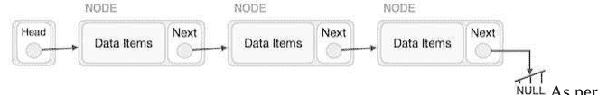

上述插图中，需要考虑以下重要点。

- 链表包含一个称为 first 的链接元素。
- 每个链接携带一个数据字段和一个称为 next 的链接字段。
- 每个链接通过其 next 链接与下一个链接相连。
- 最后一个链接携带一个为 null 的链接以标记列表的末尾。

### 链表类型

以下是各种类型的链表。

- 简单链表 – 项目仅支持向前导航。
- 双向链表 – 项目可以向前和向后导航。
- 循环链表 – 最后一项包含将第一个元素作为 next 的链接，而第一个元素具有指向最后一个元素作为 previous 的链接。

### 基本操作

列表支持以下基本操作。

- **插入** – 在列表开头添加一个元素。
- **删除** – 删除列表开头的一个元素。
- **显示** – 显示完整列表。
- **搜索** – 使用给定键搜索元素。**删除** – 使用给定键删除元素。

### 插入操作

在链表中添加新节点是一个多步骤活动。我们将在此通过图表学习。首先，使用相同的结构创建一个节点，并找到需要插入的位置。

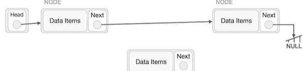

假设我们在 A（LeftNode）和 C（RightNode）之间插入一个节点 B（NewNode）。然后将 B.next 指向 C，NewNode.next --> RightNode；它应该如下所示 -

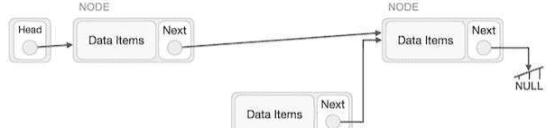

现在，左侧的下一个节点应指向新节点。LeftNode.next --> NewNode；

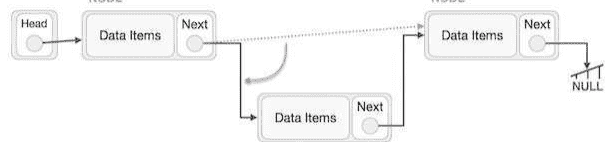

这将把新节点放在两者中间。新列表应如下所示 -

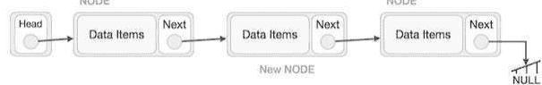

如果在列表开头插入节点，应采取类似步骤。在末尾插入时，列表的倒数第二个节点应指向新节点，而新节点将指向 NULL。


### 删除操作

删除也是一个多步骤的过程。我们将通过图示来学习。首先，使用搜索算法定位要删除的目标节点。

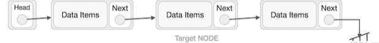

目标节点的（前驱）节点现在应指向目标节点的下一个节点 – LeftNode.next -> TargetNode.next;

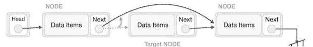

这将移除指向目标节点的链接。现在，使用以下代码，我们将移除目标节点所指向的内容。

```
TargetNode.next -> NULL;
```

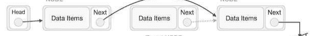

已删除的节点。我们可以将其保留在内存中，也可以简单地释放内存并完全擦除目标节点。

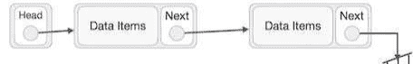

### 反转操作

这是一个彻底的操作。我们需要让头节点指向最后一个节点，并反转整个链表。

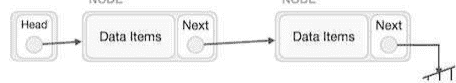

首先，我们遍历到列表的末尾。它应该指向 NULL。现在，我们将使其指向其前一个节点 –

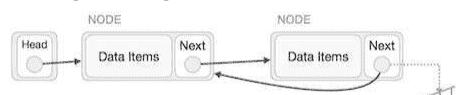

我们必须确保最后一个节点不是丢失的节点。所以我们会有一个临时节点，它看起来像头节点指向最后一个节点。现在，我们将使左侧的所有节点逐一指向它们的前一个节点。

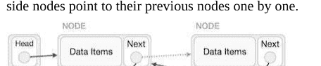

除了头节点指向的节点（第一个节点）之外，所有节点都应指向它们的前驱，使它们成为新的后继。第一个节点将指向 NULL。

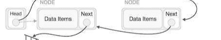

我们将使用临时节点使头节点指向新的第一个节点。

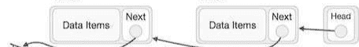

链表现在已反转。要查看 C 编程语言中的链表实现，请单击此处。

### C 语言中的链表程序

链表是一系列通过链接连接在一起的数据结构。链表是包含项目的一系列链接。每个链接包含到另一个链接的连接。链表是数组之后使用最多的第二种数据结构。

#### C 语言中的实现

```c
#include <stdio.h>
#include <string.h>
#include <stdlib.h>
#include <stdbool.h>

struct node {
   int data;
   int key;
   struct node *next;
};

struct node *head = NULL;
struct node *current = NULL;

// display the list
void printList() {
   struct node *ptr = head;
   printf("\n[" );

   // start from the beginning
   while(ptr != NULL) {
      printf("(%d,%d) ", ptr->key, ptr->data);
      ptr = ptr->next;
   }

   printf(" ]");
}

// insert link at the first location
void insertFirst(int key, int data) {
   // create a link
   struct node *link = (struct node*) malloc(sizeof(struct node));
   link->key = key;
   link->data = data;

   // point it to old first node
   link->next = head;

   // point first to new first node
   head = link;
}

// delete first item
struct node* deleteFirst() {
   // save reference to first link
   struct node *tempLink = head;

   // mark next to first link as first
   head = head->next;

   // return the deleted link
   return tempLink;
}

// is list empty
bool isEmpty() {
   return head == NULL;
}

int length() {
   int length = 0;
   struct node *current;
   for(current = head; current != NULL; current = current->next) {
      length++;
   }
   return length;
}

// find a link with given key
struct node* find(int key) {
   // start from the first link
   struct node* current = head;

   // if list is empty
   if(head == NULL) {
      return NULL;
   }

   // navigate through list
   while(current->key != key) {
      // if it is last node
      if(current->next == NULL) {
         return NULL;
      } else {
         // go to next link
         current = current->next;
      }
   }

   // if data found, return the current Link
   return current;
}

// delete a link with given key
struct node* delete(int key) {
   // start from the first link
   struct node* current = head;
   struct node* previous = NULL;

   // if list is empty
   if(head == NULL) {
      return NULL;
   }

   // navigate through list
   while(current->key != key) {
      // if it is last node
      if(current->next == NULL) {
         return NULL;
      } else {
         // store reference to current link
         previous = current;

         // move to next link
         current = current->next;
      }
   }

   // found a match, update the link
   if(current == head) {
      // change first to point to next link
      head = head->next;
   } else {
      // bypass the current link
      previous->next = current->next;
   }

   return current;
}

void sort() {
   int i, j, k, tempKey, tempData;
   struct node *current;
   struct node *next;

   int size = length();
   k = size;

   for (i = 0; i < size - 1; i++, k--) {
      current = head;
      next = head->next;

      for (j = 1; j < k; j++) {
         if (current->data > next->data) {
            tempData = current->data;
            current->data = next->data;
            next->data = tempData;

            tempKey = current->key;
            current->key = next->key;
            next->key = tempKey;
         }

         current = current->next;
         next = next->next;
      }
   }
}

void reverse(struct node** head_ref) {
   struct node* prev = NULL;
   struct node* current = *head_ref;
   struct node* next;

   while (current != NULL) {
      next = current->next;
      current->next = prev;
      prev = current;
      current = next;
   }

   *head_ref = prev;
}

main() {
   insertFirst(1, 10);
   insertFirst(2, 20);
   insertFirst(3, 30);
   insertFirst(4, 1);
   insertFirst(5, 40);
   insertFirst(6, 56);

   printf("Original List: ");
   // print list
   printList();

   while (!isEmpty()) {
      struct node *temp = deleteFirst();
      printf("\nDeleted value:");
      printf("(%d,%d) ", temp->key, temp->data);
   }

   printf("\nList after deleting all items: ");
   printList();

   insertFirst(1, 10);
   insertFirst(2, 20);
   insertFirst(3, 30);
   insertFirst(4, 1);
   insertFirst(5, 40);
   insertFirst(6, 56);

   printf("\nRestored List: ");
   printList();

   printf("\n");

   struct node *foundLink = find(4);
   if (foundLink != NULL) {
      printf("Element found : ");
      printf("(%d,%d) ", foundLink->key, foundLink->data);
      printf("\n");
   } else {
      printf("Element not found.");
   }

   delete(4);
   printf("List after deleting an item: ");
   printList();
   printf("\n");

   foundLink = find(4);
   if (foundLink != NULL) {
      printf("Element found : ");
      printf("(%d,%d) ", foundLink->key, foundLink->data);
      printf("\n");
   } else {
      printf("Element not found.");
   }

   printf("\n");
   sort();
   printf("List after sorting the data: ");
   printList();
   reverse(&head);
   printf("\nList after reversing the data: ");
   printList();
}
```

如果编译并运行上面的程序，它将产生以下结果 –

```
Original List:
[ (6,56) (5,40) (4,1) (3,30) (2,20) (1,10) ]
Deleted value: (6,56)
Deleted value: (5,40)
Deleted value: (4,1)
Deleted value: (3,30)
Deleted value: (2,20)
Deleted value: (1,10)
List after deleting all items:
[ ]
Restored List:
[ (6,56) (5,40) (4,1) (3,30) (2,20) (1,10) ]
Element found: (4,1)
List after deleting an item:
[ (6,56) (5,40) (3,30) (2,20) (1,10) ]
Element not found.
List after sorting the data:
[ (1,10) (2,20) (3,30) (4,50) (6,56) ]
List after reversing the data:
[ (6,56) (5,40) (3,30) (2,20) (1,10) ]
```

## 11. 双向链表数据结构与算法

双向链表是链表的一种变体，与单向链表相比，它可以方便地向前和向后导航。以下是理解双向链表概念的重要术语。

- **链接** – 链表中的每个链接可以存储称为元素的数据。
- **下一个** – 链表中的每个链接包含指向下一个链接的链接，称为下一个。
- **前一个** – 链表中的每个链接包含指向前一个链接的链接，称为前一个。
- **链表** – 链表包含指向第一个链接的连接链接，称为第一个，以及指向最后一个链接的连接链接，称为最后一个。

### 双向链表表示

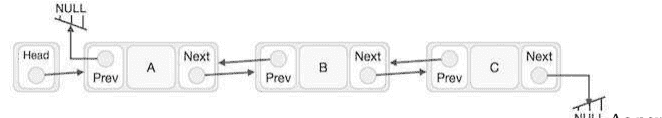

在上述图示中，以下是需要考虑的重要点。

- 双向链表包含称为 first 和 last 的链接元素。
- 每个链接携带一个数据字段和一个称为 next 的链接字段。
- 每个链接使用其下一个链接与下一个链接相连。
- 每个链接使用其前一个链接与前一个链接相连。
- 最后一个链接携带一个空链接以标记列表的末尾。


### 基本操作

列表支持以下基本操作。

- 插入 – 在列表开头添加一个元素。
- 删除 – 删除列表开头的一个元素。
- 插入末尾 – 在列表末尾添加一个元素。
- 删除末尾 – 从列表末尾删除一个元素。
- 插入后 – 在列表中的某个项目后添加一个元素。
- 删除 – 使用键从列表中删除一个元素。
- 正向显示 – 以正向方式显示完整列表。反向显示 – 以反向方式显示完整列表。

### 插入操作

以下代码演示了在双向链表开头执行插入操作。

```c
//insert link at the first location void insertFirst(int key, int data) {
//create a link
struct node *link = (struct node*) malloc(sizeof(struct node)); link->key = key;
link->data = data;
if(isEmpty()) {
//make it the last link last = link;
} else {
//update first prev link head->prev = link;
}
//point it to old first link link->next = head;
//point first to new first link head = link;
}
```

### 删除操作

以下代码演示了在双向链表开头执行删除操作。

```c
//delete first item
struct node* deleteFirst() {
//save reference to first link struct node *tempLink = head;
//if only one link
if(head->next == NULL) { last = NULL;
} else {
head->next->prev = NULL;
}

head = head->next;
//return the deleted link return tempLink;
}
```

### 操作末尾的插入

以下代码演示了在双向链表最后位置执行插入操作。

```c
//insert link at the last location void insertLast(int key, int data) {
//create a link
struct node *link = (struct node*) malloc(sizeof(struct node)); link->key = key;
link->data = data;
if(isEmpty()) {
//make it the last link
last = link;
} else {
//make link a new last link
last->next = link;
//mark old last node as prev of new link link->prev = last;
}
//point last to new last node
last = link;
}
```

要查看 C 编程语言中的实现，请单击此处。

### C 语言中的双向链表程序

双向链表是链表的一种变体，与单向链表相比，它可以轻松地向前和向后进行导航。

#### C 语言实现

```c
#include <stdio.h>
#include <string.h>
#include <stdlib.h>
#include <stdbool.h>
struct node {
    int data;
    int key;
    struct node *next;
    struct node *prev;
};
//this link always point to first Link
struct node *head = NULL;
//this link always point to last Link
struct node *last = NULL;
struct node *current = NULL;
//is list empty
bool isEmpty(){
    return head == NULL;
}
int length(){
    int length = 0;
    struct node *current;
    for(current = head; current != NULL; current = current->next){
        length++;
    }
    return length;
}
//display the list in from first to last
void displayForward(){
    //start from the beginning
    struct node *ptr = head;
    //navigate till the end of the list
    printf("\n ");
    while(ptr != NULL){
        printf(("%d,%d " ),ptr->key,ptr->data);
        ptr = ptr->next;
    }
    printf(" ");
}
//display the list from last to first
void displayBackward(){
    //start from the last
    struct node *ptr = last;
    //navigate till the start of the list
    printf("\n ");
    while(ptr != NULL){
        //print data
        printf(("%d,%d " ),ptr->key,ptr->data);
        //move to next item
        ptr = ptr ->prev;
        printf(" ");
    }
    printf(" ");
}
//insert link at the first location
void insertFirst(int key, int data){
    //create a link
    struct node *link = (struct node*) malloc(sizeof(struct node));
    link->key = key;
    link->data = data;

    if(isEmpty()){
        //make it the last link
        last = link;
    } else {
        //update first prev link
        head->prev = link;
    }
    //point it to old first link
    link->next = head;
    //point first to new first link
    head = link;
}
//insert link at the last location
void insertLast(int key, int data){
    //create a link
    struct node *link = (struct node*) malloc(sizeof(struct node));
    link->key = key;
    link->data = data;

    if(isEmpty()){
        //make it the last link
        last = link;
    } else {
        //make link a new last link
        last->next = link;
        //mark old last node as prev of new link
        link->prev = last;
    }
    //point last to new last node
    last = link;
}
//delete first item
struct node* deleteFirst(){
    //save reference to first link
    struct node *tempLink = head;
    //if only one link
    if(head->next == NULL){
        last = NULL;
    } else {
        head->next->prev = NULL;
    }

    head = head->next;
    //return the deleted link
    return tempLink;
}
//delete link at the last location
struct node* deleteLast(){
    //save reference to last link
    struct node *tempLink = last;
    //if only one link
    if(head->next == NULL){
        head = NULL;
    } else {
        last->prev->next = NULL;
    }
    last = last->prev;
    //return the deleted link
    return tempLink;
}
//delete a link with given key
struct node* delete(int key){
    //start from the first link
    struct node* current = head;
    struct node* previous = NULL;
    //if list is empty
    if(head == NULL){
        return NULL;
    }
    //navigate through list
    while(current->key != key){
        //if it is last node
        if(current->next == NULL){
            return NULL;
        } else {
            //store reference to current link
            previous = current;
            //move to next link
            current = current->next;
        }
    }
    //found a match, update the link
    if(current == head) {
        //change first to point to next link
        head = head->next;
    } else {
        //bypass the current link
        current->prev->next = current->next;
    }
    if(current == last){
        //change last to point to prev link
        last = current->prev;
    } else {
        current->next->prev = current->prev;
    }
    return current;
}
bool insertAfter(int key, int newKey, int data) {
    //start from the first link
    struct node* current = head;
    //if list is empty
    if(head == NULL){
        return false;
    }
    //navigate through list
    while(current->key != key){
        //if it is last node
        if(current->next == NULL){
            return false;
        } else {
            //move to next link
            current = current->next;
        }
    }
    //create a link
    struct node *newLink = (struct node*) malloc(sizeof(struct node));
    newLink->key = key;
    newLink->data = data;
    if(current == last) {
        newLink->next = NULL;
        last = newLink;
    } else {
        newLink->next = current->next;
        current->next->prev = newLink;
    }

    newLink->prev = current;
    current->next = newLink;
    return true;
}

main() {
    insertFirst(1,10);
    insertFirst(2,20);
    insertFirst(3,30);
    insertFirst(4,1);
    insertFirst(5,40);
    insertFirst(6,56);

    printf("\nList (First to Last): ");
    displayForward();

    printf("\n");

    printf("\nList (Last to first): ");
    displayBackward();

    printf("\nList after deleting first record: ");
    deleteFirst();
    displayForward();

    printf("\nList after deleting last record: ");
    deleteLast();
    displayForward();

    printf("\nList insert after key(4) : ");
    insertAfter(4,7, 13);
    displayForward();

    printf("\nList after delete key(4) : ");
    delete(4);
    displayForward();
}
```

如果编译并运行上述程序，将产生以下结果 –

```
List (First to Last):
[ (6,56) (5,40) (4,1) (3,30) (2,20) (1,10) ]

List (Last to first):
[ (1,10) (2,20) (3,30) (4,1) (5,40) (6,56) ]

List after deleting first record:
[ (5,40) (4,1) (3,30) (2,20) (1,10) ]

List after deleting last record:
[ (5,40) (4,1) (3,30) (2,20) ]

List insert after key(4) :
[ (5,40) (4,1) (4,13) (3,30) (2,20) ]

List after delete key(4) :
[ (5,40) (4,13) (3,30) (2,20) ]
```

## 12. 循环链表数据结构与算法

循环链表是链表的一种变体，其中第一个元素指向最后一个元素，最后一个元素指向第一个元素。单向链表和双向链表都可以变成循环链表。

### 作为循环的单向链表

在单向链表中，最后一个节点的 next 指针指向第一个节点。

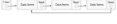

### 作为循环的双向链表

在双向链表中，最后一个节点的 next 指针指向第一个节点，第一个节点的 previous 指针指向最后一个节点，从而使两个方向都形成循环。

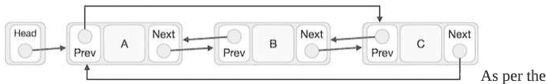

根据上述插图，需要考虑以下重要事项。

- 在单向链表和双向链表的两种情况下，最后一个链接的 next 都指向列表的第一个链接。
- 在双向链表的情况下，第一个链接的 previous 指向列表的最后一个元素。


### 基本操作

以下是循环列表支持的重要操作。

- insert – 在列表开头插入一个元素。
- delete – 从列表开头删除一个元素。
- display – 显示列表。

### 插入操作

以下代码演示了基于单链表的循环链表中的插入操作。

```c
//insert link at the first location
void insertFirst(int key, int data) {
//create a link
struct node *link = (struct node*) malloc(sizeof(struct node));
link->key = key;
link->data = data;

if (isEmpty()) {
head = link;
head->next = head;
} else {
//point it to old first node
link->next = head;

//point first to new first node
head = link;
}
}
```

#### 删除操作

以下代码演示了基于单链表的循环链表中的删除操作。

```c
//delete first item
struct node * deleteFirst() { //save reference to first link
struct node *tempLink = head;
if(head->next == head){ head = NULL;
return tempLink;
}
//mark next to first link as first
head = head->next;
//return the deleted link
return tempLink;
}
```

### 显示列表操作

以下代码演示了循环链表中的显示列表操作。

```c
//display the list
void printList() {
struct node *ptr = head;
printf("\n");

//start from the beginning
if(head != NULL) {
while(ptr->next != ptr) {
printf("(%d,%d) ",ptr->key,ptr->data); ptr = ptr->next;
}
}
printf(" ]"); }
```

要了解其在 C 编程语言中的实现，请单击此处。

### C 语言中的循环链表编程

循环链表是链表的一种变体，其中第一个元素指向最后一个元素，最后一个元素指向第一个元素。单链表和双链表都可以变成循环链表。

#### C 语言中的实现

```c
#include <stdio.h> #include <string.h> #include <stdlib.h> #include <stdbool.h>
struct node { int data; int key;
struct node *next; };
struct node *head = NULL; struct node *current = NULL;
bool isEmpty(){
return head == NULL;
}
int length(){
int length = 0;
//if list is empty if(head == NULL){ return 0;
}
current = head->next;
while(current != head){ length++;
current = current->next;
}
return length; }
//insert link at the first location
void insertFirst(int key, int data){
//create a link
struct node *link = (struct node*) malloc(sizeof(struct node)); link->key = key;
link->data = data;
if (isEmpty()){
head = link;
head->next = head;
}else {
//point it to old first node
link->next = head;
//point first to new first node
head = link;
}
//delete first item
struct node * deleteFirst(){
//save reference to first link
struct node *tempLink = head;
if(head->next == head){ head = NULL;
return tempLink;
}
//mark next to first link as first
head = head->next;
//return the deleted link
return tempLink;
}
}

//display the list
void printList(){
struct node *ptr = head; printf("\n[");
//start from the beginning
if(head != NULL){
while(ptr->next != ptr){
printf("(%d,%d) ",ptr->key,ptr->data); ptr = ptr->next;
}
}
printf(" ]"); }
main(){
insertFirst(1,10); insertFirst(2,20); insertFirst(3,30); insertFirst(4,1); insertFirst(5,40);
insertFirst(6,56); printf("Original List: ");
//print list
printList();

while(!isEmpty()){
struct node *temp = deleteFirst(); printf("\nDeleted value:");
printf("(%d,%d) ",temp->key,temp->data);
}
printf("\nList after deleting all items: "); printList();
}
```

如果编译并运行上述程序，将产生以下结果 –

```
Original List:
[ (6,56) (5,40) (4,1) (3,30) (2,20) ] Deleted value:(6,56)
Deleted value:(5,40)
Deleted value:(4,1)
Deleted value:(3,30)
Deleted value:(2,20)
Deleted value:(1,10)
List after deleting all items: [ ]
```

# 栈与队列

## 13. 栈数据结构与算法

栈是一种抽象数据类型（ADT），在大多数编程语言中都很常用。它被称为栈，因为它的行为类似于现实世界中的栈，例如一副牌或一盘盘子等。


现实世界中的栈只允许在一端进行操作。例如，我们只能从栈顶放置或移除一张牌或一个盘子。同样，栈 ADT 只允许在一端进行所有数据操作。在任何给定时间，我们只能访问栈的顶部元素。

此特性使其成为 LIFO 数据结构。LIFO 代表后进先出（Last-in-first-out）。在这里，最后放置（插入或添加）的元素会被首先访问。在栈术语中，插入操作称为 PUSH 操作，移除操作称为 POP 操作。

### 栈表示

以下图表描绘了栈及其操作 –

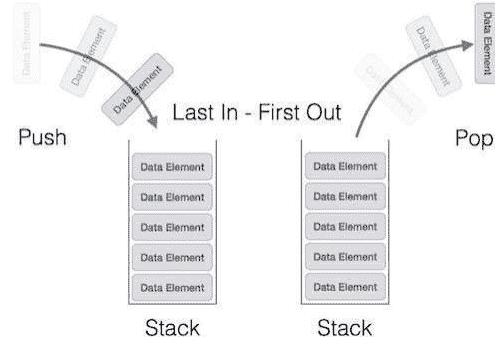

栈可以通过数组、结构体、指针和链表来实现。栈可以是固定大小的，也可以支持动态调整大小。在这里，我们将使用数组实现栈，这使其成为固定大小的栈实现。

### 基本操作

栈操作可能涉及初始化栈、使用它，然后反初始化它。

除了这些基本内容外，栈还用于以下两种主要操作 – push() – 将元素压入（存储到）栈中。pop() – 从栈中移除（访问）一个元素。

当数据被 PUSH 到栈上时。为了高效使用栈，我们还需要检查栈的状态。为此，向栈添加了以下功能 – peek() – 获取栈顶数据元素，但不移除它。isFull() – 检查栈是否已满。isEmpty() – 检查栈是否为空。

我们始终维护一个指向栈上最后 PUSH 数据的指针。由于该指针始终代表栈顶，因此命名为 top。top 指针在不实际移除元素的情况下提供栈顶值。

首先，我们应该了解支持栈函数的过程 –

#### peek()

peek() 函数的算法 - begin procedure peek return stack[top] end procedure

```c
Implementation of peek() function in C programming language -
int peek() {
return stack[top];
}
```

#### isfull()

isfull() 函数的算法 – begin procedure isfull if top equals to MAXSIZE return true else return false endif end procedure

```
Implementation of isfull() function in C programming language –
bool isfull() {
if(top == MAXSIZE) return true;
else
return false; }
```

#### isempty()

isempty() 函数的算法 – begin procedure isempty if top less than 1 return true else return false endif end procedure

C 语言中 isempty() 函数的实现略有不同。我们将 top 初始化为 -1，因为数组索引从 0 开始。因此，我们检查 top 是否低于零或等于 -1 以确定栈是否为空。以下是代码 -

```c
bool isempty() { if(top == -1) return true; else return false; }
```

### Push 操作

将新数据元素放入栈的过程称为 Push 操作。Push 操作涉及一系列步骤 –

- 步骤 1 – 检查栈是否已满。
- 步骤 2 – 如果栈已满，则产生错误并退出。
- 步骤 3 – 如果栈未满，则递增 top 以指向下一个空位置。
- 步骤 4 – 将数据元素添加到 top 指向的栈位置。
- 步骤 5 – 返回成功。

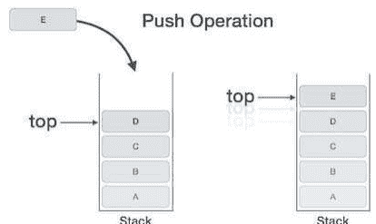

如果使用链表实现栈，则在步骤 3 中，我们需要动态分配空间。

### Push 操作的算法

Push 操作的简单算法可推导如下 –

```
begin procedure push: stack, data
if stack is full return null
endif

top ← top + 1
stack[top] ← data
end procedure
```

该算法在 C 语言中的实现非常简单。请参见以下代码 –

```c
void push(int data) {
if(IsFull()) {
top = top + 1;
stack[top] = data;
}else {
printf("Could not insert data, Stack is full.\n");
}
}
```


### Pop 操作

从栈中移除内容的同时访问该内容，称为 Pop 操作。在 pop() 操作的数组实现中，数据元素并未被实际移除，而是 **top** 被递减到栈中较低的位置以指向下一个值。但在链表实现中，pop() 会实际移除数据元素并释放内存空间。

Pop 操作可能包含以下步骤 –

- 步骤 1 – 检查栈是否为空。
- 步骤 2 – 如果栈为空，则产生错误并退出。
- 步骤 3 – 如果栈不为空，则访问 **top** 所指向的数据元素。
- 步骤 4 – 将 **top** 的值减 1。
- 步骤 5 – 返回成功。

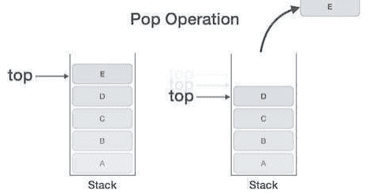

#### Pop 操作的算法

可以推导出 Pop 操作的简单算法如下 –

```
begin procedure pop: stack

if stack is empty
return null
endif

data <- stack[top]
top <- top - 1
return data
end procedure
```

该算法在 C 语言中的实现如下 –

```
int pop(int data) {

if(!isempty()) {
data = stack[top];
top = top - 1;
return data;
} else {
printf("Could not retrieve data, Stack is empty.\n");
}
}
```

有关 C 语言中完整栈程序的信息，请单击此处。

### C 语言中的栈程序

我们将在此处查看 C 语言中的栈实现。您可以单击“试用”按钮来尝试该程序。要了解栈的理论方面，请单击访问上一页。

#### C 语言实现

```
#include <stdio.h>

int MAXSIZE = 8; int stack[8]; int top = -1;

int isempty() {

   if(top == -1) return 1;
   else
   return 0; 
}

int isfull() {

   if(top == MAXSIZE) return 1;
   else
   return 0;
}

int peek() {
   return stack[top];
}

int pop() { 
   int data;

   if(!isempty()) {
   data = stack[top];
   top = top - 1;
   return data;
   } else {
   printf("Could not retrieve data, Stack is empty.\n");
   }
}

int push(int data) {

   if(!isfull()) {
   top = top + 1;
   stack[top] = data;
   } else {
   printf("Could not insert data, Stack is full.\n");
   }
}

int main() {
   // push items on to the stack push(3);
   push(5);
   push(9);
   push(1);
   push(12);
   push(15);
   printf("Element at top of the stack: %d\n",peek()); 
   printf("Elements: \n");
   // print stack data 
   while(!isempty()) { 
      int data = pop(); 
      printf("%d\n",data);
   }
   printf("Stack full: %s\n", isfull()?"true":"false"); 
   printf("Stack empty: %s\n", isempty()?"true":"false");
   return 0; 
}
```

如果编译并运行上述程序，将产生以下结果 –

```
Element at top of the stack: 15 Elements:
15
12
1
9
5
3
Stack full: false
Stack empty: true
```

## 14. 表达式解析数据结构与算法

编写算术表达式的方式称为表示法。算术表达式可以用三种不同但等价的表示法编写，即不改变表达式的本质或输出。这些表示法如下 –

- 中缀表示法
- 前缀（波兰）表示法
- 后缀（逆波兰）表示法

这些表示法根据其在表达式中使用运算符的方式命名。我们将在本章中学习相同内容。

### 中缀表示法

我们使用中缀表示法编写表达式，例如 a-b+c，其中运算符位于操作数之间。对人类来说，使用中缀表示法阅读、编写和表达都很容易，但这对计算设备来说并不适用。处理中缀表示法的算法在时间和空间消耗方面可能既困难又昂贵。

### 前缀表示法

在这种表示法中，运算符置于操作数之前，即运算符写在操作数前面。例如，+ab。这等同于其中缀表示法 a+b。前缀表示法也称为波兰表示法。

### 后缀表示法

这种表示法样式称为逆波兰表示法。在这种表示法样式中，运算符置于操作数之后，即运算符写在操作数后面。例如，ab+。这等同于其中缀表示法 a+b。

下表简要展示了三种表示法之间的区别 –

| 序号 | 中缀表示法 | 前缀表示法 | 后缀表示法 |
|---|---|---|---|
| 1 | a + b | + a b | a b + |
| 2 | (a + b) * c | * + a b c | a b + c * |
| 3 | a * (b + c) | * a + b c | a b c + * |
| 4 | a / b + c / d | + / a b / c d | a b / c d / + |
| 5 | (a + b) * (c + d) | * + a b + c d | a b + c d + * |
| 6 | ((a + b) * c) - d | - * + a b c d | a b + c * d |

### 解析表达式

正如我们所讨论的，设计算法或程序来解析中缀表示法并不是一种非常高效的方式。相反，这些中缀表示法首先被转换为后缀或前缀表示法，然后再进行计算。

要解析任何算术表达式，我们还需要考虑运算符优先级和结合性。

#### 优先级

当操作数位于两个不同运算符之间时，哪个运算符首先获取该操作数由运算符相对于其他运算符的优先级决定。例如 –
a + b * c -> a + ( b * c ) 由于乘法运算优先于加法运算，因此 b * c 将首先被求值。运算符优先级表将在后面提供。

#### 结合性

结合性描述了具有相同优先级的运算符出现在表达式时的规则。例如，在表达式 a+b-c 中，+ 和 – 具有相同的优先级，那么表达式的哪一部分将首先被求值由这些运算符的结合性决定。这里，+ 和 – 都是左结合的，因此表达式将被求值为 (a+b)-c。

优先级和结合性决定了表达式求值的顺序。以下是运算符优先级和结合性表（从高到低） –

| 序号 | 运算符 | 优先级 | 结合性 |
|---|---|---|---|
| 1 | 幂运算 ^ | 最高 | 右结合 |
| 2 | 乘法 ( * ) & 除法 ( / ) | 次高 | 左结合 |
| 3 | 加法 ( + ) & 减法 ( - ) | 最低 | 左结合 |

上表显示了运算符的默认行为。在表达式求值的任何时候，都可以通过使用括号来改变顺序。例如 – 在 a+b*c 中，表达式部分 b*c 将首先被求值，乘法优先于加法。我们在此处使用括号使 a+b 首先被求值，例如 (a+b)*c。

### 后缀求值算法

我们现在来看如何求值后缀表示法的算法 –

- 步骤 1 – 从左到右扫描表达式
- 步骤 2 – 如果是操作数，则将其压入栈
- 步骤 3 – 如果是运算符，则从栈中弹出操作数并执行操作
- 步骤 4 – 将步骤 3 的输出存回栈中
- 步骤 5 – 扫描表达式直到所有操作数都被消耗
- 步骤 6 – 弹出栈并执行操作

要查看 C 语言中的实现，请单击此处

### 使用栈解析表达式

中缀表示法对人类来说更易于阅读和理解，而对于计算机等电子设备，后缀是解析表达式的最佳形式。我们将在此处查看一个将中缀表示法转换并求值为后缀表示法的程序 –

```
#include<stdio.h> 
#include<string.h>
//char stack
char stack[25]; 
int top = -1;
void push(char item) { 
   stack[++top] = item;
}
char pop() {
   return stack[top--];
}
//returns precedence of operators 
int precedence(char symbol) {
   switch(symbol) { 
      case '+':
      case '-':
         return 2; 
         break;
      case '*':
      case '/':
         return 3; 
         break;
      case '^':
         return 4; 
         break;
      case '(':
      case ')':
      case '#':
         return 1; 
         break;
   }
}
```

```
//check whether the symbol is operator? 
int isOperator(char symbol) {
   switch(symbol) { 
      case '+':
      case '-':
      case '*':
      case '/':
      case '^':
      case '(':
      case ')':
         return 1; 
         break;
      default: 
         return 0;
   }
}
```

```
//converts infix expression to postfix 
void convert(char infix[],char postfix[]) { 
   int i,symbol,j = 0;
   stack[++top] = '#';

   for(i = 0;i<strlen(infix);i++) { 
      symbol = infix[i];

      if(isOperator(symbol) == 0) { 
         postfix[j] = symbol;
         j++;
      } else {
         if(symbol == '(' ) {
            push(symbol);
         } else {
            if(symbol == ')' ) {
               while(stack[top] != '(' ) { 
                  postfix[j] = pop(); 
                  j++;
               }
            }
            pop();// pop out ( .
         } else {
            if(precedence(symbol)>precedence(stack[top])) { 
               push(symbol);
            } else {
               while(precedence(symbol)<=precedence(stack[top])) { 
                  postfix[j] = pop();
                  j++;
               }
               push(symbol); 
            }
         }
      }
   }
   while(stack[top] != '#') { 
      postfix[j] = pop(); 
      j++;
   }
   postfix[j]='\0';//null terminate string. 
}
```

```
//int stack
int stack_int[25]; 
int top_int = -1;
void push_int(int item) { 
   stack_int[++top_int] = item;
}
char pop_int() {
   return stack_int[top_int--];
}
```

```
//evaluates postfix expression 
int evaluate(char *postfix){
   char ch;
   int i = 0,operand1,operand2;
   while ( ( ch = postfix[i++] ) != '\0' ) {
      if(isdigit(ch)) { 
         push_int(ch-'0'); // Push the operand


} else {
//Operator.pop two operands
operand2 = pop_int();
operand1 = pop_int();
switch(ch) {
case '+':
push_int(operand1+operand2); break;
case '-':
push_int(operand1-operand2); break;
case '*':
push_int(operand1*operand2); break;
case '/':
push_int(operand1/operand2); break;
}
}
return stack_int[top_int]; }

void main() {
char infix[25] = "1*(2+3)", postfix[25];
convert(infix, postfix);
printf("Infix expression is: %s\n", infix);
printf("Infix expression is: %s\n", postfix);
printf("Evaluated expression is: %d\n", evaluate(postfix));
}

如果编译并运行上述程序，它将产生以下结果 –

中缀表达式为: 1*(2+3) 后缀表达式为: 123+* 结果是: 5

## 15. 队列：数据结构与算法

队列是一种抽象数据结构，与栈有些相似。与栈不同，队列在两端都开放。一端始终用于插入数据（入队），另一端用于删除数据（出队）。队列遵循先进先出（First-In-First-Out）方法，即先存入的数据项将首先被访问。


队列的现实例子可以是单行道单向车道，车辆先进入，先退出。更多现实例子可以在售票窗口和公交车站看到排队。

### 队列表示

现在我们了解到，在队列中，我们出于不同原因访问两端。下面的图表试图解释队列作为数据结构的表示 –


与栈一样，队列也可以使用数组、链表、指针和结构体实现。为求简单，我们将使用一维数组实现队列。

### 基本操作

队列操作可能涉及初始化或定义队列、使用它，然后将其从内存中完全删除。这里我们将尝试理解与队列相关的基本操作 –

- enqueue() – 向队列添加（存储）一个项目。
- dequeue() – 从队列中删除（访问）一个项目。

为了使上述队列操作更高效，还需要一些其他函数。这些函数是 –

- peek() – 获取队列前端的元素，但不删除它。
- isfull() – 检查队列是否已满。
- isempty() – 检查队列是否为空。

在队列中，我们始终由 front 指针指向的数据进行出队（或访问），而在向队列中入队（或存储）数据时，我们借助 rear 指针。

首先，让我们了解一下队列的辅助函数 –

#### peek()

此函数有助于查看队列前端的数据。peek() 函数的算法如下 –

```
begin procedure peek
return queue[front]
end procedure
```

C 语言中 peek() 函数的实现 –

```
int peek() {
return queue[front];
}
```

#### isfull()

由于我们使用一维数组实现队列，只需检查 rear 指针是否达到 MAXSIZE 即可判断队列是否已满。如果我们使用循环链表维护队列，算法将有所不同。isfull() 函数的算法 –

```
begin procedure isfull
if rear equals to MAXSIZE return true
else
return false
endif
end procedure
```

C 语言中 isfull() 函数的实现 –

```
bool isfull() {
if(rear == MAXSIZE - 1) return true;
else
return false;
}
```

#### isempty()

isempty() 函数的算法 –
begin procedure isempty

if front is less than MIN OR front is greater than rear return true
else
return false
endif

end procedure

如果 **front** 的值小于 MIN 或 0，则表示队列尚未初始化，因此为空。

这是 C 语言代码 –

```
bool isempty() {
if(front < 0 || front > rear) return true;
else
return false;
}
```

### 入队操作

队列维护两个数据指针，**front** 和 **rear**。因此，其实现相对于栈来说比较困难。

向队列中入队（插入）数据应采取以下步骤 – 步骤 1 – 检查队列是否已满。步骤 2 – 如果队列已满，产生溢出错误并退出。步骤 3 – 如果队列未满，递增 rear 指针以指向下一个空位。步骤 4 – 将数据元素添加到 rear 指向的队列位置。步骤 5 – 返回成功。

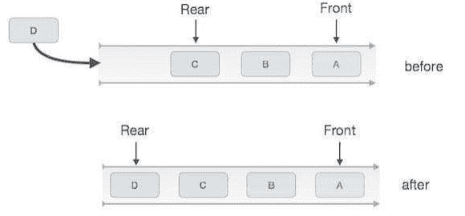

#### 队列入队

有时，我们还会检查队列是否已初始化，以处理任何意外情况。

#### 入队操作的算法

```
procedure enqueue(data) if queue is full return overflow endif
rear ← rear + 1 queue[rear] ← data return true
end procedure
```

C 语言中 enqueue() 的实现 –

```
int enqueue(int data) {
if(isfull())
return 0;
rear = rear + 1;
queue[rear] = data;
return 1;
}
```

### 出队操作

从队列中访问数据是一个包含两个任务的过程 – 访问 front 指向的数据，并在访问后删除数据。执行出队操作的步骤如下 –

- 步骤 1 – 检查队列是否为空。
- 步骤 2 – 如果队列为空，产生下溢错误并退出。
- 步骤 3 – 如果队列不为空，访问 front 指向的数据。
- 步骤 4 – 递增 front 指针以指向下一个可用数据元素。
- 步骤 5 – 返回成功。

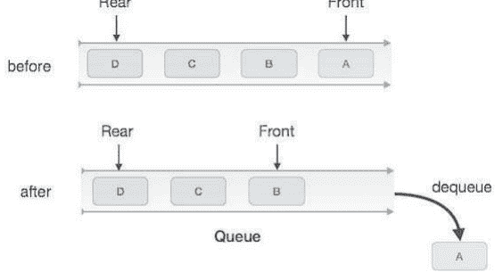

#### 出队操作的算法

```
procedure dequeue
if queue is empty
return underflow
end if
data = queue[front]
front <- front + 1
return true
end procedure
```

C 语言中 dequeue() 的实现 –

```
int dequeue() {
if(isempty())
return 0;
int data = queue[front];
front = front + 1;
return data;
}
```

有关 C 语言中完整的队列程序，请单击此处。

### C 语言中的队列程序

我们将在这里看到 C 语言中的栈实现。您可以单击 Try-it 按钮尝试该程序。要了解栈的理论方面，请单击访问上一页。

#### C 语言实现

```
#include <stdio.h>
#include <string.h>
#include <stdlib.h>
#include <stdbool.h>
#define MAX 6
int intArray[MAX];
int front = 0;
int rear = -1;
int itemCount = 0;
int peek(){
return intArray[front];
}
bool isEmpty(){
return itemCount == 0;
}
bool isFull(){
return itemCount == MAX;
}
int size(){
return itemCount;
}
void insert(int data){
if(!isFull()){
if(rear == MAX-1){
rear = -1;
}
intArray[++rear] = data;
itemCount++;
}
}
int removeData(){
int data = intArray[front++];
if(front == MAX){
front = 0;
}
itemCount--;
return data;
}
int main() {
/* insert 5 items */
insert(3);
insert(5);
insert(9);
insert(1);
insert(12);
// front : 0
// rear : 4
// \______// index : 0 1 2 3 4 // \______// queue : 3 5 9 1 12
insert(15);
// front : 0
// rear : 5
// \______// index : 0 1 2 3 4 5 // \______// queue : 3 5 9 1 12 15
if(isFull()){
printf("Queue is full!\n");
}
// remove one item
int num = removeData();
printf("Element removed: %d\n",num);
// front : 1
// rear : 5
// index : 1 2 3 4 5
// \______
// queue : 5 9 1 12 15
// insert more items
insert(16);
// front : 1
// rear : -1
// \______// index : 0 1 2 3 4 5 // \______// queue : 16 5 9 1 12 15
// As queue is full, elements will not be inserted. insert(17);
insert(18);
// \______// index : 0 1 2 3 4 5 // \______// queue : 16 5 9 1 12 15
printf("Element at front: %d\n",peek());
printf("\\______\\n");
printf("index : 5 4 3 2 1 0\n");
printf("\\______\\n");
printf("Queue: ");
}
while(!isEmpty()){
int n = removeData();
printf("%d ",n);
}
```
如果编译并运行上述程序，它将产生以下结果 -

队列已满！
已移除的元素：3 前端元素：5
\______index : 5 4 3 2 1 0
\______队列: 5 9 1 12 15 16

# 搜索技术

## 16. 线性搜索：数据结构与算法

线性搜索是一种非常简单的搜索算法。在这种搜索中，会对所有项目逐一进行顺序搜索。每个项目都会被检查，如果找到匹配项，则返回该特定项目，否则搜索将持续到数据集合的末尾。

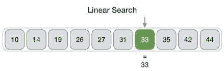

### 算法

- 线性搜索（数组 A，值 x）
- 步骤 1：将 i 设置为 1
- 步骤 2：如果 i > n，则转到步骤 7
- 步骤 3：如果 A[i] = x，则转到步骤 6
- 步骤 4：将 i 设置为 i + 1
- 步骤 5：转到步骤 2
- 步骤 6：打印在索引 i 处找到元素 X，并转到步骤 8
- 步骤 7：打印未找到元素
- 步骤 8：退出

### 伪代码

```
procedure linear_search (list, value)
for each item in the list
if match item == value
return the item's location
end if
end for
end procedure
```

要了解 C 语言中线性搜索的实现，请单击此处。


### C 语言中的线性搜索程序

这里我们展示了C语言中线性搜索的实现。程序的输出在代码之后给出。

#### 线性搜索程序

```
#include <stdio.h>
#define MAX 20
// array of items on which linear search will be conducted.
int intArray[MAX] = {1,2,3,4,6,7,9,11,12,14,15,16,17,19,33,34,43,45,55,66};
void printline(int count){
   int i;
   for(i = 0; i < count-1; i++){
      printf("=");
   }
   printf("=\n");
}
int find(int data){
   int comparisons = 0;
   int index = -1;
   int i;
   //navigate through all items
   for(i = 0; i < MAX; i++){
      // count the comparisons made
      comparisons++;
      // if data found, break the loop
      if(data == intArray[i]){
         index = i;
         break;
      }
   }
   printf("Total comparisons made: %d", comparisons);
   return index;
}
void display(){
   int i;
   printf("[");
   // navigate through all items
   for(i = 0; i < MAX; i++){
      printf("%d ", intArray[i]);
   }
   printf("]\n");
}
main(){
   printf("Input Array: ");
   display();
   printf("\n");
   //find location of 55
   int location = find(55);
   // if element was found
   if(location != -1)
      printf("\nElement found at location: %d", (location + 1));
   else
      printf("Element not found.");
}
```

如果编译并运行上面的程序，它将产生以下结果 -

```
Input Array: [1 2 3 4 6 7 9 11 12 14 15 16 17 19 33 34 43 45 55 66 ]

==================================================

Total comparisons made: 19

Element found at location: 19
```

## 17. 二分查找 数据结构与算法

二分查找是一种运行时间复杂度为 O(log n) 的快速搜索算法。该搜索算法基于分治原理。为了使该算法正常工作，数据集合应处于排序形式。

二分查找通过比较集合中间项来查找特定项。如果匹配，则返回项的索引。如果中间项大于该项，则在中间项右侧的子数组中搜索该项。否则，在中间项左侧的子数组中搜索该项。此过程在子数组上继续，直到子数组大小减为零。

### 二分查找的工作原理？

要使二分查找工作，目标数组必须已排序。我们将通过图示示例学习二分查找的过程。以下是我们的排序数组，假设我们需要使用二分查找查找值 31 的位置。

| 10 | 14 | 19 | 26 | 27 | 31 | 33 | 35 | 42 | 44 |
| :---: | :---: | :---: | :---: | :---: | :---: | :---: | :---: | :---: | :---: |
| 0 | 1 | 2 | 3 | 4 | 5 | 6 | 7 | 8 | 9 |

首先，我们将使用公式 mid = low + (high - low) / 2 确定数组的一半。这里是 0 + (9 - 0) / 2 = 4（4.5 的整数值）。因此，4 是数组的中间位置。

| 10 | 14 | 19 | 26 | 27 | 31 | 33 | 35 | 42 | 44 |
| :---: | :---: | :---: | :---: | :---: | :---: | :---: | :---: | :---: | :---: |
| 0 | 1 | 2 | 3 | 4 | 5 | 6 | 7 | 8 | 9 |

现在我们将位置 4 处存储的值与要搜索的值（即 31）进行比较。我们发现位置 4 处的值是 27，不匹配。由于该值大于 27 且我们有一个排序数组，因此我们也知道目标值必须在数组的上半部分。

| 10 | 14 | 19 | 26 | 27 | 31 | 33 | 35 | 42 | 44 |
| :---: | :---: | :---: | :---: | :---: | :---: | :---: | :---: | :---: | :---: |
| 0 | 1 | 2 | 3 | 4 | 5 | 6 | 7 | 8 | 9 |

我们将 low 改为 mid + 1 并再次找到新的 mid 值。low = mid + 1 mid = low + (high - low) / 2 我们的新 mid 现在是 7。我们将位置 7 处存储的值与目标值 31 进行比较。

| 10 | 14 | 19 | 26 | 27 | 31 | 33 | 35 | 42 | 44 |
| :---: | :---: | :---: | :---: | :---: | :---: | :---: | :---: | :---: | :---: |
| 0 | 1 | 2 | 3 | 4 | 5 | 6 | 7 | 8 | 9 |

位置 7 处存储的值不匹配，而是小于我们要查找的值。因此，该值必须从此位置的下半部分。

| 10 | 14 | 19 | 26 | 27 | 31 | 33 | 35 | 42 | 44 |
| :---: | :---: | :---: | :---: | :---: | :---: | :---: | :---: | :---: | :---: |
| 0 | 1 | 2 | 3 | 4 | 5 | 6 | 7 | 8 | 9 |

因此，我们再次计算 mid。这次是 5。

| 10 | 14 | 19 | 26 | 27 | 31 | 33 | 35 | 42 | 44 |
| :---: | :---: | :---: | :---: | :---: | :---: | :---: | :---: | :---: | :---: |
| 0 | 1 | 2 | 3 | 4 | 5 | 6 | 7 | 8 | 9 |

我们将位置 5 处存储的值与目标值进行比较。我们发现它是匹配的。

| 10 | 14 | 19 | 26 | 27 | 31 | 33 | 35 | 42 | 44 |
| :---: | :---: | :---: | :---: | :---: | :---: | :---: | :---: | :---: | :---: |
| 0 | 1 | 2 | 3 | 4 | 5 | 6 | 7 | 8 | 9 |

我们得出结论，目标值 31 存储在位置 5。

二分查找将可搜索项目减半，从而将要进行的比较次数减少到非常少的数字。

### 伪代码

二分查找算法的伪代码应如下所示 –

```
Procedure binary_search A ← sorted array
n ← size of array
x ← value to be searched
Set lowerBound = 1 Set upperBound = n
while x not found
if upperBound < lowerBound EXIT: x does not exist.
set midPoint = lowerBound + ( upperBound - lowerBound ) / 2
if A[midPoint] < x
set lowerBound = midPoint + 1
if A[midPoint] > x
set upperBound = midPoint - 1
if A[midPoint] = x
EXIT: x found at location midPoint
end while
end procedure
```

要了解在C语言中使用数组实现二分查找，请单击此处。

### C 语言中的二分查找程序

二分查找是一种运行时间复杂度为 O(log n) 的快速搜索算法。该搜索算法基于分治原理。为了使该算法正常工作，数据集合应处于排序形式。

#### C 语言实现

```
#include <stdio.h>
#define MAX 20
// array of items on which linear search will be conducted.
int intArray[MAX] = {1,2,3,4,6,7,9,11,12,14,15,16,17,19,33,34,43,45,55,66};
void printline(int count){
   int i;
   for(i = 0; i < count-1; i++){
      printf("=");
   }
   printf("=\n");
}
int find(int data){
   int lowerBound = 0;
   int upperBound = MAX - 1;
   int midPoint = -1;
   int comparisons = 0;
   int index = -1;
   while(lowerBound <= upperBound){
      printf("Comparison %d\n", (comparisons + 1));
      printf("lowerBound : %d, intArray[%d] = %d\n", lowerBound, lowerBound, intArray[lowerBound]);
      printf("upperBound : %d, intArray[%d] = %d\n", upperBound, upperBound, intArray[upperBound]);
      comparisons++;
      // compute the mid point
      midPoint = lowerBound + (upperBound - lowerBound) / 2;
      // data found
      if(intArray[midPoint] == data){
         index = midPoint;
         break;
      } else {
         // if data is larger
         if(intArray[midPoint] < data){
            // data is in upper half
            lowerBound = midPoint + 1;
         }
         // data is smaller
         else{
            // data is in lower half
            upperBound = midPoint - 1;
         }
      }
   }
   printf("Total comparisons made: %d", comparisons);
   return index;
}

void display(){
   int i;
   printf("\n");
   // navigate through all items
   for(i = 0; i < MAX; i++){
      printf("%d ", intArray[i]);
   }
   printf("\n");
}

main(){
   printf("Input Array: ");
   display();
   printline(50);
   // find location of 55
   int location = find(55);
   // if element was found
   if(location != -1)
      printf("\nElement found at location: %d", (location + 1));
   else
      printf("\nElement not found.");
}
```

如果编译并运行上面的程序，它将产生以下结果 -

```
Input Array: [ 1 2 3 4 6 7 9 11 12 14 15 16 17 19 33 34 43 45 55 66 ]
======================================================
Comparison 1
lowerBound : 0, intArray[0] = 1
upperBound : 19, intArray[19] = 66
Comparison 2
lowerBound : 10, intArray[10] = 15
upperBound : 19, intArray[19] = 66
Comparison 3
lowerBound : 15, intArray[15] = 34
upperBound : 19, intArray[19] = 66
Comparison 4
lowerBound : 18, intArray[18] = 55
upperBound : 19, intArray[19] = 66
Total comparisons made: 4
Element found at location: 19
```


## 18. 插值搜索 数据结构与算法

插值搜索是二分查找的一种改进变体。该搜索算法基于所需值的探测位置工作。为了使该算法正常工作，数据集合应处于排序且均匀分布的形式。

与线性搜索相比，二分查找在时间复杂度上具有巨大优势。线性搜索的最坏情况复杂度为 O(n)，而二分查找为 O(log n)。

存在目标数据位置可能预先已知的情况。例如，在电话簿中，如果我们想查找 Morphius 的电话号码。在这里，线性搜索甚至二分查找都会显得缓慢，因为我们可以直接跳转到存储以 'M' 开头的名称的内存空间。

### 二分查找中的定位

在二分查找中，如果未找到所需数据，则其余列表被分为两部分，较低部分和较高部分。搜索在其中任一部分进行。

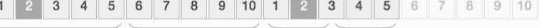

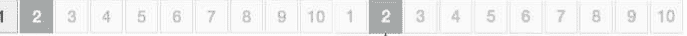

即使数据已排序，二分查找也不会利用探测所需数据位置的优势。

### 插值搜索中的位置探测

插值搜索通过计算探测位置来查找特定项目。最初，探测位置是集合中中间项目的位置。

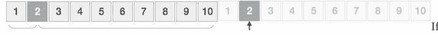

如果发生匹配，则返回该项目的索引。要将列表分为两部分，我们使用以下方法 –

mid = Lo + ((Hi - Lo) / (A[Hi] - A[Lo])) * (X - A[Lo])

其中 –

- A = 列表
- Lo = 列表的最低索引
- Hi = 列表的最高索引
- A[n] = 列表中索引 n 处存储的值

如果中间项目大于该项目，则在中间项目右侧的子数组中再次计算探测位置。否则，在中间项目左侧的子数组中搜索该项目。此过程在子数组上继续，直到子数组大小减为零。

在有利情况下，插值搜索算法的运行时复杂度为 O(log (log n))，而 BST 为 O(log n)。

### 算法

作为现有 BST 算法的改进，我们使用位置探测来搜索“目标”数据值索引的步骤如下 –

- 步骤 1 – 从列表中间开始搜索数据。
- 步骤 2 – 如果匹配，返回项目的索引并退出。
- 步骤 3 – 如果不匹配，探测位置。
- 步骤 4 – 使用探测公式分割列表并找到新的中间值。
- 步骤 5 – 如果数据大于中间值，则在较高子列表中搜索。
- 步骤 6 – 如果数据小于中间值，则在较低子列表中搜索。
- 步骤 7 – 重复直到匹配。

### 伪代码

```
A → Array list N → Size of A X → Target Value
Procedure Interpolation_Search()
Set Lo → 0 Set Mid → -1 Set Hi → N-1
While X does not match
if Lo equals to Hi OR A[Lo] equals to A[Hi] EXIT: Failure, Target not found
end if
Set Mid = Lo + ((Hi - Lo) / (A[Hi] - A[Lo])) * (X - A[Lo])
if A[Mid] = X
EXIT: Success, Target found at Mid
else
if A[Mid] < X
Set Lo to Mid+1
else if A[Mid] > X
Set Hi to Mid-1
end if
end if
End While
End Procedure
```

要了解 C 编程语言中插值搜索的实现，请单击此处。

### C 语言中的插值搜索程序

插值搜索是二分查找的一种改进变体。该搜索算法基于所需值的探测位置工作。为了使该算法正常工作，数据集合应处于排序且均匀分布的形式。

其运行时复杂度为 log2(log2 n)。

#### C 语言实现

```
#include<stdio.h>
#define MAX 10
// array of items on which linear search will be conducted. int list[MAX] = { 10, 14, 19, 26, 27, 31, 33, 35, 42, 44 };
int find(int data) {
int lo = 0;
int hi = MAX - 1;
int mid = -1;
int comparisons = 1;
int index = -1;
while(lo <= hi) {
printf("\nComparison %d \n" , comparisons );
printf("lo : %d, list[%d] = %d\n", lo, lo, list[lo]);
printf("hi : %d, list[%d] = %d\n", hi, hi, list[hi]);
comparisons++;
// probe the mid point
mid = lo + (((double)(hi - lo) / (list[hi] - list[lo])) * (data - list[lo]));
printf("mid = %d\n",mid);
// data found
if(list[mid] == data) {
index = mid;
break;
} else {
if(list[mid] < data) {
// if data is larger, data is in upper half
lo = mid + 1;
} else {
// if data is smaller, data is in lower half
hi = mid - 1;
}
}
}
printf("\nTotal comparisons made: %d", --comparisons);
return index;
}
int main() {
//find location of 33
int location = find(33);
// if element was found
if(location != -1)
printf("\nElement found at location: %d",(location+1));
else
printf("Element not found.");
return 0;
}
```

如果编译并运行上述程序，将产生以下结果 –

搜索 33
比较 1
lo : 0, list[0] = 10 hi : 9, list[9] = 44 mid = 6
总比较次数：1
元素在位置 7 处找到

可以更改搜索值并执行程序进行测试。

## 19. 哈希表 数据结构与算法

哈希表是一种以关联方式存储数据的数据结构。在哈希表中，数据以数组格式存储，每个数据值都有其唯一的索引值。如果知道所需数据的索引，数据访问将变得非常快。

因此，它成为一种插入和搜索操作非常快速的数据结构，与数据大小无关。哈希表使用数组作为存储介质，并使用哈希技术生成索引，用于插入或定位元素。

### 哈希

哈希是一种将一组键值转换为数组索引范围的技术。我们将使用模运算符来获取一组键值。考虑大小为 20 的哈希表示例，以下项目将被存储。项目采用 (键,值) 格式。

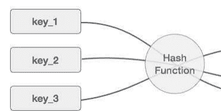

| 索引 | 值 |
|---|---|
| 0 | value_1 |
| 1 | value_2 |
| 2 | value_3 |
| 3 | value_4 |

- (2,70)
- (42,80)
- (4,25)
- (12,44)
- (14,32)
- (17,11)
- (13,78)
- (37,98)

| 序号 | 键 | 哈希 | 数组索引 |
|---|---|---|---|
| 1 | 1 | 1 % 20 = 1 | 1 |
| 2 | 2 | 2 % 20 = 2 | 2 |
| 3 | 42 | 42 % 20 = 2 | 2 |
| 4 | 4 | 4 % 20 = 4 | 4 |
| 5 | 12 | 12 % 20 = 12 | 12 |
| 6 | 14 | 14 % 20 = 14 | 14 |
| 7 | 17 | 17 % 20 = 17 | 17 |
| 8 | 13 | 13 % 20 = 13 | 13 |
| 9 | 37 | 37 % 20 = 17 | 17 |

### 线性探测

可以看到，哈希技术可能会创建数组中已使用的索引。在这种情况下，我们可以通过查看下一个单元格直到找到空单元格来搜索数组中的下一个空位置。这种技术称为线性探测。

| 序号 | 键 | 哈希 | 数组索引探测 | 数组索引 |
|---|---|---|---|---|
| 1 | 1 | 1 % 20 = 1 | 1 | 1 |
| 2 | 2 | 2 % 20 = 2 | 2 | 2 |
| 3 | 42 | 42 % 20 = 2 | 2 | 3 |
| 4 | 4 | 4 % 20 = 4 | 4 | 4 |
| 5 | 12 | 12 % 20 = 12 | 12 | 12 |
| 6 | 14 | 14 % 20 = 14 | 14 | 14 |
| 7 | 17 | 17 % 20 = 17 | 17 | 17 |
| 8 | 13 | 13 % 20 = 13 | 13 | 13 |
| 9 | 37 | 37 % 20 = 17 | 17 | 18 |

### 基本操作

以下是哈希表的基本主要操作。

- 搜索 – 在哈希表中搜索元素。
- 插入 – 在哈希表中插入元素。
- 删除 – 从哈希表中删除元素。

### 数据项

定义一个带有数据和键的数据项，将在哈希表中基于该键进行搜索。

```
struct DataItem {
int data;
int key;
};
```

### 哈希方法

定义一个哈希方法来计算数据项键的哈希码。

```
int hashCode(int key){
return key % SIZE;
}
```

### 搜索操作

无论何时要搜索元素，都要计算传递键的哈希码，并使用该哈希码作为数组中的索引来定位元素。如果在计算的哈希码处未找到元素，请使用线性探测来获取后续元素。

```
*search(int key){
//get the hash
int hashIndex = hashCode(key);
//move in array until an empty
while(hashArray[hashIndex] != NULL){
if(hashArray[hashIndex]->key == key)
return hashArray[hashIndex];
//go to next cell
++hashIndex;
//wrap around the table
hashIndex %= SIZE;
}
return NULL;
}
```


### Insert Operation

当要插入元素时，计算传入键的哈希码，并将该哈希码作为数组索引来定位位置。如果在计算出的哈希码处发现元素，则使用线性探测查找空位置。

```
void insert(int key, int data) {
    struct DataItem *item = (struct DataItem*) malloc(sizeof(struct DataItem));
    item->data = data;
    item->key = key;
    //get the hash
    int hashIndex = hashCode(key);
    //move in array until an empty or deleted cell
    while (hashArray[hashIndex] != NULL && hashArray[hashIndex]->key != -1) {
        //go to next cell
        ++hashIndex;
        //wrap around the table
        hashIndex %= SIZE;
    }
    hashArray[hashIndex] = item;
}
```

### Delete Operation

当要删除元素时，计算传入键的哈希码，并将该哈希码作为数组索引来定位位置。如果在计算出的哈希码处未找到元素，则使用线性探测向前查找元素。找到后，在此处存储一个虚拟项，以保持哈希表的性能完整。

```
struct DataItem* delete(struct DataItem* item) {
    int key = item->key;
    //get the hash
    int hashIndex = hashCode(key);
    //move in array until an empty
    while (hashArray[hashIndex] != NULL) {
        if (hashArray[hashIndex]->key == key) {
            struct DataItem* temp = hashArray[hashIndex];
            //assign a dummy item at deleted position
            hashArray[hashIndex] = dummyItem;
            return temp;
        }
        //go to next cell
        ++hashIndex;
        //wrap around the table
        hashIndex %= SIZE;
    }
    return NULL;
}
```

要了解 C 编程语言中的哈希实现，请单击此处。

### Hash Table Program in C

哈希表是一种以关联方式存储数据的数据结构。在哈希表中，数据以数组格式存储，每个数据值都有其唯一的索引值。如果我们知道所需数据的索引，数据访问将变得非常快。

#### Implementation in C

```
#include <stdio.h>
#include <string.h>
#include <stdlib.h>
#include <stdbool.h>
#define SIZE 20
struct DataItem {
    int data;
    int key;
};
struct DataItem* hashArray[SIZE];
struct DataItem* dummyItem;
struct DataItem* item;
int hashCode(int key) {
    return key % SIZE;
}
struct DataItem *search(int key) {
    //get the hash
    int hashIndex = hashCode(key);
    //move in array until an empty
    while (hashArray[hashIndex] != NULL) {
        if (hashArray[hashIndex]->key == key)
            return hashArray[hashIndex];
        //go to next cell
        ++hashIndex;
        //wrap around the table
        hashIndex %= SIZE;
    }
    return NULL;
}
void insert(int key, int data) {
    struct DataItem *item = (struct DataItem*) malloc(sizeof(struct DataItem));
    item->data = data;
    item->key = key;
    //get the hash
    int hashIndex = hashCode(key);
    //move in array until an empty or deleted cell
    while (hashArray[hashIndex] != NULL && hashArray[hashIndex]->key != -1) {
        //go to next cell
        ++hashIndex;
        //wrap around the table
        hashIndex %= SIZE;
    }
    hashArray[hashIndex] = item;
}
struct DataItem* delete(struct DataItem* item) {
    int key = item->key;
    //get the hash
    int hashIndex = hashCode(key);
    //move in array until an empty
    while (hashArray[hashIndex] != NULL) {
        if (hashArray[hashIndex]->key == key) {
            struct DataItem* temp = hashArray[hashIndex];
            //assign a dummy item at deleted position
            hashArray[hashIndex] = dummyItem;
            return temp;
        }
        //go to next cell
        ++hashIndex;
        //wrap around the table
        hashIndex %= SIZE;
    }
    return NULL;
}
void display() {
    int i = 0;
    for (i = 0; i < SIZE; i++) {
        if (hashArray[i] != NULL)
            printf(" (%d,%d)", hashArray[i]->key, hashArray[i]->data);
        else
            printf(" ~~ ");
    }
    printf("\n");
}
int main() {
    dummyItem = (struct DataItem*) malloc(sizeof(struct DataItem));
    dummyItem->data = -1;
    dummyItem->key = -1;
    insert(1, 20);
    insert(2, 70);
    insert(42, 80);
    insert(4, 25);
    insert(12, 44);
    insert(14, 32);
    insert(17, 11);
    insert(13, 78);
    insert(37, 97);
    display();
    item = search(37);
    if (item != NULL) {
        printf("Element found: %d\n", item->data);
    } else {
        printf("Element not found\n");
    }
    delete(item);
    item = search(37);
    if (item != NULL) {
        printf("Element found: %d\n", item->data);
    } else {
        printf("Element not found\n");
    }
}
```

```
~ (1,20) (2,70) (42,80) (4,25) ~~ ~~ ~~ ~~ ~~ ~~ ~~ ~~ ~~ (12,44) (13,78) (14,32) ~~ ~~
(17,11) (37,97) ~~
Element found: 97
Element not found
```

# Sorting Techniques

## 20. Sorting Algorithm Data Structures & Algorithms

排序是指将数据按特定格式排列。排序算法指定了以特定顺序排列数据的方式。最常见的顺序是数字顺序或字典顺序。

排序的重要性在于，如果数据以有序方式存储，数据搜索可以优化到非常高的水平。排序还用于以更易读的格式表示数据。以下是现实生活场景中排序的一些示例：

- **电话目录** – 电话目录按姓名存储人们的电话号码，以便可以轻松搜索姓名。
- **字典** – 字典按字母顺序存储单词，以便搜索任何单词都变得容易。

### In-place Sorting and Not-in-place Sorting

排序算法可能需要一些额外空间用于比较和临时存储少量数据元素。这些算法不需要任何额外空间，排序被认为是原地进行的，例如在数组本身中。这称为**原地排序**。冒泡排序是原地排序的一个示例。

然而，在某些排序算法中，程序需要的空间大于或等于正在排序的元素。使用等于或更多空间的排序称为**非原地排序**。归并排序是非原地排序的一个示例。

### Stable and Not Stable Sorting

如果排序算法在排序内容后，不会改变相似内容出现的顺序，则称为稳定排序。

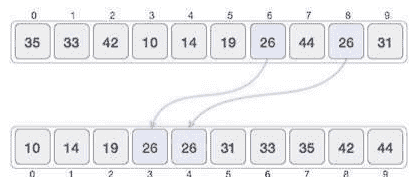

如果排序算法在排序内容后，改变了相似内容出现的顺序，则称为不稳定排序。

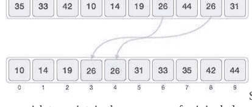

当我们希望保持原始元素的顺序时（例如在元组中），算法的稳定性很重要。

### Adaptive and Non-Adaptive Sorting Algorithm

如果排序算法利用待排序列表中已排序的元素，则称为自适应排序算法。也就是说，在排序过程中，如果源列表中已有一些元素排序好，自适应算法会考虑到这一点，并尽量不重新排序它们。

非自适应算法是不考虑已排序元素的算法。它们试图强制重新排序每个元素以确认其有序性。

### Important Terms

在讨论排序技术时，通常会创造一些术语，以下是对它们的简要介绍 –

#### Increasing Order

如果后续元素大于前一个元素，则值序列被认为是递增顺序。例如，1, 3, 4, 6, 8, 9 是递增顺序，因为每个下一个元素都大于前一个元素。

#### Decreasing Order

如果后续元素小于当前元素，则值序列被认为是递减顺序。例如，9, 8, 6, 4, 3, 1 是递减顺序，因为每个下一个元素都小于前一个元素。

#### Non-Increasing Order

如果后续元素小于或等于序列中的前一个元素，则值序列被认为是非递增顺序。当序列包含重复值时会出现这种顺序。例如，9, 8, 6, 6, 3, 3, 1 是非递增顺序，因为每个下一个元素都小于或等于（3 的情况）但不大于任何前一个元素。

#### Non-Decreasing Order

如果后续元素大于或等于序列中的前一个元素，则值序列被认为是非递减顺序。当序列包含重复值时会出现这种顺序。例如，1, 3, 3, 6, 8, 9 是非递减顺序，因为每个下一个元素都大于或等于（3 的情况）但不小于前一个元素。


## 21. 冒泡排序算法 数据结构与算法

冒泡排序是一种简单的排序算法。这种排序算法是基于比较的算法，其中每对相邻元素都会被比较，如果元素未按顺序排列，则交换它们。该算法不适合大型数据集，因为其平均和最坏情况复杂度为 O(n²)，其中 n 是项目数量。

### 冒泡排序如何工作？

我们以一个未排序的数组为例。冒泡排序需要 O(n²) 时间，因此我们将其简洁明了。

| 14 | 33 | 27 | 35 | 10 |
|---|---|---|---|---|

冒泡排序从最初的两个元素开始，比较它们以检查哪个更大。

| 14 | 33 | 27 | 35 | 10 |
|---|---|---|---|---|

在这种情况下，值 33 大于 14，因此它已经在排序位置。接下来，我们将 33 与 27 进行比较。

| 14 | 33 | 27 | 35 | 10 |
|---|---|---|---|---|

我们发现 27 小于 33，这两个值必须交换。

| 14 | 33 | 27 | 35 | 10 |
|---|---|---|---|---|

新数组应如下所示 –

| 14 | 27 | 33 | 35 | 10 |
|---|---|---|---|---|

接下来我们比较 33 和 35。我们发现两者都已在排序位置。

| 14 | 27 | 33 | 35 | 10 |
|---|---|---|---|---|

然后我们移动到下两个值，35 和 10。

| 14 | 27 | 33 | 35 | 10 |
|---|---|---|---|---|

我们随后知道 10 小于 35。因此它们未排序。

| 14 | 27 | 33 | 35 | 10 |
|---|---|---|---|---|

我们交换这些值。我们发现已到达数组末尾。经过一次迭代后，数组应如下所示 –

| 14 | 27 | 33 | 10 | 35 |
|---|---|---|---|---|

精确地说，我们现在展示数组在每次迭代后的样子。经过第二次迭代后，它应如下所示 –

| 14 | 27 | 10 | 33 | 35 |
|---|---|---|---|---|

请注意，每次迭代后，至少有一个值移动到末尾。

| 14 | 10 | 27 | 33 | 35 |
|---|---|---|---|---|

当不需要交换时，冒泡排序会得知数组已完全排序。现在我们应探讨冒泡排序的一些实际方面。

### 算法

我们假设 **列表** 是 **n** 个元素的数组。我们还假设 **交换** 函数交换给定数组元素的值。

```
begin BubbleSort(list)
for all elements of list
if list[i] > list[i+1] swap(list[i], list[i+1]) end if
end for
return list end BubbleSort
```

### 伪代码

我们在算法中观察到，冒泡排序比较每对数组元素，除非整个数组已按升序完全排序。这可能会引起一些复杂性问题，例如如果所有元素已按升序排列，数组可能不再需要交换。

为缓解此问题，我们使用一个标志变量 **已交换**，它将帮助我们查看是否发生过交换。如果未发生交换，即数组不需要更多处理即可排序，它将退出循环。

冒泡排序算法的伪代码可写作如下 –

```
procedure bubbleSort( List : array of items )
loop = list.count;
for i = 0 to loop-1 do: swapped = false
for j = 0 to loop-1 do:
/*compare the adjacent elements */if list[j] > list[j+1] then
/* swap them */
swap( list[j], list[j+1] )
swapped = true end if
end for
/*if no number was swapped that means array is sorted now, break the loop.*/
if(not swapped) then break
end if
end for end procedure return list
```

### 实现

我们在原始算法及其改进的伪代码中未解决的另一个问题是，每次迭代后，最高值会下沉到数组末尾。因此，下一次迭代无需包含已排序的元素。为此，在我们的实现中，我们限制内部循环以避免已排序的值。

要了解 C 编程语言中冒泡排序的实现，请单击此处。

### C 语言中的冒泡排序程序

我们将在此处查看 C 编程语言中 **冒泡排序** 的实现。

#### C 语言中的实现

```c
#include <stdio.h>
#include <stdbool.h>
#define MAX 10
int list[MAX] = {1,8,4,6,0,3,5,2,7,9};
void display(){
   int i;
   printf("["); // navigate through all items
   for(i = 0; i < MAX; i++){
      printf("%d ",list[i]);
   }
   printf("]\n");
}
void bubbleSort() {
   int temp;
   int i,j;
   bool swapped = false;
   // loop through all numbers
   for(i = 0; i < MAX-1; i++) {  swapped = false;
      // loop through numbers falling ahead
      for(j = 0; j < MAX-1-i; j++) {
         printf("Items compared: [ %d, %d ] ",list[j],list[j+1]);
         // check if next number is lesser than current no  //swap the numbers.
         // (Bubble up the highest number)
         if(list[j] > list[j+1]) {
            temp = list[j];
            list[j] = list[j+1];
            list[j+1] = temp;
            swapped = true;
            printf("=> swapped [%d, %d]\n",list[j],list[j+1]);
         } else {
            printf("=> not swapped\n");
         }
      }
      // if no number was swapped that means  // array is sorted now, break the loop.
      if(!swapped) {
         break;
      }
      printf("Iteration %d#: ",(i+1));
      display();
   }
}
main(){
   printf("Input Array: ");
   display();
   printf("\n");
   bubbleSort();
   printf("\nOutput Array : "); display();
}
```

```
Input Array: [1 8 4 6 0 3 5 2 7 9]
Items compared: [ 1, 8 ] => not swapped Items compared: [ 8, 4 ] => swapped [4, 8] Items compared: [ 8, 6 ] => swapped [6, 8] Items compared: [ 8, 0 ] => swapped [0, 8] Items compared: [ 8, 3 ] => swapped [3, 8] Items compared: [ 8, 5 ] => swapped [5, 8] Items compared: [ 8, 2 ] => swapped [2, 8] Items compared: [ 8, 7 ] => swapped [7, 8] Items compared: [ 8, 9 ] => not swapped
Iteration 1#: [1 4 6 0 3 5 2 7 8 9]
Items compared: [ 1, 4 ] => not swapped Items compared: [ 4, 6 ] => not swapped Items compared: [ 6, 0 ] => swapped [0, 6] Items compared: [ 6, 3 ] => swapped [3, 6] Items compared: [ 6, 5 ] => swapped [5, 6] Items compared: [ 6, 2 ] => swapped [2, 6] Items compared: [ 6, 7 ] => not swapped Items compared: [ 7, 8 ] => not swapped
Iteration 2#: [1 4 0 3 5 2 6 7 8 9]
Items compared: [ 1, 4 ] => not swapped Items compared: [ 4, 0 ] => swapped [0, 4] Items compared: [ 4, 3 ] => swapped [3, 4] Items compared: [ 4, 5 ] => not swapped Items compared: [ 5, 2 ] => swapped [2, 5] Items compared: [ 5, 6 ] => not swapped Items compared: [ 6, 7 ] => not swapped
Iteration 3#: [1 0 3 4 2 5 6 7 8 9]
Items compared: [ 1, 0 ] => swapped [0, 1] Items compared: [ 1, 3 ] => not swapped Items compared: [ 3, 4 ] => not swapped Items compared: [ 4, 2 ] => swapped [2, 4] Items compared: [ 4, 5 ] => not swapped Items compared: [ 5, 6 ] => not swapped
Iteration 4#: [0 1 2 3 4 5 6 7 8 9]
Items compared: [ 0, 1 ] => not swapped Items compared: [ 1, 3 ] => not swapped Items compared: [ 3, 2 ] => swapped [2, 3] Items compared: [ 3, 4 ] => not swapped Items compared: [ 4, 5 ] => not swapped
Iteration 5#: [0 1 2 3 4 5 6 7 8 9]
Items compared: [ 0, 1 ] => not swapped Items compared: [ 1, 2 ] => not swapped Items compared: [ 2, 3 ] => not swapped Items compared: [ 3, 4 ] => not swapped
Output Array: [0 1 2 3 4 5 6 7 8 9 ]
```

## 22. 插入排序 数据结构与算法

这是一种原地比较排序算法。这里，维护一个始终排序的子列表。例如，数组的下半部分被维护为已排序。要‘插入’到此已排序子列表中的元素，必须找到其适当位置，然后将其插入其中。因此得名，**插入排序**。

数组按顺序搜索，未排序的项目被移动并插入到已排序的子列表中（在同一数组内）。该算法不适合大型数据集，因为其平均和最坏情况复杂度为 O(n²)，其中 n 是项目数量。

### 插入排序如何工作？

我们以一个未排序的数组为例。

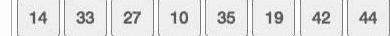

插入排序比较前两个元素。

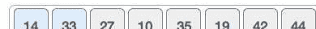

它发现 14 和 33 已按升序排列。目前，14 在已排序子列表中。

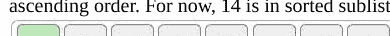

插入排序继续并将 33 与 27 进行比较。

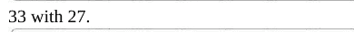

并发现 33 不在正确位置。

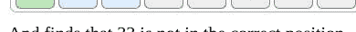

它将 33 与 27 交换。它还检查已排序子列表的所有元素。这里我们看到，已排序子列表只有一个元素 14，且 27 大于 14。因此，交换后已排序子列表仍保持排序。

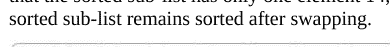

此时，已排序子列表中有 14 和 27。接下来，它将 33 与 10 进行比较。

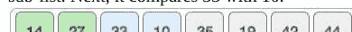

这些值未按排序顺序排列。

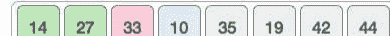

因此我们交换它们。

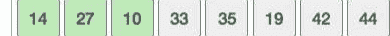

然而，交换使 27 和 10 变得未排序。

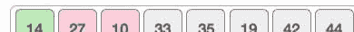

因此，我们也交换它们。

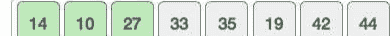

我们再次发现 14 和 10 未按排序顺序排列。


我们再次交换它们。到第三次迭代结束时，我们有一个包含 4 个项目的已排序子列表。

此过程持续进行，直到所有未排序的值都被包含在已排序的子列表中。现在我们来看看插入排序的一些编程方面。

### 算法

现在我们对这种排序技术的工作原理有了更全面的了解，因此可以推导出实现插入排序的简单步骤。

- 步骤 1 – 如果是第一个元素，它已经是排序好的。return 1;
- 步骤 2 – 选取下一个元素
- 步骤 3 – 与已排序子列表中的所有元素进行比较
- 步骤 4 – 将已排序子列表中大于待排序值的所有元素向后移动
- 步骤 5 – 插入该值
- 步骤 6 – 重复直到列表排序完成

### 伪代码

```
procedure insertionSort( A : array of items )
int holePosition
int valueToInsert

for i = 1 to length(A) inclusive do:

/* select value to be inserted */ valueToInsert = A[i]
holePosition = i

/*locate hole position for the element to be inserted */
while holePosition > 0 and A[holePosition-1] > valueToInsert do: A[holePosition] = A[holePosition-1]
holePosition = holePosition -1

end while

/* insert the number at hole position */ A[holePosition] = valueToInsert

end for
end procedure
```

要了解 C 编程语言中插入排序的实现，请单击此处。

### C 语言中的插入排序程序

这是一种原地比较排序算法。这里维护了一个始终保持排序的子列表。例如，数组的下半部分被保持为已排序状态。要在这个已排序子列表中“插入”一个元素，需要找到其合适的位置并将其插入其中。因此得名插入排序。

#### C 语言实现

```
#include <stdio.h>
#include <stdbool.h>
#define MAX 7
int intArray[MAX] = {4,6,3,2,1,9,7};
void printline(int count){
   int i;
   for(i = 0;i <count-1;i++){
      printf("=");
   }
   printf("=\n");
}
void display(){
   int i;
   printf("[");
   // navigate through all items
   for(i = 0;i<MAX;i++){
      printf("%d ",intArray[i]);
   }
   printf("]\n");
}
void insertionSort(){
   int valueToInsert;
   int holePosition;
   int i;
   // loop through all numbers
   for(i = 1; i < MAX; i++){
      // select a value to be inserted.
      valueToInsert = intArray[i];
      // select the hole position where number is to be inserted
      holePosition = i;
      // check if previous no. is larger than value to be inserted
      while (holePosition > 0 && intArray[holePosition-1] > valueToInsert){
         intArray[holePosition] = intArray[holePosition-1];
         holePosition--;
         printf(" item moved : %d\n" , intArray[holePosition]);
      }
      if(holePosition != i){
         printf(" item inserted : %d, at position : %d\n" , valueToInsert,holePosition);
         // insert the number at hole position
         intArray[holePosition] = valueToInsert;
      }
      printf("Iteration #%d:",i);
      display();
   }
}
main(){
   printf("Input Array: ");
   display();
   printline(50);
   insertionSort();
   printf("Output Array: ");
   display();
   printline(50);
}
```

如果编译并运行上述程序，将产生以下结果 –

```
Input Array: [4, 6, 3, 2, 1, 9, 7]
===============================================================
Iteration #1: [4, 6, 3, 2, 1, 9, 7]
item moved : 6
item moved : 4
item inserted : 3, at position : 0
Iteration #2: [3, 4, 6, 2, 1, 9, 7]
item moved : 6
item moved : 4
item moved : 3
item inserted : 2, at position : 0
Iteration #3: [2, 3, 4, 6, 1, 9, 7]
item moved : 6
item moved : 4
item moved : 3
item moved : 2
item inserted : 1, at position : 0
Iteration #4: [1, 2, 3, 4, 6, 9, 7]
Iteration #5: [1, 2, 3, 4, 6, 9, 7]
item moved : 9
item moved : 6
item inserted : 7, at position : 4
Iteration #6: [1, 2, 3, 4, 7, 6, 9]
Output Array: [1, 2, 3, 4, 7, 6, 9]
===============================================================
```

## 23. 选择排序 数据结构与算法

选择排序是一种简单的排序算法。这种排序算法是一种原地比较排序算法，其中列表被分为两部分，左端为已排序部分，右端为未排序部分。最初，已排序部分为空，未排序部分为整个列表。

从未排序数组中选取最小元素，并将其与最左侧元素交换，该元素即成为已排序数组的一部分。此过程继续将未排序数组的边界向右移动一个元素。

该算法不适合大型数据集，因为其平均和最坏情况复杂度为 O(n^2)，其中 n 是项目数量。

### 选择排序的工作原理？

请参考以下所示数组作为示例。

| 14 | 33 | 27 | 10 | 35 | 19 | 42 | 44 |
|---|---|---|---|---|---|---|---|

对于已排序列表的第一个位置，整个列表会被依次扫描。目前存放 14 的第一个位置，我们搜索整个列表并发现 10 是最低值。

| 14 | 33 | 27 | 10 | 35 | 19 | 42 | 44 |
|---|---|---|---|---|---|---|---|

因此我们用 10 替换 14。经过一次迭代后，10（恰好是列表中的最小值）出现在已排序列表的第一个位置。

| 10 | 33 | 27 | 14 | 35 | 19 | 42 | 44 |
|---|---|---|---|---|---|---|---|

对于第二个位置（当前存放 33 的位置），我们以线性方式开始扫描列表的其余部分。

| 10 | 33 | 27 | 14 | 35 | 19 | 42 | 44 |
|---|---|---|---|---|---|---|---|

我们发现 14 是列表中的第二低值，应该出现在第二个位置。我们交换这些值。

| 10 | 33 | 27 | 14 | 35 | 19 | 42 | 44 |
|---|---|---|---|---|---|---|---|

经过两次迭代后，两个最小值已按排序方式位于开头。

| 10 | 14 | 27 | 33 | 35 | 19 | 42 | 44 |
|---|---|---|---|---|---|---|---|

相同的过程应用于数组中的其余项目。

以下是整个排序过程的图示 –

| 步骤 | 数组 |
| :--- | :--- |
| 1 | 10 14 27 33 35 19 42 44 |
| 2 | 10 14 27 33 35 19 42 44 |
| 3 | 10 14 19 33 35 27 42 44 |
| 4 | 10 14 19 33 35 27 42 44 |
| 5 | 10 14 19 27 35 33 42 44 |
| 6 | 10 14 19 27 35 33 42 44 |
| 7 | 10 14 19 27 35 33 42 44 |
| 8 | 10 14 19 27 33 35 42 44 |
| 9 | 10 14 19 27 33 35 42 44 |

现在，让我们来了解一下选择排序的一些编程方面。

### 算法

- 步骤 1 – 将 MIN 设置为位置 0
- 步骤 2 – 在列表中搜索最小元素
- 步骤 3 – 与位置 MIN 处的值交换
- 步骤 4 – 递增 MIN 以指向下一个元素
- 步骤 5 – 重复直到列表排序完成

### 伪代码

```
procedure selection sort list : array of items n : size of list
for i = 1 to n - 1
/* set current element as minimum*/ min = i
/* check the element to be minimum */
for j = i+1 to n
if list[j] < list[min] then min = j;
end if
end for
/* swap the minimum element with the current element*/ if indexMin != i then
swap list[min] and list[i]
end if
end for
end procedure
```

要了解 C 编程语言中选择排序的实现，请单击此处。

### C 语言中的选择排序程序

这是一种原地比较排序算法。这种排序算法是一种原地比较排序算法，其中列表被分为两部分，左端为已排序部分，右端为未排序部分。最初，已排序部分为空，未排序部分为整个列表。

#### C 语言实现

```
#include <stdio.h>
#include <stdbool.h>
#define MAX 7
int intArray[MAX] = {4,6,3,2,1,9,7};
void printline(int count){
   int i;
   for(i = 0;i <count-1;i++){
      printf("=");
   }
   printf("=\n");
}
void display(){
   int i;
   printf("[");
   // navigate through all items
   for(i = 0;i<MAX;i++){
      printf("%d ", intArray[i]);
   }
   printf("]\n");
}
void selectionSort(){
   int indexMin,i,j;
   // loop through all numbers
   for(i = 0; i < MAX-1; i++) {
      // set current element as minimum indexMin = i;
      // check the element to be minimum
      for(j = i+1;j<MAX;j++){
         if(intArray[j] < intArray[indexMin]){
            indexMin = j;
         }
      }
      if(indexMin != i){
         printf("Items swapped: [ %d, %d ]\n", intArray[i], intArray[indexMin]);
         // swap the numbers
         int temp = intArray[indexMin];
         intArray[indexMin] = intArray[i];
         intArray[i] = temp;
      }
      printf("Iteration #%d:",(i+1));
      display();
   }
}
main(){
   printf("Input Array: ");
   display();
   printline(50);
   selectionSort();
   printf("Output Array: ");
   display();
   printline(50);
}
```


如果我们编译并运行上面的程序，它将产生以下结果 –

输入数组：[4, 6, 3, 2, 1, 9, 7]

```
========================================
Items swapped: [4, 1]
iteration 1: [1, 6, 3, 2, 4, 9, 7]
Items swapped: [6, 2]
iteration 2: [1, 2, 3, 6, 4, 9, 7]
iteration 3: [1, 2, 3, 4, 6, 9, 7]
Items swapped: [6, 4]
iteration 4: [1, 2, 3, 4, 6, 9, 7]
iteration 5: [1, 2, 3, 4, 6, 9, 7]
Items swapped: [9, 7]
iteration 6: [1, 2, 3, 4, 6, 7, 9]
Output Array: [1, 2, 3, 4, 6, 7, 9]
========================================
```

## 24. 归并排序算法 数据结构与算法

归并排序是一种基于分治法的排序技术。其最坏时间复杂度为 O(n log n)，是最受尊重的算法之一。归并排序首先将数组分成相等的两半，然后以有序方式将它们合并。

### 归并排序如何工作？

要理解归并排序，我们采用以下未排序的数组 –

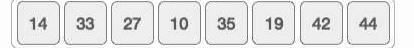

我们知道，归并排序首先迭代地将整个数组分成相等的两半，直到达到原子值。我们可以看到，一个包含 8 个元素的数组被分成了两个大小为 4 的数组。

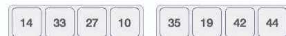

这不会改变原始数组中元素出现的顺序。现在我们将这两个数组分成两半。


我们进一步分割这些数组，直到达到无法再分割的原子值。

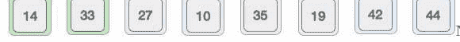

现在，我们以完全相同的方式将它们合并，就像它们被分解时一样。请注意给这些列表的颜色代码。

我们首先比较每个列表中的元素，然后以有序方式将它们合并到另一个列表中。我们看到 14 和 33 已处于排序位置。我们比较 27 和 10，在包含 2 个值的目标列表中先放 10，然后放 27。我们交换了 19 和 35 的顺序，而 42 和 44 则按顺序放置。

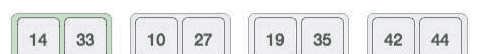

在合并阶段的下一次迭代中，我们比较包含两个数据值的列表，并将它们合并为一个找到的数据值列表，所有元素均按排序顺序放置。

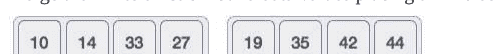

最终合并后，列表应如下所示 –


现在我们应该学习归并排序的一些编程方面。

### 算法

归并排序不断将列表分成相等的两半，直到无法再分割为止。根据定义，如果列表中只有一个元素，则它已排序。然后，归并排序将较小的已排序列表合并，同时保持新列表也已排序。

- 步骤 1 – 如果列表中只有一个元素，则它已排序，返回。
- 步骤 2 – 递归地将列表分成两半，直到无法再分割为止。
- 步骤 3 – 将较小的列表按排序顺序合并到新列表中。

### 伪代码

我们现在将看到归并排序函数的伪代码。正如我们的算法所指出的两个主要功能——分割与合并。归并排序使用递归，我们将以同样的方式查看我们的实现。

```
procedure mergesort( var a as array )
if ( n == 1 ) return a

var l1 as array = a[0] ... a[n/2]
var l2 as array = a[n/2+1] ... a[n]

l1 = mergesort( l1 )
l2 = mergesort( l2 )

return merge( l1, l2 ) end procedure
procedure merge( var a as array, var b as array )
var c as array

while ( a and b have elements ) if ( a[0] > b[0] )
add b[0] to the end of c remove b[0] from b
else
add a[0] to the end of c remove a[0] from a
end if
end while

while ( a has elements ) add a[0] to the end of c remove a[0] from a
end while

while ( b has elements ) add b[0] to the end of c remove b[0] from b
end while
return c
end procedure
```

要了解 C 语言中归并排序的实现，请单击此处。

### C 语言中的归并排序程序

归并排序是一种基于分治法的排序技术。其最坏时间复杂度为 O(n log n)，是最受尊重的算法之一。

#### C 语言中的实现

我们将在这里查看 C 语言中归并排序的实现 –

```
#include <stdio.h>
#define max 10
int a[10] = { 10, 14, 14, 19, 26, 27, 31, 33, 35, 42, 44 };
int b[10];
void merging(int low, int mid, int high) {
int l1, l2, i;
for(l1 = low, l2 = mid + 1, i = low; l1 <= mid && l2 <= high; i++) {
if(a[l1] <= a[l2])
b[i] = a[l1++];
else
b[i] = a[l2++];
}
while(l1 <= mid)
b[i++] = a[l1++];
while(l2 <= high)
b[i++] = a[l2++];
for(i = low; i <= high; i++) a[i] = b[i];
}
void sort(int low, int high) {
int mid;
if(low < high) {
mid = (low + high) / 2;
sort(low, mid);
sort(mid+1, high);
merging(low, mid, high);
} else {
return;
}
}
int main() {
int i;
printf("List before sorting\n");
for(i = 0; i < max; i++) printf("%d ", a[i]);
sort(0, max);
printf("\nList after sorting\n");
for(i = 0; i < max; i++) printf("%d ", a[i]);
}
```

如果我们编译并运行上面的程序，它将产生以下结果 –

排序前的列表
10 14 19 26 27 31 33 35 42 44 0
排序后的列表
0 10 14 19 26 27 31 33 35 42 44

## 25. 希尔排序 数据结构与算法

希尔排序是一种高效的排序算法，基于插入排序算法。当较小的值位于最右侧且需要移动到最左侧时，该算法避免了像插入排序那样的大规模移动。

该算法对广泛分布的元素使用插入排序，首先对它们进行排序，然后对间距较小的元素进行排序。这种间距称为间隔。该间隔根据 Knuth 公式计算如下 –

```
h = h * 3 + 1
```

其中 –

h 是间隔，初始值为 1

该算法对中等规模的数据集非常高效，因为其平均和最坏情况复杂度为 O(n)，其中 n 是项目数量。

### 希尔排序如何工作？

让我们考虑以下示例，以了解希尔排序的工作原理。我们采用之前示例中使用的同一数组。为了示例和易于理解，我们取间隔为 4。创建位于 4 个位置间隔的所有值的虚拟子列表。这里这些值为 {35, 14}、{33, 19}、{42, 27} 和 {10, 14}


我们比较每个子列表中的值，并在原始数组中交换它们（如有必要）。此步骤后，新数组应如下所示 –


然后，我们取间隔为 2，这个间隔生成两个子列表 - {14, 27, 35, 42}、{19, 10, 33, 44}


如果需要，我们在原始数组中比较并交换值。此步骤后，数组应如下所示 –


最后，我们使用值为 1 的间隔对数组的其余部分进行排序。希尔排序使用插入排序对数组进行排序。以下是逐步描述 –

```
14 19 27 10 35 33 42 44
14 19 27 10 35 33 42 44
14 19 27 10 35 33 42 44
14 19 27 10 35 33 42 44
14 19 10 27 35 33 42 44
14 10 19 27 35 33 42 44
10 14 19 27 35 33 42 44
10 14 19 27 35 33 42 44
10 14 19 27 33 35 42 44
10 14 19 27 33 35 42 44
```

我们看到只需要四次交换即可对数组的其余部分进行排序。

### 算法

以下是希尔排序的算法。

- 步骤 1 – 初始化 h 的值
- 步骤 2 – 将列表分成间隔相等的较小子列表 h
- 步骤 3 – 使用插入排序对这些子列表进行排序
- 步骤 4 – 重复直到整个列表排序完成

### 伪代码

以下是希尔排序的伪代码。

```
procedure shellSort() A : array of items

/* calculate interval*/
while interval < A.length / 3 do: interval = interval * 3 + 1 end while
while interval > 0 do:
for outer = interval; outer < A.length; outer ++ do:
/* select value to be inserted */ valueToInsert = A[outer]
inner = outer;
/*shift element towards right*/
while inner > interval - 1 && A[inner - interval] >= valueToInsert do: A[inner] = A[inner - interval]
inner = inner - interval
end while
/* insert the number at hole position */ A[inner] = valueToInsert
end for
/* calculate interval*/ interval = (interval - 1)/3;
end while
end procedure
```

要了解 C 语言中希尔排序的实现，请单击此处。


### C 语言中的希尔排序程序

希尔排序是一种高效的排序算法，基于插入排序算法。当较小的值位于最右侧且需要移动到最左侧时，该算法避免了像插入排序那样的大规模移动。

#### C 语言实现

```c
#include <stdio.h>
#include <stdbool.h>
#define MAX 7
int intArray[MAX] = {4, 6, 3, 2, 1, 9, 7};

void printline(int count) {
   int i;
   for (i = 0; i < count - 1; i++) {
      printf("=");
   }
   printf("=\n");
}

void display() {
   int i;
   printf("[");
   // navigate through all items
   for (i = 0; i < MAX; i++) {
      printf("%d ", intArray[i]);
   }
   printf("]\n");
}

void shellSort() {
   int inner, outer;
   int valueToInsert;
   int interval = 1;
   int elements = MAX;
   int i = 0;

   while (interval <= elements / 3) {
      interval = interval * 3 + 1;
   }

   while (interval > 0) {
      printf("iteration %d#:", i);
      display();

      for (outer = interval; outer < elements; outer++) {
         valueToInsert = intArray[outer];
         inner = outer;

         while (inner > interval - 1 && intArray[inner - interval] >= valueToInsert) {
            intArray[inner] = intArray[inner - interval];
            inner -= interval;
            printf(" item moved :%d\n", intArray[inner]);
         }

         intArray[inner] = valueToInsert;
         printf(" item inserted :%d, at position :%d\n", valueToInsert, inner);
      }

      interval = (interval - 1) / 3;
      i++;
   }
}

int main() {
   printf("Input Array: ");
   display();
   printline(50);
   shellSort();
   printf("Output Array: ");
   display();
   printline(50);
   return 1;
}
```

如果编译并运行上述程序，将产生以下结果 –

```
Input Array: [4, 6, 3, 2, 1, 9, 7]
==========================================
iteration 0#: [4, 6, 3, 2, 1, 9, 7]
item moved :4
item inserted :1, at position :0
item inserted :9, at position :5
item inserted :7, at position :6
iteration 1#: [1, 6, 3, 2, 4, 9, 7]
item inserted :6, at position :1
item moved :6
item inserted :3, at position :1
item moved :6
item moved :3
item inserted :2, at position :1
item moved :6
item inserted :4, at position :3
item inserted :9, at position :5
item moved :9
item inserted :7, at position :5
Output Array: [1, 2, 3, 4, 6, 7, 9]
==========================================
```

## 26. 快速排序 数据结构与算法

快速排序是一种高效的排序算法，基于将数据数组划分为更小数组的方式。大数组被划分为两个数组，一个存储小于指定值（称为基准值 pivot）的值，另一个存储大于基准值的值，划分依据即为该基准值。

快速排序对数组进行分区，然后递归调用自身两次来对生成的两个子数组进行排序。该算法对于大型数据集非常高效，因为其平均和最坏情况复杂度为 O(nlogn)，其中 n 为项目数量。

### 快速排序中的分区

以下动画表示说明如何在数组中找到基准值。


基准值将列表分为两部分。然后递归地，为每个子列表找到基准值，直到所有列表只包含一个元素。

### 快速排序基准值算法

基于我们对快速排序中分区的理解，我们现在尝试为其编写一个算法，如下所示。

- 步骤 1 – 选择最高索引值作为基准值
- 步骤 2 – 取两个变量指向列表左侧和右侧（不包括基准值）
- 步骤 3 – left 指向低索引
- 步骤 4 – right 指向高索引
- 步骤 5 – 当 left 处的值小于基准值时，向右移动
- 步骤 6 – 当 right 处的值大于基准值时，向左移动
- 步骤 7 – 如果步骤 5 和步骤 6 都不匹配，交换 left 和 right
- 步骤 8 – 如果 left ≥ right，则它们相遇的点即为新基准值

### 快速排序基准值伪代码

上述算法的伪代码可推导如下 –

```
function partitionFunc(left, right, pivot)
   leftPointer = left - 1
   rightPointer = right

   while True do
      while A[++leftPointer] < pivot do
      // do nothing
      end while

      while rightPointer > 0 && A[--rightPointer] > pivot do
      // do nothing
      end while

      if leftPointer >= rightPointer then
         break
      else
         swap leftPointer, rightPointer
      end if
   end while

   swap leftPointer, right
   return leftPointer
end function
```

### 快速排序算法

递归使用基准值算法，最终得到尽可能小的分区。然后对每个分区进行快速排序。我们定义快速排序的递归算法如下 –

- 步骤 1 – 将最右侧索引值设为基准值
- 步骤 2 – 使用基准值对数组进行分区
- 步骤 3 – 递归对左侧分区进行快速排序
- 步骤 4 – 递归对右侧分区进行快速排序

### 快速排序伪代码

要深入了解，让我们看看快速排序算法的伪代码 –

```
procedure quickSort(left, right)
   if right - left <= 0 then
      return
   else
      pivot = A[right]
      partition = partitionFunc(left, right, pivot)
      quickSort(left, partition - 1)
      quickSort(partition + 1, right)
   end if
end procedure
```

要了解 C 语言中快速排序的实现，请单击此处。

### C 语言中的快速排序程序

快速排序是一种高效的排序算法，基于将数据数组划分为更小数组的方式。大数组被划分为两个数组，一个存储小于指定值（称为基准值 pivot）的值，另一个存储大于基准值的值，划分依据即为该基准值。

#### C 语言实现

```c
#include <stdio.h>
#include <stdbool.h>
#define MAX 7
int intArray[MAX] = {4, 6, 3, 2, 1, 9, 7};

void printline(int count) {
   int i;
   for (i = 0; i < count - 1; i++) {
      printf("=");
   }
   printf("=\n");
}

void display() {
   int i;
   printf("[");
   // navigate through all items
   for (i = 0; i < MAX; i++) {
      printf("%d ", intArray[i]);
   }
   printf("]\n");
}

void swap(int num1, int num2) {
   int temp = intArray[num1];
   intArray[num1] = intArray[num2];
   intArray[num2] = temp;
}

int partition(int left, int right, int pivot) {
   int leftPointer = left - 1;
   int rightPointer = right;

   while (true) {
      while (intArray[++leftPointer] < pivot) {
         // do nothing
      }

      while (rightPointer > 0 && intArray[--rightPointer] > pivot) {
         // do nothing
      }

      if (leftPointer >= rightPointer) {
         break;
      } else {
         printf(" item swapped :%d,%d\n", intArray[leftPointer], intArray[rightPointer]);
         swap(leftPointer, rightPointer);
      }
   }

   printf(" pivot swapped :%d,%d\n", intArray[leftPointer], intArray[right]);
   swap(leftPointer, right);

   printf("Updated Array : ");
   display();
   return leftPointer;
}

void quickSort(int left, int right) {
   if (right - left <= 0) {
      return;
   } else {
      int pivot = intArray[right];
      int partitionPoint = partition(left, right, pivot);
      quickSort(left, partitionPoint - 1);
      quickSort(partitionPoint + 1, right);
   }
}

int main() {
   printf("Input Array : ");
   display();
   printline(50);
   quickSort(0, MAX - 1);
   printf("Output Array : ");
   display();
   printline(50);
}
```

如果编译并运行上述程序，将产生以下结果 –

```
Input Array: [4 6 3 2 1 9 7]

pivot swapped :9,7
Updated Array: [4 6 3 2 1 7 9 ]
pivot swapped :4,1
Updated Array: [1 6 3 2 4 7 9 ]
item swapped :6,2
pivot swapped :6,4
Updated Array: [1 2 3 4 6 7 9 ]
pivot swapped :3,3
Updated Array: [1 2 3 4 6 7 9 ]
Output Array: [1 2 3 4 6 7 9 ]
```

# 图数据结构

## 27. 图 数据结构与算法

图是一组对象的图形表示，其中一些对象对通过链接相连。相互连接的对象由称为**顶点**的点表示，连接顶点的链接称为**边**。

形式上，图是一组集合 (V, E)，其中 V 是顶点集合，E 是连接顶点对的边集合。请看下图 –


在上图中，

```
V = {a, b, c, d, e}
E = {ab, ac, bd, cd, de}
```


### 图数据结构

数学图可以在数据结构中表示。我们可以使用顶点数组和二维边数组来表示图。在继续之前，让我们先熟悉一些重要术语 –

**顶点** – 图的每个节点都表示为顶点。在以下示例中，带标签的圆表示顶点。因此，A 到 G 都是顶点。我们可以使用数组来表示它们，如下图所示。这里 A 可以通过索引 0 标识。B 可以通过索引 1 标识，依此类推。**边** – 边表示两个顶点之间的路径或两个顶点之间的线。在以下示例中，从 A 到 B、从 B 到 C 等等的线表示边。我们可以使用二维数组来表示图，如下图所示。这里 AB 可以表示为行 0、列 1 处的 1，BC 表示为行 1、列 2 处的 1，依此类推，其他组合保持为 0。

**邻接** – 如果两个节点或顶点通过边相互连接，则它们是邻接的。在以下示例中，B 与 A 邻接，C 与 B 邻接，依此类推。

**路径** – 路径表示两个顶点之间的一系列边。在以下示例中，ABCD 表示从 A 到 D 的路径。


### 基本操作

以下是图的基本主要操作，如下所示。

- **添加顶点** – 向图中添加一个顶点。
- **添加边** – 在图的两个顶点之间添加一条边。
- **显示顶点** – 显示图的一个顶点。

要了解更多关于图的信息，请阅读图论教程。我们将在接下来的章节中学习如何遍历图。

## 28. 深度优先遍历 数据结构与算法

深度优先搜索（DFS）算法以深度优先的方式遍历图，并使用栈来记住在任何迭代中出现死胡同时开始搜索的下一个顶点。


如上例所示，DFS 算法首先从 A 遍历到 B 到 C 到 D，然后到 E，再到 F，最后到 G。它采用以下规则。

- 规则 1 – 访问邻接的未访问顶点。将其标记为已访问。显示它。将其压入栈中。
- 规则 2 – 如果未找到邻接顶点，则从栈中弹出一个顶点。（它将弹出栈中所有没有邻接顶点的顶点。）
- 规则 3 – 重复规则 1 和规则 2，直到栈为空。

### 遍历步骤描述

- 1.


初始化栈。
将 S 标记为已访问并将其压入栈中。从 S 探索任何未访问的邻接节点。我们有三个节点，可以任选一个。在本示例中，我们将按字母顺序选取节点。

将 A 标记为已访问并将其压入栈中。从 A 探索任何未访问的邻接节点。S 和 D 都与 A 邻接，但我们只关心未访问的节点。


- 7.


访问 D 并将其标记为已访问并压入栈中。这里，我们有 B 和 C 节点，它们与 D 邻接且都未访问。但是，我们将再次按字母顺序选择。

我们选择 B，将其标记为已访问并压入栈中。这里 B 没有任何未访问的邻接节点。因此，我们从栈中弹出 B。

我们检查栈顶以返回到前一个节点并检查它是否有任何未访问的节点。这里，我们发现 D 在栈顶。

现在，从 D 的唯一未访问邻接节点是 C。因此我们访问 C，将其标记为已访问并将其压入栈中。

由于 C 没有任何未访问的邻接节点，我们继续弹出栈，直到找到一个具有未访问邻接节点的节点。在这种情况下，没有这样的节点，我们继续弹出直到栈为空。

要了解此算法在 C 编程语言中的实现，请单击此处。

### C 语言中的深度优先遍历

我们将不会在 C 编程语言中查看深度优先遍历（或深度优先搜索）的实现。为了参考目的，我们将遵循我们的示例并将此作为我们的图模型 –


#### C 语言实现

```c
#include <stdio.h>
#include <stdlib.h>
#include <stdbool.h>

#define MAX 5

struct Vertex {
   char label;
   bool visited;
};

//stack variables
int stack[MAX]; int top = -1;

//graph variables
//array of vertices
struct Vertex* lstVertices[MAX];

//adjacency matrix
int adjMatrix[MAX][MAX];

//vertex count
int vertexCount = 0;

//stack functions
void push(int item) { stack[++top] = item;
}

int pop() {
return stack[top--];
}

int peek() {
return stack[top];
}

bool isStackEmpty() { return top == -1;
}
//graph functions
//add vertex to the vertex list
void addVertex(char label) {
struct Vertex* vertex = (struct Vertex*) malloc(sizeof(struct Vertex));
vertex->label = label;
vertex->visited = false;
lstVertices[vertexCount++] = vertex;
}
//add edge to edge array
void addEdge(int start,int end) { adjMatrix[start][end] = 1; adjMatrix[end][start] = 1;
}
//display the vertex
void displayVertex(int vertexIndex) {
printf("%c ",lstVertices[vertexIndex]->label); }
//get the adjacent unvisited vertex
int getAdjUnvisitedVertex(int vertexIndex) { int i;
for(i = 0; i<vertexCount; i++) {
if(adjMatrix[vertexIndex][i] == 1 && lstVertices[i]->visited == false) { return i;
}
}
return -1; }
void depthFirstSearch() { int i;
//mark first node as visited lstVertices[0]->visited = true;
//display the vertex displayVertex(0);
//push vertex index in stack push(0);
while(!isStackEmpty()) {
//get the unvisited vertex of vertex which is at top of the stack int unvisitedVertex =
getAdjUnvisitedVertex(peek());
//no adjacent vertex found
if(unvisitedVertex == -1) {
pop();
} else {
lstVertices[unvisitedVertex]->visited = true; displayVertex(unvisitedVertex);
push(unvisitedVertex);
}
}
//stack is empty, search is complete, reset the visited flag for(i = 0;i < vertexCount;i++) {
lstVertices[i]->visited = false;
}
}
int main() { int i, j; for(i = 0; i<MAX; i++) // set adjacency matrix to 0 { for(j = 0; j<MAX; j++) // adjMatrix[i][j] = 0;
}
}

addVertex('S'); // 0
addVertex('A'); // 1
addVertex('B'); // 2
addVertex('C'); // 3
addVertex('D'); // 4

addEdge(0, 1); // S - A
addEdge(0, 2); // S - B
addEdge(0, 3); // S - C
addEdge(1, 4); // A - D
addEdge(2, 4); // B - D
addEdge(3, 4); // C - D

printf("Depth First Search: ");
depthFirstSearch();
return 0;
}
```

如果编译并运行上述程序，它将产生以下结果 – 深度优先搜索：S A D B C

## 29. 广度优先遍历 数据结构与算法

广度优先搜索（BFS）算法以广度优先的方式遍历图，并使用队列来记住在任何迭代中出现死胡同时开始搜索的下一个顶点。


如上例所示，BFS 算法首先从 A 遍历到 B 到 E 到 F，然后到 C 和 G，最后到 D。它采用以下规则。

- 规则 1 – 访问邻接的未访问顶点。将其标记为已访问。显示它。将其插入队列中。
- 规则 2 – 如果未找到邻接顶点，则从队列中移除第一个顶点。
- 规则 3 – 重复规则 1 和规则 2，直到队列为空。

### 遍历步骤描述

- 1.


- 2.


初始化队列。

我们从访问 S（起始节点）开始，并将其标记为已访问。

然后我们看到从 S 的一个未访问邻接节点。在此示例中，我们有三个节点，但按字母顺序我们选择 A，将其标记为已访问并将其入队。

接下来，从 S 的未访问邻接节点是 B。我们将其标记为已访问并将其入队 5。


接下来，从 S 出发的未访问相邻节点是 C。我们将其标记为已访问并将其入队。

现在，S 没有未访问的相邻节点了。因此，我们出队并找到 A。

从 A 出发，D 是未访问的相邻节点。我们将其标记为已访问并将其入队。

此时，没有未标记（未访问）的节点了。但根据算法，我们继续出队以获取所有未访问节点。当队列为空时，程序结束。

该算法在 C 编程语言中的实现可以在此处查看。

### C 语言中的广度优先遍历

我们现在将查看 C 编程语言中广度优先遍历（或广度优先搜索）的实现。为了参考目的，我们将遵循我们的示例并将此作为我们的图模型 –


#### C 语言中的实现

```c
#include <stdio.h>
#include <stdlib.h>
#include <stdbool.h>
#define MAX 5
struct Vertex {
   char label;
   bool visited;
};
//queue variables
int queue[MAX];
int rear = -1;
int front = 0;
int queueItemCount = 0;
//graph variables
//array of vertices
struct Vertex* lstVertices[MAX];
//adjacency matrix
int adjMatrix[MAX][MAX];
//vertex count
int vertexCount = 0;
//queue functions
void insert(int data) { queue[++rear] = data; queueItemCount++;
}
int removeData() {
queueItemCount--; return queue[front++];
}
bool isQueueEmpty() {
return queueItemCount == 0;
}
//graph functions
//add vertex to the vertex list
void addVertex(char label) {
struct Vertex* vertex = (struct Vertex*) malloc(sizeof(struct Vertex));
vertex->label = label;
vertex->visited = false;
lstVertices[vertexCount++] = vertex;
}
//add edge to edge array
void addEdge(int start,int end) {
adjMatrix[start][end] = 1;
adjMatrix[end][start] = 1;
}
//display the vertex
void displayVertex(int vertexIndex) {
printf("%c ",lstVertices[vertexIndex]->label); }
//get the adjacent unvisited vertex
int getAdjUnvisitedVertex(int vertexIndex) { int i;
for(i= 0; i<vertexCount; i++) {
if(adjMatrix[vertexIndex][i] == 1 && lstVertices[i]->visited == false) return i;
}
return -1; }
void breadthFirstSearch() { int i;
//mark first node as visited lstVertices[0]->visited = true;
//display the vertex displayVertex(0); //insert vertex index in queue insert(0);
int unvisitedVertex;
while(!isQueueEmpty()) {
//get the unvisited vertex of vertex which is at front of the queue int tempVertex = removeData();
//no adjacent vertex found
while((unvisitedVertex = getAdjUnvisitedVertex(tempVertex)) != -1) {
lstVertices[unvisitedVertex]->visited = true;
displayVertex(unvisitedVertex);
insert(unvisitedVertex);
}
}
//queue is empty, search is complete, reset the visited flag for(i = 0;i<vertexCount;i++ ) {
lstVertices[i]->visited = false;
}
}

int main() { int i, j;
for(i = 0; i<MAX; i++) // set adjacency
{
for(j = 0; j<MAX; j++) // matrix to 0
adjMatrix[i][j] = 0;
}

addVertex('S'); // 0
addVertex('A'); // 1
addVertex('B'); // 2
addVertex('C'); // 3
addVertex('D'); // 4
addEdge(0, 1); // S - A
addEdge(0, 2); // S - B
addEdge(0, 3); // S - C
addEdge(1, 4); // A - D
addEdge(2, 4); // B - D
addEdge(3, 4); // C - D

printf("\nBreadth First Search: ");
breadthFirstSearch();
return 0;
}
```

如果编译并运行上述程序，它将产生以下结果 – 广度优先搜索：S A B C D

# 树数据结构

## 30. 树数据结构与算法

树表示由边连接的节点。我们将专门讨论二叉树或二叉搜索树。

二叉树是一种用于数据存储的特殊数据结构。二叉树有一个特殊条件，即每个节点最多可以有两个子节点。二叉树兼具有序数组和链表的优点，因为搜索速度与在有序数组中一样快，插入或删除操作与在链表中一样快。


### 重要术语

**路径** – 路径是指沿树的边排列的节点序列。

**根** – 树顶部的节点称为根。每棵树只有一个根，并且从根节点到任何节点只有一条路径。

**父节点** – 除根节点外的任何节点都有一条向上的边连接到一个称为父节点的节点。

**子节点** – 给定节点下方通过其边向下连接的节点称为其子节点。

**叶子节点** – 没有任何子节点的节点称为叶子节点。

**子树** – 子树表示节点的后代。

**访问** – 访问是指当控制在节点上时检查节点的值。

**遍历** – 遍历是指按特定顺序通过节点。

**层级** – 节点的层级表示节点的代数。如果根节点在第 0 层，则其下一级子节点在第 1 层，其孙节点在第 2 层，以此类推。

**键** – 键表示节点的一个值，搜索操作将基于该值对节点进行查找。

### 二叉搜索树表示

二叉搜索树表现出一种特殊行为。节点的左子节点必须具有小于其父节点值的值，节点的右子节点必须具有大于其父节点值的值。


我们将使用节点对象并通过引用将它们连接起来来实现树。

### 树节点

编写树节点的代码将类似于下面给出的代码。它有一个数据部分以及指向其左子节点和右子节点的引用。

```c
struct node {
int data;
struct node *leftChild;
struct node *rightChild;
};
```

在树中，所有节点共享共同结构。

### BST 基本操作

可以对二叉搜索树数据结构执行的基本操作如下 –

- **插入** – 在树中插入元素/创建树。
- **搜索** – 在树中搜索元素。
- **前序遍历** – 以先序方式遍历树。
- **中序遍历** – 以中序方式遍历树。
- **后序遍历** – 以后序方式遍历树。

在本章中，我们将学习创建（向其中插入）树结构并在树中搜索数据项。我们将在下一章中学习树遍历方法。

### 插入操作

第一次插入将创建树。之后，每当要插入元素时，首先定位其正确位置。从根节点开始搜索，如果数据小于键值，则在左子树中搜索空位置并插入数据。否则，在右子树中搜索空位置并插入数据。

#### 算法

```
If root is NULL
then create root node
return
If root exists then
compare the data with node.data
while until insertion position is located
If data is greater than node.data goto right subtree
else
goto left subtree
endwhile insert data end If
```

#### 实现

insert 函数的实现应如下所示 –

```c
void insert(int data) {
struct node *tempNode = (struct node*) malloc(sizeof(struct node)); struct node *current;
struct node *parent;
tempNode->data = data;
tempNode->leftChild = NULL; tempNode->rightChild = NULL;
//if tree is empty, create root node if(root == NULL) {
root = tempNode;
} else {
current = root;
parent = NULL;
while(1) {
parent = current;
//go to left of the tree
if(data < parent->data) {
current = current->leftChild;
//insert to the left
if(current == NULL) {
parent->leftChild = tempNode;
return;
}
}
//go to right of the tree
else {
current = current->rightChild;
//insert to the right
if(current == NULL) {
parent->rightChild = tempNode;
return;
}
}
}
}
}
```

### 搜索操作

每当要搜索元素时，从根节点开始搜索，如果数据小于键值，则在左子树中搜索该元素。否则，在右子树中搜索该元素。对每个节点遵循相同的算法。

#### 算法

```
If root.data is equal to search.data return root else while data not found If data is greater than node.data goto right subtree else goto left subtree If data found return node endwhile return data not found end if
```

此算法的实现应如下所示。

```c
struct node* search(int data) {
struct node *current = root;
printf("Visiting elements: ");
while(current->data != data) {
if(current != NULL)
printf("%d ",current->data);
//go to left tree
if(current->data > data) {
current = current->leftChild;
}
//else go to right tree
else {
current = current->rightChild;
}
//not found
if(current == NULL) {
return NULL;
}
}
return current;
}
```

要了解二叉搜索树数据结构的实现，请单击此处。


### 树遍历在 C 语言中

遍历是访问树中所有节点的过程，也可以打印它们的值。由于所有节点均通过边（链接）相连，我们总是从根节点（头节点）开始。也就是说，我们无法随机访问树中的节点。有三种遍历树的方式 –

- 中序遍历
- 前序遍历
- 后序遍历

我们将使用以下二叉树，在此查看 C 语言中树遍历的实现 –


#### 在 C 中实现

```
#include <stdio.h>
#include <stdlib.h>
struct node {
    int data;
    struct node *leftChild;
    struct node *rightChild;
};
struct node *root = NULL;
void insert(int data) {
    struct node *tempNode = (struct node*) malloc(sizeof(struct node));
    struct node *current;
    struct node *parent;
    tempNode->data = data;
    tempNode->leftChild = NULL;
    tempNode->rightChild = NULL;
    //if tree is empty
    if(root == NULL) {
        root = tempNode;
    } else {
        current = root;
        parent = NULL;
        while(1) {
            parent = current;
            //go to left of the tree
            if(data < parent->data) {
                current = current->leftChild;
                //insert to the left
                if(current == NULL) {
                    parent->leftChild = tempNode;
                    return;
                }
            }
            //go to right of the tree
            else {
                current = current->rightChild;
                //insert to the right
                if(current == NULL) {
                    parent->rightChild = tempNode;
                    return;
                }
            }
        }
    }
}

struct node* search(int data) {
    struct node *current = root;
    printf("Visiting elements: ");
    while(current->data != data) {
        if(current != NULL)
            printf("%d ", current->data);
        //go to left tree
        if(current->data > data) {
            current = current->leftChild;
        }
        //else go to right tree
        else {
            current = current->rightChild;
        }
        //not found
        if(current == NULL) {
            return NULL;
        }
    }
    return current;
}

void pre_order_traversal(struct node* root) {
    if(root != NULL) {
        printf("%d ", root->data);
        pre_order_traversal(root->leftChild);
        pre_order_traversal(root->rightChild);
    }
}

void inorder_traversal(struct node* root) {
    if(root != NULL) {
        inorder_traversal(root->leftChild);
        printf("%d ", root->data);
        inorder_traversal(root->rightChild);
    }
}

void post_order_traversal(struct node* root) {
    if(root != NULL) {
        post_order_traversal(root->leftChild);
        post_order_traversal(root->rightChild);
        printf("%d", root->data);
    }
}

int main() {
    int i;
    int array[7] = { 27, 14, 35, 10, 19, 31, 42 };
    for(i = 0; i < 7; i++)
        insert(array[i]);
    i = 31;
    struct node * temp = search(i);
    if(temp != NULL) {
        printf("%d] Element found.", temp->data);
        printf("\n");
    } else {
        printf("[ x ] Element not found (%d).\n", i);
    }
    i = 15;
    temp = search(i);
    if(temp != NULL) {
        printf("%d] Element found.", temp->data);
        printf("\n");
    } else {
        printf("[ x ] Element not found (%d).\n", i);
    }
    printf("\nPreorder traversal :");
    pre_order_traversal(root);
    printf("\nInorder traversal : ");
    inorder_traversal(root);
    printf("\nPost order traversal : ");
    post_order_traversal(root);
    return 0;
}
```

如果编译并运行上述程序，将产生以下结果 –
访问元素: 27 -> 35 -> [31] 元素已找到。
访问元素: 27 -> 14 -> 19 -> [ x ] 未找到元素 (15)。
前序遍历: 27 14 10 19 35 31 42 中序遍历: 10 14 19 27 31 35 42 后序遍历: 10 19 14 31 42 35 27

## 31. 树遍历 数据结构与算法

遍历是访问树中所有节点的过程，也可以打印它们的值。由于所有节点均通过边（链接）相连，我们总是从根节点（头节点）开始。也就是说，我们无法随机访问树中的节点。有三种遍历树的方式 –

- 中序遍历
- 前序遍历
- 后序遍历

通常，我们遍历树是为了在树中搜索或定位给定的项目或键，或者打印它包含的所有值。

### 中序遍历

在这种遍历方法中，首先访问左子树，然后是根节点，最后是右子树。我们应始终记住，每个节点本身也可能代表一棵子树。

如果对二叉树进行 **中序** 遍历，输出将按升序生成排序后的键值。


我们从 **A** 开始，按照中序遍历，移动到其左子树 **B**。 **B** 也按中序遍历。该过程持续进行，直到访问所有节点。这棵树中序遍历的输出将是 –

**D → B → E → A → F → C → G**

#### 算法

直到所有节点都被遍历 –

- 步骤 1 – 递归遍历左子树。
- 步骤 2 – 访问根节点。
- 步骤 3 – 递归遍历右子树。

### 前序遍历

在这种遍历方法中，首先访问根节点，然后是左子树，最后是右子树。


我们从 A 开始，按照前序遍历，首先访问 A 本身，然后移动到其左子树 B。 B 也按前序遍历。该过程持续进行，直到访问所有节点。这棵树前序遍历的输出将是 –

A → B → D → E → C → F → G

直到所有节点都被遍历 –

- 步骤 1 – 访问根节点。
- 步骤 2 – 递归遍历左子树。
- 步骤 3 – 递归遍历右子树。

### 后序遍历

在这种遍历方法中，根节点最后被访问，因此得名。首先我们遍历左子树，然后遍历右子树，最后访问根节点。


我们从 A 开始，按照后序遍历，首先访问左子树 B。 B 也按后序遍历。该过程持续进行，直到访问所有节点。这棵树后序遍历的输出将是 –

**D → E → B → F → G → C → A**

直到所有节点都被遍历 –

- 步骤 1 – 递归遍历左子树。
- 步骤 2 – 递归遍历右子树。
- 步骤 3 – 访问根节点。

要查看树遍历的 C 语言实现，请单击此处

### 树遍历在 C 语言中

遍历是访问树中所有节点的过程，也可以打印它们的值。
由于所有节点均通过边（链接）相连，我们总是从根节点（头节点）
开始。也就是说，我们无法随机访问树中的节点。有三种遍历树的
方式 –

- 中序遍历
- 前序遍历
- 后序遍历

我们将使用以下二叉树，在此查看 C 语言中树遍历的实现 –


#### 在 C 中实现

```
#include <stdio.h>
#include <stdlib.h>
struct node {
    int data;
    struct node *leftChild;
    struct node *rightChild;
};
struct node *root = NULL;
void insert(int data) {
    struct node *tempNode = (struct node*) malloc(sizeof(struct node));
    struct node *current;
    struct node *parent;
    tempNode->data = data;
    tempNode->leftChild = NULL;
    tempNode->rightChild = NULL;
    //if tree is empty
    if(root == NULL) {
        root = tempNode;
    } else {
        current = root;
        parent = NULL;
        while(1) {
            parent = current;
            //go to left of the tree
            if(data < parent->data) {
                current = current->leftChild;
                //insert to the left
                if(current == NULL) {
                    parent->leftChild = tempNode;
                    return;
                }
            }
            //go to right of the tree
            else {
                current = current->rightChild;
                //insert to the right
                if(current == NULL) {
                    parent->rightChild = tempNode;
                    return;
                }
            }
        }
    }
}

struct node* search(int data) {
    struct node *current = root;
    printf("Visiting elements: ");
    while(current->data != data) {
        if(current != NULL)
            printf("%d ", current->data);
        //go to left tree
        if(current->data > data) {
            current = current->leftChild;
        }
        //else go to right tree
        else {
            current = current->rightChild;
        }
        //not found
        if(current == NULL) {
            return NULL;
        }
    }
    return current;
}

void pre_order_traversal(struct node* root) {
    if(root != NULL) {
        printf("%d ", root->data);
        pre_order_traversal(root->leftChild);
        pre_order_traversal(root->rightChild);
    }
}

void inorder_traversal(struct node* root) {
    if(root != NULL) {
        inorder_traversal(root->leftChild);
        printf("%d ", root->data);
        inorder_traversal(root->rightChild);
    }
}

void post_order_traversal(struct node* root) {
    if(root != NULL) {
        post_order_traversal(root->leftChild);
        post_order_traversal(root->rightChild);
        printf("%d", root->data);
    }
}
```


```c
int main() { int i;
int array[7] = { 27, 14, 35, 10, 19, 31, 42 };
for(i = 0; i < 7; i++)
insert(array[i]);
i = 31;
struct node * temp = search(i);
if(temp != NULL) {
printf("[%d] Element found.", temp->data); printf("\n");
} else {
printf("[ x ] Element not found (%d).\n", i);
}
i = 15;
temp = search(i);
if(temp != NULL) {
printf("[%d] Element found.", temp->data); printf("\n");
} else {
printf("[ x ] Element not found (%d).\n", i);
}
printf("\nPreorder traversal: "); pre_order_traversal(root);
printf("\nInorder traversal: "); inorder_traversal(root);
printf("\nPost order traversal: "); post_order_traversal(root);
return 0;
}
```

如果编译并运行上面的程序，将产生以下结果 –

访问元素: 27 -> 35 -> [31] 元素已找到。
访问元素: 27 -> 14 -> 19 -> [ x ] 未找到元素 (15)。
先序遍历: 27 14 10 19 35 31 42 中序遍历: 10 14 19 27 31 35 42 后序遍历: 10 19 14 31 42 35 27

## 32. 二叉搜索树 数据结构与算法

二叉搜索树（BST）是一种树，其中所有节点遵循以下提到的属性 –

- 节点的左子树的键小于或等于其父节点的键。
- 节点的右子树的键大于或等于其父节点的键。

因此，BST 将其所有子树分为两个部分；左子树和右子树，并可以定义为 –

left_subtree (keys) ≤ node (key) ≤ right_subtree (keys)

### 表示

BST 是一组以维护 BST 属性的方式排列的节点的集合。每个节点都有一个键和一个关联的值。在搜索时，所需的键与 BST 中的键进行比较，如果找到，则检索关联的值。

以下是 BST 的图形表示 –


我们观察到，根节点键 (27) 在左子树上有所有值较小的键，在右子树上有所有值较大的键。

### 基本操作

- 以下是树的基本操作
- **搜索** – 在树中搜索元素。
- **插入** – 在树中插入元素。
- **先序遍历** – 以先序方式遍历树。
- **中序遍历** – 以中序方式遍历树。
- **后序遍历** – 以后序方式遍历树。

### 节点

定义一个带有数据、指向其左子节点和右子节点引用的节点。

```
struct node {
int data;
struct node *leftChild;
struct node *rightChild;
};
```

### 搜索操作

每当要搜索元素时，从根节点开始搜索。然后，如果数据小于键值，在左子树中搜索元素。否则，在右子树中搜索元素。对每个节点遵循相同的算法。

```
struct node* search(int data){ struct node *current = root; printf("Visiting elements: ");
while(current->data != data){
if(current != NULL) {
printf("%d ",current->data); //go to left tree
if(current->data > data){
current = current->leftChild; }//else go to right tree
else {
current = current->rightChild; }
}
//not found
if(current == NULL){ return NULL;
}
}
return current;
}
```

### 插入操作

每当要插入元素时，首先定位其正确位置。从根节点开始搜索，然后如果数据小于键值，在左子树中搜索空位置并插入数据。否则，在右子树中搜索空位置并插入数据。

```
void insert(int data){
   struct node *tempNode = (struct node*) malloc(sizeof(struct node)); struct node *current;
   struct node *parent;

tempNode->data = data;
tempNode->leftChild = NULL; tempNode->rightChild = NULL;

//if tree is empty if(root == NULL){ root = tempNode;
} else {
current = root; parent = NULL;

while(1){
parent = current; //go to left of the tree
if(data < parent->data){
current = current->leftChild; //insert to the left

if(current == NULL){
parent->leftChild = tempNode; return;
}
}//go to right of the tree
else {
current = current->rightChild; //insert to the right

if(current == NULL){
parent->rightChild = tempNode; return;
}
}
}
}
}
```

## 33. AVL 树 数据结构与算法

如果二叉搜索树的输入以排序（升序或降序）方式到来会怎样？它看起来将如下 –


观察到，BST 的最坏情况性能最接近线性搜索算法，即 O(n)。在实时数据中，我们无法预测数据模式及其频率。因此，需要平衡现有的 BST。

以其发明者 Adelson、Velski 和 Landis 命名，AVL 树是一种高度平衡的二叉搜索树。AVL 树检查左子树和右子树的高度，并确保差值不超过 1。此差值称为平衡因子。

这里我们看到第一棵树是平衡的，接下来的两棵树不平衡 –


在第二棵树中，C 的左子树高度为 2，右子树高度为 0，因此差值为 2。在第三棵树中，A 的右子树高度为 2，左子树缺失，因此为 0，差值再次为 2。AVL 树允许的差值（平衡因子）仅为 1。

BalanceFactor = height(左子树) – height(右子树)

如果左子树和右子树的高度差超过 1，则使用某些旋转技术对树进行平衡。

### AVL 旋转

为了自我平衡，AVL 树可能执行以下四种旋转 –

- 左旋转
- 右旋转
- 左右旋转
- 右左旋转

前两种旋转是单旋转，接下来两种旋转是双旋转。要有一棵不平衡的树，我们至少需要一棵高度为 2 的树。借助这棵简单的树，让我们逐一了解它们。

#### 左旋转

如果当一个节点被插入到右子树的右子树时树变得不平衡，则我们执行单次左旋转 –


在我们的示例中，节点 A 变得不平衡，因为一个节点被插入到 A 的右子树的右子树中。我们通过将 A 设为 B 的左子树来执行左旋转。

#### 右旋转

如果一个节点被插入到左子树的左子树中，AVL 树可能变得不平衡。然后树需要右旋转。


如图所示，通过执行右旋转，不平衡节点变成其左子节点的右子节点。

#### 左右旋转

双旋转是已解释的旋转版本的稍复杂版本。为了更好地理解它们，我们应该注意旋转过程中执行的每个操作。

让我们先看看如何执行左右旋转。左右旋转是先左旋转后右旋转的组合。

状态 操作


一个节点已被插入到左子树的右子树中。这使 C 成为不平衡节点。这些场景导致 AVL 树执行左右旋转。

我们首先对 C 的左子树执行左旋转。这使 A 成为 B 的左子树。


#### 右左旋转

节点 C 仍然不平衡，但现在是因为左子树的左子树。

我们现在对树进行右旋转，使 B 成为该子树的新根节点。C 现在成为其自身左子树的右子树。

树现在是平衡的。

第二种双旋转类型是右左旋转。它是先右旋转后左旋转的组合。

状态 操作


一个节点已被插入到右子树的左子树中。这使 A 成为平衡因子为 2 的不平衡节点。


首先，我们沿 C 节点执行右旋，使 C 成为其自身左子树 B 的右子树。现在，B 成为 A 的右子树。

节点 A 仍然因为其右子树的右子树而失去平衡，需要执行左旋。

左旋通过将 B 设为子树的新根节点来执行。A 成为其右子树 B 的左子树。

树现在已平衡。

生成树是图 G 的一个子集，它用最少可能的边数覆盖所有顶点。因此，生成树没有环路，且不能是不连通的。

根据此定义，我们可以得出结论：每个连通无向图 G 至少有一棵生成树。不连通图没有任何生成树，因为它无法覆盖所有顶点。


我们找到了一个完全图的三棵生成树。一个完全无向图最多可以有 n^(n-2) 棵生成树，其中 n 是节点数量。在上面提到的示例中，n 是 3，因此 3^(3-2) = 3 棵生成树是可能的。

## 生成树的一般属性

我们现在明白，一个图可以有多于一棵生成树。以下是与图 G 相关的生成树的几个属性

连通图 G 可以有多于一棵生成树。

图 G 的所有可能生成树都具有相同数量的边和顶点。

生成树没有任何环路（循环）。

从生成树中移除一条边会使图不连通，即生成树是最小连通的。

向生成树添加一条边会创建一个回路或环路，即生成树是最大无环的。

## 生成树的数学属性

生成树有 n-1 条边，其中 n 是节点（顶点）的数量。
从完全图中，通过移除最多 e-n+1 条边，我们可以构造一棵生成树。
完全图最多可以有 n^(n-2) 棵生成树。
因此，我们可以得出结论：生成树是连通图 G 的子集，不连通图没有生成树。

## 生成树的应用

生成树基本上用于在图中找到连接所有节点的最小路径。

- 生成树的常见应用 –
  - 民用网络规划
  - 计算机网络路由协议
  - 聚类分析

让我们通过一个小示例来理解这一点。考虑城市网络作为一个巨大的图，现在计划部署电话线，以便用最少的线路连接到所有城市节点。这就是生成树派上用场的地方。

## 最小生成树 (MST)

在加权图中，最小生成树是与同一图的所有其他生成树相比具有最小权重的生成树。在现实世界中，这个权重可以表示为距离、拥塞、交通负载或分配给边的任何任意值。

## 最小生成树算法

我们将在这里学习两种最重要的生成树算法 – Kruskal 算法 Prim 算法 两者都是贪心算法。

### Kruskal 生成树算法

Kruskal 算法用于查找最小成本生成树，采用贪心方法。该算法将图视为森林，将每个节点视为单独的树。只有当一棵树在所有可用选项中具有最小成本且不违反 MST 属性时，它才会连接到另一棵树。

为了理解 Kruskal 算法，让我们考虑以下示例 –


#### 步骤 1 - 移除所有环路和平行边

从给定图中移除所有环路和平行边。


在平行边的情况下，保留关联成本最小的那条，移除所有其他边。


#### 步骤 2 - 按权重递增顺序排列所有边

下一步是创建一组边和权重，并按权重（成本）的升序排列它们。

| B, D | D, T | A, C | C, D | C, B | B, T | A, B | S, A | S, C |
|---|---|---|---|---|---|---|---|---|
| 2 | 2 | 3 | 3 | 4 | 5 | 6 | 7 | 8 |

#### 步骤 3 - 添加权重最小的边

现在我们开始向图中添加边，从权重最小的边开始。在整个过程中，我们将不断检查生成树属性是否保持完好。如果添加一条边会导致生成树属性不成立，则我们将考虑不将该边包含在图中。


最小成本是 2，涉及的边是 B,D 和 D,T。我们添加它们。添加它们不违反生成树属性，因此我们继续进行下一条边的选择。

下一个成本是 3，关联的边是 A,C 和 C,D。我们再次添加它们 –


表中的下一个成本是 4，我们观察到添加它会在图中创建一个回路。


我们忽略它。在此过程中，我们将忽略/避免所有创建回路的边。


我们观察到成本为 5 和 6 的边也会创建回路。我们忽略它们并继续。


现在我们只剩下一个节点需要添加。在可用的两个最小成本边 7 和 8 之间，我们将添加成本为 7 的边。


通过添加边 S,A，我们已包含图中的所有节点，现在拥有最小成本生成树。

### Prim 生成树算法

Prim 算法用于查找最小成本生成树（与 Kruskal 算法一样）采用贪心方法。Prim 算法与 **最短路径优先** 算法有相似之处。

与 Kruskal 算法相比，Prim 算法将节点视为单棵树，并从给定图中不断向生成树添加新节点。为了与 Kruskal 算法形成对比并更好地理解 Prim 算法，我们将使用相同的示例 –


#### 步骤 1 - 移除所有环路和平行边


从给定图中移除所有环路和平行边。在平行边的情况下，保留关联成本最小的那条，移除所有其他边。


#### 步骤 2 - 选择任意节点作为根节点

在此示例中，我们选择 S 节点作为 Prim 生成树的根节点。该节点是任意选择的，因此任何节点都可以是根节点。有人可能会问为什么任何节点都可以是根节点。答案是，在生成树中，图的所有节点都被包含，并且因为它是连通的，所以必须至少有一条边将其连接到树的其余部分。

#### 步骤 3 - 检查出边并选择成本较低的边

选择根节点 S 后，我们看到 S,A 和 S,C 是两条权重分别为 7 和 8 的边。我们选择边 S,A，因为它比另一条更小。


现在，树 S-7-A 被视为一个节点，我们检查从它出发的所有边。我们选择成本最低的边并将其包含在树中。


此步骤后，形成了树 S-7-A-3-C。现在我们将再次将其视为一个节点并再次检查所有边。但是，我们将只选择成本最低的边。在此示例中，C-3-D 是新边，其成本低于其他边的成本 8、6、4 等。


将节点 D 添加到生成树后，我们现在有两条从它出发的边，成本相同，即 D-2-T 和 D-2-B。因此，我们可以添加其中任意一条。但是下一步将再次得出边 2 作为最小成本。因此，我们展示了一棵同时包含这两条边的生成树。


我们可能会发现，使用两种不同的算法对同一图生成的输出生成树是相同的。

## 35. 堆数据结构与算法

堆是平衡二叉树数据结构的一种特殊情况，其中根节点键与其子节点进行比较并相应排列。如果 α 有子节点 β，则 – key(α) ≥ key(β)

由于父节点的值大于子节点的值，此属性生成最大堆。

基于此标准，堆可分为两种类型 –

对于输入 → 35 33 42 10 14 19 27 44 26 31

最小堆 – 根节点的值小于或等于其任一子节点的值。


最大堆 – 根节点的值大于或等于其任一子节点的值。


两棵树均使用相同的输入和到达顺序构建。

### 最大堆构建算法

我们将使用相同的示例来演示如何创建最大堆。创建最小堆的过程类似，但我们选择最小值而不是最大值。

我们将通过一次插入一个元素来推导最大堆的算法。在任何时刻，堆都必须保持其属性。在插入过程中，我们还假设正在向已经堆化的树中插入一个节点。

- 步骤 1 – 在堆的末尾创建一个新节点。
- 步骤 2 – 为节点分配新值。
- 步骤 3 – 将此子节点的值与其父节点进行比较。
- 步骤 4 – 如果父节点的值小于子节点，则交换它们。
- 步骤 5 – 重复步骤 3 和 4，直到满足堆属性。

注意 – 在最小堆构建算法中，我们期望父节点的值小于子节点的值。

让我们通过动画插图来理解最大堆构建。我们考虑之前使用过的相同输入示例。

输入 35 33 42 10 14 19 27 44 26 31


### 最大堆删除算法

让我们推导从最大堆中删除元素的算法。最大（或最小）堆中的删除始终发生在根节点，以移除最大（或最小）值。

- 步骤 1 – 移除根节点。
- 步骤 2 – 将最后一层的最后一个元素移动到根节点。
- 步骤 3 – 将此子节点的值与其父节点进行比较。
- 步骤 4 – 如果父节点的值小于子节点，则交换它们。
- 步骤 5 – 重复步骤 3 和 4，直到满足堆属性。


# 递归

## 36. 递归—基础数据结构与算法

某些计算机编程语言允许模块或函数调用自身。这种技术称为递归。在递归中，函数 α 要么直接调用自身，要么调用函数 β，而函数 β 又调用原始函数 α。函数 α 称为递归函数。

**示例 – 函数调用自身。**

```
int function(int value) {if(value < 1)
return;
function(value - 1);
printf("%d ",value); }
```

**示例 – 函数调用另一个函数，而该函数又再次调用它。**

```
int function(int value) {if(value < 1)
return;
function(value - 1);
printf("%d ",value); }
```

### 属性

递归函数可能像循环一样无限进行。为了避免递归函数无限运行，递归函数必须具备两个属性 – 基准条件 – 必须至少有一个基准条件或条件，当满足该条件时，函数停止递归调用自身。渐进方法 – 递归调用应以这样的方式进行，即每次进行递归调用时，都更接近基准条件。

### 实现

许多编程语言通过 **栈** 实现递归。通常，每当一个函数（调用者）调用另一个函数（被调用者）或自身作为被调用者时，调用者函数将执行控制权转移给被调用者。此转移过程可能还涉及从调用者传递给被调用者的一些数据。

这意味着，调用者函数必须暂时挂起其执行，并在执行控制从被调用者函数返回后稍后恢复。在这里，调用者函数需要从它暂停的执行点开始精确执行。它还需要正在处理的完全相同的数据值。为此，为调用者函数创建一个激活记录（或栈帧）。


此激活记录保存关于局部变量、形式参数、返回地址以及传递给调用者函数的所有信息的信息。

### 递归分析

有人可能会争论为什么使用递归，因为相同的任务可以通过迭代完成。第一个原因是，递归使程序更易读，并且由于最新的增强型 CPU 系统，递归比迭代更高效。

### 时间复杂度

在迭代的情况下，我们使用迭代次数来计算时间复杂度。同样，在递归的情况下，假设一切皆为常数，我们试图找出递归调用被进行的次数。对函数的一次调用是 O(1)，因此 n 次递归调用使递归函数为 O(n)。

### 空间复杂度

空间复杂度是指模块执行所需的额外空间量。在迭代的情况下，编译器几乎不需要任何额外空间。编译器不断更新迭代中使用的变量的值。但在递归的情况下，系统每次进行递归调用时都需要存储激活记录。因此，人们认为递归函数的空间复杂度可能高于带有迭代的函数。

## 37. 汉诺塔数据结构与算法

汉诺塔是一种数学谜题，由三个塔（桩）和多个环组成，如图所示 –


这些环的大小各不相同，并按升序堆叠，即较小的环放在较大的环之上。该谜题还有其他变体，其中磁盘数量增加，但塔的数量保持不变。

### 规则

任务是将所有磁盘移动到另一个塔，而不违反排列顺序。汉诺塔需要遵循的几条规则是 – 任何给定时间只能在塔之间移动一个磁盘。只能移除“顶部”磁盘。

大磁盘不能放在小磁盘之上。

以下是解决三个磁盘的汉诺塔谜题的动画表示。


n 个磁盘的汉诺塔谜题最少可在 2^n - 1 步内解决。此演示表明，3 个磁盘的谜题用了 2^3 - 1 = 7 步。

### 算法

要编写汉诺塔算法，首先我们需要学习如何用较少数量的磁盘（例如 → 1 或 2）来解决此问题。我们用 **源**、**目标** 和 **辅助**（仅用于帮助移动磁盘）三个名称标记三个塔。如果只有一个磁盘，则可以轻松地将其从 **源** 移动到 **目标** 塔。

如果有 2 个磁盘 –

- 首先，我们将较小的（顶部）磁盘移动到辅助塔。
- 然后，我们将较大的（底部）磁盘移动到目标塔。
- 最后，我们将较小的磁盘从辅助塔移动到目标塔。


现在，我们有能力为超过两个盘子的汉诺塔设计算法。我们将盘子堆栈分为两部分。最大的盘子（第 n<sup>th</sup> 个盘子）在其中一部分，而所有其他 (n-1) 个盘子在第二部分。

我们的最终目标是将盘子 **n** 从源移动到目标，然后将所有其他 (n-1) 个盘子放在其上。我们可以想象以递归的方式对所有给定的盘子集应用相同的操作。

遵循的步骤如下 –

- 步骤 1 – 将 n-1 个盘子从 **源** 移动到 **辅助**
- 步骤 2 – 将第 n<sup>th</sup> 个盘子从 **源** 移动到 **目标**
- 步骤 3 – 将 n-1 个盘子从 **辅助** 移动到 **目标**

汉诺塔的递归算法可推导如下 –

```
START
Procedure Hanoi(disk, source, dest, aux)
IF disk == 0, THEN
move disk from source to dest
ELSE
Hanoi(disk - 1, source, aux, dest) // Step 1
move disk from source to dest // Step 2
Hanoi(disk - 1, aux, dest, source) // Step 3
END IF
END Procedure STOP
```

要查看 C 语言编程中的实现，请单击此处。

### C 语言中的汉诺塔

#### 程序

```
#include <stdio.h>
#include <stdbool.h>
#define MAX 10
int list[MAX] = {1,8,4,6,0,3,5,2,7,9};
void display(){ int i;
printf("[");
// navigate through all items
for(i = 0; i < MAX; i++){ printf("%d ",list[i]); }
printf("]\n"); }
void bubbleSort() {
int temp;
int i,j;
bool swapped = false;
// loop through all numbers
for(i = 0; i < MAX-1; i++) { swapped = false;
// loop through numbers falling ahead
for(j = 0; j < MAX-1-i; j++) {
printf("Items compared: [%d, %d] ", list[j],list[j+1]);
// check if next number is lesser than current no // swap the numbers.
// (Bubble up the highest number)
if(list[j] > list[j+1]) { temp = list[j];
list[j] = list[j+1]; list[j+1] = temp;
swapped = true;
printf("=> swapped [%d, %d]\n",list[j],list[j+1]);
}else {
printf("=> not swapped\n");
}
}
// if no number was swapped that means // array is sorted now, break the loop.
if(!swapped) {
break;
}
printf("Iteration %d#: ",(i+1)); display();
}
}
main(){
printf("Input Array: "); display();
printf("\n");
bubbleSort();
printf("\nOutput Array: "); display();
}
```

如果编译并运行上面的程序，将产生以下结果 –
输入数组：[1 8 4 6 0 3 5 2 7 9 ]

比较的项目：[ 1, 8 ] => 未交换
比较的项目：[ 8, 4 ] => 已交换 [4, 8]
比较的项目：[ 8, 6 ] => 已交换 [6, 8]
比较的项目：[ 8, 0 ] => 已交换 [0, 8]
比较的项目：[ 8, 3 ] => 已交换 [3, 8]
比较的项目：[ 8, 5 ] => 已交换 [5, 8]
比较的项目：[ 8, 2 ] => 已交换 [2, 8]
比较的项目：[ 8, 7 ] => 已交换 [7, 8]
比较的项目：[ 8, 9 ] => 未交换

迭代 1#：[1 4 6 0 3 5 2 7 8 9 ]
比较的项目：[ 1, 4 ] => 未交换
比较的项目：[ 4, 6 ] => 未交换
比较的项目：[ 6, 0 ] => 已交换 [0, 6]
比较的项目：[ 6, 3 ] => 已交换 [3, 6]
比较的项目：[ 6, 5 ] => 已交换 [5, 6]
比较的项目：[ 6, 2 ] => 已交换 [2, 6]
比较的项目：[ 6, 7 ] => 未交换
比较的项目：[ 7, 8 ] => 未交换

迭代 2#：[1 4 0 3 5 2 6 7 8 9 ]
比较的项目：[ 1, 4 ] => 未交换
比较的项目：[ 4, 0 ] => 已交换 [0, 4]
比较的项目：[ 4, 3 ] => 已交换 [3, 4]
比较的项目：[ 4, 5 ] => 未交换
比较的项目：[ 5, 2 ] => 已交换 [2, 5]
比较的项目：[ 5, 6 ] => 未交换
比较的项目：[ 6, 7 ] => 未交换

迭代 3#：[1 0 3 4 2 5 6 7 8 9 ]
比较的项目：[ 1, 0 ] => 已交换 [0, 1]
比较的项目：[ 1, 3 ] => 未交换
比较的项目：[ 3, 4 ] => 未交换
比较的项目：[ 4, 2 ] => 已交换 [2, 4]
比较的项目：[ 4, 5 ] => 未交换
比较的项目：[ 5, 6 ] => 未交换

迭代 4#：[0 1 3 2 4 5 6 7 8 9 ]
比较的项目：[ 0, 1 ] => 未交换
比较的项目：[ 1, 3 ] => 未交换
比较的项目：[ 3, 2 ] => 已交换 [2, 3]
比较的项目：[ 3, 4 ] => 未交换
比较的项目：[ 4, 5 ] => 未交换

迭代 5#：[0 1 2 3 4 5 6 7 8 9 ]
比较的项目：[ 0, 1 ] => 未交换
比较的项目：[ 1, 2 ] => 未交换
比较的项目：[ 2, 3 ] => 未交换
比较的项目：[ 3, 4 ] => 未交换

输出数组：[0 1 2 3 4 5 6 7 8 9 ]

## 38. 斐波那契系列 数据结构与算法

斐波那契系列通过将前两个数字相加来生成后续数字。斐波那契系列从两个数字开始 – F₀ 和 F₁。F₀ 和 F₁ 的初始值可以分别取为 0, 1 或 1, 1。

斐波那契系列满足以下条件 – Fn = Fn-1 + Fn-2

因此，斐波那契系列可以是这样的 – F₈ = 0 1 1 2 3 5 8 13

或者，是这样的 –

F₈ = 1 1 2 3 5 8 13 21 为说明目的，F₈ 的斐波那契显示如下 –


### 斐波那契迭代算法

首先，我们尝试起草斐波那契系列的迭代算法。

```
Procedure Fibonacci(n)
declare f0, f1, fib, loop
set f0 to 0 set f1 to 1
display f0, f1
for loop <- 1 to n
fib <- f0 + f1 f0 <- f1
f1 <- fib
display fib end for
end procedure
```

要了解上述算法在 C 语言编程语言中的实现，请单击此处。

### C 语言中的斐波那契交互程序

### C 语言中的斐波那契程序 RecursionDemo.c

```
#include <stdio.h>
int factorial(int n) {/base case
if(n == 0){
return 1;
return n * factorial(n-1); }
}
int fibbonacci(int n){
if(n == 0){
return 0;
}else if(n == 1){
return 1;
}else {
return (fibbonacci(n-1) + fibbonacci(n-2));
}
}
main(){
int n = 5; int i;
printf("Factorial of %d: %d\n" , n , factorial(n)); printf("Fibbonacci of %d: " ,n);
for(i = 0;i<n;i++){
printf("%d ",fibbonacci(i));
}
}
```

如果编译并运行上面的程序，将产生以下结果 –

5 的阶乘：120
5 的斐波那契：0 1 1 2 3

### 斐波那契递归算法

让我们学习如何创建斐波那契系列的递归算法。递归的基准条件。

START
Procedure Fibonacci(n)
declare f0, f1, fib, loop
set f0 to 0 set f1 to 1
display f0, f1
for loop <- 1 to n
fib <- f0 + f1 f0 <- f1
f1 <- fib
display fib end for
END

要了解上述算法在 C 语言编程语言中的实现，请单击此处。

### C 语言中的斐波那契递归程序

### C 语言中的斐波那契程序

```
#include <stdio.h>
int factorial(int n) {//base case
if(n == 0){
return 1;
return n * factorial(n-1); }
}
int fibbonacci(int n){
if(n == 0){
return 0;
}else if(n == 1){
return 1;
}else {
return (fibbonacci(n-1) + fibbonacci(n-2));
}
}
main(){
int n = 5; int i;
printf("Factorial of %d: %d\n" , n , factorial(n)); printf("Fibbonacci of %d: " ,n);
for(i = 0;i<n;i++){
printf("%d ",fibbonacci(i));
}
}
```

如果编译并运行上面的程序，将产生以下结果 –

5 的阶乘：120

5 的斐波那契：0 1 1 2 3

