# C 数据结构与算法


## Dedicated to Our Parents

## Preface

这本书旨在为学生进入计算机科学与工程领域提供垫脚石。无论来自哪个技术领域，所有希望在计算机科学与工程领域发展职业生涯的学生都必须具备足够的数据结构知识。数据结构是一门帮助学生积累关于数据如何在任何计算设备内存中存储和操作的知识的课程。本书面向已掌握 C 语言知识并即将进入数据结构领域的学生编写。因此，本书的潜在读者主要是计算机科学或计算机工程专业的大二和大三学生。

本书第 1 章的设计旨在让没有数据结构知识的学生也能大胆迈入数据结构领域。本章详细概述了数据结构，包括数据结构的定义和数据结构的分类。本章还介绍了不同数据结构上的操作。本章最后介绍了数据结构的应用。

第 2 章可定义为本书的灵魂。本章详细介绍了算法。本章解释了算法的定义、算法的生命周期、时间复杂度和空间复杂度的度量。学生将在本章了解渐进符号及其操作。算法分类也是本章的重要部分。

在第 3 章中，数组被广泛定义。本章详细介绍了一维（1-D）数组。多维数组也在此解释。本章展示了一维和二维数组的地址计算。此处给出了稀疏矩阵的表示。字符串操作是本章的主要部分。

第 4 章可定义为本书的核心。这包括指针分类和指针数组。动态内存分配（DMA）是本章的主要贡献之一。学生将学习用于 DMA 的不同预定义函数。他们还将在此了解 DMA 的必要性及其缺点。本章还解释了如何释放动态分配的空间。本章解释了使用动态内存分配创建一维和二维数组。

在第 5 章中，详细描述了另一种线性数据结构。这种数据结构的名称是“链表”。本章从线性链表开始，最终以双向链表结束。本章详细解释了单链表、循环链表和双向链表上的创建、遍历、插入、删除、逆转操作。为每个操作都提供了算法和程序，使本章更易于学生理解。本章是 DMA 的应用。

第 6 章涉及栈和队列的不同方面。本章第一部分解释了栈的定义和栈上的基本操作。接着介绍了栈在后缀表达式、前缀表达式中的应用。本章还包括使用链表和数组实现栈。本章第二部分全部关于队列。此处规定了队列的定义和队列上的基本操作。然后在此给出了队列的分类。不同类型的队列，如循环队列、双端队列和优先队列，均附有示例进行解释。栈和队列上的每个操作都附有算法和程序。

在第 7 章中，以全面的方式解释了递归。当学生到达本章时，他们已掌握非递归函数的知识。完成本章后，学生将了解递归函数。本章涉及递归的必要性、递归深度、递归类型以及递归函数的缺点。本章以大量递归程序结束，使学生更熟悉递归。

第 8 章涉及一种非线性数据结构。到目前为止，学生已积累了线性数据结构的知识。通过本章，他们将揭示数据结构的另一面。本章侧重于树结构。本章从二叉树开始，接着是二叉搜索树，最后以多路搜索树结束。每种树结构都通过树上的某些基本操作（如创建、节点插入、遍历和节点删除）进行解释。高度平衡树是本章的主要贡献之一。

第 10 章侧重于数据结构的另一个非常重要的部分，即图。此处详细解释了图。本章介绍了图的不同术语，如节点、链接、邻接节点、完全图、路径、回路、游走、顶点度等；接着是图的内存表示。然后，图的内存表示以邻接矩阵、邻接表、多重表、关联矩阵的形式进行解释。接着解释了不同的图遍历算法。此处还通过 Prim 算法和 Kruskal 算法展示了生成树的构建。本章还包括使用 Bellman-Ford 算法、Dijkstra 算法和 Floyd-Warshall 算法查找最短路径的一些算法。本章以计算机科学与工程领域不同方面的图的不同应用结束。为了方便学生，本章解释的所有算法也都编写了程序。为即将学习算法设计与分析的学生编写了一些引理。

在第 10 章中，解释了不同类型的搜索和排序算法。对于每个搜索和排序算法，也使用不同方法推导了递推关系。在每种情况下，算法都通过示例进行解释。每个排序和搜索算法都附有程序，以便学生可以轻松理解算法并运行程序而无需任何困难。本章包括一些基本排序算法，如冒泡排序、插入排序、归并排序、快速排序，以及高级排序技术，如基数排序、堆排序和希尔排序。

第 11 章涉及哈希技术。它解释了与哈希相关的不同术语，如哈希表。本章还通过示例描述了不同类型的哈希过程。本章还描述了冲突解决技术。此处，哈希表的创建、向哈希表插入以及从哈希表删除均附有算法和程序进行解释。

第 12 章，本书的结尾章节，介绍了文件处理。此处解释了在文件中存储记录的不同方式。本章还描述了记录的索引和从文件中搜索记录。


## 致谢

我谨向全能的上帝致以崇高的敬意，祂的恩典与祝福在每一个关键时刻赋予我力量。没有众多人士的贡献与支持，本书便无法完成。我借此机会向这些人士表达我最衷心的感谢。

我要感谢我的合著者苏曼·哈尔德先生，是他鼓励我参与本书的编写。我非常感谢我的同事斯米塔·巴苏女士、MD. 萨希德·艾哈迈德先生和苏迪普塔·巴萨克先生的宝贵建议。我还要感谢我的一位学生，他的反馈帮助我使本书更加以学生为中心。

我要向 Narosa 出版社致以诚挚的感谢，感谢其为我提供这样一个平台，让我能与世界分享我的知识。

最后但同样重要的是，我要向我的公婆、我亲爱的父亲迪帕克·巴尔曼·罗伊和母亲玛拉·巴尔曼·罗伊、我的丈夫斯普里约·帕尔以及我的小女儿伊尚表示感谢。没有他们的爱、耐心和持续鼓励，我绝无法完成这本书。

**德布达塔·帕尔**

任何任务的成功完成，若不向那些使其成为可能并以持续鼓励使这些努力取得成功的人表达感激之情，便是不完整的。此致谢承载着我对所有在本书完成过程中启发、支持和帮助过我的人的深深感激之情。

我向合著者德布达塔·帕尔博士致以衷心的感谢，他在本书的完成过程中不断激励着我。我非常感谢我在加尔各答工程与管理学院的同事斯米塔·巴苏女士、MD. 萨希德·艾哈迈德先生和苏迪普塔·巴萨克先生的宝贵建设性建议和真诚反馈。我还要感谢苏尔贾坎塔·萨斯马尔先生，他为我提供了撰写本书所需的宝贵材料。

我要感谢 Narosa 出版社的管理、编辑和制作部门，感谢他们按时出版本书。欢迎通过出版社提出建议和疑问。

最后但同样重要的是，我要向我亲爱的父母、我的大姐、妻子鲁帕和我的小儿子阿维纳巴表示感谢，感谢他们的爱、持续鼓励和祝福。

**苏曼·哈尔德**

## INTRODUCTION

> "那些明智并取得成功的人必须提出正确的初步问题"。- 亚里士多德

在计算机科学中，它是属于其基础的核心领域之一，涉及为所关心问题的高效解决设计、分析和实现算法。数据结构是与高效算法的设计和实现内在相关的学科之一。“数据结构”学科涉及研究在计算机内存中组织或结构化数据的方法、技术和工具。现在，在定义数据结构之前，我们应该知道——什么是数据？以及数据与信息有什么区别？

- 数据和信息
- 数据结构
- 数据类型
- 抽象数据类型
- 数据结构分类

### 数据和信息

数据是datum的复数，datum最初是一个拉丁名词，意为“给予的东西”。牛津词典中data的含义是：i) 用于参考或分析的事实或统计数据。ii) 计算机操作的数量、字符或符号。

就我们的目的而言，第二种含义更重要。因此，我们可以说：数据是指计算机进行操作的数量、字符或符号，存储并记录在磁性、光学或机械记录介质上，并以数字电信号形式传输。

**定义：** 数据是用于计算或处理过程的基本实体或事实。

数据通常经过多个阶段处理。未处理的数据或原始数据是一组数字、字符，可以被视为某个阶段的输入，而处理后的数据是该阶段的输出。

数据有两种类型，例如数值数据和字母数值数据。数据可以是单个值或一组值，并需要以特定方式组织。这种数据的组织或结构化将对程序的效率产生深远影响。

大多数人认为“数据”和“信息”这两个术语可以互换，意思相同。然而，这两个词之间存在明显区别。数据是没有上下文的原始事实，而信息是带有上下文的数据。数据是问题求解系统中信息的抽象。数据需要解释才能成为信息。

数据可以是任何字符、文本、单词、数字、图片、声音或视频，如果不放入上下文中，对人类或计算机来说毫无意义。例如，10409是一个数据，而信息可能是1/04/09——阿维纳巴的出生日期，10409是某地的邮政编码，或者Rs. 10409是某人的薪水。

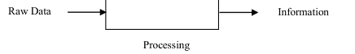

### 数据表示

几乎所有高级语言，例如FORTRAN、COBOL、C、Pascal、C++、Java等，都允许数据在计算机内存中以主要两种类型表示：

- i) 数值数据
- ii) 字母数值数据

大多数高级语言将数值数据分为两种类型：

- i) 整型
- ii) 浮点型

在C语言中，以下数据类型用于表示数值数据。

### 表 1.1：数值数据类型的范围

| 数据类型 | 内存需求 | 范围 |
|---|---|---|
| char 或 signed char | 1 字节 | -128 到 +127 |
| unsigned char | 1 字节 | 0 到 255 |
| short signed int 或 short int 或 signed int 或 int | 2 字节 | -32768 到 +32767 |
| long signed int 或 long int | 4 字节 | -2147483648 到 +2147483647 |
| signed int 或 int（用于 32 位编译器） | 4 字节 | -2147483648 到 +2147483647 |
| unsigned int | 2 字节 | 0 到 65,535 |
| long unsigned int | 4 字节 | 0 到 4294967295 |
| float | 4 字节 | -3.4e38 到 +3.4e38 |
| double | 8 字节 | -1.7e308 到 +1.7e308 |
| long double | 10 字节 | -1.7e4932 到 +1.7e4932 |

### 整型

对于小整数数据，大多数高级语言通常使用两个字节来表示正负十进制整数。负整数使用补码表示法表示。对于大整数数据，通常使用四个字节来表示正负十进制整数。

### 浮点型

在表示小浮点数据时，大多数高级语言（例如 C 语言）使用四个字节来表示小数。对于大数，使用 double 和 long double 来在内存中容纳。

字母数值数据分为两种类型：

- i) 字符
- ii) 字符串

### 字符

字符可以是字母、数字、特殊字符和空白字符。在 C 语言中，字符由 char 数据类型表示，并使用一个字节的内存空间来存储。C 语言使用 ASCII 格式来表示字符。在计算机中存储字符‘C’时，内存中存储 ASCII 值 67。

### 字符串

字符串是字符序列，可以包含任意数量和任意组合的字符。字符可以是字母、数字、特殊字符和空白字符。在 C 语言中，字符串可以定义为以空字符结尾的字符数组。

### 数据类型

通常，计算机程序存在的唯一目的是：如何处理数据。数据类型、将要返回的数据格式以及处理的正确性是计算机程序的主要关注点。编写程序时，计算机内部如何处理数据通常是次要关注点。

**定义：** 数据类型是指变量所持有的数据类型。

现在，根据不同形式数据的表示，使用不同的数据类型。数据类型是赋给一组具有共同属性的变量的名称。数据类型是指变量所持有的数据类型。

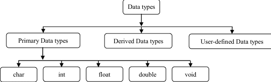

图 1.2：数据类型

C 语言支持三类数据类型：

- i) 基本数据类型
- ii) 派生数据类型
- iii) 用户定义数据类型

基本或主要数据类型是语言内置的。C 语言支持五种基本或主要数据类型。它们是

- i) char ii) int iii) float iv) double v) void

### 数据结构

数据结构是数据单个元素之间逻辑关系的表示。在计算机科学中，数据结构被定义为一种数学或逻辑模型，用以将数据项组织到计算机内存中，使其能够被高效使用。学习数据结构的目的是学习如何将数据组织到内存中，以便快速、方便地访问。

数据结构是指对程序中数据及数据对象表示的研究；即不同数据对象之间结构化关系的实现。

**示例：** 列表、栈、队列、堆、搜索树、哈希表等。

可以对不同的数据结构执行不同的操作集。可以对数据结构中的不同数据元素执行的操作包括访问、遍历、插入、删除、修改等。编写程序时，必须选择一个最小的数据结构，以根据需要支持所有操作。

数据结构可用于以下目的：

- i) 组织数据——数据项如何在主内存中组织？
- ii) 访问方法——如何访问数据项？
- iii) 指定关联程度——数据项之间如何相互关联？
- iv) 数据处理替代方案——可以以多少种不同方式处理这些数据项？

程序是一组指令，涉及计算机执行某种计算或算法。数据结构影响程序结构和功能两方面的设计。要实现算法的程序，应为该算法选择合适的数据结构。因此，程序由算法及其关联的数据结构继承而来。

**算法 + 数据结构 = 程序**

编程语言提供表示算法和数据的设施。像 C 这样的高级编程语言通过提供算法结构来促进结构化和模块化编程。

### 数据结构分类

数据结构可分为两类：

- i) 原始数据结构
- ii) 非原始数据结构

### 原始数据结构

原始数据结构是指可以由机器指令操作或处理的数据结构。有多种类型的数据结构，通常构建在更简单的原始数据类型之上，称为原始数据结构，它们在计算机内存中表示。

**示例：** 整型、浮点型、字符、指针、布尔型等是不同的原始数据结构。

在 C 语言中，不同的原始数据结构使用 int、char、float、double 等数据类型定义。

### 非原始数据结构

非原始数据结构是指不能直接由机器指令操作或处理的数据结构。这些是更复杂的数据结构。非原始数据结构派生自原始数据结构。它们是同构或异构数据项的组。

**示例：** 数组、结构体、栈、队列、链表等。


非原始数据结构分为两类：

- i) 线性数据结构
- ii) 非线性数据结构

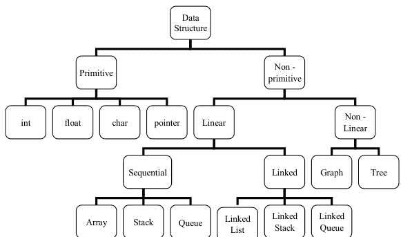

图 1.3：数据结构分类

## 线性数据结构

如果每个数据项都与其前一个和后一个数据项相关（例如，数组、链表），则该数据结构为线性。在线性数据结构中，数据项在内存中按线性序列排列，并且按线性方式访问数据项。线性数据结构的遍历正好进行一次。

线性数据结构有两种类型：

- i) 顺序式
- ii) 链式

顺序数据结构基于数组，对象存储在一系列连续内存位置中。

示例：数组、栈、队列

链式数据结构是一种由一组通过链接连接并组织在一起的节点组成的数据结构。

示例：链表、链式栈、链式队列

## 非线性数据结构

如果每个数据项以特定方式连接到许多其他数据项以反映关系（例如，树），则该数据结构为非线性。在非线性数据结构中，数据元素不是按序排列，即无法以线性方式进行插入和删除。非线性数据结构的遍历始终超过一次。

示例：图、树

## 静态数据结构

静态数据结构是一种数据结构，一旦分配内存空间，就无法扩展，即数据结构的内存分配在编译时进行，之后无法更改。

示例：数组

## 动态数据结构

动态数据结构是另一种数据结构，可以在执行过程中扩展或收缩，即数据结构的内存分配和释放在运行时进行，并随时按需分配内存。

示例：链表、栈、队列、树

## 数据结构的应用

不同的数据结构在现实生活中被使用，例如以位图形式表示图像、实现打印机缓冲区以便作业按到达顺序打印、存储系统中目录和文件的信息等。数据结构在计算机科学的各个领域都有应用，例如：

- 编译器设计
- 操作系统
- 数据库管理系统
- 统计分析包
- 数值分析
- 图形学
- 人工智能
- 仿真

不同类型的数据结构适用于不同类型的应用。某些数据结构专门用于特定任务。例如，数据库使用 B 树索引来检索少量数据，编译器和数据库使用动态哈希表作为查找表，操作系统使用队列进行进程管理和 I/O 请求处理。

## 抽象数据类型

数据类型是指变量所持有的数据的类型。因此，整型、实型、字符被称为原始数据类型。

数据对象表示拥有数据的对象。对象类的研究由一组值和一组操作定义其逻辑行为。

定义：抽象数据类型（ADT）描述构成数据结构的数据对象以及对其支持的基本操作。

ADT 促进数据抽象，关注数据结构做什么，而不是如何实现。

- ADT 是信息结构的概念模型。
- ADT 指定组件、它们的结构关系以及允许执行的操作列表。
- 它只是一个规范，不包含设计或实现信息。
- 规范涉及操作的“什么”，而不是“怎么做”。
- ADT 是原始数据类型的推广。

数据结构是 ADT 的 **设计表示**。

- 同一个 ADT 可以由多个数据结构表示。
- 与 ADT“集合”对应的有许多数据结构。

## 对数据结构执行的操作

数据通过数据结构中出现的某些操作进行处理。所选的特定数据结构很大程度上取决于需要对数据结构执行的操作的频率。需要对数据结构执行不同类型的操作。

表 1.2：数据结构上的操作

| 操作 | 描述 |
|---|---|
| 创建 | 为数据结构分配内存，数据结构的创建可能在编译时或运行时进行。 |
| 插入 | 在数据结构中插入一个数据项。 |
| 删除 | 从数据结构中删除一个数据项。 |
| 遍历 | 正好访问并处理数据结构中的每个数据项一次。 |
| 搜索 | 在数据结构中查找键值的位置。 |
| 排序 | 将数据结构中的所有数据项按升序、降序或字典顺序（针对字符串）排列。 |
| 合并 | 将两个不同排序列表的数据项合并为一个排序列表。 |

## 不同数据结构概述

不同的数据结构可定义如下：

### 数组

数组是同一类型数据项的集合，在共同名称下存储在连续内存位置中。在数组中，两个连续元素的地址之间始终存在固定关系，因为数组的所有项必须连续存储。

### 栈

栈是元素的集合，新元素可以插入其中，元素只能从称为栈顶的一端删除。由于栈中所有插入和删除都在栈顶进行，最后添加的元素将首先从栈中移除。这就是栈也被称为后进先出（LIFO）数据结构的原因。

### 队列

队列是同类元素的集合，删除只能在前端进行（称为出队），插入只能在后端进行（称为入队）。先插入队列的元素将先被删除。按此顺序，队列称为先进先出（FIFO）系统。

### 链表

链表是有限同类数据元素（称为节点）的有序集合，线性顺序通过链接或指针维护。在链表中，数据项可以任意分散在内存中。在链表中，元素地址之间没有关系；链表中的每个元素必须显式存储其下一个元素的地址。

### 树

树是一种非线性数据结构。树可定义为非空有限节点集，满足：i) 有一个特别指定的节点称为根；ii) 剩余节点被划分为零个或多个不相交的树 T1、T2、...、Tn，称为根 R 的子树。

### 图

图是另一种非线性数据结构。图 G 定义为有序集合 G = (V, E)，由有限非空对象集 V 组成，其中 V(G) = {v1, v2, v3, ... vn} 称为顶点（或节点或点），以及另一个集合 E，其中 E(G) = {e1, e2, e3, ... en}，其元素称为边，用于连接这些顶点。

## 总结

- 数据是计算或处理过程中使用的基本实体或事实。
- 数据是没有上下文的原始事实，而信息是带有上下文的数据。
- 数据结构定义为计算机内存中数据项特定组织的数学或逻辑模型，以便高效使用。
- 抽象数据类型（ADT）描述构成数据结构的数据对象以及对其支持的基本操作。

## 练习

- 1. 线性和非线性数据结构有什么区别？
- 2. 可以对数据结构执行哪些操作？
- 3. 什么是抽象数据类型？什么是动态数据结构？
- 4. 为以下问题选择正确的选项：
  - i) 以下哪种数据结构是线性数据结构？a) 树 b) 图 c) 数组 d) 以上都不是
  - ii) 处理列表中每个元素的操作称为 a) 排序 b) 合并 c) 插入 d) 遍历
  - iii) 在列表中查找给定键的元素位置称为 a) 遍历 b) 搜索 c) 排序 d) 以上都不是
  - iv) 内存中数据结构的表示称为 a) 递归 b) 抽象数据类型 c) 存储结构 d) 文件结构
  - v) ADT 被定义为用户定义类型的数学模型，以及该模型上所有 __________ 操作的集合 a) 基数 b) 赋值 c) 原始 d) 结构化


## 算法分析

> "编程是告诉另一个人你希望计算机做什么的艺术"。– 唐纳德·克努斯

算法是一种明确定义的计算过程，它将输入转换为输出，以实现所需的输入-输出关系。在编程之前，我们必须设计一个解决特定问题的过程。该过程必须被制定为一系列基本步骤的详细序列，这称为算法。算法可以在有限时间内执行计算、数据处理和自动推理任务。

- 算法
- 算法类型
- 时间复杂度
- 空间复杂度
- 渐近符号

单词«algorithm»源自波斯语单词algorism，该词源自波斯作者和伟大数学家«阿布·阿卜杜拉·贾法尔·穆罕默德·本·穆萨·阿尔·花拉子密»的名字（生于公元780年的巴格达）。他研究代数、几何和天文学。他为数值系统中表示的数字设计了第一个加法算法。

### 算法

**定义：** 算法是解决问题必须遵循的一组有限指令/步骤，每个步骤都非常基础。

- **输入：** 存在一些输入（零个或多个量），由外部提供。
- **输出：** 作业完成后，应向用户生成结果（至少一个量）。
- **确定性：** 指令应当唯一、简洁、清晰且无歧义。
- **有限性：** 指令应具有相对性，不应是无限类型的。应在有限步骤后终止。
- **有效性：** 每条指令都必须是基础的，以便原则上可以由仅使用铅笔和纸的人执行。应避免重复相同的步骤。它必须是可行的。

### 算法类型

采用类似问题解决方法的算法可以归类在一起。这种分类方案既不详尽也不互斥。这种分类的目的是突出解决问题的各种方式。使用不同的技术，可以为同一问题开发许多算法。这些技术不仅适用于计算机科学，还适用于运筹学、电气工程等其他领域。通过研究所有技术，我们可以制定/开发出良好的算法。

### 我们将考虑的算法类型

- 分治法
- 动态规划
- 贪心法
- 回溯法
- 分支定界法
- 串行或并行或分布式算法
- 确定性或非确定性算法

### 算法开发生命周期

在算法开发生命周期中，涉及以下阶段：

- i) 算法设计 / 设计阶段
- ii) 编写阶段
- iii) 测试 / 实验阶段
- iv) 算法分析 / 分析阶段

### 算法设计

算法设计模式为设计算法提供了通用技术，包括分治法、动态规划、贪心法、回溯法和分支定界法。在算法的设计阶段，会使用一种算法设计技术和数据结构。

### 编写阶段

算法通常采用模块化方法编写。算法可能具有以下结构或步骤：

输入步骤、初始化步骤、赋值步骤、决策步骤、重复步骤和输出步骤。

为了使算法中的每个步骤都清晰，必要时会编写注释。

算法使用以下基本方法编写：

- 顺序：步骤按顺序执行。
- 选择/决策：从多个备选操作中选择一个。
- 重复：一个或多个步骤重复执行。

以下示例描述了将摄氏温度转换为华氏温度的算法的正式表示。

### 将温度从摄氏度转换为华氏度的算法

```
Algorithm: Convert(C, F)
[The variable C is used as Celsius value and F is used as Fahrenheit value]
1. Read C
2. Set F = 1.8 * C + 32
3. Print F
4. Return
```

以下算法计算N个自然数的求和。首先，我们需要读取N的值。

### 计算N个自然数之和的算法

```
Algorithm: Sum (N)
[The variable N is represented the number of natural numbers.]
1. Set S = 0 and I = 1
2. Read N
3. S = S + I
4. I = I + 1
5. If I<=N Goto Step 3
6. Print S
7. Return
```

搜索是指在数组中查找任意元素位置的操作。如果找到该项，则搜索成功；否则，搜索失败。线性搜索是一种方法，搜索从数组开头开始，直到找到所需键或到达数组末尾。

### 线性搜索算法

```
Algorithm: Linear_Search (A, N, Key)
[An array A with N elements and an item Key are given. This algorithm searches the location of the Key in the array A]
1. Set I = 1
2. Repeat Steps 3 while I <= N and A[I] != Key
3. I = I + 1
   [End of while]
4. If I <= N then
   Print: Item found at location I
   Else
   Print: Item not found
   [End of IF]
5. Return
```

### 测试阶段

编写算法后，有必要检查算法是否正确。必须使用纸和笔，通过一些所需的有效输入执行每个步骤，使用算法并在有限时间内获得所需的输出。测试或实验是算法开发的另一个步骤。当发现任何错误时，应返回算法设计阶段并重新设计算法。

### 算法分析

在实际实现之前，应分析算法以计算不同输入规模的客观标准。假设P是一个问题，A和B是解决问题P的两种不同算法。必须有一些性能测量系统来决定哪种算法更好。

假设M是一个算法，n是输入数据的规模。算法M使用的时间和空间是衡量M效率的两个主要指标。

算法M的复杂度是函数f(n)，它给出了算法的运行时间和/或存储空间需求，以输入数据的规模n为准。

算法有一些定性方面，例如简单性、可读性、模块化、可修改性、文档完善等。然而，基于这些，只能对算法做出一些主观判断。此外，衡量算法质量的客观标准是所使用的内存量和执行时间。

因此，算法的性能可以在时间和空间的尺度上进行衡量。时间意味着，我们正在寻找解决该问题的最快算法。空间意味着，我们正在寻找执行时消耗或需要最少内存空间的算法。

当按空间衡量性能时，称为空间复杂度；当按时间衡量性能时，称为时间复杂度。

算法分析可能有两种类型：

- i) 先验分析
- ii) 后验分析

### 理论 / 先验分析

Apriori意为“来自之前”。它基于理论，独立于编程语言和机器结构。在这里，我们在特定系统上运行算法之前对其进行分析（空间和时间）。这意味着我们可以通过获取算法来确定算法的时间和空间复杂度，而不是在特定系统（具有不同处理器和编译器）上运行它。重点在于算法中语句的执行频率。

### 经验 / 后验分析

Posteriori意为“来自之后”。算法实际占用的空间和时间在执行期间被记录。它取决于所使用的编程语言和机器结构。在这里，我们仅在系统上运行算法后才对其进行分析。它直接取决于系统，并且因系统而异。

在现实生活中，我们无法进行后验分析，因为软件通常是为匿名用户制作的，用户在与行业中存在的系统不同的系统上运行它。因此，在先验分析中，我们使用渐近符号来确定时间和空间复杂度，因为它们因计算机而异，但在渐近意义上是相同的。

### 空间复杂度

空间复杂度是算法解决问题所需的空间（内存）量。高效算法占用的空间应尽可能小。

程序所需空间是以下组件的总和：

- 1. 指令空间：存储程序可执行版本所需的空间，且为固定。
- 2. 数据空间：存储所有常量、变量值所需的空间，并包含以下进一步组件。
  - a) 常量和简单变量所需的空间。此空间为固定。
  - b) 固定大小结构化变量所需的空间，例如数组和结构体。
  - c) 从称为堆的内存池中动态分配的空间。此空间通常会变化。
- 3. 内置栈空间：存储恢复挂起函数所需信息的空间。每次调用函数时，以下数据将保存在内置栈上。


- d) 返回地址，即被调用函数完成后从哪里恢复执行。

- e) 被调用函数中所有局部变量的值和形式参数的值。

通常，所需的总空间

- 1. 固定空间需求：包括代码空间、简单变量空间和常量空间。
- 2. 可变空间需求：包括组件变量、结构化变量、动态分配空间和递归栈空间所需的空间。

因此，程序 P 的空间复杂度为

S (P) = C + Sp (I)

其中 C 是与特定问题无关的固定空间需求，Sp (I) 是取决于实例特征的可变空间需求。空间复杂度可以用大 O 表示法来表示该结果。请考虑以下算法。

```
Algorithm INT_SUM (A, N)
1. IF N != 0 then return SUM (A, N-1) + A [N-1]
2. Return 0
```

上述用于对数字列表求和的递归函数，每次递归调用函数都需要内存空间，参数 A 占用 2 字节，参数 N 占用 2 字节，返回值占用 2 字节。每次递归调用所需的总空间为 6 字节，对列表求和需要 N 次递归调用。因此，我们得到 Ssum (I) = Ssum (n) = 6n。

因此，我们可以将上述函数的空间复杂度用大 O 表示法写成 O (n)。

通常，问题中存在时间-空间权衡，即我们需要做出妥协；也就是说，我们无法同时拥有低计算时间和低内存消耗，因此根据所选算法，我们决定低计算时间是否重要还是内存消耗是否重要。

## 时间复杂度

算法的时间复杂度是指算法执行完毕所需的计算机时间量。它允许比较算法以检查哪个更高效。

影响执行时间的因素有很多，例如程序员技能、编译器选项、硬件特性（指令集、时钟速度）、所用算法、输入大小等。通常，输入大小随执行时间增长率的估计足以用于比较。

### 计算运行时间的规则

- 1. 顺序结构：将各个语句的时间相加。取最大值。
- 2. 选择结构：测试条件的时间加上任何备选路径所花费的最大时间。
- 3. 循环：循环的执行时间最多为循环体语句（包括条件测试）的执行时间乘以迭代次数。
- 4. 嵌套循环：从内向外进行分析。
- 5. 子程序：将其视为独立算法进行分析，并在必要时替换时间。
- 6. 递归子程序：通常，运行时间可以表示为递推关系。递推关系的解给出了执行时间增长率的表达式。

现在，程序 P 所花费的时间表示为 T (P) = 编译时间 + 运行时间

在衡量算法的时间复杂度时，我们关注所有关键语句（重要语句）的频次计数。

让我们考虑三个算法。

```
Algorithm
a = a + 1
```

在此算法中，关键语句 a = a + 1 的频次计数为 1。

```
Algorithm
For I = 1 to n
  a = a + 1
[End of loop]
```

在此算法中，关键语句 a = a + 1 的频次计数为 n。

```
Algorithm
For I = 1 to n
  For J = 1 to n
    a = a + 1
  [End of loop]
[End loop]
```

在此算法中，关键语句 a = a + 1 的频次计数为 n²。

在第一个算法中，语句 a = a + 1 只执行一次；在第二个算法中，a = a + 1 执行 n 次；在第三个算法中，a = a + 1 执行 n² 次。

如果算法在输入大小为 n 时执行 f (n) 个基本操作，则其总运行时间为 t × f (n)，其中 t 是执行一个基本操作所需的时间。

注意：不同操作的执行时间不同，但为简化起见，我们假设每个基本操作的执行时间相同，即上述情况中的 t。

- 1. 最佳情况时间复杂度
- 2. 平均情况时间复杂度
- 3. 最坏情况时间复杂度

## 最佳情况时间复杂度

算法的最佳情况时间复杂度是指算法所需最少时间的度量。例如，在列表上进行简单线性搜索时，最佳情况是所需元素为列表的第一个元素。

## 最坏情况时间复杂度

算法的最坏情况时间复杂度是指算法所需最长时间的度量。通常会计算最坏情况估计，因为它为所有输入（包括极端的最慢情况）提供了上界。例如，在列表上进行简单线性搜索时，最坏情况是所需元素位于列表的最后位置或不在列表中。

## 平均情况时间复杂度

算法的平均情况时间复杂度是指算法对所有实例所花费平均时间的度量。平均情况分析不提供上界，有时难以计算。

平均情况时间复杂度和最坏情况时间复杂度在算法分析中最常用。最佳情况时间复杂度很少出现，但它没有任何用处。

## 渐进符号

性能分析中常用一些符号来表征算法的复杂度。大 O (O)、小 o (o)、大欧米茄 ($\Omega$)、大西塔 ($\Theta$) 和小欧米茄 ($\omega$) 是相关符号，用于描述渐进增长率的不同类型的界。

大 O 表示法由 Paul Bachmann 于 1894 年提出，由 Donald Knuth 在计算机科学领域推广，他重新引入了相关的欧米茄和西塔符号。

### 大 O（“大 O”）表示法（上界）

大 O 表示法是表示算法运行时间上界的正式方法。它是算法可能完成所需的最长时间的度量。这种表示法允许我们将一个函数与一组被其他函数界定的函数进行比较，从而描述特定算法的性能。

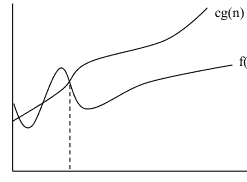

图 2.1：大 O 表示法

如果 $f(n)$ 和 $g(n)$ 是正整数的函数，则当存在正常数 $n_0$ 和 $c$，使得对所有 $n \ge n_0$ 都有 $|f(n)| \le c |g(n)|$ 时，我们写 $f(n) = O(g(n))$。

通常，$O(g(n)) = \{f(n)\}$：存在正常数 c 和 $n_0$，使得对所有 $n \ge n_0$ 都有 $0 \le f(n) \le cg(n)$。

也就是说，在 $n_0$ 的右侧，$f(n)$ 的值始终位于 $cg(n)$ 或以下。这种表示法以常数因子为界给出了函数的上界。

### 示例：

假设 $f(n) = 3n + 2$

现在我们可以写 $f(n) = 3n + 2 \le 4n$，对所有 $n \ge 2$ 成立，这里 $g(n) = n, c = 4, n_0 = 2$

因此，我们可以写 $f(n) = O(g(n)) = O(n)$

### 示例：

假设 $f(n) = 10n^2 + 4n + 2$

现在我们可以写 $f(n) = 10n^2 + 4n + 2 \le 11n^2$，对所有 $n \ge 5$ 成立，这里 $g(n) = n^2, c = 11, n_0 = 5$

因此，我们可以写 $f(n) = O(g(n)) = O(n^2)$

### 示例：

假设 $f(n) = 2n^3 + n^2 + 2n$

现在我们可以写 $f(n) = 2n^3 + n^2 + 2n <= 3n^3$，对所有 $n >= 2$ 成立，这里 $g(n) = n^3, c = 3, n0 = 2$

因此，我们可以写 $f(n) = O (g (n)) = O (n^3)$

### 大欧米茄（$\Omega$）表示法（下界）

大欧米茄表示法是表示算法运行时间下界的正式方法。它描述了给定数据大小下可能发生的最佳情况。如果 f (n) 和 g (n) 是定义在正整数上的函数，则当存在正常数 n0 和 c，使得对所有 n ≥ n0 都有 |f (n)| ≥ c |g (n)| 时，我们写 f (n) = Ω (g (n))。

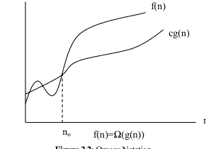

通常，Ω (g (n)) = f (n)；存在正常数 c 和 n0，使得对所有 n ≥ n0 都有 0 ≤ cg (n) ≤ f (n)。

也就是说，在 n0 的右侧，函数 f (n) 的值始终位于 cg (n) 或以上。这种表示法以常数因子为界给出了函数的下界。

### 示例：

假设 f(n) = 3n + 2

现在我们可以写 f(n) = 3n + 2 ≥ 3n，对所有 n ≥ 1 成立，这里 g (n) = n, c = 3, n0 = 1

因此，我们可以写 f(n) = Ω (g (n)) = Ω (n)

### 示例：

假设 f(n) = 10n^2 + 4n + 2

现在我们可以写 f(n) = 10n^2 + 4n + 2 ≥ 10n^2，对所有 n ≥ 1 成立，这里 g (n) = n^2, c = 10, n0 = 5

因此，我们可以写 f(n) = Ω (g (n)) = Ω (n^2)

### 示例：

假设 f(n) = 2n^3 + n^2 + 2n

现在我们可以写 f(n) = 2n^3 + n^2 + 2n ≥ 2n^3，对所有 n ≥ 1 成立，这里 c = 2, n0 = 1

因此，我们可以写 f(n) = Ω (g (n)) = Ω (n^3)


## $\Theta$ (Theta) - 符号（紧界）

如果 $f(n)$ 和 $g(n)$ 是定义在正整数上的函数，则当存在正常数 $n_0, c_1$ 和 $c_2$ 使得
$c_1 |g(n)| \le |f(n)| \le c_2 |g(n)|, \text{for all } n \ge n_0$
时，我们说 $f(n) = \Theta (g(n))$。

一般来说，$\Theta (g(n)) = \{ f(n): \text{存在正常数 } c_1, c_2 \text{ 和 } n_0 \text{ 使得 } c_1 |g(n)| \le f(n) \le c_2 |g(n)| \text{ 对所有 } n \text{ 成立，其中 } n \ge n_0\}$。

也就是说，在 $n_0$ 之后，函数 $f(n)$ 的值始终位于 $c_1 |g(n)|$ 和 $c_2 |g(n)|$ 之间（包含边界）。这种符号将函数限制在常数因数之内。这意味着函数 $f(n)$ 同时被同一个函数 $g(n)$ 从上方和下方界定。

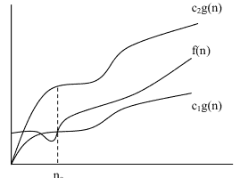

$f(n)=\Theta(g(n))$

**图 2.3：Theta 符号**

### 示例：
假设 $f(n) = 3n + 2$
现在我们可以写出 $3n \le 3n + 2 \le 4n$，对所有 $n \ge 2$ 成立，这里 $g(n) = n, c_1 = 3, c_2 = 4, n_0 = 1$
因此，我们可以写出 $f(n) = \Theta (g(n)) = \Theta (n)$

### 示例：
假设 $f(n) = 10n^2 + 4n + 2$
现在我们可以写出 $10n^2 \le 10n^2 + 4n + 2 \le 11n^2$，对所有 $n \ge 5$ 成立
这里 $g(n) = n^2, c_1 = 10, c_2 = 10, n_0 = 5$
因此，我们可以写出 $f(n) = \Theta (g(n)) = \Theta (n^2)$

### 示例：
假设 $f(n) = 2n^3 + n^2 + 2n$
现在我们可以写出 $2n^3 \le 2n^3 + n^2 + 2n \le 3n^3$，对所有 $n \ge 2$ 成立，这里，$c_1 = 2, c_2 = 3, n_0 = 2$
因此，我们可以写出 $f(n) = \Theta (g(n)) = \Theta (n^3)$

## o ("小 o") - 符号

对于非负函数 f(n) 和 g(n)，当且仅当 f(n) = O(g(n)) 但 f(n) $\neq$ $\Theta$(g(n)) 时，f(n) 是 g(n) 的小 o。这表示为 "f(n) = o(g(n))"。

这表示大 O 的松散界定版本；g(n) 从上方界定，但不从下方界定。小 o 符号表示大 O 的松散界定版本，g(n) 从上方界定，但不从下方界定。

如果 f(n) 和 g(n) 是定义在正整数上的函数，则当且仅当
```
lim
n → ∞
f(n)
─────
g(n)
```
时，我们说 f(n) = o (g (n))。

### 示例：

假设 f(n) = 2n³ + 3n² + n + 10

现在我们可以写出，

```
lim
n → ∞
(2n³ + 3n² + n + 10)
──────────────────── = 0
n⁴
```

即这里 g(n) = n⁴

因此，我们可以写出 f(n) = o (g (n)) = o (n⁴)

小 o (o) 的另一种定义是，

如果 f(n) 和 g(n) 是定义在正整数上的函数，则当且仅当
```
f(n) = O (g(n)) and f(n) ≠ Θ (g(n))
```
时，我们说 f(n) = o (g (n))。

## ω (小 ω) - 符号

小 o 符号表示大 Ω 的松散界定版本；g(n) 是函数 f(n) 的松散下界；它从下方界定，但不从上方界定。对于非负函数 f(n) 和 g(n)，当且仅当 f(n) = Ω(g(n)) 但 f(n) ≠ Θ(g(n)) 时，f(n) 是 g(n) 的小 ω。这表示为 "f(n) = ω(g(n))"。

我们可以写出 f(n) = ω (g (n)) 当且仅当

```
lim
n → ∞
f(n)
───── = ∞
g(n)
```

### 示例：

假设 f(n) = 4n³ + 2n + 3

现在我们可以写出，

```
lim
n → ∞
4n³ + 2n + 3
──────────── = ∞
n²
```

这里 g(n) = n²

因此我们可以写出 f(n) = ω (g (n)) = ω (n²)

## 算法的增长函数

大 O 符号用于根据算法处理时间或工作空间需求随输入大小变化的情况对算法进行分类。算法中的增长阶是指计算时间或空间随输入大小增加的方式，即增长函数随输入大小的增长方式。现在，基于增长函数，算法可以分类如下：

- 1. 常数时间算法 [ O(1) ]：

这意味着无论任务大小如何，算法都需要相同的固定步骤数。

示例：数组访问、栈的 push 和 pop 操作、队列的 enqueue 和 dequeue 操作、其他原子操作。

- 2. 对数时间算法 [ O (log n) ]：

对数时间算法意味着 T(n) 由输入大小的对数上界，即 T(n) = log n。

示例：在 n 个元素的有序列表中进行二分查找。n 个节点的二叉搜索树的插入和查找操作，n 个节点的堆的插入和删除操作等。

- 3. 线性时间算法 [ O (n) ]：

线性时间算法意味着对于足够大的输入大小，运行时间随输入大小线性增加。

示例：数组遍历

- 4. 线性对数时间算法 [ O (n log n) ]：

当 T(n) = O (n log n) 时，算法被认为以线性对数时间运行。因此，线性对数项的增长速度比线性项快，但比 n 的次数大于 1 的任何多项式慢。

示例：归并排序、堆排序

- 5. 多项式时间算法 [ O (n^k), for k > 1 ]：

  - i) 二次时间 ( O (n^2)) 算法：操作数与任务大小的平方成正比。

示例：慢速排序算法，例如，对 n 个元素进行选择排序。

  - ii) 三次时间 O (n^3) 算法：操作数与任务大小的立方成正比。

示例：矩阵乘法

- 6. 指数时间算法 [ O (k^n), for k > 1 ]：

指数时间算法意味着 T(n) 由输入大小的指数表达式上界，即 T(n) = k^n

示例：汉诺伊塔、递归斐波那契实现、生成 n 个符号的所有排列。

- 7. 阶乘时间算法 [ O (n!) ]：

多项式时间算法意味着 T(n) 由输入大小的阶乘上界，即 T(n) = n!。

示例：非攻击 n 皇后问题、通过暴力搜索解决旅行商问题

上述列表中最好的时间显然是常数时间，最坏的是指数时间，正如我们所见，即使对于相对较小的 n，指数时间也会迅速压垮即使是最快的计算机。与指数增长相比，多项式增长（线性、二次、三次等）被认为是可管理的。

| n | log₂n | nlog₂n | n² | n³ | 2ⁿ |
|---|---|---|---|---|---|
| 1 | 0 | 0 | 1 | 1 | 2 |
| 2 | 1 | 2 | 4 | 8 | 4 |
| 4 | 2 | 8 | 16 | 64 | 16 |
| 8 | 3 | 24 | 64 | 512 | 256 |
| 16 | 4 | 64 | 256 | 4096 | 65536 |
| 32 | 5 | 160 | 1024 | 32768 | 2147483648 |

基于上述列表中的函数渐近行为顺序，我们可以比较时间复杂度：

O (1) < O (log n) < O (n) < O (n²) < O (kⁿ) < O (n!)

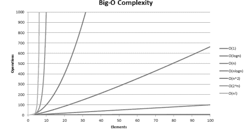

- 一些重要点：
  - 阶乘时间算法最差
  - 阶乘和指数时间算法不切实际
  - 即使大于 O (n³) 的多项式时间算法也不切实际
  - 通过更改算法设计策略，可能显著降低时间复杂度
  - 对于对数时间算法，如果需要读取输入，总解决方案可能变为线性时间。

许多算法，如高级排序算法 - 快速排序、归并排序、堆排序，其增长函数为 O (n log n)，称为线性对数时间；O (n log n) 与其他增长函数之间的比较

O (n) < O (n log n) < O (n²)

## 渐近符号的操作

遵循若干操作渐近符号的规则：

- 规则 1: O ( c f(n) ) = O ( f(n) )
- 规则 2: O ( O ( f(n) ) ) = O ( f(n) )
- 规则 3: O ( f(n) g (n) ) = f(n) O ( g (n) )
- 规则 4: O ( f(n) O ( g (n) ) ) = O ( f(n) g (n) )
- 规则 5: O ( f(n) + g (n) ) = O ( max ( f(n), g (n) ) )
- 规则 6: 如果 f(n) = O(g(n)) 且 g(n) = O(h(n))，则 f(n) = O(h(n))。[传递性规则]
- 规则 7: (f(n) = O(g(n)) 当且仅当 g(n) = Ω(f(n))。[对称性规则]

假设一个算法由两个独立部分 - A1 和 A2 组成。这些部分可以被视为子算法或单个指令。假设 A1 和 A2 分别需要时间 t1 和 t2 进行计算。

现在，每当这两个部分处于顺序结构中，即先计算 A1，然后计算 A2，表示为 A1; A2，总计算时间为 t1 + t2。根据最大规则，计算时间表示为 max (t1, t2)。

### 示例：

假设 t1 = O (n^2) 和 t2 = O (n)，计算 A1;A2 的总计算时间

- 答案：对于 A1;A2，计算时间
- = t1 + t2
- = max (t1, t2)
- = max ( O (n^2), O (n))
- = O (n^2)

再次考虑 A1 和 A2 是算法的两个独立部分，t1 和 t2 分别为计算时间。现在，每当这两个部分处于决策结构中，即仅当给定条件为真时计算 A1，否则当条件为假时计算 A2，表示为 A1 / A2，总计算时间为 t1 / t2。根据最大规则，计算时间表示为 max (t1, t2)。

### 示例：

假设 t1 = O (n^2) 和 t2 = O (n)，计算 A1/A2 的总计算时间

- 答案：对于 A1/A2，计算时间
- = t1 / t2
- = max (t1, t2)
- = max ( O (n^2), O (n))
- = O (n^2)

### 示例：

```
sum = 0;
for (i=0; i<3; i++)
for (j=0; j<n; j++)
sum++;
```

这里，语句 sum++ 执行 3n 次。

答案：复杂度为 O (n)


## Example

```
sum = 0;
for (i=0; i<n*n; i++)
{
sum++;
}
```

Here, the statement sum++ executes n^2 times.

Answer: The complexity is O (n^2)

## Example

```
sum = 0;
for (i = 0; i < n; i++) {
 if (is_even(i)) {
 for (j = 0; j < n; j++)
 sum++;
 }
 else
 sum = sum + n;
}
```

Here, inside the loop: if “true” clause executed for half the values of n, that is O(n) and if “false” clause executed for the other half of n, O(1), so innermost loop is O(n). The outer loop is O (n).

Answer: The complexity is O (n^2)

## Example

```
for (i=1; i<=n; i++) {
 for (j=1; j<=2*i; j++) {
 k=j;
 while (k>0)
 k=k-1;
 }
 }
```

At first, consider the innermost while loop: it is executed k = j, j - 1, j - 2 ... 0. Time consumed inside the while loop is constant. Let I(j) be the time consumed in the while loop. Thus,

I(j) = \sum_{k=0}^{j} 1

Consider the middle for loop, its running time is determined by i. Let M(i) be the time consumed in the for loop:

M(i) = \sum_{j=1}^{2i} I(j)
= \sum_{j=1}^{2i} (j+1)
= \sum_{j=1}^{2i} j + \sum_{j=1}^{2i} 1
= 2i(2i + 1) + 2i
= 2i^2 + 3i

Finally, the outermost for loop, it is executed i = 1, 2, 3 ... n. Let T(n) be running time of the entire algorithm:

T(n) = \sum_{i=1}^{n} M(i)
= \sum_{i=1}^{n} (2i^2 + 3i)
= \sum_{i=1}^{n} 2i^2 + \sum_{i=1}^{n} 3i
= 2 \frac{2n^3 + 3n^2 + n}{6} + 3 \frac{n(n + 1)}{2}
= \frac{4n^3 + 15n^2 + 11n}{6}

**Answer:** The complexity is O(n^3)

## Example

T (n) = 4n^2 + 3n log n, express T (n) in Big-O notation
Ta = 4n^2 = O (n^2) and
Tb = 3nlog n = O (nlog n)
Now, T (n)
= O (max (Ta, Tb))
= O (max (O (n^2), O (nlog n)))
= O (n^2) [because n > log n, hence n^2 > nlog n]

## Summary

- The algorithm is a finite sequence of instructions/steps, each of which is very elementary that must be followed to solve a problem.
- The space complexity of a program is the amount of memory it needed to run to completion.
- The time complexity of a program is the amount of computer time needs to run to completion.
- The asymptotic notations commonly used in performance analysis to characterize the complexity of an algorithm.
- The Big-O notation is the formal method of expressing the upper bound of an algorithm's running time.

## Exercises

- 1. Show that the function f (n) defined by
  f (1) = 1
  f (n) = f (n-1) + \frac{1}{n} for n > 1
  has a time complexity O(log n).
- 2. Define Big-O notation, Θ notation, Ω notations.
- 3. The designer of an algorithm needs to balance between space complexity and time complexity.” - Comment on the validity of the statement for the context of recursion algorithms.
- 4. Choose the correct alternatives for the following:

  - i) Which of the following is the best time for an algorithm?
    - a) O (n) b) O (log n) c) O (2n) d) O (n log n)

  - ii) Which of the following algorithm should execute the slowest for large value of N
    - a) O (n) b) O (n^2) c) O (log n) d) None of these

  - iii) Let us consider a function f(n) = 1000nlog n + 500 n^3 + 0.52^n. We can say that f(n) is
    - a) O (n^3) b) O (n log n) c) O (2^n) d) None of the above

  - iv) An algorithm is made up of two independent time complexities f(n) and g(n). Then the complexities of the algorithm is in the order of
    - a) f(n) x g(n) b) Max(f(n), g(n)) c) Min(f(n),g(n)) d) f(n) + g(n)

  - v) Two main measures for the efficiency of an algorithm are
    - a) Time and space b) Processor and memory c) Time and space d) Data and space

  - vi) Which of the following shows the correct relationship between some of the more common computing time for the algorithm?
    - a) O (log n) < O (n) < O (n log n) < O (2^n) < O (n^2)
    - b) O (n) < O (log n) < O (n^log n) < O (2^n) < O (n)
    - c) O (n) < O (log n) < O (n log n) < O (n^2) < O (2^n)
    - d) O (log n) < O (n) < O (n*log n) < O (n^2) < O (2^n)

## ARRAY AND STRING

> "Computers make it easier to do a lot of things, but most of the things they make it easier to do don't need to be done." -Andy Rooney

Many applications require the processing of multiple data items, that have common characteristics. For example, let us say we have to find the average marks obtained in a class. In this case, we have a couple of choices. Either we can store all the values in different variables or we can create an array that will hold all these values in contiguous memory location. If they are stored in different variables and the number of such variables is quite large then it is quite unmanageable as these variables are scattered throughout the memory. In such situations, it is often convenient to place the data items into an array, where they will all share the same name.

### KEY FEATURES

- One dimensional array
- Processing an array
- Two-dimensional array
- Representation of 2D array
- Sparse Matrix
- String

## ARRAY

Definition: An array is a collection of the same type of data items, which are stored in consecutive memory locations under a common name.

An array variable must be followed by square bracket enclosing size specification of the array. The size signifies the number of elements of the array. That number should be a positive integer number (greater than 0).

### One-dimensional Array

A one-dimensional array is one in which only one subscript is needed to specify a particular element of the array.

### Declaration of One-Dimensional Array

The one-dimensional array can be declared as follows:

```
data_type array_name[size];
```

where array_name is the name of an array and size is the number of elements of data type data_type and size must be an integer constant specified within a pair of square brackets.

### Example

```
int a[10];
```

The above declaration states an array, named “a”, consisting of ten elements, each of type int. Simply speaking, an array is a variable that can hold more than one value. (Arrays in programming are similar to vectors or matrices in mathematics.) We represent the array in above with a picture like this:

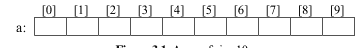

Sometimes symbolic constant can be used to define array size rather than an integer number.

### Example

```c
#define N 10
int a[N];
```

In C, arrays are zero-based, that means the index of an array starts from zero. The ten elements of a 10-element array are numbered from 0 to 9. The subscript, which specifies a single element of an array, is simply an integer expression in square brackets. The first element of the array is a[0], the second element is a[1], etc.

### Example

```c
a[0] = 10;
a[1] = 20;
a[2] = a[0] + a[1];
```

Notice that the subscripted array references (i.e. expressions such as a[0] and a[1]) can appear on either side of the assignment operator.

The subscript does not have to be a constant like 0 or 1; it can be any integral expression; it is common to loop over all elements of an array:

### Example

```c
int i;
for (i = 0; i < 10; i++)
    a[i] = 0;
```

This loop sets 0 to all ten elements of the array a[0] to a[9].

Arrays are a real convenience for many problems, but there is not a lot that C will do with them automatically. In particular, you can neither set all elements of an array at once, nor assign one array to another; both of the assignments are illegal.

### Example

```c
int a[10];
a = 0;         /* illegal */
and
int b[10];
b = a;         /* illegal*/
```

To set all of the elements of an array to some value, you must do so one by one, as shown in the loop above. To copy the contents of one array to another, you must again do so by one.

### Example

```c
int b[10];
for (i = 0; i < 10; i++)
    b[i] = a[i];
```

Remember that for an array declared

```
int a[10];
```

there is no element a[10]; the end element is a[9].

Arrays are not limited to type int; you can have arrays of char or float or double or any other type.

### Example

```
char name[30];
float x[10];
double d[100];
```

There are some important points about arrays. These are as follows:

- Arrays are always stored in consecutive memory locations.
- An array can store multiple values that can be referenced by a single name.
- An array name is actually an address of the first element of the array.
- An array can be either an integer, character or floating-point data type can be initialized only during declaration.
- In C, array index starts from zero.
- There is no bound checking concept for arrays in C.

### Size of One-Dimensional Array

The one-dimensional array can be declared as:

```
data_type array_name[size];
```

The total size of the array in bytes can be calculated by using the following expression:

```
sizeof(data_type) * size
```

where data_type is the data type of the array and size specifies the total number of elements of the array.

Another way to calculate the total size of the array in bytes is simpler; that uses the following expression

```
sizeof(array_name)
```

where array_name is the name of the array.

### Initialization of One-Dimensional Array

Although it is not possible to assign values to all elements of an array at once using an assignment expression, it is possible to initialize some or all elements of an array when the array is defined.

The syntax looks like this:

```
int a[10] = {0, 1, 2, 3, 4, 5, 6, 7, 8, 9};
```

The list of values, enclosed in braces {}, separated by commas, provides the initial values for successive elements of the array. The individual array elements are as follows:

```
a[0] = 0
a[1] = 1
a[2] = 2
a[3] = 3
a[4] = 4
a[5] = 5
a[6] = 6
a[7] = 7
```


### 3.4 | 用 C 语言的数据结构与算法

```
a[8] = 8
a[9] = 9
```

如果初始化器的数量少于数组中的元素数量，则剩余元素会自动初始化为 0。

### 示例：

```
int a[10] = { 0, 1, 2, 3, 4, 5, 6 };
```

这会将 a[7]、a[8] 和 a[9] 初始化为 0。当数组定义包含初始化器时，可以省略数组维度，编译器将根据初始化器的数量推断维度。

例如，

```
int b[] = {10, 11, 12, 13, 14};
```

这将声明、定义并初始化一个包含 5 个元素的数组 b（即就像你输入了 int b[5] 一样）。只省略了维度；方括号 [ ] 仍然保留，以指示 b 是一个数组。

### 读取数组元素

由于数组可能包含多个元素，因此要读取所有元素，单次调用 scanf 函数无法满足我们的目的。

### 示例：

如果我们有一个声明如下的数组

```
int a[10];
```

要读取所有元素，我们可以使用以下语句：

```
for( i = 0; i < 10; i++)
scanf ("%d", &a[i]);
```

当 i 的值为 0 时，scanf() 将读取 a[0] 元素的值；如果 i 为 1，它将读取 a[1] 的值，以此类推。

### 写入数组元素

同样，要打印数组的所有元素，我们可以在循环中使用 printf 语句。考虑到上面的数组声明 int a[10]。我们可以使用以下语句：

### 示例：

```
for(i = 0; i < 10; i++)
printf ("%d\t", a[i]);
```

### 程序 3.1：找出 n 个给定数字中的最小值和最大值。

```
#include<stdio.h>
main()
{
	int a[10], max, min, i, n;
	printf("\nEnter the number of elements:");
	scanf ("%d",&n);
	printf("\nEnter %d elements :",n);
	for( i = 0; i < n; i++)
		scanf("%d", &a[i]);
	/* Initialization */
	max = a[0];
	min = a[0];
	/* Finding Maximum and Minimum element */
	for(i = 0; i < n; i++) {
	    if(a[i] > max) max = a[i];
	    if(a[i] < min) min = a[i];
	}
	printf("\n The maximum element is: %d", max);
	printf("\n The minimum element is: %d", min);
}
```

输出：
Enter the number of elements: 5
Enter 5 elements: 3 2 9 5 4
The maximum element is: 9
The minimum element is: 2

### 一维数组中的地址计算

一维数组中特定元素的地址由以下关系给出：

Address of element a[i] = B + W x i

其中 B 是数组的基地址，W 是数组中每个元素的大小。

### 示例：

考虑以下数组声明，

```
int a[10];
```

假设上述数组中存储的元素大小为 4 字节。如果数组的基地址是 1000，那么 a[5] 的地址将是 1000 + (4 × 5) = 1020。

### 多维数组

多维数组无非是数组的数组。事实上，二维数组是一维数组的数组。三维数组是二维数组的数组。同样，任何 d 维数组都是 (d-1) 维数组的数组。

通常，当我们谈论多维数组时，通常指的是二维数组。因为超过两维的数组很少需要。

需要存储和操作二维数据结构，例如矩阵和表格。

二维数组是指需要两个下标说明来指定数组中特定元素的数组。

在这里，数组有两个下标。一个下标表示行，另一个表示列。

### 二维数组的声明

二维数组的声明如下：

```
data_type array_name [row_size][column_size];
```

### 示例：

```
int m[2][3];
```

这里 m 被声明为一个具有 2 行（编号从 0 到 1）和 3 列（编号从 0 到 2）的矩阵。矩阵的第一个元素是 m[0][0]，最后一行的最后一个元素是 m[1][2]。

二维数组 m[2][3] 如图 3.2 所示。该数组的第一个元素表示为 m[0][0]，第二个元素表示为 m[0][1]，以此类推。

| | 0 | 1 | 2 |
|---|---|---|---|
| 0 | m[0][0] | m[0][1] | m[0][2] |
| 1 | m[1][0] | m[1][1] | m[1][2] |

图 3.2：二维数组 m[2][3]

### 二维数组中的地址计算

二维数组在编程语言中有两种实现方式：

- 行主序实现
- 列主序实现

注意：在 C 语言中，二维数组仅按行主序实现。

### 行主序实现

在行主序实现中，内存分配是按行进行的；即先存储第一行的所有元素，然后存储第二行，以此类推。

| | 0 | 1 | 2 |
|---|---|---|---|
| 0 | A[0][0] | A[0][1] | A[0][2] |
| 1 | A[1][0] | A[1][1] | A[1][2] |
| 2 | A[2][0] | A[2][1] | A[2][2] |

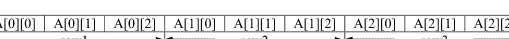

图 3.3：二维数组和行主序表示

二维数组可以像上面的图 3.3 那样按行主序实现。

Address of element A[i][j] = B + W ( n ( i – Lr ) + ( j – Lc ) )

- 其中 B 是数组的基地址
- W 是每个数组元素的大小
- Lr 是行的下界
- Lc 是列的下界
- Ur 是行的上界
- Uc 是列的上界
- n 是列数，n = ( Uc – Lc ) + 1

### 列主序实现

在列主序实现中，内存分配是按列进行的；即先存储第一列的所有元素，然后存储第二列，以此类推。

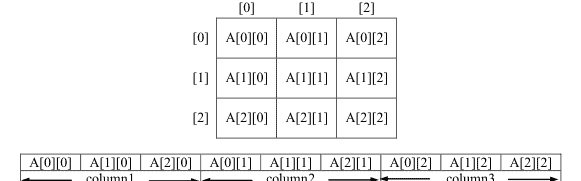

图 3.4：二维数组和列主序表示

二维数组可以像上面的图 3.4 那样按列主序实现。

Address of element A[i][j] = B + W ( ( i - Lr ) + m ( j - Lc ) )

- 其中 B 是数组的基地址
- W 是每个数组元素的大小
- Lr 是行的下界
- Lc 是列的下界
- Ur 是行的上界。
- Uc 是列的上界
- m 是行数，m = ( Ur - Lr ) + 1

### 示例：

假设一个 8×3 矩阵中存储的元素大小均为 4 字节。如果矩阵的基地址是 3500，则求行主序和列主序情况下 A[5][2] 的地址。

答案：由于未给出行和列的下界，假设为 0。[因为在 C 语言中下界始终为 0]
所以，
Lr = 0
Lc = 0
行数 m = 8
列数 n = 3
每个元素的大小 W = 4
基地址 B = 3500
因此，在行主序中，元素 A[5][2] 的地址
= 3500 + 4 × ((5 – 0) × 3 + (2 – 0))
= 3568
在列主序中，元素 A[5][2] 的地址
= 3500 + 4 × ((5 – 0) + (2 – 0) × 8)
= 3584

### 二维数组的初始化

与一维数组一样，二维数组可以在声明后跟一组用大括号括起来的初始值列表进行初始化。

### 示例：

```c
int matrix[2][3] = {1, 1, 1, 2, 2, 2};
```

将第一行的所有元素初始化为 1，第二行初始化为 2。各个数组元素如下：

```c
matrix[0][0] = 1   matrix[0][1] = 1   matrix[0][2] = 1
matrix[1][0] = 2   matrix[1][1] = 2   matrix[1][2] = 2
```

初始化是按行进行的。上述语句可以等价地写为

```c
int matrix[2][3] = {{1, 1, 1}, {2, 2, 2}};
```

当二维数组用所有元素完全初始化时，就不需要显式指定第一个维度。即该语句

### 示例：

```c
int matrix[][3] = {{1, 1, 1}, {2, 2, 2}};   /* valid */
```

编译器会自动提供第一个维度。但是，我们必须指定第二个维度。

因此该语句

```c
int matrix[2][] = {{1, 1, 1}, {2, 2, 2}};   /* invalid */
```

无效，同样该语句

```c
int matrix[][]={{1, 1, 1}, {2, 2, 2}};   /* invalid */
```

无效，因为缺少第二个维度。

如果某些元素缺失，编译器会自动将其初始化为零。因此请考虑以下情况

```c
int matrix[2][3] = {{1,1},{2,2}};
```

```c
matrix[0][0] = 1   matrix[0][1] = 1   matrix[0][2] = 0
matrix[1][0] = 2   matrix[1][1] = 2   matrix[1][2] = 0
```

这里元素 matrix[0][2] 和 matrix[1][2] 被初始化为零。

现在考虑以下情况

```c
int matrix[2][3] = {1, 1, 2, 2};
```

前四个元素分别初始化为 1、1、2 和 2，其余元素由编译器默认初始化为 0。因此，矩阵元素为

```c
matrix[0][0] = 1   matrix[0][1] = 1   matrix[0][2] = 2
matrix[1][0] = 2   matrix[1][1] = 0   matrix[1][2] = 0
```

### 读写二维数组

我们已经讨论了如何读写一维数组。由于只有一个下标说明，只需要一个循环变量；因此，我们可以使用一个单循环。

然而，在二维数组的情况下，有两个下标。因此需要两个循环变量，一个用于行，另一个用于列。因此，我们必须使用嵌套循环。现在考虑以下示例。


## 示例：

```
int m[3][3];
/* Reading */
for(i = 0; i < 3; i++)
    for(j = 0; j < 3; j++)
        scanf("%d", &m[i][j]);
```

因此，上述代码将按行读取二维数组 m 的所有元素。同样，以下代码可用于以矩阵形式打印二维数组 m 的所有元素。

## 示例：

```
/* Writing */
for(i = 0; i < 3; i++)
    for(j = 0; j < 3; j++)
        printf("%d ", m[i][j]);
    printf("\n ");
}
```

通过用大括号括起每行的元素。C 语言允许三个或更多维度的数组。编译器确定最大维度数。多维数组声明的一般形式为：
data_type array_name[s1][s2][s3]...[si]...[sn];
其中 s_i 是第 i 个维度的大小。一些示例如下：

## 示例：

```
int survey[3][5][12];
float table [5][4][5][3];
```

这里 survey 是一个三维数组，table 是一个四维数组。

## 对数组执行的操作

数组是最重要且最常用的数据结构。它们也用于实现许多其他数据结构。几乎所有类型的操作都在数组上执行。

### 表 3.1：数组上的操作

| 操作 | 描述 |
| :--- | :--- |
| 遍历 | 访问并处理数组的每个数据项恰好一次。 |
| 插入 | 将数据项插入数组。 |
| 删除 | 从数组中删除数据项。 |
| 合并 | 将两个不同有序数组的数据项合并为一个有序数组。 |
| 查找 | 在数组中查找键值的位置。 |
| 排序 | 将所有数组元素按升序或降序排列。 |

## 遍历线性数组

以恰好一次的方式访问和处理数组中每个元素的方法称为遍历。在数组中，遍历从数组的第一个元素开始，到数组的最后一个元素结束。

### 遍历线性数组的算法

```
Algorithm: Traverse (A, N)
[A is the name of the array and N is the number of elements of the array]
1. Set I=0
2. Repeat steps 3 and 4 while I < N
3. Visit A[I]
4. Set I=I+1
   [End of loop]
5. Return
```

## 向线性数组插入元素

在数组中，插入操作可以以不同方式执行。在数组中插入元素可以通过以下方式完成：

- 向无序数组的特定位置插入
- 按插入元素的值在有序数组中插入

### 向特定位置插入元素

现在，要在线性数组的特定位置插入一个关键元素，首先需要将从后往前的每个元素向后移动一位，直到到达指定位置。然后将关键元素插入给定位置。最后，数组大小加一。

### 示例：

将 50 插入包含 5 个元素的数组的第 2 个位置。

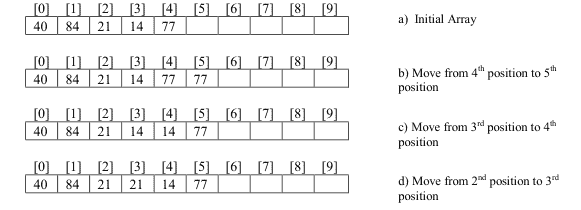

图 3.5：(a-e) 向数组特定位置插入元素

### 向线性数组特定位置插入元素的算法

```
Algorithm: Insert (A, N, P, KEY)
[A is an array of N elements; P is the position of the inserted item, KEY is the inserted item]
1. Set I=N-1
2. Repeat steps 3 and 4 while I>=P
3. Set A[I+1]=A[I]
4. Set I=I-1
   [End of loop]
5. Set A[P]=KEY
6. Set N=N+1
7. Return
```

### 在有序数组中插入元素

在向有序线性数组插入元素时，首先需要找到插入关键元素的正确位置。如果找不到位置，则在末尾插入。否则，将从后往前的每个元素向后移动一位，直到找到插入位置。然后将关键元素插入所需位置。最后，数组大小加一。

### 示例：

将 50 插入包含 5 个元素的有序数组中。

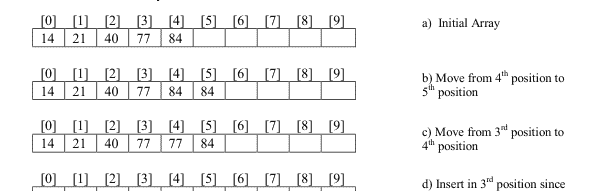

图 3.6：(a-d) 在有序数组中插入元素

### 在有序数组中插入元素的算法

```
Algorithm: Insert (A, N, KEY)
[A is the sorted array of N elements and KEY is the inserted item]
1. Set I = N – 1
2. Repeat steps 3 and 4 while A[I]>KEY
3. Set A[I+1]=A[I]
4. Set I=I-1
   [End of loop]
5. Set A[I+1]=KEY
6. Set N=N+1
7. Return
```

## 从线性数组中删除元素

在数组中，删除操作可以以不同方式执行。在数组中删除元素可以通过以下方式完成：

- 从删除元素的特定位置删除
- 按删除元素的值删除

### 从特定位置删除元素

要从线性数组的特定位置删除一个关键元素，首先需要将给定位置之后的每个元素向前移动一位，直到数组末尾。最后，数组大小减一。

### 示例：

从包含 6 个元素的数组的第 3 个位置（即 21）删除一个元素。

| [0] | [1] | [2] | [3] | [4] | [5] | [6] | [7] | [8] | [9] |
|---|---|---|---|---|---|---|---|---|---|
| 40 | 84 | 50 | 21 | 14 | 77 | (6) | (7) | (8) | (9) |

a) 初始数组

| [0] | [1] | [2] | [3] | [4] | [5] | [6] | [7] | [8] | [9] |
|---|---|---|---|---|---|---|---|---|---|
| 40 | 84 | 50 | 14 | 14 | 77 | | | | |

b) 从第 4 个位置移动到第 3 个位置

| [0] | [1] | [2] | [3] | [4] | [5] | [6] | [7] | [8] | [9] |
|---|---|---|---|---|---|---|---|---|---|
| 40 | 84 | 50 | 14 | 77 | | | | | |

c) 从第 5 个位置移动到第 4 个位置

图 3.7：(a-c) 从特定位置删除元素

### 从特定位置删除元素的算法

```
Algorithm: Delete (A, N, P, KEY)
[A is an array of N number of elements, P is the position of the deleted item; KEY is the deleted item returned by reference]
1. Set I = P
2. KEY = A[P]
3. Repeat steps 4 and 5 while I < N - 1
4.   Set A[I] = A[I+1]
5.   Set I = I + 1
   [End of loop]
6. Set N = N - 1
7. Return
```

### 按值删除元素

当按元素值对数组执行删除操作时，需要搜索数组以找到其位置。

查找删除元素位置有两种方法。对于有序数组，可以使用二分查找来确定位置；否则，如果数组是无序的，则执行线性查找来确定位置。

以下算法用于从无序数组的特定位置删除关键元素。首先，需要使用线性查找搜索数组以找到其位置。得到位置后，将该位置之后的每个元素向前移动一位，直到数组末尾。最后，数组大小减一。

以下算法用于删除线性数组中的元素。

### 按值删除元素的算法

```
Algorithm: Delete (A, N, KEY)
[A is the name of the array, N is the number of elements of the array, P is the position of the deleted item, KEY is the deleted item]
1. Set I = 0
2. Repeat while A[I] != KEY AND I < N
3. Set I = I + 1
   [End of loop]
4. Repeat steps 5 and 6 while I < N-1
5. Set A[I] = A[I+1]
6. Set I = I + 1
   [End of loop]
7. Set N = N - 1
8. Return
```

## 合并

合并是将多个有序数组组合在一起的操作，使得结果数组保持有序。归并算法用于归并排序算法，这是一种基于比较的排序算法。

两个有序数组的合并可以在线性时间和空间内完成。设有两个有序数组，A 包含 m 个元素，B 包含 n 个元素，将它们合并形成一个包含 m + n 个元素的有序数组 C。

将数组 A 的第一个元素与数组 B 的第一个元素进行比较。如果数组 A 的第一个元素小于数组 B 的第一个元素，则将数组 A 中的元素移动到新数组 C。由于第一个元素现已确定，数组 A 的下标随之增加，我们继续进行。

否则，数组 B 中的元素应更小；将其移动到新数组 C。数组 B 的下标增加。比较两个数组中元素的过程持续进行，直到数组 A 或数组 B 中有一个为空。当一个数组为空时，将另一个（非空）数组中剩余的任何元素追加到数组 C 的末尾，合并完成。

### 示例：

合并两个有序数组 A（6 个元素）和 B（5 个元素），形成一个包含 11 个元素的有序数组 C。

A：

| 0 | 1 | 2 | 3 | 4 | 5 |
|---|---|---|---|---|---|
| 3 | 6 | 9 | 12 | 14 | 17 |

B：

| 0 | 1 | 2 | 3 | 4 |
|---|---|---|---|---|
| 2 | 5 | 8 | 11 | 15 |

C：

| 0 | 1 | 2 | 3 | 4 | 5 | 6 | 7 | 8 | 9 | 10 |
|---|---|---|---|---|---|---|---|---|---|---|
| 2 | | | | | | | | | | |

- (a) 因为 3 > 2，因此复制 2 并增加 B 和 C 的索引

C：

| 0 | 1 | 2 | 3 | 4 | 5 | 6 | 7 | 8 | 9 | 10 |
|---|---|---|---|---|---|---|---|---|---|---|
| 2 | 3 | | | | | | | | | |

- (b) 因为 3 < 5，因此复制 3 并增加 A 和 C 的索引

C：

| 0 | 1 | 2 | 3 | 4 | 5 | 6 | 7 | 8 | 9 | 10 |
|---|---|---|---|---|---|---|---|---|---|---|
| 2 | 3 | 5 | | | | | | | | |

- (c) 因为 6 > 5，因此复制 5 并增加 B 和 C 的索引


- (d) 由于 6 < 8，因此复制 6 并递增 A 和 C 的索引

| 0 | 1 | 2 | 3 | 4 | 5 | 6 | 7 | 8 | 9 | 10 |
|---|---|---|---|---|---|---|---|---|---|---|
| 2 | 3 | 5 | 6 | | | | | | | |

- (e) 由于 9 > 8，因此复制 8 并递增 B 和 C 的索引

| 0 | 1 | 2 | 3 | 4 | 5 | 6 | 7 | 8 | 9 | 10 |
|---|---|---|---|---|---|---|---|---|---|---|
| 2 | 3 | 5 | 6 | 8 | | | | | | |

- (f) 由于 9 < 11，因此复制 9 并递增 A 和 C 的索引

| 0 | 1 | 2 | 3 | 4 | 5 | 6 | 7 | 8 | 9 | 10 |
|---|---|---|---|---|---|---|---|---|---|---|
| 2 | 3 | 5 | 6 | 8 | 9 | | | | | |

- (g) 由于 12 > 11，因此复制 11 并递增 B 和 C 的索引

| 0 | 1 | 2 | 3 | 4 | 5 | 6 | 7 | 8 | 9 | 10 |
|---|---|---|---|---|---|---|---|---|---|---|
| 2 | 3 | 5 | 6 | 8 | 9 | 11 | | | | |

- (h) 由于 12 < 15，因此复制 12 并递增 A 和 C 的索引

| 0 | 1 | 2 | 3 | 4 | 5 | 6 | 7 | 8 | 9 | 10 |
|---|---|---|---|---|---|---|---|---|---|---|
| 2 | 3 | 5 | 6 | 8 | 9 | 11 | 12 | | | |

- (i) 由于 14 < 15，因此复制 14 并递增 A 和 C 的索引

| 0 | 1 | 2 | 3 | 4 | 5 | 6 | 7 | 8 | 9 | 10 |
|---|---|---|---|---|---|---|---|---|---|---|
| 2 | 3 | 5 | 6 | 8 | 9 | 11 | 12 | 14 | | |

- (j) 由于 17 > 15，因此复制 15 并递增 B 和 C 的索引

| 0 | 1 | 2 | 3 | 4 | 5 | 6 | 7 | 8 | 9 | 10 |
|---|---|---|---|---|---|---|---|---|---|---|
| 2 | 3 | 5 | 6 | 8 | 9 | 11 | 12 | 14 | 15 | |

- (k) 由于 B 数组为空，因此将 A 的剩余元素（即 17）复制到 C

| 0 | 1 | 2 | 3 | 4 | 5 | 6 | 7 | 8 | 9 | 10 |
|---|---|---|---|---|---|---|---|---|---|---|
| 2 | 3 | 5 | 6 | 8 | 9 | 11 | 12 | 14 | 15 | 17 |

图 3.8 (a-k)：合并两个已排序数组

## 合并两个已排序数组的算法

```
Algorithm: MERGE (A, B, M, N, C)
[A and B are two sorted arrays, M is the number of elements of A, N
is the number of elements of B and C is the resultant array]
1. Set I=0, J=0, K=0
2. Repeat while I<M and J<N
   if A[I]<B[J] then
      a) Set C[K]=A[I]
      b) Set I=I+1
      c) Set K=K+1
   ELSE
      a) Set C[K]=B[J]
      b) Set J=J+1
      c) Set K=K+1
   [End of If]
3. Repeat while I<M
   a) Set C[K]=A[I]
   b) Set I=I+1
   c) Set K=K+1
   (End of Loop)
4. Repeat while J<N
   a) Set C[K]=B[J]
   b) Set J=J+1
   c) Set K=K+1
   (End of Loop)
5. Return
```

## 时间复杂度

在遍历操作中，需要访问数组的所有元素恰好一次。因此，时间复杂度为 O(n)。

在插入操作中，当在数组末尾位置插入元素时会出现最佳情况，此时不需要移动数组元素。因此，插入操作在最佳情况下的时间复杂度为 O(1)，因为它不取决于数组的大小。最坏情况发生在在数组第一个位置插入元素时，此时所有数组元素都需要移动一个位置；需要 n 次移动。因此，插入操作在最坏情况下的时间复杂度为 O(n)，因为它取决于数组的大小。平均情况下，大约一半的数组元素需要移动。因此，插入操作在平均情况下的时间复杂度为 O(n)。

同样，在删除操作中，当从数组末尾位置删除元素时会出现最佳情况，而当从数组第一个位置删除元素时会出现最坏情况。因此，删除操作在最佳情况下的时间复杂度为 O(1)，在最坏情况和平均情况下为 O(n)。

此合并算法的时间复杂度为 O(m + n)，其中 m + n 是输出元素的数量或源元素的总数。

## 数组的应用

数组用于实现向量、矩阵（包括稀疏矩阵）、多项式和不同种类的表等数学元素。许多数据库由一维数组组成，其元素被记录。数组用于实现其他数据结构，如堆、哈希表、双端队列、队列、栈和字符串。

## 多项式的表示

多项式 p(x) 是形式为 (a_nX^n + a_{n-1}X^{n-1} + ... + a_3X^3 + a_2X^2 + a_1X + a_0) 的表达式。

每个 a_iX^i 是多项式的一项，其中 x 是变量，a_i 是相应的系数，n 是非负整数。数 n 称为多项式的次数。如果 a_i = 0，则该项为零项，否则为非零项。

多项式的一个重要特征是，多项式表达式中的每一项包含两部分——一部分是系数，另一部分是指数。

考虑以下多项式：
10x^5 + 15x^3 - 7x^2 - x
这里 (10, 15, -7, -1) 是系数，(5, 3, 2, 1) 是指数。

## 使用数组表示多项式

多项式的所有项可以用两种不同的方式用数组表示：

- i) 线性数组表示
- ii) 结构体数组表示

### 线性数组表示

在这种表示中，一项的指数/次数可以被视为线性数组的索引，而该项的系数存储在数组的该索引处。

例如，多项式 10x^5 + 15x^3 - 7x^2 - x 可以表示如下：

| [0] | [1] | [2] | [3] | [4] | [5] |
|---|---|---|---|---|---|
| 0 | -1 | -7 | 15 | 0 | 10 |

图 3.9：使用线性数组表示多项式

这种表示的缺点是，对于高阶多项式，线性数组的大部分条目可能保持为零。

### 结构体数组表示

在这种表示中，每个项定义为结构体变量以存储对应项的次数和系数，多项式可以用结构体数组表示，如下所示：

```
typedef struct poly
{
    int deg;
    int coef;
}poly;
poly term[100];
```

现在，如果我们使用数组表示多项式，则必须预先定义数组的大小。因此，存在计算机内存浪费的可能性。但是，这种表示足够简单。

多项式也可以使用链表表示。我们在本书第 5 章中讨论了使用链表表示多项式。

## 稀疏矩阵

科学计算中最重要的发展之一是稀疏矩阵。这包括表示矩阵的数据结构、操作它们的技术、使用的算法以及用于高性能的数据结构和算法的高效映射。

_定义_：如果矩阵的大部分元素都是零（近乎 2/3 以上的元素为零），且非零元素数量相对较少，则该矩阵称为稀疏矩阵。不是稀疏矩阵的矩阵称为稠密矩阵。

稀疏矩阵是一个二维数组，其中大部分元素具有空值或零。但是，对于稀疏矩阵，这会导致大量内存空间的浪费。

例如，当使用大小为 100 X 100 的矩阵，且只有 1000 个条目是非零的，其余位置填充零时。这会导致大量内存浪费。浪费的内存位置为 10000-1000 = 9000，即 9000 个填充零的内存位置。因此，浪费了大量内存。

如果在数组中存储矩阵的空值，转置、加法、乘法等操作也会花费大量处理时间。为了避免这种情况，会使用不同的技术，例如链表。简单来说，稀疏矩阵是允许使用特殊技术来利用大量空元素和结构的矩阵。

考虑以下稀疏矩阵示例：

| 20 | 0 | 0 | 0 | 15 | 0 | -10 |
|---|---|---|---|---|---|---|
| 0 | 10 | 3 | 0 | 0 | 0 | 0 |
| 0 | 0 | 0 | -6 | 0 | 0 | 0 |
| 0 | 0 | 0 | 0 | 0 | 0 | 0 |
| 90 | 0 | 0 | 0 | 0 | 0 | 0 |
| 0 | 0 | 30 | 0 | 0 | 0 | 0 |

图 3.10：一个稀疏矩阵

稀疏矩阵可分为两类：

- i) 三角矩阵
- ii) 带状矩阵

### 三角矩阵

三角矩阵的行数与列数相同，即它们是方阵。在三角矩阵中，主对角线和下对角线都填充非零值，或者主对角线和上对角线都填充非零值。

| 2 | 5 | 1 | 4 |
|---|---|---|---|
| 3 | 6 | 9 | 0 |
| 10 | 8 | 0 | 0 |
| 7 | 0 | 0 | 0 |

| 3 | 6 | 10 | 5 |
|---|---|---|---|
| 0 | 9 | 2 | 4 |
| 0 | 0 | 7 | 1 |
| 0 | 0 | 0 | 8 |

| 3 | 0 | 0 | 0 |
|---|---|---|---|
| 6 | 9 | 0 | 0 |
| 10 | 4 | 7 | 0 |
| 5 | 1 | 2 | 8 |

| 0 | 0 | 0 | 4 |
|---|---|---|---|
| 0 | 0 | 9 | 8 |
| 0 | 8 | 10 | 3 |
| 7 | 1 | 6 | 2 |

图 3.11：三角矩阵示例（i）左上三角矩阵，（ii）右上三角矩阵，（iii）左下三角矩阵，（iv）右下三角矩阵。


## 三角矩阵

三角矩阵也可分为四种类型：

- i) 左上三角，
- ii) 右上三角，
- iii) 左下三角和
- iv) 右下三角

如果矩阵 A 的非零元素仅位于矩阵的上三角区域（包括主对角线），则称矩阵 A 为上三角矩阵。

如果矩阵 A 的非零元素仅位于矩阵的下三角区域（包括主对角线），则称矩阵 A 为下三角矩阵。

## 三角矩阵的表示

存储优化是数据结构的主要目标之一。通过仅存储非零元素来优化存储。例如，三角矩阵可以使用一维数组表示，其中仅存储非零元素。

| A00 | 0 | 0 | 0 |
|---|---|---|---|
| A10 | A11 | 0 | 0 |
| A20 | A21 | A22 | 0 |
| A30 | A31 | A32 | A33 |

图 3.12：左下三角矩阵的元素

在上述左下三角矩阵中，Aij ≠ 0，其中 i ≥ j，i 表示行，j 表示列。通常，可以通过观察 Aij 之前有 (i – 1) 行来找到 Aij 的位置，这些行总共占据 1 + 2 + 3 + ... + i – 1 = (i + 1) / 2 个元素。

此外，在同一行中，Aij 之前有 j 个元素。因此，Aij 从数组开始处的位移为 i * (i + 1) / 2 + j。

| [0] | [1] | [2] | [3] | [4] | [5] | [6] | [7] | [8] | [9] |
|---|---|---|---|---|---|---|---|---|---|
| A00 | A10 | A11 | A20 | A21 | A22 | A30 | A31 | A32 | A33 |

图 3.13：将左下三角矩阵表示为线性数组

例如，A32 可以放入一维数组的第 8 个位置。

因此，原始矩阵所需的存储量为 n²，而考虑一维数组时，实际上只需要 n * (n + 1) / 2 个位置。

同样，其他三角矩阵和对称矩阵也进行了存储优化。

## 带状矩阵

稀疏矩阵的一种重要特殊类型是带状矩阵，定义如下：

设 A 为 n x n 阶矩阵。如果矩阵元素在对角线带状区域之外均为零，该带状区域的范围由常数 α 和 β 决定，其中

Aij = 0 当 α < i – j 或 β < j – i 时；其中 α, β ≥ 0 且 i, j = 1 到 n，则 α 和 β 分别称为下带宽和上带宽。矩阵的带宽为 α 和 β 的最大值。

如果矩阵的带宽相当小，则该矩阵称为带状矩阵或带矩阵。

带状矩阵也可分为四种类型：

- i) 对角矩阵
- ii) 三对角矩阵
- iii) 五对角矩阵
- iv) αβ 带状矩阵

如果 A 的所有非对角线元素均为零，则方阵称为对角矩阵，即 α = β = 0 的带状矩阵为对角矩阵。

三对角矩阵是指非零元素仅位于主对角线、主对角线下方第一条对角线和主对角线上方第一条对角线上的矩阵，即 α = β = 1 的带状矩阵为三对角矩阵。

五对角矩阵是指非零元素仅位于主对角线、主对角线下方前两条对角线和主对角线上方前两条对角线上的矩阵，即 α = β = 2 的带状矩阵为五对角矩阵。

αβ 带状矩阵是指非零元素仅位于主对角线、主对角线下方前有限条对角线和主对角线上方前有限条对角线上的矩阵，即 α ≠ β 的带状矩阵为 αβ 带状矩阵。

当 α = 0，β = n-1 时，得到上三角矩阵的定义；同样，当 α = n-1，β = 0 时，得到下三角矩阵。当稀疏矩阵存储在 m×n 阶二维数组中时，会浪费大量计算机内存。

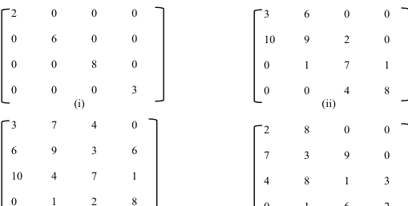

图 3.14：带状矩阵 (i) 对角矩阵，(ii) 三对角矩阵，(iii) 五对角矩阵，(iv) αβ 带状矩阵

## 三元组表示

当非零项未形成三角形或带状等任何模式时，稀疏矩阵的非零值可以存储为形式为 (I, J, Value) 的三元组列表。

在此表示中，稀疏矩阵将是一个包含三列和 (T+1) 行的二维数组，其中 T 是稀疏矩阵的非零项数。

I = 行位置

J = 列位置
Value = 位置 (I, J) 处的非零值
第一行包含矩阵的行数、列数和非零元素个数。
后续行包含非零元素的位置和非零值。此表示的列数始终固定为三。因此，它称为三元组。

| | [0] | [1] | [2] |
|---|---|---|---|
| [0] | 6 | 1 | [2] |
| [1] | 0 | 0 | 20 |
| [2] | 0 | 3 | 15 |
| [3] | 0 | 5 | -10 |
| [4] | 1 | 1 | 10 |
| [5] | 1 | 2 | 3 |
| [6] | 2 | 3 | -6 |
| [7] | 4 | 0 | 90 |
| [8] | 5 | 2 | 30 |

图 3.15：稀疏矩阵的三元组表示

在上述内容中，图 3.14 显示了图 3.10 给出的稀疏矩阵的三元组表示。

### 3.10 稀疏矩阵三元组表示的算法

```
Algorithm: THREE_TUPLE (A, M, N, B)
[A is a sparse matrix of order M x N stored in matrix B]
1. Set C=1
2. For I=0 to M-1 do
    For J=0 to N-1 do
        If A[I][J]!=0 then
            Set B[C][0] = I
            Set B[C][1] = J
            Set B[C][2] = A[I][J]
            Set C = C + 1
        [End of If]
    [End of Loop]
[End of Loop]
3. Set B[0][0]=M, B[0][1]=N, B[0][2] = C-1
4. Return
```

稀疏矩阵的重要性 稀疏矩阵出现在许多应用中，包括求解偏微分方程 (PDEs)、用于潜在语义索引 (LSI) 的文本-文档矩阵、线性和非线性优化，以及操作网络和图模型。

## 字符串

字符串是字符序列。在 C 语言中，字符串的末尾用一个特殊字符标记，即空字符，其 ASCII 值为 0（空字符除了名称外与空指针无关）。空字符或字符串终止字符由字符转义序列 '\0' 表示。但是，请记住 \ 和 0 不是两个独立的字符。

由双引号符号定义的任何字符序列或集合都是常量字符串。每当我们写一个用双引号括起来的字符串时，'C' 会自动为我们创建一个包含该字符串终止字符 '\0' 的字符数组。程序很少能看到这个结束标记，因为大多数处理字符串的函数都会使用它或自动添加它。要对字符串做其他任何事情，通常必须调用函数。

字符串在内存中以构成字符串的字符的 ASCII 码存储，并附加 '\0'（空字符的 ASCII 值）。通常，每个字符占用一个字节（可能取决于编译器）；连续字符存储在连续字节中。

| 字符 | H | E | L | L | O | | I | N | D | I | A | \0 |
|---|---|---|---|---|---|---|---|---|---|---|---|---|
| ASCII 码 | 72 | 101 | 108 | 108 | 111 | 32 | 87 | 111 | 114 | 108 | 100 | 0 |
| 地址 | 2000 | 2001 | 2002 | 2003 | 2004 | 2005 | 2006 | 2007 | 2008 | 2009 | 2010 | 2011 |

图 3.16：字符串表示

最后一个字符是 ASCII 值为零的空字符。

## 声明和初始化字符串

如前所述，C 语言中的字符串由字符数组表示。因此，要声明字符串，我们将声明一个字符数组。声明字符串的一般形式是：

```
char string_name[size];
```

大小决定字符串可以容纳的字符数。当编译器为字符数组分配字符大小时，它会自动在字符串末尾提供一个空字符。因此，在选择字符串的长度或大小时，必须比要容纳的字符数多一个。如果字符串末尾未分配空字符，则可能会显示额外字符。

以下是字符串声明的示例：

## 示例

```
char name[30];
char city[25];
```

字符串仅在声明时初始化。我们可以通过以下方式初始化字符串：

```
char city[8] = { 'K','o','l','k','a','t','a','\0' };
```

然后字符串 city 被初始化为 Kolkata。

上述初始化完全有效，但 C 提供了一种初始化字符串的特殊方式。

上述字符串可以初始化为

```
char city[8] = "Kolkata";
```


字符串的字符被一对双引号括起来。编译器负责处理被一对双引号括起来的字符串。编译器负责将字符串中字符的 ASCII 码存储在内存中，并在末尾存储空终止符。

在初始化字符串时，维度可以是可选的（类似于数值数组），在这种情况下，如果未指定维度，编译器将根据初始化器的数量推断维度。例如，以下初始化是有效的。

```
char city[] = "Kolkata";
```

在这种情况下，编译器将假设字符串的大小为 8。

此外，大小可能大于初始化中的字符数；在这种情况下，剩余的内存单元将用空字符填充。例如，考虑以下内容：

```
char city[10] = "Kolkata";
```

因此，内存中的存储将如下：

| [0] | [1] | [2] | [3] | [4] | [5] | [6] | [7] | [8] | [9] |
|---|---|---|---|---|---|---|---|---|---|
| K | o | l | k | a | t | a | \0 | \0 | \0 |

图 3.17：字符串表示

但是，请记住，大小不能小于初始值中的字符数。

例如，初始化 char city[7] = "Kolkata"; 是无效的，这时编译器可能会产生编译时错误，或者不会有字符串终止符 (\0)，结果如果我们打印它，可能会得到一些不希望的结果。

## 读取字符串

通常，带有 %s 格式说明符的 scanf() 函数用于从终端读取字符字符串。

### 示例：

```
char city[15];
scanf ("%s", city);
```

scanf() 语句有一个缺点，即一旦发现空白字符（换行符、制表符、空格等），它就会终止语句。假设我们输入字符串 Hello India，则只会读取字符串 Hello，因为单词 Hello 后面有一个空格，它就会终止字符串。因此，通常情况下，无法使用 scanf() 读取一行文本。

### 示例：

```
char city [15];
scanf ("%[^\n]", city);
printf("\n %s", city);
```

> 注意：可以在变量名前不使用 & 符号来使用 scanf()。

此外，可以使用非格式化输入函数 gets 来读取字符串。函数 gets 的一般形式是 gets (string_name)；

该函数从终端读取字符到字符串中，直到遇到换行字符，最后在字符串末尾分配一个空字符。

### 示例：

```
char city[15];
gets(city);
```

## 写入字符串

带有格式说明符 %s 的 printf 语句可用于在屏幕上显示字符串。

### 示例：

```
printf("%s", string);
```

可用于显示数组字符串的全部内容。

另外，printf 函数可用于打印常量字符串，例如：

### 示例：

```
printf("Hello India");
```

我们还可以使用非格式化输出函数 puts() 在屏幕上显示字符串。

### 示例：

```
puts(string);
```

要显示常量字符串，我们可以这样使用 puts：

```
puts("Hello India");
```

由于 C 语言没有为字符串提供任何运算符，因此我们无法操作字符串。例如，我们不能直接将一个字符串赋值给另一个字符串。

### 示例：

```
char String1[30], String2[30];
String1 = "Hello"; /* Invalid */
String2 = "India"; /* Invalid */
String1 = String2; /* direct assignment not possible */
```

这些都无效。要将一个字符串中的字符复制到另一个字符串，我们可以逐个字符地复制。

同样，也无法通过关系运算符 (==) 直接比较两个字符串。

### 示例：

```
char String1[] = "Hello";
char String2[] = "India";
if(String1 == String2) /* direct comparison not possible */
printf("\n Strings are same");
else
printf("\n Strings are not same");
```

## 字符串数组

迄今为止，我们一直在讨论仅处理单个字符串，它是一个一维字符数组。但是，在许多应用程序中，需要处理一组字符串。在这种情况下，我们需要一个二维字符数组，称为字符串数组。一维字符数组的每个元素都是一个 ASCII 字符。但是，二维数组的每个元素都是一个字符串。

例如，考虑以下声明：

```
char os[5][10] = { "Unix",
                   "Linux",
                   "Windows",
                   "Macintosh",
                   "DOS"
                 };
```

上述字符串数组最多可容纳五个字符串。此外，每个字符串最多可容纳十个字符（包括空字符）。

在上述声明之后，内存中可能出现以下情况：

| | [0] | [1] | [2] | [3] | [4] | [5] | [6] | [7] | [8] | [9] |
|---|---|---|---|---|---|---|---|---|---|---|
| os[0] | U | n | i | x | \0 | | | | | |
| os[1] | L | i | n | u | x | \0 | | | | |
| os[2] | W | i | n | d | o | w | s | \0 | | |
| os[3] | M | a | c | i | n | t | o | s | h | \0 |
| os[4] | D | O | S | \0 | | | | | | |

图 3.18：字符串数组

这里，os[0] 表示字符串“Unix”，os[1] 表示字符串“Linux”，os[2] 表示“Windows”，os[3] 表示“Macintosh”，os[4] 表示“DOS”。

## 对字符串执行的操作

需要对字符串执行不同种类的操作。

表 3.2：字符串操作

| 操作 | 描述 |
|---|---|
| 查找长度 | 查找字符串的长度。 |
| 复制 | 将一个字符串复制到另一个字符串。 |
| 连接 | 将一个字符串追加到另一个字符串的末尾。 |
| 比较 | 比较两个字符串以查找它们是否相同。 |
| 反转 | 反转字符串。 |
| 大写 | 将字符串中的小写字母（如果有）转换为大写。 |
| 小写 | 将字符串中的大写字母（如果有）转换为小写。 |
| 排序 | 将所有字符串按字典顺序排列。 |
| 字符串匹配 | 在字符串中搜索模式。 |

## 字符串长度

字符串的长度返回字符串的字符总数，这不一定等于其存储容量。空字符串的长度为零。

### 查找字符串长度的算法

- 算法：STRING_LENGTH (S)
- [S 是给定字符串]
- 1. 设置 N = 0
- 2. 当 S[N] != Null 时重复步骤 3
- 3. N = N + 1
  - [循环结束]
- 4. 返回 N

在 C 语言中，strlen() 函数计算并返回字符串中的字符数。长度不包括空字符，但包括空格。strlen() 函数的一般形式是

```
n = strlen (string);
```

这里 n 是一个整数变量，用于接收给定字符串长度的值。

### 程序 3.2：使用 strlen() 函数查找字符串的长度

```
#include<stdio.h>
#include<string.h>
main()
{
 char str[100];
 int length;
 printf("Enter the string:");
 gets(str);
 length = strlen(str);
 printf("\\nNumber of characters in the string=%d",length);
}
输出：
Enter the string:Hello world
Number of characters in the string=11
```

## 字符串复制

将字符串的当前值复制到另一个具有与原始字符串相同值的字符串中。不能使用赋值运算符复制字符串。

### 将字符串复制到另一个字符串的算法

- 算法：STRING_COPY (T, S)
- [S 是源字符串，T 是目标字符串]
- 1. 设置 I = 0
- 2. 当 S[I] != Null 时重复步骤 3
- 3. T[I] = S[I]
- 4. I = I + 1
  - [循环结束]
- 5. 设置 T[I] = Null
- 6. 返回

在 C 语言中，strcpy() 函数用于复制字符串。该函数的语法如下所示：

```
strcpy( string1, string2 );
```

strcpy 函数将 string2 的内容赋值给 string1，其中 string2 可以是字符数组变量或字符串常量。但是，string1 应该足够大，以容纳要复制到其中的字符串。

### 程序 3.3：使用 strlen() 函数将一个字符串的内容复制到另一个字符串

```
#include<stdio.h>
#include<string.h>
main()
{
    char string1[30];
    char string2[] = "Hello World";
    printf("\nSecond string was %s",string2);
    strcpy(string1, string2);
    printf("\n Now first strings is:%s",string1);
}
输出：
Second string was: Hello World
Now first strings is: Hello World
```

## 两个字符串的连接

当组合两个字符串时，即将一个字符串的内容追加到另一个字符串的末尾。此操作称为连接。

### 连接两个字符串的算法

- 算法：STRING_CONCAT (T, S)
- {字符串 S 追加到字符串 T 的末尾}
- 1. 设置 I = 0, J = 0
- 2. 当 T[I] != Null 时重复步骤 3
- 3. I = I + 1
  - [循环结束]
- 4. 当 S[J] != Null 时重复步骤 5 到 7
- 5. T[I] = S[J]
- 6. I = I + 1
- 7. J = J + 1
  - [循环结束]
- 8. 设置 T[I] = Null
- 9. 返回

在 C 语言中，strcat() 函数将两个字符串连接在一起。strcat() 函数的一般形式是：


strcat(string1, string2);

其中 string1 和 string2 是字符数组。当执行函数 strcat() 时，string2 会被追加到 string1。string2 处的字符串保持不变。

## 程序 3.4：使用 strcat() 函数连接两个字符串

```
#include<stdio.h>
#include<string.h>
main()
{
 char str1[100], str2[100];
 int length;
 printf("Enter the first string:");
 gets(str1);
 printf("Enter the second string:");
 gets(str2);
 strcat(str1, str2);
 printf("\nString 1 after concatenation = %s", str1);
 printf("\nString 2 after concatenation = %s", str2);
}
Output:
Enter the first string:Taj
Enter the second string:mahal
String 1 after concatenation = Tajmahal
String 2 after concatenation = mahal
```

从上述程序片段中，str1 的值变为 Tajmahal。str2 处的字符串保持不变，仍为 mahal。

## 两个字符串的比较

比较两个字符串以判断它们是否表示同一字符串。

### 比较两个字符串的算法

```
Algorithm: STRING_COMPARE (T, S)
Compare between String S and T
1. Set I = 0
2. Repeat step 3 while S[I] != Null and S[I] = T[I] do
3. Set I = I + 1
   [End of loop]
4. If S[I] = Null and T[I] = Null Return True
5. Return False
```

在 C 语言中，你不能直接在类似 if(string1==string2) 的条件中比较两个字符串的值。然而，大多数库都包含 strcmp() 函数，该函数用于比较两个字符串，如果两个字符串相同则返回零，如果不同则返回非零数。strcmp() 的语法如下：

```
strcmp(string1, string2);
```

其中 string1 和 string2 可以是字符串变量或字符串常量。如果 string1 在字母顺序上小于 string2，该函数返回负数；如果 string1 大于 string2，则返回正数。更准确地说，strcmp() 返回前两个不匹配字符之间的数值差。

### 示例：

```
strcmp ("Newyork", "Newyork") ;
it will return zero because 2 strings are equal.
strcmp ("their", "there") ;
it will return -9 which is the numeric difference between ASCII 'i' and ASCII 'r'.
strcmp ("The", "the");
it will return -32 which is the numeric difference between ASCII 'T' and ASCII 't'.
```

## 程序 3.5：使用 strcmp() 函数比较两个字符串

```
#include<stdio.h>
#include<string.h>
main()
{
    int r;
    char string1[] = "The";
    char string2[] = "the";
    r = strcmp(string1, string2);
    if(r == 0)
    printf("Strings are identical");
    else
    printf("Strings are not identical");
}
Output:
Strings are not identical
```

## 字符串反转

字符串的反转是指字符相同但顺序相反的字符串。例如，如果给定字符串为 "abcd"，则其反转为 "dcba"。当一个字符串与其自身的反转相同（例如 madam）时，称为回文。

### 反转字符串的算法

```
Algorithm: STRING_REVERSE (S)
[S is a given string]
1. Set N = Length (S)
2. Set I = 0 and J = N-1
3. Repeat while I < J do
4.   Set Temp = S[I]
5.   Set S[I] = S[J]
6.   Set S[J] = Temp
7.   Set I = I + 1 and J = J - 1
8.   Return
   [End of Loop]
```

在 C 语言中，strrev() 函数用于反转字符串中的字符。strrev() 函数的一般形式为 strrev(string)；

## 程序 3.6：使用 strrev() 函数反转字符串

```
#include<stdio.h>
#include<string.h>
main()
{
   char string[] = "HELLO";
   printf("\nThe string in reverse:%s", strrev(string));
}
Output:
The string in reverse: OLLEH
```

## 字符串匹配

字符串匹配（或字符串搜索）是一种操作，用于在给定字符串或文本中查找模式出现的所有位置。字符串匹配用于不同的应用软件，例如文本编辑器中的查找和替换全部。

### 暴力法（朴素）字符串匹配

暴力法字符串匹配技术是一种简单的方法，用于测试模式在字符串中所有可能位置的出现情况。暴力法字符串匹配算法也称为朴素算法。Naive 意为基础。

假设 m 为模式的长度，n 为可搜索字符串或文本的长度。该算法可以理解为将模式 P 在文本字符串 S 上滑动，并观察在哪个偏移量下模式中的所有字符都与字符串中对应的字符匹配。具体来说，模式依次从 I = 0 移动到 n - m，对于每次移动，将模式 P[1 到 m] 与字符串 S[I + 1 到 I + m] 进行比较。

### 示例：

假设给定的文本字符串 S = "abbcdabed"，模式字符串 P = "bcda"。


现在，T 向右移动一个位置

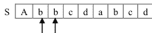

无匹配

又向右移动一个位置 T

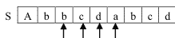

匹配

模式字符串 P 是文本字符串 S 的子串

### 图 3.19：字符串匹配

### 暴力法（朴素）字符串匹配算法

```
Algorithm: STRING_MATCHING (S, P)
[S is a text string and P is a pattern string]
1. Set N = Length (S)
2. Set M = Length (P)
3. Repeat For I = 0 to N-M do
4.   Set J = 0
5.   Repeat while J < M and S[I + J] = P[J] do
6.     Set J = J + 1
7.     If J >= M Return I
   [End of Loop]
[End of Loop]
8. Return -1
```

在上述算法中，for 循环最多执行 n - m + 1 次，while 循环最多执行 m 次。因此，在最坏情况下，该算法的运行时间复杂度为 O((n - m + 1) m)，当 n<<m 时为 O(nm)。考虑一个在类似 "xxxxxxxy" 的字符串中搜索类似 "xxxxx" 的模式的示例。在平均情况下，该算法的运行时间复杂度为 O(m + n)。

该算法的优点是它是一种非常简单的技术，不需要任何预处理。因此，总运行时间与其匹配时间相同。然而，这是一种非常低效的方法。因为该方法每次只移动一个位置。

在 C 语言中，strstr() 函数用于在另一个字符串中查找子串的第一次出现。成功时，strstr() 返回指向 str1 中 str2 开始位置的元素的指针（在 str1 中指向 str2）。出错时（如果 str2 未在 str1 中出现），strstr() 返回 null。strstr() 函数的一般形式为

```
ptr = strstr(str1, str2);
```

## 程序 3.7：使用 strstr() 函数搜索字符串

```
#include<stdio.h>
#include<string.h>
main()
{
    char string[] = "International";
    char searchstring[] = "nation";
    char substring[30];
    strcpy(substring, strstr(string, searchstring));
    printf("\nSub strings is: %s", substring);
}
Output:
Sub strings is: national
```

## 总结

- 数组是同一数据类型的变量集合，以通用名称存储在连续内存位置中。
- 数组可以是整型、字符型或浮点型数据类型，且只能在声明期间初始化。
- 数组名是数组第一个元素的地址。
- 如果矩阵的大多数元素都是非零元素数量相对较少，则称为稀疏矩阵。
- 字符串是字符序列。

## 练习

1. 具有 n 行和 m 列的二维数组 A 可以采用行主序或列主序形式表示。建立地址转换函数，以便从一维数组中定位任何元素。该元素由二维参数及数据类型指定。
2. 编写一个算法，计算二维数组 A [1: M, 1: N] 中任意元素 A [I, J] 的地址。假设数组按列主序存储，B 是数组的基地址，w 是数组中每个元素的大小。
3. 解释二维数组的行主序和列主序实现。
4. 考虑数组 int p [10][10] 及基地址 2000，然后分别计算行主序和列主序下 p[2][3] 的地址。
5. 如何在内存中高效表示稀疏矩阵？编写一个算法来求稀疏矩阵的转置。
6. 通过合适的示例解释稀疏矩阵元素的存储和操作。
7. 为以下问题选择正确的选项：
   i) 在 C 语言中，数组采用哪种存储方式
      a) 列主序 b) 行主序 c) 层主序 d) 以上都不是
   ii) 数组 arr[20][50] 的每个元素需要 4 字节内存。arr 的基地址为 2000。当数组按列主序存储时，arr[10][10] 的位置。


- a) 2820 b) 2840 c) 4048 d) 4840
- iii) 访问 m×n 矩阵（按列主序存储）中第 (i, j) 个元素的表达式是
- a) n × (i – 1) + j b) m × (j – 1) + i c) n × (i–1) + (j – 1) d) m ×(j–1) + (i – 1)
- iv) 如果 A[1][1] 和 A[2][1] 的地址分别为 1000 和 1010，且每个元素占用 2 字节，则该数组已按 __________ 顺序存储。
- a) 列主序 b) 行主序 c) 层主序 d) 矩阵主序
- v) 数组索引中最大的元素称为其
- a) 下界 b) 范围索引 c) 上界 d) 以上都不是

## 指针

> "指针的职责是通过点名，指出会众中谁应该注意布道中提出的某个要点。" —H. B. Otis

指针是最重要且最强大的数据结构之一。指针是一种用于存储另一个变量地址或位置的变量。我们可以说指针指向另一个变量。指针声明由数据类型、间接运算符 (*) 和变量名组成。间接运算符也称为解引用运算符。不要将间接运算符与乘法运算符混淆，尽管它们具有相同的符号。间接运算符是一元运算符，而乘法运算符是二元运算符。指针在动态内存分配中非常有用，并用于修改传递给函数的变量参数。

- 空指针
- Void 指针
- 泛型函数
- 悬空指针
- 指针的指针
- 指针数组
- 数组指针
- 函数指针
- 动态内存分配

### 指针声明

指针声明的一般形式是：

```
data-type *pointer-variable-name;
```

数据类型指定指针所指向的数据类型，这意味着它可以存储该数据类型的地址。

### 示例：

```
int *p;
char *q;
float *r;
```

在上述声明中，p 是指向整数的指针；它可以存储整数类型变量的地址。q 是指向字符的指针，它可以存储字符类型变量的地址（这并不意味着 q 保存字符值，而是意味着 q 包含字符变量的地址）。同样，r 是指向浮点数的指针，它可以存储浮点数类型变量的地址。请记住，地址始终是无符号整数。

### 地址运算符

地址运算符 (&) 可以返回其操作数在内存中的地址。不要将地址运算符与按位 AND 运算符混淆，尽管它们具有相同的符号。地址运算符是一元运算符，而按位 AND 运算符是二元运算符。

在以下示例中，显示变量 c、a 和 f 的地址及其值。变量的地址取决于编译器和操作系统。

### 示例：

```
#include<stdio.h>
main()
{
char c = 'C';
int a = 50;
float f = 3.45;
printf("Address of c = %u, Value of c = %c\n", &c, c);
printf("Address of a = %u, Value of a = %d\n", &a, a);
printf("Address of f = %u, Value of f = %f\n", &f, f);
}
Output:
Address of c = 65529, Value of c = C
Address of a = 65522, Value of a = 50
Address of f = 65518, Value of f = 3.450000
```

| 地址 | 值 | 变量名 |
|---|---|---|
| : | : | : |
| 65529 | 67 | c |
| 65522 | 50 | a |
| 65518 | 3.45 | f |
| : | : | : |
| 内存 | | |

图 4.1: 内存中的变量

我们可以将变量的地址存储在指针变量中。也可以将变量的地址存储在无符号整数变量中。那是无用的。您不能将间接运算符作为指针变量以外的变量的前缀。

### 示例：

```
int *p;
int a = 50;
p = &a;
```

假设，变量 a 存储在内存位置 65522，其大小为四个字节。这意味着变量 a 存储在内存位置 65522 到 65525 之间。由于其大小为四个字节，需要四个内存位置来存储该值。

在上述示例中，变量的内存位置存储在变量 p 中。变量 p 是整数指针，这意味着它可以存储整数类型变量的地址。变量 a 的值为 50。然后，在赋值语句之后，指针 p 将具有值 65522，即变量 a 的起始内存位置，我们可以说指针 p 指向变量 a。

### 间接运算符

间接运算符 (*) 返回存储在其操作数中的内存地址的值。它本质上是地址运算符的相反运算。该运算符也称为指针运算符。

> 注意：地址运算符 (&) 返回变量的地址，而间接运算符 (*) 返回该地址的值。

### 示例：

```
int a, b, *p;
a = 50;
p = &a;
b = *p;
```

假设，变量 a 位于内存位置 65522，且 a 的值为 50。现在，变量 a 的内存位置被赋给指针变量 p，因此 p 将具有 65522。赋值语句设置内存位置 65522 的值，该值存储在 p 中。现在 b 具有值 50，因为 50 存储在位置 65522。间接运算符和地址运算符互为补码。

### 示例：

```
#include<stdio.h>
main()
{
int a = 50, b;
int *p;
p = &a;
b = *p;
printf("Value of a = %d\n", a);
printf("Address of a = %u\n", &a);
printf("Value of p = %u\n", p);
printf("Value of *p = %d\n", *p);
printf("Value of b = %d\n", b);
printf("Address of b = %u\n", &b);
printf("Address of p = %u\n", &p);
}
Output:
Value of a = 50
Address of a = 65524
Value of p = 65524
Value of *p = 50
Value of b = 50
Address of b = 65522
Address of p = 65520
```

我们可以通过以下方式获取 b 的值，
b = *p 意味着 b = *(65524) [因为 p = 65524]
= 50 [地址 65524 的值]

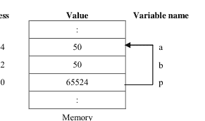

### 指针的类型转换

指针变量有自己的数据类型。与基本数据类型不同，指针不支持隐式类型转换。因此，可以使用显式类型转换机制将指针类型转换为其他指针类型。

### 示例：

```
c
int a = 10;
float b = 12.3;
int *p;
float *q;
p = &a;
q = &b;
q = b;        /* this is invalid */
q = p;        /* this is invalid */
p = q;        /* this is valid */
q = (float*)p; /* this is valid */
p = (int*)q;   /* this is valid */
```

> 注意：如果编译器遇到导致指针指向不同类型的某些指针转换，则编译器会给出类似“可疑的指针转换”的错误消息。

### 空指针

空指针是指向无效位置的指针值。空指针是一个常量指针（通常由地址零表示），与任何指针兼容。它与函数指针不兼容。当指针等同于 NULL 时，保证不指向程序中定义的任何变量。

空指针值是一个与任何有效指针不同的地址。将整数常量 0 赋给指针会为其赋予空指针值。助记符 NULL（在标准库头文件 stdio.h 中定义）可用于提高可读性。

### 示例：

```
c
int *p;
*p = 12;
```

由于 p 未定义，因此 p 可能包含垃圾值（例如，p = 65550）。现在，无论是故意还是意外，当向 *p 赋值时，可能会修改未由程序分配的该内存位置（例如 65550）。因此，您应该使用

```
int *p = NULL;
```

解引用空指针是没有意义的，通常会导致运行时错误。因此，在使用指针之前，我们应该用 NULL 值检查它。所有指针都可以成功地测试是否等于或不等于 NULL，这在逻辑上等同于 false。

在动态内存分配中，当 calloc() 或 malloc() 函数无法分配内存块时，它们会返回 NULL。因此，在函数调用后，在使用内存之前，需要检查内存块是否已分配。

### 示例：

```
int *p;
p = malloc(10 * sizeof(int));
if(p==NULL)
{
    printf("Insufficient Memory");
    exit(1);
}
```

空指针还表示搜索操作失败，例如在链表程序中。

### 空指针（Void Pointer）

空指针是一种指针，可以存储任何类型变量的地址。这意味着空指针是指向任何东西的指针。空指针也称为无类型指针或泛型指针。

请注意，不能声明类型为 void 的变量。但是，函数的返回类型可以是 void。

```
void a;       /* this is invalid */
void *r;      /* valid */
```

空指针用于临时存储任何类型变量的地址。由于空指针是无类型指针，编译器无法得知它将从存储地址开始从内存中检索多少字节的数据。因此，不能将间接运算符与空指针一起使用。

### 示例：

```
int a = 10;
float b = 12.3;
int *p;
float *q;
void *r;
p = &a;
q = &b;
printf("%d", *p);
r = p;
/* this is invalid */
printf("%d", *r);
```

空指针可以赋给任何非空指针，无需显式类型转换运算符。非空指针也可以赋给空指针，无需显式类型转换。


### Example:

```
r = p;
p = r;
or
r = q;
q = r;
where p, q, and r are declared as in the previous example.
```

void 指针可用作左值或右值。因此，通过使用此概念，void 指针允许违反指针类型转换的基本规则。

### Example:

```
r = p;
q = r;
where p is an integer pointer and q is a floating point pointer. This implies,
q = p;
```

## 泛型函数

void 指针用于编写泛型函数，该函数可以接受任何类型的参数。一组外观相同的函数，除了一个或多个参数的类型不同之外。泛型函数允许定义一个函数来替换该组函数。

假设我们有一个可用于交换两个整型变量值的函数。现在我们需要另一个函数来交换两个浮点型变量的值。对于交换两个长双精度型变量的值，我们还需要一个函数。因此，对于不同的数据类型，我们需要编写不同的函数。

### 示例:

```
/* Interchange the value of two variables */
#include<stdio.h>
void swap(int *a, int *b);
void swapf(float *a, float *b);
main()
{
    int i = 10, j = 20;
    float x = 12.3, y = 53.4;
    swap(&i, &j);
    printf("%i = %d, j = %d", i, j);
    swapf(&x, &y);
    printf("x = %f, y = %f", i, j);
}
/* Function to interchange two integer type variables*/
void swap(int *a, int *b)
{
    int temp;
    temp = *a;
    *a = *b;
    *b = temp;
}
```

/* Function to interchange two floating-point type variables*/
void swapf(float *a, float *b)
{
    float temp;
    temp = *a;
    *a = *b;
    *b = temp;
}
```

与其使用一组类似类型的函数，不如使用泛型函数。泛型函数允许定义一个函数来替换该组函数。

### 示例:

```
/*Interchange the value of two variable using generic function */
#include<stdio.h>
void swap(void *a, void *b, int n);
main()
{
    int i = 10, j = 20;
    float x = 12.5, y = 53.5;
    swap(&i, &j, sizeof(int));
    printf("i = %d, j = %d\n", i, j);
    swap(&x, &y, sizeof(float));
    printf("x = %f, y = %f\n", x, y);
}
/* Generic function to interchange two variables */
void swap(void *a, void *b, int n)
{
    char *p, *q, temp;
    p = (char*)a;
    q = (char*)b;
    while(n>0)
    {
        temp = *p;
        *p = *q;
        *q = temp;
        p++;
        q++;
        n--;
    }
}
Output:
i = 20, j = 10
x = 53.500000, y = 12.500000
```

需要注意的是，字符始终是一个字节，字符指针充当字节指针。sizeof 运算符计算数据类型的字节大小。泛型函数依次交换两个变量的每个字节，因为每种类型的变量都可以视为字符序列。

## 悬空指针

悬空指针是指不指向正确类型的有效变量的指针。当内存被释放但未修改指针的值时，就会创建悬空指针，因此指针仍然指向已释放内存的内存位置。当系统将先前释放的内存重新分配给另一个进程，而原始程序解引用悬空指针时，可能会产生不可预测的结果，因为内存现在可能包含完全不同的数据。

### 示例:

```
{
    int *cp;
    {
        int c;
        cp = &c;
    }
/* c is in out of scope, cp is now a dangling pointer */
}
```

上述问题的解决方案是在退出内部块之前立即将 NULL 赋值给 cp。悬空指针的另一个常见来源是 malloc() 和 free() 库函数调用的组合：当指针指向的内存块被释放时，指针就会变成悬空指针。与前面的示例一样，避免这种情况的一种方法是在释放其引用后确保将指针重置为 null。

### 示例:

```
#include <stdio.h>
{
    int *cp = malloc (100);
    free ( cp ); /* cp now becomes a dangling pointer */
    cp = NULL; /* cp is no longer dangling */
}
```

## 指针允许的操作

允许的指针操作只有少数几种。允许的指针操作如下：

- 指针变量的自增和自减操作。
- 两个指针变量的减法。
- 指针与整数值的加法和减法。
- 两个指针变量之间的关系运算。
- 赋值操作。

> 注意：不接受任何类型的两个指针变量相加。

## 指针算术运算

允许指针变量与整数值进行加法和减法。但是，指针不允许进行其他算术运算，包括乘法和除法。指针变量不接受浮点数或双精度值等非整数值的加法或减法。

将整数添加到指针或从指针减去整数的格式如下：

```
Pointer-variable + integer-value
Pointer-variable - integer-value
```

可以用同一类型的另一个指针减去一个指针，结果将是整数，而不是指针。

### 示例:

```
int a[5] = {10, 20, 30, 40, 50};
int i, *p;
p = a + 1;
q = a + 3;
printf("%d", q - p);
Output:
2
```

## 指针的自增和自减操作

自增操作可用于指针变量，类似于给指针变量加一。自减操作也可用于指针变量，类似于从指针变量减一。指针自增或自减的格式如下：

```
Pointer-variable++
Pointer-variable--
```

指针自增与间接寻址的混合用法有三种可能：

- i) *++p
- ii) ++*p
- iii) ++*p

其中 p 是指针变量。

i) *++p 返回 p 所指向位置的内容，然后将指针递增一。指针 p 将指向下一个元素。自减运算符也可以以同样的方式与指针一起使用，以移动到前一个元素。请注意，如果下一个内存位置未由程序静态或动态分配，编译器可能会发出一些警告或错误消息。

### 示例:

```
int a[5] = {10, 20, 30, 40, 50};
int *p;
p = a;
printf("%d ", *p++);
printf("%d ", p - a);
printf("%d ", *p);
Output:
10 1 20
```

应该注意的是，自增 (++) 和自减 (--) 运算符的优先级高于间接运算符 (*) 的优先级。

ii) ++*p 将指针递增一，然后返回 p 所指向位置的内容。指针 p 将指向下一个元素。自减运算符也可以以同样的方式与指针一起使用，以移动到前一个元素。请注意，如果下一个内存位置未由程序静态或动态分配，编译器可能会发出一些警告或错误消息。

### 示例:

```
int a[5] = {10, 20, 30, 40, 50};
int *p;
p = a;
printf("%d ", ++*p);
printf("%d ", p - a);
printf("%d ", *p);
Output:
20 10 20
10 1 20
```

ii) ++*p 递增 p 所指向位置的值。指针 p 将指向同一个元素。自减运算符可以以同样的方式与指针一起使用，以递减所指向位置的值。

### 示例:

```
int a[5] = {10, 20, 30, 40, 50};
int *p;
p = a;
printf("%d ", ++*p);
printf("%d ", p - a);
printf("%d ", *p);
Output:
11 0 11
```

## 指针关系运算

可以使用不同的关系运算符将指针变量与同一类型的另一个指针变量进行比较。表 4.1 描述了指针允许的关系运算。

### 表 4.1：指针关系运算符

| 运算符 | 描述 |
| :--- | :--- |
| < | 小于 |
| <= | 小于或等于 |
| > | 大于 |
| >= | 大于或等于 |
| == | 等于 |
| != | 不等于 |

指针变量还可以与 NULL 指针进行比较。

表 4.2 显示了指针表示法和数组表示法。这些表示法基于以下代码：

```
int arr[] = {10, 20, 30, 40, 50};
int *ptr;
ptr = arr;
```


### 表 4.2：指针表示法和数组表示法

| 指针表示法 | 数组表示法 | 结果 |
|---|---|---|
| ptr | arr, &arr[0] | 数组第一个元素的地址。 |
| ptr++ | &arr[x++] | 将指针移动到数组的下一个元素。 |
| ptr + 1 | &arr[1] | 数组第二个元素的地址。 |
| *ptr | arr[0] | 数组第一个元素的值。 |
| *(ptr + 1) | arr[1] | 数组第二个元素的值。 |
| *(ptr) + 1 | arr[0] + 1 | 将 1 与数组的第一个元素相加。 |
| *ptr++ | arr[x++] | 值使用后移动到数组的下一个元素。 |
| *ptr-- | arr[x--] | 值使用后移动到数组的前一个元素。 |
| ++*ptr | arr[++x] | 值使用前移动到数组的下一个元素。 |
| --*ptr | arr[--x] | 值使用前移动到数组的前一个元素。 |
| (*ptr)++ | arr[0]++ | 将数组的第一个元素加 1。 |
| (*ptr)-- | arr[0]-- | 将数组的第一个元素减 1。 |
| (*(ptr + 2))++ | arr[2]++ | 将数组的第三个元素加 1。 |
| (*(ptr + 2))-- | arr[2]-- | 将数组的第三个元素减 1。 |

## 指针加法中的隐式缩放

当同一类型的多个数据项连续存放在内存中时，对指向任一数据项的指针进行单位递增或递减，始终会得到下一个或前一个数据项的地址。这与数据项无关。

### Example:

```c
int *p;
float *q;
```

现在，当我们写 p + i（其中 i 是整数）时，系统将其求值为 p + i × sizeof(int)。同样，q + i 系统地求值为 q + i × sizeof(float)。因此，无论数据项如何，我们总能得到第 i 个元素的地址。

## 指针的指针

指针是一种用于存储另一个变量地址或位置的变量。该变量也可能是一个指针。指针的指针是一种特殊的指针类型，用于存储另一个指针变量的地址。

### Example:

```c
#include<stdio.h>
main()
{
int a = 50, b, c;
int *p;
int **q;
p = &a;
b = *p;
printf("Value of a = %d\n", a);
printf("Address of a = %u\n", &a);
printf("Value of p = %u\n", p);
printf("Value of *p = %d\n", *p);
printf("Value of b = %d\n", b);
q = &p;
printf("Value of p = %u\n", p);
printf("Address of p = %u\n", &p);
printf("Value of q = %u\n", q);
printf("Value of *q = %u\n", *q);
printf("Address of c = %d\n", c);
printf("Address of q = %u\n", &q);
}
```

输出：
a 的值 = 50
a 的地址 = 65524
p 的值 = 65524
*p 的值 = 50
b 的值 = 50
p 的值 = 65524
p 的地址 = 65518
q 的值 = 65518
*q 的值 = 65518
c 的地址 = 50
q 的地址 = 65516

| 地址 | 值 | 变量名 |
|---|---|---|
| 65524 | 50 | a |
| 65518 | 65524 | p |
| 65516 | 65518 | q |

### 图 4.3：内存中的变量

## 指针和数组

在 C 语言中，指针和数组密切相关。数组名也是数组第一个元素的地址，并指向内存中数组第一个元素的位置。

数组本质上就是指针。因此，没有索引溢出或下溢检查。数组也称为静态指针。因为数组名是一个常量指针。

### Example:

```c
int a[5] = {10, 20, 30, 40, 50};
int i;
int i = 5;        /* overflow */
a[-5] = -5;       /* underflow */
```

编译器不会给出索引溢出或下溢错误消息，且索引溢出或下溢检查在运行时不会进行。

### Example:

```c
int a[5] = {10, 20, 30, 40, 50};
int *p;
a = p;        /* this is invalid */
```

这里，指针变量 p 被赋予数组的基地址。这不被接受，因为数组的基地址是一个常量，而指针是一个变量。

### Example:

```c
int a[5] = {10, 20, 30, 40, 50};
int i, *p;
p = a;
for(i=0; i<5;i++)
    printf("%d", p[i]);
```

数组的基地址被赋给指针变量 p。指针变量 p 可以像数组名一样使用，printf 语句输出数组中每个元素的值。

实现相同操作的另一种方法是使用以下语句，将数组第一个元素的地址赋给指针变量 p。
p = &a[0];

数组元素 a[i] 在指针表示法中可以写成 *(a+i)，而 a+i 表示该元素的地址。

### Example:

```c
int a[5] = {10, 20, 30, 40, 50};
int i;
for(i=0; i<5;i++)
    printf("%d", *(a+i));
```

二维数组可以看作一维数组，并可以用指针表示。

### Example:

```c
int a[3][4] = {{11, 12, 13, 14},{21, 22, 23, 24},{31, 32, 33, 34}};
```

```c
int *p;
int i, j;
p = a[0];
for(i=0;i<12;i++)
    printf("%5d", p[i]);
```

数组 a[0] 的基地址被赋给指针变量 p。指针变量 p 可以像一维数组一样使用，printf 语句输出数组中每个元素的值。图 4.4 显示了二维数组在内存中的存储方式。

| 4000 | 4002 | 4004 | 4006 | 4008 | 4010 | 4012 | 4014 | 4016 | 4018 | 4020 | 4022 |
|---|---|---|---|---|---|---|---|---|---|---|---|
| 11 | 12 | 13 | 14 | 21 | 22 | 23 | 24 | 31 | 32 | 33 | 34 |

### 图 4.4：二维数组在内存中的存储方式，类似于一维数组

假设二维数组声明为

```c
int a[3][4];
```

二维数组的数组元素 a[i][j] 可以通过指针使用不同的语法访问：

- `a[i][j] = *(*(a+i)+j)`
- `a[i][j] = *(a[i]+j)`
- `a[i][j] = (*(a+i))[j]`
- `a[i][j] = *((*(a+i)+j))`

两个加法操作都遵循指针运算规则，但涉及不同类型的指针。内部算术操作涉及指向大小为 4 的数组的指针。这就是为什么在将二维数组用作形式参数时，需要在函数定义中指定二维数组的列数。外部算术操作涉及指向整数的指针。

### Example:

```c
#include<stdio.h>
main()
{
 int a[5]={3, 5, 6, 8};
 printf("%d %d ", a[3], 3[a]);
}
```

输出：
8 8

不要惊讶！这是正确的语法：
3[a] 等于 * (3+a)

数组变量始终返回基地址，[] 与数组索引进行求和（即 (*(base + index))，且加法（+）满足交换律。因此，*(base + index) 等于 *(index + base)。

由于 3[a] 表示 * (3+a)，而 *(3+a) 等于 *(a+3)。因此，3[a] 与 a[3] 相同，因为 a[3] 表示 *(a+3)。

但另一方面，[a]3 或 [3]a 不是正确语法，会导致语法错误，因为 (a + 3)* 和 (3 + a)* 不是有效表达式。

## 指针数组

指针数组只不过是包含内存中值地址的元素数组。创建指针数组的格式与创建任何其他数组的格式相似：

```c
data_type *array_name[size];
```

数组类型应与其指向的数据类型匹配；间接运算符位于数组名称之前；元素（指针）的数量用大括号括起来。要为指针数组中的元素分配地址，请使用地址运算符，如以下示例所示：

### Example:

```c
#include<stdio.h>
main()
{
 int x,y,z;
 int *a[3];
 int **p;
 x = 10;
 y = 20;
 z = 30;
 a[0] = &x;
 a[1] = &y;
 a[2] = &z;
 printf("x = %d\n", *a[0]);
 printf("y = %d\n", *a[1]);
 printf("z = %d\n", *a[2]);
 p = a;
 printf("x = %d\n", *p[0]);
 printf("y = %d\n", *p[1]);
 printf("z = %d\n", *p[2]);
}
```

输出：
x = 10
y = 20
z = 30
x = 10
y = 20
z = 30

每个整数变量 x、y 和 z 的地址都被赋给指针数组中的一个元素。

格式 "*a[0] 通过使用存储在 a[0] 中的地址间接引用 x 的值。

数组的基地址被赋给指针变量 p。指针变量 p 可以像数组名一样使用，printf 语句输出数组中每个元素的值。

## 数组的指针

二维数组名是一个复合指针，意味着它是指向数组的指针，每个数组的大小与列数相同。一维数组可以用基本指针变量表示，而二维数组可以用复合指针变量表示，该变量是


## 指向数组的指针

创建指向数组的指针的格式为：

```
data_type (*pointer_name) [size];
```

其中，data-type 应与其指向的数据类型匹配；括号内的 size 等于列数，pointer_name 是指针的名称。

声明指向数组的指针的目的是确保相应指针的单位递增始终从一行的开头移动到下一行的开头，与数据类型无关。请记住，指向数组的指针与指针数组不同。

### 示例

```
int a[3][4] = {{11, 12, 13, 14},
{21, 22, 23, 24},
{31, 32, 33, 34}};

int (*p) [4];
int i, j;
p = a;
for(i=0;i<3;i++)
{
for(j=0;j<4;j++)
printf("%5d", p[i] [j]);
printf("\n");
}
```

这里，声明了一个指向大小为 4 的数组的指针，其应等于二维数组的列数。数组的基地址被赋给指针变量 p。指针变量 p 可以像数组名一样使用，而 printf 语句输出数组中每个元素的值。

## 指向函数的指针

指针可以指向整数、字符、数组、指针，同样也可以指向 C 函数。函数在被程序调用之前会被加载到计算机内存中。因此，它们也有地址，即从内存中加载的位置。当已知函数地址时，指针可以指向它。指针可以提供另一种调用函数的方式。请注意，函数名本身就是函数的地址。

创建指向函数的指针的格式：

```
data_type (*pointer_name) ();
```

其中，data_type 与函数的返回类型相同，pointer_name 是指向函数的指针的名称。

### 示例

```
#include <stdio.h>
main()
{
int (*p) ();
p = show;
printf("Address of Function show is %u\n", show);
/* Function show is called using pointer */
(*p)();
int show()
{
printf("Hello India!");
return 0;
}
Output:
Address of Function show is 4198701
Hello India!
```

指针可以指向用户定义的函数，也可以指向库函数。

指向函数的指针的用途如下：

- 编写常驻内存程序。
- 编写病毒（例如蠕虫、特洛伊木马等）和疫苗（例如防病毒软件）以清除病毒。

## 将地址传递给函数

函数可以传递值，也可以传递地址给函数，即可以传递引用。

调用函数中实际参数的地址会被复制到被调用函数的形式参数中。实际参数的地址作为值而非引用被复制到形式参数中。在 C 语言中，函数按值调用，C 不支持引用数据类型。这意味着被调用函数将其参数的值作为临时变量使用，而不是原始变量。当在被调用函数中修改临时变量时，这不会影响调用函数中的实际参数。

可以创建一个能够修改调用函数中变量的函数。通常，函数只能向调用函数返回一个值。但是，函数可以通过传递地址一次向调用函数返回多个值。调用函数传递变量的地址，被调用函数必须将参数声明为指针，并通过它间接访问变量。

### 示例

```
#include <stdio.h>
void swap(int *a, int *b);
main()
{
int i = 10, j = 20;
printf("Before calling function i = %d, j = %d\n", i, j);
swap(&i, &j);
printf("After calling function i = %d, j = %d\n", i, j);
}
void swap(int *a, int *b)
{
int temp;
temp = *a;
*a = *b;
*b = temp;
}
Output:
Before calling function i = 10, j = 20
After calling function i = 20, j = 10
```

## 返回指针的函数

函数可以返回整数、浮点数或任何其他数据类型；同样也可以返回指针。要创建返回指针的函数，应在函数原型和函数定义中明确说明。

返回指针的函数格式：

```
data-type *function-name (argument-list)
```

### 示例

```
#include <stdio.h>
#include <stdlib.h>
char *xstrcat(char *,char *);
main()
{
char *dest, *source = "India!", *target = "Hello ";
dest=xstrcat(target, source);
printf("source = %s\n",source);
printf("target = %s\n",target);
printf("dest = %s\n",dest);
}
char *xstrcat(char *t,char *s)
{
int i;
char *temp;
temp=(char *)malloc(25);
for(i=0; *(t+i)!='\0';i++)
*(temp+i)=*(t+i);
while(*s)
{
*(temp+i)=*s;
*s++;
i++;
}
return(temp);
}
Output:
source = India!
target = Hello
dest = Hello India!
```

## 动态内存分配

当程序需要内存时，通过声明所需类型的变量来预留内存。对于在任何函数中声明的变量，内存中会预留空间来保存分配给变量的值。此内存会一直保留直到函数结束。

在程序中声明数组时可能会出现另一个问题。用户提供的元素数量可能少于声明数组的元素数量，那么剩余的内存空间将被浪费。这会导致内存使用效率低下。同样，用户也可能输入多于声明数组元素数量的元素，那么用户可能会得到意外结果，或者用户可能会遇到运行时错误，或者系统可能会崩溃。

这可能并不总是分配内存的最佳方式。幸运的是，你可以编写程序并在运行时获取内存。使用动态内存分配，内存不会在程序开始时预留或设置；而是按需分配。

当程序被编译时，许多用于保存变量和常量数据的内存位置可以预先确定。当编译器处理程序的主体部分和每个其他函数时，它可以计算出程序运行时需要多少内存。内存可以分为四个区域，如图所示。

当程序被加载时，它可以在程序实际开始运行之前向操作系统请求所需的内存。操作系统通过在内存中将一个变量堆叠在另一个变量之上，形成一个紧凑、整齐的块来预留所需的内存位置。由于此过程的工作方式，这部分内存被称为栈。栈中预留的内存在程序停止运行之前无法释放。

| 区域 |
| :--- |
| 栈 |
| 堆 |
| 全局变量 |
| 程序代码 |

**图 4.5：** 内存的四个区域

有些程序需要使用大块内存来保存数据，但它们只需要这些块很短一段时间。与其在程序运行期间一直占用所有这些内存，不如这样的程序可以从内存的另一部分（称为堆）临时分配存储位置。当程序使用完特定的堆内存块后，它只需告诉操作系统已使用完毕，系统就会将该内存返回到堆中，以便分配给其他需要的程序。为了最佳利用内存，显然拥有堆是个好主意。

编译后的 C 程序会创建并使用四个逻辑上不同的内存区域。第一个区域是实际保存程序可执行代码的内存。下一个区域是存储全局变量的内存。剩下的两个区域是栈和堆。栈在程序执行期间用于许多用途。它保存函数调用的返回地址、传递给函数的参数以及局部变量。它还会保存 CPU 的当前状态。堆是一块可用内存区域，你的程序可以通过 C 的动态内存分配函数使用它。


虽然每种 CPU 类型和 C 实现中内存四个区域的物理布局各不相同，但 Figure 中的图表从概念上展示了 C 程序在内存中的布局。动态内存分配涉及的重要函数有 malloc()、calloc()、realloc() 和 free()。

## 表 4.3：动态内存分配中的函数

| 函数 | 描述 |
|---|---|
| malloc() | malloc() 函数从内存堆中分配一个大小为 size 字节的内存块。 |
| calloc() | calloc() 从内存堆中分配一个大小为 size 字节的内存块，并将该块初始化为零。 |
| realloc() | realloc() 函数重新分配内存块，即它尝试减少或增加先前分配的块。 |
| free() | free() 函数用于释放之前通过调用 calloc()、malloc() 或 realloc() 分配的内存块。 |

## malloc 函数

malloc() 函数是一个库函数，用于从内存堆中分配一块内存（大小以字节为单位）。该函数允许程序在需要时以精确的大小动态分配内存（即在运行时）。该块的内容保持不变。

```c
void *malloc(size)
```

malloc() 函数返回一个指向新分配内存块的 void 指针。当没有足够空间容纳新块，或者 size 参数为零时，malloc 函数返回 NULL。

### 示例：

```c
int *p;
p = (int*) malloc(10 * sizeof(int));
```

在示例中，malloc() 函数在运行时为 10 个整数元素分配内存块。内存分配后，它返回指向该内存块的指针。可以猜测需要多少内存。但是，由于整数的大小因系统而异，因此将代码运行到另一个平台时可能会出现问题。sizeof 运算符用于避免乘法。sizeof 运算符用于以字节为单位计算每个整数元素的大小。乘法运算符计算内存块的总大小。显式类型转换是可选的。

堆用于动态分配大小可变的内存块。许多数据结构，例如树和列表，自然采用堆内存分配。

## calloc 函数

calloc() 函数用于从内存堆中分配一块内存（大小以字节为单位）。该函数允许程序在需要时以精确的大小动态分配内存（即在运行时）。该块会被清零。

calloc() 函数的一般形式为

```c
void *calloc(nitems, size)
```

其中 nitems 是项目数量，size 表示每个项目的大小（以字节为单位）。calloc() 函数分配大小为 nitems * size 的内存块。

### 示例：

```c
int *p;
p = (int*) calloc(10, sizeof(int));
```

在示例中，calloc() 函数在运行时为 10 个整数元素分配内存块。内存分配后，它返回指向该内存块的指针，并且该块被初始化为零。sizeof 运算符用于以字节为单位计算每个整数元素的大小。显式类型转换是可选的。

calloc() 函数返回一个指向新分配内存块的 void 指针。当没有足够空间容纳新块，或者参数 size 或 nitems 为零时，calloc 函数返回 NULL。

堆可用于动态分配大小可变的内存块。许多数据结构，例如树和列表，自然采用堆内存分配。

## realloc 函数

realloc() 函数重新分配内存块，即它尝试减少或增加先前分配的块。

realloc() 函数的一般形式为

```c
void *realloc(void *p, size)
```

这里，p 是指向先前分配的块的指针，size 表示内存块的大小。

如果 size 为零，则释放内存块并返回 NULL。block 参数指向之前通过调用 malloc、calloc() 或 realloc() 获得的内存块。如果 block 是 NULL 指针，则 realloc() 函数的工作方式与 malloc 相同。realloc() 函数将分配块的大小调整为 size，如果有必要，会将内容复制到新位置。

realloc() 函数返回重新分配块的地址，该地址可能与原始块的地址不同。当无法重新分配块时，realloc() 函数返回 NULL。如果 size 的值为零，则释放内存块，realloc() 返回 NULL。

## free 函数

free() 函数用于释放之前通过调用 calloc()、malloc() 或 realloc() 分配的内存块。free() 函数的一般形式为

```c
void free(void *p);
```

这里，p 是指向先前分配的块的指针。它不返回任何值。

### 示例：

```c
int *p;
p = malloc(10 * sizeof(int));
free(p);
```

free() 函数释放由 malloc() 函数先前分配的内存块。

### 示例：

```c
#include <stdio.h>
#include <stdlib.h>
#include <string.h>

main()
{
    char *s;
    /* allocate memory for string */
    s = (char *) malloc(10);
    if (s == NULL)
    {
        printf("Not enough memory to allocate memory");
        exit(1); /* terminate program if out of memory */
    }
    /* copy "Hello" into string */
    strcpy(s, "Hello");
    /* display string */
    printf("String is %s", s);
    /* free memory */
    free(s);
}
```

## 创建一维数组

有时我们可以使用指针变量代替数组。假设 a 被声明为整数的一维数组，p 被声明为指向整数的指针。

```c
int a[10];
```

我们可以改为写

```c
int *p;
```

但是 p 没有自动分配内存块，因此在使用指针变量代替数组之前，我们需要为它分配一块内存。

一维数组可以使用 malloc() 或 calloc() 函数创建。

### 示例：

```c
#include<stdio.h>
#include<stdlib.h>
main()
{
    int *p, n, i;
    printf("Enter the number of elements");
    scanf("%d", &n);
    p = (int*)malloc(n * sizeof(int));
    if (p==NULL)
    {
        printf("Insufficient Memory");
        exit(1);
    }
    printf("Enter the elements of the array");
    for(i=0;i<n;i++)
    scanf("%d", p+i);
    printf("Elements of the array");
    for(i=0;i<n;i++)
           printf("%5d",*(p+i));
}
```

输出：
输入元素个数 5
输入数组元素 3 5 6 7 9
数组元素   3   5   6   7   9

## 创建二维数组

动态创建二维数组有两种方法。

在第一种方法中，二维数组的列数在编译时已知，但行数仅在执行时才知道。二维数组被动态分配，其表示方法是使用指向具有与二维数组相同列数的数组的指针。

### 示例：

```c
#include<stdio.h>
#include<stdlib.h>
main()
{
int (*p)[4], m, i, j;
printf("Enter number of rows: ");
scanf("%d", &m);
p = (int (*)[4])malloc(m*4*sizeof(int));
if(p==NULL)
{
printf("Insufficient Memory");
exit(1);
}
printf("Enter the elements of the array\n");
for(i=0;i<m;i++)
for(j=0;j<4;j++)
scanf("%d", &p[i][j]);
printf("Elements of the array\n");
for(i=0;i<m;i++)
{
for(j=0;j<4;j++)
printf("%5d",p[i][j]);
printf("\n");
}
}
```

输出：
输入行数：3
输入数组元素
11 12 13 14
21 22 23 24
31 32 33 34
数组元素
11 12 13 14
21 22 23 24
31 32 33 34

请注意，p 现在可以用作大小为 4 的数组。

在第二种方法中，行数和列数在编译时均未知，它们将在执行时才知道。使用以下步骤动态创建二维数组：

- i) 首先，动态创建一个指针数组。该指针数组的大小与二维数组的行数相同。第 i 个数组元素应指向第 i 行的开头。
- ii) 动态为整个数组分配内存空间。总空间可能是连续的，也可能不是。但是，最低条件是每行的所有元素必须分配连续空间。
- iii) 正确初始化第一步中创建的指针数组的每个元素的值。

## 二维数组的连续分配

在为二维数组分配连续内存空间时，整个数组被动态分配。二维数组的总内存空间应为连续的。还需要动态创建一个指针数组。该指针数组的大小与二维数组的行数相同，且第 i 个数组元素应指向第 i 行的开头。

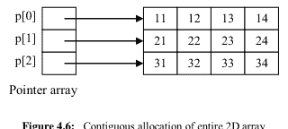

请注意，指针数组可以用指向指针的指针来表示。

### 示例：

```c
#include<stdio.h>
#include<stdlib.h>
main()
{
int **p, *q, m, n, i, j;
printf("Enter number of rows");
scanf("%d", &m);
printf("Enter number of columns");
```


```c
scanf ("%d", &n);
p = (int**)malloc(m * sizeof(int*));
q = (int*)malloc(m * n * sizeof(int));
if (p==NULL || q==NULL)
{
    printf("Insufficient Memory");
    exit(1);
}
for(i=0; i<m; i++)
{
    p[i] = q;
    q += n;
}
printf("Enter the elements of the array\n");
for(i=0;i<m;i++)
    for(j=0;j<n;j++)
        scanf("%d", &p[i][j]);
printf("Elements of the array\n");
for(i=0; i<m; i++)
{
    for(j=0; j<n; j++)
    {
        printf("%5d",p[i][j]);
        printf("\n");
    }
}
```

输出：
Enter number of rows3
Enter number of columns3
Enter the elements of the array
11 12 13
21 22 23
31 32 33
Elements of the array
11 12 13
21 22 23
31 32 33

## 二维数组的非连续分配

二维数组的非连续分配用于需要创建大型二维数组（例如 1000 × 1000）和/或可能没有连续内存可用的情况。对于内存的非连续分配，每行的空间会根据需要单独分配。因此，总空间不是连续的。但是，每行的所有元素必须分配连续空间。

动态创建一个指针数组。该指针数组的大小与二维数组的行数相同，第 i 个数组元素应指向第 i 行的开头。

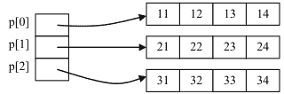

### 图 4.7：二维数组的非连续分配，但每行必须分配连续空间

### 示例：

```c
#include<stdio.h>
#include<stdlib.h>
main()
{
int **p, m, n, i, j;
printf("Enter number of rows");
scanf("%d", &m);
printf("Enter number of columns");
scanf("%d", &n);
p=(int**) malloc(m * sizeof(int*));
for(i=0; i<m; i++)
p[i] = (int*)malloc(n * sizeof(int));
printf("Enter the elements of the array");
for(i=0;i<m;i++)
{
for(j=0;j<n;j++)
scanf("%d", &p[i][j]);
}
printf("Elements of the array");
for(i=0;i<m;i++)
{
for(j=0;j<n;j++)
printf("%d", p[i][j]);
printf("\n");
}
}
```

输出：
Enter number of rows3
Enter number of columns3
Enter the elements of the array
11 12 13
21 22 23
31 32 33
Elements of the array
11 12 13
21 22 23
31 32 33

然而，二维数组动态内存分配的缺点如下：

- 额外的内存空间用于存储指针数组。
- 访问单个数组元素仅在第一级间接寻址后获得。

## 指针、数组和字符串

有时我们可以使用指针变量代替数组。假设 a 被声明为一维整型数组，p 被声明为指向整型的指针。

```c
int a[10];
```

我们可以用以下代替数组：

```c
int *p;
```

由于 p 未定义，因此 p 可能包含垃圾值，且 p 未自动分配一块内存。因此，在将指针变量用作数组替代之前，需要为其分配内存。

### 示例：

```c
p = (int *)malloc(100*sizeof(int));
```

该语句为 100 个整数值分配内存块。

### 示例：

```c
char *s;
scanf("%s",s); /* invalid */
or
char *s;
s = "Hello" /* invalid */
```

在使用指针变量之前，应分配一块内存。否则，可能会显示类似“段错误”的运行时错误。

### 示例：

```c
char *s;
s = (char*)malloc(10);
scanf("%s",s);
```

然而，在数组的情况下，内存块在编译时分配。

```c
char t[10];
scanf("%s", t); /* valid */
```

但不能给字符串变量赋值

```c
char t[10];
t = "Hello";
```

应使用库函数 strcpy() 来完成此操作

### 示例：

```c
char t[10];
strcpy(t, "Hello");
```

### 程序：如何在不使用 sizeof 运算符的情况下查找 int 数据类型的大小。

```c
#include<stdio.h>
main()
{
    int *ptr = 0;
    ptr++;
    printf("Size of int data type: %d",ptr);
}
```

## 总结

- 指针是可以指向另一个变量的变量。
- 该变量可以是整型、字符型或浮点型。
- 指针也可以指向另一个指针变量，此时该指针称为指向指针的指针。
- void 指针是一种指针，可以存储任何类型变量的地址。
- 有时在程序运行时需要分配内存空间。这种内存分配称为动态内存分配。
- malloc() 和 calloc() 函数用于在运行时分配内存空间。
- realloc() 函数用于修改先前分配的内存空间。
- free() 函数用于释放先前通过 malloc()、calloc() 或 realloc() 函数调用分配的内存空间。

## 练习

- 1. 什么是指针？
- 2. 间接运算符的用途是什么？如何使用间接运算符访问多维数组元素？
- 3. 什么是指向指针的指针？
- 4. 什么是 void 指针？什么是泛型函数？
- 5. 什么是悬空指针？
- 6. 如何使用指针访问数组中的元素？请用合适的示例说明。
- 7. 指向函数的指针如何工作？
- 8. 函数如何返回指向其调用函数的指针？请用合适的示例说明。
- 9. 什么是动态内存分配？动态内存分配相对于静态内存分配有什么优势？
- 10. malloc() 和 calloc() 函数有什么区别？
- 11. 编写一个使用指针计算数组中所有元素之和的程序。
- 12. 编写一个使用指针确定字符串长度的程序。
- 13. 编写一个使用指针交换内存中两个位置存储值的函数。
- 14. 编写一个程序动态生成 N 个元素的数组并按升序排序。
- 15. 编写一个使用动态内存分配进行矩阵乘法的程序。
- 16. 以下 C 程序的输出是什么？
  - (i)
    ```c
    main()
    {
    const int x = 5;
    int *ptr;
    ptr = &x;
    *ptr = 10;
    printf("%d", x);
    }
    ```
  - (ii)
    ```c
    main()
    {
    int a=2, *f1, *f2;
    f1 = f2 = &a;
    *f1=*f2+=a+=2.5;
    printf("%d %d %d", a, *f1, *f2);
    }
    ```
  - (iii)
    ```c
    main()
    {
    register int i =5;
    printf("Address of a=%u", &i);
    printf("Value of a=%d", i);
    }
    ```
  - (iv)
    ```c
    main()
    {
    int a=10;
    void *j;
    j=&a;
    j++;
    printf("%u", j);
    }
    ```
  - (v)
    ```c
    main()
    {
    char *p="Hello";
    printf("%c", *p);
    }
    ```
  - (vi)
    ```c
    main()
    {
    int i=320;
    char *ptr=(char *)&i;
    printf("%d",*ptr);
    }
    ```
  - (vii)
    ```c
    main()
    {
    static char str[]="Limericks";
    char *s;
    s=&str[6];
    while(*s)
    printf("%c", *s++);
    }
    ```

## 链表

> “整体等于其各部分之和”。- 欧几里得

- 单链表
- 双链表
- 循环链表
- 链式栈
- 链式队列
- 多项式表示

顾名思义，链表是由链接元素组成的线性列表。与数组一样，链表表示另一种线性数据结构。数组在大多数编程语言中是非常常用的数据结构。由于它存在若干局限性和缺点，因此需要一种替代方法。这些局限性可以通过使用链表数据结构来克服。

Allen Newell、Cliff Shaw 和 Herbert A. Simon 在 RAND 公司于 1955–1956 年为其信息处理语言开发了链表，将其作为主要数据结构。

### 数组的局限性

数组是用于存储同类元素集合的最常见数据结构。在大多数语言中，数组声明方便，且可在常数时间内快速访问任何元素。元素的地址是作为数组起始位置的偏移量计算的，这只需要一次乘法和一次加法。

在许多应用中，数组并不合适，因为它存在一些缺点。数组的缺点如下：

- 数组的最大尺寸需要事先预测。分配内存后无法更改数组大小，但许多应用需要调整大小。通常，此大小在编译时通过简单声明指定。数组大小可以推迟到运行时创建数组时确定，但之后保持固定。当数组从堆中动态分配时，可以使用 realloc() 动态调整其大小，但这需要程序员付出实际努力。
- 当程序员分配大尺寸数组时，数组中的大部分空间会被浪费。另一方面，当程序需要处理超过指定大小的数据时，代码就会崩溃。
- 数组的存储必须是连续可用的。所需存储空间并不总是立即可用。
- 插入和删除操作可能非常慢。最坏情况发生在需要删除或插入第一个元素时。几乎所有数组元素都需要移动。平均而言，大约一半的数组元素需要移动。因此，时间复杂度取决于元素总数，而非实际操作。
- 连接或拆分两个或多个数组比较困难。


## 链表

在数组中，两个连续元素的地址之间始终存在固定关系，因为数组的所有元素必须连续存储。但是，请注意，这种连续性要求使得数组大小的扩展或收缩变得困难。在链表中，数据项可以任意散布在内存的各处，但我们可以在动态情况下实现快速插入和删除。

定义：链表是一种由称为节点的有限同类型数据元素组成的线性有序集合，其中线性顺序通过链接或指针来维护。

链表为每个元素在其自身的内存块中单独分配空间，该块称为“链表元素”或“节点”。列表结构是通过使用指针将其所有节点连接起来（就像链条上的链接一样）来创建的。

在数组中，如果已知一个元素的地址，则所有其他元素的地址都会自动已知。由于在链表中，元素地址之间没有关系，因此链表的每个元素必须显式存储其下一个元素的地址。

### 表 5.1：数组与链表的区别

| 属性 | 数组 | 链表 |
| :--- | :--- | :--- |
| 存储 | 数组的存储必须是连续可用的。 | 存储不需要连续。 |
| 内存利用率 | 数组的大小需要预先预测，因为内存分配是提前进行的。 | 链表的内存不是预先分配的，在需要时分配内存。 |
| 内存利用率 | 不需要存储任何元素的地址。 | 需要额外的内存空间来存储下一个节点的地址 |
| 大小变化 | 数组大小固定，程序执行期间无法扩展或收缩 | 链表在程序执行期间可以扩展或收缩 |
| 插入/删除 | 插入/删除操作较慢，平均需要移动一半的元素 | 插入/删除操作非常快，在常量时间内完成 |
| 搜索 | 可能进行线性搜索、二分搜索、插值搜索 | 不可能进行二分搜索、插值搜索，只能进行线性搜索 |
| 访问元素 | 在常量时间内快速访问任何元素。 | 要访问链表中的任何元素，需要进行遍历。 |
| 连接/拆分 | 两个数组的连接和拆分 | 两个链表的连接和拆分非常容易。 |

### 链表的优点

链表有许多优点。其中一些非常重要的优点是：

- i) 链表是动态数据结构。也就是说，它们可以在程序执行期间扩展或收缩。
- ii) 存储不需要连续。
- iii) 内存利用率高。这里内存不是预先分配的。在需要时分配内存。
- iv) 插入或删除简单且高效，可以非常快速地完成，在常量时间内，与列表大小无关。
- v) 两个链表的连接可以通过将第二个链表的指针赋给第一个链表的最后一个节点来完成。

拆分可以通过在我们想要将一个链表拆分为两部分的节点中赋一个空地址来完成。

### 链表的类型

链表有不同的类型。我们可以将链表分为以下四种类型：

- i) 单链表
- ii) 循环链表
- iii) 双向链表
- iv) 循环双向链表

### 单链表

链表中的一个元素特别称为节点。在单链表中，每个节点包含两个字段：

- i) DATA 字段，包含元素的实际信息。
- ii) LINK 字段，包含列表中下一个节点的地址。

一个“DATA”字段用于存储列表为用户保存的任何元素类型，以及一个“LINK”字段，它是一个指针，用于将一个节点链接到下一个节点。每个节点通过调用 malloc() 函数在堆中分配。当通过调用 free() 函数显式释放时，节点内存变为空闲。列表的前端是指向第一个节点的指针。以下是包含数字 1、2 和 3 的列表可能的样子。

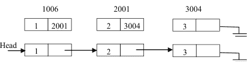

### 图 5.1：链表表示

### 单链表上的操作

单链表支持的操作如下：

### 表 5.2：链表上的各种操作

| 操作 | 描述 |
| :--- | :--- |
| Createlist | 此操作创建一个链表。 |
| Traverse | 此操作遍历/访问链表的所有元素，且恰好一次 |
| Insertion | 此操作向链表插入一个元素 |
| Deletion | 此操作从链表中删除一个元素 |
| Searching | 此操作在链表中对键值执行线性搜索 |
| Reverse | 此操作执行链表的反转 |
| Merging | 此操作将两个链表合并为一个单链表 |

在详细介绍单链表的操作之前，我们需要两种数据类型：节点和节点指针。

链表由节点构成。这些节点在堆中分配。每个节点包含一个数据元素和一个指向列表中下一个节点的指针。

```
struct node {
 int DATA;
 struct node *LINK;
 };
```

此处显示了链表的节点结构。其中 DATA 包含值，LINK 保存下一个节点的地址。

| DATA | LINK |
|---|---|

### 图 5.2：节点的符号表示

链表中节点的 LINK 字段指向列表的下一个节点。LINK 指针被称为自引用指针，因为它指向同一类型节点的地址。

### 创建单链表

以下算法创建一个节点并将其追加到现有列表的末尾。'HEAD' 是一个指针，保存链表头部的地址，'ITEM' 是新节点的值。NEW 是一个指针，保存新节点的地址，'Temp' 是一个临时指针。

### 创建单链表的算法

```
Algorithm: CREATE (HEAD, ITEM)
1. [Create NEW node]
 a) Allocate memory for NEW node.
 b) IF NEW = NULL then Print: “Memory not Available” and Return
 c) Set NEW→DATA = ITEM
 d) Set NEW→LINK = NULL
2. [Whether List is empty, head is the content of HEADER]
 If HEAD = NULL then Set HEAD = NEW
3. Else
 a) Set Temp = HEAD
 b) While Temp→LINK ≠ NULL do
 Set Temp = Temp→LINK
 [End of while]
 c) Set Temp→LINK = NEW
 [End of IF]
4. Return
```

首先使用动态内存分配从堆中创建一个 NEW 节点，并检查它是否为 NULL。如果 NEW 节点为 NULL，则内存不可用于创建链表。否则，将 ITEM 的值存储到 NEW 节点的 DATA 部分，并将 NULL 存储到 NEW 节点的 LINK 部分。

以下图示解释了单链表的创建过程。

首先将 HEAD 赋值为 NULL

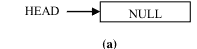

之后创建一个新节点，并将该节点的地址赋给 HEAD，

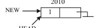

在下一步中，创建另一个节点并将其链接到 HEAD 节点。

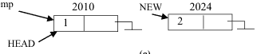

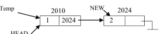

### 图 5.3 (a)-(d)：创建单链表

### 遍历/显示链表

此算法遍历链表并打印链表中每个节点的数据部分。‘HEAD’ 是一个指向链表起始节点的指针，‘Temp’ 是一个用于遍历列表的临时指针。

### 遍历链表的算法

```
Algorithm: TRAVERSE (HEAD)
1. If HEAD = NULL then
   i) Print: “The linked list is empty”
   ii) Return
2. Temp = HEAD
3. Repeat while Temp ≠ NULL
   i) Print: Temp→DATA
   ii) Set Temp = Temp→LINK
   [End of Loop]
4. Return
```


## 单链表中的插入

单链表的插入操作可以根据位置以不同方式进行。

- 在开头插入。
- 在中间插入。
- 在末尾插入。

### 在单链表第一个位置插入节点

以下算法描述了在开头位置插入节点。‘HEAD’ 是指向链表起始节点的指针。NEW 指向新节点。

### 在开头插入节点的算法

```
Algorithm: ADD_BEG (HEAD, ITEM)
1. [Create the new node]
   a) Allocate memory for NEW node.
   b) IF NEW = NULL then Print: "Memory not Available" and Return
   c) Set NEW->DATA = ITEM
   d) Set NEW->LINK = HEAD
2. [Make the HEAD to point to the NEW node]
   Set HEAD = NEW
3. Return
```

首先使用动态内存分配从堆中创建一个 NEW 节点，并检查它是否为 NULL。如果 NEW 节点为 NULL，则内存不可用。否则，将 ITEM 的值存储到 NEW 节点的 DATA 部分中。

以下图示解释了单链表开头处的插入操作。

首先 HEAD 指向包含两个节点的列表的第一个节点。

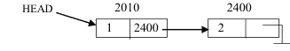

(a)

创建一个新节点并由指针 NEW 指向。新节点的 LINK 字段包含头节点的地址。

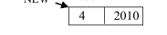

(b)

现在，HEAD 指针指向新节点

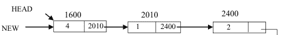

(c)

图 5.4 (a-c): 单链表开头处的节点插入

### 在单链表指定节点之前插入节点

此算法创建一个节点并将其插入到节点指针 P 之前。HEAD 是指向链表第一个节点的指针，ITEM 是新节点的值。NEW 是一个保存新节点地址的指针。Temp 和 PTemp 是用于遍历列表的两个临时指针。

### 在给定节点指针之前插入节点的算法

```
ALGORITHM: ADD_BEFORE (HEAD, ITEM, P)
1. Set Temp = HEAD [to make Temp to point to the first node]
2. Repeat step 3 while Temp != P
3. a) Set PTemp = Temp
   b) Set Temp = Temp->LINK
   c) If Temp = NULL then
      i) Print: "Not Found"
     ii) Return
   [End of loop]
4. [Create the new node]
   a) Allocate memory for NEW node
   b) IF NEW = NULL then Print: "Memory not Available" and Return
   c) Set NEW->DATA = ITEM
   d) Set NEW->LINK = Temp
   e) Set PTemp->LINK = NEW
5. Return
```

开始时，从 HEAD 遍历链表到节点指针 P 以获取前一个节点的位置。然后，使用动态内存分配从堆中创建一个 NEW 节点并检查它是否为 NULL。如果 NEW 节点为 NULL，则内存不可用。否则，将 ITEM 的值存储到 NEW 节点的 DATA 部分中。

以下图示解释了单链表节点指针之前的插入操作。

首先，Temp 被赋值为 HEAD。

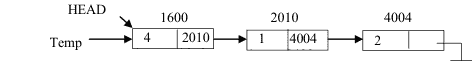

在下一步中，Temp 移动到下一个节点，PTemp 被赋值为前一个节点的地址

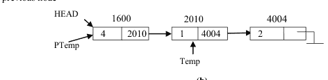

之后，创建一个 NEW 节点并与前一个节点和下一个节点链接。

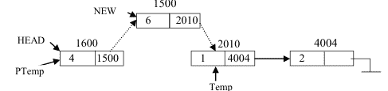

图 5.5 (a-c): 链表中任意位置之前的节点插入

### 在单链表节点之后插入节点

在以下算法中，描述了如何在链表中特定节点指针 P 之后插入节点。HEAD 是指向链表第一个节点的指针，ITEM 是新节点的值。NEW 是一个保存新节点地址的指针。POST 是一个临时指针，指向 P 的下一个节点。

### 在给定节点指针之后插入节点的算法

```
Algorithm: ADD_AFTER (HEAD, ITEM, P)
1. Set POST = P->LINK
2. [Create the new node]
   a) Allocate memory for NEW node
   b) IF NEW = NULL then Print: "Memory not Available" and Return
   c) Set NEW->DATA = ITEM
   d) Set NEW->LINK = POST
   e) Set P->LINK = NEW
3. Return
```

开始时，通过 P 指针的链接部分设置 POST 指针。现在，POST 指向 P 的下一个节点。然后创建一个 NEW 节点并将 ITEM 的值存储到 NEW 节点的 DATA 部分中。以下图示解释了单链表节点指针之后的插入操作。在图 5.6a 中，POST 保存特定节点 P 之后节点的地址。

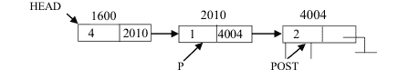

之后，创建一个 NEW 节点，ITEM 被放置在 DATA 字段中，POST 被赋值给 LINK 字段，如图 5.6b 所示。

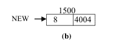

最后，NEW 节点被赋值给节点 P 的 LINK

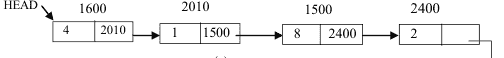

(c)

图 5.6 (a, b, c): 链表中任意位置之后的节点插入

### 在单链表末尾插入节点

以下算法描述了如何将新节点插入到单链表的末尾。HEAD 是指向链表第一个节点的指针，NEW 是一个保存新节点地址的指针。ITEM 是新节点的值。Temp 保存头节点的地址。

### 在末尾插入节点的算法

```
Algorithm: ADD_END (HEAD, ITEM)
1. [Create the new node]
   a) Allocate memory for NEW node
   b) IF NEW = NULL then Print: "Memory not Available" and Return
   c) Set NEW->DATA = ITEM
   d) Set NEW->LINK = NULL
2. Set Temp = HEAD [to make Temp to point to the first node]
3. Repeat while Temp->LINK != NULL
   Set Temp = Temp->LINK
   [End of loop]
4. Set Temp->LINK = NEW
5. Return
```

开始时创建一个 NEW 节点并将 ITEM 的值存储到 NEW 节点的 DATA 部分中。然后，从 HEAD 遍历链表到最后一个节点以获取最后一个节点的位置。然后以下图示解释了单链表末尾处的插入操作。首先 Temp 被赋值为链表 HEAD 节点的地址

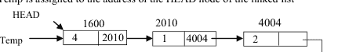

(a)

现在，Temp 移动到链表的末尾。

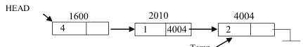

(b)

创建一个 NEW 节点。ITEM 被放置在 DATA 字段中，NULL 被赋值给 LINK 字段。

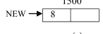

最后，NEW 被赋值给链表最后一个节点的 LINK 字段。

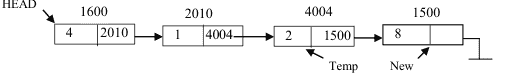

图 5.7 (a, b, c, d): 链表最后位置的节点插入

## 单链表中的删除

单链表的删除操作可以根据位置以不同方式进行。

- 在开头删除。
- 从中间删除。
- 从末尾删除。

### 从开头删除节点

以下算法描述了链表头节点的删除。Temp 是一个临时指针，保存头节点（HEAD）的地址。ITEM 变量用于存储被删除节点的值。

### 从开头删除节点的算法

```
Algorithm: DELETE_BEG (HEAD, ITEM)
1. [Check for empty list]
   IF HEAD = NULL then Print: "The linked list is empty" and Return
2. Set Temp = HEAD   [To make Temp to point the first node]
3. Set HEAD = Temp->LINK
4. Set ITEM = Temp->DATA
5. Set Temp->LINK = NULL
6. Deallocate memory for Temp Node
7. Return
```

开始时检查链表是否为空。Temp 指针指向链表的第一个节点，然后 HEAD 移动到下一个节点并将 Temp 节点的 DATA 部分存储到 ITEM。以下图示解释了单链表开头处的删除操作。

在第一步中，Temp 被赋值为 HEAD 的地址。

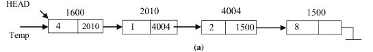

在下一步中，HEAD 移动到下一个节点。

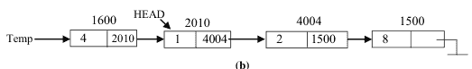

最后，由 Temp 指向的链表的第一个节点被删除。

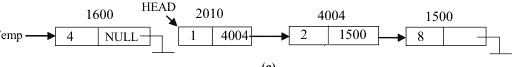

图 5.8 (a, b, c): 链表第一个位置的节点删除

### 从单链表末尾位置删除

以下算法描述了从单链表末尾删除节点。Temp 是一个指向 HEAD 节点的临时指针。Temp 指针用于遍历链表以保持 HEAD 指针的位置。PTemp 是另一个临时指针，保存要删除节点的前一个节点的地址。

### 从末尾删除节点的算法

```
ALGORITHM: DELETE_END (HEAD, ITEM)
1. [Check for empty list]
   IF HEAD = NULL then Print: "The linked list is empty" and Return
2. Set Temp = HEAD
3. Repeat while Temp->LINK != NULL
   a) PTemp = Temp
   b) Set Temp = Temp->LINK
   [End of loop]
4. Set ITEM = Temp->DATA
5. Set PTemp->LINK = NULL
6. Deallocate memory for Temp Node
7. Return
```

开始时检查链表是否为空。然后，从 HEAD 遍历链表到最后一个节点以获取最后一个节点和倒数第二个节点的位置。将 Temp 节点的 DATA 部分存储到 ITEM。

以下图示解释了单链表开头处的删除操作。

首先，Temp 被赋值为 HEAD。

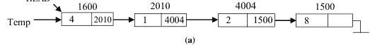


Temp被移动到列表末尾。PTemp保存前一个节点的地址。

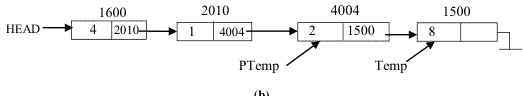

最后，PTemp->LINK字段被赋值为NULL，Temp被删除。

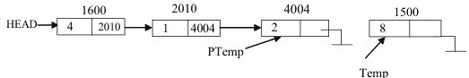

### 图 5.9 (a, b, c): 链表末尾位置的节点删除

## 单链表中任意中间节点之后的删除

以下算法描述了从特定位置删除节点的过程。P保存了待删除Temp节点的前一个节点的地址。

## 在给定节点指针后删除节点的算法

```
Algorithm: DELETE_AFTER (ITEM, P)
1. Set Temp = P->LINK
2. Set P->LINK = Temp->LINK
3. Set ITEM = Temp->DATA
4. Set Temp->LINK = NULL
5. Deallocate memory for Temp Node
6. Return
```

起初，将Temp节点的DATA部分存储到ITEM中。P指向待删除的前一个节点。P节点的LINK部分指向Temp节点的下一个节点。Temp的LINK被设置为NULL。然后，Temp被释放。

## 单链表中按给定ITEM删除

该算法查找并删除值为ITEM的节点。Temp是一个指针，保存链表头节点的地址。Temp和old是用于遍历列表的两个临时指针。

## 按值删除节点的算法

```
Algorithm: DELETE_ITEM (HEAD, ITEM)
1. [Make temp to point the first node]
   Set Temp = HEAD
2. [Check for empty list]
   IF HEAD = NULL then
     a) Print: "The linked list is empty"
     b) Return
3. Repeat Step 4 to 5 until Temp is NULL
4. If Temp->DATA = ITEM then
   a) If Temp = HEAD then // node to be deleted is the first node
     Set HEAD = Temp->LINK
     Else
     Set PTemp->LINK = Temp->LINK
   b) Deallocate memory for Temp Node// de allocate node
   c) Return
5. Else
   Set PTemp = Temp and Temp = Temp->LINK
   [End of loop]
6. Print: "Element not found"
7. Return
```

起初，Temp指向列表的第一个节点，如下图所示。

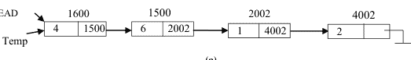

(a)

然后检查列表是否为空，如果不为空，则删除第一个节点，如图5.10b所示。

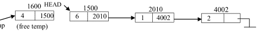

(b)

要删除任何其他节点，Temp被赋值为该节点，P保存前一个节点的地址。

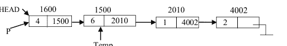

(c)

待删除节点。然后，P的LINK被赋值为Temp的LINK。之后，Temp被删除。

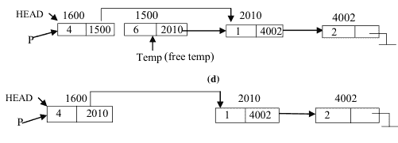

### 图 5.10 (a-e): 链表中任意位置的节点删除

## 搜索单链表

该算法查找链表中值为ITEM的节点的位置。Temp是一个指针，指向链表的起始节点。'Temp'是用于遍历列表的临时指针。'LOC'是存储搜索项位置的变量。

## 按给定值搜索链表的算法

```
Algorithm: SEARCH(HEAD, ITEM, LOC)
1. Set Temp = HEAD, LOC=NULL
2. If Temp = NULL then
   i) "The linked list is empty"
   ii) Return
3. Repeat step 4 while Temp != NULL
4. If Temp->DATA = ITEM then
   i) Print: "Element found"
   ii) Set LOC = Temp
   iii) Return
   Else
   Temp = Temp->LINK
   [End of If]
   [End of Loop]
5. Print: "Element not found"
6. Return
```

起初，Temp被赋值为HEAD的地址

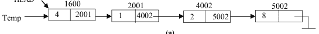

(a)

之后，Temp->DATA与ITEM=1进行比较，Temp相应地移动

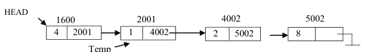

当找到ITEM时，LOC指向该节点在列表中的索引。

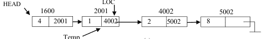

### 图 5.11(a, b, c): 链表中ITEM的搜索

## 链表反转

链表反转意味着最后一个节点变成第一个节点，第一个节点变成最后一个节点。HEAD是一个指针，保存链表头节点的地址。PRE、POST和CUR是临时指针。

## 反转链表的算法

```
Algorithm: REVERSE (HEAD)
1. Set PRE = NULL and CUR = HEAD
2. Repeat step 3 to 6 while CUR != NULL
3. Set POST = CUR->LINK
4. Set CUR->LINK = PRE
5. Set PRE = CUR
6. Set CUR = POST
   [End of Loop]
7. HEAD = PRE
8. Return
```

第一步，NULL被赋值给PRE指针，CUR指针被赋值为链表的HEAD节点。

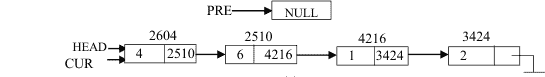

第一次迭代后，POST指向当前节点的下一个节点


下一步，CUR被赋值给PRE，POST被赋值给CUR。PRE节点的LINK字段被赋值为NULL。


第二次迭代后，CUR节点的LINK字段与PRE相连，POST移动到下一个节点。


之后，CUR被赋值为POST。


第四次迭代后，单链表如下图5.12f所示


### 图 5.12 (a-f): 链表反转

## 链表反向显示

该算法以逆序显示链表。HEAD指向列表的第一个节点。P用于将循环推进到列表末尾。然后R被设置为列表的最后一个节点。之后，R用于以逆序显示列表。

## 反向显示链表的算法

```
ALGORITHM: REVERSE_DISPLAY (HEAD)
1. Set R = NULL and Q = HEAD
2. Repeat step 3 to 7 while Q != R
3. Set P = Q
4. Repeat step 5 while P->LINK != R
5. Set P = P->LINK
   [End of Loop]
6. Print: P->INFO
7. Set R = P
   [End of Loop]
8. Return
```

## 将数组转换为单链表

我们可以使用现有数组转换单链表。以下算法创建一个节点，存储一个数组元素，并将其追加到现有列表的开头。

该算法创建一个节点并将其插入列表开头。HEAD是一个指针，保存链表头节点的地址，ITEM是新节点的值。NEW是一个指针，保存新节点的地址。

## 从现有数组转换链表的算法

```
Algorithm: CONVERT (A, N, HEAD)
1. Set HEAD = NULL
2. Repeat steps 3 to 8 while N != -1
3. Allocate memory for New node
4. If NEW = NULL then Print: “Memory not Available” and Return
5. Set NEW->DATA = A[N-1]
6. Set NEW->LINK = HEAD
7. Set HEAD = NEW
8. Set N = N - 1
[End of loop]
9. Return
```

## 使用链表表示多项式

在这种表示中，多项式也可以用链表表示，链表中的一个节点表示多项式中的一项。

起初，我们需要存储多项式f(x)的指数/次数和系数。为此，我们需要定义如下结构：

```
typedef struct poly
{
    int exp;
    int coef;
    struct poly *LINK;
} term;
poly *head;
```

我们将始终按度数降序存储多项式的项。

4x^6 + 2x^4 + 3x + 1将由链表表示如下：


### 图 5.13: 多项式的链表表示

## 使用链表相加两个多项式

以下算法描述了两个多项式的加法。由两个多项式组成的两个链表分别由HEAD1和HEAD2作为头节点。Insert函数用于在由R作为头节点的新链表中插入一个节点。

## 两个多项式相加的算法

```
ALGORITHM: POLYADD(HEAD1, HEAD2)
1. Set P=HEAD1, Q=HEAD2, R=NULL
2. Repeat while P!=NULL and Q !=NULL
   i) If P->EXP > Q->EXP then
      Call INSERT(R, P->EXP, P->COEFF)
      Set P=P->LINK
   ii) Else If P->EXP < Q->EXP then
      Call INSERT(R, Q->EXP, Q->COEFF)
      Set Q=Q->LINK
   iii) Else If P->COEFF + Q->COEFF != 0
      Call INSERT(R, P->EXP, P->COEFF + Q->COEFF)
      Set P=P->LINK
      Set Q=Q->LINK
   [End of if]
   [End of loop]
3. Repeat while P!=NULL
   i) Call INSERT(R, P->EXP, P->COEFF)
   ii) Set P=P->LINK
   [End of loop]
4. Repeat while Q!=NULL
   i) Call INSERT(R, Q->EXP, Q->COEFF)
   ii) Set Q=Q->LINK
   [End of loop]
5. Return
Function: INSERT(R, EXP, COEF)
1. Allocate memory for NEW node
2. If NEW=NULL then
   i) Print: Out of Memory
   ii) Return
3. Set NEW->EXP=EXP, NEW->COEFF=COEF, NEW->LINK=NULL
4. If R=NULL then
   HEAD3=R=NEW
   Else
   Set R->LINK=NEW and R=NEW
   [End of If]
5. Return
```


## 单向链表的复杂度

在单向链表中，向已知位置插入或删除元素的代价为 O(1)。而对于线性数组，插入或删除操作的代价为 O(n)。这是因为，在链表的情况下，插入或删除操作不涉及任何数据移动；只需在节点之间执行指针交换，即可完成插入或删除。在数组的情况下，这两种操作都涉及 n 个位置的数据替换。

## 表 5.3：数组与链表的比较

| 操作 | 数组 | 链表 |
|---|---|---|
| 在开头插入/删除 | O(n) | O(1) |
| 在末尾插入/删除 | O(1) | O(1) |
| 在中间插入/删除 | O(n) | O(1) |
| 索引 | O(1) | O(n) |
| 空间浪费 | O(1) | O(n) |

## 循环链表

循环链表是单向链表的一种变体，其中最后一个节点指向列表的第一个节点。循环链表既没有开头也没有结尾。

在循环链表中，有两种方法可以判断一个节点是否为第一个节点。

- i) 要么一个外部指针 list 指向第一个节点，或
- ii) 将一个头节点作为循环列表的第一个节点。

头节点可以通过将哨兵值作为信息部分，或者设置专用标志变量来指定该节点是否为头节点，从而与其他节点区分开来。

链表可以以两种方式之一实现：

- i) 使用单个指针指向链表的头节点，且列表的最后一个节点指向列表的头节点。
- ii) 可以使用两个不同的指针分别指向循环链表的第一个节点和最后一个节点。

在线性链表中，一旦遍历完列表，就很难返回到列表的第一个节点。循环链表为这个问题提供了解决方案。在循环链表中，最后一个节点指向链表的第一个节点，因此遍历列表时返回第一个节点没有任何困难。

可以很容易地从线性链表形成循环链表，其中线性链表的最后一个节点指向链表的第一个节点。

循环链表可以由三个节点表示，如下所示。


图 5.14：循环链表

在此，HEAD 指向列表的第一个节点，且最后一个节点指向第一个节点，形成一个循环列表。

## 循环链表上的操作

单向链表支持的操作如下：

| 操作 | 描述 |
| :--- | :--- |
| 创建列表 | 该操作创建一个链表。 |
| 遍历 | 该操作恰好遍历/访问链表的所有元素一次。 |
| 插入 | 该操作将一个元素插入到链表中。 |
| 删除 | 该操作从链表中删除一个元素。 |
| 搜索 | 该操作在链表中对键值执行线性搜索。 |
| 反转 | 该操作反转链表。 |
| 合并 | 该操作将两个链表合并为一个链表。 |

## 创建循环链表

该算法创建一个节点，并将其追加到现有列表最后一个节点（指向第一个节点）之后。HEAD 是一个指针，保存链表第一个节点的地址，DATA 是新节点的值。NEW 是一个指针，保存新节点的地址，temp 是一个临时指针。

### 创建循环链表的算法

```
Algorithm: CIRCULAR_ADD (HEAD, ITEM)
1. [Create the new node]
   a) Allocate memory for the NEW node.
   b) If NEW = NULL, then Print: “Memory not Available” and Return.
   c) Set NEW→DATA = ITEM.
   d) Set NEW→LINK = NEW.
2. [Check whether the list is empty or not]
   If HEAD = NULL, then
       Set HEAD = NEW.
3. Else
   a) Set Temp = HEAD.
   b) Repeat while Temp→LINK ≠ HEAD do
       Set Temp = Temp→LINK.
   [End of loop]
   c) Set Temp→LINK = NEW.
4. [Make the new node point to the first node]
   Set NEW→LINK = HEAD.
5. Return.
```

最初，HEAD 被赋值为 NULL。当循环链表中没有节点时，它指示链表的第一个节点。最初，它指向 NULL。


之后，创建一个 NEW 节点，并将地址赋给 HEAD。LINK 字段被赋为 HEAD 节点的地址。


在下一步中，创建另一个节点并与第一个节点链接。NEW 节点的 LINK 字段与第一个节点链接。


图 5.15 (a, b, c)：循环链表

## 在循环链表开头添加新节点

该算法创建一个节点并将其插入列表开头。HEAD 是一个指针，保存链表第一个节点的地址，ITEM 是新节点的值。NEW 是一个指针，保存新节点的地址，Temp 是一个临时指针。

### 在开头插入节点的算法

```
Algorithm: CIRADD_BEG (HEAD, ITEM)
1. [Create the new node]
   a) Allocate memory for the NEW node.
   b) If NEW = NULL, then Print: “Memory not Available” and Return.
   c) Set NEW→DATA = ITEM.
   d) Set NEW→LINK = HEAD.
2. a) Set Temp = HEAD.
   b) Repeat while Temp→LINK ≠ HEAD do
       Set Temp = Temp→LINK.
   [End of loop]
3. [Move HEAD to point to the new node]
   Set HEAD = NEW    // to make the new node the first node
   Set Temp→LINK = HEAD.
4. Return.
```

创建一个 NEW 节点并与循环链表的 HEAD 节点链接。


最后，NEW 节点的地址被赋给链表最后一个节点的 LINK 字段。


图 5.16 (a, b)：在循环链表中某个节点之前插入

## 在循环链表特定位置之后添加新节点

该算法创建一个节点并将其插入位置 loc 处的节点之后。HEAD 是一个指向第一个节点的指针，ITEM 是新节点的值。NEW 是一个保存新节点地址的指针。Temp 和 PTemp 是两个用于遍历列表的临时指针。

### 在给定节点指针之后插入节点的算法

```
Algorithm: CIRADD_AFTER (HEAD, ITEM, LOC)
1. [Create the new node]
   a) Allocate memory for the new node.
   b) If NEW = NULL, then Print: “Memory not Available” and Return.
   c) Set NEW→DATA = ITEM.
   d) Set NEW→LINK = Temp.
2. [Make Temp point to the first node]
   Set Temp = HEAD.
3. Repeat for i = 1 to LOC
   a) Set PTemp = Temp and Temp = Temp→LINK.
   b) If Temp = HEAD, then
       Print: “There are less than loc+1 elements” and Return.
4. Set PTemp→LINK = NEW.
5. Return.
```

在第一步中，Temp 指向循环链表的第一个节点。


在下一步中，Temp 移动直到找到 loc。Temp 指向 loc 位置的节点。PTemp 保存前一个节点的地址。创建一个 NEW 节点，其 LINK 字段被赋为 HEAD 节点的地址。


最后，NEW 节点被插入到 loc 位置之前。在此示例中，loc 被认为是 2。这意味着 NEW 节点被插入到循环链表的第 2 个位置。


图 5.17 (a, b, c)：在循环链表中插入

## 从循环链表开头删除节点

该算法从循环链表开头删除一个节点。HEAD 是一个保存链表第一个节点地址的指针。Temp 是一个临时指针。ITEM 是用于存储已删除项值的变量。

### 从开头删除节点的算法

```
Algorithm: CIRDEL (HEAD)
1. [Make Temp point to the first node]
   Set Temp = HEAD.
2. [Check for empty list]
   If HEAD = NULL, then
       Print: “The linked list is empty”.
3. Else
   a) If HEAD = Temp→LINK, then
       Set HEAD = NULL.
   Else
       P = HEAD.
       Repeat while P→LINK ≠ HEAD do
           Set P = P→LINK.
       [End of loop]
       HEAD = HEAD→LINK.
       P→LINK = HEAD.
4. Set ITEM = Temp→DATA.
5. Deallocate memory for Temp.
6. Return.
```

首先，Temp 被赋为循环链表的 HEAD 节点。


在后续步骤中，检查列表是否为空或只有一个节点。如果列表只有一个节点，则 HEAD 指向 NULL 并且该节点被删除。这种现象在下图中描绘：图 5.16b。


如果列表包含多个节点，则 Temp 被赋值给 HEAD，并且 HEAD 移动到下一个节点。然后删除 Temp。最后一个节点的 LINK 字段包含新第一个节点的地址。


图 5.18 (a, b, c)：从循环链表中删除

## 遍历循环链表

该算法遍历循环链表并打印链表中每个节点的数据部分。first 是一个指向链表起始节点的指针。Temp 是一个用于遍历列表的临时指针。

## 显示循环链表的算法

```
ALGORITHM: DISPLAY (HEAD)
1. [Make Temp to point to the first node]
   Set Temp = HEAD
   [Check for empty list]
2. IF HEAD = NULL then
   Print: "The linked list is empty" and Return
3. Print: Temp->DATA
   Set Temp = Temp->LINK
4. Repeat While Temp != HEAD
   Print: Temp->DATA
   Set Temp = Temp->LINK
5. Return
```

## 循环链表的复杂度

在循环链表的已知位置添加或删除元素的代价为 O(1)。

## 循环链表的应用

- 循环链表的实际应用是我们的个人计算机，其中多个应用程序正在运行。所有正在运行的应用程序都存储在循环链表中，操作系统获得固定的时间片来允许运行。操作系统不断遍历链表，直到所有应用程序都完成。
- 另一个例子是多人游戏。所有玩家都存储在循环链表中，指针会在玩家机会结束后不断向前移动。
- 循环链表还可用于创建循环队列。在队列中，我们必须始终在内存中保留两个指针 FRONT 和 REAR，而在循环链表中，只需要一个指针。

## 约瑟夫问题

约瑟夫问题由一群被压倒性敌军包围的士兵组成。只有一匹马可供逃脱。为了确定哪个士兵逃脱，他们围成一个圆圈，从帽子里抽出一个数字 n。同时也从帽子里抽出一个名字。他们从被抽出名字的士兵开始，顺时针围圈开始计数。当计数达到 n 时，圆圈中的一名士兵被移除，然后从下一名士兵重新开始计数，每次计数达到 n 时移除另一名士兵，最后剩下的士兵将骑上马逃脱。

我们的问题是找出士兵逃脱的顺序。程序的输入是数字和一个姓名列表。姓名按照圆圈的顺时针顺序排列，从开始计数的士兵开始。程序按士兵被淘汰的顺序打印姓名，并打印逃脱士兵的姓名。使用的数据结构是循环链表，其中每个节点代表一名士兵，因为可以通过绕圈移动从任何节点到达任何其他节点。

循环链表中节点的结构由 name 和 link 部分组成。

```
struct node
{
 char name[30];
 struct node *link;
 }
```

## 解决约瑟夫问题的算法

```
ALGORITHM: JOSEPHUS (HEAD)
1. Read N and Name
2. Set count= number of soldiers
   Set Temp=HEAD
3. Repeat until Name=Temp->name
   Temp=Temp->LINK
   [End of loop]
4. Repeat until Count=1
   a) Set C=1
   b) Repeat until C=N
      i) Set Prev=Temp
     ii) Set Temp=Temp->LINK
    iii) Set C=C+1
      [End of loop]
   c) Prev->LINK=Temp->LINK
      Print Temp->DATA "soldier remove"
   d) Set Count=Count-1
   [End of loop]
5. Print Prev->name "soldier escape"
6. Return
```

## 双向链表

双向链表定义为节点的集合，每个节点有三个部分：data、llink、rlink。Data 包含节点的数据值，llink 包含其前一个节点的地址，rlink 包含其后一个节点的地址。

通用双向链表节点可以设计为：

```
struct node
{
 int data;
 struct node* rlink;
 struct node* llink;
};
```

每个节点包含三个部分：

- i) 一个信息字段包含数据。
- ii) 一个指针字段 rlink，包含下一个节点的位置。
- iii) 一个指针字段 llink，包含前一个节点的位置。

下图说明了双向链表的结构：


图 5.19：双向链表结构

在图中，Head 和 Tail 指针分别指向列表的头节点和尾节点。

## 创建双向链表的算法

该算法创建一个节点并将其追加到现有列表的末尾。Temp 是一个保存链表 HEADER 地址的指针，ITEM 是新节点的值。NEW 是一个保存新节点地址的指针，Temp 是一个临时指针。

## 创建双向链表的算法

```
Algorithm: DLL_CREATE (HEAD, ITEM)
1. [Create the new node]
   a) Allocate memory for NEW node
   b) IF NEW = NULL then Print: “Memory not Available” and Return
   c) Set NEW->DATA = ITEM
   d) Set NEW->LLINK = NULL
   e) Set NEW->RLINK = NULL
2. [Whether List is empty, head is the content of HEADER]
   If HEAD = NULL then Set HEAD = NEW
3. Else
   a) Set Temp = HEAD
   b) While Temp->RLINK != NULL do
     Set Temp = Temp->RLINK
   [End of while]
   c) Set Temp->RLINK = NEW
   d) Set NEW->LLINK = Temp
   [End of IF]
4. Return
```

最初 HEAD 被赋值为 NULL。然后创建一个 NEW 节点，HEAD 指向该节点。


创建 HEAD 节点后，创建下一个节点并与第一个节点链接。HEAD 节点由 Temp 指向。HEAD 节点的 rlink 保存 NEW 节点的地址，NEW 节点的 llink 保存 HEAD 节点的地址。


图 5.20 (a, b)：创建双向链表

## 在双向链表开头添加

该算法创建一个节点并将其插入列表开头。head 是一个保存链表 HEAD 地址的指针，ITEM 是新节点的值。NEW 是一个保存新节点地址的指针。

## 在开头插入节点的算法

```
Algorithm: DLL_ADD_BEG (HEAD, ITEM)
1. [Create the new node]
   a) Allocate memory for NEW node.
   b) IF NEW = NULL then Print: “Memory not Available” and Return
   c) Set NEW->DATA = ITEM
   d) Set NEW->RLINK = HEAD
   e) Set NEW->LLINK = NULL
2. Set HEAD->LLINK = NEW
3. [Make the HEADER to point to the NEW node]
   Set HEAD = NEW
4. Return
```

最初创建一个 NEW 节点，其中 NEW 节点的 link 包含 HEAD 节点的地址。


之后，HEAD 节点的 link 被赋值为 NEW 节点的地址。


最后，HEAD 指针移动到 NEW 节点，如下图 5.21c 所示。


### 图 5.21 (a, b, c)：在双向链表开头添加节点

## 在双向链表开头添加

以下算法描述了在双向链表中任何特定节点之前添加节点。PRE 保存 P 的前一个节点的地址，NEW 节点将插入到该节点之前。

## 在节点指针之前插入节点的算法

```
Algorithm: DLL_ADD_BEFORE (HEAD, ITEM, P)
1. Set PRE = P->LLINK
2. [Create the new node]
   a) Allocate memory for NEW node
   b) IF NEW = NULL then Print: Overflow and Return
   c) Set NEW->DATA = ITEM
   d) Set NEW->LLINK = PRE
   e) Set NEW->RLINK = P
3. Set PRE->RLINK = NEW
4. Set P->LLINK = NEW
5. Return
```

最初，PRE 保存将插入 NEW 节点的前一个节点的地址，P 保存下一个节点的地址。


创建一个新节点，其 RLINK 保存 P 节点的地址，LLINK 保存 PRE 节点的地址。


最后，PRE 的 RLINK 链接到 NEW 节点，P 的 LLINK 链接到 NEW 节点。


### 图 5.22 (a, b, c): 双向链表中的插入

## 在双向链表任意位置之后添加

该算法创建一个节点，并将其插入位置 P 处的节点之后。HEAD 是一个指向第一个节点的指针，即它保存链表 HEADER 的内容，而 ITEM 是新节点的值。NEW 是一个保存新节点地址的指针。POST 保存要插入新节点的下一个节点的地址。

### 在给定节点指针之后插入节点的算法

```
Algorithm: DLL_ADD_AFTER (HEAD, ITEM, P)
1. Set POST = P-RLINK
2. [Create the new node]
   a) Allocate memory for NEW node
   b) IF NEW = NULL then Print: “Memory not Available” and Return
   c) Set NEW-DATA = ITEM
   d) Set NEW-RLINK = POST
   e) Set NEW-LLINK = P
3. Set P-RLINK = NEW
4. Set POST-LLINK = NEW
5. Return
```

首先，将 POST 赋值为要在其后插入新节点的节点 P 的 RLINK。


之后创建一个 NEW，其中 ITEM 被放置在 DATA 字段中，RLINK 保存 POST 的地址，而 LLINK 包含 P 节点的地址。


最后，节点 P 的 RLINK 链接到 NEW 节点，POST 节点的 LLINK 链接到 NEW 节点。


### 图 5.23 (a, b, c): 在双向链表任意位置之后添加节点

## 在双向链表末尾位置添加

以下算法描述了在双向链表末尾添加节点的过程。这里 Temp 指向 HEAD 节点。然后 Temp 移动到链表末尾。最后，NEW 节点与 Temp 节点的 RLINK 链接。

### 在末尾插入节点的算法

```
Algorithm: ADD_END (HEAD, ITEM)
1. [Make temp to point to the first node]
   Set Temp = HEAD
2. Repeat while Temp-RLINK ≠ NULL
   Set Temp = Temp-RLINK
   [End of loop]
3. [Create the new node]
   a) Allocate memory for NEW node
   b) IF NEW = NULL then Print: “Overflow” and Return
   c) Set NEW-DATA = ITEM
   d) Set NEW-RLINK = NULL
   e) Set NEW-LLINK = Temp
4. Set Temp-RLINK = NEW
5. Return
```

首先，将 Temp 赋值为 HEAD 节点。


现在，将 Temp 移动到双向链表的末尾。


最后创建一个 NEW 节点并与 Temp 链接。

### 图 5.24 (a, b, c): 在双向链表末尾插入新节点

## 正向遍历双向链表

该算法遍历链表，并按正向方向（从第一个节点到最后一个节点）打印链表中每个节点的 DATA 部分。HEAD 是一个指向链表起始节点的指针。Temp 是一个用于遍历列表的临时指针。

### 正向遍历算法

```
Algorithm: DLL_TRAVERSE (HEAD)
1. [Check for empty list]
   IF HEAD = NULL then
   i) Print: "The linked list is empty"
   ii) Return
2. Set Temp = HEAD
3. Repeat while Temp != NULL
   i) Print: Temp->DATA
   ii) Set Temp = Temp->RLINK
   [End of Loop]
4. Return
```

## 反向遍历双向链表

该算法遍历链表，并按反向方向（从最后一个节点到第一个节点）打印链表中每个节点的数据部分。HEAD 是一个指向链表起始节点的指针。Temp 是一个用于遍历列表的临时指针。首先，Temp 使用 RLINK 向前移动，然后 Temp 使用 LLINK 对双向链表进行反向遍历。

### 反向遍历算法

```
Algorithm: DLL_TRAVERSE (HEAD)
1. [Check for empty list]
   If HEAD = NULL then
   i) Print: "The linked list is empty"
   ii) Return
2. [Make temp to point to the first node]
   Set Temp = HEAD
3. Repeat while Temp-RLINK ≠ NULL
   Set Temp = Temp-RLINK
   [End of loop]
4. Repeat while Temp ≠ NULL
   i) Print: Temp-DATA
   ii) Set Temp = Temp-LLINK
   [End of loop]
5. Return
```

## 在双向链表中搜索项目

该算法描述了在双向链表中搜索 ITEM 的过程。P 是一个指针，被赋值为双向链表的头节点地址。P 从左向右移动，直到找到 ITEM 或到达列表末尾。

### 在双向链表中搜索项目的算法

```
Algorithm: DLL_SEARCH (HEAD, ITEM, LOC)
1. Set P = HEAD, LOC=NULL
2. [Check for empty list]
   If P = NULL then
   i) Print: "The linked list is empty"
   ii) Return
3. Repeat step 4 while P ≠ NULL
4. If P→DATA = ITEM then
   i) Print: "Element found"
   ii) Set LOC = P
   iii) Return
   Else
   P = P→RLINK
   [End of If]
   [End of Loop]
5. Print: "Element not found"
6. Return
```

在第一步中，P 被赋值为双向链表第一个节点的地址。


让我们假设要搜索的 ITEM 是 2，它位于第 3 个位置。P 移动直到找到 ITEM。


### 图 5.25 (a, b): 在双向链表中搜索 ITEM

## 从双向链表开头删除节点

以下算法描述了从双向链表开头删除节点的过程。HEAD 表示列表的第一个节点。在图 5.26b 中描绘了这一现象。

### 从开头删除节点的算法

```
Algorithm: DLL_DELETE_BEG (HEAD)
1. [Check for empty list]
   IF HEAD = NULL then
   a) Print: "The linked list is empty"
   b) Return
2. [Make Temp to point the first node]
   Set Temp = HEAD
3. Set HEAD = HEAD->RLINK
4. Set HEAD->LLINK = NULL
5. Set ITEM = Temp->DATA
6. Set Temp->RLINK = NULL
7. Set Temp->LLINK = NULL
8. Deallocate memory for Temp Node
9. Return
```

## 从双向链表末尾删除节点

以下算法描述了从双向链表末尾删除节点的过程。这里，HEAD 表示列表的第一个节点。Temp 用于将指针从第一个节点移动到最后一个节点。PTemp 用于保存要删除节点的前驱节点的地址。到达最后位置后，Temp 被释放。图 5.24c 以图形方式描绘了这一现象。

### 从末尾删除节点的算法

```
Algorithm: DLL_DELETE_END (HEAD, ITEM)
1. [Check for empty list]
   IF HEAD = NULL then
   a) Print: "The linked list is empty"
   b) Return
2. Repeat while Temp-RLINK ≠ NULL
   a) Set PTemp = Temp
   b) Set Temp = Temp-RLINK
      [End of loop]
3. Set ITEM = Temp-DATA
4. Set Temp-LLINK = NULL
5. Set PTemp-RLINK = NULL
6. Deallocate memory for Temp Node
7. Return
```

## 从双向链表指定位置 (P) 之后删除节点

这里，算法指定了删除节点 P 之后的节点的过程。Temp 保存节点 P 的下一个节点的地址，POST 保存要删除的节点 Temp 的下一个节点的地址。图 5.24d 描述了此过程。

### 在给定节点指针之后删除节点的算法

```
Algorithm: DLL_DELETE_AFTER (HEAD, ITEM, P)
1. Set Temp = P-RLINK
2. Set POST = Temp-RLINK
3. Set P-RLINK = POST
4. If POST != NULL then Set POST-LLINK = P
5. Set ITEM = Temp-DATA
6. Set Temp-RLINK = NULL
7. Set Temp-LLINK = NULL
8. Deallocate memory for Temp Node
9. Return
```

## 从双向链表指定位置 (P) 之前删除节点

这里，算法指定了删除节点 P 之前的节点的过程。Temp 保存节点 P 的前驱节点的地址，PRE 保存要删除的节点 Temp 的前驱节点的地址。图 5.24c 描述了此过程。

### 在给定节点指针之前删除节点的算法

```
Algorithm: DLL_DELETE_BEFORE (HEAD, ITEM, P)
1. Set Temp = P-LLINK
2. Set PRE = Temp-LLINK
3. If PRE != NULL then Set PRE-RLINK = P
4. Set P-LLINK = PRE
5. Set ITEM = Temp-DATA
6. Set Temp-RLINK = NULL
7. Set Temp-LLINK = NULL
```


8. 释放 Temp 节点的内存
9. 返回

## 删除双向链表中具有特定 DATA 值的节点

该算法查找并删除值为‘NO’的节点。Temp 是一个指针，保存链表 HEADER 的地址。

### 按值删除节点的算法

```
ALGORITHM: DDEL (HEAD, NO)
1. Set Temp = HEAD //to make temp to point the first node
2. [Check for empty list]
If HEAD = NULL then
Print: “The linked list is empty” and Return
3. Repeat Step 4 to 5 until temp is NULL
a) If Temp->DATA = NO then
i) if TEMP = HEAD then// node to be deleted is the first node
Set Temp = Temp->RLINK
Set Temp->RLINK->LLINK = NULL
Else if Temp->RLINK = NULL //Check for last node
Set P=Temp->LLINK
Set POST= Temp->RLINK
Set P->RLINK=NULL
Else
Set POST->LLINK = Temp->LLINK
Set P->RLINK=Temp->RLINK
ii) Deallocate memory for Temp Node // de allocate node
iii)Return
Else
Set Temp = Temp->RLINK
4. Print: “Element not found”
5. Return
```

下图 5.26a 表示一个双向链表，其中 HEAD 指向列表的第一个节点。


如果要删除第一个节点，列表的样子如下图 5.26b 所示。


下图 5.26c 描述了从双向链表末尾位置删除节点的过程。


### (c)

下图 5.26d 显示了删除特定节点 P 之后的节点。


### (d)

下图以图示方式展示了如何删除双向链表中特定节点之前的节点。


### (e)

## 图 5.26 (a-e): 双向链表中任意位置的节点删除

## 双向链表的时间复杂度

双向链表中插入和删除的时间复杂度为 O(1)，因为只需交换一些指针即可移动节点，然后就可以插入新节点或删除现有节点。而对于遍历，复杂度为 O(n)。

## 循环双向链表：

双向链表和循环链表的优点都融合到了另一种称为循环双向链表的列表结构中，它被认为是此类结构中的最佳选择。

以下是循环双向链表的示意图。


## 图 5.27: 循环双向链表

根据上述示意图，以下是需要考虑的重要点。

- 在单向链表和双向链表的两种情况下，最后一个链接的 rlink 都指向列表的第一个节点。
- 在双向链表的情况下，第一个链接的 link 指向列表的最后一个节点。

## 链表的缺点

- 链表消耗更多内存空间来存储下一个节点的地址。
- 搜索速度慢，因为只能进行线性搜索。
- 无法直接访问任何节点，因此，如果需要访问某个节点，必须从第一个节点开始遍历，直到找到所需节点。

因此，当需要大量搜索操作但插入/删除操作很少时，数组更合适。而当需要频繁插入/删除但搜索操作很少时，链表更合适。

## 总结

- 链表是由称为节点的有限同类数据元素组成的线性有序集合。
- 链表在内存分配方面克服了数组的缺点。
- 链表可分为 4 种类型：单向链表、循环链表、双向链表和循环双向链表。
- 多项式加法可以使用链表来完成。
- 链表中节点的添加、删除和插入速度快于数组。

## 练习

1. 链表数据结构相对于数组有哪些优点和缺点？
2. 编写一个算法，在链表中将数据 X 插入到特定数据项 Y 之后。
3. 编写一个函数，删除单向链表的第 n<sup>th</sup> 个节点。必须正确处理错误条件。
4. 编写一个算法，从单向链表中删除任何已知键值的节点。
5. 编写一个算法，从双向链表中删除一个节点。
6. 编写一个算法，从给定的单向链表中删除所有大于给定值的节点。
7. 编写一个函数，反转单向链表中所有链接的方向。
8. 编写一个算法，使用链表相加两个多项式。
9. 多项式 4x<sup>3</sup> - 2x<sup>2</sup> + 3 如何使用链表表示？
10. 编写一个 C 程序，按信息的升序创建一个双向链表。
11. 编写一个 C 程序，连接两个已排序的链表，使第三个链表保持有序。
12. 编写一个 C 程序，以逆序显示双向链表的信息。
13. 编写一个 C 程序，在循环双向链表中插入和删除节点。显示列表的元素。
14. 编写 C 程序，在已排序的双向链表中插入一个元素，使插入后列表仍保持有序。
15. 编写 C 语言程序，查找链表中节点的前驱。
16. 为以下问题选择正确的选项：

- i) 当链表中 START = NULL 时的情况是
  - a) 下溢 b) 上溢 c) 饱和 d) 无

- ii) 链表遵循
  - a) 随机访问机制 b) 顺序访问机制
  - c) 无访问机制 d) 以上都不是。

- iii) 线性数据元素的集合，其中线性节点通过指针给出，称为
  - a) 链表 b) 节点列表 c) 原始列表 d) 无。

- iv) 在链表表示中，一个节点至少包含
  - a) 节点地址字段，数据字段 b) 节点编号字段，数据字段
  - c) 下一个地址字段，信息字段 d) 无。

- v) 在双向链表中，在给定节点之后插入新节点需要
  - a) 四次指针交换 b) 两次指针交换
  - c) 一次指针交换 d) 无需指针交换。

- vi) 单向链表中的第 n 个节点可以通过以下方式访问
  - a) 头节点 b) 尾节点 c) (n-1)th 节点 d) 无

- vii) 链表中的线性顺序是通过以下方式提供的
  - a) 索引编号 b) 节点的隐含位置 c) 指针 d) 无

- viii) 空指针用于指示
  - a) 链表的末尾 b) 结构体的空指针字段
  - c) 链表为空 d) 以上全部

- ix) 在链表中，连续元素
  - a) 必须占据内存中的连续空间
  - b) 不需要占据内存中的连续空间
  - c) 不得占据内存中的连续空间
  - d) 以上都不是

- x) 链表中的搜索要求链表被创建
  - a) 按排序顺序 b) 按任意顺序 c) 无下溢条件 d) 以上都不是

- xi) 链表中节点的删除涉及跟踪要删除的节点的地址
  - a) 紧随要删除节点之后的节点
  - b) 紧挨着要删除节点之前的节点
  - c) 要删除的节点
  - d) 无

- xii) 链表中的头节点是位于
  - a) 链表末尾的特殊节点 b) 链表中间
  - c) 链表开头 d) 无

- xiii) 头链表中，如果最后一个节点指向头节点，则称为
  - a) 接地头列表 b) 循环头列表 c) 一般头列表 d) 无

- xiv) 使用链表表示多项式要求每个节点具有
  - a) 两个字段 b) 三个字段 c) 超过三个字段 d) 无

- xv) 在双向链表中，在给定节点之后插入节点需要
  - a) 一次指针更改 b) 两次指针更改 c) 四次指针更改 d) 无


## 栈和队列

> "编程的艺术是组织复杂性的艺术"。—— W. W. Dijkstra

### 主要特性

- 栈
- 表达式求值
- 队列
- 循环队列
- 双端队列
- 优先队列

在本章中，我们将讨论栈和队列等一些基本数据结构及其属性、对其执行的不同操作、其不同操作的算法以及它们的应用。

1946年，Alan M. Turing 首先在计算机设计中提出了栈。1955年，慕尼黑工业大学的 Klaus Samelson 和 Friedrich L. Bauer 提出了栈的概念，并于1957年申请了专利。澳大利亚人 Charles Leonard Hamblin 在1957年上半年独立地发展了相同的概念。

## 栈

栈是计算机科学中最重要、最有用的非原始数据结构之一。栈的现实生活示例包括书本堆、盘子堆、卡片堆、硬币堆等。

定义：栈是元素的一个顺序集合，新元素被插入其中，且元素仅在一端被删除。

栈中的所有插入和删除操作都在栈顶进行，最后添加的元素将首先从栈中移除。这就是栈也被称为后进先出（LIFO）数据结构的原因。请注意，栈中访问频率最高的元素是栈顶元素，而最不容易访问的元素是栈底元素。

在栈中，top 变量用于指向栈顶。top 变量执行以下任务：

- 跟踪使用了多少个单元，
- 栈是否已满或为空
- 在栈中插入新元素
- 从栈中删除元素

## 栈上的操作

栈是一种抽象数据类型，因为它是通过对其执行的操作来定义的，其实现被隐藏。因此，我们可以使用数组或链表来实现栈。栈包括相同类型项目的有限序列，并具有表 6.1 中描述的不同操作。

### 表 6.1：栈上的操作

| 操作 | 描述 |
| :--- | :--- |
| 创建 | 此操作创建一个栈并初始化栈。 |
| 判空 | 此操作检查栈是否为空。 |
| 判满 | 此操作检查栈是否已满。 |
| 插入（Push） | 当栈未满时，此操作仅在栈顶插入一个项目。 |
| 删除（Pop） | 当栈非空时，此操作仅从栈顶删除一个项目。 |
| 取栈顶 | 此操作返回栈顶的值，但不从栈中移除元素。 |

插入（或添加）操作称为 push，删除（或移除）操作称为 pop。如果栈不包含任何元素，则称栈为空。此时，栈顶位于栈底。此外，当栈变满时（即无法再将其他元素压入栈中），栈为满。此时，栈顶指针位于栈的最高位置。如果在栈为空状态时执行 pop 操作，则会发生下溢。同样，如果在已满的栈上执行 push 操作，则会发生栈上溢。

作为 ADT 的栈促进了数据抽象，并关注它执行什么操作，而不是如何执行（实现）。因此，栈可以使用数组或链表来实现。

## 数组表示的栈

数组可用于实现固定大小的栈，因此只能压入和弹出固定数量的数据项。请考虑以下图 6.1，大小为 4 的栈；因此，最多只能插入 4 个数据项。top 索引始终跟踪栈中最后插入的元素，即栈顶。最初，当栈中没有项目时（即栈为空），top 被初始化为 -1（针对基于零的数组）。


图 6.1：栈操作

当将新项目插入栈时，在将项目存储到栈中之前，top 会先加 1。当所有四个项目都插入后，top 为 3，如图所示。现在，如果我们尝试插入下一个项目，会导致上溢条件。这表示栈已满，我们无法插入新项目。如果数组的大小为 MAXSIZE，则当 top 等于 MAXSIZE - 1 时，栈已满。

当从栈中删除项目时，在从栈中移除项目后，top 会减 1。现在，如果 top = -1，当我们尝试删除项目时，会导致下溢条件。这表示栈为空，我们无法删除项目。

因此，每当执行 push 和 pop 操作时，都需要检查这些条件。

## 向栈中插入（push）的算法

```
Algorithm: PUSH (STACK, ITEM)
[STACK is an array of MAXSIZE and ITEM is an item to be pushed onto stack]
1. [Check for stack overflow]
   If TOP = MAXSIZE - 1 then
   a) Print: Overflow
   b) Return
2. [Increment top by 1]
   Set TOP = TOP + 1
3. [Insert item in new top position]
   Set STACK[TOP] = ITEM
4. Return
```

## 从栈中删除（pop）栈顶元素的算法

```
Algorithm: POP (STACK, ITEM)
[STACK is an array and ITEM is an item to be popped from stack]
1. [Check for stack underflow]
   If TOP = -1 then
   a) Print: Underflow
   b) Return
2. [Assign top element to item]
   Set ITEM = STACK[TOP]
3. [Decrease top by 1]
   Set TOP = TOP - 1
4. Return
```

栈可以使用以下结构表示：

```
struct STACK
{
   int a[MAXSIZE];
   int top;
};
```

## 链表表示的栈

表示栈的另一种方法是使用单链表，也称为链式栈。链表是一种动态数据结构，链表中的每个元素都是一个节点，包含一个值和指向其邻居的链接。列表是指向另一个节点的指针，该节点包含一个值和指向另一个节点的另一个指针，以此类推。

链表头部充当栈的栈顶。所有 push 或 pop 操作都在链表的前端进行。每个操作始终会更改链表的头部。当栈为空时，HEAD 为 null。如果栈至少有一个节点，则第一个节点是栈顶。在 push 操作中，需要在列表前端添加一个新节点。pop 操作在栈非空时删除链表的第一个节点。

## 使用链表的 push 操作算法

```
Algorithm: PUSH (HEAD, ITEM)
[HEAD is a pointer to the first node and ITEM is an item to be pushed onto stack]
1. [Create the new node]
   Allocate memory for NEW node
2. If NEW = NULL then
   i) Print: Out of memory
   ii) Return
3. Set NEW→DATA = ITEM
4. Set NEW→LINK = HEAD
5. Set HEAD = NEW
6. Return
```

## 使用链表的 pop 操作算法

```
Algorithm: POP (HEAD, ITEM)
[HEAD is a pointer to the first node and ITEM is an item to be popped from stack]
1. [Whether List is empty]
   If HEAD = NULL then
   i) Print: Stack is underflow
   ii) Return
2. ITEM = HEAD→DATA
3. Set P = HEAD
4. HEAD = HEAD→LINK
5. Set P→LINK = NULL
6. De-allocate memory for node P
7. Return
```

## 使用链表或数组表示栈的比较

- 数组大小固定，因此栈中的元素数量受到限制。由于链表是动态的且可以轻松更改，因此元素数量可以更改。
- 与数组相比，链表中的指针会消耗额外内存。
- 在数组和链表中，push 和 pop 操作均可在 O(1) 时间内完成。

## 栈的应用

栈是一种非常有用的数据结构。大多数现代计算机和微处理器都提供内置的硬件栈。甚至还有面向栈的计算机体系结构。

1. 栈的一个非常重要的应用是实现递归函数调用和函数调用的处理，例如传递参数。
2. 算术表达式求值。
3. 模拟递归。
4. 作用域规则和块结构也可以使用栈来实现。栈用于编译器、系统程序、操作系统以及许多优雅的应用算法的开发中。
5. 栈用于实现不同的算法，如深度优先搜索、快速排序、归并排序等。

## 函数调用的处理

栈最重要的应用之一是子程序调用及其终止的处理。

程序必须记住调用发生的位置，以便在子程序完成后可以返回。

假设我们有三个名为 A()、B()、C() 的子程序和一个主程序，main() 调用 A()，A() 调用 B()，B() 反过来调用 C()。那么，B 在 C() 完成并返回之前不会完成其工作。同样，main() 是最先开始工作的，但却是最后完成的。


图 6.2：函数调用处理

这些函数调用会按照调用顺序连同其参数一起被压入栈中，并按照从栈中弹出的顺序进行处理。用于函数调用的栈通常在物理内存中以逆序实现。这意味着栈顶位于最后一个地址。


## 算术表达式求值

表达式被定义为若干操作数或数据项与多个运算符组合。算术表达式由算术运算符和操作数组成。

算术表达式中有三种记号法。

- i) 中缀记法
- ii) 前缀记法
- iii) 后缀记法

### 中缀记法

通常，在算术表达式中，二元运算符出现在其两个操作数之间。这称为中缀记法。中缀记法的一般形式是：

```
Op1 operator Op2   where Op1 and Op2 are two operands
```

### 示例：

```
a + b
```

### 前缀记法

在前缀记法中，二元运算符出现在其两个操作数之前。这种记号法也称为波兰记法。在前缀记法中，要执行的操作完全由表达式中运算符和操作数的位置确定。因此，在使用前缀记法编写表达式时，永远不使用括号。前缀记法的一般形式是：

```
operator Op1 Op2   where Op1 and Op2 are two operands
```

### 示例：

```
+ a b
```

### 后缀记法

在后缀记法中，二元运算符出现在其两个操作数之后。这种记号法也称为逆波兰记法。在后缀记法中，要执行的操作完全由表达式中运算符和操作数的位置确定。因此，在使用后缀记法编写表达式时，永远不使用括号。后缀记法的一般形式是：

```
Op1 Op2 operator   where Op1 and Op2 are two operands
```

### 示例：

```
a b +
```

我们熟悉常规的中缀记法。然而，后缀记法最适合计算机计算任何表达式，并且是设计CPU算术逻辑单元（ALU）时普遍接受的记号法。因此，我们有必要学习后缀记法。后缀表达式是计算机看待任何算术表达式的方式。

### 中缀表达式的缺点

- 中缀表达式需要遍历多次才能求值。
- 中缀表达式不唯一确定运算符求值的顺序。在中缀表达式中，运算符基于运算符优先级约定进行求值。
- 在中缀记法中，可以通过使用括号来提高运算符优先级。因此，括号可以改变中缀表达式中的求值顺序。
- 存储完全带括号的表达式是浪费的，因为为了正确求值表达式，需要存储表达式中的括号。

### 后缀表达式的优点

- 后缀表达式只需遍历一次即可求值。因此，后缀表达式的求值速度快于中缀表达式。
- 后缀表达式已经根据运算符优先级排列。因此，在求值过程中永远不需要查看运算符的优先级
- 在后缀表达式中，永远不使用括号。

计算机通常分两步求值用中缀记法编写的表达式：

- i) 将中缀表达式转换为等价的后缀表达式
- ii) 一次遍历求值后缀表达式

### 将中缀表达式转换为后缀形式

求值顺序可以通过为每个运算符分配优先级来确定。括号内的运算符具有最高优先级，将首先被求值。当表达式中有两个优先级相同的运算符时，表达式根据其结合性（从左到右或从右到左）顺序求值。在表6.2中，指定了不同运算符的优先级。

表6.2：求值顺序中运算符的优先级

| 运算符 | 描述 | 优先级 |
| :--- | :--- | :--- |
| + - | 一元运算符 | 5 |
| ^ | 幂运算符 | 4 |
| * / % | 乘法、除法、取余 | 3 |
| + - | 加法、减法 | 2 |
| <= >= == != | 关系运算符 | 1 |

有一种算法可以将中缀表达式转换为等价的后缀表达式。这里使用栈来存储运算符而不是操作数。栈的目的是反转表达式中运算符的顺序。

### 将中缀表达式转换为等价后缀表达式的算法

```
Algorithm: POSTFIX (Q, P)
[Q is a given infix expression and P is a postfix expression]
1. Push "(" onto stack & add ")" to the end of Q.
2. Scan Q from left to right and repeat step 3 to 6
for each element (symbol) of Q while the stack is not empty
3. If the element is an operand then add it to P.
4. If the element is left parenthesis "(" then push it onto the stack.
5. If the element is an operator then:
   a) Repeatedly pop from stack (until the element on top of the stack has higher or same precedence than the operator currently scanned) and add it to P.
   b) Add the operator to stack.
6. If the element is a right parenthesis ")" then:
   a) Repeatedly pop from stack and add to P each operator until a left parenthesis "(" is found
   b) Pop the left parenthesis from the stack.
[End of Loop]
7. Return
```

### 示例：

求以下中缀表达式的后缀表达式：

Q = A + (B * C - (D / E ↑ F) * G) * H

| 序号 | 扫描符号 | 栈 | 后缀表达式 (P) |
| :--- | :--- | :--- | :--- |
| 初始 | | ( | |
| 1 | A | ( | A |
| 2 | + | (+ | A |
| 3 | ( | (+( | A |
| 4 | B | (+( | AB |
| 5 | * | (+(* | AB |
| 6 | C | (+(* | ABC |
| 7 | - | (+(- | ABC * |
| 8 | ( | (+(-( | ABC * |
| 9 | D | (+(-( | ABC *D |
| 10 | / | (+(-(/ | ABC *D |
| 11 | E | (+(-(/ | ABC *DE |
| 12 | ↑ | (+(-(/↑ | ABC *DE |
| 13 | F | (+(-(/↑ | ABC *DEF |
| 14 | ) | (+- | ABC *DEF↑/ |
| 15 | * | (+-* | ABC *DEF↑/ |
| 16 | G | (+-* | ABC *DEF↑/G |
| 17 | ) | (+ | ABC *DEF↑/G*- |
| 18 | * | (+* | ABC *DEF↑/G*-H |
| 19 | H | (+* | ABC *DEF↑/G*-H |
| 20 | ) | 栈为空 | ABC *DEF↑/G*-H*+ |

后缀表达式 A B C * D E F ↑ / G * - H * +

### 示例：

求以下中缀表达式的后缀表达式：
Q = (a + b * x) / (a - d). s - c ^ y

| 序号 | 扫描符号 | 栈 | 后缀表达式 |
| :--- | :--- | :--- | :--- |
| 初始 | | ( | |
| 1 | ( | (( | |
| 2 | a | ((( | a |
| 3 | + | (((+ | a |
| 4 | b | (((+ | a b |
| 5 | * | (((+* | a b |
| 6 | x | (((+* | a b x |
| 7 | ) | ((( | a b x * + |
| 8 | / | (/ | a b x * + |
| 9 | ( | (/(( | a b x * + |
| 10 | a | (/(( | a b x * + a |
| 11 | - | (/((- | a b x * + a |
| 12 | d | /((- | a b x * + a d |
| 13 | ) | (/ | a b x * + a d - |
| 14 | . | ( | a b x * + a d - / |
| 15 | s | (. | a b x * + a d - / s |
| 16 | - | (. - | a b x * + a d - / s . |
| 17 | c | (. - | a b x * + a d - / s . c |
| 18 | ^ | (. - ^ | a b x * + a d - / s . c |
| 19 | y | (. - ^ | a b x * + a d - / s . c y |
| 20 | ) | 栈为空 | a b x * + a d - / s . c y ^ - |

给定中缀表达式的等价后缀表达式是 a b x * + a d - / s c y ^ -.

求值算法的时间复杂度为 O(n)，其中 n 是输入表达式中的字符数。

### 后缀表达式求值

该算法求出用后缀记法编写的算术表达式 P 的值。

```
Algorithm: EVALUATION (P)
[P is a postfix expression]
1. Add a right parenthesis “)” at the end of P.
2. Read P from left to right and repeat step 3 and 4
for each element of P until the “)” is found.
3. If an operand is found, put it onto the stack.
4. If an operator # is found then
   a) Pop the two top elements of the stack,
   Where A is the top element and B is the next to top element
   b) Evaluate R = B # A
   c) Push R onto the stack
   [End of If]
   [End of Loop]
5. Set Result equals to the top element on stack
6. Return
```

### 示例：

求以下后缀表达式的值：

5 3 2 * 8 + * +

| 序号 | 扫描符号 | 栈 | 输出 |
|---|---|---|---|
| 1 | 5 | 5 | |
| 2 | 3 | 5 3 | |
| 3 | 2 | 5 3 2 | |
| 4 | * | 5 6 | |
| 5 | 8 | 5 6 8 | |
| 6 | + | 5 14 | |
| 7 | * | 70 | 70 |

求值算法的时间复杂度为 O(n)，其中 n 是输入表达式中的字符数。

### 将中缀表达式转换为前缀形式

有一种算法可以将中缀表达式转换为等价的前缀表达式。这里使用栈来存储运算符而不是操作数。

将中缀表达式转换为等价前缀表达式的算法。

```
Algorithm: PREFIX (A, B)
[A is a given infix expression and B is a prefix expression]
1. Push ")" onto STACK, and add "(" to end of the A
2. Scan A from right to left and repeat step 3 to 6
   for each element(symbol) of A while the STACK is not empty
3. If the element is an operand then add it to B
4. If the element is a right parenthesis then push it onto STACK
5. If the element is an operator then:
   a) Repeatedly pop from STACK and add to B, each operator (on the
   top of STACK) which has same or higher precedence than the operator.
   b) Add operator to STACK
6. If the element is a left parenthesis then
```


```
a) Repeatedly pop from the STACK and add to B (each operator on
top of stack until a left parenthesis is found)
b) Pop the left parenthesis from stack.
[End of loop]
7. Return
```

我们也可以在三个步骤中将中缀表达式转换为前缀表达式。第一步，反转中缀表达式，并将左括号转换为右括号，反之亦然。然后在第二步中，修改后的中缀表达式转换为后缀表达式，其算法如上所述。最后，反转后缀表达式以获得等效的前缀表达式。

## 队列

队列也是计算机科学中另一种有用的非原始线性数据结构。队列的现实生活例子是人们或车辆排队或按顺序等待被服务或继续前进。

**定义：** 队列是元素的同质集合，其中删除操作只能在前端进行，称为出队，插入操作只能在后端进行，称为入队。

先进入队列的元素将首先从队列中删除。这就是为什么队列被称为先进先出（FIFO）系统。

队列的概念可以通过我们的现实生活问题来理解。例如，一位顾客来到队尾（rear）排队购买火车票，票从队列的前端发出。也就是说，先到达的顾客将先拿到票。这意味着顾客按照到达服务中心的顺序接受服务。

### 队列上的操作

队列是一种抽象数据类型，因为它是通过对其进行的操作来定义的，其实现被隐藏。因此，队列可以使用数组或链表来实现。队列包括同一类型项目的有限序列，表6.3中描述了不同的操作。

| 操作 | 描述 |
| :--- | :--- |
| 创建 | 此操作创建一个队列，在此处进行初始化。 |
| isempty（判空） | 此操作检查队列是否为空。 |
| isfull（判满） | 此操作检查队列是否已满。 |
| 插入（入队，Enqueue） | 当队列未满时，此操作仅在队列的后端插入一个项目。 |
| 删除（出队，Dequeue） | 当队列非空时，此操作仅从队列的前端删除一个项目。 |
| 查看（Peek） | 此操作返回队列前端的值，而不从队列中删除元素。 |

### 表6.4：栈与队列的区别

| 栈 | 队列 |
| :--- | :--- |
| 在栈中，项目在列表的一端进行插入和删除 | 在队列中，项目在一端（称为后端）插入，在另一端（称为前端）删除 |
| 栈是后进先出系统 | 队列是先进先出系统 |

### 使用数组的队列表示

数组可用于实现固定大小的队列，因此只能插入和删除固定数量的数据项。考虑以下示例，大小为5的队列，因此最多只能插入5个数据项。front索引始终跟踪队列中最后删除的项目，rear索引始终跟踪队列中最后插入的项目。最初，当队列中没有项目时，即队列为空，front和rear都初始化为-1（针对基于零的数组）。

当向队列中插入新项目时，在将项目存储到队列之前，rear会加1。一旦所有五个项目都已插入，则rear为4，如图6.4所示。现在，如果我们尝试插入下一个项目，会导致溢出条件。这表明队列已满，我们无法插入新项目。

### 使用数组向队列后端插入项目的算法

```
ALGORITHM: ENQUEUE (Q, ITEM)
[Q is an array represent queue and ITEM is deleted item]
1. [check overflow]
   If Rear = MAX - 1 then
   a) Print: Queue is Full
   b) Return
2. Set Rear = Rear + 1
3. Q[Rear] = ITEM
4. Return
```

当从队列中删除项目时，在将项目从队列中移除之前，front会加1。现在，如果front = rear，我们尝试删除项目，会导致下溢条件。这表明队列为空，我们无法删除项目。每当发现队列为空时，为了重用队列前端的空闲槽位，我们可以将front和rear重置为-1。

### 使用数组从队列前端删除项目的算法

```
ALGORITHM: DEQUEUE (Q, ITEM)
[Q is an array represent queue and ITEM is inserted item]
1. [Check underflow]
   If Rear = Front then
   a) Print: Queue is Empty
   b) Return
2. Set Front = Front+1
3. ITEM = Q[Front]
4. If Rear = Front then
   Set Front = Rear = -1
5. Return
```

因此，每当进行插入和删除操作时，都需要检查溢出和下溢条件。


### 使用链表的队列表示

单链表可用于表示队列，也称为链式队列。在这种表示中，可以插入和删除任意数量的数据项。front和rear指针始终分别跟踪链表中的第一个节点和最后一个节点。最初，当队列中没有项目时（即队列为空），front和rear都初始化为null（即front = rear = null）。链表头充当队列的前端。所有删除操作都在列表的前端进行。所有插入操作都在列表的末尾进行。如果队列只包含一个元素，则front和rear指向头节点/新节点（即front = rear = head）。

当向队列中插入新项目时，在链表末尾插入一个新节点，rear指向新节点。当从队列中删除项目时，删除队列前端的节点。现在，如果front = null，我们尝试删除项目，会导致下溢条件。这表明队列为空，我们无法删除项目。每当发现队列为空时，我们可以将front和rear重置为null。

### 算法：使用链表向队列后端插入项目

```
Algorithm: ENQUEUE (FRONT, REAR, ITEM)
[FRONT points to the first node and REAR points to the last node of the linked list. ITEM is the inserted value]
1. Allocate memory for NEW node.
2. If NEW = NULL then Print: Out of memory and Return
3. Set NEW → DATA = ITEM
4. Set NEW → LINK = NULL
5. If REAR = NULL then
   Set FRONT = REAR = NEW
   Else
   Set REAR -> LINK = NEW
   Set REAR = NEW
   [End of If]
6. Return
```

### 使用链表从队列前端删除项目的算法

```
Algorithm: DEQUEUE (FRONT, REAR, ITEM)
[FRONT points to the first node and REAR points to the last node of the linked list. ITEM is the deleted value]
1. If FRONT = NULL then Print: Queue is underflow and Return
2. Set P = FRONT
3. Set ITEM = P -> DATA
4. Set FRONT = P -> LINK
5. If FRONT = NULL then Set REAR = NULL
6. Set P -> LINK = NULL
7. De-allocate memory for node P
8. Return
```

### 链表队列表示相对于数组的比较

- 数组是固定大小的，因此队列中的元素数量将受到限制。由于链表是动态的且可以轻松更改，因此元素数量可以更改。
- 与数组相比，链表中的指针会消耗额外内存。
- 在数组实现中，有时即使有空闲槽位，出队操作也不可能。链表表示可以克服这一缺点。
- 在数组和链表中，入队和出队操作可以在O (1)时间内完成。

### 队列的应用

- 队列的一个主要应用是模拟[参见Kruse的示例]。
- 在操作系统中，队列用于进程管理、I/O请求处理等。示例：DOS的打印队列、Unix IPC的消息队列。
- 队列还用于一些优雅的算法，如图算法（广度优先搜索）、基数排序等。
- 不同类型的客户服务软件使用队列设计，以便为客户提供适当服务。
- 示例：火车票预订系统

### 线性队列的缺点

当使用数组表示线性队列时，会存在缺点。一旦队列已满，即使从前端删除了几个元素并创建了一些空闲槽位，也无法插入新元素，因为rear已经到达了队列的最末端位置。考虑图示，大小为5的队列，front为2，rear为4。现在，我们无法将新数据项插入队列，尽管队列前端有空闲槽位（第一个和第二个位置），这是因为线性队列遵循严格的规则（插入只能在队列的后端进行）。这也被称为边界情况问题。


可以通过两种不同的方式克服这一缺点。第一种解决方案是在每次删除后将所有元素左移。然而，这种方法不合适，因为每次删除后，所有元素都需要左移，并且前后指针应相应重新调整。

第二种解决方案是实现循环队列，这是克服上述缺点的合适方法。

## 循环队列

循环队列（也称为循环缓冲区）是一种线性数据结构，它使用单个固定大小的缓冲区，仿佛该缓冲区首尾相连。循环队列是实现队列的高效方式之一。它也遵循先进先出（FIFO）原则。

### 基于数组的循环队列表示

在数组表示中，当位置 0 和 MAX-1 相邻时，队列被视为循环队列。这意味着当 rear（或 front）到达 MAX-1 位置时，rear（或 front）的递增会导致 rear（或 front）到达第一个位置，即 0。

该问题的一个解决方案是：如果数组的所有元素都不能用于容纳队列元素；特别是，大小为 n 的数组最多可容纳 n – 1 个元素，且始终有一个槽位未被使用。


图 6.5：循环队列上的不同操作

考虑图 6.5 中 n = 8 的循环队列。

另一种解决方案是使用额外变量 counter 来标识空队列和满队列。最初，变量 counter 初始化为零。当元素插入循环队列时，counter 加一；当元素从循环队列中移除时，counter 减一。现在，如果 counter 的值为零，则表示循环队列为空；如果 counter 的值等于 n（数组的大小），则表示循环队列已满。

> 注：循环队列的循环性仅在逻辑上存在。主内存中不可能存在物理上的循环性。

### 将元素插入循环队列尾部的算法。

```
ALGORITHM: ENQUEUE (Q, ITEM)
[Q is an array represent circular queue and ITEM is inserted item]
1. [Check for overflow]
   If Count = MAX then
     a) Print: Queue is Full
     b) Return
2. Set Rear = (Rear + 1) mod MAX
3. Set Q[Rear] = ITEM
4. Set Count = Count + 1
5. Return
```

### 从循环队列头部删除元素的算法

```
ALGORITHM: DEQUEUE (Q, ITEM)
[Q is an array represent queue and ITEM is deleted item]
1. [Check for underflow]
   If Count = 0 then
     a) Print: Queue is Empty
     b) Return
2. Set Front = (Front + 1) mod MAX
3. ITEM = Q[Front]
4. Set Count = Count - 1
5. Return
```

## 双端队列

双端队列（Dequeue，常缩写为 Deque）是一种线性列表，它是队列的推广，元素可以从前端或后端插入或删除，但不能在中间操作。它也常被称为头尾链表。

Deque 有两种变体

- i) 输入受限的 Deque：输入受限的 Deque 是指只能在列表的一端进行插入，但可以从列表的两端进行删除的 Deque。
- ii) 输出受限的 Deque：输出受限的 Deque 是指只能从列表的一端进行删除，但可以在列表的两端进行插入的 Deque。

在计算中，队列和栈这两种最基本、最常见的列表类型都可以被视为 deque 的特例，并可以使用 deque 实现。

注：Deque 有时写作 dequeue，但在技术写作中通常不推荐这种用法，因为 dequeue 也是一个动词，意思是“从队列中移除”。

### Deque 上的操作

Deque 支持的操作如下：

| 操作 | 描述 |
|---|---|
| 尾部插入 | 该操作将元素插入 Deque 的尾部。 |
| 头部插入 | 该操作将元素插入 Deque 的头部。 |
| 尾部删除 | 该操作从 Deque 的尾部移除一个元素。 |
| 头部删除 | 该操作从 Deque 的头部移除一个元素。 |

## 优先队列

优先队列是一组元素的集合，每个元素都被赋予一个优先级，并且元素根据优先级进行排列。元素被删除和处理的顺序遵循以下规则：

- i) 优先级较高的元素会在任何优先级较低的元素之前被处理。
- ii) 优先级相同的两个元素将按照它们插入优先队列的顺序进行处理。

优先队列有两种类型：

- i) **升序优先队列：** 在这种类型的优先队列中，元素可以任意插入，但只能移除优先级最小的元素。
- ii) **降序优先队列：** 在这种类型的优先队列中，元素可以任意插入，但只能移除优先级最高的元素。

这里我们讨论降序优先队列的操作和算法。

### 抽象数据类型

优先队列是一个抽象概念。优先队列可以使用数组、链表或堆实现。优先队列支持以下操作：

| 操作 | 描述 |
|---|---|
| 插入 | 该操作将带有关联优先级的元素插入优先队列。 |
| 查看 | 该操作返回具有最高优先级的元素。 |
| 提取最大值或移除 | 该操作从优先队列中移除具有最高优先级的元素。 |

### 优先队列的表示

优先队列可以使用（未排序或已排序）链表或数组表示。对于未排序数组或链表，插入操作在链表的末尾或头部，或数组的末尾执行，因此运行时间为 O(1)。在查看操作中，为了返回最高优先级元素，需要在整个数组或链表中搜索（线性搜索）最高优先级元素，因此运行时间为 O(n)。要移除最高优先级元素，需要在整个数组或链表中搜索（线性搜索）最高优先级元素。在数组中，还需要移动数组内容以填补空缺。因此，运行时间为 O(n)。

然而，链表或未排序数组擅长插入元素，但不擅长搜索高优先级元素（或移除它们）。一种替代方案是根据优先级对数组（或列表或链表）进行排序，使最高优先级位于数组末尾。对于已排序数组或链表，在插入操作中，首先需要在数组中使用二分查找（O(log n)）和在链表中使用线性搜索（O(n)）来查找正确位置。找到正确位置后，插入元素，从而保持数组或链表中的条目有序（如插入排序）。在数组中，这涉及将插入元素右侧的所有元素向右移动一位。因此，无论哪种情况，成本均为 O(n)。在查看操作中，为了返回最高优先级元素，需要返回数组或链表的最后一个元素，因为最高优先级元素始终位于末尾。因此，运行时间为 O(1)。要移除最高优先级元素，需要移除数组或链表的最后一个元素，因为最高优先级元素始终位于末尾。在数组中，通过减小大小计数器来实现。因此，耗时为 O(1)。

已排序数组或链表在查找和移除高优先级元素方面很快，但代价是线性插入成本。

### 基于堆的优先队列表示

优先队列可以使用最大堆高效表示；表示方法如下：

### 插入操作

由于我们维护完全二叉树的属性，将元素作为新叶子插入，尽可能靠左，即位于数组末尾；增加堆的大小。插入后，当新添加的元素优先级高于其父节点时，可能会违反堆属性。因此，为了恢复堆条件，需要与该元素一起在堆中执行上移操作。在 n 个元素的堆上，插入操作的运行时间为 O(log n)。

### 将元素插入优先队列的算法

```
Algorithm: Insert (Q, N, ITEM)
[Q is an array represent priority queue, N is the number of items and ITEM is an item to be inserted into priority queue]
1. Set N = N + 1
2. Set I = N and J = I/2
3. Repeat step 4 and 5 while I>1 and Q[J] < ITEM
4. Set Q[I] = Q[J]
5. Set I = J and J = I/2
```


```
[End of loop]
6. Set Q[I] = ITEM
7. Return
```

## 查看操作

要返回最高优先级元素，需要返回堆的根元素，因为最高优先级元素始终位于最大堆的根处。因此，其运行时间为 O(1)。

## 移除操作

要移除最高优先级元素，需要移除堆的顶部元素；递减堆的大小，然后使用该元素在堆中执行下移操作以恢复堆条件。在 n 个元素的堆上执行移除操作的运行时间为 O(log n)。

## 从优先队列删除元素的算法

```
Algorithm: Remove (Q, N, ITEM)
[Q is an array represent priority queue, N is the number of items
and ITEM is an item to be removed from priority queue]
1. [check whether queue is empty]
If N < 1 then Print: Queue Underflow and Return
2. Set ITEM = Q[1]
3. Set Q[1] = Q[N]
4. Set N = N - 1
5. Call Heapify(Q, 1)
6. Return
```

在下表（表 6.7）中，给出了使用不同数据结构时优先队列上不同操作的时间复杂度。从表中可以观察到，堆数据结构是实现优先队列的最佳选择。

| 操作 | 未排序数组或链表 | 已排序数组或链表 | 堆 |
|---|---|---|---|
| 插入 | O(1) | O(n) | O(log n) |
| 查看 | O(n) | O(1) | O(1) |
| 移除 | O(n) | O(1) | O(log n) |

## 总结

- 栈是元素的有序集合，新元素可以插入其中，且元素只能从称为栈顶的一端删除。
- 队列是同类元素的集合，删除操作只能在前端进行（称为出队），插入操作只能在后端进行（称为入队）。

- 双端队列（Deque，常简称为 Deque）是队列的一种推广形式的线性列表，其中元素可以从前端或后端插入或删除，但不能在中间进行。

- 优先队列是元素的集合，其中每个元素都被赋予了一个优先级，并且元素是根据优先级排列的。

## 练习

- 1. 队列是什么？编写一个在该队列中插入元素的算法。
- 2. 为什么队列数据结构被称为 FIFO？
- 3. 定义循环队列。编写一个在循环队列中插入元素的算法。
- 4. 线性队列有哪些缺点？在循环队列中如何克服这些缺点？请用示例说明。
- 5. 什么是优先队列？实现优先队列的操作。
- 6. 什么是输入受限双端队列？
- 7. 使用栈编写一个将中缀表达式转换为其对应后缀表达式的算法。
- 8. 写出栈和队列之间的区别。
- 9. 关于双端队列操作和应用写简短说明。
- 10. 求以下双端队列表达式的值。
  - a. 10+3-2*8/2^6^7
  - b. (12-(2-3)+10/2+4*2)
- 11. 将以下中缀表达式转换为后缀表达式：
  - a. ((a+b)*d(/(e+f))g)
  - b. 12*3+6+6*8-2
- 12. 将以下中缀表达式转换为前缀表达式：
  - a. ((a+b)*d(/(e+f))g)
  - b. 12*3+6+6*8-2
- 13. 解释栈的应用。

- 10. 在以下各小题中选择正确的选项：
  - i) 逆波兰表示法通常称为
    a) Infix   b) Prefix   c) Postfix   d) 以上都不是
  - ii) 前缀 *+ab-cd 的后缀等价式是
    a) ab+cd-*   b) ab+cd-*   c) ab+cd+-*   d) ab+cd-*
  - iii) 对栈执行以下操作序列：push(1), push(2), pop, push(1), push(2), pop, pop, pop, push(2), pop。弹出值的序列是：
    a) 2, 2, 1, 1, 2   b) 2, 2, 1, 2, 2   c) 2, 1, 2, 2, 1   d) 2, 1, 2, 2, 2
  - iv) 队列的初始配置为 a, b, c, d（a 在前端）。要得到配置 d, c, b, a，至少需要
    a) 2 次删除和 3 次添加   b) 3 次删除和 2 次添加
    c) 3 次删除和 3 次添加   d) 3 次删除和 4 次添加
  - v) 一个允许在任一端添加或删除元素但不允许在中间操作的线性列表称为：
    a) Stack   b) Deque   c) Deque   d) Priority queue
  - vi) 如果求值以下后缀表达式，23 5 7 * -12 + -，结果将是
    a) 12      b) 0      c) 12      d) 35
  - vii) 后缀表达式 3 5 7 * + 12 % 的求值为
    a) 2      b) 3      c) 0      d) 3.17
  - viii) 整数 1, 2, 3, 4 按该顺序压入栈中。它们可以以任何有效顺序从栈中弹出。弹出的整数产生 1, 2, 3, 4 成员的一个排列。以下哪种排列永远无法以这种方式产生？
    a) 1, 2, 3, 4      b) 4, 2, 3, 1      c) 4, 3, 2, 1      d) 3, 2, 4, 1
  - ix) 中缀表达式 a * (b + c) / e - f 的前缀表达式是
    a) */+abc-ef      b) -/*+abcef      c) -/+*abcef      d) 以上都不是
  - x) 栈使用以下声明的数组实现：
    int stack[100]; int stack_top=0;
    要执行 POP 操作，以下哪项是正确的？
    a) x = stack[stack_top++]      b) x = stack[++stack_top]
    c) x = stack[stack_top--]      d) x = stack[--stack_top]
  - xi) 将中缀表达式 P=A+(B*C-D)/(E*F*G)*H 转换为后缀表示法，我们得到，
    a) ABC*DEF/+G*H+      b) ABC*CD-GH-/*+*H+
    c) ABC*DEF-/G*H++      d) None of these
  - xii) 实现互递归所需的栈数量是
    a) 3      b) 2      c) 1      d) 以上都不是
  - xiii) 队列可用于实现？
    a) Radix sort      b) Quick sort      c) Recursion      d) Depth first search
  - xiv) 栈对于实现很有用
    a) Radix sort      b) Recursion      c) Breadth first search      d) Depth first search
  - xv) 中缀表达式 A+B*(C+D)/F+D*E 的后缀表达式是
    a) AB+CD+*F/D+E*      b) ABCD+*F/DE*++
    c) A*B+CD/F*DE++      d) A+BCD/F*DE++
  - xvi) 栈有时被称为 ________
    a) Push down list      b) Pushdown array      c) Pop down list      d) Pop up array
  - xvii) 中缀表达式 a+b*c/d 的前缀表达式为
    a) +ab/*cd      b) +/ab*cd      c) *+ab/cd      d) none
  - xviii) 以下哪项不是栈的操作？
    a) Push      b) Pop      c) Peep      d) Enqueue
  - xix) 以下哪项与队列相关？
    a) Round Robin algorithm      b) Traffic Control System      c) 全部      d) 无
  - xx) 以下哪项不是栈的应用？
    a) Evaluation of Polish notation      b) Tower of Hanoi      c) Stack Machine      d) 无

## 递归

> "智能是避免做工作，却又把工作完成的能力" -Linus Torvalds

- 递归要点
- 递归类型
- 递归树
- 汉诺塔
- 非攻击性 8 皇后

编写重复算法有两种方法。一种使用迭代/循环，另一种使用递归。迭代是控制结构的类别之一。它允许多次处理某个操作。迭代也称为循环和重复。数学术语"迭代"意味着执行循环的语句部分。许多问题/任务需要使用重复算法。递归被定义为用自身来定义任何事物。在大多数编程语言中，这可以通过以下任一方式完成：

- i) 循环控制结构，具体为 for 循环（一种迭代方法）
- ii) 函数的递归调用

两种方法都提供重复，并且可以相互转换。

定义：递归是一种重复过程，其中函数直接或间接地调用自身。

换句话说，递归是一种技术，允许我们将问题分解为一个或多个与原问题形式相似的子问题。

在递归中，每次调用递归函数时，当前状态（包括所有局部变量、形式参数和返回地址）都会被压入栈中。为此目的预留的一块连续内存位置。当遇到返回语句时，控制权通过恢复栈中驻留的状态返回到之前的函数调用。

## 递归要点

要确保递归成功，有两个关键要求：

- 每个递归定义必须始终具有某些标准，称为*基准条件*或基本情况，对于这些情况函数停止调用自身。
- 每次递归调用都必须以某种方式简化计算，这被称为*归纳子句*。换句话说，每次函数调用自身（直接或间接）时，都必须更接近终止递归的基准条件。

## 无限回溯

当递归不终止时，我们就有了无限回溯。无限回溯通常发生在：

- i) 省略了基准条件，或
- ii) 基准条件从未被达到。


循环定义可能没有基准条件，而是用函数值本身来定义该函数的值，而不是基于函数的其他值。这种情况会导致无限回溯。

> 注：如果程序中发生无限递归，则可能会收到运行时错误消息，例如“栈溢出”。

## 递归深度

假设 P 是一个递归函数。在包含 P 的程序执行期间，会分配一个层级号。P 的原始执行被分配为层级 1，每次由于递归调用而执行 P 时，其层级比发出递归调用的执行层级多 1。

给定一组参数时，递归函数 P 的深度是指 P 在执行期间的最大层级号。

## 递归树

递归树是通过跟踪递归函数的执行生成的树。递归树显示函数调用之间的关系。递归树是递归调用的图形表示，以树的形式呈现，每一层的节点都会展开。每个节点表示递归函数调用是如何生成的。函数调用的后代是进一步的递归调用。树中没有后代的调用涉及基准情况的求值。递归树示例如图 7.2 所示。

## 递归类型

递归函数的特征表现方式如下：

- 函数是否调用自身（直接递归或间接/互递归），
- 函数体内进行多少次内部递归调用（线性递归、二元递归和非线性递归）？
- 每次递归调用时是否存在待处理操作（尾递归或非尾递归）。递归主要分为两类，取决于函数是否调用自身。
  - i) 直接递归
  - ii) 间接递归或互递归

## 直接递归

在直接递归中，函数从函数体内调用自身。如果函数包含对自身的显式调用，则该函数是直接递归的。直接递归的格式如下：

```
function F()
{
  if base condition satisfied
    then return some value(s)
  else
  {
    :
    call F();
    :
  }
}
```

### 示例：阶乘、斐波那契、最大公约数等。

## 间接递归

在间接递归中，两个函数直接互相调用。如果函数包含对另一个函数的调用，而该函数最终又调用它，则该函数是间接递归的。间接递归也称为互递归。间接递归的格式如下：


### 示例：递归下降编译、希尔伯特曲线等。

递归根据递归调用次数分为三类：

- i) 线性递归
- ii) 二元递归
- iii) 非线性或多重递归

## 线性递归

在线性递归中，只执行一次递归调用。函数体内仅进行一次内部递归调用的递归函数称为线性递归函数。线性递归的格式如下：

```
function L ()
{
    if base condition satisfied
    then return some value(s)
    else
    {
        :
        call L ();
        :
    }
}
```

### 示例：阶乘、最大公约数、二分查找等。

## 二元递归

在二元递归中，执行两次递归调用。对自身进行两次内部调用的函数称为二元递归函数。二元递归的格式如下：

```
function B (...)
{
    if base condition satisfied
        then perform actions/ return value(s)
    else
    {
        perform some action(s);
        make a call to B to solve one smaller problem ;
        make a call to B to solve the other smaller problem ;
    }
}
```

示例：斐波那契数列、快速排序、归并排序、二叉树算法、通用分治算法。

## 非线性递归

在非线性递归中，执行超过两次的递归调用。函数体内使用超过两次的内部递归调用的函数称为非线性递归函数。非线性递归也称为多重递归。非线性递归的格式如下：

```
function N (...)
{
    for j= k to n do
    {
        perform some action(s);
        if base condition not satisfied
        then make a call to N
        else perform some action(s);
    }
}
```

示例：非攻击性8皇后、样本生成、组合生成、排列生成等。

## 尾递归

尾递归是一种特殊的递归形式，其中函数的最后一个操作是递归调用。也就是说，如果从递归调用返回时没有待处理的操作，则该递归函数称为尾递归函数。

### 示例：

```
int fact (int n)
{
    if(n==1)
        return 1;
    else
        return n * fact(n-1)
}
```

请注意，每次从递归调用返回时都有一个待处理操作，即乘法。只要存在待处理操作，该函数就是非尾递归函数。

阶乘函数可以以尾递归方式编写：

```
int fact_aux(int n, int result)
{
    if (n==1)
        return result;
    else
        return fact_aux (n-1, n*result)
}
int fact(n)
{
    return fact_aux(n,1) ;
}
```

这里 fact_aux 是递归函数，而不是 fact。

## 递归的优点

- i) 递归函数可以轻松编写。我们可以使用递归编写程序的简单版本。
- ii) 有些复杂问题，如汉诺塔、非攻击性皇后等，可以使用递归轻松理解和实现。
- iii) 递归定义可以轻松转换为递归函数。

## 递归的缺点

- i) 递归消耗更多存储空间，因为每次进行新的递归调用时，都会为递归函数使用的每个自动变量分配新的内存空间。
- ii) 如果未检查基准条件，计算机可能会耗尽内存。
- iii) 就速度和执行时间而言，递归效率不高，因为函数调用需要将函数的当前状态存储到堆栈中，跳转以执行递归调用，并从堆栈中恢复状态。

## 表 7.1：迭代与递归的区别

| 迭代 | 递归 |
| :--- | :--- |
| 迭代是重复执行一段语句直到满足某个特定条件的过程。 | 递归是一种将问题分解为一个或多个与原问题相似的子问题的技术。 |
| 就存储空间和执行时间而言，迭代过程效率更高。 | 就存储空间和执行时间而言，递归效率不高。 |
| 任何递归问题都可以用迭代求解。 | 并非所有问题都有递归解法。 |
| 迭代过程有时不易实现。复杂问题难以用迭代求解；例如汉诺塔问题、八皇后问题等。 | 递归函数更容易实现和维护。复杂问题可以轻松求解。 |
| 迭代有四个步骤：初始化、条件检查、执行语句和更新。 | 递归函数必须具有基准条件，即函数不再调用自身的条件。每次函数调用自身（直接或间接）时，都必须更接近基准条件。 |

我们应该何时使用迭代，何时使用递归？需要考虑三个因素：

- i) 迭代函数通常比其递归替代方案更快。因此，如果速度是问题，通常会使用迭代。
- ii) 如果堆栈限制过于严格，则会倾向于使用迭代而非递归。
- iii) 某些过程非常适合用递归编程，而用迭代则几乎无法管理。在这里，选择是明确的。

## 阶乘

数字 n 的阶乘是从 1 到 n 的正整数的乘积。

n! = 1 x 2 x 3 x ... x (n-1) x n

数字的阶乘可以递归定义如下：

Factorial (n) = \begin{cases} 1, & \text{当 n = 0 或 1} \\ n \times \text{Factorial (n-1)}, & \text{当 n > 1} \end{cases}

### 使用递归计算给定数字阶乘的函数

```
Function: INT FACTORIAL (N)
[N is a number]
1. [Base condition]
   If N < 2
   Then Return 1
2. Else
   [Call itself]
   Return (N*FACTORIAL (N-1))
```

上述函数以递归方式求解给定数字 n 的阶乘。如果数字为 1，则计算阶乘；否则函数返回 1。

上述函数 fact 是递归函数，因为它调用自身，即 factorial(n) 调用 fact(n-1)。


图 7.1：递归函数调用处理


因此，如果函数 factorial 被一个值（例如 4）调用，函数调用 factorial (4) 会以值 3 调用自身。函数调用 factorial (3) 调用 factorial (2)，factorial (2) 调用 factorial (1)。然后我们没有进一步的函数调用，因为它已达到基准条件。

因此，在栈中首先压入 factorial (3)，然后是 factorial (2)，最后是 factorial (1)。此外，这些函数调用按照它们从栈中弹出的顺序进行处理。

## 斐波那契序列

斐波那契序列是一系列正数，其方式是序列的下一项是前两项之和：

0 1 2 3 5 8 13 21 34....

斐波那契数列可以递归定义如下：

Fib (n) = { 0，当 n = 1；1，当 n = 2；Fib (n-1) + Fib (n-2)，当 n > 2 }

## 一个函数：使用递归生成斐波那契数

```
Function : INT FIB (N)
1. [Base condition]
   If N = 1
   Then Return 0
2. [Base condition]
   If N = 2
   Then Return 1
3. [Call itself]
   Return FIB (N-1) + FIB (N-2)
```

上述函数以递归方式获取给定数字 n 的斐波那契数。如果数字大于 2，则计算斐波那契数；否则，对于 1 或 2，函数分别返回 0 或 1。


图 7.2：Fib (5) 的递归树

获取给定数字 5 的斐波那契数的递归树。最后，函数将所有叶节点的值相加。

FIB (5) = FIB (2) + FIB (2) + FIB (1) + FIB (2) + FIB (1) = 1 + 1 + 0 + 1 + 0 = 3

因此，该函数计算了斐波那契数列的第 5 项，即 3。

## 最大公约数

两个非负且不全为零的整数 a 和 b 的最大公约数（GCD）或最高公因数（HCF），记为 GCD (a, b)，定义为能同时整除 a 和 b 的最大整数，即没有余数。

GCD 可以通过欧几里得算法递归定义如下：

GCD (a, b) = 
{ a，当 b = 0； 
  GCD (b, a mod b)，否则 }

其中，a mod b 是 a 除以 b 的余数，直到 b 等于零，a 的最终值即为最初值 a 和 b 的最大公因数。

## 使用递归查找两个数字最大公约数的函数

```
Function: INT GCD (A, B)
1. [Base Condition]
   If B = 0
   then Return A
2. [Call itself]
   Else
   Return GCD(B, A MOD B)
```

在上述算法中，不需要检查 A 是否大于 B。

例如，当 A = 4 且 B = 6 时，GCD (A, B) 函数按以下序列调用：

GCD (4, 6) → GCD (6, 4) → GCD (4, 2) → GCD (2, 0)

当 A = 6 且 B = 4 时，GCD (A, B) 函数按以下序列调用：

GCD (6, 4) → GCD (4, 2) → GCD (2, 0)

因此，当 B 大于 A 时，GCD (A, B) 函数仅多调用一次。

该算法运行非常快，但除法（取余数）比简单的加法和减法更耗时。

## 整数幂

整数幂问题是求 x^n，其中 x 为实数，n 为正整数，使用最少的乘法次数。朴素的逐个相乘算法需要 n 次重复乘法。

x^n = x x x ... x

n 次

我们可以称其为 x^n 的 n 次幂或“x 的 n 次幂”。这里，x 是底数，n 是指数或幂。

现在，x^n 可以递归定义如下：

x^n = { 1，如果 n = 0；x · x^(n-1)，否则 }

## 使用递归查找幂的函数

```
FUNCTION: INT POWER (X, N)
[ X is the base and N is the exponent]
1. [Base Condition]
   If N=0 then Return 1
2. [Check whether negative exponent]
   Else If N<0 then Call Power(X, N+1)/X
3. Else call Power (X, N-1)*X
   [End of If]
4. Return
```

平方法求幂可以最小化乘法次数。平方法求幂可以递归定义如下：

x^n = { x · (x^((n-1)/2))^2，如果 n 为奇数；(x^(n/2))^2，如果 n 为偶数 }

当 n 为偶数时，
x^n = x^(2z) = (x^z)^2，其中 n = 2z，
当 n 为奇数时，
x^n = x^(2z+1) = x * (x^z)^2，其中 n = 2z+1。

## 使用递归查找幂的函数

```
FUNCTION: INT POWER (X, N)
1. If N=0 then Return 1
2. If N<0 then Call Power(1/X, -N)
3. Set P = 1
4. If N mod 2 = 1 then P = X
5. P = P * Power (X*X, N/2)
6. Return P
```

使用此方法，我们可以最小化乘法操作。该算法使用 [log2 n] 次平方和最多 [log2 n] 次乘法。例如，当 n=15 时，上述算法需要 3 次平方和 3 次乘法，总共 6 次乘法。然而，它并不总是使用最少可能的乘法次数。

## 汉诺塔

汉诺塔问题在古代越南的仪式中有历史依据。这个问题是递归应用的经典示例。问题描述如下：

假设有三个塔 A、B、C。有 n 个盘子，大小递减，没有两个盘子大小相同。最初，所有盘子按大小递减的顺序堆叠在一个塔上。设此塔为 A。另外两个塔为空。问题是使用第三个塔将所有盘子从一个塔移动到另一个塔。

- i) 每次只能移动一个盘子。
- ii) 只能将任何塔上的顶盘移动到任何其他塔。
- iii) 大盘子不能放在小盘子上。

此问题的解可以递归陈述如下：

- i) 将前 (n – 1) 个盘子从塔 A 移动到塔 B
- ii) 将第 n 个盘子从塔 A 移动到塔 C。
- iii) 将所有 (n – 1) 个盘子从塔 B 移动到塔 C。

我们的目标是找出解决问题所需执行的所有可能移动。

## 使用递归的汉诺塔函数

```
Algorithm: Tower (A, B, C, N)
1. If N > 0 then
2. Call Tower (A, C, B, N-1)
3. Print: Move Nth disk from tower A to tower C
4. Call Tower (B, A, C, N-1)
5. Return
```

## 示例：

当盘子数量为 2，即 n = 2 时，我们有以下移动。

- i) 将第 1 个盘子从 A 移动到 B
- ii) 将第 2 个盘子从 A 移动到 C
- iii) 将第 1 个盘子从 B 移动到 C

所以当盘子数量为 3，即 n=3 时，我们有以下调用树：


图 7.3：三个盘子的递归树


- i) 将第 1 个盘子从 A 移动到 C
- ii) 将第 2 个盘子从 A 移动到 B
- iii) 将第 1 个盘子从 C 移动到 B
- iv) 将第 3 个盘子从 A 移动到 C
- v) 将第 1 个盘子从 B 移动到 A
- vi) 将第 2 个盘子从 B 移动到 C
- vii) 将第 1 个盘子从 A 移动到 C

| 盘子数量 | 所需移动次数 |
|---|---|
| 1 | 2^1-1=1 |
| 2 | 2^2-1=3 |
| 3 | 2^3-1=7 |
| 4 | 2^4-1=15 |
| 5 | 2^5-1=31 |

## 时间复杂度

过程 move 所需的时间表示为 T(n)，其中 n 是盘子数量。现在，

```
T(n) = {
    c, when n=1
    2T(n-1)+c, when n>1
}
```

其中 c 是常数
T(n) = 2T(n-1) + c（当 n>1）
= 2[2T(n-2) + c] +c
= 2^2 T(n-2) + c(1+2)
= 2^3 T(n-3) + c(1 + 2 + 2^2)
:
= 2^r T(n-r) + c(1 + 2 + 2^2 + ... + 2^(r-1))
= 2^(n-1) T(1) + c(1 + 2 + 2^2 + ... + 2^(n-2))   [当 r=n-1]
= 2^(n-1) * c + c(1 + 2 + 2^2 + ... + 2^(n-2))   [因此，T(1)=c]
= c (1 + 2 + 2^2 + ... + 2^(n-2) + 2^(n-1))
= c(2^(n-1))
= O (2^n)

## 不攻击的 8 皇后

问题是在 8x8 棋盘上放置八个皇后，使得没有两个皇后互相攻击。请记住，如果两个皇后位于同一行、同一列或同一对角线（任一方向），则一个皇后可以攻击另一个。该问题可以使用回溯法求解。然而，此问题有多个解。

回溯是一种通用的算法技术，用于寻找问题的所有可能解，并尽早丢弃部分解而不追究到底。回溯是图中路径的深度优先遍历，其中节点是解的状态，两个解状态之间只有在一个状态可以从另一个状态到达时才存在边。每条路径可能通向一个解，一次走一条路径，一旦路径不通向解，则回退并尝试替代路径。

在不攻击的 n 皇后问题中，其中 n 是皇后/行/列的数量，可以看出当 n = 1 时，问题有平凡解，并且很容易看出 n = 2 和 n = 3 时无解。因此，首先我们考虑四皇后问题，使用回溯技术求解，然后将其推广到 8 皇后问题和 n 皇后问题。

现在从空棋盘开始，然后在第一行的第一个可能位置放置第一个皇后，即第一列。第二行的第二个皇后不能放在第一列和第二列，但可以放在第三列，这是它的第一个可接受位置。

之后，它到达死胡同，因为第三个皇后没有可接受的位置。因此，算法回溯并将第二个皇后放在第二行第四列的下一个可能位置。然后第三个皇后可以放在第三行第二列，这又到达另一个死胡同。算法随后一直回溯到第一个皇后移至第一行第二列，第二个皇后移至第二行第四列，第三个皇后放在第三行第一列，第四个皇后放在第四行第三列，这是问题的一个解。此搜索的状态空间树如图 7.7 所示。

棋盘可以用二维数组表示。已知在解配置中，数组的每一行恰好包含一个皇后。因此，一维数组足以作为合适的数据结构，其中数组的索引是行号，数组的值是列号。例如，A[i] = j 表示皇后放在第 i 行第 j 列。


图 7.5：通过回溯法求解四皇后问题的状态空间树。× 表示在指定列放置皇后的一次不成功尝试。节点上方的数字表示节点生成的顺序。

对于 8 皇后问题，通过一次考虑棋盘的一行并在构建的非常早期阶段消除大多数非解棋盘位置来构建搜索树。现在，从空棋盘开始，然后将第一个皇后放在第一行的第一个可能位置，即第一列，因此设置 A[1] 为 1。第二行的第二个皇后不能放在第一列或第二列，但可以放在第三列，即对它来说的第一个可接受位置，因此设置 A[2] 为 3。现在，第三行的下一个皇后不能放在第 1、2、3 和 4 列，但可以放在第 5 列；因此，设置 A[3] 为 5。同样，第四个皇后可以放在第 2 列，因此 A[4] 可以设置为 2。第五个皇后可以放在第 4 列，因此 A[5] 可以设置为 4。之后，它到达了死胡同，因为不可能在第 6 行放置皇后。这种情况如图 7.8 所示。

因此，需要重新检查前一行中第五个皇后的位置，并将其放置在不同的列。这意味着需要回溯来解决这个问题。


### 图 7.6：非攻击性 8 皇后问题的死锁情况

### 使用递归求解非攻击性皇后问题的算法

```
Algorithm: NON-ATTACKING-QUEEN (ROW, N)
1. Repeat steps 2 to 4 For COL = 1 to N do
2.     If PLACE (ROW, COL) = True then
3.         Set A[ROW] = COL
4.         If ROW = N then
            Display Board Configuration
         Else
            Call Non-Attacking-Queen (ROW+1, N)
         [End of If]
      [End of Loop]
5. Return
Function: PLACE (R , C)
1. Repeat steps 2 and 3 while For J=1 TO R-1 do
2.     If A[J] = C then Return False
3.     If ABS (A[J]-C) = R-J then Return False
   [End of Loop]
4. Return True
```

在上述算法中，对于非攻击性 8 皇后问题，ROW 和 N 的初始值分别为 1 和 8。

在将皇后放置在单元格之前，只需检查已放置的任何皇后是否攻击它即可。函数 PLACE (R, C) 执行此检查。请注意，位置 (R, C) 的皇后可能攻击棋盘上位于单元格 (J, A[J]) 的另一个皇后，如果以下任何条件为真：

- i) 皇后放置在同一列。即，A[J] 等于 C。
- ii) 皇后放置在任一对角线上。即，A[J] - C 的值等于 R - J。

假设一个皇后已经放置在 (i, j)，另一个皇后即将放置在 (m, n) 单元格，那么它们在同一条对角线上，当且仅当

m - i = n - j
或
m - i = j - n

因此，两个皇后在同一条对角线上当且仅当 |m - i| = |j - n|。

考虑组合集合，我们发现 8 x 8 问题有 92 个解（11×8 + 1×4）。其中许多是其他解的反射和旋转，只有 12 个唯一解。

一个解配置，如图所示，八个皇后被放置在棋盘上，使得它们不能互相攻击。


图 7.7：非攻击性 8 皇后问题的一个解

## 时间复杂度

过程 move 所需的时间表示为 T(n)，其中 n 是皇后/行/列的数量。可以看出，当 n = 1 时，问题有平凡解，并且很容易看出 n = 2 和 n = 3 时没有解。现在，

```
T(n) = 
{
 c, when n=1
 n*T(n-1) + c, when n>1
}
```

其中 c 是常数

```
T(n) = nT(n-1) + c (when n>1)
= n[(n-1)T(n-2) + c] + c
= n(n-1)T(n-2) + c[1 + n]
= n(n-1)(n-2)T(n-3) + c[1 + n + n(n-1)]
:
= n(n-1)(n-2)(n-3)...3.2.c T(1) + c[1 + n + n(n-1)) + ... + n(n-1)(n-2)...3]
= n(n-1)(n-2)(n-3)...3.2.c + c[1 + n + n(n-1)+ ... + n(n-1)(n-2)...3] [Hence T(1) = c]
= c[1 + n + n(n-1) ... n(n-1)(n-2)...2]
= O(n!)
```

该算法的空间复杂度为 O(n)。该算法使用一个长度为 n 的辅助数组来仅存储 n 个位置。

## 将递归函数转换为迭代

递归函数可以通过以下两个步骤转换为迭代：

- 步骤 1：将递归函数转换为尾递归

非尾递归函数通常可以通过辅助参数转换为尾递归函数。该参数用于形成结果。

- 步骤 2：将尾递归函数转换为迭代

假设尾递归函数可以表示为一般形式

```
F (x)
{
   if ( P(x) ) return G (x)
   return F (H (x)) ;
}
```

也就是说，我们根据参数的函数 P(x) 的真值建立了基准情况。如果 P(x) 为真，则 F(x) 的值是某个其他函数 G(x) 的值。否则，F(x) 的值是函数 F 在某个其他值 H(x) 上的值。

基于此表述，我们可以立即写出迭代版本

```
F (x)
{
   int temp_x=x;
   while ( p(x) is not true )
   {
      temp_x=x;
      x=H(temp_x) ;
   }
   return G(x) ;
}
```

## 示例：阶乘函数

```
int fact_aux(int n, int result)
{
   if (n==1)
      return result;
   else
      return fact_aux(n-1,n*result)
}
int fact(n)
{
   return fact_aux(n,1);
}
```

考虑上述尾递归函数

- 函数 F 是 fact_aux
- x 由两个参数组成，n 和 result
- P(n, result) 的值是 (n==1) 的值
- G(n, result) 的值是 result
- H(n, result) 的值是 (n-1, n*result)

因此迭代版本是：

```
int fact_iter(int n, int result)
{
   int temp_n;
   int temp_result;
   while(n !=1)
   {
      temp_n=n;
      temp_result=result;
      n= temp_n * temp_result;
   }
   return result;
}
```

## 总结

- 递归是一个重复过程，其中函数直接或间接地调用自身。
- 当程序中省略基准条件或永远无法达到基准条件时，会发生无限递归，这会导致栈溢出。
- 递归树是递归调用的图形表示，以树的形式存在，在每一层节点都会被展开。
- 如果递归函数在从递归调用返回时没有待执行的操作，则称为尾递归。
- 递归消耗更多的存储空间和执行时间。

## 练习

- 1. "算法设计者需要在空间复杂度和时间复杂度之间完全平衡。" 在递归算法的背景下，评论该陈述的有效性。
- 2. 递归例程比非递归例程更高效吗？
- 3. 你所说的递归是什么意思？使用递归技术编写一个函数来求两个数的最大公约数。
- 4. 写出生成斐波那契数列的递归定义。
- 5. 假设 Fib(x) 是一个递归函数；为 Fib(6) 绘制递归树。
- 6. 编写一个递归算法来求 x^n。
- 7. 什么是尾递归？用合适的例子解释。
- 8. 编写一个解决汉诺塔问题的算法。同时，计算你的算法的时间复杂度。
- 9. 编写汉诺塔问题的递归函数。同时，为任何一组初始值绘制递归树。
- 10. 设 a 和 b 表示正整数。假设函数 Q 定义如下：
Q(a, b) = 0 如果 a < b
      = Q(a-b, b) + 1 如果 b <= a
求 Q(2, 3) 和 Q(14, 3) 的值。
- 11. 为以下问题选择正确的选项：
  - i) 对于所有非负的 m 和 n，阿克曼函数递归定义如下
    A(m, n) = { n + 1, 如果 m = 0
               { A(m-1, 1), 如果 m != 0 但 n = 0
               { A(m-1, A(m, n-1)), 如果 m != 0 且 n != 0
    因此，A(1, 2) 的值是
    - a) 4
    - b) 3
    - c) 5
    - d) 2
  - ii) 以下哪个陈述不正确？
    - a) 每次过程调用自身时，在某种意义上必须更接近解
    - b) 递归函数总是快且使用更少内存
    - c) 当递归调用中函数的最后执行语句时，则称为尾递归
    - d) 递归使用自顶向下和回溯方法来解决问题。


## TREE

> "计算机并不解决问题，它们执行解决方案。" -Laurent Gasser

树是计算机算法中最重要的非线性数据结构之一。使用树可以克服链表的缺点。许多现实生活中的问题可以使用树来表示和求解。树是一种非常灵活、多功能且强大的非线性数据结构，可用于表示树节点之间具有层级关系的数据项。

## KEY FEATURES

- 二叉树
- 二叉搜索树
- 线索树
- 表达式树
- AVL 树
- 多路搜索树
- B-树

定义：树可定义为非空的有限节点集合，满足：i) 有一个特别指定的节点称为根；ii) 剩余节点被划分为零个或多个互不相交的树 T1、T2、...、Tn，称为根 R 的子树。


图 8.1: 树

## 树的术语

节点（或顶点）：节点代表信息项，并带有指向其他项的分支。考虑上图中的树。这棵树有 11 个节点（A、B、C、D、E、F、G、H、I、J 和 K）。

根：没有任何父节点的节点称为根节点。在上图中，A 是根节点。

父节点（或前驱）：假设 N 是树中的一个节点，有后继 s1、s2、...、sn，则 N 称为后继的父节点（或前驱）。树中的每个节点，除了根，都有一个唯一的父节点。在上图中，节点 D 是 H、I 和 J 的父节点。

子节点：后继称为 N 的子节点。节点 N 的左后继和右后继分别称为节点 N 的左子节点和右子节点。在上图中，H、J 和 I 是节点 D 的子节点。

兄弟节点：同一父节点的子节点（或节点）称为兄弟节点。在上图中，H、I 和 J 是兄弟节点。

节点的度：节点的子树（或子节点）的数量称为其度。在上图中，节点 A 和 D 的度为 3，节点 B 的度为 2，节点 C 的度为 1，节点 E、F、G、H、I 和 K 的度为零。

树的度：树的度是树中节点的最大度。在上图中，最大度为 3。因此，树的度为 3。

内部节点（或非终端节点）：至少有一个子节点的节点称为内部节点。在上图中，A、B、C、D 和 J 是内部节点。

外部节点（或叶节点）：度为零的节点称为外部节点、叶节点或终端节点。在上图中，E、F、G、H、I 和 K 是叶节点。

- 层级：节点的层级定义如下：
  - i) 树的根位于第一层。
  - ii) 如果一个节点位于第 L 层，则其子节点位于第 L + 1 层。

> 注：在某些文献中，节点的层级定义为树的根位于第零层。

在上图中，显示了相应的层级；节点 A 位于第 1 层，节点 B、C 和 D 位于第 2 层，节点 E、F、G、H、I 和 J 位于第 3 层，节点 K 位于第 4 层。

高度（或深度）：树的高度或深度定义为树中任意节点的最大层级。在上图中，树的高度为 4。

森林：森林是零个或多个互不相交的树的集合。从树中移除根节点会得到一个森林。

后代：树中的节点 M 称为另一个节点 N 的后代，如果可以通过从 N 反复从父节点到子节点的遍历到达 M。

祖先和后代：如果节点 N 是节点 M 的父节点，或是 M 某个祖先的父节点，则节点 N 称为节点 M 的祖先，即，存在从 N 到 M 的子节点序列；节点 M 称为节点 N 的后代。在上图中，节点 D 是 H、I、J 和 K 的祖先。

边：树中从节点 N 到后继的线称为边。

路径和路径长度：从源节点到目标节点的连续边序列称为路径。路径中的边数称为路径长度。在上图中，A->D->J 是一条路径，路径长度为 2。

内部路径长度：树中所有内部节点的层级之和称为内部路径长度。

外部路径长度：树中所有外部节点的层级之和称为外部路径长度。

分支：以叶节点结束的路径称为分支。在上图中，A->D->J->K 是一条分支。

## 二叉树

二叉树是节点的有限集合，要么为空，要么由一个根和两个互不相交的二叉树组成，称为左子树和右子树。在二叉树中，任何节点的度要么为零，要么为一，要么为二。二叉树是有序 k-ary 树的特例，其中 k 为 2。


图 8.2: 一些二叉树

## 不同类型的二叉树

存在不同类型的二叉树。以下是常见的二叉树类型：

- 严格二叉树
- 扩展二叉树
- 完全二叉树
- 满二叉树
- 偏斜二叉树
- 二叉表达式树
- 平衡二叉树
- 线索二叉树
- 二叉搜索树

## 严格二叉树

如果每个非终端节点都有非空的左子树和右子树，则二叉树称为严格二叉树。所有非终端节点必须始终恰好有两个非空子节点。严格二叉树也称为 2-ary 树。在严格二叉树中，任何节点的度要么为零，要么为二，绝不会为一。带有 n 个叶节点的严格二叉树始终包含 2n-1 个节点。


图 8.3: 严格二叉树

## 扩展二叉树

可以通过向二叉树的叶节点和只有一个子节点的节点添加特殊节点，将二叉树转换为扩展二叉树。扩展二叉树也称为 2-树。原始树的节点称为内部节点，添加到二叉树的特殊节点称为外部节点。


图 8.4: 二叉树及其对应的扩展二叉树

现在，我们可以定义二叉树的外部路径长度为从根到这些节点的路径长度之和，针对所有外部节点。例如，外部路径长度 E 为：E = 2 + 2 + 4 + 4 + 3 + 3 + 3 = 21

内部路径长度定义为从根到这些节点的路径长度之和，针对所有内部节点。例如，内部路径长度 I 为：I = 0 + 1 + 1 + 2 + 2 + 3 = 9

## 完全二叉树

如果所有层级都已填满，且最后一层可能从左到右部分填充，且一些最右侧的叶节点可能缺失，则该二叉树称为完全二叉树。完全二叉树空间利用率最高。包含 n 个节点的完全二叉树中的内部节点数量为 [n/2]。考虑图示，所有终端节点都位于相邻层级。完全二叉树的实际示例是堆。

## 满二叉树

深度为 k>=1 且包含 2^k-1 个节点的二叉树称为满二叉树或完美二叉树。请注意，二叉树最多可包含 2^k-1 个节点。换句话说，在满二叉树中，所有内部节点都有两个子节点，且所有叶节点都位于同一层级。考虑图示，深度为 3 的满二叉树。所有满二叉树都是完全二叉树，但并非所有完全二叉树都是满二叉树。


图 8.5: (a) 完全二叉树，(b) 满二叉树

## 偏斜二叉树

仅由左子节点或右子节点主导的二叉树称为偏斜二叉树。左偏斜二叉树只有左子节点，右偏斜二叉树只有右子节点。包含 n 个节点的偏斜二叉树的高度为 n。在图 8.6 中，第一棵是左偏斜二叉树，向左偏斜，第二棵是右偏斜二叉树，向右偏斜。偏斜二叉树在所有类型的树中表现最差；此类树的表现类似于链表。


图 8.6: 左偏斜二叉树和右偏斜二叉树

## 二叉表达式树

二叉表达式树是一种严格二叉树，用于表示数学表达式。表达式树可以表示的两种常见表达式类型是代数表达式和布尔表达式。

表达式树不一定总是二叉树。在此示例中，所有运算符都是二元运算符。因此，这棵树是二叉树。虽然，在一元运算符的情况下，节点可能只有一个子节点。

表达式树的应用：

- 表达式求值
- 对表达式执行符号数学运算（例如求导）
- 生成正确的编译器代码，以便在执行时实际计算表达式的值

表达式树的属性：

- 表达式树不包含括号。
- 叶节点包含操作数，例如常量或变量。
- 非叶节点包含运算符。

对表达式树进行中序遍历会产生不带括号的中缀表达式。当以先序遍历表达式树时，会得到表达式的前缀（波兰）形式。同样，当以后序遍历表达式时，会得到表达式的后缀（逆波兰）形式。前缀或后缀形式对应于恰好一棵表达式树。

中缀形式可能对应于多于一棵表达式树。那一棵表达式树。因此，它不适合表达式求值。

考虑中缀表达式 A + B * C。该表达式具有歧义，因为它会产生多个


与同一中缀形式的多个表达式树。


图 8.7: 中缀表达式 A + B * C 的表达式树

表 8.1: 表达式的不同形式

| 表达式 | 前缀形式 | 中缀形式 | 后缀形式 |
|---|---|---|---|
| A + (B * C) | + A*BC | A + B * C | ABC*+ |
| (A + B) * C | *+ABC | A + B * C | AB+C* |

## 表达式树的构建

表达式可以转换为其等价的后缀表达式。以下算法从包含二元运算符的有效后缀表达式 P 构建表达式树：

## 创建表达式树的算法

```
Algorithm: CREATE_EXPRESSION_TREE (P)
1. Repeat while not the end of the expression P
2. Read the postfix expression one symbol S at a time
3. If S is an operand then
   i) Create a node for the operand
  ii) Push the pointer to the created node onto a stack
4. If S is a binary operator then
   i) Create a node for the operator
  ii) T1 = Pop from the stack a pointer to an operand
 iii) T2 = Pop from the stack a pointer to an operand
  iv) Make T2 the left subtree and T1 the right subtree of the operator node
   v) Push the pointer to the operator node onto the stack
 [End of while]
5. T = Pop from the stack a pointer to expression tree
6. Return
```

## 示例

从以下表达式绘制一棵表达式树：

A * B ^ C / D + E

首先，将上述表达式转换为其等价的后缀表达式：A B C ^ * D / E +


图 8.8: 表达式树

上述表达式树的先序遍历为 + / * A B C D E，这是该表达式的前缀形式。上述表达式树的后序遍历为 A B C ^ * D / E +，这是该表达式的后缀形式。

## 表达式树的求值

后缀表达式可以使用上述算法转换为表达式树。现在我们可以使用以下算法对表达式树进行求值：

## 算法：表达式树的求值

```
ALGORITHM: EVALUATION (T)
1. If T is a leaf then
2. Return value of T's operand
3. Else
4. Operator = T.Element
5. Operand1 = EVALUATION(T.Left)
6. Operand2 = EVALUATION(T.Right)
7. Return (Operation (Operand1, Operator, Operand2))
8. [End of If]
End
```

## 平衡二叉树

平衡二叉树主要有两种类型。

- i) 权重平衡二叉树
- ii) 高度平衡二叉树

## 权重平衡二叉树

如果对于每个节点，其左子树和右子树中的内部节点数量之差最多为一，则该权重平衡二叉树是一棵二叉搜索树。这些树可用于实现动态集合、字典（映射）和序列。权重平衡二叉树由 Nievergelt 和 Reingold 于 1972 年提出。其纯函数式实现广泛用于函数式编程语言中。

## 高度平衡二叉树

高度平衡二叉树的叶子节点具有最小高度。如果树的高度为 O(log n)（其中 n 为节点数），则该二叉树是高度平衡的。一种常见的高度平衡树结构是：每个节点的左子树和右子树高度差不超过一的二叉树结构。

例如，AVL 树（Adel'son-Vel'skii 和 E. M. Landis，1962）通过确保左子树和右子树高度差最多为 ±1 来维持 O(log n) 高度。红黑树（Guibas 和 Sedgewick，1978）通过确保每条从根到叶子路径上的黑色节点数相同且没有相邻的红色节点来维持 O(log n) 高度。平衡二叉搜索树表现良好，因为它们为搜索、插入和删除操作提供了 O(log n) 时间。

## 线索化二叉树

线索化二叉树是一种带有回线的二叉树。在二叉树中，链接字段中的大多数条目将包含空元素。这些空条目被特殊指针替换，这些指针指向树中更高层的节点。这些特殊指针称为线索，带有此类指针的二叉树称为线索树。

- 对于 n 个节点的二叉树，存在：
  - 总共 n² 个指针或链接字段
  - 总共 n-1 个实际（非空）指针或链接字段
  - 总共 n+1 个空指针或链接字段

为优化空指针，使用了线索的概念。可能存在不同类型的线索化二叉树，中序线索化二叉树、先序线索化二叉树和后序线索化二叉树分别对应中序、先序和后序遍历。每种类型的线索化二叉树可以有两种表示：单向线索化和双向线索化。


图 8.9: 单向中序线索化二叉树

在单向中序线索化二叉树中，仅右空指针用作线索，指向中序遍历中的下一个节点（即中序后继）。然而，最后一个节点的右空指针未被使用。在双向中序线索化二叉树中，左空指针充当线索，指向中序遍历中的前一个节点（即中序前驱），右空指针充当线索，指向中序遍历中的下一个节点（即中序后继）。然而，第一个节点的左空指针和最后一个节点的右空指针未被使用。


图 8.10: 双向中序线索化二叉树

双向中序线索化二叉树节点的结构定义如下：

```c
struct Node
{
    struct Node *left;
    char lthread;
    int info;
    struct Node *right;
    char rthread;
};
typedef struct Node ThreadedTreeNode;
```

## 二叉树的性质

### 引理 1

具有 n 个节点的二叉树恰好有 n – 1 条边（与任何普通树相同）。

**证明：** 该属性可通过归纳法证明。**归纳基础：** 令 n = 1。即树中只有一个节点。因此，边的数量为 0。因此，该属性对单个节点成立。**归纳假设：** 假设该属性对 n = k 成立，即 k 个节点有 k – 1 条边。**归纳步骤：** 根据归纳假设，k 个节点的边数为 k - 1 条。现在添加一个节点（即 n = k + 1）包含一条额外的边。因此，边的总数为 = (k – 1) + 1 = k。已证得。

### 引理 2

二叉树第 i 层的最大节点数为 2^(i-1)，i >= 1

**证明：** 该属性可通过对 i 进行归纳法证明。**归纳基础：** 根是 i=1 层的唯一节点。因此，第 1 层的最大节点数为 2^0 = 2^(1-1)。**归纳假设：** 对于所有 j，1 <= j <= i，第 j 层的最大节点数为 2^(j-1)。**归纳步骤：** 根据归纳假设，第 i-1 层的最大节点数为 2^(i-2)。由于二叉树中每个节点的最大度为 2，第 i 层的最大节点数是第 i-1 层最大节点数的两倍，即 2*2^(i-2) = 2^(i-1)。

### 引理 3

深度为 k 的二叉树的最大节点数为 2^(k+1)，k>=1。

**证明：** 二叉树第 i 层的最大节点数为 2^(i-1)。因此，深度为 k 的二叉树的最大节点数为，

```
= \sum_{i=1}^k (maximum number of nodes on level i)
= \sum_{i=1}^k (2^{i-1})
= 2^{k+1} - 1
```

### 引理 4

对于任何非空二叉树 T，如果 n0 是叶子节点（终端节点）的数量，n2 是度为 2 的节点的数量，则 n0 = n2 + 1。

**证明：** 设 n1 为度为 1 的节点数量，n 为节点总数。由于 T 中所有节点的度都 <= 2，我们有，

```
n = n0 + n1 + n2 (i)
```

现在，如果我们计算二叉树中的分支数量，可以看到除了根节点外，每个节点都有一个指向它的分支。如果 B 是分支数量，则 n = B + 1。所有分支要么来自度为 1 的节点，要么来自度为 2 的节点。因此，B = n1 + 2n2。因此，我们得到

```
n = 1 + n1 + 2n2 (ii)
```

用 (i) 减去 (ii) 并重新排列项，我们得到

```
n0 = n2 + 1
```

### 引理 5

如果 n 是高度为 h 的完全二叉树的节点总数，则 h = [log2 n] + 1。

**证明：** 根据高度为 h 的完全二叉树的定义，它填满到高度 h - 1，而在最后一层，可能部分填充了节点。因此，我们可以写：

```
2^(h-1) - 1 < n <= 2^h - 1
```

因为高度 h-1 时的最大节点数为 2^(h-1) - 1，而高度 h 时为 2^h - 1。

```
or we can write 2^(h-1) <= n < 2^h (iii)
```

对 (ii) 取对数，我们得到

```
h - 1 < log2 n <= h
```

因此，log2 n 的值介于 h 和 h-1 之间。现在，如果我们取 log2 n 的下取整值，则它将是 h-1。

因此，h = [log2 n] + 1

## 二叉树的表示

树是一种广泛使用的抽象数据类型，因为它是通过对其进行的操作来定义的，其实现被隐藏。因此，我们可以使用数组或链表来实现树。二叉树也可以用两种不同的方式表示。

- i) 使用数组
- ii) 使用链表


## 数组表示的二叉树

二叉树可以用数组表示。用数组表示二叉树有两种不同的方式。

- 链式表示
- 顺序表示

### 链式表示

在链式表示中，二叉树可以通过三个并行数组 DATA、LCHILD 和 RCHILD 以及指针变量 ROOT 存储在计算机内存中。现在，二叉树 T 的每个节点 N 都将对应一个位置 k，使得，

- DATA[K] 包含节点 N 的数据
- LCHILD[K] 包含节点 N 左子节点的位置
- RCHILD[K] 包含节点 N 右子节点的位置


图 8.11：一个二叉树

| | 1 | 2 | 3 | 4 | 5 | 6 | 7 | 8 | 9 | 10 | 11 | 12 | 13 | 14 | 15 |
|---|---|---|---|---|---|---|---|---|---|---|---|---|---|---|---|
| DATA | | E | | A | | G | C | B | | F | | D | | | H |
| LCHILD | 0 | 0 | | 8 | | 0 | 1 | 12 | | 5 | | 0 | | | 0 |
| RCHILD | 0 | 0 | | 6 | | 0 | 10 | 0 | | 15 | | 0 | | | 0 |

图 8.12：上述二叉树的链式表示

### 顺序表示

当树是完全或近乎完全时，有一种在计算机内存中维护或存储二叉树的高效方法。由于堆是完全二叉树，因此堆也可以用这种表示法表示。

在顺序表示中，二叉树 T 可以仅使用一个线性数组 TREE 表示，使得

- T 的根存储在 TREE[1] 中。
- 当节点 N 存储在 TREE[K] 时，其左子节点将存储在 TREE[2*K] 中，右子节点将存储在 TREE[2*K+1] 中。

因此，如果 K 是当前节点的索引，则父节点存储在 FLOOR (K/2) 中。

| 1 | 2 | 3 | 4 | 5 | 6 | 7 | 8 | 9 | 10 | 11 | 12 | 13 | 14 | 15 |
|---|---|---|---|---|---|---|---|---|---|---|---|---|---|---|
| A | B | C | D | | E | F | | | | | | | G | H |

图 8.13：上述二叉树的顺序表示

对于基于零的数组，

- T 的根存储在 TREE[0] 中
- 当节点 N 存储在 TREE[K] 时，其左子节点将存储在 TREE[2*K+1] 中，右子节点将存储在 TREE[2*K+2] 中。

因此，如果 K 是当前节点的索引，则父节点存储在 FLOOR ((K-1)/2) 中。

对于完全二叉树，顺序表示是完美的，因为没有空间浪费。但是，对于许多其他二叉树，它很浪费。对于偏斜二叉树，不到一半的数组可以被利用。在最坏情况下，深度为 k 的偏斜二叉树将需要 2^k-1 个内存空间。此外，在树中间插入或删除节点需要移动许多节点。这些问题可以使用链表表示来克服。

## 数组表示的线索二叉树

线索二叉树 T 可以使用链式表示存储在计算机内存中。在这里，线索可以用位置的负值表示，普通指针可以用位置的正值表示

| | 1 | 2 | 3 | 4 | 5 | 6 | 7 | 8 | 9 | 10 | 11 | 12 | 13 | 14 | 15 |
|---|---|---|---|---|---|---|---|---|---|---|---|---|---|---|---|
| DATA | E | | A | | G | C | | B | | F | | D | | | H |
| LCHILD | -3 | | 8 | | -6 | 1 | | 12 | | 5 | | 0 | | | -10 |
| RCHILD | -6 | | 6 | | -10 | 10 | | -3 | | 15 | | -8 | | | 0 |

图 8.14：上述双向中序线索二叉树的链式表示

## 链表表示的二叉树

二叉树也可以用链表表示。在这种表示中，二叉树的每个节点由三个字段组成，使得

- 第一个字段包含指针字段，指向左子节点。
- 第二个字段包含数据。
- 第三个字段包含指针字段，指向右子节点。

| LChild | Data | RChild |
|---|---|---|

二叉树节点的结构定义如下：

```
struct Node
{
    struct Node *left;
    int info;
    struct Node *right;
};
typedef struct Node BTreeNode;
```


图 8.15：二叉树的链式表示

## 二叉树遍历

树遍历是访问树中每个节点恰好一次的操作。主要有两种遍历：

- 深度优先搜索 (DFS)
- 广度优先搜索 (BFS)

### 深度优先搜索

深度优先搜索遍历可以使用堆栈（包括递归）轻松实现。从二叉树的根开始，可以执行三个主要步骤。这些步骤是向左移动 (L)、访问节点 (D) 和向右移动 (R)，然后有六种可能的遍历组合：LDR、LRD、DLR、DRL、RDL 和 RLD。现在，如果我们先遍历左子树再遍历右子树，则只剩下三种遍历：LDR、LRD、DLR。LDR 称为中序，LRD 称为后序，DLR 称为前序，这三种是仅有的标准二叉树遍历。


图 8.16：二叉树

### 中序遍历

非空二叉树的中序遍历定义如下，从根节点开始：

- 中序遍历根的左子树。
- 访问根节点。
- 中序遍历根的右子树。

算法使用递归查找二叉树的中序遍历

```
Algorithm: INORDER (ROOT)
1. IF ROOT != NULL THEN
   a) INORDER (ROOT → LCHILD)
   b) PRINT: ROOT → INFO
   c) INORDER (ROOT → RCHILD)
2. RETURN
```

上述二叉树的中序遍历为：

DBAECGFH

算法以非递归模式查找二叉树的中序遍历。

```
Algorithm: INORDER (ROOT)
1. P = ROOT
2. Initialize Stack
3. Repeat while Stack is not empty or P != null
4. Repeat while P != null
   a) PUSH (Stack, P)
   b)P = P → LCHILD
   [End of loop]
5. If Stack is not empty then
   a) P = POP (Stack)
   b)Print: P → Info
   c) P = P → RCHILD
   [End of loop]
6. Return
```

### 前序遍历

非空二叉树的前序遍历定义如下，从根节点开始：

- 访问根节点。
- 前序遍历根的左子树。
- 前序遍历根的右子树。

算法使用递归查找二叉树的前序遍历。

```
Algorithm: PREORDER (ROOT)
1. IF ROOT != NULL THEN
   a) PRINT: ROOT → INFO
   b) PREORDER (ROOT → LCHILD)
   c) PREORDER (ROOT → RCHILD)
2. RETURN
```

上述二叉树的前序遍历为：

A B D C E F G H

算法以非递归方式查找二叉树的前序遍历

```
Algorithm: PREORDER (ROOT)
1. Initialize Stack
2. PUSH(Stack, ROOT)
3. Repeat while Stack is not empty
   a) P = Pop(Stack)
   b) If P != null then
      i) Print: P → Info
      ii) Push(Stack, P → RCHILD)
      iii) Push(Stack, P → LCHILD)
   [End of loop]
4. Return
```

### 后序遍历

非空二叉树的后序遍历定义如下，从根节点开始：

- 后序遍历根的左子树。
- 后序遍历根的右子树。
- 访问根节点。

算法使用递归查找二叉树的后序遍历。

```
Algorithm: POSTORDER (ROOT)
1. IF ROOT != NULL THEN
   a) POSTORDER (ROOT → LCHILD)
   b) POSTORDER (ROOT → RCHILD)
   c) PRINT: ROOT → INFO
2. RETURN
```

上述二叉树的后序遍历为：

DBEGHFCA

算法以非递归方式查找二叉树的后序遍历。

```
Algorithm: POSTORDER (ROOT)
1. Initialize Stack
2. P = ROOT
3. Repeat while Stack is not empty
4. Repeat while P != null
5. Push(Stack, P)
6. If P → RCHILD != null
7. Push(Stack, null)
8. P = P → LCHILD
   [End of while]
9. Q = Pop(Stack)
10. If Q != null
11.     PRINT: Q -> INFO
12. Else
13.     Q = Pop (Stack)
14.     P = Q -> RCHILD
15.     Push (Stack, Q)
        [End of If]
        [End of loop]
16. Return
```

### 广度优先搜索

二叉树也可以按层序遍历，其中每个节点在下一层之前访问完当前层。这种搜索称为广度优先搜索 (BFS)。广度优先搜索遍历可以使用队列轻松实现。


图 8.17：一个二叉树

上述二叉树的广度优先搜索为：

ABCDEFGH

## 从其遍历重建二叉树

仅凭其中序、前序或后序遍历无法重建原始树。但是，可以通过中序和前序遍历，或中序和后序遍历重建唯一的二叉树。然而，前序和后序遍历在树结构上会产生一些歧义。

- 在二叉树的前序遍历中，首先访问的节点是根，然后遍历左子树和右子树。
- 在二叉树的后序遍历中，先遍历左子树和右子树，最后访问的节点是根。
- 在二叉树的中序遍历中，先遍历左子树，然后访问根节点，最后遍历右子树。

示例：

给出了二叉树节点的中序和前序遍历序列如下：

前序：A, B, D, I, E, J, C, F, G, K
中序：D, I, B, E, J, A, F, C, K, G


以下步骤用于重建二叉树：

在二叉树的前序遍历中，先访问根节点，然后遍历左子树，最后遍历右子树。在二叉树的中序遍历中，先遍历左子树，然后访问根节点，最后遍历右子树。因此，在前序遍历中，第一个节点 A 必须是根节点。现在，通过在中序遍历中搜索节点 A，可以找出 A 左侧的所有元素是左子树的中序遍历，右侧的元素是右子树的中序遍历。因此，可以得到左子树和右子树的中序遍历和前序遍历。


类似地，节点 B 是左子树的根节点，节点 C 是右子树的根节点。可以找到 B 和 C 的左子树和右子树的中序遍历和前序遍历。节点 F 显然是节点 C 的左子节点。


类似地，节点 D 和 E 分别是节点 B 的左子树和右子树的根节点。节点 G 是节点 C 的右子树。此外，节点 I 是节点 D 的右子节点，节点 J 是节点 E 的右子节点，节点 K 是节点 K 的左子节点。


## 图 8.18 (a, b, c)：二叉树的重建

## 二叉搜索树

二叉搜索树（BST）是一种有序二叉树。P. F. Windley、A. D. Booth、A. J. T. Colin 和 T. N. Hibbard 于 1960 年发明了二叉搜索树。

**定义：** 二叉搜索树要么为空，要么树中的每个节点包含一个键，并且

- i) 左子树中的所有键都小于根节点的键，
- ii) 右子树中的所有键都大于根节点的键，
- iii) 左子树和右子树也是二叉搜索树。


## 图 8.19：二叉搜索树

## 二叉搜索树的操作

二叉搜索树支持的操作如下：

表 8.2：二叉搜索树的各种操作

| 操作 | 描述 |
|---|---|
| 遍历 | 此操作恰好遍历二叉搜索树的所有节点一次。 |
| 插入 | 此操作在二叉搜索树中插入一个节点 |
| 删除 | 此操作从二叉搜索树中删除一个节点 |
| 搜索 | 此操作在二叉搜索树中搜索所需的键值。 |
| 后继 | 此操作查找二叉搜索树中给定节点的后继。 |
| 前驱 | 此操作查找给定节点在二叉搜索树中的前驱。 |

## 二叉搜索树遍历

树遍历算法（前序、后序和中序）是遍历二叉搜索树的标准方式，与遍历二叉树类似。在二叉搜索树中，中序遍历始终按递增排序顺序检索数据项。

## 二叉搜索树中的插入

假设给定一个带有键的新数据项以及要插入键的树作为输入。插入操作从根节点开始。如果树为空，则将新项插入为根节点。否则，如果树非空，则将键的值与根节点进行比较。如果键小于根节点，则将其插入左子树，否则将其插入右子树。

## 示例：

在二叉搜索树中插入键：50, 30, 10, 90, 100, 40, 60, 20, 110, 5

插入 50：


插入 30：


插入 10：


插入 90：


插入 100：


插入 40：


插入 60：


插入 20：


插入 110：


插入 5：


## 使用递归方法向二叉搜索树插入项的算法

```
Algorithm: INSERT (ROOT, DATA)
1. IF ROOT = NULL THEN
   i) Allocate Memory for ROOT node.
   ii) ROOT->INFO=DATA
   iii) ROOT->LCHILD=NULL
   iv) ROOT->RCHILD=NULL
2. ELSE IF ROOT->INFO>DATA THEN
   CALL INSERT (ROOT->LCHILD, DATA)
3. ELSE IF ROOT->INFO<DATA THEN
   CALL INSERT (ROOT->RCHILD, DATA)
4. RETURN
```

## 二叉搜索树中的搜索

与遍历、插入操作类似，二叉搜索树的搜索算法也采用了递归技术。

假设给定一个键以及要在其中搜索该键的树作为输入。现在从根节点开始，检查当前节点的值是否等于键。如果当前节点为 null，则表示所搜索的键值不存在于二叉搜索树中。如果节点具有正在搜索的键，则搜索成功。

否则，当前节点的键要么小于搜索键值，要么大于搜索键值。在第一种情况下，左子树中的所有键都小于搜索键值。这意味着不需要在左子树中搜索。因此，只需搜索右子树。同样，在第二种情况下，只需搜索右子树。

## 使用递归从二叉搜索树搜索项的算法

```
Algorithm: BSTSearch (ROOT, DATA, P)
1. IF ROOT = NULL THEN
   i) PRINT: NOT FOUND
   ii) P = NULL
   iii) RETURN
2. IF ROOT->INFO=DATA THEN
   SET P=ROOT
3. ELSE IF ROOT->INFO>DATA THEN
   CALL BSTSearch(ROOT->LCHILD, DATA, P)
4. ELSE CALL BSTSearch(ROOT->RCHILD, DATA, P)
5. RETURN
```

## 使用迭代方法从二叉搜索树搜索项的算法

```
Algorithm: BstSearch (ROOT, DATA, P)
1. P = ROOT
2. Repeat while P != NULL
3. If DATA = P->INFO then Return
4. Else If DATA < P->INFO then
5. P = P->LCHILD
6. Else P = P->RCHILD
[End of loop]
7. Return
```

假设二叉搜索树包含 n 个数据项。因此，n 个项有 n! 种排列。树中 n! 个数的平均深度约为 c log2 n，其中 c = 1.4。在包含 n 个元素的二叉搜索树中搜索一个项的平均运行时间 f(n) 与 log2 n 成正比，即 f(n) = O(log n)。

## 节点的中序后继

在二叉树中，节点的中序后继是二叉树中序遍历中的下一个节点。中序遍历中最后一个节点的中序后继为 NULL。在二叉搜索树中，键为 k 的节点的中序后继是属于该树且严格大于 k 的最小键值。查找给定节点 x 的后继的思路如下：

- i) 如果 x 有右子节点，则其中序后继将是 x 右子树中最左侧的元素（即 x 右子树中的最小值）。

- ii) 否则，如果 x 没有右子节点，则其中序后继将是其祖先之一，中序后继是从 x 出发仅沿右分支向后可到达的最远节点。

- iii) 否则，如果 x 是树中最右侧的节点，则其中序后继将为 NULL。

## 从二叉搜索树查找中序后继的算法

```
Algorithm: BST_SUCCESSOR(X)
1. If X -> RCHILD != NULL then
2. Y = X -> RCHILD
3. Repeat while Y->LCHILD != NULL
4. Y = Y -> LCHILD
5. [End of loop]
6. Return Y
7. Else
8. Y = X
9. Repeat while Parent(X) -> RCHILD = X
10. X = Parent(X)
[End of loop]
11. If Parent(X) != NULL then Return Parent(X)
12. Else Print: No successor
[End of If]
[End of If]
13. Return
```

## 示例：


1 的中序后继是 5  
7 的中序后继是 10  
15 的中序后继是 17

## 图 8.21：二叉搜索树

## 二叉搜索树中的删除

二叉搜索树中的删除操作需要考虑三种可能的情况。

**情况 1：** 当删除的节点没有子节点或为叶节点（即被删除节点是叶节点）时，只需从树中删除该节点，并将父节点的相应链接设置为 null。

**情况 2：** 当删除的节点只有一个子节点（左子节点或右子节点）（即被删除节点恰好有一个非空子树）时，只需用其唯一子节点替换该节点。

**情况 3：** 当删除节点（P）有两个子节点（即被删除节点恰好有两个子树）时，则选择其中序后继节点或其中序前驱节点（R）。将节点 R 的键值复制到节点 P，然后递归删除 R 节点，直到满足前两种情况之一。在二叉树中，节点的中序后继（R）仅是其右子树的最左侧子节点，因为右子树不为空（在当前情况下，节点有两个子节点）。现在中序后继可能没有子节点或只有一个右子节点，因此可以使用前两种情况之一将其删除。

## 从二叉搜索树删除项的算法

```
ALGORITHM: DELETE (ROOT, P, PARENT, DATA)
1. IF P-LCHILD=NULL AND P-RCHILD=NULL THEN
   i) IF PARENT-LCHILD=P THEN
      SET PARENT-LCHILD=NULL
   ii) ELSE SET PARENT-RCHILD=NULL
2. ELSE IF P-LCHILD!=NULL THEN
   i) IF PARENT-LCHILD=P THEN
      SET PARENT-LCHILD=P-RCHILD
   ii) ELSE SET PARENT-RCHILD=P-RCHILD
3. ELSE IF P-RCHILD!=NULL THEN
   i) IF PARENT-LCHILD=P THEN
      SET PARENT-LCHILD=P-LCHILD
   ii) ELSE SET PARENT-RCHILD=P-LCHILD
4. ELSE P-LCHILD!=NULL AND P-RCHILD!=NULL THEN
   i) SET PARENT = P
   ii) SET IN=P-RCHILD
```


iii) 重复，当 IN-LCHILD != NULL 时
    a) 设置 PARENT = IN
    b) 设置 IN = IN-LCHILD
    [循环结束]
iv) 设置 F-INFO = IN-INFO
v) 设置 P = IN
vi) 调用 DELETE (ROOT, P, PARENT, DATA)
    [IF 结束]
5. 释放 P 节点的内存。
6. 返回。

## Example

从以下二叉搜索树中删除键：1, 30, 5, 15


- (a)

删除 1：此处被删除的节点是其父节点的左子节点。因此，在设置 PARENT-LCHILD=NULL 后，我们得到，


- (b)

**删除 30：**此处被删除的节点是其父节点的右子节点。因此，在设置 `PARENT-RCHILD=NULL` 后，我们得到，


- (c)

**删除 5：**此处被删除的节点是其父节点的左子节点，并且它有一个右子树。因此，在设置 `PARENT-LCHILD=P-RCHILD` 后，我们得到，


- (d)

**删除 15：**此处被删除的节点有两个子树。首先，找到被删除节点的中序后继，然后用其中序后继的键替换被删除节点的键。最后，删除中序后继。


- (e)

## 图 8.22(a)-(e)：二叉搜索树中的删除

在高度为 h 的二叉搜索树上，搜索、最小值、最大值、后继、前驱、插入和删除等不同操作可以在 O(h) 时间内完成。平均而言，具有 n 个节点的二叉搜索树高度为 log n，而在最坏情况下，二叉搜索树的高度可以为 n。因此，搜索、最小值、最大值、后继、前驱、插入和删除等不同操作在平均情况下需要 O(log n) 时间，在最坏情况下需要 O(n) 时间。

二叉搜索树是一种基本数据结构，用于构建集合、多集、关联数组等抽象数据结构。要对一组数字进行排序，首先需要将所有数字插入到一个新的二叉搜索树中，然后以中序遍历该树。

## 二叉搜索树的优点

二叉搜索树相对于其他数据结构的主要优点如下：

- i) 排序和搜索算法可以非常高效。
- ii) 对在二叉搜索树上执行的大多数操作进行编码相对容易。

## 二叉搜索树的缺点

- i) 二叉搜索树的形状完全取决于插入和删除操作的序列，可能导致树偏斜。
- ii) 在大多数情况下，二叉搜索树的高度远高于 log n，因此运行时间可能会增加。
- iii) 由于二叉搜索树不是平衡树，大多数操作在最坏情况下的运行时间为 O(n)。

## 堆

堆是一棵必须满足以下属性的二叉树：

- i) 该二叉树本质上是完全二叉树，意味着树完全填满所有层级，最后一层可能从左到右部分填充，一些最右侧的叶子可能缺失。
- ii) 树中除了根节点之外的所有键都大于或等于（或小于或等于）其父节点的键。

堆有两种类型：

- i) 大顶堆和 ii) 小顶堆


图 8.23：(a) 大顶堆和 (b) 小顶堆

## 大顶堆

大顶堆被定义为一棵完全二叉树，其属性是每个节点的键大于或等于其子节点的键。

## 小顶堆

小顶堆也是一棵完全二叉树，其属性是每个节点的键小于或等于其子节点的键。

## 堆上的操作

堆支持的操作如下：

| 操作 | 描述 |
|---|---|
| Heapify | 此操作恢复堆条件。例如，如果树中的某个节点发生了变化，堆条件不再有效。然后需要通过在树中上移或下移节点来恢复该条件。 |
| Insertion | 此操作在堆中插入一个节点。 |
| Deletion | 此操作从堆中删除一个节点。 |
| Shift-up | 此操作将树中的节点向上移动，只要需要（取决于堆条件：小顶堆或大顶堆）。 |
| Shift-down | 此操作将树中的节点向下移动。 |

## 堆的应用

- 操作系统 - 作业/进程调度
- 堆排序
- 图应用
- 优先队列

## AVL 树

如果一棵二叉树为空，或者 T 是一棵非空二叉搜索树，其左子树和右子树分别为 Tl 和 Tr，并且当且仅当 i) Tl 和 Tr 都是高度平衡的，且 ii) |hr-hl| <= 1（其中 hl 和 hr 分别是 Tl 和 Tr 的高度），则该二叉树是高度平衡二叉树。

该树由两位俄罗斯数学家 G. M. Adelson-Velskii 和 E. M. Landis 于 1962 年提出。因此，此类树被称为 AVL 树。

二叉树中节点 T 的平衡因子 BF(T) 定义为 hl - hr，其中 hl 和 hr 分别是 T 的左子树和右子树的高度。对于 AVL 树中的任何节点，BF(T) = -1、0 或 1。

## AVL 树上的操作

AVL 树支持的操作如下：

| 操作 | 描述 |
|---|---|
| Traverse | 此操作恰好遍历 AVL 树的所有节点一次。 |
| Insertion | 此操作在 AVL 树中插入一个节点。 |
| Deletion | 此操作从 AVL 树中删除一个节点。 |
| Searching | 此操作在 AVL 树中搜索所需的键值。 |

## AVL 树中的插入

当向平衡二叉搜索树中插入新节点时，树可能会变得不平衡。重新平衡是通过四种不同的旋转 LL、RR、LR 和 RL 来完成的。

这些旋转的特征是：从插入节点 B 到根节点的路径上，最近的祖先节点 A 的平衡因子变为 +2。

## LL 旋转

在这种旋转中，新节点 B 被插入到 A 的左子树的左子树中。这意味着 B 被插入到节点 C 的左子树 C_L 中。


图 8.24：插入前后

插入后，节点 A 和 C 的平衡因子发生变化，树变得不平衡。


图 8.25：LL 旋转后

从下图可以清楚地看到，在 AVL 树中插入节点 B 后，我们得到一棵不平衡的 AVL 树。通过执行 LL 旋转，得到的树变成了一棵平衡的 AVL 树。


图 8.26：LL 旋转

## RR 旋转

在这种旋转中，新节点 B 被插入到节点 A 的右子树的右子树中。这意味着节点 B 被插入到节点 C 的右子树 Cr 中。


图 8.27：插入前后

插入后，节点 A 和 C 的平衡因子发生变化，树变得不平衡。


图 8.28：RR 旋转后

从下图可以清楚地看到，在 AVL 树中插入节点 B 后，我们得到一棵不平衡的 AVL 树。通过执行 RR 旋转，得到的树变成了一棵平衡的 AVL 树。


图 8.29：RR 旋转

## LR 旋转

在这种旋转中，新节点 D 被插入到 A 节点的左子树的右子树中。这意味着节点 D 被插入到节点 B 的左子树中。LR = LL(RR)。


图 8.30：插入前后


图 8.31：LR 旋转后

从下图可以清楚地看到，在 AVL 树中插入节点 B 后，我们得到一棵不平衡的 AVL 树。通过执行 LR 旋转，得到的树变成了一棵平衡的 AVL 树。


图 8.32：LR 旋转

## RL 旋转

在这种旋转中，新节点 B 被插入到 A 的右子树的左子树中。这意味着节点 D 被插入到节点的左子树 B_L 中。RL = RR(LL)。


图 8.33：插入前后


图 8.34：RL 旋转后

从下图可以清楚地看到，在 AVL 树中插入节点 B 后，我们得到一棵不平衡的 AVL 树。通过执行 RL 旋转，得到的树变成了一棵平衡的 AVL 树。


图 8.35：RL 旋转


## 示例

在 AVL 树中插入以下项目：
三月, 五月, 六月, 十月, 九月
三月, 五月, 十一月, 八月, 四月, 一月, 十二月, 七月, 二月, 六月

插入三月：


插入五月：


插入十一月：


插入八月：


插入四月：


插入一月：
- 五月 (+2)
  - 八月 (-1)
    - 四月 (0)
    - 三月 (+1)
      - 一月 (0)
  - 十一月 (0)

LR

- 三月 (0)
  - 八月 (0)
    - 四月 (0)
  - 五月 (-1)
    - 一月 (0)
    - 十一月 (0)

(f)

插入十二月：
- 三月 (+1)
  - 八月 (-1)
    - 四月 (0)
    - 一月 (+1)
      - 十二月 (0)
  - 五月 (-1)
    - 十一月 (0)

(g)

插入七月：
- 三月 (+1)
  - 八月 (-1)
    - 四月 (0)
    - 一月 (0)
      - 十二月 (0)
      - 七月 (0)
  - 五月 (-1)
    - 十一月 (0)

(h)

插入二月：
- 三月 (+2)
  - 八月 (-2)
    - 四月 (0)
    - 一月 (+1)
      - 十二月 (-1)
        - 二月 (0)
      - 七月 (0)
  - 五月 (-1)
    - 十一月 (0)

RL

- 三月 (+1)
  - 十二月 (0)
    - 八月 (+1)
      - 四月 (0)
      - 二月 (0)
    - 一月 (0)
  - 五月 (-1)
    - 十一月 (0)

(i)

插入六月：


(j)

插入十月：


(k)

插入九月：


(l)

图 8.36 (a)：AVL 树中的插入

## AVL 树中的删除

AVL 树中的删除操作使用以下步骤执行：

- i) 在 AVL 树中搜索，如同在二叉搜索树中一样，找出要删除的节点。
- ii) 删除节点后，检查树中每个节点的平衡因子。
- iii) 如果树不平衡，使用 AVL 旋转重新平衡 AVL 树。

假设 X 是从 AVL 树中删除的节点，A 是从 X 到根节点路径上删除后平衡因子为 ±2 的最近祖先节点。为了平衡 AVL 树，旋转根据删除发生在 A 的左子树还是右子树而分类为 L 或 R。此外，根据 B 的平衡因子（B 是 A 的左子树或右子树的根节点），L 或 R 旋转进一步分类为 R0、R1 和 R-1 或 L0、L1 和 L-1。

### R0 旋转

假设节点 A 的右子树为 Ar，高度为 h，节点 B 的左子树和右子树分别为 Bl 和 Br，高度均为 h。现在从 Ar 中删除节点 X，则 Ar 的高度变为 h-1，B 为 X 的最近祖先节点，其平衡因子为 +2。节点 B 是 A 左子树的根节点，平衡因子为 0，且节点 X 从 A 的右子树中删除，因此使用 R0 旋转。


图 8.37：删除节点 X 前后


图 8.38：R0 旋转后

### L0 旋转

节点 A 的左子树为 Al，高度为 h，节点 B 的左子树和右子树分别为 Bl 和 Br，高度均为 h。现在从 Al 中删除节点 X，则 Al 的高度变为 h-1，A 为 X 的最近祖先节点，其平衡因子为 -2。节点 B 是 A 右子树的根节点，平衡因子为 0，且节点 X 从 A 的左子树中删除，因此使用 L0 旋转。L0 旋转与 R0 旋转类似。


### R1 旋转

假设节点 A 的右子树为 Ar，高度为 h，节点 B 的左子树和右子树高度分别为 h 和 h-1。现在从 Ar 中删除节点 X，则 Ar 的高度变为 h-1，A 为 X 的最近祖先节点，其平衡因子为 +2。节点 B 是 A 左子树的根节点，平衡因子为 +1，且节点 X 从 A 的右子树中删除，因此使用 R1 旋转。


### L-1 旋转

节点 A 的左子树为 A_L，高度为 h，节点 B 的左子树和右子树分别为 B_L 和 B_R，高度分别为 h-1 和 h。现在从 A_L 中删除节点 X，则 A_L 的高度变为 h-1，A 为 X 的最近祖先节点，其平衡因子为 -2。节点 B 是 A 右子树的根节点，平衡因子为 -1，且节点 X 从 A 的左子树中删除，因此使用 L-1 旋转。L-1 旋转与 R1 旋转类似。


### R-1 旋转

节点 A 的右子树为 A_R，高度为 h，节点 B 的左子树为 B_L，高度为 h-1，节点 C 的左子树和右子树分别为 C_L 和 C_R，高度均为 h-1。现在从 A_R 中删除节点 X，则 A_R 的高度变为 h-1，A 为 X 的最近祖先节点，其平衡因子为 +2。节点 B 是 A 右子树的根节点，平衡因子为 -1，且节点 X 从 A 的右子树中删除，因此使用 R-1 旋转。


图 8.45：删除节点 X 前后


图 8.46：R-1 旋转后

### L1 旋转

节点 A 的左子树为 AL，高度为 h，节点 B 的右子树为 BR，高度为 h-1，节点 C 的左子树和右子树分别为 CL 和 CR，高度均为 h-1。现在从 AL 中删除节点 X，则 AL 的高度变为 h-1，A 为 X 的最近祖先节点，其平衡因子为 -2。节点 B 是 A 右子树的根节点，平衡因子为 +1，且节点 X 从 A 的左子树中删除，因此使用 L1 旋转。L1 旋转与 R-1 旋转类似。


图 8.47：删除节点 X 前后


图 8.48：L1 旋转后

## 红黑树

红黑树是一种平衡二叉搜索树，其中每个节点都被着色为红色或黑色。红黑树由 Guibas 和 Sedgewick 于 1978 年提出。该树之所以命名为红黑树，是因为他们使用红笔和黑笔来绘制树。

在红黑树中，键的排序与二叉搜索树相同：节点左侧的所有键都较小，节点右侧的所有键都大于节点本身的键。从根节点到每个叶子的每条路径上的黑色节点数量相同，称为树的黑高。没有两个相邻的节点是红色的。当一个节点是红色时，其两个子节点都是黑色的。

在插入和删除操作中，当树被修改时，树会被重新排列和重新着色以恢复属性。树的设计使得这种重新排列和重新着色可以高效执行。搜索、插入、删除操作在 O (log n) 时间内完成。每个节点需要一个额外的位来表示节点的颜色（红色或黑色）。

## 二叉树的数量

现在，我们计算具有 n 个节点的二叉树数量。当 n = 0 时，有一棵空二叉树；当 n = 1 时，只有一棵只有一个节点的二叉树。如果 n = 2，则有两棵不同的二叉树。如果 n = 3，则有五棵不同的二叉树。

考虑具有 n 个节点的二叉树，其节点编号从 1 到 n。这样的二叉树定义的中序排列是树中序遍历时访问节点的顺序。先序排列可以类似定义。

现在，如果二叉树的节点编号使得其先序排列为 1, 2...n，则不同的二叉树定义不同的中序排列。例如，如果二叉树的节点编号为 1, 2, 3，则通过栈可能获得的排列有：

- 1, 2, 3
- 1, 3, 2
- 2, 1, 3
- 2, 3, 1
- 3, 2, 1

无法获得 3, 1, 2。这五个排列中的每一个都对应三个节点的五棵不同二叉树中的一棵。


图 8.49：三个节点的五棵不同二叉树

可以使用自然数序列中的卡塔兰数来计算 n 个节点的二叉树总数。

C_n = \sum_{i=1}^n C_{i-1} C_{n-i} = \frac{1}{n+1} \binom{2n}{n} = \frac{(2n)!}{(n+1)!n!} \text{ for } n \ge 0

n = 0, 1, 2, 3, 4, 5, 6... 的卡塔兰数为 1, 1, 2, 5, 14, 42, 132...

## 多路搜索树或 M-路搜索树

虽然可以使用二叉树在内存（即主内存）中进行快速搜索、插入和删除，但二叉树不适合存储在外部内存（例如磁盘等存储设备）中的数据。在访问磁盘上的数据时，一次会输入整个块（或页）的数据。因此，需要特别设计这种树，使得树的每个节点基本上占据一个完整的块。多路搜索树、B 树、B+ 树都是这种数据结构的示例。

阶为 m 的 m-路搜索树（也称为多路搜索树）是一棵树，要么为空，要么对于非空的 m-路搜索树具有以下属性：

- i) 所有节点的最大度为 m，任何节点最多包含 m-1 个值。
- ii) 节点包含 1 到 m-1 个不同的键 K1, K2...Km-1，且每个节点中的键按 K1 < K2 < ... < Km-1 排序。
- iii) 具有 n 个值的节点有 n+1 棵子树，如 A0, A1, A2,...An。子树可以为空。
- iv) 节点 [K1, K2,...Kn] 的子树 Ai 中的所有键值只能保持在 Ki <= K <= Ki+1 范围内的值 K。
- v) 最左侧子树 A0 中的所有键值都小于 K1。
- vi) 最右侧子树 An 中的所有键值都大于 Kn。
- vii) 所有子树也是 m-路搜索树。

然而，m-路搜索树可能会变得不平衡。


## B-tree

B树是外部存储器数据结构的一个很好示例；它使用多路查找树而非二叉树。B树优化了系统向外部存储器读写大块数据的操作，因为它们允许在一个节点中存储大量数据。B树在O(log n)时间内执行搜索、插入和删除操作。B树常用于数据库和文件系统。

B树是平衡树，且为阶数为m（m >= 3）的m路查找树。B树是二叉查找树的推广，因为一个节点可以有多于两个子节点且只有一个键（m = 2）。

定义：B树可定义如下：
B树要么为空，要么非空B树满足以下属性：

- i) 除根节点外，所有非终端节点每个节点最多有m个子节点，最少有[m/2]个子节点。非终端根节点最多有m个子节点，最少有两个子节点。
- ii) 如果一个节点有m个子节点，则它必须有m-1个不同的键值K1, K2, ..., Km-1，且每个节点的所有键值均按排序顺序排列，使得K1 < K2 < ... < Km-1。
- iii) 节点[K1, K2, ..., Kn]的子树A1中的所有键值只能保持在K_i <= K <= K_{i+1}范围内的值K。
- iv) 每个终端节点必须包含最少[m/2] - 1个键。
- v) 所有终端节点必须位于同一层级。

这些限制使得B树始终至少半满、层级较少，并保持完全平衡。因此，B树不需要像其他自平衡查找树那样频繁地重新平衡，但可能会浪费一些空间，因为节点并未完全填满。子节点数量的上下限通常对特定实现是固定的。

例如，对于阶数为4的B树，即当m = 4时，每个内部节点有2到4个子节点和1到3个键。另一个B树阶数为7，即当m = 7时，每个内部节点有4到7个子节点和3到6个键（根节点除外，根节点可能只有2个子节点和1个键）。

节点的结构定义如下：

```
struct BTreeNode
{
int nchild;
struct BTreeNode *BTreeNode[M];
int key[M-1];
};
```

## B树上的操作

B树支持的操作如下：

| 操作 | 描述 |
|---|---|
| 遍历 | 此操作恰好遍历B树的所有节点一次。 |
| 插入 | 此操作在B树中插入一个节点。 |
| 删除 | 此操作从B树中移除一个节点。 |
| 搜索 | 此操作在B树中搜索所需的键值。 |

## 在B树中搜索

在B树中搜索键是二叉查找树搜索的推广形式。带有键K<sub>1</sub> < K<sub>2</sub> ... < K<sub>n-1</sub>的内部节点可以线性或通过二分搜索来搜索搜索键k。如果在节点中找到键，则搜索结束。否则，确定索引i使得K<sub>i</sub> < k < K<sub>i+1</sub>，并递归搜索子树A<sub>i</sub>。最后，搜索叶节点中的所有键。如果在那里未找到键，则搜索不成功。

## 在B树中插入

向阶数为m的B树插入操作是通过搜索要插入键的适当叶节点来执行的。向B树插入键有三种情况。

### 情况1：

当叶节点未达到满容量（即它的键少于m – 1个）时，只需将其插入到适当位置，使得插入后键保持有序。因此，对于新插入的键，需要在叶节点内移动键。由于假设m为常数，因此常数时间开销可以忽略。

### 情况2：

当节点已满（即它恰好有m – 1个键）时，检查B树中其紧邻的左或右兄弟节点，这些兄弟节点可能少于最多m – 1个键。假设Q是拥有少于m – 1个键的右兄弟节点，P是拥有m – 1个键的节点。现在，插入新键后，将父节点的键传输到Q节点并使其成为最小键。P的最大键传输并放置到父节点中。最后，将P的最右侧子树传输为Q的最左侧子树。此时，B树已平衡，无需进一步重新平衡。此方法称为**键旋转**。同样，当左兄弟节点拥有少于m – 1个键时，也可以执行键旋转。

### 情况3：

当节点及其两个兄弟节点均已满时，则无法进行键旋转。假设插入新键后，节点溢出并包含k个键。现在，将此节点拆分为三部分：一部分包含最小的[(m – 1)/2]个键，一个单个中央键，以及一部分包含最大的[(m – 1)/2]个键。然后，使用最小键创建一个新的B树节点，将单个中央节点插入父节点，并将最大键保留在现有节点中。此时，父节点可能会溢出，然后递归重复此过程。此方法称为**节点分裂**。

## 示例：

在阶数为4的B树中插入以下键

- 74, 72, 19, 87, 51, 10, 35, 18, 39, 60, 76, 58, 19 和 45

### 插入 74:


### 插入 72:


### 插入 19:


### 插入 87:


### 插入 51:


### 插入 10:


### 插入 35:


### 插入 18:


### 插入 39:


### 插入 60:


### 插入 76:


### 插入 58:


(l)

### 插入 19:


(m)

### 插入 45:


(n)

## 图 8.51 (a-n): B树中插入

## 示例：

在阶数为3的B树中插入键：p, q, r, d, h, m, l, s, k 和 n

### 插入 p:


(a)

### 插入 q:


(b)

### 插入 r:


(c)

### 插入 d:


(d)

### 插入 h:


(e)

### 插入 m:


(f)

### 插入 l:


### 插入 s:


### 插入 k:


### 插入 n:


## 图 8.52 (a-j): B树中插入

## 在B树中删除

向阶数为m的B树删除操作是通过搜索要删除键的节点来执行的。如果找到键，则从节点中删除该键。当键删除后发生下溢（叶节点条目少于[m/2] - 1个或内部节点非空子树少于[m/2]个）时，必须进行调整。现在需要考虑两种情况，即键位于叶节点还是非叶节点。

### 情况1：

在非叶节点中删除键时，必须找到替代数据。我们使用直接前驱，即要删除条目的左子树中最大的节点。在子树中，最大节点是最右侧子树。

### 情况2：

在叶节点中删除键且其包含的条目数超过最小数量时，则无需任何调整即可删除键。但是，当节点发生下溢时，需要进行一些调整，这称为重流。假设某个子树包含下溢节点，需要考虑两种情况：如果另一个子树的条目数超过最小数量，则只需将该子树中的一些条目移动到下溢节点，这称为平衡。如果另一个子树仅具有最小数量的条目，则需要将两个节点连同根条目合并为一个节点。这称为合并。

## 示例：

从以下B树中删除键：10, 87, 39, 60, 72, 35。


(a)

### 删除 10: 从右侧借用


(b)


### 删除 87：从右借用


### 删除 39：合并 51, 60, 72, 74


### 删除 60：


### 删除 72：


删除 35：首先将 19 复制到父节点，然后从叶节点删除 19，最后合并 18, 19, 51 和 74。


图 8.53 (a-g)：B 树中的删除

## 2-3 树

2-3 树是一种树，要么为空，要么为非空平衡树，具有以下属性：

- i) 每个非终端节点要么有一个数据元素的两个子节点（2-节点），要么有两个数据项的三个子节点（3-节点）。
- ii) 终端节具有一个或两个数据元素。
- iii) 每个节点的所有键值 [K1, K2] 都按排序顺序排列（K1 < K2）。
- iv) 3-节点 [K1, K2] 左子树中的键值小于 K1，右子树中的键值大于 K2，中间子树仅包含范围 K1 <= k <= K2 内的 k 值。
- v) 2-节点 [K] 左子树中的键值小于 K，右子树中的键值大于 K。
- vi) 所有终端节点必须位于同一层级。
- vii) 所有子树也都是 2-3 树。

2-3 树是阶为 3 的 B 树，与 B 树一样，它们可以在 O(log n) 时间内执行搜索、插入和删除操作。


图 8.54：完整的 2-3 树

## 2-3-4 树

2-3-4 树是一种树，要么为空，要么为非空平衡树，具有以下属性：

- i) 每个非终端节点要么有一个数据元素的两个子节点（2-节点），要么有两个数据项的三个子节点（3-节点），要么有三个数据元素的四个子节点（4-节点）。
- ii) 终端节具有一个、两个或三个数据元素。
- iii) 每个节点的所有键值 [K1, K2, K3] 都按排序顺序排列（K1 < K2 < K3）。
- iv) 最左子树 A0 中的所有键值都小于 K1。
- v) 最右子树 A3 中的所有键值都大于 K3。
- vi) 节点 [K1, K2, K3] 的子树 A1 中的所有键值只能包含范围 K1 <= K <= K2 内的值 K。
- vii) 所有终端节点必须位于同一层级。
- viii) 所有子树也都是 2-3-4 树。

2-3-4 树也称为 2-4 树。它是阶 4 B 树的专用版本。与 B 树一样，在 2-3-4 树中，搜索、插入和删除操作在 O(log n) 时间内执行。


图 8.54：2-3-4 树

## 总结

- 树是一种非线性数据结构，具有根节点和子树，可用于表示树节点之间具有层次关系的数据项。
- 二叉树是节点的有限集合，要么为空，要么由一个根节点和两个不相交的二叉树组成，称为左子树和右子树。
- 二叉搜索树是一种二叉树，要么为空，要么树中的每个节点包含一个键。使得 X 左子树中的所有键都小于 X，X 右子树中的所有键都大于 X，且左右子树也都是二叉搜索树。
- AVL 树是一种高度平衡的二叉树，其中任何节点的两个子树的高度差最多为 ±1。插入或删除后，如果高度差超过 1，则会执行重新平衡以恢复其属性。

## 练习

- 1. 什么是最大堆？
- 2. 根据以下列表绘制一个最小堆树：
  12, 11, 7, 3, 10, -5, 0, 9, 2
- 3. 证明深度为 k 的二叉树中节点的最大数量是 2^k-1。
- 4. 展示以下整数可以按给定顺序插入空二叉搜索树，并在每一步绘制树。
  50, 30, 10, 90, 100, 40, 60, 20, 110, 5
- 5. 证明对于任何非空二叉树 T，如果 n0 是叶子节点的数量，n1 是度为 2 的节点的数量，则 n0 = n1 + 1。
- 6. 什么是二叉树？是否可以借助数组表示二叉树？如果可以，如何表示？
- 7. 定义 AVL 树并给出一系列 AVL 树和非 AVL 树。
- 8. 按给定顺序插入以下键以构建 AVL 树：
  - i) a, z, b, y, c, x, d, w, e, v
  - ii) k, m, u, t, v, p
  - iii) 12, 11, 13, 10, 9, 15, 14, 18, 17, 7, 6, 5, 4
  - iv) 6, 3, 1, 2, 4, 5, 9, 7, 8, 10, 12
  明确说明使用的不同旋转类型以及每个节点的平衡因子。
- 9. 给出了二叉树节点的中序和先序遍历序列如下：
  - a) 中序：E, A, C, K, F, H, D, B, G
     先序：F, A, E, K, C, D, H, G, B
  - b) 先序：A, B, D, I, E, J, C, F, G, K
     中序：D, I, B, E, J, A, F, C, K, G
  绘制实际的二叉树。简要说明构建树所使用的逻辑。写出其后序遍历。
- 10. 使用以下给出的节点中序和后序遍历构建二叉树：
  - a) 中序：D, B, F, E, A, G, C, J, L, J, H, K
     后序：D, F, E, B, G, L, J, L, K, H, C, A
  - b) 中序：A, B, C, D, F, G, K, L, N, P, T
     后序：B, C, A, P, N, T, L, K, G, F, D
- 11. AVL 树和二叉搜索树有什么区别？
- 12. 编写一个算法，在给定的二叉搜索树中插入一个节点。
- 13. 什么是二叉搜索树（BST）？举例说明从二叉搜索树中删除元素的技术。
- 14. 编写一个函数，查找二叉树根节点的中序后继。
- 15. 编写一个非递归算法，用于二叉树的中序遍历。
- 16. 展示按给定顺序插入以下键时，4 阶 B 树的生长阶段：
  74, 72, 19, 87, 51, 10, 15, 38, 39, 60, 76, 58, 19, 45
- 17. 什么是 B 树？将以下键插入阶 3 的 B 树：
  p, g, r, d, h, m, j, s, k, n
- 18. 为表达式 E = (2x + y) * (5a - b)^3 构建表达式树。
- 19. 什么是线索化二叉树？编写一个算法，用于线索化二叉树的非递归中序遍历。
- 20. 展示按以下顺序插入项目来创建高度平衡的二叉 AVL 树的步骤。展示所需的平衡步骤。
  (三月, 五月, 十一月, 八月, 四月, 一月, 十二月, 七月, 二月, 六月, 十月, 九月)
- 21. 对以下内容写简短笔记：
  - a) 线索化二叉树
  - b) B 树
- 22. 二叉树有什么问题？解释使用高度平衡树如何提高性能。解释如何按给定顺序插入以下元素来形成高度平衡树：
  1, 2, 3, 4, 5, 6, 7, 8, 9, 10, 7, 11
  展示可以从上述树中删除的根元素。
- 23. 为以下问题选择正确的选项：
  - i) 如果二叉树为中序遍历进行线索化，任何节点的右 NULL 链接将被其的地址替换
    - a) 后继
    - b) 前驱
    - c) 根
    - d) 其自身
  - ii) 在高度平衡树中，节点的两个子树的高度差永远不会超过
    - a) 2
    - b) 0
    - c) 1
    - d) -1
  - iii) 三个节点的所有可能二叉树的数量是
    - a) 3
    - b) 2
    - c) 4
    - d) 5
  - iv) 三十个叶子的 2-树（严格二叉树）的总节点数是
    - a) 60
    - b) 58
    - c) 59
    - d) 57
  - v) 7 个节点的 AVL 树的最大可能高度是
    - a) 3
    - b) 4
    - c) 5
    - d) 6
  - vi) 二叉树的中序和后序遍历分别为 DBEAFG 和 DEBFCA。该树左子树的节点总数是多少？
    - a) 1
    - b) 4
    - c) 5
    - d) 以上都不是
  - vii) 某二叉树的后序遍历产生序列 CDBFEA，同一棵树的中序遍历产生序列 CBDAFE。左子树的节点总数是多少？
    - a) 2
    - b) 3
    - c) 4
    - d) 5
  - viii) B 树是
    - a) 始终平衡
    - b) 有序树
    - c) 有向树
    - d) 以上都是
  - ix) 二叉树是一种特殊的树
    - a) 是有序的
    - b) 没有节点的度超过 2
    - c) 以上 (a) 和 (b) 均正确
    - d) 非叶节点的度为 2
  - x) n 个节点的完全二叉树的深度是
    - a) log (n+1) -1
    - b) log n
    - c) log(n-1) +1
    - d) log (n) +1
  - xi) 在二叉搜索树中，如果树的节点数为 9，则树的最小高度是
    - a) 9
    - b) 5
    - c) 4
    - d) 以上都不是
  - xii) 以下哪种遍历技术按升序列出二叉搜索树的元素？
    - a) 先序
    - b) 后序
    - c) 中序
    - d) 以上都不是
  - xiii) 在遍历非空二叉树时，访问根节点是在最后进行的
    - a) 先序
    - b) 后序
    - c) 中序
    - d) 以上都不是


> "计算机让做很多事情变得更容易，但计算机让其变得更容易做的大多数事情并不需要去做。" - Andy Rooney

## 图

图是一种抽象数据结构，用于实现图的数学概念。它还用于建模网络、复杂数据结构、调度、计算以及各种其他系统，其中系统中对象之间的关系起着关键作用。

- 图的分类
- 图的表示
- 图的遍历
- 最短路径
- 生成树
- 图的应用

图 G = (V, E) 由有限非空对象集合 V 组成，其中 V = {v1, v2, v3 ... vn} 称为顶点，另一个集合 E，其中 E = {e1, e2, e3 ... en} 的元素称为边。

定义：图 G 定义为有序集合 G = (V, E)，其中 V 表示称为顶点（或点或节点）的元素集合，E 表示 G 中连接这些顶点的边集合。

图 9.1 显示了一个具有五个顶点 V = {A, B, C, D, E} 和六条连接边 E = {(A, B), (B, C), (A, D), (B, D), (D, E), (C, E)} 的图。


图 9.1：具有五个顶点和六条边的图

### 图的术语

无向图：图可以是有向图或无向图。在无向图中，边没有关联的方向。也就是说，如果顶点 A 和 B 之间存在一条边，则顶点可以从 A 遍历到 B，也可以从 B 遍历到 A。图 9.1 显示了一个无向图。

有向图：有向图或 digraph 是一种图，其中顶点相互连接，所有边都从一个顶点指向另一个顶点。

在有向图中，边形成有序对。如果存在从 A 到 B 的有向边，则存在从 A 到 B 的路径，但不存在从 B 到 A 的路径。边 (A, B) 被认为从顶点 A（初始顶点）开始，并在顶点 B（终端顶点）结束。图 9.2 显示了一个有向图。


图 9.2：带有五个顶点和自环的有向图

相邻顶点或邻居：对于连接顶点 u 和 v 的每条边 e = (u, v)，顶点 u 和 v 是端点，被称为相邻顶点或邻居。

度：图中顶点的度是与该顶点关联的边的数量，自环计两次。顶点 v 的度用 deg(v) 或 deg v 表示。如果 deg(v) = 0，则表示 v 不属于任何边，这样的顶点称为孤立顶点。在图 9.2 中，deg(c) = 4。

图 G 的最大度用 Δ(G) 表示，最小度用 δ(G) 表示，分别是其顶点的最大度和最小度。

在有向图中，从一个顶点发出的边的数量称为该顶点的出度。进入一个顶点的边的数量是该顶点的入度。

对于有向图 G = (V, E)，$\sum_{v \in V} in\_deg(v) = \sum_{v \in V} out\_deg(v) = |E|$，其中 |E| 表示集合 E 的基数（即边的数量）。

对于无向图 G = (V, E)，$\sum_{v \in V} deg(v) = 2|E|$。

正则图：它是一种每个顶点具有相同数量邻居的图。也就是说，每个顶点的度都相同。顶点度为 k 的正则图称为 k-正则图。图 9.3 显示了一些正则图。


图 9.3：具有四个顶点的图 (a) 0-正则图，(b) 1-正则图，(c) 3-正则图

行走：图的行走是以顶点开始和结束的顶点和边的有限交替序列。在行走中，没有边被遍历超过一次。

开放行走：开放行走是指不重复任何边的行走。在以下图 G 中，V1 e1 V2 e2 V3 e3 V4 e5 V4 是一个开放行走，因为没有边被重复。

闭合行走：起点和终点相同的行走称为闭合行走。V1 e1 V2 e2 V4 e4 V1 V4 V1 是一个闭合行走，其中起点和终点都是 V1。


图 9.4：图的行走

路径：路径 P 写作 P = (v0, V1, V2...vn)，是从顶点 u 到 v 的长度为 n 的 (n+1) 个顶点的序列。这里，u = v0，v = vn，且对于 i = 1, 2, 3 ... n，v(i-1) 与 vi 相邻。

闭合路径：如果第一个和最后一个顶点相同，则路径称为闭合路径。在图 9.4 中，V1 V2 V4 V3, V1 是一个终点相同的闭合路径 V1。


图 9.5：(a) 连通无向图，(b) 连通有向图

简单/开放路径：如果路径中的所有顶点都不同，则该路径称为简单路径。在图 9.4 中，V1 e1 V2 e2 V5 e5 V3 e3 V1 是一条开放路径，因为没有顶点被重复。

环：第一个和最后一个顶点相同且没有重复边或顶点的路径。在图 9.4 中，V1 e1 V2 e2 V4 e5 V1 e1 V1 构成一个回路或环。如果图不包含任何环，则称为无环图。无环有向图称为有向无环图（DAG）。

连通图：如果且仅当图中任意两个顶点之间存在简单路径时，该图称为连通图。没有任何环的连通图是一棵树。图 9.5(a) 是连通图的一个示例。

完全图：如果图中一个顶点与图中每个其他顶点之间存在路径，则该图称为完全图。具有 n 个顶点的完全图有 n(n-1)/2 条边。在上述图 9.5 中，图 G 是一个完全无向图。

团：在无向图 G = (V, E) 中，团是顶点集的一个子集，使得该集合中每两个顶点之间都存在一条连接这两个顶点的边。


图 9.6：(b) 连通无向图 (a) 的团

加权图：如果图中的每条边都分配了一些权重数据，则该图称为加权图。边权重通常用 w(e) 表示，是一个正值，表示遍历边的代价，如图 9.8(c) 所示。

平行边或多边：连接相同端点的不同边称为多边。也就是说，e = (u, v) 和 e' = (u, v) 被称为图的多边。

自环：端点相同的边称为自环。即图 9.1 中给出的 e = (u, u)。


图 9.7：(a) 和 (b) 是同构图

同构：如果两个图 G = (V, E) 和 G' = (V, E) 之间存在顶点和边的一一对应关系，使得关联关系保持不变，则它们被称为同构图，即它们包含相同数量的以相同方式连接的顶点、相同数量的边，并且两者都具有相同的度序列。在图 9.7 中，给出了同构的示例。

有向图 G，也称为 digraph，是一种每条边都分配有方向的图。有向图的边表示为 G 中顶点的有序对 (u, v)。对于边 (u, v)：

- 边从 u 开始并在 v 处终止。
- u 称为 e 的初始顶点，而 v 是终端顶点。
- u 是 v 的前驱，相应地 v 是 u 的后继。
- 顶点 u 和 v 互为邻接。

多图：具有多边和/或自环的图称为多图，如图 9.8(a) 所示。

子图：图 G 的子图 H 是一个图，其顶点是 G 的顶点集的子集，其边是 G 的边集的子集。如果 V' ⊆ V 且 E' ⊆ E，则 H ⊆ G。图 9.6(b) 是子图的一个示例。


图 9.8：(a) 多图，(b) 树，(c) 加权图

引理 1（握手引理）：在正则无向图中，所有顶点的度之和是边数的两倍。即对于无向图 G = (V, E)，$\Sigma_{v \in V} deg(v) = 2|E|$

证明：设 P 为命题——在任何图中，所有顶点的度之和等于边数的两倍——对于图 G = (V, E)

```
P(n): $\sum_{v \in V} deg(v) = 2n$ where $|E|=n$
Base case: P(0): 2n=0, n=0. Since there is not any edge the number of vertices must be equal to 1 or 0. $\sum_{v \in V} deg(v) = deg(v) = 0$ the number of degrees is equal to 0. Thus P(0) is true.
Induction step: Assuming that P(n) is true for a given natural number. Let us show that P(n) ⇒ P(n+1).
P(n): $\sum_{v \in V} deg(v) = 2n$
$\sum_{v \in V} deg(v) + 2 = 2n + 2$
$\sum_{v \in V} deg(v) + 2 = 2(n + 1)$ which yields by adding 2 vertices of degree 1
∀n ∈ N, $\sum_{v \in V} deg(v) = 2|E|$
```


## 有向图术语

孤立顶点：度为零的顶点。这样的顶点不是任何边的端点。图9.9中的顶点F是一个孤立顶点。

悬垂顶点：如果顶点的度为一，则称为悬垂顶点。它也被称为叶顶点。图9.9中的顶点G和H是悬垂顶点。

悬垂边：如果边与悬垂顶点关联，则该边称为悬垂边。图9.9中G和H之间的边。

割顶：删除后会使剩余图不连通的顶点。如果删除顶点B和D，则图G变得不连通。因此，B和D是图9.9中的割顶。


图9.9：有向图G

源点：出度为正但入度为零的顶点。图G中顶点A和G的出度分别为2和1，入度为0。因此，它们是图9.9中的源顶点。

汇点：入度为正但出度为零的顶点。顶点H的入度为1，出度为0。因此，它是图9.9中的汇顶点。

可达性：如果且仅如果存在从顶点u到顶点v的路径，则称顶点v可从顶点u到达。在图9.9中，顶点B可从C到达，但顶点C不可从顶点C到达。

连通图：如果在图G中任意两个顶点之间总是存在一条路径，则图G是连通图。

强连通有向图：如果且仅如果任意两个顶点之间都存在路径，则有向图称为强连通。也就是说，如果存在从顶点u到v的路径，则必须存在从顶点v到u的路径。图9.10a是强连通图的一个示例。


图9.10a：强连通有向图


图9.10b：弱连通有向图

单向连通图：如果任意两个顶点u、v之间存在一条路径，使得存在从u到v的路径或从v到u的路径，但不能同时存在，则有向图称为单向连通。图9.10a也是一个单向连通图。

弱连通有向图：如果忽略边的方向后有向图是连通的，则称为弱连通有向图。也就是说，在这样的图中，可以通过任意方向遍历边从任何顶点到达任何其他顶点。弱连通有向图中的顶点必须具有至少1的出度或入度。图9.10b是弱连通图的一个示例。

## 引理2：证明每个具有n个顶点的连通图至少有n – 1条边。

证明：可以通过归纳法证明

基例：n=1

在这种情况下，图中只有一个顶点，即孤立顶点。没有边，所以n-1=0。

归纳步骤：n≥2。假设有n-1个顶点。

设G是具有n个顶点的图。从集合V中选择一个顶点v，从集合E中选择一条边e，其中e = {v, w}是一条唯一边。

从图G中删除v和e，形成一个子图G’，其中

- (i) G’与v只有一条路径相连。
- (ii) G’没有环
- (iii) 所以G’是具有n-1个顶点的图。

根据归纳假设，G’有n-2条边。

那么G有(n - 2) + 1 = (n -1)条边。

简单有向图：如果且仅如果有向图G没有平行边，则称为简单有向图。但是，简单有向图可能包含环，例外情况是它在给定顶点上不能有超过一个回环。

图G是一个有向图，包含四个顶点和八条边。注意，边e3 & e5是平行边，因为它们都起始于C并结束于D。边e8是一个回环，因为它起始于单个顶点B。


图9.11：(a) 有向无环图 (b) 强连通有向无环图

## 双连通图

在图论中，双连通图是一个连通且“不可分”的图，意味着如果删除任何顶点，图仍将保持连通。因此，双连通图没有关节顶点。


图9.12：(a) 非双连通图，(c, d, e) 双连通

## 引理3：奇度顶点的数量是偶数。

证明：根据握手定理，对于图G = (V, E)，有\sum_{v \in V} deg(v) = 2|E|。将顶点分为偶度顶点和奇度顶点，我们知道\sum_{v \in V} deg(v) = \sum_{deg(v) is even} deg(v) + \sum_{deg(v) is odd} deg(v)

根据握手定理，该等式左边的值等于边数的两倍，因此是偶数。在右边，第一个加数是偶数，因为它是偶数值的和。因此，右边的第二个加数也必须是偶数。但是，由于给定顶点的度必须是奇数，所以奇数个顶点的数量应该是偶数。

## 图的操作

图支持的操作如下：

| 操作 | 描述 |
|---|---|
| 创建 | 此操作在内存中表示/存储图。 |
| 遍历 | 此操作恰好一次遍历/访问图的所有顶点。 |
| 插入 | 此操作向图中插入一个顶点。 |
| 删除 | 此操作从图中删除一个顶点。 |
| 搜索 | 此操作在图中搜索键值。 |

## 图的表示

表示图或在计算机内存中存储图有三种常见方法。它们是：

- 使用邻接矩阵的顺序表示。
- 使用链表的邻接表的链式表示。
- 邻接多重表，是链式表示的扩展。

## 邻接矩阵

设G(V, E)是具有'n'个顶点的图，其中n >= 1。G的邻接矩阵是一个二维(n × n)数组，记为A，具有以下属性：如果无向图(Vi, Vj)的边在E(G)中，或者有向图中从Vi到Vj的边存在于E(G)中，则A[i][j] = 1；如果G中没有这样的边，则A[i][j] = 0。邻接矩阵表示顶点到顶点的关系。邻接矩阵也称为位矩阵或布尔矩阵。

## 图的邻接矩阵表示

邻接矩阵用于表示哪些顶点互相相邻。按定义，如果存在一条边连接两个顶点，则称这两个顶点相邻。

邻接矩阵是用一个n×n矩阵a来表示n个顶点的图G=(V, E)的一种方法，其条目为布尔值。

矩阵条目a[i][j]定义为

```
a[i][j] = {
    true   if (i, j) ∈ E
    false  otherwise
}
```

## 无向图(G)的邻接矩阵表示

在无向图中，图G的邻接矩阵A将是对称矩阵，其中对于每个i和j，A[i][j] = A[j][i]。

### 示例：


| | V1 | V2 | V3 | V4 |
|---|---|---|---|---|
| V1 | 0 | 1 | 1 | 1 |
| V2 | 1 | 0 | 1 | 0 |
| V3 | 1 | 1 | 0 | 1 |
| V4 | 1 | 0 | 1 | 0 |

图9.13：无向图的邻接矩阵表示

## 有向图(G')的邻接矩阵表示

有向图G的邻接矩阵定义为

```
A[i][j] = {
  1, If Vi is adjacent to Vj
      i.e. if there is an edge (Vi, Vj)
  0, Otherwise
}
```

### 示例：


| | V1 | V2 | V3 | V4 |
|---|---|---|---|---|
| V1 | 0 | 1 | 0 | 1 |
| V2 | 0 | 0 | 1 | 0 |
| V3 | 1 | 0 | 0 | 0 |
| V4 | 0 | 0 | 1 | 0 |

图9.14：有向图G'的邻接矩阵表示

表9.2：有向图(G')和无向图(G)的邻接矩阵区别

| 特性 | 有向图 | 无向图 |
|---|---|---|
| 对称性 | 可能对称也可能不对称。只有当所有顶点都双向连接时，邻接矩阵才是对称的。 | 邻接矩阵总是对称的 |
| 顶点的度 | 行和是顶点的出度。列和是顶点的入度。 | 对于一个顶点，行和和列和相同。行和是顶点的度。不存在入度和出度的问题。 |

## 无向加权图(G)的邻接矩阵表示

加权图G的邻接矩阵定义为

```
A[i][j] = {
  w, If there is an edge (Vi, Vj) of weight w
  0, Otherwise
}
```


| | V1 | V2 | V3 | V4 |
|---|---|---|---|---|
| V1 | 0 | 3 | 4 | 1 |
| V2 | 3 | 0 | 2 | 0 |
| V3 | 4 | 2 | 0 | 3 |
| V4 | 1 | 0 | 3 | 0 |

### 图 9.15: 无向加权图的邻接矩阵表示

## 邻接矩阵的优点

邻接矩阵非常易于使用。添加或删除一条边可以在 O(1) 时间内完成，检查两个顶点之间是否存在边所需的时间相同。实现图的邻接矩阵非常容易。

## 邻接矩阵的缺点

- i) 邻接矩阵存储大型图会消耗大量内存。对于稠密图，邻接矩阵是最优的，但对于连接边较少的稀疏图，该矩阵并非必需。
- ii) 在实现 DFS 等图搜索算法时，扫描邻接矩阵的复杂度非常高，为 O(V2)，可降低为 O(|V|+|E|)。
- iii) 使用邻接矩阵分析图很耗时，因为需要遍历所有行和列。

## 关联矩阵

设 G(V, E) 为具有 n 个顶点（n ≥ 1）和 m 条边（m ≥ 1）的图。G 的关联矩阵是一个二维（n × m）数组，记为 A，其属性为：如果边 ej 与顶点 vi 在 E(G) 中存在关系，则 A[i][j] = 1；如果边 ei 与顶点 vj 之间没有关系，则 A[i][j] = 0。边与顶点之间的关系称为“关联”关系。

## 无向图 (G) 的关联矩阵表示


| | e1 | e2 | e3 | e4 | e5 |
|---|---|---|---|---|---|
| V1 | 1 | 0 | 1 | 1 | 0 |
| V2 | 1 | 1 | 0 | 0 | 0 |
| V3 | 0 | 1 | 1 | 0 | 1 |
| V4 | 0 | 0 | 0 | 1 | 1 |

### 图 9.16: 无向图的关联矩阵表示

## 有向图 (G’) 的关联矩阵表示

对于有向图，顶点与边之间的关系有两种表示方式。这是因为在有向图中，边要么是从顶点发出的出边，要么是入射到顶点的入边。根据关系不同，关联矩阵分为两种类型。

## 示例：


| | e1 | e2 | e3 | e4 | e5 |
|---|---|---|---|---|---|
| V1 | 1 | 0 | 0 | 0 | 1 |
| V2 | 0 | 1 | 0 | 0 | 0 |
| V3 | 0 | 0 | 1 | 0 | 0 |
| V4 | 0 | 0 | 0 | 1 | 0 |

| | e1 | e2 | e3 | e4 | e5 |
|---|---|---|---|---|---|
| V1 | 0 | 0 | 1 | 0 | 0 |
| V2 | 1 | 0 | 0 | 0 | 0 |
| V3 | 0 | 1 | 0 | 1 | 0 |
| V4 | 0 | 0 | 0 | 0 | 1 |

(a) 出度

(b) 入度

### 图 9.17: 有向图的关联矩阵表示 (a) 入度 & (b) 出度

## 优点

使用关联图可以轻松绘制和分析无向图。

## 缺点

- i) 存储图需要更多的内存空间。
- ii) 对于有向图的入度和出度，矩阵应在实现过程中计算。
- iii) 耗时。

## 邻接表

在这种表示中，邻接矩阵的 "n" 行被表示为 "n" 个链表。图 G 中的每个顶点都有一个链表。列表 i 中的顶点表示与顶点 i 相邻的顶点。每个顶点至少有两个字段，一个用于顶点，另一个用于与下一个顶点的链接。顶点字段包含与顶点 i 相邻的顶点的索引。

邻接表中顶点的结构定义如下：

```
struct vertex
{
    int vertex;
    struct vertex *link;
};
```

## 无向图 (G) 的邻接表表示

对于具有 "n" 个顶点和 "e" 条边的无向图，这种表示需要 "n" 个头顶点和 "2e" 个列表顶点。无向图中任何顶点的度可以通过计算邻接表中的顶点数量来确定。图 G 中边的总数可以在 O(n+2e) 时间内确定。如果 n << e，则时间复杂度为 O(2e) = O(e)。


### 图 9.18: 无向图 (G) 的邻接表表示

## 有向图 (G’) 的邻接表表示

对于有向图，头顶点数为 n，列表顶点数为 e。有向图中任何顶点的出度可以通过计算其邻接表上的顶点数量来确定。因此，总时间可以在 O(n + e) 内确定。如果 n << e，则复杂度为 O(e)。


### 图 9.19: 有向图 (G’) 的邻接表表示

## 有向图 (G’) 的逆邻接表表示

为了确定有向图中顶点的入度，会考虑另一个列表，称为有向图的逆邻接表。


### 图 9.20: 有向图 (G’) 的逆邻接表表示

## 优点

邻接表允许以比邻接矩阵更紧凑的形式存储图，但随着图变得越来越稠密，这种差异会减小。下一个优点是，邻接表允许在 O(1) 时间内获取相邻顶点列表，这对某些算法是一个巨大的优势。

## 缺点

- i) 向邻接表中添加/删除边不如邻接矩阵容易。平均需要 (|E| / |V|) 时间，这可能导致为稠密图添加所有边时出现立方复杂度。
- ii) 如果需要动态更改顶点数量，邻接表不允许进行高效实现。添加新顶点可以在 O(V) 时间内完成，但删除会导致 O(E) 复杂度。

## 正交列表

或者，可以采用一种称为正交列表的列表结构简化版，用于稀疏矩阵表示。每个顶点现在将有四个字段，并表示一条边。

顶点结构如下：

```
struct vertex
{
    int head, tail;
    struct vertex *hp, *tp;
};
```

## 示例：


### 图 9.21: 有向图 (G) 的正交列表表示

## 邻接多重列表

邻接多重列表是一种基于边而非顶点的图表示。在无向图的邻接表表示中，每条边 (v1, v2) 由两个条目表示：一个在 v1 的列表上，另一个在 v2 的列表上。在某些情况下，有必要能够确定特定边的第二个条目，并将该边标记为已检查。如果邻接表实际上被维护为多重列表，则可以轻松实现这一点。

对于每条边，将有且仅有一个顶点，但该顶点会出现在两个列表中。顶点结构如下：

```
struct vertex
{
    int m;
    int v1, v2;
    struct vertex *p1, *p2;
};
```

| 标记(m) | 第1个顶点(v1) | 第2个顶点(v2) | 第1条路径(p1) | 第2条路径(p2) |
|---|---|---|---|---|

## 示例：


- 边列表：
- 边 (1, 2) → N1
- 边 (1, 3) → N2
- 边 (1, 4) → N3
- 边 (2, 3) → N4
- 边 (2, 4) → N5
- 边 (3, 4) → N6

- 顶点/路径列表：
- 顶点 1: N1 → N2 → N3
- 顶点 2: N1 → N4 → N5
- 顶点 3: N2 → N4 → N6
- 顶点 4: N3 → N5 → N6


### 图 9.22: 有向图 (G) 的邻接多重列表表示

## 图 G 的邻接矩阵创建算法

在以下算法中，N 表示顶点数量，Adj[i][] 是图的邻接矩阵。如果顶点 i 和 j 之间存在边，则 Adj[i][j] 设置为 1，否则设置为 0。

## 创建图邻接矩阵的算法

```
Algorithm: CREATE (G)
[G is a given graph of N vertices]
```


```
1. Set N = number of vertices
2. Repeat For I = 1 to N
3. Repeat For J = 1 to N
4. If I = J then [avoid self-loop]
   Adj[I][J] = 0
   Else
   Adj[I][J] = 1
   [End of if]
[End of Loop]
[End of Loop]
5. Return
```

## 从图 G 中删除顶点的算法

以下算法描述了从图中删除顶点的过程。如果要删除顶点 V，则将 Adj[I][V] 的状态设置为 0，并将 Adj[V][V] 的状态设置为 0。

## 从图中删除顶点的算法

```
**Algorithm: Delete (G)**
[G is a given graph of N vertices]
1. Set N = number of vertices
2. Set V = vertex to be deleted
3. Repeat For I = 1 to N
4. Adj [I] [V] = 0
   Adj [V] [V] = 0
   [End of Loop]
5. Return
```

## 图遍历

图遍历技术用于从图 G 的顶点 v 到达顶点 u。遍历图有两种方式。

## 深度优先搜索

在深度优先搜索中，当发现新顶点 u 时，首先探索的顶点 v 的探索会停止，然后探索新顶点。在探索完所有子顶点后，会再次探索父顶点。

给定一个具有 n 个顶点的无向图 G = (V, E) 和一个初始设置为零的数组 VISITED[n]，该算法访问从 s 可到达的所有顶点。G 和 VISITED 是全局的。

## 使用深度优先搜索遍历图的算法

```
**Algorithm: DFS (G, s)**
[G is a given graph of N vertices, s is the source node]
1. Set VISITED [s] = 1
2. Visit s
3. Repeat for each vertex v adjacent to s do
4. If VISITED [v] = 0 then
5. Call DFS (v)
[End of if]
[End of For loop]
6. Return
```

## 使用非递归/迭代过程进行深度优先搜索遍历图的算法

```
Algorithm: DFS (G, s)
[G is a given graph of N vertices, s is the source node]
1. Repeat for all vertices v of graph G do
2. Set VISITED [v] = 0
[End of loop]
3. Initialize Stack STK to be empty
4. Set VISITED [s] = 1
5. Call PUSH (STK, s)
6. While ISEMPTY (STK) = false do
7. Call POP (STK, s)
8. Visit s
9. Repeat for all vertices v adjacent to s do
10. If VISITED [v] = 0 then
11. Call PUSH (STK, v)
12. Set VISITED[v] = 1
[End of For loop]
[End of While loop]
13. Return
```

如果 G 由其邻接表表示，则可以通过跟随链接链来确定与 v 相邻的顶点 w。由于算法 DFS 最多会检查邻接表中的每个顶点一次，并且有 2e 个列表顶点，因此完成搜索的时间为 O(e)。如果 G 由其邻接矩阵表示，则确定与 v 相邻的所有顶点的时间为 O(n)。由于最多访问 n 个顶点，总时间为 O(n^2)。

## 示例


图 9.23：有向图 (G) 的深度优先搜索

在上述示例中，图从顶点 A 遍历到顶点 F。在 DFS 中使用递归调用，而递归始终使用栈数据结构。因此，这里也给出了栈位置。

## 表 9.2：深度优先搜索

| 操作 | 栈 | 显示 |
|---|---|---|
| 压入 A | A | - |
| 弹出 A | B,C,D | A |
| 压入 B, C, D | B,C,D | A, D |
| 弹出 D | B,C,E | A, D |
| 压入 E | B,C,F | A, D, E |
| 弹出 E | B,C,F | A, D, E |
| 压入 F | B,C | A, D, E, F |
| 弹出 F | B,C | A, D, E, F |
| 弹出 C | B | A, D, E, F, C |
| 弹出 B | G | A, D, E, F, C, B |
| 压入 G | - | A, D, E, F, C, B, G |
| 弹出 G | - | A, D, E, F, C, B, G |

在 DFS 期间，有向图的边可以分为以下几类：

- 后向边：边 (u, v)，其中 v 被视为树中 u 的祖先（尽管可能不是按正确顺序）。因此，自环被视为后向边。
- 前向边：边 (u, v)，其中 v 是树中 u 的真后代。此类边称为前向边。
- 交叉边：边 (u, v)，其中 u 和 v 互不为祖先或后代关系。此类边称为交叉边。

## 深度优先搜索的生成树

在深度优先搜索中，访问图 G 顶点的序列可以形成该图 G 的一棵生成树。以下是上述图 G 的 DFS 生成树。


图 9.24：有向图 (G) 的深度优先搜索生成树

## 广度优先搜索 (BFS)

在广度优先搜索中，我们首先访问一个顶点 (v)，然后探索其所有相邻顶点并将其标记为已访问。当一个顶点 (v) 的所有相邻顶点都被访问时，该顶点被视为已探索。新访问的顶点被放入未探索顶点列表中。

在 BFS 中，使用队列 Q 来实现未探索顶点。从顶点 s 开始对图 G 进行广度优先搜索。所有已访问的顶点都标记为 VISITED[i] = 1。图 G 和数组 VISITED 是全局的，且 VISITED 初始化为零。

## 广度优先搜索 (BFS) 算法

```
Algorithm: BFS (G, s)
[G is a given graph of N vertices, s is the source node]
1. Repeat for all vertices v of graph G do
2.     Set VISITED [v] = 0
    [End of loop]
3. Initialize queue Q to be empty
4. Set VISITED [s] = 1
5. Call ENQUEUE (Q, s)
6. While IS EMPTY(Q) = false do
7.     Call DEQUEUE (Q, s)
8.     visit s
9.     Repeat for all vertices v adjacent to s do
10.        If VISITED[v] = 0 then
11.            Call ENQUEUE (Q, v)
12.            Set VISITED[v] = 1
    [End For loop]
    [End of While loop]
13. Return
```


图 9.25：有向图 (G) 的广度优先搜索遍历

在 BFS 中，使用队列数据结构，因此在上述示例中，给出了 BFS 遍历的队列位置。

## 表 9.3：广度优先搜索

| 操作 | 队列(q) | 打印 |
|---|---|---|
| 入队 A | A | - |
| 出队 A | B, C, D | A |
| 入队 B, C, D | | |
| 出队 B | C, D, G | A, B |
| 入队 G | | |
| 出队 C | D, G, F | A, B, C |
| 入队 F | | |
| 出队 D | G, F, E | A, B, C, D |
| 入队 E | | |
| 出队 G | F, E | A, B, C, D, G |
| 出队 F | E | A, B, C, D, G, F |
| 出队 E | - | A, B, C, D, G, F, E |

## 广度优先搜索的生成树


图 9.26：有向图 (G) 的广度优先搜索生成树

引理 4：从 S 到 V 的最短路径长度表示为 $\delta(S, V)$。那么，BFS 完成后 dist[V] = $\delta(S, V)$

证明：证明基于归纳法，以最短路径长度为准。
考虑从 S 到 V 的最短路径，设 u 为 V 的前驱，且 BFS 在所有此类顶点中首先处理 u。
因此，$\delta(S, V) = \delta(S, u) + 1$ (i)
当 u 被处理时，根据归纳法，我们有 dist[u] = $\delta(S, u)$ (ii)
由于 V 是 u 的邻居，我们设置
dist[V] = dist[u] + 1 (iii)
因此，由方程 (ii)
dist[V] = $\delta(S, u) + 1$ (iv)
由方程 (i) 我们有
dist[V] = $\delta(S, V)$

| 特性 | 广度优先搜索 | 深度优先搜索 |
| :--- | :--- | :--- |
| 内存空间 | 需要更多空间 | 需要较少空间 |
| 回溯 | 不需要回溯 | 如果走错了路径，则需要回溯。 |
| 速度 | 搜索较慢 | 搜索较快 |
| 时间 | 我们可以较早到达目标。 | 如果我们走了一条错误的路径，则需要更多时间才能到达目标。否则，我们可以比 BFS 更快地到达目标。 |
| 复杂度 | O(V+E) | O(V+E) |

## 生成树和最小生成树

无向图 G = (V, E) 的一个子图 T 是生成树，如果它是一棵包含图 G 所有顶点且没有环的树。

一个图会有多个生成树。如下图所示。


图 9.27：(a) 一个无向图。(b, c, d, e) 图的不同生成树

如果图的边带有权重，则该图称为“加权图”。对于加权图，生成树的代价通过计算该生成树所有边的权重之和来衡量。

**引理 5：** 图的生成树数量是图 G 拉普拉斯矩阵任何余子式的值。

**证明：** 设 L = L(G) 为图 G 的拉普拉斯矩阵，其特征值为 0 = λ1 ≤ λ2 ≤ . . . ≤ λn。矩阵 M 的 (i, j)-余子式定义为


$l_{xy} = (-1)^{x+y} \det M(i, j),$
其中 $M(i, j)$ 是从 $M$ 中删除第 $i$ 行和第 $j$ 列后得到的矩阵。令 $l_{xy}$ 为 $L$ 的 $(x, y)$-余子式。注意 $l_{xy}$ 不依赖于 $G$ 的顶点顺序。我们设 $N = t(G)$ 并证明
$N = l_{xy} = \det(L + 1/n^2, J) = 1/n \cdot l_{xy} \cdots \lambda_n$ 对于任意 $x, y \in V(G)$ 成立。
令 $L^{(S)}$（其中 $S \subset V(G)$）表示从 $L$ 中删除索引为 $S$ 的行和列后得到的矩阵，因此 $l_x = \det L^{(x)}$。等式 $N = l_x$ 可通过对 $n$ 进行归纳证明，对于固定的 $n > 1$，还需对与 $x$ 关联的边数进行归纳。确实，如果 $n = 1$，则 $l_x = 1$。否则，如果 $x$ 的度为 0，则 $l_x = 0$，因为 $L^x$ 的行和为零。现在，如果 $xy$ 是一条边，则从 $G$ 中删除这条边会使 $l_{xx}$ 减少 $\det L^{x,y}$，根据归纳假设，这等于 $G$ 中将边 $xy$ 收缩为一个点后的生成树数量，也就是包含边 $xy$ 的生成树数量。这表明 $N = l_{xx}$。由于 $L$ 的列和为零，即一列是其他列之和的相反数，因此对于任意 $x, y$，有 $l_{xx} = l_{xy}$。

现在，我们考虑图 $G$ 的拉普拉斯多项式
\(\mu(G, t) = \det(t(L - I)) = t \prod_{r=2}^n (t - \lambda_r)\)，那么
\((-1)^{n-1} \lambda_2 \cdots \lambda_n\) 是 $t$ 的系数，即
\(d/dt(\det(t(I - L))) = \Sigma_d (\det(t(I - L^S))\)
令 $t = 0$，可得 $\lambda_2 \cdots \lambda_n = \Sigma_k l_{kk} = nN$
最后，$L + 1/n \cdot J'$ 的特征值为 $1/n$ 和 $\lambda_2, \ldots, \lambda_n$，因此
\(\det(L + 1/n^2 \cdot J) = 1/n (\lambda_2 \cdots \lambda_n)\)

## 案例研究


图 9.28：无向图 G

度矩阵 D =
$$
\begin{bmatrix}
2 & 0 & 0 & 0 \\
0 & 3 & 0 & 0 \\
0 & 0 & 3 & 0 \\
0 & 0 & 0 & 2
\end{bmatrix}
$$
邻接矩阵 A =
$$
\begin{bmatrix}
0 & 1 & 1 & 0 \\
1 & 0 & 1 & 1 \\
1 & 1 & 0 & 1 \\
0 & 1 & 1 & 0
\end{bmatrix}
$$
拉普拉斯矩阵 L = D - A =
$$
\begin{bmatrix}
2 & -1 & -1 & 0 \\
-1 & 3 & -1 & -1 \\
-1 & -1 & 3 & -1 \\
0 & -1 & -1 & 2
\end{bmatrix}
$$

计算矩阵 D-A 的 (2, 2) 余子式
(i, j) 余子式 = $(-1)^{i+j}$ [删除第 i 行和第 j 列后得到的 (n-1) x (n-1) 矩阵的行列式]
\(l_{22} = (-1)^{2+2} \begin{vmatrix} 2 & -1 & 0 \\ -1 & 3 & -1 \\ 0 & -1 & 2 \end{vmatrix} = 2\begin{vmatrix} 3 & -1 \\ -1 & 2 \end{vmatrix} - (-1)\begin{vmatrix} -1 & -1 \\ 0 & 2 \end{vmatrix} = 2(6-1) - (-2) = 10 - 2 = 8\)

上述图 G 的可能生成树数量为 8。


图 9.29：无向图 G 的可能生成树

## 最小生成树

加权图的最小生成树是具有最小成本的生成树。这意味着所有边的成本之和保证是图中所有可能生成树的最小值。

构建最小生成树有几种不同的方法。

## Kruskal 算法

设 G = (V, E) 为一个图，|v| = n。T 是最小成本边的集合，初始为空。N 是图 G 的顶点数。假设 v 和 w 为 G 的任意两个相邻顶点。

### 寻找最小生成树的 Kruskal 算法

```
Algorithm : MST (G)
[G is a given graph of N number of edges and V number of vertices]
1. T = NULL
2. Repeat step 3 to 5 while T contains less than (N-1) edges and
   E not empty
3.   Choose an edge (v, w) from E of lowest cost.
4.   Delete (v, w) from E
5.   If the edge (v, w) does not create a cycle in T then
       Add(v, w) to T
     Else
       Discard (v, w)
     [End of loop]
6. If T contains fewer than (N-1) edges, then there is no spanning
tree.
7. Return
```

### 示例：


E = {(V1, V2), (V1, V3), (V1, V5), (V2, V4), (V2, V5), (V2, V6), (V3, V5), (V4, V6), (V5, V6)}


**图 9.30：** 通过 Kruskal 算法得到的无向加权图 G 的最小生成树

T={(V1, V3), (V1, V2), (V2, V4), (V3, V5), (V3, V6)}

最小成本=6

Kruskal 算法的复杂度为 O(|E|log|E|)

## Prim 算法

假设加权无向图 G = (V, E) 的顶点集 V = {v1, v2, v3, v4...vn}。Prim 算法从一个初始化为 u 的集合 V' 开始，即 V' = {u}。然后它一次一条边地生长生成树。在每一步，它找到连接 V' 和 (V - V') 的最短边 (u, v)，然后将 (V - V') 中的顶点 v 加入 V'。它重复此步骤直到 V' = V。

E 是边集，用于提取以获得最小成本生成树。

### 寻找最小生成树的 Prim 算法

```
Algorithm: MST (G)
[G is a given graph of N number of edges and V number of vertices]
1. Initialization E' to a null set i.e. E' = NULL
2. Select minimum cost edge (u, v) from E
3. V' = {u}
4. Repeat step 5 to 7 until V' = V
5. Select lowest cost edge (u, v) such that u is in V' and
   v is in (V - V')
6. Add edge to set E' i.e. E' = E' U {(u, v)}
```

```
7. Add v to V' i.e. V' = V' U {v}
   [End of loop]
8. Return
```

### 示例：


Prim 算法的复杂度为 O(n + Elog n)，其中 n 是顶点数，E 表示边数。

## 最短路径

最短路径问题说明了一种在加权图中找到连接两个给定顶点 u 和 v 的路径的方法，使得所有此类路径中所有边的权重之和最小。

最短路径问题有几个变体：

- 1. 单源最短路径问题
- 2. 单目标最短路径问题
- 3. 单对最短路径问题
- 4. 所有点对最短路径问题

## 单源最短路径

路径的起始顶点被视为源(S)顶点，最后一个顶点是目标顶点。解决单源最短路径问题有两种方法。

## Dijkstra 算法

该算法用于查找图中从某个顶点到其余顶点的最短路径。首先，它探索从源到最近顶点的最短路径，然后到第二近顶点，依此类推。该算法适用于有向图和无向图。该算法的唯一约束是所有边必须是非负边。

- G = (V, E) 是加权连通图，
- W = 权重矩阵
- S = 从源顶点到目标顶点的已访问顶点集合，初始为空。
- s = 源顶点，dist[v] = 顶点 v 到 s 的距离

### 单源最短路径的 Dijkstra 算法

```
Algorithm: Shortest_path(G, s)
{G is a given graph of N number of edges and V number of vertices, s is the source vertex}
1. Initialize S = {s}
2. Initialize dist[s] = 0
3. Repeat for all v ∈ V -{s}
   dist[v] = ∞
   [End of loop]
4. Repeat while S ≠ V
5. Find a vertex w ∈ V-S such that dist[w] is a minimum distance
6. S=S U {w}
7. Repeat for all v ∈ V-S
8. dist[v] = min(dist[v] , dist[w] + W(w,v))
   [End of loop]
   [End of loop]
9. Return
```

### 示例：


图 9.32：使用 Dijkstra 算法的最短路径

| 迭代 | S | W | dist[v] | dist[v2] | dist[v3] | dist[v4] | dist[v5] | dist[v6] | dist[v7] |
| :--- | :--- | :--- | :--- | :--- | :--- | :--- | :--- | :--- | :--- |
| | { v1 } | - | - | ∞ | ∞ | ∞ | ∞ | ∞ | ∞ |
| | { v1 } | - | - | 2 | ∞ | 1 | ∞ | ∞ | ∞ |
| 1 | { v1, v4} | v4 | 1 | **2** | 3 | 1 | 3 | 9 | 5 |
| 2 | { v1, v4, v2} | v2 | 2 | 2 | **3** | 1 | 3 | 9 | 5 |
| 3 | { v1, v4, v2, v3} | v3 | 3 | 2 | 3 | 1 | **3** | 8 | 5 |
| 4 | { v1, v4, v2, v3, v5} | v5 | 3 | 2 | 3 | 1 | 3 | 8 | **5** |
| 5 | { v1, v4, v2, v3, v5, v7} | v7 | 5 | 2 | 3 | 1 | 3 | **6** | 5 |
| 6 | { v1, v4, v2, v3, v5, v7, v6 } | v6 | 6 | 2 | 3 | 1 | 3 | 6 | 5 |

## Bellman-Ford 算法

在此算法中，作者 Richard Bellman、Samuel End 和 Lester Ford Jr. 考虑了 Dijkstra 算法未关注的负权边。该算法通过重复图中的顶点来查找最短路径。G=(V, E) 是带有源 S 和权重函数 W:E->R 的有向图。当且仅当图中包含从源可达的负权回路时，该算法返回布尔值 TRUE。

### 单源最短路径的 Bellman-Ford 算法

```
Algorithm: Shortest_path()
[G is a given graph of N number of edges and V number of vertices, s is the source vertex]
1. Repeat step 2 for all vertices
2. dist[i] = cost[v, i]
   [End of loop]
3. Repeat step 4-6 for k = 2 to n-1 do
4. For each u such that u ≠ v and
   u has at least one incoming edge do
5. For each (i,u) in graph do
6. if dist[u]>dist[i]+cost[i,u] then
   dist[u]=dist[i]+cost[i,u]
7. Return
```


### Example:


图 9.33：使用 Bellman-Ford 算法的最短路径

从源顶点 v1 到最短路径是 v1 → v3 → v4 → v2

源顶点 v1 的另一条最短路径是 v1 → v2 → v5

该算法的复杂度为 O(VE)。因为初始化需要 O(V)，遍历与顶点关联的每条边需要 O(E)。因此，总复杂度为 O(VE)

## 所有顶点对最短路径

考虑一个带权有向图 G = (V, E)。求解所有顶点对最短路径问题包括计算图 G 中每对顶点 (u, v)（其中 u, v ∈ V）之间的最短距离或路径（按成本/权重计）。假设图中不包含任何负权或零权环。

## Floyd-Warshall 算法

Robert Floyd 和 Stephen Warshall 发明了该算法。在一次算法执行中，会发现所有顶点对之间的最短路径。该算法基于动态规划。

Cost[1,n,1,n] 是具有 n 个顶点的图的成本邻接矩阵。A[i, j] 是从顶点 i 到顶点 j 的最短路径成本。cost[i,j]=0，对于 1<=i<=n。

### 所有顶点对最短路径的 Floyd-Warshall 算法

```
Algorithm: Shortest_path(A, cost)
[A[i, j] is the cost of a shortest path from vertex i to vertex j]
1. Repeat For I = 1 to N do
2. Repeat For J = 1 to N do
3. A[I][J] = cost[I][J]
   [End of loop]
[End of loop]
4. Repeat For k = 1 to N do
5. Repeat For I = 1 to N do
6. Repeat For J = 1 to N do
7. A[I][J] = min(A[I][J], A[I][K] + A[K][J])
   [End of loop]
[End of loop]
[End of loop]
8. Return
```

### 示例：


| | V1 | V2 | V3 |
|---|---|---|---|
| V1 | 0 | 4 | 11 |
| V2 | 6 | 0 | 2 |
| V3 | 3 | 7 | 0 |

| | V1 | V2 | V3 |
|---|---|---|---|
| V1 | 0 | 4 | 11 |
| V2 | 6 | 0 | 2 |
| V3 | 3 | 7 | 0 |

| | V1 | V2 | V3 |
|---|---|---|---|
| V1 | 0 | 4 | 6 |
| V2 | 6 | 0 | 2 |
| V3 | 3 | 7 | 0 |

| | V1 | V2 | V3 |
|---|---|---|---|
| V1 | 0 | 4 | 6 |
| V2 | 5 | 0 | 2 |
| V3 | 3 | 7 | 0 |

**时间复杂度**：该算法的时间容易确定，因为循环与矩阵中的数据无关。成本计算语句将执行 n² 次，因此时间复杂度为 O(n³)。

## 旅行商问题

在描述旅行商问题之前，我们需要了解哈密顿回路。

**哈密顿回路**：哈密顿回路是一次使用图中每个顶点的回路。


图 9.35：哈密顿回路

在此示例中，哈密顿回路为

- 1. V5->V4->V1->V2->V4->V5
- 2. V1->V2->V4->V5->V3->V1
- 3. V1->V3->V2->V4->V5->V1

**最小成本哈密顿回路**：在带权图中，最小哈密顿回路是权重最小的哈密顿回路。


图 9.36：最小成本哈密顿回路

### 暴力算法解法

该算法描述了从顶点 i 到顶点 j 查找最小成本最短路径的过程。

```
Algorithm: Brute_force(A, cost)
[A[i, j] is the cost of a shortest path from vertex i to vertex j]
1. Choose A starting Point, here it is V1.
2. List all possible Hamilton circuits with total cost.
3. Find weight of each circuit.
4. Find minimum Hamilton circuit with the lowest cost.
5. Return
```

| 回路 | 回路权重 |
|---|---|
| V1-> V2-> V4 -> V3 -> V1 | 14 |
| V1 -> V2 -> V1 -> V4 -> V1 | 14 |
| V1 -> V4 -> V2 -> V3 -> V1 | 16 |
| V1 -> V2 -> V4 -> V3 -> V1 | 14 |
| V1 -> V2 -> V1 -> V4 -> V1 | 14 |
| V1 -> V2 -> V2 -> V4 -> V1 | 16 |

## 旅行商问题

在此问题中，推销员需要以这样的方式访问 n 个城市：所有城市都只能访问一次，最后以最小成本返回出发城市。

旅行商问题采用以下假设：

- 完全有向图
- 图上一个非空有限顶点集 V，其中 V = {1,2,3,....,n}
- 边集在 E 中
- 从 i 到 j 的距离 Cij != Cji
- 城市子集（S）⊆ {1,2,3,4,...n}
- 从顶点 i 开始、经过 S 中所有顶点并结束于顶点 i 的最短路径权重。

```
Algorithm: TSP (A, cost)
{A is the adjacency matrix of the graph G, C is the distance matrix
that consist distance between vertices, S is the subset
of cities}
1. Initialise distance matrix or cost matrix C[i,j] = 0
2. Repeat until all vertices have discovered in V
   a. Repeat for all subset S={1,2,3,...n} and containing 1
   b. Set C(S,1) = -
   c. Repeat for all j∈S and j≠1
   C(S,j)= min{C(S-{j},i)+d(i,j) for i∈S and i≠j}
   [End of loop]
   [End of loop]
3. Return min C({1,2,3,...n},j)+ d(j,i)
```


### 图 9.37：旅行商问题

由于该图中的顶点数为 4，因此哈密顿回路的数量为 (n-1)! = 3! = 6。我们需要找出所有可能的回路以找到最小的一个。

## 摘要

- 图由有限非空顶点集和连接这些顶点的有限非空边集组成。
- 图可以使用矩阵和链表在内存中表示。
- 图可以使用广度优先遍历或深度优先遍历进行遍历。
- 生成树是无向图 G = (V, E) 的一个子图，如果它是包含图 G 中所有顶点的树。
- 带权图的最小成本生成树可以使用 Prim 算法或 Kruskal 算法构建。

## 练习

- 1. 为以下问题选择正确的选项：
  - i) 图是一个
    - a) 线性数据结构
    - b) 非线性数据结构
    - c) 视情况而定 (a) 或 (b)
    - d) 以上都不是。
  - ii) 5 个顶点的完全有向图有 ______ 条边
    - a) 5
    - b) 10
    - c) 20
    - d) 25。
  - iii) 广度优先搜索算法使用 ............ 数据结构
    - a) 栈
    - b) 队列
    - c) 二叉树
    - d) 双端队列
  - iv) 具有 'n' 个顶点的完全图中的边数为
    - a) n (n – 1)
    - b) n (n – 1)/2
    - c) n²
    - d) 2ⁿ – 1。
  - v) 图的邻接矩阵表示不能包含以下信息
    - a) 顶点
    - b) 边
    - c) 边的方向
    - d) 平行边
  - vi) 度为一的顶点称为
    - a) 孤立顶点
    - b) 悬垂顶点
    - c) 有色顶点
    - d) 空顶点。
  - vii) 任何具有 x 个顶点的连通图至少必须有
    - a) x + 1 条边
    - b) x – 1 条边
    - c) x 条边
    - d) x/2 条边。
  - viii) 无向图的邻接矩阵是
    - a) 单位矩阵
    - b) 非对称矩阵
    - c) 对称矩阵
    - d) 以上都不是
  - ix) BFS 构建
    - a) 图的最小成本生成树
    - b) 图的深度优先生成树
    - c) 图的广度优先生成树
    - d) 以上都不是。
  - x) 出度和入度相同的有向图称为
    - a) 平衡图
    - b) 对称图
    - c) 正则图
    - d) 以上都不是
  - xi) 以下哪项不是图的表示
    - a) 邻接矩阵
    - b) 邻接表
    - c) 边表
    - d) 以上都是
  - xii) 在邻接矩阵中，平行边由以下表示
    - a) 相似列
    - b) 相似行
    - c) 不可表示
    - d) 以上都不是
  - xiii) 生成树包含
    - a) 所有顶点
    - b) 所有边
    - c) 所有顶点和所有边
    - d) 以上都不是
  - xiv) 邻接矩阵中的自环由以下表示
    - a) 第一行全为 1
    - b) 第一列全为 1
    - c) 对角线全为 1
    - d) 以上都不是
  - xv) 具有 n 个顶点的图 G 是二分图，如果它包含：
    - a) n 条边
    - b) 一个奇长环
    - c) 没有奇长环
    - d) n^2 条边
  - xvi) 有向图中入度为零的顶点称为
    - a) 关节点
    - b) 汇点
    - c) 孤立顶点
    - d) 根顶点
  - xvii) 删除后使图不连通的顶点称为
    - a) 悬垂顶点
    - b) 桥
    - c) 关节点
  - xviii) Bellman-Ford 算法用于
    - a) 所有顶点对最短路径
    - b) 单目标最短路径
    - c) 单源最短路径
    - d) 以上都不是

- 2. 什么是最小生成树？描述 Huffman 算法。

- 3. 什么是完全图？证明图中所有顶点的度之和总是偶数。

- 4. 列出两种不同的图表示数据结构。

- 5. 编写用于搜索图的广度优先搜索算法。

- 6. 编写用于搜索图的 DFS 算法。

- 7. 编写一个使用 Dijkstra 算法查找最短路径的程序。

- 8. 比较 BFS 和 DFS。讨论表示图的两种不同方式。

- 9. 为下面给出的图绘制最小成本生成树并求其成本。


- 10. 使用顶点 3 作为源，在下面给出的有向图上运行 BFS 和 DFS，并显示结果。显示每个阶段所用数据结构的状态：


- 11. 一只老鼠通过一个角进入了棋盘迷宫，其白色方框是开放的


黑色方块代表障碍物。开发一个算法，使老鼠能够通过对角退出迷宫。清楚地解释迷宫的表示方法以及用于算法的任何特定数据结构。

*****

## SEARCHING AND SORTING

> "当你学习时，你以为你知道；当你能写出来时，更加确定；当你能教别人时，更加确定；但只有当你能编程时，才真正确定。" -Alan J. Perlis

### KEY FEATURES

- 线性搜索
- 二分搜索
- 插值搜索
- 冒泡排序
- 选择排序
- 插入排序
- 快速排序
- 归并排序
- 希尔排序
- 堆排序

搜索项目和对项目进行排序是我们每天都要做的任务。我们在文件中搜索单词的所有出现位置，以便用另一个单词替换它。我们将列表中的项目按字母顺序或数字顺序排序。搜索和排序也是计算机程序中最常见的操作。

### SEARCHING

搜索是指在某些数据结构中查找所需键元素位置的操作。数据结构可以包括链表、数组、搜索树或哈希表。如果找到项目，则搜索成功，并返回其位置；否则，搜索不成功。合适的搜索算法通常取决于正在搜索的数据结构。

- 线性搜索
- 二分搜索
- 插值搜索

#### Linear Search

线性搜索，或顺序搜索，是一种在列表中查找特定键值位置的方法，搜索从列表开头开始，按顺序逐个检查每个元素，直到找到所需键或到达列表末尾。

##### Algorithm of Linear Search

```
Algorithm: LINEAR_SEARCH (A, N, KEY, LOC)
{A is an array of N elements, Key is the searching key}
1. Set I = 0
2. Repeat while I < N and A[I] != KEY
   Set I = I + 1
   [End of loop]
3. If I < N then Set LOC = I
   ELSE LOC = -1
4. Return
```

线性搜索是最简单的搜索技术。假设 A 是一个包含 N 个元素的数组，从 A[0] 到 A[N–1]。查找 KEY 项目的线性搜索算法如下执行。

首先，算法将 KEY 与列表的第一个元素 A[0] 进行比较。如果 KEY = A[0]，则搜索成功并返回位置。否则，将 KEY 与第二个元素 A[1]、第三个元素 A[2] 等进行比较，直到找到 KEY 或到达列表末尾。最后，在搜索成功后，通过引用返回 KEY 的位置；否则，在搜索不成功的情况下返回 -1。

现在，对于不成功的搜索，最坏情况下总共需要 2n 次比较，但对于最佳情况，只需两次。可以使用哨兵元素来减少比较次数。单词 sentinel 源自 sentry（意为卫兵）。额外的内存位置用于哨兵元素。开始时，将搜索键作为哨兵放在列表末尾（A[N] = KEY），在有效数组区域之外。现在成功有保证，但需要检查成功发生的时间。当搜索键在第 N 个位置找到时，实际上是不成功的搜索。否则，键在第 i 个位置找到。

##### Algorithm of Modified Linear Search

```
Algorithm: LINEAR_SEARCH (A, N, KEY, LOC)
[A is an array of N elements, Key is the searching key, LOC is the location of the KEY]
1. Set A[N] = KEY
2. Set I = 0
3. Repeat while A[I] != KEY
   Set I = I + 1
   [End of loop]
4. If I < N then Set LOC = I
   ELSE Set LOC = -1
5. Return
```

因此，在修改后的算法中，最坏情况下的比较次数变为 n+1，而不是 2n。元素可以在第 N 个位置找到不成功搜索的最坏情况，因此不需要数组边界检查。

##### Time complexity of Linear Search

线性搜索在最坏情况下运行时间最长，因为它最多进行 n 次比较，其中 n 是列表的长度。在平均情况下，比较次数由所有可能实例的平均值计算得出：

```
f(n) = [1 + 2 + 3 + ... + (n–1)] / n = 1/n Σ(i=1 to n-1) i = (n(n–1)/2) / n = (n–1)/2 = O(n)
```

最佳情况发生在键在第一个位置找到时，只需要一次比较；最坏情况发生在键在最后一个位置找到时，因此需要 n+1 次比较。

| 线性搜索算法 | 最佳情况 | 平均情况 | 最坏情况 |
|---|---|---|---|
| | O(1) | O(n) | O(n) |

### Binary Search

二分搜索是一种在有序列表上运行的高效搜索技术。二分搜索也称为对数搜索或二分法。二分搜索或半区间搜索算法是在有序列表中查找特定键值位置的一种方法。

假设 A 是一个按升序排序的数组。变量 I 和 J 分别表示数组的第一个和最后一个位置。现在使用二分搜索在有序列表中查找 KEY 项目：

```
A[J], A[I + 1], A[I + 2]...A[J - 1], A[J]
```

二分搜索算法如下执行：

首先，算法将 KEY 与列表的中间元素 A(MID) 进行比较，其中 MID 通过 MID = (I + J) / 2 得到。如果 KEY = A(MID)，则搜索成功并返回位置。否则，子数组如下获得：

- i) 如果 KEY < A(MID)，则 KEY 元素只能出现在数组的下半部分：A[I], A[I + 1], A[I + 2]...A[MID - 2], A[MID - 1]。因此，我们使用 J = MID - 1 重置 J 的值，并开始搜索数组的下半部分。
- ii) 如果 KEY > A(MID)，则 KEY 项目只能出现在数组的上半部分：A[MID + 1], A[MID + 2], A[MID + 3]...A[J - 1], A[J]。因此，我们使用 I = MID+1 重置 I 的值，并开始搜索数组的上半部分。

最后，在搜索成功后，通过引用返回 KEY 的位置；否则，在搜索不成功的情况下返回 -1。

#### Example:

我们要搜索 31

| [0] | [1] | [2] | [3] | [4] | [5] | [6] | [7] | [8] |
|---|---|---|---|---|---|---|---|---|
| 10 | 14 | 19 | 26 | 27 | 31 | 33 | 35 | 42 |

(a)

首先，我们将使用以下公式确定数组的中间位置：

```
MID = (I + J) / 2 = (0 + 8) / 2 = 4
```

观察到要搜索的值大于 A[MID] = 27，其中 MID = 4。

由于该值大于 27，因此搜索区域在区域的上半部分。

| [5] | [6] | [7] | [8] |
|---|---|---|---|
| 31 | 33 | 35 | 42 |

(b)

现在，修改子数组的起始索引：

```
I = MID + 1 = 4 + 1 = 5
```

```
MID = (I + J) / 2 = (5 + 8) / 2 = 6
```

目标值是 31，小于 A[MID] = 33，因此搜索区域将在 MID 的左侧，其中 J = MID - 1 = 6 - 1 = 5

#### Figure 10.1 (a-c): Binary Search

现在，MID = (I + J) / 2 = (5 + 5) / 2 = 5

项目在 A[MID] 处找到。在此，搜索过程成功结束。

#### Algorithm of Binary Search

```
Algorithm: BINARY_SEARCH (A, N, KEY, LOC)
[A is an array of N elements, Key is the searching key, LOC is the location of the KEY]
1. Set I = 0, J = N-1
2. Repeat steps 3 and 4 while I<=J
3. MID = (I+J) / 2
4. If KEY = A[MID] then Goto step 5
   Else If KEY < A[MID] Then Set J = MID-1
   Else Set I = MID+1
   [End of If]
   [End of Loop]
5. If A[MID] = KEY then Set LOC = MID
   Else Set LOC = -1
   [End of If]
6. Return
```

#### Time complexity of Binary Search

在二分搜索中，每次迭代后，我们尝试丢弃数组的一半元素。假设数组大小为 10，且 A[0] ≤ A[1] ≤ A[2] ≤ A[3] ≤ A[4] ≤ A[5] ≤ A[6] ≤ A[7] ≤ A[8] ≤ A[9]

最初 I = 0 且 J = 9，因此 MID = (I+J)/2 = 4


#### Figure 10.2: Comparison Tree for Binary Search

| 键元素等于 | A[0] | A[1] | A[2] | A[3] | A[4] | A[5] | A[6] | A[7] | A[8] | A[9] |
|---|---|---|---|---|---|---|---|---|---|---|
| 比较次数 | 3 | 2 | 3 | 4 | 1 | 3 | 4 | 2 | 3 | 4 |

平均情况 = 29/10 = 3（约数），最坏情况 = 4

最坏情况时间复杂度。在最坏情况下，比较的总次数可以递归计算：

```
T (n) = {
 c, when n=1
 T (n/2) + c, Otherwise
}
```

其中 c 是常数

现在，

```
T (n) = T (n/2) + c
 = [T (n/4) + c] + c
 = T (n/4) + 2c
 :
 = T (n/2^r) + rc
 = T (n/n) + c log n [when 2^r = n then r = log n]
 = T (1) + c log n [hence T (1)=c]
 = c + c log n
 = c[1 + log n]
 = O (log n)
```

在 log n + 1 最坏情况下的比较次数是二叉树的深度或高度。平均情况下的比较次数大约等于最坏情况下的比较次数。最佳情况发生在键在第一次比较时找到。

| 二分搜索算法 | 最佳情况 | 平均情况 | 最坏情况 |
|---|---|---|---|
| | O(1) | O(log n) | O(log n) |

#### Table 10.1: Differences between Linear Searching and Binary Searching

| 线性搜索 | 二分搜索 |
|---|---|
| 线性搜索在已排序和未排序的项目列表上执行。 | 二分搜索仅在已排序列表上执行。 |
| 线性搜索与数组和链表一起执行。 | 二分搜索仅与数组一起执行，不与链表一起执行。 |
| 在平均情况下，需要更多的比较。 | 平均情况下的比较较少。 |
| 平均情况和最坏情况的复杂度为 O(n) | 平均情况和最坏情况的复杂度为 O(log n) |

#### Limitation of the Binary Searching algorithm

该算法需要两个条件：

- 1. 列表必须已排序
- 2. 必须能够直接访问中间元素


## 插值搜索

另一种在有序列表上运行的高效搜索技术是插值搜索。元素列表必须已排序，且元素应在列表上均匀或近似均匀分布。插值搜索估计键值的位置，同时考虑数组中最小和最大元素以及数组的长度。例如，如果键值接近数组中的最大元素，则它很可能位于数组末端附近。

假设我们正在列表 A 中搜索键 K。

## 插值搜索算法

```
ALGORITHM: INTERPOLATION_SEARCH(A, N, KEY, LOC)
[A is an array of N elements, Key is the searching key, LOC is the location of the KEY]
1. Set I = 0, J = N-1
2. Repeat steps 3 and 4 while I<=J
3. MID = I + (KEY-A[I]) * (J-I) / (A[J]-A[I])
4. If KEY = A[MID] then Goto step 5
   Else If KEY < A[MID] Set J = MID-1
   Else Set I = MID+1
   [End of If]
   [End of Loop]
5. If A[MID] = KEY then
   Set LOC = MID
   Else Set LOC = -1
   [End of If]
6. Return
```

## 插值搜索的时间复杂度

对于小型数组，插值搜索比二分查找慢，因为插值搜索需要额外计算，且其时间复杂度较慢的增长率仅在大型数组时才能补偿这一点。

| 插值搜索算法 | 最佳情况 | 平均情况 | 最坏情况 |
|---|---|---|---|
| | O(1) | O(log log n) | O(n) |

## 排序

排序是指将列表的数据元素按某个指定顺序（升序或降序）重新排列的操作。许多应用程序需要对数据元素列表进行排序。给定一个包含 n 个元素（A1, A2, A3...An）的数组的数据元素列表，可以按升序（递增）或降序（递减）排列。例如：

- 升序：A1 < A2 < A3 ... < An
- 降序：A1 > A2 > A3 ... > An

在本章中，我们将讨论不同的排序技术，以按升序对数组的数据元素进行排序。

有多种不同的排序技术，例如

- 1. 冒泡排序
- 2. 插入排序
- 3. 选择排序
- 4. 快速排序
- 5. 归并排序
- 6. 堆排序
- 7. 希尔排序
- 8. 基数排序
- 9. 桶排序
- 10. 计数排序

## 内部排序和外部排序

当要排序的元素或记录列表足够小，可以容纳在计算机的内部（主）内存中时，则称为内部排序。冒泡排序、插入排序、选择排序、归并排序、希尔排序、快速排序、堆排序、基数排序都是内部排序技术。

另一方面，如果要排序的文件中的元素或记录列表存储在外部存储设备（二级内存，如硬盘）中，则排序称为外部排序。外部排序的一个示例是外部归并排序算法。

## 原地排序和稳定排序

排序算法可分为两大类：原地排序和稳定排序。

只有当输入数组的常量数量数据元素从不存储在数组外部时，排序算法才是原地的。不需要额外存储，因此可以在不需要额外数组存储的情况下对大型列表进行排序。冒泡排序、插入排序、选择排序、快速排序和堆排序是原地排序算法。归并排序不是原地算法，因为它需要额外的数组存储。

| 7 | 3 | 1 | 3 | 2 | 5 | 1 | 8 | 5 | 2 | 2 | 1 | 3 | 1 |
|---|---|---|---|---|---|---|---|---|---|---|---|---|---|

(a)

| 1 | 2 | 2 | 3 | 1 | 3 | 2 | 3 | 3 | 5 | 1 | 5 | 2 | 7 | 8 |
|---|---|---|---|---|---|---|---|---|---|---|---|---|---|---|

(b)

| 1 | 2 | 2 | 3 | 2 | 3 | 1 | 3 | 3 | 3 | 5 | 2 | 5 | 1 | 7 | 8 |
|---|---|---|---|---|---|---|---|---|---|---|---|---|---|---|---|

(c)

**图 10.3：** (a) 未排序列表，(b) 稳定排序，(c) 不稳定排序

如果两个相等元素（即重复元素）在排序后仍保持相同的相对顺序，则该排序算法被称为稳定。假设 K1 和 K2 是两个键，使得 K1 = K2，且 POS(K1) > POS(K2)，其中 POS(K1) 是键在未排序列表中的位置，那么排序后，POS(K1) < POS(K2)，其中 POS(K1) 是键在已排序列表中的位置。

冒泡排序和插入排序可以实现为稳定算法，但选择排序不能（除非进行重大修改）。归并排序是稳定算法，但快速排序和堆排序不是稳定算法。

## 在线排序和离线排序

即使在开始时并非所有元素都可用，排序算法也可以启动，这称为在线排序。适用于数据项通过通信通道逐个到达的情况。插入排序是一种在线排序算法。

除非所有数据项在开始时都存在，否则离线排序算法无法启动。所有元素必须事先可用。冒泡排序、选择排序、快速排序、归并排序是离线排序算法。

## 基于比较的排序和非基于比较的排序

比较排序仅通过使用比较（关系）运算符比较两个元素来检查数据元素列表。在基于比较的排序中，仅通过比较访问输入数组元素。它是一种通用排序方法。冒泡排序、插入排序、选择排序、归并排序、快速排序、堆排序、希尔排序等都是基于比较的排序算法示例。可以证明，每个基于比较的排序算法必须具有平均或最坏情况运行时间下界 Ω(n log n)，这意味着基于比较的排序算法在平均或最坏情况下无法优于 Ω(n log n)。

其他排序算法不是比较排序。因此，它们不受 Ω(n log n) 下界的限制。桶排序、计数排序、基数排序是非基于比较的排序示例，它们比 Ω(n log n) 更快，尽管有一些限制。非基于比较的排序通常需要为每种数据类型提供专用版本，且仅适用于小范围的元素。

## 冒泡排序

冒泡排序（也称为沉降排序）是一种简单的排序算法，它对每对相邻元素进行比较，即数组中的前两个元素，然后是第二个和第三个元素，然后是第三个和第四个元素，依此类推，如果顺序错误则交换它们。该算法之所以得名，是因为较小的元素会“冒泡”到列表顶部。

假设 A 是一个包含 n 个元素的数组，从 A[0] 到 A[N-1]。冒泡排序算法如下执行。

- 在第一趟中，比较每对相邻元素 A[0] 和 A[1]、A[1] 和 A[2]、A[2] 和 A[3]，直到 A[N-2] 和 A[N-1]，如果顺序错误则通过交换它们来按正确顺序排列。因此，此趟需要 N-1 次比较，并且在第一趟结束时，显然的最大元素被放置在数组的 N-1 位置。

- 在第二趟中，比较每对相邻元素 A[0] 和 A[1]、A[1] 和 A[2]、A[2] 和 A[3]，直到 A[N-3] 和 A[N-2]，并按正确顺序排列。因此，此趟需要 N-2 次比较，并且在第二趟结束时，第二大的元素被放置在数组的 N-2 位置。

- 在第三趟中，比较每对相邻元素 A[0] 和 A[1]、A[1] 和 A[2]、A[2] 和 A[3]，直到 A[N-4] 和 A[N-3]，并按正确顺序排列。因此，此趟需要 N-3 次比较，并且在第三趟结束时，第三大的元素被放置在数组的 N-3 位置。

- 最后，在第 N-1 趟中，比较 A[0] 和 A[1] 并按正确顺序排列。因此，此趟需要一次比较。

- 第一个数组元素 A[0] 显然是数组中最小的元素。因此，包含 N 个元素（从 A[0] 到 A[N-1]）的数组 A 在 N-1 趟后排序完成。

## 示例：

输入数据：14, 33, 27, 35 和 10

| [0] | [1] | [2] | [3] | [4] |
|---|---|---|---|---|
| 14 | 33 | 27 | 35 | 10 |

在第一趟中，比较每对相邻元素，如果顺序相反则交换它们的位置。此趟需要四次比较和两次交换：33↔27 和 35↔10。在第一趟结束时，最大元素被放置在 N-1 位置。因此，第一趟后数组将为：

| [0] | [1] | [2] | [3] | [4] |
|---|---|---|---|---|
| 14 | 27 | 33 | 10 | 35 |

在第 2 趟中执行相同任务。此趟需要三次比较和一次交换：33↔10。第 2 趟后，数组将为：

| [0] | [1] | [2] | [3] | [4] |
|---|---|---|---|---|
| 14 | 27 | 10 | 33 | 35 |

在第 3 趟中需要两次比较和一次交换 27↔10。第 3 趟后，数组将如下：

| [0] | [1] | [2] | [3] | [4] |
|---|---|---|---|---|
| 14 | 10 | 27 | 33 | 35 |

在第 4 趟中需要一次比较和一次交换 14↔10。执行第 4 趟后，数组将如下：

| [0] | [1] | [2] | [3] | [4] |
|---|---|---|---|---|
| 10 | 14 | 27 | 33 | 35 |

图 10.4 (a-e)：冒泡排序

可以观察到，在第 4 趟后数组变为有序。因此，这里实现了预期目标。

## 算法：冒泡排序

```
Algorithm: BUBBLE_SORT(A, N)
[A is an array of N elements]
1. Set K = 1
```


2. 在 K < N 时重复步骤 3 到 5
3. 设置 I = 0
4. 当 I <= N - K 时重复
   a) 如果 A[I] > A[I + 1] 则
      Temp = A[I]
      A[I] = A[I + 1]
      A[I + 1] = Temp
   [End of If]
   b) 设置 I = I + 1
[End of Loop]
5. 设置 K = K + 1
[End of Loop]
6. 返回

## 冒泡排序分析 / 时间复杂度

最佳情况 / 最坏情况 / 平均情况时间复杂度：在所有情况下，比较的总次数：
f(n) = (n-1) + (n-2) + ... + 3 + 2 + 1 = \(\sum_{i=1}^{n-1} i = \frac{n(n-1)}{2} = O(n^2)\)

| 冒泡排序算法 | 最佳情况 | 平均情况 | 最坏情况 |
| :--- | :--- | :--- | :--- |
| | O(n²) | O(n²) | O(n²) |

## 改进的冒泡排序

冒泡排序在对数据进行排序时可能以 O(n) 运行，并且在处理近乎有序的数据时效果良好。改进的冒泡排序使用一个额外的 Flag 变量来指示在某一趟中是否未发生交换。当任何一趟之后 Flag = False 时，则列表已经有序，无需继续。这可能减少趟数。然而，在使用此类 Flag 变量时，必须在每一趟中对变量进行初始化、重置和比较。

## 改进的冒泡排序算法

```
Algorithm: BUBBLE_SORT (A, N)
[A is an array of N elements]
1. Set K = 1
2. Repeat steps 3 to 5 while K < N
3. Set I = 0, Flag = False
4. Repeat while I <= N - K then
   a) If A[I] > A[I + 1] then
      Temp = A[I]
      A[I] = A[I + 1]
      A[I + 1] = Temp
      Flag = True
   [End of If]
   b) Set I = I + 1
[End of Loop]
If Flag = False then Return
Set K = K + 1
[End of Loop]
Return
```

## 改进的冒泡排序时间复杂度

最佳情况时间复杂度：最佳情况发生在数组已经有序时。比较的总次数：f(n) = n - 1 = O(n)

平均情况 / 最坏情况时间复杂度：在两种情况下，比较的总次数：

```
f(n) = (n-1) + (n-2) + ... + 3 + 2 + 1 = \sum_{i=1}^{n-1} i = \frac{n(n-1)}{2} = O(n^2)
```

| 改进的冒泡排序算法 | 最佳情况 | 平均情况 | 最坏情况 |
|---|---|---|---|
| | O(n) | O(n²) | O(n²) |

虽然广受欢迎，但冒泡排序在随机数据上的性能较差。以下图所示的观察结果证明了这一点，其中冒泡排序的速度几乎是插入排序的三分之一。


图 10.5：插入排序、选择排序和冒泡排序的性能图

## 插入排序

直观的想法是将新元素逐个插入到已排序的数组中（称为卡牌玩家排序）。由于此排序技术中执行插入操作，因此命名为插入排序。该算法被称为在线排序算法，因为即使在开始时并非所有元素都存在，它也可以开始运行。

假设 A 是一个包含 n 个元素的数组，从 A[0] 到 A[N-1]。插入排序算法将每个元素 A[K] 插入到已排序的子数组 A[0]、A[1]、...、A[K-1] 中，以便插入后子数组 A[0]、A[1]、A[2]、...、A[K] 保持有序。

- 数组的第一个元素 A[0] 本身是平凡有序的。
- 在第一趟中，A[1] 被插入到其适当位置，使得 A[0]、A[1] 有序。
- 在第二趟中，A[2] 被插入到 A[0]、A[1] 中的适当位置，使得 A[0]、A[1]、A[2] 有序。
- 在第三趟中，A[3] 被插入到 A[0]、A[1]、A[2] 中的适当位置，使得 A[0]、A[1]、A[2]、A[3] 有序。
- 在第 N-1 趟中，A[N-1] 被插入到 A[0]、A[1]、A[2]、A[3]、A[N-2] 中的适当位置，使得 A[0]、A[1]、A[2]、...、A[N-1] 有序。

### 算法：插入排序

```
Algorithm: INSERTION_SORT (A, N)
[A is an array of N elements]
1. Repeat steps 2 to 4 for K = 1 to N
2. Set Temp = A[K] and P = K - 1
3. Repeat while Temp < A[P] and P >= 0
   a) Set A[P + 1] = A[P]
   b) Set P = P - 1
   [End of loop]
4. Set A[P + 1] = Temp
   [End of loop]
5. Return
```

在此算法中，需要两种比较：一种比较检查正在搜索的元素，另一种比较用于检查搜索是否保持在被搜索列表的范围内。通过使用所谓的哨兵，可以将比较次数减少到一次。

通常，可以在插入排序算法中使用哨兵来提高效率，从而有效地将循环中的比较次数减半。我们可以使用列表中的最小元素作为哨兵。对列表进行排序需要三个步骤：

- i) 找到列表中的最小元素。
- ii) 将最小元素与列表的第 1 个元素互换。
- iii) 最后，对列表执行高效的插入排序。

然而，找到列表中的最小元素需要额外的时间。或者，我们可以使用一个特殊值作为哨兵，但这需要额外的内存空间。假设大小为 n 的数组实际上存储在 1 到 N 位置，并将 A[0] 初始化为 -∞。这里，-∞ 用作哨兵元素；在 C 语言中，它可以用 INT_MIN 表示。这确保了无论 Temp 的值如何，始终有 A[0] <= Temp。

Temp 将在位置 1、2、...、N 中找到，但永远不会占据数组的第一个位置。

数组的前两个元素 A[0] 和 A[1] 本身是平凡有序的。

## 示例：

输入数据：60, 80, 20, 50, 10, 15, 95 和 90

| 趟数 | A[0] | A[1] | A[2] | A[3] | A[4] | A[5] | A[6] | A[7] | A[8] |
|---|---|---|---|---|---|---|---|---|---|
| 1 | -∞ | 60 | 80 | 20 | 50 | 10 | 15 | 95 | 90 |
| 2 | -∞ | 60 | 80 | 20 | 50 | 10 | 15 | 95 | 90 |
| 3 | -∞ | 20 | 60 | 80 | 50 | 10 | 15 | 95 | 90 |
| 4 | -∞ | 20 | 50 | 60 | 80 | 10 | 15 | 95 | 90 |
| 5 | -∞ | 10 | 20 | 50 | 60 | 80 | 15 | 95 | 90 |
| 6 | -∞ | 10 | 15 | 20 | 50 | 60 | 80 | 95 | 90 |
| 7 | -∞ | 10 | 15 | 20 | 50 | 60 | 80 | 95 | 90 |
| 已排序列表： | -∞ | 10 | 15 | 20 | 50 | 60 | 80 | 90 | 95 |

图 10.6：插入排序

## 高效插入排序算法

```
Algorithm: INSERTION_SORT (A, N)
[A is an array of N elements]
1. Set A[0] = -∞
2. Repeat steps 3 to 5 for K = 2 to N
3. Set Temp = A[K] and P = K - 1
4. Repeat while Temp < A[P]
   a) Set A[P + 1] = A[P]
   b) Set P = P - 1
   [End of loop]
5. Set A[P + 1] = Temp
   [End of loop]
6. Return
```

## 插入排序时间复杂度

最佳情况时间复杂度：最佳情况发生在数组已经有序时。因此，每趟只需要一次比较，即在新插入的元素与已排序子列表的最后一个元素之间进行比较。在这种情况下，比较的总次数：
f(n) = 1 + 1 + 1 + ... + 1 = \sum_{i=1}^{n-1} 1 = n - 1 = O(n)

最坏情况时间复杂度：最坏情况发生在数组呈逆序时。因此，每趟都需要与已排序子列表的所有元素进行比较。在这种情况下，比较的总次数：
f(n) = 1 + 2 + 3 + ... + (n-1) = \sum_{i=1}^{n-1} i = \frac{n(n-1)}{2} = O(n^2)

平均情况时间复杂度：在平均情况下，平均而言，已排序子列表的一半元素小于插入元素，另一半元素大于插入元素。因此，每趟需要比较已排序子列表大小的一半。在这种情况下，比较的总次数：
f(n) = \frac{1}{2} + \frac{2}{2} + \frac{3}{2} + ... + \frac{n-1}{2} = \sum_{i=1}^{n-1} \frac{i}{2} = \frac{n(n-1)}{4} = O(n^2)

| 插入排序算法 | 最佳情况 | 平均情况 | 最坏情况 |
|---|---|---|---|
| | O(n) | O(n^2) | O(n^2) |

## 选择排序

在选择排序算法中，首先选择列表中的最小元素并将其放在第一个位置。然后选择列表中的第二小元素并将其放在第二个位置，依此类推。由于此排序技术中执行选择操作，因此命名为选择排序。

假设 A 是一个包含 N 个元素的数组，从 A[0] 到 A[N-1]。选择排序算法从数组中选择第 K 小的元素 A[K]，并将其放置在第 K-1 个位置。

- 在第 1 趟中，在 N 个元素的列表中选择最小元素的位置 POS，然后交换 A[POS] 和 A[0]，使得 A[0] 有序。
- 在第 2 趟中，在 N-1 个元素的子列表 A[1]、A[2]、...A[N-1] 中选择最小元素的位置 POS，然后交换 A[POS] 和 A[1]，使得 A[0]、A[1] 有序。
- 在第 3 趟中，在 N-2 个元素的子列表 A[2]、A[3]、...、A[N-1] 中选择最小元素的位置 POS，然后交换 A[POS] 和 A[2]，使得 A[0]、A[1]、A[2] 有序。
- 在第 N-1 趟中，在 2 个元素的子列表 A[N-2]、A[N-1] 中选择最小元素的位置 POS，然后交换 A[POS] 和 A[N-2]，使得 A[0]、A[1]、A[2]、...、A[N-2] 有序。
- 数组的最后一个元素 A[N-1] 显然是数组中最大的元素。

因此，包含 N 个元素的数组 A（从 A[0] 到 A[N-1]）在 N-1 趟后排序完成。

## 算法：选择排序

```
ALGORITHM: SELECTION_SORT (A, N)
[A is an array of N elements]
1. Repeat steps 2 and 3 for K = 1 to N - 1
2. Call MIN (A, K, N, LOC)
3. If A[K] != A[LOC] then
```


```
a) Temp = A[K]
b) A[K] = A[LOC]
c) A[LOC] = Temp
[End of If]
4. Return
Function: MIN (A, K, N, LOC)
[A is an array of N elements, K is the starting index of sub-array,
LOC is the location of the minimum element of the sub-array]
1. Set MIN = A[K], LOC = K
2. Repeat for J = K + 1 to N
If MIN > A[J] then
a) Set MIN = A[J]
b) Set LOC = J
[End of If]
[End of loop]
3. Return
```

### 选择排序的时间复杂度

最佳情况 / 最坏情况 / 平均情况时间复杂度：在第一趟中，所有相邻元素都会被比较，经过 (n-1) 次比较后，最大元素被放置到其正确位置。在第 2 趟中，第二大元素在经过 (n-2) 次比较后被放置到正确位置。经过 (n-1) 趟后，比较的总次数为：

f(n) = (n-1) + (n-2) + ... + 3 + 2 + 1 = \sum_{i=1}^{n-1} i = \frac{n(n-1)}{2} = O(n^2)

| 选择排序算法 | 最佳情况 | 平均情况 | 最坏情况 |
| :--- | :--- | :--- | :--- |
| | O(n²) | O(n²) | O(n²) |

## 快速排序

快速排序（也称为分区交换排序）是已知最快的排序算法之一，也是大多数排序库中的首选方法。由于这种排序技术在所有排序方法中具有最佳的平均表现，因此命名为快速排序。快速排序基于分治策略，该策略由 C.A.R. Hoare 于 1959 年开发。

在快速排序中，我们从数组中选择一个称为基准（pivot）的元素，然后将数组分区为两个子数组。这样，所有小于基准的元素都放置在其左侧子数组中，所有大于基准的元素都放置在其右侧子数组中。这称为分区操作。分区后，基准位于其最终位置。接下来，我们对两个较小规模的独立子数组递归应用相同的过程。

假设 A 是一个包含 N 个元素的数组，下标从 A[0] 到 A[N-1]。首先，选择 A[0] 作为基准，将其放置在 POS 位置，使其将数组分区为两个子数组：所有小于基准的元素都放置在 A[0] 到 A[POS-1]，所有大于基准的元素都放置在 A[POS+1] 到 A[N-1]。在下一步中，对两个子数组 A[0] 到 A[POS-1] 和 A[POS+1] 到 A[N-1] 递归应用相同的过程。

### 示例：

输入数据：54, 26, 93, 17, 77, 31, 44, 55 和 20。

设 54 为基准元素。最后一个元素用 L 表示，第一个元素用 F 表示。

| [0] | [1] | [2] | [3] | [4] | [5] | [6] | [7] | [8] |
|---|---|---|---|---|---|---|---|---|
| 54 | 26 | 93 | 17 | 77 | 31 | 44 | 55 | 20 |

基准位于 54 下方，最后一个元素 (L) 位于 20 下方。

由于基准元素大于最后一个元素，因此对它们进行交换（54~20），得到以下数组。

| [0] | [1] | [2] | [3] | [4] | [5] | [6] | [7] | [8] |
|---|---|---|---|---|---|---|---|---|
| 20 | 26 | 93 | 17 | 77 | 31 | 44 | 55 | 54 |

第一个元素 (F) 位于 20 下方，基准位于 54 下方。

现在，从左到右读取数组，直到找到大于基准元素的元素。交换（93~54）后，数组变为：

| [0] | [1] | [2] | [3] | [4] | [5] | [6] | [7] | [8] |
|---|---|---|---|---|---|---|---|---|
| 20 | 26 | 54 | 17 | 77 | 31 | 44 | 55 | 93 |

基准位于 54 下方，最后一个元素 (L) 位于 93 下方。

从右到左读取数组，直到找到小于基准元素的元素。与元素交换（54~44）后，数组变为：

| [0] | [1] | [2] | [3] | [4] | [5] | [6] | [7] | [8] |
|---|---|---|---|---|---|---|---|---|
| 20 | 26 | 44 | 17 | 77 | 31 | 54 | 55 | 93 |

第一个元素位于 77 下方，基准位于 54 下方。

现在，从左到右读取数组，直到找到大于基准元素的元素。交换（77~54）后，数组变为：

| [0] | [1] | [2] | [3] | [4] | [5] | [6] | [7] | [8] |
|---|---|---|---|---|---|---|---|---|
| 20 | 26 | 44 | 17 | 54 | 31 | 77 | 55 | 93 |

基准位于 54 下方，最后一个元素 (L) 位于 31 下方。

从右到左读取数组，直到找到小于基准元素的元素。与元素交换（54~31）后，数组变为

| [0] | [1] | [2] | [3] | [4] | [5] | [6] | [7] | [8] |
|---|---|---|---|---|---|---|---|---|
| 20 | 26 | 44 | 17 | 31 | 54 | 77 | 55 | 93 |


图 10.7 (a-D)：快速排序中的分区操作

现在，基准元素已放置在正确位置。左侧子数组中的所有元素都小于基准元素，右侧子数组中的所有元素都大于基准元素。对两个子数组执行相同的过程以对整个数组进行排序。

### 快速排序算法

```
Algorithm: QUICK_SORT(A, F, L)
[A is an array of N elements, F is the first position and L is the last position of the sub-array]
1. If F >= L then Return
2. Call PARTITION(A, F, L, POS)
3. Call QUICK_SORT(A, F, POS-1)
4. Call QUICK_SORT(A, POS+1, L)
5. Return

Function: PARTITION(A, F, L, POS)
[A is an array, F is the first position and L is the last position of the sub-array, POS is the position of the pivot]
1. Set I = F, J = L, POS = F
2. Repeat steps 3 and 4 while TRUE
3. a) Repeat while A[POS] <= A[J] and POS != J
   J = J - 1
   [End of Loop]
   b) If POS = J then Return
   c) If A[POS] > A[J] then
   i) Temp = A[POS], A[POS] = A[J], A[J] = Temp
   ii) Set POS = J
4. a) Repeat while A[POS] >= A[I] and POS != I
   I = I + 1
   [End of Loop]
   b) If POS = I then Return
   c) If A[POS] < A[I] then
   i) Temp = A[POS], A[POS] = A[I], A[I] = Temp
   ii) Set POS = I
   [End of Loop]
5. Return
```

### 快速排序的时间复杂度

最佳情况时间复杂度：在快速排序中，最佳情况发生在分区尽可能平衡时；它们的大小几乎相等，每个分区最多有 n/2 个元素，子问题规模树如下图所示。


比较的总次数可以递归计算：

```
T(n) = {
  c, when n=1
  2T(n/2) + cn, Otherwise
}
```

其中 c 是常数

现在，

```
T(n) = 2T(n/2) + cn
= 2 . [2.T (n/4) + c.n/2] + cn
= 2^2 T(n/4) + cn+cn
= 2^2 T (n/2^2) + 2cn
:
= 2^x T (n/2^x) + xcn
```

现在，设 2^x = n，因此 x = log2n

```
T(n) = nT (n/n) + cn log n
= nT (1) + cn log n
= cn + cn log n [hence T(1) = c]
= O (nlog n)
```

在快速排序的最佳情况下，需要 log n 趟，每趟需要 n 次比较。

最坏情况时间复杂度：在快速排序中，最坏情况发生在数组已经有序，或者分区函数选择的基准始终是 n 元素子数组中最小或最大的元素时。此时，一个分区不包含任何元素，另一个分区包含除基准外的 n-1 个元素。因此，递归调用将针对大小为 0 和 n-1 元素的子数组进行。子问题规模树如下图所示。


图 10.9：快速排序最坏情况下的子程序大小

原始调用需要 cn 时间（c 为某个常数），对 n-1 个元素的递归调用需要 c(n-1) 时间。对 n-2 个元素的递归调用需要 c(n-2) 时间，以此类推。

在最坏情况下，比较的总次数可以递归计算：

```
T (n) = {
    c,             when n=1
    T(n-1) + cn,   Otherwise
}
```

其中 c 是常数。

现在，

```
T (n) = T (n-1) + cn
    = [T (n-2) + c(n-1)] + cn
    = T (n-2) + c[n + (n-1)]
    :
    = T (n-r) + c[n + (n-1) + ... + (n-r+1)]
    = T (n-n+1) + c[n + (n-1) + ... + (n-n+1+1)] [when x = n-1]
    = T (1) + c[n + (n-1) + ... +2] [hence T (1) = c]
    = c + c[n + (n-1) + ... +2]
    = c[n + (n-1) + ... +2+1]
    = c.n(n+1)/2
    = O (n^2)
```

在快速排序的最坏情况下，需要 n 趟，每趟需要 n 次比较。

平均情况时间复杂度：在平均情况下，不一定总是得到均衡的分区，但平均来说最坏也会得到 3 比 1 的分割。设每次得到一个包含 n/4 个元素的分区和另一个包含 3n/4 个元素的分区。子问题规模树和分区时间如下图所示。


图 10.10：快速排序平均情况下的子程序大小

树中最多有 log4/3 n 层，每层的分区时间最多为 cn。因此，如果所有分割都是 3 比 1，则总平均运行时间为 cn log 4/3 n = cn / log 4/3 * log n = O(nlog n)。

| 快速排序算法 | 最佳情况 | 平均情况 | 最坏情况 |
|---|---|---|---|
| | O(nlog n) | O(nlog n) | O(n^2) |

在快速排序中，数组的最左侧元素通常被选为基准元素。然而，正因如此，当数组已排序时，最坏情况下的时间复杂度会变为 O(n^2)，这是一种相当常见的用例。该问题可以通过为基准选择随机索引，或选择分区的中间索引，或（特别是对于较长的分区）选择分区中首、中、尾三个元素的中位数作为基准来轻松解决。然后，最坏情况下的时间复杂度将变为 O(n log n)。

## 归并排序

归并排序算法是递归分治的经典示例。该算法由 John von Neumann 发明。由于这种排序技术执行合并操作，因此它


命名为归并排序。归并排序算法可以概括为包含以下三个步骤：

假设 A 是一个包含 N 个元素的数组，从 A[0] 到 A[N-1]。

- 1. 分解步骤：如果给定的数组 A 包含零个或一个元素，则返回，因为它已经是有序的。否则，将 A 分为两个子数组，A1 = A[0], A[1], ..., A[N/2-1] 和 A2 = A[N/2], A[N/2+1], ..., A[N-1]，每个子数组包含 A 中大约一半的元素。
- 2. 递归步骤：递归地对两个子数组 A1 和 A2 进行排序；
- 3. 合并步骤：通过将两个已排序的数组 A1 和 A2 合并为一个有序序列，将元素重新组合回 A 中。

示例：

输入数据：8, 6, 3, 5, 2, 7, 4 和 1。


图 10.116：(a) 分解阶段和 (b) 合并阶段

## 归并排序算法

```
Algorithm: MERGE_SORT(A, F, L)
[A is an array of N elements, F is the first position and L is the last position of the sub-array]
1. If F < L then
    a) Set MID = (F + L)/2
    b) Call MERGE_SORT(A, F, MID)
    c) Call MERGE_SORT(A, MID+1, L)
    d) Call MERGE(A, F, L, MID)
2. Return

Function: MERGE(A, F, L, MID)
[A is an array, F is the first position, L is the last position and MID is the middle position of the sub-array]
1. Set I = F, J = MID + 1, K = F
2. Repeat while I <= MID and J <= L
    If A[I] < A[J] then
    a) Set C[K] = A[I]
    b) Set I = I + 1
    c) Set K = K + 1
    ELSE
    a) Set C[K] = A[J]
    b) Set J = J + 1
    c) Set K = K + 1
    [End of IF]
    [End of Loop]
3. Repeat while I <= MID
    a) Set C[K] = A[I]
    b) Set I = I + 1
    c) Set K = K + 1
    [End of Loop]
4. Repeat while J <= L
    a) Set C[K] = A[J]
    b) Set J = J + 1
    c) Set K = K + 1
    [End of Loop]
5. Repeat for I = F to K
    Set A[I] = C[I]
6. Return
```

## MergeSort 的时间复杂度

最佳情况 / 最坏情况 / 平均情况时间复杂度：在归并排序中，分区始终是均衡的，大小相等，每个分区有 n/2 个元素。每个大小为 n/2 的子问题递归地对两个大小为 n/4 的子数组进行排序。有四个大小为 n/4 的子问题，每个子问题的合并时间为 cn/4，总合并时间为 4cn/4 = cn。子问题大小树及所有子问题的总合并时间如下图所示。


图 10.12：归并排序中的子程序大小

对于所有情况，比较次数总数可以递归计算

```
T (n) = \begin{cases} c, & \text{when n=1} \\ 2T (n/2) + cn, & \text{otherwise} \end{cases}
```

其中 c 是一个常数

现在，

```
T (n) = 2T (n/2) + cn
= 2 [2 T(n/4) + cn/2] + cn
= 2^2T (n/4) + cn+cn
= 2^2T (n/2^2) + 2cn
:
= 2^i T(n/2^i) + icn
```

现在，令 2^i = n，因此 i = log n

```
T (n) = nT (n/n) + cnlog n
= nT (1) + cnlog n
= c + cnlog n [hence T (1)=c]
= O (nlogn)
```

| 归并排序算法 | 最佳情况 | 平均情况 | 最坏情况 |
|---|---|---|---|
| | O(nlogn) | O(nlogn) | O(nlogn) |

## 归并排序的空间复杂度

归并排序的空间复杂度为 O(n + logn)，其中 n 用于辅助数组，logn 用于栈空间。

## 堆排序

堆排序是选择排序更高效、改进的版本。它同样通过确定列表中的最大元素，将其放置在列表末尾，然后继续处理其余列表来工作。堆排序是一种原地排序算法，但不是稳定排序。堆排序由 J. W. J. Williams 于 1964 年发明。

堆排序基于一种称为堆的数据结构，这是一种特殊的二叉树。回顾一下，在堆中，A[K] 的左子节点存储在 A[2*K]，右子节点存储在 A[2*K+1]。由于这种排序技术使用堆数据结构，因此命名为堆排序。

一旦数据列表被构建成最大堆，根节点保证是最大元素。当它被移除并放置在列表末尾时，堆会被重新排列，使剩余的最大元素移动到根节点。

创建堆的操作也称为 heapify，用于从数据项列表构建堆。现在，heapify 操作有两种变体：shift-up 和 shift-down。

shift-up 过程从空堆开始，然后依次将元素插入树中，并通过 shift-up 操作构建堆。在这里，堆的构建采用自顶向下的方法。在 shift-up 操作中，如果新插入的元素大于（最大堆）或小于（最小堆）其父节点，则需要与父节点交换。

### 示例

使用 shift-up 过程构建堆：60, 50, 30, 10, 80, 70, 20 和 40

### 插入 60：


### 插入 50：


### 插入 30：


### 插入 10：


### 插入 80：


(e)

现在，由于 80 大于其父节点 50，因此与父节点交换。


(f)

现在，再次 80 大于其父节点 60，因此与父节点交换。


(g)

### 插入 70：


(h)

现在，由于 70 大于其父节点 30，因此与父节点交换。


### 插入 20：


### 插入 40：


现在，由于 40 大于其父节点 10，因此与父节点交换。


图 10.13 (a-j)：使用 shift-up 创建最大堆

shift-down 过程将整个输入数组视为完全二叉树，但不是堆，并从最后一个非平凡子堆（即最后一个父节点）开始维护。在这里，堆的构建采用自底向上的方法，节点依次向下移动以建立堆属性。元素 A[N/2+1], A[N/2+2], ..., A[N] 没有子节点，每个元素都是大小为 1 的子堆。现在，对每个 I（其中 I = N/2, N/2-1, ..., 1）执行 shift-down 操作。A[I] 的两个子节点都是子堆的根，因此调用 shift-down 使 A[I] 成为其自身子堆的根。在 shift-down 操作中，如果某个子节点大于（最大堆）或小于（最小堆）其子节点，则需要与该子节点交换。


图 10.14：(a) 自底向上（Shift-Down），(b) 自顶向下（Shift-Up）。圆圈中的数字表示构建堆时所需的最大交换次数。

此 shift-down 版本比 shift-up 更高效，后者中插入操作被调用 N 次。请注意，对于 N/2 个元素，我们对根为 A[I] 且高度为 1 的子堆中的 N/4 个元素调用 shift-down。对于 N/8 个元素，我们对高度为 2 的子堆调用 shift-down，以此类推。在图 10.14 中，圆圈中的数字表示构建堆时所需的最大交换次数。shift-down 版本所需的交换次数少于 shift-up 版本。因此，通常使用 shift-down 版本来构建堆。

现在，堆排序算法可以分为两部分。假设 A 是一个包含 N 个元素的数组，从 A[1] 到 A[N]。

- i) 在第一步中，从 N 个数据项构建最大堆。结果，根 A[1] 是最大元素。
- ii) 在第二步中，
  - A[1] 和 A[N] 之间的交换。显然，最大元素在第 1 趟结束时被放置在数组的第 N 位置。将堆大小减一，并将新的第一个值 A[1] 下移到其适当位置以重建堆。
  - A[1] 和 A[N-1] 之间的交换。第二大元素在第 2 趟结束时被放置在数组的第 N-1 位置。将堆大小减一，并将新的第一个值 A[1] 下移到其适当位置以重建堆。
  - A[1] 和 A[N-2] 之间的交换。第三大元素在第 3 趟结束时被放置在数组的第 N-2 位置。将堆大小减一，并将新的第一个值 A[1] 下移到其适当位置以重建堆。
  - 最后，A[1] 和 A[2] 之间的交换。将堆大小减一，显然，最小元素在 A[1] 中。

因此，从 A[1] 到 A[N] 的 N 个元素的数组在 N-1 趟后排序完成。


## 示例：

输入数据：15, 30, 10, 5, 25 和 20。

第一步是从给定的数据项构建一个最大堆。列表表示为一棵完全树，但未排序。


从 N/2 = 6/2 = 3 位置的节点开始，它有一个较大的子节点，需要逐渐向下移动。因此，第 3 个元素必须与第 6 个元素交换。


处理第 3 个元素后：


现在处理第 2 个元素，因为其子节点较小，所以不需要向下移动。接下来处理第 1 个元素，其左子节点是子节点中较大的。因此，第 1 个元素需要向左下移，与第 2 个元素交换。现在第 2 个元素的右子节点较大，需要向右下移，与第 5 个元素交换。


现在树已排序，最大堆已构建。

| 30 | 25 | 20 | 5 | 15 | 10 |
|---|---|---|---|---|---|


构建最大堆后，可以开始排序。根是最大堆中最大的元素，与堆的最后一个元素（第 6 个元素）交换。

| 10 | 25 | 20 | 5 | 15 | 30 |
|---|---|---|---|---|---|


通过删除最后一个元素来减小堆的大小。

| 10 | 25 | 20 | 5 | 15 | 30 |
|---|---|---|---|---|---|


现在要重建堆，第 1 个元素（10）将逐渐向下移动。因为其左子节点是子节点中较大的，所以第 1 个元素需要向左下移，与第 2 个元素交换。

| 25 | 10 | 20 | 5 | 15 | 30 |
|---|---|---|---|---|---|


同样，其右子节点是子节点中较大的，需要向右下移，与第 5 个元素交换。

| 25 | 15 | 20 | 5 | 10 | 30 |
|---|---|---|---|---|---|


(i)

现在树再次已排序，最大堆已构建。根是最大堆中最大的元素，与堆的最后一个元素（第 5 个元素）交换。

| 10 | 15 | 20 | 5 | 25 | 30 |
|---|---|---|---|---|---|


(j)

通过删除最后一个元素来减小堆的大小。

| 10 | 15 | 20 | 5 | 25 | 30 |
|---|---|---|---|---|---|


(k)

现在要重建堆，第 1 个元素（10）将逐渐向下移动。因为其右子节点是子节点中较大的，所以第 1 个元素需要向右下移，与第 3 个元素交换。

| 20 | 15 | 10 | 5 | 25 | 30 |
|---|---|---|---|---|---|


(l)

现在树再次已排序，最大堆已构建。根是最大堆中最大的元素，与堆的最后一个元素（第 4 个元素）交换。

```
5 15 10 20 25 30
```


(m)

通过删除最后一个元素来减小堆的大小。

```
5 15 10 20 25 30
```


(n)

现在要重建堆，第 1 个元素（5）将逐渐向下移动。因为其左子节点是子节点中较大的，所以第 1 个元素需要向左下移，与第 2 个元素交换。

```
15 5 10 20 25 30
```


(o)

现在树再次已排序，最大堆已构建。根是最大堆中最大的元素，与堆的最后一个元素（第 3 个元素）交换。

```
10 5 15 20 25 30
```


(p)

通过删除最后一个元素来减小堆的大小。

```
10 5 15 20 25 30
```


(p)

因为左子节点小于第 1 个元素，不需要向下移动，然后将第 1 个元素与堆的最后一个元素（第 2 个元素）交换。

| 5 | 10 | 15 | 20 | 25 | 30 |
|---|---|---|---|---|---|


(q)

通过删除最后一个元素来减小堆的大小。

| 5 | 10 | 15 | 20 | 25 | 30 |
|---|---|---|---|---|---|

(r)

5 是堆的最后一个元素，因此数组现在已排序。

## 图 10.15 (a-r)：堆排序

## 堆排序算法

```
Algorithm: HEAP_SORT (A, N)
[A is an array of N elements]
1. Repeat For I = N/2 to 1
   Call SHIFT_DOWN(A, I, N)
   End of Loop
2. Repeat For I = N TO 2
   a) Temp = A[I]
   b) A[I] = A[1]
   c) A[1] = Temp
   d) Call SHIFT_DOWN (A, 1, I-1)
   [End of Loop]
3. Return

Function: SHIFT_DOWN(A, K, N)
[A is an array of N elements, K is the position of the element that shifted down]
1. Set Parent = K, Child = 2* Parent and Temp = A[Parent]
2. Repeat while Child<=N
   a) If Child < N and A[Child + 1] > A[Child]
      then Set Child = Child + 1
   b) If Temp >= A[Child] Goto Step 3
   c) Set A[Parent] = A[Child]
   d) Set Parent = Child and Child = 2* Parent
   [End of Loop]
3. Set A[Parent] = Temp
4. Return
```

在上述算法中，使用高效的下移版本通过移位操作而不是交换操作来构建堆。当元素逐渐向下移动时，它被存储在临时变量中，如果某个子节点大于其子节点，则将子节点存储到其原始位置。之后，它与其后代进行比较。最后，当没有后代大于它时，将其恢复到前驱的位置。

## 堆排序的时间复杂度

构建堆操作只运行一次，时间复杂度为 O(n)。下移版本的堆化时间复杂度为 O(log n)，并被调用 n 次。因此，该算法的性能为 O(n + nlog n)，即 O(n log n)。

| 堆排序算法 | 最佳情况 | 平均情况 | 最坏情况 |
|---|---|---|---|
| | O(nlog n) | O(nlog n) | O(nlog n) |

## 基数排序

基数排序是一种通过处理各个数字来排序整数的排序算法。基数排序不仅限于整数，因为整数可以表示字符字符串（例如，姓名或日期）和特殊格式的浮点数。由于这种字符串技术基于数据项的基数，因此命名为基数排序。基数排序是非比较排序的一个示例。

基数排序有两种分类：最低有效位（LSD）基数排序和最高有效位（MSD）基数排序。LSD 基数排序从最低有效位开始处理整数表示，并向最高有效位移动。MSD 基数排序从最高有效位处理到最低有效位。

LSD 基数排序适用于排序可变长度整数和固定长度字符串。MSD 基数排序适用于排序可变长度字符串和固定长度整数表示。以下示例说明了 LSD 基数排序。

## 示例：

输入数据：347, 142, 361, 423, 538, 126, 320, 549, 365

第一趟根据（最低有效位）个位数字对数字进行排序。

| 输入 | 0 | 1 | 2 | 3 | 4 | 5 | 6 | 7 | 8 | 9 |
|---|---|---|---|---|---|---|---|---|---|---|
| 347 | | | | | | | | 347 | | |
| 142 | | | 142 | | | | | | | |
| 361 | | 361 | | | | | | | | |
| 423 | | | | 423 | | | | | | |
| 538 | | | | | | | | | 538 | |
| 126 | | | | | | | 126 | | | |
| 320 | 320 | | | | | | | | | |
| 549 | | | | | | | | | | 549 |
| 365 | | | | | | 365 | | | | |

第二趟，根据十位数字对数字进行排序。

| 输入 | 0 | 1 | 2 | 3 | 4 | 5 | 6 | 7 | 8 | 9 |
|---|---|---|---|---|---|---|---|---|---|---|
| 320 | | | 320 | | | | | | | |
| 361 | | | | | | | 361 | | | |
| 142 | | | | | 142 | | | | | |
| 423 | | | 423 | | | | | | | |
| 365 | | | | | | | 365 | | | |
| 126 | | | 126 | | | | | | | |
| 347 | | | | | 347 | | | | | |
| 538 | | | | 538 | | | | | | |
| 549 | | | | | 549 | | | | | |

第三趟也是最后一趟，根据（最高有效位）百位数字对数字进行排序。

| 输入 | 0 | 1 | 2 | 3 | 4 | 5 | 6 | 7 | 8 | 9 |
|---|---|---|---|---|---|---|---|---|---|---|
| 320 | | | | 320 | | | | | | |
| 423 | | | | | 423 | | | | | |
| 126 | | 126 | | | | | | | | |
| 538 | | | | | | 538 | | | | |
| 142 | | 142 | | | | | | | | |
| 347 | | | | 347 | | | | | | |
| 549 | | | | | | 549 | | | | |
| 361 | | | | 361 | | | | | | |
| 365 | | | | 365 | | | | | | |

## 图 10.16：LSD 基数排序

第三趟后最终排序的数字：

- 126, 142, 320, 347, 361, 365, 423, 538, 549


## 基数排序算法

```
Algorithm: RADIX_SORT (A, N)
[Q is an array of Circular Queue of size 10]
[A is an array of N elements]
1. Initialize array Q
2. Set X = maximum element of A
3. Count the digits of X and Set pass = number of digits
4. Set DIV = 1
5. Repeat For I = 1 to pass do
6.     Repeat steps For J = 0 to N-1 do
7.         Set Remainder = A[J] mod (DIV * 10)
8.         Set Remainder = Remainder / DIV
9.         Call INSERT (Q[Remainder], A[J])
   [End of Loop]
10. Set DIV = DIV * 10
11. Delete the elements from the queue and place them into A
12. [End of Loop]
13. Return
```

## 基数排序的时间复杂度

基于比较的排序算法（快速排序、归并排序、堆排序等）的下界是 Ω(nlog n)，即它们排序 n 个关键字不能优于 nlog n。

现在，假设基数排序的输入数据中平均有 k 位数字，b 是表示数字的基数，例如，对于十进制系统，b 是 10。LSD 基数排序需要 O(k*(n+b)) 或 O(nk) 时间。有时 k 被表示为常数，这将使基数排序（对于足够大的 n）优于最好的基于比较的排序算法。基数排序的空间复杂度是 O(n+b)，因为它需要存储原始数字的空间以及 b 个桶来放置 n 个项目。

| 基数排序算法 | 最佳情况 | 平均情况 | 最坏情况 |
|---|---|---|---|
| 基数排序算法 | O(nk) | O(nk) | O(nk) |

## 希尔排序

希尔排序可以看作是插入排序的一种广义形式。Donald Shell 于 1959 年发表了该排序的第一个版本。由于 Donald Shell 开发了这种排序技术，因此它被命名为希尔排序。插入排序的困难在于，元素向其最终位置移动非常缓慢，一次一位，无法快速进行长距离跳跃以到达目的地。

```
h number of independent sub-arrays {
A[0]   A[h]   A[2h]   A[3h]   ......
A[1]   A[h+1] A[2h+1] A[3h+1] ......
A[2]   A[h+2] A[2h+2] A[3h+2] ......
.      .      .       .
.      .      .       .
.      .      .       .
A[h-1] A[2h-1] A[3h-1] A[4h-1] ......
}
```

图 10.17: h 个独立的子数组

使用插入排序技术对子数组进行排序。子数组中两个连续元素的差为 h。通常，需要对 h 的多个值进行数组排序，这些值构成一个单调递减序列，且 h 序列的最后一个值必须始终为 1。最后一趟与普通插入排序相同。更具体地说，一组数字为

$h_1 > h_2 > ... > h_{t-2} > ... > h_2 > h_1 = 1$

需要确定，并且数组将使用该方法在 t 个不同的趟次中进行排序。插入排序的一般思想是，a[i] 的前驱始终是 a[i-1]，但在希尔排序中，a[i] 的前驱是某个 h 值的 a[i-h]。

### 示例：

假设 A 是一个包含从 A[1] 到 A[12] 的 12 个元素的数组。数组元素为：60、80、20、50、10、15、95、90、45、70、25 和 30

| | [1] | [2] | [3] | [4] | [5] | [6] | [7] | [8] | [9] | [10] | [11] | [12] |
|---|---|---|---|---|---|---|---|---|---|---|---|---|
| 输入数据 | 60 | 80 | 20 | 50 | 10 | 15 | 95 | 90 | 45 | 70 | 25 | 30 |
| 5 排序后 | 15 | 30 | 20 | 45 | 10 | 25 | 80 | 90 | 50 | 70 | 60 | 95 |
| 3 排序后 | 15 | 10 | 20 | 45 | 30 | 25 | 70 | 60 | 50 | 80 | 90 | 95 |
| 1 排序后 | 10 | 15 | 20 | 25 | 30 | 45 | 50 | 60 | 70 | 80 | 90 | 95 |

图 10.18: 希尔排序

- 在第一趟中，5 排序（h = 5）对单独的子数组（A[1]、A[6]、A[11]）、（A[2]、A[7]、A[12]）、（A[3]、A[8]）、（A[4]、A[9]）和（A[5]、A[10]）执行插入排序。
- 在第二趟中，3 排序（h = 3）对单独的子数组（A[1]、A[4]、A[7]、A[10]）、（A[2]、A[5]、A[8]、A[11]）和（A[3]、A[6]、A[9]、A[12]）执行插入排序。
- 在第三趟也是最后一趟中，1 排序（h = 1）是对整个数组（A[1]、A[2]、...A[12]）的普通插入排序。

## 希尔排序算法

```
Algorithm: SHELL_SORT (A, N)
[A is an array of N elements]
1. Set GAP = LAST_GAP_SEQUENCE
2. Repeat steps 3 to 8 while GAP >= 1
3. Set I = GAP
4. Repeat steps 5 to 7 For I = GAP to N - 1
5. Set Temp = A[I]
6. Repeat while J >= GAP and A[J-GAP] > Temp
   a) Set A[J] = A[J-GAP]
   b) Set J = J - GAP
[End of loop]
7. Set A[J+GAP] = Temp
[End of loop]
8. Set GAP = PREV_GAP
[End of Loop]
9. Return
```

存在不同的增量序列，每个序列都能给出正确的排序。然而，由此获得的希尔排序版本的属性可能不同。下表给出了一些增量序列。这些是无限递增序列，其中小于 n 的元素应按逆序使用。

| 增量序列 | 通项（k>=1） | 最坏情况时间复杂度 |
| :--- | :--- | :--- |
| 1, 4, 13, 40, 121, ... | (3^k+1)/2 小于 [n/3] | O(n^1.32) |
| 1, 3, 5, 9, 17, 33, ... | 2^k+1，前缀为 1 | O(n^1.32) |
| 1, 3, 7, 15, 31, ... | 2^k-1 | O(n^1.32) |
| 1, 2, 3, 4, 6, 8, 9, 12... | 2^p3^q | O(nlog^2 n) |

## 希尔排序的时间复杂度

最坏情况时间复杂度：希尔排序的最坏情况时间复杂度取决于增量序列（增量序列）。对于增量序列 1, 4, 13, 40, 121,...，时间复杂度为 O(n^1.32)。使用整数运算很容易计算此增量序列的前一项：GAP = GAP / 3

对于增量序列 1, 2, 3, 4, 6, 8, 9, 12,...，时间复杂度为 O(nlog^2 n)。与任何其他增量序列相比，这是已知的最佳性能，但它使用了太多的增量。几乎所有增量序列的运行时间复杂度均为 O(n^1.32)，其他一些增量序列的时间复杂度也是 O(n^1.32)。

因此，既不知道时间复杂度的紧上界，也不知道最佳增量序列。

| 希尔排序算法 | 最佳情况 | 平均情况 | 最坏情况 |
| :--- | :--- | :--- | :--- |
| | O(nlog^2 n) | O(nlog n) | O(n^1.32) |

希尔排序是不稳定的，且其缓存未命中率高于快速排序。然而，由于其开销低（不使用调用栈）、实现相对简单、具有自适应特性以及次平方时间复杂度，当待排序数据量不太大时，希尔排序可能是 O(nlogn) 排序算法在某些应用中的可行替代方案。

## 排序算法的时间复杂度

下表涵盖了计算机科学中常用的不同排序算法的 Big-O 表示法中的空间复杂度和时间复杂度。

### 表 10.1: 不同排序算法的空间复杂度和时间复杂度

| 算法 | 最佳情况 | 平均情况 | 最坏情况 | 稳定 | 最坏情况空间复杂度 |
| :--- | :--- | :--- | :--- | :--- | :--- |
| 改进的冒泡排序 | O(n) | O(n²) | O(n²) | 是 | O(1) |
| 选择排序 | O(n²) | O(n²) | O(n²) | 否 | O(1) |
| 插入排序 | O(n) | O(n²) | O(n²) | 是 | O(1) |
| 快速排序 | O(nlog n) | O(nlog n) | O(n²) | 否 | O(log n) |
| 归并排序 | O(nlog n) | O(nlog n) | O(nlog n) | 是 | O(n) |
| 堆排序 | O(nlog n) | O(nlog n) | O(nlog n) | 否 | O(1) |
| 希尔排序 | O(n) | O(n^1.5) | O(nlog² n) | 否 | O(1) |
| 基数排序 | O(nk) | O(nk) | O(nk) | 否 | O(n+k) |
| 桶排序 | O(n+k) | O(n+k) | O(n+k) | 是 | O(n+k) |

## 总结

- 线性或顺序搜索是最简单的搜索技术。
- 二分查找在已排序列表中查找特定值的位置。
- 如果两个相等元素在排序后仍保持相同的相对顺序，则该排序算法被认为是稳定的。
- 仅当输入数组中的常量数量数据元素从不存储在数组外部时，排序算法才是原地排序。
- 基于比较的排序算法的下界是 Ω(nlog n)。
- 冒泡排序是最简单的排序技术，它比较每对相邻项目，如果顺序相反则交换它们。
- 快速排序和归并排序算法基于递归分治技术。
- 基数排序是非基于比较的排序的示例。

## 练习

- 1. 编写一个基数排序算法。对以下列表进行基数排序：
  189, 205, 986, 421, 97, 192, 535, 839, 562, 674
- 2. 用算法描述基数排序。证明它以线性时间运行。
- 3. 编写插入排序算法。
- 4. 什么是外部排序？它与内部排序有何不同？
- 5. 编写一个使用选择排序技术对数字列表进行升序排序的算法。
- 6. 比较插入排序和选择排序的复杂度。求快速排序算法的时间复杂度。
- 7. 比较快速排序和冒泡排序算法的时间复杂度。
- 8. 二分查找相对于线性查找有什么优势？


9. 写出归并排序的算法，并使用合适的样本数据展示归并排序的操作。证明归并排序算法的运行时间为 O(nlogn)

10. 使用合适的例子解释堆排序的原理操作。

11. 对以下内容编写简短说明
- a) 基数排序

12. 为以下问题选择正确的选项：

i) 一种在列表中比较相邻元素并在必要时交换它们的排序是
a) 插入排序 b) 堆排序 c) 快速排序 d) 冒泡排序

ii) 插入排序的最佳情况时间复杂度是
a) O(n^2) b) O(n log n) c) O(n^3) d) O(n)

iii) 一台机器使用快速排序对1000个名字进行排序至少需要100秒。对100个名字进行排序所需的最短时间大约为
a) 27.2秒 b) 11.2秒 c) 50.2秒 d) 6.7秒

iv) 对包含n个元素的数组进行选择排序的时间复杂度是多少？
a) O(log n) b) O(nlog n) c) O(n) d) O(n^2)

v) 优先队列可以使用以下哪种方式实现
a) 数组 b) 链表 c) 堆 d) 以上全部

vi) 在快速排序中，对列表进行分区时最理想的基准值选择是
a) 列表的第一个元素 b) 列表的最后一个元素
c) 列表的中位数 d) 列表中随机选择的元素

vii) 排序算法的稳定性对于以下情况很重要
a) 基于分析对记录进行排序
b) 排序算法的最坏情况性能
c) 对字母数字进行排序，因为它们可能相同
d) 以上都不是

viii) 二叉树排序的缺点由以下哪种方式弥补
a) 线性排序 b) 快速排序 c) 堆排序 d) 插入排序

ix) 排序对于以下情况很有用
a) 报告生成 b) 最小化所需存储
c) 使搜索更容易和高效 d) 易于响应查询

x) 如果交换次数是效率的衡量标准，以下哪种排序方法最好？
a) 冒泡排序 b) 选择排序 c) 插入排序 d) 归并排序

xi) 二分查找算法的阶数是
a) n b) n^2 c) nlogn d) logn

## 哈希

> "计算机的非人性部分在于，一旦它被熟练编程并平稳运行，它就完全诚实。" - 艾萨克·阿西莫夫

在前面的章节中，我们讨论了数据结构中不同的数据存储和数据访问技术。无论是线性还是非线性数据结构，数据都是按顺序存储的，数据搜索也是按顺序进行的。但是，在某些情况下，当数据量太大时，并行访问内存空间可以提高程序的效率。这可以通过哈希来实现。

- 哈希函数
- 线性探测
- 二次探测
- 双重哈希
- 链地址法

哈希或哈希寻址是借助哈希函数将大量数据项映射到较小表中的过程。哈希是一种搜索技术，基本上与元素数量无关。

哈希表或哈希映射是一种数据结构，它使用哈希函数生成与关联值对应的键。这种搜索方法的优势在于其高效处理给定集合中大量数据项的能力。

创建哈希表时涉及的两个主要问题是：

- i) 设计高效的哈希函数，使其将插入对象的索引值均匀地分布在表中。
- ii) 设计高效的冲突解决算法，以便为哈希索引对应哈希表中先前插入对象的对象计算替代索引。

### 哈希函数

哈希函数是一种将可变长度数据映射到固定大小数据的函数或过程。哈希函数生成的值称为哈希值、哈希码、哈希和或简称哈希。哈希函数用于加速表查找或数据比较任务，例如在数据库中搜索某个项目，查找数据库或大文件中的冗余数据。

**定义：** 将键转换为哈希值的固定过程称为哈希函数。哈希函数将键与相应的键地址或位置进行映射。它提供键到地址的转换。哈希表使用哈希函数（H）从键的集合（K）计算内存地址的集合（L）。因此，哈希函数表示为：H : K → L

键值与位置之间的映射不易维护。哈希函数通常会将多个不同的键映射到同一个索引。如果所需记录位于索引给出的位置，则不会有任何问题。但是，如果找不到记录，则会使用另一个哈希函数或相同的哈希函数。

### 哈希函数的选择

在哈希中，选择哈希函数是一项非常困难的工作。不可能选择一个适合所有不同类型问题的完美哈希函数。选择哈希函数可能有三种可能的方式。

- 完美哈希函数：如果数据量大，这种哈希函数不可行，因为实际上对于大量数据来说这是不可能的。
- 理想哈希函数：对于这类哈希函数，地址空间应较小，冲突应保持在非常少或最少。

### 哈希函数的标准

选择哈希函数时使用的两个主要标准是：

- 函数H应非常容易且快速地计算。
- 函数H应尽可能均匀地将哈希地址分布在集合L中。因此，冲突数量最少。

典型的哈希函数如下：

### 除法余数法

除法余数法是为大量数据实现哈希函数的最简单、最常见的方法。该函数的目的是计算哈希表的索引。

哈希函数H定义为
H(K) = K mod m, [generates index value from 0 to m-1]
or
H(K) = (K mod m) + 1, [generates index value from 1 to m]

数m通常选择为质数（因为这经常可以最小化冲突数量）。这里，第一个函数表示k除以m的余数。如果哈希地址范围是从1到m而不是从0到m-1，则使用第二个函数。

### 示例：

假设键值为3205、7148、2345，表大小为100。选择M = 97是一个质数
H(3205) = 3205 mod 97 = 4
H(7148) = 7148 mod 97 = 67
H(2345) = 2345 mod 97 = 17

### 中间平方法

在中间平方法中，键乘以其自身（即k^2），并从结果中间选择若干位数字。选择多少位数字取决于表大小和哈希键的大小。如果平方被视为十进制数，则表大小必须是10的幂。中间平方法对键值进行平方，然后取出平方结果的中间数字。

### 示例：

| K | 3205 | 7148 | 2345 |
|---|---|---|---|
| K^2 | 10272025 | 51093904 | 5499025 |
| H(K) | 72 | 93 | 99 |

### 折叠法

键K被分成若干部分，K1、K2、...、Kn，其中除最后一部分外，每部分的位数与所需地址的位数相同。然后将各部分相加，忽略最后的进位。

```
H(K) = K1 + K2 + ... + Kr
```

折叠法可分为三种类型。

- 纯折叠法
- 折叠移位法
- 折叠边界法

### 纯折叠法：

在这种技术中，数字的各部分直接相加，不做任何更改。

### 示例：

假设键值为3205、7148、2345，表大小为100。

```
H(3205) = 32 + 05 = 37
H(7148) = 71 + 48 = 19 [ignoring the last carry]
H(2345) = 23 + 45 = 68
```

### 折叠移位法：

在这种方法中，交替部分在相加前被反转。

### 示例：

假设键是1522756

```
H(1522756) = 01 52 27 56 (as the number contains 7 digits, so 0 is padded with left most digit)
H(1522756) = 10 + 52 + 72 + 56 = 36 [ignoring the last carry]
```

### 折叠边界法：

在这里，数字的第一部分和最后一部分在相加前被反转。

### 示例：

假设键是1522756

```
H(1522756) = 01 52 27 56 (as the number contains 7 digits, so 0 is padded with left most digit)
H(1522756) = 10 + 52 + 27 + 65 = 54 [ignoring the last carry]
```

### 哈希表上的操作

用于对哈希表执行不同操作的哈希函数。

| 操作 | 描述 |
|---|---|
| 插入 | 此操作在哈希表中插入一个键。 |
| 删除 | 此操作从哈希表中删除一个键。 |
| 搜索 | 此操作在哈希表中搜索所需的键值。 |

### 冲突解决

有时哈希函数H可能会产生相同的值而不是不同的值；两个不同的键K1和K2可能会产生相同的哈希地址。这种情况称为冲突。必须使用一些方法来解决它。

冲突解决技术有两种广泛的方式。


- i) 开放寻址 / 闭散列（基于数组的实现）
- ii) 链地址法 / 开放散列（基于链表数组的实现）

开放寻址 / 闭散列有多种实现方式

- 线性探测
- 二次探测
- 双重散列或再散列

## 线性探测

线性探测是一种冲突解决技术，通过顺序搜索哈希表来查找第一个可用位置以解决冲突。我们假设带有 m 个位置的哈希表 T 是循环的，因此 T(0) 位于 T(m – 1) 之后。

对于插入，带有键 k 的新记录要添加到哈希表 T 中，内存位置为 H(K) = h，如果有空闲槽位可用，则直接插入；否则尝试 h+1、h+2 等等，直到找到第一个可用位置。

对于搜索带有键 K 的记录 R，先找到内存位置 H(k) = h，然后通过线性搜索位置 h+1、h+2 等等来搜索表 T，直到找到 R 或遇到空位置，后者表示搜索失败。

## 哈希表中的插入

在线性探测中，如果有空闲槽位，键将被插入哈希表。当发生冲突时，键将存储在哈希表的下一个可用槽位中，假设表未已满。这是通过线性搜索完成的（即从冲突槽位开始线性探测空闲槽位。在线性搜索过程中，如果到达表尾，搜索将环绕到表的开头并从那里继续。如果未找到空闲槽位，则表示表已满。

### 示例：

假设哈希表中的输入键为 {65, 12, 27, 38, 49, 80, 10, 35, 97}；哈希表大小为 10，其中，哈希键 = 键 mod 表大小

- 65 mod 10 = 5
- 12 mod 10 = 2
- 27 mod 10 = 7
- 38 mod 10 = 8
- 49 mod 10 = 9
- 80 mod 10 = 0

| 索引 | 值 |
|---|---|
| [0] | 80 |
| [1] | |
| [2] | 12 |
| [3] | |
| [4] | |
| [5] | 65 |
| [6] | |
| [7] | 27 |
| [8] | 38 |
| [9] | 49 |

### 图 11.1a：无冲突的线性探测

将剩余键 10、35、97 添加到之前的哈希表中：
10 mod 10 = 0，发生冲突，
插入下一个槽位
35 mod 10 = 5，发生冲突，
插入下一个槽位

| 索引 | 值 |
|---|---|
| [0] | 80 |
| [1] | 10 |
| [2] | 12 |
| [3] | 97 |
| [4] | |
| [5] | 65 |
| [6] | 35 |
| [7] | 27 |
| [8] | 38 |
| [9] | 49 |

### 图 11.1b：显示冲突的线性探测

以下算法描述了使用线性探测冲突解决技术在哈希表中插入键的过程。Flag 数组用于指示 HashTable 在 HashIndex 处是否包含键值。如果 HashTable 在 HashIndex 处有键，则 flag 数组的 HashIndex 设置为 true，否则设置为 false。最初，flag 数组初始化为 false。

### 算法：线性探测中的插入

```
Algorithm: INSERT_LINEAR_PROBING (HashTable, Key, Size)
[HashTable is an array represents a hash table, Key is a value to be inserted as key and Size is the size of the HashTable]
1. Set HashIndex = Key mod Size
2. Repeat while HashTable[hashIndex] != NULL
3. If HashTable[hashIndex] = NULL then
   i) Set HashTable[hashIndex] = Key
   ii) Set Flag[HashIndex] = true
   iii) Return
Else
   Set HashIndex = (HashIndex + 1) mod Size
   [End of If]
[End of while]
4. Return
```

## 哈希表中的搜索

在线性探测中，在哈希表中搜索键，从位置 H(K) = h 的槽位开始，继续线性搜索表中的相邻槽位 h+1、h+2 等等，直到找到空槽位（表示搜索不成功）或找到存储了该键的槽位。

### 线性探测的搜索算法

```
Algorithm: SEARCH_PROBING (HashTable, Key, Size)
[HashTable is an array represents a hashtable, Key is a searching key and Size is the size of the HashTable]
1. Set HashIndex = Key mod Size
2. Set count=0
3. Repeat while HashTable[hashIndex] ≠ Key and count<size
   Set HashIndex = (hashIndex + 1) mod Size
   count = count+1
   [End of While]
4. If HashTable[hashIndex] = Key then
   Print "FOUND"
   Else
   Print "NOT FOUND"
   [End If]
5. Return
```

## 哈希表中的删除

以下算法描述了使用线性探测技术在哈希表中删除键的过程。首先，在哈希表中搜索键，从位置 H(K) = h 的槽位开始，继续线性搜索表中的相邻槽位 h+1、h+2 等等，直到找到空槽位（表示搜索不成功）或找到包含该键的槽位。找到键后，将该位置设置为 NULL，并将该位置的标志设置为 false。

### 算法：线性探测中的删除

```
Algorithm: DELETE_PROBING (HashTable, Key, Size)
[HashTable is an array represents a hash table, Key is value to be deleted from HashTable and Size is the size of the HashTable]
1. Set HashIndex = Key mod Size
2. Set count = 0
3. Repeat while HashTable[HashIndex] ≠ Key and count<size
   Set HashIndex = (HashIndex + 1) mod Size
   count = count + 1
   [End of while]
4. If HashTable[HashIndex] = Key then
   i) Set HashTable[HashIndex] = NULL
   ii) Set Flag[HashIndex] = false
   Else
   Print "NOT FOUND"
   [End If]
5. Return
```

线性探测的主要缺点是记录倾向于形成主聚集，即一组连续的项目块；当新键散列到聚集中时，聚集大小会增加，并且聚集需要多次尝试来解决冲突。结果，这增加了记录的平均搜索时间。插入和搜索时间取决于聚集的长度。

### 示例：

假设输入键 {89, 18, 49, 58, 69}，表大小为 10。使用线性探测，键按以下表所示的索引插入。

| 索引 | 值 |
|---|---|
| [0] | 49 |
| [1] | 58 |
| [2] | 69 |
| [3] | |
| [4] | |
| [5] | |
| [6] | |
| [7] | |
| [8] | 18 |
| [9] | 89 |

### 图 11.2：线性探测中的主聚集

为了克服线性探测的这一局限性，使用了另一种称为二次探测的冲突解决技术。

## 二次探测

假设带有键 K 的记录 R 的哈希地址为 H(K) = h。那么，我们不再搜索地址为 h、h+1、h+2... 的位置，而是按地址 h、h + 1、h + 4、h + 9、h + 16...、h + i^2......... 搜索位置。

如果表 T 中位置的数量 m 是质数，则上述序列将访问 T 中一半的位置。二次探测是闭散列表中更高效的算法，因为它更好地避免了线性探测中可能出现的主聚集问题。

使用二次探测时，一旦表填充超过一半，甚至在表未填满一半之前（如果表大小不是质数），都无法保证找到空单元格。这是因为最多只能使用表的一半作为备用位置来解决冲突。

二次探测会导致次级聚集，即只有当两个键的初始位置相同时，它们才会具有相同的冲突链。事实证明，次级聚集使我们无法保证在表填充超过一半时进行插入。

与主聚集相比，次级聚集在性能影响方面较不严重。这是一种通过使用二次探测来保持聚集形成的过程。其思想是探测更分散的单元格，而不是主哈希站点相邻的单元格。

### 示例：

假设输入键为 {89, 18, 49, 58, 69}，哈希表大小为 10，其中，哈希键 = 键 mod 表大小

89 % 10 = 9
18 % 10 = 8
49 % 10 = 9，需要 1 次尝试，1^2 = 1 个位置移动
58 % 10 = 8，需要 2 次尝试，2^2 = 4 个位置移动
69 % 10 = 9，需要 2 次尝试，2^2 = 4 个位置移动

| 索引 | 值 |
|---|---|
| [0] | 49 |
| [1] | |
| [2] | 58 |
| [3] | 69 |
| [4] | |
| [5] | |
| [6] | |
| [7] | |
| [8] | 18 |
| [9] | 89 |

### 图 11.3：带有聚集的线性探测

当哈希表填充超过一半时，使用二次探测存在次级聚集的概率。这意味着散列到相同哈希键的元素将始终探测相同的备用单元格。

## 使用二次探测在哈希表中搜索键

以下算法描述了使用二次探测技术在哈希表中插入键的过程。

### 二次探测中的搜索算法

```
Algorithm: INSERT_QUAD_PROB(HashTable, key, size)
[HashTable is an array represents a hash table, Key is a searching key and Size is the size of the HashTable]
1. Set HashIndex = Key mod size
2. If HashTable[HashIndex] = NULL then
   a) Set HashTable[HashIndex] = Key
   b) Set flag[HashIndex] = 1
   c) Return
   else
   a) Set count = 0
   b) Set index = HashIndex
   c) Repeat while HashTable[HashIndex] != NULL
      Set count = count + 1
      Set HashIndex = HashIndex + count * count
```


```
Set HashIndex = HashIndex mod size
[End of Loop]
d) If HashTable[HashIndex] = NULL then
    Set HashTable[HashIndex] = Key
    Set flag[HashIndex] = 1
[End of if]
[End of IF]
3. Return
```

## 双重哈希

双重哈希是开放寻址哈希表中一种流行的冲突解决技术。它使用两个哈希函数：

- i) 类似线性探测，第一个哈希函数 H 用作起始地址，且
- ii) 第二个哈希函数 H' 用于确定跳过变量量的间隔。假设带键 K 的记录 R 的哈希地址为 H(K) = h 且 H'(K) = h' ≠ m，则我们搜索地址为 h, h + h', h + 2h', h + 3h'... 的位置。
- 如果 m 是质数，则上述序列将访问表 T 中的所有位置。

双重哈希中第二个哈希函数有以下几个要求：

- 它绝不能计算结果为 0。
- 必须确保所有单元格都可以被探测。

双重哈希的一个流行哈希函数是 Hash2(key) = R - (key % R)，其中 R 是小于表大小的质数。

## 示例：

假设输入键 {89, 18, 49, 58, 69} 和表大小：10
小于 10 的最大质数是 7
Hash1(key) = key % 10 且 Hash2(key) = 7 - (key % 7)
Hash(89) = 89 % 10 = 9
Hash1(18) = 18 % 10 = 8
Hash1(49) = 49 % 10 = 9，发生冲突
Hash2(49) = 7 - (49 % 7) = 7，从 [9] 移动 7 个位置
Hash1(58) = 58 % 10 = 8，发生冲突
Hash2(58) = 7 - (58 % 7) = 5，从 [8] 移动 5 个位置
Hash1(69) = 69 % 10 = 9，发生冲突
Hash2(69) = 7 - (69 % 7) = 1，从 [9] 移动 1 个位置

| Index | Value |
|---|---|
| [0] | 69 |
| [1] | |
| [2] | |
| [3] | 58 |
| [4] | |
| [5] | |
| [6] | 49 |
| [7] | |
| [8] | 18 |
| [9] | 89 |

图 11.4：双重哈希

## 优点：

- 它有效地消除了聚集。
- 它可以允许表几乎填满。

## 缺点

该方法的主要缺点在于删除的实现。

## 使用双重探测在哈希表中插入键

以下算法描述了使用双重探测冲突解决技术在哈希表中插入键的过程。

## 双重探测中插入的算法

```
Algorithm: INSERT_DOUBLE_PROB(HashTable, Key, Size)
(HashTable is an array represents a hash table, Key is a searching key and Size is the size of the HashTable)
1. Set HashIndex = Key mod size
   Set Flag[HashIndex] = false
2. If HashTable[HashIndex] = NULL then
   a) Set HashTable[HashIndex] = Key
   b) Set Flag[HashIndex] = true
   else
   i) Set move = prime - (Key mod prime)
   ii) set count = 1
   iii)Repeat while HashTable[HashIndex] != NULL
   a) Set HashIndex = HashIndex + count * move
   b) Set HashIndex = HashIndex mod size
   c) set count=count+1
   [End of Loop]
   iv) Set HashTable[HashIndex] = Key
   v) Set Flag[HashIndex] = true
   [End of IF]
3. Return
```

## 链地址法

在这种技术中，每个桶都是独立的，并具有相同键值的条目列表。哈希表操作的时间是查找桶的时间，此外还有列表操作的时间。

假设哈希表包含 m 个槽。哈希表中的每个槽包含指向链表（独立链）的指针，列表存储哈希到该槽的元素。因此，此方法称为链地址法。新键可以放置在链中的任何位置，因为键之间没有顺序。因此，新节点插入到链的末尾。

包含 m 个指针的哈希表可定义如下：

```
node *hash[m];
```

## 示例：

假设输入键为 {20, 10, 1, 44, 64, 36, 30, 17, 46}，哈希函数 h(K) = K mod 10。


```
hashkey = key % table size
0=20%10
0=10%10
1=1%10
4=44%10
4=44%10
4=64%10
6=36%10
0=30%10
7=17%10
6=46%10
```

## 图 11.5：链地址法

链地址法的主要缺点是需要更多内存空间用于链接字段，且指针数组有 m 个内存槽。另一个缺点是遍历链表的缓存表现较差。

- 成本与列表长度成正比：时间复杂度方面的成本与列表长度成正比。
- 最坏情况：如果哈希函数不高效，则会生成相同的哈希键，从而增加一个列表的长度。
- m 过大：如果 m 的值太大，则链的数量会越来越多，越来越多的链将为空。
- m 过小：如果 m 的值太小，会增加列表的长度。

## 表 11.2：冲突解决技术类型

| 特性 | 线性探测 | 二次探测 | 双重哈希 |
| :--- | :--- | :--- | :--- |
| 效率 | 三者中最快。 | 易于实现和部署 | 更高效地利用内存 |
| 探测使用 | 使用较少探测。 | 为链接使用额外内存，且不探测表中所有位置。 | 使用较少探测，但耗时更长。 |
| 缺点 | 首聚集是一种局限性。 | 次聚集是局限性。 | 实现更复杂。 |
| 计算间隔 | 探测之间的间隔固定且为 1。 | 探测之间的间隔与哈希值成正比增加。 | 探测之间的间隔使用第二个哈希函数计算。 |

## 哈希表不适用的问题：

- 需要数据顺序的问题。
- 具有多维数据的问题。
- 如果键长且长度可变，则前缀搜索。
- 具有动态数据的问题。
- 数据没有任何唯一键的问题。

## 哈希表的优点

- 它可以高效处理大量数据。
- 由于可以在此处应用并行搜索，搜索数据项的速度会提高。
- 通过合适的哈希函数、哈希表大小和内部数据结构，可以降低查找成本。

## 哈希表的缺点

- 哈希表实现比搜索树更困难。
- 哈希表不允许重复键。
- 在某些情况下，良好哈希函数的成本高于搜索树。
- 对于动态哈希表，在哈希表中插入和搜索元素的成本更高。
- 如果哈希表中冲突非常频繁，则哈希表的效率会降低。

## 负载因子

哈希表的性能取决于两个因素：初始容量和负载因子。初始容量是哈希表中的单元格数 (n)。哈希表的负载因子 (α) 定义为哈希表中元素数 (n) 与表大小 (size) 的比率。

α = n / size

负载因子是一种度量，用于决定何时增加哈希表容量，以便 get 和 put 操作仍可具有 O(1) 复杂度。

对于线性探测，α 可以趋近于 1 (0 ≤ α ≤ 1)，这意味着线性探测中的冲突概率更高。负载因子趋近于零 (0) 意味着哈希表中未使用空间的比例在增加。然而，搜索成本不一定降低。结果是内存浪费。

通常，默认负载因子 (0.75) 表示哈希表性能更好。在定义哈希表的初始容量时，应考虑哈希表中预期的条目数及其负载因子。如果初始容量大于最大条目数除以负载因子，则永远不会发生再哈希操作。

## 总结

- 当数据量大于存储容量时，哈希是存储和检索数据最合适的技术之一。
- 最佳哈希函数的选择取决于应用程序。
- 冲突解决是哈希过程的关键特征之一。

## 练习

1. 什么是哈希？在哪些应用中你会优先选择哈希表而非其他数据结构？
2. 为什么哈希函数需要简单？


3. 你所说的冲突是什么意思？它是如何处理的？讨论两种冲突解决技术并比较它们的性能。

4. 与确定性搜索算法相比，散列的主要优势是什么？

5. 为什么散列被称为启发式搜索方法？

6. 以合适的示例解释使用开放寻址的线性探测冲突解决方案。

7. 为以下问题选择正确的选项：

- i) 散列表中存在的项目与总表大小的比率称为 a) 平衡因子 b) 负载因子 c) 项目因子 d) 以上都不是
- ii) 什么导致冲突？a) 你正在运行的程序崩溃 b) 数组中有太多的散列键 c) 两个散列键相同 d) 程序内存不足
- iii) 散列有什么作用？a) 删除旧文件 b) 创建新文件 c) 改善房间空气质量 d) 以上都不是
- iv) 散列键如何计算？a) 长除法 b) 减法 c) 随机数生成 d) 取模除法
- v) 可以做什么来计算字符串的散列键值？a) 将它们全部转换为ASCII值 b) 每次为字母生成随机数 c) 仅a和b d) 根据字母在字母表中的位置为每个字母赋予一个值
- vi) 常规“直接地址表”的限制是什么？a) 键的范围必须受到严格限制 b) 它占用硬盘上太多内存 c) 键的范围是无限的 d) 它太慢了
- vii) 如果给每个字母分配其在字母表中对应的数字（例如 f=6），并且使用9作为除数，'Donaldson' 的散列键值是多少？a) 12 b) 3 c) 7 d) 9
- viii) 散列的目标是产生一个搜索，其耗时为 a) O(1) 时间 b) O(n^2) 时间 c) O(logn) 时间 d) O(nlogn) 时间

## 文件结构

> "我们所能体验到的最美妙的事物是神秘。它是所有真正艺术和科学的源泉。" -阿尔伯特·爱因斯坦

在计算机领域，文件系统是一种组织计算机文件及其所包含数据的方法，以便于查找和访问它们。文件系统可能使用诸如硬盘或CD-ROM之类的数据存储设备，并涉及维护文件的物理位置，它们可以通过作为网络协议的客户端来提供对文件服务器上数据的访问。

## 主要特性

- 文件系统
- 文件系统元素
- 文件系统的软件架构
- 文件管理系统的目标
- 文件组织的类别

## 文件系统元素

文件系统有四个基本构建块。

- **字段**：数据的基本元素，包含固定长度或可变长度的单个值
- **记录**：一组相关字段，可由某些应用程序作为单元处理，固定长度或可变长度。
- **文件**：一组相似记录，作为单一实体处理，可按名称引用，访问控制限制通常在文件级别应用。
- **数据库**：它是一组相关数据。数据元素之间的关系是显式的。它设计为由多个不同的应用程序使用，由一种或多种类型的文件组成。

## 文件管理系统的需求

文件管理系统对于管理文件中的数据至关重要。需要一个优化的文件管理系统来操作文件中的数据。它为各种存储设备类型提供支持。它还为用户进程提供一组I/O接口例程。

## 文件系统架构


图 12.1：文件系统架构

**设备驱动程序**：它是文件系统的最低级别组件，直接与硬件设备通信。它负责设备上的I/O操作。它为I/O外设与计算设备的操作系统通信提供接口。

**基本文件系统**：文件系统的这一组件被视为内存设备与外部环境之间的接口。二级存储器的访问方法由该接口定义。内存块大小、内存块在二级存储器中的位置也由基本文件系统描述。主内存或主存中的缓冲也是该文件系统的任务。

**基本I/O主管**：该组件负责所有I/O启动和终止过程。它控制磁盘和磁带访问的调度以优化性能。I/O缓冲区由该I/O主管分配，二级存储器也由其分配。

**逻辑I/O**：它呈现设备的逻辑视图。硬件设备详细信息和错误处理对应用程序隐藏。它优化I/O设备和CPU的使用。设备的共享和调度也由文件系统的逻辑I/O组件完成。

## 文件组织类型

对文件执行的基本文件操作如下

- a) 插入记录
- b) 删除记录
- c) 操作记录
- d) 检索记录

文件组织被定义为将数据记录规划到存储介质上的活动，以便于对存储的数据记录进行轻松访问。有效的文件组织需要减少所需信息的文件访问时间，在尽可能小的空间内存储大量数据记录，加快计算机化信息存储和检索过程，并使用存储设备层次结构处理多组文件。文件组织类型的选择取决于多个因素：

- 应用程序类型
- 更新文件的处理方法
- 文件大小
- 查询能力
- 易变性
- 响应时间

## 文件组织的类别

在文件中组织记录有多种方式。根据记录的组织过程，文件组织被分类为多种方式。下图描述了文件组织的分类法：


图 12.2：文件组织分类法

### 顺序文件组织

在顺序文件组织中，记录按关键字段确定的降序或升序存储。由计算机系统处理的顺序组织文件通常存储在磁带、穿孔纸带、穿孔卡或磁盘等存储介质上。要访问这些记录，计算机必须从头开始按顺序读取文件。在从文件中搜索记录时，每个记录都按顺序检查，直到所需的关键字段匹配为止。这种方法适用于数据库文件的备份，其中所有记录都应一次性处理。

### 优点

- 方法易于理解。
- 易于组织、维护和理解。
- 加载记录只需要记录键。
- 如果活动率（即要处理的文件记录的准备）较高，则高效且经济。
- 可以使用相对便宜的I/O介质和设备。
- 文件中的错误保持局部化。
- 由于通常可用良好的内置备份，文件可能相对容易重建。

### 缺点

- 通常无法处理随机查询。
- 数据冗余通常较高，因为相同的数据可能以不同顺序存储在多个文件中。
- 即使不需要，也需要处理整个文件。
- 搜索单个记录时时间复杂度增加。

### 堆文件组织

这是最简单的文件组织，记录无序存储。记录插入时按此方式存储。新记录插入到文件的最后一页；如果最后一页空间不足，则向文件添加新页面。这使得插入非常高效。但是，由于堆文件不维护任何顺序，因此记录使用线性搜索检索。线性搜索涉及从文件中读取页面，直到找到所需内容。这使得从堆文件中检索相对较慢，除非检索涉及文件中大部分记录，否则对于超过几页的堆文件来说较慢。在从堆中删除记录时，首先必须检索所需页面，将记录标记为已删除，并将页面写回磁盘。已删除记录占用的空间不会被重用。因此，随着删除的发生，性能会逐渐恶化。这意味着数据库管理员（DBA）必须定期重组堆文件，以回收已删除记录的未使用空间。

堆文件是将数据批量加载到表中的最佳组织之一，因为记录插入到序列末尾；没有计算记录应放在哪个页面的开销。

### 优势

- 当我们一次处理大量数据时，它很有用。


- 关系仅有几页长。在这种情况下，定位任何元组的时间都很短，即使整个关系已被串行搜索。
- 每次访问关系时都必须检索关系中的每个元组（以任何顺序）。例如，检索所有学生的姓名。

## 缺点

- 处理文件中选定的记录时，堆文件组织效果不佳，这会增加处理时间并因此降低性能。

## 哈希文件组织

在哈希文件组织中，记录使用哈希函数存储在文件中。哈希函数定义在键字段上，该字段称为哈希字段。哈希函数生成一个值，该值映射到键，相应地将记录放置在文件中。这种文件组织也称为直接或随机文件组织。这类文件用于直接访问存储设备（DASD），如软盘、计算机磁盘、光盘等。在这样的存储设备中，记录以随机顺序存储，允许直接访问各个记录以实现即时访问。通常对哈希字段应用某种算术函数，以便记录均匀分布在整个文件中。

## 优点

- 记录的访问和检索变得容易且快速。
- 事务无需在处理前排序并按顺序放置。
- 在处理事务之前无需将事务累积为批次。
- 单个事务可以立即更新多个文件。

## 缺点

- 这些文件必须存储在直接访问存储设备上。因此，需要相对昂贵的硬件和软件资源。
- 在操作记录期间应采取特殊预防措施。
- 记录更新变得困难。
- 效率低于顺序文件组织。

## 索引顺序文件组织

在这种文件组织中，记录以顺序方式组织。与顺序文件组织的区别在于，这里维护了一个索引表，以便轻松快速地访问记录。文件的记录可以以随机顺序存储，但索引表按键值排序。文件管理系统仅按索引值的顺序访问数据记录。这些索引顺序文件为用户提供顺序访问，尽管文件管理系统以物理随机顺序访问数据记录。

- 索引文件包含两个字段
- i) 索引字段
- ii) 指针字段

根据这两个字段，文件索引分为以下类别：

## 主索引

如果表的主键用作索引字段，则相应的索引称为主索引。

| 主键值 | 块指针 |
|---|---|
| R1 | |
| R2 | |
| R3 | |
| R4 | |
| R5 | |
| R6 | |
| R7 | |
| R8 | |

| Student_Roll | Student_Name | Student_Dept |
|---|---|---|
| R1 | Rahul | 信息技术 |
| R2 | Smita | 计算机科学 |
| R3 | Ajay | 电气工程 |
| R4 | Raj | 信息技术 |
| R5 | Vikas | 信息技术 |
| R6 | Bina | 计算机科学 |
| R7 | Puja | 电气工程 |
| R8 | Amit | 计算机科学 |

### 图 12.3：稠密主索引

在图 12.3 中，解释了稠密主索引。在稠密主索引中，索引文件中存在所有主键值。关系的每个记录都由每个块指针指向。

| 主键值 | 块指针 |
|---|---|
| R1 | |
| R4 | |
| R7 | |

| Student_Roll | Student_Name | Student_Dept |
|---|---|---|
| R1 | Rahul | 信息技术 |
| R2 | Smita | 计算机科学 |
| R3 | Ajay | 电气工程 |
| R4 | Raj | 信息技术 |
| R5 | Vikas | 信息技术 |
| R6 | Bina | 计算机科学 |
| R7 | Puja | 电气工程 |
| R8 | Amit | 计算机科学 |

### 图 12.4：稀疏主索引

在上述示例中，解释了主索引。在 Student 关系中，Student_Roll 是主键。它用于唯一标识关系中的记录。在索引文件中，Student_Roll 用作主键值，块指针用于指向包含记录的块。这里使用的索引称为稀疏索引，其中每个主键不都存在于索引文件中，而是创建了一些块，每个块的第一条记录由索引文件的块指针索引。

### 表 12.1：稠密与稀疏主索引的比较

| 特性 | 稠密主索引 | 稀疏主索引 |
|---|---|---|
| 索引 | 指针字段直接针对搜索键指向一条记录。 | 指针对应每个块的第一条记录。 |
| 搜索时间 | 搜索速度快。 | 搜索耗时更长。 |
| 空间分配 | 占用更多空间。 | 占用较少空间。 |

## 二级索引

为了辅助主键索引，创建二级索引以提高搜索性能。创建此二级索引是为了提高搜索性能。此二级键通常基于非键属性，可能具有重复值。通常，一个基表与一个主索引和多个二级索引相关联。

| 索引文件 |
|---|
| 键值 | 块指针 |
| 信息技术 | |
| 计算机科学 | |
| 电气工程 | |

| Student |
|---|
| Student_Roll | Student_Name | Student_Dept |
| R1 | Rahul | 信息技术 |
| R2 | Smita | 计算机科学 |
| R3 | Ajay | 电气工程 |
| R4 | Raj | 信息技术 |
| R5 | Vikas | 信息技术 |
| R6 | Bina | 计算机科学 |
| R7 | Puja | 电气工程 |
| R8 | Amit | 计算机科学 |

### 图 12.5：二级索引

在上述图中，解释了二级索引。这里，Student_Dept 被视为键值，它不是主键。根据键值，块指针指向关系中的相应记录。

## 聚簇索引

当文件的记录在非键属性上物理排序，且该属性不为每条记录提供唯一值时，排序属性称为聚簇属性。如果所有记录的索引属性值不唯一但有序，则使用聚簇索引来便于搜索选项。

在图 12.6 中，描述了聚簇索引。其中，主键值不是关系的主键（Student_Roll），而是一个非键属性 Student_Dept，它具有冗余值。这里 Student_Dept 形成簇，每个簇由块指针指向。

| 键值 | 块指针 |
|---|---|
| 信息技术 | |
| 计算机科学 | |
| 电气工程 | |

| Student_Roll | Student_Name | Student_Dept |
|---|---|---|
| R1 | Rahul | 信息技术 |
| R4 | Raj | 信息技术 |
| R5 | Vikas | 信息技术 |
| | | |
| R2 | Smita | 计算机科学 |
| R6 | Bina | 计算机科学 |
| R8 | Amit | 计算机科学 |
| | | |
| R7 | Puja | 电气工程 |
| R3 | Ajay | 电气工程 |

### 图 12.6：聚簇索引

## 多级索引

最初，索引文件的内容以多种方式存储，但当记录数量增加时，索引文件的大小也显然会增加。尽管内容以排序方式存储，搜索时间不能少于 [log2 n] 。

为了减少搜索时间，树结构将是首选，但二叉树不是合适的结构，因为它无法减少搜索时间。

为了降低树结构的高度，会选择 m-way 树，如 B 树或 B+ 树，其中 m 取决于磁盘的大小。

首先访问根节点块，其中的指针指向内部块节点。通常，叶节点指针指向存放所需记录的特定记录或块。

## B 树

阶为 m 的 B 树是一种 m-way 搜索树，其中一个节点可能有 m 个子节点。B 树允许动态多级索引。索引条目只不过是键值和指针的一对。在 B 树中，叶节点未连接，这可能会增加搜索时间。B 树的这一难点在 B+ 树中得以克服。

## B+ 树

B+ 树是修改后的 B 树，其中搜索时间减少，搜索性能提高。

B+ 树的属性如下：

- * 每个节点应存储 (m-1) 个键-指针对 (k, Pn)，值 m 应为奇数。
- * 每个节点可能有三个指针 (P1) 指向下一级的另一个节点。


- 除根节点外的每个非终端节点至少有 [m/2] 个非空指针。根节点至少有 2 个非空指针。
- 所有叶节点位于同一层级，树是平衡的。
- 如果一个节点有 (m+1) 个子节点，则它必须包含 m 个键-指针对。
- 每个节点的键-值对小于下一个键-值对。
- 非终端节点的每个键-值对都应出现在叶级别。
- 所有叶节点必须相互链接，并在叶级别形成链式结构。

## B+ 树中的插入操作

向 m 阶 B+ 树插入键的操作是通过搜索适当的叶节点来执行，在该节点中插入键。向 B+ 树插入键有三种情况。

### 情况 1

当叶节点未达到满容量（即其键少于 m-1 个）时，只需将其插入到适当位置，使插入后键保持有序。因此，对于新插入的键，需要在叶节点内移动键。由于假设 m 为常数，因此常数时间开销可以忽略不计。

### 情况 2

当节点已满（即恰好有 m-1 个键）时，则将一个键移动到紧邻的上一级。[m/2] 位置的键被向上移动。如果 m 是偶数，则可以移动 ([m/2]+1) 位置的键。在任何级别插入键元素时，插入规则应相同。当移动一个键时，该键的副本存储在叶级别。中间节点不包含任何重复值。每个叶节点与后续叶节点建立链接，以减少搜索时间。

### 示例

在 4 阶 B+ 树中插入以下键：1, 4, 7, 10, 17, 21, 31, 25, 19, 20, 28, 42

由于 B+ 树的阶为 4，该树的节点最多可容纳 4 个子节点，这意味着每个节点的键指针数为 4，而键值数为 3。


### 插入 17, 21


### (c)


### (d)


### 插入 19, 20


### (e)


(f) 图 12.3 (a, b, c, d, e, f)：B+ 树插入

## 摘要

- 文件管理系统是以有组织的方式存储和检索数据的必备系统。
- 不同类型的应用使用不同的文件组织过程。
- B+ 树是最合适的索引顺序文件组织。

## 练习

1. 文件管理系统的实用性是什么？
2. 文件组织与文件管理系统之间有什么关系？
3. 比较不同的文件组织方法。
4. 比较和对比不同的索引文件组织。
5. 讨论文件系统架构。
6. 使用以下键绘制 3 阶 B+ 树：一月、三月、十二月、二月、四月、五月、七月、八月、十一月、六月、九月、十月。
7. 为以下问题选择正确的选项：
   i) 直接由计算机中央处理单元操作的存储介质被视为
      a) 主存储   b) 二级存储   c) 三级存储   d) 以上全部
   ii) 分配固定数量桶的哈希技术被归类为
       a) 动态哈希   b) 静态哈希   c) 外部哈希   d) 内部哈希
   iii) 文件块包含指向文件下一块的指针的分配方式被归类为
        a) 链接分配   b) 索引分配   c) 头分配   d) 连续分配
   iv) 哈希技术中放置等值条件的字段称为
       a) 哈希字段 b) 聚集字段 c) 跨越字段 d) 顺序字段
   v) 添加到有序文件中的额外访问路径称为
       a) 三元索引 b) 三级索引 c) 主索引 d) 二级索引
   vi) 记录插入到存储文件末尾的组织类型被归类为
       a) 堆文件 b) 线性搜索文件 c) 相对文件 d) 外部文件
   vii) 用于记录搜索的字段类型被归类为
        a) 排序字段 b) 相对字段 c) 线性字段 d) 排序字段
   viii) 包含记录排序字段的文件称为
        a) 顺序文件 b) 有序文件 c) 跨越文件 d) 以上 a 和 b 都是
   ix) 包含非键性质的排序属性的文件称为
        a) 顺序文件 b) 跨越文件 c) 主文件 d) 聚集文件
   x) 文件块被分配到磁盘连续块的分配类型被归类为
        a) 索引分配 b) 头分配 c) 连续分配 d) 链接分配
   xi) 线性数组与记录之间的区别是
        a) 数组适用于同质数据，但记录中的数据项可能具有不同的数据类型。
        b) 在记录中，可能没有像线性数组那样的自然顺序。
        c) 记录形成层次结构，但线性数组不形成。
        d) 以上全部
   xii) 以下哪一项是为索引数据库关系而优先选择 B 树而非二叉搜索树的关键因素？
        a) 数据库关系包含大量记录
        b) 数据库关系按主键排序
        c) B 树比二叉搜索树需要更少的内存
        d) 磁盘数据传输以块为单位。
   xiii) B+ 树在数据库中优于二叉树，因为
         a) 磁盘容量大于内存容量
         b) 磁盘访问远慢于内存访问
         c) 磁盘数据传输速率远低于内存数据传输速率
         d) 磁盘比内存更可靠

## 附录 A：数据结构操作

下表涵盖了计算机科学中常用数据结构的不同操作（如访问、搜索、插入和删除）的空间复杂度和时间复杂度（大 O 表示法）。

| 数据结构 | 访问（平均） | 搜索（平均） | 插入（平均） | 删除（平均） | 访问（最坏） | 搜索（最坏） | 插入（最坏） | 删除（最坏） | 空间复杂度（最坏） |
|---|---|---|---|---|---|---|---|---|---|
| 数组 | O(1) | O(n) | O(n) | O(n) | O(1) | O(n) | O(n) | O(n) | O(n) |
| 栈 | O(n) | O(n) | O(1) | O(1) | O(n) | O(n) | O(1) | O(1) | O(n) |
| 队列 | O(n) | O(n) | O(1) | O(1) | O(n) | O(n) | O(1) | O(1) | O(n) |
| 单链表 | O(n) | O(n) | O(1) | O(1) | O(n) | O(n) | O(1) | O(1) | O(n) |
| 双链表 | O(n) | O(n) | O(1) | O(1) | O(n) | O(n) | O(1) | O(1) | O(n) |
| 二叉搜索树 | O(log n) | O(log n) | O(log n) | O(log n) | O(n) | O(n) | O(n) | O(n) | O(n) |
| AVL 树 | O(log n) | O(log n) | O(log n) | O(log n) | O(log n) | O(log n) | O(log n) | O(log n) | O(n) |
| B 树 | O(log n) | O(log n) | O(log n) | O(log n) | O(log n) | O(log n) | O(log n) | O(log n) | O(n) |
| 哈希表 | | O(1) | O(1) | O(1) | | O(n) | O(n) | O(n) | O(n) |

## 术语表

- **抽象数据类型 (ADT)** 描述构成数据结构的数据对象以及对其支持的基本操作。
- **算法** 是解决问题必须遵循的有限步骤序列，每个步骤都是基本的。
- **数组** 是一组相同类型的数据项，存储在公共名称下的连续内存位置中。
- **AVL 树** 是高度平衡的二叉树，如果它为空，或者 T 是非空二叉搜索树，T<sub>l</sub> 和 T<sub>r</sub> 分别为其左子树和右子树，当且仅当 i) T<sub>L</sub> 和 T<sub>R</sub> 是高度平衡的，且 ii) |h<sub>l</sub>-h<sub>r</sub>|<=1，其中 h<sub>l</sub> 和 h<sub>r</sub> 分别是 T<sub>l</sub> 和 T<sub>r</sub> 的高度。
- **二叉树** 是节点的有限集合，要么为空，要么由一个根和两个不相交的二叉树组成，分别称为左子树和右子树。
- **完全二叉树** 是一种二叉树，其中所有层级都已填满，最后一级可能从左到右部分填充，且一些最右侧的叶节点可能缺失。
- **数据** 是用于计算或操作过程的基本实体或事实。
- **数据类型** 指变量所持有的数据类型。
- **双端队列 (Deque)** 是一种线性列表，是队列的推广，元素可以从前端或后端插入或删除，但不能从中间插入或删除。Deque 有两种变体：受限输入双端队列和受限输出双端队列
- **动态数据结构** 是一种可以在执行期间扩展的数据结构。
- **动态内存分配** 在执行时从称为 _堆_ 的内存部分分配存储位置。
- **表达式树** 是一种用于表示数学表达式的二叉树。
- **扩展二叉树** 可以通过向二叉树的叶节点和只有一个子节点的节点添加新节点来转换。扩展二叉树也称为 2-树。
- **外部排序** 是一种排序类型，当要排序的文件中的元素或记录列表存储在外部存储设备（如硬盘的二级内存）中时。
- **满二叉树** 是深度为 k=2<sup>k</sup>-1 的二叉树，包含最大节点数 2<sup>k</sup>-1。
- **图** G 被定义为有序集合 G=(V, E)，其中 V 表示称为节点（或点或顶点）的元素集合，E 表示 G 中连接这些顶点的边集合。
- **原地排序** 算法是指数组中的常量数据量从不存储在数组之外。不需要额外的数组。
- **内部排序** 是一种排序类型，当要排序的元素或记录列表足够小，可以容纳在计算机的内部（主）内存中时。
- **线性数据结构** 是一种数据结构类型，其中每个数据项与其前一个和下一个数据项相关（或附加），数据项在内存中按线性序列排列。
- **链表** 是一种有序的有限同质数据元素集合，称为节点，线性顺序通过链接或指针来维护。
- **非线性数据结构** 是一种数据结构类型，其中每个数据项附加到许多其他数据项以反映关系，且数据项不按序列排列。


- **非原始数据结构** 是从原始数据结构派生而来，且不能直接由机器指令操作或处理。

- **合并** 是一种操作，将两个或多个不同的已排序列表的数据项合并为一个单一的已排序列表。

- **离线排序** 算法除非在开始时所有数据项都已存在，否则无法启动。所有元素必须事先可用。

- **指针** 是用于存储另一个变量的地址或位置的变量。

- **波兰表示法** 是二元运算符出现在其两个操作数之前的表示法。这种表示法也称为前缀表示法。

- **原始数据结构** 是指可以由机器指令操作或处理，并且通常基于更简单的原始数据类型构建的数据结构。

- **优先队列** 是一组元素，其中每个元素都被分配了一个优先级，并且元素根据优先级排列。

- **队列** 是同质元素的集合，删除操作只能在前端进行（称为出队），插入操作只能在后端进行（称为入队）。

- **递归** 是一种重复过程，其中函数直接或间接地调用自身。

- **逆波兰表示法** 是二元运算符出现在其两个操作数之后的表示法。这种表示法也称为后缀表示法。

- **查找** 是在数据结构中查找所需键值位置的操作。

- **偏斜二叉树** 是一种二叉树，完全由左子节点或右子节点主导，更具体地说是左偏斜二叉树或右偏斜二叉树。

- **稀疏矩阵** 是大部分元素为零、非零元素数量相对较少的矩阵。

- **排序** 是将数据结构中的所有数据项按升序、降序或字典顺序（针对字符串）排列的过程。

- **稳定排序** 是一种排序类型，当两个相等元素（即重复元素）在执行排序后仍保持相同的相对顺序。

- **栈** 是元素的集合，新元素可以插入其中，元素只能从一端删除，该端称为栈顶。

- **静态数据结构** 是一种数据结构，一旦分配了内存空间，就无法扩展。

- **严格二叉树** 是一种二叉树，其中每个非终端节点都有非空的左子树和右子树。

- **字符串** 是字符序列。

- **尾递归** 是递归的一种特殊形式，其中函数的最后一个操作是递归调用，并且从递归调用返回后没有待执行的操作。

- **遍历** 是访问并处理数据结构中每个数据项恰好一次的操作。

- **树** 是一种非线性数据结构。树可以定义为非空的有限节点集合，满足：i.) 有一个特别指定的节点称为根；ii) 剩余节点被划分为零个或多个不相交的树 T1, T2 ... Tn，称为根 R 的子树。

## 参考文献

- [1] Seymour Lipschutz, 数据结构与算法, Tata McGraw-Hill,
- [2] G A Vijayalakshmi PAI, 数据结构与算法, Tata McGraw-Hill
- [3] Nitin Upadhyay, 使用 C 语言的数据结构与算法, Katson
- [4] Samiran Chattopadhyay, 通过 C 语言的数据结构, BPB Publications

## 已解决的问题

### Q1. 给定一个包含 n 个不同元素的集合和一个带有 n 个节点的无标签二叉树。有多少种方法可以用给定集合填充该树，使其成为二叉搜索树？
(A) 0 (B) 1 (C) n! (D) 1/(n+1) (2n C n)
答：B
给定一个二叉树，中序遍历输出其节点的恰好一个排列。由于值互不相同，这些节点必须按排序顺序依次插入值。因此，只有一种方法。

### Q2. 链接回答问题 54 和 55 的题干：
无向图 G(V, E) 包含 n (n >= 2) 个节点，名为 v1, v2, ..., vn。两个节点 vi, vj 相连


### Q3. 这样一个具有 n 个节点的图的最小生成树（MST）的代价是多少？
(A) 1/12 (11n^2 - 5n) (B) n^2 - n + 1 (C) 6n - 11 (D) 2n + 1
答：可以测试，当 n = 2 和 n = 3 时，最小生成树权重分别必须为 3 和 7。因此可以推断选项 B 是正确答案。构建树的最优方式如下。


在生成树中，新添加的顶点 Vn+1 与 Vn-1 相邻。生成树权重增加 (n + 1 + (n - 1)) = 2n。
可以验证 (n^2 - n + 1) + 2n = (n + 1)^2 - (n + 1) - 1。

### Q4. 前面问题中 n = 10 时，MST 中 V5 到 V6 的路径长度是
(A) 11 (B) 25 (C) 31 (D) 41
答：C
设 eij 表示生成树中从 Vi 到 Vj 的边。
V5 到 V6 的路径由 e5-e1-e2-e4-e6 给出，其权重为 5 + 3 + 3 + 1 + 2 + 2 + 4 + 4 + 6 = 31。

### Q5. 在包含 n 2^n 个元素的平衡二叉搜索树中查找元素的最坏情况运行时间是
(A) Θ(n log n) (B) Θ(n2^n) (C) Θ(n) (D) Θ(log n)
答：(C)

### Q6. 设 G 为边权大于 1 的带权图，G' 为通过将 G 中边权平方构建的图。设 T 和 T' 分别为 G 和 G' 的最小生成树，总权重分别为 t 和 t'。以下哪项陈述为真？
(A) T = T' 且总权重 t = t' (B) T = T' 且总权重 t < t'
(C) T' != T 但总权重 t' = t^2 (D) 以上都不是
答：(D)

### Q7. 假设一个容量为 (n – 1) 个元素的循环队列是用 n 个元素的数组实现的。假设插入和删除操作分别使用 REAR 和 FRONT 作为数组索引变量。最初，REAR = FRONT = 0。检测队列满和队列空的条件是
(A) 满: (REAR+1) mod n == FRONT; 空: REAR == FRONT
(B) 满: (REAR+1) mod n == FRONT; 空: (FRONT+1) mod n == REAR
(C) 满: REAR == FRONT; 空: (REAR+1) mod n == FRONT
(D) 满: (FRONT+1) mod n == REAR; 空: REAR == FRONT
答：(A)

### Q8. 一个包含 n 个字符串的列表，每个字符串长度为 n，使用归并排序算法按字典顺序排序。该计算的最坏情况运行时间是
(A) O(n log n) (B) O(n^2 log n) (C) O(n^2 + log n) (D) O(n^2)
答：(B)

### Q9. 树的高度定义为树中最长路径上的边数。下面伪代码所示的函数作为 height(root) 调用，以计算根指针为 root 的二叉树的高度

```
int height(treeptr n)
{
if(n==NULL) return -1;
if(n->left==NULL)
if(n->right==NULL) return 0;
else return B1; //Box1
else
{h1 = height(n->left);
if(n->right==NULL) return(1+h1);
else {h2 = height(n->right);
return B2; //Box2
}
}
}
```

两个框 B1 和 B2 的适当表达式是
(A) B1 : (1 + height(n->right)), B2 : (1 + max(h1,h2))
(B) B1 : (height(n->right)), B2 : (1 + max(h1,h2))
(C) B1 : height(n->right), B2 : max(h1,h2)
(D) B1 : (1 + height(n->right)), B2 : max(h1,h2)
答：(A)

### Q10. 在 n 个顶点的完全图上，Bellman-Ford 单源最短路径算法的时间复杂度是多少？
(A) O(n^2) (B) O(n^2 logn) (C) O(n^3) (D) O(n^3 logn)
答：C
Bellman-Ford 算法的时间复杂度为 O(VE)，其中 V 是顶点数，E 是边数。对于具有 n 个顶点的完全图，V = n，E = O(n^2)。因此总体时间复杂度变为 O(n^3)。

### Q11. 以下哪些陈述对无向图为真？
P: 奇度顶点的数量是偶数。
Q: 所有顶点的度数之和是偶数。
(A) 仅 P
(B) 仅 Q
(C) P 和 Q 都是
(D) P 和 Q 都不是
答：C
P 对无向图为真，因为添加一条边总是使两个顶点的度数各增加 1。Q 为真：如果我们考虑度数之和并减去所有偶数度，我们会得到一个偶数，因为每条边使度数之和增加 2。因此，奇度顶点的总数必须是偶数。

### Q12. 简单图 G 的线图 L(G) 定义如下：G 中每条边 e 在 L(G) 中恰好有一个顶点 v(e)。对于 G 中的任意两条边 e 和 e'，当且仅当 e 和 e' 在 G 中与同一顶点关联时，L(G) 在 v(e) 和 v(e') 之间有一条边。以下哪些陈述为真？
(A) 环的线图是环。
(B) 团的线图是团。
(C) 平面图的线图是平面图。
(D) 树的线图是树。
答：(A)

### Q13. 使用堆排序在 ‘Theta(log n) 时间’内可以排序的元素数量是
(A) $\Theta(1)$
(B) $\Theta(\sqrt{\log n})$
(C) $\Theta(\frac{\log n}{\log \log n})$
(D) $\Theta(\log n)$
答：C

### Q14. 考虑以下函数：
```
int unknown(int n) {
int i, j, k = 0;
for (i = n/2; i <= n; i++)
for (j = 2; j <= n; j = j * 2)
k = k + n/2;
return k;
}
```
(A) $O(n^2)$
(B) $\Theta(n^2 \log n)$
(C) $O(n^3)$
(D) $\Theta(n \log n)$
答：B

### Q15. 考虑队列上的以下操作，以及 Enqueue 和 Dequeue 操作，其中 k 是全局参数。
```
MultiDequeue(Q){
m = k
while (Q is not empty and m > 0) {
Dequeue(Q)
m = m - 1
}
}
```
对初始为空的队列执行 n 个 MultiDequeue() 操作序列的最坏情况时间复杂度是多少？
(A) $\Theta(n)$
(B) $\Theta(n + k)$
(C) $O(nk)$
(D) $\Theta(n^2)$
答：A

### Q16. 考虑下面所示的函数 func：
int func(int num)


```
{
 int count = 0;
 while (num)
 {
   count++;
   num >>= 1;
 }
 return (count);
}
```

在 IDE 上运行
func(435) 返回的值是 _______。
- (A) 8
- (B) 9
- (C) 10
- (D) 11
答：(B)

### Q17. 假设 n 和 p 是 C 程序中的 unsigned int 变量。我们希望将 p 设置为 nC3。如果 n 很大，以下哪条语句最有可能正确地设置 p？
- (A) p = n * (n-1) * (n-2) / 6;
- (B) p = n * (n-1) / 2 * (n-2) / 3;
- (C) p = n * (n-1) / 3 * (n-2) / 2;
- (D) p = n * (n-1) * (n-2) / 6.0;

答：D

由于 n 很大，乘积 n*(n-1)*(n-2) 会超出范围（溢出），并返回与预期不同的值。因此我们考虑更短的乘积 n*(n-1)。n*(n-1) 总是偶数。因此选项 B 中的子表达式 "n * (n-1) / 2" 总会产生一个整数，这意味着该子表达式中没有精度损失。当我们考虑 "n*(n-1)/2*(n-2)" 时，它总会给出一个 3 的倍数。因此用 3 除它不会有任何损失。

### Q18. 设 G 为具有 n 个顶点和 m 条边的图。当 G 以邻接矩阵表示时，深度优先搜索（DFS）在 G 上的运行时间最紧的上界是？
- (A) Θ(n)
- (B) Θ(n+m)
- (C) Θ(n^2)
- (D) Θ(m^2)

答：C

### Q19. 考虑使用指针表示的根二叉树。确定恰好有 4 个节点的子树数量所需时间的最佳上界为 O(n^a log^b n)。则 a + 10b 的值为 _______
- (A) 10
- (B) 11
- (C) 12
- (D) 21

答：A

我们可以在 O(n) 时间内找到有 4 个节点的子树。以下是一种简单的方法。
1) 自底向上遍历树，找到以当前节点为根的子树的大小
2) 如果大小变为 4，则打印当前节点。

### Q20. 考虑以下图


图 G.3

以下哪项是正确的？
- (A) 该图没有任何拓扑排序
- (B) PQRS 和 SRQP 都是拓扑排序
- (C) PSRQ 和 SPRQ 都是拓扑排序
- (D) PSRQ 是唯一的拓扑排序

答：C. 该图不包含任何环，因此存在拓扑排序。
P 和 S 必须出现在 R 和 Q 之前，因为存在从 P 到 R 和 Q 的边，以及从 S 到 R 和 Q 的边。

### Q21. 设 P 为使用第一个元素作为枢轴将数字按升序排序的快速排序程序。设 t1 和 t2 分别为 P 对输入 {1, 2, 3, 4, 5} 和 {4, 1, 5, 3, 2} 进行的比较次数。以下哪项成立？
- (A) t1 = 5
- (B) t1 < t2
- (C) t1 > t2
- (D) t1 = t2

答：C

### Q22. 考虑一个有 9 个槽的哈希表。哈希函数为 h(k) = k mod 9。冲突通过链表法解决。以下 9 个键按顺序插入：5, 28, 19, 15, 20, 33, 12, 17, 10。哈希表中链的最大长度、最小长度和平均长度分别为
- (A) 3, 0, 和 1
- (B) 3, 3, 和 3
- (C) 4, 0, 和 1
- (D) 3, 0, 和 2

答：A

### Q23. 考虑一个不允许自环的无向图 G。G 的顶点集为 {(i, j): 1 <= i <= 12, 1 <= j <= 12}。如果 |a - c| <= 1 且 |b - d| <= 1，则 (a, b) 和 (c, d) 之间有一条边。该图的边数为 _______。
- (A) 500
- (B) 502
- (C) 506
- (D) 510

答：C

### Q24. 优先队列实现为最大堆。最初，它有 5 个元素。堆的层序遍历为：10, 8, 5, 3, 2。按顺序将两个新元素 1 和 7 插入堆中。插入元素后堆的层序遍历为：
- (A) 0, 8, 7, 3, 2, 1, 5
- (B) 10, 8, 7, 2, 3, 1, 5
- (C) 10, 8, 7, 1, 2, 3, 5
- (D) 10, 8, 7, 3, 2, 1, 5

答：A

### Q25. 考虑从无权、连通、无向图中的源节点 W 开始的 BFS 遍历的树弧。由树弧形成的树 T 是用于计算的数据结构
- (A) 每对顶点之间的最短路径。
- (B) 从 W 到图中每个顶点的最短路径。
- (C) 从 W 到仅为 T 的叶子节点的最短路径。
- (D) 图中的最长路径

答：B

### Q26. 中序遍历期间访问节点的顺序是
- (A) SQPTRWUV
- (B) SQPTRUWV
- (C) SQPTWUVR
- (D) SQPTRUWV

答：(A) 遍历树的中序遍历

### Q27. 你有一个包含 n 个元素的数组。假设你通过始终选择数组的中央元素作为枢轴来实现快速排序。那么最坏情况性能的最紧上界是
- (A) O(n^2)
- (B) O(n Logn)
- (C) \Theta(n Logn)
- (D) O(n^3)

### Q28. 在叶节点所有可能取值中，树所表示表达式的最大可能值为 _______。


图 G.4
- (A) 4
- (B) 6
- (C) 8
- (D) 10

### Q29. n 个顶点的环与其补图同构。n 的值为 ___
- (A) 2
- (B) 4
- (C) 6
- (D) 5

答：(D) 5

补图也与给定图同构（具有相同数量的顶点以相同方式连接）。


图 G.5

### Q30. 考虑以下伪代码。函数 DoSomething() 以指向以 leftMostChild-rightSibling 表示法表示的任意树的根节点的指针作为参数。树的每个节点的类型为 treeNode。

```
typedef struct treeNode* treeptr;
struct treeNode
{
    treeptr leftMostChild, rightSibling;
};
int DoSomething (treeptr tree)
{
    int value = 0;
    if (tree != NULL)
    {
        if (tree->leftMostChild == NULL)
            value = 1;
        else
            value = DoSomething(tree->leftMostChild);
        value = value + DoSomething(tree->rightSibling);
    }
    return(value);
}
```

当将树根节点的指针作为参数传递给 DoSomething 时，函数返回的值对应于

### Q31. 以下哪项是/是二叉搜索树的正确中序遍历序列？
1. 3, 5, 7, 8, 15, 19, 25
2. 5, 8, 9, 12, 10, 15, 25
3. 2, 7, 10, 8, 14, 16, 20
4. 4, 6, 7, 9, 18, 20, 25
- (A) 仅 1 和 4
- (B) 仅 2 和 3
- (C) 仅 2 和 4
- (D) 仅 2

答：A

### Q32. 二叉搜索树中键的插入和删除的最坏情况复杂度是多少？
- (A) 插入和删除均为 $\Theta(\log n)$
- (B) 插入和删除均为 $\Theta(n)$
- (C) 插入为 $\Theta(n)$，删除为 $\Theta(\log n)$
- (D) 插入为 $\Theta(\log n)$，删除为 $\Theta(n)$

答：(B)

### Q33. 树的高度是其中最长的根到叶路径的长度。高度为 5 的二叉树中节点的最大数和最小数分别是
- (A) 63 和 6
- (B) 64 和 5
- (C) 32 和 6
- (D) 31 和 5

答：(A)

### Q34. 一个文件的组织方式使得数据记录的顺序与某个索引中的数据条目顺序相同或接近。那么该索引称为
- (A) 稠密
- (B) 稀疏
- (C) 聚集
- (D) 非聚集

答：(C)

### Q35. 考虑一个最大堆，由数组表示：40, 30, 20, 10, 15, 16, 17, 8, 4。现在考虑将值 35 插入此堆。插入后，新堆是
- (A) 40, 30, 20, 10, 15, 16, 17, 8, 4, 35
- (B) 40, 35, 20, 10, 30, 16, 17, 8, 4, 15
- (C) 40, 30, 20, 10, 35, 16, 17, 8, 4, 15
- (D) 40, 35, 20, 10, 15, 16, 17, 8, 4, 30

答：(B)

### Q36. 下图所示的图有 8 条边，边权为不同的整数。最小生成树（MST）的权重为 36，包含边：{(A, C), (B, C), (B, E), (E, F), (D, F)}。下图中仅给出了 MST 中边的边权。该图所有 8 条边的权重之和的最小可能值是


- (A) 66
- (B) 69
- (C) 68
- (D) 70

答：(B)

### Q37. 参考下图所示的阶 1 B+ 树索引，为了满足以下查询：“获取搜索键大于或等于 7 且小于 15 的所有记录”，必须获取的节点最小数量（包括根节点）为 ______


- (A) 4
- (B) 5
- (C) 6
- (D) 7

答：(B)

### Q38. 二叉树 T 有 20 个叶子。T 中有两个子节点的节点数量是
- (A) 18
- (B) 19
- (C) 17
- (D) 10 到 20 之间的任意数字

答：(B)

### Q39. 考虑一个完全二叉树，其中根的左子树和右子树都是最大堆。将树转换为堆所需操作数的下界是
- (A) Ω(logn)
- (B) Ω(n)
- (C) Ω(nlogn)
- (D) Ω(n^2)

答：(A)

### Q40. 计算后缀表达式 10 5 + 60 6 / * 8 – 的结果是
- (A) 284
- (B) 213
- (C) 142
- (D) 71

后缀表达式求值
答：(C)

### Q41. 在按所示顺序将元素 71, 65, 84, 69, 67, 83 插入空二叉搜索树（BST）中，最低层级的元素是
- (A) 65
- (B) 67
- (C) 69
- (D) 83

答：(B)

### Q42. 考虑以下元素数组。(89, 19, 50, 17, 12, 15, 2, 5, 7, 11, 6, 9, 100)。将其转换为最大堆所需的最小交换次数是
- (A) 4
- (B) 5
- (C) 2
- (D) 3

答：(D)


- **Q43.** 考虑一棵具有 200 个叶子节点的二叉树 T。那么，T 中恰好有两个子节点的节点数量为 _______。
(A) 199
(B) 200
(C) 0 到 199 之间的任意数字
(D) 100 到 200 之间的任意数字
**Ans:** (A) 这可以通过握手定理证明。请参阅下方帖子以查看完整证明。

- **Q44.** 假设归并排序算法在最坏情况下处理大小为 64 的输入需要 30 秒。以下哪项最接近在 6 分钟内可解决的问题的最大输入规模？
(A) 256
(B) 512
(C) 1024
(D) 2048
**Ans:** (B)

- **Q45.** 考虑以下递归 C 函数。如果在 main() 中调用 get(6) 函数，那么在返回到 main() 之前，get() 函数会被调用多少次？
void get(int n)
{
 if (n < 1) return;
 get(n-1);
 get(n-3);
 printf("%d", n);
}
(A) 15
(B) 25
(C) 35
(D) 45
**Ans:** (B)

- **Q46.** 设 G 为具有 100 个顶点和 300 条边的连通无向图。G 的最小生成树权重为 500。当 G 中每条边的权重增加五时，最小生成树的权重变为 _______。
(A) 1000
(B) 995
(C) 2000
(D) 1995
**Ans:** (B)

- **Q47.** 考虑一棵 B+ 树，其中搜索键长度为 12 字节，块大小为 1024 字节，记录指针长度为 10 字节，块指针长度为 8 字节。树中每个非叶子节点可容纳的最大键数为
(A) 49
(B) 50
(C) 51
(D) 52
**Ans:** (B)

- **Q48.** 队列使用数组实现，使得 ENQUEUE 和 DEQUEUE 操作能高效执行。以下哪项陈述是正确的（n 指队列中的项目数）？
(A) 两种操作均可在 O(1) 时间内执行
(B) 最多一种操作可在 O(1) 时间内执行，但另一种操作的最坏情况时间将为 Ω(n)
(C) 两种操作的最坏情况时间复杂度均为 Ω(n)
(D) 两种操作的最坏情况时间复杂度均为 Ω(log n)
**Ans:** (A)

- **Q49.** 在无向简单图 G = (V, E) 的邻接表表示中，每条边 (u, v) 有两个邻接表条目：u 的邻接表中的 [v] 和 v 的邻接表中的 [u]。这些被称为彼此的孪生项。孪生指针是从邻接表条目指向其孪生项的指针。如果 |E| = m 且 |V| = n，且内存大小不是约束，那么在每个邻接表的每个条目中设置孪生指针的最高效算法的时间复杂度是多少？
(A) \(\Theta(n^2)\)
(B) \(\Theta(m+n)\)
(C) \(\Theta(mn)\)
(D) \(\Theta(n^4)\)
**Ans:** B

- **Q50.** 考虑以下有向图。该图顶点的不同拓扑排序数量为。注意：此题曾作为数值答题型题目出现。


图 G.8

(A) 1
(B) 2
(C) 4
(D) 6
**Ans:** B

- **Q51.** 以下 C 程序的输出将是什么？

```
void count(int n)
{
 static int d = 1;
 printf("%d ", n);
 printf("%d", d);
 d++;
 if(n > 1) count(n-1);
 printf("%d ", d);
}
main()
{
 count(3);
}
```

在 IDE 上运行

(A) 3 1 2 1 2 3 4 4 4
(B) 3 1 2 1 1 2 2 2
(C) 3 1 2 2 1 3 4
(D) 3 1 2 1 1 1 2
**Ans:** A

- **Q52.** 需要为二叉堆数据结构设计一个 delete(i) 运算符，以删除第 i 个节点中的项目。假设堆在数组中实现，且 i 指数组的第 i 个索引。如果堆树的深度为 d（从根到最远叶子节点的路径上的边数），那么在移除元素后高效重新修复堆的时间复杂度是多少？
(A) O(1)
(B) O(d) 但不是 O(1)
(C) O(2^d) 但不是 O(d)
(D) O(d2^d) 但不是 O(2^d)
**Ans:** B

- **Q53.** 设 G 为 4 个顶点的完全无向图，具有 6 条边，权重分别为 1、2、3、4、5、6。G 的最小权重生成树可能具有的最大权重是。[此题原为填空题]
(A) 6
(B) 7
(C) 8
(D) 9
**Ans:** B

- **Q54.** 广度优先搜索（BFS）从根顶点开始在二叉树上进行。存在一个距离根四的顶点 t。如果 t 是此 BFS 遍历中的第 n 个顶点，那么 n 的最大可能值为 ______ [此题原为填空题]
(A) 15
(B) 16
(C) 31
(D) 32
**Ans:** C

- **Q55.** 以下程序打印的值为
void f(int* p, int m)
{
    m = m + 5;
    *p = *p + m;
    return;
}
void main()
{
    int i = 5, j = 10;
    f(&i, &j);
    printf("%d", i + j);
}
在 IDE 上运行
(A) 10
(B) 20
(C) 30
(D) 40
**Ans:** C

- **Q56.** N 个项目存储在已排序的双向链表中。对于删除操作，提供指向要删除记录的指针。对于减键操作，提供指向要执行操作的记录的指针。一个算法按以下顺序在列表上执行操作：$\Theta(N)$ 次删除，$O(\log N)$ 次插入，$O(\log N)$ 次查找，以及 $\Theta(N)$ 次减键。所有这些操作合并的时间复杂度是多少
(A) $O(\log^2 N)$
(B) $O(N)$
(C) $O(N^2)$
(D) $\Theta(N^2 \log N)$
**Ans:** C

- **Q57.** B+ 树被认为是平衡的，因为
(A) 从根到所有叶子节点的路径长度都相等。
(B) 从根到所有叶子节点的路径长度彼此相差最多 1。
(C) 任何两个非叶子兄弟节点的子节点数量相差最多 1。
(D) 任何两个叶子节点中的记录数量相差最多 1。
**Ans:** A

- **Q58.** 通过包含 [1, 1023] 中的每个整数恰好一次来构建一个完全二叉最小堆。堆中节点的深度是从堆根到该节点的路径长度。因此，根位于深度 0。整数 9 可以出现的最大深度是
(A) 6
(B) 7
(C) 8
(D) 9
**Ans:** C

- **Q59.** 考虑以下用于遍历二叉树的 New-order 策略：访问根；使用 New-order 访问右子树；使用 New-order 访问左子树。逆波兰表达式 3 4 * 5 - 2 ^ 6 7 * 1 + - 对应的表达式树的 New-order 遍历如下：
(A) + - 1 * 6 7 ^ 2 - 5 * 3 4
(B) + 1 * 6 7 * 2 - 5 * 3 4
(C) - + 1 * 7 6 2 - 5 * 4 3
(D) 1 7 6 * + 2 5 4 3 * - ^ -
**Ans:** C

- **Q60.** 将数字 1、2、3、4、5、6、7 插入空二叉搜索树的方式数量，使得生成的树高度为 6，为 ______。注意：单节点树的高度为 0。[此题原为填空题]
(A) 2
(B) 4
(C) 64
(D) 32
**Ans:** (C)

- **Q61.** 考虑具有 4 个顶点的加权无向图，其中边 {i, j} 的权重由矩阵 W 中的条目 Wij 给出。x 的最大可能整数值为，使得某对顶点之间至少有一条最短路径包含权重为 x 的边，为 ______。注意：此题曾作为数值答题型题目出现。


(A) 8
(B) 12
(C) 10
(D) 11
**Ans:** (B)

## INDEX

| 术语 | 引用 |
|------|------------|
| 2-3 树 | 8 50 |
| 2-3-4 树 | 8 50 |
| 邻接表 | 9 12 |
| 邻接矩阵 | 9 9 |
| ADT | 1 6 |
| 算法 | 2 1 |
| 祖先 | 8 2, 8 27, 9 18 |
| 数组 | 3 1 |
| 指针数组 | 4 27 |
| 渐近符号 | 2 7 |
| AVL 树 | 8 27 |
| B 树 | 8 41, 12 7 |
| B+ 树 | 12 7 |
| 回溯法 | 2 2, 7 12, 7 13 |
| 平衡因子 | 8 27 |
| Bellman-Ford 算法 | 9 27 |
| 大 O 符号 | 2 5, 7 |
| 二叉搜索树 | 2 11, 8 18 |
| 二分查找 | 5 2, 8 42, 10 3-10 6 |
| 二叉树 | 7 4, 8 2 |
| 分支定界法 | 2 2 |
| 广度优先搜索 | 6 14, 8 13, 8 16 |
| 暴力算法 | 9 30 |
| 冒泡排序 | 10 7-10 11 |
| 子节点 | 8 1 |
| 循环双向链表 | 5 3, 5 36 |
| 循环链表 | 5 19, 5 25 |
| 循环队列 | 5 24, 6 15 |
| 循环队列 | 1 4 |
| 闭散列 | 11 2, 11 7 |
| 冲突 | 11 1-11 3 |
| 冲突解决 | 11 1, 11 3 |
| 完全二叉树 | 6 18, 8 4, 8 10, 8 26, 10 27 |
| 割顶 | 9 6 |
| 环 | 9 3, 9 7, 9 21, 9 33 |
| 悬空指针 | 4 8 |
| 度 | 8 2, 9 2 |
| 度矩阵 | 3 16 |
| 稠密图 | 12 5 |
| 深度优先搜索 | 6 5, 8 13, 12 5 |
| 深度优先搜索 | 6 5, 8 13, 9 16, 9 21 |
| 双端队列 | 6 16, 6 17 |
| 双端队列 | 1 7, 2 11, 6 11 |
| 后代 | 8 2, 9 18, 10 33 |
| 有向图 | 9 1, 9 2, 9 5-9 7 |
| Dijkstra 算法 | 9 26, 9 27 |
| 分治法 | 2 2, 10 20 |
| 双向链表 | 5 3, 5 25 |
| 动态数据结构 | 1 6.5, 2, 6.4 |
| 动态内存分配 | 4 5, 4 19, 4 27, 5 4 |
| 动态规划 | 2 2, 9 28 |
| 边 | 1 8, 8 2, 8 9, 9 1 |
| 入队 | 1 7, 2 11, 6 11 |
| 表达式树 | 8 5-8 7 |
| 扩展二叉树 | 8 3 |
| 外部排序 | 10 7 |
| FIFO | 1 7, 6 11, 6 15 |
| 文件 | 12 1 |
| Floyd-Warshall 算法 | 9 28 |
| 森林 | 8 2 |
| 满二叉树 | 8 4 |
| 图 | 1 6, 1 8, 9 1 |
| 图着色 | 9 32 |
| 贪心法 | 2 2 |
| 散列文件组织 | 12 4 |
| 散列函数 | 11 1, 11 2, 11 3 |
| 散列表 | 1 4, 1 6, 3 15, 10 1, 11 1 |
| 散列 | 11 1 |
| 堆 | 1 4, 2 4, 3 15, 6 18, 8 26 |
| 堆文件组织 | 12 3, 12 4 |
| 堆排序 | 2 11, 8 27, 10 7, 10 24, 10 33 |
| 高度平衡二叉树 | 8 7, 8 8, 8 27 |
| 树高 | 8 2, 8 8, 8 10 |
| 关联矩阵 | 9 11 |
| 入度 | 9 2, 9 6, 9 7, 9 10 |
| 索引顺序文件组织 | 12 4 |
| 中缀表示法 | 6 6, 6 7 |
| 中序遍历 | 8 5, 8 9, 8 13, 8 17 |
| 原地排序 | 10 7, 10 24 |
| 插入排序 | 10 7, 10 8, 10 12 |
| 内部节点 | 8 2-8 4, 8 8, 8 41, 8 48 |
| 内部排序 | 10 7 |
| 插值查找 | 5 2, 10 6 |
| 孤立顶点 | 9 2, 9 6 |
| 同构 | 9 4 |
| 约瑟夫问题 | 5 25 |
| Kruskal 算法 | 9 23, 9 24 |
| L0 旋转 | 8 35 |
| L1 旋转 | 8 38 |
| L-1 旋转 | 8 37 |
| 叶子节点 | 6 18, 7 8, 8 2 |
| 树层 | 7 2, 8 2 |


- LIFO 1.7, 6.1
- 线性数据结构 1.5
- 线性搜索 11.4, 11.12
- 线性探测 3.12, 5.2, 5.20, 5.36, 10.1
- 链表 5.1
- 小 o 表示法 2.7, 2.9
- LL 旋转 8.28
- 负载因子 11.12
- 循环 9.2, 9.4
- LR 旋转 8.30
- 归并排序 2.12, 7.4, 10.7, 10.20
- 归并 1.7, 3.9, 3.13
- 最小生成树 9.21, 9.24
- 多维数组 3.9
- 多级索引 9.5
- 多级索引 12.7
- 多路搜索树 8.40, 8.41
- 网络流 9.32
- 不相攻击的 8 皇后 7.4, 7.5, 7.12, 7.14
- 非线性数据结构 1.5, 1.8
- 空指针 4.4
- 离线排序 10.8
- Omega (Ω) 表示法 2.7, 2.8
- 在线排序 10.8
- 开放地址法 11.4
- 正交列表 11.4
- 出度 9.2, 9.6, 9.7
- 父节点 8.1, 10.25
- 路径 8.2, 8.4, 9.3
- 悬边 9.6
- 悬顶点 9.6
- 指针 1.4, 4.3
- 指针的指针 4.11
- 后序遍历 6.6
- 弹出 2.11, 6.2
- 后缀表示法 6.6
- 后序遍历 8.7, 8.8, 8.15, 8.16
- 优先图 9.32, 9.33
- 前驱 8.1
- 前缀表示法 6.6
- 先序遍历 8.7, 8.14, 8.16
- Prim 算法 9.24
- 主聚集 11.6, 11.7, 11.11
- 主索引 12.4, 12.6
- 原始数据结构 1.4
- 优先队列 1.7, 6.18, 6.19
- 压入 2.11, 6.2
- 二次探测 11.4, 11.7, 11.8
- 队列 1.4, 2.11, 5.24, 6.11
- 快速排序 10.15

- R0 旋转 8.35
- R1 旋转 8.36
- R-1 旋转 8.37
- 基数排序 6.14, 10.7, 10.33
- 可达性 9.6
- 递归 2.5, 6.5, 7.1
- 递归树 7.2, 7.8
- 红黑树 8.8, 8.39
- 正则图 9.2
- 逆波兰表示法 6.6
- RL 旋转 8.31
- 根 8.1, 10.24
- RR 旋转 8.29
- 次聚集 11.7, 11.8, 11.11
- 次级索引 12.6
- 选择排序 2.11, 10.7, 10.8, 10.14, 10.15
- 顺序文件组织 12.3
- 希尔排序 10.7, 10.8, 10.35-10.37
- 最短路径 9.20, 9.25-9.29, 9.31-9.32
- 兄弟节点 8.2, 8.42
- 汇点 9.6, 9.33
- 倾斜二叉树 8.5
- 源点 9.6
- 空间复杂度 2.4, 2.5
- 生成树 9.18, 9.20-9.25
- 稀疏矩阵 3.16
- 稀疏主索引 12.6
- 稳定排序 10.7
- 栈 1.4, 1.7, 2.4, 4.19, 6.1, 7.1
- 静态数据结构 1.6
- 严格二叉树 8.3, 8.5
- 字符串 1.3, 3.21
- 强连通图 9.6
- 子图 9.5, 9.7, 9.21
- 尾递归 7.4
- Theta (Θ) 表示法 2.7, 2.9
- 线索二叉树 8.8, 8.12
- 时间复杂度 2.4, 2.5, 2.6
- 汉诺塔 7.10
- 旅行商问题 9.30
- 遍历 1.4, 1.5, 1.7
- 树 1.4, 2.11, 8.1
- 无向图 9.1
- 单向连通图 9.7
- void 指针 4.5
- 步行 9.2
- 弱连通有向图 9.7
- 权平衡二叉树 8.7

