# C++ 数据结构和其他对象（第4版）


## 前言

本书是为计算机科学的第二门课程编写的，即许多大学的 CS 2 课程。本教材的重点是通常在第二学期课程中讲授的基本数据类型的规格说明、设计、实现和使用。此外，我们还涵盖了一系列重要的编程技术，并提供了抽象技术、面向对象编程、算法的大 O 时间分析以及排序的自包含内容。

我们假设学生已经修过一门入门计算机科学和编程课程，但我们确实涵盖了那些在第一门课程中不一定完全讲授的主题（如递归和指针）。本教材使用 C++，但我们对 C++ 类的讲解是从零开始的，因此本教材可供那些以 C 而非 C++ 作为编程入门的学生使用。根据我们的经验，此类学生需要简要了解 C++ 输入和输出技术（如附录 F 中提供的技术）以及一些 C++ 参数类型的内容（我们在第 2 章中提供）。当 C 程序员跨过输入/输出障碍和参数障碍（或许还有一个小小的“恐惧”障碍）后，他们就可以轻松进入 C++ 的类和其他面向对象特性。正如这所示，本教材有几条可根据不同背景定制的学习路径，包括为那些背景比通常更强的学生提供的一些可选功能。

## 本版新增内容

C++ 标准模板库（STL）在我们的课程中比过去版本扮演更大的角色，我们添加了精选的新材料来支持这一点。对我们来说，重要的是学生既要了解如何在应用程序中使用 STL 类，也要了解实现这些（或类似）类的可能方法。考虑到这一点，你将在本版中发现的主要变更如下：

- 新增第 2.6 节，利用 pair 类对标准模板库进行早期介绍。我们能够在这里向学生介绍 STL，即使他们尚未完全理解模板。
- 在第 3.4 节更早地介绍 multiset 类和 STL 迭代器。这是该材料的合适位置，因为学生刚刚看到如何实现他们的第一个集合类（bag），该类基于 multiset。
- 我们继续在第 4.5 节介绍 STL string 类，在那里学生使用动态数组实现自己的 string 类是合适的。
- 新增第 5.6 节，比较三个相似的 STL 类：vector、list 和 deque。此时，学生有足够的知识来理解典型的 vector 和 list 实现。
- STL 算法的初步介绍出现在第 6.3 节，并在第 11.2 节（堆算法）和第 13.4 节（扩展 STL 中的排序和二分查找覆盖范围）中进一步扩展。
- 新增第 8.4 节，使用动态数组和指针的有趣组合，提供 STL deque 类的典型实现细节。
- 关于拟议的 STL TR1 扩展中的哈希表的讨论现在在第 12.6 节中给出。

大多数章节还包含新的编程项目，你也可以关注我们的项目网站 www.cs.colorado.edu/~main/dsoc.html，以获取我们开发的新项目。

## 每种数据类型的步骤

总体而言，第四版仍致力于以下数据类型：集合、袋（或多重集）、顺序列表、有序列表（使用“小于”运算符进行排序）、栈、队列、表和图。还有其他补充数据类型，例如优先队列。每种数据类型都按照一致的模式介绍：

**步骤 1：抽象地理解数据类型。** 在这个层次上，学生在概念和图片层面上获得对数据类型及其操作的理解。例如，学生可以可视化栈及其压入和弹出元素的操作。简单的应用程序可以理解并手动执行，例如使用栈来反转单词中字母的顺序。

**步骤 2：将数据类型作为 C++ 类编写规格说明。** 在这一步中，学生看到并学习如何编写可以实现数据类型的 C++ 类的规格说明。规格说明包括构造函数、公共成员函数以及有时其他公共特性（例如确定栈最大大小的底层常量）的原型。每个成员函数的原型都与一个前置条件/后置条件合同一起呈现，该合同完全指定了函数的行为。在这个层次上，学生要意识到规格说明与任何特定的实现技术选择无关非常重要。事实上，同一规格说明可以多次用于同一数据类型的多种不同实现。

**步骤 3：使用数据类型。** 有了规格说明后，学生可以编写小型应用程序或演示程序来展示数据类型的使用。这些应用程序仅基于数据类型的规格说明，因为我们仍未确定实现。

**步骤 4：选择适当的数据结构，并继续设计和实现数据类型。** 在对数据类型有良好抽象理解后，我们可以选择合适的数据结构，例如固定大小的数组、动态数组、节点链表或节点二叉树。对于我们的许多数据类型，第一个设计和实现将选择简单的方法，例如固定大小的数组。稍后，我们将使用更复杂的底层结构重新设计和重新实现同一数据类型。

由于我们使用 C++ 类，数据类型的实现将把所选的数据结构（数组、指针等）作为类的私有成员变量。对于每个已实现的类，我们强调有必要清晰理解将私有成员变量与数据类型的抽象概念相关联的规则。我们要求每个学生用清晰的英文句子写出这些规则，我们称之为 *抽象数据类型的不变式*。一旦不变式写出，学生就可以继续实现各种成员函数。不变式有助于编写正确的函数，原因有两点：(a) 每个函数（构造函数除外）在开始工作时都知道不变式为真；(b) 每个函数（析构函数除外）负责确保在函数结束时不变式再次为真。

**步骤 5：分析实现。** 每个实现都可以从正确性、灵活性（例如固定大小与动态大小）和操作的时间分析（使用大 O 表示法）进行分析。当同一数据类型以多种不同方式实现时，学生有特别强的机会进行这些分析。

## 课程结束时学生将达到什么水平？

在我们的课程结束时，学生对数据类型了如指掌。他们知道如何使用数据类型，知道如何以多种方式实现它们，并了解不同实现选择的实际效果。学生可以使用大 O 分析来推理效率，并


通过引用类的不变量来论证其实现的正确性。

本课程的重要持久影响之一是规格说明、设计和实现经验。提升对程序进行推理的能力也很重要。但或许最重要的是，接触到在许多场景中都易于使用的类。学生不再需要从头开始编写一切。我们告诉学生，总有一天他们会在思考一个问题时，突然意识到大量工作可以用一个袋子、栈、队列或类似结构来完成。而这大量工作是他们不必亲自去做的。相反，他们会拿出本学期编写的袋子、栈或队列或类似结构——无需修改即可使用。或者，更有可能的是，他们会使用标准数据类型库中熟悉的数据类型，例如 C++ 标准模板库。事实上，本教材中数据类型的行为是标准模板库的精简版，因此当学生迈向真正的 STL 时，他们会感到如鱼得水。到那时，当他们意识到某个数据类型正是所需的解决方案时，学生就成了一名真正的程序员。

## 其他基础主题

在整个课程中，我们还为“真实编程”的其他方面打下基础，涵盖了超出基础数据结构内容的以下主题：

**面向对象编程。** 通过让学生深入理解 C++ 类，奠定面向对象编程（OOP）的基础。类的重要方面会尽早介绍：成员函数的概念、私有成员与公有成员的分离、构造函数的目的，以及对运算符重载的初步接触。这足以让学生上手并对类产生兴趣。

当学生首次使用动态内存（第 4 章）时，会进一步介绍类的主要方面。此时会解释三个额外项目的必要性：拷贝构造函数、重载的赋值运算符和析构函数。在首次使用动态内存时教授这些 OOP 方面，能让学生对动态内存作为一种可获取且稍后必须归还的资源形成具体认识。

从概念上讲，OOP 最大的创新是通过继承实现的软件复用。当然，在数据结构课程一开始就有实现继承的机会（例如，将集合类实现为袋子类的派生类）。然而，过早引入也可能导致一次性处理过多新概念，从而削弱对基础数据结构的理解。因此，在我们自己的课程中，我们将继承作为未来的愿景放在最后介绍。但是，继承的介绍（第 14.1 节和第 14.2 节）可以在理解拷贝构造函数后立即讲解。考虑到这一点，一些教师可能希望更早讲解第 14 章，即在栈和队列之前。

另一种选择是识别出已经掌握类基础知识的学生。这些学生可以进行一个继承项目（例如第 14.2 节的生态系统或第 14.3 节的游戏引擎），而其余学生则先学习类。

**模板。** 模板函数和模板类是拟议标准模板库的重要组成部分，允许程序员轻松更改容器类中底层项的类型。模板类还允许在单个程序中使用类的多个不同实例化。因此，我们认为在栈（第 7 章）之前学习和使用模板（第 6 章）很重要，因为表达式求值是一种使用两种栈的重要应用。

**迭代器。** 迭代器是拟议标准模板库的另一重要组成部分，允许程序员轻松遍历容器对象中的项（例如集合或袋子的元素）。此类迭代器可以是内部迭代器（由容器类的成员函数实现）或外部迭代器（由作为容器类友元的独立类实现）。我们在第一个容器类之一（第 3.2 节的顺序列表）中介绍内部迭代器。当在第 6 章需要时，会向袋子类添加内部迭代器。此时，也会讨论更复杂的外部迭代器，学生应了解外部迭代器的优势。在整本教材中，迭代器为编程项目提供了良好的机会，例如实现外部袋子迭代器（第 6 章）或使用栈来实现二叉搜索树的内部迭代器（第 10 章）。

**递归。** 第一学期的课程有时会向学生介绍递归。但许多第一学期的示例都是尾递归，即函数的最后动作是递归调用。这可能让学生产生误解，认为递归只不过是一个循环。因此，我们更倾向于在第二学期课程中避免过早使用尾递归。例如，列表遍历和链表上的其他操作可以用尾递归实现，但效果可能会加深对递归的错误印象（而且当学生处理成千上万个项目的列表时，可能会遇到潜在的运行时栈溢出，因此尾递归列表操作可能需要重新学习）。

因此，在我们的第二学期课程中，我们强调使用超出尾递归的递归解决方案。递归章节提供了三个这方面的示例。其中两个示例——生成随机分形和遍历迷宫——深受学生欢迎。在我们的课程中，我们在树（第 10 章）之前教授递归（第 9 章），因为正是在递归树算法中，递归变得至关重要。然而，希望更强调递归的教师可以将该主题前移，甚至在第 2 章之前。

在有时间进行高级树项目（第 11 章）的课程中，我们分析递归树算法，解释保持树平衡的重要性——既为了改善最坏情况性能，也为了避免潜在的运行时栈溢出。

**搜索和排序。** 第 12 章和第 13 章对搜索和排序算法提供了基础覆盖。搜索章节回顾了有序数组的二分查找，许多学生之前见过。哈希表也在搜索章节中介绍。排序章节回顾了简单的二次排序方法，但章节的大部分内容侧重于更快的算法：递归归并排序（最坏情况时间为 O(n log n)）、Tony Hoare 的递归快速排序（平均时间为 O(n log n)）以及基于树的堆排序（最坏情况时间为 O(n log n)）。还新增了对 C++ 标准库排序函数的介绍。

## 高级项目

本教材为更高级的班级或在大班中背景更强的学生提供了良好的可选项目机会。特定的高级项目包括以下内容：

- 使用动态内存的多项式类（第 4.6 节）。
- 标准库迭代器简介，最终实现学生袋子类的迭代器（第 6.3 节至第 6.5 节）。
- 二叉搜索树的迭代器（第 10 章的编程项目）。
- 优先队列，使用链表实现（第 8 章项目），或使用堆实现（第 11.1 节）。
- 集合类，使用 B 树实现（第 11.3 节）。我们在此项目上特别努力，提供足够的信息，使学生无需其他教材即可实现该类。在我们的课程中，我们已成功指导高级学生将此项目作为独立工作完成。
- 继承项目，例如第 14.2 节的生态系统。
- 使用抽象基类的继承项目，例如第 14.3 节的游戏基类（允许轻松实现双人游戏，如 Othello 或 Connect Four）。
- 第 15 章的图类及相关图算法。这是另一个高级学生可以独立完成工作的案例。


## C++ 语言特性

C++ 是一门复杂的语言，拥有许多高级特性，这些特性不会在第二学期的课程中讲解。但我们致力于对所涉及的特性提供完整的覆盖。在该教材的第一版中，我们涵盖了当时 C++ 中的两个新特性：新的 bool 数据类型（第 37 页的图 2.1）和静态成员常量（参见第 104 页）。使用静态成员常量的要求在 1998 年标准中发生了变化，我们已将此变化纳入教材（该常量现在必须在类定义内外同时声明）。1998 年标准的另一个主要新特性是使用命名空间，它已在第二版中加入。在这些情况下，这些特性可能不被旧编译器支持。我们提供了一些处理此问题的帮助（参见附录 E，“处理旧编译器”），以及下载和安装 GNU g++ 编译器的一些帮助（参见附录 K）。

## 主题顺序的灵活性

本书编写旨在让教师有灵活性重新排序材料，以满足学生的特定背景或对选定主题进行早期强调。章节之间的依赖关系显示在第 xi 页。连接两个框的线表示应先讲解上方的框，再讲解下方的框。

以下是材料的一些建议顺序：

- **典型课程。** 从第 1–10 章开始，如果学生之前有 C++ 类背景，可跳过第 2 章的部分内容。大多数章节可以在一周内讲完，但你可能需要为第 5 章（链表）、第 6 章（模板）、第 9 章（递归）或第 10 章（树）留出更多时间。通常，我们在 13 周内讲完材料，包括考试时间以及链表和树的额外时间。剩余的周数可用于第 11 章的树项目，或用于二分查找（第 12.1 节）和排序（第 13 章）。

- **强调面向对象编程。** 如果学生在其他地方学习过排序和搜索，将有时间更深入地强调面向对象编程。前四章将详细讲解，然后介绍派生类（第 14.1 节）。此时，学生可以基于第 14.2 节的生态系统或第 14.3 节的游戏进行一个有趣的 OOP 项目。然后将讲解基本数据结构（第 5–8 章），队列实现为派生类（第 14.3 节）。最后讲解递归（第 9 章）和树（第 10 章），特别强调递归成员函数。

- **加速课程。** 第一周布置前三章作为独立阅读，并从第 4 章（指针）开始。这将在学期末留出两到三周的额外时间，以便学生花更多时间在搜索、排序和高级主题上（第 xi 页有阴影标注）。

我们还通过不在课堂上讲授栈和队列（但将这些章节作为阅读作业）来进一步加速课程。

- **早期递归 / 早期排序。** 课程开始时可花一到三周进行递归思维训练。随后的第一份阅读材料将是第 1 章和第 9 章，或许可辅以额外的递归项目。（如果早期讲解递归，你也可以在介绍 C++ 类之前，继续讲解二分查找（第 12.1 节）和大部分排序算法（第 13 章）。）

## 通过互联网获取的补充材料

以下是本教材的补充材料，所有读者均可在 www.aw-bc.com/cssupport 获取：

- 源代码。书中出现的所有 C++ 类、函数和程序均可供读者获取。
- 勘误表。我们尽力避免错误，但有时错误是不可避免的。已检测到的错误列表可供查阅，并会根据需要更新。欢迎您提供发现的任何错误。

此外，合格教师可在 www.pearsonhighered.com/irc 获取以下补充材料。有关如何访问这些材料的信息，请联系您的 Addison-Wesley 销售代表，或发送电子邮件至 computing@aw.com：

- PowerPoint 讲义幻灯片
- 考试题目
- 选定编程项目的解答
- 示例作业和实验练习
- 建议的教学大纲

## 章节依赖关系

课程开始时，学生应能熟练在 C++ 或 C 中编写函数和使用数组。那些只使用过 C 的人应阅读附录 F，并特别关注第 2.4 节中关于引用参数的讨论。

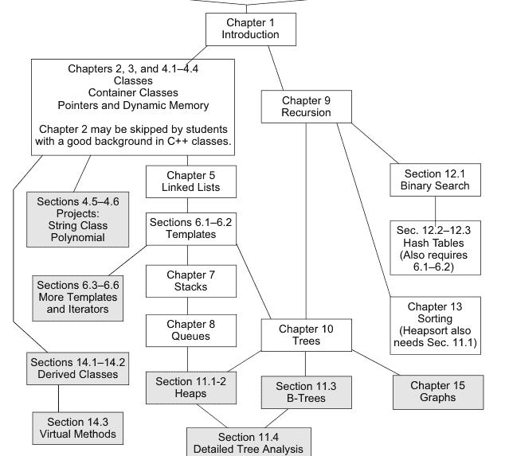

带阴影的方框提供了进行高级工作的良好机会。

## 致谢

我们在 Walter 访问科罗拉多大学博尔德分校计算机科学系并与 Michael 合作时开始编写本书。Walter 回到加州大学圣地亚哥分校工程与计算机科学系后完成了本书。我们感谢这些机构提供设施、优秀的学生以及与同事的交流。

我们的学生帮助尤为巨大——近 5000 名学生学习了本材料，提出了建议，向我们展示了他们的学习方式。我们感谢在数据结构课程中使用本材料并提供反馈的审稿人和教师：Zachary Bergen、Cathy Bishop、Martin Burtscher、Gina Cherry、Courtney Comstock、Stephen Davies、Robert Frohhardt、John Gillett、Mike Hendricks、Ralph Hollingsworth、Yingdan Huang、Patrick Lynn、Ron McCarty、Shivakant Mishra、Evi Nemeth、Rick Osborne、Rachelle Reese 和 Nicholas Tran。本书还经 Wolfgang W. Bein、Bill Hankley、Michael Milligan、Paul Nagin、Jeff Parker、Andrew L. Wright、John R. Rose 和 Evan Zweifel 广泛审阅。我们感谢这些同事的出色评论和鼓励。

感谢 Lesley McDowell 和 Chris Schenk，他们在科罗拉多大学计算机科学系每天都和蔼可亲、充满热情。我们也感谢 Addison-Wesley 的编辑和工作人员。Heather McNally 的工作鼓励了我们，为我们提供了日常顺畅的交流，并使制作的每一步都变得轻松。Karin Dejamaer 和 Jessica Hector 在博尔德提供了友好的鼓励，我们向她们表示感谢。我们欢迎并感谢 Michael Hirsch 担任编辑，他表现出了惊人的精力、热情和鼓励。最后，我们的原始编辑 Susan Hartman 提供了持续的支持、鼓励和方向——没有你，本书就不会问世！

除了参与本书制作的人员的工作和支持外，我们还感谢那些每天给予我们关心和鼓励的人。我们最深切的感谢归于 Holly Arnold、Vanessa Crittenden、Meredith Boyles、Suzanne Church、Erika Civils、Lynne Conklin、Andrzej Ehrenfeucht、Paul Eisenberg、Skip Ellis、John Kennedy、Rick Lowell、George Main、Mickey Main、Jesse Nuzzi、Ben Powell、Marga Powell、Megan Powell、Grzegorz Rosenberg、Hannah、Timothy 和 Janet。

- create and recognize test data that is appropriate for simple problems, including testing boundary conditions and fully exercising code.

### CHAPTER CONTENTS

- 1.1 Specification, Design, Implementation
- 1.2 Running Time Analysis
- 1.3 Testing and Debugging
- Chapter Summary
- Solutions to Self-Test Exercises

This chapter illustrates the phases of software development. These phases occur in all software, including the small programs that you'll see in this first chapter. In subsequent chapters, you'll go beyond these small programs, applying the phases of software development to organized collections of data. These organized collections of data are called **data structures**, and the main topics of this book revolve around proven techniques for representing and manipulating such data structures.

Years from now you may be a software engineer writing large systems in a specialized area, perhaps computer graphics or artificial intelligence. Such futuristic applications will be exciting and stimulating, and within your work you will still see the phases of software development and fundamental data structures that you learn and practice now.

Here is a list of the phases of software development:

### The Phases of Software Development

- Specification of the task
- Design of a solution
- Implementation (coding) of the solution
- Analysis of the solution
- Testing and debugging
- Maintenance and evolution of the system
- Obsolescence

Do not memorize this list: Throughout the book, your practice of these phases will achieve far better familiarity than mere memorization. Also, memorizing an "official list" is misleading because it suggests that there is a single sequence of discrete steps that always occur one after another. In practice, the phases blur into each other; for instance, the analysis of a solution's efficiency may occur hand in hand with the design, before any coding. Or low-level design decisions may be postponed until the implementation phase. Also, the phases might not occur one after another. Typically there is back-and-forth travel between the phases.

Most of the work in software development does not depend on any particular programming language. Specification, design, and analysis can all be carried out with few or no ties to a particular programming language. Nevertheless, when we get down to implementation details, we do need to decide on one particular programming language. The language we use in this book is C++.

the phases blur into each other


## 在开始本教材前你应该了解的 C++ 知识

C++ 语言由 Bjarne Stroustrup 在 AT&T 贝尔实验室设计，作为 C 语言的扩展，目的是支持面向对象编程（OOP）——一种鼓励信息隐藏和组件复用等重要策略的技术。在本书中，我们将向你介绍可用于设计和实现的重要 OOP 原则。

### OOP 支持信息隐藏和组件复用

你可以使用许多不同的 C++ 编译器来配合本教材。理想情况下，编译器应支持 ANSI/ISO C++ 标准的最新特性，我们已将这些特性融入教材中。不过，也有几种变通方法可应用于不完全支持该标准的旧编译器。（参见附录 K，“下载 GNU 编译器软件”，以及附录 E，“处理旧编译器”。）

### 你应当已经知道如何编写、编译和运行简短的 C++ 程序

无论你使用哪种编程环境，都应已能熟练编写、编译和运行采用自顶向下设计构建的简短 C++ 程序。你应当知道如何使用内置类型（数值类型、char 和 bool），并能够使用数组。

在整本教材中，我们将介绍 C++ 标准库的重要作用，尽管你不需要事先了解该库。学习标准库的数据结构可以帮助你理解不同方法之间的权衡，并指导你自己的数据结构的设计与实现。在设计自己的数据结构时，符合标准库的方法具有双重好处：其他程序员更容易理解你的工作，你自己的工作也能轻松受益于标准库的其他部分，例如标准搜索和排序算法。

### C++ 标准库

本章余下部分将为你做好准备，以使用符合标准库的方法来探讨 C++ 中的数据结构主题。第 1.1 节侧重于指定程序行为的技术，你还将看到一些关于设计和实现的提示。第 1.2 节说明了一种特定的分析：程序的运行时间分析。第 1.3 节提供了一些测试和调试程序的技术。

### 1.1 规格说明、设计与实现

> 你要从一份可能会更改的困难设计决策列表开始。然后，每个模块都被设计为将此类决策对其他模块隐藏起来。
> D. L. PARNAS
> “用于将系统分解为模块的标准”

| 摄氏度 | 华氏度 |
|---|---|
| -50.0C | |
| -40.0C | |
| -30.0C | |
| -20.0C | |
| -10.0C | |
| 0.0C | |
| 10.0C | |
| 20.0C | |
| 30.0C | |
| 40.0C | |
| 50.0C | |

作为软件开发实际运作的示例，让我们来审视某个特定问题的规格说明、设计与实现。规格说明是对问题的精确描述，设计阶段包括制定解决问题的步骤；实现则是执行设计的实际 C++ 代码。

我们要解决的问题是显示一个摄氏温度转华氏温度的转换表，类似于页边距中所示的表格。对于小问题，所需输出的一个示例即为充分的规格说明。这样的示例是良好的规格说明，因为它精确明确，不留任何关于程序必须完成什么的疑问。下一步是设计解决方案。

算法是解决问题的一组指令。温度问题的算法将打印转换表。在算法设计过程中，特定编程语言的细节可能会分散注意力，并掩盖解决方案的简单性。因此，在设计过程中我们通常使用英语编写。我们使用一种相当混杂的英语，在方便时会掺入 C++。这种英语与编程语言的混合称为伪代码。当某个步骤的 C++ 代码显而易见时，伪代码可以使用 C++。当某个步骤用英语表达更清晰时，我们将使用英语。请记住，使用伪代码的原因是为了提高清晰度。我们将使用伪代码来设计温度问题的解决方案，并还将使用分解问题的重要设计技术。

**关键设计概念**
将任务分解为几个子任务；然后将每个子任务进一步分解为更小的子任务。

### 设计概念：分解问题

设计算法的一种好方法是将手头的问题分解为几个子任务，然后将每个子任务分解为更小的子任务，再将更小的子任务替换为更小的子任务，如此循环。最终，子任务变得足够小，以至于在 C++ 或你所使用的任何语言中实现都微不足道。当算法被翻译成 C++ 时，每个子任务都作为一个独立的 C++ 函数来实现。在其他编程语言中，函数被称为“方法”或“过程”，但归根结底都是一回事：大问题被分解为子任务，子任务被实现为程序的独立部分。

例如，温度问题至少有两个良好的子任务：（1）将温度从摄氏度转换为华氏度，（2）按指定格式打印转换表的一行。使用这些子问题，我们的伪代码初稿可能如下所示：

- 1. 进行初步工作，正确打开并设置输出设备。
- 2. 显示表格顶部的标签。
- 3. 对表格中的每一行（使用变量 celsius 和 fahrenheit）：
  - a. 将 celsius 设置为表格中的下一个摄氏温度。
  - b. fahrenheit = 将摄氏温度转换为华氏度。
  - c. 在输出行上打印带有标签的摄氏度和华氏度值。

我们已确定主要子任务。但是，分解问题为子任务难道没有其他方法吗？良好分解的要素是什么？一条主要准则是，子任务应帮助你编写简短的伪代码——解决整个问题的简洁描述不超过一页，理想情况下远少于一页。在你的设计中，选择良好子任务时还可以牢记两个考虑因素：代码复用的潜力，以及程序未来更改的可能性。让我们看看我们的子任务如何体现这些考虑因素。

步骤 1 打开输出设备，使其准备好以特定形式进行输出。这是许多程序都必须执行的常见操作。如果我们为步骤 1 编写一个足够灵活的函数，很可能可以在其他程序中复用该函数。这是代码复用的一个示例，即编写具有足够通用性的函数，以便在其他地方复用。事实上，程序员通常会生成相关 C++ 函数的集合，并将其作为包提供，以便与许多不同的应用程序反复复用。稍后我们将使用 C++ 标准库作为这种包，还将编写此类包。目前，只需记住步骤 1 的函数应考虑复用性来编写。

分解问题还能产生良好的最终程序，因为程序易于理解，后续的维护和修改相对容易。我们的温度程序可能会被修改为转换开尔文度而非华氏度，甚至进行完全不同的转换，例如英尺转米。如果转换任务由单独的函数执行，大部分修改将局限于这个函数。易于修改的代码至关重要，因为现实世界的研究表明，程序员大部分时间都花在维护和修改现有程序上。

为了使问题分解产生易于修改的代码，你编写的函数需要彼此真正分离。一个类比可以帮助解释“真正分离”的概念。假设你正在将一袋金币搬运到一个安全的藏匿处。如果袋子太重无法搬运，你可能会将金币分成三个较小的袋子，然后一个接一个地搬运。除非你是喜剧片里的角色，否则你不会试图一次搬运所有三个袋子。那样做会违背将金币分成三组的初衷。这种策略只有在你能一次只搬一个袋子时才有效。问题分解中也会发生类似的情况。如果你将编程任务分为三个子任务，并通过编写三个函数来解决这些子任务，那么你就


用一个难题换取三个更容易的问题。你的总工作变得更容易了——前提是你分别设计函数。当你在处理一个函数时，不必担心其他函数如何完成它们的工作。但是，函数之间确实存在交互。因此，当你设计一个函数时，你需要知道其他函数做什么的某些信息。诀窍是只要知道你需要的，不要多知道。这称为信息隐藏。将信息隐藏融入的一种技术涉及使用前置条件和后置条件来指定你的函数的行为。

## 前置条件和后置条件

当你编写完整的函数定义时，你指定函数如何执行其计算。但是，当你使用一个函数时，你只需要思考函数做什么。你无需思考函数如何完成其工作。例如，假设你正在编写温度转换程序，并且被告知有一个可供你使用的函数，如下所示：

```
// Convert a Celsius temperature c to Fahrenheit degrees
double celsius_to_fahrenheit(double c);
```

你的程序可能有一个名为 celsius 的 double 变量，其中包含摄氏温度。了解此描述后，你可以自信地编写以下语句将温度转换为华氏度，并将结果存储在名为 fahrenheit 的 double 变量中：

```
fahrenheit = celsius_to_fahrenheit(celsius);
```

当你使用 celsius_to_fahrenheit 函数时，你不需要知道函数执行其工作的详细信息。你需要知道函数做什么，但你不需要知道任务是如何完成的。

当我们假装不知道函数是如何实现的时，我们正在使用一种称为过程抽象的信息隐藏形式。这种技术通过抽象掉无关细节——即，隐藏无关细节——来简化你的推理。在 C++ 编程中，将其称为“功能抽象”可能更合理，因为你正在抽象掉关于函数如何工作的无关细节。但是，术语 procedure 比 function 更通用。计算机科学家将 procedure 用于任何指令序列，因此他们使用术语过程抽象。过程抽象可以是一个强大的工具。它通过允许你一次考虑一个函数而不是全部一起考虑来简化你的推理。

过程抽象

为了让过程抽象为我们所用，我们需要一些技术来记录函数做什么，而不指示函数如何工作。我们可以像对 celsius_to_fahrenheit 所做的那样，只写一条简短的注释。但是，简短的注释有点不完整——例如，注释没有指示如果参数 c 小于最低摄氏温度（-273.15°C，即摄氏温度的绝对零度）时会发生什么。为了更好的完整性和一致性，我们将遵循一个固定格式，该格式始终包含两个信息，称为函数的前置条件和后置条件，如下所述：

## 前置条件和后置条件

前置条件是一条陈述，给出了函数被调用时必须为真的条件。除非前置条件为真，否则不能保证函数按预期执行。

后置条件是一条描述函数调用完成时将为真的内容的陈述。如果函数正确，并且在调用函数时前置条件为真，那么函数将完成，并且在函数调用完成时后置条件将为真。

例如，celsius_to_fahrenheit 函数的前置条件/后置条件如下所示：

```
double celsius_to_fahrenheit(double c);
// Precondition: c is a Celsius temperature no less than
//   absolute zero (-273.15).
// Postcondition: The return value is the temperature c
//   converted to Fahrenheit degrees.
```

这种注释格式对你来说可能是新的：字符 // 表示注释的开始，注释延伸到当前行的结束。另一种 C++ 注释形式，以 /* 开始并持续到 */，也是允许的。

前置条件和后置条件不仅仅是总结函数行为的一种方法。陈述这些条件应该是设计任何函数的第一步。在开始思考函数的算法和 C++ 代码之前，你应该写出函数的原型，它由函数的返回类型、名称和参数列表组成，后面跟一个分号。在编写原型时，你还应该将前置条件和后置条件写为注释。如果你后来发现你的规范无法以合理的方式实现，你可能需要回退并重新思考函数应该做什么。

当一组程序员一起工作时，前置条件和后置条件更加重要。在团队场景中，一个程序员通常不知道另一个程序员编写的函数是如何工作的，事实上，共享关于函数如何工作的知识可能适得其反。相反，前置条件和后置条件提供了所需的所有交互。实际上，前置条件/后置条件对构成了使用函数的程序员和编写该函数的程序员之间的合同。为了帮助解释这个“合同”，我们将给这两个程序员命名。

> Theresa Jervis Pendleton 编写了 celsius_to_fahrenheit（以下简称“该函数”），Judy Abbot 将使用该函数，我们特此同意：
> - (i) 除非 Judy 确定前置条件为真，否则她永远不会调用该函数，并且
> - (ii) 只要调用该函数且在调用函数时前置条件为真，则 Jervis 担保：
>   - a. 函数最终将结束，禁止无限循环，并且
>   - b. 当函数结束时，后置条件将为真。
> Judy Abbot
> J Pendleton

前置条件/后置条件合同

Judy 是正在编写大型软件的编程团队的负责人。Jervis 是她的程序员之一，为 Judy 在大型程序中使用编写各种函数。如果 Judy 和 Jervis 是律师，合同可能看起来像页边距所示的卷轴。作为程序员，合同精确地告诉他们函数做什么。它指出，如果 Judy 确保在调用函数时满足前置条件，那么 Jervis 确保函数返回时满足后置条件。

## 使用其他程序员提供的函数

你合作的程序员可能会也可能不会使用“前置条件”和“后置条件”这些词来描述他们的函数，但他们会提供并期望关于函数做什么的信息。例如，考虑这个设置标准输出设备（cout）以打印数字的函数：

```
void setup_cout_fractions(int fraction_digits);
// Precondition: Fraction_digits is not negative.
// Postcondition: All double or float numbers printed to cout will now be
// rounded to the specified number of digits on the right of the decimal point.
```

如果你对 setup_cout_fractions 的实现感到好奇，可以阅读附录 F，它提供了一些 C++ 编程的输入/输出想法。但是，即使不知道 Jervis 如何编写该函数，我们也可以编写一个使用他函数的程序。例如，图 1.1 所示的温度程序遵循我们的伪代码，使用 setup_cout_fractions 和 celsius_to_fahrenheit。在第 2 章中，我们将看到像 setup_cout_fractions 这样的实际函数不需要出现在与主程序相同的文件中，从而在函数的使用和其实现之间提供更强的分离。接下来，我们讨论一些可能对你来说是新的其他实现问题。

## ANSI/ISO C++ 标准的实现问题

本节以图 1.1 中温度程序的一些实现问题作为结尾。如果你以前没有使用过 ANSI/ISO C++ 标准，其中一些问题可能对你来说是新的。


## 标准库和标准命名空间

在20世纪90年代末，美国国家标准学会（ANSI）和国际标准化组织（ISO）制定了名为 ANSI/ISO C++ 标准的 C++ 编译器要求。该标准帮助程序员编写可移植代码，这些代码可以在不同机器上使用多种不同的编译器进行编译和运行。标准的一部分是 C++ 标准库。标准库中的每个设施都提供一组声明的常量、数据类型和函数，以支持特定的活动，例如输入/输出或数学函数。

1999 年，C++ 编译器开始提供完整的 C++ 标准库。要使用库中的某个设施，程序应在使用该设施的文件顶部放置一条“包含指令”。例如，要使用常规的 C++ 输入/输出设施，程序应使用以下包含指令：

```
#include <iostream>
```

这使程序可以访问大多数 C++ 输入/输出设施。某些额外的输入/输出项目需要第二条包含指令：

```
#include <iomanip>
```

关于来自 <iostream> 和 <iomanip> 的输入/输出设施的讨论见附录 F。

## 图 1.1 温度转换程序

请参见 C++ 特性“标准库和标准命名空间”。

### 一个程序

```
// File: temperature.cxx
// This conversion program illustrates some implementation techniques.
#include <cassert>    // Provides assert function
#include <cstdlib>    // Provides EXIT_SUCCESS
#include <iostream>   // Provides setw function for setting output width
#include <iomanip>    // Provides cout
using namespace std;  // Allows all Standard Library items to be used

double celsius_to_fahrenheit(double c)
// Precondition: c is a Celsius temperature no less than absolute zero (-273.15).
// Postcondition: The return value is the temperature c converted to Fahrenheit degrees.
{
    const double MINIMUM_CELSIUS = -273.15; // Absolute zero in Celsius degrees
    assert(c >= MINIMUM_CELSIUS);
    return (9.0 / 5.0) * c + 32;
}
```

### （图 1.1 续）

```
void setup_cout_fractions(int fraction_digits)
// Precondition: fraction_digits is not negative.
// Postcondition: All double or float numbers printed to cout will now be rounded to the
// specified digits on the right of the decimal point.
{
    assert(fraction_digits > 0);
    cout.precision(fraction_digits);
    cout.setf(ios::fixed, ios::floatfield);
    if (fraction_digits == 0)
        cout.unsetf(ios::showpoint);
    else
        cout.setf(ios::showpoint);
}
```

请参见编程提示“使用断言检查前置条件”，第 12 页。

请参见编程提示“使用声明常量”，第 11 页。

```
int main()
{
    const char HEADING1[] = " Celsius"; // Heading for table's 1st column
    const char HEADING2[] = "Fahrenheit"; // Heading for table's 2nd column
    const char LABEL1 = 'C'; // Label for numbers in 1st column
    const char LABEL2 = 'F'; // Label for numbers in 2nd column
    const double TABLE_BEGIN = -50.0; // The table's first Celsius temp.
    const double TABLE_END = 50.0; // The table's final Celsius temp.
    const double TABLE_STEP = 10.0; // Increment between temperatures
    const int WIDTH = 9; // Number chars in output numbers
    const int DIGITS = 1; // Number digits right of decimal pt

    double value1; // A value from the table's first column
    double value2; // A value from the table's second column

    // Set up the output for fractions and print the table headings.
    setup_cout_fractions(DIGITS);
    cout << "CONVERSIONS from " << TABLE_BEGIN << " to " << TABLE_END << endl;
    cout << HEADING1 << " " << HEADING2 << endl;

    // Each iteration of the loop prints one line of the table.
    for (value1 = TABLE_BEGIN; value1 <= TABLE_END; value1 += TABLE_STEP)
    {
        value2 = celsius_to_fahrenheit(value1);
        cout << setw(WIDTH) << value1 << LABEL1 << " ";
        cout << setw(WIDTH) << value2 << LABEL2 << endl;
    }

    return EXIT_SUCCESS;
}
```

请参见编程提示“在主程序中使用 EXIT_SUCCESS”，第 14 页。

## 头文件的旧名称

文件 iostream 和 iomanip 是 C++ 头文件的示例。较旧的 C++ 编译器为头文件使用略有不同的名称。例如，较旧的编译器使用 iostream.h 而不是简单的 iostream。在大多数情况下，新的 C++ 头文件名称与旧文件名相同，只是去除了 ".h"，较新的编译器仍然允许使用旧名称。

除了 C++ 头文件之外，C++ 标准还包含来自原始 C 语言的一组头文件。两个示例是 C 标准库 <stdlib.h> 和断言设施 <assert.h>。这些原始名称仍可在 C++ 程序中使用，或者你可以使用新的 C++ 头文件名称，这些名称通过去除 ".h" 并在名称前加上字母 "c" 构建（例如 <cstdlib> 和 <cassert>）。

关于 <cstdlib> 和 <cassert> 的讨论作为附录 G“选定库函数”的一部分给出。

## 标准命名空间

使用旧头文件名称（例如 <iostream.h> 或 <stdlib.h>）与使用新名称（例如 <iostream> 或 <cstdlib>）之间有一个区别。新头文件中的所有项目都是称为标准命名空间（也称为 std）的功能的一部分。目前，当你使用新头文件之一时，程序在包含指令之后还应包含以下语句：

```
using namespace std;
```

此语句是全局命名空间指令，允许你的程序使用标准命名空间中的所有项目。第 2 章讨论了全局命名空间指令的替代方案，并展示了如何创建自己的命名空间以避免程序不同部分之间名称发生冲突。

## 使用声明常量

在整个温度程序中，存在多种形式的声明：

```
const double TABLE_BEGIN = -50.0;
```

这是一个名为 TABLE_BEGIN 的 double 数字声明，其初始值为 -50.0。关键字 const 出现在声明之前，使 TABLE_BEGIN 不仅仅是一个普通声明。它是一个声明常量，这意味着其值在程序运行期间永远不会更改。一种常见的编程风格是对任何声明常量都使用全大写字母。这使得在程序中识别此类值变得容易。

将 TABLE_BEGIN 定义为声明常量，而不是在程序中直接使用数字 -50.0，有几个优点。使用名称 TABLE_BEGIN 使常量的用途易于理解。此外，一旦声明了常量，就可以在整个程序中使用它。例如，我们的程序使用了 TABLE_BEGIN 两次（一次在打印顶部标题时，一次在确定 for 循环中使用的起始值时）。

使用声明常量也使修改程序变得更加容易。例如，我们可能决定修改程序，使表格从 -100.0 开始而不是 -50.0。此更改通过查找声明常量（TABLE_BEGIN），将其初始值更改为 -100.0，然后重新编译程序来完成。通过更改初始值，TABLE_BEGIN 的所有出现都将具有新值。

为了提高清晰度并便于修改，一些程序员在程序中为所有固定值都使用声明常量。作为一条规则，这是合理的。然而，问题还有另一面。众所周知的公式在其原始形式中可能更容易被识别（直接使用数字而不是人为引入的名称）。例如，摄氏度到华氏度的转换可识别为 F = 9/5 C + 32。因此，图 1.1 使用此处所示的 return 语句：

```
return (9.0/5.0) * c + 32;
```

此 return 语句比使用声明常量表示值 9/5 和 32 的版本更清晰，也更不容易出错。

## 澄清 const 关键字 第 1 部分：声明常量

- 1. 声明常量
- 2. const 成员函数：第 38 页
- 3. const 引用参数：第 72 页
- 4. 静态成员常量：第 104 页
- 5. const 迭代器：第 144 页
- 6. const 指针或数组参数：第 171 页
- 7. 带有指向节点的指针的 const 关键字，以及某些成员函数需要两个版本：第 227 页

对于实现数据结构的程序员，C++ 关键字 const 有几种用途，必须相互协调。由于不同用途之间可能存在混淆，我们将在首次在示例中使用时澄清每种用途。你可以在任何变量声明前使用关键字 const。这表明程序不允许更改变量的值。

```
Syntax:
const <Data type> <Variable name> = <Value> ;
```

```
Examples:
const double TABLE_BEGIN = 50.0;
const char LABEL1 = 'C';
```

## 编程提示

## 使用断言检查前置条件

考虑温度程序中的函数 celsius_to_fahrenheit。该函数有一个前置条件，要求其参数不小于绝对


零（因为较低的温度没有物理意义）。使用该函数的程序员始终负责确保前置条件有效。但是，如果程序员使用该函数而前置条件无效怎么办？这是一种编程错误，类似于其他错误，例如意外除以零或尝试使用超出数组边界的数组元素。

在完美的世界里，此类编程错误永远不会发生：没有程序会尝试除以零，或访问超出其边界的数组，或使用无效前置条件调用函数。当然，程序员并非完美；新手和有经验的程序员都会犯错。在程序开发期间，函数应设计为尽可能帮助程序员轻松找到错误。作为这一努力的一部分，函数的第一个动作应该是检查其前置条件是否有效。如果前置条件失败，则函数会打印一条消息，并要么停止整个程序，要么在返回前执行其他错误处理操作。

乍一看，这种方法可能显得严厉。为什么要停止整个程序？这只是一点无效数据！但回想一下你编写过的程序。你是否曾犯过这样的错误：访问超出数组边界的元素，也许在最后一个有效位置是 x[41] 时却写了 x[42]？当这种情况发生时，程序并不总是立即停止；相反，程序可能会继续使用损坏的数据进行计算，最终在实际错误很久之后产生崩溃，或者只是静默地产生错误答案。有时需要进行困难的调试工作来追踪错误的实际位置。如果程序在最早检测到无效数据时就产生错误消息，测试和调试会更容易。

assert 设施是在早期检测无效数据的一种好方法。要使用 assert，程序包含以下指令：

```
#include <cassert>
```

（旧编译器可能改用 <assert.h>。）cassert 设施中的主要项目称为 assert，它像带有一个参数的函数一样使用。参数通常是一个真-假表达式。对表达式进行求值。如果结果为真，则不采取任何操作。但如果结果为假，则会打印一条错误消息，并停止程序。这些检查称为断言。例如，celsius_to_fahrenheit 函数使用此断言：

```
assert(c >= MINIMUM_CELSIUS);
```

如果表达式 (c >= MINIMUM_CELSIUS) 为真，则 c 有效且断言不采取任何操作。另一方面，如果表达式为假，则前置条件已被违反，因此会打印一条消息并停止程序。

测试和调试完成后，程序员可以选择关闭所有断言检查以加快程序速度。可以通过将以下语句放在程序的包含指令之前立即处来关闭断言：

```
#define NDEBUG
```

## 编程技巧

### 在主程序中使用 EXIT_SUCCESS

当温度程序结束时，它执行以下语句：

```
return EXIT_SUCCESS;
```

此 return 语句结束主程序，并将常量 EXIT_SUCCESS 的值返回给计算机的操作系统。操作系统是负责在计算机上运行所有程序的软件。虽然你可能没有意识到，但操作系统可以根据主程序的返回值采取进一步操作。例如，EXIT_SUCCESS 的返回值告诉操作系统程序已正常结束，然后操作系统可以继续执行下一个任务。其他返回值告诉操作系统非正常终止，例如打开文件时出现问题或内存不足。EXIT_SUCCESS 常量在 cstdlib（或 stdlib.h）中定义。对于大多数操作系统，该常量定义为零（这就是为什么你可能在其他编程中使用过 return 0 的原因）。

顺便说一句，程序还可以返回另一个常量 EXIT_FAILURE，作为指示非正常完成的一种简单方式。

## C++ 特性

### 异常处理

C++ 语言提供了对程序执行期间可能发生的异常情况（称为“异常”）的内置支持。异常处理通常用于处理运行时错误。它是传统错误处理技术的一个非常好的替代方案，后者往往不足、容易出错且临时拼凑。一旦你的程序在核心情况（即一切按计划进行的情况）下能够正常工作，你就可以使用 C++ 异常处理设施来为异常情况添加代码。有关这些设施的更多信息，请参阅附录 L。为了专注于数据结构，本书示例中未包含正式的异常处理。

#### 第 1.1 节自测练习

本书每个章节的每个部分最后都包含一些自测练习。这些练习的答案在每章末尾给出。

- 1. 选择良好子任务时需要考虑哪两个方面？
- 2. C++ 函数原型的元素有哪些？
- 3. 此练习涉及 Jervis 为你编写的一个函数。原型和前置条件/后置条件契约显示在下一页顶部。

```
int date_check(int year, int month, int day);
// Precondition: The three parameters are a legal year, month, and
// day of the month.
// Postcondition: If the given date has been reached on or before today,
// then the function returns 0. Otherwise, the value returned is the number
// of days until the given date will occur.
```

假设你调用函数 date_check(2009, 7, 29)。如果今天是 2009 年 7 月 22 日，返回值是多少？如果今天是 2009 年 7 月 30 日呢？2010 年 2 月 1 日呢？

- 4. 编写一个 assert 语句，用于检查函数 date_check 中的 month 变量是否为有效整数。
- 5. 其中一个库是 <cmath> 设施，其中包含一个具有以下原型的函数：
  `double sqrt(double x);`
  该函数返回 x 的平方根。为该函数编写合理的前置条件和后置条件，并将你的答案与章末的解答进行比较。
- 6. 编写在使用第 5 项自测练习中的 sqrt 函数之前必须出现的包含指令。
- 7. 编写在使用 C++ 标准库中的任何项目之前必须出现的 using 语句。
- 8. 编写一个程序来打印从英尺到米的转换表。以温度转换程序作为起点（可在线获取：www.cs.colorado.edu/~main/chapter1/temperature.cxx）。
- 9. 为什么在最早检测到无效数据时停止程序是个好主意？
- 10. 关闭程序中所有断言检查的最简单方法是什么？

### 1.2 运行时间分析

时间分析包括对算法速度的推理。算法是否足够快以满足我的需求？当输入变大时，方法需要多长时间？几种不同方法中哪种最快？我们将在本节讨论这些问题。一个示例将有助于开始讨论。

### 台阶计数问题

假设你和你的朋友 Judy 站在埃菲尔铁塔顶上。当你凝视法国风景时，Judy 转向你说：“我想知道到底有多少级台阶？”你当然是一位热情好客的主人，于是回答说：“我不确定……但我会查出来的。”我们将看看你可以使用的三种不同方法，并分析每种方法的时间要求。

### 方法 1：走下楼并记录计数。

在第一种方法中，Judy 给你一支笔和一张纸。“我一分钟就回来，”你说着冲下楼梯。每走下一级台阶，你就在纸上做一个标记。当你到达底部时，你跑回楼上，把纸给 Judy 看，并说：“台阶数就是这么多。”

### 方法 2：走下楼，但让 Judy 记录计数。

在第二种方法中，Judy 不愿让她的笔或纸离开视线。但你毫不气馁。你再次说：“我一分钟就回来，”然后出发下楼。但这次你走一级台阶后就停下来，把帽子放在台阶上，跑回 Judy 那里。“在纸上做个标记，”你喊道。然后你跑回帽子那里，捡起它，再走一级台阶，把帽子放在第二级台阶上。然后跑回 Judy 那里：“再在纸上做个标记，”你说。你跑回两级台阶，捡起帽子，移到第三级台阶，放下帽子。然后跑回 Judy 那里：“再做一个标记！”你对她说。这会持续到你的帽子到达底部，然后你再次快速跑回楼上。“再做一个标记，请。”这时，你抓起 Judy 的纸说：“台阶数就是这么多。”

### 方法 3：Jervis 来解围。

在第三种方法中，你根本不走下楼梯。相反，你在楼梯旁发现了你的朋友 Jervis，他手里拿着画在这里的牌子：


翻译是：这段楼梯有 2689 级台阶（真的！）。于是，你从 Judy 那里拿过纸和笔，写下数字 2689，把纸还给她，说：“台阶数就是这么多。”

这是一个愚蠢的例子，但即便如此，它确实说明了在对算法或程序进行时间分析时出现的问题。第一个问题是决定如何准确测量执行方法或运行程序所花费的时间。

乍一看答案似乎很简单。对于三种台阶计数方法中的每一种，只需测量执行该方法所需的实际时间。你可以使用秒表来做到这一点。但是，测量实际时间有一些缺点。实际时间可能取决于各种无关细节，例如是你还是其他人执行了该方法。实际经过时间可能因人而异，取决于每个人跑楼梯的速度。即使我们决定由你来跑，时间也可能因其他因素而异，例如天气、你早餐吃了什么，以及你心里想的其他事情。


因此，与其在每个方法中测量实际经过的时间，不如在执行方法时统计发生的某些操作。在本示例中，我们将只统计两种操作：

- 1. 每次你上下走一步，算作一次操作。
- 2. 每次你或Judy在纸上做一个标记，算作一次操作。

当然，这些操作中的每一个都需要一定的时间，做标记所花的时间可能与走一步所花的时间不同。但这不关我们的事，因为我们不会测量操作所花的实际时间。相反，我们问：三种方法各需要多少次操作？我们可以考虑额外的操作，例如将标记列表转换为打印数字的操作（这对方法1和方法2会很方便），但这些有限的操作对我们的示例来说已经足够了。

在第一种方法中，你向下走2689步，再向上走2689步，并且在纸上做2689个标记，总共是3 x 2689次操作——即总共8067次操作。

在第二种方法中，Judy的纸上也做了2689个标记，但操作总数要多得多。你先向下走一步再向上走一步。然后向下走两步再向上走两步。然后向下走三步再向上走三步，以此类推。所采取的操作总数为：

- 向下步数 = 3,616,705（即 1 + 2 + ... + 2689）
- 向上步数 = 3,616,705
- 标记数 = 2689
- 总操作数 = 向下步数 + 向上步数 + 标记数 = 7,236,099

第三种方法是最快的：纸上只做了四个标记（也就是说，我们为2689的每一位数字计算一个“标记”），并且没有上下楼梯。各方法使用的操作数汇总如下：

- 方法1：8067次操作
- 方法2：7,236,099次操作
- 方法3：4次操作

对程序进行时间分析与对楼梯计数方法的分析类似。对程序进行时间分析时，我们通常不会测量运行程序所花的实际时间，因为秒数可能取决于太多无关因素——例如处理器的速度，以及处理器是否正忙于其他任务。相反，分析会统计所需的操作数量。

什么是**操作**并没有精确的定义，尽管操作应当符合你对“小步骤”的直觉。操作可以简单到执行单个程序语句。或者，我们可以使用更细致的操作概念，将每个算术运算（加法、乘法等）和每个对变量的赋值都视为单独的操作。

### 对输入规模的依赖

对于大多数程序，操作数量取决于程序的输入。例如，对数字列表进行排序的程序，处理短列表比处理长列表更快。在楼梯示例中，我们可以将埃菲尔铁塔视为问题的输入。换句话说，三种不同的方法都适用于埃菲尔铁塔，但这些方法也适用于多伦多的CN塔、自由女神像顶部的楼梯，或任何其他楼梯。

当方法的时间取决于输入的规模时，时间可以表示为一个表达式，其中表达式的一部分是输入的规模。我们三种方法的时间表达式如下：

- 方法1：3n
- 方法2：n + 2 (1 + 2 + ... + n)
- 方法3：数字n的位数

右侧的表达式给出了当楼梯有n级台阶时，每种方法执行的操作数量。

第二种方法的表达式不易理解。它需要简化，才能成为我们可以轻松与其他公式比较的公式。因此，让我们来简化它。我们从子表达式开始：

```
(1 + 2 + ... + n)
```

### 方法 2 时间分析的简化

有一个技巧可以帮助我们找到这个表达式的简化形式。该技巧是先计算表达式的两倍，然后将结果除以2。除非你以前见过这个技巧，否则它听起来很疯狂。但它很有效。该技巧在图1.2中有所说明。让我们逐步讲解该图的计算过程。

我们将表达式(1 + 2 + ... + n)写两次并相加这两个表达式。但如图1.2所示，我们还使用了另一个技巧：当我们写两次表达式时，我们将第二个表达式倒过来写。写下表达式两次后，我们看到如下内容：

```
(1 + 2 + ... + n)
+(n + ... + 2 + 1)
```

我们想要这两行数字的和。这将给出(1 + 2 + ... + n)值的两倍，然后我们可以除以2来得到子表达式(1 + 2 + ... + n)的正确值。

### 图 1.2 推导一个实用公式

(1 + 2 + ... + n)可以通过先计算两倍(1 + 2 + ... + n)的和来计算，如下所示：

```
  1   + 2   + ... + (n - 1) +   n
+   n + (n - 1) + ... + 2   +   1
---------------------------------
(n + 1) + (n + 1) + ... + (n + 1) + (n + 1)
```

和为n(n + 1)，因此(1 + 2 + ... + n)是这个数量的一半：

```
(1 + 2 + ... + n) = n(n + 1) / 2
```

现在，与其采取最明显的方法，我们不如将第一行和第二行中的数字成对相加。我们将1和n相加得到n + 1。然后将2和n - 1相加，再次得到n + 1。我们继续直到到达最后一对，即第一行的n和第二行的1。所有成对的数字加起来都等于相同的数量，即n + 1。这很方便！我们得到了n个数字，所有数字都相同，即n + 1。因此，前两行中所有数字的总和是：

```
n(n + 1)
```

两倍表达式的值是n乘以n + 1。我们现在基本完成了。我们计算的数字是我们想要的数量的两倍。因此，为了得到简化公式，我们只需要除以2。最终的简化如下：

```
(1 + 2 + ... + n) = n(n + 1) / 2
```

我们将使用这个公式来简化方法2的表达式，但你也会发现该公式出现在许多其他情况中。方法2表达式的简化如下一页顶部所示。

### 方法2的操作数量

```
= n + 2(1 + 2 + ... + n)
= n + 2 (n(n + 1) / 2)       Plug in the formula for (1 + 2 + ... + n)
= n + n(n + 1)                Cancel the 2s
= n + n^2 + n                 Multiply out
= n^2 + 2n                    Combine terms
```

因此，方法2需要n^2 + 2n次操作。

### 方法3时间分析的简化

方法3的操作数量只是整数n以通常方式书写时的位数。通常书写数字的方式称为十进制表示法。事实证明，以十进制表示法书写的数字n的位数，大约等于另一个称为n的以10为底对数的数学量。n的以10为底对数的记法写作：

### 十进制表示法和以10为底的对数

以10为底的对数不一定给出整数。例如，2689的实际以10为底对数约为3.43，而不是4。如果我们想要整数n的实际位数，需要进行一些舍入。具体来说，正整数n的精确位数是通过将log10 n向下舍入到下一个整数，然后加1得到的。向下舍入并加1的记法是通过在对数记法中添加一些标记来获得的，如下所示：

```
⌊log10 n⌋ + 1
```

如果你已经了解对数，这都没问题，但如果其中一些内容对你是新的呢？目前，你可以简单地将上述记法定义为n的十进制数字的位数。你可以这样做，因为如果其他人使用该公式的任何其他公认定义，他们会得到与你相同的答案。你是对的！（他们也是对的。）在本书第11.3节中，我们将展示对数函数的各种定义都是等价的。目前，我们不必担心所有这些细节。我们


首先有更大的问题需要讨论。每种方法的操作次数表现在此可以更简洁地表示，如下所示：

- 方法 1: 3n
- 方法 2: n² + 2n
- 方法 3: ⌊log₁₀n⌋ + 1

## 大 O 表示法

我们对三种楼梯计数方法所做的时间分析非常精确。它们计算了每种方法的精确操作次数。但有时不需要如此精确。通常，只需大致了解操作次数如何受输入大小影响即可。在楼梯示例中，我们开发这些方法时考虑的是一个特定的塔，即埃菲尔铁塔，以及特定数量的台阶。我们用 n 表示操作公式，n 代表塔中的台阶数。现在假设我们将各种楼梯计数方法应用于一个台阶数是埃菲尔铁塔 10 倍的塔。如果 n 是埃菲尔铁塔的台阶数，那么这个更高的塔将有 10n 个台阶。在更高的塔上，方法 1 所需的操作次数增加十倍（从 3n 到 3 × (10n) = 30n）；方法 2 的时间增加约 100 倍（从约 n² 到约 (10n)² = 100n²）；而方法 3 仅增加一次操作（从 n 的位数到 10n 的位数，或者更具体地说，从 2689 的四位数到 26,890 的五位数）。我们可以用一种称为大 O 表示法的格式来表达此类信息。此表示法中的符号 O 是字母 O，因此大 O 读作 "big Oh"。

我们将描述大 O 表示法的三个常见示例。在这些示例中，我们使用“公式中最大项”的概念。直观地说，这是 n 的指数最大的项，或者随着 n 本身变大而增长最快的项。目前，这种对“最大项”的直观概念就足够了。以下是示例：

### 二次时间

如果公式中的最大项不超过常数乘以 n²，则该算法被称为“大 O 为 n²”，写作 O(n²)，该算法称为二次算法。在二次算法中，将输入大小加倍会使操作次数增加约四倍（或更少）。举个具体的例子，考虑方法 2，它需要 n² + 2n 次操作。一个 100 级台阶的塔需要 10,200 次操作（即 100² + 2 × 100）。将塔加倍到 200 级台阶会使时间增加约四倍，达到 40,400 次操作（即 200² + 2 × 200）。

### 线性时间

如果公式中的最大项是常数乘以 n，则该算法被称为“大 O 为 n”，写作 O(n)，该算法称为线性算法。在线性算法中，将输入大小加倍会使时间增加约两倍（或更少）。例如，公式 3n + 7 是线性的，因此 3 × 200 + 7 大约是 3 × 100 + 7 的两倍。

### 对数时间

如果公式中的最大项是常数乘以 n 的对数，则该算法称为“大 O 为 n 的对数”，写作 O(log n)，该算法称为对数算法。（对数的底数可以是 10，也可能是其他底数。我们将在 11.3 节讨论其他底数。）在对数算法中，将输入大小加倍会使时间增加不超过固定数量的新操作，例如多一次操作，或多两次操作——或者一般来说，多 c 次操作，其中 c 是一个固定常数。例如，楼梯计数的方法 3 具有一个对数时间公式。而且，将塔的大小加倍（例如从 500 级台阶增加到 1000 级台阶）绝不需要超过一次额外操作。

使用大 O 表示法，我们可以按如下方式表达三种楼梯计数方法的时间要求：

- 方法 1 O(n)
- 方法 2 O(n²)
- 方法 3 O(log n)

当时间分析使用大 O 表示法时，结果称为算法的**阶**。我们想强调一个重要点：在大 O 表示法中，乘法常数被忽略。例如，2n 和 42n 都是线性公式，因此都表示为 O(n)，忽略乘法常数 2 和 42。如您所见，这意味着大 O 分析会丢失一些关于相对时间的信息。尽管如此，大 O 分析确实为比较算法提供了一些有用的信息。楼梯示例说明了算法阶所提供的最重要类型的信息：

> 算法的阶通常比处理器的速度更重要。

例如，使用二次方法（方法 2），世界上最快的爬楼梯者也不太可能比一个慢吞吞的人做得更好——前提是慢吞吞的人使用了更快的方法之一。在对列表进行排序等应用中，二次算法即使在中等大小的列表上也可能慢得不切实际，无论处理器速度如何。要了解这一点，请注意图 1.3 中显示的三种楼梯计数方法的实际数字比较。

### 图 1.3 三种方法的操作次数

| | 对数 O(log n) | 线性 O(n) | 二次 O(n²) |
|---|---|---|---|
| 台阶数 (n) | 方法 3，⌊log₁₀ n⌋ + 1 次操作 | 方法 1，3n 次操作 | 方法 2，n² + 2n 次操作 |
| 10 | 2 | 30 | 120 |
| 100 | 3 | 300 | 10,200 |
| 1000 | 4 | 3000 | 1,002,000 |
| 10,000 | 5 | 30,000 | 100,020,000 |

## C++ 函数的时间分析

楼梯示例的原理可以应用于计算用 C++ 等高级语言编写的函数所需的操作次数。例如，考虑图 1.4 中实现的函数。调用函数时，用户被要求想一个数字，然后函数会提出一系列问题，直到找到该数字。图底部显示了一个示例，其中用户被要求“想一个 1 到 100 之间的整数。”

与楼梯示例一样，时间分析的第一步是精确决定我们将什么算作单个操作。对于 C++ 函数，一个好的选择是计算 C++ 操作的总数（例如赋值、< 操作或 << 操作）加上函数调用的次数（例如对 assert 的调用）。如果函数调用本身执行复杂工作，那么我们还需要计算在那里执行的操作。

牢记这一点，让我们分析 guess_game 函数，其参数为正整数 n，（为了增加难度）用户想的数字是 1。该函数总共执行多少操作？我们的分析分为三部分：

1. 在 for 循环之前，有七个操作（一个 >= 比较，一个对 assert 的调用，四个输出操作，以及对 answer 的赋值）。然后是循环初始化（guess = n）。因此，在循环体出现之前，共有八个操作。

2. 然后我们执行循环体，由于我们的用户想的数字是 1，我们执行此循环体 n 次。循环体每次执行期间会发生多少操作？我们可以计算这个数字，但我们就说每次执行循环体需要 k 次操作，其中 k 是大约 10 或 20 的某个数字。如果有必要，我们稍后会算出 k，但目前只需要知道我们执行循环体 n 次，每次执行需要 k 次操作，总共 kn 次操作。

3. 循环结束后，还有五个额外操作（if 语句测试中的三个，加上两个 << 操作）。

### 图 1.4 时间分析示例的猜谜游戏函数

### 函数实现

```
void guess_game(int n)
    // Precondition: n > 0.
    // Postcondition: The user has been asked to think of a number between 1 and n. The function
    // asks a series of questions until the number is found.
    // Library facilities used: cassert, iostream
{
    int guess;
    char answer;

    assert(n > 1);

    cout << "Think of a whole number from 1 to " << n << "." << endl;
    answer = 'N';
    for (guess = n; (guess > 0) && (answer != 'Y') && (answer != 'y'); --guess)
    {
        cout << "Is your number " << guess << "?" << endl;
        cout << "Please answer Y or N, and press return: ";
        cin >> answer;
    }

    if ((answer == 'Y') || (answer == 'y'))
        cout << "I knew it all along." << endl;
    else
        cout << "I think you are cheating!" << endl;
}
```

### 调用 guess_game(100) 的示例对话：

想一个 1 到 100 之间的整数。
你的数字是 100 吗？
请回答 Y 或 N，然后按回车：N
你的数字是 99 吗？
请回答 Y 或 N，然后按回车：N
你的数字是 98 吗？
请回答 Y 或 N，然后按回车：Y
我早就知道了。


操作总数现在是 kn + 12。无论 k 有多大，这个公式始终是线性时间。因此，在用户想到数字 1 的情况下，guess_game 函数的运行时间为线性时间。事实上，这是我们在此总结的一个常见模式：

### 线性模式

执行固定数量操作 n 次的循环需要 O(n) 时间。

稍后你将看到其他模式，产生平方、对数和其他时间复杂度。事实上，在第 12 章中，你将以更好的方式重写 guess_game 函数，该方式仅需要对数时间。

## 最坏情况、平均情况和最好情况分析

guess_game 函数还有一个重要特性：对于任何特定的 n 值，所需操作的数量可能因用户的输入而异。例如，当 n 等于 100 时，用户可能想到数字 100，循环体只执行一次。另一方面，当用户想到数字 1 时，循环体执行的次数最多（n 次）。换句话说，对于任何给定的 n，用户的不同可能输入会导致不同数量的操作。在这种情况下，我们通常会计算给定输入大小所需的最大操作数。计算最大操作数称为最坏情况分析。

在进行时间分析时，你有时可能无法给出操作数量的精确计数。如果分析是最坏情况分析，你可以估算操作数量，但要始终确保你的估算偏高。换句话说，实际操作数量必须保证始终小于你在分析中使用的估算值。

在第 12 章中，当我们开始学习搜索和排序时，你将看到另外两种时间分析：平均情况分析，它确定给定 n 所需的平均操作数量；以及最好情况分析，它确定给定 n 所需的最少操作数量。

#### 第 1.2 节自测练习

- 11. 某算法中操作数量的以下每个公式。将每个公式表示为大 O 表示法。
  - a. n^2 + 5n
  - b. 3n^2 + 5n
  - c. (n + 7)(n - 2)
  - d. 100n + 5
  - e. 5n + 3n^2
  - f. 2^n 的位数
  - g. n 可以被 10 除多少次才会低于 1.0

- 12. 确定以下哪个公式是 O(n)：
  - a. 16n^3
  - b. n^2 + n + 2
  - c. ⌊n/2⌋
  - d. 10n + 25

- 13. 什么是最坏情况分析？

- 14. 以下代码片段的最坏情况大 O 分析是什么？

```
for (i = 0; i < n; ++i) {
    for (j = i; j < n; ++j) {
        j += n;
    }
}
```

- 15. 假设 n 非常大，按运行时间分析从大到小列出以下公式的时间要求顺序：
n^2 + 1; 50 log n; 1,000,000; 10n + 10,000.

- 16. 编写一个使用循环计算从 1 到 n 所有整数之和的函数代码。进行时间分析，将每个基本操作（如赋值和 ++）计为一次操作。

### 1.3 测试与调试

> 始终做正确的事。这会让一些人满意，并让其余的人惊讶。
> 马克·吐温
> 1901 年 2 月 16 日，致青年人协会

程序测试发生在你运行程序并观察其行为时。每次你在某个输入上执行程序，你都在测试程序针对该特定输入的工作方式，同时也在测试程序完成所需的时间。软件工程科学的一部分是系统地构建一组可能发现错误的测试输入，而此类测试输入是本节的主题。

### 选择测试数据

要作为良好的测试数据，你的测试输入需要具备两个属性：

| 良好测试数据的属性 |
|---|
| 1. 你必须知道正确程序针对每个测试输入应产生什么输出。 |
| 2. 测试输入应包括最可能导致错误的输入。 |

不要轻视第一个属性——你必须选择你知道正确输出的测试数据。仅仅因为程序可以编译、运行并产生看起来差不多正确的输出，并不意味着程序是正确的。如果正确答案是 3278，而程序输出 3277，那么就有问题了。你怎么知道正确答案是 3278？找到正确输出值最明显的方法是使用铅笔和纸，采用与程序不同的方法手动计算。为了帮助你做到这一点，你可以选择容易计算正确答案的测试数据，例如使用较小的输入值，或使用答案已知的输入值。

### 边界值

我们关注两种寻找最可能导致错误的测试数据的方法。第一种方法基于识别和测试称为*边界值*的输入，这类输入特别容易导致错误。问题的一个**边界值**是距离不同行为仅一步之遥的输入。例如，考虑一个名为 `time_check` 的函数，其前置条件如下：

```
int time_check(int hour);
// Precondition: hour lies in the range 0 <= hour <= 23.
```

`time_check` 的两个边界值是 hour 等于 0（最小合法值）和 hour 等于 23（最大合法值）。如果我们预期函数对早晨小时（0 到 11）的行为与对下午小时（12 到 23）的行为不同，那么 11 和 12 也是边界值。如果我们预期 hour 等于 0 时有不同的行为，那么 1 也是边界值。事实上，0 和 1 在许多情况下都有特殊行为，因此每当它们是合法输入时，将 0、1 甚至 –1 视为边界值是个好主意。

一般来说，边界值没有精确的定义，但你应该培养寻找“距离不同行为仅一步之遥”的输入的直觉。

### 测试边界值

如果无法测试所有可能的输入，至少测试边界值。例如，如果合法输入范围从零到一百万，那么请务必测试输入 0 和输入 1000000。每当 0、1 和 –1 是合法输入时，将它们视为边界值也是个好主意。

### 充分执行代码

第二种广泛使用的测试技术需要深入了解程序的实现方式。该技术称为充分执行代码，很简单，包含两条规则：

- 1. 确保你的代码中的每一行都至少被一些测试数据执行一次。例如，你的代码中可能有一部分仅处理罕见情况。确保这种罕见情况包含在你的测试数据集中。
- 2. 如果你的代码中有一部分有时会被完全跳过，那么请确保至少有一个测试输入确实跳过了这部分代码。例如，可能有一个循环，其循环体有时执行零次。确保有一个测试输入导致循环体执行零次。

许多编译器都有一个名为 profiler 的软件工具来帮助充分执行代码。典型的 profiler 会生成一个列表，指示程序中每条语句执行的频率。这可以帮助你发现未经过测试的程序部分。

### 充分执行代码

- 1. 确保你的代码中的每一行都至少被一些测试数据执行一次。
- 2. 如果你的代码中有一部分有时会被完全跳过，那么请确保至少有一个测试输入确实跳过了这部分代码。

使用名为 profiler 的软件工具来确保你充分执行了代码。

### 调试

修复编程中的错误——调试——是一项重要技能，你从成为程序员的第一天起就必须练习。我们的一些调试建议可在 www.cs.colorado.edu/~main/debugging.html 上在线查阅。对于这本教材，我们将只强调一条我们认为最重要的提示。

### 编程提示

### 如何调试

找到导致错误的测试输入只是测试和调试问题的一半。在发现错误的测试输入后，你仍必须确定确切


"bug" 发生的原因，然后对程序进行 "调试"。当你发现一个错误时，会有一种冲动，立即深入并开始修改代码。很想去查找代码中可疑的部分，并将这些可疑之处改为 "可能工作得更好" 的东西。要抵制这种诱惑。

对可疑代码的冲动性修改几乎总是会让情况变得更糟。相反，你必须找出测试用例失败的确切原因，并将你的修改限制在对已知错误的更正上。一旦你更正了已知错误，所有测试用例都应该重新运行。

追查测试用例失败的确切原因可能很困难。对于大型程序，如果没有名为调试器的软件工具的帮助，追查错误几乎是不可能的。调试器一次执行你代码的一行，或者它可能执行你的代码直到出现某个条件。使用调试器，你可以指定哪些条件应导致程序执行暂停。你还可以持续监视程序执行的位置以及指定变量的值。

- **调试提示**
  - 1. 永远不要抱着修改 "可能工作得更好" 的希望就开始修改可疑代码。
  - 2. 相反，你应该找出测试用例失败的确切原因，并将你的修改限制在对已知错误的更正上。
  - 3. 一旦你更正了已知错误，所有测试用例都应该重新运行。
  - 使用名为调试器的软件工具来帮助追查错误发生的确切原因。

#### 第 1.3 节自测练习

- 17. 列出良好测试数据的两个特性。
- 18. 对于第 15 页函数 date_check 中的 day 变量，你应该使用哪些边界值作为测试输入？
- 19. 假设你编写一个程序，接受 -20 到 20 范围内的任何整数作为输入，并输出输入整数的位数。你应该使用哪些边界值作为测试输入？
- 20. 充分测试代码的两个规则是什么？
- 21. 假设你编写一个程序，接受一行作为输入，并输出一条消息，说明该行是否包含字母 A，以及是否包含超过三个 A。哪一组测试输入是好的？
- 22. 描述分析器和调试器通常如何帮助测试和调试程序。

### 章节摘要

- 编写程序的第一步是编写程序应该做什么的精确描述。
- 指定函数应该做什么的一个好方法是为函数提供前置条件和后置条件。这些构成了使用函数的程序员和编写函数的程序员之间的合同。使用 assert 函数检查前置条件可以显著减少调试时间，如果程序速度是一个考虑因素，以后可以关闭断言检查。
- 伪代码是 C++（或其他编程语言）和英语（或其他自然语言）的混合体。伪代码用于表达算法，这样你就不会被 C++ 语法的细节所分散注意力。
- 理解和使用 C++ 标准库可以使程序开发更容易。此外，研究标准库的数据结构可以帮助你理解不同方法之间的权衡，并可以指导你自己的数据结构的设计和实现。在设计你自己的数据结构时，符合标准库的方法允许其他人更容易地理解你的工作，你自己的工作也会轻易地从标准库的其他部分中受益。
- 时间分析是分析一个算法需要多少个操作。通常，用大 O 表示法表示时间分析就足够了，大 O 表示法是算法的阶。阶分析通常足以比较算法并估计运行时间如何受输入大小变化的影响。
- 大 O 分析的三个重要示例是线性（O(n)）、平方（O(n^2)）和对数（O(log n)）。
- 一种重要的测试技术是识别和测试边界值。这些值位于程序不同行为之间的边界上。
- 第二种重要的测试技术是确保你的测试用例充分测试代码。名为分析器的软件工具可以帮助充分测试代码。
- 在调试期间，你应该找出测试用例失败的确切原因，并将你的修改限制在对已知错误的更正上。一旦你更正了已知错误，所有测试用例都应该重新运行。使用名为调试器的软件工具来帮助追查错误发生的确切原因。

- 1. a) 代码重用的潜力。b) 程序未来更改的可能性。
- 2. 函数原型由返回类型、名称和参数列表组成，它们后面都跟着一个分号。
- 3. 该函数在 2009 年 7 月 22 日返回 7。在 2009 年 7 月 30 日和 2010 年 2 月 1 日，该函数都返回 0（因为 2009 年 7 月 29 日已经过去）。
- 4. assert (month > 0 && month <=12);
- 5. 前置条件：x >= 0。后置条件：返回值是 x 的正平方根。
- 6. #include <cmath>
  旧编译器可能需要改用 <math.h>。
- 7. using namespace std;
- 8. 修改应仅更改程序顶部的常量、函数 celsius_to_fahrenheit 以及对该函数的调用。
- 9. 尽早停止并显示错误消息可以使调试更容易。
- 10. #define NDEBUG 应出现在任何 include 指令之前。
- 11. 部分 d 是线性的（即 O(n)）；部分 f 和 g 是对数的（即 O(log n)）；其余都是平方的（即 O(n^2)）。
- 12. 唯一的 O(n) 公式是 (d)。
- 13. 最坏情况分析统计函数所需的最大操作次数。如果无法确定操作的确切次数，可以估计操作次数，前提是估计值保证高于实际操作次数。
- 14. 这是一个嵌套循环，其中内层循环执行的次数比外层循环索引的值多 1。内层循环语句执行 n + (n + 1) + ... + 2 + 1 次。这个和是 n(n + 1)/2，即 O(n^2)。
- 15. n^2 + 1; 10n + 10,000; 50 log n; 1,000,000.
- 16. 以下是该函数的一个实现：

  ```cpp
  int sum(int n)
  // Precondition: n >= 1.
  // Postcondition: The value returned is the
  // sum of all integers from 1 to n.
  {
   int answer;
   int i;
   answer = 0;
   for (i = 1; i <= n; ++i)
     answer += i;
   return answer;
  }
  ```

  我们的解决方案使用 answer += i，这会将 i 的当前值添加到 answer 中已有的值中。
  进行时间分析时，有两个赋值操作（answer = 0 和 i = 1）。<= 测试执行 n + 1 次（前 n 次为真，最后一次，当 i 等于 n + 1 时，为假）。++ 和 += 操作各执行 n 次。整个代码是 O(n)。

- 17. 选择你知道正确输出的测试数据。测试输入应包括最可能导致错误的输入。
- 18. 28、29、30 和 31 应作为边界值，以考虑任何月份的天数。1 也应作为较低边界值进行测试，27 作为不可能是月份天数的最大数进行测试。不过，在某种程度上，这是一个陷阱问题。每当函数的可能输入数量相对较小时，我们建议测试程序测试所有可能的输入值。

- 19. 与往常一样，0、1 和 -1 是边界值。在这个问题中，-20（最小值）和 20（最大值）也是边界值，9 和 10 也是（因为数字从一位数变为两位数），-9 和 -10 也是。（顺便说一句，这个特定问题足够小，测试 _所有_ 合法输入而不是仅测试边界值是合理的。）
- 20. 确保你的代码中的每一行都至少被一些测试数据执行一次。如果代码的某部分在执行过程中有时被跳过，请确保至少有一个测试输入跳过你的代码的这部分。
- 21. 你应该包括一行空行（回车符前没有字符）以及仅包含 0、1、2 和 3 个 A 的行。还应包括一行包含 4 个 A 的行（超过三个的最小情况）和一行包含超过 4 个 A 的行。对于包含 1 个或更多 A 的行，包括仅包含 A 的行，还包括包含 A 和其他字符的行。还要测试所有 A 都出现在行首或行尾的情况。
- 22. 分析器可以确保你的代码被充分测试（通过打印每行代码执行次数的计数）。一旦发现错误，调试器可以通过在代码逐行执行时显示变量的值来帮助追查错误的原因。


## 第 2 章 抽象数据类型和 C++ 类

> 对待一个人最快乐的方式，就是永远不要告诉他不需要知道的事情。
> 罗伯特·A·海因莱因
> 《足够的爱时光》

### 学习目标

完成第 2 章后，你将能够...

- 使用信息隐藏模式（包含私有成员变量、const 成员函数和修改成员函数）来指定和设计新类。
- 为任何新类编写头文件和单独的实现文件。
- 创建并使用命名空间来组织新类。
- 在小型测试程序中使用你的新类（以及至少一个 STL 类）。
- 使用自动赋值运算符和自动拷贝构造函数。
- 识别成员函数和构造函数可以从使用默认参数中受益的情况。
- 正确识别和使用值参数、引用参数和 const 引用参数。
- 为新类重载某些二元运算符和输入/输出运算符。
- 识别新类友元函数的需求，并正确实现此类非成员函数（有时是重载运算符）。
- 在应用程序中使用 STL 类，例如 pair 类。

### 章节内容

- 2.1 类和成员
- 2.2 构造函数
- 2.3 使用命名空间、头文件和实现文件
- 2.4 类和参数
- 2.5 运算符重载
- 2.6 标准模板库和 pair 类
- 章节摘要
- 自测练习题解答
- 编程项目

> 强调完成了什么工作，而不是如何完成工作

面向对象编程（OOP）是一种编程方法，其中数据以称为对象的整齐包形式出现。对对象的操作是通过称为成员函数的函数完成的，这些函数是对象不可分割的一部分。

在 C++ 中，创建对象和成员函数的机制称为类。类可以支持信息隐藏，在第 1 章中，信息隐藏被介绍为程序设计的基石。通常，一个编程团队设计和实现一个类，而其他程序员使用该类。使用该类的程序员不知道该类是如何实现的。事实上，C++ 类的实现者可以完全隐藏类的实现细节——从而实现理想的信息隐藏。

对信息隐藏的如此强调，部分动机来自关于程序员如何改进对程序中使用的数据类型推理的数学研究。这些数学数据类型称为抽象数据类型，或 ADT——因此，程序员有时使用 ADT 术语来指代以信息隐藏方式呈现给其他程序员的类。本章介绍了两个此类类的示例。示例说明了 C++ 类的特点，重点在于信息隐藏。到本章结束时，你将能够在 C++ 中实现自己的类。其他程序员可以使用你的一个类，而不需要知道你实现该类的细节。

### 2.1 类和成员

类是一种新的数据类型。你定义的每个类都是一组数据的集合，例如整数、字符等等。此外，类能够包含特殊函数，称为成员函数。成员函数被包含在类的定义中，并专门设计用于操作类。设计类的程序员甚至可以规定，操作类的唯一方式是通过其成员函数。但是，这种抽象讨论并不能真正告诉你什么是类。我们需要一些示例。在阅读第一个示例时，专注于学习实现类的技术。还要注意那些允许你使用另一位程序员编写的类（而无需了解该类的实现细节）的特性。

#### 编程示例：Throttle 类

我们的第一个类示例是一种新的数据类型，用于存储和操作简单节流阀的状态。像我们的节流阀类这样的类出现在模拟现实世界对象的程序中。例如，飞行模拟器可能包含飞机及其各个部分的类，例如发动机、方向舵、高度表，甚至节流阀。

我们心目中的简单节流阀是一个可以移动以控制燃油流量的杠杆。我们心目中的节流阀有一个单一的截止点（此时没有燃油流动）和六个位置序列，燃油以逐渐更高的速率流动。在最高位置，燃油流量完全打开。在中间位置，燃油流量与杠杆的位置成正比。例如，在六个可能位置中，如果杠杆在第四个位置，燃油以其最大速率的 3/6 流动。

类提供的一个函数允许程序将节流阀初始化到其截止位置。一旦节流阀被初始化，就有另一个函数可以按给定量移动节流阀杠杆。

我们还有两个函数来检查节流阀的状态。第一个函数返回当前流动的燃油量，表示为最大流量的比例。例如，当六位置节流阀在第四个位置时，此函数将返回大约 0.667。另一个函数返回一个真或假值，告诉节流阀当前是否开启（即杠杆是否在零位置之上）。因此，节流阀总共有四个函数：

- 1. 将节流阀设置到其截止位置的函数
- 2. 按给定量移动节流阀位置的函数
- 3. 返回燃油流量的函数，表示为最大流量的比例
- 4. 告诉我们节流阀当前是否开启的函数

我们可以将这种新数据类型定义为一个名为 throttle 的“类”，它包括数据（用于存储节流阀的当前位置）以及用于修改和检查节流阀的四个函数。一旦新类被定义，程序员就可以声明 throttle 类型的对象，并使用这些函数来操作这些对象。以下是类定义：

```cpp
class throttle
{
public:
    // MODIFICATION MEMBER FUNCTIONS
    void shut_off();
    void shift(int amount);
    // CONSTANT MEMBER FUNCTIONS
    double flow() const;
    bool is_on() const;
private:
    int position;
};
```

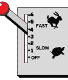

四个节流阀函数

声明节流阀类

此类定义定义了一个名为 throttle 的新数据类型。新数据类型是一个类，意味着它可能有一些组件是数据，其他组件是函数。让我们逐个部分来检查定义。

**类头。** 定义的头部由 C++ 关键字 class 组成，后跟新类的名称。你可以为类名使用任何合法标识符。我们选择了 throttle 这个名称。我们为新类的名称使用名词——C++ 并不要求这样做，但这是我们文档标准的一部分（附录 J）。

**成员列表。** 定义的其余部分，从开括号到结束分号，是定义的成员列表。

**公共部分。** 成员列表的第一部分称为公共部分。它以 C++ 关键字 public 开头，后跟冒号和一系列项目。这些项目可供任何使用新数据类型的人使用。对于节流阀，列表包含四个函数。此类函数称为成员函数，以将其与普通函数区分开来。另一个术语是方法，与“成员函数”意思相同。当成员函数在类体中列出时，我们只列出函数的原型（即头部后跟分号）。例如，节流阀函数的一个原型是：

```cpp
void shift(int amount);
```

原型表明该函数有一个参数（一个名为 amount 的整数）。我们将使用此函数按给定量向上或向下移动节流阀杠杆。shift 函数的实现不出现在类定义中；它将与其他函数实现一起出现在其他地方。节流阀的另一个函数具有以下原型：

```cpp
bool is_on();
```

bool 类型

此函数可用于确定节流阀当前是否开启。函数的返回值具有 bool 数据类型，这是 ANSI/ISO C++ 标准提供的内置数据类型。bool 数据类型仅用于真或假值（也称为布尔值或逻辑值）。bool 类型的重要属性如图 2.1 所示。如果你的编译器不支持 bool 类型，请参阅附录 E“处理旧编译器”以了解替代方案。

公共成员函数

任何声明 throttle 类型变量的人都可以使用四个公共成员函数来操作该节流阀。事实上，这四个函数是操作节流阀的唯一方式，因为定义的公共部分中没有其他可用内容。

修改成员函数

你应该注意，我们已将公共成员函数分为两组。前两个函数，shut_off 和 shift，是修改成员函数。修改成员函数可以更改对象的值。对于节流阀，修改函数可以更改节流阀杠杆的位置。


## 图 2.1 布尔数据类型

## C++ 拥有布尔数据类型

真或假测试的结果在编程中起着重要作用。例如，我们可能测试两个变量是否相等（x == y），或比较两个整数变量的相对顺序（i < j）。在这些情况以及其他情况中，测试的结果要么是 true，要么是 false。

在早期的 C 和 C++ 版本中，false 由整数 0 表示，true 由任何非零整数表示。但 1996 年 C++ 标准提供了一种名为 bool 的新内置数据类型。该数据类型旨在存储由各种测试生成的真或假值。与该数据类型一起的是两个新关键字，true 和 false，它们是 bool 常量。

以下是 bool 类型的重要特性摘要：

- 布尔值可以是 true 或 false；不允许其他值。
- 内置关系运算符（==, !=, <, <=, >, >=）生成一个布尔值。
- 二元“与”运算符（&&）组合两个布尔参数，仅当两个参数都为 true 时才产生 true 结果。二元“或”运算符（||）组合两个布尔参数，如果其中任何一个参数为 true，则产生 true 结果。“非”运算符（!）应用于单个布尔参数，从 true 参数产生 false 结果，反之亦然。
- 用户定义的函数也可以计算并返回布尔值。
- 布尔值可用作 if 语句或循环的控制表达式。

```cpp
bool is_even(int i);
// Postcondition: The return value is true if and only if i is an even number.
```

我们可以在打印关于数字的消息的代码中使用 is_even 函数：

```cpp
if (is_even(j))
    cout << j << " is even." << endl;
else
    cout << j << " is odd." << endl;
```

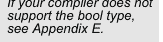

“bool” 名称源自 George Boole 的名字，他是一位 19 世纪的数学家，为逻辑值的形式演算奠定了基础。Boole 是一位自学成才的学者，正规训练有限。他 16 岁开始担任小学教师的教学生涯，最终成为 Cork 的 Queen’s College 教授。作为一位敬业的教师，他年仅 49 岁便去世了——死因是因在雨中步行两英里去给学生讲课而引发的肺炎。

另一方面，函数 flow 和 is_on 被归类为 **常量成员函数**。常量成员函数可以检查对象的状态，但禁止更改对象。在我们的示例中，这两个常量成员函数可以检查但不能更改节流器。常量成员函数的原型在末尾带有关键字 **const**（紧跟在参数列表之后）。使用 **const** 关键字告诉编译器和其他程序员，该函数不能更改对象。

- 1. 声明常量：第 12 页
- 2. 常量成员函数
- 3. 常量引用参数：第 72 页
- 4. 静态成员常量：第 104 页
- 5. 常量迭代器：第 144 页
- 6. 是指针或数组的常量参数：第 171 页
- 7. 带有指向节点的指针的 const 关键字，以及某些成员函数需要两个版本：第 227 页

### 阐明 const 关键字

### 第 2 部分：常量成员函数

关键字 const 可以放在成员函数的参数列表之后。这种 const 的用法表示该函数是一个常量成员函数。

常量成员函数可以检查其对象的状态，但禁止更改对象。

示例：
`double flow() const;`
`bool is_on() const;`

### 私有部分。

成员列表的第二部分称为 **私有部分**。它以 C++ 关键字 **private** 后跟冒号开头。冒号后面是类的一部分但对使用该类的程序员不直接可用的项目列表。在我们的示例中，私有部分包含一个名为 **position** 的整数。该组件是类的 **成员变量**，与其他四个成员（为成员函数）形成对比。成员变量可以是任何数据类型，例如 **int**、**char**、**double** 等等。

我们的意图是使用私有成员变量来存储节流器的 *当前位置*，范围从 0 到 6。该成员变量是私有的，这意味着实现 throttle 类的程序员可以访问此成员。但是，使用新类的程序员无法直接读取或向私有成员变量赋值。

### 类的常见模式

公共成员函数允许程序员修改和检查新类的对象。当成员函数检查数据而不进行修改时，请使用关键字 **const**（在函数的参数列表之后）。

类的私有成员变量存储关于类对象状态的信息。

总而言之，我们声明了两个不进行修改即可检查新类的公共成员函数，这两个函数被声明为 const 函数。另外两个公共成员函数实际上允许修改数据。数据本身被声明为新类的私有成员。这遵循了我们通常用于类的模式。稍后您将看到包含私有成员函数（即仅对新类的实现者可用而对其他程序员禁止的成员函数）的示例，以及偶尔出现的公共成员变量（任何程序员都可以使用）。如您所见，类体包含成员函数的原型，但不包含这些函数的完整定义。成员函数的完整定义出现在类定义之后，与任何其他函数定义位于同一位置。关于成员函数定义有一些特殊之处，但在查看定义之前，我们将解决另一个问题：程序员如何使用诸如 throttle 这样的类？

## 使用类

与任何其他数据类型一样，您可以声明 throttle 变量。这些变量称为 throttle 对象，有时也称为 throttle 实例。它们的声明方式与任何其他类型的变量相同。以下是 throttle 对象的两个示例声明：

```
throttle my_throttle;
throttle control;
```

每个 throttle 对象都包含私有成员变量 position，但程序无法直接访问此组件，因为它是私有成员。程序使用其 throttle 对象的唯一方法是使用四个公共成员函数。例如，假设我们已声明上面所示的变量，并且希望将 control 设置为其第三个档位。我们通过调用成员函数来实现这一点，如下所示：

```
control.shut_off( );
control.shift(3);
```

调用成员函数始终涉及以下四个步骤：

- 1. 从您正在操作的对象的名称开始。在示例中，我们正在操作 control，因此从 control 开始。如果我们想操作 my_throttle，则从 my_throttle 开始。请记住，您不能只调用一个成员函数——您必须始终指示正在操作哪个对象。
- 2. 在对象名称后，放置一个句点。
- 3. 接下来，编写成员函数的名称。例如，要调用 control 的 shut_off 函数，我们编写 control.shut_off——您可以将其读作 "control dot shut off"。
- 4. 最后，列出函数调用的参数。在我们的示例中，shut_off 没有参数，因此我们有一个空列表 ( )。第二个函数调用（针对函数 shift）需要一个参数，即我们移动节流器的量 (3)。

```
control.shut_off();
control.shift(3);
```

我们的示例对 control 的 shut_off 和 shift 成员函数进行了函数调用。OOP 程序员通常会使用略有不同的术语，说我们 **激活** 了 shut_off 和 shift 成员函数。“激活成员函数”只不过是对向成员函数进行 *函数调用* 的 OOP 行话。

作为另一个示例，以下是一系列激活，用于根据用户输入设置节流器，然后打印节流器的流量：

```
throttle control;
int user_input;

control.shut_off();
cout << "Please type a number from 0 to 6: ";
cin >> user_input;
control.shift(user_input);
if (control.is_on())
    cout << "The flow is " << control.flow() << endl;
else
    cout << "The flow is now off" << endl;
```

请注意，control.flow 的返回值如何直接用于输出语句。与任何其他函数一样，成员函数的返回值可以用作输出语句或其他表达式的一部分。

使用节流器很容易，因为我们不必担心成员函数如何完成它们的工作。我们只需激活每个成员函数并等待它返回，就像任何其他函数一样。这是信息隐藏的最佳体现。

## 节流器类的小型演示程序

图 2.2 显示了一个使用 throttle 类的程序示例。该程序声明了一个名为 sample 的节流器，并根据用户输入向上移动节流器。然后，节流器一次向下移动一个档位，并在每个档位打印流量。与程序的典型对话如下（用户输入以粗体打印）：

### 与演示程序的对话

我有一个有 6 个位置的节流器。
您想将节流器设置在哪里？
请输入 0 到 6 之间的数字：3
当前流量为 0.5
当前流量为 0.333333
当前流量为 0.166667
当前流量已关闭


## 图 2.2 节流器类示例程序

## 程序

```cpp
// FILE: demo1.cxx
// This small demonstration shows how the throttle class is used.
#include <iostream>     // Provides cout and cin
#include <cstdlib>      // Provides EXIT_SUCCESS
using namespace std;    // Allows all Standard Library items to be used
class throttle
{
public:
    // MODIFICATION MEMBER FUNCTIONS
    void shut_off( );
    void shift(int amount);
    // CONSTANT MEMBER FUNCTIONS
    double flow( ) const;
    bool is_on( ) const;
private:
    int position;
};
int main( )
{
    throttle sample;
    int user_input;
    // Set the sample throttle to a position by the user.
    cout << "I have a throttle with 6 positions." << endl;
    cout << "Where would you like to set the throttle? " << endl;
    cout << "Please type a number from 0 to 6: ";
    cin >> user_input;
    sample.shut_off( );
    sample.shift(user_input);
    // Shift the throttle down to zero, printing the flow along the way.
    while (sample.is_on( ))
    {
        cout << "The flow is now " << sample.flow( ) << endl;
        sample.shift(-1);
    }
    cout << "The flow is now off" << endl;
    return EXIT_SUCCESS;
}
```

这些行是 throttle 类的定义。

这是名为 sample 的 throttle 对象的声明。

在实际程序中，你会将 throttle 的四个成员函数的实现放在这里，但我们还没有编写这些实现！

## 实现成员函数

图 2.2 中的演示程序包含除成员函数的完整定义外的所有内容。编写成员函数定义就像编写任何其他函数一样，只有一个小区别：在函数定义的头部，类名必须出现在函数名之前，中间用两个冒号分隔。在我们的示例中，throttle:: 出现在头部，函数名之前。这个要求称为作用域解析运算符，它告诉编译器该函数是特定类的成员函数。例如，我们第一个成员函数的定义必须包含全名 throttle::shut_off，如下所示：

```cpp
void throttle::shut_off( )
// Precondition: None.
// Postcondition: The throttle has been turned off.
{
    position = 0;
}
```

作用域解析运算符的原因是，函数名可能被用作另一个类的成员函数名，或另一个普通函数名。通过指定全名 throttle::shut_off，我们表明这是 throttle 成员函数的实现，而不是某个其他 shut_off 函数。

我们使用术语“函数实现”来描述像这样的完整函数定义。函数实现提供了函数工作方式的所有细节，与仅出现在类定义中的原型不同，原型没有说明函数如何完成其工作。

我们对 shut_off 的实现只是将私有成员变量 position 设置为零。但这里使用的是谁的 position 呢？我们是赋值给 my_throttle.position 吗？还是 control.position？甚至是其他某个 throttle 的 position 成员？答案取决于哪个对象激活了 shut_off。如果激活了 my_throttle.shut_off，那么 position 指的是 my_throttle.position。如果我们激活 control.shut_off，那么实现中的 position 指的是 control.position。

> **成员变量的关键**
> 
> 每个对象都保留所有成员变量的副本。
> 
> 当成员函数的实现引用成员变量时，实际使用的成员变量总是来自激活该成员函数的对象。

由于类的每个对象都保留其自身的成员变量副本，因此在单个程序中可以有同一类的多个不同对象。例如，程序中可能有这些语句：

```cpp
throttle big;
throttle low;
big.shut_off ();
low.shut_off ();
big.shift(0);
low.shift(1);
cout << "The big flow is: " << big.flow() << endl;
cout << "The low flow is: " << low.flow() << endl;
```

第一个输出语句打印 1.0（即 big 的流量）。第二个输出语句打印 0.166667（即 low 的流量）。

到现在为止，你已经了解足够多的成员函数知识，可以实现 throttle 的其他三个成员函数了。例如，shift 函数按参数指定的量更改 position 成员变量。在实现中，我们确保 shift 不会低于 0 或高于 6，如下所示：

```cpp
void throttle::shift(int amount)
// Precondition: shut_off has been called at least once to initialize the throttle.
// Postcondition: The throttle's position has been moved by amount (but
// not below 0 or above 6).
{
    position += amount;
    if (position < 0)
        position = 0;
    else if (position > 6)
        position = 6;
}
```

这可能是你第一次看到 += 运算符。它的作用是取右侧的量（例如 amount）并将其加到左侧变量中已有的内容（例如 position）中。然后将此和存回 += 左侧的变量中。

请注意，shift 函数有一个前置条件，指示“shut_off 已经至少被调用一次以初始化 throttle”。如果没有这个前置条件，成员变量 position 将包含垃圾值——尽管这是一个我们无法实际验证的前置条件示例。稍后我们将使用一种称为构造函数的功能来保证每个对象都被正确初始化。

flow 函数只是根据 position 成员变量返回当前流量，如下所示：

```cpp
double throttle::flow( ) const
// Precondition: shut_off has been called at least once to initialize the throttle.
// Postcondition: The value returned is the current flow as a proportion of
// the maximum flow.
{
    return position / 6.0;   // Divide by 6.0, since the throttle has six positions.
}
```

由于 flow 是常量成员函数，我们必须在函数头部末尾包含关键字 const。

throttle 的最后一个函数称为 is_on。该函数返回一个布尔真/假值，指示燃料流量是否开启。以下是实现 is_on 的一种方法，以便它返回正确的布尔值：

```cpp
bool throttle::is_on( ) const
// Precondition: shut_off has been called at least once to initialize the throttle.
// Postcondition: If the throttle's flow is above 0, then the function
// returns true; otherwise, it returns false.
{
    return (flow( ) > 0);
}
```

## 成员函数可以激活其他成员

is_on 的实现说明了成员函数的最后一个重要特性：成员函数的实现可以激活其他成员函数。例如，我们对 is_on 的实现激活了 flow 成员函数。当 flow 在 is_on 的函数体中使用时，它不带对象名（如 my_throttle 或 control）使用。前面不需要对象名——我们只需写 flow( )；实际使用的 flow 实例由 is_on 的激活决定。因此，当激活 my_throttle.is_on 时，它使用 my_throttle.flow。另一方面，当激活 control.is_on 时，它使用 control.flow。

## 编程提示

### 布尔变量的样式

在 is_on 的 return 语句中，我们写了：return (flow( ) > 0);。括号中的测试会被求值，该测试的真/假值由函数返回。只要有可能，请使用真/假测试（如 >）来返回布尔值。这个提示是涉及布尔值的几个样式问题之一。

布尔值的第二个问题是，该值可以直接用于控制 if 语句或循环。例如，在第 41 页的图 2.2 中，我们有以下 while 循环。

```cpp
while (sample.is_on())
{
    cout << "The flow is now " << sample.flow() << endl;
    sample.shift(-1);
}
```

如果 is_on 函数的返回值为 true，则循环继续。当 is_on 返回 false 时，循环将结束。

作为最后一个提示，我们通常在返回布尔值的函数名称的第一部分使用单词“is”。这会提高诸如“while sample is on...”之类语句的可读性。

#### 第 2.1 节自测练习

- 1. 类的哪种成员支持信息隐藏？
- 2. 类的成员应在何时声明为 public？
- 3. bool 变量可以持有哪些值？
- 4. 类和对象之间有什么区别？
- 5. 请描述修改型成员函数和常量成员函数之间的区别。
- 6. 请描述作用域解析运算符 throttle:: 使用的一个常见位置。
- 7. 编写一个 C++ 程序，声明一个 throttle，将节流器移至中间位置（第三个位置），并打印当前流量。
- 8. 为 throttle 添加一个新成员函数，如果当前流量超过一半则返回 true。你的实现函数体应激活 flow，并使用上面列出的布尔值准则。

### 2.2 构造函数

throttle 类已完成。它可以在程序中使用，就像我们在第 41 页的图 2.2 中所做的那样。在那个程序中，我们先有 throttle 类定义，然后是使用新类的程序，最后是四个成员函数的实现。这工作良好；图 2.2 的所有内容都可以放在一个文件中，像任何其他程序一样编译和运行。但在离开 throttle 示例之前，还有些改进需要做。


第一个改进涉及初始化节流器。三个成员函数都有一个前置条件，表示“已至少调用一次 shut_off 来初始化节流器。”没有这个前置条件，成员变量 position 将包含垃圾值，可能会发生任何事情。不幸的是，没有办法测试前置条件以确保节流器已被初始化。

构造函数是解决此问题的一种方法，通过提供一个保证会被调用的初始化函数。构造函数是一个具有以下特殊属性的成员函数：

- 如果一个类有构造函数，那么每当声明该类的变量时，都会自动调用构造函数。如果构造函数有任何参数，则构造函数调用的参数必须在变量名之后给出（在声明变量的位置）。
- 构造函数的名称必须与类的名称相同。在我们的示例中，构造函数的名称是 throttle。这似乎很奇怪：通常我们避免为两个不同的事物使用相同的名称。但 C++ 要求构造函数使用与类相同的名称。
- 构造函数没有任何返回值。因此，你不得在构造函数的头部前面写 void（或任何其他返回类型）。编译器知道每个构造函数都没有返回值，但如果你在构造函数的头部前面实际写了 void，则会发生编译器错误。

## 节流器的构造函数

让我们通过实现一个节流器构造函数来使这些特性具体化。我们想到的构造函数实际上会使节流器更加灵活，允许不同节流器之间的总节流位置数有所不同。我们不再局限于只有六个位置的节流器。例如，割草机节流器可能只需要四个位置，而 40 个位置的节流器可用于需要更精细控制的火箭。

### 向节流器类添加构造函数

我们的节流器构造函数有一个参数，用于指示节流器包含的总位置数。我们不需要第二个参数来指示当前节流器位置，因为我们的构造函数将始终将当前位置初始化为零。以下是新构造函数的原型，以及其前置条件/后置条件契约：

```
throttle(int size);
// Precondition: 0 < size.
// Postcondition: The throttle has size positions above the shutoff position,
//     and its current position is off.
```

以这种方式看到 throttle 这个词确实看起来很奇怪，但我们别无选择：构造函数的名称必须与类的名称相同。

还要注意，单词 void 不出现在原型的前面，函数也没有任何其他返回类型。构造函数的原型与其他成员函数的原型一起放在 throttle 类定义中，如下所示：

```cpp
class throttle
{
public:
  // CONSTRUCTOR
  throttle(int size);
  // MODIFICATION MEMBER FUNCTIONS
  void shut_off( );
  ...
}
```

这是节流器构造函数的原型。

其他成员函数的原型照常出现。

我们稍后将查看构造函数的实现，但首先让我们看看在声明节流器对象时使用构造函数的一些示例。例如，以下是两个节流器的声明：

```cpp
throttle mower_control(4);
throttle apollo(40);
```

在这些声明之后，每个节流器都处于关闭状态。mower_control 有四个位置，apollo 有 40 个。

提供多个不同的构造函数，每个执行不同类型的初始化，通常很有用。例如，假设我们的许多节流器只需要一个开启位置——一种全有或全无的节流器。那么我们可以提供一个没有参数的第二个构造函数。第二个构造函数给节流器只有一个开启位置，并将当前位置设置为零。这个构造函数的原型如下所示：

```cpp
throttle( );
// Precondition: None.
// Postcondition: The throttle has one position above the shutoff position,
//     and its current position is off.
```

没有参数的构造函数称为默认构造函数。以下是两个节流器的声明，第一个使用默认构造函数，第二个使用另一个构造函数：

```cpp
throttle toggle;
throttle complicated(100);
```

当 toggle 使用默认构造函数时，没有参数列表——甚至连一对括号都没有。换句话说，要使用默认构造函数，只需声明一个没有参数列表的对象。将调用默认构造函数。

你可以声明任意数量的构造函数——每种初始化对象的不同方式对应一个。每个构造函数必须具有不同的参数列表，以便编译器能够区分它们。只允许一个默认构造函数。

要实现我们的新构造函数，我们需要一个名为 top_position 的新私有成员变量，用于跟踪节流器的最大位置。默认构造函数将 top_position 设置为 1，另一个构造函数根据构造函数的 size 参数设置 top_position。完整的新类定义以及新构造函数的实现如图 2.3 所示。

## 图 2.3 节流器的构造函数

### 类定义

```cpp
class throttle
{
public:
// CONSTRUCTORS
throttle( );
throttle(int size);
// MODIFICATION MEMBER FUNCTIONS
void shut_off( );
void shift(int amount);
// CONSTANT MEMBER FUNCTIONS
double flow( ) const;
bool is_on( ) const;
private:
int top_position;
int position;
};
```

默认构造函数的原型

另一个构造函数的原型

一个新的私有成员变量跟踪节流器有多少个位置。

### 构造函数的实现

```cpp
throttle::throttle( )
{
top_position = 1;
position = 0;
}

throttle::throttle(int size)
// Library facilities used: cassert
{
assert(0 < size);
top_position = size;
position = 0;
}
```

## 如果编写一个没有构造函数的类会发生什么？

如果编写一个没有构造函数的类，编译器会自动创建一个简单的默认构造函数。这个自动默认构造函数不做太多工作。它只是为那些是其他类对象的成员变量调用默认构造函数。通常，你应该编写自己的构造函数，包括自己的默认构造函数，而不是依赖自动默认构造函数。

## 始终提供构造函数

当你编写一个类并定义构造函数时，该类的每个变量在声明时都会调用你的一个构造函数。这通过减少使用未初始化变量的机会来提高程序的可靠性。我们还建议为每个类定义一个默认构造函数。这也允许程序员声明你的类的变量，而无需为构造函数提供任何参数。

## 修订节流器的成员函数

因为我们添加了一个新成员变量 top_position，所以必须修订成员函数，使用 top_position 而不是数字 6 来表示位置数。例如，以下是 shift 的修订后实现：

```cpp
void throttle::shift(int amount)
// Postcondition: The throttle's position has been moved by amount (but
// not below 0 or above the top position.
{
    position += amount;
    if (position < 0)
        position = 0;
    else if (position > top_position)
        position = top_position;
}
```

请注意，我们不再需要前置条件，因为保证会调用一个构造函数。当没有前置条件时，你可以省略它，就像我们在这里所做的那样，或者可以将前置条件列为 "None."。

## 内联成员函数

我们将使用一种新技术来修订其他三个成员函数。该技术是将 shut_off、flow 和 is_on 的完整定义放在类定义内部，如图 2.4 中的三行高亮显示所示。

在 flow 的定义中使用 double 会将 top_position 从整数更改为双精度浮点数（否则除法将执行整数

除法，丢弃任何余数)。这种数据类型的更改称为类型转换。每当你计算两个整数的普通除法（并且希望在结果中包含小数部分）时，都需要这样做。

我们在实现中做的另一项更改是让 is_on 仅检查 position。这似乎比我们原来的实现（它激活了 flow 函数）更简单。

将函数定义放在类定义内部称为内联成员函数。它有两个效果：

- 你不必稍后编写实现。
- 每次在程序中使用内联函数时，编译器都会重新编译该简短函数定义，并将此已编译简短定义的副本放入你的代码中。这节省了一些执行时间（没有实际的函数调用和函数返回），但在空间上可能效率低下（你最终会得到许多相同已编译代码的副本）。

请注意，当你声明内联成员函数时，左花括号前或右花括号后都没有分号。

## 编程提示

### 何时使用内联成员函数

内联函数会导致一些低效率——你的编译代码可能比需要的更长。内联函数还会导致类定义更加混乱，更难阅读和更难调试。由于这些问题，我们建议仅在函数定义由单个简短语句组成的简单情况下使用内联成员函数。

## 图 2.4 内联成员函数

### 类定义

```cpp
class throttle
{
public:
  // CONSTRUCTORS
  throttle();
  throttle(int size);
  // MODIFICATION MEMBER FUNCTIONS
  void shut_off( ) { position = 0; }
  void shift(int amount);
  // CONSTANT MEMBER FUNCTIONS
  double flow( ) const { return position / double(top_position); }
  bool is_on( ) const { return (position > 0); }
private:
  int top_position;
  int position;
};
```

高亮代码显示了三个内联成员函数。

类型名称 'double' 将 top_position 从整数更改为双精度数。此更改称为 '类型转换'，可防止意外的整数除法。

#### 第 2.2 节自测练习

- 9. 使用内联函数重写第 45 页自测练习 8 中的“半开”函数。
- 10. 当声明对象变量时，如果程序员没有为类编写构造函数，会发生什么？
- 11. 找出以下构造函数原型中的错误：
  void throttle(int size);
- 12. 编写一个带有两个参数的新 throttle 构造函数：节流器的总位置数及其初始位置。

### 2.3 使用命名空间、头文件和实现文件

将我们的新 throttle 类轻松提供给任何需要它的程序是有意义的。毕竟，你永远不知道什么时候可能需要一个节流器。我们希望在不透露新类实现所有细节的情况下做到这一点。此外，我们不希望其他程序员担心他们为变量等选择的名称是否会与我们碰巧使用的名称冲突。

通过三个步骤实现这些目标：

- 1. 创建命名空间
- 2. 编写头文件
- 3. 编写实现文件

接下来将讨论每个步骤的目的和技术。我们还将讨论另一位程序员如何使用你用这些技术编写的项目。

### 创建命名空间

当程序使用几位不同程序员编写的不同类时，可能会发生名称冲突。我们编写了一个 throttle 类，但也许 NASA 也编写了一个 throttle，而一个程序需要同时使用这两个 throttle。对于诸如 throttle 这样的演示类，这种情况不太可能发生，但常见的现实名称经常会有冲突。

解决方案是使用一种称为命名空间的组织技术。命名空间是程序员选择的一个名称，用于标识其工作的一部分。名称应具有描述性，但还应包含你真实姓名或电子邮件地址的一部分，以便不太可能引起冲突。第 2 章中我们的第一个命名空间将是 main_savitch_2A；本章稍后将有 main_savitch_2B，我们将为其他章节使用类似的名称。

### 命名空间分组

属于我们命名空间的所有工作都必须放在一个 **命名空间分组** 中，形式如下：

```
namespace main_savitch_2A
{
    // Any item that belongs to the namespace is written here.
}
```

单词 `namespace` 是 C++ 关键字。单词 `main_savitch_2A` 是我们为命名空间选择的名称；它可以是任何合法的 C++ 标识符。我们的所有其他代码都出现在花括号内。例如，throttle 类声明和 throttle 成员函数的实现都将放在命名空间中。

一个单一的命名空间，例如 `main_savitch_2A`，可以有多个不同的命名空间分组。例如，throttle 类定义可以在程序中的某个位置出现在 `main_savitch_2A` 的命名空间分组中。稍后，当我们准备实现 throttle 成员函数时，可以为 `main_savitch_2A` 打开第二个命名空间分组，并将函数定义放在该第二个分组中。这两个命名空间分组都针对 `main_savitch_2A` 命名空间，尽管令人惊讶的是，它们不需要在同一文件中。通常，它们出现在两个独立的文件中：

- 类定义出现在 **头文件** 中，该文件提供程序员使用类所需的所有信息。
- 成员函数定义出现在单独的 **实现文件** 中。

本节其余部分将说明我们 throttle 类的头文件和实现文件格式，以及程序如何使用命名空间中的项目的示例。

### 头文件

### 头文件中的注释说明如何使用类

类的 **头文件** 提供程序员使用类所需的所有信息。事实上，使用类所需的所有信息都应出现在头文件顶部的 **头文件注释** 中。要使用类，程序员只需阅读此信息性注释即可。注释应包括所有公共成员函数的列表，以及每个函数的前置条件/后置条件契约。（如果函数没有前置条件，则我们通常会省略它，单独列出后置条件。）注释不列出任何私有成员，因为 *使用* 新类的程序员不关心私有成员。

新类的类定义出现在头文件注释后的命名空间分组中。但只有类定义出现——成员函数的实现不出现在这里（内联函数除外）。

将类定义放在头文件中存在一些问题。一个问题是，使用类的程序员可能认为他们必须阅读此定义才能使用类。他们不需要。使用类所需的所有信息都在头文件注释中。但 C++ 要求类定义出现在这里，因此我们无法避免此问题。

第二个问题源于头文件的使用方式。如你在后续章节中将看到的，一个程序有时会多次包含同一个头文件。结果，类定义出现多次，编译会因为“重复类定义”而失败。我们可以通过将头文件的所有定义放在称为 **宏保护** 的编译器指令中来避免重复类定义。带有宏保护的我们命名空间中 throttle 类声明的完整形式如下所示：

使用宏保护避免重复定义

```cpp
#ifndef MAIN_SAVITCH_THROTTLE_H
#define MAIN_SAVITCH_THROTTLE_H
namespace main_savitch_2A
{
    class throttle
    {
        // The usual class definition appears here.
    };
}
#endif
```

第一行 #ifndef MAIN_SAVITCH_THROTTLE_H 标志着宏保护的开始。此处与 #endif 之间出现的所有语句都受宏保护的约束。只有当编译器尚未见过这个相当长的单词 MAIN_SAVITCH_THROTTLE_H 的定义时，这些语句才会被编译。

那么，这如何避免重复定义呢？在代码首次出现时：

- 类定义会被编译。
- 单词 MAIN_SAVITCH_THROTTLE_H 也会被定义（通过 #define MAIN_SAVITCH_THROTTLE_H 定义）。

现在，如果代码第二次出现，类定义将被跳过（因为 MAIN_SAVITCH_THROTTLE_H 已经定义）。我们的 throttle 头文件（名为 throttle.h）如图 2.5 所示。过去，大多数程序员使用 .h 作为头文件名的后缀（例如 throttle.h），尽管这种做法已经变得不那么常见，因为标准头文件（例如 iostream）不再使用 .h。但是，我们将继续使用 .h，因为一些文本编辑程序或编译器会根据 .h 文件类型提供特殊模式。


## 类的头文件

当你设计并实现一个类时，应该提供一个单独的头文件。

在头文件的顶部，放置程序员使用该类所需的所有文档。

文档之后是该类的类定义。但只出现类定义，而不出现成员函数的实现（内联函数除外）。

将类定义放在命名空间内，并在整个内容周围放置一个“宏保护”。宏保护可防止意外的重复定义。

### 图 2.5 节流器类的头文件

### 一个头文件

```
// FILE: throttle.h
// CLASS PROVIDED: throttle (part of the namespace main_savitch_2A)
// ...
// CONSTRUCTORS for the throttle class:
// throttle()
// Postcondition: The throttle has one position above the shut_off position, and it is currently shut off.
// throttle(int size)
// Precondition: size > 0.
// Postcondition: The throttle has size positions above the shut_off position, and it is currently shut off.
// MODIFICATION MEMBER FUNCTIONS for the throttle class:
// void shut_off( )
// Postcondition: The throttle has been turned off.
// void shift(int amount)
// Postcondition: The throttle's position has been moved by amount (but not below 0 or above the top position).
```

成员函数通常没有前置条件。

### （图 2.5 续）

```
//
// CONSTANT MEMBER FUNCTIONS for the throttle class:
// double flow( ) const;
//     Postcondition: The value returned is the current flow as a
//     proportion of the maximum flow.
//
// bool is_on( ) const;
//     Postcondition: If the throttle's flow is above 0 then
//     the function returns true; otherwise it returns false.
//
// VALUE SEMANTICS for the throttle class (see the discussion on page 56):
//     Assignments and the copy constructor may be used with throttle objects.
#ifndef MAIN_SAVITCH_THROTTLE
#define MAIN_SAVITCH_THROTTLE
namespace main_savitch_2A
{
    class throttle
    {
    public:
        // CONSTRUCTORS
        throttle( );
        throttle(int size);
        // MODIFICATION MEMBER FUNCTIONS
        void shut_off( );
        void shift(int amount);
        // CONSTANT MEMBER FUNCTIONS
        double flow( ) const { return position / double(top_position); }
        bool is_on( ) const { return (position > 0); }
    private:
        int top_position;
        int position;
    };
}
#endif
```

宏保护开始

命名空间分组开始

命名空间分组结束

宏保护结束

## 在头文件中描述类的值语义

类的值语义决定了值如何从一个对象复制到另一个对象。在 C++ 中，值语义包含两个操作：赋值运算符和拷贝构造函数。

**赋值运算符。** 对于两个对象 x 和 y，赋值 y = x 将 x 的值复制到 y。任何我们定义的新类都允许进行此类赋值。对于新类，C++ 通常通过简单地将赋值号右侧对象的每个成员变量复制到左侧对象来执行赋值。这种复制方法称为自动赋值运算符。稍后我们将看到自动赋值运算符无法工作的示例。但目前，我们的新类可以使用自动赋值运算符。

**拷贝构造函数。** 拷贝构造函数是恰好带有一个参数的构造函数，且参数的数据类型与构造函数所属的类相同。例如，throttle 的拷贝构造函数有一个参数，该参数本身就是一个 throttle。拷贝构造函数的常见目的是将新对象初始化为现有对象的精确副本。例如，下面是一段代码，它创建一个名为 x 的 100 档位节流器，将 x 移至其中间位置，然后声明第二个节流器，将其初始化为 x 的精确副本：

```
throttle x(100);
x.shift(50);
throttle y(x);
```

节流器 y 被初始化为 x 的副本，因此两个节流器都位于 100 档位中的第 50 档位。

高亮语句激活了节流器的拷贝构造函数，将 y 初始化为 x 的精确副本。初始化后，x 和 y 可能会执行不同的操作，最终产生不同的燃料流量，但此时两个节流器都设置为 100 档位中的第 50 档位。

调用拷贝构造函数有另一种语法。与其写 throttle y(x);，不如写 throttle y = x;。这种替代语法看起来像赋值语句，但请记住，实际效果略有不同。赋值 y = x; 仅将 x 复制到已存在的对象 y。另一方面，声明 throttle y = x; 既声明了新对象 y，又调用拷贝构造函数将 y 初始化为 x 的副本。我们将始终使用原始形式 throttle y(x);，因为这种形式不太可能与普通赋值语句混淆。

作为类的实现者，你可以像编写其他构造函数一样编写拷贝构造函数——你将在后续章节的类中这样做。但目前我们可以利用 C++ 的一个特性：C++ 提供了自动拷贝构造函数。自动拷贝构造函数通过仅复制现有对象的所有成员变量来初始化新对象。例如，在声明 throttle y(x); 中，自动拷贝构造函数会将现有节流器 x 的两个成员变量复制到新节流器 y。

对于许多类，自动赋值运算符和自动拷贝构造函数工作良好。但正如我们所警告的，稍后我们将看到自动版本失效的类。仅复制成员变量并不总是足够。正因为如此，程序员对赋值和拷贝构造函数持谨慎态度。为解决这个问题，我们建议你的文档中包含一条注释，指明值语义可以安全使用。

### 编程提示

### 记录值语义

当你实现一个类时，文档中应包含一条注释，指明值语义可以安全使用。例如，在我们的 throttle 头文件中，我们写了：

```
// VALUE SEMANTICS for the throttle class:
// Assignments and the copy constructor may be used with throttle
// objects.
```

## 实现文件

新类的实现文件包含几个项目：首先，出现一小段注释，指明文档可在头文件中找到。其次，出现一条包含指令，导致编译器从头文件获取类定义。在我们的 throttle 示例中，包含指令如下：

- 注释
- 包含指令
- 重新打开命名空间并定义实现

```
#include "throttle.h"
```

当我们列出头文件名 "throttle.h" 时，使用引号而不是尖括号。尖括号（例如包含指令 #include <iostream>）仅用于包含标准库设施，而我们对自己的头文件使用引号。

包含指令之后，程序重新打开命名空间并给出类成员函数的实现。命名空间通过头文件中看到的相同语法重新打开：

```
namespace main_savitch_2A
{
    // The definitions of the member functions are written here.
}
```

大多数编译器要求实现文件名具有特定的后缀，例如 .cpp 或 .C。我们将对实现文件名使用 .cxx 后缀，例如图 2.6 中所示的完整实现文件 throttle.cxx。

### 类的实现文件

每个类都有一个单独的实现文件，其中包含类成员函数的实现。有关实现文件和头文件的更多内容，请参见 www.cs.colorado.edu/~main/separation.html。

### 图 2.6 节流器类的实现文件

### 一个实现文件

```
// FILE: throttle.cxx
// CLASS IMPLEMENTED: throttle (see throttle.h for documentation)

#include <cassert>    // Provides assert
#include "throttle.h" // Provides the throttle class definition

namespace main_savitch_2A
{
    throttle::throttle( )
    { // A simple on-off throttle
        top_position = 1;
        position = 0;
    }

    throttle::throttle(int size)
    // Library facilities used: cassert
    {
        assert(size > 0);
        top_position = size;
        position = 0;
    }

    void throttle::shift(int amount)
    {
        position += amount;

        if (position < 0)
            position = 0;
        else if (position > top_position)
            position = top_position;
    }
}
```


## 在命名空间中使用项目

一旦头文件和实现文件就绪，任何程序都可以使用我们的新类。在程序顶部，你放置一个包含指令来包含头文件，如下所示为我们的示例：

```
#include "throttle.h"
```

> 请注意，我们只包含头文件，而不包含实现文件。

在包含指令之后，程序可以以三种方式之一使用命名空间中定义的项目：

- 1. 放置一个 using 语句，使整个命名空间可用。该语句的格式为：
  using namespace main_savitch_2A;

  这个 using 语句使来自指定命名空间（main_savitch_2A）的所有项目可用。这是我们一直用来从标准库中获取所有可用项目的相同技术（使用语句 `using namespace std`）。

- 2. 如果我们只需要使用命名空间中的特定项目，那么我们放置一个由关键字 using、命名空间名称、两个冒号和我们想要使用的项目名称组成的语句。例如：
  using main_savitch_2A::throttle;

  这允许我们从命名空间中使用 throttle；但是，如果命名空间中有其他项目，则它们不可用。

- 3. 没有 using 语句，我们仍然可以通过在使用项目的位置将项目名称与命名空间和 "::" 前缀来使用任何项目。例如，我们可以用语句声明一个 throttle 变量：
  main_savitch_2A::throttle apollo;

  这种 "::" 的用法是我们在第 42 页看到的作用域解析运算符的一个示例。它澄清了我们要求使用哪个特定的 throttle。

创建和使用命名空间的摘要如图 2.7 所示，包括一个警告，即永远不要在头文件中放置 using 语句。

我们使用修改后的 throttle 的完整演示程序出现在第 61 页的图 2.8 中。当完整程序实际被编译时，您可能需要提供关于在哪里找到实现文件 throttle.cxx 的编译版本的额外信息。这个过程称为链接，因编译器而异（参见附录 D）。

## 图 2.7 创建和使用命名空间的摘要

**1. 全局命名空间：** 任何未明确放置在命名空间中的项目都成为所谓的 **全局命名空间** 的一部分。这些项目可以在任何点使用，而不需要 using 语句或作用域解析运算符。

**2. C++ 标准库：** 如果你使用新的 C++ 头文件名称（例如 `<iostream>` 或 `<cstdlib>`），那么 C++ 标准库中的所有项目都自动成为 `std` 命名空间的一部分。使用这些项目的最简单方法是在包含语句后放置一个 using 指令：`using namespace std;`。另一方面，如果你使用旧的 C++ 头文件名称（例如 `<iostream.h>` 或 `<stdlib.h>`），那么项目是全局命名空间的一部分，因此不需要 using 语句或作用域解析运算符。

**3. 创建你自己的命名空间：** 要创建一个新命名空间，项目被放置在一个命名空间分组中，形式如下：
```
namespace <The name for the namespace>
{
    // Any item that belongs to the namespace is written here.
}
```
单词 `namespace` 是 C++ 关键字。命名空间的名称可以是任何 C++ 标识符，但应选择以避免与其他人的命名空间可能发生冲突（通过使用你真实姓名或电子邮件地址的一部分）。一个命名空间可以有几个不同的命名空间分组，可能位于不同的文件中。例如，类定义可以出现在头文件中的一个命名空间分组中，而成员函数定义出现在实现文件中的同一命名空间的第二个分组中。

**4. 使用命名空间：**
- 要使用命名空间中的所有项目，请在所有包含语句后放置一个 using 指令，形式为：
  `using namespace <The name for the namespace> ;`
- 要使用命名空间中的一个项目，请在所有包含语句后放置一个特定的 using 指令，形式为：
  `using <The name for the namespace>::<The name of the item> ;`
- 没有 using 指令，你仍然可以通过在项目前加上命名空间名称和 "::" 来直接在程序中使用项目。

**永远不要将 using 语句实际放在头文件中**
有时头文件本身需要使用来自命名空间的某个东西。在这种情况下，始终使用上面显示的第三种形式；永远不要将 using 语句放在头文件中（因为这样做可能会在包含头文件的其他程序中产生意外结果）。

## 图 2.8 修改后的 Throttle 类示例程序

### 一个程序

```
// FILE: demo2.cxx
// This small demonstration shows how the revised throttle class is used.
#include <iostream>     // Provides cout and cin
#include <cstdlib>      // Provides EXIT_SUCCESS
#include "throttle.h"   // Provides the throttle class
using namespace std;
using main_savitch_2A::throttle;

const int DEMO_SIZE = 5; // Number of positions in a demonstration throttle

int main( )
{
    throttle sample(DEMO_SIZE); // A throttle to use for our demonstration
    int user_input;             // The position to which we set the throttle

    // Set the sample throttle to a position indicated by the user.
    cout << "I have a throttle with " << DEMO_SIZE << " positions." << endl;
    cout << "Where would you like to set the throttle?" << endl;
    cout << "Please type a number from 0 to " << DEMO_SIZE << ": ";
    cin >> user_input;
    sample.shift(user_input);

    // Shift the throttle down to zero, printing the flow along the way.
    while (sample.is_on( ))
    {
        cout << "The flow is now " << sample.flow( ) << endl;
        sample.shift(-1);
    }
    cout << "The flow is now off" << endl;

    return EXIT_SUCCESS;
}
```

### 示例对话

我有一个有 5 个位置的节流阀。
你想把节流阀设在哪里？
请输入 0 到 5 之间的数字：3
当前流量为 0.6
当前流量为 0.4
当前流量为 0.2
当前流量已关闭

#### 第 2.3 节自测练习

- 13. 程序员阅读什么来学习如何使用新类？
- 14. 宏保护的目的是什么？
- 15. 如果 x 和 y 是对象，赋值 y = x 的正常操作是什么？
- 16. 假设 x 是一个 throttle。声明 throttle(x) 的效果是什么？
- 17. 编写 #include 指令和一个 using 语句，主程序必须使用它们才能使用 throttle 类。

- 18. 设计并实现一个名为 circle_location 的类，用于跟踪绕圆移动的单个点的位置。该类的对象将点的位置记录为角度，从圆顶部顺时针方向测量。包括这些公共成员函数：
  - 一个默认构造函数，将点放在圆顶部。
  - 另一个构造函数，将点放在指定位置。
  - 一个函数，将点移动指定的度数绕圆。使用正参数顺时针移动，使用负参数逆时针移动。
  - 一个函数，返回点的当前位置，以度为单位，从圆顶部顺时针测量。
  你的解决方案应包括一个单独的头文件、实现文件和一个使用新类的主程序示例。

- 19. 设计并实现一个名为 clock 的类。一个 clock 对象保存一个时间值的实例，例如 9:48 PM。至少要有这些公共成员函数：
  - 一个默认构造函数，将时间设置为午夜
  - 一个函数，显式分配给定时间（你需要为该函数考虑适当的参数）
  - 检索信息的函数：当前小时、当前分钟，以及一个布尔函数来确定时间是否在中午或之前
  - 一个函数，将时间向前推进给定的分钟数

- 20. 什么是全局命名空间？
- 21. 当命名空间的一部分需要在实际头文件中使用时，应该使用第 59 页中的哪三种形式之一？


### 2.4 类和参数

每个程序员都需要对函数和参数有坚定不移的理解。面向对象编程领域需要额外的理解，因为类可以用作函数参数的类型，也可以用作函数返回值的类型。本节将说明几个这样的函数，包括对不同种类参数的回顾。示例使用一个名为 point 的新类。

## 编程示例：Point 类

这个新类是一种数据类型，用于存储和操作平面上单个点的位置，如图 2.9 所示。图 2.9(a) 中的示例点位于坐标 x = -1.0 和 y = 0.8 的位置。point 类具有下面列出的成员函数：

- 有一个构造函数用于初始化点。构造函数的参数使用默认参数，我们稍后将讨论。
- 有一个成员函数用于沿 x 轴和 y 轴按给定量移动点，如图 2.9(b) 所示。
- 有一个成员函数用于围绕原点顺时针旋转点 90°，如图 2.9(c) 所示。
- 有两个常量成员函数允许我们获取点的当前 x 和 y 坐标。

这些函数很简单，但它们构成了用于绘图程序和其他图形应用程序的实际数据类型的基础。所有成员函数（包括构造函数）都列在第 64 页图 2.10 的头文件中，实现在第 65 页图 2.11 中。浏览完图表后，我们将回顾实现，从默认参数开始，默认参数在 point 的构造函数中以一种有趣的方式使用。

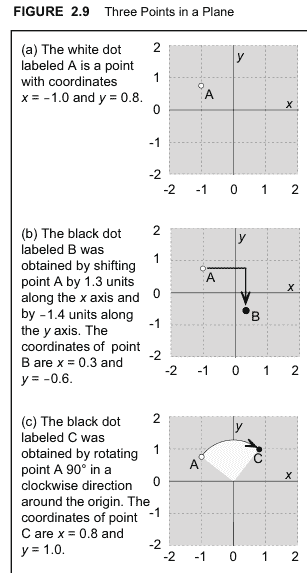

## 图 2.10 Point 类的头文件

### 一个头文件

```
// FILE: point.h
// CLASS PROVIDED: point (part of the namespace main_savitch_2A)
//
// CONSTRUCTOR for the point class:
//   point(double initial_x = 0.0, double initial_y = 0.0)
//     Postcondition: The point has been set to (initial_x, initial_y).
//
// MODIFICATION MEMBER FUNCTIONS for the point class:
//   void shift(double x_amount, double y_amount)
//     Postcondition: The point has been moved by x_amount along the x axis
//     and by y_amount along the y axis.
//   void rotate90( )
//     Postcondition: The point has been rotated clockwise 90 degrees around the origin.
//
// CONSTANT MEMBER FUNCTIONS for the point class:
//   double get_x( ) const
//     Postcondition: The value returned is the x coordinate of the point.
//   double get_y( ) const
//     Postcondition: The value returned is the y coordinate of the point.
//
// VALUE SEMANTICS for the point class:
//     Assignments and the copy constructor may be used with point objects.
//
#ifndef MAIN_SAVITCH_POINT_H
#define MAIN_SAVITCH_POINT_H
namespace main_savitch_2A
{
    class point
    {
    public:
        // CONSTRUCTOR
        point(double initial_x = 0.0, double initial_y = 0.0);
        // MODIFICATION MEMBER FUNCTIONS
        void shift(double x_amount, double y_amount);
        void rotate90( );
        // CONSTANT MEMBER FUNCTIONS
        double get_x( ) const { return x; }
        double get_y( ) const { return y; }
    private:
        double x; // x coordinate of this point
        double y; // y coordinate of this point
    };
}
#endif
```

## 图 2.11 Point 类的实现文件

### 一个实现文件

```
// FILE: point.cxx
// CLASS IMPLEMENTED: point (see point.h for documentation)
#include "point.h"
namespace main_savitch_2A
{
    point::point(double initial_x, double initial_y)
    { // Constructor sets the point to a given position.
        x = initial_x;
        y = initial_y;
    }
    void point::shift(double x_amount, double y_amount)
    {
        x += x_amount;
        y += y_amount;
    }
    void point::rotate90( )
    {
        double new_x;
        double new_y;
        new_x = y; // For a 90-degree clockwise rotation, the new x is the original y,
        new_y = -x; // and the new y is -1 times the original x.
        x = new_x;
        y = new_y;
    }
}
www.cs.colorado.edu/~main/chapter2/point.cxx WWW
```

## 默认参数

默认参数是当程序员未提供实际参数时将用于该参数的值。默认参数可以列在任何函数的原型中。例如，下面是我们在第 15 页使用过的一个函数原型的修改版本：

```
int date_check(int year, int month = 1, int day = 1);
```

date_check 的具体行为并不重要。重要的是，我们为 month 和 day 参数添加了默认参数。如示例中阴影部分所示，默认参数出现在参数名称后面的等号旁。一旦有了默认参数，函数可以带某些参数调用，也可以不带。

例如，程序可以只带 year 参数调用 date_check：

```
date_check(2000);
```

由于此函数调用中省略了最后两个参数，将使用默认参数（month = 1 和 day = 1）。该函数调用等同于调用 date_check(2000, 1, 1)。

函数也可以带 year 和 month 调用，省略 day，如本示例所示：

```
date_check(2000, 7);
```

在此示例中，将为 day 使用默认参数，因此该函数调用等同于调用 date_check(2000, 7, 1)。

提供和使用默认参数的一般规则总结在第 67 页图 2.12 中。默认参数对构造函数尤其方便，例如第 64 页图 2.10 中 point 的构造函数。构造函数的原型有这两个默认参数：

默认参数对构造函数尤其方便

```
point(double initial_x = 0.0, double initial_y = 0.0);
```

构造函数的两个参数都默认为双精度数 0.0，如下面三个 point 对象声明所示：

```
point a(-1, 0.8); <- Uses the usual constructor with two arguments
point b(1); <- Uses -1 for the first argument and uses the default argument, initial_y = 0.0, for the second argument
point c; <- Uses default arguments for both initial_x = 0.0 and initial_y = 0.0
```

我们构造函数的第三种用法——仅仅是 point c;——很有趣，因为两个参数都使用了默认值。实际上，我们有一个无参数的构造函数。无参数的构造函数是默认构造函数。正如我们在 throttle 中看到的，始终提供默认构造函数很重要。提供默认构造函数的一种方法是拥有一个为所有参数都设置了默认参数的构造函数。

## 编程提示

### 可以通过使用默认参数提供默认构造函数

提供默认构造函数的好方法是拥有一个为所有参数都设置了默认参数的构造函数。不要忘记，默认构造函数始终不带参数列表使用；甚至连括号都不存在。因此，要使用 point 的默认构造函数，我们写 point c; 。

## 图 2.12 默认参数

### 默认参数

当未提供实际参数时，默认参数是将用于该参数的值。用法遵循此处列出的格式和规则。

原型参数列表中的语法：

```
<type name> <variable name> = <default value>
```

示例：

```
int date_check(int year, int month = 1, int date = 1);
```

- 1. 默认参数仅指定一次——在原型中——而不是在函数的实现中。
- 2. 具有多个参数的函数不需要为每个参数指定默认参数。但是，如果只有部分参数有默认值，则这些参数必须位于参数列表的最右侧。
- 3. 在函数调用中，带有默认值的参数可以从实际参数列表的右端省略。例如：

```
date_check(2000); // Uses default arguments for month = 1 and date = 1
date_check(2000, 7); // Uses default argument for date = 1
date_check(2000, 7, 22); // Does not use the default arguments at all
```

## 参数

类可以用作函数参数的类型，就像任何其他数据类型一样。我们将回顾三种不同类型的参数，示例将使用新的 point 类。

> 函数参数回顾

## 图 2.13 旋转的点

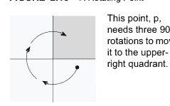

### 值参数。

最简单的参数是值参数。为了说明值参数，我们将编写一个简单的函数。我们要编写的函具有一个值参数，一个我们将称之为 p 的点。该函数返回的整数是将 p 移动到右上象限所需的 90° 旋转次数，如图 2.13 所示。


以下是该函数的实现：

```
int rotations_needed(point p)
// Postcondition: The value returned is the number of 90-degree
//     clockwise rotations needed to move p into the upper-right
//     quadrant (where x >= 0 and y >= 0).
{
    int answer;

    answer = 0;
    while ((p.get_x() < 0) || (p.get_y() < 0))
    {
        p.rotate90();
        ++answer;
    }
    return answer;
}
```

在 C++ 中，值参数通过书写类型名后跟参数名来声明。因此，我们在参数列表中写了 point p。值参数的效果是：对函数体内参数所做的任何更改都不会改变调用程序中的实际参数。让我们来看一个程序中的示例：

```
point sample(6, -4); // Constructor places the point at x = 6, y = -4.
cout << " x coordinate is " << sample.get_x()
     << " y coordinate is " << sample.get_y() << endl;
cout << " Rotations: " << rotations_needed(sample) << endl;
cout << " x coordinate is " << sample.get_x()
     << " y coordinate is " << sample.get_y() << endl;
```

构造函数之后，代码会打印带有点坐标的消息。然后，在第二个输出语句中，调用 rotations_needed。函数的参数（此处为 p）被称为形式参数，以将其与函数调用中传入的值区分开来。传入的值（此处为 sample）是参数（有时称为实际参数或实际形参）。

使用值参数时，参数为形式参数提供初始值。更准确地说，形式参数被实现为函数的局部变量，并使用类的拷贝构造函数将形式参数初始化为实际参数的副本。这是参数与形式参数之间唯一的联系。因此，如果形式参数 p 在函数体中发生变化，调用程序中的参数 sample 保持不变。在我们的示例中，p 将旋转三次，最终位于 x = 4 和 y = 6。函数返回旋转次数（3），而 sample 在调用程序中仍保持其原始值。因此，代码的完整输出为：

```
x coordinate is 6 y coordinate is -4
Rotations: 3
x coordinate is 6 y coordinate is -4
```

参数 sample 的值未发生变化。

## 值参数

一个 **值参数** 通过书写类型名后跟参数名来声明。使用值参数时，参数为形式参数提供初始值。值参数被实现为函数的局部变量，因此对函数体内参数所做的任何更改都不会改变参数。

示例：
`int rotations_needed(point p);`

**引用参数。** _引用参数_ 是 C++ 中重要的参数类型。我们的引用参数示例与 rotations_needed 函数类似。但这次点 p 将是一个引用参数。新函数不返回值；它只是将 p 旋转到右上象限，如下所示：

```
void rotate_to_upper_right(point& p)
// Postcondition: The point p has been rotated in 90-degree
// increments until p has been moved into the upper-right
// quadrant (where x >= 0 and y >= 0).
{
    while ((p.get_x() < 0) || (p.get_y() < 0))
        p.rotate90();
}
```

在 C++ 中，引用参数通过书写类型名、符号 & 和参数名来声明。因此，我们在参数列表中写了 point& p。

引用参数的关键在于：对函数体内参数的任何使用都将访问调用程序中的参数。让我们来看一个程序中的示例：

引用参数的效果

```
point sample(6, -4); // Constructor places point at x = 6, y = -4.
cout << " x coordinate is " << sample.get_x()
     << " y coordinate is " << sample.get_y() << endl;
rotate_to_upper_right(sample);
cout << " x coordinate is " << sample.get_x()
     << " y coordinate is " << sample.get_y() << endl;
```

与之前一样，代码打印点的坐标，然后调用函数。形式参数仍称为 p，参数仍为 sample——但 p 现在是一个引用参数。

因为 p 是引用参数，函数体内对 p 的任何使用实际上都会访问 sample。因此，是参数 sample 被旋转到右上象限。当函数返回时，sample 具有新值。代码的完整输出为：

```
x coordinate is 6 y coordinate is -4
x coordinate is 4 y coordinate is 6
```

参数 sample 的值已被函数更改。

## 引用参数

引用参数通过书写类型名、字符 & 和参数名来声明。使用引用参数时，对函数体内参数的任何使用都将访问调用程序中的参数。对函数体内形式参数所做的更改将改变参数。

示例：
void rotate_to_upper_right(point& p);

## 陷阱

### 为引用参数使用错误的参数类型

为了使引用参数正确工作，参数的数据类型必须与形式参数的数据类型完全匹配。例如，假设我们有这个引用参数：

```
void make_int_42(int& i)
// Postcondition: i has been set to 42.
{
    i = 42;
}
```

假设我们有一个整数变量 j，并且我们调用 make_int_42(j)。

函数返回后，j 将具有值 42。但你可能会对这段代码的输出感到惊讶：

```
double d;
d = 0;
make_int_42(d);  // does not change d
cout << d;       // prints 0
```

此示例可以编译，但因为 d 是错误的数据类型，会创建 d 的一个单独整数副本作为参数。双精度变量 d 永远不会被更改为 42。

如果参数的数据类型与形式参数的数据类型不完全匹配，编译器将尝试将参数转换为正确的类型。如果转换可能，编译器会将参数视为值参数，将参数的副本传递给函数。幸运的是，大多数编译器都会提供诸如 "Temporary used for parameter '1' in call to 'make_int_42'" 之类的警告消息——只要确保你注意编译器的警告即可！

## const 引用参数

对于大型数据类型，值参数的效率低于引用参数。这是因为值参数必须为函数体内的使用创建参数的额外副本。因此，我们通常更喜欢使用引用参数。但引用参数往往不太理想，因为我们不希望程序员担心函数是否会更改实际参数。引用参数确实可能发生更改，而值参数则不会。

有时有一种解决方案可以提供引用参数的效率，同时具备值参数的安全性。这种新参数类型称为 const 引用参数，只要函数不试图对参数做任何更改，就可以使用它。例如，我们可以编写一个计算两点之间距离的函数。该函数有两个 point 参数，且函数不会更改这两个点。因此，我们可以使用 const 引用参数，如图 2.14 所示。该图显示了一个计算两点之间距离的函数，使用以下原型：

const 引用参数的效果

```
double distance(const point& p1, const point& p2);
```

const 引用参数在参数类型之前使用关键字 const，并且在类型之后使用符号 &。const 引用参数效率高（因为它是引用参数），但程序员可以保证实际参数不会被函数更改。例如，在我们的 distance 实现中，我们仅使用 get_x 和 get_y，它们都是 const 成员函数，因此不能更改 p1 和 p2。重要的是，get_x 和 get_y 实际上被声明为 const 成员函数，否则编译器将不允许我们将它们与 const 引用参数 p1 和 p2 一起使用。


## 图 2.14 带有 const 引用参数的函数

### 函数实现

```
double distance(const point& p1, const point& p2)
// Postcondition: The value returned is the distance between p1 and p2.
// Library facilities used: cmath
{
    double a, b, c_squared;

    // Calculate differences in x and y coordinates.
    a = p1.get_x( ) - p2.get_x( ); // Difference in x coordinates
    b = p1.get_y( ) - p2.get_y( ); // Difference in y coordinates

    // Use Pythagorean Theorem to calculate the square of the distance between the points.
    c_squared = a*a + b*b;

    return sqrt(c_squared);
}
```

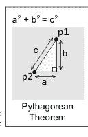

## 澄清 const 关键字

### 第 3 部分：const 引用参数

const 引用参数通过在引用参数之前写入关键字 const 并在参数类型之后放置 & 来声明。该参数效率高，但与普通引用参数不同，函数不能尝试对参数的值进行任何更改。

- 1. 已声明常量：第 12 页
- 2. const 成员函数：第 38 页
- 3. const 引用参数
- 4. 静态成员常量：第 104 页
- 5. const 迭代器：第 144 页
- 6. 为指针或数组的 const 参数：第 171 页
- 7. 与指向节点的指针一起使用的 const 关键字，以及某些成员函数需要两个版本：第 227 页

示例：
double distance(const point& p1, ...

如果使用 const 引用参数，请务必遵循第 73 页编程提示中的一致性要求。

## 一致地使用 const

当你定义一个新类以及用于操作该类的函数和成员函数时，应始终保持 const 的一致使用。特别是：

- 1. 任何不更改对象值的成员函数都应声明为常量成员函数。这通过在原型和函数定义头部的参数列表后放置关键字 const 来实现（参见第 38 页）。例如，throttle 的 flow 函数原型是：

```
double flow() const;
```

- 2. 每当将类用作参数类型，且函数不更改参数时，请使用 const 引用参数。这通过在参数列表中将关键字 const 放在参数类型之前，并在类型名称后放置符号 & 来实现（参见第 72 页）；例如，原型：

```
double distance(const point& p1, const point& p2);
```

除非你打算在满足这些要求的每个位置都使用 const，否则不应使用 const。

## 当函数返回值的类型为类时

函数的返回值类型可以是一个类。下面是一个典型示例：

```
point middle(const point& p1, const point& p2)
// Postcondition: The value returned is the point that
// is halfway between p1 and p2.
{
    double x_midpoint, y_midpoint;

    // Compute the x and y midpoints.
    x_midpoint = (p1.get_x() + p2.get_x()) / 2;
    y_midpoint = (p1.get_y() + p2.get_y()) / 2;

    // Construct a new point and return it.
    return point(x_midpoint, y_midpoint);
}
```

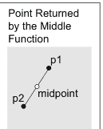

该函数在局部变量 midpoint 中计算一个新点，然后返回该点的副本。通常，函数的返回值存储在局部变量（如 midpoint）中，但并非总是如此。下面是另一个示例，其中一个参数是返回值：

```
throttle slower(const throttle& t1, const throttle& t2)
// Postcondition: The value returned is a copy of t1 or t2, whichever
// has the slower flow. If the flows are equal, then t1 is returned.
{
    if (t1.flow( ) <= t2.flow( ))
        return t1;
    else
        return t2;
}
```

顺便说一句，C++ return 语句使用拷贝构造函数将函数的返回值复制到临时位置，然后再将值返回给调用程序。

#### 第 2.4 节自测练习

- 22. 为你的 throttle 构造函数添加默认参数，该构造函数来自第 51 页第 12 号自测练习。完成此操作后，其他两个构造函数是否仍然需要？

- 23. 下列哪些函数调用可能会更改点 p 的值：
    - cout << rotations_needed(p);
    - rotate_to_upper_right(p);

- 24. 形式参数和实参之间有什么区别？

- 25. 假设一个函数有一个名为 x 的参数，且函数体更改了 x 的值。什么时候 x 应该是值参数？什么时候它应该是引用参数？对于这个函数，x 可能是 const 引用参数吗？

- 26. 假设参数的数据类型是一个类。该参数不能在函数内部修改。出于此目的，哪种参数最高效且最安全？

### 2.5 运算符重载

二元函数是带有两个参数的函数。通常，当你设计一个新类时，会有用于操作该类中对象的二元函数。有时，新的二元函数可以用 == 和 + 等符号来自然描述，这些符号是 C++ 已经用于描述其对数字和其他数据类型操作的符号。例如，我们可能想要测试两个点是否相等，编写如下代码似乎很自然：

```
point p1, p2;
if (p1 == p2)
    cout << "Those points are equal." << endl;
```

不幸的是，== 运算符不能与新类一起使用——除非你定义一个二元函数来明确说明 == 的含义。事实上，C++ 允许你为新类定义许多运算符的含义。为运算符定义新含义称为 **重载** 该运算符。我们将探讨几个常见的重载示例。

### 重载二元比较运算符

“比较相等”的 == 运算符可以通过定义一个名称相当特殊的函数来为任何新类重载。新函数的名称是 operator ==，如下例所示：

```
bool operator ==(const point& p1, const point& p2)
// Postcondition: The value returned is true if p1 and p2
// are identical; otherwise false is returned.
{
    return
    (p1.get_x( ) == p2.get_x( ))
    &&
    (p1.get_y( ) == p2.get_y( ));
}
```

要使此函数返回 true，&& 表达式的两部分都必须为真——换句话说，p1 的 x 和 y 坐标都必须等于 p2 中对应的坐标。

除了特殊的名称 operator == 之外，该函数与其他任何函数一样。它返回一个布尔值，可以用作真或假值，例如在 if 语句中：

```
if (p1 == p2)...
```

重载的运算符在程序中的使用方式与任何其他 == 用法相同，即将第一个参数放在 == 之前，第二个参数放在 == 之后。

当你重载一个运算符时，该运算符的常见用法仍然可用。例如，我们仍可使用 == 来测试两个整数或两个 double 的相等性。事实上，在我们的 operator == 函数体中，我们确实使用普通 == 来比较 double p1.get_x() 和 p2.get_x()。这没问题。对于每次 == 的使用，编译器都会确定被比较对象的数据类型，并使用相应的比较函数。

一旦你重载了一个运算符，有时可以使用重载的运算符来轻松实现另一个运算符。例如，假设我们已为 point 类定义了 operator ==。那么我们可以快速重载 != 使其成为“不相等”运算符：

```
bool operator !=(const point& p1, const point& p2)
// Postcondition: The value returned is true if p1 and p2
// are not identical; otherwise false is returned.
{
    return !(p1 == p2) ;
}
```

表达式 !(p1 == p2) 值得审视。我们使用的 == 运算符是刚才为点定义的重载 ==。如果两个点相等，它返回 true，否则返回 false。我们取 (p1 == p2) 的结果，并用通常的运算符 "!" 对其取反。因此，如果 (p1 == p2) 为 true，则 !(p1 == p2) 为 false，且 != 函数返回 false。另一方面，如果 (p1 == p2) 为 false，则 !(p1 == p2) 为 true，且 != 函数返回 true。

operator == 和 operator != 函数也可以定义为成员函数，而不仅仅是独立存在。在这种情况下，表达式 (p1 == p2) 中的 p1 是实际激活成员函数的对象，而 p2 是一个参数。事实上，如果将 == 实现为成员函数，p2 将是唯一的参数（因为激活成员函数的对象从未实际列在参数列表中）。成员函数与非成员函数之间的选择部分是编程风格问题。我们偏好使用非成员函数，因为非成员函数将两个参数（p1 和 p2）置于平等地位。确实没有理由说 p1 比 p2 更激活运算符。（稍后，你会发现非成员函数还为具有称为转换的特性的类提供了更多灵活性。）

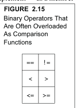

图 2.15 显示了 C++ 中常作为新类二元比较运算符重载的六个二元运算符。

### 重载二元算术运算符

除了比较运算符之外，C++ 的大多数其他二元运算符也可以为新类重载。例如，我们通常认为是算术运算符的 +、-、* 和 /，都可以为新类重载。作为一个自然示例，物理学家经常将点用作可以通过相加其 x 和 y 坐标来相加的对象。如果我们可以相加两个点，那么我们可能会编写如下程序：


```
point speed1(5, 7);
point speed2(1, 2);
point total;

total = speed1 + speed2;
cout << total.get_x() << endl;
cout << total.get_y() << endl;
```

事实上，我们可以通过重载 + 运算符来定义点的 + 的含义。重载的运算符有两个参数，即正在相加的两个点。函数返回这两个点的和，如下所示：

```
point operator + (const point& p1, const point& p2)
// Postcondition: The sum of p1 and p2 is returned.
{
   double x_sum, y_sum;

   // Compute the x and y of the sum.
   x_sum = p1.get_x() + p2.get_x();
   y_sum = p1.get_y() + p2.get_y();

   point sum(x_sum, y_sum);
   return sum;
}
```

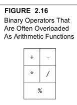

与二元比较运算符一样，二元算术运算符也可以定义为成员函数，而不是独立存在的函数。成员函数只有一个参数，即在类似 (p1 + p2) 的表达式中的右侧参数。左侧参数是激活成员函数的对象。我们的编程风格倾向于将二元运算符实现为非成员函数。

图 2.16 显示了 C++ 中最常被重载以执行算术运算的五个二元函数。

## 重载输出和输入运算符

标准 C++ 数据类型可以使用输出运算符 << 和输入运算符 >> 进行写入和读取。例如，我们可以读写一个整数：

```
int i;
cin >> i;
cout << i;
```

毫无疑问，你希望用你出色的新 point 类也做同样的事：

```
point p;
cin >> p; <--- reads the x and y coordinates
           of p from the standard input
cout << p; <--- writes the x and y coordinates
           of p to the standard output
```

你可以通过重载 << 和 >> 运算符为 point 类提供输入/输出功能。我们先从重载输出运算符开始，其神秘的原型如下所示：

```
ostream& operator <<(ostream& outs, const point& source);
```

让我们来揭开这个棘手原型的神秘面纱。该函数有两个参数：outs（是一个 ostream）和 source（是一个 point）。我们通过列出两个参数来使用该函数，如下所示：

```
cout << p; <--- The first argument, cout, is an ostream.
              The second argument, p, is a point.
```

如所示，cout 的数据类型是 ostream，意为“输出流”。ostream 类是 iostream 库设施的一部分。该设施还定义了 cout（控制台输出设备或“标准输出”），并为程序员定义其他输出流（例如连接到磁盘文件或打印机的输出流）提供了能力。无论如何，我们的意图是让 << 函数将名为 source 的点打印到名为 outs 的 ostream。我们现在可以写出大部分后条件：

```
ostream& operator <<(ostream& outs, const point& source);
// Postcondition: The x and y coordinates of source have been
// written to outs.
```

outs 参数是引用参数，意味着该函数可以更改输出流（通过向其中写入），并且更改会影响实际参数（例如标准输出流 cout）。source 参数是 const 引用参数，意味着该函数不会更改它正在写入的点。

还剩下最后一个谜团：该函数的返回类型是 ostream&：

```
ostream& operator <<(ostream& outs, const point& source);
```

大部分情况下，这个返回类型意味着函数返回一个 ostream。事实上，函数返回它刚刚写入的 ostream。& 符号还有额外含义（称为引用返回类型）。但我们要到第 6 章才会用到那个额外含义，因此只需知道输出和输入运算符都需要引用返回类型即可。

牢记这一点，我们现在可以写出完整的后条件：

```
ostream& operator <<(ostream& outs, const point& source);
// Postcondition: The x and y coordinates of source have been
// written to outs. The return value is the ostream outs.
```

函数返回 ostream 的原因是 C++ 将允许输出语句的“链式调用”，例如以下语句：

```
cout << "The points are " << p << " and " << q << endl;
```

此示例调用五个 << 函数，每个函数更改 ostream 并将结果传递给下一个函数调用。

point 的输出运算符的完整实现显示在图 2.17 的顶部。大部分工作由以下语句完成：

```
outs << source.get_x() << " " << source.get_y();
```

该语句使用普通的 << 运算符打印点的坐标，中间有一个空格字符。

## 图 2.17 点的输出和输入操作

## 函数实现

```
ostream& operator <<(ostream& outs, const point& source)
// Postcondition: The x and y coordinates of source have been
// written to outs. The return value is the ostream outs.
// Library facilities used: iostream
{
    outs << source.get_x() << " " << source.get_y();
    return outs;
}

istream& operator >>(istream& ins, point& target)
// Postcondition: The x and y coordinates of target have been
// read from ins. The return value is the istream ins.
// Library facilities used: iostream
// Friend of: point class
{
    ins >> target.x >> target.y;
    return ins;
}
```

point 的输入函数原型与输出函数类似，但它使用 istream（输入流）而不是 ostream，如下所示：

```
istream& operator >> (istream& ins, point& target);
// Postcondition: The x and y coordinates of target have been
// read from ins. The return value is the istream ins.
```

### operator >>

输入函数的实现显示在图 2.17 的底部。关键工作通过通常的 >> 运算符读取两个 double 数来完成，如下语句所示：

```
ins >> target.x >> target.y;
```

但等等！该语句将输入直接发送到 point 的私有成员变量 x 和 y。只有成员函数可以访问私有成员变量，而输入函数不是 point 的成员函数。这个问题有两种可能的解决方案：

- 1. 我们可以编写新的成员函数来设置点的坐标，并在输入函数的实现中使用这些成员函数。
- 2. 因为我们是 point 类的实现者，并且我们自己也在编写输入函数，所以可以授予输入函数访问 point 类私有成员的特殊权限。

第二种方法称为使用友元函数，我们现在来解释。

### 友元函数可以访问私有成员

## 友元函数

友元函数是一种不是成员函数，但仍能访问类对象私有成员的函数。要声明友元函数，将函数原型放在类定义中，并加上关键字 friend。

例如，要将 point 的输入函数声明为友元，我们必须在类定义中插入友元原型，如下所示：

```
class point
{
public:
  ...
  // FRIEND FUNCTIONS
  friend istream& operator >>(istream& ins, point& target);
private:
  ...
};
```

### 带有新友元的 point 类

一旦友元原型被放置在类定义中，函数体就可以访问其 point 参数的私有成员，如下所示：

```
istream& operator>>(istream& ins, point& target)
// Postcondition: The x and y coordinates of target have been
// read from ins. The return value is the istream ins.
// Library facilities used: iostream
// Friend of: point class
{
    ins >> target.x >> target.y;
    return ins;
}
```

请注意，友元函数不是成员函数，因此它不是由类的某个特定对象激活的。友元函数操作的所有信息都必须存在于其参数中。在函数体中直接写 x 或 y 是非法的；我们必须写 target.x 和 target.y。在我们的例子中，友元 operator >> 有一个 point 参数，友元函数可以访问的是该参数的私有成员变量。

友元可以授予给任何函数，而不仅仅是运算符函数。但友元应仅限于实现类的程序员编写的函数——毕竟，这个程序员是唯一真正了解私有成员的人。这样一来，新类的信息隐藏就能保持完好。

### 友元与信息隐藏

> ## 友元函数
> 
> 友元函数是一种不是成员函数，但仍需要访问其某些参数私有成员的函数。要声明友元函数，将函数原型放在类定义中，并加上关键字 friend。
> 
> 友元应仅限于实现类的程序员编写的函数。

## 何时使用友元函数

在实现类时，你通常会实现额外的函数来操作类的对象。如果函数需要访问类的私有成员，那么你首先应考虑通过成员函数提供访问。但是，如果出于其他原因成员函数不方便或不可接受，那么你可以授予函数友元，使其能够访问类的私有成员。


## Point 类——将事物组合在一起

We have defined quite a few new functions to manipulate points. In all, we now have:

- The constructor
- The two original modification functions (shift and rotate90), and the two original constant functions (get_x and get_y)
- Overloaded comparison operators == and !=
- Overloaded arithmetic operator + to add two points
- Overloaded output and input operators
- Functions middle, rotations_needed, rotate_to_upper_right, and distance from Section 2.4

We could continue with more point functions, but there is a definite danger of never finishing Chapter 2. So we'll stop here, collecting most of the items into a new, improved point class. The header file for the new class is newpoint.h, shown in Figure 2.18. Notice that the header file needs to use ostream and istream from the std namespace. But, a using statement should never appear in a header file (see page 60), so we use the full names std::ostream and std::istream.

The implementation should go in a separate file named newpoint.cxx. What should be present in newpoint.cxx? (See Self-Test Exercise 32 on page 86.)

When you provide functions or operators to manipulate a class, you should follow these lists for good information hiding:

### In the Header File:

- Documentation, including a precondition/postcondition contract for each function
- Class definitions for any new classes
- Prototypes for any other functions that are neither member functions nor friend functions

### In the Implementation File:

- An include directive to include the header file
- Implementations for each member function (except for the inline functions)
- Implementations for each friend function and other functions that are not member functions

## FIGURE 2.18 Header File for the New Point Class

### A Header File

```
// FILE: newpoint.h (revised from point.h in Figure 2.10 on page 64)
// CLASS PROVIDED: point (a class for a point on a two-dimensional plane)
// CONSTRUCTOR for the point class:
// point(double initial_x = 0.0, double initial_y = 0.0)
//   Postcondition: The point has been set to (initial_x, initial_y).
// MODIFICATION MEMBER FUNCTIONS for the point class:
// void shift(double x_amount, double y_amount)
//   Postcondition: The point has been moved by x_amount along the x axis
//     and by y_amount along the y axis.
// void rotate90( )
//   Postcondition: The point has been rotated clockwise 90 degrees.
// CONSTANT MEMBER FUNCTIONS for the point class:
// double get_x( ) const
//   Postcondition: The value returned is the x coordinate of the point.
// double get_y( ) const
//   Postcondition: The value returned is the y coordinate of the point.
// NONMEMBER FUNCTIONS for the point class:
// double distance(const point& p1, const point& p2)
//   Postcondition: The value returned is the distance between p1 and p2.
// point middle(const point& p1, const point& p2)
//   Postcondition: The point returned is halfway between p1 and p2.
// point operator +(const point& p1, const point& p2)
//   Postcondition: The sum of p1 and p2 is returned.
// bool operator ==(const point& p1, const point& p2)
//   Postcondition: The return value is true if p1 and p2 are identical.
// bool operator !=(const point& p1, const point& p2)
//   Postcondition: The return value is true if p1 and p2 are not identical.
// ostream& operator <<(ostream& outs, const point& source)
//   Postcondition: The x and y coordinates of source have been
//     written to outs. The return value is the ostream outs.
```

### (FIGURE 2.18 continued)

```
// istream& operator >>(istream& ins, point& target)
// Postcondition: The x and y coordinates of target have been
// read from ins. The return value is the istream ins.
//
// VALUE SEMANTICS for the point class:
// Assignments and the copy constructor may be used with point objects.
#ifndef MAIN_SAVITCH_NEWPOINT_H
#define MAIN_SAVITCH_NEWPOINT_H
#include <iostream> // Provides istream and ostream
namespace main_savitch_2B // Using a new namespace
{                     // avoids conflict with the other
  class point         // point class from Section 2.4.
  {
    public:
    // CONSTRUCTOR
    point(double initial_x = 0.0, double initial_y = 0.0);
    // MODIFICATION MEMBER FUNCTIONS
    void shift(double x_amount, double y_amount);
    void rotate90( );
    // CONSTANT MEMBER FUNCTIONS
    double get_x( ) const { return x; }
    double get_y( ) const { return y; }
    // FRIEND FUNCTION
    friend istream& operator >>(istream& ins, point& target);
    private:
    double x, y; // x and y coordinates of this point
  };
  // NONMEMBER FUNCTIONS for the point class
  double distance(const point& p1, const point& p2);
  point midpoint(const point& p1, const point& p2);
  point operator +(const point& p1, const point& p2);
  bool operator ==(const point& p1, const point& p2);
  bool operator !=(const point& p1, const point& p2);
  std::ostream& operator <<(std::ostream& outs, const point& source);
}
#endif
```

## FIGURE 2.19 Guidelines for Operator Overloading

| Binary comparison operators == != <= >= < > | Overload as a nonmember function with two parameters, returning a boolean value | See point example on page 75 |
|---|---|---|
| Binary arithmetic operators + - * / % | Overload as a nonmember function with two parameters | See point example on page 76 |
| Input and output >> << | Overload as a nonmember function, returning an istream or ostream | See point example on page 77 |
| Auxiliary assignment operators += -= etc. | When the + operator is overloaded, then we will usually also overload += as a member function so that x += y has the same effect as x = x + y | See bag example on page 102 |
| Assignment operator = | Must be overloaded as a member function if we want x = y to do more than copy member variables from the object y to the object x | See bag example on page 188 |

## Summary of Operator Overloading

We have mentioned more than a dozen C++ operators that may be overloaded for your own classes. In all, there are 44 such operators, although we shall use only the ones you have seen in this chapter plus two assignment operators that you'll meet in the next two chapters.

Programming style varies widely for overloading operators. The eventual style you adopt should be clear and consistent. Our own guidelines for operator overloading within this book are listed in Figure 2.19.

#### Self-Test Exercises for Section 2.5

- 27. Overload the < operator for the throttle. The function should return true if the flow of the first throttle is less than the flow of the second.

- 28. Overload the - operator for the point, as a binary arithmetic operator.

- 29. Why should friend functions be written only by the programmer who implements a class?

- 30. What is incorrect in the following implementation of a friend input function of the point class?

```
istream& operator >> (istream& ins, point& target)
// target has x and y data members
// friend of : point class
{
    ins >> x >> y;
    return ins;
}
```

- 31. Overload the output operator for the throttle so that it prints 100 times the current flow, followed by a % sign.

- 32. What should be present in the implementation file newpoint.cxx?

### 2.6 THE STANDARD TEMPLATE LIBRARY AND THE PAIR CLASS

As a computer scientist, it's important for you to understand how to build and test your own classes, but frequently you'll find that a suitable class has already been built for you to use in an application—there's no need for you to write everything from scratch! In C++, a variety of container classes called the Standard Template Library (STL) is available for all programs. This section provides an introduction to one of the simplest STL classes: the pair class.

Each pair object can hold two pieces of data, perhaps an integer and a double number, or a char and a bool value, or even a couple of throttles. The two pieces of data don't have to be the same data type, but the programmer must specify the types of the pieces when the pair object is declared. Here's a little example that declares a pair with an integer (as the first piece) and a double (as the second):

```
#include <utility> // Provides the pair class
using namespace std; // The pair is part of the std namespace

int main()
{
    pair<int, double> p;

    p.first = 42; // first is the member variable for the int piece
    p.second = 9.25; // second is the member variable for the double
    ...
}
```

Notice that the member variables, first and second, are both public member variables. The data types of these two pieces are specified in the angle brackets, pair<int, double>, as part of the object's declaration. We'll see more of these angle brackets—called the template instantiation—as we see more of the STL, and eventually we'll write our own template classes.


### 章节摘要

- 面向对象编程（OOP）通过将数据放在称为对象的包中来支持信息隐藏，这些对象在 C++ 中通过类实现。对象通过称为成员函数的函数进行操作，这些函数与类一起定义。

- 新数据连同用于操作该类型的函数，称为抽象数据类型或类。术语抽象指的是我们强调所提供内容的抽象规范，与任何实际实现分离。

- 私有成员变量通过禁止在类的成员函数之外访问类的数据组件来支持信息隐藏。如果新类的实现者需要其他函数访问成员变量，则可以将其他函数声明为友元函数。

- 构造函数是在声明变量时自动调用以初始化变量的成员函数。定义构造函数可以通过减少使用未初始化变量的可能性来提高类的可靠性。

- 为避免同名不同项之间的冲突，应将工作放在命名空间中。为命名空间选择名称时，使用真实姓名或电子邮件地址的一部分，以避免与其他命名空间冲突。

- 将新类的文档和类定义放在单独的头文件中。将成员函数的实现放在单独的实现文件中。

- C++ 提供三种常见的参数类型：对于值参数，实参仅为形参提供初始值。对于引用参数，函数体内对参数的任何使用都将访问调用程序中的实参。const 引用参数具有普通引用参数的效率，但保证函数不会更改实参。

- C++ 允许你为新类定义 + 和 == 等运算符的含义。

- C++ 为所有程序员提供了许多预构建的类——标准模板库（STL）。

### 自测练习题解答

- 1. 私有成员。

- 2. 类的公有成员可供任何使用该类的人访问。成员函数通常声明为公有，以便用户可以调用它们来操作类的实例。

- 3. true 和 false

- 4. 类是一种数据类型，用于定义数据成员和操作数据的成员函数。对象是类的实例，并作为变量声明。定义类后，程序员可以声明该类的多个对象，并使用其函数操作这些对象。

- 5. 常量成员函数不能对对象的成员变量进行任何更改。

- 6. 域解析运算符用于每个成员函数实现的开头。有关域解析运算符的示例用法，请参见第 42 页。

- 7. 程序应包含以下语句：
```
throttle exercise;
exercise.shut_off();
exercise.shift(3);
cout << exercise.flow() << endl;
```

- 8. 新成员函数的原型放在类定义中。函数实现如下：
```
bool throttle::is_above_half( ) const
// Precondition: shut_off has been called at
// least once to initialize the throttle.
// Postcondition: The return value is true if
// the current flow is above 0.5.
{
 return (flow( ) > 0.5);
}
```

- 9. 在类定义的公有部分：
```
bool is_above_half( ) const
{
 return (flow( ) > 0.5);
}
```

- 10. 编译器会自动创建一个简单的默认构造函数。

- 11. 应删除关键字 void。构造函数没有返回类型。

- 12. 新构造函数的原型放在类定义中。构造函数实现如下：
```
throttle::throttle (int size, int initial)
// Precondition: (0 < size) and
// (0 <= initial <= size).
// Postcondition: The throttle has size
// positions above the shutoff position, and
// it is currently in the position given by the
// parameter initial.
// Libraries used: cassert
{
 assert(size > 0);
 assert(initial >= 0);
 assert(initial <= size);
 top_position = size;
 position = initial;
}
```

- 13. 使用类所需的所有信息都在头文件开头的注释中。

- 14. 宏保护防止意外重复类定义。通常，如果程序多次包含头文件，编译将失败。宏保护指示编译器跳过重复的类定义。

- 15. 自动赋值运算符将把 x 的成员变量复制到 y。

- 16. 自动拷贝构造函数将把 y 初始化为 x 的副本（通过复制成员变量）。

```
#include "throttle.h"
using namespace main_savitch_2A;
```

提示：在私有成员变量中跟踪当前角度。如果变量低于零，或变为 >= 360，则将其重新调整到 0 到 360 之间。

第 685 页的图 14.1 中可以找到部分解决方案。

未显式放入命名空间的任何项目都成为全局命名空间的一部分，可以在不使用 using 语句或域解析运算符的情况下使用。

切勿在头文件中放置 using 语句；应使用第三种形式。

将构造函数的原型更改为：
throttle(int size = 1, int initial = 0)
其他两个构造函数不再需要。

rotate_to_upper_right 可以更改 p，因为参数是引用参数。但对 rotations_needed 的调用不能更改 p，因为它使用值参数。

函数的参数称为形参，以便与函数调用时传入的值区分开来。实参是传递的值。

如果希望实际参数保持不变，x 应为值参数。如果希望对 x 的更改影响实际参数，则应为引用参数。它永远不能是 const 引用参数，因为函数体会修改参数。

值参数对大型数据类型效率较低，因为它们的值会被复制。然而，引用类型安全性较低，因为它们可修改。const 引用参数提供了最佳解决方案，因为它提供了一个不可修改的引用参数。

```
Here is the implementation:
int operator < (
    const throttle& t1,
    const throttle& t2
)
// Postcondition: The return value is true if
// the flow of t1 is less than the flow of t2.
{
    return (t1.flow( ) < t2.flow( ));
}
```

解决方案与第 77 页的 + 运算符相同，但将每个加号替换为减号。

此建议支持信息隐藏，因为实现类的程序员是唯一了解私有成员的人。

友元函数不是由类的特定对象激活的。因此，对象变量名必须位于友元函数访问的成员变量之前，如下所示：
ins >> target.x >> target.y;

```
Here is the implementation (you fill in the precondition):
ostream& operator << (
    ostream& outs,
    const throttle& source
)
{
    outs << 100*source.flow( ) << '%';
    return outs;
}
```

newpoint.cxx 顶部包含一条简短注释，指明如何使用 point 类的文档在头文件中。函数实现出现在注释之后，包括第 83 页图 2.18 中列出的所有函数，但 get_x 和 get_y 除外（它们是内联函数）。这些实现必须位于一个命名空间分组中。在头文件中，我们使用了 main_savitch_2B 作为命名空间，以避免与早期的 point（位于命名空间 main_savitch_2A 中）冲突。

## 编程项目

更多深入项目，请参见 www.cs.colorado.edu/~main/projects/

- 1. 指定、设计并实现一个类，该类可用于模拟组合锁的程序。锁有一个圆形旋钮，边缘上标有 0 到 39 的数字，并且有一个三位数组合，我们将其称为 x、y、z。要打开锁，必须顺时针转动旋钮至少一整圈，使 x 停在顶部；然后逆时针转动旋钮，使 y 第二次出现在顶部时停止；最后再次顺时针转动旋钮，使 z 下次出现在顶部时停止。此时，即可打开锁。

你的锁类应带有默认参数的构造函数。还应提供以下成员函数：
- 将锁的组合更改为新的三位数组合
- 在给定方向上转动旋钮，直到指定数字出现在顶部
- (d) 关闭锁
- (e) 询问锁的状态（打开或关闭）
- (f) 告诉你当前顶部是什么数字

- 2. 统计学家初始化后，可以给定一组 double 数字。序列中的每个数字都通过激活名为 next_number 的成员函数传递给统计学家。声明一个名为 s 的统计学家，并给它数字序列 1.1、-2.4、0.8，如下所示：
```
statistician s;
s.next_number(1.1);
s.next_number(-2.4);
s.next_number(0.8);
```

在将序列提供给统计学家后，需要提供关于序列的信息。包括提供序列长度、序列中最后一个数字、序列中所有数字之和、数字的算术平均值（即数字之和除以序列长度）、序列中最小数字和序列中最大数字的成员函数。请注意，长度和求和函数可以随时调用，即使序列中没有数字。在这种情况下，“空”序列的长度和和都将为零。但其他成员函数都有前提条件，要求序列非空。

还应提供一个成员函数来擦除序列（以便统计学家可以使用新序列重新开始）。

注意：不要尝试存储整个序列（因为你不知道该序列会有多长）。相反，只需存储关于序列的必要信息：序列长度是多少？序列中数字之和是多少？最后一个、最小和最大数字是什么？这些信息中的每一项都可以存储在私有成员变量中，并在每次激活 next_number 时更新。

- 3. 重载 + 运算符，以便你可以相加前一个项目中的两个统计学家。如果 s1 和 s2 是两个统计学家，那么 s1 + s2 的结果应该是一个新统计学家，其行为就像它拥有 s1 的所有数字，后跟 s2 的所有数字一样。

- 4. 指定、设计并实现一个扑克牌中卡片的类。该对象应包含设置和获取卡片花色和点数的方法。

- 5. 指定、设计并实现一个类，用于跟踪三维空间中点的位置。例如，考虑下一列顶部绘制的点。所示点具有三个坐标：


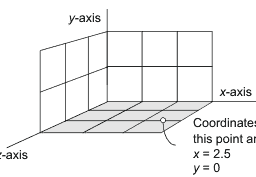

x = 2.5, y = 0, 和 z = 2.0。包含成员函数，用于将点设置到指定位置，沿某一轴向指定量移动点，以及检索点的坐标。还提供成员函数，用于绕指定轴按指定角度旋转点。

要计算这些旋转，你需要一点三角知识。假设你有一个坐标为 x、y 和 z 的点。按角度 $\theta$（逆时针）旋转该点后，该点将具有新坐标，我们将其称为 $x'$、$y'$ 和 $z'$。新坐标的方程使用数学库函数 sin 和 cos，如下所示：

### 绕 x 轴旋转 $\theta$ 后：

```
x' = x
y' = y cos(\theta) - z sin(\theta)
z' = y sin(\theta) + z cos(\theta)
```

### 绕 y 轴旋转 $\theta$ 后：

```
x' = x cos(\theta) + z sin(\theta)
y' = y
z' = -x sin(\theta) + z cos(\theta)
```

### 绕 z 轴旋转 $\theta$ 后：

```
x' = x cos(\theta) - y sin(\theta)
y' = x sin(\theta) + y cos(\theta)
z' = z
```

### 6 在三维空间中，线段由其两个端点定义。为线段指定、设计并实现一个类。该类应有两个私有成员变量，它们是上一项目中的点。

### 7 指定、设计并实现一个可用于保存音乐音符信息的类。程序员应能够设置和检索音符的时长和音值。音符的时长可以是十六分音符、八分音符、四分音符、二分音符或全音符。音值是通过指示该音符高于或低于管弦乐队调音所用的 A 音多远来确定的。在计算“多远”时，应包括钢琴上的白键和黑键。例如，从中央 C 开始的八度音阶的音符编号如下所示：

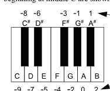

默认构造函数应将音符设置为中央 C。包含成员函数，用于将音符设置为指定的时长和音值。编写成员函数以检索音符的信息，包括告知你音符字母（A、B、C 等）的函数、该音符是自然音还是升音（即钢琴上的白键或黑键）的函数，以及音符的频率（以赫兹为单位）。要计算频率，请使用公式 $440 \times 2^{n/12}$，其中 $n$ 是音符编号。可以随意包含其他有用的成员函数。

### 8 一元二次表达式是形式为 $ax^2 + bx + c$ 的算术表达式，其中 $a$、$b$ 和 $c$ 是一些固定数字（称为**系数**），而 $x$ 是可以取不同值的变量。指定、设计并实现一个可以存储二次表达式信息的类。默认构造函数应将所有三个系数设置为零。包含允许更改这些系数的成员函数。应有常量成员函数来检索系数的当前值。还应有一个成员函数，允许你在特定的 x 值处“求值”二次表达式（即，该函数有一个参数 x，并返回表达式 $ax^2 + bx + c$ 的值）。

还应重载以下运算符（作为非成员函数）以执行这些指示操作：

```
quadratic operator +(
    const quadratic& q1,
    const quadratic& q2
);
```

// Postcondition: The return value is the
// quadratic expression obtained by adding
// q1 and q2. For example, the coefficient of
// the return value is the sum of q1's c
// coefficient and q2's c coefficient.

```
quadratic operator *(
    double r,
    const quadratic& q
);
```

// Postcondition: The return value is the
// quadratic expression obtained by
// multiplying each of q's
// coefficients by the number r.

请注意，重载的运算符 * 的左参数是一个 double 数字（而不是二次表达式）。这允许诸如 3.14 * q 之类的表达式，其中 q 是二次表达式。

### 9 此项目是前一项目的延续。对于诸如 ax^2 + bx + c 之类的二次表达式，实根是任何使 ax^2 + bx + c = 0 成立的 double 数字 x。例如，二次表达式 2x^2 + 8x + 6 的一个实根在 x = -3 处，因为在公式 2x^2 + 8x + 6 中代入 x = -3 会得到值：

2 x (-3)^2 + 8 (-3) + 6 = 0

查找二次表达式实根有六条规则：

- (1) 如果 a、b 和 c 都为零，则每个 x 值都是实根。
- (2) 如果 a 和 b 为零，但 c 非零，则没有实根。
- (3) 如果 a 为零且 b 非零，则唯一的实根是 x = -c / b。
- (4) 如果 a 非零且 b^2 < 4ac，则没有实根。
- (5) 如果 a 非零且 b^2 = 4ac，则有一个实根 x = -b/2a。
- (6) 如果 a 非零且 b^2 > 4ac，则有两个实根：
  - x = \frac{-b - \sqrt{b^2 - 4ac}}{2a}
  - x = \frac{-b + \sqrt{b^2 - 4ac}}{2a}

编写一个新成员函数，返回二次表达式的实根个数。该答案可能是 0、1、2 或无穷大。在实根数量无限的情况下，让该成员函数返回 3。（是的，我们知道 3 不是无穷大，但为此目的来说足够了！）编写另外两个成员函数，用于计算并返回二次表达式的实根。这两个函数的前提条件是该表达式至少有一个实根。如果有两个实根，则一个函数返回两个根中较小的一个，另一个函数返回两个根中较大的一个。如果每个 x 值都是实根，则两个函数都应返回零。

### 10 指定、设计并实现一个可用于模拟月球登陆器的类，月球登陆器是一种小型飞船，用于将宇航员从月球轨道运送到月球表面。构造月球登陆器时，应指定以下项目，默认值如所示：

- (1) 当前燃料流量，作为最大燃料流量的分数（默认值为零）
- (2) 登陆器的垂直速度（默认值为零米/秒）
- (3) 登陆器的高度（默认值为 1000 米）
- (4) 燃料量（默认值为 1700 千克）
- (5) 登陆器无燃料时的质量（默认值为 900 千克）
- (6) 最大燃料消耗率（默认值为 10 千克/秒）
- (7) 登陆器发动机的最大推力（默认值为 5000 牛顿）

无需担心其他属性（例如水平速度）。

登陆器具有常量成员函数，允许程序检索这七个项目中任何一项的当前值。只有两个修改成员函数，如下所述。

第一个修改函数将当前燃料流量更改为 0.0 到 1.0 之间的新值。该值表示为最大燃料流量的分数。

第二个修改函数模拟少量时间流逝。这个时间称为 t，以秒为单位，通常是一个小值，例如 0.1 秒。该函数将更新前面列表中的前四个值，以反映 t 秒的流逝。要实现此函数，你需要一些物理公式，如下所示。这些公式只是近似值，因为在模拟时间段内登陆器的一些值正在变化。但如果保持时间跨度较短，这些公式就足够了。

燃料流量：通常，在少量时间流逝期间，燃料流量不会改变。但有一个例外：如果燃料流量大于零，且剩余燃料量为零，则应将燃料流量重置为零（因为没有燃料可流动）。

速度变化：在 t 秒内，登陆器的速度大约变化以下量（以米/秒为单位）：

```
t x (f/m - 1.62)
```

值 m 是登陆器的总质量，以千克为单位（即无燃料登陆器的质量加上任何剩余燃料的质量）。值 f 是登陆器发动机的推力，以牛顿为单位。你可以将 f 计算为当前燃料流量乘以登陆器的最大推力。数字 -1.62 是月球重力引起的向下加速度。

高度变化：在 t 秒内，登陆器的高度变化 t x v 米，其中 v 是登陆器的垂直速度（以米/秒为单位，负值表示向下）。

剩余燃料变化：在 t 秒内，剩余燃料量减少 t x r x c 千克。值 r 是当前燃料流量，c 是最大燃料消耗量（以千克/秒为单位）。

我们建议按此处列出的顺序计算四个项目的变化。所有更改完成后，还有两项进一步的调整。首先，如果高度低于零，则将高度和速度都重置为零（表示飞船已着陆）。其次，如果剩余燃料总量低于零，则将该量重置为零（表示燃料已用完）。

### 11 在本项目中，你将设计并实现一个类，该类可以生成一系列伪随机整数，该系列在许多方面看起来是随机的。该方法使用线性同余法，如下所述。

线性同余法从一个称为种子的数字开始。除了种子之外，线性同余法还使用另外三个数字，称为乘数、增量和模数。生成伪随机数序列的公式非常简单。第一个数字是：

```
(multiplier * seed + increment) % modulus
```

此公式使用 C++ 的 % 运算符，它计算整数除法的余数。

每次计算新随机数时，种子的值都会更改为该新数字。例如，我们可以实现一个伪随机数生成器，乘数 = 40，增量 = 725，模数 = 729。如果选择种子为 1，则数字序列将如下所示：

```
First number
= (multiplier * seed + increment) % modulus
= (40 * 1 + 725) % 729
= 36
36 becomes the new seed.
```

```
Next number
= (multiplier * seed + increment) % modulus
= (40 * 36 + 725) % 729
= 707
707 becomes the new seed.
```

```
Next number
= (multiplier * seed + increment) % modulus
= (40 * 707 + 725) % 729
= 374
374 becomes the new seed, and so on.
```

乘数、增量和模数的这些特定值碰巧是很好的选择。生成的模式在 729 个不同的数字之前不会重复


已生成。对常数的其他选择可能不太好。

对于本项目，设计并实现一个类，能够以所述方式生成伪随机序列。初始种子、乘数、增量和模数都应作为构造函数的参数。还应有一个成员函数允许更改种子，以及一个成员函数来生成并返回伪随机序列中的下一个数字。

### 12 为上一个项目的随机数类添加一个新的成员函数。新成员函数生成下一个伪随机数，但不直接返回该数字。相反，该函数返回该数字除以模数的结果。（在进行除法之前，您必须将模数转换为双精度浮点数；否则，除法将是整数除法，丢弃余数。）

此新成员函数的返回值是范围 [0..1) 内的伪随机双精度浮点数。（方括号 [ 表示范围包含 0，而圆括号 ) 表示范围延伸至 1，但不实际包含 1。）

### 13 运行一些实验，以确定上一个项目中新伪随机函数返回的数字的分布。请回顾，该函数返回范围 [0..1) 内的双精度浮点数。将此范围划分为 10 个区间，并调用该函数一百万次，生成如下表格：

| 范围 | 出现次数 |
|---|---|
| [0.0 ... 0.1] | 99889 |
| [0.1 ... 0.2] | 100309 |
| [0.2 ... 0.3] | 100070 |
| [0.3 ... 0.4] | 99940 |
| [0.4 ... 0.5] | 99584 |
| [0.5 ... 0.6] | 100028 |
| [0.6 ... 0.7] | 99669 |
| [0.7 ... 0.8] | 100100 |
| [0.8 ... 0.9] | 100107 |
| [0.9 ... 1.0] | 100304 |

对不同乘数、增量和模数的值运行您的实验。通过对常数的良好选择，您最终会在每个区间中得到大约 10% 的数字。具有这种等间隔行为的伪随机数生成器称为均匀分布。

### 14 本项目是上一个项目的延续。许多应用程序需要非均匀分布的伪随机数序列。例如，模拟婴儿出生的程序可以使用随机数来表示新生儿的出生体重。但这些出生体重应服从高斯分布。在高斯分布中，数字更可能落在总体分布中心附近的区间。落在特定区间的精确概率可以通过了解两个数字来计算：(1) 总体分布的中心（称为中位数），以及 (2) 一个称为标准差的数字，它指示分布的离散程度。

生成具有精确高斯分布的伪随机数序列可能很困难，但有一个很好的方法可以使用范围 [0..1) 内均匀分布的随机数来近似高斯分布。该方法是生成 12 个均匀分布的伪随机数，每个都在范围 [0..1) 内。然后将这些数字组合起来，以生成高斯序列中的下一个数字。组合数字的公式如下，其中 sum 是 12 个数字的和，sd 是所需的标准差：

```
Next number in the Gaussian sequence
= median + (sum - 6) × sd
```

向随机数类添加一个新的成员函数，用于生成具有近似高斯分布的伪随机数序列。

### 15 编写一个有理数类。类中的每个对象应具有两个整数值来定义有理数：分子和分母。例如，分数 5/6 的分子为 5，分母为 6。包含一个带有两个参数的构造函数，可用于设置分子和分母（禁止分母为零）。为分子提供默认值零，为分母提供默认值一。重载输入和输出运算符。数字应以 1/2、32/15、300/401 等形式读取和写入。请注意，分子、分母或两者都可能包含负号，因此 -1/2、32/-15 和 -300/-401 都是可能的。包含一个规范化存储值的函数，以便规范化后分母为正且尽可能小。例如，规范化后，-4/-8 将表示为与 -1/2 相同。

重载常用算术运算符，以提供两个有理数的加法、减法、乘法和除法。重载常用比较运算，以允许比较两个有理数。

提示：如果 a*d 等于 c*b，则两个有理数 a/b 和 c/d 相等。对于正有理数，如果 a*d 小于 c*b，则 a/b 小于 c/d。

### 16 编写一个类，用于跟踪具有可变年利率的银行账户余额。构造函数将把余额和年利率都设置为某些初始值（默认值为零）。该类应具有更改或检索当前余额或利率的成员函数。还应具有存款（增加余额）或取款（从余额中扣除）的函数。最后，应有一个按当前利率向余额添加利息的函数。此函数应有一个参数，指示要添加多少年的利息（例如，0.5 年表示账户应添加六个月的利息）。将该类作为交互式程序的一部分使用，允许用户确定初始余额需要多长时间才能增长到给定值。程序应允许用户指定初始余额、利率以及是否有额外的年度存款。

### 17 指定、设计并实现一个名为 date 的类。使用整数表示日期的月、日和年。编写一个成员函数，将日期递增到下一天。包含友元格式，以数字和单词格式显示日期。

### 18 指定、设计并实现一个名为 employee 的类。该类具有数据成员，用于存储员工姓名、ID 号和基于时薪的工资。成员函数包括计算年薪和按一定百分比增加工资。添加其他数据成员以存储双周工资单信息，并计算每张工资单的加班费（每周超过 40 小时）。

### 19 编写一个复数类。复数的形式为 a + bi，其中 a 和 b 是实数，i 是 -1 的平方根。我们将 a 称为实部，b 称为虚部。该类应有两个数据成员来表示实数和虚数；构造函数接受两个参数来设置这些成员。讨论并为此类实现其他适当的运算符。

### 20 编写一个名为 fueler 的类，用于跟踪车辆的燃油和里程。包含私有成员变量，用于跟踪车辆消耗的燃油量和行驶的距离。您可以选择喜欢的任何单位（例如，燃油可以用美国加仑、英制加仑或升来衡量），但请务必在声明变量的位置记录您的选择。该类应有一个构造函数，将这些变量初始化为零。包含一个成员函数，可将两个变量都重置为零。有两个不同的修改成员函数，用于向总行驶距离添加给定数量（一个带有 miles 参数，另一个带有 kilometers 参数）；同样，有三个成员函数用于向总燃油消耗量添加给定数量（燃油量有不同的单位）。该类有两个 const 成员函数来检索总行驶距离（以英里或公里为单位），三个函数用于燃油消耗量（以美国加仑、英制加仑或升为单位），以及四个函数用于燃油里程（以美国 mpg、英制 mpg、每升公里数或每百公里升数为单位）。


## 第 3 章 容器类

（我广阔无垠，我包含万千。）

沃尔特·惠特曼
《我之歌》

### 学习目标

- 完成第 3 章后，你将能够…
- * 设计和实现使用部分填充数组来存储元素集合的集合类，通常使用线性时间算法来访问、插入和删除元素。
- * 在容器类定义中使用 typedef 语句来指定容器元素的数据类型。
- * 在类定义中使用 static const 成员来定义固定整数信息，例如数组的大小。
- * 使用 C++ 标准库的 copy 函数将数组的一部分从一个位置复制到另一个位置。
- * 为你实现的每个类编写并维护准确的不变式。
- * 编写简单的交互式测试程序来测试任何新实现的容器类。
- * 编程使用 multiset 类及其迭代器（C++ 标准模板库的一部分）

### 章节内容

- 3.1 袋类
- 3.2 编程项目：序列类
- 3.3 交互式测试程序
- 3.4 STL 多重集类及其迭代器
- 章节摘要
- 自测练习题解答
- 编程项目

第 2 章中的 throttle 和 point 类是抽象数据类型的良好示例。但它们的适用性仅限于少数专用程序。本章开始介绍几种在大小程序中都有广泛适用性的类。本章中的两个特定类——袋和序列——是容器类的示例。直观地说，容器类是每个对象包含一组元素的类。例如，一个程序可能会跟踪一组整数，也许是你家所有人的年龄。另一个程序，也许是一个密码学程序，可以使用一组字符。

袋类和序列类都是 C++ 标准库中更复杂类的简单版本。目标是让你理解和使用袋类和序列类，作为理解和使用标准容器类的桥梁。在接下来的几个章节中，袋类和序列类的变体将教你如何编写符合 C++ 标准库的自定义容器类，因此你自己的类可以利用标准算法来完成搜索和排序等任务。

优秀容器类的一个关键特性是，应该能够轻松更改容器中元素的类型，以便新应用程序可以使用该容器。有了这种“轻松复用”，许多不同的应用程序可以使用同一个容器类。同一个容器类可以被一个程序用于一组整数，也可以被另一个程序用于一组字符或其他数据类型。在本章中，我们使用 **typedef 语句** 来提供轻松更改容器类中元素类型的能力。在第 6 章中，该章明确关注软件可重用性，我们将使用一种称为 **模板** 的不同特性，这也是标准库容器类所使用的。

每个对象包含一组元素的类

### 3.1 袋类

本节提供了一个容器类的示例，称为整数袋。要定义新的袋数据类型，请想想实际的袋子——购物袋或垃圾袋——并想象在纸条上写上整数并将它们放入袋中。整数袋类似于这个想象中的袋子：一个可以容纳我们放入其中的一组整数的容器。任何需要存储一组整数以供以后使用的程序都可以使用整数袋。例如，稍后我们将编写一个程序来跟踪你家庭成员的年龄。如果我们有一个有 10 个人的大户人家，程序将跟踪 10 个年龄——这些年龄保存在一个整数袋中。

### 袋类——规范

我们已经对整数袋给出了直观的描述，但为了对袋类进行更精确的规范，我们必须描述操作袋对象的函数集合。我们将通过为每个函数提供原型来做到这一点，其中大多数是成员函数。对于每个原型，我们还指定函数将执行的精确操作。这些规范后来将成为我们的前置条件/后置条件契约。让我们逐个查看这些函数。

### 构造函数。

袋类有一个默认构造函数，用于将袋初始化为空。构造函数的名称必须与类本身的名称相同，因此我们的构造函数原型如下：

```
bag ( );
```

### 值语义。

作为规范的一部分，我们要求袋对象可以通过赋值语句进行复制。此外，新声明的袋可以使用拷贝构造函数初始化为另一个袋的副本，例如：

```
bag b;
b.insert(42);
bag c(b);
b now contains a 42.
c is initialized
with the copy constructor
to be a copy of b.
```

此时，因为我们只是在指定哪些操作可以操纵袋，所以不需要再多说关于值语义的内容。

### value_type 的 typedef

迄今为止，我们只考虑过整数袋。但为了更灵活，我们在引用袋中元素的类型时，不会实际使用 int 这个名称。相反，我们将使用 value_type 作为袋中元素的数据类型名称。有些程序可能需要一个整数袋，这些程序会将 value_type 设置为 int。其他程序可能会使用不同的 value_type。为了使袋具有这种灵活的 value_type，我们将在袋类定义的 public 部分顶部放置以下语句：

```
class bag
{
public:
    typedef int value_type;
    ...
```

此语句是一个 typedef 语句。它由关键字 typedef、随后的数据类型（例如 int）以及一个新标识符（例如 value_type）组成。我们不需要使用特定的名称 value_type；我们可以使用任何有意义的名称。但标准库容器类使用名称 value_type，因此我们出于一致性也这样做了。

typedef 语句的效果是，袋函数可以使用 value_type 名称作为数据类型 int 的同义词。无论袋的成员函数在何处使用 value_type 名称，编译器都会将其视为 int 的另一个名称。其他不是袋成员函数的函数，可以使用 bag::value_type 作为袋中元素的类型。此外，如果我们想要一种新的袋，只需将单词 int 更改为新的数据类型并重新编译即可。程序的其他任何地方都不需要更改。例如，要声明一个双精度浮点数袋，我们将 typedef 语句更改为以下内容：

```
class bag
{
public:
    typedef double value_type;
    ...
}
```

在第 6 章中，我们将使用一种替代方法来定义 value_type。这种替代方法称为模板类，虽然更麻烦，但它克服了 typedef 语句的一些缺点。与此同时，下一个 C++ 特性展示了我们如何使用 C++ typedef 语句。


### 类定义中的 typedef 语句

在类定义中，我们可以放置以下形式的 typedef 语句：

```
class < Name of the class >
{
public:
    typedef < A data type such as int or double > < A new name >
    ...
}
```

此语句是一个 typedef 语句。它由关键字 typedef、随后的数据类型（例如 int）以及一个新标识符（例如 value_type）组成。此 typedef 语句的效果是，成员函数可以使用新名称 value_type 作为数据类型的同义词。不是成员函数的函数也可以使用该名称，但其使用必须以类名和 "::" 开头（例如，bag::value_type）。

### size_type

除了 value_type 之外，我们的袋还定义了另一种数据类型，可用于跟踪袋中有多少个元素的变量。此类型将称为 size_type，其定义位于袋类定义的顶部附近：

```
class bag
{
public:
    typedef int value_type;
    typedef <an integer type of some kind> size_type;
    ...
}
```


一旦我们提供了 size_type 定义，就可以为任何计算袋中有多少项的变量使用 size_type。这是我们从标准库容器中得到的另一种编程思想——它们都将内置的 size_type 作为类的一部分。

当然，我们仍然必须决定在 typedef 语句中用于“某种整数类型”的数据类型。我们可以使用普通的 int，但 C++ 提供了一个更好的替代方案：即将描述的 size_t 数据类型。

## C++ 特性

### std::size_t 数据类型

数据类型 size_t 是一种只能存储非负数的整数数据类型。每个 C++ 实现都保证 size_t 类型的值足以容纳机器上可声明的任何变量的大小。因此，当你想要描述某个数组或其他变量的大小时，最佳选择是 size_t 数据类型。size_t 类型是来自标准库设施 cstdlib 的 std 命名空间的一部分。要在头文件中使用 size_t，我们必须包含 cstdlib 并使用全名 std::size_t。

我们的 bag 定义使用 size_t，如下所示：

```cpp
class bag
{
public:
    typedef int value_type;
    typedef std::size_t size_type;
    ...
}
```

有了 bag 定义，或在 bag 成员函数的实现中，我们可以使用 size_type 类型。其他程序员也可以使用此数据类型，但他们必须写出全名——bag::size_type。

### size 成员函数

bag 具有一个名为 size 的常量成员函数。原型使用 bag 的 size_type：

```cpp
size_type size() const;
```

如你所料，size 函数的返回值告诉我们袋中当前有多少项。为了说明该函数的用法，假设 first_bag 包含一个数字 4 和两个数字 8。那么 first_bag.size() 返回 3。

### insert 成员函数

这是一个将名为 entry 的新整数放入 bag 的成员函数。原型如下：

```cpp
void insert(const value_type& entry);
```

例如，下面是针对名为 first_bag 的 bag 的一系列函数调用：

```cpp
bag first_bag;
first_bag.insert(8);
first_bag.insert(4);
first_bag.insert(8);
```

执行这些语句后，first_bag 包含两个 8 和一个 4。

执行这些语句后，first_bag 包含三个整数：数字 4 和两个数字 8 的副本。重要的是要意识到，bag 可以包含许多相同整数的副本，例如本例中有两个 8 的副本。

请注意，entry 参数是一个 const 引用参数。这可能看起来很奇怪，因为 const 引用参数的常规用途是在参数是大对象时提高效率。整数并不大，但我们以后可能会将 value_type 更改为某个大对象。考虑到这一点，只要可能（即，只要函数的实现不更改参数的值），我们就会对 value_type 参数使用 const 引用参数。

### count 成员函数

这是一个常量成员函数，用于确定 bag 中特定数字有多少个副本。原型使用 size_type：

```cpp
size_type count(const value_type& target) const;
```

调用 count(n) 返回 bag 中 n 出现的次数。例如，如果 first_bag 包含数字 4 和两个数字 8 的副本，那么我们将有以下值：

```cpp
cout << first_bag.count(1) << endl; <-- Prints 0
cout << first_bag.count(4) << endl; <-- Prints 1
cout << first_bag.count(8) << endl; <-- Prints 2
```

### erase_one 和 erase 成员函数

这两个成员函数的原型如下：

```cpp
bool erase_one(const value_type& target);
size_type erase(const value_type& target);
```

前提是 target 实际上在 bag 中，erase_one 函数会删除 target 的一个副本并返回 true。如果 target 不在 bag 中，尝试删除一个副本对 bag 没有影响，函数返回 false。erase 函数删除 target 的所有副本；其返回值告诉我们删除了多少个副本（可能为零）。


### 并集运算符

两个 bag 的并集是一个新的更大的 bag，它包含第一个 bag 中的所有数字加上第二个 bag 中的所有数字，如下所示：


在图中，我们用 "+" 表示“并集”。要实现并集，我们将 + 运算符重载为非成员函数，原型如下：

```cpp
bag operator +(const bag& b1, const bag& b2);
```

该函数不是成员函数，因为我们关于重载二元运算符的准则（参见第 85 页）。

### 重载 += 运算符

+ 运算符已为 bag 定义，因此重载 += 也是合理的。重载后的 += 将允许我们将一个 bag 的内容添加到另一个 bag 的现有内容中，其方式与 += 对整数或实数的工作方式非常相似。我们打算按如下方式使用 +=：

```cpp
bag first_bag, second_bag;
first_bag.insert(8);
second_bag.insert(4);
second_bag.insert(8);
first_bag += second_bag;
```

这将 second_bag 的内容添加到 first_bag 中已有的内容。

执行这些语句后，first_bag 包含一个 4 和两个 8。

### 将 += 重载为成员函数

我们的风格偏好是将 += 重载为成员函数。原因是第一个参数（+= 左侧）具有特殊意义：它是实际值被更改的参数。第二个参数（+= 右侧）的值永远不会更改。通过将运算符 += 设为成员函数，我们在诸如以下的语句中特别强调左侧参数：

```cpp
first_bag += second_bag;
```

此语句的意思是“激活 first_bag 的 += 成员函数，并使用 second_bag 作为参数。”以下是该成员函数的原型：

```cpp
void operator +=(const bag& addend);
```

有几点需要注意：

- 这是一个 void 函数。它不返回值。它只更改激活该函数的 bag 的内容。

- 该函数只有一个参数 addend。这是诸如 `first_bag += second_bag` 表达式中的右侧 bag。左侧 bag 是激活 `+=` 且其内容被更改的 bag。

- 我们为参数使用名称 addend，意思是“要添加的东西”，但你可以使用任何喜欢的名称。

### bag 的 CAPACITY

这是我们函数列表的结尾，我们几乎准备好编写头文件了。但首先，我们描述另一个与我们如何在 bag 中存储项相关的实用 C++ 特性。

我们的计划是有界 bag，每个 bag 可容纳 30 个项。（稍后我们将删除此限制，提供一个无界 bag 类。）数字 30 没有什么神奇之处——我们只是将其选为第一个 bag 的一个方便的小尺寸。稍后，我们可能想将大小更改为 30，允许 bag 容纳 42 或 5000 或其他数量的项。为了方便更改 bag 的大小，并使我们的程序更易读，我们将使用 CAPACITY 这样的名称，而不是简单地使用数字 30。

定义 CAPACITY 的最佳方式是作为静态成员常量，如下例所示：

```cpp
class bag
{
public:
    typedef int value_type;
    typedef std::size_t size_type;
    static const size_type CAPACITY = 30;
    ...
}
```

关键字 const 与我们在其他常量声明中看到的含义相同，因此 CAPACITY 的值只定义一次，在程序运行期间不能更改。

关键字 static 以有用的方式修改定义。通常，每个对象都有每个成员变量的自己的副本。但是，当关键字 static 用于类成员时，它意味着类的所有对象都使用相同的值。这有所不同。例如，使用 bag 的静态成员常量，每个 bag 都有相同的 CAPACITY 30。事实上，我们能在类定义中将 CAPACITY 设置为 30 的唯一原因是每个 bag 对 CAPACITY 都有相同的值。当程序声明一个 bag b 时，程序可以使用通常的成员选择表示法来引用容量：b.CAPACITY。因为每个 bag 都有相同的容量，程序也可以使用 bag::“作用域解析运算符”来引用 bag 的容量，如下例所示：

```cpp
bag b;
cout << "The capacity of b is " << b.CAPACITY << endl;
cout << "Every bag has capacity " << bag::CAPACITY << endl;
```

如本例所示，我们建议任何常量的名称都使用全大写字母。这样可以轻松识别哪些值是常量。


除了在类定义中声明静态成员常量外，程序还必须在实现文件中重复声明该常量。在我们的示例中，以下单行必须出现在实现文件中：const bag::size_type bag::CAPACITY;

我们已经描述了静态成员常量的一般格式，但需要注意一些陷阱：

- 关键字 static 在实现文件中不重复，因为 static 在类定义之外具有不同的含义。
- 在实现文件中声明常量时，必须使用完整的类型名称（例如 bag::size_type），而不是简写版本（例如 size_type），因为简写版本只能在类定义或成员函数的实现中使用。
- 在实现文件中，还必须使用常量的完整名称（例如 bag::CAPACITY），而不是简写版本（例如 CAPACITY），否则编译器不会知道这是类的成员。

为便于日后参考，以下是静态成员常量的摘要，包括关于不同类型常量的初始值必须出现在何处的说明。

## 澄清 const 关键字 第 4 部分：静态成员常量

静态成员常量在类中的声明前有两个关键字 static 和 const。例如，在我们的 bag 类定义中：

```
static const size_type CAPACITY = 30;
```

关键字 static 表示整个类只有一个该成员的副本，关键字 const 表示程序不能更改该值（这与普通声明的常量类似）。

除了在类定义中声明静态成员常量外，还必须在实现文件中不带关键字 static 地重新声明该常量。例如：

```
const bag::size_type bag::CAPACITY;
```

请注意，初始值（例如 30）仅在头文件中给出，而不是在实现文件中。但是，在头文件中定义值的技术仅允许用于整数类型，例如 int 和 size_t。非整数类型必须采用相反的方式，即将值留在头文件之外，并在实现文件中定义该值。造成这种差异的原因是，整数值通常在类定义中用于定义诸如数组大小之类的内容。

## 较旧的编译器不支持静态成员常量的初始化

在类定义中初始化和使用静态成员常量的功能是一个相对较新的特性。如果你有一个不支持静态常量成员的旧编译器，那么附录 E“处理旧编译器”为你的编程提供了一种替代方案。

## Bag 类—文档

我们现在对 bag 类了解足够多，可以编写头文件的文档，如图 3.1 所示。我们为这个头文件使用了名称 bag1.h，因为它是我们计划实现的几种不同 bag 的第一个。

文档包括关于两个 typedef 语句（value_type 和 size_type）和静态成员常量（CAPACITY）的信息。特别是，请注意，我们对 value_type 所需的数据类型进行了非常具体的说明。value_type 可以是 C++ 内置数据类型中的任何一种（例如 int 或 char），也可以是带有默认构造函数、赋值运算符以及用于测试相等性（x == y）和不等性（x != y）的运算符的类。

花点时间阅读并理解图 3.1 中的所有前置条件，例如 += 运算符的这个前置条件：

> 前置条件：size() + addend.size() <= CAPACITY.

在这个前置条件中，size() 指的是激活该函数的 bag 的大小，CAPACITY 指的是激活该函数的 bag 的容量。另一方面，addend.size() 指的是 addend 的大小，addend 是该函数的一个参数。

## 图 3.1 Bag 头文件文档

## 头文件文档

```
// FILE: bag1.h
// CLASS PROVIDED: bag (part of the namespace main_savitch_3)
// TYPEDEFS and MEMBER CONSTANTS for the bag class:
//   typedef ____ value_type
//     bag::value_type is the data type of the items in the bag. It may be any of the C++
//     built-in types (int, char, etc.), or a class with a default constructor, an assignment
//     operator, and operators to test for equality (x == y) and non-equality (x != y).
// typedef __ size_type
// bag::size_type is the data type of any variable that keeps track of how many items
// are in a bag.
// static const size_type CAPACITY = __
// bag::CAPACITY is the maximum number of items that a bag can hold.
// CONSTRUCTOR for the bag class:
// bag( )
// Postcondition: The bag has been initialized as an empty bag.
// MODIFICATION MEMBER FUNCTIONS for the bag class:
// size_type erase(const value_type& target)
// Postcondition: All copies of target have been removed from the bag.
// The return value is the number of copies removed (which could be zero).
// bool erase_one(const value_type& target)
// Postcondition: If target was in the bag, then one copy has been removed;
// otherwise the bag is unchanged. A true return value indicates that one
// copy was removed; false indicates that nothing was removed.
// void insert(const value_type& entry)
// Precondition: size( ) < CAPACITY.
// Postcondition: A new copy of entry has been added to the bag.
// void operator +=(const bag& addend)
// Precondition: size( ) + addend.size( ) <= CAPACITY.
// Postcondition: Each item in addend has been added to this bag.
// CONSTANT MEMBER FUNCTIONS for the bag class:
// size_type size( ) const
// Postcondition: The return value is the total number of items in the bag.
// size_type count(const value_type& target) const
// Postcondition: The return value is number of times target is in the bag.
// NONMEMBER FUNCTIONS for the bag class:
// bag operator +(const bag& b1, const bag& b2)
// Precondition: b1.size( ) + b2.size( ) <= bag::CAPACITY.
// Postcondition: The bag returned is the union of b1 and b2.
// VALUE SEMANTICS for the bag class:
// Assignments and the copy constructor may be used with bag objects.
```

## 记录值语义

value_type 的一个要求可能看起来很奇怪——为什么我们要求 value_type“必须有赋值运算符”？难道每种数据类型都允许诸如 x = y 这样的赋值吗？难道总会有一个自动赋值运算符吗？不！例如，当 x 和 y 是数组时，x = y 是被禁止的。稍后我们将看到其他需要小心定义赋值运算符实际含义的数据类型。

## Bag 类—演示程序

有了文档，我们可以编写一个使用 bag 的程序。我们不需要知道函数是如何实现的。例如，图 3.2 中出现了一个演示程序。该程序询问用户家庭成员的年龄。用户输入年龄，后跟一个负数以表示输入结束，这些年龄被放入一个 bag 中。然后程序要求用户再次输入年龄，作为一个简单的测试。


## 一个程序

```
// FILE: bag.demo.cxx
// This is a small demonstration program showing how the bag class is used.
#include <iostream> // Provides cout and cin
#include <cstddef> // Provides EXIT_SUCCESS
#include "bag1.h" // With value_type defined as an int
using namespace std;
using namespace main_savitch_3;

// PROTOTYPES for functions used by this demonstration program:
void get_ages(bag& ages);
// Postcondition: The user has been prompted to type in the ages of family members. These
// ages have been read and placed in the ages bag, stopping when the bag is full or when the
// user types a negative number.

void check_ages(bag& ages);
// Postcondition: The user has been prompted to type in the ages of family members again.
// Each age is removed from the ages bag when it is typed, stopping when the bag is empty.

int main( )
{
    bag ages;

    get_ages(ages);
    check_ages(ages);
    cout << "May your family live long and prosper." << endl;
    return EXIT_SUCCESS;
}
```


## 与程序的示例对话

请输入您家庭成员的年龄。
输入完成后，请输入一个负数：
5 19 47 -1
请再次输入这些年龄。每输入一个年龄后按回车：
19
是的，我找到了该年龄并将其移除。
36
不，该年龄不存在！
5
是的，我找到了该年龄并将其移除。
47
是的，我找到了该年龄并将其移除。
愿您的家人长寿昌盛。

## Bag 类——设计

有多种方法可以设计 bag 类。目前，我们将保持简单，使用数组设计一个效率稍低的数据结构。该数据结构将被重新设计多次，以允许更高效的函数。

我们从思考数据结构开始进行设计——即用于实现类的私有成员变量的实际配置。我们设计的主要结构是一个存储 bag 中项目的数组。或者，更准确地说，我们使用大数组的开头部分。这样的数组称为部分填充数组。例如，如果 bag 包含整数 4 和两个 8 的副本，那么数组的第一部分可能如下所示：

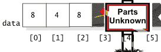

部分填充数组的组件包含 bag 的项目。

这个数组将是 bag 类的私有成员变量之一。数组的长度将由常量 CAPACITY 决定，但如图所示，当我们使用数组来存储仅包含三个项目的 bag 时，我们不关心第一个三个组件之后出现什么。从索引 3 开始，数组可能包含全零，也可能包含垃圾值，或者是我们喜欢的数字——这真的无关紧要。

因为数组的一部分可能包含垃圾值，bag 类必须跟踪另一项内容：当前正在使用数组的多少部分？例如，在上面的图片中，我们只使用了数组的前三个组件，因为 bag 包含三个项目。正在使用的数组量可以小至零（空 bag）或大至 CAPACITY（满 bag）。随着项目被添加到 bag 中，该量会增加；随着项目被移除，该量会减少。在任何情况下，我们都将在一个名为 used 的私有成员变量中跟踪该量。采用这种方法，bag 有两个私有成员。请注意，数组的总大小由 CAPACITY 常量决定。

```cpp
class bag
{
public:
    // TYPEDEFS and MEMBER CONSTANTS
    typedef int value_type;
    typedef std::size_t size_type;
    static const size_type CAPACITY = 30;
    // The rest of the public members will be listed later.
private:
    value_type data[CAPACITY]; // An array to store items
    size_type used; // How much of the array is used
};
```

- 使用数组的开头部分
- bag 的成员变量
- bag 的两个私有成员变量

## 陷阱

### value_type 必须具有默认构造函数

value_type 用作此处所示私有成员变量中数组的组件类型：

```cpp
class bag
{
  ...
  private:
    value_type data[CAPACITY]; // An array to store items
  ...
```

如果 value_type 是带有构造函数的类（而不是 C++ 内置类型之一），则编译器必须使用项目的默认构造函数初始化 data 数组的每个组件。这就是为什么我们的 bag 文档中包含 value_type 必须是“带有默认构造函数的类……”这样的声明。需要记住的一点是，当数组的组件类型是类时，编译器使用默认构造函数来初始化数组组件。

## 类的不变式

我们已经定义了 bag 数据结构，并且对该结构将如何用于表示一组项目有很好的直观理解。但作为实现类的辅助，我们还应该写下一个明确的陈述，说明数据结构是如何用于表示 bag 的。对于 bag，我们需要说明 bag 类的成员变量是如何用于表示一组项目的。我们的 bag 实现有两条规则：

- bag 中的项目数量存储在成员变量 used 中。
- 对于空 bag，我们不关心 data 中存储了什么；对于非空 bag，bag 中的项目存储在 data[0] 到 data[used-1] 中，我们不关心 data 其余部分存储了什么。

规定类的成员变量如何表示值（例如一组项目）的规则称为类的不变式。了解这些规则对于正确实现类的函数至关重要。除了构造函数之外，每个函数都依赖于在调用函数时不变式是有效的。每个函数（包括构造函数）都有责任确保在函数结束时不变式是有效的。在某种意义上，类的不变式是每个函数后条件的隐式部分。并且（除了构造函数）它也是每个函数前条件的隐式部分。不变式通常不作为前条件和后条件的显式部分编写，因为使用类的程序员不需要知道这些条件。但对于类的实现者来说，不变式是必不可少的。换句话说，不变式是类实现的关键部分，但它不影响类的使用方式。

### 关键设计概念

不变式是类实现的关键部分。

## 类的不变式

始终对规定类的成员变量如何使用的规则做出明确陈述。这些规则称为类的 **不变式**。除了构造函数之外的所有函数都可以在调用函数时依赖不变式是有效的。每个函数也有责任确保在函数结束时不变式是有效的。

## Bag 类——实现

一旦 bag 的不变式被陈述，函数的实现就相对简单了，因为函数之间没有交互——除了它们在保持不变式有效方面的合作。让我们讨论每个函数及其实现。

### 构造函数。

默认构造函数将 bag 初始化为空 bag，不执行其他工作。唯一涉及的任务是将成员 used 设置为零，这可以通过内联成员函数来完成：

```cpp
bag() { used = 0; }
```

### 值语义。

我们的文档表明，赋值和拷贝构造函数可以与 bag 一起使用。我们的计划是使用自动赋值运算符和自动拷贝构造函数，它们只是将一个 bag 的成员变量复制到另一个 bag。这没问题，因为复制过程会同时复制 data 数组和成员变量 used。

例如，如果程序员有两个 bag x 和 y，那么语句 y = x 将调用自动赋值运算符，将 x.data 的全部内容复制到 y.data，并将 x.used 复制到 y.used。这正是我们希望赋值运算符做的事情，自动拷贝构造函数也是正确的。

所以，值语义中我们唯一的“工作”是确认自动操作是正确的。你不希望所有实现都那么简单吗？

### count 成员函数。

要计算 bag 中特定项目出现的次数，我们遍历部分填充数组的 used 部分。请记住，我们使用的位置是 data[0] 到 data[used-1]，因此正确的循环如此实现所示：

```cpp
bag::size_type bag::count(const value_type& target) const
{
    size_type answer;
    size_type i;
    answer = 0;
    for (i = 0; i < used; ++i)
        if (target == data[i])
            ++answer;
    return answer;
}
```


## 陷阱

### 需要使用完整类型名 bag::size_type

When we implement the count function, we must take care to write the return type as shown here:

```
bag::size_type bag::count(const value_type& target)
```

We have used the completely specified type bag::size_type rather than just size_type. This is because many compilers do not recognize that you are implementing a bag member function until after seeing bag::count. In the implementation, after bag::count, we may use simpler names such as size_type and value_type, but before bag::count, we should use the full type name bag::size_type.

The insert member function. The insert function checks that there is room to insert a new item. If so, then the item is placed in the next available location of the array. What is the index of the next available location? For example, if used is 3, then data[0], data[1], and data[2] are already occupied, and the next location is data[3]. In general, the next available location is data[used]. We can place the new item in data[used], as shown in this implementation:

```
void bag::insert(const value_type& entry)
// Library facilities used: cassert
{
    assert(size( ) < CAPACITY);
    data[used] = entry;
    ++used;
}
```

### implementing insert

See Self-Test Exercise 13 for an alternative approach to these steps.

Within a member function we can refer to the static member constant CAPACITY with no extra notation. This refers to the CAPACITY member constant of the bag that activates the insert function.

## PROGRAMMING TIP

### MAKE ASSERTIONS MEANINGFUL

At the start of the insert member function, we wrote the assertion:

```
assert(size( ) < CAPACITY);
```

Of course, we could have written "used < CAPACITY" instead, but it is better to write assertions with public members (such as the size function). The public member is better because it has meaning to the programmer who uses our class. If the assertion fails, that programmer will understand the message "Assertion failed: size( ) < CAPACITY."

The erase_one member function. The erase_one function takes several steps to remove an item named target from a bag. In the first step, we find the index of target in the bag's array, and store this index in a local variable named index. For example, suppose that target is the number 6 in the five-item bag drawn at the top of the next page. The index of the target is found and placed in a local variable named index.

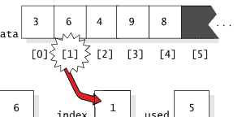

In this example, target is a parameter to the erase_one member function, index is a local variable in the erase_one member function, and used is the familiar bag member variable. As you can see in the drawing, the first step of erase_one was to locate the target (6) and place the index of the target in the local variable named index.

Once the index of the target is found, the second step is to take the final item in the bag and copy it to data[index]. The reason for this copying is so that all the bag's items stay together at the front of the partially filled array, with no holes. In our example, the number 8 is copied to data[index] as shown here:

The final item is copied onto the item that we are removing.

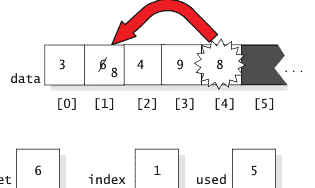

The third step is to reduce the value of used by one—in effect reducing the used part of the array by one. In our example, used is reduced from 5 to 4:

The value of used is reduced by one to indicate that one item has been removed.

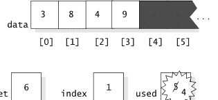

### implementing erase_one

The code for the erase_one function, shown in Figure 3.3, follows these three steps. The only item added is a check that the target is actually in the bag. If we discover that the target is not in the bag, then we do not need to remove anything (and the function returns false). Also note that our function works correctly for the boundary values of removing the first or last item in the array. Before we continue, we want to point out some programming techniques. Look at the following while-loop from Figure 3.3:

```
index = 0;
while ((index < used) && (data[index] != target))
    ++index;
```

To begin, the index is set to zero. The boolean expression indicates that the loop continues as long as index is still a location in the used part of the array (i.e., index < used) and we have not yet found the target (i.e., data[index] != target). Each time through the loop, the index is incremented by one (++index). No other work is needed in the loop, so the body of the loop has no other statements.

## FIGURE 3.3 Implementation of the Member Function to Remove an Item

### A Member Function Implementation

```
bool bag::erase_one(const value_type& target)
// Postcondition: If target was in the bag, then one copy has been removed;
// otherwise the bag is unchanged. A true return value indicates that one
// copy was removed; false indicates that nothing was removed.
{
    size_type index; // The location of target in the data array

    // First, set index to the location of target in the data array, which could be as small as
    // 0 or as large as used-1. If target is not in the array, then index will be set equal to
    // used.
    index = 0;
    while ((index < used) && (data[index] != target))
        ++index;

    if (index == used)
        return false; // target isn't in the bag, so no work to do.

    // When execution reaches here, target is in the bag at data[index].
    // So, reduce used by 1 and copy the last item onto data[index].
    --used;
    data[index] = data[used]; <-- See Self-Test Exercise 13 for an
    alternative approach to this step.
    return true;
}
```

An important programming technique concerns the boolean expression shown here:

```
index = 0;
while ((index < used) && (data[index] != target))
    ++index;
```

Look at the expression data[index] in the second part of the test. The valid indexes for data range from 0 to used-1. But, if the target is not in the array, then index will eventually reach used, which could be an invalid index. At that point, with index equal to used, we must not evaluate the expression data[index]. In some situations, trying to evaluate data[index] with an invalid index can even cause your program to crash. The general rule: Never use an invalid index with an array.

Avoiding the invalid index is the reason for the first part of the logical test (i.e., index < used). Moreover, the test for (index < used) must appear before the other part of the test. Placing (index < used) first ensures that only valid indexes are used. The insurance comes from a technique called short-circuit evaluation, which C++ uses to evaluate boolean expressions. In short-circuit evaluation a boolean expression is evaluated from left to right, and the evaluation stops as soon as there is enough information to determine the value of the expression. In our example, if index equals used, then the first part of the logical expression (index < used) is false, so the entire && expression must be false. It doesn't matter whether the second part of the && expression is true or false. Therefore, C++ doesn't bother to evaluate the second part of the expression, and the potential error of an invalid index is avoided.

The operator +=. The operator += is a member function. Most of the work of this function is accomplished by a loop that copies each of the items from addend.data to the data array of the object that activates +=. One possible implementation uses a loop, something like this:

```
void bag::operator +=(const bag& addend)
{
    ...
    for (i = 0; i < number of items to copy; ++i)
    {
        data[used] = addend.data[i];
        ++used;
    }
}
```

The key assignment statement in the loop is highlighted. On the left of the assignment we have written data[used], which is the next available location of the data array for the object that activated the function. On the right of the assignment we have written addend.data[i], which is item number i from the data array that we are copying.

There's nothing wrong with the loop-based implementation, but an alternative that avoids an explicit loop is shown in Figure 3.4. The implementation uses the copy function from the <algorithm> Standard Library. This function

> short-circuit evaluation of logical operations

> implementing operator +=


可以将元素从一个数组复制到另一个数组，如以下 C++ 特性所述。

## C++ 特性

## C++ 标准库中的复制函数

标准库包含一个复制函数，用于轻松将元素从一个位置复制到另一个位置。该函数是 <algorithm> 设施中 std 命名空间的一部分，用法如下：

```
copy( <beginning location>, <ending location>, <destination> );
```

该函数从指定的起始位置开始，将一个元素复制到目标位置。它会越过起始位置，将越来越多的元素复制到目标的下一个位置，直到即将复制结束位置为止。结束位置不会被复制。所有三个参数通常都是数组中的位置。例如，假设 b 和 c 是数组。要将 b[0]..b[9] 的元素复制到 c[40]...c[49] 位置，我们将编写：

```
copy( b, b + 10, c + 40 );
```

此次 copy 调用从 b[0]、b[1]、b[2] ... 开始复制元素。当到达 b[10] 时停止（且 b[10] 不会被复制）。复制的元素进入数组 c，位于 c[40]、c[41]、c[42] ... 位置。目标位置不能与源位置重叠。

如本示例所示，要指定数组起始处的位置，只需使用数组名（如 b）。要指定数组中索引 i 处的位置，请写出数组名后跟 "+ i"（如 b + 10 或 c + 40）。

语句 copy( addend.data, addend.data + addend.used, data + used) 在图 3.4 中用于将元素从 addend.data 复制到 data 数组。复制的元素来自 addend.data 的开头，一直延续到但不包括 addend.data[addend.used]。复制的元素从 data[used] 位置开始放置在 data 数组中。

## 图 3.4 运算符 += 成员函数的实现

### 成员函数实现

```
void bag::operator +=(const bag& addend)
// Precondition: size() + addend.size() <= CAPACITY.
// Postcondition: Each item in addend has been added to this bag.
// Library facilities used: algorithm, cassert
{
    assert(size( ) + addend.size( ) <= CAPACITY);
    copy(addend.data, addend.data + addend.used, data + used);
    used += addend.used;
}
```

复制函数来自 C++ 标准库的 <algorithm> 部分。

## 运算符 +。

运算符 +。运算符 + 与我们的其他函数不同。它是一个普通函数，而不是成员函数。该函数必须接受两个 bag，将它们相加到第三个 bag 中，并返回这个第三个 bag。在此实现中，“第三个 bag”被声明为名为 answer 的局部变量：

```
bag operator +(const bag& b1, const bag& b2)
// Library facilities used: cassert
{
    bag answer;

    assert(b1.size( ) + b2.size( ) <= bag::CAPACITY);

    answer += b1; <------ Add in the items of b1.
    answer += b2; <------ Add in the items of b2.
    return answer;
}
```

请注意，此函数不需要是友元函数。为什么？（参见自测练习 11 的答案。）此外，函数实现可以使用 bag::CAPACITY 表示法访问静态成员常量。

## Bag 类——将各部分组合在一起

仅剩 erase 和 size 函数需要实现。我们将 erase 留作练习（它类似于 erase_one），而 size 将是第 118 页图 3.5 所示完成头文件中类定义的内联函数。请注意，在头文件中我们还列出了 bag 的 operator + 函数的原型。这不是一个成员函数，因此原型出现在 bag 类定义结束之后。

所有函数实现都收集在第 119 页图 3.6 所示的实现文件中。

## 编程提示

### 在实现文件中记录类不变式

我们在图 3.6 的实现文件顶部编写了 bag 类的不变式。这是记录类不变式的最佳位置。特别是，不要在头文件中编写不变式，因为使用该类的程序员不需要知道不变式如何规定私有字段的使用。但是，实现该类的程序员确实需要知道不变式。

## 图 3.5 Bag 类的头文件

### 头文件

```
// FILE: bag1.h
// CLASS PROVIDED: bag (part of the namespace main_savitch_3)
//
// See Figure 3.1 on page 105 for the other documentation that goes here.
//
#ifndef MAIN_SAVITCH_BAG1_H
#define MAIN_SAVITCH_BAG1_H
#include <cstddef> // Provides size_t
namespace main_savitch_3
{
    class bag
    {
    public:
        // TYPEDEFS and MEMBER CONSTANTS
        typedef int value_type;
        typedef std::size_t size_type;
        static const size_type CAPACITY = 30; // If your compiler does not permit
        // CONSTRUCTOR
        bag( ) { used = 0; }
        // MODIFICATION MEMBER FUNCTIONS
        size_type erase(const value_type& target);
        bool erase_one(const value_type& target);
        void insert(const value_type& entry);
        void operator +=(const bag& addend);
        // CONSTANT MEMBER FUNCTIONS
        size_type size( ) const { return used; }
        size_type count(const value_type& target) const;
    private:
        value_type data[CAPACITY]; // The array to store items
        size_type used; // How much of array is used
    };
    // NONMEMBER FUNCTIONS for the bag class
    bag operator +(const bag& b1, const bag& b2);
}
#endif
```

## 图 3.6 Bag 类的实现文件

### 实现文件

```cpp
// FILE: bag1.cxx
// CLASS IMPLEMENTED: bag (see bag1.h for documentation)
// INVARIANT for the bag class:
//   1. The number of items in the bag is in the member variable used.
//   2. For an empty bag, we do not care what is stored in any of data; for a non-empty bag,
//      the items in the bag are stored in data[0] through data[used-1], and we don't care
//      what's in the rest of data.
#include <algorithm> // Provides copy function
#include <cassert> // Provides assert function
#include "bag1.h"
using namespace std; // see namespace std;

namespace main_savitch_3
{
    const bag::size_type bag::CAPACITY;
    bag::size_type bag::erase(const value_type& target)
    {
        // See the solution to Self-Test Exercise 12 on page 147.
    }
    bool bag::erase_one(const value_type& target)
    {
        size_type index; // The location of target in the data array
        // First, set index to the location of target in the data array,
        // which could be as small as 0 or as large as used-1.
        // If target is not in the array, then index will be set equal to used.
        index = 0;
        while ((index < used) && (data[index] != target))
            ++index;
        if (index == used) // target isn't in the bag, so no work to do
            return false;
        // When execution reaches here, target is in the bag at data[index].
        // So, reduce used by 1 and copy the last item onto data[index].
        --used;
        data[index] = data[used];
        return true;
    }
}
```

有关此行的说明，请参见第 104 页的“静态成员常量”。

有关此步骤的替代方法，请参见自测练习 13。

## （图 3.6 续）

```
void bag::insert(const value_type& entry)
// Library facilities used: cassert
{
    assert(size( ) < CAPACITY);
    data[used] = entry;
    ++used;
}
```

有关这些步骤的替代方法，请参见自测练习 13。

```
void bag::operator +=(const bag& addend)
// Library facilities used: algorithm, cassert
{
    assert(size( ) + addend.size( ) <= CAPACITY);
    copy(addend.data, addend.data + addend.used, data + used);
    used += addend.used;
}
```

复制函数来自 C++ 标准库的 <algorithm> 部分。

```
bag::size_type bag::count(const value_type& target) const
{
    size_type answer;
    size_type i;

    answer = 0;
    for (i = 0; i < used; ++i)
        if (target == data[i])
            ++answer;

    return answer;
}
```

```
bag operator +(const bag& b1, const bag& b2)
// Library facilities used: cassert
{
    bag answer;

    assert(b1.size( ) + b2.size( ) <= bag::CAPACITY);

    answer += b1;
    answer += b2;

    return answer;
}
```


## Bag 类——测试

至此，我们一直专注于新类的设计与实现，包括新的成员函数和运算符重载。但继续练习软件开发的其他方面也很重要，尤其是测试。Bag 的每个新函数都必须经过测试，包括重载的运算符。如第 1 章所示，将测试集中在边界值上很重要。此时，我们只提醒您一个潜在的陷阱，完整的测试留给第 149 页的编程项目 1。

## 陷阱

### 对象可以作为其自身成员函数的参数

同一个变量有时同时用于赋值或其他运算符的两侧。例如，整数 d 的值通过这里高亮显示的语句翻倍：

```
int d = 5;
d += d;  <- Add the current value of d to d, giving it a value of 10.
```

类似的技术也可用于 Bag，如下所示：

```
bag b;
b.insert(5);   <- b now contains a 5 and a 2.
b.insert(2);
b += b;        <- Now b contains two 5s and two 2s.
```

高亮显示的语句取出 b 中的所有项（5 和 2），并将它们添加到 b 已有的内容中，因此 b 最终包含每个数字的两个副本。

在 += 语句中，Bag b 激活了 += 运算符，但这个同一个 Bag 是运算符的实际参数。这是一种必须仔细测试的情况。例如，考虑图 3.7 中 += 运算符的错误实现。b += b 出了什么问题？（参见自测练习 14 的答案。）

**情况：** 成员函数具有一个参数类型，与成员函数所在的类相同。例如，Bag 的 += 运算具有一个参数，它本身就是一个 Bag。

**危险：** 当对象激活成员函数，并且同一个对象被用作实际参数时，成员函数可能会失败。例如，Bag b 可以在语句 `b += b` 中使用。

始终测试这种特殊情况。

### 图 3.7 Bag 的 += 运算符的错误实现

### 成员函数实现错误

```
void bag::operator+=(const bag& addend)
/* Library facilities used: cassert */
{
    size_type i; // An array index
    assert(size() + addend.size() <= CAPACITY);
    for (i = 0; i < addend.used; ++i)
    {
        data[used] = addend.data[i];
        ++used;
    }
}
```

> 警告！
> 此实现存在一个错误。参见自测练习 14。

## Bag 类——分析

我们以 Bag 函数的时间分析结束本节。我们将使用 Bag 中的项数作为输入大小。例如，如果 b 是一个包含 n 个整数的 Bag，那么 b.count 所需的操作数是一个涉及 n 的公式。为了计算操作数，我们将计算函数执行的语句数，尽管我们不需要精确计数，因为我们的答案将使用大 O 表示法。除了返回语句外，count 中的所有工作都发生在这个循环中：

```
for (i = 0; i < used; ++i)
    if (target == data[i])
        ++answer;
```

我们可以看到，循环体将被执行恰好 n 次——Bag 中每个项一次。循环体还有一个重要属性：循环体不包含其他循环或调用包含循环的函数。这足以得出结论，count 执行的语句总数不超过：

n × (循环中的语句数) + 3

末尾的“+3”是用于 i 的初始化、(i < used) 的最终测试和返回语句。无论循环中实际有多少条语句，时间表达式始终是 O(n)——因此 count 函数是线性的。

### 图 3.8 Bag 函数的时间分析（第一版）

| 操作 | 时间分析 |
|---|---|
| 默认构造函数 | O(1) 常数时间 |
| count | O(n) n 是 Bag 的大小 |
| erase_one | O(n) 线性时间 |
| erase | O(n) 线性时间 |
| += 另一个 Bag | O(n) n 是另一个 Bag 的大小 |
| b1 + b2 | O(n1 + n2) n1 和 n2 是 Bag 的大小 |
| insert | O(1) 常数时间 |
| size | O(1) 常数时间 |

类似的分析表明，erase_one 也是线性的，尽管其循环有时执行少于 n 次。但是，其循环有时需要少于 n（循环中的语句数）这一事实，并不改变该函数是 O(n) 的事实。在最坏情况下，循环确实执行完整的 n 次迭代，因此正确的时间分析不会优于 O(n)。

其他几个 Bag 函数根本不包含任何循环，也不调用任何带有循环的函数。这是一种令人愉快的情况，因为这些函数所需的时间不取决于 Bag 中的项数。例如，当向 Bag 中添加一项时，新项总是放在数组末尾，insert 函数从不查看 Bag 中已有的项。当函数所需的时间不取决于输入大小时，该过程称为常数时间，写作 O(1)。但在分析 += 运算符时要小心。它对 copy 函数的调用所需的时间与 addend Bag 的大小成正比，因此不是常数时间。

所有函数的时间分析在图 3.8 中总结。

## 第 3.1 节自测练习

- 1. typedef 语句在什么情况下有用？
- 2. size_t 数据类型是什么，在哪里定义？
- 3. 第 105 页图 3.1 中 Bag 的文档说明，value_type 可以是一个类，但前提是它具有默认构造函数和几个运算符。为什么？
- 4. 在 Bag 类中，为什么 insert 成员函数的 entry 参数是 const 引用参数？
- 5. 绘制执行以下语句后 mybag.data 的图示：

  ```
  bag mybag;
  mybag.insert(1);
  mybag.insert(2);
  mybag.insert(3);
  mybag.erase_one(1);
  ```

> 常数时间
> O(1)

- 6. 假设将以下语句添加到上一练习的语句中：cout << mybag.count(1) << endl; 将产生什么输出？

- 7. 为什么静态成员常量 CAPACITY 在头文件中赋值，而不是在实现文件中？

- 8. 编写 Bag 类的不变式。

- 9. 什么是短路求值？

- 10. 使用 copy 函数将数组 x 开头的六个元素复制到数组 y 中，从 y[42] 开始。

- 11. 为什么 Bag 的 operator + 函数不是友元函数？

- 12. 实现 Bag 的 erase 成员函数。

- 13. 将 erase_one（第 114 页图 3.3）的最后两条语句改写为一条语句，使用表达式 --used 作为索引。（如果您不确定 --used 作为索引的含义，可以查看本章末尾的答案。）使用 used++ 作为索引，对 insert 成员函数做类似修改。

- 14. 假设我们按图 3.7（第 122 页）所示实现 += 运算符。b += b 会出什么问题？

- 15. O(1) 的含义是什么？

### 3.2 编程项目：序列类

您已准备好独立实现一个容器类。这个类是一个名为 sequence 的容器类。序列类似于 Bag——两者都包含一堆项。但与 Bag 不同，序列中的项是按顺序排列的，一个接一个。

### 序列与 Bag 的区别

这与 Bag 有何不同？毕竟，Bag 的项不是在实现 Bag 的部分填充数组中一个接一个排列的吗？是的，但这只是我们特定 Bag 实现的一个特点，顺序只是随意的。

### 内部迭代器与外部迭代器

相比之下，序列的项是一个接一个保存的，成员函数允许程序一次一个地遍历序列。成员函数还允许程序精确控制项在序列中插入和删除的位置。使用成员函数访问项的技术称为内部迭代器，它不同于标准库容器的外部迭代器。稍后，在第 6 章中，我们将详细研究外部迭代器，并将其添加到 Bag 和序列中。

## 序列类——规范

我们的序列是一个依赖于底层 value_type 的类，该类还提供 size_type。为所有类使用这些特定名称是一个好习惯，因为您会在标准库中找到相同的名称


容器类。目前，序列将被限制为不超过 30 个项目。与我们的 bag 类似，value_type、size_type 和序列容量将在类定义的 public 部分中定义。在整个讨论中，我们将使用项目为 double 类型数字且序列不超过 30 个项目的示例。因此，头文件包含以下定义：

```
class sequence
{
public:
    // TYPEDEF and MEMBER CONSTANTS
    typedef double value_type;
    typedef std::size_t size_type;
    static const size_type CAPACITY = 30;
    ...
```

请记住，如果我们需要其他类型的序列，容量和项目类型可以轻松更改并重新编译。另外，请记住，如果您的编译器不支持在类定义中以这种方式初始化静态常量，则有替代方案（参见附录 E）。

我们要实现的类将被称为 sequence。我们现在将指定这个新类的成员函数。

## 默认构造函数。

sequence 类只有一个构造函数——一个创建空序列的默认构造函数。

## size 成员函数。

size 成员函数返回序列中的项目数量。原型及后条件如下：

```
size_type size( ) const;
// Postcondition: The return value is the number of items in the sequence.
```

例如，如果 scores 是一个包含 10.1、40.2 和 1.1 的序列，则 scores.size( ) 返回 3。在整个示例中，我们将垂直绘制序列，第一个项目在顶部，如页边图片所示（其中第一个项目是 10.1）。

| 10.1 |
| 40.2 |
| 1.1 |

## 检查序列的成员函数。

我们将有用于构建序列的成员函数，但首先解释检查已构建序列的成员函数会更容易。现在，对于 bag 类，我们所能做的只是询问特定项目在 bag 中有多少个副本。序列更灵活，允许我们逐个检查项目。项目必须按顺序检查，从序列的前面到后面。三个成员函数协同工作以强制执行按顺序检索规则。函数原型如下：

```
void start( );
value_type current( ) const;
void advance( );
```

当我们想要检索序列中的项目时，首先激活 start。激活 start 后，current 函数返回序列中的第一个项目。每次调用 advance 时，current 函数都会更改，以便返回序列中的下一个项目。例如，如果名为 numbers 的序列包含四个数字 37、10、83 和 42，那么我们可以编写以下代码来打印前三个数字：

```
numbers.start();
cout << numbers.current() << endl; // Prints 37
numbers.advance();
cout << numbers.current() << endl; // Prints 10
numbers.advance();
cout << numbers.current() << endl; // Prints 83
```

另一个与 current 协作的成员函数。该函数称为 is_item，返回一个布尔值，以指示 current 是否实际上还有另一个项目可提供，或者 current 是否已经越过序列末尾。is_item 原型及后条件如下：

```
bool is_item() const;
// Postcondition: A true return value indicates that there is a valid
// "current" item that can be obtained from the current member function.
// A false return value indicates that there is no valid current item.
```

使用所有四个成员函数在 for 循环中，我们可以打印整个序列，如下所示用于 numbers 序列：

```
for (numbers.start(); numbers.is_item(); numbers.advance())
    cout << numbers.current() << endl;
```

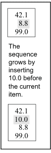

## insert 和 attach 成员函数。

有两个成员函数用于向序列添加新项目。其中一个函数称为 insert，它在当前项目之前放置一个新项目。例如，假设我们已创建页边显示的包含三个项目的序列，且当前项目为 8.8。在此示例中，我们希望在当前项目之前立即添加 10.0。当 10.0 插入到当前项目之前时，其他项目（例如 8.8 和 99.0）将向下移动以给新项目腾出空间。插入后，序列将包含下方框中显示的四个项目。

如果没有当前项目，则 insert 将新项目放在序列的前面。无论如何，在 insert 函数返回后，新插入的项目将成为当前项目，如以下前条件/后条件契约中所规定：

```
void insert(const value_type& entry);
// Precondition: size() < CAPACITY.
// Postcondition: A new copy of entry has been inserted in the sequence
// before the current item. If there was no current item, then the new entry
// has been inserted at the front. In either case, the new item is now the
// current item of the sequence.
```

第二个成员函数称为 attach，它也向序列添加一个新项目，但新项目是在当前项目之后添加的，如下所示：

```
void attach(const value_type& entry);
// Precondition: size( ) < CAPACITY.
// Postcondition: A new copy of entry has been inserted in the sequence
// after the current item. If there was no current item, then the new entry
// has been attached to the end. In either case, the new item is now the
// current item of the sequence.
```

如果没有当前项目，则 attach 函数将新项目放在序列的末尾（而不是前面）。insert 或 attach 都可以用于在序列中放置第一个项目。

## remove_current 成员函数。

可以从序列中删除当前项目。用于删除的成员函数没有参数。

```
void remove_current( );
// Precondition: is_item returns true.
// Postcondition: The current item has been removed from the sequence,
// and the item after this (if there is one) is now the current item.
```

该函数的前条件要求存在当前项目；正是这个当前项目被删除。例如，假设 scores 是页边框顶部显示的四个项目的序列，且高亮显示的 8.3 是当前项目。激活 scores.remove_current( ) 后，8.3 已被删除，4.1 现在是当前项目。

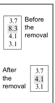

## 序列类——文档

我们序列类的第一个版本的头文件显示在第 128 页的图 3.9 中。头文件包含类定义及我们对三个成员变量的规范。我们将在下一部分讨论这些成员变量。

## 序列类——设计

我们为序列类提出的设计有三个私有成员变量。第一个变量 data 是一个存储序列项目的数组。与 bag 类似，data 是一个部分填充的数组。第二个成员变量名为 used，用于跟踪当前正在使用 data 数组的多少部分。因此，数组的已使用部分从 data[0] 扩展到 data[used-1]。第三个成员变量 current_index 给出数组中“当前”项目的索引（如果存在）。如果序列中没有有效的当前项目，则 current_index 将与 used 相同（因为这比任何有效索引都大）。以下是我们类的完整不变式，表述为三条规则：

- 1. 序列中的项目数量存储在成员变量 used 中。
- 2. 对于空序列，我们不关心 data 中存储了什么；对于非空序列，项目按其序列顺序存储在 data[0] 到 data[used-1] 中，我们不关心 data 的其余部分存储了什么。
- 3. 如果存在当前项目，则它位于 data[current_index] 中；如果不存在当前项目，则 current_index 等于 used。

## 图 3.9 序列类的头文件

## 一个头文件

```
// FILE: sequence1.h
// CLASS PROVIDED: sequence (part of the namespace main_savitch_3)
// TYPEDEF and MEMBER CONSTANTS for the sequence class:
//   typedef ___ value_type
//     Postcondition: value_type is the data type of the items in the sequence. It may be any of the
//     C++ built-in types (int, char, etc.), or a class with a default constructor, an assignment
//     operator, and a copy constructor
//   typedef ___ size_type
//     Postcondition: size_type is the data type of any variable that keeps track of how many
//     items are in a sequence.
//   static const size_type CAPACITY = ___
//     Postcondition: CAPACITY is the maximum number of items that a sequence can hold.
// CONSTRUCTOR for the sequence class:
//   sequence( )
//     Postcondition: The sequence has been initialized as an empty sequence.
// MODIFICATION MEMBER FUNCTIONS for the sequence class:
//   void start( )
//     Postcondition: The first item in the sequence becomes the current item (but if the
//     sequence is empty, then there is no current item).
//   void advance( )
//     Precondition: is_item returns true.
//     Postcondition: If the current item was already the last item in the sequence, then there
//     is no longer any current item. Otherwise, the new item is the item immediately after
//     the original current item.
//   void insert(const value_type& entry)
//     Precondition: size( ) < CAPACITY.
//     Postcondition: A new copy of entry has been inserted in the sequence before the
//     current item. If there was no current item, then the new entry has been inserted at the
//     front. In either case, the new item is now the current item of the sequence.
//   void attach(const value_type& entry)
//     Precondition: size( ) < CAPACITY.
//     Postcondition: A new copy of entry has been inserted in the sequence after the current
//     item. If there was no current item, then the new entry has been attached to the end of
//     the sequence. In either case, the new item is now the current item of the sequence.
//   void remove_current( )
//     Precondition: is_item returns true.
//     Postcondition: The current item has been removed from the sequence, and the
//     item after this (if there is one) is now the new current item. (continued)
```


## (图 3.9 续)

```
// CONSTANT MEMBER FUNCTIONS for the sequence class:
// size_type size( ) const
//
// Postcondition: The return value is the number of items in the sequence.
//
// bool is_item( ) const
// Postcondition: A true return value indicates that there is a valid "current" item that
// may be retrieved by the current member function (listed below). A false return value
// indicates that there is no valid current item.
//
// value_type current( ) const
// Precondition: is_item( ) returns true.
// Postcondition: The item returned is the current item in the sequence.
//
// VALUE SEMANTICS for the sequence class:
// Assignments and the copy constructor may be used with sequence objects.
#ifndef MAIN_SAVITCH_SEQUENCE_H
#define MAIN_SAVITCH_SEQUENCE_H
#include <cstddef> // Provides size_t
namespace main_savitch_3
{
class sequence
{
public:
// TYPEDEFS and MEMBER CONSTANTS
typedef double value_type;
typedef std::size_t size_type;
static const size_type CAPACITY = 30;
// CONSTRUCTOR
sequence( );
// MODIFICATION MEMBER FUNCTIONS
void start( );
void advance( );
void insert(const value_type& entry);
void attach(const value_type& entry);
void remove_current( );
// CONSTANT MEMBER FUNCTIONS
size_type size( ) const;
bool is_item( ) const;
value_type current( ) const;
private:
value_type data[CAPACITY];
size_type used;
size_type current_index;
};
};
#endif

如果您的编译器不允许初始化静态常量，请参见附录 E。

三个私有成员变量在第 127 页的“序列类—设计”一节中讨论。

例如，假设一个序列包含四个数字，当前项位于 data[2]。该对象的成员变量可能如下所示：

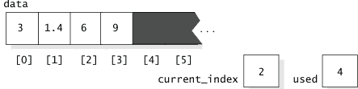

在此示例中，当前项位于 data[2]，因此 current() 函数将返回数字 6。此时，如果我们调用 advance()，则 current_index 将增加到 3，current() 将返回 9。通常，序列有一个“当前”项，成员变量 current_index 包含该当前项的位置。但如果没有当前项，则 current_index 包含与 used 相同的值。在我们的示例中，如果 current_index 为 4，则表示没有当前项。请注意，此值（4）超出了数组已使用部分（从 data[0] 到 data[3]）。

类的不变式

对成员变量的上述要求构成了序列类的不变式。您应将此不变式放在实现文件（sequence1.cxx）的顶部。我们将把大部分实现文件留给您，但会提供一些提示和少量伪代码。

## 序列类—实现的伪代码

remove_current 函数。此函数从序列中删除当前项。首先检查前置条件是否有效（在断言中使用 is_item()）。然后通过将后续每个项左移一位来删除当前项。例如，假设我们正在从此处绘制的序列中删除当前项：

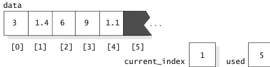

此图中的当前项是什么？它是 1.4，因为 current_index 是 1，且 data[1] 包含 1.4。

对于 bag，我们可以通过将最后一项（1.1）复制到 1.4 来删除诸如 1.4 这样的元素。但这种方法不适用于序列，因为项会失去其序列顺序。相反，1.4 之后的每个项必须左移一位。6 从 data[2] 移动到 data[1]；9 从 data[3] 移动到 data[2]；1.1 从 data[4] 移动到 data[3]。这涉及大量移动，但一个简单的 for 循环足以完成所有工作。伪代码如下：

```
for (i = the index after the current item; i < used; ++i)
Move an item from data[i] back to data[i-1];
```

您不应使用 <algorithm> 中的 copy 函数，因为该函数禁止源与目标重叠。

> 不要使用 copy 函数

循环完成后，应将 used 减一。我们示例的最终结果如下所示：

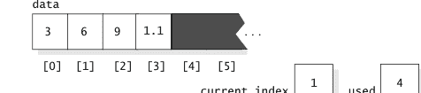

删除后，current_index 保持不变。实际上，这意味着刚好在被删除项之后的项现在是当前项。您应检查该函数对边界值（删除第一项和删除最后一项）是否正确工作。事实上，这两种情况都能正常工作。当删除最后一项时，current_index 最终将与 used 具有相同的值，表示不再有当前项。

## insert 函数。

如果存在当前项，则 insert 函数必须小心地在当前位置之前插入新项。已经位于当前位置或之后的项必须右移，为新项腾出空间。我们建议您先检查前置条件。然后将数组末尾的项逐个右移一位，直到到达新项的位置。

例如，假设您正在将 1.4 插入此序列的 data[1] 位置：

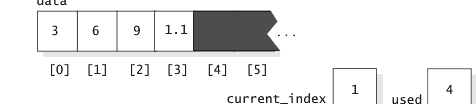

您将首先将 1.1 从 data[3] 右移到 data[4]；然后将 9 从 data[2] 移动到 data[3]；接着将 6 从 data[1] 右移到 data[2]。此时，数组如下所示：

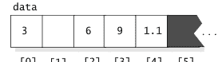

当然，data[1] 实际上仍然包含一个 6，因为我们刚刚将 data[1] 中的 6 复制到了 data[2]。但我们将 data[1] 绘制为一个空框，以指示 data[1] 现在可用于保存新项（即我们要插入的 1.4）。此时，我们可以将 1.4 放入 data[1] 并将 used 加一，如下所示：

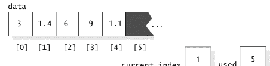

右移项的伪代码使用 for 循环。循环的每次迭代移动一项，如下所示：

```
for (i = used; data[i] is the wrong spot for entry; --i)
    data[i] = data[i-1];
```

循环的关键在于测试 data[i] 是否为 entry 的错误位置。我们如何测试一个位置是否为新项的错误位置？如果 (i > current_index)，则该位置是错误的。您现在可以用 C++ 编写整个成员函数了吗？（参见自测练习 18 的解答，不要忘记处理没有当前项的特殊情况。）

## 其他成员函数。

其他成员函数很简单；例如，attach 函数与 insert 类似。您需要注意使用全名的陷阱（参见第 112 页）。第 149 页的编程项目 3 和 4 描述了一些其他有用的成员函数。

#### 第 3.2 节自测练习

- 16. 序列与袋有什么区别？序列需要哪些额外操作？

- 17. 内部迭代器与外部迭代器有什么区别？

- 18. 为序列编写 insert 函数。为什么此实现应避免使用 <algorithm> 中的 copy 函数？

- 19. 假设一个序列有 24 个项，且没有当前项。根据类的不变式，current_index 是多少？

- 20. 假设 g 是一个包含 10 个项的序列。您激活 g.start()，然后激活 g.advance() 三次。此时 g.current_index() 中的值是多少？

- 21. 测试 remove_current 函数的良好边界值是什么？

- 22. 编写一个演示程序，要求用户输入一系列家庭成员年龄，然后按给出的相同顺序打印该列表。

- 23. 编写一个新成员函数，用于从序列中删除指定项。该函数有一个参数（要删除的项）。

- 24. 对于一个数字序列，假设您依次 attach 1、2、3，一直到 n。将所有 n 个数字 attach 所需的总时间的大 O 时间分析是什么？如果您先 insert n，然后是 n-1，一直到 1——始终使用 insert 而不是 attach，分析会如何变化？

### 3.3 交互式测试程序

您的序列类是遵循标准格式的交互式测试程序的良好候选者。图 3.10 中的程序说明了这种格式，它可以用于任何类。主程序的开头声明一个对象——在此例中为一个序列对象。主程序的其余部分是一个交互式循环，只要用户愿意就会继续。循环内会发生三件事：

- 1. 为用户编写一个小型选择菜单。每个选择都会附带一个字母或其他有意义的字符打印出来，以便用户选择该选项。

- 2. 读取用户从菜单中选择的内容。

- 3. 根据用户的选择，对序列对象执行某些操作。

我们为序列提供的示例交互式测试程序如图 3.10 所示，第 137 页的图 3.11 中展示了部分示例对话。测试程序中使用的一些技术很熟悉。例如，打印菜单等子任务是通过函数完成的。测试程序中的两种技术可能对您是新的：将输入转换为大写字母，以及通过 switch 语句根据输入采取行动。我们将在您浏览完程序后讨论这两种技术。


## 将输入转换为大写字母

即使是小型测试程序，在用户输入方面也应具有一定的灵活性。例如，程序应接受每个菜单选项的大写或小写字母。我们通过读取用户的输入，然后在必要时将小写字母转换为相应的大写字母来实现这一点。转换由名为 toupper 的函数执行，其规范如下：

```
char toupper(char c);
// Postcondition: If c is a lowercase letter, then the return value is the
//   uppercase equivalent of c. Otherwise the return value is just c itself.
```

toupper 函数是 <cctype> 设施的一部分。在我们的主程序中，我们使用 toupper 来转换 get_user_command 函数的结果，如下所示：

```
choice = toupper(get_user_command ( ));
```

## 图 3.10 Sequence 类的交互式测试程序

### 一个程序

```
// FILE: sequence_test.cxx
// An interactive test program for the new sequence class
#include <cctype> // Provides toupper
#include <iostream> // Provides cout and cin
#include <cstdlib> // Provides EXIT_SUCCESS
#include "sequence.h" // With value_type defined as double
using namespace std;
using namespace main_savitch_3;

// PROTOTYPES for functions used by this test program:
void print_menu( );
// Postcondition: A menu of choices for this program has been written to cout.
char get_user_command( );
// Postcondition: The user has been prompted to enter a one-character command.
//   The next character has been read (skipping blanks and newline characters),
//   and this character has been returned.
void show_sequence(sequence display);
// Postcondition: The items on display have been printed to cout (one per line).
double get_number( );
// Postcondition: The user has been prompted to enter a real number. The
//   number has been read, echoed to the screen, and returned by the function.
int main()
{
    sequence test; // A sequence that we'll perform tests on
    char choice; // A command character entered by the user
    cout << "I have initialized an empty sequence of real numbers." << endl;
    do
    {
        print_menu();
        choice = toupper(get_user_command());
        switch (choice)
        {
            case '!': test.start();
                break;
            case '+': test.advance();
                break;
            case '?': if (test.is_item())
                cout << "There is an item." << endl;
            else
                cout << "There is no current item." << endl;
            case 'C': if (test.is_item())
                cout << "Current item is: " << test.current() << endl;
            else
                cout << "There is no current item." << endl;
            case 'P': show_sequence(test);
            case 'S': cout << "Size is " << test.size() << '.' << endl;
                break;
            case 'I': test.insert(get_number());
                break;
            case 'A': test.attach(get_number());
                break;
            case 'R': test.remove_current();
                cout << "The current item has been removed." << endl;
                break;
            case 'Q': cout << "Ridicule is the best test of truth." << endl;
                break;
            default: cout << choice << " is invalid." << endl;
        }
    } while ((choice != 'Q'));
    return EXIT_SUCCESS;
}
```

## （图 3.10 续）

```
void print_menu( )
// Library facilities used: iostream
{
    cout << endl; // Print blank line before the menu
    cout << "The following choices are available: " << endl;
    cout << " !   Activate the start( ) function" << endl;
    cout << " +   Activate the advance( ) function" << endl;
    cout << " ?   Print the result from the is_item( ) function" << endl;
    cout << " C   Print the result from the current( ) function" << endl;
    cout << " P   Print a copy of the entire sequence" << endl;
    cout << " S   Print the result from the size( ) function" << endl;
    cout << " I   Insert a new number with the insert(... ) function" << endl;
    cout << " A   Attach a new number with the attach(... ) function" << endl;
    cout << " R   Activate the remove_current( ) function" << endl;
    cout << " Q   Quit this test program" << endl;
}
```

```
char get_user_command( )
// Library facilities used: iostream
{
    char command;
    cout << "Enter choice: ";
    cin >> command; // Input of characters skips blanks and newline character
    return command;
}
```

```
void show_sequence(sequence display)
// Library facilities used: iostream
{
    for (display.start( ); display.is_item( ); display.advance( ))
        cout << display.current( ) << endl;
}
```

```
double get_number( )
// Library facilities used: iostream
{
    double result;
    cout << "Please enter a real number for the sequence: ";
    cin >> result;
    cout << result << " has been read." << endl;
    return result;
}
```

## 图 3.11 图 3.10 程序的示例对话部分

### 示例对话

我已初始化一个空的实数序列。

可选选项如下：
! 激活 start() 函数
+ 激活 advance() 函数
? 打印 is_item() 函数的结果
C 打印 current() 函数的结果
P 打印整个序列的副本
S 打印 size() 函数的结果
I 使用 insert(...) 函数插入一个新数字
A 使用 attach(...) 函数附加一个新数字
R 激活 remove_current() 函数
Q 退出此测试程序
输入选择：A
请为序列输入一个实数：3.14
已读取 3.14。

可选选项如下：
! 激活 start() 函数
+ 激活 advance() 函数
? 打印 is_item() 函数的结果
C 打印 current() 函数的结果
P 打印整个序列的副本
S 打印 size() 函数的结果
I 使用 insert(...) 函数插入一个新数字
A 使用 attach(...) 函数附加一个新数字
R 激活 remove_current() 函数
Q 退出此测试程序
输入选择：S
大小为 1。

对话将持续进行，直到用户输入 Q 以停止程序。

## switch 语句

读取用户选择后，主程序将执行相应操作。该操作取决于用户从菜单中输入的单个字符。在众多可能操作中进行选择的有效语句是 switch 语句，其一般形式为：

```
switch (<Control value>)
{
    <Body of the switch statement>
}
```

当到达 switch 语句时，将对控制值求值。然后程序会在 switch 语句体中查找匹配的 case 标签。例如，如果控制值是字符 'A'，则程序会查找形式为 case 'A': 的 case 标签。如果找到匹配的 case 标签，则程序会跳转到该标签并开始执行语句。语句会逐条执行——但如果出现 break 语句（形式为 break;），则程序会跳到 switch 语句体的末尾。

如果控制值没有匹配的 case 标签，则程序会查找形式为 default: 的 default 标签。该标签处理没有各自 case 标签的任何控制值。

如果没有匹配的 case 标签且没有 default 标签，则整个 switch 语句体将被跳过。

对于交互式测试程序，switch 语句为每个菜单选项都有一个 case 标签。例如，其中一个菜单选项是字符 'A'，它允许用户将新数字附加到序列中。在 switch 语句中，'A' 命令的处理如下所示：

```
switch (choice)
{
    ...
    case 'A': test.attach(get_number());
        break;
    ...
}
```

#### 第 3.3 节自测练习

- 25. 说出提供 toupper、EXIT_SUCCESS、cout 和 cin 的库设施。

- 26. toupper('a')、toupper('A') 和 toupper('+') 的值分别是多少？

- 27. 什么情况下需要使用 switch 语句？

- 28. 第 136 页的 show_sequence 函数使用值参数而非引用参数。为什么？


### 3.4 STL 多重集类及其迭代器

本节首先介绍标准模板库（STL）中的一个容器类——多重集（multiset），包括一个称为迭代器（iterator）的特性，它允许程序员轻松遍历 STL 容器类中的所有元素。

### 多重集模板类

多重集是一个与我们的 bag 类似的 STL 类。与 bag 一样，它允许存储一组项目，其中每个项目在多重集中可以出现多次。另一个 STL 类，即 set 类，与多重集类具有相同的接口，区别在于它存储不重复的元素。对集合中已存在的元素进行额外插入将没有任何效果。

使用多重集或集合的程序必须包含头文件 <set>。下面是一个小示例，创建一个名为 first 的整数多重集：

```
multiset<int> first;
first.insert(8);
first.insert(4);
first.insert(8);
```


该数据类型的名称为 multiset，但该名称通过 <int> 进行扩展，以指示将驻留在 bag 中的元素类型。这种扩展称为模板实例化，它与我们为自己的 bag 指定底层类型的方式不同。我们将在第 6 章学习如何编写此类模板类，但目前我们只想使用整数多重集，因此不需要知道其实现方式。

多重集中项目的类型有一个我们自己的 bag 不需要的限制：必须可以使用“小于”运算符比较两个项目。通常，此比较运算符只是内置数据类型（如整数）提供的“<”运算符，或为类（如字符串）提供的函数。还有几种其他方法可以提供比较函数，但无论其如何定义，都必须满足严格弱序的规则，如图 3.12 所示。该限制的原因是允许更高效的实现，我们将在第 10 章中检查该实现。但在进入该实现之前，让我们先检查一些多重集成员函数。

### 图 3.12 严格弱序

- 类运算符 (<) 的严格弱序必须满足以下要求：
  1. **非自反性**：如果 x 和 y 相等，则 (x < y) 和 (y < x) 都不为真。其中，这意味着 (x < x) 永远不为真。
  2. **反对称性**：如果 x 和 y 不相等，则 (x < y) 或 (y < x) 中必有一个为真，但不能同时为真。
  3. **传递性**：每当存在三个值（x、y 和 z）且 (x < y) 与 (y < z) 为真时，(x < z) 也为真。

### 多重集的一些成员

构造函数。默认构造函数创建一个空多重集，拷贝构造函数复制另一个多重集。还有我们不会使用的其他构造函数。

### 与 bag 相似的成员

这些成员与我们的 bag 相似：

- value_type 的类型定义
- size_type 的类型定义
- size_type count(const value_type& target) const;
- size_type erase(const value_type& target);
- size_type size() const;

### insert 成员函数

多重集的 insert 函数可以与 bag 的 insert 函数完全相同地用于向多重集添加项目。但是，多重集 insert 函数的实际原型指定了一个称为迭代器的返回值，如下所示：

```
iterator insert(const value_type& entry);
```

让我们详细检查多重集的迭代器。

### 迭代器和 [...] 模式

迭代器是一个对象，允许程序员轻松遍历容器中的所有项目，检查项目并（可能）更改它们。任何 STL 容器都有一个名为 begin 的标准成员函数，它返回一个迭代器，用于访问容器中的第一个项目。

对于多重集，这个“第一”元素是根据必须为任何多重集的项目类型提供的“小于”顺序排列的最小项目。对于其他类型的容器类，“第一”元素可能以其他方式实现，begin 使用的确切机制通常不重要。

重要的概念是一种通用模式，程序员可以使用 begin 函数和相关操作来遍历容器中的所有项目。总共有四个操作是该模式所需的：

- begin：容器有一个我们已经讨论过的 begin 成员函数。其返回值是一个迭代器，用于访问容器中的第一个项目。例如，假设 actors 是一个字符串多重集。那么我们可以编写以下代码来获取起始迭代器：

```
multiset<string>::iterator role;
role = actors.begin();
```

此示例中的迭代器是一个名为 role 的变量，其数据类型为 multiset<string>::iterator。multiset<string>::iterator 数据类型是多重集类的一部分，类似于 value_type 和 size_type 是类的一部分。

- * 运算符：一旦程序创建了迭代器,*（星号）运算符可用于访问迭代器的当前元素。在 role 示例中，我们可以使用以下语句打印 role 迭代器的当前字符串：`cout << *role << endl;`

星号可以应用于任何迭代器，导致迭代器返回其当前项目。*role 的表示法被有意设计为使迭代器看起来像指向项目的指针。如果它实际上是一个指针，那么 *role 将意味着“role 指向的项目”。当然，role 是一个迭代器，而不是指针，但 *role 仍然可以被视为“获取迭代器的当前项目”。

一般来说，*role 表示法可用于访问和更改迭代器的当前项目。例如，可以通过赋值更改项目：*role = "sheep"; 但是，某些迭代器禁止更改项目。多重集的迭代器就是这种情况，* 运算符可用于访问多重集中的项目，但不能更改项目。

> 多重集迭代器不能直接用于更改项目

- ++ 运算符：++ 运算符可用于将迭代器向前移动到其集合中的下一个项目。下面是一个示例语句：`++role;`

++ 运算符可以在迭代器之前使用（如 ++role）或在迭代器之后使用（如 role++）。除了向前移动迭代器之外，++ 运算符的两个版本实际上都是返回迭代器的函数。特别是：++role 的返回值是移动后的迭代器，而 role++ 的返回值是移动前的迭代器的副本。对于大多数迭代器，++role 版本更高效，因为它不需要在移动前保留旧迭代器的副本。因此，我们更倾向于使用 ++role 版本。

- end：容器有一个 end 成员函数，它返回一个迭代器来标记其项目的结束。如果迭代器在容器中向前移动，它最终将到达末端。一旦到达末端，它就已经超过了容器的最后一个项目，* 运算符不得再使用，因为没有更多项目了。

是时候在一个小示例中查看使用迭代器的完整模式了。该示例创建一个整数多重集，然后使用迭代器逐个遍历这些整数。

> 使用迭代器的示例

```
multiset<int> ages;
multiset<int>::iterator it;
ages.insert(4);
ages.insert(12);
ages.insert(18);
ages.insert(12);

for (it = ages.begin(); it != ages.end(); ++it)
{
    cout << *it << endl;
}
```

for 循环遍历多重集的项目，按从小到大的顺序打印四个整数。请注意，多重集中有两个 12 的副本：

```
4
12
12
18
```

请注意当 it 位于 18 时会发生什么。此时，它尚未到达 ages.end()。实际上，你可以想象 ages.end() 是“最后一个项目之后的一个项目”。因此，进入循环体，我们打印 *it（即 18）。之后，循环通过语句 ++it 将其向前移动。这将其移动到最后一个项目之后，因此现在它等于 ages.end()，循环结束。一旦到达末端，我们不得访问 *it，因为它已经超过了最后一个项目。

### 陷阱

### 到达 end() 后不得访问迭代器的项目

当迭代器 i 等于其容器的 end() 迭代器时，不得尝试访问项目 *i。请记住，end() 是容器最后一个项目之后的一个位置。

以下是可用于任何迭代器 i 和容器对象 c 的通用模式：

```
for (i = c.begin(); i != c.end(); ++i)
{
    ...statements to access the item *i
}
```

### [...] 模式

此模式称为 [...] 模式，或左闭合模式。该表示法来自数学家编写 [0..100) 的方式，以指示集合


从零开始、一直到（但不包括）100 的数字。同样，我们的 for 循环遍历从 begin() 开始、一直到（但不包括）end() 值的值集合。

### [ ... ) 模式

迭代器常与 [ ... ) 模式（称为左闭右开模式）一起使用。对于迭代器 i 和容器 c，该模式为：

```
for (i = c.begin(); i != c.end(); ++i)
{
    .....statements to access the item *i
}
```

for 循环遍历从 begin() 开始、一直到（但不包括）end() 值的值集合。

顺便说一下，我们现在可以解释 multiset 的 insert 函数的返回值了：

```
iterator insert(const value_type& entry);
```

此成员函数的返回值是一个迭代器，其当前元素为刚刚插入的元素。

### 测试迭代器的相等性

[ ... ) 模式使用了一种你可能未曾注意到的迭代器操作：它使用 != 运算符来测试同一容器的两个迭代器是否不相等。迭代器也可以进行比较，以查看它们是否相等（使用 == 运算符）。对于容器对象，如果其两个迭代器位于同一位置，或者两者都已到达容器的 end()，则它们相等。（比较不同容器的两个迭代器是错误的。）

### 其他 multiset 操作

multiset 还有其他操作，其中一些使用迭代器。以下是两个 multiset 成员函数示例：

```
iterator find(const value_type& target);
void erase(iterator i);
```

find 函数在 multiset 中查找第一个等于指定目标的元素。如果找到这样的元素，则返回一个迭代器，其当前元素等于该元素。如果没有这样的元素，则 find 返回一个等于 end() 的迭代器。erase 函数是常规 erase 函数的一种替代形式。其参数是一个迭代器，该函数会移除迭代器的当前元素。将 find 和 erase 一起使用，我们可以编写代码来删除给定目标的第一个出现项。例如，这段代码会删除 multiset m 中 42 的第一个出现项：

```
multiset<int> m;
multiset<int>::iterator position;
position = m.find(42);
if (position != m.end())
    m.erase(position);
```

### 无效迭代器

设置迭代器后，它可以轻松地在其容器中移动。然而，对容器的更改（无论是插入还是删除）都可能导致容器的所有迭代器失效。使迭代器失效的确切操作因容器而异。有些示例很明显；例如，刚才所示代码中的 position 迭代器在其元素被删除后即失效。其他示例则不那么明显，例如插入可能使所有迭代器失效的容器。

当迭代器因容器更改而变得无效时，在为其赋予新值之前，该迭代器不得再使用。

### 更改容器对象可能会使其迭代器失效

当迭代器的底层容器发生更改（通过插入或删除）时，该迭代器通常会变得无效。除非类文档另有说明，否则在从更改后的容器重新为其赋予新值之前，不应再使用该迭代器。

### 澄清 const 关键字 第 5 部分：const 迭代器

const 迭代器是禁止以任何方式更改其底层容器的迭代器。例如，const 迭代器不能与 multiset 的 erase 函数一起使用。可以从任何常量容器的 begin 和 end 函数获得 const 迭代器，例如声明为 const multiset 的参数。以下是一个小函数示例，用于计算 multiset 中小于指定目标的整数个数：

```
// Counts number of integers less than a given target:
multiset<int>::size_type count_less_than_target
    (const multiset<int>& m, int target)
{
    multiset<int>::size_type answer = 0;
    multiset<int>::const_iterator it;
    for (it = m.begin(); it != m.end(); ++it)
        if (*it < target)
            ++answer;
    return answer;
}
```

迭代器 (it) 被声明为 multiset<int>::const_iterator，而非 multiset<int>::iterator。const_iterator 数据类型是 multiset 类的一部分，就像 value_type、size_type 和普通迭代器一样。它写作一个单词 (const_iterator)，不使用关键字 const，但其用途与关键字 const 相关，如下所述：

- 1. 考虑一个使用关键字 const 声明的 multiset，例如 count_less_than_target 函数中的 multiset m。在这种情况下，m.begin() 和 m.end() 的返回值是 const_iterator，而非 iterator。

- 2. const 迭代器可以遍历其容器中的元素，但禁止添加、删除或更改任何元素。例如，如果它是 multiset m 的 const 迭代器，则我们不得调用 m.erase(it)。

> const 迭代器禁止更改其容器中的任何元素

根据第二条规则，我们可以说“const 迭代器”这几个字有些误导，因为迭代器本身并不是常量：它可以遍历集合。无法被 const 迭代器更改的是集合中的对象。

#### 第 3.4 节自测练习

- 29. set 和 multiset STL 类有什么区别？

- 30. 修改图 3.2 中的 ages 程序，使其使用 multiset 而非 bag。另外，在用户输入最后一个数字后，请按从小到大的顺序输出所有年龄的列表。

- 31. 假设 m 是一个 multiset。在什么情况下 m.begin() 等于 m.end()？

- 32. 为迭代器 i 和容器 c 编写左闭右开模式。

- 33. 一般来说，迭代器如何变得无效？

- 34. 编写一个具有一个参数的函数：非空 const multiset 的 double 数字。返回值是这些数字的平均值。

### 章节摘要

- 容器类是每个对象包含一组元素的类。Bag 和 sequence 是容器类的两个示例；C++ 标准库还提供多种灵活的容器类。

- 容器类应以易于更改底层元素数据类型的方式实现。在 C++ 中，解决此问题的简单方法是使用 typedef 语句定义容器元素的类型。

- 容器类的最简单实现使用部分填充的数组。使用部分填充的数组要求每个对象至少有两个成员变量：数组本身和另一个用于跟踪数组已使用多少的变量。

- 设计类时，应始终明确说明规定成员变量使用方式的规则。这些规则称为类的不变式，应写在实现文件的顶部，以便轻松参考。

- 小型类可以通过遵循 sequence 测试程序标准格式的交互式测试程序进行有效测试。

- 无需从头开始编写每个容器类。C++ 标准模板库 (STL) 提供了多种在不同场景下都有用的容器类。

- 我们自己的 bag 类基于 STL 的 multiset 类。但是，multiset 类需要模板实例化（以指定底层元素的类型），并且它具有用于逐个遍历元素的迭代器。

### 自测练习答案

- 1. typedef 语句允许在根据应用程序修改程序中元素的数据类型时具有灵活性。数据类型可以直接在 typedef 语句中修改，而无需修改整个程序。

- 2. size_t 数据类型是只能保存非负数的整数。它是 C++ 标准库设施 cstddef 的一部分。

- 3. 需要默认构造函数，因为 value_type 用作数组的组件类型。所需的每个运算符（== 和 =）都在 bag 的至少一个成员函数中与 value_type 一起使用。

- 4. entry 参数是 value_type 类型的元素。当 value_type 是大对象时，将参数设为 const 引用参数更高效。


- 5.
  [3 2]
  [0] [1]
  我们不关心 data[1] 之后出现的内容。

- 6. 0

- 7. 整数类型的静态成员常量可以在头文件中赋值，因为整型值常在类定义内用于定义其他对象，例如数组的大小。

- 8. 参见第 110 页的两条规则。

- 9. 布尔表达式的短路求值会从左到右对表达式求值，一旦有足够信息确定表达式的值即停止。如果表达式中的两个逻辑操作都必须为真，整个表达式才为真，那么当第一个操作为假时，第二个操作不会被求值。

- 10. copy(x, x+6, y+42);

- 11. 它不需要是友元函数，因为它不直接访问 bag 的任何私有成员。

```cpp
bag::size_type
bag::erase(const value_type& target)
{
    size_type index = 0;
    size_type many_removed = 0;

    while (index < used)
    {
        if (data[index] == target)
        {
            --used;
            data[index] = data[used];
            ++many_removed;
        }
        else
            ++index;
    }

    return many_removed;
}
```

- 13. 这两条语句可以替换为一条语句：data[index] = data[--used];

当 --used 作为表达式出现时，变量 used 减一，表达式的值即为减一后的值。（另一方面，如果 used-- 作为表达式出现，表达式的值是减一之前 used 的值。）同样，insert 的最后两条语句可以合并为 data[used++] = entry;。在这种情况下，我们将 used++ 作为索引表达式，因为我们希望使用 used 的旧值（加一之前）作为索引。

- 14. 如果我们执行 b = b，那么私有成员变量 used 与 addend.used 是同一个变量。循环的每次迭代都会给 used 加 1，因此 addend.used 也在增加，循环永远不会结束。要纠正此问题，可以将 addend.used 的初始值存储在局部变量中，并使用该局部变量来确定循环何时结束。

- 15. O(1) 的运行时间意味着函数不依赖于输入的大小，并在常数时间内运行。

- 16. 两者都包含一组项目，但序列中的项目是按顺序排列的，一个接一个。start、advance、current、remove_current、attach 和 is_item 函数用于在精确位置操作项目。

- 17. 内部迭代器使用容器的成员函数来访问容器中的项目。外部迭代器拥有自己的成员函数来访问序列中的项目。

```cpp
void sequence::insert
(const value_type& entry)
{
    size_type i;
    assert(size( ) < CAPACITY);

    if ( !is_item( ) )
        current_index = 0;
    for (i = used; i > current_index; --i)
        data[i] = data[i-1];
    data[current_index] = entry;
    ++used;
}
```

copy 函数的源和目标不能重叠，因此不应在本示例中使用。

- 19.

- 20. g.current_index 将为 3（因为第四个项目出现在 data[3] 处）。

- 21. 应在序列大小刚好为 1 以及序列处于满容量时测试 remove_current 函数。在满容量时，应尝试删除序列中的第一个项目和最后一个项目。

- 22. 你的程序可以类似于第 107 页的图 3.2。

- 23. 这是我们的函数原型，带有后置条件：
  `void remove(const value_type& target);`
  // 后置条件：如果 target 在
  // 序列中，则 target 的第一个副本已
  // 被删除，并且被删除项目之后的
  // 项目（如果有）成为新的当前项目；否则
  // 序列保持不变。

  最简单的实现是搜索 target 的索引。如果找到该索引，则将 current_index 设置为该索引，并调用普通的 remove_current 函数。

- 24. 将 1, 2, ..., n 依次 attach 的总时间为 O(n)。将 n, n-1, ..., 1 依次 insert 的总时间为 O(n^2)。insert 耗时更长的原因是，在序列前端插入需要将所有现有项目向右移动以腾出空间给新项目。因此，第二次插入时移动一个项目，第三次插入时移动两个项目，依此类推，直到第 n 个项目需要 n-1 次移动。移动总次数为 1+2+...+(n-1)，即 O(n^2)。（要证明该和为 O(n^2)，可使用类似于第 19 页图 1.2 中所用的技术。）

- 25. `toupper` 在 `cctype` 中；`EXIT_SUCCESS` 在 `cstdlib` 中；`cout` 和 `cin` 在 `iostream` 中。

- 26. 前两次调用返回 'A'。函数调用 `toupper('+')` 返回 '+'。

- 27. 当单个控制值决定采取多种可能操作中的哪一种时，使用 switch 语句。

- 28. 使用引用参数时，当前元素在序列中的推进会改变实际参数。

- 29. multiset 类允许容器中有重复值，而 set 类要求值唯一。

- 30. 第一处更改是 #include `<set>` 并使用 std 命名空间；然后将每个 bag 替换为 `multiset<int>`。打印年龄的代码类似于第 142 页的 for 循环。

- 31. 当 m 不包含任何项目时。

- 32. `for (i = c.begin(); i != c.end(); ++i)`
  {...}

- 33. 只要对底层容器进行更改，迭代器就会可能失效。

- 34. 这是一个解决方案。我们假设已包含 `<set>`，并且正在使用 std 命名空间。

```cpp
double average(const multiset<double>& m)
{
    multiset<double>::const_iterator p;
    double total = 0;
    assert(m.size() > 0);
    for (
        p = m.begin();
        p != m.end(); ++p)
    {
        total += *p;
    }
    return total/m.size();
}
```

## 编程项目
如需更深入的项目，请参见 www.cs.colorado.edu/~main/projects/

- **1** 类的黑盒测试是一个程序，用于测试类成员函数的正确性，而不直接检查类的私有成员。你可以想象私有成员位于一个不透明的黑盒内，无法看到，因此所有测试都必须仅通过调用公共成员函数来进行。为 bag 类编写一个黑盒测试程序。确保测试边界值，例如空 bag、包含一个项目的 bag 和已满的 bag。

- **2** 为第 3.1 节的 bag 类实现 - 和 -= 运算符。对于两个 bag x 和 y，袋 x-y 包含 x 的所有项目，并移除来自 y 的任何项目。例如，假设 x 有七个数字 3 的副本，y 有两个数字 3 的副本。那么 x-y 将有五个数字 3 的副本（即 7 - 2 个数字 3 的副本）。如果 y 某个项目的副本数多于 x，则袋 x-y 将没有该项目的副本。例如，假设 x 有九个数字 8 的副本，y 有 10 个数字 8 的副本。那么 x-y 将没有 8。语句 x -= y 应与赋值 x = x - y 具有相同的效果；

- **3** 实现第 3.2 节的 sequence 类。你可能希望提供一些额外有用的成员函数，例如：(1) 在序列前端添加新项目的函数；(2) 从序列前端移除项目的函数；(3) 在序列末尾添加新项目的函数；(4) 使序列最后一个项目成为当前项目的函数；(5) + 和 += 运算符。对于 + 运算符，x + y 包含 x 的所有项目，后跟 y 的所有项目。语句 x += y 将 y 的所有项目追加到 x 中已有项目的末尾。

- **4** 对于序列 x，我们希望能够使用常规的 C++ 数组表示法来引用单个项目。例如，如果 x 有三个项目，则我们希望能够编写 x[0]、x[1] 和 x[2] 来访问这三个项目。这种方括号的用法称为 **下标运算符**。下标运算符可以作为成员函数重载，其原型如下，作为 sequence 类的一部分：

```cpp
class sequence
{
public:
   ...
   value_type operator [ ] (size_type index)
   const;
   ...
}
```

如你所见，operator [ ] 是具有一个参数的成员函数。该参数是我们要检索的项目的索引。此成员函数的实现应检查索引是否有效（即索引小于序列大小），然后返回指定项目。对于本项目，为 sequence 指定、设计并实现这个新的下标运算符。

- **5** bag 可以包含多个项目副本。例如，本章描述了一个可以包含数字 4 和两个数字 8 副本的 bag。这种 bag 行为与 set 不同，set 只能包含任何给定项目的单个副本。编写一个名为 set 的新容器类，它与 bag 类似，但 set 只能包含任何给定项目的一个副本。你需要稍微修改接口。例如，不使用 bag 的 count 函数，你需要一个常量成员函数，如下所示：

```cpp
bool set::contains
(const value_type& target) const;
// 后置条件：如果 target 在 set 中，则返回值为 true；否则返回值为 false。
```

对 set 类的不变式做出明确说明。对每个操作进行时间分析。此时


这一点，不需要高效的实现。例如，仅仅向集合中添加一个新项将需要线性时间，因为你需要检查新项是否已存在。稍后我们将探讨更高效的实现（包括 C++ 标准库中 set 的实现）。

你可能还希望为你的 set 类添加额外的操作，例如减法运算符。

假设你实现了一个序列，其中 value_type 具有比较运算符 <，用于确定一个项何时“小于”另一个项。例如，整数、双精度数和字符都有这样的比较运算符（你自己实现的类也可以赋予这样的比较）。使用新类名 sorted_sequence 重写序列类。在有序序列中，insert 函数始终会插入新项，使得所有项都保持从小到大的顺序。没有 attach 函数。所有其他函数都与原始序列类相同。

在这个项目中，你将实现一个名为 带收据的包（bag with receipts）的新类。这个新类类似于普通的包，但添加和移除项的方式不同。每次向带收据的包中添加一项时，insert 函数会返回一个名为 收据（receipt）的唯一整数。稍后，当你想要移除一项时，必须将收据的副本作为参数提供给 remove 函数。remove 函数会移除出示了收据的那一项，并通过引用参数返回该项的副本。这里有一个实现思路：带收据的包可以有两个私有数组，如下所示：

```cpp
class bag_with_receipts
{
   ...
   private:
      value_type data[CAPACITY];
      bool in_use[CAPACITY];
};
```

这样的数组（大小相同）称为并行数组。其思路是通过在第二个数组中放置布尔值来跟踪 data 数组的哪些部分正在被使用。当 in_use[i] 为 true 时，data[i] 当前正在被使用；当 in_use[i] 为 false 时，data[i] 当前未被使用。当添加新项时，我们会找到第一个当前未使用的位置并将新项存储在那里。该项的收据是存储新项的位置的索引。

存储项集合的另一种方式是使用键控包（keyed bag）。这种包在每次添加项时，使用包的程序员还需要提供一个名为 键（key）的整数。添加到键控包中的每一项都必须具有唯一的键；两项不能具有相同的键。因此，插入函数的规格如下所示：

```cpp
void keyed_bag::insert
(const value_type& entry, int key);
// Precondition: size() < CAPACITY, and the
// bag does not yet contain any item with
// the given key.
// Postcondition: A new copy of entry has
// been added to the bag, with the given key.
```

当程序员想要从键控包中移除一项时，必须指定该项的键，而不是项本身。键控包还应有一个布尔成员函数，可用于确定包中是否具有指定键的项。

（键控包与带收据的包在两个重要方面有所不同。）在键控包中，使用该类的程序员在插入项时指定一个特定的键。相比之下，对于带收据的包，insert 函数返回一个收据，使用该类的程序员无法控制该收据可能是什么。

在这个项目中，对键控包进行完整的规格说明、设计和实现。

这是一个将在第 4 章中开发的更长项目的简单版本。该项目从一元多项式的定义开始，一元多项式是形式如下的算术表达式：

$a_0 + a_1x + a_2x^2 + ... + a_kx^k$

最高指数 k 称为多项式的 **次数**，常数 $a_0, a_1, \dots$ 是 **系数**。例如，这里有三个次数为 3 的多项式：

2.1 + 4.8x + 0.1x^2 + (-7.1)x^3
2.9 + 0.8x + 10.1x^2 + 1.7x^3

为多项式指定、设计并实现一个类。该类可以包含一个静态成员常量 MAXDEGREE，用于指示任何多项式的最大次数。（这样可以让你在固定大小的数组中存储系数。）花些时间思考对多项式有意义的操作。例如，你可以编写一个添加两个多项式的操作。另一个操作应该对给定的 x 值求解多项式。

- 10 指定、设计并实现一个类，该类可以作为井字棋游戏中的一名玩家。构造函数应指定该对象是第一个玩家（X）还是第二个玩家（O）。应有一个成员函数来请求对象进行下一步移动，以及一个成员函数来告知对象对手的下一步移动。还应包含其他有用的成员函数，例如一个函数来询问井字棋板上的给定位置是否被占用，如果是，是被 X 还是 O 占用。此外，还应包含一个成员函数来确定游戏何时结束，以及是平局、X 获胜还是 O 获胜。在两个程序中使用该类：一个是与程序用户对弈的井字棋程序，另一个是两个井字棋对象相互对弈的程序。

- 11 指定、设计并实现一个容器类，最多可容纳五张扑克牌。将该类命名为 pokerhand，并重载布尔比较运算符，以便比较两手扑克牌。对于两手牌 x 和 y，关系 x > y 表示 x 是比 y 更好的牌。如果你自己不参加每周的扑克游戏，那么可能需要查阅纸牌规则书来了解扑克牌排名的规则。

- 12 指定、设计并实现一个类，用于跟踪堆叠在桩上的环，有点像叠在主轴上的留声机唱片。这里展示了一个五个环的示例：


桩最多可容纳 64 个环，每个环都有自己的直径。此外，还有一条规则要求每个环必须比其下方的任何环都小，如我们的示例所示。该类的成员函数应包括：(a) 一个构造函数，不在桩上放置任何环（n 可以大到 64），使用默认参数（这些是直径从 1 英寸到 n 英寸的环）来初始化桩。(b) 一个返回桩上环的数量的成员函数。(c) 一个常量成员函数，返回最顶部环的直径。(d) 一个向顶部添加新环的成员函数（环的直径作为函数参数）。(e) 一个移除最顶部环的成员函数。(f) 一个重载的输出函数，用于打印桩及其环的某种巧妙表示。确保所有函数都有适当的前置条件，以保证强制执行关于环大小的规则。同时花些时间设计适当的私有数据字段。

- 13 在这个项目中，你将设计并实现一个名为 towers 的类，它是一个让孩子玩汉诺塔游戏的程序的一部分。该游戏由三个桩和一堆堆叠在桩上的环组成。环的大小各不相同。五个环游戏的初始配置如下所示，第一个塔上的环大小从一英寸（顶部）到五英寸（底部）。

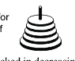

一次将一个环从一个桩的顶部移到另一个桩的顶部。游戏的目标是将所有环从第一个桩移到第二个桩。困难在于，孩子不能将一个环放在直径较小的环上方。还有一个额外的桩用于暂时存放环，但禁令也适用于该桩以及另外两个桩。三个环游戏的解决方案如下所示：

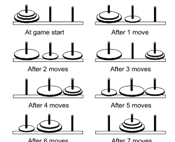

towers 类必须跟踪所有三个桩的状态。你可以使用三个桩的数组，其中每个桩都是上一个项目中的对象。towers 函数的规格如下所示：

```cpp
towers::towers(size_t n = 64);
// Precondition: 1 <= n <= 64.
// Postcondition: The towers have been initialized
// with n rings on the first peg and no rings on
// the other two pegs. The diameters of the first
// peg's rings are from one inch (on the top) to n
// inches (on the bottom).
```

```cpp
size_t towers::many_rings
(int peg_number) const;
// Precondition: peg_number is 1, 2, or 3.
// Postcondition: The return value is the number
// of rings on the specified peg.
```

```cpp
size_t towers::top_diameter
(int peg_number) const;
// Precondition: peg_number is 1, 2, or 3.
// Postcondition: If many_rings(peg_number) > 0,
// then the return value is the diameter of the top
// ring on the specified peg; otherwise the return
// value is zero.
```

```cpp
void towers::move
(int start_peg, int end_peg);
// Precondition: start_peg is a peg number
// (1, 2, or 3), and many_rings(start_peg) > 0;
// end_peg is a different peg number (not equal
// to start_peg, and top_diameter(end_peg) is
// either 0 or more than top_diameter(start_peg)).
// Postcondition: The top ring has been moved
// from start_peg to end_peg.
```

此外，重载输出运算符，以便可以轻松显示 towers 对象。在允许孩子玩汉诺塔的程序中使用 towers。确保不允许孩子做出任何非法移动。

- 14 指定、设计并实现一个名为 integer 的类，每个对象跟踪一个最多 100 位的十进制大整数。数字可以存储在 100 个元素的数组中，数字的符号可以存储在单独的成员变量中，正数为 +1，负数为 -1。该类应包含几个方便的构造函数，例如从普通 int 初始化对象的构造函数。还应重载常用的算术和比较运算符（用于对这些大数进行算术运算和比较），并重载输入和输出运算符。

- 15 使用第 2 章（编程项目 4）中开发的 card 类来创建一个新的牌组类。deck 类具有一个容量为 52 的序列来存放卡片。构造函数按花色和点数顺序将 52 张卡片分配给序列。一个友元函数应使用单词显示整个牌组（即，“黑桃 A”）。第 5 章（项目 16）将向此类添加更多函数。


- 16 指定、设计并实现一个程序，用于存储朋友的生日。创建一个 person 类，用于存储姓名和日期对象。姓名可以是字符串（参见附录 H），日期对象可以来自第 2 章的项目 17。person 类可以使用自动赋值运算符，但需要一个重载的相等比较运算符和一个重载的输出运算符。将 person 对象存储在一个序列中。提供成员函数来查找和显示一个人，以及显示整个序列。编写一个交互式测试程序，为用户提供插入、查找和显示序列内容的选项。

- 17 在本项目中，你将设计并实现一个包含员工容器的类，使用第 2 章项目 18 中的 employee 类。修改 employee 类以包含相等和比较运算符。提供计算员工统计信息的函数，例如平均年龄、平均工资、工作时数、加班时数、男女比例等。随意向 employee 类添加数据成员并修改构造函数，以存储任何必要信息。编写一个交互式测试程序。程序应为用户提供一个菜单，用于添加、删除或修改员工，以及打印任何可用的统计信息。

- 18 编写一个程序，从键盘读取一组九位数字。它将数字存储在 multiset 中，然后遍历集合以确定是否有重复项。对于每个重复项，打印一条消息，说明该条目在 multiset 中出现了多少次。

- 19 编写一个程序，使用字符串的 multiset 来跟踪你今天需要完成的家务清单。程序的用户可以请求多种服务：1) 向家务清单添加一项；2) 询问清单中有多少项家务；3) 使用迭代器将家务清单打印到屏幕上；4) 从清单中删除一项；5) 退出程序。如果你知道如何从文件读写字符串，则让程序从文件获取其初始家务清单。当程序结束时，它应将所有未完成的家务写回此文件。

- 20 编写一个程序，包含两个名为 actors 和 roles 的数组，每个大小为 N。对于每个 i，actors[i] 是演员的姓名，roles[i] 是一个字符串 multiset，包含该演员出演过的电影名称。程序从你设计的格式的文件中读取这些数组的初始信息。程序运行后，用户可以输入演员姓名，获取该演员的所有电影列表。或者用户可以输入电影名称，获取该电影的所有演员列表。

- 21 剑桥数学家约翰·康威（John Conway）发明了一组规则，用于描述彩色方格网格的配置如何随时间变化。一种颜色代表“活”方格，另一种代表“死”方格。这些规则被称为《生命游戏》（The Game of Life），部分动机源于希望表征自我复制的复杂性。对于本项目，请研究这些规则并创建一个名为 Life 的类。该类具有网格行数和列数的静态成员常量。（尽管康威的网格是无限的，但你的网格将是固定大小。）构造函数最初创建一个全为死方格的游戏；const 成员函数允许程序检索任何单个方格的当前状态；修改成员函数允许程序更改单个方格的状态或应用康威规则来更改整个网格。在程序中使用该类，允许用户设置初始配置并运行游戏。

## 第 4 章 指针和动态数组

> 他命信使策马疾驰
> 向东、向西、向南、向北
> 召集他的军队

托马斯·巴宾顿
《霍拉提乌斯》

### 学习目标

完成第 4 章后，你将能够...

- 使用包含单个变量地址的简单指针跟踪代码。
- 将指针变量与 C++ new 运算符一起使用，以分配单个动态变量和动态数组。
- 在不再需要动态变量和动态数组时，使用 C++ delete 运算符释放它们。
- 跟踪指针和数组作为函数参数时的行为。
- 实现容器类，使元素存储在动态数组中，其容量由类的成员视需要调整。

### 章节内容

- 4.1 指针和动态内存
- 4.2 作为参数的指针和数组
- 4.3 带动态数组的 Bag 类
- 4.4 动态类的处方
- 4.5 STL 字符串类与一个项目
- 4.6 编程项目：多项式
- 章节摘要
- 自测练习解答
- 编程项目

第 3 章的容器类仍然有一个令人困扰的限制。它们的容量在类定义中声明为常量。例如，bag 的 CAPACITY 常量决定了每个 bag 的容量。如果我们需要更大的 bag，可以增加该常量并重新编译，但这样做会增加每个 bag 的大小。对于需要一个大 bag 和许多小 bag 的程序来说，这是浪费的。即使是小 bag 也具有最大 bag 的容量。

> 每个 bag 的大小将彼此独立

解决方案是提供对每个 bag 大小的控制，使其独立于其他每个 bag。这种控制可以来自动态数组，即其大小仅在程序实际运行后才确定的数组。动态数组需要理解指针和动态内存，这些内容在本章的前两节中介绍和深入探讨。动态数组随后在第 4.3 节用于 bag 类的新实现，以及用于两个项目。你在本章中获得的对指针的理解也构成了后续章节中许多类的基础。

### 4.1 指针和动态内存

为了改进我们的容器类实现，我们需要了解指针。指针是变量的内存地址。要理解这个定义，你需要在脑海中构建计算机内存的图景，即由编号的内存位置（称为字节）组成。程序中的每个变量都存储在一系列相邻的字节中。例如，在某些机器上，每个整数变量需要四个字节。在这样的机器上，像 `int i;` 这样的整数声明提供四个相邻的字节内存来存储整数 i 的值。此处绘制的示例为整数变量 i 提供了编号 990 到 993 的字节。

标记每个字节的数字称为内存地址。当变量占据多个相邻字节时，第一个字节的内存地址也称为变量的内存地址。因此，在我们的示例中，整数 i 的地址是 990。变量的地址称为指针。这些地址被称为指针，因为它们可以被视为“指向”变量，因为它们通过告诉变量在哪里（而不是告诉变量的名称是什么）来标识变量。我们可以说整数 i 在“990 号位置”来指出它。

| 地址 |
|---------|
| 998 |
| 997 |
| 996 |
| 995 |
| 994 |
| 993 |
| 992 |
| 991 |
| 990 |
| 989 |
| 988 |
| 987 |

#### 指针变量

指针比仅仅指示变量位置要有用得多。要开始了解指针的实用性，我们必须查看专门用于存储指针的变量。存储指针的变量必须声明为特殊的指针变量，方法是在指针变量名称前放置一个星号。指针变量的完整声明必须包含三个项目，如下所示：

```
double *my_first_ptr;
```

在我们的示例中，my_first_ptr 是一个指针变量，能够指向任何 double 变量。换句话说，my_first_ptr 可以保存 double 变量的内存地址。指针变量 my_first_ptr 本身并不包含一个 double 数字——它仅仅包含 double 变量的地址。此外，由于我们在声明中使用了 double 数据类型，my_first_ptr 不能包含指向其他类型（如 int 或 char）变量的指针。它只能包含指向 double 变量的指针。

如果在同一行上声明多个指针变量，则每个变量名前必须出现一个星号。例如，要声明两个字符指针：

```
char *c1_ptr, *c2_ptr;
```

如果在 c2_ptr 前省略星号，则 c2_ptr 将是一个普通字符变量，而不是指向字符的指针。为了更清晰，我们经常使用 "_ptr" 作为指针变量名的结尾，或使用 "cursor" 作为指针变量名的一部分，因为“cursor”意味着“穿过结构运行”的指针。

#### 指针变量声明

指向类型 Type_Name 的其他变量的变量的声明方式与声明类型 Type_Name 的变量相同，只是在变量名开头放置一个星号。

```
Syntax: Type_Name *var_name1;
```

```
Examples: int *cursor; char *c1_ptr, *c2_ptr;
```


当然，除非有变量可供指针变量指向，否则指针变量毫无用处。例如，考虑以下两个声明：

```
int *example_ptr;
int i;
```

我们可以使用如下所示的 & 运算符，使 example_ptr 包含 i 的地址：

```
example_ptr = &i;    This statement puts the address of i into the pointer variable example_ptr.
```

& 运算符（称为地址运算符）提供变量的地址；例如，&i 是“整数变量 i 的地址”。因此，赋值语句将“i 的地址”放入 example_ptr。或者我们可以简单地说，example_ptr 现在“指向” i。

赋值后，您有两种方式引用 i：可以称它为 i，也可以称它为“example_ptr 指向的变量”。在 C++ 中，“example_ptr 指向的变量”写作 *example_ptr。这与我们用于声明 *example_ptr 时使用的星号表示法相同，但现在它有了另一种含义。当以这种方式使用星号时，它被称为解引用运算符，并且该指针变量被认为已被解引用。例如：

```
i = 42;              Both statements print 42.
example_ptr = &i;
cout << i << endl;
cout << *example_ptr << endl;    This dereferences example_ptr.
```

解引用运算符可能产生一些令人惊讶的结果。请考虑以下代码：

```
i = 42;
example_ptr = &i;
*example_ptr = 0;    This prints 0.
cout << *example_ptr << endl;
cout << i << endl;   This also prints 0.
```

只要 example_ptr 包含指向 i 的指针，i 和 *example_ptr 就引用同一个变量。因此，当将 *example_ptr 设置为 0 时，实际上是将 i 设置为 0。

用作地址运算符的符号 & 与函数参数列表中用于指定引用参数的符号 & 相同（参见第 69 页）。这不仅仅是巧合。引用参数的实现是通过使用实际参数的地址来完成的，而不是创建一个完全独立的副本（如值参数所做的那样）。符号 & 的这两种用法非常相似，但由于它们略有不同，我们将把它们视为符号 & 的两种不同（但密切相关）的用法。

## 将赋值运算符与指针一起使用

可以使用通常的赋值运算符将一个指针变量的值复制到另一个指针变量。例如：

```
int i = 42;
int *p1;
int *p2;
p1 = &i;
p2 = p1;
cout << *p1 << endl;
cout << *p2 << endl;
```

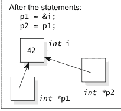

高亮显示的赋值语句表示“使 p2 指向 p1 已经指向的同一个变量。”

指针变量通常被绘制为一个包含箭头的框。箭头指向存储在指针中的地址所对应的变量。例如，在赋值 p2 = p1 之后，我们会绘制页边距中所示的图片。现在变量 i 有三个名称：可以称它为 i，也可以称它为 *p1，或者称它为 *p2。

处理指针变量时，指针变量（如 p1）与它所指向的对象（如 *p1）之间存在关键区别。不要混淆以下两个赋值语句的含义：

```
p2 = p1; versus *p2 = *p1;
```

如我们所见，p2 = p1 表示“使 p2 指向 p1 已经指向的同一个变量”。另一方面，*p2 = *p1 中包含解引用星号，使该语句具有截然不同的含义。新的含义是“将 p1 指向的变量的值复制到 p2 指向的变量中。”以下是一个示例，首先声明两个整数和两个指向整数的指针：

```
int i = 42;
int j = 80;
int *p1;
int *p2;
p1 = &i;
p2 = &j;
```

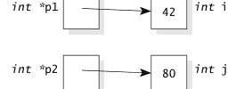

执行这些语句后，指针变量如右侧所示。

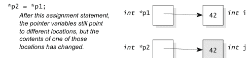

该赋值语句已将值 42 从 p1 指向的变量复制到 p2 指向的变量。实际上，j 的内容已更改，但指针本身仍然指向不同的内存位置。

> ### 与 = 一起使用的指针变量
> 
> 如果 p1 和 p2 是指针变量，则赋值 p2 = p1 会更改 p2，使其指向 p1 已经指向的同一个变量。
> 
> 另一方面，赋值 *p2 = *p1 将 p1 指向的变量的值复制到 p2 指向的变量中——但指针 p1 和 p2 仍然指向赋值语句之前所指向的内存位置。

## 动态变量和 new 运算符

指针可以指向普通变量，例如我们之前示例中的 i。但是，当指针与称为动态分配变量（或者更简单地说，动态变量）的特殊变量一起使用时，指针的真正威力才体现出来。动态变量类似于普通变量，但有两个重要区别：

- 动态变量不需要声明。程序可以使用许多动态变量，但动态变量永远不会像普通变量那样出现在任何声明中。此外，动态变量没有标识符（例如我们示例中使用的标识符 i 和 j）。
- 动态变量在程序执行期间创建。只有在那时，动态变量才会存在。

要在程序运行时创建动态变量，C++ 程序使用一个称为 new 的运算符，如下所示：

```
double *d_ptr;
d_ptr = new double;
```

在此示例中，new 运算符创建一个新的 double 类型动态变量，并返回指向该新动态变量的指针。该指针被赋给指针变量 d_ptr。创建新动态变量称为内存分配，该内存称为动态内存，因此我们可以说“d_ptr 指向从动态内存中新分配的 double 变量”。以下是另一个示例，它分配一个新的 int 变量：

```
int *p1;
```

此时，p1 已声明，但它没有可指向的对象。

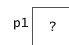

```
p1 = new int;
```

现在 p1 指向一个新分配的整数变量。

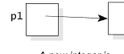

```
*p1 = 42;
```

新的整数变量现在包含我们最喜欢的数字 42。

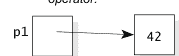

本示例末尾的赋值语句将 42 放入 p1 指向的动态变量中。

## 使用 new 分配动态数组

我们已经看到 new 运算符一次分配一个动态变量。但实际上，new 可以一次分配整个数组。数组组件的数量列在方括号中，紧跟在组件数据类型之后，如下所示：

```
double *d_ptr;
d_ptr = new double[10];
```

new 运算符分配一个包含 10 个 double 组件的数组，并将 d_ptr 指向第一个组件。

当 new 分配整个数组时，它实际上返回指向数组第一个组件的指针。在我们的示例中，new 运算符分配一个包含 10 个 double 组件的数组，并返回指向数组第一个组件的指针。该指针被赋给指针变量 d_ptr。分配后，可以使用带有指针变量 d_ptr 的数组表示法来访问数组。

例如，以下语句将 3.14 放入新数组的 [9] 组件中：

```
d_ptr[9] = 3.14;
```

因为 d_ptr 指向一个包含 10 个组件的数组，所以可以使用数组表示法来访问组件 [9]。

以下是另一个示例，它分配一个新的 int 数组：

```
int *p1;
```

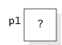

此时，p1 已声明，但它没有可指向的对象。

```
p1 = new int[4];
```

现在 p1 指向一个包含四个整数的新数组。

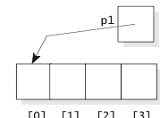

一个新分配的四个整数的数组

```
p1[2] = 42;
```

数组的 [2] 组件现在包含 42。

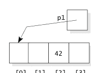

本示例末尾的赋值语句将 42 放入 p1 指向的数组的 [2] 组件中。

图 4.1 总结了 new 的所有版本，包括当 new 为类分配新对象时调用哪个构造函数的信息。

new 的数组版本特别有用，因为数组组件的数量可以在程序运行时计算。因此，组件数量可以取决于用户输入等因素。这是动态行为——即在程序运行时确定的行为——而 new 允许的数组称为动态数组。

作为动态行为的示例，请考虑一个读取数字列表并计算数字平均值的程序。计算平均值后，程序会打印列表，并指示哪些数字低于平均值，哪些数字高于平均值。我们希望此程序适用于十个 num-

动态行为是在程序运行时确定的


数字，或者一百个数字，或者我们碰巧有的任意多个数字。数组的大小可以由用户输入决定，如下所示：

```cpp
size_t array_size;
int *numbers;
cout << "How many numbers do you have? ";
cin >> array_size;
numbers = new int[array_size];
```

我们稍后将充分开发这个示例，但首先我们需要更仔细地了解内存分配。

## 图 4.1 new 运算符

## new 运算符

new 运算符为指定类型的动态变量分配内存，并返回指向新分配内存的指针。例如，以下代码分配一个新的动态整数变量，并将 p 设置为指向这个新变量：

```cpp
int *p;
p = new int;
```

如果动态变量是类的对象，则将调用默认构造函数来初始化新的类实例。如果在 new 语句中将构造函数的参数放在类型名称之后，则会调用不同的构造函数。例如：

```cpp
throttle *t_ptr;
t_ptr = new throttle(50);
```

new 运算符还可以分配动态组件数组，并返回指向第一个元素的指针。数组的大小在组件的数据类型后的方括号中指定：

```cpp
double *d_ptr;
d_ptr = new double[50];
d_ptr[3] = 3.14;
```

如果数组组件的数据类型是类，则使用默认构造函数来初始化动态数组的所有组件。没有机制在数组组件上使用不同的构造函数。

## 堆和 bad_alloc 异常

当 `new` 分配动态变量或动态数组时，内存来自称为程序 **堆** 的位置（也称为 **自由存储区**）。有些计算机提供巨大的堆，超过十亿字节。但即使是最大的堆，也可能因分配太多动态变量而耗尽。当堆没有空间时，`new` 运算符失败。

`new` 运算符通过一种称为 **bad_alloc 异常** 的机制指示其失败。通常，异常会导致打印错误消息并使程序停止。或者，程序员可以 "捕获" 异常并尝试修复问题，但我们不会在这里讨论捕获异常。

一些旧版本的 C++ 以不同的方式处理 `new` 失败，即返回一个称为 `null pointer` 的特殊指针值。如果程序员将 `new` 运算符写成 `new(nothrow)` 而不是简单的 `new`，则仍可获得这种旧行为。单词 `nothrow` 是头文件 `<new>` 中的一个常量。

对我们来说，正常的失败——导致错误消息和停止——就足够了。但是，我们将清楚地记录哪些函数使用 `new`，以便更有经验的程序员可以按自己的方式处理 `bad_alloc`。

> ### new 运算符失败
>
> `new` 运算符通常通过抛出称为 **bad_alloc 异常** 的异常来指示失败。通常，异常会导致打印错误消息并使程序停止。（旧版 C++ 实现对 `new` 失败使用不同的机制。）
>
> 我们清楚地记录哪些函数使用 `new`，以便有经验的程序员可以按自己的方式处理失败。

## delete 运算符

堆的大小因计算机而异。它可能只有几千字节，也可能超过十亿。小程序不太可能用完所有堆。但是，即使是小程序，释放不再需要的任何堆内存也是一种高效的做法。如果您的程序不再需要动态变量，该动态变量使用的内存可以返回到堆中，以便重新用于更多动态变量。在 C++ 中，`delete` 运算符用于将动态变量的内存返回到堆中。`delete` 运算符通过编写单词 `delete`，后跟指针变量来调用。示例出现在下一页的顶部。

```cpp
int *example_ptr;
example_ptr = new int;
```

```cpp
// Various statements that use *example_ptr appear here. When the
// program no longer needs the dynamic variable that example_ptr
// points to, the memory for that dynamic variable is returned to
// the heap with the following statement:
```

```cpp
delete example_ptr;
```

在 delete 语句之后，example_ptr 所指向的内存已返回到堆中以供重用。使用 delete 操作称为释放或重用内存。

略有不同的 delete 版本用于释放动态数组。在这种情况下，方括号 [ ] 出现在单词 delete 和指针变量名称之间，如下所示：

```cpp
int *example_ptr;
example_ptr = new int[50];
```

```cpp
// Various statements that use the array example_ptr[..] appear
// here. When the program no longer needs the dynamic array, the
// memory for that dynamic array is returned to
// the heap with the following statement:
```

```cpp
delete [] example_ptr;
```

当 delete [] 释放动态数组时，不需要在方括号内指定数组的大小。控制堆的软件会自动跟踪数组的大小。第 165 页的图 4.2 总结了 delete 运算符。

## 编程提示

## 定义指针类型

您可以为指针类型定义一个名称，以便指针变量可以像其他变量一样声明，而无需在每个指针变量前面放置星号。例如，以下内容定义了一个名为 int_pointer 的数据类型，它是指向 int 变量的指针变量的类型：

```cpp
typedef int* int_pointer;
```

这样的类型定义通常出现在头文件中，或出现在主程序之前的函数原型集合中。在此类型定义后，声明 int_pointer i_ptr; 等效于 int *i_ptr;。

## 图 4.2 delete 运算符

## delete 运算符

delete 运算符释放用于动态变量的内存。内存返回到堆中，以后可以重复使用。例如，以下代码分配一个整数动态变量，并在不再需要时释放内存：

```cpp
int *p;
p = new int;
// Various statements that use *p appear here. When the program no longer
// needs the dynamic variable that p points to, the memory for that
// dynamic variable is returned to the heap with the following statement:
delete p;
```

delete 运算符还可以释放动态组件数组。数组的所有内存都返回到堆中，以后可以重复使用。要释放整个数组，数组括号 [ ] 放在单词 delete 之后，如下所示：

```cpp
int *p;
p = new int[50];
// Various statements that use the array p[..] appear here. When the program no
// longer needs the dynamic array, the memory for that dynamic array is returned
// to the heap with the following statement:
delete [] p;
```

数组大小不需要与 delete 运算符一起指定。

#### 第 4.1 节自测练习

- 1. 描述 C++ 程序中 & 的两种不同用途。
- 2. 编写两条不同的语句，在执行以下代码后打印 i 的值：
  int *int_ptr, i;
  i = 30;
  int_ptr = &i;
- 3. 编写代码，(1) 分配一个包含 1000 个整数的新数组；(2) 将数字 1 到 1000 放入新数组的组件中；(3) 将数组返回到堆中。
- 4. 动态变量与普通变量有何不同？
- 5. 如果 new 运算符无法从堆中分配内存，会发生什么？

- 6. 以下代码会产生什么输出？

```cpp
int *p1;
int *p2;
p1 = new int;
p2 = new int;
*p1 = 100;
*p2 = 200;
cout << *p1 << " and " << *p2 << endl;
delete p1;
p1 = p2;
cout << *p1 << " and " << *p2 << endl;
*p1 = 300;
cout << *p1 << " and " << *p2 << endl;
*p2 = 400;
cout << *p1 << " and " << *p2 << endl;
delete p1;
```

- 7. 前一个练习调用 delete。为什么这是个好主意？

### 4.2 作为参数的指针和数组

函数参数可以是指针或数组——但需要小心，以确保实参和形参之间的连接是预期的连接。我们将探讨几种常见情况。

**指针形式的值参数。** 图 4.3 显示一个愚蠢的函数，用以说明一个指针形式的值参数。该函数的原型是：

```cpp
void make_it_42(int* i_ptr);
```

原型表明参数 i_ptr 的类型为 int*，即指向整数的指针。该参数是值参数，因为引用符号 & 未出现。在参数列表中，

许多程序员将 * 与数据类型放在一起

## 图 4.3 指针形式的值参数

## 函数实现

```cpp
void make_it_42(int* i_ptr)
// Precondition: i_ptr is pointing to an integer variable.
// Postcondition: The integer that i_ptr is pointing at has been changed to 42.
{
    *i_ptr = 42;
}
```


将星号与数据类型（int）放在一起，而不是与参数名（i_ptr）放在一起——尽管编译器会接受任一位置的星号。将星号与数据类型放在一起的原因是强调参数的“完整类型”是“整型指针”。

make_it_42 的唯一目的是展示当值参数是指针时会发生什么。请注意，函数体并不实际改变 i_ptr；它只改变 i_ptr 指向的整数。让我们来看看一个调用 make_it_42 的程序。该程序声明一个指向整数的指针，为指针分配要指向的内存，并调用 make_it_42：

```
int *main_ptr;
main_ptr = new int;
Now main_ptr is pointing
to a newly allocated integer.
Next, we call make_it_42 with
main_ptr as the actual parameter.
make_it_42(main_ptr);
```

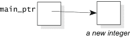

与任何值参数一样，实际参数为形式参数提供初始值。在示例中，main_ptr 为 make_it_42 函数的形式参数 i_ptr 提供初始值。这意味着参数 i_ptr 将指向 main_ptr 已经指向的同一位置。在函数执行开始时，我们有如下情况：

实际参数 main_ptr 为参数 i_ptr 提供初始值。

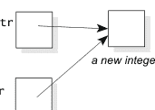

在 make_it_42 函数中，我们有赋值语句 *i_ptr = 42。该赋值将 42 放入 i_ptr 指向的位置，如下所示：

在 make_it_42 的函数体中，赋值语句“*i_ptr = 42”将 42 放入 i_ptr 指向的位置。

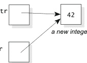

最后，函数返回，形式参数 i_ptr 不再可用。但是，指针变量 main_ptr 仍然存在，并且仍然指向同一位置。但该位置现在有一个新值 42，如下所示：

原始参数 main_ptr 仍然指向同一位置，但该位置现在有一个新值。

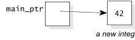

> **作为指针的值参数**
> 
> 当值参数是指针时，函数可能会更改指针所指向位置中的值。调用程序中的实际参数仍将指向同一位置，但该位置将有一个新值。
> 
> 参数列表中的语法：
> `Type_Name* var_name`
> 
> 第 166 页图 4.3 中的示例，
> `void make_it_42(int* i_ptr);`

在普通 C 编程（而非 C++）中，指针经常被用作值参数。这是因为 C 最初没有引用参数，因此函数影响其实际参数的唯一便捷方式是使用一个指针作为值参数。

## 数组参数。

当参数是数组时，会有一个令人惊讶的变化。该参数会自动被视为指向数组第一个元素的指针。在函数体中，该指针可以使用数组表示法，这与任何其他指向数组第一个元素的指针完全相同。例如，图 4.4 显示了一个将数组的前 n 个元素设置为数字 42 的函数。

数组参数的一个令人惊讶的变化

请注意，数组参数通过在参数名后放置方括号来指示，因此函数的原型是：

```
void make_it_all_42(double data[], size_t n);
```

方括号内不需要数组的大小，但通常会有另一个参数（例如 size_t n）来指示数组的大小。

如果函数体更改了数组的元素，这些更改确实会影响实际参数。影响实际参数的原因是，数组参数实际上是指向数组第一个元素的指针。下面是一个调用图 4.4 中函数的示例：

```
double main_array[10];                    <-- Set all 10 array components to 42.
make_it_all_42(main_array, 10);
cout << main_array[5];                    <-- This prints 42.
```

make_it_all_42 的实际参数可以是动态数组，如下所示：

```
double *numbers;                          <-- Allocate a dynamic array.
numbers = new double[10];                 <-- Set all elements to 42.
make_it_all_42(numbers, 10);
```

## 数组参数

数组参数通过在参数名后放置 [] 来指示，如下所示：

```
Syntax in the parameter list:
Type_Name var_name []
```

图 4.4 中的示例：
void make_it_all_42(double data[], size_t n);

通常会有一个单独的 size_t 参数来指示数组的大小。函数对数组元素所做的任何更改都会影响实际参数。

### 图 4.4 数组参数

### 函数实现

```
void make_it_all_42(double data[], size_t n)
// Precondition: data is an array with at least n components.
// Postcondition: The first n elements of the array data have been set to 42.
// Library facilities used: cstdlib
{
    size_t i;
    for (i = 0; i < n; ++i)
        data[i] = 42;
}
```

## 作为指针或数组的 const 参数。

指针或数组参数也可以包含 const 关键字，如下面两个原型所示：

```
bool is_42(const int* i_ptr);
double average(const double data[], size_t n);
```

第一个原型中的 const 关键字表示 i_ptr 是指向常量整数的指针。换句话说，is_42 的实现可以检查 *i_ptr，但不能更改 *i_ptr 的值。is_42 的完整函数体如图 4.5 所示，其中 *i_ptr 与数字 42 进行比较。

第二个原型表示 data 是一个数组，并且由于 const 关键字，函数不能更改数组元素。average 函数可以检查所有数组元素，但不能更改它们。我们的意图是让 average 返回 data 数组中所有元素的算术平均值，如图 4.5 下半部分所示。

### 图 4.5 作为指针或数组的 const 参数

### 函数实现

```
bool is_42(const int* i_ptr)
// Precondition: i_ptr is pointing to an integer variable.
// Postcondition: The return value is true if *i_ptr is 42.
{
    return (*i_ptr == 42);
}

double average(const double data[], size_t n)
// Library facilities used: cassert, cstdlib
{
    size_t i; // An array index
    double sum; // The sum of data[0] through data[n - 1]

    assert(n > 0);

    // Add up the n numbers and return the average.
    sum = 0;
    for (i = 0; i < n; ++i)
        sum += data[i];
    return (sum/n);
}
```

## 澄清 const 关键字

### 第 6 部分：作为指针或数组的 const 参数

指针或数组参数可以包含 const 关键字，如下所示：

```
Syntax in the parameter list:

const Type_Name* var_name
const Type_Name var_name[ ]
```

- 1. 已声明常量：第 12 页
- 2. 常量成员函数：第 38 页
- 3. const 引用参数：第 72 页
- 4. 静态成员常量：第 104 页
- 5. const 迭代器：第 144 页
- 6. 作为指针或数组的 const 参数
- 7. 带有指向节点的指针的 const 关键字，以及某些成员函数需要两个版本：第 227 页

图 4.5 中的示例：

```
bool is_42(const int* i_ptr);
double average(const double i_data[], ...
```

函数可以检查被指向的项目（或数组），但禁止更改该项目（或数组）。

作为指针的引用参数。有时，函数实际上会更改指针参数，使指针指向新位置，并且程序员需要更改影响实际参数。这是引用参数为指针的唯一情况。例如，图 4.6 显示了一个名为 allocate_doubles 的函数，用于为新动态数组分配内存。以下是该函数的原型：

```
void allocate_doubles(double*& p, size_t& n);
```

参数 p 是指向 double 的指针（即 double*），并且它是引用参数（由符号 & 指示）。因此完整的参数类型是 double*&。

在 allocate_doubles 的实现中，参数 p 被更改，使其指向新分配的数组。在程序中，我们可以使用 allocate_doubles 分配一个 double 值数组，数组的大小通过与用户交互来确定。以下是一个调用 allocate_doubles 的示例：

```
double *numbers;
size_t array_size;
allocate_doubles(numbers, array_size);
```

在此示例中，allocate_doubles 函数询问用户应分配多少个 double 数字。用户的回答用于设置


## 图 4.6 作为指针的引用参数

### 函数实现

```cpp
void allocate_doubles(double*& p, size_t& n)
    // Postcondition: The user has been prompted for a size n, and this size has been read.
    // The pointer p has been set to point to a new dynamic array containing n doubles.
    // NOTE: If there is insufficient dynamic memory, then bad_alloc is thrown.
    // Library facilities used: iostream, cstdlib
{
    cout << "How many doubles should I allocate? " << endl;
    cout << "Please type a positive integer answer: ";
    cin >> n;
    p = new double[n]; <——— Allocate the array of n doubles.
}
```

参数 array_size。然后函数分配请求大小的数组，并将名为 numbers 的参数设置为指向数组的第一个元素。由于函数使其形式参数 p 指向新分配的 double 数组，而我们希望实际参数 numbers 指向新分配的内存，因此必须使用引用参数。

如果你为指针类型定义了类型定义，则可以避免 *& 的繁琐语法。例如，如果 double_ptr 已被定义为指向 double 数的指针，那么我们可以写出这个原型：

```cpp
void allocate_doubles(double_ptr& p, size_t& n);
```

### 作为指针的引用参数

有时，函数会实际更改指针参数，使指针指向新位置，并且程序员需要更改影响实际参数。这是引用参数为指针的唯一情况。

参数列表中的语法：Type_Name*& var_name

图 4.6 中的示例：void allocate_doubles(double*& p, size_t& n);

#### 第 4.2 节自测练习

- 8. 假设 p 是类型 int* 的值参数。当函数对 *p 进行赋值时会发生什么？
- 9. 什么时候指针参数应该是引用参数？
- 10. 假设将数组作为参数传递。这与值参数的常规用法有何不同？
- 11. 为名为 make_intarray 的函数编写原型。该函数接受两个引用参数：一个将用于指向数组的指针，以及一个 size_t 数据类型以指示数组的大小。
- 12. 编写一个具有一个引用参数的函数，该参数是指向整数的指针。该函数分配 n 个整数的动态数组，使指针指向这个新数组。然后它用 0 到 n - 1 填充数组。
- 13. 为什么第 175 页的 average 和 compare 在数据数组上使用关键字 const，而 fill_array 不使用？
- 14. 编写一个函数，将 n 个元素从一个整数数组的前面复制到另一个数组的前面。其中一个数组应该是 const 参数，另一个应该是普通数组参数。
- 15. 用英语描述图 4.7 中程序的行为。

### 图 4.7 动态数组演示程序

### 一个程序

```cpp
// FILE: dynamdemo.cxx
// This is a small demonstration program showing how a dynamic array is used.
#include <iostream> // Provides cout and cin
#include <cstddef> // Provides EXIT_SUCCESS and size_t
#include <cassert> // Provides assert
using namespace std;

// PROTOTYPES for functions used by this demonstration program
void allocate_doubles(double*& p, size_t& n);
// Postcondition: The user has been prompted for a size n, and this size has been read.
// The pointer p has been set to point to a new dynamic array containing n doubles.
// NOTE: If there is insufficient dynamic memory, then bad_alloc is thrown.

void fill_array(double data[], size_t n);
// Precondition: data is an array with at least n components.
// Postcondition: The user has been prompted to type n doubles, and these
// numbers have been read and placed in the first n components of the array.
```

### （图 4.7 续）

```cpp
double average(const double data[], size_t n);
// Precondition: data is an array with at least n components, and n > 0.
// Postcondition: The value returned is the average of data[0]..data[n-1].

void compare(const double data[], size_t n, double value);
// Precondition: data is an array with at least n components.
// Postcondition: The values data[0] through data[n - 1] have been printed with a
// message saying whether they are above, below, or equal to value.

int main( )
{
    double *numbers; // Will point to the first component of an array
    size_t array_size;
    double mean_value;

    // Allocate an array of doubles to hold the user's input.
    cout << "This program will compute the average of some numbers. The\n";
    cout << "numbers will be stored in an array of doubles that I allocate.\n";
    allocate_doubles(numbers, array_size);

    // Read the user's input and compute the average.
    fill_array(numbers, array_size);
    mean_value = average(numbers, array_size);

    // Print the output.
    cout << "The average is: " << mean_value << endl;
    compare(numbers, array_size, mean_value);
    cout << "This was a mean program.";

    return EXIT_SUCCESS;
}
```

```cpp
void allocate_doubles(double*& p, size_t& n)
    See Figure 4.6 on page 172 for the body of this function.
```

```cpp
void fill_array(double data[], size_t n)
// Library facilities used: cstdlib
{
    size_t i;
    cout << "Please type " << n << " double numbers: " << endl;

    // Read the n numbers one at a time.
    for (i = 0; i < n; ++i)
        cin >> data[i];
}
```

### （图 4.7 续）

```cpp
void compare(const double data[], size_t n, double value)
{
    size_t i;

    for (i = 0; i < n; ++i)
    {
        cout << data[i];
        if (data[i] < value)
            cout << " is less than ";
        else if (data[i] > value)
            cout << " is more than ";
        else
            cout << " is equal to ";
        cout << value << endl;
    }
}
```

```cpp
double average(const double data[], size_t n)
// Library facilities used: cassert, cstdlib
{
    size_t i; // An array index
    double sum; // The sum of data[0] through data[n - 1]

    assert(n > 0);

    // Add up the n numbers and return the average.
    sum = 0;
    for (i = 0; i < n; ++i)
        sum += data[i];
    return (sum/n);
}
```

### 示例对话

本程序将计算一些数字的平均值。数字将存储在我分配的 double 数组中。
我应该分配多少个 double？
请输入整数答案：3
请输入 3 个 double 数字：
15.1 24.6 86.3
平均值为：42
15.1 小于 42
24.6 小于 42
86.3 大于 42
这是一个求平均值的程序。

### 4.3 带动态数组的 Bag 类

指针使我们能够定义数据结构，其大小在程序实际运行时而非编译时确定。这种数据结构称为**动态数据结构**。这与**静态数据结构**形成对比，后者的大小在程序编译时确定。

类可以是动态数据结构——换句话说，它可以使用动态内存。当类使用动态内存时，会涉及几个新因素。在本节中，我们将通过实现一个新的 bag 类来说明这些因素，该类将其项目存储在动态数组中，而不是固定大小的数组。除了使用动态数组外，新 bag 与第 3.1 节中的原始 bag 类大致相同。

### 指针成员变量

第 3.1 节中的原始 bag 类具有一个成员变量，即包含 bag 项目的静态数组。我们的新动态 bag 具有一个成员变量，即指向动态数组的指针。在这两种情况下，数组都是一个**部分填充的数组**，在数组的前部包含 bag 的项目。以下是两个类定义的成员变量比较：

```
**静态 Bag：**

// 来自第 3.1 节的 bag1.h:
class bag
{
...
private:
    value_type data[CAPACITY];
    size_type used;
};

**动态 Bag：**

// 来自本节的 bag2.h:
class bag
{
...
private:
    value_type *data;
    size_type used;
};
...
```

静态 bag 有一个名为 data 的私有成员变量，它是一个最多可容纳 CAPACITY 个项目的数组。静态 bag 永远无法容纳超过 CAPACITY 个项目。这就是限制。

另一方面，动态 bag 有一个名为 data 的私有变量，它是指向 value_type 项目的指针。动态 bag 的构造函数将分配一个动态数组，并将 data 指向新分配的数组。随着程序运行，当我们需要更多容量时，可以分配一个新的、更大的动态数组。由于动态数组的大小可以改变，动态 bag 实际上需要一个额外的私有成员变量来跟踪当前分配了多少内存。在下一页顶部，我们展示了新 bag 类的完整私有部分，包括这个额外的成员变量。


```
class bag
{
public:
  ...
private:
  value_type *data; // Pointer to dynamic array
  size_type used;   // How much of array is being used
  size_type capacity; // Current capacity of the bag
};
```

在掌握大部分类定义后，我们现在可以说明动态袋类的不变式：

## 修订版袋类的不变式

- 1. 袋中的项目数存储在成员变量 used 中。
- 2. 袋中的实际项目存储在一个部分填充的数组中。该数组是动态数组，由成员变量 data 指向。
- 3. 动态数组的总大小存储在成员变量 capacity 中。

## 成员函数根据需要分配动态内存

当类使用动态内存时，类的成员函数会根据需要分配动态内存。例如，动态袋的构造函数会分配成员变量 data 指向的动态数组。但这个数组应该有多大呢？我们的计划是让构造函数分配一个动态数组，其初始大小由构造函数的参数确定。随着袋子在程序中被使用，其动态数组的大小实际上可能会增加到所需的任何容量。

换句话说，构造函数的参数决定了袋子的初始容量，但即使达到这个初始容量后，仍然可以插入更多项目。每当向袋子中插入项目时——无论是通过 insert 成员函数还是 += 运算符——都会检查袋子的当前容量。如果当前容量太小，则成员函数会分配一个更大的新动态数组。袋子的用户无需做任何特殊操作即可获得增加的容量。insert 和 += 函数会根据需要增加容量。

你可能会好奇，为什么程序员需要关心袋子的初始容量。程序员难道不能从一个小的初始容量开始，然后一个接一个地插入项目吗？insert 函数会负责根据需要增加容量。是的，这种方法始终能正确工作。

*初始容量的重要性*

但是如果项目很多，那么 insert 的许多调用都需要增加容量。这可能效率低下。每次增加容量时，都会分配新内存，将项目复制到新内存中，并释放旧内存。为了避免这种重复的内存分配，程序员可以请求一个大的初始容量。考虑到这一点，新袋子构造函数的文档如下：

```
bag(size_type initial_capacity = DEFAULT_CAPACITY);
// Postcondition: The bag is empty with a capacity given by the parameter.
// The insert function will work efficiently (without allocating new
// memory) until this capacity is reached.
```

例如，假设程序员要将 1000 个项目放入名为 kilosack 的袋子中。在声明袋子时，程序员可以指定容量为 1000，如下所示：

```
bag kilosack(1000); // 1000 items can be efficiently added to kilosack.
```

达到初始容量后，insert 函数仍能正确工作，但可能会因内存分配而变慢。

*构造函数充当默认构造函数*

请注意，构造函数的参数有一个默认参数 DEFAULT_CAPACITY，它将是我们类定义中的一个常量。由于有默认参数，这个单一的构造函数实际上起到了两个作用：它可以带参数使用来构造具有特定容量的袋子，也可以作为默认构造函数使用（没有参数列表）。当构造函数不带参数列表使用时，DEFAULT_CAPACITY 用于初始容量。以下是两个示例，分别使用默认构造函数和带参数的构造函数：

```
bag ordinary; <-- The initial capacity is DEFAULT_CAPACITY.
bag super(9000); <-- The initial capacity is 9000.
```

这里还有一个示例，展示新构造函数如何与其他成员协同工作。该示例声明了一个初始容量为 6 的袋子，并向其中放入三个项目：

```
bag sixpack(6); <-- The constructor creates a bag
with an initial capacity of 6.
sixpack.insert(10);
sixpack.insert(20);
sixpack.insert(30);
```

这些声明之后，袋子的私有成员变量如下所示：

袋子的私有成员变量包括一个指向动态分配的六个元素数组的指针。前三个元素现在正在被使用。

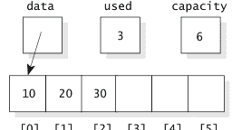

稍后，程序可以向这个袋子中插入更多项目，甚至可能超过六个。如果项目超过六个，则袋子的成员函数将根据需要增加袋子的容量。

在袋子声明并已投入使用后，程序员可以通过一个名为 reserve 的新成员函数对袋子的容量进行显式调整。该成员函数的规格如下：

```
void reserve(size_type new_capacity);
// Postcondition: The bag's current capacity is changed to the
// new_capacity (but not less than the number of items already in the bag).
// The insert function will work efficiently (without allocating new memory) until
// the new capacity is reached.
```

在某种程度上，reserve 函数是一种奢侈。程序员可以完全避免使用 reserve，允许其他成员函数根据需要调整袋子的大小。但是，通过使用 reserve 成员函数，可以提高袋子的效率。

为这个函数使用 reserve 这个名称可能看起来是个奇怪的选择。我们选择这个名称是为了与标准库容器类匹配，这些容器类有一个 reserve 成员函数来更改容器的容量。

*尽可能使用标准库容器类的名称*

总而言之，我们迄今为止看到的五个成员函数可以分配新的动态内存：构造函数、reserve、insert 以及两个运算符（+= 和 +）。与任何分配动态内存的函数一样，这些函数都可能失败——堆可能没有足够空间。在这种情况下，函数会调用 new 运算符，而 new 运算符会失败并抛出 bad_alloc 异常。这会打印错误消息并停止程序。对于我们的程序，打印错误消息并停止就足够了。但是，我们的类文档的一部分将指明哪些成员函数分配动态内存，以便更有经验的程序员可以以自己的方式处理异常。你可以在图 4.8 的底部看到此文档，它提供了我们新袋类头文件（bag2.h）的完整文档。

## 头文件文档

```
// 类 bag 的类型定义和成员常量：
// typedef ___ value_type
// bag::value_type 是袋中项目的数据类型。它可以是任何 C++
// 内置类型（int、char 等），或者是带有默认构造函数、赋值
// 运算符以及用于测试相等性（x == y）和不等性（x != y）的运算符的类。
// typedef ___ size_type
// bag::size_type 是任何用于跟踪袋中有多少项目的变量的数据类型。
// static const size_type DEFAULT_CAPACITY = _____
// bag::DEFAULT_CAPACITY 是由默认构造函数创建的袋子的初始容量。
// 类 bag 的构造函数：
// bag(size_type initial_capacity = DEFAULT_CAPACITY)
// 后条件：袋子为空，初始容量由参数给出。insert 函数将高效工作（不分配新
// 内存），直到达到此容量。
// 类 bag 的修改成员函数：
// size_type erase(const value_type& target)
// 后条件：target 的所有副本已从袋中移除。
// 返回值是移除的副本数量（可能为零）。
// bool erase_one(const value_type& target)
// 后条件：如果 target 在袋中，则移除一个副本；
// 否则袋子保持不变。true 返回值表示移除了一个副本；false 表示未移除任何内容。
// void insert(const value_type& entry)
// 后条件：entry 的新副本已插入袋中。
// void reserve(size_type new_capacity)
// 后条件：袋子的当前容量更改为
// 新容量（但不小于袋中已有的项目数量）。insert 函数将高效工作（不分配
// 新内存），直到达到新容量。
// void operator +=(const bag& addend)
// 后条件：addend 中的每个项目都已添加到此袋中。

reserve 成员函数提供了效率。
```


```
(FIGURE 4.8 continued)
// CONSTANT MEMBER FUNCTIONS for the bag class:
// size_type size( ) const
//     Postcondition: The return value is the total number of items in the bag.
// size_type count(const value_type& target) const
//     Postcondition: The return value is the number of times target is in the bag.
// NONMEMBER FUNCTIONS for the bag class:
// bag operator +(const bag& b1, const bag& b2)
//     Postcondition: The bag returned is the union of b1 and b2.
// VALUE SEMANTICS for the bag class:
//     Assignments and the copy constructor may be used with bag objects.
// DYNAMIC MEMORY USAGE by the bag:
//     If there is insufficient dynamic memory, then the following functions throw bad_alloc:
//     the constructors, reserve, insert, operator +=, operator +, and the assignment operator.
```

## 编程提示

## 提供关于可能动态内存失败的文档

当类使用动态内存时，应当包含文档以指明哪些成员函数分配动态内存。这样将使有经验的程序员能够处理潜在的失败。

图 4.8 中的文档为程序员使用我们的新 bag 类提供了足够的信息。但在实现该类之前，每当类使用动态内存时，有两个额外因素起着重要作用。第一个因素是值语义（即，赋值运算符和拷贝构造函数）。第二个因素是需要一个称为析构函数的特殊成员函数。我们将在完成实现之前讨论这两个因素。

## 值语义

bag 类的值语义决定了值如何从一个 bag 复制到另一个 bag——在赋值语句中以及当一个 bag 作为另一个 bag 的副本进行初始化时。到目前为止，我们并不太担心值语义。对于我们的所有其他类，使用自动赋值运算符和自动拷贝构造函数就足够了。因此，在过去，当我们写 y = x 时，我们满足于让自动赋值运算符将对象 x 的所有成员变量复制到对象 y。

> 值语义决定了值如何被复制

我们轻松满足的日子结束了。自动赋值运算符对动态 bag（或任何其他使用动态内存的类）失效。

这里有一个示例来展示哪里出了问题。假设我们设置了一个名为 x 的 bag，初始容量为 5，包含整数 10、20 和 30——然后我们将 x 的私有成员变量复制到另一个 bag y。结果是，两个指针 x.data 和 y.data 都指向同一个动态数组，如下所示：

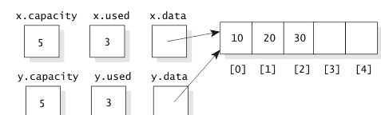

这种安排的问题是，对 x 的数组的后续更改也会更改 y 的数组。通常，这不是我们想要的；在赋值 y = x 之后，我们不希望对一个对象的进一步更改直接影响另一个对象。

相反，当我们赋值 y = x 时，我们希望 y 拥有自己的动态数组，与 x 的动态数组完全分离。当然，y 的动态数组将包含与 x 数组相同的值，但这两个数组不会共享相同的动态内存。赋值后的理想情况如下所示：

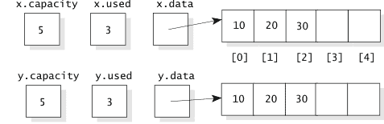

为了实现这种情况，我们必须提供自己的赋值运算符，而不是依赖自动赋值运算符。我们可以通过为 bag 类重载赋值运算符来做到这一点，方式大致与我们为 bag 重载其他运算符相同。该运算符将作为 bag 成员函数重载，原型如下所示：

```cpp
void bag::operator=(const bag& source);
// Postcondition: The bag that activated this function has the same items
// and capacity as source.
```

当你重载赋值运算符时，C++ 要求它必须是成员函数。在赋值语句 y = x 中，bag y 激活该函数，bag x 是名为 source 的参数的实参。稍后我们将实现这个成员函数，你将看到它如何正确地创建一个新的动态数组，而不仅仅是复制指针。

值语义的第二部分是拷贝构造函数，当新对象作为现有对象的副本进行初始化时会激活它，例如声明：

```cpp
bag y(x); // Initialize y as a copy of the bag x.
```

除非另有说明，否则 y 将使用自动拷贝构造函数进行初始化，它仅将 x 的成员变量复制到 y。如果你想避免简单地复制成员变量，那么你必须提供一个原型如下的拷贝构造函数：

```cpp
bag::bag(const bag& source);
// Postcondition: The bag that is being constructed has been initialized
// with the same items and capacity as source.
```

拷贝构造函数的参数通常是 const 引用参数（尽管很少使用，C++ 也允许普通引用参数，但不允许值参数）。如果存在拷贝构造函数，则将使用它而不是自动拷贝构造函数。拷贝构造函数还有几种其他用途，我们将在第 195 页讨论。

我们在第 180 页图 4.8 中对 bag 的文档表明，赋值运算符和拷贝构造函数可以安全地与 bag 类一起使用：

```
// VALUE SEMANTICS for the bag class:
// Assignments and the copy constructor may be used with bag objects.
```

## 值语义与动态内存

如果类使用动态内存，自动赋值运算符和自动拷贝构造函数将失效。类的实现者必须为赋值运算符和拷贝构造函数提供成员函数。例如：

```cpp
class bag
{
public:
    bag(const bag& source);
    void operator=(const bag& source);
    ...
}
```

类的文档应当表明可以使用值语义。

关于值语义的最后一点：使用 bag 的程序员不需要知道实现者是否重写了自动值语义。这个程序员只需要知道存在有效的值语义。因此，bag 的文档表明存在有效的值语义，但不表明是否重写了自动值语义。

## 析构函数

对于使用动态内存的类，最后一个新因素是一个称为 **析构函数** 的特殊成员函数。析构函数的主要目的是在对象不再使用时将其动态内存返回到堆中。析构函数有三个独特特性：

- 析构函数的名称始终是波浪字符 (~) 后跟类名。在我们的示例中，析构函数的名称是 ~bag。
- 析构函数没有参数也没有返回值。与构造函数一样，你不得在析构函数原型的前面写 `void`（或任何其他返回类型）。但是，你必须列出空参数列表，如下所示：`~bag()`；
- 使用类的程序员不需要知道析构函数。这是因为程序很少显式激活析构函数。一个从未被激活的析构函数有什么用？答案是，析构函数会被激活，但激活通常是在对象变得不可访问时自动发生。

几种常见情况会导致自动析构函数激活：

1. 假设一个函数有一个是对象的局部变量，如下所示：

```cpp
void example1()
{
    bag sample1;
    ...
}
```

当函数 example1 返回时，析构函数 sample1.~bag() 会自动激活。一般情况：当局部变量是带有析构函数的对象时，析构函数会在函数返回时自动激活。

> 当对象变得不可访问时，析构函数会自动激活

2. 假设一个函数有一个是对象的值参数，如下所示：

```cpp
void example2(bag sample2)
// Does some calculation using a bag
```

与前一个示例一样，当函数 example2 返回时，析构函数 sample2.~bag() 会自动激活。另一方面，如果 sample2 是引用参数，则不会激活析构函数，因为引用参数实际上是调用程序中的一个对象，而该对象仍然可访问。


3. 假设动态变量是一个对象，如下所示：

```
bag *b_ptr;
b_ptr = new bag;
...
delete b_ptr;
```

当执行 `delete b_ptr` 时，`*b_ptr` 的析构函数会自动激活。析构函数确保 `*b_ptr` 使用的动态数组被释放。

还有几种其他情况会自动调用析构函数，但你已看到的三个例子提供了总体概念。因为析构函数不是由程序直接激活的，所以我们在第 180 页的图 4.8 中省略了关于如何使用 bag 的文档中的析构函数。

## 析构函数

类的 **析构函数** 是一个成员函数，当对象变得不可访问时会自动激活。析构函数没有参数，其名称必须是字符 ~ 后跟类名（例如，bag 类的 ~bag）。

因为析构函数会自动调用，程序很少显式调用析构函数，我们通常会从说明如何使用类的文档中省略析构函数。

析构函数的主要职责仅仅是释放动态内存。

## 修订后的 Bag 类——类定义

我们现在可以为动态 bag 编写完整的类定义了。和往常一样，类定义出现在头文件中，并由宏保护包围。此定义在图 4.9 中显示（文件名为 bag2.h）。请注意，bag 的 `operator+` 函数不是成员函数。

### 图 4.9 带动态数组的 Bag 类头文件

### 一个头文件

```
// FILE: bag2.h (part of the namespace main_savitch_4)
// CLASS PROVIDED: bag

请参见第 180 页的图 4.8，了解此处应包含的其他文档。

#ifndef MAIN_SAVITCH_BAG2_H
#define MAIN_SAVITCH_BAG2_H
#include <cstddef> // Provides size_t
namespace main_savitch_4
{
    class bag
    {
    public:
        // TYPEDEFS and MEMBER CONSTANTS
        typedef int value_type;
        typedef std::size_t size_type;
        static const size_type DEFAULT_CAPACITY = 30;
        // CONSTRUCTORS and DESTRUCTOR
        bag(size_type initial_capacity = DEFAULT_CAPACITY);
        bag(const bag& source);
        ~bag( );
        // MODIFICATION MEMBER FUNCTIONS
        void reserve(size_type new_capacity);
        bool erase_one(const value_type& target);
        size_type erase(const value_type& target);
        void insert(const value_type& entry);
        void operator +=(const bag& addend);
        void operator =(const bag& source);
        // CONSTANT MEMBER FUNCTIONS
        size_type size( ) const { return used; }
        size_type count(const value_type& target) const;
    private:
        value_type *data; // Pointer to partially filled dynamic array
        size_type used; // How much of array is being used
        size_type capacity; // Current capacity of the bag
    };
    // NONMEMBER FUNCTIONS for the bag class
    bag operator +(const bag& b1, const bag& b2);
}
#endif
```

如果您的编译器不允许初始化静态常量，请参见附录 E。

复制构造函数的原型在第 183 页讨论。

析构函数的原型在第 184 页讨论。

重载运算符 += 的原型在第 182 页讨论。

## 修订后的 Bag 类——实现

我们将查看新 bag 成员函数的实现。三个函数尤为重要：复制构造函数、析构函数和赋值运算符。当类使用动态内存时，这三个成员函数始终需要。

**构造函数。** 每个构造函数都负责设置三个私有成员变量，以满足动态 bag 类的不变式。例如，这是第一个构造函数的实现。请注意如何为所有三个私有成员变量赋值：

```cpp
bag::bag(size_type initial_capacity)
{
    data = new value_type[initial_capacity];
    capacity = initial_capacity;
    used = 0;
}
```

参数 initial_capacity 告知为动态数组分配多少个项目。

bag 的复制构造函数类似，也为动态数组分配内存。在复制构造函数的情况下，动态数组的容量与正在复制的 bag 的容量相同。分配动态数组后，可以复制项目。如下所示的动态数组：

复制构造函数

```cpp
bag::bag(const bag& source)
{
    data = new value_type[source.capacity];
    capacity = source.capacity;
    used = source.used;
    copy(source.data, source.data + used, data);
}
```

为 source 分配的内存量决定了为新动态数组分配多少内存。

请注意，我们使用了标准库 copy 函数（在第 116 页的 C++ 特性中描述）。

**析构函数。** 析构函数的主要职责是释放动态内存。有时还需要其他“清理”工作，但 bag 的析构函数不需要，它只有一条语句：

```cpp
bag::~bag()
{
    delete [ ] data;
}
```

名为 data 的私有成员变量指向动态数组。

析构函数

析构函数最棘手的方面是习惯名称中的 ~。

赋值运算符。赋值运算符的实现几乎与复制构造函数相同。只有微小的差异：

- 复制构造函数是从头开始构造一个 bag。它为部分填充的数组分配初始内存。
- 赋值运算符不是构造一个新 bag，这意味着已经有一个部分填充的数组被分配。这个数组的大小可能需要更改，或者我们可能对已经存在的数组感到满意。如果我们最终分配了一个新数组，那么原始数组必须返回到堆中。
- 在赋值运算符中，源参数（正在被复制的）可能与激活运算符的对象是同一个对象。对于 bag b，如果程序员编写 b = b（称为自赋值），就会发生这种情况。也许你认为自赋值是无意义的，但尽管如此，赋值运算符应该正确工作，将 b 赋值为等于其当前值——也就是说，保持 bag 不变。

自赋值的解决方案是在运算符开头提供一个特殊检查。如果发现正在发生 b = b 这样的赋值，我们将立即返回。我们可以通过确定 source 是否与激活运算符的对象是同一个对象来检查此条件。这是通过一个特殊的布尔测试完成的，可以在任何赋值运算符开头使用：

```
// Check for possible self-assignment:
if (this == &source)
    return;
```

该测试使用关键字 this，可以在任何成员函数内部使用以提供激活该函数的对象的指针。表达式 &source 是 & 运算符的常见用法，它提供源对象的地址。如果 this 指针与源对象的地址相同，则我们有自赋值，可以立即返回，无需任何工作。

### 编程提示

### 如何检查自赋值

在任何赋值运算符开头，始终使用以下模式检查可能的自赋值：

```
if (this == &source)
    return;
```

在检查可能的自赋值后，我们的 bag 赋值运算符处理潜在的新内存分配，使用一个局部变量 new_data，它是指向新动态数组的指针：value_type *new_data[]。此潜在内存分配的代码在下一页顶部给出。

```
if (capacity != source.capacity)
{
    new_data = new value_type[source.capacity];
    delete [ ] data;
    data = new_data;
    capacity = source.capacity;
}
```

让我们跟踪此内存分配的语句。要跟踪语句，我们假设 source 是一个容量为 5 的 bag。我们将假设激活该函数的 bag 仅有容量为 2 的情况执行语句。当赋值开始时，我们有以下情况：

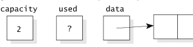

由于当前容量（2）不等于所需容量（5），代码进入 if 语句的主体。在主体中，我们有一个局部变量 new_data，它被设置为指向新分配的五个项目的数组，如下所示：

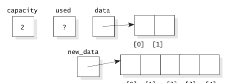

分配新数组后，我们将旧数组返回到堆中并赋值 data = new_data，以便 data 指针指向新数组：

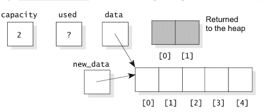


最后，capacity 被更改为 5，我们不再需要局部变量 new_data，如下所示：

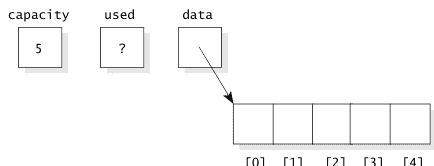

此时，剩下的工作就是将 source 数组中的项目复制到新分配的数组中，并正确设置 used 的值。你可以在图 4.10 的完整函数实现中看到 copy 函数是如何完成此操作的。

### 图 4.10 Bag = 运算符的实现

### 成员函数实现

```cpp
void bag::operator=(const bag& source)
// Library facility used: algorithm
{
    value_type *new_data;
    // Check for possible self-assignment:
    if (this == &source)
        return;
    if (capacity != source.capacity)
    {
        new_data = new value_type[source.capacity];
        delete [] data;
        data = new_data;
        capacity = source.capacity;
    }
    used = source.used;
    copy(source.data, source.data + used, data);
}
```

如有必要，分配一个大小不同的动态数组。

使用 copy 函数从 source 复制数据。

很诱人不使用局部变量 new_data 来实现新的内存分配，只需两条语句：

```cpp
delete [] data; // Release old array
data = new value_type[source.capacity]; // Allocate new array
```

这个捷径可能会带来麻烦。如果内存不足，new 运算符会抛出 bad_alloc 异常——但使用捷径方法时，在抛出异常时 bag 不是有效的（因为 bag 已经被释放）。对于无效的 bag，通常的异常处理机制可能在有机会打印合理的错误消息之前就失败。失败的原因是该机制会为先前构造的任何对象激活析构函数。当析构函数接收到无效对象——例如我们的无效 bag——时，析构函数可能会导致比 bad_alloc 通常消息更令人困惑的错误消息。结果，你的程序将更难调试。无效的 bag 也使经验丰富的程序员更难以以一种尝试在不停止程序的情况下恢复的方式处理 bad_alloc 异常。

由于这些问题，我们建议成员函数在调用 new 之前始终确保所有对象都是有效的。此外，你的文档应指明哪些函数分配动态内存。对于 bag，我们已经在头文件中通过以下注释处理了此文档（来自第 181 页图 4.8 的底部）：

```
// DYNAMIC MEMORY USAGE by the bag:
// If there is insufficient dynamic memory then the following functions
// throw bad_alloc: the constructors, reserve, insert, operator +=,
// operator +, and the assignment operator.
```

## 在成员函数中分配内存

当成员函数分配内存时，在调用 new 运算符时使类的不变量保持有效是个好主意。此外，文档应指明哪些函数分配动态内存。这种方法有助于调试，并允许经验丰富的程序员以合理的方式处理 bad_alloc 异常。

此提示对于分配动态内存的构造函数不是必需的（而且通常也不可能）。但对于其他成员函数的轻松调试至关重要。

reserve 成员函数。我们的设计包含一个名为 reserve 的成员函数，用于显式增加 bag 的容量。以下是带有后置条件的函数原型：

```cpp
void reserve(size_type new_capacity);
// Postcondition: The bag's current capacity is changed to the
// new capacity (but not less than the number of items already in the bag).
// The insert function will work efficiently (without allocating new memory)
// until the new capacity is reached.
```

reserve 函数是图 4.11 完整实现文件中显示的函数之一。该函数首先执行几个检查。检查之后，使用新大小分配新数组，将项目复制到新数组中，并释放原始数组。然后，私有成员变量 data 被指向新数组，capacity 被设置为指示当前分配了多少内存。

## 修订后的 Bag 类——将各部分组合在一起

其他几个 bag 成员函数需要进行小更改，以便与动态数组正确协作。最明显的更改是，insert 等成员函数必须在插入新项目之前确保有足够的容量。如果需要更多空间，则该函数通过激活 reserve 来增加 bag 的容量。对 bag 函数的必要更改已在图 4.11 的新实现文件中标记。

### 图 4.11 带有动态数组的 Bag 类实现文件

### 实现文件

```cpp
// FILE: bag2.cxx (part of namespace main_savitch_4)
// CLASS implemented: bag (see bag2.h for documentation)
// INVARIANT for the bag class:
//   1. The number of items in the bag is in the member variable used.
//   2. The actual items of the bag are stored in a partially filled array.
//   3. The array is a dynamic array, pointed to by the member variable data.
//   4. The size of the dynamic array is in the member variable capacity.

#include <algorithm>    // Provides copy function
#include <cassert>      // Provides assert function
#include "bag2.h"
using namespace std;

namespace main_savitch_4
{
    const bag::size_type bag::DEFAULT_CAPACITY;
}
```

### （图 4.11 续）

```cpp
bag::bag(size_type initial_capacity)
{
    data = new value_type[initial_capacity];
    capacity = initial_capacity;
    used = 0;
}
```

修订后的 bag 有两个构造函数。第一个构造函数充当默认构造函数，因为参数有默认参数。第二个构造函数是拷贝构造函数，你可以在第 187 页阅读相关内容。

```cpp
bag::bag(const bag& source)
// Library facilities used: algorithm
{
    data = new value_type[source.capacity];
    capacity = source.capacity;
    used = source.used;
    copy(source.data, source.data + used, data);
}
```

关于析构函数，请参见第 187 页。

```cpp
bag::~bag()
{
    delete [] data;
}
```

```cpp
void bag::reserve(size_type new_capacity)
// Library facilities used: algorithm
{
    value_type *larger_array;
    if (new_capacity == capacity)
        return; // The allocated memory is already the right size.
    if (new_capacity < used)
        new_capacity = used; // Can't allocate less than we are using.
    larger_array = new value_type[new_capacity];
    copy(data, data + used, larger_array);
    delete [] data;
    data = larger_array;
    capacity = new_capacity;
}
```

```cpp
bag::size_type bag::erase(const value_type& target)
// No change from the original bag: See the solution to Self-Test Exercise 12 on page 147.
```

```cpp
bool bag::erase_one(const value_type& target)
// No change from the original bag: See the implementation in Figure 3.3 on page 114.
```

### （图 4.11 续）

```cpp
void bag::insert(const value_type& entry)
{
    if (used == capacity)
    {
        reserve(used+1);
        data[used] = entry;
        ++used;
    }
}
```

insert 函数的第一个操作是确保有空间容纳新项目。

```cpp
void bag::operator+=(const bag& addend)
// Library facilities used: algorithm
{
    if (used + addend.used > capacity)
        reserve(used + addend.used);
    copy(addend.data, addend.data + addend.used, data + used);
    used += addend.used;
}
```

+= 运算符首先确保有足够的空间容纳新项目。

```cpp
void bag::operator=(const bag& source)
// See the implementation in Figure 4.10 on page 190.
```

```cpp
bag::size_type bag::count(const value_type& target) const
// No change from the original bag: See the implementation in Figure 3.6 on page 119.
```

```cpp
bag operator+(const bag& b1, const bag& b2)
{
    bag answer(b1.size() + b2.size());
    answer += b1;
    answer += b2;
    return answer;
}
```

该函数声明一个足够大小的 bag。

#### 第 4.3 节自测练习

- 16. 描述动态数据结构和静态数据结构之间的区别。
- 17. 如果可以按需分配动态内存，程序员为什么需要关心容器的初始容量？
- 18. 假设你这样声明一个 bag：`bag exercise;`。初始容量是多少？如果尝试向 bag 中放入 31 个项目，会发生什么？


- 19. 如果 bag 已满，则 `insert` 函数仅将 bag 的容量增加 1。如果我们要向已满的 bag 中插入一系列项目，这可能效率低下，因为每次插入都会调用 reserve。重写 bag 的 `insert` 函数，使其将容量至少增加 10%。
- 20. 析构函数的主要职责是什么？对象的析构函数何时被激活？
- 21. 为第 3 章中描述的 sequence 类编写析构函数的原型。
- 22. 关键字 `this` 指代什么？
- 23. 为什么 bag 的赋值运算符需要重载？我们的实现对自赋值（`x = x`）是否工作正确？

### 4.4 动态类的处方

本节总结了使用动态内存的类的重要因素。我们还指出了拷贝构造函数的额外重要性。

### 四条规则

当类使用动态内存时，通常会遵循以下四条规则：

- 1. 类的一些成员变量是指针。
- 2. 成员函数根据需要分配和释放动态内存。
- 3. 类的自动值语义被重写（否则两个不同的对象最终会指向同一块动态内存）。这意味着实现者必须为类编写赋值运算符和拷贝构造函数。
- 4. 类有一个析构函数。析构函数的主要目的是将所有动态内存返回到堆中。

### 拷贝构造函数的特殊重要性

当类使用动态内存时，实现该类的程序员会编写一个拷贝构造函数。当一个对象要作为另一个对象的副本进行初始化时，会使用拷贝构造函数，如下声明所示：

```
bag y(x); // Initialize y as a copy of x.
```

还有三种其他常见情况会使用拷贝构造函数。这些情况强化了当对象使用动态内存时，对特殊值语义的需求。

### 替代语法

第一种情况实际上只是使用拷贝构造函数初始化新声明对象的替代语法。替代语法是：

```
bag y = x; // Initialize y as a copy of x.
```

这种语法是 `bag y(x);` 的替代方案。两种版本仅激活拷贝构造函数，以将 `y` 初始化为 `x` 的副本。

**从函数返回对象。** 使用拷贝构造函数的第二种情况是当函数的返回值是一个对象时。例如，bag 的 `operator +` 返回一个 bag 对象。函数在局部变量中计算其答案，然后执行 return 语句。当执行 return 语句时，实际发生的情况是：局部变量的值被复制到一个称为 **返回位置** 的临时位置。然后销毁局部变量本身（以及任何其他局部变量），函数返回到调用它的位置。

除非您另有说明，否则复制到返回位置是通过使用自动拷贝构造函数完成的，该构造函数将局部变量的所有成员变量复制到返回位置。如果您想避免简单复制成员变量，则必须提供一个拷贝构造函数。如果存在拷贝构造函数，则它将用于将函数局部变量的返回值复制到返回位置。

**当值参数是一个对象时。** 第三种情况发生在值参数是一个对象时。例如，在第 68 页，我们声明了一个对点进行计算的函数，其原型如下：

```
int rotations_needed(point p);
```

调用函数时，实际参数会被复制到形式参数 `p`。复制过程使用拷贝构造函数。

## 使用动态内存需要析构函数、拷贝构造函数和重载的赋值运算符

当类的成员变量是指向动态内存的指针时，类应始终提供一个析构函数，并且应始终定义值语义（即，应提供拷贝构造函数和重载的赋值运算符）。

- • 析构函数负责将对象的动态内存返回到堆中。如果忘记析构函数，则分配给对象的动态内存将继续占用堆内存，即使对象不再需要也是如此。

- • 拷贝构造函数和重载的赋值运算符负责正确地将一个对象复制到另一个对象。确保复制过程为新副本分配新内存，而不仅仅是将指针从一个对象复制到另一个对象。如果忘记拷贝构造函数，则函数的值参数和返回值将无法正确工作。

#### 第 4.4 节自测练习

- 24. 列出拷贝构造函数被激活的三种情况。
- 25. 假设一个函数返回一个对象。如果类没有提供新的拷贝构造函数，函数返回什么值？

### 4.5 STL 字符串类及项目

> C 程序中充斥着用于容纳最坏情况下字符序列的超大数组。或者它们包含复杂的逻辑来分配和释放存储、复制字符串，并将那些终止空字符放在正确的位置。
> 
> 因此，编写字符串类成为 C++ 程序员中更受欢迎的室内运动之一，也不足为奇了。
> 
> P. J. PLAUGER
> C++ 草案标准库

正如 P.J. Plauger 所指出的，编写用于字符串操作的类一直是一项流行的消遣。或者至少在过去是这样。标准模板库（STL）现在包含一个字符串类，因此编写字符串类的运动最近人气有所下降。尽管如此，设计和实现动态字符串类的一部分仍然是一个有益的练习。在本节中，我们将为 STL 字符串类提供一些文档，并通过概述我们自己的类版本来讨论其实现方式。

### 以空字符结尾的字符串

在 C 或 C++ 中，字符数组可以用于存储一种简单的字符串。这很自然，因为字符串是字符序列，而字符数组正是存储字符序列所需的。因此，以下数组声明为我们提供了一个能够存储最多九个字符的字符串变量：

```
char s[10];
```

这不是一个错误。我们说 s 可以容纳最多九个字符的字符串。字符串变量 s 不能容纳完整的 10 个字符，尽管数组确实包含 10 个元素。这是因为字符串的字符被放置在数组中，后面跟着特殊符号 '\0'，该符号紧跟在字符串的最后一个字符之后。因此，如果 s 包含字符串 "Hi Mom!"，则数组元素的填充情况如下所示：

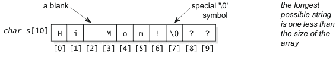

字符串变量与字符数组的对比

字符 '\0' 标记字符串的结束。如果您从 s[0] 开始读取字符串中的字符，然后继续读取 s[1]、s[2]，依此类推，当您遇到符号 '\0' 时，就知道已到达字符串的末尾。由于符号 '\0' 始终占用数组的一个元素，因此最长可能字符串的长度比数组大小少 1。

字符 '\0' 被称为空字符，而字符串本身被称为以空字符结尾的字符串。在程序中，空字符写作 '\0'——单引号用于所有 C++ 字符，例如 'a'、'b'、'c'。\0（反斜杠后跟一个零）表示空字符。它看起来像两个字符，但官方上是一个单字符，并且在字符数组中仅占用一个位置。

字符串变量与字符数组之间的唯一区别在于，字符串变量必须使用空字符来标记字符串的结束。这是关于数组使用方式的区别，而不是关于数组本身的区别。字符串变量是一个字符数组，但它的使用方式不同。

### 初始化字符串变量

您可以在声明字符串变量时对其进行初始化，如下所示：

```
char proclaim[20] = "Make it so.";
```

请注意，分配给字符串变量的字符串不需要填满整个数组。

初始化字符串变量时，可以省略数组大小，C++ 会自动计算大小，使其刚好足够容纳字符串加上空终止字符。例如：

```
char thought[] = "Peace"; ← This allocates an array of six characters.
```

### 空字符串

有时，程序需要一个完全没有字符的字符串，甚至连一个空格都没有。这个没有字符的字符串称为空字符串，由两个双引号且中间没有任何内容来指定。例如：

```
char quiet[20] = "" ;
```

两个双引号之间甚至没有空格。quiet 的初始化将把空终止符放在 quiet[0] 位置，因此终止符之前没有字符。这确实是一个非常安静的俏皮话。


## 读写字符串变量

C++ 支持使用通常的 >> 和 << 运算符读写字符串变量。例如：

```
char message[20] = "Noise";
cout << message;
cin >> message;
```

字符串读取机制首先会跳过输入流中的任何空白字符。空白字符包括空格、制表符或回车键。随后，该操作会读取字符，直到遇到更多空白字符为止，并将这些字符放入字符串变量中。空白字符本身不会被读取，但在字符串末尾会放置一个空终止字符，从而使其成为一个有效的空终止字符串。

## 在字符串中使用 = 和 ==

字符串与其他数据类型不同。许多常规操作对字符串根本不起作用。你不能在赋值语句中对字符串变量使用 =。如果你使用 == 来测试字符串相等性，你将得不到预期的结果。这些问题的原因在于，字符串是作为数组实现的，而不是简单的值。

尝试为字符串变量赋值会很快显示出问题，如本示例所示：

```
char greeting[10];
greeting = "Hello";
```

此示例会导致编译错误。虽然你可以在声明变量时使用等号为字符串变量赋值，但在程序的其他任何地方都不能这样做。

你也不能在表达式中使用 == 运算符来比较两个字符串是否相等。情况实际上比这更糟：你可以使用 == 来测试两个字符串变量，但它并不测试字符串是否相等。一个好的编译器会警告你，== 实际上是在测试数组的起始地址是否相同。但如果你以为自己在测试字符串相等性，就会得到错误的结果。

有办法绕过字符串问题，我们将在下文讨论。

### strcpy 函数

为字符串变量赋值的最简单方法是使用库函数 strcpy，如下所示：

```
strcpy(greeting, "Hello");
```

此函数调用将把 greeting 的值设置为 "Hello"，使用 cstring 库中的 strcpy 函数。精确的函数原型是：

```
char* strcpy(char target[ ], const char source[ ]);
// Precondition: source is a null-terminated string, and target is an array
// that is long enough to hold a copy of source.
// Postcondition: source has been copied to target, and the return value is
// a pointer to the first character of target.
```

请注意，返回值是指向字符的指针，原型中用 char* 表示。该指针指向目标数组的第一个字符。

### strcat 函数

cstring 库中的另一个函数是 strcat，用于将一个字符串添加到另一个字符串的末尾。“strcat”中的“cat”来自 concatenate，意为按系列连接。strcat 函数将其第二个参数复制到其第一个参数的末尾，如下所示：

```
char greeting[20] = "Hello ";
strcat(greeting, "Good-bye"); <-- "Good-bye" is added to the end of what's already in greeting.
```

函数调用后，greeting 包含 "Hello Good-bye"。strcat 的精确原型是：

```
char* strcat(char target[ ], const char source[ ]);
// Precondition: target and source are null-terminated strings,
// and target is long enough to concatenate source on the end.
// Postcondition: source has been concatenated to target, and the
// return value is a pointer to the first character of target.
```

### 陷阱

### strcpy、strcat 和读取字符串的危险

使用 strcpy 和 strcat 函数以及读取字符串时要小心。这些操作都不会检查字符串变量是否有足够的空间来容纳复制的字符串。如果你尝试将包含 100 个字符的字符串复制到大小为 50 的数组中，结果将与尝试访问超过其声明边界的数组时发生的灾难相同。这种行为通常会导致写入不属于数组的内存位置，往往会更改其他声明变量的值。

调试时，如果你发现一个变量似乎在没有明显原因的情况下改变了其值，那么请考虑你的程序使用的字符串变量和其他数组。你是否访问了超过其声明大小的字符串变量或数组？

### strlen 函数

cstring 库中名为 strlen 的函数返回空终止字符串中的字符数，如下所示：

```
size_t strlen(const char s[]);
// Precondition: s is a null-terminated string.
// Postcondition: The return value is the number of characters in s,
//     up to (but not including) the null character.
```

例如，strlen("Hello Good-bye") 是 14。strlen 函数对空字符串的长度返回 0。

### strcmp 函数

你可以使用库函数 strcmp 来比较两个字符串。该函数是 string 的一部分，原型如下所示：

```
int strcmp(const char s1[], const char s2[]);
// Precondition: s1 and s2 are null-terminated strings.
// Postcondition: The return value indicates the following:
//     The return value is 0 -- s1 is equal to s2;
//     The return value < 0 -- s1 is lexicographically before s2;
//     The return value > 0 -- s1 is lexicographically after s2.
```

如你所见，如果 strcmp 的两个字符串参数相等，则返回零。如果字符串不相等，则按 **字典顺序** 进行比较，这是所有小写字母的普通单词的正常字母顺序。例如，strcmp("chaos", "order") 将返回某个负数，因为 "chaos" 在字母表中位于 "order" 之前。另一方面，strcmp("order", "chaos") 将返回某个正整数。

全大写字母的字符串也按字母顺序处理，但混合大小写字母的字符串结果未指定。例如，大多数编译器使用一种字典顺序，将所有大写字母放在任何小写字母之前，因此 "Order"（带大写 O）实际上位于 "chaos" 之前，尽管某些编译器可能会颠倒此顺序。

完整的 cstring 库设施拥有十余个用于操作空终止字符串的函数。但 strcpy、strcat、strlen 和 strcmp 这四个函数足以让我们开始自己的字符串项目。

## String 类——规格说明

STL 提供了一个 string 类，避免了空终止字符串的陷阱。特别是，string 类具有适当的值语义，允许赋值语句和其他值复制而不会出现问题。

字符串也可以使用通常的六个运算符进行比较，以测试相等性 (==) 和各种不等性 (!=, >=, <=, >, <)。不等性使用我们刚才讨论过的熟悉的字典顺序。例如，"chaos" < "order" 将为真，因为 "chaos" 在字典顺序上位于 "order" 之前。

STL string 类的更多细节载于附录（第 798 页），你应该在程序中广泛使用该类。作为一名计算机科学家，你也应该了解其实现方式，因此我们现在为一个简单版本的 string 类提供一个规格说明（参见图 4.12）。

## 图 4.12 简单 String 类文档

### 头文件文档

```
// FILE: mystring.h
// CLASS PROVIDED: string (a simple version of the Standard Library string class)
// 
// CONSTRUCTOR for the string class:
//   string(const char str[] = "")       ~ default argument is the empty string.
//     Precondition: str is an ordinary null-terminated string.
//     Postcondition: The string contains the sequence of chars from str.
// 
// CONSTANT MEMBER FUNCTIONS for the string class:
//   size_t length( ) const
//     Postcondition: The return value is the number of characters in the string.
// 
//   char operator [ ] (size_t position) const
//     Precondition: position < length( ).
//     Postcondition: The value returned is the character at the specified position of the
//     string. A string's positions start from 0 at the start of the sequence and go up to
//     length( ) - 1 at the right end.
// 
// MODIFICATION MEMBER FUNCTIONS for the string class:
//   void operator +=(const string& addend)
//     Postcondition: addend has been catenated to the end of the string.
// 
//   void operator +=(const char addend[ ])
//     Precondition: addend is an ordinary null-terminated string.
//     Postcondition: addend has been catenated to the end of the string.
// 
//   void operator +=(char addend)
//     Postcondition: The single character addend has been catenated to the end of the string.
// 
//   void reserve(size_t n)
//     Postcondition: All functions will now work efficiently (without allocating new memory)
//     until n characters are in the string.
```


### (FIGURE 4.12 continued)

```
// NONMEMBER FUNCTIONS for the string class:
// string operator +(const string& s1, const string& s2)
// Postcondition: The string returned is the concatenation of s1 and s2.
//
// istream operator >>(istream& ins, string& target)
// Postcondition: A string has been read from the istream ins and the istream ins is then
// returned at the function. The reading operation skips white space (i.e., blanks, tabs,
// newlines) at the start of ins. Then the string is read up to the next white space or the end
// of the file. The white space character that terminates the string has not been read.
//
// ostream operator <<(ostream& outs, const string& source)
// Postcondition: The sequence of characters in source has been written to outs.
//
// The return value is the ostream outs.
//
// istream getline(istream& ins, string& target, char delimiter = '\n')
// Postcondition: A string has been read from the istream ins. The reading operation reads
// all characters (including white space) until the delimiter is read and discarded (but not
// added to the end of the string). The return value is the istream ins.
//
// VALUE SEMANTICS for the string class:
// Assignments and the copy constructor may be used with string objects.
//
// COMPARISONS for the string class:
// The six comparison operators (==, !=, >=, <=, >, and <) are implemented for the string
// class, using the usual lexicographic order on strings.
//
// DYNAMIC MEMORY usage by the string class:
// If there is insufficient dynamic memory, the following functions throw bad_alloc:
// the constructors, reserve, operator +=, operator +, and the assignment operator.
```

## String 类的构造函数

String 类具有一个参数的构造函数，原型如下：

```
string(const char str[] = "");
```

该构造函数将字符串初始化为包含名为 str 的普通空终止字符串中的字符序列。例如，如果我们想创建一个包含序列 "Peace" 的字符串，可以编写：

```
char sequence[6] = "Peace";
string greeting(sequence);
```

如果没有变量 sequence，也可以如下声明 greeting：

```
string greeting("Peace");
```

两种方法都将 greeting 声明为包含字符序列 "Peace" 的 string 对象之一。

String 构造函数也可以不带参数使用（即作为默认构造函数）。在这种情况下，str 参数使用默认参数，即空字符串。例如，以下声明将 jack 声明为不含任何字符的 string 对象：

```
string jack;
```

## 重载运算符 []

string 的一个成员函数是具有以下规范的重载运算符：

```
char operator [] (size_t position) const;
// Precondition: position < length().
// Postcondition: The value returned is the character at the specified
// position of the string. Note: A string's positions start from 0 at the start
// of the sequence and go up to length( ) – 1 at the right end.
```

此成员函数允许你使用方括号语法来检查 string 对象的单个字符。例如：

```
string greeting("Peace");
cout << greeting[0]; // Prints the P from greeting.
```

此成员函数的名称 operator [ ] 相当特殊，但除此之外，它就像任何其他重载运算符一样。

## 进一步的重载

string 规范引入了类的另一个重要特性。通常，一个类有多个同名的不同函数。在我们的 string 类中，有三个不同的 += 成员函数，原型如下：

```
void string::operator +=(const string& addend);
void string::operator +=(const char addend[]);
void string::operator +=(char addend);
```

这三个函数都称为 "operator +="，并且都可以在程序中使用。这是重载单个函数名以执行多个相关任务的示例。

当使用其中一个函数时，编译器会查看参数的类型以确定调用哪个函数。例如：

```
string jack;
string adjective("nimble");
jack += adjective;
jack += '&';
jack += "quick";
```

当编译器在语句 jack += adjective 中看到第一个 += 时，参数 adjective 被视为 string，因此编译器将调用具有以下原型的成员函数：

```
void string::operator +=(const string& addend);
```

另一方面，在语句 jack += '&' 中，参数 '&' 是一个字符，因此编译器将调用具有以下原型的成员函数：

```
void string::operator +=(char addend);
```

最后，在第三条语句 jack += "quick" 中，编译器将字符串常量 "quick" 视为字符数组，并调用具有以下原型的成员函数：

```
void string::operator +=(const char addend []);
```

三条语句结束时，string jack 包含短语 "nimble&quick"。编译器可以轻松处理这三个不同的 += 函数。作为类的实现者，你编写所有三个函数，就像编写任何其他函数一样。

## String 类的其他操作

除了我们已经提到的功能之外，我们的规范还表明，可以对 string 对象使用赋值和拷贝构造函数（即有效的值语义）。由于 string 使用动态内存，你不能依赖自动赋值运算符和拷贝构造函数。相反，你必须实现自己的赋值运算符和拷贝构造函数。还有用于读取、写入和比较字符串的函数。

## String 类—设计

通过我们的设计，程序员可以使用字符串而无需担心字符串会变得多长。该程序员不需要考虑字符串如何存储，或者当字符串长度增加时会发生什么。

计划是有一个私有成员变量，它是一个动态数组，用于保存空终止字符串。每个成员函数都确保数组有足够的空间，并在必要时增加数组的大小。程序员还可以通过调用 reserve 函数显式设置保存空终止字符串的动态数组的大小。但是，类似于动态 bag 类，不需要显式调整大小——这只是为了效率的一种便利。让我们来看看我们的计划所涉及的设计考虑因素。我们建议三个私有成员变量，如下所示：

```
class string
{
    ...
    private:
        char* characters;
        std::size_t allocated;
        std::size_t current_length;
};
```

成员变量的使用受类不变式的控制：

| String 类的不变式 |
|---|
| 1. 字符串作为空终止字符串存储在 characters 指向的动态数组中。 |
| 2. 动态数组的总长度存储在成员变量 allocated 中。 |
| 3. 空字符之前的字符总数存储在 current_length 中，其值始终小于 allocated。 |

请注意，有一个要求，即字符串的当前长度始终小于为动态数组分配的内存量。这为序列末尾的额外空终止符留出了空间。

## String 类—实现

我们将把大部分 string 实现留给你，但我们将讨论几个要点，包括构造函数、析构函数和一些运算符。

在讨论之前，我们应该指出我们三个成员变量中的一个小浪费。我们可以通过使用库函数 strlen 来不使用 current_length，但自己跟踪长度可能比不断要求 strlen 重新计算长度更高效。

**构造函数。** 构造函数负责初始化三个私有成员变量。初始化是通过从普通空终止字符串复制字符序列来完成的，如图 4.13 的第一部分所示。请注意，构造函数使用库函数 strcpy 将参数 str 中的空终止字符串复制到动态数组 characters。在你的 string 实现中，应在需要时使用库函数。

**析构函数。** 我们没有在 string 类的文档中列出析构函数，因为程序员通常不会直接激活析构函数。但是，由于该类使用动态内存，你必须实现一个析构函数。你的析构函数将把 string 的动态数组返回到堆中。

**比较运算符。** string 类有六个比较运算符。例如，等式比较的原型是：

```
bool operator ==(const string& s1, const string& s2);
```

每个比较函数都可以通过适当调用库函数 strcmp 来实现。例如，== 的实现如图 4.13 的第二部分所示。请注意，我们的实现必须是友元，因为它访问了私有成员变量 characters。

必要时使用友元函数


## 图 4.13 字符串构造函数和运算符的实现

### 构造函数和运算符的实现

```
string::string(const char str[])
// Library facilities used: cstring
{
    current_length = strlen(str);
    allocated = current_length + 1;
    characters = new char[allocated];
    strcpy(characters, str);
}
```

```
bool operator ==(const string& s1, const string& s2)
// Postcondition: The return value is true if s1 is identical to s2.
// Library facilities used: cstring
{
    return (strcmp(s1.characters, s2.characters) == 0);
}
```

预留函数。我们的设计包含一个名为 reserve 的成员函数，类似于动态袋的 reserve 函数。以下是前置条件/后置条件契约：

```
void reserve(size_t n);
// Postcondition: All functions will now work efficiently (without allocating
// new memory) until n characters are in the string.
```

使用我们字符串类的程序员永远不需要激活 reserve，但为了更高效率，他们可能希望这样做。

当需要更大的数组时，我们对其他成员函数的实现也可以激活 reserve。当成员函数激活 reserve 时，激活应在对字符串进行任何其他更改之前发生。这遵循我们通常的编程准则：在更改对象之前分配新内存。（参见第 191 页“如何在成员函数中分配内存”。）

输出运算符 >>。我们的输入运算符首先跳过输入流中的任何空白。（C++ 中的所有标准 >> 运算符都从跳过空白开始。）跳过初始空白后，我们的字符串输入运算符读取一个字符串——读取直到但不包括下一个空白字符（或直到输入流失败，这可能由多种原因引起，例如到达文件末尾）。来自 <cctype> 库设施的函数 isspace 可以提供帮助。该函数有一个参数（一个字符）；如果其参数是空白字符之一，则返回 true。考虑到这一点，我们可以使用这个循环跳过任何初始空白：

```
while (ins && !isspace(ins.peek()))
    ins.ignore();
```

- ins, peek, ignore 该循环还使用了三个 iostream 特性：
  1. 在布尔表达式中，istream 的名称（即 ins）充当测试输入流是否出错的条件。如果 ins 结果为 true，则流正常；false 值表示输入流出错。
  2. peek 成员函数返回下一个要读取的字符（而不实际读取它）。
  3. ignore 成员函数读取并丢弃下一个字符。

跳过初始空白后，你的实现应将字符串设置为空字符串，然后逐个读取输入字符，将每个字符添加到字符串末尾。读取在遇到更多空白（或文件末尾）时停止。

一旦目标字符串达到其当前容量，我们的方法仍能正确工作，尽管效率低下，因为每次添加另一个字符时，target 可能都会由 += 运算符调整大小。你的文档应警告程序员注意这种低效率，以便程序员在调用输入运算符之前可以显式调整 target 的大小。

getline 函数提供了一种读取输入的替代方法。

## 字符串类的演示程序

图 4.14 显示了一个针对字符串类的简短演示程序。该程序询问用户的名和姓，然后打印一些消息。示例对话大致如下：

```
What is your first name? Timothy
My first name is Demo.
What is your last name? Program
That is the same as my last name!
I am happy to meet you, Timothy Program.
```

该程序使用了几个 C++ 对象特性，例如从普通字符串到我们新类的自动转换。我们将在第 210 页讨论这些特性，你可以使用自己的字符串类来尝试它们。

## 图 4.14 字符串类的演示程序

### 一个程序

```
// FILE: str_demo.cxx (a small demonstration program showing how the string class is used)
#include <iostream> // Provides cout and cin
#include <cstdlib> // Provides EXIT_SUCCESS
#include "mystring.h" // Provides our new string class
using namespace std;

// PROTOTYPES for functions used by this demonstration program:
void match(const main_savitch_4::string& variety,
           const main_savitch_4::string& mine,
           const main_savitch_4::string& yours);
// The two strings, mine and yours, are compared. If they are the same, then a
// message is printed saying they are the same; otherwise mine is printed
// in a message. In either case, the string variety is part of the message.

int main( )
{
    const main_savitch_4::string BLANK(" ");
    const main_savitch_4::string me_first("Demo");
    main_savitch_4::string me_last("Program");
    main_savitch_4::string your_first, your_last, you;
    cout << "What is your first name? ";
    cin >> your_first;
    match("first name", me_first, your_first);
    cout << "What is your last name? ";
    cin >> your_last;
    match("last name", me_last, your_last);
    you = your_first + BLANK + your_last;
    cout << "I am happy to meet you, " << you << "." << endl;
    return EXIT_SUCCESS;
}

void match(const main_savitch_4::string& variety,
           const main_savitch_4::string& mine,
           const main_savitch_4::string& yours)
{
    if (mine == yours)
        cout << "That is the same as my " << variety << '!' << endl;
    else
        cout << "My " << variety << " is " << mine << '.' << endl;
}
```

## 输出运算符的链式调用

查看图 4.14 底部的 match 函数。该函数有三个常量字符串参数。其中两个参数（mine 和 yours）使用字符串的 == 运算符进行比较。如果字符串相等，则将第三个参数（variety）作为消息的一部分打印：

```
cout << "That is the same as my " << variety << '!' << endl;
```

例如，如果 variety 是字符串 "first name"，则输出语句打印 "That is the same as my first name"。实际输出涉及四个输出运算符 << 的序列，或称为“链式调用”。

- 1. 第一个 << 打印字符串常量："That is the same as my "。这是一个普通的 C++ 字符串常量，而不是字符串对象。
- 2. 第二个 << 打印字符串对象 variety，使用新字符串类的 << 运算符。
- 3. 第三个 << 将感叹号作为普通字符打印。
- 4. 最后一个 << 打印换行符。

关键点是字符串类的 << 运算符可以与其他对象链式组合，以打印一系列对象——有些是字符串对象，有些不是。

## 声明常量对象

图 4.14 中主程序的顶部声明了几个字符串。第一个声明是：

```
const string BLANK(" ");
```

这声明了一个名为 BLANK 的常量字符串，它被初始化为仅包含一个空格的序列。以这种方式使用名称 BLANK 使得使用空格的语句更易于阅读。使用关键字 const 禁止程序实际将 BLANK 更改为不同的字符串。作为我们文档标准（附录 J）的一部分，我们为声明常量的名称使用全大写字母。

## 构造函数生成的转换

在图 4.14 的主程序中，我们有两次对 match 函数的调用。例如：

```
match("first name", me_first, your_first);
```

查看第一个参数 "first name"，它是一个普通字符串常量。

但是 match 的第一个参数不是普通字符串；它是我们新字符串类的一个字符串对象：

```
void match(const string& variety, ...
```

这是怎么回事？难道这不是一个错误，因为参数的类型与形式参数不同吗？答案是否定的，因为 C++ 自动应用了一种特殊的转换操作。转换的工作原理如下：当检测到类型不匹配时，编译器会尝试将给定值转换为所需类型的值。在我们的示例中，编译器尝试将字符串常量 "first name" 转换为字符串对象。转换机制之一是为所需类型查找一个带有单个参数的构造函数。在我们的示例中，编译器使用这个构造函数：

```
string(const char str[]);
```

将普通字符串常量转换为字符串对象。构造的字符串对象随后用作 match 的第一个参数。

## 在表达式中使用重载运算

字符串类重载了二元 + 运算符以执行字符串连接。图 4.14 主程序中 + 的用法可能看起来不寻常：

```
you = your_first + BLANK + your_last;
```

编译器使用表达式中 + 运算符的常规结合性规则来处理该表达式。与一系列 + 操作通常一样，最左边的 + 首先应用，等效于这个带括号的表达式，其中高亮部分首先求值：

```
you = (your_first + BLANK) + your_last;
```

## 我们的字符串类与 C++ 库字符串类的对比

新字符串类由你编写的头文件（mystring.h）和实现文件（mystring.cxx）实现。该类只有少数几个操作——足够我们编写一些示例程序。使用这些示例程序以及你编写的程序时，可以使用 mystring.h。但是，如果你有一个提供标准库字符串类的较新编译器，则可能希望使用库的类而不是我们的简单类。库字符串类具有我们所有的操作以及更多。

#### 第 4.5 节自测练习

- 26. 编写 C++ 代码，声明一个可容纳最多 20 个字符的常规 C++ 空终止字符串，将用户输入读入字符串，在字符串末尾追加一个感叹号，并打印结果。


- 27. 假设 `strlen` 不是 `cstring` 库的一部分。请自己实现 `strlen`，使用第 201 页上的原型。
- 28. 描述实现字符串类而非使用普通字符串变量的主要动机。
- 29. 我们的字符串类的三个私有成员变量是什么？
- 30. 为什么 `string` 类需要析构函数？
- 31. 字符串的哪些成员函数可能会触发 reserve？
- 32. 哪些非成员函数应该是 `string` 类的友元？
- 33. 如果使用标准库字符串类而不是 `mystring` 类，图 4.14 的演示程序需要做哪些修改？

### 4.6 编程项目：多项式

一元**多项式**是形式如下的算术表达式：

$a_k x^k + ... + a_2 x^2 + a_1 x^1 + a_0 x^0$

最高指数 $k$ 称为多项式的**次数**，常数 $a_0, a_1, ...$ 是**系数**。例如，下面是一个次数为 3 的多项式

$0.3x^3 + 0.5x^2 + (-0.9)x^1 + 1.0x^0$

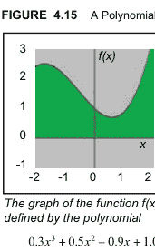

多项式的每个单独**项**由一个作为系数的实数（例如 0.3）、变量 x 和一个作为**指数**的非负整数组成。x^1 项通常只写成 x 而不是 x^1；x^0 项通常只写成系数（因为 x^0 始终定义为 1）；负系数也可以用减号表示，因此同一个多项式的另一种写法是：

$0.3x^3 + 0.5x^2 - 0.9x + 1.0$

对于 x 的任何特定值，可以通过将 x 的值代入表达式来计算多项式的值。例如，示例多项式在 x = 2 处的值为：

$0.3(2)^3 + 0.5(2)^2 - 0.9(2) + 1.0 = 3.6$

典型的代数练习是为给定范围内的每个 x 值绘制多项式的图像。例如，图 4.15 绘制了 -2 到 +2 范围内每个 x 的多项式值。

对于本项目，你应该为多项式指定、设计并实现一个类。系数是双精度数，指数是非负整数。系数应存储在双精度数的动态数组中，x^k 项的指数存储在数组位置 [k] 中。数组的最大索引至少应与多项式的次数一样大，以便可以存储最大的非零系数。对于示例多项式 0.3x^3 + 0.5x^2 - 0.9x + 1.0，系数数组的开头包含这些数字：

| | | | | |
|---|---|---|---|---|
| 1.0 | -0.9 | 0.5 | 0.3 | ... |
| [0] | [1] | [2] | [3] | [4] [5] |

此外，该类应有一个成员变量来跟踪动态数组的当前大小，以及另一个成员变量来跟踪多项式的当前次数。（可以没有次数变量，但有它可以使某些操作更高效。）

本节其余部分列出了你可以为多项式类提供的一些成员函数和非成员函数。

### A. 构造函数和析构函数。

```
polynomial(); // Default constructor
polynomial(double a0); // Set the x^0 coefficient only
polynomial(const polynomial& source); // Copy constructor
~polynomial(); //
```

默认构造函数创建一个所有系数都为零的多项式。第二个构造函数创建一个多项式，将指定参数作为 x^0 项的系数，所有其他系数均为零。例如：

```
polynomial p(4.2); // p has only one nonzero term, 4.2x^0, which is the
// same as the number 4.2 (since x^0 is defined as
// equal to 1).
```

### B. 赋值运算符。

```
polynomial& operator = (const polynomial& source);
```

这是通常的重载赋值运算符，有一个更改：返回类型是 polynomial& 而不是 void。这种返回类型类似于普通多项式，但额外的符号 & 使其成为引用返回类型，类似于我们输出运算符的返回类型 ostream&。引用返回类型的完整细节超出了本项目的范围。对于你的实现，你应该知道两个事实：

- 1. 函数实现应返回激活赋值的对象。这是通过关键字 `this` 完成的（我们在第 188 页也见过它）。语法是：`return *this;`，意思是“返回 `this` 指向的对象。”由于 `this` 始终指向激活函数的对象，返回语句产生我们需要的效果。

链式赋值
`a = b = c`

- 2. 使用 `polynomial&` 作为返回类型允许一系列链式赋值。例如，如果 a、b 和 c 是三个多项式，我们可以写 a = b = c，这将 c 的值复制给 b，然后将 b 的新值复制给 a（链式赋值从右到左进行）。

请记住让我们的实现检查可能的自我赋值。

### C. 第二个赋值运算符。

```
polynomial& operator = (double a0);
```

对于多项式 b，此赋值可以在诸如 b = 4.2 的语句中激活。双精度数 4.2 成为此赋值的参数 a0。实现将使用此数字作为 x^0 项的系数，所有其他系数设置为零。

如果你阅读了关于构造函数生成转换的信息（第 210 页），那么你可能会注意到这个第二个版本的赋值运算符并非完全必要。即使没有这个赋值运算符，我们也可以写一个赋值 b = 4.2；在这种情况下，编译器将把多项式构造函数应用于数字 4.2（创建多项式 4.2x^0），然后将此多项式赋值给 b。但是，编写一个显式赋值运算符以允许 b = 4.2 通常更高效，因为我们避免了构造函数生成转换的开销。

### D. 修改成员函数。

```
void add_to_coef(double amount, unsigned int k);
void assign_coef(double new_coefficient, unsigned int k);
void clear();
void reserve(size_t number);
```

add_to_coef 函数将指定的量添加到 x^k 项的系数中。assign_coef 函数将 x^k 系数设置为 new_coefficient。在这两种情况下，参数 k 是 unsigned int，这是 C++ 数据类型，类似于 int，但永远不能有负值。

clear 函数将所有系数设置为零。reserve 函数的工作方式类似于 bag 类的 reserve，确保底层数组至少具有请求的大小。

### E. 常量成员函数。

```
double coefficient(unsigned int k) const;
unsigned int degree() const;
unsigned int next_term(unsigned int k) const;
```

coefficient 函数返回 x^k 项的系数。

degree 函数返回多项式的次数。对于所有系数都为零的多项式，我们的 degree 函数返回 0（尽管数学家通常使用 -1 作为此类多项式的次数）。

next_term 函数返回 x^k 之后下一个具有非零系数的项的指数。例如，如果 p 的 x^4 项是 0 而 p 的 x^4 项是 6x^4，那么 p.next_term(2) 返回指数 4（因为 4 是 2 之后下一个具有非零系数的指数）。如果 x^k 之后没有非零项，那么 next_term(k) 应该返回库设施 <climits> 中的常量 UINT_MAX。（此常量是最大的 unsigned int。）

### F. 求值函数。

```
double eval(double x) const;
double operator()(double x) const;
```

eval 函数在给定的 x 值处计算多项式。例如，如果 p 是 0.3x^3 + 0.5x^2 - 0.9x + 1.0，那么 p.eval(2) 是 0.3(2^3) + 0.5(2^2) - 0.9(2) + 1.0，即 3.6。

第二个函数也计算多项式，但它使用一些奇怪的语法。这个第二个函数的名称是 "operator ()"，它有一个参数（双精度数 x）。要为多项式 p 激活 operator ()，你写名称 p 后跟括号中的参数。例如：p(2)。operator () 的实现与 eval 函数做相同的工作；两个单独的实现只是给程序员提供语法选择。你可以写 p.eval(2)，也可以在程序中写 p(2)。

### G. 算术运算符。

你可以重载加法、减法和乘法的二元算术运算符，以通常的方式对两个多项式进行加、减、乘。（除法不可能，因为它可能导致分数指数。）例如：

假设 q = 2x^3 + 4x^2 + 3x + 1 和 r = 7x^2 + 6x + 5。
那么：q + r = 2x^3 + 11x^2 + 9x + 6
q - r = 2x^3 - 3x^2 - 3x - 4
q × r = 14x^5 + 40x^4 + 55x^3 + 45x^2 + 21x + 5

乘积 q × r 是通过将 q 的每个单独项乘以 r 的每个单独项并将结果相加得到的。

### 其他操作。

你可以考虑其他成员函数，这些函数在 www.cs.colorado.edu/~main/projects 的在线项目第 4 章部分中有描述。其中，此在线描述包括第一学期微积分学生可以与其微积分研究（导数、积分和寻找多项式根）相关联的操作。


### 章节摘要

- 指针存储另一个变量的地址。当指针用于指向动态分配的内存（例如动态数组）时最有用。动态数组的大小不需要在程序运行前确定。这种在运行时确定的行为称为动态行为。动态行为比在编译时做出的决定（即静态行为）更灵活。
- 类的成员变量经常是数组或动态数组。普通数组简单易编程，且通常足够。动态数组提供了更好的灵活性，因为其大小可以根据需要变化。然而，动态数组也涉及更复杂的编程，因为必要的内存必须正确分配，并在不再需要时释放。
- 在 C++ 中，new 运算符用于分配动态内存。delete 运算符用于释放动态内存。
- new 运算符通常通过抛出特殊函数异常 bad_alloc 来指示失败。通常，异常会伴随错误消息停止程序。你应该清楚地记录哪些函数使用 new，以便有经验的程序员可以以自己的方式处理异常。
- 字符串和袋是可以用动态数组实现的类的两个示例。
- 使用动态内存的类应始终包含拷贝构造函数、重载赋值运算符和析构函数。拷贝构造函数和赋值运算符都必须通过对动态内存制作新副本来复制对象（而不是仅仅复制指针）。析构函数负责释放动态内存。

### 自测练习解答

- 1. 第一次使用 & 表示引用参数。第二次使用 & 提供变量的地址。
- 2. 
```cpp
cout << *int_ptr << endl;
cout << i << endl;
```
- 3. 
```cpp
int *exercise;
size_t i;
exercise = new int[1000];
for (i = 1; i <= 1000; ++i)
    exercise[i-1] = i;
delete [] exercise;
```
- 4. 动态变量不被声明，而是在程序执行期间创建。
- 5. 如果 new 运算符因为堆已满而无法分配内存，则抛出 bad_alloc 异常。如果异常未被捕获，将打印错误消息并停止程序。
- 6. 
```cpp
100 and 200
200 and 200
300 and 300
400 and 400
```
- 7. 我们不再需要 p1 指向的内存。
- 8. 函数更改指针所指位置的值。调用程序中的实际参数仍将指向同一位置，但该位置将具有新值。
- 9. 如果参数是指针，且函数使指针指向新位置，并且你希望实际参数也指向这个新位置，则该参数必须是引用参数。
- 10. 当数组作为参数传递时，对数组的更改会影响实际参数。这是因为参数被视为指向数组第一个元素的指针。这与值参数不同（对值参数的更改不影响实际参数）。
- 11. `void make_intarray (double*& array_ptr, size_t& n);`
- 12. 关键点是指针参数必须是引用参数，如下所示：`void exercise(int*& p, size_t n);`
- 13. average 和 compare 都不更改数组的内容，因此可以使用关键字 const。fill_array 函数会更改数组的内容，因此不能使用 const。
- 14. 以下是该函数：
```cpp
void copyints(
    int target[],
    const int source[],
    size_t n
)
// Postcondition: source[0] through
// source[n-1] have been copied to
// target[0] through target[n-1].
{
    size_t i;
    for (i = 0; i < n; ++i)
        target[i] = source[i];
}
```
- 15. 程序读取一组数字，将值存储在动态数组中。然后程序计算平均值，并打印数字列表，每个数字都与平均值进行比较。
- 16. 通常，动态数据结构的大小不在程序运行前确定。但静态数据结构的大小在编译时确定。
- 17. 如果初始容量太小，将需要多次重新分配内存、将项目复制到新内存以及释放旧内存。为了避免这种低效，程序员应尝试使初始容量足够大。
- 18. 初始容量是 DEFAULT_CAPACITY（即 30）。如果向袋中放入 31 个项目，则 insert 函数将把容量增加到 31。
- 19. 在 insert 实现中，对 reserve 的调用变为：
`reserve(int(used*1.1 + 1));`
额外的 "-1" 会导致分数向上取整。
- 20. 析构函数的主要职责是释放对象使用的动态内存。有关析构函数自动调用的情况，请参见第 184 页的列表。
- 21. `~sequence();`
- 22. 关键字 this 可以在任何成员函数内部使用，以提供激活该成员函数的对象的指针。
- 23. 通常，赋值运算符仅将一个对象的成员变量复制到另一个对象。但由于新袋使用动态内存，赋值运算符必须制作动态内存的副本，而不是仅仅复制作为成员变量的指针。让赋值运算符完成额外工作的方法是重载赋值运算符。

  我们的赋值运算符实现对自赋值也能正确工作。
- 24. 拷贝构造函数可以像任何其他构造函数一样用于构造新对象。当值参数是对象或函数返回对象时，也会调用它。
- 25. 如果未提供拷贝构造函数，自动拷贝构造函数将简单地将所有成员变量从局部变量复制到返回位置。
- 26. 
```cpp
char s[21];
cin >> s;
strcat(s, "!");
cout << s;
```
- 27. 以下是该函数：
```cpp
size_t strlen(const char s [])
{
    size_t len = 0;
    while (s[len] != '\0')
    ++len;
    return len;
}
```
- 28. 普通字符串变量不支持赋值和比较等操作。
- 29. 字符串类的私有成员变量是 characters、current_length 和 allocated（有关定义，请参见第 205 页）。
- 30. 任何使用动态内存的类都需要析构函数，以将其动态内存返回到堆中。
- 31. 运算符 =、+=、== 和 >>，以及拷贝构造函数。
- 32. 任何访问私有成员变量的非成员函数必须是友元函数。在我们的实现中，输出运算符和六个布尔函数是友元，但你的实现可能需要不同的友元（取决于你在哪里访问私有成员变量）。
- 33. 头文件 "mystring.h" 将被 <string> 替换。

## 编程项目

如需更深入的项目，请参见 www.cs.colorado.edu/~main/projects/

- 1. 为第 4.5 节的字符串类添加更多操作。一些可能性列于此：
  - (a) 一个具有一个参数（字符）的新构造函数。该构造函数将字符串初始化为仅包含这一个字符。
  - (b) 一个插入函数，允许你在另一个字符串的给定位置插入一个字符串。
  - (c) 一个删除函数，允许你删除字符串的一部分。
  - (d) 一个替换函数，允许你将字符串中的单个字符替换为新字符。
  - (e) 一个替换函数，允许你将字符串的一部分替换为另一个字符串。
  - (f) 一个搜索函数，在字符串中搜索指定字符的第一次出现。
  - (g) 一个搜索函数，统计字符串中指定字符出现的次数。
  - (h) 一个更复杂的搜索函数，在字符串中搜索某个较小字符串的出现。
- 2. 修改第 3 章中的一个容器类，使其使用动态数组。一些选择是：(a) 第 3.2 节的 sequence；(b) 第 149 页的 set（项目 5）；(c) 第 150 页的 sorted sequence（项目 6）；(d) 第 150 页的 bag with receipts（项目 7）；(e) 第 150 页的 keyed bag（项目 8）。
- 3. 使用动态数组实现第 4.6 节的多项式类，以便没有最大次数。如果你学习过微积分，则包括项目页面 www.cs.colorado.edu/~main/projects/ 第 4 章部分中的可选成员函数。
- 4. 编写一个支票簿平衡程序。该程序将读取上次平衡支票簿时尚未兑现的所有支票的以下内容：每张支票的编号、支票金额，以及它是否


尚未缓存。使用名为“checks”的动态数组，其中每个 check 是你自己设计和实现的名为 check 的数据类型的对象。除了 checks 之外，程序还读取所有存款以及旧账户余额和新账户余额。你可能需要第二个动态数组来存放存款列表。新账户余额应等于旧余额加上所有存款，减去所有已兑现的 check。

程序还打印多个项目：已兑现 check 的总额、存款总额、新余额应为多少，以及该数字与银行所说的新账户余额相差多少。还要打印两个 check 列表：自上次平衡支票簿以来已兑现的 check，以及尚未兑现的 check 列表。

编写一个程序，使用字符串的动态列表来跟踪你今天需要完成的家务列表。程序用户可以请求多种服务：(1) 向家务列表添加一项；(2) 询问列表中有多少项家务；(3) 将家务列表打印到屏幕；(4) 从列表中删除一项；(5) 退出程序。如果你知道如何从文件编程和写入字符串，则让程序从文件获取其初始家务列表。当程序结束时，它应将所有未完成的家务写回此文件。

对输入字符串的常见操作是使用用户选择的分隔符对字符串进行标记化或分离。为字符串类（无论是本课开发的还是 STL 字符串）编写一个字符串标记化函数。该函数接受三个参数：包含原始输入的 const 字符串、指定分隔符的 const 字符串（例如，" "）；以及一个用于存储找到的每个标记的容器。编写一个测试程序来打印标记。

在本项目中，你将使用 STL 字符串类来操作输入字符串。有关可能有用的各种字符串函数，请参阅附录 H。编写一个交互式程序，提示用户输入最多 10 行的文本。输入可以在最后一行开头使用特殊符号（例如星号）来终止。向用户发出第二个提示，要求输入形式为 sub:replace 的字符串，其中 sub 是原始句子的子字符串，replace 是替换字符串。程序应查找 sub 的每个出现，并提示用户确认是否用替换字符串替换原始文本。完成后打印修改后的文本，并提示用户退出或输入另一个替换字符串。

数组可以用来一次存储一个数字的大整数。例如，整数 1234 可以通过将 a[0] 设置为 1、a[1] 设置为 2、a[2] 设置为 3、a[3] 设置为 4 来存储在数组 a 中。但是，对于本项目，你可能会发现将数字逆序存储更容易，即将 4 放在 a[0] 中，将 3 放在 a[1] 中，将 2 放在 a[2] 中，将 1 放在 a[3] 中。设计、实现并测试一个类，其中每个对象都是一个大整数，每个数字存储在数组的单独元素中。你还需要一个私有成员变量来跟踪整数的符号（也许是一个布尔变量）。数字的数量可能会随着程序运行而增长，因此该类必须使用动态数组。讨论并实现此类的其他适当运算符。

假设你想实现一个 bag 类来存储非负整数，且你永远不知道袋中最大数字是否不会超过几千。实现此 bag 的一种方法是拥有一个名为 count 的整数数组作为私有成员变量，其索引从 0 到 M（其中 M 是袋中的最大数字）。如果袋中包含数字 n 的六个副本，则该对象具有 count[n] = 6 来表示这一事实。对于本项目，请使用此想法重新实现图 4.9 中的 bag 类。你将拥有一组全新的私有成员变量；对于公共成员函数，你可以删除 reserve 函数，但请添加一个新函数，程序员可以使用该函数来指定他或她预计放入袋中的最大数字。还要注意，insert 成员函数必须检查动态数组的当前最大索引是否至少与新数字一样大。如果不是，则必须增加数组大小。

## 第 5 章 链表

> 关联或链接一组元素的最简单方法是将它们排成一个单列表……因为在这种情况下，每个元素只需要一个链接来引用其后继元素
>
> 尼克劳斯·维尔特
> 算法 + 数据结构 = 程序

### 学习目标

- 完成第 5 章后，你将能够...
- 设计、实现并测试操作链表中节点的函数，包括插入新节点、删除节点、查找节点，以及涉及列表中所有节点的处理（例如复制）。
- 设计、实现并测试使用链表存储元素集合的集合类，通常使用节点类来创建和操作链表。
- 分析可以用链表解决的问题，并在适当时提出简单链表的替代方案，例如双向链表和带哑节点的列表。
- 了解动态数组和链表之间的权衡，以便正确选择 STL vector、list 和 deque 类。

### 章节内容

- 5.1 链表的基本节点类
- 5.2 链表工具包
- 5.3 基于链表的 Bag 类
- 5.4 编程项目：基于链表的 Sequence 类
- 5.5 动态数组 vs. 链表 vs. 双向链表
- 5.6 STL Vector vs. STL List vs. STL Deque
- 章节摘要
- 自测练习解答
- 编程项目

本章首先具体讨论一种新的数据结构——链表，它用于实现按某种顺序排列的项目列表。链表结构使用动态内存，根据需要收缩和增长，但方式与动态数组不同。链表的讨论包括 C++ 中必要的类定义，以及操作链表的基本函数。

一旦你掌握了基础，链表可以作为容器类的一部分使用，类似于以前课程中数组的使用方式。例如，链表可以用于重新实现第 3 章中的 bag 和 sequence 类。

到本章结束时，你将足够理解链表，以便在各种编程项目中使用它们（例如修订后的 bag 和 sequence 类），以及在未来章节的项目中使用它们。你还将了解为这些项目使用链表与动态数组的优点和缺点。

### 5.1 链表的基本节点类

链表是一系列按顺序排列的项目，每个项目通过链接连接到下一个项目。一种常见的编程技术是将每个项目与指向下一个项目的链接放在一起，从而得到一个称为节点的简单组件。节点在图示中表示为一个框，框内写有项目，链接绘制为指向框外的箭头。

图 5.1 绘制了几个典型节点。例如，最顶部的节点的数据为数字 12.1。图中大多数节点也有一个指向节点外的箭头。这些箭头或链接用于将一个节点连接到另一个节点。链接表示为箭头，因为它们不仅仅连接两个节点。链接还将节点排列成一个序列。在图 5.1 中，五个节点从上到下形成一个序列。第一个节点链接到第二个节点，第二个节点链接到第三个节点，依此类推，直到到达最后一个节点。当到达最后一个节点时，我们必须做一些特殊的事情，因为最后一个节点没有链接到另一个节点。在这种情况下，我们用写有“结束标记”的注释替换该节点中的链接。

#### 声明节点类

从我们的图中你可能猜到，节点之间的链接是使用指针实现的。但是指向什么呢？请记住，我们不能简单地声明一个


指针；每个指针都必须声明为指向特定数据类型的指针。例如，我们有指向整数的指针、指向字符的指针、指向节流阀的指针。在链表的情况下，每个链接都是指向节点的指针。

但节点究竟是什么？要回答这个问题，请再看一遍我们的图片。每个节点由两部分组成：一段数据（在我们的示例中是一个双精度数）和指向下一个节点的链接。在 C++ 中，我们可以为节点定义一个新类，它将这两部分作为成员变量，如下所示：

```
class node
{
  ...
  private:
    double data_field;
    node *link_field;
};
```

我们稍后将查看成员函数，但首先让我们先看看其他一些问题。

## 使用链表节点的 typedef 语句

到目前为止，我们只考虑过数据为双精度数的节点。但是，一般来说，其他类型的数据同样有用。整数链表、字符链表，甚至字符串链表都很有用。换句话说，节点类取决于底层数据类型——即每个节点中的数据类型。为了方便更改项类型，我们通常使用 typedef 语句来定义名称 value_type，使其成为每个节点中数据类型的同义词。然后在节点类中使用 value_type，如下所示：

```
class node
{
  public:
    typedef double value_type;
    ...
  private:
    value_type data_field;
    node *link_field;
};
```

这是我们之前用来定义袋或序列中元素类型的同一种技术。如果需要更改节点中项的类型，我们只需更改 typedef 语句中的 value_type。每当程序需要引用项类型时，都可以使用表达式 node::value_type。

## 头指针与尾指针

通常，程序并不会实际声明节点变量。相反，当我们构建和操作链表时，链表是通过一个或多个指向节点的指针来访问的。访问链表最常见的方式是通过链表的第一个节点，该节点称为链表的 **头**（head）。指向第一个节点的指针称为 **头指针**（head pointer）。有时我们会维护指向链表中最后一个节点的指针。最后一个节点是链表的 **尾**（tail），指向最后一个节点的指针是 **尾指针**（tail pointer）。我们也可以维护指向链表中其他节点的指针。

每个指向节点的指针也必须声明为指针变量。例如，如果我们要维护一个带有头指针和尾指针的链表，那么我们会声明两个指针变量：

```
node *head_ptr;
node *tail_ptr;
```

程序现在可以继续创建链表，始终保持 head_ptr 指向第一个节点，tail_ptr 指向最后一个节点，如图 5.2 所示。

### 构建和操作链表

每当程序构建和操作链表时，对列表中节点的访问是通过一个或多个指向节点的指针进行的。通常，程序包括指向第一个节点的指针（**头指针**）和指向最后一个节点的指针（**尾指针**）。

### 图 5.2 带有链表的程序中节点类的声明

### 节点类声明

```
class node
{
public:
    typedef double value_type;
    ...
private:
    value_type data_field;
    node *link_field;
};
```

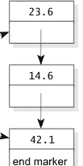

计算可能会创建一个包含三个节点的小链表，如下所示。head_ptr 和 tail_ptr 变量提供对列表中两个节点的访问。

### 两个指向节点的指针的声明

```
node *head_ptr;
node *tail_ptr;
```

## 空指针

图 5.3 说明了一个带有头指针和一个新特性的链表。查看最后一个节点的链接。我们没有写指针，而是写了单词 NULL。单词 NULL 指示空指针，这是一个特殊的 C++ 常量。您可以对任何没有指向目标的指针值使用空指针。空指针有两种常见用法：

- 对链表中最后一个节点的链接字段使用空指针。
- 当链表尚未包含任何节点时，对头指针和尾指针的值使用空指针。这样的列表称为空列表。

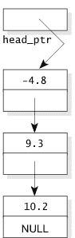

### 图 5.3 末尾链接为空指针的链表

在程序中，空指针可以写为 NULL，它在标准库设施 <cstdlib> 中定义。（虽然令人惊讶的是，它不是 std 命名空间的一部分。您可以直接写 NULL，而无需 std::。）

```
node *head_ptr;
head_ptr = NULL; // Uses the constant NULL from cstdlib
```

> **空指针**
>
> 空指针是一个特殊的 C++ 指针值，可用于任何不指向任何位置的指针。它在 <cstdlib> 中定义为 NULL。NULL 不是 std 命名空间的一部分，因此您可以直接写 NULL，而无需 std::。

## 空头指针或尾指针的含义

请记住，链表的头指针和尾指针可能为 NULL，这表示列表为空（没有节点）。事实上，大多数链表都是以这种方式开始的。您编写的任何用于操作链表的函数都必须能够处理空头指针和尾指针。

## 节点构造函数

节点构造函数具有用于初始化数据字段和链接字段的参数，如下面的原型所示：

```
node(
    const value_type& init_data = value_type(),
    const node* init_link = NULL
);
```

数据的默认值列为 init_data = value_type()。这种表示法意味着“名为 init_data 的参数具有一个默认参数，该参数由 value_type 默认构造函数创建。”旧版本的 C++ 不允许这种语法，因为内置类型（如 int 和 double）没有默认构造函数。但是，新的 ANSI/ISO C++ 标准允许对内置类型使用这种表示法。每个内置类型都有一个默认构造函数，用于返回零（对于数字）或 false（对于 bool 类型）。

### 内置类型的默认构造函数

在我们的例子中，value_type 被定义为 double，因此如果需要默认参数，init_data 参数将为零。如果需要默认参数，init_link 参数将为 NULL。

构造函数的实现只是将两个参数（init_data 和 init_link）复制到节点的两个成员变量（data_field 和 link_field）中。

作为示例，考虑三个指向节点的变量（p、q 和 r）对 new 运算符的三次调用。new 运算符的三次调用将以三种不同的方式调用构造函数，如下所示。

```
// With no arguments, we will use both default values, so p's data will be
// set to zero and p's link will be set to NULL:
p = new node;
// We can explicitly set the data part of q's node to 4.9, and use the
// default argument of NULL for q's link field, like this:
q = new node(4.9);
// We can create a new node for r to point to with data of 1.6 and a
// link field that points to the same node as p:
r = new node(1.6, p);
```

在这三次赋值之后，三个节点的设置如下：

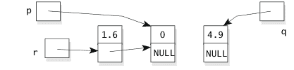

## 节点成员函数

节点有五个公共成员函数用于设置和获取数据字段和链接字段。原型和内联实现显示在图 5.4 的完整节点定义中。前两个函数 set_data 和 set_link 只是将新值存储在节点的数据字段或链接字段中。data 成员函数返回节点当前数据字段的副本。当您查看 link 函数时，可能会觉得自己看花了眼，因为 link 函数以两种略有不同的形式出现。我们稍后会解释这种重复。但首先，让我们先看看激活成员函数的一种新表示法。


## 图 5.4 节点类的完整定义

## 类定义

```
class node
{
public:
  // TYPEDEF
  typedef double value_type;
  // CONSTRUCTOR
  node(
     const value_type& init_data = value_type( ),
     node* init_link = NULL
     )
  { data_field = init_data; link_field = init_link; }
  // Member functions to set the data and link fields:
  void set_data(const value_type& new_data) { data_field = new_data; }
  void set_link(node* new_link) { link_field = new_link; }
  // Constant member function to retrieve the current data:
  value_type data( ) const { return data_field; }
  // Two slightly different member functions to retrieve the current link:
  const node* link( ) const { return link_field; }
  node* link( ) { return link_field; }
private:
  value_type data_field;
  node* link_field;
};
```


## 成员选择运算符

假设程序已构建了页边空白处所示的链表。现在，head_ptr 是指向节点的指针，因此这里有一个小测验：使用解引用星号，*head_ptr 的数据类型是什么？请记住，*head_ptr 意为“head_ptr 所指向的东西”。查看图片，你可以看到 *head_ptr 的数据类型是一个节点。

与任何对象一样，你可以访问 *head_ptr 的公共成员函数。例如，以下代码写出头节点的数据（12.1）：

cout << (*head_ptr).data();

表达式 (*head_ptr).data() 意为“激活 head_ptr 所指向节点的 data 成员函数”。表达式的第一部分 (*head_ptr) 周围的括号是必要的，因为访问成员（例如 data 成员函数）的操作优先级高于解引用星号。如果没有括号，*head_ptr.data()* 的含义会导致语法错误，试图在解引用之前激活 head_ptr.data()。

### -> 运算符

如果 p 是指向类的指针，m 是类的成员，那么 p->m 与 (*p).m 含义相同。

示例：head_ptr->data() 是激活 head_ptr 所指向节点的 data 函数的语法。

符号 "->" 被视为单个运算符（而不是两个独立的符号 "-" 和 ">")。它被称为 **成员选择运算符** 或 **分量选择运算符**。从视觉上看，p->m 运算符让你想起一支箭头，从指针 p 指向包含成员 m 的对象。使用成员选择运算符，我们可以打印图 3.3 中列表第一个节点的数据，如下所示：cout << head_ptr->data();

## 澄清 const 关键字

### 第 7 部分：用于指向节点的指针的 const 关键字，以及某些成员函数需要两个版本的原因

考虑这个指向节点的指针：

```
node *p;
```

此声明后，我们可以为 p 分配一个节点供其指向（p = new node）；然后可以激活任何成员函数（例如 p->set_data() 或 p->data()）。

- 1. 已声明常量：第 12 页
- 2. 常量成员函数：第 38 页
- 3. 常量引用参数：第 72 页
- 4. 静态成员常量：第 104 页
- 5. 常量迭代器：第 144 页
- 6. 作为指针或数组的常量参数：第 171 页
- 7. 用于指向节点的指针的 const 关键字，以及某些成员函数需要两个版本的原因

相比之下，考虑第 4 章（第 170 页）中的情况，我们在那里看到了与指针一起使用 const 关键字的示例。使用 const 关键字的一个简单示例是以这种方式声明的参数：

```
const node *c;
```

此参数是指向节点的指针。const 关键字意味着指针 c 不能用于更改节点。准确地说，对于声明 const node *c：

- 1. 你可能认为 `const` 关键字阻止 `c` 移动并指向不同的节点。这是错误的。指针 `c` 可以移动并指向许多不同的节点，但我们被禁止使用 `c` 来更改 `c` 所指向的任何节点。（如果你希望创建一个指针，在其定义时设置一次，然后永远不更改以指向新对象，那么请将 `const` 关键字放在 `*` 之后。例如：`node *const c = &first;`。）

- 2. 由于 `const` 关键字，你可能认为 `c` 所指向的节点永远无法通过任何方式更改。这也不完全正确。为什么呢？原因是我们可能有另一个普通指针，它指向 `c` 所指向的同一个节点。在这种情况下，可以通过普通指针访问该节点来更改它。`const` 关键字仅防止通过 `c` 访问来更改节点。

- 3. 为强制执行 `const` 规则，C++ 编译器允许像 `c` 这样的指针仅激活常量成员函数。例如，在将 `c` 声明为 `const node *c` 时，我们可以激活 `c->data()`，但 `c->set_data()` 是被禁止的。

第三条规则很好，但对于链表等应用，C++ 编译器的规则还不够全面。我们建议一个额外的编程技巧，以提高可靠性：

## 编程技巧

### 节点常量成员函数的规则

节点的常量成员函数永远不应提供以后可用于更改链表任何部分的结果。这提高了可靠性，因为我们可以清楚地看到哪些函数有可能对底层数据结构造成更改。

### 提供函数的 const 版本和非 const 版本

我们的编程技巧有一个令人惊讶的效果：我们有时必须编写同一成员函数的两个相似版本。例如，`link` 成员函数的目的是获取节点链接字段的副本。乍一看，这听起来像是一个常量成员函数，因为检索成员变量不会更改对象。我们可能会这样写：

```
node* link() const { return link_field; }
```


此实现可以编译，但它违反了我们关于常量成员函数的编程技巧。例如，假设我们设置了这个列表：


使用常量成员函数 link，我们可以执行两条语句来更改其中一个节点的数据：

```
node *second = head_ptr->link();
```

执行第一条语句后，我们有以下情况：


变量 second 只是一个指向节点的普通指针。它不是指向常量节点的指针，因此我们可以激活它的任何成员函数，例如：

```
second->set_data(9.2);
```

执行此语句后，第二个节点中的数据现在是 9.2：


这是一种糟糕的情况，因为节点的常量成员函数永远不应提供我们以后可用于更改链表任何部分的结果。考虑到这一点，将 link 实现为非常量成员函数是有道理的。将函数设为非常量可以更准确地说明函数结果的使用方式。因此，我们将 link 实现为非常量成员函数，如下所示：

```
node* link() { return link_field; }
```

不幸的是，此解决方案还有另一个问题。假设 c 是参数 const node *c。我们只能激活常量成员函数。因此，使用非常量 Link 实现，我们永远无法激活 c->link()。最终解决方案是提供 Link 成员函数的第二个版本，实现如下：

```
const node* link() const { return link_field; }
```

这个第二个版本是常量成员函数，因此可以使用 c->link()，即使它使用 const 关键字声明。尽管两个函数的实现相同（它们都返回 link_field），但编译器会将 link_field 转换为函数 const 版本的 const node* 类型。因此，来自函数 const 版本的返回值以后不能用于更改链表的任何部分。


当函数同时存在 const 和非 const 版本时，编译器会根据函数是由常量节点（例如 `const node *c`）还是普通节点激活，自动选择正确的版本。

### 何时为成员函数提供 const 和非 const 两个版本

当成员函数的返回值是指向节点的指针时，通常应提供两个版本：一个返回 `const node*` 的 const 版本；以及一个返回普通节点指针的普通版本。

## 解引用空指针

最常见的指针错误之一是，当指针 p 的值为空指针时，编写表达式 *p 或 p->。这必须始终避免，因为空指针不指向任何东西。因此，当 p 为空指针时，*p（即“p 所指向的东西”）是没有意义的。在这种情况下，p-> 也是没有意义的。因为 *p 中的星号称为解引用运算符，我们可以得出这条规则：永远不要解引用空指针。

意外解引用空指针有时是一种难以追踪的错误。该错误不会导致语法错误。相反，当程序运行时，会尝试将空指针解释为有效地址。有时这会导致立即出现运行时错误，并显示诸如“地址保护违规”或“总线错误，核心已转储”之类的消息。但在其他机器上，空地址可能是一个有效地址，导致你的程序读取或写入非预期的内存位置。通常，这个内存位置是机器操作系统的一部分，导致操作系统的一部分被损坏。在某个后续时刻，也许在你的程序完成之后，损坏的操作系统可能会导致错误。幸运的是，重新启动机器通常会将操作系统的新副本写入内存——但即便如此，也永远不要解引用空指针！

#### 第 5.1 节自测练习

- 1. 编写链表中节点所需的类定义。使用 value_type 作为数据的类型名。
- 2. C++ 常量 NULL 的含义是什么？在程序中使用 NULL 需要添加什么额外代码？
- 3. 描述空指针的两种常见用途。
- 4. 如果 value_type 是内置数字或 bool 类型之一，value_type 的默认构造函数给出什么值？
- 5. 第 224 页图 5.3 中 head_ptr 的数据类型是什么？*head_ptr 的数据类型是什么？head_ptr->data() 的数据类型是什么？
- 6. 假设 head_ptr 指向非空链表的第一个节点。编写代码，如果第一个节点中的数据为 0，则打印单词“zero”。
- 7. 考虑这条语句：cout << *(head_ptr).data() ；如果省略 head_ptr 周围的括号，会发生什么？编写激活 data() 类成员的替代语法。
- 8. 假设 b_ptr 是指向 bag（来自第 3 章）的指针。bag 的一个成员函数是 size，它返回 bag 中元素的数量。编写一条语句，打印 b_ptr 所指向的 bag 中的元素数量。使用成员选择运算符。
- 9. 描述如果解引用空指针可能发生的问题。
- 10. 为什么这个 link 实现是错误的？
  ```
  node * link() const { return link_field; }
  ```
- 11. 上一道练习中问题的解决方案是什么？
- 12. 为什么只有一个 const 版本的节点 data 成员函数（而没有第二个非 const 版本）也是可以的？

### 5.2 链表工具包

我们现在有条件设计使用链表存储其项目的容器类了。容器类的成员函数将把东西放入链表并从中取出。链表的这种用法类似于我们之前在容器类中使用数组的方式。然而，你可能会发现，从链表中存储和检索项目比使用数组更费力，因为我们没有方便的索引机制（例如 data[i]）来读取或写入元素。相反，该类需要额外的函数来构建和操作列表——这些部分与容器的主要目标无关。

事实上，许多容器类可能需要这些相同的额外函数，这表明我们应该一次性编写一组链表函数，允许任何程序员在容器类的实现中使用这些函数。我们将做到这一点，创建一小组基本的链表函数。工具包的主要目的是允许容器类以类似于使用数组的简单性和清晰度将元素存储在链表中。此外，一次编写并彻底测试这些函数，将使我们能够高度信任其可靠性地使用这些函数来实现许多不同的容器类。

一组链表函数

工具包分为两部分：头文件和实现文件。本节将讨论这两个文件的内容。

### 链表工具包——头文件

对于操作 double 数字链表的函数，头文件包含 node 类定义和函数原型。例如，这里显示了一个函数原型：

```
size_t list_length(const node* head_ptr);
```

list_length 函数计算链表中的节点数量。参数 head_ptr 是指向链表第一个节点的指针。空列表通过将 head_ptr 设置为空指针来表示。由于我们不会更改列表，因此此参数是 const node*。

包括 list_length 在内的函数在单独的实现文件中实现。每个函数都有一个或多个参数，这些参数是指向链表中节点的指针。

> **操作链表的函数**
> 
> 操作链表的函数具有一个或多个参数，这些参数是指向列表中节点的指针。如果函数不打算更改列表，则参数应为 const node*。
> 
> 函数通常应能够处理空列表（由空头指针表示）。事实上，能够处理空列表是列表操作函数通常不是节点成员函数的原因之一（因为每个节点成员函数必须由特定节点激活，而空列表没有节点！）。

### 计算链表长度

我们的第一个工具包函数计算链表的长度，即节点数量。以下是原型：

```
size_t list_length(const node* head_ptr);
```

```
// Precondition: head_ptr is the head pointer of a linked list.
// Postcondition: The value returned is the number of nodes in the linked list.
```

参数 head_ptr 是指向列表头节点的指针。如果列表不为空，则 head_ptr 指向列表的第一个节点。如果列表为空，则 head_ptr 是空指针（函数返回零，因为没有节点）。

我们的实现使用一个指针变量来遍历列表，一次计算一个节点。以下是伪代码的三个步骤，使用名为 cursor 的指针变量一次遍历列表中的一个节点。（我们经常使用 cursor 这个名字来指代这样的指针，因为“cursor”意为“运行穿过结构的指针”。）

- 1. 将名为 answer 的变量初始化为零（该变量将跟踪我们迄今为止看到的节点数量）。
- 2. 使 cursor 指向列表的每个节点，从头节点开始。每次 cursor 指向一个新节点时，将 answer 加一。
- 3. 返回 answer。

cursor 和 answer 都是函数中的局部变量。

第一步将 answer 初始化为零，因为我们尚未看到任何节点。

步骤 2 的实现是一个 for 循环，遵循了在需要遍历链表中所有节点时应使用的模式。一般模式如下：

如何遍历链表中所有节点

```
for (cursor = head_ptr; cursor != NULL; cursor = cursor->link( ))
{
    ... Inside the body of the loop, you may
    carry out whatever computation is
    needed for a node in the list.
}
```

在我们的函数中，循环内的计算很简单，因为我们只是在计算节点。因此，在循环体中我们只需将 answer 加一，如下面的代码所示：

```
for (cursor = head_ptr; cursor != NULL; cursor = cursor->link( ))
    ++answer;
```

让我们通过一个示例来检查循环。假设链表包含数字 10、20 和 30 的三个节点。循环初始化后（使用 cursor = head_ptr），情况如下所示。


请注意，cursor 指向与 head_ptr 相同的节点。


由于 cursor 不为 NULL，我们进入循环体。每次迭代都会使 answer 加 1，然后执行 `cursor = cursor->link()`。`cursor = cursor->link()` 的作用是将第一个节点的链接字段复制到 cursor 本身，使得 cursor 最终指向第二个节点。一般来说，语句 `cursor = cursor->link()` 将 cursor 移动到下一个节点。因此，在循环第一次迭代完成时，情况如下：


循环继续。第二次迭代后，answer 为 2，cursor 指向列表的第三个节点，如下所示：


每次完成一次循环迭代时，cursor 指向列表中的某个位置，answer 是该位置之前的节点数量。在我们的示例中，我们即将第三次也是最后一次进入循环体。在最后一次迭代中，answer 递增到 3，cursor 变为 NULL，如下所示：


指针变量 cursor 已变为 NULL，因为循环控制语句 `cursor = cursor->link()` 将第三个节点的链接字段复制到了 cursor 中。由于此链接为 NULL，cursor 中的值现在为 NULL。此时，循环的控制测试 `cursor != NULL` 为假。循环结束，函数返回 answer 3。

## 图 5.5 计算链表长度的函数

## 函数实现

```
size_t list_length(const node* head_ptr)
// Precondition: head_ptr is the head pointer of a linked list.
// Postcondition: The value returned is the number of nodes in the linked list.
// Library facilities used: cstdlib
{
    const node *cursor;
    size_t answer;

    answer = 0;
    for (cursor = head_ptr; cursor != NULL; cursor = cursor->link())
    ++answer;
    return answer;
}
```

`list_length` 函数的完整实现如图 5.5 所示。请注意，局部变量 `cursor` 使用 `const` 关键字声明：`const node *cursor;`。这是必需的，因为 `head_ptr` 参数是 const 的，因此如果 `cursor` 不是 const，编译器将不允许赋值 `cursor = head_ptr`。一般来说，如果指针使用 `const` 关键字声明，则该指针只能赋值给另一个也使用 `const` 关键字声明的指针。

## 如何遍历链表

你应该学习遍历链表的重要模式，如在 `list_length` 函数（图 5.5）中所用。每当你需要逐个遍历链表的节点时，都可以使用相同的模式。

模式的第一部分涉及从一个节点移动到另一个节点。每当我们有一个指向某个节点的指针，并且我们希望指针指向下一个节点时，就必须使用该节点的链接。我们遵循的推理如下：

- 1. 假设 cursor 指向某个节点；
- 2. 然后 cursor->link() 指向下一个节点（如果存在），如下所示：


- 3. 要将 cursor 移动到下一个节点，我们使用赋值语句：
cursor = cursor->link();

如果没有下一个节点，则 cursor->link() 将为 NULL，因此我们的赋值语句将把 cursor 设置为 NULL。

关键是要知道，赋值语句 cursor = cursor->link() 会移动 cursor 使其指向下一个节点。如果没有下一个节点，则赋值语句将 cursor 设置为 NULL。

模式的第二部分展示了如何从头节点开始遍历链表的所有节点。循环的模式如下：

```
for (cursor = head_ptr; cursor != NULL; cursor = cursor->link())
{
    ... Inside the body of the loop, you may
    carry out whatever computation is
    needed for a node in the list.
}
```

你会发现自己在操作链表的函数中不断使用这个模式。

## 陷阱

### 忘记测试空列表

操作链表的函数应始终进行测试，以确保它们对空列表具有正确的行为。例如，当 head_ptr 为 NULL（表示空列表）时，我们的 list_length 函数应返回 0。

如何将节点指针作为参数使用

### 链表的参数

当函数操作链表时，其参数之一必须是指向列表中节点的指针——通常是头指针，但有时也会使用另一个指针。这些节点指针通常以三种方式用作参数，在我们继续介绍工具包之前，需要稍作讨论。（你可能以为自己已经了解关于参数的一切了！）

带有 const 关键字的指针参数。我们已经详细考察过这种情况。例如，list_length 函数就有这样的参数：

```
size_t list_length(const node* head_ptr);
```

该函数使用头指针访问列表的节点，但函数不会更改列表的任何部分。一般来说，这就是应该使用 `const node*` 的情况。当函数需要访问链表并且函数不会对列表的任何节点进行任何更改时，应使用指向常量节点的指针。

### 作为节点指针的值参数。

第二种节点指针参数是不带 `const` 关键字的值参数。例如，工具包中的一个函数将在列表中指定节点之后添加一个新节点。该函数带有 `node*` 的以下原型：

```
void list_insert(node* p, const node::value_type& entry)
// Precondition: previous_ptr points to a node in a linked list.
// Postcondition: A new node containing the given entry has been added
// after the node that p points to.
```

该函数使用指针 p 访问列表的节点，并在 p 节点之后添加一个新节点。指针 p 不会改变，它将继续指向同一个节点。但该节点的链接字段将发生变化，并且一个新节点将被添加到列表中。一般来说，这就是应该使用值参数的情况：当函数需要访问链表，函数可能会更改链表，但函数不需要让指针指向一个新节点时，节点指针应为值参数。

### 作为节点指针的引用参数。

有时函数必须让指针指向一个新节点。例如，工具包中的一个函数将在链表前面添加一个新节点，带有以下原型和前置/后置条件契约：

```
void list_head_insert
(node*& head_ptr, const node::value_type& entry);
// Precondition: head_ptr is the head pointer of a linked list.
// Postcondition: A new node containing the given entry has been added at
// the head of the list; head_ptr now points to the head of the new, longer
// linked list.
```

head_ptr 是一个引用参数，因为函数创建一个新头节点并使头指针指向这个新节点。当函数需要访问链表并且函数使指针指向一个新节点时，节点指针应为引用参数。对指针的这种更改将使实际参数指向一个新节点。

## 链表的参数

当函数需要访问链表时，请使用 node* 参数并遵循以下准则：

- 1. 当函数需要访问链表且不会对列表的任何节点进行任何更改时，使用指向常量节点的指针 const node*。
- 2. 当函数可能以某种方式更改列表，但不需要让指针指向一个新节点时，使用值参数 node*。
- 3. 当函数需要访问链表且可能让指针指向一个新节点时，使用引用参数 node*&。

## 在链表头部插入新节点

我们工具包中的下一个函数是前面提到的 list_head_insert 函数，它带有一个指针的引用参数。该函数在链表头部添加一个新节点。这是添加新节点最简单的位置。带有完整文档的函数原型如下：

```
void list_head_insert
(node*& head_ptr, const node::value_type& entry);
// Precondition: head_ptr is the head pointer of a linked list.
// Postcondition: A new node containing the given entry has been added at
// the head of the list; head_ptr now points to the head of the new, longer
// linked list.
// NOTE: If there is insufficient dynamic memory for a new
// node, then bad_alloc is thrown.
```

正如刚才所见，头指针是一个引用参数，因为函数使头指针指向一个新节点。另外，文档说明了如果新节点的动态内存不足会发生什么。

在链表头部插入新节点只需要一条语句：

```
head_ptr = new node(entry, head_ptr);
```

让我们逐步执行这条语句，看看新节点是如何添加到列表前面的。在示例中，假设 head_ptr 指向这里显示的短列表，并且新条目是数字 5：


当调用 new 运算符时，它会激活构造函数，并创建一个新节点，将 entry 作为数据，链接指向 head_ptr 所指向的同一个节点。下图展示了情况，新节点的链接已着色（新 entry 等于 5）：


new 运算符返回指向新创建节点的指针，在我们编写的语句 head_ptr = new node(entry, head_ptr) 中，你可以将此语句读作“使 head_ptr 指向新创建的节点。”因此，我们得到如下情况：


即使从空列表开始（此时 head_ptr 为 null），该技术也能正确工作。在这种情况下，new 运算符正确地创建列表的第一个节点。为了理解这一点，假设我们从 null head_ptr 开始，并在 entry 等于 5 时执行该语句。构造函数创建一个新节点，数据为 5，链接为 head_ptr。由于 head_ptr 为 null，新节点如下所示（新节点的链接已着色）：


构造函数返回后，head_ptr 被赋值为指向新节点，因此最终情况如下所示：


## 图 5.6 在链表头部插入的函数

### 函数实现

```
void list_head_insert(node*& head_ptr, const node::value_type& entry)
// Precondition: head_ptr is the head pointer of a linked list.
// Postcondition: A new node containing the given entry has been added at the head of the linked
// list; head_ptr now points to the head of the new, longer linked list. NOTE: If there is insufficient
// dynamic memory for a new node, then bad_alloc is thrown before changing the list.
{
    head_ptr = new node(entry, head_ptr);
}
```

如你所见，语句 head_ptr = new node(entry, head_ptr) 已正确地将第一个节点添加到列表中。如果我们正在维护指向尾节点的指针，那么也会将尾指针设置为指向这个节点。

> **在链表头部添加新节点**
> 
> 假设 head_ptr 是链表的头指针。那么该语句会在列表前面添加带有指定新 entry 的新节点：
> 
> head_ptr = new node(entry, head_ptr);
> 
> 即使从空列表开始（此时头指针为 null），该语句也能正确工作。

list_head_insert 的完整实现如图 5.6 所示。

## 插入不在头部的新节点

新节点并不总是插入到链表的头部。它们可能插入到列表的中间或尾部。例如，假设你想在列表中的 20 之后插入数字 42：


插入后，新的更长的列表有这四个节点：


每当插入操作不在头部时，插入过程都需要一个指向新节点预期位置 *前一个* 节点的指针。在我们的示例中，我们需要一个指向包含 20 的节点的指针，因为我们想在此节点之后插入新节点。我们使用 `previous_ptr` 作为指向新节点位置前一个节点的指针的名称。因此，要在 20 之后插入一个项目，我们首先需要按如下所示设置 `previous_ptr`：


一旦程序计算出 `previous_ptr`，插入就可以进行。我们的第三个工具箱函数执行插入操作，如以下原型所示：

```
void list_insert
(node* previous_ptr, const node::value_type& entry);
// Precondition: previous_ptr points to a node in a linked list.
// Postcondition: A new node containing the given entry
// has been added after the node that previous_ptr points to.
// NOTE: If there is insufficient dynamic memory for a new
// node, then bad_alloc is thrown before changing the list.
```

请注意，`previous_ptr` 是一个值参数，是指向节点的指针。这允许我们更改列表（通过插入新节点），但我们不会让 `previous_ptr` 指向新节点。

`list_insert` 可以用一行实现，类似于 `list_head_insert`。但如果将其分解为四个步骤，实现会更清晰：

- 1. 分配一个由名为 insert_ptr 的局部变量指向的新节点。
- 2. 将新 entry 放入新节点的数据字段中。
- 3. 使新节点的链接字段指向新节点位置之后的节点（如果新位置之后没有节点，则为 NULL）。
- 4. 使 previous_ptr->link_field 指向我们刚刚创建的新节点。

让我们按照四个步骤，以在小列表的第二个节点后插入 42 为例进行说明。前两步之后，新节点已创建，包含数字 42，如下所示：


我们在此图中绘制了头指针，尽管函数实际上并不使用头指针。步骤 3 和 4 仅使用 previous_ptr。例如，步骤 3 将新节点的链接字段设置为指向新节点位置之后的节点。新位置之后的节点是什么？它不是 previous_ptr，因为 previous_ptr 指向新位置之前的节点。但名为 previous_ptr->link() 的指针确实指向新节点位置之后的节点。previous_ptr->link() 在此图中已着色，以显示它指向新节点位置之后的位置：


以下是执行步骤 3 的函数调用：

```
insert_ptr->set_link( previous_ptr->link() );
```

设置此链接后，情况如下所示：


另一条语句 previous_ptr->set_link(insert_ptr) 执行步骤 4，如下所示：


插入包含 42 的新节点后，你可以从头节点 10 开始，然后是 20，然后是 42，最后是 30，遍历完整的链表。list_insert 函数的实现如图 5.7 所示，在第 244 页。请注意，previous_ptr 不是引用参数，因为我们并没有让 previous_ptr 指向新节点。

## 对 DELETE 和 NEW 的意外调用

list_insert 函数使用一个名为 insert_ptr 的局部变量，它是一个指针。当函数结束时，insert_ptr 不再需要，它会像任何其他局部变量一样消失。但要小心！一个常见的错误是认为“insert_ptr 不再需要，所以我应该在 list_insert 函数末尾写上语句 delete insert_ptr。”不要这样做！

delete insert_ptr 的效果是删除 insert_ptr 指向的节点。换句话说，你会删除你费尽周折插入的那个节点。一般规则是：除非你实际上正在减少节点数量，否则永远不要调用 delete。

类似的错误可能出现在 list_length 函数的局部变量 cursor 上。你可能会想写 cursor = new node 来尝试初始化这个指针变量。不要这样做！cursor = new node 的效果是创建一个之前不属于链表的新节点。但 cursor 不需要指向

## 图 5.7 三个链表函数的实现

### 三个函数实现

```
void list_insert(node* previous_ptr, const node::value_type& entry)
// Precondition: previous_ptr points to a node in a linked list.
// Postcondition: A new node containing the given entry has been added after the node that
// previous_ptr points to. NOTE: If there is insufficient dynamic memory for a new
// node, then bad_alloc is thrown before changing the list.
{
    node *insert_ptr;

    insert_ptr = new node;
    insert_ptr->set_data(entry);
    insert_ptr->set_link( previous_ptr->link( ) );
    previous_ptr->set_link(insert_ptr);
}
```

```
node* list_search(node* head_ptr, const node::value_type& target)
// Precondition: head_ptr is the head pointer of a linked list.
// Postcondition: The return value is a pointer to the first node containing the specified target in its
// data field. If there is no such node, the null pointer is returned.
// Library facilities used: cstdlib
{
    node *cursor;

    for (cursor = head_ptr; cursor != NULL; cursor = cursor->link( ))
        if (target == cursor->data( ))
            return cursor;
    return NULL;
}
```

```
const node* list_search(const node* head_ptr, const node::value_type& target)
// Precondition: head_ptr is the head pointer of a linked list.
// Postcondition: The return value is a pointer to the first node containing the specified target in its
// data field. If there is no such node, the null pointer is returned.
// Library facilities used: cstdlib
{
    const node *cursor;

    for (cursor = head_ptr; cursor != NULL; cursor = cursor->link( ))
        if (target == cursor->data( ))
            return cursor;
    return NULL;
}
```


到一个新节点；它只是遍历链表中现有的节点。一般规则是：除非你实际增加了节点数量，否则绝不要调用 new。

## 在链表中查找项目

当子任务的工作是查找单个节点时，将子任务实现为返回指向该节点的指针的函数是合理的。我们的下一个工具包操作就是这样一个函数，返回指向包含指定项目的节点的指针。我们将实际实现搜索函数的两个版本，具有略有不同的原型：

```
node* list_search
(node* head_ptr, const node::value_type& target);
// Precondition: head_ptr is the head pointer of a linked list.
// Postcondition: The return value is a pointer to the first node containing
// the specified target in its data field. If there is no such node,
// the null pointer is returned.

const node* list_search
(const node* head_ptr, const node::value_type& target);
// Precondition: head_ptr is the head pointer of a linked list.
// Postcondition: The return value is a pointer to the first node containing
// the specified target in its data field. If there is no such node,
// the null pointer is returned.
```

list_search 的第一个版本有一个 node* 参数，返回值也是 node*。这意味着第一个函数的返回值可用于更改链表。例如，对于页边距中显示的链表，我们可以执行这些语句来查找指向阴影节点（包含 -4.8）的指针，并将其数据更改为 6.8：

```
node* p;
p = list_search(head_ptr, -4.8); // p now points to the -4.8 node.
p->set_data(6.8); // Change p's data to 6.8.
```

另一方面，函数第二个版本的返回值是 const node*。因此，第二个函数可以查找指定节点，但编译器会阻止我们使用返回的指针来更改链表。

对于 list_search 的任何使用，编译器都会查看第一个参数的类型来确定使用哪个版本。如果第一个参数是声明为 node* 的指针，则编译器将使用返回 node* 的 list_search。但是，如果第一个参数是 const node*，则编译器将使用 list_search 的第二个版本，其返回值也是 const node*。

list_search 的实现如图 5.7 所示。大部分工作都使用通常的遍历模式来完成，使用名为 cursor 的局部指针变量一次一个地遍历节点：


```
for (cursor = head_ptr; cursor != NULL; cursor = cursor->link())
{
   if (target == the data in the node that cursor points to)
      return cursor;
}
```

循环执行时，cursor 依次指向链表的节点。循环内部的测试确定我们是否找到了所需的节点，如果是，则立即使用 return 语句 return cursor 返回指向该节点的指针。当循环内部出现这样的 return 语句时，函数会立即返回——循环不会运行完毕。

另一方面，如果循环实际上通过最终将 cursor 设置为 NULL 而完成，那么所需的节点不在链表上。根据函数的后置条件，当节点不在链表上时，函数返回 NULL。这是通过在函数实现末尾再加一个 return 语句——return NULL——来完成的。

> 何时为函数提供两个版本
> 
> 当一个非成员函数有一个指向节点的指针参数，且返回值也是指向节点的指针时，你通常应该有两个版本：一个版本中参数和返回值都是 node*，第二个版本中参数和返回值都是 const node*。


## 通过位置在链表中查找节点

我们的工具包中有另一个函数，返回指向链表中节点的指针。原型如下：

```
node* list_locate(node* head_ptr, size_t position);
// Precondition: head_ptr is the head pointer of a linked list, and position > 0.
// Postcondition: The pointer returned points to the node at the specified
// position in the list. (The head pointer is position 1, the next node is position
// 2, and so on.) If there is no such position, then the null pointer is
// returned.
```

在这个函数中，通过给出节点在列表中的位置来指定节点，头节点位于位置 1，下一个节点位于位置 2，依此类推。例如，对于页边距中显示的列表，函数 list_locate(head_ptr, 3) 将返回指向阴影节点的指针。请注意，第一个节点是编号 1，而不是像数组中那样的编号 0。指定的位置也可能大于列表的长度。在这种情况下，函数返回空指针。

list_locate 的实现留作自测练习 25，你将在其中实现两个版本：一个版本中头指针和返回值是 `node*`，第二个版本使用 `const node*`。你可以使用我们已经见过的列表遍历技术的变体。当我们想要移动到链表中的特定节点并且知道节点的序数位置（例如位置 1、位置 2 等）时，这种变体很有用。首先，将指针变量 `cursor` 指向列表的头节点。然后，一个循环将光标向前移动正确的位置，如下所示：

```
cursor = head_ptr;
for (i = 1; (i < position) && (cursor != NULL); ++i)
    cursor = cursor->link();
```

循环的每次迭代都执行 `cursor = cursor->link()` 以将光标向前移动一个节点。通常，当 `i` 达到 `position` 时循环停止，并且 `cursor` 指向正确的节点。如果 `cursor` 变为 `NULL`，循环也可以停止，这表明 position 大于链表上的节点数量。

## 复制链表

我们的下一个链表函数复制一个链表，为新创建的副本提供头指针和尾指针。原型如下：

```
void list_copy
(const node* source_ptr, node*& head_ptr, node*& tail_ptr);
// Precondition: source_ptr is the head pointer of a linked list.
// Postcondition: head_ptr and tail_ptr are the head and tail pointers for
// a new list that contains the same items as the list pointed to by
// source_ptr. NOTE: If there is insufficient dynamic memory to create the
// new list, then bad_alloc is thrown.
```

例如，假设 `source_ptr` 指向以下列表：


`list_copy` 函数创建三节点列表的完全独立副本。列表的副本有自己的三个节点，也包含数字 10、20 和 30。通过参数列表，`list_copy` 函数返回指向新创建列表的头部和尾部的指针。原始列表保持不变，且没有指针将新列表连接到原始列表（因此 `source_ptr` 参数可以声明为 `const node*`）。

伪代码首先将新的头指针和尾指针设置为 NULL，然后处理一个特殊情况——原始列表为空的情况（即 `source_ptr` 是空指针）。在这种情况下，函数直接返回（因为头指针和尾指针已经设置为 NULL）。完整的伪代码如下：

- 1. 将 head_ptr 和 tail_ptr 设置为 NULL。
- 2. 如果 (source_ptr == NULL)，则直接返回，不再进行其他工作。
- 3. 为我们正在创建的新列表的头节点分配一个新节点。使 head_ptr 和 tail_ptr 都指向这个新节点，并将原始列表头节点的数据复制到我们的新节点中。
- 4. 使 source_ptr 指向原始列表的第二个节点，然后是第三个节点，然后是第四个节点，依此类推，直到遍历完原始列表的所有节点。对于 source_ptr 指向的每个节点，在新列表的尾部添加一个新节点，并将尾指针向前移动到新添加的节点，如下所示：
  - 4.1 list_insert(tail_ptr, source_ptr->data());
  - 4.2 tail_ptr = tail_ptr->link();

伪代码的第四步由以下代码实现：

```
source_ptr = source_ptr->link();
while (source_ptr != NULL)
{
   list_insert(tail_ptr, source_ptr->data());
   tail_ptr = tail_ptr->link();
   source_ptr = source_ptr->link();
}
```

在循环之前，我们使用赋值语句 source_ptr = source_ptr->link() 将 source_ptr 设置为原始列表的第二个节点。如果原始列表没有第二个节点，那么此赋值将 source_ptr 设置为空指针，这没问题，因为我们需要测试 source_ptr != NULL 才能继续循环。

循环体中的前两条语句是我们伪代码中的步骤 4.1 和 4.2。步骤 4.1 在新创建列表的尾部插入一个新节点。步骤 4.2 将新列表的尾指针向前移动到列表的新末尾。

在每次循环迭代结束时，我们使用赋值 source_ptr = source_ptr->link() 将 source_ptr 移动到原始列表的下一个节点。

作为示例，再次考虑包含数据 10、20 和 30 的三节点列表。

伪代码的前两步执行完毕，然后使用语句 source_ptr = source_ptr->link() 初始化 source_ptr。此时，函数的指针如下所示：


请注意，我们已经复制了链表的第一个节点。在循环的第一次迭代中，我们复制链表的第二个节点——即 source_ptr 指向的节点。复制节点的第一部分是调用我们的另一个工具 list_insert，如下所示：

```
list_insert(tail_ptr, source_ptr->data());
```

此函数调用会在我们正在创建的列表末尾添加一个新节点（即 tail_ptr 指向的节点之后），新节点中的数据是数字 20（即 source_ptr->data() 中的数据）。插入后立即，函数的指针如下所示：


循环体中的第二条语句将 tail_ptr 向前移动到新列表的新尾部，如下所示：

```
tail_ptr = tail_ptr->link();
```

这是我们让指针“移动到下一个节点”的常用方法，如我们在 list_search 等其他函数中所见。移动尾指针后，函数的指针配置如下所示：


在此示例中，source_ptr 将移动到第三个节点，循环体将再次执行一次以将第三个节点复制到新列表中。然后循环结束。list_copy 的完整实现如图 5.8 所示。

## 图 5.8 复制链表的函数

### 函数实现

```
void list_copy(const node* source_ptr, node*& head_ptr, node*& tail_ptr)
    // Precondition: source_ptr is the head pointer of a linked list.
    // Postcondition: head_ptr and tail_ptr are the head and tail pointers for a new list that contains
    // the same items as the list pointed to by source_ptr. NOTE: If there is insufficient
    // dynamic memory to create the new list, then bad_alloc is thrown.
    // Library facilities used: cstddef
{
    head_ptr = NULL;
    tail_ptr = NULL;

    // Handle the case of the empty list.
    if (source_ptr == NULL)
        return;

    // Make the head node for the newly created list, and put data in it.
    list_head_insert(head_ptr, source_ptr->data());
    tail_ptr = head_ptr;

    // Copy the rest of the nodes one at a time, adding at the tail of new list.
    source_ptr = source_ptr->link();
    while (source_ptr != NULL)
    {
        list_insert(tail_ptr, source_ptr->data()); // Loop for Step 4
        tail_ptr = tail_ptr->link();
        source_ptr = source_ptr->link();
    }
}
```

## 删除链表头部的节点

我们的工具包中还有三个函数，它们都用于从链表中删除节点。第一个删除函数删除头节点，如下所示：

```
void list_head_remove(node*& head_ptr);
// Precondition: head_ptr is the head pointer of a linked list,
// with at least one node.
// Postcondition: The head node has been removed and returned to the
// heap; head_ptr is now the head pointer of the new, shorter linked list.
```

与 list_head_insert 类似，头指针是引用参数，因为该函数使头指针指向不同的节点。

乍一看，似乎只需两步即可删除头节点：（1）将头指针移动到列表的下一个节点；（2）将原始头节点返回到堆中。这些步骤有一个小缺陷：在第 1 步中移动头指针后，我们就不再与原始头节点有任何联系了。因此，我们的完整伪代码需要三步：

- 1. 设置一个名为 remove_ptr 的指针，使其指向头节点。（这是我们保持与原始头节点联系的方式。）
- 2. 移动头指针，使其指向第二个节点（如果没有第二个节点，则变为 NULL）。
- 3. delete remove_ptr。（这将原始头节点返回到堆中。）

这三个步骤在图 5.9 的顶部（第 253 页）中实现。

## 删除非头部的节点

我们的第二个删除函数删除链表中不在头部的节点。该方法类似于在链表中间插入节点。要删除中间节点，我们必须设置一个指向要删除节点前一个节点的指针。例如，要从以下列表中删除 42，我们需要像下面这样设置 previous_ptr：


如您所见，previous_ptr 并不实际指向我们要删除的节点（即 42）；相反，它指向被删除节点的前一个节点。这是因为前一个节点的 link 字段必须重新赋值，因此我们需要一个指向该前节点的指针。使用 previous_ptr 的删除函数原型如下所示。

```
void list_remove(node* previous_ptr);
// Precondition: previous_ptr points to a node in a linked list,
//   and this is not the tail node of the list.
// Postcondition: The node after previous_ptr has been removed
//   from the linked list.
```

list_remove 所需的步骤与删除列表头部的步骤类似。以下是伪代码：

- 1. 设置一个名为 `remove_ptr` 的指针，使其指向被删除的节点。（这是 `previous_ptr` 指向的节点之后的节点。）
- 2. 重置 `previous_ptr` 的 link 字段，使其指向被删除节点之后的节点（如果被删除节点是尾节点，则为 NULL）。
- 3. `delete remove_ptr`。（这将被删除的节点返回到堆中。）

作为示例，让我们从刚才看到的列表中删除节点 42。`previous_ptr` 被设置为指向前一个节点，然后执行删除伪代码的第 1 步。第 1 步之后，指针如下所示：


伪代码的第 2 步需要使前一个节点的 link 指向我们要删除的节点之后的节点。此步骤更改下图中阴影指针：


此时，包含 42 的节点不再是链表的一部分。列表的第一个节点包含 10，下一个节点有 20，沿着指针我们到达第三个也是最后一个节点，包含 30。剩下的就是第 3 步，`delete remove_ptr`，它将已删除的节点返回到堆中。

完整实现如图 5.9 的中间部分所示。您应该检查该函数是否正常工作，即使删除的节点是列表的最后一个节点。在这种情况下，前一个节点的 link 应设置为 NULL，无需特殊代码即可实现。

## 清空链表

我们的最后一个函数删除链表中的所有节点，并将它们返回到堆中。该实现（图 5.9 中的 `list_clear`）是一个循环，反复调用 `list_head_remove`，直到所有节点都被删除。请注意，当列表的最后一个节点被删除时，头指针将为 null，这会停止循环。此外，头指针是引用参数，因此当函数返回时，调用程序中的实际头指针将为 null。

## 链表工具包——将各部分组合在一起

工具包的函数已完善。第 254 页的图 5.10 显示了工具包的一个头文件，名为 node1.h。除了文档外，该头文件还提供节点的类定义，以及函数的原型。在该文件中，我们已将 value_type 定义为 double，但如文档所示，value_type 可以更改为其他数据类型。

## 图 5.9 从链表中删除节点的函数

### 三个函数实现

```
void list_head_remove(node*& head_ptr)
// Precondition: head_ptr is the head pointer of a linked list, with at least one node.
// Postcondition: The head node has been removed and returned to the heap;
// head_ptr is now the head pointer of the new, shorter linked list.
{
    node *remove_ptr;
    remove_ptr = head_ptr;
    head_ptr = head_ptr->link();
    delete remove_ptr;
}
```

```
void list_remove(node* previous_ptr)
// Precondition: previous_ptr points to a node in a linked list, and this is not the tail node of the list.
// Postcondition: The node after previous_ptr has been removed from the linked list.
{
    node *remove_ptr;
    remove_ptr = previous_ptr->link();
    previous_ptr->set_link(remove_ptr->link());
    delete remove_ptr;
}
```

```
void list_clear(node*& head_ptr)
// Precondition: head_ptr is the head pointer of a linked list.
// Postcondition: All nodes of the list have been deleted, and head_ptr is now NULL.
// Library facilities used: cstdlib
{
    while (head_ptr != NULL)
        list_head_remove(head_ptr);
}
```


函数的实现应放在名为 `node1.cxx` 的单独实现文件中。我们不提供此文件的清单，但您可以使用图 5.5 至 5.9 中的实现来构建它。

## 使用链表工具包

`node` 类及其函数的目的是允许容器类以使用数组的简洁性和清晰性，在基本链表上存储元素。此外，一次编写并彻底测试这些函数，将使我们能够高度信任其可靠性地使用这些函数来实现许多不同的容器类。

因此，任何程序员都可以使用我们的 `node` 和工具包。程序员根据需要定义 `value_type`，并在程序中放置包含指令：

```
#include "node1.h"
```

然后，可以使用 `node` 类和所有函数（它们位于命名空间 `main_savitch_5` 中）来构建和操作链表。这就是我们在本章余下部分将要做的事情，提供两个使用此链表工具包的类。

最后，请记住，使用基于链表工具包构建的类的程序员不需要知道底层链表。

## 图 5.10 节点类和链表工具包的头文件

### 一个头文件

```
// FILE: node1.h (part of the namespace main_savitch_5)
// PROVIDES: A class for a node in a linked list and a collection of functions for
// manipulating linked lists
//
// TYPEDEF for the node class:
// Each node of the list contains a piece of data and a pointer to the next node. The
// type of the data is defined as node::value_type in a typedef statement. The value_type
// may be any of the C++ built-in types (int, char, etc.), or a class with a default constructor,
// a copy constructor, an assignment operator, and a test for equality.
//
// CONSTRUCTOR for the node class:
// node(const value_type& init_data, node* init_link)
// Postcondition: The node contains the specified data and link.
// NOTE: The init_data parameter has a default value that is obtained from the default
// constructor of the value_type. In the ANSI/ISO Standard, this notation is also allowed
// for the built-in types, providing a default value of zero. The init_link has a default
// value of NULL.
//
// NOTE:
// Some of the functions have a return value that is a pointer to a node. Each of these
// functions comes in two versions: a non-const version (where the return value is node*)
// and a const version (where the return value is const node*).
// EXAMPLES:
// const node *c;
// c->link( ) activates the const version of link
// list_search(c, ... calls the const version of list_search
// node *p;
// p->link( ) activates the non-const version of link
// list_search (p, ... calls the non-const version of list_search
//
// MEMBER FUNCTIONS for the node class:
// void set_data(const value_type& new_data)
// Postcondition: The node now contains the specified new data.
//
// void set_link(node* new_link)
// Postcondition: The node now contains the specified new link.
//
// value_type data( ) const
// Postcondition: The return value is the data from this node.
//
// const node* link( ) const <----- const version
// and
// node* link( ) <----- non-const version
// See the previous note about the const version and non-const versions.
// Postcondition: The return value is the link from this node.
//
// FUNCTIONS in the linked-list toolkit:
// size_t list_length(const node* head_ptr)
// Precondition: head_ptr is the head pointer of a linked list.
// Postcondition: The value returned is the number of nodes in the linked list.
//
// void list_head_insert(node*& head_ptr, const node::value_type& entry)
// Precondition: head_ptr is the head pointer of a linked list.
// Postcondition: A new node containing the given entry has been added at the head of
// the linked list; head_ptr now points to the head of the new, longer linked list.
//
// void list_insert(node* previous_ptr, const node::value_type& entry)
// Precondition: previous_ptr points to a node in a linked list.
// Postcondition: A new node containing the given entry has been added after the node
// that previous_ptr points to.
//
// const node* list_search
//     (const node* head_ptr, const node::value_type& target)
// and
// node* list_search(node* head_ptr, const node::value_type& target)
// See the previous note about the const version and non-const versions.
// Precondition: head_ptr is the head pointer of a linked list.
// Postcondition: The pointer returned points to the first node containing
//     the specified target in its data field. If there is no such node, the null pointer is returned.
//
// const node* list_locate(const node* head_ptr, size_t position)
// and
// node* list_locate(node* head_ptr, size_t position)
// See the previous note about the const version and non-const versions.
// Precondition: head_ptr is the head pointer of a linked list, and position > 0.
// Postcondition: The pointer returned points to the node at the specified position in the
//     list. (The head node is position 1, the next node is position 2, and so on.) If there is no
//     such position, then the null pointer is returned.
//
// void list_head_remove(node*& head_ptr)
// Precondition: head_ptr is the head pointer of a linked list, with at least one node.
// Postcondition: The head node has been removed and returned to the heap;
//     head_ptr is now the head pointer of the new, shorter linked list.
//
// void list_remove(node* previous_ptr)
// Precondition: previous_ptr points to a node in a linked list, and this is not the tail node of
//     the list.
// Postcondition: The node after previous_ptr has been removed from the linked list.
//
// void list_clear(node*& head_ptr)
// Precondition: head_ptr is the head pointer of a linked list.
// Postcondition: All nodes of the list have been returned to the heap, and the head_ptr is
//     now NULL.
//
// void list_copy(const node* source_ptr, node*& head_ptr, node*& tail_ptr)
// Precondition: source_ptr is the head pointer of a linked list.
// Postcondition: head_ptr and tail_ptr are the head and tail pointers for a new list that
//     contains the same items as the list pointed to by source_ptr.
//
// DYNAMIC MEMORY usage by the functions:
// If there is insufficient dynamic memory, then the following functions throw bad_alloc:
//     the node constructor, list_head_insert, list_insert, list_copy.
```

```cpp
#ifndef MAIN_SAVITCH_NODE1_H
#define MAIN_SAVITCH_NODE1_H
#include <cstddef> // Provides size_t and NULL
namespace main_savitch_5
{
    class node
    {
    public:
        // TYPEDEF
        typedef double value_type;
        // CONSTRUCTOR
        node(const value_type& init_data=value_type( ), node* init_link=NULL)
        { data_field = init_data; link_field = init_link; }
        // MODIFICATION MEMBER FUNCTIONS
        void set_data( const value_type& new_data) { data_field = new_data; }
        void set_link(node* new_link) { link_field = new_link; }
        // CONST MEMBER FUNCTIONS
        value_type data( ) const { return data_field; }
        const node* link( ) const { return link_field; }
        private:
        value_type data_field;
        node *link_field;
    };
    // FUNCTIONS for the linked list toolkit
    std::size_t list_length(const node* head_ptr);
    void list_head_insert(node*& head_ptr, const node::value_type& entry);
    void list_insert(node* previous_ptr, const node::value_type& entry);
    node* list_search(node* head_ptr, const node::value_type& target);
    const node* list_search(
        const node* head_ptr, const node::value_type& target);
    node* list_locate(node* head_ptr, std::size_t position);
    const node* list_locate(const node* head_ptr, std::size_t position);
    void list_head_remove(node*& head_ptr);
    void list_remove(node* previous_ptr);
    void list_clear(node*& head_ptr);
    void list_copy(const node* source_ptr, node*& head_ptr, node*& tail_ptr);
}
#endif
```


#### 第 5.2 节自测练习

- 13. 假设你想使用一个链表，其中的项是来自标准库 string 类的字符串。你需要如何修改 node1.h 头文件？

- 14. 编写遍历链表节点的循环模式。

- 15. 在什么情况下，节点指针应该作为函数参数列表中的值参数？

- 16. 假设 locate_ptr 是指向链表中某个节点的指针（且不是空指针）。编写一条语句，使 locate_ptr 移动到列表中的下一个节点。如果 locate_ptr 已经指向列表中的最后一个节点，你的语句会做什么？

- 17. 假设 head_ptr 是数字链表的头指针。编写几行代码，将数字 42 插入为列表的第二项。（如果列表原本为空，则 42 应作为第一个节点而不是第二个节点添加。）

- 18. 编写一条语句，在向列表中添加新的第一个节点时，正确设置列表的尾指针。假设 head_ptr 指向新的第一个节点。

- 19. 工具包中的哪些函数使用 new 分配新节点？哪些使用 delete 将节点返回到堆中？

- 20. 使用 delete 运算符处理节点指针时应遵循的一般规则是什么？

- 21. 假设 head_ptr 是数字链表的头指针。编写几行代码，删除列表的第二项。（如果列表原本只有一项，则删除该项；如果列表没有项，则保持列表为空。）

- 22. 假设 head_ptr 是只有一个节点的链表的头指针。调用 list_head_remove(head_ptr) 后，head_ptr 会是什么？

- 23. 在实现中用仅一行代码重写 list_insert。

- 24. 实现此函数：

```
void list_piece(
    const node* start_ptr, const node* end_ptr,
    node*& head_ptr, node*& tail_ptr
    )
// Precondition: start_ptr and end_ptr are pointers to nodes on the same
// linked list, with the start_ptr node at or before the end_ptr node.
// Postcondition: head_ptr and tail_ptr are the head and tail pointers
// for a new list that contains the items from start_ptr up to but not
// including end_ptr. The end_ptr may also be NULL, in which case the
// new list contains elements from start_ptr to the end of the list.
```

- 25. 实现 list_locate 函数的两个版本（一个参数为 node* 和另一个使用 const node*）。

### 5.3 带链表的 Bag 类

我们准备好编写一个使用链表实现的容器类了。我们将从熟悉的 bag 类开始，之前我们曾用数组（第 3.1 节）和动态数组（第 4.3 节）实现过它。因此，这是我们的第三个 bag 实现。在本章末尾，我们将比较这些不同实现的优缺点。但首先，让我们看看在第三个 bag 实现中链表是如何使用的。

### 我们的第三个 Bag——规格说明

使用熟悉类的优势在于你已经了解其规格说明。头文件的文档与我们之前的 bag 几乎相同。主要区别在于，我们的新 bag 不需要担心容量：没有默认容量，也不需要保留指定容量的 reserve 函数。这是因为我们计划的实现——将 bag 的项存储在链表中——可以通过向链表添加和删除节点来轻松增长和缩小。当然，使用新 bag 类的程序员不需要知道链表，我们的新头文件文档也不会提及链表。

新 bag 还会有一个其他小改动。仅为了好玩，我们将添加一个名为 grab 的新成员函数，它从 bag 中返回一个随机选择的项。在第 287 页的编程项目 1 中，我们将在一个生成一些荒诞句子的程序中使用 grab 函数。

### 我们的第三个 Bag——类定义

我们的计划已经制定。我们将通过将项存储在链表中来实现新 bag。该类将有两个私有成员变量：（1）指向包含 bag 项的链表头部的头指针；（2）跟踪列表长度的变量。实际上并不需要第二个成员变量，因为我们可以调用 list_length 来确定列表的长度。但是，当我们将长度保存在成员变量中时，可以通过检查变量（常数时间操作）快速确定长度。这与通过遍历列表实际计算长度（线性时间操作）形成对比。无论如何，我们类的私有成员如下所示：

```
class bag
{
public:
    typedef std::size_t size_type;
    ...
private:
    node *head_ptr;     // List head pointer
    size_type many_nodes; // Number of nodes on the list
};
```

请记住，我们的设计并非实现 bag 的唯一方式。事实上，我们已经看到过另外两种实现。为了避免对我们如何使用链表产生混淆，我们现在对 bag 类的第三种设计做出明确的不变式说明：

### 第三个 Bag 类的不变式

- 1. bag 中的项存储在链表中。

- 2. 列表的头指针存储在成员变量 head_ptr 中。

- 3. 列表中项的总数存储在成员变量 many_nodes 中。

在确定类定义后，我们可以编写第三个 bag 的头文件。（参见图 5.11。）在此头文件中，我们使用前一节中的 node 数据类型。因此，在 bag 的类定义之前，我们需要包含指令 #include "node1.h"。这使我们可以在 bag 类定义中使用 node 类型。当我们使用这个 node 类时，可以直接使用 node 名称（因为 bag 和 node 都在同一个 main_savitch_5 命名空间中）。但如果 bag 不在这个同一个命名空间中，则需要使用全名 main_savitch_5::node。

### 如何使 Bag 的 value_type 与 Node 的 value_type 匹配

bag 的类定义也取决于 bag 中项的数据类型。这种数据类型称为 node::value_type，已经在 node1.h 中定义，因此在 bag 的类定义中没有绝对必要再次定义 value_type。但是，使用我们 bag 的程序员不了解节点，因此为了他们的利益，将 value_type 作为 bag 的一部分定义出来是合理的。bag 定义的开头如下所示：

```
#include "node1.h" // Provides node class
...
class bag
{
public:
    typedef node::value_type value_type;
    ...
```

该定义使 bag::value_type 与 node::value_type 相同，因此使用 bag 的程序员可以编写 bag::value_type，而无需了解节点和链表的实现细节。

### 图 5.11 我们第三个 Bag 类的头文件

### 一个头文件

```
// FILE: bag3.h (part of the namespace main_savitch_5)
// CLASS PROVIDED: bag (a collection of items, where each item may appear multiple times)
// TYPEDEFS for the bag class:
//   typedef___ value_type
//     bag::value_type is the data type of the items in the bag. It may be any of the C++
//     built-in types (int, char, etc.), or a class with a default constructor, a copy constructor,
//     an assignment operator, and a test for equality (x == y).
//   typedef___ size_type
//     bag::size_type is the data type of any variable that keeps track of how many items are
//     in a bag.
// CONSTRUCTOR for the bag class:
//   bag( )
//     Postcondition: The bag is empty.
// MODIFICATION MEMBER FUNCTIONS for the bag class:
//   size_type erase(const value_type& target)
//     Postcondition: All copies of target have been removed from the bag. The return value
//     is the number of copies removed (which could be zero).
//   bool erase_one(const value_type& target)
//     Postcondition: If target was in the bag, then one copy of target has been removed from
//     the bag; otherwise the bag is unchanged. A true return value indicates that one copy
//     was removed; false indicates that nothing was removed.
//   void insert(const value_type& entry)
//     Postcondition: A new copy of entry has been inserted into the bag.
//   void operator +=(const bag& addend)
//     Postcondition: Each item in addend has been added to the bag.
// CONSTANT MEMBER FUNCTIONS for the bag class:
//   size_type size( ) const
//     Postcondition: The return value is the total number of items in the bag.
//   size_type count(const value_type& target) const
//     Postcondition: The return value is the number of times target is in the bag.
//   value_type grab( ) const
//     Precondition: size( ) > 0.
//     Postcondition: The return value is a randomly selected item from the bag.
```


## (图 5.11 续)

```cpp
// NONMEMBER FUNCTIONS for the bag class:
// bag operator +(const bag& b1, const bag& b2)
// Postcondition: The bag returned is the union of b1 and b2.
// VALUE SEMANTICS for the bag class:
// Assignments and the copy constructor may be used with bag objects.
// DYNAMIC MEMORY USAGE by the bag:
// If there is insufficient dynamic memory, then the following functions throw bad_alloc:
// The constructors, insert, operator +=, operator +, and the assignment operator.
#ifndef MAIN_SAVITCH_BAG3_H
#define MAIN_SAVITCH_BAG3_H
#include <cstddef> // Provides size_t and NULL
#include "node1.h" // Provides node class
namespace main_savitch_5
{
class bag
{
public:
    // TYPEDEFS
    typedef std::size_t size_type;
    typedef node::value_type value_type;
    // CONSTRUCTORS and DESTRUCTOR
    bag( );
    bag(const bag& source);
    ~bag( );
    // MODIFICATION MEMBER FUNCTIONS
    size_type erase(const value_type& target);
    bool erase_one(const value_type& target);
    void insert(const value_type& entry);
    void operator +=(const bag& addend);
    void operator =(const bag& source);
    // CONSTANT MEMBER FUNCTIONS
    size_type size( ) const { return many_nodes; }
    size_type count(const value_type& target) const;
    value_type grab( ) const;
private:
    node *head_ptr; // List head pointer
    size_type many_nodes; // Number of nodes on the list
};
// NONMEMBER FUNCTIONS for the bag class:
bag operator +(const bag& b1, const bag& b2);
}
#endif
```

- 拷贝构造函数的原型
- 析构函数的原型
- 重载赋值运算符的原型

如果需要不同类型的元素，可以将 `node::value_type` 改为所需的新类型并重新编译。此时 `bag::value_type` 将与新的 `node::value_type` 匹配。例如，假设我们想要使用标准库 string 类（来自 `<string>`）的字符串 bag。为了获得字符串 bag，我们的 node 定义开头将如下：

```cpp
#include <string>
class node
{
public:
  typedef std::string value_type;
  ...
```

在这种情况下，`node::value_type` 被定义为 string 类，因此 `bag::value_type` 也将是 string。顺便说一句，当我们进入实现细节时，将使用元素为字符串的示例，但请记住，底层元素类型可以轻松更改。

## 遵循类中动态内存使用的规则

我们的新 bag 是一个使用动态内存的类，因此必须遵循在第 195 页“动态类处方”中概述的四条规则。让我们回顾这些规则：

- 1. 类的某些成员变量是指针。特别是，我们的新 bag 有一个名为 `head_ptr` 的成员变量，它是链表的头指针。
- 2. 成员视需要分配和释放动态内存。当我们实现 bag 的成员函数时会看到这一点。例如，bag 的 insert 函数将分配一个新节点。
- 3. 类的自动值语义被重写。换句话说，类必须实现拷贝构造函数和赋值运算符，以便正确地将一个 bag 复制到另一个 bag。你可以看到，第 262 页图 5.11 中的 bag 类定义通过包含拷贝构造函数和赋值运算符的原型来考虑这一点。
- 4. 类有一个析构函数。同样，第 262 页图 5.11 中的 bag 类定义通过析构函数的原型来提供这一点。

还要注意，bag 的文档没有列出析构函数，因为使用 bag 类的程序员通常不会显式调用析构函数。但是，我们计划的实现使用动态内存，因此析构函数将是类的一部分。

## 第三个 bag 类——实现

牢记我们的设计，我们可以实现每个成员函数，从构造函数开始。简单实现的关键是尽可能使用链表函数。

构造函数。默认构造函数将 `head_ptr` 设置为空指针（表示空列表），并将 `many_nodes` 设置为零。拷贝构造函数使用 `list_copy` 对源列表进行单独复制，然后将 `many_nodes` 从源复制到新构造的 bag。拷贝构造函数只需要几条语句，如下所示：

```cpp
bag::bag(const bag& source)
// Library facilities used: node1.h
{
    node *tail_ptr; // Needed for argument to list_copy
    list_copy(source.head_ptr, head_ptr, tail_ptr);
    many_nodes = source.many_nodes;
}
```

重载赋值运算符。重载的赋值运算符需要将现有 bag 更改为与另一个 bag 相同。这与拷贝构造函数的主要区别在于，我们必须记住，当赋值运算符开始时，bag 已经有一个链表，并且该链表必须返回到堆中。牢记这一点，你可能会编写如下所示的实现，其中高亮语句将现有链表返回到堆中：

```cpp
void bag::operator =(const bag& source)
// Library facilities used: node1.h
{
    node *tail_ptr; // Needed for argument to list_copy
    list_clear(head_ptr);
    many_nodes = 0;
    list_copy(source.head_ptr, head_ptr, tail_ptr);
    many_nodes = source.many_nodes;
}
```


事实上，我们确实为赋值运算符的第一次尝试编写了这个实现。然后我们想起了第 4 章中的编程提示：第 188 页“如何检查自赋”。对于 bag，程序员可能会写出 b = b。也许你认为这是一个毫无意义的赋值语句，但尽管如此，运算符应该正确工作，将 b 赋值为等于其当前值——即，保持 bag 不变。但是，当有缺陷的赋值运算符在 b = b 时被激活，首先发生的是 bag b（激活运算符的那个）被清空。一旦该列表被清空，就无望保持 bag 不变了。

解决方案是在运算符开始时检查这种特殊的“自赋”。如果发现正在发生 b = b 这样的赋值，我们将立即返回。我们可以使用第 188 页描述的测试 `this == &source` 来检查此条件。这在下面正确的实现的高亮语句中完成：

```cpp
void bag::operator= (const bag& source)
// Library facilities used: node1.h
{
    node *tail_ptr; // Needed for argument to list_copy
    if (this == &source)
        return;
    list_clear(head_ptr);
    many_nodes = 0;
    list_copy(source.head_ptr, head_ptr, tail_ptr);
    many_nodes = source.many_nodes;
}
```

关于实现的另一点：在清空链表后，我们还将 `many_nodes` 设置为零。这样做的原因是，我们希望在调用 `list_copy` 之前 bag 是有效的。一般来说，我们将在调用任何分配动态内存的函数之前确保 bag 是有效的；否则调试会很困难（参见第 191 页“如何在成员函数中分配内存”）。

## 赋值运算符会给链表带来麻烦

当类使用链表时，必须小心处理赋值运算符。其中一部分注意事项是检查 b = b 这样的特殊“自赋”情况。处理自赋的最简单方法是在赋值运算符开始时检查它，如果发现自赋，则直接返回且不执行任何操作。

在分配动态内存之前也需要小心。在调用分配动态内存的函数之前，请确保类的不变式是有效的。

析构函数。我们的文档（面向其他程序员）从未提及析构函数，但由于我们的特定实现使用动态内存，因此需要析构函数。析构函数负责将所有动态内存返回到堆中。这项工作由 `list_clear` 完成，如下所示。


```
bag::~bag()
// Library facilities used: node1.h
{
  list_clear(head_ptr);
  many_nodes = 0;
}
```

析构函数被调用后，袋不应再被使用，因此第二条语句 many_nodes = 0 并非绝对必要。但将 many_nodes 设置为零没有任何害处，并且在某种程度上表明我们正在“清空列表。”

## erase_one 成员函数。

实现 erase_one 函数有两种方法。第一种方法使用工具包的移除函数——如果要移除的项目位于列表头部，则使用 list_head_remove；如果要移除的项目位于列表更靠后的位置，则使用普通的 list_remove。这种第一种方法没问题，尽管需要稍加思考，因为 List::remove 要求指向要移除项目 *之前* 的那个节点的指针。我们当然可以找到这个“之前”节点，但不能使用工具包的 list_search 函数。

第二种方法实际上使用 list_search 获取指向包含要删除项目的节点的指针。例如，假设我们的目标是此处袋中显示的字符串 mynie：


我们的方法首先是设置一个名为 target_ptr 的局部变量，使其指向包含我们目标的节点。这是通过函数调用 target_ptr = list_search(head_ptr, target) 完成的。函数调用后，target_ptr 的设置如下：


现在可以通过两个额外步骤从列表中移除目标：
- (1) 将头节点的数据复制到目标节点，如下所示：


- (2) 使用 `list_head_remove` 移除头节点（即 eenie 的副本之一）。这些步骤均在图 5.12 所示的 `erase_one` 函数中实现。实现中的其他步骤仅包括执行测试以确保目标实际上在袋中，并从 `many_nodes` 中减去一。

## 编程提示

### 如何在两种方法之间选择

对于 `erase_one` 函数，我们有两种可能的方法。如何选择最佳方法？通常，当两种方法效率相同时，我们会选择最能利用工具包的方法。这既能节省工作量，也能减少为完成旧工作而编写新代码所带来的新错误风险。在 `erase_one` 的情况下，我们选择了第二种方法，因为它更好地利用了 `list_search`。

## 图 5.12 从袋中移除一个项目的函数

## 函数实现

```
bool bag::erase_one(const value_type& target)
// Library facilities used: cstdlib, node1.h
{
    node *target_ptr;
    target_ptr = list_search(head_ptr, target);
    if (target_ptr == NULL)
        return false; // target isn't in the bag, so no work to do
    target_ptr->set_data( head_ptr->data( ) );
    list_head_remove(head_ptr);
    --many_nodes;
    return true;
}
```

## count 成员函数。

对于 count 成员函数，有两种可能的方法。一种方法是简单地逐个遍历链表节点，检查每个数据项是否为所要查找的目标。我们统计目标的出现次数并返回答案。第二种方法使用 list_search 查找目标的第一次出现，然后再次使用 list_search 查找下一次出现，依此类推，直到找到目标的所有出现。我们对 count 的第二种方法更好地利用了工具包，因此我们将采用该方法。

作为 count 函数第二种方法的示例，假设我们要统计此袋中字符串 meenie 出现的次数：


我们将使用两个局部变量：answer，用于跟踪迄今为止看到的出现次数；cursor，指向列表中某个节点的指针。我们将 answer 初始化为零，并使用 list_search 使 cursor 指向目标的第一次出现（如果没有出现，则为 NULL）。初始化后，情况如下：


接下来，我们进入一个循环。当 cursor 变为 NULL 时循环停止，表明目标没有更多出现。每次循环中我们执行两个步骤：
- (1) 给 answer 加一，以及
- (2) 将 cursor 移动到指向目标的下一次出现（如果没有更多出现，则为 NULL）。

我们可以使用工具包来执行步骤 2 吗？乍一看，工具包似乎无济于事，因为 list_search 查找给定目标的第一次出现。但有一种方法可以将 list_search 与 cursor 一起使用，以查找目标的下一次出现。该方法首先是使用语句 cursor = cursor->link( ) 将 cursor 移动到列表中的下一个节点。在我们的示例中，这会导致以下情况：


如您所见，cursor 现在指向链表中间的一个节点。但是，每当指针指向链表中间的节点时，我们都可以假装该指针是较小链表的头指针。在我们的示例中，cursor 是包含字符串 mynie 和 meenie 的两个项目列表的头指针。因此，我们可以将 cursor 作为参数传递给 list_search，在赋值语句 cursor = list_search(cursor, target) 中使用。此赋值将 cursor 移动到目标的下一次出现。该出现可能位于 cursor 的当前位置，也可能位于列表更靠后的位置。在我们的示例中，meenie 的下一次出现位于列表更靠后的位置，因此 cursor 移动如下所示：


最终，目标将不再有出现，cursor 变为 NULL，循环结束。此时函数返回 answer。count 的完整实现显示在第 270 页图 5.13 的顶部。

## 查找项目的下一次出现

- **情况：** 名为 cursor 的指针指向链表中包含名为 target 的特定项目的节点。
- **任务：** 使 cursor 指向 target 的下一次出现（如果没有更多出现，则为 NULL）。
- **解决方案：**

```
cursor = cursor->link();
cursor = list_search(cursor, target);
```

## 图 5.13 两个袋成员函数的实现

## 两个函数实现

```
bag::size_type bag::count(const value_type& target) const
// Library facilities used: cstdlib, node1.h
{
    size_type answer;
    const node *cursor; // This is const node* because it won't change the list's nodes.

    answer = 0;
    cursor = list_search(head_ptr, target);
    while (cursor != NULL)
    {
        // Each time that cursor is not NULL, we have another occurrence of target, so we
        // add one to answer and then move cursor to the next occurrence of the target.
        ++answer;
        cursor = cursor->link( );
        cursor = list_search(cursor, target);
    }
    return answer;
}
```

```
bag::value_type bag::grab( ) const
// Library facilities used: cassert, cstdlib, node1.h
{
    size_type i;
    const node *cursor; // This is const node* because it won't change the list's nodes.

    assert(size( ) > 0);
    i = (rand( ) % size( )) + 1;
    cursor = list_locate(head_ptr, i);
    return cursor->data( );
}
```

## grab 成员函数。

袋有一个新的 grab 函数，具体说明如下：
value_type grab() const;
// 前置条件：size() > 0。
// 后置条件：返回值是从袋中随机选择的项目。

实现首先是生成一个介于 1 和袋大小之间的随机整数。然后可以使用该随机整数从袋中选择一个节点，并返回所选节点的数据。因此，函数体大致如下：


## 第三个袋子类——把零件拼凑在一起

```
i = some random integer between 1 and the size of the bag;
cursor = list_locate(head_ptr, i);
return cursor->data();
```

当然，诀窍在于生成“1 到袋子大小之间的某个随机整数”。C++ 标准库中的 rand 函数可以提供帮助：

```
int rand();
/* Postcondition: The return value is a non-negative pseudorandom integer. */
```

rand 返回的值并非真正的随机数。它们是由一条简单规则生成的（该规则在第 2 章、编程项目 11、第 93 页中讨论）。但这些数字看起来是随机的，因此该函数被称为伪随机数生成器。对于大多数应用，伪随机数生成器已经足够接近真随机数生成器。事实上，伪随机数生成器相对于真随机数生成器有一个优势：它产生的数字序列是可重复的。如果在相同的初始条件下运行两次，伪随机数生成器将产生完全相同的数字序列。在调试使用这些序列的程序时，这非常方便。当发现错误时，修正后的程序可以使用产生原始错误的同一伪随机数序列进行测试。

但此刻我们不需要一篇关于伪随机数的完整回忆录。我们只需要一种使用 rand 函数生成 1 到袋子大小之间数字的方法。下面的赋值语句就能实现：

```
i = (rand() % size()) + 1; // Set i to a random number from 1 to the size of the bag.
```

让我们来看看这个表达式是如何工作的。当 x > 0 且 y > 0 为整数时，x % y 是 x 除以 y 的余数。余数可能小至 0，也可能大至 y - 1。因此，表达式 rand() % size() 的值介于 0 到 size() - 1 之间。由于我们需要 1 到 size() 之间的数字，因此加 1，得到 i = (rand() % size()) + 1。这个赋值语句用于图 5.13 下半部分所示的完整 grab 实现中。

其余的成员函数都很简单。例如，size 函数只需返回 many_nodes；它在图 5.11（第 261 页）的头文件中实现为内联成员函数。其他袋子函数都在图 5.14 的完整实现文件中实现。

特别要注意袋子的 += 运算符是如何实现的。该实现会复制作为加数的链表。然后将此副本附加到正在被添加的袋子的链表前面。袋子的 + 运算符是通过 += 运算符实现的。

#### 第 5.3 节自测练习

- 26. 在袋子的链表实现中，为什么在袋子的定义中将 node::value_type 定义为 value_type 是个好主意？
- 27. 假设你想使用一个袋子，其中的项是标准库 string 类的字符串。你该怎么做？
- 28. 写几行代码来声明一个字符串袋，并将字符串 squash 和 handball 放入袋中。然后从袋中抓取并打印一个随机字符串。最后，打印袋中项的数量。
- 29. 哪种更可取：使用先前定义的链表函数的实现，还是直接操作链表？
- 30. 假设 p 是指向链表中某个节点的指针，且 p->data( ) 持有一个名为 d 的项的副本。编写两行代码，将 p 移动到包含 d 副本的下一个节点（如果没有这样的节点，则将 p 设置为 NULL）。你如何将这两条语句合并为一条？
- 31. 如果目标不在袋中，请描述 count 所采取的步骤。
- 32. 检查第 273 页上的我们的擦除函数。如果将 list_head_remove 函数调用提前两行，会出什么问题？
- 33. 哪个 C++ 函数生成伪随机整数？这相对于真随机数生成器可能有什么好处？
- 34. 写一个表达式，生成 -10 到 10 之间的随机整数。
- 35. 对袋子的函数进行大 O 时间分析。

## 图 5.14 我们第三个袋子类的实现文件

### 一个实现文件

```
// FILE: bag3.cxx
// CLASS implemented: bag (See bag3.h for documentation.)
// INVARIANT for the bag class:
//   1. The items in the bag are stored in a linked list.
//   2. The head pointer of the list is stored in the member variable head_ptr.
//   3. The total number of items in the list is stored in the member variable many_nodes.

#include <cassert>   // Provides assert
#include <cstdlib>   // Provides NULL, rand, size_t
#include "node1.h"   // Provides node and the linked-list functions
#include "bag3.h"
using namespace std;
namespace main_savitch_5
{
```

### （图 5.14 续）

```
bag::bag( )
// Library facilities used: cstdlib
{
    head_ptr = NULL;
    many_nodes = 0;
}
```

```
bag::bag(const bag& source)
// Library facilities used: node1.h
{
    node *tail_ptr; // Needed for argument of list_copy
    list_copy(source.head_ptr, head_ptr, tail_ptr);
    many_nodes = source.many_nodes;
}
```

```
bag::~bag( )
// Library facilities used: node1.h
{
    list_clear(head_ptr);
    many_nodes = 0;
}
```

```
bag::size_type bag::count(const value_type& target) const
// See the implementation in Figure 5.13 on page 270.
```

```
bag::size_type bag::erase(const value_type& target)
// Library facilities used: cstdlib, node1.h
{
    size_type answer = 0;
    node *target_ptr;
    target_ptr = list_search(head_ptr, target);
    while (target_ptr != NULL)
    {
        // Each time that target_ptr is not NULL, we have another occurrence of target.
        // We remove this target using the same technique that was used in erase_one.
        target_ptr->set_data( head_ptr->data( ) );
        target_ptr = target_ptr->link( );
        target_ptr = list_search(target_ptr, target);
        list_head_remove(head_ptr);
        --many_nodes;
        ++answer;
    }
    return answer;
}
```

```
bool bag::erase_one(const value_type& target)
// See the implementation in Figure 5.12 on page 267.
```

### （图 5.14 续）

```
bag::value_type bag::grab( ) const
// See the implementation in Figure 5.13 on page 270.
```

```
void bag::insert(const value_type& entry)
// Library facilities used: node1.h
{
    list_insert(head_ptr, entry);
    ++many_nodes;
}
```

```
void bag::operator +=(const bag& addend)
// Library facilities used: cstdlib, node1.h
{
    node *copy_head_ptr;
    node *copy_tail_ptr;
    if (addend.many_nodes > 0)
    {
        list_copy(addend.head_ptr, copy_head_ptr, copy_tail_ptr);
        copy_tail_ptr->set_link(head_ptr);
        head_ptr = copy_head_ptr;
        many_nodes += addend.many_nodes;
    }
}
```

```
void bag::operator =(const bag& source)
// Library facilities used: node1.h
{
    node *tail_ptr; // Needed for argument to list_copy
    if (this == &source)
        return;
    list_clear(head_ptr);
    many_nodes = 0;
    list_copy(source.head_ptr, head_ptr, tail_ptr);
    many_nodes = source.many_nodes;
}
```

```
bag operator +(const bag& b1, const bag& b2)
{
    bag answer;
    answer += b1;
    answer += b2;
    return answer;
}
```

### 5.4 编程项目：带链表的序列类

在第 3.2 节（第 124 页）中，我们给出了一个使用数组实现的序列类的规范。现在，你可以使用链表作为数据结构而不是数组来重新实现这个类。首先重新阅读第 124 页上的类规范，然后返回此处查看一些实现建议。

### 修订后的序列类——设计建议

使用链表来实现序列类似乎很自然。我们将按序列顺序将项存储在链表中。列表上的“当前”项可以由一个成员变量来维护，该变量指向包含当前项的节点。当 start 函数被激活时，我们将这个“当前指针”设置为指向链表的第一个节点。当 advance 被激活时，我们将“当前指针”移动到链表上的下一个节点。

考虑到这一点，我们为新的序列类提出五个私有成员变量。第一个变量 many_nodes 跟踪列表中的节点数量。其他四个成员变量是节点指针：

- head_ptr 和 tail_ptr——链表的头指针和尾指针。如果序列没有项，则这两个指针都为 NULL。之所以需要尾指针，是因为 attach 函数。通常，此函数在当前节点后立即添加一个新项。但如果没有当前节点，attach 会将其新项放在列表的尾部，因此保留一个尾指针是合理的。

- cursor 指向包含当前项的节点（如果没有当前项，则为 NULL）。

- precursor 指向当前项之前的节点（如果没有当前项，或者当前项是第一个节点，则为 NULL）。你能猜到我们为什么要提出 precursor 吗？答案是 insert 函数，它通常在当前节点之前立即添加一个新项。但是，链表函数无法在指定节点之前插入新节点。我们只能在指定节点之后添加新节点。因此，insert 函数的工作方式是在 precursor 节点之后添加新项——这也正好在 cursor 节点之前。

例如，假设一个列表包含四个字符串，当前项位于第三个位置。该对象的成员变量可能如下图所示。


请注意，cursor 和 precursor 是指向节点的指针，而不是实际节点。

开始实现时，先编写新序列类的头文件和不变式（invariant）。你甚至可以把不变式用大字写在一张纸上，在工作时将其贴在面前。每个成员函数都指望在函数开始时该不变式为真。并且，每个函数都有责任确保在函数结束时该不变式为真。

牢记使用动态内存的类的四条规则：

- 1. 你的一些成员变量是指针。事实上，对于你的序列类，有四个成员变量是指针。
- 2. 成员函数根据需要分配和释放内存。别忘了编写文档，指明哪些成员函数分配动态内存，以便有经验的程序员可以处理失败。
- 3. 你必须重写自动拷贝构造函数和自动赋值运算符。否则，两个不同的序列最终将指向同一个链表。关于这些实现的提示将在接下来的“值语义”部分中给出。
- 4. 该类需要一个析构函数，负责将所有动态内存返回到堆中。

## 修订后的序列类——值语义

你的新序列类的值语义由一个拷贝构造函数和一个赋值运算符组成。这两个函数的主要工作是将一个序列设置为另一个序列的新副本。你正在拷贝的序列称为“源”，我们建议你在这些情况下处理拷贝：

- 1. 如果源序列没有当前项，则只需使用 list_copy 复制源的链表。然后将 precursor 和 cursor 都设置为空指针。
- 2. 如果源序列的当前项是其第一项，则使用 list_copy 复制源的链表。然后将 precursor 设置为 null，并将 cursor 设置为指向新创建链表的头节点。

新序列类的不变式是什么？

- 3. 如果源序列的当前项在其第一项之后，则使用来自第 258 页自测练习 24 的 `list_piece` 分两段复制源的链表。你复制的第一段从头指针到 precursor；第二段从 cursor 到尾指针。通过使前驱节点的链接字段指向 cursor 节点，将这两段拼接在一起。分两段分别复制的原因是为了轻松设置 precursor 和 cursor。

复制链表后，务必将 `many_nodes` 设置为等于源中的节点数。另外，要注意实现赋值运算符时可能遇到的潜在陷阱（参见第 265 页的“赋值运算符会给链表带来麻烦”）。

要测试新的序列类，可以使用用于测试原始序列的同一个交互式测试程序（参见第 133 页的“交互式测试程序”）。

#### 第 5.4 节自测练习

- 36. 为什么在序列类的链表实现中需要前驱节点指针？
- 37. 假设一个序列包含你最喜欢的三个字符串，且当前项是序列中的第一项。使用我们建议的实现绘制该序列的成员变量。
- 38. 编写一个新成员函数，用于从序列中删除指定项。该函数有一个参数（要删除的项）。删除后，当前项是被删除项之后的项（如果存在）。你可以假设 `value_after` 已定义 `==` 和 `!=` 运算符。
- 39. 序列的哪些成员函数分配动态内存？
- 40. 序列的哪些函数可能会使用来自自测练习 24 的 `list_piece`？

### 5.5 动态数组与链表与双向链表

许多类可以使用动态数组或链表来实现。当然，bag、string 和 sequence 类都可以使用任一方法来实现。

哪种方法更好？

没有绝对的答案。但是，某些操作更适合由动态数组执行，而另一些操作则更适合使用链表。以下是一些指导原则：

数组在随机访问方面更出色。随机访问一词是指检查或更改由列表中的位置指定的任意元素。例如：列表中的第 42 项是什么？或者另一个示例：将位置 1066 处的项更改为 7。对于数组（或动态数组），这些都是常数时间操作。但是，在链表中，查找第 1 项必须从头开始，并且将花费 O(i) 时间。有时有方法可以加快过程，但即使有改进，也仍然是线性时间。

如果一个类大量使用随机访问操作，那么动态数组优于链表。

链表在游标处的插入/删除操作方面更出色。我们的序列类维护一个指向“当前元素”的游标。通常，游标一次移动一项通过列表，而不会跳转到随机位置。如果所有操作都在游标处发生，那么链表优于数组。特别是，游标处的插入和删除操作对数组来说通常是线性时间（因为游标之后的所有项都必须在数组中向上或向后移动到新索引）。但这些操作对链表来说是常数时间操作。还要记住，链表中有效的插入和删除通常需要同时维护游标和前驱（前驱指向游标之前的节点）。

如果类操作在游标处进行，那么链表优于动态数组。

双向链表更适合双向游标。有时列表操作需要一个可以在列表中向前和向后移动的游标——一种双向游标。这种情况需要使用双向链表，它类似于简单链表，只是每个节点包含两个指针：一个指向下一个节点，一个指向前一个节点。图 5.15 显示了一个整数双向链表的示例。双向链表项的一组可能定义如下：

```
class dnode
{
public:
typedef ---- value_type; <-- Fill in the value_type however you like.
...
private:
value_type data_field;
dnode *link_fore;
dnode *link_back;
};
```

link_back 字段指向前一个节点，link_fore 指向列表中的下一个节点。

如果类操作在双向游标处进行，那么双向链表是最佳实现。


图 5.15 双向链表

对动态数组来说，调整大小可能效率低下。使用动态数组的容器类通常提供一个 resize 函数，以允许程序员根据需要调整容量。但是，调整数组大小可能效率低下。必须分配新内存，然后将项从旧内存复制到新内存，最后删除旧内存。如果程序可以预先预测所需容量，那么调整大小就不是大问题，因为对象可以从一开始就获得足够的容量。但是，有时最终容量未知，程序必须不断调整容量。在这种情况下，链表具有优势。当链表增长时，它一次增长一个节点，无需将项从旧内存复制到新的更大内存。

如果一个类经常调整其大小，那么链表可能优于动态数组。

## 做出决定

你关于使用哪种实现的决定取决于你对类中哪些操作会发生、哪些操作预计会最频繁地执行，以及你是否预期容器需要频繁调整大小的了解。图 5.16 总结了这些考虑因素。

#### 第 5.5 节自测练习

- 41. 哪种底层数据结构最适合随机访问？
- 42. 哪种底层数据结构最适合在游标处进行插入/删除？
- 43. 如果游标必须同时向前和向后移动，哪种底层数据结构最合适？
- 44. 对于使用动态数组实现的容器类，调整大小操作的典型最坏情况时间分析是什么？
- 45. 为双向链表的节点实现一个完整的类。所有成员函数都应为内联函数。
- 46. 对于上一题中的 dnode 类，编写一个函数，在双向链表的头部添加一个新项。

图 5.16 在动态数组和链表之间进行选择的指导原则

| 频繁的随机访问操作 | 使用动态数组 |
| --- | --- |
| 操作在游标处发生 | 使用链表 |
| 操作在双向游标处发生 | 使用双向链表 |
| 可能需要频繁调整大小 | 链表避免了调整大小的低效问题 |


### 5.6 STL 向量 vs. STL 列表 vs. STL 双端队列

标准模板库的设计者包含了三个相似的容器类——向量（vector）、列表（list）和双端队列（deque，发音为“deck”）——它们主要在存储机制上有所不同。向量使用动态数组；列表使用双向链表；双端队列使用一种我们将在第 8 章中介绍的第三种机制。这三个类的规格足够相似，我们可以将其合并形式提供（图 5.17）。

### 图 5.17 STL 向量、列表和双端队列类的文档

三个模板类的成员部分列表：vector<Item>（来自 #include <vector>）、list<Item>（来自 #include <list>）和 deque<Item>（来自 #include <deque>）

```
// TYPEDEFs for these classes:
// value_type
// When a vector or list is declared, the data type of the elements must be specified. For
// example, to declare a list that contains integers: list<int> scores;
// size_type
// The size_type is the data type for specifying the number of elements in a vector or list.
// Most often, it is an unsigned integer type (negative numbers are forbidden).
// DEFAULT CONSTRUCTOR for value_type of T:
// vector<T>( ) and list<T>( ) and deque<T>( )
// Postcondition: The container (which may contain T objects) is empty.
// MODIFICATION MEMBER FUNCTIONS for the vector or list class:
// void clear( )
// Postcondition: All elements have been removed from the container.
// void push_back(const value_type& entry)
// Postcondition: The size of the container has been increased by one, and the new value
// (at the right end) comes from the entry parameter.
// void pop_back( )
// Precondition: size( ) > 0.
// Postcondition: The rightmost entry of the container has been removed.
// void push_front(const value_type& entry) and void pop_front( )
// For lists and deques only, these add or remove an element at the left end of the list.
// void reserve(size_type amount)
// This function, only for the vector, allows the programmer to control efficiency. Calling
// reserve(amount) guarantees that the vector will not need any additional dynamic
// memory until the size exceeds the requested amount.
```

### （图 5.17 续）

```
// void resize(size_type amount, const value_type& entry)
// This function changes the number of elements in the container to the specified
// amount. If this new size is smaller than the current size, then removed elements are
// taken from the right end; if the new size is larger, then new elements have the value of
// the entry parameter. If the new entry is omitted from the function call, then new elements
// are initialized by the default constructor of the value_type.
// ACCESSING ELEMENTS DIRECTLY
// Two functions, back and front, can be used to access the rightmost and
// leftmost elements of a container. Both have the precondition that size( ) > 0:
// cout << v.back( ); // Print the rightmost element of v
// v.front( ) = 42; // Change the leftmost element of v to 42.
// ADDITIONAL VECTOR AND DEQUE ACCESS METHODS
// The vector and deque have two methods of accessing individual elements by their index
// (starting with index zero on the left). These are the [ ] operator and the at member
// function. Both have a precondition that the requested index is less than size( ). If the
// precondition is violated, then the at function immediately has an error; but an
// immediate error is not guaranteed for the [ ] operator. Some examples for a vector v:
// cout << v[3]; // Print element at index 3
// cout << v.at(3); // Same as above, but first verify that size( ) > 3.
// v[3] = 42; // Change element at index 3 to 42
// v.at(3) = 42; // Same as above, but first verify that size( ) > 3.
// ITERATOR FUNCTIONS for these classes:
// See page 140 for a discussion of iterators in a collection class. These classes have four
// member functions that provide iterators as their return value. The reverse iterators run
// backward, so that ++i will move a reverse iterator i back to the previous element.
// iterator begin( ) returns an iterator to the first element of the collection
// iterator end( ) returns an iterator to the first element beyond the collection's end
// iterator rbegin( ) returns reverse iterator to the last element of the collection
// iterator rend( ) returns an iterator to the first element before the collection's start
// Once you have an iterator you may perform various actions at that location:
// iterator erase(iterator it)
// Postcondition: The element at the iterator has been removed. The return value is a new
// iterator that's positioned after the erased element.
// iterator erase(iterator it1, iterator it2)
// Postcondition: All elements starting at it1 and going up to (but not including) it2 have
// been removed. The return value is a new iterator that's positioned after the last
// of the erased elements.
// iterator insert(iterator it, const value_type& entry)
// Postcondition: A new entry has been inserted immediately after the iterator. The
// return value is a new iterator that's positioned at the new entry.
// iterator erase(iterator it1, iterator it2)
// Postcondition: All elements starting at it1 and going up to (but not including) it2 have
// been removed. The return value is a new iterator that's positioned after the last
// of the erased elements.
// VALUE SEMANTICS:
// Assignments and the copy constructor may be used with these objects.
```

凭借你对动态数组和链表的了解，你可以弄清楚为什么向量类和列表类之间存在某些差异。例如，列表类具有在链表前端工作的 push 和 pop 版本。从链表前端添加或删除项目很容易，但对于向量则不容易，因此 pop_front 和 push_front 不属于向量类。另一方面，按索引访问元素对于动态数组很容易，但对于链表则不容易；因此索引访问函数仅为向量提供。某些函数，例如 insert，同时为两个容器提供，但一个版本会比另一个版本更高效。（你认为哪个版本对插入更高效？）

作为使用列表类的示例，考虑一个允许用户创建和操作字符串列表的程序。字符串可能包含电影标题或待办事项列表——这无关紧要。我们将主程序的编写留给你，但我们将介绍主程序可能调用的一个函数。请注意，该函数使用数据类型 `list<string>`，其中 `<string>` 表示列表中项目的类型。以下是我们考虑用于将项目从位置 i 移动到列表前端的函数：

```
void move_to_top
(list<string>& data, list<string>::size_type index)
// Precondition: 0 < index <= data.size().
// The item at position index (starting with 1 at the list front) has been
// removed from that spot and reinserted at the front of the list.
{
    assert(0 <= index && index <= data.size());
    list<string>::iterator it;
    list<string>::size_type i;
    string item;

    it = data.begin();
    for (i = 1; i < index; ++i)
        ++it;
    item = *it;
    data.erase(it);
    data.push_front(item);
}
```

主要的编程技术是一个循环，将迭代器向前移动直到到达列表中的正确位置。此时，我们复制项目，删除项目，然后将项目重新插入到列表前端。

##### 第 5.6 节自测练习

- 47. 为向量而不是列表重写 move_to_top 函数（列表没有 push_front 成员函数）。

### 章节摘要

- 链表由节点组成；每个节点包含一些数据和指向列表中下一个节点的指针。最后一个节点的指针字段包含空指针。
- 通常，链表通过头指针访问，头指针指向头节点（即第一个节点）。有时，链表在其他位置访问，例如通过尾指针访问，尾指针指向最后一个节点。
- 你应该熟悉我们用于操作链表的函数。这些函数遵循每个程序员都使用的基本模式。这些函数不是节点成员函数（因此它们可以处理没有节点的空链表）。
- 链表可用于实现类。这样的类有一个或多个指向链表中节点的私有成员变量。类的成员函数使用链表函数来操作链表，该链表通过私有成员变量访问。
- 你已经看到了使用链表工具包实现的两个类：一个袋子和一个列表。你将在后续章节中看到更多。
- 双向链表具有带有两个指针的节点：一个指向下一个节点，一个指向前一个节点。双向链表是支持向前和向后移动的光标的不错选择。
- 类通常可以以多种不同的方式实现，例如使用动态数组或使用链表。一般来说，数组在随机访问方面更出色；链表在光标处的插入/删除方面更出色。在 STL 中，向量使用动态数组，列表使用链表。第三种选择是 STL 双端队列，它使用一种我们稍后将看到的机制。

### 自测练习答案

- 1. 参见第 226 页的类定义。
- 2. 空指针是一个特殊值，可用于任何不指向任何位置的指针。应包含 `cstddef` 库才能使用 NULL，但因为 NULL 不属于 std 命名空间，所以可以在不加 `std::` 前缀的情况下编写。
- 3. 空指针用于链表最后一个节点的链接字段；它也用于尚未包含任何节点的列表的头指针和尾指针。
- 4. 数字的默认值为 0，布尔值的默认值为 false。
- 5. `head_ptr` 是指向节点的指针。另一方面，`*head_ptr` 是一个节点，`head_ptr->data()` 的类型是 `node::value_type`。
- 6. `if (head_ptr->data() == 0)
      cout << "zero";`
- 7. 访问数据成员的操作优先级高于解引用星号。因此，`*head_ptr.data()` 会导致语法错误，因为在解引用 `head_ptr` 之前尝试调用 `data()`。替代语法是 `head_ptr->data();`
- 8. `cout << b_ptr->size();`


- 9. 当前在内存中的操作系统部分可以被覆盖。

- 10. 该实现将正确编译。但是，由于返回值是指向列表中节点的指针，程序员可以使用返回值来更改链表。一般来说，常量成员函数的返回值绝不应允许更改底层链表。

- 11. 将返回类型更改为 const node*，并提供第二个非 const 函数，以普通 node* 形式返回链接。

- 12. 我们只需要一个函数来访问数据字段，因为该函数返回数据的副本（仅凭节点的数据副本无法更改底层链表）。

- 13. 必须将 #include <string> 指令添加到工具包头文件中的其他包含指令中。然后我们可以将 typedef 语句更改为：typedef string value_type;

- 14. for (cursor = head_ptr; cursor != NULL; cursor = cursor->link()) {...}

- 15. 当函数访问并可能修改链表，但不需要修改指针以指向新节点时，节点指针应为值参数。

- 16. locate_ptr = locate_ptr->link(); 如果在此赋值语句之前 locate_ptr 已经指向最后一个节点，则该赋值将把 locate_ptr 设置为空指针。

- 17. 使用第 5.2 节中的函数：
```cpp
if (head_ptr == NULL)
    list_head_insert(head_ptr, 42);
else
    list_insert(head_ptr, 42);
```

- 18. if (head_ptr->link() == NULL)
    tail_ptr = head_ptr;

- 19. new 运算符用于函数 list_insert、list_copy、list_piece（如果你从练习 24 实现它）和 list_head_insert。delete 运算符用于函数 list_head_remove、list_remove 和 list_clear。

- 20. 除非你实际上正在减少节点数量，否则绝不要调用 delete。

- 21. 使用第 5.2 节中的函数：
```cpp
if (head_ptr == NULL)
{
    if (head_ptr->link() == NULL)
        list_head_remove(head_ptr);
    else
        list_remove(head_ptr);
}
```

- 22. 它将是空指针。

- 23. 这一行将是：
```cpp
previous_ptr->set_link(new node(entry, previous_ptr->link()));
```

- 24. 该实现与 list_copy 几乎相同，但复制必须在复制完尾节点时停止。

- 25. 这是 const 版本：
```cpp
const node*
const node* head_ptr,
size_t position
)
// size_t locations used: cassert, cstdlib
{
const node *cursor;
size_t i;
assert(0 <= position);
cursor = head_ptr;
for (
i = 1;
(i < position)
&&
(cursor != NULL);
++i
)
cursor = cursor->link();
return cursor;
}
```

- 26. 该定义使 bag::value_type 与 node::value_type 相同，因此程序员可以使用 bag::value_type 而无需了解链表实现的细节。

- 27. node 类中的 value_type 需要更改为 string（如自测练习 13 的答案所示）。

- 28. 假设我们已将 bag 的 value_type 设置为 string，则会编写以下代码：
```cpp
bag exercise;
exercise.insert("squash");
exercise.insert("handball");
cout << exercise.grab() << endl;
cout << exercise.size() << endl;
```

- 29. 通常我们会选择能最好地利用先前编写的函数的方法。这既节省了工作量，也减少了为完成旧工作而编写新代码可能带来的新错误。如果编写新函数能提供更好的效率，则偏好会发生变化。

- 30. 我们想到的两行代码是：
```cpp
p = p->link();
p = list_search(p, d);
```
这两行代码与单行代码相同：p = list_search(p->link(), d);

- 31. 当目标不在 bag 中时，对 cursor 的第一个赋值语句会将其设置为空指针。这意味着循环体根本不会执行，函数返回答案零。

- 32. 当目标是链表上的第一个项目时，就会出现问题。在这种情况下，目标指针位于列表头部，因此在移动目标指针之前删除头节点将是一个错误。

- 33. cstdlib 中的 rand 函数生成非负伪随机整数。伪随机生成器对调试程序有利，因为如果在相同的初始条件下再次运行程序，生成器将产生完全相同的数字序列。

- 34. (rand() % 21) - 10;

- 35. 除 remove、grab 和 count（均为线性时间）之外，所有函数都是常数时间；复制构造函数和 operator =（均为 O(n)，其中 n 是被复制 bag 的大小）；operator +=（为 O(n)，其中 n 是加数的大小）；以及 operator +（为 O(m+n)，其中 m 和 n 是两个 bag 的大小）。

- 36. 序列类中需要前驱节点指针，因为其 insert 函数在当前节点之前立即添加新项目。由于链表工具包的 insert 函数在指定节点之后添加项目，因此前驱节点被指定为该节点。

- 37. many_nodes 是 3，其他成员变量如下：


- 38. 首先检查该项目是否出现在列表中的某个位置。如果没有，则不执行任何操作直接返回。如果项目在列表中，则将当前项目设置为等于该项目，并调用普通的 erase_one 函数。

- 39. insert 和 attach 函数都会分配动态内存，复制构造函数和赋值运算符也是如此。

- 40. 复制构造函数和赋值运算符可能会使用 list_piece。

- 41. 数组对随机访问最快。

- 42. 链表在光标处插入/删除最快。

- 43. 双向链表是最佳选择。

- 44. O(n)，其中 n 是调整大小前的数组大小

- 45. 参见第 286 页的图 5.18。

46. 这是一个解决方案：
```cpp
void dlist_head_insert(
    dnode*& head_ptr,
    const dnode::value_type& entry
)
{
    dnode *insert_ptr;
    insert_ptr =
        new dnode(entry, head_ptr);
    if (head_ptr != NULL)
        head_ptr->set_back(insert_ptr);
    head_ptr = insert_ptr;
}
```

47.
```cpp
void move_to_front(
    vector<string>& data,
    vector<string>::size_type index
)
{
    assert(index > 0);
    assert(index <= data.size());
    string item = data[index]; // Save a copy
    for (i = index; i > 0; --i)
        data[i] = data[i-1];
    // Put the copy at the front of the vector:
    data[0] = item;
}
```

## 图 5.18 双向链表节点的类定义

### 类定义

```cpp
class dnode
{
public:
    // TYPEDEF
    typedef double value_type;
    // CONSTRUCTOR
    dnode(
        const value_type& init_data = value_type(),
        dnode* init_fore = NULL,
        dnode* init_back = NULL
    )
    { data_field = init_data; link_fore = init_fore; link_back = init_back; }
    // Member functions to set the data and link fields:
    void set_data(const value_type& new_data) { data_field = new_data; }
    void set_fore(dnode* new_fore) { link_fore = new_fore; }
    void set_back(dnode* new_back) { link_back = new_back; }
    // Const member function to retrieve the current data:
    value_type data() const { return data_field; }
    // Two slightly different member functions to retrieve each current link:
    const dnode* fore() const { return link_fore; }
    dnode* fore() { return link_fore; }
    const dnode* back() const { return link_back; }
    dnode* back() { return link_back; }
private:
    value_type data_field;
    dnode *link_fore;
    dnode *link_back;
};
```

- 在这个项目中，你将使用 bag 类，其 value_type 为来自 <string> 设施的 string。bag 类应包含第 270 页图 5.13 中的 grab 函数。在程序中使用此类，程序需完成以下操作：
  1. 要求用户输入 10 个名词的列表。
  2. 要求用户输入 10 个动词的列表。
  3. 使用提供的名词和动词打印一些随机句子。
  例如，如果两个名词是“monkey”和“piano”，两个动词是“eats”和“plays”，那么我们可以期望以下任何句子：
  The monkey eats the piano.
  The monkey plays the piano.
  The piano eats the monkey.
  The piano plays the monkey.
  毫无疑问，这些句子并不完全合理。你的程序需要声明两个 bag 变量：一个用于存储名词，一个用于存储动词。使用合适的自顶向下设计。

- 编写一个函数，接受一个项目链表并删除列表中的所有重复项。在你的实现中，假设项目可以使用 == 进行相等性比较。

- 编写一个带有三个参数的函数。第一个参数是项目链表的头指针，接下来两个参数是项目 x 和 y。该函数应将列表中位于 x 第一次出现和 y 第一次出现之间的所有项目写入屏幕。你可以假设项目可以使用 == 进行相等性比较。

- 编写一个带有一个参数的函数，该参数是项目链表的头指针。该函数反转节点的顺序，使最后一个节点排在第一个，第一个节点排在最后，依此类推。头指针是引用参数，因此在函数完成后，同一个指针变量将指向反转列表的头部。

- 编写一个函数，该函数以两个链表头指针作为参数。假设链表的项目按 < 运算符排序。在每个列表中，每个项目都小于同一列表上的下一个项目。该函数应创建一个新链表，包含两个列表上的所有项目，并且新链表也应有序（因此每个新项目都小于列表上的下一个项目）。新链表中的每个项目应仅出现一次（即，如果同一项目同时出现在两个输入列表中，则只将一份副本放在新构建的链表中）。为了消除重复项目，你可以假设两个项目可以使用 == 进行相等性比较。该函数应返回新构建列表的头指针。

- 编写一个函数，该函数以一个单链表和一个称为拆分值的特殊值开始。两个项目值可以使用 < 运算符进行比较——但原始链表的项目没有特定顺序。该过程将节点分为两个链表：一个包含所有包含小于拆分值的项目的节点，另一个包含所有其他节点。如果原始链表中有任何重复整数（即，任何两个或多个具有相同项目的节点），那么包含该项目的新链表应具有重复该项目的相同数量的节点。无论你是保留原始链表还是在构建两个新链表的过程中销毁它都无关紧要，但你的注释应记录原始链表的情况。

- 编写一个函数，接受一个整数链表并重新排列节点，使存储的整数按顺序排序


从小到大，链表头节点中的整数最小。如果原始列表中有任何整数出现超过一次，则更改后的列表将包含相同数量的每个整数。为具体起见，你将使用整数列表，但如果你将整数类型替换为任何其他类型（只要小于运算属于全序语义的一部分），你的函数仍应有效。使用以下函数原型和规范：

```
void sort_list(node*& head_ptr);
// Precondition: head_ptr is a head pointer of
// a linked list of items, and these items can be
// compared with the less-than operator.
// Postcondition: head_ptr points to the head
// of a linked list with exactly the same entries
// (including repetitions if any), but the entries
// in this list are sorted from smallest to
// largest. The original linked list is no longer
// available.
```

你的过程将实现以下算法（通常称为选择排序）：该算法一次从原始列表中移除一个节点，并将节点添加到第二个列表中，直到所有节点都移动到第二个列表。第二个列表将被排序。

```
// Pseudocode for selection sort
while (the first list still has some nodes)
{
    1. Find the node with the largest item of all
       the nodes in the first list.
    2. Remove this node from the first list.
    3. Insert this node at the head of the second
       list.
}
```

所有节点移动到第二个列表后，指针 head_ptr 可以移动到指向第二个列表的头部。请注意，你的函数将移动整个节点，而不仅仅是项目，到第二个列表。因此，第一个列表将越来越短，直到成为空列表。你的函数不需要调用 new 运算符，因为它只是在列表之间移动节点（而不是创建新节点）。

- 编写一个程序，为大学里的每个学生保存课程列表。每个学生的信息应保存在一个对象中，该对象包含学生姓名和学生已完成的课程列表。学生修读的课程存储为链表，其中每个节点包含课程名称、课程学分和课程成绩。程序提供一个选项菜单，包括添加学生记录、删除学生记录、向学生记录添加单个课程记录、从学生记录中删除单个课程记录，以及将学生记录打印到屏幕上。程序输入应接受任何大小写组合的学生姓名。学生记录在屏幕上显示时应包括学生的 GPA（平均绩点）。当用户使用完程序后，程序应将记录存储在文件中。下次运行程序时，应从文件中读取记录并重建列表。（如有关于应使用哪种文件类型的规则，请咨询你的教师。）

- 为第 5.3 节的 bag 类实现 - 和 -= 运算符。有关这些操作如何与 bag 一起工作的详细信息，请参见第 3 章第 149 页的编程项目 2。

- 为第 5.4 节的 sequence 类实现 + 和 += 运算符。对于两个列表 x 和 y，列表 x+y 包含 x 的所有项目，后跟 y 的所有项目。语句 x += y 将 y 的所有项目追加到 x 中已有内容的末尾。

- 你可以通过将整数存储为数字链表来表示任意位数的整数。更高效的表示方法将在每个节点中存储更大的整数。设计并实现一个用于整数运算的类，其中数字实现为整数链表。每个节点将保存小于或等于 999 的整数。所表示的数字是节点中数字的串联。例如，如果有四个节点，包含四个整数 23、7、999 和 0，则这表示数字 23,007,999,000。请注意，节点中的数字始终被视为三位长。如果不是三位长，则会添加前导零使其变为三位长。为你的新类重载所有常用的整数运算符。

- 12 修改第 3 章或第 4 章中的某个容器类，使其使用链表。一些选项是 (a) 第 4.5 节的字符串；(b) 第 149 页的集合（项目 5）；(c) 第 150 页的排序列表（项目 6）；(d) 第 150 页的带收据的 bag（项目 7）；(e) 第 150 页的键控 bag（项目 8）。

- 13 修改第 4.6 节的多项式类，使系数存储在链表中。节点应按从小到大的指数顺序存储。此外，不应有两个带有相同指数的独立节点。包括一个操作，允许以通常方式相乘两个多项式。例如：(3x^2 + 7) * (2x + 4) = (6x^3 + 12x^2 + 14x + 28)。使用这种方法，许多操作将效率低下，因为每次需要系数时，对该系数的搜索都从链表的开头开始。本问题的解决方案在 www.cs.colorado.edu/~main/polynomial.html 上讨论。

- 14 在没有前驱的情况下实现第 5.4 节的 sequence 类。缺少前驱引起的一个问题是，insert 函数难以高效实现。克服此问题的一个想法是，在插入新项目时，在当前节点之后创建一个新节点，将当前数据复制到新节点，并将新条目放入当前节点。

- 15 使用双向链表实现第 5.4 节的 sequence 类。使用双向链表，无需维护前驱。你的实现应包括一个 retreat 成员函数，将光标向后移动到前一个元素。

- 16 修改第 2 章（项目 4）和第 3 章（项目 15）中的 card 和 deck 类，使它们在用于洗牌、将所有牌发给四名玩家并显示每名玩家手牌的程序中有用。对于 shuffle 函数，为每个卡片索引生成一个值为 0 到 index 的随机数 k。然后定义一个 swap 函数来交换 card[index] 和 card[k] 的值，使用你定义的 swap 函数。

- 17 在本项目中，你将实现一种称为循环链表的链表变体。循环链表中最后一个节点的链接字段不是 NULL；相反，尾指针的链接成员指回第一个节点。在本项目中，使用外部指针指向列表的开头；如果列表为空，该指针将为 NULL（有关循环链表的另一种变体，请参见第 8 章编程项目 6）。修改本章开发的第三个 bag 类，以使用循环链表实现。

- 18 使用循环链表运行一个简单的纸牌游戏模拟。使用之前编程项目中的 card 和 deck 类以及 shuffle 和 deal 函数。创建一个 player 类来保存一手发牌。在每个回合中，玩家将弃掉一张牌。使用 rand() 确定每手牌谁先出手，并确保每个人在每手牌中都有回合。当所有牌都出完时，程序结束。

- 19 重新实现图 5.11 中的 bag 类，使 bag 的项目使用一种新技术存储。其想法是：新链表的每个节点包含一个 pair<size_t, double> 作为其数据。（有关 pair 类，请参见第 2.6 节。）例如，如果一个节点有一个 pair (6, 10.9)，则这意味着 bag 中有六个 10.9 的副本。链表的节点应按从最小 double 数（在列表头部）到最大（在列表尾部）的顺序保存。你不应有两个带有相同 double 数的不同节点，并且如果节点中的计数降至零（意味着没有该节点 double 数的副本），则应从链表中删除该节点。你的新类的公共成员函数应与图 5.11 中的相同。


## 第 6 章

## 使用模板、迭代器和 STL 进行软件开发

> 软件复用的目标是通过组合独立开发的软件组件来构建系统的系统。
> 珍妮特·温（JEANNETTE WING）
> 第 12 届 MFPS 研讨会致辞，1996 年 6 月

## 学习目标

完成第 6 章后，您将能够...

- 识别模板函数和模板类适用的场景。
- 设计并实现模板函数和模板类。
- 使用集合、多重集和列表的标准模板类。
- 使用迭代器遍历任何标准模板类对象的所有元素。
- 使用 <algorithms> 库设施中的函数操作标准模板类的对象。
- 为我们自己的类（如 bag 类）实现简单的正向迭代器。

## 章节内容

- 6.1 模板函数
- 6.2 模板类
- 6.3 STL 的算法与迭代器的使用
- 6.4 节点模板类
- 6.5 链表的迭代器
- 6.6 带迭代器的链表版 Bag 模板类
- 章节摘要与五个 Bag 的摘要
- 自测练习参考答案
- 编程项目

专业程序员尝试编写在多种场景中都具有通用适用性的函数和类。在某种程度上，我们的类已经做到了这一点。当然，bag、sequence 和 node 类可以在许多不同的场景中使用。然而，这些类存在一个问题：它们要求底层值类型固定。程序无法轻易同时使用整数 bag 和字符串 bag。

本章提供了一种更好的方法来编写旨在多种场景中复用的代码。这种方法称为 **模板**，适用于单独的函数和类。到本章结束时，您将知道如何编写 **模板函数** 和 **模板类**，它们可以轻松地在各种场景中使用。您还将学习如何为自己的容器类提供 **迭代器**，使程序员能够以标准方式遍历容器中的所有项目。通过遵循同时使用模板和迭代器的标准方法，您将编写出更易于他人使用的类，并且您自己也能够利用 C++ 标准模板库（STL）的某些组件。

### 6.1 模板函数

有时看起来程序员故意给自己制造额外工作。例如，假设我们编写这个函数：

```cpp
int maximal(int a, int b)
// Postcondition: The return value is the larger of a and b.
{
    if (a > b)
        return a;
    else
        return b;
}
```

这是一个很好的函数，可可靠地返回两个整数中的较大值。但假设明天您有另一个程序需要计算两个 double 类型数字中的较大值。那么您将编写一个新函数：

```cpp
double maximal(double a, double b)
// Postcondition: The return value is the larger of a and b.
{
    if (a > b)
        return a;
    else
        return b;
}
```

第二天，您需要一个返回两个字符串中较大值的第三个函数（使用标准库 string 类中的 > 关系）。您将编写第三个函数：

```cpp
string maximal(string a, string b)
// Postcondition: The return value is the larger of a and b.
{
   if (a > b)
      return a;
   else
      return b;
}
```

事实上，一个程序可以同时使用所有三个 maximal 函数。当使用其中一个函数时，编译器会查看参数的类型并选择相应版本的 maximal 函数。但使用这种方法，您确实需要为要比较的每种值类型编写一个新函数。

当然，您可以只编写一个函数，并配合一个 typedef 语句，如下所示：

```cpp
typedef _______ item;
item maximal(item a, item b)
// Postcondition: The return value is the larger of a and b.
{
   if (a > b)
      return a;
   else
      return b;
}
```

现在，程序员可以在 typedef 语句中填入任何定义了 > 运算符并具有拷贝构造函数的数据类型。需要拷贝构造函数是因为该函数有两个值参数并返回一个 item，这两者都使用拷贝构造函数（参见第 196 页“从函数返回对象”）。

但 typedef 方法有一个问题。假设一个程序需要使用 maximal 函数的几个不同版本。typedef 方法不允许这样做，因为程序只能为 item 定义一种数据类型。

解决方案是一种更灵活的机制，称为模板函数，它与普通函数类似，但有一个重要区别：模板函数的定义可以依赖于底层数据类型。底层数据类型被赋予一个名称——例如 Item——但在函数实现的任何地方，Item 都不被绑定到特定类型。当使用模板函数时，编译器会检查参数的类型，此时编译器会自动确定 Item 的数据类型。此外，在单个程序中，模板函数的多种不同用法可能导致多种不同的底层数据类型。

我们之所以没有立即介绍模板函数，是因为 typedef 的语法更简单。此外，模板还可能带来额外的陷阱和晦涩的编译错误。尽管如此，模板的优点使其值得使用。那么，让我们深入研究一下我们一直在回避的繁琐语法。

### 模板函数的语法

作为模板函数的示例，我们将修改 maximal 函数。与 typedef 方法相比，模板函数需要一处更改，如下所示。

### 使用 typedef 语句：

```cpp
typedef int item;
item maximal( item a, item b )
{
   if ( a > b )
      return a;
   else
      return b;
}
```

### 定义模板函数：

```cpp
template <class Item>
Item maximal( Item a, Item b )
{
   if ( a > b )
      return a;
   else
      return b;
}
```

使用左侧的 typedef 方法，maximal 函数比较两个整数。当然，我们可以通过更改 typedef 语句来更改被比较元素的底层类型。另一方面，模板函数的单一定义允许程序将 maximal 函数与两个整数、两个 double 或两个字符串一起使用——即与任何具有 > 运算符和拷贝构造函数的数据类型一起使用。

表达式 template <class Item> 称为模板前缀。它提醒编译器，以下定义将使用一个名为 Item 的未指定数据类型。模板前缀始终位于模板函数定义之前。实际上，模板前缀的意思是：“Item 是一个稍后才会填充的数据类型；暂时不用担心，只需在函数定义中使用它！”这个“未指定类型”称为模板参数。

### 模板参数名称大写

一种常见的编程风格是将模板参数的名称大写，以便轻松识别这些名称不是特定类型。因此，模板函数使用名称 Item 而不是 item。

请注意，模板参数前面有关键字 class，并用尖括号括起来（尖括号与小于号和大于号相同）。另一种方法是使用关键字 typename 代替 class，但旧编译器不支持这种替代方法。

### 使用模板函数

程序可以使用具有所需特性的任何 Item 类型的模板函数。对于 maximal 函数，Item 类型可以是 C++ 内置类型中的任何一种（例如 int 或 char），也可以是具有 > 运算符和拷贝构造函数的类。例如，带有 maximal 模板函数的程序可以包含以下语句：

```cpp
cout << maximal(1000, 2000); <-- Print the larger integer.
```

当编译器看到这个函数调用时，它确定 Item 的类型必须是 int，并自动使用 Item 定义为 int 的 maximal 函数。C++ 程序员会说：“maximal 函数已实例化，Item 等于 int。”同一个程序可以使用模板函数来比较两个字符串，如下所示：

```cpp
string s1("frijoles");
string s2("beans");
cout << maximal(s1, s2); <-- Print the string that is lexicographically larger.
```

图 6.1 展示了一个使用 maximal 模板函数的演示程序。该程序以 maximal 模板函数开头。我们将函数放在文件开头，因为某些编译器要求整个模板函数出现在其使用之前（而不仅仅是原型）。maximal 函数本身在主程序中被使用了两次——一次用于比较两个字符串，一次用于比较两个整数。

请记住，编译器在看到模板函数的实现时并不会实际编译任何内容。只有当函数在主程序（或其他地方）中被使用并实例化时，编译器才会采取行动，使用指定的模板参数类型来编译模板函数的某个版本。就我们的 maximal 函数而言，图 6.1 中的程序有一个 maximal 模板函数的实现，并且该实现以两种不同的方式被实例化（即，以 string 类作为 item 类型，以及以 int 作为 item 类型）。

### 统一失败错误

模板函数有一条规则：模板参数必须出现在模板函数的参数列表中。例如，Item 在参数列表 maximal(Item a, Item b) 中出现了两次。如果没有这条规则，编译器在使用模板函数时无法弄清楚如何实例化它。违反这条规则可能会导致诸如“统一失败”之类的晦涩错误消息。统一是编译器用于确定如何实例化模板函数的术语。


## 图 6.1 模板函数演示程序

### 一个程序

```cpp
// File: maximal.cxx
// A demonstration program for a template function called maximal.

#include <cstdlib>   // Provides EXIT_SUCCESS
#include <iostream>  // Provides cout
#include <string>    // Provides string class
using namespace std;

// TEMPLATE FUNCTION used in this demonstration program:
// Note that some compilers require the entire function definition to appear before its use
// (rather than a mere prototype). This maximal function is similar to max from <algorithm>.
template <class Item>
Item maximal(Item a, Item b)
// Postcondition: Returns the larger of a and b.
// Note: Item may be any of the C++ built-in types (int, char, etc.), or a class with
// the > operator and a copy constructor.
{
    if (a > b)
        return a;
    else
        return b;
}

int main( )
{
    string s1("frijoles");
    string s2("beans");
    cout << "Larger of frijoles and beans: " << maximal(s1, s2) << endl;
    cout << "Larger of 10 and 20 : " << maximal(10, 20) << endl;
    cout << "It's a large world." << endl;
    return EXIT_SUCCESS;
}
```

主程序以两种不同的方式使用 maximal 模板函数。

### 示例对话

frijoles 和 beans 中较大的是：frijoles
10 和 20 中较大的是：20
这是一个大世界。

## 交换两个值的模板函数

下面是另一个模板函数的定义。该函数交换两个变量的值，如下所示：

```cpp
template <class Item>
void swap(Item& x, Item& y);
// Postcondition: The values of x and y have been interchanged, so that y
// now has the original value of x and vice versa. NOTE: Item may be any
// of the C++ built-in types (int, char, etc.), or a class with an assignment
// operator and a copy constructor.
{
    Item temp = x;
    x = y;
    y = temp;
}
```

在本示例中，x 和 y 的值通过使用中间临时变量（temp）的通常三条赋值语句进行互换。该示例展示了两个新特性。首先，请注意该函数使用了一个类型为 Item 的局部变量 temp。只要 Item 类型具有必要的构造函数，这没问题（我们已在文档中指出了此要求）。

该函数的第二个特性是，底层数据类型 Item 被用作引用参数。因此，当调用 swap 时，实际参数的值将被互换，如下面的字符串示例所示：

```cpp
string name1("Castor");
string name2("Pollux");
swap(name1, name2);
cout << name1;
```

## SWAP、MAX 和 MIN 函数

C++ 标准库中的 <algorithm> 设施包含 swap 函数、一个与我们的 maximal 类似的 max 函数，以及一个返回两个项中较小者的 min 函数。

## 模板函数的参数匹配

我们的下一个模板函数在数组中查找最大项并返回该项的索引。例如，该数组可以是六个整数的数组，如下所示：

| 10 | 20 | 30 | 1 | 2 | 3 |
|---|---|---|---|---|---|
| [0] | [1] | [2] | [3] | [4] | [5] |

最大值 30 出现在位置 [2]，因此以此数组为参数，我们的函数返回 2。下面是该模板函数的完整规格说明：

```cpp
template <class Item>
size_t index_of_maximal(const Item data[], size_t n);
// Precondition: data is an array with at least n items, and n > 0.
// Postcondition: The return value is the index of a maximal item from
// data[0] ... data[n - 1]. Note: Item may be any of the C++ built-in types
// (int, char, etc.), or any class with the > operator defined.
```

实际上，此规格说明并不完全是我们想要的。为了解释问题，我们需要多了解一些编译器如何使用模板函数。

当实例化模板函数时，编译器会尝试选择底层数据类型，使每个参数的类型与相应形参的类型精确匹配。例如，假设 d 是一个 double 变量。你不能写 maximal(d, 1)，因为编译器无法让 Item 既与第一个参数的类型（double）精确匹配，又与第二个参数的类型（int）精确匹配。编译器不会为模板函数转换参数。参数必须精确匹配，不进行类型转换。

精确匹配的要求适用于模板函数的所有参数。例如，考虑 index_of_maximal 原型：

```cpp
template <class Item>
size_t index_of_maximal(const Item data[], size_t n);
```

调用函数时，第二个参数必须是 size_t 值。许多编译器不会接受任何偏差：不能是 int，不能是 const size_t，只能是 size_t 值。在这样严格的编译器上，下面的代码会失败：

```cpp
const size_t SIZE = 5;
double data[SIZE];
...
cout << index_of_maximal(data, SIZE);
cout << index_of_maximal(data, 5);
```

第一个函数调用（以 SIZE 作为第二个参数）在许多编译器上会失败，因为 SIZE 被声明为 const size_t 而非单纯的 size_t。第二个函数调用（以 5 作为第二个参数）会失败，因为编译器将 5 视为 int 而非 size_t 值。

## 在数组中查找最大项的模板函数

对于 index_of_maximal 函数，我们可以通过稍微修改规格说明来解决这个问题。新规格说明使用两个模板参数，一个用于数组组件的数据类型，另一个用于数组大小的数据类型，如下所示：

```cpp
template <class Item, class SizeType>
size_t index_of_maximal(const Item data[], SizeType n);
// Precondition: data is an array with at least n items, and n > 0.
// Postcondition: The return value is the index of a maximal item from
// data[0] ... data[n - 1]. Note: Item may be any of the C++ built-in types
// (int, char, etc.), or any class with the > operator defined.
// SizeType may be any of the integer or const integer types.
```

使用这个模板函数，我们有更多灵活性。下面两种写法都可以：

```cpp
const size_t SIZE = 5;
double data[SIZE];
...
cout << index_of_maximal(data, SIZE);
cout << index_of_maximal(data, 5);
```

SizeType 将是 const size_t。
SizeType 将是 int。

现在我们可以实现该模板函数了。该函数使用一个局部变量 answer 来跟踪迄今为止看到的最大项的索引。最初，answer 设置为 0，意味着迄今看到的最大项位于 data[0]。然后我们遍历数组的其余部分：data[1]、data[2] 等等。如果发现某个项比 data[answer] 大，则将 answer 改为该更大项的索引。请注意，使用 size_t 作为返回类型或局部变量是可以的（或者更准确地说，我们在此使用了 std::size_t，因为它不受 using namespace std 指令的控制）：

```cpp
template <class Item, class SizeType>
std::size_t index_of_maximal(const Item data[], SizeType n)
// Library facilities used: cassert, cstdlib
{
    std::size_t answer;
    std::size_t i;

    assert(n > 0);
    answer = 0;

    for (i = 1; i < n; ++i)
    {
        if (data[answer] < data[i])
            answer = i;
    } // data[answer] is now biggest from data[0]...data[i]

    return answer;
}
```

## 模板函数参数的不匹配

模板函数的每个参数都必须与形参的数据类型精确匹配，不进行类型转换。C++ 编译器对“精确匹配”的含义提供了一定的灵活性。例如，对于一个 `int` 参数，形参可以是以下任何一种：

- `int`（值参数）
- `int&`（引用参数）
- `const int&`（const 引用参数）

但对于许多编译器，`int` 参数并*不*与 `size_t` 提供精确匹配。考虑到这一点，我们通常会为整数或 `size_t` 参数的数据类型使用一个额外的模板参数。例如：

```cpp
template <class Item, class SizeType>
std::size_t index_of_maximal(const Item data[], SizeType n);
```

## 将项插入已排序数组的模板函数

我们的下一个示例定义了一个模板函数，用于将新条目插入已按从小到大排序的数组中。插入必须保持所有项按从小到大的顺序排列。下面是该函数的规格说明：

```cpp
template <class Item, class SizeType>
void ordered_insert(Item data[], SizeType n, Item entry);
// Precondition: data is a partially filled array containing n items sorted from
// small to large. The array is large enough to hold at least one more item.
// Postcondition: data is a partially filled array containing the n original items
// plus the new entry. These items are still sorted from small to large.
// NOTE: Item may be any of the C++ built-in types (int, char, etc.), or a
// class with the < operator, an assignment operator, and a copy
// constructor. SizeType may be any of the integer or const integer types.
```

例如，假设 data 是这个已按从小到大排序的部分填充的整数数组：


我们可以使用 ordered_insert 函数插入一个新数字，如下所示：

```cpp
ordered_insert(data, 3, 15);
```


编译器将调用 ordered_insert，其中 Item 和 SizeType 均实例化为 int。插入后，部分填充的数组包含四个元素，它们仍然从小到大排序：


函数必须小心地将新条目插入到正确的位置，以保持所有内容有序。我们建议将数组末尾的元素逐个向右移动一位，直到找到新条目的正确位置。

例如，假设你正在将 3 插入到这个部分填充的已排序数组中：


你将首先将 11 从 data[3] 向右移动到 data[4]；然后将 9 从 data[2] 移动到 data[3]；接着将 6 从 data[1] 移动到 data[2]。此时，数组如下所示：


当然，data[1] 实际上仍然包含一个 6，因为我们只是将 data[1] 中的 6 复制到了 data[2]。但我们将 data[1] 绘制成一个空框，以指示 data[1] 现在可用于存放新条目（即我们要插入的 3）。此时，我们可以将 3 放入 data[1]，如下所示：


将元素向右移动的伪代码使用 for 循环。循环的每次迭代移动一个元素，如下所示：

```
for (i = n; data[i] is the wrong spot for entry ; --i)
    data[i] = data[i-1];
```

循环的关键在于测试“data[i] 是 entry 的错误位置”。如果 (i > 0) 且 data[i-1] 处的元素大于新条目，则该位置是错误的。我们知道这样的位置必然是错误的，因为将新条目放置在此位置会导致 data[i-1] > data[i]。你现在能用 C++ 写出循环的测试条件吗？（参见自测练习 7 的答案。）

#### 第 6.1 节自测练习

- 1. 描述模板函数的主要目的。
- 2. 与模板方法相比，使用 typedef 方法来泛化数据类型有什么缺点？typedef 方法有任何优点吗？
- 3. 什么是模板前缀，它在模板函数中用于何处？
- 4. 什么是统一（unification）？
- 5. 在 maximal 函数中，模板 Item 参数允许哪些数据类型？
- 6. 编写一个比较两个元素的模板函数。如果两个元素相等，则打印消息“Those are the same”。否则打印消息“Those are different”。该函数有两个参数。参数类型可以是任何具有拷贝构造函数并定义了 == 运算符的类型。
- 7. 编写 ordered_insert 模板函数的实现。
- 8. 为什么为模板函数设置 size_t 参数是个坏主意？

### 6.2 模板类

模板函数是依赖于底层数据类型的函数。同样，当一个类依赖于底层数据类型时，该类可以实现为模板类，从而获得与模板函数相同的优势。例如，将 bag 作为模板类，单个程序可以使用整数 bag、字符 bag、字符串 bag 等等。我们的第一个示例将把 bag 实现为模板类。

### 模板类的语法

我们最初处理 bag 的方法是使用 typedef 语句来定义底层数据类型。将 bag 实现为模板类需要对这种原始方法进行三处更改。这些更改概述如下。

- 1. 更改模板类定义。第一处更改涉及类定义。我们将模板前缀 template <class Item> 紧跟在 bag 的类定义之前，并将 bag 的 value_type 定义为等于这个未指定的 Item。下面将此模板语法与 typedef 方法进行对比：

使用 typedef 语句：

```
class bag
{
public:
typedef int value_type;
... 
};
```

使用模板类：

```
template <class Item>
class bag
{
public:
typedef Item value_type;
... 
};
```

表达式 `template <class Item>` 是模板前缀。它提醒编译器，以下定义将使用一个名为 Item 的未指定数据类型。我们在告诉编译器：“Item 是一个稍后才会填充的数据类型；现在不用担心，只需在 bag 类中使用它即可。”

### 2. 为模板类实现函数

现在 bag 的 value_type 依赖于 Item 类型。如果 Item 是 int，那么我们就有一个整数 bag；如果 Item 是 double，那么我们就有一个双精度浮点数 bag；如果 Item 是 frijole（不管那是什么！），那么我们就有一些 frijole bag。

在模板类定义内部，编译器已经知道对 Item 数据类型的依赖，因此我们可以像以前一样写出数据类型 bag 的名称。但是，在模板类定义之外（即定义的结束分号之后），需要一些规则来告诉编译器对 Item 数据类型的依赖：

- * 模板前缀 `template <class Item>` 放置在每个函数原型和定义之前。这适用于成员定义和其他操作 bag 的函数。换句话说，这些函数现在都是模板函数，依赖于元素的数据类型。
- * 在模板类定义之外，每次使用类名（例如 bag）都会更改为模板类名（例如 `bag<Item>`）。这告诉编译器该类是模板类，而不是普通类。有一个警告：类名 `bag` 仅在用作类名时才更改为 `bag<Item>`。特别是，类名 `bag` 也用作 bag 构造函数的名称，该用法仍然只是 `bag`。
- * 在类定义内部或成员函数内部，我们仍然可以使用 bag 的类型名称，例如 `size_type` 或 `value_type`。但是，我们通常会使用 `Item` 而不是 `value_type`，因为这能提醒我们该类是模板类。
- * 在成员函数之外，要使用诸如 `bag<Item>::size_type` 这样的类型，必须添加新关键字 `typename`，并写出表达式 `typename bag<Item>::size_type`。这使用新的 `typename` 关键字告诉编译器该表达式是数据类型的名称。
- * 有些编译器要求将任何默认参数同时放置在原型和函数实现中（尽管我们遵循了更常见的标准，即仅在原型中列出它）。

使用 Item 而不是 value_type

typename 关键字的必要性

一些示例可以说明这些规则是如何应用的。作为第一个示例，请回顾 bag 已经将 + 运算符重载为非成员函数。对于我们最初的 bag 类，该函数的实现是这样开始的：

```
bag operator +(const bag& b1, const bag& b2)...
```

对于模板类，实现的开始如下所示：

```
template <class Item>
bag<Item> operator +(const bag<Item>& b1, const bag<Item>& b2)...
```

作为这些规则的另一个示例，请考虑原始 bag 中 count 函数的开头：

```
bag::size_type bag::count(const value_type& target) const ...
```

该函数的返回类型指定为 bag::size_type。但是，在编译器意识到这是 bag 成员函数之前，就已经指定了这个返回类型。因此，我们必须在 bag<Item>::size_type 之前加上关键字 typename。我们还使用 Item 而不是 value_type：

```
template <class Item>
typename bag<Item>::size_type bag<Item>::count
(const Item& target) const ...
```

### 使用 Item 名称和 typename 关键字

对我们来说，像 bag<Item>::value_type 这样的表达式显然是数据类型的名称。但是，许多编译器不会将其识别为数据类型。为了帮助编译器，请使用 Item 而不是 value_type。另外，在成员函数之外，必须在模板类的任何成员（如果是数据类型的名称）前面加上关键字 typename（例如，typename bag<Item>::size_type）。仅在 Item 仍未指定时才需要这样做；例如，如果程序使用特定的项（如 bag<int>::size_type），则不需要。

### 示例：

| 在原始 Bag 中 | 在模板 Bag 类中 |
|---|---|
| value_type | Item |
| size_type（在成员函数内部） | size_type |
| size_type（在成员函数外部） | typename bag<Item>::size_type |

- 3. 使实现可见。创建模板类的第三处更改是一个令人烦恼的要求：在头文件中，你放置文档和函数原型——然后必须包含所有函数的实际实现。这令人烦恼，因为我们试图避免


揭示我们的实现，突然间一切都揭晓了！之所以有这个要求，是为了让编译器的工作更简单。我们建议你以一种后门方式来满足这个要求：将实现保存在单独的实现文件中，但在头文件底部放置一个包含指令来引入这些实现，如我们新 bag 的头文件（bag4.h）底部所示，如图 6.2 所示。在头文件的末尾，第 506 页，我们有以下一行，它会导致包含实现文件：

```cpp
#include "bag4.template" // Include the implementation.
```

## 陷阱

### 不要在模板实现中放置 using 指令

因为模板类的实现被包含在头文件中，所以我们不能在实现中放置任何 using 指令（否则，每个使用我们模板类的程序都会不经意地引入我们的 using 指令）。

## 关于模板实现文件的更多内容

图 6.2 显示了新的 bag 头文件（bag4.h）和实现文件（bag4.template）。实现文件的名称是 bag4.template（而不是 bag4.cxx），提醒我们这些实现不能单独编译。在实现中，我们本可以使用之前的任何 bag 技术：静态数组、动态数组或链表。我们在新模板类中实际采用的方法是使用动态数组的实现。

## 总结：如何将容器类转换为模板

- 1. 模板前缀位于每个函数原型或实现之前。
- 2. 在类定义之外，将类名与 <Item> 一起放置，例如 bag<Item>。
- 3. 使用 Item 代替 value_type。
- 4. 在成员函数和类定义本身之外，在使用类的任何类型名称之前添加关键字 typename。例如：typename bag<Item>::size_type
- 5. 实现文件名现在以 .template 结尾（而不是 .cxx），并通过包含指令包含在头文件中。
- 6. 消除实现文件中的任何 using 指令。因此，我们必须在任何标准库函数（如 std::copy）前面写上 std::。
- 7. 某些编译器要求任何默认参数同时出现在原型和函数实现中。

## 图 6.2 Bag 模板类的头文件和实现文件

### 头文件

```cpp
// FILE: bag4.h (part of the namespace main_savitch_6A)
// TEMPLATE CLASS PROVIDED: bag<Item>
//   TEMPLATE PARAMETER, TYPEDEFS, and MEMBER CONSTANTS for the bag<Item> class:
//     The template parameter, Item, is the data type of the items in the bag, also defined as
//     bag::value_type. It may be any of the C++ built-in types (int, char, etc.), or a class with a
//     default constructor, a copy constructor, an assignment operator, and operators to test
//     for equality (x == y) and non-equality (x != y). The definition bag::size_type is the data
//     type of any variable that keeps track of how many items are in a bag. The static const
//     DEFAULT_CAPACITY is the initial capacity of a bag created by the default constructor.
// CONSTRUCTOR for the bag<Item> template class:
//   bag(size_type initial_capacity = DEFAULT_CAPACITY)
//     Postcondition: The bag is empty with the specified initial capacity. The insert
//     function works efficiently (without allocating new memory) until this capacity is reached.
// MODIFICATION MEMBER FUNCTIONS for the bag<Item> template class:
//   size_type erase(const Item& target)
//     Postcondition: All copies of target have been removed from the bag.
//     The return value is the number of copies removed (which could be zero).
//   bool erase_one(const Item& target)
//     Postcondition: If target was in the bag, then one copy has been removed;
//     otherwise the bag was unchanged. A true return value indicates that one
//     copy was removed; false indicates that nothing was removed.
//   void insert(const Item& entry)
//     Postcondition: A new copy of entry has been inserted into the bag.
//   void operator +=(const bag& addend)
//     Postcondition: Each item in addend has been added to this bag.
//   void reserve(size_type new_capacity)
//     Postcondition: The bag's current capacity is changed to the new_capacity (but not less
//     than the number of items already in the bag). The insert function will work efficiently
//     (without allocating new memory) until the new capacity is reached.
// CONSTANT MEMBER FUNCTIONS for the bag<Item> template class:
//   size_type count(const Item& target) const
//     Postcondition: Return value is the number of times target is in the bag.
//   Item grab( ) const
//     Precondition: size( ) > 0.
//     Postcondition: The return value is a randomly selected item from the bag.
//   size_type size( ) const
//     Postcondition: The return value is the total number of items in the bag.
// NONMEMBER FUNCTIONS for the bag<Item> template class:
// bag<Item> operator +(const bag<Item>& b1, const bag<Item>& b2)
// Postcondition: The bag returned is the union of b1 and b2.
// VALUE SEMANTICS: Assignment and the copy constructor may be used with bag objects.
// DYNAMIC MEMORY USAGE by the bag<Item> template class:
// If there is insufficient dynamic memory, then the following functions throw bad_alloc:
// the constructors, reserve, insert, operator += , operator +, and the assignment operator.
#ifndef MAIN_SAVITCH_BAG4_H
#define MAIN_SAVITCH_BAG4_H
#include <cstddef> // Provides size_t
namespace main_savitch_6A
{
    template <class Item> // the template prefix
    class bag
    {
    public:
        // TYPEDEFS and MEMBER CONSTANTS
        typedef std::size_t size_type;
        static const size_type DEFAULT_CAPACITY = 30;
        // CONSTRUCTORS and DESTRUCTOR
        bag(size_type initial_capacity = DEFAULT_CAPACITY);
        bag(const bag& source);
        ~bag( );
        // MODIFICATION MEMBER FUNCTIONS
        size_type erase(const Item& target);
        bool erase_one(const Item& target);
        void insert(const Item& entry);
        void operator =(const bag& source);
        void operator +=(const bag& addend);
        void reserve(size_type capacity);
        // CONSTANT MEMBER FUNCTIONS
        size_type count(const Item& target) const;
        Item grab( ) const;
        size_type size( ) const { return used; }
    private:
        Item *data; // Pointer to partially filled dynamic array
        size_type used; // How much of array is being used
        size_type capacity; // Current capacity of the bag
    };
    // NONMEMBER FUNCTION
    template <class Item>
    bag<Item> operator +(const bag<Item>& b1, const bag<Item>& b2);
}
#include "bag4.template" // Include the implementation.
#endif
```

### （图 6.2 续）

大多数编译器要求将模板类的实现文件包含在头文件中。

### （图 6.2 续）

### 实现文件

```cpp
// FILE: bag4.template
// TEMPLATE CLASS IMPLEMENTED: bag<Item> (see bag4.h for documentation)
// This file should be included in the header file and not compiled separately.
// Because of this, we must not have any using directives in the implementation.
```

```cpp
// INVARIANT for the bag class:
// 1. The number of items in the bag is in the member variable used.
// 2. The actual items of the bag are stored in a partially filled array.
//    The array is a dynamic array, pointed to by the member variable data.
// 3. The size of the dynamic array is the member variable capacity.
```

```cpp
// #include <algorithm> // Provides copy
// #include <cassert> // Provides assert
// #include <cstddef> // Provides rand
```

在类定义之外，每个定义之前都有模板前缀。

```cpp
namespace main_savitch_6A
{
    template <class Item>
    const typename bag<Item>::size_type bag<Item>::DEFAULT_CAPACITY;

    template <class Item>
    bag<Item>::bag(size_type initial_capacity)
    {
        data = new Item[initial_capacity];
        capacity = initial_capacity;
        used = 0;
    }
```

在类定义之外，将 bag 用作类型名的用法更改为 bag<Item>。此外，关键字 typename 必须位于任何 bag<Item>::size_type 的使用之前，且值类型写为 Item。

```cpp
template <class Item>
bag<Item>::bag(const bag<Item>& source)
// Library facilities used: algorithm
{
    data = new Item[source.capacity];
    capacity = source.capacity;
    used = source.used;
    std::copy(source.data, source.data + used, data);
}
```

在实现文件中，我们不放置任何 using 指令，因此必须写 std::copy 而不是简单地写 copy。

```cpp
template <class Item>
bag<Item>::~bag( )
{
    delete[] data;
}
```


## (图 6.2 续)

```
template <class Item>
typename bag<Item>::size_type bag<Item>::erase(const Item& target)
// No change from the original bag; See the solution to Self-Test Exercise 12 on page 147.
```

```
template <class Item>
bool bag<Item>::erase_one(const Item& target)
// No change from the original bag; See the implementation in Figure 3.3 on page 114.
```

```
template <class Item>
void bag<Item>::insert(const Item& entry)
// No change from the Chapter 4 bag; See the implementation in Figure 4.11 on page 192.
```

```
template <class Item>
void bag<Item>::operator +=(const bag<Item>& source)
// This uses std::copy (instead of copy); otherwise the same as Figure 4.10 on page 190.
```

```
template <class Item>
void bag<Item>::operator +=(const bag<Item>& addend)
// This uses std::copy (instead of copy); otherwise the same as Figure 4.11 on page 192.
```

```
template <class Item>
void bag<Item>::reserve(size_type new_capacity)
// This uses std::copy (instead of copy); otherwise the same as Figure 4.11 on page 192.
```

```
template <class Item>
typename bag<Item>::size_type bag<Item>::count(const Item& target) const
// No change from the original bag; See the implementation in Figure 3.6 on page 119.
```

```
template <class Item>
Item bag<Item>::grab( ) const
{
    size_type i;

    assert(size( ) > 0);
    i = (std::rand( ) % size( )); // i is in the range of 0 to size( ) - 1.
    return data[i];
}
```

```
template <class Item>
bag<Item> operator +(const bag<Item>& b1, const bag<Item>& b2)
// This uses bag<Item> (for the answer); otherwise the same as Figure 4.11 on page 192.
}
```

## 模板类成员函数的参数匹配

在实现模板函数时，我们会小心地为编译器提供每个函数参数的模板参数，以提供帮助。（参见第 299 页的“模板函数参数不匹配”。）然而，对于模板类的成员函数，不需要这种帮助。例如，我们可以为 bag 的 reserve 函数使用一个简单的 size_type 参数。与普通模板函数不同，编译器能够将成员函数的 size_type 参数与任何常规整数参数（如 int 或 const int）匹配。如果 b 是我们新模板类的一个 bag 对象，则可以调用 b.reserve(42)，实际参数为整数 42。编译器会将此整数转换为等效的 size_type 值。

## 使用模板类

使用 bag 模板类很容易。程序包含 bag4.h 头文件，然后可以声明任何类型的 bag。要声明一个 bag，你需要写出类名 bag，后跟模板参数的数据类型名称（放在尖括号中）。例如，如果程序需要一个字符 bag 和一个双精度浮点数 bag，则程序使用以下两个声明：

```
bag<char> letters;
bag<double> scores;
```

当像这些示例中那样声明实际的 bag 时，模板参数被认为已实例化。在 letters bag 中，模板参数实例化为字符；在 scores bag 中，模板参数实例化为双精度浮点数。包含 string 头文件的程序甚至可以创建一个字符串 bag，如下所示：

```
bag<string> verbs;
```

第 310 页的图 6.3 显示了一个使用整数 bag 和两个字符串 bag 的程序。程序要求用户输入若干形容词、数字和姓名。这些项目被放入 bag 中，然后从 bag 中取出项目，以便程序编写一个名为“Life”的荒诞故事。
示例程序中的 bag 声明如你所料：

```
bag<string> adjectives; // Contains adjectives typed by user
bag<int> ages; // Contains ages in the teens
bag<string> names; // Contains names typed by user
```

在这些声明之后，程序可以像使用其他任何字符串 bag 一样使用 bag adjectives 和 names，而 ages 则可以像使用其他任何整数 bag 一样使用。让我们讨论一下故事编写程序的细节。

## 图 6.3 bag 模板类的示范程序

## 一个程序

```
// FILE: author.cxx
// The program reads some words into bags of strings, and some numbers into
// a bag of integers. Then a silly story is written using these words.

#include <cstdlib>    // Provides EXIT_SUCCESS
#include <iostream>   // Provides cout and cin
#include <string>     // Provides string class
#include "bag4.h"     // Provides the bag template class
using namespace std;
using namespace main_savitch_6A;

const int ITEMS_PER_BAG = 4;  // Number of items to put into each bag
const int MANY_SENTENCES = 3; // Number of sentences in the silly story

template <class Item, class SizeType, class MessageType>
void get_items(bag<Item>& collection, SizeType n, MessageType description)
// Postcondition: The description has been written as a prompt to the
//   screen. Then n items have been read from cin and added to the collection.
// Library facilities used: bag4.h, iostream
{
    Item user_input; // An item typed by the program's user
    SizeType i;

    cout << "Please type " << n << " " << description;
    cout << " , separated by spaces.\n";
    cout << "Press the <return> key after the final entry.\n";
    for (i = 1; i <= n; ++i)
    {
        cin >> user_input;
        collection.insert(user_input);
    }
    cout << endl;
}
```

## (图 6.3 续)

```
int main()
{
    bag<string> adjectives; // Contains adjectives typed by user
    bag<int> ages; // Contains ages in the teens typed by user
    bag<string> names; // Contains names typed by user
    int line_number; // Number of the output line

    // Fill the three bags with items typed by the program's user.
    cout << "Help me write a story.\n";
    get_items(adjectives, ITEMS_PER_BAG, "adjectives that describe a mood");
    get_items(ages, ITEMS_PER_BAG, "integers in the teens");
    get_items(names, ITEMS_PER_BAG, "first names");
    cout << "Thank you for your kind assistance.\n\n";

    // Use the items to write a silly story.
    cout << "LIFE\n";
    cout << "by A. Computer\n";
    for (line_number = 1; line_number <= MANY_SENTENCES; ++line_number)
    {
        cout << names.grab() << " was only "
             << ages.grab() << " years old, but he/she was "
             << adjectives.grab() << ".\n";
    }
    cout << "Life is " << adjectives.grab() << ".\n";
    cout << "The (" << adjectives.grab() << ") end\n";

    return EXIT_SUCCESS;
}
```

## 示例对话

帮我写个故事。
请输入 4 个描述心情的形容词，用空格分隔。
在最后一项后按 <return> 键：
jovious happy sad glum
请输入 4 个十几岁的整数，用空格分隔。
在最后一项后按 <return> 键：
19 16 13 16
请输入 4 个名，用空格分隔。
Mike Walt Cathy Harry
感谢您的热心协助。

LIFE
A. Computer 著
Cathy 才 13 岁，但他/她很高兴。
Walt 才 19 岁，但他/她很高兴。
Mike 才 16 岁，但他/她很兴高采烈。
人生是沮丧的。
(悲伤) 结束

## 故事编写程序的详细信息

故事编写程序使用一个名为 get_items 的函数，该函数实际上是一个模板函数，其规范如下：

```
template <class Item, class SizeType, class MessageType>
void get_items(bag<Item>& collection, SizeType n, MessageType description);
// Postcondition: The description has been written as a prompt to the
// screen. Then n items have been read from cin and added to the collection.
```

该函数使用第三个参数 description 作为提示的一部分，要求用户输入 n 个项目。例如，如果 description 是字符串常量 "first names" 且 n 是 4，那么 get_items 函数会写出以下提示：

> 请输入 4 个名，用空格分隔。
> 在最后一项后按 <return> 键：

该函数随后读取 n 个项目，并使用 insert 成员函数将它们放入 bag 中。由于该函数是一个依赖于 Item 数据类型的模板函数，我们可以将该函数用于任何类型的 bag——字符串 bag、整数 bag，甚至其他类型的 bag。事实上，模板前缀表明该函数依赖于三个类：

- *类 Item: 这是 bag 中项目的类型。
- *类 SizeType: 这是第二个参数 n 的类型。它可以是任何整数数据类型，如 int 或 size_t。
- *类 MessageType: 这可以是任何可打印的数据类型，如字符串常量甚至字符串变量。

程序故事的文学价值有待商榷，但在同一程序中使用多种不同类型的 bag 的能力显然很重要。

#### 第 6.2 节自测练习

- 9. 当你实现一个模板类时，整个实现文件都包含在头文件中。为什么需要这样做？
- 10. 当你编写一个模板类时，模板前缀出现在哪里？
- 11. 为什么应该在模板类的实现文件中避免使用 using 指令？
- 12. 模板参数的实例化何时发生？
- 13. 请说出 bag 模板类中名称 bag 未更改为 bag<Item> 的两个位置。
- 14. 描述本节中 C++ 关键字 typename 的用途。


- 15. bag 实现使用 <algorithm> 设施中的 copy 函数。为什么我们需要在 bag 模板的实现中写出全名 std::copy，但在普通类的实现中却写较短的版本 copy？

- 16. 为三个不同类型的 bag 写出声明。你能在单个程序中使用所有三个 bag 吗？

### 6.3 STL 的算法和迭代器的使用

### STL 算法

既然你知道如何编写自己的模板类，我们可以进一步探讨标准模板库的更多细节。STL 在 <algorithm> 设施中包含一组函数，可以操作容器，包括 multiset（参见第 139 页）、set（类似于 multiset 但没有重复项）以及 map 和 multimap 类（均在第 12 章中讨论）。我们已经见过一个 STL 函数的示例：第 116 页的 copy 函数。另一个示例是 set_union 函数：

```
iterator set_union (iterator1 first1, iterator1 last1,
iterator2 first2, iterator2 last2,
iterator3 result);
```

该函数可用于创建两个集合的并集。换句话说，它可以创建一个新集合，其中包含来自另外两个容器的所有元素的副本。这五个参数都是迭代器（参见第 140 页），需要一些解释。

前两个参数 first1 和 last1 是集合中的迭代器。范围 [first1...last1) 中的所有元素都将被复制到结果中。请注意，此范围是左闭右开模式，使用一个方括号和一个圆括号，因此第一个迭代器的当前元素被包含在内，但范围在最后一个迭代器之前结束。first2 和 last2 参数定义第二个左闭右开范围 [first2...last2)，该范围也会被复制到结果中。

结果的位置由第五个参数确定。这个名为 result 的参数必须是 **输出迭代器**，这是一种提供将新元素插入容器的替代方式的迭代器。程序员通常不会直接使用输出迭代器，但他们经常将其作为 STL 算法的参数。为名为 c 的容器类创建输出迭代器的一种方法是使用表达式 `inserter(c, c.begin())`。

以下代码创建两个集合，使用 set_union 函数创建集合的并集，并遍历结果。

一些 STL 算法使用输出迭代器向容器中添加新项目。

```
set<string> actors1;
set<string> actors2;
set<string> result;
set<string>::iterator role;

actors1.insert("moe");
actors1.insert("curly");
actors2.insert("larry");
actors2.insert("curly");
```

```
// Notice how we create the output operator for the fifth argument:
set_union(actors1.begin(), actors1.end(),
actors2.begin(), actors2.end(),
inserter(result,result.begin()));
```

```
for (role = result.begin(); role != result.end(); ++role)
{
cout << *role << " ";
}
cout << endl;
```

输出显示并集中的所有三个演员，重复的 curly 只有一个副本：

curly larry moe

顺便说一句，STL 中的每个迭代器实际上都有一个普通版本和一个 const 版本。当程序需要访问容器的元素而不更改它们时，可以使用 const 版本。例如，上面显示的 role 迭代器本可以是 set<string>::const_iterator。

### 迭代器的标准类别

C++ 标准根据迭代器的能力规定了五个重要的迭代器类别。为了使用 C++ 标准提供的一些内置算法，程序员必须知道容器类提供的是哪个类别。前两个类别——输入迭代器和输出迭代器——是用于检索和插入元素的专用迭代器。其他三个类别是前向迭代器、双向迭代器和随机访问迭代器。这些类别中的每一个都具有越来越强的能力。

我们将以每个类别的能力列表来结束本节。

### 输出迭代器。

我们已经见过一个输出迭代器的示例，即第 313 页 set_union 函数的最后一个参数。输出迭代器的当前元素可以被赋值，例如，对于名为 p 的输出迭代器，*p = "shemp";。++ 递增运算符将迭代器向前移动到另一个项目。其意图是，使用输出迭代器的算法将反复执行赋值后跟递增 (++)，一遍又一遍。但是，输出迭代器本身不能用于检索这些元素，因此输出迭代器的用途仅限于某些算法需要使用输出迭代器将一系列元素放入容器或其他对象的情况。

### 输入迭代器。

输入迭代器旨在提供一系列值。输入迭代器的当前元素可以通过使用解引用 * 运算符来检索，例如，对于名为 p 的输入迭代器，x = *p;。++ 递增运算符将迭代器向前移动到另一个项目。其意图是，使用输入迭代器的算法将反复执行检索元素（使用解引用 *）后跟递增 (++)。输入迭代器元素的结束通常通过将输入迭代器与已知位于输入范围末尾之后的另一个迭代器进行比较来检测。

### 前向迭代器。

前向迭代器 p 是一个提供以下项目的对象：

- 迭代器有一个默认构造函数（用于创建尚未初始化的迭代器）、一个拷贝构造函数和一个赋值运算符。
- * 运算符访问迭代器的当前项目。在某些情况下，该项目是可赋值的（意味着它可以在赋值中直接更改，例如 *p = "shemp"）；在其他情况下，禁止直接更改该项目。
- ++ 运算符将迭代器向前移动到下一个项目。该运算符可以使用前缀表示法（例如 ++p）或后缀表示法（例如 p++）。两个版本都将迭代器向前移动，并且两个版本实际上都是返回迭代器的函数调用（可以作为更大表达式的一部分使用）。特别是，++p 返回向前移动后的迭代器，而 p++ 返回移动前的迭代器副本。
- 可以对迭代器进行相等性（p == q）和不等性（p != q）测试。同一容器上的两个迭代器如果当前项目位于同一位置，或者两者都已超过容器末尾，则相等。不同容器的迭代器不应互相比较。

### 双向迭代器。

双向迭代器具有前向迭代器的所有能力，此外还可以使用 -- 运算符向后移动。-- 运算符将迭代器 p 向后移动一个位置（并返回向后移动后的迭代器）。p-- 运算符也将迭代器向后移动一个位置（并返回移动前的迭代器副本）。例如，multiset::const_iterator 是一个双向迭代器。

### 随机访问迭代器。

随机访问一词是指在容器中快速访问任意随机选择位置的能力。随机访问迭代器通过在双向迭代器的基础上提供六个新操作来实现这种快速访问。附录 H 详细介绍了这六个操作。目前，你应该知道，随机访问迭代器 p 可以使用 p[n] 表示法来访问当前项前面 n 个位置的项。例如，p[0] 是当前项，p[1] 是下一项，依此类推。此外，随机访问迭代器始终可以像其他任何类型的迭代器一样使用，因为它具有所有相同的操作。

### 数组的迭代器

随机访问迭代器很像数组。事实上，情况也正好相反：C++ 允许将数组中任何元素的指针用作随机访问迭代器。此类指针的“当前项”是它所指向的数组元素。++ 和 -- 运算符将指针向前或向后移动一个位置。对于指针 p，表示法 p[i] 指的是当前项前面 i 个位置的项。

由于指向数组的指针是随机访问迭代器，我们可以将这些指针用于期望迭代器的标准库函数中。例如，来自 <algorithm> 的 copy 函数是一个具有以下原型的模板函数：

```
template <class SourceIterator, class DestinationIterator>
DestinationIterator copy(
    SourceIterator source_begin,
    SourceIterator source_end,
    DestinationIterator destination_begin
);
```

[...] 模式再次出现

source_begin 和 source_end 都是同一对象上的迭代器。该函数将元素从源复制到目标。第一个被复制的元素来自 source_begin，复制一直持续到 source_end（不包括 source_end）。请注意，这是我们之前见过的左闭右开模式 [...] 的另一个示例。返回值是目标中最后一个被复制元素之后一个位置的迭代器。

无论如何，我们想向你展示如何在 copy 函数的参数中将数组用作迭代器。以下是一些典型示例：

```
int numbers[7] = { 0, 10, 20, 30, 40, 50, 60 };
int small[3];
int *p = numbers + 2;       // An iterator that starts at numbers[2]
int *mid = numbers + 5;     // An iterator that starts at numbers[5]
int *small_front = small;   // An iterator that starts at small[0]

// p, mid, and small can all be used as iterators in the copy function.
// This will copy numbers[2]...numbers[4] into small:
copy(p, mid, small_front);

// The name of an array itself can also be used as the argument for an
// iterator (either by itself or with an offset such as numbers + 6).
// This statement copies the last three elements of numbers into small.
// Notice that numbers + 7 is one step beyond the end of the numbers
// array.
copy(numbers + 4, numbers + 7, small);
```


#### 第 6.3 节自测练习

- 17. 你已经计算出大小为 10 和 40 的两个集合的并集，但答案中只有 42 个元素。这是怎么回事？

- 18. 你如何使用 set_union 函数来判断一个集合的所有元素是否也包含在另一个集合中（即，一个集合是另一个集合的子集）？

- 19. multiset 提供哪种 const 迭代器类别？

- 20. 随机访问迭代器如何访问当前项前面 n 步的一个项？

- 21. 编写一个具有一个参数的函数：非空 const 字符串 multiset。返回值是 multiset 中最长字符串的副本。如果有几个长度相等的字符串，则返回迭代器最先找到的那个。

- 22. 假设你有两个迭代器 s 和 t，遍历同一个容器，且 *s 和 *t 都是 42。(s==t) 总是为真吗？

### 6.4 节点模板类

在第 5.1 节和第 5.2 节中，我们实现了一个用于操作链表的节点类。如你所料，如果将节点实现为依赖于底层 Item 数据类型的模板类，节点将更加有用。然后，节点的每个函数都可以实现为也依赖于该项的节点函数。

下面是原始工具包的节点定义与我们新计划的对比：

| 原始节点类： | 新模板节点类： |
| :--- | :--- |
| `class node` | `template <class Item>` |
| `{` | `class node` |
| `public:` | `{` |
| `typedef double value_type;` | `public:` |
| `...` | `typedef Item value_type;` |
| | `...` |

有了新定义，节点现在是一个模板类。节点的每个函数都可以通过进行与第 6.2 节中看到的相同的更改，将其改为模板函数。

例如，下面是 list_insert 函数的原始原型：

```
void list_insert(node* previous_ptr, const node::value_type& entry);
```

list_insert 模板函数的新原型前面带有模板前缀，并在其参数列表中使用 Item，如下所示：

```
template <class Item>
void list_insert
(node<Item>* previous_ptr, const Item& entry);
```

工具包的一个函数 list_locate 需要额外小心。我们的原始节点有一个 const 版本和一个非 const 版本，两者都有一个 size_t 参数，如下所示：

```
node* list_locate(node* head_ptr, size_t position);
const node* list_locate
(const node* head_ptr, size_t position);
```

如我们在第 299 页的陷阱“模板函数参数不匹配”中解释的那样，size_t 参数的存在可能导致参数类型不匹配。解决方案与我们之前使用的方法相同：添加第二个模板参数。此外，我们实际上可以通过使用名为 NodePtr 的模板参数将两个函数合并为一个函数，如下面的新原型所示：

```
template <class NodePtr, class SizeType>
NodePtr list_locate(NodePtr head_ptr, SizeType position);
```

当程序调用 list_locate 时，头指针可以是指向节点的普通指针，也可以是使用 const 关键字声明的指针。返回类型将始终与头指针的类型匹配。

### 返回引用类型的函数

我们还有一个更改将简化以后对节点的使用。该更改涉及 data 成员函数，该函数检索节点数据字段的副本。实现的合理想法如下所示：

```
Item data( ) const { return data_field; }
```

这是一个 const 成员函数，因此不能用于实际更改节点（它只返回数据字段的副本）。

我们计划的更改是在返回类型中添加 & 符号，并修改函数使其不再是 const 函数，如下所示：

```
Item& data( ) { return data_field; }
```

& 符号将返回值更改为引用类型。引用类型在 C++ 中有多种用途，但我们只考虑一种狭义用途：将引用类型用作函数的返回值，如下文所述。

### 引用类型作为返回值

函数可以通过在返回类型名称后放置 & 符号来使用引用类型作为返回值。使用引用类型有以下效果：

- 1. 返回值必须是函数返回后仍然存在的变量或对象。特别是，返回值不能是局部变量。
- 2. 函数返回此实际变量或对象（而不是对象的副本）。

让我们看一个示例，了解如何使用新的 data 函数来更改节点的数据字段。假设 cursor 指向这个字符串链表的第二个节点：


让我们检查一些语句，了解如何使用 cursor->data() 直接操作第二个节点的数据字段：

```
cursor->data() = "myrie";
```

这只是一个赋值语句，但赋值号左边是 cursor 节点实际数据字段的引用，因此该数据将更改为字符串 "myrie"，如下所示：


对节点数据字段的赋值并不太有趣；我们本可以使用 cursor->set_data("myrie") 完成同样的事情。一个更好的示例展示了如何通过激活其成员函数之一来更改节点的数据。例如，考虑前面链表的这条语句：

```
head_ptr->data().erase(0,2);
```

字符串的 erase(0,2) 成员函数从字符串开头擦除两个字符，将 "eenie" 更改为 "nie"，并得到如下所示的链表：


### 当引用返回值被复制到其他位置时会发生什么

当引用返回值被复制到另一个变量时，很容易对会发生什么感到困惑。例如，考虑前面显示的最终链表，其中 cursor 的数据字段是 "mynie"。你能弄清楚这两条语句会发生什么吗？

```
string exclamation = cursor->data();
exclamation = "drat!";
```

exclamation 变量与 cursor 的数据完全分开。第一条语句将 cursor 数据的副本放入 exclamation。第二条语句将 exclamation 更改为 "drat!"，但不会更改 cursor 的数据。

一般来说，cursor->data() 只能通过对 cursor->data() 进行赋值或激活 cursor->data() 的成员函数之一来更改 cursor 的数据。

### data 成员函数现在需要两个版本

将 data 返回值更改为引用类型有一个缺点：data 函数的这个版本不再可以用作常量成员函数。解决方案与我们已经为 link 成员函数使用的想法类似：为 data 函数提供第二个常量版本，如下所示：

```
const Item& data( ) const { return data_field; }
```

这个版本与我们的另一个版本有两处更改：

- 返回值是对 const 值的引用。由于它是引用类型，它仍将直接引用节点的数据字段。但由于 const 关键字，它不能用于更改该数据字段。
- 由于返回值不能用于更改节点，该函数可以声明为节点类的常量成员函数。

拥有两个 data 成员函数的方法与我们在第 228 页提供两个独立 link 成员函数的动机相同。此外，编译器能够在任何情况下确定调用哪个函数。如果指针 p 是指向 const 节点的指针，则 p->data() 将激活 data 的 const 版本；否则使用非 const 版本。

### 新节点的头文件和实现文件

新节点的头文件 (node2.h) 和实现文件 (node2.template) 在图 6.4 中给出。我们还更新了文档，以指示 data 成员函数两个版本的效果。供您参考，您可能希望翻回到将容器类转换为模板类所需的完整更改列表（第 304 页）。

#### 第 6.4 节自测练习

- 23. 假设第 5 章的一个函数有一个名为 insert_ptr 的局部变量，它是指向节点的指针。你将在该函数的模板版本中如何声明此变量？

- 24. 编写 list_head_remove 模板版本的实现。

- 25. 假设 p 是字符串链表中一个节点的指针，该节点的数据是字符串 "help"。执行以下两条语句后，该数据的值是多少：p->data().erase(3,1); p->data().append("lo");

- 26. 假设 p 是前一题中指向 const 节点的指针。允许这两条语句吗？

- 27. 在节点模板类中，编译器如何在任何情况下确定调用哪个 data() 成员函数？

### 图 6.4 节点模板类的头文件和实现

### 头文件

```
// FILE: node2.h (part of the namespace main_savitch_6GB)
// PROVIDES: A template class for a node in a linked list and functions for
// manipulating linked lists. The template parameter is the type of data in each node.
// 
// TYPEDEF for the node<item> template class:
// Each node of the list contains a piece of data and a pointer to the next node. The
// type of the data (node<item>::value_type) is the item type from the template parameter.
// The type may be any of the C++ built-in types (int, char, etc.), or a class with a default
// constructor, an assignment operator, and a test for equality.
// 
// CONSTRUCTOR for the node<item> class:
// node(const Item& init_data, node* init_link)
// Postcondition: The node contains the specified data and link.
// NOTE: The init_data parameter has a default value that is obtained from the default
// constructor of the item type. In the ANSI/ISO standard, this notation is also allowed
// for the built-in types, providing a default value of zero. The init_link has a default
// value of NULL.
```


## (图 6.4 续)

```cpp
// NOTE about const and non-const versions of the data and link member functions:
// The data function returns a reference to the data field of a node, and the link function
// returns a copy of the link field of a node. Each of these functions comes in two versions: a
// const version and a non-const version. If the function is activated by a const node, then
// the compiler chooses the const version (and the return value is const). If the function is
// activated by a non-const node, then the compiler chooses the non-const version (and the return value is not const).
// EXAMPLES:
// const node<int>* c;
// c->link() activates the const version of link returning const node<int>*
// c->data() activates the const version of data returning const Item&
// c->data() = 42; ... is forbidden
// node<int>* p;
// p->link() activates the non-const version of link returning node<int>*
// p->data() activates the non-const version of data returning Item&
// p->data() = 42; ... actually changes the data in p's node
// MEMBER FUNCTIONS for the node-item class:
// const Item& data() const <----- const version
// and
// Item& data() <----- non-const version
// See the note (above) about the const version and non-const version.
// Postcondition: The return value is a reference to the data from this node.
// const node* link() const <----- const version
// and
// node* link() <----- non-const version
// See the note (above) about the const version and non-const version.
// Postcondition: The return value is the link from this node.
// void set_data(const Item& new_data)
// Postcondition: The node now contains the specified new data.
// void set_link(node* new_link)
// Postcondition: The node now contains the specified new link.
// NONMEMBER FUNCTIONS to manipulate nodes:
// template <class Item>
// void list_clear(node<Item>*& head_ptr)
// Precondition: head_ptr is the head pointer of a linked list.
// Postcondition: All nodes of the list have been returned to the heap, and the head_ptr is
// now NULL.
// (continued)
```

```cpp
// template <class Item>
// void list_copy
// (const node<Item>* source_ptr, node<Item>*& head_ptr, node<Item>*& tail_ptr)
// Precondition: source_ptr is the head pointer of a linked list.
// Postcondition: head_ptr and tail_ptr are the head and tail pointers for a new list that
// contains the same items as the list pointed to by source_ptr.
//
// template <class Item>
// void list_head_insert(node<Item>*& head_ptr, const Item& entry)
// Precondition: head_ptr is the head pointer of a linked list.
// Postcondition: A new node containing the given entry has been added at the head of
// the linked list; head_ptr now points to the head of the new, longer linked list.
//
// template <class Item>
// void list_head_remove(node<Item>*& head_ptr)
// Precondition: head_ptr is the head pointer of a linked list, with at least one node.
// Postcondition: The head node has been removed and returned to the heap;
// head_ptr is now the head pointer of the new, shorter list.
//
// template <class Item>
// void list_insert(node<Item>* previous_ptr, const Item& entry)
// Precondition: previous_ptr points to a node in a linked list.
// Postcondition: A new node containing the given entry has been added after the node
// that previous_ptr points to.
//
// template <class Item>
// size_t list_length(const node<Item>* head_ptr)
// Precondition: head_ptr is the head pointer of a linked list.
// Postcondition: The value returned is the number of nodes in the linked list. The list
// itself is unaltered.
//
// template <class NodePtr, class SizeType>
// NodePtr list_locate(NodePtr head_ptr, SizeType position)
// NOTE: NodePtr may be either node<Item>* or const node<Item>*
// Precondition: head_ptr is the head pointer of a linked list, and position > 0.
// Postcondition: The return value is a pointer that points to the node at the specified
// position in the list. (The head node is position 1, the next node is position 2, and so on.)
// If there is no such position, then the null pointer is returned. The list itself is unaltered.
//
// template <class Item>
// void list_remove(node<Item>* previous_ptr)
// Precondition: previous_ptr points to a node in a linked list, and this is not the tail node of
// the list.
// Postcondition: The node after previous_ptr has been removed from the linked list. (continued)
```

```cpp
// template <class NodePtr, class Item>
// NodePtr list_search(NodePtr head_ptr, const Item& target)
// NOTE: NodePtr may be either node<Item>* or const node<Item>*
// Precondition: head_ptr is the head pointer of a linked list.
// Postcondition: The return value is a pointer that points to the first node containing the
// specified target in its data field. If there is no such node, the null pointer is returned.
// DYNAMIC MEMORY usage by the toolkit:
// If there is insufficient dynamic memory, then the following functions throw bad_alloc:
// the node constructor, list_copy, list_head_insert, list_insert.

#ifndef MAIN_SAVITCH_NODE2_H
#define MAIN_SAVITCH_NODE2_H
#include <cstddef> // Provides NULL and size_t
#include <iterator> // Will be used for the node_iterator in Section 6.5

namespace main_savitch_6B
{
    template <class Item>
    class node
    {
    public:
        // TYPEDEF
        typedef Item value_type;
        // CONSTRUCTOR
        node(const Item& init_data=Item(), node* init_link=NULL)
        { data_field = init_data; link_field = init_link; }
        // MODIFICATION MEMBER FUNCTIONS
        Item& data() { return data_field; }
        node* link() { return link_field; }
        void set_data(const Item& new_data) { data_field = new_data; }
        void set_link(node* new_link) { link_field = new_link; }
        // CONST MEMBER FUNCTIONS
        const Item& data() const { return data_field; }
        const node* link() const { return link_field; }
    private:
        Item data_field;
        node* link_field;
    };

    // FUNCTIONS to manipulate a linked list:
    template <class Item>
    void list_clear(node<Item>*& head_ptr);
```

```cpp
template <class Item>
void list_copy
(const node<Item>* source_ptr, node<Item>*& head_ptr, node<Item>*& tail_ptr);

template <class Item>
void list_head_insert(node<Item>*& head_ptr, const Item& entry);

template <class Item>
void list_head_remove(node<Item>*& head_ptr);

template <class Item>
void list_insert(node<Item>* previous_ptr, const Item& entry);

template <class Item>
size_t list_length(const node<Item>* head_ptr);
template <class NodePtr, class SizeType>
NodePtr list_locate(NodePtr head_ptr, SizeType position);

template <class Item>
void list_remove(node<Item>* previous_ptr);

template <class NodePtr, class Item>
NodePtr list_search(NodePtr head_ptr, const Item& target);
```

节点迭代器类的定义将在第 6.5 节中放置于此。

```cpp
}

#include "node2.template"
#endif
```

### 实现文件

```cpp
// FILE: node2.template
// IMPLEMENTS: The functions of the node template class (see node2.h for documentation)
//
// NOTE:
//   Since node is a template class, this file is included in node2.h.
//   Therefore, we should not put any using directives in this file.
//
// INVARIANT for the node class:
//   The data of a node is stored in data_field, and the link in link_field.
//
#include <cassert>    // Provides assert
#include <cstdlib>   // Provides NULL and size_t
```

```cpp
namespace main_savitch_6B
{
    template <class Item>
    void list_clear(node<Item>*& head_ptr)
    // Library facilities used: cstdlib
    {
        while (head_ptr != NULL)
            list_head_remove(head_ptr);
    }
```

```cpp
template <class Item>
void list_copy
(const node<Item>* source_ptr, node<Item>*& head_ptr, node<Item>*& tail_ptr)
// Library facilities used: cstdlib
{
    head_ptr = NULL;
    tail_ptr = NULL;

    // Handle the case of the empty list.
    if (source_ptr == NULL)
        return;

    // Make the head node for the newly created list, and put data in it.
    list_head_insert(head_ptr, source_ptr->data());
    tail_ptr = head_ptr;

    // Copy the rest of the nodes one at a time, adding at the tail of new list.
    source_ptr = source_ptr->link();
    while (source_ptr != NULL)
    {
        list_insert(tail_ptr, source_ptr->data());
        tail_ptr = tail_ptr->link();
        source_ptr = source_ptr->link();
    }
}
```

```cpp
template <class Item>
void list_head_insert(node<Item>*& head_ptr, const Item& entry)
{
    head_ptr = new node<Item>(entry, head_ptr);
}
```


## (图 6.4 续)

```cpp
template <class Item>
void list_head_remove(node<Item>*& head_ptr)
{
    node<Item>* remove_ptr;

    remove_ptr = head_ptr;
    head_ptr = head_ptr->link();
    delete remove_ptr;
}
```

```cpp
template <class Item>
void list_insert(node<Item>* previous_ptr, const Item& entry)
{
    node<Item>* insert_ptr;

    insert_ptr = new node<Item>(entry, previous_ptr->link());
    previous_ptr->set_link(insert_ptr);
}
```

```cpp
template <class Item>
std::size_t list_length(const node<Item>* head_ptr)
// Library facilities used: cstddef
{
    const node<Item>* cursor;
    std::size_t answer;

    answer = 0;
    for (cursor = head_ptr; cursor != NULL; cursor = cursor->link())
        ++answer;
    return answer;
}
```

```cpp
template <class NodePtr, class SizeType>
NodePtr list_locate(NodePtr head_ptr, SizeType position)
// Library facilities used: cassert, cstddef
{
    NodePtr cursor;
    std::size_t i;

    assert(0 < position);
    cursor = head_ptr;
    for (i = 1; (i < position) && (cursor != NULL); ++i)
        cursor = cursor->link();
    return cursor;
}
```

## (图 6.4 续)

```cpp
template <class Item>
void list_remove(node<Item>* previous_ptr)
{
    node<Item> *remove_ptr;

    remove_ptr = previous_ptr->link();
    previous_ptr->set_link(remove_ptr->link());
    delete remove_ptr;
}
```

```cpp
template <class NodePtr, class Item>
NodePtr list_search(NodePtr head_ptr, const Item& target)
// Library facilities used: cstddef
{
    NodePtr cursor;

    for (cursor = head_ptr; cursor != NULL; cursor = cursor->link())
        if (target == cursor->data())
            return cursor;

    return NULL;
}
```

www.cs.colorado.edu/~main/chapter6/node2.h and node2.template WWW

### 6.5 链表的迭代器

我们将使用节点模板类来构建各种容器类。如果能为每个容器提供一种简单的方式来构建自己的迭代器，那将很有用。最好的方法是从定义可以遍历链表节点的迭代器开始。我们可以将这个节点迭代器放入 node2.h 中，这样任何使用节点的容器类也可以使用节点迭代器。

### 节点迭代器

节点迭代器有两个构造函数：(1) 将迭代器附加到链表中指定节点的构造函数，以及 (2) 创建特殊迭代器的默认构造函数，该迭代器标记位置在链表末尾之后。

我们将能够使用迭代器按照常规的左闭模式遍历链表。例如，假设 head_ptr 是整数列表的头指针。下面的循环将遍历列表，并将任何奇数改为零：

```
node_iterator<int> start(head_ptr); // start is at the first node
node_iterator<int> finish; // finish is beyond the end
node_iterator<int> position; // position moves through list
for (position = start; position != finish; ++position)
{
    if ((*position % 2) == 1) // The number is odd.
        *position = 0; // Change the odd number to zero.
}
```

在这段代码中，假设列表包含三个数字 42、13、67。在语句 position = start 之后，position 迭代器将位于列表的第一个元素，我们可以这样绘制：


这幅图表明 position 迭代器当前位于列表中的数字 42。我们进入循环体，测试 ((*position % 2) == 1) 检查 *position 是否为奇数。由于 42 不是奇数，我们跳过 if 语句并继续执行 ++position。++position 语句将迭代器向前移动一个位置，如下所示：


现在我们进入循环，13 是奇数，因此执行赋值 *position = 0，将 13 改为 0，如下所示：


接下来，position 再次向前移动，进入循环体，如下所示：


由于 67 是奇数，它被改为 0，并且 position 被推进到链表末尾之后：


此时，position 等于 finish 迭代器，因此循环停止。

node_iterator 类定义在图 6.5 中给出。此定义可以放在 node2.h 的末尾。定义简短，但确实有几个特性需要解释。

## 图 6.5 节点模板类迭代器的定义

### 模板类的定义

```cpp
template <class Item>
class node_iterator : public std::iterator<std::forward_iterator_tag, Item>
{
public:
node_iterator(node<Item>* initial = NULL)
{ current = initial; }
Item& operator*() const
{ return current->data(); }
node_iterator& operator++() // Prefix ++
{
current = current->link();
return *this;
}
node_iterator operator++(int) // Postfix ++
{
node_iterator original(current);
current = current->link();
return original;
}
bool operator==(const node_iterator other) const
{ return current == other.current; }
bool operator!=(const node_iterator other) const
{ return current != other.current; }
private:
node<Item>* current;
};
```

### 节点迭代器派生自 std::iterator

在我们的迭代器定义的开头，在左括号之前，我们有这一行：

```
: public std::iterator<std::forward_iterator_tag, Item>
```

当我们在第 14 章学习继承时，将了解这一行的完整含义。目前，只需知道这一行应放在我们创建的任何迭代器中即可。它允许我们的迭代器采用标准库迭代器的一些特性。在尖括号中，我们放置三个标准库“迭代器标记”之一。在我们的情况中，我们计划创建一个前向迭代器（如第 315 页所述），因此我们使用标记 std::forward_iterator_tag。这将允许标准库算法（例如 copy）确定我们的迭代器具有哪些操作。另外，在尖括号内，我们指示迭代器将引用的项目的数据类型。这是名称 Item（来自模板参数）。

### std::iterator 可能不存在

迭代器类在 <iterator> 设施中定义，但它是最后添加的项目之一。因此，许多编译器不支持这一行：

```
: public std::iterator<std::forward_iterator_tag, Item>
```

附录 E 中讨论了一些替代方案。

### 节点迭代器的私有成员变量

我们的迭代器有一个私有成员变量 current，它是指向包含当前项目的节点的指针。如果迭代器已移动到链表末尾之后，则 current 将为 null。

### 节点迭代器—构造函数

节点迭代器有一个带有一个参数的构造函数。该参数是迭代器将开始的节点的指针。该参数也可能为 null，表示迭代器将位于链表末尾之外。拥有一种方法来创建位于链表之外的迭代器很有用，以便可以测试其他迭代器是否已移出链表。

构造函数的参数有一个默认参数，即 null。因此，可以不带参数调用构造函数（默认构造函数），结果将是位于链表末尾之外的迭代器。

### 节点迭代器—* 运算符

节点迭代器以这种方式实现 * 操作：

```
Item& operator*()
{ return current->data(); }
```

对于节点迭代器 p，此运算符允许我们使用 *p 表示法来访问 p 的当前项目。返回值来自激活 current->data()，data 函数返回对节点中实际项目的引用。* 运算符的返回类型也是对项目的引用（由返回类型 Item& 中的 & 符号表示）。返回值为引用已在第 318 页充分讨论，但在此情况下，我们只需要知道 *p 的返回值允许我们同时访问和更改 p 的当前项目。例如，当项目类型为 int 时：


```cpp
cout << *p << endl; // Prints the value of p's item
*p = 42; // Changes the value of p's item to 42
```

## 节点迭代器——++ 运算符的两个版本

节点迭代器有两个版本的 ++ 运算符。这些版本允许我们编写 ++p 或 p++。让我们来看看这些版本，以了解它们的区别。

### 前置版本

前置版本的写法如下：

```cpp
node_iterator& operator ++() // Prefix ++
...
```

对于节点迭代器 p，此函数允许我们编写 ++p，其中 ++ 位于 p 之前。通常，我们单独编写表达式 ++p。在这种情况下，++ 函数由迭代器 p 激活，p 向前移动到下一个项目。

表达式 ++p 也可以作为更大表达式的一部分使用。当 ++p 作为更大表达式的一部分使用时，需要知道 ++p 的返回值是已经向前移动的迭代器 p 本身。例如，假设 p 当前位于此列表的第一个项目：


我们可以编写语句 cout << * (++p);。在此语句中，表达式 ++p 将 p 向前移动到第二个项目，并返回迭代器 p 以供 cout 语句使用。* 运算符在 p 向前移动后应用于 p，因此 cout 语句的结果是打印列表的第二个项目（13）。

您可能已经注意到，此运算符的返回类型是引用类型（node_iterator& 而非仅 node_iterator）。这意味着 ++p 的返回值实际上是 p 本身（移动后），而不是 p 的副本。让我们看看完整实现中是如何做到的，如下所示：

```cpp
node_iterator& operator ++() // Prefix ++
{
    current = current->link();
    return *this;
}
```

当 ++p 被激活时，第一条语句将 p 的当前指针向前移动一个节点。第二条语句是：return *this;。该语句使用关键字 this，它始终是指向激活该函数的对象的指针（参见第 188 页）。因此，*this 始终是激活成员函数的对象，而 return *this; 是使函数返回最初实际激活该函数的对象的常用方式。

### 后置版本

后置版本的写法如下：

```cpp
node_iterator operator ++(int) // Postfix ++
```

这种写法确实看起来很奇怪！它看起来好像这个版本的 ++ 运算符有一个 int 参数。但实际上并非如此。相反，在通常放置参数的位置使用关键字 int，用于表示“这是 ++ 运算符的后置版本”。使用更有意义的关键字，或者可能使用“前置”和“后置”两个关键字，会更合理。但我们必须遵循原始 C++ 要求，使用 (int) 来指示我们正在实现后置版本。

无论如何，此函数允许我们编写 p++，其中 p++ 位于 p 之后。当单独编写时（不是更大表达式的一部分），p++ 与 ++p 具有相同的含义，即将 p 向前移动到下一个项目。但是，在更大的表达式中，p++ 的返回值与 ++p 不同。特别是，p++ 的返回值是更改前 p 的副本。例如，假设 p 当前位于此列表的第一个项目：


我们可以编写语句 cout << * (p++);。在此语句中，表达式 p++ 将 p 向前移动到第二个项目，但返回值是移动前 p 的副本。* 运算符应用于此副本，因此 cout 语句的结果是打印列表的第一个项目（42）。

由于后置运算符的返回值是 p 原始值的副本，因此返回类型不是引用类型（它是 node_iterator 而非 node_iterator&）。通常，如果要返回对象的副本，请不要使用引用返回类型。让我们看看完整实现中副本是如何制作的，如下所示：

```cpp
node_iterator operator ++(int) // Postfix ++
{
    node_iterator original(current);
    current = current->link();
    return original;
}
```

副本在函数开始时制作，并存储在局部变量 original 中。然后将当前指针向前移动，返回语句返回原始迭代器的副本。

### 编程提示

++p 比 p++ 更高效

当您单独向前移动 p（不是更大表达式的一部分）时，编写 ++p 比 p++ 更高效。原因是每次激活 p++ 都会在更改前制作 p 的副本，即使返回值从未被使用。

## 常量集合的迭代器

如前所述，当指针使用 const 关键字声明时，我们必须小心，因为必须禁止对关联链表进行任何更改。例如，考虑这个函数，它应该遍历整数链表，累加所有整数的值：

```cpp
int add_values(const node<int>* head_ptr)
{
    node_iterator<int> start(head_ptr); // start is at the first node
    node_iterator<int> finish; // finish is beyond the end
    node_iterator<int> position; // position moves through list
    int sum = 0;

    for (position = start; position != finish; ++position)
    {
        sum += *position;
    }
    return sum;
}
```


问题是 head_ptr 被声明为 const node<int>*，因此不能用作节点迭代器构造函数的参数。该构造函数具有以下原型，要求一个指向节点的普通指针：

```cpp
node_iterator(node<Item>* initial);
```

解决方案是提供另一个迭代器——const_node_iterator——它可以与 const 节点一起使用。我们之前已经为 multiset 见过这种 const 迭代器（参见第 144 页）；它可以遍历容器，但绝不能以任何方式更改容器。

图 6.6 展示了我们为 node 类实现的 const 迭代器。我们的迭代器名为 const_node_iterator（这只是一个名称，而不是两个或多个独立的单词）。除了名称更改之外，const_node_iterator 与普通 node_iterator 还有一个不同之处：每次使用数据类型 Item 或 node<Item>* 时，现在都写为 const Item 或 const node<Item>*。

### 图 6.6 节点模板类的 Const 迭代器定义

### 模板类定义

```cpp
template <class Item>
class const_node_iterator
: public std::iterator<std::forward_iterator_tag, const Item>
{
public:
    const_node_iterator(const node<Item>* initial = NULL)
    { current = initial; }
    const Item& operator *() const
    { return current->data(); }
    const_node_iterator& operator ++() // Prefix ++
    {
        current = current->link();
        return *this;
    }
    const_node_iterator operator ++(int) // Postfix ++
    {
        const_node_iterator original(current);
        current = current->link();
        return original;
    }
    bool operator ==(const const_node_iterator& other) const
    { return current == other.current; }
    bool operator !=(const const_node_iterator& other) const
    { return current != other.current; }
private:
    const node<Item>* current;
};
```

使用 const_node_iterator，我们可以编写一个正确的 add_values 函数，如下所示：

```cpp
int add_values(const node<int>* head_ptr)
{
    const_node_iterator<int> start(head_ptr);
    const_node_iterator<int> finish;
    const_node_iterator<int> position;
    int sum = 0;
    for (position = start; position != finish; ++position)
    {
        sum += *position;
    }
    return sum;
}
```

### 编程提示

### 何时使用 Const 迭代器

使用 const 迭代器遍历常量项的容器。迭代器本身不是常量；它可以遍历容器，但绝不能以任何方式更改容器的任何部分。

#### 第 6.5 节自测练习

- 28. 编写一个函数，遍历具有整数值的节点链表，将每隔一项更改为零。该函数的参数应为指向节点的指针，并且应有一个局部变量，即节点迭代器。
- 29. 为什么本章中的 node_iterator 类派生自 STL 迭代器？
- 30. 编写一个函数，遍历具有整数值的节点链表，统计零出现的次数。该函数的参数应为指向节点的指针，并且应有一个局部变量，即 const_node_iterator。
- 31. 节点迭代器的实现如何区分 ++ 运算符的前置版本和后置版本？
- 32. ++ 的哪个版本通常更高效？为什么？


### 6.6 带迭代器的链表版袋模板类

我们可以使用节点类的模板版本来实现另一个袋模板类。这个新版本的袋模板类将把项目存储在链表上，就像第 5.3 节中的袋类一样。但我们的新版本将是一个模板类，使用链表工具包的模板版本。以下是新袋模板类的部分声明，它将项目存储在链表上：

```
template <class Item>
class bag
{
   public:
   ...
   private:
   node<Item> *head_ptr; // Head pointer for the list
   size_type many_nodes; // Number of nodes on the list
};
```

在袋的类定义中，我们可以直接引用袋类本身，无需指定 bag<Item>。但是，当我们在定义 node<Item> *head_ptr 中使用节点类时，必须使用全名 node<Item>。这表明我们正在使用一个节点，并且节点中的数据与袋的项目具有相同的数据类型。例如，考虑此声明：

```
bag<char> vowels;
```

这声明了一个将项目实例化为 char 的袋。这个袋有一个私有成员变量 head_ptr，它是指向 node<char> 的指针。

这个新袋的大部分实现将是第 5 章中使用普通链表的袋的简单翻译。但是，我们将添加一个新功能：我们的新袋将有一个迭代器，类似于第 6.3 节中多重集的迭代器。袋的迭代器很容易实现，因为我们可以使用第 6.5 节中的 node_iterator 和 const_node_iterator。

### 为你编写的容器类提供迭代器的方法

要为你编写的类提供迭代器，通常必须在类定义的公共部分提供以下项目：

- 有一个小类的定义，通常称为 iterator。这个类有一些所有迭代器都必须具有的成员函数，例如 * 运算符和 ++。在袋的情况下，迭代器将定义为第 6.5 节中的 node_iterator。

- 容器还需要一个第二个小类的定义，通常称为 const_iterator（在 "const" 和 "iterator" 之间用下划线连接为一个单词）。这与普通迭代器相同，只是其成员函数绝不能以任何方式修改容器。我们的袋将使用 const_node_iterator 作为其 const_iterator。

- 容器需要一个 begin 成员函数，它创建并返回指向容器第一个项目的迭代器。对于袋，此迭代器将位于链表的头元素。实际上，我们需要两个版本的 begin 函数：一个返回袋迭代器的普通版本，以及一个返回袋 const_iterator 的常量成员函数。

- 容器需要两个 end 成员函数（其中一个是常量成员函数），它们返回一个迭代器（或 const_iterator），指示超出容器末尾的位置。

### 袋迭代器

对于我们的袋，begin 和 end 函数足够简单，可以放在袋的类定义内部，如下所示：

```
template <class Item>
class bag
{
public:
  // TYPEDEFS
  typedef node_iterator<Item> iterator;
  typedef const_node_iterator<Item> const_iterator;
  ...

  // FUNCTIONS TO PROVIDE ITERATORS
  iterator begin( )
  { return iterator(head_ptr); }
  const_iterator begin( ) const
  { return const_iterator(head_ptr); }
  iterator end( ) // Using the iterator's default constructor
  { return iterator( ); }
  const_iterator end( ) const // Using the default constructor
  { return const_iterator( ); }

private:
  node<Item> *head_ptr; // Head pointer for the list
  size_type many_nodes; // Number of nodes on the list
};
```

begin 和 end 函数中的返回语句对你来说可能是新的。当数据类型的名称用作表达式的一部分时，程序员正在请求类型转换。例如：

```
return iterator(head_ptr);
```

此表达式请求将 head_ptr 的类型（指向节点的指针）转换为迭代器的类型转换。转换通过选择适当的迭代器构造函数（即具有一个指向节点的指针作为参数的构造函数）来执行。返回语句将创建一个临时迭代器对象，使用此 head_ptr 作为迭代器构造函数的参数。begin 成员函数返回此临时对象的副本。以类似的方式，end 函数返回使用迭代器的默认函数创建的迭代器的副本，通过使用此返回语句：

```
return iterator(); // Uses the iterator's default constructor
```

### 为什么迭代器定义在袋内部

通过将迭代器类定义放在袋模板类的定义内部，迭代器成为袋类的成员。要使用此迭代器，程序指定袋，后跟 ::iterator。例如：

```
bag<int>::iterator position; // Declare an iterator for a bag<int>
```

这是我们对袋的第五种方法，因此我们将使用 bag5.h 和 bag5.template 作为文件名。这两个文件分别在图 6.7 和 6.8 中显示。

#### 第 6.6 节自测练习

- 33. 在袋模板类的定义中，我们可以直接写 bag，还是需要 bag<Item>？我们可以直接写 node，还是需要 node<Item>？

- 34. 本节建议的袋模板类与第 6.2 节的袋模板类之间的主要区别是什么？

- 35. 本节建议的袋模板类与第 5 章的袋类之间的主要区别是什么？

- 36. 编写一个具有一个参数（整数的 const 袋）的函数。该函数遍历袋，计算有多少个项目小于指定的目标。

### 图 6.7 第五个袋模板类的头文件

### 一个头文件

```
// FILE: bag5.h (part of the namespace main_savitch_6B)
// CLASS PROVIDED: bag<Item> (a collection of items; each item may appear multiple times)
// TYPEDEFS for the bag<Item> class:
//   bag<Item>::value_type
//     bag<Item>::value_type is the data type of the items in the bag. It may be any of the
//     C++ built-in types (int, char, etc.), or a class with a default constructor, a copy
//     constructor, an assignment operator, and a test for equality (x == y).
//   bag<Item>::size_type
//     bag<Item>::size_type is the data type of any variable that keeps track of how many
//     items are in a bag.
//   bag<Item>::iterator  and  bag<Item>::const_iterator
//     Forward iterators for a bag and a const bag.
// CONSTRUCTOR for the bag<Item> class:
//   bag( )
//     Postcondition: The bag is empty.
// MODIFICATION MEMBER FUNCTIONS for the bag<Item> class:
//   size_type erase(const Item& target)
//     Postcondition: All copies of target have been removed from the bag. The return value
//     is the number of copies removed (which could be zero).
//   bool erase_one(const Item& target)
//     Postcondition: If target was in the bag, then one copy of target has been removed from
//     the bag; otherwise the bag is unchanged. A true return value indicates that one copy
//     was removed; false indicates that nothing was removed.
//   void insert(const Item& entry)
//     Postcondition: A new copy of entry has been inserted into the bag.
//   void operator +=(const bag& addend)
//     Postcondition: Each item in addend has been added to this bag.
(continued)
```

### （图 6.7 续）

```
// CONSTANT MEMBER FUNCTIONS for the bag<Item> class:
// size_type count(const Item& target) const
// Postcondition: Return value is the number of times target is in the bag.
//
// Item grab( ) const
// Precondition: size( ) > 0.
// Postcondition: The return value is a randomly selected item from the bag.
//
// size_type size( ) const
// Postcondition: Return value is the total number of items in the bag.
//
// STANDARD ITERATOR MEMBER FUNCTIONS (provide a forward iterator):
// iterator begin( )
// const_iterator begin( ) const
// iterator end( )
// const_iterator end( ) const
//
// NONMEMBER FUNCTIONS for the bag<Item> class:
// template <class Item>
// bag<Item> operator +(const bag<Item>& b1, const bag<Item>& b2)
// Postcondition: The bag returned is the union of b1 and b2.
//
// VALUE SEMANTICS for the bag<Item> class:
// Assignments and the copy constructor may be used with bag objects.
//
// DYNAMIC MEMORY USAGE by the bag<Item>:
// If there is insufficient dynamic memory, then the following functions throw bad_alloc:
// the constructors, insert, operator +=, operator +, and the assignment operator.
//
#ifndef MAIN_SAVITCH_BAGS_H
#define MAIN_SAVITCH_BAGS_H
#include <cstddef> // Provides NULL and size_t and NULL
#include "node2.h" // Provides node class

namespace main_savitch_6B
{
 template <class Item>
 class bag
 {
 public:
 // TYPEDEFS
 typedef std::size_t size_type;
 typedef Item value_type;
 typedef node_iterator<Item> iterator;
 typedef const_node_iterator<Item> const_iterator;
```


### (图 6.7 续)

```cpp
// CONSTRUCTORS and DESTRUCTOR
bag( );
bag(const bag& source);
~bag( );

// MODIFICATION MEMBER FUNCTIONS
size_type erase(const Item& target);
bool erase_one(const Item& target);
void insert(const Item& entry);
void operator +=(const bag& addend);
void operator =(const bag& source);

// CONST MEMBER FUNCTIONS
size_type count(const Item& target) const;
Item grab( ) const;
size_type size( ) const { return many_nodes; }

// FUNCTIONS TO PROVIDE ITERATORS
iterator begin( )
{ return iterator(head_ptr); }
const const_iterator begin( ) const
{ return const_iterator(head_ptr); }
iterator end( )
{ return iterator( ); } // Uses default constructor
const const_iterator end( ) const
{ return const_iterator( ); } // Uses default constructor

private:
node<Item> *head_ptr; // Head pointer for the list of items
size_type many_nodes; // Number of nodes on the list
};

// NONMEMBER FUNCTIONS for the bag<Item> template class
template <class Item>
bag<Item> operator +(const bag<Item>& b1, const bag<Item>& b2);
```

// 模板类的实现必须包含在其头文件中：

```cpp
#include "bag5.template"
#endif
```

### 图 6.8 第五个袋模板类的实现文件

### 一个实现文件

```cpp
// FILE: bag5.template
// CLASS implemented: bag (see bag5.h for documentation)
// NOTE:
// Since bag is a template class, this file is included in node2.h.
// INVARIANT for the bag class:
//   1. The items in the bag are stored on a linked list;
//   2. The head pointer of the list is stored in the member variable head_ptr;
//   3. The total number of items in the list is stored in the member variable many_nodes.
//
#include <cassert>    // Provides assert
#include <cstdlib>   // Provides NULL, rand
#include "node2.h"   // Provides node
namespace main_savitch_6B
{
    template <class Item>
    bag<Item>::bag( )
    // Library facilities used: cstdlib
    {
        head_ptr = NULL;
        many_nodes = 0;
    }
    template <class Item>
    bag<Item>::bag(const bag<Item>& source)
    // Library facilities used: node2.h
    {
        node<Item> *tail_ptr; // Needed for argument of list_copy

        list_copy(source.head_ptr, head_ptr, tail_ptr);
        many_nodes = source.many_nodes;
    }
    template <class Item>
    bag<Item>::~bag( )
    // Library facilities used: node2.h
    {
        list_clear(head_ptr);
        many_nodes = 0;
    }
}
```

### (图 6.8 续)

```cpp
template <class Item>
typename bag<Item>::size_type bag<Item>::count(const Item& target) const
// Library facilities used: cstdlib, node2.h
{
    // size answer:
    const node<Item> *cursor;

    size_type answer = 0;
    cursor = list_search(head_ptr, target);
    while (cursor != NULL)
    {   // Each time that cursor is not NULL, we have another occurrence of target, so
        // we add one to answer, and move cursor to the next occurrence of the target.
        ++answer;
        cursor = cursor->link( );
        cursor = list_search(cursor, target);
    }

    return answer;
}
```

```cpp
template <class Item>
typename bag<Item>::size_type bag<Item>::erase(const Item& target)
// Library facilities used: cstdlib, node2.h
{
    size_type answer = 0;
    node<Item> *target_ptr;

    target_ptr = list_search(head_ptr, target);
    while (target_ptr != NULL)
    {   // Each time that target_ptr is not NULL, we have another occurrence of target.
        // We remove this target using the same technique that was used in erase_one.
        ++answer;
        --many_nodes;
        target_ptr->set_data( head_ptr->data( ) );
        target_ptr = target_ptr->link( );
        target_ptr = list_search(target_ptr, target);
        list_head_remove(head_ptr);
    }

    return answer;
}
```

### (图 6.8 续)

```cpp
template <class Item>
bool bag<Item>::erase_one(const Item& target)
// Library facilities used: cstdlib, node2.h
{
    node<Item> *target_ptr;
    target_ptr = list_search(head_ptr, target);
    if (target_ptr == NULL)
        return false; // target isn't in the bag, so no work to do
    target_ptr->set_data( head_ptr->data( ) );
    list_head_remove(head_ptr);
    --many_nodes;
    return true;
}
```

```cpp
template <class Item>
Item bag<Item>::grab( ) const
// Library facilities used: cassert, cstdlib, node2.h
{
    size_type i;
    const node<Item> *cursor;
    assert(size( ) > 0);
    i = (std::rand( ) % size( )) + 1;
    cursor = list_locate(head_ptr, i);
    return cursor->data( );
}
```

```cpp
template <class Item>
void bag<Item>::insert(const Item& entry)
// Library facilities used: node2.h
{
    list_head_insert(head_ptr, entry);
    ++many_nodes;
}
```

### (图 6.8 续)

```cpp
template <class Item>
void bag<Item>::operator +=(const bag& addend)
// Library facilities used: node2.h
{
    node<Item> *copy_head_ptr;
    node<Item> *copy_tail_ptr;

    if (addend.many_nodes > 0)
    {
        list_copy(addend.head_ptr, copy_head_ptr, copy_tail_ptr);
        copy_tail_ptr->set_link( head_ptr );
        head_ptr = copy_head_ptr;
        many_nodes += addend.many_nodes;
    }
}
```

```cpp
template <class Item>
void bag<Item>::operator =(const bag& source)
// Library facilities used: node2.h
{
    node<Item> *tail_ptr; // Needed for argument to list_copy

    if (this == &source)
        return;

    list_clear(head_ptr);
    many_nodes = 0;
    list_copy(source.head_ptr, head_ptr, tail_ptr);
    many_nodes = source.many_nodes;
}
```

```cpp
template <class Item>
bag<Item> operator +(const bag<Item>& b1, const bag<Item>& b2)
{
    bag<Item> answer;

    answer += b1;
    answer += b2;

    return answer;
}
```

### 图 6.9 我们的五个袋类（模板类已阴影显示）

| 方法 | 使用...定义项 | 文件 |
| :--- | :--- | :--- |
| 将项存储在固定大小的数组中。 | typedef | bag1.h 和 bag1.cxx，在第 3.1 节 |
| 将项存储在动态数组中。 | typedef | bag2.h 和 bag2.cxx，在第 4.3 节 |
| 使用节点类将项存储在链表中。 | typedef | bag3.h 和 bag3.cxx，在第 5.3 节 |
| 将项存储在动态数组中。 | 模板参数 | bag4.h 和 bag4.template，在第 6.2 节 |
| 使用节点类的模板版本将项存储在链表中。此实现还带有迭代器。 | 模板参数 | bag5.h 和 bag5.template，在第 6.6 节 |

### 章节摘要和五个袋的摘要

- **五个袋实现的摘要。** 除此之外，你现在应该知道如何使用图 6.9 中的五个袋类之一来编程“摆脱纸袋”。袋类是一个很好的示例，展示了实现简单容器类的不同方法，但请记住，相同的方法可以用于任何容器类。

- **模板函数**与普通函数类似，有一个重要区别：模板函数的定义可以依赖于底层数据类型。底层数据类型被赋予一个名称——例如 Item——但在函数的实现中，Item 并未绑定到特定类型。

- 使用模板函数时，编译器会检查参数的类型。此时，编译器确定 Item 的数据类型。这称为模板的**实例化**。

- 在单个程序中，模板函数的多种不同用法可能导致多个不同的实例化。

- 当类依赖于底层数据类型时，该类可以实现为**模板类**。

- 我们的节点类可以实现为模板类，为实现其他容器类（例如我们的袋）提供更多灵活性。

- 迭代器允许程序员轻松遍历容器类的项。C++ 标准库容器类均提供迭代器。我们也可以以与 STL 迭代器匹配的方式为自己的类实现迭代器。

### 自测练习答案

- 1. 一个模板函数可用于实现许多函数，这些函数仅在底层数据类型不同。

- 2. typedef 方法在程序中只允许为数据项定义一种数据类型，而模板函数允许在单个程序中有多种不同的用法，因为编译器在使用模板函数时确定数据类型。typedef 方法的语法更简单，因此调试更容易。

- 3. 模板前缀定义了模板函数所依赖的底层数据类型列表，例如：
  `template <class Item>`

  它紧跟在原型之前，也紧跟在模板函数的实现之前。

- 4. 统一是编译器用于确定如何通过模板参数实例化模板函数的术语。如果模板参数未出现在模板函数的参数列表中，编译器将生成消息 "Failed unification"。

- 5. Item 可以是 C++ 内置类型之一，或者是带有赋值运算符和拷贝构造函数的类。

- 6. 这是一个实现：
    ```cpp
    template <class Item>
    void compare (const Item& a, const Item& b)
    // Postcondition: A message has
    // been printed indicating whether
    // a and b are different or the same.
    // Note: The Item type must have the
    // == operator defined.
    // Library facilities used: iostream
    {
      if (a == b)
        cout << "Those are the same";
      else
        cout << "Those are different";
    }
    ```

- 7. 这是一个解决方案：
    ```cpp
    template <class Item, class SizeType>
    void ordered_insert(
      Item data[],
      SizeType n,
      Item entry
    )
    {
      size_t i;
      i = n;
      while (i > 0 && data[i-1] > entry)
      {
        data[i] = data[i-1];
        --i;
      }
      data[i] = entry;
    }
    ```

- 8. 参见第 299 页的"模板函数参数不匹配"。


- 9. 在模板类的头文件中，有一条 include 语句用于包含实现文件。这使得编译器的工作更简单。

- 10. 对于模板类，模板前缀出现在模板类定义之前以及每个成员函数实现之前。它还必须出现在任何操作模板类的其他模板函数的原型和实现之前。

- 11. 使用模板类的程序会无意中拾取模板头文件中的 using 指令，因为模板类的实现被包含在头文件中。

- 12. 模板参数的实例化发生在声明模板类的实际变量时。

- 13. 在类定义中，bag 不会更改为 bag<Item>。此外，构造函数的名称仅为 bag（不是 bag<Item>），析构函数的名称仅为 ~bag。

- 14. 参见第 302 页的讨论。

- 15. 实现文件被包含在头文件中，你绝不应该在头文件中放置 using 指令。因此，我们的新 bag 实现文件没有针对 std 的 using 指令，我们必须写出全名 std::copy。

- 16. 这三个定义都可以出现在同一个程序中：

```
bag<char> vowel;
bag<int> ages;
bag<double> weights;
```

- 17. 这两个集合必须有八个共同项。

- 18. 首先计算它们的并集。如果 A 和 B 的并集的大小与 B 的大小相同，则 A 是 B 的子集；否则，不是。

- 19. multiset<>::const_iterator 是双向迭代器。

- 20. 随机访问迭代器 p 可以使用 p[n] 表示法来访问当前项前面 n 步的项。

- 21. 这是一个解决方案。我们假设已包含 <set> 和 <string>，并且正在使用 std 命名空间。由于你可能未曾见过的一个项目，我们的解决方案得到了简化：当 p 是一个对象（例如字符串）时，我们可以使用成员选择运算符（例如 p->length()）。

```
string
longest(const multiset<string>& m)
{
    multiset<string>::const_iterator
    p, long_spot;
    string::size_type
    p_length, long_length;
    assert(m.size( ) > 0);
    long_spot = m.begin();
    long_length = long_spot->length( );
    p = ++(m.begin( ));
    while (p != m.end( ))
    {
        if (p->length( ) > long_length)
        {
            long_spot = p;
            long_length = p->length( );
        }
        ++p;
    }
    return *long_spot;
}
```

- 22. 不一定。为了使 (s==m) 成立，两个迭代器必须在容器中的完全相同位置。

- 23. 在模板函数中，声明为：

```
node<Item>* insert_ptr;
```

- 24. 参见第 327 页的解决方案。

- 25. 你好

- 26. 如果 p 是指向 const 节点的指针，则激活 p->data() 将使用 data 的 const 版本，并且不允许使用 erase 或 append 函数。

- 27. 如果指针 p 是指向 const 节点的指针，则 p->data() 将激活 data() 的 const 版本；否则使用非 const 版本。

- 28. 函数体如下（带有参数 ptr）：

```
node_iterator spot(ptr);
node_iterator done; // Default const.
while (spot != done)
{
    *spot = 0;
    if (++spot != done)
        ++spot;
}
```

- 29. 从 STL 派生 node_iterator 允许 node_iterator 使用 STL 迭代器的功能。

- 30. 仅在此提示：局部变量必须是 const_node_iterator 而不是普通的 node_iterator。

- 31. 后缀版本在其参数列表中放置关键字 int，而前缀版本则将其参数列表留空。这是对 int 的人为使用；没有实际的 int 参数。

- 32. 前缀版本更高效，因为它不必复制迭代器。

- 33. 在 bag 的模板类中，bag 本身是正确的，但类型 node 不能单独使用：需要 node<Item>。

- 34. 在第 6.2 节中，我们使用了动态数组；现在我们使用链表。此外，最新版本包含一个迭代器。

- 35. 在第 5 章中，我们使用 typedef 定义项；现在我们使用模板参数。

- 36. 这是一个解决方案：

```
template <class Item>
typename bag<Item>::size_type
less_than(
const bag<Item>& b,
const Item& target
)
{
    bag<Item>::const_iterator spot;
    bag<Item>::size_type count = 0;
    p = b.begin( );
    while (p != b.end( ))
    {
        if (*p < target)
            ++count;
        ++p;
    }
    return count;
}
```

## 编程项目

有关更深入的项目，请参见 www.cs.colorado.edu/~main/projects/

- 1 重写选择排序（第 287 页的编程项目 7），使其成为一个模板函数，模板参数指定每个节点中数据的类型。你的新选择排序函数将使用节点的模板版本。

- 2 修改第 3、4 或 5 章中的一个容器类，使其成为模板类。一些选项是 (a) 集合（第 149 页的项目 5）；(b) 一个序列类（第 3.2 节或第 5.4 节）；(c) 排序序列（第 150 页的项目 6）；(d) 带收据的 bag（第 150 页的项目 7）；(e) 键控 bag（第 150 页的项目 8）。

- 3 向第 6.2 节的 bag 添加 begin 和 end 成员函数。这个项目听起来比实际更容易——你只需考虑使用哪种合适的迭代器。提示：阅读第 316 页关于“数组迭代器”的部分。

- 4 此项目从键控 bag（第 150 页的项目 8）开始。使用一对的动态数组实现此类。这些对来自 C++ `pair` 模板类，它是 `<utility>` 的一部分。例如，`pair<string, int>` 是一种数据类型，其中第一个组件是字符串，第二个组件是整数。`pair` 类有一个默认构造函数（使用每个组件的默认构造函数），还有一个从两个显式值创建对的构造函数。一旦创建了对 `p`，程序就可以直接通过两个公共成员变量 `p.first` 和 `p.second` 访问这两个组件。你对这个新键控 bag 的实现应该是一个模板类，它取决于键的数据类型和底层数据的数据类型。你的类应该包含用于 const 迭代器的 `begin` 和 `end` 函数（可用于检查键控 bag 中的项，但不能更改它们）。const 迭代器的 `*` 运算符的返回类型应该是一个由键及其关联数据值组成的对。

- 5 向上一个项目的解决方案添加一个迭代器。`*it` 的数据类型应该是 `pair<string, int>`。

- 6 重写第 4.6 节的多项式类，使系数的数据类型成为模板参数。这种数据类型可以是任何具有加法、减法、乘法和赋值运算符的类型。该类还应有一个默认构造函数，其结果为零值。例如，我们的模板类将允许我们构建系数为复数的多项式（使用 `<complex>` 中的 `complex<double>` 类型）。

- 7 将第 5 章的洗牌函数（编程项目 16）修改为模板函数，以便它洗牌序列的内容，而不考虑序列持有的项的类型。请注意，必须为项定义拷贝构造函数和赋值运算符。

- 8 设计并实现一个类，用于存储朋友和亲戚的礼物清单。你需要一个容器的容器来保存人员列表，每个人都有一份可能的礼物想法列表。为本项目选择最佳容器，注意不应允许重复项。随意使用 STL 类。开发一个测试程序，允许添加、删除和列出人员及其礼物清单。

- 9 将第 5 章编程项目 15 中开发的双向链表实现修改为模板类，并使用双向迭代器。你需要提供递减 (`--`) 运算符以向后移动链表。

- 10 编写一组模板函数，通过集合的正向迭代器来检查和操作项集合。例如，其中一个函数可能具有以下原型：

```
template <class Iterator, class T>
Iterator find(
    Iterator begin,
    Iterator end,
    const T& target
);
```

`find` 函数搜索从 `*begin` 开始且直到（但不包括）`*end` 的范围。如果其中一个元素等于目标，则返回该元素的迭代器；如果在范围内从未找到目标，则返回结束迭代器。讨论并为操作集合的工具包设计其他函数。作为起点，请使用上一章中的链表工具包。

- 11 假设迭代器是随机访问迭代器而不是正向迭代器，修改上一个项目。


## 第 7 章 栈

*下压存储器是一种“先进后出”列表。也就是说，符号只能在列表顶部插入或删除*

JOHN E. HOPCROFT AND JEFFREY D. ULLMAN
Formal Languages and Their Relation to Automata

## 学习目标

- 完成第 7 章后，你将能够...
- * 使用计算机科学中常用的 push、pop、top 和 peek 术语，跟随并解释基于栈的算法。
- * 使用 STL stack 类实现基于栈的算法，例如算术表达式求值。
- * 使用数组或链表数据结构实现你自己的栈类。

## 章节内容

- 7.1 STL 栈类
- 7.2 栈的应用
- 7.3 栈类的实现
- 7.4 更复杂的栈应用
- 章节摘要
- 自测练习参考答案
- 编程项目

本章介绍一种称为栈（stack）的数据结构，有时也称为 *下压存储器（pushdown store）*。它是一种简单的结构，甚至比列表更简单。然而，它被证明是计算机科学中已知的最有用的数据结构之一。

### 7.1 STL 栈类

页边距中的图画描绘了一些栈。有一摞煎饼，一些硬币堆，还有一摞书。**栈**是只能在一端访问的有序条目集合。这可能听起来不像你在这些图画中看到的，但请想一想。每个栈都是从上到下有序的；你可以说栈中的任何项目是顶部项目、从顶部数第二个、从顶部数第三个，依此类推。除非你弄乱了某个整齐的栈，否则你只能访问顶部项目。要从栈中移除底部的书，你必须先移除其上方的两本书。栈的抽象定义反映了这一直觉。

> **栈定义**
> 
> **栈**是一种有序条目的数据结构，条目只能在一端（称为**顶部**）插入和删除。

当我们说栈中的条目是 *有序* 时，我们的意思是有一个可以首先访问（顶部的那个），一个可以第二个访问（就在顶部下方），第三个，依此类推。我们不要求使用 `<` 运算符来比较条目。条目可以是任何类型。

栈条目必须以与放入栈中相反的顺序移除。例如，你可以先放一本字典，再在字典上放一本同义词词典，然后在上面放一本小说，这样栈顶就是小说。当移除书籍时，小说必须先取下（因为它在顶部），然后是同义词词典，最后是字典。由于这一特性，栈被称为 *先进后出* 数据结构（缩写为 LIFO）。

> **LIFO**
> 
> 栈是一种先进后出数据结构。条目按插入顺序的相反顺序从栈中取出。


当然，在程序中，栈存储的是信息，而不是书籍或煎饼等物理条目。因此，将栈可视化为一叠写有信息的纸张可能会有所帮助。要将一些信息放入栈中，你将信息写在一张新纸上，并将这张纸放在栈顶。从栈中取出信息也是通过一个简单的操作完成的，因为可以移除并读取顶部的纸张。只有一个限制：只有顶部的纸张可访问。例如，要读取从顶部数第三张纸，必须先从栈中移除顶部的两张纸。


栈类似于页边距中所示的一种名为 Pez® 分配器的流行糖果容器所使用的机制。分配器在动物头雕像下方的一个槽中存储糖果。通过将每块糖果推入孔中来装入糖果。糖果下方有一个弹簧，其张力经过调整，使得当动物头向后倾斜时，一块糖果会弹出。如果将这种机制用作栈数据结构，那么数据将写在糖果上（这可能违反一些卫生法，但仍然是一个很好的类比）。使用这个类比，你可以理解为什么向栈中添加条目称为 **push** 操作，而从栈中移除条目称为 **pop** 操作。


### 标准库栈类

C++ 标准模板库（STL）有一个栈类，其部分内容在图 7.1 中指定。与通常的容器类一样，栈的指定如下

### 图 7.1 标准库栈类

### 来自 <stack> 的 stack<Item> 类成员部分列表

```
// TYPEDEFS
// value_type: The data type of the items in the stack from the Item parameter
// size_type: The data type for a variable that keeps track of how many items are in a stack
//
// CONSTRUCTOR
// Default constructor: Creates an empty stack
//
// VOID FUNCTIONS TO INSERT AND REMOVE ITEMS:
// pop(): Pop is a void function that pops (removes) the top item of the stack
// push(const Item& entry): Pushes the item onto the top of the stack
//
// FUNCTIONS TO EXAMINE THE STACK AND ITS ITEMS:
// empty( ) const: Returns true if the stack is empty (otherwise returns false)
// size( ) const: Returns the number of items in the stack
// top( ): Returns a reference to the top item on the stack (without removing it)
//
// VALUE SEMANTICS:
// Assignments and the copy constructor may be used with stack<Item> objects.
```

一个模板类，允许我们拥有整数栈、字符串栈或任何类型的栈。作为学习经验，我们稍后将以几种不同的方式亲自实现这个模板类，首先使用固定大小的数组来保存栈中的项目，然后改用动态内存。

栈规范列出了一个栈构造函数和五个成员函数。最重要的成员函数是 push（在栈顶添加条目）、pop（移除顶部条目）和 top（获取栈顶项目而不移除它）。没有函数允许程序访问顶部条目以外的条目。要访问顶部以外的任何条目，程序必须一次从顶部移除条目，直到到达所需条目。

如果程序尝试从空栈中移除一个项目，那就是在要求不可能的事情；这个错误称为 **栈下溢**。为了帮助你避免栈下溢，该类提供了一个成员函数来测试栈是否为空。某些栈可能有有限容量，如果程序尝试将项目推入满栈，结果是一个称为 **栈上溢** 的错误。

| 栈错误 |
|---|
| **栈下溢：** 尝试从空栈中访问项目所导致的情况。 |
| **栈上溢：** 尝试将项目推入（向其中添加项目）满栈所导致的情况。 |

我们可以有其他操作，但这个初始版本足以让你了解栈。

栈非常直观——甚至可爱——但除了玩具问题之外，它们还有用吗？令人惊讶的是，它们有许多应用。大多数编译器使用栈来分析程序的语法。当程序运行时，栈用于跟踪局部变量。栈可以用于搜索迷宫、家谱或其他类型的分支结构。在本书中，我们将讨论与这些应用各自相关的示例。但在介绍栈类的任何复杂应用之前，让我们先通过一个简单的“玩具”问题进行练习，以便了解栈的使用方法。

### 编程示例：反转单词

假设你想要一个程序读入一个单词，然后将其倒序写出。如果程序读入 NAT，则输出 TAN。如果读入 TAPS，则输出 SPAT。作者罗尔德·达尔写了一本名为 ESIO TROT 的书，我们的程序将其转换为 TORTOISE。完成这项任务的一种方法是一次读取一个输入字母，并将每个字母放入栈中。读取完单词后，将栈中的字母写出，但由于栈的工作方式，它们会以逆序写出。伪代码如下一页所示。


```
// Reversing the spelling of a word
Declare a stack of characters;

while (there are more characters of the word to read)
  Read a character, and push the character onto the stack.

while (the stack is not empty)
  Write the top character to the screen, and pop it off the stack.
```

此计算在图 7.2 中有所说明。在计算的任何时候，唯一可用的条目都是“顶部”上的条目。图 7.2 提供了另一种思考栈的直觉。你可以将栈视为地上的一个洞，并将数据条目视为一个接一个地放入洞中。要检索数据条目，必须先移除其上方的条目。

#### 第 7.1 节自测练习

- 1. 缩写 LIFO 的含义是什么？
- 2. 举出一个使用栈的实际应用示例。
- 3. 栈的 top 和 pop 操作有什么区别？
- 4. 假设程序使用字符栈读入一个单词，然后按本节所述将单词逆序输出。现在假设输入单词是 DAHL。列出 push、top 和 pop 函数的所有激活。按其将被执行的顺序列出，并指示被压入或弹出的字符。输出是什么？
- 5. 考虑第 354 页图 7.1 中给出的栈类。描述如何定义一个新成员函数，该函数返回栈顶的第二个条目而不更改栈。你的描述将使用 top、pop 和 push。请用伪代码而不是 C++ 给出你的解决方案。


### 7.2 栈的应用

任何程序通过包含 <stack> 头文件即可使用 STL 栈类。本节中的示例栈应用仅使用第 354 页图 7.1 中显示的栈功能。

### 编程示例：平衡括号

本章稍后将描述如何使用栈来计算算术表达式。目前，我们将描述一个简短的函数，它执行一个更简单但密切相关的任务。名为 is_balanced 的函数出现在图 7.3 中，用于检查表达式中的括号是否正确匹配。它不检查其他内容。除右括号或左括号以外的任何符号都会被简单地忽略。

### 图 7.3 用于检查平衡括号的函数

### 函数实现

```cpp
bool is_balanced(const string& expression)
// Postcondition: A true return value indicates that the parentheses in the given expression
// are balanced. Otherwise the return value is false.
// Library facilities used: stack, string (and using namespace std)
{
    // Meaningful names for constants
    const char LEFT_PARENTHESIS = '(';
    const char RIGHT_PARENTHESIS = ')';

    stack<char> store; // Stack to store the left parentheses as they occur
    string::size_type i; // An index into the string
    char next; // The next character from the string
    bool failed = false; // Becomes true if a needed parenthesis is not found

    for (i = 0; !failed && (i < expression.length()); ++i)
    {
        next = expression[i];
        if (next == LEFT_PARENTHESIS)
            store.push(next);
        else if ((next == RIGHT_PARENTHESIS) && (!store.empty()))
            store.pop(); // Pops the corresponding left parenthesis
        else if ((next == RIGHT_PARENTHESIS) && (store.empty()))
            failed = true;
    }

    return (store.empty() && !failed);
}
```

例如，考虑字符串 "((X + Y * (Z + 7)) * (A + B))"。每个左括号都有对应的右括号。此外，当从左到右读取字符串时，永远不会出现无法与相应左括号匹配的右括号。因此，函数调用 is_balanced("((X + Y * (Z + 7)) * (A + B))") 返回 true。

另一方面，考虑字符串 "((X + Y * (Z + 7)) * (A + B)"。子表达式 Z + 7 两侧的括号互相匹配，A + B 两侧的括号也是如此。表达式中的第二个左括号与最后一个右括号匹配，但第一个左括号没有匹配的右括号。因此，is_balanced("((X + Y * (Z + 7)) * (A + B)") 返回 false。

is_balanced 使用的算法很简单：该函数从左到右扫描字符串的字符。每次函数看到左括号时，就将其压入栈中。每次程序读取右括号时，程序就从栈中弹出一个匹配的括号。除括号以外的所有符号都被忽略。如果一切顺利且表达式结束时栈为空，则括号匹配。如果算法需要弹出符号时栈为空，或者在读取完所有输入后栈中仍有符号，则括号不匹配。现在让我们看看该算法为什么有效。

让我们从一些示例开始。由于除了括号以外的任何符号都不会影响结果，我们将仅使用括号符号的表达式。以下所有表达式都是平衡的（阴影和箭头有助于找到匹配的括号）：


如果你思考这些示例，就可以开始理解该算法。在第一个示例中，括号匹配是因为左括号和右括号的数量相同，但该算法不仅仅是计算括号。该算法实际上匹配括号。每次它遇到 ')' 时，从栈中弹出的符号就是匹配的 '('。弹出的括号不仅仅是任何 '('，而是匹配的那个。

中间的示例与第一个示例后跟另一对匹配括号相同。由于两个子表达式各自匹配，组合仍然匹配。

第三个示例更加发人深省。使用输入 "(( )( ))" 执行该函数时，栈配置的完整序列如图 7.4 所示。图中显示的栈展示了处理表达式中每个字符后的配置。

一般来说，栈通过保留未匹配左括号的栈来工作。每次程序遇到右括号时，相应的左括号就会从栈中删除（弹出）。如果输入中的括号正确匹配，一切都会完美运行，并且输入行结束时栈为空。

我们的函数假设输入只有一种括号，但同样的技术可用于检查带有不同类型括号的表达式，例如 { }、[ ] 和 ( )。使用不同类型的括号时，栈顶的符号必须与输入中的符号匹配。例如，当程序遇到 ']' 作为下一个符号时，栈顶必须有一个 '['。我们将这个更一般的问题留作练习。

### 编程示例：计算算术表达式

在此编程示例中，我们将设计并编写一个计算器程序。这将是一个使用两个栈的程序示例——一个是字符栈，另一个是双精度数字栈。

### 计算算术表达式——规格说明

该程序将完全加括号的数值表达式作为输入，例如以下表达式：

```
((((12 + 9)/3) + 7.2)*((6 - 4)/8))
```

计算器程序的输入

表达式由整数或双精度数字，以及运算符 +、-、* 和 / 组成。为了专注于栈的使用（而不是输入细节），我们要求每个输入数字都是非负的（否则很难区分减法运算符和作为负数一部分的负号）。我们将假设表达式形成正确，以便每个操作都有两个参数。最后，我们还将假设表达式是完全加括号的，这意味着每个操作都有一对围绕其参数的匹配括号。我们稍后可以增强程序，使这些假设不再需要。

输出将简单地是算术表达式的值。

计算器程序的输出

### 图 7.4 对 is_balanced 的调用的栈配置


## 算术表达式求值——设计

do an example by hand

Most of the program’s work will be carried out by a function that reads one line of input and evaluates that line as an arithmetic expression. To get a feel for the problem, let’s start by doing a simple example by hand.

Consider the following expression:

((6 + 9)/3)*(6 - 4))

If we evaluate this expression by hand, we might first evaluate the innermost expressions, (6 + 9) and (6 - 4), to produce the smaller expression:

((15/3)*2)

Next we would evaluate the expression (15/3) and replace this expression with its value of 5. That would leave us with the expression (5*2). Finally, we would evaluate this last operation to get the final answer of 10.

To convert this intuitive approach into a fully specified algorithm that can be implemented, we need to do things in a more systematic way: We need a specific way to find the expression to be evaluated next and a way to remember the results of our intermediate calculations.

First let us find a systematic way of choosing the next expression to be evaluated. (After that, we can worry about how we will keep track of the intermediate results.) We know that the expression to be evaluated first must be one of the innermost expressions—which is a subexpression that has just one operation. Let’s decide to evaluate the leftmost of these innermost expressions. For instance, in our example of

((6 + 9)/3)*(6 - 4))

the innermost expressions are (6 + 9) and (6 - 4), and the leftmost one of these is (6 + 9). If we evaluate this leftmost of the innermost expressions, we obtain

((15/3)*(6 - 4))

We could now go back and evaluate the other innermost expression (6 - 4), but why bother? There is a simpler approach that spares us the trouble of remembering any other expressions. After we evaluate the leftmost of the innermost expressions, we are left with another simpler arithmetic expression, namely ((15/3)*(6 - 4)), so we can simply repeat the process with this simpler expression. We again evaluate the leftmost of the innermost expressions of our new simpler expression. The entire process will look like the following:

- 1. 求值
  (((6 + 9)/3)*(6 - 4))
  中最内层表达式中最左边的一个，以产生更简单的表达式 ((15/3)*(6 - 4))。

- 2. 求值
  ((15/3) * (6 - 4))
  中最内层表达式中最左边的一个，以产生更简单的表达式 (5 * (6 - 4))。

- 3. 求值
  (5 * (6 - 4))
  中最内层表达式中最左边的一个，以产生更简单的表达式 (5 * 2)。

- 4. 求值
  (5 * 2)
  中最内层表达式中最左边的一个，以获得最终答案 10。

This method works fine with pencil and paper, but the function must read the input character at a time from left to right. How does the function find the leftmost of the innermost expressions? Look at the example on page 360. The end of the expression to be evaluated is always a right parenthesis, ')', and moreover, it is always the first right parenthesis. After evaluating one of these innermost expressions, there is no need to back up; to find the next right parenthesis we can just keep reading left to right from where we left off. The next right parenthesis will indicate the end of the next expression to be evaluated.

> 将手动方法转换为算法

Now we know how to find the expression to be evaluated next, but how do we keep track of our intermediate values? For this we use two stacks. One stack will contain numbers; there will be numbers from the input as well as numbers that were computed when subexpressions were evaluated. The other stack will hold symbols for the operations that still need to be evaluated. Because a stack processes data in a Last-In/First-Out manner, it will turn out that the correct two numbers are on the top of the numbers stack at the same time that the appropriate operation is at the top of the stack of operations. To better understand how the process works, let's evaluate our sample expression one more time, this time using the two stacks.

We begin by reading up to the first right parenthesis; the numbers we encounter along the way are pushed onto the numbers stack, and the operations we encounter along the way are pushed onto the operations stack. When we reach the first right parenthesis, our two stacks look like this:


Whenever we reach a right parenthesis, we combine the top two numbers (on the numbers stack) using the topmost operation (on the characters stack). In our example, we compute 6 + 9, yielding 15, and this number 15 is pushed back onto the numbers stack:

```
Characters read so far (shaded):
(( ( 6 + 9 ) / 3 ) * ( 6 - 4 )
```


Notice that the leftmost operand (6 in this example) is the second number popped off the stack, so the correct evaluation is 6 + 9, not 9 + 6. But the order of the operands does matter for subtraction and division.

Next we simply continue the process: reading up to the next right parenthesis, pushing the numbers we encounter onto the numbers stack and pushing the operations we encounter onto the operations stack. When we reach the next right parenthesis, we combine the top two numbers using the topmost operation. Here's what happens in our example when we reach the second right parenthesis:

```
Characters read so far (shaded):
(( ( 6 + 9 ) / 3 ) * ( 6 - 4 )
```


Again, the leftmost operand (15) is the second number popped off the stack, so the correct evaluation is 15/3, not 3/15. Continuing the process, we obtain:

```
Characters read so far (shaded):
(( ( 6 + 9 ) / 3 ) * ( 6 - 4 )
```


Finally, continuing the process one more time does not add anything to the stacks, but it does read the last right parenthesis and does combine two numbers from the numbers stack with an operation from the operations stack:

```
Characters read so far (shaded):
(((6 + 9) / 3) * (6 - 4))
```


At this point there is no more input, and there is exactly one number in the numbers stack, namely 10. That number is the answer. Notice that when we used the two stacks we performed the exact same evaluations as we did when we first evaluated this expression in a simple pencil-and-paper fashion.

### 求值算术表达式的情况

To evaluate our expression we only need to repeatedly handle each input item according to the following cases:

- **数字。** 当输入中遇到一个数字时，读取该数字并将其压入数字栈。

- **运算字符。** 当输入中遇到四个运算字符之一时，读取它并将其压入运算栈。

- **右括号。** 当从输入中读取一个右括号时，会发生一个“求值步骤”。该步骤从数字栈中取出最顶层的两个数字，从运算栈中取出最顶层的运算。这些项目从其栈中移除，并使用该运算组合这两个数字（第二个弹出的数字作为左操作数）。运算的结果被重新压入数字栈。

- **左括号或空格。** 输入中出现的其他字符只有左括号和空格。这些字符被读取后丢弃，不影响计算。一个更完整的算法需要以某种方式处理左括号，以确保每个左括号都有右括号与之匹配，但目前我们假设输入以正确的方式完全加了括号。

The processing of input items halts when the end of the input line occurs, indicated by ‘\n’ in the input. At this point, the answer is the single number that remains in the numbers stack.

We now have our algorithm, which we plan to implement as a function meeting this specification:

```
double read_and_evaluate(istream& ins);
// Precondition: The next line of characters in the stream ins is a fully
// parenthesized arithmetic expression formed from non-negative
// numbers and the four operations +, -, *, and /.
// Postcondition: A line has been read from the stream ins, and this line
// has been evaluated as an arithmetic expression. The value of the
// expression has been returned by the function.
```

The implementation of this function appears as part of a complete program in Figure 7.5.

## 图 7.5 基本计算器程序

### 一个程序

```
// FILE: calc.cxx
// Basic calculator program to evaluate a fully parenthesized arithmetic expression.
// The purpose is to illustrate a fundamental use of stacks.

#include <cctype> // Provides isdigit
#include <cstdlib> // Provides EXIT_SUCCESS
#include <cstring> // Provides strchr
#include <iostream> // Provides cout, cin, peek, ignore
#include <stack> // Provides the stack template class
using namespace std;

// PROTOTYPES for functions used by this demonstration program:
double read_and_evaluate(istream& ins);
// Precondition: The next line of characters in the stream ins is a fully parenthesized
// expression formed from non-negative numbers and the four operations +, -, *, and /.
// Postcondition: A line has been read from the stream ins, and this line has been evaluated
// as an arithmetic expression. The value of the expression has been returned by the function.

void evaluate_stack_tops(stack<double>& numbers, stack<char>& operations);
// Precondition: The top of the operations stack contains +, -, *, or /, and the numbers stack
// contains at least two numbers.
// Postcondition: The top two numbers have been popped from the numbers stack, and the top
// operation has been popped from the operations stack. The two numbers have been
// combined using the operation (with the second number popped as the left operand). The
// result of the operation has then been pushed back onto the numbers stack.
(continued)
```


## (图 7.5 续)

```cpp
int main()
{
    double answer;
    cout << "Type a fully parenthesized arithmetic expression:" << endl;
    answer = read_and_evaluate(cin);
    cout << "That evaluates to " << answer << endl;
    return EXIT_SUCCESS;
}
```

```cpp
double read_and_evaluate(istream& ins)
// Library facilities used: cstring, iostream, stack
{
    const char DECIMAL = '.';
    const char RIGHT_PARENTHESIS = ')';
    stack<double> numbers;
    stack<char> operations;
    double number;
    char symbol;
    // Loop continues while istream is not "bad" (tested by ins) and next character isn't newline.
    while (ins && ins.peek() != '\n')
    {
        if (isdigit(ins.peek()) || ins.peek() == DECIMAL)
        {
            ins >> number;
            numbers.push(number);
        }
        else if (strchr("+-*/", ins.peek()) != NULL)
        {
            ins >> symbol;
            operations.push(symbol);
        }
        else if (ins.peek() == RIGHT_PARENTHESIS)
        {
            ins.ignore();
            evaluate_stack_tops(numbers, operations);
        }
        else
            ins.ignore();
    }
    return numbers.top();
}
```

## (图 7.5 续)

```cpp
void evaluate_stack_tops(stack<double>& numbers, stack<char>& operations)
// Library facilities used: stack
{
    double operand1, operand2;
    operand2 = numbers.top();
    numbers.pop();
    operand1 = numbers.top();
    numbers.pop();
    switch (operations.top())
    {
        case '+': numbers.push(operand1 + operand2);
                  break;
        case '-': numbers.push(operand1 - operand2);
                  break;
        case '*': numbers.push(operand1 * operand2);
                  break;
        case '/': numbers.push(operand1 / operand2);
                  break;
    }
    operations.pop();
}
```

## 示例对话

键入一个完全加括号的算术表达式：
( ( 60 + 40/50 ) * ( 16 - 4 ) )
其值为 24

## 算术表达式求值——实现

图 7.5 中 read_and_evaluate 的实现受益于 istream 的三个函数：

- istream 的名称 ins 用作控制循环的布尔表达式的一部分。如前所述，只要 ins 未遇到错误输入（例如文件末尾），表达式 ins 就保持为真。
- 函数调用 ins.peek() 返回 ins 输入流的下一个字符（而不实际读取它）。
- 函数调用 ins.ignore() 从 ins 输入流读取并丢弃下一个字符。

我们的实现还使用了另外三个函数，我们将在下一节中讨论。

## 计算器程序中使用的函数

我们实现中使用的另外三个函数列于此：

- isdigit 函数（来自设施 <cctype>），原型如下：

  `bool isdigit(char c);`

  如果其参数是 '0' 到 '9' 之间的数字之一，则该函数返回 true；否则返回 false。

- strchr 函数（来自 <cstring>），原型如下：

  `char* strchr(const char s[], char c);`

  该函数扫描字符串 s 以查找字符 c 的出现。如果找到字符 c，则该函数返回指向 s 中该字符第一次出现位置的指针。否则，返回空指针。

- 一个名为 evaluate_stack_tops 的函数出现在第 366 页的图 7.5 中。该函数从 numbers 栈弹出两个数字，用 operations 栈中的一个运算符将它们组合，并将结果压回 numbers 栈。

## 算术表达式求值——测试与分析

像往常一样，你应该在最可能引起问题的边界值上测试你的程序。对于这个程序，一种边界值是仅包含一个数字且没有运算的情况。接下来最简单的表达式是只组合两个数字的表达式。为了测试运算是否正确执行，你应该为 +、-、* 和 / 中的每个运算测试简单表达式。这些简单表达式应只包含一个运算。请务必仔细测试除法和减法运算，以确保运算按正确顺序执行。毕竟，3/15 与 15/3 不同，3 - 15 与 15 - 3 也不同。这些或许是唯一的边界值。但同样重要的是，还要测试一些带有嵌套括号的情况。你还可以测试非法除法，例如 15/0。程序会怎么做？它可能会因除以零错误而崩溃。你能在程序中放置一个断言来捕获此错误，而不是允许除以零发生吗？

让我们估计程序在长度为 n 的输入上将使用的操作数量。我们将以下每项视为一个程序操作：读取或窥视符号、执行一个算术运算（+、-、* 或 /）、将条目压入栈中、以及检查或弹出栈中的条目。我们分别考虑每种操作。

读取字符所花费的时间。输入中只有 n 个符号，因此程序最多可读取 n 个符号。同样，没有字符会被“窥视”超过一次，因此这部分程序的操作不超过 2n 次。

评估算术运算所花费的时间。程序执行的每个算术运算都是对输入中运算符号的求值。由于输入中不超过 n 个算术运算，因此执行的算术运算最多为 n 次。实际上，操作次数远少于 n 次，因为许多输入符号是数字或括号。但可以肯定的是，不超过 n 个算术运算符号，因此可以安全地说执行的算术运算不超过 n 次。

### 压入操作次数。

由于不超过 n 个算术运算符号，可知压入 operations 栈的运算符号不超过 n 个。numbers 栈可能包含输入数字和从算术表达式求值得到的数字。同样，给出一个上界即可：输入数字不超过 n 个，求值的算术运算不超过 n 个。因此，压入 numbers 栈的数字最多为 2n 个。这给出了对栈上总压入操作次数 3n 的上界。

### top 和 pop 操作次数。

一旦知道压入两个栈的条目总数，就可以确定从两个栈弹出的条目数量的上限。毕竟，除非条目先被压入栈中，否则无法弹出。此外，我们的算法对每个项目最多使用一次 top。因此，从栈中进行的 top 和 pop 操作总数的上限为 6n。

### 操作总数。

现在，让我们汇总一下。操作总数不超过 2n 次读取/窥视，加上 n 次执行的算术运算，再加上 9n 次对 push、top 和 pop 的调用——总计 12n。实际操作次数会少于这个数字，因为我们在多个估计中使用了宽松的上界，但 12n 足以让我们得出结论：该程序的算法是 O(n)；这是一个线性算法。

## 算术表达式求值——增强

第 364 页图 7.5 中的程序是使用栈的一个绝佳示例。作为计算机科学家，你会发现自己在许多不同的情况下都会以这种方式使用栈。然而，该程序并不是一个完成程序的优秀示例。在我们将其视为完成产品之前，需要添加若干增强功能，使程序更加健壮和友好。

有些增强功能很简单。向主程序添加一个循环很有用（也很简单），该循环将允许用户求值更多表达式，直到有迹象表明用户已完成计算器的使用。其他增强功能稍微困难一些。一个很好的增强功能是允许不完全加括号的表达式，并在缺少括号时使用 C++ 优先级规则来决定运算顺序。我们将在第 7.4 节中讨论与此增强相关的主题，届时（惊喜！）我们将看到栈对此目的也很有用。

#### 第 7.2 节自测练习

- 6. 在计算器程序中，两个栈分别保存哪些项目？
- 7. 你将如何修改第 364 页图 7.5 中的计算器程序，以允许使用符号 ^ 进行幂运算？描述更改内容；无需编写代码。


- 8. 描述如何修改第 364 页图 7.5 中的计算器程序，以允许计算器输入中包含注释。注释出现在表达式的末尾，以双斜杠 // 开头，并持续到行尾。
- 9. 第 364 页图 7.5 中的计算器程序可能出现哪些错误导致栈下溢？
- 10. 进行分析，确定第 364 页图 7.5 中的计算器程序中哪种表达式会导致栈变大。
- 11. iostream 函数 peek 和 ignore 与栈的 top 和 pop 操作有何相似之处？它们有何不同？
- 12. 算术表达式求值算法的时间复杂度（大 O 表示法）是多少？解释你的推理。

### 7.3 栈类的实现

作为程序员，你可以在不了解其工作原理的情况下使用 STL 栈。作为计算机科学的学生，研究栈的实现对你的其他编程工作是很好的经验。我们将给出我们栈类的两种实现：一种是使用固定大小数组的静态实现，另一种是使用链表的动态实现。标准库中典型的栈实现采用第三种方法（动态数组）。

### 栈的数组实现

图 7.6 给出了一个与 STL 栈类似的栈模板类的头文件。类定义为栈使用了两个私有成员变量：

- 1. 一个名为 data 的数组，最多可容纳 CAPACITY 个元素（其中 CAPACITY 是栈类的静态常量）。这是一个部分填充的数组，在 data[0]、data[1] 等位置存储栈的元素。
- 2. 一个名为 used 的单个成员变量，指示当前正在使用部分填充数组的多少部分。data[0] 处的条目位于栈的“底部”。data[used-1] 处的条目位于栈的“顶部”。如果 used 的值为零，则表示空栈。

换句话说，我们的栈实现只是一个以通常方式实现的部分填充数组：一个数组和一个指示最后使用的数组位置索引的变量。这个描述是我们类的不变式，因此每个成员函数（构造函数除外）在操作激活时都可以假设栈是以这种方式表示的。每个操作都有责任确保在操作完成时，栈仍然以这种方式表示。

栈条目存储在部分填充的数组中

### FIGURE 7.6 Header File for the Array Version of the Stack Template Class

### A Header File

```
// FILE: stack1.h (part of the namespace main_savitch_7A)
// TEMPLATE CLASS PROVIDED: stack<Item>
//
// TEMPLATE PARAMETER, TYPEDEFS, and MEMBER CONSTANTS for the stack<Item> class:
//   The template parameter, Item, is the data type of the items in the stack, also defined
//   as stack<Item>::value_type. It may be any of the C++ built-in types (int, char, etc.), or
//   a class with a default constructor, a copy constructor, and an assignment operator.
//   The definition stack<Item>::size_type is the data type of any variable that keeps track
//   of how many items are in a stack. For this implementation, stack<Item>::CAPACITY
//   is the maximum capacity of any stack (once CAPACITY is reached, further pushes
//   are forbidden).
//
// CONSTRUCTOR for the stack<Item> template class:
//   stack( )
//     Postcondition: The stack has been initialized as an empty stack.
//
// MODIFICATION MEMBER FUNCTIONS for the stack<Item> template class:
//   void push(const Item& entry)
//     Precondition: size( ) < CAPACITY.
//     Postcondition: A new copy of entry has been pushed onto the stack.
//
//   void pop( )
//     Precondition: size( ) > 0.
//     Postcondition: The top item of the stack has been removed.
//
// CONSTANT MEMBER FUNCTIONS for the stack<Item> template class:
//   Item top( ) const
//     Precondition: size( ) > 0.
//     Postcondition: The return value is the top item of the stack, but the stack is
//     unchanged. This differs slightly from the STL stack (where the top function returns a
//     reference to the item on top of the stack).
//
//   size_type size( ) const
//     Postcondition: The return value is the total number of items in the stack.
//
//   bool empty( ) const
//     Postcondition: The return value is true if the stack is empty, and false otherwise.
//
// VALUE SEMANTICS for the stack<Item> template class:
//   Assignments and the copy constructor may be used with stack<Item> objects.
//
```

### (FIGURE 7.6 continued)

```
#ifndef MAIN_SAVITCH_STACK1_H
#define MAIN_SAVITCH_STACK1_H
#include <cstddef> // Provides size_t
namespace main_savitch_7A
{
    template <class Item>
    class stack
    {
    public:
        // TYPEDEFS and MEMBER CONSTANT -- See Appendix E if this fails to compile.
        typedef std::size_t size_type;
        typedef Item value_type;
        static const size_type CAPACITY = 30;
        // CONSTRUCTOR
        stack( ) { used = 0; }
        // MODIFICATION MEMBER FUNCTIONS
        void push(const Item& entry);
        void pop( );
        // CONSTANT MEMBER FUNCTIONS
        bool empty( ) const { return (used == 0); }
        size_type size( ) const { return used; }
        Item top( ) const;
    private:
        Item data[CAPACITY]; // Partially filled array
        size_type used; // How much of array is being used
    };
}
#include "stack1.template" // Include the implementation.
#endif
```

### 栈类的不变式（数组版本）

- 1. 栈中的元素数量存储在成员变量 used 中。
- 2. 栈中的元素存储在一个名为 data 的部分填充数组中，栈底位于 data[0]，下一个条目位于 data[1]，依此类推，直到栈顶位于 data[used-1]。

### FIGURE 7.7 Implementation File for the Array Version of the Stack Template Class

### An Implementation File

```
// FILE: stack1.template
// TEMPLATE CLASS IMPLEMENTED: stack<Item> (see stack1.h for documentation)
// INVARIANT for the stack class:
//   1. The number of items in the stack is the member variable used.
//   2. The items in the stack are stored in a partially filled array called
//      data, with the bottom of the stack at data[0], the next entry at
//      data[1], and so on, to the top of the stack at data[used - 1].

#include <cassert>    // Provides assert
namespace main_savitch_7A
{
    template <class Item>
    const typename stack<Item>::size_type stack<Item>::CAPACITY;

    template <class Item>
    void stack<Item>::push(const Item& entry)
    // Library facilities used: cassert
    {
        assert(size( ) < CAPACITY);
        data[used] = entry;
        ++used;
    }

    template <class Item>
    void stack<Item>::pop( )
    // Library facilities used: cassert
    {
        assert(!empty( ));
        --used;
    }

    template <class Item>
    Item stack<Item>::top( ) const
    // Library facilities used: cassert
    {
        assert(!empty( ));
        return data[used-1];
    }
}
```

操作我们栈的成员函数现在非常直接。要初始化栈，将私有成员变量 used 设置为零，表示空数组，因此也是空栈。要向栈中添加一个条目（在 push 函数中），我们将新条目存储在 data[used]，然后将 used 加一。要查看栈顶条目（函数 top），我们只需查看数组位置 data[used-1] 中的条目。要从栈中移除一个条目（在 pop 函数中），我们减小 used。用于测试空栈和返回大小的成员函数是简单的内联实现，用于检查 used 的值。

我们栈的实现文件在第 372 页的图 7.7 中给出。

### 栈的链表实现

链表是实现栈的一种自然方式，作为一种动态结构，其大小可以在执行过程中增长和缩小，而没有在编译时确定的预定义限制。链表的头节点充当栈顶。第 375 页的图 7.8 包含了一个使用链表实现的栈模板类的头文件。以下是新栈类此版本不变式的精确说明：

### 栈类的不变式（链表版本）

- 1. 栈中的元素存储在链表中，栈顶存储在头节点，一直到栈底位于尾节点。
- 2. 成员变量 top_ptr 是元素链表的头指针。

和往常一样，所有成员函数（构造函数除外）在函数激活时都假设栈是以这种方式表示的，并且所有函数都确保在函数结束时栈仍然以这种方式表示。

由于我们使用链表，因此我们可以放入栈中的元素数量没有预定义限制。因此，在头文件中我们省略了常量 CAPACITY，但添加了文档，指示某些函数分配动态内存，并在动态内存耗尽时抛出 bad_alloc。

使用链表的进一步后果是，合理地利用第 0.4 节中的 node 模板类。因此，在图 7.8 中你会找到这个包含指令：

```
#include "node2.h" // Node template class
```

通过使用工具包，许多栈成员函数可以只用一两行代码来实现，如第 376 页的图 7.9 所示。


默认构造函数、析构函数、size 和 empty 都足够简单，可以在图 7.8（第 375 页）中作为内联成员函数实现。由于列表的第一个节点是栈顶，top 的实现很简单：top 只需返回第一个节点的数据。push 和 pop 操作通过插入和删除节点来实现，始终在链表的头部进行操作。在链表头部插入和删除节点是链表工具包中 list_head_insert 和 list_head_remove 的简单用法。拷贝构造函数和赋值运算符都使用 list_copy 将源栈复制到激活成员函数的栈中。赋值运算符必须检查自赋值的可能性（例如 s = s），并且赋值运算符还负责调用 list_clear 释放栈当前使用的内存。

## 柯尼希查找（Koenig 查找）

链表实现中的一些函数需要一个局部节点变量，例如：

```
main_savitch_6B::node<Item> *tail_ptr;
```

由于我们位于模板类内部，不能有任何 using 指令，因此必须使用完整名称 main_savitch_6B::node<Item>，而不是仅 node<Item>（参见第 308 页）。但是，当我们使用像 list_copy 这样的节点函数时，并不总是需要写出完整名称 main_savitch_6B::list_copy。原因是编译器有时可以根据某些参数的类型来判断意图使用哪个 list_copy 函数，这些参数类型定义在同一个 main_savitch_6B 命名空间中。这种利用参数来确定使用哪个函数的做法称为柯尼希查找（Koenig lookup）。然而，一些编译器不允许在模板函数中使用柯尼希查找，因此我们为每个列表函数都写出了完整名称。

#### 第 7.3 节自测练习

- 13. What is the typical implementation of an STL stack?
- 13. STL 栈的典型实现是什么？

- 14. For the array version of the stack, write a new member function that returns the maximum number of items that can be added to the stack without stack overflow.
- 14. 对于栈的数组版本，编写一个新成员函数，返回在不发生栈溢出的情况下可以添加到栈中的项目最大数量。

- 15. Describe a simple way to reimplement the array version of the stack without the need for a CAPACITY constant.
- 15. 描述一种简单的方法来重新实现栈的数组版本，而不需要 CAPACITY 常量。

- 16. Give the full implementation of a constant member function that returns the second element from the top of the stack without actually changing the stack. Write separate solutions for the two different stack versions.
- 16. 给出一个常量成员函数的完整实现，该函数返回栈顶的第二个元素，但不实际更改栈。为两种不同的栈版本分别编写解决方案。

- 17. Which functions from the node template class should not be used in the linked-list implementation of a stack? Why?
- 17. 节点模板类中的哪些函数不应在栈的链表实现中使用？为什么？

- 18. Do a time analysis of the size function for the linked-list version of the stack. If the function is not constant time, then can you think of a different approach that is constant time?
- 18. 对栈链表版本的 size 函数进行时间分析。如果该函数不是常数时间，那么你能否想到一种常数时间的不同方法？

- 19. In the linked-list implementation of the stack, why do some compilers allow list_copy without specifying main_savitch_6B::list_copy?
- 19. 在栈的链表实现中，为什么某些编译器允许不指定 main_savitch_6B::list_copy 就使用 list_copy？

## 图 7.8 栈模板类链表版本的头文件

### 一个头文件

```
// FILE: stack2.h (part of the namespace main_savitch_7B)
// See Figure 7.6 on page 370 for the other documentation that goes here.
// The only difference is that there is no CAPACITY constant.
//
// DYNAMIC MEMORY USAGE by the stack<Item> template class:
//   If there is insufficient dynamic memory, then the following functions throw bad_alloc:
//   the copy constructor, push, and the assignment operator.

#ifndef MAIN_SAVITCH_STACK2_H
#define MAIN_SAVITCH_STACK2_H
#include <cstddef>        // Provides NULL and size_t
#include "node2.h"        // Node template class from Figure 0.4 on page 326

namespace main_savitch_7B
{
    template <class Item>
    class stack
    {
    public:
        // TYPEDEFS
        typedef std::size_t size_type;
        typedef Item value_type;

        // CONSTRUCTORS and DESTRUCTOR
        stack( ) { top_ptr = NULL; }
        stack(const stack& source);
        ~stack( ) { list_clear(top_ptr); }
        // MODIFICATION MEMBER FUNCTIONS
        void push(const Item& entry);
        void pop( );
        void operator =(const stack& source);

        // CONSTANT MEMBER FUNCTIONS
        size_type size( ) const
        { return main_savitch_6B::list_length(top_ptr); }
        bool empty( ) const { return (top_ptr == NULL); }
        Item top( ) const;

    private:
        main_savitch_6B::node<Item> *top_ptr; // Points to top of stack
    };
}

#include "stack2.template" // Include the implementation
#endif
```

## 图 7.9 栈模板类链表版本的实现文件

### 一个实现文件

```
// FILE: stack2.template
// TEMPLATE CLASS IMPLEMENTED: stack<Item> (see stack2.h for documentation)
// This file is included in the header file and not compiled separately.
// INVARIANT for the stack class:
//   1. The items in the stack are stored in a linked list, with the top of the stack stored at the
//      head node, down to the bottom of the stack at the final node.
//   2. The member variable top_ptr is the head pointer of the linked list.

#include <cassert>    // Provides assert
#include "node2.h"    // Node template class from Figure 0.4 on page 326

namespace main_savitch_7B
{
    template <class Item>
    stack<Item>::stack(const stack<Item>& source)
    // Library facilities used: node2.h
    {
        main_savitch_6B::node<Item> *tail_ptr; // Needed for argument of list_copy
        main_savitch_6B::list_copy(source.top_ptr, top_ptr, tail_ptr);
    }

    template <class Item>
    void stack<Item>::push(const Item& entry)
    // Library facilities used: node2.h
    {
        main_savitch_6B::list_head_insert(top_ptr, entry);
    }

    template <class Item>
    void stack<Item>::pop( )
    // Library facilities used: cassert, node2.h
    {
        assert(!empty( ));
        main_savitch_6B::list_head_remove(top_ptr);
    }
}
```

## （图 7.9 续）

```
template <class Item>
void stack<Item>::operator =(const stack<Item>& source)
// Library facilities used: node2.h
{
  main_savitch_6B::node<Item> *tail_ptr; // Needed for argument of list_copy
  if (this == &source) // Handle self-assignment
    return;

  main_savitch_6B::list_clear(top_ptr);
  main_savitch_6B::list_copy(source.top_ptr, top_ptr, tail_ptr);
}

template <class Item>
Item stack<Item>::top( ) const
// Library facilities used: cassert
{
  assert(!empty( ));
  return top_ptr->data( );
}
```

### 7.4 更复杂的栈应用

### 计算后缀表达式

我们通常将算术运算写在两个操作数之间，例如，在算术表达式 2 + 3 中，+ 运算出现在 2 和 3 之间。这称为*中缀表示法*。还有另一种写算术运算的方式，将运算放在两个操作数前面，例如 + 2 3 的值为 5。这称为*波兰前缀表示法*或简称*前缀表示法*。

### 中缀表示法与前缀表示法

前缀是附加在表达式前面的东西。你可能听说过单词中类似的前缀，例如 *unbelievable* 中的前缀 *un*。因此，将此表示法称为*前缀表示法*是合理的。但为什么叫*波兰*？之所以称为波兰，是因为它由波兰数学家扬·Łukasiewicz 发明。更恰当的称呼是*Łukasiewicz 表示法*，但显然不讲波兰语的人很难发音 *Łukasiewicz*（lii-ká’sha-věch）。

### 表示法的起源

使用前缀表示法，完全避免了括号。例如，表达式 (2 + 3) * 7，用这种波兰前缀表示法写成是：


表达式下方的曲线表示子表达式的分组（但这些线实际上不是前缀表示法的一部分）。

## 后缀表示法

如果我们愿意，可以将运算写在两个被组合的数字之后。这称为**波兰后缀表示法**，或者更简单地称为**后缀表示法**（有时也称为**逆波兰表示法**）。例如，表达式 (2 + 3) * 7 用波兰后缀表示法写成是：


同样，这些曲线只是为了澄清子表达式的分组，它们实际上不是后缀表示法的一部分。

Here's a longer example. The postfix expression 7 3 5 + * 4 - is equivalent to the infix expression (7 + (3*5)) - 4.

下面是一个更长的例子。后缀表达式 7 3 5 + * 4 - 等价于中缀表达式 (7 + (3*5)) - 4。

Do not intermix prefix and postfix notation. You should consistently use one or the other and not mix them together in a single expression.

不要混用前缀和后缀表示法。你应该始终只使用其中一种，不要在单个表达式中将它们混合在一起。

## 我们的目标：计算后缀表达式

后缀表示法很方便，因为它不需要括号，而且一旦学会使用这种表示法，计算起来特别容易。事实上，由于表达式求值的简便性，后缀表示法常在计算机内部使用。我们将描述一个计算后缀表达式的算法。当转换为 C++ 程序时，后缀求值类似于计算器程序（图 7.5，第 364 页）——尽管从我们的评论中你可能会猜到，后缀求值实际上比计算器程序中所需的中缀求值更简单。

There are two input format issues that we must handle. When entering postfix notation we will require a space between two consecutive numbers so that you can tell where one number ends and another begins. For example, the input

输入格式有两个问题需要处理。输入后缀表示法时，我们要求两个连续数字之间有空格，以便你能分辨一个数字在哪里结束、另一个数字在哪里开始。例如，输入

```
35 6
```

consists of two numbers, 35 and 6, with a space in between. This is different from the input

包含两个数字，35 和 6，中间有空格。这与输入不同

```
356
```

which is just a single number, 356. A second input issue: You probably want to restrict the input to non-negative numbers in order to avoid the complication of distinguishing the negative sign of a number from a binary subtraction operation.

后者只是一个单个数字 356。第二个输入问题：你可能希望将输入限制为非负数，以避免区分数字的负号和二进制减法运算的复杂性。

## 后缀求值算法

我们计算后缀表达式的算法只使用一个栈，即一个数字栈。不需要第二个操作符栈，因为每个操作在读取后立即使用。事实上，之所以


## 将中缀表示法转换为后缀表示法

后缀求值之所以容易，正是因为每个运算符在读取时立即被使用。在该算法中，我们假设每个输入项要么是数字，要么是运算。为简单起见，我们假设所有运算都需要两个操作数。完整的求值算法如图 7.10 所示，并附有示例计算。

让我们研究示例，了解算法的工作原理。每当输入中出现一个运算，该运算的操作数就是最近看到的两个数字。例如，在图 7.10(c) 中，我们即将读取 * 符号。由于我们刚刚将 3 和 2 压入栈中，* 导致 3 * 2 的乘法，结果为 6。然后将结果 6 压入栈中，如图 7.10(d) 所示。

有时，“最近看到的数字”并非实际的输入数字，而是我们计算并重新压入栈中的数字。例如，在图 7.10(d) 中，我们即将读取第一个 +。此时，6 位于栈顶（是 3 * 2 乘法的结果）。6 下方是数字 5。因此，“最近看到的两个数字”是 6（我们计算得到的）和 5（位于 6 下方的数字）。我们将这两个数字相加，结果为 11（我们将其压入栈中，如图 7.10(e) 所示）。

过程如此继续。每当我们遇到一个运算，该运算就会立即应用于最近看到的两个数字，这两个数字始终位于栈顶的两个位置。当输入耗尽时，栈中剩余的数字即为整个表达式的值。


### 图 7.10 求值后缀表达式

### 伪代码

```
1. Initialize a stack of double numbers.
2. do
   if (the next input is a number)
     Read the next input and push it onto the stack.
   else
     Read the next character, which is an operation symbol.
     Use top and pop to get the two numbers off the stack.
     Combine these two numbers with the operation (using the second number popped as the left operand), and push the result onto the stack.
   }
   while (there is more of the expression to read);
3. At this point, the stack contains one number, which is the value of the expression.
```

### 示例

求值后缀表达式
5 3 2 * + 4 - 5 +


作为算术表达式。但是，为了保持示例简洁，我们在示例中只考虑算术表达式。

如果中缀表达式完全加括号，算法很简单。将中缀表示法转换为后缀表示法所需的全部操作，就是将每个运算符移动到与该运算对应的右括号位置，然后删除所有括号。例如，以下中缀表达式的运算符将移动到箭头指示的位置：

```
( ( ( A + 7 ) * ( B / C ) ) - ( 2 * D ) )
```

结果是后缀表达式：

```
A 7 + B C / * 2 D * -
```

将每个运算移动到其对应右括号位置的过程，更多是一种思路，而非完整算法。完整算法应从左到右读取表达式，并以某种方式记住运算，然后确定何时找到了对应的右括号。在该思路成为算法之前，我们还有工作要做。

首先，请注意，等价后缀表达式中的操作数（即数字和变量）的顺序，与我们最初使用的中缀表达式中的操作数顺序相同。因此，我们的算法可以简单地复制中缀表达式的操作数，省略括号，并在正确位置插入 +、* 等运算。问题是如何在后缀表达式中找到插入运算的位置。我们如何保存运算，又如何知道何时插入它们？回顾我们的示例。如果我们将运算压入栈中，那么我们需要的运算始终位于栈顶。何时插入运算？每当输入中遇到右括号时，我们就将运算插入输出。因此，算法的核心是将运算压入栈中，并在每次输入中遇到右括号时弹出一个运算。该算法如图 7.11 所示。算法会进行一些检查，以确保输入表达式完全加括号且括号匹配，尽管没有检查确保每个运算出现在其操作数之间（而非在操作数之前或之后）。

### 在中缀表达式中使用优先级规则

迄今为止，我们一直假设中缀表达式完全加括号。然而，在实际中，中缀表达式通常不完全加括号，计算机必须依赖优先级规则来确定缺失括号的运算顺序。这增加了显著的复杂性。

完全加括号表达式的算法

### 图 7.11 将完全加括号的中缀表达式转换为后缀表达式

```
Pseudocode
1. Initialize a stack of characters to hold the operation symbols and parentheses.
2. do if (the next input is a left parenthesis)
   Read the left parenthesis and push it onto the stack.
   else if (the next input is a number or other operand)
   Read the operand and write it to the output.
   else if (the next input is one of the operation symbols)
   Read the operation symbol and push it onto the stack.
   else {
   Read and discard the next input symbol (which should be a right parenthesis).
   There should be an operation symbol on top of the stack, so write this symbol
   to the output and pop it from the stack. (If there is no such symbol, then print an
   error message indicating that there were too few operations in the infix expression,
   and halt.) After popping the operation symbol, there should be a left parenthesis on
   the top of the stack, so pop and discard this left parenthesis.
   (If there was no left parenthesis, then the input did not have balanced
   parentheses, so print an error message and halt.)
   }
   while (there is more of the expression to read) ;
3. At this point, the stack should be empty. Otherwise print an error message indicating that the
   expression was not fully parenthesized.
```

让我们从一个示例开始。我们将在示例中使用常规的 C++ 优先级规则。考虑以下表达式：

```
2 * (A - B) + 3 + C
```

在这种情况下，先执行减法，然后执行乘法，最后从左到右执行两个加法。减法优先，因为括号表明 (A - B) 必须在将结果与任何其他操作数结合之前先求值。接下来执行乘法——在加法之前——因为乘法的优先级高于加法。两个加法优先级相同，且没有括号告诉我们先执行哪个加法。优先级相同的运算（+、-、* 和 /）从左到右执行（除非括号另有说明）。因此，左侧加法先于右侧加法发生。这种求值顺序意味着该表达式等同于以下完全加括号的表达式：

```
(((2 * (A - B)) + 3) + C)
```


为了帮助确定算术表达式的求值顺序，我们一直在引用运算的优先级，例如 +、- 和 *。优先级只是运算从高到低的排序。优先级较高的运算会在优先级较低的运算之前求值。有时，两个不同的运算，例如 + 和 -，具有相同的优先级，在这种情况下，我们必须指定运算是从左到右还是从右到左求值。例如，在 C++ 中，* 和 / 具有相同的优先级（从左到右求值）；+ 和 - 也具有相同的优先级（从左到右求值），但 * 和 / 的优先级高于 + 和 -。这就是为什么我们先执行乘法再执行加法（当没有括号指示否则时）。

## 优先级使用规则

为了确保它们在我们脑海中依然清晰，让我们回顾一下 C++ 中对不完全加括号的算术表达式求值的规则：

- 1. 当存在括号时，括号决定运算顺序。一对匹配括号内的所有内容都会被求值，然后该值与括号外的内容组合。
- 2. 如果顺序未由括号指示，则先执行优先级较高的运算，再执行优先级较低的运算。
- 3. 优先级相同的算术运算按从左到右的顺序执行，除非括号另有指示。

在图 7.11 中，我们给出了一个将完全加括号的中缀表达式转换为等效后缀表达式的算法。现在，我们可以使算法更加通用。新版本（图 7.12，第 385 页）不要求输入完全加括号；算法使用优先级来决定先执行哪个运算。换句话说，表达式可以像我们通常书写的那样编写，在某些情况下省略括号。图 7.13（第 386 页）包含了我们算法将中缀表达式转换为相应后缀表达式的示例计算。现在先学习示例，然后返回此处阅读算法的详细信息。

## 中缀到后缀转换的正确性

为了使转换算法正确，我们必须检查以下项目：

- 1. 后缀表达式包含正确顺序的正确操作数。
- 2. 后缀表达式按照中缀表达式中括号指示的方式求值子表达式。
- 3. 后缀表达式根据优先级规则处理优先级不同的运算。
- 4. 中缀表达式中一串优先级相同的运算在转换为后缀表达式时会被正确处理。

- 1. 操作数顺序正确

让我们逐一考虑这四个问题。首先，我们需要知道后缀表达式中的操作数（数字和变量）与输入中缀表达式中的顺序相同，但这很容易看出。因为操作数在读取后立即写出，所以它们显然与输入中缀表达式中的顺序相同。

- 2. 括号处理正确

括号是对子表达式进行分组的一种方式。一对匹配括号内的所有内容都被括号外的任何内容视为一个单元。括号向括号外的运算传递以下信息：不要查看这些括号内部。我们会在内部自行处理，并为您提供一个单一值，以便与其他操作数组合。这意味着中缀表达式中一组匹配括号之间的所有运算都应该构成后缀表达式的一个子表达式，而使用此算法，它们确实如此。要看出它们确实构成一个子表达式，我们将展示以下内容：

### 中缀到后缀算法如何转换子表达式

主张：在算法读取左括号和读取右括号之间，会输出一对匹配括号之间的所有运算（且仅这些运算）。

一旦我们证明这一主张成立，我们就会知道中缀表达式中一对匹配括号之间的所有运算都将在输出的后缀表示中聚集在一起，因此它们将构成后缀表达式的一个子表达式。那么，让我们看看这一主张为何成立。

算法通过使用其栈来跟踪匹配括号内的表达式。当算法遇到左括号，即 '(' 时，它会将该括号压入栈中。现在考虑在压入左括号和遇到匹配的右括号（即匹配的 ')'）之间会发生什么。算法永远不会输出栈中位于左括号 '(' 下方的运算。因此，它只输出输入（中缀）表达式中匹配括号对内的运算。此外，它会输出所有这些运算。当它遇到匹配的右括号时，它会输出栈上剩余的所有运算，一直到该匹配的左括号。

- 3. 优先级处理正确

当中缀表达式包含一个低优先级运算，后跟一个高优先级运算符时，算法应按逆序输出这些运算。换句话说，高优先级运算必须先写出。检查算法会发现，这些运算确实是按逆序输出的。

当中缀表达式包含一系列优先级相同的运算时，它们表示从左到右的求值。这意味着运算应按从左到右的顺序输出。如果你检查算法，你会发现这是正确的。运算会被压入栈中，但当遇到下一个优先级相同的运算时，栈中的运算会被输出，新运算被压入栈中。要验证这一点，首先检查算法在遇到运算时栈为空的情况。这是最容易看到的情况。之后，其他情况会更清晰，因为它们类似。

- 4. 优先级相同的运算处理正确

## 图 7.12 将中缀表达式转换为后缀表达式（一般情况）

### 伪代码

```
1. Initialize a stack of characters to hold the operation symbols and parentheses.
2. do
    if (the next input is a left parenthesis)
        Read the left parenthesis and push it onto the stack.
    else if (the next input is a number or other operand)
        Read the operand and write it to the output.
    else if (the next input is one of the operation symbols)
    {
        do
            Print the top operation and pop it.
        while none of these three conditions are true:
            (1) The stack becomes empty, or
            (2) The next symbol on the stack is a left parenthesis, or
            (3) The next symbol on the stack is an operation with lower
                precedence than the next input symbol.
        Read the next input symbol, and push this symbol onto the stack.
    }
    else
    {
        Read and discard the next input symbol (which should be a right parenthesis).
        Print the top operation and pop it; keep printing and popping until the next
        symbol on the stack is a left parenthesis. (If no left parenthesis is encountered, then
        print an error message indicating unbalanced parentheses, and halt.) Finally, pop
        the left parenthesis.
    }
while (there is more of the expression to read) ;
3. Print and pop any remaining operations on the stack. (There should be no remaining left
parentheses; if there are, the input expression did not have balanced parentheses.)
```

## 图 7.13 图 7.12 算法的示例计算

### 示例

```
Convert the infix expression:
3 * X + ( Y - 12 ) - Z

(a) Input so far (shaded):
3 * X + ( Y - 12 ) - Z
The operand 3 is printed.
Output so far:
3

(b) Input so far (shaded):
3 * X + ( Y - 12 ) - Z
The * is pushed.
Output so far:
3

(c) Input so far (shaded):
3 * X + ( Y - 12 ) - Z
The operand X is printed.
Output so far:
3 X

(d) Input so far (shaded):
3 * X + ( Y - 12 ) - Z
Pop and print the * since it has higher precedence than the +; then push the +.
Output so far:
3 X *

(e) Input so far (shaded):
3 * X + ( Y - 12 ) - Z
Push the parenthesis.
Output so far:
3 X *

(f) Input so far (shaded):
3 * X + ( Y - 12 ) - Z
The operand Y is printed.
Output so far:
3 X * Y

(g) Input so far (shaded):
3 * X + ( Y - 12 ) - Z
The - is pushed.
Output so far:
3 X * Y

(h) Input so far (shaded):
3 * X + ( Y - 12 ) - Z
The operand 12 is printed.
Output so far:
3 X * Y 12

(i) Input so far (shaded):
3 * X + ( Y - 12 ) - Z
Pop until left parenthesis.
Output so far:
3 X * Y 12 -

(j) Input so far (shaded):
3 * X + ( Y - 12 ) - Z
Pop and print the + since it has precedence equal to the -; then push the -.
Output so far:
3 X * Y 12 - +

(k) Input so far (shaded):
3 * X + ( Y - 12 ) - Z
The operand Z is printed.
Output so far:
3 X * Y 12 - + Z

(l) Input so far (shaded):
3 * X + ( Y - 12 ) - Z
Pop any remaining operations.
Output so far:
3 X * Y 12 - + Z -
```


#### 第 7.4 节自测练习

- 20. 计算后缀表达式 2 3 - 4 3 +。
- 21. 为什么后缀求值算法只需要一个栈？
- 22. 将以下表达式分别写成前缀和后缀记法：((7+3) * 2)
- 23. 跟踪第 380 页图 7.10 中的算法，以求值后缀表达式 15 9 6 * + 12 - 15 /。在每次 push 或 pop 后绘制栈。
- 24. 跟踪第 385 页图 7.12 中的算法，从 3 / A + (B + 12) - C 创建一个后缀表达式。

### 章节摘要

- 栈是一种后进先出（Last-In/First-Out）的数据结构。
- 栈可访问的一端称为栈顶。向栈中添加一个条目称为 push 操作。从栈中移除一个条目称为 pop 操作。
- 尝试向已满的栈中 push 一个条目是一个称为栈溢出（stack overflow）的错误。尝试从空栈中 pop 一个条目是一个称为栈下溢（stack underflow）的错误。
- 栈可以实现为一个部分填充的数组。
- 栈可以实现为一个链表。
- 链表实现的栈相对于数组实现的一个优势是，使用链表时，可以添加到栈中的条目数量没有预设限制。使用动态数组也可以获得类似的优势。
- 栈在计算机科学中有许多用途。算术表达式的求值和翻译是两种常见用途。

### 自测练习解答

- 1. LIFO 指的是后进先出（Last-In/First-Out）数据结构，其中条目取出的顺序与插入顺序相反。
- 2. 大多数编译器使用栈来分析程序的语法。在程序运行时，栈也用于跟踪局部变量。
- 3. pop 操作移除栈顶的条目。top 操作返回对栈顶条目的引用，但不移除它。
- 4. Push 'D'；push 'A'；push 'H'；push 'L'；对 'L' 执行 top 和 pop；对 'H' 执行 top 和 pop；对 'A' 执行 top 和 pop；对 'D' 执行 top 和 pop。输出是 LHAD。
- 5. 将栈顶条目存储在名为 t 的局部变量中，然后将其 pop。查看下一个条目，将其存储在另一个名为 result 的局部变量中。将 t 重新 push 回栈，并返回 result。
- 6. 一个栈存储数字，另一个栈存储运算符。
- 7. 在 read_and_evaluate 中，有一个对 strchr 的调用，用于确定下一个字符是否是运算符之一。此调用应将符号 '^' 添加到其运算符列表中。另外，在函数 evaluate_stack_tops 的 switch 语句中添加一个新的 case。这个新 case 是用于幂运算运算符。它计算 operand1 的 operand2 次幂，并将结果重新 push 回数字栈。（使用 <cmath> 中的 pow 函数来计算一个数的幂）。
- 8. 修改最容易在函数 read_and_evaluate 中完成。在此函数中，你可以在行 ins >> symbol; 之后添加一些代码。这是读取运算符符号的行。读取此类符号后，检查符号是否是斜杠 ('/')，并向前窥视以查看下一个符号是否也是斜杠。如果是，则读取并丢弃该行的其余部分（而不是将运算符 push 到栈上）。
- 9. 任何 top 或 pop 操作都有可能导致栈下溢。在求值算法中，这些情况发生在 evaluate_stack_tops 中，该函数在每次遇到右括号时被调用。如果输入表达式格式正确，那么在右括号处，字符栈上总是至少有一个运算符，数字栈上至少有两个操作数——因此不会发生栈下溢。但是，如果输入表达式中省略了一个运算符，那么当右括号出现时，字符栈上可能发生栈下溢。如果输入表达式中省略了一个操作数，那么当右括号出现时，数字栈上可能发生栈下溢。
- 10. 如果输入表达式中有深层嵌套的括号，数字栈会变得很大。例如，考虑输入表达式 (1 + (2 + (3 + (4 + 5))))。在读取并将 5 push 到栈上之前，1、2、3 和 4 已经在数字栈上了。在这个例子中，有四个嵌套子表达式，我们需要将五个数字 push 到数字栈上。因此，栈的一般大小将比嵌套深度多一。
- 11. istream 的 peek 操作类似于 top 操作，因为它返回输入流的下一个字符而不实际读取它。ignore 操作类似于 pop 操作，因为它读取并丢弃输入流中的下一个字符。但是，istream 按接收字符的顺序处理字符，而不是像栈那样以 LIFO 方式处理。
- 12. 算术表达式求值算法是一个线性算法。如果 n 是输入表达式的长度，那么最多读取 n 个符号，窥视 n 个符号，执行 n 次算术运算，将 n 次 push 到数字栈（每个输入数字一次，每次求值操作一次），将 n 次 push 到运算符栈，并执行 4n 次 top 和 pop 操作（push 次数的两倍）。忽略常数，得到 O(n)。
- 13. STL 栈通常使用动态数组实现。
- 14. 该函数应返回 CAPACITY 减去 used。
- 15. 使用动态数组。
- 16. 这是链表版本的解答。你可以自己写数组版本。

```cpp
template <class Item>
Item stack<Item>::second( ) const
// Libraries used: cassert
{
 assert(size( ) >= 2);
 return top_ptr->link->data( );
}
```

- 17. set_data、set_link、list_insert、list_locate、list_remove 和 list_search 函数不应在栈类中使用，因为只能访问栈顶条目。
- 18. 我们的 size 实现调用 list_size，这是线性时间。对于常数时间实现，你可以维护另一个私有成员变量来持续跟踪列表长度。每次 push 或 pop 条目时都会更新此变量，size 函数可以简单地返回此变量的当前值。
- 19. 参见第 374 页关于 Koenig 查找的讨论。
- 20. 42
- 21. 不需要第二个运算符栈，因为每个运算符在读取后立即被使用。
- 22. 前缀：+ * 7 3 2 后缀：7 3 + 2 *
- 23. 跟踪与第 380 页图 7.10 底部的计算相同，只是数字大三倍。
- 24. 跟踪与第 386 页图 7.13 中的计算非常相似，只是运算符不同。

## 编程项目

如需更深入的项目，请参见 www.cs.colorado.edu/~main/projects/

- 1. 在我们对算术表达式求值的第一个案例研究中，我们使用了两个存储不同类型数据的栈。在另外两个应用中，我们可能需要两个存储相同类型数据的栈。如果我们将栈实现为数组，那么一个数组（因此一个栈）可能会填满，导致计算过早结束。这可能很遗憾，因为另一个数组（栈）可能有大量空间。解决这个问题的一种方法是将两个栈实现为一个大数组，而不是两个小数组。编写一个一对栈的类。一对栈只是一个带有两个栈的对象。将这些栈命名为 StackA 和 StackB。每个栈应有单独的操作，例如 pop_a 和 pop_b。将栈对实现为单个数组。两个栈从数组的两端增长，因此例如，一个栈可能填满数组的四分之一，而另一个填满四分之三。

- 2. STL 栈的 top 成员函数返回对栈顶条目的引用。这类似于第 6 章中我们的 node 类具有一个 data 函数，该函数返回对节点中条目的引用（参见第 323 页）。对于此项目，修改第 7.3 节中的两个栈实现，使 top 函数返回对栈顶条目的引用。经过此修改，top 函数的原型更改为：

```
Item& top ();
```

请注意，top 不再是 const 函数，因为其返回值现在可用于更改栈上的栈顶条目。例如，如果 s 是一个非空的整数栈，我们可以通过赋值将栈顶条目更改为 42：

```
s.top() = 42;
```

在第 6 章的 node 类中，我们通过添加 data 函数的第二个版本来修复此问题，第二个版本是 const 成员函数（参见第 325 页）。您对此项目的解答应对栈实现做类似的事情，也提供一个带有以下原型的 const 版本的 top 函数：

```
const Item& top() const;
```

此原型表明返回值是对常量条目的引用（因此不能用于更改栈）。由于栈不能更改，此版本的 top 函数现在是一个 const 成员函数。


- 3. 从上一个项目中选择一个栈实现，实现一个与第 6.6 节中我们的袋迭代器相似的迭代器。

- 4. 选择一个栈实现，并按照以下规范实现 seek 成员函数：

  Item seek(size_type n = 1);
  // 前置条件：n <= size()。
  // 后置条件：返回值是
  // 栈顶第 n 个元素（栈顶
  // n = 0，下一个在 n = 1，依此类推）。栈
  // 不会被修改。

- 5. 本练习需要用到项目 4 中的 seek 成员函数或项目 3 中的迭代器。你也可以使用标准库栈类（带有迭代器）。编写一个程序，打印所有最多包含 n 个字母的字符串，其中字母从范围 first...last 中选择，该范围是 char 类型的一个子范围。以下是使用栈实现此算法的大纲：

  // 编写 1 到 n 个字母的所有字符串：
  将 first 压入栈。
  while (栈不为空)
  {
      打印栈的内容。
      if (栈中包含的字母少于 n 个)
          将 first 压入栈。
      else
      {
          从栈中弹出字符，直到
          栈为空，或者栈顶有一个
          不是 last 的字符。（注意：如果
          栈顶字符不是 last，则不会从栈中
          弹出任何内容。）
          if (栈不为空)
          {
              从栈中弹出一个字符 c，并
              将 c+1（即下一个字母）压入
              栈。
          }
      }
  }

- 6. 增强第 364 页图 7.5 中给出的计算器程序，使其具有以下所有功能：求值一个表达式后，程序询问用户是否要求求值另一个表达式，并允许用户在求值另一个表达式和退出程序之间进行选择。表达式不必完全加括号，当缺少括号时，遵循通常的 C++ 优先级规则。如果输入的算术表达式格式不正确，则告知用户表达式格式不正确，并要求重新输入表达式。

- 7. 在第 364 页图 7.5 中，我们介绍了一个求值算术表达式的程序。在本练习中，你将编写一个类似的程序来求值布尔表达式。与算术运算不同，该程序的输入表达式将使用运算符 &&（“与”运算）、||（“或”运算）和 !（“非”运算）。与组合数字不同，输入表达式将组合简单的布尔比较，例如 x < y、i == j、2 <= k 和 (6 < 3)。假设这些比较中的所有数字都是整数。允许以下比较运算：<、>、<=、>=、== 和 !=。最初假设所有布尔表达式都完全加括号且格式正确。请注意，“非”是一元运算。你可以假设“非”的参数（紧随 ! 之后）被括号括起来。你的程序应允许用户求值更多表达式，直到用户表示希望结束程序。

  作为更难的作业，通过添加以下任何或全部功能来增强你的程序：(a) 数字不必是整数；(b) 表达式不必完全加括号——如果缺少括号，则适用 C++ 优先级规则（注意，最内层表达式如 (1 < 2) 仍被假设在括号中）；(c) 表达式不必格式正确——如果不是，则要求用户重新输入表达式。

- 8. 编写一个程序，求值后缀表示法中的算术表达式。基本算法载于第 377 页的“求值后缀表达式”中。假设输入包含数字（但不含变量）以及算术运算 +、-、* 和 /。你的程序应允许用户求值更多表达式，直到用户希望结束程序。你也可以增强程序，使表达式不必格式正确；如果格式不正确，则用户必须重新输入表达式。

- 9. 编写一个程序，以中缀表达式作为输入并输出等价的后缀表达式。基本算法载于第 379 页的“将中缀转换为后缀表示法”中。假设输入可能包含数字、变量；算术运算 +、-、* 和 /；以及括号。但是，表达式不必完全加括号，当缺少括号时，使用通常的 C++ 优先级规则来确定求值顺序。你的程序应允许用户输入更多表达式，直到用户表示希望结束程序。作为更难的作业，增强你的程序，使表达式不必格式正确；如果格式不正确，则要求用户重新输入表达式。

- 10. 重做第 364 页图 7.5 中给出的计算器程序，但这次以不同的方式实现。为了求值算术表达式，你的程序将首先将表达式转换为后缀表示法。之后，它将求值后缀表达式。本章中给出了这两个子任务的伪代码。对于本练习，你不应假设表达式完全加括号。当缺少括号时，使用通常的 C++ 优先级规则来确定求值顺序。你的程序应允许用户求值更多表达式，直到用户希望结束程序。

- 11. 假设你有一个棋盘上的 n 个皇后。是否可以将所有 n 个皇后都放在棋盘上，使得没有两个皇后在同一行，没有两个皇后在同一列，且没有两个皇后在同一对角线上？例如，n = 5 的解如下所示：这个问题称为 n 皇后问题。对于


## 5 皇后问题的解

本项目，你需要编写一个具有一个整数参数 n 的函数，用于确定 n 皇后问题是否有解。如果找到解，则该过程打印每个皇后的行和列。你的程序应通过做出一系列选择来解决问题，例如“尝试将第 1 行的皇后放在第 1 列”，或“尝试将第 7 行的皇后放在第 3 列”。每次做出选择时，该选择都会被压入一个已经包含所有先前选择的栈中。栈的目的是为了轻松修正错误的选择，使用以下伪代码，包含一个栈 s 和一个布尔变量 success：

```
将信息压入栈，指示
第一个选择是第 1 行第 1 列的一个皇后。
success = false;
while (!success && !s.empty())
{
    检查栈顶最近的选择（栈
    顶）是否与任何其他选择
    （栈顶下方）在同一行、同一列
    或同一对角线上。如果是，则我们说存在
    冲突；否则不存在冲突。
    if (存在冲突)
        从栈中弹出元素，直到栈
        变为空，或者栈顶
        是一个不在第 n 列的选择。如果
        栈现在不为空，则将顶部选择的
        列号加 1。
    else if (无冲突，且栈大小为 n)
        设置 success = true，因为我们
        已经找到 n 皇后问题的一个解。
    else
        将信息压入栈，指示
        下一个选择是将一个
        皇后放在第 s.size() + 1 行和
        第 1 列。
}
```

这种技术称为 **回溯法**，因为我们将选择保留在栈中并回退以纠正所犯的任何错误。请注意，当你检查冲突时，你需要访问整个栈（不仅仅是栈顶），因此你应该使用编程项目 4 中的 seek 函数或编程项目 3 中的迭代器。你也可以使用标准库栈类（带有迭代器）。

- 12. 选择你的一个栈实现，编写一个友元函数，从栈顶到栈底显示栈的内容。然后，实现一个友元函数，从栈底到栈顶显示栈。

- 13. 编写一个函数来比较两个栈是否相等。该函数以两个栈作为参数，如果它们相同则返回 true。函数返回到调用程序后，栈应保持不变。提示：要么编写一个可以直接检查元素的友元函数，要么弹出栈并保存弹出的元素，以便栈可以恢复。在第二种情况下，栈参数不会是 const 引用参数，因为它们在恢复前会被临时更改。作为替代方案，参数可以是值参数（这样更改它们不会影响实际参数）。三种方法（友元函数、引用参数或值参数）中哪种效率最高？

- 14. 在本项目中，你将使用栈来识别回文。回文是前后读起来相同的字符串（例如，“madam”）。编写一个程序，读取一行并打印它是否是回文。提示：你需要三个栈来实现该程序。（在第 8 章中，你将使用栈和队列来更高效地实现回文程序。）

- 15. 对于你的任何一个栈实现，请编写一个名为 swap 的新成员函数，带有一个也是栈的引用参数。调用 x.swap(y) 后，x 的值应等于 y 的原始值，反之亦然。

- 16. 对于你的任何一个栈实现，请编写一个名为 flip 的新成员函数，无参数。栈 x 调用 flip 后，x 应包含相同的项目，但这些项目的顺序已被反转。

- 17. 以下是实现第 3.2 节中 sequence 类的一个新想法。存储的项目不再存储在链表中，而是将使用两个栈作为私有成员变量，具体如下：
  - 1. 第一个栈的底部是序列的开头。
  - 2. 序列的元素一直延伸到第一个栈的顶部。
  - 3. 序列的下一个元素是第二个栈的顶部。
  - 4. 序列的元素随后继续延伸到第二个栈的底部（即序列的末尾）。
  - 5. 如果存在当前元素，则该元素位于第一个栈的顶部。
  你应该删除 CAPACITY 常量，但不要更改任何公共成员函数的原型。
  所有公共成员函数应以常数时间执行，只有一个例外。哪一个需要线性时间？
  注意：如果你为两个私有成员变量使用一个正确编写的栈类，那么你不需要编写自己的赋值运算符、拷贝构造函数或析构函数。原因是 C++ 为这三项都提供了自动版本，而自动版本会为新类的每个成员变量调用相应的函数。


## 第 8 章 队列

> > 先来先到，先吃先得。

EIKE VON REPKOW
Sachsenspiegel

### 学习目标

完成第 8 章后，你将能够...

- * 使用计算机科学中常用的 enqueue 和 de-queue 术语（或 C++ 队列中不寻常的 push 和 pop 术语）来跟踪和解释基于队列的算法。
- * 使用 STL 队列类实现基于队列的算法，例如按先到先得原则安排任务。
- * 在应用程序中使用 STL 双端队列类。
- * 使用数组或链表数据结构，自行实现队列和双端队列类。

### 本章内容

- 8.1 STL 队列
- 8.2 队列应用
- 8.3 队列类的实现
- 8.4 实现 STL 双端队列类
- 8.5 栈、队列和其他类的引用返回值
- 章节摘要
- 自测练习参考答案
- 编程项目

队列是一种先进先出（First-In/First-Out）数据结构，类似于售票窗口排队的人群。每当你需要一种允许条目“等待其轮次”的数据结构时，都可以使用它。在本章中，我们将讨论队列数据结构的应用，介绍队列类的两种实现，并讨论队列与栈之间的区别。我们还将讨论双端队列（或 dequeue），并在项目中展示一种更灵活的队列，称为优先队列。

### 8.1 STL 队列

单词 queue 的发音就像在说字母 Q；当 queue 用于诸如“排队等候”之类的短语时，它与 line 的含义相同。每次你在超市、银行或售票窗口排队时，你都在将自己加入一个队列。如果每个人都有礼貌，那么人们会将自己加入队列的末尾（即线的末尾），而队列队头处的人总是第一个被服务的人。队列数据结构的工作方式完全相同，队列的抽象定义也反映了这一直觉。

> **队列定义**
> 
> 队列是一种有序条目的数据结构，条目只能在一端（称为队尾）插入，在另一端（称为队头）删除。队列队头处的条目称为第一个条目。

### 栈与队列的区别

当我们说队列中的条目是有序的，我们只是意味着有一个第一个（队头）、第二个、第三个，依此类推。我们不要求条目使用 < 运算符进行比较。条目可以是任何类型。在这方面，情况与栈相同。

因为条目必须以与它们添加到队列时完全相同的顺序被删除，所以队列被称为先进先出数据结构（缩写为 FIFO）。这与栈不同，栈是后进先出数据结构，但除此之外，栈和队列是非常相似的数据结构。它们仅在决定列表中哪个条目首先被删除的规则上有所不同。栈与队列的对比在图 8.1 中说明。在两种结构中，条目都按 A、B、C、D 的顺序输入。使用队列时，它们按相同的顺序删除：A、B、C、D。使用栈时，它们按逆序删除：D、C、B、A。

### 图 8.1 栈与队列的对比


> **FIFO**
> 
> 队列是一种先进先出数据结构。条目以与放入队列时相同的顺序被取出。

### 标准库队列类

C++ 标准库有一个队列模板类，其部分内容在图 8.2 中指定。队列的成员函数包括从队列头部删除条目、向队列尾部添加条目等操作。标准队列类还有其他操作（图中未显示），例如获取队尾元素的副本，但更传统的操作将满足我们的需求。稍后我们将讨论队列的实现。

如果程序尝试向已达到容量的队列添加条目，这当然是一个错误。这个错误称为**队列溢出**。如果程序尝试从空队列中删除条目，那是另一种错误，称为**队列下溢**。为了帮助你避免这些错误，抽象数据类型提供一个布尔函数来测试空队列，以及第二个函数来返回队列中当前的项目数。（函数 `empty` 是多余的，因为函数 `size` 可以用来测试空队列。但是，使用函数 `empty` 可以使你的代码含义更清晰。）

### 队列溢出和队列下溢

### 队列的用途

队列的用途很容易找到——我们在日常事务中经常使用队列，例如在银行排队等候。为了了解在算法中使用队列的感觉，我们将首先考虑一个简单的示例。

假设你想要一个程序来读取一个单词，然后写出该单词。这非常简单，以至于你可能会想为什么我们要考虑这个任务，但最好从简单的示例开始。完成此任务的一种方法是一次读取一个字母，并将每个字母放入队列。读取单词后，

### 复制单词

队列中的字母被写出。因为队列是先进先出数据结构，所以字母的写出顺序与读取顺序相同。

这种复制单词方法的伪代码如下：

```
// Echoing a word
1. Declare a queue of characters.
2. while (there are more characters of the word to read)
{
    Read a character.
    Push the character into the queue.
}
3. while (the queue is not empty)
{
    Write the front character to the screen.
    Remove the front character from the queue.
}
```

### 图 8.2 标准库队列类

### <queue> 中 queue<Item> 类的部分成员列表

```
// TYPEDEFS
// value_type: The data type of the items in the queue from the item parameter
// size_type: The data type for a variable that keeps track of how many items are in a queue
// CONSTRUCTOR
// Default constructor: Creates an empty queue
// VOID FUNCTIONS TO INSERT AND REMOVE ITEMS:
// pop( ): Removes the front item of the queue (see note*)
// push(const Item& entry): Adds an item to the rear of the queue (see note*)
// FUNCTIONS TO EXAMINE THE QUEUE AND ITS ITEMS:
// empty( ) const: Returns true if the queue is empty (otherwise returns false)
// size( ) const: Returns the number of items in the queue
// front( ): Returns the front item of the queue (without removing it)
// VALUE SEMANTICS:
// Assignments and the copy constructor may be used with queue<Item> objects.
```

> * 传统上，pop 和 push 名称仅用于栈。其他名称，如 enqueue（“入队”）和 de-queue（“出队”）用于队列。然而，新的 C++ 标准库对栈和队列都使用 pop 和 push 名称。

因为队列在现实生活中经常出现，所以它们经常用于模拟程序。例如，模拟路口交通的程序可能使用软件队列来模拟汽车队列等待交通灯从红灯变为绿灯的现实情况。

队列也出现在计算机系统软件中，例如运行在你的 PC 上的操作系统。例如，考虑一个从键盘读取输入的程序。我们通常认为程序直接从键盘读取输入。但是，如果你考虑当你向程序输入一行时实际发生的事情，你会意识到程序不一定在按下相应的键盘键时读取一个字符。这允许你向程序输入内容，该输入由操作系统的一部分软件保存在队列中。当程序请求输入时，操作系统从其队列的前面提供字符。这称为缓冲输入，由 PC 的操作系统软件控制。实际上，使用的是比队列更复杂的数据结构，允许你回退并重新输入行的一部分。此外，当一个计算机组件正在从另一个更快的计算机组件接收数据时，这种在队列中缓冲数据的形式经常被使用。例如，如果你的快速 CPU（中央处理器）正在向打印机发送数据，而打印机相比之下很慢，那么数据会被缓冲在队列中。通过这种方式使用队列，CPU 不需要等待打印机打印完第一个字符后才发送下一个字符。

在多个进程或组件共享单个资源的计算机系统中，通常使用队列，以便进程或组件排队等候，并按“先到先得”的原则获得服务，就像银行排队的客户一样。例如，如果几台计算机联网并共享同一台打印机，那么当多台计算机同时想要使用打印机时，队列将用于让它们“排队等候”。

#### 第 8.1 节自测练习

- 1. FIFO 的含义是什么？
- 2. 向队列添加项目和从队列删除项目的队列操作的传统名称是什么？
- 3. 使用哪些队列函数来避免队列溢出和队列下溢？
- 4. 假设程序使用字符队列读取一个单词，然后将其回显到屏幕上，如第 396 页的伪代码中所述。现在假设输入单词是 LINE。跟踪算法，给出对 push、front 和 pop 操作的所有调用。
- 5. 列举 PC 操作系统使用某种队列的一些常见情况。
- 6. 编写读取偶数个字符的算法的伪代码。然后算法打印第一个字符、第三个字符、第五个字符，依此类推。在第二行输出中，算法打印第二个字符、第四个字符、第六个字符，依此类推。使用两个队列来存储字符。


### 8.2 队列应用

在实际实现队列类之前，我们将展示两个使用第 396 页图 8.2 中指定的标准库队列的应用。由于队列是模板类，我们的两个应用可以使用不同类型的队列。第一个应用使用字符队列，第二个应用使用整数队列。

### 编程示例：识别回文

回文是一种正读反读都一样的字符串；也就是说，无论你是从右到左还是从左到右读，字母都是相同的。例如，单词字符串 "radar" 是一个回文。回文的一个更复杂的例子是以下句子：

Able was I ere I saw Elba

回文很有趣，而且它们在至少一个领域——遗传材料分析中也有应用。

假设我们想要一个程序来读取一行文本并告诉我们该行是否是回文。我们可以同时使用栈和队列来实现这一点。我们将文本行读入栈和队列中，然后输出栈的内容和队列的内容。使用队列写出的行是正向的，使用栈写出的行是反向的。现在，如果这两个输出行相同，那么输入字符串必定是回文。当然，程序不需要实际输出栈和队列的内容。程序可以简单地逐字符比较栈和队列的内容，看它们是否会产生相同的字符串。

以我们刚才概述的方式检查回文的程序在图 8.3 中给出。该程序同时使用标准库队列类和栈类。在这个程序中，我们将字母的大写和小写版本视为相同的字符。这是因为我们希望即使句子可能以大写字母开头并以小写字母结尾，也将其视为正读反读都一样。例如，字符串 "Able was I ere I saw Elba" 反向写出时读作 "ablE was I ere I saw elbA"。只要我们同意将字母的大写和小写版本视为相等，这两个字符串就匹配。字母大小写的处理是通过一个名为 toupper 的有用函数完成的，该函数来自 <cctype> 库设施。该函数有一个字符作为参数。如果该字符是小写字母，则该函数将其转换为相应的大写字母并返回该值。否则，该函数返回不变的字符。

toupper 函数将小写字母转换为大写字母

### 程序

```
// FILE: pal.cxx
// A program to test whether an input line is a palindrome. The program ignores spaces,
// punctuation, and the difference between upper- and lowercase letters.
#include <cassert>    // Provides assert
#include <cctype>     // Provides isalpha, toupper
#include <cstdlib>    // Provides EXIT_SUCCESS
#include <iostream>   // Provides cout, cin, peek
#include <queue>      // Provides the queue template class
#include <stack>      // Provides the stack template class
using namespace std;

int main( )
{
    queue<char> q;
    stack<char> s;
    char letter;
    queue<char>::size_type mismatches = 0; // Mismatches between queue and stack
    cout << "Enter a line and I will see if it's a palindrome." << endl;
    while (cin.peek( ) != '\n')
    {
        cin >> letter;
        if (isalpha(letter))
        {
            q.push(toupper(letter));
            s.push(toupper(letter));
        }
    }
    while ((!q.empty( )) && (!s.empty( )))
    {
        if (q.front( ) != s.top( ))
        {
            ++mismatches;
            q.pop( );
            s.pop( );
        }
    }
    if (mismatches == 0)
        cout << "That is a palindrome." << endl;
    else
        cout << "That is not a palindrome." << endl;
    return EXIT_SUCCESS;
}
```

### 图 8.4 回文程序的示例对话

### 第一个示例对话

```
Enter a line and I will see if it's a palindrome:
Straw? No, too stupid a fad. I put soot on warts.
That is a palindrome.
```

### 第二个示例对话

```
Enter a line and I will see if it's a palindrome:
Able were you ere you saw Elba.
That is not a palindrome.
```

我们的程序也忽略空格和标点，只要求行上的字母正读反读都一样。这样我们就能找到更多回文。如果只看字母，丢弃空格和标点，那么会有更多回文。然而，它们并不总是容易识别。例如，你可能不会立即将以下内容识别为回文：

```
Straw? No, too stupid a fad. I put soot on warts.
```

isalpha 函数确定哪些字符是字母

取决于你当前的心境，你可能会认为发现这样的句子也是一种愚蠢的时尚。尽管如此，我们的程序忽略空格和标点，因此根据我们的程序，上面的是一个回文。确定字符是否为字母是通过 <cctype> 中的另一个函数完成的。该函数称为 isalpha，如果其单个参数是字母字符之一，则返回 true。

回文程序的两个示例对话在图 8.4 中显示。和我们经常做的一样，我们展示了一个最小程序以专注于所介绍的新材料。在程序发布给用户之前，应该以多种方式进行增强，使其更友好（例如允许输入多个句子）。

#### 第 8.2 节中间的自测练习

- 7. 哪个 C++ 函数确定字符是否为字母？哪个头文件提供此函数？

- 8. 你将如何修改回文程序，使其指示输入字符串中违反回文属性的第一个位置？

例如，考虑输入 “Able were you ere you saw Elba。” 这看起来像是一个回文，直到你看到 “were” 中的第一个 “e”，因此合适的输出将是

```
That is not a palindrome.
Mismatch discovered at: Able we
```

- 9. 你将如何修改回文程序，使字母的大写和小写版本被视为不同？在修改后的程序中，字符串 “able were I ere I saw elba” 仍将被视为回文，但字符串 “Able was I ere I saw Elba” 将不再被视为回文，因为，在其他方面，第一个和最后一个字母 “A” 和 “a” 在这些更改的规则下不再相同。

### 编程示例：洗车模拟

Handy-Dandy 手洗车公司决定现代化并改变其形象。它安装了一种快速、完全自动化的洗车机制，可以在一到十分钟内洗完一辆车。它将很快以新名称“自动洗车商店”重新开业。该公司想知道使用其新洗车机制的最高效方式。如果在快速设置下使用该机制，它可以在一分钟内洗完一辆车，但由于以如此高速运行所需的高压，该机制在此设置下会使用大量水和肥皂。在较慢的设置下，洗车需要更长时间，但使用的肥皂和水更少。该公司想知道在使用较慢速度之一时，将有多少客户得到服务，客户需要在队列中等待多长时间。该公司还想知道其新口号“你应该给你的爱车做自动洗车”是否有效。我们恭敬地拒绝对口号发表评论，但我们同意编写一个程序来模拟汽车排队等待洗车。这样，洗车店经理就可以看到洗车速度、队列长度以及各种其他因素如何相互作用。

### 洗车模拟—规格说明

精确的程序规格由以下输入/输出描述给出：

输入。程序有三个输入项：(1) 洗一辆车所需的时间（总秒数）；(2) 在任何给定秒内新客户到达的概率（我们假设每秒最多有一个客户到达）；以及 (3) 要模拟的总时间长度（秒）。

输出。程序产生两个输出信息：(1) 模拟时间内服务的客户数量；以及 (2) 客户在模拟期间在队列中花费的平均时间（秒）。


## 洗车模拟—设计

我们将以许多模拟任务中常见的方式进行程序设计。该方法是提出一组相关的对象类型，这些类型对应于我们正在模拟的情境中的现实世界对象。可能性很多——我们特定的方法侧重于使用我们的队列类，该类将用于模拟等待洗车的客户队列。我们先讨论队列，然后提出模拟所需的其他对象。

### 关键设计概念

确定现实世界对象的哪些属性与当前问题相关。

我们需要模拟一个客户队列，但我们没有真实的客户，因此必须决定如何表示他们。表示客户的方式有很多：我们可以使用他们的姓名并将其放在一个姓名队列中；我们可以为每个客户分配一个任意数字并将该数字存储在一个数字队列中；我们可以用客户汽车的品牌和年份来表示每个客户，甚至可以用汽车有多脏来表示。然而，这些表示中的任何一种都与指定的模拟无关。对于这个模拟，我们只需要知道客户在队列中等待了多久。因此，表示客户的一个好方法是使用一个表示客户进入队列时间的数字。因此，我们的队列将是一个数字队列。在更复杂的模拟中，将客户实现为对象是合适的，客户的一个成员函数将是一个返回客户到达时间的函数。

记录到达时间的数字称为时间戳。我们的模拟以秒为单位工作，因此时间戳只是自模拟开始以来经过的模拟秒数。当客户（由时间戳表示）从队列中移除时，我们可以轻松计算客户等待的时间：等待时间是迄今为止模拟的总秒数减去时间戳。

图 8.5 为完整的模拟算法提出了伪代码。除了队列之外，伪代码还提出了另外三种对象类型：washer、bool_source 和 averager。我们将逐一讨论这些类型。

### 洗车机

洗车机是一个模拟自动洗车机制的对象。模拟程序需要一个洗车机对象。该洗车机通过其构造函数进行初始化，每过一秒钟，模拟程序都会指示洗车机又过去了一秒钟。这暗示了以下构造函数和成员函数：

```cpp
washer::washer(unsigned int s);
// Precondition: The value of s is the number of seconds needed to
// complete one wash cycle.
// Postcondition: The washer has been initialized so that all other member
// functions may be used.
void washer::one_second();
// Postcondition: The washer has recorded (and simulated) the passage of
// one more second of time.
```

## 图 8.5 洗车模拟

### 伪代码

- 1. 声明一个无符号整数队列，用于跟踪等待洗车的客户的到达时间。无符号整数是 C++ 中用于永远不会为负数的数字的数据类型。我们还声明以下对象：
  - (a) 一个 washer：washer 的构造函数有一个参数，指示 washer 洗一辆车所需的时间（以秒为单位）。
  - (b) 一个 bool_source：构造函数有一个参数，指定 bool_source 返回 true 的频率（指示客户到达的频率）。
  - (c) 一个 averager。

- 2. for (current_second = 1; current_second <= the simulation length; ++current_second) {
  - 此循环的每次迭代都按以下方式模拟一秒钟时间的流逝：
  - 询问 bool_source 是否有新客户在此秒到达，如果有，则将 current_second 入队。
  - if (the washer is not busy and the queue is not empty) {
    - 从队列中移除下一个整数，并将此整数称为 next。
    - 此整数是我们现在要洗车的客户的到达时间。
    - 因此，计算客户等待了多久（current_second - next），并将此值发送给 averager。同时，告诉 washer 应该开始洗另一辆车。
    - }
  - 指示 washer 又过去了一秒模拟时间。这使 washer 能够正确确定它是否仍然忙碌。
  - }

- 3. 此时，模拟已完成。因此，我们可以从 averager 获取并打印两项信息：（1）averager 得到了多少个数字（即，洗车的客户数量）；以及（2）所给出的所有数字的平均值（即，客户的平均等待时间，以秒为单位）。

请注意，构造函数参数是一个无符号整数，这是一种禁止负值的数据类型。在整个模拟过程中，我们将对不能为负的时间值使用无符号整数。像往常一样，我们应该为此参数提供一个默认值（也许是 60 秒），以便构造函数可以用作默认构造函数。

washer 的另外两项职责是告知模拟程序洗车机制当前是否可用，并开始洗一辆新车。这些职责通过两个额外的成员函数来完成：

```cpp
bool washer::is_busy() const;
// Postcondition: The return value is true if the washer is busy (in a wash
//     cycle); otherwise the return value is false.

void washer::start_washing();
// Precondition: The washer is not busy.
// Postcondition: The washer has started simulating one wash cycle.
//     Therefore, is_busy() will return true until the required number of
//     simulated seconds has passed.
```

### 布尔源

bool_source 类的一个对象提供一系列布尔值。序列中的一些元素为 true，另一些为 false。在模拟过程中，我们将有一个 bool_source 对象，每秒模拟时间查询一次。如果查询返回 true 作为响应，这表明在模拟秒内有一个新客户到达；false 返回值表示在模拟秒内没有客户到达。考虑到这一点，我们提出了两个函数，如下所述。

第一个函数是 bool_source 的构造函数。此构造函数有一个参数，即 bool_source 对查询返回 true 的概率。概率表示为 0 到 1 之间的小数值。例如，假设我们的程序使用名为 arrival 的 bool_source，并且我们想模拟在 1% 的模拟秒内有一个新客户到达的情况。那么我们的程序将有如下声明：

```cpp
bool_source arrival(0.01);
```

此构造函数的参数应有一个默认参数，也许是 0.5，以便构造函数也可以用作默认构造函数。

还有另一个成员函数可以调用以获取 bool_source 序列中的下一个值。原型如下：

```cpp
bool bool_source::query() const;
// Postcondition: The return value is either true or false, with the probability
//     of a true value being determined by the argument to the constructor.
```

生成随机布尔值有几种方法，但在这个阶段我们不需要担心此类实现细节。

### 平均值计算器

averager 计算一系列数字的平均值。例如，我们可能将以下四个数字发送到 averager：10、20、2 和 12。averager 然后可以告诉我们这些数字的平均值是 11.0。averager 还可以告诉我们它处理了多少个数字——在我们的示例中，averager 处理了四个数字。我们将使用 averager 来跟踪平均等待时间和洗车的总数。

averager 具有一个默认构造函数，用于重置 averager，使其准备好接受一系列数字。该系列将通过名为 next_number 的成员函数一次给 averager 一个数字。例如，假设我们的 averager 名为 wait_times，序列中的下一个数字是 10。那么我们将激活 wait_times.next_number(10)。averager 还有两个成员函数来检索其结果：一个函数返回给 averager 的所有数字的平均值，以及


另一个函数返回 averager 已接收的数字个数。以下是四个原型：

```
averager::averager( );
// Postcondition: The averager has been initialized so that it is ready to
// accept a sequence of numbers to average.

void averager::next_number(double value);
// Postcondition: The averager has accepted the value as the next number
// in the sequence of numbers that it is averaging.

size_t averager::how_many_numbers( ) const;
// Postcondition: The return value is a count of how many times
// next_number has been activated.

double averager::average( ) const;
// Precondition: how_many_numbers( ) > 0.
// Postcondition: The return value is the average of all the numbers that
// have been given to the averager.
```

注意，next_number 的参数实际上是 double 类型而非整数。这样我们就可以在序列不仅仅是整数的情况下使用 averager。

## 洗车模拟——实现洗车类

我们已完成汽车洗车模拟中将使用的三个新类的规范。我们将使用名为 washing.h 的头文件（图 8.6）和名为 washing.cxx 的实现文件（图 8.7，从第 408 页开始）来定义这三种类型。实现过程很简单，但我们将在第 409 页进行一些讨论。

### 图 8.6 洗车类的头文件

### 一个头文件

```
// FILE: washing.h (part of the namespace main_savitch_8A)
// CLASSES PROVIDED: bool_source, averager, washer
//
// CONSTRUCTOR for the bool_source class:
//   bool_source(double p = 0.5)
//   Precondition: 0 <= p <= 1.
//   Postcondition: The bool_source has been initialized so that p is the approximate
//   probability of returning true in any subsequent activation of the query member function.
//
// CONSTANT MEMBER FUNCTION for the bool_source class:
//   bool query( ) const
//   Postcondition: The return value is either true or false, with the probability of a true
//   value being approximately p (from the constructor).
// CONSTRUCTOR for the averager class:
// averager( )
// Postcondition: The averager has been initialized so that it is ready to accept a
// sequence of numbers to average.
// MODIFICATION MEMBER FUNCTION for the averager class:
// void next_number(double value)
// Postcondition: The averager has accepted the value as the next number in the
// sequence of numbers that it is averaging.
// CONSTANT MEMBER FUNCTIONS for the averager class:
// size_t how_many_numbers( ) const
// Postcondition: The return value is a count of how many times next_number has been
// activated.
// double average( ) const
// Precondition: how_many_numbers( ) > 0.
// Postcondition: The return value is the average of all the numbers that have been
// given to the averager.
// CONSTRUCTOR for the washer class:
// washer(unsigned int s = 60)
// Precondition: The value of s is the number of seconds needed for the completion of one
// wash cycle.
// Postcondition: The washer has been initialized so that all other member functions may
// be used.
// MODIFICATION MEMBER FUNCTIONS for the washer class:
// void one_second( )
// Postcondition: The washer has recorded (and simulated) the passage of one more
// second of time.
// void start_washing( )
// Precondition: The washer is not busy.
// Postcondition: The washer has started simulating one wash cycle. Therefore, is_busy( )
// will return true until the required number of simulated seconds has passed.
// CONSTANT MEMBER FUNCTIONS for the washer class:
// bool is_busy( ) const
// Postcondition: The return value is true if the washer is busy (in a wash cycle);
// otherwise the return value is false.
// VALUE SEMANTICS for the bool_source, averager, and washer classes:
// Assignments and the copy constructor may be used with objects of the three classes.
```

```
#ifndef MAIN_SAVITCH_WASHING_H
#define MAIN_SAVITCH_WASHING_H
#include <cstddef> // Provides std::size_t
namespace main_savitch_8A
{
    class bool_source
    {
    public:
        // CONSTRUCTOR
        bool_source(double p = 0.5);
        // CONSTANT MEMBER FUNCTION
        bool query( ) const;
    private:
        double probability; // Probability of query( ) returning true
    };

    class averager
    {
    public:
        // CONSTRUCTOR
        averager( );
        // MODIFICATION MEMBER FUNCTION
        void next_number(double value);
        // CONSTANT MEMBER FUNCTIONS
        std::size_t how_many_numbers( ) const { return count; }
        double average( ) const;
    private:
        std::size_t count; // How many numbers have been given to the averager
        double sum; // Sum of all the numbers given to the averager
    };

    class washer
    {
    public:
        // CONSTRUCTOR
        washer(unsigned int s = 60);
        // MODIFICATION MEMBER FUNCTIONS
        void one_second( );
        void start_washing( );
        // CONSTANT MEMBER FUNCTION
        bool is_busy( ) const { return (wash_time_left > 0); }
    private:
        unsigned int seconds_for_wash; // Seconds for a single wash
        unsigned int wash_time_left; // Seconds until the washer is no longer busy
    };
}
#endif
```

### 图 8.7 洗车类的实现文件

### 一个实现文件

```
// FILE: washing.cxx
// CLASSES implemented: bool_source, averager, washer
//
// INVARIANT for the bool_source class:
//    1. The member variable probability is the approximate probability that query( ) returns
//       true.
//
// INVARIANT for the averager class:
//    1. The member variable count indicates how many numbers the averager has been given.
//    2. The member variable sum is the sum of all the numbers that the averager has been
//       given.
//
// INVARIANT for the washer class:
//    1. The member variable seconds_for_wash is the number of seconds required for one wash.
//    2. The member variable wash_time_left is 0 if the washer is not busy;
//       otherwise it is the number of seconds until the washer is free.
//
#include <cassert>     // Provides assert
#include <cstdlib>     // Provides rand, RAND_MAX, size_t
#include "washing.h"   // Provides bool_source, averager, washer definitions
using namespace std;

namespace main_savitch_8A
{
    bool_source::bool_source(double p)
    // Library facilities used: cassert
    {
        assert(p >= 0);
        assert(p <= 1);
        probability = p;
    }

    bool bool_source::query( ) const
    // Library facilities used: cstdlib
    {
        return (rand( ) < probability * RAND_MAX);
    }

    averager::averager( )
    {
        count = 0;
        sum = 0;
    }

    void averager::next_number(double value)
    {
        ++count;
        sum += value;
    }

    double averager::average( ) const
    // Library facilities used: cassert
    {
        assert(how_many_numbers( ) > 0);
        return sum/count;
    }

    washer::washer(unsigned int s)
    {
        seconds_for_wash = s;
        wash_time_left = 0;
    }

    void washer::one_second( )
    {
        if (is_busy( ))
            --wash_time_left;
    }

    void washer::start_washing( )
    // Library facilities used: cassert
    {
        assert(is_busy( ));
        wash_time_left = seconds_for_wash;
    }
}
```

bool_source 的实现。bool_source 类有一个成员变量 probability，它存储 query 被激活时返回 true 的概率。query 成员函数的实现首先使用 rand 函数生成 0 到 RAND_MAX 之间（包括端点）的随机数，其中 RAND_MAX 是在 <cstdlib> 中定义的常数。（有关 rand 的讨论见第 271 页）。因此，如果成员变量 probability 是返回 true 的所需概率，那么当以下关系成立时，query 应该返回 true：

```
rand( ) < probability * RAND_MAX
```

例如，假设我们希望 query 返回 true 的概率为 10%，因此 probability 为 0.1。如果 rand 返回的值小于 0.1*RAND_MAX，则 query 将返回 true。rand 返回小于 0.1*RAND_MAX 值的概率约为 10%，因为 0.1*RAND_MAX 标记了 rand 输出范围中大约 10% 的位置。因此，表达式 `rand() < 0.1 * RAND_MAX` 为 true 的概率约为 10%。query 的返回语句中使用的正是这个布尔表达式。

### averager 的实现。

averager 的实现是对“平均值”定义及一些简单细节的直接实现。该类有两个成员变量：一个用于跟踪 averager 已接收的数字个数，另一个用于跟踪所有这些数字的总和。当激活 average 成员函数时，该函数返回计算出的平均值，即所有数字之和除以 averager 接收的数字个数。

注意，averager 不需要单独跟踪所有数字。只需跟踪数字之和以及数字个数即可。

### washer 的实现。

washer 类有两个成员变量。第一个成员变量 seconds_for_wash 是完成一次完整洗车周期所需的秒数。该变量由构造函数设置，之后保持不变。第二个成员变量 wash_time_left 跟踪当前洗车完成前还剩多少秒。如果洗车机当前不忙，该值可以为零。

washer 的 one_second 成员函数模拟一秒钟的洗车时间。在我们的模拟中，one_second 函数可能更改的唯一信息是洗车机不再忙碌前还剩多少秒。因此，one_second 函数检查当前是否有车正在被洗，如果有车正在被洗，则该函数将 wash_time_left 减一。

washer 的 is_busy 函数只是检查 wash_time_left 是否大于零。如果是，则洗车机中有一辆车。否则，洗车机已准备好接待另一辆车。

当洗车机不忙时，可以激活 start_washing 成员函数来启动另一辆车通过洗车机。该函数通过将 wash_time_left 设置为等于 seconds_for_wash 来开始洗车。

### 洗车模拟——实现模拟函数

我们现在可以实现第 403 页图 8.5 中的模拟伪代码了。实现显示为图 8.8 中的一个函数。该函数有三个参数，取自我们的原始规范：(1) 一个无符号整数 wash_time，即洗一辆车所需的时间；(2) 一个 double 类型的 arrival_prob，即客户在任何特定秒内到达的概率；(3) 另一个无符号整数 total_time，即要模拟的总秒数。该函数将其参数的副本写入屏幕，然后运行模拟。


大部分模拟工作都在大的 for 循环中进行，其中局部变量 current_second 从 1 运行到 total_time。这个循环与原始伪代码中的大循环相对应（第 403 页图 8.5 中的步骤 2）。

循环结束后，模拟函数从 averager 获取两条信息，并将这些项写入 cout。

#### 第 8.2 节末尾的自测练习

- 10. 单个程序可以同时使用栈和队列吗？
- 11. 时间戳在模拟中如何使用？
- 12. 对于永远不会为负的数字，应该使用什么 C++ 数据类型？
- 13. 描述我们对现实世界洗车店所做的至少一个假设，以使模拟更易于管理。
- 14. 用简短的句子描述洗车模拟中每一秒模拟时间内发生的三个主要操作。
- 15. RAND_MAX 是什么？它在哪里定义？
- 16. 当洗车模拟结束时，队列中可能仍然有一些数字。这些数字在现实世界中代表什么？（处理这些剩余数字的方法，请参见第 434 页的编程项目 8。）


### 函数实现

```
void car_wash_simulate
(unsigned int wash_time, double arrival_prob, unsigned int total_time)
// Precondition: 0 <= arrival_prob <= 1.
// Postcondition: The function has simulated a car wash where wash_time is the number of
// seconds needed to wash one car, arrival_prob is the probability of a customer arriving in
// any second, and total_time is the total number of seconds for the simulation. Before the
// simulation, the function has written its three parameters to cout. After the simulation,
// the function has written two pieces of information to cout: (1) the number of cars washed and
// (2) the average waiting time of a customer.
// Library facilities: iostream, queue, washing.h (using namespace std and main_savitch_8A)
{
queue<unsigned int> arrival_times; // Time stamps of the waiting customers
unsigned int next;
bool_source arrival(arrival_prob); // A value taken from the queue
washer machine(wash_time);
averager wait_times;
unsigned int current_second;
```

### （图 8.8 续）

```
// Write the parameters to cout.
cout << "Seconds to wash one car: " << wash_time << endl;
cout << "Probability of customer arrival during a second: ";
cout << arrival_prob << endl;
cout << "Total simulation seconds: " << total_time << endl;
for (current_second = 1; current_second <= total_time; ++current_second)
{   // Simulate the passage of one second of time.
    // Check whether a new customer has arrived.
    if (arrival.query())
        arrival_times.push(current_second);

    // Check whether we can start washing another car.
    if ((!machine.is_busy()) && (!arrival_times.empty()))
    {
        next = arrival_times.front();
        arrival_times.pop();
        wait_times.next_number(current_second - next);
        machine.start_washing();
    }

    // Tell the washer to simulate the passage of one second.
    machine.one_second();
}

// Write the summary information about the simulation.
cout << "Customers served: " << wait_times.how_many_numbers() << endl;
if (wait_times.how_many_numbers() > 0)
    cout << "Average wait: " << wait_times.average() << " sec" << endl;
}
```

### 洗车模拟函数的示例输出

洗一辆车所需秒数：240
一秒钟内客户到达的概率：0.0025
模拟总秒数：6000
服务的客户数：19
平均等待时间：110.211 秒

### 8.3 队列类的实现

队列在概念上似乎比栈更简单，因为我们在日常生活中会注意到队列。然而，队列的实现虽然与栈相似，但更复杂。与栈类的情况一样，我们将为队列类提供两种实现：一种是使用固定大小数组的静态实现，另一种是使用链表的动态实现。和往常一样，我们的应用程序可以与任一种实现一起运行（尽管静态版本对队列大小施加了预定的容量限制）。

### 队列的数组实现

与处理栈类的方式一样，我们将把队列类实现为一个部分填充的数组。对于队列，我们在数组的一端添加条目，并在另一端删除它们。因此，我们将在数组的两端访问已使用的部分，在一端增加已使用部分的大小，在另一端减少已使用部分的大小。这与我们为栈使用部分填充数组的方式不同，因为栈只访问部分填充数组的一端。

### 跟踪部分填充数组的两端

由于我们现在需要跟踪数组已使用部分的两端，因此将有两个变量来跟踪数组使用了多少：一个名为 first 的变量指示当前正在使用的第一个索引，一个名为 last 的变量指示当前正在使用的最后一个索引。如果 data 是数组名，则队列条目将位于数组组件中：

```
data[first], data[first + 1], ... data[last].
```

要添加一个条目，我们将 last 加 1，然后将新条目存储在组件 data[last] 中，此时 last 比之前大 1。要从队列中获取下一个条目，我们检索 data[first] 然后将 first 加 1，这样 data[first] 就是原来的第二个条目。

这个计划有一个问题。变量 last 会递增但从不递减。因此，它会很快到达数组的末尾。到那时，我们将无法向队列中添加更多条目。然而，数组中很可能还有空间。在正常应用中，变量 front 也会不时递增（当从队列中删除条目时）。这将释放索引值小于 first 的数组位置。有几种方法可以重用这些释放的位置。

使用释放数组位置的一种简单方法是维护所有队列条目，使 first 始终等于 0（数组的第一个索引）。当 data[0] 被删除时，我们将数组中所有条目向下移动一个位置，使 data[1] 的值移动到 data[0]，然后所有其他条目也向下移动一个。这种方法可行，但效率低下。每次从队列中删除一个条目时，都必须移动队列中的每个条目。幸运的是，有一种更好的方法。

### 循环数组

我们不需要移动所有数组元素。当尾索引到达数组末尾时，我们可以简单地开始重用数组前端的可用位置。可以将这种安排想象成将数组弯成一个圆圈，数组的第一个组件紧跟在最后一个组件之后。这样一来，最终数组索引的后继就是数组索引 0。在这种循环安排中，空闲索引位置始终在 data[last] 的“正后方”。

例如，假设我们有一个容量为五的字符队列，当前包含三个条目 ‘A’、‘B’ 和 ‘C’。这些值可能存储为 first 等于 0，last 等于 2，如下所示：


问号表示数组中未使用的位置。

让我们删除两个条目（‘A’ 和 ‘B’），并向队列尾部添加两个更多条目，也许是字符 ‘D’ 和 ‘E’。结果如下所示：


此时，first 是 2，last 是 4，队列元素范围从 data[2] 到 data[4]。假设现在我们向队列中添加另一个字符 ‘F’。新条目不能放在 last 之后，因为我们已经到达了数组末尾。相反，我们去数组的前端，将新的 ‘F’ 添加到位置 data[0]，如下所示：


这可能看起来很奇怪，索引0出现在索引2之前。但请记住数组的循环视图。从这个角度看，队列的条目从data[first]开始并向前继续。如果到达数组末尾，则返回到data[0]并继续，直到找到尾部。将数组视为弯成一个圆圈，最后一个数组元素连接回开头，可能会有所帮助，如下所示：


以这种方式使用的数组称为**循环数组**。我们现在转向使用循环数组的思想对我们的队列进行详细实现。我们的队列的头文件在图8.9中给出。队列的条目存储在数组data中，它是一个私有成员变量。私有成员变量first和last保存了队列头部和尾部的索引，如我们所讨论的。每当队列非空时，条目从位置data[first]开始，在数组中向前继续。如果条目到达数组末尾，则它们继续从第一个位置data[0]开始。无论如何，data[last]都是队列中的最后一个条目。另一个私有成员变量count记录队列中的项目数量。我们将使用count来检查队列是否为空或已满，并且还用于生成size成员函数返回的值。

队列类定义还有一个新功能：一个名为next_index的私有成员函数。这是一个我们认为对实现有用的函数，但它不是公共接口的一部分。我们不希望其他程序员使用这个函数；它只是供我们自己在实现特定类型的队列时使用。这样的私有函数称为**辅助函数**。

next_index辅助函数允许我们轻松地逐个索引地遍历数组，在末尾处回绕。函数调用next_index(i)通常返回i+1，只有一个例外。当i等于数组的最后一个索引时，next_index(i)返回数组的第一个索引（0）。顺便说一句，你可能会想，为什么要费心定义next_index呢？毕竟，我们可以直接使用公式"(1+1) % CAPACITY"，而不是调用next_index。声明next_index的原因是为了使其他实现更易于阅读。next_index这个名称暗示了它服务的目的，即“移动到下一个索引”。另一方面，仅凭公式本身需要一些思考才能理解其目的。

## 编程提示

### 使用小型辅助函数提高清晰度

当一个类需要某个作为公式实现的小操作时，考虑使用辅助函数（即私有成员函数）来实现该公式。这将提高您其他代码的清晰度。

## 图8.9 队列模板类数组版本的头文件

### 一个头文件

```
// FILE: queue1.h (part of the namespace main_savitch_8B)
// TEMPLATE CLASS PROVIDED: queue<item> (a queue of items)
// TEMPLATE PARAMETER, TYPEDEFS, and MEMBER CONSTANTS for the queue<item> class:
//   The template parameter, item, is the data type of the items in the queue, also defined
//   as queue<item>::value_type. It may be any of the C++ built-in types (int, char, etc.), or a
//   class with a default constructor, a copy constructor, and an assignment operator. The
//   definition queue<item>::size_type is the data type of any variable that keeps track of how
//   many items are in a queue. The static const CAPACITY is the maximum capacity of a
//   queue for this first queue implementation.
// CONSTRUCTOR for the queue<item> template class:
//   queue( )
//     Postcondition: The queue has been initialized as an empty queue.
// MODIFICATION MEMBER FUNCTIONS for the queue<item> template class:
//   void pop( )
//     Precondition: size( ) > 0.
//     Postcondition: The top item of the queue has been removed.
//   void push(const Item& entry)
//     Postcondition: A new copy of entry has been inserted at the rear of the queue.
// CONSTANT MEMBER FUNCTIONS for the queue<item> template class:
//   bool empty( ) const
//     Postcondition: The return value is true if the queue is empty.
(continued)
```

### （图8.9 续）

```
// Item front( ) const
// Precondition: size( ) > 0.
// Postcondition: The return value is the front item of the queue (but this item is not
// removed from the queue).
//
// size_type size( ) const
// Postcondition: The return value is the total number of items in the queue.
//
#ifndef MAIN_SAVITCH_QUEUE1_H
#define MAIN_SAVITCH_QUEUE1_H
#include <cstddef> // Provides size_t
namespace main_savitch_8B
{
template <class Item>
class queue
{
public:
// TYPEDEFS and MEMBER CONSTANTS -- See Appendix E if this fails to compile.
typedef std::size_t size_type;
typedef Item value_type;
static const size_type CAPACITY = 30;
// CONSTRUCTOR
queue( );
// MODIFICATION MEMBER FUNCTIONS
void pop( );
void push(const Item& entry);
// CONSTANT MEMBER FUNCTIONS
bool empty( ) const { return (count == 0); }
Item front( ) const;
size_type size( ) const { return count; }
private:
Item data[CAPACITY]; // Circular array
size_type first; // Index of item at the front of the queue
size_type last; // Index of item at the rear of the queue
size_type count; // Total number of items in the queue
// HELPER MEMBER FUNCTION
size_type next_index(size_type i) const { return (i+1) % CAPACITY; }
};
}
#include "queue1.template" // Include the implementation.
#endif
```

## 循环数组实现队列的讨论

图8.10显示了队列类的实现文件。一旦你理解了next_index函数，就很容易看出push和pop的实现以循环数组的通常方式添加和删除项目。

一个可能看起来违反直觉的点是队列构造函数的实现。它将last初始化为数组的最后一个索引（即CAPACITY - 1）。这可能看起来很奇怪，但原因与不变量中的一个要求有关：

- **队列类的不变量（数组版本）**
- 1. 队列中的项目数量在count中。
- 2. 对于非空队列，项目存储在从data[first]开始并延续到data[last]的循环数组中。数组的总容量为CAPACITY。
- 3. 对于空队列，last是某个有效索引，而first始终等于next_index(last)。

不变量的一部分指出：对于空队列，last是某个有效索引，而first始终等于next_index(last)。队列构造函数通过将last设置为数组的最后一个索引并将first设置为数组的第一个索引来确保满足此要求。

当然，你可能也会想，为什么我们要对空队列施加此要求。答案涉及插入函数在空数组上的工作方式。当第一个项目被插入空数组的队列时，插入函数通过赋值语句last = next_index(last)将last值移动到下一个可用索引。在此赋值之后，新项目被放置在data[last]。因此，通过要求空队列的first等于next_index(last)，我们确保了放入队列的第一个项目将位于data[first]。

## 图8.10 队列模板类数组版本的实现文件

```
An Implementation File

// FILE: queue1.template
// TEMPLATE CLASS IMPLEMENTED: queue<Item> (see queue1.h for documentation)
// This file is included in the header file and not compiled separately.
// INVARIANT for the queue class:
// 1. The number of items in the queue is in the member variable count.
// 2. For a non-empty queue, the items are stored in a circular array beginning at data[first] and continuing through data[last]. The total capacity of the array is CAPACITY.
// 3. For an empty queue, last is some valid index, and first is always equal to next_index(last).
(continued)
```


## (图 8.10 续)

```
#include <cassert> // Provides assert
namespace main_savitch_8B
{
template <class Item>
const typename queue<Item>::size_type queue<Item>::CAPACITY;

template <class Item>
queue<Item>::queue( )
{
    count = 0;
    first = 0;
    last = CAPACITY - 1;
}

template <class Item>
Item queue<Item>::front( ) const
// Library facilities used: cassert
{
    assert( !empty( ) );
    return data[first];
}

template <class Item>
void queue<Item>::pop( )
// Library facilities used: assert
{
    assert( !empty( ) );
    first = next_index(first);
    --count;
}

template <class Item>
void queue<Item>::push(const Item& entry)
// Library facilities used: cassert
{
    assert( size( ) < CAPACITY );
    last = next_index(last);
    data[last] = entry;
    ++count;
}
}
```

## 队列的链表实现

队列也可以实现为链表。链表的一端是队列的前端，另一端是队列的后端。该方法使用两个指针：一个指向第一个节点（front_ptr），另一个指向最后一个节点（rear_ptr），如下图所示，适用于包含三个项目的队列：


下面是队列模板类的类定义，它将是 queue.h 头文件的一部分：

```
#include <cstddef>   // Provides size_t
#include "node2.h"   // Node template class
namespace main_savitch_8C
{
    template <class Item>
    class queue
    {
    public:
        // TYPEDEFS
        typedef std::size_t size_type;
        typedef Item value_type;
        // CONSTRUCTORS and DESTRUCTOR
        queue( );
        queue(const queue<Item>& source);
        ~queue( );
        // MODIFICATION MEMBER FUNCTIONS
        void pop( );
        void push(const Item& entry);
        void operator =(const queue<Item>& source);
        // CONSTANT MEMBER FUNCTIONS
        bool empty( ) const { return (count == 0); }
        Item front( ) const;
        size_type size( ) const { return count; }
    private:
        main_savitch_6B::node<Item> *front_ptr;
        main_savitch_6B::node<Item> *rear_ptr;
        size_type count;   // Total number of items in the queue
    };
};
```

链表版本没有 CAPACITY 常量，但除此之外，规范与数组版本相同。新队列类的拟议不变式如下所示：

## 队列类的不变式（链表版本）

- 1. 队列中的项目数存储在成员变量 count 中。
- 2. 队列中的项目存储在链表中，队列的前端存储在头节点，队列的后端存储在最后一个节点。
- 3. 成员变量 front_ptr 是项目链表的头指针。对于非空队列，成员变量 rear_ptr 是链表的尾指针；对于空列表，我们不关心 rear_ptr 中存储的内容。

## 实现细节

队列的每个成员函数（构造函数除外）在被激活时可以假设不变式是有效的，每个成员函数（析构函数除外）必须在完成工作时确保不变式是有效的。请注意，不变式包含一个名为 count 的成员变量，用于跟踪队列中的项目总数。我们可以没有 count 也能工作，但有了它，size 函数会更快。

大多数成员函数的工作将通过第 321 页图 6.4 中的节点模板类的函数来完成。我们将详细查看两个函数——push 和 pop——的实现。

队列的 push 成员函数。push 操作在队列的后端添加一个节点。例如，假设我们从三个项目开始，如下所示：


添加第四个项目后，列表将如下所示：


新第四个条目的项目被放置在列表末尾新创建的节点中。通常，这是通过一个函数调用和一个赋值来完成的：

```
list_insert(rear_ptr, entry);
rear_ptr = rear_ptr->link();
```

要添加第一个项目，我们需要稍微不同的方法，因为空列表没有后指针。在这种情况下，我们应该在列表头部添加新条目，然后将 rear_ptr 也指向新节点，如下面的代码片段所示：

```
if (empty()) {
    // Insert first entry.
    main_savitch_6B::list_head_insert(front_ptr, entry);
    rear_ptr = front_ptr;
}
else
{
    // Insert an entry that is not the first.
    main_savitch_6B::list_insert(rear_ptr, entry);
    rear_ptr = rear_ptr->link();
}
```

实际上，这段代码就是插入函数的大部分。唯一的其他工作是给 count 成员变量加 1。

### 队列的 pop 成员函数。

pop 操作从队列前端移除一个节点。例如，假设我们从这个队列开始：


在此示例中，pop 函数将移除标记为“项目 A”的项目。当 pop 返回时，列表将只有三个项目，如下所示：


pop 的实现使用 list_head_remove。此实现是图 8.11 中完整队列实现文件的一部分。

## 编程提示：注意“不关心”的情况

在许多特殊情况下，我们不关心成员变量的值。例如，在空队列的特殊情况下，后指针未被使用。使用某些编译器时，如果将此类指针设置为 NULL，可能会获得更好的错误消息。（如果您意外尝试解引用空指针，这些编译器会提供诸如“空指针访问”之类的消息。）但是，无论如何——无论您决定是否将后指针设置为 NULL——都应该记录您的实现不关心空队列时后指针的值这一事实。特别是，类的不变式应包含对“不关心”态度的明确说明——否则我们可能会无意中假设后指针对空队列具有某个有效值。

## 陷阱：哪一端是哪一端

我们将队列的前端放在列表的头部，队列的后端放在列表的尾部来实现我们的队列。事实证明，这并非任意选择。你能看出为什么吗？如果我们尝试相反的做法，如下面的错误图所示，会发生什么？


使用这种错误的队列前后端安排，我们仍然可以实现 push 操作，在队列后端添加新节点。我们也可以轻松访问前端项目。但是，实际移除前端项目会很困难。移除后，front_ptr 必须定位到指向队列中的下一个节点，而没有简单的方法来完成这一点（除非从后端开始遍历整个列表）。

因此，请记住，在链表头部插入和删除都很容易，但在尾部，插入是唯一容易的操作。

## 图 8.11 队列模板类链表版本的实现文件

### 一个实现文件

```
// FILE: queue2.template
// TEMPLATE CLASS IMPLEMENTED: queue<Item> (see queue2.h for documentation)
// This file is included in the header file and not compiled separately.
// INVARIANT for the queue class:
//   1. The number of items in the queue is stored in the member variable count.
//   2. The items in the queue are stored in a linked list, with the front of the queue stored at
//      the head node and the rear of the queue stored at the final node.
//   3. The member variable front_ptr is the head pointer of the linked list of items. For a
//      non-empty queue, the member variable rear_ptr is the tail pointer of the linked list;
//      for an empty list, we don't care what's stored in rear_ptr.
//
#include <cassert> // Provides assert
#include "node2.h" // main_savitch_6B::node from Figure 6.4 on page 321

namespace main_savitch_8C
{
template <class Item>
queue<Item>::queue( )
{
    count = 0;
    front_ptr = NULL;
}

template <class Item>
queue<Item>::queue(const queue<Item>& source)
// Library facilities used: node2.h
{
    count = source.count;
    main_savitch_6B::list_copy(source.front_ptr, front_ptr, rear_ptr);
}

template <class Item>
queue<Item>::~queue( )
// Library facilities used: node2.h
{
    main_savitch_6B::list_clear(front_ptr);
}
}


## (图 8.11 续)

```cpp
template <class Item>
void queue<Item>::operator=(const queue<Item>& source)
// Library facilities used: node2.h
{
  if (this == &source) // Handle self-assignment
    return;
  main_savitch_6B::list_clear(front_ptr);
  main_savitch_6B::list_copy(source.front_ptr, front_ptr, rear_ptr);
  count = source.count;
}

template <class Item>
Item queue<Item>::front( ) const
// Library facilities used: cassert
{
  assert( !empty( ) );
  return front_ptr->data( );
}

template <class Item>
void queue<Item>::pop( )
// Library facilities used: cassert, node2.h
{
  assert( !empty( ) );
  main_savitch_6B::list_head_remove(front_ptr);
  --count;
}

template <class Item>
void queue<Item>::push(const Item& entry)
// Library facilities used: node2.h
{
  if (empty( ))
  { // Insert the first entry.
    main_savitch_6B::list_head_insert(front_ptr, entry);
    rear_ptr = front_ptr;
  }
  else // Insert an entry that is not the first.
  { main_savitch_6B::list_insert(rear_ptr, entry);
    rear_ptr = rear_ptr->link( );
  }
  ++count;
}
```

#### 第 8.3 节自测练习

- 17. 在什么情况下辅助函数有用？
- 18. 编写一个新的常量成员函数，返回队列尾部元素的副本。使用队列的数组版本。
- 19. 在队列的循环数组实现中，为什么构造函数将 last 设置为数组的最后一个索引？
- 20. 一位看到我们在第 418 页图 8.10 中所示的数组队列实现的程序员给出了以下建议：“既然队列中的元素数量可以通过 front 和 rear 的值来确定，为什么不消除 count 成员变量呢？” 该建议有问题吗？
- 21. 编写一个新的常量成员函数，返回队列尾部元素的副本。使用队列的链表版本。
- 22. 对于我们的实现，空队列中 rear_ptr 的值是多少？
- 23. 对于我们的实现，空队列时 front_ptr 必须为 NULL。哪些成员函数依赖于此要求？
- 24. 如果我们尝试将队列的前端放在链表的尾部，会出什么问题？

### 8.4 实现 STL deque 类

队列的一种变体是 *双端队列*，也称为 *deque*（发音类似单词“deck”）。deque 的关键属性是元素可以在两端快速插入和删除。这与栈（仅使用一端）和普通队列（元素从一端进入，从另一端离开）不同。deque 两端的名称称为“front”和“back”，但这些名称是任意的，因为相同的操作可以在两端发生。

我们之前在图 5.17（第 280 页）中已经见过 STL deque 类的大部分成员函数了。当时介绍该类是因为它与 vector 和 list 类相似。

deque 最直接的实现与我们使用循环数组或链表见过的队列实现类似——但链表必须使用一种特殊技术。在查看自测练习的答案之前，试着猜猜这种特殊技术是什么。

STL 使用一种更复杂的 deque 实现，最初分配一个固定大小的动态数组来存放元素。这个动态数组称为一个块，如果需要更多空间，则不会调整块的大小。相反，会分配一个相同固定大小的第二个块。根据需要分配越来越多的块，并将所有这些块的指针保存在一个单独的指针数组中。图 8.12 显示了符合此方案的 deque 私有成员变量的一种可能声明。

## 图 8.12 STL deque 类的一种可能数据结构

这个 deque 有三个 value_type 项的块（每个块标记为一个 X）。每个块是一个包含固定数量元素的动态数组（在我们的示例中为五个，尽管实际实现会有更大的块大小）。第一个块开头和最后一个块末尾的阴影数组位置当前未被使用——因此 deque 现在只有九个元素。

左侧的动态数组是指向块的指针数组。它目前最多可容纳 12 个指针，尽管当前只使用了 3 个。如果需要超过 12 个块，则可以扩展该指针数组。

整个数据结构还有六个其他指针。可以添加更多成员变量（例如一个用于 deque 当前大小的整数），但此处显示的内容足以实现一个良好的实现。


私有成员指针可能以如下方式声明：

```
static const size_t block_size = 5; // Number of value_type items in each block
typedef int value_type; // The elements in the deque
typedef value_type* vtp; // A pointer to a dynamic array of value_type items
vtp* block_pointers; // A pointer to the dynamic array of block pointers
vtp* first_bp; // A pointer to the first block pointer that's now being used
vtp* last_bp; // A pointer to the last block pointer that's now being used
vtp* block_pointers_end; // A pointer to the final entry in the array of block pointers
vtp* front_ptr; // A pointer to the front element of the whole deque
vtp back_ptr; // A pointer to the back element of the whole deque
```

图 8.12 使用了几种你以前未曾见过的特性。例如，左侧的四个指针的数据类型都是 vtp*。这是一个指向 vtp 变量的指针。但请注意，vtp 变量本身是一个指向 value_type 变量的指针。换句话说，vtp* 是一个指向指针的指针，你可以在图中看到这一点。如果你决定实现这个类，那么你还需要了解另一条信息：

### 指针运算

如果 p 是指向数组的指针且 n 是整数，则表达式 p+n 会给出一个新指针，该指针位于 *p 之后 n 个元素处。在此情况下，表达式 ++p 会改变 p，使其指向数组中的下一个元素，而 --p 会改变 p，使其指向数组中的前一个元素。如果 p 和 q 都是指向同一数组的指针，则表达式 q-p 会给出一个整数，指示 q 和 p 之间的距离。例如，如果 *q 是 *p 之后的元素，则 q-p 为 1。

作为使用指针运算的示例，图 8.13 显示了使用图 8.12 中数据结构的 deque pop_back 函数的一种可能实现。该函数设计有三种情况：

- 1. 如果 deque 只有一个元素，则 front_ptr 和 back_ptr 都指向同一个位置。在这种情况下，我们只需调用 clear 成员函数来删除该元素（并在 deque 变为空时可能执行其他所需的清理工作）。
- 2. 在第二种情况中，我们要删除的元素是最后一个块中的第一个元素。这是图 8.12 中的情况，其中两个不同的指针指向右下角的第九个 X。这两个指针是什么？一个是 back_ptr，另一个是 *last_bp。请注意，我们写的是 *last_bp 而不是仅 last_bp。你能看出原因吗？（参见自测练习。）一旦检测到这两个指针相同，工作涉及三个子步骤：（a）删除整个最后一个块；（b）使用 --last_bp 在指针数组中将 last_bp 向后移动；（c）使用指针运算将 back_ptr 重置为新最后一个块中的最后一个元素。
- 3. 在唯一剩下的情况中，我们要删除的元素不可能位于其块的顶部，因此我们只需将 back_ptr 向后移动一个位置。

## 图 8.13 Deque pop_back 函数的一种可能实现

### 成员函数实现

```cpp
void mydeque::pop_back() {
    // An empty deque has a NULL back_ptr:
    assert (back_ptr != NULL);

    if (back_ptr == first_bp)
    {
        // Case 1: There is just one element with just one block,
        // so delete it, and reset things back to the start.
        clear ();
    }
    else if (back_ptr == *last_bp)
    {
        // Case 2: back_ptr is pointing to the first element of the last block in the deque.

        // a. Remove the entire last block. Note that this will
        // call the destructor for each item in the block:
        delete [] back_ptr;

        // b. The last block pointer that we are using is now
        // one spot earlier in the array of block pointers:
        --last_bp;

        // c. The new back element is now the last element in the last block:
        back_ptr = (*last_bp) + (block_size-1);
    }
    else
    {
        // Case 3: The element we are removing is not the only element
        // in its block, so we just move the back_ptr backward:
        --back_ptr;
    }
}
```

### 调用 deque value_type 项的析构函数和构造函数

对于容器类的实际实现，还有我们尚未涉及的注意事项。例如，我们的 deque 实现使用小型动态数组（“块”）来存放 value_type 对象。这些对象的构造函数和析构函数在什么时候被调用？在图 8.13 中，析构函数似乎仅在删除整个块时被调用（步骤 2a）。另一种方法是在每次弹出一项时调用一次析构函数，这也将要求在每次 push 时调用构造函数。我们尚未了解如何对析构函数和构造函数进行显式的单独调用，因此我们在图 8.13 中没有采用该方法。


## 栈和队列的其他变体

栈和队列还有其他变体，可以使用数组、链表或其他机制实现。例如，在第 11 章中，我们将使用一种新的数据结构来实现一种队列，其中每个条目都有一个优先级编号（另请参见第 433 页的项目 5）。

#### 第 8.4 节自测练习

- 25. 假设你在数组中存储双端队列的元素。为什么需要使用循环数组，而不是将所有元素都放在前面？
- 26. 假设你使用链表来实现双端队列。哪种链表最合适？
- 27. 为什么图 8.13 中情况 2 的测试使用 *last_bp 而不是 last_bp？

### 8.5 栈、队列和其他类的引用返回值

关于标准库 stack、queue 和其他类的详细信息列于附录 H 中。我们想指出与我们实现的一个区别：在标准库中，top 和 front 函数具有引用返回值。如第 6 章第 318 页所讨论，这意味着 top 和 front 函数有时可以在允许更改容器中实际元素的上下文中使用。例如，如果 s 是整数栈，则此语句将栈顶元素更改为 42：

```
s.top( ) = 42;
```

图 8.14 显示了标准库 top 和 front 函数的完整信息。我们在栈和队列中没有实现引用返回值，因为我们的应用程序都不需要它，而且有些学生可能在第 6 章之前就读这些章节。但是，你可以快速自己添加此功能（或者参见 www.cs.colorado.edu/~main/chapter7/ 中的 stack3 或 stack4，以及 chapter8 目录中的 queue3 或 queue4）。

### 章节摘要

- 队列是先进先出（First-In/First-Out）数据结构。
- 队列可用于缓冲从快速计算机组件发送到较慢计算机的数据。队列还有许多其他应用：在仿真程序、操作系统等方面。
- 队列可以实现为部分填充的循环数组。
- 队列可以实现为链表。
- 实现栈时，只需跟踪条目列表的一端，但实现队列时，需要跟踪列表的两端。
- 双端队列（deque，或“双端队列”）允许从两端快速删除和插入元素。它可以使用循环数组、双向链表或更复杂的指针结构实现。

## 图 8.14 STL 成员函数的引用返回值

### 对于 stack<Item> 模板类

```
stack<Item> b;
const stack<Item>& c;
// For these declarations, the return value of b.top() is Item& (a reference to an
// Item), so that b.top() can be used to change the top item (such as the
// assignment statement: b.top() = 42;
// But the return value of c.top() is const Item& (a reference to a constant
// Item), which cannot be used to change the item in the stack.
```

### 对于 queue<Item> 模板类

```
queue<Item> b;
const queue<Item>& c;
// For these declarations, the return value of b.front() is Item& (a reference to an
// Item), so that b.front() can be used to change the front item (such as the
// assignment statement: b.front() = 42;
// But the return value of c.front() is const Item& (a reference to a constant
// Item), which cannot be used to change the item in the queue.
```

### 对于 priority_queue<Item> 和 deque<Item> 模板类

```
priority_queue<Item> b;
const priority_queue<Item>& c;
deque<Item> b;
deque<Item>& c;
// The back(), front(), and top() member functions all return const references,
// which cannot be used to change the item.
```

### 自测练习答案

- 1. FIFO（先进先出/First-In/First-Out）是指一种数据结构，其中条目必须以添加时的完全相同顺序删除。
- 2. enqueue（“入队”）和 de-queue（“出队”）。
- 3. size 函数测试队列容量，empty 函数测试空队列。
- 4. 操作是插入 'L'、插入 'T'、插入 'N'、插入 'E'，然后对 'L'、'T'、'N'、'E' 各执行四次 front 和 pop 操作。
- 5. 从键盘读取输入，并将输出发送到打印机。
- 6. 每次读取两个字符。每对字符中，第一个字符放入队列 1，第二个字符放入队列 2。读取完所有字符后，将队列 1 中的所有字符打印在一行上，将队列 2 中的所有字符打印在第二行上。
- 7. cctype 库设施提供 isalpha 函数，如果其单个参数是字母字符之一，则返回 true。
- 8. 一种直接的方法是使用第二个队列，称为 line。在读取输入时，每个字符都放入 line 队列（同时也放入原始栈和队列）。在比较阶段，我们还跟踪正确匹配的字符数量。如果发生不匹配，我们可以将 line 队列中的适当数量作为错误消息的一部分打印出来。
- 9. 不要应用 toupper 函数。
- 10. 是的。
- 11. 时间戳用于记录仿真中项目的到达时间和等待时间。时间戳是自仿真开始以来经过的模拟秒数。项目的等待时间是迄今模拟的总秒数减去时间戳。
- 12. 无符号整数。
- 13. 我们假设任何特定秒内最多只有一个客户到达。
- 14. (a) 有时将新客户添加到到达队列。(b) 有时启动一辆新车通过洗车机。(c) 告诉洗车机又过了一秒。
- 15. RAND_MAX 是 cstdlib 中定义的常数，指定 rand 的最大返回值。
- 16. 这些是在仿真期间到达的汽车，但在仿真结束时仍在排队等候。
- 17. 辅助函数是私有成员函数，当类需要一个不应成为公共接口一部分的操作时很有用。
- 18. 你的函数体应断言 size( ) > 0，然后返回 data[rear]。
- 19. 如果 last 初始化为数组的最后一个索引，则新项会正确插入空队列。具体来说，语句 last = next_index(last) 会将第一个项放在 data[first] 处。
- 20. 主要问题是你无法区分空队列（front 等于 next_index(rear)）和满队列（front 也等于 next_index(rear)）。
- 21. 你的函数体应断言 size( ) > 0，然后返回：return rear_ptr->data;
- 22. 它可以是任何值。我们的实现不在乎。
- 23. push 成员函数要求空队列时 front_ptr 为 NULL。否则 list_head_insert 的调用无法工作。析构函数也要求空队列时有一个有效的 NULL 指针（否则 list_clear 无法工作）。
- 24. 删除操作将难以实现。
- 25. 如果所有项都保留在数组前面，那么在前面添加或删除将很耗时。
- 26. 对于在两端插入，普通链表就足够了；但对于在两端删除，需要双向链表。
- 27. last_bp 将是图 8.13 左侧的第三个指针。

## 编程项目

有关更深入的项目，请参见 www.cs.colorado.edu/~main/projects/

- 1. 在第 399 页的图 8.3 中，我们介绍了一个程序，用于检查字符串中的字母是否正读反读都一样。这些字符串称为回文。另一种回文是按单词而非字母来看的回文。逐字回文是一串单词，使得单词正读反读都一样。例如，引语 “You can cage a swallow, can’t you, but you can’t swallow a cage, can you?” 是一个逐字回文。编写一个程序来测试输入字符串，并告诉它是否是逐字回文。将大写和小写字母视为相同的字母。将单词定义为仅由字母或撇号组成的任何字符串，并在每一端由以下之一界定：空格、标点符号、行首或行尾。你的程序应具有友好的界面，并允许用户检查更多行，直到用户表示希望退出程序。

> 当我路过监狱附近时
> 我遇到一个人，但匆匆走过。
> 他的脸色苍白，阴森可怖。
> 他有一把枪。我纳闷为什么。
> 他有一把枪？我纳闷……为什么，
> 他的脸色苍白！阴森可怖，
> 我遇到一个人，但匆匆走过。
> 当我路过监狱附近时。

将字母的大写和小写视为相同的字母。将单词边界视为重要，因此例如，第一行的单词必须与最后一行的单词相同才能通过测试（而不是仅字母相同）；但是，将所有单词分隔符视为等效；也就是说，标点符号、任意数量的空格、行首或行尾，或这些的任何组合都被视为等效。段落的结束应由仅包含单词 “end” 的一行标记，该单词可以用任何大小写字母组合拼写，并且前面和/或后面可能带有空格。你的程序应具有友好的界面，并允许用户检查更多段落，直到用户表示希望退出程序。请注意，要测试你的程序，你不需要使用如此精心构建的诗歌。你的程序将检查任何段落，无论其文学价值如何。

- 2. 在第 399 页的图 8.3 中，我们介绍了一个程序，用于检查字符串中的字母是否正读反读都一样。上一个练习使用单词代替字母执行了类似的检查。在这个练习中，你将编写一个程序，使用行而不是单词或字母来运行类似的检查。编写一个程序，读取几行文本，并判断无论你是从上到下还是从下到上阅读行，段落是否都读起来一样；这是另一种回文。例如，J. A. Lindon 的以下诗歌无论你是从上到下还是从下到上阅读行，都读起来一样：

- 3. 增强第 411 页图 8.8 中的洗车模拟过程，使其具有以下附加属性。有一个附加参数，即队列的最大长度。当队列长度达到此最大值时，任何到达的客户都将离开而不进入队列（因为她或他不想等那么久）。还应该有一个


额外打印的模拟结果。除了图 8.8 显示的输出之外，该函数还打印因队列太长而离开的模拟客户数量。将该函数嵌入到一个程序中，该程序允许用户使用不同参数重复模拟，直到用户表示希望退出程序。

- **4** 选择一个队列实现，实现一个与第 6.6 节中我们的 bug 迭代器类似的迭代器。

- **5** 在优先队列中，进入队列的每个项目都有一个称为优先级的数字。优先级数字最高的项目先退出队列。使用数组或链表实现优先队列。

- **6** 在本章中，我们给出了队列的链表实现。该实现使用了两个名为 `front_ptr` 和 `rear_ptr` 的指针，分别指向队列（链表）的前节点和后节点。**循环链表**与普通链表类似，只是“最后一个节点”的指针字段指回“第一个节点。”（当然，经过此更改后，不再清楚哪个节点，如果有的话，从本质上讲是“第一个”。）如果我们使用循环链表，则只需要一个指针来实现队列，因为前节点和后节点是相邻节点，如下图所示：


在图中，我们将这个单指针称为 `rear_ptr`，因为它指向队列中的最后一个节点。事实证明，这样比让它指向队列中的第一个节点能实现更高效的实现。使用循环链表重写队列类。

- **7** **双端队列**是一个允许从任一端添加和删除条目的列表。一端任意称为**前端**，另一端称为**后端**，但两端的行为相同。为双端队列指定、设计并实现一个模板类。包括检查它是否为空或已满的操作。对于每一端，包括添加和删除条目的操作。将双端队列实现为双向链表。将你的类命名为 dequeue（发音为“deck”）。顺便说一句，C++ 标准库有一个 deque 类。

- **8** 改进第 8.2 节中的洗车模拟程序。你应该做的一项特定改进是处理模拟结束时仍在队列中的客户。这些客户的车应该一辆接一辆地洗，但在此期间不允许新客户加入队列。这些剩余客户的等待时间应与所有其他客户的等待时间一起计算。

- **9** 为只有一条跑道的小机场编写一个模拟程序。将有一个等待降落的飞机队列和一个等待起飞的飞机队列。但是，同一时间只能有一架飞机使用跑道。因此，任何时候只能有一架飞机正在起飞或降落。假设所有起飞所需时间相同。假设所有降落所需时间相同，尽管这不需要与起飞时间相同。假设飞机以随机时间到达降落，但在任何给定分钟内飞机到达有一个指定的概率。同样，假设飞机以随机时间到达起飞队列，但起飞有一个（可能不同的）指定概率。（尽管起飞和降落是有计划的，但延误使得这是一个合理的假设。）由于让飞机等待降落比让飞机等待起飞更昂贵且更危险，因此降落优先于起飞。因此，只要有飞机在等待降落，就没有飞机可以起飞。使用一个时钟，它是一个无符号整数变量，用于计算模拟的分钟数。使用 `cstdlib` 随机数生成器来模拟飞机的到达和起飞时间。

该模拟可用于（其中之一）决定何时空中交通变得如此繁重以至于必须建造第二条跑道。因此，该模拟将模拟灾难性条件，即飞机因在降落队列中等待太久而燃料耗尽坠毁。通过检查模拟情况，机场管理部门希望避免真正的悲剧。假设所有飞机在燃料耗尽前可以在队列中停留相同的时间。如果飞机燃料耗尽，你的模拟直到模拟飞机从队列中移除时才会发现这一点；此时，会记录飞机坠毁的事实，丢弃该飞机，并处理下一架飞机。坠毁的飞机不计入等待时间计算。在模拟时间结束时，检查降落队列，看模拟队列中的任何飞机是否坠毁。你可以忽略模拟结束时留在队列中的飞机，但那些因燃料不足而坠毁的飞机除外。使用以下输入和输出规范：

输入：（1）一架飞机降落所需的时间；（2）一架飞机起飞所需的时间；（3）飞机到达降落队列之间的平均时间；（4）飞机到达起飞队列之间的平均时间；（5）飞机在降落队列中停留而不耗尽燃料并坠毁的最大时间；（6）要模拟的总时间长度。

输出：（1）模拟时间内起飞的飞机数量；（2）模拟时间内降落的飞机数量；（3）因在降落前燃料耗尽而坠毁的飞机数量；（4）飞机在起飞队列中花费的平均时间；（5）飞机在降落队列中花费的平均时间。

- **10** 进行一个比之前项目更复杂的机场模拟。在此版本中，飞机携带随机数量的燃料到达降落，这决定了它们能在空中停留多久。除非飞机在分配给它的时间内降落，否则它将坠毁。你的模拟将把飞机保存在优先队列中，其中优先（prior-

- **11** 编写杂货店排队的模拟程序。该程序将类似于洗车模拟，只不过有多个队列而不是一个。你可以使用队列向量来模拟排队。假设杂货店有五个收银员队列。顾客进入队列结账，然后进入最短的队列。如果两个队列长度相等，则选择第一个可用的收银员。每笔交易完成需要随机的时间。

- 作为额外工作，扩展杂货排队程序，允许购物者：
  - 如果所有队列都达到一定长度，则避免排队
  - 如果等待时间超过一定时间，则离开队列
  - 在指定的时间间隔检查另一条队列是否更短
  - 如果另一条队列更短，则切换队列

- **12** 使用 STL 优先队列重做第 4 章中的编程项目 5，以便你的家务清单会按优先级排序。为家务创建一个类，该类将家务存储为字符串，优先级存储为整数。为该类编写一个友元函数来定义 operator<（或定义一个比较函数）。阅读程序后，计算一个解决方案来处理家务优先级值相同的情况。提示：当两个优先级相等时，使用比较函数定义额外的排序。

- **13** 使用数组或链表实现一个 deque 类。

- **14** 使用图 8.12 中的思想实现一个 deque 类。

## 第 9 章 递归思维

> “嗯，”青蛙说，“我想没有人是完全自动上弦的。这就是朋友存在的原因。”他伸手去拿父亲的钥匙，再次给他上弦。
> RUSSELL HOBAN
> 《老鼠和他的孩子》

### 学习目标

- 完成第 9 章后，你将能够。
- 识别子任务只不过是更大问题的更简单版本的情况，并为这些问题设计递归解决方案。
- 通过绘制运行时栈的图来跟踪递归调用。
- 通过找到有效的变体表达式和阈值，证明递归函数没有无限递归。
- 使用归纳法证明递归函数满足其前置条件/后置条件契约。

### 章节内容

- 9.1 递归函数
- 9.2 递归研究：分形和迷宫
- 9.3 关于递归的推理
- 章节摘要
- 自测练习解答
- 编程项目


通常，在自顶向下设计过程中，你会遇到一种非凡的情况：待解决的子任务之一，只不过是你最初试图解决的同一问题的一个更简单版本。事实上，这种情况出现得如此频繁，以至于经验丰富的程序员在设计过程中开始期望发现大问题的更简单版本。这种期望被称为**递归思维**。C++ 等编程语言通过允许函数实现包含对自身的调用来支持递归思维。

> 待解决的子任务之一，只不过是你最初试图解决的同一问题的一个更简单版本

在本章中，我们开始鼓励你识别适合使用递归思维的情况。我们还将讨论 C++ 中的递归，包括如何使用它来实现递归设计，以及递归函数执行期间发生的机制。

### 9.1 递归函数

### 递归思维的第一个示例

我们从一个示例开始。考虑将非负整数的十进制数字垂直堆叠写入屏幕的任务。例如，数字 1234 应该写成：

```
1
2
3
4
```

这个问题有一个相当简单的版本：如果整数只有一位数字，那么我们可以直接打印该数字。但如果数字有多位，解决方案并不立即显而易见，因此我们可以将问题分解为两个子任务：(1) 首先垂直打印除最后一位数字外的所有数字。(2) 然后打印最后一位数字。例如，如果数字是 1234，则第一步将写入：

> 一个有简单解决方案的情况……和一个需要更多工作的情况

```
1
2
3
```

第二步将输出最后一位数字，4。

几个因素影响了我们对这两个步骤的选择。其中一个因素是为这两个步骤提供所需数据的便捷性。例如，对于我们的输入数字 1234，第一步需要 123 的数字，这可以轻松表示为 1234/10（因为将整数除以 10 会得到商，余数被舍弃）。一般来说，如果整数称为 number，且 number 有多位数字，则第一步垂直打印 number/10 的数字。第二步同样容易。它要求我们打印 number 的最后一位数字，这可以轻松表示为 number % 10（这是 number 除以 10 的余数）。number/10 和 number % 10 等简单表达式，对于其他问题分解方式（例如第一步只打印第一个数字，然后第二步打印其余数字）来说并不那么容易找到。

我们解决方案的伪代码如下：

```
// Printing the digits of a non-negative number, stacked vertically
if (the number has only one digit)
    Write that digit.
else
{
    Write the digits of number/10 stacked vertically.
    Write the single digit of number % 10.
}
```

其中一个步骤是同一任务的更简单实例

此时，你的递归思维之帽应该亮了：其中一个步骤——垂直打印 number/10 的数字——是垂直打印数字数字这一同一任务的更简单实例。它更简单是因为 number/10 比 number 少一位数字。这一步可以通过对垂直写入数字的函数进行递归调用来实现。带有递归调用的实现如图 9.1 所示。使用此函数时，我们使用数据类型 unsigned int 而不是普通 int。区别在于 unsigned int 永远不可能为负数，这正是我们为打印非负整数数字的函数所想要的。

稍后我们将查看 write_vertical(1234) 等函数调用发生的确切机制，但首先有两个概念需要解释：

- 1. 停止情况。如果问题足够简单，则无需递归调用即可解决。在 write_vertical 中，当 number 只有一位数字时会发生这种情况。没有任何递归的情况称为停止情况或基本情况。在图 9.1 中，write_vertical 的停止情况由以下两行实现：

```
if (number < 10)
    cout << number << endl; // Write the one digit
```

- 2. 递归调用。在图 9.1 中，函数 write_vertical 进行递归调用。递归调用是此处的高亮语句：

```
else
{
    write_vertical(number/10); // Write all but the last digit.
    cout << number % 10 << endl; // Write the last digit.
}
```

这是 write_vertical 函数调用自身以解决打印除最后一位数字外所有数字这一更简单问题的一个实例。

## 图 9.1 write_vertical 函数

### 函数实现

```
void write_vertical(unsigned int number)
// Postcondition: The digits of the number have been written, stacked vertically.
// Library facilities used: iostream (using namespace std)
{
    if (number < 10)
        cout << number << endl; // Write the one digit
    else
    {
        write_vertical(number/10); // Write all but the last digit
        cout << number % 10 << endl; // Write the last digit
    }
}
```

### write_vertical(1234) 的示例结果

- 1
- 2
- 3
- 4

## 跟踪递归调用

在函数调用（例如 write_vertical(3)）期间，实际发生了什么？第一步是将参数 3 复制到函数的形式参数 number 中。这是函数调用中处理所有值参数的方式：参数为形式参数提供初始值。
一旦形式参数具有其初始值，函数的代码就会执行。由于 3 小于 10，if 语句中的布尔表达式为真。因此，在这种情况下，很容易看出该函数只打印 3 且不再执行其他操作。
接下来，让我们尝试一个会导致函数进入 else 部分的参数，例如函数调用：
write_vertical(37);
调用函数时，number 的值设置为 37，并执行代码。由于 37 不小于 10，else 部分的两条语句被执行。以下是第一条语句：
write_vertical(number/10); // Write all but the last digit.
在此语句中，(number/10) 是 (37/10)，即 3。因此，此函数调用是 write_vertical(3)。我们已经知道 write_vertical(3) 的操作：递归调用示例

在单行输出上打印 3。此对 write_vertical 的调用完全完成后，else 部分中的第二行执行：

```
cout << number % 10 << endl;
```

这只是写入 number % 10。在我们的示例中，number 是 37，因此该语句打印数字 7。else 部分中两行的总输出为：

3
7

函数 write_vertical 使用递归。然而，在求值函数调用 write_vertical(37) 时，我们并没有做任何新的或不同的事情。我们将其视为任何其他函数调用。我们只是用实际参数替换 number，然后执行代码。当我们到达递归调用 write_vertical(3) 时，我们只是再重复一次此过程。

## 图 9.2 super_write_vertical 函数

### 函数实现

```
void super_write_vertical(int number)
// Postcondition: The digits of the number have been written, stacked vertically.
// If a number is negative, then a negative sign appears on top.
// Library facilities used: iostream (using namespace std)
{
    if (number < 0)
    {
        cout << '-' << endl;
        super_write_vertical(abs(number)); // abs computes absolute value.
        // This is Spot #1 referred to in the text.
    }
    else if (number < 10)
    cout << number << endl; // Write the one digit.
    else
    {
        super_write_vertical(number/10); // Write all but the last digit.
        // This is Spot #2 referred to in the text.
        cout << number % 10 << endl; // Write the last digit.
    }
}
```

### super_write_vertical(-361) 的示例结果

- -
- 3
- 6
- 1


## 编程示例：write_vertical 的扩展

假设我们想将 write_vertical 扩展为一个更强大的函数，名为 super_write_vertical，它处理所有整数，包括负整数。对于负数输入，新函数在输出的第一行打印负号，位于任何数字之上。例如，

```
super_write_vertical(-361)
```

产生带有第一行负号的以下输出：

```
-
3
6
1
```

如何处理负数？第一步似乎很清楚：打印负号。之后，我们必须打印 number 的数字，这些数字与 abs(number) 的数字相同。（abs 函数是来自 <cstdlib> 的“绝对值”函数。它保持正数不变，并从负数中移除负号。）因此，super_write_vertical 的伪代码是我们原始伪代码的扩展：

```
if (the number is negative)
    Write a negative sign.
    Write the digits of abs(number) stacked vertically.
} else if (the number has only one digit)
    Write that digit.
else
{
    Write the digits of number/10 stacked vertically.
    Write the single digit of number % 10.
}
```

如果你以递归思考，你会认识到“垂直堆叠写入 abs(number) 的数字”这一步是我们原始问题的一个更简单版本（更简单是因为不需要写入负号）。这暗示了第 440 页图 9.2 中的实现，包含两个递归调用：一个用于新情况（写入 abs(number) 的数字），另一个用于原始情况（写入 number/10 的数字）。我们还添加了一些高亮注释，标识两个特定位置，即位点 #1 和位点 #2，以帮助更仔细地观察递归。

## 更深入地了解递归

### 函数调用的执行方式

计算机以以下方式跟踪函数调用：遇到函数调用时，第一步是保存一些信息，这些信息将允许计算在函数调用完成后返回到正确的位置。计算机还为被调用函数的形式参数以及被调用函数使用的任何局部变量提供内存。接下来，实际参数被代入形式参数，被调用函数的代码开始执行。

如果执行过程中遇到另一个函数调用——无论是递归还是其他——则第一个函数的计算会暂时停止。这是因为在第一个函数调用继续之前，必须先执行第二个函数调用。会保存一些信息，精确指示第二个调用完成后第一个函数调用应在哪里恢复。第二个函数获得其自身参数和局部变量的内存。执行随后转到第二个函数调用。当第二个函数调用完成时，执行返回到第一个函数内的正确位置。第一个函数随后恢复其计算。

此机制用于递归和非递归函数调用。作为递归函数中函数调用机制的示例，让我们完全跟踪函数调用 super_write_vertical(-36)。最初，我们以 number 设置为 -36 调用 super_write_vertical。实际参数 -36 被复制到形式参数 number，我们开始执行代码，此时 number 的值为 -36。在函数执行开始的那一刻，函数工作所需的所有重要信息都存储在一个称为函数激活记录的特殊内存块中。激活记录包含函数完成计算后应返回的位置信息，还包含函数局部变量和参数的值。例如，如果我们的 super_write_vertical 函数是从主程序调用的，那么激活记录可能包含以下信息：


实际激活记录中指定的“返回位置”并不实际指主函数中的代码行，但在想象激活记录时，你可以这样考虑返回位置。

激活记录就位后，函数开始执行。因为 number 是负数，if 语句的布尔测试为真，于是打印负号。此时，计算即将进行一次递归调用，如下所示：

```
if (number < 0)
{
    cout << "-" << endl;
    super_write_vertical(abs(number));
    // This is Spot #1 referred to in the text.
}
```

在 super_write_vertical 函数中进行了一次递归调用。

此函数调用生成其自身的激活记录，带有其自身的 number 值（将为 36）及其自身的返回位置。新的激活记录被放置在其他激活记录之上，如下所示：


实际上，激活记录的集合存储在一个称为运行时栈的栈数据结构中。每个函数调用都将下一个激活记录压入运行时栈顶。

在我们的示例中，super_write_vertical 的第二次调用以自身的 number 值等于 36 执行。函数代码执行，采用 if-else 控制结构的最后一个分支，到达如下所示的另一次递归调用：

在 super_write_vertical 函数中进行了另一次递归调用。

```
else
{
    super_write_vertical(number/10);
    // This is Spot #2 referred to in the text.
}
cout << number % 10 << endl;
```

要执行此递归调用，会创建另一个激活记录（此时 number 设置为 3），并将此激活记录压入运行时栈：


super_write_vertical 函数再次开始执行。当 number 设置为 3 时，函数进入处理一位数字的部分。此时，数字 3 被打印，在此函数调用期间不执行其他工作。

当第三个函数调用结束时，其激活记录从栈中弹出。但在弹出之前，激活记录提供最后一条信息——指示计算应在哪里继续。在我们的示例中，第三个激活记录从栈中弹出，计算在第 440 页图 9.2 的位点 #2 处继续。此时，我们有如下所示的两个剩余激活记录：


如我们所说，计算现在位于第 440 页图 9.2 的位点 #2 处。这是如下所示的高亮位置：

```
else
{
    super_write_vertical(number/10);
    // This is Spot #2 referred to in the text.
    cout << number % 10 << endl;
}
```

下一条语句是输出语句。它打印什么？从栈顶的激活记录中，我们看到 number 是 36，因此该语句打印 6（即 36 % 10）。然后第二个函数调用结束，返回到第 440 页图 9.2 的位点 #1。但在位点 #1 之后没有更多工作要做，因此第一个函数调用也返回。原始函数调用的总效果是打印三个字符：一个负号，然后是 3，最后是 6。跟踪完全是通过通常的函数调用机制完成的——跟踪递归调用不需要特殊处理。在示例中有两层递归调用。

- 1. super_write_vertical(-36) 向 super_write_vertical(36) 进行了一次递归调用；
- 2. super_write_vertical(36) 向 super_write_vertical(3) 进行了一次递归调用。

一般来说，函数调用可能比这深得多，但即使在最深层级，函数调用机制也与我们跟踪的示例保持相同。

## 成功递归函数的一般形式

C++ 对递归调用在函数定义中的使用方式不做限制。然而，为了使递归函数定义有用，对该函数的任何调用最终都必须以某段不依赖递归的代码结束——换句话说，必须存在一个停止情况。函数可以调用自身，而该递归调用可以再次调用该函数。该过程可以重复任意多次。但是，除非最终某个递归调用本身不再进行递归调用，否则该过程不会终止。递归函数定义的一般轮廓如下：

### 关键设计概念

在较大的问题本身中寻找问题的更小版本。

### 递归思维

假设一个问题具有一个或多个情况，其中某些子任务是你最初试图解决的同一问题的更简单版本。这些子任务通过递归调用来解决。

进行递归调用的函数还必须具有一个或多个情况，其中整个计算在不使用递归的情况下完成。这些不使用递归的情况称为停止情况或基础情况。

通常，一系列 if-else 语句决定执行哪种情况。典型场景是原始函数调用执行包含递归调用的情况。该递归调用随后可能执行需要另一次递归调用的情况。每次递归调用可能产生另一次递归调用，持续若干次，但最终会适用某个停止情况。


函数的每次调用最终都必须导致一个停止情况，否则由于无限递归调用序列，函数调用将永远不会结束。（在实践中，包含无限递归的调用会异常终止，而不是实际永远运行，因为计算不再有足够的内存用于运行时堆栈中的激活记录。）

#### 9.1节自测练习

- 1. 对于以下三个定义中的每一个，函数调用 exercise(3) 产生的输出是什么？

```
void exercise(int n)
{
 cout << n << endl;
 if (n > 1)
 exercise(n-1);
 }
```

```
void exercise(int n)
{
 if (n > 1)
 exercise(n-1);
 cout << n << endl;
 }
```

```
void exercise(int n)
{
 cout << n << endl;
 if (n > 1)
 exercise(n-1);
 cout << n << endl;
 }
```

- 2. 激活记录包含哪些信息？

- 3. 使用哪种数据结构来存储激活记录？为什么？

- 4. 如果递归函数没有基例，会发生什么？

- 5. 以下函数在参数为 3 时的输出是什么？

```
void cheers(int n)
{
 if (n <= 1)
 cout << "Hurrah" << endl;
 else
 {
 cout << "Hip" << endl;
 cheers(n-1);
 }
 }
```

- 6. 修改上一题中的 cheers 函数，使其先打印 "Hurrah"，然后打印 n-1 个 "Hip"。再进一步修改，使 n-1 个 "Hip" 分别出现在 "Hurrah" 之前和之后。再做另一种修改，使大约一半的 "Hip" 出现在 "Hurrah" 之前，另一半出现在之后。

- 7. 编写一个递归函数，具有一个非负整数参数。该函数在屏幕上输出该数量的星号（*），后跟该数量的感叹号（!）。不要使用任何循环或局部变量。

- 8. 编写一个递归函数，接受一个字符串作为参数并打印其逆序。基例是空字符串。

### 9.2 递归研究：分形与迷宫

递归思维对那些子任务是你正在处理的同一问题的更简单版本的问题影响最大。例如，当我们书写一个长数字的各位数字时，第一步是书写较小数字 number/10 的各位数字。本节提供了递归思维的更多示例以及递归导致的函数。

### 编程示例：生成随机分形

分形是图形程序员用来人工生成山脉、云朵、树木和其他物体的极其自然场景的工具之一。我们将在简单的环境中解释分形，并开发一个递归函数来生成某种分形。

要理解分形，请考虑一条短线段，如图 9.3(a) 所示。想象抓住线段中点并将其垂直移动一个随机距离。线段的两个端点保持固定，因此结果可能看起来像图 9.3(b)。这种移动创建了两条较小的线段：原线段的左半部分和右半部分。对于这些较小的线段中的每一条，我们将抓住其中点并将其上下移动一个随机距离。再次，线段的端点保持固定，因此第二步的结果可能看起来像图 9.3(c)。再进一步可能产生图 9.3(d)。该过程可以继续你喜欢的任何步骤，每一步都会创建一条略微更锯齿状的线。


经过几个步骤后，线可能如下所示：


也许你可以想象，这条锯齿状的线是山脉天际线的剪影。

我们生成的线具有一个有趣的属性。假设我们执行数千个步骤来创建我们的线，然后放大结果的一小部分，如下所示：


分形、自然分形和随机分形

**分形**是数学家本诺瓦·曼德尔布罗特创造的术语，用于描述诸如我们的线等在放大时表现出某种相似性的对象。事实上，最初研究的分形是数学定义的集合，在放大到某些幂次时保持 _完全不变_。在自然界中，物体在放大时通常不会保持完全不变，但放大后的视图通常与较大的对象（例如我们的线、云朵或蕨类植物）表现出相似性。此外，在自然界（和我们的线）中，出现相似性的放大幂次是有限的，因此自然界的分形实际上是对更正式的数学分形的粗略近似。尽管如此，_分形_ 这个术语通常应用于任何在某些放大下表现出相似性的对象。我们描述的锯齿状线被称为 **随机分形**，因为其生成过程具有随机性。

### 生成随机分形的函数——规范

我们希望编写一个函数，可以绘制或以其他方式表示我们描述的随机分形。该函数的输入包括从固定基线测量的原始线两个端点的高度，以及从左端点到右端点的水平宽度。例如，考虑这里所示的线段：


左端点的高度正好在基线上，右端点的高度在同一基线上方 0.25 英寸。线的水平宽度将为 2.0 英寸。两个端点的高度和线段的宽度将是分形生成函数的三个参数。该函数还有一个第四个参数，我们称之为 epsilon。一旦线段的宽度小于或等于 epsilon，我们就会停止抓取和移动中点的过程。（我们使用 epsilon 这个名称，因为那是数学家用于表示小正量的希腊字母。）

我们现在可以像下面所示编写分形生成器的原型：

```
void random_fractal(
    double left_height,
    double right_height,
    double width,
    double epsilon
);
```

现在我们必须考虑函数的行为。让我们看一个示例，使用之前绘制的初始线段和 0.6 英寸的 epsilon。以下是该过程的一个可能结果，它将总长 2.0 英寸的线分成四段，每段跨度为 0.5 英寸：


当线段宽度达到 0.5 英寸时，过程停止，因为 0.5 英寸小于我们指定的 0.6 英寸的 epsilon。每个 0.5 英寸线段的端点都有高于或低于基线的高度。我们的函数将负责生成和显示每个微小线段右端点的高度。因此，在这个示例中，我们期望 random_fractal 显示四个高度：0.5 英寸、0.2 英寸、-0.2 英寸和 0.25 英寸。目前我们不会确定显示这些高度的实际方法——图形程序可能通过实际绘制随机分形来显示高度，而更简单的程序可能只是将每个高度作为 double 数字打印出来。

### 分形函数的设计与实现

有时，生成随机分形很简单。特别是，假设我们以线段宽度小于或等于 epsilon 的方式调用 random_fractal。例如，我们可能使用 2.0 英寸的初始线段，epsilon 设置为 3.0 英寸，如下所示的函数调用：

```
random_fractal(0.0, 0.25, 2.0, 3.0);
```

这是因为当 width <= epsilon 时，我们不再继续分割线段。相反，我们只是“显示每个线段右端点的高度”。此外，我们只有一个线段（不再分割），该线段右端点的高度就是参数 right_height。因此，我们有了算法的第一步：

```
if (width <= epsilon) display right_height;
```

随机分形函数的停止情况

与我们之前的递归函数一样，设计的这一第一步对递归思维至关重要。你必须能够识别出可以用很少或不需要工作来解决的问题的停止情况。在 random_fractal 中，当 width 不超过 epsilon 时，就会出现停止情况。

现在来看更大的问题。我们必须设计一个算法来处理不大于 epsilon 的宽度。我们的第一步是找到线段中点的当前高度，并将其上下移动一个随机量。我们将把移位点的高度称为 mid_height，如下所示：


mid_height 的值将分两步计算：

- 1. 使用以下赋值语句计算 left_height 和 right_height 的平均值：

```
mid_height = (left_height + right_height)/2;
```


- 2. 向 mid_height 添加一个随机实数，如下所示：

```
mid_height += random_real(-width, width);
```

函数 random_real 是我们作为一小组实用函数工具包的一部分编写的一个函数。这个工具包与递归无关，因此我们将其放在附录中（附录 I 中的 useful.h 和 useful.cxx），而不是在此处给出详细信息。目前我们只需要知道函数调用 random_real(-width, width) 返回的值。该函数返回一个随机实数，该数位于其两个参数定义的范围内。特别是，random_real(-width, width) 提供 -width 到 width 范围内的随机值。我们选择这个特定范围，以便当 width 变小时，随机分形不会发生巨大的跳跃。

计算出位移中点的高度后，我们有两个线段：(a) 从原始线段的左端点到位移中点，以及 (b) 从位移中点到原始线段的右端点。每个较小线段的水平宽度为 width/2。我们还剩下什么工作要做？我们必须为这两个较小线段中的每一个生成一个随机分形。这项工作可以通过两个递归调用来完成：

```
random_fractal(left_height, mid_height, width/2, epsilon);
random_fractal(mid_height, right_height, width/2, epsilon);
```

这些递归调用中的第一个为最左侧的较小线段生成一个随机分形。让我们来看看第一个递归调用的参数：前两个参数是最左侧线段端点的高度（left_height 和 mid_height），第三个参数是最左侧线段的水平宽度（width/2）。当我们为这个较小的线段生成随机分形时，我们使用最初给定的相同 epsilon 值。第二个递归调用以类似的方式处理最右侧的线段。整个 random_fractal 函数在图 9.4 中实现。让我们讨论一下它的数字显示方法。

## 如何显示随机分形

在 random_fractal 函数中，我们调用了一个名为 display 的函数来显示实际数字。display 函数（也是附录 I 中 useful.h 的一部分）使用由星号组成的简单条形来显示一个数字。例如，这里有几个示例函数调用及其输出：

```
display(8) prints: |************
display(-4) prints: ****
display(-3) prints: ***
display(0) prints: |
display(2) prints: | **
```

作为一般规则，每次调用 display(x) 都会打印一行输出，行中间有一个垂直条。如果 x 为正，则在垂直条的右侧打印大约 x 个星号。如果 x 为负，则在垂直条的左侧打印大约 x 个星号。

第 453 页的图 9.5 显示了来自以下调用的完整示例输出：

```
random_fractal(10.0, 10.0, 16.0, 1.0);
```

如果你将头向右倾斜 90 度，你会看到一个漂亮的随机分形风景。

### 图 9.4 生成随机分形的函数

### 函数实现

```
void random_fractal(
    double left_height,
    double right_height,
    double width,
    double epsilon
)
// Precondition: width and epsilon are both positive.
// Postcondition: The function has generated a random fractal from a line segment. The
// parameters left_height and right_height are the heights of the line segment, and the
// parameter width is the segment's width. The generation of the random fractal stops
// when the width of the line segments reaches epsilon or less.
// Method of displaying the output: The height of the right endpoint of each line segment in
// the random fractal is displayed by calling the function display(...).
// Library facilities used: cassert, useful.h (from Appendix I)
{
    double mid_height; // Height of the midpoint of the line segment
    assert(width > 0);
    assert(epsilon > 0);
    if (width <= epsilon)
        display(right_height);
    else
    {
        mid_height = (left_height + right_height) / 2;
        mid_height += random_real(-width, width);
        random_fractal(left_height, mid_height,
                       width/2, epsilon);
        random_fractal(mid_height, right_height,
                       width/2, epsilon);
    }
}
```

### 图 9.5 随机分形函数的示例输出

```
A Sample Result of random_fractal(10.0, 10.0, 16.0, 1.0)
*****************
*****************
*****************
*****************
*****************
*****
****

***
**

****
*****
*****
*

*

***

********
********
********
********
```

## 编程示例：遍历迷宫

假设你的朋友 Jervis 在他家后院有一个迷宫。有一天，Jervis 提到关于迷宫的两个事实：

- 1. 迷宫的某个地方有一个包含宇宙秘密的魔法挂毯。
- 2. 如果你能进入迷宫、找到挂毯并返回迷宫入口，你可以保留这条挂毯（及其秘密）。（到目前为止，许多人进入过，但没有人返回。）

迷宫建在一个矩形网格上。在网格的每个点上，有四个移动方向：北、东、南或西。然而，有些方向可能被无法穿透的墙壁阻挡。我们决定接受 Jervis 的挑战并进入迷宫——但只有在你的便携式计算机和我们将编写的一个函数的帮助下，该函数将引导你进入迷宫并返回。

### 遍历迷宫——规范

我们计划编写一个名为 traverse_maze 的函数，你可以在穿越迷宫时携带的便携式计算机上执行它。该函数会给你方向并向你提问，以带你去找魔法挂毯并返回。完整的规范出现在下一页的顶部。

```
bool traverse_maze() :
// Precondition: The user of the program is facing an unblocked spot in the
// maze, and this spot has not previously been visited by the user.
// Postcondition: The function has asked a series of queries and provided
// various directions to the user. The questions and directions have led the
// user through the maze and back to the exact same position where the
// user started. The return value of the function is a true/false value
// indicating whether the user found a magic tapestry in the maze.
```

这个递归函数将返回一个布尔值（而不是 void 函数）。返回值的函数可以在这样的情况下是递归的，即较小问题的答案将有助于解决完整的问题。在这个特定情况下，我们将看到，搜索迷宫的一部分可以帮助我们确定挂毯是否存在于整个迷宫中。

### 图 9.6 迷宫遍历函数的脚本

### 示例对话

向前走一步，并在地上写下你的名字。
你找到挂毯了吗？[是或否]
否
请向左转 90 度。
你面前是墙吗？[是或否]
否
你前面写着你的名字吗？[是或否]
否
向前走一步，并在地上写下你的名字。
你找到挂毯了吗？[是或否]
否
请向左转 90 度。
你面前是墙吗？[是或否]
是
请向右转 90 度。
你面前是墙吗？[是或否]
否
你前面写着你的名字吗？[是或否]
否
向前走一步，并在地上写下你的名字。
你找到挂毯了吗？[是或否]
是
拿起挂毯，向后退一步。
请向右转 90 度。
请向右转 90 度。
请向前走一步，然后转 180 度。
请向右转，再向右转。
请向右转 90 度。
请向右转 90 度。
请向前走一步，然后转 180 度。

> 这个对话假设用户从下面绘制的迷宫入口开始。用户的起点由圆圈中的箭头表示，箭头指向用户面对的方向。大 X 是魔法挂毯。


图 9.6 展示了迷宫可能的样子，以及示例对话。在这个时间点编写的示例对话——在我们编写函数之前——被称为脚本，它可以帮助澄清松散的规范。如你所料，Jervis 实际的迷宫比这个脚本所暗示的要复杂得多，但简单性往往能产生最好的脚本。

### 遍历迷宫——设计

traverse_maze 函数似乎执行一个相当复杂的任务。当函数开始时，所知道的只是程序的用户正面对迷宫中的某个点，并且该点之前未被访问过。该函数必须将用户带入迷宫，最终将用户带回确切的起点。希望，在此过程中用户会找到魔法挂毯。递归思维可以使任务更容易。

我们将程序的用户称为 Judy。我们总是先要求 Judy 向前走一步，踏上她之前未访问过的点。我们还会要求她在地上写下自己的名字，以便以后我们可以判断她是否来过这个点。在这两个步骤之后，我们会问她是否在这个新点找到了挂毯，并将她的真或假答案放在名为 found 的局部变量中。

现在有一个简单的情况：如果挂毯在这个点上，我们会让 Judy 拿起挂毯，并要求她向后退一步回到她的起点。这是停止情况。函数返回 true 以表示找到了挂毯。

停止情况

但是，如果 Judy 在这个点没有找到挂毯呢？在这种情况下，Judy 有三个可能的方向可以探索：向前、向左或向右。我们不必担心探索向后，因为那是 Judy 刚刚来的方向。此外，有时我们不需要探索所有三个方向（向前、向左和向右）。如果 (a) 该方向被墙壁阻挡，或 (b) Judy 的名字写在该方向的地面上（表明她已经去过那里），则该方向是“死胡同”——没有必要探索死胡同。如果 Judy 已经在其他方向之一找到了挂毯，我们也不需要探索某个方向。

这个描述暗示了如果用户在这个点没有找到挂毯，则应采取以下步骤：

- 1. 让用户面向左侧（第一个要探索的方向）。
- 2. 对于每个三个方向
   ```
   if (!found && the direction that is now being faced isn't a dead end)
   {
   Explore the direction that is now being faced, returning to this exact spot after the exploration and setting found to true if the tapestry was found.
   }
   让用户向右转 90 度（下一个方向）。
   ```
- 3. 用户现在面向她来时的方向，所以请她向前走一步并转身（使她面向这个点，就像在这个函数被调用之前一样）。


你是否在进行递归思考？高亮步骤“探索当前面向的方向...”是我们试图解决的问题的一个更简单实例。该实例更简单是因为迷宫中的一个位置已被排除在考虑之外——即，用户所在的位置不包含挂毯。在我们的实现中，我们将通过递归调用来解决这个更简单的问题。

## 迷宫遍历——实现

我们的实现受益于一些用于执行各种子任务的函数：

- dead_end：该函数判断用户面前的方向是否为死胡同。请记住，死胡同是由墙壁或用户已探索过的方向引起的。该函数返回 true（表示死胡同）或 false（表示非死胡同）。
- eat_line：该函数（来自附录 I 中的 useful.h）从标准输入读取字符，直到遇到换行符。
- inquire：该函数（来自附录 I 中的 useful.h）向用户询问一个是/否问题；如果用户回答“yes”，则返回 true；如果用户回答“no”，则返回 false。

dead_end 的实现（如图 9.7 所示）会调用两次 inquire 函数，并返回结果的“或”（使用 || 运算）。在求值“或”表达式时，会调用 inquire 函数向用户询问“Are you facing a wall?”。如果用户回答“yes”，则 inquire 函数返回 true，且“或”表达式的其余部分将不再执行。这遵循我们之前见过的短路求值的一般规则——即，当有足够信息确定逻辑表达式为真或假时，逻辑表达式的求值将停止。另一方面，如果用户对第一个查询回答“no”，则 inquire 函数返回 false，并且“或”表达式的其余部分将被执行（询问第二个问题，“Is your name written in front of you?”）。总的来说，如果用户对第一个问题回答“yes”，或者用户先对第一个问题回答“no”（没有墙），然后对第二个问题回答“yes”（用户的名字写在她面前），则该函数返回 true。

### 图 9.7 迷宫遍历中使用的 dead_end 函数

### 函数实现

```
bool dead_end( )
// Postcondition: The return value is true if the direction directly in front is a dead end.
// Library facilities used: useful.h (from Appendix I)
{
    return inquire("Are you facing a wall?")
    ||
    inquire("Is your name written in front of you?");
}
```

### 图 9.8 遍历迷宫的函数

### 函数实现

```
bool traverse_maze( )
// Precondition: The user of the program is facing an unblocked spot in the maze that has not
// previously been visited by the user.
// Postcondition: The function has asked a series of questions and provided various directions
// to the user. The questions and directions have led the user through the maze and back to
// the exact same position where the user started. The return value of the function is a
// true/false value indicating whether the user found a magic tapestry in the maze.
// Library facilities used: iostream (using namespace std), useful.h (from Appendix I).
// Also uses dead_end from Figure 9.7 on page 456.
{
    int direction; // Counts 1, 2, 3 for the three directions to explore
    bool found; // Will be set to true if we find the tapestry

    cout << "Step forward and write your name on the ground. " << endl;
    found = inquire("Have you found the tapestry?");

    if (found)
    { // Pick up the tapestry and step back from whence you came.
        cout << "Pick up the tapestry and take a step backward." << endl;
    }
    else
    { // Explore the three directions (not counting the one that you just
      // came from). Start with the direction on your left, and then
      // turn through each of the other possible directions one at a time.

        cout << "Please turn left 90 degrees. " << endl;
        for (direction = 1; direction <= 3; ++direction)
        {
            if ( !found && !dead_end( ) )
            {
                found = traverse_maze( );
                cout << "Please turn right 90 degrees." << endl;
            }
        }

        // You're now facing the direction from whence you came, so step
        // forward and turn around. This will put you in the exact
        // spot that you were at when the function call began.
        cout << "Please step forward, then turn 180 degrees." << endl;
    }
    return found;
}
```

实际的 traverse_maze 函数在图 9.8（第 457 页）中给出。它与我们的伪代码非常接近。你可能会很高兴地知道，魔法挂毯确实存在于皮尔斯·安东尼（Piers Anthony）所著的《城堡鲁格纳》（Castle Roogna，Ballantine Books 出版）一书中。书中的英雄实际上成为挂毯的一部分，随后他的探险之旅引导他找到了同一挂毯的一个更小版本。

## 带回溯的穷举搜索递归模式

图 9.8 中的 traverse_maze 函数遵循一种你可能在其他地方也会发现有用的递归模式。当程序在由具有连接关系的独立点组成的空间中搜索目标时，这种模式很有用。在迷宫问题中，“点”是迷宫的各个方格，“连接”是探险者可以沿四个基本方向采取的可能步骤。稍后你会遇到许多形式为“点和连接”的数据结构。

搜索此类结构的任务通常可以遵循以下模式：

- 首先以某种方式标记当前点。在迷宫中，标记是通过要求探险者在地上写下她的名字来获得的。标记的目的是确保我们不会错误地返回到该点，从而陷入循环，不断回到同一个位置。此标记步骤并非总是必要；有时有其他机制来防止对同一方向进行无限次搜索。

- 检查当前点是否满足目标。如果是，返回某个值以指示搜索成功。

- 另一方面，如果当前点不满足目标，则逐一检查与当前点相连的其他点。对于每个这样的点，检查该点是否已标记；如果是，我们可以忽略该点，因为我们已经去过那里。另一方面，如果相连点未标记，则进行递归调用，从该相连点继续搜索。如果递归调用找到了目标，那么我们就不再检查其他任何点；但如果递归调用失败，那么我们将通过进一步的递归调用检查每个其他未标记的相连点。

这种模式称为带回溯的穷举搜索。穷举搜索一词意味着尝试所有可能性。回溯是指递归调用在未找到目标的情况下返回的过程。当此类递归调用返回时，我们回到了起点，并可以通过进一步的递归调用探索其他方向。

当已知搜索空间不会变得太大时，带回溯的穷举搜索最有用。但即使面对巨大的搜索空间，程序员也经常使用尝试以智能方式缩小搜索空间的变体。你会在下棋等游戏程序中找到成功的变体。作为另一个递归示例，我们将编写一个方法来玩一个具有确定且较小搜索空间的游戏，因此我们根本不需要缩小这个空间。

### 编程示例：泰迪熊游戏

泰迪熊游戏的规则如下：你的朋友将给你一定数量的熊。熊的数量称为 initial，你的目标是最终拥有一个特定数量的熊，称为目标数量。

游戏还有另外两个整数参数：increment 和 n。在游戏的任何时刻，你都有两种选择：(a) 你可以要求（并获得）increment 更多的熊，或者 (b) 如果你拥有偶数个熊，则可以将其中一半还给你的朋友。每次执行 (a) 或 (b) 时，都称为游戏中的一步，并且目标必须在 n 步或更少步数内达成。例如，如果 initial 为 99，increment 为 53，且 n 至少为 4，则以下步骤序列将达到目标 91：

| 99 | 152 | 76 | 38 | 91 |
|:--:|:---:|:--:|:--:|:--:|
| 步骤 a | 步骤 b | 步骤 b | 步骤 a | |

我们想要编写一个名为 bears 的递归函数，用于确定从某些 initial 和 increment 数字开始是否可以达到目标（允许不超过 n 步）。实现遵循上一页的模式，尽管模式中的“标记”步骤并不需要，因为我们可以通过在参数 n 为零时停止来防止绕圈子。因此，该模式只有以下两个步骤：

- 检查 initial 值是否等于目标。如果是，返回 true 以指示可以达到目标。
- 另一方面，如果 initial 值不等于目标，那么我们将检查 n 是否为正数（否则我们没有更多移动可做，并且必须返回 false，因为无法达到目标）。当 n 为正数时，我们将通过进行一些递归调用来解决问题。一个调用从执行 (a)-步开始，另一个调用从执行 (b)-步开始——尽管只有在 initial 是偶数时才会进行第二个调用。

bears 函数的实现出现在图 9.9 中。请注意表达式 (initial % 2 == 0)，用于确定 initial 熊的数量是否为偶数。还要注意，bears 函数返回一个 bool 值。因此，每次进行递归调用时，我们都必须以某种方式使用递归调用的返回值（例如控制 if 语句）。

### 忘记使用递归调用的返回值

当非 void 函数是递归时，每个递归调用的返回值都应该以某种方式使用。不要像调用 void 函数一样进行递归调用。


## 图 9.9 玩泰迪熊游戏的函数

## 函数实现

```cpp
bool bears(int initial, int goal, int increment, int n)
// Precondition: All parameters are non-negative integers.
// Postcondition: The method has determined whether it is possible to reach the goal in the
// following Teddy Bear game. In the game, your friend gives you a certain number of bears.
// The number of bears is called initial, and your goal is to end up with a particular number of
// bears, called the goal number. At any point in the game, you have two choices: (a) You can
// ask for (and receive) increment more bears, or (b) if you have an even number of bears,
// then you can give half of them back to your friend. Each time you do (a) or (b), that is called
// a step in the game.
// The return value is true if and only if the goal can be reached in n steps or fewer.
{
    if (initial == goal)
        return true;
    else if (n == 0)
        return false;
    else if (bears(initial+increment, goal, increment, n-1))
        return true;
    else if (((initial % 2 == 0) && bears(initial/2, goal, increment, n-1)))
        return true;
    else
        return false;
}
```

#### 第 9.2 节自测练习

- 9. 假设你以宽度 8 和 epsilon 1 调用 random_fractal。那么 random_fractal 将进行两次递归调用，而每次调用又会进行更多调用，如此下去，直到宽度小于或等于 epsilon。包括原始调用在内，random_fractal 总共会被调用多少次？

- 10. 复制第 454 页图 9.6 中的迷宫，将魔法挂毯移到更困难的位置。运行 traverse_maze 函数，假装你身处这个迷宫并遵循函数的指示。（不要越过墙壁窥视。）

- 11. 修改 random_fractal 函数，使中点的移动不再是随机的。相反，第一个中点应向上移动 width 的量，下一层递归的中点应向下移动 width 的量，下一层再向上移动，然后向下，如此下去。

- 12. 假设你正在探索一个包含 10 行 20 列的矩形迷宫。如果你从迷宫入口开始并调用 traverse_maze，最多会产生多少次递归调用？

### 9.3 关于递归的推理

> 关于宇宙学和太阳系结构的讲座结束后，威廉·詹姆斯被一位老妇人拦住了。
>
> "詹姆斯先生，您认为太阳是太阳系的中心，地球是一个围绕其旋转的球体这一理论听起来很有说服力，但它是错误的。我有一个更好的理论，"老妇人说。
>
> "是什么理论？"詹姆斯礼貌地问道。
>
> "我们生活在地壳上，而地壳位于一只巨大的海龟背上。"
>
> 詹姆斯不希望动用他掌握的大量科学证据来粉碎这个荒谬的小理论，因此决定委婉地劝阻他的对手，让她看到自己立场的一些不足之处。
>
> "夫人，"他问道，"如果您的理论正确，那么这只海龟站在什么上面？"
>
> "詹姆斯先生，您是个非常聪明的人，这是个非常好的问题，"老妇人回答说，"但我有答案。答案是：第一只海龟站在第二只更大的海龟背上，而第二只海龟正站在它正下方。"
>
> "但这第二只海龟站在什么上面？"詹姆斯耐心地追问道。
>
> 老妇人得意地得意洋洋地说："没用的，詹姆斯先生——海龟一直延伸到底。"
>
> J. R. Ross
> 《语法中的变量约束》

在我们所有的递归思维示例中，一系列递归调用最终都达到了一个不再涉及进一步递归的调用（即，它达到了停止情况）。另一方面，如果每个递归调用都产生另一个递归调用，那么理论上递归调用将永远运行下去。这被称为无限递归。在实践中，这样的函数将运行直到计算机用于激活记录的内存耗尽并异常终止程序。换句话说，递归声明不应该是“一直递归到底”。否则，就像那位老妇人对太阳系的解释一样，递归调用将永远不会结束，除非是令人沮丧的结束。

在本节中，我们将向您展示如何推理递归函数，既证明没有无限递归，也证明递归函数的结果是正确的。作为示例，我们将从一个名为 power 的新递归函数开始，它计算形式为 x^n 的幂，其中 x 是任意双精度浮点数，n 是整数。因此，power(3.0, 2) 是 3.0^2（即 9.0），power(4.2, 3) 是 4.2^3（即 74.088）。对于任何非零的 x 值，x^0 的值定义为 1，例如 power(9.1, 0) 是 1。对于负指数 -n，返回值定义为：
x^-n = 1/x^n { x 是任意实数，且 -n 是负整数 }

例如，power(3.0, -2) 是 1/3.0^2（即 1/9）。唯一禁止的幂是当 n 不是正数时计算 0^0。以下是该函数的完整规范：

```cpp
double power(double x, int n);
// Precondition: If x is zero, then n must be positive.
// Postcondition: The value returned is x raised to the power n.
```

我们的实现首先检查前置条件，然后处理几种情况。第一种情况是 n 为非负数时，这很简单。这种情况通过将局部变量 product 设置为 1，然后反复将 product 乘以 x 来计算。重复乘法发生 n 次，如下面的 for 循环所示：

```cpp
if (n >= 0)
{
    product = 1;
    for (count = 1; count <= n; ++count)
        product = product * x;
    return product;
}
```

要了解负指数需要什么，让我们考虑一个具体的例子。假设我们正在计算 power(3.0, -2)，它必须返回值 3.0^-2。但这个值等于 1/3.0^2。负幂与分母中的正幂相同。这意味着，如果我们知道当 n 为正数时函数返回正确答案，那么我们可以通过表达式 1/power(3.0, 2) 计算出 power(3.0, -2) 的正确值。通过递归思考，每当 n 为负数时，power 可以通过递归调用来计算其答案，如下所示：

```cpp
return 1/power(x, -n); // When n is negative (and so -n is positive)
```

请记住，在这个语句中，n 是负数（例如 -2），因此 -n 是正数，因此表达式 1/power(x, -n) 中的递归函数调用具有正的第二个参数。带有正的第二个参数时，我们的 power 函数不再进行进一步的递归调用（即，停止情况），因此递归结束。

这引出了我们推理递归的第一种一般技术，可以应用于图 9.10 中的完整 power 函数：

> **一级递归**
>
> 假设每种情况要么是停止情况，要么是进行递归调用且该调用为停止情况。那么最深的递归调用仅深一层，因此不会发生无限递归。

## 图 9.10 仅具有一级递归的幂函数实现

## 函数实现

```cpp
double power(double x, int n)
// Precondition: If x is zero, then n must be positive.
// Postcondition: The value returned is x raised to the power n.
// Library facilities used: cassert
{
    double product; // The product of x with itself n times
    int count;
    if (x == 0)
        assert(n > 0);
    if (n >= 0)
    {
        product = 1;
        for (count = 1; count <= n; ++count)
            product = product * x;
        return product;
    }
    else
        return 1/power(x, -n);
}
```

## 函数的示例结果

| 使用这些参数调用 | 函数调用的返回值 |
|---|---|
| x n | |
| 3.0 2 | 9.0 |
| 2.0 -3 | 0.125 |
| 4.1 0 | 1.0 |
| -2.0 3 | -8.0 |

www.cs.colorado.edu/~main/chapter9/powers.cxx WWW

## 如何确保没有无限递归

一般来说，递归调用不会仅在一层深处停止。递归调用不需要立即达到停止情况。程序员已经开发出基于数学归纳法原理的方法，来推理超越一层深度的递归调用。这种推理可以增强您对递归函数避免无限递归的信心。作为示例，为了证明没有无限递归，让我们重写 power 函数，使其


使用更多递归。该修订基于以下观察：对于任意数字 x 和任意正整数 n，以下关系成立：

x^n = x(x^(n-1))

这个公式意味着定义 x^n 的一种替代方法如下：

- **x^n 的值**
  - 当 n <= 0 且 x = 0 时，值未定义；
  - 否则当 x = 0 时，值为 0；
  - 否则当 n = 0 时，值为 1；
  - 否则当 n > 0 时，值为 x 乘以 x^(n-1)；
  - 否则当 n < 0 时，值为 1/x^(-n)。

### 计算幂的替代算法

以这种方式计算的递归函数的 C++ 版本如图 9.11 所示。为避免混淆，我们为该版本的函数使用了略有不同的名称 pow。

跟踪像 pow 这样的递归函数可能会让你很快感到不知所措，但有相对简单的方法可以证明没有无限递归，而无需实际跟踪执行过程。确保最终到达停止情况的最常见方法是定义一个称为变体表达式的数值量。该量必须将每个合法的递归调用与一个单一数字关联。稍后我们将讨论变体表达式应具备的属性；但首先，让我们看看我们为 pow 函数的变体表达式所设想的那种数量。pow 的变体表达式的值如下：

### pow 的变体表达式

变体表达式为 abs(n) + 1（当 n 为负数时），变体表达式为 n（当 n 为非负数时）。

### 图 9.11 计算幂的函数替代实现

### 函数实现

```
double pow(double x, int n)
// Precondition: If x is zero, then n must be positive.
// Postcondition: The value returned is x raised to the power n.
// Library facilities used: cassert
{
    if (x == 0)
    {
        // x is zero, and n should be positive
        assert(n > 0);
        return 0;
    }
    else if (n == 0)
        return 1;
    else if (n > 0)
        return x * pow(x, n-1);
    else // x is nonzero, and n is negative
        return 1/pow(x, -n);
}
```

> ### 递归调用序列
> 
> pow(2.0, -3) 的变体表达式为 abs(n) + 1，即 4；它进行递归调用 pow(2.0, 3)。
> 
> pow(2.0, 3) 的变体表达式为 n，即 3；它进行递归调用 pow(2.0, 2)。
> 
> pow(2.0, 2) 的变体表达式为 n，即 2；它进行递归调用 pow(2.0, 1)。
> 
> pow(2.0, 1) 的变体表达式为 n，即 1；它进行递归调用 pow(2.0, 0)。
> 
> pow(2.0, 0) 的变体表达式为 n，即 0；这是停止情况。

本例有两个重要点：(a) 每次进行递归调用时，变体表达式至少减少一；(b) 当变体表达式达到零时，存在一个停止情况，该情况在不再进行进一步递归调用的情况下终止。

## 变体表达式和阈值

一般来说，变体表达式是一个数值量，在每次递归调用时至少减少某个固定量。一旦变体表达式达到足够小的值，就会出现停止情况。这个“足够小的值”（它保证出现停止情况）称为阈值。在 pow 示例中，阈值为零，每次递归调用将变体表达式减少一。以下是证明递归调用终止的一般技术总结：

## 确保没有无限递归

要证明递归调用不会导致无限递归，只需找到一个变体表达式和一个阈值，使其具有以下属性：

- 1. 在函数的一次调用与该函数的任何后续递归调用之间，变体表达式的值至少减少某个固定量。
- 2. 如果调用函数且变体表达式的值小于或等于阈值，则函数在不进行任何递归调用的情况下终止。

重要的是，减少量至少为某个固定量。否则，变体表达式可能从 1 开始，然后减少到一半，再到四分之一，再到八分之一，依此类推，以越来越小的量递减，永远达不到阈值。在最常见的情况中，例如 pow，变体表达式始终至少减少一，阈值为零。

要看出这两个条件保证没有无限递归，可以这样推理：假设这两个条件成立。由于条件 1 为真，每次递归调用都会减少变体表达式。这意味着要么函数会终止（这很好），要么变体表达式会一直减少直到达到阈值。但如果条件 2 成立，那么一旦变体表达式达到阈值，函数就会终止。这涵盖了所有情况。

### 归纳

## 关于递归函数正确性的归纳推理

除了检查递归函数是否终止外，你还应该检查它是否始终表现正确——换句话说，是否满足其前置条件/后置条件契约。证明递归函数正确性的常用方法称为归纳。（实际上，该技术与数学归纳法相同，你可能在数学课上使用过。）归纳方法要求程序员展示关于函数行为的以下事实：

## 归纳方法

### 证明递归函数正确

要证明递归函数满足其前置条件/后置条件契约，首先要证明没有无限递归（通过展示前面的条件 1 和 2）；然后证明以下两个条件也成立：

- 3. 只要函数不进行任何递归调用，它就满足其前置条件/后置条件契约。（这称为基础步骤。）
- 4. 只要调用函数且它所进行的所有递归调用都满足其前置条件/后置条件契约，那么原始调用也将满足其前置条件/后置条件契约。（这称为归纳步骤。）

条件编号为 3 和 4，以强调只有在你知道没有无限递归时，它们才能保证正确性。你还必须确保条件 1 和 2 对于适当的变体表达式和阈值成立。

让我们回到第 465 页图 9.11 中定义的函数 pow。为了完成我们的演示，使其按预期运行，我们必须证明条件 3 和 4 成立。

很容易看出条件 3 成立。函数在不进行递归调用的情况下终止的唯一方式是 x 的值为零或 n 为零。如果 x 为零，函数返回 0，这是正确答案；如果 n 为零（且 x 不为零），函数返回 1，这也是正确的。

要看出条件 4 成立，我们只需回忆代数恒等式：

```
x^n = x(x^{n-1}) and x^n = 1/x^{-n}
```

总结如何推理递归：首先检查函数是否始终终止（无无限递归）；接下来确保停止情况工作正确；最后，对于每个递归情况，假设你知道递归调用将工作正确，并利用这一点来证明每个递归情况工作正确。

#### 第 9.3 节自测练习

- 13. 什么是变体表达式？
- 14. 编写一个递归函数，计算前 n 个奇正整数的和。为该函数找到一个变体表达式和一个阈值。

- 15. 使用归纳推理证明你之前练习中的函数始终正确。
- 16. 编写一个递归函数，计算整数 n 的位数。（你可能记得第 20 页，这是 ⌊log10 n⌋ + 1。）在函数声明中不要使用任何局部变量。找到一个变体表达式和阈值，以证明该函数没有无限递归。
- 17. 使用归纳推理证明你之前练习中的函数始终正确。
- 18. 找到变体表达式和阈值，以证明函数 random_fractal 和 traverse_maze（第 9.2 节）永远不会导致无限递归。
- 19. 使用归纳法证明 random_fractal 满足其前置条件/后置条件契约。

### 章节摘要

- 如果一个问题可以归纳为同一问题的更小实例，那么递归解决方案很可能容易找到和实现。
- 函数实现的递归算法包含两种情况：一种或多种包含递归调用的情况，以及一种或多种不使用任何递归调用即可解决问题的停止情况。
- 编写递归函数时，始终检查函数是否会产生无限递归。这可以通过找到适当的变体表达式和阈值来完成。
- 归纳推理可以用于证明递归函数满足其前置条件/后置条件契约。

### 自测练习解答

- 1. 最左边的函数打印 3，然后是 2，然后是 1。中间的函数打印 1，然后是 2，然后是 3。最右边的函数打印 3，然后是 2，然后是 1，然后是 1 再次，然后是 2 再次，然后是 3 再次。
- 2. 激活记录包含函数执行完毕后的返回位置。它还包含函数的局部变量和参数的值。
- 3. 使用栈来存储激活记录，因为最后调用的函数是第一个返回的。
- 4. 函数调用永远不会结束，因为存在无限递归调用序列。在现实中，当运行时栈的内存存储耗尽时，递归调用会异常终止。


- 5. 输出为“嗨”，然后是“嗨”，然后是“乌拉”，分三行输出。

- 6. 对于第一处修改，将 else 块中的两行改为 `cout << "Hi"; cout << "Hip" << endl;`。对于第二处修改，将行改为 `cout << "Hip" << endl; cout << "Hi"; cout << "Hip" << endl;`。对于第三处修改，将行改为 `if (n % 2 == 0) cout << "Hip" << endl; cout << "Hi"; if (n % 2 == 1) cout << "Hip" << endl;`。

- 7. 函数实现如下：
```cpp
void exercise4(unsigned int n)
{
    if (n > 0)
    {
        cout << '* ';
        exercise4(n-1);
        cout << '! ';
    }
}
```

- 8. 函数实现如下所示。请注意，`s.substr(1)` 返回从位置 `s[1]` 开始并延续到字符串末尾的子字符串。
```cpp
void reverse(const string s)
{
    if (s.length() > 0)
    {
        reverse(s.substr(1));
        cout << s[0];
    }
}
```

- 9. 原始调用进行两个宽度为 4 的调用。这些调用中的每一个都进行两个宽度为 2 的调用，因此有四个宽度为 2 的调用。这四个调用中的每一个又进行两个额外调用，再次将宽度减半，因此有八个宽度为 1 的调用。这八个调用不再进行进一步调用，因为宽度已达到 epsilon。调用总数（包括原始调用）为 1 + 2 + 4 + 8，即 15 次调用。

- 10. 你偷看了吗？

- 11. 最简单的解决方案需要一个名为 level 的额外参数，用于指示递归进行的深度。当从程序中调用修改后的函数时，level 的值应设为零。每次递归调用将 level 增加 1。当 level 为偶数时，中点向上移动；当 level 为奇数时，中点向下移动。执行移动的代码如下：
```cpp
if (level % 2 == 0)
    mid_height += width;
else
    mid_height -= width;
```

- 12. 每次递归调用都会进入先前未访问过的位置。因此，调用次数不得超过迷宫中的位置数量，即 200。

- 13. 变体表达式是一个数值量，用于确保最终达到停止情况。

- 14. 函数实现如下：
```cpp
unsigned int sum_odds(unsigned int n)
{
    if (n == 1)
        return 1;
    else
        return sum_odds(n-1) + (2*n - 1);
}
```
一个可能的变体表达式是 n，阈值为 1。

- 15. 停止情况是正确的，因为第一个正奇数是 1。对于归纳步骤，假设递归调用 `sum_odds(n-1)` 返回前 n-1 个奇数的正确值。第 n 个奇数是 2*n-1，因此和 `sum_odds(n-1) + (2*n-1)` 是前 n 个奇数的正确和。

- 16. 函数实现如下：
```cpp
int digits(int n)
{
    if (n < 10 && (n > -10))
        return 1;
    else
        return 1 + digits(n/10);
}
```
一个良好的变体表达式是“n 中的位数”，阈值为 1。

- 17. 基础情况包括小于 10 且大于 -10 的数字。所有这些数字都只有一位，函数正确返回答案 1。对于归纳情况，我们有一个位数多于一位的数字 n。使用整数除法，位数始终比 n/10 多一位，因此如果我们假设递归函数调用 `digits(n/10)` 返回正确答案，那么 `1 + digits(n/10)` 就是 n 的正确位数。

- 18. 对于 random_fractal，一个良好的变体表达式是比率 width/epsilon。当该比率大于 1 时，每次递归调用都将 width 减半，这使比率至少减少 0.5。当比率达到 1（或更小）时，递归停止，因为 width 此时不超过 epsilon。因此，1 是阈值。

函数 traverse_maze 有一个变体表达式，用英语表达为“迷宫中尚未在地面写上你名字的位置数量”。每次递归调用中，该值至少减少 1，当该值达到零时，不能再进行进一步的递归调用。因此，0 是阈值。

- 19. 我们已经为条件 1 和 2 找到了变体表达式和阈值，表明 random_fractal 不会导致无限递归。对于条件 3，我们必须证明函数在停止情况下具有正确行为。在这种情况下，width 不超过 epsilon，因此线段不需要进一步划分。我们只需输出当前线段右端点的高度，这正是函数所做的。总结来说，对于三个条件中的每一个，我们假设两次递归调用正确地为我们创建的两个较小线段生成随机分形。将这两个较小的随机分形正确组合起来，就得到了较大的随机分形。

## 编程项目
如需更深入的项目，请参见 www.cs.colorado.edu/~main/projects/

- 1. 编写一个函数，生成以下输出：
```
This was written by call number 1.
This was written by call number 2.
This was written by call number 3.
This was written by call number 4.
This ALSO written by call number 4.
This ALSO written by call number 3.
This ALSO written by call number 2.
This ALSO written by call number 1.
```
在此示例中，递归在达到四层深度时停止，但你的函数应能够继续到任何指定的层级。

- 2. 编写一个带有两个参数的函数：prefix（字符串，使用 <string> 中的 string 类）和 levels（无符号整数）。该函数打印字符串 prefix，后跟形式为 1.1、1.2、1.3 等等的“节号”。levels 参数决定节号有多少级。例如，如果 levels 为 2，则节号形式为 x.y。如果 levels 为 3，则节号形式为 x.y.z。每个级别允许的数字始终为“1”到“9”。例如，如果 prefix 为字符串“BOX:”且 levels 为 2，则函数将首先打印：
```
BOX:1.1.
BOX:1.2.
BOX:1.3.
```
并以打印以下内容结束：
```
BOX:9.7.
BOX:9.8.
BOX:9.9.
```
当 Levels 达到零时，出现停止情况。你需要的主要字符串操作技术是能够创建一个新字符串，该字符串由 prefix 后跟一个数字和一个句点组成。如果 s 是你想要创建的字符串，而 i 是数字（范围 1 到 9 的整数），则以下语句将执行此任务：
```
s = prefix;
s += char('0' + i);
s += '.';
```
第三条语句将字符 ('0' + i) 放在字符串末尾，该字符是与整数 i 对应的数字的 ASCII 值。这个新字符串 s 可以作为参数传递给函数的递归调用。

- 3. 编写一个递归函数，包含两个输入 first 和 second，它们都是字符串（来自 <string>）。该函数应打印 first 中字母的所有重排，后跟 second。例如，如果 first 为字符串 "CAT" 且 second 为字符串 "MAN"，则函数将打印字符串 CATMAN、CTAAMN、ACTMAN、ATCMAN、TACMAN 和 TCAMAN。当 first 的长度为零个字符时，出现函数的停止情况。我们将递归思考留给你，但应该提到，两个字符串成员函数会使事情更顺利。这些成员函数是
```
void string::insert(
    size_type position,
    size_type number_of_copies,
    char c
);
```
// 后条件：指定数量的 c 的副本已插入到字符串的指示位置。原本位于或位于给定位置之后的字符已向右移动一个位置。

```
void string::erase(size_type position, size_type n);
// 后条件：从指定位置开始，已从字符串中删除 n 个字符。
```

- 4. 编写一个交互式程序，帮助你统计房间里所有的盒子。程序应首先询问类似于以下内容的问题：
你看到多少个未编号的盒子？然后程序会让你将这些盒子编号为 1 到 m，其中 m 是你的答案。但是，请记住每个盒子里可能装有更小的盒子，因此一旦程序知道你能看到 m 个盒子，它就应该让你打开 1 号盒子并取出里面的任何盒子，将这些盒子编号为 1.1、1.2，等等。它还会让你打开 2 号盒子并取出里面的任何盒子，将这些盒子编号为 2.1、2.2，等等。这适用于盒子 3、4，直到 m。当然，每次你给一个盒子编号（如 1.1 或 3.8 之类）时，该盒子里可能还有更多盒子。位于 3.8 内部的盒子将编号为 3.8.1、3.8.2，等等。最后，程序应打印一个单一数字，告诉你房间里盒子的总数。

- 5. 编写一个名为 sumover 的递归函数，具有一个参数 n（无符号整数）。该函数返回一个值，即前 n 个正整数的倒数之和。（x 的倒数是分数 1/x。）例如，sumover(2) 返回 1.5（即 1/1 + 1/2）；sumover(3) 返回约 1.833（即 1/1 + 1/2 + 1/3）。将 sumover(0) 定义为零。在函数中不要使用任何局部变量。

- 6. 从 n 个事物中选取 r 个不同事物的组合数计算公式如下：
C(n, r) = n! / (r!(n-r)!)
在此公式中，阶乘函数由感叹号 (!) 表示，定义为乘积：
n! = n x (n-1) x (n-2) x ... x 1
发现 C(n, r) 公式的递归版本，并编写一个递归 C++ 函数来计算该公式的值。将该函数嵌入程序中并进行测试。


编写一个递归函数，其参数为一个字符数组和两个数组索引边界。该函数应反转数组中索引位于两个边界之间的那些条目的顺序。例如，假设数组为：

```
a[0] = 'A'  a[1] = 'B'  a[2] = 'C'
a[3] = 'D'  a[4] = 'E'
```

边界为 1 和 4。函数运行后，数组元素应为：

```
a[0] = 'A'  a[1] = 'D'  a[2] = 'C'
a[3] = 'B'  a[4] = 'E'
```

将该函数嵌入程序中并进行测试。

编写一个递归函数，生成由 n 行星号组成的图案。第一行包含一个星号，下一行包含两个，依此类推，直到第 n 行包含 n 个星号。第 n+1 行再次包含 n 个星号，下一行有 n-1 个星号，依此类推，直到第 2n 行只有一个星号。

观察这个星号和空格的图案，编写一个递归函数，可以生成完全相同的图案：

```
*
* *
* *
* * * *
    * *
    * *
* * * * * * * *
    * *
    * *
    * * * *
    * *
    *
```

这是一个数字谜题项目。规则如下：你的教师将给你一定数量的软盘。磁盘数量称为 initial。然后你有两种选择：(a) 你请求（并获得）53 张更多的磁盘，或 (b) 如果你拥有偶数个磁盘，则可以将其中一半还给你的教师。每次执行 (a) 或 (b)，都称为游戏中的一步。你的目标是在 n 步或更少步骤内恰好得到 91 张磁盘。例如，如果 initial 为 99 且 n 为 4，则以下步骤序列将达到 91 的目标：

```
99 -> 152 -> 76 -> 38 -> 91
step a   step b   step b   step a
```

为此项目，编写一个递归函数 goal，用于确定从某个初始数字开始，在不超过 n 步的情况下是否可能达到目标（91）。基本情况发生在 initial 为 91 时（在这种情况下，答案是肯定的），或者当 n 为零且 initial 不是 91 时（在这种情况下，答案是否定的）。如果没有基本情况，则通过进行一或两次递归调用来解决问题（一次调用 goal(initial+53, n-1)，另一次调用 goal(initial/2, n-1)——尽管仅当 initial 为偶数时才进行第二次调用）。

让我们先来想想你的计算机科学课。你可能认识几个学生，也许是 Judy、Jervis、Walter 和 Michael。这些学生每人都认识其他几个学生，而那些学生又认识更多的学生，依此类推。现在，有一个名叫 Dor 的特定学生，你想认识他。认识 Dor 的一种方式是如果你有一个共同的熟人。例如，你认识 Judy，而 Judy 认识 Dor，所以 Judy 可以把你介绍给 Dor。或者，可能有一条更长的熟人路径。例如，你认识 Judy，Judy 认识 Harry，Harry 认识 Cathy，Cathy 认识 Dor。在这种情况下，Judy 可以把你介绍给 Harry，Harry 可以把你介绍给 Cathy，Cathy 可以把你介绍给 Dor。

编写一个交互式程序，帮助你判断是否存在从你到 Dor 的熟人路径。程序应包含一个递归函数，该函数有一个参数 person，即你班级中某个人的姓名。该函数确定是否存在从 person 到 Dor 的熟人路径。提示：此问题类似于第 9.2 节中的迷宫问题。但要注意潜在的无限递归！避免无限递归的一种方法是包含一个学生姓名集，用于跟踪你在寻找通往 Dor 的路径过程中已经访问过的学生姓名。

- 12. 美观打印程序读取一个程序（该程序可能没有以任何特定方式缩进），并生成同一程序的副本，其中缩进使括号对（{ 和 }）对齐，内层括号比外层括号缩进更多，if-else 语句按我们一直做的方式缩进，其他缩进也是如此。编写一个程序，从一个文本文件读取 C++ 程序，并在第二个文本文件中生成该程序的美观版本。为简化问题，仅对程序体进行此操作，忽略声明，并假设复杂语句的所有子语句（复合语句本身除外）都是复合语句（即，由括号括起来）。

- 13. 重写第 465 页图 9.11 中的递归 pow 函数，使计算 pow(x, n) 的时间为 log(n)。提示：使用公式 x^n = x^t * x^t。

- 14. 编写一个递归函数，将数字字符串转换为整数。示例：convert("1234") 返回 1234。提示：要将字符转换为数字，请从字符中减去 ASCII 值 '0'。例如，如果字符串 s 只有一个字符，则函数可以返回值 s[0] - '0'。

- 15. 阿克曼函数（Ackermann's function）以德国数学家威廉·阿克曼（Wilhelm Ackermann）命名，用于递归函数理论。该函数有多种变体。它们的共同特性是：函数接受两个参数（x 和 y）且增长非常快（远快于多项式或指数函数）。以下是其中一个变体：
  - 1. 如果 x = 0，则 Ackermann(x, y) = 2y
  - 2. 如果 x >= 1 且 y = 0，则 Ackermann(x, y) = 0
  - 3. 如果 x >= 1 且 y = 1，则 Ackermann(x, y) = 2
  - 4. 如果 x >= 1 且 y >= 2，则 Ackermann(x, y) = Ackermann(x-1, Ackermann(x, y-1))

使用递归函数实现此阿克曼函数变体。

- 16. 编写一个程序，要求用户想一个 1 到 1,000,000 之间的整数，然后通过一系列是/否问题来猜测该数字。为了猜测数字，程序调用一个名为 guess 的递归函数，该函数有两个参数 low 和 high。该函数的前置条件要求用户的数字位于 low..high 范围内，因此程序的初始调用为 guess(1, 1000000)。guess 的一个良好起始情况是什么，此时它可以几乎不做任何工作就猜出用户的数字？答案：如果 (low == high)，则只有一个可能的数字，函数可以猜出该数字。另一方面，如果 (low < high)，则函数应计算范围中间附近的一个点：midpoint = (low + high) / 2；然后函数询问用户 midpoint 是否为正确数字。如果是，函数结束。另一方面，如果 midpoint 不是用户的数字，则函数询问正确数字是否大于 midpoint。如果是，函数知道用户的数字位于 midpoint + 1 到 high 范围内，并可以进行递归调用来解决在 midpoint + 1 到 high 范围内查找用户数字的较小问题。另一方面，如果用户的数字不大于 midpoint，则可以进行递归调用来解决在 low 到 midpoint - 1 范围内查找用户数字的较小问题。这种搜索方法称为二分查找，我们将在第 12 章中进一步探讨。

## 第 10 章 树

> 有人称它为天堂树。无论它的种子落在哪里，它都会长成一棵努力触及天空的树。
> BETTY SMITH
> _布鲁克林长出的一棵树_

### 学习目标

完成第 10 章后，你将能够...

- 使用通常的计算机科学术语跟随并解释基于树的算法。
- 为二叉树节点和一般树节点设计并实现类。
- 列出三种常见二叉树遍历（中序、前序、后序）中访问节点的顺序，并实现这些算法。
- 列出二叉搜索树的规则并确定一棵树是否满足这些规则。
- 手动在二叉搜索树上执行搜索、插入和删除操作，并使用你的二叉树节点类实现这些算法。

### 章节内容

- 10.1 树简介
- 10.2 树的表示
- 10.3 二叉树节点
- 10.4 树遍历
- 10.5 二叉搜索树
- 章节摘要
- 自测练习解答
- 编程项目


本章介绍了一种新的数据结构——树，它是我们的第一个**非线性结构**示例。在非线性结构中，组件不形成简单的第一个条目、第二个条目、第三个条目等等序列。相反，组件之间存在更复杂的链接；这就是它们被称为*非线性*的原因。非线性结构通常允许容器类（如袋）的效率得到显著提高。

本章首先介绍各种树及其应用的定义。然后，我们展示如何表示树并实现一个用于构建和操作二叉树的节点类。二叉树对许多类很有用，例如本章最后一节中的新袋实现。

### 10.1 树的简介

### 二叉树

我们将要介绍的第一种树是*二叉树*，它是最常用的树数据结构。二叉树与真实的树差别不大。真实的树从根部开始，向上生长。在某个地方，树干分裂成两个较小的树枝。每个较小的树枝继续延伸，也许再分裂成两个更小的树枝，依此类推，直到每个树枝末端都长着一些叶子。

如果你把那棵树连根拔起，把根朝天插在空中，你就会得到一棵计算机科学家的树。你看，计算机科学家画树时，根在顶部，树枝在下面，叶子在最底部。当然，计算机科学家的树包含一种或另一种数据。让我们更具体一点，举一个整数二叉树的具体示例，如图 10.1 所示。

图 10.1 整数二叉树


非线性结构


一棵真实的树……

……以及一棵计算机科学家的树


图 10.1 中的每个框都称为树的一个**节点**，每个节点包含一些数据——在此示例中，每个数据都是一个整数，但我们也可能有双精度数树、字符串树，甚至每个节点的数据是像栈或队列这样的复杂类型的树。图表顶部的节点（带有数字 14）称为**根**。二叉树中的每个节点下方最多可以有两个节点，一个链接在左侧，一个链接在右侧。这些称为节点的**左子节点**和**右子节点**。例如，根的左子节点是包含 17 的节点，其右子节点包含 11。有些节点只有左子节点，有些只有右子节点，有些则没有子节点。没有子节点的节点称为**叶子**。在更一般的树种类中，一个节点可能有多个子节点，但对于我们讨论的二叉树，每个节点最多限于两个子节点。还有一点：除了根之外，每个节点只有一个父节点；根不是任何节点的子节点。

树的许多术语来自家庭关系，例如“子节点”一词。也许你可以猜出其他一些术语的含义：**父节点**、**兄弟节点**、**祖先**、**后代**。下面给出了这些定义，但首先我们将提供二叉树的完整定义：

### 二叉树

**二叉树**是节点的有限集合。该集合可以为空（没有节点，称为**空树》）。但如果集合不为空，则遵循以下规则：

1. 有一个特殊的节点，称为**根**。
2. 每个节点可以与最多两个其他不同的节点关联，称为其**左子节点**和**右子节点**。如果节点 c 是另一个节点 p 的子节点，则我们说“p 是 c 的**父节点**。”
3. 除根外，每个节点恰好有一个父节点；根没有父节点。
4. 如果你从一个节点开始，移动到该节点的父节点（如果存在），然后再移动到该节点的父节点，并继续向上移动到每个节点的父节点，你最终将到达根。

以下是与树一起使用的一些其他术语，示例选自第 475 页的图 10.1 和第 477 页的图 10.2。

**父节点。** 节点的**父节点**是链接在其上方的节点。更准确地说，如果节点 c 是另一个节点 p 的子节点，则我们说“p 是 c 的**父节点**。” 除根外，每个节点只有一个父节点，根没有父节点。在图 10.1 中，包含 17 的节点是包含 9 和 53 的节点的父节点。

**兄弟节点。** 如果两个节点具有相同的父节点，则它们是**兄弟节点**。在图 10.1 中，包含 9 和 53 的节点是兄弟节点。

图 10.2 二叉树更多示例

(a) 满二叉树


(b) 完全但不是满的二叉树


(c) 既不是完全也不是满的二叉树


**祖先。** 节点的父节点是其第一个**祖先**。父节点的父节点是下一个祖先。父节点的父节点的父节点是下一个祖先……依此类推，直到到达根。根是每个其他节点的祖先。

**后代。** 节点的子节点是其第一个**后代**。子节点的子节点是其下一个后代。子节点的子节点的子节点是……嗯，你明白这个意思。

**子树。** 树中的任何节点也可以被视为新的、更小的树的根。这个更小的树包含我们选为新根的节点以及新根的所有后代。这称为原始树的**子树**。在图 10.2(a) 中，我们可以选择 17 作为新子树的根，该子树有三个节点：包含 17、9 和 53 的节点。

**节点的左子树和右子树。** 对于二叉树中的一个节点，从其左子节点开始及以下的节点是其**左子树**。从其右子节点开始及以下的节点是其**右子树**。

**节点的深度。** 假设你从节点 _n_ 开始，向上移动到其父节点。我们将此称为“一步”。然后向上移动到父节点的父节点——这是第二步。最终，你将到达根，所走的步数称为节点 _n_ 的**深度**。根本身的深度为零；根的子节点深度为一。在图 10.2(b) 中，包含 13 的节点深度为三。

**树的深度。** 树的深度是其任何叶子的最大深度。在图 10.2(b) 中，包含 13 的叶子深度为三，没有更深的叶子。因此，示例树的深度为三。如果一棵树只有一个节点（即根），则其深度为零（因为根的深度为零）。空树没有任何叶子，因此我们使用 -1 作为其深度。为了增加混淆，你通常不会看到用树的高度（height）代替深度（depth）的术语，但它们的含义相同。

**满二叉树。** 在满二叉树中，每个叶子都有相同的深度，每个非叶子都有两个子节点。第 475 页的图 10.1 不是满树，因为它有不同深度的叶子——有些深度为二，有些深度为三。此外，有些非叶子只有一个子节点。在图 10.2 中，部分 (a) 是满的，但部分 (b) 和 (c) 不是满的。

**完全二叉树。** 假设你取一棵满二叉树，并从左到右在新深度开始添加新叶子。所有新叶子都有相同的深度——比起始深度多一——并且我们总是先添加最左侧的节点。例如，如果你向图 10.2(a) 添加三个节点，那么另一个可能的结果是图 10.2(b)。该树不再是满树，因为有些叶子比其他叶子深一些。相反，我们称其为完全二叉树。要成为完全树，除了最深层之外的每一层必须包含尽可能多的节点；在最深层，所有节点都尽可能靠左。

### 二叉分类树

二叉分类树存储知识

二叉树在许多情况下都很有用。我们将看一个示例，即二叉分类树，它可以用于存储某些类型的知识。我们要考虑的特定示例存储关于一组动物的信息。二叉分类树中的每个叶子包含动物的名称，每个非叶子节点包含关于动物的问题。

例如，假设我们想要为四种动物（袋鼠、老鼠、鳟鱼和知更鸟）构建一个分类树。该树可能如图 10.3 所示。要使用二叉分类树，你从根开始，询问写在那里的问题。如果答案是“是”，则移动到左子节点；如果答案是“否”，

图 10.3 小型二叉分类树


你移动到右子节点。最终，你会到达一个叶节点，叶节点上的名称告诉你你一直在检查哪种动物——或者至少，如果该动物是树所知道的动物之一，它确实如此。

## 一般树

二叉树中的每个节点最多有两个子节点。事实上，这就是使用"二进制"一词的原因。但一般来说，树中的一个节点可以有任意数量的子节点。图10.4展示了一个示例，其中一些节点有一个子节点，一些有两个，一些有三个。一般树中的一个节点甚至可能有超过三个子节点（尽管图10.4中最多是三个）。在图10.4中，我们没有在节点上写入任何数据——但我们本可以写入整数、字符串或我们感兴趣的任何数据类型。

## 树

树是节点的有限集合。该集合可能为空（没有节点，称为空树）。但如果集合不为空，则必须遵循以下规则：

- 1. 有一个特殊节点，称为根。
- 2. 每个节点可以与一个或多个不同的节点相关联，称为其子节点。如果节点c是另一个节点p的子节点，则我们说p是c的父节点。
- 3. 除根节点外，每个节点恰好有一个父节点；根节点没有父节点。
- 4. 如果你从任意节点开始，移动到该节点的父节点（如果有），然后再次移动到该节点的父节点（如果有），并继续向上移动到每个节点的父节点，你最终将到达根。

图10.4 一般树


还有其他特殊类型的树。例如，第11.3节使用B树，B树是每个节点的子节点数必须介于某个最小值和某个最大值之间的树。

#### 第10.1节自测练习

- 1. 绘制一个包含12个节点的二叉树。圈出根，并在每个叶节点处打上星号。找到两个兄弟节点，并用波浪线将它们连接起来。选择一个叶节点，并给出所有其祖先节点着色。
- 2. 考虑页边距中的树。哪些节点是叶节点？哪些节点彼此是兄弟节点？树的深度是多少？
- 3. 对于页边距中的树，哪些添加操作会使树成为满树？哪些添加操作会使树成为完全树？
- 4. 只有一个根节点的树的深度是多少？没有节点的树的深度是多少？
- 5. 绘制一棵包含你家庭成员的树。根应包含你母亲的母亲。她的子节点包含她的实际子女，那些节点包含她子女的子女，以此类推。
- 6. 练习5中的树的深度是多少？包含你的节点的深度是多少？在所有你的祖先节点周围画一个圆圈。这些节点中每个是否包含你的一位现实中的祖先？在所有你母亲的后代节点周围画一个大方框。这些节点中每个是否包含她的一位现实中的后代？
- 7. 创建一棵包含16种动物的二叉分类树。你的树是满树吗？它是完全树吗？


### 10.2 树的表示

本节讨论两种树及其在数据结构中的典型表示方法。在大部分情况下，如果你理解这两种表示方法，也可以管理其他类型的树。

### 完全二叉树的数组表示

完全二叉树具有使用数组的简单表示。该表示可以使用固定大小的数组（如第3章中的类），这意味着数据结构的大小在编译期间固定，在执行期间不会变大或变小。或者，该表示可以使用动态数组（如第4章中的类），允许表示在程序执行期间根据需要增长和缩小。

请记住，在完全二叉树中，所有深度都是满的，除了可能最深的那一层。在最深的深度，节点尽可能靠左排列。

例如，页边距中是一棵包含10个节点的完全二叉树，其中每个节点包含的项是一个字符。

在此示例中，前七个节点完全填充了深度为零（根）、深度为一（根的子节点）和深度为二的层级。深度为三还有三个额外节点，这些节点尽可能靠左排列。

树中包含的10个字符可以存储在一个字符数组中，从数组的[0]位置开始存储根的字符，如下所示：


在根之后，两个深度为一的节点被放置在数组中，如下所示：


我们继续以这种方式，接下来放置四个深度为二的节点，并以深度为三的节点结束。树的完整数组表示如下所示：


阴影数据来自深度二和深度三。

| 'A' | 'L' | 'G' | 'O' | 'R' | 'I' | 'T' | 'H' | 'M' | 'S' |
|---|---|---|---|---|---|---|---|---|---|
| [0] | [1] | [2] | [3] | [4] | [5] | [6] | [7] | [8] | [9] |

用于将完全二叉树的数据存储在数组组件中的公式

数组表示方便的原因有几点：

- 1. 根的数据始终出现在数组的[0]组件中。
- 2. 假设非根节点的数据出现在数组的组件[i]中。那么其父节点的数据始终位于[(i-1)/2]位置（使用整数除法）。
- 3. 假设某个节点的数据出现在数组的组件[i]中。那么其子节点（如果存在）的数据始终位于以下位置：左子节点在组件[2i+1]；右子节点在组件[2i+2]。

这些公式使得实现遍历树的算法变得容易，可以以各种方式从一个节点移动到另一个节点，并在过程中处理数据。

树可以使用动态数组或静态数组

不久之后，你将实现一些在树中存储数据的类。如果树是完全二叉树，则该类可以使用我们编写的公式，将完全二叉树存储在固定大小的数组中。这样的类将至少有两个私有成员变量：（1）数组本身是一个成员变量，（2）第二个成员变量跟踪数组中已使用的部分。节点之间的实际链接不存储。相反，这些链接仅通过根据项在树中的位置确定项在数组中存储位置的公式来存在。

作为固定大小数组的替代方案，实现可以使用动态数组。使用动态数组需要第三个成员变量来跟踪动态数组的完整大小。

非完全二叉树也可以使用数组实现，尽管在确定节点的哪些子节点实际存在时会出现问题。我们将在第535页的编程项目4中解决这个问题。但目前，让我们看看另一种替代方案：按需分配和释放节点的二叉树动态实现。

### 使用节点类表示二叉树

二叉树可以由其各个节点表示，其中每个节点存储在binary_tree_node类的对象中，类似于我们使用节点构建链表的方式。基本思想如下：


对于二叉树，我们将每个节点链接到其左子节点和右子节点。节点还有一个成员变量来保存一些数据。数据的类型可以使用模板参数声明，如下所示：

```
template <class Item>
class binary_tree_node
{
public:
    // Public member functions will give access to the data and links.
private:
    Item data_field;
    binary_tree_node *left_field;
    binary_tree_node *right_field;
};
```

节点的data_field保存节点中出现的某些信息。每个二叉树节点还包含两个指针，分别指向节点的左子节点和右子节点。当子节点指针为NULL时，表示该特定子节点不存在。我们可以在二叉树节点中包含其他链接：也许是指向节点父节点的指针，或指向整个树根的指针，甚至是指向兄弟节点的指针。但许多应用只需要子节点链接。

我们可以绘制一棵小树的方框-箭头表示，如图10.5所示。每个节点存储在一个binary_tree_node类型的对象中，整个树通过指向树根节点的指针来访问。在图中，空指针画为斜杠。指向根


节点类似于链表的头指针，提供访问树中所有节点的起点。如果树为空（没有节点），则根指针将为 null。

### 图 10.5 二叉树由 binary_tree_node 对象表示


(b) 使用 binary_tree_node 对象表示二叉树。每个大框是一个 binary_tree_node 对象，每个小的阴影框是一个指向 binary_tree_node 的指针。

使用一个单独的单个指针来指向根节点。


斜杠表示空指针。

#### 第 10.2 节自测练习

- 8. 描述使用本节所述数组实现表示非完全二叉树的一个问题。
- 9. 考虑一个恰好有 10,000 个节点的完全二叉树，使用数组实现。假设一个节点的值存储在位置 4999。该节点父节点的值存储在哪里？该节点左孩子的值存储在哪里？你能说说它的右孩子吗？
- 10. 画出一个包含三个整数节点的小二叉树的表示。将 10 放在根节点，20 放在根节点的左孩子，30 放在根节点的右孩子。使用本节的二叉树节点定义。
- 11. 为新节点定义编写成员变量，该定义可用于每个节点最多有四个孩子且每个节点也有指向其父节点的指针的树。将子节点指针存储在四个指针的数组中。

### 10.3 二叉树节点

图 10.6 显示了我们计划使用的 binary_tree_node 定义。与我们处理链表节点的方式一样，data 函数返回对实际数据的引用。在第 6 章中，我们简要讨论了（第 318 页）返回引用值的函数。现在我们可以提供更多细节。对于 data 函数的返回值 Item&（即对 Item 的引用），return 语句（return data_field）安排函数返回对节点 data_field 成员变量的引用。引用类似于指针，但无需使用解引用星号（*）即可使用。因此，每当我们有一个 binary_tree_node n 时，表达式 n.data( ) 将直接访问节点的 data_field。例如，对于整型元素，赋值 n.data( ) = 42 将值 42 放入节点的 data_field 中。这些函数的非 const 版本返回对节点中左指针或右指针的引用，因此，例如，赋值 p->left( ) = q; 是 p->set_left(q); 的替代方案。

如在第 6 章中所见，由于 data 函数返回引用，我们需要 const data 函数（在禁止更改节点时使用）和非 const data 函数（在允许更改节点时使用）。因此，该函数可以与使用 const 关键字声明的指针（const binary_tree_node* p）或普通指针一起使用。获取左链接和右链接的函数的非 const 版本也返回引用（指向 left_field 或 right_field）。这允许我们使用 left 或 right 函数更改链接（例如，n.left( ) = NULL）。

顺便说一下，在本文的第一版中，left 和 right 函数不返回引用，但如果没有引用，在第 10.5 节中编写某些递归函数会更加困难。

除了访问和修改节点的预期函数外，我们还有一个名为 is_leaf 的成员函数，其实现如下：

```
bool is_leaf( ) const
{ return (left_field == NULL) && (right_field == NULL); }
```

如果给定节点没有子节点（左指针和右指针都为 null），则此函数返回 true。

有了二叉树节点定义，我们可以定义一小组用于创建和操作树的函数。这些函数主要旨在帮助正在编写使用二叉树存储数据的类的程序员。这些函数类似于我们在第 3 章中编写的链表函数，并随后在 bag 类、sequence 类、stack 类和 queue 类的链表版本中使用。我们将从只有两个函数开始，但稍后会添加更多。

### 图 10.6 二叉树节点定义

### 类定义

```
template <class Item>
class binary_tree_node
{
public:
// TYPEDEF
typedef Item value_type;
// CONSTRUCTOR
binary_tree_node(
const Item& init_data = Item( ),
binary_tree_node* init_left = NULL,
binary_tree_node* init_right = NULL
)
{
data_field = init_data;
left_field = init_left;
right_field = init_right;
}
// MODIFICATION MEMBER FUNCTIONS
Item& data( ) { return data_field; }
binary_tree_node*& left( ) { return left_field; }
binary_tree_node*& right( ) { return right_field; }
void set_data(const Item& new_data) { data_field = new_data; }
void set_left(binary_tree_node* new_left) { left_field = new_left; }
void set_right(binary_tree_node* new_right) { right_field = new_right; }
// CONSTANT MEMBER FUNCTIONS
const Item& data( ) const { return data_field; }
const binary_tree_node* left( ) const { return left_field; }
const binary_tree_node* right( ) const { return right_field; }
bool is_leaf( ) const
{ return (left_field == NULL) && (right_field == NULL); }
private:
Item data_field;
binary_tree_node *left_field;
binary_tree_node *right_field;
};
```

### 将节点返回到堆

我们的第一个函数将树的节点返回到堆。该函数有一个参数，即树的根指针。规格说明如下：

```
template <class Item>
void tree_clear(binary_tree_node<Item>*& root_ptr);
// Precondition: root_ptr is the root pointer of a binary tree (which may be
// NULL for the empty tree).
// Postcondition: All nodes at the root or below have been returned to the
// heap, and root_ptr has been set to NULL.
```

实现看起来比实际更容易——其易于之处在于递归思维。首先注意有一种简单情况：当 root_ptr 为 NULL 时，函数不执行任何工作。另一方面，如果根指针不为 null，则有四个步骤：

- 1. 清除左子树，将其所有节点返回到堆。
- 2. 清除右子树，将其所有节点返回到堆。
- 3. 将根节点返回到堆。
- 4. 将根指针设置为 null。

步骤 1 和 2 是“我们最初试图解决的问题的较小版本”的示例。进行递归思考，你将写出以下代码：

```
template <class Item>
void tree_clear(binary_tree_node<Item>*& root_ptr)
{
    binary_tree_node<Item>* child;
    if (root_ptr != NULL)
    {
        child = root_ptr->left( );
        tree_clear(child);
        child = root_ptr->right( );
        tree_clear(child);
        delete root_ptr;
        root_ptr = NULL;
    }
}
```

基础情况（当根指针为 null 时）不执行任何工作。

### 复制树

我们的第二个函数也具有简单的递归实现。该函数复制树，规格说明如下：

```
template <class Item>
binary_tree_node<Item>* tree_copy
(const binary_tree_node<Item>* root_ptr);
// Precondition: root_ptr is the root pointer of a binary tree (which may be
// NULL for the empty tree).
// Postcondition: A copy of the binary tree has been made, and the return
// value is a pointer to the root of this copy.
```

同样，有一个简单的基础情况：当 root_ptr 为 null 时，函数直接返回 NULL。另一方面，如果根指针不为 null，则树至少有一个节点。树可以通过以下三个步骤复制（使用局部变量 l_ptr 和 r_ptr，它们都是指向节点的指针）：

- 1. 使 l_ptr 指向左子树的副本（可能为空）。
- 2. 使 r_ptr 指向右子树的副本（可能为空）。
- 3. return new binary_tree_node<Item>(root_ptr->data( ), l_ptr, r_ptr);

同样，伪代码的前两个步骤是我们最初试图解决的问题的较小版本。因此，这两个步骤可以通过递归调用来解决。tree_copy 的完整实现如下：

```
template <class Item>
binary_tree_node<Item>* tree_copy
(const binary_tree_node<Item>* root_ptr)
{
    binary_tree_node<Item> *l_ptr;
    binary_tree_node<Item> *r_ptr;

    if (root_ptr == NULL)
        return NULL;
    else
    {
        l_ptr = tree_copy( root_ptr->left( ) );
        r_ptr = tree_copy( root_ptr->right( ) );
        return new binary_tree_node<Item>(
            root_ptr->data( ), l_ptr, r_ptr);
    }
}
```

稍后我们将把 tree_clear 和 tree_copy 函数放在实现文件（bintree.template）中，并附带头文件（bintree.h）。

### 未连接所有链接

任何使用指针实现动态结构时，都存在潜在陷阱：忘记设置节点的所有指针字段。对于线性结构（如列表或栈），这种陷阱不那么常见，因为每个节点只有一个指针字段。但随着结构变得更复杂（例如我们的二叉树节点），忘记正确设置指针的可能性就越大。

例如，binary_tree_node 构造函数必须设置新创建节点的左指针和右指针。当你分配作为动态结构一部分的节点时，任何未使用的指针应立即设置为空指针。这将防止你错误地认为未使用的指针指向有效节点。


## 编程示例：动物猜谜

现在我们将编写一个使用二叉树工具包的小程序。这个程序是一个简单的猜谜游戏：你假装自己是一种动物，程序会提问来尝试猜出你是什么动物。如果程序猜对了，就会开始另一轮游戏。如果程序无法猜出你是什么，你会向程序提供一些额外知识，以便下次游戏时程序会更聪明一点。

举例来说，假设你假装自己是一只浣熊。程序可能会先问“你是哺乳动物吗？”，你回答“是的。”接着，程序想知道“你比猫大吗？”，你再次回答“是的。”最后，程序猜测：“你是袋鼠吗？”你带着得意的微笑回答：“不，别开玩笑了。”

一种动物
猜谜
程序
变得越来越
聪明

此时，程序说：“我放弃了。你是什么？”你解释说你是一只浣熊。然后你向程序提供一个问题，程序将来可以用它来区分袋鼠和浣熊——也许是“你是有袋动物吗？”——并告诉程序，对于袋鼠这个问题的回答是“是的”，而对于浣熊则是“不是。”下次你扮演浣熊时，程序将有足够的信息来正确猜测。与程序的示例对话如图 10.7 所示。

## 图 10.7 与动物猜谜程序的示例对话部分

```
A Sample Dialogue
Are you a mammal? Please answer [Yes or No]
Yes
Are you bigger than a cat? Please answer [Yes or No]
Yes
My guess is Kangaroo. Am I right? [Yes or No]
No
I give up. What are you?
Raccoon
Please type a yes/no question that will distinguish a Raccoon from a Kangaroo.
Your question:
Are you a marsupial?
As a Raccoon, Are you a marsupial? Please answer [Yes or No]
No
Shall we play again? [Yes or No]
No
Thank you for teaching me a thing or two.
```

如你所料，程序使用的数据存储在一个二叉分类树中，如第 478 页所述，每个非叶子节点包含一个问题。当程序开始时，它只知道四种动物，分类树的样子如下：


程序维护一个根指针，该指针始终指向二叉分类树的根。在游戏进行过程中，程序还维护一个名为 current_ptr 的第二个指针。当前指针从根开始，根据用户提供的答案沿树向下移动。例如，假设用户对第一个问题“你是哺乳动物吗？”回答 yes，那么程序会将其当前指针移动到左子树，如下所示：


在图中，我们隐藏了树的一部分，以指示现在只有左子树与游戏相关。树的其余部分和根指针仍然存在，但在游戏的这个阶段不需要它们。程序继续提问。每次用户对问题回答 yes，当前指针就向左移动。每次回答 no，当前指针就向右移动。这会持续到程序到达一个叶子。当到达叶子时，程序会猜测你是存储在该叶子中的动物。如果叶子包含正确的动物，那么一切都好。但如果猜错了，程序会向用户获取信息，并使用这些信息来更新分类树。

在你是浣熊的示例中，程序会使用这些信息来修改分类树，从而得到图 10.8(a) 中更大的分类树。经过几轮游戏后，分类树可能包含相当多的动物。图 10.8(b) 显示了包含七种动物时树的可能样子。作为练习，假设你是一只鱿鱼，并跟踪从根到该树中鱿鱼叶子的路径。

## 动物猜谜程序——设计与实现

现在我们对程序的工作原理有了大致了解，让我们进行自顶向下设计。主程序有三个步骤，如下一页顶部的伪代码所示。

## 图 10.8 两种可能的分类树


(a) 添加浣熊后的分类树


(b) 包含七种动物的分类树

- 1. 为用户打印说明。
- 2. 创建一个包含四种动物的小型初始分类树；指针变量 taxonomy_root_ptr 指向此初始树的根。
- 3. 按用户想要的次数重复以下步骤：
  - a. 玩一轮游戏，也许在树的底部添加信息。
  - b. 询问用户，“我们再玩一次吗？”并读取答案。

我们大纲中的前两个步骤将由我们调用的函数 instruct 和 beginning_tree 完成。对于步骤 3a，我们将设计一个名为 play 的函数。步骤 3b 可以使用 inquire 函数完成，该函数是我们之前使用过的有用函数工具包的一部分（来自附录 I 的 useful.h）。该函数询问一个是/否问题，如果用户回答 yes 则返回 true，如果用户回答 no 则返回 false。

将这些步骤组合起来，我们可以编写主函数，使用指向二叉分类树的根指针，如下所示：

```
int main( )
{
    binary_tree_node<string> *taxonomy_root_ptr;

    instruct( );
    taxonomy_root_ptr = beginning_tree( );
    do
        play(taxonomy_root_ptr);
    while (inquire("Shall we play again?"));
    cout << "Thanks for teaching me a thing or two." << endl;
    return EXIT_SUCCESS;
}
```

每个节点的数据是一个字符串

请注意，每个节点中的数据类型是来自标准库 <string> 设施的 string 对象。

接下来，我们讨论函数 instruct、beginning_tree 和 play。

instruct 函数。这是一个向屏幕输出以解释游戏的函数。你可以自己编写它，原型为：void instruct( );。

### beginning_tree 函数。此函数创建初始二叉分类树并返回指向此树根的指针，如下所示：

```
binary_tree_node<string>* beginning_tree( )
// Postcondition: The function has created a small taxonomy tree.
// The return value is the root pointer of the new tree.
{
binary_tree_node<string> *root_ptr;
binary_tree_node<string> *child_ptr;
```

- 1. 使 root_ptr 指向一个数据为“你是哺乳动物吗？”的新节点。两个子指针最初都为 null。
- 2. 使 child_ptr 指向一个数据为“你比猫大吗？”的新节点。给它两个叶子作为子节点，左边是“袋鼠”，右边是“老鼠”。然后激活 root_ptr->set_left(child_ptr)；
- 3. 使 child_ptr 指向一个数据为“你生活在水下吗？”的新节点。给它两个叶子作为子节点，左边是“鳟鱼”，右边是“知更鸟”。然后激活 root_ptr->set_right(child_ptr)；
- 4. 返回 root_ptr；

完整的实现将稍后作为程序的一部分展示。目前，你应该注意 beginning_tree 可以通过使用二叉树节点构造函数来创建其新节点。当 beginning_tree 完成时，主程序中的根指针将指向我们初始分类树的根节点。

### play 函数。play 函数有一个参数，最初是二叉分类树的根指针，如下原型所示：

```
void play(binary_tree_node<string>* current_ptr);
```

该函数导致当前指针根据用户的答复沿树向下移动。（主程序中的根指针将保持指向根，因为 current_ptr 是一个普通值参数。）当当前指针到达叶子时，会猜测一种动物。

我们将使用另外两个函数来完成 play 的大部分工作。第一个函数名为 ask_and_move，它询问树中当前节点包含的问题，然后根据用户的答案将当前指针移动到左子节点或右子节点。ask_and_move 的规范如下：


## ask_and_move 函数的规格说明

```cpp
void ask_and_move(binary_tree_node<string>*& current_ptr);
// Precondition: current_ptr points to a nonleaf node in a binary taxonomy
// tree.
// Postcondition: The question at the current node has been asked. The
// current pointer has been shifted left (if the user answered yes) or right
// (for a no answer).
```

play 使用的第二个重要函数叫做 learn。learn 函数在游戏到达叶节点且叶节点上的动物猜错时使用。该函数从用户处获取信息，从而改进树，具体规范如下：

## learn 函数的规格说明

```cpp
void learn(binary_tree_node<string>* Leaf_ptr);
// Precondition: leaf_ptr is a pointer to a leaf in a taxonomy tree.
// This leaf contains a wrong guess that was just made.
// Postcondition: Information has been elicited from the user,
// and the tree has been improved.
```

使用这两个函数，play 的实现相对简短，如下所示：

```cpp
void play(binary_tree_node<string>* current_ptr)
// Precondition: current_ptr points to the root of a binary taxonomy tree
// with at least two leaves.
// Postcondition: One round of the animal game has been played,
// and maybe the tree has been improved.
{
    cout << "Think of an animal, then press the return key.";
    eat_line();
    while (!current_ptr->is_leaf())
        ask_and_move(current_ptr);
    cout << ("My guess is " + current_ptr->data() + ". ");
    if (inquire("Am I right?"))
        learn(current_ptr);
    else
        cout << "I knew it all along!" << endl;
}
```

在此实现中，我们使用 inquire 函数来提问“我猜对了吗？”。还使用了一个名为 eat_line 的函数，用于读取并丢弃直到下一个换行符之前的所有字符。这两个函数都是我们实用函数工具包的一部分（参见附录 I）。那么还剩下什么要做呢？实现 ask_and_move 和 learn 两个函数，我们现在就来做。

## ask_and_move 函数。

此函数有一个参数，即指向分类树中某个节点的当前指针。该函数询问该节点处的问题，并根据用户的回答将当前指针向下移动到子树。使用 useful.h 中的 inquire 函数，其实现非常简短：

```cpp
void ask_and_move(binary_tree_node<string>*& current_ptr)
{
    cout << current_ptr->data( );
    if (inquire(" Please answer:"))
        current_ptr = current_ptr->left( );
    else
        current_ptr = current_ptr->right( );
}
```

## learn 函数。

当游戏到达叶节点并做出错误猜测时，会调用此函数。该函数采取多个步骤来改进分类树。该函数的参数是指向包含错误猜测的节点的指针，如下原型所示：

```cpp
void learn(binary_tree_node<string>* leaf_ptr);
```

例如，假设我们刚刚从这棵树中错误地猜中了一只袋鼠：


learn 函数首先设置三个局部字符串变量：

- 1. 猜中了什么动物？这来自 current_ptr->data()，并存储在名为 guess_animal 的局部变量中。在本示例中，guess_animal 是“袋鼠”。
- 2. 正确的动物是什么？用户对此问题的回答被读入名为 correct_animal 的局部字符串变量。为读取答案，我们使用字符串的 getline 函数。该函数读取一整行输入（包括空格），并将该行放入字符串中。在本示例中，假设用户的回答是“浣熊”。
- 3. 什么是能区分正确动物与被猜动物的是/否问题？在我们的示例中，我们需要一个能区分袋鼠和浣熊的问题。用户可能会提供问题“你是有袋类动物吗？”，我们将把这个问题存储在另一个名为 new_question 的局部字符串变量中。

设置好这三个字符串后，我们还需要一条信息。具体来说，我们需要知道新动物对用户刚刚提供的问题回答是是还是否。在我们的示例中，我们需要知道浣熊对“你是有袋类动物吗？”这个问题的回答是是还是否。当然，浣熊不是有袋类动物，因此基于这个否定回答，我们可以按以下步骤进行：

- 1. 将新问题复制到 current_ptr 的数据字段中。
- 2. 将被猜的动物复制到一个新叶节点，该节点被创建为当前节点的左子节点。
- 3. 将正确的新动物复制到一个新叶节点，该节点被创建为当前节点的右子节点。

在我们的示例中，这些步骤如下所示改进了分类树：


另一种可能性是，新动物对新问题回答是。例如，用于区分浣熊和袋鼠的问题可能是“你有环纹尾巴吗？”在这种情况下，新动物（浣熊）将作为新问题的左子节点添加，旧动物（袋鼠）添加到右侧。

learn 函数的实现是图 10.9 中完整的动物猜谜程序的一部分。

## 动物猜谜程序——改进

我们的动物程序存在一个问题：每次执行程序时，它最初只知道四种动物。一项改进将允许它将当前的分类树存储在文件中，并在每次程序启动时读取该文件。这样，程序就能记住它学过的所有动物。

## 图 10.9 动物猜谜程序

### 一个程序

```cpp
// FILE: animal.cxx
// This animal guessing program illustrates the use of the binary tree node class.

#include <cstdlib>    // Provides EXIT_SUCCESS
#include <iostream>   // Provides cout
#include <string>     // Provides string class
#include "bintree.h"  // Provides the binary tree node class
#include "useful.h"  // Provides eat_line, inquire (from Appendix I)
using namespace std;
using namespace main_savitch_10;  // binary_tree_node

// PROTOTYPES for functions used by this game program:
void ask_and_move(binary_tree_node<string>* &current_ptr);
// Precondition: current_ptr points to a nonleaf node in a binary taxonomy tree.
// Postcondition: The question at the current node has been asked. The current pointer has
// been shifted left (if the user answered yes) or right (for a no answer).

binary_tree_node<string>* beginning_tree( );
// Postcondition: The return value is the root pointer of a new small taxonomy tree.

void instruct( );
// Postcondition: Instructions for playing the game have been printed to the screen.

void learn(binary_tree_node<string>* leaf_ptr);
// Precondition: leaf_ptr is a pointer to a leaf in a taxonomy tree. The leaf contains a wrong
// guess that was just made.
// Postcondition: Information has been elicited from the user, and the tree has been improved.

void play(binary_tree_node<string>* current_ptr);
// Precondition: current_ptr points to the root of a binary taxonomy tree with at least two leaves.
// Postcondition: One round of the animal game has been played, and maybe the tree has
// been improved.

int main( )
{
    binary_tree_node<string> *taxonomy_root_ptr;

    instruct( );
    taxonomy_root_ptr = beginning_tree( );
    do
        play(taxonomy_root_ptr);
    while (inquire("Shall we play again"));
    cout << "Thank you for teaching me a thing or two." << endl;

    return EXIT_SUCCESS;
}
```

## （图 10.9 续）

```cpp
void ask_and_move(binary_tree_node<string>*& current_ptr)
// Library facilities used: bintree.h, string, useful.h
{
    cout << current_ptr->data( );
    if (inquire( "Please answer: "))
        current_ptr = current_ptr->left( );
    else
        current_ptr = current_ptr->right( );
}
```

```cpp
binary_tree_node<string>* beginning_tree( )
// Library facilities used: bintree.h, string
{
    binary_tree_node<string> *root_ptr;
    binary_tree_node<string> *child_ptr;

    const string root_question("Are you a mammal?");
    const string left_question("Are you bigger than a cat?");
    const string right_question("Do you live underwater?");
    const string animal1("Kangaroo");
    const string animal2("Mouse");
    const string animal3("Trout");
    const string animal4("Robin");

    // Create the root node with the question "Are you a mammal?"
    root_ptr = new binary_tree_node<string>( root_question );

    // Create and attach the left subtree.
    child_ptr = new binary_tree_node<string>( left_question );
    child_ptr->set_left( new binary_tree_node<string>( animal1 ) );
    child_ptr->set_right( new binary_tree_node<string>( animal2 ) );
    root_ptr->set_left(child_ptr);

    // Create and attach the right subtree.
    child_ptr = new binary_tree_node<string>( right_question );
    child_ptr->set_left( new binary_tree_node<string>( animal3 ) );
    child_ptr->set_right( new binary_tree_node<string>( animal4 ) );
    root_ptr->set_right(child_ptr);

    return root_ptr;
}
```

```cpp
void instruct( )
// The implementation of this function is omitted—write it yourself!
```


## (图 10.9 续)

```cpp
void learn(binary_tree_node<string>* leaf_ptr)
// Library facilities used: bintree.h, iostream, string, useful.h
{
    string guess_animal; // The animal that was just guessed
    string correct_animal; // The animal that the user was thinking of
    string new_question; // A question to distinguish the two animals

    // Set strings for the guessed animal, correct animal, and a new question.
    guess_animal = leaf_ptr->data( );
    cout << "I give up. What are you? " << endl;
    getline(cin, correct_animal);
    cout << "Please type a yes/no question that will distinguish a" << endl;
    cout << correct_animal << " from a " << guess_animal << "." << endl;
    cout << "Your question: " << endl;
    getline(cin, new_question);

    // Put the new question in the current node, and add two new children.
    leaf_ptr->set_data(new_question);
    cout << "As a " << correct_animal << ", " << new_question << endl;
    if (inquire("Please answer"))
    {
        leaf_ptr->set_left( new binary_tree_node<string> (correct_animal) );
        leaf_ptr->set_right( new binary_tree_node<string> (guess_animal) );
    }
    else
    {
        leaf_ptr->set_left( new binary_tree_node<string> (guess_animal) );
        leaf_ptr->set_right( new binary_tree_node<string> (correct_animal) );
    }
}
```

```cpp
void play(binary_tree_node<string>* current_ptr)
// Library facilities used: bintree.h, iostream, string, useful.h
{
    cout << "Think of an animal, then press the return key.";
    eat_line( );

    while ( !current_ptr->is_leaf( ))
    {
        ask_and_move(current_ptr);
    }

    cout << "My guess is " << current_ptr->data( );
    if (inquire(" Am I right?"))
        learn(current_ptr);
    else
        cout << "I knew it all along!" << endl;
}
```

#### 第 10.3 节自测练习

- 12. 递归函数 `tree_clear` 和 `tree_copy` 的基准情形是什么？
- 13. 编写一个新函数，计算一个节点有多少个子节点。
- 14. 编写一个新函数，计算二叉树中的节点数量。再编写一个函数来计算二叉树的深度。两个函数都有一个参数，即树的根指针。请递归思考。

### 10.4 树遍历

> 然后他站起来说：“制造蜂蜜的唯一理由，就是为了我能吃掉它。”于是他开始爬树。
> 
> 他爬啊爬啊爬，爬的时候还对自己哼着小曲。
> 
> A.A. MILNE
> 《小熊维尼》

### 二叉树的遍历

使用树结构的程序通常需要处理树中的所有节点，对每个节点应用相同的操作。这种处理称为**遍历**。例如，假设我们有一棵树，每个节点包含一个整数，我们需要打印树中所有整数的列表。对于二叉树，进行这种处理有三种常见方式：**前序遍历**、**中序遍历**和**后序遍历**。本节定义并实现了二叉树的三种遍历方法。我们还实现了一种不寻常的第四种遍历方法（**反向中序遍历**），它用于打印树很有用。我们从对每种方法的描述开始。

前序：根节点在其两个子树之前被处理

#### 前序遍历。

“前序”一词表示根节点在其两个子树之前被处理。因此，对于非空树，前序遍历有以下三个步骤：

- 1. 处理根节点。
- 2. 通过递归调用处理左子树中的节点。
- 3. 通过递归调用处理右子树中的节点。

本节末尾将介绍这三个步骤的一个极其通用的实现，它将允许你对每个节点执行任何类型的处理。目前，让我们来看一个更简单的情况，即我们只想打印每个节点的内容。在这种情况下，我们会将此模板函数添加到第 10.3 节的二叉树函数中：

```cpp
template <class Item>
void preorder_print(const binary_tree_node<Item>* node_ptr)
// Precondition: node_ptr is a pointer to a node in a binary tree (or
// node_ptr may be NULL to indicate the empty tree).
// Postcondition: If node_ptr is non-NULL, then the data of *node_ptr and
// all its descendants have been written to cout with the << operator, using
// a pre-order traversal.
// Library facilities used: cstdlib, iostream
{
    if (node_ptr != NULL)
    {
        std::cout << node_ptr->data( ) << std::endl;
        preorder_print( node_ptr->left( ) );
        preorder_print( node_ptr->right( ) );
    }
}
```

注意，两个子树的处理是通过递归调用完成的。同样重要的是要看到，原始节点的左子树和右子树根节点的指针作为参数传递给递归调用。

让我们更详细地看一下前序遍历的执行过程。我们将跟踪应用于此处所示二叉树的 preorder_print：


假设我们的 node_ptr 指向图中阴影根节点。函数的第一步是打印根节点处的数字，因此此步骤之后，唯一打印的数字是 14（来自根节点）。

函数的第二步进行递归调用，指向左子树的根节点。实际上，递归调用表示“对左子树进行前序遍历”。为了说明我们现在正在遍历一个子树，我们将暂时隐藏除左子树以外的所有内容，如下所示：


在此递归调用中，node_ptr 指向包含 17 的阴影节点。递归调用的第一步是打印 node_ptr 处的数字，因此该步骤之后，总输出包含两个数字：

```
14
17
```

递归调用的第二步是再进行一次递归调用，参数是其自身的 node_ptr->left()。换句话说，第二次递归调用将从此图中包含 9 的阴影节点开始：


我们现在有三个活动的函数调用：原始函数调用（指向根节点，包含 14）、第一个递归调用（指向根节点的左子节点，包含 17）和第二个递归调用（指向如图所示的阴影节点，包含 9）。第二次递归调用首先打印 9 来完成其指定任务。此后，总输出包含以下三行：

```
14
17
9
```

函数再次进行递归调用。但这次参数 node_ptr->left() 为 NULL，表示当前 node_ptr 没有左子树，因此函数调用返回。它返回到哪里？它返回到被调用的地方，此时 node_ptr 指向包含 9 的节点，并执行此处用箭头标记的代码：

```
if (node_ptr != NULL)
{
    std::cout << node_ptr->data( ) << std::endl;
    preorder_print( node_ptr->left( ) );
    preorder_print( node_ptr->right( ) );
}
```

在此递归调用的这个点上，我们已经打印了 9 并处理了空的左子树。因此，下一步将进行另一次递归调用来处理右子树。此递归调用的下一步指向包含 13 的节点，如下图所示：


此函数调用打印数字 13，因此整个输出现在有四个数字：

```
14
17
9
13
```

包含 13 的节点的左子树和右子树都是空的。因此，此级别进行的递归调用（用于处理这两个空子树）不会执行任何工作。打印了 13 的递归调用返回。之后会怎样？你能完成前序遍历的跟踪吗？当最后一个递归调用返回时，我们已经“访问”了树中的每个节点，并且数字已按以下顺序打印出来：


- 14
- 17
- 9
- 13
- 53
- 11

## 中序遍历

中序遍历唯一的变化是，根节点在处理其两个子树之间进行处理。对于非空树，有以下三个步骤：

中序：根节点在其两个子树之间进行处理

- 1. 使用递归调用处理左子树中的节点。
- 2. 处理根节点。
- 3. 使用递归调用处理右子树中的节点。

中序打印函数的实现是先序打印的重新排列：

```
template <class Item>
void inorder_print(const binary_tree_node<Item>* node_ptr)
// Precondition: node_ptr is a pointer to a node in a binary tree (or
// node_ptr may be NULL to indicate the empty tree).
// Postcondition: If node_ptr is not NULL, then the data of *node_ptr and
// all its descendants have been written to cout with the << operator, using
// an in-order traversal.
// Library facilities used: cstddef, iostream
{
if (node_ptr != NULL)
{
inorder_print( node_ptr->left( ) );
std::cout << node_ptr->data( ) << std::endl;
inorder_print( node_ptr->right( ) );
}
}
```

## 后序遍历

在后序遍历中，非空树的根节点处理被推迟到最后：

后序：根节点在其两个子树之后进行处理

- 1. 使用递归调用处理左子树中的节点。
- 2. 使用递归调用处理右子树中的节点。
- 3. 处理根节点。

我们将实现作为重新排列的练习留给读者。

你能算出例如第 484 页图 10.5 中中序和后序遍历的输出数字顺序吗？本节末尾的自测练习 15 将要求你算出这个。

## 打印树节点的数据

在调试程序时，树的节点通常使用先序遍历进行打印，先打印每个父节点，再打印其子节点。例如，考虑这里显示的小树，以及先序遍历的输出：

- 14
- 17
- 9
- 13
- 53
- 11
- 4
- 99


有两个技巧可以使输出更易读。第一个技巧是，当节点是叶子节点或只有一个子节点时，打印一些指示。第二个技巧是，根据节点在树中的深度对每个数字进行缩进。每个数字的缩进为节点深度的四倍，如下所示：

```
14
   17
      9
         [Empty]
         13 [leaf]
      53 [leaf]
   11
      4 [leaf]
      99 [leaf]
```

每个叶子节点在数据后打印单词 [leaf]。每个非叶子节点在其下方打印两个子节点，并额外缩进四个空格。例如，包含 17 的节点有一个左子节点（包含 9）和一个右子节点（包含 53）。请注意，包含 9 的节点只有右子节点。在左子节点应打印的位置（如果存在）是单词 [Empty]。

执行此类打印的函数是一种带有一个额外参数的先序遍历，用于携带每个节点的深度信息。实现如下一页顶部所示。

```
template <class Item, class SizeType>
void print
(const binary_tree_node<Item>* node_ptr, SizeType depth)
// Precondition: node_ptr is a pointer to a node in a binary tree (or
// node_ptr may be NULL to indicate the empty tree. If the pointer is not
// NULL, then depth is the depth of the node pointed to by node_ptr.
// Postcondition: A representation of *node_ptr and all its descendants have
// been written to cout with the << operator. Each node is indented four
// times its depth.
// Library facilities used: cstdlib, iomanip, iostream
{
    std::cout << std::setw(4*depth) << ""; // Indentation
    if (node_ptr == NULL)
    {
        // Fallen off the tree
        std::cout << "[Empty]" << std::endl;
    }
    else if (node_ptr->is_leaf( ))
    {
        // A leaf
        std::cout << *node_ptr->data( );
        std::cout << " [leaf]" << std::endl;
    }
    else
    {
        // A nonleaf
        std::cout << *node_ptr->data( ) << std::endl;
        print(node_ptr->right( ), depth+1);
        print(node_ptr->left( ), depth+1);
    }
}
```

语句 `std::cout << std::setw(4*depth) << "";` 打印空字符串（即 ""），字段宽度为 4*depth。结果是在打印节点数据之前打印 4*depth 个空格。（iomanip 中的 setw 函数设置下一个打印项的字段宽度。）

## 我们遍历方式的问题

不同的二叉树遍历会访问树中的每个节点，并在每个节点上进行处理。对于我们见过的特定遍历，“处理”只是打印节点内容的值。但一般来说，我们希望能够进行*任何*类型的处理——而不仅仅是打印。表面上看，这并不困难。我们可以只需将遍历函数中的 cout 语句替换为其他形式的处理（或者也许可以让我们高效的朋友 Jervis 来做）。但替换策略有两个问题：

- 1. 假设我们的老板 Judy 想要进行 3 种不同的处理，或者更糟的是 3000 种处理。Jervis 需要编写 3000 个不同的函数，每个函数都与其他函数几乎相同。
- 2. 二叉树类的编写者不应该必须预料到用户可能希望的每种处理。事实上，类的编写者通常与使用该类的程序员（Judy）没有联系。即使有联系，Judy 可能也不想告诉另一个程序员这个处理。“管好你自己的事，”Judy 会对另一个程序员说。“就给我 *一个* 能够进行任何类型处理的函数。”

在 C++ 中，可以编写一个能够执行树遍历并在节点上进行几乎任何类型处理的函数。一种方法是使用 C++ 函数对象，在 www.cs.colorado.edu/~main/projects 的树项目中有描述。另一种解决方案使用一种新的参数类型，实际上是函数本身。几个例子可以帮助解释参数如何可以是函数。

另一种方法使用函数对象

## 参数可以是函数

这里有一个有趣的想法，将引导我们找到遍历问题的解决方案：

> 函数的参数可以是函数本身。

这一想法基于这样一个事实：有些问题无法用任何算法解决。如果你想追求这一惊人的结果，可以阅读 Douglas Hofstadter 的书 *哥德尔、埃舍尔、巴赫：永恒的金色辫*。但我们对这一想法的用途更为平凡。我们只是想编写一些简单的函数，其中一些参数是其他函数。

作为第一个示例，我们将编写一个名为 apply 的函数，带有三个参数：

- 第一个参数实际上是一个我们将称之为 f 的 void 函数。函数 f 具有一个整数引用参数。
- 第二个参数是一个名为 data 的整数数组。
- 第三个参数是一个名为 n 的 size_t 值，指示数组中的组件数量。

你可以在 apply 函数的原型中看到这三个参数。我们已突出显示第一个参数：

```
void apply(void f(int&), int data[], size_t n);
```

我们 apply 函数的第一个参数并非普通参数。我们将此第一个参数列为 `void f(int&)`，这意味着第一个参数 f 必须是一个具有一个引用参数（整数）的 void 函数。关键的语法特征是参数名 f 后面跟着括号。在这些括号内，我们给出 f 自己的参数类型。

当参数是函数时，我们按如下方式列出该参数：

## 作为函数的参数

函数的参数可以是函数本身。此类参数的声明方法是：先写函数的返回类型名称（或 void），然后是参数名，最后是一对括号，()。括号内是函数所需的参数类型列表。

示例：
`void apply(void f(int&), ...`

在 apply 函数的实现中，参数 f 可以像任何其他带有单个整数参数的 void 函数一样使用。我们的意图是让 apply 函数获取参数 f，并将其应用于数据元素 data[0]、data[1] 等等，一直到 data[n-1]。以下是实现：

```
void apply(void f(int&), int data[], size_t n)
// Precondition: data is an array with at least n components.
// Postcondition: The function f has been applied to the first
// n components of the data array.
{
    size_t i;

    for (i = 0; i < n; ++i)
        f(data[i]);  // f can be used just like any other function.
}
```

作为 apply 使用方式的示例，假设我们有这个函数：

```
void seven_up(int& i)
// Postcondition: i has had 7 added to its value.
{
    i += 7;
}
```

seven_up 函数将 7 加到其引用参数 i 上。现在假设 numbers 是一个包含 10 个整数的数组。我们如何轻松地向 numbers 数组中的每个 10 个整数添加 7？以下是使用 apply 的解决方案：

`apply(seven_up, numbers, 10);`

这种 apply 函数的用法会执行 seven_up(data[0])，然后执行 seven_up(data[1])，依此类推，直到 seven_up(data[9])，向 numbers 数组的每个组件添加 7。


apply 函数的威力在于，其第一个参数可以是任何带有单个整数引用参数的 void 函数。例如，假设我们有一个如下原型的函数：

```
void triple(int& i);
// Postcondition: i has been increased by a factor of 3.
```

那么调用 apply(triple, numbers, 10) 将使 numbers 中的每个组件都增加 3 倍。

## apply 函数的模板版本

目前，apply 函数将一个函数应用于整数数组中的每个组件。如果我们将其编写为模板函数，其中数组的组件类型由模板参数指定，则该函数会更加有用。以下是编写 apply 新版本的一种方法：

```
template <class Item, class SizeType>
void apply(void f(Item&), Item data[], SizeType n)
// Precondition: data is an array with at least n components.
// Postcondition: The function f has been applied to the first
// n components of the data array.
// Note: Item may be any type. SizeType may be any of the
// integer or const integer types.
{
    size_t i;

    for (i = 0; i < n; ++i)
        f(data[i]);
}
```

在这个模板函数中，模板参数 Item 是数组的组件类型，第二个模板参数 SizeType 是指定数组大小的参数的数据类型。（有关使用模板参数而非直接使用 size_t 的原因，请参见第 299 页的陷阱。）

新的 apply 函数工作正常。例如，假设我们有一个如下原型的函数：

```
void convert_to_upper(char& c);
// Postcondition: If c was a lowercase letter, then it has been converted to
// the corresponding uppercase letter; otherwise c is unchanged.
```

现在假设 name 是一个包含 10 个字符的数组。我们可以通过一次调用 apply 模板函数将所有这些字符转换为大写：

```
apply(convert_to_upper, name, 10);
```

该语句将 Item 类型实例化为字符，将 SizeType 实例化为整数，从而实例化 apply 函数。然后函数调用将 convert_to_upper 应用于 name 的每个 10 个字符。

### 与不同 C++ 编译器的兼容性

某些 C++ 编译器不支持将函数本身作为模板参数的模板函数。模板在不同编译器之间的兼容性似乎仍然是一个棘手的问题。

## apply 模板函数的更多通用性

我们可以对 apply 函数进行另一项改进。目前，apply 函数的第一个参数必须采用以下形式：

```
void f(Item&);
```

这种严格形式排除了许多我们可能想要使用的函数。例如，f 不能具有值参数（它必须具有引用参数）。为了使函数 f 更具通用性，我们可以添加第三个模板参数，如下所示：

```
template <class Process, class Item, class SizeType>
void apply(Process f, Item data[], SizeType n)
// Precondition: data is an array with at least n components.
// Postcondition: The function f has been applied to the first n components of the data array.
// Note: Process is the type of a function f that may be called with a single Item argument. Item may be any type. SizeType may be any of the integer or const integer types.
{
    size_t i;
    for (i = 0; i < n; ++i)
        f(data[i]);
}
```

我们现在有一个额外的模板参数 Process，它用作第一个参数 f 的类型。以这种方式使用模板参数允许实际第一个参数的类型发生变化。特别是，apply 的第一个参数可以是任何“可以用单个 Item 参数调用”的函数。以下是使用包含 10 个整数的 numbers 数组的一些常见示例：

```
void triple(int& i); // Postcondition: i has been multiplied by three.
// Multiply each number in the array by three:
apply(triple, numbers, 10);
```

作为第二个示例，函数可以具有值参数（而不是引用参数）：

```
void print(int i); // Postcondition: i has been printed to cout.

// Print all the numbers to cout:
apply(print, numbers, 10);
```

作为最后一个示例，考虑一个名为 words 且包含 10 个字符串的数组：

```
void print(const string& s); // Postcondition: s has printed to cout.

// Print all the words to cout:
apply(print, words, 10);
```

## 树遍历的模板函数

我们的 apply 函数将指定的函数应用于数组的每个组件。我们可以使用相同的技术将指定的函数应用于二叉树中的每个项目。例如，这个模板函数将使用前序遍历将函数 f 应用于二叉树中的所有项目：

```
template <class Process, class BTNode>
void preorder(Process f, BTNode* node_ptr)
// Precondition: node_ptr is a pointer to a node in a binary tree (or
// node_ptr may be NULL to indicate the empty tree).
// Postcondition: If node_ptr is non-NULL, then the function f has been
// applied to the contents of *node_ptr and all of its descendants, using a
// pre-order traversal.
// Note: BTNode may be a binary_tree_node or a const binary tree node.
// Process is the type of a function f that may be called with a single
// Item argument (using the item type from the node).
// Library facilities used: cstddef
{
    if (node_ptr != NULL)
    {
        f(node_ptr->data());
        preorder(f, node_ptr->left());
        preorder(f, node_ptr->right());
    }
}
```

在 preorder 的实现中，我们可以像使用任何其他需要单个 Item 参数的函数一样使用 f。特别是，请看下面的语句：

```
f(node_ptr->data());
```

该语句将一个节点的数据传递给函数 f。我们甚至不需要知道 f 到底做什么。也许它只是一个打印数据的函数，或者它执行更复杂的计算。作为 preorder 函数的编写者，我们不需要担心这些细节。我们确实提供了一个功能强大的函数，能够执行任何类型的处理。

我们还可以将新的 preorder 函数添加到第 10.3 节的二叉树工具包中。我们还可以添加类似的中序和后序函数，以及我们使用反向中序遍历开发的漂亮打印函数。所有这些项目都收集在头文件（图 10.10，bintree.h）和实现文件（图 10.11，bintree.template）中。我们还添加了一个名为 tree_size 的函数来计算二叉树中的节点数。

## 第 10.4 节自测练习

- 15. 查看第 484 页图 10.5 中的树。中序遍历时字母的打印顺序是什么？后序遍历呢？反向中序遍历呢？

- 16. 假设我们对第 475 页图 10.1 中的树进行遍历，并按 13、9、53、17、19、7、4、11、14 的顺序打印出数字。我们进行了哪种遍历？其他各种遍历打印数字的顺序是什么？

- 17. 假设你有一棵树，其左子树包含 3000 个节点，右子树包含 100 个节点。对于每种遍历方式，在处理根节点之前处理了多少个节点？

- 18. 考虑页边距中的树。写出前序、中序和后序遍历中处理节点的顺序。绘制使用本节中的树打印函数对该树生成的输出。


- 19. 编写一个原型为 `void stars(int i);` 的函数。该函数打印一行 i 个星号。你如何轻松地将 stars 函数应用于二叉树中的每个节点，使用中序遍历？

- 20. 以下是整数树的树打印函数输出：

```
45 9
   17
   20
   [Empty]
   3
54
   53
   54
```

对于此练习，绘制这棵二叉树。

- 21. 哪些遍历方法适用于一般树，其中节点可以拥有的子节点数量没有限制？


## 图 10.10 二叉树节点的头文件和实现文件

### 一个头文件

```cpp
// FILE: bintree.h (part of the namespace main_savitch_10)
// PROVIDES: A template class for a node in a binary tree and functions for
// manipulating binary trees. The template parameter is the type of data in each node.
//
// TYPEDEF for the binary_tree_node<Item> template class:
//   Each node of the tree contains a piece of data and pointers to its children. The
//   type of the data (binary_tree_node<Item>::value_type) is the Item type from the
//   template parameter. The type may be any of the C++ built-in types (int, char, etc.),
//   or a class with a default constructor, and an assignment operator.
//
// CONSTRUCTOR for the binary_tree_node<Item> class:
//   binary_tree_node(
//       const Item& init_data = Item( ),
//       binary_tree_node<Item>* init_left = NULL,
//       binary_tree_node<Item>* init_right = NULL
//   )
//     Postcondition: The new node has its data equal to init_data,
//     and its child pointers equal to init_left and init_right.
//
// MEMBER FUNCTIONS for the binary_tree_node<Item> class:
//   const Item& data( ) const <----- const version
//   and
//   Item& data( ) <----- non-const version
//     Postcondition: The return value is a reference to the data from this binary_tree_node.
//
//   const binary_tree_node* left( ) const <----- const version
//   and
//   binary_tree_node* left( ) <----- non-const version
//   and
//   const binary_tree_node* right( ) const <----- const version
//   and
//   binary_tree_node* right( ) <----- non-const version
//     Postcondition: The return value is a pointer to the left or right child (which will be
//     NULL if there is no child).
//
//   void set_data(const Item& new_data)
//     Postcondition: The binary_tree_node now contains the specified new data.
//
//   void set_left(binary_tree_node* new_link)
//   and
//   void set_right(binary_tree_node* new_link)
//     Postcondition: The binary_tree_node now contains the specified new link to a child. (continued)
```

### （图 10.10 续）

```cpp
// bool is_leaf( )
// Postcondition: The return value is true if the node is a leaf; otherwise the return value
// is false.
//
// NONMEMBER FUNCTIONS to manipulate binary tree nodes:
// template <class Process, class BTNode>
// void inorder(Process f, BTNode* node_ptr)
// Precondition: node_ptr is a pointer to a node in a binary tree (or node_ptr may be NULL
// to indicate the empty tree).
// Postcondition: If node_ptr is non-NULL, then the function f has been applied to the
// contents of *node_ptr and all of its descendants, using an in-order traversal.
// Note: BTNode may be a binary_tree node or a const binary tree node.
// Process is the type of a function f that may be called with a single
// Item argument (using the Item type from the node).
//
// template <class Process, class BTNode>
// void postorder(Process f, BTNode* node_ptr)
// Same as the in-order function, except with a post-order traversal.
//
// template <class Process, class BTNode>
// void preorder(Process f, BTNode* node_ptr)
// Same as the in-order function, except with a pre-order traversal.
//
// template <class Item, class SizeType>
// void print(const binary_tree_node<Item>* node_ptr, SizeType depth)
// Precondition: node_ptr is a pointer to a node in a binary tree (or node_ptr may be
// NULL to indicate the empty tree). If the pointer is not NULL, depth is the depth of the
// node pointed to by node_ptr.
// Postcondition: A representation of *node_ptr and all its descendants have been written
// to cout with the << operator. Each node is indented four times its depth.
//
// template <class Item>
// void tree_clear(binary_tree_node<Item>*& root_ptr)
// Precondition: root_ptr is the root pointer of a binary tree (which may be NULL for the
// empty tree).
// Postcondition: All nodes at the root or below have been returned to the heap, and
// root_ptr has been set to NULL.
//
// template <class Item>
// binary_tree_node<Item>* tree_copy(const binary_tree_node<Item>* root_ptr)
// Precondition: root_ptr is the root pointer of a binary tree (which may be NULL for the
// empty tree).
// Postcondition: A copy of the binary tree has been made, and the return value is a
// pointer to the root of this copy. (continued)
```

### （图 10.10 续）

```cpp
// template <class Item>
// size_t tree_size(const binary_tree_node<Item>* node_ptr)
// Precondition: node_ptr is a pointer to a node in a binary tree (or node_ptr may be
//    NULL to indicate the empty tree).
// Postcondition: The return value is the number of nodes in the tree.
// 
#ifndef BINTREE_H
#define BINTREE_H
#include <cstddef> // Provides NULL and size_t
namespace main_savitch_10
{
    template <class Item>
    class binary_tree_node
    {
    }; // See Figure 10.6 on page 486 for the class definition that goes here.
    
    // NONMEMBER FUNCTIONS for the binary_tree_node<Item>:
    template <class Process, class BTNode>
    void inorder(Process f, BTNode* node_ptr);
    template <class Process, class BTNode>
    void preorder(Process f, BTNode* node_ptr);
    template <class Process, class BTNode>
    void postorder(Process f, BTNode* node_ptr);
    template <class Item, class SizeType>
    void print(const binary_tree_node<Item>* node_ptr, SizeType depth);
    template <class Item>
    void tree_clear(binary_tree_node<Item>*& root_ptr);
    template <class Item>
    binary_tree_node<Item>* tree_copy(const binary_tree_node<Item>* root_ptr);
    template <class Item>
    std::size_t tree_size(const binary_tree_node<Item>* node_ptr);
}
#include "bintree.template" // Include the implementation.
#endif
```

## 图 10.11 二叉树工具包实现文件的第二个版本

### 一个实现文件

```cpp
// FILE: bintree.template
// IMPLEMENTS: The binary_tree node class (see bintree.h for documentation).
#include <cassert>    // Provides assert
#include <cstddef>    // Provides NULL, std::size_t
#include <iostream>   // Provides std::setw
#include <cstdlib>    // Provides std::cout

namespace main_savitch_10
{
    template <class Process, class BTNode>
    void inorder(Process f, BTNode* node_ptr)
    // Library facilities used: cstddef
    {
        if (node_ptr != NULL)
        {
            inorder(f, node_ptr->left( ));
            f( node_ptr->data( ) );
            inorder(f, node_ptr->right( ));
        }
    }

    template <class Process, class BTNode>
    void postorder(Process f, BTNode* node_ptr)
    // Library facilities used: cstddef
    {
        if (node_ptr != NULL)
        {
            postorder(f, node_ptr->left( ));
            postorder(f, node_ptr->right( ));
            f( node_ptr->data( ) );
        }
    }

    template <class Process, class BTNode>
    void preorder(Process f, BTNode* node_ptr)
    // Library facilities used: cstddef
    {
        if (node_ptr != NULL)
        {
            f( node_ptr->data( ) );
            preorder(f, node_ptr->left( ));
            preorder(f, node_ptr->right( ));
        }
    }
```

### （图 10.11 续）

```cpp
template <class Item, class SizeType>
void print(const binary_tree_node<Item>* node_ptr, SizeType depth)
// Library facilities used: iomanip, iostream, stdlib
{
    std::cout << std::setw(4*depth) << ""; // Indentation
    if (node_ptr == NULL)
    {
        // Fallen off the tree
        std::cout << "[Empty]" << std::endl;
    }
    else if (node_ptr->is_leaf())
    {
        // A leaf
        std::cout << node_ptr->data( );
        std::cout << " [leaf]" << std::endl;
    }
    else
    { // A Nonleaf
        std::cout << node_ptr->data( ) << std::endl;
        print(node_ptr->right( ), depth+1);
        print(node_ptr->left( ), depth+1);
    }
}

template <class Item>
void tree_clear(binary_tree_node<Item>*& root_ptr)
// See the implementation on page 487.

template <class Item>
binary_tree_node<Item>* tree_copy(const binary_tree_node<Item>* root_ptr)
// See the implementation on page 488.

template <class Item>
std::size_t tree_size(const binary_tree_node<Item>* node_ptr)
// Library facilities used: cstdlib
{
    if (node_ptr == NULL)
        return 0;
    else
        return
        1 + tree_size(node_ptr->left( )) + tree_size(node_ptr->right( ));
}


> 露西在树林之间仔细寻找，隐约能看到
> 远处有一片看起来像白昼的光斑。
> “是的，”她说，“我能看到壁橱的门。”
> C.S. Lewis
> 《狮子、女巫和魔衣橱》

也许你以为在第 3 章（有界袋）、第 4 章（带动态数组的袋）、第 5 章（链表袋）和第 6 章（作为模板类的袋）之后就再也见不到袋了。但二叉树为实现我们的袋类提供了又一种方法，所以我们将最后再看一眼袋子（我们保证，这是最后一次了）。

### 二叉搜索树存储规则

二叉树为实现袋类提供了一种改进的方法。这种改进通常比我们之前的袋运行得更快。或者至少，有时可以采用这种改进方法。改进的实现要求袋中的条目可以使用常规比较运算符 <、>、== 等进行比较。这些运算符必须形成严格弱序，如第 139 页的图 3.12 所述。除了要求严格弱序之外，新的袋类的规范与我们之前的袋类相同。因此，使用袋类的程序员可以毫不费力地切换到新的改进版袋。

那么，元素的有序性能给我们带来什么好处呢？我们将利用这种顺序，将项目存储在二叉树的节点中，采用一种策略，使查找项目变得容易。该策略是遵循一套称为 **二叉搜索树存储规则** 的规则，定义如下：

### 二叉搜索树存储规则

在 **二叉搜索树** 中，节点的条目可以使用严格弱序进行比较。每个节点 n 都遵循以下两条规则：

- 节点 n 中的条目永远不会小于其左子树中的条目（尽管它可能等于其中某个条目）。
- 节点 n 中的条目小于其右子树中的每个条目。

例如，假设我们想将数字 {3, 9, 17, 20, 45, 53, 53, 54} 存储在二叉搜索树中。图 10.12(a) 显示了一个包含这些数字的二叉搜索树。你可以检查每个节点是否遵循二叉搜索树存储规则。二叉搜索树也可以存储字符串集合、实数，或任何可以使用某种小于比较进行比较的对象。

你能看出将袋存储在二叉搜索树中而不是数组或链表中有什么优势吗？使用数组或链表的袋类之前的实现存在一个显著的低效问题：当我们统计袋中某个条目出现的次数时，有必要检查袋中的每个条目。即使我们只关心某个条目是否出现在袋中，我们也通常会在找到所需条目之前查看许多条目。

使用二叉搜索树，查找条目通常要快得多。例如，假设我们要在图 10.12(a) 的树中查找数字 16。我们将从根节点开始，将 16 与根节点的数字进行比较。由于 16 小于根节点的数字（45），我们立即知道 16 只能出现在左子树中——如果它出现的话。在图 10.12(b) 中，我们显示了 16 可能出现的区域，这是基于 16 小于根节点处的值得出的。

接下来，我们将 16 与左子树的根节点进行比较。由于 16 大于 9，这排除了树的另一部分，如图 10.12(c) 所示。

数字 16 小于树上的下一个节点（17），所以我们应该继续向左……但树已经到头了。此时，我们可以停止并得出结论：16 不在二叉搜索树的任何位置，尽管我们只查看了三个数字 45、9 和 17。事实上，我们最多只需要查看树的深度加一——在这个例子中是四个条目。

这种效率是使用二叉搜索树表示袋的动机。在本节的其余部分，我们将使用二叉搜索树来实现袋类，如图 10.13 的头文件中所指定。这是我们之前使用的相同规范，但我们对项类型添加了限制，要求正确的小于运算符。

### 图 10.12 使用二叉搜索树


### 图 10.13 我们第六个袋类的头文件

### 一个头文件

```
// FILE: bag6.h (part of the namespace main_savitch_10)
// TEMPLATE CLASS PROVIDED: bag<Item> (a container template class for a collection of items)
//
// TYPEDEFS for the bag<Item> class:
// bag<Item>::value_type
// bag<Item>::value_type is the data type of the items in the bag. It may be any of the
// C++ built-in types (int, char, etc.), or a class with a default constructor, a copy
// constructor, an assignment operator, and a less-than operator forming a strict
// weak ordering.
//
// bag<Item>::size_type
// bag<Item>::size_type is the data type of any variable that keeps track of how many
// items are in a bag.
//
// CONSTRUCTOR for the bag<Item> class:
// bag( )
// Postcondition: The bag is empty.
//
// MODIFICATION MEMBER FUNCTIONS for the bag<Item> class:
// size_type erase(const Item& target)
// Postcondition: All copies of target have been removed from the bag. The return value
// is the number of copies removed (which could be zero).
//
// bool erase_one(const Item& target)
// Postcondition: If target was in the bag, then one copy of target has been removed from
// the bag; otherwise the bag is unchanged. A true return value indicates that one copy
// was removed; false indicates that nothing was removed.
//
// void insert(const Item& entry)
// Postcondition: A new copy of entry has been inserted into the bag.
//
// void operator +=(const bag& addend)
// Postcondition: Each item in addend has been added to this bag.
//
// CONSTANT MEMBER FUNCTIONS for the bag<Item> class:
// size_type size( ) const
// Postcondition: Return value is the total number of items in the bag.
//
// size_type count(const Item& target) const
// Postcondition: Return value is number of times target is in the bag.
//
// NONMEMBER FUNCTIONS for the bag class:
// bag operator +(const bag& b1, const bag& b2)
// Postcondition: The bag returned is the union of b1 and b2.
(continued)
```

### (图 10.13 续)

```
#ifndef BAG6_H
#define BAG6_H
#include <cstddef>     // Provides NULL and size_t
#include "bintree.h"   // Provides binary_tree_node and related functions

namespace main_savitch_10
{
    template <class Item>
    class bag
    {
    public:
        // TYPEDEFS
        typedef std::size_t size_type;
        typedef Item value_type;

        // CONSTRUCTORS and DESTRUCTOR
        bag( );
        bag(const bag& source);
        ~bag( );

        // MODIFICATION functions
        size_type erase(const Item& target);
        bool erase_one(const Item& target);
        void insert(const Item& entry);
        void operator +=(const bag& addend);
        void operator =(const bag& source);

        // CONSTANT functions
        size_type size( ) const;
        size_type count(const Item& target) const;

    private:
        binary_tree_node<Item> *root_ptr; // Root pointer of binary search tree
        // Other private members may be added if you need them.
    };

    // NONMEMBER functions for the bag<Item> template class
    template <class Item>
    bag<Item> operator +(const bag<Item>& b1, const bag<Item>& b2);
}

#include "bag6.template" // Include the implementation.
#endif
```


## 我们的第六个袋子——类定义

第 521 页图 10.13 的第二部分展示了我们第六个也是最后一个袋子的类定义。在我们的定义中，袋子的唯一成员变量是二叉搜索树的根指针。该树的节点包含袋子的条目。如果袋子为空，则根指针将为 NULL。我们可以添加其他成员变量——例如，节点数量的计数会很方便。但将自己限制为仅根指针，将使我们能够清晰地专注于必要的树算法。因此，图 10.13 中的袋子定义如下：

```
template <class Item>
class bag
{
public:
    // Prototypes of public member functions go here.
private:
    binary_tree_node<Item> *root_ptr; // Root pointer
};
```

以下是我们新袋子不变式的正式说明：

### 第六个袋子的不变式

- 1. 袋子中的项目存储在二叉搜索树中。
- 2. 二叉搜索树的根指针存储在成员变量 root_ptr 中（对于空树可能为 NULL）。

## 我们的第六个袋子——一些简单函数的实现

现在我们准备深入袋子函数的实现。大部分情况下，我们将只提供你可以自己实现的伪代码。

**构造函数。** 默认构造函数将根指针设置为 NULL。拷贝构造函数需要复制源的树，并将 root_ptr 指向此副本的根。使用 tree_copy 函数进行复制。

**析构函数。** 析构函数需要将所有节点返回到堆中。同样，你应该使用 bintree.h 中的适当函数。

**重载赋值运算符。** 由于我们的袋子使用动态内存，我们必须重载赋值运算符。赋值运算符的工作方式类似于拷贝构造函数，包含两个初步步骤：(1) 首先通过比较 (this == &source) 检查自赋值的可能性。如果这两个指针相等，则存在自赋值，例如 `b = b`。在这种情况下，函数直接返回，无需进一步操作。(2) 如果没有自赋值，则在复制源树之前，必须释放当前树节点所使用的所有内存。使用 `tree_clear` 释放内存。

**size 成员函数。** size 成员函数仅使用 `bintree.h` 中的 `tree_size` 函数返回 `tree_size(root_ptr)` 的结果。

## 在二叉搜索树中计算项目出现次数

count 成员函数计算名为 target 的项目出现的次数。我们将在名为 many 的局部变量中跟踪这些出现次数（该变量初始化为零）。需要牢记的重要一点是，我们不会查看二叉搜索树中的每个条目。相反，我们将有一个名为 cursor 的局部指针，初始化为根指针。我们将使用循环在树中移动 cursor，始终沿着 target 可能出现的路径移动。在树的每个位置，我们有四种可能性：

- 1. cursor 可能变为 NULL，表示我们已移动到树底之外。在这种情况下，我们已计算出 target 的所有出现次数。因此循环可以结束，我们应返回 many 的当前值。

- 2. target 可能小于 cursor 节点处的数据。在这种情况下，target 只能出现在左子树中。例如，假设我们正在统计字符串二叉搜索树中字符串 Denver 的出现次数（使用我们字符串类上的字典序）。cursor 的数据可能是 Pittsburgh，情况如下：


```
cursor = cursor->left();
```

- 3. cursor 节点处的数据可能小于 target。这与前一种情况类似，区别在于我们必须向右而不是向左继续搜索，使用赋值：

```
cursor = cursor->right();
```

- 4. target 可能等于 cursor 节点处的数据。在这种情况下，我们将 many 加一，并继续向左搜索（因为左侧项目小于或等于 cursor 节点处的项目）。

使用 while 循环实现这些步骤非常直接。

## 将新项目插入二叉搜索树

insert 成员函数使用以下原型将新项目添加到二叉搜索树中：

```
void insert(const Item& entry);
```

我们建议你先处理一种特殊情况：插入第一个条目时，只需调用 `root_ptr = new binary_tree_node<Item>(entry)`。

另一种情况是树中已有一些其他条目。在这种情况下，我们将 cursor 设置为当前根指针，然后假装正在搜索我们要插入的确切条目。但搜索与真实搜索略有不同。主要区别在于，我们在 cursor 即将掉出树底之前停止搜索，并在 cursor 即将掉出的位置插入新条目。例如，考虑将 16 插入此二叉搜索树的任务：


cursor 从阴影节点（包含 45）开始。如果我们在搜索 16，我们将继续向左搜索。因此，我们将 cursor 向左移动，使 cursor 指向包含 9 的节点：


再次假装你正在搜索 16 而不是插入它，因此 cursor 现在向右移动到包含 17 的节点：


此时，普通搜索将继续向左，移出树底。但相反，我们在此位置插入新条目，得到此树：


要实现此方案，我们建议一个名为 done 的布尔变量，初始化为 false。然后有一个循环，持续到 done 变为 true。循环的每次迭代处理以下两种情况：

- 1. 假设新条目小于或等于 cursor 节点处的数据。在这种情况下，检查左指针。如果左子节点的指针为 NULL，则创建包含该条目的新节点，将此节点设为左子节点，并将 done 设为 true。另一方面，如果左指针不为 NULL，则将 cursor 向左移动，并使用单个赋值语句继续搜索：
  cursor = cursor->left();

- 2. 假设新条目大于 cursor 节点处的数据。在这种情况下，遵循与情况 1 相同的程序，但使用右指针而不是左指针。

循环结束后，函数返回。

## 从二叉搜索树中删除项目

erase 成员函数从树中删除指定项目的所有副本，而 erase_one 成员函数允许我们从二叉搜索树中删除指定项目。它们的实现类似，因此我们将只关注 erase_one，其原型如下：

```
bool erase_one(const Item& target);
```

可以独立实现 erase_one 函数，但直接解决方案涉及许多特殊情况，并且还必须维护类似于从链表中删除节点时的前驱。由于这些复杂性，我们更喜欢一种间接方法，该方法使用以下规范的两个辅助函数：

```
template <class Item>
bool bst_remove(
 binary_tree_node<Item>*& root_ptr,
 const Item& target
 );
```

```
// Precondition: root_ptr is a root pointer of a binary search tree (or may
// be NULL for the empty tree).
// Postcondition: If target was in the tree, then one copy (smaller) binary has
// been removed, root_ptr now points to the root of the new (smaller) binary
// search tree, and the function returns true. Otherwise, if target was not
// in the tree, then the tree is unchanged, and the function returns false.
```

```
template <class Item>
void bst_remove_max(
 binary_tree_node<Item>*& root_ptr,
 Item& removed
 );
```

```
// Precondition: root_ptr is a root pointer of a non-empty binary search
// tree.
// Postcondition: The largest item in the binary search tree has been
// removed, and root_ptr now points to the root of the new (smaller) binary
// search tree. The reference parameter, removed, has been set to a copy
// of the removed item.
```

你需要在实现文件 bag6.template 的顶部实现这两个函数。这些函数的唯一目的是供你使用，使袋子的删除函数更简单。由于你不打算让其他程序员使用这些函数，因此无需在头文件中提及它们。相反，你应该在其实现中列出它们的前置条件/后置条件契约。

有了这两个函数，袋子的 erase_one 函数只需通过函数调用 bst_remove(root_ptr, target) 即可实现。现在我们可以转向我们的两个辅助函数。

## bst_remove 函数。

bst_remove 函数具有递归实现，用于删除 target。以下是各种情况：

- 1. 二叉搜索树可能为空，由 NULL 根指针指示。如果树中没有内容，则无需删除，函数直接返回，无需任何操作。

- 2. 树可能非空，且 target 小于根条目。在这种情况下，递归调用以从左子树中删除 target，如下所示：

```
bst_remove(root_ptr->left(), target);
```

此递归调用工作正确，因为 root_ptr->left() 是较小二叉搜索树（即左子树）的根指针。


- 3. 树可能非空，且根条目小于目标。同样，进行递归调用，使用指向右子树的指针。

- 4. 树可能非空，且目标等于根条目。我们已找到目标的一个副本，必须以某种方式将其从树中移除。但要小心！我们不能简单地删除这个节点，因为它可能有子节点，我们不希望这些子节点与树的其余部分断开连接。为了避免这些子节点成为孤儿，我们将分两种情况来处理情况 4：
- 情况 4a：根节点没有左子节点。
- 情况 4b：根节点确实有左子节点。
- 这两种情况的伪代码如下所述。

### 情况 4a。

在 bst_remove 函数的这种情况下，根数据等于目标，且根节点没有左子节点。例如，我们可能正在从这棵子树中删除 Pittsburgh：


在这种情况下，我们可以删除根条目，并将右子节点（Seattle）设为新的根节点。要实际实现这个根节点替换，需要三个步骤：

```
oldroot_ptr = root_ptr;
root_ptr = root_ptr->right();
delete oldroot_ptr;
```

变量 oldroot_ptr 是一个局部变量，我们让它指向旧根（即我们即将摆脱的变量）。然后，我们将实际的根指针移动到其右子节点。最后，我们执行 delete oldroot_ptr，这将旧根节点返回到堆中。

即使没有右子节点，这个方案是否仍然正确？是的，确实如此。如果没有右子节点，语句 root_ptr = root_ptr->right() 会将根指针设置为 NULL，表示这棵特定的树中已没有剩余节点。

### 情况 4b。

在这种情况下，根节点确实有左子节点，因此我们不能简单地将根指针向右移动（如我们在情况 4a 中所做）。我们可以检查是否有右子节点，如果没有，当然可以将根指针向左移动——但我们心中有一个更通用的计划。计划是在非空左子树中找到某个条目，并将此条目移到根节点。但是哪个条目呢？这里有一个示例，帮助你确定应该从左子树中取出哪个条目来替换根条目。在这个示例中，我们正在从这棵子树中删除 Pittsburgh：


计划是用左子树中的三个条目之一替换根节点。哪个条目可以安全地移到根节点？不是 Atlanta，因为左子树中剩余的条目（Chicago 和 Denver）会比新根节点（Atlanta）大。不是 Chicago，因为那样会在左子树中留下较大的字符串 Denver。那 Denver 呢？是的，这可以，因为左子树中剩余的条目没有比 Denver 大的。以下是从左子树中移除 Denver 并将其放置在根节点后得到的子树：


字符串 Denver 是正确的选择，因为它是左子树中最大的条目。左子树中的任何其他选择都将违反二叉搜索树的存储规则。那么，我们如何从左子树中删除最大项，并将同一项放置在根节点呢？我们可以使用我们自己的 bst_remove_max 函数，通过以下调用：

```
bst_remove_max(root_ptr->left(), root_ptr->data());
```

现在你明白我们为什么提出 bst_remove_max 函数了。以这种方式使用时，它会删除以 root_ptr->left() 为根指针的树中的最大项，并将此最大项放置在根节点的数据字段中。

### bst_remove_max 函数。

bst_remove_max 函数尚待实现。我们将其作为递归思维的练习留给读者，仅包含两种情况：（1）如果没有右子节点，则出现基本情况。在这种情况下，最大项位于根节点，因此你可以将 removed 设置为根节点的数据，将根指针向左下移动，并删除根节点。（2）另一方面，如果有右子节点，则右子树中存在更大的项。在这种情况下，进行递归调用以从右子树中删除最大项。

## 二叉搜索树的并集运算符

对于 bag 来说，最后两个操作是 += 和 + 运算符。

## operator += 运算符

operator += 具有以下原型：

```
template <class Item>
void operator +=(const bag<Item>& addend);
```

这是另一个将从辅助函数中受益的函数示例。我们提出的辅助函数实际上是另一个 bag 成员函数，其规范如下：

```
template <class Item>
void bag::insert_all
(const binary_tree_node<Item>* addroot_ptr);
// Precondition: addroot_ptr is the root pointer of a binary search tree that
// is separate from the binary search tree of the bag that activated this
// method.
// Postcondition: All the items from the addroot_ptr's binary search tree
// have been added to the binary search tree of the bag that activated this
// method.
```

我们的意图是将此方法作为 bag 的新私有成员函数。由于该函数是私有的，规范可以使用私有信息，例如 bag 是用二叉搜索树实现的这一事实。作为私有方法，insert_all 的原型必须与 bag 定义中的其他私有成员放在一起，如下所示：

```
template <class Item>
class bag
{
public:
...
private:
binary_tree_node<Item>* root_ptr; // Root pointer
void insert_all
(const binary_tree_node<Item>* addroot_ptr);
};
```

私有成员函数有时被称为辅助函数，因为它会帮助其他成员函数完成工作。在 bag 的情况下，operator += 可以通过使用 insert_all 来实现，如下所示：

```
template <class Item>
void bag<Item>::operator +=(const bag& addend)
{
    binary_tree_node<Item> *addroot_ptr;

    if (this == &addend)
    {
        addroot_ptr = tree_copy(addend.root_ptr);
        insert_all(addroot_ptr);
        tree_clear(addroot_ptr);
    }
    else
        insert_all(addend.root_ptr);
}
```

请注意，当 addend 与激活 operator += 的 bag 是同一个 bag 时（如语句 b += b），我们确实会遇到一些复杂情况。在这种情况下，我们必须对 addend 的树制作第二个副本，并调用 insert_all，使用第二个副本而不是直接使用 addend 的树。出现这种复杂情况的原因是 insert_all 前置条件的限制，该条件要求正在添加的树“与激活此方法的 bag 的二叉搜索树是分离的。”

现在我们可以查看私有成员函数 insert_all 的实现。其方法是遍历我们正在添加的树，将每个遍历项的副本插入到激活运算符的 bag 中。例如，如果我们使用先序遍历，则 insert_all 的伪代码如下：

```
if (addroot_ptr != NULL)
{
    insert(addroot_ptr->data( ));
    Make a recursive call to insert all of addroot_ptr's left subtree.
    Make a recursive call to insert all of addroot_ptr's right subtree.
}
```

我们的伪代码明确使用了节点的先序遍历。如果你愿意，可以改用后序遍历。但要避免中序遍历。中序遍历的问题是，addend 树的节点将按从小到大的顺序处理。因此，这些节点将按从小到大的顺序插入到另一个 bag 中。这是构建二叉搜索树的糟糕方式。最终得到的树将变成一条单一的长而窄的路径，只有右子节点。有时，这种长而窄的树难以避免。但请尽可能避免此类树，因为当树失去其分支结构时，搜索和其他算法效率低下。在下一章中，我们将探讨一些具体方法，以确保不会创建长而窄的树。


运算符 +。这是一个普通函数（不是成员函数），原型如下：

```
bag<Item> operator +(const bag& b1, const bag& b2);
```

该函数可以通过使用运算符 += 来轻松实现。如果不确定，请回顾之前 bag 实现中的运算符 +。

## 时间分析与迭代器

根据我们给出的描述，你可以组装新 bag 的实现文件。在我们看到更多树之后（参见第 11.3 节），我们将对操作进行时间分析。

你可能还希望为新 bag 添加一个迭代器，以允许程序员一次一个地遍历 bag 中的项目。实现迭代器的一种方法在编程项目 7 中有描述，位于第 535 页。

#### 第 10.5 节自测练习

- 22. 为什么在二叉搜索树中从小到大插入节点是不好的？
- 23. 用以下单词构建一棵二叉搜索树（按此顺序插入）：blueberry、peach、apricot、pear、cherry、mango 和 papaya。
- 24. 在你上一题创建的搜索树中，搜索以下单词需要多少次比较：pear、orange、blueberry？
- 25. 为 bag 添加一个新的成员函数。该函数应按从小到大的顺序打印 bag 中的所有项目。（提示：使用遍历。）
- 26. 编写一个名为 join 的 bag 友元函数，原型如下：

```
template <class Item>
void join(
    bag<Item>& top,
    bag<Item>& left,
    bag<Item>& right
);
```

该函数的前置条件要求 top 只有一个项目，left 中的所有项目都小于或等于 top 中的项目，且 right 中的所有项目都大于 top 中的项目。后置条件要求 top 现在包含 left 和 right 中的所有项目，且 left 和 right 现在都为空。你的函数应在常数时间内完成。

### 章节摘要

- 树是一种非线性结构，有许多应用，包括组织信息（例如分类树）以及使用二叉搜索树实现高效版本的 bag 类。
- 树可以使用固定大小的数组或动态数据结构来实现。数组特别适合完全二叉树，因为要求完全树的节点出现在特定位置的条件。
- 树遍历是指通过对每个节点应用某个操作来处理树。三种常见的遍历方法——前序遍历、中序遍历和后序遍历——仅在节点处理的顺序上有所不同。逆中序遍历是以可读格式打印树中数据的一种快速便捷方式。
- 函数的参数可以是函数本身。
- 使用函数作为参数，我们可以编写极其灵活的树遍历，其中对每个节点应用的操作由遍历函数的参数决定。
- 二叉搜索树是树的一种常见应用，它允许我们以一种方式存储有序项目的 bag，在这种方式中，添加、删除和搜索条目可能比线性结构快得多。
- 树上的操作非常适合递归思维。这是因为许多树操作包括处理一个或多个子树的步骤，而这个步骤是“同一问题的更小版本”。

### 自测练习解答

- 1. 这是一个可能的解答：


- 2. 叶子：3、4、6 和 7。兄弟节点：2 和 4；3 和 5；6 和 7。深度：三。

- 3. 要构建一棵满树，向节点 3 添加左子节点和右子节点，向节点 4 添加左子节点和右子节点（称它们为 10 和 11）；向新节点 10 和 11 各添加左子节点和右子节点。要构建一棵完全树，向节点 3 添加左子节点和右子节点。

- 4. 只有一个根节点的树的深度为零。空树的深度通常称为 -1。

- 5 和 6. 这是一个解答。这棵树的深度为三。包含“me”的节点深度为二。我的祖先被圈出，我母亲的后代被一个大方框圈出。


- 7. 这个解答既是满树也是完全树。“是”答案向左移动，“否”答案向右移动。


- 8. 一个问题是确定节点的哪些子节点实际存在。

- 9. 我们使用第 482 页的公式。父节点存储在索引 2499 处，即 (4999-1)/2。左子节点存储在索引 9999 处，即 (2*4999)+1。如果存在右子节点，它将存储在索引 10,000 处（即 (2*4999)+2）。但由于最后一个索引是 9999，因此没有右子节点。

- 10. 使用一个单独的单指针指向根节点。


```
... private:
Item data_field;
tree_node *parent_ptr;
tree_node *links[4];
...
```

- 12. 基本情况是树为空时（根指针为 NULL）。

- 13. 这是一个解答：

```
template <class Item>
int kids(binary_tree_node<Item> node)
// Postcondition: The return value is
// the number of children of the node.
// Libraries used: cstdll
{
int answer = 0;
if (node->left() != NULL) ++answer;
if (node->right() != NULL) ++answer;
return answer;
}
```

- 14. 节点计数函数是第 517 页图 10.11 底部的 tree_size。深度函数有类似的递归实现。

- 15. 中序遍历打印 O、L、R、A、G、T。后序遍历打印 O、R、L、T、G、A。逆中序遍历打印 T、G、A、R、L、O。

- 16. 这将是后序遍历。中序遍历为：9、13、17、53、14、19、4、7、11。前序遍历为：14、17、9、13、53、11、4、19、7。

- 17. 前序遍历：零。
  后序遍历：3100。
  中序遍历：3000。

- 18. 前序遍历：1、2、3、5、6、7、4。中序遍历：3、2、6、5、7、1、4。后序遍历：3、6、7、5、2、4、1。打印函数的输出为

```
1
  2
    3 [leaf]
    5
    6 [leaf]
    7 [leaf]
  4
```

- 19.

```
void stars(int i)
{
    int j;
    for (j = 0; j < i; ++j);
        cout << '* ';
    cout << endl;
}
```

- 20.

```
     54
    54 53
   45   3
     9 17
        20
```

- 21. 前序遍历会在处理任何子节点之前处理节点。后序遍历会在处理所有子节点之后处理节点。

- 22. 节点将从小到大插入 bag 中，导致一棵只有一条路径且只有右子节点的树。


- 24. pear: 3。orange: 5。blueberry: 1。

- 25. 你的函数体应调用 inorder(print_item, root_ptr)；其中 print_item 是你编写的用于打印单个项目的函数。

- 26. 该函数需要四条语句，如下所示：

```
top.root_ptr->set_left(left.root_ptr);
left.root_ptr = NULL;
top.root_ptr->set_right(right.root_ptr);
right.root_ptr = NULL;
```

## 编程项目

如需更深入的项目，请参见 www.cs.colorado.edu/~main/projects/

- 1 本项目涉及一种简单的表达式树，其中有两种节点：
  - (a) 叶子节点，其条目为一个实数；
  - (b) 非叶子节点，其条目为字符 + 或字符 *，且恰好有两个子节点。

  对于本项目，实现一个表达式树类，包括构建表达式树的操作。还包括一个递归函数，用于根据以下规则“求值”非空表达式树：
  - (a) 如果树只有一个节点（必须是叶子），则树的求值返回该节点条目的实数；
  - (b) 如果树有多个节点，且根包含 +，则先求值左子树，再求值右子树，并将结果相加。如果根包含 *，则求值两个子树并将结果相乘。

  例如，考虑右侧所示的小表达式树。左子树求值为 3+7，即 10。右子树求值为 14。因此整棵树求值为 10 * 14，即 140。


- 2 设计并实现一个二叉树类，遵循第 536 页图 10.14 的规范。你的设计应使用本章的二叉树节点类。如果需要，你也可以添加其他成员函数，例如删除节点的函数。然而，图 10.14 中的函数集合足以满足许多应用，例如编写第 10.3 节中的动物猜谜程序的一个版本。

- 3 指定、设计并实现一个完全二叉树类，使用第 10.2 节中的数组表示。你应只有一个添加新节点的成员函数（因为只有一个位置可以添加节点），以及一个删除树中最后一个节点的成员函数。

- 4 设计并实现一个二叉树类，遵循第 536 页图 10.14 的规范。你的设计应使用动态数组来保存节点的数据，方式与通常表示完全二叉树相同。然而，这些二叉树不需要是完全的。相反，你应有一个名为 is_present 的第二个私有成员变量，它是一个布尔值的动态数组。is_present 数组指示树中哪些节点实际存在。例如，如果树有根节点，则位置 is_present[0] 为 true。如果根有左子节点，则 is_present[1] 为 true。如果根有右子节点，则 is_present[2] 为 true。

- 5 修订第 497 页图 10.9 中的动物猜谜程序，使初始知识树通过从文件读取信息获得。此外，当程序结束时，此时的知识树写入同一文件。你必须仔细指定此文件中数据的格式。格式应使两件事变得容易：(a) 读取文件并设置初始树，以及 (b) 使用某种遍历将知识树写入文件。

- 6 本项目要求你知道如何确定函数执行的实际时间。为第 10.5 节的 bag 类编写一个测试程序。程序应允许用户指定一个整数 n。程序将 n 个随机选择的整数添加到 bag 中，然后统计 1 到 n 之间每个整数出现的次数，并跟踪这些操作全部所需的时间。还使用测试程序测试早期的一个 bag 实现。将测试结果绘制在一个图表上，y 轴为经过时间，x 轴为 n。（在下一章中，我们将进行分析来解释这些时间。）

- 7 我们之前的一个 bag 有一个迭代器，允许程序员一次一个地遍历 bag 中的元素（参见第 340 页图 6.7 中的 bag5.h）。对于本项目，为第 10.5 节的 bag 添加一个迭代器。迭代器的实现使用两个名为 s 和 i 的私有成员变量。成员变量 s 是指向二叉树节点的指针的动态数组。数组的每个元素指向 bag 二叉树中的一个节点。迭代器的当前项目始终位于 s[i] 指向的节点中。
  bag 的 start 函数创建初始数组，该数组将提供给迭代器。对于空树，这只是一个空数组。对于非空树，对树的节点进行中序遍历，将每个节点的指针放入数组中。
  向 bag 添加或删除元素应使其所有迭代器失效。


## 图 10.14 第 535 页编程项目 2 的二叉树类规范

### 头文件文档

```
FILE: bt_class.h
TEMPLATE CLASS PROVIDED: binary_tree<Item> (a binary tree where each node has an item)
  The template parameter, Item, is the data type of the items in the tree's nodes.
  It may be any of the C++ built-in types (int, char, etc.), or a class with a default
  constructor, a copy constructor, and an assignment operator.

NOTE: Each non-empty tree always has a current node. The location of the current node is
  controlled by three member functions: shift_up, shift_to_root, shift_left, and shift_right.

CONSTRUCTOR for the binary_tree<Item> template class:
  binary_tree( )
Postcondition: The binary tree has been initialized as an empty tree (with no nodes).

MODIFICATION MEMBER FUNCTIONS for the binary_tree<Item> template class:
  void create_first_node(const Item& entry)
Precondition: size( ) is zero.
Postcondition: The tree now has one node (a root node), containing the specified entry.
  This new root node is the current node.

  void shift_to_root( )
Precondition: size( ) > 0.
Postcondition: The current node is now the root of the tree.

  void shift_up( )
Precondition: has_parent( ) returns true.
Postcondition: The current node has been shifted up to the parent of the old current
  node.

  void shift_left( )
Precondition: has_left_child( ) returns true.
Postcondition: The current node has been shifted down to the left child of the
  original current node.

  void shift_right( )
Precondition: size( ) > 0.
Postcondition: The current node has been shifted down to the right child of the
  original current node.

  void change(const Item& new_entry)
  Precondition: size( ) > 0.
  Postcondition: The data at the current node has been changed to the new entry.

  void add_left(const Item& entry)
  Precondition: size( ) > 0, and has_left_child( ) returns false.
  Postcondition: A left child has been added to the current node, with the given entry.

  void add_right(const Item& entry)
  Precondition: size( ) > 0, and has_right_child( ) returns false.
  Postcondition: A right child has been added to the current node, with the given entry.

CONSTANT MEMBER FUNCTIONS for the binary_tree<Item> template class:
  size_t size( ) const
    Postcondition: The return value is the number of nodes in the tree.

  Item retrieve( ) const
    Precondition: size( ) > 0.
    Postcondition: The return value is the data from the current node.

  bool has_parent( ) const
    Postcondition: Returns true if size( ) > 0, and the current node has a parent.

  bool has_left_child( ) const
    Postcondition: Returns true if size( ) > 0, and the current node has a left child.

  bool has_right_child( ) const
    Postcondition: Returns true if size( ) > 0, and the current node has a right child.

VALUE SEMANTICS for the binary_tree<Item> template class:
  Assignments and the copy constructor may be used with binary_tree objects.

DYNAMIC MEMORY USAGE by the binary_tree<Item> template class:
  If there is insufficient dynamic memory, then the following functions throw bad_alloc:
    create_first_node, add_left, add_right, the copy constructor, and the
    assignment operator.
```

- 8 编写一个函数，以二叉搜索树作为输入，生成条目的链表，条目已排序（列表前部为最小条目，列表后部为最大条目）。提示：使用中序遍历。

- 9 当二叉搜索树平衡时性能最佳，这意味着在每个节点 n 处，n 的左子树大小与 n 的右子树大小相差不超过 1。编写一个函数，以已排序的条目链表作为输入，生成一棵平衡的二叉搜索树。如果有用，可以为过程添加额外参数，例如链表中条目的总数。提示：先构建根的左子树，再构建根的右子树，然后使用第 531 页自测练习 26 中的 join 函数将各部分组合起来。递归思考！

- 10 使用二叉搜索树重做第 3 章的编程项目 17。使用员工 ID 号作为搜索键。模板函数应通过将适当函数作为参数来打印树的各种统计信息。

- 11 创建一个类来存储朋友和亲戚的联系电话/电子邮件。在维护联系人列表的程序中使用新类。

- 12 设计并实现一个索引程序，用于存储书籍记录库。创建一个包含名称、ISBN、作者和出版日期的书籍类。使用二叉搜索树存储记录，其中作者名作为搜索键。修改二叉搜索树以能够存储和检索重复的搜索键。

- 13 袋的内部迭代器是一组成员函数，允许程序员一次逐个遍历袋中的元素。例如，我们可能有一个由四个成员函数组成的内部迭代器：start、advance、is_current 和 get_current。start 方法初始化内部迭代器；

is_current 函数是一个布尔函数，用于告知迭代器是否有一个可以通过 get_current 函数检索的指定当前元素；advance 函数将迭代器移动到下一个元素。

对于本项目，向第 10.5 节的袋中添加一个内部迭代器。实现技术是使用一个名为 s 的私有成员变量。成员变量 s 是指向节点的指针栈。

栈中的每个元素都指向一个节点，该节点的元素尚未被内部迭代器处理。内部迭代器的当前元素始终位于栈顶的节点中。内部迭代器函数的伪代码如下：

start 函数：清空栈。然后对树的节点进行中序遍历，将每个节点的指针压入栈中。

is_current 函数：如果栈非空，则返回 true。

get_current 函数：检查前置条件（栈必须非空）。然后查看栈顶节点（不移除它）。返回该节点的数据元素。

advance 函数：检查前置条件（栈必须非空）。然后弹出栈顶节点。

通过添加或删除元素更改袋应使内部迭代器失效（通过清空栈）。

启动内部迭代器时，使用中序遍历将节点指针压入栈中。当你弹出栈时，这些指针按逆序弹出，因此迭代器将从最大到最小遍历元素。如果你更喜欢从小到大的顺序，可以使用队列而不是栈。

- 14 在第 6.6 节中，我们展示了如何为使用链表实现的袋类添加 STL 风格迭代器。对第 10.5 节的基于树的袋类做同样的事情。

迭代器可以通过一个指向节点的单个指针来实现，尽管为了实现移动到下一个元素的运算符，修改树节点使每个节点都有一个指向其父节点的指针会很有用。或者，每个迭代器可以像前一个项目一样拥有一个指针栈。

## 第 11 章 平衡树

> 大树林中高大黑暗的树木环绕着
> 房子，它们外面还有其他树木，再外面
> 还有更多树木。

劳拉·英格尔斯·怀尔德
《大树林里的小屋》

## 学习目标

完成第 11 章后，你将能够...

- 列出堆或 B 树的规则，并判断一棵树是否满足这些规则。
- 按照插入算法（带向上重堆化）和删除算法（带向下重堆化），将新元素插入堆或删除最大元素。
- 手动模拟在 B 树中搜索、插入和删除元素的算法。
- 使用堆数据结构实现优先队列。
- 使用 B 树数据结构实现集合类。
- 使用 STL 优先队列、堆、map 和 multimap，并能够解释它们使用平衡树的典型实现
- 识别哪些操作在平衡树上具有对数最坏情况性能。

## 章节内容

- 11.1 堆
- 11.2 STL 优先队列和堆算法
- 11.3 B 树
- 11.4 树、对数和时间分析
- 11.5 STL Map 和 Multimap 类
- 章节摘要
- 自测练习解答
- 编程项目


本章介绍两个涉及树的编程项目。这些项目是对我们之前见过的类的改进：优先队列类（第 433 页的项目 5）和集合类（类似于袋子，但不允许同一项有多个副本）。两个项目都利用了平衡树，其中节点下方的不同子树保证具有近乎相同的高度。我们还分析了树算法的时间性能，重点讨论树与对数之间的联系，并解释平衡树带来的优势。

### 11.1 堆

### 堆存储规则

在某些方面，堆类似于二叉搜索树：它是一个二叉树，其中小于运算符形成严格弱序，可用于比较节点的条目。（关于严格弱序规则的提醒，请参见第 139 页的图 3.12。）但堆中元素的排列遵循一些与二叉搜索树不同的新规则：

> **堆存储规则**
> 
> 堆是一个二叉树，其中节点的条目可以使用严格弱序的小于运算符进行比较。此外，遵循以下两条规则：
> 
> 1. 节点包含的条目永远不会小于其子节点的条目。
> 
> 2. 树是完全二叉树，因此除了最深层外，每一层都必须尽可能多地包含节点；在最深层，所有节点都尽可能靠左排列（参见第 478 页的“完全二叉树”）。

举个例子，假设条目是整数。下一页顶部显示了三棵包含六个条目的树。只有一棵是堆——是哪一棵？


左边的树不是堆，因为它不是完全树——完全树必须将底层节点尽可能靠左排列。中间的树不是堆，因为其中一个节点（包含 52）的值小于其子节点（包含 77）。右边的树是堆。

堆可以使用第 10 章中的二叉树节点来实现。但等等！堆是一个*完全*二叉树，而完全二叉树使用数组比使用节点工具包更容易实现（参见第 480 页的“完全二叉树的数组表示”）。如果我们预先知道堆的最大大小，那么数组实现可以使用固定大小的数组。如果我们不确定堆的最大大小，那么数组实现可以使用根据需要增长和缩小的动态数组。

> 使用固定数组或动态数组实现堆

在自测练习 2 中，你将被要求编写支持每种实现的定义。本节其余部分将展示如何使用堆来实现高效的优先队列——我们不会太担心使用哪种堆实现。

### 使用堆的优先队列

优先队列的行为很像普通队列：条目被放入队列，后来再取出。但与普通队列不同，优先队列中的每个条目都可以使用小于运算符与其他条目进行比较。当条目离开优先队列时，最高优先级的条目总是最先离开。我们在第 8.4 节中见过优先队列的一种建议实现。现在我们将提供一种使用堆的替代实现。

在优先队列的堆实现中，堆的每个节点包含一个条目，该条目可以使用小于运算符与其他每个条目进行比较。树被维护以遵循堆存储规则，使用条目的优先级来比较节点。因此：

> 实现优先队列的一种替代方法

- 1. 节点包含的条目永远不会小于其子节点的条目。
- 2. 树是完全二叉树。

我们将关注两个优先队列操作：添加新条目和移除最高优先级的条目。在这两个操作中，我们必须确保操作结束时结构仍然是堆。此外，这两个操作都可以在不担心底层堆具体如何实现的情况下进行描述。

### 向堆中添加条目

让我们从添加新条目的操作开始。在我们的示例中，我们将使用条目为整数且采用通常小于运算的堆。假设我们已经有九个条目按如下方式排列在堆中：


在实际优先队列中，每个条目可能更复杂，但它们仍然可以通过某个小于运算符进行比较。

假设我们要添加一个新条目 42。第一步是以保持二叉树完整的方式添加此条目。在这种情况下，新条目将是优先级为 21 的条目的左子节点：

以保持二叉树完整的方式添加新条目


但现在结构不再是堆，因为值为 21 的节点小于其子节点 42。插入操作的算法通过让新条目（42）向上上升直到到达可接受位置来修复此问题。这是通过将新条目与其父节点交换来完成的：


### 图 11.1 向优先队列添加条目

### 添加条目的伪代码

优先队列已实现为堆。

- 1. 将新条目放在堆中第一个可用位置。这使结构保持为完全二叉树，但可能不再是堆，因为新条目的父节点可能小于新条目。
- 2. while (新条目的父节点小于新条目) 将新条目与其父节点交换。

请注意，步骤 2 中的过程将在新条目到达根节点，或新条目的父节点不再小于新条目时停止。

新条目的父节点仍然小于 42，因此进行第二次交换：


现在新条目停止上升，因为其父节点（45）不再小于新条目。一般来说，“新条目上升”在新条目拥有优先级更高或相等的父节点，或新条目到达根节点时停止。

向上重堆化

上升过程称为向上重堆化。

添加条目的步骤在图 11.1 中概述。一些细节取决于底层堆的实现方式。例如，如果堆使用固定大小的数组实现，则第一步必须检查是否有空间容纳新条目。使用动态数组时，第一步可能需要增加数组的大小。

### 从堆中移除条目

当从优先队列中移除条目时，我们必须始终移除最高优先级的条目——即位于“堆顶”的条目。例如，假设优先队列包含下一页顶部绘制的 10 个优先级。

根节点的条目（优先级为 45）将被移除，这是操作返回的条目：


但这里我们忽略了一个潜在问题：可能有多个条目具有最高优先级。一种可能性是让相等的条目以先进先出（FIFO）顺序离开优先队列。但我们的添加和删除机制无法确定多个条目中哪个先到达。因此，我们不会规定相等条目离开优先队列的任何特定要求。

从堆中移除根节点的问题依然存在。在移除过程中，我们必须确保生成的结构仍然是堆。如果根条目是堆中唯一的条目，那么除了递减跟踪堆大小的成员变量外，实际上没有工作要做。但如果树中有其他条目，则必须重新排列树，因为堆不允许没有根节点。重新排列始于将最后一层的最后一个条目移到根节点，如下所示：


结构现在是一棵完全树，但不是堆，因为根节点小于其子节点。要修复此问题，我们可以将根节点与其较大的子节点交换，如下所示：


21 已与其较大的子节点交换。


再次，21 已与其较大的子节点交换。

### 向下重堆化

此时，下沉的节点已到达叶子，因此可以停止，结构已成为堆。当下沉的节点不再小于其任何一个子节点时，该过程也会停止。这一过程称为向下重堆化，如图 11.2 所示。堆还有其他几种应用，包括在第 13 章中讨论的一种排序算法。

### 图 11.2 从优先队列中移除一个条目

### 移除条目的伪代码

优先队列已实现为堆。

- 1. 将堆根处的条目复制到用于返回值的变量中。
- 2. 将最深层级的最后一个条目复制到根，然后将该最后节点从树中移除。此条目称为“位置不当”条目。
- 3. while (位置不当的条目小于其任何一个子节点) 将位置不当的条目与其较大的子节点交换。
- 4. 返回在第 1 步中保存的答案。

请注意，第 3 步中的过程将在位置不当的条目到达叶子，或当位置不当的条目不再小于其任何一个子节点时停止。

### 11.2 STL 优先队列和堆算法

STL 包含一个优先队列类，如图 11.3 所示。条目本身使用小于运算符直接相互比较。这就是我们在上一节中构建的那种优先队列。

此外，STL 的 #include <algorithm> 设施包含四个函数，用于从数组或其他带有迭代器的结构中创建和操作堆。例如，假设 data 是长度为 N 的整数数组。函数 make_heap 使用高效的 O(N) 算法将数组转换为堆，该算法我们在第 11.1 节中未展示。函数调用如下：

```
make_heap(data, data+N);
```

第一个参数是数组及其长度，与第 3 章（第 116 页）中的 copy 函数相同。另外两个函数允许你向现有堆中添加和移除项。调用 push_heap(data, data+N) 假设 data[0] 到 data[N-2] 已经是一个堆，且要添加的新元素位于 data[N-1]。调用 pop_heap(data, data+N) 假设 data[0] 到 data[N-1] 是一个堆；在 pop_heap 调用之后，最大的元素（来自 data[0]）已与 data[N-1] 交换，其余部分已重堆化。

### 图 11.3 标准库优先队列类

### 来自 <queue> 的 priority_queue<Item> 类成员部分列表

```
// TYPEDEFS
// value_type: The data type of the items in the priority queue from the Item parameter
// For this version of the priority queue, the item must have a 'less than'
// operator < defined, forming a strict weak ordering (see
// Figure 3.12 on page 139). Appendix H shows other alternatives.
// size_type: The data type to keep track of how many items are in a priority queue
// CONSTRUCTOR
// Default constructor: Creates an empty priority queue
// VOID FUNCTIONS TO INSERT AND REMOVE ITEMS:
// pop( ): Removes the highest priority item of the priority queue
// push(const Item& entry): Adds an item to the priority queue
// FUNCTIONS TO EXAMINE THE QUEUE AND ITS ITEMS:
// empty( ): Returns true if the queue is empty; otherwise returns false
// size( ): Returns the number of items in the queue
// top( ): Returns the highest priority item of the queue (without removing it)
// If there are several equally high priorities, the implementation may
// decide which one to return.
// VALUE SEMANTICS:
// Assignments and the copy constructor may be used with priority_queue<Item> objects.
```

#### 第 11.1 节和 11.2 节自测练习

- 1. 堆与二叉搜索树有何不同？
- 2. 编写一个 C++ 类定义，适用于作为最多 50 个条目的堆实现的值优先队列。编写第二个定义，该定义不对堆中的条目数量设置任何预定义限制。为第二个类使用动态数组。
- 3. 堆中的新条目最初放置在哪里？为什么？
- 4. 从堆中移除一个项后，哪个项被放置在根中？
- 5. 从一个空的整数堆开始，输入 1 到 10 的 10 个数字。绘制结果堆。
- 6. 从你在上一练习中创建的堆中移除三个条目。绘制结果堆。
- 7. 在向下重堆化的描述中，我们规定位置不当的条目必须与其两个子节点中较大的一个交换。如果与较小的子节点交换会出什么问题？

### 11.3 B 树

二叉搜索树在第 10.5 节中用于实现一个包类。但是，二叉搜索树的效率可能会消失。本节解释了潜在问题并展示了一种修复方法。大部分内容不绑定到任何特定编程语言。


### 不平衡树的问题

让我们创建一个棘手的整数二叉搜索树。第一个数字是 1，然后按顺序添加 2、3、4 和 5。结果如图 11.4(a) 所示。也许你已经发现了问题。假设接下来按顺序添加 6、7、8、9 和 10，最终得到图 11.4(b)。问题是树的层级仅稀疏填充，导致长而深的路径，从而违背了使用深度二叉树的初衷。例如，如果我们在图 11.4(b) 中搜索数字 12，最终将查看树中的每个节点。实际上，我们并不比链表实现更好。添加和删除条目时也会出现类似问题。

该问题有几种可能的解决方案，所有这些方案都涉及叶子深度保持较小的树。例如，一种解决方案是定期平衡搜索树，如第 10 章（第 538 页）编程项目 9 中所述。另一种解决方案使用一种称为 B 树的特殊树，其中叶子不能变得太深（相对于节点数量）。这些树由 R. Bayer 和 E. M. McCreight 于 1972 年提出（参见 *Acta Informatica* 第 1 卷第 1 期 [1972] 第 173–189 页中的“大型有序索引的组织与维护”）。本节其余部分提供了一个 B 树实现。

### B 树规则

B 树不是二叉树

B 树是一种特殊的树，类似于二叉搜索树，其中每个节点保存某种类型的条目。与二叉搜索树一样，实现需要能够通过小于运算符比较两个条目。但是 B 树不是二叉搜索树——事实上，B 树甚至不是二叉树，因为 B 树节点有远多于两个子节点。B 树的另一个重要属性是每个节点包含的不仅仅是一个条目。B 树的规则使搜索指定条目变得容易，并且这些规则还确保叶子不会变得太深。

B 树规则可以针对包或集合制定

精确的 B 树规则可以制定为使 B 树存储一个条目包，类似于我们之前见过的包实现。或者，B 树可以制定为存储一个条目集合。集合与包的区别在于，两个或多个相等条目可以在包中多次出现，但在集合中不能。例如，C++ 标准库有一个 set 模板类，其中禁止相等条目（详情见附录 H）。我们将研究 B 树规则的“集合制定”，但请记住，“包制定”也是可能的。

### B 树节点中的条目

每个 B 树都依赖于一个名为 MINIMUM 的正常数整数。该常数的目的是确定单个节点中保存多少个条目，如前两条 B 树规则所示：

- **B 树规则 1：** 根最少可以有一个条目（如果它也没有子节点，甚至可以没有条目）；其他每个节点至少有 MINIMUM 个条目。

- **B 树规则 2：** 节点中条目的最大数量是 MINIMUM 值的两倍。

虽然 MINIMUM 可以小至 1，但在实践中使用的值要大得多——可能是几百，甚至几千。

B 树节点的许多条目存储在数组中，因此我们可以谈论“索引 0 处的条目”或“索引 1 处的条目”，等等。在数组中，条目必须从小到大排序。这提供了我们的第三条 B 树规则：

- **B 树规则 3：** 每个 B 树节点的条目存储在一个部分填充的数组中，从最小条目（索引 0 处）到最大条目（数组的最后一个已用位置）排序。


B树节点下方的子树。节点下方的子树数量取决于节点中有多少个条目。规则如下：

B树规则4：非叶节点下方的子树数量始终比节点中的条目数多1。

例如，假设一个节点有42个条目。那么该节点将有43个子节点。我们将从左到右将节点的许多子树称为“子树0、子树1、...”等等，直到最后一个子树。

每个子树中的条目都以一种方式组织，使得可以轻松搜索B树中的任何给定条目。该组织的规则如下：

B树规则5：对于任何非叶节点：(a) 索引i处的条目大于该节点子树i中的所有条目，且(b) 索引i处的条目小于该节点子树i+1中的所有条目。

让我们看一个示例来说明规则4和5。假设一个非叶节点包含两个整数条目，即数字93和107。该节点必须有三个子树，组织如下：


B树是平衡的。最后一条B树规则确保B树避免不平衡树的问题：

B树规则6：B树中的每个叶节点都有相同的深度。

## B树示例

作为另一个示例，这里是一个包含10个整数的B树（MINIMUM设置为1）。你能验证所有六条B树规则都满足吗？


## 基于B树的集合ADT

本节其余部分讨论使用B树实现set类的算法。该类是一个模板类，取决于集合中项目的底层类型。有用于添加和删除项目的公共成员函数，也有用于检查给定项目是否在集合中的公共成员函数。如在我们的完整头文件（图11.5）中所示，还有几个私有成员函数将简化其他成员函数的实现。我们将在使用这些“辅助”函数的地方讨论它们，但首先让我们来看看我们心目中的私有成员变量和成员常量。

set类有两个私有成员常量，这里为MINIMUM选择了200：

set的两个私有成员常量

```cpp
static const size_t MINIMUM = 200;
static const size_t MAXIMUM = 2 * MINIMUM;
```

这些常量是私有的，因为使用set类的程序员不需要知道它们的存在。只有实现set类的程序员才需要访问这些私有值。

在声明私有成员常量之后，set类有四个私有成员变量。这四个成员变量的目的是存储包含set条目的B树根节点的所有信息。以下是第552页图11.5中set类的前三个成员变量：

存储关于B树根节点信息的成员变量

```cpp
size_t data_count;
Item data[MAXIMUM+1];
size_t child_count;
```

请记住，成员变量存储关于根节点的信息。例如，data_count存储B树根节点中的条目数（而不是整个B树中的条目数）。根节点的条目存储在名为data的部分填充数组中，范围从data[0]到data[data_count-1]。data数组的完整大小是MAXIMUM + 1，这允许在通常最大数量之外预留一个额外条目的空间。当我们讨论成员函数的实现时，你会看到这个额外空间的好处。根节点的子节点数量存储在成员变量child_count中。根节点的子节点具有一个重要属性，这将使我们能够在实现中使用递归思维。以下是你应该牢记的属性：

> 根节点的每个子节点也是一个较小B树的根节点。

## 图11.5 集合模板类的头文件

### 一个头文件

```
// FILE: set.h (part of the namespace main_savitch_11)
// TEMPLATE CLASS PROVIDED: set<Item> (a container template class for a set of items)
//
// TYPEDEFS for the set<Item> class:
//   set<Item>::value_type
//     set<Item>::value_type is the data type of the items in the set. It may be any of the
//     C++ built-in types (int, char, etc.), or a class with a default constructor, a copy
//     constructor, an assignment operator, and a less-than operator forming a strict
//     weak ordering.
//
// CONSTRUCTOR for the set<Item> class:
//   set( )
//     Postcondition: The set is empty.
//
// MODIFICATION MEMBER FUNCTIONS for the set<Item> class:
//   void clear( )
//     Postcondition: The set is empty.
//
//   bool insert(const Item& entry)
//     Postcondition: If an equal entry was already in the set, the set is unchanged and the
//     return value is false. Otherwise, entry was added to the set and the return value is true.
//     This is slightly different than the C++ Standard Library set (see Appendix H).
//
//   size_t erase(const Item& target)
//     Postcondition: If target was in the set, then it has been removed from the set and the
//     return value is 1. Otherwise the set is unchanged and the return value is zero.
//
// CONSTANT MEMBER FUNCTIONS for the set<Item> class:
//   size_t count(const Item& target) const
//     Postcondition: Returns the number of items equal to the target (either 0 or 1 for a set).
//
//   bool empty( ) const
//     Postcondition: Returns true if the set is empty; otherwise returns false.
//
// VALUE SEMANTICS for the set<Item> class:
//   Assignments and the copy constructor may be used with set<Item> objects.
//
// DYNAMIC MEMORY USAGE by the set<Item> class:
//   If there is insufficient dynamic memory, then the following functions throw bad_alloc:
//   The constructors, insert, and the assignment operator.
(continued)
```

### （图11.5 续）

```cpp
#ifndef MAIN_SAVITCH_SET_H
#define MAIN_SAVITCH_SET_H
#include <cstddef> // Provides size_t
namespace main_savitch_11
{
    template <class Item>
    class set
    {
    public:
        // TYPEDEFS
        typedef Item value_type;
        // CONSTRUCTORS and DESTRUCTOR
        set( );
        set(const set& source);
        ~set( ); // clear( );
        // MODIFICATION MEMBER FUNCTIONS
        void operator =(const set& source);
        void insert(const Item& entry);
        bool insert(const Item& entry);
        std::size_t erase(const Item& target);
        // CONSTANT MEMBER FUNCTIONS
        std::size_t size( ) const { return data_count; }
        bool empty( ) const { return (data_count == 0); }
    private:
        // MEMBER CONSTANTS
        static const std::size_t MINIMUM = 200;
        static const std::size_t MAXIMUM = 2 * MINIMUM;
        // MEMBER VARIABLES
        std::size_t data_count;
        Item data[MAXIMUM+1];
        std::size_t child_count;
        set *subset[MAXIMUM+2];
        // HELPER MEMBER FUNCTIONS
        bool is_leaf( ) const { return (child_count == 0); }
        bool loose_insert(const Item& entry);
        bool loose_erase(const Item& target);
        void remove_biggest(Item& removed_entry);
        void fix_excess(std::size_t i);
        void fix_shortage(std::size_t i);
    }; // The programmer who implements the class may add other private members.
}
#include "set.template" // Include the implementation.
#endif
```

作为固定数组的替代方案，你可以考虑使用附录H中描述的vector。vector的优势在于它具有有用的成员函数，例如insert。

私有成员函数在正文中讨论。

实现该类的程序员可以添加其他私有成员。

让我们看一个示例来说明规则“根节点的每个子节点也是一个较小B树的根节点”。为此示例，请考虑以下B树（MINIMUM等于1）：


这个B树的根节点有两个子节点，每个子节点也是一个较小B树的根节点。这两个较小的B树如下清晰所示：


每个较小的B树也包含一组条目。我们将这两个较小的集合称为“子集0”和“子集1”。如果有更多子节点，我们将继续使用“子集2”，以此类推。最后一个子集是“子集 child_count-1”。

现在考虑如何存储子集。最佳解决方案是将每个子集存储为实际的set对象。在根节点本身中，我们将存储指向这些较小set对象的指针。这些指针存储在set类的第四个成员变量中，声明如下：

```
set *subset[MAXIMUM+2];
```

成员变量subset是指向较小子集的指针的部分填充数组。它最多可以容纳MAXIMUM + 2个这样的指针——这比B树节点可能拥有的最大子节点数多1。与条目一样，这个“预留一个额外空间”的好处将很快变得明显。

例如，假设B树根节点有两个子节点。那么subset[0]是指向“子集0”的指针，subset[1]是指向“子集1”的指针。牢记这一点，让我们再次考虑以下B树：


根节点包含一个条目和两个子节点，因此此 B 树的集合对象的成员变量如下：


重要的想法是，每个 `subset[i]` 都是指向另一个集合对象的指针。我们将能够在这些对象上使用所有集合成员函数，用于各种递归调用。以下是我们集合类的完整不变式：

### 使用 B 树实现的集合类不变式

- 1. 集合的项存储在 B 树中，满足六条 B 树规则。
- 2. 树根中的条目数存储在成员变量 `data_count` 中，根的子树数存储在成员变量 `child_count` 中。
- 3. 根的条目存储在 `data[0]` 到 `data[data_count-1]` 中。
- 4. 如果根有子树，则这些子树存储在由指针 `subset[0]` 到 `subset[child_count-1]` 指向的集合中。

## 在 B 树中搜索项

集合类有一个名为 `count` 的成员函数，用于确定名为 `target` 的项是否出现在集合中。我们使用 `count` 这个名字是为了与 `multiset` 类保持一致，但请记住，集合的 `count` 函数总是返回零（如果未找到目标）或一（如果找到目标）。

在 B 树中搜索项遵循与搜索二叉搜索树相同的思路，尽管需要更多工作来处理包含多个条目而非仅一个条目的节点。基本思路：从整个 B 树开始，检查目标是否在根中。如果目标确实出现在根中，则搜索结束——函数可以返回一以表示找到了目标。第二种可能性是目标不在根中，且根没有子节点。在这种情况下，搜索也结束——函数可以返回零以表示目标不在集合中。最后一种可能性是目标不在根中，但下方有子树。在这种情况下，只有一个可能的子树可以出现目标，因此函数会进行递归调用来搜索该子树中的目标。

整个函数可以从一个初步步骤中受益，该步骤显示为此伪代码的第一步：

```
// Searching for a target in a set
1. Make a local variable, i, equal to the first index such that data[i] is not less than the target. If there is no such index, then set i equal to data_count, indicating that all of the entries are less than the target.
2. if (we found the target at data[i])
   return 1;
   else if (the root has no children)
   return 0;
   else
   return subset[i]->count(target);
```

要小心如何测试步骤 2 开始时的条件。为了“在 `data[i]` 处找到目标”，你必须确保 `i < data_count`，并且目标实际上等于 `data[i]`。但是 `Item` 数据类型不需要具有 `==` 运算符。相反，你已经知道 `data[i]` 不小于目标，所以如果目标也不小于 `data[i]`，那么我们就找到了目标。一种实现是：`if ((i < data_count) && !(target < data[i]))`。

上述伪代码中的递归调用已被突出显示。请注意激活所需的形式，使用成员选择运算符 (`->`) 而不是简单的点。原因是 `subset[i]` 是指向集合的指针（而不是实际的集合）。在这种情况下，递归调用效果很好，因为子集比整个集合小。因此，递归调用正在解决原问题的较小版本。

作为执行伪代码的示例，假设我们正在搜索此 B 树中的 10：


搜索首先从在根中找到第一个不小于目标 10 的项开始。这是项 17，出现在根的 `data[1]` 处，因此步骤 1 将 `i` 设置为索引 1。在步骤 2 中，我们注意到在 `data[1]` 处未找到目标，但根确实有子节点。因此，我们进行递归调用，搜索子树编号 1 中的目标 10。你可以将递归调用 `subtree[1]->count(10)` 视为在树的这部分中搜索 10：


`count` 成员函数的递归调用有其自身的局部变量 `i` 副本。在递归调用的步骤 1 中，该变量 `i` 被设置为 0（因为子树的 `data[0]` 大于或等于目标 10）。同样，我们未找到目标，因此递归继续，激活此处所示更小子树的 `count` 成员函数：


递归调用找到目标，向之前的递归调用返回一。之前的递归调用随后向原始调用返回 1，原始调用也可以返回 1，表示目标在集合的某处被找到。

在你的实现中，有几个部分需要你澄清。如何在伪代码的第一步中找到 `i` 的正确值？（确保你的方法仅使用小于运算符来比较项，因为 `Item` 数据类型不需要具有其他比较操作。）如何确定根是否有子节点？（使用私有 `is_leaf` 成员函数。）

## 将项插入 B 树

集合类的 `insert` 成员函数将新项添加到 B 树中。如果我们放宽一条 B 树规则，向 B 树添加新条目会更容易。具体来说，我们将允许一种“松散插入”函数完成其工作，可能导致 B 树根节点中有一个多余的条目。换句话说，松散插入可能导致根中有 `MAXIMUM + 1` 个条目。例如，考虑 `MAXIMUM` 为 2 的此 B 树：


假设我们想向树中添加 18。松散插入的最终结果可能是以下非法 B 树：


该 B 树是非法的，因为根节点有三个条目，比 `MAXIMUM` 的定义多一个。请注意，只有根在“松散插入”后可能有一个多余条目。我们的计划是让 `insert` 成员函数首先调用另一个执行松散插入的成员函数。松散插入后，通常的 `insert` 成员函数将检查根节点。如果根节点有太多条目，则 `insert` 成员函数将以我们稍后描述的方式修复该问题。不过，目前我们将注意力转向松散插入函数的设计。

### B 树中的松散插入

根据我们之前的讨论，你可以为松散插入设计一个规范。该函数将是一个名为 `loose_insert` 的私有成员函数。规范如下：

```
template <class Item>
bool set<Item>::loose_insert(const Item& entry);
// Precondition: The entire B-tree is valid.
// Postcondition: If entry was already in the set, then the set is unchanged
// and the return value is false. Otherwise, the entry has been added to the
// set, the return value is true, and the entire B-tree is still
// valid EXCEPT that the number of entries in the root of this set might be
// one more than the allowed maximum.
```

由于这是一个私有成员函数，它可能会违反集合类的常规不变式。如你所见，前置条件确实满足常规不变式，但后置条件允许违反不变式。这个前置条件/后置条件契约不会出现在集合的头文件中。它仅出现在实现文件中，作为实现类的程序员的辅助。

我们松散插入方法的第一步与搜索函数的第一步相同。这一步找到根条目中第一个不小于新条目的位置。一旦有了这个位置，伪代码步骤 2 中列出了三种可能性：

松散插入的伪代码

- 1. 使局部变量 `i` 等于第一个索引，使得 `data[i]` 不小于 `entry`。如果没有这样的索引，则将 `i` 设置为 `data_count`，表示所有条目都小于目标。
- 2. if (在 `data[i]` 处找到了新条目)
   - 2a. 无需进一步工作即返回 `false`（因为新条目已在集合中）。
   - else if (根没有子节点)
   - 2b. 在根的 `data[i]` 处添加新条目。（`data[i]` 及之后的原始条目必须向右移动以腾出空间给新条目。）返回 `true` 以表示我们已添加该条目。
   - else
     - 2c. 保存此递归调用的值：
     - `subset[i]->loose_insert(entry);`
     - 然后检查 `subset[i]` 的根现在是否有多余条目；如果是，则修复该问题。
     - 返回递归调用保存的值。

浏览伪代码，步骤 2a 和 2b 相当容易。

更有趣的工作发生在步骤 2c 中，此时我们既未找到新条目，也未准备好插入新条目。在这种情况下，我们进行递归调用，在适当的子集中对新条目执行松散插入。由于递归调用是松散插入，我们可能最终在子集的根中有一个多余条目。在返回之前必须处理这个多余条目，因为后置条件不允许子集具有带有多余条目的节点。


作为执行伪代码的示例，假设我们正在将 18 松散地插入到这个 B 树中（MAXIMUM 设置为 2）：


伪代码的第 1 步在根中查找第一个不小于新条目 18 的项。如你所见，根中的所有条目都小于 18，那么第 1 步反而会做什么呢？从伪代码中可以看出，索引 i 将被设置为 2（根节点中的条目数量）。

在第 2 步中，我们注意到既没有在根中找到新条目，也没有到达叶子节点。因此我们继续执行第 2c 步，递归调用将 18 插入到子树 2 中，如下所示：


递归调用找到一个只有根的小子树。按照第 2b 步，递归调用将数字 18 插入到子树的根中，然后返回 true。递归调用返回后，整个树如下所示：


递归调用返回后，我们执行第 2c 步的其余部分，检查子树的根是否现在有太多条目。的确，subset[2] 的根现在有三个条目，比允许的最大值多一个。我们必须修复这个问题子节点，但如何修复呢？修复子节点似乎需要相当多的工作，因此我们将提出另一个私有成员函数来完成这项工作。

## 修复子节点溢出的私有成员函数

我们心目中的私有成员函数的规范如下：

```
template <class Item>
void set<Item>::fix_excess(std::size_t i);
// Precondition: (i < child_count) and the entire B-tree is valid EXCEPT that
// subset[i] has MAXIMUM + 1 entries.
// Postcondition: The tree has been rearranged so that the entire B-tree is
// valid EXCEPT that the number of entries in the root of this set might be
// one more than the allowed maximum.
```

查看规范，你可以看到该函数从一个问题子节点开始。当函数结束时，子节点不再有问题，尽管根可能现在有问题。fix_excess 函数的方法可以简单地陈述为：

> 修复溢出条目的子节点
> 要修复具有 MAXIMUM + 1 个条目的子节点，将子节点拆分为两个节点，每个节点包含 MINIMUM 个条目。这会留下一个额外的条目，该条目将向上传递给父节点。

让我们来看看这种方法的示例。在示例中，假设 MINIMUM 是 2，因此节点中的最大条目数为 4（即 2*MINIMUM）。我们想要修复示例树中的子树 1（阴影子树）：


fix_excess 采用的方法是将问题节点（具有 2*MINIMUM + 1 个条目）拆分为两个较小的节点（每个节点包含 MINIMUM 个条目）。这会留下一个未处理的条目，该额外条目将向上传递给拆分节点的父节点。因此，拆分节点的父节点会增加一个额外的子节点（来自拆分满节点）以及一个额外的条目（向上传递的额外条目）。在上面所示的示例中，拆分结果如下所示：


总是拆分节点的 *中间* 条目向上移动。另外，请注意，拆分节点的子节点已在两个较小的节点之间均匀分配。

作为 fix_excess 的另一个示例，假设 MAXIMUM 是 2，并且我们有如下所示的问题子节点：


调用 fix_excess(2) 后，问题子节点将被拆分为两个节点，中间条目向上传递，如下所示：


如本示例所示，修复问题子节点可能会创建一个具有多余条目的根——但这没关系，因为 fix_excess 的后置条件允许根有一个额外的条目。

## 回到插入成员函数

我们需要完成对原始插入函数的讨论。通过使用 loose_insert 函数，公共插入函数只有两个步骤：

```
// Pseudocode for the public insert member function
if (!loose_insert(entry))
    Return false since loose_insert did not add a new entry to the set.
if (data_count > MAXIMUM)
    Fix the root of the entire tree so that it no longer has too many entries.
Return true.
```

在这个伪代码中，我们如何“修复整个树的根，使其不再有太多条目？”该步骤可以分为两部分。第一部分将根中的所有条目和子节点指针复制到新分配的节点中，并清空根，使其只有一个子节点（即新分配的节点）且没有条目。例如，假设我们执行松散插入，然后 B 树如下所示（MAXIMUM 设置为 2）：


我们将从根复制所有内容到新节点并清空根。在生成的树中，根将没有条目，其他所有内容都向下移动了一层，如下所示：


以这种方式移动内容后，问题现在出在根的子节点上。我们可以通过将根的 subset[0] 拆分为两个节点并向上传递中间条目来修复这个问题。事实上，如果你在编写 fix_excess 时小心谨慎，可以通过调用 fix_excess(0) 来完成此拆分。必须小心，因为这个根没有条目，因此 fix_excess 必须准备好处理这种情况。（如果你采用这种方法，应该在其前置条件中记录 fix_excess 的扩展能力。）

在本示例中，拆分 subset[0] 后，我们得到了如下所示的完全有效的 B 树：


### B 树仅在根处增加高度

顺便说一句，在插入成员函数中，根处的这种增长是 B 树增加高度的唯一位置。

## 图 11.6 插入成员函数的自顶向下设计

插入函数调用：

- loose_insert
- fix_excess

loose_insert 函数是递归的，还调用：

- fix_excess
- 各种数组函数

fix_excess 函数调用：

- 各种数组函数

## 采用自顶向下设计

在进行项目时，请牢记我们采用的自顶向下设计。如图 11.6 所示，原始插入成员函数调用私有成员函数 loose_insert。普通插入和松散插入函数都会调用 fix_excess。在 fix_excess 的设计中，有几个地方你应该提出并实现更小的函数，以执行数组中元素复制和移动的基本工作。你可能能够使用 <algorithm> 库中的一些函数来完成这项数组工作（参见附录 G）。

## 从 B 树中删除一个项目

set 的 erase 成员函数从 B 树中删除一个条目。大部分工作将通过私有成员函数 loose_erase 完成，它执行一种“松散删除”，类似于松散插入。loose_erase 中的松散性是因为它允许留下一个条目过少的根。换句话说，它可能会使整个树的根没有条目（除非也没有子节点，否则这是不允许的），或者可能会使内部子树的根少于 MINIMUM 个条目。loose_erase 的规范如下：

```
template <class Item>
bool set<Item>::loose_erase(const Item& target);
// Precondition: The entire B-tree is valid.
// Postcondition: If target was not in the set, then the set is unchanged and
// the return value is false. Otherwise, the target has been removed, the
// return value is true, and the entire B-tree is still valid
// EXCEPT that the number of entries in the root of this set might be one
// less than the allowed minimum.
```

我们完整的 erase 函数将首先调用 loose_erase。之后，如果需要，我们可以修复可能留下零个条目和一个子节点的根。因此，erase 伪代码有以下步骤：

删除的伪代码

```
// Pseudocode for the public erase member function
if (!loose_erase(target))
    Return false since loose_erase did not remove an entry from the set.
if ((data_count == 0) && (child_count == 1))
    Fix the root of the entire set so that it no longer has zero entries.
Return true since an entry was removed from the set.
```


在这个伪代码中，我们如何“修复整个树的根，使其不再有零个条目？”例如，我们可能有一个如下所示的树：


我们解决这个问题的方案是，首先设置一个指向唯一子节点的临时指针。接下来，将唯一子节点中的所有内容复制到根节点。最后，删除原始子节点。经过这种重新排列后，我们的树将少一层，如下所示：


根处的这种收缩（在 remove 成员函数内）是 B-tree 失去高度的唯一位置。现在我们面临的任务是设计 loose erase 函数。

## 从 B-Tree 中进行 Loose Erase

私有 loose_erase 函数的启动方式与 count 和 insert 函数相同，即查找第一个索引 i，使得 data[i] 不小于目标值。一旦找到此索引，就存在四种可能性，如下所示：

```
// Removing a target entry from a set (loose erase)
1. Make a local variable, i, equal to the first index such that data[i] is not less than target. If there is no such index, then i equal to data_count, indicating that all of the entries are less than the target.
2. Deal with one of these four possibilities:
2a. The root has no children, and we did not find the target: In this case, there is no work to do, since the target is not in the set (return false).
2b. The root has no children, and we found the target: In this case, remove the target from the data array, and return true.
2c. The root has children, and we did not find the target (see following).
2d. The root has children, and we found the target (see following).
```

情况 2c 和 2d 需要进一步完善。

案例 2c。在这种情况下，我们在根中未找到目标，但目标仍可能出现在 subset[i] 中。我们将进行递归调用（并保存其答案以便我们自己返回）：

```
subset[i]->loose_erase(target)
```

此调用将从 subset[i] 中删除目标，但随后我们面临的问题是 subset[i] 的根可能只有 MINIMUM - 1 个条目。如果是这样，我们将通过调用另一个私有成员函数来修复问题，其规格说明如下：

```
template <class Item>
void set<Item>::fix_shortage(std::size_t i);
// Precondition: (i < child_count) and the entire B-tree is valid EXCEPT that
//    subset[i] has MINIMUM - 1 entries.
// Postcondition: The tree has been rearranged so that the entire B-tree is
//    valid EXCEPT that the number of entries in the root of this set might be
//    one less than the allowed minimum.
```

我们稍后将探讨 fix_shortage 的设计。

案例 2d。在这种情况下，我们在根中找到了目标，但不能简单地从 data 数组中删除它，因为下面有子节点（删除条目将违反第 549 页的 B-Tree Rule 4）。相反，我们将进入 subset[i] 并删除该子集中的最大项。我们将复制这个最大项并将其放入 data[i]（其中包含目标）。总效果与删除目标相同。

例如，假设我们在此 B-tree 的根中在 data[1] 处找到了目标 28：


我们的计划是进入 subset[1]，删除最大项（26），并将这个 26 的副本放在目标之上。执行这些步骤后，B-tree 不再包含 28：


从 subset[i] 删除最大项并将最大项的副本放入 data[i] 的组合，可以通过调用另一个新的私有成员函数 remove_biggest 来完成，其规格说明如下：

```
template <class Item>
void set<Item>::remove_biggest(Item& removed_entry);
// Precondition: (data_count > 0) and the entire B-tree is valid.
// Postcondition: The largest item in the set has been removed, and a copy
//    of this removed entry has been placed in removed_entry. The entire
//    B-tree is still valid, EXCEPT that the number of entries in the root of this
//    set might be one less than the allowed minimum.
```

通过使用 remove_biggest，步骤 2d 的大部分可以通过一个函数调用完成：

```
subset[i]->remove_biggest(data[i]);
```

此函数调用返回后，我们已从 subset[i] 中删除了最大条目，并将该项的副本放入 data[i]（替换目标）。剩下的工作是修复 subset[i] 根中可能出现的短缺（因为 subset[i]->remove_biggest 的后置条件允许 subset[i] 的根最终具有 MINIMUM - 1 个条目的可能性）。我们如何修复这种短缺？我们可以使用在步骤 2c 末尾使用的同一个 fix_shortage 成员函数。因此，步骤 2d 的完整代码如下：

```
subset[i]->remove_biggest(data[i]);
if (subset[i]->data_count < MINIMUM)
    fix_shortage(i);
return true; // Indicate that we removed the target.
```

我们还有两个问题需要处理：fix_shortage 和 remove_biggest 的设计。

## 修复子节点短缺的私有成员函数

当调用 fix_shortage(i) 时，我们知道 subset[i] 只有 MINIMUM - 1 个条目。我们如何纠正这个问题？你可以考虑四种情况：

- fix_shortage 的情况 1：从 subset[i-1] 转移一个额外条目。

假设 subset[i-1] 具有超过最小数量的条目。然后我们可以执行这些转移：

- a. 将 data[i-1] 向下转移到 subset[i]->data 的前面。记住要移动现有条目以腾出空间，并将 subset[i]->data_count 加一。

fix_shortage 伪代码的四种情况

- b. 将 subset[i-1]->data 的最后一项向上转移以替换 data[i-1]，并从 subset[i-1]->data_count 减一。

- c. 如果 subset[i-1] 有子节点，则将 subset[i-1] 的最后一个子节点转移到 subset[i] 的前面。这涉及移动现有数组 subset[i]->subset 以在 subset[i]->subset[0] 处为新的子节点指针腾出空间。同时将 subset[i]->child_count 加一，并从 subset[i-1]->child_count 减一。

例如，让我们为这棵树（MINIMUM 设置为 2）调用 fix_shortage(2)：


在此示例中，我们需要修复只有一个条目的 subset[2]。按照上述步骤，我们可以从 subset[1] 转移一个条目。这个被转移的条目是 22，它被传递到 data[1]，而 28（来自 data[1]）下移成为问题节点的新第一个条目。还有一个子节点从 subset[1] 的末尾转移到 subset[2] 的前面，如下所示：


### fix_shortage 的情况 2：从 subset[i+1] 转移一个额外条目。

另一种可能性是从 subset[i+1] 转移一个额外条目。工作与你刚才看到的从 subset[i-1] 转移条目的工作类似。

### fix_shortage 的情况 3：将 subset[i] 与 subset[i-1] 合并。

假设 subset[i-1] 存在（换句话说，i > 0），但它只有 MINIMUM 个条目。在这种情况下，我们无法从 subset[i-1] 转移条目，但可以将 subset[i] 与 subset[i-1] 合并。合并分三步进行：

- a. 将 data[i-1] 向下转移到 subset[i-1]->data 的末尾。这实际上从根中删除了该项，因此将 data[i]、data[i+1] 等向左移动以填补空隙。同时记得从 data_count 减一，并将 subset[i-1]->data_count 加一。

- b. 将 subset[i] 的所有项和子节点转移到 subset[i-1] 的末尾。记住更新 subset[i-1]->data_count 和 subset[i-1]->child_count 的值。同时将 subset[i]->data_count 和 subset[i]->child_count 设置为零。

- c. 删除节点 subset[i]，并将 subset[i+1]、subset[i+2] 等向左移动以填补空隙。同时将 child_count 减一。

例如，让我们为这棵树（MINIMUM 设置为 2）调用 fix_shortage(2)：


在此示例中，subset[2] 与其左侧的兄弟节点合并。在合并过程中，28 也从根下移，成为合并节点的左侧条目。结果是以下树：


如你所见，这棵树在其自身根中条目过少，但这没关系，因为 fix_shortage 的后置条件允许结果树的根具有比所需数量少一个条目。

### fix_shortage 的情况 4：将 subset[i] 与 subset[i+1] 合并。

我们的第四种情况是将问题子集与 subset[i+1] 合并。工作与你刚才看到的与 subset[i-1] 合并的工作类似。

你现在有足够的信息来编写 fix_shortage 成员函数。你应该强调清晰的逻辑结构来确定哪四种情况是合适的。如果你为四种情况中的每一种提供四个新的私有成员函数来执行实际工作，你的实现会更加清晰。


## 从 B 树中移除最大项

我们的最后一个成员函数具有以下规格：

```cpp
template <class Item>
void set<Item>::remove_biggest(Item& removed_entry);
// Precondition: data_count > 0 and the entire B-tree is valid.
// Postcondition: The largest item in the set has been removed, and a copy
// of this removed entry has been placed in removed_entry. The entire
// B-tree is still valid, EXCEPT that the number of entries in the root of this
// set may be one less than the allowed minimum.
```

如果根节点没有子节点，remove_biggest 的工作就很简单。在这种情况下，
我们将 data 中的最后一项复制到引用参数 removed_entry 中。
然后将 data_count 减一。就这些！我们可能会得到一个条目数少于允许最小值的节点，
但根据后置条件，这是可以接受的。

如果根节点有子节点怎么办？在这种情况下，我们对最右侧子节点进行递归调用，
以移除其中最大的条目。递归调用如下：

```cpp
subset[child_count-1]->remove_biggest(removed_entry);
```

请注意，我们在递归调用中使用的参数 removed_entry。这个参数将被设置为从子树中移除的条目。
这正是我们需要的，只剩下一个问题。递归调用可能会导致 subset[child_count-1] 的根节点少一个条目。
如何修复条目不足的子节点？fix_shortage 函数可以修复这样的节点。因此，在递归调用后，
你应该检查 subset[child_count-1] 根节点中的条目数量。如果条目数量少于 MINIMUM，
则调用 fix_shortage(child_count-1)。

### 编程提示

### 编写并测试小块代码

如果你正在实现整个 set 类，不要试图一次性完成所有工作。
相反，你应该一次编写并测试一个函数。在这个项目中，你还应该在完成 insert 和
count 函数后，在开始任何删除机制之前进行一次主要测试。

当你开始编写删除函数时，绘制你正在实现的自顶向下设计图。

尽早测试代码块。这种早期测试可以通过最初实现所有计划中的函数来辅助，
每个函数只有一行，仅打印函数名，指示函数已被激活。这样的一行称为桩。
有了桩，你在写完完整版本后就可以立即测试任何函数。例如，一旦你实现了
erase 函数，就可以测试它。你知道它应该调用 loose_erase 函数，
因此你期望 loose_erase 桩打印一条消息，指示 loose_erase 已被调用。

在整个实现过程中，如果你能打印 B 树的一些表示形式，将会很有用。
我们建议你暂时添加一个公共打印函数，类似于图 11.7 中所示的函数。

为了使打印函数的输出易于理解，在测试期间请保持 MINIMUM 的值较小——也许是 1 或 2。

### 编程提示

**考虑使用 STL 向量**

作为 B 树实现中固定数组的替代方案，你可以考虑使用附录 H 中描述的向量。
向量的优势在于它具有有用的成员函数，例如 insert。使用向量的 reserve 成员函数
来分配向量将来可能需要的最大项目数。

## 外部 B 树

程序员可以使用 B 树来确保快速行为，因为树始终是平衡的（所有叶子节点都在同一深度）。
如果平衡树是你唯一的目标，那么 MINIMUM 常量的选择


并不关键。有时 `MINIMUM` 简单地是 1，意味着每个节点有一个或两个条目，
非叶子节点有 _两个或三个_ 子节点。这种情况称为 **2-3 树**，由 John E. Hopcroft
在 B 树发明几年前提出。

大多数节点都驻留在较慢的二级存储器中

有时 B 树会变得非常大——大到整棵树无法一次性驻留在计算机的主内存中。
例如，美国的住宅电话簿包含超过 1 亿个条目。条目集仍可以组织为 B 树，
但大多数节点必须存储在较慢的二级存储器中，例如硬盘或 CD-ROM。
通常，根节点被加载到主内存中，并在程序生命周期内保留在那里。
但非根节点必须在需要时从二级存储器加载。这种情况称为 **外部 B 树**。

外部 B 树的一个主要考虑因素是减少对二级存储设备的总访问次数。
因此，`MINIMUM` 常量将被设置得相当大。当 `MINIMUM` 设置为 1000 时，
仅凭根节点及其下两个层级，就可以存储超过十亿（10^9）个条目。
因为根节点始终保留在内存中，任何搜索都永远不会需要从二级存储设备读取超过两个节点。

另一个因素涉及二级存储设备使用的检索机制。当请求从硬盘或 CD-ROM 读取时，
存在相对较长的初始 _访问时间_ 来将磁盘读写头定位到请求的磁盘部分。
一旦读写头定位完毕，连续数据可以相当快地读取。这些数据以固定大小的块传输，
使用相对较高的 _持续传输速率_。例如，40 倍速 CD-ROM 的访问时间约为 1/10 秒。
一旦读写头定位完毕，驱动器每秒传输约 600 万字节。牢记这一点，
你需要确保每个节点都存储在磁盘的连续区域中——因为如果节点分布在几个不同的区域，
每个区域都需要 1/10 秒的访问时间来重新定位读写头。

#### 第 11.2 节自测练习

- 8. B 树与二叉搜索树之间有哪两个主要区别？这些区别如何影响查找项目？

- 9. 假设 B 树的 `MINIMUM` 是 200。一个节点最多可以包含多少个条目？非根节点最少可以有多少个条目？一个节点最多可以有多少个子节点？非叶子非根节点最少可以有多少个子节点？

- 10. 假设 B 树的 `MINIMUM` 是 1000。树有一个根节点和下面一层的 1000 个节点。这棵树可能拥有的最少条目数是多少？最多是多少？

- 11. 假设 B 树中一个非叶子节点包含整数 17、39 和 76 作为条目。`MINIMUM` 设置为 2。给出该节点子节点中条目的一组可能值。

- 12. 从空 B 树开始，`MINIMUM` 设置为 1。输入整数 1 到 10。绘制结果树。

- 13. 从你在上一个练习中创建的树中移除数字 8、3 和 6。在每次移除后绘制结果树。

- 14. 本章中 B 树集合实现里，子树是如何存储的？

- 15. 什么是松散插入？松散插入最终是如何修复的？

- 16. 什么是桩？它有什么用？

- 17. 使用外部 B 树时需要考虑哪两个因素？

### 11.4 树、对数与时间分析

本章中的实现——堆和 B 树——之所以高效，原因很简单：树的深度被保持在较小，
因此从根节点到叶子节点的路径不会检查太多节点。事实上，我们可以对树的深度与
我们实现的操作所需最坏情况时间之间做出强有力的陈述：

### 树操作的最坏情况时间

以下操作的最坏情况时间性能均为 O(d)，其中 d 是树的深度：

1. 在二叉搜索树、堆或 B 树中添加条目
2. 从二叉搜索树、堆或 B 树中删除条目
3. 在二叉搜索树或 B 树中搜索指定条目

例如，考虑向堆中添加条目。新条目被放置在堆最深层级 d 的下一个可用位置。
然后将新条目的优先级与其父节点的优先级进行比较，新条目可能会与父节点交换。
在最坏情况下，此过程继续，将新条目与父节点比较并交换，直到新条目到达根节点。
在这种情况下，新条目必须与父节点比较并交换 d 次，其中 d 是新条目开始其生命周期的深度。
由于一次比较和交换需要固定数量的操作，算法中的操作总数是固定数量乘以 d，
即 O(d)。你可以对其他树操作进行类似分析。

如果这些操作的时间分析是以树中的条目数而非树的深度来给出，则更有用。
为了以这些术语表达时间分析，我们必须首先回答一个次要问题：包含 n 个条目的树的最大深度是多少？
我们将为二叉搜索树和堆回答这个问题，将 B 树的情况留给你


练习。一旦回答了这个问题，我们就可以根据树中条目的数量提供最坏情况时间分析。

## 二叉搜索树的时间分析

假设一棵二叉搜索树有 n 个条目。这棵树最大可能有多深？一棵二叉树每一层必须至少有一个节点。例如，深度为二的二叉树必须有一个根节点（在第 0 层），至少有一个根节点的子节点（在第 1 层），以及至少有一个子节点的子节点（在第 2 层）。如果一棵树有 n 个节点，那么第一个节点可能出现在根层，第二个节点在第 1 层，第三个节点在第 2 层，依此类推，直到第 n 个节点，它出现在深度 n-1 处。因此，一棵有 n 个条目的二叉树可能深度高达 n-1。

这对二叉搜索树操作的最坏情况时间分析（以树中条目数量为准）意味着什么？以下是分析：

### 二叉搜索树的最坏情况时间

在有 n 个条目的二叉搜索树中，添加条目、删除条目或搜索条目的时间复杂度为 O(d)，其中 d 是树的深度。由于 d 不超过 n-1，这些操作的时间复杂度为 O(n-1)，即 O(n)（因为在大 O 表示法中可以忽略常数）。

## 堆的时间分析

在堆中，我们可以先计算堆达到给定深度 d 所需的最少条目数，从而考察深度与条目数量之间的关系。请记住，堆是一棵完全二叉树，因此每一层必须填满后才能进入下一层。第一个条目放在第 0 层（根层）。接下来的两个条目必须放在第 1 层，接下来的四个条目放在第 2 层，接下来的八个条目放在第 3 层，依此类推。让我们将这些信息呈现在一个表格中。

| 层级 | 填充该层所需的节点数 |
|---|---|
| 0 | 1 个节点 |
| 1 | 2 个节点 |
| 2 | 4 个节点 |
| 3 | 8 个节点 |
| 4 | 16 个节点 |
| ... | ... |
| d | 2^d 个节点 |

表格中的值是每一层可能出现的最大节点数。使用表格，我们可以得到达到第 d 层所需的节点总数：

堆达到深度 d 所需的节点数为

```
(1 + 2 + 4 + ... + 2^{d-1}) + 1
```

公式的第一部分，即直到 2^{d-1}，是完全填充前 d-1 层所需的条目数，末尾的额外 "+1" 是必需的，因为第 d 层必须至少有一个条目。

通过将 +1 移到前面，可以简化此公式：

堆达到深度 d 所需的节点数为

```
1 + 1 + 2 + 4 + ... + 2^{d-1}
```

为什么这是一种简化？观察公式的开头，它以 1 + 1... 开始。然后将两个 1 合并，如下所示：

```
1 + 1 + 2 + 4 + ... + 2^{d-1} = 2 + 2 + 4 + ... + 2^{d-1}
```

现在我们有一个以两个 2 开头的公式，也可以合并：

```
2 + 2 + 4 + ... + 2^{d-1} = 4 + 4 + ... + 2^{d-1}
```

现在我们有一个以两个 4 开头的公式，如果合并 4，我们会得到两个 8，依此类推，直到最终只剩下 2^{d-1} + 2^{d-1}。所以：

堆达到深度 d 所需的节点数为

```
= (1 + 2 + 4 + ... + 2^{d-1}) + 1
= 2^{d-1} + 2^{d-1}
```

这个最后的公式，2^{d-1} + 2^{d-1}，与 2^d 相同，因此我们有以下结果：

堆达到深度 d 所需的节点数为 2^d。

换一种说法：堆中的节点数至少为 2^d，其中 d 是堆的深度。

这当然是一个简单的公式，但为了使用它，我们需要稍微解释一下以 2 为底的对数。对于任何正数 x，x 的以 2 为底的对数是一个指数 r，使得：

```
2^r = x
```

这个方程中的数 r 通常写作 $\log_2 x$。例如：

- $2^0 = 1$, so that $\log_2 1 = 0$
- $2^1 = 2$, so that $\log_2 2 = 1$
- $2^2 = 4$, so that $\log_2 4 = 2$
- $2^3 = 8$, so that $\log_2 8 = 3$
- $2^4 = 16$, so that $\log_2 16 = 4$
- $2^d = 2^d$, so that $\log_2 2^d = d$

这个表格的最后一行是我们堆分析的关键。我们知道，在堆中，条目数 n 至少为 2^d，其中 d 是堆的深度。因此：

$\log_2 n \ge \log_2 2^d \text{ (since } n \ge 2^d\text{)}$

由于 $\log_2 2^d = d$，这意味着：

$\log_2 n \ge d.$

这是条目数 n 与堆深度之间我们需要的关系。以下是分析：

> **堆操作的最坏情况时间**
> 
> 在有 $n$ 个条目的堆中，添加或删除一个条目的时间复杂度为 $O(d)$，其中 $d$ 是树的深度。因为 $d$ 不超过 $\log n$，$n$ 个操作的时间复杂度为 $O(n \log n)$，即 $O(\log n)$（因为在大 O 表示法中可以忽略对数底数）。

B 树的时间分析也将得到 $O(\log n)$ 时间，如您将在自测练习 19 中所示。

从 $O(\log_2 n)$ 中省略下标 2 可能有点令人困惑，但为了解释为什么省略是有效的，我们需要更深入地了解对数。这种对对数的了解还将使我们很好地理解对数算法（例如从堆中添加和删除）的预期行为。

## 对数

$\log_2 x$ 的定义是一个数 r，使得 $2^r = x$。数字 2 称为对数的底数，定义扩展到其他底数。例如，$\log_{10} x$ 是一个数 r，使得 $10^r = x$。或者考虑底数 16，其中 $\log_{16} x$ 是一个数 r，使得 $16^r = x$。

以下是底数 10 的一些具体示例：

10^0 = 1，因此 log10 1 = 0
10^1 = 10，因此 log10 10 = 1
10^1.5 = 约 32，因此 log10 32 = 约 1.5
10^3 = 1000，因此 log10 1000 = 3

从这些示例中，您可以看出为什么我们在第 1 章中说正整数 n 的位数大约是 log10 n。您可以列出一个小表格：

| 对于 1 到 9 范围内的 n， | 0 ≤ log10 n < 1 |
| 对于 10 到 99 范围内的 n， | 1 ≤ log10 n < 2 |
| 对于 100 到 999 范围内的 n， | 2 ≤ log10 n < 3 |
| 对于 1000 到 9999 范围内的 n， | 3 ≤ log10 n < 4 |

根据此表进行外推，您可以找到正整数位数与以 10 为底对数之间的精确关系（使用 ⌊log10 n⌋ 表示将对数向下取整为整数）：

> 正整数 n 的位数为 ⌊log10 n⌋ + 1。

一个底数的对数与另一个底数的对数之间也存在关系：

> 对于任意两个底数 a 和 b 以及正数 x：
> (logb a) × (loga x) = logb x

这个方程就是为什么通常从大 O 表示法中省略底数的原因。例如，如果一个算法需要 log2 n 次操作，那么这与 4 × log16 n 次操作是相同的，因为 log2 16 等于 4。在大 O 表示法中，乘以常数（例如 4）会被忽略，这就是为什么我们写 O(log n) 而不是 O(log2 n)。

## 对数算法

对数算法是最坏情况时间为 O(log n) 的算法，例如从堆中添加和删除。这些算法有一种特征的时间行为：

> # 对数算法的时间行为
> 
> 对于对数算法，将输入大小加倍会使时间增加固定数量的新操作。

例如，考虑向有 n 个条目的堆中添加一个新条目。该算法可能会检查多达 log2 n 个节点。如果我们将节点数加倍到 2n，那么该算法可能会检查多达 log2 2n 个节点——但 log2 2n 仅比 log2 n 多 1。（例如，log2 1024 = 10，而 log2 2048 = 11。）因此，我们可以将堆中的条目数加倍，而添加新条目的过程只需要检查一个额外的节点。

#### 第 11.3 节自测练习

- 18. 计算以下对数：
- log2 32      log10 125      log16 256
- log10 100    log37 1        log9 81
- 
- 19. 证明在 B 树中添加、删除和搜索的最坏情况
- 时间为 O(log n)。
- 
- 20. 为什么通常从大 O 表示法中省略对数底数？
- 
- 21. 使用对数定义证明 log2 2n 总是仅比 log2 n 多 1。

### 11.5 STL map 和 multimap 类

平衡树用作两个 STL 类（即来自 <map> 的 map 和 multimap）的底层数据结构。这两个类都可以用于存储一组项目，每个项目都有两部分：键和值。插入项目时，键和值都会被插入。稍后，可以通过仅指定键来检索值。

为了有效地使用平衡树结构，键必须具有构成严格弱序的小于运算符（参见第 139 页的图 3.12）。这允许键为数字、字符串或许多其他类型。例如，如果您想将一年中的月份作为键，将天数作为值，则可以按如下方式声明 map 对象：

```
map<string, int> months;
```

第一个模板参数是键的类型，第二个是与每个键一起存储的数据的类型。

map 类通过其键提供下标功能。由于 map 提供了下标功能，值可以通过 insert 函数或通过数组类型的赋值输入到 map 中，例如：

```
months["July"] = 31;
```


多重映射（multimap）类似于映射（map），不同之处在于它允许将多个值与单个键关联（因此，你无法使用映射自带的酷炫下标表示法）。将多个数据与一个键关联在某些情况下很有用，即一个键可能需要关联多个值。例如，城市及其区号的多重映射可以使用以下代码进行声明、赋值和打印：

```
multimap<string, int> cities;
multimap<string, int>::const_iterator i;
cities.insert(make_pair("Denver", 303));
cities.insert(make_pair("Denver", 720));
for (i = cities.begin(); i != cities.end(); ++i)
{
    cout << i->first << "\t" << i->second << endl;
}
```

丹佛的多个区号将被分配给多重映射，而映射则会用重复键的第一个条目覆盖它。请注意，映射中的项是带有两个部分的结构体，即键（称为 first）和值（称为 second），因此可以通过迭代器使用 i->first 和 i->second 的表示法获取这些部分。

映射和多重映射函数的部分列表可见附录 H。

## 映射和多重映射的实现

你对平衡树已经了解得足够多，可以实现一个映射或多重映射。你可以使用 B 树（第 11.2 节），其中每个数据项都是一个包含键和值的对。在插入或查找项时，仅使用对的键部分来控制算法。

我们所见的实际映射实现使用其他形式的平衡树。一种形式是红黑树，它是一种二叉树，每个节点被赋予红色或黑色，且满足：

- 1. 根节点和每个叶子都是黑色；
- 2. 每个红色节点有两个黑色子节点；
- 3. 从根节点到叶子的任何路径上的黑色节点数与任何其他路径相同。

这些规则共同保证，两条不同路径（从根节点到叶子）的长度之比永远不会超过 2 倍，因此树不会呈现出第 547 页图 11.4 中那种有害的、尖刺状的外观——因此查找速度很快。这种实现的难点在于设计插入和删除项的算法，其时间与最长路径的长度成正比。

另一种平衡树——AVL 树——有时也用于 STL 的 map 或 multimap。它以其发明者、俄罗斯数学家 Georgy Adelson-Velsky 和 Yevgeny Landis 的名字命名，他们于 1962 年发表了研究结果。

### 章节摘要

- 堆是一个完全二叉树，遵循这样的规则：任何节点的条目都不小于其任何子节点的条目。堆为优先队列提供了高效的实现。
- STL 包含一个优先队列类，以及用于构建和操作堆的算法。
- B 树是一种用于存储条目的树，遵循六条规则。前两条规则指定每个节点的条目最小和最大数量。第三条规则要求每个节点的条目从小到大排序。第 4 条和第 5 条规则指示非叶子节点必须拥有多少棵子树，并对子树中的元素施加顺序。最后一条规则要求每个叶子都位于相同的深度。
- 我们所见的用于二叉搜索树、堆和 B 树的树算法，最坏情况下的时间性能均为 O(d)，其中 d 是树的深度。
- 堆或 B 树的深度永远不会超过 O(log n)，其中 n 是节点数量。因此，这些结构上的操作也是 O(log n)。
- STL 包含两个类，map 和 multimap，允许程序员存储键/值对。

### 自测练习解答

- 1. 堆始终是完全二叉树。此外，排序规则不同，要求节点中包含的条目不小于其子节点的条目。
- 2. 优先队列类需要一个私有成员变量，即一个可使用小于运算符进行比较的对象数组。我们的解决方案基于第 427 页图 8.12 的接口。以下是使用固定大小数组的解决方案：

```
template <class Item>
class simple_priority_queue
{
    public:
    // TYPEDEFS and MEMBER CONSTANT
    typedef Item value_type;
    typedef std::size_t size_type;
    static const size_type CAPACITY=50;
    // CONSTRUCTOR
    priority_queue( );
    // MODIFICATION MEMBER FUNCTIONS
    void pop( );
    void push(const Item& entry);
    // CONSTANT MEMBER FUNCTIONS
    bool empty( ) const;
    size_type size( ) const;
    Item top( ) const;
private:
 Item data[CAPACITY];
 size_type used;
 };
```

对于无固定容量的版本，可以将 data 数组更改为动态数组。你还需要添加拷贝构造函数、赋值运算符和析构函数。
- 3. 堆的新条目最初放置在最深层级最左侧的可用位置，以维持完全二叉树。（随后，新条目会被上移，以确保堆规则仍然有效。）
- 4. 当从堆中移除一个项时，最深层级的最后一个条目会被放置在根节点。随后，该项会被下移，以确保堆规则仍然有效。向下重建堆后，剩余最大的项位于根节点。
- 5. 使用我们的插入算法，你将得到这个堆：


- 6. 使用我们的移除算法，你将得到这个堆：


- 7. 如果我们与较小的子节点交换，那么较大的子节点的优先级仍将超过其父节点的优先级。
- 8. 你可以为这个答案选择许多不同点，但两个基本区别是：B 树中的每个节点可能包含多个条目（而二叉搜索树每个节点只有一个条目），且 B 树中非叶子节点的子节点数量正好比条目数量多 1（而在二叉搜索树中，每个节点最多有两个子节点）。

在二叉搜索树中搜索项时，搜索者在每个节点总是选择向左或向右。在 B 树中，搜索者必须在超过两个可能的子节点中进行选择。
- 9. 节点可能包含的条目最大数量是 400，尽管在插入过程中，我们可能暂时拥有一个包含 401 个条目的节点。非根节点可能拥有的条目最小数量是 200，尽管在移除过程中，我们可能暂时拥有一个包含 199 个条目的节点。节点可能拥有的子节点最大数量是 401，尽管在插入过程中，我们可能暂时拥有一个包含 402 个子节点的节点。非叶子节点可能拥有的子节点最小数量是 201，尽管在移除过程中，我们可能暂时拥有一个包含 200 个子节点的节点。
- 10. 根节点有 999 个条目，下一层的 1000 个节点每个都有 1000 到 2000 个条目。因此，树中条目的总数在 1,000,999 到 2,009,999 个之间。
- 11. 子节点 0: 15, 16; 子节点 1: 25, 26; 子节点 3: 50, 51; 子节点 4: 80, 81.
- 12. 使用我们的插入算法，你将得到这个 B 树：


- 13. 移除 8 后：


移除 3 后：


移除 6 后：


- 14. 每棵子树都作为一个 set 对象存储。每个子集的父节点存储指向较小 set 对象的指针。
- 15. 松散插入允许子树的顶层节点暂时多保留一个条目。通过拆分条目过多的节点来修复此问题。拆分后，一个新节点包含中间位置之前的条目，中间条目本身已被上移到更高层级。
- 16. 桩函数是只有一行的函数，它仅打印函数名称，指示该函数已被激活。它对于一次编写和测试一个函数很有用。
- 17. 应将对二级存储设备的访问总数最小化。此外，确保每个节点都存储在磁盘的连续区域中。
- 18. 对数如下：

| log_2 32 = 5 | log_5 125 = 3 | log_16 256 = 2 |
|---|---|---|
| log_10 100 = 2 | log_8 1 = 0 | log_8 81 = 2 |

- 19. 在所有三个函数中，总步骤数是 B 树深度的常数倍。对于非空树，该深度不超过 log_M n，其中 M 是 MINIMUM 常数，n 是树中的条目数量。因此，这些函数都不需要超过 O(log n) 次操作。
- 20. 大 O 表示法通常不使用底数，因为不同底数的对数之间存在关系，可以通过常数相互换算。换句话说，对于任意两个底数 b 和 d，以 b 为底的对数总是等于以 d 为底的同一对数乘以一个常数。（这个常数是 log_b d。）大 O 表示法忽略乘法常数。
- 21. 本解答中所有对数均以 2 为底：

```
2^(1 + log n) = 2 x 2^(log n) = 2n = 2^(log_2 n)
Therefore, 1 + log n = log 2n.
```


## 编程项目

如需了解更多深入的项目，请参见 www.cs.colorado.edu/~main/projects/

- 1. 使用堆实现第 8.4 节中的优先队列类。该类应有一个静态常量成员变量 CAPACITY，即堆的最大大小（如自测练习 2 的解答中所示）和一个数组 data，该数组包含带有条目的堆。我们还希望对优先级相等的条目具有 FIFO 行为。为了获得这种行为，类应有一个额外的私有成员变量，即一个数组 order，其中 order[i] 包含 data[i] 被添加到队列中的顺序。例如，如果 data[7] 是添加到优先队列的第 33 个项目，则 order[7] 将为 33。在比较两个优先级相等的条目时，使用顺序号来“打破平局”（因此，如果两个条目具有相同的优先级号，则顺序号较早的那个将首先从优先队列中出来）。

- 2. 重复项目 1，对堆的大小没有预定义限制。使用动态数组。

- 3. 使用 B 树实现第 551 页图 11.5 中的 set 类。遵循第 569-570 页的编程提示。

- 4. <math> 功能提供标准函数 log(x)，它返回 x 的自然对数（底数约为 2.71828）。该底数写作 e，以此为底的对数称为自然对数，或奈皮尔对数。苏格兰数学家约翰·奈皮尔（1550–1617）发明了对数。数字 e 作为对数的底数可能看起来是个奇怪的选择，但这一选择的动机在于，自然对数易于近似为级数之和，并且它们也出现于诸如复利计算等级数的极限中。在你的数学课上，你可能使用了记号 ln x 来表示 x 的自然对数。无论如何，在本项目中，你需要编写一个函数：

```
double logb(double base, double x);
```

该函数返回 x 以给定底数的对数。使用 log 函数和第 11.4 节中的公式。

- 5. 本章中的堆被称为最大堆（maxheap），因为最高优先级值也是最大值。将堆实现为最小堆（minheap），其中最高优先级节点的条目在堆中具有最小值，且一个节点的条目永远不会大于其子节点的条目。

- 6. 使用堆的优先队列实现，重做第 8 章中的编程问题 12。使用编程问题 1 中的方法打破相等元素的平局。

- 7. 再次使用 B 树实现第 551 页图 11.5 中的 set 类。但这次，请不要在每个节点中使用数组，而应使用 STL vector 类来保存数据和子节点指针。

- 8. 修改 set 类的 B 树实现，使每个数据项都包含一个键（例如字符串）和一个实际值（可以是任何数据类型）。插入项目时，需同时指定键和值。但要检索值，只需提供键即可。你可以使用 STL map 成员函数作为自己成员函数原型的指南。

- 9. 使用文件实现第 570 页讨论的外部 B 树。

## 第 12 章 查找

> 他的理由就像两粒小麦藏在两蒲式耳的糠秕里：你要找一整天才能找到它们，而当你得到它们时，它们也不值得搜寻。
> 威廉·莎士比亚
> 《威尼斯商人》

### 学习目标

- 完成第 12 章后，你将能够...
- 手动模拟串行查找（在数组中查找元素）或二分查找（在有序数组中查找元素），并能够实现这些算法。
- 演示为什么二分查找具有对数级最坏情况性能。
- 手动模拟从开放寻址或链式哈希表中插入或删除元素，并能够实现这些算法。
- 使用开放寻址哈希或链式哈希实现哈希表类，其底层数据结构可以是数组或向量。
- 使用类、常量值或函数作为模板参数。
- 计算在具有指定负载因子的开放寻址或链式哈希表中查找元素时预计会检查的元素数量。

### 章节内容

- 12.1 串行查找和二分查找
- 12.2 开放寻址哈希
- 12.3 链式哈希
- 12.4 哈希的时间分析
- 12.5 编程项目：带有 STL 向量的表类
- 12.6 TR1 库扩展中的哈希表
- 章节摘要
- 自测练习解答
- 编程项目

查找值列表是一项常见的计算任务。应用程序可能使用搜索算法来检索学生记录、银行账户记录、信用记录或任何其他类型的记录。在本章中，我们将介绍和分析查找特定项目的一些最常见（以及一些最高效）的方法。这些算法包括串行查找、二分查找和哈希查找。我们还将使用搜索算法来开发分析算法运行时间的额外技术，特别是平均时间分析和递归算法的分析。

### 12.1 串行查找和二分查找

#### 串行查找

我们的起点是图 12.1 所示的搜索算法。这种算法称为**串行查找**，它一次一个地遍历数组的一部分，查找所需的项目。当找到该项目或搜索检查完每个项目却未成功时，搜索停止。该技术经常被使用，因为它易于编写且适用于许多情况。

#### 串行查找——分析

串行查找的运行时间易于分析，但需要小心地指定精确的分析类型。与往常一样，我们将计算算法所需的操作次数，而不是测量实际经过的时间。对于数组搜索，一种常见的方法是每次算法访问数组元素时计算一次操作。对于串行查找，数组大小是确定数组访问次数的一个重要因素，但即使使用特定的固定数组，数组访问次数仍将取决于我们正在查找的确切目标。如果目标是数组中的第一个元素，则只有一次数组访问。如果目标靠近数组中间，则串行查找访问大约一半的数组元素。通常在讨论运行时间时，我们考虑“最困难”的输入，例如，要求算法访问最多数组元素的目标。这称为**最坏情况**运行时间。对于串行查找，最坏情况运行时间发生在目标不在数组中时。在这种情况下，算法访问每个元素，我们有以下公式：

最坏情况

#### 串行查找的最坏情况运行时间

对于 n 个元素的数组，串行查找的最坏情况运行时间需要 n 次数组访问。

使用串行查找时，搜索 n 个元素的数组通常需要少于 n 次数组访问。因此，最坏情况表达式“n 次数组访问”使串行查找听起来比实际情况更糟糕。另一种选择是平均情况运行时间，它是通过对特定类型的所有不同输入的运行时间求平均值得到的。例如，我们可以基于实际存在于数组中的所有目标，开发串行查找平均情况运行时间的表达式。为了在本示例中具体化，假设数组有 10 个元素，因此有 10 个可能的目标。如果我们搜索出现在第一个位置的目标，则只有一次数组访问。如果我们搜索出现在第二个位置的目标，则有两次数组访问。依此类推，直到最后一个目标，它需要 10 次数组访问。总共有 10 个可能的目标，分别需要 1、2、3、4、5、6、7、8、9 或 10 次数组访问。所有这些搜索的平均值是

\(\frac{1 + 2 + 3 + 4 + 5 + 6 + 7 + 8 + 9 + 10}{10} = 5.5\)

#### 图 12.1 串行查找算法

#### 串行查找的伪代码

```
// Searches for a desired item in the n array elements starting at a[first]

Set a size_t variable i to 0, and set a boolean variable found to false.

while ((i < n) && !found)
{
    if (a[first+i] is the desired item)
        found = true;
    else
        ++i;
}

if (found)
    The desired item is in a[first+i].
else
    The desired item does not appear in the n items starting at a[first].
```

我们可以将此示例推广，使串行搜索的平均运行时间表示为一个表达式，其中表达式的一部分是数组的大小。使用 n 作为数组的大小，平均运行时间的表达式为

(1 + 2 + ... + n) / n = (n(n + 1)/2) / n = (n + 1) / 2

该公式中的第一个等式是根据第 19 页开发的公式得出的。我们可以总结串行搜索的平均运行时间：

## 串行搜索的平均运行时间

对于包含 n 个元素的数组，串行搜索查找数组中存在的元素的平均运行时间需要 (n + 1) / 2 次数组访问。

你可能已经注意到，最坏情况运行时间和平均运行时间都是 O(n) 表达式；尽管如此，平均情况大约是最坏情况的一半时间。

最佳情况

衡量运行时间的第三种方法称为最佳情况运行时间，正如其名称所示，它采用尽可能乐观的视角。最佳情况运行时间定义为特定输入大小下所有运行时间中的最小值。对于串行搜索，当目标位于数组前端时出现最佳情况，只需要一次数组访问：

## 串行搜索的最佳情况运行时间

对于包含 n 个元素的数组，串行搜索的最佳情况运行时间仅为一次数组访问。

除非最佳情况行为发生的概率很高，否则在分析中通常不使用最佳情况运行时间。

## 二分查找

串行搜索易于实现、易于分析，如果你只搜索几次小数组，使用它也没问题。但是，如果搜索算法会反复使用，寻找更快的算法是值得的。有时可以使用速度快得多的搜索算法。这种称为二分查找的算法仅在数组已排序时才可使用。以下是三个适用二分查找的示例：

- 搜索整数数组，其中数组从最小整数（在前端）排序到最大整数（在数组末尾）。
- 搜索字符串数组，其中字符串按字母顺序排序。
- 搜索数组，其中每个组件是包含汽车零件信息的对象，并且数组按“零件编号”从小到大排序。

为了具体起见，我们将针对这三种情况中的第一种（搜索已排序的整数数组）开发该算法，但请记住，相同的算法适用于任何其他类型的已排序数组。

我们的整数版本二分查找将使用名为 search 的函数实现。search 的原型需要六个参数。前三个参数提供数组本身、我们正在搜索的数组部分的起始索引以及要搜索的元素数量。第四个参数是我们正在搜索的目标。例如，考虑：

```
search(b, 17, 10, 42, ...
```

此示例显示了搜索数字 42 所需的前四个参数，该数字出现在从 b[17] 到 b[26] 的 10 个元素中的某个位置。

第五个和第六个参数是引用参数，用于返回搜索结果。第五个参数是布尔值，指示是否找到了目标。如果找到了目标，则第六个参数指示目标在数组中出现的索引。以下是原型：

```
void search(
    const int a[],
    size_t first,
    size_t size,
    int target,
    bool& found,
    size_t& location
);
// Precondition: The array segment starting at a[first] and containing size
// elements is sorted from smallest to largest.
// Postcondition: The array segment starting at a[first] and containing size
// elements has been searched for the target. If the target was present,
// then found is true, and location is set so that target == a[location].
// Otherwise found is set to false.
```

## 二分查找—设计

让我们制定一个算法来执行此搜索任务。以具体的方式可视化问题会有所帮助。假设数字列表是一份无效信用卡号码列表，它很长，需要一本书才能列出所有号码。事实上，无效信用卡号码就是以这种方式分发给没有

## 图 12.2 二分查找函数

## 函数实现

```
void search(
    const int a[],
    size_t first,
    size_t size,
    int target,
    bool& found,
    size_t& location
)
// Precondition: The array segment starting at a[first] and containing size elements is sorted
// from smallest to largest.
// Postcondition: The array segment starting at a[first] and containing size elements has been
// searched for the target. If the target was present, then found is true, and location is set so
// that target == a[location]. Otherwise, found is set to false.
// Library facilities used: cstdlib (provides size_t from namespace std)
{
    size_t middle;
    if (size == 0)
        found = false;
    else
    {
        middle = first + size/2;
        if (target == a[middle])
        {
            location = middle;
            found = true;
        }
        else if (target < a[middle])
        {
            // The target is less than a[middle], so search before the middle.
            search(a, first, size/2, target, found, location);
        }
        else
        {
            // The target must be greater than a[middle], so search after the middle.
            search(a, middle+1, (size-1)/2, target, found, location);
        }
    }
}
```

search(b, 2, 5, 42, ...) 的示例结果，当 b 包含

| -7 | 3 | 8 | 39 | 42 | 63 | 70 |
|---|---|---|---|---|---|---|
| [0] | [1] | [2] | [3] | [4] | [5] | [6] |

found 将被设置为 true；Location 将被设置为 4。

无法使用计算机。如果你是一名店员，有人递给你一张信用卡，你必须检查它是否在列表中，因此无效。你会怎么做？把书翻到中间，看看是否在那里。如果不在那里且比中间的数字小，则向书的开头方向查找。如果比中间的数字大，则向书的后面方向查找。这个想法产生了我们算法的第一个草稿：

```
if (size == 0)
    found = false;
else
{
    middle = index of the approximate midpoint of the array segment;
    if (target == a[middle])
        the target has been found at a[middle];
    else if (target < a[middle])
        search for the target in the area before the midpoint;
    else if (target > a[middle])
        search for the target in the area after the midpoint;
}
```

为“搜索较小列表”的两个子步骤使用递归调用是很自然的，我们的实现也将如此。与任何递归函数一样，我们必须确保函数终止，而不是产生无限递归。这种保证来自这样一个观察：每个递归调用搜索一个更短的列表，当列表长度达到零时，就不会有进一步的递归调用。这种推理可以像第 9 章中那样形式化（参见第 466 页的“确保没有无限递归”）。使用第 9 章的技术，我们可以看到参数 size 是一个有效的变体表达式，阈值为零。换句话说，size 参数在每个递归调用中至少减少一，当 size 达到零时，就不会有进一步的递归。

伪代码的完整实现如图 12.2 所示。

## 二分查找实现中的常见索引错误

二分查找和类似的基于数组的算法因涉及数组索引的错误而臭名昭著。这里列出了两个最常见的问题：

为递归调用计算数组的大小。图 12.2 中的实现有两个递归调用。仔细检查递归调用中正在搜索的数组段大小的表达式非常重要。例如，其中一个递归调用搜索 a[middle] 之前的段。该段从 a[first] 开始，一直到（但不包括）a[middle]。这个段中有多少个条目？答案是 middle - first，根据这个计算，它与 size/2 相同：


```
middle - first = (first + size/2) - first = size/2
```

在我们的递归调用中，我们使用表达式 size/2 作为表示数组大小的参数，因为这个表达式传达了递归调用搜索原始数组大约一半的概念。

你应该进行类似的计算来验证 a[middle] 之后的元素数量为 (size-1)/2。因此，我们第二个递归调用中的 size 参数是表达式 (size-1)/2。

## 确保 size_t 值不会变为负数。

第二个常见错误是编写可能最终产生负值的 size_t 表达式。例如，first、size 和 middle 都可能小至零，因此编写以下任何表达式都是错误的：first - 1、size - 1、middle - 1。我们不需要这些表达式中的任何一个，但在二分查找的其他实现中可能会想使用这些表达式（特别是如果你更改原型，使得 first 和 last 索引都成为参数）。

避免这些可能为负的 size_t 值，因为运行时结果是不可预测的。

## 二分查找—分析

我们想要估算图 12.2 中给出的二分查找算法的运行时间。该算法测试数组的中间条目是否包含我们要查找的目标。如果是，算法停止并返回该中间条目的索引。如果所要查找的目标不在数组中间，算法会搜索该中点上方的“半部分”或下方的“半部分”。这将搜索范围缩小到大约一半的数组元素，然后另一个递归调用可以将其缩小到那一半的一半，再一半，以此类推。如果目标不在数组中，算法运行时间最长。如果目标不在数组中，算法最终会进行一次递归调用来搜索包含零个元素的数组。当然，目标不可能出现在空数组中，因此此时算法返回并告诉我们目标未找到。我们想要分析该算法的最坏情况运行时间。

二分查找算法是一种递归算法，因此我们需要计算所有递归调用、递归调用的递归调用等所花费的时间。与其他情况一样，我们将简单地计算执行的操作数量。算法中提到的唯一操作是加法、减法、除法、赋值、相等性或“小于”测试，以及数组访问操作。

设 n 为正在搜索的数组段中的元素数量（即 size 的值）。我们想知道算法在最坏情况下会执行多少个操作。事实证明，最坏情况是目标不在数组中，因此我们将假设目标不在数组中。

当算法开始时，它会测试数组段是否为空（size == 0）。这是递归的停止情况。我们将对这个空性测试收取一个操作。

- 一个操作

之后，算法按如下方式计算中点索引：

```
middle = first + size/2;
```

- 再加三个操作

这增加了额外的三个操作，分别是除法、加法和赋值各一个。

接下来，算法测试目标是否等于 a[middle]。这需要一次数组访问和一次 == 应用，因此算作两个额外操作。

- 再加两个操作

我们假设目标不在数组中。因此，算法接着进行以下比较：

```
(target < a[middle])
```

- 另外两个操作

这也需要两个操作——一次用于数组访问，一次用于比较。

然后算法进行一次递归调用，这需要几个操作来提供参数。确切的操作数量取决于函数调用的实现方式，但 10 个操作应该足以处理所有算术运算和参数传递。当然，递归调用本身还会执行一些操作，但我们暂时不需要考虑这一点。

- 再加 10 个操作

如果汇总所有使用的操作，我们估计算法在每次递归调用前执行的操作不超过 18 个。递归调用可能产生另一个递归调用，进而产生另一个递归调用，再进而产生另一个递归调用，直到过程达到停止情况。这些递归调用之前各由 18 个（或更少）操作先行。因此，操作总数不超过此递归调用链长度的 18 倍，再加上停止情况中执行的操作数量。使用符号 T(n) 表示搜索包含 n 个元素的数组的最坏情况运行时间，因此我们有：

```
T(n) = 18 x (the length of the longest chain of recursive calls)
+
the number of operations performed in the stopping case
```

有两种可能的停止情况——当 size 变为零时，或当目标被找到时。由于最坏情况是键不在数组中，我们假设未找到键。未找到键时的停止情况需要两个操作（一次相等性测试和一次对 found 的赋值）。

因此，运行时间函数可以表示为

```
T(n) = 18 x (the length of the longest chain of recursive calls) + 2
```

括号中的长短语有一个标准术语，即递归调用深度：

> ### 递归调用深度
> 
> 算法执行过程中最长递归调用链的长度称为该算法的**递归调用深度**。

此定义允许我们用这个标准术语替换公式中的长短语，从而得到稍微更紧凑的公式：

T(n) = 18 × (递归调用深度) + 2

与其计算递归调用深度的精确值，不如确定递归调用次数的上界近似值。我们得到的数字可能略大于实际调用次数，但会是一个接近的近似值。在分析运行时间时，这是常见做法。计算上界通常比计算精确运行时间更容易。只要我们使用上界，使得估计值高于真实值，我们就始终是安全的。这样，我们的算法可能比我们想象的快一点，但绝不会更慢。现在让我们计算最长递归调用链长度的这个上界。

数组包含 n 个待搜索元素。每次递归调用都作用于一个数组段，其中最多包含一半的元素。因此，要近似递归调用深度，我们只需确定可以将 n 对半分多少次，然后将那一半再对半分，再将结果对半分，以此类推，直到数组“全部用完”。当没有条目可以对半分时（即 size 为零时），数组即“全部用完”。因此：

> ### 包含 n 个元素的数组二分查找的递归调用深度
> 
> 递归调用深度最多为 n 可以被 2 除的次数，直到结果小于 1 为止。

现在我们可以估算二分查找算法在包含 n 个元素的数组上执行的操作数量。已知执行的操作数量最多为

T(n) = 18 × (递归调用深度) + 2
= 18 × (n 可以被 2 除的次数，直到结果小于 1 为止) + 2

让我们用 H(n) 表示括号中的第二个表达式，并称其为减半函数。换句话说：

> **减半函数**
> 
> 减半函数 H(n) 定义为 H(n) = (n 可以被 2 除的次数，直到结果小于 1 为止)。

有了这个新定义，我们可以紧凑地表达对二分查找算法运行时间的估计。最坏情况运行时间可由以下公式密切近似：

```
T(n) = 18 H(n) + 2
```

为了了解这个运行时间的快慢，我们需要对函数 H(n) 有所了解。事实证明，H(n) 几乎正好等于 n 的以 2 为底的对数，写作 log2 n。更精确地说，对于任何正整数 n：

> **减半函数的值**
> 
> H(n) = (n 可以被 2 除的次数，直到结果小于 1 为止) 的值为：
> H(n) = log2 n + 1

符号 ⌊ ⌋ 表示将小数向下舍入到下一个最小的整数。例如，⌊3.7⌋ 是 3。记号 ⌊ ⌋ 称为 floor 函数，我们之前在第 1 章中用过它，当时我们指出正整数 n 的位数是 ⌊log10 n⌋ + 1。由于 H(n) 是整数，而 log2 n 可能包含小数部分，它们并不总是完全相等，但上述等式意味着 H(n) 和 log2 n 相差不会超过 1。让我们探讨一下这个等式告诉我们关于二分查找运行时间的内容。

对于包含 n 个元素（n > 0）的数组，我们已经看到二分查找算法的最坏情况运行时间是

```
T(n) = 18 H(n) + 3 = 18(⌊log2 n⌋ + 1) + 2
```

如果舍去常数，结果表明最坏情况运行时间是对数级的（即 O(log n)）。

> **二分查找的最坏情况时间**
> 
> 对于包含 n 个元素的数组，二分查找的最坏情况时间是对数级的。


具有对数运行时间的算法运行速度很快，因为 n 的对数远小于 n。而且，n 越大，这种差异就越显著。例如，2 的以 2 为底的对数是 1，8 的以 2 为底的对数是 3，64 的以 2 为底的对数是 6，一千的以 2 为底的对数小于 10，一百万的以 2 为底的对数小于 20。

这意味着二分查找算法非常高效。在包含一千个元素的数组上，运行时间为 18(⌊log₂ n⌋ + 1) + 2 的我们的二分查找算法将执行不超过 182 次操作。即使是一百万个条目，最坏情况下的时间也少于 400 次操作。

我们不会对二分查找的平均运行时间进行严格分析，但可以告诉你，实际查找一个数字的平均运行时间是 O(log n)。不难看出为什么这是真的。我们已经看到，当未找到目标时，递归深度是 ⌊log₂ n⌋ + 1。在最坏情况下，即使找到了目标，也需要 ⌊log₂ n⌋ 的递归深度（比未找到目标少一次）。在某些情况下，算法不需要那么多递归调用。如果所要查找的目标被找到，算法可以在不进行额外递归调用的情况下终止。因此，在某些输入上递归调用深度为 0，在其他输入上为 1，在其他输入上为 2，依此类推，直到 ⌊log₂ n⌋。然而，更完整的分析会显示，数组中近一半的键最终需要 ⌊log₂ n⌋ 的递归深度。即使另一半键完全不需要递归，这也会导致平均递归深度为 ⌊log₂ n⌋ 的一半。因此，查找一个键的平均递归调用次数至少是 ⌊log₂ n⌋ 的一半。所以，平均情况最多只能比最坏情况节省 ½ 或更小的因子。但是像 ½ 这样的常数在大 O 表示中无关紧要；因此平均情况运行时间是 O(log n)，与最坏情况运行时间相同。

## 标准库搜索函数

标准模板库在 <algorithm> 中提供操作，用于在已排序和未排序范围内查找元素。这些函数适用于前向迭代器、双向迭代器和随机访问迭代器（参见第 6.3 节）。

### 已排序范围的函数

以下函数各有两个版本。一个版本使用运算符 < 来比较项目。第二个版本（我们不予讨论）在末尾使用额外参数来提供比较函数。在每种情况下，两个迭代器 first 和 last 提供一个元素范围 [first..last)，其中包括从 *first 到但不包括 *last 的所有元素，且这些元素必须从小到大排序。

```
bool binary_search
(Iterator first, Iterator last, const Item& target);
```

```
Iterator lower_bound
(Iterator first, Iterator last, const Item& target);
```

```
Iterator upper_bound
(Iterator first, Iterator last, const Item& target);
```

binary_search 函数如果在已排序范围中找到指定值则返回 true，否则返回 false。

lower_bound 和 upper_bound 函数都返回范围 [first..last) 中的一个迭代器。

通常，lower_bound 返回的迭代器是指向范围 [first..last) 中目标第一次出现位置的迭代器。例如，假设我们序列中的元素是整数 2、4、6、7、9 和 11；如果我们的目标是数字 6，那么 lower_bound 将返回一个指向数字 6 第一次出现位置的迭代器。如果目标不在范围内，那么 lower_bound 返回的迭代器将指向第一个大于目标的项目。使用相同的序列（2、4、6、7、9、11）和目标 8，lower_bound 函数将返回一个指向数字 9 的迭代器。如果序列中的所有项目都小于目标，那么返回值将等于 last 迭代器。另一种看待 lower bound 迭代器的方式是，它是序列中最左侧的位置，在该位置之前可以插入目标，同时数字仍然保持有序。

upper_bound 返回的迭代器是指向第一个大于目标的项目的迭代器。在我们的示例序列（2、4、6、7、9、11）和目标 6 中，upper_bound 函数将返回一个指向数字 7 的迭代器。同样，如果找不到这样的元素，那么返回值是 last 迭代器。另一种看待 upper bound 迭代器的方式是，它是序列中最右侧的位置，在该位置之前可以插入目标，同时数字保持有序。

下面是另一个使用字符串向量的示例：

```
vector<string> pets;
// Put some strings into alphabetical order:
pets.push_back("cat");
pets.push_back("dog");
pets.push_back("dog");
pets.push_back("fish");
pets.push_back("snake");
pets.push_back("turtle");
```

向量现在包含六个字符串，按字母顺序排序：

| "cat" | "dog" | "dog" | "fish" | "snake" | "turtle" |

此时，我们可以找到 "dog" 的第一次出现以及所有 "dog" 之后的第一个项目，如下所示：

```
vector<string>::iterator first_dog =
    lower_bound(pets.begin(), pets.end(), "dog");
vector<string>::iterator after_dog =
    upper_bound(pets.begin(), pets.end(), "dog");
```

此时在代码中，*first_dog 将是 "dog" 的第一次出现，*after_dog 将是 "fish"。

顺便说一句，lower_bound 和 upper_bound 返回相同迭代器的唯一情况是目标不在已排序范围内。这两个函数使用的技术是二分查找，因此它们的行为保证在范围大小上是对数的。

### 未排序范围的函数

STL 的 find 和 count 函数适用于任何带有迭代器的 STL 序列类，无论序列是否已排序。请注意，一些容器（如 set 和 map）实现了它们自己的 find 和 count 函数版本。这些函数的原型是

```
difference_type count
(Iterator first, Iterator last, const Item& target);
iterator find
(Iterator first, Iterator last, const Item& target);
```

count 函数的返回类型是一种特殊的整数类型，允许计算机存储可能太大而无法用 int 存储的整数。count 函数的返回值是目标值在范围 [first..last) 中出现的次数。它使用 Item 类型的 == 运算符来确定项目是否等于目标。

find 函数返回一个指向目标第一次出现位置的迭代器。如果未找到目标，则返回 last 迭代器。find 和 count 函数可用于任何 STL 容器类或数组。甚至可以使用这些函数搜索 STL string 类，如图 12.3 所示。

### STL search 函数

名为 search 的 STL 函数可用于确定一个序列的副本（由两个迭代器 [target_first..target_last) 确定）是否作为连续片段出现在另一个序列（由另外两个迭代器 [first..last) 确定）的某个位置中。原型如下所示：

```
Iterator search(
    Iterator first, Iterator last,
    Iterator target_first, Iterator target_last
);
```

返回值是 [first..last) 中的一个迭代器，它是 [target_first..target_last) 副本出现位置的起始处。如果不存在这样的出现，则返回值是 last 迭代器。

### 图 12.3 将 find 函数与字符串一起使用

### 一个程序

```
#include <algorithm> // Provides the find function
#include <iostream> // Provides getline and cout
#include <string> // Provides the string class
using namespace std;

int main()
{
    string line;
    string::iterator i, where_is_e;

    cout << "Please enter a line of text: ";
    getline(cin, line);
    where_is_e = find(line.begin(), line.end(), 'e');

    cout << "You entered the following before entering an e: ";
    for (i = line.begin(); i != where_is_e; ++i)
        cout << *i;
    cout << endl;

    cout << "The rest of your input was: ";
    for (i = where_is_e; i != line.end(); ++i)
        cout << *i;
    cout << endl;

    return 0;
}
```

### 示例对话

请输入一行文本：Cyclops has just one eye.
在输入 e 之前，您输入了以下内容：Cyclops has just on
您其余的输入是：e eye.


#### 第 12.1 节自测练习

- 1. 何时串行搜索是一种可接受的选择？
- 2. 成功的串行搜索的最坏情况、平均情况和最佳情况运行时间分别是多少？
- 3. 将第 588 页图 12.2 中的搜索函数重新实现为串行搜索。使用第 585 页图 12.1 中的伪代码，并对前置条件/后置条件契约做适当调整。
- 4. 为什么二分查找函数需要第一个数组索引和数组大小作为参数？
- 5. 递归二分查找函数中的停止情况有哪些？
- 6. 此练习需要熟悉模板函数（第 6.1 节）。将第 588 页图 12.2 中的搜索函数重写为模板函数。模板参数用于数组元素的类型。
- 7. 考虑第 588 页图 12.2 中的搜索函数。重写该函数，使其没有大小参数。相反，有一个名为 last 的参数，它是正在搜索的数组段的最后一个索引。你的前置条件可以要求 first <= last。
- 8. 计算以下值（H 是减半函数）：H(1), H(2), H(4), H(7), H(8), H(9).

### 12.2 开放寻址哈希

在本节中，我们将介绍另一种存储和查找值的方法。这种技术称为哈希，其最坏情况下查找目标的行为是线性的，但只要稍加注意，哈希在平均情况下可以非常快速。哈希还使从正在搜索的集合中添加和删除元素变得容易，相对于二分查找具有优势（因为二分查找必须确保在添加或删除元素时整个列表保持有序）。

### 哈希简介

第六栏拖拉机公司销售各种拖拉机，拥有不同的库存编号、价格和其他详细信息。他们希望我们将每台拖拉机的信息存储在库存中，以便以后只需输入其库存编号即可检索任何特定拖拉机的信息。具体来说，假设每台拖拉机的信息是以下形式的对象，库存编号存储在 key 字段中：

```
struct tractor
{
    int key;     // The stock number
    double cost; // The price, in dollars
    int horsepower; // Size of the engine
};
```

在本示例中，我们使用了关键字 struct 而不是 class。struct 与 class 相同，只有一个区别：除非另有说明，否则 struct 成员是公共的。因此，即使没有 public 关键字，我们的 tractor 定义也有三个公共成员变量。

作为一种编程公约，C++ 程序员倾向于仅在所有成员都是公共时才使用 struct。例如，你会看到惠普程序员这样使用 struct，他们提供了 C++ 标准库的第一个实现。

> # Struct
> 
> struct 是一种特殊的 class。其特殊之处在于 struct 成员全部是公共的（除非另有说明）。
> 
> C++ 程序员倾向于仅在所有成员都是公共时才使用 struct。

当然，每个拖拉机对象中可能还有其他信息，但这足以用于我们的示例。如果库存编号的值范围是 0 到 49，我们可以将拖拉机对象存储在以下类型的数组中，将库存编号 i 放在位置 data[i]：

```
tractor data[50]; // Array of 50 tractor records
```

我们数组的各个元素称为我们数据集合的记录。库存编号 i 的记录可以立即检索，因为我们知道它是 data[i]。

但如果库存编号不构成像 0...49 这样的整齐范围怎么办？假设我们知道会有 50 个或更少的不同库存编号，但它们将分布在 0 到 4999 的范围内。我们可以使用一个有 5000 个分量的数组，但这似乎很浪费，因为只有一小部分数组会被使用。看起来我们别无选择，只能将记录存储在一个有 50 个元素的数组中，并且每当我们想要查找特定库存编号时，就对数组进行串行搜索。事情并没有那么糟。如果我们足够聪明，可以将记录存储在一个相对较小的数组中，并且比串行搜索快得多地检索特定库存编号。

为了说明其中的技巧，假设第六栏拖拉机公司的一位内部线人告诉我们，库存编号将是这些：

- 0, 100, 200, 300, ... 4800, 4900

在这种情况下，我们可以将记录存储在一个名为 data、只有 50 个分量的数组中。库存编号 i 的记录可以存储在此位置：

```
data[i / 100]
```

借助整数除法，我们可以使用 0 到 49 的索引，尽管数字可以大到 4900。如果我们想要库存编号 700，我们计算 700/100 并得到索引 7。库存编号 700 的记录存储在数组分量 data[7] 中。

### 哈希函数

这种通用技术称为哈希。每个记录都需要一个称为其 key 的唯一标识值。在我们的示例中，key 是存储在名为 key 的成员变量中的库存编号，但有时也会使用其他更复杂的 key。一个称为哈希函数的函数将 key 值映射到数组索引。假设我们将哈希函数命名为 hash。如果记录的 key 值为 i，那么我们将尝试将该记录存储在位置 data[hash(i)]。使用哈希函数计算正确数组索引的过程称为将 key 哈希到数组索引。必须选择哈希函数，使其返回值始终是数组的有效索引。哈希函数可以是声明的 C++ 函数，也可以是简单的算术表达式。在我们的示例中，hash(i) 是这个表达式：

```
i / 100
```

### 冲突

在我们的示例中，每个 key 哈希后都会产生不同的索引值。这是一个完美的哈希函数，但不幸的是，完美的哈希函数并不总能找到。假设我们修改示例，不再有库存编号 400，而是有 399。那么库存编号 300 的记录将像以前一样放在 data[3] 中，但库存编号 399 会放在哪里？库存编号 399 应该放在 data[399/100] 中。换句话说，库存编号 399 的记录应该放在 data[3] 中。现在有两个不同的记录属于 data[3]。这种情况称为冲突。在这种情况下，我们可以重新定义哈希函数以避免冲突。但在实际中，你不知道哪些数字会作为 key 出现，因此你无法设计一个保证没有冲突的哈希函数（除非，也许，你在拖拉机公司的内部人士关系很强大）。必须采取措施来应对拖拉机冲突。

通常，你不知道哪些数字会被用作 key 值，但你知道 key 数量的上限。通常的方法是使用比需要更大的数组大小——稍后我们将看到指示需要多少个额外位置的公式。额外的数组位置使冲突不太可能发生。一个好的哈希函数会将 key 值均匀地分布在数组的索引范围内。如果数组索引范围是 0 到 99，那么你可以使用以下哈希函数为给定 key 的记录生成数组索引：

```
key % 100
```

这个哈希函数始终产生 0 到 99 范围内的值（即 key 除以 100 的余数）。

处理冲突的一种方法是这里给出的算法：

```
// Basic storage by hashing algorithm
1. For a record with key value given by key, compute the index hash(key).
2. If data[hash(key)] does not already contain a record, then store the record in data[hash(key)] and end the storage algorithm.
3. If the location data[hash(key)] already contains a record, then try data[hash(key) +1]. If that location already contains a record, try data[hash(key) +2], and so forth, until a vacant position is found. When the highest numbered array position is reached, simply go to the start of the array. For example, if the array indexes are 0...99, and 98 is the key, then try 98, 99, 0, 1, and so on, in that order.
```

这种存储算法称为开放寻址哈希，或者更简单地称为开放寻址。在开放寻址中，冲突通过将项目放在数组的下一个空闲位置来解决。开放寻址要求数组已初始化，以便程序可以测试数组位置是否已包含记录。例如，如果 key 始终是非负整数，则每个数组元素的 key 字段可以初始化为负数，也许是 -1。只要 key 字段包含负数，程序就知道该数组位置不包含记录。

### Table 类—规范

基于哈希的存储为实现一个名为 table 的新容器类奠定了基础。table 是记录的容器，具有插入、删除和定位记录的操作。这听起来很像 bag，但区别在于每个 table 操作由记录的单个 key 字段控制，而不是由整个项目值控制。

table 类实际上将是一个模板类，取决于正在存储的记录的数据类型。我们使用 RecordType 作为这些记录的名称，因此实际的 table 类定义将以如下内容开始：

```
template <class RecordType>
class table
{ ... }
```

RecordType 有一些要求：它必须有一个名为 key 的公共整数成员，该成员保存每个记录的 key。每个 key 必须是非负整数，两个不同的记录不能有相同的 key。

我们将按照概述的方法使用哈希函数实现 table。以这种方式实现的 table 称为哈希表。接下来的几个段落指定了我们 table 类的操作。


**构造函数。** 表类有一个默认构造函数，用于创建容量为811条记录的表。数字811将在表类中定义为名为CAPACITY的静态常量。我们有几种方法可以支持更大的表，但为了专注于表机制本身，我们将推迟实现。因此，使用tractor数据类型的典型表声明如下：

```
table<tractor> deere; // Can hold up to 811 tractors
```

**插入函数。** 表类有一个insert函数，用于将新记录放入表中。插入操作有两种可能的结果：

- 表中可能已存在与新记录具有相同键的记录。在这种情况下，旧记录将被具有相同键的新记录替换。
- 如果新记录的键不在表中，则将新记录添加到表中。

insert成员函数的规格说明如下：

```
void insert(const RecordType& entry);
// Precondition: entry.key >= 0. Also if entry.key is not already a
// key in the table, then the table has space for another record
// (that is, size( ) < CAPACITY).
// Postcondition: If the table already had a record with a key
// equal to entry.key, then that record was replaced by entry.
// Otherwise entry has been added as a new record of the table.
```

前置条件要求entry.key是有效键（非负），如果键是新键，则表不能已满（否则将没有空间容纳新记录）。

**is_present和find函数。** 有两个名为is_present和find的常量函数。这些函数在表中搜索具有特定键的记录。成员函数的规格说明如下：

```
bool is_present(int key) const;
// Postcondition: The return value is true if the table contains a record with
// the specified key. Otherwise the return value is false.

void find(int key, bool& found, RecordType& result) const;
// Postcondition: If the table contains a record with the specified key, then
// result is a copy of the record with that key, and found is true.
// Otherwise found is false, and the result contains garbage.
```

**删除函数。** 该函数从表中删除特定记录。成员函数的规格说明如下：

```
void remove(int key);
// Postcondition: If a record was in the table with the specified key, then
// that record has been removed. Otherwise the table is unchanged.
```

## 表类——设计

现在我们将继续讨论表类的设计与实现。我们表的第一个版本的完整头文件如图12.4所示。

### 表类的不变式。

表的记录存储在名为data的数组中，这是一个私有成员变量。实际使用的数组位置数量存储在私有成员变量used中。以下是我们的完整不变式：

- 表类的不变式
- 1. 表中的记录数量存储在成员变量used中。
- 2. 表的实际记录存储在数组data中，最多包含CAPACITY个条目。数组中每个已使用的位置都有一个非负键。数组中未使用的记录的键字段设置为常量NEVER_USED（如果从未使用过）或常量PREVIOUSLY_USED（如果曾经使用过但现在空闲）。

不变式的第二条规则需要一些讨论。我们将有效键限制为非负整数。因此，数组中任何未使用的位置都可以通过使用负键来指示。事实证明，如果我们区分两种不同的负键，将能提高一些效率。我们将在键字段中使用常量NEVER_USED（定义为-1）来指示从未存放过记录的位置。另一方面，键字段中的常量PREVIOUSLY_USED（定义为-2）指示曾经存放过记录但现已删除的位置。当我们实现find函数时，你将看到NEVER_USED与PREVIOUSLY_USED的用途。

### 五个私有成员函数。

表定义中还有五个私有成员函数。我们认为这五个函数对实现很有用，但它们不属于公共接口。我们不希望其他程序员使用这些函数；它们仅供我们在实现特定类型的表（即哈希表）时使用。我们过去使用过类似的“辅助”函数（例如第8章中某个队列类的next_index）。

第一个辅助函数是哈希函数，名为hash。该函数接受一个键（int类型），并将键哈希为数组索引。

### 图12.4 表模板类的头文件

### 一个头文件

```
// FILE: table1.h (part of the namespace main_savitch_12A)
// TEMPLATE CLASS PROVIDED: table<RecordType> (a table of records with keys)
//   This class is a container class for a table of records.
//   The template parameter, RecordType, is the data type of the records in the
//     table. It may be any of the built-in C++ types (int, char, etc.), or
//     a class with a default constructor, an assignment operator, and an
//     integer member variable called key.
// TYPEDEFS and MEMBER CONSTANT for the table<RecordType> class:
//   static const size_t CAPACITY = ______
//     table<RecordType>::CAPACITY is the maximum number of records held by a table.
// CONSTRUCTOR for the table<RecordType> template class:
//   table( )
//     Postcondition: The table has been initialized as an empty table.
// MODIFICATION MEMBER FUNCTIONS for the table<RecordType> class:
//   void insert(const RecordType& entry)
//     Precondition: entry.key >= 0. Also if entry.key is not already a key in the table, then
//       the table has space for another record (that is, size( ) < CAPACITY).
//     Postcondition: If the table already had a record with a key equal to entry.key, then that
//       record is replaced by entry. Otherwise, entry has been added as a new record of the
//       table.
//   void remove(int key)
//     Precondition: If a record was in the table with the specified key, then that record has
//       been removed. Otherwise the table is unchanged.
// CONSTANT MEMBER FUNCTIONS for the table<RecordType> class:
//   bool is_present(int key) const
//     Postcondition: The return value is true if there is a record in the table with the
//       specified key. Otherwise, the return value is false.
//   void find(int key, bool& found, RecordType& result) const
//     Postcondition: If a record is in the table with the specified key, then found is true, and
//       result is set to a copy of the record with that key. Otherwise found is false,
//       and the result contains garbage.
//   size_t size( ) const
//     Postcondition: Return value is the total number of records in the table.
// (FIGURE 12.4 continued)
// VALUE SEMANTICS for the table<RecordType> template class:
// Assignments and the copy constructor may be used with table<RecordType> objects.
#ifndef TABLE1_H
#define TABLE1_H
#include <cstdlib> // Provides size_t
namespace main_savitch_12A
{
template <class RecordType>
class table
{
public:
// MEMBER CONSTANT -- See Appendix E if this fails to compile.
static const std::size_t CAPACITY = 811;
// CONSTRUCTOR
table( );
// MODIFICATION MEMBER FUNCTIONS
void insert(const RecordType& entry);
void remove(int key);
// CONSTANT MEMBER FUNCTIONS
bool is_present(int key) const;
void find(int key, bool& found, RecordType& result) const;
std::size_t size( ) const { return used; }
private:
// MEMBER CONSTANTS -- These are used in the key field of special records.
static const int NEVER_USED = -1;
static const int PREVIOUSLY_USED = -2;
// MEMBER VARIABLES
RecordType data[CAPACITY];
std::size_t used;
// HELPER FUNCTIONS
std::size_t hash(int key) const;
std::size_t next_index(std::size_t index) const;
void find_index(int key, bool& found, std::size_t& index) const;
bool never_used(std::size_t index) const;
bool is_vacant(std::size_t index) const;
}; };
#include "table1.template" // Include the implementation.
#endif
```


第二个辅助函数名为 next_index，用于逐个索引地遍历数组，到末尾时会循环回到开头。函数调用 next_index(i) 通常返回 i + 1，但有一个例外。当 i 等于数组的最后一个索引时，next_index(i) 返回数组的第一个索引（零）。

第三个辅助函数 find_index 用于查找带有特定键的记录的数组索引。函数调用 find_index(key, found, i) 搜索带有指定键的记录。如果找到这样的记录，函数将引用参数 found 设置为 true，并将 i 设置为记录的索引。否则，函数将 found 设置为 false，并让 i 保持为垃圾值。这个辅助函数与公共 find 成员函数类似。区别在于，find 返回带有指定键的记录的副本，而 find_index 返回包含指定键的记录的数组索引。find_index 函数对类的实现者很有用，因为实现者通常需要知道特定记录在数组中的位置。另一方面，使用该类的程序员不需要知道记录存储在哪里——事实上，该程序员甚至不知道记录恰好存储在数组中。

最后两个辅助函数是布尔函数。如果 data[i] 从未被使用过（由其键字段中的 NEVER_USED 值指示），则 never_used(i) 的值为 true。如果 data[i] 当前未被使用（由键字段中的任何负值指示），则 is_vacant(i) 的值为 true。

## 编程提示

## 使用 size_t 可指示值的用途

你能看出哈希函数的返回值旨在用作数组索引吗？可以——因为返回值是 size_t 值（而非普通 int）。同样，next_index 的参数和返回值都是 size_t 值，因为这两者都是数组索引。find_index、never_used 和 is_vacant 的参数遵循同样的做法。

我们为数组索引使用 size_t 值，因为这样做有助于我们轻松识别各种值的用途。稍后，我们可以将键的类型改为 int 以外的类型，但每个 size_t 值（用于数组索引和大小）都将保持为 size_t。

## 表 ADT—实现

构造函数。表构造函数的大部分工作涉及将每个数组组件的键字段填充为 NEVER_USED，以指示这些位置当前未被使用且以前也从未被使用过。构造函数还会将 used 设置为零。

### insert 成员函数。

insert 成员函数使用两个局部变量：(1) 一个名为 already_present 的布尔变量，设置为 true 或 false 以指示是否已存在与新条目具有相同键的条目。(2) 一个名为 index 的 size_t 变量，设置使得 data[index] 是新条目的正确位置。完整的伪代码有三个步骤：

- 1. find_index(entry.key, already_present, index);
- 2. if (!already_present)
  - a. 检查数组的大小小于其容量。
  - b. 使用循环设置 index，使得 data[index] 是 data[hash(entry.key)] 或之后的第一个空闲位置。如果循环到达数组末尾，则应从 data[0] 继续搜索。
  - c. ++used;
- 3. data[index] = entry;

此伪代码在图 12.5 的顶部实现。请注意，步骤 2b 中的循环使用以下实现语句：

```
index = next_index(index);
```

此赋值将 index 移动到下一个可用的数组索引，当 index 达到最后一个有效数组索引时会循环回到数组开头。另请注意，如果已存在与新条目具有相同键的记录，insert 的工作方式如何。在这种情况下，新条目替换旧记录（私有成员变量 used 保持不变）。

### remove 成员函数。

在我们的 insert 函数中，我们使用了辅助函数 find_index。该函数也简化了 remove 函数，其伪代码只有两个步骤（使用局部变量 found 和 index）：

- 1. find_index(key, found, index);
- 2. if (found)
  - 通过将 data[index].key 设置为 PREVIOUSLY_USED（指示不再使用的位置）来删除条目，并从 used 减去 1。

remove 实现出现在图 12.5 的底部。

### find_index 函数。

我们已将大量工作推入 find_index 函数，我们现在将实现它。该函数

## 图 12.5 开放寻址哈希表的 insert 和 remove 函数实现

### 两个函数实现

```
template <class RecordType>
void table<RecordType>::insert(const RecordType& entry)
// Library facilities used: cassert, cstdlib
{
    bool already_present; // True if entry.key is already in the table
    std::size_t index; // data[index] is location for the new entry
    assert(entry.key >= 0);
    // Set index so that data[index] is the spot to place the new entry.
    find_index(entry.key, already_present, index);
    // If the key wasn't already there, then find the location for the new entry.
    if (!already_present)
    {
        assert(size( ) < CAPACITY);
        index = hash(entry.key);
        while (!is_vacant(index))
        {
            index = next_index(index);
            ++used;
        }
    }
    data[index] = entry;
}
```

```
template <class RecordType>
void table<RecordType>::remove(int key)
// Library facilities used: cassert, cstdlib
{
    bool found; // True if key occurs somewhere in the table
    std::size_t index; // Spot where data[index].key == key
    assert(key > 0);
    find_index(key, found, index);
    if (found)
    { // The key was found, so remove this record and reduce used by 1.
        data[index].key = PREVIOUSLY_USED; // Indicates a spot that's no longer in use.
        --used;
    }
}
```

responsible for finding the location in the array that contains a particular key value. Here is the full specification of the private member function:

```
void find_index(int key, bool& found, std::size_t& index) const;
// Precondition: key > 0.
// Postcondition: If a record is in the table with the specified key, then
// found is true, and index is set so that data[index].key is the specified
// key. Otherwise found is false, and i is garbage.
```

该函数首先将键值哈希到数组索引，并将此索引赋给其引用参数 i。然后，函数使用循环遍历 i 通过数组，直到找到键或确定键不在数组中。如果循环找到键，则索引 i 将正好位于 data[i].key == key 的位置，因此函数可以将 found 设置为 true 并返回。另一方面，如果 data[i] 不等于 key，则函数应在返回前将 found 设置为 false。

在我们对这项工作的描述中，“确定键不在数组中”究竟意味着什么？一种可能性是我们检查了数组中的每条记录而未找到键。但有时，即使有些记录未被检查，也有可能确定键不在数组中。请回顾，如果存在其键等于参数 key 的记录，则该记录应位于 hash(key) 位置或其后的第一个可用位置。我们的函数从数组索引 hash(key) 开始搜索。如果它遇到从未存储过记录的位置，那么我们就有一个有趣的事实：如果键曾经插入数组，则它将被插入在这个空闲位置或之前。因此，函数知道它已经检查了键可能出现的每个位置。因此，在 find_index 实现中，如果循环到达从未被使用过的位置，则循环终止，如下面的循环实现所示（count 是一个局部变量，用于跟踪我们检查了多少条记录）：

```
count = 0;
i = hash(key);
while ((count < CAPACITY) && (!never_used(i)) && (data[i].key != key))
{
    ++count;
    i = next_index(i);
}
```

请注意，这种终止搜索的技术不能在遇到当前空闲位置时就停止，而必须继续循环直到遇到从未存储过记录的位置。

find_index 实现作为图 12.6 中完整实现文件的一部分显示。该图还实现了我们尚未讨论的其他成员函数。


## FIGURE 12.6 表模板类的实现文件

### 一个实现文件

```
// File: table.template
// TEMPLATE CLASS IMPLEMENTED: table (see table1.h for documentation)
// INVARIANT for the table class:
//   1. The number of records in the table is in the member variable used.
//   2. The actual records of the table are stored in the array data, with a maximum of
//      CAPACITY entries. Each used spot in the array has a non-negative key. Any unused
//      record in the array has a key field of NEVER_USED (if it has never been used) or
//      PREVIOUSLY_USED (if it once was used, but is now vacant).
#include <cassert>    // Provides assert
#include <cstddef>    // Provides size_t

namespace main_savitch_12A
{
    template <class RecordType>
    const std::size_t table<RecordType>::CAPACITY;
    template <class RecordType>
    const int table<RecordType>::NEVER_USED;
    template <class RecordType>
    const int table<RecordType>::PREVIOUSLY_USED;

    template <class RecordType>
    table<RecordType>::table( )
    // Library facilities used: cstddef
    {
        std::size_t i;
        used = 0;
        for (i = 0; i < CAPACITY; ++i)
            data[i].key = NEVER_USED;  // Indicates a spot that's never been used.
    }

    template <class RecordType>
    void table<RecordType>::Insert(const RecordType& entry)
    // See the implementation in Figure 12.5 on page 608.
    {
    }

    template <class RecordType>
    void table<RecordType>::remove(int key)
    // See the implementation in Figure 12.5 on page 608.
    {
    }

    template <class RecordType>
    bool table<RecordType>::is_present(int key) const
    // See the solution to Self-Test Exercise 9 on page 625.
    {
    }

    template <class RecordType>
    void table<RecordType>::find(int key, bool& found, RecordType& result) const
    // See the solution to Self-Test Exercise 13 on page 626.
    (continued)
```

### （FIGURE 12.6 续）

```
template <class RecordType>
inline std::size_t table<RecordType>::hash(int key) const
// Postcondition: The return value is the hash value for the given key.
{
    return (key % CAPACITY);
}
```

```
template <class RecordType>
inline std::size_t table<RecordType>::next_index(std::size_t index) const
// Precondition: index < CAPACITY.
// Postcondition: The return value is either index+1 (if this is less than CAPACITY) or zero
// (if index+1 equals CAPACITY).
{
    return ((index+1) % CAPACITY);
}
```

```
template <class RecordType>
void table<RecordType>::find_index(const int key, bool& found, std::size_t& i) const
// Precondition: key >= 0.
// Postcondition: If a record is in the table with the specified key, then found is true and index
// is set so that data[index].key is the specified key. Otherwise found is false, and i is garbage.
{
    std::size_t count; // Number of entries that have been examined

    count = 0;
    i = hash(key);
    while((count < CAPACITY) && (!never_used(i)) && (data[i].key != key))
    {
        ++count;
        i = next_index(i);
    }
    found = (data[i].key == key);
}
```

```
template <class RecordType>
inline bool table<RecordType>::never_used(std::size_t index) const
// See the solution to Self-Test Exercise 14 on page 626.
```

```
template <class RecordType>
inline bool table<RecordType>::is_vacant(std::size_t index) const
// See the solution to Self-Test Exercise 14 on page 626.
}
```

## 实现文件中的内联函数

表模板类的五个辅助函数中有四个很短——每个只有一行代码。正因为简短，你可能希望通过将辅助函数声明为内联成员函数来实现更快的执行。另一方面，你可能不愿意将函数的实现放在头文件中（我们之前曾将内联成员函数放在那里）。毕竟，使用 table 类的程序员不需要知道辅助函数，当然也不需要看到它们的实现。

在这种情况下，你可以通过将实现放在通常的实现文件中，并在函数定义前加上关键字 inline 来兼得两者之利。例如，以下是图 12.6 的实现文件中某个辅助函数的开头：

```
template <class RecordType>
 inline std::size_t table<RecordType>::hash(int key) const
```

关键字 inline 会导致大多数编译器为短函数提供更快的实现（通过避免实际的函数调用，并将函数体的代码放置在调用函数的每个位置）。

请记住，你通常不会在头文件中为辅助函数提供文档。相反，文档与实现文件中的实现一起放置，这样可以帮助正在实现该类的程序员。

## 选择哈希函数以减少冲突

我们使用了一个简单的哈希函数，将给定的键映射到数组索引：
 key % CAPACITY

这种哈希函数依赖于除法的余数，因此被称为除法哈希函数。

使用除法哈希函数时，某些表大小比其他大小更能避免来自真实示例数据的冲突。C. E. Radke 1970 年的研究表明，一个好的选择是表大小为 4k+3 形式的质数。例如，811 是一个质数，等于 (4 × 202) + 3。

虽然除法哈希函数最常见，但你有时可能会遇到无论表大小如何都会产生许多冲突的数据。在这种情况下，你可以尝试另外两种常见的哈希函数：

- **中间平方哈希函数。** 键乘以其自身。哈希函数返回结果的一些中间数字。

- **乘法哈希函数。** 键乘以小于一的常数。哈希函数返回结果小数部分的前几位数字。

## 使用双重哈希减少聚集

考虑带有冲突的插入过程中会发生什么。插入函数从原始索引开始向前移动，直到在数组中找到一个空闲位置。例如，假设一个新键哈希到位置 330，但该位置已满。然后插入尝试 331，然后是 332，然后是 333，依此类推。以这种方式搜索空闲位置称为**线性探测**。

线性探测存在一个问题：当多个不同的键被哈希到同一个数组位置时，结果是一串紧挨着的元素小簇。随着表接近其容量，这些簇倾向于合并成越来越大的簇。这就是**聚集**问题。如果键值碰巧是连续数字（例如库存中一串连续的库存编号），那么“除法哈希函数”会使聚集更加严重。随着聚集加剧，插入需要更长时间，因为插入函数必须逐个通过一个簇来找到空闲位置。元素被插入到离其正确哈希索引越来越远的地方，搜索需要更多时间。

避免聚集最常用的技术称为**双重哈希**。该技术使用第二个哈希函数来确定我们如何在数组中移动以解决冲突。要了解其工作原理，让我们将原始哈希函数称为 hash1，将第二个哈希函数称为 hash2。插入一个项目时，双重哈希首先使用 hash1 将键哈希到数组索引。如果发生冲突，则我们计算 hash2(key)，并使用结果告诉我们在查找空闲位置时应在数组中移动多远。例如，假设一个新键哈希到位置 330，且 hash2(key) 为 7。如果位置 330 被占用，则我们向前移动 7 个位置并尝试位置 337。如果 337 也被占用，则我们再向前移动 7 个位置到位置 344，依此类推。

在遍历数组时，每一步都将 hash2(key) 加到索引上，有两点需要考虑：

- 数组索引不得超出 0 到 CAPACITY - 1 的有效范围。我们可以使用“%”操作将索引保持在此范围内。特别是，假设 i 是我们刚刚检查过的索引（发生冲突）。那么下一个要检查的索引是

```
(i + hash2(key)) % CAPACITY
```

例如，假设 CAPACITY 为 811，hash2(key) 为 14。如果一个新键哈希到位置 787，并且发生冲突，那么我们将尝试的下一个几个位置是 801，然后是 4，然后是 18，然后是 32。请注意，4 是通过 (801 + 14) % CAPACITY 计算得出的。

在遍历数组时，我们必须确保检查每个数组位置。使用双重哈希时，这是一个潜在问题。我们可能在检查每个可用位置之前就回到了起始位置。有一个简单的方法可以避免这个问题：确保


数组的容量与 hash2 返回的值互质（换句话说，这两个数除了 1 之外不得有任何公因数）。实现这一点的一种方法是将 CAPACITY 选为质数，并让 hash2 返回 1 到 CAPACITY - 1 范围内的值。考虑到这一点，杰出的计算机科学家 Donald Knuth 提出了以下可能性：

- 1. CAPACITY 和 CAPACITY - 2 都应为质数。例如，811 是质数，809 也是质数。（这样的两个质数，相差 2，称为**孪生素数**.）

- 2. hash1(key) = key % CAPACITY.

- 3. hash2(key) = 1 + (key % (CAPACITY - 2)). 这个特定的 hash2 函数永远不会返回大于 CAPACITY - 2 的值，尽管一般来说，hash2 值可能大到 CAPACITY - 1.

使用第 604 页图 12.4 中的表类，可以通过多种方式引入双重散列。最简单的方法是添加另一个私有成员函数来计算 hash2，并修改 next_index 以返回：

```
(i + hash2(key)) % CAPACITY
```

这个 next_index 函数需要 key 作为另一个参数。到此，你已掌握足够知识，可以实现带线性探测或双重散列的开放地址散列。我们将推迟对散列的分析，直到介绍完链式法（另一种解决冲突的方法）之后。

#### 第 12.2 节自测练习

- 9. 散列相对于二分查找有哪些优势？
- 10. 程序员何时应使用 struct 而不是 class？
- 11. 在开放地址散列中，冲突如何解决？
- 12. 编写表的 is_present 成员函数。
- 13. 编写表的 find 成员函数。
- 14. 编写表的两个辅助函数：never_used 和 is_vacant。这些函数出现在第 610 页图 12.6 的实现文件中，但它们也是内联函数（如第 612 页的 C++ 特性中所述）。如果 data[index] 从未被使用过，never_used 函数返回 true。如果 data[index] 当前未被使用，is_vacant 函数返回 true。
- 15. 假设散列表已满，你尝试插入一个新条目。如果新条目的键已在表中，会发生什么？如果新条目的键不在表中，会发生什么？
- 16. 在表的 find_index 函数实现中，该函数有时可能会找到以前使用过的键字段（但当前未使用）。为什么该函数需要继续搜索？
- 17. 描述线性探测的一个问题。如何解决这个问题？

- 18. 一个空散列表的容量为 103，你插入了六个条目，键分别为 103、0、205、308、411 和 2。使用线性探测和除法散列函数，这些条目将放置在表中的哪些位置？使用双重散列（hash2(key) 返回值 1 + (key % 101)）时，它们将放置在哪些位置？

- 19. 编写一个快速程序，确定 1200 到 1250 之间是否存在一对孪生素数，且较大的素数形式为 4k+3（某个 k）。根据这些信息，你能为使用双重散列且容量约为 1225 的散列表建议一个合适的大小吗？

### 12.3 链式散列

在开放地址散列中，冲突通过探测数组以找到未使用的位置来处理。每个数组组件只能容纳一个条目。当数组已满时，无法再向表中添加项目。我们可以通过调整数组大小并重新散列所有条目来处理此问题，将每个条目放入一个新的、更大的数组中。但这需要仔细选择新大小，并且可能还需要为每个条目重新计算散列值。另一种方法是使用一种称为链式散列的不同冲突解决方法。

**在链式散列中**，也称为**链式法**，散列表数组的每个组件可以容纳多个条目。与所有散列一样，我们仍然对每个条目的键进行散列以获得数组索引。但如果发生冲突，我们也不必太担心。我们只需将新条目与其他碰巧散列到同一数组索引的条目一起放入其适当的数组组件中。

链式法如何在数组的每个组件中放置多个条目？

答案是每个数组组件必须具有某种底层结构。你会看到的数组组件最常见的结构是让每个 data[i] 成为链表的头指针。链表的每个节点都包含一个表的 RecordType 类型的项目，如下图所示：


在这种方案中，所有散列到位置 i 的记录都放在链表上，该链表的头指针存储在 data[i] 中。为了维护链表，我们可以使用我们的节点类的模板版本（来自第 6.4 节）。采用这种方法，表类定义如图 12.7 所示。

在图中，我们包含了来自第 321 页图 6.4 的文件 node2.h 以提供节点类。我们还定义了一个名为 TABLE_SIZE 的静态成员常量，用于确定表数组的大小。我们使用 TABLE_SIZE 而不是 CAPACITY，因为“CAPACITY”暗示条目数量的上限——但实际上，链式散列表可以容纳超过 TABLE_SIZE 个条目。

### 图 12.7 使用链式法和链表工具包定义的表模板类

### 模板类定义

```
#include <cstddef> // Provides size_t
#include "node2.h" // Provides the node type, from Figure 6.4 on page 321
namespace main_savitch_12B
{
    template <class RecordType>
    class table
    {
    public:
        // MEMBER CONSTANT -- See Appendix E if this fails to compile.
        static const std::size_t TABLE_SIZE = 811;
        // CONSTRUCTORS and DESTRUCTOR
        table();
        table(const table& source);
        ~table();
        // MODIFICATION MEMBER FUNCTIONS
        void insert(const RecordType& entry);
        void remove(int key);
        // CONSTANT MEMBER FUNCTIONS
        void find(int key, bool& found, RecordType& result) const;
        bool is_present(int key) const;
        std::size_t size() const { return total_records; }
    private:
        main_savitch_6B::node<RecordType> *data[TABLE_SIZE];
        std::size_t total_records;
        // HELPER MEMBER FUNCTION
        std::size_t hash(int key) const;
    };
};
```

数组的每个组件都是链表的头指针。

在我们的示例中，表大小为 811，因此 data 数组由 811 个头指针组成，对应 811 个链表。每个列表都是一个链表，其节点包含 RecordType 值。

我们的类定义还有一个其他私有成员变量 total_records，用于跟踪所有 811 个链表中的记录总数。你可以自行完成此实现。

#### 第 12.3 节自测练习

- 20. 考虑我们描述的链式版本的表。构造函数会在 data 的每个组件中放置什么值？
- 21. 为链式版本的表编写 insert 成员函数。
- 22. 使用你的 insert 函数将六个项目放入大小为 811 的散列表中。使用键 811、0、1623、2435、3247 和 2。
- 23. 在我们的新表类中，数组仍然是固定大小。那么为什么我们需要拷贝构造函数、析构函数和重载的赋值运算符？
- 24. 假设键可以使用通常的“小于”运算符进行比较。你能否想到将表中每个链表按从最小键到最大键排序的某些优势？

### 12.4 散列的时间分析

散列的最坏情况发生在每个键都散列到相同的数组索引时。在这种情况下，我们可能最终需要搜索所有项目才能找到目标——这是一个线性操作，就像串行搜索一样。然而，在一些合理的假设下，散列表搜索的平均时间非常快，只需检查少数几个元素。本节提供了对我们三种散列方法进行平均时间分析所需的信息。

### 散列表的装填因子

散列的平均时间性能较为复杂，尤其是当允许删除操作时。然而，Knuth 的《计算机程序设计艺术》第 3 卷提供了可指导我们选择散列表算法的公式。Knuth 最有用的公式提供了在成功搜索键期间必须检查的表元素平均数量。针对三种散列方法（开放地址法配合线性探测、开放地址法配合双重散列、链式散列）有三个不同的公式。这三个公式取决于表中有多少个项目。当表中有许多项目时，会有许多冲突，搜索的平均时间会更长。考虑到这一点，我们首先定义一个称为装填因子的分数，用 α 表示，并由下一页顶部的公式定义。


*负载因子的定义，$\alpha$*

$\alpha = \frac{\text{Number of occupied table locations}}{\text{The size of the table's array}}$

对于开放寻址哈希，每个数组元素最多保存一个项，因此负载因子永远不会超过 1。但对于链式哈希，每个数组位置可以保存多个项，负载因子可能高于 1。

## **开放寻址的平均查找时间（线性探测）**

使用线性探测的开放寻址哈希表只有一个哈希函数。冲突通过向前步进、探测连续数组元素来解决。在使用线性探测且没有删除操作的情况下，Knuth 关于成功查找平均时间的公式如下：

> **使用线性探测进行查找**
> 
> 在使用线性探测的开放寻址哈希中，对于未填满的哈希表且没有删除操作，成功查找时检查的表元素平均数量大约为
> 
> \(\frac{1}{2} \left( 1 + \frac{1}{1-\alpha} \right)\)

该公式并不精确，但当负载因子（$\alpha$）低于 1 时，它是一个很好的近似。你可能会注意到，当 $\alpha$ 为 1 时，该公式完全失效，因为会出现除以零的情况。但这种情况表明哈希表已满，而且你无论如何都应该避免接近满载。如果你坚持要一个包含 $n$ 个元素的满哈希表，Knuth 表明成功查找的平均时间大约为 $\sqrt{n/(\pi/8)}$ ——但更好的做法是避开满载表，并使用前面的公式。此外，对于未填满的表，该公式的推导还假设我们没有删除任何项，并且哈希函数能够很好地将所有可能的键均匀地分布在整个数组中（这被称为**均匀哈希**）。

作为使用公式的示例，假设我们计划将 649 个条目放入容量为 811 的表中。这提供了 649/811 的负载因子，即约 80%。平均而言，我们预期成功查找将检查三个表元素，如下所示：

\(\frac{1}{2} \left( 1 + \frac{1}{1-\alpha} \right) = \frac{1}{2} \left( 1 + \frac{1}{1-0.8} \right) = 3.0\)

## **开放寻址的平均查找时间（双重哈希）**

你已经看到，使用双重哈希的开放寻址哈希表可以在一定程度上缓解聚集问题。其结果是平均时间更小，由以下公式给出（该公式使用 "ln" 表示数的自然对数）：

### 使用双重哈希进行查找

在使用双重哈希的开放寻址哈希中，对于未填满的哈希表且没有删除操作，成功查找时检查的表元素平均数量大约为：

$$ \frac{-\ln(1-\alpha)}{\alpha} $$

与前一个公式一样，这个估计是近似的。它取决于未填满的哈希表、没有删除操作以及使用具有均匀哈希的哈希函数。

你不需要背诵公式，但应该知道如何将其与计算器上的 ln 键一起使用。例如，ln(0.2) 约为 -1.6，因此当负载因子为 0.8 时，我们预期在成功查找中平均检查两个元素，如下所示：

$$ \frac{-\ln(1-\alpha)}{\alpha} = \frac{-\ln(0.2)}{0.8} = \frac{1.6}{0.8} = 2 $$

这比具有相同负载因子的线性探测有所改进。

### 链式哈希的平均查找时间

在链式哈希中，表数组的每个元素都是链表的头指针，每个链表可能包含多个项。因此，在这个公式中，负载因子可能高于 1：

### 使用链式哈希进行查找

在链式哈希中，成功查找时检查的表元素平均数量大约为：

$$ 1 + \frac{\alpha}{2} $$

再次强调，这个估计是近似的，并且取决于使用均匀哈希。与其他两个公式不同，链式公式即使在有删除操作的情况下仍然有效。

当负载因子为 0.8 时，链式哈希在成功查找期间预期只检查 1.4 个项。图 12.8 显示了一些其他可能的负载因子，你可以在其中比较三种不同哈希方法的平均数量。

## 图 12.8 成功查找期间检查的表元素平均数量

| 负载因子 (α) | 开放寻址（线性探测）1/2 (1 + 1/(1-α)) | 开放寻址（双重哈希）-ln(1-α)/α | 链式哈希 1 + α/2 |
|---|---|---|---|
| 0.5 | 1.50 | 1.39 | 1.25 |
| 0.6 | 1.75 | 1.53 | 1.30 |
| 0.7 | 2.17 | 1.72 | 1.35 |
| 0.8 | 3.00 | 2.01 | 1.40 |
| 0.9 | 5.50 | 2.56 | 1.45 |
| 1.0 | | | 1.50 |
| 2.0 | 不适用 | | 2.00 |
| 4.0 | | | 3.00 |

#### 第 12.4 节自测练习

- 25. 假设你将 180 个项放入数组大小为 200 的哈希表中。负载因子是多少？对于三种哈希方法中的每一种，你预期在成功查找期间检查的表元素平均数量是多少？

- 26. 你想将 1000 个元素放入哈希表中，并希望平均查找只检查两个表元素。表的数组需要多大？为三种哈希方法分别给出答案。

### 12.5 编程项目：使用 STL 向量的表类

### 新表类

我们已经讨论了使用记录数组（用于开放寻址哈希）和链表数组（用于链式哈希）实现的表类。表类也可以使用现有的 STL 容器实现。这有利于表可以使用容器的成员函数轻松访问和修改数据项。我们建议使用 STL vector 类来实现表类的新版本。STL vector 类类似于动态数组，某些成员函数会自动增加数组的大小。它使用下标访问元素（例如，对于整数值向量 v，v[2] = 10）。附录 H 提供了使用 vector 模板类的详细信息。与第 616 页图 12.7 中的表类似，此表将使用链式哈希，但设计上有一些更改。

### 在新表中使用向量

在原始版本中，表是一个名为 data 的数组。每个位置 data[i] 都是所有哈希值为 i 的记录链表的头指针。新版本将使用向量而不是链表：

> **新表是一个向量数组**
> 每个 data[i] 将是一个向量，包含所有哈希值为 i 的记录。

### 作为常量的模板参数

到目前为止，我们的所有模板参数都是数据类型，例如我们表的 RecordType。但是，模板参数也可以是整个类定义中使用的常量值。这将如下所示更改我们的模板前缀：

```
template <class RecordType, size_t TABLE_SIZE>
class table
{
    // In this definition, we'll use RecordType and the constant TABLE_SIZE.
    ...
```

> **模板参数可以是常量值**
> 模板参数可以是常量值，该常量随后可以在模板定义中使用。
> 我们的新表将有一个用于 TABLE_SIZE 常量的模板参数。

### 作为函数的模板参数

我们不再要求 RecordType 具有显式键成员变量。这使我们可以存储更多种类的记录。但是，我们需要一种新机制来计算记录的键。这将通过具有以下原型的函数来完成：

```
int hashkey(const RecordType& r);
```

当我们需要为记录 r 计算键时，该函数将使用 hashkey(r)。

但是，新表类如何获得 hashkey 函数？编写表类的程序员无法编写 hashkey，因为 RecordType 未知。答案是 hashkey 可以作为表类的第三个模板参数提供，如下所示：


```
template <
    class RecordType,
    size_t TABLE_SIZE,
    int hashkey(const RecordType&)
>
class table
{
    // In this definition, we'll use RecordType, the constant TABLE_SIZE,
    // and the function: int hashkey(const RecordType&).
}
```

第三个模板参数的语法是你希望另一位程序员提供的、用作模板类的函数的原型。

> # 模板参数可以是函数
> 
> 模板参数可以是一个函数，该函数随后可以在模板的定义中使用。我们的新表将有一个用于 hashkey 函数的模板参数。

## 实现新表类

在新的类定义中，实现新表的程序员可以在需要时使用 RecordType、TABLE_SIZE 和函数 hashkey，而无需担心它们的来源。使用我们表类的程序员有责任提供这三个项目。

新表的建议类定义如图 12.9 所示。想要使用第 598 页的 tractor 结构体创建拖拉机哈希表的程序员，必须先为拖拉机编写 hashkey 函数，然后声明所需的表：

```
int hashkey(const tractor& t)
{
    return t.key;
}
```

```
// Declare a hash table of size 811 for tractors:
main_savitch_12C::table<tractor, 811, hashkey> my_table;

// ...now my_table can be used.
```

也可以创建其他类型记录的哈希表，只要程序员提供记录类型、表大小和 hashkey 函数。

### 图 12.9 使用向量和附加模板参数的表模板类

### 模板类定义

```
#include <cstddef> // Provides size_t
#include <vector> // Provides the STL vector class
namespace main_savitch_12C
{
 template <class RecordType, size_t TABLE_SIZE, int hashkey(const RecordType&)>
 class table
 {
 public:
 // CONSTRUCTORS (no destructor needed, uses automatic copy constructor)
 table();
 // MODIFICATION MEMBER FUNCTIONS
 void insert(const RecordType& entry);
 void remove(int key);
 // CONSTANT MEMBER FUNCTIONS
 bool find(int key, bool& found, RecordType& result) const;
 bool is_present(int key) const;
 std::size_t size( ) const { return total_records; }
 private:
 vector<RecordType> data[TABLE_SIZE];
 std::size_t total_records;
 // HELPER MEMBER FUNCTION
 std::size_t hash(int key) const;
 };
}
```

数组的每个组件都是一个向量。

#### 第 12.5 节自测练习

- 27. 列举三种不同的模板参数。

- 28. 为图 12.9 中的表类编写一个简单的字符串哈希函数，用作模板参数。一种方法是将字符串中所有字符的 ASCII 整数值相加。使用表达式 `static_cast<int>(s[i])` 获取字符串 `s` 中字符 `i` 的 ASCII 整数值。

- 29. 为新表实现 `is_present` 函数。

- 30. 为什么新表不需要拷贝构造函数、析构函数或赋值运算符？

### 12.6 TR1 库扩展中的哈希表

截至 2009 年，STL 没有哈希表类，部分原因是 1995 年标准委员会的日程安排没有时间对来自硅谷集成系统公司（Silicon Graphics, Inc.）的早期模板库中已有的哈希表进行适当审查，该库构成了 STL 的基础。然而，哈希表是 2005 年报告 ISO/IEC TR 19768（C++ 库扩展，通常称为 TR1）的一部分，这些提议的库扩展很可能成为未来 C++ 标准的一部分。这些扩展已经作为公开可用的 Dinkum 完整库（www.dinkumware.com/manuals）的一部分实现。

该提案实际上包括四种哈希表：

- 1. hash_map 类，其中每个插入的元素都是一个包含元素键及其数据的对。键必须具有形成严格弱序的比较函数，并且每个键可能只关联一个数据项。实现使用链式哈希，尽管对于链本身的底层数据结构没有要求。

- 2. hash_multimap 类，类似于 hash_map 类，但每个键可能关联多个数据项（类似于 multimap 类）。

- 3. 在 hash_set 类中，存储的元素就是键本身（没有单独的数据）。每个元素在 hash_set 中只能出现一次。

- 4. hash_multiset 类似于 hash_set，但元素可以出现多次。

### 章节摘要

- 串行搜索编程快，但在最坏情况和平均情况下查找一个项目都需要线性时间。

- 二分查找在排序好的项目数组上效果良好，在最坏情况和平均情况下都需要 O(log n) 时间。但是，随着项目的添加或删除，保持数组有序可能需要相当长的时间（最坏情况下每次插入或删除都需要线性时间）。

- 哈希表是存储和检索记录的好策略。事实上，如果没有冲突，它们将是完美的。

- 处理冲突的一种方法是开放寻址。该方案通过将新条目放在键哈希到的位置或之后的第一个空闲位置来处理冲突。查找空闲位置的两种方法是线性探测（按连续顺序检查数组位置）和双哈希（使用第二个哈希函数来确定遍历数组的步长）。双哈希是更好的方法，因为它避免了聚集。

- 处理冲突的另一种方法是 *链式存储*。在链式存储方法中，哈希表数组的每个位置可以容纳多个条目。实现链式存储的常见方法是让每个数组位置成为条目链表的头指针。

- 哈希表的最坏情况搜索时间是线性的。但平均情况时间相当快。取决于负载因子和精确的哈希方法，平均情况下在成功搜索期间需要检查大约两到五个表元素（参见第 620 页的图 12.8）。

- 有时可以使用 STL 中的现有类有效地实现新类，例如表类。

- 模板参数可以是类、常量值或函数。

- STL 没有哈希表类，但 TR1 提议的扩展确实包含四个这样的类。

- 1. 当只在小数组上搜索几次时，串行搜索是可以接受的。

- 2. 最坏情况：O(n)。平均情况查看一半的项目，这仍然是 O(n)。最好情况是常数时间（只查看一个项目）。

- 3. 前置条件已修改，因此数组不再需要排序。代码如下：
```
void search(
    const int a [],
    size_t first, size_t size,
    int target, bool& found,
    size_t& location
)
{
    size_t i;
    bool found;
    i = 0;
    found = false;
    while ((i < size) && !found)
    {
        if (a[first+i] == target)
        {
            found = true;
            location = first+i;
        }
        else
            ++i;
    }
}
```

- 4. 由于二分查找中的递归调用，数组被反复分成两半。first 和 size 参数跟踪当前正在搜索的数组部分。

- 5. 当 size 变为零，或找到目标时。

- 6. 将以下模板前缀放在函数之前：
`template <class Item, class SizeType>`
在实现中，将每个 `int` 更改为 Item，并将 size_t 参数更改为 SizeType。（有关 SizeType 需要的解释，请参见第 296 页的“模板函数的参数匹配”。）

- 7. 该函数不难编写，但要注意第 589 页提到的潜在陷阱。

- 8. H(1)=1, H(2)=2, H(4)=3, H(7)=3, H(8)=4, H(9)=4。

- 9. 哈希在平均情况下可以很快。在提供哈希的容器中，添加和删除元素更容易，因为二分查找要求项目保持有序。


- 10. 程序员倾向于仅在所有成员都是公有时才使用结构体。

- 11. 冲突通过将项目放置在数组的下一个空闲位置来解决。

- 12. 以下是实现的主体：

```cpp
{
bool found;
std::size_t index;
assert(key >= 0);
find_index(key, found, index);
return found;
}
```

- 13. 以下是实现的主体：

```cpp
{
std::size_t index;
assert(key >= 0);
find_index(key, found, index);
if (found)
    result = data[index];
}
```

- 14. 以下是 never_used 成员函数：

```cpp
template <class RecordType>
inline bool Table<RecordType>::
never_used(size_t index) const
// Library facilities used: stdlib.h
// Precondition: index < CAPACITY.
// Postcondition: if data[index] has never
// been used, then the return value is true.
// Otherwise the return value is false.
{
    return
    (data[index].key == NEVER_USED);
}
```

以下是 is_vacant 成员函数：

```cpp
template <class RecordType>
inline bool Table<RecordType>::
is_vacant(size_t index) const
// Library facilities used: stdlib.h
// Precondition: index < CAPACITY.
// Postcondition: If data[index] is not now
// being used, then the return value is true.
// Otherwise the return value is false.
{
    return
    (data[index].key < 0);
}
```

- 15. 如果键已经存在，则带有该键的记录会被覆盖。如果键不存在，则断言会测试 size() < CAPACITY 是否为真，并且该断言会失败，从而停止程序。

- 16. 假设我们从数据数组的某个索引（例如 34）开始查找，并向前移动直到找到一个未占用的位置。也许第一个未占用的位置在索引 36。如果位置 36 的键为 NEVER_USED，则表示该位置从未被使用过，因此数组中不存在带有给定键的记录（因为它会被放置在这个未使用的位置，或者可能在位置 34 或 35 中，而我们已经检查过这两个位置）。

另一方面，如果位置 36 的键为 PREVIOUSLY_USED，则该位置之前被使用过并随后被删除。在这种情况下，数组中在 data[36] 之后的某个位置可能存在带有给定键的记录。它可能就在这个位置，因为在插入它的时候，data[36] 可能正在被使用。

- 17. 当多个不同的键被哈希到同一位置时，线性探测可能导致元素聚集。随着聚集加剧，插入和搜索所需时间会更长。双重哈希可以通过使用第二个哈希函数来解决冲突，从而解决这个问题。

- 18. 对于线性探测，键/索引对为：103 在 [0]，0 在 [1]，205 在 [102]，308 在 [2]，411 在 [3]，以及 2 在 [4]。对于双重哈希，键/索引对为：103 在 [0]，0 在 [1]，205 在 [102]，308 在 [5]，411 在 [7]，以及 2 在 [2]。

- 19. 在 1229 和 1231 处存在一对孪生素数，这表明 1231 是一个良好的表容量。

- 20. NULL

- 21. 我们建议你先编写一个带有一个参数（即键）的辅助函数。该函数返回指向带有指定键的节点的指针（如果不存在这样的节点，则返回 NULL）。使用此函数（我们称其为 find_ptr），实现如下：

```cpp
template <class RecordType>
void Table<RecordType>::
insert(const RecordType& entry)
{
    main_savitch_6B::node<RecordType>
    *cursor;

    cursor = find_ptr(entry.key);
    if (cursor == NULL)
    {
        list_head_insert
        (data[hash(entry.key)], entry);
        ++used;
    }
    else
        cursor->set_data(entry);
}
```

- 22. data[0] 列表将包含键 0 和 811。data[1] 列表将包含键 1623。data[2] 列表将包含键 2 和 2435。data[3] 列表将包含键 3247。所有其他列表都是空的。

- 23. ADT 确实使用动态内存（链表）。

- 24. 如果列表保持有序，那么搜索一旦遇到大于目标的键就可以停止。

- 25. 负载因子为 0.9（即 180/200）。使用线性探测时，预期平均值为 5.50；使用双重哈希时，预期平均值为 2.56；使用链式哈希时，预期平均值为 1.45。

- 26. 对于线性探测，我们需要负载因子为 2/3，这要求表容量为 1500。对于双重哈希，我们需要负载因子略小于 0.8，这要求表容量约为 1250。对于链式哈希，我们需要负载因子为 2，这要求数组大小为 500。

- 27. 模板参数可以是数据类型、常量数据值或函数。

- 28. 以下是一种实现：

```cpp
int hashkey(const string& s)
{
    int result = 0;

    for (int i = 0; i < s.length(); ++i)
        result = result + static_cast<int>(s[i]);

    return (result % table_size);
}
```

- 29. 以下是一种实现：

```cpp
bool table::is_present(int key) const
{
    size_t i = hash(key); // If key exists, it will be in data[i].
    vector<RecordType>::const_iterator it;

    for (it = data[i].begin(); it != data[i].end(); ++it)
    {
        if (hashkey(*it) == key)
            return true;
    }

    return false;
}
```

- 30. 仅当类直接使用动态内存时，才需要拷贝构造函数、析构函数和赋值运算符。新表类使用动态内存，但仅通过 vector 类使用，这是使用 STL 类的又一个绝佳理由。

## 编程项目

如需更深入的项目，请参阅 www.cs.colorado.edu/~main/projects/

- 1. 使用循环且不使用递归来重新实现二分查找。如果你熟悉模板函数，那么你的实现应该是一个模板函数，可以搜索任何从小到大排序的数组（使用 < 运算符）。

- 2. 使用二分查找技术重写第 24 页图 14.1 中的 guess_game 函数。该函数可能会提出诸如“你的数字比 42 大吗？”之类的问题。你的结果最坏情况下的时间复杂度应为 O(log n)。

- 3. 使用双重哈希来重新实现第 604 页图 12.4 中的哈希表。

- 4. 在我们的开放寻址哈希表中，我们使用了线性探测或双重哈希。另一种避免某些聚集的探测方法称为二次探测。二次探测的最简单版本是这样工作的：首先将键哈希到数组索引。如果发生冲突，则移动到下一个数组索引。如果发生第二次冲突，则向前移动两个位置。在第三次冲突后，我们向前移动三个位置，依此类推。例如，假设一个新键哈希到位置 327，而该位置已满。我们尝试的下一个位置是 328。如果 328 是第二次冲突，则我们向前移动两个位置到位置 330。如果 330 是第三次冲突，则我们向前移动三个位置到位置 333。如果我们计算的下一个位置超出了数组末尾，则我们“环绕”到数组前面。一般来说，如果 data[i] 是刚刚导致冲突的位置，并且我们已经检查了若干个冲突元素，则根据以下赋值增加 i：

```cpp
i = (i + count) % CAPACITY;
```

在这个公式中，“% CAPACITY”导致“环绕”到数组前面。为了使这种方法正确工作，容量必须是 2 的幂，例如 2^10 = 1024。否则，探测序列不会正确检查所有数组项。

对于这个项目，使用二次哈希来重新实现第 604 页图 12.4 中的哈希表。

- 5. 使用表实现一个字典程序。用户输入一个单词，显示该单词的定义。你需要修改其中一个表实现以使用字符串作为搜索键。使用与你为自测练习 28 实现的哈希函数类似的哈希函数。

- 6. 重做第 10 章的编程问题 12，以允许用户使用 ISBN、书名或作者搜索键搜索书籍。实现此目的的一种方法是为每个搜索键创建一个单独的书籍对象哈希表；然而，这会导致数据重复和内存浪费。更好的实现是将实际数据存储在列表中，并为每个搜索键使用单独的哈希表。与每个键关联的值不是书籍本身，而是书籍在书籍列表中的位置。假设搜索键中没有重复项。

- 7. 设计一个方案，允许前一个项目中存在重复键。

- 8. 重写你的一个哈希表，使其具有额外的成员函数来提供统计信息。你应该包括计算负载因子、成功搜索期间检查的项目平均数以及成功搜索期间检查的项目最大数的函数。找一个大量信息集合放入你的哈希表中，也许是你计算站点的用户列表。测试统计信息如何基于哈希表的容量而变化。


## 第 13 章 排序

> > 万物归位，各得其所
> 
> 伊莎贝拉·玛丽·比顿
> 《家政管理》

## 学习目标

完成第 13 章后，你将能够...

- 手动模拟选择排序、插入排序、归并排序、快速排序和堆排序的过程。
- 实现这些排序算法中的每一个，用于对数字数组进行排序，或对提供随机访问迭代器的任何对象集合进行排序。
- 解释在数组初始状态已近乎有序时，插入排序的运行时优势。
- 解释归并排序在处理一次性无法全部装入内存的大型数据集合时的优势。
- 演示枢轴元素选择不当会导致快速排序出现平方级行为的情况。

## 章节内容

- 13.1 平方级排序算法
- 13.2 递归排序算法
- 13.3 使用堆的 O(n log n) 算法
- 13.4 STL 中的排序与二分查找
- 章节摘要
- 自测题答案
- 编程项目

一种常见的编程任务是对值列表进行排序。例如，列表可能包含考试成绩，我们可能希望按从低到高或从高到低的顺序查看它们；列表可能是我们拼写错误的单词列表，我们可能希望按字母顺序查看它们；列表可能是学生记录列表，我们可能希望按学号或按学生姓名字母顺序对其进行排序。在本章中，我们将介绍并分析多种不同的排序算法。

### 按键值排序

为了将注意力集中在排序算法上，我们将只考虑整数数组，并设计算法将整数从小到大排序。但是，如果你熟悉模板（第 6 章），那么你可以轻松地调整这些算法，以对其他类型的值数组进行排序，或根据其他排序关系对值进行排序。其他调整也是可能的。例如，对记录进行排序的一种常见方法是选择一个特殊字段，将其称为键字段，然后根据该键字段对记录进行排序。使用键字段，我们可以按学号对学生记录列表进行排序（学号作为键字段）。我们可以按姓名字母顺序对相同的记录进行排序（学生姓名作为键字段）。我们将以讨论 C 和 C++ 标准库中的排序实用程序来结束本章。

## 13.1 平方级排序算法

在本节中，我们将开发并实现两种算法，将数字列表按递增顺序排序。

### 选择排序——规范

我们有一个整数数组需要从小到大排序。为了具体起见，我们将使用此原型和前置条件/后置条件契约：

```
void selectionsort(int data[], size_t n);
// Precondition: data is an array with at least n components.
// Postcondition: The elements of data have been rearranged so
// that data[0] <= data[1] <= ... <= data[n-1].
```

### 选择排序——设计

问题是将像 data 这样的数组从小到大排序。这意味着重新排列值，使 data[0] 是最小的，data[1] 是次小的，依此类推，直到 data[n-1] 是最大的。该定义为一个简单的算法提供了轮廓（i 是局部变量）：

```
for (i = 0; i < n; ++i)
    Put the next smallest element in location data[i].
```

这种方法先找到最小元素，然后是次小元素，依此类推，将找到的项目放置在 data[0]、data[1] 等位置。我们也可以反过来使用这种方法，先找到最大项目，然后是次大项目，依此类推：

```
for (i = n-1; i >= 0; --i)
Put the next largest element in location data[i].
```

实现这种通用方法有很多种。我们可以使用两个数组，将元素按排序顺序从一个数组复制到另一个数组。但是，一个数组既足够又经济。为了帮助探索这种方法，我们将使用这里所示的具体示例：

| data | | | | | | | | | |
|---|---|---|---|---|---|---|---|---|---|
| 10 | 8 | 6 | 2 | 16 | 4 | 18 | 11 | 14 | 12 |
| [0] | [1] | [2] | [3] | [4] | [5] | [6] | [7] | [8] | [9] |

考虑按照我们概述的第二版伪代码（先找到并放置最大元素，然后是次大元素，依此类推）用铅笔和橡皮擦对这个数组进行排序。

我们首先在数组中搜索最大元素，并在 data[6] 处找到这个最大元素，即 18。接下来，我们想将数组的最后一个元素设置为这个值 18。在这样做时，我们必须小心不要丢失存储在数组位置 data[9] 中的原始值 12。像下面这样的简单赋值语句会破坏 12：

```
data[9] = data[6]; // No good: destroys the original data[9].
```

算法不能简单地破坏数组末尾原本的值 12。幸运的是，我们有一个数组位置可以存储它。我们可以将它放在原本存放最大元素的位置。换句话说，我们实际上想要将最大元素与数组的最后一个元素“交换”。交换后，数组如下所示：

| data | | | | | | | | | |
|---|---|---|---|---|---|---|---|---|---|
| 10 | 8 | 6 | 2 | 16 | 4 | 12 | 11 | 14 | 18 |
| [0] | [1] | [2] | [3] | [4] | [5] | [6] | [7] | [8] | [9] |

data[6] 和 data[9] 的值只是被交换了。对数组的次大值也做类似处理。我们找到这个次大值（data[4] 处的 16），并将其与数组的倒数第二个元素（data[8]）交换，得到如下数组：

次大值已与数组中的倒数第二个值交换。

| data | | | | | | | | | |
|---|---|---|---|---|---|---|---|---|---|
| 10 | 8 | 6 | 2 | 14 | 4 | 12 | 11 | 16 | 18 |
| [0] | [1] | [2] | [3] | [4] | [5] | [6] | [7] | [8] | [9] |

整个数组可以通过一系列这样的交换来排序。任何基于交换的排序算法都称为交换排序。

我们一直在描述的最简单的交换排序算法称为选择排序。该算法的基本伪代码如下所示：

```
for (i = n-1; i > 0; --i)
    swap(data[i], data[suitable index]);
```

交换函数。这两行伪代码相对于我们最初的伪代码有两个改进。首先，我们使用了 <algorithm> 设施中的 swap 函数。该函数交换其两个参数的值。第二个改进是循环仅执行 n-1 次，当 i 降到零时停止。没有必要在 i 等于零时执行循环，因为当 i 达到零时，所有较大的元素都已经在正确的位置上。因此，data[0] 必须已经具有最小值。

剩下要做的就是计算“合适索引”的表达式。当循环考虑 data[i] 并寻找合适的值进行交换时，索引高于 i 的位置已经包含排序数组的正确值。因此，所寻找的索引是剩余元素 data[0]、data[1]、...、data[i] 中最大元素的索引。需要检查这些 i+1 个元素，以找到最大元素的索引。此搜索由一个循环执行，跟踪已找到的最大项目，同时也跟踪该项目的索引。以下是我们伪代码的改进：

```
for (i = n-1; i > 0; --i)
{
    index_of_largest = 0;
    largest = data[0];
    for (j = 1; j <= i; ++j)
        if (data[j] > largest)
            Change largest to data[j] and index_of_largest to j
    swap(data[i], data[index_of_largest]);
}
```

### 选择排序——实现

完整的排序算法由函数 selectionsort 实现，如图 13.1 所示，并附带一个小型演示程序。


## 图 13.1 选择排序

## 一个程序

```
// FILE: select.cxx
// An interactive test program for the selectionsort function
#include <algorithm> // Provides swap
#include <cstddef> // Provides EXIT_SUCCESS, size_t
#include <iostream> // Provides cout and cin
using namespace std;

// PROTOTYPE of the function used in this test program:
void selectionsort(int data[], size_t n);
// Precondition: data is an array with at least n components.
// Postcondition: The elements are rearranged so that data[0] <= data[1] <= ... <= data[n-1].

int main( )
{
    const char BLANK = ' ';
    const size_t ARRAY_SIZE = 10; // Number of elements in the array to be sorted
    int data[ARRAY_SIZE]; // Array of integers to be sorted
    int user_input; // Number typed by the user
    size_t number_of_elements; // How much of the array is used
    size_t i; // Array index

    // Provide some instructions.
    cout << "Please type up to " << ARRAY_SIZE << " positive integers. ";
    cout << " Indicate the list's end with a zero." << endl;

    // Read the input numbers.
    number_of_elements = 0;
    cin >> user_input;
    while ((user_input != 0) && (number_of_elements < ARRAY_SIZE))
    {
        data[number_of_elements] = user_input;
        ++number_of_elements;
        cin >> user_input;
    }

    // Sort the numbers, and print the result with two blanks after each number.
    selectionsort(data, number_of_elements);
    cout << "In sorted order, your numbers are: " << endl;
    for (i = 0; i < number_of_elements; ++i)
        cout << data[i] << BLANK << BLANK;
    cout << endl;

    return EXIT_SUCCESS;
}
```

## （图 13.1 续）

```
void selectionsort(int data[ ], size_t n)
// Library facilities used: algorithm, cstdlib
{
    size_t i, j, index_of_largest;
    int largest;

    if (n == 0)
        return; // No work for an empty array

    for (i = n-1; i > 0; --i)
    {
        largest = data[0];
        index_of_largest = 0;
        for (j = 1; j <= i; ++j)
        {
            if (data[j] > largest)
            {
                largest = data[j];
                index_of_largest = j;
            }
        }
        swap(data[i], data[index_of_largest]);
    }
}
```

## 示例对话

请输入最多 10 个正整数。用零表示列表的结束。

80 10 50 70 60 90 20 30 40 0

按排序顺序，您的数字是：

10 20 30 40 50 60 70 80 90

在选择排序实现中，您会注意到 i 和 n 都是 size_t，因此我们添加了一个额外的 if 语句来处理“排序空数组”的情况（即 n 为零的情况）。在这种情况下，函数无需执行任何操作（没有元素可排序），但由于 size_t 值不能为负数，我们必须避免赋值 i = n-1。

## 选择排序——分析

我们想要分析我们作为函数 selectionsort 实现的选择排序算法的最坏情况运行时间。让我们使用 n 表示要排序的项目数量。在函数 selectionsort 中，n 是 size_t 参数 n 的值。
大致而言，选择排序算法的主要工作如下所示：

```
for (i = n-1; i > 0; --i)
swap(data[i], data[suitable index]);
```

当 i 等于 n-1 时，data[suitable index] 是数组中的最大元素；当 i 等于 n-2 时，data[suitable index] 是数组中的第二大元素，依此类推。

这个 for 循环执行多少次操作？答案并不容易。许多操作是隐藏的。循环控制变量 i 在每次循环迭代开始时与零进行比较。swap 函数使用若干赋值操作，而计算“合适索引”需要一些工作。i 的值在每次循环迭代结束时递减。我们可以确定循环中每个子任务的精确操作数。然而，这比我们需要的更详细。我们只需要一个大 O 近似，这意味着我们不需要常数的精确值。这将显著简化我们的分析。

在每次循环迭代期间，管理循环控制变量涉及若干常数次操作，调用 swap 函数也涉及若干常数次操作。因此，每次循环迭代的操作数是以下各项之和：

某个常数 + 查找合适索引的开销

由于有 n-1 次循环迭代，执行的操作总数由以下乘积给出：

(n - 1) × (某个常数 + 查找合适索引的开销)

要将其转换为用 n 表示的简洁公式，我们需要确定查找“合适索引”的开销。

事实证明，当算法查找要放置在位置 data[i] 的值时，“合适索引”是以下值中最大值的索引：

```
data[0], data[1], ..., data[i]
```

选择排序算法使用一个 for 循环来确定这个最大元素的位置，从而确定“合适索引”的值。这个循环查看这些数组元素中的每一个，并对每个元素执行若干常数次操作。由于 i 可以大到 n-1，在最坏情况下，循环将查看从 data[0] 到 data[n-1] 的所有 n 个数组元素，并对每个元素执行若干常数次操作。因此，我们估计查找这个“合适索引”的操作数最多为常数乘以 n。

将这些信息结合起来，我们看到在选择排序中执行的操作总数如下：

总数 = (n - 1) × (某个常数 + 查找合适索引的开销)
≤ (n - 1) × [某个常数 + (另一个常数) × n]

现在我们需要估计以下数量：

(n - 1) × [某个常数 + (另一个常数) × n]

如果你将其展开，你会得到一个 n² 项、一个 n 项和一个不含 n 的常数项。因此，执行的操作数为：

```
n² × (某个新常数)
+
n × (另一个新常数)
+
(又一个新常数)
```

这是我们对选择排序最坏情况运行时间的估计。因为我们进行的是大 O 分析，我们可以忽略常数，只考虑 n 的最高指数。因此，我们看到选择排序的最坏情况运行时间为 O(n²)。

这种对选择排序运行时间的分析不依赖于数组中的初始值。无论数组中包含什么值，选择排序算法执行的操作数都相同。因此，平均情况运行时间（甚至最好情况运行时间）与最坏情况运行时间相同。

> **选择排序运行时间**
> 
> 选择排序的最坏情况运行时间、平均情况运行时间和最好情况运行时间均为二次时间。

## 编程提示

### 粗略估计足以用于大 O

我们刚刚计算了选择排序算法最坏情况运行时间的大 O 表达式。请注意，在进行大 O 分析时，我们并未计算运行时间的精确公式。例如，在估计算法中主循环一次迭代的操作数时，我们决定算法在每次循环迭代中执行以下数量的操作：

```
某个常数 + 查找合适索引的开销
```

请注意，我们从未计算“某个常数”的精确值。因为大 O 表达式仅在“常数倍数范围内”准确，所以常数的精确值无关紧要。如果我们只需要一个大 O 表达式，就没有理由花时间计算这个常数的精确值。

## 插入排序

另一种简单而自然的排序算法基于对包含以下 10 个整数列表的数组进行排序的示例：

```
( 8, 2, 5, 3, 10, 7, 1, 4, 6, 9 )
```

一种方法是一次取一个数字，构建另一个排序后的值列表。第一个数字是 8，因此创建一个仅包含数字 8 的列表。这当然是一个排序后的列表。接下来取 2，将其与 8 组合以获得更长的排序列表，即 (2, 8)。接下来，添加 5 以获得列表：(2, 5, 8)。

如果你继续向列表中添加数字，最终将获得一个包含所有数字的排序列表。原始列表在每次迭代中减少一个，我们正在构建的列表在每次迭代中增加一个。对于示例列表，此过程的进度如下所示：

- ( ) ( 8, 2, 5, 3, 10, 7, 1, 4, 6, 9 )
- ( 8 ) ( 2, 5, 3, 10, 7, 1, 4, 6, 9 )
- ( 2, 8 ) ( 5, 3, 10, 7, 1, 4, 6, 9 )
- ( 2, 5, 8 ) ( 3, 10, 7, 1, 4, 6, 9 )
- ( 2, 3, 5, 8 ) ( 10, 7, 1, 4, 6, 9 )
- ( 2, 3, 5, 8, 10 ) ( 7, 1, 4, 6, 9 )
- ( 2, 3, 5, 7, 8, 10 ) ( 1, 4, 6, 9 )
- ( 1, 2, 3, 5, 7, 8, 10 ) ( 4, 6, 9 )
- ( 1, 2, 3, 4, 5, 7, 8, 10 ) ( 6, 9 )
- ( 1, 2, 3, 4, 5, 6, 7, 8, 10 ) ( 9 )
- ( 1, 2, 3, 4, 5, 6, 7, 8, 9, 10 ) ( )


使用插入排序时，你的第一个想法可能是使用一个额外的数组，并将值从一个数组复制到另一个数组。我们绘图中左侧列表的数字将在一个数组中，右侧列表的数字将在另一个数组中。但如果你仔细观察绘图，你会发现一个列表的增长速度与另一个列表的缩小速度完全相同。因此，我们只需要一个数组。如果有 10 个数字，我们只需要 10 个位置。一个列表可以保留在数组的前部，另一个保留在数组的后部。

我们可以以一种方式重新绘制插入排序的进展，使得一目了然：只需要一个数组。在插入排序开始时，我们拥有与之前使用过的相同的 10 元素数组：

| data | 8 | 2 | 5 | 3 | 10 | 7 | 1 | 4 | 6 | 9 |
|---|---|---|---|---|---|---|---|---|---|---|
| [0] | [1] | [2] | [3] | [4] | [5] | [6] | [7] | [8] | [9] |

我们将该数组命名为 data。第一个元素 data[0] 被阴影标记，以表明即使在开始时，数组的前半部分——仅包含那一个阴影项——也可以被视为一个微小的有序数组。第一个实际工作是将第二个元素（data[1]，即 2）插入到这个微小的有序数组中，使数组的“有序部分”扩展到包含两个元素，如下所示：

| data | 2 | 8 | 5 | 3 | 10 | 7 | 1 | 4 | 6 | 9 |
|---|---|---|---|---|---|---|---|---|---|---|
| [0] | [1] | [2] | [3] | [4] | [5] | [6] | [7] | [8] | [9] |

此时，前两个元素 (2, 8) 形成一个小的有序列表，我们仍需插入剩余元素 (5, 3, 10, 7, 1, 4, 6, 9)。在插入 5 之后，情况如下所示：

| data | 2 | 5 | 8 | 3 | 10 | 7 | 1 | 4 | 6 | 9 |
|---|---|---|---|---|---|---|---|---|---|---|
| [0] | [1] | [2] | [3] | [4] | [5] | [6] | [7] | [8] | [9] |

插入过程继续进行，从数组的无序一侧取下一个元素，并将其插入到有序一侧。每次插入都会增大有序一侧的规模并减小无序一侧的规模，直到整个数组都有序。以下伪代码描述了整个过程：

```
for (i = 1; i < n; ++i)
    Insert data[i] into the elements before data[i]
    (which are already sorted)
```

对 data[i] 的插入可以分为三个步骤，我们将以示例数组中 i 为 3 时为例进行说明：

| 2 | 5 | 8 | 3 | 10 | 7 | 1 | 4 | 6 | 9 |
|---|---|---|---|---|---|---|---|---|---|
| [0] | [1] | [2] | [3] | [4] | [5] | [6] | [7] | [8] | [9] |

- 保存待插入数字的副本。在我们的示例中，此步骤将 data[3] 复制到一个临时局部变量中，如下所示：


- 将 data[i] 之前的元素向后移动，直到找到插入新数字的位置。在我们的示例中，我们先移动 8，再移动 5，如下所示：


- 将新数字插入到空出的位置。在我们的示例中，3 被插入：


## 插入排序—分析

你可以将这些想法转化为实际的 `insertionsort` 函数（参见第 642 页的自测练习 4）。我们将以略有不同的方式分析 `insertionsort` 来结束本节，确定算法必须访问数组元素多少次——无论是为了比较还是为了某种交换。对于许多排序算法，例如 `insertionsort`，数组访问次数与操作总数成正比。因此，最终的大 O 分析结果相同。

我们首先要问，插入一个新元素需要多少次数组访问。如果你分析插入过程，会发现该函数首先将新元素与数组有序部分的最后一个元素进行比较。在此次比较之后，算法会在数组中向后遍历，直到找到插入新元素的正确位置。在最坏情况下，算法可能会比较并移动数组中的每个元素一次，因此数组访问总数限制为 n 的常数倍。事实上，插入可能只需要远少于 O(n) 次访问，因为插入只检查有序部分的元素，而不是所有 n 个元素。但 O(n) 次操作是一个很好的高估，因为它易于表达且易于处理。

因此，插入一个新元素需要 O(n) 时间，而需要插入 n 个元素。因此，n 次独立插入的总时间不超过以下内容：

总时间 = n × (O(n) 算法中的操作次数)
= n × (某个常数乘以 n)
= 某个常数乘以 n^2
= O(n^2)

此分析展示了一个值得牢记的重要技巧：

> **平方时间分析**
> 
> 执行 n 次的 O(n) 过程会导致平方级的操作次数：(O(n^2))。

在插入排序的情况下，我们实际执行的是 n-1 次插入而不是 n 次，但 n-1 次插入的时间也是平方级的。

我们的分析使用了一种主要的高估。我们假设每次插入都需要检查数组中的全部 n 个元素，但有些插入只需要检查远少于 n 个元素。更准确的估计是否会减少时间分析？答案是否定的。对最坏情况运行时间的精确分析仍然得出平方公式。要看清这一点，假设所有原始元素都远离其正确位置。事实上，这些元素可能完全是倒序的，如下所示：


第一次插入必须将 9 插入到 10 之前，得到如下数组：


下一次插入必须将 8 插入到所有其他元素之前。然后插入 7，同样放在最前面。当元素初始为倒序时，每次插入都必须比较并移动数组当前有序部分中的所有元素，将新元素放在最前面。因此，对完全倒序的数组进行插入排序需要进行如下比较和移动：

- 插入第 1 个元素需要 1 次比较和移动
- 插入第 2 个元素需要 2 次比较和移动
- ...
- 插入第 (n-1) 个元素需要 n-1 次比较和移动

因此，比较和移动的总次数为 1 + 2 + 3 + ... + (n-1)。你可以使用类似于第 19 页图 1.2 的技术来求和。结果是 n(n-1)/2，即 O(n^2)。因此，插入排序的最坏情况确实是平方时间，与选择排序相同。

插入排序平均情况运行时间的分析与最坏情况基本相同。唯一的区别是，单次插入平均会在访问有序部分一半的元素后停止，而不是访问所有元素。这意味着平均情况运行时间是最坏情况运行时间的一半，但我们知道常数倍数（例如 1/2）不影响大 O 表达式。因此，插入排序的平均情况运行时间是平方级的，与最坏情况运行时间相同。

另一方面，插入排序的最好情况运行时间远好于平方级。特别是，假设在开始工作前数组已经是有序的。这当然是一个优势，尽管该优势并不有助于所有排序算法。例如，从有序数组开始并不能帮助选择排序，后者仍然需要平方时间。但从有序数组开始确实有助于插入排序。在这种情况下，每次插入新元素时只会检查数组中的一个元素。这种单元素检查为每个新元素执行一次，结果是 O(n) 时间。

你可能认为数组已经有序的情况并不常见。但实际上，数组经常是近乎有序的——也许只有少数几个新元素位置不对。插入排序对近乎有序的数组也非常快。


## 插入排序运行时间

最坏情况运行时间和平均情况运行时间均为平方级。但最佳情况（当起始数组已排序时）为线性，且当起始数组基本有序时，该算法也很快。

#### 第13.1节自测练习

- 1. 比较选择排序和插入排序的最坏情况、平均情况和最佳情况运行时间。
- 2. 使用交换最大元素版本的选择排序，显示每次迭代后的以下数组：5 19 13 36 2 3
- 3. 显示插入排序每次迭代后的以下数组：5 19 13 36 23 2
- 4. 给出插入排序的完整函数实现。
- 5. 第633页图13.1中的选择排序函数将整数按递增顺序排序。你将如何修改该函数，使其将整数按递减顺序排序？
- 6. 第633页图13.1中的选择排序函数将整数按递增顺序排序。你将如何修改该函数，使其将小写字符串数组按字母顺序排序？

### 13.2 递归排序算法

### 使用递归的分治法

关键设计概念
分治法在处理两个大小相等的子问题时效果最好，每个子问题都通过递归调用求解。

让我们先明确说明一种名为分治法的递归设计技术。其思路如下：当问题较小时，直接求解。当问题较大时，将问题分解为两个较小的子问题，每个子问题大约是原问题的一半。对每个子问题进行递归调用求解。递归调用后，通常需要额外工作来合并较小问题的解，从而得到较大问题的解。

分治法可以有略微不同的工作方式，可能有超过两个子问题，或者子问题大小不等，但基本方法——两个大致相等大小的子问题——效果最好。应用于排序时，分治法产生以下模式：

### 分治排序范式

- 1. 将待排序的元素分成两个大小相等（或近似相等）的组。
- 2. 对这些较小的元素组分别进行排序（通过递归调用）。
- 3. 将两个已排序的组合并为一个大的已排序列表。

举例来说，我们可以看到这三个步骤如何对一个小数组进行排序。第一步将数组分成两个大小相等的组，如下图所示：


切分后，我们得到两个较小的数组，每个包含五个元素。这些较小的数组可以分别通过递归调用进行排序，得到以下结果：

| 5 | 9 | 12 | 25 | 31 | | 2 | 3 | 6 | 8 | 20 |

当递归调用返回时，两个半数组需要以某种方式合并为一个已排序数组，如下所示：

| 2 | 3 | 5 | 6 | 8 | 9 | 12 | 20 | 25 | 31 |

我们将基于此分治范式介绍两个递归排序函数。但首先，我们将讨论一个C++特性，以使递归调用更加容易。

## C++ 特性

### 使用指针运算指定子数组

我们的排序函数将需要递归调用来对数组的各个部分进行排序。这引发了一个关于排序函数参数的有趣问题。作为问题示例，请查看我们其中一个排序的规范：

```
void selectionsort(int data[], size_t n);
// Precondition: data is an array with at least n components.
// Postcondition: The elements of data have been rearranged so
// that data[0] <= data[1] <= ... <= data[n-1].
```

是否可以使用此函数仅对数组的一部分进行排序？当然可以对数组的前半部分进行排序。例如，假设data是一个包含10个整数的数组。此函数调用将对data的前五个元素进行排序：

```
selectionsort(data, 5);
```

此函数调用将重新排列data[0]到data[4]的元素，使其值从小到大排列。但我们能否使用该函数对数组的第二部分（从data[5]到data[9]）或中间部分（例如data[2]到data[6]）进行排序？答案是肯定的，但我们需要一个名为指针运算的C++特性。

为了说明指针运算，我们继续使用包含10个整数的数组data。假设data具有以下值：

| data |
| --- |
| 9 | 12 | 31 | 25 | 5 | 8 | 20 | 11 | 3 | 6 |
| [0] | [1] | [2] | [3] | [4] | [5] | [6] | [7] | [8] | [9] |

对于0到9之间的任何值i，表达式data[i]引用10个组件中的一个。例如，data[5]引用数组中的值8。这并不新鲜。但索引i的另一种用法是新的：对于0到9之间的任何值i，表达式(data + i)引用从data[i]开始并延续到数组末尾的小数组。例如，(data + 5)引用data中从data[5]开始并包含8、20、11、3、6的部分。一个实际上是较大数组一部分的小数组称为子数组。表达式(data + 5)是指针运算的一个示例，它允许程序员将指针或数组与整数值结合。指针运算有许多有趣的用途，但我们将仅将其用于指定子数组这一目的。

考虑子数组(data + 5)。这是完整data数组的一部分，包含data的最后五个元素。此外，(data + 5)可以像任何其他五元素数组一样使用。以下是一些示例：

```
cout << (data + 5)[0]; // Prints the 8
cout << (data + 5)[2]; // Prints the 11
++((data + 5)[1]); // Adds one to the array element
```

第三条语句++((data + 5)[1])将子数组的[1]元素加一，使其从20增加到21。执行此语句后，data数组具有以下值：

| data |
| --- |
| 9 | 12 | 31 | 25 | 5 | 8 | 21 | 11 | 3 | 6 |
| [0] | [1] | [2] | [3] | [4] | [5] | [6] | [7] | [8] | [9] |

请注意，(data + 5)[1]是子数组的[1]元素，但也是整个数组的[6]元素。因此，更改(data + 5)[1]实际上会更改data[6]。换句话说：子数组始终是完整数组的一部分。更改子数组会更改完整数组。

我们最初为什么想要使用子数组？使用子数组，我们可以进行对数组一部分进行排序的函数调用。以下是两个示例：

```
selectionsort((data + 5), 4); // Sorts data[5] through data[8]
selectionsort((data + 2), 5); // Sorts data[2] through data[6]
```

例如，第二个函数调用从data[2]开始对五个元素进行排序。有了子数组，我们就可以开发我们的两个递归排序算法。

### 使用指针运算指定子数组

假设data是一个至少包含n个元素的数组。对于0到n之间的任何整数i，表达式(data + i)引用从data[i]开始并延续到数组末尾的子数组。

在子数组中，(data + i)[0]与data[i]相同；(data + i)[1]与data[i+1]相同；以此类推。

子数组始终是完整数组的一部分。更改子数组会更改完整数组。

### 归并排序

分治排序方法最直接的实现是归并排序算法。归并排序算法在数组中点附近将其分割，通过递归调用算法对两个半数组进行排序，然后合并两半以获得一个新的已排序元素数组。该过程的最后“合并”步骤需要一些思考，因此我们假设有一个单独的函数来执行合并，从而推迟该部分的实现。合并函数的原型如下所示：

```
void merge(int data[ ], size_t n1, size_t n2);
// Precondition: data is an array (or subarray) with at least n1 + n2
// elements. The first n1 elements (from data[0] to data[n1-1]) are sorted
// from smallest to largest, and the last n2 (from data[n1] to
// data[n1 + n2 - 1]) are also sorted from smallest to largest.
// Postcondition: The first n1 + n2 elements of data have been rearranged
// to be sorted from smallest to largest.
// NOTE: If there is insufficient dynamic memory, then bad_alloc is
// thrown.
```

此merge函数将用作我们归并排序的最后一步。请注意，merge函数将使用一些动态内存，因此我们在规范中指出了可能出现故障的可能性。你能预测动态内存将在哪里发挥作用吗？你很快就会看到答案，但目前，请查看图13.2中的归并排序函数。

归并排序递归的停止情况是待排序数组只包含一个元素。在这种情况下，无需进行任何工作，因为单个元素不需要“重新排列”。另一方面，如果有多个元素，则归并排序函数执行以下步骤：

- 1. 计算两个子数组的大小。第一个大小n1大约是整个大小的一半（通过n/2计算，使用整数除法）。
- 第二个大小n2是剩余部分（通过n – n1计算）。


- 2. 使用递归调用对两个子数组进行排序。请注意，第二个递归调用 mergesort((data + n1), n2) 使用指针运算来指定从 data[n1] 开始的子数组。

- 3. 最后，调用 merge 函数将两个已排序的半部合并。

merge 函数的操作存在一些我们将在下文讨论的问题。

## merge 函数

merge 函数的算法使用一个我们将称之为 temp 的第二个临时数组。元素将从数组 data 复制到数组 temp，使得数组 temp 正确排序。（之后，这些值仅需复制回数组 data。）合并算法使用以下前置条件：数组的两个半部（data[0] 到 data[n1 - 1]，以及 data[n1] 到 data[n1 + n2 - 1]）各自已排序。由于两者都已排序，我们知道 data[0] 包含第一个半部中最小的元素，而 data[n1] 包含第二个半部中最小的元素。因此，我们知道

### 图 13.2 归并排序

### 函数实现

```
void mergesort(int data[], size_t n)
// Precondition: data is an array with at least n components.
// Postcondition: The elements of data have been rearranged
//     so that data[0] <= data[1] <= ... <= data[n-1].
// NOTE: If there is insufficient dynamic memory, then bad_alloc is thrown.
// Library facilities used: cstdlib
{
    size_t n1; // Size of the first subarray
    size_t n2; // Size of the second subarray
    if (n > 1)
    {
        // Compute sizes of the subarrays.
        n1 = n / 2;
        n2 = n - n1;
        mergesort(data, n1); // Sort from data[0] through data[n1-1]
        mergesort((data + n1), n2); // Sort from data[n1] to the end
        // Merge the two sorted halves.
        merge(data, n1, n2);
    }
}
```

该函数调用 merge，而 merge 使用动态内存，因此我们必须指明可能出现故障的情况。

两个子数组通过递归调用进行排序。

*整个*数组中最小的元素要么是 data[0]，要么是 data[n-1]。算法比较这两个元素，并将较小的一个复制到位置 temp[0]。然后算法以某种方式将已复制的元素标记为“已复制”。例如，假设 data 包含 10 个整数。将第一个元素复制到 temp 后，可能会出现以下情况：

| | [0] | [1] | [2] | [3] | [4] | [5] | [6] | [7] | [8] | [9] |
|---|---|---|---|---|---|---|---|---|---|---|
| data | 5 | 9 | 12 | 25 | 31 | 2 | 3 | 6 | 8 | 20 |
| | [0] | [1] | [2] | [3] | [4] | [5] | [6] | [7] | [8] | [9] |
| temp | 2 | ? | ? | ? | ? | ? | ? | ? | ? | ? |

图中有一条粗黑线用于分隔 data 数组的两个半部。2（位于第二个半部的前部）小于 5（位于第一个半部的前部），因此将这个 2 复制到临时数组的前部。我们在图中通过阴影将 2 标记为“已复制”。在实际算法中，我们将通过维护三个变量来跟踪哪些项目已被复制：copied（从 data 复制到 temp 的元素总数）、copied1（从 data 的第一个半部复制的元素数）和 copied2（从 data 的第二个半部复制的元素数）。merge 函数中将所有三个局部变量初始化为零。每次将 data 的第一个半部中的一个元素复制到临时数组时，我们都会将 copied 和 copied1 各加 1。每次将 data 的第二个半部中的一个元素复制到临时数组时，我们都会将 copied 和 copied2 各加 1。因此，在示例中复制 2 之后，copied 和 copied2 均为 1，但 copied1 仍为 0。

合并算法通过查看 data 数组每个半部中下一个未复制的元素来进行。将这两个元素中较小的一个复制到临时数组的下一个位置。在示例中，我们接下来将比较 5（来自第一个半部）和 3（来自第二个半部的下一个未复制元素）。由于 3 更小，我们将 3 复制到 temp 的下一个位置，如下所示：

| | [0] | [1] | [2] | [3] | [4] | [5] | [6] | [7] | [8] | [9] |
|---|---|---|---|---|---|---|---|---|---|---|
| data | 5 | 9 | 12 | 25 | 31 | 2 | 3 | 6 | 8 | 20 |
| | [0] | [1] | [2] | [3] | [4] | [5] | [6] | [7] | [8] | [9] |
| temp | 2 | 3 | ? | ? | ? | ? | ? | ? | ? | ? |

| copied | copied1 | copied2 |
|---|---|---|
| 2 | 0 | 2 |

此时我们总共已复制两个元素（因为 copied 为 2）。复制的两个元素都来自第二个半部（因为 copied1 为 0 且 copied2 为 2）。

算法的下一步将比较 5（来自第一个半部）和 6（来自第二个半部）。5 更小，因此将其复制到临时数组，如下所示：


循环以这种方式进行，遍历两个数组半部。基于这个想法，我们可以编写第一版伪代码，如下所示：

- 1. 将 copied、copied1 和 copied2 初始化为 0。
- 2. while（两个数组半部仍有元素可复制）
   if（第一个半部的下一个元素 <= 第二个半部的下一个元素）
   {
      将第一个半部的下一个元素复制到 temp 的下一个位置。
      将 copied 和 copied1 各加 1。
   }
   else
   {
      将第二个半部的下一个元素复制到 temp 的下一个位置。
      将 copied 和 copied2 各加 1。
   }

使用局部变量 copied、copied1 和 copied2，我们可以对伪代码进行一些改进。“temp 的下一个位置”是 temp[copied]；“第一个半部的下一个元素”是 data[copied1]。而“第二个半部的下一个元素”是子数组 (data + n1) 的一部分，即从 data[n1] 开始的子数组。事实上，我们想要从第二个半部中检查的元素是 (data + n1)[copied2]，如下改进所示：

- 1. 将 copied、copied1 和 copied2 初始化为 0。

```
2. while (both halves of the array have more elements to copy)
   if (data[copied1] <= (data + n1)[copied2])
   {
       temp[copied] = data[copied1] ;
       Add 1 to both copied and copied1.
   }
   else
   {
       temp[copied] = (data + n1)[copied2] ;
       Add 1 to both copied and copied2.
   }
```

在实际实现中，可以修改这两个赋值语句，使其同时给 copied 和另外两个局部变量中的适当变量（copied1 或 copied2）各加 1。修改后的赋值语句使用了 ++ 运算符，如下所示：

- 1. 将 copied、copied1 和 copied2 初始化为 0。

```
2. while (both halves of the array have more elements to copy)
   if (data[copied1] <= (data + n1)[copied2])
       temp[copied++] = data[copied1++];
   else
       temp[copied++] = (data + n1)[copied2++];
```

使用类似 copied++ 的索引，其效果是先使用变量 copied 的当前值作为索引，然后再给变量加 1。（如果我们希望在使用索引之前加 1，则会写 ++copied 而不是 copied++）。

只要数组的两个半部都没有用完元素，算法的这部分就能正常工作。但是，最终两个半部中的一个将用完元素。在示例中，这将在我们将 data 数组第二个半部中的最后一个元素 (20) 复制到临时数组后发生，如下所示：


### 图 13.3 合并两个已排序数组的函数

### 函数实现

```
void merge(int data[ ], size_t n1, size_t n2)
    // Precondition: data is an array (or subarray) with at least n1 + n2 elements. The first n1
    // elements (from data[0] to data[n1 - 1]) are sorted from smallest to largest, and the last n2
    // (from data[n1] to data[n1 + n2 - 1]) also are sorted from smallest to largest.
    // Postcondition: The first n1 + n2 elements of data have been rearranged to be sorted from
    // smallest to largest.
    // NOTE: If there is insufficient dynamic memory, then bad_alloc is thrown.
    // Library facilities used: cstdlib
{
    int *temp;
    size_t copied = 0; // Points to dynamic array to hold the sorted elements
    size_t copied1 = 0; // Number of elements copied from data to temp
    size_t copied2 = 0; // Number copied from the first half of data
    size_t i; // Array index to copy from temp back into data

    // Allocate memory for the temporary dynamic array.
    temp = new int[n1+n2];

    // Merge elements, copying from two halves of data to the temporary array.
    while ((copied1 < n1) && (copied2 < n2))
    {
        if (data[copied1] < (data + n1)[copied2])
            temp[copied++] = data[copied1++]; // Copy from first half
        else
            temp[copied++] = (data + n1)[copied2++]; // Copy from second half
    }

    // Copy any remaining entries in the left and right subarrays.
    while (copied1 < n1)
        temp[copied++] = data[copied1++];
    while (copied2 < n2)
        temp[copied++] = (data+n1)[copied2++];

    // Copy from temp back to the data array, and release temp's memory.
    for (i = 0; i < n1+n2; ++i)
        data[i] = temp[i];
    delete [ ] temp;
}


在这一点上，我们希望将非空半部分中剩余的元素复制到临时数组中。这给出了我们归并函数伪代码的最终版本：

- 1. 将 copied、copied1 和 copied2 初始化为 0。
- 2. while (数组的两半都还有要复制的元素)
  if (data[copied1] <= (data + n1)[copied2])
  temp[copied++] = data[copied1++];
  else
  temp[copied++] = (data + n1)[copied2++];
- 3. 复制左子数组或右子数组中任何剩余的条目。
- 4. 将 temp 中的元素复制回 data。

此伪代码转换为图 13.3 中所示的 C++ 函数。仅需额外处理为临时数组分配内存的事项。该临时数组是包含 n1 + n2 个元素的动态数组。在函数结束时，通过 delete 运算符释放该动态数组。

## 归并排序中的动态内存使用

在归并排序期间，我们的 merge 函数将被多次调用。完整的分析将显示，对 n 元素数组进行归并排序会调用 O(n) 次 merge 函数。每次调用 merge 都会分配一个临时动态数组，使用该数组，然后释放该数组。在某些计算机上，这种反复分配和释放动态内存会占用大量执行时间。第 681 页的编程项目 6 给出了一个解决方案。

## 归并排序——分析

归并排序运行时间的完整分析超出了本书的范围，但我们可以给出最终结果并提示其推导过程。首先是结果：

| 归并排序运行时间 |
|---|
| 归并排序的最坏情况运行时间、平均情况运行时间和最佳情况运行时间均为 O(n log n)。 |

和往常一样，n 是要排序的项目数量。让我们尝试阐释这个公式。在归并排序的情况下，该算法对所有输入的表现相似；因此我们的阐释将适用于最坏情况、平均情况和最佳情况运行时间。让我们来图示典型归并排序所做的前几层递归调用：


两次递归调用对包含 n/2 个元素的子数组进行排序。

四次递归调用对包含 n/4 个元素的子数组进行排序。

依此类推 . . .

在顶层，我们进行两次递归调用，分别对包含 n/2 个元素的子数组进行排序。在此层级，我们调用 merge 一次，将这两个 n/2 数组合并为一个 n 元素数组。在第二层级，每个 n/2 数组被拆分为两个 n/4 数组。在此层级，将有两次 merge 调用，每次合并一对 n/4 数组以创建两个 n/2 数组。继续此模式，你将看到以下这些 merge 调用：

- 在顶层，1 次 merge 调用创建一个包含 n 个元素的数组
- 在下一层级，2 次 merge 调用创建两个 n/2 数组
- 在下一层级，4 次 merge 调用创建四个 n/4 数组
- 在下一层级，8 次 merge 调用创建八个 n/8 数组
- ...

该模式将持续下去，直到我们无法再细分数组（因为只剩下单个元素）。

在模式的每个层级，合并所做的总工作量为 O(n)。例如，在顶层，我们有一次 merge 调用来创建一个包含 n 个元素的数组，而这一次调用中的操作数量与 n 成正比。在下一层级，有两次 merge 调用，但每次调用所做的工作与 n/2 成正比，因此该层级的总工作量再次为 O(n)。在下一层级，我们有四次 merge 调用，每次所做的工作与 n/4 成正比。依此类推。

每个层级所做的总工作量与 n 成正比。因此，归并排序的总成本由以下公式给出：

(某个常数) x n x (模式中的层级数量)

数组片段的大小在模式的每一步下降时减半。因此，模式中的层级数量大约等于 n 可以被减半的次数，直到结果小于或等于一为止。该“减半次数”近似为 log2 n（n 的以 2 为底的对数）。因此，归并排序似乎执行以下数量的操作：

(某个常数) x n x log2 n

由于这是一个大 O 公式，我们可以舍弃乘法常数，以及对数底数中的常数 2。因此，时间为 O(n x log n)。n 乘以 n 的对数的这种时间，通常更简单地写作 O(n log n)，读作“大 O of n log n”。

我们的分析并不严谨，但它是正确答案，严格的证明将遵循与我们直观解释相同的轮廓。

## 图 13.4 n log2 n 与 n² 的值

| n | n log2 n | n² |
|---|---|---|
| 2 | 2 | 4 |
| 8 | 24 | 64 |
| 32 | 160 | 1024 |
| 128 | 896 | 16,384 |
| 512 | 4608 | 262,144 |
| 2048 | 22,528 | 4,194,304 |

归并排序的最坏情况运行时间为 O(n log n) 次操作，这比选择排序和插入排序算法的 O(n²) 运行时间更快。但是，快多少呢？我们可以通过将函数 n log2 n 与 n² 进行比较来了解这种差异。图 13.4 中的表格提供了一些可供比较的代表性值。通过研究表格，你可以看到，n log2 n 运行时间比 n² 运行时间快得多，尤其是当要排序的数组很大时。

## 针对文件的归并排序

归并排序算法实际上并不是排序数组的好选择。稍后我们将描述的快速排序和堆排序更好，因为它们不需要为合并步骤使用临时数组。但是，可以对归并排序进行修改以排序文件，即使文件太大无法装入最大可能的数组。在文件的归并排序中，文件被分成若干片段，每个片段都进行排序（可能通过归并排序函数的递归调用）。然后将排序后的片段合并为一个排序后的文件，并可以删除这些单独的片段。

使用这种归并排序方式，单独的文件片段会随着每次递归调用而变得越来越小。最终，一个片段会变得足够小，可以装入数组。此时，应将该片段读入数组，并使用快速排序对其进行排序。

## 快速排序

我们将归并排序算法开发为一种称为分治排序的通用排序技术的特例。在本节中，我们将基于相同的基本分治方法开发另一种排序算法。这种排序算法称为 **快速排序**，最初由计算机科学家 C.A.R. Hoare 提出。它在许多方面与归并排序相似。它将要排序的元素分为两组，通过两次递归调用对这两组进行排序，并将两组排序后的数据合并为一个排序后的值数组。但是，将数组对半分割的方法比我们用于归并排序的简单方法要复杂得多。另一方面，与归并排序中使用的方法相比，合并这两组排序后元素的方法微不足道。在归并排序中，分割微不足道，而合并复杂。在快速排序中，分割复杂，而合并微不足道。

*枢轴元素*

快速排序的基本思想很简单：假设你知道某个特定值，它属于数组的中间，或者至少是数组的近似中间。我们将把这个值称为 **枢轴元素**，或者简称 **枢轴**。假设我们以某种方式将这个枢轴元素放入数组中的正确位置，以某种方式将所有小于或等于枢轴的值放在枢轴之前的数组位置，并以某种方式将所有大于枢轴的值放在枢轴元素之后的数组位置。此时，我们并未对小于枢轴元素的值进行排序，只是以任意顺序将它们放在枢轴元素之前的数组位置中。同样，我们尚未对大于枢轴的值进行排序，只是以任意顺序将它们放在枢轴元素之后的数组位置中。

在最初移动数组元素之后，我们使数组更接近有序状态。我们知道数组的枢轴元素位于正确位置。我们还知道，所有其他值都在数组的正确片段中，要么在枢轴元素之前的片段，要么在枢轴元素之后的片段。但是，虽然我们知道它们在正确的片段中，但这些片段仍然未排序。一种方法是分别对两个片段进行排序。这之所以可行，是因为我们知道第一个片段中的所有值都小于第二个片段中的所有值，因此不需要将任何值从一个片段移动到另一个片段。我们如何对两个片段进行排序？这些是原始排序任务的较小版本，因此我们可以通过递归调用对两个较小的数组片段进行排序。如果我们继续按照概述的方式将数组分成更小的部分，最终会得到大小为一的数组片段，并可以将其作为停止情况（无需任何工作）。

这个想法是合理的，只有一个问题：我们如何找到枢轴元素及其在排序数组中的正确最终位置？在数组排序之前，没有明显的方法可以快速找到中间值。我们的解决方案是取一个任意的数组值，并将其用作枢轴元素。结果，我们可能不会将数组严格对半分割，但只要我们将其分成更小的片段，我们的算法最终就会对数组进行排序。我们使用一个名为 partition 的函数来执行分割数组元素的子任务。partition 函数选择某个任意枢轴元素，将其放置在正确的索引位置，并按我们描述的方式分割其余数组元素。该函数不一定按此顺序完成这三件事，但会全部完成。函数原型和规范如下：


```cpp
void partition(int data[], size_t n, size_t& pivot_index);
// Precondition: n > 1, and data is an array (or subarray) with at least n
// elements.
// Postcondition: The function has selected some "pivot value" that occurs
// in data[0]..data[n-1]. The elements of data have then been
// rearranged and the pivot index set so that
// - data[pivot_index] is equal to the pivot;
// - each item before data[pivot_index] is <= the pivot;
// - each item after data[pivot_index] is > the pivot.
```

我们将排序算法表述为一个名为 quicksort 的递归函数，它会调用 partition 函数。分区之后，数组和枢轴索引如下所示：


分区之后，我们的 quicksort 函数会进行两次递归调用。第一次递归调用对枢轴元素之前的元素进行排序，范围是 data[0] 到 data[pivot_index - 1]。第二次递归调用对枢轴元素之后的元素进行排序，范围是 data[pivot_index + 1] 到 data[n - 1]。这些递归调用是图 13.5 中 quicksort 实现的一部分。我们仍需要推导 partition 函数的代码。

## 分区函数

由于我们对数组中的值一无所知，所有值都有同等概率成为数组中间位置的值。此外，我们知道无论枢轴元素使用什么值，算法都能正常工作。因此，我们任意选择数组的第一个元素作为枢轴元素。（在第 661 页，我们讨论了为什么这并不总是最佳选择，并提出了一种修复该问题的方法。）

分区函数会将所有小于或等于该枢轴元素的值向数组开头移动，即向索引编号较小的位置移动。所有大于该枢轴元素的值则向另一侧移动，即向数组尾部移动，到索引编号较大的位置。由于枢轴元素不一定是数组精确中点位置的值，因此我们不知道两个数组部分之间的分界线应在何处。因此，我们不知道需要将小于或等于枢轴元素的元素向前移动多远，也不知道必须将大于枢轴元素的元素向数组末尾移动多远。我们通过从数组两端向内进行操作来解决这个难题。我们将较小的元素移到数组开头，将较大的元素移到数组尾部。这样，我们就得到了两个段——一个是从数组开头向右增长的较小元素段，另一个是从数组尾部向左增长的较大元素段。当这两个段相遇时，我们就正确地分区了数组。枢轴元素的正确位置位于这两个段的边界处。

从数组开头开始，算法会跳过数组开头的较小元素，直到遇到一个大于枢轴元素的元素。这个较大的元素不在正确的段中，必须以某种方式移到尾端段。从数组尾部开始，算法会跳过该端的较大元素，直到遇到一个小于（或等于）枢轴元素的元素。这个较小的元素不在正确的段中，必须以某种方式移到开头段。此时我们知道，在两个段中直到（但不包括）这些位置不当的元素之前的元素都在数组的正确段中。如果我们交换这两个位置不当的元素，就知道它们也在数组的正确部分中。使用这种查找和交换的技术

### 图 13.5 快速排序

### 函数实现

```cpp
void quicksort(int data[ ], size_t n)
// Precondition: data is an array with at least n components.
// Postcondition: The elements of data have been rearranged so that
// data[0] <= data[1] <= data[2] <= ... <= data[n-1].
// Library facilities used: cstdlib
{
    size_t pivot_index; // Array index for the pivot element
    size_t n1; // Number of elements before the pivot element
    size_t n2; // Number of elements after the pivot element

    if (n > 1)
    {
        // Partition the array, and set the pivot index.
        partition(data, n, pivot_index);

        // Compute the sizes of the subarrays.
        n1 = pivot_index;
        n2 = n - n1 - 1;

        // Recursive calls will now sort the subarrays.
        quicksort(data, n1);
        quicksort((data + pivot_index + 1), n2);
    }
}
```

针对数组两端位置不当的元素，我们的算法会不断扩展数组开头的段和数组尾部的段，直到这两个段相遇。

例如，假设以下内容表示我们的数组：

| 40 | 20 | 10 | 80 | 60 | 50 | 7 | 30 | 100 | 90 | 70 |
|---|---|---|---|---|---|---|---|---|---|---|
| [0] | [1] | [2] | [3] | [4] | [5] | [6] | [7] | [8] | [9] | [10] |

我们选择第一个值 40 作为枢轴元素。从数组开头开始，我们查找第一个大于枢轴的元素，即 80。从另一端开始，我们查找第一个小于或等于枢轴的值，即 30。我们使用名为 too_big_index 和 too_small_index 的两个变量来保存这两个数组元素的索引。找到这两个位置不当的元素后，数组可以表示如下：

| 40 | 20 | 10 | 80 | 60 | 50 | 7 | 30 | 100 | 90 | 70 |
|---|---|---|---|---|---|---|---|---|---|---|
| [0] | [1] | [2] | [3] | [4] | [5] | [6] | [7] | [8] | [9] | [10] |

too_big_index: 3
too_small_index: 7

两个阴影元素位于数组的错误段中。如果我们交换它们，数组将更接近正确的划分。交换后，数组将包含以下元素：

| 40 | 20 | 10 | 30 | 60 | 50 | 7 | 80 | 100 | 90 | 70 |
|---|---|---|---|---|---|---|---|---|---|---|
| [0] | [1] | [2] | [3] | [4] | [5] | [6] | [7] | [8] | [9] | [10] |

too_big_index: 3
too_small_index: 7

我们现在重复该过程。从我们上次停止的地方继续，我们递增 too_big_index 直到找到另一个大于枢轴的元素；我们递减 too_small_index 直到找到另一个小于或等于枢轴元素的元素。这会改变两个索引变量的值，如下所示：

| 40 | 20 | 10 | 30 | 60 | 50 | 7 | 80 | 100 | 90 | 70 |
|---|---|---|---|---|---|---|---|---|---|---|
| [0] | [1] | [2] | [3] | [4] | [5] | [6] | [7] | [8] | [9] | [10] |

too_big_index: 4
too_small_index: 6

交换这两个元素会将它们放置在正确的数组部分中，并得到以下数组值：


如果我们继续查找要交换的元素，我们会递增 too_big_index 直到它到达包含 50 的元素，并会递减 too_small_index 超过元素 50 到达元素 7 的索引。此时，这两个索引已互相交叉，如下所示：


一旦索引互相交叉，我们就完成了数组的分区。所有小于或等于枢轴元素 40 的元素都在前五个位置。所有大于枢轴元素 40 的元素都在最后六个位置。然而，枢轴尚未位于数组两部分之间的分界点上。此时，枢轴的正确位置始终由变量 too_small_index 给出的位置确定。原因是 too_small_index 刚好到达了两个数组段中第一个段的尾端。因此，我们交换 data[0] 和 data[too_small_index] 的值。移动枢轴元素后，数组配置如下：


除了局部变量 too_small_index 和 too_big_index 之外，我们完整分区函数的伪代码中还将有一个名为 pivot 的局部变量，用于保存枢轴元素的副本。数组本身称为 data，


元素总数为 n。前置条件保证 n 至少为 2。以下是伪代码：

```
void partition(int data[], size_t n, size_t& pivot_index)
// Precondition: n > 1, and data is an array (or subarray)
// with at least n elements.
// Postcondition: The function has selected some "pivot value"
// that occurs in data[0] . . data[n-1]. The elements of data
// have then been rearranged and the pivot index set so that
// -- data[pivot_index] is equal to the pivot;
// -- each item before data[pivot_index] is <= the pivot;
// -- each item after data[pivot_index] is > the pivot.
```

- 1. 初始化值：
  - pivot = data[0];
  - too_big_index = 1; // Index of first item after pivot
  - too_small_index = n-1; // Index of last item

- 2. 重复以下操作，直到两个索引交叉（换句话说，只要 too_big_index <= too_small_index 就继续）：
  - 2a. 当 too_big_index 尚未达到 n，且 data[too_big_index] 小于或等于枢轴时，将 too_big_index 移至下一个索引。
  - 2b. 当 data[too_small_index] 大于枢轴时，将 too_small_index 移至前一个索引。
  - 2c. 如果 too_big_index < too_small_index，则两端部分仍有空间相互靠近，因此交换 data[too_big_index] 和 data[too_small_index] 的值。

- 3. 将枢轴元素移至其正确位置：
  - 3a. pivot_index = too_small_index;
  - 3b. 将 data[pivot_index]（其中仍包含小于或等于枢轴的值）移至 data[0]（其中仍包含枢轴）。
  - 3c. data[pivot_index] = pivot;

## 快速排序—分析

我们希望根据第 656 页图 13.5 来估算快速排序的运行时间。与往常一样，n 将是待排序项目的数量，我们将用 n 来表示运行时间。在最佳情况下，快速排序的分析与我们在第 652 页的归并排序分析非常相似。在此情况下，每次分区都将枢轴元素放在当前子数组的精确中间，因此每次递归调用排序当前子数组的一半左右，如下所示：


每层分区所完成的总工作量为 O(n)，因此快速排序的总时间为：

(某个常数) × n × (模式中的层数)

在理想情况下，枢轴元素位于每个子数组附近的中间，层数约为 log n（与归并排序分析类似）。这将产生 O(n log n) 的运行时间，这是快速排序所能达到的最佳结果。

但有时快速排序会比 O(n log n) 差得多。事实上，最坏情况发生在调用快速排序前数组已经有序时。在这种情况下，第一个元素比其他所有元素都小。由于我们一直使用第一个元素作为枢轴，枢轴元素比其他所有元素都小。这会导致糟糕的分区，枢轴右侧是所有其他元素，如下所示：


在此情况下，排序右侧子数组的递归调用有大量工作要做。它必须排序 n - 1 个元素。更糟的是，当递归调用执行自己的分区时，其枢轴元素将是其 n - 1 个元素中最小的，并且又会发生糟糕的分区。下一层的递归调用将不得不排序 n - 2 个元素。这种糟糕分区的模式继续递归调用排序 n-3、n-4，等等，一直到 1。所有这些递归调用完成的总工作量与熟悉的求和成正比：n + (n-1) + (n-2) + (n-3) + . . . + 1。

这个求和的大 O 分析是什么？它是 O(n²)（参见第 19 页图 1.2）。因此，快速排序的最坏情况运行时间是平方级的。

尽管最坏情况时间较差，但快速排序通常表现相当不错。事实上，平均时间（我们不会推导）结果是 O(n log n)。这与归并排序相同，并且额外的好处是不需要为合并过程分配额外数组。

### 快速排序运行时间

快速排序的最坏情况运行时间是 O(n²)。但快速排序的平均情况运行时间和最佳情况运行时间都是 O(n log n)。获得良好的运行时间需要选择一个好的枢轴元素。

## 快速排序—选择好的枢轴元素

我们对运行时间的分析表明，选择好的枢轴元素对快速排序算法的效率至关重要。如果我们能确保枢轴元素接近数组值的中位数，那么快速排序就非常高效。一种常用的提高选择好枢轴元素可能性的技术是：从数组中选择三个值，然后使用这三个值中的中间值作为枢轴元素。例如，假设从数组中选择的三个值是 10、107 和 53。那么 53 将被用作枢轴元素。三个值的一种可能性是使用数组的第一个值、最后一个值，以及数组中最接近中点位置的值。然而，使用我们特定的分区伪代码，当数组最初是逆序时，使用这三个值实际上性能较差。更好的选择是使用从数组中随机选择的三个值。

关于加速快速排序的几种其他常用技术，将在自测练习和编程项目中讨论。

#### 第 13.2 节自测练习

- 7. 使用指针运算打印数组 data 的第九个元素。给出两种写法。

- 8. 假设 data 是一个包含 1000 个整数的数组。编写一个函数调用，对 100 个元素 data[222] 到 data[321] 进行排序。

- 9. 哪种递归排序技术总是对大约是原始数组一半大小的子数组进行递归调用？

- 10. 为什么归并排序不是排序数组的好选择？为什么它是排序文件的好选择？

- 11. 比较归并排序和快速排序的运行时间。

- 12. 在快速排序中，当数组的良好“分割”在所有递归调用中继续时，会获得什么样的时间性能？如果发生糟糕的分割，导致许多递归调用仅将数组大小减少一个，会发生什么时间性能？

- 13. 第 656 页图 13.5 中的快速排序函数在数组已经有序时会产生最坏情况运行时间。假设你知道数组可能已经有序或近乎有序。你应该如何修改快速排序算法？

- 14. 我们两种递归排序算法都存在一个问题：递归一直持续到子数组只有一个条目为止。只有一个条目的子数组是我们的停止情况。这工作正常，但一旦子数组的大小变得相当小，就有大量时间浪费在进行越来越多的递归调用上。为了解决这个问题，实际实现通常在数组大小变小时停止进行递归调用。“小”的定义可能有所不同，但实验表明，大约 15 个条目是小数组的一个不错选择。对于此练习，修改递归快速排序算法，使任何小数组都使用插入排序进行排序，并且仅对非小数组进行分区和递归调用过程。

### 13.3 使用堆的 O(n log n) 算法

## 堆排序

归并排序和快速排序的平均情况运行时间都是 O(n log n)。归并排序的最坏情况运行时间也是 O(n log n)，而快速排序的最坏情况运行时间是 O(n²)。这使得归并排序听起来比快速排序更可取。然而，归并排序需要更多内存，因为它需要一个额外数组。在本节中，我们将介绍一种称为堆排序的排序算法，它结合了归并排序的时间效率和快速排序的存储效率。与归并排序一样，堆排序的最坏情况运行时间是 O(n log n)，并且与快速排序一样，它不需要额外数组。

与选择排序一样，堆排序是一种交换排序算法，通过反复交换数组元素对来工作。因此，除了保存待排序项目的数组外，堆排序只需要少量常量存储空间。堆排序与选择排序在另一个方面也相似。选择排序找到最大值并将其放置在数组的最终位置。然后它找到下一个最大值并将其放置在倒数第二个数组位置，依此类推。堆排序使用类似的策略，找到最大值，然后是下一个最大值，依此类推。然而，堆排序使用一种更高效的算法来定位要移动的数组值。

堆排序的工作原理是首先将待排序数组转换为堆。堆的概念与第 11.1 节中用于实现优先队列的数据结构相同。作为快速回顾，以下是堆的定义：


## 堆回顾（来自第 11.1 节）

堆是一种二叉树，其中节点的条目可以使用严格弱序的小于运算符进行比较。此外，遵循以下两条规则：

- 1. 节点包含的条目永远不会小于其子节点的条目。
- 2. 该树是完全二叉树，因此除了最深层外，每一层都必须尽可能多地包含节点；在最深层，所有节点都尽可能靠左排列（参见第 476 页“完全二叉树”）。

堆是完全二叉树，我们有一种在数组中表示完全二叉树的高效方法。这种表示方法最初在第 10.2 节中展示，遵循以下规则：

- 完全二叉树根节点的数据存放在数组的 [0] 分量中。
- 根节点子节点的数据存放在数组的接下来两个分量中。
- 我们继续以此方式，将深度为二的四个节点放在数组的接下来四个分量中，依此类推。例如，含有 10 个节点的堆可以存储在一个 10 元素的数组中，如下所示：


关于数组中数据位置的更精确说明，我们有以下规则：

- 1. 根节点的数据始终出现在数组的 [0] 分量中。
- 2. 假设非根节点的数据出现在数组的 [i] 分量中。则其父节点的数据始终位于 [(i-1)/2] 位置（使用整数除法）。
- 3. 假设某节点的数据出现在数组的 [i] 分量中。则其子节点（如果存在）的数据始终位于以下位置：左子节点在 [2i + 1] 分量；右子节点在 [2i + 2] 分量。

首先，将数组转换为堆

有了这些知识，我们可以轻松阐述堆排序算法背后的一般思想。我们从一组待排序值的数组开始。堆排序算法将数组值视为完全二叉树中的值，使用前面列出的三条规则。这很容易，因为任何 n 个值的数组都表示一个具有 n 个节点的某个完全二叉树。

堆排序算法的第一步是重新排列数组中的值，使相应的完全二叉树成为堆。换句话说，我们重新排列数组，使相应的完全二叉树遵循堆排序存储规则：节点中包含的值永远不会小于其子节点中的某个条目。例如，假设数组以以下值开头：

| 21 | 35 | 22 | 27 | 23 | 45 | 42 | 19 | 4 | 5 |
|---|---|---|---|---|---|---|---|---|---|
| [0] | [1] | [2] | [3] | [4] | [5] | [6] | [7] | [8] | [9] |

这个数组可以被解释为表示这个完全二叉树：


当然，这个完全二叉树不是堆——例如，根节点左子节点中的数据（35）大于根节点中的数据（21）。因此，堆排序的第一步是重新排列数组元素，使相应的完全二叉树成为堆。

对于我们刚刚看到的 10 元素示例，堆排序的第一步可能会将数组重新排列，使元素按以下顺序排列：

| 45 | 27 | 42 | 21 | 23 | 22 | 35 | 19 | 4 | 5 |
|---|---|---|---|---|---|---|---|---|---|
| [0] | [1] | [2] | [3] | [4] | [5] | [6] | [7] | [8] | [9] |


重新排列数组元素后，相应的完全二叉树成为堆，为了帮助您可视化，我们在数组旁边绘制了相应的树。但请记住，数字仅存储在数组中。树只是我们对这些元素结构的可视化。稍后，我们将提供重新排列为堆的详细信息，但首先让我们看看堆排序算法的其余部分。

请记住，堆中最大值存储在根节点，在我们对完全二叉树的数组表示中，根节点存储在数组的第一个位置。因此，由于数组表示一个堆，我们知道最大数组元素在数组的第一个位置。要将最大值放入正确的数组位置，我们只需交换第一个和最后一个数组元素。交换这两个数组元素后，我们知道最大数组元素在数组的最后一个位置，如下所示：

查找最大元素，并将其移动到数组末尾

| 5 | 27 | 42 | 21 | 23 | 22 | 35 | 19 | 4 | 45 |
|---|---|---|---|---|---|---|---|---|---|
| [0] | [1] | [2] | [3] | [4] | [5] | [6] | [7] | [8] | [9] |

数组中的深色垂直线将数组的“未排序侧”（左侧）与“已排序侧”分开。此外，未排序侧（左侧）仍然表示一个完全二叉树，它几乎是一个堆，如下一页顶部所示。

| 5 | 27 | 42 | 21 | 23 | 22 | 35 | 19 | 4 | 45 |
|---|---|---|---|---|---|---|---|---|---|
| [0] | [1] | [2] | [3] | [4] | [5] | [6] | [7] | [8] | [9] |


当我们将未排序侧视为完全二叉树时，只有根节点违反了堆存储规则。这个根节点比其子节点小。因此，堆排序的下一步是重新定位这一个位置不当的值，以恢复堆。在第 11.1 节中，我们讨论了通过重新定位位置不当的根节点来恢复堆的过程。该过程称为向下重堆化，首先将根节点中的值与其每个子节点的值进行比较。如果一个或两个子节点大于根节点，则根节点的值与两个子节点中较大的一个交换。这会将棘手的值在树中向下移动一层。在我们的示例中，位置不当的值（5）与其较大的子节点（42）交换，如下一页所示。

修复堆


当然，这种值的“交换”实际上发生在表示堆的数组中，因此数组现在看起来像这样：

| 42 | 27 | 5 | 21 | 23 | 22 | 35 | 19 | 4 | 45 |
|---|---|---|---|---|---|---|---|---|---|
| [0] | [1] | [2] | [3] | [4] | [5] | [6] | [7] | [8] | [9] |

在此示例中，5 仍然位置不当，因此我们将再次将其与最大的子节点交换，得到如下所示的数组（和堆）：

| 42 | 27 | 35 | 21 | 23 | 22 | 5 | 19 | 4 | 45 |
|---|---|---|---|---|---|---|---|---|---|
| [0] | [1] | [2] | [3] | [4] | [5] | [6] | [7] | [8] | [9] |


请记住，只有数组的未排序侧必须保持为堆。通常，向下重堆化会持续进行，直到棘手的值到达叶子节点，或到达一个不再大于其子节点的位置。

当数组的未排序侧再次成为堆时，堆排序继续将未排序侧中的最大元素与未排序侧的最右侧元素交换。在我们的示例中，42 与 4 交换，如下所示：

| 4 | 27 | 35 | 21 | 23 | 22 | 5 | 19 | 42 | 45 |
|---|---|---|---|---|---|---|---|---|---|
| [0] | [1] | [2] | [3] | [4] | [5] | [6] | [7] | [8] | [9] |

如您所见，“已排序侧”现在有两个最大元素，而未排序侧再次几乎是一个堆，如下所示：


只有根节点（4）位置不当，可以通过另一次向下重堆化来修复。向下重堆化后，未排序侧的最大值将再次位于 [0] 位置，我们可以继续提取下一个最大值。

以下是我们一直在描述的堆排序算法的伪代码：

```
// Heapsort for the array called data with n elements
1. Convert the array of n elements into a heap.
2. unsorted = n; // The number of elements in the unsorted side
3. while (unsorted > 1)
{
    // Reduce the unsorted side by one.
    --unsorted;
    Swap data[0] with data[unsorted].
    The unsorted side of the array is now a heap with the root out of place.
    Do a reheapification downward to turn the unsorted side back into
a heap.
}
```

此伪代码的实现如图 13.6 所示。在实现中，我们使用两个函数，make_heap 和 reheapify_down，我们将在下一节中讨论。

## 构建堆

在堆排序算法开始时，我们必须重新排列数组元素，使其形成一个堆。这种重新排列通过调用具有以下规范的函数来完成：

```
void make_heap(int data[], size_t n);
// Precondition: data is an array with at least n elements.
// Postcondition: The elements of data have been rearranged so that the
// complete binary tree represented by this array is a heap.
```


从数组构建初始堆有两种常见方法。一种方法相对容易编程，我们将在此展示该方法。第二种更高效的方法需要更困难的编程，我们将在第 680 页的编程项目 5 中概述。

make_heap 的简单方法一次构建一个元素，从数组的前面开始。最初我们只从一个元素开始，这个单个元素形成一个只有一个节点的小堆。例如，我们可以从这里显示的数组开始：


数组的第一个元素形成一个只有一个节点的堆

在这个数组中，垂直条左侧的区域可以视为只有一个节点的堆，而右侧的区域仍然是一堆随机值。

make_heap 算法一次将数组节点添加到堆中。在我们的示例中，我们将接下来将 35 添加到堆中，得到如下结果

### 图 13.6 堆排序

## 函数实现

```
void heapsort(int data[], size_t n)
// Precondition: data is an array with at least n components.
// Postcondition: The elements of data have been rearranged so
// that data[0] <= data[1] <= ... <= data[n-1].
// Library facilities used: algorithm, cstdlib (using the namespace std)
// NOTE: The implementation also uses the two functions, make_heap and reheapify_down,
// which are discussed in the text.
{
    size_t unsorted;
    make_heap(data, n);
    unsorted = n;
    while (unsorted > 1)
    {
        --unsorted;
        swap(data[0], data[unsorted]);
        reheapify_down(data, unsorted);
    }
}
```

配置。在此插图中，我们绘制了数组以及由垂直条左侧元素形成的堆的状态。


如你所见，仅以这种方式添加节点并不会真正创建一个堆，因为新添加的节点（35）的值大于其父节点。然而，我们可以通过将位置不当的节点向上推，直到它到达根节点或到达父节点值更大的位置来修复这个问题。将新节点向上推的这个过程称为 _向上重堆化_。我们在第 11.1 节中见过向上重堆化。在该节中，每当向优先队列（表示为堆）添加新项目时，都会使用向上重堆化。

make_heap 的伪代码使用向上重堆化，如下所示（带有两个名为 i 和 k 的局部 size_t 变量）：

```
// Making a heap from an array called data with n elements
for (i = 1; i < n; ++i)
{
    k = i; // The index of the new entry
    while (data[k] is not yet the root, and data[k] is bigger than its parent)
        Swap data[k] with its parent, and reset k to be the index of its parent.
}
```

将此伪代码完整实现为 make_heap 函数留给你自己。如果你还实现另一个名为 parent 的函数，可以提高实现的可读性，如下所示：

```
inline size_t parent(size_t k)
// Precondition: k > 0.
// Postcondition: The function assumes that k is the index of an array
// element, where the array represents a complete binary tree. The return
// value is the index of the parent of node k, using the formula from
// Rule 3 on page 664.
// Library facilities used: cstddef
{
    return (k-1)/2;
}
```

每当 k 是数组中某个元素的索引且 k 不为零时，parent(k) 的值就是 data[k] 的父节点的数组索引。每当需要计算节点父节点的索引时，都可以使用此函数。

*内联函数* 顺便说一句，你可能已经注意到 parent 函数前面的关键字 `inline`。这个关键字与我们之前看到的内联成员函数效果相同，它通过将函数体的实际代码放置在每个调用函数的位置，使函数调用速度稍快。我们建议对任何返回简单公式值的单行函数使用内联函数。

## 向下重堆化

我们还有一个函数需要实现，即向下重堆化，其规范如下：

```
void reheapify_down(int data[], size_t n);
// Precondition: n > 0, and data is an array with at least n elements. These
// elements form a heap, except data[0] may be in an incorrect location.
// Postcondition: The data values have been rearranged so that the first
// n elements of data now form a heap.
```

该函数通过不断将位置不当的元素与其最大的子节点交换来工作，如下伪代码所示：

```
// Reheapification downward (for a heap where the root is out of place)
size_t current; // Index of the node that's moving down
size_t big_child_index; // Index of current's larger child
bool heap_ok; // Will become true when heap is correct

current = 0;
heap_ok = false;

while ((!heap_ok) && (the current node is not a leaf))
{
    Set big_child_index to be the index of the larger child of the current
    node. (If there is only one child, then big_child_index will be set to
    the index of this one child.)

    if (data[current] < data[big_child_index])
    {
        Swap data[current] with data[big_child_index].
        current = big_child_index;
    }
    else
        heap_ok = true;
}
```

当位置不当的元素到达叶节点，或当位置不当的元素大于其两个子节点时，交换停止。如果你实现此函数，请使用两个辅助函数（`left_child` 和 `right_child`）来计算节点左子节点和右子节点的索引。

## 堆排序—分析

让我们计算堆排序算法最坏情况下的运行时间操作数。像往常一样，我们将问题大小 n 定义为要排序的项目数。如果你回顾第 668 页图 13.6 中的实现，你会发现总操作数可以表示为以下求和：

- (构建初始堆的操作)
- (一次将项目从堆中取出的操作)
- (少数其他赋值的固定操作数)

为了细化此公式，我们必须计算构建初始堆的操作数以及将元素从堆中取出时所需的操作数。

### 构建初始堆。

构建堆时，我们一次添加一个项目，使用向上重堆化将新项目向上推，直到它到达根节点或到达一个可接受的位置（父节点值更大的位置）。由于我们实际上添加了 n-1 个元素（而不是 n 个），总时间如下：

(n - 1) x (一次向上重堆化的操作数)

一次向上重堆化的最大操作数是堆深度的常数倍。在第 11.3 节中，我们表明堆的深度不超过 log2 n。因此，构建堆的最坏情况时间如下：

(n - 1) x 常数 x (log2 n)

从此公式中删除常数，得到构建初始堆的 O(n log n) 运行时间。

### 将项目从堆中取出。

构建初始堆后，我们一次从堆中取出一个项目。每移除一个项目后，我们执行一次向下重堆化。我们总共取出 n-1 个项目，每次向下重堆化的操作数永远不会超过树深度的常数倍。因此，将所有项目从树中取出也需要 (n - 1) x 常数 x (log2 n) 次操作，这是 O(n log n) 运行时间。

### 堆排序的总时间。

我们现在可以对整个堆排序算法的最坏情况运行时间给出最终估计。构建初始堆需要 O(n log n) 次操作，然后将项目从堆中取出需要另外 O(n log n) 次操作。你可能会想写出所有这些工作的总和是 O(2n log n)，这是正确的。但请记住，在大 O 表示法中，乘以常数（例如 2）可以忽略，因此实际上，整个算法从开始到结束需要 O(n log n) 次操作。

堆排序的最坏情况


我们不会给出推导，但事实证明，堆排序的平均情况运行时间也是 O(n log n)，与最坏情况运行时间相同。

## 堆排序运行时间

堆排序的最坏情况运行时间和平均情况运行时间都是 O(n log n)。

#### 第 13.3 节自测练习

- 15. 堆排序算法与选择排序算法有何相似之处？有何不同之处？
- 16. 你将如何修改堆排序算法，使其将整数按降序而非升序排列？
- 17. 堆排序算法具有归并排序和快速排序算法的哪些特性？

### 13.4 STL 中的排序与二分查找

## 原始 C qsort 函数

原始 C 标准库中有一个仍被广泛使用的快速排序函数。其原型属于 <cstdlib>，大致如下：

```
void qsort(
   void* base,
   size_t number_of_elements,
   size_t element_size,
   int compare(const void*, const void*)
);
```

第一个参数是指向数组元素的指针。数据类型 void* 表示数组中元素的类型未指定。它可以是整数数组、双精度浮点数数组，或是某些更复杂的类型。

第二个参数是要排序的数组中的元素个数（从 base 指向的元素开始计算）。

第三个参数说明数组中每个元素所需的内存字节数。在 C++ 中，可以通过对数据类型应用 sizeof 运算符来获取这个数字。例如，sizeof(int) 是一个整数所占的字节数。

最后一个参数 compare 是一个函数，如第 507 页所述。顾名思义，compare 函数用于比较数组中的两个元素。具体来说，compare 函数的两个参数是指向数组中元素的指针。返回值必须是一个整数，满足：

- 负整数表示第一个元素是两个中较小的那个。
- 返回值为零表示两个元素相等。
- 正整数表示第一个元素是两个中较大的那个。

通常，使用 qsort 函数的程序员会编写比较函数。例如，正在对整数数组进行排序的程序员可以编写并使用这个比较函数：

```
int compare_integers(const void* p1, const void* p2)
{
    return *( (int *)p1 ) - *( (int *)p2 );
}
```

返回语句的第一部分 `*( (int *)p1 )` 获取 p1 指向的整数的副本。`(int *)` 短语用于将指针从 void 指针转换为指向整数的指针。整体返回值是通过减法（用第一个整数减去第二个整数）生成的。这正是我们需要的，因为结果将是负数（如果第一个数字较小），或零（如果两个数字相等），或正数（如果第一个数字较大）。

编写好 compare 函数后，我们可以使用 qsort 函数对整数数组进行排序，例如：

```
int numbers[7] = { 0, 10, 2, 0, 4, 15, 6 };
// This will sort all of the numbers array. Note that numbers is considered
// to be a pointer to the first element of the array. We convert it to a
// void pointer by the phrase (void *)numbers:
qsort( (void *)numbers, 7, sizeof(int), compare_integers );
```

假设你想将数组从最大（在前面）到最小进行排序。qsort 函数也可用于此任务，只需编写一个不同版本的 compare_integers，使其返回负整数以表示第一个元素大于第二个元素。

## STL sort 函数

STL 中有几个排序函数。最简单的是来自 <algorithm> 的：

```
void sort(Iterator begin, Iterator end);
```

该函数有两个迭代器作为参数，它们必须是某个容器的随机访问迭代器，如第 315 页所述。容器的元素将被排序，从 begin 元素开始，一直到但不包括 end 迭代器。

指向数组元素的每个指针都被视为随机访问迭代器，因此我们可以使用 sort 函数对数组的部分或全部进行排序。例如：

```
int numbers[7] = { 0, 10, 2, 0, 4, 15, 6 };
// This will sort all of the numbers array. Note that numbers is considered
// to be a pointer to the first element of the array, and numbers + 7 is a
// pointer to the element that is one spot past the end of the array.
sort(numbers, numbers+7);
```

在 <algorithm> 中还有几个函数用于执行本章及其他地方所见排序算法的各个部分。有用于对序列进行分区（如快速排序）、创建或维护堆以及合并两个已排序序列的函数。接下来我们将查看 STL 堆函数。

## STL 中的堆排序

在第 11.2 节中，我们看到了一些用于构建堆的 <algorithm> 函数。具体来说，对于包含可使用 < 运算符进行比较的元素的数组，make_heap 函数会重新排列数组元素，使其形成一个堆。一旦数组成为堆，还有一个名为 sort_heap 的函数，它会将元素重新排列为有序状态。因此，对于名为 data 且包含 N 个元素的数组，我们可以依次调用这两个函数来对数组进行排序：

```
make_heap(data, data+N);
sort_heap(data, data+N);
```

与 sort 函数一样，这两个参数可以是任何随机访问迭代器，我们使用的指向数组的指针只是其中一个示例。

## STL 中的二分查找函数

一旦集合被排序，STL 就提供三个使用二分查找来查找指定目标的函数。最简单的是这个函数：

```
bool binary_search(Iterator begin, Iterator end, T target);
```

该函数要求元素范围已排序，如果在从 begin 位置开始、一直到（但不包括）end 的范围内找到该值，则返回 true；否则，函数返回 false。例如，我们可以通过以下方式判断包含 N 个整数的已排序数组 data 是否包含目标值 42：

```
if (binary_search(data, data+N, 42))...
```

binary_search 函数告诉我们目标是否在集合中，但不告诉我们元素在哪里。另外两个函数 lower_bound 和 upper_bound 可以提供该信息。具体来说：

- lower_bound(begin, end, target) 搜索从 begin 到 end 的位置（不包括 end 位置）。返回值是范围 [begin...end] 中的一个迭代器，该迭代器的位置是可以插入目标而不破坏顺序的第一个位置。换句话说：此迭代器之前的所有内容必须小于目标，并且如果此迭代器有其自身的值（即，它不是 end），则该值必须大于或等于目标。

- upper_bound(begin, end, target) 也搜索从 begin 到 end 的位置（不包括 end 位置）。返回值是一个定位在可以插入目标而不破坏顺序的最后一个位置的迭代器。换句话说：此迭代器之前的所有内容必须小于或等于目标，并且如果此迭代器有其自身的值（即，它不是 end），则该值必须大于目标。

以下是使用 lower_bound 函数在已排序整数数组中查找数字 42 的索引的一种方法：

```cpp
// data is a sorted array of N integers, and position is an int variable:
position = lower_bound(data, data+N, 42);
if (position == data+N)
{
    cout << "All array elements are less than 42." << endl;
}
else if (data[position] == 42)
{
    cout << "The first occurrence of 42 is at index "
         << position << " of the data array." << endl;
}
else
{
    cout << "42 is not in the array. The first number that "
         << "exceeds 42 is at index "
         << position << " of the data array." << endl;
}
```

## STL 排序函数的比较参数

STL 的排序函数、堆函数和二分查找函数都使用 < 运算符对数据进行排序。但程序员可以通过可选的第三个参数来更改这一点。第三个参数称为比较函数。它必须有两个参数（要比较的两个数据项）；并且如果第一个参数应该在排序中位于第二个参数之前，则返回 true。


已排序数组。例如，如果我们想将整数从大到小排序，可以使用这个比较函数：

```
bool is_bigger(int x, int y)
{
    return (x > y);
}
```

编写完此函数后，可以使用STL sort函数对包含N个整数的数组data进行排序：

```
sort(data, data+N, is_bigger);
```

这将数组从最大值（位于data[0]）到最小值（位于data[N-1]）进行排序。

## 编写使用迭代器的自定义sort函数

我们编写的所有排序算法都是用于对整数数组进行排序，但每个算法都可以泛化以对任何类型的数据进行排序。有时，通用算法需要一个随机访问迭代器来遍历待排序的序列。其他算法可以使用功能较弱的迭代器，例如图13.7中选择排序的实现。关于该实现，有以下几点说明：

- 该算法与第633页图13.1中的选择排序不同。新算法通过反复从数组的一部分中选择最小项，并将该项与数组段前端的项交换来工作。
- 该函数是一个模板函数，其模板参数名为ForwardIterator。这个名称告知程序员，该函数仅与兼容第314页所述的所有前向迭代器属性的迭代器兼容。你应始终使用迭代器类型的完整名称（如ForwardIterator），或始终使用Bjarne Stroustrup建议的缩写：Out、In、For、Bi和Rand。
- 请注意，该算法仅使用前向迭代器保证的操作。
- 通常，我们在函数顶部声明变量。然而，在此例中，我们在知道应为这些项分配的初始值时，才在较低位置声明i、j和location_of_smallest。推迟声明的原因是使ForwardIterator不需要默认构造函数。
- 该函数使用<algorithm>中的std::iter_swap来交换两个迭代器的当前项。

## 章节总结

- 本章介绍的所有排序算法均适用于根据任何合理的排序关系排序的任何类型的值。数组值不需要是整数。
- 在分治排序方法中，待排序的值被分成两个大致相等的组，这些组通过递归调用进行排序，然后将两个已排序的组合并为最终的排序列表。归并排序和快速排序是分治排序算法的示例。
- 选择排序和插入排序在最坏情况和平均情况下都具有二次运行时间。这相对较慢。然而，如果待排序的数组较短，或者排序程序只会使用几次，那么它们是合理的可用算法。如果数组事先几乎已排序，插入排序尤其出色。
- 归并排序和快速排序比选择排序和插入排序高效得多。它们的平均情况运行时间为O(n log n)。如果你需要排序大量长列表，那么花费额外精力编写和调试这些更复杂的算法之一是值得的。

### 图13.7 使用前向迭代器实现的选择排序

### 函数实现

```
template <class ForwardIterator>
void selectionsort(ForwardIterator first, ForwardIterator last)
// Precondition: first and last are ForwardIterators that define a sequence
//   of items that can be compared with the < operator.
// Postcondition: The elements of [first..last) have been sorted from smallest to largest.
// Library facilities used: algorithm
{
  for (ForwardIterator i = first; i != last; ++i)
  { // Find smallest from [i..last) and swap it with *i.
    ForwardIterator location_of_smallest = i;
    for (ForwardIterator j = i+1; j != last; ++j)
    {
      if (*j < *location_of_smallest)
        location_of_smallest = j;
    }
    // location_of_smallest is now at the smallest item in [i..last).
    std::iter_swap(i, location_of_smallest);
  }
}
```

- 归并排序的优势在于其最坏情况运行时间为\(O(n \log n)\)，但其劣势在于需要分配第二个数组用于合并过程。
- 快速排序的劣势在于其最坏情况时间为二次时间。然而，在枢轴选择过程中稍加注意，我们通常可以避免这种糟糕的时间。当子数组变小时（约15个元素），通过停止递归调用可以进一步改进快速排序。这些小子数组可以使用插入排序进行排序。
- 堆排序通过从所有数组元素创建堆，然后从堆中取出最大元素，接着是下一个最大元素，依此类推来工作。堆排序的最坏情况和平均情况时间为\(O(n \log n)\)。
- STL拥有一组多功能算法（在`<algorithm>`中），用于使用`<`运算符或程序员定义的比较函数对数据集合进行排序。

### 自测练习解答

- 1. 选择排序的最坏情况、平均情况和最佳情况运行时间均为二次时间。插入排序的最坏情况和平均情况运行时间也为二次时间，但最佳情况为线性时间。插入排序算法对于部分排序的数组更快，而选择排序算法无论数组中包含什么值，都执行相同数量的操作。

```
for (i = 1; i < n; ++i)
{
    next = data[i];
    j = i;
    while(j>0 && next<data[j-1])
    {
        data[j] = data[j-1];
        --j;
    }
    data[j] = next;
}
```

- 2. 5 19 13 36 23 2（开始时）
  5 19 13 2 23 36
  5 19 13 19 23 36
  5 2 13 19 23 36
  2 5 13 19 23 36

- 3. 5 19 13 36 23 2（开始时）
  5 19 13 36 23 2
  5 13 19 36 23 2
  5 13 19 36 23 2
  5 13 19 23 36 2
  5 13 19 23 36 2
  2 5 13 19 23 36

- 4. 这是一个解决方案：
```
void insertionsort(
    int data[ ], size_t n)
{
    size_t i, j;
    int next;
}
```

- 5. 在第633页图13.1中，我们应查找最小元素的索引，而不是最大元素的索引。

- 6. 要对字符串进行排序，请将每个数组声明更改为字符串数组，而不是整数数组。或者，如果你熟悉模板函数（参见第6章），可以将选择排序实现为一个模板函数，该函数取决于数组中项的底层类型。这种底层类型可以是任何具有拷贝构造函数、赋值运算符以及作为严格弱序的小于运算符的类型。

- 7. 
```
cout << (data + 9)[0];
   cout << (data + 6)[3];
```

- 8. 
```
quicksort((data + 222), 100);
```

- 9. 归并排序始终进行递归调用来排序大约是原始数组一半大小的子数组，从而产生O(n log n)时间。

- 10. 归并排序不是对数组进行排序的好选择，因为合并步骤中临时数组需要额外内存。然而，大文件可以通过将文件分成若干片段，并将排序后的片段合并为单个文件，由归并排序有效地进行排序。文件排序后，可以删除各个片段。

- 11. 归并排序的最坏情况、平均情况和最佳情况运行时间均为O(n log n)。快速排序的平均情况和最佳情况运行时间均为O(n log n)，但快速排序的最坏情况运行时间为O(n^2)。快速排序的运行时间取决于枢轴元素。归并排序的运行时间不取决于数组元素，而取决于数组长度。

- 12. 当快速排序中存在良好的分割时，结果时间为O(n log n)。当快速排序中存在不良的分割时，结果可能是二次时间。

- 13. 参见第661页“快速排序——选择良好的枢轴元素”。

- 14. 你的新快速排序函数应包含一个if语句来测试是否(n <= 15)。如果是，则调用插入排序；否则，按原始快速排序继续进行。

- 15. 堆排序也是一种交换算法，它反复交换数组元素对。堆排序定位最大值，然后是下一个最大值，依此类推，与选择排序类似。然而，堆排序使用堆来存储、定位和交换值，从而实现了更高效的实现。

- 16. 更改堆规则，使每个节点中的值小于或等于其子节点。通过将while循环中的测试更改为：(k > 0 && data[k] < data[parent(k)])来修改make_heap以构建这种新类型的堆。在reheapify_down中，更改一系列if语句，使其查找较小子节点的索引。如果这个较小子节点小于当前节点，则将当前节点与较小子节点交换并继续。否则，堆是正常的。

- 17. 与归并排序类似，堆排序的最坏情况运行时间为O(n log n)，并且与快速排序类似，它不需要额外数组。

## 编程项目

有关更深入的项目，请参见www.cs.colorado.edu/~main/projects/

- 1 如果你熟悉模板函数（第6章），则将其中一个排序函数重写为模板函数。你可以选择选择排序、插入排序、归并排序、快速排序或堆排序。例如，使用选择排序时，你将拥有如下所示的规范：
```
template <class Item, class SizeType>
void selectionsort(Item data[], SizeType n);
// Precondition: data is an array with
// at least n components.
// Postcondition: The elements of data
// have been rearranged so that
// data[0] <= data[1] <= ... <= data[n-1].
// NOTE: Item may be any of the C++ built-in
// types (int, char, etc.), or any class with a
// copy constructor, an assignment operator,
// and the six comparison operators forming a
// total order semantics.
```

- 2 重新实现插入排序算法，使值被插入链表而不是数组。这样消除了插入新值时移动其他值的需求，因为你的算法可以简单地在新值应放置的位置插入一个新节点。分析你的算法以获得最坏情况运行时间的大O表达式。编写你的算法以生成一个完整的C++程序，该程序读取10个整数列表，对整数进行排序，然后输出排序后的列表。你的程序应允许用户重复该过程并排序另一个列表，直到用户表示想要退出程序。


归并排序的一个优点是它可以轻松地调整为对值的链表进行排序。这是因为算法在合并时按两个列表中出现的顺序检索值。如果列表是链表，则算法可以简单地逐个节点地遍历列表。对于堆排序或快速排序算法，数据必须从数组的随机位置移动，因此它们在对链表进行排序时表现不佳。编写一个使用归并排序对整数链表进行排序的程序。该程序将整数读入链表，然后使用归并排序对链表进行排序。这将需要额外的链表，但你应该对所有列表存储使用链表，而不是数组。

将快速排序重写为不使用递归调用。该技术是使用栈来跟踪数组的哪些部分需要排序。每当我们识别出数组中仍需要排序的一部分时，我们将两个项目压入栈：(1) 数组段的起始索引和 (2) 数组段的长度。整个快速排序现在可以按以下方式工作（无递归）：

- 1. 将 0 和 n 压入栈（表示必须对从 data[0] 开始的 n 元素数组段进行排序）。
- 2. while (栈不为空)
  - a. 从栈中弹出一个大小 n 和一个起始索引 i。我们现在必须对从 data[i] 开始的 n 元素数组段进行排序。为此，首先调用 partition(data+i, n, pivot_index)。
  - b. 如果枢轴索引之前的区域包含多于一个元素，则必须对该区域进行排序。该区域从 data[i] 开始，包含 pivot_index 个元素，因此将 i 和 pivot_index 压入栈。
  - c. 如果枢轴索引之后的区域包含多于一个元素，则必须对该区域进行排序。该区域从 data[i + pivot_index + 1] 开始，包含 (n - pivot_index - 1) 个元素，因此将 (i + pivot_index + 1) 和 (n - pivot_index - 1) 压入栈。

使用这种方法，在最坏情况下，栈的大小必须与正在排序的数组一样大。当我们不断将两个元素的数组段压入栈时，就会出现这种最坏情况。但是，有一种修改方法可以减小最大栈大小。执行步骤 2b 和 2c 时，请确保先将较大的数组段压入栈。使用此修改后，所需的最大栈大小仅为 2 log2 n。考虑到这一点，你可以使用固定大小的栈。例如，一个 100 元素的栈足以对包含 2^50 个元素的数组进行排序。

第 667 页的讨论展示了我们在堆排序算法中构建初始堆的算法。该算法相当高效，但我们可以更高效。更高效的算法使用一个函数，该函数从完全二叉树的子树创建堆。该函数具有以下规范：

```
void heapify_subtree(
    int data[],
    size_t root_of_subtree,
    size_t n
):
    // Precondition: data is an array with at least
    // n elements, and root_of_subtree < n. We will
    // consider data to represent a complete
    // binary tree, and in this representation the
    // node at data[root_of_subtree] is the root of
    // a subtree called s. This subtree is already
    // a heap, except that its root might be out of
    // place.
    // Postcondition: The subtree s has been
    // rearranged so that it is now a valid heap.
```

你可以自己重写 heapify_subtree 函数。使用此函数，你可以使用以下算法将整个 n 元素数组转换为堆：

```
for (i = (n/2); i > 0; --i)
    heapify_subtree(data, i - 1, n);
```

例如，当 n=10 时，我们将最终进行以下一系列调用：

- heapify_subtree(data, 4, 10);
- heapify_subtree(data, 3, 10);
- heapify_subtree(data, 2, 10);
- heapify_subtree(data, 1, 10);
- heapify_subtree(data, 0, 10);

事实证明，这种方法实际上是 $O(n)$ 而不是 $O(n \log n)$。

对于这个项目，如前所述，重新实现 `make_heap`。

- 6. 在第 651 页，我们讨论了归并排序的动态内存使用问题。解决该问题的一个方法是根据以下规范重写归并排序：

```cpp
void mergesort(
    int data[],
    size_t first_index,
    size_t last_index,
    int temp[]
);
// Precondition: data[first_index] through
// data[last_index] are array elements in no
// particular order. The temp array has
// locations temp[first_index] through
// temp[last_index].
// Postcondition: The elements
// data[first_index] through data[last_index]
// have been rearranged so that they are
// ordered from smallest to largest. The array
// elements temp[first_index] through
// temp[last_index] have been used as
// scratch space, and now contain a
// copy of data[first_index] through
// data[last_index].
```

- 7. 重写快速排序的分区函数，使枢轴通过从数组中选择三个随机值的中位数来确定（参见第 661 页）。接下来，编写一个使用五个随机值的版本。这可能会减少运行时间。使用已排序数组、随机数组和逆序数组测试这两个版本，并显示结果。

- 8. 编写一个程序，比较本章中堆排序和快速排序算法彼此之间以及与库排序算法的运行时间。使用 $n$ 个随机整数（使用 `rand()` 函数）和 $n$ 个已排序数字测试每个算法。你可以使用 `<ctime>` 库设施中的 `clock_t` 变量和 clock 函数，以 CPU 时钟周期为单位对每个排序进行计时。以表格形式显示结果。

- 9. 选择一个递归排序算法，并改变递归截止的点。低于此大小的数组由二次算法排序。

使用 `<ctime>` 库设施中的 `clock_t` 变量和 clock 函数，以 CPU 时钟周期为单位对每个排序进行计时。以表格形式显示结果，并针对你使用的数据类型推荐最佳截止点。

- 10. 基数排序是一种对无符号整数（或其他具有单个字符或数字的数据）进行排序的技术。

一种基数排序版本使用无符号整数的链表。除了正在排序的列表外，还有两个名为 list0 和 list1 的额外列表。

该算法首先遍历要排序的元素列表；每个偶数从原始列表转移到 list0 的尾部，每个奇数转移到 list1 的尾部。（如果你使用 STL `list` 类，可以使用 `pop_front` 成员函数从列表头部移除一个项目，并可以使用 `push_back` 在列表尾部添加一个新节点。）处理完所有数字后，将两个列表合并在一起（`list0` 在前，`list1` 在后），然后将整个内容放回原始列表。使用 STL 列表类，可以通过此处显示的两个 splice 语句在常数时间内完成此操作：

```cpp
splice(original.begin(), list0);
splice(original.begin(), list1);
```

在此代码中，`original` 是原始列表（在两个 splice 操作之前为空，因为我们将所有内容移到了 `list0` 和 `list1`）。

分离和拼接的过程重复第二次，但现在我们基于布尔表达式 `((n/2) % 2 == 0)` 进行分离。然后我们使用 `((n/4) % 2 == 0)` 进行分离和拼接。依此类推，使用越来越大的除数 8、16、32，……。当除数大于列表中最大的数字时，该过程停止。

以下是实现该算法的一种方法：

```
const int MAX_ITERATIONS =
sizeof(unsigned int)*8;
divisor = 1;
for (i = 0; i < MAX_ITERATIONS; ++i)
{
    Perform the separation and splice using
    the ((n/divisor) % 2 == 0)
    to control the split.
}
divisor = 2*divisor;
}
```

为了提高性能，如果除数超过列表中最大的数字，你可以跳出循环。但是，如果不这样做，当除数溢出最大可能的无符号整数时，循环仍然会结束。

如果你熟悉数字上的位移运算符 >>，那么一个稍微高效的表达式是 ((n >> i) % 2 == 0)。另一个高效的替代方法使用按位 & 运算符（用一个 & 而不是 && 写入）：(n & divisor == 0)。

该算法很快：循环的每次迭代需要 O(n) 时间（其中 n 是列表的大小），迭代总次数约为 log2 m（其中 m 是列表中的最大数字）。因此，总时间为 O(n log m)。

- 11. 可以通过使用更多辅助列表（而不仅仅是 list0 和 list1）来改进前一个项目中基数排序的性能。

例如，你可以拥有一个包含 16 个列表的数组，我们将其称为 list[0] 到 list[15]。原始列表的每个项目都放入 list[index]，其中索引由以下方程计算：

```
index = (n >> i) % 16;
```

在每次迭代中，你应该给 i 加 4 并将除数乘以 16。

重新实现这个基数为 16 的基数排序版本，或使用你选择的某个更大的基数。不过，不要使基数太大，因为辅助列表的数量等于基数。

- 12. 设计一个使用基数排序对字符字符串进行排序的算法。

- 13. 1959 年，美国计算机科学家唐纳德·谢尔发明了一种可用于加速许多不同排序算法的技术。对于这个项目，你将把谢尔的方法应用于插入排序。

该技术的基础是让项目以大步移动（而不是将元素移动到下一个较高的索引）。这些大步移动在算法早期完成，它们倾向于将数组置于近乎有序的状态。在算法后期，我们使用较小的步数（一直到步长为一，就像普通的插入排序一样）。但是，当采取小步时，数组已经近乎有序，而这正是插入排序高效的情况。

各种步长的选择会影响算法的性能，但一个经验上较好的序列是从 n/2 开始，每个后续步长大约是前一个步长除以 2.2。

总体伪代码如下：

```
ss = n/2;
while (ss > 0)
{
    Do an insertionsort on the elements
    data[0], data[ss], data[2*ss]...

    Also do an insertionsort on
    data[1], data[ss+1], data[2*ss+1]...

    And on
    data[2], data[ss+2], data[2*ss+2]...

    And so on. The last little insertionsort that
    you do starts at data[ss-1].

    ss = round ss/2.2 to nearest integer;
}


## 第 14 章 派生类与继承

> 出身名门固然是件可取的事情，但荣耀属于我们的祖先。
> PLUTARCH
> Morals

## 学习目标

完成第 14 章后，你将能够……

- 识别可以使用继承来简化一组相关类实现的情况。
- 实现派生类。
- 识别创建抽象基类将允许以后实现许多共享底层功能的派生类的情况。
- 使用我们的抽象游戏类来实现许多派生类，用于玩双人策略游戏，例如国际象棋、跳棋、奥赛洛和四连棋。

## 章节内容

- 14.1 派生类
- 14.2 生态系统模拟
- 14.3 虚成员函数与游戏类
- 章节摘要
- 进一步阅读
- 自测练习参考答案
- 编程项目

面向对象语言提供了支持，允许程序员轻松创建新类，这些新类从现有类中获取一些或许多属性。原始类称为 **基类**（或父类、祖先类、超类），而新的、略有不同的类称为 **派生类**（或子类、后代类、子类）。

本章第一部分介绍派生类。接下来的两个部分展示两个详细的编程示例：使用各种动物类的生态系统模拟，以及一个强大的游戏类，它作为许多不同双人策略游戏的基类。

### 14.1 派生类

第 2 章的一个练习是时钟类，用于跟踪时间值，例如 9:48 PM（参见第 62 页的自测练习 19）。该类的一个可能定义如图 14.1 所示（第 685 页）。现在假设你正在编写一个带有各种时钟的程序：12 小时制时钟、24 小时制时钟、闹钟、布谷鸟钟等等。这些东西都是时钟，但每种都有不适用于一般时钟的额外属性。例如，cuckoo_clock 可能有一个额外的函数 is_cuckooing，当其布谷鸟当前正在发出噪音时返回 true。你会如何实现 cuckoo_clock，即带有一个额外成员函数的时钟？

一种可能的解决方案不使用新思想：通过添加额外的成员函数来修改原始时钟定义。使用此方案，cuckoo_clock 定义看起来与普通时钟非常相似。

```cpp
class cuckoo_clock
{
   public:
      // CONSTRUCTOR
      cuckoo_clock ( );

      // MODIFICATION MEMBER FUNCTIONS
      void set_time( int hour, int minute, bool morning );
      void advance( int minutes );

      // CONSTANT MEMBER FUNCTIONS
      int get_hour( ) const;
      int get_minute( ) const;
      bool is_morning( ) const;
      bool is_cuckooing( ) const;

   ...
};
```

你能想到这种解决方案的一些潜在问题吗？当程序中既有 cuckoo_clock 又有普通时钟时，就会出现问题，并且

### 图 14.1 时钟类

### 时钟类文档

```
// CONSTRUCTOR for the clock class (part of namespace main_savitch_14):
//   clock( )
// Postcondition: The clock is set to 12:00 (midnight).
//
// MODIFICATION MEMBER FUNCTIONS for the clock class:
//   void set_time(int hour, int minute, bool morning)
// Precondition: 1 <= hour <= 12, and 0 <= minute <= 59.
// Postcondition: The clock's time has been set to the given hour and minute (using usual
//   12-hour time notation. If the third parameter, morning, is true, then this time is from
//   12:00 midnight to 11:59 A.M. Otherwise this time is from 12:00 noon to 11:59 P.M.
//
//   void advance(int minutes)
// Postcondition: The clock has been moved forward by the indicated number of minutes.
//   Note: A negative argument moves the clock backward.
//
// CONSTANT MEMBER FUNCTIONS for the clock class:
//   int get_hour( ) const
// Postcondition: The value returned is the current hour using a 12-hour clock.
//
//   int get_minute( ) const
// Postcondition: The value returned is the current minute on the clock.
//
//   bool is_morning( ) const
// Postcondition: If the clock's time lies from 12:00 midnight to 11:59 A.M. (inclusive),
//   the function returns true; otherwise it returns false.
//
// VALUE SEMANTICS for the clock class:
//   Assignments and the copy constructor may be used with clock objects.
```

### 类定义

```cpp
class clock
{
  public:
    // CONSTRUCTOR
    clock( );
    // MODIFICATION MEMBER FUNCTIONS
    void set_time(int hour, int minute, bool morning);
    void advance(int minutes);
    // CONSTANT MEMBER FUNCTIONS
    int get_hour( ) const;
    int get_minute( ) const;
    bool is_morning( ) const;
  private:
    // For this example, we don't care what private implementation is used.
};
```

也许还有其他类型的时钟。我们最终将为每种不同类型的时钟编写单独的类定义。尽管所有这些都有相同或相似的构造函数和成员函数，但我们仍然会为每种不同类型的时钟重复成员函数实现。

时钟问题的解决方案是一个新概念，称为派生类，如下所述：

> 派生类使用一种称为继承的概念。特别是，一旦我们有了一个类，就可以声明包含原始类所有成员的新类——再加上你想添加的任何额外成员。这个新类称为原始类的 **派生类**。原始类称为 **基类**。派生类从其基类接收的成员称为 **继承成员**。

### 如何声明派生类

在派生类的定义中，派生类名称后跟一个冒号、关键字 `public`，然后是基类名称。例如，假设我们想要使用现有的 `clock` 类作为基类来声明派生类 `cuckoo_clock`。那么 `cuckoo_clock` 类定义的开头将如下所示：

```cpp
class cuckoo_clock : public clock
{
    ...
}
```

此定义表明每个 `cuckoo_clock` 也是一个普通时钟。主要后果是，普通时钟的所有公共成员都立即可作为 `cuckoo_clock` 的公共成员使用。这些成员被认为是从时钟 **继承** 的。

### 公有基类与私有基类

在时钟示例中，我们使用了关键字 `public`，它创建了一个 **公有基类**。另一种选择是使用关键字 `private` 代替 `public`，从而创建一个 **私有基类**。使用私有基类时，普通时钟的所有公共成员都立即可作为 `cuckoo_clock` 的公共成员使用。在这两种情况——公有基类或私有基类——中，都是时钟的公共成员对 `cuckoo_clock` 可访问。在某种意义上，时钟的私有成员也存在于 `cuckoo_clock` 中——它们必须存在，因为某些公共成员使用了私有成员。但是，这些私有成员不能在 `cuckoo_clock` 中直接访问，即使是实现 `cuckoo_clock` 的程序员也不能。

这就是为什么我们在图 14.1 中甚至没有列出时钟的私有成员。

### 保护成员

供将来参考，你应该知道还有一种称为 **保护成员** 的第三种成员。在大多数方面，保护成员就像私有成员一样，但派生类的程序员可以直接访问保护成员。我们将在第 14.3 节中使用保护成员。

### 图 14.2 布谷鸟钟派生自普通时钟

### 派生类定义

```cpp
class cuckoo_clock : public clock
{
public:
    bool is_cuckooing() const;
};
```

该定义可以添加到包含时钟类的同一头文件中，也可以放置在任何可以访问时钟类的其他位置。

### 成员函数实现

```cpp
bool cuckoo_clock::is_cuckooing() const
{
    return (get_minute() == 0);
}
```

新成员函数位于实现文件中。

现在，让我们完成 cuckoo_clock 定义，并看看它如何在程序中使用。我们的完整 cuckoo_clock 如图 14.2 所示。如你所见，cuckoo_clock 有一个额外的公共成员函数：一个名为 is_cuckooing 的布尔函数，当时钟的布谷鸟正在发出噪音时返回 true。在 is_cuckooing 的实现中，你可以看到，当时间当前分钟为零时，我们的布谷鸟就会发出噪音。在此实现中，我们使用普通时钟函数 get_minute 来确定当前分钟是否为零。

一旦 cuckoo_clock 定义可用，程序就可以声明 cuckoo_clock 对象，使用所有公共时钟成员函数以及新的 is_cuckooing 函数。在此用法中，构造函数、析构函数和赋值运算符有一些特殊注意事项。我们将在接下来的几页中讨论这些注意事项。

### 派生类的自动构造函数

派生类可以声明自己的构造函数，也可以使用为每个 C++ 类提供的自动默认构造函数和自动拷贝构造函数。稍后我们将研究带有自己声明构造函数的派生类的情况，但对于布谷鸟钟，自动构造函数就足够了。我们将得到以下自动构造函数。

### 自动默认构造函数

如果我们不为派生类声明任何构造函数，那么 C++ 将自动提供一个默认构造函数。这个默认构造函数将执行两个步骤：(1) 激活基类的默认构造函数（以初始化基类使用的任何成员变量），然后 (2) 激活派生类拥有但基类没有的任何新成员变量的默认构造函数。


例如，我们的布谷鸟钟有一个自动默认构造函数，它会在像这样的对象声明中被激活：

```
cuckoo_clock noisy;
```

cuckoo_clock 的自动默认构造函数会为 noisy 激活普通时钟的默认构造函数，初始化普通时钟的任何私有成员变量。请记住，这些私有成员变量存在于任何布谷鸟钟中，因此即使无法直接访问这些成员变量，也必须对其进行初始化。

### 自动拷贝构造函数。

如果派生类没有定义自己的拷贝构造函数，那么 C++ 会自动提供一个拷贝构造函数。这个拷贝构造函数与自动默认构造函数相似，它执行两个步骤：(1) 激活基类的拷贝构造函数（以复制基类使用的任何成员变量），然后 (2) 激活派生类拥有但基类没有的任何新成员变量的拷贝构造函数。在步骤 1 和 2 中被激活的拷贝构造函数本身可能是自动拷贝构造函数，也可能是专门编写的，以正确复制动态数据结构。

## 使用派生类

我们现在已经掌握足够的知识，可以编写一段使用派生类的示例代码：

```
cuckoo_clock noisy;
int minutes;
cout << "How many minutes should I advance the clock? ";
cin >> minutes;
noisy.advance(minutes);
if (noisy.is_cuckooing())
    cout << "Cuckoo cuckoo cuckoo." << endl;
else
    cout << "All's quiet on the cuckoo front." << endl;
```

关键特性是，布谷鸟钟可以使用普通时钟的成员函数（例如 advance），也可以使用新的 is_cuckooing 函数。继承在我们这边只需很少的工作。我们只需编写 is_cuckooing 的函数体；普通时钟的函数都不需要为布谷鸟钟重写。

派生类还有另一个优势：派生类的对象可以在任何期望基类的位置使用。例如，假设我们重载了“小于”运算符来比较两个时钟的时间，如第 689 页的图 14.3 所示。我们可以使用这个关系运算符来比较两个普通时钟，但也可以比较时钟的任何派生类。以下是一些示例代码：

```
cuckoo_clock sunrise, your_time;
int minutes;

sunrise.advance(60 * 6); // Set the sunrise for 6 A.M.
cout << "How many minutes do I advance your clock?" << endl;
cin >> minutes;
your_time.advance(minutes);

if (sunrise < your_time)
    cout << "That's before sunrise!" << endl;
else
    cout << "That's not before sunrise." << endl;
```

## 图 14.3 时钟的小于运算符实现

## 函数实现

```
bool operator < (const clock& c1, const clock& c2)
// Postcondition: Returns true if the time on c1 is earlier than the time on c2
//     over a usual day (starting at midnight); otherwise returns false.
{
    // Check whether one is morning and the other is not.
    if (c1.is_morning() && !c2.is_morning())
        return true;
    else if (c2.is_morning() && !c1.is_morning())
        return false;

    // Check whether one is 12 o'clock and the other is not.
    else if ((c1.get_hour() == 12) && (c2.get_hour() != 12))
        return true;
    else if ((c2.get_hour() == 12) && (c1.get_hour() != 12))
        return false;

    // Check whether the hours are different from each other.
    else if (c1.get_hour() < c2.get_hour())
        return true;
    else if (c2.get_hour() < c1.get_hour())
        return false;

    // The hours are the same, so check the minutes.
    else if (c1.get_minute() < c2.get_minute())
        return true;
    else
        return false;
}
```

事实上，我们甚至可以使用“小于”运算符来比较普通时钟与 cuckoo_clock，或者比较来自不同派生类的两个对象。你编写的任何用于操作时钟的函数也都能够操作时钟的所有派生类。如果没有派生类，我们就需要为想要操作的每种时钟编写单独的函数。

## 派生类的自动赋值运算符

如果派生类没有定义自己的赋值运算符，那么 C++ 会自动提供一个赋值运算符。这个自动赋值运算符与自动构造函数相似，执行两个步骤：(1) 激活基类的赋值运算符（以复制基类使用的任何成员变量），然后 (2) 激活派生类拥有但基类没有的任何新成员变量的赋值运算符。在步骤 1 和 2 中被激活的赋值运算符本身可能是自动赋值运算符，也可能是专门编写的，以正确复制动态数据结构。

从派生类到基类的赋值也是允许的，例如：

```
clock ordinary;
cuckoo_clock fancy;
fancy.advance(60);
ordinary = fancy;
```

将花哨时钟拨到凌晨 1 点，并将普通时钟赋值为等于花哨时钟。

赋值 ordinary = fancy 是被允许的，因为布谷鸟钟（例如 fancy）可以在任何期望普通时钟的位置使用。因此，该赋值会激活普通时钟的赋值运算符（将 fancy 当作普通时钟来使用）。

另一方面，反向赋值 fancy = ordinary 是被禁止的，因为基类对象（普通时钟）不能当作派生类对象（布谷鸟钟）来使用。

- 允许：
  当基类为 public 时，派生类的对象可以当作基类的对象来使用。

- 禁止：
  但基类对象通常不能当作派生类的对象来使用。

## 派生类的自动析构函数

派生类还有一个最后的自动特性。如果一个类没有声明析构函数，那么 C++ 会提供一个自动析构函数，它执行两个步骤：(1) 对派生类拥有但基类没有的任何成员变量调用析构函数，然后 (2) 对基类调用析构函数。请注意，自动析构函数的工作方式与自动构造函数不同：自动析构函数首先激活成员变量的析构函数，然后激活基类的析构函数。但自动构造函数首先激活基类的构造函数，然后激活成员变量的构造函数。

## 重写继承的成员函数

派生类有时必须以不同于基类的方式执行操作。例如，原始时钟通过 get_hour 提供当前小时，使用 12 小时制。假设我们想要实现一个派生类，它以 24 小时制提供小时，范围从 0 到 23。新时钟可以定义为名为 clock24 的派生类。clock24 类继承原始时钟的所有内容，但它提供了一个新的 get_hour 成员函数。这称为重写继承的成员函数。

要重写继承的成员函数，派生类为被重写的函数使用一个新的原型，如下所示：

```
class clock24 : public clock
{
public:
    int get_hour() const; // Overridden from the clock class
};
```

现在我们可以自由地定义 clock24::get_hour 的新实现。在这个实现中，我们可以使用任何普通时钟函数，甚至可以使用普通时钟的 get_hour 成员函数。使用普通时钟的 get_hour 函数的表示法是在函数调用前放置作用域解析运算符 clock::。因此，当我们编写 clock::get_hour() 时，我们正在激活原始时钟的 get_hour 函数。以下是 clock24::get_hour 的完整实现：

使用作用域解析运算符调用函数的原始版本

```
int clock24::get_hour() const
{
    int ordinary_hour;

    ordinary_hour = clock::get_hour();
    if (is_morning())
    {
        if (ordinary_hour == 12)
            return 0;
        else
            return ordinary_hour;
    }
    else
    {
        if (ordinary_hour == 12)
            return 12;
        else
            return ordinary_hour + 12;
    }
}
```


## 让覆盖函数调用原始函数

在 clock24::get_hour 函数的示例中，覆盖函数的第一个动作是调用原始函数。通常，覆盖函数会调用原始函数来完成部分工作。经常，对原始函数的调用将是覆盖成员函数的第一个动作。

派生类的若干特性尚未展示，例如需要新的私有成员变量的派生类。这些考虑将在本章后续部分的示例中出现。

#### 第 14.1 节自测练习

- 1. 公有基类和私有基类之间有哪些相似之处和不同之处？
- 2. 假设一个派生类没有声明任何自己的构造函数。它会自动获得哪些构造函数？
- 3. 如果 jacket 是 clothes 的派生类，以下语句是否合法？为什么或为什么不？
  ```
  clothes coat;
  jacket blazer;
  blazer = coat;
  ```
- 4. 设计并实现一个名为 daylight_clock 的派生类。日光时钟类似于时钟，但多了一个布尔成员函数来判断当前是否为日光时间。假设日光时间从上午 7:00 到下午 6:59。
- 5. 描述派生类的自动赋值运算符和自动析构函数的行为。
- 6. 设计并实现一个名为 noon_alarm 的派生类。正午闹钟对象只是一个时钟，只不过每当调用 advance 函数使时钟推进超过中午 12:00 时，就会打印一条闹钟消息（由 advance 成员函数打印）。

### 14.2 生态系统模拟

A is-a B 表示 A 是 B 的一种特定类型

派生类有许多潜在用途，但最常见的用途之一来自 is-a 关系。“A is-a B”表示每个对象 A 都是 B 对象的一种特定类型。例如，布谷鸟钟是一种特定的时钟。生物体之间的一些其他 is-a 关系示例如图 14.4 所示。这些关系被绘制在一棵称为对象层次树的树中。在这棵树中，每个基类都被放置为其派生类的父节点。

## 实现生物体对象层次的一部分

我们将从生物体对象层次树中实现四个类，并使用这四个类在一个模拟小型生态系统的程序中。我们将实现的四个类是：

- 一个名为 organism 的通用类，程序可以使用它来模拟生物体的最简单属性，例如出生、生长以及最终死亡。
- 两个从 organism 派生的类。名为 animal 和 plant 的类可以做普通生物体能做的一切，但它们还具有与动物和植物相关的额外能力。
- 最后一个类，名为 herbivore，是从 animal 类派生的。它是一种吃植物的特殊动物。


这四个类可能如图 14.4 所示融入更大的层次结构中。请记住，每个派生类可能都有新的成员变量以及新的成员函数。

## organism 类

在我们的对象层次树顶部是一个名为 organism 的类。在程序中，每个生物体都有一个初始大小，以盎司为单位。每个生物体还有一个生长速率，以每周盎司为单位。想要模拟生物体生长的程序将首先将初始大小和生长速率作为参数传递给 organism 的构造函数。在整个计算过程中，程序可以调用名为 simulate_week 的成员函数，这会导致生物体模拟其生命中一周的流逝——换句话说，激活 simulate_week 会使生物体按其当前生长速率生长。organism 类还有图 14.5 中指定的其他一些成员函数，organism 类的用法如图 14.6 所示。

organism 类具有分配新生长速率、按指定量更改生物体当前大小以及返回有关生物体当前大小和生长速率信息的函数。还要注意，构造函数具有默认参数（初始大小为一盎司，初始生长速率为每周零盎司）；因此，构造函数可以不带参数使用（即它是一个默认构造函数）。

## 图 14.5 organism 类文档

### organism 类文档

```
// CLASS PROVIDED: organism (part of the namespace main_savitch_14)
// An organism object can simulate a growing organism such as a plant or an animal.
// CONSTRUCTOR for the organism class:
// organism(double init_size = 1, double init_rate = 0)
// Precondition: init_size >= 0. Also, if init_size is 0, then init_rate is also zero.
// Postcondition: The organism being simulated has been initialized. The value returned
// from get_size( ) is now init_size (measured in ounces), and the value returned from
// get_rate( ) is now init_rate (measured in ounces per week).
// MODIFICATION MEMBER FUNCTIONS for the organism class:
// void simulate_week( )
// Postcondition: The size of the organism has been changed by its current growth rate.
// If the new size is less than zero, then the actual size is set to zero rather than to a
// negative value, and the growth rate is also set to zero.
// void assign_rate(double new_rate)
// Postcondition: The organism's growth rate has been changed to new_rate
// (measured in ounces per week).
// void alter_size(double amount)
// Postcondition: The given amount (in ounces) has been added to the organism's current
// size. If this results in a new size less than zero, then the actual size is set to zero
// rather than to a negative value, and the growth rate is also set to zero.
// void death( )
// Postcondition: The organism's current size and growth rate have been set to zero.
// CONSTANT MEMBER FUNCTIONS for the organism class:
// double get_size( ) const
// Postcondition: The value returned is the organism's current size (in ounces).
// double get_rate( ) const
// Postcondition: The value returned is the organism's current growth rate (in oz/week).
// bool is_alive( ) const
// Postcondition: If the current size is greater than zero, then the return value is true.
// Otherwise the return value is false.
// VALUE SEMANTICS for the organism class:
// Assignments and the copy constructor may be used with organism objects.
```

## 图 14.6 电影《The Blob》中的示例程序

### 一个程序

```
// FILE: blob.cxx
// This small demonstration shows how the organism class is used.
#include <cstdlib>    // Provides EXIT_SUCCESS
#include <iostream>   // Provides cout and cin
#include "organism.h" // Provides the organism class
using namespace std;

int main( )
{
    main_savitch_14::organism blob(20.0, 100000.0);
    int week;

    // Untroubled by conscience or intellect, the Blob grows for three weeks.
    for (week = 1; week <= 3; ++week)
    {
        blob.simulate_week( );
        cout << "Week " << week << ": " << " the Blob is ";
        cout << blob.get_size( ) << " ounces." << endl;
    }

    // Steve McQueen reverses the growth rate to -80000 ounces per week.
    blob.assign_rate(-80000.0);
    while (blob.is_alive( ))
    {
        blob.simulate_week( );
        cout << "Week " << week << ": " << " the Blob is ";
        cout << blob.get_size( ) << " ounces." << endl;
        ++week;
    }

    cout << "The Blob (or its son) shall return." << endl;
    return EXIT_SUCCESS;
}
```

### 示例对话

第 1 周：The Blob 是 100020 盎司。
第 2 周：The Blob 是 200020 盎司。
第 3 周：The Blob 是 300020 盎司。
第 4 周：The Blob 是 220020 盎司。
第 5 周：The Blob 是 140020 盎司。
第 6 周：The Blob 是 60020 盎司。
第 7 周：The Blob 是 0 盎司。
The Blob（或其子代）将再次归来。


> 有人能阻止 The Blob 吗？

> 史蒂夫·麦奎因在第 3 周结束时前来救援！


生物（organism）类并不难实现，我们将把其实现留给你。但我们会给出使用该类的一个示例。电影迷可能还记得1958年的电影 The Blob。The Blob 仅重20盎司就从外太空来到地球，但“不受良知或理智的困扰”，它会吸收路径上的任何事物和任何人。在不泄露整个情节的前提下，让我们假设 The Blob 以每周100,000盎司的惊人速度生长了三周。然后我们的英雄（史蒂夫·麦昆）设法将其生长速度扭转为每周负80,000盎司。模拟电影情节的程序如图14.6所示。该程序假设 organism 类是用名为 organism.h 的头文件实现的。

## The animal Class: A Derived Class with New Private Member Variables

现在我们将实现一个可用于模拟动物的类。由于动物是一种生物，我们将 animal 类声明为 organism 类的派生类。在我们的设计中，动物是一种每周必须消耗给定量食物才能生存的生物。如果一周过去了，动物消耗的食物少于其所需量，则会发生死亡。考虑到这一点，animal 类将有两个新的私有成员变量，它们不属于 organism 类，如下面的部分定义所示：

```
class animal : public organism
{
public:
    // We discuss the animal's public members in a moment.
private:
    double need_each_week;
    double eaten_this_week;
};
```

第一个新成员变量 need_each_week 记录动物每周必须吃多少盎司食物才能生存。第二个新成员变量 eaten_this_week 记录动物本周到目前为止吃了多少盎司食物。

当派生类有一些新成员变量时，它通常需要一个新构造函数来初始化这些成员变量。这是我们看到的第一个例子，其中派生类有一个新构造函数，而不是使用第687页描述的自动构造函数。

## How to Provide a New Constructor for a Derived Class

当派生类有一个新构造函数时，新构造函数的原型出现在类定义的公共部分，就像任何其他构造函数一样。对于 animal，新构造函数将有三个参数。前两个参数与任何生物的参数相同，提供初始大小和初始生长速率。第三个参数将指示动物需要多少食物，单位为每周盎司。因此，animal 公共部分的开头如下所示。

```
class animal : public organism
{
public:
    animal(double init_size = 1, double init_rate = 0, double init_need = 0);
```

每个参数都有默认参数，因此该构造函数也可以用作默认构造函数。构造函数没有 eaten_this_week 的参数，因为我们计划将该成员变量初始化为零（表示新构造的动物尚未进食）。

animal 构造函数的工作足够容易描述：前两个参数必须以某种方式初始化动物的大小和生长速率；最后一个参数初始化 need_each_week；eaten_this_week 的值初始化为零。但是，我们如何设法使用 init_size 和 init_rate 来初始化动物的大小和生长速率呢？很可能大小和生长速率存储在 organism 类的私有成员变量中，但 animal 没有直接访问 organism 私有成员变量的权限。

解决这个问题的方法叫做成员初始化列表。这个列表是派生类构造函数中的一行额外内容。其目的是提供初始化，包括对基类构造函数的调用。成员初始化列表的详细信息如图14.7所示。

## FIGURE 14.7 How to Write a Member Initialization List

## The Member Initialization List

成员初始化列表由构造函数用于调用基类的构造函数并初始化其他成员变量。规则如下：

- 1. 成员初始化列表出现在构造函数的实现中，位于参数列表的右括号之后和构造函数体左括号之前。
- 2. 列表以冒号开头，后跟用逗号分隔的项目列表。
- 3. 对于派生类，列表可以包含基类的名称，后跟基类构造函数的参数列表（在括号中）。
- 4. 列表还可以包含任何成员变量，后跟其在括号中的初始值。
- 5. 当调用派生类构造函数时，成员变量将使用指定的值进行初始化，并且在做任何其他事情之前，将先激活基类的构造函数。
- 6. 如果在成员初始化列表中未激活基类构造函数，那么在执行派生类构造函数的其余部分之前，将自动激活基类的默认构造函数。

Example:

```
animal::animal(double init_size, double init_rate, double init_need)
    : organism(init_size, init_rate), // Activate base class constructor
      need_each_week(init_need),      // Initial value for need_each_week
      eaten_this_week(0)              // Initial value for eaten_this_week is 0
{ // Because of the initialization list, the body of this constructor has no work to do. }
```

下面是我们 animal 构造函数的实现，其中成员初始化列表已加亮：

```cpp
animal::animal
(double init_size, double init_rate, double init_need)
: organism(init_size, init_rate), // Activate base class constructor
  need_each_week(init_need), // Initial value for need_each_week
  eaten_this_week(0) // Initial value for eaten_this_week is 0
{
} // Because of the initialization list, this constructor has no work.
```

顺便说一句，在 animal 类定义中，我们将为每个参数提供默认参数，因此该构造函数可以用作 animal 的默认构造函数。

## The Other Animal Member Functions

animal 有四个处理进食的新成员函数，并且 simulate_week 成员函数也必须被重写。这四个新函数分别称为 assign_need、eat、still_need 和 total_need。我们现在将逐一讨论这些成员函数。

### The assign_need function.

该成员函数的原型如下：

```cpp
void assign_need(double new_need);
```

当模拟需要指定动物必须吃多少食物才能度过一周时，将激活该成员函数。例如，如果 spot 是一只每周需要30盎司食物才能生存的动物，那么将激活 spot.assign_need(30)。在模拟过程中，食物需求可能会发生变化，因此可以使用不同的参数多次激活 assign_need。

### The eat function.

每当动物 spot 吃掉 m 盎司食物时，成员函数 spot.eat(m) 就会记录这一事件。该成员函数的原型如下：

```cpp
void eat(double amount);
```

本周已吃掉的食物量存储在私有成员变量 eaten_this_week 中。因此，激活 eat(m) 将简单地将 m 添加到 eaten_this_week。

### Overriding the simulate_week function.

animal 必须在其 simulate_week 成员函数中完成一些额外工作。因此，它将重写 organism 的 simulate_week 函数。animal 的 simulate_week 将首先激活 organism::simulate_week 来执行普通生物模拟一周所做的任何工作。接下来，animal 的 simulate_week 确定动物本周是否吃够了食物。如果 eaten_this_week 少于 need_each_week，则将激活死亡。此外，eaten_this_week 将重置为零，以重新开始记录动物下周的食物摄入量。

下面是一些示例代码，用于展示新成员函数的协作。它首先声明一只160盎司的动物 spot（也许是一只猫）。Spot 目前没有在生长（因为构造函数中 init_rate 为零），但她每周确实需要30盎司食物：

```cpp
animal spot(160, 0, 30);
spot.eat(10);
spot.eat(25);
spot.simulate_week();
if (spot.is_alive())
    cout << "Spot lives!\n";
else
    cout << "Spot has died.\n";
spot.eat(10);
spot.eat(15);
spot.simulate_week();
if (spot.is_alive())
    cout << "Spot lives!\n";
else
    cout << "Spot has died.\n";
```

Spot 抓到一条10盎司的鱼，并从厨房偷了25盎司鸡肉。

Spot 在第一周结束时仍然存活。


Spot 又抓到一条10盎司的鱼，但本周只得到了15盎司鸡肉。

不幸的是，Spot 在第二周结束时死亡。

两个常量函数。animal 的最后两个成员函数是名为 total_need 和 still_need 的常量函数。total_need 函数返回动物一周所需的总食物量，而 still_need 函数返回动物当前周仍需要的食物量（即总需求量减去已吃掉的量）。

animal 的完整文档和定义如图14.8所示。文档和类定义可以放在与 organism 类相同的头文件（organism.h）中，然后成员函数实现将与 organism 成员函数一起出现在 organism.cxx 中。或者，animal 类可以有单独的头文件和单独的实现文件。如果 animal 文件是分开的，那么必须在 animal 文件的包含指令中给出 organism.h。

我们将构建的下一个派生类是一个用于模拟植物的类。plant 类派生自 organism，并且它有一个额外的成员函数——但工作留给你在第702页的自测练习中完成。


## 图 14.8 animal 类

## animal 类的文档

```
// CLASS PROVIDED: animal (part of the namespace main_savitch_14)
// animal is a derived class of the organism class. All the organism public member functions
// are inherited by an animal. In addition, an animal has these extra member functions:
// CONSTRUCTOR for the animal class:
// organism(double init_size = 1, double init_rate = 0, double init_need = 0)
// Precondition: init_size >= 0, and init_need >= 0. If init_size is 0, then init_rate is zero
//     too.
// Postcondition: The organism being simulated has been initialized. The value returned
//     from get_size( ) is now init_size (measured in ounces), the value returned from
//     get_rate( ) is now init_rate (measured in ounces per week), and the animal must eat
//     at least init_need ounces of food each week to survive.
// MODIFICATION MEMBER FUNCTIONS for the animal class:
// void assign_need(double new_need)
// Precondition: new_need >= 0.
// Postcondition: The animal's weekly food requirement has been changed to new_need
//     (measured in ounces per week).
// void eat(double amount)
// Precondition: amount >= 0.
// Postcondition: The given amount (in ounces) has been added to the amount of food
//     that the animal has eaten this week.
// void simulate_week( ) -- overridden from the organism class
// Postcondition: The size of the organism has been changed by its current growth rate.
//     If the new size is less than zero, then the actual size is set to zero rather than to a
//     negative value, and the growth rate is also set to zero. Also, if the animal has eaten
//     less than its required need over the past week, then death has been activated.
// CONSTANT MEMBER FUNCTIONS for the animal class:
// double still_need( ) const
// Postcondition: The return value is the ounces of food that the animal still needs to
//     survive the current week (which is the total need minus the amount eaten so far).
// double total_need( ) const
// Postcondition: The return value is the total amount of food that the animal needs to
//     survive one week (measured in ounces).
// VALUE SEMANTICS for the animal class:
//   Assignments and the copy constructor may be used with animal objects.    (continued)
```

(图 14.8 续)

## 类定义

```
class animal : public organism
{
public:
    // CONSTRUCTOR
    animal(double init_size = 1, double init_rate = 0, double init_need = 0);
    // MODIFICATION MEMBER FUNCTIONS
    void assign_need(double new_need);
    void eat(double amount);
    void simulate_week(); // Overridden from the organism class
    // CONSTANT MEMBER FUNCTIONS
    double still_need() const;
    double total_need() const { return need_each_week; }
private:
    double need_each_week;
    double eaten_this_week;
};

```

## 成员函数的实现

```
animal::animal(double init_size, double init_rate, double init_need)
: organism(init_size, init_rate),
  need_each_week(init_need),
  eaten_this_week(0)
{
    // Because of the initialization list, the body of this constructor has no work.
}

```

```
void animal::assign_need(double new_need)
// Library facilities used: cassert
{
    assert(new_need >= 0);
    need_each_week = new_need;
}

```

```
void animal::eat(double amount)
// Library facilities used: cassert
{
    assert(amount >= 0);
    eaten_this_week += amount;
}

```

(图 14.8 续)

```
void animal::simulate_week( )
{
    organism::simulate_week( );
    if (eaten_this_week < need_each_week)
        death( );
    eaten_this_week = 0;
}
```

```
double animal::still_need( ) const
{
    if (eaten_this_week >= need_each_week)
        return 0;
    else
        return need_each_week - eaten_this_week;
}
```

#### 第 14.2 节中间的自测练习

- 7. 为各种人绘制对象层次图。
- 8. 上一练习中的对象层次结构可用于跟踪健身设施中的人员。提供基类的类定义。私有数据成员应包括姓名、出生日期、体重和性别。包括公共函数原型，用于根据出生日期计算人的年龄，以及设置和获取体重和性别。
- 9. 为练习 7 和 8 中的某个派生类编写构造函数。使用成员初始化列表。
- 10. 声明一个名为 plant 的新类，它派生自 organism 并有一个额外的成员函数：
  void nibbled_on(double amount);
  // Precondition: 0 <= amount <= get_size( ).
  // The plant's size has been decreased by amount. If this reduces
  // the size to zero, then death is activated.
  假设 fern 是一个 plant。激活 fern.nibbled_on(m) 相当于某个野兽吃掉 m 盎司的 fern。请注意，nibbled_on 与现有的 alter_size 成员函数不同，因为在 nibbled_on 函数中，量是从大小中移除（而不是添加），并且对吃掉的量也有严格的前置条件。
  你的 plant 类应具有一个构造函数，其参数与 organism 构造函数相同。plant 的构造函数仅调用 organism 构造函数（在成员初始化列表中）。plant 构造函数的实际函数体没有代码行（不过你可能想放入一条注释）。为两个参数提供默认参数零。

- 11. 编写一个带有一个参数的函数，该参数是植物列表，如以下原型所示：
double total_mass(const vector<plant>& collection);
这使用了 C++ 标准库中的 vector 模板类，它是一个容器类，类似于动态数组（参见附录 H）。该函数应计算并返回列表中所有植物的质量。你的函数可以使用 collection.size() 来确定 vector 中植物的数量，然后使用 notation collection[i] 来访问植物编号 i（从 collection[0] 开始）。或者你可以使用 vector 迭代器遍历植物。（迭代器的使用在第 6.3 节中描述。）

## herbivore 类

我们几乎准备好开始为一个小型生态系统设计模拟程序了。该生态系统将是一个小池塘，包含杂草和吃草的鱼。杂草将由第 702 页自测练习 10 中的 plant 类建模，而鱼将是一个新类，派生自我们刚刚完成的 animal 类。

用于鱼的新类，称为 herbivore，是一种吃植物的动物。这表明 herbivore 应该有一个新成员函数，我们称之为 nibble。该成员函数将与 herbivore 正在啃食的 plant 对象交互，而这个 plant 对象将作为新成员函数的参数。以下是我们心目中的规范：

```
void herbivore::nibble(plant& meal);
// Postcondition: eat(amount) and meal.nibbled_on(amount) have both
// been activated. The amount is usually half of the plant, but it will not be
// more than 10% of the herbivore's weekly need nor more than the
// amount that the herbivore still needs to eat to survive this week.
```

例如，假设 carp 是一个 herbivore，bushroot 是一个 plant。如果我们激活 carp.nibble(bushroot)，那么 carp 将吃掉一些 bushroot，通过激活另外两个函数：(1) 它自己的 eat 成员函数和 (2) bushroot.nibbled_on() 函数。

nibble 函数遵循关于吃掉多少植物的几条规则。规则指出 carp.nibble(bushroot) 通常会导致 carp 吃掉 bushroot 的一半，但一次啃食不会超过动物每周需求的 10%，也不会超过动物为了在本周剩余时间生存而仍需吃掉的量。在实际模型中，这些规则将源于对真实食草动物的行为研究。

完整的 herbivore 文档如图 14.9 所示，以及 herbivore 的类定义和 herbivore 成员函数的实现。


## FIGURE 14.9 食草动物类

### 食草动物类的文档

```
// CLASS PROVIDED: herbivore (part of the namespace main_savitch_14)
// herbivore is a derived class of the animal class. All the animal public member functions
// are inherited by an herbivore. In addition, an herbivore has these extra member
// functions:
// CONSTRUCTOR for the herbivore class:
// herbivore(double init_size = 1, double init_rate = 0, double init_need = 0)
// Same as the animal constructor.
// MODIFICATION MEMBER FUNCTIONS for the herbivore class:
// void nibble(plant& meal)
// Postcondition: eat(amount) and meal.nibbled_on(amount) have been activated. The
// amount is usually half of the plant, but it will not be more than 10% of the
// herbivore's weekly need nor more than the amount that the animal still needs to eat to
// survive this week.
// VALUE SEMANTICS for the herbivore class:
// Assignments and the copy constructor may be used with herbivore objects.
```

### 类定义

```
class herbivore : public animal
{
public:
    // CONSTRUCTOR
    herbivore(double init_size = 1, double init_rate = 0, double init_need = 0);
    // MODIFICATION MEMBER FUNCTIONS
    void nibble(plant& meal);
};
```

### 成员函数的实现

```
herbivore::herbivore(double init_size, double init_rate, double init_need)
: animal(init_size, init_rate, init_need)
{
    // No work is done here, except calling the animal constructor.
}
```

## (FIGURE 14.9 续)

```
void herbivore::nibble(plant& meal)
{
    const double PORTION = 0.5;    // Eat no more than this fraction of plant
    const double MAX_FRACTION = 0.1; // Eat no more than this fraction of weekly need
    double amount;                 // How many ounces of the plant will be eaten

    // Set amount to some portion of the plant but no more than a given maximum fraction
    // of the total weekly need and no more than what the herbivore still needs to eat this
    // week.
    amount = PORTION * meal.get_size();
    if (amount > MAX_FRACTION * total_need())
        amount = MAX_FRACTION * total_need();
    if (amount > still_need())
        amount = still_need();

    // Eat the plant.
    eat(amount);
    meal.nibbled_on(amount);
}
```

## 池塘生命模拟程序

模拟程序可以使用诸如我们的食草动物之类的对象来预测生态系统变化的影响。我们将按照这种思路编写一个程序，来模拟小池塘中的杂草和鱼。该程序使用 C++ 标准库的一部分（参见附录 H）中的 vector 容器类，将池塘杂草存储在植物容器中。例如，假设池塘中有 2000 株杂草，每株初始大小为 15 盎司，生长速率为每周 2.5 盎司。然后我们将按如下所示创建一个包含 2000 株植物的列表：

```
const size_t MANY_WEEDS = 2000; // Number of weeds in the pond
const double WEED_SIZE = 15;    // Initial size of each weed (ounces)
const double WEED_RATE = 2.5;   // Weed growth rate (ounces/week)

// Create a sample plant and initialize the vector to contain MANY_WEEDS
// copies of this sample plant:
const plant SAMPLE(WEED_SIZE, WEED_RATE);
vector<plant> weeds(MANY_WEEDS, SAMPLE);
```

我们的植物向量由带有两个参数的 vector 构造函数初始化：vector<plant> weeds(MANY_WEEDS, SAMPLE)。此版本的构造函数创建一个初始向量，其中包含 MANY_WEEDS 份 SAMPLE 植物的副本。

我们的模拟中有一个名为 fish 的第二个向量，它是食草动物的向量。最初，我们将用 300 条成年鱼填充 fish 向量。

向量初始化后，我们的模拟即可进行。在整个模拟过程中，各种鱼会啃食各种植物。每周，每株杂草都会按其生长速率增加（代码中规定为每周 2.5 盎司）。一些杂草也会被鱼啃食，但在我们的模拟中，没有任何杂草会被完全吃掉，因此杂草永远不会死亡，我们也不会在最初的 2000 株之外创建新杂草。另一方面，池塘中的鱼的数量在模拟过程中可能会发生变化。当一条鱼死亡（因为啃食不足）时，该鱼会从 fish 向量中移除。每周还会以我们稍后解释的速率出生新鱼。不过，目前你应该已经对整个模拟有了很好的了解。让我们用一些伪代码精确地阐述这些想法：

```
// Pseudocode for the pond life simulation
1. Create a vector, called weeds, containing a bunch of plants. The exact number of weeds, their initial size, and their growth rate are determined by constants called MANY_WEEDS, WEED_SIZE, and WEED_RATE.
2. Create a vector, called fish, containing a bunch of herbivores. The number of fish and their initial size are determined by constants INIT_FISH and FISH_SIZE. In this simple simulation, the fish will not grow (their growth rate is zero), and their weekly need will be their initial size times a constant called FRACTION.
3. For each week of the simulation, we will first cause some randomly selected fish to nibble on randomly selected weeds. On average, each fish will nibble on AVERAGE_NIBBLES weeds (where AVERAGE_NIBBLES is yet another constant in our program). After all these nibbles, we will activate simulate_week for each fish and each weed. Dead fish will be removed from the fish vector. At the end of the week, we will give birth to some new fish. The total number of new fish is the current number of fish times a constant called BIRTH_RATE. To simplify the simulation, we will have the new fish born fully grown with a growth rate of zero.
```

每周结束时（在步骤 3 中模拟），我们的程序会打印一些统计信息。这些统计信息显示当前存活的鱼的数量和杂草的总质量。

实现伪代码的程序如图 14.10 所示。程序顶部列出了我们提到的各种常量，从 MANY_WEEDS 到 BIRTH_RATE。常量之后，我们列出了在实现中发现有用的两个函数的原型。其中一个名为 pond_week 的函数执行池塘中一周的模拟，如伪代码步骤 3 所述。另一个函数 total_mass 计算杂草袋中所有植物的总质量。

我们将从第 710 页开始讨论一些实现细节。

## FIGURE 14.10 池塘生命模拟

### 一个程序

```
// FILE: pondlife.cxx
// A simple simulation program to model the fish and weeds in a pond

#include <iostream> // Provides cin, cout
#include <cstdlib> // Provides size_t
#include <cstddef> // Provides EXIT_SUCCESS, rand, size_t
#include <vector> // Provides the vector template class
#include "organism.h" // Provides herbivore, plant classes
using namespace std;
using namespace main_savitch_14;

// PROGRAM CONSTANTS
const size_t MANY_WEEDS = 2000; // Number of weeds in the pond
const double WEED_SIZE = 15; // Initial size of each weed, in ounces
const double WEED_RATE = 2.5; // Growth rate of weeds, in ounces/week
const size_t INIT_FISH = 300; // Initial number of fish in the pond
const double FISH_SIZE = 50; // Fish size, in ounces
const double FRACTION = 0.5; // A fish must eat FRACTION times its size
// during one week or it will die.

const int AVERAGE_NIBBLES = 30; // Average number of plants nibbled by
// a fish over one week

const double BIRTH_RATE = 0.05; // At the end of each week, some fish have
// babies. The total number of new fish born is
// the current number of fish times the
// BIRTH_RATE (rounded down to an integer).

// Sample weed and fish objects to copy into the vectors in the main program:
const plant SAMPLE_WEED(WEED_SIZE, WEED_RATE);
const herbivore SAMPLE_FISH(FISH_SIZE, 0, FISH_SIZE * FRACTION);

// PROTOTYPES for the functions used in the program:
void pond_week(vector<herbivore>& fish, vector<plant>& weeds);
// Precondition: weeds.size() > 0.
// Postcondition: On average, each fish has nibbled on AVERAGE_NIBBLES plants, and then
// simulate_week has been activated for each fish and each weed. Any fish that died are
// removed from the fish bag, and then BIRTH_RATE * fish.size() new fish have been added to
// the fish bag.

double total_mass(const vector<plant>& collection);
// Postcondition: The return value is the total mass of all the plants in the collection.
```


(图 14.10 续)

```
int main()
{
    vector<plant> weeds(MANY_WEEDS, SAMPLE_WEED); // A vector of weeds
    vector<herbivore> fish(INIT_FISH, SAMPLE_FISH); // A vector of fish
    int many_weeks; // Number of weeks to simulate
    int i; // Loop control variable

    // Get number of weeks, and format the output.
    cout << "How many weeks shall I simulate? ";
    cin >> many_weeks;
    cout.setf(ios::fixed, ios::floatfield);
    cout << "Week Number Plant Mass" << endl;
    cout << "---- ------ ------ (in ounces)" << endl;

    // Simulate the weeks.
    for (i = 1; i <= many_weeks; ++i)
    {
        pond.week(fish, weeds);
        cout << setw(4) << i;
        cout << setw(10) << fish.size();
        cout << setw(14) << setprecision(0) << total_mass(weeds);
        cout << endl;
    }

    return EXIT_SUCCESS;
}
```

```
double total_mass(const vector<plant>& collection)
{
    double answer;
    vector<plant>::const_iterator p;

    answer = 0;
    for (p = collection.begin(); p != collection.end(); ++p)
        answer += p->get_size();

    return answer;
}
```

(续)

```
void pond_week(vector<herbivore>& fish, vector<plant>& weeds)
{
    // Variables for an index and an iterator for the weeds:
    vector<plant>::iterator      wi;
    vector<plant>::size_type     weed_index;

    // Variables for an index, an iterator, and counters for the fish:
    vector<herbivore>::iterator  fi;
    vector<herbivore>::size_type fish_index;
    vector<herbivore>::size_type new_fish_population;

    size_t many_iterations; // How many random nibbles to simulate
    size_t i;               // Loop counter

    // Have randomly selected fish nibble on randomly selected plants.
    many_iterations = AVERAGE_NIBBLES * fish.size();
    for (i = 0; i < many_iterations; ++i)
    {
        fish_index = rand() % fish.size(); // Index of a random fish
        weed_index = rand() % weeds.size(); // Index of a random weed
        fish[fish_index].nibble(weeds[weed_index]);
    }

    // Simulate the weeks for the weeds.
    for (wi = weeds.begin(); wi != weeds.end(); ++wi)
        wi->simulate_week();

    // Simulate the weeks for the fish, and count how many died.
    fi = fish.begin();
    while (fi != fish.end())
    {
        fi->simulate_week();
        if (!(fi->is_alive()))
            fish.erase(fi);
        else
            ++fi;
    }

    // Calculate the new number of fish, and reset the fish vector to this size.
    // If this adds new fish to the vector, then those new fish will be equal to the
    // SAMPLE_FISH that is used for all of our fish:
    new_fish_population = (1 + BIRTH_RATE) * fish.size();
    fish.resize(new_fish_population, SAMPLE_FISH);
}
```

## 池塘生命——实现细节

我们使用 vector 按数组表示法访问元素的能力，并使用 vector 迭代器

pond_week 和 total_mass 的实现位于图 14.10 的末尾。这些实现展示了附录 H 中标准库 vector 类的一些特性。特别是，我们需要能够从 vector 中随机访问一个项目，并能够逐个遍历 vector 中的项目。

vector 允许使用数组表示法快速访问任意元素。例如，fish[i] 是 fish vector 中位置 i 处项目的引用（i 的范围可以从 0 到 fish.size() - 1）。请注意，这是对项目的引用，如第 318 页所讨论。这意味着，当我们使用数组表示法访问项目时，对项目所做的任何更改都会更改 vector 中的实际项目。例如，考虑语句：

```
fish[fish_index].nibble(weeds[weed_index]);
```

此语句激活鱼的 nibble 成员函数（这将更改鱼），函数的参数是一株杂草（因此这株杂草也会因被啃食而改变）。

迭代器的使用也很重要。例如，在 pond_week 函数中，我们通过使用迭代器逐个遍历杂草，为每株植物激活 simulate_week，如下所示：

```
// Simulate the weeks for the weeds.
for (wi = weeds.begin( ); wi != weeds.end( ); ++wi)
    wi->simulate_week( );
```

成员选择运算符可以与迭代器一起使用，以激活迭代器当前对象的成员函数

对于迭代器 wi，我们可以使用 *wi 表示法访问其元素，也可以使用 wi->simulate_week() 等表示法。这是可与指针一起使用的同一成员选择运算符。它等同于编写更长的表达式 (*wi).simulate_week()。无论哪种情况，我们都会激活 wi 引用的杂草的 simulate_week 方法。

## 使用池塘模型

毫无疑问，您已经注意到我们的池塘模型并不完全符合现实。例如，每条鱼出生时就已长大，并且不会继续生长。这种简化使得在 pond_week 函数结束时需要添加或移除鱼时，更容易处理鱼 vector。本章编程项目中给出了一些使模型更真实的扩展。尽管如此，即使是我们的简单程序也说明了模拟程序的原理。让我们看看像我们这样的模拟程序可以用在哪里。

假设您的朋友 Judy 拥有一个池塘，里面有 2000 株杂草，每株约 15 盎司。也许池塘里杂草过多，不符合 Judy 的口味。控制杂草的一种方法是引入食草鱼类——池塘生命程序可以帮助我们预测当一定数量的鱼放入池塘时会发生什么。例如，假设我们有一种鱼类，其程序常数（第 735 页的图 14.10）是准确的。使用这些常数运行程序时，会出现图 14.11 中的输出。

实际上，如果您运行程序，可能会因为 bag 的 grab 函数中使用了随机因子而得到略有不同的输出。如果我们引入 300 条这种鱼，程序预测池塘里会发生什么？每行输出都给出了再过一周结束时的鱼群数量和植物质量。模型预测杂草的质量会相当迅速地减少。随后，鱼和植物种群都会出现一段波动期，包括鱼群数量从 359 降至 144 的相当灾难性的一周。当物种在仅受食物供应限制的情况下被允许扩张时，真实生态系统中会观察到这种突然的下降。

这种模型既可以提供预测，也可以用于检验生态系统中相互作用的理论。同样重要的是要记住，任何预测的准确性都取决于底层模型。

## 动态内存使用

池塘生命程序需要大量动态内存——足够容纳约 6000 个 double 数字，再加上指针包所需的空间。例如，我们程序的旧版本需要 Borland 4.5 编译器的“巨型内存模型”（编译行上的 ~nh 选项）。如果您的池塘生命程序出现异常终止，可能是由于动态内存不足。

## 图 14.11 池塘程序对话

### 示例对话

我要模拟多少周？38

| 周 | 鱼的数量 | 植物质量（盎司） |
|---|---|---|
| 1 | 315 | 27500 |
| 2 | 330 | 24625 |
| 3 | 346 | 21375 |
| 4 | 363 | 17725 |
| 5 | 379 | 13654 |
| 6 | 359 | 9286 |
| 7 | 144 | 6462 |
| 8 | 109 | 7960 |
| 9 | 112 | 10245 |
| 10 | 117 | 12445 |
| 11 | 122 | 14520 |
| 12 | 128 | 16470 |
| 13 | 134 | 18270 |
| 14 | 140 | 19920 |
| 15 | 147 | 21420 |
| 16 | 154 | 22745 |
| 17 | 161 | 23895 |
| 18 | 169 | 24870 |
| 19 | 177 | 25645 |
| 20 | 185 | 26220 |
| 21 | 194 | 26595 |
| 22 | 203 | 26745 |
| 23 | 213 | 26670 |
| 24 | 223 | 26345 |
| 25 | 234 | 25770 |
| 26 | 245 | 24920 |
| 27 | 257 | 23795 |
| 28 | 268 | 22374 |
| 29 | 281 | 20674 |
| 30 | 292 | 18656 |
| 31 | 306 | 16356 |
| 32 | 313 | 13720 |
| 33 | 301 | 10984 |
| 34 | 244 | 8689 |
| 35 | 189 | 7812 |
| 36 | 163 | 8225 |
| 37 | 161 | 9176 |
| 38 | 164 | 10159 |


#### 第14.2节末尾的自测练习

- 12. 编写代码来声明一个生物体向量。在向量中放入10个新的生物体，初始大小为16盎司，生长速率为每周1盎司。随机抓取五个生物体，并将它们的生长速率改为每周2盎司。最后，计算所有生物体生长速率的总和，并打印结果。

- 13. 在上一个练习中，你开始有10个以每周1盎司的速度生长的生物体。五个随机生物体的生长速率被改为每周2盎司，因此你可能会认为所有生物体速率的总和应该是 5*1 + 5*2，即15。但是当我们运行程序时，总和只有14。为什么？

- 14. 设计并实现一个从animal类派生的新类。这个新类叫做carnivore，有一个新成员函数，原型如下所示：

```
void carnivore::chase(animal* prey, double chance);
```

当对某个食肉动物激活chase(prey, chance)时，该食肉动物会追逐猎物。实际捕获猎物的概率由参数chance给出（该参数应在0到1之间——例如0.75表示75%的概率）。如果猎物被捕获，这也将激活食肉动物的eat成员函数，并（遗憾的是）激活猎物的death成员函数。

注意：你可以使用rand函数（来自<cstdlib>）来确定动物是否被捕获，如下所示：

```
if (rand() / double(RAND_MAX) < chance)
{
    // Code for catching and eating the prey
}
```

### 14.3 虚成员函数和游戏类

本节演示虚成员函数，这是一种新型的成员函数，允许某些函数激活的方面被推迟到程序实际运行时。

### game类简介

为了使虚函数的解释更具体，我们将展示一个名为game的类示例，这将使我们更容易编写下棋、跳棋或奥赛等各种双人游戏的程序。我们考虑的游戏将让人类玩家与计算机对弈，由计算机做出（希望是）智能的走法。

game类的关键在于认识到，这些不同游戏的许多方面都可以以统一的方式处理。例如，每个游戏都需要一个在人类玩家和计算机之间来回进行的通用过程，并且每个游戏都需要一个从备选方案中选择计算机走法的合理过程。因此，我们的建议是拥有一个game类，它提供所有这些通用操作，并将作为许多派生类的基类，这些派生类用于玩各种双人游戏。

game类为其他游戏的实现提供了一个框架。例如，编写下棋程序的程序员可以实现一个派生的chess类，使用game作为基类。另一个编写奥赛程序的程序员，可以实现一个派生的othello类，也使用game作为其基类。


我们提出的game类的定义如图14.12所示。

game类定义中包含大量信息，并使用了几种新技术。我们将简要解释定义的每个部分，然后我们将回过头来专注于必须理解的定义部分，以便编写派生类，例如chess、Othello，或者——正如我们将在示例中实际做的那样——一个用于玩名为Connect Four的游戏的派生类。

### 图14.12 game类的定义

```
class game
{
public:
// ENUM TYPE
enum { HUMAN, NEUTRAL, COMPUTER }; // Possible game outcomes

// CONSTRUCTOR and DESTRUCTOR
game() { move_number = 0; }
virtual ~game() { }

// PUBLIC MEMBER FUNCTIONS
// The play function should not be overridden. It plays one game, with the human player
// moving first and the computer second. The computer uses an alpha-beta look ahead
// algorithm to select its moves. The return value is the winner of the game (or
// NEUTRAL for a tie).
who play();
```

### （图14.12 续）

```
protected:
// OPTIONAL VIRTUAL FUNCTIONS (overriding these is optional)
virtual void display_message(const std::string& message) const;
virtual std::string get_user_move() const;
virtual who last_mover() const;
virtual int moves_completed() const;
virtual who next_mover() const;
virtual who opposite(who player) const;
virtual who winning() const;

// VIRTUAL FUNCTIONS THAT MUST BE OVERRIDDEN:
// The overriding function should call the original when it finishes.
// Have the next player make a specified move:
virtual void make_move(const std::string& move) { ++move_number; }

// Restart the game from the beginning:
virtual void restart() { move_number = 0; }

// PURE VIRTUAL FUNCTIONS (these must be provided for each derived class)
// Return a pointer to a copy of myself:
virtual game* clone() const = 0;

// Compute all the moves that the next player can make:
virtual void compute_moves(std::queue<std::string>& moves) const = 0;

// Display the status of the current game:
virtual void display_status() const = 0;

// Evaluate a board position (positive values are good for the player who just moved):
virtual int evaluate() const = 0;

// Return true if the current game is finished:
virtual bool is_game_over() const = 0;

// Return true if the given move is legal for the next player:
virtual bool is_legal(const std::string& move) const = 0;

private:
int move_number; // Number of moves made so far
// Other private items could go here, too.
};
```

### who类型

类以以下定义开始：

```
enum who { HUMAN, NEUTRAL, COMPUTER }; // Possible game outcomes
```

此定义定义了一个`enum`类型，你可能以前没有使用过。enum类型定义了一种简单的新数据类型，以及该类型变量可以赋予的值。在我们的示例中，新的enum类型称为`who`，类型为`who`的变量可以赋予三个名为`HUMAN`、`NEUTRAL`和`COMPUTER`的常量之一。我们将使用此类型的变量来跟踪谁赢得了游戏（平局使用`NEUTRAL`），或者轮到谁移动。

### 构造函数

game类有一个简单的构造函数，它将值零赋给其唯一的私有成员变量（`move_number`）。该变量跟踪在游戏进行期间已经进行了多少步。

### 公共play函数

game类有一个公共成员函数：

```
who play ();
```

激活此函数以进行一局游戏。例如，稍后我们将编写一个名为`connect4`的类，它从`game`类派生，并玩一种名为Connect Four的游戏。一个玩Connect Four游戏的简单`main`函数如下所示：

```
int main ()
{
    connect4 instance;
    connect4::who winner;
    winner = instance.play ();
    switch (winner)
    {
        case connect4::HUMAN: cout << "You win" << endl; break;
        case connect4::COMPUTER: cout << "I win" << endl; break;
        case connect4::NEUTRAL: cout << "A draw" << endl; break;
    }
    return EXIT_SUCCESS;
}
```

这玩一局Connect Four游戏。

该游戏是交互式的，允许用户在键盘上输入游戏走法（或者，正如我们将看到的，输入可以以其他方式到来）。`game`类的一个成员函数指导计算机的走法，搜索所有可能的走法，查看人类可能对这些走法做出的响应，查看对人类响应的可能响应，以此类推。

你可能正在思考指导计算机走法的细节。我们将在本节末尾讨论这一点，但目前，让我们假设某位明智而慷慨的程序员已经给我们提供了完整的game类，我们将使用它来实现Connect Four等游戏。game类的一个绝妙特性是，我们不需要知道play函数的工作细节，就可以编写我们的派生类。我们可以相信我们那位明智而慷慨的程序员正确地编写了play函数。这是编写良好的基类的一大好处：

> **编写良好的基类的好处**
> 
> 拥有一个编写良好的基类后，程序员可以编写派生类，而无需担心基类如何完成其工作。

因此，我们计划编写一个从game类派生的类。除其他外，我们的派生类将继承强大的play函数。我们无需立即理解play函数的细节，但我们确实需要了解game类定义的下一部分，它提供了一系列受保护的虚函数。

### 受保护成员

game类定义的下一部分如下开始：

```
protected:
// OPTIONAL VIRTUAL FUNCTIONS (overriding these is optional)
virtual void display_message(const std::string& message) const;
```

关键字`protected`表示，随后的项目将是一种新型成员，介于`public`和`private`之间。具体来说，受保护的成员可以被派生类使用（和覆盖），但除了在派生类内部之外，任何受保护的成员都是私有的。它不能在其他地方使用。

### 虚成员函数

game类中的第一个受保护成员函数是`display_message`。game类以一种简单的方式实现此函数，即将消息（作为参数）打印到标准输出（`cout`）。这工作正常，每当`play`函数需要打印消息时，它都通过激活`display_message`来完成。事实上，我们的`play`函数开头如下所示：

```
game::who game::play()
{
    display_message("Welcome!");
    ...
```


这工作正常。当我们玩游戏时，欢迎消息在开始时被打印。但是，假设我们编写一个需要通过其他方式显示消息的游戏。也许消息会发送到图形窗口，或者消息在打印前以其他方式修饰。这听起来似乎不会成为问题。我们的派生类将继承游戏类的所有成员，但它可以重写任何它不喜欢的方法。例如，也许我们希望我们的连四游戏在每条显示的消息前打印"****"（只是为了让消息更加激动人心）。我们可以重写display_message函数，使connect4::display_message先打印"****"，然后打印消息。

采用这种方法，当play方法开始时，它将激活display_message("Welcome!")，但这会打印什么？如果它使用game::display_message，那么单词"Welcome!"会单独出现。如果它使用connect4::display_message，那么会打印"****Welcome!"。那么使用哪个版本呢？以下是通常规则：

## 当一个成员函数激活另一个成员函数时

通常，当成员函数f激活另一个成员函数g时，实际被激活的g的版本来自与函数f相同的类。即使被激活的函数g后来被重写，且f由派生类的对象激活，这种行为也会发生。

在这个例子中，这意味着game::play通常会使用game::display_message，即使由派生对象激活play方法。这时虚拟成员函数就派上用场了。当使用virtual关键字声明成员函数时，你预期该方法会在某个派生类中被重写。你同时也提出了更多要求：

## 激活虚拟成员函数

每当激活虚拟成员函数时，程序运行时会检查激活对象的数据类型，并使用正确的函数版本。

换句话说：对于虚拟成员函数，使用哪个版本的函数的选择永远不会在程序运行之前做出。在运行时，程序会检查激活该方法的对象的数据类型，从而使用正确的函数版本。

有几种情况需要虚拟成员函数。最常见的情况是我们描述的那种情况：一个成员函数激活另一个成员函数，程序员预期这个其他成员函数将来会被重写。

## 虚析构函数

每当一个类具有虚方法时，最好也提供一个虚析构函数，即使基类不需要析构函数。有了虚析构函数，编译器会安排在运行时调用正确的析构函数，即使编译器不确定对象的确切数据类型。这就是为什么我们的游戏包含一个析构函数：`virtual ~game() { }` 。

## 游戏类的受保护虚拟成员函数

游戏类的所有受保护函数都是虚拟成员函数，因为我们预期实现派生游戏的程序员会重写其中一些或全部受保护函数。事实上，我们几乎准备好实现我们的派生连四游戏了，它将重写八个虚函数。但首先，让我们来看看游戏类提供的三大类虚函数：

### 可选虚函数。

`display_message`函数是七个可选虚函数之一。派生类的程序员可以重写这些函数以获得不同的行为（例如不同的消息显示方法）。但对于我们的连四游戏，我们将接受游戏类的实现，不重写这七个方法中的任何一个。

### 必须重写的虚函数。

游戏类要求任何派生类都必须重写另外两个虚函数。在每种情况下，游戏类都为这些函数完成了一小部分工作，但大部分工作必须由派生类完成。

当这两个方法被重写时，派生类中的新方法必须激活原始版本的方法（否则游戏类所做的那一点工作就会被省略）。对于这两个函数，游戏类无法实际要求派生类提供重写版本，除非在游戏类文档中提出此请求。

### 纯虚函数。

最后六个虚函数是游戏类无法完成任何工作的示例。这样的函数称为**纯虚函数**，并在原型的分号前用"= 0"表示。例如：

```
// Return true if the given move is legal for the next player.
virtual bool is_legal(const string& move) const = 0;
```

## 纯虚函数和抽象类

纯虚函数在原型的分号末尾前用= 0表示。类不提供纯虚函数的任何实现。由于没有实现，任何带有纯虚函数的类都称为抽象类，抽象类的实例不能出现在程序中。

抽象类用作基类，由派生类为每个纯虚函数提供实现。

## 用于玩连四的派生类

我们准备实现一个从游戏类派生的connect4类。派生类将具有成员变量来跟踪连四游戏进行过程中的状态。派生类还将监督八个虚拟成员函数，以提供游戏类检查和操作游戏状态所需的任务。

连四的规则很容易描述。游戏板由一个透明的垂直托盘组成，顶部有七个槽。玩家轮流将棋子投入槽中：白色（玩家一），然后是黑色（玩家二），然后是白色（玩家一），黑色（玩家二），依此类推。当有人在水平、垂直或对角线上连成四个自己的棋子时，游戏结束。例如，在第一个玩家的第三步之后，棋盘可能如页边所示。

在这种情况下，黑色玩家需要在最右侧列进行下一步移动，否则白色玩家可以在下一步通过水平连成四个棋子来获胜。每个槽最多可容纳六个棋子，因此游戏可能以没有玩家连成四个棋子而结束（那将是平局）。


## 连四类的私有成员变量

我们的connect4类定义将从游戏类派生。要编写这个类，我们需要知道游戏类要求每个派生类具备什么。要求很容易描述：派生类必须具有成员变量来跟踪单个游戏的状态。在连四的情况下，connect4类必须具有成员变量来跟踪游戏进行过程中单个连四游戏的状态。

此外，派生类必须至少实现八个虚函数，以允许游戏类访问游戏状态。我们对connect4类的总体计划如图14.13所示，包括三个私有成员变量。我们打算用这些变量通过列号（从0到6）和行号（从0到5）来引用棋盘上的每个位置。这似乎

## 图14.13 连四游戏的类定义

### 类定义

```
class connect4 : public game
{
public:
    // STATIC CONSTANTS
    static const int ROWS = 6;
    static const int COLUMNS = 7;

    // CONSTRUCTOR
    connect4( );

protected:
    // Return a pointer to a copy of myself:
    virtual game* clone( ) const;

    // Compute all the moves that the next player can make:
    virtual void compute_moves(std::queue<std::string>& moves) const;

    // Display the status of the current game:
    virtual void display_status( ) const;

    // Evaluate a board position (positive values are good for the player who just moved)
    virtual int evaluate( ) const;

    // Return true if the current game is finished:
    virtual bool is_game_over( ) const;

    // Return true if the given move is legal for the next player:
    virtual bool is_legal(std::string& move) const;

    // Have the next player make a specified move:
    virtual void make_move(std::string& move);

    // Restart the game from the beginning:
    virtual void restart( );

private:
    // MEMBER VARIABLES TO TRACK THE STATE OF THE GAME
    who data[ROWS][COLUMNS];
    int many_used[COLUMNS];
    int most_recent_column;

    // Other private items could go here, too.
};


从0而不是1开始编号似乎很奇怪，但这样做会让我们的编程更容易，因为我们将棋盘的信息存储在这个二维数组中（这是一个私有成员变量）：

```
who data[ROWS][COLUMNS];
```

请记住，who 数据类型来自 game 类。它是一个枚举类型，有三个可能的值（HUMAN、NEUTRAL、COMPUTER）。ROWS 和 COLUMNS 常量定义为 connect4 类的静态成员常量（ROWS 为 6，COLUMNS 为 7），因此 data 数组中的每个位置都对应游戏棋盘上的一个位置。例如，如果游戏棋盘在第 1 行第 6 列有一个黑色棋子，则 data[1][6] 将被设置为 COMPUTER（因为计算机是第二个玩家，使用黑色棋子）。没有棋子的任何位置都将在 data 数组中记录为 NEUTRAL。

### 三个成员变量的用途

除了 data 数组之外，我们还有另外两个私有成员变量：

```
int many_used[COLUMNS];
int most_recent_column;
```

many_used[i] 的值是第 i 列中的棋子数量（在计算该列下一个棋子应放置的位置时很有用）。游戏开始后，most_recent_column 的值将是放置最后一个棋子的列。这有助于减少关于游戏是否结束的计算。

剩下的唯一工作是理解并实现八个虚函数和构造函数。我们将在接下来的几页中完成这项工作，有时提供实现，有时仅提供讨论。

## Connect Four 构造函数和重启函数

connect4 默认构造函数激活 game 构造函数（使用第 697 页图 14.7 中描述的成员初始化列表），然后激活 restart 成员函数。restart 函数初始化 connect4 成员变量；例如，data 数组被设置为全 NEUTRAL 值。如 game 类文档所示（第 713 页图 14.12），任何派生类的 restart 函数也必须激活 game::restart()，这将重新初始化游戏的成员变量。

## 处理游戏状态的三个 Connect Four 函数

每个从 game 派生的类都必须实现三个虚拟成员函数，以允许 game 类访问游戏的当前状态：

### display_status 函数。

这个 void 函数没有参数。它仅显示游戏的当前状态。我们的 display_status 实现打印一个表示游戏的网格，如下所示：

```
Current game status
(HUMAN = # and COMPUTER = @):
Most recent move in column 5
. . . . . . . .
. . . . . . . .
. . . . . . . .
. . . . . . . .
. . . @ . . . .
. . @ # # # # .
0 1 2 3 4 5 6
Computer's turn to move...
```

在这个网格中，我们使用字符 '@' 表示计算机棋子，使用字符 '#' 表示人类玩家的棋子。

### is_game_over 函数。

这个 bool 函数也没有参数。如果当前游戏结束，其返回值为 true。如果最近放置的棋子是四连一行的一部分，或者所有列都已满，则游戏结束。

### evaluate 函数。

这个函数是游戏的核心。它检查当前状态，并提供一个数值估计，表明当前状态看起来有多有利：如果状态对计算机有利则返回正值，如果状态对人类玩家有利则返回负值。数值越大，表示答案越确定；评估为零表示游戏对双方来说大致势均力敌。

评估应以固定方式进行，不试图展望可能的未来走法（因为展望未来已经内置在 game 类的 play 函数中）。评估游戏状态没有唯一正确的方法，但我们可以告诉你我们使用的想法，这是我们的同事 John Gillett 提出的：我们检查每个可能的四个连续位置序列，并为每个这样的序列赋予如下值：

| 如果四个位置有... | 那么值为... |
| --- | --- |
| ...四个计算机棋子 | +500 |
| ...1 到 3 个计算机棋子且没有人类玩家的棋子 | +1 到 +3 |
| ...没有棋子或两名玩家的混合 | 零 |
| ...1 到 3 个人类玩家棋子且没有计算机的棋子 | -1 到 -3 |
| ...四个个人类玩家的棋子 | -500 |

我们评估函数的结果是检查当前游戏中每个可能的四个位置序列所得所有这些值的总和。选择较大的数值（+500 和 -500）是为了确保总评估始终偏向获得四连一行的玩家，即使其他位置完全偏向另一名玩家。

## 处理走法的三个 Connect Four 函数

我们的 game 类需要一种方式来表示游戏中的走法。由于 game 类的程序员对正在进行的具体游戏了解不多，我们决定使用字符串来表示走法。这些“走法字符串”的精确格式可以由实现派生类的程序员决定。对于 Connect Four，我们的走法字符串将只是包含一个数字的简单字符串，指定玩家想要放置下一个棋子的槽位。例如，字符串“3”表示将棋子放入 3 号槽位的走法。

每个派生类都必须提供三个处理其走法字符串的虚拟成员函数：

### is_legal_move 函数。

这个 bool 函数以字符串作为参数。如果该字符串当前是下一名玩家的合法走法，则返回 true。其中，game 类使用此函数来确定用户输入的走法当前是否合法。对于 Connect Four，如果走法是 0 到 COLUMNS-1 之间的数字，并且所选列尚未已满，则该走法合法。

### make_move 函数。

这个 void 函数以字符串 move 作为参数。该字符串已经过检查，以确保它是合法走法。该函数负责执行此走法（通过更新表示游戏状态的成员变量）。该函数还必须激活 game::make_move，以便基类可以更新其任何处理游戏状态的成员变量。

### compute_moves 函数。

该函数的原型为：

```
void compute_moves(std::queue<std::string>& moves) const;
```

该函数检查游戏的当前状态并确定当前哪些走法是合法的。然后将所有这些合法走法放入队列中。该函数实际上不执行任何这些走法（它只是将这些走法放入队列），因此 compute_moves 可以是 const 成员函数。

如果游戏尚未结束，队列中应始终至少有一个合法走法（尽管在某些游戏中，例如 Othello，这个合法走法可能是一个“pass”走法）。

## clone 函数

每个从我们的 game 类派生的类都必须再提供一个函数：

```
virtual game* clone( ) const;
```

此函数的目的是制作当前游戏的完整副本，并返回指向该副本的指针。当 game 类探索可能的未来走法时，需要这样的副本。（这些潜在走法是在游戏的副本上进行的，因此在仅仅探索未来可能性时，实际游戏不会被更改。）

connect4 clone 函数的实现可以使用自动拷贝构造函数，因此制作副本不需要太多工作：

```
game* connect4::clone( ) const
{
    return new connect4(*this);
}
```

## 我们使用虚拟成员函数的另一个原因：虚拟构造函数被禁止

对 new 运算符的此调用使用 connect4 自动拷贝构造函数来创建 *this 的副本。符号 *this 始终是激活当前方法的对象，换句话说，就是激活 clone 方法的对象。因此，总体效果是创建激活 clone 方法的 connect4 对象的副本，并返回指向这个新对象的指针。

请注意，clone 函数的实际返回类型是指向 game 对象的指针。这没问题，因为指向 game 对象（基类）的指针可以用于指向 connect4 对象（派生类型）。此外，如果我们激活此对象的成员函数，我们将始终使用正确的 connect4 成员函数（因为我们使用了虚拟成员函数）。

最后，请注意，clone 方法很简单，但 game 类本身无法实现它，因为 game 基类不能使用派生类的拷贝构造函数。如果构造函数可以是虚拟的，我们或许可以绕过这个问题，但 C++ 不允许虚拟构造函数。

## 从 game 类编写你自己的派生游戏

你现在可以自己编写 connect4 类（以便与我们的进行比较），或者你可以编写其他从 game 类派生的游戏。一些有用的资源在线：

| /chapter14/game.h | 我们的 game 类头文件 |
| /chapter14/game.cxx | 我们的 game 类实现文件 |
| /chapter14/connect4.h | 我们的 connect4 头文件 |
| /chapter14/connect4.cxx | 我们的 connect4 实现文件 |
| /projects/ | 其他游戏实现的想法 |

有趣的是，你可以在不了解 game 类 play 函数细节的情况下编写如此巧妙的游戏。事实上，我们鼓励你在不太关心基类工作原理的情况下编写你的派生类。另一方面，了解一些 game 类算法的细节可能很有趣。你可以下载并阅读完整的 game 类，或者阅读我们接下来的简短讨论。

## game 类的带 Minimax 的 Play 算法

play 算法在获取人类走法和计算机走法之间交替进行。有趣的部分是计算机走法，它首先使用 compute_moves 来计算所有可能的走法。例如，如果计算机有三个可能的走法，那么我们可以像页边距所示那样绘制局势。我们 game 类的第一个版本有一个私有成员函数 eval_with_look_ahead，用于评估每个可能的新位置，其规范如下：


```cpp
int eval_with_look_ahead(int look_ahead);
// The return value of the current board position is evaluated from the
// viewpoint of the player who just moved. Positive values are good for this
// player, and negative values are bad. The look_ahead parameter
// determines how far we should examine possible future moves.
```

对于每一种可能的着法，游戏类都会创建当前游戏的副本，在副本中执行该着法，并调用 eval_with_look_ahead 来评估在可能着法之后游戏看起来有多好。在我们的实现中，游戏类为 look_ahead 参数使用值 4，这意味着评估将查看该着法的可能回应，以及回应的回应，以此类推（最终进行四层回应）。

**基本情况。** eval_with_look_ahead 函数有两种简单情况：当 look_ahead 为零或游戏结束时。在这些情况下，我们不需要查看任何未来的着法。相反，我们只需调用 evaluate，它是不进行前瞻评估游戏状态的虚拟成员函数。（如果我们使用 eval_with_look_ahead 为计算机评估，则直接返回 evaluate 的值。如果我们从人类的角度评估，则将 evaluate 的答案乘以 -1，因为文档规定 evaluate 始终从计算机的角度进行工作。）

**递归情况。** 当游戏未结束且 look_ahead 大于零时，我们使用递归来评估对手在当前棋盘位置可能做出的所有回应。例如，假设 eval_with_look_ahead 被要求从计算机的角度评估当前棋盘位置，look_ahead 值为 4。以下是为我们示例执行的算法步骤：

- 1. 生成人类对手现在可以做出的所有着法的队列：queue<string> moves; compute_moves(moves);
- 2. 对于队列中的每个着法，创建当前游戏的副本，并将该着法应用到此副本上。然后评估这个修改后的游戏在对手看来如何，并跟踪对手找到的最大值。我们使用 eval_with_look_ahead 的递归调用来评估修改后的状态，将 look_ahead 减一：

```cpp
game* future;
int value, best_value;
best_value = INT_MIN; // INT_MIN is smallest int from <climits>
while (!moves.empty())
{
    future = clone();
    future->make_move(moves.front());
    value = future->eval_with_look_ahead(look_ahead-1);
    delete future;
    if (value > best_value)
        best_value = value;
    moves.pop();
}
```

- 3. 在我们的示例中，假设步骤 1 找到了三种可能的着法，这些着法的值分别为 -7、+10 和 +42（从对手的角度）。你认为对手会选择这三种着法中的哪一种？对手的最佳着法是 +42，所以让我们假设选择了 +42。从我们的角度来看，该着法将导致 -42 的值，所以我们将返回这个值作为我们的值。一般来说，我们的返回值将是对手找到的最佳值乘以 -1：

```cpp
return -1 * best_value;
```

如我们所说，这三个步骤是 eval_with_look_ahead 第一次实现的伪代码。这些步骤是常见博弈算法极小极大搜索（minimax search）的变体（这意味着我们假设对手会移动以尽量减少我们的值，然后我们移动以尽量增加我们的值）。

如果你从 www.cs.colorado.edu/~main/chapter14/ 获取游戏类，你会发现实际的 eval_with_look_ahead 通过使用第二个参数进行了一项其他改进：

```cpp
int eval_with_look_ahead(int look_ahead, int beat_this);
```

额外的参数 beat_this 是我们正在考虑的另一个着法的值。如果我们发现无法击败该其他着法的值，那么我们将停止评估过程——如果我们知道无法做得比已经检查过的某个其他着法更好，那么继续也没有意义。这种缩短极小极大搜索的过程称为 Alpha-Beta 剪枝（alpha-beta pruning）。你可以在人工智能课程中详细分析 Alpha-Beta 剪枝。目前，你可以研究图 14.14 中的完整函数。

#### 第 14.3 节自测练习

- 15. 类的受保护成员可以在哪里使用？
- 16. 什么情况下需要虚拟成员函数？
- 17. 当虚拟成员函数被激活时，如何选择函数的正确版本？
- 18. 什么是纯虚拟函数，何时使用它？
- 19. 对于练习 8 中的基类定义，编写一个计算 BMR（基础代谢率）的纯虚拟函数原型。该函数没有参数并返回一个 float。你将作为编程项目 5 的一部分实现此函数。
- 20. 为 connect4 游戏实现 make_move 函数。
- 21. 什么是 Alpha-Beta 剪枝？

## 图 14.14 使用 Alpha-Beta 剪枝进行前瞻评估

### 成员函数实现

```cpp
int game::eval_with_look_ahead(int look_ahead, int beat_this)
// Evaluate a board position with look ahead.
// --int look_ahead: How deep the look ahead should go to evaluate the move.
// --int beat_this: Value of another move that we're considering. If the current board position
//   can't beat this, then cut it short.
// The return value is large if the position is good for the player who just moved.
{
    queue<string> moves; // All possible opponent moves
    int value; // Value of a board position after opponent moves
    int best_value; // Evaluation of best opponent move
    game* future; // Pointer to a future version of this game

    // Base case:
    if (look_ahead == 0 || is_game_over( ))
        if (last_mover( ) == COMPUTER)
            return evaluate( );
        else
            return -evaluate( );

    // Recursive case:
    compute_moves( moves);
    best_value = INT_MIN;
    while ( !moves.empty( ))
    {
        future = clone( );
        future->make_move(moves.front( ));
        value = future->eval_with_look_ahead(look_ahead-1, best_value);
        delete future;
        if (value > best_value)
        {
            if (value < beat_this)
                return INT_MIN + 1; // Alpha-beta pruning
            best_value = value;
        }
        moves.pop( );
    }

    // The value was calculated from the opponent's perspective.
    // The answer we return should be from the player's perspective, so multiply times -1:
    return -best_value;
}
```

### 章节摘要

- 面向对象编程通过允许声明新的派生类来支持可重用组件，这些派生类会自动继承现有基类的所有成员。
- 基类的所有成员都被派生类继承，但只有基类的非私有成员才能被实现派生类的程序员访问。这就是为什么我们的大多数示例都不指定基类私有成员的精确形式。
- 派生类与其基类之间的连接通常可以用 is-a 关系来描述。例如，食草动物是一种特定的动物，因此将食草动物实现为动物基类的派生类是合理的。
- 抽象基类（例如 game 类）可以为许多派生类提供所需的共同框架。抽象基类具有一个或多个纯虚拟函数，这些函数必须在类可以使用之前被重写。

## 延伸阅读

本章介绍了派生类和继承的概念，这是面向对象编程的核心概念。在你未来的编程中，继承的进一步扩展可能很重要。例如，C++ 允许多重继承，其中单个派生类从多个基类继承成员。要了解更多关于继承、多重继承和虚拟成员函数的信息，你可以查阅 Stanley B. Lippman 和 Josée Lajoie 编写的《C++ Primer》等全面的 C++ 语言指南。关于极小极大搜索和 Alpha-Beta 剪枝的进一步分析，请参阅 Patrick Henry Winston 编写的《人工智能》等教材。

### 自测练习答案

- 1. 在这两种情况下，基类的公共成员对派生类可用。在公共基类中，公共成员作为派生类的公共成员可用。在私有基类中，基类的公共成员仅作为派生类的私有成员可用。
- 2. 派生类会自动获得一个默认构造函数（它调用基类的默认构造函数，然后调用派生类任何成员变量的默认构造函数）。派生类也会自动获得一个拷贝构造函数（它调用基类的拷贝构造函数，然后调用派生类任何成员变量的拷贝构造函数）。
- 3. 该赋值不合法，因为基类对象（coat）不能被当作派生类对象来使用。
- 4. 派生类的定义如下，以及新成员函数的实现：
```cpp
class daylight_clock : public clock
{
public:
    bool is_day( ) const;
};
bool daylight_clock::is_day( ) const
{
    if (is_morning( ))
        return (get_hour( ) >= 7);
    else
        return (get_hour( ) < 7);
}
```
- 5. 自动赋值运算符调用基类的赋值运算符，然后调用派生类任何成员变量的赋值运算符。自动析构函数首先调用析构函数


为派生类的任何成员变量，然后调用基类的析构函数。

- 6. 正午闹钟（NoonAlarm）重写了普通时钟的 advance 成员函数：

```cpp
class noon_alarm : public clock
{
public:
   void advance(int minutes);
};

void noon_alarm::advance(int minutes)
// Library facilities used: iostream
{
   int until_noon;

   // Calculate number of minutes until
   // noon.
   if (is_morning( ))
      until_noon =
         60 * (12-get_hour( ))
         - get_minute( );
   else if (get_hour( ) == 12)
      until_noon =
         60 * (24 - get_hour( ))
         - get_minute( );
   else
      until_noon =
         60 * 24
         - get_minute( );

   // Maybe print an alarm message.
   if (minutes > 0)
      if (minutes >= until_noon)
         cout << "Alarm!";
   // Call the base class member function.
   clock::advance(minutes);
}
```

- 7. 

- 8. person 类的定义：

```cpp
class person
{
public:
   person( );
   person(string name, double weight,
          date birthdate, char gender);
   void set_weight(double weight);
   double get_weight( ) const;
   int getAge( ) const;

private:
   string name;
   date birthdate;
   double weight;
   char gender;
};
```

- 9. 派生类 adult 的构造函数：

```cpp
adult::adult(
   string name,
   double weight,
   date birthdate,
   char gender
   ) : person(name, weight, birthdate, gender)
{
}
```

- 10. plant 的定义如下：

```cpp
class plant : public organism
{
public:
   // CONSTRUCTOR
   plant(double init_size = 0,
         double init_rate = 0);
   // MODIFICATION FUNCTIONS
   void nibbled_on(double amount);
};
```

The member functions are implemented here:

```cpp
plant::plant(double init_size,
             double init_rate)
   : organism(init_size, init_rate)
   {
      // All work is done by the organism
      // constructor.
   }
void plant::nibbled_on(double amount)
// Library functions used: cassert
{
   assert(amount >= 0);
   assert(amount <= get_size( ));
   alter_size(-amount);
}
```

- 11. 请参见第 709 页图 14.10 中的解答。

- 12. 这是一个解答：

```cpp
const int N = 10;
const int SELECT = 5;
const organism SAMPLE[16];
vector<organism> blobs(N, SAMPLE);
int i, index;
double answer;
vector<organism>::iterator it;

for (i = 1; i <= SELECT; ++i)
{
    index = rand() % N;
    blobs[index].assign_rate(2);
}

answer = 0;
for (it = blobs.begin();
     it != blobs.end();
     ++it)
    answer +=
    it->get_rate();

cout << answer << "total of rates\n";
```

- 14. rand 选择了一个生物体两次（另外三个生物体各被选择了一次）。

- 15. 我们将部分内容留给你自己完成，但这是新的成员函数：

```cpp
void carnivore::chase
(animal& prey, double chance)
// Library facilities used: cassert, cstdlib
{
    assert(chance >= 0);
    assert(chance <= 1);
    if (chance > 0)
    if (rand()/double(RAND_MAX)
        < chance)
    {
        eat(prey.get_size());
        prey.death();
    }
}
```

- 16. 基类有一个成员函数 f，它会激活另一个成员函数 g。这个 g 成员函数将在派生类中被重写。当派生类的对象激活 f 时，它将使用 f 的基类版本。但在 f 内部，我们希望它使用派生类中被重写的 g。

- 17. 虚成员函数的正确版本仅在运行时确定。在执行期间，程序根据激活该方法的对象的数据类型来选择成员函数。

- 18. 该类不提供纯虚函数的任何实现。由于没有实现，任何包含纯虚函数的类都称为抽象类，且抽象类的实例不能出现在程序中。纯虚函数预期将在派生类中被重写。

- 19. `virtual double calculate_bmr() = 0;`

- 20. 这是一个使用标准库函数 atoi 将字符串转换为整数的解答（参见附录 G）：

```cpp
void connect4::make_move
(const string& move)
// Library facilities used: cassert, cstdlib
{
    int row, column;
    assert(is_legal(move));
    column = atoi(move.c_str());
    row = many_used[column]++;
    data[row][column] = next_mover();
    most_recent_column = column;
    game::make_move(move);
}
```

- 21. Alpha-beta 剪枝是停止评估（例如极小极大搜索）的过程，如果它无法产生比已确定的解更好的解。

## 编程项目

如需更深入的项目，请参见 www.cs.colorado.edu/~main/projects/

- 1. 集合类似于袋子，但集合不允许任何元素有多个副本。如果你尝试插入集合中已存在的项目的新副本，则集合将保持不变。对于本项目，请将集合实现为从你的某个袋子类派生的新类。你的实现应仅重写 insert 成员函数。

- 2. 重写第 707 页图 14.10 中的池塘生命程序，使得程序开始处声明的值不再是常量。程序的用户应能够为所有这些常量输入值。此外，扩展该程序，使鱼更加真实。具体来说，鱼应该出生时体型较小，并生长到某个最大体型。每条鱼还应有一个与其当前体型成正比的每周食物需求。

- 3. 扩展第 14.2 节中的生物对象层次结构，使其中包含一个新类 `carnivore`，如第 712 页自测练习 14 所述。在小岛生命模型中使用该层次结构，该岛上包含灌木、吃灌木的大雁和吃大雁的狐狸。程序应允许用户更改岛上的初始条件（例如狐狸的数量、维持一只狐狸所需的食物量等）。

- 4. 将袋子模板类实现为列表的派生类。使用标准模板库中的列表。袋子应具有第 340 页图 6.7 中的所有操作。

- 5. 实现第 702 页自测练习 8 中的人员基类。此外，实现男性和女性派生类，并根据以下公式计算 BMR：男性：66 + (30.14 × 磅重) + (1.97 × 英寸高) - (6.8 × 年龄)；女性：655 + (21.12 × 千克重) + (7.1 × 英寸高) - (4.7 × 年龄)。扩展类层次结构，包含一个计算推荐每日热量摄入量的函数。每日热量摄入量是 BMR 乘以表示身体活动水平的常数。常数为：久坐（1.2）、中度活跃（1.55）、轻度活跃（1.35）和高度活跃（1.725）。

- 6. 编写一个程序，维护一个人员向量（来自上一个项目）以表示健身俱乐部成员。程序应向用户提供菜单选项以修改和查看个人健康信息。还应包含按性别计算所有俱乐部成员平均年龄、体重和活动水平的函数。

- 7. 重做第 10 章编程项目 12，以存储其他形式的媒体（例如 CD、DVD、VHS 和磁带）。创建一个基类 Item，并根据需要派生其他形式（包括书籍）。基类应包含 ISBN，但派生类可能包含不同的成员，具体取决于其媒体类型。用户应能够像以前一样查看和修改项目，但还应提供查看特定媒体类型项目的功能。

- 8. Tic-Tac-Twice 是由 Pat Baggett 和 Andrzej Ehrenfeucht 发明的一种游戏。其规则由 Aristoplay 公司分发。规则很简单，从两个 4x4 棋盘开始，每个棋盘都有 16 个字母（或其他对象）的图案。如果使用字母 A 到 P，则两个棋盘具有以下图案：

**棋盘 1**

| A | B | C | D |
|---|---|---|---|
| E | F | G | H |
| I | J | K | L |
| M | N | O | P |

**棋盘 2**

| B | K | M | H |
|---|---|---|---|
| P | E | C | J |
| G | N | L | A |
| I | D | F | O |

两名玩家（人类和计算机）轮流进行。在你的回合中，你可以在棋盘 1 的空位上放置你颜色的棋子。同时，你在棋盘 2 的同一格子上放置带有相同字母的你颜色的棋子。例如，如果你将棋子放在棋盘 1 的左下角（字母 M），那么你将同时在棋盘 2 顶行的第三个位置放置一个你的棋子（也是字母 M）。

通过在任一棋盘上使你的四个棋子成一行（水平、对角线或垂直）来获胜。请注意，你不需要在两个棋盘上都成行，只需在其中一个棋盘上即可。

实现一个类，允许用户与计算机对战 Tic-Tac-Twice。使用第 14.3 节中的 game 类作为基类。


## 第 15 章 图

> 众神众多，信条亦众多。蜿蜒曲折的路径无数，而这悲伤的世界所需的，不过是善良的艺术。
> ELLA WHEELER WILCOX 《世界所需》

## 学习目标

完成第 15 章后，你将能够...

- 使用常见的计算机科学术语，追随并解释基于图的算法。
- 为带标记或不带标记的图设计并实现类。
- 列出两种常见图遍历（广度优先和深度优先）中节点被访问的顺序，并实现这些算法。
- 模拟简单路径算法的步骤（例如确定路径是否存在），并能够设计和实现此类算法。
- 模拟 Dijkstra 最短路径算法的步骤，并能够实现它。

## 章节内容

- 15.1 图定义
- 15.2 图实现
- 15.3 图遍历
- 15.4 路径算法
- 章节摘要
- 自测练习题解答
- 编程项目

图是本教材中最通用的数据结构。事实上，可以公平地说，图是最终常用的数据结构。你未来将学习的许多数据结构都可以用图来表示。本章介绍了图及其算法，包括在 C++ 中实现图类。

### 15.1 图定义

图，如同树一样，是一种由节点和节点之间的链接组成的非线性数据结构。在我们已经见过的树中，节点相当有序：根节点链接到其子节点，子节点链接到它们的子节点，依此类推，直到叶节点。但在图中，即使这种微小的秩序也不复存在。图的节点可以以任何模式链接——或没有模式——仅取决于应用程序的需求。图有几种类型。我们将从最简单的形式开始：无向图。

### 无向图

无向图是一组节点和节点之间的一组链接。每个节点称为顶点，每个链接称为边，每条边连接两个顶点。无向图通过为每个顶点画一个圆圈、为每条边画一条线来绘制。例如，下面是一个具有五个顶点和六条边的无向图的绘制：


我们通常需要引用图的顶点和边，可以通过在每个顶点和边旁边写上名称来实现。例如，下面的图有名为 v0、v1、v2、v3 和 v4 的顶点，而其边名为 e0、e1、e2、e3、e4 和 e5：


图有几种类型，其中最简单的是无向图

在绘图中，顶点和边的位置无关紧要

在这样的绘图中，顶点和边的实际位置无关紧要。唯一重要的是哪些顶点相连，以及使用哪些边来连接它们。因此，当你想与众不同时，你可能希望以不同的方式绘制图。


这与前一个图相同——我们只是以不同的方式绘制了它。以下是这些图的正式定义：

### 无向图

无向图是一组有限顶点与一组有限边的集合。这两个集合都可能为空（没有顶点和边），这称为空图。

每条边关联两个顶点。我们有时说边连接其两个顶点。两个连接顶点的顺序无关紧要，因此说“这条边连接顶点 u 和 v”还是“这条边连接顶点 v 和 u”都无所谓。

边甚至可以连接一个顶点到它自身——我们稍后将看到这方面的例子，还将看到几种不同的图变体。许多应用程序需要将额外数据附加到每个顶点或每条边上，但即使没有这些额外内容，我们也可以通过一个示例来了解图应用程序的大致情况。

### 编程示例：无向状态图

作为图有用的问题示例，我们将研究一个小游戏。要开始游戏，你将三枚硬币放在桌上成一排，如下所示：


游戏开始

游戏开始时，中间的硬币是“反面”，另外两枚是“正面”。目标是改变硬币的配置，使中间的硬币是正面，另外两枚是反面，如下所示：


游戏目标

不过，没有几条规则，这可算不上什么游戏。以下是规则：

- 1. 你可以随时翻转中间的硬币（从正面变反面，或反之）。
- 2. 只有当另外两枚硬币彼此相同（都正面或都反面）时，你才能翻转其中一枚端硬币（从正面变反面，或反之）。

你不得以其他任何方式更改硬币，例如随意移动它们。但在这些规则范围内，你可以翻转硬币。例如，如果你从正-反-正的位置开始，则第一条规则允许你翻转中间的硬币，结果变成三个正面：


如果你玩一段时间，你很快就会想出如何在规则限制内从起始位置（正-反-正）到达目标位置（反-正-反）。但我们的真正目标是弄清楚图如何帮助解决这类问题——即使规则超出了人类的处理能力。我们将使用的图称为无向状态图，这是一种每个顶点代表游戏可能配置之一的图。这些配置称为“状态”，硬币游戏有八种状态，从正-正-正到反-反-反。因此，这八种状态是硬币游戏状态图的顶点。图 15.1 将每个顶点显示为一个大椭圆，以便在椭圆内部有空间绘制硬币的状态。无向状态图中的两个顶点，只要可以使用其中一条规则在这两个状态之间来回移动，就会由一条边连接。例如，规则 1 允许我们在正-正-正和正-反-正之间移动，因此图中的一条边从最顶部的状态

> 图可以表示游戏中的合法移动

### 图 15.1 硬币游戏的无向状态图


在图 15.1 中（正-正-正）到其正下方的状态（正-反-正）。图 15.1 总共显示了八条边：四条垂直边来自规则 1，四条对角边来自规则 2。你可能注意到关于我们规则的一个有趣事实。只要可以从一个状态移动到另一个状态（例如从正-正-正移动到正-反-正），就也可以向相反方向移动（例如从正-反-正移动到正-正-正）。如果你研究规则，你会发现这是真的。我们绘制边的方式反映了这种对称性。边被绘制为连接两个顶点的线段，没有指示移动必须进行的方向。在这个游戏中，如果一条边连接两个顶点 $v_0$ 和 $v_1$，则允许双向移动，即从 $v_0$ 到 $v_1$，或从 $v_1$ 到 $v_0$。硬币游戏的这一特性就是我们可以使用无向状态图的原因。稍后，我们将看到更复杂的游戏，其中移动可能只允许单向，因此我们将需要更复杂的图。

一旦我们知道无向状态图，游戏就变成了从一个顶点到另一个顶点寻找路径的问题，路径只允许沿着边进行。根据我们的规则，我们需要从顶点正-反-正找到一条到顶点反-反-反的路径，其中一条这样的路径由边 1 到 5 组成，如下高亮显示：


硬币游戏是一个小问题，状态图对解决方案并不至关重要。但这个示例的重要思想超越了这个小游戏：

> 问题求解中的图
> 
> 通常，一个问题可以表示为图，问题的解是通过在相应的图上求解问题来获得的。

由于图具有这种广泛的适用性，我们将研究多种不同类型的图，探讨如何实现图以及如何解决诸如“从这里到那里是否有路径？”之类的问题。本节的其余部分展示了我们将研究的图的类型以及我们将解决的一些问题。


## 有向图

目前为止我们看到的图都是**无向图**，这意味着每条边连接两个顶点，没有特定的方位或方向。一条边只是连接两个顶点——没有“第一个顶点”或“第二个顶点”之分。但还有一种图叫做**有向图**，其中每条边都有一个方向，连接它的第一个顶点（称为该边的**源点**）到它的第二个顶点（该边的**目标点**）。以下是有向图的正式定义：

> ### 有向图
> 
> **有向图**是一组顶点的有限集合与一组边的有限集合的结合。这两个集合都可能为空（没有顶点也没有边），这被称为**空图**。
> 
> 每条边关联两个顶点，称为其**源点**和**目标点**顶点。我们有时会说这条边**连接**其源点到其目标点。这两个连接顶点的顺序很重要，因此说“这条边将顶点 u 连接到顶点 v”还是“这条边将顶点 v 连接到顶点 u”**确实**有区别。

有向图通常绘制为圆圈代表顶点、*箭头*代表边的图示。每个箭头从边的源点开始，箭头指向边的目标点，例如：


有向图的一个应用是游戏的状态图，其中有时禁止撤销一步棋。对于这样的游戏，状态图可能有一条从源点 $v_1$ 到目标点 $v_2$ 的边，但*不*包含从 $v_2$ 到 $v_1$ 的反向边。这将表示游戏规则允许从状态 $v_1$ 移动到状态 $v_2$，但不允许反向移动。例如，我们可以使用一个大的状态图来表示井字棋游戏中的不同状态。接下来展示了众多可能状态中的两个，它们之间有一条有向边。


这两个状态之间有一条有向箭头，因为可以从第一个状态移动到第二个状态（通过放置一个 O），但无法向相反方向移动（因为一旦放置了 O，就不能移除它）。

## 更多图术语

### 自环

自环是一条连接顶点自身的边。在我们一直使用的图示中，这被绘制为一条两端位于同一位置的线（或箭头）。这两个图左侧高亮显示的边都是自环：


### 路径

图中的路径是一系列顶点 p0, p1, ..., pm，使得每对相邻顶点 pi 和 pi+1 通过一条边相连。在有向图中，连接必须从源点 pi 指向目标点 pi+1。

### 多重边

原则上，一个图可以有两条或多条边以相同方向连接同一对顶点。这些边称为多重边。在图示中，每条边都单独绘制。例如：


请注意，有向图底部的两条边不是多重边，因为它们以不同方向连接这两个顶点。许多应用不需要多重边。事实上，许多图的实现都不允许多重边。在本章的图实现中，我们将说明哪些实现允许多重边，哪些实现禁止多重边。

### 简单图

最简单的图没有自环也没有多重边。恰如其分地，这些图被称为简单图。许多应用只需要简单有向图，甚至简单无向图。

## 航空路线示例

让我们来看一个表示名为鳄鱼航空的小型航空公司航班的有向图。图中的每个顶点都是一个城市，每条边代表从一个城市到另一个城市的定期航班。鳄鱼航空的完整航班集合如下所示。请注意，该图是有向的；例如，可以从达尔文飞往堪培拉的直达航班，但反向不行。

航空路线构成有向图

将航班表示为图的目的是，可以通过在图上执行常见算法来回答关于航空公司的问题。例如，一个养羊农民可能会想知道从黑树桩飞往墨尔本所需的最少航班数是多少。这是一个最短路径问题的示例，我们将在第 15.4 节中解决。对于像这样的小图，你可能可以看出从黑树桩到墨尔本的最短路径包含四条边，但对于较大的图，人工检查可能不够。


#### 第 15.1 节自测练习

- 1. 航空图有多少个顶点和边？有多少个自环？你会如何解释这个图中的自环？
- 2. 航空图是有向图吗？为什么或为什么不是？
- 3. 航空图是简单图吗？为什么或为什么不是？
- 4. 无向图中顶点 v 的度是 v 作为边端点的次数。顶点上的自环对度贡献两次。页边图中每个顶点的度是多少？
- 5. 有向图中的顶点有入度，即以 v 为目标顶点的边的数量，以及出度，即以 v 为源点的边的数量。航空图中以下顶点的入度和出度分别是多少：堪培拉、悉尼和墨尔本？
- 6. 有向图中的环是一条起点和终点相同的路径。环的长度是边的数量。在航空图中给出长度为 3 和 5 的环示例，通过命名环中的顶点。
- 7. 假设硬币游戏中有四枚硬币，而不是三枚。游戏开始时，硬币排成一行，两端的硬币是正面朝上


另外两枚硬币是反面朝上。目标是改变配置，使两端的硬币是反面朝上，另外两枚硬币是正面朝上。这个游戏有三条规则：(1) 随时可以翻转任意一枚端硬币；(2) 中间硬币只能在其右侧紧邻的硬币已经是正面朝上时，才能从正面翻转为反面。(3) 中间硬币只能在其左侧紧邻的硬币已经是反面朝上时，才能从反面翻转为正面。你的任务：绘制这个游戏的有向状态图，并确定是否可以从起始配置到达目标。为什么这个图需要是有向的？

### 15.2 图实现

> > “如果我想，我能织一张网，”威尔伯吹嘘道。“我只是从未试过。” E. B. 怀特 《夏洛的网》

不同种类的图需要不同种类的实现，但所有图实现的基本概念都相似。我们将研究一种特定图的几种表示方法：允许自环的有向图。有些表示允许多重边，有些则不。在每种表示中，图的顶点都用数字 0、1、2、... 命名，以便我们可以分别说“顶点 0”、“顶点 1”等等来引用每个顶点。

## 使用邻接矩阵表示图

让我们从没有多重边的有向图开始。图的边可以用一个布尔值（真/假）的方阵来表示，称为图的邻接矩阵。以下是一个有四个顶点的图及其邻接矩阵的示例：


第 i 行第 j 列的 true 分量表示从顶点 i 到顶点 j 有一条边

邻接矩阵的每个分量指示某条边是否存在。例如，从顶点 0 到顶点 2 是否有边？是的，因为第 0 行第 2 列出现了 true。但是，从顶点 2 到顶点 0 也有边吗？没有，因为第 2 行第 0 列出现了 false。使用邻接矩阵的一般规则如下：


## 邻接矩阵

邻接矩阵是一个由 true/false 值组成的方形网格，用于表示图的边。如果图包含 n 个顶点，则该图包含 n 行和 n 列。对于两个顶点编号 i 和 j，如果从顶点 i 到顶点 j 存在一条边，则第 i 行第 j 列的元素为 true；否则该元素为 false。

## 使用二维数组存储邻接矩阵

在 C++ 中，邻接矩阵可以存储在二维数组中，其中每个元素有两个索引，而不是通常的一个索引。程序员通常将二维数组视为元素网格，其中第一个索引提供元素的行号，第二个索引提供元素的列号。在二维数组的声明中，行数放在方括号中，后跟列数（也在方括号中）。例如，程序可能需要一个包含 12 行和 8 列的 double 类型二维数组，声明如下：

在二维数组中，每个元素都有两个索引

```
double budget[12][8];
Declaring a two-dimensional array with
12 rows and 8 columns
```

在程序中，可以通过指定两个索引来访问二维数组的各个元素。例如，可以使用此赋值语句将 3.14 赋给第 2 行第 6 列：

```
budget[2][6] = 3.14;
```

与普通数组一样，索引编号从 0 开始，因此我们的 budget 的行编号从 0 到 11，列编号从 0 到 7。

对于邻接矩阵，我们使用一个二维数组，为图中的每个顶点各分配一行和一列。数组的元素是 boolean 类型的 true/false 值。例如，带有四个顶点的图的邻接矩阵可以使用此二维数组声明来存储：

```
bool adjacency_matrix[4][4];
```

元素 adjacency_matrix[i][j] 如果从顶点 i 到顶点 j 存在一条边，则包含 true。false 值表示没有边。图的边可以添加（通过在矩阵的某个位置放置 true）或删除（通过放置 false）。一旦邻接矩阵设置完成，应用程序可以检查矩阵的位置以确定哪些边存在，哪些边缺失。

## 使用边列表表示图

再次假设我们有一个没有多重边的有向图。这样的图可以通过为每个顶点创建一个链表来表示。示例出现在下一页的顶部。


要理解示例，请查看顶点编号 0 的链表。该列表包含 1 和 2，这意味着从顶点 0 到顶点 1 存在一条边，以及从顶点 0 到顶点 2 的第二条边。一般来说，顶点编号 i 的链表是一组遵循以下规则的顶点编号：

> ### 图的链表表示
> 
> 一个具有 n 个顶点的有向图可以由 n 个不同的链表表示。列表编号 i 为顶点 i 提供连接。具体来说：对于列表编号 i 中的每个条目 j，都存在从 i 到 j 的一条边。

此表示允许自环；例如，请查看刚才给出的边列表中顶点 1 的列表。数字 1 出现在该列表本身上，因此图中存在从顶点 1 到顶点 1 的一条边。我们也可能有不是任何边的源的顶点——例如，上面图中的顶点 2。由于顶点 2 不是任何边的源，因此顶点 2 的边列表为空。如果允许相同元素在列表中出现多次，那么也可以允许多重边。但通常，不允许多重边。

在具有 n 个顶点的图中，有 n 个边列表。n 个边列表的头指针可以存储在一个包含 n 个头指针的数组中。当我们需要确定是否存在从顶点 i 到顶点 j 的边时，我们检查 j 是否出现在列表编号 i 上。

## 使用边集表示图

图的另一种实现使用 C++ 标准库中的 set 类。要表示一个具有 10 个顶点的图，我们可以声明一个包含 10 个整数集合的数组，如下所示：

```
set<int> connections[10];
```

使用此表示，例如 connections[i] 这样的集合包含顶点 i 连接的所有顶点的顶点编号。例如，假设 connections[3] 包含数字 1 和 2。在这种情况下，存在从顶点 3 到顶点 1 的一条边，以及从顶点 3 到顶点 2 的另一条边。

## 哪种表示方式最好？

如果空间允许，邻接矩阵比边列表或边集更容易实现，通常也更容易使用。但有时还有其他考虑因素。例如，您将执行以下每项操作的频率是多少：

- 1. 添加或删除边
- 2. 检查特定边是否存在
- 3. 遍历一个循环，该循环为每个具有特定源顶点 i 的边执行一次

前两项操作使用邻接矩阵只需要少量的常数时间。但在最坏情况下，使用边列表表示时，(1) 和 (2) 都需要 O(n) 次操作（其中 n 是顶点数）。这种最坏情况发生在操作必须遍历整个边列表时，该边列表可能包含多达 n 条边。使用边集时，(1) 和 (2) 都比较快（O(log n)），因为标准库的 set 实现通常将项目存储在平衡树中，如第 11 章所讨论。

另一方面，边列表对于第三项操作很高效。使用边列表，第三项操作可以通过简单地逐个遍历列表元素来完成。所需时间为 O(e)，其中 e 是以顶点 i 为源的边的数量。set 类也提供逐个遍历集合元素的操作（使用迭代器）。因此，边列表和边集都可能只需要 O(e) 次操作来遍历具有特定源顶点的边。但是，使用邻接矩阵时，遍历源顶点为 i 的边需要检查第 i 行中的每个条目。仅为了查看每个条目是 true 还是 false，就需要遍历整行。这始终需要 O(n) 时间，其中 n 是顶点数。

一般来说，您选择哪种表示方式应基于对哪些操作最频繁的预期。最后一个考虑因素是每个顶点源出的边的平均数量。如果每个顶点只有少数边（即所谓的稀疏图），那么邻接矩阵大部分是浪费的空间，填充的值为 false。

## 编程示例：带标签的图类

现在我们将实现一个用于没有多重边的有向图的类。这个类只有少数几个成员函数；例如，没有删除顶点的方法。第一个图类的简单形式为图及其算法提供了清晰的焦点。

使用我们的图类，每个图最初都没有顶点和边。有一个成员函数用于添加新顶点。对于 n 个顶点的图，这些顶点始终从 0 编号到 n-1。一旦图中有一些顶点，其他函数就会添加或删除边。每个图都有一个由常量 graph::MAXIMUM 指定的最大顶点数。我们可以通过使用动态内存来避免最大顶点数，但这样做会分散我们的主要注意力，因此我们将其留给本章末尾的编程项目。

在实现图时，顶点数将存储在名为 many_vertices 的成员变量中，其值可以从零到 MAXIMUM 减一。图的边存储在邻接矩阵中，该矩阵实现为名为 edges 的二维布尔数组。edges 数组有 MAXIMUM 行和 MAXIMUM 列，但请记住，我们可能不会使用整个数组。例如，如果 many_vertices 是 3，那么我们将只使用从 edges[0][0] 到 edges[2][2] 的九个元素。

我们的图类还有一个额外功能。顶点将附加信息，就像我们将信息附加到树节点一样。例如，在第 739 页的航空路线图中，每个顶点都关联一个城市名称。在每个顶点上放置信息使图成为一个 **带标签的图**，而信息本身称为顶点的 **标签**。当然，信息可以是任何数据类型——整数、双精度浮点数、字符串，随你所选——这表明带标签图的类应该实现为模板类，标签的类型由模板参数确定。

顶点的标签将存储在名为 labels 的私有成员变量中，这是一个普通的一维数组。顶点编号 i 的标签将存储在 labels[i]。因此，我们的图定义总共有三个成员变量，如下面所示的私有部分中所列：

```
template <class Item>
class graph
{
public:
    // MEMBER CONSTANTS
    static const std::size_t MAXIMUM = 20;
    // We'll discuss the member functions in a moment.
private:
    bool edges[MAXIMUM][MAXIMUM];
    Item labels[MAXIMUM];
    std::size_t many_vertices;
};
```

## 添加顶点和边的成员函数

当使用构造函数初始化图时，它没有顶点和边。随时可以从名为 size 的常量成员函数获取当前顶点数。因此，新构造的图 g 的 g.size() 等于零。

两个成员函数 add_vertex 和 add_edge 允许我们添加新顶点和边，规格如下：


void add_vertex(const Item& label);
// 前置条件：size( ) < MAXIMUM。
// 后置条件：图的大小已通过添加
// 一个新顶点而增加。这个新顶点具有指定的标签且没有边。

void add_edge(size_t source, size_t target);
// 前置条件：(source < size( )) 和 (target < size( ))。
// 后置条件：图具有其原本拥有的所有边，并且
// 还有一条从指定源到指定目标的边。
// （如果这条边已经存在，则图保持不变。）

例如，以下四条语句创建了图中所示的两个顶点的图。在这个图中，顶点 0 ($v_0$) 包含 `double` 数字 3.14，顶点 1 ($v_1$) 包含 `double` 数字 2.17：


```
graph<double> t;
```

```
t.add_vertex(3.14); // Adds vertex 0, with data of 3.14
t.add_vertex(2.17); // Adds the next vertex, with data of 2.17
t.add_edge(1, 0); // Adds an edge from vertex 1 to vertex 0
```

从示例中可以看出，图类的 `add_vertex` 成员函数需要一个参数，即新添加顶点的标签。

## 带标签图类——重载下标运算符

创建图后，我们希望使用 C++ 中常见的“方括号”表示法来访问其顶点标签。例如，假设 `g` 是一个带有 10 个顶点的带标签图。要打印顶点 3 的标签，我们希望这样写：

```
cout << g[3];
```

这样使用时，方括号称为**下标运算符**。

我们还希望下标运算符允许对标签进行赋值和其他更改。例如，假设 `g` 的标签是整数。我们希望能够通过简单的赋值语句来更改顶点的标签，例如：

```
g[3] = 42; // Change the label of vertex 3 to 42.
```

在 C++ 中，我们可以重载下标运算符以使其以这种方式行为。下标运算符的重载通过以下类定义中的高亮原型来实现：

```
template <class Item>
class graph
{
public:
  ...
  Item& operator[] (std::size_t vertex);
  ...
```

在这个定义中，你可以看到重载下标运算符的原型。请注意，返回值是一个引用。如第 318 页所讨论，这允许我们使用运算符来实际更改标签（例如赋值语句 g[3] = 42）。普通的 Item 返回值将允许我们获取当前值，但不会提供任何更改标签的方法。

重载下标运算符的完整实现如下所示：

```
template <class Item>
Item& graph<Item>::operator[] (std::size_t vertex)
{
  assert(vertex < size( ));
  return labels[vertex];
}
```

返回语句 return labels[vertex] 表示，调用程序对返回结果所做的任何更改都会实际更改私有成员变量 labels 中的组件 labels[vertex]。

## 下标运算符的 const 版本

上面描述的下标运算符返回顶点标签的引用，允许更改标签。因此，该运算符不是常量成员函数，不能与使用 const 关键字声明的图一起使用（例如 const graph<int> g）。这与我们链表节点类的数据成员函数类似（参见第 320 页）。解决方案是提供下标运算符的第二个版本，该版本仅返回顶点标签的副本，如下所示：

```
template <class Item>
Item graph<Item>::operator[] (std::size_t vertex) const
{
  assert(vertex < size( ));
  return labels[vertex];
}
```

这个版本与早期版本的唯一区别是新版本的返回类型是 Item（而不是引用 Item&）。因此，不可能使用新版本来更改顶点，并且新版本可以声明为常量成员函数。

## 带标签图类——邻居函数

尽管我们使用邻接矩阵实现图，但该类还将具有一个名为 neighbors 的成员函数，用于为指定顶点计算边列表。此边列表将作为一组整数提供，使用标准库 set 类。该 vector 将包含从指定源开始的边的目标的所有顶点编号。以下示例显示了 g.neighbors(3) 对特定图计算并返回的整数数组：


如果 g 是这里所示的图，那么 g.neighbors(3) 返回包含 0 和 2 的集合。
这意味着顶点 3 是两条边的源，分别指向顶点 0 和 2。

neighbors 方法计算其集合之一可能需要 O(n) 时间，但一旦数组可用，就可以用于快速遍历顶点的所有邻居。请注意，g.neighbors(i) 计算的集合的大小等于以顶点 i 为源的边的数量，这甚至可能为零（导致一个包含零个元素的集合）。

例如，假设 flight 是一个具有字符串标签且至少有四个顶点的图。以下代码将打印顶点 3 的所有邻居的顶点编号：

```
set<size_t> connections;
set<size_t>::iterator it;
connections = flight.neighbors(3);
for (it = connections.begin(); it != connections.end(); ++it)
    cout << *it << endl;
```

稍有不同的循环将打印顶点 3 的邻居的标签：

```
for (it = connections.begin(); it != connections.end(); ++it)
    cout << flight[*it] << endl;
```

## 带标签图类——实现

图类的头文件和实现文件在图 15.2 中给出。除了我们已经提到的成员函数之外，还有一个用于从图中删除边的函数，以及一个用于确定特定边是否存在的函数。

请注意，在整个类定义和实现中，我们都使用了 std::size_t 和 std::set 的表示法，因为 size_t 和 set 是 std 命名空间的一部分，我们不能在模板类中放置 using 指令（参见第 304 页）。

#### 第 15.2 节自测练习


- 8. 为页边距中绘制的图编写邻接矩阵。

- 9. 考虑这个邻接矩阵。图中有任何环路吗？

| | [0] | [1] | [2] | [3] |
|---|---|---|---|---|
| [0] | false | true | false | true |
| [1] | false | true | true | false |
| [2] | false | false | false | false |
| [3] | false | true | true | true |

哪个节点的入度最高？哪个节点的出度最高？

- 10. 编写一个新的图成员函数，从图中删除编号最高的顶点。

- 11. 我们假设图中没有多重边，因此可以在邻接矩阵中存储简单的 true/false 值。描述如果图中有多重边，邻接矩阵可能如何使用。

- 12. 比较和对比邻接表和边表。

- 13. 编写一个带有一个图参数的函数。该函数的返回值是图中边的总数。

- 14. 假设 g 是一个带有整数标签的图。顶点 3 在此处标记的三个点处的标签是什么？假设语句逐个执行，且 i 是一个整数变量。

```
g[3] = 42; // Point 1
i = g[3]; // Point 2
i = 43; // Point 3
```

## 图 15.2 图类的头文件

### 一个头文件

```
// FILE: graph.h (part of the namespace main_savitch_15)
// TEMPLATE CLASS PROVIDED: graph<Item> (a class for labeled graphs)
//   The vertices of an n-vertex graph are numbered from 0 to n-1. Each vertex has a
//   label of type Item. It may be any of the C++ built-in types (int, char, etc.), or any
//   class with a default constructor and an assignment operator. The graph may not have
//   multiple edges.
// MEMBER CONSTANTS for the graph<Item> template class:
//   static const size_t MAXIMUM = _______
//      graph::MAXIMUM is the maximum number of vertices that a graph can have.
// CONSTRUCTOR for the graph<Item> template class:
//   graph( )
//      Postcondition: The graph has been initialized with no vertices and no edges.
```


### (图 15.2 续)

```
// MODIFICATION MEMBER FUNCTIONS for the graph<Item> template class:
// void add_vertex(const Item& label)
// Precondition: size( ) < MAXIMUM.
// Postcondition: The size of the graph has been increased by adding one new vertex.
// This new vertex has the specified label and no edges.
// void add_edge(size_t source, size_t target)
// Precondition: (source < size( )) and (target < size( )).
// Postcondition: The graph has all the edges that it originally had, and it also has
// another edge from the specified source to the specified target. (If this edge was
// already present, then the graph is unchanged.)
// void remove_edge(size_t source, size_t target)
// Precondition: (source < size( )) and (target < size( )).
// Postcondition: The graph has all the edges that it originally had except for the edge
// from the specified source to the specified target. (If this edge was not originally
// present, then the graph is unchanged.)
// Item& operator [ ] (size_t vertex)
// Precondition: vertex < size( ).
// Postcondition: The return value is a reference to the label of the specified vertex.
// CONSTANT MEMBER FUNCTIONS for the graph<Item> template class:
// size_t size( ) const
// Postcondition: The return value is the number of vertices in the graph.
// bool is_edge(size_t source, size_t target) const
// Precondition: (source < size( )) and (target < size( )).
// Postcondition: The return value is true if the graph has an edge from source to target.
// Otherwise the return value is false.
// set<size_t> neighbors(size_t vertex) const
// Precondition: vertex < size( ).
// Postcondition: The return value is a set that contains all the vertex numbers of
// vertices that are the target of an edge whose source is at the specified vertex.
// Item operator [ ] (size_t vertex) const
// Precondition: vertex < size( ).
// Postcondition: The return value is a reference to the label of the specified vertex.
// NOTE: This function differs from the other operator [ ] because its return value is
// simply a copy of the item (rather than a reference of type Item&). Since this function
// returns only a copy of the item, it is a const member function.
// VALUE SEMANTICS for the graph<Item> template class:
// Assignments and the copy constructor may be used with graph<Item> objects. (continued)
```

### (图 15.2 续)

```
#ifndef MAIN_SAVITCH_GRAPH.H
#define MAIN_SAVITCH_GRAPH.H
#include <cstddef> // Provides size_t
#include <set> // Provides set
namespace main_savitch_15
{
template <class Item>
class graph
{
public:
    // MEMBER CONSTANTS
    static const std::size_t MAXIMUM = 20;
    // CONSTRUCTOR
    graph( ) { many_vertices = 0; }
    // MODIFICATION MEMBER FUNCTIONS
    void add_vertex(const Item& label);
    void add_edge(std::size_t source, std::size_t target);
    void remove_edge(std::size_t source, std::size_t target);
    Item& operator [ ] (std::size_t vertex);
    // CONSTANT MEMBER FUNCTIONS
    std::size_t size( ) const { return many_vertices; }
    bool is_edge(std::size_t source, std::size_t target) const;
    std::set<std::size_t> neighbors(std::size_t vertex) const;
    Item operator[ ] (std::size_t vertex) const;
private:
    bool edges[MAXIMUM][MAXIMUM];
    Item labels[MAXIMUM];
    std::size_t many_vertices;
};
};
```

If your compiler does not permit initialization of static constants, see Appendix E.

```
#include "graph.template" // Include the implementation.
#endif
```

### 一个实现文件

```
// FILE: graph.Template (part of the namespace main_savitch_15)
// TEMPLATE CLASS IMPLEMENTED: graph<Item> (See graph.h for documentation.)
// This file is included in the header file and not compiled separately.
// INVARIANT for the graph class:
// 1. The number of vertices in the graph is stored in the member variable many_vertices.
// These vertices are numbered from 0 to many_vertices-1.
// 2. edges is the adjacency matrix for the graph (with true in edges[i][j] to indicate an
// edge from vertex i to vertex j).
// 3. For each i < many_vertices, labels[i] is the label of vertex i. (continued)
```

### (图 15.2 续)

```
#include <cassert> // Provides assert
#include <cstddef> // Provides size_t
#include <set> // Provides set

namespace main_savitch_15
{
	template <class Item>
	const std::size_t graph<Item>::MAXIMUM;

	template <class Item>
	void graph<Item>::add_edge(std::size_t source, std::size_t target)
	// Library facilities used: cassert, cstdlib
	{
		assert(source < size( ));
		assert(target < size( ));
		edges[source][target] = true;
	}

	template <class Item>
	void graph<Item>::add_vertex(const Item& label)
	// Library facilities used: cassert, cstdlib
	{
		std::size_t new_vertex_number;
		std::size_t other_number;

		assert(size( ) < MAXIMUM);
		new_vertex_number = many_vertices;
		++many_vertices;
		for (other_number = 0; other_number < many_vertices; ++other_number)
		{
			edges[other_number][new_vertex_number] = false;
			edges[new_vertex_number][other_number] = false;
		}
		labels[new_vertex_number] = label;
	}

	template <class Item>
	bool graph<Item>::is_edge(std::size_t source, std::size_t target) const
	// Library facilities used: cassert, cstdlib
	{
		assert(source < size( ));
		assert(target < size( ));
		return edges[source][target];
	}
}
```

### (图 15.2 续)

```
template <class Item>
Item& graph<Item>::operator [ ] (std::size_t vertex)
// Library facilities used: cassert, cstdlib
{
    assert(vertex < size( ));
    return labels[vertex]; // Returns a reference to the label
}
```

```
template <class Item>
Item graph<Item>::operator [ ] (std::size_t vertex) const
// Library facilities used: cassert, cstdlib
{
    assert(vertex < size( ));
    return labels[vertex]; // Returns only a copy of the label
}
```

```
template <class Item>
std::set<std::size_t> graph<Item>::neighbors(std::size_t vertex) const
// Library facilities used: cassert, cstdlib, set
{
    std::set<std::size_t> answer;
    std::size_t i;

    assert(vertex < size( ));

    for (i = 0; i < size( ); ++i)
    {
        if (edges[vertex][i])
            answer.insert(i);
    }
    return answer;
}
```

```
template <class Item>
void graph<Item>::remove_edge(std::size_t source, std::size_t target)
// Library facilities used: cassert, cstdlib
{
    assert(source < size( ));
    assert(target < size( ));
    edges[source][target] = false;
}
```

### 15.3 图遍历

在树的章节中，我们了解了三种不同的二叉树遍历。每种遍历都会访问二叉树的所有节点，并在每个节点上进行一些处理。这三种遍历具有相似的递归实现，其区别在于节点是在访问其两个子节点之前、之后还是之间被访问。图的顶点不像树节点那样有子节点，因此树遍历算法不能直接应用于图。但是，遍历图有两种常见方法。一种方法（广度优先搜索）使用队列来跟踪仍需访问的顶点，另一种方法（深度优先搜索）使用栈。深度优先搜索也可以以递归方式实现，而无需显式使用顶点栈。

本节讨论这两种遍历算法，并提供算法的实现（使用图类——图 15.2，第 748 页）。这两种遍历算法具有相同的根本目的：从图的一个顶点（“起始”顶点）开始，处理该顶点包含的信息，然后沿边移动以处理一个邻居。当遍历结束时，所有可从起始顶点到达的顶点都已被处理。

遍历算法必须小心，避免进入重复循环——例如，从起始顶点移动到一个邻居，从那里移动到该邻居的邻居，然后可能从那里返回起点并回到同一个邻居，再回到同一个邻居的邻居，以此类推。为了防止这种潜在的“原地打转”，我们将在处理每个顶点时为其标记。如果遍历返回到一个已标记的顶点，则不会重复处理。在图示中，我们将通过阴影来表示已标记的顶点。例如，考虑这个图：


遍历可能从处理 0 号顶点开始。我们并不关心发生什么样的处理——也许会打印标签，或者进行更复杂的处理。无论如何，都会对 0 号顶点进行一些处理，然后我们将其标记为已处理，如下所示：


> 当遍历结束时，所有可从起始顶点到达的顶点都已被处理

阴影顶点已被遍历处理。


遍历在起始顶点之后的进展取决于所使用的遍历方法。我们先来看看深度优先搜索是如何进行的。

## 深度优先搜索

处理顶点 0 后，深度优先搜索沿着一条有向边移动到顶点 0 的一个邻居。在我们的示例中，有两种可能性：移动到顶点 1（沿着从 0 到 1 的边）或移动到顶点 4（沿着从 0 到 4 的边）。在我们的示例中，无法从顶点 0 移动到顶点 3，也无法从顶点 0 移动到顶点 2，因为边的方向不对。因此遍历有一个选择：移动到顶点 1 或移动到顶点 4。目前我们不必担心选择是如何做出的——让我们假设接下来处理的顶点是顶点 1。处理顶点 1 后，图示如下：


在图中，我们高亮显示了从顶点 0 到顶点 1 的边，以表示“从一个顶点移动到另一个顶点”的直观概念。你可以把顶点 1 视为深度优先遍历的“前沿”。它是最近被处理的顶点，因此我们将继续从顶点 1 向前推进，移动到顶点 1 的一个未处理邻居。在此示例中，只有一个需要考虑的未处理邻居，即顶点 3。因此我们将移动到顶点 3 并处理它。此时，我们已处理了三个顶点，如下所示：


为防止绕圈子，永远不要向前移动到已标记的顶点

顶点 3 的一个邻居是顶点 0——但顶点 0 已经被标记为先前处理过。因此，为防止遍历绕圈子，我们不会从 3 移回 0。一般来说，我们永远不会向前移动到已标记的顶点（因为它已经被处理过）。但我们会移动到顶点 3 的其他邻居（顶点 5 和 6）。假设我们先移动到顶点 5。处理顶点 5 后，图示如下：


由于顶点 5 没有邻居，深度优先遍历无法继续向前进行。相反，遍历会回退，查看前一个顶点——顶点 3——是否还有更多未标记的邻居：


$v_3$ 是否还有更多未标记的邻居？

在此图中，你可以看到已处理四个顶点。搜索的“前沿”已回退到顶点 $v_3$。$v_3$ 是否还有更多搜索可以进行的未标记邻居？是的——$v_6$ 是 $v_3$ 的一个未标记邻居，因此搜索再次向前推进，沿着从 $v_3$ 到 $v_6$ 的边。处理顶点 6，得到如下图示：


现在怎么办？顶点 6 确实有一个邻居——顶点 1——但 $v_1$ 已经被标记。因此，由于顶点 6 没有未标记的邻居，遍历再次回退，查看 $v_3$ 是否还有更多未标记的邻居。回退后，情况如下所示。


阴影顶点已被处理。

$v_3$ 是否还有更多未标记的邻居？

顶点 3 没有更多未标记的邻居（谢天谢地！）。因此我们回到前一个顶点——顶点 1——检查它是否有任何未标记的邻居：


阴影顶点已被处理。

$v_1$ 是否还有更多未标记的邻居？

你可以看到搜索的前沿现在位于 $v_1$，且 $v_1$ 没有更多未标记的邻居，因此我们回到顶点 0，看看它是否还有未完成的事务。此情况如下图所示：


阴影顶点已被处理。

$v_0$ 是否还有更多未标记的邻居？

从顶点 0 我们仍可以前往未标记的顶点 4 并处理它，如下所示：


阴影顶点已被处理。

顶点 4 没有邻居，因此我们再次回退到顶点 0：


阴影顶点已被处理。

$v_0$ 是否还有更多未标记的邻居？

顶点 0 没有更多未标记的邻居——而且由于这是起点，没有地方可以再回退了。遍历结束。

在此示例中，顶点 2 从未被处理，因为不存在从起始顶点（顶点 0）到顶点 2 的路径。遍历只处理那些可以从起始顶点到达的顶点。

关于深度优先搜索还有一个重要点：从起始顶点开始，遍历移动到一个邻居，再从那里移动到另一个邻居，以此类推，总是在回退之前尽可能向前推进。在描述这种行为时，似乎有很多东西需要跟踪：我们从哪里开始，从那里去哪里，再从那里去哪里。但实际实现可以使用递归以简单的方式跟踪大部分这些细节。我们将在了解一种替代方法——广度优先搜索之后，再处理该递归实现。

> 某些顶点未被处理，因为它们无法从起始顶点到达

## 广度优先搜索

广度优先搜索使用队列来跟踪哪些顶点可能仍有未处理的邻居。搜索从一个起始顶点开始，该顶点被处理、标记并放入队列。例如，假设我们正在处理这个图，以顶点 0 作为起始点，因此顶点 0 是第一个被处理、标记并放入队列的顶点：


顶点队列跟踪哪些顶点可能有未处理的邻居。

一旦起始顶点被处理、标记并放入队列，广度优先搜索的主要部分就开始了。这包括反复执行以下步骤：

- 1. 从队列前面移除一个顶点 v。
- 2. 对于 v 的每个未标记邻居 u：处理 u，标记 u，然后将 u 放入队列（因为 u 可能还有进一步的未处理邻居）

这两个步骤重复执行，直到队列变为空。让我们看看我们的示例，了解当顶点 0 在队列头部时，这两个步骤是如何执行的。顶点 0 从队列中移除，我们注意到它有两个未处理的邻居：顶点 1 和顶点 4。顶点 1 和顶点 4 都将被处理、标记并放入队列。让我们假设顶点 1 先放入队列，然后是顶点 4。（入队顺序也可以相反，先放入顶点 4；无论哪种方式，算法都是正确的。）顶点 1 和顶点 4 进入队列后，情况如下：


| 队尾 | 队首 |
| :--- | :--- |
| v4 | v1 |

由于队列中仍有条目，我们再次重复这两个步骤：移除前面的条目（顶点 1），处理并标记顶点 1 的任何未标记邻居，并将这些邻居加入队列。顶点 1 唯一的未标记邻居是顶点 3，因此在处理、标记并加入顶点 3 后，情况如下：


| 队尾 | 队首 |
| :--- | :--- |
| v3 | v4 |

接下来我们从队列前面移除顶点 4。由于顶点 4 没有邻居，没有新条目被处理或放入队列。现在的情况是：


| 队尾 | 队首 |
| :--- | :--- |
| | v3 |

接下来顶点 3 从队列中移出。它有两个未标记的邻居（顶点 5 和顶点 6），它们被处理、标记并放入队列，如下所示：


请注意，顶点 0（也是顶点 3 的邻居）不会被重新处理，因为它已经被标记。

此时，我们从队列前面移除顶点 5，但它没有需要担心的未标记邻居。然后我们从队列中移除顶点 6。它也没有未标记的邻居。队列最终变为空，广度优先搜索结束。

广度优先搜索的效果与深度优先搜索相似：顶点 0、1、3、4、5 和 6 都已被处理，因为它们都可以从起始点（顶点 0）到达。顶点 2 未被处理，因为不存在从顶点 0 到顶点 2 的有向路径。然而，广度优先搜索处理顶点的顺序与深度优先搜索不同。广度优先搜索首先处理顶点 0，然后处理起始点的邻居（顶点 1 和 4），接着处理它们的邻居（顶点 3），以此类推。这与深度优先搜索形成对比，后者一开始就处理了顶点 0、1、3 和 5（按此顺序）。

现在你应该能够在有向图上手动执行深度优先搜索和广度优先搜索。接下来，我们将把这两种搜索指定并实现为模板函数，它们可以应用于任何带标签的图。

## 深度优先搜索—实现

实现深度优先搜索的一种方法是使用以下模板函数：

```
template <class Process, class Item, class SizeType>
void depth_first(Process f, graph<Item>& g, SizeType start);
// Precondition: start is a vertex number of the labeled graph g.
// Postcondition: A depth-first search of g has been executed, starting at
// the start vertex. The function f has been applied to the label of each
// vertex visited by the search.
```

在此原型中，参数 g 可以是任何图。例如，g 可以是带有整数标签的图，因此 g 的实际类型是 graph<int>。参数 f 是一个带有一个参数的函数。这个函数作为遍历函数的参数，类似于第 513 页图 10.10 中的树遍历函数。该函数本身也有一个参数，必须是

广度优先搜索和深度优先搜索的效果相似——只有处理顶点的顺序不同


与图的标签具有相同的数据类型。在搜索过程中，每次到达顶点 v 时，都会通过调用 f 并将 v 的标签作为实际参数传递给 f 来“处理”该顶点。

例如，假设我们有以下用于打印整数值的函数，如下所示：

```
void print_int_line(int value)
{
    cout << value << endl;
}
```

有了这个函数，我们可以对图 g 从顶点 0 开始进行深度优先搜索，并打印遇到的所有值。搜索的函数调用如下：

```
depth_first(print_int_line, g, 0);
```

depth_first 的实现使用一个作为函数局部变量声明的布尔值数组，如下所示：

```
bool marked[g.MAXIMUM];
```

该数组为图 g 的每个可能顶点提供一个分量，其目的是跟踪哪些顶点已被搜索标记为已访问。通常，对于顶点编号 v，如果 v 已被搜索访问，则分量 marked[v] 为 true，否则为 false。depth_first 的完整伪代码非常简短：

### 深度优先搜索的伪代码

- 1. 检查起始顶点是图的有效顶点编号。
- 2. 将 marked 的所有分量设置为 false。
- 3. 调用一个单独的函数来实际执行搜索。

你可能会问：“在第 3 步中为什么要调用一个单独的函数？为什么我们不能直接在 depth_first 函数体内执行搜索呢？” 这是个好问题。答案是我们打算使用递归：先处理起始顶点，然后进行递归调用来处理起始顶点的每个邻居。进一步的递归调用用于处理邻居的邻居，以此类推。因此，如果工作在 depth_first 函数体内执行，每次进行递归调用时，我们都会执行第 2 步——清除 marked 数组——然后……哎呀！在每次递归调用时清除 marked 数组肯定会导致麻烦。

在第 3 步中执行的新函数将称为 rec_dfs，其原型如下：

```
template <class Process, class Item, class SizeType>
void rec_dfs(Process f, graph<Item>& g, SizeType v, bool marked[]);
// Precondition: g is a labeled graph that is being traversed by a depth-
// first search. For each vertex x, marked[x] is true if x has already been
// visited by this search; otherwise marked[x] is false. The vertex v is an
// unmarked vertex that the search has just arrived at.
// Postcondition: The depth-first search of g has been continued through
// vertex v and beyond to all the vertices that can be reached from v via a
// path of unmarked vertices. The function f has been applied to the label
// of each vertex visited by the search, and each such vertex x has also
// been marked by setting marked[x] to true.
```

现在让我们来看看 rec_dfs 函数的函数体。第一个任务是标记并处理顶点 v。之后，我们将检查顶点 v 的每个邻居。每次找到一个未标记的邻居时，我们都会进行递归调用，以通过该邻居及其之后的顶点继续搜索。“及其之后”这个短语很重要，因为如果一个邻居有另一个未标记的邻居，那么在那个层级上会有另一个递归调用，以此类推，直到我们到达一个没有未标记邻居的顶点。rec_dfs 的此描述在图 15.3 的顶部实现，而实际的 depth_first 函数随后实现。

### 广度优先搜索——实现

广度优先搜索使用顶点编号的队列实现。处理、标记起始顶点，并将其放入队列。然后重复以下步骤，直到队列为空：（1）从队列前部移除一个顶点 v；（2）对于 v 的每个未标记邻居 u：处理 u，标记 u，然后将 u 放入队列（因为 u 可能还有进一步未处理的邻居）。这些步骤在图 15.3 的末尾实现。

#### 第 15.3 节自测练习

- 15. 如果在广度优先搜索和深度优先搜索中不标记已访问顶点，会发生什么？哪种类型的路径会产生这种效果？
- 16. 深度优先搜索或广度优先搜索会处理图中的所有顶点吗？为什么或为什么不？
- 17. 对澳大利亚图（第 739 页）从悉尼开始进行深度优先搜索。列出城市处理的顺序。对广度优先搜索也做同样的操作。
- 18. 假设你正在对具有 n 个顶点的图进行广度优先搜索。队列最大可以有多大？
- 19. 如果将广度优先搜索的队列替换为栈，会发生什么类型的搜索？

### 图 15.3 深度优先搜索和广度优先搜索

### 函数实现

```
template <class Process, class Item, class SizeType>
void rec_dfs(Process f, graph<Item>& g, SizeType v, bool marked[])
// Precondition: g is a labeled graph that is being traversed by a depth-first search. For each
// vertex x, marked[x] is true if x has already been visited by this search, otherwise marked[x]
// is false. The vertex v is an unmarked vertex that the search has just arrived at.
// Postcondition: The depth-first search of g has been continued through vertex v and beyond
// to all the vertices that can be reached from v via a path of unmarked vertices. The function
// f has been applied to the label of each vertex visited by the search, and each such vertex x
// has also been marked by setting marked[x] to true.
// Library facilities used: cstdlib, graph.h, set
{
    std::set<std::size_t> connections = g.neighbors(v);
    std::set<std::size_t>::iterator it;
    marked[v] = true; // Mark vertex v.
    f(g[v]); // Process the label of vertex v with the function f.
    // Traverse all the neighbors, looking for unmarked vertices:
    for (it = connections.begin(); it != connections.end(); ++it)
    if (!marked[*it])
    rec_dfs(f, g, *it, marked);
}
```

```
template <class Process, class Item, class SizeType>
void depth_first(Process f, graph<Item>& g, SizeType start)
// Precondition: start is a vertex number of the labeled graph g.
// Postcondition: A depth-first search of g has been executed, starting at the start vertex.
// The function f has been applied to the label of each vertex visited by the search.
// Library facilities used: algorithm, cassert, graph.h
{
    bool marked[g.MAX_SIZE()];
    assert(start < g.size());
    std::fill_n(marked, g.size(), false);
    rec_dfs(f, g, start, marked);
}
```

```
```cpp
template <class Process, class Item, class SizeType>
void breadth_first(Process f, graph<Item>& g, SizeType start)
// Same as the depth_first function, but using a breadth-first search instead
// Library facilities used: algorithm, cassert, cstddef, graph.h, queue
{
    bool marked[g.MAXIMUM];
    std::set<std::size_t> connections;
    std::set<std::size_t>::iterator it;
    std::queue<std::size_t> vertex_queue;
    assert(start < g.size());
    std::fill_n(marked, g.size(), false);
    marked[start] = true;
    f(g[start]);
    vertex_queue.push(start);
    do
    {
        connections = g.neighbors(vertex_queue.front());
        vertex_queue.pop();
        // Mark and process the unmarked neighbors, and place them in the queue.
        for (it = connections.begin(); it != connections.end(); ++it)
        {
            if (!marked[*it])
            {
                marked[*it] = true;
                f(g[*it]);
                vertex_queue.push(*it);
            }
        }
    }
    while (!vertex_queue.empty());
}
```
```

### 15.4 路径算法

### 确定路径是否存在

通常，一个问题由图表示，问题的答案可以通过回答关于图中路径的某些问题来找到。例如，计算机网络可以由图表示，每个顶点代表网络中的一台机器，每条边代表两台机器之间的通信线路。一台机器能否向另一台机器发送消息的问题归结为相应的顶点是否由路径连接。可以使用广度优先搜索或深度优先搜索来确定两个顶点 u 和 v 之间是否存在路径。其思路是使用 u 作为搜索的起始顶点，并进行广度优先搜索或深度优先搜索。如果顶点 v 被访问，则搜索可以停止并宣布存在从 u 到 v 的路径。另一方面，如果 v 从未被访问，则不存在从 u 到 v 的路径。

### 带权边的图

通常我们需要知道的不仅仅是“路径是否存在？”在之前描述的网络示例中，每条边代表机器之间的通信线路。使用这条线路可能会产生“成本”。成本可能是使用路径所需的能量量，或者是线路传输消息所需的时间量，甚至是使用线路发送一条消息所需的金钱成本。无论如何，从一个顶点到另一个顶点可能有许多路径，我们可能希望找到总成本最低的路径（即边权重总和最低的路径）。

这类问题可以通过使用每条边都附带一个非负整数值（称为边的权重或成本）的图来解决。以下是一个带有边权重的图示例：


两个顶点之间的最短路径是总成本最低的路径

在此示例中，从顶点 $v_0$ 到顶点 $v_2$ 有几条路径。总成本最低的路径遍历从 $v_0$ 到 $v_3$ 的边（成本为 1），然后从 $v_3$ 到 $v_1$（成本为 3），最后从 $v_1$ 到 $v_2$（成本为 2）。这条路径的总成本为 $1 + 3 + 2$，即 6。有一条边更少的路径（例如从 $v_0$ 到 $v_1$ 再到 $v_2$ 的路径），但没有其他路径具有更低的总成本。总成本最低的路径称为**最短路径**。（如果将权重视为距离，那么*最短路径*这个术语听起来就合理了。）在图中查找两个顶点之间最短路径的问题在计算机科学（例如网络示例）和应用（例如查找道路地图上两点之间的最短驾驶距离）中经常出现。


这里是我们介绍过的概念总结：

## 带权边和最短路径

带权边是指一条边及其关联的非负整数，该整数称为边的权重。

路径的权重是路径中所有边的权重之和。（注：空路径（即不含任何边的路径）的权重始终为零。）

如果两个顶点之间至少存在一条路径，那么我们可以定义这两个顶点之间的最短路径。最短路径是指权重最小的路径。（可能存在多条权重相同且最小的路径，在这种情况下，每条路径都被称为“最小路径”。）

## 最短距离算法

在本节中，我们将介绍一种名为 Dijkstra 算法（以提出该算法的计算机科学家 Edsger Dijkstra 命名）的高效算法，用于寻找两个顶点之间的最短路径。在整个章节中，我们将使用带有带权边的图，每个权重均为非负整数。我们将使用伪代码，而非 C++ 等特定语言。

我们先从一个比实际寻找一个顶点到另一个顶点的最短路径更简单的问题入手。我们将专注于仅找到最短路径的权重——换句话说，即从一个顶点到另一个顶点的路径上边权重的最小可能和。这个权重称为最短距离。

Dijkstra 算法实际上提供的信息不仅仅是从一个顶点到另一个顶点的最短距离。事实上，该算法提供了从起始顶点（我们称之为 start）到图中每个顶点的最短距离。该算法使用一个名为 distance 的整数数组，图中的每个顶点对应一个分量。以下是该算法的目标：

> 我们实际上将找到最短距离，而不是最短路径

## 最短距离算法的目标

目标是完全填充 distance 数组，使得对于每个顶点 v，distance[v] 的值为从 start 到 v 的最短路径的权重。

我们将使用这个小图来说明算法的工作原理：


算法首先在 distance 数组中填入一个值。我们为由起始顶点本身索引的分量填入 0，表示从起始顶点到其自身的最短路径权重为零。这是正确的，因为从起始顶点到其自身存在空路径。此时，distance 数组有一个已知值：

| 距离 | 0 | ? | ? | ? | ? | ? |
|---|---|---|---|---|---|---|
| | [0] | [1] | [2] | [3] | [4] | [5] |

此时，我们有一个正确的值 distance[0]。在其他位置，我们将根据目前所知的情况填入一个值。由于我们所知不多，初始值可能不太准确，但这没关系。事实上，我们填入的值都将是无穷大，用符号 ∞ 表示。distance 数组（大部分为 ∞）如下所示：

| 距离 | 0 | ∞ | ∞ | ∞ | ∞ | ∞ |
|---|---|---|---|---|---|---|
| | [0] | [1] | [2] | [3] | [4] | [5] |

在实际实现中，我们会使用某个特定的整数值来表示 ∞。例如，我们可以使用 -1，并确保程序的其余部分始终将 -1 的出现视为无穷大。

现在，我们准备进行一些处理，这些处理将逐步改进 distance 数组中的值。我们先从关于已放入 distance 数组的初始值的一个观察开始。如果我们只允许空路径而忽略所有其他路径，那么这些初始值实际上是正确的。换句话说，如果空路径是我们允许的唯一路径，那么从起始顶点到其自身存在一条路径（即权重为 0 的空路径）。但是，无法从起始顶点到达任何其他顶点，而不存在路径的事实在 distance 数组中由 ∞ 表示。

当然，只允许空路径是一个过于严格的限制。算法的关键在于逐步放宽这一限制，允许更多顶点出现在允许的路径中。随着允许的顶点越来越多，我们将不断修订 distance 数组，使其值对于仅通过允许顶点的路径是正确的。到算法结束时，所有顶点都被允许，distance 数组中的值完全正确。

算法逐步改进 distance 数组中的值

我们描述的想法需要进一步完善。新允许的顶点是如何选择的？我们如何跟踪当前允许哪些顶点？distance 数组在每一步是如何修订的？以下完整算法的三个步骤列表解答了这些问题：

- 步骤 1。在 distance 数组的每个位置填入 ∞，但 distance[start] 除外，它被赋值为零。

- 步骤 2。初始化一个名为 allowed_vertices 的顶点集合，将其设为空集。在整个算法过程中，允许的路径是指从起始顶点开始，且路径上的每个顶点（可能除了最后一个顶点）都在允许顶点集合中的路径。允许路径上的最后一个顶点不需要在 allowed_vertices 集合中。此时，allowed_vertices 是空集，因此唯一允许的路径是不含任何边的空路径。（这个空路径确实包含一个顶点，即起始顶点。但由于该顶点是路径上的最后一个顶点，因此不要求该顶点在允许顶点集合中。）

- 步骤 3。第三步是一个循环。每次循环时，我们将向 allowed_vertices 添加一个顶点，然后更新 distance 数组，以便所有允许的顶点都可以出现在路径上。以下是循环的简要摘要：

  ```
  // Loop in Step 3 of the shortest-distance algorithm:
  // n is the number of vertices in the graph
  for (allowed_size = 1; allowed_size <= n; ++allowed_size)
  {
    // At this point, allowed_vertices contains allowed_size - 1 vertices,
    // which are the allowed_size - 1 closest vertices to the start vertex.
    // Also, for each vertex v, distance[v] is the shortest distance from the
    // start vertex to vertex v, provided that we are considering only
    // permitted paths (i.e., paths where each vertex except the final
    // vertex must be in allowed_vertices).
  }
  ```

  - 步骤 3a。令 next 为尚未在允许顶点集合中且距离起始顶点最近的顶点（如果有多个顶点距离相等，则可以将 next 选为其中任意一个）。

  - 步骤 3b。将顶点 next 添加到 allowed_vertices 集合中。

  - 步骤 3c。修订 distance 数组，以便新顶点（next）可以出现在允许的路径上。

循环的计算依赖于步骤 3a 之前写出的条件。该条件表明，allowed_vertices 集合实际上包含距离起始顶点最近的 allowed_size-1 个顶点。该条件还表明，distance[v] 始终是从起始顶点到顶点 v 的最短距离，前提是我们只考虑允许的路径（即，除了最后一个顶点外，所有顶点都必须在允许顶点集合中）。该条件在第一次进入循环时成立，在随后每次迭代开始时也成立。三个步骤——3a、3b 和 3c——的职责是确保该条件在每次迭代开始时仍然有效。让我们详细考察这三个步骤。

步骤 3a。这一步必须确定哪个未允许的顶点距离起始顶点最近。选择该顶点有一个简单的规则：

> 步骤 3a 中如何选择下一个顶点
> 
> 在步骤 3a 中，我们将始终选择 distance 数组中当前值最小的未允许顶点。（如果有多个顶点的距离相等且最小，则可以选择其中任意一个。）

例如，假设我们到达步骤 3a，并且出现以下情况：

| 距离 | 0 | 2 | 10 | 17 | ∞ | 8 |
|---|---|---|---|---|---|---|
| | [0] | [1] | [2] | [3] | [4] | [5] |

在此示例中，两个着色顶点 0 和 1 已经在允许顶点集合中。

由于顶点 0 和 1 已经在允许集合中，因此我们不能将它们选为下一个顶点。在其他顶点中，顶点 5 在 distance 数组中具有最小的当前值（值为 8）。因此，我们将选择顶点 5 作为下一个顶点。在自测练习 21 的答案中，我们将准确解释为什么此规则有效，但目前只需知道这是选择下一个顶点的正确方法即可。

步骤 3b。在此步骤中，我们将“将顶点 next 添加到 allowed_vertices 集合中。”此步骤的实现取决于允许顶点集合的表示方式。一种可能性是使用标准模板库中的 set<int> 将 allowed_vertices 实现为顶点编号的集合。在这种情况下，步骤 3b 仅将 next 插入集合中。


步骤 3c。最后，我们必须修订距离数组，以便新允许的顶点 next 可以出现在从起始顶点到另一个顶点的路径上。一个示例将解释必要的修订。假设顶点 0、1 和 5 已经在 allowed_vertices 集合中，并且我们刚刚将顶点 2 添加为下一个顶点，如下所示：

| 0 | 2 | 10 | 17 | 11 | 8 |
|---|---|---|---|---|---|
| [0] | [1] | (2) | [3] | [4] | [5] |


阴影顶点是已经允许的顶点，我们刚刚将顶点 2 添加为下一个允许的顶点。

既然我们刚刚将顶点 2 添加为新允许的顶点，现在必须更新距离数组，以反映顶点 2 现在可能出现在路径上的事实。

例如，distance[3] 当前是 17。这意味着存在一条从起始顶点到顶点 3 的路径，该路径仅使用顶点 0、1 和 5，且长度为 17。关键问题是：如果我们也允许顶点 2 出现在从起始顶点到顶点 3 的路径上，能否获得小于 17 的距离？通过采用两部分路径，可能可以获得更小的距离，如下所示：


路径的第一部分从起始顶点 v0 到新允许的顶点 v2 ...

... 路径的第二部分由从新允许的顶点 v2 到顶点 v3 的一条更多边组成。

这条路径有两部分：从起始顶点到顶点 2 的部分，接着是从顶点 2 到顶点 3 的单边部分。这条路径的总权重是：

```
distance[2] + (weight of the edge from vertex 2 to vertex 3)
```

在我们的示例中，这个和是 11，小于当前的“到顶点 3 的最佳距离”。因此，我们应该用这个更小的和替换 distance[3]。我们还必须为其他每个未允许的顶点创建类似的两部分路径，如果两部分路径小于当前距离，则修改距离数组。这为步骤 3c 提供了以下改进后的伪代码：

## 步骤 3c。修订距离数组，以便新顶点 (next) 可以出现在允许的路径上。整数 n 是顶点的数量；v 和 sum 是局部整数变量，如下面的代码所示：

```
for (v = 0; v < n; ++v)
    if ((v is not an allowed vertex) and (there is an edge from next to v))
    {
        sum = distance[next] + (weight of the edge from next to v);
        if (sum < distance[v])
            distance[v] = sum;
    }
```

请注意，我们不考虑到已经是允许顶点的顶点可能出现的新的更小距离。这是因为这些顶点都比 next 更接近起始顶点，因此 distance[next] 将大于到这些顶点中任何一个的最短距离。

另外，在创建新的两部分路径时，我们只考虑路径的第二部分是从 next 到终点顶点的单边的情况。其原因是，从 next 到终点顶点的较长路径将不得不经过其他允许顶点，这意味着我们有一条从起始顶点出发，经过 next，经过另一个允许顶点，最后到达终点顶点的路径。但这样的路径通过完全避开 next 顶点总会更短——只需从起始顶点到达那个其他允许顶点（使用最短路径），然后再到达终点顶点。这样的不经过 next 顶点的路径已经是允许的。我们不需要再次考虑这样的路径——我们只需要考虑经过新允许顶点 next 的新路径。

该算法的完整伪代码如图 15.4 所示。主循环实际上在顶点数量减 1 处停止，因为此时只剩下一个未允许顶点，并且该顶点必须是距离起始顶点最远的顶点，因此没有最短路径可以经过这个最远的顶点。

我们将在示例图上执行该算法。以下是初始化距离数组后的情况：


| | 0 | ∞ | ∞ | ∞ | ∞ | ∞ |
|---|---|---|---|---|---|---|
| | [0] | [1] | [2] | [3] | [4] | [5] |

此时，允许顶点的集合为空，我们将第一次进入主循环。在步骤 3a 中，next 的值被设置为顶点 0（因为 distance[0] 是距离数组中的最小值）。然后我们查看每个从顶点 0 到顶点 v 有边的未允许顶点 v。这些是顶点 1 和 5，因此我们检查是否需要修订 distance[1] 和 distance[5]：

- distance[0] + (the weight of the edge from 0 to 1) 是 2。由于这小于 distance[1] 的当前值，我们用 2 替换 distance[1]。
- distance[0] + (the weight of the edge from 0 to 5) 是 9。由于这小于 distance[5] 的当前值，我们用 9 替换 distance[5]。

此时，距离数组如下所示（允许顶点已阴影）：


| | 0 | 2 | ∞ | ∞ | ∞ | 9 |
|---|---|---|---|---|---|---|
| | [0] | [1] | [2] | [3] | [4] | [5] |

当前允许的顶点已阴影。

## 图 15.4 Dijkstra 最短距离算法

### 伪代码

**输入。** 一个带有正整数边权重和 n 个顶点的有向图。其中一个顶点，称为 start，被指定为起始顶点。

**输出。** 从起始顶点到图中每个其他顶点的最短距离列表。

该算法使用一个包含 n 个整数的数组（称为 distance）和一个顶点集合（称为 allowed_vertices）。变量 v、allowed_size 和 sum 是局部整数变量。存在一些特殊值（\(\infty\)），我们可以将其放在距离数组中以表示无限距离（这意味着不存在路径）。

- **步骤 1。** 将距离数组初始化为全部 \(\infty\)，除了 distance[start]，它被设置为 0。

- **步骤 2。** 将允许顶点的集合初始化为空集。

- **步骤 3。** 计算完整的距离数组：

```
for (allowed_size = 1; allowed_size < n; ++allowed_size)
{
   // At this point, allowed_vertices contains allowed_size - 1 vertices, which are the
   // allowed_size - 1 closest vertices to the start vertex. Also, for each vertex v, distance[v]
   // is the shortest distance from the start vertex to vertex v, provided that we are
   // considering only permitted paths (i.e., paths where each vertex except the final vertex
   // must be in allowed_vertices).
}
```

- **步骤 3a。** 令 next 为距离起始顶点最近且尚未在允许顶点集合中的顶点（如果有多个顶点距离相等，则可以将 next 选择为其中任何一个）。

- **步骤 3b。** 将顶点 next 添加到 allowed_vertices 集合中。

- **步骤 3c。** 修订距离数组，以便新顶点 (next) 可以出现在允许的路径上：

```
for (v = 0; v < n; ++v)
   if ((v is not an allowed vertex) and (there is an edge from next to v))
   {
      sum = distance[next] + (weight of the edge from next to v);
      if (sum < distance[v])
         distance[v] = sum;
   }
```

- **步骤 4。** 输出距离数组中的值。（每个 distance[v] 是从起始顶点到顶点 v 的最短距离。）

第二次进入主循环时，next 的值被设置为顶点 1（因为 distance[1] 是未允许顶点中的最小值）。然后我们查看每个从顶点 1 到顶点 v 有边的未允许顶点 v。这些是顶点 2、3 和 5，因此我们检查是否需要修订 distance[2]、distance[3] 和 distance[5]：

- distance[1] + (the weight of the edge from 1 to 2) 是 10。由于这小于 distance[2] 的当前值，我们用 10 替换 distance[2]。
- distance[1] + (the weight of the edge from 1 to 3) 是 17。由于这小于 distance[3] 的当前值，我们用 17 替换 distance[3]。
- distance[1] + (the weight of the edge from 1 to 5) 是 8。由于这小于 distance[5] 的当前值，我们用 8 替换 distance[5]。

此时，距离数组为：

| | 0 | 2 | 10 | 17 | ∞ | 8 |
|---|---|---|---|---|---|---|
| | [0] | [1] | [2] | [3] | [4] | [5] |


当前允许的顶点已阴影。

第三次进入主循环时，next 的值将被设置为顶点 5（因为 distance[5] 是未允许顶点中的最小值）。然后我们查看每个从顶点 5 到顶点 v 有边的未允许顶点 v。顶点 4 是顶点 5 的边的唯一目标顶点，因此我们检查是否需要修订 distance[4]：

- distance[5] + (the weight of the edge from 5 to 4) 是 11。由于这小于 distance[4] 的当前值，我们用 11 替换 distance[4]。


此时，情况如下：


| | 0 | 2 | 10 | 17 | 11 | 8 |
|---|---|---|---|---|---|---|
| | [0] | [1] | [2] | [3] | [4] | [5] |

当前允许的顶点已着色。

第四次进入主循环时，next 的值将被设置为顶点 2（因为 distance[2] 是未允许顶点中最小的值）。然后我们查看每个从顶点 2 到顶点 v 有边的未允许顶点 v。顶点 3 是唯一这样的顶点，因此我们检查是否需要修订 distance[3]：

- distance[2] + (从 2 到 3 的边的权重) 是 11。由于这小于 distance[3] 的当前值，我们将 distance[3] 替换为 11。

此时，情况如下：


| | 0 | 2 | 10 | 11 | 11 | 8 |
|---|---|---|---|---|---|---|
| | [0] | [1] | [2] | [3] | [4] | [5] |

当前允许的顶点已着色。

第五次进入主循环时，next 的值将被设置为顶点 3 或顶点 4（因为 distance[3] 和 distance[4] 都是 11）。我们选择哪个都无所谓，所以让我们选择顶点 4。然后我们查看每个从顶点 4 到顶点 v 有边的未允许顶点 v。这只有顶点 3，因此我们检查是否需要修订 distance[3]：

- distance[4] + (从 4 到 3 的边的权重) 是 14。由于这大于 distance[3] 的当前值，我们不替换 distance[3]。

此时，我们几乎完成了：


算法的主循环现在停止。我们不需要处理最后那个未允许的顶点（3），因为它是距离起始顶点最远的顶点。对于每个顶点 v，distance[v] 的值是从起始顶点（顶点 0）到 v 的最短距离。

## 最短路径算法

我们已经展示了如何计算图中从起始顶点到每个其他顶点的最短路径的权重。但是，我们如何计算沿最短路径出现的实际顶点序列呢？事实证明，Dijkstra 最短距离算法包含足够的信息，可以实际打印从起始顶点到任何其他顶点的最短路径，前提是我们要跟踪一条额外的信息：

> ### 最短路径的前驱信息
>
> 对于每个顶点 v，我们将跟踪当 distance[v] 被赋予一个新的更小值时的下一个顶点。我们将这些值保存在一个名为 predecessor 的数组中，因此对于每个顶点 v，predecessor[v] 是 distance[v] 被赋予新的更小值时 next 的值。（注：predecessor[start] 不需要有值，因为 distance[start] 永远不会被更新。）

前驱信息很容易跟踪。每次我们用赋值 distance[v] = sum 更新 distance[v] 时，也必须用此赋值更新 predecessor[v]：

```
predecessor[v] = next;
```

当算法结束时，distance[v] 的值是从起始顶点到顶点 v 的最短路径的权重。或者 distance[v] 可能是 ∞，表示从起始顶点到顶点 v 没有路径。但是，当 distance[v] 不是 ∞ 时，我们可以使用以下方法实际打印从起始顶点到顶点 v 的最短路径上的顶点：

```
// Printing the vertices on the shortest path from the start vertex to v:
// Vertices are printed in reverse order, starting at v, and going to start.
vertex_on_path = v; // The last vertex on the path
cout << vertex_on_path << endl; // Print the final vertex.
while (vertex_on_path != start)
{
    vertex_on_path = predecessor[vertex_on_path];
    cout << vertex_on_path << endl;
}
```

换句话说，到达 v 的路径上的最后一个顶点是顶点 v 本身。倒数第二个顶点是 predecessor[v]。而再前一个顶点是通过对倒数第二个顶点应用 predecessor 得到的——依此类推，一直到起始顶点。如所示，此算法能够按逆序打印顶点，从顶点 v 一直到起始顶点。

#### 第 15.4 节自测练习

- 20. 在 Dijkstra 算法中，什么值表示顶点之间没有路径？为什么使用这个值？
- 21. 在最短距离算法中选择下一个顶点时，我们需要选择距离起始顶点最近的未允许顶点。该选择是如何进行的？
- 22. 考虑本节中一直使用的图，但将从 0 到 5 的边的权重更改为 4。其新权重为 4。遍历整个算法以计算新的 distance 数组。
- 23. 计算上一题的完整 predecessor 数组，并使用它来找到从顶点 0 到顶点 3 的实际最短路径。

### 章节摘要

- 图是一种灵活的数据结构，在计算机科学和应用中有许多出现。许多问题可以通过询问关于图中路径的适当问题来解决。
- 有几种不同类型的图：无向图（边没有特定方向）、有向图（每条边从源顶点指向目标顶点）、带自环的图（即连接顶点自身的边）、带多重边的图（即多条边可能连接同一对顶点）、带标签的图（每个顶点有关联标签）和带权边的图（每条边有关联的数字，称为其权重）。
- 实现图的两种常见方法是邻接矩阵或边列表。不同的实现对常见操作（例如确定两个顶点是否连接）具有不同的时间性能。
- 遍历图的两种常见方法是深度优先搜索和广度优先搜索。
- Dijkstra 算法提供了一种高效的方法，用于确定带权边的图中从给定起始顶点到每个其他顶点的最短路径。

### 自测练习解答

- 1. 航空路线图有 9 个顶点、14 条边，没有自环。自环将是起飞并降落在同一城市的观光航班。
- 2. 它是有向的，因为每条边（绘制为箭头）都有方向，从其源指向其目标。
- 3. 它是简单图（无自环，无多重边）。
- 4. (a) 的度为 5；(b)、(c) 和 (d) 的度为 2；(e) 的度为 3。
- 5. 堪培拉的入度和出度均为 3；悉尼的入度和出度均为 2；墨尔本的入度为 3，出度为 2。
- 6. 长度 3：悉尼、堪培拉、布里斯班、悉尼。长度 5：堪培拉、阿德莱德、珀斯、黑树桩、达尔文、堪培拉。
- 7. 你的状态图应有 16 个顶点和 48 条有向边。（规则 1 有 32 条边，规则 2 和 3 各有 8 条边。）可以在四步内从起始状态到达目标状态。该图必须是有向的，因为某些状态转换只能单向发生。
- 8.
| | [0] | [1] | [2] | [3] |
|---|---|---|---|---|
| [0] | false | true | false | true |
| [1] | false | false | true | false |
| [2] | false | false | false | false |
| [3] | false | true | true | false |
- 9. 是的，顶点 1 和顶点 3 上有自环。顶点 1 的入度最高（3）。顶点 3 的出度最高（也是 3）。
- 10. 该函数只需从成员变量 many_vertices 减去 1。
- 11. 邻接矩阵可以是无符号整数的二维数组，a[i][j] 存储从顶点 i 到顶点 j 的边数。
- 12. 这是一个开放性问题，但你的答案应考虑每种表示的空间需求以及常见操作的时间需求。
- 13. 一个解决方案是为每个节点调用 neighbors。每次 neighbors 调用返回一个集合，你的函数可以返回所有这些集合大小的总和。另一个解决方案可以为每个可能的源节点和目标节点调用 is_edge。该函数的返回值返回 is_edge 返回 true 的次数。
- 14. 在点 1，标签是 42。在点 2，标签仍然是 42，整数变量 i 也是 42。在点 3，i 已更改为 43，但标签仍然是 42。（要更改标签，必须对 g[i] 本身进行更改。）
- 15. 如果未标记已访问的顶点，遍历在带有环的图上会无限循环。
- 16. 不总是。如果从起始顶点到顶点 v 没有路径，图中的顶点 v 不会被 DFS 或 BFS 处理。
- 17. 遍历有时会对下一个访问哪个顶点做出选择。当有这种选择时，我们将访问字母顺序排在第一的顶点，给出以下两个顺序：深度优先：悉尼、堪培拉、阿德莱德、墨尔本、霍巴特、珀斯、黑树桩、达尔文、布里斯班。广度优先：悉尼、堪培拉、墨尔本、阿德莱德、布里斯班、霍巴特、珀斯、黑树桩、达尔文。
- 18. 如果 n 是 1，则队列只需要容纳一个顶点。如果 n 大于 1，则队列永远不会有超过 n-1 个条目。原因如下：起始顶点只在队列中出现一次（它自己），然后我们将起始顶点从队列中移除。其他每个顶点最多放入队列一次，因此所需的最大队列将发生在所有 n-1 个顶点都是起始顶点的邻居的情况。
- 19. 深度优先搜索
- 20. 无穷大符号表示两个顶点之间没有路径。实际算法会使用某个未使用的数字，例如 -1，来表示这个无穷大。最短距离算法逐渐减小 distance 数组中的值，因此最大可能值应为初始值。
- 21. 从未允许的顶点中，我们选择 distance 数组中当前值最小的顶点。之所以可行，是因为当前 distance 数组包含正确的距离值（如果我们只允许已允许的顶点），而当前允许的顶点是最近的 n-1 个顶点。因此，到第 n 近顶点的最短路径必须仅经过当前允许的顶点，因此 distance 数组包含该第 n 近顶点的正确值。
- 22. 新的最终 distance 数组：(0, 2, 10, 0, 7, 4)。
- 23. 到顶点 3 的新最短路径：顶点 0 到顶点 5，顶点 5 到顶点 4，顶点 4 到顶点 3。

## 编程项目

有关更深入的项目，请参见 www.cs.colorado.edu/~main/projects/

- 1 考虑第 748 页图 15.2 中的我们的图对象。这些图具有最大顶点数，由静态常量 graph::MAXIMUM 确定。该常量确定邻接矩阵的行数和列数以及标签数组的大小。这两个数组在图定义的高亮行中声明：


```cpp
template <class Item>
class graph
{
public:
    // MEMBER CONSTANTS
    static const std::size_t MAXIMUM = 20;
private:
    bool edges[MAXIMUM][MAXIMUM];
    Item labels[MAXIMUM];
    std::size_t many_vertices;
};
```

有几种方法可以将 edges 改为动态数组，它可以随着顶点的添加和删除而增长和缩小。本项目为你介绍一种可实施的方法。该方法是消除静态常量，并按如下所示更改私有成员变量：

```cpp
template <class Item>
class graph
{
public:
private:
    bool **edges;
    Item *labels;
    std::size_t allocated;
    std::size_t many_vertices;
};
```

标签数组已更改为普通动态数组。但是声明 `bool **edges` 的含义是什么？此声明表明 `edges` 不仅仅是指向布尔值的指针；事实上，它是指向布尔值的“指针的指针”。“指针的指针”可以表现得像二维数组。例如，假设我们希望 edges 表现为具有 `n` 行和 `n` 列的数组。使用 `size_t` 变量 `i`，我们可以编写以下代码来分配所需内存：

```cpp
edges = new bool*[n];
for (i = 0; i < n; ++i)
    edges[i] = new bool[n];
```

在这段代码中，第一条语句有一个有趣的效果。语句 `edges = new bool*[n]` 使 edges 指向一个包含 `n` 个指针的数组。然后 for 循环使这些指针中的每一个都指向包含 `n` 个布尔值的动态数组。for 循环结束后，我们可以像使用 `n` 乘 `n` 的布尔值二维数组一样使用 `edges`。例如，我们可以使用下面所示的循环将整个“数组”填充为 `false`（`i` 和 `j` 都是 `size_t` 变量）：

```cpp
for (i = 0; i < n; ++i)
    for (j = 0; j < n; ++j)
        edges[i][j] = false;
```

例如，当 `n` 等于 3 时，上述代码构造如下所示的动态数组。关键点是，使用这种结构，我们可以像使用二维数组一样使用 edges。


对于本项目，请重写 graph 类，使 edges 按我们描述的方式实现。你还应添加另一个名为 `allocated` 的私有成员变量。`allocated` 的值是 `edges` 中的行数和列数。该数字必须不小于实际顶点数（实际顶点数仍存储在私有成员变量 `many_vertices` 中）。

你的实现应包含一个带有一个参数的构造函数。该参数是一个 `size_t` 值，用于指定邻接矩阵行数和列数的初始分配。还应有一个 `resize` 函数，以允许程序员显式更改分配。如果调用 `add_vertex` 且矩阵已满，则 `add_vertex` 应调用 `resize` 来分配更大的邻接矩阵。

- 2. 使用边列表重新实现第 748 页图 15.2 中的 graph 类。顶点数量不应有限制。或者，你可以重新实现 graph 类，使每个顶点都有一组边（使用标准库中的 set 类）。

- 3. 实现一个从 graph 派生的新模板类。新类应允许边和顶点都具有标签。

- 4. 实现一个带有三个参数的函数：一个 graph、一个起始顶点编号和一个结束顶点编号。该函数确定是否存在从起始顶点到结束顶点的有向路径。

- 5. 实现一个用于带权边的图的新类。使用普通 graph 类作为实现的基类型。实现新类后，提供两个额外函数来实现 Dijkstra 最短距离和最短路径算法。

- 6. 编写一个程序，帮助旅行者规划从一个城市到另一个城市的最短旅行路径。程序应读取包含城市列表和连接城市的道路列表的数据文件。每条道路都附带一个距离。允许用户输入形式为 "City1, City2" 的查询，并让程序打印从 City1 到 City2 的最短道路序列。

- 7. 编写一个程序，帮助你建立更好的社交联系。程序应读取包含社区中人员列表和谁认识谁列表的数据文件。允许用户输入关于哪些人互相认识的各种查询，例如 "Harry 认识多少人？" 或 "是否有人既被 Harry 认识又被 Cathy 认识？"

- 8. 选择某种图实现，并实现一个图成员函数来从图中删除顶点。该函数不仅应删除顶点，还应删除所有以该顶点为源或目标的边。

- 9. 通过修改本章讨论的任何图实现来实现一个无向图类。

- 10. 使用 graph 类来表示迷宫，重写第 9 章（第 453 页）中的迷宫程序。应生成一条以入口和出口为端点的路径。使用深度优先搜索遍历迷宫。

- 11. 连通图是指从每个节点到每个其他节点都有路径的图。对于本项目，给定一个连通、无向、加权图，其中每条边都有一个称为权重的非负数。你必须创建一个新图，与原图具有相同的顶点，但可能边更少。这样的图称为子图，我们要寻找一个称为最小生成树的特定子图，它具有以下属性：
  - 1. 它是原图的子图。
  - 2. 它仍然是连通的。
  - 3. 在所有可能的连通子图中，它的边的总权重最小。

你将使用的算法最初由捷克数学家 Vojtech Jarnik 于 1930 年提出，后来由 Robert Prim（1957 年）和 Edsger Dijkstra（1959 年）重新发现。该算法首先选择任意顶点并创建仅包含该顶点的集合 V。我们还创建一个边集 E，最初为空集。算法的其余部分一次向 E 添加一条边。每次添加的新边必须是连接 V 中的顶点和不在 V 中的顶点的最低权重边。添加边后，不在 V 中的顶点会被添加到 V。该过程持续进行，直到 V 包含所有顶点。

## 附录 A

### ASCII 字符集

大多数 C++ 实现将标准 ASCII（美国信息交换标准代码）字符集作为前 128 个字符提供。字符 0 到 31 和 127 是控制打印机等设备的标准信号。

你的编程不应依赖于 ASCII 字符的存在。但是，语言保证数字 '0' 到 '9' 的整数代码将按数值顺序连续排列。例如，'0'+3 必须是字符 '3'。

| 十进制 | 字符/名称 | 十进制 | 字符/名称 | 十进制 | 字符/名称 | 十进制 | 字符/名称 | 十进制 | 字符/名称 | 十进制 | 字符/名称 |
|-----|-----------|-----|-----------|-----|-----------|-----|-----------|-----|-----------|-----|-----------|
| 0 null '\0' | 22 syn | 44 逗号 | 66 B | 88 X | 110 n |
| 1 soh | 23 etb | 45 减号 | 67 C | 89 Y | 111 o |
| 2 stx | 24 can | 46 句点 | 68 D | 90 Z | 112 p |
| 3 etx | 25 em | 47 / | 69 E | 91 [ | 113 q |
| 4 结束传输 | 26 sub | 48 0 | 70 F | 92 \ | 114 r |
| 5 询问 | 27 转义 | 49 1 | 71 G | 93 ] | 115 s |
| 6 确认 | 28 fs | 50 2 | 72 H | 94 ^ | 116 t |
| 7 响铃 '\a' | 29 gs | 51 3 | 73 I | 95 下划线 | 117 u |
| 8 退格 '\b' | 30 rs | 52 4 | 74 J | 96 反引号 | 118 v |
| 9 制表符 '\t' | 31 us | 53 5 | 75 K | 97 a | 119 w |
| 10 换行 '\n' | 32 空格 | 54 6 | 76 L | 98 b | 120 x |
| 11 垂直制表符 '\v' | 33 ! | 55 7 | 77 M | 99 c | 121 y |
| 12 换页 '\f' | 34 " | 56 8 | 78 N | 100 d | 122 z |
| 13 回车 '\r' | 35 # | 57 9 | 79 O | 101 e | 123 { |
| 14 so | 36 $ | 58 : | 80 P | 102 f | 124 \| |
| 15 si | 37 % | 59 ; | 81 Q | 103 g | 125 } |
| 16 dle | 38 & | 60 < | 82 R | 104 h | 126 ~ |
| 17 dc1 | 39 单引号 | 61 = | 83 S | 105 i | 127 删除 |
| 18 dc2 | 40 ( | 62 > | 84 T | 106 j | |
| 19 dc3 | 41 ) | 63 ? | 85 U | 107 k | |
| 20 dc4 | 42 * | 64 @ | 86 V | 108 l | |
| 21 nak | 43 + | 65 A | 87 W | 109 m | |


## 附录 B 进一步的大 O 表示法

### 大 O 的正式定义

贯穿全文，我们都以算法输入的大小来分析算法的运行时间。例如，在第 12.1 节中，我们开发了一个二分查找算法来搜索包含 n 个元素的数组，查找指定的目标。在第 593 页，我们看到二分查找的最大操作次数由以下公式给出：

```
T(n) = the maximum number of operations to search an n-element array
= 18(⌊log₂ n⌋ + 1) + 2
```

大 O 表示法是分析类似 T(n) 这样的函数的一种方法。这种分析会丢弃函数的一些信息，但保留其他与确定算法性能最相关的信息。通俗地说，你已经掌握足够的知识来检查二分查找的函数 T(n)；你可以“舍去常数”，并得出结论：T(n) 是一个 O(log n) 函数。

一般来说，当我们检查一个函数（例如 T(n)）时，大 O 分析会得出一些更简单的表达式，例如 log n。这个更简单的表达式也是 n 的函数。如果我们将其称为 F(n)，那么典型的大 O 分析会提供形式为“T(n) 是一个 O(F(n)) 函数”的结果。在数学术语中，这种结果有一个精确的定义，如下：

当我们说“T(n) 是一个 O(F(n)) 函数”时，我们的意思是存在一个我们称之为阈值的固定数，以及一个我们称之为 c 的常数乘数，使得

当 n ≥ 阈值时，则 T(n) ≤ cF(n)。

例如，考虑函数 T(n) = 3n² + 9n。一些算术运算表明，当 n ≥ 5 时，3n² + 9n ≤ 4n²。因此，使用阈值 5 和常数乘数 4，我们可以看到

3n² + 9n 是一个 O(n²) 函数。

下一页顶部的图表说明了大 O 表达式的含义。请注意，在阈值之前，两个函数中的任何一个都可能更大；在这个阈值之前可能发生任何情况。但一旦 n 超过阈值，函数 cF(n) 总是大于 T(n)。还要注意，我们与 T(n) 比较的是 c 乘以 F(n)，而不是简单的 F(n)。因此，图表说明了“T(n) 是一个 O(F(n)) 函数”这一事实。

如果不小心使用，大 O 表达式可能会严重歪曲算法的真实运行时间。例如，如果一个算法在 O(n) 时间内运行，那么我们也可以说它在 O(n²) 时间内运行（因为任何低于常数乘以 n 的函数也会低于同一常数乘以 n²）。但当然，如果说一个算法在 O(n²) 时间内运行，而我们知道它在 O(n) 时间内运行，那将是愚蠢的。当程序员给出一个大 O 时间时，他或她通常指的是一个“好的”大 O 表达式。

### 大 O 表达式指示的内容

诚然，大 O 表达式很粗糙，但它们确实包含一些信息。大 O 分析不会区分运行时间为 4n+3 和运行时间为 100n+50 的情况，但它能让我们区分某些运行时间，并确定某些算法比其他算法更快。请看右侧四个函数的图表。请注意，所有三个 O(n) 函数最终都会低于 O(n²) 函数。这引出了以下重要的大 O 原则：


> **算法的大 O 比较**
>
> 假设两个不同的算法以不同的大 O 时间执行相同的任务。在输入足够大时，大 O 分析更好的算法将运行得更快。

当我们说“输入足够大”时，具体是什么意思？这是否意味着输入大小 n=100 会导致大 O 分析更好的算法运行得更快？或者是否需要 n=1000，甚至可能是 n=1,000,000？不幸的是，大 O 分析并不告诉我们输入需要有多大，才能使更好的大 O 时间导致更快的算法。我们所知道的只是，越来越大的输入最终会导致大 O 分析更好的算法运行得更快。

## 附录 C

### 运算符优先级

高优先级

| Operator | Description |
| --- | --- |
| `::` | 作用域解析运算符 |
| `. [ ] -> ( )` | 成员选择运算符<br>数组索引和函数调用<br>后缀递增/递减 |
| `++ --` | 前缀递增/递减 |
| `!` | 非 |
| `~` | 按位非 |
| `unary + unary -` | 一元加和减 |
| `* &` | 解引用运算符<br>取地址 |
| `new delete` | 内存分配/释放 |
| `sizeof` | 字节大小 |
| `->* .*` | 成员指针选择 |
| `* /` | 乘法和除法 |
| `%` | 求余 |
| `+ -` | 二元加法和减法 |
| `<< >>` | 移位运算符 |
| `< <=` | 小于；小于或等于 |
| `> >=` | 大于；大于或等于 |
| `== !=` | 等于和不等于 |
| `&` | 按位与 |
| `^` | 按位异或 |
| `` `|` `` | 按位或 |
| `&&` | 布尔与 |
| `` `||` `` | 布尔或 |
| `? :` | 条件运算符 |
| `` `= += -= *= /= %= <<= >>= &= |= ^=` `` | 赋值运算符 |
| `,` | 逗号运算符 |

低优先级

此表给出了 C++ 运算符的优先级。较高框中的运算符优先级高于较低框中的运算符。当运算符具有相同优先级时，一元运算符和赋值运算符按从右到左的顺序执行。例如，x = y = z 表示 x = (y = z)。其他具有相同优先级的运算符按从左到右的顺序执行。例如，x - y - z 表示 (x - y) - z。

## 附录 D

### 命令行编译和链接

## 附录 E

### 处理旧编译器

这两个附录位于 www.cs.colorado.edu/~main/online_appendix.pdf，以便更好地更新。

## 附录 F

### C++ 中的输入和输出

本附录主要面向具有 C 编程背景但 C++ 编程经验很少或没有的学生。在本附录中，我们提供了 C++ 从标准输入读取、向标准输出写入以及读取/写入文件的方法的详细信息。在整个附录中，我们假设您的程序针对标准命名空间有一个 using 指令 `using namespace std;`（否则，您必须编写更长的名称，例如 `std::cout`，而不仅仅是 `cout`）。

### 向标准输出写入

插入运算符（写作 `<<`）用于将值写入输出流，例如标准输出设备（通常是显示器屏幕）。例如，如果 `i` 是整数变量，则以下语句将其值写入标准输出：

```
cout << i;
```

在此语句中，`cout` 代表“控制台输出”，并定义为头文件 `<iostream>` 的一部分。您可以通过串联一系列插入运算符一次写入多个项目。例如，如果 `i`、`j` 和 `k` 是整数变量，则以下语句首先将 `i`，然后是 `j`，最后是 `k` 写入标准输出：

```
cout << i << j << k;
```

### 写入行尾

向输出流写入行尾有两种方法。您可以简单地写入换行符 `'\n'`，也可以写入名为 `endl` 的特殊对象（它是 `<iostream>` 的一部分）。例如：

```
cout << '\n';
cout << endl;
```

这两条语句有什么区别？主要区别在于，输出通常写入一个称为**缓冲区**的特殊位置，而不是写入实际输出设备。当缓冲区填满时，输出会从缓冲区“刷新”到实际输出设备。如果程序在缓冲区刷新之前崩溃，这种缓冲可能会导致问题。缓冲区可能包含一些永远不会显示在输出设备上的输出。为了避免这个问题，每当您写入 endl 对象时，输出缓冲区会自动刷新。但是，仅仅写入换行符不会自动刷新输出缓冲区。

### 设置输出项的字段宽度

输出项的**字段宽度**是打印该项时首选的输出字符数。例如，如果您以字段宽度 8 打印数字 123，结果将是五个空格后跟数字 123，总共八个字符。如果输出项无法放入指定的字段宽度，则可能会使用更多字符。例如，如果您以仅 2 的字段宽度打印数字 123，则仍然会打印整个数字 123（尽管这需要三个字符而不是两个）。如果您将字段宽度定义为零，则该项将使用尽可能少的字符打印。

如何为输出项定义字段宽度？一种方法是使用名为 setw 的特殊“操纵器”，它是 <iomanip> 的一部分。setw 操纵器像函数一样调用，带有一个参数，即所需的字段宽度。此操纵器放置在输出语句中，位于要打印的项之前。例如，要以字段宽度 8 打印数字 123，您可以编写语句：

```
cout << setw(8) << 123; <-- uses setw from iomanip
```

setw 函数可用于标准输出设备（cout），也可用于您稍后将使用的其他输出设备。请记住，setw 仅影响下一个要打印的项的字段宽度。

### 输出的对齐方式和在正数上显示加号

当使用宽字段宽度进行输出时，每个输出项都会用空格填充，以使总字符数达到所需的字段宽度。例如，当数字 123 以字段宽度 8 打印时，完整的输出将由五个空格后跟 123 的三个数字组成。如果您未另行指定，该项将打印在字段宽度的最右侧，任何填充空格都在项之前。您可以通过调用 setf 函数来设置 cout 等输出设备的控制标志，从而控制项的位置。此函数的调用语法如下三个示例所示：

```
cout.setf(ios::right, ios::adjustfield); // Item appears on right side of field
cout.setf(ios::left, ios::adjustfield); // Item appears on left side of field
cout.setf(ios::internal, ios::adjustfield); // "internal" spaces (described below)
```

一旦使用 setf 函数设置了对齐方式，它将对所有后续输出保持有效，直到重置为其他值。ios::internal 设置会导致数字以 + 或 – 符号作为第一个输出字符打印，但数字的其余部分出现在右侧


字段宽度的一侧。（若要强制数字带 + 号打印，需调用 `cout.setf(ios::showpos);`；当不再需要打印 + 号时，可调用 `cout.unsetf(ios::showpos)`。）

顺便说一句，你可以看到 `setf` 和 `unsetf` 都是 `cout` 输出流的成员函数。它们定义在 `<iostream>` 中，可用于任何输出流。参数（如 `ios::left`）也定义在头文件 `<iostream>` 中。

## 浮点数和双精度数的格式

打印 `float` 和 `double` 数字的格式同样由 `setf` 函数控制。以下是三个示例：

```
cout.setf(ios::fixed,
          ios::floatfield);
cout.setf(ios::scientific,
          ios::floatfield);
cout.setf(0, ios::floatfield);
```

定点表示法。第一个示例使用 `ios::fixed`，会使数字以定点表示法打印，即带小数点的常见数字写法。例如，数字 19.25 将打印为 19.25。

科学计数法。第二个示例使用 `ios::scientific`，会使数字以科学计数法打印，即一个数乘以 10 的某个幂。例如，大数 1.8 x 10^6 将打印为 1.8e6。字母 e 表示指数。

自动表示法。第三种形式使用数字 0 作为参数，会让 C++ 为数字选择其认为最佳的格式（定点表示法或科学计数法）。

如果未指定三种格式中的任何一种，则 C++ 使用自动格式。一旦设置了格式，它将保持对所有后续输出有效。

## 浮点数和双精度数的精度

输出流具有一个整数参数的精度函数，用于确定每个数字打印多少位数字。例如，此语句将精度设置为 12：

```
cout.precision(12);
```

（另一种方法是 `cout << setprecision(12)`，它使用 `<iomanip>` 中的 `setprecision`。）精度为 12 时，定点表示法和科学计数法在小数点后均有 12 位有效数字。自动表示法总共有 12 位有效数字。一旦设置了精度，它将保持对所有后续输出有效。

使用自动表示法时，尾随零和小数点不一定总是打印。例如，`double` 数字 123.0 将打印为 123（没有小数点）。精度为 12 时，数字 19/4 将不带尾随零打印，结果为 19.25（而不是 19.250000000000）。你可以通过函数调用 `cout.setf(ios::showpoint)` 强制定点数字打印小数点和尾随零。你可以通过函数调用 `cout.unsetf(ios::showpoint)` 恢复自动表示法的常规方法。通常，这些函数可用于任何输出流（不仅限于 cout）。

## 从标准输入读取

提取操作符（写作 >>）用于从输入流（如标准输入设备，通常是键盘）读取一个值。例如，如果 i 是整数变量，则以下语句从标准输入读取一个整数值并将结果存储在 i 中：

```
cin >> i;
```

在此语句中，cin 代表“控制台输入”，定义在头文件 <iostream> 中。你可以通过链接一系列提取操作符一次读取多个项目。例如，如果 i、j 和 k 是整数变量，则以下语句首先读取 i，然后是 j，最后是 k，均来自标准输入：

```
cin >> i >> j >> k;
```

关于提取操作符，有几个细节你需要注意：

- 1. 如果标准输入设备是键盘，则通常在用户按下回车键之前不会读取任何内容。这给用户一个机会，在按下回车键之前使用退格键纠正错误。

- 2. 当提取操作符读取数据值时，它首先会跳过输入中的任何空白字符。这些空白字符包括任何空格、制表符和换行符。即使在读取字符值时，也会跳过空白字符，这意味着如果你想读取的值可能是空格或其他空白字符，则无法使用提取操作符来读取字符。

- 3. 提取操作符读取输入直到达到输入值的末尾。值的末尾由任何不是输入值一部分的字符标记。这个结束字符称为分隔符，分隔符本身不会被实际读取。例如，假设 i 是整数变量，c 是字符变量，我们执行以下语句：

  ```
  cin >> i >> c;
  ```

  程序的用户可能键入以下输入（后跟回车键）：

  ```
  42xyz
  ```

  使用此输入，数字 42 将赋值给 i，字符 ‘x’ 赋值给 c。字符 ‘y’ 和 ‘z’ 保留在输入中，也许以后会被读取。

## 读取以空字符结尾的字符串或 C++ 字符串

你可以使用提取操作符读取以空字符结尾的字符串。例如：

```
char message[100];
cin >> message;
```

在这种情况下，提取操作符跳过任何初始空白，并将字符读入 message，直到遇到更多空白。例如，假设程序的用户键入以下输入行（后跟回车键）：

The quick brown fox jumps over the lazy dog.

语句 `cin >> message` 将跳过任何初始空白，并读取字符 The，在 e 后遇到空格时结束。空格本身不会被读取。读取的三个字符被放入 message，第三个字符后跟一个空终止符。没有检查以确保数组足够大以容纳读取的字符。

C++ 字符串（来自 <string> 头文件）可以以与以空字符结尾的字符串相同的方式读取，但还有一个 getline 函数可以将整行读入字符串变量。例如：

```
string message;
// Reads one input line into message, including whitespace. The end-of-line is read, but not
// added to the end of the message string:
getline(cin, message);
```

## 输入失败

有时用户为输入操作提供非法数据。例如，程序可能正在读取整数，但用户键入了单词 quick。每当遇到非法数据时，输入流会被标记为失败。一旦输入流失败，任何后续尝试从输入流读取的操作都将无效！不会读取任何内容，也不会赋值给变量。

你可以将输入流的名称用作布尔表达式来测试流是否失败。失败的流会导致表达式为假；仍然正常的设备会导致表达式为真。例如：

```
if (cin)
    cout << "Input is still good." << endl;
else
    cout << "Input is bad." << endl;
```

失败可能由多种原因引起，但最常见的失败是在输入流中遇到错误类型的数据。如果错误的数据类型是问题的原因，你可以重置输入流，并尝试使用不同类型的变量再次读取数据。重置失败输入流的成员函数是 `clear()`。例如，`cin.clear()` 将重置控制台输入，允许你再次尝试读取数据。

## 三个更多函数：get、ignore 和 peek

<iostream> 中还有许多其他输入函数。我们将描述三个最有用的函数。第一个函数称为 get，有多种形式，包括仅读取下一个输入字符的形式。例如，假设 c 是字符变量。以下语句从标准输入读取下一个字符，并将读取的值赋给 c：

```
cin.get(c);
```

请注意，get 是作为 cin 对象的成员函数调用的。`cin.get(c);` 与 `cin >> c;` 有何不同？答案是 get 始终读取下一个字符而不跳过空白；另一方面，>> 操作符在读取下一个字符之前会跳过空白。

另一个成员函数称为 ignore，允许你读取并丢弃下一个输入字符。对于 cin，函数调用如下所示：

```
cin.ignore(); // Read the next character from cin, and discard this character.
```

另一个成员函数称为 peek，允许你查看下一个可用字符而不实际读取它。例如，以下代码检查下一个字符是否是字母 'X'：

```
if (cin.peek() == 'X')
    cout << "I am about to read an X from the standard input." << endl;
```

peek 函数始终返回下一个输入字符而不跳过空白。另一个示例，此代码将读取并丢弃字符，直到输入流失败或达到换行字符：

```
while (cin && (cin.peek() != '\n'))
    cin.ignore();
```

这里是另一个函数示例，该函数读取并丢弃字符，直到输入流失败或达到非空白字符。该函数使用一个名为 `isspace` 的布尔函数来确定字符是否为空白：

```
void eat_white()
// Postcondition: Characters have been read from standard input until the input stream
// becomes bad, or a nonwhitespace character is reached.
// Library facilities used: <cctype> (provides isspace)
{
    while (cin && isspace(cin.peek()))
        cin.ignore();
}
```

## 检测文件末尾

标准输入可能连接到一个字符文件。在这种情况下，程序必须能够检测何时到达输入文件的末尾。当读取了文件的最后一个实际字符时，peek 函数返回一个名为 EOF 的特殊常量（它是 <iostream> 的一部分）。例如：

```
if (cin.peek() == EOF)
    cout << "There is nothing more to read." << endl;
```

一个警告：peek 函数在读取文件的所有字符（包括最后一部分之后可能出现的任何空格或换行符）之前，不会返回 EOF 常量。


实际数据。例如，假设标准输入是一个整数文件。我们想要读取并加总所有这些整数，直到到达文件末尾。处理输入文件的正确方法如下所示（使用之前编写的 eat_white 函数）：

```cpp
int sum = 0; // The sum of all the numbers that we read
int next; // The next number that we read

eat_white(); // Skip any whitespace at the front of the file.
while (cin && (cin.peek() != EOF))
{
    cin >> next;
    eat_white();
    sum += next;
}

cout << "The total of all numbers is: " << sum << endl;
```

文件末尾的特殊 EOF 字符可以通过常规 get 函数读取。读取该字符后，成员函数 cin.eof() 将返回 true。

## 写入或读取文本文件

迄今为止，我们已使用标准流 cout 和 cin 演示了输出和输入。程序也可以创建自己的流，将这些流连接到文件。此类程序应同时包含 <iostream> 和 <fstream>，并按以下步骤进行。

### 打开文件。

对于写入，程序应声明 ofstream 类型的变量。对于读取，程序应声明 ifstream 类型的变量。声明变量后，可以使用 open 成员函数将其连接到实际文件，如下所示：

### 打开输出文件：

```cpp
#include <iostream>
#include <fstream>
ofstream outfile;
outfile.open("results");
```

### 打开输入文件：

```cpp
#include <iostream>
#include <fstream>
ifstream infile;
infile.open("data");
```

open 函数的参数是你希望写入的文件名。在我们的输出示例中，此参数是常量字符串 "results"，因此我们将写入名为 results 的文件。我们的输入示例正在从名为 data 的文件中读取文本。open 函数的参数也可以是字符串变量，或任何其他字符串表达式。

### 检查失败。

有时，当你打开文件时，打开操作会失败。例如，如果计算机磁盘已满，打开文件进行写入可能会失败。如果找不到指定文件，打开文件进行输入将失败。如果打开操作失败，则流将被标记为失败。你可以将流的名称用作布尔表达式来测试流是否出错。失败的流会导致表达式为假；仍然正常的设备会导致表达式为真。因此，在打开文件后，你应该检查可能的失败。一种简单的方法是使用 assert 函数（来自 <cassert>），如下所示：

### 检查输出文件是否失败：

```cpp
#include <iostream>
#include <fstream>
#include <cassert>

ofstream outfile;
outfile.open("results");
assert(outfile);
```

### 检查输入文件是否失败：

```cpp
#include <iostream>
#include <fstream>
#include <cassert>

ifstream infile;
infile.open("data");
assert(infile);
```

使用 ofstream 或 ifstream。一旦 ofstream 打开，你可以像使用 cout 一样使用它。例如，使用 outfile（如上所示打开），你可以写入：

```cpp
outfile << "This sentence will be written to the file." << endl;
```

一旦 ifstream 打开，你可以像使用 cin 一样使用它。例如，假设 infile（如上所示打开）包含数字行。你可以读取输入文件中的下一个整数，并将结果存储在整数变量 i 中，如下所示：

```cpp
infile >> i;
```

### 关闭输出文件：

```cpp
#include <iostream>
#include <fstream>
#include <cassert>

ofstream outfile;
outfile.open("results");
assert(outfile);

...Statements that use outfile...

outfile.close();
```

### 关闭输入文件：

```cpp
#include <iostream>
#include <fstream>
#include <cassert>

ifstream infile;
infile.open("data");
assert(infile);

...Statements that use infile...

infile.close();
```

关闭文件会释放文件实现使用的任何资源。如果使用输出缓冲，则关闭输出文件还会刷新输出缓冲区。

## 附录 G 选定的库函数

### <cassert> 设施

<cassert> 中的 assert 设施可以通过编写如下形式的语句来使用：

```cpp
assert(expression);
```

请注意，assert 不是 std 命名空间的一部分（名称只是 assert，而不是 std::assert）。如果表达式为真，则断言不执行任何操作。如果表达式为假，则断言将打印包含表达式文本的错误消息并停止程序。

例如，考虑此断言：

```cpp
assert(i > 0);
```

如果 i 为正，则断言不执行任何操作。如果 i 为非正，则断言将打印诸如“第 42 行断言失败：i > 0”之类的消息。使用此类断言的主要目的是帮助程序员尽早发现错误。

一旦程序不再进行测试，程序员可以通过在每个文件顶部放置以下内容来关闭所有断言：

```cpp
#define NDEBUG
```

### <cctype> 中用于操作字符的函数

```cpp
isalpha(c); // Returns true if c is a letter from 'A' to 'Z' or from 'a' to 'z'.
isalnum(c); // Returns true if c is a letter from 'A' to 'Z' or 'a' to 'z', or a digit from '0' to '9'.
isdigit(c); // Returns true if c is a digit from '0' to '9'.
isspace(c); // Returns true if c is a blank, tab, newline, or carriage return.
tolower(c); // If c is an uppercase letter, then the function returns the equivalent lowercase letter. Otherwise c is returned unchanged.
toupper(c); // If c is a lowercase letter, then the function returns the equivalent uppercase letter. Otherwise c is returned unchanged.
```

### <cstdlib> 中的随机数设施

```cpp
int rand(); // Successive calls to rand() return a sequence of // pseudorandom numbers in the range 0 to RAND_MAX.
void srand(unsigned int seed); // The seed for the pseudorandom number generator // has been set to the specified value.
const int RAND_MAX; // The largest return value from the rand function
```

### <cstdlib> 中的字符串转换

```cpp
int atoi(const char[] s);
// The name stands for "ascii to integer." The parameter s is a null-terminated string. The
// function interprets the string as if it were typed from the keyboard and read into an
// integer. For example, the return value of atoi("42") is the integer 42.
// The function may also be used with a C++ string s, such as atoi(s.c_str());
// In this example, s activates c_str(), which returns an equivalent null-terminated string.
```

```cpp
double atof(const char[] s);
// The name stands for "ascii to float," although the return value is actually a double
// number rather than a float. The parameter s is a null-terminated string. The function
// interprets the string as if it were typed from the keyboard and read into a double
// variable. For example, the return value of atof("42.2") is the double number 42.2.
```

### 标准库排序函数

（详情请参见第 13.4 节）

```cpp
void sort(Iterator begin, Iterator end);
void qsort(
    void* base,
    size_t number_of_elements,
    size_t element_size,
    int compare(const void*, const void*)
);
```

### <cstring> 中用于操作以空字符结尾的字符串的函数

```cpp
char* strcat(char target[], const char source[]);
// A copy of the null-terminated string source is copied to the end of the null-terminated
// string target. The function returns a pointer to the first character of target.
int strcmp(const char s1[], const char s2[]);
// Compares two null-terminated strings. A negative return value indicates s1 < s2; a zero
// return value indicates that s1 == s2; a positive return value indicates s1 > s2.
char* strcpy(char target[], const char source[]);
// Copies the null-terminated string source to the null-terminated string target. The function
// returns a pointer to the first character of target.
size_t strlen(const char s[]);
// The return value is the length of s (a null-terminated string).
char* strchr(const char s[], char c);
// The return value is a pointer to the first occurrence of c in the null-terminated string s (or
// the NULL pointer if c does not appear in s).
int strpos(const char s[], char c);
// The return value is the first index i such that s[i] = c (or -1 if c does not appear in the
// null-terminated string s).
char* strstr(const char s[], const char sub[]);
// Returns a pointer to the first occurrence of the substring sub in the null-terminated
// string s (or the NULL pointer if sub does not appear in s).
```


## <algorithm> 中的 swap 函数

```
template <class Item>
void swap(Item& a, Item& b)
// The value of a has been interchanged with the value of b.
```

## 用于操作数组的 <algorithm> 中的选定函数

通常，“位置”参数是各种迭代器。但开始使用这些函数的一个有用方法是让每个参数成为数组中的一个“位置”。这些位置可以是整个数组的名称。或者，对于数组 a 和整数 i，位置 a+i 表示从 a[i] 开始的位置。

```
copy(<beginning location>, <ending location>, <destination location>)
// The function starts at the specified beginning location and copies an item to the destination.
// It continues beyond the beginning location, copying more and more items to the next spot of
// the destination, until we are about to copy the ending location. The ending location is not copied.
```

```
fill(<destination begin location>, <destination end location>, <value>)
// The function puts copies of the value into the destination, starting at the begin location,
// then spot after that, and so on up to (but not including) the end location.
```

```
fill_n(<destination begin location>, <n>, <value>)
// The function puts a copy of the value into the begin location of the destination, then
// another copy into the next spot, and so on, until n copies have been placed.
```

## 附录 H 标准模板类简要参考

本简要介绍无法涵盖标准模板类的所有细节。如需更详细的信息，我们建议参阅 Nicolai M. Josuttis 编著的《C++ 标准库》或 P. J. Plauger 的 www.dinkumware.com 或 www.cppreference.com 等在线指南。

### 本参考中使用的参数

| Parameter | Description |
|---|---|
| begin and end | // 指定从 begin 迭代器的项开始、一直到（但不包括）end 迭代器的项的范围的两个迭代器 |
| comp | // 接受两个项作为参数，如果第一个项小于第二个项则返回 true 的函数名称 |
| pos | // 从实际容器中激活成员函数的迭代器 |
| m, m1, m2 | // 一个 map 或 multimap |
| r, r1, r2 | // 一个 set 或 multiset |
| s, s1, s2 | // 一个 string |
| t, t1, t2 | // 一个 stack, queue, 或 priority queue |
| w, w1, w2 | // 一个 vector 或 list |

## <set> 中的集合和多重集

set<Item> 模板类提供一组项的集合。任何给定项在集合中只能出现一次。multiset<Item> 类类似于集合，但给定项在多重集中可以出现多次。对于集合和多重集，项通常存储在平衡二叉搜索树中，因此 Item 类型必须具有形成严格弱序的小于运算符（参见第 139 页的图 3.12）。

### 构造函数：

在这些示例中，set<...> 可以是任何已实例化的集合或多重集（例如 set<double> 或 multiset<int>）。

- set<...> r // 创建一个空集合或多重集。
- set<...> r1(r2) // 拷贝构造函数
- set<...> r(comp) // 使用指定的 comp 函数来确定何时一项小于另一项，创建一个空集合或多重集。
- set<...> r(begin, end) // 创建一个新集合或多重集，最初包含从 [begin..end) 的项范围。
- set<...> r(begin, end, comp) // 与前一个构造函数类似，但将使用 comp 函数来确定何时一项小于另一项。

### 常量成员函数：

- r.count(target) // 返回目标在 r 中出现的次数。
- r.empty() // 如果 r 没有项，则返回 true。
- r.max_size() // 返回 r 可以容纳的最大项数。
- r.size() // 返回 r 中当前的项数。
- r1 == r2 and r1 != r2 // 布尔测试，用于查看两个集合是否相等或不相等。
- r1 < r2 and r1 > r2 // 用于集合的字典序测试。
- r1 <= r2 and r1 >= r2

### 返回双向迭代器的函数：

- r.begin() // 返回位于 r 开头的迭代器。
- r.end() // 返回尾迭代器（就在 r 的最后一项之后）。
- r.equal_range(target) // 返回一对迭代器：r.equal_range(x).first 等于 r.lower_bound(x)，r.equal_range(x).second 等于 r.upper_bound(x)
- r.find(target) // 返回位于第一个目标出现处的迭代器（如果目标未出现，则返回尾迭代器）。
- r.lower_bound(target) // 返回位于第一个大于或等于目标的项处的迭代器（如果没有这样的项，则返回尾迭代器）。
- r.rbegin() // 返回位于 r 最后一项的反向迭代器。
- r.rend() // 返回反向尾迭代器（就在 r 第一项之前）。
- r.upper_bound(target) // 返回位于第一个大于目标的项处的迭代器（如果没有这样的项，则返回尾迭代器。）

### 修改成员函数：

所有 erase 函数都返回被移除的项数。大多数 insert 函数都返回一个定位于新元素的迭代器。但是，对于集合 r，r.insert(element) 的返回值是一个 pair，其中 r.insert(element).first 是通常的迭代器，r.insert(element).second 是一个布尔值（如果元素是新插入的则为 true，如果元素之前已在集合中则为 false）。

```
r.clear() // 从 r 中移除所有元素。
r.erase(element) // 移除指定元素的所有副本。
r.erase(pos) // 移除位置迭代器的一个元素。
r.erase(begin, end) // 移除范围 [begin..end) 中的所有元素。
r.insert(element) // 将指定元素放入集合。
r.insert(pos, element) // 与 r.insert(element) 相同，但使用迭代器 pos 作为提示
// 关于放置新元素的位置。良好的提示将改善
// 函数的速度。
r.insert(begin, end) // 插入范围 [begin..end) 中的所有元素。
```

## <stack> 和 <queue> 中的栈、队列和优先队列

stack<Item>、queue<Item> 和 priority_queue<Item> 模板类提供一组按栈、队列或优先队列组织的项。对于优先队列，Item 类型必须具有形成严格弱序的小于运算符（参见第 139 页的图 3.12）。

### 构造函数：

栈、队列和优先队列各自都有一个默认构造函数（用于创建空容器）和一个拷贝构造函数。还有其他构造函数，尤其是针对优先队列。

### 常量成员函数：

```
t.empty() // 如果 t 没有项，则返回 true。
t.size() // 返回 t 中当前的项数。
t1 == t2 and t1 != t2 // 布尔测试，用于查看 t1 和 t2 是否相等或不相等。
t1 < t2 and t1 > t2 // 用于 t1 和 t2 的字典序测试。
t1 <= t2 and t1 >= t2
```

### 提供对项访问的函数：

top、front 和 back 函数的所有版本都返回下一项的引用。当 t 不是 const 对象时，此返回值可用于更改该项（参见第 8.5 节）。

```
// Return the next item of a stack or const stack:
// 返回栈或 const 栈的下一项：
Item& t.top()
const Item& t.top() const
// Return the next item of a queue, const queue, priority queue, or const priority queue. For a
// queue or const queue, this is the first item that was added. For a priority queue or
// const priority queue, this is the highest priority item. If a priority queue has several items
// with equally high priority, the Standard does not specify which is accessed first.
// 返回队列、const 队列、优先队列或 const 优先队列的下一项。对于
// 队列或 const 队列，这是第一个添加的项。对于优先队列或
// const 优先队列，这是最高优先级的项。如果优先队列有多个
// 优先级相同的项，标准不指定先访问哪一个。
Item& t.front()
const Item& t.front() const
// For a queue or const queue, these return a reference to the most recently added item.
// 对于队列或 const 队列，这些返回对最近添加项的引用。
Item& t.back()
const Item& t.back() const
```

### 添加或移除项的函数：

```
t.pop()        // 从容器中移除下一项。
t.push(element)   // 将指定项添加到容器中。
```

## <string> 中的字符串

最简单的字符串类允许轻松创建和操作字符序列。我们的字符串函数列表并不完整，但包含了我们发现最有用的函数。其中许多函数以字符串作为参数，并可以采用多种形式的字符串。在我们的函数列表中，我们将使用这些名称来指定参数的各种格式：

- `const string& str`
  str 中所有字符的序列。
- `const string& str, size_type index, size_type n`
  从 str[index] 开始的最多 n 个字符的序列。
- `char c`
  仅包含单个字符 c 的字符串。
- `size_type n, char c`
  包含 n 个连续字符 c 副本的字符串。
- `const char*`
  包含从数组开始直到出现空终止符字符的字符的字符串。
- `const char charray[], size_type n`
  包含从 charray[0] 到 charray[n-1] 的字符的字符串。
- `iterator begin, iterator end`
  包含从 *begin 到（但不包括）*end 的字符的字符串，即 [begin...end)。

### 构造函数和赋值：

请注意，没有接受单个字符作为参数的构造函数。每个 assign 函数都使用先前列出的七种参数形式之一，为 s 赋予新值。

```
string s()
string s(str)
string s(str, index, n)
string s(n, c)
string s(carry)
string s(carry, n)
string s(begin, end)
s.assign(str) or s = str
s.assign(str, index, n)
s.assign(c) or s = c
s.assign(n, c)
s.assign(c)
s.assign(carry) or s = carry
s.assign(carry, n)
```


## 常量成员函数：

- s.capacity()       // 返回可以放入 s 中而无需添加更多内存的字符最大数量。
                     //
- s.c_str()          // 返回一个 const 字符数组，其中包含以 null 结尾的字符串，
                     // 该字符串与 s 具有相同的字符。
- s.data()           // 与 s.c_str() 相同，但没有空终止符。
- s.empty()          // 如果 s 没有字符，则返回 true。
- s.length()         // 返回 s 中当前的字符数量。
- s.max_size()       // 返回 s 可能拥有的最大字符数量。
                     //
- s.size()           // 与 s.length() 相同。
- s1 == s2 和 s1 != s2   // 布尔测试，用于判断两个字符串是否相等或不相等。
- s1 < s2 和 s1 > s2     // 测试字符串的字典序排列。
- s1 <= s2 和 s1 >= s2

## 提供对字符串字符访问的函数：

对于 0 到 s.length() - 1 范围内的索引，表示法 s[index] 或 s.at(index) 返回指定索引处的字符。这两个函数都返回对字符的引用。当字符串不是 const 时，此引用可用于更改字符，例如 s[2] = 'x'。当索引超出范围时，at 版本会引发异常，但在这种情况下，s[index] 的行为是未定义的。

## 连接：

表达式 s1 + s2 是一个新字符串，包含 s1 的字符，后跟 s2 的字符。

## 追加函数：

这些函数将指定字符添加到字符串现有内容的末尾，使用前面所示的一种参数形式。

- s.append(str) 或 s += str
- s.append(str, index, n)
- s.append(c) 或 s += c
- s.append(n, c)
- s.append(carry) 或 s += carry
- s.append(carry, n)
- s.append(begin, end)

## 插入函数：

这些函数插入新字符，使用前面所示的一种参数形式指定。这些字符从 s[i] 开始插入。i 的值必须小于或等于 s.size()。s[i] 或之后的任何现有字符都将向右移动，为新字符腾出空间。

- s.insert(i, str)
- s.insert(i, str, index, n)
- s.insert(i, n, c)
- s.insert(i, carry)
- s.insert(i, carry, n)

## 替换函数：

这些函数替换从 s[i] 开始的 s 中的 len 个字符。i 的值必须小于或等于 s.size()，并且如果从该位置开始的字符少于 len 个，则替换字符串末尾的所有字符。新字符使用前面所示的一种参数形式指定。

- s.replace(i, len, str)
- s.replace(i, len, str, index, n)
- s.replace(i, len, n, c)
- s.replace(i, len, carry)
- s.replace(i, len, carry, n)

## 查找字符串中位置的函数：

这些函数返回 string::size_type 类型的值。如果未找到字符，则返回值为常量 string::npos。

- s.find(c) // 返回字符 c 在 s 中首次出现的索引
- s.find(c, i) // 返回 c 在 s[i] 或之后首次出现的索引
- s.rfind(c) // 返回字符 c 在 s 中最后一次出现的索引
- s.rfind(c, i) // 返回 c 在 s[i] 或之前最后一次出现的索引
- s.find(str) // 返回子串 str 在 s 中首次出现的索引
- s.find(str, i) // 返回 str 在 s[i] 或之后首次出现的索引
- s.rfind(str) // 返回子串 str 在 s 中最后一次出现的索引
- s.rfind(str, i) // 返回 str 在 s[i] 或之前最后一次出现的索引

## 返回子串的函数：

- s.substr(i) // 返回包含从 s[i] 到 s 末尾的字符的字符串
- s.substr(i, n) // 返回包含从 s[i] 开始最多 n 个字符的字符串

## 其他修改成员函数：

- s.clear() // 从 s 中删除所有字符。
- s.erase() // 从 s 中删除所有字符。
- s.erase(i) // 从 s[i] 到 s 末尾删除所有字符。
- s.erase(i, len) // 从 s[i] 开始删除最多 len 个字符。
- s.reserve(amount) // 请求将 s 的容量更改为指定的数量（可能小于当前容量）。但是，更改后的容量永远不会小于当前字符串大小。
- s.resize(n, c) // 将 s 的长度更改为 n（如果这增加了长度，则新字符为字符 c）。
- s.resize(n) // 与 s.resize(n, '\0') 相同。

## 输入和输出：

- cout << s // 将 s 的全部内容打印到 cout。
- cin >> s // 跳过空白字符，然后将字符读入 s，直到遇到空白字符。终止空白字符不被读取。
- getline(cin, s, c) // 从 cin 将字符读入 s，直到遇到 c。终止 c 被读取但不添加到 s 的末尾。
- getline(cin, s) // 与 getline(cin, s, '\n') 相同。

## 来自 <vector> 的向量、来自 <list> 的列表和来自 <deque> 的双端队列

vector<Item> 模板类提供一系列项目，类似于字符串提供一系列字符的方式。虽然 C++ 标准不要求，但典型的 vector 实现将项目存储在动态数组中。

list<Item> 模板类也提供一系列项目，类似于第 3 到第 5 章中的序列类。在由迭代器标记的任何点进行插入和删除，列表更高效，因为它们通常使用链表实现。

deque<Item> 模板类是一个双端队列，即一种可以快速访问两端元素的序列（如第 8.4 节所述）。

## 构造函数和赋值：

所有三个类都有一个默认构造函数（创建一个空序列）、一个拷贝构造函数和一个赋值运算符。函数 w.assign(n, element) 将 w 更改为包含指定元素 n 个副本的序列。

## 常量成员函数：

```
w.capacity() // (Vector only) Returns the maximum number of items
that could be put in w without adding more memory.
w.empty() // Returns true if w has no items.
w.size() // Returns the current number of items in w.
w.max_size() // Returns the maximum number of elements that w could
ever have.
w1 == w2 and w1 != w2 // Boolean tests of whether two sequences are equal or unequal.
w1 < w2 and w1 > w2 // Tests for lexicographical ordering of sequences.
w1 <= w2 and w1 >= w2
```

## 提供对向量项目随机访问的函数（但不适用于列表或双端队列）：

对于 0 到 v.size() - 1 范围内的索引，表示法 v[index] 或 v.at(index) 返回指定索引处的项目。这两个函数都返回对项目的引用。当向量不是 const 时，此引用可用于更改项目，例如 v[2] = 'x';。当索引超出范围时，at 版本会引发异常，但在这种情况下，v[index] 的行为是未定义的。

## 插入函数：

每个插入函数都有一个参数 pos，它是序列的迭代器。新元素插入到此位置。此位置或之后的任何现有项目都将向右移动，为新项目腾出空间。

```
w.insert(pos, element) // Inserts new element at specified position.
w.insert(pos, n, element) // Inserts n copies of new element at specified position.
w.insert(pos, begin, end) // Inserts elements [begin..end) into the sequence at the
specified position.
```

## 其他修改成员函数：

```
w.clear() // Removes all elements from w.
w.erase(pos) // Pos is an iterator for the sequence; this function removes the item
// at this position.
w.erase(begin, end) // Removes all elements from begin up to (but not including) *end,
// i.e., the left-inclusive interval [begin...end).
w.erase(i, len) // (Vector only) Removes up to len elements starting at w[i].
w.front() // Returns a reference to the first element of the sequence.
w.back() // Returns a reference to the last element of the sequence.
w.pop_back() // Removes the final element of w.
w.push_back(element) // Appends the specified element to the end of w.
w.pop_front() // Removes the first element of w.
w.push_front(element) // Inserts the specified element to the front of w.
w.reserve(amount) // (Vector only) Requests that the capacity of w be increased to the
// amount. (Unlike the string, this will never reduce the capacity.)
w.resize(n, element) // Changes the length of w to n (if this increases the
// length, new items are the specified element).
w.resize(n) // Changes the length of w to n (if this increases the length, new
// items are the default value of the Item type).
```

## 返回迭代器的函数：

```
w.begin() // Returns an iterator that is positioned at the start of w.
w.end() // Returns an end iterator (just beyond the last item of w).
w.rbegin() // Returns a reverse iterator that is positioned at the last item of w.
w.rend() // Returns a reverse end iterator (just before the first item of w).
```

## 来自 <map> 的映射和多重映射

来自 <map> 的 map<Key, Item> 和 multimap<Key, Item> 模板类允许程序员存储一组项目，其中每个项目都有一个关联的键，类似于第 12 章中的哈希表（但存储方式不同，取决于键由小于运算符排序）。map 最多只能为任何给定键包含一个不同的项目，而 multimap 允许具有相同键的许多不同项目。map 和 multimap 具有类似于 set 的各种成员函数，但它们还允许独特的映射操作，如下所述：

## 插入带有特定键的项目

要将带有键的项目 e 插入到映射 m 中，请写入 m[k] = e;。对于 multimap，语法更复杂：m.insert(multimap<xxx,yyy>::value_type(k,e));，其中 xxx 是键的类型，yyy 是项目的类型。

## 检索带有特定键的项目：

与键 k 关联的项目可以使用 m[k] 表示法从映射中检索，例如：cout << m[k];。对于 multimap，可以通过多种方式获取所有具有指定键 k 的项目序列。Lippmann 和 Lajoie 采用的一种方法是使用 count 和 find 函数，如下所示（其中 it 是 multimap m 的迭代器）：

```
int i = m.count(k);
it = m.find(k);
for (i = 0; i < many; ++i, ++it)
// Do something with *it
```


## 双向迭代器的操作

在这些操作中，p 是一个双向迭代器（如本附录中所有类所提供的）。

```
*p // Returns a reference to the current item of p.
++p // Moves p to the next item (and returns a reference to the new iterator).
p++ // Moves p to the next item (and returns a copy of the iterator before the move).
--p // Moves p to the previous item (and returns a reference to the new iterator).
p-- // Moves p to the previous item (and returns a copy of the iterator before the move).
```

## 随机访问迭代器的操作

在这些操作中，p 是一个随机访问迭代器（如 vector 所提供，但不是本附录中其他类所提供），i 是一个整数值。

```
p[i] // Returns a reference to the item that is i spots forward from p's current item.
p += i // Moves p forward i spots.
p -= i // Moves p backward i spots.
p + i // This expression is an iterator that is i spots beyond p (but p itself doesn't change).
p - i // This expression is an iterator that is i spots before p (but p itself doesn't change).
```

## 附录 I

### 实用函数工具包

### 头文件

```
// FILE: useful.h
// PROVIDES: Five useful functions for random numbers and displays. These functions are
// in the global namespace.
//
// FUNCTIONS PROVIDED:
// double random_fraction( )
// Postcondition: The return value is a random real number in the closed interval [0..1]
// (including the endpoints).
//
// double random_real(double low, double high)
// Precondition: low < high.
// Postcondition: The return value is a random real number in the closed interval [low..high]
// (including the endpoints).
//
// void display(double x)
// Postcondition: The function has written one line of output to the standard output, with a
// vertical bar in the middle. If x is positive, then approximately x stars are printed to the
// right of the vertical bar. If x is negative, then approximately -x stars are printed to the
// left of the vertical bar. If the absolute value of x is more than 39, then only 39 stars
// are printed. Examples:
// display(8) prints: *|*********
// display(-4) prints: ****
//
// void eat_line( )
// Postcondition: Up to next newline has been read and discarded from cin.
//
// bool inquire(const char query[] )
// Precondition: query is a null-terminated string of characters.
// Postcondition: query has been printed, and a one-line response read from the user.
// The function returns true if the user's response begins with 'Y' or 'y', and returns false if
// the user's response begins with 'N' or 'n'. (If the response begins with some other letter,
// then the query is repeated.)
```

```
#ifndef USEFUL_H
#define USEFUL_H
double random_fraction( );
double random_real(double low, double high);
void display(double x);
void eat_line( );
bool inquire(const char query[] );
#endif
```

### 实现文件

```
// FILE: useful.cxx
// IMPLEMENTS: Five useful functions (see useful.h for documentation)
// These functions are in the global namespace.
```

```
#include <cassert> // Provides assert
#include <cctype> // Provides toupper
#include <iostream> // Provides cout, cin, get
#include <cstdlib> // Provides rand, RAND_MAX
#include "useful.h"
using namespace std;
```

```
void display(double x)
// Library facilities used: iostream
{
    const char STAR = '*';
    const char BLANK = ' ';
    const char VERTICAL_BAR = '|';
    const int LIMIT = 39;
    int i;

    if (x < -LIMIT)
        x = -LIMIT;
    else if (x > LIMIT)
        x = LIMIT;

    for (i = -LIMIT; i < 0; i++)
    {
        if (i >= x)
            cout << STAR;
        else
            cout << BLANK;
    }
    cout << VERTICAL_BAR;
    for (i = 1; i <= LIMIT; i++)
    {
        if (i <= x)
            cout << STAR;
        else
            cout << BLANK;
    }
    cout << endl;
}
```

```
void eat_line()
// Library facilities used: iostream
// Reads characters from cin until an end-of-line has been read.
{
    char next;
    do
    cin.get(next);
    while (next != '\n');
}
```

```
bool inquire(const char query[])
// Library facilities used: cctype, iostream
{
    char answer;
    do
    {
    cout << query << " [Yes or No]" << endl;
    cin >> answer;
    answer = toupper(answer);
    eat_line();
    }
    while ((answer != 'Y') && (answer != 'N'));
    return (answer == 'Y');
}
```

```
double random_fraction()
// Library facilities used: cstdlib
{
    return rand() / double(RAND_MAX);
}
```

```
double random_real(double low, double high)
// Library facilities used: cassert
{
    assert(low <= high);
    return low + random_fraction() * (high - low);
}
```

## 附录 J

### 基本风格指南

### 带有前置条件和后置条件的规范

本附录概述了三条基本风格准则。我们的每个函数的行为都通过前置条件/后置条件契约来指定。

对于作为函数集合一部分提供的函数，该契约出现在工具包头文件顶部的注释中。

对于带有头文件和实现文件的类的成员函数，该契约出现在类头文件顶部的注释中。

对于仅在 ".cxx" 文件中实现和使用的函数，该契约出现在 ".cxx" 文件中函数的实现旁。

### 大小写规范

变量名和函数名全部使用小写字母。如果名称由多个单词组成，则这些单词之间用下划线分隔（例如 eat_white）。

声明的常量和类的成员常量全部使用大写字母。如果名称由多个单词组成，则这些单词之间用下划线分隔（例如 MANY_COLUMNS）。但是，常量函数参数使用小写字母（就像任何其他参数一样）。

新类名使用小写，最好为名词。这与我们文本的第一版不同（第一版使用首字母大写）。更改的原因是为了更好地匹配标准模板库，其中类名为小写字母，而模板参数的名称（例如 Item）首字母大写。

### 缩进

任何位于括号（'{' 和 '}'）之间的语句都缩进四个空格。括号本身单独占一行，没有额外缩进。唯一的例外是类定义中的 public、private 或 protected 关键字，它们单独占一行，缩进与括号相同。

在循环或条件语句中，如果主体只有一行（即没有括号），则该行单独占一行，并在循环或条件语句之后缩进四个空格。

switch 语句中 case 标签后的语句缩进至少四个空格，超出 case 标签。

## 附录 K

### 下载 GNU 编译器和软件

本附录位于 www.cs.colorado.edu/~main/online_appendix.pdf，以便更好地进行更新。

## 附录 L

### 异常处理

在 C++ 程序中使用异常处理可以创建具有错误恢复功能的健壮程序。这允许程序作为组件安全地重用于其他程序，这是面向对象编程的一个关键目标。当发生异常时，运行时环境会有相当大的开销。因此，应谨慎进行异常处理，以免在正常情况下影响运行时速度。

### 抛出异常

在整本书中，我们使用了 cassert 设施来验证传递给函数的参数是否有效。当检测到无效参数时，断言会失败，程序会在结束前打印适当的错误消息。另一种方法是在检测到无效参数时“抛出异常”。下面是一个示例，展示抛出一种称为 domain_error 的特定异常的语法，该异常是 <stdexcept> 的一部分。您可以将此示例与我们在第 9 页的图 1.1 中的早期版本进行比较。

```
#include <stdexcept>
using namespace std;
double celsius_to_fahrenheit(double c)
// Precondition: c is a Celsius temperature no less than absolute zero (-273.15).
// Postcondition: The return value is the temperature c converted to Fahrenheit degrees.
{
    const double MINIMUM_CELSIUS = -273.15; // Absolute zero in Celsius degrees

    if (c < MINIMUM_CELSIUS)
        throw invalid_argument("Fahrenheit temperature is too small.");
    return 9.0 / 5.0 * c + 32;
}
```

高亮行是抛出异常的示例。语法由关键字 throw 后跟创建某种异常对象的表达式组成。我们创建的对象是一个新的 domain_error 异常，带有指示出了什么问题的消息。还有其他一些异常类型，但 domain_error 是适用于违反前置条件的类型。

### 捕获异常

这个 celsius_to_fahrenheit 函数可以像原始版本一样使用。例如：

```
cout << "Enter a Fahrenheit temperature: ";
cin >> value;
f_value = celsius_to_fahrenheit(value);
```


使用这段代码，如果用户输入的值低于 MINIMUM_CELSIUS，则 celsius_to_fahrenheit 函数将抛出异常。这将导致程序以适当的错误消息停止。但是，作为使用会抛出异常的 celsius_to_fahrenheit 函数的程序员，我们可以接管控制权，捕获异常，并采取一些纠错措施。获取这种控制权的一般形式包括两个步骤：

- 可能抛出异常的函数调用被放置在以关键字 try 开头的块中。
- 在 try 块之后，插入一个新的代码块（称为 catch 块），其中包含处理错误情况的代码。

下面是一个展示 catch 块格式的示例：

```
bool valid;
double value, f_value;

do
{
    cout << "Enter a Fahrenheit temperature: ";
    cin >> value;
    try
    {
        f_value = celsius_to_fahrenheit(value);
        valid = true;
    }
    catch (domain_error)
    {
        // Write an error message to cerr, which is the standard error output device.
        cerr << "Illegal input value. Please try again." << endl;
        valid = false;
    }
} while (!valid);
```

如果可能抛出几种不同的异常，则 try 块后面可以跟多个不同的 catch 块。你可以通过在参数列表中使用省略号来创建一个捕获任何类型异常的 catch 块：catch (...)。这个捕获所有异常的块应放在 catch 序列的末尾，以免它捕获本应由更具体类型参数处理的异常。

被捕获的异常可以赋予一个名称，以便在 catch 块中使用。通过给异常命名，你可以激活与异常关联的各种成员函数。最有用的成员函数是一个名为 what() 的函数，它返回在创建异常时附加到异常上的字符串。有了这个思路，我们可以像下一页顶部所示那样重写示例代码。在重写中，我们还处理了用户输入非数字输入的可能性（使用第 789 页所示的失败输入技术）。

```
bool valid;
double value, f_value;
string error_input;

do
{
    cout << "Enter a Fahrenheit temperature: ";
    cin >> value;
    if (!cin)
    {
        // The user did not type a number:
        cin.clear(); // Fix the input stream.
        getline(cin, error_input); // Get the illegal line, so it isn't read again.
        cerr << "Please type a number." << endl;
        valid = false;
    }
    else
    {
        try
        {
            f_value = celsius_to_fahrenheit(value);
            valid = true;
        }
        catch (domain_error e)
        {
            cerr << e.what() << endl;
            valid = false;
        }
    }
} while (!valid);
```

## 异常规范

良好的编程实践是告知使用你函数的人你可能会抛出哪些异常。这是通过编写异常规范（也称为抛出列表）来完成的，它出现在函数头部的参数列表之后。例如：

```
double celsius_to_fahrenheit(double c)
throw (domain_error)
```

如果函数中可能抛出多个异常，则用逗号分隔列出这些异常。例如，假设当生成的华氏温度超出 double 数字的合法范围时，我们的函数还可能抛出 overflow_error。那么函数头部将是：

```
double celsius_to_fahrenheit(double c)
throw (domain_error, overflow_error)
```

如果函数没有异常规范，则函数体内可以抛出任何类型的异常。如果你想指定函数不可能抛出异常，则在异常规范中放置一个空列表：

```
double supersafe(double c)
throw ()
```

## 未捕获的异常

在函数中抛出但未被捕获的异常有两种可能情况。如果存在异常规范且异常未列出，则会调用 unexpected() 函数。另一方面，如果异常在异常规范中列出，则会调用 terminate() 函数。unexpected() 的默认行为是调用 terminate()，而 terminate() 的默认行为是结束程序。你可以覆盖这些函数的默认行为。

## 标准异常

C++ 库在 <stdexcept> 设施中提供了一组异常。你也可以为异常定义自己的类，但通常使用标准异常更高效。以下是按类层次结构排列的一些标准异常列表：

- exception
- logic_error（违反前置条件）
- domain_error（函数的无效参数）
- invalid_argument（函数的无效参数）
- length_error（请求的长度值大于允许的最大值）
- out_of_range（索引或类似值超出数组或类似对象的范围）
- bad_cast（发生了无效的动态类型转换）
- runtime_error
- range_error（函数返回时，其后置条件出乎意料地无效）
- 例如，当函数与用于温度或压力等测量的物理设备交互，且函数的返回值超出物理可能范围时，可以使用此异常。不要将 range_error 与 out_of_range 混淆（尽管一些早期的 STL vector 实现确实犯了这个错误）。
- overflow_error（算术溢出）
- bad_alloc（分配动态存储失败，通常由 new 运算符导致）

在以下示例中，使用 out_of_range 异常检查 vector 的范围：

```
vector <int> v(20);
int index, item;

cout << "Enter an index:\n";
cin >> index;
try
{
    item = v.at(index);
}
catch (out_of_range e)
{
    cerr << e.what() << endl;
}
```

我们将把将这段代码放入同时检查可能非数字输入的循环中留给你作为练习。

## 索引

- 符号
- ++（加并赋值）43
- 重载 102, 115, 204
- &（地址运算符）157
- 在函数返回类型中 213, 318
- 另请参阅引用参数。
- 另请参阅引用返回值。
- &&（与运算符）37
- =（赋值）
- 与以空字符结尾的字符串 199
- 另请参阅赋值。
- /* ... */（注释）7
- //（注释）7
- --（递减运算符）
- 与迭代器 315
- *（解引用运算符）157
- 与迭代器 308-315
- #endif 53
- ==（相等性测试）
- 另请参阅比较运算符。
- []（向下取整函数）20, 593
- #ifdef 53
- #include 9
- 方括号与引号 57
- ++（递增运算符）
- 迭代器 141, 315
- ++(int) 表示法 333
- ++p 与 p++ 332-334
- >>：另请参阅输入运算符。
- ->：（成员选择）226, 710
- \n（换行符）785
- !（非运算符）37
- ||（或运算符）37
- <<：另请参阅输出运算符。
- +（加号）
- 输出 787
- 与字符串 799
- =0（纯虚函数）718
- %（取余运算符）271
- ::（作用域运算符）42
- []（下标运算符）
- 另请参阅重载 149
- <<（模板前缀）293
- 另请参阅实例化。
- ~（波浪号）
- 另请参阅析构函数。
- A
- 绝对值 441
- 抽象类 719, 730
- 抽象数据类型 34
- 另请参阅 ADT。
- 激活成员函数 40
- 激活记录 442
- 实际参数 68
- 地址运算符 157
- 邻接矩阵 741
- 动态实现 779
- 调整字段 786
- ADT 34
- ADT 的不变式 110
- 在程序中使用 57
- 算法 296
- 算法设施 795
- Alpha-Beta 剪枝 726
- 祖先
- 类 684
- 树节点的 477
- 动物类 696-699
- 动物猜谜 489-496
- 安东尼，皮尔斯 458
- 附录
- 字符串 799
- 应用函数 508-511
- 函数的参数 68
- 错误的参数类型 70, 459
- 另请参阅参数。
- 算术表达式
- 使用栈求值 359-368，
- 377-379
- 优先级规则 381, 784
- 数组
- 作为函数参数 168-169
- 循环 415
- 组件类型是类 110
- 动态 160, 173-175
- 并行 150
- 部分填充 109
- 二维 741
- 数组迭代器 316
- ASCII 字符 781
- assert 793
- 赋值
- vector 801

- 赋值运算符
- 对于类 56
- 带链表的类 264-265
- 对于派生类 690
- 重载 181-183, 188-190, 196
- 字符串 798
- 与指针一起使用 158
- 与以空字符结尾的字符串 199
- atof 和 atoi 794
- 自动
- 赋值运算符 56, 690
- 构造函数（派生类）687
- 拷贝构造函数 56
- 默认构造函数 49, 687
- 输出格式 787
- 平均情况时间 25, 585
- 平均类 404
- AVL 树 578, 579
- B
- back 797
- 回溯 392, 458
- 错误的输入流 789
- bag 类
- bag1（固定数组）97-123
- bag2（动态数组）173-194
- bag3（链表）258-271
- 随机获取项 270
- 五个版本的摘要 339
- bag 模板类
- bag4（动态数组）301
- bag5（链表）337
- bag6（树）519-531
- 外部迭代器 339
- 巴盖特，帕特 731
- 平衡树 540
- 基例
- 递归的 438
- 基类 684
- 抽象 719, 730
- 熊游戏 459
- beg
- set 796
- vector 802
- begin 迭代器 140
- 最佳情况时间 25, 586
- 双向迭代器 315, 803
- 大O表示法 21-25, 636, 782-783
- 二元函数 74
- 二分查找 586-594


- 二叉搜索树 518-531
  - 计数出现次数 523
  - 插入节点 524
  - 内部迭代器 531
  - 删除节点 525
  - 删除最大项 528
  - 并集操作 529

- 二叉树 478-479
  - 完全 478, 480-483
  - 满 478
  - 节点表示 483-484
  - 分类 478
  - 工具包
    - 第一版 488
    - 带遍历 512-517
    - 另见树。

- 黑盒测试 149

- 布洛赫，《……》 695

- 布尔类型 36-37

- 布尔，乔治 37

- 布尔值 36
  - 短路求值 115

- boolean_source 类 404

- 边界值 27

- 广度优先搜索 757-759, 761

- 缓冲 397, 786

- 内置类型
  - 构造函数 225

- 字节 155

### C

- c_str 794, 799

- 容量
  - 字符串 799
  - 向量 801

- 大小写 806

- 洗车模拟 401-411

- 连接 200

- ctype 793

- 链式哈希 615-617
  - 平均查找时间 619

- char 类型
  - ASCII 字符 781
  - 转换为大写 134

- 子节点
  - 树节点的子节点 476

- 类 684
  - 赋值运算符 56
  - 调用成员函数 39
  - 构造函数 45-49
  - 容器 97
  - 拷贝构造函数 56
  - 默认构造函数 47
  - 定义 36
  - 析构函数 184-187, 196
  - 与 struct 的区别 599
  - 头文件中的文档 52
  - 友元函数 80-81
  - 类头 36
  - 实现文件 57-58
  - 模板前缀中 293
  - 内联成员函数 49
  - 不变式 110
  - 成员函数 36
    - 实现 42
  - 成员列表 36
  - 成员变量 38, 42
  - 函数的返回类型 73
  - 静态成员常量 103
  - 模板类 301-313
  - 使用动态内存 181-183, 195-196, 263
  - 使用参数 57
  - 值语义 56-57
  - 与 typedef 语句一起 105

- 清除 789
  - 集合 797
  - 字符串 800
  - 向量 802

- clock 类 622

- 聚集 613

- 代码复用 5

- 硬币游戏 734

- 冲突 601

- 注释 7
  - 另见文档。

- 比较运算符
  - 重载 75-76

- 编译 785

- 完全二叉树 478
  - 数组表示 480-483

- 连接 799

- 四连棋 719

- 连通图 780

- 控制台输出设备 78

- const
  - 常量成员函数 38, 72
  - 声明的常量 12
  - 成员函数 227
  - 引用参数 71, 72
  - 静态成员常量 104
  - 与指针一起 227

- const 迭代器 144

- const_iterator 144

- const 关键字
  - 与成员函数一起 38
  - 与指针参数一起 170
  - 与引用参数一起 71-72
  - 与静态成员一起 103
  - 与字符串对象一起 210
  - 与数组参数一起 170-171

- 常量声明 806

- 常量成员函数 38

- 常数时间 123

- 构造函数 45-49
  - 自动拷贝构造函数 56, 688
  - 自动默认构造函数 49, 687
  - 内置类型 225
  - 拷贝构造函数 56, 196
    - 自动 56, 688
    - 使用动态内存的类 183, 187
    - 用于初始化新对象 195
    - 用于初始化值参数 196
    - 用于返回函数值 196
  - 默认构造函数 47, 666
  - 类的构造函数 687-688, 696
  - 默认生成的转换 210
  - 容器类 97
  - 转换 210
  - 拷贝函数 115, 316, 795
    - 禁止重叠 131

- 计数 796

- cout 78
  - 字符串 794

- 光标 156
  - 遍历链表 246, 278
  - 双向 278

### D

- 调试 26-29

- 小数点打印 787

- 分解问题 6

- 默认参数 65-67

- 默认构造函数 47, 666
  - 自动 49, 687
  - 内置类型 225
  - 数组组件所必需 110

- 定义
  - 类 36

- delete 运算符
  - 释放动态数组 164

- delete 运算符 163

- 分隔符 788

- 深度
  - 树的深度 478
  - 树节点的深度 477
  - 递归调用的深度 592

- 深度优先搜索 754, 759

- 解引用运算符 157

- 派生类 684-692

- 后代
  - 类 684
  - 树节点的后代 477

- 设计阶段 4

- 设计技术
  - 回溯 392, 458
  - 分解问题 4, 6
  - 分治法 642
  - 递归 437-467
  - 使用抽象数据类型的不变式 110

- 析构函数 184-187, 196
  - 使用链表的类 265
  - 对于派生类 690

- 迪杰斯特拉，艾兹格尔 765, 780

- 直接递归 737

- 显示 803

- 显示函数 451, 803

- 分治法 642

- 除法
  - 整数除法与普通除法 50

- 除法哈希函数 612

- 文档
  - 类的文档 52
  - 值语义 183

- 双重哈希 613
  - 平均查找时间 618

- 双向链表 278

- 重复的类定义 53

- 避免重复定义 53

- 动态数组
  - 二维 779

- 动态数组 160, 173-175
  - 与链表相比 278

- 动态数据结构 176

- 动态内存
  - 类使用的动态内存 181-185, 195-196, 263

- 动态变量 159

### E

- eat_line 函数 456, 803-804

- eat_white 函数 790

- 生态系统模拟 705

- 图中的边 733

- 边列表 741

- 边集 742

- 艾菲尔语言，安德烈 731

- 发送给作者的电子邮件
  - main@colorado.edu
  - wsavitch@ucsd.edu

- 空
  - 图 734
  - 列表 224
  - 优先队列 797
  - 队列 797
  - 集合 796
  - 栈 797
  - 字符串 799
  - 树 476, 479
  - 向量 801

- end 函数 141
  - 集合 796
  - 向量 802

- 文件结束 790

- 行结束 785

- endif，在宏保护中 53

- endif 785

- enum 类型 715

- EOF 790

- equal_range 796

- 删除
  - 滥用 144
  - 集合 797
  - 字符串 800
  - 向量 802

- 异常 14, 807-810

- 穷举搜索 458

- EXIT_FAILURE 14

- EXIT_SUCCESS 14

- 指数记数法 787

- 外部迭代器 339

- 提取运算符 788
  - 另见输入运算符。

### F

- 输入失败 789

- 统一失败 294

- false 关键字 37

- 字段宽度 786

- FIFO 395

- 文件
  - 关闭 792
  - 打开 791
  - 读取和写入 791-792

- 填充 795

- fill_n 795

- 查找
  - 多重集 143
  - 集合 796
  - 字符串 800

- 定点记数法 787

- floatfield 787

- 形式参数 68

- 格式化输入/输出 785

- 正向迭代器 315

- 正向迭代器标记 330

- 分形 447-452

- 自由存储：另见堆。

- 友元函数 80-81

- 头 797

- 满二叉树 478

- 充分测试的代码 28

- 函数
  - 参数 68
  - 二元 74
  - 实现 43
  - 返回值 73
  - 模板参数 621
  - 作为参数的函数 507-509
  - 另见参数。

### G

- g++ 785

- game 类 712-726

- 高斯分布 94

- get 函数 789

- getline 800

- 全局命名空间 60

- GNU 软件 785

- 从袋中抓取 270

- 图 733-739
  - 连通 780
  - 有向 737
  - 动态实现 779
  - 空 734
  - 实现 740-743, 779
  - 标记 743
  - 重边 738
  - 路径 738
  - 简单 738
  - 遍历 753
  - 无向 733

- guess_game 函数 24

### H

- 减半函数 593

- 哈希函数 612

- 哈希表 624
  - 链式 615-617
  - 选择大小 614
  - 双重哈希 613
  - 介绍 598-601
  - 负载因子 617
  - 操作 601-611
  - 时间分析 617-620

- hash_multimap 624

- hash_multiset 624

- hash_set 624

- hash_map 624

- 头指针 223

- 头文件 52-54, 82
  - 在程序中包含 57
  - 使用指令 60

- 堆 546
  - 用于动态内存 163
  - 树结构 540-541, 663
    - 添加条目 542
    - 构建 666, 671
    - 删除条目 543

- 堆排序 662-672

- 辅助函数 529

- herbivore 类 703-705

- 霍尔，C. A. R. 654

- 霍夫斯塔特，道格拉斯 507

### I

- ifndef，在宏保护中 53

- ifstream 792

- ignore 函数 366, 790

- 实现文件 57-58, 82
  - 对于模板类 303

- 函数的实现 42

- 实现阶段 4

- 包含指令 9
  - 方括号与引号 57

- 缩进 806

- 归纳 466

- 无限递归 461
  - 避免 466

- 中缀表达式 377
  - 转换为后缀 385

- 信息隐藏 6, 34

- 继承的成员 686

- 内联成员函数 49
  - 在实现文件中 612

- 中序遍历 504

- 输入格式化 785

- 输入迭代器 314, 315

- 输入运算符 788
  - 重载 77-80

- 询问 803

- 询问函数 456, 804

- 插入 797
  - 排序 797
  - 字符串 799
  - 向量 801

- 插入运算符 785
  - 另见输出运算符。

- 插入排序 636-642

- 实例化
  - 模板类 309
  - 模板函数 294

- 交换排序 632

- 内部对齐 786

- 抽象数据类型的不变式 110

- iomanip.h 786

- iostream.h 78

- isalnum 793

- isalpha 793

- isdigit 367, 793

- isspace 207, 793

- istream 80

- 项模板工具包 312

- 迭代器 139, 140, 314
  - 数组 316
  - 袋 337
  - 双向 315, 803
  - 比较 == 和 != 143, 315
  - const 144
  - 外部 339
  - 正向 315
  - 如何实现 321, 337
  - 输入 313, 315
  - 无效 144
  - 节点 328
  - 输出 314
  - 随机访问 315, 803
  - 排序函数 673, 674

### J

- 亚尔尼克，沃伊捷赫 780

- 输出对齐 786

### K

- 关键字段 630

- 克努斯，唐纳德 614, 617

- 柯尼格查找 374

### L

- 标记图 743

- 惰性求值
  - 另见短路求值。

- 树的叶节点 476

- 左对齐 786

- 左包含模式 142, 143, 316

- 长度
  - 字符串 799

- 字典序 201

- LIFO 353

- 线性同余法 93

- 线性探测 613
  - 平均查找时间 618

- 线性时间 21


- linked list
  - adding a node 240
  - as a function parameter 238
  - clearing a list 252
  - computing the length 232–235
  - copying 247–249
  - copying part of list 250
  - doubly linked 278
  - head and tail pointers 223
  - inserting a node 240–243
  - inserting at head 240
  - introduction 221–230
  - meaning of null pointer 224
  - removing a node 251–252
  - removing at head 250
  - searching 245–247
  - toolkit
    - first version 231–254
    - header file 254, 261, 280, 321
    - how to use 254
    - template version 317
    - versus dynamic array 278

- linking 59

- list class 801

- list (fixed array) 132

- list2 (linked list) 275–277

- See also linked list.

- logarithm 617

- logarithm
  - base 10 20

- logarithmic time 22

- logical values 36

- loop 738

- lower_bound 796

- lower case
  - converting to upper case 134

- Lukasiewicz, Jan 377

### M

- macro guard 53

- make_heap 546

- Mandelbrot, Benoit 448

- map class 577, 624, 802

- mathematical induction 466

- max function 296

- max_size
  - set 796
  - string 799
  - vector 801

- max_traversal 453

- McQueen, Steve 695

- member function 36
  - how to call 39
  - implementing 42
  - inline 49

- member initialization list 697

- member list 36

- member selection operator 226, 710

- member variable 38, 42

- merge sort 645–653

- method 36

- mid-square hash function 612

- min function 296

- minimax search 724, 726

- modification member function 36

- multiset 577, 624, 802

- multiple edges 738

- multiple inheritance 728

- multiplicative hash function 612

- multiset 139, 145, 796, 797
  - erase 144
  - find 143
  - iterator 315
  - See bag class.

- mystring.h 202

### N

- namespace 11
  - creating 51
  - global 60
  - grouping 52
  - Koenig lookup 374
  - std 60
  - using items from... 59

- NDEBUG 13, 793

- new operator 159–162
  - allocating dynamic arrays 160
  - running out of memory 163

- new_handler function 163

- node
  - iterator 328
  - linked list 222, 260
  - tree 476, 483

- null pointer 224

- null-terminated strings 799
  - reading and writing 199, 788

### O

- O(1): See constant time.

- O: See big-O.

- object 39

- object hierarchy 692

- object-oriented programming 34

- ofstream 792

- OOP 3

- open-address hashing 601–611
  - average search time 618
  - inserting an entry 602, 607
  - removing an entry 602, 607
  - searching for an entry 602, 607

- operations
  - in time analysis 18

- operator ( ) 215

- operator overloading 74–82
  - += operator 102, 115, 204
  - assignment operator 181–183, 188–190, 196
  - comparison operators 75–76
  - guidelines 85
  - input/output operators 77–80
  - multiple overloading of == 204
  - multiple overloading 149
  - order of operator 22

- organism algorithm 693–696

- ostream 78

- output formatting 785

- output iterator 313, 314

- output operator 785
  - chaining 210
  - overloading 77–80

- overloading
  - See operator overloading.

### P

- pair class 86, 351

- palindrome 398

- parallel array 150

- parameter 67–74
  - actual parameter 68
  - array 168–169
  - const reference parameter 71–72
  - const reference
    - for a linked list 238
  - formal parameter 68
  - reference parameter 168
  - reference parameter 69–70
  - template 293
  - template used for 71
  - that is a function 507–509
  - value parameter 67–69
  - wrong argument type 71

- parent
  - class 684
  - of a tree node 476

- partially filled array 109

- partition for quick sort 655

- path in a graph 738
  - shortest 764

- peek function 366, 790

- pivot element 654
  - how to choose 661

- point class 63–84

- pointers
  - as a function parameter 166–168
  - delete operator 163
  - introduction 165
  - new operator 159–162
  - used as member variable 176
  - using assignment operator 158

- Polish notation 377

- polynomial 150, 212

- pop 798

- pop_back 802

- pop_heap 546

- postcondition
  - See precondition/postcondition.

- postfix expression 378

- post-order traversal 504

- power function 461

- precedence rules 381, 784

- precision in output 787

- precondition/postcondition 6
  - contract 806

- prefix expression 377

- pre-order traversal 500–504

- precondition 780

- Prim, Robert 781

- priority queue 797

- priority queue class 546

- priority queue
  - heap implementation 541–545
  - queue implementation 426

- private
  - base class 686
  - part of a class 38

- procedural abstraction 6

- procedure 6

- profiler 28

- protected member 686, 716

- prototype 7, 36

- pseudocode 4

- pseudorandom numbers 93, 271, 793, 803

- public
  - base class 686
  - part of class 36

- pure virtual function 718

- push 798

- push_back 802

- push_heap 546

### Q

- qsort function 672, 794

- quadratic expression 91

- quadratic time 21, 640

- queue 797
  - array implementation 413–418
  - introduction 394–397
  - linked list implementation 420–423
  - See also priority queue.

- quick sort 653–661
  - choosing pivot 661

### R

- radix sort 681, 682

- rand function 793

- RAND_MAX 793

- random access 278

- random access iterator 315, 803

- random fractal 448

- random_fraction 803

- random number generator 93, 793

- random numbers 803

- random_real 451, 803

- rb_tree
  - set 796
  - vector 802

- reading from standard input 788

- recursion
  - depth of calls 592
  - divide-and-conquer 642
  - fractals and mazes 447
  - introduction 437–446
  - reasoning about 467

- red-black tree 578

- reference parameter 69–70
  - for a linked list 237
  - implementation 157
  - that is a pointer 171–172

- reference return type 213, 318
  - for overloaded input/output 78

- reheapification
  - downward 545, 670
  - upward 543, 669

- rend
  - set 796
  - vector 802

- replace 800

- reserve 179
  - string 800
  - vector 802

- resize 800
  - string 802
  - vector 802

- return value of a function 73
  - reference return type (&) 78
  - use of the copy constructor 196

- rfind 800

- right justification 786

- root of a tree 476

- running time analysis
  - See time analysis.

- run-time stack 443

### S

- scientific notation 787

- scope resolution operator 42

- searching
  - binary search 586–594
  - linked list 245–247
  - sorted 584–586
  - See also hash table.

- selection sort 288, 630–636

- serial search 584–586

- set class 139, 796

- set_precision 787

- set_union 313

- set_function 786

- setw function 786

- short-circuit evaluation 115

- shortest path 764

- showpoint 787

- showpos 787

- sibling 476

- significant digits 787

- simple graph 738

- size
  - priority_queue 797
  - queue 797
  - stack 797
  - string 799
  - vector 801
  - set 796

- size_t type 100
  - common errors 590

- sizeof operator 672

- sort 673, 794

- sorting
  - based on key field 630
  - heap sort 662–672
  - insertion sort 636–642
  - interchange sort 632
  - merge sort 645–653
  - quick sort 653–661
  - selection sort 288, 630–636

- source (of a graph edge) 737

- spaces, checking input 207

- specification phase 4

- srand function 793

- stack 797
  - array implementation 369–373
  - introduction 353–356
  - linked list implementation 373–374
  - run-time 443
  - STL class 354

- stair counting 15–22

- standard namespace 11

- standard output 785

- Standard Template Library 86, 795

- static graph 735

- static data structure 176

- static member constant 103–105

- std 11, 66

- stdafx.h 14

- stl.h header case 438

- string-writing program 309–312

- strcat function 200, 794

- strchr function 367, 794

- strcmp function 201, 794

- strcpy function 199, 794

- strict weak ordering 139

- string 201–211, 798, 799, 800
  - conversion from C++ to C 794
  - empty string 198
  - lexicographic order 201
  - string.h 199–201
  - strlen function 201, 794

- Stroustrup, Bjarne 3

- strpos function 794

- strstr function 794

- subclass 684

- subscript operator
  - overloading 149, 745

- substr 800

- subtree 477

- superclass 684

- swap function 296, 795

### T

- Table class
  - See hash table.

- tall popper 223

- target (of a graph edge) 737

- taxonomy tree 478, 489–496

- Teddy bear game 459

- temperature program 4

- template
  - .template file name 303
  - class 301–313
  - function 291–301
  - instantiation 86, 139
  - parameter that is function 621
  - temporary needed for parameter 71
  - temporary 26–29
    - black-box testing 149
    - test programs 133–138

- text file 791

- this keyword 188, 213, 332

- threshold 466

- throw class 34–50

- tic-tac-twice 731

- typedef statement 98

- time analysis 15–26
  - constant time 123
  - worst, average, best 25

- time stamp 402

- tolower function 793

- toolkits 231
  - item template toolkit 312
  - linked list 231–254
  - with templates 317

- tree
  - first version 488
  - with traversals 512–517
  - useful functions 795, 803

- top 797

- toupper function 134, 793

- TR1 extensions 624

- trailing zeros 787

- transitivity 139

- traversal
  - in-order 504
  - of a graph 753
  - of a tree 500–512
  - of binary tree 500–512
  - post-order 504
  - pre-order 500–504

- tree
  - array representation 480–483
  - balanced 540
  - binary 479
  - binary search 518–531
  - clearing 487
  - complete binary 478, 480–483
  - copying 487
  - full binary 478
  - general 479–480
  - introduction 480
  - node representation 483–484
  - toolkit
    - first version 488
    - with traversals 512–517
    - traversal 500–512

- true keyword 37

- true-or-false values 36

- twin prime 614

- two-dimensional array 741

- two-way cursor 278

- type cast 50

- typedef statement 98

- versus template function 292

- within a linked-list node 222

- typename keyword 293

### U

- undirected graph 733

- unification error 294

- uniform distribution 94

- uniform hashing 618

- unset function 787

- unsigned integer 403

- upper_bound 796

- useful.h 795, 803

- using 11, 59
  - std 60
  - with templates 304


## V

- 值参数 67-69
- 由拷贝构造函数初始化 196
- 是指针 166
- 值语义 56-57, 181-183
- value_type 98
- 变体表达式 464
- 向量 620, 801, 802
- 图的顶点 733
- 虚成员函数 712-726
  - 定义 717
  - 纯虚 718

## W

- 垫圈类 402
- 空白 199, 207
- 输出宽度 786
- 最坏情况时间 25, 584
- 写值 785

