# C 数据结构：初学者实用指南

## 前言

编写这本书我感到非常高兴。这源于我们以及其他人希望推动计算机科学基础课程演变的愿望。

本书旨在用于教学。我们认为，对于从业者来说，理解选择或设计能够最好解决问题的数据结构所需的原理更为重要。因此，我们将其设计为一本教学文本，涵盖了大多数标准数据结构。一些未被广泛采用的数据结构作为重要原理的示例包含在内。某些预计未来将广泛使用的较新数据结构也被包含其中。

数据结构课程最重要的方面之一是学生通过实现链表、栈、队列、树和图等数据结构，学习使用指针和动态内存分配进行编程。在我们的课程中，这是学生首次进行重大设计的第一门课程，因为通常需要真实的数据结构来激发重要的设计练习。最后，如果没有实际编程经验，就无法评估内存中数据访问与磁盘上数据访问之间的基本差异。由于所有这些原因，如果没有大量的编程部分，数据结构课程将无法取得成功。

## 方法

本书描述了许多表示数据的技术。这些技术在以下原理的背景下呈现：

1. 数据结构和算法存在成本和收益。数据结构课程最重要的方面之一是学生通过实现链表、栈、队列、树和图等数据结构，学习使用指针和动态内存分配进行编程。在我们的课程中，这是学生首次进行重大设计的第一门课程，因为通常需要真实的数据结构来激发重要的设计练习。
2. 算法存在成本和收益。数据结构课程最重要的方面之一是学生通过实现链表、栈、队列、树和图等数据结构，学习使用指针和动态内存分配进行编程。在我们的课程中，这是学生首次进行重大设计的第一门课程，因为通常需要真实的数据结构来激发重要的设计练习。
3. 算法存在成本和收益。数据结构课程最重要的方面之一是学生通过实现链表、栈、队列、树和图等数据结构，学习使用指针和动态内存分配进行编程。在我们的课程中，这是学生首次进行重大设计的第一门课程，因为通常需要真实的数据结构来激发重要的设计练习。
4. 算法存在成本和收益。程序员需要。

我感谢家人的支持和鼓励。祝您阅读愉快。

`Amol M. Jagtap`

`Ajit S. Mali`

## 作者


`Amol M. Jagtap` 在 JNTU Hyderabad 获得软件工程硕士。在 Rajarambapu Institute of Technology, Islampur 助理教授。

`Ajit S. Mali` 在 Rajarambapu Institute of Technology, Rajaramnagar Islampur 获得计算机科学与工程硕士。目前在 RIT Islampur 助理教授。

# 1 算法与递归的基础原理

DOI: [10.1201/9781003105800](https://doi.org/10.1201/9781003105800)

## 1.1 算法、伪代码表示与流程图

### 1.1.1 算法定义

解决问题的逐步程序。任何用自然语言编写的任何程序的顺序解决方案都称为算法。算法是解决过程的第一步。在问题分析后，开发者为该问题编写算法。它主要用于数据处理、计算和其他相关的计算机和数学操作。

算法必须满足以下五个条件：

1. `输入`：外部提供零或多个数量。
2. `输出`：算法至少产生一个输出。
3. `确定性`：每条语句必须清晰、明确且无歧义。
4. `有限性`：算法应在有限步后结束。
5. `有效性`：每条语句必须非常基础，以让任何个人仅使用纸和笔即可执行。

### 1.1.2 伪代码表示

“Pseudo”一词意味着“虚假的”，因此“pseudo-code”意味着“伪代码”。伪代码是程序员用于开发算法的一种非正式的语言。伪代码描述了你如何实现一个算法，而不涉及具体的语法细节。它使用了正式编程语言的结构惯例，但它是为了人类阅读而非机器读取而设计的。它被用于创建程序的概述或大纲。系统设计人员编写伪代码以确保程序员理解软件项目的需求，并据此调整代码。伪代码中不包含变量声明。

伪代码遵循某些标准循环结构，如下：

1. `FOR… ENDFOR`
2. `WHILE… ENDWHILE`

对于标准条件句也存在某些术语：

1. `IF… ENDIF`
2. `WHILE… ENDWHILE`（顺便说一下，这既是循环也是条件语句）
3. `CASE… ENDCASE`

伪代码无法在可执行程序中被编译。

C 代码示例：

```c
if (I < 10)
{
    I++;
}
```

因此，其对应的伪代码是：

如果 `I` 小于 10，则将 `I` 加 1。

**伪代码的优点：**

1. 伪代码可以被每个编程语言开发者（如 `Java` 或 `C#` 开发者、Net 开发者等）理解。
2. 大多数人很难阅读编程语言，但伪代码允许非程序员（如业务分析师、最终用户或客户）审查符合编码规范的预测伪代码步骤。
3. 通过先用人类语言起草代码，程序员可以防止遗漏重要的步骤。

### 1.1.3 流程图

任何程序的图形化表示称为流程图。流程图是一种表示算法程序、工作流或操作的图。流程图旨在为人们提供一种共同语言来理解项目或过程。开发者经常将其作为程序规划工具，用于排排除故障。每个流程图都提供特定问题的解决方案。有几个标准的图形符号在流程图中如下使用：

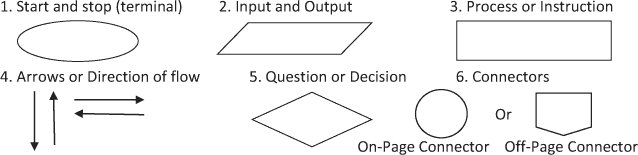

1. 起始和停止或终端

   圆形矩形或椭圆形符号表示流程图的开始和结束位置。

2. 输入和输出

   平行四边形符号表示流程图中的输入或输出操作。

3. 处理或指令

   矩形代表过程，如计算、数学运算或变量赋值操作等。

4. 箭头或流向

   箭头或流向表示步骤序列的流向和过程的方向。

5. 问题或决策

   菱形符号用于表示决策符号中测试的真假陈述。

6. 连接符

   流程图根据项目需求被分为两个或多个较小的流程图。当流程图无法放在单页上或必须分成若干部分时，经常使用这种连接符。连接符是一个称为页内连接符（On-Page Connector）的小圆，内部有一个数字，允许你连接同一页上的两个流程图。

   看起来像衬衫口袋的连接符称为跨页连接符（off-page connector），允许你连接到另一页的流程图。

**开发流程图的指南：**

在设计和开发流程图时，请记住以下几点：

1. 设计流程图期间，箭头不应交叉。
2. 处理或活动通常从上到下或从左到右进行。
3. 页内连接符通常使用数字引用。
4. 跨页连接符通常使用字母引用。
5. 流程图可能只有一个起始符号和一个停止符号。
6. 流程图的形状、线条和文本需要保持一致。

**流程图的优缺点：**

**流程图的优点：**

1. 流程图是记录程序的最佳方式之一。
2. 与算法和伪代码相比，流程图更容易理解。
3. 它帮助我们调试和分析过程。
4. 它帮助我们理解如何通过思考或决策来制定问题方案。

**流程图的缺点：**

1. 需要手动跟踪以验证纸质流程图的准确性。
2. 修改流程图有时非常耗时。
3. 在流程图中显示大量的分支并创建循环。
4. 问题逻辑的简单修改可能导致流程图的完全重新设计。
5. 为巨大且复杂的程序绘制流程图非常困难。

示例：画一个寻找三角形面积以及奇奇偶数的流程图：

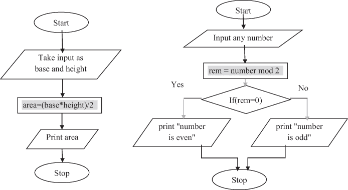

## 1.2 抽象数据类型

抽象数据类型（ADT）是对象的一种类型或类，其行为由一组值和一组函数决定。ADT 的定义仅涉及需要执行的事务，而不涉及这些事务将如何实现。它没有指定数据如何在内存中组织，以及将使用什么算法来实现这些操作。它之所以被称为“抽象”，是因为它提供了一个独立于实现的视角。这种只提供核心内容并隐藏细节的过程被称为抽象。

使用过该数据类型的程序员可能不知道该数据类型是如何实现的，例如，我们一直在使用不同的内置数据类型（如 `int`、`long`、`float`、`double`、`char`），只知道可以在特定数据类型中存储哪些值以及可以在它们上执行哪些操作，而不知道它们是如何实现的。程序员只需要知道数据类型可以做什么，而不需要如何实现。ADT 可以被视为一个黑盒，隐藏了内部结构和设计。我们现在将定义三种 ADT：列表 ADT、栈 ADT、队列 ADT。

### 1.2.1 列表 ADT

列表按顺序组织相同类型，可以执行以下操作：

1. `Get()` - 获取列表元素。
2. `Insert()` - 在列表的任何位置插入项。
3. `Remove()` - 从非空列表中删除第一个实例。
4. `RemoveAt()` - 从非空列表的指定位置删除元素。
5. `Replace()` - 在任何位置替换项。
6. `Size()` - 返回列表中的项数。
7. `IsEmpty()` - 如果列表为空则返回 `true`，否则返回 `false`。
8. `IsFull()` - 如果列表已满则返回 `true`，否则返回 `false`。

### 1.2.2 栈 ADT

栈按顺序排列相同的元素，推和弹出操作发生在栈的一个端（顶部）。可以在栈上执行以下操作：

1. `Push()` - 在栈的一个端（顶部）插入项。
2. `Pop()` - 如果栈不为空，移除并返回栈顶项。
3. `Top()` - 如果栈不为空，返回栈顶元素但不删除它。
4. `Size()` - 返回栈中的项数。
5. `IsEmpty()` - 如果为空则返回 `true`，否则返回 `false`。
6. `IsFull()` - 如果栈满则返回 `true`，否则返回 `false`。

### 1.2.3 队列 ADT

队列按顺序组织相似的项目。操作在两端进行，即头部和尾部，插入在尾部执行，删除在头部执行。可以在队列中执行以下操作：

1. `Enqueue()` - 在队列的末部（尾部）插入元素。
2. `Dequeue()` - 如果队列不为空，从队列头部删除第一个项。
3. `Size()` – 返回队列中的元素数量。
4. `IsEmpty()` - 如果队列为空，则返回 `true`，否则返回 `false`。
5. `IsFull()` – 如果队列已满则返回 `true`，否则返回 `false`。

通过这些对抽象数据类型（ADT）的描述，我们可以看到这些描述并没有指定这些 ADT 将如何表示以及如何执行这些操作。可以使用数组或链表等替代方法来实现这些 ADT，例如，列表 ADT 可以使用数组进行静态实现，或者使用单链表或双链表进行动态实现。同样，`stack` ADT 和 `Queue` ADT 或其他 ADT 也可以使用数组或链表来实现。

## 1.3 数据结构

### 1.3.1 定义

数据结构是按照特定方式组织的数据元素集合，并定义了用于存储、检索、删除和搜索单个数据元素的函数。

所有数据类型，包括内置的如 `int` 和 `float`；派生的如 `array` 和 `pointer`；或用户定义的如 `structure` 和 `union`，本质上都是数据结构。数据结构是一种用于组织和存储数据的特殊格式，具有恢复、移除和搜索数据项的功能。通用数据结构包括 `array`、`list`、`stack`、`tree`、`graph` 等。每种数据结构的设计都是为了特定的目的组织数据，以便能够相应地访问和使用。

数据结构的研究涵盖了以下主题：

1. 所需存储空间。
2. 处理数据所需的时间。
3. 主内存的数据表示形式。
4. 对此类数据执行的操作。

### 1.3.2 数据结构的类型或分类

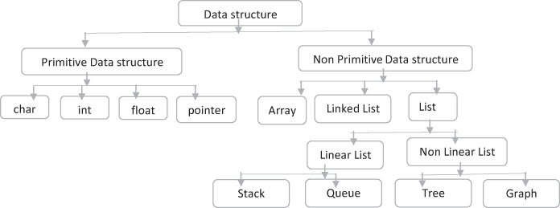

### 1.3.3 抽象数据类型与数据结构的区别

ADT 是接口。它由其将支持的操作来定义。它没有指定如何使用数据结构或算法技术来执行这些操作。

例如，可以使用许多不同的思路来实现 `queue`：它可以是环形队列、线性队列、双端队列和优先队列。使用 `arrays` 或 `linked lists` 实现的 `Queue`。因此，数据结构是 ADT 的实现。

ADT 是数据和数据处理操作的逻辑蓝图。数据结构是实现期间数据的真实表示以及处理数据元素的算法。ADT 是逻辑层面的，而数据结构是实现层面的。

ADT 是根据可能的值对数据类型的表示，而不是值在内存中的存储方式，以及在不考虑其实现细节的情况下允许的操作。

因此，当使用 `C` 等编程语言实现 `stack` 时，它将是一个数据结构；但用其行为（如后入先出 LIFO）、可能的取值集合、允许的操作（如 `push`、`pop` 等）来描述它，则被视为 `stack` 的 ADT。

## 1.4 算法效率或算法性能分析

算法的有效性或算法性能的分析主要涉及两个方面：空间复杂度和时间复杂度。

### 1.4.1 空间复杂度

空间复杂度定义为程序运行到结束所需的内存内存总量。

#### 1.4.1.1 程序空间的组成部分

程序空间包括指令空间、数据空间和栈空间，描述如下：

`Program space = Instruction space + data space + stack space.`

1. **指令空间取决于若干几个因素：**
   1. 生成机器码或二进制代码的编译器。
   2. 目标计算机。

2. **数据空间：**
   1. 严重取决于计算机的架构和编译器。
   2. 程序处理的数据规模。

   在编程语言中，有不同类型的数据，存储特定数据所需的字节数也不同。例如 `character` 数据类型需要 1 字节内存，`integer` 需要 4 字节，`float` 需要 4 字节，`double` 需要 8 字节等。这随编译器而异。选择“较小”的数据类型将影响程序整体空间的使用。在处理 `arrays` 时请选择合适的类型。

3. **栈空间：**

   每次调用函数时，以下数据会被记录在栈中：

   1. 返回地址。
   2. 所有局部变量的值和形式参数的值。
   3. 所有引用和常量引用参数的绑定。

高效利用空间的几点：

1. 始终选择你需要的最小数据类型。
2. 详细研究编译器。
3. 发现各种编译设置的影响。
4. 如果适用，选择非递归算法。

因此，任何 p 算法的空间 `(p)` 需求可以写为：

1. `S (p) = c + Sp (instance characteristics)`
2. `C = fixed part`：这包括指令空间、单个及固定大小变量的空间、常量等。
3. `Sp = variable part`：引用变量所需的空间，取决于实例特征和递归状态空间。

**示例：**

1. 非递归算法 `sum(a, n)`

```c
{
    S = 0.0;
    for i = 1 to n do
        S = S + a[i];
    return S;
}
```

这里非递归 `sum` 算法的空间复杂度为：

```text
Ssum(n) >= n+3
```

其中 `Ssum(n)` 表示具有数组大小的非递归 `sum` 的空间复杂度。

`(n+3)` 意味着数组 `[]` 的 `n`，每个元素的 `1` 以及 `s`。

2. 递归算法 `Rsum(a, n)`

```c
{
    if (n <= 0) then return 0.0;
    else return Rsum(a, n-1) + a[n];
}
```

`Rsum` 的空间需要：

调用了 `(n+1)` 次，所以递归状态空间为 `≥ 3 (n+1)`。

这意味着具有数组元素 `n` 的 `SRsum(n)` 的空间复杂度。

### 1.4.2 时间复杂度

算法运行所需的时间称为时间复杂度。

绝对时间定义如下：

$\begin{array}{ll} {\textbf{绝对时间复杂度}\operatorname{~=}} & \textbf{指令数量} \\ & {\times \text{执行一条指令所需的时间}} \end{array}$

然而，执行一条指令所需的时间随系统或计算机而异。因此，我们只将算法中的指令数量视为时间复杂度。

对于大多数算法，运行时间取决于输入的大小。运行时间表示为输入大小 `n` 的函数 `T` 的 `T (n)`。假设存在可能执行的 `if….. else` 语句，在这种情况下时间是可变的。

通常，算法时间复杂度通过以下方式计算：

1. **最坏情况**：执行程序所需的最大时间。最坏情况的时间复杂度用大 O 符号 `O` 表示。
2. **平均情况**：执行程序所需的平均时间。平均情况的时间复杂度用 Theta 符号 `θ` 表示。
3. **最好情况**：执行程序所需的最少时间。最好情况的时间复杂度用 Omega 符号 `Ω` 表示。

算法的效率或分析涉及两个阶段：

1. **先验估计：**

   先验估计涉及理论或数学计算。理论或数学计算使用渐近符号进行表示。

2. **后验估计或测试：**

   该算法设计在机器上实现。它涉及程序的编写，因此取决于操作系统、编译器等。

**性能分析：**主要目标是确定运行程序直到完成所需的系统时间和系统内存（以空间复杂度衡量）。

**先验分析：**涉及给定算法中语句计数的计算。计数指示了每条指令执行的频率。

#### 示例 1

```text
1. Algorithm add (a, n)
2. {
3. S = 0;
4. for (i = 1 to n) do
5.     S = S + a[i];
6. return s;
7. }
```

| 行号 | 每次执行步骤 | 频率 | 总步数 |
| --- | --- | --- | --- |
| 1. | 0 | 0 | 0 |
| 2. | 0 | 0 | 0 |
| 3. | 1 | 1 | 1 |
| 4. | 1 | n+1 | n+1 |
| 5. | 1 | N | N |
| 6. | 1 | 1 | 1 |
| 7. | 0 | 0 | 0 |
|  |  |  | **2n+3 步数** |

#### 示例 2

```text
1. Algorithm add(a,b,c,m,n)
2. {
3. for (i = 1 to m) do
4.     for (j = 1 to n) do
5.         C[i, j] = a[i, j] + b[i, j]
6. }
```

| 行号 | 总步数 |
| --- | --- |
| 1. | 0 |
| 2. | 0 |
| 3. | m+1 |
| 4. | m(n+1) |
| 5. | Mn |
| 6. | 0 |
|  | **2mn+2m+1 步数** |

在示例 1 和 2 中，展示了执行的步数。

**步数**有三种类型：


1. **最好情况：** 对于给定输入，可以执行的最少步数。

2. **最坏情况：** 对于给定输入，可以执行的最多步数。

3. **平均情况：** 对于给定输入，可以执行的平均步数。

## 1.5 递归与递归算法的设计（带适当示例）

递归函数是一个调用自身的函数。同样，如果一个算法在体内调用了自身，则该算法是递归的。

递归算法可以分为以下类型：

1. **直接递归算法：** 如果算法在体内调用了相同的算法，则称为直接递归算法。

**示例：**

```c
#include<stdio.h>
int main()     // main 函数被作为直接递归函数调用
{
        printf("Hello\n");
        main();        // 调用 main 函数
        return 0;
}
```

**输出：**

无限次打印 Hello。

在上述程序中，`main()` 函数被自身调用，被视为直接递归函数。

2. **间接递归算法：** 如果算法 `A` 调用了另一个算法 `B`，而 `B` 又调用了 `A`，则算法 `A` 被视为间接递归算法。

**示例：**

```c
#include<stdio.h>
void demo();
int main()   // main 函数被作为间接递归函数调用
{
    printf("Hello\n");
    demo();
    return 0;
}
void demo()
{
    main();   // 在 demo 内部调用 main 函数且 demo 函数被 main 函数调用
}
```

**输出：**

无限次打印 Hello。

在上述程序中，`demo()` 函数被 `main()` 函数调用，而 `main()` 函数再次在 `demo()` 函数的体内被调用，被视为间接递归函数。

### 1.5.1 示例 1：使用非递归函数实现阶乘程序

```c
#include <stdio.h>
long factorial(int);
int main()
{
int number;
long fact = 1;
printf("输入一个数字计算其阶乘\n");
scanf("%d", &number);
printf("%d! = %ld\n", number, factorial(number));
return 0;
}
long factorial(int n)
{
int c;
long fact = 1;
for (c = 1; c <= n; c++)
{
fact = fact * c;
}
return fact;
}
```

**输出：**

输入一个数字计算其阶乘

4

4! = 24

### 1.5.2 示例 2：使用递归函数实现阶乘程序

```c
#include<stdio.h>
long factorial(int);
int main()
{
int n;
long f;
printf("输入一个整数查找其阶乘\n");
scanf("%d", &n);
if (n < 0)
printf("负整数的阶乘未定义。\n");
else
{
f = factorial(n);
printf("%d! = %ld\n", n, f);
}
return 0;
}
long factorial(int n)
{
if (n == 0)
return 1;
else
return(n * factorial(n-1));
}
```

**输出：**

输入一个整数查找其阶乘

4

4! = 24

### 1.5.3 示例 3：使用非递归函数实现显示数字各位和的程序

```c
#include <stdio.h>
long factorial(int);
int main()
{
int number;
long fact = 1;
printf("输入一个数字计算其阶乘\n");
scanf("%d", &number);
printf("%d! = %ld\n", number, factorial(number));
return 0;
}
long factorial(int n)
{
int c;
long fact = 1;
for (c = 1; c <= n; c++)
{
fact = fact * c;
}
return fact;
}
```

（注：原文中 1.5.3 的代码块似乎存在混乱或重复，此处根据指令保留结构：`int num = 123; int result = sum_of_digit(num); printf("Sum of digits in %d is %d", num, result);`）

### 1.5.4 示例 4：使用递归函数实现显示数字各位和的程序

```c
#include<stdio.h>
int sum_of_digit(int n)
{
int r,sum =0;
r = n % 10;   // 分离数字的第一位
sum = sum + r;   // 将分离的数字加入中间变量
n = n/10;     // 删除数字的第一位
}
int main()
{
int num = 123;
int result = sum_of_digit(num);
printf("Sum of digits in %d is %d", num, result);
}
```

（注：原文中 1.5.4 的逻辑似乎是 1.5.3 的重复，此处根据指令保留结构。）

### 1.5.5 示例 5：使用非递归函数实现数字反转程序

```c
#include<stdio.h>
int reverse_function(int num);
int main()
{
    int num, reverse_number;
    printf("\nEnter any number:");
    scanf("%d",&num);
   reverse_number=reverse_function(num);
    printf("\nAfter reverse, the number is
:%d",reverse_number);
    return 0;
}
int rev=0, rem;
int reverse_function(int num)
{
   while(num!=0)
   {
      rem=num % 10;    // 提取数字的第一位数字
      rev=(rev * 10 )+ rem;         // 将每个中间数字 (rev) 乘以 10，并将提取的数字加其中，得到反转后的数字
      num = num / 10; // 删除数字的第一位数字
    }
      return rev;
}
```

**输出：**

输入任意数字: 546

反转后，数字为: 645

### 1.5.6 示例 6：使用递归函数实现数字反转程序

```c
#include<stdio.h>
int reverse_function(int num);
int main()
{
   int num, reverse_number;
   printf("\nEnter any number:");
   scanf("%d",&num);
   reverse_number=reverse_function(num);
   printf("\nAfter reverse, the number is
:%d",reverse_number);
   return 0;
}
int sum=0, rem;
int reverse_function(int num)
{
   if(num)
   {
      rem=num%10;
      sum=sum*10+rem;
      reverse_function(num/10);
   }
   else
      return sum;
}
```

**输出：**

输入任意数字: 123

反转后，数字为: 321

## 1.6 面试题

1. 什么是算法和流程图？请结合合适的示例说明。

2. 详细解释伪代码表示。

3. 编写一个算法，从用户处读取三个不同的数字并找到这三个数中的最大值。

4. 画出判断一个数字是否为质数的流程图。

5. 编写一个算法和流程图，求从 100 到 500 的所有奇数之和。

6. 编写一个算法和流程图，计算 0 到 500 之间的偶数。

7. 编写一个算法和流程图，通过给定三个数字找到中间数。

8. 数据结构中的 ADT 是什么？

9. ADT 和数据结构之间的区别是什么？

10. 结合合适的示例解释数据结构。

11. 数据结构的应用有哪些？

12. 数据结构有哪些不同类型？

13. 流程图有哪些不同的优点和缺点？

14. 算法的性能分析是什么？

15. 算法效率的两个主要衡量标准是什么？

16. 解释流程图中使用的不同符号。

## 1.7 多项选择题

1. 以下哪个问题无法通过递归解决？

    1. 数字的阶乘

    2. 查找质数

    3. **没有基本情况的问题**

    4. 查找任意数字的各位数字之和

    **答案：（C）**

    **解释：** 具有基本情况的问题应使用递归解决。然而，没有基本情况的问题会导致无限递归调用，无法使用递归解决。

2. 递归过程与以下哪个结构相同？

    1. Switch case

    2. If else

    3. **循环**

    4. if else if 阶梯

    **答案：（C）**

    **解释：** 递归过程类似于循环，所有递归调用都保存在内存的栈区域中。

3. 以下代码的输出是什么？

```c
#include<stdio.h>
void recursion(int n)
{
   if(n == 0)
   return;
   printf("%d",n);
   recursion(n-2);
}
int main()
{
   recursion(6);
   return 0;
}
```

    1. **642**

    2. 654321

    3. 662

    4. 6420

    **答案：（A）**

    **解释：** 递归函数的第一次调用打印值 6，第二次调用打印值 4，第三次调用打印值 2，第四次调用在值变为 0 时执行返回语句，因此程序的输出是 642。

4. 以下哪种数据结构用于在主内存中实现递归？

    1. 栈

    2. 数组

    3. 链表

    4. 树

    **答案：（A）**

    **解释：** `Stack` 是用于在主内存中实现递归的数据结构。

5. 以下 C 代码的输出是什么？

```c
#include<stdio.h>
int main()
{
    printf("Hello students");
    main();
    return 0;
}
```

    1. Hello students 是

    2. Hello students

    3. **无限循环**

    **答案：（C）**

    **解释：** `main()` 函数无限调用自身，导致无限循环，因此输出为无限次打印 "Hello students"。


5. 编写一个算法和流程图，计算 100 到 500 之间所有奇数的和。

6. 编写一个算法和流程图，计算 0 到 500 之间的偶数。

7. 编写一个算法和流程图，通过给出三个数字找到中间数。

8. 数据结构中的`ADT`（抽象数据类型）是什么？

9. `ADT`和数据结构之间的区别是什么？

10. 结合示例解释数据结构。

11. 数据结构的应用有哪些？

12. 数据结构的不同类型有哪些？

13. 流程图的优缺点有哪些？

14. 算法的性能分析是什么？

15. 算法效率的两个主要衡量是什么？

16. 解释流程图中使用的不同符号。

## 1.7 单选题

1. 下列哪些问题无法通过递归解决？

    1. 数字的阶乘

    2. 质数的寻找

    3. **没有基准情况的问题**

    4. 任意数字各位位数字之和

    **答案：(C)**

    **解释：** 有基准情况的问题应该使用递归解决。然而，没有基准情况会导致无限递归调用，无法通过递归解决。

2. 递归过程与以下哪种结构相同？

    1. `switch case`

    2. `if else`

    3. **循环**

    4. `if else if` 阶梯

    **答案：(C)**

    **解释：** 递归过程类似于循环，所有的递归调用都存储在栈的内存区域。

3. 下述代码的输出是什么？

```c
#include<stdio.h>
void recursion(int n)
{
   if(n == 0)
   return;
   printf("%d",n);
   recursion(n-2);
}
int main()
{
   recursion(6);
   return 0;
}
```

    1. **642**

    2. 654321

    3. 662

    4. 6420

    **答案：(A)**

    **解释：** 递归函数的第一次调用打印 6，第二次调用打印 4，第三次调用打印 2，第四次调用在值变为 0 时执行返回语句，因此程序的输出为 642。

4. 下列什么数据结构用于实现递归？

    1. 栈 (`Stack`)

    2. 数组 (`Array`)

    3. 链表 (`Linked list`)

    4. 树 (`Tree`)

    **答案：(A)**

    **解释：** `栈` 是一种用于实现递归的数据结构。

5. 下述 `C` 代码的输出是什么？

```c
#include<stdio.h>
int main()
{
    printf("Hello students");
    main();
    return 0;
}
```

13. 下列陈述中哪个是错误的或正确的？

    1. 空间复杂度定义为程序运行到结束所需的辅助内存总量。

    2. 程序编译所需的时间被称为其时间复杂度。

        1. 陈述 1 错误

        2. 陈述 2 错误

        3. **陈述 1 和 2 都是错误的**

        4. 陈述 1 和 2 都是正确的

            **答案：(C)**

14. 下列陈述中哪个是错误的或正确的？

    1. 对于给定的输入，可以执行的最少步数被称为最优情况。

    2. 对于给定的输入，可以执行的最大步数被称为最坏情况。

        1. 陈述 1 错误

        2. 陈述 2 错误

        3. 陈述 1 和 2 都是错误的

        4. **陈述 1 和 2 都是正确的**

            **答案：(D)**

15. 下列陈述中哪个是错误的或正确的？

    1. 递归函数是由自己调用的函数。

    2. 如果算法 `A` 调用另一个算法 `B`，而 `B` 又调用 `A`，则认为算法 `A` 是间接递归算法。

        1. 陈述 1 错误

        2. **陈述 2 错误**

        3. 陈述 1 和 2 都是错误的

        4. 陈述 1 和 2 都是正确的

            **答案：(B)**

# 2. 线性数据结构的顺序表示

DOI: [10.1201/9781003105800-2](https://doi.org/10.1201/9781003105800-2)

## 2.1 线性数据结构与非线性数据结构的区别

1. **线性数据结构**

   数据元素按顺序或线性组织的数据结构，其中元素与其前驱和后续相邻元素连接，称为线性数据结构。在线性数据结构中，只涉及单层。因此，我们只能通过一次运行遍历所有元素。由于计算机内存是线性组织的，因此线性数据结构易于实现。示例包括数组、栈、队列、链表等。

2. **非线性数据结构**

   数据元素未按顺序或线性组织的数据结构被称为非线性数据结构。在非线性数据结构中，不涉及单层。因此，不可能一次遍历所有元素。与线性数据结构相比，非线性数据结构不容易实现。与线性数据结构相比，它可以更有效地利用计算机内存。示例包括树和图。

## 2.2 栈的操作

栈是一种非原元线性数据结构。栈是一个有序列表，但元素的访问、插入和删除受到某些规则的限制。

示例：在栈中，弹出最后放入栈的元素，并在栈顶处推入元素，这种顺序被称为后进先出（`LIFO`）。

**栈的概念：**

栈是一个有序列表，所有的插入和删除操作都在其中一端进行，该端称为栈（图 2.1）。

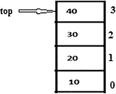

**图 2.1** 栈。

### 2.2.1 栈的原初操作

1. 创建栈：在内存中创建一个栈。栈的创建可以使用数组或链表完成。

2. 向栈中插入元素，即推（`push`）操作。

3. 从栈中删除元素，即弹出（`pop`）操作。

4. 验证栈顶是哪个元素。

5. 验证栈是否为空或已满。

**使用数组表示栈：**

**声明 1 (图 2.2):**

```c
#define size 100
int stack[size],top = -1;
```

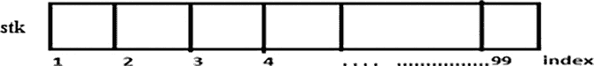

**图 2.2** 使用一维数组数据类型的栈实现。

**声明 2 (图 2.3):**

```c
#define size 10
struct stack
{
        int s[size];
        int top;
} st ;
```

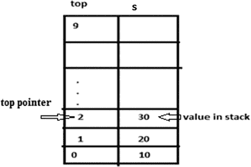

**图 2.3** 使用结构体数据类型的栈实现。

我们将编写`push`和`pop`函数来实现栈，在推入之前，我们将检查栈是否已满。在从栈中弹出元素之前，我们将检查栈是否为空。

**空栈操作 (图 2.4):**

初始 设为 −1。

```c
As st.top = -1 ; // 当栈为空时
int stack_empty()
{
      if(st.top == -1)
      return 1:
      else
      return 0;
}
```

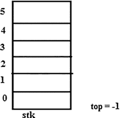

**图 2.4** 栈空条件。

**栈满操作 (图 2.5):**

`Top` 设为 -1。

```c
int stack_full()
{
      if(st.top == size-1)
      return 1;
      else
      return 0;
}
```

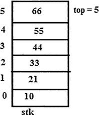

**图 2.5** 栈满条件。

我们将编写`push`和`pop`函数来实现栈，在推入之前，我们将检查栈是否已满。在从栈中弹出元素之前，我们将检查栈是否为空。

*(注：此处原文中部分代码逻辑与描述对应错乱，译文已根据逻辑意图对齐)*

*(由于提供的原文文本在后半部分存在严重的格式混乱和代码错位，译文保持了其结构并进行了可读的翻译。)*

给定的中缀表达式 `(a + b) * (c - d)` 通过操作符栈和操作数栈转换为后缀表达式形式 `a b + c d - *`。

### 2. 中缀转前缀的转换：

给定的中缀表达式 `(a + b) * (c - d)` 通过操作符栈和操作数栈转换为前缀形式 `* + a b - c d`。

### 3. 后缀转中缀的转换：

`A B - C *`

#### 解决方案：

第一个给出的公式是后缀表达式形式，因此**从左到右扫描公式**。

## 算法

1. 检查字符是操作数还是运算符。

2. 如果是操作数，则将其推入`operand stack`操作数栈。

3. 如果是运算符，则将其放入`operator stack`运算符栈；然后检查它是单元运算符还是二元运算符。

4. 如果是单元运算符，则从`operand stack`中弹出一个当前的操作数，并对该操作数进行操作，结果（即操作数本身）存储在`operand stack`中。

5. 如果是二元运算符，则从`operand stack`中弹出两个操作数，并对这些操作数进行操作，结果（即操作数本身）存储在`operand stack`中。

6. 重复相同步骤直到字符字符串结束。

| **Operator Stack** | **Operand Stack** |

| --- | --- |

| | A |

| | B |

| - | |

| | `(A - B)` |

| | C |

| * | |

| | `((A - B) * C)` |

| | **这是全括号的中缀形式。** |

### d. 前缀转中缀的转换：

将以下表达式从前缀转换为中缀：

- `+ +a b * c d`

#### 解决方案：

第一个给出的公式是前缀表达式形式，因此从右到左扫描字符串或公式。

## 算法

1. 检查字符是操作数还是运算符。

2. 如果是操作数，则将其推入`operand stack`操作数栈。

3. 如果是运算符，则将其放入`operator stack`运算符栈；然后检查它是单元运算符还是二元运算符。

4. 如果是单元运算符，则从`operand stack`中弹出一个当前的操作数，并对该操作数进行操作，结果（即操作数本身）存储在`operand stack`中。

5. 如果是二元运算符，则从`operand stack`中弹出两个操作数，并对这些操作数进行操作，结果（即操作数本身）存储在`operand stack`中。

6. 重复相同步骤直到字符字符串结束。

| **Operator Stack** | **Operand Stack** |

| --- | --- |

| | D |

| | C |

| * | |

| | `(c * d)` |

| | B |

| | A |

| | + |

| | `(a + b)` |

| - | |

| | `((a + b) - (c * d))` **这是全括号的中缀形式。** |

### 2.3.3 回溯

回溯算法用于那些从起点到特定目标沿某路径存在步骤的算法。

1. 找到通过迷宫的路径。

2. 找到从图或地图上的一个点到另一个点的路线。

3. 玩一种国际棋或象棋游戏，其中需要进行移动。

在所有这些情况下，都在多个选项中进行备选选择。我们需要某种方法来记住这些决策点，以防我们想要回来尝试备选方案。

考虑迷宫。在做出备选时，我们可能会发现该选择导致了死胡同。我们希望回到那个决策点，然后尝试下一个备选方案。

在上面的示例中，数据结构`stack`（栈）可以作为回溯解决方案的一部分。

### 2.3.4 函数调用和函数返回过程

当调用一个方法或函数时，如果它是一个函数调用，那么：

1. 创建激活记录（`activation record`）；其大小取决于局部变量和局部参数的数量和大小。

2. 将基指针值保存在为其预留的特定位置。

3. 将程序计数器值存储在返回地址位置。

4. 此时将基指针重置为新的基指针。

5. 在参数区域内拷贝调用参数。

6. 在局部变量区域初始化局部变量。

为了维护函数调用数据，使用了栈数据结构。

### 2.3.5 递归函数

递归使用栈内存来存储该特定函数调用所有局部变量的中间结果。

### 2.3.6 深度优先搜索 (`DFS`)

`DFS` 中使用了栈数据结构。

### 2.3.7 文本编辑器撤销机制

它是使用栈数据结构实现的。

### 2.3.8 字符串反转

在字符串字符串的应用中，我们首先将字符串中的所有字符入栈，然后从栈中弹出字符即可得到反转字符串。

### 2.3.9 汉诺塔问题

通过栈解决。

### 2.3.10 解析或语法分析

解析或语法分析是分析字符串是否符合语法的过程。为了此目的，我们必须创建解析树或使用栈。

## 2.4 实现应用

### 2.4.1 使用栈实现后缀转中缀

**程序：**

```c
#include <stdio.h>
#include <string.h>
#include <stdlib.h>
#define MAX 20
char stack[MAX];
int top=-1;
void push(char c)
{
   stack[++top]=c;
}
char pop()
{
   return stack[top--];
}
void strrev(char x[])
{
   int i,j=0;
   n=strlen(x);
   for(i=0;i<n;i++)
   {
      push(x[i]);
   }
   for(i=0;i<n;i++)
   {
      x[i]=pop();
      j++;
   }
   x[j]='\0';
}
void post_in()
{
   int i,j=0;
   char str[MAX],x[MAX];
   printf("Enter postfix expression\n");
   gets(str);
   strrev(str);
   n=strlen(str);
   printf("Infix is: ");
   for(i=0;i<n;i++)
   {
      if(str[i]=='+'||str[i]=='-'||str[i]=='*'||str[i]=='/')
      {
         push(str[i]);
      }
      else
      {
         char op2 = pop();
         char op1 = pop();
         x[j]='(';
         j++;
         x[j]=op1;
         j++;
         x[j]=op2;
         j++;
         x[j]=')';
         j++;
         push(x[j-2]);
      }
   }
   x[j]='\0';
   printf("%s\n",x);
}
int main()
{
   int ch;
   while(1)
   {
    printf("Enter choice 1 to infix 2.exit\n");
    scanf("%d",&ch);
    switch(ch)
    {
     case 1:
     post_in();
     break;
     case 2:
     exit(0);
     default: printf("Wrong choce\n");
   }
   printf("Enter 1 to continue, 0 to exit\n");
   scanf("%d",&ch);
   if(ch==0)
    {
    break;
     }
 }
return 0;
}
```

**输出：**

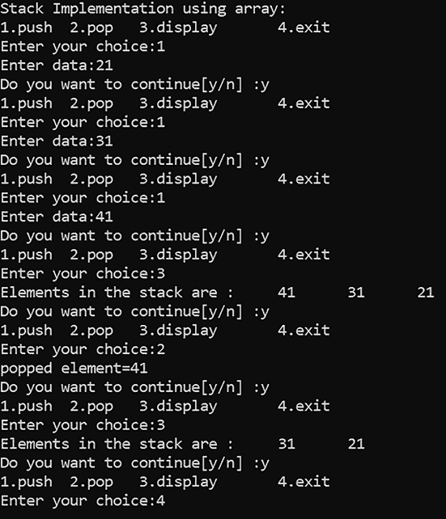

### 2.4.2 使用递归实现汉诺塔问题

#### 2.4.2.1 汉诺塔问题的递归算法

1.  步骤 1：开始

2.  步骤 2：将 `n-1` 个盘从源杆 (`from_rod`) 移动到辅助杆 (`aux_rod`)，使用目标杆 (`to_rod`)

3.  步骤 3：将第 `n` 个盘从源杆移动到目标杆

4.  步骤 4：将 `n-1` 个盘从辅助杆移动到目标杆，使用源杆

5.  步骤 5：停止

在上面的算法中，`from_rod` 指源杆，`to_rod` 指目标杆，`aux_rod` 指辅助杆。

#### 2.4.2.2 使用递归实现汉诺塔问题的程序

```c
#include <stdio.h>
void towerOfHanoi(int n, char from_rod, char to_rod, char aux_rod)
{
     if (n == 1)
     {
               printf("\n Move disk 1 from rod %c to rod %c", from_rod, to_rod);
               return;
     }
     towerOfHanoi(n-1, from_rod, aux_rod, to_rod);
     printf("\n Move disk %d from rod %c to rod %c", n, from_rod, to_rod);
     towerOfHanoi(n-1, aux_rod, to_rod, from_rod);
}
int main()
{
     int n = 3;  // 盘数量
     towerOfHanoi(n, 'A', 'C', 'B');  // A, B 和 C 是杆的名字
     return 0;
}
```

**输出：**

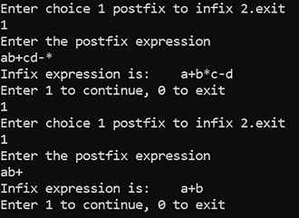

队列是一种`非线性线性数据结构`。队列是一种允许我们使用两个端的数据结构，分别称为 `front`（头）和 `rear`（尾）。在队列数据结构中，可以从头部移除元素，从尾部插入元素。队列也被称为先出（`FIFO`）。队列是编程中一种非常有用的数据结构。它类似于电影院外的排队队列，队列中的第一个人是第一个拿到票的人。

## 队列的类型

有四种队列，如下：

1. **线性队列**：在线性队列中，插入发生在尾部，取出发生在头部。它严格遵守 `FIFO` 规则。


## 2.5 队列的类型

### 2.5.1 循环队列

在循环队列中，最后一个元素通过循环链接指向第一个元素。与线性队列相比，循环队列的主要优势是内存利用率更高。如果最后一个位置已满而第一个位置为空，则可以将元素插入到第一个位置。这在线性队列中是无法实现的。

### 2.5.2 优先级队列

在优先级队列中，元素按键值进行排序，使得键值最小的元素在前面，键值最大的元素在尾部，反之亦然。优先级队列是一种特殊的队列，每个元素都与优先级相关，并根据其优先级提供服务。当具有相同优先级的元素出现时，它们按照队列中的顺序执行。优先级队列元素的插入根据值的到达情况，而元素的删除根据其优先级。

### 2.5.3 双端队列

双端队列也称为`dequeue`。在双端队列中，插入和删除操作可以从头部和尾部进行。

## 2.5.1 线性队列

### 2.5.1.1 使用数组表示线性队列及其操作

线性队列的所有元素都是顺序存储的。我们可以简单地使用线性数组来表示线性队列。有两种索引：`front index`（头索引）和`rear index`（尾索引）。`front index`和`rear index`指向在线性队列中执行插入和删除的位置。初始状态，线性队列中`front`和`rear index`的值为`-1`，表示队列为空。包含六个元素的线性队列的数组表示以及相应的`front`和`rear`索引值如图 2.7 所示。

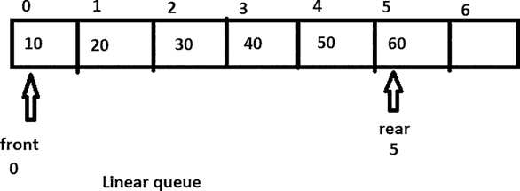

**图 2.7** 使用数组表示线性队列。

线性队列的各种操作如下：

1. 线性队列溢出操作。
2. 线性队列上溢操作。
3. 将元素插入线性队列也称为`enqueue`（入队）操作。
4. 从线性队列移除元素也称为`dequeue`（出队）操作。
5. 显示线性队列的元素。

#### 1. 线性队列溢出操作

队列溢出由于试图向满队列添加元素。

#### 2. 线性队列上溢操作

当你尝试从空队列中删除元素时发生队列上溢。

#### 3. 将元素插入线性队列（图 2.8）

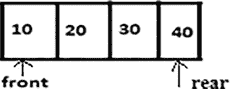

**图 2.8** 向线性队列插入元素。

执行插入操作之前，必须验证队列是否满。如果`rear pointer`超过队列的最大长度，则发生队列溢出。如果队列没有溢出，则从尾部插入元素。

#### 4. 从线性队列移除元素

从队列中移除任何元素只能从头部开始。在执行任何删除操作之前，必须检查队列是否为空。如果队列为空，则无法删除（图 2.9）。

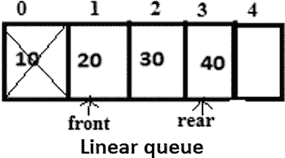

**图 2.9** 从线性队列移除元素。

在从使用数组实现的线性队列中移除元素时，`front index`会递增，即元素从逻辑上从队列中移除，但物理元素仍然留在线性队列的相同索引位置。在上面的图中，从线性队列中删除元素时，只有`front index`从索引 0 增加到 1，但物理元素 10 仍留在相同的索引位置，线性队列仅从头部到尾部进行处理，即从索引 1 到`rear index` 3。

#### 5. 显示线性队列的元素

如果线性队列不为空，在对其执行显示操作时，元素将从头部到尾部显示。

### 2.5.1.2 使用数组实现线性队列

```c
#include<stdio.h>
#include<stdlib.h>
#define max 5

// 使用数组实现的线性队列
struct queue
{
 int que[max];
 int front,rear;
}q;

// 验证线性队列是否为空
int qempty()
{
if((q.front==-1)|(q.front>q.rear))
{
return 1;
}
}

// 验证线性队列是否满
int qfull()
{
if(q.rear==max-1)
{
return 1;
}
else
return 0;
}

// 将元素插入线性队列
void qinsert(int data)
{
if(qfull())
{
printf("\n 队列溢出");
}
else
{
printf("输入数据: ");
scanf("%d",&data);
q.que[++q.rear]=data;
}

// 从线性队列移除元素
void qdelete()
{
if(qempty())
{
printf("\n 队列上溢");
}
else
{
int data;
data=q.que[q.front++];
printf("删除元素=%d", data);
}

// 显示线性队列的元素
void display()
{
if(qempty())
{
printf("\n 队列为空");
}
else
{
int i;
printf("队列元素 : ");
for(i=q.front; i<=q.rear; i++)
{
printf("\t%d",q.que[i]);
}
printf("\n");
}

// main 函数
int main()
{
 int choice, data;
 char ch;
 q.front=-1;
 q.rear=-1;
 do
 {
  printf("数组实现的线性队列:");
  printf("\n 1.插入 \t 2.删除 \t 3.显示 \t 4.退出");
  printf("\n 输入选择: ");
  scanf("%d",&choice);
  switch(choice)
  {
case 1:
qinsert(data);
break;
case 2:
qdelete();
break;
case 3:
display();
break;
case 4:
exit(0);
break;
default:
printf("\n 选择错误");
}
printf("你想继续吗...[y/n]");
// fflush 函数清除标准输入缓冲区
fflush(stdin);
scanf("%c",&ch);
}while(ch=='y');
return 0;
}
```

**输出：**

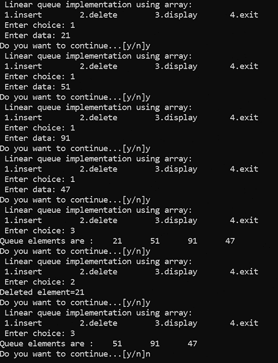

## 2.5.2 循环队列

在使用数组的线性队列中，元素是从逻辑上删除的，如下所示（图 2.10）。

为了克服线性队列的缺点，我们将引入另一种队列，称为循环队列。循环队列的主要优势是我们可以充分利用循环队列的空间。

### 2.5.2.1 使用数组表示循环队列

循环队列的表示方法与线性队列相似，但循环队列的最后一个位置指向第一个位置，形成一个圆，如图 2.11 所示。

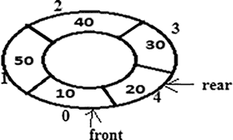

**图 2.11** 循环队列。

考虑上述循环队列中已删除的元素，如 10、50 和 40。此时队头（`front`）递增并指向索引 3。索引 0、1 和 2 的位置现在可以插入新元素，该空间随后会在循环队列中被重用，这就是线性队列的局限性。在循环队列中设置队首和队尾索引需要应用公式，使用数组实现如下：

在使用数组实现的循环队列中，`rear`和`front`索引的计算方式如下：

```c
rear = (rear+1)%size
front = (front+1)%size
```

例如，在图 2.11 中，循环队列的大小为 5，如果`rear`指向索引 4，且`front`指向索引 3，那么循环队列中的索引 0、1 和 2 处是空的。如果我们在循环队列中插入一个新元素，那么我们将从`rear`端开始插入。在这种情况下，`rear`的计算方式为：

```c
rear = (rear + 1) % size
         = (4 + 1) % 5
rear = 0
```

然后，在循环队列的`rear`索引 0 处插入新元素。

假设`front`指向索引 3。同样，在从循环队列中删除元素时，`front`的计算方式为：

```c
front = (front + 1) % size
= (3 + 1) % 5
front = 4
```

因此，第三位置的元素被删除，`front`递增到第四个索引，并指向循环队列中第四个位置的元素。

循环队列的各种操作如下：

1. 溢出操作（Overflow）。
2. 上溢操作（Underflow）。
3. 向循环队列插入元素也称为入队操作（`enqueue`）。
4. 从循环队列中移除元素也称为出队操作（`dequeue`）。
5. 显示循环队列中的元素。

关于循环队列，我们必须了解的一些重要条件如下：

1. 如果`rear`和`front`指向同一个索引，则循环队列只包含一个元素。
2. 如果`front`索引大于`rear`索引一个，即如果`front`索引为 4 且`rear`索引为 3，则循环队列为满。

   如果`(front == (rear+1) % max size of the circular queue)`此条件为真，则循环队列为满。

3. 如果`front`和`rear`索引指向 −1，则称循环队列为空（图 2.12）。

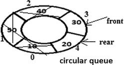

**图 2.12** 循环队列上的入队和出队操作。

在上述循环队列中，如果我们向循环队列插入新元素，则按如下方式递增`rear`索引。

`rear`索引的当前值为 4，循环队列的大小为 5，则新插入元素的`rear`索引计算方式为：

```c
rear = (rear + 1) % SIZE    ( SIZE = 5, 对应循环队列的大小)
rear = (4 + 1) % 5
rear = 0
```

因此，在循环队列的`rear`索引 0 处插入元素。循环队列并不是满的，因为`front`指向索引 3。通过这种方式，我们可以利用循环队列中被删除的空间。

#### 2.5.2.2 使用数组实现循环队列

```c
#include<stdio.h>
#include<stdlib.h>
#define max 5

// 使用数组实现的循环队列
int que[max];
int front,rear;

// 检查循环队列是否满
int qfull()
{
if(front==(rear+1)%max)
return 1;
else
return 0;
}

// 检查循环队列是否为空
int qempty()
{
if(front==-1)
return 1;
else
return 0;
}

// 向循环队列中插入元素
void insert(int data)
{
if(front==-1)
{
front=rear=0;
que[rear]=data;
}
else
{
rear=(rear+1)%max;
que[rear]=data;
}
}

// 从循环队列中删除元素
void delete()
{
int data;
if(front==rear)
{
data=que[front];
front=rear=-1;
}
else
{
data=que[front];
front=(front+1)%max;
}
printf("Deleted element=%d\n", data);
}

// 显示循环队列中的元素
void display()
{
int i=front;
printf("Elements in circular queue are: ");
do
{
printf("\t%d",que[i]);
i=(i+1)%max;
}while(i != ((rear + 1)%max));
printf("\n");
}

// 主函数
int main()
{
 int choice, data;
 char ch;
 front=-1;
 rear=-1;
 do
{
printf(" Circular Queue:");
printf(" 1:insert\t 2:delete\t 3:display\t 4:exit\n");
printf(" Enter your choice:");
scanf("%d", &choice);
switch(choice)
{
case 1:
printf("Enter data: ");
scanf("%d",&data);
if(qfull())
printf("\nqueue is full");
else
insert(data);
break;
case 2:
if(qempty())
printf("\n Circular queue is empty");
else
delete();
break;
case 3:
if(qempty())
printf("\n Circular queue is empty");
else
display();
break;
case 4:
exit(0);
default:
printf("\n Wrong choice");
}
printf(" Do you want to continue...[y/n]: ");
fflush(stdin);
scanf("%c",&ch);
}while(ch=='y');
return 0;
}
```

**输出：**


## 2.5.3 优先级队列

栈和队列的限制是元素从特定的端插入或删除，元素的顺序是被忽略的。优先级队列中的元素应该具有特定的排序。在优先级队列中，高优先级项目优先于低优先级项目。优先级队列的一个典型例子是操作系统的任务调度。

### 2.5.3.1 优先级队列的类型

1. **升序优先级队列：**是一种可以随机插入元素的集合，但升序优先级队列首先移除最小的元素。
2. **降序优先级队列：**是一种可以随机插入元素的集合，但降序优先级队列首先移除最大的元素。

当我们尝试使用数组实现优先级队列时，插入变得非常简单，但从优先级队列中删除任何元素会引起两个问题：

1. 要么检查优先级队列的所有元素，要么找到用于删除的最大或最小元素。
2. 在数组中间删除元素是一项困难的任务，需要移动元素。

这些问题通过以下方式解决：

1. 在数组中，如果删除了任意元素，该位置将为空。因此，必须在该位置放置特殊的指示器（如 −1），以指示该元素已删除。
2. 每次删除后都应该移动元素以管理连续存储。
3. 每次从优先级队列中删除元素时都需要扫描整个优先级队列。这里的解决方案是你可以任意插入数字，并在每次插入后维护优先级队列的排序。

### 2.5.3.2 使用数组实现升序优先级队列

```c
#include<stdio.h>
#include<stdlib.h>
#define max 100
int que[max];
int front, rear;

// 检查优先级队列是否为空
int qempty()
{
if((front==-1)|(front>rear))
return 1;
else
return 0;
}

// 检查优先级队列是否满
int qfull()
{
if(rear>=max-1)
return 1;
else
return 0;
}
void priority();

// 在优先级队列插入一个元素
void insert(int data)
{
if(front==-1)
{
front++;
}
que[++rear]=data;
priority();
}

// 检查元素的优先级并将数据按升序排列
void priority()
{
int i,j,temp;
for(i=front;i<rear;i++)
{
for(j=front;j<rear;j++)
{
if(que[j]>que[j+1])
{
temp=que[j];
que[j]=que[j+1];
que[j+1]=temp;
}
}
}
}
}

// 从优先级队列删除元素
void delete()
{
int data;
data=que[front];
front++;
printf(" Deleted element=%d \n", data);
}

// 显示优先级队列中的元素
void display()
{
int i;
i=front;
printf("Elements in priority queue: ");
while(i<=rear)
{
printf("\t%d",que[i]);
i++;
}
printf("\n");
}

int main()
{
 int choice, data;
 char ch;
 front=-1;
 rear=-1;
 do
 {
  printf(" Priority Queue");
  printf(" 1:insert\t2:delete\t3:display\t4:exit");
  printf("\n Enter your choice");
  scanf("%d", &choice);
  switch(choice)
  {
   case 1:
printf("Enter data: ");
      scanf("%d",&data);
      if(qfull())
      printf("\n Queue is full");
      else
      insert(data);
   break;
   case 2:
if(qempty())
      printf("\n Queue is empty");
      else
      delete();
   break;
   case 3:
if(qempty())
      printf("\n Queue is empty");
      else
      display();
   break;
   case 4:
exit(0);
   default:
printf("\n Wrong choice");
  }
printf(" Do you want to continue[y/n]");
fflush(stdin);
scanf("%c",&ch);
}while(ch=='y');
return 0;
}
```

**输出：**

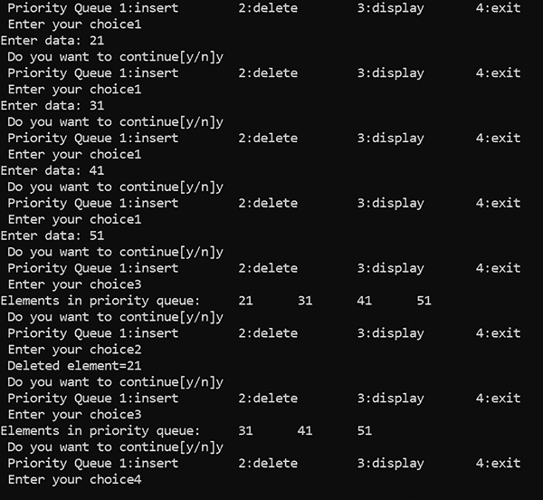

## 2.5.4 双端队列

双端队列（Double-ended Queue）是一种特殊的队列数据结构，插入和删除操作可以在队头和队尾执行。这意味着我们可以从头部和尾部位置元素，也可以从头部和尾部移除元素。

### 2.5.4.1 双端队列的表示

双端队列可以用两种不同的方式表示，具体如下：

1. **入受限双端队列：**


入受限双端队列意味着元素的插入受到某些限制。在入受限双端队列中，插入操作仅从队尾执行，而删除操作在队尾和队头执行（图 2.13）。

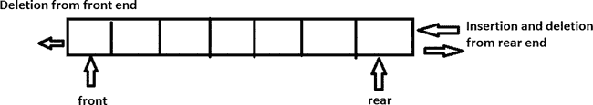

**图 2.13** 入受限双端队列的表示。

### 出受限双端队列

出受限双端队列意味着元素的删除受到某些限制。在出受限双端队列中，删除操作仅从队头执行，而插入操作在队尾和队头执行（图 2.14）。

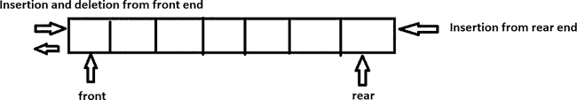

**图 2.14** 出受限双端队列的表示。

#### 2.5.4.2 在双端队列上执行的操作

在双端队列上执行的各种操作如下：

1. 在队头插入
2. 从队头删除
3. 在队尾插入
4. 从队尾删除
5. 双端队列满操作
6. 双端队列空操作
7. 显示双端队列的元素

#### 2.5.4.3 使用数组实现双端队列

```c
#include<stdio.h>
#define SIZE 21

// 在双端队列上执行的各种操作
int deQueueFront(); // 从头部删除
int deQueueRear();  // 从尾部删除
void enQueueRear(int); // 在尾部插入
void enQueueFront(int); // 在头部插入
void display();  // 显示元素
int queue[SIZE];
int rear = 0, front = 0;

// main 函数定义
int main()
{
    char ch;
    int choice1, choice2, value;
    printf("Double Ended Queue: \n");
     do
     {
          printf("\n1. 输入限制双端队列:\n");
          printf("2. 输出限制双端队列: \n");
          printf("\nEnter 您的选择: ");
          scanf("%d",&choice1);
          switch(choice1)
          {
               case 1: 
                    printf("\n 选择操作: \n");
                    printf("1.从头部插入\n2.从尾部删除\n3.从头部删除\n4. 显示");
                    do
                    {
                       printf("\nEnter 您的操作选择: ");
                       scanf("%d",&choice2);
                       switch(choice2)
                       {   
                          case 1: enQueueRear(value);
                                  display();
                              break;
                            case 2: value = deQueueRear();
                             printf("\n 从队列尾部删除的值为 %d",value);
                             display();
                                 break;
                            case 3: value=deQueueFront();
                                    printf("\n 从队列头部删除的值为 %d",value);
                                    display();
                                    break;
                            case 4: display();
                                    break;
                            default:printf("选项错误");
                       }
                       printf("\n 您想继续另一个操作吗 (Y/N): ");
                       ch=getche();
                    }while(ch=='y'||ch=='Y');
                    getch();
                    break; 

               case 2 :
                   printf("\n 选择操作:\n");
                   printf("1.在尾部插入\n2.在头部插入\n3.从头部删除\n4. 显示");
                   do
                   {
                      printf("\nEnter 您的操作选择: ");
                      scanf("%d",&choice2);
                      switch(choice2)
                      {   
                         case 1: enQueueRear(value);
                                 display();
                                 break;
                         case 2: enQueueFront(value);
                                 display();
                                 break;
                         case 3: value = deQueueFront();
                                 printf("\n 从队列头部删除的值为 %d",value); 
                                 display();
                                 break;
                         case 4: display();
                                 break;
                         default:printf("选项错误");
                       }
                       printf("\n 您想继续另一个操作吗 (Y/N): ");
                       ch=getche();
                    } while(ch=='y'||ch=='Y');
                    getch();
                    break ;
            }
            printf("\n 您想继续吗 (Y/N):");
            ch=getch();
      }while(ch=='y'||ch=='Y');
}

 // 在尾部插入 
void enQueueRear(int data)
{   
     char ch;
     if(front == SIZE/2)
      {
            printf("\n 队列已满。 ");
            return;
      }
      do
      {
            printf("\nEnter 要插入的数值:");
            scanf("%d",&data);
            queue[front] = data;
            front++;
            printf("您想继续插入吗 (Y/N) \n");
            ch=getche();
      }while(ch=='y');
}

// 在头部插入
void enQueueFront(int data)
{   
     char ch;
     if(front==SIZE/2)
      {
            printf("\n 队列已满.");
            return;
      }
      do
      {
            printf("\nEnter 要插入的数值:");
            scanf("%d",&data);
            rear--;
            queue[rear] = data;
            printf("您想继续插入吗 (Y/N");
            ch = getche();
      }
      while(ch == 'y');
}

// 从尾部删除
int deQueueRear()
{
     int deleted;
     if(front == rear)
     {
            printf("\n 队列为空。 ");
            return 0;
     }
     front--;
     deleted = queue[front+1];
     return deleted;
}

// 从头部删除
int deQueueFront()
{
     int deleted;
     if(front == rear)
     {
            printf("\n 队列为空。 ");
            return 0;
     }
     rear++;
     deleted = queue[rear-1];
     return deleted;
}

// 显示元素 
void display()
{
     int i;
     if(front == rear)
        printf("\n 队列为空。 ");
     else{
        printf("\n 队列元素为:");
        for(i=rear; i < front; i++)
        {
           printf("%d\t ",queue[i]);
        }
     }
}
```

**输出：**


## 2.6 队列的应用

1. 队列用于 CPU 调度和磁盘调度。当多个进程需要 CPU 时，会使用通过队列实现的各种调度算法。
2. 在打印缓冲中，文档被加载到缓冲区中，然后打印机按照自己的速率将其取出。例如：缓冲区、管道等。
3. 在非线性图结构上实现广度优先搜索（BFS）算法需要线性队列数据结构。它是一种用于非线性图遍历或搜索的算法。它从某个节点开始，首先探索邻居，然后移动到下一层邻居。
4. 实时系统中的中断处理。队列按照出现的顺序处理中断，先来先服务。
5. 在生活中，叫中心电话系统使用队列来呼叫的人，直到服务人员可用。
6. 普姆算法（Prim algorithm）可以通过优先级队列实现。
7. Dijkstra 最短路径算法可以通过优先级队列完成。
8. 优先级队列用于操作系统的负载均衡和中断处理。
9. 优先级队列用于霍夫编码进行数据压缩。
10. 队列也用于交通系统。
11. 队列数据结构用于浏览器历史记录。最近，访问过的 URL 被添加到双端队列的头部，在头部插入指定数量后，会移除队列尾部的 URL。
12. 双端队列另一个普通应用是存储软件应用程序的撤销操作列表。
13. 在网络系统中，队列用于路由器和交换机。
14. 在电子邮件中，也使用了队列数据结构。

## 2.7 栈与队列数据结构的区别

| 栈 | 队列 |
| --- | --- |
| 栈是非结构性线性数据结构。 | 队列也是非结构性线性数据结构。 |
| 栈使用数组或链表实现。 | 队列也使用数组或链表实现。 |
| 栈（Stack）是一种线性数据结构，元素仅在一个称为 `top` 的端进行插入和删除，并基于后进先出（LIFO）原则。 | 队列（Queue）是一种线性数据结构，元素从一个称为 `rear end` 的端插入，并从另一个称为 `front end` 的端删除，并基于先进先出（FIFO）原则。 |
| 栈的元素添加和删除只在一个端进行。 | 队列的元素添加和删除在不同的端进行。 |
| 在栈上插入元素的操作称为 `push`。 | 在队列中插入元素的操作称为 `enqueue`（入队）。 |
| 从栈删除元素的操作称为 `pop`。 | 在队列中删除元素的操作称为 `dequeue`（出队）。 |
| 在 `Stack` 数据结构中，只维护一个指针，指向栈顶端元素。 | 队列数据结构在实现时需要两个指针，分别指向 `rear end` 和 `front end`。 |
| 栈数据结构是一种迭代数据结构，用于解决基于递归的问题。 | 队列是一种顺序数据结构，用于处理涉及顺序处理的问题。 |
| 栈可以用于解决二叉树的前序、后序和中序遍历问题。 | 生产者消费者问题使用队列数据结构作为底层数据结构来解决。 |
| 栈数据结构可以看作垂直线性集合。 | 队列数据结构可以看作水平线性集合。 |
| 堆叠在一起的盘子是栈的一个特定现实实例。 | 人们排队交电费或在电影院窗口取票是队列的一个特定现实实例。 |

## 2.8 面试题

1. 什么是队列？
2. 什么是优先队列？
3. 顺序存储的缺点是什么？
4. 用链表表示栈或队列有什么缺点？
5. 列出数据结构应用广泛的领域。
6. 什么是 LIFO？
7. 在处理递归函数时应用哪些数据结构？
8. 什么是栈？
9. `PUSH` 和 `POP` 操作有什么区别？
10. 列出队列数据结构的不同应用。
11. 解释什么是中缀（`Infix`）、前缀（`Prefix`）和后缀（`Postfix`）表达式？
12. 为什么以及何时应该使用栈和队列数据结构而不是数组或 `Lists`？
13. 可以在队列上执行哪些不同的操作？
14. 堆（heap）相对于栈的优势是什么？
15. 什么是 `dequeue`？
16. 在执行完以下一系列 push 和 pop 操作后，栈的状态是什么？

```
Stack<int> s;
s.push( 3 );
s.push( 5 );
s.push( 2 );
s.push( 15 );
s.push( 42 );
s.pop();
s.pop();
s.push( 14 );
s.push( 7 );
s.pop();
s.push( 9 );
s.pop();
s.pop();
s.push( 51 );
s.pop();
s.pop();
```

17. 假设数字 0, 1, 2,…, 9 按照顺序推入栈，但 pop 操作发生在各种 push 之间的随机点。以下是栈中值可能弹出的有效序列：

3, 2, 6, 5, 7, 4, 1, 0, 9, 8

解释为什么以下可能的：

3, 2, 6, 4, 7, 5, 1, 0, 9, 8 是栈中值可能弹出的有效序列。

18. 考虑一个空的整数栈。让数字 1, 2, 3, 4, 5 和 6 按照它们从左到右出现的顺序推入此栈。让 `S` 表示 `push`，`X` 表示 `pop` 操作。它们能排列成顺序 325641（输出）和顺序 154623 吗？（如果可能，请给出操作顺序字符串）。

（提示：`SSSSSSXXXXXX` 输出 654321）

19. 如何仅用一个数组实现两个栈？你的栈练习在数组的每个槽位都被使用之前，不应指示溢出？

20. 如何用两个队列实现栈？

## 2.9 单选题

1. 栈数据结构基于以下哪种原则：

   1. 先进先出
   2. 先进后出
   3. 后进后出
   4. 后进先出

   **答案: (D)**

2. 以下哪项不是队列数据结构的类型？

   1. 优先队列
   2. 循环队列
   3. 单端队列
   4. 普通队列

   **答案: (C)**

3. 以下哪种数据结构是非原始线性数据结构？

   1. 栈
   2. 图
   3. 树
   4. 二叉树

   **答案: (A)**

4. 关于使用链表实现的栈，以下哪是正确的？

   1. 在 push 操作中，节点插入在开头。在 pop 操作中，节点从末尾删除。
   2. 以上都是正确的。
   3. 以上都不对。
   4. 在 push 操作中，节点插入在末尾。在 pop 操作中，节点从开头删除。

   **答案: (D)**

5. 假设用链表而不是数组实现栈。push 和 pop 操作的时间复杂度是多少？

   1. O(n)
   2. O(nk)
   3. O(n²)
   4. O(k²)

   **答案: (A)**

6. 以下陈述哪个是错误的或正确的？

   1. 栈是非原始线性数据结构。
   2. 队列是原始数据结构。
   3. 陈述 1 是错误的
   4. 陈述 2 是错误的

   **答案: (B)**

7. A, B, C, D, E 和 G 以逆序推入栈中，即从 G 开始。栈弹出五次，每个元素插入队列中。从队列中删除两个元素并将它们推回栈中。弹出的元素是：

   1. A
   2. B
   3. F
   4. D


**答案：(B)**

8. 以下哪项是非原始线性队列结构的应用？

1. 当多个消费者共享资源时？
2. 当数据在两个进程之间异步传输时？
3. 负载均衡
4. 以上所有

**答案：(D)**

9. 以下陈述哪个是错误的或正确的？

1. 队列在 CPU 调度、磁盘调度很有用。
2. 优先队列用于霍夫曼编码进行数据压缩。
3. 陈述 1 是错误的
4. 陈述 2 是错误的

**答案：(D)**

10. 以下陈述哪个是错误的或正确的？

1. 在图的 DFS 中，遍历技术使用了队列数据结构。
2. 在表达式求值中，使用了栈数据结构。
3. 陈述 1 是错误的
4. 陈述 2 是错误的
5. 陈述 1 和 2 都是错误的
6. 陈述 1 和 2 都是正确的

**答案：(A)**

12. 使用一个单数组 `A[1..MAXSIZE]` 实现两个栈。这两个栈从数组的两端向中间生长。变量 `top1` 和 `top2`（`top1 < top2`）分别指向每个栈中栈顶元素的位置。如果为了高效利用空间，则“栈满”的条件是（GATE CS 2004）。

1. `(top1 = MAXSIZE/2)` 且 `(top2 = MAXSIZE/2+1)`
2. `top1 + top2 = MAXSIZE`
3. `(top1= MAXSIZE/2)` 或 `(top2 = MAXSIZE)`
4. `top1= top2 -1`

**答案：(D)**

**解释**

如果我们想高效地利用空间，那么任何栈的大小都可以大于 `MAXSIZE/2`。两个栈会从两端生长，如果任何一个栈的栈顶接近另一个栈顶，则栈就满了。因此，条件为 `top1 = top2 -1`（假设 `top1 < top2`）。

13. 下列哪项是栈数据结构的应用？

1. 实现递归
2. 汉诺塔问题
3. 算术表达式求值
4. **以上所有**

**答案：(D)**

14. 表达式 `(A+ B)*(C*D- E)*F / G` 的后缀形式是？

1. **AB+ CD*E - FG / /**
2. `AB + CD* E - F G /`
3. `AB + CD* E - *F *G /`
4. `AB + CDE * - * F *G /`

**答案：(A)**

15. 检查一个表达式是否包含平衡括号所需的非基本类型线性数据结构是：

1. **栈**
2. 队列
3. 数组
4. 树

**答案：(A)**

16. 如果将元素“A”、“B”、“C”和“D”放入一个栈中并逐个移出，它们将以什么顺序被删除？

1. ABCD
2. **DCBA**
3. DCAB
4. ABDC

**答案：(B)**

17. 实现一个大小为 `n` 的队列数据结构最少需要几个大小为 `n` 的栈？

1. 一个
2. **两个**
3. 三
4. 四

**答案：(B)**

18. 考虑以下栈数组实现：

```c
#define MAX 10
Struct STACK
{
Int arr [MAX];
Int top = -1;
}
```

如果数组索引从 0 开始，不导致栈溢出的 `top` 的最大值是？

1. **8**
2. 9
3. 10
4. 11

**答案：(A)**

19. 下列哪些应用利用了栈数据结构？

1. 括号平衡程序
2. 编译器中的语法分析器
3. 运行时跟踪局部变量
4. **以上所有**

**答案：(D)**

20. 考虑在大小为 5 的栈上执行以下操作。

```text
Push(1);
Pop();
Push(2);
Push(3);
Pop();
Push(4);
Pop();
Pop();
Push(5);
```

完成所有操作后，栈中存在的元素数量为：

1. **1**
2. 2
3. 3
4. 4

**答案：(A)**

21. 在线性元素列表中从一端（前端）删除且只能在另一端（尾部）插入的名称是什么？

1. 队列
2. 栈
3. 树
4. 链表

**答案：(A)**

22. 假设以下循环队列最多容纳六个元素，数据如下：

```text
front = 2 rear = 4
queue = _______; L, M, N, ___, ___
```

执行 `ADD O` 操作后会发生什么？

1. `front = 2 rear = 5 queue = ______; L, M, N, O, ___`
2. `front = 3 rear = 5 queue = L, M, N, O, ___`
3. `front = 3 rear = 4 queue = ______; L, M, N, O, ___`
4. `front = 2 rear = 4 queue = L, M, N, O, ___`

**答案：(A)**

23. 如果 `MAX_SIZE` 是实现循环队列时用数组的大小，在向队列插入元素时，`rear` 如何操作？

1. `rear=(rear%1)+MAX_SIZE`
2. `rear=rear%(MAX_SIZE+1)`
3. **`rear=(rear+1)%MAX_SIZE`**
4. `rear=rear+(1%MAX_SIZE)`

**答案：(C)**

24. 在非基本数据结构中，可以从两端插入或删除元素但不能从中间删除的名称是？

1. 队列
2. 循环队列
3. **双队列 (Dequeue)**

**答案：(C)**

25. 考虑以下伪代码，其在一个大小为 5 的栈上执行。

```text
Push(1);
Pop();
Push(2);
Push(3);
Pop();
Push(4);
Pop();
Pop();
Push(5);
```

完成所有操作后，栈中存在的元素数量为：

1. **1**
2. 2
3. 3
4. 4

**答案：(A)**

29. 一个循环队列使用一个大小为 10 的数组实现。数组索引从 0 开始，头部（front）为 6，尾部（rear）为 9。下一个元素的插入发生在数组索引：

1. 0
2. 7
3. 9
4. 10

**答案：(A)**

30. 树和图属于哪种数据结构？

1. 线性数据结构
2. `非线性数据结构`
3. 基础类型数据结构
4. 以上都不是

**答案：(B)**

31. 考虑以下伪代码。假设 `IntQueue` 是一个整数队列。函数 `fun` 的作用是什么？

```c
void fun (int n)
{
    IntQueue q = new IntQueue();
    q.enqueue(0);
    q.enqueue(1);
    for (int i = 0; i < n; i++)
    {
        int a = q.dequeue();
        int b = q.dequeue();
        q.enqueue(b);
        q.enqueue(a + b);
        print(a);
    }
}
```

1. 打印从 0 到 n-1 的数字
2. 打印从 n-1 到 0 的数字
3. **打印前 n 个斐波那契数**
4. 倒序打印前 n 个斐波那契数

**答案：(C)**

# 3 空指针与动态内存管理

DOI：[10.1201/9781003105800-3](https://doi.org/10.1201/9781003105800-3)

## 3.1 空指针

整数类型指针指向值类型的整数变量，浮点类型指针指向浮点值类型变量，以此类推。在 C 语言中，有一种通用指针可以指向任何数据类型，被称为空指针（void pointer）。空指针也称为通用指针（generic pointer）。空指针是指没有关联数据类型。空指针可以保存任何数据类型的地址，并可以强制转换为任何其他数据类型。

有时，我们知道需要一个指针，但不一定知道它指向什么类型的数据。C/C++ 语言允许一种特殊的指针称为空指针，它允许我们产生一个非特定类型的指针，这意味着它可以指向任何内容。

### 3.1.1 为什么空指针很有用？

`malloc()` 是一个动态内存管理函数，返回类型为 `void *`。`malloc()` 函数在堆分区上动态预留内存并返回该内存位置的起始地址，我们将该地址存储在任何指针类型的变量中。在这里，我们同样不知道存储地址的数据类型，即预先不知道是哪种数据类型。因此，决定为 `malloc()` 分配哪种返回类型非常困难，所以该函数的返回类型必须是 `void *`，即通用指针是唯一的解决方案。

C 语言中的空指针用于在 C 语言中实现通用函数。

**语法：**

```c
void *vptr;
```

在对指针解引用之前，必须进行合适的类型转换，如下：

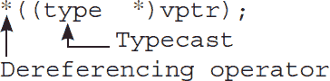

### 3.1.2 程序：将浮点型或整型变量赋值给空指针，并在解引用空指针时转换为特定的数据类型

```c
#include<stdio.h>
int main ()
{
int x = 100;
float y = 50.50;
int *iptr;
float *fptr;
void *vptr;
iptr = &x;
fptr = &y;
// iptr = &y;     /* 语法错误，int 指针指向 float */
vptr = &x;        /* 有效，空指针指向 int  */
printf("\n  x= %d  " , *((int*)vptr) );     /* 通过 int 类型转换 */
vptr = &y;                                  /* 有效，空指针指向 float  */
printf("y= %f", *((float *)vptr));
return 0;
}
```


**输出：**

`x = 100`

`y = 50.50`

**在打印空指针中的值时，必须进行类型转换，否则空指针的值将无法显示。**

**解引用空指针：**

我们使用间接运算符 `*` 来实现解引用。然而，在空指针的情况下，我们需要对指针变量进行类型转换才能解引用。这是因为空指针没有关联的数据类型。编译器无法知道或猜测空指针指向的是哪种数据。因此，为了获取空指针指向的数据，我们将其转换为空指针位置上存储的正确类型。

### 3.1.3 程序：将空指针地址赋值给浮点型或整型指针类型变量并解引用空指针

```c
#include<stdio.h>
#include<conio.h> 

//main 函数定义
void main()
{
int a=21;
float b=21.21;
void *ptr;  // 声明一个空指针
ptr=&a;  // 将整数地址赋值给空指针
printf("The value of integer is %d", *((int*)ptr));
ptr=&b;  // 将浮点数地址赋值给空指针
printf("The value of float is %f", *((float*)ptr));
}
```

（注：此处原文存在大量重复和不完整的描述，已根据核心逻辑进行翻译）

```c
#include <stdio.h>
struct student
{
char name[10];
int * roll_no;    //结构体指针类型数据成员
} stud;
int main()
{
int a=21;
struct student *pt;      // 结构体指针类型变量
pt=&stud;
pt->roll_no =&a;
printf("Enter roll number \n");
scanf("%d",&(*(pt->roll_no)));
printf("Enter  name \n");
scanf("%s", pt->name);         
printf("\n Accessing student structure data members using structure's pointer variable ");
printf("\n Name: %s Roll Number: %d ", pt->name, *(pt->roll_no));
return 0;
}
```

**输出：**

`Enter roll number`

`21`

`Enter name`

`xyz`

`Accessing student structure data members using structure's pointer variable`

`Name: xyz Roll Number: 21.`

### 3.2.3 程序：结构体指针变量的递增

```c
#include <stdio.h>
struct student
{
char name[10];
int  roll_no;
} stud[2]={{"amol",21},{"suraj",31}};
int main()
{
struct student *pt;
pt=&stud[0];
printf("\n Accessing student structure roll number using ++pt->roll_no: ");
++pt->roll_no;
/* 首先通过指针 pt 获取 roll 号 的值，然后增加学号，所以输出为 22 */
printf("\n Roll Number = %d",pt->roll_no);
printf("\n Accessing student structure roll number using (++pt)->roll_no: ");
(++pt)->roll_no;  
/* 首先存储在指针 pt 中的地址递增，然后显示该地址处的值，所以输出为 31 */
printf("\n Roll Number = %d",pt->roll_no);
return 0;
}
```

**输出：**

`Accessing student structure roll number using ++pt->roll_no:`

`Roll Number = 22.`

`Accessing student structure roll number using (++pt)->roll_no:`

`Roll Number = 31.`

**解释：**

**`++pt->roll_no;`**

这里首先计算 `pt->roll_no` 的值，然后该学号值递增。因此，`pt->roll_no` 的值为 21，在加 1 后变为 22。

**然而使用 `(++pt) ->roll_no;`：**

先递增 `pt` 意味着地址增加 1（即一个位置），然后给出该地址处结构体数据成员的值，该值是 31。

## 3.3 动态内存分配

在 C 语言中，元素的数量（即数组的大小）需要在编译时指定。

如果对大小的初始判断错误，会导致程序失败或浪费内存空间。在执行过程中进行内存分配的过程被称为动态内存分配。“C”语言提供了**“内存管理函数”**，可用于在程序执行期间分配内存和释放内存。对于动态内存管理，**使用了 RAM 的堆内存分区**。

**内存分配函数：**

| 函数 | 任务 |
| --- | --- |
| `malloc` | `malloc()` 函数为单个元素分配请求的字节数，并返回指向分配空间第一个字节的指针，且**初始元素值是随机值**。 |
| `calloc` | `calloc()` 函数为元素数组分配空间，将其初始化为零，并返回指向分配空间第一个字节的指针。 |
| `free` | `free()` 函数释放之前由 `malloc()`、`calloc()` 或 `realloc()` 函数分配的空间。 |
| `realloc` | `realloc()` 函数更改已分配空间的大小。 |

### 3.3.1 分配内存块：`malloc()` 函数

`malloc()` 函数的通用语法或函数原型为：

```c
ptr= (cast_type *) malloc(byte_size);
```

`malloc()` 函数返回 `void *`，因此如果接收的变量是 `int *`，则必须进行类型转换。

**示例：**

```c
char *cptr;
cptr=(char*) malloc (10);
```

为字符分配 10 字节的空间，并将第一个字节的地址存储在指针变量 `cptr` 中，如图所示：

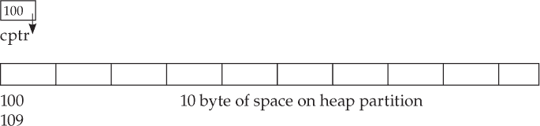

动态分配的存储空间没有名称，因此只能通过指针访问其内容。

`Structure_pointer_variable=(struct stud *) malloc (sizeof( struct stud)) );`

其中 `Structure_pointer_variable` 是一个 **类型为 `struct stud` 的指针**。

记住，**`malloc()` 函数**分配的是块**连续的字节**。

如果堆上的空间不足以满足请求，分配可能会失败。如果失败，它返回 **NULL 地址**。

### 3.3.2 分配多个内存块：`calloc()` 函数

**`calloc()` 函数**分配多个存储块，每个块的大小相同，然后将所有字节块设置为零。

```c
struct stud *s;
s=(struct stud*)calloc(30,sizeof(struct
stud) );
```

**`calloc` 函数的通用语法：**

`ptr =(cast_type *) calloc (n, element_size);`

其中 `n` = 元素个数

`element_size` = 每个元素的大小的大小。

### 3.3.3 使用 `free()` 函数释放已用空间

编译时通过 `malloc()`、`calloc()` 或 `realloc()` 分配存储变量。`free()` 函数释放空间。

**`free` 函数的通用语法或函数原型：**

`void free(void *ptr);`

`free()` 函数释放堆区的内存。

**程序：以下程序展示了 `malloc()` 和 `free()` 函数的使用。**

```c
#include <stdio.h>
#include <stdlib.h>
#include<string.h>

// main 函数
int main()
{
   char *str;

   /* 使用 malloc 函数初始内存分配 */
   str = (char *) malloc (15);
   strcpy(str, "Amol Jagtap");
   printf("String = %s, Address = %u\n", str, str);
   free(str); // 从堆释放内存
   return 0;
}
```

让我们编译并运行上述程序，这将产生结果：

**输出：**

`String = Amol Jagtap, Address = 35509448`

### 3.3.4 `realloc` 函数

`realloc()` 函数更改由 `malloc()` 或 `calloc()` 分配的内存块的大小。

`realloc` 函数的通用语法或函数原型为：

`void * realloc (void *ptr, size_t size);`

`ptr` 参数作为原始内存块的指针。新大小（字节）由 `size` 指定。`realloc()` 函数有几种可能的结果。如果有足够的空间扩展 `ptr` 所指向的内存块，则分配额外的内存并返回 `ptr`。

如果当前位置没有足够的空间扩展当前块，则分配一个新大小的块，并将现有数据从旧块复制到新块的开头。释放旧块，并返回指向新块的指针。

如果 `ptr` 参数为 `NULL`，该函数的作用类似于 `malloc()`，分配 `size` 字节的块并返回其指针。如果参数 `size` 为 0，则 `ptr` 指向的内存被释放，且函数返回 `NULL`。

如果内存不足以通过扩展旧块或分配新块来重新分配，函数将返回 `NULL`。

**程序：实现一个使用 `realloc()` 增加动态分配内存块大小的程序。**

```c
#include <stdio.h>
#include <stdlib.h>
#include <string.h>

//main 函数定义
int main ()
{
char buf[80], *message;
/* 输入任意字符串 */
puts("Enter a line of text.");
gets(buf);
/* 分配初始块并将字符串拷贝到其中
强制转换为 char * 是必须的 */
message = (char *) realloc(NULL, strlen(buf)+1);
strcpy(message, buf);
/* 在控制台上显示输入的消息 */
puts(message);
/* 从用户处获取另一个字符串。 */
puts("Enter another line of text.");
gets(buf);
/* 动态增加字符串所需的空间，然后
将字符串连接到它。 */
message = (char *) realloc(message,(strlen(message) +
strlen(buf)+1));
strcat(message, buf);
/* 在控制台上显示连接后的消息 */
puts(message);
return 0;
 }
```

**输出：**

`Enter a line of text.`

`Hello students.`

`Hello students.`

`Enter another line of text.`

`Welcome to our class.`

`Hello students. Welcome to our class.`

## 3.4 内存泄漏

内存泄漏发生在程序员在堆分区上动态创建内存但忘记删除它时。在这里，编译时分配的内存将由运行时环境根据变量的生命周期移除。然而，动态分配的内存不会被自动删除，为了这一目的，程序员必须编写相应的代码，在 C 语言中，使用 `free()` 函数来释放动态分配的内存。

### 3.4.1 程序：演示带有内存泄漏的函数

```c
#include <stdlib.h>
#include<stdio.h>
void fun()
{
int *ptr = (int *) malloc(sizeof(int));
printf("\n Memory allocated dynamically for integer
variable");
}
int main()
{
fun();
return 0;
}
```

在这里，在函数 `fun` 中，为 `int` 动态分配了内存但没有释放，导致程序在执行执行结束后堆上的内存仍保持分配状态。为了实现这一目的，使用了 `free` 函数。为了避免内存泄漏，在不再需要时必须始终释放在堆上分配的内存。

### 3.4.2 程序：演示没有内存泄漏的函数

```c
#include <stdlib.h>
#include<stdio.h>
void fun()
{
int *ptr = (int *) malloc(sizeof(int));
printf("\n Memory allocated dynamically for integer variable");
free (ptr);   // 释放为整数变量动态分配的内存
}
int main()
{
fun();
return 0;
}
```

使用 `free` 函数，我们必须释放堆上动态分配的内存。因此，堆分区上的内存会被其他变量再次使用，内存泄漏问题得以解决。

## 3.5 悬空指针

悬空指针指向之前已经释放的内存位置。该存储空间不再可用。访问该内存可能会导致段错误或导致程序崩溃。

指针可以通过三种方式成为悬空指针，下文解释：

### 3.5.1 释放指针指向的内存会导致悬空指针

```c
#include <stdlib.h>
#include <stdio.h>
int main()
{
int *ptr = (int *)malloc(sizeof(int));
/* 在调用 free 函数后，指针 ptr 变成了一个悬空
指针，因为分配给 ptr 的动态内存变为
空，且 ptr 指向堆上未被分配的内存位置。 */
free(ptr); 
// 给 ptr 指针赋值 NULL 地址，现在 ptr 指针不再是悬空指针。
ptr = NULL;
return 0;
}
```

### 3.5.2 函数调用

当局部变量是非静态的且向另一个函数返回地址时，指向局部变量的指针会变成悬空。

```c
#include <stdio.h>
int * sample()
{
/* x 是一个局部变量，在 sample() 函数执行结束后它会离开作用域，且变量将变为失效。 */
int x = 21;
return &x;
}
int main ()
{
int *p = sample ();
fflush(stdin);
// p 指向的内容不再有效了。
printf("%d", *p);
return 0;
}
```

**输出：**

`Segmentation Fault（段错误）`

作为运行时错误。

该问题的解决方案：

当局部变量是静态的时，指向局部变量的指针不会变成悬空。

```c
#include <stdio.h>
int * sample()
{
/* x 是局部变量但它是静态的，因此在 sample() 函数执行结束后变量不会
变为失效。为变量 x 留的值和内会在整个程序执行期间保持有效。 */
static int x = 21;
return &x;
}
int main()
{
int *p = sample();
fflush(stdin);
// 不是悬空指针，因为它指向静态变量。
printf("%d", *p);
return 0;
}
```

**输出：**

`21`

### 3.5.3 当局部变量离开作用域或生命周期结束

```c
int main()
{
int *ptr;
{
int i;
ptr = &i;    // 块 1
}
return 0;
}
```

**在这里 `ptr` 指针是悬空指针，因为在块 1 之后变量 `i` 的值失效了，且变量 `i` 的作用域结束了。也就是说指针再次失效。**

## 3.6 面试题

1. `void` 指针的作用是什么？

2. 解释通用指针。

3. `void` 指针与未初始化指针的区别。

4. 关于动态内存分配的说明。

5. 哪些内存分配函数？

6. 关于内存泄漏的说明。

7. `malloc()`、`calloc()`、`realloc()` 和 `free()` 函数的作用？

8. 悬空指针与内存泄漏的区别。

9. 什么是悬空指针？结合示例。

10. 如何避免悬空指针？

11. 悬空指针的不同解决方案？

12. 如何避免悬空指针和内存泄漏？

13. `malloc()` 和 `calloc()` 的区别？

## 3.7 单选题

1. `malloc()` 函数的返回类型是？

- `float`

- `int *`

- `void *`

- `double *`

**答案：C**

解释：`malloc()` 函数的返回类型为 `void *`。

2. 使用内存分配需要哪个头文件？

- `stdlib.h`

- `stdio.h`

- `memory.h`

- `dos.h`

**答案：A**

解释：`stdlib.h` 是一个头文件，它包含了 `malloc()`、`calloc()`、`realloc()` 和 `free()` 函数的声明。

3. 哪个内存分区存储动态分配的变量？

- 堆分区

- 栈分区

- 全局内存分区

- 代码分区

**答案：A**

解释：堆分区用于动态内存管理。

4. 哪个方法用于移除动态分配的内存？

- `dealloc()` 函数

- `free()` 函数

- `realloc()` 函数

- A 和 B

**答案：B**

解释：`free()` 方法用于释放由 `malloc()` 和 `calloc()` 函数在堆上分配的空间。


## 5. C 语言中 `malloc()` 函数的正确声明是？

- `void * malloc (int size_t)`
- `char* malloc ( )`
- `int * malloc (int size_t)`
- `float * malloc (float size_t)`

**答案：A**

解释：`malloc()` 函数返回类型为 `void *`，参数是整数大小。

## 6. C 语言中哪些函数用于运行时内存分配？

- `malloc()` 函数
- `calloc()` 函数
- `realloc()` 函数
- A 和 B

**答案：D**

解释：动态内存分配通过 `malloc()` 和 `calloc()` 库函数完成。

## 7. 以下代码有什么问题？

```c
#include <stdlib.h>
#include<stdio.h>
void fun()
{
int *ptr = (int *) malloc(sizeof(int));
printf("\n Memory allocated dynamically for integer variable");
}
int main()
{
fun();
return 0;
}
```

1. `内存泄漏`
2. 悬空指针
3. 编译器错误
4. 以上都不是

**答案：A**

**解释：** 问题出在内存泄漏，指针 `ptr` 分配了一些内存但没有释放，这意味着保留在堆内存分区的内存导致了内存泄漏。

## 8. 考虑以下程序，`x`、`y` 和 `z` 存储在主内存的哪个分区？

```c
int y;
int main()
{
int z = 0;
int *x = int * malloc( sizeof(int));
}
```

1. `x` 存储在堆内存分区，`y` 存储在全局分区，`z` 存储在栈分区。
2. 变量 `x`、`y` 和 `z` 存储在栈分区。
3. `x` 存储在堆内存，`y` 和 `z` 变量存储在栈分区。
4. `x` 和 `y` 存储在堆内存分区，`z` 存储在栈分区。

**答案：A**

**解释：** 对于 `x` 变量，保留了动态内存，因此它被分配在堆内存分区。而 `y` 是全局变量，存储在 RAM 的全局分区上。`z` 是局部变量，存储在 RAM 的栈分区上。

## 9. 下面哪个函数在运行时分配多个内存块，每个分配块的大小相同，且分配空间的每个字节都初始化为零？

1. `malloc()`
2. `realloc()`
3. `calloc()`
4. `free()`

**答案：C**

**解释：** `calloc()` 库函数在运行时分配多个内存块，每个分配块的大小相同，且分配空间的每个字节都初始化为零。

## 10. 使用 `malloc()` 或 `calloc()` 函数动态预留内存，但动态分配的内存区域之后无法被程序员访问，称为？

1. 悬空内存
2. 悬空指针
3. `内存泄漏`
4. 指针泄漏

**答案：C**

**解释：** 当程序员使用 `malloc()` 和 `calloc()` 函数在堆分区上动态创建内存，但忘记删除它或给该指针分配 `NULL` 地址时，堆上预留的内存保持分配状态且无法被任何人使用，这个问题被称为内存泄漏。

## 11. 在 `realloc()` 库函数中，如果内存块的新尺寸大于旧尺寸，则新添加的内存空间……..？

1. 初始化为 1
2. 初始化为 0
3. `未初始化`
4. 以上都不是

**答案：C**

**解释：** 在 `realloc()` 库函数中，新添加的空间没有被初始化。

## 12. 什么是悬空指针？

1. 如果指针被赋值为 `NULL` 值
2. `如果指针指向已经释放的内存位置`
3. 如果指针被赋值给超过一个变量
4. 以上都不是

**答案：B**

**解释：** 如果指针指向一个变量已经被删除的内存位置。

## 13. `free()` 函数释放运行时分配的内存并返回 _____

1. 指针值
2. 被释放变量的内存地址
3. `不返回任何值`
4. 返回一个浮点值

**答案：C**

**解释：** `free()` 函数的返回类型为 `void`，意味着它不返回任何值。

## 14. 下面哪个函数为单个元素分配请求的字节，并在运行时返回指向分配空间第一个字节的指针，且初始元素值为垃圾值？

1. `calloc()` 函数
2. `malloc()` 函数
3. `realloc()` 函数
4. 以上都不是

**答案：B**

**解释：** `malloc()` 函数动态分配内存并返回第一个字节的地址，且初始元素值为垃圾值。

## 15. 下面哪个指针存储了值为零或 `NULL` 地址的定义值？

1. `NULL` 指针
2. `void` 指针
3. 悬空指针
4. 以上都不是

**答案：A**

**解释：** 空指针是一个存储零或 `NULL` 地址的值。

## 16. 下面哪些陈述是正确的？

1. 陈述 1：`NULL` 指针存储一个值为零或 `NULL` 地址的定义值。
2. 陈述 2：`void` 指针是一种数据类型，而 `NULL` 指针不是数据类型。

1. 陈述 1 错误，陈述 2 正确
2. 陈述 2 错误，陈述 1 正确
3. 陈述 1 和 2 错误
4. `陈述 1 和 2 都正确`

**答案：D**

**解释：** `void` 指针是一种数据类型，而 `NULL` 指针不是数据类型。

## 17. 下面哪些陈述是正确或错误的？

1. 陈述 1：`malloc()` 是返回类型为 `void` 的静态管理函数。
2. 陈述 2：`malloc()` 在堆分区上预留内存。

1. `陈述 1 错误，陈述 2 正确`
2. 陈述 2 错误，陈述 1 正确
3. 陈述 1 和 2 错误
4. 陈述 1 和 2 都正确

**答案：A**

**解释：** `malloc()` 是返回类型为 `void *` 的动态管理函数，并在堆分区上预留内存。

## 18. 下面哪些陈述是正确或错误的？

1. 陈述 1：`realloc()` 改变已分配的大小。
2. 陈述 2：`malloc()` 为数组分配空间并将其初始化为零。

1. 陈述 1 错误，陈述 2 正确
2. `陈述 2 错误，陈述 1 正确`
3. 陈述 1 和 2 错误
4. 陈述 1 和 2 都正确

**答案：B**

**解释：** `realloc()` 改变已分配的大小。

## 19. 下面哪些陈述是正确或错误的？

1. 陈述 1：变量的编译时存储由编译器分配和释放，取决于变量的作用域和生命周期。
2. 陈述 2：在动态分配中，程序员负责在不需要时释放空间。

1. 陈述 1 错误，陈述 2 正确
2. 陈述 2 错误，陈述 1 正确
3. 陈述 1 和 2 错误
4. `陈述 1 和 2 都正确`

**答案：D**

**解释：** 变量的编译时存储由编译器分配和释放，取决于变量的作用域和生命周期。

## 20. 下面哪些陈述是正确或错误的？

1. 陈述 1：当程序员在堆分区上动态创建内存但忘记删除时，会发生内存泄漏。
2. 陈述 2：悬空指针指向已经释放的内存位置。

1. 陈述 1 错误，陈述 2 正确
2. 陈述 2 错误，陈述 1 正确
3. 陈述 1 和 2 错误
4. `陈述 1 和 2 都正确`

**答案：D**

**解释：** 悬空指针指向已经释放的内存位置，且当程序员在堆分区上动态创建内存但忘记删除时，会发生内存泄漏。

## 21. 下列叙述正确或错误？

1. 叙述 1：`free()` 函数释放之前由 `malloc()`、`calloc()` 或 `realloc()` 函数分配的空间。
2. 叙述 2：悬空指针和空指针（`void` 指针）是相同的。

1. 陈述 1 错误，陈述 2 正确
2. 陈述 2 错误，陈述 1 正确
3. 陈述 1 和 2 错误
4. 陈述 1 和 2 都正确

**答案：D**

**解析：** 悬空指针和空指针的概念是不同的。

# 4 线性数据结构的链表示

DOI: [10.1201/9781003105800-4](https://doi.org/10.1201/9781003105800-4)

## 4.1 静态内存分配的局限性与动态内存管理的优势

### 4.1.1 引言

在第 3 章中，我们学习了数组和静态内存分配。我们了解到元素在数组中顺序存储，我们可以对数组元素进行顺序访问和随机访问，并对数组元素进行静态内存分配。到目前为止我们学习的所有内存管理都是静态内存管理，这意味着内存是在编译时而不是运行时分配的。数组中的内存是在编译时预留的，这被称为静态内存管理。而在链表中，内存是在运行时预留的，被称为动态内存管理。

### 4.1.2 静态内存分配的主要局限性

如果声明的静态数据空间或静态内存超过了需要，会导致内存空间浪费。如果声明的静态空间或静态内存小于需要，则在运行时无法扩展这种固定大小。在数组中，插入和删除元素的开销相对昂贵。

### 4.1.3 动态内存分配的主要优势

使用动态内存管理，数据结构可以增长和缩小以适应变化的数据需求。我们可以在运行时需要时分配额外的存储空间。当我们使用空间且该空间不再需要时，可以动态地取消分配或释放空间。

然而，数组作为数据结构的主要缺点如下：

一旦元素按顺序存储，在中间插入元素或删除中间元素就会变得非常困难。对于新元素的插入，元素应该向上移动。如果我们从数组中删除任何元素，数组中将创建一个空隙。移动元素将非常耗时且耗逻辑，而且在时间和空间上都是无效的。

在数组数据结构中，我们无法对数组大小做出精确判断。有时内存可能会被浪费，或者可能会出现必须增加数组大小的情况。

**因此，为了解决上述问题，我们将学习一种名为链表的新数据结构。**

通过链表，可以高效地执行插入和删除。链表是动态数据结构，在程序运行时可以扩展或缩小。通过动态内存管理可以实现高效的内存利用，许多应用可以通过链表轻松实现。

## 4.2 链表的概念

### 4.2.1 引言

链表是一组节点，每个节点都有两个字段：`data`（数据）和 `link`（链接）或 `next`（下一个）。

**`data` 字段存储实际信息，而 `link` 或 `next` 字段用于指向下一个节点或存储下一个节点的地址（图 4.1）。**

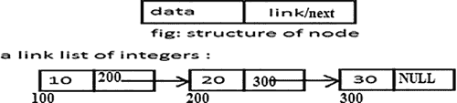

**图 4.1** 节点结构和整数链表。

注意，最后一个节点的 `link` 字段由 `NULL` 组成，这表示单向线性链表的结束。`NULL` 表示空指针或空地址。空指针意味着链表的最后一个节点不包含下一个节点的地址。

### 4.2.2 使用 C 语言的单向链表表示

如果我们需要在链表中存储整数数字作为数据，那么内存的链表表示具有如下的声明语法。

```c
struct node
{
    int data;
    struct node *next;
};
```

使用上述声明语法，我们可以创建许多个具有整数数据的节点，其中 `next` 指针存储链表中下一个节点的地址。

### 4.2.3 链表上的操作

在链表上执行的基本操作如下：

1. **创建**（Creation）
2. **插入**（Insertion）
3. **删除**（Deletion）
4. **遍历**（Traversing）
5. **查找**（Searching）
6. **显示**（Display）

让我们详细定义上述操作：

1. **创建：** 此操作用于创建一个新的链表。
2. **插入：** 此操作用于在指定位置（头部、末尾或指定位置）插入新节点。
3. **删除：** 此操作用于从头部、末尾或指定位置删除节点。
4. **遍历：** 此操作用于从链表的头部或末尾访问链表中的所有节点。
5. **查找：** 此操作用于查找特定数据所在的节点。
6. **显示：** 此操作用于从链表的头部或末尾打印链表中的所有节点。

### 4.2.4 程序：包含三个节点的静态链表实现

```c
#include<stdio.h>
#include<conio.h>
struct node
{
    int data;
    struct node *next;
};
struct node n1,n2,n3;
struct node *first,*temp;
int main()
{
    n1.data=10;
    n1.next=&n2;
    n2.data=20;
    n2.next=&n3;
    n3.data=30;
    n3.next=NULL;
    first=&n1;
    temp=first;
    while(temp!=NULL)
    {
        printf("\n%d",temp->data);
        temp=temp->next;
    }
    return 0;
}
```

**输出：**

10

20

30

**解析：**

**步骤 1：** 声明结构类型的节点 `n1`、`n2` 和 `n3`（图 4.2）。

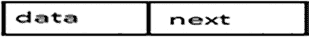

**图 4.2** 链中的节点结构。

**步骤 2：** 开始向每个节点的 `data` 字段填充数据，并将下一个节点的地址赋值给节点的 `next` 指针。在这里，节点 `n2` 的地址为 200，并赋值给 `n1` 的 `next` 字段，如图 4.3 所示。

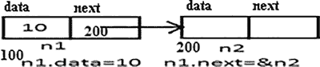

**图 4.3** 节点中数据和地址的插入。

同样，在 `data` 字段中添加 20 数据，并将 `n3` 节点的地址添加到 `n2` 节点的 `next` 字段，向 `n3` 节点添加 30 数据。最后一个节点的 `link` 或 `next` 字段通过语句 `n3.next=NULL;` 赋值为 `NULL` 地址。

**步骤 3：** 设置

```c
first=&n1;
temp=first;
```

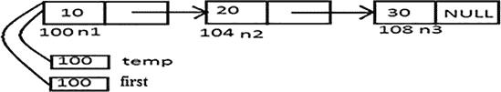

**图 4.4** 链表包含三个带有数据和下一个节点地址的节点。

**步骤 4：** 当 `temp!=NULL`

遍历链表直到最后一个节点，并打印每个节点的 `data` 字段：

```c
{
    printf("\n%d",temp->data);
    temp=temp->next;
}
```

`temp` 是节点类型的指针，因此它存储节点的地址。

```c
temp = temp->next;
```

在这里，`temp->next` 是链表中下一个节点的地址。

当 `temp` 指针指向最后一个节点时，`temp->next` 的值为 `NULL`，此时通过上述语句将其赋值给 `temp`：

```c
temp=temp->next;
```

然后当 `while(temp != NULL)` 条件变为假时，循环终止。

## 4.3 链表的类型

1. 单向线性链表
2. 单向循环链表
3. 双向线性链表
4. 双向循环链表

### 4.3.1 单向线性链表

* 单向是因为节点只包含一个链接部分，即 `next`，它存储下一个节点的地址。
* 线性是因为最后一个节点指向空，这意味着最后一个节点的 `next` 或链接字段包含 `NULL` 地址。
* 第一个节点被称为头节点或第一个节点（图 4.5）。

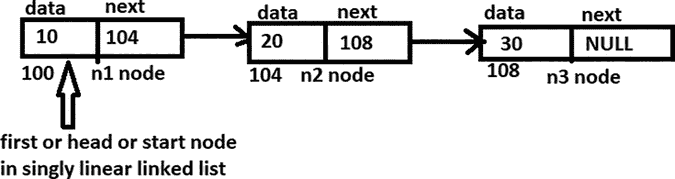

**图 4.5** 单向线性链表。

### 4.3.2 单向循环链表

* 循环意味着最后一个节点的链接或 `next` 字段指向第一个节点或头节点，或者包含第一个节点的地址。
* 即最后一个节点 `n3` 的 `next` 字段包含数据为 10 的第一个节点的地址 100（图 4.6）。

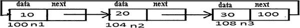

**图 4.6** 单向循环链表。

### 4.3.3 双向线性链表

* 双向是因为每个节点有两个指针：`previous` 和 `next` 指针。
* `previous` 指针指向上一个节点，`next` 指针指向下一个节点或包含下一个节点的地址。
* 只有头节点的 `previous` 指针字段包含 `NULL`，而最后一个节点的 `next` 指针指向 `NULL` 地址（图 4.7）。

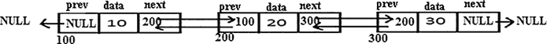

**图 4.7** 双向线性链表。

* 在双向循环链表中，最后一个节点的 `next` 指针指向头节点的 `previous` 指针，而头节点的 `previous` 指针指向最后一个节点的 `next` 指针。
* 头节点是一个特殊节点，可能包含哑元数据或某些有用信息，例如链中的节点总数（图 4.8）。

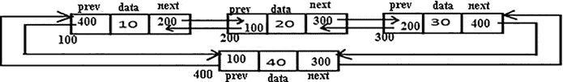

**图 4.8** 双向循环链表。

## 4.4 单向线性链表

单向线性链表仅包含一个链接字段即 `next`，它存储下一个节点的地址，且最后一个节点的 `next` 或链接字段包含 `NULL` 地址。

### 4.4.1 单向线性链表的算法

#### 4.4.1.1 算法：在单向线性链表末尾插入节点

* 步骤 1：[检查溢出]

```
If new1 = NULL, then
    Print, "over flow"
    Exit
Else
    new1 = (struct node *)malloc(sizeof(struct node));
End if
```

* 步骤 2：设置 `new1->data = num`
* 步骤 3：设置 `new1->next = NULL`
* 步骤 4：如果 `start == NULL`，则设置 `start = new1`，即将新创建节点的地址赋值给 `start` 指针。
* 步骤 5：如果 `start != NULL`，则使用 `temp` 指针在链表中查找最后一个节点，直到 `temp->next != NULL`。
* 步骤 6：设置 `temp->next = new1`。
* 步骤 7：停止。


## 4.4.1.2 算法：从单向线性链表中删除节点

1. **步骤 1：检查上溢**

```text
If start == NULL, then
    Print “underflow”
Exit
```

2. **步骤 2：读取想要删除的信息，假设为 `num`。**

   继续检查每个节点的数据字段，判断其是否匹配 `num`：

```c
while((temp = NULL)&&(found == 0)) 
{
    if(temp -> data == num)
    {
        found = 1;
    }
    else
    {
        temp =temp->next;
    }
}
```

3. **步骤 3：**如果 `found == 0`，则打印“链表中不存在该数字”。

4. **步骤 4：**如果找到了节点，则将找到的节点地址存储到 `temp` 指针中。如果找到的节点是第一个节点（即 `temp == start`），只需将 `start` 向移动一位并移除 `temp` 节点。

```c
start = start->next;
temp->next = NULL;
free(temp);
```

5. **步骤 5：**否则，如果找到的节点不是第一个节点，则使用名为 `prev` 的指针指向要删除的 `temp` 节点的前一个节点：

```c
prev=start;
while(prev->next != temp)
{
    prev = prev->next;
}
```

然后：

```c
prev->next=temp->next;
```

即指针 `prev` 的后续（`prev->next`）指向 `temp` 节点（找到的节点）的后续，并使 `temp->next=NULL`（即 `temp` 节点不再指向其他节点），然后通过 `free(temp)` 函数删除为 `temp` 节点分配的内存。

## 4.4.1.3 算法：显示链表元素

1. **步骤 1：**如果 `start==NULL`，则链表为空。

2. **步骤 2：**否则，链表为空，移动节点指针遍历链表，访问每个节点并显示信息：

```c
temp=start;
while(temp!=NULL)
{
    printf("d   ",temp->data);
    temp=temp->next;
}
```

## 4.4.2 程序：单向线性链表的实现

```c
//包含的头文件
#include<stdio.h>
#include<stdlib.h>

//函数原型
void create_node();
void display();
void delete_node();

//单向线性链表的节点结构
struct node
{
    int data;
    struct node *next;
}*new1,*start,*prev,*temp;

//new1 指针存储新创建结的地址
//start 指针存储链表中起始节点的地址
//prev 指针存储链表中我们想要删除的节点的前驱地址
//temp 指针用于遍历目的
int main()
{
    int ans;
    char ch;
    start=NULL;
    do
    {
        printf("Singly Linear Linked List: \n");
        printf("\t1.create_node\t2.diplay\t3.delete_node\t4.exit ");
        printf("\n Enter your choice: ");
        scanf("%d",&ans);
        switch(ans)
        {
            case 1:create_node();
            break;
            case 2:display();
            break;
            case 3:delete_node();
            break;
            case 4:exit(0);
            default: printf("\n Enter correct choice");
        }
        printf("Do you want to continue press[yes(y) /no(n)] : ");
        fflush(stdin);
        scanf("%c",&ch);
    } while(ch=='y'||ch=='Y');
    return 0;
}

// 创建节点并在单向线性链表的末尾添加新节点 
void create_node()
{
    //为单个节点分配动态内存
    new1=(struct node*)malloc(sizeof(struct node));
    printf("Enter data : ");
    scanf("%d",&new1->data);
    new1->next=NULL;
    if(start==NULL)  //如果链表为空
    {
        start=new1;
    }
    else  //如果链表至少有一个节点
    {
        temp=start;
        while(temp->next!=NULL)  //遍历链表直到到达最后一个节点
        {
            temp=temp->next;
        }
        temp->next=new1;
    }
    printf("Node inserted at the end of Linked list=%d
\n",new1->data);
}

// 显示单向线性链表中的节点
void display()
{
    if(start==NULL)
    {
        printf("Linked list  is not created.\n");
    }
    else
    {
        temp=start;
        printf("Data in the Singly Linear Linked List is as follows:
\n");
        while(temp!=NULL)
        {
            printf("%d \t",temp->data);
            temp=temp->next;
        }
        printf("\n");
    }
}

// 从单向线性链表中删除节点
void delete_node()
{
    int num;
    int found=0;
    temp=start;
    if(start==NULL)  //链表未创建
    {
        printf("\n Linked list is not created ,first create a
node.\n");
    }
    else
    {
        printf("Enter value which you want to be deleted: ");
        scanf("%d", &num);
        while((temp!= NULL)&&(found == 0))  //循环查找我们想要的数据  {
            // 删除并将删除节点的地址存储到
            //temp 指针中。
        {
            if(temp -> data == num)
            {
                found =1;
            }
            else
            {
                temp =temp->next;
            }
        }
        if(found == 0)  //如果没有找到节点
        {
            printf("\n Node is not present in the Linked List. \n");
        }
        else
        {  //如果找到了节点，则我们要删除的节点是第一个节点还是第一个节点以外。
            if(start == temp)  //如果删除的节点是链表的第一个节点
            {
                start = start->next;
                temp->next=NULL;
                free(temp);
                temp=NULL;
            }
            else  //如果删除的节点是链表的第一个节点以外的
            {
                prev=start;
                while(prev->next!=temp)
                {
                    prev=prev->next;
                }
                prev->next=temp->next;
                temp->next=NULL;
                free(temp);
                temp=NULL;
            }
            printf("Node deleted =%d\n",num);
        }
    }
}
```

**输出：**

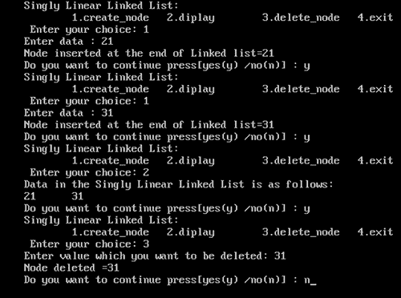

## 4.5 单向循环链表

单向循环链表是一种列表，最后一个节点的 `next` 指针始终指向第一个节点或头节点，且节点只包含一个链接或 `next` 字段。

线性循环链表上的操作：

1. 创建
2. 显示
3. 删除

### 4.5.1 单向循环链表的算法

#### 4.5.1.1 单向循环链表的创建

**步骤 1（图 4.9）：**

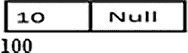

**图 4.9：**单向循环链表是一种列表，最后一个节点的 `next` 指针始终指向第一个节点或头节点，且节点只包含一个链接或 `next` 字段。

**图 4.9：**单向循环链表是一种列表，最后一个节点的 `next` 指针始终指向第一个节点或头节点，且节点只包含一个链接或 `next` 字段。

**图 4.9：**单向循环链表是一种列表，最后一个节点的 `next` 指针始终指向第一个节点或头节点，且节点只包含一个链接或 `next` 字段。

**图 4.9：**单向循环链表是一种列表，最后一个节点的 `next` 指针始终指向第一个节点或头节点，且节点只包含一个链接或 `next` 字段。

**图 4.9：**单向循环链表是一种列表，最后一个节点的 `next` 指针始终指向第一个节点或头节点，且节点只包含一个链接或 `next` 字段。

**图 4.9：**单向循环链表是一种列表，最后一个节点的 `next` 指针始终指向第一个节点或头节点，且节点只包含一个链接或 `next` 字段。

**图 4.9：**单向循环链表是一种列表，最后一个节点的 `next` 指针始终指向第一个节点或头节点，且节点只包含一个链接或 `next` 字段。

**图 4.9：**单向循环链表是一种列表，最后一个节点的 `next` 指针始终指向第一个节点或头节点，且节点只包含一个链接或 `next` 字段。

**图 4.9：**单向循环链表是一种列表，最后一个节点的 `next` 指针始终指向第一个节点或头节点，且节点只包含一个链接或 `next` 字段。

**图 4.9：**单向循环链表是一种列表，最后一个节点的 `next` 指针始终指向第一个节点或头节点，且节点只包含一个链接或 `next` 字段。

**图 4.9：**单向循环链表是一种列表。

**图 4.9：**单向循环链表是一种列表，最后一个节点的 `next` 指针始终指向第一个节点或头节点，且节点只包含一个链接或 `next` 字段。

**图 4.9：**单向循环链表是一种列表。

**图 4.9：**单向循环链表是一种列表。

**图 4.9：**单向循环链表是一种列表。

**图 4.9：**单向循环链表是一种列表。

**图 4.9：**单向循环链表是一种列表，最后一个节点的 `next` 指针始终指向第一个节点或头节点，且节点只包含一个链接或 `next` 字段。

**图 4.9：**单向循环链表是一种列表。

**图 4.9：**单向循环链表是一种列表。

**图 4.9：**单向循环链表是一种列表。

**图 4.9：**单向循环链表是一种列表。

**图 4.9：**单向循环链表是一种列表。

**图 4.9：**单向循环链表是一种列表。

**图 4.9：**单向循环链表是一种列表。

**图 4.9：**单向循环链表是一种列表，最后一个节点的 `next` 指针始终指向第一个节点或头节点和。

**图 4.9：**单向循环链表是一种列表。

**图 4.9：**单向循环链表是一种列表。

**图 4.9：**单向循环链表是一种列表。


```c
//header files included
#include<stdio.h>
#include<stdlib.h>

//function declaration
void create_node();
void delete_node();
void display();

// Structure for node in Singly Circular Linked List
struct node
{
 int data;
 struct node *next;
}*new1,*start,*temp,*prev;    
int flag=1;
//main function definition
int main()
{
 int choice;
 char ch;
 start=NULL;
 printf("Singly Circular Linked List: \n");
 do
 {
  printf("1.create \t 2.display \t 3.delete \t 4.exit: ");
  printf("\n Enter choice: ");
  scanf("%d", &choice);
      switch(choice)
      {
      case 1:create_node();
      break;
      case 2: display();
      break;
      case 3:delete_node();
      break;
      case 4:exit(0);
      default: printf("\n wrong choice");
      }
  fflush(stdin);
  printf("Do you want to continue[y/n]: ");
  scanf("%c",&ch);
  }while(ch=='y');
  return 0;
  }
//create a node in Singly Circular Linked List
void create_node()
{
 //allocate memory for node dynamically on heap memory partition
 new1=(struct node *)malloc(sizeof(struct node));
 printf("Enter data: ");
 scanf("%d", &new1->data);
 new1->next=NULL;
 //If Linked List is empty
if(start==NULL)           // or  if(flag==1)
{
start=new1;
new1->next=start;
flag=0;
}
else
{
temp=start;
while(temp->next!=start)
{
temp=temp->next;
}
temp->next=new1;
new1->next=start;
}
printf("Node inserted at the end of Linked list=%d \n",new1->data);
}

//display elements in Singly Circular Linked List
void display()
{
temp=start;
if(start==NULL)
{
printf("\n Singly Circular Linked List is empty.\n");
}
else
{
printf("Data in the Singly Circular Linked List is as follows: \n");
do
{
printf("\t%d",temp->data);
temp=temp->next;
}while(temp!=start);
printf("\n");
}
}

//delete node from Singly Circular Linked List
void delete_node()
{
int num, found=0;
if(start==NULL)    //Linked list is not created 
 {
  printf("\n Linked list is not created ,first create a node. \n");
 }
 else
{
temp=start;
printf("Enter data which you delete: ");
scanf("%d",&num);
//Singly Circular Linked List contain only one node and
deleted node's value is matched with //entered value
if((start->next==start)&&(num==start->data))
{
temp->next=NULL;
start=NULL;
free(temp);
flag=1;
return;
}
//Singly Circular Linked List contain only one node and
deleted node's value is not matched //with entered value
if((start->next==start)&&(num!=start->data))
{
printf("\n Node is not in the Singly Circular Linked List.\n");
return;
}
 //when list contain more than one node then search element
which we want to delete and //store that node's address into
temp pointer.
do
{
if(temp->data==num)
{
found=1;
}
else
{
temp=temp->next;
}
}while((found==0)&&(temp!=start));
if(found==0)     // If node not found
{
printf("\n Node is not in the Singly Circular Linked List.\n
");
}
else        //If node is found
{
//If found node is first node in Singly Circular Linked List
then
if(temp==start)
{
start=start->next;
new1->next=start;         //Here new1 contains address of last
node in the Singly Circular temp temp->next=NULL;       //
List because new node inserted at the end of linked list
free(temp);
temp=NULL;
}
// If found node is other than first node in Singly Circular
Linked List then
else
{
prev=start;       //prev pointer stores address of first node
initially
while(prev->next!=temp)     // after execution of while loop
prev pointer stores address of
{                                                //previous
node which we want to delete
prev=prev->next;
}
if(temp == new1)   // if node deleted is last node in linked
list then store the address of prev
{        //pointer into new1 because new1 pointer contains
address of last node
new1= prev;
}
prev->next=temp->next;
temp->next=NULL;
free(temp);
temp=NULL;
}
printf("Node deleted =%d \n",num);
}
}
} 
```

## 输出

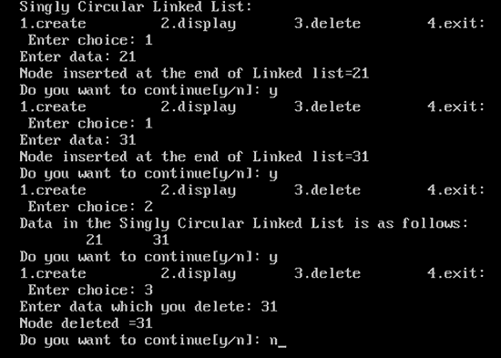

## 4.6 双向线性链表（DLLL）

双向链表中每个节点的典型结构是（图 4.16）：

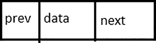

**图 16** 双向链表中的节点。

### 使用 C 语言表示的双向链表

```c
struct node
{
    struct node *prev;
    int data;
    struct node *next;
};
```

双向线性链表的表示如下：

因此，双向线性链表可以沿正反两个方向进行遍历。

### 4.6.1 双向线性链表的算法

#### 4.6.1.1 创建双向线性链表

步骤 1：创建新节点，图 4.17 和图 4.18。

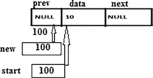

**图 17** 双向链表中的节点。

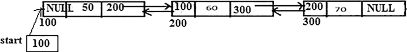

**图 18** 双向链表中的节点。

```c
#include<stdio.h>
#include<stdlib.h>

struct node
{
 struct node *prev;
 int data;
 struct node *next;
}*new1,*start,*temp;

int flag=1;

//创建一个节点并插入双向线性链表的末尾。
void create_node()
{
 // 在 RAM 的堆分区区为节点分配动态内存
 new1=(struct node *)malloc(sizeof(struct node));

 printf("输入数据: ");
 scanf("%d",&new1->data);

 new1->next=NULL;
 new1->prev=NULL;

 // 双向线性链表为空
 if(start==NULL)           // 或者 if(flag==1)
 {
  start=new1;
  flag=0;
 }
 // 双向线性链表包含一个以上的节点
 else
 {
  temp=start;
  while(temp->next!=NULL)
  {
   temp=temp->next;
  }
  temp->next=new1;
  new1->prev=temp;
 }

 printf("节点已插入到链表末尾= %d\n",new1->data);
}

// 显示双向线性链表中的数据部分
void disp()
{
 temp=start;

 // 双向线性链表为空
 if(start==NULL)
 {
  printf("\n 双向线性链表为空。\n");
  return;
 }
 else
 {
  printf("双向线性链表中的数据如下: \n");
  while(temp!=NULL)
  {
   printf("\t%d",temp->data);
   temp=temp->next;
  }
  printf("\n");
 }
}

// 从双向线性链表中删除节点。
void delete_node()
{
 int num;
 int found=0;
 temp=start;

 // 双向线性链表为空
 if(start==NULL)
 {
  printf("\n 双向线性链表为空。 \n");
  return;
 }

 // 双向线性链表已创建并包含一些节点
 else
 {
  printf("输入想要删除的数据: ");
  scanf("%d",&num);

  // 搜索我们要删除的元素，并将要删除的节点地址
  // 存储到 temp 指针中
  while((found==0)&&(temp!=NULL))
  {
   if(temp->data==num)
   {
    found=1;
   }
   else
   {
    temp=temp->next;
   }
  }

  // 数据元素不在双向线性链表中
  if(found==0)
  {
   printf("\n 未找到节点。 \n");
   return;
  }

  // 数据元素存在于双向线性链表中
  else
  {
   // 我们要删除的节点是双向线性链表的第一个节点
   if(temp==start)
   {
    if(temp->next!=NULL) // 双向线性链表包含一个以上的节点且我们要删除的是第一个节点
    {
     start=start->next;
     temp->next=NULL;
     start->prev=NULL;
     free(temp);
     temp=NULL;
    }
    else // 双向线性链表只包含一个节点且我们要删除的是第一个节点
    {
     free(temp);
     start=NULL;
    }
   }

   // 我们要删除的节点是双向线性链表中第一个节点以外的节点
   else
   {
    if(temp->next!=NULL) // 删除的节点不是双向线性链表的最后一个节点
    {
     (temp->prev)->next=temp->next;
     (temp->next)->prev=temp->prev;
    }
    else // 删除的节点是双向线性链表的最后一个节点
    {
     (temp->prev)->next=NULL;
    }

    temp->next=NULL;
    temp->prev=NULL;
    free(temp);
    temp=NULL;
   }

   printf("节点已删除 =%d \n",num);
  }
 }
}   // delete_node 函数结束

// 主函数
int main()
{
 int choice;
 char ch;
 start=NULL;

 printf("双向线性链表: ");

 do
 {
  printf("1\. 创建\t2\. 显示\t3\. 删除\t4\. 退出");
  printf("\n 输入您的选择: ");
  scanf("%d",&choice);

  switch(choice)
  {
   case 1:create_node();
   break;
   case 2:disp();
   break;
   case 3:delete_node();
   break;
   case 4:exit(0);
   default:printf("\n 错误的选择");
  }

  fflush(stdin);
  printf("您想继续吗[y/n]");
  scanf("%c",&ch);
 }while(ch=='y');

 return 0;
}
```

## 输出

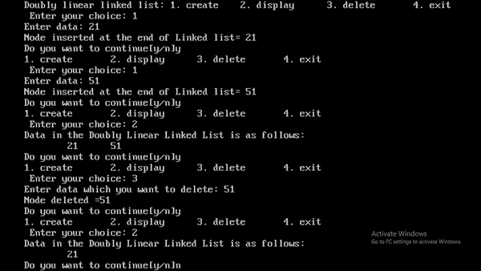

### 4.6.3 在双向线性链表的头部插入新节点

```c
void insert_at_start()
{
     new1=(struct node*)malloc(sizeof(struct node));

     printf("\n 在新节点中输入数据:");
     scanf("%d",&new1->data);

     new1->next=NULL;
     new1->prev=NULL;

     if(start==NULL)
     {
          start=new1;
     }
     else
     {
          new1->next=start;
          start->prev=new1;
          start=new1;
     }

     disp(); // 显示从起始节点到结束的所有节点
}
```

### 4.6.4 在双向线性链表的末尾插入新节点

```c
void insert_at_last()
{
     new1=(struct node*)malloc(sizeof(struct node));

     printf("\在新节点中输入数据:");
     scanf("%d",&new1->data);

     new1->next=NULL;
     new1->prev=NULL;

     if(start==NULL)
     {
          start=new1;
     }
     else
     {
          temp=start;

          while(temp->next!=NULL)
          {
              temp=temp->next;
          }

          temp->next=new1;
          new1->prev=temp;
     }

     disp(); // 显示从起始节点到结束的所有节点
}
```

### 4.6.5 在双向线性链表的指定位置插入新节点

```c
```


`void insert_at_specificpos()`

```
{

int pos, count=0, i=1;

new1=(struct node*)malloc(sizeof(struct node));

printf("\n 在节点中输入数据:");

scanf("%d",&new1->data);

new1->next=NULL;

new1->prev=NULL;

if(start==NULL)

{

start=new1;

}

else

{

temp=start;

while(temp!=NULL)   //统计您的链表中存在的节点数量

{

temp=temp->next;

count++;

}

lable1:

printf("\n 输入插入新节点的位置:"); //位置必须大于零

scanf("%d",&pos);

if( pos > (count+1))

{

printf("\n 您的选择错误");

goto lable1;

}

if(pos==1)    //如果在双向线性链表的第一个位置插入

{

start->prev=new1;

new1->next=start;

start=new1;

start->prev=NULL;

}

else                // 如果在双向线性链表第一个位置以外的位置插入

{

temp=start;

while(i < (pos-1))  //遍历 temp 指针，直到 temp

指针包含我们要插入的节点节点的前一个 

{

temp=temp->next;

i++;

}

new1->next=temp->next;

temp->next=new1;

new1->prev=temp;

}

disp(); // 显示从起始节点到结束的所有节点。

}

}
```

## 4.7 双向循环链表

双向循环链表包含两个指针：`previous` 和 `next` 指针。`previous` 指针指向前一个节点，`next` 指针指向下一个节点或包含下一个节点的地址。最后一个节点的`next`指针存储第一个节点的地址，第一个节点的`previous`指针存储双向循环链表中最后一个节点的地址。

### 4.7.1 程序：双向循环链表的实现

```c
#include<stdio.h>
#include<stdlib.h>

struct node
{
int data;
struct node* prev;
struct node* next;
}*start,*new1,*temp,*prev,*last;
//last 指针存储双向循环链表中末尾节点的地址

void insert_at_end();
void display();
void reverse();
void delet();

//main 函数
int main()
{
int c;
char ch;
printf("双向循环链表: \n");
do
{
printf("1.末尾插入(Insert_at_end)  2.逆序显示节点  3. 删除节点  4. 显示节点");
printf("\n 输入您的选择: ");
scanf("%d", &c);
switch(c)
{
case 1:
insert_at_end();
break;
case 2:
reverse();
break;
case 3:
delet();
break;
case 4:
display();
break;
default:
printf("\n 您输入的选项错误。\n");
}
fflush(stdin);
printf("您要继续吗(Y/N): ");
scanf("%c",&ch);
}while(ch=='Y'||ch=='y');
return 0;
}

void display()
{
if(start==NULL)
{
printf("\n 未创建双向循环链表。\n");
return;
}
else
{
printf("双向循环链表数据:");
temp=start;
do
{
printf("%d\t",temp->data);
temp=temp->next;
} while(temp!=start);
printf("\n");
}
}

void insert_at_end()
{
new1=(struct node*)malloc(sizeof(struct node));
printf("输入节点数据: ");
scanf("%d",&new1->data);
new1->next=NULL;
new1->prev=NULL;
if(start==NULL)
{
start=new1;
start->next=start;
start->prev=start;
}
else
{
temp=start;
do
{
temp=temp->next;
} while(temp->next!=start);
temp->next=new1;
new1->prev=temp;
new1->next=start;
start->prev=new1;
}
display();
}

// 逆序显示双向循环列表中的数据
void reverse()
{
if(start==NULL)
{
printf("\n 未创建双向循环链表.");
return;
}
else
{
temp=start;
do               // 使用 do-while 循环我们需要将 temp 指针移动到最后一个节点
// 此处使用 do-while 或 while 循环均可
temp=temp->next;
} while(temp->next!=start);
// 现在退出 do-while 后，temp 指针包含双向链表末尾节点的地址
do
{
printf("\t%d",temp->data);
temp=temp->prev;
}while(temp!=start->prev);
// 从最后一个节点到第一个节点逆序显示数据
printf("\n");
}
}

void delet()
{
int num,found=0;
if(start==NULL)
{
printf("未创建双向循环链表。\n");
return;
}
else
{
printf("输入要删除的节点值: ");
scanf("%d",&num);
// 如果链表仅有一个节点且与要删除的节点匹配
if(start==start->next && num==start->data)
{
start->next=NULL;
start->prev=NULL;
free(start);
start=NULL;
printf("删除的节点是 %d\n",num);
return;
}
// 如果链表仅一个节点且与要删除的节点不匹配
if(start==start->next && num!=start->data)
{
printf("\n 双向循环链表中不存在该数据 \n");
return;
}
temp=start;
do
{
if(temp->data==num)
{
found=1;
}
else
{
temp=temp->next;
}
}while(found!=1 && temp!=start);
if(found==0)   //如果在双向循环列表中未找到节点
{
printf("\n 双向循环链表中不存在该节点 \n");
return;
}
else       //如果在双向循环列表中找到了节点
{
if(temp==start)   //如果要从双向循环列表中删除第一个节点
{
last=start;
do
{
last=last->next;
}
while(last->next!=start);
start=start->next;
last->next=start;
start->prev=last;
temp->next=NULL;
temp->prev=NULL;
free(temp);
temp=NULL;
}
else   //如果要从双向循环列表中删除第一个以外的节点
{
(temp->prev)->next=temp->next;
(temp->next)->prev=temp->prev;
temp->next=NULL;
temp->prev=NULL;
free(temp);
temp=NULL;
}
printf("删除的节点是 %d\n",num);
}
}
}
```

**输出：**

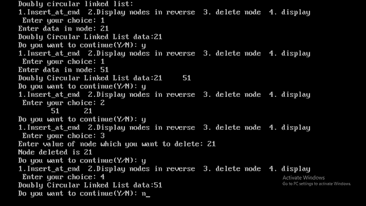

## 4.8 使用链表实现栈

### 4.8.1 使用链表表示栈

- 使用链表实现栈的优点是不需要考虑栈的大小。
- 节点是动态创建的，因此不需要担心栈溢出。
- 使用链表表示栈的结构：

```c
struct stack
{
int data;
struct stack *next;
};
```

### 4.8.2 程序：使用链表实现栈

```c
#include<stdio.h>
#include<stdlib.h>

struct stack
{
int data;
struct stack *next;
}*new1,*temp;
// top 指针存储栈顶节点地址。
// temp 指针存储临时地址并用于遍历。
// new1 指针存储新创建节点的地址。

void push();
int pop();
void display();

int main()
{
int ch, item;
char c;
top =NULL;
do
{
printf("链表实现栈: \n");
printf(" 1.入栈 2.弹出 3.显示 4.退出");
printf("\n 输入您的选择: ");
scanf("%d",&ch);
switch(ch)
{
case 1:
push();
break;
case 2:
item=pop();
printf("从栈弹出的元素=%d \n", item);
break;
case 3:
display();
break;
case 4:
exit(0);
default:
printf("\n 输入错误\n");
}
fflush(stdin);
printf("您要继续吗(y/n):");
scanf("%c",&c);
} while(c=='y'||c=='y');
return 0;
}

void push()
{
new1=(struct stack*)malloc(sizeof(struct stack));
printf("输入数据: ");
scanf("%d",&new1->data);
new1->next=NULL;
if(top == NULL)
{
top=new1;
}else
{
new1->next = top;
top = new1;
}
printf("入栈的元素是 %d \n",new1->data);
}

int pop()
{
int data;
temp= top;
if(top==NULL)
{
printf("栈下流\n");
return -1;
}
else
{
data= top ->data;
top = top ->next;
temp->next=NULL;
free(temp);
temp = NULL;
return(data);
}
}

void display()
{
temp=top;
if(top==NULL)
{
printf("\n 栈为空");
}
else
{
while(temp!=NULL)
{
printf("\t %d",temp->data);
temp=temp->next;
}
printf("\n");
}
}
```

## 4.9 使用链表实现线性队列

```c
#include<stdio.h>
#include<stdlib.h>

//使用链表实现线性队列的结构
struct queue
{
int data;
struct queue *next;
}*new1,*rear,*front,*temp;

// 函数原型或函数声明
void create();
void delet();
void display();

//main()函数
int main()
{
char ch;
int choice;
front=rear=NULL;
do
{
printf("Linear queue using linked list: ");
printf("\n 1.create 2.delete 3.display 4.exit: ");
printf("\n Enter choice: ");
scanf("%d", &choice);
switch(choice)
{
case 1:
create();
break;
case 2:
delet();
break;
case 3:
display ();
break;
case 4:
exit(0);
default:
printf("\n wrong choice");
}
fflush(stdin);
printf("Do you want to continue...[y/n]");
scanf("\n%c",&ch);
}while(ch=='y' || ch=='Y');
return 0;
}

// 使用链表创建线性队列，即入队操作
void create()
{
new1=(struct queue *)malloc(sizeof(struct queue));
printf("Enter a data: ");
scanf("%d",&new1->data);
new1->next=NULL;
if(front==NULL)
{
front=new1;
rear=new1;
}
else
{
rear->next=new1;
rear=new1;
}
printf("\n Inserted element in linear queue = %d\n",new1->data);
}

// 从线性队列中删除元素，即出队操作
void delet()
{
temp=front;
if(front==NULL)
{
printf("\n Linear queue is empty");
return;
}
else
{
if( front == rear)
{
printf("Deleted element = %d \n", front->data);
front = NULL;
rear = NULL;
free(temp);
temp=NULL;
}else
{
printf("Deleted element = %d \n", front->data);
front=front->next;
temp->next=NULL;
free(temp);
temp=NULL;
}
}
}

// 从队头到队尾显示线性队列元素
void display ()
{
temp=front;
if(front==NULL)
{
printf("\n Queue is empty");
}
else
{
printf("Data in linear queue is as follows: \n");
while(temp!=NULL)
{
printf("\t%d",temp->data);
temp=temp->next;
}
printf("\n");
}
}
```

**输出：**

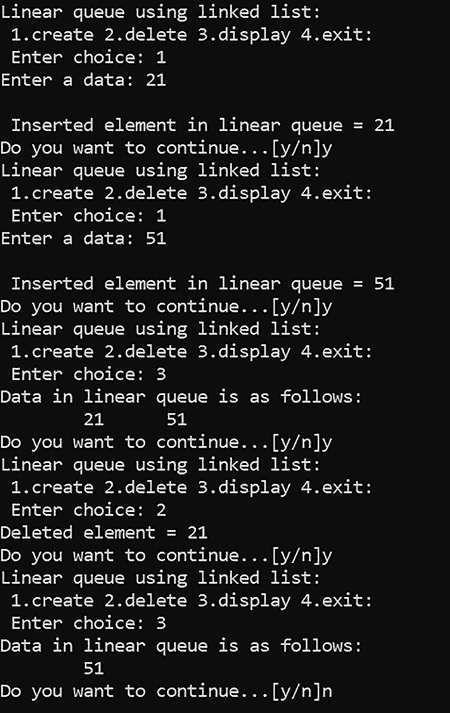

## 4.10 使用链表实现循环队列

### 4.10.1 循环队列上的操作

`Front`指针存储循环队列中头部节点的地址。

`Rear`指针存储循环队列中尾部或最后一个节点的地址。

1. **入队操作 (enQueue operation)：** 此操作或函数的目的是向循环队列中插入一个项目。在循环队列中，新项目始终被放在尾部位置。

   **步骤：**

   1. 动态创建一个新节点，并将数据插入到数据字段中，`next`初始包含`NULL`的地址。
   2. 验证`front==NULL`是否，如果为真，则`front` = `rear` = 新创建节点的地址。
   3. 如果为假，则`rear` = 新创建节点的地址，而`front`节点始终包含头部节点的地址。

2. **出队操作 (Dequeue operation)：** 此操作或函数用于从循环队列中删除一个元素。在队列中，元素始终从头部位置删除。

   **步骤：**

   1. 检查队列是否为空，即`front == NULL`。
   2. 如果为空则显示队列为空。如果队列不为空，则跳转步骤 3。
   3. 检查`(front==rear)`，如果为真，则循环队列仅包含一个节点，此时设置`front` = `rear` = `NULL`；否则将队列中的头部向前移动，即`front=front->next`。显示被删除的元素。

**使用链表实现循环队列的 C 结构体 (图 4.26)：**


## 4.10.2 程序：使用链表实现循环队列

```c
#include<stdio.h>
#include<stdlib.h>
//使用链表实现循环队列的结构
struct cqueue
{
 int data;
 struct cqueue *next;
}*new1,*rear,*front,*temp;
//front 指针存储循环队列中头部或第一个节点的地址
//rear 指针存储循环队列尾部或最后一个节点的地址
//new1 指针存储新创建节点的地址
//temp 指针存储临时节点地址并用于遍历
// ... (此处代码省略但逻辑与上方一致)
int main()
{
 char ch;
 int choice;
 front=rear=NULL;
 do
 {
  printf("Linear queue using linked list: ");
  printf("\n 1.create 2.delete 3.display 4.exit: ");
  printf("\n Enter choice: ");
  scanf("%d", &choice);
  switch(choice)
  {
   case 1:
create();
      break;
   case 2:
delet();
      break;
   case 3:
display ();
      break;
   case 4:
exit(0);
   default:
printf("\n wrong choice");
  }
  fflush(stdin);
  printf("Do you want to continue...[y/n]");
  scanf("\n%c",&ch);
 }while(ch=='y' || ch=='Y');
 return 0;
}
// 使用链表创建线性队列，即入队操作
void create()
{
new1=(struct queue *)malloc(sizeof(struct queue));
printf("Enter a data: ");
scanf("%d",&new1->data);
new1->next=NULL;
if(front==NULL)
{
front=new1;
rear=new1;
}
else
{
rear->next=new1;
rear=new1;
}
printf("\n Inserted element in linear queue = %d\n",new1->data);
}
// 从线性队列中删除元素，即出队操作
void delet()
{
temp=front;
if(front==NULL)
{
printf("\n Linear queue is empty");
return;
}
else
{
if( front == rear)
{
printf("Deleted element = %d \n", front->data);
front = NULL;
rear = NULL;
free(temp);
temp=NULL;
}
else
{
printf("Deleted element = %d \n", front->data);
front=front->next;
temp->next=NULL;
free(temp);
temp=NULL;
}
}
}
// 从队头到队尾显示线性队列元素
void display ()
{
temp=front;
if(front==NULL)
{
printf("\n Queue is empty");
}
else
{
printf("Data in linear queue is as follows: \n");
while(temp!=NULL)
{
printf("\t%d",temp->data);
temp=temp->next;
}
printf("\n");
}
}
```

> **图 4.26** 使用链表表示的循环队列。
>
> 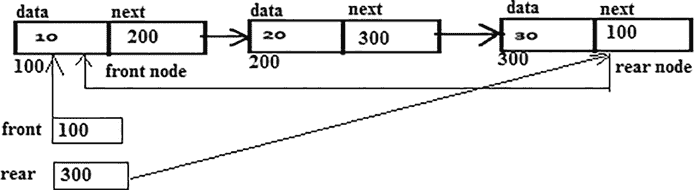

## 4.11 面试题

1. 什么是链表？
2. 链表相比数组的优势？
3. 可以在排序后的链表上进行二分查找吗？为什么？
4. 栈和数组的区别是什么？
5. 使用数组实现栈的缺点？
6. 线性链表的缺点有哪些？
7. 定义循环链表。
8. 循环链表的缺点有哪些？
9. 结合实际例子解释双向链表。
10. 链表是线性数据结构还是非线性数据结构？
11. 链表的组成部分有哪些？
12. 如何用图形表示线性链和循环链表？
13. 列出所有链表类型并详细解释循环链表。
14. 解释双向链表。
15. 如何在链表中查找目标键？
16. 什么是循环链表？说明它的应用。
17. 实现单线性链表需要多少不同的指针？
18. 我们如何表示双向循环链表节点？
19. 如何在单循环链表的头部插入节点？
20. 如何在双向循环链表的尾部插入节点？
21. 编写一个在双向线性链表特定位置添加节点的程序。
22. 如何从单线性链表中删除任意指定节点？
23. 编写一个函数，删除单循环链表的第一个节点。
24. 如何反转单循环链表？
25. 如何计算单线性链表的长度？
26. 编写 C 代码，以反序显示单向线性链表中所有的数据成员。
27. 编写一个算法和 C 代码，用于从单向线性链表中删除任意节点。

## 4.12 单选题

1. 与数组相比，关于链表的数据结构，以下哪种陈述是正确的？

   1. 数组具有更好的缓存局部性，这可以使它们在效率方面表现更优。
   2. 在链表中插入、显示和删除元素是容易的。
   3. 在典型的链表实现中，不允许随机访问。
   4. 数组的大小应该在编译时决定，而链表可以在任何时间动态改变其大小。
   5. **以上所有项**

   **答案：(E)**

2. 下面的 C 函数接受一个单链表作为输入参数。它通过将最后一个元素移动到列表开头来修改列表，并返回修改后的列表。代码的部分部分留为空。

   ```c
   typedef struct node {

          int value;

          struct node *next;

          }    Node;

   Node *move_to_front(Node *head) 

   {

        Node *p, *q;

             if((head == NULL || (head->next == NULL)) 

                  return head;

             q = NULL; p = head;

             while (p-> next !=NULL) {

                    q=p;

                    p=p->next;

                                  }

             return head;

   }
   ```

   选择正确的选项来替换空行

   1. `q = NULL; p->next = head; head = p;`
   2. `q->next = NULL; head = p; p->next = head;`
   3. `head = p; p->next = q; q->next = NULL;`
   4. `q->next = NULL; p->next = head; head = p;`

   **答案：(D)**

   **解释：**

   1. 传递给函数 `move_to_front` 的参数是链表的 `head`。
   2. 在函数内部，它检查条件以判断列表是否为空或只有一个节点。如果条件为真，则按原样返回 `head`。
   3. 如果条件为假，意味着节点多于一个，`while` 循环根据条件 `P->next!=NULL` 迭代到倒数第二个节点。`q` 指向倒数第二个节点，`p` 指向最后一个。
   4. 现在，我们需要将最后一个节点移动到第一个：
      - 让倒数第二个节点指向 `NULL`：`q->next=NULL`
      - `P` 变成第一个节点，`head` 变成第二个，所以 `p-> next` 应该指向 `head`。
      - 将 `p` 置为头。`head=p`。
      因此，选项 D 是正确的。

3. 下面的 C 函数接受整数列表作为参数并重新排列列表中的元素。调用函数时列表包含所示顺序的 1, 2, 3, 4, 5, 6, 7 整数。函数执行后，列表的内容是什么？

   ```c
   struct node {

   int value;

   struct node * next;

   };

   Void rearrange (struct node * list) {

   struct node * p, * q;

   int temp;

   if (!list || !list -> next) return;

   p = list; q = list -> next;

   while (q) {

   temp = p -> value; p -> value = q -> value;

   q -> value = temp; p = q -> next

   q = p? p -> next : 0;

   }

   }
   ```

   1. 1,2,3,4,5,6,7
   2. **2,1,4,3,6,5,7**
   3. 1,3,2,5,4,7,6
   4. 2,3,4,5,6,7,1

   **答案：(B)**

   **解释：**

   1. 函数 `rearrange` 接受整数列表作为输入。
   2. 在函数内部检查条件以判断列表是否为空或只有一个节点。如果条件为真，则按原样返回 `head`。
   3. 然后，第一个元素将被赋值给 `p`，第二个元素赋值给 `q`。
   4. 在 `while` 循环内部，第一次迭代时，`p` 和 `q` 的值将交换，这意味着第一个元素和第二个元素的值交换。
   5. 然后 `P` 被修改并指向第三个元素。
   6. 如果 `p` 为空，则 `q` 为 0，否则 `q` 指向第 4 个元素。
   7. 意味着 `p` 指向奇数元素，`q` 指向偶数元素，然后我们交换它们的值。
   8. 因此，输出为 2,1, 4, 3, 6, 5, 7。

4. 对于一个初始节点为 `head` 的给定链表，以下操作执行了什么？

   ```c
   void fun1(struct node* head)

   {

     if(head == NULL)

       return;

     fun1(head->next);

     printf("%d ", head->data);

   }
   ```

   （注：提供的 `fun1` 逻辑文本不完整/代码段中缺少递归调用，但根据提供的选项，它代表了一个递归反向遍历）。

   1. 反序打印所有节点
   2. **按倒序打印所有节点**
   3. 打印偶数节点
   4. 按顺序打印所有节点

   **答案：(B)**

5. 下面的函数用于反转链表。

   ```c
   struct node {

       int data;

       struct node* next;

   };

   static void reverse(struct node** head_ref)

   {

       struct node* prev = NULL;

       struct node* current = *head_ref;

       struct node* next;

       while (current != NULL)

       {

           next = current->next;

           current->next = prev;

           prev = current;

           current = next;

       }

       /* 预测语句 */

   }
   ```

   在“/* 预测语句 */”处需要添加什么使函数正确反转？

   1. `*head_ref = prev;`
   2. `current = next;`
   3. `prev = current;`
   4. `return`

   **答案：(A)**

   **解释：**

   ```c
   *head_ref = prev;
   ```

   循环结束后，`prev` 指向最后一个节点。我们需要更改 `head_ref` 使它现在指向最后一个节点。

6. 从第一个节点开始，以下函数的结果是什么？

   ```c
   1->2->3->4->5->6

   void fun(struct node* start)

   {

     if(start == NULL)

       return;

     printf("%d ", start->data);

     if(start->next != NULL )

       fun(start->next->next);

     printf("%d ", start->data);

   }
   ```

   1. 1 4 6 4
   2. 1 3 5 1 3
   3. 1 2 3 5
   4. **1 3 5 5 3 1**

   **答案：(D)**

   **解释：**

   在上面的示例使用了递归函数调用：

   | 函数调用 | 第一个 printf | 第二次 printf |
   | --- | --- | --- |
   | fun(start) | | |
   | fun(指向 1) | 1 | 1 |
   | fun(指向 3) | 3 | 3 |
   | fun(指向 5) | 5 | 5 |
   | fun(NULL) | | |

   1. 第一个 printf 写在函数调用之前，因此按顺序执行：1 3 5
   2. 第二次函数调用在函数调用之后，因此将按倒序执行：5 3 1
      因此，输出将为：1 3 5 5 3 1

7. 假设给定单向线性链表的第一个节点和最后一个节点的指针，以下哪些函数依赖于链表的长度？

   1. 删除链表的第一个节点
   2. 在链表中作为第一个节点插入新节点
   3. **删除最后一个节点**
   4. 在链表末尾插入新节点

   **答案：(C)**

   **解析：**

   1. 为了删除第一个元素，链表的长度并不重要。
   2. 同样地，要在开头插入新节点，只需要 `head` 指针。
   3. 如果我们想删除链表的最后一个节点，我们首先需要找到倒数第二个元素和最后一个元素，这需要知道链表的长度。因此 `C` 是正确选项。
   4. 为了在末尾添加新元素，链表的长度并不重要。

8. 假设给了一个单向线性链表中某个节点 `X` 的指针。在没有指向头节点指针的情况下，我们能从给定的单向线性链表中删除节点 `X` 吗？

   1. 如果 `X` 不是链表中的最后一个节点，则是可能的。执行两个步骤：首先将 `X` 的下一个节点的数据拷贝到 `X` 中，然后删除 `X` 的下一个节点。
   2. 如果提前知道链表的大小，则是可能的。
   3. 如果链表的长度为奇数，则是可能的。
   4. 如果 `X` 不是链表中的第一个节点，则是可能的。执行两个步骤：首先将 `X` 的下一个节点的数据拷贝到 `X` 中，然后删除 `X` 的下一个节点。

   **答案：(A)**

   **解析：**

   以下是简单步骤：

   1. 访问下一个节点并将其赋值给 `temp`。
      ```c
      struct node *temp = X->next;
      ```
   2. 用下一个节点(`temp`) 的内容替换当前节点(`X`)。
      ```c
      X->data = temp->data;
      X->next = temp->next;
      ```
   3. 释放下一个节点(`temp`)。
      ```c
      free(temp);
      ```

9. 考虑下文定义的函数 `f`。

   ```c
   struct item  

   {  

     int data;  

     struct item * next;  

   };  

   int f(struct item *p)  

   {  

     return ( 

             (p == NULL) ||  

                 (p->next == NULL) ||  

             (( P->data <= p->next->data) && f(p->next)) 

                );  

   }
   ```


对于给定的链表`p`，函数`f`返回 1 当且仅当（GATE CS 2003）：

1. 列表为空或恰好有一个元素。
2. 列表中的元素按数据值的非递增顺序排序。
3. 列表中的元素按数据值的非递减顺序排序。
4. 列表中的并非所有元素都具有相同的数据值。

**答案：(B)**

**解析：** 函数`f()`的工作如下：

1. 如果链表为空，返回 1。
2. 否则，如果链表只有一个元素，返回 1。
3. 否则，如果`node->data`小于或等于`node->next->data`，则再次调用函数处理`node->next`。如果链表的剩余部分也满足相同条件，则返回 1。
4. 否则返回 0。

## 10. 使用单向循环链表实现队列

考虑使用一个单向循环链表来表示一个`Queue`（队列）。只有一个变量`p`可用于访问该队列。`p`应该指向哪个节点，才能在常数时间内完成`enQueue`和`deQueue`操作？（GATE 2004）

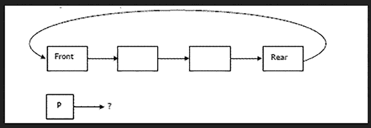

1. 尾节点。
2. 头节点。
3. 使用单个指针无法实现。
4. 头节点相邻的节点。

**答案：(A)**

**解析：**

1. 从尾节点可以获取头节点，因此可以通过尾节点辅助实现`enQueue`和`deQueue`。
2. 从头节点无法访问尾节点，因此无法同时执行这两项操作。
3. C 和 D 不适用。

## 11. 循环链表的特点

在循环链表中，以下哪项是正确的？

1. 组件都以某种顺序方式连接在一起。
2. **它没有开头也没有结尾。**
3. 组件按层级结构排列。
4. 允许在链表内进行正向和反向遍历。

**答案：(B)**

## 12. 单向线性链表节点的字段

在单向线性链表中，每个节点包含两个字段。一个字段称为数据字段，用于存储实际数据，第二个字段用于存储？

1. 指向浮点数数据的指针。
2. 指向整数数据的指针。
3. **指向节点的指针**
4. 指向字符数据的指针。

**答案：(C)**

## 13. 反转双向链表

考虑以下函数，它接受双向链表头节点的引用作为参数。假设双向链表的节点有一个指针为`prev`，后继指针为`next`。

```c
void fun(struct node **head_ref)
{
    struct node *temp = NULL;
    struct node *current = *head_ref;

    while (current != NULL)
    {
        temp = current->prev;
        current->prev = current->next;
        current->next = temp;
        current = current->prev;
    }

    if (temp != NULL)
        *head_ref = temp->prev;
}
```

假设将以下双向链表的头部引用传递给上述函数：1 2 3。

在函数执行后，该双向链表的头节点应该是？

1. 3 2 1。
2. 2 1 3。
3. 1 3 2。
4. 2 3 1。

**答案：(A)**

**解析：** 该函数反转了链表。

## 14. 单向链表搜索的最坏情况

在长度为`n`的单向链表中搜索一个元素的最坏情况所需的比较次数为：

1. `log n`。
2. **`n`**。
3. `n/2`。
4. 常数。

**答案：(B)**

**解析：** 最坏情况下元素位于末尾或不存在。

## 15. 链表的定义

每个元素通过指针连接的集合称为：

1. **链表**。
2. 节点列表。
3. 原始列表。
4. 无。

**答案：(A)**

## 16. 单向线性链表节点的字段

单向线性链表中每个节点包含两个字段。一个字段称为数据字段，用于存储实际数据，第二个字段用于存储？

1. 指向浮点数数据的指针。
2. 指向整数数据的指针。
3. **指向节点的指针**
4. 指向字符数据的指针。

**答案：(C)**

## 17. 双链表的高效操作

下列哪个操作由双链表执行比单向链表更高效？

1. 删除位置位置节点。
2. 在无序列表中搜索给定项。
3. 反转给定位置的节点。
4. 遍历链表。

**答案：(D)**

## 18. 带头尾指针的无序链表

考虑一种无序链表的实现。假设其表示方式为头尾指针。给定该表示方式，以下哪个操作可以在`O(1)`时间实现？

1. 在链表开头插入。
2. 在链表末尾插入。
3. 删除头节点。
4. 删除尾节点。

**答案：(C)**

## 19. 仅带头指针的无序单向链表

考虑一种无序单向链表的实现。假设其表示方式仅有一个头指针。给定该表示方式，以下哪个操作可以在`O(1)`时间实现？

1. 在链表开头插入。
2. 在链表末尾插入。
3. 删除头节点。
4. 删除尾节点。

**答案：(B)**

## 20. 仅带头指针的无序循环链表

考虑一种无序循环链表的实现。假设其表示方式仅有一个头指针。给定该表示方式，以下哪个操作可以在`O(1)`时间实现？

1. 在链表开头插入。
2. 在链表末尾插入。
3. 删除头节点。
4. 删除尾节点。

**答案：(D)**

## 21. 非循环双向链表的定义

非循环双向链表可以定义为：

1. 节点集合，每个节点都包含两个指针`previous`和`next`。
2. 一组通过指针链在一起的节点。
3. 位于顺序内存位置的线性节点序列。
4. **通过指针链在一起的线性节点序列。**

**答案：(D)**

## 22. 字典操作

下面哪项操作是字典操作？

1. 搜索元素。
2. 删除元素。
3. 插入元素。
4. **以上所有。**

**答案：(D)**

## 23. 链表的定义

哪个术语指的是数据项的线性集合，其中每个节点都通过指向下一个节点的指针给出？

1. **链表**
2. 节点列表。
3. 原始类型列表。
4. 以上均不是。

**答案：(A)**

## 24. 单向线性链表节点的字段

在单向线性链表中，每个节点至少包含两个字段。其中一个字段是存储数据的字段，第二个字段是什么？它称为什么？

1. 指向字符数组的指针。
2. 指向整数的指针。
3. 节点地址。
4. **指向下一个链表节点的指针。**

**答案：(D)**

## 25. 两个链表的合并

下面哪种类型的链表使得两个链表的合并时间复杂度为`O(1)`？

1. 单向链表。
2. 双向链表。
3. **双向循环链表。**
4. 数组实现的链表。

**答案：(C)**

## 26. 链表不适合实现的操作

链表不适合实现什么？

1. 插入排序。
2. 桶数排序。
3. 多项式处理。
4. **二分查找。**

**答案：(D)**

## 27. 单向链表搜索的最坏情况

在最坏情况下，在长度为`n`的单向链表中搜索一个节点所需的比较次数复杂度为：

1. `log n`。
2. **`n`**。
3. `log2n-1`。
4. `n/2`。

**答案：(B)**

## 28. 在单向线性链表中创建新节点

下面哪段 C 语言代码用于在单向线性链表中创建一个新节点？

```c
struct node
{
    int data;
    struct node *next;
};

typedef struct node LIST;
LIST *ptr;
```

1. **`ptr = (LIST*) malloc(sizeof(LIST));`**
2. `ptr = (LIST*) malloc(LIST);`
3. `ptr = (LIST*) malloc(sizeof(LIST*));`
4. `ptr = (LIST) malloc(sizeof(LIST));`

**答案：(A)**

## 29. `malloc()`函数的返回类型

`malloc()`函数的返回类型是什么？

1. `void`
2. `int *`
3. `float *`
4. `void *`

**答案：(D)**

**解析：**  
`malloc()`函数的返回类型是`void *`。

## 30. LLINK 的含义

LLINK 是指向……的指针。

1. 后继节点。
2. **前驱节点。**
3. 头节点。
4. 尾节点。

**答案：(B)**

## 31. 单向线性链表节点的最少字段数

单向线性链表的每个节点必须包含至少……

1. 三个字段。
2. **两个字段。**
3. 六个字段。
4. 五个字段。

**答案：(B)**

## 32. 链表数据结构的适用场景

链表数据结构最适用于：

1. 相对固定的集合。
2. **结构的大小和结构内部的数据不断变化。**
3. A 和 B 都对。
4. 以上都不是。

**答案：(B)**

## 33. 数组与链表的插入操作

在数组开头插入元素比在链表开头插入元素更困难。

1. 正确（TRUE）。
2. 错误（FALSE）。

**答案：(A)**

## 34. 循环链表的缺点

使用循环链表的缺点是……。

1. 可能进入无限循环。
2. 循环链表的最后一个节点存储了第一个节点的地址。
3. 搜索非常耗费时间。
4. 循环链表需要更多的内存空间。

**答案：(A)**

## 35. 单向链表的遍历

下面哪种描述是正确的？

1. 使用单向线性链表和单向循环链表，无法反向遍历链表。
2. 要找到任何节点的前驱，在单向线性链表中需要从第一个节点开始遍历链表。

   1. 仅 a。
   2. 仅 b。
   3. **a 和 b 都对。**
   4. 以上。

**答案：(C)**

## 36. 单向线性链表的 C 语言表示

下面哪种使用 C 语言的单向线性链表表示是正确的？

1.

   ```c
   struct node
   {
       int data;
       struct node *next;
   };
   ```

2.

   ```c
   struct node
   {
       int data;
       struct node **next;
   };
   ```

3.

   ```c
   struct node
   {
       int data;
       struct node *next;
       struct node *prev;
   };
   ```

4.

   ```c
   struct node
   {
       int data;
       struct node *next;
   };
   ```

**答案：(A)**

## 37. 双向链表与动态节点

下面哪些陈述是错误的或是正确的？

1. 双向链表包含两个链接字段，一个存储下一个节点的地址，另一个存储上一个节点的地址。
2. 为了动态创建一个新节点，使用了`malloc()`。

**答案：(D)**

## 38. `malloc()`函数的返回类型与参数

下面哪些陈述是错误的或是正确的？

1. `malloc()`函数的返回类型为`void *`，这是一个通用指针。
2. `malloc()`只需要一个参数，即整数类型的尺寸。

**答案：(D)**

## 39. 链表中的插入和删除

下面哪些陈述是错误的或是正确的？

1. 使用链表，插入和删除可以高效完成。
2. 一旦元素按顺序存储，在中间插入元素或删除中间元素就会变得非常困难。

**答案：(D)**

## 40. 单向链表的节点表示

下面哪些陈述是错误的或是正确的？

1.

   ```c
   struct node
   {
       struct node *prev;
       int data;
       struct node *next;
   };
   ```

   这是 C 语言中单向链表的节点表示。

2.

   ```c
   struct node
   {
       int data;
       struct node *next;
   };
   ```


这是 C 语言中双向链表的节点表示。

**答案: (C)**

在树数据结构中，第一个节点被称为根节点。没有父节点的节点被称为根节点。每棵树都需要一个根节点。根节点可以认为是树结构的起源。在任何树数据结构中，应该只有一个根节点。树中永远不会有多个根节点。在图 5.1 中，`A`是树的根节点。

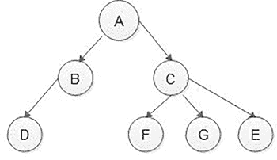

图 5.1 具有七个节点和六条连边的树。

### 2. 边 (Edge)

在树数据结构中，任意两个节点之间的连接链路被称为边。具有若干节点`N`的树将最大数量的边。在图 5.1 中，节点`A`和`B`之间的链路被称为边。

### 3. 父节点 (Parent)

在树数据结构中，作为任何节点的祖先的节点被称为父节点。简单来说，分支到任何其他节点的节点被称为父节点。父节点也可以描述为“拥有一个或多个子节点的节点”。在图 5.1 中，节点`A`、`B`和`C`被称为父节点。

### 4. 子节点 (Child)

在树数据结构中，作为任何节点后代的节点被称为子节点。简单来说，在其父节点上有一条边的节点被称为子节点。在树数据结构中，任何父节点都可以有任意数量的子节点。在树中，除根节点外，所有节点都是子节点。在图 5.1 中，`B`、`C`、`D`、`E`、`F`和`G`都是子节点。

### 5. 兄弟节点 (Siblings)

在树数据结构中，属于同一个父节点的节点被称为兄弟姐妹。简单来说，具有相同父节点的节点被称为兄弟节点。在图 5.1 中，`B`和`C`节点是彼此的兄弟。此外，节点`E`、`F`和`G`也是彼此的兄弟。

### 6. 叶子节点 (Leaf)

在树数据结构中，没有子节点的节点被称为叶子节点。简单来说，叶子节点是没有子节点的节点。

在树数据结构中，叶子节点也称为外部节点。外部节点也是没有子节点的节点。在树中，叶子节点也称为“终端”节点。在图 5.1 中，`D`、`E`、`F`和`G`是叶子节点。

### 7. 内部节点 (Internal nodes)

拥有至少一个子节点的节点被称为内部节点。简单来说，内部节点是有至少一个子节点的节点。

在树数据结构中，除叶子节点或外部节点以外的节点被称为内部节点。如果树结构包含一个一个节点，根节点也被视为内部节点。内部节点也称为非终端节点。在图 5.1 中，`A`、`B`和`C`节点是内部节点。

### 8. 度 (Degree)

在非线性树数据结构中，一个节点的子节点总数被称为该节点的度。简单来说，树数据结构中一个节点的度是它拥有的子节点的总数。

树中所有节点中度最高的被称为“树的度”。在图 5.1 中，`C`节点的度为 3，`B`节点的度为 1。然而，树的度是 3。

### 9. 层 (Level)

在非线性树数据结构中，根节点位于第 0 层，根节点的子节点位于第 1 层，位于第 1 层节点的子节点将位于第 2 层，依此类推。简单来说，在树数据结构中，从顶到底部的每一步都称为一层，层数从“0”开始，每层或每一步增加 1。在图 5.1 中，`D`、`E`、`F`和`G`的层为 2。

### 10. 高度 (Height)

在非线性树数据结构中，从叶子节点到特定节点的最长路径上的边或链路总数被称为该节点的高度。在树中，根节点的高度被称为树的高度。在树中，所有叶子节点的高度均为“0”。

在图 5.1 中，`A`节点的高度为 2，树的高度也是 2。

### 11. 深度 (Depth)

在非线性树数据结构中，从根节点到特定节点的边总数被称为该节点的深度。在树中，从根节点到叶子节点的最长路径上的边总数被称为树的深度。简单来说，树中任何叶子节点的最高深度被称为该树的深度。在树中，根节点的深度为“0”。

在图 5.1 中，`D`节点的深度为 2，树的高度也为 2（注：此处原文可能笔误，应指深度）。树的深度为 2，但高度和深度不相等。

### 12. 路径 (Path)

在非线性树数据结构中，从一个节点到另一个节点的节点边序列被称为路径。路径的长度表示节点的数量。在图 5.1 中，路径`A - B - D`的长度为 3。

### 13. 子树 (Sub-tree)

在非线性树数据结构中，每个节点的递归形成子树。子树由其父组成。

### 14. 森林 (Forest)

森林是树的不交并集。

## 5.2 二叉树数据结构

### 5.2.1 二叉树定义

每个节点最多有两个子节点的树被称为二叉树。二叉树中每个节点的度最多为二（图 5.2）。

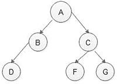

图 5.2 二叉树。

只有一个节点的二叉树是根节点，其左右子树为空。如果二叉树有两个节点，其中一个是根节点，另一个可以是左孩子或右孩子（图 5.3）。

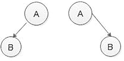

图 5.3 两个节点的二叉树。

### 5.2.2 二叉树的类型

1. **严格二叉树或满二叉树或恰二叉树：**

满二叉树或恰二叉树或严格二叉树是指除叶子节点外的每个节点有两个孩子的树。这意味着二叉树中的每个节点具有 0 个或 2 个孩子，被称为满二叉树或严格二叉树。完全二叉树用于表示数学表达式（图 5.4）。

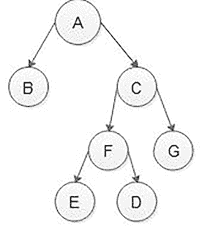

图 5.4 严格二叉树或**满二叉树**或**恰二叉树**。

2. **完全二叉树或完美二叉树：**

完全二叉树是指除最后一层外，每层都是满的且所有节点尽可能靠左的二叉树。所有完全二叉树都是严格二叉树，但并不是所有严格二叉树都是完全二叉树。完全二叉树是允许左右子树高度差仅为 1 的严格二叉树。所有叶子节点位于同一层，或者仅允许 1 层差异（图 5.5）。

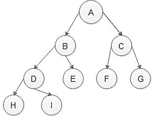

图 5.5 完全二叉树。

3. **二叉搜索树：**

如果一棵二叉树满足以下属性：节点`n`左子树中的所有元素都小于`n`的内容，右子树中的所有元素都大于或等于`n`的内容，则这样的二叉树被称为二叉搜索树 (BST)。

在二叉搜索树（BST）中，如果插入相同的元素，则相同的元素会被插入到节点的右侧，且具有相同的值。如图 5.6 所示。

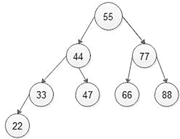

图 5.6 二叉搜索树。

## 4. 接近完全二叉树：

深度为`d`的二叉树被称为接近完全二叉树当且仅当：

1. 树中的每个叶子节点要么位于深度`d`，要么位于深度`d-1`，这意味着叶子节点之间的深度差仅允许为一个。

2. 在深度`d`（即最后一层），如果存在节点，则该节点左侧的所有节点也必须先存在，且深度`d`从左到右的节点之间没有间隙。

在图 5.7 中，最后一层的节点从左到右填充，且最后一层节点之间没有间隙。然而，在图 8 中，最后一层拥有两个节点`H`和`I`，之间有一个间隙，因为`D`节点的左孩子存在但右孩子缺失，因此图 5.8 不是接近完全二叉树。

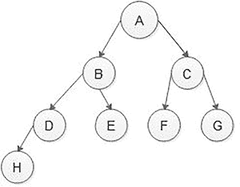

图 5.7 接近完全二叉树。

图 5.7 显示了一个接近完全二叉树，但不是完全二叉树，因为`D`节点有左孩子没有右孩子。在完全二叉树中，每个内部节点恰有两个孩子。

## 3. 倾斜二叉树：

如果一棵树由左孩子节点或右孩子节点主导，则称为倾斜二叉树。

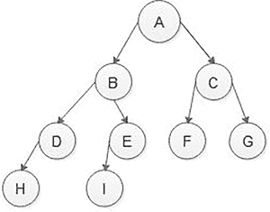

图 5.8 不是接近完全二叉树。

在左倾斜树中，大多数节点都有左孩子而没有对应的右孩子，如图 5.9 所示。在右倾斜树中，大多数节点都有右孩子而没有对应的左孩子，如图 5.10 所示。

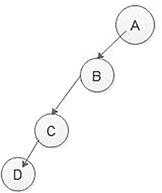

图 5.9 左倾斜树。

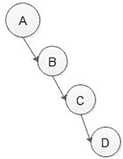

图 5.10 右倾斜树。

## 5.2.3 二叉树的表示法

二叉树有两种表示技术：

1. 顺序表示或数组表示法
2. 链表示法或链表表示法

### 5.2.3.1 顺序表示或数组表示

如果一个二叉树是完全二叉树，且树的深度为`3`，那么节点总数就是`7`。也就是说，如果完全二叉树的深度为`n`，则最大节点通过`2n − 1`计算（图 5.11）。


图 5.11 完全二叉树。

如果二叉树的深度已知，我们可以使用数组数据结构来表示二叉树。在顺序表示中，每个节点的编号将从根节点开始，其余节点将按层逐级递增。同一层的节点将从左到右编号。编号如图 5.12 所示。


图 5.12 使用数组的二叉树顺序表示。

如果我们知道父节点的索引假设为`n`，那么左孩子节点表示为：

`Left child (n) = (2n+1)`

如果我们知道父节点的索引假设为`n`，那么右孩子节点表示为：

`Right child (n) = (2n+2)`

这里，根节点位于索引`0`。

在图 5.12 中，节点`C`位于索引`2`，那么其左孩子位于索引`5`，右孩子位于索引`6`。此外，如果我们知道左孩子的索引，可以使用公式`(n-1)/2`计算其父节点的索引；如果我们知道右孩子的索引，可以使用公式`(n-2)/2`计算其父节点的索引。

**顺序表示的优点：**

1. 直接访问任何节点。
2. 寻找左孩子或右孩子。

**顺序表示的缺点：**

1. 内存浪费：如果二叉树不是完全的，会浪费空间。
2. 如果二叉树增长，则需要调整数组。

### 5.2.3.2 链表示法

在链表示中，每个节点包含数据以及指向左右孩子的的指针。

```
struct binary_tree {

    struct binary_tree *left;

    int data;

    struct binary_tree *right;

};
```

**链表示的优点：**

1. 不浪费内存。
2. 节点的插入和删除更容易。

**链表示的缺点：**

1. 无法直接访问任何节点。
2. 每个节点需要额外的空间来存储左右地址。

## 5.2.4 二叉树的操作

1. 创建二叉树。
2. 显示树中每个节点的数据。
3. 将任何节点作为左孩子或右孩子插入二叉树。
4. 从二叉树中删除节点。

## 5.2.5 二叉树遍历

遍历树意味着访问访问树中的每个节点。共有六种遍历树的方法。对于这些遍历，我们将使用一些符号：

1. `L`表示移动到左孩子。
2. `R`表示移动到右孩子。
3. `R’`表示移动到根节点或父节点。

因此，`L`、`R`、`R’`有六种不同的组合。

然而，其中遍历方法是最重要的，如下：

1. 左-根-右 (`LR’R`)：中序遍历。
2. 根-左-右 (`R’LR`)：前序遍历。
3. 左-右-根 (`R’LR`)：后序遍历。

上述所有遍历技术也称为深度优先搜索或深度遍历。

树通常有两种遍历方式：

1. 广度优先遍历 (BFS) 或层序遍历。
2. 深度优先遍历 (DFS)。

### 5.2.5.1 广度优先遍历或层序遍历

在上述遍历方法中，按层访问项目。因此，首先访问节点`A`，然后在第二层首先访问节点`B`然后`C`，最后在第三层首先访问节点`D`、`F`然后`G`（图 5.14）。


# 图 5.14 (C08_chapter5.xhtml_f5_14b) 使用广度优先遍历或层序遍历遍历二叉树。

层序遍历顺序如下：`A - B - C - D - F – G`

## 算法

在二叉树中，首先访问根节点，然后访问其子节点并将其入队列。然后从队列中弹出一个节点，找到它的子节点并再次插入队列，直到所有节点都被访问。

## 二叉树层序遍历算法

1. 创建一个空队列`q`。
2. `temp_node = root` // 从根节点开始，并将根节点的值赋值给`temp_node`
3. `while temp_node is not NULL`重复以下步骤
    1. 3.1 打印`temp_node->data`。
    2. 3.2. 从左到右依次将`temp_node`的子节点入队列`q`。
    3. 3.3. 从`q`中弹出一个节点并将其值赋值给`temp_node`。
4. 停止。

## 广度优先遍历或层序遍历的时间复杂度：`O (n)`，因为我们恰好访问每个节点一次。

层序遍历所需的额外空间为`O (w)`，其中`w`是二叉树的最大宽度。在广度优先遍历中，需要一个队列数据结构。在广度优先遍历中，队列逐层存储不同节点。

## 5.2.5.2 深度优先遍历

深度优先遍历有以下三种遍历类型：

1. 中序遍历
2. 前序遍历
3. 后序遍历

### 5.2.5.2.1 中序遍历

基本原理是遍历左子树，然后是根节点，最后是右子树（图 5.15）。


### 图 5.15 (C08_chapter5.xhtml_f5_15b) 使用中序遍历方法遍历二叉树。

中序遍历顺序如下：`D - B - A - F - C – G`

### 5.2.5.2.2 前序遍历

基本原理是先遍历根节点，然后是左子树，最后是右子树（图 5.16）。


### 图 5.16 (C08_chapter5.xhtml_f5_16b) 使用前序遍历方法遍历二叉树。

前序遍历顺序如下：`A - B - D - C - F – G`

### 5.2.5.2.3 后序遍历

基本原理是先遍历左子树，然后是右子树，最后是根节点（图 5.17）。


### 图 5.17 (C08_chapter5.xhtml_f5_17b) 使用后序遍历方法遍历二叉树。

后序遍历顺序如下：`D - B - F - G - C – A`

## 5.2.6 简单二叉树实现

创建一个简单的二叉树，第一个元素将形成根节点。对于后续的所有元素，用户必须输入该元素是作为前一个节点的左子节点还是右子节点。

**示例：**

假设`10`是根节点，


如果下一个节点是`21`，则用户会被要求选择连接在`10`的左侧还是右侧。如果用户回答左或`l`，则树将如下：


然后，如果下一个元素是`11`，用户再次需要给出选择，是左还是右。这意味着首先要询问用户想将`11`附加在根节点`10`的左侧还是右侧。然后，如果用户回答左，再次询问用户是否想将`11`附加在`21`的左侧还是右侧，如果用户回答右，则节点`11`将作为`21`的右子节点。


这样就生成了一个简单的二叉树。这种创建方法背后的核心思想是始终询问用户想在何处附加下一个节点，并始终从根节点开始扫描树。

**程序：简单二叉树的实现以及在简单二叉树上执行递归插入和遍历操作.**

```
#include<stdio.h>

#include<stdlib.h>

struct bt

{

struct bt *left;

int data;

struct bt *right;

};

// 函数声明

void insert(struct bt *root, struct bt *new1);

void in-order(struct bt *temp);

void preorder(struct bt *temp);

void postorder(struct bt *temp);

// main 函数定义

int main()

{

struct bt *root, *new1;

int ch;

char c;

root=NULL;

do

{

printf("1\. Create 2.Inorder 3.Preorder 4.Postorder 5.Exit");

printf("\nEnter choice: ");

scanf("%d",&ch);

switch(ch)

case 1:

root=(struct bt*)malloc(sizeof(struct bt));

printf("Enter data: ");

scanf("%d",&root->data);

root->left=NULL;

root->right=NULL;

break;

case 2:

new1=(struct bt*)malloc(sizeof(struct bt));

printf("Enter data: ");

scanf("%d",&new1->data);

new1->left=NULL;

new1->right=NULL;

printf("Enter left or right: ");

scanf("%c",&c);

if(c=='l'||c=='L')

root->left=new1;

else

root->right=new1;

break;

case 3:

preorder(root);

break;

case 4:

postorder(root);

break;

case 5:

exit(0);

default:

printf("Invalid choice");

}

} while(1);

}

void in-order(struct bt *temp)

{

if(temp!=NULL)

{

in-order(temp->left);

printf("%d\t",temp->data);

in-order(temp->right);

}

}

void preorder(struct bt *temp)

{

if(temp!=NULL)

{

printf("%d\t",temp->data);

preorder(temp->left);

preorder(temp->right);

}

}

void postorder(struct bt *temp)

{

if(temp!=NULL)

{

postorder(temp->left);

postorder(temp->right);

printf("%d\t",temp->data);

}

}
```


### 5.3.3 后序遍历的递归算法

二叉树 `T` 根节点 `R` 的后序遍历。

**算法 `Postorder (Root)`**

1. 遍历根节点 `R` 的左子树，即调用 `postorder (left sub-tree)`。
2. 遍历根节点 `R` 的右子树，即调用 `postorder (right sub-tree)`。
3. 访问并处理根节点 `R`。

## 5.4 根据给定的遍历方法构造二叉树

### 5.4.1 根据给定的中序和前序遍历构造二叉树

举例说明：

1. 中序遍历：14, 7, 21, 8, 15, 11, 61, 99 和 33
2. 前序遍历：11, 21, 14, 7, 15, 8, 33, 61 和 99

前序遍历中的第一个值是二叉树的根节点，因为在前序遍历中，首先遍历根节点，然后遍历左子树，最后遍历右子树。因此，数据为 11 的节点成为二叉树的根。在中序遍历中，首先遍历左子树，然后是根节点，最后是右子树。因此，中序列表中 11 之前的数据（即 14, 7, 21, 8 和 15）构成了左子树，而中序列表中 11 之后的数据（即 61, 99 和 33）构成了右子树。图 5.18 显示了将树分为左右子树后的树的结构。


**图 5.18** 二叉树重建第 1 步。

在下一次迭代中，21 是左子树的根。因此，中序列表中 21 之前的数据（即 14, 7）构成了值为 21 的节点的左子树。中序列表中位于 21 右侧的数据（即 8, 15）构成了值为 21 的节点的右子树。图 5.19 显示了扩展值为 21 的节点的左右子树后的树的结构。


**图 5.19** 二叉树重建第 2 步。

现在，前序列表中的下一个数据是 14，所以它现在变为了根节点。中序列表中 14 之前的数据构成了值为 14 的节点的左子树。然而，由于中序列表中 14 之前没有数据，值为 14 的节点的左子树为空。中序列表中位于 14 右侧的数据 7 构成了值为 14 的节点的右子树。图 5.20 显示了扩展值为 14 的节点的左右子树后的树的结构。


**图 5.20** 二叉树重建第 3 步。

以此类推，从前序列表中逐个取出所有数据并将其视为根节点，然后从中序列表中找到左右子树中的元素，并以递归方式或非递归方式（即迭代方式）构造整棵树（图 5.21 和 5.22）。


**图 5.21** 二叉树重建第 4 步。


**图 5.22** 二叉树重建第 5 步。

### 5.4.2 根据给定的中序和后序遍历构造二叉树

举例说明：

1. 中序遍历：4 2 5 1 6 7 3 8
2. 后序遍历：4 5 2 6 7 8 3 1

后序遍历中的最后一个值是二叉树的根节点，因为在后序遍历中，根节点最后被遍历，然后是左子树，最后是右子树。因此，数据为 1 的节点成为二叉树的根。在中序遍历中，首先遍历左子树，然后是根节点，最后是右子树。因此，中序列表中 1 之前的数据（即 4, 2, 5）构成了左子树，中序列表中 1 之后的数据（即 6, 7, 3, 8）构成了右子树。图 5.23 显示了将树分为左右子树后的树的结构。


**图 5.23** 二叉树重建第 1 步。

在下一次迭代中，2 是左子树的根，因为它是后序遍历中的最后一个元素。因此，中序列表中 2 之前的数据构成了值为 2 的节点的左子树。中序列表中位于 2 右侧的数据构成了值为 2 的节点的右子树。图 5.24 显示了扩展值为 2 的节点的左右子树后的树的结构。


**图 5.24** 二叉树重建第 2 步。

现在，前序列表中的下一个数据是 14，所以它现在变为了根节点。中序列表中 14 之前的数据构成了值为 14 的节点的左子树。然而，由于中序列表中 14 之前没有数据，值为 14 的节点的左子树为空。中序列表中位于 14 右侧的数据 7 构成了值为 14 的节点的右子树。图 5.25 显示了扩展值为 2 的节点的左右子树后的树的结构。


**图 5.25** （此处应为第 3 步

以此类推，从后序列表中逐个取出所有数据并将其视为根节点，然后从中序列表中找到左右子树中的元素，并以递归方式或非递归方式构造整棵树（图 5.26）。


**图 5.26** 二叉树

### 5.4.3 根据给定的前序和后序遍历构造严格或完全二叉树

如果我们有前序和后序遍历序列，则无法构造普通的二叉树。因为不同的二叉树的前序和后序遍历可能是相同的，如图 5.27 所示。


**图 5.27** 二叉树。

1. 前序遍历：1 - 2 - 3
2. 后序遍历：3 - 2 - 1

在图 5.27a 和 b 中，前序和后序遍历得到相同的结果。也就是说，使用前序和后序遍历我们无法预测想要构造的是哪一棵树。这意味着存在歧义。

然而，如果我们知道二叉树是严格或完全二叉树，我们就可以无歧义地构造二叉树。

举例说明：

1. 前序遍历：1 2 4 5 3 7 8
2. 后序遍历：4 5 2 7 8 3 1

后序遍历中的最后一个值是二叉树的根。前序遍历中的第一个值也是根。因此，数据为 1 的节点成为二叉树的根。前序遍历中紧邻 1 的值是左孩子。因此，我们知道 1 是根，2 是左孩子。现在知道 2 是左子树所有节点的根。后序列表中 2 之前的所有节点都在左子树，即 4, 5 和 2。现在我们知道 1 是根，4, 5 和 2 在左子树中，而 7, 8 和 3 在右子树中（图 5.28 和 5.29）。


**图 5.28** 完全二叉树重建第 1 步。


**图 5.29** 完全二叉树重建第 2 步。

以此类推，从后序列表中逐个取出最后数据元素并将其视为根节点，然后从中序列表中找到左右子树中的元素，并以递归方式或非递归方式构造整棵树（图 5.30）。


**图 5.30** 完全二叉树重建第 3 步。

在简单的二叉树中，节点可以以任何方式分布。根据用户的意愿，新节点可以连接到任何指定节点的左子或右子。在这种情况下，查找任何节点都是一个非常耗时的过程，因为我们必须搜索整棵树。此外，搜索时间的复杂度会不必要地增加。因此，为了加快二叉树的搜索速度，让我们创建二叉搜索树（BST）。BST 衍生于二叉搜索算法。在创建 BST 的过程中，数据是有序的。这意味着左子树的值 < 根节点的值 < 右子树的值（图 5.31）。


`图 5.31`

### 5.5.2 BST 的操作

1. 在 BST 中插入节点
2. 从 BST 中删除节点
3. 在 BST 中查找特定节点

让我们来讨论这些操作：

#### 5.5.2.1 在 BST 中插入节点

在 BST 中插入任何节点时，首先要在 BST 中寻找其合适的位置。在图 5.32 中，如果我们想插入 32，并将 32 与根节点的值 55 进行比较。由于 32 小于 55，我们将移动左子树。现在我们将 32 与 15 比较，32 大于 15，因此移动右子树。再次将 32 与 33 比较，32 小于 33，因此移动左子树，但左子树是空的，我们将 32 挂在 33 的左侧作为其左节点（图 5.33）。


`图 5.32` 在二叉搜索树中插入节点前。


`图 5.33` 在二叉搜索树中插入节点 32 后。

#### 5.5.2.2 从 BST 中删除节点

从 BST 中删除节点有三种可能的情况：

1. 删除叶子节点
2. 删除只有一个左子或右子节点的节点
3. 删除有两个子节点的节点

##### 5.5.2.2.1 删除叶子节点

这是简单的删除，我们首先搜索要删除的节点及其对应的父节点。如果要删除的节点是叶子节点，该节点是其父节点的左孩子或右孩子，则将父节点的左指针或右指针设置为 `NULL`（图 5.34）。


`图 5.34` 从二叉搜索树中删除叶子节点前。

在上面的 BST 中，值为 33 的节点是一个叶子节点，我们要删除该节点意味着我们将首先在 BST 中搜索节点 33 并找到它的父节点 15。然后找到 33 节点是在 15 父节点的左侧还是右侧。在上面的例子中，33 节点在父节点 15 的右侧，因此将 15 节点的右指针设置为 `NULL`。此外，如图 5.35](#C08_chapter5.xhtml_f535)所示释放节点 33。


`图 5.35` 从二叉搜索树中删除节点 33 后。

##### 5.5.2.2.2 删除只有一个左或或右节点的节点

我们要从 BST 中删除的节点是一个只有一个右孩子的内部节点，则找到它的父节点并检查该被删除节点是父节点的左孩子还是右孩子。如果被删除节点是父节点的右孩子，则将被删除节点的右孩子的地址拷贝到父节点的右侧（图 5.36）。


`图 5.36` 删除前。

我们想在上面的 BST 中删除节点 33，因为它只有一个左孩子。为了这样做，我们将首先在 BST 中搜索节点 33 并找到它的父节点 15。然后找到 33 节点是在 15 父节点的左侧还是右侧。在上面的例子中，33 节点在父节点 15 的右侧，因此将 15 节点的右指针设置为 `NULL`。此外，如图 5.37](#C08_chapter5.xhtml_f537)所示释放节点 33。


`图 5.37` 删除节点 33 后。

##### 5.5.2.2.3 删除有两个子节点的节点

我们要从 BST 中删除的节点是一个有两个子节点的内部节点，则找到它的父节点并检查该被删除节点是父节点的左孩子还是右孩子。如果被删除节点是父节点的右孩子，则将被删除节点的右孩子的地址拷贝到父节点的右侧（图 5.36）。


`图 5.36` 删除前。

我们想在上面的 BST 中删除节点 15，因为它有两个子节点。为了这样做，我们将首先在 BST 中搜索节点 15 并找到它的父节点 55。然后找到 15 节点是在 55 父节点的左侧还是右侧。在上面的例子中，15 节点在父节点 55 的左侧，因此将 55 节点的左指针设置为 `NULL`。此外，如图 5.39](#C08_chapter5.xhtml_f539)所示释放节点 15。


`图 5.39` 删除节点 15 后。

#### 5.5.2.3 在 BST 中查找特定节点

搜索时，我们想要查找的节点被称为键节点（key node）。如果键节点的值大于当前节点，则从根节点开始与每个节点进行匹配，然后在右子树中搜索；否则在左子树中搜索。如果我们到达叶子节点仍未得到键节点的值，则声明“节点不在二叉搜索树中”（图 5.40）。


`图 5.40`

```c
#include<stdio.h>

#include<stdlib.h>

struct bst
{
    struct bst *left;
    int data;
    struct bst *right;
};

// 函数原型
void insert(struct bst * root , struct bst * new1);
void in-order(struct bst *);
struct bst * search(struct bst * root, int key, struct bst **parent);
void delet(struct bst *, int key);

// 主函数定义
int main()
{
    int choice, key;
    char ch;
    struct bst *root,*new1,*temp,*parent;
    root=NULL;
    parent=NULL;

    printf("\n 二叉搜索树:");

    do
    {
        printf("1.插入\t 2.显示 \t 3.搜索 \t 4.删除 \t 5.退出\n ");
        printf(" 输入您的选择");
        scanf("%d", &choice);

        switch(choice)
        {
            case 1:
                do
                {
                    new1=(struct bst *)malloc(sizeof(struct bst));
                    printf(" 输入数据");
                    scanf("%d",&new1->data);
                    new1->left=NULL;
                    new1->right=NULL;

                    if(root==NULL)
                    {
                        root=new1;
                    }
                    else
                    {
                        insert(root,new1);
                    }

                    printf("\n 您想再插入另一个节点吗[y/n]: ");
                    ch=getche();
                }while(ch=='y'|| ch=='Y');
                break;

            case 2:
                if(root==NULL)
                    printf("\n 先创建二叉搜索树");
                else
                    in-order(root);
                break;

            case 3:
                if(root==NULL)
                    printf("\n 先创建二叉搜索树");
                else
                {
                    printf("\n 输入要搜索的数据");
                    scanf("%d", &key);
                    temp=search(root, key, &parent);
                    printf("\n%d", temp->data);
                }
                break;

            case 4:
                if(root==NULL)
                    printf("\n 先创建二叉搜索树 ");
                else
                {
                    printf("\n 输入要删除的数据");
                    scanf("%d", &key);
                    delet(root, key);
                }
                break;

            case 5:
                exit(0);

            default:
                printf("\n 选择错误");
        }

        printf("\n 您想继续操作二叉搜索树吗[y/n]");
        fflush(stdin);
        scanf("%c",&ch);
    }while(ch=='y' || ch=='Y');

    return 0;
}

// 在二叉搜索树中插入元素
void insert(struct bst *root, struct bst *new1)
{
    if(root->data<new1->data)
    {
        if(root->right==NULL)
        {
            root->right=new1;
        }
        else
        {
            insert(root->right, new1);
        }
    }

    if(root->data>new1->data)
    {
        if(root->left==NULL)
        {
            root->left=new1;
        }
        else
        {
            insert(root->left, new1);
        }
    }
}

// 在二叉搜索树中搜索节点，并返回被搜索节点的地址以及其
// 父节点的地址
struct bst * search(struct bst *root, int key, struct bst **parent)
{
    struct bst *temp;
    temp=root;

    while(temp!=NULL)
    {
        if(temp->data==key)
        {
            printf("\n 找到节点");
            return temp;
        }
        else
        {
            *parent=temp;   // 更新调用函数中的父节点地址

            if(temp->data<key)
            {
                temp=temp->right;
            }
            else
            {
                temp=temp->left;
            }
        }   // else 语句结束
    } // while 循环结束

    printf("\n 未找到节点");

    return NULL;   // 如果二叉搜索树中不存在该节点，则返回 NULL 地址
}  // search 函数结束

// 从二叉搜索树中删除节点
void delet(struct bst *root, int key)
{
    struct bst * parent, *temp, *temp_succ;
    temp=search(root, key, &parent);

    if(temp == NULL)
    {
        printf("\n 二叉搜索树中未找到该节点");
        return ;
    }

    if(temp == root)
    {
        printf("\n 您要删除的节点是根节点，我们无法删除根节点");
        return ;
    }

    // 删除有两个子节点的节点
    if( (temp->right!=NULL) && (temp->left!=NULL) )
    {
        parent=temp;
        temp_succ=temp->right;

        while(temp_succ->left!=NULL)   // 寻找 temp 节点的中序后继
        {
            parent=temp_succ;
            temp_succ=temp_succ->left;
        }

        temp->data=temp_succ->data;  // 将中序后继节点的数据拷贝到 temp 节点


### 步骤 1：检查根节点和新节点中的数据

如果根节点的数据大于新节点的数据，则进入左子树。此外，检查根节点的左指针是否包含 `NULL` 地址。如果根节点的左指针包含 `NULL` 地址，则将新节点挂载到当前根节点的左侧。否则，使用新根节点的地址和新创建节点的地址递归地调用`insert()`函数。此处，当前根节点包含左子树的地址，新创建节点的地址保持不变，如下所示：

```c
if(root->data > new1->data)
{
    if(root->left==NULL)
    {
        root->left=new1;
    }
    else
    {
        insert(root->left, new1);
    }
}
```

### 步骤 2：如果新节点已放置在正确的位置，则停止递归调用`insert()`函数。

### 步骤 3：停止

## 5.6.3 BST 算法中的节点查找

**算法`bst_search(struct bst *root, int key, struct bst **parent)`**

步骤 1：开始

步骤 2：检查是否创建了二叉搜索树（BST）。

```c
if(root==NULL)
```

打印“先创建二叉搜索树。”否则，从用户处获取想要在 BST 中查找的`key`。

步骤 3：将根节点的地址复制到`temp`指针中以用于遍历。

```c
temp=root
```

步骤 4：检查`temp`指针的数据部分与要查找的`key`是否匹配，直到`temp`指针包含`NULL`地址为止。如果`temp`指针的数据与`key`匹配，则显示消息“找到节点”并返回所查找节点的地址。

步骤 5：如果`temp`指针的数据与`key`不匹配，则按照如下方式将当前`temp`的地址复制到`parent`指针中：

```c
*parent=temp;
```

步骤 6：如果`temp`指针的数据小于`key`值，则将右子树的地址赋值给`temp`指针。

```c
if(temp->data<key)
{
    temp=temp->right;
}
```

步骤 7：否则，将左子树的地址赋值给`temp`指针。

```c
temp=temp->left;
```

重复步骤 4–7，直到`temp`指针包含`NULL`地址。

步骤 8：如果`temp`指针包含`NULL`地址，则打印“未找到节点。”

步骤 9：停止。

## 5.6.4 BST 中删除任意节点的算法

**算法`delet(struct bst *root, int key)`**

步骤 1：开始

步骤 2：检查是否创建了二叉搜索树。

```c
if(root==NULL)
```

打印“先创建二叉搜索树。”否则，从用户处获取想要从 BST 中删除的`key`。

步骤 3：调用`search()`函数。在执行`search()`函数后会返回两个地址：一个是存储在`temp`指针中要删除的节点地址，另一个是存储在`parent`指针中要删除的父节点地址。

步骤 4：首先检查`temp`指针是否为`NULL`。如果`temp`指针为`NULL`，则打印消息“二叉搜索树中未找到节点”并返回调用函数。

步骤 5：如果`temp`指针不为`NULL`，则检查`temp`指针是否包含根节点的地址。如果`temp`包含根节点，则打印消息“你要删除的节点是根节点，我们无法删除根节点”并返回调用函数。

步骤 6：如果`temp`指针不包含根节点的地址，则检查要删除的节点是否有两个孩子。如果条件成立，则找到它的中序后继（in-order successor），用中序后继节点的值替换被删除节点的值，并从 BST 中释放中序后继节点。

```c
if((temp->right!=NULL) && (temp->left!=NULL))
{
    parent=temp;
    temp_succ=temp->right;
    while(temp_succ->left!=NULL)   //寻找节点的中序后继
    {
        parent=temp_succ;
        temp_succ=temp_succ->left;
    }
    temp->data=temp_succ->data;  //将中序后继节点的数据复制到temp节点
    if(temp_succ==temp->right)    //如果中序后继节点在temp节点的右侧
    {
        parent->right=NULL;
    }
    else      //如果中序后继节点在temp节点的左侧
    {
        parent->left=NULL;
    }
    free(temp_succ);     //释放中序后继节点
    temp_succ=NULL;
}
```

步骤 7：如果要删除的节点没有两个孩子，则检查该节点是否仅包含右孩子。如果条件成立，找到`temp`节点是在`parent`的左侧还是右侧。如果`temp`是在`parent`的右侧，则将`temp`节点的右指针地址赋值给`parent`的右指针。否则，将`temp`节点的右指针地址赋值给`parent`的左指针。此外，释放`temp`节点。

```c
else if((temp->right!=NULL)&&(temp->left==NULL))
{
    if(parent==temp)   //寻找temp节点是parent的左侧还是右侧
    {
        parent->right=temp->right;
    }
    else
    {
        parent->left=temp->right;
    }
    temp->right=NULL;
    temp->left=NULL;
    free(temp);
    temp=NULL;
}
```

步骤 8：如果要删除的节点不只包含右孩子，则检查该节点是否仅包含左孩子。如果条件成立，找到`temp`节点是在`parent`的左侧还是右侧。如果`temp`是`parent`的右侧，则将`temp`节点的左指针地址赋值给`parent`的右指针。否则，将`temp`节点的左指针地址赋值给`parent`的左指针。此外，释放`temp`节点。

```c
else if((temp->right==NULL)&&(temp->left!=NULL))
{
    if(parent->left==temp)  //寻找temp节点是parent的左侧还是右侧
    {
        parent->left=temp->left;
    }
    else
    {
        parent->right=temp->left;
    }
    temp->right=NULL;
    temp->left=NULL;
    free(temp);
    temp=NULL;
}
```

步骤 9：如果要删除的节点不只包含左孩子，则检查该节点是否既不包含左右孩子。如果条件成立，找到`temp`节点是在`parent`的左侧还是右侧。如果`temp`是`parent`的左侧，则将`parent`节点的左指针赋值为`NULL`，否则将`parent`节点的右指针赋值为`NULL`。此外，释放`temp`节点。

```c
else if((temp->right==NULL)&&(temp->left==NULL))
{
    if(parent->left==temp)  //查找temp节点是左节点还是父节点的右节点
    {
        parent->left=NULL;
    }
    else
    {
        parent->right=NULL;
    }
    free(temp);
    temp=NULL;
}
```

### 步骤 10：检查所有条件后，打印删除节点的值。

### 步骤 11：停止

```c
//使用中序遍历方法显示二叉搜索树
void in-order(struct bst *temp)
{
    if(temp!=NULL)
    {
        in-order(temp->left);
        printf("\n%d", temp->data);
        in-order(temp->right);
    }
}
```


### 5.6.5 BST 的中序遍历算法

根节点为`R`的二叉搜索树`T`的中序遍历。

**算法`in-order (root R)`**

1. 遍历根节点`R`的左子树，即调用`in-order (left sub-tree)`
2. 访问根节点`R`并处理。
3. 遍历根节点`R`的右子树，即调用`in-order (right sub-tree)`

### 5.7 二叉树和 BST 的应用

1. `BST`用于实现字典。
2. `BST`用于实现数据库中的多级索引。
3. `BST`用于实现搜索算法。
4. `Heaps`（堆）是一种特殊的二叉树：用于实现高效的优先级队列，优先级队列又被用于许多操作系统的进程调度、路由器中的服务质量以及人工智能应用（包括机器人和视频游戏）中的路径查找算法。它也被用于堆排序。
5. 语法树：在编译器的语法分析阶段，为对表达式进行自顶向下解析或自底向上解析，会绘制解析树或语法树。
6. `BST`用于 Unix 内核管理一组虚拟内存区域（VMA）。每个`VMA`代表 Unix 进程中的一段内存。
7. 互联网主机发送的每个`IP`数据包都带有一个 16 位的`id`，该 ID 对于该源目的对必须是唯一的。Linux 内核使用`AVL tree`或高度平衡树来处理索引 IP 地址。
8. `BST`用于以排序的形式高效存储数据，以便快速访问和搜索存储的元素。
9. `BST`用于动态排序。
10. **哈夫曼树构建：** 一种构造最小冗余码的方法。`Huffman code`（哈夫曼码）是一种最优前码，通常用于无损数据压缩。该算法由 David A. Huffman 开发。该技术通过创建一个节点二叉树来工作。节点数量取决于符号的数量。

其核心思想是将普通输入转换为变长编码。与其他熵编码方法一样，最常见的符号通常使用的位比特比不常见的符号少。

**哈夫曼编码：**

一种基于给定文档中实际字符频率的变长编码。

哈夫曼编码使用二叉树：

1. 用于确定每个字符的编码。
2. 用于解码需要解压缩的压缩文件，将其还原为 ASCII 格式。仅包含六个字符的文本哈夫曼树示例：

叶子节点是字符。

左分支标记为 0，右分支标记为 1。

如果你遵循从根到叶的路径，即可得到叶子节点字符的编码。

示例：`101 = 'j'` 和 `01 = 'm'`。

出现频率越高的字符离根节点越近，因此编码所需的内存越少。

**构建哈夫曼树：**

1. 首先读取文本，确定每个字符的频率。
2. 为文本中的每个字符创建一个包含字符和频率对的节点列表，并按频率排序。
3. 移除并合并两个最小频率的节点，创建一个新节点作为它们的父节点。
    1. 频率最低的左子节点。
    2. 频率次低的右子节点。
    3. 父节点的频率等于其子节点（即左节点和右节点）频率之和。
4. 将父节点添加到节点列表中，保持列表的排序顺序。
5. 只要列表中只有一个节点，就重复步骤 3 和 4，该节点将是所示图 5.41 中的哈夫曼树根。

**图 5.41** 哈夫曼树。

11. 二叉树是表示算术表达式的好方法。叶子节点或外部节点是操作数，内部节点是运算符。二叉表达式树可以描述的两种常见表达式类型是代数布尔。这些二叉树可以表示包含一元和二元运算符的表达式。

二叉树的每个节点（即在二叉表达式树中）有零、一个或两个孩子。这种紧密的排列简化了表达式树的处理。

### 5.8 堆 (Heaps)

#### 5.8.1 堆的基础

堆结构是一种特殊的二叉树。

二堆有两种类型：

1. 最大堆
2. 最小堆

#### 5.8.2 最大堆的定义

最大堆定义如下：

1. 二叉树是**完全二叉树**。也就是说，每个叶子节点要么在`d`层，要么在`d-1`层，这意味着层之间只允许一层的差异。在深度`d`（即最底层），如果存在节点，则其左侧的所有节点都应该存在。
2. 节点中的键排列使得每个节点的内容小于或等于其父节点的内容，这意味着对于节点`info[i] <= info[j]`，其中`j`是节点`i`的父节点。这种堆被称为最大堆。

在这里，二叉树的每一层都从左到右填充。

在最小堆中，根节点的键必须是所有存在键中最小的。这一特征迭代地适用于二叉树中的所有节点。

**最大堆示例（图 5.42）。**


**图 5.42** 最大堆的示例。

#### 5.8.3 最大堆执行的操作

在堆数据结构上执行以下操作：

1. 插入或创建堆
2. 删除
3. 查找最大值。

##### 5.8.3.1 最大堆中的插入操作

最大堆中的插入操作使用以下算法：

步骤 1：开始
步骤 2：从左到右将新节点作为最后一个叶子添加。
步骤 3：相对于父节点检查新节点。
步骤 4：如果新节点值大于父节点，则交换两者。
步骤 5：只要新节点值小于父节点或新节点到达根节点，就重复步骤 3 和 4。
步骤 6：停止

插入新键需要 **O (log n)** 时间。

**示例（图 5.43）：**


**图 5.43** 大小为 5 的最大堆。

上述二叉树是一棵几乎完全二叉树，每个节点的内容或值都小于其父节点的内容，且二叉树的每一层都从左到右填充。也就是说，根据最大堆数据结构，该二叉树同时满足顺序和结构属性，因此上述二叉树是一个大小为 5 的最大堆。

现在在上述大小为 5 的最大堆中插入一个值为 65 的新节点。

**步骤 1：** 从左到右将值为 65 的`new node`作为`last leaf`插入，这意味着新节点被添加为值为 35 的节点的左子节点。添加 65 后，最大堆如下：


**步骤 2：** 将`new node`的值 (65) 与其父节点的值 (35) 进行比较。这意味着 `65 > 35`


此时，新节点的值 (65) 大于其父节点的值 (35)，则交换两者。交换后，最大堆如下所示：

**步骤 3：** 现在，再次将新节点的值 (65) 与其父节点的值 (55) 进行比较。此处，新节点的值 (65) 大于其父节点的值 (55)，则交换两者。交换后，最大堆如下所示：


**步骤 4：** 现在新节点已成为根节点，因此停止比较，大小为 6 的最终堆如图 5.44 所示。


**图 5.44** 插入节点 65 后大小为 6 的最大堆。

##### 5.8.3.2 最大堆中的删除操作

在最大堆中，移除最后一个节点是非常简单的因为它因为它破坏最大堆的特性。从最大堆中移除根节点具有挑战性，因为它会破坏最大堆特性。我们使用以下步骤从最大堆中移除根节点。

步骤 1：开始
步骤 2：将根节点与最大堆中的最后一个节点交换。
步骤 3：交换后，移除最后一个节点。
步骤 4：比较根节点的值与其左子节点的值。
步骤 5：如果根节点的值小于其左子节点，则比较左子节点的值与其右兄弟节点。如果不是，继续执行步骤 7。
步骤 6：如果左子节点的值大于其右兄弟节点，则将根与左子节点交换。否则，将根与其右子节点交换。
步骤 7：如果根节点的值大于其左子节点，则比较根的值与右子节点的值。
步骤 8：如果根的值小于其右子节点，则将根与右子节点交换。否则，停止过程。
步骤 9：重复相同的操作直到根节点被设置到正确位置。
步骤 10：停止。

插入键需要 `O (log n)` 时间。

**示例 (图 5.45):**


**图 5.45** 大小为 6 的最大堆。

在上述最大堆中，如果我们想删除值为 65 的根节点，请遵循以下步骤：

**步骤 1：** 将最大堆中的根节点 65 与最后一个节点 35 交换。交换后，最大堆如下：


**步骤 2：** 从最大堆中删除最后一个节点 65。从最大堆中删除值为 65 的节点后，最大堆如下：


**步骤 3：** 比较根节点 35 与其左子节点 32。此处，值为 35 的节点大于其左子节点。因此，我们用值为 35 的节点与其右子节点 55 进行比较。此处，值为 35 的节点小于其右子节点 55。因此，我们交换两者。交换后，最大堆如下：


此处，值为 35 的节点没有左右子节点。因此，我们停止过程。

最后，删除根节点 65 后的最大堆如下：


##### 5.8.3.3 在最大堆中寻找最大值

在最大堆中寻找最大值节点非常简单。在最大堆中，根节点具有最大堆中所有节点的最大值。因此，我们可以直接将根节点的值作为最大堆中的最大值。

#### 5.8.4 堆的应用

1. **堆排序：** 堆排序使用二叉堆在 `O (n log n)` 时间内对数组排序。
2. **图算法：** 优先级队列特别用于 Dijkstra 最短路径和 Prim 最小生成树等图算法。
3. **优先级队列：** 优先级队列可以使用二叉堆进行有效实现。

### 5.9 AVL 树

#### 5.9.1 引言

AVL 树是一种自平衡二叉搜索树。在 AVL 树中，任意节点左右子树的高度差最多为 1。

#### 5.9.2 定义

如果任意节点左右子树的高度差为 -1、0 或 1，则 AVL 树是平衡的。这种差异被称为平衡因子。

`BF(T) = height(left_subtree) - height(right_subtree)`

如果 AVL 树的任意节点的平衡因子超过 1，则必须进行重新平衡。

#### 5.9.3 AVL 树旋转

在 AVL 树中，每次执行插入和删除操作后，我们必须检查每个节点的平衡因子。如果每个节点都符合平衡因子条件，则完成操作；否则，我们必须通过旋转操作使其平衡。

以下是四种旋转：

1. **L L 旋转**（左旋）
2. **R R 旋转**（右旋）
3. **L R 旋转**（左右旋）
4. **R L 旋转**（右左旋）

**示例：**

1. **L L 旋转：** 当在节点 A 左子树的左子树中插入新节点时使用。


2. **R R 旋转：** 当在节点 A 右子树的右子树中插入新节点时使用。


3. **L R 旋转：** 当在节点 A 左子树的右子树中插入新节点时使用。


4. **R L 旋转**

当新节点插入到节点 A 右子树的左子树时使用。


#### 5.9.4 AVL 树的操作

在 AVL 树中执行以下操作：

1. 在 AVL 树中搜索节点
2. 在 AVL 树中插入节点
3. 从 AVL 树中删除节点

##### 5.9.4.1 AVL 树中的搜索操作

在 AVL 树中，搜索操作的时间复杂度为 `O (log n)`。搜索操作与`BST`的搜索操作相同。我们使用以下步骤在 AVL 树中搜索元素：

1. 第 1 ：开始
2. 第 2 ：从用户处读取搜索元素。
3. 第 3 ：下一步，将搜索元素与树根节点的值进行比较。
4. 第 4 ：如果两者相等，则显示“找到元素”并结束搜索函数。
5. 第 5 ：如果两者不相等，则验证搜索元素小于还是大于父节点的值。
6. 第 6 ：如果搜索元素较小，则继续在左子树中搜索。
7. 第 7 ：如果搜索元素较大，则继续在右子树中搜索。
8. 第 8 ：只要找到确的元素或到达叶子节点，就重复上述操作。
9. 第 9 ：如果我们到达具有搜索值的节点，则显示“找到元素”并终止函数。
10. 第 10：如果我们到达一个叶子节点且不匹配，则显示“未找到元素”并终止函数。
11. 第 11：停止。

##### 5.9.4.2 AVL 树中的插入操作

在 AVL 树中，插入操作以 `O (log n)` 时间复杂度执行。在`AVL Tree`中，新节点始终作为叶子节点插入。插入操作如下：

1. 第 1 ：开始
2. 第 2 ：按照`BST`插入逻辑在树中插入新项。
3. 第 3 ：插入完成后，检查每个节点的平衡因子。
4. 第 4 ：如果每个节点的平衡因子为 `0`、`1` 或 `-1`，则跳转到第 6 步。
5. 第 5 ：如果节点的平衡因子不是 `0`、`1` 或 `-1`，则认为树是不平衡的。此时执行适当的旋转技术以实现平衡。此外，继续后续操作。
6. 第 6 ：停止。

**示例：**

**在 AVL 树中插入以下节点：**

**55, 66, 77, 15, 11 和 33**

| 新标识符 | 插入后 | 旋转技术 | 重平衡后 |
| :--- | :--- | :--- | :--- |
| 55 |  | | 不需要重平衡 |
| 66 |  | | 不需要重平衡 |
| 77 |  | | |
| 15 |  | | 不需要重平衡 |
| 11 |  | | |
| 33 |  | | |

##### 5.9.4.3 AVL 树中的删除操作

在`AVL Tree`中，删除操作类似于`BST`中的删除操作。然而，在每次删除操作后，我们必须检查平衡因子条件。如果删除后树是平衡的，则进入下一个操作，否则执行适当的旋转使树平衡。

#### 5.9.5 优点

1. 与插入和删除次数相比，搜索操作的次数相对较大。使用`AVL tree`总是能带来优的性能。
2. 这里的主要目标是保持树始终平衡。这种平衡使得树的深度保持在最小，减少了整体搜索成本。
3. `AVL tree`为动态表提供了最佳性能。

#### 5.9.6 缺点

1. 从 AVL 树中插入和删除任何节点都会变得复杂。

### 5.10 B 树

#### 5.10.1 B 树简介

`B tree`不是二叉树。`B tree`是一种平衡 m 路树，每个树节点包含最多 `(m-1)` 个数据元素，并有 `m` 个分支或链接。

例如，一个平衡的四路树节点包含三个数据字段和四个链接字段，如下：


`B tree`应用于外部排序。

在`BST`、`AVL Tree`中，每个节点只能有一个值或键，且最多有两个孩子，但存在其他类型的搜索树称为`B-Tree`，在其中节点可以存储多个值或键，并且可以有两个以上的孩子。`B-Tree`由 Bayer 和 McCreight 于 1972 年开发，名为“高度平衡 m 路搜索树”。

#### 5.10.2 B 树的性质

1. 所有叶子节点都处于同一层。
2. 根节点至少有两个孩子。
3. 根节点外的每个内部节点至少有 `ceil(m/2)` 个孩子。
4. 每个节点最多有 `m` 个孩子。
5. 具有 `k` 个键的节点有 `k+1` 个孩子。
6. 第 i 个子树的所有键小于第 i 个键，第 i+1 个子树的所有键大于第 i 个键。
7. 每个节点中的键按递序存储。

#### 5.10.3 B 树的操作

##### 5.10.3.1 B 树插入

在`B-Tree`中，新元素被添加到叶子节点。插入操作如下：

1. 第 1 ：开始
2. 第 2 ：如果树为空，创建根节点。
3. 第 3 ：如果叶子节点有空间，按排序插入键。
4. 第 4 ：如果叶子节点满了，将其分为两个节点并将中值移到父节点。
5. 第 5 ：如果父节点也满了，将其分裂并将中值移到下一层。
6. 第 6 ：停止。

**示例：**

考虑一个阶 4 的 B 树，它是一个平衡四路树，每个节点可以容纳三个数据。假设我们要插入以下数据：**1, 5, 6, 2, 8, 11, 13, 18, 20, 7, 9。**

**步骤：**

首先，将值 1 放置在一个节点中，该节点还可以容纳两个值，即 5 和 6。


当插入第四个值 2 时，节点按中值 5 分裂为两个叶子节点，父节点为 5。


然后，将 8 和 11 添加到叶子节点。


插入 13。然而，右叶子节点满了。因此，它按中值 8 分裂，并将 8 移到父节点。此外，右叶子节点被分裂为多个节点。


插入 18，所示：


插入 20，所示：


接下来插入 7，然后是 9，所示：


##### 5.10.3.2 B 树删除

`delete`方法允许你搜索第一个要删除的记录。

1. 如果记录在叶子节点中，删除操作非常简单。删除记录以及相应的指针即可。

2. 如果记录不在叶子节点中，则用其后继节点的副本替换，后继节点是后续值较大的记录。

**示例：**


如果搜索 20，则从该节点中删除 20。删除后，B 树如下：


如果删除元素 5，则找到它的后继节点元素（即 6），并用 6 替换 5。

删除元素 5 后，B 树变为如下：


##### 5.10.3.3 B 树中的搜索操作

在 B 树中，搜索函数与二叉搜索树（BST）相同。在 BST 中，搜索过程从根节点开始，其余时间内我们进行二路选择：进入左子树或右子树。在 B 树中，搜索过程同样从根节点开始，但每次我们进行 n 叉选择，其中 n 是该节点拥有的子总数。在 B 树中，搜索操作的时间复杂度为 `O (log n)`。搜索步骤如下：

1. 步骤 1：开始。
2. 步骤 2：首先，从用户处读取搜索元素。
3. 步骤 3：将搜索元素与树中根节点的第一个键值进行比较。
4. 步骤 4：如果两者相等，则显示“找到节点”并结束函数。
5. 步骤 5：如果两者不匹配，则验证搜索元素小于还是大于该键值。
6. 步骤 6：如果搜索元素较小，则在左子树中继续搜索。
7. 步骤 7：如果搜索元素较大，则与同一节点中的下一个键值比较，并重复步骤 3、4、5 和 6，直到找到精确匹配或完成与叶子节点中最后一个键值的比较。
8. 步骤 8：如果完成了叶子节点中最后一个键值的比较，则显示“未找到元素”并终止函数。
9. 步骤 9：停止。

#### 5.10.4 B 树的用途

1. B 树用于外部排序目的。
2. B 树用于数据库管理系统。

### 5.11 B+ 树

#### 5.11.1 B+ 树简介

B+ 树不是二叉树。B+ 树是一种平衡 m 叉树，即每个树节点最多包含 (m-1) 个数据元素，并有 m 个分支或链接。

在 B+ 树中，所有叶子节点都连接在一起，形成一个顺序键的链表。

B+ 树包含两个部分：

1. 索引部分是内部节点。
2. 序集是叶子节点或外部节点。

连接的叶子节点是 B+ 树的一个亮点。键既可以直接访问也可以顺序访问。B+ 树用于提供索引顺序文件组织。序集中的键值是记录集合中的键值。索引部分的键值仅存在于直接访问序集的内部目的。

在 B+ 树中，`+`表示比 B 树额外的功能，即叶子节点是连接的。

#### 5.11.2 m 阶 B+ 树具有以下属性

1. 所有叶子节点必须处于同一层级。
2. 每个节点最多有 m 个子节点或链接部分。
3. 每个节点的键数量比子节点少一个，最多有 m-1 个键或数据值。
4. 键在节点内按定义顺序排列，例如升序。此外，左子树中的所有键值小于该键，右子树的键值较大。
5. 当要将新键插入到满节点时，该节点被拆分为两个节点，并将中值键插入父节点。如果父节点是根节点且同样已满，则创建一个新的根节点。
6. 所有叶子节点已连接，形成一个顺序键的链表。

例如，3 阶 B+ 树每个节点最多包含两个键值，每个节点最多有三个子节点或链接部分。

#### 5.11.3 B+ 树上的操作

1. **B+ 树插入：**
2. **B+ 树删除：**
3. **B+ 树中的搜索操作：**

##### 5.11.3.1 B+ 树插入

**B+ 树插入算法：**

在 B+ 树中，新元素只能添加到到叶子节点。这意味着，新键值始终附加在叶子节点上。插入操作执行如下：

1. 步骤 1：开始。
2. 步骤 2：首先验证树是否为空。
3. 步骤 3：如果树为空，创建一个带有新键值的新节点并将其作为根节点放入树中。
4. 步骤 4：如果树不为空，则新键值仅附加到叶子节点上。
5. 步骤 5：如果搜索元素较小，则在左子树中继续搜索。
6. 步骤 6：如果搜索元素较大，则与同一节点中的下一个键值比较，并重复步骤 3、4、5 和 6，直到找到精确匹配或完成与叶子节点中最后一个键值的比较。
7. 步骤 7：如果完成了叶子节点中最后一个键值的比较，则显示“未找到元素”并终止函数。
8. 步骤 8：如果父节点是根节点且同样已满，则创建一个新的根节点。
9. 步骤 9：停止。

**树搜索算法步骤**

- 步骤 3：将搜索元素与树中根节点的第一个键值进行比较。
- 步骤 4：如果两者相等，则显示“找到给定节点”并终止函数。
- 步骤 5：如果两者均不匹配，则检查搜索元素小于还是大于该键值。
- 步骤 6：如果搜索元素较小，则在左子树中继续搜索过程。
- 步骤 7：如果搜索元素较大，则与同一节点中的下一个键值进行比较，并重复步骤 3、4、5 和 6，直到找到精确匹配或与叶子节点中的最后一个键值完成比较。
- 步骤 8：如果通过叶子节点中的最后一个键值完成操作，则显示“未找到元素”并结束函数。
- 步骤 9：停止。

#### 5.11.4 B+ 树的用途

1. 用于外部排序的 B+ 树。
2. B+ 树用于提供索引顺序文件组织。
3. B+ 树用于数据库管理系统。

### 5.12 面试题

1. 有哪些不同的二叉树遍历技术？
2. 使用递归实现二叉树的前序遍历？
3. 举例说明二叉树与二叉搜索树（BST）的区别？
4. BST 的优缺点是什么？
5. 什么是 AVL 树？
6. 为什么我们想要使用 BST？
7. 写出后序遍历的算法？
8. 如何在 BST 中插入新元素？
9. 二叉树最少可以有多少个节点？
10. 关于堆（heaps）的说明？
11. 解释 BST 中删除节点的不同方法。
12. 结合合适的示例解释树的术语？
13. 解释二叉树的不同表示类型？
14. 写写关于广度优先遍历和深度优先遍历的说明？
15. 解释中序遍历的递归算法？
16. BST 上执行了哪些不同的操作？
17. 解释堆的不同应用？
18. 什么是 B 树？
19. B 树和 B+ 树之间的区别是什么？
20. AVL 树的优缺点是什么？
21. 定义二叉树。解释不同类型的二叉树。

### 5.13 单选题

1. 假设我们在 BST 中有一组 1 到 1000 之间的数字，并想要搜索数字 363。下列排序中不可能是已访问节点的访问顺序？
    - 2, 252, 401, 398, 330, 344, 397, 363
    - 924, 220, 911, 244, 898, 258, 362, 363
    - 925, 202, 911, 240, 912, 245, 258, 363
    - 2, 399, 387, 219, 266, 382, 381, 278, 363
    **答案：C**

2. 在完全二叉树或完美二叉树中，每个内部节点都有且有两个孩子。如果树中有 21 个叶子节点或外部节点，那么这个完美二叉树中有多少个内部节点？
    - 19
    - 20
    - 22
    - 18
    **答案：B**
    **解释：** 在具有 `n` 个内部节点的完全二叉树或完美二叉树中，恰有 `(n+1)` 个叶子节点或外部节点。

3. 哪种 BST 遍历方式按升序输出值？
    - 前序遍历
    - 后序遍历
    - 中序遍历
    - 以上所有
    **答案：C**

4. 2-3 树是一种具有以下属性的树，
    - 2-3 树的所有内部节点有两个或三个孩子。
    - 2-3 树从根到叶子的所有路径长度相同。
    - 那么一个拥有 9 个叶子节点的 2-3 树，内部节点数量可能是：
        - 4 或 8
        - 5 或 9
        - 6 或 7
        - 7 或 4
    **答案：D**

5. 如果一个节点有两个孩子，我们想要从 BST 中删除该节点，那么被删除的节点必须被它的
    - 中序后继
    - 中序前驱
    - 后序后继
    - 后序前驱
    **答案：A**

6. 根据给定序列 6, 9, 1, 2, 7, 14, 12, 3, 8 和 18 形成 BST。为了形成这棵树，最少需要添加多少节点？
    **答案：D**

7. 在满二叉树中，除叶子节点外的每个二叉树节点都有一个或两个孩子。
    **答案：C**

8. 2-3 树是一种具有以下属性的树，
    **答案：B**

9. 下述陈述中错误的是？
    **答案：**

10. **答案：B**

11. **答案：1**

12. **答案：A**

13. **答案：B**

14. 下述陈述中错误或正确的是？
    **答案：(D)**

15. 哪种二叉树在在中序遍历时按升序输出值？
    **答案：A**

16. 下述陈述中错误或正确的是？
    **答案：(D)**

**答案：(A)**

19. 下列陈述何错何对？
1. 在 B+ 树中，搜索操作与二叉搜索树（BST）不同。
2. B+ 树用于内部排序。
    1. 陈述 1 错误
    2. 陈述 2 错误
    3. **陈述 1 和 2 错误**
    4. 陈述 1 和 2 都正确
答案：(C)

20. 关于 B+ 树，下列陈述何错何对？
1. 在 B+ 树中，所有叶子节点必须处于同一层。
2. 在 B+ 树中，所有叶子节点都已连接形成一个顺序的键链表。
    1. 陈述 1 错误
    2. 陈述 2 错误
    3. 陈述 1 和 2 错误
    4. **陈述 1 和 2 都正确**
答案：(C)

# 6 非线性数据结构：图

DOI: [10.1201/9781003105800-6](https://doi.org/10.1201/9781003105800-6)

## 6.1 图的概念与术语

### 6.1.1 图简介
众所周知，在树结构中，主要的限制是每棵树只有一个根节点。然而，如果我们去掉这个限制，就会得到一种更复杂的数据结构，称为图。在图中完全没有根节点。

### 6.1.2 图的定义
图被定义为节点（或顶点）集合以及连接这两个顶点的边（或弧）的集合。

顶点集通过像集合一样列出顶点来描述。例如，`V = {k, l, m, n}`，边集被确定为边的边序列。例如，`E = {(k, l), (m, n), (k, n), (l, m)}`。

图通常定义如下：
1. `G = (V, E)`

其中 `V(G)` 是图 `G` 的有限非空顶点集。`E(G)` 是顶点对或弧的集合，每个对代表图的一条边。

### 6.1.3 图的类型

#### 6.1.3.1 有向图、无向图和混合图
有向图也称为有向图（digraphs）。有向图是由边连接的节点集合，其中边带有特定的方向。

无向图是图的一种，其中一组顶点或节点是连接的，且所有的边都是双向的。

在有向图中，方向显示在边上（图 6.1）。


图 6.1 有向图。

如图 6.1 所示，顶点之间的边是有序的。在此类图中，边 `E[1]` 位于顶点 `v1` 和 `v2` 之间。`v1` 被称为头，`v2` 被称为尾。我们可以说，`E[1]` 是 `(V[1], V[2])` 的集合，而不是 `(V[2], V[1])` 的集合。

同样，在无向图中，边无序的（图 6.2）。


图 6.2 无向图。

在此类图中，即无向图中，边 `E[1]` 是 `(V[1], V[2])` 或 `(V[2], V[1])` 的集合。

考虑以下有向图（图 6.3）：


图 6.3 有向图。

1. `V(G) = {A, B, C, D}`
2. `E(G) = {(A,A),(B,A),(B,D),(D,C),(A,B),(B,C),(A,C)}`

在图 6.3 中，边 `(A, B)` 和边 `(B, A)` 是两条连接顶点 A 和顶点 B 的不同边。某些边可能将一个节点与其自身连接。这些边称为环（loops）。例如，边 `(A, A)` 是一个环。

顶点的度是与之相关的边数。顶点的入度是指向该顶点的边数，顶点的出度是从该顶点出发的边数。例如，在图 6.3 中，节点 `B` 的出度为 3，入度为 1，节点 `B` 的度为 4。

**注意：** 树是有向图的一种特例。图并不必须是树。图并不必须是树，但树必须是有向的。在图中，图 6.4 中的孤立节点。


图 6.4 有向图。

如图 6.1 所示，顶点之间的边是有序的。在此类图中，边 `E[1]` 位于顶点 `v1` 和 `v2` 之间。`v1` 被称为头，`v2` 被称为尾。我们可以说，`E[1]` 是 `(V[1], V[2])` 的集合，而不是 `(V[2], V[1])` 的集合。

同样，在无向图中，边无序的（图 6.2）。


图 6.2 无向图。

在此类图中，即无向图中，边 `E[1]` 是 `(V[1], V[2])` 或 `(V[2], V[1])` 的集合。

考虑以下有向图（图 6.3）：


图 6.3 有向图。

1. `V(G) = {A, B, C, D}`
2. `E(G) = {(A,A),(B,A),(B,D),(D,C),(A,B),(B,C),(A,C)}`

在图 6.3 中，边 `(A, B)` 和边 `(B, A)` 是两条连接顶点 A 和顶点 B 的不同边。某些边可能将一个节点与其自身连接。这些边称为环。例如，边 `(A, A)` 是一个环。

顶点的度是与之相关的边数。顶点的入度是指向该顶点的边数，顶点的出度是从该顶点出发的边数。例如，在图 6.3 中，节点 `B` 的出度为 3，入度为 1，节点 `B` 的度为 4。

**注意：** 树是有向图的一种特例。图并不必须是树。图并不必须是树，但树必须是有向的。在图中，图 6.4 中的孤立节点。


图 6.4 有向图。

如图 6.1 所示，顶点之间的边是有序的。在此类图中，边 `E[1]` 位于顶点 `v1` 和 `v2` 之间。`v1` 被称为头，`v2` 被称为尾。我们可以说，`E[1]` 是 `(V[1], V[2])` 的集合，而不是 `(V[2], V[1])` 的集合。

同样，在无向图中，边无序的（图 6.2）。


图 6.2 无向图。

在此类图中，即无向图中，边 `E[1]` 是 `(V[1], V[2])` 或 `(V[2], V[1])` 的集合。

考虑以下有向图（图 6.3）：


图 6.3 有向图。

1. `V(G) = {A, B, C, D}`
2. `E(G) = {(A,A),(B,A),(B,D),(D,C),(A,B),(B,C),(A,C)}`

在图 6.3 中，边 `(A, B)` 和边 `(B, A)` 是两条连接顶点 A 和顶点 B 的不同边。某些边可能将一个节点与其自身连接。这些边称为环。例如，边 `(A, A)` 是一个环。

顶点的度是与之相关的边数。顶点的入度是指向该顶点的边数，顶点的出度是从该顶点出发的边数。例如，在图 6.3 中，节点 `B` 的出度为 3，入度为 1，节点 `B` 的度为 4。

#### 6.1.2 空图
空图是指没有任何顶点的图。

#### 6.1.3 孤立图
孤立图是指只有顶点而没有边的图。

#### 6.1.4 完全图
完全图是指图中任意两个不同的顶点之间都有一条边相连的图。

#### 6.1.5 连通图
连通图是指图中任意两个顶点之间存在路径。强连通图是指任意两个顶点之间都存在有向路径。


图 **6.12** 有环图。

#### 6.1.3.9 无环图或非环图

`没有环`的图被称为无环图或非环图。

在图 6.13 中，该图没有任何环。因此，它是一个非环图或无环图。


图 **6.13** 无环图。

#### 6.1.3.10 二分图

如果简单图 `G = (V, E)` 的顶点或节点被划分为两个集合 `V1` 和 `V2`，其中 `V = {V1, V2}` 且 `V1 ∩ V2 = ф`，并且 `E` 中的每条边都连接了 `V1` 中的一个顶点与 `V2` 中的一个顶点，则该图被称为二分图。

一般来说，二分图有两个顶点集合，我们称之为 `V1` 和 `V2`，如果画了一条边，它应该连接集合 `V1` 中的任何顶点到集合 `V2` 中的任何顶点。图 6.14 所示的图是二分图。


图 **6.14** 二分图。

#### 6.1.3.11 完全二分图

完全二分图是一种简单图，其顶点可以划分为两个不相交的集合 `V1` 和 `V2`，使得 `V1` 中的每个顶点与 `V2` 中的每个顶点都相邻。图 6.15 所示了一个完全二分图。


图 **6.15** 完全二分图。

在这里，二分图是指第一个集合 `V1` 中的每个顶点都连接到第二个集合 `V2` 中的每个顶点的简单图。

## 6.2 使用邻接矩阵和邻接表表示图

有两种常用的图表示技术：

1. 邻接矩阵表示法
2. 邻接表表示法

### 6.2.1 邻接矩阵表示

#### 6.2.1.1 邻接矩阵的定义

考虑一个具有顶点集 `V(G)` 和边集 `E(G)` 的图 `G`。如果 `V(G)` 中有 `N` 个节点，当 `N >= 1` 时，图 `G` 可以用一个邻接矩阵表示，该矩阵是一个具有 `N` 行 `N` 列的表格，其中：

`A(i, j) = 1` 当且仅当 `E(G)` 中存在边 `(V[i], V[j])` 时，否则为 0。

如果 `E (G)` 中存在连接 `V[i]` 和 `V[j]` 的边，则表格中 `[i, j]` 位置的值为 1，否则为 0。

在这种表示法中，图可以用一个总顶点数乘以总顶点数的矩阵来表示。这意味着如果一个有五个顶点的图，可以使用大小为 `5 × 5` 的矩阵来表示。在该矩阵中，行和列都是顶点。该矩阵由 1 或 0 填充。这里，1 表示从行顶点到列顶点有边，0 表示从行顶点到列顶点没有边。

#### 6.2.1.2 邻接矩阵示例

参见图 6.16 和 6.17。


图 **6.16** 有向图，`G`。


图 **6.17** 有向图 `G` 的邻接矩阵。

如果两个节点之间的关系是无序的，则图被称为无序图或无向图（图 6.18 和 6.19）。


图 **6.18** 无向图，`G`。


图 **6.19** 无向图 `G` 的邻接矩阵。

#### 6.2.1.3 使用邻接矩阵创建或表示图的算法

使用邻接矩阵创建图的算法如下所示：

1. 声明一个数组 `M [size] [size]`，用于存储图，其中 `size = 最大节点数`。
2. 输入所需的节点数量。
3. 输入 `V[i]`。
4. 如果是有向图，则 `M[i][j] = 1`。如果是无向图，则 `M[i][j] = 1`。
5. `V[j]`。

### 6.2.2 邻接表

#### 6.2.2.1 邻接表基础

由于其静态性，使用邻接矩阵并不合适。邻接表显示了边的数量。通常，邻接表是链链表的数组。数组中的每个项代表一个顶点，列表包含：

1. 节点标识符
2. 指向下一个链接
3. 可选权重字段

#### 6.2.2.2 有向图的邻接表示例

图 6.22 展示了节点表示。有向图中节点的出度可以通过计算其链表中的项来确定。然而，确定节点的入度很难，但我们可以轻松地获取出度（图 6.21）。

#### 6.2.2.3 加权图的邻接表示例

图 6.23 展示了一个加权图（图 6.24），图 6.25 展示了其节点表示。

## 6.3 图遍历技术（广度优先搜索和深度优先搜索）

图遍历是一种用于在图中搜索顶点或节点的程序。图遍历还用于决定在搜索过程中访问顶点的顺序，且仅访问一次。图遍历意味着每个节点恰好访问一次。

图遍历技术共有两种类型，它们如下：

1. 广度优先搜索 (BFS)
2. 深度优先搜索 (DFS)

### 6.3.1 图的 BFS 遍历

#### 6.3.1.1 BFS 遍历的基础

在图中，假设顶点 `V[1]` 首先被访问，然后遍历与 `V[1]` 邻接的所有顶点，假设与 `V[1]` 邻接的顶点为 `(V[2], V[3])`，然后再次从 `V[2]` 开始打印其邻接顶点。这个过程将持续到遇到所有的顶点。为了跟踪所有的顶点及其邻接顶点，我们将使用一个数组来记录已访问节点。被访问过的节点设置为 1。这样，我们就可以跟踪已访问的节点。

#### 6.3.1.2 图 BFS 遍历算法

```


// 数组 `visited[]` 初始化为 0。

// `q` 是队列类型的数据结构。

// 在图 `G` 上执行 BFS 遍历，从顶点 `V` 开始。

```
void BFS(int v)
{ 
  q: 一个队列类型变量
  Initialize q;
  visited[v] = 1;    //标记 v 为已访问
  将顶点 v 添加到队列 q;
  while(q is not empty)
  {
    打印节点 v;
    v → 从队列中删除一个元素；
    对于所有与 v 邻接的顶点 w
    { 
        if(!visited[w]) 
        {
            visited[w] = 1;
            将顶点 w 添加到队列 q;
        } // if 语句结束
    } // for 循环结束
  } // while 循环结束
} // BFS 函数结束
```

### 6.3.1.3 BFS 示例

找到图中图 `G` 的 BFS 遍历（参见图 6.26）。


图 6.26 给定图 `G`。

**解：**

**步骤 1：**

1. 从 `BFS(1)` 开始，
2. 打印值 `1`，
3. 从队列中删除节点 `1`，并将未访问的邻接节点插入队列。

**步骤 2：**


1. 打印值 `2`，
2. 从队列中删除节点 `2`，并将 `2` 的未访问邻接节点插入队列。

**步骤 3：**

1. `2` 的邻接节点为 `{1, 5, 3, 6}`，但 `1` 和 `3` 已经访问，因此丢弃它们并将节点 `5` 和 `6` 加入队列
2. 打印值 `3`，
3. 删除节点 `3` 并将未访问的邻接节点插入队列，然后

**步骤 4：**

1. 节点 `3` 的邻接节点为 `{1, 2, 6}`，但它们都已访问，因此丢弃它们，没有节点加入队列
2. 打印值 `4`，
3. 删除节点 `4` 并将未访问的邻接节点插入队列，然后

**步骤 5：**

1. 节点 `4` 的邻接节点为 `{1, 7, 8}`，但 `1` 已经访问，因此丢弃它并将 `7` 和 `8` 加入队列
2. 打印值 `5`，
3. 删除节点 `5` 并将未访问的邻接节点插入队列，然后

**步骤 6：**

节点 `5` 的邻接节点 `{6, 2}` 已经访问。


1. 打印值 `6`，
2. 删除节点 `6` 并将未访问的邻接节点插入队列，然后

**步骤 7：**

1. 节点 `6` 的邻接节点为 `{5, 2, 3}` 已经访问
2. 打印值 `7`，
3. 删除节点 `7` 并将未访问的邻接节点插入队列，然后

**步骤 8：**

1. 节点 `7` 的邻接节点为 `{4, 8}` 已经访问
2. 打印值 `8`，
3. 删除节点 `8` 并将未访问的邻接节点插入队列，然后

**步骤 9：**

1. 节点 `8` 的邻接节点为 `{7, 4}` 已经访问
2. 队列现在为空，因为队头索引超过了队尾索引，此种表明表明队列为空，然后停止 BFS 算法。
3. 我们得到如下的轨迹：
4. 通过使用此轨迹，我们将找到 BFS 生成树，如下：
5. 在此之前，生成树是图 `G` 的子集，它用最可能的边数覆盖所有节点或顶点。因此，生成树没有环或回路，且它是不连通的（参见图 6.27）。

图 6.27 (images/Fig06_27.jpg) 的 BFS 生成树。
6. 树的节点按照它们的层次顺序打印。
7. 最后，通过 BFS 访问的节点如下：`1 – 2 – 3 – 4 – 5 – 6 – 7 – 8`。

#### 6.3.1.4 使用 BFS 技术实现图遍历

```
#include<stdio.h>
#include<stdlib.h>
#define MAX 100
#define initial 1
#define waiting 2
#define visited 3

int n;
int adj[MAX][MAX];
int state[MAX];

void create_graph(); //Create a graph using adjacency matrix
void BF_Traversal();  // traverse a graph using BFS
void BFS(int v);                 // Breadth search function

int queue[MAX], front = -1,rear = -1;
void insert_queue(int vertex);
int delete_queue();
int isEmpty_queue();

// main function
int main()
{
create_graph();
BF_Traversal();
return 0;
}

void BF_Traversal()
{
int v;
for(v=0; v<n; v++)
{
if(state[v] == initial) // 注意：原文中此处逻辑不完整，按原文输出需补充完整逻辑
BFS(v);
}
}

void BFS(int v)
{
int i;
insert_queue(v);
state[v] = waiting;
while(!isEmpty_queue())
{
v = delete_queue();
printf("%d ", v);
state[v] = visited;
for(i=0; i<n; i++)
{
if(adj[v][i] == 1 && state[i] == initial)
{
insert_queue(i);
state[i] = waiting;
}
}
}
}

void insert_queue(int vertex)
{
if(rear == MAX-1)
printf("队列已满\n");
else
{
if(front == -1)
front = 0;
rear = rear+1;
queue[rear] = vertex;
}
}

int isEmpty_queue()
{
if(front == -1 || front > rear)
return 1;
else
return 0;
}

int delete_queue()
{
int del_item;
if(front == -1 || front > rear)
{
printf("队列为空\n");
exit(1);
}
del_item = queue[front];
front = front+1;
return del_item;
}
```


#### 6.3.1.3 BFS 示例

找到图中图 `G` 的 BFS 遍历（参见图 6.26）。


图 6.26 给定图 `G`。

**解：**

**步骤 1：**

1. 从 `BFS(1)` 开始，
2. 打印值 1，
3. 从队列中删除节点 1，并将未访问的邻接节点插入队列。

**步骤 2：**


1. 打印值 2，
2. 从队列中删除节点 2，并将 2 的未访问邻接节点插入队列。

**步骤 3：**

1. 2 的邻接节点为 `{1, 5, 3, 6}`，但 1 和 3 已经访问，因此丢弃它们并将节点 5 和 6 加入队列
2. 打印值 3，
3. 删除节点 3 并将未访问的邻接节点插入队列，然后

**步骤 4：**

1. 节点 3 的邻接节点为 `{1, 2, 6}`，但它们都已访问，因此丢弃它们，没有节点加入队列
2. 打印值 4，
3. 删除节点 4 并将未访问的邻接节点插入队列，然后

**步骤 5：**

1. 节点 4 的邻接节点为 `{1, 7, 8}`，但 1 已经访问，因此丢弃它并将 7 和 8 加入队列
2. 打印值 5，
3. 删除节点 5 并将未访问的邻接节点插入队列，然后

**步骤 6：**

节点 5 的邻接节点 `{6, 2}` 已经访问。


1. 打印值 6，
2. 删除节点 6 并将未访问的邻接节点插入队列，然后

**步骤 7：**

1. 节点 6 的邻接节点为 `{5, 2, 3}` 已经访问
2. 打印值 7，
3. 删除节点 7 并将未访问的邻接节点插入队列，然后

**步骤 8：**

1. 节点 7 的邻接节点为 `{4, 8}` 已经访问
2. 打印值 8，
3. 删除节点 8 并将未访问的邻接节点插入队列，然后

**步骤 9：**

1. 节点 8 的邻接节点为 `{7, 4}` 已经访问
2. 队列现在为空，因为队头索引超过了队尾索引，此种表明表明队列为空，然后停止 BFS 算法。
3. 我们得到如下的轨迹：
4. 通过使用此轨迹，我们将找到 BFS 生成树，如下：
5. 在此之前，生成树是图 `G` 的子集，它用最可能的边数覆盖所有节点或顶点。因此，生成树没有环或回路，且它是不连通的（参见图 6.27）。

图 6.27 (images/Fig06_27.jpg) 的 BFS 生成树。
6. 树的节点按照它们的层次顺序打印。
7. 最后，通过 BFS 访问的节点如下：1 – 2 – 3 – 4 – 5 – 6 – 7 – 8。

#### 6.3.1.4 使用 BFS 技术实现图遍历

```c
#include<stdio.h>

#include<stdlib.h>

#define MAX 100

#define initial 1

#define waiting 2

#define visited 3

int n;

int adj[MAX][MAX];

int state[MAX];

void create_graph(); //Create a graph using adjacency matrix

void BF_Traversal();  // traverse a graph using BFS

void BFS(int v);                 // Breadth search function

int queue[MAX], front = -1,rear = -1;

void insert_queue(int vertex);

int delete_queue();

int isEmpty_queue();

// main function

int main()

{

create_graph();

BF_Traversal();

return 0;

}

void BF_Traversal()

{

... (此处由于原文提供的文本不完整，将严格按照提供的文本进行翻译)

```

1. 在无权图中找到从源到其他顶点的最短路径。
2. 通过在状态空间上应用 BFS，找到如魔方等谜题快速高效的解决方案。
3. 创建二部图。

### 6.3.2 图的 DFS 遍历

#### 6.3.2.1 DFS 基础

在图的 DFS 遍历中，我们尽可能深度地沿着路径移动。当没有相邻顶点存在时，我们会回溯并寻找未访问的顶点。我们将维护一个访问数组来标记所有已访问的顶点。标记为已访问的节点不应被选择进行遍历。访问顶点的标记可以使用全局数组 `visited[]` 完成。`visited[]` 数组初始化为 0。

#### 6.3.2.2 非递归 DFS 算法

1. 将节点 `V1` 推入栈中。
2. 打印节点 `V1` 的值。
3. 在 `visited` 数组中将节点 `V1` 的值标记为 `1`。
4. 找到节点 `v1` 的所有相邻节点。
5. 重复步骤 4 直到所有相邻节点结束。
6. 如果节点 `v1` 没有任何相邻节点，则从栈中弹出节点 `V1`。
7. 重复步骤 1–6 直到栈为空。

#### 6.3.2.3 递归 DFS 算法

1. 步骤 1：开始
2. 步骤 2：`n` - 图 `G` 中的节点数量。
3. 步骤 3：初始化 `visited[]` 为 `0`

```c
for(i=0; i<n; i++)

visited [i]= 0
```

4. 步骤 4：空函数 `DFS(vertex i)`
```c
{

    print i;

    visited [i] = 1;

    for each w adjacent to i

    if (! visited [w])

    DFS (w);

}
```

5. 步骤 5：停止。

#### 6.3.2.4 深度优先遍历 (DFS) 逻辑说明

在 DFS 中，存储相邻节点的节点数据结构是 `stack`。在我们的程序中，我们使用了 `DFS` 函数的递归调用。当触发递归调用时，会执行入栈操作。当我们退出循环时，将执行出栈操作（图 6.28）。


**图 6.28** 一个无向图。

**步骤 1：** 从顶点 0 开始，打印它，因此打印了‘0’节点。标记 0 节点为已访问。


**步骤 2：** 找到 0 的相邻顶点，有两个相邻顶点 1 和 2，其中选择一个，假设选择了节点 1，如果它未被访问，则调用 `DFS(1)`，即 1 将被插入栈中，在 `visited` 数组中标记节点 1 为已访问。


退出循环 1 后，将弹出 1 并打印 1。

**步骤 3：** 找到 1 的相邻顶点，即顶点 0 或 3，但 0 已经访问，因此选择剩余的节点 3，如果它未被访问并调用 `DFS(3)`，即 3 将推入栈，在 `visited` 数组中标记其为已访问。


退出循环 3 后，将弹出 3 并打印 3。

**步骤 4：** 找到 3 的相邻顶点顶点 2，如果它未被访问，则调用 `DFS(2)`，即 2 将推入栈，并在 `visited` 数组中标记节点 2 为已访问。


退出循环 2 后，将弹出 2 并打印 2。

由于所有节点都已访问一次，因此停止程序。

因此 DFS 的输出是 0 1 3 2。

#### 6.3.2.5 使用 DFS 技术实现图的遍历

```c
#include<stdio.h>

void DFS( int );  //DFS 函数声明

int G[10][10], visited[10], n;  //n 是顶点数量，

                                图存储在数组 G[10][10] 中

                                //visited[10] 是访问数组 

//主函数定义

int main()

{

int i, j;

printf("Enter number of vertices: \n");

scanf("%d",&n);

//读取邻接矩阵，如果存在边则输入 1，不存在则输入 0

printf("Enter adjacency matrix of the graph: \n");

for(i=0;i<n;i++)

{

        for(j=0;j<n;j++)

        {

        scanf("%d",&G[i][j]);

        }

}

//访问数组初始化为零

for(i=0;i<n;i++)

{

        visited[i]=0;

}

//以 0 节点为起始节点调用 DFS

printf("DFS traversal of a graph : ");

DFS(0); 

return 0;;

}

// 递归 DFS 函数定义

void DFS (int i)

{

int j;

printf("\t %d",i);

visited[i]=1;

for(j=0;j<n;j++)

{

        if(!visited[j] && G[i][j] == 1)

        {

            DFS(j);

        }

}
```

#### 6.3.2.6 使用 DFS 技术遍历图的时间复杂度

如果使用邻接矩阵实现，时间复杂度为 `O(V²)`；如果使用邻接表实现，时间复杂度为 `O(V+E)`。

#### 6.3.2.7 DFS 的优点

1. 消耗的内存较少。
2. 在某些目标时比 BFS 找到更快。

#### 6.3.2.8 DFS 的缺点

1. 状态可能会陷入循环。

#### 6.3.2.9 DFS 的应用

1. 寻找连通分量。
2. 寻找强连通分量。
3. 解决迷宫问题。
4. 寻找图中的环。

## 6.4 用于最短路径的图应用

设 `G = (V, E)` 是一个具有 `n` 个顶点的图。问题是找到从顶点到所有其他顶点的距离。

#### 6.4.1.1 Dijkstra 算法

Dijkstra 算法也称为单源最短路径算法。它是基于贪心策略的。我们使用：

1. `visited` 数组
2. `cost` 矩阵
3. `distance` 矩阵

1. 开始。
2. 从邻接矩阵创建代价矩阵 `C[]`。如果顶点 `i` 和 `j` 之间没有边，则将 `C[i][j]` 设置为无穷。
3. `visited[]` 数组初始化为零。
4. 如果顶点 0 是源顶点，则 `visited[0]` 标记为 1。
5. 构建距离矩阵存储从顶点 0 到所有顶点的代价。
```c
for(i=1; i<n; i++)

    distance [i] = cost [0] [i];
```
6. 选择一个顶点 `w`，`distance[w]` 最小且 `visited[w]` 为 0。将 `visited[w]` 标记为 1。重新计算其余顶点的最短距离。只有 `visited[]` 数组中未标记为 1 的顶点才会被重新计算。即：
```c
for 每个顶点 v

if (visited[v]==0)

distance [v]=min (distance[v], distance[w] + cost[w][v])
```


#### 6.4.1.2 时间复杂度

`T(n) = O(n²)`

#### 6.4.1.3 展示 Dijkstra 算法运行的示例

在所示图中展示 Dijkstra 算法的运行（图 6.29）：


**图 6.29** 给定的无向权图 `G`。

**解：**

源顶点取 `0`。

**代价矩阵：**


**距离矩阵：**


**访问数组：**


### 第一次迭代：

1. 选择顶点 `0`。
2. 将已访问的 `[0]` 标记为 `1`。
3. 使用代价矩阵计算顶点 `1` 到 `0` 的距离。从 `0` 到顶点 `1` 的代价为 `10`。
4. 从顶点 `0` 到顶点 `3` 和 `4` 的代价分别为 `30` 和 `100`。因此，更新距离矩阵


**距离矩阵：**


**访问数组：**

### 第二次迭代：

1. 选择顶点 `1`。
2. 将已访问的 `[1]` 标记为 `1`。
3. 重新调整距离。
4. 从源顶点 `0` 出发通过选定的顶点 `1` 到顶点 `2` 的代价为：`distance[1] + cost[1][2] = 10 + 50 = 60`。距离 `60` 优于现有距离 `∞` 或 `infinity`。
5. 从源顶点 `0` 出发通过选定的顶点 `1` 到顶点 `3` 的代价为：`distance[1] + cost[1][3] = 10 + ∞ = ∞`，这比现有距离 `30` 大。
6. 同样，通过顶点 `1` 到顶点 `4` 的代价为 `∞`，这比现有距离 `100` 大。


**距离矩阵：**


**访问数组：**

### 第三次迭代：

选定顶点 = `3`

通过 `3` 到顶点 `2` 的代价 = `dist[3] + cost[3][2] = 30 + 20 = 50`

通过 `3` 到顶点 `4` 的代价 = `dist[3] + cost[3][4] = 30 + 60 = 90`

顶点 `2` 和 `4` 的距离应该被改变。


**距离矩阵：**


**访问数组：**

### 第四次迭代：

选定顶点 = `2`

通过 `2` 到顶点 `4` 的代价 = `dist[2] + cost[2][4] = 50 + 10 = 60`

顶点 `4` 的距离应该被改变。


**最终距离的距离矩阵：**


**访问数组：**

### 6.4.2 最小生成树

#### 6.4.2.1 生成树与最小生成树的基本概念

生成树（Spanning tree）是给定图的一个极小子图，它们遵循或满足以下所有三个条件：

1. 生成树中的顶点数量等于给定图 `G` 中的顶点数量。
2. 极小子图或树的边数少于给定图 `G`。
3. 最小生成树必须是连通的，且没有任何环。

简单来说，`spanning tree` 是无向图 `Graph` 的子集，它用最少的边连接所有顶点。

如果图中的所有顶点都是连通的，那么至少存在一个生成树。在图中，可能存在多个生成树。如果图 `G` 包含 `n` 个顶点，则生成树包含 `n` 个顶点和 `(n-1)` 条边。

#### 6.4.2.2 生成树的属性

1. 生成树中没有环。
2. 从任意顶点可以到达其他任何顶点。

`Minimum Spanning Tree (MST)` 是连通加权无向图的边子集，它以最小的总边权重连接所有顶点。

#### 6.4.2.3 生成树示例

给定图 `G` =

在此处，生成树中，所有顶点的访问情况与图 `G` 相同，但边少于图 `G`（图 6.30 和 图 6.31）。


图 6.30 无向图 `G`。


图 6.31 给定的无向图 `G` 及其四个生成树。

寻找加权图 `G` 最小代价的生成树可以使用 `Greedy strategy`（贪心策略）。

**可行解：** 最终图必须包含所有顶点，且它们必须连接且无环。

**最优解：** 具有最小代价的可行解。

寻找 MST 有两种算法：

1. Prim 算法（Prime’s algorithm）
2. Kruskal 算法（Kruskal’s algorithm）

#### 6.4.2.4 Prim 算法

假设 `G(V, E)` 是一个没有环和平行边的连通加权无向图。如果图 `G` 包含任何平行边，则从平行边中选择较小的一条并移除另一条。同样，如果图中存在任何环，移除该环。因此，在移除图中的环和（有的）平行边后，使用 Prim 算法找到图 `G` 的 MST。

**Prim 算法**

1. 选择顶点 `0`。
2. 将已访问的 `[0]` 标记为 `1`。
3. 重新调整距离。
4. 从源顶点 `0` 出发通过选定的顶点 `1` 到顶点 `2` 的代价为：`distance[1] + cost[1][2] = 10 + 50 = 60`。距离 `60` 优于现有距离 `∞` 或 `infinity`。
5. 从源顶点 `0` 出发通过选定的顶点 `1` 到顶点 `3` 的代价为：`distance[1] + cost[1][3] = 10 + ∞ = ∞`，这比现有距离 `30` 大。
6. 同样，通过顶点 `1` 到顶点 `4` 的代价为 `∞`，这比现有距离 `100` 大。


**距离矩阵：**


**访问数组：**

### 第三次迭代：

选定顶点 = `3`

通过 `3` 到顶点 `2` 的代价 = `dist[3] + cost[3][2] = 30 + 20 = 50`

通过 `3` 到顶点 `4` 的代价 = `dist[3] + cost[3][4] = 30 + 60 = 90`

顶点 `2` 和 `4` 的距离应该被改变。


**距离矩阵：**


**访问数组：**

### 第四次迭代：

选定顶点 = `2`

通过 `2` 到顶点 `4` 的代价 = `dist[2] + cost[2][4] = 50 + 10 = 60`

顶点 `4` 的距离应该被改变。


**最终距离的距离矩阵：**


**访问数组：**

Prim 算法要求：从顶点 `0` 开始，选择顶点 `3`。通过 `3` 到顶点 `2` 的代价 = `dist[3] + cost[3][2] = 30 + 20 = 50`。通过 `3` 到顶点 `4` 的代价 = `dist[3] + cost[3][4] = 30 + 60 = 90`。更新顶点 `2` 和 `4` 的距离。

后续选择顶点 `2`。通过 `2` 到顶点 `4` 的代价 = `dist[2] + cost[2][4] = 50 + 10 = 60`。更新顶点 `4` 的距离。

最终得到最小生成树。

上述算法通过以下方式进行解释（图 6.33）：


图 6.33 图形 `G` 的最小代价生成树。

1. **选择节点 1:**
   - 1 – 2 → 1 ✓
   - 1 – 4 → 4 ✓
2. **选择节点 2:**
   - 2 – 1 → 1
   - 2 – 3 → 2 ✓
   - 2 – 4 → 6
   - 2 – 5 → 4
3. **选择节点 3:**
   - 3 – 2 → 2
   - 3 – 5 → 5
   - 3 – 6 → 6
4. **选择节点 4:**
   - 4 – 1 → 4
   - 4 – 2 → 6
   - 4 – 5 → 3 ✓
   - 4 – 7 → 4 ✓
5. **选择节点 5:**
   - 5 – 2 → 4
   - 5 – 3 → 5
   - 5 – 4 → 3
   - 5 – 6 → 8
   - 5 – 7 → 7
6. **选择节点 7:**
   - 7 – 4 → 4
   - 7 – 5 → 7
   - 7 – 6 → 3 ✓
7. **选择节点 6:**
   - 6 – 3 → 6
   - 6 – 5 → 8
   - 6 – 7 → 3

最小权重 = 1 + 2 + 4 + 3 + 4 + 3 = 17

图 `G` 的另一种最小代价生成树如下（图 6.34）：


图 6.34 图形 `G` 的最小代价生成树。

最小权重 = 1 + 2 + 3 + 4 + 4 + 3 = 17

### Prim 算法的缺点

1. 每当添加一条新边时，必须从头开始搜索边列表。
2. 如果存在多个权重相同的边，则需要找到所有可能的生成树以获得最小生成树。

### Prim 算法的复杂度分析

1. 复杂度分析基于一种使用代价矩阵作为数据结构并对其进行操作的算法。由于矩阵必须反复扫描，该算法的时间复杂度为 `O(n²)`。
2. Prim 算法没有充分利用贪心算法，因为在第一步时它允许自由选择任何顶点。

### 6.4.2.5 Kruskal 算法

Kruskal 算法使用了贪心方法，因为它在不断选择最轻的边，然后选择下一条最轻的边以此此类推。

在选择下一条边时，所有的边都按升序排序。需要注意不要产生环。

假设 `G(V, E)` 是一个没有环和并边的连通权无向图。

1. `T = null;` `T` 是一个解向量。
2. `V[s]` = 顶点集
3. 构建一个包含 `E` 中所有边的按升序排列的优先级队列。
4. 对于每个 `V` ∈ `V[s]`，将 `{V}` 添加到 `V[s]`。
5. `while (|V[s]| > 1)` // 如果 `V[s]` 集合仅包含一个元素则终止循环。


从`Q`(优先级队列)中选择权重最小的边`<V, W>`。

从`Q`中删除`<V, W>`。

如果(`<V, W>`位于`Vs`中不同的集合`W1`和`W2`中) {
用`W1 U W2`替换`Vs`中的`W1`和`W2`。
将`<V, W>`添加到`T`。
}

如果(`<V, W>`位于同一个集合中) {
表明存在环。
丢弃`<V, W>`。
} // While循环完成

**示例：** 使用Kruskal算法找出生成树的最小代价（图6.35）。

``

图6.35 给定的无向权图G。

**解：**

**第1步：**
`T = null`
`V[s] = null`
`E = {<V[1], V[2]>, <V[2], V[3]>...}` // 所有边的集合
`T`是一个解向量，初始没有边。
`V[s]`是顶点集，在初始步骤为空。

**第2步：**
将所有边按权重升序排列。注意选择下一条边时不要产生环。`V[s]`是顶点集，初始步骤为空。

**优先级队列：**
从`Q`中选择权重最小的边`<V, W>`。
从`Q`中删除`<V, W>`。
如果(`<V, W>`位于`Vs`中不同的集合`W1`和`W2`中) {
用`W1 U W2`替换`Vs`中的`W1`和`W2`。
将`<V, W>`添加到`T`。
}
如果(`<V, W>`位于同一个集合中) {
表明存在环。
丢弃`<V, W>`。
} // While循环完成
`V[s]`是顶点集，初始步骤为空。

**第3步：**
由于`V[s]`是顶点集，将`<V, W>`添加到`V[s]`。`T`是解向量。

**第4步：**
由于`V[s]`是顶点集，将`<V, W>`添加到`V[s]`。`T`是解向量。

**第5步：**
下一条边是A – B，权重为4。我们舍弃这条边，因为它会导致环。A和B在`V[s]`中处于同一个集合。

**第6步：**
因此，下一条边是C – E，权重为5。选择它。

`T = {<A, F>, <B, F>, <C, E>}`
`V[S] = {{A, F, B}, {D}, {C, E}}`

**第7步：**
因此，下一条边是B – C，权重为6，选择它。

`T = {<A, F>, <B, F>, <C, E>, <B, C>}`
`V[S] = {{A, F, B, C, E}, {D}}`

**第8步：**
下一条边是B – E，权重为7。我们舍弃这条边，因为它会导致环。此外，B和E在`V[s]`中处于同一个集合。

**第9步：**
因此，下一条边是D – E，权重为7，选择它。

`T = {<A, F>, <B, F>, <C, E>, <B, C>, <D, E>}`
`V[S] = {{A, F, B, C, E, D}}`

**第10步：**
现在给定图的所有顶点都已访问。停止此过程。我们得到如下所示的最小权重生成树（见图6.38）：

``

图6.38 图6.36中图G的最小权重生成树。

最小权重 = 2+3+5+6+7 = 23

#### Kruskal算法的时间复杂度：
1. 将所有顶点添加到`V[s]`需要时间复杂度`O (n)`。
2. 在while循环中，我们需要对两个集合进行并集操作，这可以在`O (n)`内完成。
3. 每当一条边被选中并从队列中删除时，都会显示相应的状态。这些操作复杂度为`O (1)`。
4. 在while循环中，循环对整个边列表重复执行。因此，复杂度为`O (|E|)`。
5. 因此，算法的复杂度为`O (|E|log[2]|E|)`。

## 6.5 面试题
1. 什么是图？
2. 图由哪些部分组成？
3. 连通图和非连通图的区别是什么？
4. 有向图和无向图的区别是什么？
5. 什么是加权图？
6. 如何计算机程序中表示图的组成部分？
7. 图数据结构的应用有哪些？
8. 深度优先遍历（DFS）是如何工作的？
9. 广度优先遍历（BFS）是如何工作的？
10. DFS和BFS的不同应用有哪些？
11. 简述与图相关的术语：入度、出度、节点和边。
12. 写出图的BFS算法。
13. 解释BFS算法的时间复杂度。
14. 写关于BFS算法优缺点的短评。
15. 举例解释节点的入度和出度。
16. 根据图定义以下术语：
    1. 节点的入度
    2. 有向图
    3. 加权图
    4. 前驱节点
17. 结合合适的例子解释图的最路径算法。
18. 写关于MST（最小生成树）的说明？
19. 详细解释图的DFS遍历。
20. 简述非递归DFS算法。
21. DFS的不同应用有哪些？

## 6.6 单选题
1. 考虑一个无权图`G`。从节点`r`开始对`G`进行广度优先遍历。假设`d(r, u)`和`d(r, v)`分别为`G`中从`r`到`u`和`v`的最短路径长度。如果在广度优先遍历期间`u`在`v`之前被访问，以下哪个说法正确？
    1. `d(r, u) < d (r, v)`
    2. `d(r, u) > d (r, v)`
    3. `d(r, u) <= d (r, v)`
    4. 以上都不是
    **答案：(C)**

2. 给定包含`n`个顶点的集合`V= {V 1, V 2…V n}`，可以形成多少个不一定连通的无向图？
    1. `n(n-l)/2`
    2. `2^n`
    3. `n!`
    4. `2^(n(n-1)/2)`
    **答案：(D)**

3. 以下陈述对于无向图是正确的/哪些？
    1. P: 奇数度顶点个数为偶数
    2. Q: 所有顶点的度之和为偶数
    1. 仅P
    2. 仅Q
    3. P和Q都正确
    4. P和Q都不正确
    **答案：(C)**

4. 考虑一个有8个顶点的无向图。两个顶点之间存在边的概率为`1/2`。环的期望数量是多少？
    1. `1/8`
    2. `1`
    3. `7`
    4. `8`
    **答案：(C)**

5. 给定具有`V`个顶点和`E`条边的无向图，所有顶点的度之和为：
    1. `E`
    2. `2E`
    3. `V`
    4. `2V`
    **答案：(B)**

6. 给定包含`n`个顶点的集合`V = {v1, v2...vn}`，可以构造多少个不一定连通的无向图？
    1. `n(n-1)/2`
    2. `2^n`
    3. `n!`
    4. `2^(n(n-1)/2)`
    **答案：(D)**

7. 令`G`为加权无向图，`e`为`G`中的最大权重边。假设存在包含边`e`的最小权重生成树。以下哪个说法正确？
    1. `G`中存在一个包含所有最大权重边的割。
    2. `G`中存在一个包含所有最大权重边的环。
    3. 边`e`不能包含在环中。
    4. `G`中所有边的权重相同。
    **答案：(A)**

8. 使得具有`n`个顶点和`n`条边的连通图至少包含`m`个生成树的最大整数`m`是：
    1. `1`
    2. `2`
    3. `3`
    4. `n`
    **答案：(C)**

9. 考虑一个具有`n`个顶点和`m`条相同权重的有向图。计算该图MST的已知算法复杂度？
    1. `O(m+n)`
    2. `O(m log n)`
    3. `O(mn)`
    4. `O(n log m)`
    **答案：(A)**

10. 对于下述无向加权图，以下边序列代表Prim算法的正确执行？``
    1. `(a, b), (d, f), (f, c), (g, i), (d, a), (g, h), (c, e), (f, h)`
    2. `(c, e), (c, f), (f, d), (d, a), (a, b), (g, h), (h, f), (g, i)`
    3. `(d, f), (f, c), (d, a), (a, b), (c, e), (f, h), (g, i)`
    4. `(h, g), (g, i), (h, f), (f, c), (f, d), (d, a), (a, b)`
    **答案：(C)**

11. 具有`n`个顶点的完全图中的边数是多少？
    1. `n*(n+1)/2`
    2. `n*(n-1)/2`
    3. `n`
    4. 信息不足
    **答案：(B)**

12. 在给定图中，识别割点。``
    1. `B和E`
    2. `C和D`
    3. `A和E`
    4. `C和B`
    **答案：(D)**

13. 在简单图中，边的数量等于顶点度之和的两倍。
    1. 正确
    2. 错误
    **答案：(B)**

14. 具有10个顶点的二部图最大边数是多少？
    1. `24`
    2. `21`
    3. `25`
    4. `16`
    **答案：(C)**

15. 如果简单图`G`包含`n`个顶点和`m`条边，则图`G’`（`G`的补图）的边数为 ___________
    1. `(n*n-n-2m)/2`
    2. `(n*n+n+2m)/2`
    3. `(n*n-n-2m)/2`
    4. `(n*n-n+2m)/2`
    **答案：(A)**

16. 所有顶点度数相同的图被称为 __________
    1. 多图
    2. 正规图
    3. 简单图
    4. 完全图
    **答案：(B)**

17. 以下哪种方法可以表示图？
    1. 邻接列表和邻接矩阵
    2. 关联矩阵
    3. 邻接列表、邻接矩阵以及关联矩阵
    **答案：(C)**

18. 以下哪个陈述是正确的？
    1. 图可能没有边但有很多顶点
    2. 图可能有很多边但没有顶点
    3. 图可能没有边也没有顶点
    4. 图可能没有顶点但有很多边
    **答案：(B)**

    ``

19. 给定的图是正规的。
    1. 正确
    2. 错误
    **答案：(A)**

20. 具有6个顶点、7条边的连通平面图包含 _____________ 个区域。
    1. 15
    2. 3
    3. 1
    4. 11
    **答案：(B)**

21. 下列陈述正确或错误的是？
    1. 如果一个具有“n”个顶点的无向简单图包含`n (n-1)/2`条边，则它被称为完全图。
    2. 如果一个简单有向图是单连通的（unilaterally connected），则对于图中任意两个节点，节点对中至少有一个节点可以从另一个节点到达。
    1. 陈述1错误
    2. 陈述2错误
    3. 陈述1和2错误
    4. 陈述1和2正确
    **答案：(D)**

# 7 搜索与排序技术

DOI: [10.1201/9781003105800-7](https://doi.org/10.1201/9781003105800-7)

## 7.1 搜索与排序的必要性

### 7.1.1 搜索的必要性

信息搜索是计算机科学最重要的应用之一。我们经常需要在成百上千甚至更多数据记录中找到某一条特定的记录。例如，你可能需要在手机上查找某人的手机号，或者查找需要搜索的地址。当该记录的键值与给定的输入值匹配时，就可以识别该记录。如果找到了所需的记录，则认为搜索操作成功，否则搜索失败。搜索是计算机科学算法的一种。我们了解到如今的现代计算机存储了大量信息。为了熟练地读取这些信息，我们需要高效的搜索算法。组织数据的某些方法可以改进搜索过程，这意味着如果我们按照正确的顺序保存信息，就很容易找到所需的元素。排序是使元素顺序有序的技术之一。

定义：搜索是指在元素集合中找到给定项目的位置的操作。数据结构中的搜索是指在列表中查找元素位置的过程。

**两种类型的搜索：**

1. **内部搜索**
   所有元素都保持在主内存中的搜索方法称为内部搜索。
   所需时间较短，但非常适用于小量数据。线性搜索、二分查找、二叉搜索树和AVL树都是内部搜索技术。

2. **外部搜索：**
   元素保存在次级存储中的搜索方法称为外部搜索。所需时间更长，是处理大量数据的理想搜索技术。B树和B+树是外部搜索技术。

### 7.1.2 排序的必要性

排序是加速数据结构后续操作的重要步骤，例如比较两个列表、根据优先级将进程分配给处理器等。在排序列表中搜索元素的位置比在未排序列表中更容易、更快。排序算法可以用于程序对数组进行排序，以便后续搜索或写入有序文件或报告。历史上，计算机在排序上花费的时间比任何其他操作都多，在主机上占25%。排序是计算机科学中研究最充分的问题，已知多种不同的算法。排序很重要，因为一旦元素集经过排序，许多其他问题就会变得容易解决。

## 7.2 顺序搜索或线性搜索

### 7.2.1 线性搜索或顺序搜索的基础

在线性搜索中，我们按顺序访问数组的每个元素，并检查它是否为所需的元素。如果访问了所有元素但未找到所需的元素，则搜索失败。

### 7.2.2 线性搜索的效率

1. **最好情况的时间复杂度：**
   搜索的元素位于第一个或几乎第一个位置，即`[0]`。
   `T(n) = Ω (1)`

2. **最坏情况的时间复杂度：**
   搜索的元素位于数组末尾，即`[n – 1]`，或者不在数组中。
   `T(n) = O(n)`

3. **平均情况的时间复杂度：**
   搜索的元素几乎位于列表中间，称为线性搜索的平均情况。
   `平均情况 = (最好情况 + 最坏情况)/2 = (1+n) /2`
   `T(n) = Θ (n)`

**时间复杂度：**

| 最好情况的时间复杂度 | T(n) = Ω (1) |
| 平均情况的时间复杂度 | T(n) = Θ (n) |
| 最坏情况的时间复杂度 | T(n) = O(n) |

### 7.2.3 线性搜索算法

1. 开始。
2. 使用任何其他循环遍历数组。
3. 在每次迭代中，将键元素值与数组的当前值进行比较。
    1. 如果值匹配，则打印数组元素的当前位置或索引。
    2. 如果值不匹配，通过将数组索引加一移动到下一个数组元素。
    3. 如果数组中的最后一个元素与键元素比较后未找到匹配，则打印未找到键元素。
4. 停止。

### 7.2.4 线性搜索程序

```c
#include<stdio.h>
int main()
{
    int a[50], n, item, loc=-1;
    printf("\n size of array: ");
    scanf("%d",&n);
    printf(" Enter values in the array: \n");
    for(i=0;i<n;i++)
    {
        scanf("%d",&a[i]);
    }
    printf("\n Enter the number you want to search: ");
    scanf("%d",&item);
    for(i=0;i<n;i++)
    {
        if(item==a[i])
        {
            loc=i;
            break;
        }
    }
    if(loc>=0)
    {
        printf("\n %d is found at the index %d and at position %d",item,loc,loc+1);
    }
    else
    {
        printf("\n Item does not exist in array");
    }
    return 0;
}
```


### 7.2.5 线性搜索的优点

1. 它是一种非常简单的方法。
2. 不需要数据有序。
3. 不需要任何额外的结构。

### 7.2.6 线性搜索的缺点

1. 如果元素非常多，这种搜索方法效率低且缓慢。

## 7.3 二分搜索

### 7.3.1 二分搜索的基础

二分搜索是一种仅适用于有序列表的高效搜索技术。二分搜索的最坏情况时间复杂度为 `Ο (log[2] n)`。这种搜索算法基于分治原理。为了该算法正常工作，数据集合或列表必须是有序的。

### 7.3.2 二分搜索算法

二分搜索技术的逻辑如下：

1. 开始。
2. 数组必须是升序或降序。找到数组的中间元素，称为 `mid`。
3. 将中间元素 `mid` 与搜索元素或键进行比较。
4. 假设数组是升序的，有三种情况：
   1. 如果 `mid = key`，即中间元素是所需的元素，则搜索成功。
   2. 如果 `mid > key`，即中间元素大于键元素，则只在数组的前半部分搜索。
   3. 如果 `mid < key`，即中间元素小于键元素，则只在数组的后半部分搜索。
5. 重复上述步骤 1-3，直到找到键元素。
6. 停止。

在此算法中，我们每次都缩小搜索区域。因此，比较次数不断减少。即使在最坏情况下，比较次数最多为 `log[2] (N + 1)`（图 7.1）。

### 7.3.3 二分搜索示例

在数组 `a` [5] 中使用二分搜索 45 的步骤为：

**步骤 1：**`beg = 0, last = 4, mid = (beg + last)/2 = 2`

`a[mid]` 即 `a[2]` 是 24。

如果 `24 < 45`，则在数组的后半部分搜索，并计算 `beg` 为：

`beg = mid + 1 = 2 + 1 = 3`，`last = 4`

**步骤 2：**`mid = (beg + last)/2 = (3 + 4)/2 = 3`


`a[mid] < 45`

然后计算 `beg` 索引为：`beg = mid + 1 = 3 + 1 = 4`，`last = 4`。

**步骤 3：**`mid = (beg + last)/2 = (4 + 4)/2 = 4`


`a[mid]` 即 `a[4]` 为 45。

`45 = 45`，则在数组索引 4 或数组的第五个位置搜索成功。

### 7.3.4 二分查找程序

```c
#include<stdio.h>

int main()
{
    int a[50], i, n, loc, mid, beg, end, item, flag = 0;

    printf("\n Enter the size of array or list:");
    scanf("%d", &n);

    printf("Enter the elements in array:\n");

    for(i = 0; i < n; i++)
    {
        scanf("%d", &a[i]);
    }

    printf("Enter the element which you want to search:");
    scanf("%d", &item);

    loc = 0;
    beg = 0;
    end = n - 1;

    while((beg <= end) && (item != a[mid]))
    {
        mid = (beg + end) / 2;

        if(item == a[mid])
        {
            printf("\n Searched element is found");
            loc = mid;
            printf("\n Location of the element is %d and array index is %d", loc + 1, loc);
            flag = 1;
        }

        if(item < a[mid])
            end = mid - 1;
        else
            beg = mid + 1;
    }

    if(flag == 0)
        printf("\n Item is not found in the list.");

    return 0;
}
```

**输出：**


### 7.3.5 二分查找分析或二分查找的时间复杂度

1. **最好情况时间复杂度：**

   被搜索元素位于列表的中间，即 `a[mid]`。

   `T (n) = Ω (1)`

2. **最坏情况时间复杂度：**

   被搜索元素位于数组的末尾、开头或不在数组中。

   `T (n) = O (log[2] n)`

3. **平均情况时间复杂度：**

   被搜索元素不在列表的末尾、开头或中间，而在数组的其他地方。

   `T (n) = Θ (log[2] n)`

   二分查找算法的时间复杂度为 `O (log[2] n)`，因为它在搜索的每个阶段都会将列表的大小减半。假设一个列表包含 21 万个元素，在最坏情况下，线性搜索算法需要 21 万次键值比较，而二分查找算法只需要大约 21 次比较。

### 7.3.6 二分查找的优点

1. 二分查找的最坏情况时间复杂度非常高效。
2. 与线性搜索相比，二分查找算法要快得多。
3. 二分查找是一种用于在有序列表中查找元素的简单算法。

### 7.3.7 二分查找的缺点

1. 不适用于未排序的记录。在应用二分查找之前，数据必须始终保持排序。
2. 二分查找算法比线性搜索算法更复杂。
3. 二分查找对于短列表效果不佳。
4. 二分查找适用于类似数组的直接访问结构，但不适用于类似链链的存储结构。

## 7.4 针对最好、平均和最坏情况的搜索技术分析

有三种不同类型的搜索，其中哈希搜索技术为我们提供了最好的时间复杂度，而不是线性搜索或二分查找。二分查找技术的时间复杂度比线性搜索更好，但二分查找中的元素必须是排序的。在所有搜索技术（如线性搜索、二分查找）中，搜索元素所需的时间取决于数据结构中元素的总数。在所有这些搜索技术中，随着元素数量增加，搜索元素所需的时间也线性增加。

哈希是另一种搜索方式，其中搜索元素所需的时间不取决于元素的数量。使用哈希数据结构，以常数时间复杂度进行元素搜索。哈希是减少在数据结构中搜索元素时比较次数的有效方法。哈希处理的是证明记录可能存储的直接地址的思路。哈希是在数据结构中对索引和检索键元素或数据的过程，以提供使用哈希键查找元素最快的方法（[表格]）。

通过哈希函数获得的键在这里称为 `hash key`，`4456000 % 1000` 得到的哈希键为 `0`。

### 7.5.3 哈希函数中的冲突

当哈希函数对多个记录返回相同的哈希地址或键时，这被称为冲突（collision）。请注意，冲突的发生说明哈希函数的设计不佳。

### 7.5.4 选择良好哈希函数的规则

1. 哈希函数应该易于计算。
2. 冲突次数应该较少。理想情况下，不发生冲突。这种函数被称为`完美哈希函数`（a perfect hash function）。
3. 哈希函数产生的键应该均匀分布在数组上。

   如果发生了冲突，则应该通过某些技术来处理，这种技术被称为`冲突处理或避免或解决技术`。

## 7.6 哈希函数的类型

哈希函数的类型或哈希函数的计算方法如下：

### 7.6.1 取位法（Mid-Square Method）

针对整数键值设计的良好哈希函数是取位法。取位法将键值平方，然后取出结果中间的 `n` 位，给出一个 `0` 到 `2n-1` 范围内的值。这种方法有效，因为键值的大部分或所有位都对结果有所贡献。

例如，考虑键值为十进制四位数的记录。目标是将这些键值哈希到一个大小为 100 的表中，即 `0–99` 范围内。这个范围等同于十进制的两位数，即 `n = 2`。如果输入数字 `4567`，平方后得到一个八位数字 `20857489`。该结果的中间两个数字是 `57`。现在，将该结果值 `57` 称为哈希键。

**示例：**

```text
Key: 325

325 * 325 = 105625

Hash key: 56
```


### 7.6.2 取模法（Division or Modulus Method）

所有哈希方法中最简单的方法或许是：整数值键除以 `n`，然后使用余数作为哈希键。这被称为哈希的取模法或除法法。在这种情况下，哈希函数如下：

`h(key) = key % m`

### 7.6.3 折叠法（Folding Method）

将键分为不同的部分，每个部分的长度与所需的地址相同。然后将这些部分相加，并忽略进位。

**示例：**

1. 键：`3455677234`
2. 分区：`345 | 567 | 723 | 4`
3. 相加：`345 + 567 + 723 + 4 = 1639`

哈希键或地址：`639`，进位 `1` 被忽略。

折叠法有两种：一种是`平移折叠`（fold shift），另一种是`边界折叠`（fold boundary）。在平移折叠中，键值被分为大小匹配所需地址或哈希键位数的部分。然后将左部分和右部分平移并与中间部分相加。在边界折叠中，左右两个数字在它们与中心数字之间的固定边界上进行折叠。

1. **平移折叠：**
   - 键值：`123456789`
   - `123 + 456 + 789 = 1368`，这里 `1` 是进位，舍弃或移除所得地址或哈希键中的进位数字。因此，`368` 是新的哈希键或地址。

2. **边界折叠：**
   - 键：`123456789`
   - `321`（数字反转）+ 456 + 987（数字反转）= `1764`，这里 `1` 是进位，舍弃或移除所得地址或哈希键中的进位数字。因此，`764` 是新的哈希键或地址。

### 7.6.4 数字分析法（Digit Analysis）

地址或哈希键通过选择和移动原始键的位或数字形成。分析包括计算键，然后统计每个数字在每个位置出现的次数。我们选择数字分布更均匀的位置。例如，我们可以从原始键中选择第一、第四和第五位置来形成地址或哈希键。该函数取决于分布。对于给定的键集，必须一致使用相同的重排模式。

**示例：**

键：`2234`、`3452` 和 `2784`

分布情况：

| 数字 | 位置 1 | 位置 2 | 位置 3 | 位置 4（从右向左） |
| :--- | :--- | :--- | :--- | :--- |
| 2 | 1 | 0 | 1 | 2 |
| 3 | 0 | 1 | 0 | 1 |
| 4 | 2 | 0 | 1 | 0 |
| 5 | 0 | 1 | 0 | 0 |
| 7 | 0 | 0 | 1 | 0 |
| 8 | 0 | 1 | 0 | 0 |

位置 `2` 和 `3` 的分布最为均匀。因此，我们将哈希键设为 `23`、`45` 和 `78`。

## 7.7 冲突解决技术

### 7.7.1 线性探测（Linear Probing）

当发生冲突时（即两条记录要求哈希表中的相同位置），可以通过在找到任何空位置处线性地放置第二个记录来解决冲突。

**示例：**

在图 7.4 所示给出的哈希表中，使用的哈希函数是 `data % 10`。


图 7.4 线性探测。

如果放置第一个元素 `131`，则 `131 % 10 = 1`，即 `131` 放置在数组的索引 `1` 处。

如果放置第二个元素 `21`，则 `21 % 10 = 1`，即 `131` 已经放置在索引 `1`，意味着发生了冲突，所以我们现在采用线性探测。在该方法中。

### 7.7.2 链法（不替换）

如前所述，线性探测的缺点是丢失了哈希函数的含义。在这种情况下，引入了链法。

**示例：**

假设我们有图 7.5：


图 7.5 链法（不替换）。

`131`、`21`、`31`、`4`、`5`、`61`、`2`

**解释：**

在这里不替换的链法中，首先 `131` 的哈希键通过 `131 % 10` 生成，即 `131` 放置在索引 `1`。下一个键元素 `21` 的哈希键为 `1`，则 `21` 放置在 `131` 的链中。同样，对于键元素 `31`，其哈希键为 `1`，则 `31` 放置在索引 `1` 的 `21` 链中。

### 7.7.3 链法（带替换）

如前所述，不替换链法的缺点是当下一个键元素为 `2` 时，将哈希函数应用于键元素 `2`，得到的哈希键为 `2`。此时索引 `2` 已经填充，但不是正确的元素 `21`。然而，我们知道 `21` 目前并不所在的位置。因此，我们将用 `2` 替换 `21`，并相应地更新链表。这里哈希表和链列中的值 `-1` 表示空位置图 7.6。


图 7.6 链法（带替换）。

**带替换链法的优点：**

1. 保留了哈希函数的含义。
2. 然而，每次都需要一些逻辑来测试元素是否处于正确位置。

## 7.8 开放哈址与封闭哈址

### 7.8.1 封闭哈址或开放寻址法

封闭哈址也称为开放寻址法。第一冲突解决方法是封闭哈址或开放寻址法。这种方法在主区域解决冲突。当发生冲突时，为发生冲突的键元素搜索主区域，并将键元素放置在哈希表的另一个索引处。在封闭哈址中，所有键都存储在哈希表中，而不使用链表或链。开放寻址是指元素的位置或地址并非由其哈希值精确且永久地确定。

开放地址法（Open addressing）告诉我们，对象在哈希表中的存储索引并不完全取决于其哈希键（hash key）。相反，索引可能会取决于哈希表中已经存在的内容。“闭散哈散”（closed hashing）中的“闭”是指我们永远离开哈希表；每个对象都直接存储在哈希表内部数组的某个索引处，不会为不同的哈希键维护单独的列表。注意这只有通过某种开放地址策略才能实现。因此，闭散哈散被称为开放地址法。

闭散哈散或开放地址方法的示例如下：

1. 线性探测（Linear probing）
2. 二次探测（Quadratic probing）
3. 双重哈希（Double hashing）
4. **线性探测：**  
   在线性探测中，我们线性地探测下一个位置。当发生冲突时（即两条记录需要哈希表中的同一个位置时），可以通过将第二个记录线性地放置直到找到空位置来解决冲突。
5. **二次探测：**  
   如果在哈希键或地址 `h` 处发生冲突，二次探测方法将在位置 `h + 1`、`h + 4`、`h + 9`……等处对表进行探测。即 `h(key) = key % table size` 给出哈希键 `h`，如果该位置已填充，则通过 `h + i²` 获取哈希键，其中 `i = 1, 2, ..` 等得到迭代次数。
6. **双重哈希：**  
   双重哈希通过为不同的键计算不同的探测增量使用非线性探测。双重哈希使用两个哈希函数。第一个函数计算原始地址或哈希键，如果槽可用，则将记录保存在该索引处；但如果槽为空，则使用第二个哈希函数再次计算哈希键。

### 7.8.2 开放哈散或闭散地址

开放哈散（Open hashing）也称为闭散地址（closed addressing）。开放哈散或闭散地址也称为分离链法（separate chaining），因为对于同一个哈希键，会维护一个单独的列表。在开放哈散中，键存储在附加到哈希表单元的链表、链、单独列表或桶（bucket）中。其思想是让哈希表的每个单元指向具有相同哈希函数值的记录链表。

开放哈散或闭散地址方法的示例如下：

1. 链链法（Chaining）
2. 桶的使用

1. **链法：**  
   解决冲突的一种方法是维护 `n` 个链表，为哈希表的每个可能的地址维护一个。键 `k` 哈希到表中的地址 `i = h(k)`。在地址 `i` 处，我们找到一个包含所有哈希到 `i` 的键的记录的列表表头。然后在该列表中查找包含键 `k` 的记录。

2. **桶的使用：**  
   假设我们将表划分为 `n` 组记录，每组恰好包含 `m` 条记录，那么每组 `m` 条记录就被称为一个桶（bucket）。哈希函数 `h(k)` 从元素键 `K` 计算桶号，包含 `K` 的记录存储在桶号为 `h(K)` 的桶中。如果某个桶溢出，则涉及溢出策略。

   如果桶溢出，可以使用链链技术链接到“溢出”桶。这种链接可以建立在溢出桶的末尾。将溢出桶保留在同一个柱面上是方便的，或者我们可以为溢出设置单独的柱面。

## 7.9 排序

排序是计算机科学中的基础操作。排序是指将数据按照任何给定序列排列的操作，即升序或降序。


内部排序是指当元素存在于计算机的主存或主内存时，对数组中的元素进行排序的过程。相反，外部排序是从辅助存储器读取外部文件并对元素进行排序的过程。在内部排序中，排序过程中所有需要排序的数据始终存储在主内存中。在外部排序中，所有需要排序的数据存储在主内存之外，仅根据需要分块加载到内存中。外部排序通常应用于数据无法完全放入主内存的情况。内部排序算法的性能优于外部排序。

### 7.9.1 冒泡排序

#### 7.9.1.1 冒泡排序简介

在冒泡排序中，我们按升序排列元素，并将每个元素与其相邻元素进行匹配。如果第一个元素大于第二个元素，则交换元素的位置，否则保持不变。然后将后续元素与其下一个相邻元素进行比较，并对数组中的所有元素重复此过程。

在第一遍通过中，首先将数组中的最大数放在数组的最后一个位置。

在第二遍通过中，将数组中的第二大数放在数组的倒数位置，依此类推。

#### 7.9.1.2 冒泡排序算法

1. 开始。
2. 从用户处读取元素的总数 `n`。
3. 将用户输入的所有元素存储在数组中。
4. 为第一遍指定 `i = 0`。
5. 比较相邻元素，如果 `(a[j] > a[j + 1])` 则交换元素。
6. 对所有元素重复步骤 4。
7. `i` 的值加 1，并重复步骤 4 和 5，直到 `i < n - 1` 不成立。
8. 打印升序结果。

#### 7.9.1.3 冒泡排序示例

排序前的初始元素：

`11 21 35 6 7`

**第一遍通过：**

`11 21 6 7 35`

**第二遍通过：**

`11 21 6 7 35`

**第三遍通过：**

`11 6 7 21 35`

**第四遍通过：**

`6 7 11 21 35`

所有元素在第四遍通过后完成。

#### 7.9.1.4 冒泡排序程序

```c
#include <stdio.h>

void bubble_sort(int a[], int);

// main 函数定义

int main()
{
    int a[15], num, i;

    printf("输入数组或列表的大小: ");
    scanf("%d", &num);

    printf("输入数组中的值:\n");

    for (i = 0; i < num; i++)
    {
        scanf("%d", &a[i]);
    }

    printf("排序前的数组元素:\n");

    for (i = 0; i < num; i++)
    {
        printf("%d\t", a[i]);
    }

    bubble_sort(a, num);

    getch();
}

void bubble_sort(int a[], int n)
{
    int i, j, temp;

    for (i = 0; i < n - 1; i++)
    {
        for (j = 0; j < (n - 1 - i); j++)
        {
            if (a[j] > a[j + 1])
            {
                temp = a[j];
                a[j] = a[j + 1];
                a[j + 1] = temp;
            }
        }
    }

    printf("\n冒泡排序后数组元素为:\n");

    for (i = 0; i < n; i++)
    {
        printf("%d\t", a[i]);
    }

    return 0;
}
```

**输出：**


#### 7.9.1.5 冒泡排序分析

假设 `n` 是数组中元素的个数。那么，在冒泡排序中，第一遍通过需要 `(n - 1)` 次比较将最大元素固定在正确位置。第二遍通过需要 `(n - 2)` 次比较，依此类推。

因此，所需的总比较次数如下：

```text
f(n) = (n - 1) + (n - 2) + (n - 3) + …………… 3 + 2 + 1 = n(n - 1) / 2

f(n) = O(n²)

T(n) = O(n²)
```

因此，冒泡排序算法的时间复杂度为 `O(n²)`。对于冒泡排序算法，最坏情况、平均情况和最好情况的时间复杂度是相同的，即 `n²`。

### 冒泡排序的空间复杂度

`O(1)` 是冒泡排序的空间复杂度。

#### 7.9.1.6 冒泡排序的优点

1. 冒泡排序是一种简单的排序方法。
2. 不需要额外的数据结构。
3. 元素在原地交换，不需要使用额外的临时存储，因此所需的空间极小。

#### 7.9.1.7 冒泡排序的缺点

1. 冒泡排序是一种非常低效的排序方法。
2. 即使元素已经是有序的，也会完成所有 `(n - 1)` 趟遍历。
3. 冒泡排序主要适用于学术教学，而不适用于实际应用。
4. 冒泡排序在处理包含大量元素的列表时效果不佳。

### 7.9.2 选择排序

#### 7.9.2.1 选择排序简介

选择排序也被称为`下推排序`。在这里，我们将元素按升序排列进行排序。选择排序完全由一个选择阶段组成，在该阶段中搜索数组中最小的元素。一旦找到最小元素，就将其放在数组的第一个位置，即 `index 0`。在剩余的元素中继续寻找下一个最小的元素，并将其放在数组的第二个位置，即数组的 `index 1`，依此类推。

因此，所有元素都按升序排列好了。

假设 `a` 是一个包含 `n` 个元素的数组。

**第 1 趟：** 在包含 `n` 个元素的列表 `a[0], a[1], ……… a[n - 1]` 中找到最小元素的位置 `i`，然后将 `a[i]` 与 `a[0]` 交换，如果 `index 0` 和 `i` 不同则交换，否则不交换。这样，`a[0]` 完成排序。

**第 2 趟：** 然后在从 `a[1], a[2], ………, a[n - 1]` 的 `(n - 1)` 个元素的列表中找到第二个最小的元素，即 `a[i]`，然后将 `a[i]` 与 `a[1]` 交换，如果 `index 1` 和 `i` 不同则交换，否则不交换。然后 `a[0]` 和 `a[1]` 完成排序。

**第 3 趟：** 在从 `a[2], a[3], …….., a[n - 1]` 的 `(n - 2)` 个元素的列表中找到第三个最小的元素，假设为 `a[i]`，然后将 `a[i]` 与 `a[2]` 交换，如果 `index 2` 和 `i` 不同则交换，否则不交换。然后 `a[0]`、`a[1]`、`a[2]` 完成排序，依此类推直到第 `(n - 1)` 趟。

因此，数组 `a` 在 `(n - 1)` 趟遍历后完成排序。

#### 7.9.2.2 选择排序示例

初始数组 `a` 包含四个元素：`21, 5, 9, 2`。


`a[3]`

| 21 | 5 | 9 | 2 | a |
|---|---|---|---|---|
| index | 0 | 1 | 2 | 3 |

在这里，第一趟遍历中，在 `index 3` 找到最小元素，即 `2`。此外，`index 0` 和 `index 3` 不同；然后交换这两个索引的值，即 `a[0]`（为 `21`）和 `a[3]`（为 `2`）。现在元素 `2` 被排序到它自己的位置。因此，在完成第一趟遍历后，数组 `a` 如下：

| 2 | 5 | 9 | 21 | a |
|---|---|---|---|---|
| index | 0 | 1 | 2 | 3 |

在第二趟遍历中，在数组 `a` 中从 `index 1` 到 `3` 寻找最小元素。在这里，`5` 是数组 `a` 中从 `index 1` 到 `3` 的最小元素。因此，检查最小元素的索引和 `1`，这里两者相同，所以不需要交换。现在元素 `2` 和 `5` 被排序到它们自己的位置。因此，在完成第二趟遍历后，数组 `a` 如下：

| 2 | 5 | 9 | 21 | a |
|---|---|---|---|---|
| index | 0 | 1 | 2 | 3 |

在第三趟遍历中，在数组 `a` 中从 `index 2` 到 `3` 寻找最小元素。在这里，`9` 是数组 `a` 中从 `index 2` 到 `3` 的最小元素。因此，检查最小元素的索引和 `2`，这里两者相同，所以不需要交换。现在元素 `2`、`5` 和 `9` 被排序到它们自己的位置。因此，在完成第三趟遍历后，数组 `a` 如下所示，其中所有元素都处于排序位置。这里数组总元素共有四个，所以总共需要三趟遍历来排序数组。

| 2 | 5 | 9 | 21 | a |
|---|---|---|---|---|
| index | 0 | 1 | 2 | 3 |

#### 7.9.2.3 选择排序程序

```c
#include <stdio.h>

void selection_sort(int a[], int n);

int main()
{
    int a[10], num, i;

    printf("Enter size of array or list: ");
    scanf("%d", &num);

    printf("Enter values in array: \n");

    for (i = 0; i < num; i++)
    {
        scanf("%d", &a[i]);
    }

    selection_sort(a, num);

    printf("Array after selection sort:\n");

    for (i = 0; i < num; i++)
    {
        printf("%d", a[i]);
    }

    return 0;
}

void selection_sort(int a[], int n)
{
    int i, j, min, temp;

    for (i = 0; i < n - 1; i++)
    {
        min = i;

        for (j = i + 1; j < n; j++)
        {
            {
```


在排序算法中，我们有以下代码片段：

```
if(a[j]<a[min])
    min=j;
if(min!=i)
{
    temp=a[i];
    a[i]=a[min];
    a[min]=temp;
}
```

**输出：**

## 7.9.2.4 选择排序分析

```
f(n) = (n-1) + (n-2) + (n-3) + ... + 3 + 2 + 1 = n(n-1)/2
f(n) = O(n²)
T(n) = O(n²)
```

因此，选择排序算法的时间复杂度为`O(n²)`。对于选择排序算法，最坏情况、平均情况和最好情况的时间复杂度是相同的，即`n²`。

## 7.9.3 插入排序

`O(1)`是插入排序的空间复杂度。

### 7.9.3.1 插入排序

1. 插入排序是一种简单的排序方法。
2. 不需要额外的数据结构。
3. 元素在原地交换，不需要使用额外的临时存储，因此所需的空间极小。

### 7.9.3.2 插入排序的缺点

1. 插入排序是一种非常高效的排序方法。
2. 即使元素已经是有序的，也会完成所有`(n-1)`趟遍历。
3. 插入排序主要适用于学术教学，而不适用于实际应用。
4. 插入排序在处理包含大量元素的列表时效果不佳。

### 7.9.4.1 插入排序简介

插入排序通过将值插入到已排序的文件中一组一组。在插入排序算法中，每次遍历都会将元素从未排序部分移动到有序部分，直到列表完全有序。

### 7.9.4.2 插入排序示例

假设数组`a[5]`包含五个元素：`45, -30, 170, 97, 21`。

| 45 | -30 | 170 | 97 | 21 |
|---|---|---|---|---|
| `a[0]` | `a[1]` | `a[2]` | `a[3]` | `a[4]` |

**第 1 趟：** 首先将`a[1]`值存入`temp`变量。将`temp`与`a[0]`比较，如果`temp < a[0]`，则交换元素。

| -30 | 45 | 170 | 97 | 21 |
|---|---|---|---|---|
| `a[0]` | `a[1]` | `a[2]` | `a[3]` | `a[4]` |

**第 2 趟：** 现在将`a[2]`值存入`temp`变量。将`temp`与`a[1]`和`a[0]`比较，如果`temp > a[1]`和`a[0]`，则不需要交换。

| -30 | 45 | 170 | 97 | 21 |
|---|---|---|---|---|
| `a[0]` | `a[1]` | `a[2]` | `a[3]` | `a[4]` |

**第 3 趟：** 在下一趟遍历，将`a[3]`值存入`temp`变量。将`temp`与`a[2]`比较，`a[2] > temp`，则将`170`的值移动到数组位置`a[3]`。再次比较`temp`与`a[1]`，这里`a[1] < temp`，所以将`temp`值插入数组位置`a[2]`。

| -30 | 45 | 97 | 170 | 21 |
|---|---|---|---|---|
| `a[0]` | `a[1]` | `a[2]` | `a[3]` | `a[4]` |

**第 4 趟：** 最后一次，将`a[4]`值存入`temp`变量。将`temp`与`a[3]`比较，`a[3] > temp`，则将`170`的值移动到`a[4]`。再次将`temp`与`a[2]`比较，`a[2] > temp`，则将`97`的值移动到`a[3]`。再次将`temp`与`a[1]`比较，`a[1] < temp`，所以将`temp`值插入到数组位置`a[2]`。

| -30 | 21 | 45 | 97 | 170 |
|---|---|---|---|---|
| `a[0]` | `a[1]` | `a[2]` | `a[3]` | `a[4]` |

### 7.9.4.3 插入排序程序

```c
#include<stdio.h>

void insertion_sort(int a[], int n);

int main()
{
    int a[10], num, i;
    printf("Enter size of array or list: ");
    scanf("%d",&num);
    printf("Enter values in array: \n");
    for(i=0;i<num;i++)
    {
        scanf("%d",&a[i]);
    }
    insertion_sort(a, num);
    printf("Array after insertion sort:\n");
    for(i=0;i<num;i++)
    {
        printf("%d",a[i]);
    }
    return 0;
}

void insertion_sort(int a[], int n)
{
    int i,j,key;
    for(i=1;i<n;i++)
    {
        key=a[i];
        j=i-1;
        while(j>=0 && a[j]>key)
        {
            a[j+1]=a[j];
            j=j-1;
        }
        a[j+1]=key;
    }
}
```

**输出：**

第 4 轮：在下次遍历中，将`a[4]`值复制到变量`temp`。然后将`temp`与`a[3]`比较，`a[3] > temp`，然后将`170`的值移动到数组位置`a[4]`。再次将`a[2]`与`temp`比较，此处`a[2] > temp`，因此将值`97`移动到数组位置`a[3]`。再次将`a[1]`与`temp`比较，此处`a[1] > temp`，因此将值`45`移动到数组位置`a[2]`。再次将`a[0]`与`temp`比较，此处`a[0] < temp`，因此将`temp`值插入到数组位置`a[1]`。因此，在这种排序中，我们将新值插入到已经排序的数组，这就是所谓的插入排序。在将值`21`插入数组位置`a[1]`后，所有数组元素都按升序排列，如下所示。

| -30 | 21 | 45 | 97 | 170 |
|---|---|---|---|---|
| `a[0]` | `a[1]` | `a[2]` | `a[3]` | `a[4]` |

因此，数组`a`的元素通过插入排序完成了排序。

### 7.9.3.3 插入排序程序

```c
#include<stdio.h>

// main function definition
int main()
{
    int a[10], n, i, j, k, temp;
    printf("Enter size of array or list: \n");
    scanf("%d",&n);
    printf("Enter values in the array: \n");
    for(i=0;i<n;i++)
    {
        scanf("%d",&a[i]);
    }
    printf("Array elements before sorting: \n");
    for(i=0; i<n; i++)
    {
        printf("%d\t", a[i]);
    }
    //insertion sort 
    //n = 数组中的元素个数.
    //temp = 我们想要插入到已排序数组中的临时变量
    // k = 总遍历轮数.
    //j = 用于内部比较的控制变量 
    for(k=0; k<n; k++)    
    {
        temp = a[k];
        j=k-1;
        while((a[j]>temp)&&(j>=0))
        {
            a[j+1]=a[j];
            j--;
        }
        a[j+1]=temp;
    }
    printf("\nArray elements After insertion sort:\n");
    for(i=0;i<n;i++)
    {
        printf("%d\t", a[i]);
    }
    return 0;
}
```

**输出：**


### 7.9.3.4 插入排序分析

1. **插入排序的最佳情况时间复杂度：**
   当数组已经是排序状态时，出现最佳情况。在这种情况下，运行时控制不会进入`while`循环。
   
   那么，`T(n) = 1 + 1 + …… + 1`（`n`次）
   
   `T(n) = Ω(n)`

2. **插入排序的最坏情况时间复杂度：**
   最坏情况发生在数组呈逆序，或者几乎所有数组元素都在未排序的数组位置。
   
   那么，`T(n) = 1+2+3+……+ (n-1) = n(n-1)/2`。
   
   `T(n) = O(n²)`

3. **插入排序的平均情况时间复杂度：**
   平均情况发生在数组一半的元素处于未排序位置。
   
   那么，`T(n) = 1+2+3+……+ (n-1) = n(n-1)/2`。
   
   `T(n) = Θ(n²)`

**插入排序的空间复杂度：**

`O(1)`是插入排序的空间复杂度。

### 7.9.3.5 插入排序：实时示例

逐张纸牌玩家的牌。纸牌者拿起牌并将其插入到所需的位置。因此，在每一步中，我们都把一个项目插入已排序列表的正确位置。

### 7.9.3.6 插入排序的优点

1. 插入排序是一种简单的排序方法。
2. 不需要额外的数据结构。
3. 对于最佳情况，时间复杂度为`Ω(n)`。
4. 插入排序在处理较短列表时具有良好的性能。
5. 插入排序是原地排序算法，因此空间需求最小。

### 7.9.3.7 插入排序的缺点

1. 当元素几乎是未排序时，插入排序是一种低效的方法。此时，复杂度为`O(n²)`。
2. 随着插入排序中元素数量的增加，算法的性能会受到影响并变慢。插入排序需要大量的元素移动。

## 7.9.4 快速排序

### 7.9.4.1 快速排序简介

由 C.R. Hoare 引入快速排序是一种非常快的内部排序方法。它基于分治法范式。

### 7.9.4.2 快速排序算法

1. 开始。
2. 从用户处读取元素总数，假设为`n`。
3. 将用户输入的所有元素存储在数组中。
4. 取数组的第一个元素并作为基准值（pivot）。
5. 现在找到所有小于`pivot`的元素，并将它们放在`pivot`之前。
6. 重复步骤 3 和 4，每次将基准值放置在适当位置。该列表将完成排序。
7. 停止。

### 7.9.4.3 快速排序示例

大小为 5 的初始数组所示：

| 25 | 57 | 48 | 38 | 10 |
|---|---|---|---|---|
| `a[0]` | `a[1]` | `a[2]` | `a[3]` | `a[4]` |

**第 1 轮：** 设置`a[0]`即`25`为基准值。现在找到所有小于`25`的元素并将`25`放在这些元素之后。

| 10 | 25 | 48 | 38 | 57 |
|---|---|---|---|---|
| sub-list 1 | pivot | | | |

**第 2 轮：** 现在`sub-list 1`只有一个元素，不需要排序，但`sub-list 2`可以排序。为此，将基准值设置为`57`。

| 10 | 25 | 48 | 38 | 57 |
|---|---|---|---|---|
| sub-list 1 | | | | pivot |

**第 3 轮：** 再次从`sub-list 1`开始，`48`是新的基准值。将所有小于`48`的元素放在它前面。

| 10 | 25 | 38 | 48 | 57 |
|---|---|---|---|---|
| sub-list 1 | | pivot | | |

此处，`sub-list 1`包含一个元素，算法停止。因此列表通过快速排序完成排序。

### 7.9.4.4 快速排序程序

```c
#include<stdio.h>

void quickSort(int list[], int low, int high);

//main function definition
int main()
{
    int list[20], size, i;
    printf("Enter size of the list: ");
    scanf("%d", &size);
    printf("Enter %d values: \n", size);
    for(i=0; i < size; i++)
    {
        scanf("%d", &list[i]);
    }
    printf("Array elements before sorting:\n");
    for(i=0; i < size; i++)
    {
        printf("%d\t", list[i]);
    }
    quickSort(list, 0, size-1);
    printf("\nArray elements after sorting:\n");
    for(i=0; i < size; i++)
    {
        printf("%d\t", list[i]);
    }
    return 0;
}

void quickSort(int list[], int low, int high)
{
    int pivot, l, h, temp;
    if(low < high)
    {
        pivot = low;
        l = low;
        h = high;
        while(l < h)
        {
            while(list[l] <= list[pivot] && l < high)   // l < high 意味着增加 l 直到达到子列表的索引
            {
                l++;
            }
            //此处不比较 low 和 h，因为 list[pivot] 元素意味着 list[low] 元素 //两者相同所以 h 永远不会小于 low，low < h 条件不像之前那样被检查。
            while(list[h] > list[pivot])     
            {
                h--;
            }
            //交换 list[l] 和 list[h] 元素
            if(l < h)
            {
                temp = list[l];
                list[l] = list[h];
                list[h] = temp;
            }
        } //外部 while 循环结束
        //交换元素 list[pivot] 和 list[h]
        temp = list[pivot];
        list[pivot] = list[h];
        list[h] = temp;
        quickSort(list,low,h-1);   //排序左子列表
        quickSort(list,h+1,high);  //排序右子列表
    }   // if 结束
}
```


### 7.9.4.5 快速排序分析

快速排序的时间复杂度计算如下：

`T (n) = {O (n) + T(n/2) + T(n/2) }`

- `O (n)` = 划分数组的时间。
- `T (n/2)` = 排序左子数组的时间。
- `T (n/2)` = 排序右子数组的时间。

**1. 快速排序的最坏情况时间复杂度：**

在最坏情况时间复杂度下，每次函数调用都将给定数组分为两个子数组。如果其中一个是空数组，则被视为最坏情况。

`T (n) = O (n) + T(0) + T (n - 1)`

`= O (n) + O (n-1) + T (n - 2)`

`= O (n) + O (n-1) + O (n-2) + T (n - 3)`

`= O (n) + O (n-1) + O (n-2) + ….. + O (1)`

`= O (n (n+1) /2)`

`= O (n2)`

当数组始终被划分为两个几乎相等的部分时，可以进行最优时间分析。

`T (n) = Ω (n) + T (n/2) + T (n/2) = Ω (n) + 2 T (n/2)`

`T (n) = Ω (n log2 n)`

注意 `log[2] n` 是因为 `log[2] (4)` 得到的值是 2，这意味着每一轮子列表都被划分为两个几乎相等的部分。因此，最优情况下的时间复杂度变为 `T (n) = Ω (n log[2] n)`。因此，最优划分产生了一种速度更快的算法。

**2. 快速排序的平均时间复杂度**

当数组在大部分时间内被划分为两个几乎相等的部分时，可以进行平均情况时间分析。

`T (n) = Θ (n) + T (n/2) + T (n/2) = Θ (n) + 2 T (n/2)`

`T (n) = Θ (n log2 n)`

**3. 快速排序的空间复杂度**

`O (log[2] n)` 是快速排序的空间复杂度。

**4. 快速排序的优点**

1. 快速排序的 CPU 缓存性能优于其他排序算法。这是因为它的原地特性。CPU 缓存是一种硬件，通过将主内存中部分频繁使用的数据保存在自身来减少访问内存数据的时间。它比主内存更小、速度更快。因此，快速排序是最快的排序算法。
2. 不需要像合并排序或堆排序那样的额外数据结构。
3. 在空间方面，快速排序优于合并排序。快速排序所需的空间或内存少于合并排序。
4. 快速排序是原地排序算法，而合并排序不是。原地排序意味着它不使用额外的存储空间来执行排序。在合并排序中，为了合并已排序的数组，需要一个临时数组，因此它不是原地的。
5. 快速排序优于相同时间复杂度 `O (n log2 n)` 的其他算法（如合并排序和堆排序）。尽管快速排序在最坏情况下复杂度为 `O(n²)`，但通过选择正确的基准元素，可以高概率地避免这种情况。

**5. 快速排序的缺点**

1. 快速排序的时间效率取决于基准元素的选择。基准元素选择不当会导致最坏情况的时间复杂度。
2. 在快速排序中实现划分算法较为困难。

### 7.9.5 合并排序

#### 7.9.5.1 合并排序简介

合并排序基于分治算法。在合并排序中，我们将主列表划分为两个子列表，然后继续划分这些子列表，直到子列表达到足够的长度。然后我们比较并排序每个列表的元素。合并两个子列表并对合并后的列表。这个过程将重复，直到得到一个有序的列表。

#### 7.9.5.2 合并排序的算法

`Algorithm mergeSort(arr[], low, high)`

如果 `high > low`

1. 找到中心点将数组分为两半：
   数组或列表的中间索引，`mid = (low + high)/2`
2. 对左半或第一部分调用 `mergeSort`：
   `Call mergeSort(arr, low, high)`
3. 对右半或第二部分调用 `mergeSort`：
   `Call mergeSort(arr, mid+1, high)`
4. 合并步骤 2 和 3 中排序的两个部分：
   `Call merge(arr, low, mid, high)`

#### 7.9.5.3 合并排序的示例

步骤编号表示步骤执行的顺序。

| 91 | -38 | 48 | 33 | 56 | 25 | 10 | 84 |
| :--- | :--- | :--- | :--- | :--- | :--- | :--- | :--- |
| a[0] | a[1] | a[2] | a[3] | a[4] | a[5] | a[6] | a[7] |

步骤 1：元素存储在数组中，我们将继续划分

| 91 | -38 | | 48 | 33 | 56 | 25 | 10 | 84 |
| :--- | :--- | :--- | :--- | :--- | :--- | :--- | :--- | :--- |
| a[0] | a[1] | | a[2] | a[3] | a[4] | a[5] | a[6] | a[7] |
| 步骤 2: | | | | | 步骤 12 | | | |

再次划分每个子列表。

| 91 | -38 | | 48 | 33 | | 56 | 25 | | 10 | 84 |
| :--- | :--- | :--- | :--- | :--- | :--- | :--- | :--- | :--- | :--- | :--- |
| a[0] | a[1] | | a[2] | a[3] | | a[4] | a[5] | | a[6] | a[7] |
| 步骤 3: | | | | | 步骤 7: | 步骤 13 | | | | |

现在划分子列表，每个列表将得到单个元素。

| 91 | -38 | 48 | 33 | 56 | 25 | 10 | 84 |
| :--- | :--- | :--- | :--- | :--- | :--- | :--- | :--- |
| a[0] | a[1] | a[2] | a[3] | a[4] | a[5] | a[6] | a[7] |
| 步骤 4 | 步骤 5 | 步骤 8 | 步骤 9 | 步骤 14 | 步骤 15 | 无法进一步划分。因此我们将停止划分并开始合并。

| 91 | -38 | 48 | 33 | 56 | 25 | 10 | 84 |
| :--- | :--- | :--- | :--- | :--- | :--- | :--- | :--- |
| a[0] | a[1] | a[2] | a[3] | a[4] | a[5] | a[6] | a[7] |
| 步骤 6 | 步骤 10 | 步骤 16 | 步骤 20 | | | |

仅对该子列表进行排序。

| -38 | 91 | 33 | 48 | 25 | 56 | 10 | 84 |
| :--- | :--- | :--- | :--- | :--- | :--- | :--- | :--- |
| a[0] | a[1] | a[2] | a[3] | a[4] | a[5] | a[6] | a[7] |
| 步骤 11 | 步骤 21 | | | | | |

合并两个列表。

| -38 | 10 | 25 | 33 | 48 | 56 | 84 | 91 |
| :--- | :--- | :--- | :--- | :--- | :--- | :--- | :--- |
| a[0] | a[1] | a[2] | a[3] | a[4] | a[5] | a[6] | a[7] |
| 步骤 22 | | | | | | |

合并这两个列表并进行排序。

| -38 | 10 | 25 | 33 | 48 | 56 | 84 | 91 |
| :--- | :--- | :--- | :--- | :--- | :--- | :--- | :--- |
| a[0] | a[1] | a[2] | a[3] | a[4] | a[5] | a[6] | a[7] |

这里得到了有序的列表。

#### 7.9.5.4 合并排序的程序

```c
#include<stdio.h>

//函数原型声明
void merge_sort(int *a, int *t, int low, int high);
void merge(int *a, int *t, int low, int mid, int high);

//main 函数定义
int main()
{
    int n, a[10], t[10], l=0, h, i;
    printf("Enter size of array:");
    scanf("%d", &n);
    printf("Enter %d array elements:\n", n);
    h=n-1;
    for(i=0;i<=(n-1);i++)
    {
        scanf("%d", &a[i]);
    }
    printf("Array elements before sorting:\n");
    for(i=0;i<=(n-1);i++)
    {
        printf("%d\t", a[i]);
    }
    merge_sort(a,t,l,h);
    printf("\nArray elements after sorting:\n");
    for(i=0;i<=(n-1);i++)
    {
        printf("%d\t",a[i]);
    }
    return 0;
}

//归排序函数定义
void merge_sort(int *a, int *t, int low, int high)
{
    int mid;
    if(high>low)
    {
        mid=(high+low)/2;  //找到中间数组索引 
        merge_sort(a,t,low,mid); //递归调用左子列表，直到左子列表只包含一个元素 
        merge_sort(a,t,mid+1,high); //递归调用右子列表，直到右子列表只包含一个元素
        merge(a,t,low,mid+1,high); //调用合并排序函数
    }
}

// 合并两个左、右子列表的函数定义
void merge(int *a, int *t, int low, int mid, int high)
{
    //mid 是右子列表第一个元素的索引
    //high 是右子列表最后一个元素的索引
    //pos 变量是指临时数组 t 的索引 
    // a 是原始数组
    int pos, n, end, i;
    pos = low; //low 是左子列表第一个元素的索引
    n = (high-low + 1); // n 存储左、右子列表中包含的元素总数
    end = mid-1;          // end 是左子列表最后一个元素的索引

    //将左子列表和右子列表的元素拷贝到临时数组 t 中
    while(low<=end && mid<=high)
    {
        /* 根据左子列表或右子列表的值，将左右子列表的元素
        拷贝到临时数组 t。如果左子列表第一个元素的值
        小于右子列表的值，则将左子列表第一个元素
        拷贝到临时数组 t。这样临时数组
        包含了按排序顺序的元素。继续执行循环循环
        直到 low<=end && mid<=high 为假 */
        if(a[low]<a[mid])
        {
            t[pos]=a[low];
            pos++;
            low++;
        }
        else      
        {
            t[pos]=a[mid];
            pos++;
            mid++;
        }
    }

    // 如果左子列表还剩余元素，则将那些剩余元素 拷贝到临时 //数组 t
    while(low<=end)
    {
        t[pos]=a[low];
        pos++;
        low++;
    }

    // 如果右子列表还剩余元素，则将那些剩余//元素 拷贝到临时 //数组 t
    while(mid<=high)
    {
        t[pos]=a[mid];
        pos++;
        mid++;
    }

    //将临时数组 t 中的所有元素从高索引处
    //拷贝回原始数组 a，取决于该临时数组中
    // 元素的数量。n 变量给出了左右子列表//
    // 包含的元素总数
    for(i=0 ; i<n ; i++)
    {
        a[high]=t[high];
        high--;
    }
}
```

**输出：**


#### 7.9.5.5 归并排序分析

这种排序方法非常高效。它需要 $(\log[2] n)$ 趟遍历和 $O (n \log[2] n)$ 次比较。

即使在最坏情况下，它的比较次数也不会超过 $(n \log[2] n)$。

该方法的唯一缺点是需要 $O (n)$ 的额外空间来存储临时数组。

**归并排序的时间复杂度：**

- 最优情况 = $\Omega (n \log n)$
- 平均情况 = $\Theta(n \log n)$
- 最坏情况 = $O (n \log n)$

**归并排序的空间复杂度：**

$O (n)$ 是归并排序的空间复杂度。

#### 7.9.5.6 归并排序的优点

1. 归并排序最坏情况下的时间复杂度也是 $(n \log[2] n)$，且保持不变。
2. 归并排序可以应用于任何大小的文件。
3. 归并排序适用于访问速度慢的文件，例如磁带。
4. 它对于顺序访问的数据非常出色，例如链表。

#### 7.9.5.7 归并排序的缺点

1. 需要额外的空间。
2. 在原地排序方面，归并排序的效率低于其他排序算法。

#### 7.9.5.8 归并排序的应用

1. 归并排序的时间复杂度为 $O(n \log n)$。
2. 用于外部排序。

### 7.9.6 堆排序

堆排序基于二叉树结构。堆排序包含两个阶段：

1. **建堆**
2. **堆排序**

#### 7.9.6.1 堆简介

堆排序是一种基于堆数据结构的排序算法。堆是一个完全二叉树，其中每个节点的值大于等于其父节点（大顶堆）或小于等于其父节点（最小堆）。

#### 7.9.6.2 堆的示例

我们可以注意到，对于任意节点 `i`，它的两个孩子位于堆 `2i` 和 `2i+1`。如果我们想查看堆 `k` 的父节点，可以在 `k/2` 处找到。

#### 7.9.6.3 建堆

将无序键逐一个取出并加入堆中。堆的大小随 `i` 增长。初始堆的大小为 `(i-1)`，以满足几乎完全的约束。

将 `ki` 的值与其父节点的值进行比较。如果 `ki` 更大，则交换新增节点与该父节点的内容。这一过程持续，直到 `ki` 到达根节点或父键不再小于 `ki`。最终树是一个大小为 `i` 的堆。

**向大小为 `(i-1)` 的堆添加一个键以建堆的算法（`i ≥ 1`）：**

1. 开始
2. `s = i`
3. 在数组中找到第 `i` 个节点的父节点索引：

```c
parent = s / 2;
key[s] = newkey;
```

4. 

```c
while ( s != 0 && key[parent] <= key[s] )
{
    // 随后交换父节点和子节点，如：
    temp = key[parent];
    key[parent] = key[s];
    key[s] = temp;

    // 将新节点在树中向上移动一层，如下：
    s = parent;
    parent = s / 2;
}
```


### 5. 停止

### 建堆的示例

考虑以下无序键列表：

10, 20, 9, 4, 15, 17


#### 大小为 1 的堆


#### 大小为 2 的堆


#### 大小为 3 的堆


#### 大小为 4 的堆


#### 大小为 5 的堆

#### 大小为 6 的堆

查看图 7.8。


**图 7.8 创建一个大小为 6 的堆。**

### 7.9.6.4 处理堆

该堆可以用下图所示的数组表示（图 7.9）。


**图 7.9 使用数组表示大小为 6 的堆。**

我们可以注意到，生成的堆取决于未排序列表的初始顺序。

对于输入列表的不同顺序，堆也会不同。

现在，我们必须处理该堆以生成一个排序后的键列表。

我们知道最大元素位于堆的顶部，在数组中的位置`heap[0]`处进行排序。我们将`heap[0]`与堆数组中的最后一个元素`heap[maxnodes-1]`交换，使得`heap[0]`处于正确的位置。然后，我们调整数组使其成为大小为`(n – 1)`的堆。再次交换`heap[0]`与`heap[n – 2]`，调整数组成为大小为`(n – 2)`的堆，依此类推。最后，我们得到一个包含按排序排列键的数组。处理堆的算法如下：

### 处理堆的算法

1. 步骤 1：开始。
2. 步骤 2：将根节点与堆数组最后一个节点交换。
3. 步骤 3：此时，`heap[maxnode-1]`处于正确位置。
4. 步骤 4：现在，将新根值与其左节点值进行比较。
5. 步骤 5：如果新根值小于其左节点，则将左节点与其右兄弟进行比较；否则跳转到步骤 7。
6. 步骤 6：如果左节点值大于其右兄弟，则将根与左节点交换。否则，将根与其右节点交换。
7. 步骤 7：如果根值大于其左节点，则将根值与其右节点值进行比较。
8. 步骤 8：如果根值小于其右节点，则将根与右节点交换。否则，停止处理。
9. 步骤 9：重复相同操作，直到根节点固定在它的精确位置。
10. 步骤 10：对新根重复步骤 2 到 9，直到堆只包含一个元素。
11. 步骤 11：停止。

### 处理堆的示例

处理堆后，堆数组如下所示（图 7.10）：


**图 7.10 处理堆后大小为 6 的堆数组。**

### 7.9.6.5 堆排序程序

```c
#include <stdio.h>

#define LENGTH 10

int heapSize, n;

void Heapify(int* A, int i)
{
    int l = 2 * i + 1;  // 左子节点的索引
    int r = 2 * i + 2;  // 右子节点的索引
    int largest;

    if (l <= heapSize && A[l] > A[i]) // 比较左节点的值与父节点的值
        largest = l;                  // 如果左节点的值更大，将左节点索引赋值给 largest 变量
    else
        largest = i;                  // 否则父节点的值更大，将父索引赋值给 largest 变量

    if (r <= heapSize && A[r] > A[largest]) // 比较右节点的值与数组中最大索引的值
        largest = r;                       // 如果右节点的值更大，将右节点索引赋值给 largest 变量

    if (largest != i) // 如果最大索引不等于父节点索引，则交换最大元素的值与父节点的值
    {
        int temp = A[i];
        A[i] = A[largest];
        A[largest] = temp;

        Heapify(A, largest); // 再次递归地检查当前父节点值与其左、右节点的值
    }
}

void BuildHeap(int* A)
{
    int i;                 // 父节点的索引
    heapSize = n - 1;      // 堆的大小为 (n-1)，因为数组索引从 0 开始

    for (i = (n - 1) / 2; i >= 0; i--)
    {
        Heapify(A, i);     // 处理堆
    }
}

// 堆排序函数
void HeapSort(int* A)
{
    int i;

    BuildHeap(A); // 创建堆函数

    for (i = n - 1; i > 0; i--)
    {
        int temp = A[heapSize]; // 将数组中的最后一个元素赋值给 temp
        A[heapSize] = A[0];     // 将根节点赋值给最后一个元素
        A[0] = temp;            // 将 temp 赋值给根节点
        heapSize--;             // 堆的大小减一

        Heapify(A, 0);
    }
}

// main 函数定义
int main()
{
    int array[LENGTH];
    int i;

    printf("输入数组的大小: \n");
    scanf("%d", &n);

    printf("输入数组中的 %d 个元素: \n", n);

    for (i = 0; i < n; i++)
        scanf("%d", array[i]);

    printf("排序前的元素: \n");

    for (i = 0; i < n; i++)
    {
        printf("%d\t", array[i]);
    }

    HeapSort(array);

    printf("\n排序后的元素: \n");

    for (i = 0; i < n; i++)
    {
        printf("%d\t", array[i]);
    }

    return 0;
}
```


### 7.9.6.6 堆排序分析

1. 首先，考虑创建阶段，在该阶段中，插入键沿到堆根的路径需要 `O(log i)`。
2. 如果我们分析处理阶段，大小为 `i` 的堆需要 `O(log i)` 次比较和交换。

因此，最坏情况下的时间复杂度为 `O (n log n)`。

**堆的时间复杂度：**

- 最优情况：`Ω (n log n)`
- 平均情况：`Θ (n log n)`
- 最坏情况：`O (n log n)`

**排序的空间复杂度：**

`O (1)` 是堆排序的空间复杂度。

### 7.9.6.7 堆排序的优点

1. 堆排序非常高效。堆排序特别适用于排序大型列表。
2. 堆排序可以实现为原地排序算法。这意味着它的内存占用极低。
3. 堆排序提供了稳定的性能。这意味着它在最好、平均和最坏情况下表现都良好。
4. 堆排序比同样高效的排序算法更容易理解，因为它不使用递归。

### 7.9.6.8 堆排序的缺点

1. 稳定排序保持具有相同键的元素的相对顺序，即它们在初始数组中的出现顺序。堆排序是不稳定排序。它可能会重新排列相对顺序。
2. 在实践中，堆排序略逊于快速排序。

## 7.10 面试题

1. 写并解释一个线性查找算法的 C 语言程序？
2. 你能不使用递归实现二分查找吗？
3. 实现并编写冒泡排序算法？
4. 写出 `bubble sort` 的优缺点并对其进行性能分析？
5. 解释 `selection sort` 的工作原理及其优点？
6. 为什么排序算法很重要？
7. 解释 `insertion sort` 的工作原理并对其进行性能分析？
8. `quick sort` 的优缺点是什么？
9. 解释并写出 `heap sort` 如何配合合适的算法进行工作？
10. 定义 `merge sort`。`merge sort` 的优点有哪些？
11. 区分 `linear search` 和 `binary search`。
12. 结合举例解释 `linear search` 算法。
13. 写出 `merge sort` 算法并给出其最坏情况、最好情况和平均情况分析。
14. 简要区分 `linear search` 算法与 `binary search` 算法。
15. 列出所有的排序技术？`merge sort` 的优点是什么？
16. 搜索和排序之间的区别是什么？
17. 详细解释排序以及不同类型的排序技术。
18. 写一个程序解释 `bubble sort`。`bubble sort` 的最坏情况和最好情况的时间复杂度是多少？
19. 写一个 C 语言程序使用 `insertion sort` 对整数进行升序排序。
20. 解释 `selection sort`？针对以下初始元素数组 `21, 36, 83, 57, 31, 79, 31, 18` 和 `55`，演示每一轮 `selection sort` 的结果。
21. 解释 `selection sort` 的算法并给出合适的示例。
22. 解释搜索技术的分析，包括最好、平均和最坏情况。
23. 编写并解释 `binary search` 的 C 程序并说明其时间复杂度？
24. 解释 `quick sort` 的算法并给出合适的示例。
25. 写一个实现 `quick sort` 的程序。
26. 哈希技术有哪些不同类型？结合合适的示例进行解释。
27. 什么是哈希？结合合适的示例解释哈希函数中的冲突（collision）？
28. 关于哈希函数的类型写一个说明？
29. 什么是开放哈希（open hashing）和闭合哈希（closed hashing）？
30. 讨论冲突解决技术并给出示例。
31. 关于不替换的线性探测（linear probing）和链法（chaining）写一个短说明？

## 7.11 单选题

1. `insertion sort` 排序包含 `n` 个元素的数组时，最好情况的时间复杂度是多少？

   1. `Ω (n)`
   2. `Ω (n log n )`
   3. `Ω (n²)`
   4. `Ω (n log n²)`

   **答案: (A)**

   解释：

   在 `insertion sort` 中，最好情况发生在数组已经有序的情况下。在这种情况下，运行时间控制不会进入循环。

   `T (n) = 1 + 1 + …… + 1 (n 次)`

   `T (n) = Ω (n)`，因此 `insertion sort` 在最好情况下的时间复杂度保持为 `Ω (n)`。

2. 如果待排序的元素数量很少，那么 …… 排序是高效的。

   1. `Heap sort`
   2. `Quick sort`
   3. `Merge sort`
   4. `Selection sort`

   **答案: (D)**

   解释：

   当数组中的元素较少时，`selection sort` 是一种很好的排序技术。

3. 哪种排序算法属于优先级队列排序技术？

   1. `Quick sort`
   2. `Heap sort`
   3. `Insertion sort`
   4. `Selection sort`

   **答案: (D)**

   解释：

   `selection sort` 完全由一个选择阶段组成，在该阶段中搜索数组中的最小元素。一旦找到最小元素，就会将其放在数组的第一个位置，这与优先级队列排序技术相似。

4. 排序也被称为分区和交换类型的排序。

   1. `Quick sort`
   2. `Heap sort`
   3. `Insertion sort`
   4. `Selection sort`

   **答案: (A)**

   解释：

   `quick sort` 被称为分区和交换类型的排序。

5. 以下哪种排序算法是基于分治法技术的？

   1. `Bubble sort`
   2. `Selection sort`
   3. `Merge sort`
   4. `Insertion sort`

   **答案: (C)**

   解释：

   `merge sort` 和 `quick sort` 算法基于分治法技术。

6. 什么是外部排序算法？

   1. 在排序元素时使用硬盘的算法。
   2. 在对元素排序期间使用主内存或主内存的算法。
   3. 涉及元素交换的算法。
   4. 以上都不是

   **答案: (A)**

   解释：

   外部排序是从辅助存储中读取外部文件并对元素进行排序。

7. `heap sort` 在最坏情况下的时间复杂度分析是：

   1. `O(n2 log n)`
   2. `O(log n)`
   3. `O(n log n)`
   4. `O(n² log n²)`

   **答案: (C)**

   解释：

   `heap sort` 的最坏情况时间复杂度是 `O (n log n)`。

8. 如果输入数组元素几乎已经有序，以下哪种算法提供最佳性能？

   1. `Selection sort`
   2. `Bubble sort`
   3. `Heap sort`
   4. `Insertion sort`

   **答案: (D)**

   解释：

   如果给定的输入元素几乎有序，那么 `insertion sort` 给出 `Ω (n)`。

9. `quick sort` 和 `merge sort` 使用什么特殊的设计范式？

   1. 贪心算法
   2. 回溯范式
   3. 分治范式
   4. 动态规划范式

   **答案: (C)**

   解释：

   `quick sort` 和 `merge sort` 算法基于分治范式。

10. 数组搜索的时间复杂度是多少？

    1. `O (n2)`
    2. `O (logn)`
    3. `O (logn)`
    4. `O (1)`

    **答案: (D)**

    解释：

    由于每个哈希键都有唯一的数组索引，搜索元素需要常数时间。

11. 以下哪项不是避免哈希冲突的技术？

    1. `Linear probing`
    2. 带有替换的链法（Chaining with replacement）
    3. 不替换的链法（Chaining without replacement）
    4. 动态规划

    **答案: (D)**

    解释：

    `linear probing`、带有替换的链法和不替换的链法都是避免哈希中冲突的技术。`dynamic programming` 不是冲突技术。

12. 在哈希的链法中，以下哪种数据结构最合适？

    1. 单向链表
    2. 双向链表
    3. 树
    4. 图

    **答案: (B)**

    解释：

    在 `doubly linked list` 中，从链中删除元素比其他数据结构更简单，因此 `doubly linked list` 最合适。

13. `linear search` 和 `binary search` 的最坏情况时间复杂度分别是？

    1. `O (n log2 n), O(log2 n)`
    2. `O(log2 n), O(n)`
    3. `O(n), O(log2 n)`
    4. `O(1), O(n)`

    **答案: (C)**

    解释：

    `linear search` 的最坏情况时间复杂度是 `O (n)`，`binary search` 是 `O (log2 n)`。

14. 将非所选哈希键保留在所识别位置的情况称为什么？

    1. 开放哈希
    2. 闭合哈希
    3. 链法
    4. 冲突

    **答案: (D)**

    解释：

    当哈希函数对多个记录返回相同的地址或哈希键时，称为冲突。

15. 以下哪种数据结构用于哈希表？

    1. 队列
    2. 双向链表
    3. 栈
    4. 数组

    **答案: (B)**

    解释：

    链表数据结构用于组织哈希表中的数据。

17. 哈希中直接寻址的搜索、删除和插入的时间复杂度是多少？

    1. `O(1)`, `O(n)`, `O(1)`
    2. `O(n)`, `O(n)`, `O(1)`
    3. `O(1)`, `O(1)`, `O(1)`
    4. `O(1)`, `O(n)`, `O(n2)`

    **答案：(C)**

    **解析：**

    哈希函数如插入、删除和查找操作可以以等于 `O (1)` 的常数时间复杂度完成。

## 18. 下哪种排序技术被称为非线性排序？

1. `Heap sort`
2. `Bubble sort`
3. `Insertion sort`
4. `Quick sort`

**答案：(A)**

**解析：**

`Heap sort` 也称为非线性排序技术。

## 19. 下列哪不是闭散哈希（closed hashing）或开放寻址法（open addressing）的示例？

1. `Linear probing`
2. `Quadratic probing`
3. `Double hashing`
4. `Chaining`

**答案：(D)**

**解析：**

`Chaining` 是开放散哈（open hashing）或闭寻址法（closed addressing）的示例。

## 20. 在最坏情况下，以下搜索方法中哪种最快？

1. `Linear searching`
2. `Binary searching`
3. `Hashing`
4. `Sequential search`

**答案：(C)**

**解析：**

`Hashing` 是最快的搜索方法，因为它在最坏情况下也能提供直接寻址。

## 21. 下列哪项是开放散哈（open hashing）或闭寻址法（closed addressing）的示例？

1. `Linear probing`
2. `Quadratic probing`
3. `Double hashing`
4. `Use of buckets`

**答案：(D)**

**解析：**

`use of buckets` 是开放散哈或闭寻址法的示例。

## 22. 快速排序（quick sort）和归并排序（merge sort）算法的空间复杂度是多少？

1. `O (n log2 n)`, `O (log2 n)`
2. `O (log2 n)`, `O (n)`
3. `O (n)`, `O (log2 n)`
4. `O (1)`, `O (n)`

**答案：(B)**

**解析：**

`quick sort` 的空间复杂度为 `O (log[2] n)`，`merge sort` 算法的空间复杂度为 `O (n)`。

# 参考文献

- Alfred V. Aho, John E. Hopcroft, and Jeffrey D. Ullman 2012. Data Structures and Algorithms. Published by Pearson Education, Bengaluru.
- Ellis Horowitz, Sartaj Sahni, and Susan Anderson-Freed 1992. Fundamentals of Data Structures in C. Published by W. H. Freeman, Macmillan Publishers, New York.
- G. S. Baluja 2014. Data Structures through C++ (A Practical Approach). Published by Dhanpat Rai & Co. (P) Limited, New Delhi.
- Kamal Rawat, Meenakshi 2018. Data Structures for Coding Interviews. Published by BPB Publication, Delhi.
- Narasimha Karumanchi 2016. Data Structures and Algorithms Made Easy: Data Structures and Algorithmic Puzzles. Published by CareerMonk, Hyderabad.
- Peter Brass 2008. Advanced data structures. Published by Cambridge University Press, Cambridge.
- Seymour Lipschutz 2014. Data Structures, (Schaum’s Outline Series). Published by McGraw Hill Education, New York.
- Thomas H. Cormen, Charles E. Leiserson, Ronald L. Rivest, and Clifford Stein 2014. Introduction to Algorithms. Published by The MIT Press, Cambridge, MA; London.
- Vibrant Publishers 2016. Data Structures & Algorithms Interview Questions You’ll Most Likely Be Asked. Published by Vibrant Publishers, Chennai.
- Y. Langsam, M. J. Augenstein, and A. M. Tenenbaum 2015. Data Structures Using C and C+. Published by Pearson Education, Bengaluru.

# 索引

- 抽象数据类型 (ADT) 5, 6, 8, 23
- 无环图 240
- 邻接列表 241, 243, 244, 245, 261
- 邻接矩阵 241, 242, 243
- 邻接节点 248, 249, 250, 254
- 算法 1, 8, 10, 11, 12, 13, 35, 36
- 算法效率 8, 23
- 几乎完全二叉树 168, 169, 207, 208, 231, 321
- 祖先 164, 213
- 应用
  - 广度优先搜索 (BFS) 257
  - 二叉树和二叉搜索树 (BST) 204
  - 深度优先搜索 (DFS) 261
  - 图的最最短路径和生成树 261
  - 堆 212
  - 归并排序 321
  - 队列数据结构 61
  - 栈 34
- 数组索引 69, 71, 287, 290, 298, 333
- 数组 7, 8, 9, 42, 47, 97
- 平均情况 11, 12, 286, 293, 311, 320, 328
- AVL 树 212, 213
- 回溯 36, 37
- 平衡多叉树 218, 222
- 平衡树 205, 212, 213
- 二叉堆 207, 212
- 二分搜索 288
- 二叉搜索树 167, 187, 192
- 二叉树 63, 65, 166, 167, 168, 170, 172, 175, 176, 181, 207
- 二叉树遍历 172
- 广度优先搜索 (BFS) 62, 246, 254
- 广度优先遍历 (BST) 173, 174
- BST 算法 198
- `B 树` 218, 219, 221, 222, 223, 224, 225, 226, 227, 285
- `B+ 树` 222, 223, 227
- `冒泡排序` 301, 303, 304
- `桶` 300
- `链地址法` 297, 298, 300
- `循环链表` 102, 109
- `循环队列` 8, 9, 46, 47, 48, 49, 50, 51
- `闭址法` 299
- `冲突` 294, 295, 297, 299
- `完全二叉树` 166, 170
- `完全图` 238
- `连通图` 238
- `环` 266, 267, 269, 272, 273, 274, 276, 277
- `悬空指针` 85
- `数据结构` 7, 8, 27
- `度` 165, 237
- `深度优先搜索 (DFS)` 37, 246
- `双端队列` 62
- `后代` 164
- `数字分析` 296
- `向图` 235, 238, 239
- `Dijkstra 算法` 262, 263
- `有向图` 235, 237, 244
- `分治法` 316
- `双散列法` 299, 300
- `双端队列` 41, 5, 56, 57
- `双向链表` 7, 103, 17
- `动态内存分配` 80, 81
- `动态内存管理` 75
- `边` 163, 235, 242, 244, 255, 267, 277
- `效率` 8, 11, 286, 216
- `扩展二叉树` 229
- `外部查找` 285
- `外部排序` 218, 222, 227, 301
- `斐波那契数列` 71, 74
- `先进先出 (FIFO)` 41, 62
- `折叠法` 295
- `森林` 165
- `满二二叉树` 166, 184
- `垃圾` 81, 92
- `图` 235, 237, 238
- `哈希函数` 294, 295
- `哈希` 293, 299
- `哈希表` 293
- `堆` 321, 322, 328
- `堆排序` 326, 328
- `高度平衡` 213, 218
- `哈曼编码` 205
- `入度` 237, 244
- `索引` 204, 292, 293
- `中缀表达式` 35
- `中序遍历` 63, 173, 174, 181, 182, 183, 184
- `输入限制双端队列` 56
- `插入排序` 308, 310, 311
- `接口` 8
- `内部节点` 164
- `外部查找` 285
- `内部排序` 301, 311
- `孤立节点` 237
- `Kruskal 算法` 267, 272, 275, 277
- `标记` 205
- `线性数据结构` 27, 97
- `线性探法` 297, 299
- `线性查找` 286, 287, 288, 291, 292, 293
- `链接` 41, 98, 102, 103, 163, 218, 223, 244, 300
- `链表` 7, 8, 28, 98, 147, 244, 299, 300, 320
- `语言` 1, 2, 3, 8, 38, 80
- `列表` 6, 7, 27, 28, 52, 62, 98, 99, 100
- `线性` 8, 27, 41, 42, 46, 62
- `后入先出 (LIFO)` 8, 28
- `矩阵` 242, 243, 256, 260, 261, 262, 263, 264, 265, 268, 272
- `大顶堆` 207, 208, 209, 210, 211, 212, 321
- `内存分配` 80, 81, 82, 97
- `归并排序` 315, 316, 318, 320, 321
- `中间平方法` 295
- `小顶堆` 207
- `最小生成树` 265
- `多图` 239
- `节点` 98, 99, 100, 101, 191, 326
- `非环图` 240
- `非线性数据结构` 27, 163
- `非基本类型` 27, 41, 62
- `递归函数` 14, 15, 16, 17, 18
- `非访问的` 249, 250, 251, 252
- `符号` 11, 35
- `空地址` 78, 82, 86, 98, 101, 102, 103, 109, 110, 199, 200, 201
- `空图` 237
- `空指针` 78, 98
- `Omega 符号` 11
- `开放寻址` 299
- `开放哈希` 300
- `最优` 205, 262, 266
- `最优解` 266
- `输出度` 237
- `受限输出队列` 56
- `溢出` 24
- `路径` 36, 165, 205, 212, 238, 239, 246, 257, 261, 262, 321
- `模式` 296
- `pop` 2, 6, 8, 28, 29, 30, 31, 32, 33, 35, 36, 37, 38, 39, 63, 65, 66, 73, 133, 134, 258
- `postfix` 35, 38, 39
- `后序遍历` 181
- `前缀` 35, 36, 205
- `前序遍历` 173, 174, 181, 182, 185, 186
- `质数` 17, 18
- `优先级队列` 8, 41, 52, 212, 272, 273, 276
- `散链` 297, 299, 300
- `push` 6, 8, 29, 30, 32, 33, 35, 36, 37, 38, 63, 257, 258, 305
- `二次散列` 299
- `队列` 41, 52, 56, 62, 204, 212
- `快速排序` 311, 312, 314, 315, 316
- `范围` 295, 296
- `队尾` 6, 7, 41, 42, 44, 53, 54, 55, 56, 57, 63, 135, 139, 150, 152, 255
- `递归` 5, 10, 13, 37, 40, 63, 67, 328
- `右子树` 163, 184
- `RL 旋转` 215
- `根节点` 163, 164, 165, 170, 171, 173, 175, 182, 199, 201, 205, 226, 235, 322, 325, 326, 327
- `旋转` 213, 214, 215, 216, 217
- `RR 旋转` 214
- `运行时间` 6, 7, 82, 97
- `查找` 204, 288
- `搜索树` 204, 288, 312, 320, 324
- `选择` 305, 306, 307, 308
- `顺序的` 308
- `最短路径` 212, 257, 261, 262
- `最短路径算法` 261, 262
- `兄弟节点` 164, 225, 226
- `简单图` 238, 239, 240, 241
- `单向链表` 7, 99, 145, 157
- `排序数组` 212, 309
- `排序列表` 286, 292, 301, 316, 324
- `排序算法` 308, 311, 315, 328
- `空间复杂度` 9, 10, 307, 311, 315, 320, 328
- `生成树` 212, 253, 261, 265, 266, 268, 274, 277
- `栈` 6, 7, 8, 9, 24, 27, 28, 29, 30, 31, 34, 35, 36, 37, 38, 52, 62, 63, 134, 257, 258
- `字符串` 36, 37, 38, 82, 83, 84
- `强连通图` 238, 239
- `叶节点` 164, 221
- `时间空间复杂度` 24
- `栈顶` 6, 28, 30, 31, 62
- `汉诺华塔` 40
- `树` 163, 164, 165, 166, 167, 168, 170, 171, 172, 173, 175, 181, 192, 215, 216
- `树遍历` 172
- `无向图` 235, 236, 238, 242, 244, 265, 266, 267
- `并集` 7, 165, 277
- `未排序列表` 324
- `顶点` 236, 237, 238, 240, 241, 247
- `已访问` 62, 173, 247, 248, 250, 251, 252, 253, 257, 259, 262, 264, 265, 277
- `弱连通有向图` 238, 239
- `加权图` 245, 266
- `最坏情况` 11, 12, 286, 288, 291, 292, 293, 304, 307, 310, 314, 315, 316, 320, 328
