# C 语言数据结构 第二版

我将此书献给我的家人
和
我的叔叔 B.L. Thareja 先生

## 第一版前言

数据结构被定义为用于组织和存储数据的一组数据元素。为了有效，数据必须以一种能提高算法效率的方式进行组织，而栈、队列、链表、堆和树等数据结构提供了不同的组织数据的能力。

在开发程序或应用程序时，许多开发者发现自己更关注所使用的算法类型，而不是所实现的数据结构类型。然而，为特定算法选择的数据结构始终至关重要。每种数据结构都有其自身独特的属性，并为适应各种应用而构建。其中一些高度专业化，用于执行特定任务。例如，B 树凭借其组织索引的独特能力，非常适合用于数据库的实现。同样，栈是一种提供“后进先出”访问的线性数据结构，用于在我们浏览互联网时存储和跟踪网页序列。特定的数据结构是许多高效算法的基本组成部分，并使大量数据（如大型数据库和互联网索引服务）的管理成为可能。正如我们所知道的，C 是最流行的编程语言，并在所有计算机架构中广泛使用。因此，通过 C 语言来介绍和实现各种数据结构不仅合乎逻辑，而且从根本上说是必不可少的。数据结构课程通常在印度大多数工程学院和大多数工程学科的第二或第三学期教授。本课程的目的是帮助学生掌握各种数据结构的设计和应用，并使用它们编写高效的程序。

## 关于本书

本书旨在作为计算机科学本科工程专业学生和计算机应用研究生课程的教材。本书的目的是介绍数据结构的概念，并将这些概念应用于问题求解。本书对数据结构的基础知识和算法分析的原理进行了全面而详尽的覆盖。主要重点在于解释选择或设计能最好地解决问题的数据结构所需的原理。

本书采用结构化方法来解释问题求解过程。对问题的理论描述之后是其底层技术。随后，这些内容由一个示例支持，接着是一个算法；最后是相应的 C 语言程序。

本书的主要特点包括：

- 使用图表解释概念
- 各章中大量解答示例
- 每章末尾的重要术语词汇表
- 每章末尾的全面练习
- 使用经过测试的 C 程序对算法进行实际实现
- 客观类型问题，以增强学生的分析能力
- 附录，提供补充信息，以帮助激发对该学科的进一步兴趣

本书也可作为从事高效数据存储及相关应用的年轻研究人员的参考和资源，他们会发现它是快速发展的研究领域新建立技术的有用指南。

## 致谢

编写这本教材是一项艰巨的任务，需要许多人的大力帮助。幸运的是，我得到了家人、朋友以及信息技术与管理学院（IITM）教学同事的大力支持。我特别感谢我的父亲 Janak Raj Thareja 先生和母亲 Usha Thareja 女士，我的兄弟 Pallav 和姐妹 Kimi 和 Rashi，她们一直是我持续的灵感来源和神圣祝福。我特别感谢我的儿子 Goransh，他非常耐心且合作，让我得以实现梦想。我衷心感谢我的叔叔 B.L. Thareja 先生，他在编写本书方面给予了我灵感和指导。

我还要感谢我在 IITM 的学生和同事，他们在设计和测试算法时始终提供帮助。最后，我要感谢牛津大学出版社编辑团队的帮助和支持。

欢迎对本书改进提出意见和建议。请将它们发送至 reemathareja@gmail.com

丽玛·塔雷贾

## 第二版前言

数据结构是内存中数据的逻辑或数学排列。它不仅考虑内存中数据项的物理布局，还考虑这些数据项之间的关系以及可以对这些项执行的操作。选择合适的数据结构和算法是设计高效程序的基本步骤。因此，对数据结构概念的深入理解对于希望从事软件系统设计和实现的学生来说至关重要。C 是一种通用编程语言，在学术界和工业界都广受欢迎，是学习数据结构的绝佳选择。

《使用C语言的数据结构》第二版旨在全面且一致地覆盖数据结构的抽象概念以及使用 C 语言实现这些概念。本书采用系统方法，即每种数据结构的设计之后，是可对其执行的不同操作的算法，以及这些算法在运行时间方面的分析。

### 第二版新增内容

根据学生和教职员工的建议，本版已更新和修订，以在需要的地方提高表达的清晰度。一些主要变更如下：

- 新增关于欧米伽和西塔符号、多重链表、森林、将普通树转换为二叉树、2-3 树、优先队列的二叉堆实现、插值搜索、跳跃搜索、树排序、桶哈希、圆柱面索引的章节
- 新增关于头部链表、括号检查、前缀表达式求值、优先队列、多队列、树排序、文件处理、地址计算排序的 C 程序
- 新增关于动态内存分配、垃圾回收、回溯、约翰逊问题的附录
- 栈和队列以及多路搜索树现在分为单独的章节，并对概念和应用进行了更全面的解释

### 扩展材料

第 1 章——本章已完全重新结构和重组，因此现在简要回顾了 C 语言的构造和语法。在第一版中作为独立章节包含的函数和指针，现在已共同包含在本章中。

第 2 章——新增了关于原始和非原始数据结构、设计算法的不同方法、欧米伽、西塔和小-o 符号的章节。还添加了许多新示例，展示如何查找不同函数的复杂度。

第 5 章——本章现在包括关于联合体（一种类似于结构的数据类型）的简要章节。

第 6 章——本章已扩展，包括关于多重链表、多重链表实现的稀疏矩阵以及头部链表 C 程序的主题。


第7章—新增了关于括号检查和前缀表达式求值的C程序。递归（堆栈最常见的应用之一）已移至本章。

第8章—新增了关于优先队列和多队列的C程序。

第9章—本章现在包含关于普通树、森林、普通树转二叉树以及根据遍历结果构建二叉树的章节。

第10章—新增了线索二叉树中序遍历算法。

第11章—新增了总结B树和B+树差异的表格以及关于2-3树的章节。

第12章—新增了关于如何使用二叉堆实现优先队列的简要章节。

第13章—本章现在包含展示图的邻接多重表表示的章节。

第14章—由于重新组织，线性搜索和二分搜索的章节已从第3章移至本章。还新增了插值搜索、跳跃搜索和斐波那契搜索等新搜索技术。本章还通过包含内部排序的实际考虑、多键排序和树排序等章节，扩展了排序的概念。

第15章—新增了关于桶哈希和再哈希的章节。

第16章—本章现在包含关于圆柱面索引的章节，这是硬盘上存储文件广泛使用的索引结构之一。

# 第 1 章

## C 语言简介


### 学习目标

本书通过 C 语言探讨数据结构的学习。在深入分析数据结构之前，有必要先熟悉 C 语言编程的基础知识。因此，在本章中，我们将学习 C 语言的各种构造，如标识符和关键字、数据类型、常量、变量、输入和输出函数、运算符、控制语句、函数和指针。

## 1.1 引言

编程语言 C 由丹尼斯·里奇在 20 世纪 70 年代初于贝尔实验室开发。尽管 C 最初是为编写系统软件而开发的，但如今它已成为一种非常流行的语言，各种软件程序都使用这种语言编写。使用 C 语言进行编程的最大优势是它可以轻松用于不同类型的计算机。许多其他编程语言（如 C++ 和 Java）也基于 C，这意味着你将来可以轻松学习它们。今天，C 语言广泛用于 UNIX 操作系统。

### C 程序的结构

C 程序包含一个或多个函数，函数定义为执行明确定义任务的一组语句。图 1.1 显示了 C 程序的结构。函数中的语句按逻辑顺序编写以执行特定任务。main() 函数是最重要的函数，是每个 C 程序的一部分。确切地说，C 程序的执行从该函数开始。

从图 1.1 给出的结构可以得出结论：C 程序可以包含任意数量的函数，具体取决于要执行的任务，每个函数可以包含任意数量

```
main()
{
    Statement 1;
    Statement 2;
    ......
    ......
    Statement N;
}
Function1()
{
    Statement 1;
    Statement 2;
    ......
    Statement N;
}
Function2()
{
    Statement 1;
    Statement 2;
    ......
    Statement N;
}
......
......
FunctionN()
{
    Statement 1;
    Statement 2;
    ......
    Statement N;
}
```

图 1.1 C 程序的结构

的语句按特定有意义的顺序排列。请注意，程序员可以为函数选择任何名称。不必强制编写 Function1、Function2 等，唯一的例外是每个程序都必须包含一个名为 `main()` 的函数。

## 1.2 标识符和关键字

C 程序中的每个单词要么是标识符，要么是关键字。

### 标识符

标识符基本上是赋给变量、数组和函数等程序元素的名称。它们由字母（大写和小写）、数字和下划线组成。以下是形成标识符名称的规则：

- 标识符不能包含任何特殊字符或标点符号（如 #、$、^、?、. 等），下划线“_”除外。
- 不能有两个连续的下划线。
- 关键字不能用作标识符。
- 构成标识符名称的字母字符的大小写有意义。例如，“FIRST”与‘first’和‘First’不同。
- 标识符必须以字母或下划线开头。但是，应避免将下划线用作第一个字符，因为标准 C 库中几个编译器定义的标识符的第一个字符是下划线。因此，不小心重复的名称可能导致定义冲突。
- 标识符可以是任何合理的长度。它们不应包含超过 31 个字符。（实际上可以超过 31 个字符，但编译器只查看名称的前 31 个字符。）

### 关键字

像每种计算机语言一样，C 语言有一组保留字，通常称为关键字，不能用作标识符。所有关键字基本上是一组具有固定含义的字符。按照惯例，所有关键字都必须用小写字母编写。表 1.1 包含 C 语言的关键字列表。

| auto | break | case | char | const | continue | default | do |
| :--- | :--- | :--- | :--- | :--- | :--- | :--- | :--- |
| double | else | enum | extern | float | for | goto | if |
| int | long | register | return | short | signed | sizeof | static |
| struct | switch | typedef | union | unsigned | void | volatile | while |

你可能会对 char 的范围为 –128 到 127 感到惊讶。char 应该用于存储字符数字，那么为什么是这个范围呢？答案是，在内存中，字符以其 ASCII 码存储。例如，字符 'A' 的 ASCII 码为 65。在内存中，我们存储的不是 'A'，而是 65（二进制数字格式）。

| 数据类型 | 字节大小 | 范围 | 用途 |
|---|---|---|---|
| char | 1 | -128 到 127 | 存储字符 |
| int | 2 | -32768 到 32767 | 存储整数 |
| float | 4 | 3.4E–38 到 3.4E+38 | 存储浮点数 |
| double | 8 | 1.7E–308 到 1.7E+308 | 存储大浮点数 |

此外，C 语言还支持四个修饰符——两个符号说明符（signed 和 unsigned）和两个大小说明符（short 和 long）。表 1.3 显示了基本数据类型的变体。

| 数据类型 | 字节大小 | 范围 |
|---|---|---|
| char | 1 | -128 到 127 |
| unsigned char | 1 | 0 到 255 |
| signed char | 1 | -128 到 127 |
| int | 2 | -32768 到 32767 |
| unsigned int | 2 | 0 到 65535 |
| signed int | 2 | -32768 到 32767 |
| short int | 2 | -32768 到 32767 |
| unsigned short int | 2 | 0 到 65535 |
| signed short int | 2 | -32768 到 32767 |
| long int | 4 | -2147483648 到 2147483647 |
| unsigned long int | 4 | 0 到 4294967295 |
| signed long int | 4 | -2147483648 到 2147483647 |
| float | 4 | 3.4E–38 到 3.4E+38 |
| double | 8 | 1.7E–308 到 1.7E+308 |
| long double | 10 | 3.4E–4932 到 1.1E+4932 |

> **注意** 当声明中省略基本数据类型时，则自动假定类型 int。例如，long var; //int is implied

虽然较小的数据类型占用内存较少，但较大的数据类型会带来性能损失。尽管我们为变量使用的数据类型对应用程序的速度或内存使用没有重大影响，但除非有必要使用其他数据类型，否则应始终尽量使用 int。

## 1.4 变量和常量

变量被定义为赋予计算机内存中数据存储位置的有意义名称。使用变量时，我们实际引用的是存储数据的内存地址。C 语言支持两种基本类型的变量。

### 数值变量

数值变量可用于存储整数值或浮点值。short、long、signed 和 unsigned 等修饰符也可用于数值变量。有符号和无符号数值变量的区别在于，有符号变量可以是负数或正数，而无符号变量只能是正数。因此，使用无符号变量可以增加最大正范围。当我们省略 signed/unsigned 修饰符时，C 语言会自动将其设为有符号变量。要声明无符号变量，必须在声明变量时显式添加 unsigned 修饰符。

### 字符变量

字符变量只是用单引号括起来的单个字符。这些字符可以是 ASCII 字符集中的任何字符——字母（'a'、'A'）、数字（'2'）或特殊字符（'&'）。

### 声明变量

声明变量时，指定变量的数据类型，后跟其名称。数据类型指示变量可以存储的值的类型。变量名称应始终有意义，并必须反映其在程序中的用途。在 C 语言中，变量声明始终以分号结束。例如，

```
int emp_num;
float salary;
char grade;
double balance_amount;
unsigned short int acc_no;
```

在 C 语言中，变量可以在程序的任何位置声明，但必须牢记两点。首先，变量应在使用前声明。其次，变量应在其首次使用点附近声明，以便源代码更易于维护。

### 初始化变量

在声明变量时，我们也可以为其赋初值。例如，

```
int emp_num = 7;
float salary = 9800.99
char grade = 'A';
double balance_amount = 10000000;
```

### 常量

常量是值不变的标识符。虽然变量的值可以随时更改，但常量的值永远不能更改。常量用于定义固定值，如 pi 或电子的电荷，以便它们的值在程序中不会被意外更改。

### 声明常量

声明常量时，在普通变量声明前加上 const 关键字并为其赋值。

```
const float pi = 3.14;
```


## 1.5 编写第一个 C 程序

要编写 C 程序，我们首先需要编写代码。为此，请打开文本编辑器。如果您是 Windows 用户，可以使用记事本；如果您偏好在 UNIX/Linux 上工作，可以使用 emacs 或 vi。一旦文本编辑器在您的屏幕上打开，请输入以下语句：

```
#include <stdio.h>
int main()
{
    printf("\n Welcome to the world of C "); // prints the message on the screen
    return 0; // returns a value 0 to the operating system
}
```

编写代码后，选择您喜欢的目录，并将文件保存为 first.c。

#include <stdio.h> 是我们代码中的第一条语句，用于包含名为 stdio.h 的文件。该文件包含一些内置函数。只需在代码中包含此文件，我们就可以直接使用这些函数。stdio 基本上代表标准输入/输出，这意味着它具有用于数据输入和输出的函数，例如从键盘读取值并将结果打印到屏幕上。

int main() 每个 C 程序都包含一个 main() 函数，它是程序的起点。int 是 main 函数的返回值。在程序中所有语句都执行完毕后，程序的最后一条语句会将一个整数值返回给操作系统。当我们完整阅读本章时，这些概念就会变得清晰。因此，即使您不理解某些内容，也请不要担心。

{ } 这两个花括号用于将 main 函数的所有相关语句分组。

| 转义序列 | 用途 |
|---|---|
| \a | 可听信号 |
| \b | 退格 |
| \t | 制表符 |
| \n | 换行 |
| \v | 垂直制表符 |
| \f | 新页/清屏 |
| \r | 回车 |

printf("\n Welcome to the world of C "); printf 函数定义在 stdio.h 文件中，用于在屏幕上打印文本。要在屏幕上显示的消息用双引号括起来，并放在括号内。

\n 是一个转义序列，表示换行符。它用于在屏幕上新行打印消息。C 语言支持的其他转义序列如表 1.4 所示。

return 0; 这是一条返回命令，用于将值 0 返回给操作系统，以指示程序执行过程中没有错误。

> 注意 main 函数中的每条语句都以分号 (;) 结尾。

first.c。如果您是 Windows 用户，请单击“开始”→“运行”，键入“command”并单击“确定”以打开命令提示符。使用命令提示符，切换到保存文件的目录，然后键入：

```
C:\>tc first.c
```

如果您在 UNIX/Linux 操作系统上工作，请退出文本编辑器并键入

```
$cc first.c -o first
```

-o 用于指定输出文件名。如果省略 -o，则使用文件名 a.out。此命令用于编译 C 程序。如果程序中有任何错误，编译器会告诉您犯了什么错误以及错误发生在哪一行。如果有错误，您需要重新打开 .c 文件并更正错误。但是，如果一切正常，则不会报告任何错误，编译器会为您的程序创建一个 .exe 文件。对于 Windows，可以直接键入 "first.exe" 来运行此 .exe 文件；对于 UNIX/Linux 操作系统，可以键入 "./first"。

当您运行 .exe 文件时，程序的输出将显示在屏幕上。即，
Welcome to the world of C

注意 printf 和 return 语句已缩进或远离左侧。这样做是为了使代码更易读。

### 使用注释

注释是解释程序功能的一种方式。C 支持两种类型的注释。

- // 用于注释单条语句。
- /* 用于注释多条语句。/* 以 */ 结束，这些字符之间的所有语句都被注释。

请注意，注释语句不会被编译器执行。相反，编译器会忽略它们，因为它们只是添加到程序中，以便程序员和其他用户能够理解代码。在程序顶部始终添加一个说明程序功能的注释是一个好习惯。这有助于在打开程序时立即定义程序的用途。

### 标准头文件

到目前为止，我们已使用在 stdio.h 头文件中定义的 printf() 函数。即使在我们将要编写的其他程序中，也会使用许多并非由我们编写的函数。例如，要使用比较两个字符串的 strcmp() 函数，我们将传递字符串参数并检索结果。我们不知道这些函数的工作细节。所有 C 编译器都提供的此类函数都包含在标准头文件中。这些标准头文件的示例包括：

- string.h ：用于字符串处理函数
- stdlib.h ：用于一些杂项函数
- stdio.h ：用于标准输入和输出函数
- math.h ：用于数学函数
- alloc.h ：用于动态内存分配
- conio.h ：用于清屏

所有头文件都在使用这些文件中一个或多个函数的源代码文件开头引用。

## 1.6 输入和输出函数

C 程序中最基本的操作是从标准输入设备接受输入值，并将程序生成的数据输出到标准输出设备。如第 1.4 节所示，我们可以使用赋值运算符 "=" 为变量赋值。例如，
int a = 3;

如果我们想要为变量 a 赋值，而该值是在运行时由用户输入的，该怎么办？这是通过使用从键盘读取数据的 scanf 函数来完成的。同样，对于输出程序结果，则使用将结果发送到终端的 printf 函数。与 printf 和 scanf 一样，C 语言中还有不同的函数可以执行输入输出操作。这些函数统称为标准输入/输出库。使用标准输入/输出函数的程序必须在程序开头包含以下语句：

```
#include <stdio.h>
```

### scanf()

scanf() 函数用于从键盘读取格式化数据。scanf() 函数的语法如下，
scanf ("control string", arg1, arg2, arg3...argn);

控制字符串指定必须从键盘获取并存储在参数 arg1、arg2、...、argn 所指向的内存位置的数据的类型和格式。控制字符串的原型如下，

```
%[*][width][modifier]type
```

* 是一个可选参数，用于抑制输入字段的赋值。也就是说，它表示应从流中读取数据但忽略（不存储在内存位置中）。

width 是一个可选参数，用于指定要读取的最大字符数。但是，如果 scanf 函数遇到空白字符或未转换的字符，则输入终止。

modifier 是一个可选参数（h、l 或 L），用于修改类型说明符。修饰符 h 用于 short int 或 unsigned short int，l 用于 long int、unsigned long int 或 double 值。最后，L 用于 long double 数据值。

type 指定要读取的数据类型。它还指示预期如何从用户读取这些数据。scanf 函数的类型说明符如表 1.5 所示。

### 表 1.5 类型说明符

| 类型 | 预期输入 |
| :--- | :--- |
| %c | 用于单个字符 |
| %d, %i | 用于整数值 |
| %e, %E, %f, %g, %G | 用于浮点数 |
| %o | 用于八进制数 |
| %s | 用于字符序列（字符串） |
| %u | 用于无符号整数值 |
| %x, %X | 用于十六进制值 |

scanf 函数会忽略用户输入的任何空格、制表符和换行符。该函数仅返回成功扫描并存储的输入字段数量。

由于我们至今尚未学习函数，在此深入理解 scanf 函数会有些困难，但目前只需了解 scanf 函数用于将值存储在与变量关联的内存位置中。为此，函数应具有变量的地址。变量的地址由 & 符号后跟变量名表示。请查看以下代码，了解如何在 int 数据类型的变量中输入值：

```
int num;
scanf("%4d", &num);
```

scanf 函数将前四个数字读入 num 所指向的地址或内存位置。


读取字符串时，在 scanf 函数中不使用 & 符号。

## printf()

printf 函数用于显示用户所需的信息，同时也打印变量的值。其语法如下：

```
printf ("control string", arg1,arg2,arg3,...,argn);
```

控制字符串之后，函数可以包含控制字符串中指定的任意数量的参数。控制字符串包含格式说明符，这些说明符按顺序排列，以便与变量列表中的参数对应。它还可以包含要打印的文本，例如面向用户的说明、标识符名称或任何其他文本，以使文本可读。

请注意，必须有足够的参数，因为如果参数不足，结果将完全不可预测。但是，如果错误地指定了更多数量的参数，多余的参数将被简单地忽略。控制字符串的原型如下：

```
%[flags][width][.precision][modifier]type
```

每个控制字符串必须以 % 符号开头。

flags 是一个可选参数，用于指定输出对齐方式，如小数点、数值符号、尾随零或八进制或十六进制前缀。表 1.6 显示了不同类型的 flags 及其描述。

| 标志 | 描述 |
|---|---|
| - | 在给定字段宽度内左对齐 |
| + | 显示带有数值符号的数据（+ 或 -） |
| # | 用于为非零值的八进制和十六进制值分别提供 o、x、X、0、0x 或 0X 等附加说明符 |
| 0 | 数字左侧用零（0）填充，而不是空格 |

width 是一个可选参数，用于指定输出字符将占据的最小位置数。如果输出字符数小于指定宽度，则输出将在左侧用空格右对齐。但是，如果字符数大于指定宽度，则将打印所有字符。

precision 是一个可选参数，用于指定小数点后要打印的位数或要从字符串中打印的字符数。

modifier 字段与 scanf() 函数中给出的相同。

type 用于定义相应参数值的类型和解释。printf 函数的类型说明符在表 1.5 中给出。

最简单的 printf 语句是

```
printf ("welcome to the world of C language");
```

执行该函数时，会提示显示引号内的消息在屏幕上。

对于 float x = 8900.768，以下示例显示在不同格式说明下的输出：

```
printf ("%f", x)
```

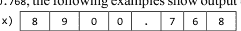

```
printf("%10f", x);
```

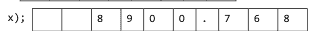

```
printf("%9.2f", x); [ ] [ ] [ ] 8 9 0 0 . 7 7
printf("%6f", x); [ ] [ ] [ ] [ ] 8 9 0 0 . 7 6 8
```

## 1.7 运算符和表达式

C 语言支持不同类型的运算符，可与变量和常量一起用于形成表达式。这些运算符可分为以下主要组：

- 算术运算符
- 相等运算符
- 一元运算符
- 位运算符
- 逗号运算符
- 关系运算符
- 逻辑运算符
- 条件运算符
- 赋值运算符
- sizeof 运算符

我们将讨论所有这些运算符。

### 算术运算符

考虑三个声明如下的变量，
int a, b, result;

我们将使用这些变量来解释算术运算符。表 1.7 显示了 C 语言中的算术运算符、其语法和用法。

| 操作 | 运算符 | 语法 | 注释 | 结果 |
| :--- | :--- | :--- | :--- | :--- |
| 乘法 | * | a * b | result = a * b | 27 |
| 除法 | / | a / b | result = a / b | 3 |
| 加法 | + | a + b | result = a + b | 12 |
| 减法 | - | a - b | result = a - b | 6 |
| 取模 | % | a % b | result = a % b | 0 |

在表 1.7 中，应用运算符的 a 或 b 被称为操作数。算术运算符可以应用于任何整数或浮点数。加法、减法、乘法和除法（+、-、* 和 /）运算符是常见的算术运算符，因此您已经熟悉这些运算符。

但是，运算符 % 对您来说可能是新的。取模运算符 (%) 查找整数除法的余数。该运算符只能应用于整数操作数，不能用于 float 或 double 操作数。

在执行取模除法时，结果的符号始终是第一个操作数（被除数）的符号。因此，

```
16 % 3 = 1
-16 % 3 = -1
16 % -3 = 1
-16 % -3 = -1
```

当除法运算符 (/) 的两个操作数都是整数时，除法作为整数除法执行。整数除法始终产生整数结果。因此，结果始终通过忽略余数进行舍入。因此，

```
9/4 = 2 and -9/4 = -3
```

> **注意** 不可能将任何数字除以零。这是一种非法操作，会导致运行时除以零异常，从而终止程序。

除了取模运算符外，所有其他算术运算符都可以接受整数和浮点数的混合。如果两个操作数都是整数，结果将是整数；如果一个或两个操作数是浮点数，结果将是浮点数。

所有算术运算符均从左到右结合。乘法、除法和取模运算符的优先级高于加法和减法运算符。因此，如果算术表达式包含混合运算符，则乘法、除法和取模将首先按从左到右的顺序执行，然后才能执行任何加法和减法。例如，

```
3 + 4 * 7
= 3 + 28
= 31
```

### 关系运算符

关系运算符（也称为比较运算符）是用于比较两个值或表达式的运算符。关系运算符返回 true 或 false 值，具体取决于两个操作数之间的条件关系是否成立。

| 运算符 | 含义 | 示例 |
| :--- | :--- | :--- |
| < | 小于 | 3 < 5 结果为 1 |
| > | 大于 | 7 > 9 结果为 0 |
| <= | 小于或等于 | 100 <= 100 结果为 1 |
| >= | 大于或等于 | 50 >= 100 结果为 0 |

例如，要测试 x 是否小于 y，使用关系运算符 < 作为 x < y。如果 x 小于 y，该表达式将返回 true 值，否则表达式的值将为 false。C 提供四个关系运算符，如表 1.8 所示。这些运算符从左到右求值。

### 相等运算符

C 语言还支持两个相等运算符，用于比较操作数的严格相等或不相等。它们是等于 (==) 和不等于 (!=) 运算符。相等运算符的优先级低于关系运算符。

| 运算符 | 含义 |
| :--- | :--- |
| == | 如果两个操作数相等，则返回 1，否则返回 0 |
| != | 如果操作数没有相同的值，则返回 1，否则返回 0 |

等于运算符 (==) 如果运算符两侧的操作数具有相同的值，则返回 true (1)；否则返回 false (0)。相反，不等于运算符 (!=) 如果操作数没有相同的值，则返回 true (1)；否则返回 false (0)。表 1.9 总结了相等运算符。

### 逻辑运算符

C 语言支持三个逻辑运算符。它们是逻辑 AND (&&)、逻辑 OR (||) 和逻辑 NOT (!)。与算术表达式一样，逻辑表达式从左到右求值。

| A | B | A && B |
| :--- | :--- | :--- |
| 0 | 0 | 0 |
| 0 | 1 | 0 |
| 1 | 0 | 0 |
| 1 | 1 | 1 |

#### 逻辑 AND (&&)

逻辑 AND 是一个二元运算符，同时求值两个值或关系表达式。如果两个操作数都为 true，则整个表达式为 true。如果两个或其中一个操作数为 false，则整个表达式求值为 false。逻辑 AND 运算符的真值表如表 1.10 所示。


例如，
(a < b) && (b > c)
只有当两个表达式都为真时，整个表达式才为真，即 b 大于 a 和 c。

## 表 1.11 逻辑 OR 的真值表

| A | B | A || B |
|---|---|---|
| 0 | 0 | 0 |
| 0 | 1 | 1 |
| 1 | 0 | 1 |
| 1 | 1 | 1 |

## 逻辑 OR (||)

当两个操作数都为假时，逻辑 OR 返回假值；否则返回真值。逻辑 OR 运算符的真值表如表 1.11 所示。例如，
(a < b) || (b > c)
如果 b 大于 a，或 b 大于 c，或 c 大于 a 和 c，则整个表达式为真。

## 表 1.12 逻辑 NOT 的真值表

| A | ! A |
|---|---|
| 0 | 1 |
| 1 | 0 |

## 逻辑 NOT (!)

逻辑 NOT 运算符接受一个表达式，如果表达式的值非零则产生 0，如果表达式的值为零则产生 1。逻辑 NOT 运算符的真值表如表 1.12 所示。例如，
int a = 10, b;
b = !a;
现在 b 的值为 0。这是因为 a 的值为 10。!a = 0。将 !a 的值赋给 b，因此得出该结果。

## 一元运算符

一元运算符作用于单个操作数。C 语言支持三种一元运算符，即一元减、自增和自减运算符。

### 一元减 (-)

一元减运算符对其操作数的值取反。例如，如果一个数是正数，则在其前面加上一元减运算符后变为负数。同样，如果数是负数，应用一元减运算符后变为正数。例如，
int a, b = 10;
a = -(b);
该表达式的结果是 a = -10，因为变量 b 具有正值。在操作数 b 上应用一元减运算符 (-) 后，值变为 -10，表示其为负值。

### 自增运算符 (++) 和自减运算符 (--)

自增运算符是一种一元运算符，将其操作数的值增加 1。同样，自减运算符将其操作数的值减少 1。例如，--x 等同于 x = x - 1。
自增/自减运算符有两种形式：前缀和后缀。在前缀表达式 (++x 或 --x) 中，运算符在操作数之前应用；而在后缀表达式 (x++ 或 x--) 中，运算符在操作数之后应用。
关于一元自增和自减运算符需要注意的是，++x 与 x++ 不同。同样，--x 与 x-- 也不同。虽然 x++ 和 ++x 都会将 x 的值增加 1，但在前一种情况下，x 的值在递增前返回；而在后一种情况下，x 的值在递增后返回。例如，

```
int x = 10, y;
y = x++; is equivalent to writing
y = x;
x = x + 1;
```

```
Whereas y = ++x; is equivalent to writing
x = x + 1;
y = x;
```

同样的原则也适用于一元自减运算符。请注意，一元运算符的优先级高于二元运算符。如果表达式中有多个一元运算符，则从右向左求值。

### 条件运算符

条件运算符的语法为

```
exp1 ? exp2 : exp3
```

首先求值 exp1。如果为真，则求值 exp2 并将其作为表达式的结果，否则求值 exp3 并将其作为表达式的结果。例如，

```
large = (a > b) ? a : b
```

条件运算符用于找出两个给定数中的较大值。首先求值 exp1，即 a > b。如果 a 大于 b，则 large = a，否则 large = b。因此，large 等于 a 或 b 中的一个，但不能同时等于两者。

条件运算符使程序代码更加紧凑、更易读、更安全，因为更容易检查和保证用于求值的参数。条件运算符也称为三元运算符，因为它接受三个操作数。

### 位运算符

顾名思义，位运算符在位级别执行操作。这些运算符包括：按位 AND、按位 OR、按位 XOR 和移位运算符。

### 按位 AND

与布尔 AND (&&) 类似，按位 AND 运算符 (&) 对位而非字节、字符、整数等进行操作。使用按位 AND 运算符时，第一个操作数中的位与第二个操作数中对应的位进行 AND 运算。真值表与逻辑 AND 操作中看到的相同。按位 AND 运算符将其第一个操作数的每个位与第二个操作数中对应的位进行比较。如果两个位都是 1，则结果中的对应位为 1，否则为 0。例如，

```
10101010 & 01010101 = 00000000
```

### 按位 OR

使用按位 OR 运算符 (|) 时，第一个操作数中的位与第二个操作数中对应的位进行 OR 运算。真值表与逻辑 OR 操作中看到的相同。按位 OR 运算符将其第一个操作数的每个位与第二个操作数中对应的位进行比较。如果一个或两个位都是 1，则结果中的对应位为 1，否则为 0。例如，

```
10101010 | 01010101 = 11111111
```

### 按位 XOR

使用按位 XOR 运算符时，第一个操作数中的位与第二个操作数中对应的

| A | B | A ^ B |
|---|---|---|
| 0 | 0 | 0 |
| 0 | 1 | 1 |
| 1 | 0 | 1 |
| 1 | 1 | 0 |

位进行 XOR 运算。按位 XOR 运算符的真值表如表 1.13 所示。按位 XOR 运算符将其第一个操作数的每个位与第二个操作数中对应的位进行比较。如果一个位是 1，则结果中的对应位为 1，否则为 0。例如，10101010 ^ 01010101 = 11111111

对操作数的每个位进行逻辑取反。按位 NOT 或补码是一元运算符，对操作数的每个位执行逻辑取反。通过对每个位取反，它实际上生成给定二进制值的补码。按位 NOT 运算符将初始为 0 的位设置为 1，将初始为 1 的位设置为 0。例如，

### 按位 NOT (~)

按位 NOT 或补码是一元运算符，对操作数的每个位执行逻辑取反。通过对每个位取反，它实际上生成给定二进制值的补码。按位 NOT 运算符将初始为 0 的位设置为 1，将初始为 1 的位设置为 0。例如，

```
~10101011 = 01010100
```

### 移位运算符

C 支持两种位移运算符，即左移 (<<) 和右移 (>>)。移位操作的语法可表示为

```
operand op num
```

其中操作数中的位根据运算符（如果是 << 则向左，如果是 >> 则向右）移动 num 表示的位数。例如，如果有

```
x = 0001 1101
```

```
x << 1 produces 0011 1010
```

应用左移时，x 中的每个位向左移动一位。因此，x 的最高有效位 (MSB) 丢失，x 的最低有效位 (LSB) 设置为 0。因此，如果 x = 0001 1101，则

```
x << 3 gives result = 1110 1000
```

相反，应用右移时，x 中的每个位向右移动一位。因此，x 的最低有效位 (LSB) 丢失，x 的最高有效位 (MSB) 设置为 0。例如，如果 x = 0001 1101，则

```
x >> 1 gives result = 0000 1110
```

同样，如果 x = 0001 1101，则

```
x >> 4 gives result = 0000 0001
```

表达式 x << y 等同于 x 乘以 2^y。如果 x 是无符号数或具有非负值，则表达式 x >> y 等同于 x 除以 2^y。

## 赋值运算符

在 C 语言中，赋值运算符负责将值赋给变量。虽然等号 (=) 是基本的赋值运算符，但 C 还支持其他赋值运算符，提供表示常见变量赋值的简写方式。

在表达式中遇到等号时，编译器处理等号右侧的语句并将结果赋给左侧的变量。例如，

```
int x;
x = 10;
```

将值 10 赋给变量 x。赋值运算符的结合方向为从右到左，因此表达式


| 运算符 | 示例 |
| :--- | :--- |
| /= | float a=9.0;<br>float b=3.0;<br>a /= b; |
| = | int aa = 9;<br>int b = 3;<br>a = b; |
| *= | int aa = 9;<br>int b = 3;<br>a *= b; |
| += | int aa = 9;<br>int b = 3;<br>a += b; |
| -= | int aa = 9;<br>int b = 3;<br>a -= b; |
| &= | int a = 10;<br>int b = 20;<br>a &= b; |
| ^= | int a = 10;<br>int b = 20;<br>a ^= b; |
| <<= | int aa = 9;<br>int b = 3;<br>a <<= b; |
| >>= | int aa = 9;<br>int b = 3;<br>a >>= b; |

```
a = b = c = 10;
```

求值为
(a = (b = (c = 10)));
首先将 10 赋值给 c，然后将 c 的值赋值给 b。最后，将 b 的值赋值给 a。表 1.14 列出了 C 语言支持的其他赋值运算符。

## 逗号运算符

逗号运算符（也称为顺序求值运算符）接受两个操作数。它通过求值第一个表达式并丢弃其值，然后求值第二个表达式并将其值作为表达式的结果返回来工作。当用逗号分隔的表达式链接在一起时，它们按从左到右的顺序求值，最右侧的值作为表达式的结果。在所有运算符中，逗号运算符的优先级最低。因此，当使用逗号运算符时，整个表达式求值为右侧表达式的值。例如，以下语句先递增 a，然后递增 b，最后将 b 的值赋给 x。

```
int a=2, b=3, x=0;
x = (++a, b+=a);
```

现在，x 的值为 6。

## sizeof 运算符

sizeof 是一个一元运算符，用于计算数据类型的大小。该运算符可应用于所有数据类型。使用此运算符时，关键字 sizeof 后面跟一个类型名、变量或表达式。该运算符以字节为单位返回数据类型、变量或表达式的大小。也就是说，sizeof 运算符用于确定数据类型/变量/表达式将占用的内存空间大小。

关键字 sizeof 后面跟一个类型名、变量或表达式。该运算符以字节为单位返回数据类型、变量或表达式的大小。也就是说，sizeof 运算符用于确定数据类型/变量/表达式将占用的内存空间大小。

当使用类型名时，它被括在括号中，但在变量名和表达式的情况下，可以带括号也可以不带括号。sizeof 表达式返回一个无符号值，指定数据类型、变量或表达式所需的字节空间大小。例如，sizeof(char) 返回 1，即字符数据类型的大小。如果有，

```
int a = 10;
unsigned int result;
result = sizeof(a);
```

则 result = 2，即存储变量 a 所需的内存空间。由于 a 是整数，它需要 2 个字节的存储空间。

## 运算符优先级图表

表 1.15 按优先级顺序（从高到低）列出了 C 语言支持的运算符。结合性表示表达式中优先级相同的运算符的求值顺序。

## 表 1.15 运算符优先级图表

| 运算符 | 结合性 |
|---|---|
| ( ) [ ] . -> | 从左到右 |
| ++(后缀) --(后缀) | 从右到左 |
| ++(前缀) --(前缀) +(一元) -(一元) ! (类型) *(间接) &(地址) sizeof | 从右到左 |
| * / % | 从左到右 |
| + - | 从左到右 |
| << >> | 从左到右 |
| <= >= | 从左到右 |
| == != | 从左到右 |
| & | 从左到右 |
| ^ | 从左到右 |
| \| | 从左到右 |
| && | 从左到右 |
| \| \| | 从左到右 |
| ?: | 从右到左 |
| = += -= *= /= %= >>= <<= &= ^= |= | 从右到左 |
| ,(逗号) | 从左到右 |

## 使用优先级图表的表达式示例

如果有以下变量声明：
int a = 0, b = 1, c = -1;
float x = 2.5, y = 0.0;

那么，

- (a) a && b = 0
- (b) a < b && c < b = 1
- (c) b + c || ! a
    = ( b + c ) || !(a)
    = 0 || 1
    = 1
- (d) x * 5 & 5 || ( b / c )
    = ((x * 5) & 5) || ( b / c )
    = (12.5 & 5) || (1/-1)
    = 1
- (e) a <= 10 && x > 1 && b
    = ((a <= 10) && (x > 1)) && b
    = (1 && 1) && 1
    = 1
- (f) !x || !c || b + c
    = ((!x) || (!c)) || (b + c)
    = (0 || 0) || 0
    = 0
- (g) x * y < a + b || c
    = ((x * y) < (a + b)) || c
    = (0 < 1) || -1
    = 1
- (h) x > y || !a || c++
    = ((x > y) || (!a)) || (c++)
    = (1 || 1) || 0
    = 1

## 编程示例

- 1. 编写一个程序来计算圆的面积。

```
#include <stdio.h>
#include <conio.h>
int main()
{
    float radius;
    double area;
    clrscr();
    printf("\n Enter the radius of the circle : ");
    scanf("%f", &radius);
    area = 3.14 * radius * radius;
    printf("\n Area = %.2lf", area);
    return 0;
}
```

### 输出

输入圆的半径：7
面积 = 153.86

## 1.8 类型转换和强制类型转换

变量的类型转换或强制类型转换是指将一种数据类型的变量更改为另一种数据类型。类型转换是隐式完成的，而强制类型转换必须由程序员显式完成。我们将在此讨论这两个概念。

### 类型转换

当表达式包含不同数据类型的变量时，会进行类型转换。因此，为了求值表达式，数据类型会从低级提升到高级，数据类型的层次结构可以表示为：double、float、long、int、short 和 char。例如，当我们将整数值赋给浮点变量时，会自动进行类型转换。请考虑以下代码：

```
float x;
int y = 3;
x = y;
```

现在，x = 3.0，因为整数值会自动转换为其等效的浮点表示形式。

### 强制类型转换

强制类型转换也称为强制转换。当一种数据类型的值必须转换为另一种数据类型的值时，会执行此操作。执行强制类型转换的代码可以表示为：

```
float salary = 10000.00;
int sal;
sal = (int) salary;
```

当浮点数转换为整数时，小数点后的数字会被截断。因此，当浮点表示转换为整数表示时，会丢失数据。

如代码所示，强制类型转换可以通过在要转换的变量名之前放置带括号的目标数据类型来完成。因此，我们得出结论，强制类型转换是为了使一种数据类型的变量表现得像另一种类型的变量。

## 编程示例

- 2. 编写一个程序将整数转换为相应的浮点数。

```
#include <stdio.h>
#include <conio.h>
int main()
{
    float f_num;
    int i_num;
    clrscr();
    printf("Enter any integer: ");
    scanf("%d", &i_num);
    f_num = (float) i_num;
    printf("\n The floating point variant of %d is = %f", i_num, f_num);
    return 0;
}
```

### 输出

输入任何整数：56
56 的浮点变体为 = 56.000000

## 1.9 控制语句

到目前为止，我们知道 C 程序中的代码是按顺序从程序的第一行执行到最后一行的。也就是说，第二条语句在第一条之后执行，第三条语句在第二条之后执行，依此类推。虽然这是事实，但在某些情况下，我们只希望执行选定的语句。控制流语句使程序员能够有条件地执行特定的代码块。控制语句有三种类型：决策控制（分支）、迭代（循环）和跳转语句。分支意味着决定要采取什么操作，而循环则决定要采取多少次操作。跳转语句将控制从一个点转移到另一个点。

### 1.9.1 决策控制语句

C 语言支持可以改变指令序列流程的决策控制语句。这些语句帮助我们根据特定条件是否满足，在程序的一个部分和另一个部分之间跳转。这些决策控制语句包括：

- (a) if 语句，
- (b) if-else 语句，
- (c) if-else-if 语句，以及
- (d) switch-case 语句。

### if 语句

if 语句是决策制定中最常用的最简单的决策控制语句。简单 if 语句的一般形式如图 1.2 所示。

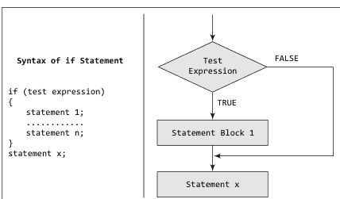

图 1.2 if 语句结构

if 块可以包含 1 条语句或用花括号括起来的 n 条语句。首先求值测试表达式。如果测试表达式为真，则执行 if 块中的语句；否则，这些语句将被跳过，执行将跳转到语句 x。

if 块中的语句可以是任何有效的 C 语言语句，测试表达式可以是任何求值为真或假的有效 C 语言表达式。除了简单的关系表达式外，我们还可以使用逻辑运算符形成的复合表达式。请注意，测试表达式后没有分号。这是因为条件和语句应作为单个语句放在一起。


```c
#include <stdio.h>
int main()
{
    int x=10;
    if (x>0) x++;
    printf("\n x = %d", x);
    return 0;
}
```

在上述代码中，我们取一个变量 x 并将其初始化为 10。在测试表达式中，我们检查 x 的值是否大于 0。因为 10 > 0，测试表达式的结果为 true，因此 x 的值被递增。之后，x 的值在屏幕上打印出来。该程序的输出为

x = 11

> 注意 如果语句块只包含一条语句，则加花括号可选。如果语句块包含多条语句，则必须加花括号。

## if-else 语句

我们已经学习过，使用 if 语句在条件分支中起着至关重要的作用。其用法非常简单。先对测试表达式求值，如果结果为 true，则执行表达式后面的语句；否则，如果表达式为 false，编译器会跳过该语句。

如果你希望在表达式返回 false 值时执行另一组语句，该怎么办？在这种情况下，我们可以使用 if-else 语句，而不是简单的 if 语句。简单 if-else 语句的一般形式如图 1.3 所示。

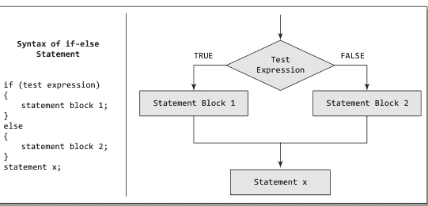

图 1.3 if-else 语句结构

在 if-else 结构中，首先对测试表达式求值。如果表达式为 true，则执行语句块 1 并跳过语句块 2。否则，如果表达式为 false，则执行语句块 2 并忽略语句块 1。无论执行语句块 1 还是 2 之后，控制权都会传递给语句 x。因此，语句 x 在任何情况下都会被执行。

## 编程示例

3. 编写一个程序，判断一个数字是偶数还是奇数。

```c
#include <stdio.h>
int main()
{
    int a;
    printf("\n Enter the value of a : ");
    scanf("%d", &a);
    if(a%2==0)
        printf("\n %d is even", a);
    else
        printf("\n %d is odd", a);
    return 0;
}
```

输出
Enter the value of a : 6
6 is even

## if-else-if 语句

C 语言支持 if-else-if 语句，用于在初始测试表达式之外测试更多条件。if-else-if 结构的工作方式与普通 if 语句相同。其结构如图 1.4 所示。

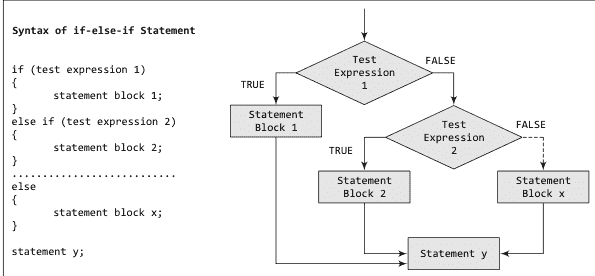

图 1.4 if-else-if 语句结构

需要注意的是，并非每个 if 语句都必须有 else 块，因为 C 语言支持简单的 if 语句。在第一个测试表达式或第一个 if 分支之后，程序员可以根据需要测试的表达式，添加任意数量的 if-else 分支。例如，以下代码测试用户输入的数字是负数、正数还是等于零。

```c
#include <stdio.h>
int main()
{
    int num;
    printf("\n Enter any number : ");
    scanf("%d", &num);
    if(num==0)
        printf("\n The value is equal to zero");
    else if(num>0)
        printf("\n The number is positive");
    else
        printf("\n The number is negative");
    return 0;
}
```

需要注意的是，如果第一个测试表达式的结果为 true，即 num==0，则代码中其余语句将被忽略，在执行显示 "The value is equal to zero" 的 printf 语句后，控制权将跳转到 return 0 语句。

## switch-case 语句

switch-case 语句是一种多路分支语句，是 if-else-if 块的简化版本。switch 语句的一般形式如图 1.5 所示。

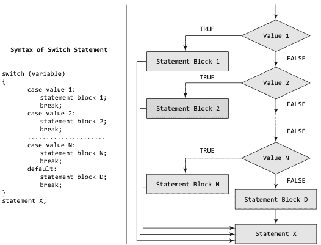

图 1.5 switch-case 语句结构

嵌套 if-else 语句的强大之处在于它可以在单个逻辑结构中求值多个表达式。switch 语句主要用于两种情况：

- 表达式中只有一个变量需要求值时
- 需要测试多个条件时

当需要测试许多条件时，使用 if 和 else-if 结构会变得复杂且令人困惑。因此，switch case 语句常被用作长 if 语句的替代方案，这些 if 语句将一个变量与多个“整型值”进行比较（整型值是指可以表示为整数的值，例如 char 的值）。switch 语句也用于处理用户给出的输入。

我们已经了解过 switch 语句的语法。switch case 语句将 switch 语句中给定的变量的值与随后的每个 case 语句的值进行比较。当 switch 的值与 case 语句的值匹配时，会执行该特定 case 的语句块。

你是否注意到 switch case 语句语法中的关键字 default？default 是在变量的值与任何 case 语句的值都不匹配时执行的 case。也就是说，当 switch 和 case 语句的值之间没有找到匹配项，因此没有语句可执行时，会执行 default case。虽然 default case 是可选的，但始终建议包含它，因为它可以处理任何意外情况。

在 switch-case 语句的语法中，我们还使用了另一个关键字 break。break 语句必须用在每个 case 的末尾，因为如果不使用，则匹配的 case 以及之后的所有 case 都会被执行。例如，如果 switch 语句的值与 case 2 匹配，则 case 2 中的所有语句以及其余所有 case（包括 default）都会被执行。break 语句告诉编译器跳出 switch case 语句，执行 switch-case 结构之后的语句。因此，关键字 break 用于跳出 case 语句。

## 使用 switch-case 语句的优点

程序员偏好使用 switch-case 语句，原因如下：

- 易于调试
- 易于阅读和理解
- 与等效的 if-else 语句相比，易于维护
- 像 if-else 语句一样，switch 语句也可以嵌套
- 执行速度比等效的 if-else 结构更快

## 编程示例

- 4. 编写一个程序，判断输入的字符是否为元音。

```c
#include <stdio.h>
int main()
{
   char ch;
   printf("\n Enter any character : ");
   scanf("%c", &ch);
   switch(ch)
   {
      case 'A':
      case 'a':
         printf("\n %c is VOWEL", ch);
         break;
      case 'E':
      case 'e':
         printf("\n %c is VOWEL", ch);
         break;
      case 'I':
      case 'i':
         printf("\n %c is VOWEL", ch);
         break;
      case 'O':
      case 'o':
         printf("\n %c is VOWEL", ch);
         break;
      case 'U':
      case 'u':
         printf("\n %c is VOWEL", ch);
         break;
      default: printf("\n %c is not a vowel", ch);
   }
   return 0;
}
```

输出
Enter any character : j
j is not a vowel

需要注意的是，case 'a' 之后没有 break 语句，因此如果输入字符 `a`，控制权将执行 case a 中给出的语句。

## 1.9.2 迭代语句

迭代语句用于重复执行一系列语句，直到指定表达式变为 false。C 语言支持三种迭代语句，也称为循环语句。它们是

- while 循环
- do-while 循环
- for 循环

在本节中，我们将讨论所有这些语句。

## while 循环

while 循环提供了一种机制，在特定条件为 true 时重复执行一条或多条语句。图 1.6 显示了 while 循环的语法和一般形式。

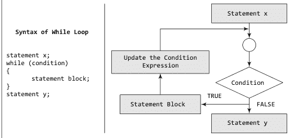

图 1.6 while 循环结构

需要注意的是，在 while 循环中，条件在执行语句块中的任何语句之前进行测试。只有当条件为 true 时，才会执行这些语句；否则，如果条件为 false，控制权将跳转到语句 y，即 while 循环块外部的紧邻语句。

从图 1.6 的流程图可以清楚地看出，我们需要不断更新 while 循环的条件。正是这个条件决定了循环何时结束。while 循环将一直执行，只要条件为 true。需要注意的是，如果条件从未更新且条件永远不会变为 false，那么计算机将进入一个永远不希望出现的无限循环。例如，以下代码使用 while 循环打印前 10 个数字。

```c
#include <stdio.h>
int main()
{
    int i = 1;
    while(i<=10)
    {
        printf("\n %d", i);
        i = i + 1; // condition updated
    }
    return 0;
}
```

需要注意的是，最初 i = 1 且小于 10，即条件为 true，因此在 while 循环中打印 i 的值并将其递增 1。当 i=11 时，条件变为 false，循环结束。

## 编程示例

- 5. 编写一个程序，计算从 m 到 n 的数字之和。

```c
#include <stdio.h>
int main()
{
    int n, m, i, sum = 0;
    printf("\n Enter the value of m : ");
    scanf("%d", &m);
    i=m;
    printf("\n Enter the value of n : ");
    scanf("%d", &n);
    while(i<=n)
    {
        sum = sum + i;
        i = i + 1;
    }
    printf("\n The sum of numbers from %d to %d = %d", m, n, sum);
    return 0;
}
```

输出
Enter the value of m : 2
Enter the value of n : 10
The sum of numbers from 2 to 10 = 54

## do-while 循环

do-while 循环与 while 循环类似。唯一的区别是，在 do-while 循环中，测试条件在循环结束时进行测试。由于测试条件在结束时求值，这意味着循环体至少会执行一次（即使条件为 false）。图 1.7 显示了 do-while 循环的语法和一般形式。


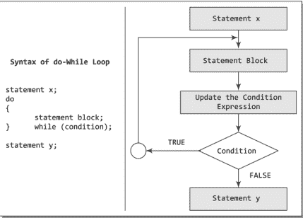

**图 1.7 do-while 结构**

请注意，测试条件用括号括起来，后面跟一个分号。语句块中的语句用花括号括起来。如果 do-while 循环体中只有一条语句，则花括号可选。

do-while 循环在条件为真时继续执行，当条件变为假时，控制权跳转到 do-while 循环之后的语句。

使用 do-while 循环的主要缺点是它至少执行一次，因此即使用户输入了一些无效数据，循环也会执行。但是，do-while 循环广泛用于为菜单驱动程序打印选项列表。例如，请考虑以下代码。

```
#include <stdio.h>
int main()
{
    int i = 1;
    do
    {
        printf("\n %d", i);
        i = i + 1;
    } while(i<=10);
    return 0;
}
```

你认为输出会是什么？是的，代码将打印 1 到 10 的数字。

### 编程示例

- 6. 编写一个程序来计算前 n 个数的平均值。

```
#include <stdio.h>
#include <math.h>
int main()
{
    int n, i = 0, sum = 0;
    float avg = 0.0;
    printf("\n Enter the value of n : ");
    scanf("%d", &n);
    do
    {
        sum = sum + i;
        i = i + 1;
    } while(i <= n);
    avg = (float)sum / n;
    printf("\n The sum of first %d numbers = %d", n, sum);
    printf("\n The average of first %d numbers = %.2f", n, avg);
    return 0;
}
Output
Enter the value of n : 20
The sum of first 20 numbers = 210
The average of first 20 numbers = 10.50
```

## for 循环

与 while 和 do-while 循环一样，for 循环提供了一种机制，用于重复执行任务，直到特定条件为真。for 循环的语法和一般形式如图 1.8 所示。

```
Syntax of for Loop

for (initialization; condition;
increment/decrement/update)
{
statement block;
}
statement;
```

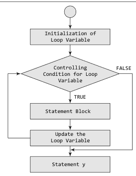

**图 1.8 for 循环结构**

使用 for 循环时，循环变量仅初始化一次。在每次迭代中，循环变量的值会被更新并检查条件。如果条件为真，则执行循环的语句块；否则，跳过 for 循环语句块中的语句，控制权跳转到 for 循环体之后的语句。

在 for 循环的语法中，循环变量的初始化允许程序员为其赋值。其次，条件指定，只要条件表达式为真，循环就应继续重复自身。循环的每次迭代都必须使退出循环的条件变得可达。因此，在每次迭代中，都必须更新循环变量。更新循环变量可能包括递增循环变量、递减循环变量或将其设置为其他值（例如 i + 2，其中 i 是循环变量）。

请注意，for 循环的每个部分都用分号与其他部分分隔。某个部分可能为空，尽管分号仍然必须存在。但是，如果条件为空，则其被评估为真，循环将重复，直到有其他东西停止它。

for 循环广泛用于执行单条或一组语句有限次数。以下代码展示了如何使用 for 循环打印前 n 个数字。

```
#include <stdio.h>
int main()
{
    int i, n;
    printf("\n Enter the value of n :");
    scanf("%d", &n);
    for(i=1;i<=n;i++)
    {
        printf("\n %d", i);
    }
}
```

在代码中，i 是循环变量。最初，它被初始化为 1。假设用户输入 10 作为 n 的值。然后检查条件，由于条件为真（因为 i 小于 n），执行 for 循环中的语句并打印 i 的值。每次迭代后，i 的值递增。当 i 超过 n 的值时，控制权跳转到 return 0 语句。

### 编程示例

- 7. 编写一个程序来判断给定数字是质数还是合数。

```
#include <stdio.h>
#include <conio.h>
int main()
{
    int flag = 0, i, num;
    clrscr();
    printf("\n Enter any number : ");
    scanf("%d", &num);
    for(i=2; i<=num/2; i++)
    {
        if(num%i == 0)
        {
            flag =1;
            break;
        }
    }
    if(flag == 1)
        printf("\n %d is a composite number", num);
    else
        printf("\n %d is a prime number", num);
    return 0;
}
Output
Enter any number : 37
37 is a prime number
```

## 1.9.3 break 和 continue 语句

### break 语句

在 C 语言中，break 语句用于终止其出现所在的最近封闭循环的执行。我们已经在 switch 语句中见过它的用法。break 语句广泛用于 for、while 和 do-while 循环。当编译器遇到 break 语句时，控制权传递到 break 语句所在循环之后的语句。其语法非常简单，只需输入关键字 break 后跟一个分号。

`break;`

以下示例展示了 break 语句用于终止其嵌入的循环的方式。

```
#include <stdio.h>
int main()
{
    int i = 0;
    while(i<10)
    {
        if (i==5)
        break;
        printf("\t %d", i);
        i = i + 1;
    }
    return 0;
}
```

输出

0 1 2 3 4

一旦 i 等于 5，break 语句就会被执行，控制权跳转到 while 循环之后的语句。

因此，break 语句用于从循环体中的任何点退出循环，绕过其正常的终止表达式。

### continue 语句

与 break 语句类似，continue 语句只能出现在循环体中。当编译器遇到 continue 语句时，循环中其余的语句将被跳过，控制权无条件转移到最近封闭循环的循环继续部分。其语法非常简单，只需输入关键字 continue 后跟一个分号。

`continue;`

同样与 break 语句类似，continue 语句不能在没有封闭 for、while 或 do-while 循环的情况下使用。当在 while 循环和 do-while 循环中遇到 continue 语句时，控制权转移到测试控制表达式的代码。但是，如果放在 for 循环中，continue 语句会导致分支到更新循环变量的代码。例如，请考虑以下代码：

```
#include <stdio.h>
int main()
{
    int i;
    for(i = 0; i <= 10; i++)
    {
        if (i == 5)
            continue;
        printf("\t %d", i);
    }
    return 0;
}
```

输出

0 1 2 3 4 6 7 8 9 10

请注意，该代码旨在打印 0 到 10 的数字。但是，一旦 i 等于 5，就会遇到 continue 语句，因此跳过 printf() 语句，控制权传递到递增 i 值的表达式。

因此，我们得出结论，continue 语句在某种程度上与 break 语句相反。它强制执行循环的下一次迭代，跳过其自身与循环测试条件之间的任何代码。它通常用于在发生错误时重新启动语句序列。

## 1.10 函数

C 语言使其程序员能够将程序分解为通常称为函数的段，每个函数可以或多或少独立于其他函数编写。程序中的每个函数都应该执行一个定义明确的任务。因此，一个函数的程序代码与其他函数完全隔离。

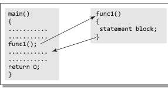

**图 1.9 main() 调用 func1()**

每个函数都通过向其传递信息以及将函数生成的结果传回给外部世界来进行接口。这个接口基本上由函数名称指定。例如，请看图 1.9，它解释了 main() 函数如何调用另一个函数来执行定义明确的任务。

在图中，我们可以看到 main() 调用一个名为 func1() 的函数。因此，main() 被称为调用函数，func1() 被称为被调用函数。编译器一旦遇到函数调用，控制权就跳转到属于被调用函数的语句。被调用函数执行后，控制权返回到调用程序。

main() 函数可以被调用任意多次。例如，放置在 for 循环、while 循环或 do-while 循环中的函数调用可能会在条件保持为真之前多次调用同一个函数。

不仅 main()，任何函数都可以调用任何其他函数。例如，请看图 1.10，它展示了一个函数调用另一个函数，而另一个函数又调用其他函数。

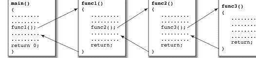

**图 1.10 函数调用另一个函数**


## 1.10.1 为什么需要函数？

让我们分析一下，为什么将程序分割成易于管理的块是编程的一个重要方面。

- 将程序划分为独立的、定义明确的函数，有助于每个函数被单独编写和测试。这简化了使整个程序运行的过程。
- 理解、编写和测试多个独立的函数，比对一个大函数做同样的事情要容易。
- 如果要开发一个大型程序，且除了 main() 函数外不使用任何其他函数，那么 main() 函数中将有无数行代码，维护该程序将是一项艰巨的任务。
- C 语言的所有库都包含一组程序员可以在其程序中自由使用的函数。这些函数已预先编写和预先测试，因此程序员可以使用它们而无需担心其代码细节。这加快了程序开发速度，使程序员只需专注于他必须编写的代码。
- 与 C 库类似，程序员也可以编写自己的函数，并在主程序或任何需要其功能的其他程序的不同位置使用它们。
- 当一个大型程序被分解为相对较小的函数时，参与该项目的不同程序员可以通过编写不同的函数来分配工作量。

## 1.10.2 使用函数

函数可以比作一个黑盒，它接收输入，对其进行处理，然后输出结果。然而，我们也可能有完全不接收任何输入的函数，或者完全不返回任何值的函数。在使用函数时，我们将使用以下术语：

- 使用另一个函数 g 的函数 f() 被称为调用函数，而 g 被称为被调用函数。
- 函数接收的输入称为参数。
- 当被调用函数将某个结果返回给调用函数时，这被称为返回该结果。
- 调用函数可以向被调用函数传递参数，也可以不传递。如果被调用函数接受参数，则调用函数会传递参数，否则不传递。
- 函数声明是一条声明语句，用于标识函数名、它接受的参数列表以及它返回的数据类型。
- 函数定义由一个标识函数的函数头组成，后跟包含该函数可执行代码的函数体。

## 函数声明

在使用函数之前，编译器必须知道函数期望接收的参数数量和参数类型，以及它将返回给调用程序的值的数据类型。在使用之前放置函数声明语句，使编译器能够检查调用该函数时使用的参数。

声明接受参数并返回值作为结果的函数的一般格式如下：

```
return_data_type function_name(data_type variable1, data_type variable2...);
```

这里，function_name 是函数的有效名称。函数命名遵循与变量命名相同的规则。函数应有一个有意义的名称，该名称必须指定函数将执行的任务。

return_data_type 指定将返回给调用函数的值的数据类型，作为被调用函数执行处理的结果。

(data_type variable1, data_type variable2, ...) 是指定数据类型的变量列表。这些变量从调用函数传递到被调用函数。它们也被称为被调用函数为执行其任务而接受的参数或形参。

> 注意 返回类型为 void 的函数不能返回任何值。同样，参数列表为 void 的函数不能接受任何值。

## 函数定义

当定义函数时，内存中会为该函数分配空间。函数定义包含两个部分：

- 函数头
- 函数体

函数定义的语法如下：

```
return_data_type function_name(data_type variable1, data_type variable2,...)
{
    .........
    .........
    statements
    .........
    return(variable);
}
```

请注意，函数头中参数的数量和顺序必须与函数声明语句中给出的相同。

而 return_data_type function_name(data_type variable1, data_type variable2,...) 被称为函数头，其余部分（即花括号 {} 内的程序语句）是函数体，包含执行特定任务的代码。

请注意，函数头与函数声明相同。两者之间的唯一区别是函数头后面不跟分号。

## 函数调用

函数调用语句调用函数。当调用函数时，编译器会跳转到被调用函数以执行该函数的一部分语句。一旦被调用函数执行完毕，程序控制权就会传回给调用函数。函数调用语句的语法如下：

```
function_name(variable1, variable2, ...);
```

调用函数时应注意以下几点：

- 函数调用中的函数名以及参数的数量和类型，必须与函数声明和函数定义中的函数头所给出的相同。
- 函数声明、函数调用和函数定义头中变量的名称（而非类型）可以不同。
- 参数可以以表达式的形式传递给被调用函数。在这种情况下，参数首先被求值并转换为形式参数的类型，然后执行函数体。
- 如果函数的返回类型不是 void，则被调用函数返回的值可以赋给某个变量，如下所示。

```
variable_name = function_name(variable1, variable2, ...);
```

## 编程示例

## 8. 编写一个程序，使用函数判断一个数字是奇数还是偶数。

```
#include <stdio.h>
#include <conio.h>
int main()
{
    int num, flag;
    printf("\n Enter the number : ");
    scanf("%d", &num);
    flag = evenodd(num); //FUNCTION CALL
    if (flag == 1)
        printf("\n %d is EVEN", num);
    else
        printf("\n %d is ODD", num);
    return 0;
}
int evenodd(int a) // FUNCTION HEADER
{
    // FUNCTION BODY
    if(a%2 == 0)
        return 1;
    else
        return 0;
}
```

输出
Enter the number : 78
78 is EVEN

## 1.10.3 向函数传递参数

有两种方式可以将参数或形参传递给被调用函数。

按值传递 调用函数将变量的值传递给被调用函数。

按引用传递 调用函数将变量的地址传递给被调用函数。

## 按值传递

在这种方法中，被调用函数会创建新变量来存储传递给它的参数的值。因此，被调用函数使用实际参数的副本来执行其预期任务。

如果被调用函数应该修改传递给它的参数的值，那么更改将仅在被调用函数中体现。在调用函数中，变量的值不会发生任何更改。这是因为所有更改都是针对变量的副本进行的，而不是针对实际变量。要理解这一概念，请参考下面的代码。函数 add() 接受一个整型变量 num 并向其加 10。在调用函数中，num 的值为 2。在 add() 中，num 的值被修改为 12，但在调用函数中，更改未体现。

```
#include <stdio.h>
void add(int n);
int main()
{
    int num = 2;
    printf("\n The value of num before calling the function = %d", num);
    add(num);
```


```c
printf("\n The value of num after calling the function = %d", num);
return 0;
}
void add(int n)
{
    n = n + 10;
    printf("\n The value of num in the called function = %d", n);
}
```

### 输出

The value of num before calling the function = 2
The value of num in the called function = 12
The value of num after calling the function = 2

使用按值传递方式向函数传递参数时，请记住以下几点：

- 当按值传递参数时，被调用函数会创建与传递给它的参数具有相同数据类型的新变量。
- 调用函数传递的参数值会被复制到新创建的变量中。
- 当使用按值传递技术传递参数时，调用函数中变量的值不受影响。

### 优缺点

使用按值传递技术的最大优点是，参数可以作为变量、字面量或表达式传递，而其主要缺点是复制数据会消耗额外的存储空间。此外，复制可能需要花费大量时间，从而导致性能损耗，尤其是当函数被多次调用时。

### 按引用传递

当调用函数使用按值传递方法向被调用函数传递参数时，将参数修改后的值返回给调用者的唯一方法是显式使用 return 语句。更好的选择是使用按引用传递技术传递参数。在此方法中，我们将函数参数声明为引用而非普通变量。完成此操作后，函数对其接收到的参数所做的任何更改在调用函数中也可见。

要指示参数是按引用传递的，在参数列表的类型后放置一个星号（*）。

因此，在按引用传递方法中，函数接收到的是参数的隐式引用，而不是其值的副本。因此，函数可以修改变量的值，该更改也会反映在调用函数中。以下代码说明了这一概念。

```c
#include <stdio.h>
void add(int *);
int main()
{
    int num = 2;
    printf("\n The value of num before calling the function = %d", num);
    add(&num);
    printf("\n The value of num after calling the function = %d", num);
    return 0;
}
void add(int *n)
{
*n = *n + 10;
printf("\n The value of num in the called function = %d", n);
}
```

### 输出

The value of num before calling the function = 2
The value of num in the called function = 12
The value of num after calling the function = 12

### 优点

使用按引用传递技术传递参数的优点包括：

- 由于参数不会被复制到新变量中，因此它提供了更高的时间和空间效率。
- 函数可以更改参数的值，并且该更改会反映在调用函数中。
- 函数只能返回一个值。如果需要返回多个值，可以按引用传递这些参数，以便修改后的值在调用函数中可见。

### 缺点

然而，使用此技术的缺点是，如果在被调用函数中对变量造成了无意的更改，则这些更改会反映在调用函数中，因为原始值已被覆盖。

请考虑下面交换两个整数值的代码。请注意调用函数和被调用函数中整数的值。

```c
//This function swaps the value of two variables
#include <stdio.h>
void swap_call_val(int, int);
void swap_call_ref(int *, int *);
int main()
{
 int a=1, b=2, c=3, d=4;
 printf("\n In Main(), a = %d and b = %d", a, b);
 swap_call_val(a, b);
 printf("\n In main(), a = %d and b = %d", a, b);
 printf("\n\n In main(), c = %d and d = %d", c, d);
 swap_call_ref(&c, &d);
 printf("\n In main(), c = %d and d = %d", c, d);
 return 0;
}
void swap_call_val(int a, int b)
{
 int temp;
 temp = a;
 a = b;
 b = temp;
 printf("\n In Function (Call By Value Method) - a = %d and b = %d", a, b);
}
void swap_call_ref(int *c, int *d)
{
 int temp;
 temp = *c;
 *c = *d;
 *d = temp;
 printf("\n In Function (Call By Reference Method) - c = %d and d = %d", *c, *d);
}
```

### 输出

```
In main(), a = 1 and b = 2
In function (Call By Value Method) - a = 2 and b = 1
In main(), a = 1 and b = 2
In main(), c = 3 and d = 4
In function (Call By Reference Method) - c = 4 and d = 3
In main(), c = 4 and d = 3
```

## 1.11 指针

C 语言中的每个变量都有一个名称和与之关联的值。当声明变量时，计算机内存中会分配一个特定的内存块来存储该变量的值。分配的内存块大小取决于数据类型。请考虑以下语句。

```c
int x = 10;
```

执行此语句时，编译器会预留 2 字节内存来存储值 10。它还会建立一个符号表，在其中添加符号 x 以及预留这 2 字节内存的内存相对地址。

（注意整数的大小可能因系统而异。在 32 位系统上，整数变量分配 4 字节，而在 16 位系统上，它分配 2 字节。）

因此，C 语言中的每个变量都有一个值和一个与之关联的内存位置（通常称为地址）。我们将分别使用 rvalue 和 lvalue 术语来表示变量的值和地址。

rvalue 出现在赋值语句的右侧（上述语句中的 10），不能用于赋值语句的左侧。因此，编写 10 = k; 是非法的。如果我们写，

```c
int x, y;
x = 10;
y = x;
```

然后，我们有两个整数变量 x 和 y。编译器为整数变量 x 预留内存并将 rvalue 10 存储在其中。当我们说 y = x 时，由于 x 在赋值运算符 = 的右侧，因此 x 被解释为其 rvalue。因此，这里 x 指的是存储在为 x 预留的内存位置中的值，在此例中为 10。执行此语句后，y 的 rvalue 也是 10。

你可能也在好奇，我们为什么要讨论地址和 lvalue。实际上，指针只不过是内存地址。指针是一个包含另一个变量内存位置的变量。因此，指针是一个表示数据项位置的变量，例如变量或数组元素。指针在 C 语言中经常使用，因为它们有许多有用的应用。这些应用包括：

- 指针用于在函数之间来回传递信息。
- 指针使程序员能够通过函数参数从函数返回多个数据项。
- 指针提供了一种访问数组单个元素的替代方法。
- 指针用于将数组和字符串作为函数参数传递。我们将在后续章节中讨论此问题。
- 指针用于创建复杂的数据结构，例如树、链表、链栈、链队列和图。
- 指针用于变量的动态内存分配（有关 C 程序中内存分配，请参阅附录 A）。

### 1.11.1 声明指针变量

声明指针变量的一般语法如下。

```c
data_type *ptr_name;
```

在这里，data_type 是指针将指向的值的数据类型。例如，

```c
int *pnum;
char *pch;
float *pfnum;
```

在上述每条语句中，都会声明一个指针变量来指向指定数据类型的变量。虽然所有这些指针（pnum、pch 和 pfnum）都指向不同的数据类型，但它们在内存中将占用相同的空间。但是它们将占用多少空间取决于代码运行的平台。现在让我们声明一个整数指针变量，并在程序代码中开始使用它。

```c
int x = 10;
int *ptr;
ptr = &x;
```

在上述语句中，ptr 是指针变量的名称。* 告诉编译器 ptr 是一个指针变量，而 int 指定它将存储整数变量的地址。因此，整数指针变量“指向”一个整数变量。在最后一条语句中，ptr 被赋予 x 的地址。& 运算符检索 x 的 lvalue（地址），并将其复制到指针 ptr 的内容中。请考虑图 1.11 中给出的内存单元。

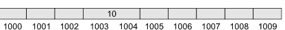

图 1.11 内存表示

现在，由于 x 是整数变量，它将被分配 2 字节。假设编译器为其分配内存位置 1003 和 1004，则 x 的地址（写作 &x）等于 1003，即 x 在内存中的起始地址。当我们写 ptr = &x 时，则 ptr = 1003。

我们可以“解引用”指针，即，我们可以通过使用一元 * 运算符（如 *ptr）来引用其指向的变量的值。也就是说，*ptr = 10，因为 10 是 x 的值。请查看以下显示指针变量用法的代码：

```c
#include <stdio.h>
int main()
{
    int num, *pnum;
    pnum = &num;
    printf("\n Enter the number : ");
    scanf("%d", &num);
    printf("\n The number that was entered is : %d", *pnum);
    return 0;
}
```

### 输出

Enter the number : 10
The number that was entered is : 10

*(&num) 的值是多少？它等同于简单地写 num。


## 1.11.2 指针表达式和指针运算

与其他变量一样，指针变量也可以用于表达式中。例如，如果 `ptr1` 和 `ptr2` 是指针，则以下语句有效：

```c
int num1 = 2, num2 = 3, sum = 0, mul = 0, div = 1;
int *ptr1, *ptr2;
ptr1 = &num1;
ptr2 = &num2;
sum = *ptr1 + *ptr2;
mul = sum * (*ptr1);
*ptr2 += 1;
div = 9 + (*ptr1)/(*ptr2) - 30;
```

在 C 语言中，程序员可以将整数加到指针上或从指针中减去整数，也可以用一个指针减去另一个指针。我们也可以像对待其他变量一样，对指针变量使用简写运算符。

C 语言还允许在表达式中使用关系运算符比较指针。例如，`p1 > p2`、`p1 == p2` 和 `p1 <= p2` 在 C 语言中都是有效的。

后置一元递增（`++`）和递减（`--`）运算符的优先级高于解引用运算符（`*`）。因此，表达式 `*ptr++` 等价于 `*(ptr++)`，因为 `++` 的运算符优先级高于 `*`。因此，该表达式将增加 `ptr` 的值，使其现在指向下一个内存位置。这意味着语句 `*ptr++` 无法完成预期的任务。因此，要递增存储在 `ptr` 中地址的变量的值，你应该写 `(*ptr++)`。

## 1.11.3 空指针

迄今为止，我们已经学习，指针变量是指向某种数据类型变量的指针。但是，在某些情况下，我们可能更希望拥有一个 `null pointer`，它是一种特殊的指针值，不指向任何值。这意味着 `null pointer` 不指向任何有效的内存地址。

要声明一个空指针，可以使用预定义常量 `NULL`，它在多个标准头文件中定义，包括 `<stdio.h>`、`<stdlib.h>` 和 `<string.h>`。在程序中包含其中任何一个文件后，你可以写

```c
int *ptr = NULL;
```

你始终可以通过编写以下代码来检查给定的指针变量是否存储某个变量的地址或包含 `NULL`

```c
if (ptr == NULL)
{
    Statement block;
}
```

你也可以使用常量 `0` 将指针初始化为空指针

```c
int *ptr;
ptr = 0;
```

这是 C 语言中的有效语句，因为 `NULL` 是一个预处理器宏，通常具有值或替换文本 `0`。但是，为了避免歧义，使用 `NULL` 声明空指针始终是更好的选择。当无法完成其任务时，返回指针值的函数可以返回空指针。

## 1.11.4 通用指针

通用指针是数据类型为 `void` 的指针变量。`void 指针`，即通用指针，是一种特殊的指针类型，可以指向任何数据类型的变量。它的声明方式与普通指针变量相同，但使用 `void` 关键字作为指针的数据类型。例如，

在 C 语言中，由于不能拥有 void 类型的变量，因此 void 指针不会指向任何数据，因而不能被解引用。在使用之前，需要将 void 指针强制转换为另一种指针类型。

当你希望指针在不同时间指向不同类型的数据时，通常会使用通用指针。例如，请查看以下代码。

```c
#include <stdio.h>
int main()
{
    int x=10;
    char ch = 'A';
    void *gp;
    gp = &x;
    printf("\n Generic pointer points to the integer value = %d", *(int*)gp);
    gp = &ch;
    printf("\n Generic pointer now points to the character= %c", *(char*)gp);
    return 0;
}
```

## 输出

通用指针指向的整数值 = 10
通用指针现在指向的字符 = A

始终建议避免使用 void 指针，除非万不得已，因为它们实际上允许你规避类型检查。

## 编程示例

- 9. 编写一个程序，使用指针和函数将两个整数相加。

```c
#include <stdio.h>
void sum (int*, int*, int*);
int main()
{
    int num1, num2, total;
    printf("\n Enter the first number : ");
    scanf("%d", &num1);
    printf("\n Enter the second number : ");
    scanf("%d", &num2);
    sum(&num1, &num2, &total);
    printf("\n Total = %d", total);
    return 0;
}
void sum (int *a, int *b, int *t)
{
    *t = *a + *b;
}
```

## 输出

请输入第一个数字：23
请输入第二个数字：34
总和 = 57

## 1.11.5 指针的指针

在 C 语言中，你还可以使用指向指针的指针。这些指针又指向数据，甚至指向其他指针。要声明指向指针的指针，只需为每个引用级别添加一个星号 *。

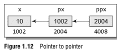

例如，请考虑以下代码：

```c
int x=10;
int *px, **ppx;
px = &x;
ppx = &px;
px = &&x;
```

让我们假设，这些变量的内存位置如图 1.12 所示。

现在如果我们写，

```c
printf("%d", **ppx);
```

那么，它将打印 10，即 x 的值。

## 1.11.6 指针的缺点

虽然指针在 C 语言中非常有用，但它们并非没有局限性。如果使用不当，指针可能会导致难以排查的错误。例如，如果你使用指针读取内存位置，但该指针指向错误的位置，那么你可能会读取错误的值。错误的输入总会导致错误的输出。因此，无论你的程序代码多么高效，输出总是会是灾难性的。向特定内存位置写入值的情况也是如此。

让我们尝试找出使用指针时的一些常见错误。

```c
int x, *px;
x=10;
*px = 20;
```

错误：未初始化的指针。px 指向未知的内存位置。因此，它将覆盖该位置的内容并在其中存储 20。

```c
int x, *px;
x=10;
px = x;
```

错误：应该是 px = &x；

```c
int x=10, y=20, *px, *py;
px = &x, py = &y;
if(px<py)
printf("\n x is less than y");
else
printf("\n y is less than x");
```

错误：应该是 if(*px < *py)

## 要点总结

- C 语言由丹尼斯·里奇在 20 世纪 70 年代初于贝尔实验室开发。
- C 程序中的每个单词要么是标识符，要么是关键字。标识符是赋给程序元素（如变量和函数）的名称。关键字是保留字，不能用作标识符。
- C 语言提供四种基本数据类型：char、int、float 和 double。
- 变量被定义为计算机内存中数据存储位置的有意义名称。
- 标准库函数 scanf() 用于以指定格式输入数据。printf() 函数用于以指定格式输出不同类型的数据。
- C 语言支持不同类型的运算符，可分为以下类别：算术运算符、关系运算符、相等运算符、逻辑运算符、一元运算符、条件运算符、按位运算符、赋值运算符、逗号运算符和 sizeof 运算符。
- 取模运算符 (%) 只能应用于整数操作数，不能应用于 float 或 double 操作数。
- 相等运算符的优先级低于关系运算符。
- 与算术表达式一样，逻辑表达式从左到右求值。
- x++ 和 ++x 都会递增 x 的值，但在前一种情况下，x 的值在递增前返回；而在后一种情况下，x 的值在递增后返回。
- 条件运算符也称为三元运算符，因为它接受三个操作数。
- 按位非或取补运算产生给定二进制数的反码。
- 在所有运算符中，逗号运算符的优先级最低。
- sizeof 是一元运算符，用于计算数据类型的大小。该运算符可应用于所有数据类型。
- 虽然类型转换是隐式进行的，但强制类型转换必须由程序员显式执行。当一种数据类型的值需要转换为另一种数据类型的值时，会进行强制类型转换。
- C 语言支持三种控制语句：决策控制语句、迭代语句和跳转语句。
- 在 switch 语句中，如果变量的值与任何 case 语句的值都不匹配，则执行 default 分支。
- 迭代语句用于重复执行一系列语句，直到指定的表达式为假为止。
- break 语句用于终止其出现的最近封闭循环的执行。
- 当编译器遇到 continue 语句时，循环中其余的语句将被跳过，控制无条件转移到最近封闭循环的循环继续部分。
- C 程序包含一个或多个函数，每个函数被定义为执行特定任务的一组语句。
- 每个 C 程序都包含一个 main() 函数，它是程序的起点。当用户运行程序时，操作系统会调用该函数。
- 函数声明语句标识函数的名称、它接受的参数列表以及它返回的数据类型。
- 另一方面，函数定义由标识函数的函数头组成，后跟包含该函数可执行代码的函数体。定义函数时，内存中会为该函数分配空间。
- 编译器一遇到函数调用，控制权就会跳转到被调用函数的一部分语句。被调用函数执行完毕后，控制权返回给调用函数。
- 在使用函数之前放置函数声明语句，使编译器能够检查调用该函数时使用的参数。
- 返回类型为 void 的函数不能返回任何值。同样，参数列表为 void 的函数不能接受任何值。
- 按值传递方法将变量的值传递给被调用函数。因此，被调用函数使用实际参数的副本来执行其预期任务。当函数不需要修改调用函数中原始变量的值时，使用此方法。
- 在按引用传递方法中，调用函数将变量的地址传递给被调用函数。因此，在此方法中，函数接收对参数的隐式引用，而不是其值的副本。这允许函数修改变量的值，并且该更改也会反映在调用函数中。
- 指针是包含另一个变量内存地址的变量。
- & 运算符获取变量的地址。
- 我们可以对指针进行“解引用”，即使用一元 * 运算符引用其指向的变量的值。
- 空指针是不指向任何变量的特殊指针变量。这意味着空指针不指向任何有效的内存地址。要声明空指针，可以使用预定义常量 NULL。
- 通用指针是数据类型为 void 的指针变量。通用指针可以指向任何数据类型的变量。
- 要声明指向指针的指针，需要为每个引用级别添加一个星号 (*)。


## 练习

## 复习问题

- 1. 讨论 C 程序的结构。

- 2. 区分声明与定义。

- 3. 如何使用声明语句保留内存？

- 4. 你对标识符和关键字的理解是什么？

- 5. 解释变量和常量的术语。C 支持多少种类型的变量？

- 6. 变量的数据类型表示什么？

- 7. 关于 C 语言支持的基本数据类型，写一篇简短的说明。

- 8. 为什么我们要在程序中包含 <stdio.h>？

- 9. 什么是头文件？解释其重要性。

- 10. 关于 printf 和 scanf 函数，写简短的说明。

- 11. 关于 C 语言中可用的运算符，写一篇简短的说明。

- 12. 绘制运算符优先级图表。

- 13. 区分强制类型转换和类型转换。

- 14. 什么是决策控制语句？详细解释。

- 15. 关于 C 语言支持的迭代语句，写一篇简短的说明。

- 16. 什么时候你会倾向于使用 switch 语句？

- 17. 定义函数。为什么需要它们？

- 18. 区分函数声明和函数定义。

- 19. 为什么函数声明语句放在函数定义之前？

- 20. 解释函数调用的概念。

- 21. 使用合适的示例区分按值调用和按引用调用。

- 22. 关于指针，写一篇简短的说明。

- 23. 解释空指针和 void 指针之间的区别。

- 24. 通用指针与其他指针变量有何不同？

- 25. 关于指向指针的指针，写一篇简短的说明。

## 编程练习

- 1. 编写一个程序读取 10 个整数。通过每行打印十个用逗号分隔的数字来显示这些数字。

- 2. 编写一个程序打印 1–200 之间偶数的个数。同时打印它们的和。

- 3. 编写一个程序统计文本中元音字母的数量。

- 4. 编写一个程序读取用户的地址。通过将其分成多行来显示结果。

- 5. 编写一个程序读取两个浮点数。将这些数字相加并将结果赋给一个整数。最后，显示所有三个变量的值。

- 6. 编写一个程序读取一个浮点数。显示该数字整数部分的最右边一位数字。

- 7. 编写一个程序计算单利和复利。

- 8. 编写一个程序计算员工的工资，已知其基本工资（由用户输入），HRA = 基本工资的 10%，TA = 基本工资的 5%。将 HRA 和 TA 定义为常量，并使用它们来计算员工的工资。

- 9. 编写一个程序准备杂货账单。输入购买物品的名称、购买数量及其单价。然后按以下格式显示账单：

************** 账单 **************

| 项目 | 数量 | 单价 | 金额 |
|------|----------|-------|--------|
| | | | |

应付总金额

- 10. 编写一个 C 程序，使用 printf 语句按以下格式打印 BYE：
BBB Y Y EEEE
B B Y Y E
BBB Y Y EEEE
B B Y
BBB Y Y EEEE

- 11. 编写一个程序读取一个整数。以十进制、八进制和十六进制表示法显示该整数的值。

- 12. 编写一个程序，按以下规格以指数格式打印浮点值：
- (a) 保留两位小数；
- (b) 保留四位小数；以及
- (c) 保留八位小数。

- 13. 编写一个程序，使用函数找出三个整数中的最小值。

- 14. 编写一个程序，使用函数计算三角形的面积。

- 15. 编写一个程序，使用函数判断一个数是否能被 2 整除。

- 16. 编写一个程序，使用指针打印 'Programming in C is Fun'。

- 17. 编写一个程序读取一个字符并打印它。同时打印其 ASCII 值。如果字符是小写，则将其打印为大写，反之亦然。重复该过程，直到输入 '*'。

- 18. 编写一个程序加三个浮点数。结果应仅包含小数点后两位数字。

- 19. 编写一个程序，获取用户输入，然后检查它是数字还是字符。如果是字符，确定它是大写还是小写。同时打印其 ASCII 值。

- 20. 编写一个程序显示 1 到 n 的数字之和与平均值。使用 for 循环。

- 21. 编写一个程序打印从 m 到 n 的所有奇数。

- 22. 编写一个程序打印从 m 到 n 的所有质数。

- 23. 编写一个程序读取数字，直到输入 -1，并显示它是否是阿姆斯特朗数。

- 24. 编写一个程序，使用指针和函数加两个浮点数。

- 25. 编写一个程序，使用指针计算三角形的面积。

## 选择题

- 1. 用于比较两个值的运算符是
    (a) 赋值        (b) 关系
    (c) 单目             (d) 相等

- 2. 三元运算符对多少个操作数进行操作？
    (a) 1        (b) 2
    (c) 3        (d) 4

- 3. 哪个运算符生成给定二进制值的补码？
    (a) 逻辑 AND        (b) 按位 AND
    (c) 逻辑 OR         (d) 按位 NOT

- 4. 哪个运算符的优先级最低？
    (a) sizeof        (b) 单目
    (c) 赋值    (d) 逗号

- 5. 以下哪个是与 short 整数相关的转换字符？
    (a) %c        (b) %h
    (c) %e        (d) %f

- 6. 以下哪个不是字符常量？
    (a) 'A'        (b) "*a"
    (c) ' / '        (d) '*'

- 7. 以下哪个是有效的变量名？
    (a) Initial.Name        (b) A+B
    (c) Sant        (d) Floats

- 8. 哪个运算符不能与浮点数一起使用？
    (a) +        (b) -
    (c) %        (d) *

- 9. 识别错误的表达式。
    (a) Xy=2 + 4;        (b) res = +a * 5;
    (c) res = /4;        (d) res = +++ -b *2

- 10. 函数声明语句通过其标识一个函数
    (a) 名称
    (b) 参数
    (c) 返回值的数据类型
    (d) 以上全部

- 11. 哪种返回类型不能向调用函数返回任何值？
    (a) int        (b) float
    (c) void        (d) double

- 12. 当函数被时，为其分配内存
    (a) 声明        (b) 定义
    (c) 调用        (d) 返回

- 13. *(&num) 等同于写
    (a) &num        (b) *num
    (c) num        (d) 以上都不是

- 14. 哪个运算符获取变量的值？
    (a) &        (b) *
    (c) ->        (d) 以上都不是

- 15. 哪个运算符用于解引用指针？
    (a) &        (b) *
    (c) ->        (d) 以上都不是

## 判断正误

- 1. C 程序中只能有一个函数。

- 2. 关键字区分大小写。

- 3. 变量 'first' 与 'First' 相同。

- 4. 有符号变量可以增加最大正范围。

- 5. 注释语句不会被编译器执行。

- 6. 相等运算符的优先级高于关系运算符。

- 7. 向左移动一位会将数字乘以 2。

- 8. 决策控制语句用于重复执行一系列语句。

- 9. printf("%d", scanf("%d", &num)); 是一个有效的 C 语句。

- 10. 1.234 是一个有效的整数常量。

- 11. 一个 printf 语句只能生成一行输出。

- 12. 栈用于存储程序的源代码。

- 13. main() 的右大括号是程序的逻辑结束。

- 14. 声明部分向计算机提供指令。

- 15. 任何有效的可打印 ASCII 字符都可用于变量名。

- 16. 下划线可以用在变量名的任何位置。

- 17. void 是 C 中的一种数据类型。

- 18. 所有算术运算符的优先级相同。

- 19. 取模运算符只能与整数一起使用。

- 20. 调用函数总是向被调用函数传递参数。

- 21. 函数名是全局的。

- 22. 不能在另一个函数的函数体内声明函数。

- 23. & 运算符获取变量的左值。

- 24. 单目递增和递减运算符的优先级高于解引用运算符。

- 25. 在 32 位系统上，整数变量分配 4 个字节。

## 填空题

- 1. C 是由 _______ 开发的。

- 2. C 程序的执行从 _______ 开始。

- 3. 在内存中，字符存储为 _______。

- 4. return 0 将 0 返回给 _______。

- 5. _______ 查找整数除法的余数。

- 6. sizeof 是一个 _______ 运算符，用于计算数据类型的大小。

- 7. _______ 也称为强制转换。

- 8. 当变量的值与 case 语句的任何值都不匹配时，执行 _______。

- 9. _______ 函数在显示器上打印数据。

- 10. C 程序以 _______ 结束。

- 11. _______ 导致光标移到下一行。

- 12. 变量可以通过在初始化时使用限定符 _______ 来声明为常量。

- 13. _______ 运算符返回操作数占用的字节数。

- 14. _______ 说明符用于读写 short 整数。

- 15. _______ 说明符用于读写十六进制整数。

- 16. 要左对齐打印数据，使用 _______ 说明符。

- 17. 函数执行后，控制权返回给 _______。

- 18. 使用另一个函数的函数称为 _______。

- 19. 函数接受的输入称为 _______。

- 20. 函数定义由 _______ 和 _______ 组成。

- 21. 在 _______ 方法中，调用函数将变量的地址传递给被调用函数。

- 22. 字符指针的大小是 _______。

- 23. _______ 指针不指向任何有效内存地址。

- 24. _______ 出现在赋值语句的右侧。

- 25. _______ 运算符通知编译器该变量是指针变量。


# 第 2 章

## 数据结构与算法简介

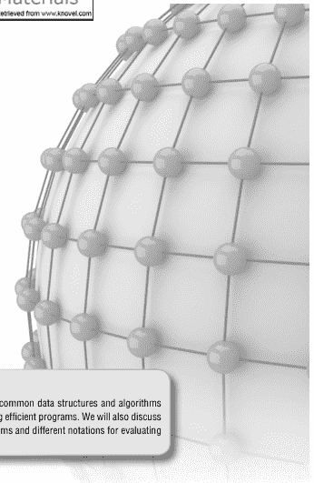

> 学习目标
> 
> 在本章中，我们将讨论常用的数据结构和算法，它们是构建高效程序的基础。我们还将讨论设计算法的不同方法以及评估算法性能的不同表示法。

## 2.1 基本术语

我们在上一章已经学习了 C 语言编程的基础知识，并知道如何编写、调试和运行简单的 C 语言程序。我们的目标是设计好的程序，好的程序被定义为满足以下条件的程序：

- 运行正确
- 易于阅读和理解
- 易于调试
- 易于修改

程序无疑应该给出正确的结果，但与此同时，它也应该运行高效。当程序以最少的时间和最少的内存空间执行时，我们就说它是高效的。为了编写高效程序，我们需要应用某些数据管理概念。

数据管理的概念是一项复杂的任务，包括数据收集、将数据组织到适当的结构中，以及开发和维护质量保证例程等活动。

数据结构是数据管理的关键部分，在本书中将是我们的首要关注点。数据结构基本上是一组在同一名称下组合在一起的数据元素，它定义了一种在计算机中存储和组织数据的特定方式，以便可以高效地使用数据。

数据结构几乎用于每个程序或软件系统。常见的数据结构示例包括数组、链表、队列、栈、二叉树和哈希表。数据结构广泛应用于以下领域：

- 编译器设计
- 统计分析包
- 数值分析
- 人工智能
- 操作系统
- 数据库管理系统
- 模拟
- 图形学

当你将数据库管理系统作为一门学科来学习时，你会意识到网络数据模型中使用的主要数据结构是图，层次数据模型是树，而关系数据库管理系统是数组。

特定的数据结构是许多高效算法的重要组成部分，因为它们使程序员能够轻松高效地管理大量数据。一些正式的设计方法和编程语言将数据结构和算法作为软件设计中的关键组织因素。这是因为信息表示是计算机科学的基础。程序或软件的主要目标不是执行计算或操作，而是尽可能快地存储和检索信息。

无论面临什么问题，应用合适的数据结构都能提供最有效的解决方案。如果一个解决方案在所需的资源约束内解决了问题（例如存储数据的总可用空间和执行每个子任务允许的时间），则该解决方案被认为是高效的。最好的解决方案是所需资源少于已知替代方案的解决方案。此外，解决方案的成本是它消耗的资源量。解决方案的成本基本上以一个关键资源（如时间）来衡量，隐含假设该解决方案满足其他资源约束。

如今，计算机程序员编写程序不仅仅是为了解决问题，而是为了编写高效的程序。为此，他们首先分析问题以确定必须实现的性能目标，然后考虑该工作最合适的数据结构。然而，对数据结构概念理解不足的程序设计人员忽略了这一分析步骤，而是应用他们能够熟练使用的数据结构。所应用的数据结构可能不适合当前的问题，因此可能导致性能不佳（例如操作速度慢）。

相反，如果一个程序使用简单易用的数据结构就能实现其性能目标，那么仅仅为了展示程序员的技能而应用另一个复杂的数据结构就没有意义了。在选择数据结构来解决问题时，必须执行以下步骤。

- 1. 分析问题以确定必须支持的基本操作。例如，基本操作可能包括从数据结构中插入/删除/搜索数据项。
- 2. 量化每个操作的资源约束。
- 3. 选择最能满足这些要求的数据结构。

这种用于为当前问题选择合适数据结构的三步方法支持以数据为中心的设计过程观点。在该方法中，首要关注的是数据以及要对其执行的操作。第二关注点是数据的表示，最终关注点是该表示的实现。

C 语言支持不同类型的数据结构。一种数据结构可能只允许在开头添加新数据项，而另一种可能允许在任何位置添加。一种数据结构可能允许顺序访问数据项，而另一种可能允许随机访问数据。因此，为问题选择合适的数据结构是一个关键决策，可能对程序的性能产生重大影响。

### 2.1.1 基本数据结构组织

数据结构是程序的构建模块，使用不当的数据结构构建的程序可能无法按预期工作。因此，作为程序员，为程序选择最合适的数据结构是强制性的。

数据一词是指一个值或一组值。它指定变量或常量的值（例如，学生的成绩、员工的姓名、客户的地址、圆周率的值等）。

没有子数据项的数据项被归类为基本项，而由一个或多个子数据项组成的数据项称为组项。例如，学生的姓名可以分为三个子项——名、中间名和姓，但他的学号通常被视为单个项目。

记录是数据项的集合。例如，姓名、地址、课程和获得的成绩是单独的数据项。但所有这些数据项都可以组合在一起形成一条记录。

文件是相关记录的集合。例如，如果一个班级有 60 名学生，那么就有 60 条学生记录。所有这些相关记录都存储在一个文件中。同样，我们可以拥有一个组织中所有员工的文件、一家公司所有客户的文件、所有供应商的文件，等等。

此外，文件中的每条记录可能包含多个数据项，但某个数据项的值可以唯一标识文件中的记录。这样的数据项 K 被称为主键，该字段中的值 K1、K2、... 被称为键或键值。例如，在包含学号、姓名、地址、课程和获得成绩的学生记录中，学号字段是主键。其余字段（姓名、地址、课程和成绩）不能作为主键，因为两个或更多学生可能有相同的姓名，或可能有相同的地址（因为他们可能住在同一地方），或可能注册了相同的课程，或获得了相同的成绩。

这种数据的组织和层次结构进一步扩展，形成了更复杂的数据结构类型，将在 2.2 节中讨论。

## 2.2 数据结构分类

数据结构通常分为两类：原始数据结构和非原始数据结构。

#### 原始和非原始数据结构

原始数据结构是编程语言支持的基本数据类型。一些基本数据类型包括整数、实数、字符和布尔值。“数据类型”、“基本数据类型”和“原始数据类型”这些术语经常互换使用。

非原始数据结构是使用原始数据结构创建的数据结构。此类数据结构的示例包括链表、栈、树和图。非原始数据结构可以进一步分为两类：线性数据结构和非线性数据结构。

#### 线性和非线性结构

如果数据结构的元素按线性或顺序存储，则它是线性数据结构。示例包括数组、链表、栈和队列。线性数据结构在内存中有两种不同的表示方式。一种是通过顺序内存位置在元素之间建立线性关系。另一种是通过链接在元素之间建立线性关系。


但是，如果数据结构的元素不是按顺序存储的，那么它就是非线性数据结构。非线性数据结构的元素之间不保持邻接关系。示例包括树和图。

C 支持多种数据结构。我们将介绍所有这些数据结构，并在后续章节中详细讨论它们。

## 数组

数组是一组相似数据元素的集合。这些数据元素具有相同的数据类型。数组的元素存储在连续的内存位置中，并通过索引（也称为下标）引用。

在 C 中，数组使用以下语法声明：

```
type name[size];
```

例如，

```
int marks[10];
```

上述语句声明了一个包含 10 个元素的数组 marks。在 C 中，数组索引从零开始。这意味着数组 marks 总共包含 10 个元素。第一个元素将存储在 marks[0] 中，第二个元素存储在 marks[1] 中，以此类推。因此，最后一个元素，即第 10 个元素，将存储在 marks[9] 中。在内存中，数组的存储方式如图 2.1 所示。

| 第 1 个元素 | 第 2 个元素 | 第 3 个元素 | 第 4 个元素 | 第 5 个元素 | 第 6 个元素 | 第 7 个元素 | 第 8 个元素 | 第 9 个元素 | 第 10 个元素 |
|---|---|---|---|---|---|---|---|---|---|
| marks[0] | marks[1] | marks[2] | marks[3] | marks[4] | marks[5] | marks[6] | marks[7] | marks[8] | marks[9] |

图 2.1 包含 10 个元素的数组的内存表示

当我们想要存储大量相似类型的数据时，通常会使用数组。但它们有以下限制：

- 数组的大小是固定的。
- 数据元素存储在连续的内存位置中，这些位置可能并不总是可用。
- 元素的插入和删除可能会有问题，因为需要移动元素的位置。

然而，这些限制可以通过使用链表来解决。我们将在第 3 章中更多地讨论数组。

## 链表

链表是一种非常灵活、动态的数据结构，其中元素（称为节点）形成一个顺序列表。与静态数组不同，程序员不需要担心链表中将存储多少个元素。此功能使程序员能够编写需要较少维护的健壮程序。

在链表中，每个节点在添加到列表时分配空间。列表中的每个节点都指向列表中的下一个节点。因此，在链表中，每个节点包含以下两种类型的数据：

- 节点的值或与该节点对应的任何其他数据
- 指向列表中下一个节点的指针或链接

列表中的最后一个节点包含一个空指针，以指示它是列表的末尾或尾部。由于节点的内存是在添加到列表时动态分配的，因此可以添加到列表中的节点总数仅受可用内存量的限制。图 2.2 显示了一个包含七个节点的链表。

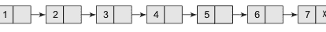

图 2.2 简单链表

### 注意

优点：更容易插入或删除数据元素  
缺点：搜索操作较慢且需要更多内存空间

## 栈

栈是一种线性数据结构，其中元素的插入和删除仅在一端进行，该端称为栈顶。栈被称为后进先出（LIFO）结构，因为最后添加到栈中的元素是第一个从栈中删除的元素。

在计算机内存中，栈可以使用数组或链表实现。图 2.3 显示了栈的数组实现。每个栈都有一个与之关联的变量 top。top 用于存储栈顶元素的地址。元素将从此位置添加或删除。还有另一个变量 max，用于存储栈可以存储的最大元素数量。

如果 top = NULL，则表示栈为空；如果 top = MAX-1，则表示栈已满。

| A | AB | ABC | ABCD | ABCDE | | | | | |
|---|---|---|---|---|---|---|---|---|---|
| 0 | 1 | 2 | 3 | top = 4 | 5 | 6 | 7 | 8 | 9 |

图 2.3 栈的数组表示

在图 2.3 中，top = 4，因此插入和删除将在此位置进行。在这里，栈最多可以存储 10 个元素，索引范围为 0–9。在上述栈中，仍可以存储五个更多元素。

栈支持三种基本操作：push、pop 和 peek。push 操作将元素添加到栈顶。pop 操作从栈顶删除元素。peek 操作返回栈顶元素的值（不删除它）。

然而，在向栈中插入元素之前，必须检查溢出条件。当尝试向已满的栈中插入元素时，会发生溢出。

同样，在从栈中删除元素之前，必须检查下溢条件。当尝试从已空的栈中删除元素时，会发生下溢条件。

## 队列

队列是一种先进先出（FIFO）数据结构，其中先插入的元素是第一个被取出的元素。队列中的元素在一端（称为 rear）添加，从另一端（称为 front）删除。与栈类似，队列可以使用数组或链表实现。

每个队列都有 front 和 rear 变量，分别指向可以执行删除和插入的位置。考虑图 2.4 中所示的队列。

| 队首 | | | | | | 队尾 | | | |
|---|---|---|---|---|---|---|---|---|---|
| 12 | 9 | 7 | 18 | 14 | 36 | | | | |
| 0 | 1 | 2 | 3 | 4 | 5 | 6 | 7 | 8 | 9 |

图 2.4 队列的数组表示

在这里，front = 0 且 rear = 5。如果我们想向列表中添加一个值，例如，如果我们想添加另一个值为 45 的元素，那么 rear 将加 1，值将存储在 rear 指向的位置。添加后，队列将如图 2.5 所示。

在这里，front = 0 且 rear = 6。每次添加新元素时，我们都会重复相同的过程。

| 队首 | | | | | | 队尾 | | | |
|---|---|---|---|---|---|---|---|---|---|
| 12 | 9 | 7 | 18 | 14 | 36 | 45 | | | |
| 0 | 1 | 2 | 3 | 4 | 5 | 6 | 7 | 8 | 9 |

图 2.5 插入新元素后的队列

现在，如果我们想从队列中删除一个元素，那么 front 的值将加 1。删除仅从此端进行。删除后，队列将如图 2.6 所示。

| 队首 | | | | | | 队尾 | | | |
|---|---|---|---|---|---|---|---|---|---|
| | 9 | 7 | 18 | 14 | 36 | 45 | | | |
| 0 | 1 | 2 | 3 | 4 | 5 | 6 | 7 | 8 | 9 |

图 2.6 删除元素后的队列

然而，在向队列中插入元素之前，必须检查溢出条件。当尝试向已满的队列中插入元素时，会发生溢出。当 rear = MAX-1 时，队列已满，其中 MAX 是队列的大小，即 MAX 指定队列中的最大元素数量。请注意，我们写了 MAX-1 是因为索引从 0 开始。

同样，在从队列中删除元素之前，必须检查下溢条件。当尝试从已空的队列中删除元素时，会发生下溢条件。如果 front = NULL 且 rear = NULL，则队列中没有元素。

## 树

树是一种非线性数据结构，由按层次顺序排列的节点集合组成。其中一个节点被指定为根节点，其余节点可以分成不相交的集合，使得每个集合都是根的一个子树。

树的最简单形式是二叉树。二叉树由一个根节点和左右子树组成，其中两个子树也都是二叉树。每个节点包含一个数据元素、一个指向左子树的左指针和一个指向右子树的右指针。根元素是最顶层的节点，由 'root' 指针指向。如果 root = NULL，则树为空。

图 2.7 显示了一棵二叉树，其中 r 是根节点，T1、T2 和 T3 是 r 的左右子树。如果 T1 非空，则 T1 被称为 r 的左继任者。同样，如果 T1 非空，则它被称为 r 的右继任者。


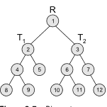

在图 2.7 中，节点 2 是根节点 1 的左子节点，节点 3 是根节点 1 的右子节点。请注意，根节点的左子树由节点 2、4、5、8 和 9 组成。同样，根节点的右子树由节点 3、6、7、10、11 和 12 组成。

> **注意** 优点：提供快速的搜索、插入和删除操作 缺点：删除算法复杂

## 图

图是一种非线性数据结构，是顶点（也称为节点）和连接这些顶点的边的集合。图通常被视为树结构的一种推广，其中树节点之间不再仅限于纯粹的父子关系，而可以存在节点之间的任何复杂关系。在树结构中，节点可以有任意数量的子节点但只有一个父节点，而图则放宽了所有此类限制。图 2.8 显示了一个包含五个节点的图。图中的一个节点可以代表一个城市，连接节点的边可以代表道路。图也可用于表示计算机网络，其中节点是工作站，边是网络连接。图在计算机科学和数学中有如此多的应用，以至于已经编写了多种算法来执行标准图操作，例如搜索图和查找图中节点之间的最短路径。

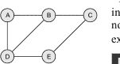

请注意，与树不同，图没有任何根节点。相反，图中的每个节点都可以与图中的每个其他节点连接。当两个节点通过边连接时，这两个节点称为邻居。例如，在图 2.8 中，节点 a 有两个邻居：b 和 d。

> **注意** 优点：最能模拟现实世界场景 缺点：某些算法速度慢且非常复杂

## 2.3 数据结构上的操作

本节讨论可以对先前提到的各种数据结构执行的不同操作。

- **遍历** 它意味着恰好访问每个数据项一次，以便对其进行处理。例如，打印班上所有学生的姓名。
- **搜索** 它用于查找满足给定约束的一个或多个数据项的位置。这样的数据项可能存在于给定的数据项集合中，也可能不存在。例如，查找数学成绩为 100 分的所有学生的姓名。
- **插入** 它用于向给定的数据项列表中添加新数据项。例如，添加最近加入课程的新学生的详细信息。
- **删除** 它意味着从给定的数据项集合中移除（删除）特定的数据项。例如，删除已退课学生的姓名。
- **排序** 数据项可以按某种顺序排列，例如升序或降序，具体取决于应用程序的类型。例如，将班上学生的姓名按字母顺序排列，或通过将参与者的分数按降序排列然后提取前三名来计算前三名获胜者。
- **合并** 两个已排序数据项的列表可以合并为一个已排序数据项的列表。

在许多情况下，会在给定场景中同时应用两个或多个操作。例如，如果我们想删除名为 X 的学生的详细信息，那么我们首先需要搜索学生列表，查找 X 的记录是否存在，如果存在，则位于哪个位置，以便可以从该特定位置删除详细信息。

## 2.4 抽象数据类型

抽象数据类型（ADT）是我们看待数据结构的方式，关注它做什么，而忽略它如何完成工作。例如，栈和队列是 ADT 的完美示例。我们可以使用数组或链表来实现这两种 ADT。这体现了栈和队列的“抽象”特性。

为了进一步理解抽象数据类型的含义，我们将该术语拆分为“数据类型”和“抽象”，然后讨论它们的含义。

### 数据类型

变量的数据类型是变量可以取的值的集合。我们已经读过 C 语言中的基本数据类型包括 `int`、`char`、`float` 和 `double`。

当我们谈论原始类型（内置数据类型）时，我们实际上考虑两件事：具有某些特征的数据项以及对该数据的允许操作。例如，`int` 变量可以包含 –32768 到 32767 之间的任何整数值，并可以使用运算符 `+`、`-`、`*` 和 `/` 进行操作。换句话说，可以对数据类型执行的操作是其身份不可分割的一部分。因此，当我们声明抽象数据类型（例如，栈或队列）的变量时，还需要指定可以对其执行的操作。

### 抽象

在数据结构的语境中，“抽象”一词的意思是脱离详细规范或实现来考虑。

在 C 语言中，抽象数据类型可以是不考虑其实现的结构。它可以被视为结构中数据的“描述”，并附带一组可以对该结构内的数据执行的操作。

最终用户不关心方法执行任务的详细信息。他们只知道可用的方法，并且只关心调用这些方法并获得结果。他们不关心这些方法的工作原理。

例如，当我们使用栈或队列时，用户只关心数据类型以及可以对其执行的操作。因此，数据存储的基本原理对用户应该是不可见的。他们不应该关心方法的工作原理或用于存储数据的结构。他们只需知道，要使用栈，他们可以使用 `push()` 和 `pop()` 函数。使用这些函数，他们可以操作存储在栈中的数据（插入或删除）。

## 使用 ADT 的优点

在现实世界中，程序会因新需求或约束而演变，因此对程序的修改通常需要更改一个或多个数据结构。例如，如果你想在学生记录中添加一个新字段以跟踪每个学生的更多信息，那么用链式结构替换数组以提高程序效率会更好。在这种情况下，重写每个使用更改结构的过程是不可取的。因此，更好的替代方案是将数据结构的使用与其实现细节分开。这就是使用抽象数据类型的基本原理。

## 2.5 算法

算法的典型定义是“执行某种计算的正式定义的过程”。如果一个过程被正式定义，那么它可以使用正式语言来实现，这种语言称为编程语言。一般来说，算法为编写解决特定问题的程序提供了蓝图。它被认为是解决问题的有效过程，在有限步骤内完成。也就是说，一个定义明确的算法总是提供答案，并且保证终止。

算法主要用于实现软件复用。一旦我们有了一个解决方案的想法或蓝图，就可以用 C、C++ 或 Java 等任何高级语言来实现它。

算法基本上是一组解决问题的指令。针对同一问题拥有多种算法并不罕见，但特定算法的选择必须取决于算法的时间和空间复杂度。

## 2.6 设计算法的不同方法

算法用于操作数据结构中包含的数据。在处理数据结构时，算法用于对存储的数据执行操作。

复杂算法通常被分解为称为模块的较小单元。将算法分解为模块的过程称为模块化。模块化的主要优点如下：

- 它使复杂算法更容易设计和实现。
- 每个模块可以独立设计。在设计一个模块时，可以忽略其他模块的细节，从而增强设计的清晰度，进而简化整体算法的实现、调试、测试、文档编写和维护。

设计算法有两种主要方法——自顶向下方法和自底向上方法，如图 2.9 所示。

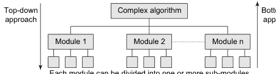

图 2.9 设计算法的不同方法

### 自顶向下方法

自顶向下设计方法首先将复杂算法分解为一个或多个模块。这些模块可以进一步分解为一个或多个子模块，这种分解过程会迭代进行，直到达到所需的模块复杂度级别。自顶向下设计方法是一种逐步求精的形式，我们从最顶层的模块开始，逐步添加它调用的模块。
因此，在自顶向下方法中，我们从抽象设计开始，然后在每个步骤中，将该设计细化为更具体的层次，直到达到不需要进一步细化的层次。

### 自底向上方法

自底向上方法只是自顶向下方法的逆过程。在自底向上设计中，我们从设计最基本或最具体的模块开始，然后逐步设计更高级别的模块。高级别模块是通过使用低级别模块执行的操作来实现的。因此，在这种方法中，子模块被组合在一起形成更高级别的模块。所有高级别模块被组合在一起形成更高级别的模块。这个过程重复进行，直到获得完整算法的设计。


**自顶向下与自底向上方法** 是否应遵循自顶向下策略还是自底向上策略，这个问题取决于具体应用。

自顶向下方法通过将算法分解为可管理的模块来遵循逐步细化，而自底向上方法则定义一个模块，然后将多个模块组合在一起形成一个新的更高级别模块。

自顶向下方法因其在模块文档编写、测试用例生成、代码实现和调试方面的便利性而备受推崇。然而，它也受到批评，因为子模块是孤立分析的，没有专注于它们与其他模块的通信或组件的可重用性，并且很少关注数据，从而忽略了信息隐藏的概念。

虽然自底向上方法允许信息隐藏，因为它首先识别模块内需要封装的内容，然后提供抽象接口来定义从客户端角度看到的模块边界。但在严格的自底向上策略中，所有这些都很难完成。为此需要执行一些自顶向下的活动。

总而言之，复杂算法的设计不应受限于按照固定模式进行，而应是自顶向下和自底向上方法的结合。

## 2.7 算法中使用的控制结构

算法具有有限数量的步骤。某些步骤可能涉及决策和重复。广义上讲，算法可能采用以下控制结构之一：(a) 顺序，(b) 决策，(c) 重复。

```
Step 1: Input first number as A
Step 2: Input second number as B
Step 3: SET SUM = A+B
Step 4: PRINT SUM
Step 5: END
```

图 2.10 两数相加算法

### 顺序

顺序是指算法的每个步骤按指定顺序执行。让我们编写一个两数相加的算法。该算法按纯粹的顺序执行步骤，如图 2.10 所示。

### 决策

当进程的执行取决于某个条件的结果时，使用决策语句。例如，如果 x = y，则打印 EQUAL。因此，IF 构造的一般形式可以表示为：

```
IF condition Then process
```

在此上下文中，条件是任何可能求值为真值或假值的语句。在上述示例中，变量 x 可以等于 y 也可以不等于 y。但是，它不能既为真又为假。如果条件为真，则执行该进程。

决策语句也可以以下述方式表示：

```
IF condition
Then process1
ELSE process2
```

这种形式通常称为 IF-ELSE 构造。在这里，如果条件为真，则执行 process1，否则执行 process2。图 2.11 显示了一个检查两个数字是否相等的算法。

### 重复

重复涉及多次执行一个或多个步骤，可以使用 while、do-while 和 for 循环等构造来实现。这些循环执行一个或多个步骤，直到某个条件为真。图 2.12 显示了一个打印前 10 个自然数的算法。

```
Step 1: Input first number as A
Step 2: Input second number as B
Step 3: IF A = B
PRINT "EQUAL"
ELSE
PRINT "NOT EQUAL"
[END OF IF]
Step 4: END
```

```
Step 1: [INITIALIZE] SET I = 1, N = 10
Step 2: Repeat Steps 3 and 4 while I<=N
Step 3: PRINT I
Step 4: SET I = I+1
[END OF LOOP]
Step 5: END
```

### 编程示例

- 1. 编写交换两个值的算法。
  - 步骤 1：将第一个数字输入为 A
  - 步骤 2：将第二个数字输入为 B
  - 步骤 3：SET TEMP = A
  - 步骤 4：SET A = B
  - 步骤 5：SET B = TEMP
  - 步骤 6：PRINT A, B
  - 步骤 7：END

- 2. 编写查找两个数中较大值的算法。
  - 步骤 1：将第一个数字输入为 A
  - 步骤 2：将第二个数字输入为 B
  - 步骤 3：IF A>B
    - PRINT A
    - ELSE
      - IF A<B
        - PRINT B
      - ELSE
        - PRINT "The numbers are equal."
      - [END OF IF]
    - [END OF IF]
  - 步骤 4：END

- 3. 编写判断一个数是奇数还是偶数的算法。
  - 步骤 1：将数字输入为 A
  - 步骤 2：IF A/2 = 0
    - PRINT "EVEN"
  - ELSE
    - PRINT "ODD"
  - [END OF IF]
  - 步骤 3：END

- 4. 编写根据以下规则打印学生获得等级的算法。
  - 步骤 1：输入获得的分数为 M
  - 步骤 2：IF M>75
    - PRINT O
  - 步骤 3：IF M>=60 AND M<75
    - PRINT A
  - 步骤 4：IF M>=50 AND M<60
    - PRINT B
  - 步骤 5：IF M>=40 AND M<50
    - PRINT C
  - ELSE
    - PRINT D
  - [END OF IF]
  - END

| 分数 | 等级 |
|------|------|
| 75 以上 | O |
| 60-75 | A |
| 50-59 | B |
| 40-49 | C |
| 40 以下 | D |

- 5. 编写计算前 N 个自然数之和的算法。
  - 步骤 1：INPUT N
  - 步骤 2：SET I = 1, SUM = 0
  - 步骤 3：当 I <= N 时重复步骤 4
  - 步骤 4：SET SUM = SUM + I
    SET I = I + 1
  - [END OF LOOP]
  - 步骤 5：PRINT SUM
  - 步骤 6：END

## 2.8 时间和空间复杂度

分析算法意味着确定执行它所需的资源量（如时间和内存）。算法通常设计为处理任意数量的输入，因此算法的效率或复杂度以时间复杂度和空间复杂度来表示。

算法的时间复杂度基本上是程序作为输入大小函数的运行时间。同样，算法的空间复杂度是程序执行期间作为输入大小函数所需的计算机内存量。

换句话说，程序执行的机器指令数量称为其时间复杂度。这个数字主要取决于程序输入的大小和所使用的算法。

一般来说，程序所需的空间取决于以下两个部分：

- 固定部分：因问题而异。它包括存储指令、常量、变量和结构化变量（如数组和结构体）所需的空间。
- 可变部分：因程序而异。它包括递归堆栈所需的空间，以及程序运行期间动态分配空间的结构化变量所需的空间。

然而，运行时间要求比内存要求更关键。因此，在本节中，我们将专注于算法的运行时间效率。

### 2.8.1 最坏情况、平均情况、最好情况和摊销时间复杂度

### 最坏情况运行时间

这表示算法相对于输入实例最坏可能情况的行为。算法的最坏情况运行时间是任何输入运行时间的上界。因此，了解最坏情况运行时间让我们确信算法永远不会超过这个时间限制。

### 平均情况运行时间

算法的平均情况运行时间是对“平均”输入运行时间的估计。它指定了当输入从给定分布中随机抽取时算法的预期行为。平均情况运行时间假设给定大小的所有输入都同样可能。

### 最好情况运行时间

术语“最好情况性能”用于在最佳条件下分析算法。例如，在数组上进行简单线性搜索的最好情况是所需元素在列表的第一个位置。然而，在开发和选择解决问题的算法时，我们几乎不会将决策基于最好情况性能。始终建议改进算法的平均性能和最坏情况性能。

### 摊销运行时间

摊销运行时间是指执行一系列（相关）操作所需的时间，对所有执行的操作进行平均。摊销分析保证每个操作在最坏情况下的平均性能。

### 2.8.2 时间-空间权衡

解决手头特定问题的最佳算法无疑是那种需要较少内存空间且完成执行所需时间较短的算法。但实际上，设计这样的理想算法并非易事。解决特定问题可能有多种算法。一种可能需要较少内存空间，而另一种可能需要较少 CPU 时间来执行。因此，牺牲一者以换取另一者并不罕见。因此，算法之间存在时间-空间权衡。

因此，如果空间是一个重大限制，那么可以选择一个以更多 CPU 时间为代价占用较少空间的程序。相反，如果时间是主要限制，那么可以选择一个以更多空间为代价执行时间最短的程序。

### 2.8.3 表示时间和空间复杂度

时间和空间复杂度可以使用函数 f(n) 来表示，其中 n 是所求解问题给定实例的输入大小。在以下情况下需要表示复杂度：

- 我们希望预测随着问题输入大小增加，复杂度的增长率。
- 有多种算法可以解决给定问题，我们需要找到最有效的算法。

表示此函数 f(n) 最广泛使用的符号是大 O 表示法。它提供了复杂度的上界。

### 2.8.4 算法效率

如果一个函数是线性的（没有任何循环或递归），那么该算法的效率或运行时间可以表示为其包含的指令数量。但是，如果算法包含循环，那么该算法的效率可能会因算法中的循环数量和每个循环的运行时间而有所不同。

让我们考虑循环决定算法效率的不同情况。

### 线性循环

要计算具有单个循环的算法的效率，我们首先需要确定循环中语句将被执行的次数。这是因为迭代次数与循环因子成正比。循环因子越大，迭代次数越多。例如，考虑下面的循环：

```
for(i=0;i<100;i++)
{
statement block;
}
```

这里，100 是循环因子。我们已经说过，效率与迭代次数成正比。因此，线性循环的一般公式可以表示为

f(n) = n

然而，计算效率并不像上面的示例那样简单。考虑下面的循环：

```
for(i=0;i<100;i+=2)
{
statement block;
}
```

这里，迭代次数是循环因子的一半。因此，这里的效率可以表示为

f(n) = n/2


## 对数循环

我们已经看到，在线性循环中，循环更新语句要么加上要么减去循环控制变量。然而，在对数循环中，循环控制变量在每次迭代时要么被乘要么被除。例如，请看下面给出的循环：

```
for(i=1;i<1000;i*=2)
statement block;
for(i=1000;i>1;i/=2)
statement block;
```

考虑第一个for循环，其中循环控制变量i被乘以2。该循环只会执行10次，而不是1000次，因为在每次迭代中i的值都会翻倍。现在，考虑第二个循环，其中循环控制变量i被2除。在这种情况下，循环也会执行10次。因此，迭代次数是循环控制变量被除或乘的数的函数。在讨论的示例中，这个数是2。也就是说，当n = 1000时，迭代次数可以表示为log 1000，约等于10。

因此，将此分析概括起来，我们可以得出结论：在迭代中除以或乘以循环控制变量的循环的效率可以表示为

f(n) = log n

## 嵌套循环

包含循环的循环称为嵌套循环。为了分析嵌套循环，我们需要确定每个循环完成的迭代次数。总数则由内层循环的迭代次数与外层循环的迭代次数的乘积得到。

在此，我们根据该嵌套循环是线性对数型、二次型还是依赖二次型来分析算法的效率。

## 线性对数循环

考虑以下代码，其中内层循环的循环控制变量在每次迭代后被乘。内层循环的迭代次数为log 10。这个内层循环由一个外层循环控制，该外层循环迭代10次。因此，根据公式，该代码的迭代次数可以表示为10 log 10。

```
for(i=0;i<10;i++)
for(j=0; j<10;j*=2)
statement block;
```

更一般地说，此类循环的效率可以表示为f(n) = n log n。

## 二次循环

在二次循环中，内层循环的迭代次数等于外层循环的迭代次数。考虑以下代码，其中外层循环执行10次，并且对于外层循环的每次迭代，内层循环也执行10次。因此，这里的效率为100。

```
for(i=0;i<10;i++)
for(j=0; j<10;j++)
statement block;
```

二次循环的通用公式可以表示为f(n) = n^2。

## 依赖二次循环

在依赖二次循环中，内层循环的迭代次数取决于外层循环。请考虑以下代码：

```
for(i=0;i<10;i++)
for(j=0; j<i;j++)
statement block;
```

在这段代码中，内层循环在第一次迭代时执行一次，第二次迭代时执行两次，第三次迭代时执行三次，依此类推。这样，迭代次数可以计算为

1 + 2 + 3 + ... + 9 + 10 = 55

如果我们计算该循环的平均值（55/10 = 5.5），我们会发现它等于外层循环的迭代次数（10）加1再除以2。一般来说，内层循环迭代(n + 1)/2次。因此，此类代码的效率可以表示为
f(n) = n + (n + 1)/2

## 2.9 大O表示法

在当今计算机技术飞速发展的时代，我们几乎不关心算法的效率。相反，我们更感兴趣的是了解算法的通用数量级。如果我们有两个不同的算法来解决同一个问题，其中一个算法执行10次迭代，另一个执行20次迭代，那么这两个算法之间的差别不大。然而，如果第一个算法执行10次迭代，另一个执行1000次迭代，那么这就值得关注了。

我们已经看到，程序中针对n个数据元素执行的语句数量是元素数量的函数，表示为f(n)。即使为某个函数推导出的表达式很复杂，表达式中的主导因素也足以确定结果的数量级，从而确定算法的效率。这个因素就是大O，表示为O(n)。

大O表示法，其中O代表“数量级”，关注的是当n取非常大的值时会发生什么。例如，如果一个排序算法执行n^2次操作来排序仅n个元素，那么该算法将被描述为O(n^2)算法。

使用大O表示法表示复杂度时，常数乘数会被忽略。因此，O(4n)算法等价于O(n)，这也是它应该写的方式。

如果f(n)和g(n)是定义在正整数n上的函数，那么
f(n) = O(g(n))

也就是说，f(n)是g(n)的大O，当且仅当存在正常数c和n，使得
f(n) <= cg(n)。这意味着对于大量数据，f(n)的增长不会超过g(n)的常数倍。因此，g提供了一个上界。请注意，这里c是一个常数，取决于以下因素：

- 使用的编程语言，
- 编译器或解释器的质量，
- CPU速度，
- 主内存的大小及其访问时间，
- 程序员的知识，以及
- 算法本身，可能需要简单但也耗时的机器指令。

我们已经看到，大O表示法为f(n)提供了严格的上界。这意味着函数f(n)可以比指定值更好，但不能更差。大O表示法简单地写作f(n) ∈ O(g(n))或f(n) = O(g(n))。

这里，n是问题规模，且O(g(n)) = (h(n): ∃正常数c, n0，使得0 <= h(n) <= cg(n)，∀ n >= n0。因此，我们可以说O(g(n))包含所有函数h(n)的集合，这些函数对于所有n >= n0的值都小于或等于cg(n)。

> 如果f(n) <= cg(n)，c > 0，∀ n >= n0，那么f(n) = O(g(n))，且g(n)是f(n)的渐近紧上界。

O(n^2)中的函数示例包括：n^2, n^3, n^4 + 540n^2 + 10。

不在O(n^2)中的函数示例包括：n^1.2, n^2, n^2 + n, 540n + 10, 2n

总结一下，

- 最佳情况O描述了所有输入组合的上界。它可能低于最坏情况。例如，对数组进行排序时，最佳情况是数组已经正确排序。

- 最坏情况O描述了最坏情况输入组合的下界。它可能高于最佳情况。例如，对数组进行排序时，最坏情况是数组按逆序排列。

| g(n) | f(n) = O(g(n)) |
|---|---|
| 10 | O(1) |
| 2n^2 + 1 | O(n^2) |
| 3n^2 + 5 | O(n^2) |
| 2n^2 + 5n + 10 | O(n^2) |

- 如果我们简单地写O，它与最坏情况O相同。

现在让我们看一些g(n)和f(n)的示例。表2.1显示了g(n)和f(n)之间的关系。请注意，常数值将被忽略，因为大O表示法的主要目的是以一般方式分析算法，因此小输入尺寸出现的异常情况会被简单地忽略。

## 算法类别

根据大O表示法，我们有五种不同的算法类别：

- 常数时间算法：运行时间复杂度为O(1)

- 线性时间算法：运行时间复杂度为O(n)

- 对数时间算法：运行时间复杂度为O(log n)

- 多项式时间算法：运行时间复杂度为O(n^k)，其中k > 1

- 指数时间算法：运行时间复杂度为O(2^n)

表2.2显示了各种n值下将执行的操作次数。

| n | O(1) | O(log n) | O(n) | O(n log n) | O(n^2) | O(n^3) |
|---|---|---|---|---|---|---|
| 1 | 1 | 1 | 1 | 1 | 1 | 1 |
| 2 | 1 | 1 | 2 | 2 | 4 | 8 |
| 4 | 1 | 2 | 4 | 8 | 16 | 64 |
| 8 | 1 | 3 | 8 | 24 | 64 | 512 |
| 16 | 1 | 4 | 16 | 64 | 256 | 4096 |

## 示例2.1 证明4n^2 = O(n^2)。

解答 根据定义，我们有

0 <= h(n) <= cg(n)

将4n^2代入h(n)，n^2代入g(n)，我们得到

0 <= 4n^2 <= cn^2

除以n^2

0 <= 4n^2 / n^2 <= cn^2 / n^2

0 <= 4 / n <= c

现在要确定c的值，我们看到当n=1时4/n最大。因此，c=4。

要确定n_0的值，

0 <= 4 / n_0 <= 4

0 <= 4 / 4 <= n_0


$0 \le 1 \le n_0$.

这意味着 $n_0 = 1$。因此，$0 \le 4n^2 \le 4n^2 \forall n \ge n_0=1$。

### 示例 2.2 证明 $400n^3 + 20n^2 = O(n^3)$.

解 根据定义，我们有 $0 \le h(n) \le cg(n)$。将 $400n^3 + 20n^2$ 代入为 $h(n)$，$n^3$ 代入为 $g(n)$，得到 $0 \le 400n^3 + 20n^2 \le cn^3$。两边同时除以 $n^3$，$0/n^3 \le 400n^3/n^3 + 20n^2/n^3 \le cn^3/n^3$，所以 $0 \le 400 + 20/n \le c$。注意，当 $n \to \infty$ 时，$20/n \to 0$，且当 $n = 1$ 时，$20/n$ 取最大值。因此，$0 \le 400 + 20/1 \le c$。这意味着 $c = 420$。为确定 $n_0$ 的值，$0 \le 400 + 20/n_0 \le 420$，$-400 \le 400 + 20/n_0 - 400 \le 420 - 400$，$-400 \le 20/n_0 \le 20$，$-20 \le 1/n_0 \le 1$，$-20 \cdot n_0 \le 1 \le n_0$。这意味着 $n_0 = 1$。因此，$0 \le 400n^3 + 20n^2 \le 420n^3 \forall n \ge n_0=1$。

### 示例 2.3 证明 $n = o(n \log n)$.

解 根据定义，我们有 $0 \le h(n) \le cg(n)$。将 $n$ 代入为 $h(n)$，$n \log n$ 代入为 $g(n)$，得到 $0 \le n \le c n \log n$。两边同时除以 $n \log n$，$0/n \log n \le n/n \log n \le c n \log n / n \log n$，所以 $0 \le 1/\log n \le c$。已知当 $n \to \infty$ 时，$1/\log n \to 0$。为确定 $c$ 的值，显然当 $n=2$ 时，$1/\log n$ 取最大值。因此，$0 \le 1/\log 2 \le c = 1$。故 $c = 1$。为确定 $n_0$ 的值，可写出 $0 \le 1/\log n_0 \le 1$，$0 \le 1/\log n_0$。现在，当 $n_0 = 2$ 时，$\log n_0 = 1$。因此，当 $c=1$ 且 $\forall n \ge n_0=2$ 时，$0 \le n \le c n \log n$。

### 示例 2.4 证明 $10n^3 + 20n \neq o(n^3)$.

解 根据定义，我们有 $0 \le h(n) \le cg(n)$。将 $10n^3 + 20n$ 代入为 $h(n)$，$n^3$ 代入为 $g(n)$，得到 $0 \le 10n^3 + 20n \le cn^3$。两边同时除以 $n^2$，$0/n^3 \le 10n^3/n^2 + 20n/n^2 \le cn^3/n^2$，所以 $0 \le 10n + 20/n \le c$，$0 \le (10n^3 + 20n)/n \le c$。因此，$10n^3 + 20n \neq o(n^3)$。

## 大 O 表示法的局限性

用大 O 表示法表达算法复杂度存在一定的局限性。这些局限性如下：

- 许多算法在数学上分析起来实在太困难。
- 可能没有足够的信息来计算算法在平均情况下的行为。
- 大 O 分析只告诉我们算法随问题规模如何增长，而不能告诉我们算法的效率如何，因为它不考虑编程工作量。
- 它忽略了重要的常数。例如，如果一个算法执行需要 $o(n^r)$ 时间，而另一个算法执行需要 $o(1000000n^r)$ 时间，那么根据大 O 表示法，两个算法的时间复杂度相等。在实时系统中，这可能是一个严重的考虑因素。

## 2.10 Ω 表示法 (Ω)

Ω 表示法为 $f(n)$ 提供一个紧下界。这意味着该函数永远不会优于指定值，但可能会更差。

Ω 表示法简单地写作，$f(n) \in \Omega(g(n))$，其中 $n$ 是问题规模，且 $\Omega(g(n)) = \{h(n): \exists \text{ 正常数 } c > 0, n_0，\text{ 使得 } 0 \le cg(n) \le h(n), \forall n \ge n_0\}$。

因此，我们可以说 $\Omega(g(n))$ 包含所有函数 $h(n)$ 的集合，这些函数对于所有 $n \ge n_0$ 的值都大于或等于 $cg(n)$。

如果 $cg(n) \le f(n)$，$c > 0$，$\forall n \ge n_0$，则 $f(n) \in \Omega(g(n))$，且 $g(n)$ 是 $f(n)$ 的渐近紧下界。

属于 $\Omega(n^2)$ 的函数示例包括：$n^2$、$n^{2.9}$、$n^2 + n$、$n^3$。

不属于 $\Omega(n^2)$ 的函数示例包括：$n$、$n^{1.99}$、$n^2$。

总结如下：

- 最佳情况 $\Omega$ 描述了所有输入组合的下界。这意味着该函数永远不会比指定值更好。例如，对数组进行排序时，最佳情况是数组已经正确排序。
- 最坏情况 $\Omega$ 描述了最坏输入组合的下界。它可能大于最佳情况。例如，对数组进行排序时，最坏情况是数组按逆序排列。
- 如果我们只写 $\Omega$，则与最佳情况 $\Omega$ 相同。

### 示例 2.5 证明 $5n^2 + 10n = \Omega(n^2)$.

解 根据定义，我们可以写出

```
0 ≤ cg(n) ≤ h(n)
0 ≤ c n^2 ≤ 5n^2 + 10n
```

两边同时除以 $n^2$

```
0/n^2 ≤ c n^2/n^2 ≤ 5n^2/n^2 + 10n/n^2
0 ≤ c ≤ 5 + 10/n
```

现在，$\lim_{n \to \infty} 5 + 10/n = 5$。

因此，$0 \le c \le 5$。

故 $c = 5$。

现在，为确定 $n_0$ 的值

```
0 ≤ 5 ≤ 5 + 10/n0
-5 ≤ 5 ≤ -5 + 5 + 10/n0 - 5
```
-5 ≤ 0 ≤ 10/n₀

因此，$n_0 = 1$，因为 $\lim_{n \to \infty} 1/n = 0$。故当 $c=5$ 且 $\forall n \ge n_0=1$ 时，$5n^2 + 10n = \Omega(n^2)$。

### 示例 2.6 证明 $7n \neq \Omega(n^2)$.

解 根据定义，我们可以写出
$0 \le cg(n) \le h(n)$
$0 \le cn \le 7n$
两边同时除以 $n^2$，得到
$0/n^2 \le cn/n^2 \le 7n/n^2$
$0 \le c \le 7/n$

因此，从上述陈述中，我们可以看出 $c$ 的值取决于 $n$ 的值。随着 $n$ 的增大，不存在满足条件的 $n_0$ 值。如果 $c = 0$，这在理论上是可能的，但定义本身规定 $\lim_{n \to \infty} 1/n = 0$，因此不允许。

## 2.11 Θ 表示法 (Θ)

Θ 表示法为 $f(n)$ 提供一个渐近紧界。$\Theta$ 表示法简单地写作，$f(n) \in \Theta(g(n))$，其中 $n$ 是问题规模，且
$\Theta(g(n)) = \{h(n): \exists \text{ 正常数 } c_1, c_2 \text{ 和 } n_0，\text{ 使得 } 0 \le c_1g(n) \le h(n) \le c_2g(n), \forall n \ge n_0\}$。

因此，我们可以说 $\Theta(g(n))$ 包含所有函数 $h(n)$ 的集合，这些函数对于所有 $n \ge n_0$ 的值都介于 $c_1g(n)$ 和 $c_2g(n)$ 之间。

> 如果 $f(n)$ 介于 $c_1g(n)$ 和 $c_2g(n)$ 之间，$\forall n \ge n_0$，则 $f(n) \in \Theta(g(n))$，且 $g(n)$ 是 $f(n)$ 的渐近紧界，$f(n)$ 是集合中 $h(n)$ 之一。

总结如下：

- $\Theta$ 表示法中不使用最佳情况。
- 最坏情况 $\Theta$ 描述了最坏输入值组合的渐近界。
- 如果我们只写 $\Theta$，则与最坏情况 $\Theta$ 相同。

### 示例 2.7 证明 $n^2/2 - 2n = \Omega(n^2)$.

解 根据定义，我们可以写出
$c_1g(n) \le h(n) \le c_2g(n)$
$c_1n^2 \le n^2/2 - 2n \le c_2n^2$
两边同时除以 $n^2$，得到
$c_1n^2/n^2 \le n^2/2n^2 - 2n/n^2 \le c_2n^2/n^2$
$c_1 \le 1/2 - 2/n \le c_2$

这意味着 $c_2 = 1/2$，因为 $\lim_{n \to \infty} 1/2 - 2/n = 1/2$（大 O 表示法）。

为使用 $\Omega$ 表示法确定 $c_1$，我们可以写出
$0 < c_1 \le 1/2 - 2/n$

我们可以看出，当 $n = 5$ 时，$0 < c_1$ 取最小值。因此，
$0 < c_1 \le 1/2 - 2/5$

故 $c_1 = 1/10$。

现在让我们确定 $n_0$ 的值
$1/10 \le 1/2 - 2/n \le 1/2$
$2/n_0 \le 1/2 - 1/10 \le 1/2$
$2/n_0 \le 2/5 \le 1/2$

$n_0 \ge 5$

您可以通过如下代入值来验证这一点。
$c_1 n^2 \le n^2/2 - 2n \le c_2 n^2,$
$c_1 = 1/10, c_2 = 1/2$ 且 $n_0 = 5$
$1/10(25) \le 25/2 - 20/2 \le 25/2$
$5/2 \le 5/2 \le 25/2$

因此，一般来说，对于 $n \ge 5$，我们可以写出 $1/10 \cdot n^2 \le n^2/2 - 2n \le 1/2 \cdot n^2$。

## 2.12 其他有用的表示法

还有其他表示法，如小 o 表示法和小 \(\omega\) 表示法，将在下面讨论。

### 小 o 表示法

此表示法为 \(f(n)\) 提供一个非渐近紧上界。要使用此表示法表示函数，我们写作
\(f(n) \in o(g(n))\)，其中：
\(o(g(n)) = \{h(n) : \exists \text{ 正常数 } c, n_0 \text{ 使得对于任意 } c > 0, n_0 > 0，\text{ 且 } 0 \le h(n) \le cg(n), \forall n \ge n_0 \}.\)

这与大 O 表示法不同，大 O 表示法中说的是存在某个 \(c > 0$（而不是任意）。例如，$5n^3 = o(n^3)$ 是渐近紧上界，但 $5n = o(n^2)$ 是 $f(n)$ 的非渐近紧上界。
属于 $o(n^3)$ 的函数示例包括：$n^{2.9}$、$n^2 / \log n$、$2^n$。
不属于 $o(n^3)$ 的函数示例包括：$3n^3$、$n^3 / n^2$、$n^3 / 1000$。

### 示例 2.8 证明 \(n^2 / 1000 \neq o(n^2)\).

**解** 根据定义，我们有
\(0 \le h(n) < c.g(n)$，对于任意常数 \(c > 0\)
\(0 \le n^2 / 1000 \le c.n^2\)
这与选择任意 \(c < 1/1000$ 相矛盾。

> 可以给出函数 \(f(n)\) 和 \(g(n)$ 的渐近比较与它们值之间关系的不精确类比：
> \(f(n) = o(g(n)) \approx f(n) < g(n) \quad f(n) = O(g(n)) \approx f(n) \le g(n) \quad f(n) = \Theta(g(n)) \approx f(n) = g(n)$

### 小 \(\omega\) 表示法 (\(\omega\))

此表示法为 \(f(n)\) 提供一个非渐近紧下界。它可以简单地写作，
\(f(n) \in \omega(g(n))$，其中：
\(\omega(g(n)) = \{h(n) : \exists \text{ 正常数 } c, n_0 \text{ 使得对于任意 } c > 0, n_0 > 0，\text{ 且 } 0 \le cg(n) < h(n), \forall n \ge n_0 \}.\)

这与 \(\Omega$ 表示法不同，\(\Omega$ 表示法中说的是存在某个 \(c > 0$（而不是任意）。例如，$5n^2 = \Omega(n^2)$ 是渐近紧上界，但 $5n^2 = \omega(n^2)$ 是 $f(n)$ 的非渐近紧上界。
属于 $\omega(g(n))$ 的函数示例包括：$n^2 = \omega(n^2)$、$n^{1.001} = \omega(n^2)$、$n^2 \log n = \omega(n^2)$。
不属于 $\omega(g(n))$ 的函数示例是 $5n^2 \neq \omega(n^2)$（正如 $5 \neq 5$）。

### 示例 2.9 证明 \(50n^2/100 \neq o(n^2)\).

**解** 根据定义，我们有
\(0 \le cg(n) < h(n)$，对于任意常数 \(c > 0\)
\(0 \le c \cdot n^2 < 50n^2/100\)
两边同时除以 \(n^2$，得到


0 ≤ c < 50/100

这是一个矛盾的值，因为对于c的任何值，都无法保证其小于50/100或1/2。

函数f(n)和g(n)的渐近比较与它们值之间关系的不精确类比可以给出如下：

```
f(n) = Ω(g(n)) ≈ f(n) ≥ g(n)      f(n) = ω(g(n)) ≈ f(n) > g(n)
```

## 要点回顾

- 数据结构是存储和组织数据的一种特定方式，可以是计算机内存或磁盘存储，以便高效使用。
- 数据结构有两种类型：原始数据结构和非原始数据结构。原始数据结构是编程语言支持的基本数据类型。非原始数据结构是使用原始数据结构创建的那些数据结构。
- 非原始数据结构可进一步分为两类：线性数据结构和非线性数据结构。
- 如果数据结构的元素按线性或顺序存储，则它是线性数据结构。但是，如果数据结构的元素不是按顺序存储，则它是非线性数据结构。
- 数组是存储在连续内存位置中的相似数据元素的集合。
- 链表是由一组元素（称为节点）组成的线性数据结构，这些元素共同表示一个序列。
- 栈是后进先出（LIFO）数据结构，其中元素的插入和删除仅在一端进行，该端称为栈顶。
- 队列是先进先出（FIFO）数据结构，其中先插入的元素先取出。队列中的元素在一端（称为尾部）添加，从另一端（称为头部）删除。
- 树是一种非线性数据结构，由按层次树状结构排列的节点集合组成。
- 树的最简单形式是二叉树。二叉树由根节点和左、右子树组成，两个子树也都是二叉树。
- 图通常被视为树结构的推广，其中树节点之间不是纯粹的父子关系，节点之间可以存在任何复杂关系。
- 抽象数据类型（ADT）是我们看待数据结构的方式，关注它做什么，而忽略它如何完成工作。
- 算法基本上是一组解决问题的指令。
- 算法的时间复杂度基本上是程序作为输入大小函数的运行时间。
- 算法的空间复杂度是程序执行期间作为输入大小函数所需的计算机内存量。
- 算法的最坏情况运行时间是任何输入的运行时间的上界。
- 平均情况运行时间指定了当输入从给定分布中随机抽取时算法的预期行为。
- 摊还分析保证最坏情况下每个操作的平均性能。
- 算法的效率用需要处理的元素数量和所使用的循环类型来表示。

## 练习

### 复习问题

- 1. 解释良好程序的特点。
- 2. 定义术语：数据、文件、记录和主键。
- 3. 定义数据结构。举一些例子。
- 4. 你可以用多少种方式对数据结构进行分类？解释每种方式。
- 5. 讨论数据结构的应用。
- 6. 简要说明可以对数据结构执行的不同操作。
- 7. 比较链表和数组。
- 8. 简要说明抽象数据类型。
- 9. 解释不同类型的数据结构。同时讨论它们的优点和缺点。
- 10. 定义算法。借助合适的例子解释其特点。
- 11. 解释和比较设计算法的方法。
- 12. 什么是模块化？说明其优点。
- 13. 简要说明作为数据结构的树。
- 14. 你对图的理解是什么？
- 15. 解释在选择适当算法来解决特定问题时你会牢记的标准。
- 16. 你对时间-空间权衡的理解是什么？
- 17. 你对算法效率的理解是什么？
- 18. 你将如何表示给定算法的时间复杂度？
- 19. 讨论大O表示法的重要性和局限性。
- 20. 讨论算法的最佳情况、最坏情况、平均情况和摊还时间复杂度。
- 21. 根据算法的运行时间复杂度对算法进行分类。
- 22. 给出属于大O表示法的函数示例以及不属于大O表示法的函数示例。
- 23. 解释小o表示法。
- 24. 给出属于小o表示法的函数示例以及不属于小o表示法的函数示例。
- 25. 区分大O和小o表示法。
- 26. 解释Ω表示法。
- 27. 给出属于Ω表示法的函数示例以及不属于Ω表示法的函数示例。
- 28. 解释Θ表示法。
- 29. 给出属于Θ表示法的函数示例以及不属于Θ表示法的函数示例。
- 30. 解释ω表示法。
- 31. 给出属于ω表示法的函数示例以及不属于ω表示法的函数示例。
- 32. 区分大Ω和小ω表示法。
- 33. 证明 n^2 + 50n = O(n^2)。
- 34. 证明 n^4 + n^2 + n^3 = 3n^2 = O(n^2)。
- 35. 证明 n^2 ≠ O(n)。
- 36. 证明 n^2 ≠ Ω(lg n)。
- 37. 证明 3n + 5 ∈ Θ(n^2)。
- 38. 证明 cn^2 - 3n ∈ Ω(n^2)。

## 选择题

- 1. 定义为相似数据元素集合的数据结构是？
  - (a) 数组 (b) 链表
  - (c) 树 (d) 图
- 2. 层次数据模型中使用的数据结构是
  - (a) 数组 (b) 链表
  - (c) 树 (d) 图
- 3. 在栈中，插入是在哪一端进行？
  - (a) 栈顶 (b) 头部
  - (c) 尾部 (d) 中间
- 4. 队列中删除元素的位置称为
  - (a) 栈顶 (b) 头部
  - (c) 尾部 (d) 中间
- 5. 哪种数据结构具有固定大小？
  - (a) 数组 (b) 链表
  - (c) 树 (d) 图
- 6. 如果 TOP = MAX-1，则栈是
  - (a) 空 (b) 满
  - (c) 包含一些数据 (d) 以上都不是
- 7. 以下哪种是后进先出（LIFO）数据结构？
  - (a) 栈 (b) 链表
  - (c) 队列 (d) 图
- 8. 哪种数据结构用于表示节点之间的复杂关系？
  - (a) 数组 (b) 链表
  - (c) 树 (d) 图
- 9. 线性数据结构的示例包括
  - (a) 数组 (b) 栈
  - (c) 队列 (d) 以上都是
- 10. 线性时间算法的运行时间复杂度为
  - (a) O(1) (b) O(n)
  - (c) O(n log n) (d) O(n^2)
- 11. 哪种表示法为 f(n) 提供严格上界？
  - (a) Ω表示法 (b) 大O表示法
  - (c) 小o表示法 (d) Θ表示法
- 12. 哪种表示法包含所有函数 h(n) 的集合，这些函数对于所有 n ≥ n0 的值都大于或等于 cg(n)？
  - (a) Ω表示法 (b) 大O表示法
  - (c) 小o表示法 (d) Θ表示法
- 13. 属于 O(n^2) 表示法的函数是
  - (a) 10n^2 (b) n^1.9
  - (c) n^2/100 (d) n^2

## 判断题

- 1. 树和图是线性数据结构的示例。
- 2. 队列是先进先出（FIFO）数据结构。
- 3. 树可以表示节点之间任何复杂的关系。
- 4. 算法的平均情况运行时间是任何输入运行时间的上界。
- 5. 数组是抽象数据类型。
- 6. 数组元素存储在连续内存位置中。
- 7. pop 操作将元素添加到栈顶。
- 8. 图中节点之间具有纯粹的父子关系。
- 9. 算法的最坏情况运行时间是任何输入运行时间的下界。
- 10. 在自顶向下方法中，我们从设计最基本或最具体的模块开始，然后继续设计更高级别的模块。
- 11. O(g(n)) 包含所有函数 h(n) 的集合，这些函数对于所有 n ≥ n0 的值都小于或等于 cg(n)。
- 12. 简单的 Ω 与最佳情况 Ω 相同。
- 13. 小ω表示法为 f(n) 提供渐近紧确界。
- 14. Θ表示法为 f(n) 提供非渐近紧确下界。
- 15. n^300 ≠ o(n^9)。

## 填空题

- 1. ______ 是计算机内存或磁盘存储中数据的一种排列方式。
- 2. ______ 用于操纵各种数据结构中包含的数据。
- 3. 在 ______ 中，数据结构的元素按顺序存储。
- 4. 变量的 ______ 指定变量可以取的值的集合。
- 5. 如果 ______，则树为空。
- 6. 抽象意味着 ______。
- 7. 算法的时间复杂度是作为 ______ 函数给出的运行时间。
- 8. ______ 分析保证最坏情况下每个操作的平均性能。
- 9. 数组的元素通过 ______ 引用。
- 10. ______ 用于存储栈顶元素的地址。
- 11. ______ 操作返回栈顶元素的值。
- 12. 当 ______ 时发生溢出。
- 13. ______ 是先进先出（FIFO）数据结构。
- 14. 队列中的元素在 ______ 添加，从 ______ 删除。
- 15. 如果数据结构的元素按顺序存储，则它是 ______。
- 16. ______ 基本上是一组解决问题的指令。
- 17. 程序在执行期间执行的机器指令数量称为其 ______。
- 18. ______ 指定当输入从给定分布中随机抽取时算法的预期行为。
- 19. 常数时间算法的运行时间复杂度为 ______。
- 20. 被调用的算法通常分为称为 ______ 的较小单元。
- 21. ______ 设计方法从将完整算法分为一个或多个模块开始。
- 22. ______ 情况是指数组按逆序排序时。
- 23. ______ 表示法为 f(n) 提供紧确下界。
- 24. 小o表示法为 f(n) 提供 ______ 紧确上界。
- 25. 54n^2 + 10 ____ O(n^2)。


# 第 3 章 数组

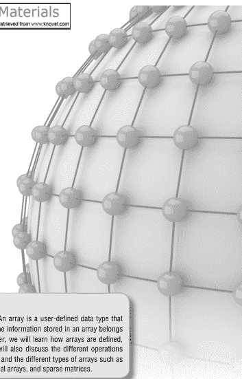

### 学习目标

在本章中，我们将讨论数组。数组是一种用户定义的数据类型，用于将相关信息存储在一起。数组中存储的所有信息都属于同一种数据类型。因此，在本章中，我们将学习如何定义、声明、初始化和访问数组。我们还将讨论可以对数组元素执行的不同操作以及不同类型的数组，例如二维数组、多维数组和稀疏矩阵。

## 3.1 简介

我们将使用类比来解释数组的概念。假设一个班级有 20 名学生，我们被要求编写一个程序来读取并打印所有 20 名学生的成绩。在这个程序中，我们需要 20 个名称不同的整型变量，如图 3.1 所示。

现在要读取这 20 个变量的值，必须有 20 条读取语句。同样，要打印这些变量的值，需要 20 条写入语句。如果只是 20 个变量，用户采用这种方法可能还可以接受。但是，如果我们需要读取并打印学生的成绩，情况会如何呢，

- 整个课程（例如 100 名学生）
- 整个学院（例如 500 名学生）
- 整个大学（例如 10,000 名学生）

答案是否定的，绝对不行！要处理大量数据，我们需要一种称为数组的数据结构。

数组是相似数据元素的集合。这些数据元素具有相同的数据类型。数组的元素存储在连续的内存位置中，并通过索引（也称为下标）引用。下标是一个序数，用于标识数组的一个元素。

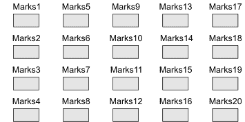

图 3.1 20 名学生的 20 个变量

## 3.2 数组的声明

我们已经看到，每个变量在使用前都必须声明。同样的概念也适用于数组变量。数组必须在使用前声明。声明数组意味着指定以下内容：

- 数据类型——它可以存储的值的类型，例如 int、char、float、double。
- 名称——用于标识数组。
- 大小——数组可以容纳的最大值数量。

数组使用以下语法声明：

```
type name[size];
```

type 可以是 int、float、double、char 或任何其他有效的数据类型。括号内的数字表示数组的大小，即可以存储在数组中的元素的最大数量。例如，如果我们写，

```
int marks[10];
```

则该语句将 marks 声明为包含 10 个元素的数组。在 C 语言中，数组索引从零开始。第一个元素将存储在 marks[0] 中，第二个元素将存储在 marks[1] 中，以此类推。因此，最后一个元素，即第 10 个元素，将存储在 marks[9] 中。请注意，方括号内的 0、1、2、3 是下标。在内存中，数组将如图 3.2 所示存储。

| 第 1 个元素 | 第 2 个元素 | 第 3 个元素 | 第 4 个元素 | 第 5 个元素 | 第 6 个元素 | 第 7 个元素 | 第 8 个元素 | 第 9 个元素 | 第 10 个元素 |
|---|---|---|---|---|---|---|---|---|---|
| marks[0] | marks[1] | marks[2] | marks[3] | marks[4] | marks[5] | marks[6] | marks[7] | marks[8] | marks[9] |

图 3.2 10 个元素数组的内存表示

图 3.3 显示了如何声明不同类型的数组。

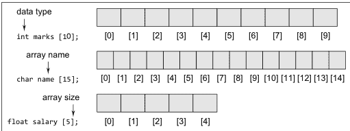

图 3.3 声明不同数据类型和大小的数组

## 3.3 访问数组元素

将相关数据项存储在单个数组中，使程序员能够开发简洁高效的程序。但是，没有单个函数可以对数组的所有元素进行操作。

```
// 将数组的每个元素设置为 -1
int marks[10];
for (i=0;i<10;i++)
marks[i] = -1;
```

要访问所有元素，必须使用循环。也就是说，我们可以通过改变数组中的下标值来访问数组的所有元素。但请注意，下标必须是整数值或计算结果为整数值的表达式。如图 3.2 所示，数组 marks[10] 的第一个元素可以通过编写 marks[0] 来访问。现在要处理数组的所有元素，我们使用如图 3.4 所示的循环。

图 3.4 将数组的每个元素初始化为 -1 的代码

图 3.5 显示了图 3.4 中所示代码的结果。该代码访问数组的每个单独元素并将其值设置为 -1。在 for 循环中，首先将 marks[0] 的值设置为 -1，然后将索引（i）的值递增，并将下一个值（即 marks[1]）设置为 -1。该过程持续进行，直到数组的所有 10 个元素都设置为 -1。

| -1 | -1 | -1 | -1 | -1 | -1 | -1 | -1 | -1 | -1 |
|---|---|---|---|---|---|---|---|---|---|
| [0] | [1] | [2] | [3] | [4] | [5] | [6] | [7] | [8] | [9] |

图 3.5 执行图 3.4 中给出的代码后的数组 marks

> **注意** 没有单个语句可以读取、访问或打印数组的所有元素。要做到这一点，我们必须使用循环以不同的索引值执行相同的语句。

### 3.3.1 计算数组元素的地址

你一定在想 C 语言如何知道数组中单个元素在内存中的位置。答案是，数组名是对数组第一个字节地址的符号引用。当我们使用数组名时，实际上是指数组的第一个字节。

下标或索引表示从数组开头到被引用元素的偏移量。也就是说，只需数组名和索引，C 语言就可以计算数组中任何元素的地址。

由于数组将其所有数据元素存储在连续的内存位置中，因此仅存储基地址（即数组中第一个元素的地址）就足够了。其他数据元素的地址可以简单地使用基地址来计算。执行此计算的公式是，

```
Address of data element, A[k] = BA(A) + w(k - lower_bound)
```

这里，A 是数组，k 是我们要计算其地址的元素的索引，BA 是数组 A 的基地址，w 是内存中一个元素的大小，例如，int 的大小为 2。

### 示例 3.1 给定数组 int marks[] = {99,67,78,56,88,90,34,85}，如果基地址 = 1000，计算 marks[4] 的地址。

### 解答

| 99 | 67 | 78 | 56 | 88 | 90 | 34 | 85 |
|---|---|---|---|---|---|---|---|
| marks[0] | marks[1] | marks[2] | marks[3] | marks[4] | marks[5] | marks[6] | marks[7] |
| 1000 | 1002 | 1004 | 1006 | 1008 | 1010 | 1012 | 1014 |

我们知道存储整数值需要 2 个字节，因此其大小为 2 个字节。

```
marks[4] = 1000 + 2(4 - 0)
= 1000 + 2 * 4 = 1008
```

### 3.3.2 计算数组的长度

数组的长度由其中存储的元素数量给出。计算数组长度的通用公式是

```
Length = upper_bound - lower_bound + 1
```

其中 upper_bound 是最后一个元素的索引，lower_bound 是数组中第一个元素的索引。

### 示例 3.2 设 Age[5] 为整数数组，使得
Age[0] = 2, Age[1] = 5, Age[2] = 3, Age[3] = 1, Age[4] = 7。

显示数组的内存表示并计算其长度。

### 解答

数组 Age[5] 的内存表示如下。

| 2 | 5 | 3 | 1 | 7 |
|---|---|---|---|---|
| Age[0] | Age[1] | Age[2] | Age[3] | Age[4] |

```
Length = upper_bound - lower_bound + 1
Here, lower_bound = 0, upper_bound = 4
Therefore, length = 4 - 0 + 1 = 5
```

## 3.4 在数组中存储值

当我们声明一个数组时，只是为其元素分配空间；数组中不存储任何值。有三种方法可以在数组中存储值。第一种是在声明期间初始化数组元素；第二种是从键盘输入单个元素的值；第三种是为单个元素赋值。如图 3.6 所示。


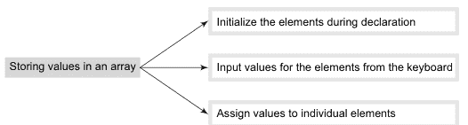

图 3.6 在数组中存储值

## 在声明期间初始化数组

数组的元素可以在声明时初始化，就像任何其他变量一样。当数组被初始化时，我们需要为数组中的每个元素提供一个值。数组的初始化通过编写，

```c
type array_name[size]={list of values};
```

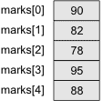

请注意，值写在花括号内，每个值之间用逗号分隔。指定的值超过数组中的元素数量是编译器错误。当我们写，

```c
int marks[5]={90, 82, 78, 95, 88};
```

将声明一个名为 marks 的数组，它有足够的空间存储五个元素。第一个元素，即 marks[0] 被赋值为 90。同样，数组的第二个元素，即 marks[1]，被赋值为 82，依此类推。如图 3.7 所示。

在声明时初始化数组时，程序员可以省略数组的大小。例如，

```c
int marks[]={ 98, 97, 90};
```

上述语句完全合法。在这里，编译器将为所有已初始化的元素分配足够的空间。请注意，如果提供的值的数量少于数组中的元素数量，未赋值的元素将填充为零。图 3.8 显示了数组元素的初始化。

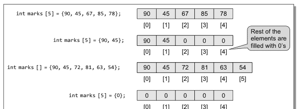

图 3.8 数组元素的初始化

```c
int i, marks[10];
for(i=0;i<10;++i)
 scanf("%d", &marks[i]);
```

图 3.9 输入数组每个元素的代码

## 从键盘输入值

可以通过从键盘输入值来初始化数组。
在此方法中，执行 while--do-while 或 for 循环来输入数组中每个元素的值。例如，查看图 3.9 中显示的代码。

在代码中，我们从索引 i 为 0 开始，并输入数组第一个元素的值。由于数组有 10 个元素，我们必须为索引从 0 变化到 9 的元素输入值。

## 为单个元素赋值

第三种方法是使用赋值运算符为数组的单个元素赋值。任何计算结果为与数组相同数据类型的值都可以赋给单个数组元素。一个简单的赋值语句可以写成

marks[3] = 100;
这里，100 被赋给数组的第四个元素，该元素指定为 marks[3]。

```c
int i, arr1[10], arr2[10];
arr1[10] = {0,1,2,3,4,5,6,7,8,9};
for(i=0;i<10;i++)
 arr2[i] = arr1[i];
```

图 3.10 在单个元素级别复制数组的代码

请注意，我们不能将一个数组赋给另一个数组，即使两个数组具有相同的类型和大小。要复制数组，必须将第一个数组的每个元素的值复制到第二个数组的元素中。图 3.10 说明了复制数组的代码。

在图 3.10 中，循环访问第一个数组的每个元素，并同时将其值赋给第二个数组的相应元素。索引值 i 递增以依次访问下一个元素。因此，当执行此代码时，arr2[0] = arr1[0]，arr2[1] = arr1[1]，arr2[2] = arr1[2]，依此类推。

我们也可以使用循环为数组元素赋予一组值。例如，如果我们想用偶数（从 0 开始）填充数组，那么我们将编写如图 3.11 所示的代码。

```c
// Fill an array with even numbers
int i, arr[10];
for(i=0;i<10;i+=2)
 arr[i] = i*2;
```

图 3.11 用偶数填充数组的代码

在代码中，我们为每个元素赋予等于其索引两倍的值，索引从 0 开始。因此，执行此代码后，我们将有 arr[0]=0，arr[1]=2，arr[2]=4，依此类推。

## 3.5 对数组的操作

可以对数组执行许多操作。这些操作包括：

- 遍历数组
- 在数组中插入元素
- 在数组中搜索元素
- 从数组中删除元素
- 合并两个数组
- 将数组按升序或降序排序

在本节中，我们将详细讨论所有这些操作，但搜索和排序除外，它们将在第 14 章中讨论。

### 3.5.1 遍历数组

遍历数组意味着为特定目的访问数组的每个元素。

遍历数组 A 的数据元素可以包括打印每个元素、计算元素总数，或对这些元素执行任何过程。由于数组是线性数据结构（因为其所有元素形成一个序列），遍历其元素非常简单直接。数组遍历的算法如图 3.12 所示。

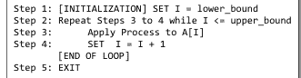

图 3.12 数组遍历算法

在第 1 步中，我们将索引初始化为数组的下界。在第 2 步中，执行一个 while 循环。第 3 步根据数组名和索引值处理单个数组元素。第 4 步递增索引值，以便可以处理下一个数组元素。第 2 步中的 while 循环将执行，直到数组中的所有元素都被处理，即直到 i 小于或等于数组的上界。

## 编程示例

- 1. 编写一个程序，使用数组读取和显示 n 个数字。

```c
#include <stdio.h>
#include <conio.h>
int main()
{
    int i, n, arr[20];
    clrscr();
    printf("\n Enter the number of elements in the array : ");
    scanf("%d", &n);
    for(i=0;i<n;i++)
    {
        printf("\n arr[%d] = ", i);
        scanf("%d",&arr[i]);
    }
    printf("\n The array elements are ");
    for(i=0;i<n;i++)
        printf("\t %d", arr[i]);
    return 0;
}
```

### 输出

请输入数组中的元素个数：5
arr[0] = 1
arr[1] = 2
arr[2] = 3
arr[3] = 4
arr[4] = 5
数组元素为 1 2 3 4 5

- 2. 编写一个程序，使用数组查找 n 个数字的平均值。

```c
#include <stdio.h>
#include <conio.h>
int main()
{
 int i, n, arr[20], sum =0;
 float mean = 0.0;
 clrscr();
 printf("\n Enter the number of elements in the array : ");
 scanf("%d", &n);
 for(i=0;i<n;i++)
 {
 printf("\n arr[%d] = ", i);
 scanf("%d",&arr[i]);
 }
 for(i=0;i<n;i++)
 sum += arr[i];
 mean = (float)sum/n;
 printf("\n The sum of the array elements = %d", sum);
 printf("\n The Mean of the array elements = %.2f", mean);
 return 0;
}
```

### 输出

请输入数组中的元素个数：5
arr[0] = 1
arr[1] = 2
arr[2] = 3
arr[3] = 4
arr[4] = 5
数组元素的总和 = 15
数组元素的平均值 = 3.00

- 3. 编写一个程序，使用数组打印 n 个数字中最小数字的位置。

```c
#include <stdio.h>
#include <conio.h>
int main()
{
 int i, n, arr[20], small, pos;
 clrscr();
 printf("\n Enter the number of elements in the array : ");
 scanf("%d", &n);
 printf("\n Enter the elements : ");
 for(i=0;i<n;i++)
 scanf("%d",&arr[i]);
 small = arr[0];
 pos = 0;
 for(i=1;i<n;i++)
 {
 if(arr[i]<small)
 {
 small = arr[i];
 pos = i;
 }
 }
 printf("\n The smallest element is : %d", small);
 printf("\n The position of the smallest element in the array is : %d", pos);
 return 0;
}
```

### 输出

请输入数组中的元素个数：5
请输入元素：7 6 5 14 3
最小元素是：3
数组中最小元素的位置是：4

- 4. 编写一个程序，使用数组查找 n 个数字中的第二大数字。

```c
#include <stdio.h>
#include <conio.h>
#include <math.h>
main()
{
    int i, n, arr[20], large, second_large;
    clrscr();
    printf("\n Enter the number of elements in the array : ");
    scanf("%d", &n);
    printf("\n Enter the elements");
    for(i=0;i<n;i++)
    scanf("%d",&arr[i]);
    large = arr[0];
    for(i=1;i<n;i++)
    {
    if(arr[i]>large)
    large = arr[i];
    }
    second_large = arr[1];
    for(i=0;i<n;i++)
    {
    if(arr[i] != large)
    {
    if(arr[i]>second_large)
    second_large = arr[i];
    }
    }
    printf("\n The numbers you entered are : ");
    for(i=0;i<n;i++)
    printf("%d ", arr[i]);
    printf("\n The largest of these numbers is : %d",large);
    printf("\n The second largest of these numbers is : %d",second_large);
    return 0;
}
```

### 输出

请输入数组中的元素个数：5
请输入元素 1 2 3 4 5
您输入的数字是：1 2 3 4 5
这些数字中最大的是：5
这些数字中第二大的是：4

- 5. 编写一个程序，输入 n 个数字。使用这些数字形成一个数字。

```c
#include <stdio.h>
#include <conio.h>
#include <math.h>
main()
{
    int number=0, digit[10], numofdigits,i;
    clrscr();
    printf("\n Enter the number of digits : ");
    scanf("%d", &numofdigits);
    for(i=0;i<numofdigits;i++)
    {
    printf("\n Enter the digit at position %d", i+1);
```


```c
scanf("%d", &digit[i]);
i=0;
while(i<numofdigits)
{
    number = number + digit[i] * pow(10,i);
    i++;
}
printf("\n The number is : %d", number);
return 0;
}
```

### 输出

输入位数的数量：4
在位置 1 输入的数字：2
在位置 2 输入的数字：3
在位置 3 输入的数字：0
在位置 4 输入的数字：9
数字是：9032

## 6. 编写一个程序，判断整数数组是否包含重复数字。

```c
#include <stdio.h>
#include <conio.h>
int main()
{
    int array[10], i, n, j, flag =0;
    clrscr();
    printf("\n Enter the size of the array : ");
    scanf("%d", &n);
    for(i=0;i<n;i++)
    {
        printf("\n array[%d] = ", i);
        scanf("%d", &array[i]);
    }
    for(i=0;i<n;i++)
    {
        for(j=i+1;j<n;j++)
        {
            if(array[i] == array[j] && i!=j)
            {
                flag =1;
                printf("\n Duplicate numbers found at locations %d and %d", i, j);
            }
        }
    }
    if(flag==0)
    printf("\n No Duplicates Found");
    return 0;
}
```

### 输出

输入数组的大小：5
array[0] = 1
array[1] = 2
array[2] = 3
array[3] = 2
array[4] = 5
在位置 1 和 3 处找到重复数字

### 3.5.2 在数组中插入元素

```
Step 1: Set upper_bound = upper_bound + 1
Step 2: Set A[upper_bound] = VAL
Step 3: EXIT
```

图 3.13 向现有数组追加新元素的算法

如果需要在现有数组的末尾插入元素，则插入任务非常简单。我们只需将 upper_bound 加 1 并赋值即可。这里，我们假设为数组分配的内存空间仍然可用。例如，如果数组被声明为包含 10 个元素，但当前只有 8 个可用元素，那么显然有空间容纳两个更多元素。但如果它已经有 10 个元素，则无法再添加另一个元素。

图 3.13 显示了向数组末尾插入新元素的算法。在第 1 步中，我们递增 upper_bound 的值。在第 2 步中，新值存储在 upper_bound 指向的位置。例如，假设数组已按如下方式声明

```c
int marks[60];
```

该数组声明用于存储班上所有学生的成绩。现在，假设有 54 名学生，一名新学生来了并被要求参加同一测试。这名新学生的成绩将存储在 marks[55] 中。假设该学生获得了 68 分，我们将赋值为

```c
marks[55] = 68;
```

但是，如果我们需要在数组中间插入元素，则这并非一件简单的事情。平均而言，我们可能需要将多达一半的元素从其位置移动，以便为新元素腾出空间。

例如，考虑一个元素按升序排列的数组。现在，如果需要添加新元素，它可能需要添加到数组中间的某个位置。为此，我们必须先找到新元素将被插入的位置，然后将所有（值大于新元素的）元素向右移动一个位置，以便为新值腾出空间。

示例 3.3 Data[] 是一个声明为 int Data[20]; 的数组，包含以下值：

```c
Data[] = { 12, 23, 34, 45, 56, 67, 78, 89, 90, 100};
```

- (a) 计算数组的长度。
- (b) 查找 upper_bound 和 lower_bound。
- (c) 显示数组的内存表示。
- (d) 如果要插入值为 75 的新数据元素，查找其位置。
- (e) 插入新数据元素 75 并显示插入后的内存表示。

### 解答

- (a) 数组长度 = 元素个数
  因此，数组长度 = 10

- (b) 默认情况下，lower_bound = 0，upper_bound = 9

| 12 | 23 | 34 | 45 | 56 | 67 | 78 | 89 | 90 | 100 |
|---|---|---|---|---|---|---|---|---|---|
| Data[0] | Data[1] | Data[2] | Data[3] | Data[4] | Data[5] | Data[6] | Data[7] | Data[8] | Data[9] |

- (d) 由于数组元素按升序存储，新数据元素将存储在 67 之后，即第 6 个位置。因此，从第 6 个位置开始的所有数组元素将向右移动一个位置，以容纳新值

| 12 | 23 | 34 | 45 | 56 | 67 | 75 | 78 | 89 | 90 | 100 |
|---|---|---|---|---|---|---|---|---|---|---|
| Data[0] | Data[1] | Data[2] | Data[3] | Data[4] | Data[5] | Data[6] | Data[7] | Data[8] | Data[9] | Data[10] |

## 在数组中间插入元素的算法

算法 INSERT 将声明为 INSERT (A, N, POS, VAL)。参数如下

- (a) A，要插入元素的数组
- (b) N，数组中的元素个数
- (c) pos，要插入元素的位置
- (d) val，要插入的值

```
Step 1: [INITIALIZATION] SET I = N
Step 2: Repeat Steps 3 and 4 while I >= POS
Step 3: SET A[I + 1] = A[I]
Step 4: SET I = I - 1
[END OF LOOP]
Step 5: SET N = N + 1
Step 6: SET A[POS] = VAL
Step 7: EXIT
```

图 3.14 在数组中间插入元素的算法。

在图 3.14 给出的算法中，在第 1 步中，我们首先用数组中的元素总数初始化 I。在第 2 步中，执行一个 while 循环，将所有索引大于 pos 的元素向右移动一个位置，以便为新元素腾出空间。在第 5 步中，我们将数组中的元素总数加 1，最后在第 6 步中，将新值插入所需位置。

现在，让我们通过一个示例来可视化此算法。

初始 data[] 如下所示。

| 45 | 23 | 34 | 12 | 56 | 20 |
|---|---|---|---|---|---|
| Data[0] | Data[1] | Data[2] | Data[3] | Data[4] | Data[5] |

调用 INSERT (Data, 6, 3, 100) 将导致数组中出现以下处理过程：

| 45 | 23 | 34 | 12 | 56 | 20 | 20 |
|---|---|---|---|---|---|---|
| Data[0] | Data[1] | Data[2] | Data[3] | Data[4] | Data[5] | Data[6] |

| 45 | 23 | 34 | 12 | 56 | 56 | 20 |
|---|---|---|---|---|---|---|
| Data[0] | Data[1] | Data[2] | Data[3] | Data[4] | Data[5] | Data[6] |

| 45 | 23 | 34 | 12 | 12 | 56 | 20 |
|---|---|---|---|---|---|---|
| Data[0] | Data[1] | Data[2] | Data[3] | Data[4] | Data[5] | Data[6] |

| 45 | 23 | 34 | 100 | 12 | 56 | 20 |
|---|---|---|---|---|---|---|
| Data[0] | Data[1] | Data[2] | Data[3] | Data[4] | Data[5] | Data[6] |

## 编程示例

## 7. 编写一个程序，在数组的指定位置插入一个数字。

```c
#include <stdio.h>
#include <conio.h>
int main()
{
    int i, n, num, pos, arr[10];
    clrscr();
    printf("\n Enter the number of elements in the array : ");
    scanf("%d", &n);
    for(i=0;i<n;i++)
    {
        printf("\n arr[%d] = ", i);
        scanf("%d", &arr[i]);
    }
    printf("\n Enter the number to be inserted : ");
    scanf("%d", &num);
    printf("\n Enter the position at which the number has to be added : ");
    scanf("%d", &pos);
    for(i=n-1;i>=pos-1;i--)
        arr[i+1]=arr[i];
    arr[pos-1] = num;
    n = n+1;
    printf("\n The array after insertion of %d is : ", num);
    for(i=0;i<n;i++)
    {
        printf("\n arr[%d] = %d", i, arr[i]);
    }
    getch();
    return 0;
}
```

### 输出

输入数组中元素的数量：5
arr[0] = 1
arr[1] = 2
arr[2] = 3
arr[3] = 4
arr[4] = 5
要插入的数字：0
要添加数字的位置：3
插入 0 后的数组为：
arr[0] = 1
arr[1] = 2
arr[2] = 0
arr[3] = 3
arr[4] = 4
arr[5] = 5

## 8. 编写一个程序，在已按升序排序的数组中插入一个数字。

```c
#include <stdio.h>
#include <conio.h>
int main()
{
    int i, j, n, num, arr[10];
    clrscr();
    printf("\n Enter the number of elements in the array : ");
    scanf("%d", &n);
    for(i=0;i<n;i++)
    {
        printf("\n arr[%d] = ", i);
        scanf("%d", &arr[i]);
    }
    printf("\n Enter the number to be inserted : ");
```


```c
scanf("%d", &num);
for(i=0;i<n;i++)
{
if(arr[i] > num)
{
for(j = n-1; j>=i; j--)
arr[j+1] = arr[j];
arr[i] = num;
break;
}
}
}
n = n+1;
printf("\n The array after insertion of %d is : ", num);
for(i=0;i<n;i++)
printf("\n arr[%d] = %d", i, arr[i]);
getch();
return 0;
```

### 输出

输入数组中的元素个数：5
arr[0] = 1
arr[1] = 2
arr[2] = 4
arr[3] = 5
arr[4] = 6
要插入的数字：3
插入 3 后的数组为：
arr[0] = 1
arr[1] = 2
arr[2] = 3
arr[3] = 4
arr[4] = 5
arr[5] = 6

### 3.5.3 从数组中删除元素

从数组中删除元素意味着从已存在的数组中移除一个数据元素。如果要从现有数组的末尾删除元素，那么删除任务就非常简单。我们只需将 upper_bound 减 1 即可。图 3.15 显示了从数组末尾删除元素的算法。

例如，假设有一个声明为 int marks[60] 的数组；

该数组用于存储班上所有学生的成绩。现在，假设有 54 名学生，学号为 54 的学生退课了。该学生的分数存储在 marks[54] 中。我们只需将 upper_bound 减 1。将 upper_bound 减 1 将指示数组中有 53 个有效数据。

但是，如果要从数组中间删除元素，则不是一项简单的任务。平均情况下，我们可能需要将多达一半的元素从其位置移动，以占据被删除元素的空间。

- 步骤 1：SET upper_bound = upper_bound - 1
- 步骤 2：EXIT

图 3.15 删除数组最后一个元素的算法

任务。平均情况下，我们可能需要将多达一半的元素从其位置移动，以占据被删除元素的空间。例如，考虑一个元素按升序排列的数组。现在，假设要删除一个元素，可能位于数组中间的某个位置。为此，我们必须首先找到要删除元素的位置，然后将所有（值大于该元素的）元素向左移动一个位置，以便被删除元素留出的空间可以由其余元素占据。

## 示例 3.4

Data[] 是一个声明为 int Data[10] 的数组，包含以下值：
Data[] = { 12, 23, 34, 45, 56, 67, 78, 89, 90, 100};
(a) 如果要删除值为 56 的数据元素，请找出其位置。
(b) 删除数据元素 56，并显示删除后的内存表示。

## 解答

(a) 由于数组中的元素按升序存储，我们将要删除的值与数组中每个元素的值进行比较。一旦 val = Data[i]，其中 i 是数组的索引或下标，我们就能得到要删除元素的位置。例如，观察这个数组，这里 val = 56。Data[0] = 12，不等于 56。我们将继续比较，最终得到 pos = 4。

| 12 | 23 | 34 | 45 | 67 | 78 | 89 | 90 | 100 |
|---|---|---|---|---|---|---|---|---|
| Data[0] | Data[1] | Data[2] | Data[3] | Data[4] | Data[5] | Data[6] | Data[7] | Data[8] |

```
Step 1: [INITIALIZATION] SET I = POS
Step 2: Repeat Steps 3 and 4 while I < N - 1
Step 3: SET A[I] = A[I + 1]
Step 4: SET I = I + 1
[END OF LOOP]
Step 5: SET N = N - 1
Step 6: EXIT
```

## 图 3.16 从数组中间删除元素的算法

| 45 | 23 | 34 | 12 | 56 | 20 |
|---|---|---|---|---|---|
| Data[0] | Data[1] | Data[2] | Data[3] | Data[4] | Data[5] |

| 45 | 23 | 12 | 12 | 56 | 20 |
|---|---|---|---|---|---|
| Data[0] | Data[1] | Data[2] | Data[3] | Data[4] | Data[5] |

| 45 | 23 | 12 | 56 | 56 | 20 |
|---|---|---|---|---|---|
| Data[0] | Data[1] | Data[2] | Data[3] | Data[4] | Data[5] |

| 45 | 23 | 12 | 56 | 20 | 20 |
|---|---|---|---|---|---|
| Data[0] | Data[1] | Data[2] | Data[3] | Data[4] | Data[5] |

| 45 | 23 | 12 | 56 | 20 |
|---|---|---|---|---|
| Data[0] | Data[1] | Data[2] | Data[3] | Data[4] |

## 图 3.17 从数组中删除元素

## 从数组中间删除元素的算法

- 算法 DELETE 将声明为 DELETE(A, N, POS)。参数如下：
- (a) A，要从中删除元素的数组
- (b) N，数组中的元素个数
- (c) POS，要从中删除元素的位置

图 3.16 显示了该算法，其中我们首先用要删除元素的位置初始化 i。在步骤 2 中，将执行一个 while 循环，将所有索引大于 pos 的元素向左移动一个位置，以占据被删除元素留出的空间。当我们说正在删除一个元素时，实际上是用其后继元素的值覆盖该元素。在步骤 5 中，我们将数组中的元素总数减 1。
现在，让我们通过图 3.17 给出的示例来可视化此算法。调用 DELETE (data, 6, 2) 将导致数组中出现以下处理过程。

## 9. 编写一个程序，从数组的给定位置删除一个数字。

```c
#include <stdio.h>
#include <conio.h>
int main()
{
    int i, n, pos, arr[10];
    clrscr();
    printf("\n Enter the number of elements in the array : ");
    scanf("%d", &n);
    for(i=0;i<n;++i)
    {
        printf("\n arr[%d] = ", i);
        scanf("%d", &arr[i]);
    }
    printf("\n Enter the position from which the number has to be deleted : ");
    scanf("%d", &pos);
    for(i=pos-1; i<n-1;++i)
        arr[i] = arr[i+1];
    n--;
    printf("\n The array after deletion is : ");
    for(i=0;i<n;++i)
        printf("\n arr[%d] = %d", i, arr[i]);
    getch();
    return 0;
}
```

## 输出

输入数组中的元素个数：5
arr[0] = 1
arr[1] = 2
arr[2] = 3
arr[3] = 4
arr[4] = 5
要从中删除数字的位置：3
删除后的数组为：
arr[0] = 1
arr[1] = 2
arr[2] = 4
arr[3] = 5

## 10. 编写一个程序，从已按升序排序的数组中删除一个数字。

```c
#include <stdio.h>
#include <conio.h>
int main()
{
    int i, n, j, num, arr[10];
    clrscr();
    printf("\n Enter the number of elements in the array : ");
    scanf("%d", &n);
    for(i=0;i<n;++i)
    {
        printf("\n arr[%d] = ", i);
        scanf("%d", &arr[i]);
    }
    printf("\n Enter the number to be deleted : ");
    scanf("%d", &num);
    for(i=0;i<n;i++)
    {
        if(arr[i] == num)
        {
            for(j=i; j<n-1;j++)
            arr[j] = arr[j+1];
        }
    }
    n = n-1;
    printf("\n The array after deletion is : ");
    for(i=0;i<n;i++)
    printf("\n arr[%d] = %d", i, arr[i]);
    getch();
    return 0;
}
```

## 输出

输入数组中的元素个数：5
arr[0] = 1
arr[1] = 2
arr[2] = 3
arr[3] = 4
arr[4] = 5
要删除的数字：3
删除后的数组为：
arr[0] = 1
arr[1] = 2
arr[2] = 4
arr[3] = 5

### 3.5.4 合并两个数组

将两个数组合并到第三个数组中，意味着首先将第一个数组的内容复制到第三个数组，然后将第二个数组的内容复制到第三个数组。因此，合并后的数组包含第一个数组的内容，后跟第二个数组的内容。

如果数组是无序的，那么合并数组非常简单，只需将一个数组的内容复制到另一个数组中即可。但是，当两个数组都是有序的且合并后的数组也需要有序时，合并就不是一项简单的任务。让我们先讨论无序数组上的合并操作。此操作如图 3.18 所示。

| 数组 1- | 90 | 56 | 89 | 77 | 69 | |
| --- | --- | --- | --- | --- | --- | --- |
| 数组 2- | 45 | 88 | 76 | 99 | 12 | 58 | 81 |
| 数组 3- | 90 | 56 | 89 | 77 | 69 | 45 | 88 | 76 | 99 | 12 | 58 | 81 |

图 3.18 两个无序数组的合并

## 编程示例

## 11. 编写一个程序，合并两个无序数组。

```c
#include <stdio.h>
#include <conio.h>
int main()
```


```c
{
    int arr1[10], arr2[10], arr3[20];
    int i, n1, n2, m, index=0;
    clrscr();
    printf("\n Enter the number of elements in array1 : ");
    scanf("%d", &n1);
    printf("\n\n Enter the elements of the first array");
    for(i=0;i<n1;i++)
    {
        printf("\n arr1[%d] = ", i);
        scanf("%d", &arr1[i]);
    }
    printf("\n Enter the number of elements in array2 : ");
    scanf("%d", &n2);
    printf("\n\n Enter the elements of the second array");
    for(i=0;i<n2;i++)
    {
        printf("\n arr2[%d] = ", i);
        scanf("%d", &arr2[i]);
    }
    m = n1 + n2;
    for(i=0;i<n1;i++)
    {
        arr3[index] = arr1[i];
        index++;
    }
    for(i=0;i<n2;i++)
    {
        arr3[index] = arr2[i];
        index++;
    }
    printf("\n\n The merged array is");
    for(i=0;i<m;i++)
        printf("\n arr3[%d] = %d", i, arr3[i]);
    getch();
    return 0;
}
```

### 输出

输入数组1的元素个数：3
输入第一个数组的元素
arr1[0] = 1
arr1[1] = 2
arr1[2] = 3
输入数组2的元素个数：3
输入第二个数组的元素
arr2[0] = 4
arr2[1] = 5
arr2[2] = 6
合并后的数组是
arr3[0] = 1
arr3[1] = 2
arr3[2] = 3
arr3[3] = 4
arr3[4] = 5
arr3[5] = 6

如果有两个已排序数组，且合并后的结果数组也需要是已排序的，那么合并数组的任务就变得稍微困难一些。合并任务可以使用图 3.19 来解释。

| 数组 | 1 | 2 | 3 | 4 | 5 | 6 | 7 | 8 | 9 | 10 | 11 | 12 |
| --- | --- | --- | --- | --- | --- | --- | --- | --- | --- | --- | --- | --- |
| 数组 1 | 20 | 30 | 40 | 50 | 60 | | | | | | | |
| 数组 2 | 15 | 22 | 31 | 45 | 56 | 62 | 78 | | | | | | |
| 数组 3 | 15 | 20 | 22 | 30 | 31 | 40 | 45 | 50 | 56 | 60 | 62 | 78 |

图 3.19 两个已排序数组的合并

图 3.19 展示了如何使用两个已排序数组形成合并数组。首先，我们比较数组 1 的第 1 个元素与数组 2 的第 1 个元素，然后将较小的元素放入合并数组。由于 20 > 15，我们将 15 作为合并数组的第一个元素。接着，我们比较第二个数组的第 2 个元素与第一个数组的第 1 个元素。由于 20 < 22，现在 20 被存储为合并数组的第二个元素。接下来，第一个数组的第 2 个元素与第二个数组的第 2 个元素进行比较。由于 30 > 22，我们将 22 存储为合并数组的第三个元素。现在，我们将比较第一个数组的第 2 个元素与第二个数组的第 3 个元素。因为 30 < 31，我们将 30 存储为合并数组的第 4 个元素。此过程将重复进行，直到两个数组的所有元素都被放置在合并数组的正确位置上。

## 编程示例

### 12. 编写一个程序来合并两个已排序数组。

```c
#include <stdio.h>
#include <conio.h>
int main()
{
int arr1[10], arr2[10], arr3[20];
int i, n1, n2, m, index=0;
int index_first = 0, index_second = 0;
clrscr();
printf("\n Enter the number of elements in array1 : ");
scanf("%d", &n1);
printf("\n\n Enter the elements of the first array");
for(i=0;i<n1;i++)
{
printf("\n\n arr1[%d] = ", i);
scanf("%d", &arr1[i]);
}
printf("\n Enter the number of elements in array2 : ");
scanf("%d", &n2);
printf("\n\n Enter the elements of the second array");
for(i=0;i<n2;i++)
{
printf("\n\n arr2[%d] = ", i);
scanf("%d", &arr2[i]);
}
m = n1+n2;
while(index_first < n1 && index_second < n2)
{
if(arr1[index_first]<arr2[index_second])
{
    arr3[index] = arr1[index_first];
    index_first++;
}
else
{
    arr3[index] = arr2[index_second];
    index_second++;
}
index++;
}
// if elements of the first array are over and the second array has some elements
if(index_first == n1)
{
    while(index_second<n2)
    {
        arr3[index] = arr2[index_second];
        index_second++;
        index++;
    }
}
// if elements of the second array are over and the first array has some elements
else if(index_second == n2)
{
    while(index_first<n1)
    {
        arr3[index] = arr1[index_first];
        index_first++;
        index++;
    }
}
printf("\n\n The merged array is");
for(i=0;i<m;i++)
    printf("\n arr3[%d] = %d", i, arr3[i]);
getch();
return 0;
}
```

### 输出

输入数组1的元素个数：3
输入第一个数组的元素
arr1[0] = 1
arr1[1] = 3
arr1[2] = 5
输入数组2的元素个数：3
输入第二个数组的元素
arr2[0] = 2
arr2[1] = 4
arr2[2] = 6
合并后的数组是
arr3[0] = 1
arr3[1] = 2
arr3[2] = 3
arr3[3] = 4
arr3[4] = 5
arr3[5] = 6

## 3.6 将数组传递给函数

与其他数据类型的变量一样，我们也可以将数组传递给函数。在某些情况下，您可能希望传递数组的单个元素；而在其他情况下，您可能希望传递整个数组。在本节中，我们将讨论这两种情况。请看图 3.20，它将帮助您理解这一概念。

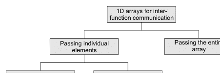

图 3.20 用于函数间通信的一维数组

### 3.6.1 传递单个元素

数组的单个元素可以通过传递其数据值或地址来传递给函数。

### 传递数据值

单个元素的传递方式与传递任何其他数据类型的变量相同。唯一的条件是数组元素的数据类型必须与函数参数的类型匹配。请看图 3.21(a)，它展示了通过传递数据值来传递单个数组元素的代码。

```
Calling function
main()
{
    int arr[5] = {1, 2, 3, 4, 5};
    func(arr[3]);
}

Called function
void func(int num)
{
    printf("%d", num);
}
```

图 3.21(a) 将单个数组元素的值传递给函数

在上面的示例中，只有一个数组元素被传递给被调用函数。这是通过使用索引表达式完成的。在这里，arr[3] 求值为一个单一的整数值。被调用函数几乎不关心传递给它的是普通整数变量还是数组值。

### 传递地址

与普通变量一样，我们可以通过在带索引的数组元素前加上地址运算符来传递单个数组元素的地址。因此，要将数组第四个元素的地址传递给被调用函数，我们将编写 &arr[3]。

然而，在被调用函数中，必须使用间接（*）运算符来访问数组元素的值。请看图 3.21(b) 中显示的代码。

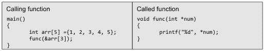

图 3.21(b) 将单个数组元素的地址传递给函数

### 3.6.2 传递整个数组

我们已经讨论过，在 C 语言中，数组名指的是内存中数组的第一个字节。数组中其余元素的地址可以使用数组名和元素的索引值来计算。因此，当我们需要将整个数组传递给函数时，可以直接传递数组名。图 3.22 说明了将整个数组传递给被调用函数的代码。

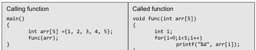

图 3.22 将整个数组传递给函数

接受数组的函数可以以下列两种方式之一声明形参。

```
func(int arr[]); or func(int *arr);
```

当我们将数组名传递给函数时，数组的第 0 个元素的地址会被复制到函数中的局部指针变量。当形参在函数头中声明为数组时，它被解释为指向变量的指针，而不是数组。使用这个指针变量，您可以通过表达式 `array_name + index` 访问数组的所有元素。您也可以将数组的大小作为另一个参数传递给函数。因此，对于接受数组作为参数的函数，声明应如下所示。

```
func(int arr[], int n); or func(int *arr, int n);
```

没有必要将整个数组传递给函数。我们也可以传递数组的一部分，称为子数组。指向子数组的指针也是数组指针。例如，如果我们想要从第三个元素开始发送数组，则可以传递第三个元素的地址和子数组的大小，也就是说，如果数组中有 10 个元素，并且我们想要从第三个元素开始传递数组，那么只有 8 个元素会成为子数组的一部分。因此，函数调用可以写成

```
func(&arr[2], 8);
```

请注意，如果我们希望被调用函数不对数组进行任何更改，则数组必须作为常量数组被被调用函数接收。这可以防止对数组元素进行任何类型的无意修改。要将数组声明为常量数组，只需在数组的数据类型前添加关键字 const 即可。

请看以下程序，它们展示了使用指针将数组传递给函数的用法。


## 编程示例

### 13. 编写一个程序，读取包含 n 个数字的数组，然后找出最小的数字。

```c
#include <stdio.h>
#include <conio.h>
void read_array(int arr[], int n);
int find_smallest(int arr[], int n);
int main()
{
    int num[10], n, smallest;
    clrscr();
    printf("\n Enter the size of the array : ");
    scanf("%d", &n);
    read_array(num, n);
    smallest = find_smallest(num, n);
    printf("\n The smallest number in the array is = %d", smallest);
    getch();
    return 0;
}
void read_array(int arr[10], int n)
{
    int i;
    for(i=0;i<n;i++)
    {
        printf("\n arr[%d] = ", i);
        scanf("%d", &arr[i]);
    }
}
int find_smallest(int arr[10], int n)
{
    int i=0, small = arr[0];
    for(i=1;i<n;i++)
    {
        if(arr[i] < small)
        small = arr[i];
    }
    return small;
}
```

### 输出

输入数组的大小：5
arr[0] = 1
arr[1] = 2
arr[2] = 3
arr[3] = 4
arr[4] = 5
数组中最小的数字是 = 1

### 14. 编写一个程序，交换数组中最大和最小的数字。

```c
#include <stdio.h>
#include <conio.h>
void read_array(int my_array[], int);
void display_array(int my_array[], int);
int interchange(int arr[], int);
int find_biggest_pos(int my_array[10], int n);
int find_smallest_pos(int my_array[10], int n);
int main()
{
    int arr[10], n;
    clrscr();
    printf("\n Enter the size of the array : ");
    scanf("%d", &n);
    read_array(arr, n);
    interchange(arr, n);
    printf("\n The new array is : ");
    display_array(arr,n);
    getch();
    return 0;
}

void read_array(int my_array[10], int n)
{
    int i;
    for(i=0;i<n;i++)
    {
        printf("\n arr[%d] = ", i);
        scanf("%d", &my_array[i]);
    }
}

void display_array(int my_array[10], int n)
{
    int i;
    for(i=0;i<n;i++)
    printf("\n arr[%d] = %d", i, my_array[i]);
}

void interchange(int my_array[10], int n)
{
    int temp, big_pos, small_pos;
    big_pos = find_biggest_pos(my_array, n);
    small_pos = find_smallest_pos(my_array,n);
    temp = my_array[big_pos];
    my_array[big_pos] = my_array[small_pos];
    my_array[small_pos] = temp;
}

int find_biggest_pos(int my_array[10], int n)
{
    int i, large = my_array[0], pos=0;
    for(i=1;i<n;i++)
    {
        if (my_array[i] > large)
        {
            large = my_array[i];
            pos=i;
        }
    }
    return pos;
}

int find_smallest_pos(int my_array[10], int n)
{
    int i, small = my_array[0], pos=0;
    for(i=1;i<n;i++)
    {
        if (my_array[i] < small)
        {
            small = my_array[i];
            pos=i;
        }
    }
    return pos;
}
```

### 输出

输入数组的大小：5
arr[0] = 5
arr[1] = 1
arr[2] = 6
arr[3] = 3
arr[4] = 2
新数组是：
arr[0] = 5
arr[1] = 6
arr[2] = 1
arr[3] = 3
arr[4] = 2

| 1 | 2 | 3 | 4 | 5 |
|---|---|---|---|---|
| arr[0] | arr[1] | arr[2] | arr[3] | arr[4] |
| 1000 | 1002 | 1004 | 1006 | 1008 |

图 3.23 arr[] 的内存表示

## 3.7 指针和数组

数组的概念与指针的概念紧密相关。考虑图 3.23。例如，如果我们有一个声明为 int arr[] = { 1, 2, 3, 4, 5}; 的数组，那么在内存中它将如图 3.23 所示存储。

数组表示法是指针表示法的一种形式。数组名是数组在内存中的起始地址。它也称为基地址。换句话说，基地址是数组中第一个元素的地址，即 arr[0] 的地址。现在让我们使用如下语句中的指针变量：int *ptr; ptr = &arr[0];

> **编程提示**
> 数组名实际上是一个指向数组第一个元素的指针。

这里，ptr 被指向数组的第一个元素。执行下面给出的代码并观察输出，这将使你清楚这个概念。main() { int arr[]={1,2,3,4,5}; printf("\n Address of array = %p %p", arr, &arr[0], &arr); }

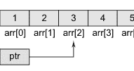

同样，编写 ptr = &arr[2] 使 ptr 指向索引为 2 的数组的第三个元素。图 3.24 显示 ptr 指向数组的第三个元素。

如果指针变量 ptr 保存数组中第一个元素的地址，那么可以通过编写 ptr++ 来计算后续元素的地址。int *ptr = &arr[0]; ptr++; printf("\n The value of the second element of the array is %d", *ptr);

> **编程提示**
> 如果尝试更改数组的地址，将生成错误。

printf() 函数将打印值 2，因为 ptr 递增后指向下一个位置。这里需要注意的是，如果 x 是整数变量，那么 x++ 会给 x 的值加 1。但 ptr 是指针变量，所以当我们写 ptr+1 时，加 1 会得到一个指针，它指向比原始指针更远 1 个元素的数组位置。

由于 ++ptr 和 ptr++ 都等同于 ptr+1，使用一元 ++ 运算符递增指针，会将其存储的地址增加 sizeof(type) 给出的量，其中 type 是它指向的变量的数据类型（即，整数为 2）。例如，考虑图 3.25。

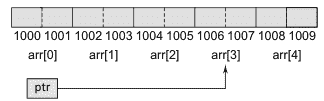

图 3.25 指针（ptr）指向数组的第四个元素

> **编程提示**
> 当数组被传递给函数时，我们实际上是将指针传递给函数。因此，在函数声明中，必须声明一个指针来接收数组名。

如果 ptr 最初指向 arr[2]，那么 ptr++ 将使其指向下一个元素，即 arr[3]。这在图 3.25 中显示。

如果这是一个字符数组，内存中的每个字节都将用于存储单个字符，ptr++ 将只给 ptr 的地址加 1 个字节。

使用指针时，像 arr[1] 这样的表达式等同于写入 (*(arr+1))。

许多初学者会因为将数组名视为指针而感到困惑。

```c
ptr = arr; // ptr = &arr[0]
```

我们不能写
arr = ptr;

这是因为虽然 ptr 是变量，但 arr 是常量。一旦 arr[] 被声明，arr 中第一个元素将被存储的位置就无法更改。因此，数组名通常被称为常量指针。

总结来说，数组名等同于其第一个元素的地址，就像指针等同于它所指向元素的地址一样。因此，数组和指针使用相同的概念。

**注意** arr[i]、i[arr]、*(arr+i)、(*(arr+i)) 给出相同的值。

查看以下代码，该代码使用指向数组的指针修改数组的内容。

```c
int main()
{
    int arr[]={1,2,3,4,5};
    int *ptr, i;
    ptr=&arr[2];
    *ptr = -1;
    *(ptr+1) = 0;
    *(ptr-1) = 1;
    printf("\n In Array is. ");
    for(i=0;i<5;i++)
        printf("\n%d", *(arr+i));
    return 0;
}
```

### 输出

数组是：1 1 -1 0 5

在 C 中，我们可以从指针中加减一个整数以获得一个新指针，该指针指向原始位置以外的某个位置。C 还允许两个指针变量之间进行加法和减法。例如，查看以下给出的代码。

```c
int main()
{
    int arr[]={1,2,3,4,5,6,7,8,9};
    int *ptr1, *ptr2;
    ptr1 = arr;
    ptr2 = arr+4;
    printf("%d", ptr2-ptr1);
    return 0;
}
```

### 输出

在代码中，ptr1 和 ptr2 是指向同一数组元素的指针。只要它们指向同一数组，我们就可以相减两个指针。在这里，输出是 2，因为在数组 arr 中 ptr1 和 ptr2 之间有两个元素。两个指针都必须指向同一数组或数组末尾之后的一个位置，否则此行为无法定义。

此外，C 还允许将指针变量彼此进行比较。显然，如果两个指针相等，那么它们指向数组中的同一位置。但是，如果一个指针小于另一个，则意味着该指针指向数组开头附近的某个元素。与其他变量一样，关系运算符（>、<、== 等）也可以应用于指针变量。

## 编程示例

### 15. 编写一个程序以显示给定数字的数组。

```c
#include <stdio.h>
int main()
{
    int arr[]={1,2,3,4,5,6,7,8,9};
    int *ptr1, *ptr2;
    ptr1 = arr;
    ptr2 = &arr[8];
    while(ptr1<=ptr2)
    {
        printf("%d ", *ptr1);
        ptr1++;
    }
    return 0;
}
```

### 输出

1 2 3 4 5 6 7 8 9

## 3.8 指针数组

指针数组可以声明为

```c
int *ptr[10];
```

上述语句声明了一个包含 10 个指针的数组，其中每个指针都指向一个整数变量。例如，查看以下给出的代码。


int *ptr[10];
int p = 1, q = 2, r = 3, s = 4, t = 5;
ptr[0] = &p;
ptr[1] = &q;
ptr[2] = &r;
ptr[3] = &s;
ptr[4] = &t;

你能告诉我下面语句的输出结果吗？

```
printf("%d", *ptr[3]);
```

输出将是 4，因为 ptr[3] 存储的是整型变量 s 的地址，而 *ptr[3] 因此将打印 s 的值，即 4。现在看另一段代码，其中我们将三个独立数组的地址存储在指针数组中：

```
int main()
{
    int arr1[]={1,2,3,4,5};
    int arr2[]={0,2,4,6,8};
    int arr3[]={1,3,5,7,9};
    int *parr[3] = {arr1, arr2, arr3};
    int i;
    for(i = 0;i<3;++i)
        printf("%d\n", *parr[i]);
    return 0;
}
```

输出
1 0 1

对这个输出感到惊讶吗？试着理解这个概念。在 for 循环中，parr[0] 存储的是 arr1 的基地址（即 &arr1[0]）。因此，编写 `*parr[0]` 将打印 `&arr1[0]` 处存储的值。`*parr[1]` 和 `*parr[2]` 的情况也是如此。

## 3.9 二维数组

到目前为止，我们只讨论过一维数组。一维数组仅在一个方向上线性组织。但有时，我们需要以网格或表格的形式存储数据。在这里，一维数组的概念被扩展以包含二维数据结构。二维数组使用两个下标指定，其中第一个下标表示行，第二个下标表示列。C 编译器将二维数组视为一维数组的数组。图 3.26 显示了一个二维数组，可以将其视为数组的数组。

### 3.9.1 声明二维数组

任何数组在使用前都必须声明。声明语句告诉编译器数组的名称、数组中每个元素的数据类型以及每个维度的大小。二维数组的声明如下：

```
data_type array_name[row_size][column_size];
```

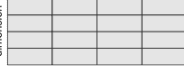

因此，一个 m×n 的二维数组是包含 m×n 个数据元素的数组，每个元素使用两个下标 i 和 j 访问，其中 i < m 且 j < n。

例如，如果我们想存储三名学生在五门不同科目中获得的成绩，可以声明一个二维数组如下：

```
int marks[3][5];
```

图 3.26 二维数组

在上述语句中，声明了一个名为 marks 的二维数组，它有 m(3) 行和 n(5) 列。数组的第一个元素表示为 marks[0][0]，第二个元素表示为 marks[0][1]，依此类推。在这里，marks[0][0] 存储第一名学生在第一科目中获得的成绩，marks[1][0] 存储第二名学生在第一科目中获得的成绩。

二维数组的图形形式如图 3.27 所示。

| 行 \ 列 | 列 0 | 列 1 | 列 2 | 列 3 | 列 4 |
|---|---|---|---|---|---|
| 行 0 | marks[0][0] | marks[0][1] | marks[0][2] | marks[0][3] | marks[0][4] |
| 行 1 | marks[1][0] | marks[1][1] | marks[1][2] | marks[1][3] | marks[1][4] |
| 行 2 | marks[2][0] | marks[2][1] | marks[2][2] | marks[2][3] | marks[2][4] |

图 3.27 二维数组

因此，我们可以看出二维数组被视为一维数组的集合。二维数组的每一行都对应一个包含 n 个元素的一维数组，其中 n 是列数。为了理解这一点，我们还可以查看二维数组的表示形式，如图 3.28 所示。

```
marks[0] - marks[0] marks[1] marks[2] marks[3] marks[4]
marks[1] - marks[0] marks[1] marks[2] marks[3] marks[4]
marks[2] - marks[0] marks[1] marks[2] marks[3] marks[4]
```

图 3.28 二维数组 marks[3][5] 的表示

虽然我们展示了二维数组的矩形图片，但在内存中，这些元素实际上是按顺序存储的。在内存中存储二维数组有两种方式：第一种是行主序，第二种是列主序。让我们看看二维数组的元素在行主序中是如何存储的。在这里，第一行的元素存储在第二行和第三行的元素之前。也就是说，数组的元素是按行存储的，第一行的 n 个元素将占据前 n 个位置。这在图 3.29 中得到说明。

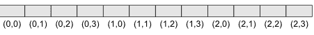

图 3.29 行主序中的 3×4 数组元素

但是，当我们以列主序存储元素时，第一列的元素存储在第二列和第三列的元素之前。也就是说，数组的元素是按列存储的，第一列的 n 个元素将占据前 n 个位置。这在图 3.30 中得到说明。

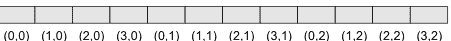

图 3.30 列主序中的 4×3 二维数组元素

在一维数组中，我们已经看到计算机不会跟踪数组中每个元素的地址。它只存储第一个元素的地址，并从基地址（第一个元素的地址）计算其他元素的地址。二维数组的情况也是如此。在这里，计算机也存储基地址，并使用以下公式计算其他元素的地址。

如果数组元素按列主序存储，Address(A[I][J]) = Base_Address + w{M * (J - 1) + (I - 1)}

如果数组元素按行主序存储，Address(A[I][J]) = Base_Address + w{N * (I - 1) + (J - 1)}

其中 w 是存储一个元素所需的字节数，N 是列数，M 是行数，I 和 J 是数组元素的下标。

### 示例 3.5

考虑一个 20×5 的二维数组 marks，其基地址 = 1000，元素大小 = 2。现在计算元素 marks[18][4] 的地址，假设元素按行主序存储。

**解答**

```
Address(marks[I][J]) = Base_Address + w{N * (I - 1) + (J - 1)}
Address(marks[18][4]) = 1000 + 2 {5(18 - 1) + (4 - 1)}
= 1000 + 2 {5(17) + 3}
= 1000 + 2 {88}
= 1000 + 176 = 1176
```

### 3.9.2 初始化二维数组

与其他变量的情况一样，声明二维数组仅在内存中为数组保留空间。其中不存储任何值。二维数组的初始化方式与一维数组相同。例如，

```
int marks[2][3]={90, 87, 78, 68, 62, 71};
```

请注意，二维数组的初始化是按行进行的。上述语句也可以写成：

```
int marks[2][3]={{90,87,78},{68, 62, 71}};
```

上述二维数组有两行三列。首先初始化第一行中的元素，然后初始化第二行中的元素。因此，marks[0][0] = 90，marks[0][1] = 87，marks[0][2] = 78，marks[1][0] = 68，marks[1][1] = 62，marks[1][2] = 71。

在上述示例中，每一行都定义为一个由大括号括起来的三个元素的一维数组。请注意，逗号用于分隔行中的元素，也用于分隔两行的元素。

在一维数组的情况下，我们已经讨论过，如果数组已完全初始化，可以省略数组的大小。同样的概念可以应用于二维数组，只不过只能省略第一个维度的大小。因此，下面给出的声明语句是有效的。

```
int marks[][3] = {{90,87,78},{68, 62, 71}};
```

要将整个二维数组初始化为零，只需将第一个值指定为零。即，

```
int marks[2][3] = {0};
```

二维数组的单个元素可以使用赋值运算符进行初始化，如下所示。

```
marks[1][2] = 79;
```

或

```
marks[1][2] = marks[1][1] + 10;
```

### 3.9.3 访问二维数组的元素

二维数组的元素存储在连续的内存位置中。在一维数组的情况下，我们使用一个 for 循环在每次遍历中更改索引 i，以便扫描所有元素。由于二维数组包含两个下标，我们将使用两个 for 循环来扫描元素。第一个 for 循环将扫描二维数组中的每一行，第二个 for 循环将扫描数组中每一行的各个列。请查看使用两个 for 循环来访问二维数组元素的程序。

## 编程示例

### 16. 编写一个程序来打印二维数组的元素。

```
#include <stdio.h>
#include <conio.h>
int main()
{
    int arr[2][2] = { 12, 34, 56,32};
    int i, j;
    for(i=0;i<2;i++)
    {
        printf("\n");
        for(j=0;j<2;j++)
        printf("%d\t", arr[i][j]);
    }
    return 0;
}
```

**输出**

12      34
56      32

### 17. 编写一个程序来生成杨辉三角。

```
#include <stdio.h>
#include <conio.h>
int main()
{
    int arr[7][7]={0};
    int row=2, col, i, j;
    arr[0][0] = arr[1][1] = 1;
    while(row < 7)
    {
        arr[row][0] = 1;
        for(col = 1; col <= row; col++)
        arr[row][col] = arr[row-1][col-1] + arr[row-1][col];
        row++;
    }
    for(i=0; i<7; i++)
    {
        printf("\n");
        for(j=0; j<=i; j++)
```


    printf("%d ", arr[i][j]);
}
getch();
return 0;
}
```

### Output

```
1
1   1
1   2   1
1   3   3   1
1   4   6   4   1
1   5   10  10  5   1
1   6   15  20  15  6   1
```

### 18. 在一家小公司里有五名销售员。每位销售员需要销售三种产品。编写一个使用二维数组的程序来打印（i）每位销售员的总销售额和（ii）每种商品的总销售额。

```
#include <stdio.h>
#include <conio.h>
int main()
{
    int sales[5][3], i, j, total_sales=0;
    //INPUT DATA
    printf("\n ENTER THE DATA\n");
    printf("\n ***************\n");
    for(i=0; i<5; i++)
    {
        printf("\n Enter the sales of 3 items sold by salesman %d: ", i+1);
        for(j=0; j<3; j++)
            scanf("%d", &sales[i][j]);
    }
    // PRINT TOTAL SALES BY EACH SALESMAN
    for(i=0; i<5; i++)
    {
        total_sales = 0;
        for(j=0; j<3; j++)
            total_sales += sales[i][j];
        printf("\n Total Sales By Salesman %d = %d", i+1, total_sales);
    }
    // TOTAL SALES OF EACH ITEM
    for(i=0; i<3; i++)
    {
        total_sales=0;
        for(j=0; j<5; j++)
            total_sales += sales[j][i];
        printf("\n Total sales of item %d = %d", i+1, total_sales);
    }
    getch();
    return 0;
}
```

### Output

```
ENTER THE DATA
***************
Enter the sales of 3 items sold by salesman 1: 23 23 45
Enter the sales of 3 items sold by salesman 2: 34 45 63
Enter the sales of 3 items sold by salesman 3: 36 33 43
Enter the sales of 3 items sold by salesman 4: 33 52 35
Enter the sales of 3 items sold by salesman 5: 32 45 64
Total Sales By Salesman 1 = 91
Total Sales By Salesman 2 = 142
Total Sales By Salesman 3 = 112
Total Sales By Salesman 4 = 120
Total Sales By Salesman 5 = 141
Total sales by Salesman = 141
Total sales of item 1 = 158
Total sales of Item 2 = 198
Total sales of item 3 = 250
```

### 19. 编写一个程序来读取存储五名学生三门科目成绩的二维数组 marks。编写一个程序来显示每门科目的最高分。

```
#include <stdio.h>
#include <conio.h>
int main()
{
    int marks[5][3], i, j, max_marks;
    for(i=0; i<=5; i++)
    {
        printf("\nEnter the marks obtained by student %d",i+1);
        for(j=0; j<=3; j++)
        {
            printf("\n marks[%d][%d] = ", i, j);
            scanf("%d", &marks[i][j]);
        }
    }
    for(j=0; j<3; j++)
    {
        max_marks = -999;
        for(i=0; i<=5; i++)
        {
            if(marks[i][j]>max_marks)
            max_marks = marks[i][j];
        }
        printf("\n The highest marks obtained in the subject %d = %d", j+1, max_marks);
    }
    getch();
    return 0;
}
```

### Output

```
Enter the marks obtained by student 1
marks[0][0] = 89
marks[0][1] = 76
marks[0][2] = 100
Enter the marks obtained by student 2
marks[1][0] = 99
marks[1][1] = 90
marks[1][2] = 89
Enter the marks obtained by student 3
marks[2][0] = 67
marks[2][1] = 67
marks[2][2] = 56
Enter the marks obtained by student 4
marks[3][0] = 88
marks[3][1] = 77
marks[3][2] = 66
Enter the marks obtained by student 5
marks[4][0] = 67
marks[4][1] = 78
marks[4][2] = 89
The highest marks obtained in the subject 1 = 99
The highest marks obtained in the subject 2 = 90
The highest marks obtained in the subject 3 = 100
```

## 3.10 二维数组的操作

二维数组可用于实现数学中的矩阵概念。在数学中，矩阵是按行和列排列的数字网格。因此，使用二维数组，我们可以对 m×n 矩阵执行以下操作：

- **转置** m×n 矩阵 A 的转置为 n×m 矩阵 B，其中 B_ji = A_ij。
- **和** 两个相互兼容的矩阵可以相加，结果存储在第三个矩阵中。当两个矩阵具有相同的行数和列数时，它们被认为是兼容的。两个矩阵的元素可以通过以下方式相加：C_{i,j} = A_{i,j} + B_{i,j}
- **差** 两个相互兼容的矩阵可以相减，结果存储在第三个矩阵中。当两个矩阵具有相同的行数和列数时，它们被认为是兼容的。两个矩阵的元素可以通过以下方式相减：C_{i,j} = A_{i,j} - B_{i,j}
- **积** 如果第一个矩阵的列数等于第二个矩阵的行数，则两个矩阵可以相乘。因此，m×n 矩阵 A 可以与 p×q 矩阵 B 相乘，条件是 n=p。乘积矩阵的维度为 m×q。两个矩阵的元素可以通过以下方式相乘：C_{i,j} = \Sigma A_{i,k} B_{k,j}，其中 k=1 到 n

## 编程示例

### 20. 编写一个程序来读取并显示一个 3×3 矩阵。

```
#include <stdio.h>
#include <conio.h>
int main()
{
    int i, j, mat[3][3];
    clrscr();
    printf("\n Enter the elements of the matrix ");
    for(i=0;i<3;i++)
    {
        for(j=0;j<3;j++)
        {
            scanf("%d",&mat[i][j]);
        }
    }
    printf("\n The elements of the matrix are ");
    for(i=0;i<3;i++)
    {
        printf("\n");
        for(j=0;j<3;j++)
        printf("\t %d",mat[i][j]);
    }
    return 0;
}
```

### Output

```
Enter the elements of the matrix
1 2 3 4 5 6 7 8 9
The elements of the matrix are
1 2 3
4 5 6
7 8 9
```

### 21. 编写一个程序来转置一个 3×3 矩阵。

```
#include <stdio.h>
#include <conio.h>
void main()
{
    int i, j, mat[3][3], transposed_mat[3][3];
    clrscr();
    printf("\n Enter the elements of the matrix ");
    for(i=0;i<3;i++)
    {
        for(j=0;j<3;j++)
        scanf("%d", &mat[i][j]);
    }
    printf("\n The elements of the matrix are ");
    for(i=0;i<3;i++)
    {
        printf("\n");
        for(j=0;j<3;j++)
        printf("\t %d", mat[i][j]);
    }
    for(i=0;i<3;i++)
    {
        for(j=0;j<3;j++)
        transposed_mat[i][j] = mat[j][i];
    }
    printf("\n The elements of the transposed matrix are ");
    for(i=0;i<3;i++)
    {
        printf("\n");
        for(j=0;j<3;j++)
        printf("\t %d",transposed_mat[i][j]);
    }
    return 0;
}
```

### Output

```
Enter the elements of the matrix
1 2 3 4 5 6 7 8 9
The elements of the matrix are
1 2 3
4 5 6
7 8 9
The elements of the transposed matrix are
1 4 7
2 5 8
3 6 9
```

### 22. 编写一个程序来输入两个 m×n 矩阵，然后计算它们对应元素的和，并将其存储在第三个 m×n 矩阵中。

```
#include <stdio.h>
#include <conio.h>
int main()
{
 int i, j;
 int rows1, cols1, rows2, cols2, rows_sum, cols_sum;
 int mat1[5][5], mat2[5][5], sum[5][5];
 clrscr();
 printf("\n Enter the number of rows in the first matrix : ");
 scanf("%d",&rows1);
 printf("\n Enter the number of columns in the first matrix : ");
 scanf("%d",&cols1);
 printf("\n Enter the number of rows in the second matrix : ");
 scanf("%d",&rows2);
 printf("\n Enter the number of columns in the second matrix : ");
 scanf("%d",&cols2);
 if(rows1 != rows2 || cols1 != cols2)
 {
 printf("\n Number of rows and columns of both matrices must be equal");
 getch();
 exit();
 }
 rows_sum = rows1;
 cols_sum = cols1;
 printf("\n Enter the elements of the first matrix ");
 for(i=0;i<rows1;i++)
 {
 for(j=0;j<cols1;j++)
 scanf("%d",&mat1[i][j]);
 }
 printf("\n Enter the elements of the second matrix ");
 for(i=0;i<rows2;i++)
 {
 for(j=0;j<cols2;j++)
 scanf("%d",&mat2[i][j]);
 }
 for(i=0;i<rows_sum;i++)
 {
 for(j=0;j<cols_sum;j++)
 sum[i][j] = mat1[i][j] + mat2[i][j];
 }
 printf("\n The elements of the resultant matrix are ");
 for(i=0;i<rows_sum;i++)
 {
 printf("\n");
 for(j=0;j<cols_sum;j++)
 printf("\t %d", sum[i][j]);
 }
 return 0;
}
```

### Output

```
Enter the number of rows in the first matrix: 2
Enter the number of columns in the first matrix: 2
Enter the number of rows in the second matrix: 2
Enter the number of columns in the second matrix: 2
Enter the elements of the first matrix
1 2 3 4
Enter the elements of the second matrix
5 6 7 8
The elements of the resultant matrix are
6 8
10 12
```

### 23. 编写一个程序来乘以两个 m×n 矩阵。

```
#include <stdio.h>
#include <conio.h>
int main()
{
 int i, j, k;
 int rows1, cols1, rows2, cols2, res_rows, res_cols;
 int mat1[5][5], mat2[5][5], res[5][5];
 clrscr();
 printf("\n Enter the number of rows in the first matrix : ");
 scanf("%d",&rows1);
 printf("\n Enter the number of columns in the first matrix : ");
 scanf("%d",&cols1);
 printf("\n Enter the number of rows in the second matrix : ");
 scanf("%d",&rows2);
 printf("\n Enter the number of columns in the second matrix : ");
 scanf("%d",&cols2);
 if(cols1 != rows2)
 {
 printf("\n The number of columns in the first matrix must be equal
 to the number of rows in the second matrix");
 getch();
 exit();
 }
 res_rows = rows1;
 res_cols = cols2;
 printf("\n Enter the elements of the first matrix ");
 for(i=0;i<rows1;i++)
 {
 for(j=0;j<cols1;j++)
 {
 scanf("%d",&mat1[i][j]);
 }
 }
 printf("\n Enter the elements of the second matrix ");
 for(i=0;i<rows2;i++)
 {
 for(j=0;j<cols2;j++)
 {
 scanf("%d",&mat2[i][j]);
 }
 }
 for(i=0;i<res_rows;i++)
 {
 for(j=0;j<res_cols;j++)
```


```c
{
    res[i][j] = 0;
    for (k = 0; k < kres_cols; k++)
        res[i][j] += mat1[i][k] * mat2[k][j];
}
printf("\n The elements of the product matrix are ");
for (i = 0; i < kres_rows; i++)
{
    printf("\n");
    for (j = 0; j < kres_cols; j++)
        printf("\t %d", res[i][j]);
}
return 0;
}
```

输出
输入第一个矩阵的行数：2
输入第一个矩阵的列数：2
输入第二个矩阵的行数：2
输入第二个矩阵的列数：2
输入第一个矩阵的元素
1 2 3 4
输入第二个矩阵的元素
5 6 7 8
乘积矩阵的元素为
19 22
43 50

## 3.11 将二维数组传递给函数

将二维数组传递给函数有三种方式。首先，我们可以传递数组的单个元素。这与传递一维数组的元素完全相同。其次，我们可以传递二维数组的一行。这相当于将整个一维数组传递给前一节中已讨论过的函数。第三，我们可以将整个二维数组传递给函数。图 3.31 展示了用于函数间通信的二维数组的三种用法。

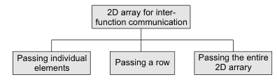

图 3.31 用于函数间通信的二维数组

## 传递一行

可以通过使用行号对数组名进行索引来传递二维数组的一行。请看图 3.32，它说明了如何将二维数组的一行传递给被调用函数。

| 调用函数 | 被调用函数 |
|---|---|
| main() | void func(int arr[]) |
| { | { |
| int arr[2][3] = ((1, 2, 3), (4, 5, 6)); | int i; |
| func(arr[1]); | for(i=0;i<3;i++) |
| } | printf("%d", arr[1][i] * 10); |
| | } |

图 3.32 将二维数组的一行传递给函数

## 传递整个二维数组

要将二维数组传递给函数，我们使用数组名作为实际参数（与一维数组的情况相同）。但是，被调用函数中的参数必须指明该数组有两个维度。请看下面将整个二维数组传递给函数的程序。

## 编程示例

24. 编写一个程序，将方阵的对角线元素填充为 0，右上三角形元素填充为 1，左下三角形元素填充为 -1。

```c
#include <stdio.h>
#include <conio.h>
void read_matrix(int mat[5][5], int);
void display_matrix(int mat[5][5], int);
main()
{
    int row;
    int mat[5][5];
    clrscr();
    printf("\n Enter the number of rows and columns of the matrix:");
    scanf("%d", &row);
    read_matrix(mat, row);
    display_matrix(mat, row);
    getch();
    return 0;
}
void read_matrix(int mat[5][5], int r)
{
    int i, j;
    for (i = 0; i < r; i++)
    {
        for (j = 0; j < r; j++)
        {
            if (i == j)
                mat[i][j] = 0;
            else if (i > j)
                mat[i][j] = -1;
            else
                mat[i][j] = 1;
        }
    }
}
void display_matrix(int mat[5][5], int r)
{
    int i, j;
    for (i = 0; i < r; i++)
    {
        printf("\n");
        for (j = 0; j < r; j++)
            printf("%5d", mat[i][j]);
    }
}
```

输出
输入矩阵的行数和列数：2
0       1
-1      0

## 3.12 指针与二维数组

考虑一个声明为

```c
int mat[5][5];
```

的二维数组。

要声明指向二维数组的指针，可以写

```c
int (*ptr)[5];
```

这里，int **ptr 是指针数组（指向一维数组），而 int mat[5][5] 是一个二维数组。它们不是同一类型，不能互换。

数组 mat 的单个元素可以通过以下任一方式访问：

- mat[i][j]
- *(*(mat + i) + j) 或
- *(mat[i] + j)；

为了更充分地理解指针的概念，让我们将

```c
*(mat + row with x so the expression
*(*(mat + i) + j) becomes *(x + col)
```

根据算术运算，我们知道 x + col + 1 所指向的地址（即其值）必须比地址 x + col 大一个等于 sizeof(int) 的量。

由于 mat 是二维数组，我们知道在上面使用的表达式 mat + row 中，mat + row + 1 的值必须增加一个量，该量足以指向下一行，在此情况下等于 cols * sizeof(int)。

因此，对于二维数组，为了求值表达式（针对行优先的二维数组），我们必须知道总共 4 个值：

- 1. 数组第一个元素的地址，由数组名给出，即在我们的例子中为 mat。
- 2. 数组元素类型的大小，即在我们的例子中为整数的大小。
- 3. 行的特定索引值。
- 4. 列的特定索引值。

请注意

```c
int (*ptr)[10];
```

声明 ptr 为指向包含 10 个整数的数组的指针。这与

```c
int *ptr[10];
```

不同，后者会使 ptr 成为指向 10 个 int 类型指针的数组的名称。你一定在想，如果有一个指针数组，指针算术运算是如何工作的。例如：

```c
int *arr[10];
int **ptr = arr;
```

在这种情况下，arr 的类型为 int **。由于所有指针的大小相同，ptr + i 的地址可以计算为：

```c
addr(ptr + i) = addr(ptr) + [sizeof(int *) * 1]
= addr(ptr) + [2 * 1]
```

由于 arr 的类型为 int **，

```
arr[0] = &arr[0][0],
arr[1] = &arr[1][0]，并且一般来说，
arr[i] = &arr[i][0]。
```

根据指针算术运算，arr + i = &arr[1]，但这会跳过一整行 5 个元素，即跳过完整的 10 字节（5 个元素，每个 2 字节大小）。因此，如果 arr 是地址 1000，那么 arr + 2 是地址 1010。总结一下，&arr[0][0]、arr[0]、arr 和 &arr[0] 都指向基地址。

```
&arr[0][0] + 1 points to arr[0][1]
arr[0] + 1 points to arr[0][1]
arr + 1 points to arr[1][0]
&arr[0] + 1 points to arr[1][0]
```

总之，二维数组与指向一维数组的指针数组不同。实际上，二维数组的声明为：

```c
int (*ptr)[10];
```

这里 ptr 是指向包含 10 个元素的数组的指针。括号不是可选的。如果没有这些括号，ptr 将变成 10 个指针的数组，而不是指向 10 个 int 的数组。

请看下面说明如何使用指向二维数组的指针的代码。

```c
#include <stdio.h>
int main()
{
    int arr[2][2] = {{1, 2}, {3, 4}};
    int i, j, (*ptr)[2];
    ptr = arr;
    for (i = 0; i < 2; i++)
    {
        for (j = 0; j < 2; j++)
            printf("%d", (*(ptr + i))[j]);
    }
    return 0;
}
```

# 输出

1 2 3 4

访问二维数组元素的黄金法则可以表示为

```c
arr[i][j] = *(*(arr + i))[j] = *(*(arr + i) + j) = *(arr[i] + j)
```

因此，

```
arr[0][0] = *(arr[0] = *(*(arr + 0) = *(arr[0] + 0)
arr[1][2] = *(*(arr + 1))[2] = *(*(arr + 1) + 2) = *(arr[1] + 2)
```

| 如果使用以下方式声明指针数组， | 如果使用以下方式声明指向数组的指针， |
|---|---|
| `data_type array_name[SIZE];` | `data_type (*array_name)[SIZE];` |
| 这里 SIZE 表示行数以及可动态分配的列空间。 | 这里 SIZE 表示列数以及可能动态分配的行空间（有关内存如何动态分配，请参阅附录 A）。 |

## 编程示例

## 25. 编写一个程序来读取并显示 3 x 3 矩阵。

```c
#include <stdio.h>
#include <conio.h>
void display(int (*)[3]);
int main()
{
    int i, j, mat[3][3];
    clrscr();
    printf("\n Enter the elements of the matrix");
    for (i = 0; i < 3; i++)
    {
        for (j = 0; j < 3; j++)
        {
            scanf("%d", &mat[i][j]);
        }
    }
    display(mat);
    return 0;
}
void display(int (*mat)[3])
{
    int i, j;
    printf("\n The elements of the matrix are");
    for (i = 0; i < 3; i++)
    {
        for (j = 0; j < 3; j++)
            printf("\t %d", *(*(mat + i) + j));
    }
}
```

**输出**
输入矩阵的元素
1 2 3 4 5 6 7 8 9
矩阵的元素为
1 2 3
4 5 6
7 8 9

> **注意** 双重指针不能用作二维数组。因此，声明 'int *mat' 然后将 'mat' 用作二维数组是错误的。这是两种非常不同的数据类型，用于访问内存中的不同位置。因此，运行此类代码可能会导致程序因 '内存访问违反' 错误而中止。
> 二维数组不等同于双重指针。'指向指针的 T 的指针' 不能充当 'T 的二维数组'。二维数组等同于指向 T 的行的指针，这与指向指针的 T 的指针非常不同。
> 当指向数组第一个元素的双重指针与下标表示法 ptr[0][0] 一起使用时，它会被完全解引用两次，结果对象的地址将等于数组第一个元素的值

## 3.13 多维数组

简单来说，多维数组是数组的数组。正如一维数组有一个索引，二维数组有两个索引，同样，n 维数组或多维数组有 n 个索引。相反，n 维数组是通过指定


使用 n 个索引。一个 n 维 m1 × m2 × m3 × ... × mn 数组是 m1 × m2 × m3 × ... × mn 个元素的集合。在多维数组中，特定元素通过使用 n 个下标 A[I1][I2][I3]...[In] 来指定，其中

I1 <= m1, I2 <= m2, I3 <= m3, ... In <= mn

多维数组可以包含所需数量的索引，且内存需求随使用的索引数量增加。然而，在实际中，我们几乎在任何程序中都不会使用超过三个索引。图 3.33 显示了一个三维数组。该数组有三个页面、四行和两列。

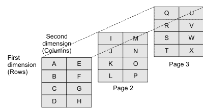

图 3.33 三维数组

注意 多维数组的声明和初始化方式与一维和二维数组相同。

### 示例 3.6

考虑定义为 int A[2][2][3] 的三维数组。计算数组中的元素个数。同时，按行主序和列主序显示数组的内存表示。

### 解答

三维数组由页面组成。每个页面又包含 m 行和 n 列。

| (0,0,0) | (0,0,1) | (0,0,2) | (0,1,0) | (0,1,1) | (0,1,2) | (1,0,0) | (1,0,1) | (1,0,2) | (1,1,0) | (1,1,1) | (1,1,2) |
|---|---|---|---|---|---|---|---|---|---|---|---|

### (a) 行主序

| (0,0,0) | (0,1,0) | (0,0,1) | (0,1,1) | (0,0,2) | (0,1,2) | (1,0,0) | (1,1,0) | (1,0,1) | (1,1,1) | (1,0,2) | (1,1,2) |
|---|---|---|---|---|---|---|---|---|---|---|---|

### (b) 列主序

三维数组将包含 2 × 2 × 3 = 12 个元素。

## 编程示例

### 26. 编写一个程序来读取并显示一个 2 × 2 × 2 数组。

```
#include <stdio.h>
#include <conio.h>
int main()
{
    int array[2][2][2], i, j, k;
    clrscr();
    printf("\n Enter the elements of the matrix");
    for(i=0;i<2;i++)
    {
        for(j=0;j<2;j++)
        {
            for(k=0;k<2;k++)
            {
                scanf("%d", &array[i][j][k]);
            }
        }
    }
    printf("\n The matrix is : ");
    for(i=0;i<2;i++)
    {
        printf("\n");
        for(j=0;j<2;j++)
        {
            printf("\n");
            for(k=0;k<2;k++)
            printf("\t array[%d][%d][%d] = %d", i, j, k, array[i][j][k]);
        }
    }
    getch();
    return 0;
}
```

### 输出

输入矩阵的元素
1 2 3 4 5 6 7 8
矩阵是
array[0][0][0] = 1 array[0][0][1] = 2
array[0][1][0] = 3 array[0][1][1] = 4
array[1][0][0] = 5 array[1][0][1] = 6
array[1][1][0] = 7 array[1][1][1] = 8

## 3.14 指针和三维数组

在本节中，我们将看到如何使用指针来访问三维数组。我们已经看到，指向一维数组的指针可以声明为，

```
int arr[]={1,2,3,4,5};
int *parr;
parr = arr;
```

同样，指向二维数组的指针可以声明为，

```
int arr[2][2]={{1,2},{3,4}};
int (*parr)[2];
parr = arr;
```

指向三维数组的指针可以声明为，

```
int arr[2][2][2]={1,2,3,4,5,6,7,8};
int (*parr)[2][2];
parr = arr;
```

我们可以通过编写以下方式访问三维数组的一个元素，

```
arr[i][j][k] = *(*(*(arr+i)+j)+k)
```

## 编程示例

### 27. 编写一个程序来说明指向三维数组的指针的用法。

```
#include <stdio.h>
#include <conio.h>
int main()
{
    int i,j,k;
    int arr[2][2][2];
    int (*parr)[2][2] = arr;
    clrscr();
    printf("\n Enter the elements of a 2 x 2 x 2 array: ");
    for(i = 0; i < 2; i++)
    {
        for(j = 0; j < 2; j++)
        {
            for(k = 0; k < 2; k++)
                scanf("%d", &arr[i][j][k]);
        }
    }
    printf("\n The elements of the 2 x 2 x 2 array are: ");
    for(i = 0; i < 2; i++)
    {
        for(j = 0; j < 2; j++)
        {
            for(k = 0; k < 2; k++)
                printf("%d", *(*(*(parr+i)+j)+k));
        }
    }
    getch();
    return 0;
}
```

### 输出

输入 2 × 2 × 2 数组的元素：1 2 3 4 5 6 7 8
2 × 2 × 2 数组的元素是：1 2 3 4 5 6 7 8

### 注意

在 printf 语句中，您也可以使用 *(*(*(arr+i)+j)+k) 而不是 *(*(*(parr+i)+j)+k)。

## 3.15 稀疏矩阵

稀疏矩阵是指包含大量零值元素的矩阵。为了高效利用内存，应使用利用稀疏结构的专用算法和数据结构。如果将标准矩阵结构和算法应用于稀疏矩阵，则执行速度会变慢，且矩阵将占用大量内存。稀疏数据可以轻松压缩，从而显著降低内存使用量。

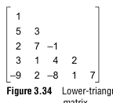

稀疏矩阵有两种类型。在第一种稀疏矩阵中，主对角线以上的所有元素均为零值。这种稀疏矩阵也称为（下）三角矩阵，因为从图形上看，所有非零值元素都出现在对角线以下。在下三角矩阵中，当 i < j 时，A[i,j] = 0。一个 n × n 下三角矩阵在第一行有一个非零元素，第二行有两个非零元素，依此类推，第 n 行有 n 个非零元素。请看图 3.34，它显示了一个下三角矩阵。

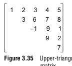

为了在内存中高效存储下三角矩阵，我们可以使用仅存储非零元素的一维数组。二维矩阵与一维数组之间的映射可以采用以下任一方式：

- (a) 行映射——此处数组 A[] 的内容将为 {1, 5, 3, 2, 7, -1, 3, 1, 4, 2, -9, 2, -8, 1, 7}
- (b) 列映射——此处数组 A[] 的内容将为 {1, 5, 2, 3, -9, 3, 7, 1, 2, -1, 4, -8, 2, 1, 7}

在上三角矩阵中，当 i > j 时，A[i,j] = 0。一个 n × n 上三角矩阵在第一行有 n 个非零元素，第二行有 n-1 个非零元素，依此类推，第 n 行有一个非零元素。请看图 3.35，它显示了一个上三角矩阵。

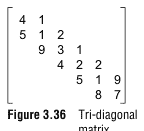

- (a) 主对角线，它包含 i=j 时的非零元素。总共有 n 个元素。
- (b) 主对角线以下，它包含 i=j+1 时的非零元素。总共有 n-1 个元素。
- (c) 主对角线以上，它包含 i=j-1 时的非零元素。总共有 n-1 个元素。

稀疏矩阵还有另一种变体，其中非零值元素只能出现在对角线上或紧邻对角线的上方或下方。这种矩阵也称为三对角矩阵。因此，在三对角矩阵中，当 |i - j| > 1 时，A[i,j] = 0。在三对角矩阵中，如果元素存在于

图 3.36 显示了一个三对角矩阵。为了在内存中高效存储三对角矩阵，我们可以使用仅存储非零元素的一维数组。二维矩阵与一维数组之间的映射可以采用以下任一方式：

- (a) 行映射——此处数组 A[] 的内容将为 {4, 1, 5, 1, 2, 9, 3, 1, 4, 2, 5, 1, 2, 9}
- (b) 列映射——此处数组 A[] 的内容将为 {4, 5, 1, 1, 9, 2, 3, 4, 1, 2, 5, 2, 1, 8, 9, 7}
- (c) 对角线映射——此处数组 A[] 的内容将为 {5, 9, 4, 5, 8, 1, 4, 3, 2, 2, 1, 7, 1, 2, 9}

## 3.16 数组的应用

数组在 C 语言中经常被使用，因为它们有许多有用的应用。这些应用包括

- 数组广泛用于实现数学向量、矩阵和其他类型的矩形表。
- 许多数据库包含元素为记录的一维数组。
- 数组还用于实现其他数据结构，如字符串、栈、队列、堆和哈希表。我们将在后续章节中阅读这些数据结构。
- 数组可用于按升序或降序对元素进行排序。


## 要点回顾

- 数组是相同数据类型的元素集合。
- 数组的元素存储在连续的内存位置中，并通过索引（也称为下标）引用。
- 索引指定从数组开头到被引用元素的偏移量。
- 声明数组意味着指定三个参数：数据类型、名称和大小。
- 数组的长度由其中存储的元素数量给出。
- 没有单个函数可以对数组的所有元素进行操作。要访问所有元素，必须使用循环。
- 数组名称是对数组第一个字节地址的符号引用。因此，每当我们使用数组名称时，实际上都是在引用该数组的第一个字节。
- C 语言将二维数组视为一维数组的数组。
- 二维数组使用两个下标指定，其中第一个下标表示行，第二个下标表示数组的列。
- 使用二维数组，可以对矩阵执行不同的操作：转置、加法、减法、乘法。
- 多维数组是数组的数组。就像我们在一维数组中有一个索引，在二维数组中有两个索引，同样，在 n 维数组或多维数组中有 n 个索引。反之，n 维数组使用 n 个索引指定。
- 多维数组可以按行主序或列主序存储。
- 稀疏矩阵是具有大量零值元素的矩阵。
- 稀疏矩阵有两种类型。在第一种类型中，主对角线上方的所有元素都称为零值。这种稀疏矩阵称为下三角矩阵。在第二种类型中，主对角线下方的所有元素都具有零值。这种稀疏矩阵称为上三角矩阵。
- 稀疏矩阵还有另一种变体，其中非零值元素只能出现在对角线上或对角线的直接上方或下方。这种稀疏矩阵称为三对角矩阵。

## 练习

### 复习题

- 1. 什么是数组？为什么需要它们？
- 2. 数组在内存中如何表示？
- 3. 二维数组在内存中如何表示？
- 4. 多维数组的用途是什么？
- 5. 解释稀疏矩阵。
- 6. 如何使用指针访问二维数组？
- 7. 为什么存储稀疏矩阵需要额外考虑？稀疏矩阵如何在计算机内存中高效存储？
- 8. 对于声明为 int arr[55] 的数组，如果 Base(arr) = 1000 且 w = 2，计算 arr[35] 的地址。
- 9. 考虑一个二维数组 Marks[10][5]，其基地址为 2000，数组每个元素的字节数为 2。现在，计算元素 Marks[8][5] 的地址，假设元素按行主序存储。
- 10. 数组与指针有何关系？
- 11. 简要解释指针数组的概念。
- 12. 一维数组如何用于函数间通信？
- 13. 考虑一个二维数组 arr[10][10]，其基地址 = 1000，数组每个元素的字节数 = 2。现在，计算元素 arr[8][5] 的地址，假设元素按列主序存储。
- 14. 考虑下面给出的数组：

| 姓名 [0] | Adam |
| --- | --- |
| 姓名 [1] | Charles |
| 姓名 [2] | Dicken |
| 姓名 [3] | Esha |
| 姓名 [4] | Georgia |
| 姓名 [5] | Hillary |
| 姓名 [6] | Mishel |

- (a) 如果要添加名字 Andrew，需要移动多少个元素？
- (i) 7 (ii) 4
- (iii) 5 (iv) 6
- (b) 如果要从中删除名字 Esha，需要移动多少个元素？
- (i) 3 (ii) 4
- (iii) 5 (iv) 6
- 15. 当数组用以下内容初始化时会发生什么？
- (a) 初始化器的数量少于其大小？
- (b) 初始化器的数量多于其大小？

### 编程练习

- 1. 考虑一个数组 MARKS[20][5]，它存储了 20 名学生在 5 门科目中获得的分数。现在编写一个程序来
- (a) 找出每门科目的平均分。
- (b) 找出每个学生的平均分。
- (c) 找出平均分低于 50 分的学生人数。
- (d) 显示每个学生获得的分数。
- 2. 编写一个程序，读取一个包含 100 个整数的数组。显示所有和为 50 的元素对。
- 3. 编写一个程序，将第二个元素与倒数第二个元素互换。
- 4. 编写一个程序，计算元素平方和。
- 5. 编写一个程序，计算二维数组元素的和与平均值。
- 6. 编写一个程序，读取并显示一个方阵（使用函数）。
- 7. 编写一个程序，使用指针计算存储在矩阵主对角线上的元素之和。
- 8. 编写一个程序，使用指针将两个 3 x 3 矩阵相加。
- 9. 编写一个程序，计算存储在主对角线上方对角线上的元素乘积。
- 10. 编写一个程序，统计二维数组中非零元素的总数。
- 11. 编写一个程序，输入二维数组的元素。然后从该数组中，创建两个数组——一个存储二维数组的所有奇数元素，另一个存储数组的所有偶数元素。
- 12. 编写一个程序，读取两个浮点数数组。合并这两个数组，并以逆序显示结果数组。
- 13. 编写一个使用指针的程序，互换数组中第二大的数和第二小的数。
- 14. 编写一个菜单驱动程序，读取并显示一个 p x q x r 矩阵。此外，求两个 p x q x r 矩阵的和、转置和乘积。
- 15. 编写一个程序，读取一个矩阵并显示其对角线元素之和。
- 16. 编写一个程序，读取一个矩阵并显示主对角线上方元素之和。（提示：计算 i<j 的元素 Aij 之和）
- 17. 编写一个程序，读取一个矩阵并显示主对角线下方元素之和。（提示：计算 i>j 的元素 Aij 之和）
- 18. 编写一个程序，读取一个 n x n 的方阵。编写一个函数 int isUpperTriangular (int a[][], int n)，如果矩阵是上三角矩阵则返回 1。（提示：如果 Aij = 0 且 i>j，则数组 A 是上三角数组）
- 19. 编写一个程序，读取一个 n x n 的方阵。编写一个函数 int isLowerTriangular (int a[][], int n)，如果矩阵是下三角矩阵则返回 1。（提示：如果 Aij = 0 且 i<j，则数组 A 是下三角数组）
- 20. 编写一个程序，读取一个 n x n 的方阵。编写一个函数 int isSymmetric (int a[][], int n)，如果矩阵是对称矩阵则返回 1。（提示：如果对于所有 i 和 j 的值，Aij = Aji，则数组 A 是对称数组）
- 21. 编写一个程序，计算 XA + YB，其中 A 和 B 是矩阵，X = 2，Y = 3。
- 22. 编写一个程序，说明指向二维数组的指针的用法。
- 23. 编写一个程序，输入一个数字并将其分解为 n 个数字。
- 24. 编写一个程序，删除 n 个整数数组中所有重复的条目。
- 25. 编写一个程序，读取一个浮点数组。更新数组，在指定位置插入一个新数字。

### 选择题

- 1. 如果数组声明为 arr[] = {1,3,5,7,9}；那么 sizeof(arr[3]) 的值是多少？
- (a) 1 (b) 2
- (c) 3 (d) 8

- 2. 如果数组声明为 arr[] = {1,3,5,7,9}；那么 arr[3] 的值是多少？
- (a) 1 (b) 7
- (c) 9 (d) 5

- 3. 如果数组声明为 double arr[50]；将为其分配多少字节？
- (a) 50 (b) 100
- (c) 200 (d) 400

- 4. 如果数组声明为 int arr[50]，它可以容纳多少个元素？
- (a) 49 (b) 50
- (c) 51 (d) 0

- 5. 如果数组声明为 int arr[5][5]，它可以存储多少个元素？
- (a) 5 (b) 25
- (c) 10 (d) 0

- 6. 给定一个整数数组 arr[]；第 1 个元素可以通过以下方式访问
- (a) *(arr+1) (b) *(1+arr)
- (c) arr[1] (d) 以上都是

### 判断题

- 1. 数组用于引用具有相同名称的多个内存位置。
- 2. 数组名称可以用作指针。
- 3. 循环用于访问数组的所有元素。
- 4. 数组将其所有数据元素存储在非连续的内存位置中。
- 5. 下界是数组中最后一个元素的索引。
- 6. 合并数组包含第一个数组的内容，后跟第二个数组的内容。
- 7. 可以将整个数组作为函数参数传递。
- 8. arr[1] 等同于写入 *(arr+1)。
- 9. 数组名称等同于其最后一个元素的地址。
- 10. mat[i][j] 等同于 *((*mat + i) + j)。
- 11. 数组包含相同数据类型的元素。
- 12. 当将数组传递给函数时，C 为每个元素传递值。
- 13. 二维数组包含两种不同类型的数据。
- 14. 数组可以具有的最大维度是 4。
- 15. 默认情况下，数组的第一个下标是零。

### 填空题

- 1. 每个数组元素使用 ____ 访问。
- 2. 数组的元素存储在 ____ 内存位置中。
- 3. n 维数组包含 ____ 个下标。
- 4. 数组名称充当 ____。
- 5. 声明数组意味着指定 ____、____ 和 ____。
- 6. ____ 是数组中第一个元素的地址。
- 7. 数组的长度由 ____ 的数量给出。
- 8. 简单来说，多维数组是一个 ____。
- 9. 求值为某个值的表达式可以用作索引。
- 10. arr[3] = 10; 用值 10 初始化数组的 ____ 元素。


# 第 4 章 字符串

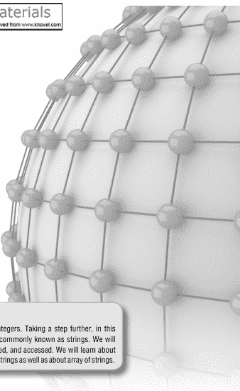

> 学习目标
> 在上一章中，我们讨论了整数数组。进一步深入，在本章中，我们将讨论通常称为字符串的字符数组。我们将了解字符串如何存储、声明、初始化和访问。我们将学习可以对字符串执行的不同操作，以及关于字符串数组的内容。

## 4.1 简介

如今，计算机被广泛用于文字处理应用程序，例如创建、插入、更新和修改文本数据。除此之外，我们需要在文本中搜索特定模式，删除它，或将其替换为另一种模式。因此，作为用户，我们在操作文本数据方面有很多工作要做。

在 C 语言中，字符串是一个以空字符结尾的字符数组。这意味着在最后一个字符之后，会存储一个空字符 ('\0') 来标志字符数组的结束。例如，如果我们写 char str[] = "HELLO";

那么我们正在声明一个包含五个字符的数组，即 H、E、L、L 和 O。除了这些字符之外，一个空字符 ('\0') 会存储在字符串的末尾。因此，字符串的内部表示变为 HELLO'\0'。要存储长度为 5 的字符串，我们需要 5 + 1 个位置（1 个额外位置用于 '\0' 字符）。字符数组（或字符串）的名称是指向字符串开头的指针。图 4.1 显示了字符存储和字符串存储之间的区别。

如果我们将 str 声明为 char str[5] = "HELLO";

那么空字符不会自动追加到字符数组中。这是因为 str 只能容纳 5 个字符，而 HELLO 中的字符已经填满了分配给它的空间。

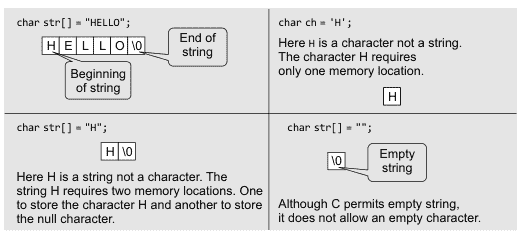

图 4.1 字符存储和字符串存储之间的区别

| str | 1000 | H |
|---|---|---|
| str[0] | 1001 | E |
| str[1] | 1002 | L |
| str[2] | 1003 | L |
| str[3] | 1004 | O |
| str[4] | 1005 | \0 |

就像我们使用下标（也称为索引）来访问数组的元素一样，我们也可以使用下标来访问字符串的元素。下标从零（0）开始。字符串的所有字符都存储在连续的内存位置中。图 4.2 显示了 str[] 在内存中的存储方式。

图 4.2 字符数组的内存表示

因此，简单来说，字符串是一系列字符。在图 4.2 中，1000、1001、1002 等是单个字符的内存地址。为简化起见，图中显示 H 存储在内存位置 1000。但在实际中，存储在内存中的是字符的 ASCII 码，而不是字符本身。因此，在地址 1000 处，将存储 72，因为 H 的 ASCII 码是 72。

> **编程提示**
> 为字符串分配内存空间时，也要预留空间来存放空字符。

语句
char str[] = "HELLO";
声明了一个常量字符串，因为我们在声明字符串时为其赋值了。然而，声明字符串的一般形式是

```
char str[size];
```

当我们这样声明字符串时，可以在数组中存储 size-1 个字符，因为最后一个字符将是空字符。例如，char msg[100]; 最多可以存储 99 个字符。

到目前为止，我们只看到一种初始化字符串的方法。初始化字符串的另一种方法是将其初始化为字符数组。例如，

```
char str[] = { 'H', 'E', 'L', 'L', 'O', '\0' };
```

在此示例中，我们显式添加了空字符。还要注意，我们没有提及字符串的大小。在这里，编译器将根据字符数量自动计算大小。因此，在此示例中，将保留六个内存位置来存储字符串变量 str。

我们还可以声明一个大小远大于初始化元素数量的字符串。例如，考虑下面的语句。

```
char str [10] = "HELLO";
```

在这种情况下，编译器创建一个大小为 10 的数组，将 "HELLO" 存储在其中，最后用空字符终止字符串。数组中其余的元素会自动初始化为 NULL。

现在考虑以下语句：

```
char str[3];
str = "HELLO";
```

上述初始化语句在 C 语言中是非法的，并会生成编译时错误，原因有二。首先，数组初始化的元素多于它能存储的元素。其次，初始化不能与声明分离。

### 4.1.1 读取字符串

如果我们通过编写
```
char str[100];
```
来声明一个字符串，

那么 str 可以由用户以三种方式读取：

- 1. 使用 scanf 函数，
- 2. 使用 gets() 函数，和
- 3. 重复使用 getchar()、getch() 或 getche() 函数。

可以通过编写以下内容使用 scanf() 读取字符串

```
scanf("%s", str);
```

虽然使用 scanf() 函数的语法众所周知且易于使用，但使用此函数的主要陷阱是，一旦发现空格，函数就会终止。例如，如果用户输入 hello world，那么 str 将只包含 hello。这是因为一旦遇到空格，字符串就会被 scanf() 函数终止。您也可以指定字段宽度以指示可以读取的最大字符数。请记住，多余的字符会留在输入缓冲区中未被消耗。

编程提示
在 scanf 语句中将 & 运算符与字符串变量一起使用会生成错误。

与 int、float 和 char 值不同，%s 格式不需要在变量 str 之前使用 & 符号。

读取字符串的下一种方法是使用 gets() 函数。可以通过编写以下内容读取字符串

```
gets(str);
```

gets() 是一个简单的函数，克服了 scanf() 函数的缺点。gets() 函数获取将保存输入的字符串的起始地址。使用 gets() 输入的字符串会自动以空字符终止。

字符串也可以通过重复调用 getchar() 函数来读取一系列单个字符（除非输入终止字符），并同时将其存储在字符数组中，如下所示。

```
i=0;
ch = getchar();// Get a character
while(ch != '*')
{
str[i] = ch;// Store the read character in str
i++;
ch = getchar();// Get another character
}
str[i] = '\0';// Terminate str with null character
```

请注意，在此方法中，您必须有意地将字符串以空字符结尾。另外两个函数会自动执行此操作。

### 4.1.2 写入字符串

字符串可以使用以下三种方式在屏幕上显示：

- 1. 使用 `printf()` 函数，
- 2. 使用 `puts()` 函数，和
- 3. 重复使用 `putchar()` 函数。

可以通过编写以下内容使用 `printf()` 显示字符串

```
printf("%s", str);
```

我们使用格式说明符 %s 来输出字符串。请仔细观察，字符串变量与 '&' 字符没有一起使用。我们也可以将宽度和精度规范与 %s 一起使用。宽度指定最小输出字段宽度。如果字符串较短，额外空间将左填充或右填充。负宽度会将短于默认右对齐的字符串左填充。精度指定要显示的最大字符数，之后字符串将被截断。例如，

```
printf ("%.3s", str);
```

上述语句将在总共五个字符的字段中仅打印前三个字符。此外，这些字符将在分配的宽度中右对齐。要使字符串左对齐，我们必须使用减号。例如，

```
printf ("%-5.3s", str);
```

注意 当字段宽度小于字符串长度时，将打印整个字符串。如果要打印的字符数指定为零，则屏幕上不会打印任何内容。

写入字符串的下一种方法是使用 `puts()` 函数。可以通过编写以下内容显示字符串

```
puts(str);
```

`puts()` 是一个简单的函数，克服了 `printf()` 函数的缺点。

字符串也可以通过重复调用 `putchar()` 函数来打印一系列单个字符。

```
i=0;
while(str[i] != '\0')
{
    putchar(str[i]);// Print the character on the screen
    i++;
}
```

## 4.2 字符串操作

在本节中，我们将学习可以对字符串执行的不同操作。

- 步骤 1：[初始化] 设置 I = 0
- 步骤 2：重复步骤 3，直到 STR[I] != NULL
- 步骤 3：设置 I = I + 1 [循环结束]
- 步骤 4：设置 LENGTH = I
- 步骤 5：结束

### 查找字符串长度

字符串中的字符数构成了字符串的长度。例如，LENGTH("C PROGRAMMING IS FUN") 将返回 20。请注意，即使空格也被计为字符串中的字符。

图 4.3 是一个计算字符串长度的算法。在此算法中，i 用作遍历字符串 STR 的索引。要遍历 STR 的每个字符，我们递增 i 的值。


一旦遇到空字符，控制流就会跳出 while 循环，长度将初始化为 i 的值。

> 定义在 string.h 中的库函数 strlen(s1) 返回字符串 s1 的长度。

## 编程示例

### 1. 编写一个程序来查找字符串的长度。

```
#include <stdio.h>
#include <conio.h>
int main()
{
char str[100], i = 0, length;
clrscr();
printf("\n Enter the string : ");
gets(str);
while(str[i] != '\0')
{
i++;
}
length = i;
printf("\n The length of the string is : %d", length);
getch();
return 0;
}
```

输出
Enter the string : HELLO
The length of the string is : 5

- 步骤 1：[初始化] 设置 I=0
- 步骤 2：重复步骤 3 当 STR[I] != NULL
- 步骤 3：如果 STR[I] >= 'a' 且 STR[I] <= 'z'
  - 设置 UPPERSTR[I] = STR[I] - 32
  - 否则
  - 设置 UPPERSTR[I] = STR[I]
  - [结束 IF]
- 设置 I = I + 1
- [结束循环]
- 步骤 4：设置 UPPERSTR[I] = NULL
- 步骤 5：退出

## 图 4.4 将字符串字符转换为大写的算法

## 将字符串字符转换为大写/小写

我们已经讨论过，在内存中存储的是 ASCII 码而不是实际值。A-z 的 ASCII 码范围是 65 到 91，a-z 的 ASCII 码范围是 97 到 123。因此，如果我们要将小写字符转换为大写，只需从字符的 ASCII 值中减去 32。如果我们要将大写字符转换为小写，则需要向字符的 ASCII 值加上 32。图 4.4 显示了一个将字符串中的小写字符转换为大写的算法。

> 定义在 ctype.h 中的库函数 toupper() 和 tolower() 分别将字符转换为大写和小写。

在算法中，我们将 I 初始化为零。使用 I 作为 STR 的索引，我们从步骤 2 到 3 遍历 STR 的每个字符。如果字符是小写，则通过从其 ASCII 值中减去 32 将其转换为大写。但如果字符已经是大写，则将其复制到 UPPERSTR 字符串中。最后，当所有字符都被遍历后，一个空字符被追加到 UPPERSTR（如步骤 4 所示）。

## 编程示例

### 2. 编写一个程序将字符串中的小写字符转换为大写。

```
#include <stdio.h>
#include <conio.h>
int main()
{
   char str[100], upper_str[100];
   int i=0;
   clrscr();
   printf("\n Enter the string :");
   gets(str);
   while(str[i] != '\0')
   {
      if(str[i]>='a' && str[i]<='z')
         upper_str[i] = str[i] - 32;
      else
         upper_str[i] = str[i];
      i++;
   }
   upper_str[i] = '\0';
   printf("\n The string converted into upper case is : ");
   puts(upper_str);
   return 0;
}
```

## 输出

Enter the string : Hello
The string converted into upper case : HELLO

## 将一个字符串追加到另一个字符串

将一个字符串追加到另一个字符串涉及将源字符串的内容复制到目标字符串的末尾。例如，如果 s1 和 s2 是两个字符串，那么将 s1 追加到 s2 意味着我们需要将 s1 的内容添加到 s2。因此，s1 是源字符串，s2 是目标字符串。追加操作会保持源字符串 s1 不变，目标字符串 s2 = s2 + s1。图 4.5 显示了一个追加两个字符串的算法。

> 注意 定义在 string.h 中的库函数 strcat(s1,s2) 将字符串 s2 连接到 s1。

```
Step 1: [INITIALIZE] SET I=0 and J=0
Step 2: Repeat Step 3 while DEST_STR[I] != NULL
Step 3: SET I = I + 1
[END OF LOOP]
Step 4: Repeat Steps 5 to 7 while SOURCE_STR[J] != NULL
Step 5: DEST_STR[I] = SOURCE_STR[J]
Step 6: SET I = I + 1
Step 7: SET J = J + 1
[END OF LOOP]
Step 8: DEST_STR[I] = NULL
Step 9: Exit
```

## 图 4.5 将一个字符串追加到另一个字符串的算法

在此算法中，我们首先遍历目标字符串以到达其末尾，即到达遇到空字符的位置。然后将源字符串的字符从该位置开始复制到目标字符串中。最后，添加一个空字符来终止目标字符串。

## 编程示例

### 3. 编写一个程序将一个字符串追加到另一个字符串。

```
#include <stdio.h>
#include <conio.h>
int main()
{
   char Dest_Str[100], Source_Str[50];
   int i=0, j=0;
   clrscr();
   printf("\n Enter the source string : ");
   gets(Source_Str);
   printf("\n Enter the destination string : ");
   gets(Dest_Str);
   while(Dest_Str[i] != '\0')
   {
      i++;
   }
   while(Source_Str[j] != '\0')
   {
      Dest_Str[i] = Source_Str[j];
      i++;
      j++;
   }
   Dest_Str[i] = '\0';
   printf("\n After appending, the destination string is : ");
   puts(Dest_Str);
   getch();
   return 0;
}
```

输出
Enter the source string : How are you?
Enter the destination string : Hello,
After appending, the destination string is : Hello, How are you?

## 比较两个字符串

如果 s1 和 s2 是两个字符串，那么比较这两个字符串将给出以下结果之一：

- (a) s1 = s2 相等
- (b) s1 > s2，在字典顺序中，s1 将出现在 s2 之后
- (c) s1 < s2，在字典顺序中，s1 在 s2 之前

要比较这两个字符串，需要从两个字符串中逐个字符进行比较。如果所有字符都相同，则这两个字符串被认为是相等的。图 4.6 显示了一个比较两个字符串的算法。

> 注意 定义在 string.h 中的库函数 strcmp(s1, s2) 将字符串 s1 与 s2 进行比较。

在此算法中，我们首先检查两个字符串是否长度相同。如果不同，则没有继续的必要，因为这直接意味着两个字符串不相同。然而，如果两个字符串长度相同，则我们逐个字符比较以检查所有字符是否相同。如果是，则变量 SAME 设置为 1。否则，如果 SAME = 0，则我们检查哪个字符串在字典顺序中排在另一个前面，并打印相应的消息。

```
Step 1: [INITIALIZE] SET I=0, SAME =0
Step 2: SET LEN1 = Length(STR1), LEN2 = Length(STR2)
Step 3: IF LEN1 != LEN2
  Write "Strings Are Not Equal"
  ELSE
  Repeat while I<LEN1
  IF STR1[I] == STR2[I]
  SET I = I + 1
  ELSE
  Go to Step 4
  [END OF LOOP IF]
  [END OF LOOP]
  IF I == LEN1
  SET SAME = 1
  Write "Strings are Equal"
  [END OF IF]
Step 4: IF SAME = 0
  IF STR1[I] > STR2[I]
  Write "String1 is greater than String2"
  ELSE IF STR1[I] < STR2[I]
  Write "String2 is greater than String1"
  [END OF IF]
Step 5: EXIT
```

## 图 4.6 比较两个字符串的算法

## 编程示例

### 4. 编写一个程序来比较两个字符串。

```
#include <stdio.h>
#include <conio.h>
#include <string.h>
#include <math.h>
int main()
{
    char str1[50], str2[50];
    int i=0, len1=0, len2=0, same=0;
    clrscr();
    printf("\n Enter the first string : ");
    gets(str1);
    printf("\n Enter the second string : ");
    gets(str2);
    len1 = strlen(str1);
    len2 = strlen(str2);
    if(len1 == len2)
    {
        while(i<len1)
        {
            if(str1[i] == str2[i])
            i++;
            else break;
        }
        if(i==len1)
        {
            same=1;
            printf("\n The two strings are equal");
        }
    }
    if(len1!=len2)
        printf("\n The two strings are not equal");
    if(same==0)
    {
        if(str1[i]>str2[i])
            printf("\n String 1 is greater than string 2");
        else if(str1[i]<str2[i])
            printf("\n String 2 is greater than string 1");
    }
    getch();
    return 0;
}
```

输出
Enter the first string : Hello
Enter the second string : Hello
The two strings are equal

## 反转字符串

如果 s1="HELLO"，那么 s1 的反转为 "OLLEH"。要反转一个字符串，我们只需要将第一个字符与最后一个字符交换，第二个字符与倒数第二个字符交换，依此类推。图 4.7 显示了一个反转字符串的算法。

> 定义在 string.h 中的库函数 strrev(s1) 反转字符串中的所有字符，空字符除外。

在步骤 1 中，i 被初始化为零，j 被初始化为字符串长度减 1。在步骤 2 中，执行一个 while 循环，直到访问完字符串的所有字符。在步骤 4 中，我们将 str 的第 i 个字符与其第 j 个字符交换。结果，str 的第一个字符将被其最后一个字符替换，第二个字符将被 str 的倒数第二个字符替换，依此类推。在步骤 4 中，i 的值递增，j 的值递减，以分别向前和向后遍历字符串。

- 步骤 1：[初始化] 设置 i=0，j= Length(STR)-1
- 步骤 2：重复步骤 3 和 4 当 i < j
- 步骤 3：设置 STR[i] = STR[j]
- 步骤 4：[交换(STR[i], STR[j])]
- 步骤 5：设置 i = i + 1，j = j - 1
- [结束循环]
- 步骤 6：退出

## 图 4.7 反转字符串的算法

## 编程示例

### 5. 编写一个程序来反转给定的字符串。

```
#include <stdio.h>
#include <conio.h>
#include <string.h>
void main()
{
   char str[100], reverse_str[100], temp;
   int i=0, j=0;
   clrscr();
   printf("\n Enter the string : ");
   gets(str);
   j=strlen(str)-1;
   while(i<j)
   {
       temp = str[j];


str[j] = str[i];
str[i] = temp;
i++;
j--;
}
printf("\n The reversed string is : ");
puts(str);
getch();
return 0;
Output
Enter the string: Hi there
The reversed string is: ereht iH

## 从字符串中提取子字符串

要从给定字符串中提取子字符串，需要以下三个参数：

- 1. 主字符串。
- 2. 子字符串首字符在给定字符串中的位置，以及
- 3. 子字符串的最大字符数/长度。

例如，如果我们有一个字符串

```
str[] = "welcome to the world of programming";
```

那么，
SUBSTRING(str, 15, 5) = world

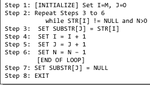

### 图 4.8 从字符串中间提取子字符串的算法

图 4.8 展示了一个从字符串中间提取子字符串的算法。
在此算法中，我们将循环计数器 I 初始化为 M，
即需要从中复制字符的位置。步骤 3 到 6 重复执行，直到复制了 n 个字符。
每复制一个字符，我们就递减 n 的值。字符串的字符被复制到
另一个名为 SUBSTR 的字符串中。最后，向 SUBSTR 追加一个空字符
以终止字符串。

## 编程示例

### 6. 编写一个程序，从给定字符串的中间提取子字符串。

```
#include <stdio.h>
#include <conio.h>
#include <string.h>
main()
{
char str[100], substr[100];
int i=0, j=0, n, m;
clrscr();
printf("\n Enter the main string : ");
gets(str);
printf("\n Enter the position from which to start the substring: ");
scanf("%d", &m);
printf("\n Enter the length of the substring: ");
scanf("%d", &n);
i=m-1;
while(str[i] != '\0' && n>0)
{
    substr[j] = str[i];
    i++;
    j++;
    n--;
}
substr[j] = '\0';
printf("\n The Substring is : ");
puts(substr);
getch();
return 0;
}
```

**输出**
Enter the main string : HI there
Enter the position from which to start the substring: 1
Enter the length of the substring: 4
The substring is : I th

- 步骤 1：[初始化] 设置 I=0, J=0 和 K=0
- 步骤 2：重复步骤 3 到 4，直到 TEXT[I] != NULL
- 步骤 3：如果 I = pos
  - 重复，直到 Str[k] != NULL
    - new_str[J] = Str[k]
    - 设置 J=J+1
    - 设置 K = K+1
  - [内部循环结束]
- 否则
  - new_str[J] = TEXT[I]
  - 设置 J = J+1
- [如果结束]
- 步骤 4：设置 I = I+1
- [外部循环结束]
- 步骤 5：设置 new_str[J] = NULL
- 步骤 6：退出

### 图 4.9 在指定位置向给定文本插入字符串的算法

## 在主字符串中插入字符串

插入操作将字符串 s 插入到主文本 τ 的第 k 个位置。此操作的一般语法为 INSERT(text, position, string)。例如，INSERT('XYZYZY', 3, 'AAA') = 'XYZAAAZYZ'。图 4.9 展示了一个在指定位置向给定文本插入字符串的算法。该算法首先将字符串中的索引初始化为零。从步骤 3 到 5，NEW_STR 的内容被构建起来。如果 τ 正好等于需要插入子字符串的位置，则内部循环将子字符串的内容复制到 NEW_STR。否则，将文本的内容复制到其中。

## 编程示例

### 7. 编写一个程序，向主文本中插入字符串。

```
#include <stdio.h>
#include <conio.h>
int main()
{
    char text[100], str[20], ins_text[100];
    int i=0, j=0, k=0,pos;
    clrscr();
    printf("\n Enter the main text : ");
    gets(text);
    printf("\n Enter the string to be inserted : ");
    gets(str);
    printf("\n Enter the position at which the string has to be inserted:");
    scanf("%d", &pos);
    while(text[i] != '\0')
{
if(i==pos)
{
while(str[k]!='\0')
{
ins_text[j]=str[k];
j++;
k++;
}
}
else
{
ins_text[j]=text[i];
j++;
i++;
}
}
ins_text[j]='\0';
printf("\n The new string is : ");
puts(ins_text);
getch();
return 0;
}
```

输出
Enter the main text : newsman
Enter the string to be inserted : paper
Enter the position at which the string has to be inserted: 4
The new string is: newspaperman

## 模式匹配

此操作返回字符串中模式首次出现的位置。例如，INDEX("Welcome to the world of programming", "world") = 15。但是，如果模式不存在于字符串中，INDEX 函数返回 0。图 4.10 展示了一个在给定文本中查找字符串首次出现索引的算法。

- 步骤 1：[初始化] 设置 I=0 和 MAX = Length(TEXT)-Length(STR)+1
- 步骤 2：重复步骤 3 到 6，直到 I < MAX
- 步骤 3：对于 K = 0 到 Length(STR)，重复步骤 4
- 步骤 4：如果 STR[K] != TEXT[I + K]，则转到步骤 6
- 步骤 5：[内部循环结束]
- 步骤 6：设置 INDEX = I
  - 转到步骤 8
- [如果结构结束]
- 步骤 7：设置 INDEX = -1
- 步骤 8：退出

### 图 4.10 在给定文本中查找字符串首次出现索引的算法

在此算法中，MAX 被初始化为 Length(TEXT) - Length(STR) + 1。例如，如果文本包含 'Welcome To Programming'，字符串包含 'world'，则在主文本中，我们最多会查找 22 - 5 + 1 = 18 个字符，因为之后字符串在文本中就没有出现的空间了。

步骤 3 到 6 重复执行，直到文本中的每个字符都被检查是否包含该字符串。在步骤 3 的内部循环中，我们检查字符串的 n 个字符

与文本的 n 个字符，以查看字符是否相同。如果不是这种情况，则移动到步骤 6，其中 i 被递增。如果找到字符串，则索引被初始化为 i，否则设置为 -1。例如，如果

```
TEXT = WELCOME TO THE WORLD
STRING = COME
```

在内部循环的第一次遍历中，我们将逐个字符地将 COME 与 WELC 进行比较。由于 w 和 c 不匹配，控制将移动到步骤 6，然后将 ELCO 与 COME 进行比较。在第四次遍历中，COME 将与 COME 进行比较。

我们将在后续操作中使用模式匹配操作的编程代码。

## 从主字符串中删除子字符串

删除操作从给定文本中删除一个子字符串。我们可以将其写为 DELETE(text, position, length)。例如，

```
Step 1: [INITIALIZE] SET I=0 and J=0
Step 2: Repeat Steps 3 to 6 while TEXT[I] != NULL
Step 3: IF I=M
   Repeat while N=0
      SET I = I+1
      SET N = N - 1
   [END OF IF]
   [END OF INNER LOOP]
Step 4: SET NEW_STR[J] = TEXT[I]
Step 5: SET J = J + 1
Step 6: SET I = I + 1
   [END OF OUTER LOOP]
Step 7: SET NEW_STR[J] = NULL
Step 8: EXIT
```

DELETE("ABCDXXXXABCD", 4, 3) = "ABCDABCD"

### 图 4.11 从文本中删除子字符串的算法

在此算法中，我们首先将索引初始化为零。步骤 3 到 6 重复执行，直到扫描完文本的所有字符。如果 I 正好等于 M（需要执行删除的位置），则文本的索引被递增，n 被递减。n 是从位置 M 开始需要删除的字符数。但是，如果 I 不等于 m，则文本的字符被简单地复制到 NEW_STR。

## 编程示例

### 8. 编写一个程序，从文本中删除子字符串。

```
#include <stdio.h>
#include <conio.h>
int main()
{
   char text[200], str[20], new_text[200];
   int i=0, j=0, found=0, k, n=0, copy_loop=0;
   clrscr();
   printf("\n Enter the main text : ");
   gets(text);
   printf("\n Enter the string to be deleted : ");
   gets(str);
   while(text[i]!='\0')
   {
      j=0; found=0, k=i;
      while(text[k]==str[j] && str[j]!='\0')
      {
         k++;
         j++;
      }
      if(str[j]=='\0')
      copy_loop = k;
      new_text[n] = text[copy_loop];
      i++;
      copy_loop++;
      n++;
   }
   new_text[n]='\0';
   printf("\n The new string is : ");
   puts(new_text);
   getch();
   return 0;
}
```

输出
Enter the main text : Hello, how are you?
Enter the string to be deleted : how are you?
The new string is : Hello

## 在字符串中用另一个模式替换模式

替换操作用于将模式 p1 替换为另一个模式 p2。这是通过编写 REPLACE(text, pattern1, pattern2) 来完成的。例如，

("AAABBBBCCC", "BBB", "X") = AAAXCCC
("AAABBBBCCC", "X", "YYY") = AAABBBYCCC

- 步骤 1：[初始化] 设置 POS = INDEX(TEXT, P1)
- 步骤 2：设置 TEXT = DELETE(TEXT, POS, LENGTH(P1))
- 步骤 3：INSERT(TEXT, POS, P2)
- 步骤 4：退出

### 图 4.12 在文本中用另一个模式 P2 替换模式 P1 的算法

在第二个示例中，没有变化，因为 x 不出现在文本中。图 4.12 展示了一个在文本中用另一个模式 P2 替换模式 P1 的算法。
该算法非常简单：首先找到模式在文本中出现的位置 pos，然后从该位置删除现有模式，并插入新模式。

## 编程示例

### 9. 编写一个程序，在文本中用另一个模式替换模式。

```
#include <stdio.h>
#include <conio.h>
main()
{
char str[200], pat[20], new_str[200], rep_pat[100];
int i=0, j=0, k, m=0, copy_loop=0, rep_index=0;
clrscr();
printf("\n Enter the string : ");
gets(str);
printf("\n Enter the pattern to be replaced : ");
gets(pat);
printf("\n Enter the replacing pattern : ");
gets(rep_pat);
while(str[i]!='\0')
{
j=0, k=i;
while(str[k]==pat[j] && pat[j]!='\0')
```


{
    k++;
    j++;
}
if(pat[j]=='\0')
{
    copy_loop=k;
    while(rep_pat[rep_index] != '\0')
    {
        new_str[n] = rep_pat[rep_index];
        rep_index++;
        n++;
    }
}
new_str[n] = str[copy_loop];
i++;
copy_loop++;
}
new_str[n]='\0';
printf("\n The new string is : ");
puts(new_str);
getch();
return 0;
}

### 输出

输入字符串：How Are You?
输入要替换的模式：ARE
输入替换模式：are
新字符串是：How are you?

## 4.3 字符串数组

到目前为止，我们已经看到字符串是一个字符数组。例如，如果我们说 char name[] = "Mohan"，那么 name 是一个字符串（字符数组），它有五个字符。

现在，假设一个班级有 20 名学生，我们需要一个字符串来存储所有 20 名学生的姓名。如何实现？这里，我们需要一个字符串的字符串或字符串数组。这样的字符串数组将存储 20 个独立字符串。字符串数组声明为 char names[20][30]；

在这里，第一个索引将指定需要多少个字符串，第二个索引将指定每个单独字符串的长度。因此，这里我们将为 20 个名字分配空间，每个名字最长可为 30 个字符。

让我们来看看字符串数组的内存表示。如果我们有一个声明为 char name[5][10] = { "Ram", "Mohan", "Shyam", "Hari", "Gopal" } 的数组；

然后在内存中，数组将按图 4.13 所示存储。

| name[0] | R | A | M | '\0' | | | | |
|---|---|---|---|---|---|---|---|---|
| name[1] | M | O | H | A | N | '\0' | | |
| name[2] | S | H | Y | A | M | '\0' | | |
| name[3] | H | A | R | I | '\0' | | | |
| name[4] | G | O | P | A | L | '\0' | '\0' | |

图 4.13 二维字符数组的内存表示

```
Step 1: [INITIALIZE] SET I=0
Step 2: Repeat Step 3 while I< N
Step 3: Apply Process to NAMES[I]
[END OF LOOP]
Step 4: EXIT
```

通过声明数组 names，我们分配了 50 字节。但实际占用的内存是 27 字节。因此，我们看到大约一半的已分配内存被浪费了。图 4.14 显示了一个从字符串数组中处理单个字符串的算法。在第 1 步中，我们将索引变量 i 初始化为零。在第 2 步中，执行 while 循环，直到访问数组中的所有字符串。在第 3 步中，处理每个单独的字符串。

图 4.14 从字符串数组中处理单个字符串的算法

## 编程示例

### 10. 编写一个程序对学生姓名进行排序。

```
#include <stdio.h>
#include <conio.h>
#include <string.h>
int main()
{
char names[5][10], temp[10];
int i, n, j;
clrscr();
printf("\n Enter the number of students : ");
scanf("%d", &n);
for(i=0;i<n;i++)
{
printf("\n Enter the name of student %d : ", i+1);
gets(names[i]);
}
for(i=0;i<n;i++)
{
for(j=0;j<n-1-i;j++)
{
if(strcmp(names[j], names[j+1])>0)
{
strcpy(temp, names[j]);
strcpy(names[j], names[j+1]);
strcpy(names[j+1], temp);
}
}
}
printf("\n Names of the students in alphabetical order are : ");
for(i=0;i<n;i++)
puts(names[i]);
getch();
return 0;
}
```

### 输出

输入学生人数：3
输入第 1 名学生的姓名：Goransh
输入第 2 名学生的姓名：Aditya
输入第 3 名学生的姓名：Sarthak
按字母顺序排列的学生姓名为：Aditya Goransh Sarthak

### 11. 编写一个程序读取多行文本，然后统计文本中的字符数、单词数和行数。

```
#include <stdio.h>
#include <conio.h>
int main()
{
    char str[1000];
    int i=0, word_count = 1, line_count = 1, char_count = 1;
    clrscr();
    printf("\n Enter a ** to end");
    printf("\n***************************************");
    printf("\n Enter the text : ");
    scanf("%c", &str[i]);
    while(str[i] != '*')
    {
        i++;
        scanf("%c", &str[i]);
    }
    str[i] = '\0';
    i=0;
    while(str[i] != '\0')
    {
        if(str[i] == '\n' || i==79)
            line_count++;
        if(str[i] == ' ' && str[i+1] == ' ')
            word_count++;
        char_count++;
        i++;
    }
    printf("\n The total count of words is : %d", word_count);
    printf("\n The total count of lines is : %d", line_count);
    printf("\n The total count of characters is : %d", char_count);
    return 0;
}
```

### 输出

输入 ** 以结束
**************
输入文本：Hi there*
单词总数为：2
行总数为：1
字符总数为：9

### 12. 编写一个程序判断字符串是否为回文。

```
#include <stdio.h>
#include <conio.h>
int main()
{
    char str[100];
    int i = 0, j, length = 0;
    clrscr();
    printf("\n Enter the string : ");
    gets(str);
    while(str[i] != '\0')
    {
        length++ ;
        i++ ;
    }
    i=0;
    j = length - 1;
    while(i < length/2)
    {
        if(str[i] == str[j])
        {
            i++;
            j--;
        }
        else
            break;
    }
    if(i>j)
        printf("\n PALINDROME");
    else
        printf("\n NOT A PALINDROME");
    return 0;
}
```

### 输出

输入字符串：madam
PALINDROME

## 4.4 指针和字符串

在 C 语言中，字符串被视为以二进制零字符（写作 '\0'）结尾的字符数组。例如，

```
char str[10];
str[0] = 'H';
str[1] = 'I';
str[2] = '!';
str[3] = '\0';
```

C 语言提供了声明和初始化字符串的两种替代方法。首先，你可以写

```
char str[10] = { 'H', 'I', '!', '\0'};
```

但这比较麻烦，需要输入更多内容。因此，C 语言允许

```
char str[10] = "HI";
```

当使用双引号时，空字符 ('\0') 会自动附加到字符串末尾。

当以这种方式声明字符串时，编译器会预留一块连续的内存（即 10 字节长）来存放字符，并将其前四个字符初始化为 HI\0。

现在，考虑下面打印文本的程序。

```
#include <stdio.h>
int main()
{
    char str[] = "Hello";
    char *pstr;
    pstr = str;
    printf("\n The string is : ");
    while(*pstr != '\0')
    {
        printf("%c", *pstr);
        pstr++;
    }
    return 0;
}
```

### 输出

字符串是：Hello

在这个程序中，我们声明一个字符指针 *pstr 以在屏幕上显示字符串。然后，我们将指针 *pstr 指向 str。接着，我们使用 while 循环打印字符串的每个字符。与使用 while 循环相比，我们可以直接使用函数 puts()，如下所示

```
int puts(const char *s);
```

在这里，const 修饰符用于确保函数不会修改源指针所指向的内容。字符串的地址作为参数传递给函数。

传递给 puts() 的参数是一个指针，它无非就是它所指向的地址，或者简单说就是一个地址。因此，编写 puts(str) 意味着传递 str[0] 的地址。同样，当我们编写 puts(*pstr) 时，我们传递的是相同的地址，因为我们已经写了 pstr = str；

考虑另一个程序，它读取一个字符串，然后扫描每个字符以统计输入的大写和小写字符数量。

```
#include <stdio.h>
int main()
{
    char str[100], *pstr;
    int upper = 0, lower = 0;
    printf("\n Enter the string : ");
    gets(str);
    pstr = str;
    while(*pstr != '\0')
    {
        if(*pstr >= 'A' && *pstr <= 'Z')
            upper++;
        else if(*pstr >= 'a' && *pstr <= 'z')
            lower++;
        pstr++;
    }
    printf("\n Total number of upper case characters = %d", upper);
    printf("\n Total number of lower case characters = %d", lower);
    return 0;
}
```

### 输出

输入字符串：How are you
大写字符总数 = 1
小写字符总数 = 8

## 编程示例

### 13. 编写一个程序将一个字符串复制到另一个字符串中。

```
#include <stdio.h>
int main()
{
    char str[100], copy_str[100];
    char *pstr, *copy_str;
    pstr = str;
    copy_str = copy_str;
    printf("\n Enter the string : ");
    gets(str);
    printf(str);
    while(*pstr != '\0')
    {
```


```c
*pcopy_str = *pstr;
pstr++, pcopy_str++;
}
*pcopy_str = '\0';
printf("\n The copied text is : ");
while(*pcopy_str != '\0')
{
    printf("%c", *pcopy_str);
    pcopy_str++;
}
return 0;
```

输出
Enter the string : C Programming
The copied text is : C Programming

## 14. 编写一个程序来连接两个字符串。

```c
#include <stdio.h>
#include <conio.h>
int main()
{
    char str1[100], str2[100], copy_str[200];
    char *pstr1, *pstr2, *pcopy_str;
    clrscr();
    pstr1 = str1;
    pstr2 = str2;
    pcopy_str = copy_str;
    printf("\n Enter the first string : ");
    gets(str1);
    printf("\n Enter the second string : ");
    gets(str2);
    while(*pstr1 != '\0')
    {
        *pcopy_str = *pstr1;
        pcopy_str++, pstr1++;
    }
    while(*pstr2 != '\0')
    {
        *pcopy_str = *pstr2;
        pcopy_str++, pstr2++;
    }
    *pcopy_str = '\0';
    printf("\n The concatenated text is : ");
    while(*pcopy_str != '\0')
    {
        printf("%c", *pcopy_str);
        pcopy_str++;
    }
    return 0;
}
```

输出
Enter the first string : Data Structures Using C by
Enter the second string : Reema Thareja
The concatenated text is : Data Structures Using C by Reema Thareja

## 要点

- 字符串是以空字符结尾的字符数组。
- 字符串中的单个字符可以使用从零开始的下标来访问。
- 字符串的所有字符都存储在连续的内存位置中。
- 字符串可以通过三种方式由用户读取：使用 scanf() 函数，使用 gets() 函数，或反复使用 getchar() 函数。
- scanf() 函数一旦发现空格就会终止。
- gets() 函数获取将保存输入的字符串的起始地址。使用 gets() 输入的字符串会自动以空字符终止。
- 字符串也可以通过反复调用 getchar() 来读取一系列单个字符。
- 字符串可以通过三种方式在屏幕上显示：使用 printf() 函数，使用 puts() 函数，或反复使用 putchar() 函数。
- C 标准库支持许多用于操作字符串或更改字符串内容的预定义函数。其中许多函数定义在头文件 string.h 中。
- 或者，我们也可以开发执行与预定义字符串处理函数相同任务的函数。最基本的函数是长度函数，它返回字符串中的字符数。
- 字符串名充当指向字符串的指针。在声明 char str[5] = "hello"; 中，str 是一个指针，它保存第一个字符（即 'h'）的地址。
- 字符串数组可以声明为 char strings [20][30]；其中第一个下标表示字符串的数量，第二个下标表示每个字符串的长度。

## 练习

### 复习问题

- 1. 什么是字符串？讨论可以对字符串执行的一些操作。
- 2. 解释字符串在主内存中是如何表示的。
- 3. 字符串如何从标准输入设备读取？解释用于执行字符串输入操作的不同函数。
- 4. 解释字符串如何在屏幕上显示。
- 5. 解释 printf() 和 scanf() 的语法。
- 6. 列出可以从字符串 'ABCD' 形成的所有子字符串。
- 7. 你对模式匹配有什么理解？给出其算法。
- 8. 关于字符串数组写一篇简短的说明。
- 9. 用示例解释字符串数组在主内存中是如何存储的。
- 10. 借助合适的程序，解释指针和字符串之间的关系。
- 11. 如果子字符串函数定义为 SUBSTRING (string, position, length)，则当 S = "Welcome to World of C Programming" 时，求 S(5, 9)。
- 12. 如果索引函数定义为 INDEX(text, pattern)，则求 index(T, P)，其中 T = "Welcome to World of C Programming"，P = "of"。
- 13. 区分 gets() 和 scanf()。
- 14. 说明 getchar() 和 scanf() 的缺点。
- 15. 哪个函数可以用来克服 getchar() 和 scanf() 的缺陷？
- 16. putchar() 如何用于打印字符串？
- 17. 区分字符和字符串。
- 18. 区分字符数组和字符串。

### 编程练习

- 1. 编写一个程序，将字符串作为参数传递给函数。
- 2. 编写一个 C 程序，将字符串的前 n 个字符与另一个字符串连接。
- 3. 编写一个 C 程序，比较一个字符串的前 n 个字符与另一个字符串的前 n 个字符。
- 4. 编写一个 C 程序，删除字符串中的前导和尾随空格。
- 5. 编写一个 C 程序，将字符串中的给定字符替换为另一个字符。
- 6. 编写一个程序，统计给定字符串中数字、大写字符、小写字符和特殊字符的数量。
- 7. 编写一个程序，统计给定字符在字符串中出现的总次数。
- 8. 编写一个程序，接受一段文本。统计并显示单词 'the' 在文本中出现的次数。
- 9. 编写一个程序，统计文本中单词出现的总次数。
- 10. 编写一个程序，查找子字符串在字符串中最后一次出现的位置。
- 11. 编写一个程序，输入一个字符串数组。然后，按以下格式反转字符串。"HAPPY BIRTHDAY TO YOU" 应显示为 "YOU TO BIRTHDAY HAPPY"。
- 12. 编写一个程序，按以下格式追加给定字符串。"GOOD MORNING MORNING GOOD"。
- 13. 编写一个程序，输入至少两个段落的文本。交换第一段和第二段，然后在屏幕上重新显示文本。
- 14. 编写一个程序，输入至少两个段落的文本。构建一个数组 PAR，使得 PAR[I] 包含文本中第 i 个段落的位置。
- 15. 编写一个程序，将给定字符串 "GOOD MORNING" 转换为 "good morning"。
- 16. 编写一个程序，连接两个给定字符串 "Good Morning" 和 "world"。显示结果字符串。
- 17. 编写一个程序，检查两个给定字符串 "Good Morning" 和 "GOOD MORNING" 是否相同。
- 18. 编写一个程序，将给定字符串 "hello world" 转换为 "dlrow olleh"。
- 19. 编写一个程序，从给定字符串 "Good Morning" 中提取字符串 "od Mo"。
- 20. 编写一个程序，将 "University" 插入到给定字符串 "Oxford Press" 中，使字符串读取为 "Oxford University Press"。
- 21. 编写一个程序，读取一段文本，删除其中的所有分号，最后将所有 ' . ' 替换为 ' . '。
- 22. 编写一个程序，将字符数组的最后 n 个字符复制到另一个字符数组中。同时在复制过程中将小写字母转换为大写字母。
- 23. 编写一个程序，将字符串 "Good Morning" 改写为 "Good Evening"。
- 24. 编写一个程序，读取并显示部门员工的姓名。
- 25. 编写一个程序，读取一行，直到输入换行符。
- 26. 编写一个程序，读取一个短篇故事。在每一行开始之前打印行号，重写故事。
- 27. 编写一个程序，输入包含多行的文本。显示从第 m 行开始的 n 行文本。
- 28. 编写一个程序，检查模式是否存在于文本中。如果存在，删除模式并显示它。
- 29. 编写一个程序，在字符串数组 STUD[][] 中插入一个新姓名，假设姓名按字母顺序排序。
- 30. 编写一个程序，在字符串数组 STUD[][] 中删除一个姓名，假设姓名按字母顺序排序。

### 选择题

- 1. Insert("XXYYYYZZ", 1, "ppp") =
  - (a) PPPXXXXYYYYZZ
  - (b) XXPPPYYYYZZZZ
  - (c) XXXXYYYZZZPPP
- 2. Delete("XXYYYYZZ", 4, 3) =
  - (a) XXYZ
  - (b) XXYYZZ
  - (c) XXYYZZ
- 3. 如果 str1 = "Welcome to the world of programming"，则 SUBSTRING(str1, 15, 5) =
  - (a) world           (b) programming
  - (c) welcome         (d) 以上都不是
- 4. strcat() 定义在哪个头文件中？
  - (a) ctype.h         (b) stdio.h
  - (c) string.h        (d) math.h
- 5. 字符串可以使用哪个函数读取？
  - (a) gets()          (b) scanf()
  - (c) getchar()       (d) 以上都是
- 6. Replace("XXYYYYZZ", "XY", "AB") =
  - (a) XXABYYZZ        (b) XABYYZZZ
  - (c) ABXXYYYYZZ
- 7. Oxford University Press 中 U 的索引是？
  - (a) 5               (b) 6
  - (c) 7               (d) 8


-   8. s1 = "HI", s2 = "HELLO", s3 = "BYE". 如何连接这三个字符串？
-   (a) strcat(s1,s2,s3)
-   (b) strcat(s1(strcat(s2,s3)))
-   (c) strcpy(s1, strcat(s2,s3))
-   9. strlen("Oxford University Press") 是多少？
-   (a) 22 (b) 23
-   (c) 24 (d) 25
-   10. 哪个函数将一个字符串添加到另一个字符串的末尾？
-   (a) stradd() (b) strcat()
-   (c) strtok() (d) strcpy()
-   13. 在声明期间初始化字符串时，必须显式地用空字符终止该字符串。
-   14. strcmp("and", "ant"); 将返回一个正值。
-   15. 赋值运算符可用于将一个字符串的内容复制到另一个字符串中。

### 判断题

-   1. 字符串 `Hello World` 可以使用 `scanf()` 读取。
-   2. 使用 `scanf()` 读取字符串时需要一个 & 字符。
-   3. `gets()` 函数获取将保存输入的字符串的起始地址。
-   4. `tolower()` 在 `ctype.h` 头文件中定义。
-   5. 如果 `s1` 和 `s2` 是两个字符串，则连接操作会生成一个字符串，该字符串包含 `s1` 的字符，后跟 `s2` 的字符。
-   6. 将一个字符串追加到另一个字符串涉及将源字符串的内容复制到目标字符串的末尾。
-   7. `s1<=s2`，在字典顺序中，`s1` 在 `s2` 之前。
-   8. 如果 `s1 = "GOOD MORNING"`，则 `Substr_Right (s1, 7) = MORNING`。
-   9. Replace ("AAABBCCC", "X", "YYY") = AAABBCCC。
-   10. 将字符串初始化为 `char str[] = "HELLO";` 是不正确的，因为未显式添加空字符。
-   11. `scanf()` 函数会自动在从键盘读取的字符串末尾追加一个空字符。
-   12. 字符串变量可以出现在赋值运算符的左侧或右侧。

### 填空题

-   1. 字符串是 _______。
-   2. 每个字符串都以 _______ 结尾。
-   3. 如果字符串为 "AB CD"，则该字符串的长度是 _______。
-   4. 字符串的下标从 _______ 开始。
-   5. 字符串的字符存储在 _______ 个内存位置中。
-   6. `char msg[100];` 最多可以存储 _______ 个字符。
-   7. _______ 函数在遇到空格时立即终止。
-   8. A-Z 的 ASCII 代码范围是 _______。
-   9. `toupper()` 用于 _______。
-   10. `S1>S2` 表示 _______。
-   11. 反转字符串的函数是 _______。
-   12. 如果 `s1 = "GOOD MORNING"`，则 `Substr_Left (S1, 7) = _______`。
-   13. `INDEX("Welcome to the world of programming", "world") = _______`。
-   14. `strstr(str1, str2)` 如果 _______ 则返回 1，即字符串模式首次出现在字符串中的位置。
-   15. `strcmp(str1, str2)` 如果 _______ 则返回 1。
-   16. _______ 函数计算字符串的长度。
-   17. 除了 `printf()`，_______ 函数可用于在屏幕上打印一行文本。

# 第 5 章

# 结构体和共用体

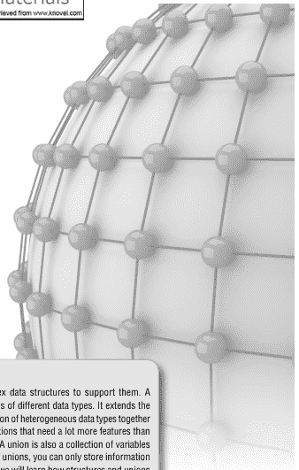

### 学习目标

当今的现代应用程序需要复杂的数据结构来支持它们。结构体是不同数据类型的相关数据项的集合。它通过将异构数据类型的相关信息存储在单个名称下，扩展了数组的概念。它适用于需要比原始数据类型提供的功能更多特性的应用程序。共用体也是不同数据类型变量的集合，只不过在共用体中，任何一时刻只能在一个字段中存储信息。在本章中，我们将学习如何使用 C 语言声明、定义和访问结构体和共用体。

## 5.1 简介

结构体在很多方面类似于记录。它存储关于实体的相关信息。结构体基本上是一种用户定义的数据类型，可以将相关信息（甚至不同数据类型的信息）存储在一起。结构体与数组的主要区别在于，数组只能存储相同数据类型的信息。

因此，结构体是在单个名称下的变量集合。结构体中的变量属于不同的数据类型，每个变量都有一个名称，用于从结构体中选择它。

### 5.1.1 结构体声明

结构体使用关键字 `struct` 后跟结构体名称进行声明。结构体的所有变量都在结构体内部声明。结构体类型通常使用以下语法声明：

```
struct struct-name
{
    data_type var-name;
}
```

> **编程提示**
> 声明结构体和共用体后，不要忘记加上分号。

```
data_type var-name;
..........
);
```

例如，如果我们要为学生定义一个结构体，那么学生的相关信息可能是：roll_number、name、course 和 fees。该结构体可以声明为：

```
struct student
{
    int r_no;
    char name[20];
    char course[20];
    float fees;
};
```

现在，结构体已成为一种用户定义的数据类型。在结构体内声明的每个变量名称为结构体的成员。但是，结构体声明本身不分配任何内存或占用存储空间。它只是提供一个模板，向 C 编译器说明结构体在内存中的布局，并提供成员名称的详细信息。

与任何其他数据类型一样，当我们声明结构体变量时，会为结构体分配内存。

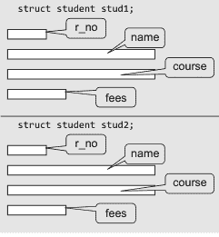

图 5.1 结构体变量的内存分配

例如，我们可以通过编写以下内容定义结构体变量：

```
struct student stud1;
```

在这里，struct student 是数据类型，stud1 是变量。请看声明变量的另一种方式。在以下语法中，变量在结构体声明时进行声明。

```
struct student
{
    int r_no;
    char name[20];
    char course[20];
    float fees;
} stud1, stud2;
```

在此声明中，我们声明了结构体 student 的两个变量 stud1 和 stud2。因此，如果要声明多个结构体变量，请使用逗号分隔变量。当我们声明结构体变量时，会为每个变量分配单独的内存。如图 5.1 所示。

> **注意**
> 结构体类型和结构体变量的声明可以是局部的，也可以是全局的，具体取决于它们在代码中的位置。

最后，结构体成员名称和结构体名称遵循与普通变量名称相同的命名规则。但是，应注意确保结构体名称与结构体成员名称不相同。此外，结构体名称及其变量名称也应不同。

### 5.1.2 typedef 声明

typedef（源自类型定义）关键字使程序员能够使用现有数据类型创建新的数据类型名称。使用 typedef 时，不会创建新数据，而是为已知数据类型提供一个替代名称。typedef 关键字的一般语法如下：

> **编程提示**
> C 不允许在创建 typedef 定义时声明变量。因此，变量必须在独立的语句中声明。

```
typedef existing_data_type new_data_type;
```

请注意，typedef 语句不占用任何内存；它只是定义一个新类型。例如，如果我们编写

```
typedef int INTEGER;
```

那么 INTEGER 是 int 数据类型的新名称。要使用新数据类型名称声明变量，请在变量名前加上数据类型名称（新）。因此，要定义整数变量，我们现在可以编写

```
INTEGER num=5;
```

当我们在结构体名前加上 typedef 关键字时，结构体就成为一种新类型。它用于为 C 已定义或你已声明的类型提供更短、更有意义的名称，以简化构造。例如，请考虑以下声明：

```
typedef struct student
{
    int r_no;
    char name[20];
    char course[20];
    float fees;
};
```

现在你已在结构体名前加上 typedef 关键字，student 成为一种新数据类型。因此，现在你可以像声明 int、float、char、double 等类型的变量一样，直接声明这种新数据类型的变量。要声明结构体 student 的变量，可以编写

```
student stud1;
```

请注意，我们没有编写 struct student stud1。

### 5.1.3 结构体初始化

结构体的初始化方式与其他数据类型的初始化方式相同。初始化结构体意味着向结构体的成员分配一些常量。当用户未显式初始化结构体时，C 会自动执行初始化。对于 int 和 float 成员，值初始化为零；char 和字符串成员默认初始化为 '\0'。

初始化器用大括号括起来，并用逗号分隔。但是，必须注意确保初始化器与结构体定义中对应的类型匹配。

初始化结构体变量的一般语法如下：

```
struct struct_name
{
    data_type member_name1;
    data_type member_name2;
    data_type member_name3;
    ................
}struct_var = {constant1, constant2, constant3,...};
```

或

```
struct struct_name
{
    data_type member_name1;
    data_type member_name2;
    data_type member_name3;
    ................
};
```


```
struct struct_name struct_var = {constant1, constant2, constant3,...};
```

> **编程提示**
> 将一种类型的结构体赋值给另一种类型的结构体是错误的。

例如，我们可以通过编写以下内容来初始化学生结构体，

```
struct student
{
    int r_no;
    char name[20];
    char course[20];
    float fees;
}stud1 = {01, "Rahul", "BCA", 45000};
```

或者，通过编写，

```
struct student stud1 = {01, "Rahul", "BCA", 45000};
```

图 5.2 说明了值将如何分配给结构体的各个字段。

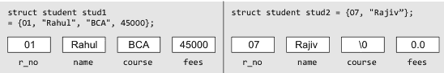

### 图 5.2 为结构体元素赋值

当结构体的所有成员都未初始化时，这称为部分初始化。在部分初始化的情况下，结构体的前几个成员被初始化，而未初始化的成员被赋予默认值。

### 5.1.4 访问结构体的成员

结构体的每个成员都可以像普通变量一样使用，但其名称会稍长一些。结构体成员变量通常使用 '.'（点）运算符来访问。访问结构体或结构体成员的语法可以表示为：

```
struct_var.member_name
```

点运算符用于选择结构体的特定成员。例如，要为结构体变量 stud1 的各个数据成员赋值，我们可以编写

```
stud1.r_no = 01;
stud1.name = "Rahul";
stud1.course = "BCA";
stud1.fees = 45000;
```

要为结构体变量 stud1 的数据成员输入值，我们可以编写

```
scanf("%d", &stud1.r_no);
scanf("%s", stud1.name);
```

同样，要打印结构体变量 stud1 的值，我们可以编写

```
printf("%s", stud1.course);
printf("%f", stud1.fees);
```

只有在声明结构体变量时才会分配内存。换句话说，只有在实例化结构体时才会分配内存。在没有任何变量的情况下，结构体定义只是一个模板，当声明结构体类型的变量时，将使用该模板来保留内存。

一旦定义了结构体的变量，我们就可以对它们执行一些操作。例如，我们可以使用赋值运算符 (=) 将一个变量的值赋给另一个变量。

> **注意** 在所有运算符中，->, ., (, ) 和 [] 具有最高优先级。这一点从以下语句中很明显：stud1.fees++ 将被解释为 (stud1.fees)++。

### 5.1.5 复制和比较结构体

我们可以将一个结构体赋值给同一类型的另一个结构体。例如，如果我们有两个类型为 struct student 的结构体变量 stud1 和 stud2，如下所示

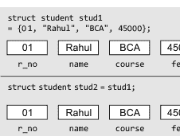

### 图 5.3 结构体变量的值

```
struct student stud1 = {01, "Rahul", "BCA", 45000};
struct student stud2;
```

然后，要将一个结构体变量赋值给另一个，我们将编写

```
stud2 = stud1;
```

该语句用 stud1 成员的值初始化 stud2 的成员。因此，现在 stud1 和 stud2 的值可以如图 5.3 所示。

C 不允许比较一个结构体变量与另一个结构体变量。但是，一个结构体的各个成员可以与另一个结构体的各个成员进行比较。当我们将一个结构体成员与另一个结构体的成员进行比较时，比较将像任何其他普通变量比较一样行为。

> **编程提示**
> 如果您尝试比较两个结构体变量，将生成错误。

例如，要比较两名学生的学费，我们将编写
if(stud1.fees > stud2.fees) //检查 stud1 的学费是否大于 stud2

## 编程示例

- 1. 使用结构体编写一个程序，以读取和显示关于学生的信息。

```
#include <stdio.h>
#include <conio.h>
int main()
{
    struct student
    {
        int roll_no;
        char name[80];
        float fees;
        char DOB[80];
    };
    struct student stud1;
    clrscr();
    printf("\n Enter the roll number : ");
    scanf("%d", &stud1.roll_no);
    printf("\n Enter the name : ");
    scanf("%s", stud1.name);
    printf("\n Enter the fees : ");
    scanf("%f", &stud1.fees);
    printf("\n Enter the DOB : ");
    scanf("%s", stud1.DOB);
    printf("\n ******************STUDENT'S DETAILS *******");
    printf("\n Roll No. = %d", stud1.roll_no);
    printf("\n NAME = %s", stud1.name);
    printf("\n FEES = %f", stud1.fees);
    printf("\n DOB = %s", stud1.DOB);
    getch();
    return 0;
}
```

### 输出

Enter the roll number : 01
Enter the name : Rahul
Enter the fees : 45000
Enter the DOB : 25-09-1991
****************STUDENT'S DETAILS *****************
ROLL No. = 01
NAME = Rahul
FEES = 45000.00
DOB = 25-09-1991

- 2. 编写一个程序，读取、显示、添加和减去两个复数。

```
#include <stdio.h>
#include <conio.h>
int main()
{
typedef struct complex
{
int real;
int imag;
}COMPLEX;
COMPLEX c1, c2, sum_c, sub_c;
int option;
clrscr();
do
{
printf("\n *********** MAIN MENU ***********");
printf("\n 1. Read the complex numbers");
printf("\n 2. Display the complex numbers");
printf("\n 3. Add the complex numbers");
printf("\n 4. Subtract the complex numbers");
printf("\n 5. EXIT");
printf("\n Enter your option : ");
scanf("%d", &option);
switch(option)
{
case 1:
printf("\n Enter the real and imaginary parts of the
first complex number : ");
scanf("%d %d", &c1.real, &c1.imag);
printf("\n Enter the real and imaginary parts of the
second complex number : ");
scanf("%d %d", &c2.real, &c2.imag);
break;
case 2:
printf("\n The first complex number is : %d+%di",
c1.real,c1.imag);
printf("\n The second complex number is : %d+%di",
c2.real,c2.imag);
break;
case 3:
sum_c.real = c1.real + c2.real;
sum_c.imag = c1.imag + c2.imag;
printf("\n The sum of two complex numbers is :
%d+%di",sum_c.real, sum_c.imag);
break;
case 4:
sub_c.real = c1.real - c2.real;
sub_c.imag = c1.imag - c2.imag;
printf("\n The difference between two complex numbers
is %d+%di", sub_c.real, sub_c.imag);
break;
}while(option != 5);
getch();
return 0;
}
```

### 输出

**************** MAIN MENU *****************
1. Read the complex numbers
2. Display the complex numbers
3. Add the complex numbers
4. Subtract the complex numbers
5. EXIT
Enter your option : 1
Enter the real and imaginary parts of the first complex number : 2 3
Enter the real and imaginary parts of the second complex number : 4 5
Enter your option : 2
The first complex numbers is : 2+3i
The second complex numbers is : 4+5i
Enter your option : 3
The sum of two complex numbers is : 6+8i
Enter your option : 5

## 5.2 嵌套结构体

结构体可以放在另一个结构体中，即，结构体可以包含另一个结构体作为其成员。包含另一个结构体作为其成员的结构体称为嵌套结构体。让我们现在看看如何声明嵌套结构体。虽然可以用一个声明来声明嵌套结构体，但不推荐这样做。更简单、更清晰的方法是分别声明结构体，然后将它们分组到更高级别的结构体中。这样做时，请注意检查嵌套必须从内到外（从最低级别到最包容的级别）进行，即，先声明最内层结构体，然后是下一级结构体，逐步向外（最包容的结构体）进行。

```
typedef struct
{
    char first_name[20];
    char mid_name[20];
    char last_name[20];
}NAME;
typedef struct
{
    int dd;
    int mm;
    int yy;
}DATE;
typedef struct
{
    int r_no;
    NAME name;
    char course[20];
    DATE DOB;
    float fees;
} student;
```

在此示例中，我们看到结构体 student 包含两个其他结构体，NAME 和 DATE。这两个结构体都有自己的字段。结构体 NAME 有三个字段：first_name、mid_name 和 last_name。结构体 DATE 也有三个字段：dd、mm 和 yy，分别指定日期的日、月和年。现在，要为结构体字段赋值，我们将编写

```
student std1;
stud1.r_no = 01;
stud1.name.first_name = "Janak";
stud1.name.mid_name = "Raj";
stud1.name.last_name = "Thareja";
stud1.course = "BCA";
stud1.DOB.dd = 15;
stud1.DOB.mm = 9;
stud1.DOB.yy = 1990;
stud1.fees = 45000;
```

在嵌套结构体的情况下，我们将点运算符与结构体变量结合使用，以访问最内层和最外层结构体的成员。嵌套结构体的使用在下一个程序中得到说明。

## 编程示例

- 3. 编写一个程序，使用嵌套结构体读取和显示学生的信息。

```
#include <stdio.h>
#include <conio.h>
int main()
{
    struct DOB
    {
        int day;
        int month;
        int year;
    };
    struct student
    {
        int roll_no;
        char name[100];
        float fees;
        struct DOB date;
    };
    struct student std1;
    clrscr();
    printf("\n Enter the roll number : ");
    scanf("%d", &std1.roll_no);
    printf("\n Enter the name : ");
    scanf("%s", std1.name);
    printf("\n Enter the fees : ");
    scanf("%f", &std1.fees);
    printf("\n Enter the DOB : ");
    scanf("%d %d %d", &std1.date.day, &std1.date.month, &std1.date.year);
}
```


printf("\n **********STUDENT'S DETAILS ************");
printf("\n ROLL NO. = %d", stud1.roll_no);
printf("\n NAME = %s", stud1.name);
printf("\n FEES = %f", stud1.fees);
printf("\n DOB = %d - %d - %d", stud1.date.day, stud1.date.month, stud1.date.year);
getch();
return 0;
}
```

# Output

```
Enter the roll number : 01
Enter the name : Rahul
Enter the fees : 45000
Enter the DOB : 25 09 1991
**********STUDENT'S DETAILS ************
ROLL NO. 01
NAME : Rahul
FEES = 45000.00
DOB = 25 - 09 - 1991
```

## 5.3 结构体数组

在上面的示例中，我们已经了解了如何声明结构体并为其数据成员赋值。现在，我们将讨论如何声明结构体数组。为此，让我们先分析在什么情况下需要结构体数组。

在一个班级中，不只有一个学生。但可能至少有 30 名学生。因此，相同的结构体定义可以用于所有 30 名学生。当我们创建结构体数组时，这就会成为可能。结构体数组的声明方式与声明内置数据类型数组的方式相同。

结构体数组的另一个适用场景是组织机构。一个组织有许多员工。因此，为每个员工定义单独的结构体不是可行的方案。在这里，我们可以为所有员工使用一个通用的结构体定义。这同样可以通过声明结构体数组 employee 来实现。

声明结构体数组的一般语法如下，

```
struct struct_name
{
    data_type member_name1;
    data_type member_name2;
    data_type member_name3;
    .......................
    .......................
};
struct struct_name struct_var[index];
```

考虑给定的结构体变量定义。

```
struct student
{
    int r_no;
    char name[20];
    char course[20];
    float fees;
};
```

可以通过编写以下方式声明学生数组：

```
struct student stud[30];
```

现在，为班级中第 i 名学生赋值，我们将编写

```
stud[1].r_no = 09;
stud[1].name = "RASHTRI";
stud[1].course = "MCA";
stud[1].fees = 60000;
```

为了在声明时初始化结构体变量数组，我们可以按以下方式编写：

```
struct student stud[3] = {(01, "Aman", "BCA", 45000),(02, "Aryan", "BCA", 60000), (03, "John", "BCA", 45000)};
```

## 编程示例

- 4. 编写一个程序，读取并显示班级中所有学生的信息。然后编辑第 i 名学生的详细信息并重新显示全部信息。

```
#include <stdio.h>
#include <conio.h>
#include <string.h>
int main()
{
	struct student
	{
		int roll_no;
		char name[80];
		int fees;
		char DOB[80];
	};
	struct student stud[50];
	int n, i, new_rollno;
	int new_fees;
	char new_name[80], new_DOB[80];
	clrscr();
	printf("\n Enter the number of students : ");
	scanf("%d", &n);
	for(i=0;i<n;i++)
	{
		printf("\n Enter the roll number : ");
		scanf("%d", &stud[i].roll_no);
		printf("\n Enter the name : ");
		gets(stud[i].name);
		printf("\n Enter the fees : ");
		scanf("%d", &stud[i].fees);
		printf("\n Enter the DOB : ");
		gets(stud[i].DOB);
	}
	for(i=0;i<n;i++)
	{
		printf("\n **********DETAILS OF STUDENT %d**********", i+1);
		printf("\n Roll No. = %d", stud[i].roll_no);
		printf("\n NAME = %s", stud[i].name);
		printf("\n FEES = %d", stud[i].fees);
		printf("\n DOB = %s", stud[i].DOB);
	}
	printf("\n Enter the student number whose record has to be edited : ");
	scanf("%d", &num);
	num--;
	printf("\n Enter the new roll number : ");
	scanf("%d", &new_rollno);
	printf("\n Enter the new name : ");
	gets(new_name);
	printf("\n Enter the new fees : ");
	scanf("%d", &new_fees);
	printf("\n Enter the new DOB : ");
	gets(new_DOB);
	stud[num].roll_no = new_rollno;
	strcpy(stud[num].name, new_name);
	stud[num].fees = new_fees;
	strcpy(stud[num].DOB, new_DOB);
	for(i=0;i<n;i++)
	{
	    printf("\n *********DETAILS OF STUDENT %d**********", i+1);
	    printf("\n ROLL NO. = %d", stud[i].roll_no);
	    printf("\n NAME = %s", stud[i].name);
	    printf("\n FEES = %d", stud[i].fees);
	    printf("\n DOB = %s", stud[i].DOB);
	}
	getch();
	return 0;
}
```

# 输出

输入学生人数：2
输入学号：1
输入姓名：Kirti
输入学费：5678
输入出生日期：9 9 91
输入学号：2
输入姓名：kangana
输入学费：5678
输入出生日期：27 8 91
*********DETAILS OF STUDENT 1**********
ROLL NO. = 1
NAME = Kirti
FEES = 5678
DOB = 9 9 91
*********DETAILS OF STUDENT 2**********
ROLL NO. = 2
NAME = Kangana
FEES = 5678
DOB = 27 8 91
输入要编辑其记录的学生编号：2
输入新学号：2
输入新姓名：kangana khullar
输入新学费：7000
输入新出生日期：27 8 92
*********DETAILS OF STUDENT 1**********
ROLL NO. = 1
NAME = Kirti
FEES = 5678
DOB = 9 9 91
*********DETAILS OF STUDENT 2**********
ROLL NO. = 2
NAME = Kangana khullar
FEES = 7000
DOB = 27 8 92

## 5.4 结构体与函数

为了使结构体发挥最大作用，我们必须有一种将结构体传递给函数并从函数返回的机制。函数可以通过三种方式访问结构体的成员，如图 5.4 所示。

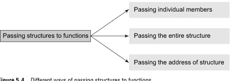

### 5.4.1 传递单个成员

要将结构体的任何单个成员传递给函数，必须使用直接选择运算符来引用单个成员。被调用程序不知道变量是普通变量还是结构体成员。请查看下面说明此概念的代码。

```
#include <stdio.h>
typedef struct
{
int x;
int y;
}POINT;
void display(int, int);
int main()
{
POINT p1 = {2, 3};
display(p1.x, p1.y);
return 0;
}
void display(int a, int b)
{
printf("The coordinates of the point are: %d %d", a, b);
}
```

### 输出

点的坐标为：2 3

### 5.4.2 传递整个结构体

与其他任何变量一样，我们可以将整个结构体作为函数参数传递。当结构体作为参数传递时，它使用按值调用方法传递，即结构体的每个成员都会被复制一份。

将结构体传递给函数并返回结构体的一般语法如下，

```
struct struct_name func_name(struct struct_name struct_var);
```

上述语法可根据要求进行变化。例如，在某些情况下，我们可能希望函数接收结构体但返回 void 或其他数据类型的值。下面给出的代码使用按值调用方法将结构体传递给函数。

```
#include <stdio.h>
typedef struct
{
int x;
int y;
}POINT;
void display(POINT);
int main()
{
    POINT p1 = {2, 3};
    display(p1);
    return 0;
}
void display(POINT p)
{
    printf("The coordinates of the point are: %d %d", p.x, p.y);
}
```

## 编程示例

- 5. 编写一个程序，读取、显示、加和减两个距离。距离必须使用千米和米来定义。

```
#include <stdio.h>
#include <conio.h>
typedef struct distance
{
    int kms;
    int meters;
}DISTANCE;
DISTANCE add_distance (DISTANCE, DISTANCE);
DISTANCE subtract_distance (DISTANCE, DISTANCE);
DISTANCE d1, d2, d3, d4;
int main()
{
    int option;
    clrscr();
    do
    {
        printf("\n *********** MAIN MENU ***********");
        printf("\n 1. Read the distances ");
        printf("\n 2. Display the distances");
        printf("\n 3. Add the distances");
        printf("\n 4. Subtract the distances");
        printf("\n 5. EXIT");
        printf("\n Enter your option : ");
        scanf("%d", &option);
        switch(option)
        {
            case 1:
                printf("\n Enter the first distance in kms and meters : ");
                scanf("%d %d", &d1.kms, &d1.meters);
                printf("\n Enter the second distance in kms and meters : ");
                scanf("%d %d", &d2.kms, &d2.meters);
            case 2:
                printf("\n The first distance is : %d kms %d meters",
                d1.kms, d1.meters);
                printf("\n The second distance is : %d kms %d meters",
                d2.kms, d2.meters);
                break;
```


```
case 3:
  d3 = add_distance(d1, d2);
  printf("\n The sum of two distances is : %d kms %d meters", d3.kms, d3.meters);
  break;
case 4:
  d4 = subtract_distance(d1, d2);
  printf("\n The difference between two distances is : %d kms %d meters", d4.kms, d4.meters);
  break;
}while(option != 5);
getch();
return 0;
}
```

```
DISTANCE add_distance(DISTANCE d1, DISTANCE d2)
{
  DISTANCE sum;
  sum.meters = d1.meters + d2.meters;
  sum.kms = d1.kms + d2.kms;
  while (sum.meters >= 1000)
  {
    sum.meters = sum.meters % 1000;
    sum.kms += 1;
  }
  return sum;
}
```

```
DISTANCE subtract_distance(DISTANCE d1, DISTANCE d2)
{
  DISTANCE sub;
  if(d1.kms > d2.kms)
  {
    sub.meters = d1.meters - d2.meters;
    sub.kms = d1.kms - d2.kms;
  }
  else
  {
    sub.meters = d2.meters - d1.meters;
    sub.kms = d2.kms - d1.kms;
  }
  if(sub.meters < 0)
  {
    sub.kms = sub.kms - 1;
    sub.meters = sub.meters + 1000;
  }
  return sub;
}
```

```
*********** MAIN MENU *************
1. Read the distances
2. Display the distances
3. Add the distances
4. Subtract the distances
5. EXIT
```

```
Enter your option : 1
Enter the first distance in kms and meters: 5 300
Enter the second distance in kms and meters: 3 400
Enter your option : 3
The sum of two distances is: 8 kms 700 meters
Enter your option : 5
```

让我们总结一下向被调用函数传递结构体时必须考虑的几点。

- 如果被调用函数返回整个结构体的副本，则必须声明为 struct 后跟结构体名称。
- 函数声明中用作参数的结构体变量必须与被调用函数中的实际参数相同（且应为结构体类型的名称）。
- 当函数返回结构体时，在调用函数中，返回的结构体必须赋给相同类型的结构体变量。

### 5.4.3 通过指针传递结构体

使用按值调用方法将大型结构体传递给函数效率非常低。因此，更倾向于通过指针传递结构体。在 C 中，可以为几乎任何类型创建指针，包括用户定义的类型。创建指向结构体的指针非常常见。与其他情况一样，指向结构体的指针本身绝不是结构体，而只是一个保存结构体地址的变量。声明指向结构体的指针的语法可以如下，

```
struct struct_name
{
    data_type member_name1;
    data_type member_name2;
    data_type member_name3;
    ........................
}*ptr;
```

或，

```
struct struct_name *ptr;
```

对于我们的学生结构体，我们可以通过编写来声明一个指针变量

```
struct student *ptr_stud, stud;
```

接下来要做的是使用地址运算符 (&) 将 stud 的地址赋给指针，就像处理任何其他指针一样。因此，要赋地址，我们将编写

```
ptr_stud = &stud;
```

要访问结构体的成员，我们可以编写

```
/* get the structure, then select a member */
(*ptr_stud).roll_no;
```

由于括号的优先级高于 *，编写此语句效果良好。但此语句不易操作，尤其是对于初学者。因此，C 引入了一个新运算符来完成相同的任务。该运算符称为“指向”运算符 (->)。它可以这样使用：

```
/* the roll_no in the structure ptr_stud points to */
ptr_stud->roll_no = 01;
```

此语句比其替代方案要简单得多。

### 编程提示

选择运算符 (->) 是一个单一标记，因此它们之间不要放置任何空白。

### 6. 编写一个程序，使用指向结构体的指针来初始化结构体的成员。

```
#include <stdio.h>
#include <conio.h>
struct student
{
    int r_no;
    char name[20];
    char course[20];
    int fees;
};
int main()
{
    struct student stud1, *ptr_stud1;
    clrscr();
    ptr_stud1 = &stud1;
    printf("\n Enter the details of the student : ");
    printf("\n\n Enter the Roll Number = ");
    scanf("%d", &ptr_stud1 -> r_no);
    printf("\n Enter the Name = ");
    gets(ptr_stud1 -> name);
    printf("\n Enter the Course = ");
    gets(ptr_stud1 -> course);
    printf("\n Enter the Fees = ");
    scanf("%f", &ptr_stud1 -> fees);
    printf("\n\n DETAILS OF THE STUDENT");
    printf("\n\n ROLL NUMBER = %d", ptr_stud1 -> r_no);
    printf("\n\n NAME = %s", ptr_stud1 -> name);
    printf("\n\n COURSE = %s", ptr_stud1 -> course);
    printf("\n\n FEES = %f", ptr_stud1 -> fees);
    return 0;
}
```

### 输出

Enter the details of the student:
Enter the Roll Number = 02
Enter the Name = Aditya
Enter the Course = MCA
Enter the Fees = 60000
DETAILS OF THE STUDENT
ROLL NUMBER = 02
NAME = ADITYA
COURSE = MCA
FEES = 60000

### 7. 编写一个程序，使用指向结构体的指针数组来读取和显示学生数据。

```
#include <stdio.h>
#include <conio.h>
#include <alloc.h>
struct student
{
    int r_no;
    char name[20];
    char course[20];
    int fees;
};
struct student *ptr_stud[10];
int main()
{
    int i, n;
    printf("\n Enter the number of students : ");
    scanf("%d", &n);
    for(i=0;i<n;i++)
    {
        ptr_stud[i] = (struct student *)malloc(sizeof(struct student));
        printf("\n Enter the data for student %d ", i+1);
        printf("\n ROLL NO. : ");
        scanf("%d", &ptr_stud[i]->roll_no);
        printf("\n NAME : ");
        gets(ptr_stud[i]->name);
        printf("\n COURSE : ");
        gets(ptr_stud[i]->course);
        printf("\n FEES : ");
        scanf("%f", &ptr_stud[i]->fees);
    }
    printf("\n DETAILS OF STUDENTS");
    for(i=0;i<n;i++)
    {
        printf("\n ROLL NO. = %d", ptr_stud[i]->roll_no);
        printf("\n NAME = %s", ptr_stud[i]->name);
        printf("\n COURSE = %s", ptr_stud[i]->course);
        printf("\n FEES = %f", ptr_stud[i]->fees);
    }
    return 0;
}
```

### 输出

Enter the number of students : 1
Enter the data for student 1
ROLL NO. : 01
NAME : Rahul
COURSE : BCA
FEES : 45000
DETAILS OF STUDENTS
ROLL NO. = 01
NAME = Rahul
COURSE = BCA
FEES = 45000

### 8. 编写一个程序，将指向结构体的指针传递给函数。

```
#include <stdio.h>
#include <conio.h>
#include <alloc.h>
struct student
{
    int r_no;
    char name[20];
    char course[20];
    int fees;
};
void display (struct student *);
main()
{
    struct student *ptr;
    ptr = (struct student *)malloc(sizeof(struct student));
    printf("\n Enter the data for the student ");
    printf("\n ROLL NO. : ");
    scanf("%d", &ptr->r_no);
    printf("\n NAME : ");
    gets(ptr->name);
    printf("\n COURSE : ");
    gets(ptr->course);
    printf("\n FEES : ");
    scanf("%d", &ptr->fees);
    display(ptr);
    getch();
    return 0;
}
void display(struct student *ptr)
{
    printf("\n DETAILS OF STUDENT");
    printf("\n ROLL NO. = %d", ptr->r_no);
    printf("\n NAME = %s", ptr->name);
    printf("\n COURSE = %s", ptr->course);
    printf("\n FEES = %d", ptr->fees);
}
```

### 输出

Enter the data for the student
ROLL NO. = 01
NAME: Rahul
COURSE = BCA
FEES: 45000
DETAILS OF STUDENT
ROLL NO. = 01
NAME = Rahul
COURSE = BCA
FEES = 45000

## 5.5 自引用结构体

自引用结构是指包含对其自身类型数据的引用的结构。也就是说，自引用结构除了其他数据外，还包含一个指向与结构体相同类型的数据的指针。例如，考虑下面给出的结构体 node。

```
struct node
{
    int val;
    struct node *next;
};
```

在这里，结构体 node 将包含两种数据：一个整数 val 和一个指针 next。你可能会好奇为什么需要这样的结构。实际上，自引用结构是其他数据结构的基础。我们将在本书中一直使用它们，当我们讨论链表、树和图时，它们的目的会对你更加清晰。

## 5.6 联合体

与结构体类似，联合体是不同数据类型变量的集合。结构体和联合体之间唯一的区别在于，在联合体中，任何时候只能在一个字段中存储信息。为了更好地理解联合体，可以将其视为一块用于存储不同类型变量的内存。当为字段赋予新值时，现有数据会被新数据替换。

因此，联合体用于节省内存。它们对于涉及多个成员的应用程序很有用，在这种情况下，不需要在任何时候为所有成员赋值。


将结构/联合体变量用作其自身结构体类型结构或联合体类型联合体的成员是错误的。

### 5.6.1 声明联合体

声明联合体的语法与声明结构体的语法相同。唯一的区别是使用关键字 union 而不是关键字 struct。联合体声明的语法如下

```c
union union-name
{
    data_type var-name;
    data_type var-name;
    .........;
    .........;
};
```

结构体或联合体变量可以在定义结构体/联合体时声明，方法是在右花括号之后、分号之前放置变量名。

同样可以使用 typedef 关键字来简化联合体变量的声明。关于联合体最重要的是要记住，联合体的大小等于其最大字段的大小。这是因为必须预留足够的字节来存储最大尺寸的字段。

### 5.6.2 访问联合体的成员

联合体的成员可以使用与结构体相同的语法来访问。要访问联合体的字段，请使用点运算符（.），即联合体变量名后跟点运算符，再后跟成员名。

### 5.6.3 初始化联合体

结构体与联合体的区别在于，在联合体中，字段共享相同的内存空间，因此新数据会替换任何现有数据。请查看以下代码，观察在初始化字段时结构体与联合体之间的区别。

```c
#include <stdio.h>
typedef struct POINT1
{
    int x, y;
};
typedef union POINT2
{
    int x;
    int y;
};
int main()
{
    POINT1 P1 = {2,3};
    //POINT2 P2 ={4,5}; illegal in case of unions
    POINT2 P2;
    P2.x = 4;
    P2.y = 5;
    printf("\n The coordinates of P1 are %d and %d", P1.x, P1.y);
    printf("\n The coordinates of P2 are %d and %d", P2.x, P2.y);
    return 0;
}
```

### 输出

P1 的坐标是 2 和 3

P2 的坐标是 5 和 5

在此代码中，POINT1 是结构体名称，POINT2 是联合体名称。然而，两者的声明几乎相同（关键字 struct 和 union 除外）。在 main() 中，我们可以看到在初始化值时结构体与联合体之间的区别。联合体的字段不能一次性全部初始化。

> **编程提示**
> 联合体的大小等于其最大成员的大小。

请仔细查看输出。对于结构体变量，输出符合预期，但对于联合体变量，答案似乎不正确。要理解联合体的概念，请执行以下代码。下面的代码只是重新排列了 printf 语句。你会对结果感到惊讶。

```c
#include <stdio.h>
typedef struct POINT1
{
 int x, y;
};
typedef union POINT2
{
 int x;
 int y;
};
int main()
{
 POINT1 P1 = {2,3};
 POINT2 P2;
 printf("\n The coordinates of P1 are %d and %d", P1.x, P1.y);
 P2.x = 4;
 printf("\n The x coordinate of P2 is %d", P2.x);
 P2.y = 5;
 printf("\n The y coordinate of P2 is %d", P2.y);
 return 0;
}
```

### 输出

P1 的坐标是 2 和 3
P2 的 x 坐标是 4
P2 的 y 坐标是 5

这里虽然输出正确，但内存中的数据仍然被覆盖了。

## 5.7 联合体变量数组

与结构体一样，我们也可以拥有联合体变量数组。然而，由于新数据会覆盖其他字段中现有数据的问题，程序可能无法显示准确的结果。

```c
#include <stdio.h>
union POINT
{
 int x, y;
};
int main()
{
 int i;
 union POINT points[3];
 points[0].x = 2;
 points[0].y = 3;
 points[1].x = 4;
 points[1].y = 5;
 points[2].x = 6;
 points[2].y = 7;
 for(i=0;i<3;i++)
     printf("\n Coordinates of Point[%d] are %d and %d", i, points[i].x,
     points[i].y);
 return 0;
}
```

### 输出

Point[0] 的坐标是 3 和 3
Point[1] 的坐标是 5 和 5
Point[2] 的坐标是 7 和 7

## 5.8 结构体中的联合体

通常，在结构体内部声明联合体非常有用。考虑一个示例，其中你希望结构体的一个字段根据用户指定的内容包含字符串或整数。以下代码说明了这种场景：

```c
#include <stdio.h>
struct student
{
    union
    {
        char name[20];
        int roll_no;
    };
    int marks;
};
int main()
{
    struct student stud;
    char choice;
    printf("\n You can enter the name or roll number of the student");
    printf("\n do you want to enter the name? (Y or N): ");
    gets(choice);
    if(choice=='Y' || choice=='y')
    {
        printf("\n Enter the name: ");
        gets(stud.name);
    }
    else
    {
        printf("\n Enter the roll number: ");
        scanf("%d", &stud.roll_no);
    }
    printf("\n Enter the marks: ");
    scanf("%d", &stud.marks);
    if(choice=='Y' || choice=='y')
        printf("\n Name: %s ", stud.name);
    else
        printf("\n Roll Number: %d ", stud.roll_no);
    printf("\n Marks: %d", stud.marks);
    return 0;
}
```

在此代码中，我们有一个嵌入在结构体中的联合体。我们知道联合体的字段会共享内存，因此在主程序中我们询问用户想要存储哪些数据，并根据他的/她的选择使用相应的字段。

## 要点回顾

- 结构体是一种用户定义的数据类型，可以将相关信息（甚至不同数据类型的信息）存储在一起。
- 结构体使用关键字 struct 声明，后跟结构体名称。
- 结构体定义不会分配任何内存或消耗存储空间。它只是提供一个模板，向 C 编译器传达结构体在内存中的布局，并提供成员名称的详细信息。与任何数据类型一样，当我们声明结构体变量时，会为结构体分配内存。
- 当结构体名称前面带有关键字 typedef 时，结构体将成为一种新类型。
- 当用户未显式初始化结构体时，C 会自动进行初始化。对于 int 和 float 成员，值初始化为零；char 和 string 成员默认初始化为 `'\0'`。
- 结构体成员变量通常使用 '.'（点）运算符访问。
- 结构体可以嵌套在另一个结构体中。也就是说，结构体可以包含另一个结构体作为其成员。这种结构称为嵌套结构体。
- 自引用结构体是指包含指向其自身类型数据的引用的结构体。也就是说，自引用结构体除了其他数据外，还包含一个指向与结构体相同类型的数据的指针。
- 联合体是不同数据类型变量的集合，这些变量之间共享内存。联合体的大小等于其最大成员的大小。
- 结构体与联合体之间唯一的区别在于，在联合体中，信息一次只能存储在一个成员中。

## 练习

### 复习问题

- 1. 使用结构体的优势是什么？
- 2. 结构体声明为结构体保留内存。请对该陈述进行评论，并提供合理的理由。
- 3. 区分结构体和数组。
- 4. 简要说明结构体与进程间通信。
- 5. 解释关键字 typedef 在结构体中的实用性。
- 6. 举例说明结构体如何初始化。
- 7. 是否可以创建结构体数组？请举例说明。
- 8. 你对联合体的理解是什么？
- 9. 区分结构体和联合体。
- 10. 结构体名称与结构体变量有何不同？
- 11. 解释如何访问联合体的成员。
- 12. 简要说明嵌套结构体。
- 13. 联合体在哪些应用中可能有用？

### 编程练习

- 1. 声明一个表示以下层次信息的结构体。
  - (a) 学生
  - (b) 学号
  - (c) 姓名
    - (i) 名
    - (ii) 中间名
    - (iii) 姓
  - (d) 性别
  - (e) 出生日期
    - (i) 日
    - (ii) 月
    - (iii) 年
  - (f) 成绩
    - (i) 英语
    - (ii) 数学
    - (iii) 计算机科学

- 2. 定义一个结构体来存储姓名、一个存储三门不同科目成绩的数组 marks[] 以及一个字符 grade。编写一个程序来显示用户输入姓名的学生的详细信息。使用第一题的结构体定义来创建一个学生数组。


- 显示总分低于 40% 的学生姓名。
- 3. 修改问题 2，以打印每个学生的平均分和班级平均分（包括所有学生分数的平均值）。
- 4. 如问题 1 所示创建学生数组，并编写程序显示给定出生日期的学生详细信息。
- 5. 编写程序，使用结构体找出三个数中的最小值。
- 6. 编写程序，计算给定点 (6,3) 和 (2,2) 之间的距离。
- 7. 编写程序，读取并显示部门中所有员工的信息。编辑第 i 个员工的详细信息并重新显示信息。
- 8. 编写程序，对身高 6'2" 和 5'4" 进行加减运算。
- 9. 编写程序，对 10 小时 20 分 50 秒 和 5 小时 30 分 40 秒 进行加减运算。
- 10. 编写程序，使用结构体检查当前年份是否为闰年。
- 11. 编写程序，使用结构体指针初始化员工结构体的成员。使用函数打印员工信息。
- 12. 编写程序，使用以下信息创建结构体。然后，读取并打印数据。
  - Employee[10]
  - (a) Emp_Id
  - (b) Name
    - (i) 名
    - (ii) 中间名
    - (iii) 姓
  - (c) Address
    - (i) 区域
    - (ii) 城市
    - (iii) 州
  - (d) Age
  - (e) Salary
  - (f) Designation
- 13. 定义一个包含三个整数（日、月、年）的 date 结构体。编写程序，使用函数读取数据、验证用户输入的日期，然后在屏幕上打印日期。例如，如果输入 29,2,2010，则该日期无效，因为 2010 年不是闰年。同样，31,6,2007 无效，因为六月没有 31 天。
- 14. 使用上述程序的结构体定义，编写一个函数来递增日期。确保递增后的日期是有效日期。
- 15. 修改上述程序，向给定日期添加特定天数。
- 16. 编写程序定义 vector 结构体。然后编写函数来读取数据、打印数据、相加两个向量，并按 10 的因子缩放向量的成员。
- 17. 编写程序定义酒店结构体，包含成员——名称、地址、等级、房间数量和房费。编写函数打印特定等级的酒店名称。还要编写函数打印房费低于指定值的酒店名称。
- 18. 编写程序定义一个联合体和一个结构体，两者具有完全相同的成员。使用 sizeof 运算符，打印结构体变量和联合体变量的大小，并对结果进行评论。
- 19. 声明一个包含三个字段（hr、min、sec）的 time 结构体。创建两个变量 start_time 和 end_time。从用户输入它们的值。然后，当 start_time 未达到 end_time 时，在屏幕上显示“美好的一天”。
- 20. 声明一个包含两个字段（numerator 和 denominator）的 fraction 结构体。创建两个变量并使用函数比较它们。如果两个分数相等，返回 0；如果第一个分数小于第二个，返回 -1；否则返回 1。为方便起见，您可以将分数转换为浮点数。
- 21. 声明一个 POINT 结构体。输入点变量的坐标并确定其所在的象限。可以使用以下表格来确定象限

| 象限 | X | Y |
|---|---|---|
| 1 | 正 | 正 |
| 2 | 负 | 正 |
| 3 | 负 | 负 |
| 4 | 正 | 负 |

- 22. 编写程序计算几何图形（圆、矩形或三角形）之一的面积。编写函数计算面积。该函数必须接收一个参数，该参数是一个结构体，包含图形类型，计算面积所需的组件大小必须是联合体的一部分。注意，圆只需要一个组件，矩形需要两个组件，三角形需要三个组件的大小来计算面积。

## 选择题

- 1. 一种可以将相关信息存储在一起的数据结构称为
  - (a) 数组 (b) 字符串
  - (c) 结构体 (d) 以上都是
- 2. 一种可以将不同数据类型的相关信息存储在一起的数据结构称为
  - (a) 数组 (b) 字符串
  - (c) 结构体 (d) 以上都是
- 3. 结构体的内存分配发生在
  - (a) 结构体定义时 (b) 结构体变量声明时
  - (c) 结构体声明时 (d) 函数声明时
- 4. 结构体成员变量通常使用以下哪个运算符访问
  - (a) 地址运算符 (b) 点运算符
  - (c) 逗号运算符 (d) 三元运算符
- 5. 可以放在另一个结构体内的结构体称为
  - (a) 自引用结构体
  - (b) 嵌套结构体
  - (c) 平行结构体
  - (d) 结构体指针
- 6. 联合体成员变量通常使用以下哪个运算符访问
  - (a) 地址运算符 (b) 点运算符
  - (c) 逗号运算符 (d) 三元运算符
- 7. typedef 可以与以下哪些数据类型一起使用？
  - (a) struct (b) union
  - (c) enum (d) 以上都是

- 3. 当用户没有显式初始化结构体时，C 会自动对其进行初始化。
- 4. 解引用运算符用于选择结构体的特定成员。
- 5. 嵌套结构体包含另一个结构体作为其成员。
- 6. 结构体类型是原始数据类型。
- 7. C 允许将一个结构体变量复制到另一个结构体变量。
- 8. 联合体和结构体的初始化方式相同。
- 9. 结构体不能有联合体作为其成员。
- 10. C 允许嵌套联合体。
- 11. 结构体中的字段本身可以是一个结构体。
- 12. 联合体的两个成员不应具有相同的名称。
- 13. 联合体可以有另一个联合体作为其成员。
- 14. 可以使用 typedef 关键字创建新变量。

## 判断题

- 1. 结构体包含相同数据类型的相关信息。
- 2. 结构体声明为结构体保留内存。

## 填空题

- 1. 结构体是一种 ______ 数据类型。
- 2. ______ 只是一个模板，在声明 struct 类型的变量时将用于保留内存。
- 3. 结构体使用关键字 struct 后跟一个 ______ 来声明。
- 4. 当在结构体名称前加上 ______ 时，结构体就成为一种新类型。
- 5. 对于 int 和 float 结构体成员，值初始化为 ______。
- 6. char 和字符串结构体成员默认初始化为 ______。
- 7. 结构体成员变量通常使用 ______ 来访问。
- 8. 放在另一个结构体内的结构体称为 ______。
- 9. ______ 结构体包含对其相同类型数据的引用。
- 10. 当 ______ 时，为结构体分配内存。
- 11. ______ 是一个名称下的数据集合，其中成员之间共享内存。
- 12. 选择运算符用于 ______。
- 13. ______ 允许不同类型的数据之间共享内存。

## 第 6 章

# 链表

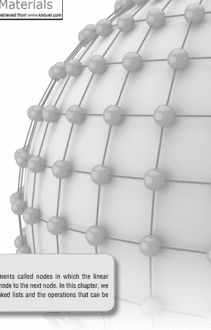

**学习目标**

链表是一组称为节点的数据元素，其中线性表示由一个节点到下一个节点的链接给出。在本章中，我们将讨论不同类型的链表以及可以对这些列表执行的操作。

## 6.1 简介

我们已经学习过，数组是一个线性数据元素集合，其中元素存储在连续的内存位置。在声明数组时，我们必须指定数组的大小，这将限制数组可以存储的元素数量。例如，如果我们声明数组 int marks[10]，则该数组最多可以存储 10 个数据元素，不能超过这个数量。但是，如果我们事先不确定元素的数量怎么办？此外，为了高效利用内存，元素必须随机存储在任何位置，而不是存储在连续位置。因此，必须有一种数据结构来消除对最大元素数量和存储条件的限制，以编写高效程序。

链表是一种不受上述限制的数据结构。链表不将其元素存储在连续的内存位置，用户可以向其中添加任意数量的元素。但是，与数组不同，链表不允许随机访问数据。链表中的元素只能按顺序访问。但是，与数组一样，插入和删除操作可以在列表中的任何位置以常数时间完成。

### 6.1.1 基本术语

简单来说，链表是一个线性数据元素集合。这些数据元素称为节点。链表是一种数据结构，反过来可以用于实现其他数据


结构。因此，它充当实现堆栈、队列及其变体等数据结构的构建块。链表可以被视为火车或一系列节点，其中每个节点包含一个或多个数据字段和指向下一个节点的指针。

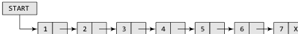

图 6.1 简单链表

在图 6.1 中，我们可以看到一个链表，其中每个节点包含两部分：一个整数和一个指向下一个节点的指针。包含数据的节点左侧部分可能包括简单数据类型、数组或结构。节点右侧部分包含指向下一个节点的指针（或序列中下一个节点的地址）。最后一个节点不会连接到任何下一个节点，因此它将存储一个称为 NULL 的特殊值。在图 6.1 中，空指针用 x 表示。在编程时，我们通常将 NULL 定义为 -1。因此，空指针表示列表的末尾。由于在链表中，每个节点都包含指向同类型另一个节点的指针，因此它也被称为自引用数据类型。

链表包含一个指针变量 START，用于存储列表中第一个节点的地址。我们可以使用包含第一个节点地址的 START 遍历整个列表；第一个节点的下一部分反过来存储其后继节点的地址。使用此技术，列表的各个节点将形成一个节点链。如果 START = NULL，则链表为空且不包含任何节点。

在 C 语言中，我们可以使用以下代码实现链表：

```
struct node
{
    int data;
    struct node *next;
};
```

> 注意 链表提供了一种存储相关数据的高效方式，并以存储下一个节点地址所需的额外空间为代价，执行插入、删除和信息更新等基本操作。

让我们看看链表在内存中是如何维护的。为了形成链表，我们需要一个称为 node 的结构，它有两个字段：DATA 和 NEXT。DATA 将存储信息部分，NEXT 将存储序列中下一个节点的地址。请参考图 6.2。

| Data | Next |
| :--- | :--- |
| H | 4 |
| | |
| | |
| E | 7 |
| | |
| | |
| L | 8 |
| L | 10 |
| | |
| O | -1 |

图 6.2 START 指向内存中链表的第一个元素

在图中，我们可以看到变量 START 用于存储第一个节点的地址。在此示例中，START = 1，因此第一个数据存储在地址 1 处，即 H。相应的 NEXT 存储下一个节点的地址，即 4。因此，我们将查看地址 4 以获取下一个数据项。从地址 4 获得的第二个数据元素是 E。同样，我们查看相应的 NEXT 以转到下一个节点。从 NEXT 条目中，我们得到下一个地址，即 7，并获取 L 作为数据。我们重复此过程，直到到达 NEXT 条目包含 -1 或 NULL 的位置，因为这将表示链表的末尾。当我们以这种方式遍历 DATA 和 NEXT 时，我们最终会发现上述示例中的链表存储了字符，当组合在一起时形成单词 HELLO。

请注意，图 6.2 显示了范围从 1 到 10 的内存位置块。阴影部分包含其他应用程序的数据。请记住，链表的节点不必位于连续的内存位置中。在我们的示例中，链表的节点存储在地址 1、4、7、8 和 10 处。

让我们举另一个例子，看看如何在计算机内存中同时维护两个链表。例如，理科高二的学生被要求在生物学和计算机科学之间选择。现在，我们将维护两个链表，每个科目一个。也就是说，第一个链表将包含所有选择生物学的学生的学号，第二个列表将包含选择计算机科学的学生的学号。

现在，请看图 6.3，两个不同的链表在内存中同时维护。遍历列表时没有歧义，因为每个列表都维护一个单独的 START 指针，它给出各自链表第一个节点的地址。其余节点通过查看 NEXT 中存储的值来访问。

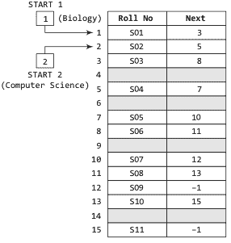

通过观察图表，我们可以得出结论，选择生物学的学生的学号为 S01、S03、S06、S08、S10 和 S11。同样，选择计算机科学的学生的学号为 S02、S04、S05、S07 和 S09。

我们已经说过，节点的 DATA 部分可能只包含一个数据项、一个数组或一个结构。让我们举一个例子，看看结构如何存储在内存中的链表中。

考虑一种场景，其中学生的学号、姓名、总分和等级使用链表存储。现在，我们将看到 NEXT 指针如何用于按字母顺序存储数据。如图 6.4 所示。

图 6.3 在内存中同时维护的两个链表

### 6.1.2 链表与数组

数组和链表都是数据元素的线性集合。但与数组不同，链表不将其节点存储在连续的内存位置中。数组与链表之间的另一个区别在于，链表不允许随机访问数据。链表中的节点只能按顺序访问。但与数组一样，插入和删除可以在列表中的任何位置以常数时间完成。

链表相对于数组的另一个优势是，我们可以在列表中添加任意数量的元素。在数组中这是不可能的。例如，如果我们将数组声明为 `int marks[20]`，则该数组最多只能存储 20 个数据元素。链表中没有此类限制。

| Roll No | Name | Aggregate | Grade | Next |
| :--- | :--- | :--- | :--- | :--- |
| S01 | Ram | 78 | 优等 | 6 |
| S02 | Shyam | 64 | 一等 | 14 |
| | | | | |
| S03 | Mohit | 89 | 优异 | 17 |
| | | | | |
| S04 | Rohit | 77 | 优等 | 2 |
| S05 | Varun | 86 | 优异 | 10 |
| S06 | Karan | 65 | 一等 | 12 |
| | | | | |
| S07 | Veena | 54 | 二等 | -1 |
| S08 | Meera | 67 | 一等 | 4 |
| S09 | Krish | 45 | 三等 | 13 |
| S10 | Kusum | 91 | 优异 | 11 |
| S11 | Silky | 72 | 一等 | 7 |
| | | | | |
| | | | | |
| S12 | Monica | 75 | 优等 | 1 |
| S13 | Ashish | 63 | 一等 | 19 |
| S14 | Gaurav | 61 | 一等 | 8 |

图 6.4 学生链表

因此，链表提供了一种存储相关数据的高效方式，并以存储下一个节点地址所需的额外空间为代价，执行插入、删除和信息更新等基本操作。

### 6.1.3 链表的内存分配与释放

我们已经了解了链表在内存中的表示方式。如果我们想要向内存中已存在的链表添加一个节点，我们首先需要在内存中找到空闲空间，然后使用它来存储信息。例如，请考虑图 6.5 中所示的链表。该链表包含学生的学号、他们在生物学中获得的分数，以及最后一个存储序列中下一个节点地址的 NEXT 字段。现在，如果有新学生加入班级并被要求参加其他学生参加过的同一测试，那么新学生的分数也应记录在链表中。为此，我们找到一个空闲空间并将信息存储在那里。在图 6.5 中，灰色阴影部分显示空闲空间，因此我们有 4 个可用的内存位置。我们可以使用其中任何一个来存储我们的数据。这在图 6.5(a) 和 (b) 中有所说明。

现在问题是，内存的哪部分可用，哪部分已占用？当我们从链表中删除一个节点时，是谁将其占用的内存状态从“已占用”更改为“可用”的？答案是操作系统。讨论操作系统如何完成所有这些的机制超出了本书的范围。因此，用简单的话说，我们可以说计算机会自行完成此操作，无需用户或程序员的任何干预。作为程序员，你只需负责编写执行列表中插入和删除操作的代码。

然而，让我们简要讨论其背后的基本概念。计算机维护一个所有空闲内存单元的列表。这个可用空间列表称为空闲池。


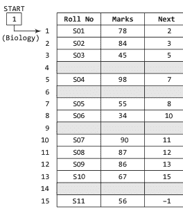


图 6.5 (a) 学生链表和 (b) 插入新学生记录后的链表

我们已经看到，每个链表都有一个指针变量 START，它存储列表中第一个节点的地址。同样，对于空闲池（即所有空闲内存单元的链表），我们有一个指针变量 AVAIL，它存储第一个空闲空间的地址。让我们重新审视存储所有学生生物成绩的链表的内存表示。

现在，当需要添加新学生记录时，将获取 AVAIL 指向的内存地址并用于存储所需信息。插入后，下一个可用空间的地址将存储在 AVAIL 中。例如，在图 6.6 中，当第一个空闲内存空间用于插入新节点时，AVAIL 将被设置为包含地址 6。


这全部是关于在已存在的链表中插入新节点。现在，我们将讨论删除节点或整个链表。当我们从已存在的链表中删除特定节点或删除整个链表时，必须将其占用的空间归还给空闲池，以便需要内存空间的其他程序可以重用该内存。

操作系统执行将释放内存添加到空闲池的任务。每当操作系统发现 CPU 空闲或程序内存空间不足时，都会执行此操作。操作系统扫描所有内存单元，并标记正被某个程序使用的单元。然后，它收集所有未被使用的单元，并将其地址添加到空闲池，以便这些单元可以被其他程序重用。此过程称为垃圾回收。

链表有不同类型，我们将在下一节中讨论。

## 6.2 单链表

单链表是最简单的链表类型，其中每个节点包含一些数据和指向同一数据类型下一个节点的指针。说节点包含指向下一个节点的指针，意味着节点存储序列中下一个节点的地址。单链表只允许单向遍历数据。图 6.7 显示了一个单链表。


图 6.7 单链表

### 6.2.1 遍历链表

遍历链表意味着按顺序访问列表的节点，以便对其进行某些处理。请记住，链表始终包含一个指针变量 START，它存储列表中第一个节点的地址。列表的末尾通过在最后一个节点的 NEXT 字段中存储 NULL 或 -1 来标记。为了遍历链表，我们还使用另一个指针变量 PTR，它指向当前正在访问的节点。遍历链表的算法如图 6.8 所示。

在此算法中，我们首先用 START 的地址初始化 PTR。现在，PTR 指向链表的第一个节点。然后在第 2 步中，一个 while 循环会重复执行，直到 PTR 处理完最后一个节点，即直到它遇到 NULL。在第 3 步中，我们将过程（例如，打印）应用于当前节点，即 PTR 指向的节点。在第 4 步中，我们通过使 PTR 变量指向 NEXT 字段中存储地址的节点来移动到下一个节点。

```
Step 1: [INITIALIZE] SET PTR = START
Step 2: Repeat Steps 3 and 4 while PTR != NULL
Step 3: Apply Process to PTR -> DATA
Step 4: SET PTR = PTR -> NEXT
[END OF LOOP]
Step 5: EXIT
```

图 6.8 遍历链表的算法

```
Step 1: [INITIALIZE] SET COUNT = 0
Step 2: [INITIALIZE] SET PTR = START
Step 3: Repeat Steps 4 and 5 while PTR != NULL
Step 4: SET COUNT = COUNT + 1
Step 5: SET PTR = PTR -> NEXT
[END OF LOOP]
Step 6: Write COUNT
Step 7: EXIT
```

图 6.9 打印链表中节点数量的算法

现在让我们编写一个算法来计算链表中节点的数量。为此，我们将遍历列表中的每个节点，并在遍历每个单独节点时将计数器加 1。一旦到达 NULL，即当链表的所有节点都已遍历完毕时，将显示计数器的最终值。图 6.9 显示了打印链表中节点数量的算法。

### 6.2.2 在链表中查找值

搜索链表意味着在链表中查找特定元素。如前所述，链表由节点组成，节点分为两部分：信息部分和下一部分。因此，搜索意味着查找给定值是否存在于节点的信息部分中。如果存在，算法将返回包含该值的节点的地址。

```
Step 1: [INITIALIZE] SET PTR = START
Step 2: Repeat Step 3 while PTR != NULL
Step 3: IF VAL = PTR -> DATA
SET POS = PTR
Go to Step 5
ELSE
SET PTR = PTR -> NEXT
[END OF IF]
Step 4: SET POS = NULL
[END OF LOOP]
Step 5: EXIT
```

图 6.10 搜索链表的算法

图 6.10 显示了搜索链表的算法。

在第 1 步中，我们用包含第一个节点地址的 START 初始化指针变量 PTR。在第 2 步中，执行一个 while 循环，它将把每个节点的 DATA 与正在搜索的 VAL 进行比较。如果搜索成功，即找到了 VAL，则该节点的地址将存储在 POS 中，控制权将跳转到算法的最后一条语句。但是，如果搜索不成功，POS 将被设置为 NULL，这表明 VAL 不存在于链表中。

考虑图 6.11 所示的链表。如果 VAL = 4，则算法的流程可以如图所示进行解释。


图 6.11 搜索链表

### 6.2.3 在链表中插入新节点

在本节中，我们将看到如何将新节点添加到已存在的链表中。我们将考虑四种情况，然后看看每种情况下如何进行插入。

- 情况 1：新节点插入开头。
- 情况 2：新节点插入末尾。
- 情况 3：新节点插入给定节点之后。
- 情况 4：新节点插入给定节点之前。

在我们描述执行这四种情况插入的算法之前，让我们先讨论一个称为 OVERFLOW 的重要术语。溢出是指当 AVAIL = NULL 或系统中没有空闲内存单元时发生的条件。当发生此条件时，程序必须给出适当的消息。

### 在链表开头插入节点

考虑图 6.12 所示的链表。假设我们想要添加一个数据为 9 的新节点，并将其作为列表的第一个节点。那么链表中将进行以下更改。


为新节点分配内存并将其 DATA 部分初始化为 9。


通过使新节点的 NEXT 部分包含 START 的地址，将新节点添加为列表的第一个节点。


现在使 START 指向列表的第一个节点。


图 6.12 在链表开头插入元素

```
Step 1: IF AVAIL = NULL
        Write OVERFLOW
        Go to Step 7
[END OF IF]
Step 2: SET NEW_NODE = AVAIL
Step 3: SET AVAIL = AVAIL -> NEXT
Step 4: SET NEW_NODE -> DATA = VAL
Step 5: SET NEW_NODE -> NEXT = START
Step 6: SET START = NEW_NODE
Step 7: EXIT
```

图 6.13 在开头插入新节点的算法

图 6.13 显示了在链表开头插入新节点的算法。在第 1 步中，我们首先检查新节点是否有可用内存。如果空闲内存已耗尽，则打印 OVERFLOW 消息。否则，如果有可用的空闲内存单元，则我们为新节点分配空间。将其 DATA 部分设置为给定的 VAL，并将下一部分初始化为存储在 START 中的列表第一个节点的地址。现在，由于新节点被添加为列表的第一个节点，它现在将被称为 START 节点，即 START 指针变量现在将保存 NEW_NODE 的地址。请注意以下两个步骤：
Step 2: SET NEW_NODE = AVAIL
Step 3: SET AVAIL = AVAIL -> NEXT

这些步骤为新节点分配内存。在 C 语言中，有 malloc()、alloc 和 calloc() 等函数，它们会自动代表用户进行内存分配。

### 在链表末尾插入节点

考虑图 6.14 所示的链表。假设我们想要添加一个数据为 9 的新节点作为列表的最后一个节点。那么链表中将进行以下更改。

图 6.15 显示了在链表末尾插入新节点的算法。在第 6 步中，我们获取一个指针变量 PTR 并用 START 初始化它。即，PTR 现在指向链表的第一个节点。在 while 循环中，我们遍历链表以到达最后一个节点。一旦到达最后一个节点，在第 9 步中，我们更改最后一个节点的 NEXT 指针以存储新节点的地址。请记住，新节点的 next 字段包含 NULL，这表示链表的末尾。

### 在链表中在给定节点之后插入节点

考虑图 6.17 所示的链表。假设我们想要在包含数据 3 的节点之后添加一个值为 9 的新节点。在讨论链表中将进行的更改之前，让我们先看看图 6.16 所示的算法。


为新节点分配内存，并将其 DATA 部分初始化为 9，Next 部分初始化为 NULL。

取一个指向 START 的指针变量 PTR。

移动 PTR，使其指向列表的最后一个节点。

在 PTR 指向的节点之后添加新节点。具体做法是将新节点的地址存储在 PTR 的 NEXT 部分中。

### 图 6.14 在链表末尾插入元素

```
Step 1: IF AVAIL = NULL
        Write OVERFLOW
        Go to Step 10
        [END OF IF]
Step 2: SET NEW_NODE = AVAIL
Step 3: SET AVAIL = AVAIL -> NEXT
Step 4: SET NEW_NODE -> DATA = VAL
Step 5: SET NEW_NODE -> NEXT = NULL
Step 6: SET PTR = START
Step 7: Repeat Step 8 while PTR -> NEXT != NULL
Step 8: SET PTR = PTR -> NEXT
        [END OF LOOP]
Step 9: SET PTR -> NEXT = NEW_NODE
Step 10: EXIT
```

### 图 6.15 在末尾插入新节点的算法

```
Step 1: IF AVAIL = NULL
        Write OVERFLOW
        Go to Step 12
        [END OF IF]
Step 2: SET NEW_NODE = AVAIL
Step 3: SET AVAIL = AVAIL -> NEXT
Step 4: SET NEW_NODE -> DATA = VAL
Step 5: SET PTR = START
Step 6: SET PRETR = PTR
Step 7: Repeat Steps 8 and 9 while PRETR -> DATA != NUM
Step 8: SET PRETR = PTR
Step 9: SET PTR = PTR -> NEXT
        [END OF LOOP]
Step 10: SET PRETR -> NEXT = NEW_NODE
Step 11: SET NEW_NODE -> NEXT = PTR
Step 12: EXIT
```

### 图 6.16 在值为 NUM 的节点之后插入新节点的算法

在第 5 步中，我们取一个指针变量 PTR 并将其初始化为 START。也就是说，PTR 现在指向链表的第一个节点。然后我们取另一个指针变量 PRETR，它将用于存储 PTR 前驱节点的地址。最初，PRETR 被初始化为 PTR。因此，PTR、PRETR 和 START 现在都指向链表的第一个节点。

在 while 循环中，我们遍历链表以找到值等于 NUM 的节点。我们需要到达这个节点，因为新节点将插入到该节点之后。一旦到达该节点，在第 10 步和第 11 步中，我们以这样的方式更改 NEXT 指针，使新节点插入到所需节点之后。

START 为新节点分配内存，并将其 DATA 部分初始化为 9。

取两个指针变量 PTR 和 PREPTR，并将它们初始化为 START，使得 START、PTR 和 PREPTR 都指向列表的第一个节点。

移动 PTR 和 PREPTR，直到 PREPTR 的 DATA 部分等于要插入的节点的值。PREPTR 将始终指向 PTR 之前的那个节点。

在 PREPTR 和 PTR 指向的节点之间添加新节点。

### 图 6.17 在链表中给定节点之后插入元素

## 在链表中给定节点之前插入节点

考虑图 6.19 所示的链表。假设我们想在值为 3 的节点之前添加一个值为 9 的新节点。在讨论链表中将进行的更改之前，让我们先看看图 6.18 所示的算法。

### 图 6.18 在值为 NUM 的节点之前插入新节点的算法

```
Step 1: IF AVAIL = NULL
        Write OVERFLOW
        Go to Step 12
        [END OF IF]
Step 2: SET NEW_NODE = AVAIL
Step 3: SET AVAIL = AVAIL -> NEXT
Step 4: SET NEW_NODE -> DATA = VAL
Step 5: SET PTR = START
Step 6: SET PREPTR = PTR
Step 7: Repeat Steps 8 and 9 while PTR -> DATA != NUM
Step 8: SET PREPTR = PTR
Step 9: SET PTR = PTR -> NEXT
        [END OF LOOP]
Step 10: SET PREPTR -> NEXT = NEW_NODE
Step 11: SET NEW_NODE -> NEXT = PTR
Step 12: EXIT
```

在第 5 步中，我们取一个指针变量 PTR 并将其初始化为 START。也就是说，PTR 现在指向链表的第一个节点。然后，我们取另一个指针变量 PREPTR 并将其初始化为 PTR。因此，PTR、PREPTR 和 START 现在都指向链表的第一个节点。

在 while 循环中，我们遍历链表以找到值等于 NUM 的节点。我们需要到达这个节点，因为新节点将插入到该节点之前。一旦到达该节点，在第 10 步和第 11 步中，我们以这样的方式更改 NEXT 指针，使新节点插入到所需节点之前。


为新节点分配内存，并将其 DATA 部分初始化为 9。


将 PREPTR 和 PTR 初始化为 START 节点。


START
PTR
PREPTR
移动 PTR 和 PREPTR，直到 PTR 的 DATA 部分等于要在其之前进行插入的节点的值。PREPTR 将始终指向 PTR 之前的那个节点。


在 PREPTR 和 PTR 指向的节点之间插入新节点。


### 图 6.19 在链表中给定节点之前插入元素

## 6.2.4 从链表中删除节点

在本节中，我们将讨论如何从已存在的链表中删除一个节点。我们将考虑三种情况，然后查看每种情况下删除是如何进行的。

- 情况 1：删除第一个节点。
- 情况 2：删除最后一个节点。
- 情况 3：删除给定节点之后的节点。

在描述这三种情况下的算法之前，让我们先讨论一个称为 UNDERFLOW 的重要术语。下溢是指当我们尝试从空链表中删除节点时发生的一种情况。当 START = NULL 或没有更多节点可删除时会发生这种情况。请注意，当我们从链表中删除一个节点时，实际上必须释放该节点占用的内存。内存将返回到空闲池，以便可用于存储其他程序和数据。无论删除的情况如何，我们始终会更改 AVAIL 指针，使其指向最近被释放的地址。

### 从链表中删除第一个节点

考虑图 6.20 中的链表。当我们想要从列表开头删除一个节点时，链表中将进行以下更改。


### 图 6.20 删除链表的第一个节点

图 6.21 显示了从链表中删除第一个节点的算法。在第 1 步中，我们检查链表是否存在。如果 START = NULL，则表示列表中没有节点，控制权将转移到算法的最后一条语句。但是，如果链表中有节点，则我们使用一个指针变量 PTR，将其设置为指向列表的第一个节点。为此，我们用存储列表第一个节点地址的 START 初始化 PTR。在第 3 步中，START 被设置为指向序列中的下一个节点，最后释放 PTR 指向的节点（最初是列表的第一个节点）所占用的内存，并将其返回到空闲池。

### 图 6.21 删除第一个节点的算法

```
Step 1: IF START = NULL
         Write UNDERFLOW
         Go to Step 5
       [END OF IF]
Step 2: SET PTR = START
Step 3: SET START = START -> NEXT
Step 4: FREE PTR
Step 5: EXIT
```

### 从链表中删除最后一个节点

考虑图 6.22 所示的链表。假设我们想要从链表中删除最后一个节点，那么链表中将进行以下更改。


### 图 6.22 删除链表的最后一个节点

图 6.23 显示了从链表中删除最后一个节点的算法。在第 2 步中，我们取一个指针变量 PTR 并将其初始化为 START。也就是说，PTR 现在指向链表的第一个节点。在 while 循环中，我们取另一个指针变量 PREPTR，使其始终指向 PTR 之前的一个节点。一旦到达最后一个节点和倒数第二个节点，我们将倒数第二个节点的 NEXT 指针设置为 NULL，这样它现在就成为链表的（新）最后一个节点。之前最后一个节点的内存被释放并返回到空闲池。

```
Step 1: IF START = NULL
       Write UNDERFLOW
       Go to Step 8
       [END OF IF]
Step 2: SET PTR = START
Step 3: Repeat Steps 4 and 5 while PTR -> NEXT != NULL
Step 4: SET PREPTR = PTR
Step 5: SET PTR = PTR -> NEXT
       [END OF LOOP]
Step 6: SET PREPTR -> NEXT = NULL
Step 7: FREE PTR
Step 8: EXIT
```

### 图 6.23 删除最后一个节点的算法

### 从链表中删除给定节点之后的节点

考虑图 6.24 所示的链表。假设我们想要删除包含数据值 4 的节点之后的节点，那么链表中将进行以下更改。


取最初指向 START 的指针变量 PTR 和 PREPTR。


移动 PREPTR 和 PTR，使 PREPTR 指向包含 VAL 的节点，PTR 指向其后继节点。


将 PREPTR 的 NEXT 部分设置为 PTR 的 Next 部分。


### 图 6.24 从链表中删除给定节点之后的节点

图 6.25 显示了从链表中删除给定节点之后的节点的算法。在第 2 步中，我们取一个指针变量 PTR 并将其初始化为 START。也就是说，PTR 现在指向链表的第一个节点。在 while 循环中，我们取另一个指针变量 PREPTR，使其始终指向 PTR 之前的一个节点。一旦到达包含 VAL 的节点及其后继节点，我们将包含 VAL 的节点的 next 指针设置为其后继节点的 next 字段中包含的地址。给定节点之后的节点的内存被释放并返回到空闲池。


```
Step 1: IF START = NULL
   Write UNDERFLOW
   Go to Step 10
[END OF IF]
Step 2: SET PTR = START
Step 3: SET PREPTR = PTR
Step 4: Repeat Steps 5 and 6 while PREPTR -> DATA != NUM
Step 5: SET PREPTR = PTR
Step 6: SET PTR = PTR -> NEXT
[END OF LOOP]
Step 7: SET TEMP = PTR
Step 8: SET PREPTR -> NEXT = PTR -> NEXT
Step 9: FREE TEMP
Step 10: EXIT
```

### 图 6.25 删除给定节点之后的节点的算法

## 编程示例

- 1. 编写一个程序来创建链表并执行所有情况的插入和删除操作。编写函数对链表进行排序，最后一次性删除整个链表。

```c
#include <stdio.h>
#include <stdlib.h>
#include <conio.h>
#include <malloc.h>
struct node
{
   int data;
   struct node *next;
};
struct node *start = NULL;
struct node *create_ll(struct node *);
struct node *display(struct node *);
struct node *insert_beg(struct node *);
struct node *insert_end(struct node *);
struct node *insert_before(struct node *);
struct node *insert_after(struct node *);
struct node *delete_beg(struct node *);
struct node *delete_end(struct node *);
struct node *delete_node(struct node *);
struct node *delete_after(struct node *);
struct node *delete_list(struct node *);
struct node *sort_list(struct node *);
int main(int argc, char *argv[]) {
   int option;
   do
   {
      printf("\n\n *****MAIN MENU *****");
      printf("\n 1: Create a list");
      printf("\n 2: Display the list");
      printf("\n 3: Add a node at the beginning");
      printf("\n 4: Add a node at the end");
      printf("\n 5: Add a node before a given node");
      printf("\n 6: Add a node after a given node");
      printf("\n 7: Delete a node from the beginning");
      printf("\n 8: Delete a node from the end");
      printf("\n 9: Delete a given node");
      printf("\n 10: Delete a node after a given node");
      printf("\n 11: Delete the entire list");
      printf("\n 12: Sort the list");
      printf("\n 13: EXIT");
      printf("\n\n Enter your option : ");
      scanf("%d", &option);
      switch(option)
      {
      case 1: start = create_ll(start);
      printf("\n LINKED LIST CREATED");
      break;
      case 2: start = display(start);
      break;
      case 3: start = insert_beg(start);
      break;
      case 4: start = insert_end(start);
      break;
      case 5: start = insert_before(start);
      break;
      case 6: start = insert_after(start);
      break;
      case 7: start = delete_beg(start);
      break;
      case 8: start = delete_end(start);
      break;
      case 9: start = delete_node(start);
      break;
      case 10: start = delete_after(start);
      break;
      case 11: start = delete_list(start);
      printf("\n LINKED LIST DELETED");
      break;
      case 12: start = sort_list(start);
      break;
      }
   }while(option !=13);
   getch();
   return 0;
}
```

```c
struct node *create_ll(struct node *start)
{
struct node *new_node, *ptr;
int num;
printf("\n Enter -1 to end");
printf("\n Enter the data : ");
scanf("%d", &num);
while(num!=-1)
{
new_node = (struct node*)malloc(sizeof(struct node));
new_node -> data=num;
if(start==NULL)
{
new_node -> next = NULL;
start = new_node;
}
else
{
ptr=start;
while(ptr->next!=NULL)
ptr=ptr->next;
ptr->next = new_node;
new_node->next=NULL;
}
printf("\n Enter the data : ");
scanf("%d", &num);
}
return start;
}
```

```c
struct node *display(struct node *start)
{
struct node *ptr;
ptr = start;
while(ptr != NULL)
{
printf("\t %d", ptr -> data);
ptr = ptr -> next;
}
return start;
}
```

```c
struct node *insert_beg(struct node *start)
{
struct node *new_node;
int num;
printf("\n Enter the data : ");
scanf("%d", &num);
new_node = (struct node *)malloc(sizeof(struct node));
new_node -> data = num;
new_node -> next = start;
start = new_node;
return start;
}
```

```c
struct node *insert_end(struct node *start)
{
struct node *ptr, *new_node;
int num;
printf("\n Enter the data : ");
scanf("%d", &num);
new_node = (struct node *)malloc(sizeof(struct node));
new_node -> data = num;
new_node -> next = NULL;
ptr = start;
while(ptr -> next != NULL)
ptr = ptr -> next;
ptr -> next = new_node;
return start;
}
```

```c
struct node *insert_before(struct node *start)
{
struct node *new_node, *ptr, *preptr;
int num, val;
printf("\n Enter the data : ");
scanf("%d", &num);
printf("\n Enter the value before which the data has to be inserted : ");
scanf("%d", &val);
new_node = (struct node *)malloc(sizeof(struct node));
new_node -> data = num;
ptr = start;
while(ptr -> data != val)
{
preptr = ptr;
ptr = ptr -> next;
}
preptr -> next = new_node;
new_node -> next = ptr;
return start;
}
```

```c
struct node *insert_after(struct node *start)
{
struct node *new_node, *ptr, *preptr;
int num, val;
printf("\n Enter the data : ");
scanf("%d", &num);
printf("\n Enter the value after which the data has to be inserted : ");
scanf("%d", &val);
new_node = (struct node *)malloc(sizeof(struct node));
new_node -> data = num;
ptr = start;
preptr = ptr;
while(preptr -> data != val)
{
preptr = ptr;
ptr = ptr -> next;
}
preptr -> next = new_node;
new_node -> next = ptr;
return start;
}
```

```c
struct node *delete_beg(struct node *start)
{
struct node *ptr;
ptr = start;
start = start -> next;
free(ptr);
return start;
}
```

```c
struct node *delete_end(struct node *start)
{
struct node *ptr, *preptr;
ptr = start;
while(ptr -> next != NULL)
{
preptr = ptr;
ptr = ptr -> next;
}
preptr -> next = NULL;
free(ptr);
return start;
}
```

```c
struct node *delete_node(struct node *start)
{
struct node *ptr, *preptr;
int val;
printf("\n Enter the value of the node which has to be deleted : ");
scanf("%d", &val);
ptr = start;
if(ptr -> data == val)
{
start = delete_beg(start);
return start;
}
else
{
while(ptr -> data != val)
{
    preptr = ptr;
    ptr = ptr -> next;
}
preptr -> next = ptr -> next;
free(ptr);
return start;
}
}
```

```c
struct node *delete_after(struct node *start)
{
    struct node *ptr, *preptr;
    int val;
    printf("\n\n Enter the value after which the node has to deleted : ");
    scanf("%d", &val);
    ptr = start;
    preptr = ptr;
    while(preptr -> data != val)
    {
        preptr = ptr;
        ptr = ptr -> next;
    }
    preptr -> next = ptr -> next;
    free(ptr);
    return start;
}
```

```c
struct node *delete_list(struct node *start)
{
    struct node *ptr; // Lines 252-254 were modified from original code to fix
    unresponsiveness in output window
    if(start != NULL)
    {
        while(ptr != NULL)
        {
            printf("\n %d is to be deleted next", ptr -> data);
            start = delete_beg(ptr);
            ptr = start;
        }
    }
    return start;
}
```

```c
struct node *sort_list(struct node *start)
{
    struct node *ptr1, *ptr2;
    int temp;
    ptr1 = start;
    while(ptr1 -> next != NULL)
    {
        ptr2 = ptr1 -> next;
        while(ptr2 != NULL)
        {
            if(ptr1 -> data > ptr2 -> data)
            {
                temp = ptr1 -> data;
                ptr1 -> data = ptr2 -> data;
                ptr2 -> data = temp;
            }
            ptr2 = ptr2 -> next;
        }
        ptr1 = ptr1 -> next;
    }
    return start; // Had to be added
}
```

### 输出

```
*********MAIN MENU*********
1: Create a list
2: Display the list
3: Add a node at the beginning
4: Add the node at the end
5: Add the node before a given node
6: Add the node after a given node
7: Delete a node from the beginning
8: Delete a node from the end
9: Delete a given node
10: Delete the node after a given node
11: Delete the entire list
12: Sort the list
13: Exit
Enter your option : 3
Enter your option : 73
```

## 6.3 循环链表

在循环链表中，最后一个节点包含指向列表第一个节点的指针。我们可以拥有循环单链表以及循环双链表。在遍历循环链表时，我们可以从任何节点开始，向前或向后遍历列表，直到到达起始的同一节点。因此，循环链表没有开头也没有结尾。图 6.26 显示了一个循环链表。


### 图 6.26 循环链表

循环链表的唯一缺点是迭代的复杂性。请注意，列表中任何节点的NEXT部分都没有NULL值。

| # | 数据 | 下一节点 |
|---|---|---|
| 1 | H | 4 |
| 2 | | |
| 3 | | |
| 4 | E | 7 |
| 5 | | |
| 6 | | |
| 7 | L | 8 |
| 8 | L | 10 |
| 9 | | |
| 10 | O | 1 |

### 图 6.27 循环链表的内存表示

循环链表广泛用于操作系统中的任务维护。我们现在将讨论一个使用循环链表的示例。当我们上网冲浪时，可以使用后退按钮和前进按钮移动到已经访问过的页面。这是如何实现的？答案很简单。使用循环链表来维护访问过的网页序列。向前或向后遍历此循环链表有助于使用后退和前进按钮再次访问页面。实际上，这是使用循环栈或循环队列完成的。我们将在第8章中阅读关于循环队列的内容。请参考图 6.27。

我们可以遍历列表，直到找到包含列表第一个节点地址的NEXT条目。这表示链表的末尾，也就是说，包含第一个节点地址的节点实际上是


| 序号 | 学号 | 下一节点 |
|---|---|---|
| 1 | 501 | 3 |
| 2 | 502 | 5 |
| 3 | 503 | 8 |
| 4 | | |
| 5 | 504 | 7 |
| 6 | | |
| 7 | 505 | 10 |
| 8 | 506 | 11 |
| 9 | | |
| 10 | 507 | 12 |
| 11 | 508 | 13 |
| 12 | 509 | 1 |
| 13 | | |
| 14 | 510 | 15 |
| 15 | 511 | 2 |

列表的最后一个节点。当我们以这种方式遍历 DATA 和 NEXT 时，最终会发现图 6.27 中的链表存储的字符组合在一起形成单词 HELLO。

现在，请看图 6.28。内存中同时维护着两个不同的链表。遍历列表时不会产生歧义，因为每个列表都维护一个单独的 START 指针，该指针给出相应链表第一个节点的地址。其余节点通过查看 NEXT 中存储的值来访问。

通过观察图表，我们可以得出，选择生物学的学生的学号为 501、503、506、508、510 和 511。同样，选择计算机科学的学生的学号为 502、504、505、507 和 509。

图 6.28 存储在内存中的两个循环链表的内存表示

### 6.3.1 在循环链表中插入新节点

在本节中，我们将了解如何将新节点添加到已存在的链表中。我们将考虑两种情况，然后了解每种情况下的插入操作。

- 情况 1：新节点插入到循环链表的开头。
- 情况 2：新节点插入到循环链表的末尾。

## 在循环链表开头插入节点

考虑图 6.29 所示的链表。假设我们要将数据为 9 的新节点添加为列表的第一个节点。那么链表中将进行以下更改。


图 6.29 在循环链表开头插入新节点

```
Step 1: IF AVAIL = NULL
WRITE OVERFLOW
Go to Step 11
[END OF IF]
Step 2: SET NEW_NODE = AVAIL
Step 3: SET AVAIL = AVAIL -> NEXT
Step 4: SET NEW_NODE -> DATA = VAL
Step 5: SET PTR = START
Step 6: Repeat Step 7 while PTR -> NEXT != START
Step 7: PTR = PTR -> NEXT
[END OF LOOP]
Step 8: SET NEW_NODE -> NEXT = START
Step 9: SET PTR -> NEXT = NEW_NODE
Step 10: SET START = NEW_NODE
Step 11: EXIT
```

图 6.30 在开头插入新节点的算法

图 6.30 显示了在链表开头插入新节点的算法。在第 1 步中，我们首先检查新节点是否有可用内存。如果可用内存已耗尽，则打印溢出消息。否则，如果有可用的空闲内存单元，则为新节点分配空间。将其 DATA 部分设置为给定的 VAL，NEXT 部分初始化为列表中第一个节点的地址（该地址存储在 START 中）。现在，由于新节点被添加为列表的第一个节点，它现在被称为起始节点，即 START 指针变量将保存 NEW_NODE 的地址。

在循环链表中插入节点时，我们需要使用 while 循环遍历到列表的最后一个节点。因为最后一个节点包含指向 START 的指针，所以更新其 NEXT 字段，使插入后它指向新节点，该新节点现在将被称为 START。

## 在循环链表末尾插入节点

考虑图 6.31 所示的链表。假设我们要将数据为 9 的新节点添加为列表的最后一个节点。那么链表中将进行以下更改。


图 6.31 在循环链表末尾插入新节点

图 6.32 显示了在循环链表末尾插入新节点的算法。在第 6 步中，我们取一个指针变量 PTR 并将其初始化为 START。也就是说，PTR 现在指向链表的第一个节点。在 while 循环中，我们遍历链表以到达最后一个节点。一旦到达最后一个节点，在第 9 步中，我们更改最后一个节点的 NEXT 指针以存储新节点的地址。请记住，新节点的 next 字段包含第一个节点的地址，该地址由 START 表示。

```
Step 1: IF AVAIL = NULL
WRITE OVERFLOW
Go to Step 10
[END OF IF]
Step 2: SET NEW_NODE = AVAIL
Step 3: SET AVAIL = AVAIL -> NEXT
Step 4: SET NEW_NODE -> DATA = VAL
Step 5: SET NEW_NODE -> NEXT = START
Step 6: SET PTR = START
Step 7: Repeat Step 8 while PTR -> NEXT != START
Step 8: SET PTR = PTR -> NEXT
[END OF LOOP]
Step 9: SET PTR -> NEXT = NEW_NODE
Step 10: EXIT
```

图 6.32 在末尾插入新节点的算法

### 6.3.2 从循环链表中删除节点

在本节中，我们将讨论如何从已存在的循环链表中删除一个节点。我们将考虑两种情况，然后了解每种情况下的删除操作。其余删除情况与单链表中给出的情况相同。

- 情况 1：删除第一个节点。
- 情况 2：删除最后一个节点。

## 从循环链表中删除第一个节点

考虑图 6.33 所示的循环链表。当我们要从列表开头删除一个节点时，链表中将进行以下更改。


图 6.33 从循环链表中删除第一个节点

图 6.34 显示了从循环链表中删除第一个节点的算法。在算法的第 1 步中，我们检查链表是否存在。如果 START = NULL，则表示列表中没有节点，控制权将转移到算法的最后一条语句。但是，如果链表中有节点，则我们使用一个指针变量 PTR，它将用于遍历列表以最终到达最后一个节点。在第 5 步中，我们更改最后一个节点的 next 指针，使其指向循环链表的第二个节点。在第 6 步中，释放第一个节点占用的内存。最后，在第 7 步中，第二个节点现在成为列表的第一个节点，其地址存储在指针变量 START 中。

```
Step 1: IF START = NULL
WRITE UNDERFLOW
Go to Step 8
[END OF IF]
Step 2: SET PTR = START
Step 3: Repeat Step 4 while PTR -> NEXT != START
Step 4: SET PTR = PTR -> NEXT
[END OF LOOP]
Step 5: SET PTR -> NEXT = START -> NEXT
Step 6: FREE START
Step 7: SET START = PTR -> NEXT
Step 8: EXIT
```

图 6.34 删除第一个节点的算法

## 从循环链表中删除最后一个节点

考虑图 6.35 所示的循环链表。假设我们要从链表中删除最后一个节点，那么链表中将进行以下更改。


图 6.35 从循环链表中删除最后一个节点

图 6.36 显示了从循环链表中删除最后一个节点的算法。在第 2 步中，我们取一个指针变量 PTR 并将其初始化为 START。也就是说，PTR 现在指向链表的第一个节点。在 while 循环中，我们取另一个指针变量 PREPTR，使得 PREPTR 始终指向 PTR 前面的一个节点。一旦到达最后一个节点和倒数第二个节点，我们将倒数第二个节点的 next 指针设置为 START，使其成为链表的（新）最后一个节点。之前最后一个节点的内存被释放并返回到空闲池。

```
Step 1: IF START = NULL
WRITE UNDERFLOW
Go to Step 8
[END OF IF]
Step 2: SET PTR = START
Step 3: Repeat Steps 4 and 5 while PTR -> NEXT != START
Step 4: SET PREPTR = PTR
Step 5: SET PTR = PTR -> NEXT
[END OF LOOP]
Step 6: SET PREPTR -> NEXT = START
Step 7: FREE PTR
Step 8: EXIT
```

图 6.36 删除最后一个节点的算法

## 编程示例

- 2. 编写一个程序来创建循环链表。在列表的开头和末尾执行插入和删除操作。

```
#include <stdio.h>
#include <conio.h>
#include <malloc.h>
struct node
{
    int data;
    struct node *next;
};
struct node *start = NULL;
struct node *create_cll(struct node *);
struct node *display(struct node *);
struct node *insert_beg(struct node *);
struct node *insert_end(struct node *);
```


```c
struct node *delete_beg(struct node *);
struct node *delete_end(struct node *);
struct node *delete_after(struct node *);
struct node *delete_list(struct node *);
int main()
{
    int option;
    struct node *new_node, *ptr;
    do
    {
        printf("\n\n *****MAIN MENU *****");
        printf("\n 1: Create a list");
        printf("\n 2: Display the list");
        printf("\n 3: Add a node at the beginning");
        printf("\n 4: Add a node at the end");
        printf("\n 5: Delete a node from the beginning");
        printf("\n 6: Delete a node from the end");
        printf("\n 7: Delete a node after a given node");
        printf("\n 8: Delete the entire list");
        printf("\n 9: EXIT");
        printf("\n\n Enter your option : ");
        scanf("%d", &option);
        switch(option)
        {
            case 1: start = create_cll(start);
                printf("\n CIRCULAR LINKED LIST CREATED");
                break;
            case 2: start = display(start);
                break;
            case 3: start = insert_beg(start);
                break;
            case 4: start = insert_end(start);
                break;
            case 5: start = delete_beg(start);
                break;
            case 6: start = delete_end(start);
                break;
            case 7: start = delete_after(start);
                break;
            case 8: start = delete_list(start);
                printf("\n CIRCULAR LINKED LIST DELETED");
                break;
        }
    }while(option !=9);
    getch();
    return 0;
}
struct node *create_cll(struct node *start)
{
    struct node *new_node, *ptr;
    int num;
    printf("\n Enter -1 to end");
    printf("\n Enter the data : ");
    scanf("%d", &num);
    while(num!=-1)
    {
        new_node = (struct node*)malloc(sizeof(struct node));
        new_node->data = num;
        if(start == NULL)
        {
            new_node->next = new_node;
            start = new_node;
        }
        else
        {
            ptr = start;
            while(ptr -> next != start)
                ptr = ptr -> next;
            ptr -> next = new_node;
            new_node -> next = start;
        }
        printf("\n Enter the data : ");
        scanf("%d", &num);
    }
    return start;
}
struct node *display(struct node *start)
{
    struct node *ptr;
    ptr = start;
    while(ptr -> next != start)
    {
        printf("\t %d", ptr -> data);
        ptr = ptr -> next;
    }
    printf("\t %d", ptr -> data);
    return start;
}
struct node *insert_beg(struct node *start)
{
    struct node *new_node, *ptr;
    int num;
    printf("\n Enter the data : ");
    scanf("%d", &num);
    new_node = (struct node *)malloc(sizeof(struct node));
    new_node -> data = num;
    ptr = start;
    while(ptr -> next != start)
        ptr = ptr -> next;
    ptr -> next = new_node;
    new_node -> next = start;
    start = new_node;
    return start;
}
struct node *insert_end(struct node *start)
{
    struct node *ptr, *new_node;
    int num;
    printf("\n Enter the data : ");
    scanf("%d", &num);
    new_node = (struct node *)malloc(sizeof(struct node));
    new_node -> data = num;
    ptr = start;
    while(ptr -> next != start)
        ptr = ptr -> next;
    ptr -> next = new_node;
    new_node -> next = start;
    return start;
}
struct node *delete_beg(struct node *start)
{
    struct node *ptr;
    ptr = start;
    while(ptr->next != start)
    {
        ptr = ptr->next;
        ptr->next = start->next;
        free(start);
        start = ptr->next;
    }
    return start;
}
struct node *delete_end(struct node *start)
{
    struct node *ptr, *preptr;
    ptr = start;
    while(ptr->next != start)
    {
        preptr = ptr;
        ptr = ptr->next;
    }
    preptr->next = ptr->next;
    free(ptr);
    return start;
}
struct node *delete_after(struct node *start)
{
    struct node *ptr, *preptr;
    int val;
    printf("\n Enter the value after which the node has to deleted : ");
    scanf("%d", &val);
    ptr = start;
    preptr = ptr;
    while(preptr->data != val)
    {
        preptr = ptr;
        ptr = ptr->next;
    }
    preptr->next = ptr->next;
    if(ptr == start)
        start = preptr->next;
    free(ptr);
    return start;
}
struct node *delete_list(struct node *start)
{
    struct node *ptr;
    ptr = start;
    while(ptr->next != start)
        start = delete_end(start);
    free(start);
    return start;
}
```

******主菜单******
1: 创建列表
2: 显示列表
3: 在开头添加节点
8: 删除整个列表
9: 退出
请输入您的选项 : 1
请输入数据 : 1
请输入数据: 2
请输入数据: 4
请输入数据: -1
循环链表已创建
请输入您的选项 : 3
请输入您的选项 : 5
1 2 3 4 5
请输入您的选项 : 2
请输入您的选项 : 9

## 6.4 双向链表

双向链表或两向链表是一种更复杂的链表类型，它包含指向序列中下一节点和前一节点的指针。因此，它由三部分组成——数据、指向下一节点的指针和指向前一节点的指针，如图 6.37 所示。


图 6.37 双向链表

在 C 语言中，双向链表的结构可以表示为，

```c
struct node
{
    struct node *prev;
    int data;
    struct node *next;
};
```

第一个节点的 PREV 字段和最后一个节点的 NEXT 字段将包含 NULL。PREV 字段用于存储前一节点的地址，这使我们可以向后遍历列表。

由此可见，双向链表每个节点需要更多空间，基本操作也更昂贵。然而，双向链表提供了操作列表元素的便利，因为它维护了两个方向（向前和向后）的节点指针。使用双向链表的主要优势是搜索效率提高了一倍。让我们来看看双向链表在内存中是如何维护的。请参考图 6.38。

在图中，我们看到变量 START 用于存储第一个节点的地址。在此示例中，START = 1，因此第一个数据存储在地址 1，即 H。由于这是第一个节点，它没有前一节点，因此在 PREV 字段中存储 NULL 或 -1。我们将遍历列表，直到下一项包含 -1 或 NULL 的位置。这表示链表的结束。以这种方式遍历 DATA 和 NEXT 时，我们最终会看到上述示例中的链表存储了字符，当它们组合在一起时形成单词 HELLO。

| | 数据 | 前驱 | 后继 |
|---|---|---|---|
| 1 | H | -1 | 3 |
| 2 | | | |
| 3 | E | 1 | 6 |
| 4 | | | |
| 5 | | | |
| 6 | L | 3 | 7 |
| 7 | L | 6 | 9 |
| 8 | | | |
| 9 | O | 7 | -1 |

图 6.38 双向链表的内存表示

### 6.4.1 在双向链表中插入新节点

在本节中，我们将讨论如何将新节点添加到已存在的双向链表中。我们将讨论四种情况，然后查看每种情况下的插入操作。

- 情况 1：新节点插入到开头。
- 情况 2：新节点插入到末尾。
- 情况 3：新节点插入到给定节点之后。
- 情况 4：新节点插入到给定节点之前。

### 在双向链表开头插入节点

考虑图 6.39 所示的双向链表。假设我们要添加一个数据为 9 的新节点作为列表的第一个节点。那么链表将进行以下更改。

为新节点分配内存，并将其 DATA 部分初始化为 9，PREV 字段初始化为 NULL。

在 START 节点之前添加新节点。现在新节点成为列表的第一个节点。

图 6.39 在双向链表开头插入新节点

```
Step 1: IF AVAIL = NULL
    Write OVERFLOW
    Go to Step 9
    [END OF IF]
Step 2: SET NEW_NODE = AVAIL
Step 3: SET AVAIL = AVAIL -> NEXT
Step 4: SET NEW_NODE -> DATA = VAL
Step 5: SET NEW_NODE -> PREV = NULL
Step 6: SET NEW_NODE -> NEXT = START
Step 7: SET START -> PREV = NEW_NODE
Step 8: SET START = NEW_NODE
Step 9: EXIT
```

图 6.40 在开头插入新节点的算法

图 6.40 显示了在双向链表开头插入新节点的算法。在第 1 步中，我们首先检查是否有内存可用于新节点。如果可用内存已耗尽，则打印 OVERFLOW 消息。否则，如果有可用的空闲内存单元，则我们为新节点分配空间。将其 DATA 部分设置为给定的 VAL，NEXT 部分初始化为列表第一个节点的地址，该地址存储在 START 中。现在，由于新节点被添加为列表的第一个节点，它现在将被称为 START 节点，也就是说，START 指针变量现在将保存 NEW_NODE 的地址。

我们想要添加一个数据为 9 的新节点作为列表的最后一个节点。那么链表将进行以下更改。

### 在双向链表末尾插入节点

考虑图 6.41 所示的双向链表。假设我们要添加一个数据为 9 的新节点作为列表的最后一个节点。那么链表将进行以下更改。

为新节点分配内存，并将其 DATA 部分初始化为 9，NEXT 字段初始化为 NULL。

取一个指针变量 PTR，使其指向列表的第一个节点。

移动 PTR 使其指向列表的最后一个节点。在 PTR 指向的节点之后添加新节点。

图 6.41 在双向链表末尾插入新节点


图 6.42 展示了在双向链表末尾插入新节点的算法。在第 6 步，我们取一个指针变量 PTR 并将其初始化为 START。在 while 循环中，我们遍历链表以到达最后一个节点。一旦到达最后一个节点，在第 9 步中，我们更改最后一个节点的 NEXT 指针以存储新节点的地址。请记住，新节点的 NEXT 字段包含 NULL，这表示链表的结束。NEW_NODE 的 PREV 字段将被设置，使其指向 PTR 所指向的节点（现在是列表的倒数第二个节点）。

```
Step 1: IF AVAIL = NULL
        Write OVERFLOW
        Go to Step 11
        [END OF IF]
Step 2: SET NEW_NODE = AVAIL
Step 3: SET AVAIL = AVAIL -> NEXT
Step 4: SET NEW_NODE -> DATA = VAL
Step 5: SET NEW_NODE -> NEXT = NULL
Step 6: SET PTR = START
Step 7: Repeat Step 8 while PTR -> NEXT != NULL
Step 8: PTR = PTR -> NEXT
        [END OF LOOP]
Step 9: SET PTR -> NEXT = NEW_NODE
Step 10: SET NEW_NODE -> PREV = PTR
Step 11: EXIT
```

```
Step 1: IF AVAIL = NULL
        Write OVERFLOW
        Go to Step 12
        [END OF IF]
Step 2: SET NEW_NODE = AVAIL
Step 3: SET AVAIL = AVAIL -> NEXT
Step 4: SET NEW_NODE -> DATA = VAL
Step 5: SET PTR = START
Step 6: Repeat Step 7 while PTR -> DATA != NULL
Step 7: PTR = PTR -> NEXT
        [END OF LOOP]
Step 8: SET NEW_NODE -> NEXT = PTR -> NEXT
Step 9: SET NEW_NODE -> PREV = PTR
Step 10: SET PTR -> NEXT = NEW_NODE
Step 11: SET PTR -> NEXT -> PREV = NEW_NODE
Step 12: EXIT
```

### 图 6.42 在末尾插入新节点的算法

### 图 6.43 在给定节点后插入新节点的算法

## 在双向链表中在给定节点后插入节点

考虑图 6.44 所示的双向链表。假设我们想在包含值 3 的节点后添加一个值为 9 的新节点。在讨论链表中将进行的更改之前，让我们先看看图 6.43 所示的算法。


### 图 6.44 在双向链表中在给定节点后插入新节点

```
Step 1: IF AVAIL = NULL
        Write OVERFLOW
        Go to Step 13
        [END OF IF]
Step 2: SET NEW_NODE = AVAIL
Step 3: SET AVAIL = AVAIL -> NEXT
Step 4: SET NEW_NODE -> DATA = VAL
Step 5: SET PTR = START
Step 6: Repeat Step 7 while PTR -> DATA != NUM
Step 7: SET PTR = PTR -> NEXT
        [END OF LOOP]
Step 9: SET NEW_NODE -> NEXT = PTR
Step 10: SET NEW_NODE -> PREV = PTR -> PREV
Step 11: SET PTR -> PREV = NEW_NODE
Step 12: SET PTR -> PREV -> NEXT = NEW_NODE
Step 13: EXIT
```

图 6.43 展示了在双向链表中在给定节点后插入新节点的算法。在第 5 步，我们取一个指针 PTR 并将其初始化为 START。也就是说，PTR 现在指向链表的第一个节点。在 while 循环中，我们遍历链表以到达值等于 NUM 的节点。我们需要到达这个节点，因为新节点将插入到该节点之后。一旦到达这个节点，我们更改 next 和 prev 字段，使新节点插入到所需节点之后。

### 图 6.45 在给定节点前插入新节点的算法

## 在双向链表中在给定节点前插入节点

考虑图 6.46 所示的双向链表。假设我们想在包含值 3 的节点前添加一个值为 9 的新节点。在讨论链表中将进行的更改之前，让我们先看看图 6.45 所示的算法。

在第 1 步中，我们首先检查新节点是否有可用内存。在第 5 步中，我们取一个指针变量 PTR 并将其初始化为 START。也就是说，PTR 现在指向链表的第一个节点。在 while 循环中，我们遍历链表以到达值等于 NUM 的节点。我们需要到达这个节点，因为新节点将插入到该节点之前。一旦到达这个节点，我们更改 NEXT 和 PREV 字段，使新节点插入到所需节点之前。


### 图 6.46 在双向链表中在给定节点前插入新节点

### 6.4.2 从双向链表中删除节点

在本节中，我们将看到如何从已存在的双向链表中删除一个节点。我们将考虑四种情况，然后查看每种情况下如何执行删除。

- 情况 1：删除第一个节点。
- 情况 2：删除最后一个节点。
- 情况 3：删除给定节点之后的节点。
- 情况 4：删除给定节点之前的节点。

## 从双向链表中删除第一个节点

考虑图 6.47 所示的双向链表。当我们想要从列表开头删除一个节点时，链表中将进行以下更改。


释放列表第一个节点占用的内存，并将列表的第二个节点设为 START 节点。


### 图 6.47 从双向链表中删除第一个节点

图 6.48 展示了从双向链表中删除第一个节点的算法。

```
Step 1: IF START = NULL
        Write UNDERFLOW
        Go to Step 6
        [END OF IF]
Step 2: SET PTR = START
Step 3: SET START = START -> NEXT
Step 4: SET START -> PREV = NULL
Step 5: FREE PTR
Step 6: EXIT
```

在算法的第 1 步中，我们检查链表是否存在。如果 START = NULL，则表示列表中没有节点，控制权将转移到算法的最后一条语句。但是，如果链表中有节点，则我们使用临时指针变量 PTR，将其设置为指向列表的第一个节点。为此，我们用存储列表第一个节点地址的 START 初始化 PTR。在第 3 步中，START 被设置为指向序列中的下一个节点，最后释放 PTR（最初是列表的第一个节点）所占用的内存并将其返回到空闲池。

## 从双向链表中删除最后一个节点

考虑图 6.49 所示的双向链表。假设我们想从链表中删除最后一个节点，则链表中将进行以下更改。


取一个指向列表第一个节点的指针变量 PTR。


移动 PTR，使其现在指向列表的最后一个节点。


释放 PTR 所指向节点占用的空间，并在其前驱节点的 NEXT 字段中存储 NULL。


### 图 6.49 从双向链表中删除最后一个节点

```
Step 1: IF START = NULL
        Write UNDERFLOW
        Go to Step 7
        [END OF IF]
Step 2: SET PTR = START
Step 3: Repeat Step 4 while PTR -> NEXT != NULL
Step 4: SET PTR = PTR -> NEXT
        [END OF LOOP]
Step 5: SET PTR -> PREV -> NEXT = NULL
Step 6: FREE PTR
Step 7: EXIT
```

### 图 6.50 删除最后一个节点的算法

图 6.50 展示了删除双向链表最后一个节点的算法。在第 2 步中，我们取一个指针变量 PTR 并将其初始化为 START。也就是说，PTR 现在指向链表的第一个节点。while 循环遍历列表以到达最后一个节点。一旦到达最后一个节点，我们还可以通过从最后一个节点的 prev 字段获取其地址来访问倒数第二个节点。要删除最后一个节点，我们只需将倒数第二个节点的 next 字段设置为 NULL，这样它就变成了链表的（新）最后一个节点。之前最后一个节点的内存被释放并返回到空闲池。

## 在双向链表中删除给定节点之后的节点

考虑图 6.51 所示的双向链表。假设我们想删除包含数据值 4 的节点之后的节点，则链表中将进行以下更改。


### 图 6.51 在双向链表中删除给定节点之后的节点

```
Step 1: IF START = NULL
        Write UNDERFLOW
        Go to Step 9
        [END OF IF]
Step 2: SET PTR = START
Step 3: Repeat Step 4 while PTR -> DATA != NUM
Step 4: SET PTR = PTR -> NEXT
        [END OF LOOP]
Step 5: SET TEMP = PTR
Step 6: SET PTR = PTR -> NEXT
Step 7: SET PTR -> NEXT = TEMP -> NEXT
Step 8: TEMP -> NEXT -> PREV = PTR
Step 9: FREE TEMP
Step 10: EXIT
```

### 图 6.52 删除给定节点之后节点的算法

图 6.52 展示了删除双向链表中给定节点之后节点的算法。在第 2 步中，我们取一个指针变量 PTR 并将其初始化为 START。也就是说，PTR 现在指向双向链表的第一个节点。while 循环遍历链表以到达给定节点。一旦到达包含 val 的节点，其后继节点可以通过使用其 NEXT 字段中存储的地址轻松访问。给定节点的 NEXT 字段被设置为包含后继节点的 NEXT 字段中的内容。最后，给定节点之后的节点的内存被释放并返回到空闲池。


## 在双向链表中删除给定节点之前的节点

考虑图 6.53 所示的双向链表。假设我们要删除值为 4 的节点的前驱节点。在讨论链表中将要进行的更改之前，让我们先看看算法。


图 6.53 在双向链表中删除给定节点之前的节点

- 步骤 1: IF START = NULL
- 输出 UNDERFLOW
- 转到步骤 9
- [IF 结束]
- 步骤 2: 设置 PTR = START
- 步骤 3: 重复步骤 4，当 PTR -> DATA != NUM 时
- 步骤 4: 设置 PTR = PTR -> NEXT
- [循环结束]
- 步骤 5: 设置 TEMP = PTR -> PREV
- 步骤 6: 设置 TEMP -> PREV -> NEXT = PTR
- 步骤 7: 设置 PTR -> PREV = TEMP -> PREV
- 步骤 8: 释放 TEMP
- 步骤 9: 退出

图 6.54 删除给定节点之前节点的算法

图 6.54 显示了删除双向链表中给定节点之前节点的算法。在步骤 2 中，我们取一个指针变量 PTR，并将其初始化为 START。也就是说，PTR 现在指向链表的第一个节点。while 循环遍历链表以到达所需节点。一旦我们到达包含 val 的节点，PTR 的 PREV 字段将被设置为包含 PTR 之前节点的前驱节点的地址。PTR 之前节点的内存被释放并返回到空闲池。

因此，我们可以看到，只要知道该节点的地址，就可以在常数次操作内插入或删除一个节点。请注意，在单向链表的情况下这是不可能的，因为执行相同操作还需要前一个节点的地址。

## 编程示例

- 3. 编写一个程序来创建双向链表，并在所有情况下执行插入和删除操作。

```c
#include <stdio.h>
#include <conio.h>
#include <malloc.h>

struct node
{
    struct node *next;
    int data;
    struct node *prev;
};
struct node *start = NULL;
struct node *create_ll(struct node *);
struct node *display(struct node *);
struct node *insert_beg(struct node *);
struct node *insert_end(struct node *);
struct node *insert_before(struct node *);
struct node *insert_after(struct node *);
struct node *delete_beg(struct node *);
struct node *delete_end(struct node *);
struct node *delete_before(struct node *);
struct node *delete_after(struct node *);
struct node *delete_list(struct node *);
int main()
{
    int option;
    clrscr();
    do
    {
        printf("\n\n *****MAIN MENU *****");
        printf("\n 1: Create a list");
        printf("\n 2: Display the list");
        printf("\n 3: Add a node at the beginning");
        printf("\n 4: Add a node at the end");
        printf("\n 5: Add a node before a given node");
        printf("\n 6: Add a node after a given node");
        printf("\n 7: Delete a node from the beginning");
        printf("\n 8: Delete a node from the end");
        printf("\n 9: Delete a node before a given node");
        printf("\n 10: Delete a node after a given node");
        printf("\n 11: Delete the entire list");
        printf("\n 12: EXIT");
        printf("\n\n Enter your option : ");
        scanf("%d", &option);
        switch(option)
        {
            case 1: start = create_ll(start);
                    printf("\n DOUBLY LINKED LIST CREATED");
            case 2: break;
                    start = display(start);
            case 3: break;
                    start = insert_beg(start);
            case 4: break;
                    start = insert_end(start);
            case 5: break;
                    start = insert_before(start);
            case 6: break;
                    start = insert_after(start);
            case 7: break;
                    start = delete_beg(start);
            case 8: break;
                    start = delete_end(start);
            case 9: break;
                    start = delete_before(start);
            case 10: start = delete_after(start);
                      break;
            case 11: start = delete_list(start);
                     printf("\n DOUBLY LINKED LIST DELETED");
                     break;
        }while(option != 12);
        getch();
        return 0;
    }
struct node *create_ll(struct node *start)
{
    struct node *new_node, *ptr;
    int num;
    printf("\n Enter -1 to end");
    printf("\n Enter the data : ");
    scanf("%d", &num);
    while(num != -1)
    {
        if(start == NULL)
        {
            new_node = (struct node*)malloc(sizeof(struct node));
            new_node->prev = NULL;
            new_node->data = num;
            new_node->next = NULL;
            start = new_node;
        }
        else
        {
            ptr=start;
            new_node = (struct node*)malloc(sizeof(struct node));
            new_node->data=num;
            while(ptr->next!=NULL)
                ptr=ptr->next;
            ptr->next = new_node;
            new_node->prev=ptr;
            new_node->next=NULL;
        }
        printf("\n Enter the data : ");
        scanf("%d", &num);
    }
    return start;
}
struct node *display(struct node *start)
{
    struct node *ptr;
    ptr=start;
    while(ptr!=NULL)
    {
        printf("\t %d", ptr -> data);
        ptr = ptr->next;
    }
    return start;
}
struct node *insert_beg(struct node *start)
{
    struct node *new_node;
    int num;
    printf("\n Enter the data : ");
    scanf("%d", &num);
    new_node = (struct node *)malloc(sizeof(struct node));
    new_node->data = num;
    start->prev = new_node;
    new_node->next = start;
    new_node->prev = NULL;
    start = new_node;
    return start;
}
struct node *insert_end(struct node *start)
{
    struct node *ptr, *new_node;
    int num;
    printf("\n Enter the data : ");
    scanf("%d", &num);
    new_node = (struct node *)malloc(sizeof(struct node));
    new_node->data = num;
    ptr = start;
    while(ptr->next != NULL)
        ptr = ptr->next;
    ptr->next = new_node;
    new_node->prev = ptr;
    new_node->next = NULL;
    return start;
}
struct node *insert_before(struct node *start)
{
    struct node *new_node, *ptr;
    int num, val;
    printf("\n Enter the data : ");
    scanf("%d", &num);
    printf("\n Enter the value before which the data has to be inserted :");
    scanf("%d", &val);
    new_node = (struct node *)malloc(sizeof(struct node));
    new_node->data = num;
    ptr = start;
    while(ptr->data != val)
        ptr = ptr -> next;
    new_node -> next = ptr;
    new_node -> prev = ptr->prev;
    ptr->prev -> next = new_node;
    ptr->prev = new_node;
    return start;
}
struct node *insert_after(struct node *start)
{
    struct node *new_node, *ptr;
    int num, val;
    printf("\n Enter the data : ");
    scanf("%d", &num);
    printf("\n Enter the value after which the data has to be inserted :");
    scanf("%d", &val);
    new_node = (struct node *)malloc(sizeof(struct node));
    new_node->data = num;
    ptr = start;
    while(ptr->data != val)
        ptr = ptr -> next;
    new_node -> next = ptr -> next;
    new_node -> prev = ptr->next;
    ptr->next = new_node;
    return start;
}
struct node *delete_beg(struct node *start)
{
    struct node *ptr;
    ptr = start;
    start = start -> next;
    start -> prev = NULL;
    free(ptr);
    return start;
}
struct node *delete_end(struct node *start)
{
    struct node *ptr;
    ptr = start -> next;
    while(ptr -> next != NULL)
    ptr = ptr -> next;
    ptr -> prev -> next = NULL;
    free(ptr);
    return start;
}
struct node *delete_after(struct node *start)
{
    struct node *ptr, *temp;
    int val;
    printf("\n Enter the value after which the node has to deleted : ");
    scanf("%d", &val);
    ptr = start;
    while(ptr -> data != val)
    ptr = ptr -> next;
    temp = ptr -> next;
    ptr -> next = temp -> next;
    temp -> next -> prev = ptr;
    free(temp);
    return start;
}
struct node *delete_before(struct node *start)
{
    struct node *ptr, *temp;
    int val;
    printf("\n Enter the value before which the node has to deleted : ");
    scanf("%d", &val);
    ptr = start;
    while(ptr -> data != val)
    ptr = ptr -> next;
    temp = ptr -> prev;
    if(temp == start)
    start = delete_beg(start);
    else
    {
    ptr -> prev = temp -> prev;
    temp -> prev -> next = ptr;
    }
    free(temp);
    return start;
}
struct node *delete_list(struct node *start)
{
    while(start != NULL)
    start = delete_beg(start);
    return start;
}
```


*****主菜菜 *****
1: 创建列表
2: 显示列表
----------------------------------------
11: 删除整个列表
退出
输入您的选项：1
输入 -1 结束
输入数据：1
输入数据：3
输入数据：4
输入数据：-1
已创建双向链表
输入您的选项：12

## 6.5 循环双向链表

循环双向链表或循环双向链表是一种更复杂的链表类型，它包含指向序列中下一个节点以及前一个节点的指针。双向链表与循环双向链表之间的区别，与单向链表与循环链表之间的区别相同。循环双向链表的第一个节点的前驱字段和最后一个节点的后继字段中不包含 NULL。相反，最后一个节点的后继字段存储列表第一个节点的地址，即 START。同样，第一个节点的前驱字段存储最后一个节点的地址。图 6.55 显示了一个循环双向链表。


图 6.55 循环双向链表

由于循环双向链表的结构包含三个部分，因此每个节点需要更多空间，基本操作成本也更高。然而，循环双向链表便于操作列表中的元素，因为它维护了指向两个方向（前向和后向）节点的指针。使用循环双向链表的主要优势是它使搜索操作的效率提高了一倍。

| | 数据 | 前驱 | 后继 |
|---|---|---|---|
| 1 | H | 9 | 3 |
| 2 | | | |
| 3 | E | 1 | 6 |
| 4 | | | |
| 5 | | | |
| 6 | L | 3 | 7 |
| 7 | L | 6 | 9 |
| 8 | | | |
| 9 | O | 7 | 1 |

让我们来看看循环双向链表在内存中是如何维护的。请参考图 6.56。在图中，我们看到变量 START 用于存储第一个节点的地址。在本例中，START = 1，因此第一个数据存储在地址 1，即 H。由于这是第一个节点，它在其前驱字段中存储列表最后一个节点的地址。对应的 NEXT 存储下一个节点的地址，即 3。因此，我们将查看地址 3 以获取下一个数据项。前驱字段将包含第一个节点的地址。从地址 3 获得的第二个数据元素是 E。我们重复此过程，直到到达一个位置，其中下一项存储列表第一个元素的地址。这表示链表的结束，即包含第一个节点地址的节点实际上是列表的最后一个节点。

图 6.56 循环双向链表的内存表示

### 6.5.1 在循环双向链表中插入新节点

在本节中，我们将看到如何将新节点添加到已存在的循环双向链表中。我们将考虑两种情况，然后了解每种情况下的插入操作。其余情况与双向链表中给出的情况相似。

- 情况 1：新节点插入开头。
- 情况 2：新节点插入末尾。

### 在循环双向链表开头插入节点

请参考图 6.57 所示的循环双向链表。假设我们想要添加一个数据为 9 的新节点作为列表的第一个节点。然后，链表将进行以下更改。


图 6.57 在循环双向链表开头插入新节点

图 6.58 显示了在循环双向链表开头插入新节点的算法。在步骤 1 中，我们首先检查是否有可用内存供新节点使用。如果可用内存已耗尽，则打印 OVERFLOW 消息。否则，我们为新节点分配空间。将其数据部分设置为给定的 val，其后继部分初始化为列表第一个节点的地址，该地址存储在 START 中。现在，由于新节点被添加为列表的第一个节点，它现在将被称为 START 节点，即 START 指针变量现在将保存 NEW_NODE 的地址。由于它是循环双向链表，NEW_NODE 的 PREV 字段被设置为包含最后一个节点的地址。

```
Step 1: IF AVAIL = NULL
        WRITE OVERFLOW
        GO TO Step 13
        [END OF IF]
Step 2: SET NEW_NODE = AVAIL
Step 3: SET AVAIL = AVAIL --> NEXT
Step 4: SET NEW_NODE --> DATA = VAL
Step 5: SET PTR = START
Step 6: Repeat Step 7 while PTR --> NEXT != START
Step 7: SET PTR = PTR --> NEXT
        [END OF LOOP]
Step 8: SET PTR --> NEXT = NEW_NODE
Step 9: SET NEW_NODE --> PREV = PTR
Step 10: SET NEW_NODE --> NEXT = START
Step 11: SET START --> PREV = NEW_NODE
Step 12: SET START = NEW_NODE
Step 13: EXIT
```

### 在循环双向链表末尾插入节点

请参考图 6.59 所示的循环双向链表。假设我们想要添加一个数据为 9 的新节点作为列表的最后一个节点。然后，链表将进行以下更改。


图 6.59 在循环双向链表末尾插入新节点

图 6.60 显示了在循环双向链表末尾插入新节点的算法。在步骤 6 中，我们取一个指针变量 PTR，并将其初始化为 START。也就是说，PTR 现在指向链表的第一个节点。在 while 循环中，我们遍历链表直到到达最后一个节点。一旦到达最后一个节点，在步骤 9 中，我们更改最后一个节点的 NEXT 指针以存储新节点的地址。NEW_NODE 的 prev 字段将被设置，使其指向 PTR 所指向的节点（现在是列表的倒数第二个节点）。

### 6.5.2 从循环双向链表中删除节点

在本节中，我们将看到如何从已存在的循环双向链表中删除节点。我们将考虑两种情况，然后了解每种情况下的删除操作。其余情况与双向链表中给出的情况相同。

```
Step 1: IF AVAIL = NULL
            Write OVERFLOW
            Go to Step 12
    [END OF IF]
Step 2: SET NEW_NODE = AVAIL
Step 3: SET AVAIL = AVAIL -> NEXT
Step 4: SET NEW_NODE -> DATA = VAL
Step 5: SET NEW_NODE -> NEXT = START
Step 6: SET PTR = START
Step 7: Repeat Step 8 while PTR -> NEXT != START
Step 8: SET PTR = PTR -> NEXT
    [END OF LOOP]
Step 9: SET PTR -> NEXT = NEW_NODE
Step 10: SET NEW_NODE -> PREV = PTR
Step 11: SET START -> PREV = NEW_NODE
Step 12: EXIT
```

图 6.60 在末尾插入新节点的算法

- 情况 1：删除第一个节点。
- 情况 2：删除最后一个节点。

### 从循环双向链表中删除第一个节点

请参考图 6.61 所示的循环双向链表。当我们想要从列表开头删除节点时，链表将进行以下更改。


图 6.61 从循环双向链表中删除第一个节点

```
Step 1: IF START = NULL
        Write UNDERFLOW
        Go to Step 8
        [END OF IF]
Step 2: SET PTR = START
Step 3: Repeat Step 4 while PTR -> NEXT != START
Step 4: SET PTR = PTR -> NEXT
        [END OF LOOP]
Step 5: SET PTR -> NEXT = START -> NEXT
Step 6: SET START -> NEXT -> PREV = PTR
Step 7: FREE START
Step 8: SET START = PTR -> NEXT
```

图 6.62 删除第一个节点的算法

但是，如果链表中有节点，我们使用一个指针变量 PTR，将其设置为指向列表的第一个节点。为此，我们用存储列表第一个节点地址的 START 初始化 PTR。while 循环遍历列表以到达最后一个节点。一旦到达最后一个节点，PTR 的 NEXT 指针将被设置为包含 START 后继节点的地址。最后，START 被设置为指向序列中的下一个节点，列表第一个节点占用的内存被释放并返回到空闲池。

### 从循环双向链表中删除最后一个节点

请参考图 6.63 所示的循环双向链表。假设我们想要从链表中删除最后一个节点，则链表将进行以下更改。


图 6.63 从循环双向链表中删除最后一个节点


Step 1: IF START = NULL
Write UNDERFLOW
Go to Step 8
[END OF IF]
Step 2: SET PTR = START
Step 3: Repeat Step 4 while PTR -> NEXT != START
Step 4: SET PTR = PTR -> NEXT
[END OF LOOP]
Step 5: SET PTR -> PREV -> NEXT = START
Step 6: SET START -> PREV = PTR -> PREV
Step 7: FREE PTR
Step 8: EXIT

图 6.64 删除最后一个节点的算法

图 6.64 展示了从循环双向链表中删除最后一个节点的算法。在第 2 步中，我们取一个指针变量 PTR，并用 START 对其进行初始化。也就是说，PTR 现在指向链表的第一个节点。while 循环遍历链表以到达最后一个节点。一旦到达最后一个节点，我们也可以通过从最后一个节点的 PREV 字段获取其地址来访问倒数第二个节点。要删除最后一个节点，我们只需将倒数第二个节点的 next 字段设置为包含 START 的地址，这样它就变成了链表的（新）最后一个节点。之前最后一个节点的内存被释放并返回到空闲池。

## 编程示例

- 4. 编写一个程序来创建循环双向链表，并在列表的开头和结尾执行插入和删除操作。

```c
#include <stdio.h>
#include <conio.h>
#include <malloc.h>
struct node
{
    struct node *next;
    int data;
    struct node *prev;
};
struct node *start = NULL;
struct node *create_ll(struct node *);
struct node *display(struct node *);
struct node *insert_beg(struct node *);
struct node *insert_end(struct node *);
struct node *delete_beg(struct node *);
struct node *delete_end(struct node *);
struct node *delete_node(struct node *);
struct node *delete_list(struct node *);
int main()
{
    int option;
    clrscr();
    do
    {
        printf("\n\n *****MAIN MENU *****");
        printf("\n 1: Create a list");
        printf("\n 2: Display the list");
        printf("\n 3: Add a node at the beginning");
        printf("\n 4: Add a node at the end");
        printf("\n 5: Delete a node from the beginning");
        printf("\n 6: Delete a node from the end");
        printf("\n 7: Delete a given node");
        printf("\n 8: Delete the entire list");
        printf("\n 9: EXIT");
        printf("\n\n Enter your option : ");
        scanf("%d", &option);
        switch(option)
        {
            case 1: start = create_ll(start);
                    printf("\n CIRCULAR DOUBLY LINKED LIST CREATED");
                    break;
            case 2: start = display(start);
                    break;
            case 3: start = insert_beg(start);
                    break;
            case 4: start = insert_end(start);
                    break;
            case 5: start = delete_beg(start);
                    break;
            case 6: start = delete_end(start);
                    break;
            case 7: start = delete_node(start);
                    break;
            case 8: start = delete_list(start);
                    printf("\n CIRCULAR DOUBLY LINKED LIST DELETED");
                    break;
        }
    }
    while(option != 9);
    getch();
    return 0;
}
struct node *create_ll(struct node *start)
{
    struct node *new_node, *ptr;
    int num;
    printf("\n Enter -1 to end");
    printf("\n Enter the data : ");
    scanf("%d", &num);
    while(num != -1)
    {
        if(start == NULL)
        {
            new_node = (struct node*)malloc(sizeof(struct node));
            new_node -> prev = NULL;
            new_node -> data = num;
            new_node -> next = start;
            start = new_node;
        }
        else
        {
            new_node = (struct node*)malloc(sizeof(struct node));
            new_node -> data = num;
            ptr = start;
            while(ptr -> next != start)
            {
                ptr = ptr -> next;
            }
            new_node -> prev = ptr;
            ptr -> next = new_node;
            new_node -> next = start;
            start -> prev = new_node;
        }
        printf("\n Enter the data : ");
        scanf("%d", &num);
    }
    return start;
}
struct node *display(struct node *start)
{
    struct node *ptr;
    ptr = start;
    while(ptr->next != start)
    {
        printf("\t %d", ptr->data);
        ptr = ptr->next;
    }
    printf("\t %d", ptr->data);
    return start;
}
struct node *insert_beg(struct node *start)
{
    struct node *new_node, *ptr;
    int num;
    printf("\n Enter the data : ");
    scanf("%d", &num);
    new_node = (struct node *)malloc(sizeof(struct node));
    new_node->data = num;
    ptr = start;
    while(ptr->next != start)
        ptr = ptr->next;
    new_node->next = ptr->next;
    ptr->next = new_node;
    new_node->prev = ptr;
    new_node->next = start;
    start = new_node;
    return start;
}
struct node *insert_end(struct node *start)
{
    struct node *ptr, *new_node;
    int num;
    printf("\n Enter the data : ");
    scanf("%d", &num);
    new_node = (struct node *)malloc(sizeof(struct node));
    new_node->data = num;
    ptr = start;
    while(ptr->next != start)
        ptr = ptr->next;
    ptr->next = new_node;
    new_node->prev = ptr;
    new_node->next = start;
    start->prev = new_node;
    return start;
}
struct node *delete_beg(struct node *start)
{
    struct node *ptr;
    ptr = start;
    while(ptr->next != start)
        ptr = ptr->next;
    ptr->next = start->next;
    temp = start;
    start = start->next;
    start->prev = ptr;
    free(temp);
    return start;
}
struct node *delete_end(struct node *start)
{
    struct node *ptr;
    ptr=start;
    while(ptr->next != start)
    {
        ptr = ptr->next;
    }
    ptr->prev->next = start;
    start->prev = ptr->prev;
    free(ptr);
    return start;
}
struct node *delete_node(struct node *start)
{
    struct node *ptr;
    int val;
    printf("\n Enter the value of the node which has to be deleted : ");
    scanf("%d", &val);
    ptr = start;
    if(ptr->data == val)
    {
        start = delete_beg(start);
        return start;
    }
    else
    {
        while(ptr->data != val)
        {
            ptr = ptr->next;
            ptr->prev->next = ptr->next;
            ptr->next->prev = ptr->prev;
            free(ptr);
            return start;
        }
    }
}
struct node *delete_list(struct node *start)
{
    struct node *ptr;
    ptr = start;
    while(ptr->next != start)
    {
        ptr->next = delete_end(start);
    }
    free(start);
    return start;
}
```

## 输出

```
*******MAIN MENU******
1: Create a list
2: Display the list
----------------------
8: Delete the entire list
9: EXIT
Enter your option : 1
Enter -1 to end
Enter the data: 2
Enter the data: 3
Enter the data: 4
Enter the data: -1
CIRCULAR DOUBLY LINKED LIST CREATED
Enter your option : 8
CIRCULAR DOUBLY LINKED LIST DELETED
Enter your option : 9
```

## 6.6 带头节点的链表

带头节点的链表是一种特殊的链表类型，它在列表开头包含一个头节点。因此，在带头节点的链表中，START 不会指向列表的第一个节点，而是包含头节点的地址。带头节点的链表有以下两种变体：

- 接地带头节点的链表，其最后一个节点的 next 字段中存储 NULL。
- 循环带头节点的链表，其最后一个节点的 next 字段中存储头节点的地址。在这里，头节点表示列表的结束。

请看图 6.65，它展示了两种带头节点的链表。


图 6.65 带头节点的链表

与其他链表一样，如果 START = NULL，则表示这是一个空的带头节点的链表。让我们看看接地带头节点的链表在内存中是如何存储的。在接地带头节点的链表中，一个节点有两个字段，DATA 和 NEXT。DATA 字段将存储信息部分，NEXT 字段将按顺序存储节点的地址。请看图 6.66。


图 6.66 带头节点链表的内存表示

请注意，START 存储头节点的地址。阴影行表示头节点。头节点的 NEXT 字段存储列表中第一个节点的地址。该节点存储 H。相应的 NEXT 字段存储下一个节点的地址，即 3。因此，我们将查看地址 3 以获取下一个数据项。


图 6.67 循环带头节点链表的内存表示

因此，我们可以看到，第一个节点可以通过编写 FIRST_NODE = START -> NEXT 来访问，而不是通过编写 START = FIRST_NODE。这是因为 START 指向头节点，而头节点指向带头节点链表的第一个节点。

让我们现在看看循环带头节点的链表在内存中是如何存储的。请看图 6.67。

请注意，在这种情况下，最后一个节点存储头节点的地址（而不是 -1）。

因此，我们可以看到，第一个节点可以通过编写 FIRST_NODE = START -> NEXT 来访问，而不是通过编写 START = FIRST_NODE。这是因为 START 指向头节点，而头节点指向带头节点链表的第一个节点。

让我们快速看看图 6.68、6.69 和 6.70，它们展示了遍历循环带头节点链表、在其中插入新节点以及从中删除现有节点的算法。


图 6.68 遍历循环带头节点链表的算法


步骤 1: 如果 AVAIL = NULL
        写入 OVERFLOW
        转到步骤 10
        [如果结束]
步骤 2: 设置 NEW_NODE = AVAIL
步骤 3: 设置 AVAIL = AVAIL -> NEXT
步骤 4: 设置 PTR = START -> NEXT
步骤 5: 设置 NEW_NODE -> DATA = VAL
步骤 6: 重复步骤 7 当 PTR -> DATA != NUM
步骤 7: 设置 PREPTR = PTR
        PTR = PTR -> NEXT
        [循环结束]
步骤 8: NEW_NODE -> NEXT = PTR -> NEXT
步骤 9: PTR -> NEXT = NEW_NODE
步骤 10: 退出

图 6.69 在循环头链表中插入新节点的算法

步骤 1: 设置 PTR = START -> NEXT
步骤 2: 当 PTR -> DATA != VAL 时重复步骤 3 和 4
        PTR -> DATA != VAL
步骤 3: 设置 PREPTR = PTR
步骤 4: 设置 PTR = PTR -> NEXT
        [循环结束]
步骤 5: 设置 PREPTR -> NEXT = PTR -> NEXT
步骤 6: 释放 PTR
步骤 7: 退出

图 6.70 从循环头链表中删除节点的算法

在如此详细地讨论链表后，这些算法不言自明。这些算法与我们之前讨论过的算法实际上只有一个微小的区别。就像我们有头链表和循环头链表一样，我们也有双向（双重）头链表和循环双向（双重）头链表。执行所有基本操作的算法将完全相同，只是第一个节点将通过编写 START -> NEXT 而不是 START 来访问。

## 编程示例

## 5. 编写一个程序来实现头链表。

```
#include <stdio.h>
#include <conio.h>
#include <malloc.h>
struct node
{
    int data;
    struct node *next;
};
struct node *start = NULL;
struct node *create_ll(struct node *);
struct node *display(struct node *);
int main()
{
    int option;
    clrscr();
    do
    {
        printf("\n\n *****MAIN MENU *****");
        printf("\n 1: Create a list");
        printf("\n 2: Display the list");
        printf("\n 3: EXIT");
        printf("\n Enter your option : ");
        scanf("%d", &option);
        switch(option)
        {
            case 1: start = create_ll(start);
                    printf("\n HEADER LINKED LIST CREATED");
                    break;
            case 2: start = display(start);
                    break;
        }while(option !=3);
        getch();
        return 0;
}
```

```
struct node *create_hll(struct node *start)
{
    struct node *new_node, *ptr;
    int num;
    printf("\n Enter -1 to end");
    printf("\n Enter the data : ");
    scanf("%d", &num);
    while(num!=-1)
    {
        new_node = (struct node*)malloc(sizeof(struct node));
        new_node->data=num;
        new_node->next=NULL;
        if(start==NULL)
        {
            start = (struct node*)malloc(sizeof(struct node));
            start->next=new_node;
        }
        else
        {
            ptr=start;
            while(ptr->next!=NULL)
            ptr=ptr->next;
            ptr->next=new_node;
        }
        printf("\n Enter the data, ");
        scanf("%d", &num);
    }
    return start;
}
```

```
struct node *display(struct node *start)
{
    struct node *ptr;
    ptr=start;
    while(ptr!=NULL)
    {
        printf("\t %d", ptr->data);
        ptr = ptr->next;
    }
    return start;
}
```

### 输出

```
****MAIN MENU****
1: Create a list
2: Display the list
3: EXIT
Enter your option : 1
Enter -1 to end
Enter the data: 1
Enter the data: 2
Enter the data: 4
Enter the data: -1
HEADER LINKED LIST CREATED
Enter your option : 3
```

## 6.7 多链表

在多链表中，每个节点可以有 n 个指向其他节点的指针。双向链表是多链表的一种特例。然而，与双向链表不同，多链表中的节点可能对每个指针都有逆指针，也可能没有。我们可以从两个方面区分双向链表和多链表：

- (a) 双向链表恰好有两个指针。一个指针指向前一个节点，另一个指针指向下一个节点。但多链表中的节点可以有任意数量的指针。

- (b) 在双向链表中，指针彼此是精确的逆指针，即，对于每个指向前一个节点的指针，都有一个指向下一个节点的指针。这对于多链表不成立。

多链表通常用于组织一组元素的多个顺序。例如，如果我们有一个存储班级中学生姓名和得分的链表，那么我们可以用两种方式组织列表的节点：

- (i) 按字母顺序组织节点（根据姓名）

- (ii) 按分数递减顺序组织节点，使得得分最高的学生信息排在其他学生之前。

图 6.71 显示了一个多链表，其中学生节点同时按上述两种方式组织。


图 6.71 按字母顺序以及按分数递减顺序存储姓名的多链表

新节点可以以与双向链表相同的方式插入多链表。

> 注意 在多链表中，我们可以像双向链表一样为每个指针设置逆指针。但为此，单个节点中必须有四个指针。

多链表也用于存储稀疏矩阵。在第 3 章中，我们已经读过稀疏矩阵。此类矩阵存储的非零值非常少，大部分条目都是零。稀疏矩阵在工程应用中非常常见。如果我们使用普通数组来存储此类矩阵，最终会浪费大量空间。因此，更好的解决方案是使用多链表来表示这些矩阵。


图 6.72 稀疏矩阵

图 6.72 所示的稀疏矩阵可以使用每行和每列的链表来表示。由于一个值恰好位于一行和一列中，它将在两个列表中各出现一次。多链表中的节点将有四个部分。第一部分存储数据，第二部分存储行中下一个节点的指针，第三部分存储列中下一个节点的指针，第四部分存储数据在矩阵中出现的坐标或行号和列号。然而，与双向链表的情况一样，我们也可以为稀疏矩阵的多链表表示中的每个指针设置相应的逆指针。

注意 当稀疏矩阵中的非零值设置为零时，多链表中的相应节点必须被删除。


图 6.73 图 6.72 所示稀疏矩阵的多链表表示

## 6.8 链表的应用

链表可以用于表示多项式以及可以对其执行的不同操作。在本节中，我们将看到如何使用链表在内存中表示多项式。

### 6.8.1 多项式表示

让我们看看如何使用链表在内存中表示多项式。考虑多项式 6x^3 + 9x^2 + 7x + 1。多项式中的每个单独项由两部分组成：系数和幂。这里，6、9、7 和 1 分别是幂为 3、2、1 和 0 的项的系数。

多项式的每个项都可以表示为链表的一个节点。图 6.74 显示了上述多项式各项的链表表示。


图 6.74 多项式的链表表示

既然我们知道如何使用链表节点表示多项式，让我们编写一个程序来对多项式进行操作。

## 编程示例

### 6. 编写一个程序使用链表存储多项式。另外，对两个多项式执行加法和减法。

```
#include <stdio.h>
#include <conio.h>
#include <malloc.h>
struct node
{
    int num;
    int coeff;
    struct node *next;
};
struct node *start1 = NULL;
struct node *start2 = NULL;
struct node *start3 = NULL;
struct node *start4 = NULL;
struct node *last3 = NULL;
struct node *create_poly(struct node *);
struct node *display_poly(struct node *);
struct node *add_poly(struct node *, struct node *, struct node *);
struct node *sub_poly(struct node *, struct node *, struct node *);
struct node *add_node(struct node *, int, int);
int main()
{
    int option;
    clrscr();
    do
    {
        printf("\n\n********** MAIN MENU **********");
        printf("\n 1. Enter the first polynomial");
        printf("\n 2. Display the first polynomial");
        printf("\n 3. Enter the second polynomial");
        printf("\n 4. Display the second polynomial");
        printf("\n 5. Add the polynomials");
        printf("\n 6. Display the result");
        printf("\n 7. Subtract the polynomials");
        printf("\n 8. Display the result");
        printf("\n 9. EXIT");
        printf("\n\n Enter your option : ");
        scanf("%d", &option);
        switch(option)
        {
            case 1: start1 = create_poly(start1);
                    break;
            case 2: start1 = display_poly(start1);
                    break;
            case 3: start2 = create_poly(start2);
                    break;
            case 4: start2 = display_poly(start2);
                    break;
            case 5: start3 = add_poly(start1, start2, start3);
                    break;
            case 6: start3 = display_poly(start3);
                    break;
            case 7: start4 = sub_poly(start1, start2, start4);
                    break;
            case 8: start4 = display_poly(start4);
```


```c
break;
}while(option!=9);
getch();
return 0;
}
struct node *create_poly(struct node *start)
{
    struct node *newnode, *ptr;
    int n, c;
    printf("\n Enter the number : ");
    scanf("%d", &n);
    printf("\n Enter its coefficient : ");
    scanf("%d", &c);
    while(n != 1)
    {
        if(start==NULL)
        {
            newnode = (struct node *)malloc(sizeof(struct node));
            newnode->num = n;
            newnode->coeff = c;
            newnode->next = NULL;
            start = newnode;
        }
        else
        {
            ptr = start;
            while(ptr->next != NULL)
            ptr = ptr->next;
            newnode = (struct node *)malloc(sizeof(struct node));
            newnode->num = n;
            newnode->coeff = c;
            newnode->next = NULL;
            ptr->next = newnode;
        }
    }
    printf("\n Enter the number : ");
    scanf("%d", &n);
    if(n == -1)
    break;
    printf("\n Enter its coefficient : ");
    scanf("%d", &c);
    }
    return start;
}
struct node *display_poly(struct node *start)
{
    struct node *ptr;
    ptr = start;
    while(ptr != NULL)
    {
        printf("%dx %d\t", ptr->num, ptr->coeff);
        ptr = ptr->next;
    }
    return start;
}
struct node *add_poly(struct node *start1, struct node *start2, struct node *start3)
{
    struct node *ptr1, *ptr2;
    int sum_num, c;
    ptr1 = start1, ptr2 = start2;
    while(ptr1 != NULL && ptr2 != NULL)
    {
        if(ptr1->coeff == ptr2->coeff)
        {
            sum_num = ptr1->num + ptr2->num;
            start3 = add_node(start3, sum_num, ptr1->coeff);
            ptr1 = ptr1->next;
            ptr2 = ptr2->next;
        }
        else if(ptr1->coeff > ptr2->coeff)
        {
            start3 = add_node(start3, ptr1->num, ptr1->coeff);
            ptr1 = ptr1->next;
        }
        else if(ptr1->coeff < ptr2->coeff)
        {
            start3 = add_node(start3, ptr2->num, ptr2->coeff);
            ptr2 = ptr2->next;
        }
    }
    if(ptr1 != NULL)
    {
        while(ptr2 != NULL)
        {
            start3 = add_node(start3, ptr2->num, ptr2->coeff);
            ptr2 = ptr2->next;
        }
    }
    if(ptr2 != NULL)
    {
        while(ptr1 != NULL)
        {
            start3 = add_node(start3, ptr1->num, ptr1->coeff);
            ptr1 = ptr1->next;
        }
    }
    return start3;
}
struct node *sub_poly(struct node *start1, struct node *start2, struct node *start4)
{
    struct node *ptr1, *ptr2;
    int sub_num, c;
    ptr1 = start1; ptr2 = start2;
    do
    {
        if(ptr1->coeff == ptr2->coeff)
        {
            sub_num = ptr1->num - ptr2->num;
            start4 = add_node(start4, sub_num, ptr1->coeff);
            ptr1 = ptr1->next;
            ptr2 = ptr2->next;
        }
        else if(ptr1->coeff > ptr2->coeff)
        {
            start4 = add_node(start4, ptr1->num, ptr1->coeff);
            ptr1 = ptr1->next;
        }
        else if(ptr1->coeff < ptr2->coeff)
        {
            start4 = add_node(start4, ptr2->num, ptr2->coeff);
            ptr2 = ptr2->next;
        }
    }while(ptr1 != NULL || ptr2 != NULL);
    if(ptr1 == NULL)
    {
        while(ptr2 != NULL)
        {
            start4 = add_node(start4, ptr2->num, ptr2->coeff);
            ptr2 = ptr2->next;
        }
    }
    if(ptr2 == NULL)
    {
        while(ptr1 != NULL)
        {
            start4 = add_node(start4, ptr1->num, ptr1->coeff);
            ptr1 = ptr1->next;
        }
    }
    return start4;
}
struct node *add_node(struct node *start, int n, int c)
{
    struct node *ptr, *new_node;
    if(start == NULL)
    {
        new_node = (struct node *)malloc(sizeof(struct node));
        new_node->num = n;
        new_node->coeff = c;
        new_node->next = NULL;
        start = new_node;
    }
    else
    {
        ptr = start;
        while(ptr->next != NULL)
            ptr = ptr->next;
        new_node = (struct node *)malloc(sizeof(struct node));
        new_node->num = n;
        new_node->coeff = c;
        new_node->next = NULL;
        ptr->next = new_node;
    }
    return start;
}
```

## 输出

```
********** MAIN MENU **********
1. Enter the first polynomial
2. Display the first polynomial
-------------------------------------------
9. EXIT
Enter your option : 1
Enter the number : 6         Enter its coefficient : 2
Enter the number : 5         Enter its coefficient : 1
Enter the number : -1
Enter your option : 2
6 x 2
5 x 1
Enter your option : 9
```

## 要点

- 链表是一种称为节点的数据元素的线性集合，其线性表示是通过一个节点到另一个节点的链接给出的。
- 链表是一种数据结构，可用于实现栈、队列及其变体等其他数据结构。
- 在向链表中插入新节点之前，需要检查溢出条件，当系统中没有空闲内存单元时会发生此情况。
- 在从链表中删除节点之前，必须首先检查下溢条件，当尝试从空链表中删除节点时会发生此情况。
- 当从链表中删除节点时，必须实际释放该节点占用的内存。内存将返回到空闲内存池，以便可用于存储其他程序和数据。
- 在循环链表中，最后一个节点包含指向列表第一个节点的指针。遍历循环链表时，可以从任意节点开始，向前或向后遍历列表，直到到达起始节点。
- 双向链表或两向链表是一种链表，包含指向序列中下一个节点和前一个节点的指针。因此，它由三部分组成——数据、指向下一个节点的指针和指向前一个节点的指针。
- 第一个节点的 PREV 字段和最后一个节点的 NEXT 字段包含 NULL。这使得可以向后遍历列表。
- 因此，双向链表每个节点需要更多空间，基本操作成本也更高。然而，双向链表便于操作列表中的元素，因为它维护了两个方向（向前和向后）的节点指针。使用双向链表的主要优点是搜索操作的效率提高了一倍。
- 循环双向链表或循环两向链表是一种更复杂的链表类型，包含指向序列中下一个节点和前一个节点的指针。双向链表与循环双向链表的区别在于，循环双向链表的第一个节点的前一个字段和最后一个节点的下一个字段不包含 NULL。相反，最后一个节点的下一个字段存储列表第一个节点的地址。同样，第一个节点的前一个字段存储最后一个节点的地址。
- 头节点链表是一种特殊的链表类型，在列表开头包含一个头节点。因此，在头节点链表中，START 不会指向列表的第一个节点，而是包含头节点的地址。
- 多重链表通常用于组织一组元素的多个顺序。在多重链表中，每个节点可以有 n 个指向其他节点的指针。

## 练习

### 复习题

- 1. 比较链表和线性数组。你更喜欢使用哪一种，在什么情况下使用？
- 2. 为什么双向链表比单向链表更有用？
- 3. 说明循环链表的优点和用途。
- 4. 说明头节点链表中头节点的用途。
- 5. 给出以下多项式的链表表示：
  - 7x³y² - 8x³y + 3xy + 11x - 4
- 6. 解释循环链表和单向链表之间的区别。
- 7. 创建一个链表来存储学生详细信息。
- 8. 使用上一题中的链表在列表中插入新学生的记录。
- 9. 从第 7 题维护的列表中删除指定学号学生的记录。
- 10. 给定一个包含英文字母的链表。字符可能是大写或小写。创建两个链表——一个存储大写字符，另一个存储小写字符。


- 11. 创建一个存储员工姓名的链表。然后对这些姓名进行排序，并重新显示链表的内容。

## 编程练习

- 1. 编写一个程序，删除所有具有重复信息的节点。
- 2. 编写一个程序，打印链表中给定项目出现的总次数。
- 3. 编写一个程序，将链表中每个元素乘以 10。
- 4. 编写一个程序，打印列表中非零元素的数量。
- 5. 编写一个程序，打印给定链表是否已排序（按升序排列）。
- 6. 编写一个程序，复制一个循环链表。
- 7. 编写一个程序，合并两个链表。
- 8. 编写一个程序，对双向循环链表中存储的值进行排序。
- 9. 编写一个程序，合并两个已排序的链表。结果链表也必须已排序。
- 10. 编写一个程序，删除头链表的第一个、最后一个和中间节点。
- 11. 编写一个程序，从已给定的列表创建一个链表。新链表必须包含现有链表的每个交替元素。
- 12. 编写一个程序，连接两个双向链表。
- 13. 编写一个程序，删除双向链表的第一个元素。将此节点添加为列表的最后一个节点。
- 14. 编写一个程序，(a) 删除链表中给定字符的第一次出现 (b) 删除给定字符的最后一次出现 (c) 删除给定字符的所有出现
- 15. 编写一个程序，使用递归反转链表。
- 16. 编写一个程序，输入一个 n 位数字。现在，将此数字分解为其各个数字，然后将每个数字存储在单独的节点中，从而形成一个链表。例如，如果输入 12345，则列表中将有 5 个节点，包含值为 1、2、3、4、5 的节点。
- 17. 编写一个程序，将链表中节点的值相加，然后计算平均值。
- 18. 编写一个程序，打印存储整数值的链表中的最小值和最大值。
- 19. 编写一个程序，交换双向链表中第一个元素与最后一个元素、第二个元素与倒数第二个元素的值，依此类推。
- 20. 编写一个程序，将单向链表的第一个元素设为列表的最后一个元素。
- 21. 编写一个程序，统计链表中给定值出现的次数。
- 22. 编写一个程序，将 10 加到双向链表节点中存储的值上。
- 23. 编写一个程序，形成一个浮点数链表。显示这些数字的和与平均值。
- 24. 编写一个程序，删除链表中的第 k 个节点。
- 25. 编写一个程序，执行循环头链表所有情况下的删除操作。
- 26. 编写一个程序，将多项式与给定数字相乘。
- 27. 编写一个程序，统计循环链表中非零值的数量。
- 28. 编写一个程序，创建一个存储部门员工详细信息的链表。读取并打印列表中存储的信息。
- 29. 使用第 28 题的链表，使其仅显示给定员工的记录。
- 30. 使用第 28 题的链表，插入关于新员工的信息。
- 31. 使用第 28 题的链表，删除关于现有员工的信息。
- 32. 编写一个程序，将双向链表的中间节点移动到列表顶部。
- 33. 编写一个程序，创建一个单向链表，并通过交换链接而不是数据来反转列表。
- 34. 编写一个程序，在单次遍历中打印链表末尾的第 n 个元素。
- 35. 编写一个程序，创建一个单向链表。使用一个名为 isSorted 的函数，如果列表已排序则返回 1，否则返回 0。
- 36. 编写一个程序，交换循环双向链表中第 k 个节点和第 (k+1) 个节点。
- 37. 编写一个程序，创建一个头链表。
- 38. 编写一个程序，从循环头链表中删除一个节点。
- 39. 编写一个程序，删除头链表中数据部分具有负值的所有节点。

## 选择题

- 1. 链表是一个
- (a) 随机访问结构
- (b) 顺序访问结构
- (c) 两者皆是
- (d) 以上都不是
- 2. 数组是一个
- (a) 随机访问结构
- (b) 顺序访问结构
- (c) 两者皆是
- (d) 以上都不是
- 3. 链表用于实现诸如
- (a) 栈 (b) 队列
- (c) 树 (d) 以上都是
- 4. 哪种类型的链表包含指向序列中下一个节点以及前一个节点的指针？
- (a) 单向链表 (b) 循环链表
- (c) 双向链表 (d) 以上都是
- 5. 哪种类型的链表在 next 字段中不存储 NULL？
- (a) 单向链表 (b) 循环链表
- (c) 双向链表 (d) 以上都是
- 6. 哪种类型的链表在最后一个节点的 next 字段中存储头节点的地址？
- (a) 单向链表
- (b) 循环链表
- (c) 双向链表
- (d) 循环头链表
- 7. 哪种类型的链表每个节点可以有四个指针？
- (a) 循环双向链表
- (b) 多重链表
- (c) 头链表
- (d) 双向链表

## 判断题

- 1. 链表是数据元素的线性集合。
- 2. 链表可以在运行时增长和缩小。
- 3. 链表中的节点一次只能指向一个节点。
- 4. 单向链表中的节点可以引用前一个节点。
- 5. 链表只能存储整数值。
- 6. 链表是随机访问结构。
- 7. 从双向链表中删除节点比从单向链表中删除节点更容易。
- 8. 链表中的每个节点都包含一个整数部分和一个指针。
- 9. START 存储列表中第一个节点的地址。
- 10. 下溢是指尝试从空链表中删除节点时发生的一种情况。

## 填空题

- 1. ____ 用于存储第一个空闲内存位置的地址。
- 2. 在链表开头插入节点的复杂度是 ____。
- 3. 从链表末尾删除节点的复杂度是 ____。
- 4. 在双向链表开头插入节点需要修改 ____ 个指针。
- 5. 在单向链表中间插入节点需要修改 ____ 个指针。
- 6. 在循环链表末尾插入节点需要修改 ____ 个指针。
- 7. 在循环双向链表开头插入节点需要修改 ____ 个指针。
- 8. 从单向链表开头删除节点需要修改 ____ 个指针。
- 9. 从双向链表中间删除节点需要修改 ____ 个指针。
- 10. 从循环链表末尾删除节点需要修改 ____ 个指针。
- 11. 链表中的每个元素称为 ____。
- 12. 链表中的第一个节点称为 ____。
- 13. 链表中的数据元素称为 ____。
- 14. 当 ____ 时发生上溢。
- 15. 在循环链表中，最后一个节点包含指向列表 ____ 节点的指针。

# 第 7 章
# 栈

### 学习目标

栈是一种重要的数据结构，广泛应用于计算机应用中。在本章中，我们将学习栈的重要特性，以了解我们为何以如此独特的方式组织数据。本章还将说明如何使用数组和链表实现栈。最后，本章将详细讨论栈主要应用的一些非常有用的领域。

## 7.1 简介

栈是一种重要的数据结构，它以有序方式存储其元素。我们将使用类比来解释栈的概念。您一定见过一堆盘子，一个盘子放在另一个盘子上，如图 7.1 所示。现在，当您想要移除一个盘子时，您先移除最上面的盘子。因此，您只能在一个位置（即最上面的位置）添加和移除元素（即盘子）。


栈是一种线性数据结构，它使用相同的原理，即栈中的元素只能从一端添加和移除，该端称为栈顶。因此，栈被称为 LIFO（后进先出）数据结构，因为最后进入的元素是第一个被取出的。

现在的问题是，在计算机科学中，我们在哪里需要栈？答案在于函数调用。考虑一个示例，我们正在执行函数 A。在执行过程中，函数 A 调用另一个函数 B。函数 B 反过来调用另一个函数 C，函数 C 调用函数 D。


当 A 调用 B 时，B 被压入系统栈顶。当 B 的执行完成后，系统控制将从栈中移除 B 并继续执行。

当 B 调用 C 时，C 被压入系统栈顶。当 C 的执行完成后，系统控制将从栈中移除 C 并继续执行。

当 C 调用 D 时，D 被压入系统栈顶。当 D 的执行完成后，系统控制将从栈中移除 D 并继续执行。

当 D 调用 E 时，E 被压入系统栈顶。当 E 的执行完成后，系统控制将从栈中移除 D 并继续执行。

图 7.2 函数调用时的系统栈

为了跟踪每个活动函数的返回点，会使用一种称为系统栈或调用栈的特殊栈。每当一个函数调用另一个函数时，调用函数会被压入栈顶。这是因为在被调用函数执行完毕后，控制权会返回给调用函数。请看图 7.2，它展示了这一概念。

现在当函数 E 执行时，函数 D 将从栈顶移除并执行。一旦函数 D 完全执行完毕，函数 C 将从栈中移除以供执行。整个过程将重复，直到所有函数都执行完毕。让我们来看看每个函数执行后的栈。如图 7.3 所示。

系统栈确保函数的正确执行顺序。因此，在处理顺序非常重要的情况下，栈被频繁使用，尤其是在处理需要推迟到其他条件满足后再进行的情况。

栈可以使用数组或链表实现。在以下章节中，我们将讨论基于数组和链表的栈实现。

当 E 执行完毕后，D 将被移除以供执行。

当 C 执行完毕后，B 将被移除以供执行。

当 D 执行完毕后，C 将被移除以供执行。

当 B 执行完毕后，A 将被移除以供执行。

图 7.3 被调用函数返回到调用函数时的系统栈

## 7.2 栈的数组表示

在计算机内存中，栈可以表示为线性数组。每个栈都有一个名为 top 的相关变量，用于存储栈顶元素的地址。元素将在此位置添加或删除。还有一个名为 max 的变量，用于存储栈可容纳的最大元素数量。

如果 top = NULL，则表示栈为空；如果 top = max-1，则表示栈已满。（你一定在想为什么我们写的是 max-1。这是因为数组索引从 0 开始。）请看图 7.4。

| A | AB | ABC | ABCD | ABCDE | | | | | |
|---|---|---|---|---|---|---|---|---|---|
| 0 | 1 | 2 | 3 | TOP = 4 | 5 | 6 | 7 | 8 | 9 |

图 7.4 栈

图 7.4 中的栈显示 top = 4，因此插入和删除将在此位置进行。在上述栈中，仍可存储五个更多元素。

## 7.3 栈上的操作

栈支持三种基本操作：push、pop 和 peek。push 操作将元素添加到栈顶，pop 操作从栈顶移除元素。peek 操作返回栈顶元素的值。

### 7.3.1 Push 操作

push 操作用于向栈中插入元素。新元素将添加到栈的最顶端位置。但是，在插入值之前，我们必须先检查 top=MAX-1 是否成立，因为如果是这种情况，则栈已满，无法再进行插入。如果尝试向已满的栈中插入值，将打印溢出消息。请考虑图 7.5 中的栈。


图 7.5 栈

要插入值为 6 的元素，我们首先检查 top=MAX-1。如果条件为假，则递增 top 的值，并在 stack[top] 指示的位置存储新元素。因此，更新后的栈如图 7.6 所示。


图 7.6 插入后的栈

```
Step 1: IF TOP = MAX-1
    PRINT "OVERFLOW"
    GOTO Step 4
    [END OF IF]
Step 2: SET TOP = TOP + 1
Step 3: SET STACK[TOP] = VALUE
Step 4: END
```

图 7.7 向栈中插入元素的算法

图 7.7 显示了向栈中插入元素的算法。在第 1 步中，我们首先检查溢出条件。在第 2 步中，top 递增，以便它指向数组中的下一个位置。在第 3 步中，值被存储在 top 指向的栈位置中。

### 7.3.2 Pop 操作

pop 操作用于从栈中删除最顶端元素。但是，在删除值之前，我们必须先检查 top=NULL 是否成立，因为如果是这种情况，则表示栈为空。如果尝试从已空的栈中删除值，将打印下溢消息。请考虑图 7.8 中的栈。


图 7.8 栈

要删除最顶端元素，我们首先检查 top=NULL。如果条件为假，则递减 top 指向的值。因此，更新后的栈如图 7.9 所示。


图 7.9 删除后的栈

```
Step 1: IF TOP = NULL
    PRINT "UNDERFLOW"
    Goto Step 4
    [END OF IF]
Step 2: SET VAL = STACK[TOP]
Step 3: SET TOP = TOP - 1
Step 4: END
```

图 7.10 从栈中删除元素的算法

图 7.10 显示了从栈中删除元素的算法。在第 1 步中，我们首先检查下溢条件。在第 2 步中，top 指向的栈位置的值存储在 val 中。在第 3 步中，top 递减。

### 7.3.3 Peek 操作

Peek 是一种操作，它返回栈顶元素的值，而不将其从栈中删除。peek 操作的算法如图 7.11 所示。

但是，Peek 操作首先检查栈是否为空，即如果 TOP = NULL，则打印适当消息，否则返回值。请考虑图 7.12 中的栈。

```
Step 1: IF TOP = NULL
    PRINT "STACK IS EMPTY"
    Goto Step 3
    [END OF IF]
Step 2: RETURN STACK[TOP]
Step 3: END
```

图 7.11 Peek 操作算法


图 7.12 栈

在这里，Peek 操作将返回 5，因为它是栈顶元素的值。

## 编程示例

- 1. 编写一个程序，在栈上执行 Push、Pop 和 Peek 操作。

```
#include <stdio.h>
#include <stdlib.h>
#include <conio.h>
#define MAX 3 // Altering this value changes size of stack created
int st[MAX], top=-1;
void push(int st[], int val);
int pop(int st[]);
int peek(int st[]);
void display(int st[]);
int main(int argc, char *argv[]) {
int val, option;
do
{
printf("\n\n *****MAIN MENU*****");
printf("\n 1. PUSH");
printf("\n 2. POP");
printf("\n 3. PEEK");
printf("\n 4. DISPLAY");
printf("\n 5. EXIT");
printf("\n Enter your option: ");
scanf("%d", &option);
switch(option)
{
case 1:
printf("\n Enter the number to be pushed on stack: ");
scanf("%d", &val);
push(st, val);
break;
case 2:
val = pop(st);
if(val != -1)
printf("\n The value deleted from stack is: %d", val);
break;
case 3:
val = peek(st);
if(val != -1)
printf("\n The value stored at top of stack is: %d", val);
break;
case 4:
    display(st);
    break;
}while(option != 5);
return 0;
}
void push(int st[], int val)
{
    if(top == MAX-1)
    {
        printf("\n STACK OVERFLOW");
    }
    else
    {
        top++;
        st[top] = val;
    }
}
int pop(int st[])
{
    int val;
    if(top == -1)
    {
        printf("\n STACK UNDERFLOW");
        return -1;
    }
    else
    {
        val = st[top];
        top--;
        return val;
    }
}
void display(int st[])
{
    int i;
    if(top == -1)
    printf("\n STACK IS EMPTY");
    else
    {
        for(i=top;i>=0;i--)
        printf("\n %d",st[i]);
        printf("\n"); // Added for formatting purposes
    }
}
int peek(int st[])
{
    if(top == -1)
    {
        printf("\n STACK IS EMPTY");
        return -1;
    }
    else
    return (st[top]);
}
```


*****主菜单*****
1. 入栈
2. 出栈
3. 取栈顶
4. 显示
5. 退出
请输入您的选项：1
请输入要压入栈的数字：500

## 7.4 栈的链式表示

我们已经了解如何使用数组创建栈。这种创建栈的技术很简单，但缺点是数组必须声明为固定大小。如果栈非常小或其最大尺寸事先已知，那么数组实现的栈能提供高效的实现。但如果无法事先确定数组大小，则会使用另一种替代方案，即链式表示。
具有n个元素的链式栈的存储需求为O(n)，操作的典型时间需求为O(1)。
在链式栈中，每个节点有两部分——一部分存储数据，另一部分存储下一个节点的地址。链表的START指针用作top。所有插入和删除操作都在top指向的节点上进行。如果top = NULL，则表示栈为空。
栈的链式表示如图7.13所示。


图7.13 链式栈

## 7.5 链式栈的操作

链式栈支持所有三种栈操作，即Push、Pop和Peek。

### 7.5.1 Push操作

Push操作用于向栈中插入一个元素。新元素被添加到栈的最顶端位置。请考虑图7.14所示的链式栈。


图7.14 链式栈

要插入值为9的元素，我们首先检查top是否为NULL。如果是这种情况，则为新节点分配内存，将值存储在其数据部分，将NULL存储在其next部分。新节点随后将被称为top。但是，如果top!=NULL，则我们在链式栈的开头插入新节点，并将此新节点命名为top。因此，更新后的栈变为图7.15所示。


图7.15 插入新节点后的链式栈

图7.16显示了将元素压入链式栈的算法。在步骤1中，为新节点分配内存。在步骤2中，新节点的数据部分用要存储在节点中的值进行初始化。在步骤3中，我们检查新节点是否为链表的第一个节点。这

- 步骤1：为新节点分配内存并将其命名为NEW_NODE
- 步骤2：SET NEW_NODE -> DATA = VAL
- 步骤3：IF TOP = NULL
  - SET NEW_NODE -> NEXT = NULL
  - ELSE SET NEW_NODE -> NEXT = TOP
  - SET TOP = NEW_NODE
  - [结束IF]
- 步骤4：结束

是通过检查TOP是否为NULL来完成的。如果IF语句求值为真，则NULL被存储在节点的NEXT部分中，新节点被称为TOP。但是，如果新节点不是列表中的第一个节点，则它被添加到列表的第一个节点之前（即TOP节点），并被称为TOP。

### 7.5.2 Pop操作

Pop操作用于从栈中删除最顶端的元素。但是，在删除值之前，我们必须首先检查TOP是否为NULL，因为如果是这种情况，则意味着栈为空且无法再进行删除操作。如果尝试从已经为空的栈中删除值，将打印UNDERFLOW消息。请考虑图7.17所示的栈。

图7.16 向链式栈插入元素的算法。


图7.17 链式栈

如果TOP!=NULL，则我们将删除top指向的节点，并使top指向链式栈的第二个元素。因此，更新后的栈变为图7.18所示。


图7.18 删除最顶端元素后的链式栈

- 步骤1：IF TOP = NULL
  - PRINT "UNDERFLOW"
  - 转到步骤5
  - [结束IF]
- 步骤2：SET PTR = TOP
- 步骤3：SET TOP = TOP -> NEXT
- 步骤4：FREE PTR
- 步骤5：结束

图7.19 从链式栈删除元素的算法

图7.19显示了从栈中删除元素的算法。在步骤1中，我们首先检查下溢条件。在步骤2中，我们使用一个指向TOP的指针PTR。在步骤3中，TOP被使指向序列中的下一个节点。在步骤4中，PTR占用的内存被返还给空闲池。

## 编程示例

2. 编写一个程序来实现链式栈。

```
#include <stdio.h>
#include <stdlib.h>
#include <conio.h>
#include <malloc.h>
struct stack
{
int data;
struct stack *next;
};
struct stack *top = NULL;
struct stack *push(struct stack *, int);
struct stack *display(struct stack *);
struct stack *pop(struct stack *);
int peek(struct stack *);
int main(int argc, char *argv[])
{
int val, option;

do
{
    printf("\n******MAIN MENU******");
    printf("\n 1. PUSH");
    printf("\n 2. POP");
    printf("\n 3. PEEK");
    printf("\n 4. DISPLAY");
    printf("\n 5. EXIT");
    printf("\n Enter your option: ");
    scanf("%d", &option);
    switch(option)
    {
        case 1:
            printf("\n Enter the number to be pushed on stack: ");
            scanf("%d", &val);
            top = push(top, val);
            break;
        case 2:
            top = pop(top);
            break;
        case 3:
            val = peek(top);
            if (val != -1)
                printf("\n The value at the top of stack is: %d", val);
            else
                printf("\n STACK IS EMPTY");
            break;
        case 4:
            top = display(top);
            break;
    }
}while(option != 5);
return 0;
}
struct stack *push(struct stack *top, int val)
{
    struct stack *ptr;
    ptr = (struct stack*)malloc(sizeof(struct stack));
    ptr -> data = val;
    if(top == NULL)
    {
        ptr -> next = NULL;
        top = ptr;
    }
    else
    {
        ptr -> next = top;
        top = ptr;
    }
    return top;
}
struct stack *display(struct stack *top)
{
    struct stack *ptr;
    ptr = top;
    if(top == NULL)
    printf("\n STACK IS EMPTY");
    else
    {
    while(ptr != NULL)
    {
        printf("\n %d", ptr -> data);
        ptr = ptr -> next;
    }
    }
    return top;
}
struct stack *pop(struct stack *top)
{
    struct stack *ptr;
    ptr = top;
    if(top == NULL)
    printf("\n STACK UNDERFLOW");
    else
    {
    top = top -> next;
    printf("\n The Value being deleted is %d", ptr -> data);
    free(ptr);
    }
    return top;
}
int peek(struct stack *top)
{
    if(top==NULL)
    return -1;
    else
    return top ->data;
}
```

输出
******主菜单******
1. 入栈
2. 出栈
3. 取栈顶
4. 显示
5. 退出
请输入您的选项：1
请输入要压入栈的数字：100

## 7.6 多栈

在使用数组实现栈时，我们已经看到数组的大小必须事先已知。如果为栈分配的空间较少，则会频繁遇到上溢条件。为解决此问题，必须修改代码以重新为数组分配更多空间。如果为栈分配大量空间，可能会导致内存纯粹浪费。因此，上溢频率与分配空间之间存在权衡。因此，解决此问题的更好方案是拥有多个栈，或在同一个足够大的数组中拥有多个栈。图7.20说明了这一概念。


图7.20 多栈

在图7.20中，使用数组STACK[n]来表示两个栈，即栈A和栈B。n的值使得两个栈的总大小永远不会超过n。在操作这些栈时，需要注意一点——栈A将从左向右增长，而栈B将同时从右向左增长。

将此概念扩展到多个栈，一个数组也可以用于表示同一数组中的n个栈。也就是说，如果我们有一个STACK[n]，那么每个栈i将被分配由索引b[i]和e[i]界定的相等空间。如图7.21所示。


### 图7.21 多栈

## 编程示例

- 3. 编写一个程序来实现多栈。

```
#include <stdio.h>
#include <conio.h>
#define MAX 10
int stackA[MAX],topA=-1,topB=MAX;
void pushA(int val)
{
    if(topA==topB-1)
    printf("\n OVERFLOW");
    else
    {
    topA++;
    stackA[topA] = val;
    }
}
int popA()
{
    int val;
    if(topA==-1)
    {
    printf("\n UNDERFLOW");
    val = -999;
    }
    else
    {
    val = stackA[topA];
    topA--;
    return val;
    }
}
void displayStackA()
{
    int i;
    if(topA==-1)
    printf("\n Stack A is Empty");
    else
    for(i=topA;i>=0;i--)
    printf("\t %d",stackA[i]);
}
void pushB(int val)
{
    if(topB-1==topA)
    printf("\n OVERFLOW");
    else
```


```c
{
    topB = -1;
    stack[topB] = val;
}

int popB()
{
    int val;
    if(topB==MAX)
    {
        printf("\n UNDERFLOW");
        val = -999;
    }
    else
    {
        val = stack[topB];
        topB++;
    }
}

void display_StackB()
{
    int i;
    if(topB==MAX)
        printf("\n Stack B is Empty");
    else
    {
        for(i=topB;i<MAX;i++)
            printf("\t %d",stack[i]);
    }
}

void main()
{
    int option, val;
    clrscr();
    do
    {
        printf("\n *****MENU*****");
        printf("\n 1. PUSH IN STACK A");
        printf("\n 2. PUSH IN STACK B");
        printf("\n 3. POP FROM STACK A");
        printf("\n 4. POP FROM STACK B");
        printf("\n 5. DISPLAY STACK A");
        printf("\n 6. DISPLAY STACK B");
        printf("\n 7. EXIT");
        printf("\n Enter your choice");
        scanf("%d",&option);
        switch(option)
        {
            case 1: printf("\n Enter the value to push on Stack A : ");
                    scanf("%d",&val);
                    pushA(val);
                    break;
            case 2: printf("\n Enter the value to push on Stack B : ");
                    scanf("%d",&val);
                    pushB(val);
                    break;
            case 3: val=popA();
                    if(val==-999)
                    printf("\n The value popped from Stack A = %d",val);
                    break;
            case 4: val=popB();
                    if(val==-999)
                        printf("\n The value popped from Stack B = %d",val);
                    break;
            case 5: printf("\n The contents of Stack A are : \n");
                    display_StackA();
                    break;
            case 6: printf("\n The contents of Stack B are : \n");
                    display_StackB();
                    break;
        }
    }while(option!=7);
    getch();
}
```

Output
*****主菜单*****
1. 将元素压入栈 A
2. 将元素压入栈 B
3. 从栈 A 弹出元素
4. 从栈 B 弹出元素
5. 显示栈 A
6. 显示栈 B
7. 退出
请输入您的选择 : 1
请输入要压入栈 A 的值 : 10
请输入要压入栈 A 的值 : 15
请输入您的选择 : 5
栈 A 的内容为:
15
10
请输入您的选择 : 4
下溢
请输入您的选择 : 7

## 7.7 栈的应用

本节将讨论可以轻松应用栈来实现简单高效解决方案的典型问题。本节将讨论的主题包括以下内容：

- 反转列表
- 括号检查器
- 将中缀表达式转换为后缀表达式
- 后缀表达式求值
- 将中缀表达式转换为前缀表达式
- 前缀表达式求值
- 递归
- 汉诺塔

### 7.7.1 反转列表

可以通过从数组的第一个索引开始读取每个数字并将其压入栈中来反转一组数字。读取所有数字后，可以逐个弹出数字，然后将其存储在从第一个索引开始的数组中。

#### 编程示例

- 4. 编写一个程序来反转给定的数字列表。

```c
#include <stdio.h>
#include <conio.h>
int stk[10];
int top=-1;
int pop();
void push(int);
int main()
{
    int val, n, i, arr[10];
    clrscr();
    printf("\n Enter the number of elements in the array : ");
    scanf("%d", &n);
    printf("\n Enter the elements of the array : ");
    for(i=0;i<n;i++)
    {
    scanf("%d", &arr[i]);
    }
    for(i=0;i<n;i++)
    push(arr[i]);
    for(i=0;i<n;i++)
    {
    val = pop();
    arr[i] = val;
    }
    printf("\n The reversed array is : ");
    for(i=0;i<n;i++)
    printf("%d ", arr[i]);
    getche();
    return 0;
}
void push(int val)
{
    stk[++top] = val;
}
int pop()
{
    return(stk[top--]);
}
```

Output
请输入数组中的元素个数 : 5
请输入数组的元素 : 1 2 3 4 5
反转后的数组是 : 5 4 3 2 1

### 7.7.2 实现括号检查器

栈可用于检查任何代数表达式中括号的有效性。例如，如果每个左括号都有对应的右括号，则代数表达式有效。例如，表达式 (A+B) 无效，但表达式 {A + (B – C)} 有效。请查看下面遍历代数表达式以检查其有效性的程序。

#### 编程示例

- 5. 编写一个程序，使用栈来检查括号的嵌套。

```c
#include <stdio.h>
#include <conio.h>
#include <string.h>
#define MAX 10
char stk[MAX];
int top=-1;
void push(char);
char pop();
void main()
{
 char exp[MAX],temp;
 int i, flag=0;
 clrscr();
 printf("Enter an expression : ");
 gets(exp);
 for(i=0;i<strlen(exp);i++)
 {
  if(exp[i]=='(' || exp[i]=='{' || exp[i]=='[')
   push(exp[i]);
  if(exp[i]==')' || exp[i]=='}' || exp[i]==']')
   if(top == -1)
    flag=0;
   else
   {
    temp=pop();
    if(exp[i]==')' && (temp=='(' || temp=='{'))
     flag=0;
    if(exp[i]=='}' && (temp=='{' || temp=='['))
     flag=0;
    if(exp[i]==']' && (temp=='[' || temp=='('))
     flag=0;
   }
 }
 if(top>0)
  if(flag==0)
   printf("\n Valid expression");
  else
   printf("\n Invalid expression");
}
void push(char c)
{
 if(top == (MAX-1))
  printf("Stack Overflow\n");
 else
 {
  top=top+1;
  stk[top] = c;
 }
}
char pop()
{
 if(top == -1)
  printf("\n Stack Underflow");
 else
  return(stk[top--]);
}
```

Output
请输入一个表达式 : (A + (B - C))
有效表达式

### 7.7.3 算术表达式求值

### 波兰表示法

中缀、后缀和前缀表示法是编写代数表达式的三种不同但等价的表示法。但在学习前缀和后缀表示法之前，让我们先了解什么是中缀表示法。我们都熟悉编写代数表达式的中缀表示法。

使用中缀表示法编写算术表达式时，运算符放置在操作数之间。例如，在 A+B 中，加号位于两个操作数 A 和 B 之间。虽然使用中缀表示法编写表达式对我们来说很容易，但计算机发现很难解析，因为计算机需要大量信息来计算表达式。需要关于运算符优先级和结合性规则以及覆盖这些规则的括号的信息。因此，计算机使用前缀和后缀表示法编写的表达式时工作效率更高。

后缀表示法由波兰逻辑学家、数学家和哲学家扬·Łukasiewicz 开发。他的目标是开发一种无括号的前缀表示法（也称为波兰表示法）和一种后缀表示法，后者更广为人知，称为逆波兰表示法或 RPN。

在后缀表示法中，正如名称所示，运算符放置在操作数之后。例如，如果一个表达式在中缀表示法中写作 A+B，则同一表达式可以在后缀表示法中写作 AB+。后缀表达式的求值顺序始终从左到右。即使是括号也无法改变求值顺序。

表达式 (A + B) * C 可以写成：
(AB+)*C
后缀表示法中的 AB+C*

### 示例 7.1 将以下中缀表达式转换为后缀表达式。

后缀运算甚至不遵循运算符优先级规则。表达式中首先出现的运算符首先对操作数进行操作。例如，给定后缀表示法 AB+C*。在求值时，加法将在乘法之前执行。

- 解答
- (a) (A + B) * (C + D)
- [AB+]* [CD+]
- AB-CD+
- (b) (A + B) / (C + D) - (D * E)
- [AB+] / [CD+] - [DE*]
- [AB+CD+/] - [DE*]
- AB+CD+/DE-*

由此可见，在后缀表示法中，运算符应用于其左侧紧邻的操作数。在示例 AB+C* 中，+ 应用于 A 和 B，然后 * 应用于加法结果和 C。

虽然前缀表示法也从左到右求值，但后缀表示法和前缀表示法之间的唯一区别在于，在前缀表示法中，运算符放置在操作数之前。例如，如果 A+B 是中缀表示法中的表达式，那么前缀表示法中的相应表达式为 +AB。

放置在操作数之前。例如，如果 A+B 是中缀表示法中的表达式，那么前缀表示法中的相应表达式为 +AB。在求值前缀表达式时，运算符应用于运算符右侧紧邻的操作数。与后缀表示法一样，前缀表达式也不遵循运算符优先级和结合性规则，即使是括号也无法改变求值顺序。

### 示例 7.2 将以下中缀表达式转换为前缀表达式。

### 将中缀表达式转换为后缀表达式

- 解答
- (a) (A + B) * C
- (+AB)*C
- *+ABC
- (b) (A - B) * (C + D)
- [-AB] * [+CD]
- * -AB +CD
- (c) (A + B) / ( C + D) - ( D * E)
- [+AB] / [+CD] - [D*E]
- [/+AB+CD] - [*DE]
- - /+AB+CD*DE

设 t 为用中缀表示法编写的代数表达式。t 可能包含括号、操作数和运算符。为简化算法，我们将仅使用 +、-、*、/、% 运算符。这些运算符的优先级如下：

- 高优先级 *, /, %
- 低优先级 +, -

毫无疑问，可以通过使用括号来更改这些运算符的求值顺序。例如，如果我们有表达式 A + B * C，则首先执行 B * C，然后将结果加到 A。但是，如果将同一表达式写成 (A + B) * C，则首先计算 A + B，然后将结果乘以 C。


下面给出的算法将中缀表达式转换为后缀表达式，如图 7.22 所示。该算法接受可能包含运算符、操作数和括号的中缀表达式。为简化起见，我们假设中缀运算仅包含取模（%）、乘法（*）、除法（/）、加法（+）和减法（-）运算符，并且优先级相同的运算符从左到右执行。

该算法使用栈来暂时保存运算符。后缀表达式是从左到右使用中缀表达式中的操作数和从栈中移除的运算符获得的。该算法的第一步是将左括号压入栈，并在中缀表达式末尾添加相应的右括号。该算法重复执行，直到栈为空。

- 步骤 1：将 ")" 添加到中缀表达式的末尾
- 步骤 2：将 "(" 压入栈中
- 步骤 3：重复扫描中缀表示法中的每个字符，直到扫描完毕
  - 如果遇到 "("，则将其压入栈中
  - 如果遇到操作数（无论是数字还是字符），则将其添加到后缀表达式中
  - 如果遇到 ")"，则
    - a. 反复从栈中弹出并将其添加到后缀表达式中，直到遇到 "("。
    - b. 丢弃 ")”。也就是说，从栈中移除 "(" 且不将其添加到后缀表达式中
  - 如果遇到运算符 O，则
    - a. 反复从栈中弹出并将每个运算符（从栈中弹出的运算符）添加到后缀表达式中，其优先级与 O 相同或高于 O
    - b. 将运算符 O 压入栈中。
    - [END OF IF]
- 步骤 4：反复从栈中弹出并将其添加到后缀表达式中，直到栈为空
- 步骤 5：退出

图 7.22 将中缀表示法转换为后缀表示法的算法

| 扫描的中缀字符 | 栈 | 后缀表达式 |
|---|---|---|
| A | ( | A |
| - | ( - | A |
| ( | ( - ( | A |
| B | ( - ( / | A B |
| / | ( - ( / | A B |
| C | ( - ( / | A B C |
| ) | ( - ( | A B C / |
| + | ( - + | A B C / |
| * | ( - + * | A B C / |
| D | ( - + * ( | A B C / D |
| % | ( - + * ( % | A B C / D |
| E | ( - + * ( % | A B C / D E |
| * | ( - + * ( % * | A B C / D E |
| F | ( - + * ( % * | A B C / D E F |
| ) | ( - + * | A B C / D E F * % |
| / | ( - + * / | A B C / D E F * % / |
| G | ( - + * / | A B C / D E F * % / G |
| ) | ( - + | A B C / D E F * % / G + |
| * | ( - * | A B C / D E F * % / G + * |
| H | ( - * | A B C / D E F * % / G + * H |
| ) | ( | A B C / D E F * % / G + * H - |

### 示例 7.3 使用图 7.22 给出的算法将以下中缀表达式转换为后缀表达式。
(a) A – ( B / C + ( D % E * F ) / G) * H
(b) A – (B / C + (D % E * F) / G) * H

### 编程示例
6. 编写一个程序，将中缀表达式转换为其等效的后缀表示法。

```c
#include <stdio.h>
#include <conio.h>
#include <ctype.h>
#include <string.h>
#define MAX 100
char st[MAX];
int top=-1;
void push(char st[], char);
char pop(char st[]);
void InfixtoPostfix(char source[], char target[]);
int getPriority(char);
int main()
{
    char infix[100], postfix[100];
    clrscr();
    printf("\n Enter any infix expression : ");
    gets(infix);
    strcpy(postfix, "");
    InfixtoPostfix(infix, postfix);
    printf("\n The corresponding postfix expression is : ");
    puts(postfix);
    getch();
    return 0;
}
void InfixtoPostfix(char source[], char target[])
{
    int i=0, j=0;
    char temp;
    strcpy(target,"");
    while(source[i]!='\0')
    {
        if(source[i]=='(')
        {
            push(st, source[i]);
            i++;
        }
        else if(source[i] == ')')
        {
            while((top!=-1) && (st[top]!='('))
            {
                target[j] = pop(st);
                j++;
            }
            if(top==-1)
            {
                printf("\n INCORRECT EXPRESSION");
                exit(1);
            }
            temp = pop(st); //remove left parenthesis
            i++;
        }
        else if(isdigit(source[i]) || isalpha(source[i]))
        {
            target[j] = source[i];
            j++;
            i++;
        }
        else if (source[i] == '*' || source[i] == '-' || source[i] == '+' ||
                 source[i] == '/' || source[i] == '%')
        {
            while (top!=-1 && (st[top]!= '(') && (getPriority(st[top]) > getPriority(source[i])))
            {
                target[j] = pop(st);
                j++;
            }
            push(st, source[i]);
            i++;
        }
        else
        {
            printf("\n INCORRECT ELEMENT IN EXPRESSION");
            exit(1);
        }
        while((top!=-1) && (st[top]!='('))
        {
            target[j] = pop(st);
            j++;
        }
        target[j]='\0';
    }
}
int getPriority(char op)
{
    if(op=='/' || op == '*' || op=='%')
        return 1;
    else if(op=='+' || op=='-')
        return 0;
}
void push(char st[], char val)
{
    if(top==MAX-1)
        printf("\n STACK OVERFLOW");
    else
    {
        top++;
        st[top]=val;
    }
}
char pop(char st[])
{
    char val=' ';
    if(top==-1)
        printf("\n STACK UNDERFLOW");
    else
    {
        val=st[top];
        top--;
    }
    return val;
}
```

**输出**
Enter any infix expression : A+B*C+D
The corresponding postfix expression is : AB+CD*=

## 后缀表达式的求值

求值的简便性促使计算机将中缀表示法转换为后缀表示法。也就是说，给定一个用中缀表示法编写的代数表达式，计算机首先将该表达式转换为等效的后缀表示法，然后对后缀表达式求值。

这两项任务——将中缀表示法转换为后缀表示法以及对后缀表达式求值——都广泛使用栈作为主要工具。

使用栈，任何后缀表达式都可以非常容易地求值。后缀表达式的每个字符都从左到右扫描。如果遇到的字符是操作数，则将其压入栈中。但是，如果遇到运算符，则从栈中弹出顶部的两个值，并将运算符应用于这些值。然后将结果压入栈中。

让我们来看图 7.23，它展示了求值后缀表达式的算法。

- 步骤 1：在后缀表达式末尾添加一个 ")"
- 步骤 2：扫描后缀表达式的每个字符，并重复步骤 3 和 4，直到遇到 ")"
- 步骤 3：如果遇到操作数，则将其压入栈中。如果遇到运算符 *，则
  - a. 从栈中弹出顶部的两个元素作为 A 和 B，并且
  - b. 计算 B O A，其中 A 是栈顶元素，B 是 A 下方的元素。
  - c. 将求值结果压入栈中
  - [END OF IF]
- 步骤 4：将 RESULT 设置为栈顶元素
- 步骤 5：退出

| 扫描的字符 | 栈 |
|---|---|
| 9 | 9 |
| 3 | 9, 3 |
| 4 | 9, 3, 4 |
| * | 9, 12 |
| 8 | 9, 12, 8 |
| + | 9, 20 |
| 4 | 9, 20, 4 |
| / | 9, 5 |
| - | 4 |

图 7.23 求值后缀表达式的算法

现在让我们举一个使用此算法的示例。考虑给定的中缀表达式 9 – ((3 * 4) + 8) / 4。求值该表达式。

中缀表达式 9 – ((3 * 4) + 8) / 4 可以使用后缀表示法写成 9 3 4 * 8 + 4 / –。请参阅表 7.1，它展示了该过程。

## 编程示例

- 7. 编写一个程序来求值后缀表达式。

```c
#include <stdio.h>
#include <conio.h>
#include <ctype.h>
#define MAX 20
float st[MAX];
int top=-1;
void push(float st[], float val);
float pop(float st[]);
float evaluatePostfixExp(char exp[]);
int main()
{
    float val;
    char exp[100];
    clrscr();
    printf("\n Enter any postfix expression : ");
    gets(exp);
    val = evaluatePostfixExp(exp);
    printf("\n Value of the postfix expression = %.2f", val);
    getch();
    return 0;
}
float evaluatePostfixExp(char exp[])
{
    int i=0;
    float op1, op2, value;
    while(exp[i] != '\0')
    {
        if(isdigit(exp[i]))
```


else
    push(st, (float)(exp[i]-'0'));
{
    op2 = pop(st);
    op1 = pop(st);
    switch(exp[i])
    {
        case '+':
            value = op1 + op2;
            break;
        case '-':
            value = op1 - op2;
            break;
        case '/':
            value = op1 / op2;
            break;
        case '*':
            value = op1 * op2;
            break;
        case '%':
            value = (int)op1 % (int)op2;
            break;
    }
    push(st, value);
    i++;
}
return(pop(st));
}
void push(float st[], float val)
{
    if(top==MAX-1)
        printf("\n STACK OVERFLOW");
    else
    {
        top++;
        st[top]=val;
    }
}
float pop(float st[])
{
    float val=-1;
    if(top==-1)
        printf("\n STACK UNDERFLOW");
    else
    {
        val=st[top];
        top--;
    }
    return val;
}
```

**输出**
输入任何后缀表达式：9 3 4 * 8 + 4 / -
后缀表达式的值 = 4.00

## 将中缀表达式转换为前缀表达式

将中缀表达式转换为其等价前缀表达式有两种算法。第一种算法如图 7.24 所示，而第二种算法如图 7.25 所示。

- 步骤 1：扫描中缀表达式中的每个字符。为此，重复步骤 2-8 直到中缀表达式结束
- 步骤 2：将运算符压入运算符栈，操作数压入操作数栈，并忽略所有左括号，直到遇到右括号
- 步骤 3：从操作数栈弹出操作数 2
- 步骤 4：从操作数栈弹出操作数 1
- 步骤 5：从运算符栈弹出运算符
- 步骤 6：连接运算符和操作数 1
- 步骤 7：将结果与操作数 2 连接
- 步骤 8：将结果压入操作数栈
- 步骤 9：结束

相应的前缀表达式在操作数栈中获得。
例如，给定中缀表达式 (A - B / C) * (A / K - L)
步骤 1：反转中缀字符串。注意在反转字符串时必须互换左括号和右括号。
(L - K / A) * (C / B - A)

图 7.24 将中缀表达式转换为前缀表达式的算法

- 步骤 1：反转中缀字符串。注意在反转字符串时必须互换左括号和右括号。
- 步骤 2：获得步骤 1 中得到的中缀表达式的后缀表达式。
- 步骤 3：反转后缀表达式以得到前缀表达式

步骤 2：获得步骤 1 结果中得到的中缀表达式的相应后缀表达式。
表达式为：(L - K / A) * (C / B - A)
因此，[L - (K / A)] * [(C / B) - A]
= [LK/A-] * [CB/A-]
= L K A - / C B / A - *

图 7.25 将中缀表达式转换为前缀表达式的算法

步骤 3：反转后缀表达式以得到前缀表达式
因此，前缀表达式是 * - A / B C - / A K L

## 编程示例

### 8. 编写一个程序将中缀表达式转换为前缀表达式。

```
#include <stdio.h>
#include <conio.h>
#include <string.h>
#include <ctype.h>
#define MAX 100
int stk[MAX];
int top=-1;
void reverse(char str[]);
char push(char st[], char);
char pop(char st[]);
void InfixtoPostfix(char source[], char target[]);
int getPriority(char);
char infix[100], postfix[100], temp[100];
int main()
{
clrscr();
printf("\n\n Enter any infix expression : ");
gets(infix);
strcpy(temp,infix);
reverse(temp);
InfixtoPostfix(temp, postfix);
printf("\n The corresponding postfix expression is : ");
puts(postfix);
strcpy(temp,postfix);
reverse(postfix);
}
```

```
printf("\n The prefix expression is : \n");
puts(temp);
getch();
return 0;
}
```

```
void reverse(char str[])
{
    int len, i=0, j=0;
    len=strlen(str);
    j=len-1;
    while(j>= 0)
    {
        if (str[j] == '(')
            temp[i] = ')'; 
        else if (str[j] == ')')
            temp[i] = '(';
        else
            temp[i] = str[j];
        i++;
        j--;
    }
    temp[i] = '\0';
}
```

```
void InfixtoPostfix(char source[], char target[])
{
    int i=0, j=0;
    char temp;
    strcpy(target,"");
    while(source[i]!= '\0')
    {
        if(source[i]=='(')
        {
            push(st, source[i]);
            i++;
        }
        else if(source[i] == ')')
        {
            while((top!=-1) && (st[top]!='('))
            {
                target[j] = pop(st);
                j++;
            }
            if(top==-1)
            {
                printf("\n INCORRECT EXPRESSION");
                exit(1);
            }
            temp = pop(st); //remove left parentheses
            i++;
        }
        else if(isdigit(source[i]) || isalpha(source[i]))
        {
            target[j] = source[i];
            j++;
            i++;
        }
        else if ( source[i] == '+' || source[i] == '-' || source[i] == '*' ||
        source[i] == '/' || source[i] == '%')
        {
            while ( top!=-1 && (st[top]!= '(') && (getPriority(st[top])
```

```
getPriority(source[i]))) {
    target[j] = pop(st);
    j++;
}
push(st, source[i]);
i++;
}
else
{
    printf("\n INCORRECT ELEMENT IN EXPRESSION");
    exit(1);
}
}
while(top!=-1 && (st[top]!='('))
{
    target[j] = pop(st);
    j++;
}
target[j]='\0';
}
int getPriority(char op)
{
    if(op=='/' || op == '*' || op=='%')
        return 1;
    else if(op=='+' || op=='-')
        return 0;
}
void push(char st[], char val)
{
    if(top==MAX-1)
        printf("\n STACK OVERFLOW");
    else
    {
        top++;
        st[top] = val;
    }
}
char pop(char st[])
{
    char val=' ';
    if(top==-1)
        printf("\n STACK UNDERFLOW");
    else
    {
        val=st[top];
        top--;
    }
    return val;
}
```

**输出**
输入任何中缀表达式：A+B*C-D
相应的后缀表达式为：AB+CD*- 
前缀表达式为：+*AB-CD

## 前缀表达式的求值

有多种技术可用于求值前缀表达式。求值前缀表达式的最简单方法如图 7.26 所示。

- 步骤 1：接受前缀表达式
- 步骤 2：重复直到扫描完前缀表达式中的所有字符
  - (a) 从右到左一次扫描前缀表达式的一个字符。
  - (b) 如果扫描的字符是操作数，则将其压入操作数栈。
  - (c) 如果扫描的字符是运算符，则从操作数栈中获取值
    - (i) 弹出操作数栈
    - (ii) 对弹出的操作数应用运算符
    - (iii) 将结果压入操作数栈
- 步骤 3：结束

图 7.26 前缀表达式求值算法

| 扫描的字符 | 操作数栈 |
|---|---|
| 12 | 12 |
| 4 | 12, 4 |
| / | 3 |
| 8 | 3, 8 |
| * | 24 |
| 7 | 24, 7 |
| 2 | 24, 7, 2 |
| - | 24, 5 |
| + | 29 |

例如，考虑前缀表达式 + - 9 2 * 7 8 / 4 12。现在让我们应用该算法来求值此表达式。

## 编程示例

### 9. 编写一个程序来求值前缀表达式。

```
#include <stdio.h>
#include <conio.h>
#include <ctype.h>
#include <string.h>
int stk[10];
int top=-1;
int pop();
void push(int);
void main()
{
   char prefix[10];
   int len, val, i, opr1, opr2, res;
   clrscr();
   printf("\n Enter the prefix expression : ");
   gets(prefix);
   len = strlen(prefix);
   for(i=len-1;i>=0;i--)
   {
      switch(get_type(prefix[i]))
      {
         case 0:
         val = prefix[i] - '0';
         push(val);
         break;
         case 1:
         opr1 = pop();
         opr2 = pop();
         switch(prefix[i])
         {
            case '+':
            res = opr1 + opr2;
            break;
            case '-':
            res = opr1 - opr2;
            break;
            case '*':
            res = opr1 * opr2;
            break;
            case '/':
            res = opr1 / opr2;
            break;
         }
         push(res);
      }
   }
   printf("\n RESULT = %d", stk[0]);
   getche();
   return 0;
}
void push(int val)
{
   stk[++top] = val;
}
```

```
}
int pop()
{
return(stk[top--]);
}
int get_type(char c)
{
if(c == '*' || c == '-' || c == '+' || c == '/')
return 1;
else return 0;
}
```

**输出**
输入前缀表达式：+-927
结果 = 14

## 7.7.4 递归

在本节中，我们将讨论递归，它是栈 ADT 的一种隐式应用。

递归函数定义为一个函数，它调用自身来解决其任务的较小版本，直到进行一次不需要自身调用的最终调用。由于递归函数反复调用自身，它使用系统栈来临时存储调用函数的返回地址和局部变量。每个递归解决方案都有两种主要情况。它们是

- 基础情况，在该情况下问题足够简单，可以直接求解而无需对同一函数进行进一步调用。
- 递归情况，在该情况下，首先将手头的问题分解为更简单的子部分。其次，函数调用自身，但使用第一步中得到的问题的子问题。第三，通过组合更简单子部分的解决方案来获得结果。

因此，递归是用较小且更容易求解的问题来定义大型和复杂问题。在递归函数中，复杂问题用更简单的问题来定义，而最简单的问题被明确给出。

为了理解递归函数，让我们举一个计算数字阶乘的例子。要计算 n!，我们将该数字与比该数字小 1 的数字的阶乘相乘。换句话说，n! = n X (n-1)！

假设我们需要求 5! 的值

5! = 5 X 4 X 3 X 2 X 1
= 120

这可以写成

5! = 5 X 4!，其中 4! = 4 X 3！

因此，

5! = 5 X 4 X 3！

同样，我们也可以写，

| 问题 | 解决方案 |
| :--- | :--- |
| 5! | 5 x 4 x 3 x 2 x 1! |
| = 5 x 4! | = 5 x 4 x 3 x 2 x 1 |
| = 5 x 4 x 3! | = 5 x 4 x 3 x 2 |
| = 5 x 4 x 3 x 2! | = 5 x 4 x 6 |
| = 5 x 4 x 3 x 2 x 1! | = 5 x 24 |
| = 5 x 4 x 3 x 2 x 1 | = 120 |
| = 120 | |

图 7.27 递归阶乘函数

5! = 5 x 4 x 3 x 2 x 1！
进一步展开
5! = 5 x 4 x 3 x 2 x 1！
我们知道，1! = 1
问题和解决方案的系列可以如图 7.27 所示给出。

现在如果你仔细看这个问题，你会发现我们可以编写一个递归函数来计算

一个数的阶乘。每个递归函数都必须有一个基础情况和一个递归情况。对于阶乘函数，

### 编程提示

每个递归函数必须至少有一个基础情况。否则，递归函数将生成无限的调用序列，从而导致称为无限栈的错误条件。

- 基础情况是当 n = 1 时，因为如果 n = 1，结果将为 1，因为 1! = 1。
- 阶乘函数的递归情况将调用自身，但使用较小的 n 值，此情况可表示为
  factorial(n) = n x factorial(n-1)

观察上述递归计算数字阶乘的程序。

## 编程示例

### 10. 编写一个程序来计算给定数字的阶乘。

```c
#include <stdio.h>
int Fact(int); // FUNCTION DECLARATION
int main()
{
    int num, val;
    printf("\n Enter the number: ");
    scanf("%d", &num);
    val = Fact(num);
    printf("\n Factorial of %d = %d", num, val);
    return 0;
}
int Fact(int n)
{
    if(n==1)
    return 1;
    else
    return (n * Fact(n-1));
}
```

输出
Enter the number : 5
Factorial of 5 = 120

从上述示例中，让我们分析递归程序的步骤。

- 步骤 1：指定基础情况，它将停止函数调用自身。
- 步骤 2：检查当前处理的值是否与基础情况的值匹配。如果是，处理并返回该值。
- 步骤 3：将问题分解为更小或更简单的子问题。
- 步骤 4：从每个子问题调用函数。
- 步骤 5：合并子问题的结果。
- 步骤 6：返回整个问题的结果。

## 最大公约数

两个数（整数）的最大公约数是能同时整除这两个数的最大整数。我们可以使用欧几里得算法递归地找到两个数的最大公约数，该算法指出

```
GCD (a, b) = | b, if b divides a |
             | GCD (b, a mod b), otherwise
```

最大公约数可以实现为递归函数，因为如果 b 不能整除 a，那么我们用另一组比原始参数更小的参数调用同一个函数（GCD）。这里我们假设 a > b。但是如果 a < b，则在上面给出的公式中互换 a 和 b。

### 工作原理

```
Assume a = 62 and b = 8
GCD(62, 8)
rem = 62 % 8 = 6
GCD(8, 6)
rem = 8 % 6 = 2
GCD(6, 2)
rem = 6 % 2 = 0
Return 2
Return 2
Return 2
```

## 编程示例

### 11. 编写一个程序，使用递归函数计算两个数的最大公约数。

```c
#include <stdio.h>
int GCD(int, int);
int main()
{
    int num1, num2, res;
    printf("\n Enter the two numbers : ");
    scanf("%d %d", &num1, &num2);
    res = GCD(num1, num2);
    printf("\n GCD of %d and %d = %d", num1, num2, res);
    return 0;
}
int GCD(int x, int y)
{
    int rem;
    rem = x%y;
    if(rem==0)
        return y;
    else
        return (GCD(y, rem));
}
```

### 输出

```
Enter the two numbers : 8 12
GCD of 8 and 12 = 4
```

## 求幂

我们也可以使用递归来找到一个数的幂。要找到 x^y，基础情况是当 y=0 时，因为我们知道任何数的0次幂都是1。因此，找到 x^y 的通用公式可以表示为

```
EXP (x, y) = | 1, if y = 0
             | x * EXP (x, y-1), otherwise
```

### 工作原理

```
exp_rec(2, 4) = 2 x exp_rec(2, 3)
    exp_rec(2, 3) = 2 x exp_rec(2, 2)
        exp_rec(2, 2) = 2 x exp_rec(2, 1)
            exp_rec(2, 1) = 2 x exp_rec(2, 0)
                exp_rec(2, 0) = 1
            exp_rec(2, 1) = 2 x 1 = 2
        exp_rec(2, 2) = 2 x 2 = 4
    exp_rec(2, 3) = 2 x 4 = 8
exp_rec(2, 4) = 2 x 8 = 16
```

## 编程示例

### 12. 编写一个程序，使用递归函数计算 exp(x,y)。

```c
#include <stdio.h>
int exp_rec(int, int);
int main()
{
    int num1, num2, res;
    printf("\n Enter the two numbers : ");
    scanf("%d %d", &num1, &num2);
    res = exp_rec(num1, num2);
    printf("\n RESULT = %d", res);
    return 0;
}
int exp_rec(int x, int y)
{
    if(y==0)
        return 1;
    else
        return (x * exp_rec(x, y-1));
}
```

输出
Enter the two numbers : 3 4
RESULT = 81

## 斐波那契数列

斐波那契数列可以表示为
0 1 1 2 3 5 8 13 21 34 55 ....
也就是说，数列的第三项是第一项和第二项之和。同样，第四项是第二项和第三项之和，以此类推。现在我们将设计一个递归解法来找到斐波那契数列的第 n 项。为此的通用公式可以表示为
根据公式，FIB(0) = 0 且 FIB(1) = 1。因此我们有两个基础情况。这是必要的，因为每个问题都被分解为两个更小的问题。

```
FIB (n) = { 0, if n < 1
        1, if n = 1
        FIB (n - 1) + FIB(n - 2), otherwise }
```

## 编程示例

### 13. 编写一个程序，使用递归打印斐波那契数列。

```c
#include <stdio.h>
int Fibonacci(int);
int main()
{
    int n, i = 0, res;
    printf("Enter the number of terms\n");
    scanf("%d",&n);
    printf("Fibonacci series\n");
    for(i = 0; i < n; i++ )
    {
        res = Fibonacci(i);
        printf("%d\t",res);
     return 0;
}
int Fibonacci(int n)
{
    if ( n == 0 )
        return 0;
    else if ( n == 1 )
        return 1;
    else
        return ( Fibonacci(n-1) + Fibonacci(n-2) );
}
```

输出
Enter the number of terms
Fibonacci series
0   1   1   2   3

## 递归类型

递归是一种将问题分解为一个或多个与原问题相似的子问题的技术。任何递归函数都可以根据以下特征进行描述：

- 函数是直接还是间接调用自身（直接递归或间接递归），
- 每次递归调用时是否有待执行的操作（尾递归或非尾递归），以及
- 调用模式的结构（线性递归或树形递归）。

```c
int Func ( int n )
{
    if ( n == 0)
        return n;
    else
        return ( Func ( n-1));
}
```

图 7.28 直接递归

在本节中，我们将阅读所有这些类型的递归。

### 直接递归

如果函数显式调用自身，则称为直接递归。例如，考虑图 7.28 所示的代码。在这里，函数 Func() 对于所有正值的 n 都会调用自身，因此它被称为直接递归函数。

```c
int Func1 ( int n )
{
    if ( n == 0)
        return n;
    else
        return Func2(n);
}
int Func2( int x )
{
    return Func1(x-1);
}
```

图 7.29 间接递归

### 间接递归

如果函数包含对另一个函数的调用，而该函数最终会调用它，则称为间接递归。请看下面给出的函数。这两个函数是间接递归的，因为它们互相调用（图 7.29）。

### 尾递归

```c
int Fact(int n)
{
    if ( n == 1)
        return 1;
    else
        return ( n * Fact(n-1));
}
```

图 7.30 非尾递归

如果递归函数返回到其调用者时没有待执行的操作，则该函数称为尾递归函数。当被调用函数返回时，返回值会立即从调用函数返回。尾递归函数非常理想，因为它们使用效率更高，因为必须存储在系统栈上的信息量与递归调用次数无关。

在图 7.30 中，我们编写的阶乘函数是一个非尾递归函数，因为从每次递归调用返回时都有一个待执行的乘法操作。

```c
int Fact(int n)
{
    return Fact1(n, 1);
}
int Fact1(int n, int res)
{
    if (n == 1)
        return res;
    else
        return Fact1(n-1, n*res);
}
```

只要有待执行的操作，函数就变成非尾递归。在这样的非尾递归函数中，必须存储每个待执行操作的信息，因此信息量直接取决于调用次数。

然而，同样的阶乘函数可以像图 7.31 所示以尾递归方式编写。在代码中，Fact1 函数保留了 Fact(n) 的语法。这里递归发生在 Fact1 函数中，而不是在 Fact 函数中。仔细观察，Fact1 在从递归调用返回时没有待执行的操作。递归调用计算出的值直接返回，不做任何修改。

图 7.31 尾递归

在这种情况下，必须存储在系统栈上的信息量是常量（只需要存储 n 和 res 的值），并且与递归调用次数无关。

## 将递归函数转换为尾递归

非尾递归函数可以通过使用辅助参数转换为尾递归函数，就像我们在阶乘函数的情况中所做的那样。辅助参数用于形成结果。当我们使用这样的参数时，待执行操作被合并到辅助参数中，因此递归调用不再有待执行的操作。我们通常在使用辅助参数时使用辅助函数。这样做是为了保持语法简洁并隐藏需要辅助参数的事实。

## 线性和树形递归

```c
int Fibonacci(int num)
{
    if(num == 0)
        return 0;
    else if (num == 1)
        return 1;
    else
        return (Fibonacci(num - 1) + Fibonacci(num - 2));
}
```

观察函数调用序列。当函数返回时，待执行操作反过来调用函数

- Fibonacci(7) = Fibonacci(6) + Fibonacci(5)
- Fibonacci(6) = Fibonacci(5) + Fibonacci(4)
- Fibonacci(5) = Fibonacci(4) + Fibonacci(3)
- Fibonacci(4) = Fibonacci(3) + Fibonacci(2)
- Fibonacci(3) = Fibonacci(2) + Fibonacci(1)
- Fibonacci(2) = Fibonacci(1) + Fibonacci(0)

现在我们有，Fibonacci(2) = 1 + 0 = 1
Fibonacci(3) = 1 + 1 = 2
Fibonacci(4) = 2 + 1 = 3
Fibonacci(5) = 3 + 2 = 5
Fibonacci(6) = 3 + 5 = 8
Fibonacci(7) = 5 + 8 = 13

图 7.32 树形递归

递归函数也可以根据递归增长的方式进行描述，即线性增长或形成树形结构（图 7.32）。简单来说，当待执行操作（如果有）不再对函数进行另一次递归调用时，递归函数被称为线性递归。例如，观察递归阶乘函数的最后一行。阶乘函数是线性递归的，因为待执行操作仅涉及乘法，不涉及对 fact 的另一次递归调用。相反，如果待执行操作对函数进行另一次递归调用，则递归函数被称为树形递归（或非线性递归）。例如，斐波那契函数，其中待执行操作递归地调用斐波那契函数。

## 汉诺塔

汉诺塔是递归的主要应用之一。它说：“如果你能解决 n-1 个情况，那么你就可以轻松解决第 n 个情况”。


请看图 7.33，它显示了安装在杆 A 上的三个圆环。问题是将所有这些圆环从杆 A 移动到杆 C，同时保持相同的顺序。主要问题是较小的圆盘必须始终位于较大的圆盘之上。


我们将使用较大的杆来完成此操作。在我们的情况中，A 是源杆，C 是目标杆，B 是备用杆。要将所有三个圆环从 A 移动到 C，我们首先将上方两个圆环（n-1 个圆环）从源杆移动到备用杆。我们将前两个圆环从杆 A 移动到杆 B，如图 7.34 所示。


既然 n-1 个圆环已从杆 A 移除，第 n 个圆环可以轻松地从源杆 (A) 移动到目标杆 (C)。图 7.35 显示了此步骤。最后一步是将 n-1 个圆环从备用杆 (B) 移动到目标杆 (C)。如图 7.36 所示。

总结一下，使用 B 作为备用杆将 n 个圆环从 A 移动到 C 的问题的解决方案可以给出如下：

- 基本情况：如果 n==1
- 使用 B 作为备用杆，将圆环从 A 移动到 C
- 递归情况：
- 使用 C 作为备用杆，将 n-1 个圆环从 A 移动到 B
- 使用 B 作为备用杆，将 A 上剩下的一个圆环移动到 C
- 使用 A 作为备用杆，将 n-1 个圆环从 B 移动到 C

以下代码实现了汉诺塔问题的解决方案。

```
#include <stdio.h>
int main()
{
    int n;
    printf("\n Enter the number of rings: ");
    scanf("%d", &n);
    move(n, 'A', 'C', 'B');
    return 0;
}
void move(int n, char source, char dest, char spare)
{
    if (n==1)
        printf("\n Move from %c to %c", source, dest);
    else
    {
        move(n-1, source, spare, dest);
        move(1, source, dest, spare);
        move(n-1, spare, dest, source);
    }
}
```

让我们使用上面给出的程序详细了解汉诺塔问题。下一页的图 7.37 解释了使用一个、然后两个，最后三个圆环时程序的工作原理。

## 递归与迭代

递归更多是一种自顶向下的问题求解方法，其中原始问题被分解为更小的子问题。相比之下，迭代遵循自底向上的方法，从已知内容开始，然后逐步构建解决方案。

递归是解决复杂问题的绝佳方式，尤其是当问题可以用递归术语定义时。对于此类问题，递归代码可以以更简单、更清晰的方式编写和修改。

然而，递归解决方案并不总是最佳解决方案。在某些情况下，递归程序可能需要大量的运行时开销。因此，在实现递归解决方案时，构建和维护程序所花费的时间与程序执行所需的运行时和内存空间成本之间存在权衡。


图 7.37 使用一个、两个和三个圆环的汉诺塔工作原理

每当调用递归函数时，总会涉及以运行时堆栈形式产生的一些开销。在跳转到参数较小的函数之前，原始参数、局部变量和调用函数的返回地址都存储在系统堆栈上。因此，使用递归时，需要花费大量时间先在函数调用时将所有信息压入堆栈，然后在控制权返回给调用函数时再从堆栈中检索存储的信息。

总之，只有在没有明显迭代解决方案的问题上才应使用递归来寻找解决方案。为了总结递归的概念，让我们简要讨论一下递归的优缺点。

- 使用递归程序的优点包括以下几点：
- 递归解决方案通常比非递归解决方案更短、更简单。
- 代码更清晰、更易于使用。
- 递归的工作方式类似于解决问题的原始公式。
- 递归遵循分治技术来解决问题。
- 在某些（有限）情况下，递归可能更高效。

使用递归程序的缺点/不足包括以下几点：
- 对于某些程序员和读者来说，递归是一个难以理解的概念。
- 递归是使用系统堆栈实现的。如果系统上的堆栈空间有限，深层递归将难以实现。
- 中途中止递归程序可能是一个非常缓慢的过程。
- 与非递归对应物相比，使用递归函数执行需要更多的内存和时间。
- 查找错误很困难，尤其是在使用全局变量时。

递归的优点足以抵消在时间和空间所需方面涉及的额外开销。

## 需要记住的要点

- 栈是一种线性数据结构，元素仅从一端添加和删除，该端称为栈顶。因此，栈被称为 LIFO（后进先出）数据结构，因为最后插入的元素是第一个被取出的。
- 在计算机内存中，栈可以使用链表或单一数组实现。
- 带有 n 个元素的链式栈的存储需求为 O(n)，操作的典型时间需求为 O(1)。
- 中缀、前缀和后缀表示法是编写代数表达式的三种不同但等价的表示法。
- 在后缀表示法中，运算符放在操作数之后，而在前缀表示法中，运算符放在操作数之前。
- 后缀表示法使用栈进行求值。后缀表达式的每个字符从左到右扫描。如果字符是操作数，则将其压入栈。否则，如果它是运算符，则从栈中弹出顶部两个值并对这些值应用运算符。然后将结果压入栈。
- 多栈是指在同一个足够大的数组中拥有多个栈。
- 递归函数定义为调用自身来解决其任务较小版本的函数，直到进行一次不需要调用自身的最终调用。它们使用系统堆栈实现。

## 练习

### 复习问题

- 1. 你对栈溢出和栈下溢有什么理解？
- 2. 区分数组和栈。
- 3. 使用链表实现的栈与使用数组实现的栈有何不同？
- 4. 区分 peek( ) 和 pop( ) 函数。
- 5. 为什么后缀/前缀表达式不需要括号？
- 6. 解释栈在非递归程序中是如何使用的？
- 7. 你对多栈有什么理解？它有什么用？
- 8. 解释中缀表达式、前缀表达式和后缀表达式的术语。将以下中缀表达式转换为其后缀等价式：

  - (a) A – B + C
  - (b) A * B + C / D
  - (c) (A – B) + C * D / E – C
  - (d) (A * B) + (C / D) – (D + E)
  - (e) ((A – B) + D / (E + F) * G)
  - (f) (A – 2) * (B + C) / D * E) + F
  - (g) 14 / 7 * 3 – 4 + 9 / 2

- 9. 将以下中缀表达式转换为其后缀等价式：

  - (a) A – B + C
  - (b) A * B + C / D
  - (c) (A – B) + C * D / E – C
  - (d) (A * B) + (C / D) – (D + E)
  - (e) ((A – B) + D / (E + F) * G)
  - (f) (A – 2) * (B + C) / D * E) + F
  - (g) 14 / 7 * 3 – 4 + 9 / 2

- 10. 找出以下后缀表达式的中缀等价式：

  - (a) A B + C * D – (b) ABC * + D –

- 11. 给出以下前缀表达式的中缀表达式。

  - (a) * + – A B C D (b) + – A * B C D

- 12. 将以下表达式转换为其对应的后缀表达式，然后对其求值。还要编写一个程序来求值后缀表达式。
  10 + ((7 – 5) + 10) / 2

- 13. 编写一个接受两个栈的函数。将第一个栈的内容复制到第二个栈。注意必须保留元素的顺序。（提示：使用一个临时栈）

- 14. 在对空栈执行以下操作时，绘制每种情况下的栈结构。

  - (a) 添加 A, B, C, D, E, F (b) 删除两个字母
  - (c) 添加 G (d) 添加 H
  - (e) 删除四个字母 (f) 添加 I

- 15. 区分迭代函数和递归函数。你会在什么情况下偏好使用哪一个？
- 16. 解释汉诺塔问题。

### 编程练习

- 1. 编写一个程序，使用链表实现栈。
- 2. 编写一个程序，将表达式“a+b”转换为“ab+”。
- 3. 编写一个程序，将表达式“a+b”转换为“+ab”。
- 4. 编写一个程序，实现一个存储班级学生姓名的栈。
- 5. 编写一个程序，输入两个栈并比较它们的内容。
- 6. 编写一个程序来计算 F(x, y)，其中如果 y<x 则 F(x, y) = F(x–y, y) + 1，如果 x<y 则 F(x, y) = 0
- 7. 编写一个程序来计算 F(n, r)，其中 F(n, r) 可以递归定义为：F(n, r) = F(n–1, r) + F(n–1, r–1)
- 8. 编写一个程序来计算所有正值 n 的 Lambda(n)，其中 Lambda(n) 可以递归定义为：如果 n>1 则 Lambda(n) = Lambda(n/2) + 1，如果 n = 1 则 Lambda(n) = 0
- 9. 编写一个程序来计算 F(M, N)，其中 F(M, N) 可以递归定义为：如果 M=0 或 M>=2N 则 F(M, N) = 1，否则 F(M, N) = F(M–1, N) + F(M–1, N–1)。
- 10. 编写一个程序，使用递归反转字符串。

### 选择题

- 1. 栈是一种
  - (a) LIFO (b) FIFO (c) FILO (d) LILO

- 2. 哪个函数将元素放入栈中？
  - (a) Pop() (b) Push()
  - (c) Peek() (d) isEmpty()

- 3. 一个叠在另一个上面的圆盘代表一种
  - (a) 栈 (b) 队列
  - (c) 链表 (d) 数组

- 4. 逆波兰表示法的另一个名称是
  - (a) 中缀表达式 (b) 前缀表达式
  - (c) 后缀表达式 (d) 代数表达式

### 判断题

- 1. Pop() 用于在栈顶添加元素。
- 2. 后缀运算不遵循运算符优先级规则。
- 3. 递归遵循分治技术来解决问题。
- 4. 使用递归函数执行需要更多的内存和时间。
- 5. 递归更多是一种自底向上的问题求解方法。
- 6. 间接递归函数是指包含对另一个函数的调用，而该函数最终调用它的函数。
- 7. peek 操作显示栈顶最值并将其从栈中删除。
- 8. 在栈中，最后插入的元素是第一个被取出的。
- 9. 当 TOP = MAX-1 时发生下溢。
- 10. 带有 n 个元素的链式栈的存储需求为 O(n)。
- 11. 链式栈上的 push 操作可以在 O(n) 时间内执行。
- 12. 在多栈的情况下，溢出永远不会发生。

### 填空题

- 1. ______ 用于将中缀表达式转换为后缀表达式。
- 2. ______ 用于递归算法的非递归实现。
- 3. 带有 n 个元素的链式栈的存储需求为 ______。
- 4. 当 ______ 时发生下溢。
- 5. 后缀表达式的求值顺序是从 ______。
- 6. 只要有待执行的操作，函数就变成 ______ 递归。
- 7. 如果函数显式调用自身，则称为 ______ 递归。


# CHAPTER 8

# 队列


> **学习目标**
>
> 队列是一种重要的数据结构，在计算机应用中被广泛使用。在本章中，我们将学习可以对队列执行的操作。本章还将讨论使用数组和链表两种方式实现队列。本章将说明不同类型的队列，如多队列、双端队列、循环队列和优先队列。本章还列出了队列的一些实际应用。

## 8.1 简介

让我们使用下面的类比来解释队列的概念。

- 人们在自动扶梯上移动。最先上扶梯的人将是最先踩出扶梯的人。
- 人们在等公交车。排在队伍最前面的人将是第一个上车的人。
- 人们站在电影院售票窗口外面。排在队伍最前面的人将先买到票，因此也是最先离开的人。
- 行李放在传送带上。最先放上的包将是最先从另一端出来的。
- 汽车排队在收费桥上。最先到达桥的汽车将是最先离开的。

在这些示例中，我们看到第一个位置的元素会被首先服务。队列数据结构也是如此。队列是一种FIFO（先进先出）数据结构，其中最先插入的元素是最先被取出的。队列中的元素在一端添加，称为REAR，并从另一端移除，称为FRONT。

队列可以使用数组或链表实现。在本节中，我们将看到如何使用每种数据结构实现队列。

## 8.2 队列的数组表示

队列可以很容易地使用线性数组表示。如前所述，每个队列都有FRONT和REAR变量，分别指向可以执行删除和插入的位置。队列的数组表示如图8.1所示。

| 12 | 9 | 7 | 18 | 14 | 36 | | | | |
|---|---|---|---|---|---|---|---|---|---|
| 0 | 1 | 2 | 3 | 4 | 5 | 6 | 7 | 8 | 9 |

图 8.1 队列

| 12 | 9 | 7 | 18 | 14 | 36 | 45 | | | |
|---|---|---|---|---|---|---|---|---|---|
| 0 | 1 | 2 | 3 | 4 | 5 | 6 | 7 | 8 | 9 |

图 8.2 插入新元素后的队列

| | 9 | 7 | 18 | 14 | 36 | 45 | | | |
|---|---|---|---|---|---|---|---|---|---|
| 0 | 1 | 2 | 3 | 4 | 5 | 6 | 7 | 8 | 9 |

图 8.3 删除元素后的队列

删除后的队列将如图8.3所示。这里，FRONT = 1 且 REAR = 6。

### 队列上的操作

在图8.1中，FRONT = 0 且 REAR = 5。假设我们想添加另一个值为45的元素，那么REAR将加1，值将存储在REAR指向的位置。添加后的队列将如图8.2所示。这里，FRONT = 0 且 REAR = 6。每次需要添加新元素时，我们重复相同的过程。如果我们想从队列中删除一个元素，那么FRONT的值将加1。删除只在队列的这一端进行。删除后的队列将如图8.3所示。但是，在向队列中插入元素之前，我们必须检查溢出条件。当我们尝试向已满的队列中插入元素时，会发生溢出。当REAR = MAX - 1时，其中MAX是队列的大小，我们就有溢出条件。请注意，我们写了MAX - 1是因为索引从0开始。同样，在从队列中删除元素之前，我们必须检查下溢条件。当我们尝试从已空的队列中删除元素时，会发生下溢条件。如果FRONT = -1 且 REAR = -1，则表示队列中没有元素。让我们现在看看图8.4和图8.5，它们显示了从队列中插入和删除元素的算法。图8.4显示了在队列中插入元素的算法。在第1步中，我们首先检查溢出条件。在第2步中，我们检查队列是否为空。如果队列为空，则FRONT和REAR都设置为零，以便新值可以存储在第0个位置。否则，如果队列已经有一些值，则REAR加1，以便它指向数组中的下一个位置。在第3步中，值存储在REAR指向的位置的队列中。图8.5显示了从队列中删除元素的算法。在第1步中，我们检查下溢条件。如果FRONT = -1 或 FRONT > REAR，则发生下溢。但是，如果队列有一些值，则FRONT加1，以便它现在指向队列中的下一个值。


图 8.4 在队列中插入元素的算法


图 8.5 从队列中删除元素的算法

### 编程示例

- 1. 编写一个程序来实现线性队列。

```
#include <stdio.h>
#include <conio.h>

#define MAX 10 // Changing this value will change length of array
int queue[MAX];
int front = -1, rear = -1;
void insert(void);
void insert_element(void);
int peek(void);
void display(void);
int main()
{
    int option, val;
    do
    {
        printf("\n\n ***** MAIN MENU *****");
        printf("\n 1. Insert an element");
        printf("\n 2. Delete an element");
        printf("\n 3. Peek");
        printf("\n 4. Display the queue");
        printf("\n 5. EXIT");
        printf("\n Enter your option : ");
        scanf("%d", &option);
        switch(option)
        {
            case 1:
            insert();
            break;
            case 2:
            val = delete_element();
            if (val != -1)
            printf("\n The number deleted is : %d", val);
            break;
            case 3:
            val = peek();
            if (val != -1)
            printf("\n The first value in queue is : %d", val);
            break;
            case 4:
            display();
            break;
        }
    }while(option != 5);
    getch();
    return 0;
}
void insert()
{
    int num;
    printf("\n Enter the number to be inserted in the queue : ");
    scanf("%d", &num);
    if(rear == MAX-1)
    printf("\n OVERFLOW");
    else if(front == -1 && rear == -1)
    front = rear = 0;
    else
    rear++;
    queue[rear] = num;
}
int delete_element()
{
    int val;
    if(front == -1 || front>rear)
    {
        printf("\n UNDERFLOW");
        return -1;
    }
    else
    {
        val = queue[front];
        front++;
        if(front > rear)
        front = rear = -1;
        return val;
    }
}
int peek()
{
    if(front == -1 || front > rear)
    {
        printf("\n QUEUE IS EMPTY");
        return -1;
    }
    else
    return queue[front];
}
void display()
{
    int i;
    printf("\n");
    if(front == -1 || front > rear)
    printf("\n QUEUE IS EMPTY");
    else
    {
        for(i = front; i <= rear; i++)
        printf("\t %d", queue[i]);
    }
}
```

```
Output
***** MAIN MENU *****
1. Insert an element
2. Delete an element
3. Peek
4. Display the queue
5. Exit
Enter your option : 1
Enter the number to be inserted in the queue : 50
```

注意 向队列中插入元素的过程称为入队，从队列中删除元素的过程称为出队。

## 8.3 队列的链式表示

我们已经看到如何使用数组创建队列。虽然创建队列的这种技术很容易，但其缺点是数组必须声明为固定大小。如果我们为队列分配50个元素的空间，而它只使用20-25个位置，那么一半的空间将被浪费。如果我们为可能变得非常大的队列分配较少的内存位置，那么将不得不进行大量的重新分配，从而产生大量开销并消耗大量时间。

如果队列非常小或其最大大小预先已知，那么队列的数组实现提供了高效的实现。但是，如果无法预先确定数组大小，则使用另一种替代方案，即链式表示。

带有n个元素的队列的链式表示的存储需求为O(n)，操作的典型时间需求为O(1)。

在链式队列中，每个元素有两部分，一部分存储数据，另一部分存储下一个元素的地址。链表的START指针用作FRONT。这里，我们还将使用另一个称为REAR的指针，它将存储队列中最后一个元素的地址。所有插入都将在尾端进行，所有删除都将在头端进行。如果FRONT = REAR = NULL，则表示队列为空。

队列的链式表示如图8.6所示。

### 链式队列上的操作

队列有两个基本操作：插入和删除。插入操作将元素添加到队列的末尾，删除操作从队列的前端或起始处移除元素。除此之外，还有另一个名为查看的操作，它返回队列中第一个元素的值。

### 插入操作

插入操作用于将元素插入队列。新元素作为队列的最后一个元素添加。考虑图8.7所示的链式队列。


```
Step 1: Allocate memory for the new node and name
it as PTR
Step 2: SET PTR -> DATA = VAL
Step 3: IF FRONT = NULL
SET FRONT = REAR = PTR
SET FRONT -> NEXT = REAR -> NEXT = NULL
ELSE
SET REAR -> NEXT = PTR
SET REAR = PTR
SET REAR -> NEXT = NULL
[END OF IF]
Step 4: END
```

图 8.9 在链式队列中插入元素的算法

要插入值为9的元素，我们首先检查FRONT = NULL。如果条件成立，则队列为空。因此，我们为新节点分配内存，将值存储在其DATA部分，将NULL存储在其NEXT部分。新节点将同时被称为FRONT和REAR。但是，如果FRONT != NULL，则我们将在链式队列的尾端插入新节点，并将此新节点命名为REAR。因此，更新后的队列将如图8.8所示。

图 8.9 显示了在链式队列中插入元素的算法。在第1步中，为新节点分配内存。在第2步中，新节点的DATA部分被初始化为要存储在节点中的值。在第3步中，我们检查新节点是否是链式队列的第一个节点。这是通过检查FRONT = NULL来完成的。如果是这种情况，则新节点被标记为FRONT和REAR。同时，NULL也存储在节点的NEXT部分中（该节点也是FRONT和REAR节点）。但是，如果新节点不是列表中的第一个节点，则它被添加到链式队列的REAR端（或队列的最后一个节点）。


### 删除操作

删除操作用于删除队列中最先插入的元素，即存储在 FRONT 中地址的元素。但是，在删除值之前，我们必须首先检查 FRONT=NULL 是否成立，因为如果是这种情况，则队列为空，无法再进行删除操作。如果尝试从已经为空的队列中删除值，将打印下溢消息。请考虑图 8.10 所示的队列。


要删除一个元素，我们首先检查 FRONT=NULL。如果条件为假，则删除 FRONT 指向的第一个节点。FRONT 现在将指向链式队列的第二个元素。因此，更新后的队列变为图 8.11 所示。


图 8.12 显示了从链式队列中删除元素的算法。在第 1 步中，我们首先检查下溢条件。如果条件为真，则显示相应的消息，否则在第 2 步中，我们使用指向 FRONT 的指针 PTR。在第 3 步中，FRONT 被设置为指向序列中的下一个节点。在第 4 步中，PTR 占用的内存被返还给空闲池。

## 编程示例

- 2. 编写一个程序以实现链式队列。

```c
#include <stdio.h>
#include <conio.h>
#include <malloc.h>
struct node
{
    int data;
    struct node *next;
};
struct queue
{
    struct node *front;
    struct node *rear;
};
struct queue *q;
void create_queue(struct queue *);
struct queue *insert(struct queue *,int);
struct queue *delete_element(struct queue *);
struct queue *display(struct queue *);
int peek(struct queue *);
int main()
{
    int val, option;
    create_queue(q);
    clrscr();
    do
    {
        printf("\n *****MAIN MENU*****");
        printf("\n 1. INSERT");
        printf("\n 2. DELETE");
        printf("\n 3. PEEK");
        printf("\n 4. DISPLAY");
        printf("\n 5. EXIT");
        printf("\n Enter your option : ");
        scanf("%d", &option);
        switch(option)
        {
        case 1:
            printf("\n Enter the number to insert in the queue:");
            scanf("%d", &val);
            insert(q,val);
            break;
        case 2:
            q = delete_element(q);
            break;
        case 3:
            val = peek(q);
            if(val != -1)
                printf("\n The value at front of queue is : %d", val);
            break;
        case 4:
            q = display(q);
            break;
        }
    }while(option != 5);
    getch();
    return 0;
}
```

```c
void create_queue(struct queue *q)
{
    q->rear = NULL;
    q->front = NULL;
}
```

```c
struct queue *insert(struct queue *q,int val)
{
    struct node *ptr;
    ptr = (struct node*)malloc(sizeof(struct node));
    ptr->data = val;
    if(front == NULL)
    {
        q->front = ptr;
        q->rear = ptr;
        q->front->next = q->rear->next = NULL;
    }
    else
    {
        q->rear->next = ptr;
        q->rear = ptr;
        q->rear->next = NULL;
    }
    return q;
}
```

```c
struct queue *display(struct queue *q)
{
    struct node *ptr;
    ptr = q->front;
    if(ptr == NULL)
        printf("\n QUEUE IS EMPTY");
    else
    {
        printf("\n");
        while(ptr != q->rear)
        {
            printf("%d\t", ptr->data);
            ptr = ptr->next;
        }
        printf("%d\t", ptr->data);
        return q;
    }
}
```

```c
struct queue *delete_element(struct queue *q)
{
    struct node *ptr;
    ptr = q->front;
    if(q->front == NULL)
    {
        printf("\n UNDERFLOW");
    }
    else
    {
        q->front = q->front->next;
        printf("\n The value being deleted is : %d", ptr->data);
        free(ptr);
    }
    return q;
}
int peek(struct queue *q)
{
    if(q->front == NULL)
    {
        printf("\n QUEUE IS EMPTY");
        return -1;
    }
    else
        return q->front->data;
}
```

**输出**
******主菜单******
1. 插入
2. 删除
3. 查看
4. 显示
5. 退出
请输入您的选项：3
队列为空
请输入您的选项：5

## 8.4 队列的类型

队列数据结构可以分为以下几种类型：
- 1. 循环队列
- 2. 双端队列
- 3. 优先队列
- 4. 多重队列

我们将在以下各节中详细讨论每种队列。

### 8.4.1 循环队列

在迄今讨论的线性队列中，插入操作只能在称为 rear 的一端进行，删除操作总是从称为 front 的另一端进行。请看图 8.13 所示的队列。

| 54 | 9 | 7 | 18 | 14 | 36 | 45 | 21 | 99 | 72 |
|---|---|---|---|---|---|---|---|---|---|
| 0 | 1 | 2 | 3 | 4 | 5 | 6 | 7 | 8 | 9 |

图 8.13 线性队列

这里，FRONT = 0 且 REAR = 9。

现在，如果您想插入另一个值，将不可能实现，因为队列已完全填满。没有空位可插入该值。考虑进行两次连续删除的场景。队列将如图 8.14 所示。

| 0 | 1 | 7 | 18 | 14 | 36 | 45 | 21 | 99 | 72 |
|---|---|---|---|---|---|---|---|---|---|
| 0 | 1 | 2 | 3 | 4 | 5 | 6 | 7 | 8 | 9 |

图 8.14 两次连续删除后的队列

这里，FRONT = 2 且 REAR = 9。

假设我们想在图 8.14 所示的队列中插入一个新元素。尽管有可用空间，上溢条件仍然存在，因为条件 REAR = MAX - 1 仍然成立。这是线性队列的一个主要缺点。


图 8.15 循环队列

为解决此问题，我们有两种方案。首先，将元素向左移动，以便占用并高效利用空闲空间。但这可能非常耗时，尤其是当队列相当大时。第二种选择是使用循环队列。在循环队列中，第一个索引紧随最后一个索引之后。概念上，您可以将循环队列视为图 8.15 所示。

循环队列仅在 FRONT = 0 且 REAR = Max - 1 时才会填满。循环队列的实现方式与线性队列相同。唯一的区别在于执行插入和删除操作的代码。对于插入，我们现在需要检查以下三个条件：

| 90 | 49 | 7 | 18 | 14 | 36 | 45 | 21 | 99 | 72 |
|---|---|---|---|---|---|---|---|---|---|
| FRONT = 0 | 1 | 2 | 3 | 4 | 5 | 6 | 7 | 8 | REAR = 9 |

图 8.16 已填满的队列

将 rear 递增，使其指向位置 9，并在此处插入值。

- 如果 FRONT = 0 且 REAR = MAX - 1，则循环队列已满。请看图 8.16 所示的队列，这说明了这一点。

| 90 | 49 | 7 | 18 | 14 | 36 | 45 | 21 | 99 | 72 |
|---|---|---|---|---|---|---|---|---|---|
| FRONT = 0 | 1 | 2 | 3 | 4 | 5 | 6 | 7 | REAR = 8 | 9 |

图 8.17 带有空闲位置的队列

将 REAR = 0 并在此处插入值。

- 如果 REAR != MAX - 1，则将递增 REAR 并插入值，如图 8.17 所示。

| 7 | 18 | 14 | 36 | 45 | 21 | 80 | 81 |
|---|---|---|---|---|---|---|---|
| 0 | 1 FRONT = 2 | 3 | 4 | 5 | 6 | 7 | 8 REAR = 9 |

图 8.18 在循环队列中插入元素

- 如果 FRONT != 0 且 REAR = MAX - 1，则意味着队列未满。因此，将 REAR = 0 并在此处插入新元素，如图 8.18 所示。

让我们看看图 8.19，它显示了在循环队列中插入元素的算法。在第 1 步中，我们检查上溢条件。在第 2 步中，我们进行两次检查。首先检查队列是否为空，其次检查 rear 端是否已达到最大容量，而 front 端之前存在某些空闲位置。在第 3 步中，值被存储在 REAR 指向的位置的队列中。

```
Step 1: IF FRONT = 0 and Rear = MAX - 1
    write "OVERFLOW"
    Goto step 4
Step 2: IF FRONT = -1
    FRONT = 0 and REAR = 0
ELSE IF REAR = MAX - 1 and FRONT != 0
    SET REAR = 0
ELSE
    SET REAR = REAR + 1
[END OF IF]
Step 3: SET QUEUE[REAR] = VAL
Step 4: EXIT
```

图 8.19 在循环队列中插入元素的算法

在了解如何在循环队列中添加新元素后，让我们现在讨论在这种情况下如何执行删除操作。要删除一个元素，我们同样需要检查三个条件。


- 查看图 8.20。如果 FRONT = -1，则队列中没有元素。因此，将报告下溢条件。
- 如果队列不为空且 FRONT = REAR，那么在删除队首元素后，队列变为空，因此 FRONT 和 REAR 都设置为 -1。如图 8.21 所示。
- 如果队列不为空且 FRONT = MAX-1，那么在删除队首元素后，FRONT 设置为 0。如图 8.22 所示。

让我们来看图 8.23，它展示了从循环队列中删除元素的算法。在第 1 步中，我们检查下溢条件。在第 2 步中，FRONT 指向的位置的队列值存储在 VAL 中。在第 3 步中，我们进行两次检查。首先检查删除后队列是否变为空，其次检查 FRONT 是否已达到队列的最大容量。然后根据这些检查的结果更新 FRONT 的值。

```
Figure 8.23 Algorithm to delete an element from a circular queue
Step 1: IF FRONT = -1
    Write "UNDERFLOW"
[END OF IF]
Step 2: SET VAL = QUEUE[FRONT]
Step 3: IF FRONT = REAR
    SET FRONT = REAR = -1
ELSE
    IF FRONT = MAX -1
        SET FRONT = 0
    ELSE
        SET FRONT = FRONT + 1
    [END OF IF]
[END OF IF]
Step 4: EXIT
```

## 编程示例

- 3. 编写一个程序来实现循环队列。

```c
#include <stdio.h>
#include <conio.h>
#define MAX 10
int queue[MAX];
int front=-1, rear=-1;
void insert(void);
int delete_element(void);
int peek(void);
void display(void);
int main()
{
    int option, val;
    clrscr();
    do
    {
    printf("\n ***** MAIN MENU *****");
    printf("\n 1. Insert an element");
    printf("\n 2. Delete an element");
    printf("\n 3. Peek");
    printf("\n 4. Display the queue");
    printf("\n 5. EXIT");
    printf("\n Enter your option : ");
    scanf("%d", &option);
    switch(option)
    {
    case 1:
    insert();
    break;
    case 2:
    val = delete_element();
    if(val==-1)
    printf("\n The number deleted is : %d", val);
    break;
    case 3:
    val = peek();
    if(val!=-1)
    printf("\n The first value in queue is : %d", val);
    break;
    case 4:
    display();
    break;
    }
    while(option!=5);
    getch();
    return 0;
}

void insert()
{
    int num;
    printf("\n Enter the number to be inserted in the queue : ");
    scanf("%d", &num);
    if(front==0 && rear==MAX-1)
    printf("\n OVERFLOW");
    else if(front==-1 && rear==-1)
    {
        front=rear=0;
        queue[rear]=num;
    }
    else if(rear==MAX-1 && front!=0)
    {
        rear=0;
        queue[rear]=num;
    }
    else
    {
        rear++;
        queue[rear]=num;
    }
}

int delete_element()
{
    int val;
    if(front==-1 && rear==-1)
    {
        printf("\n UNDERFLOW");
        return -1;
    }
    val = queue[front];
    if(front==rear)
    front=rear=-1;
    else
    {
        if(front==MAX-1)
        front=0;
        else
        front++;
    }
    return val;
}

int peek()
{
    if(front==-1 && rear==-1)
    {
        printf("\n QUEUE IS EMPTY");
        return -1;
    }
    else
    {
        return queue[front];
    }
}

void display()
{
    int i;
    printf("\n");
    if(front == -1 && rear == -1)
    printf("\n QUEUE IS EMPTY");
    else
    {
    if(front<rear)
    {
    for(i=front;i<=rear;i++)
    printf("\t %d", queue[i]);
    }
    else
    {
    for(i=front;i<MAX;i++)
    printf("\t %d", queue[i]);
    for(i=0;i<=rear;i++)
    printf("\t %d", queue[i]);
    }
    }
}
```

输出
```
****** MAIN MENU ******
1. Insert an element
2. Delete an element
3. Peek
4. Display the queue
5. EXIT
Enter your option : 1
Enter the number to be inserted in the queue : 25
Enter your option : 2
The number deleted is : 25
Enter your option : 3
QUEUE IS EMPTY
Enter your option : 5
```

### 8.4.2 双端队列

双端队列（deque，发音为 'deck' 或 'dequeue'）是一种在两端都可以插入或删除元素的列表。它也被称为头尾链表，因为元素可以从前端（头部）或后端（尾部）添加或删除。

但是，中间不能添加或删除元素。在计算机内存中，双端队列可以使用循环数组或循环双向链表实现。在双端队列中，维护两个指针 LEFT 和 RIGHT，它们分别指向双端队列的两端。双端队列中的元素从 LEFT 端延伸到 RIGHT 端，由于它是循环的，Deque[N-1] 之后是 deque[0]。请考虑图 8.24 中所示的双端队列。

双端队列有两种变体。它们包括

| 0 | 1 | 2 | 29 | 37 | 45 | 54 | 63 | 78 | 9 |
|---|---|---|---|---|---|---|---|---|---|
| | | LEFT = 3 | 4 | 5 | 6 | RIGHT = 78 | | | |

| 42 | 56 | | | | | 63 | 27 | 18 |
|---|---|---|---|---|---|---|---|---|
| 0 RIGHT = 12 | 3 | 4 | 5 | 6 LEFT = 78 | 9 | | | |

- 输入受限双端队列 在这种双端队列中，插入只能在一端进行，而删除可以在两端进行。
- 输出受限双端队列 在这种双端队列中，删除只能在一端进行，而插入可以在两端进行。

图 8.24 双端队列

## 编程示例

- 4. 编写一个程序来实现输入和输出受限的双端队列。

```c
#include <stdio.h>
#include <conio.h>
#define MAX 10
int deque[MAX];
int left = -1, right = -1;
void input_deque(void);
void output_deque(void);
void insert_left(void);
void insert_right(void);
void delete_left(void);
void delete_right(void);
void display(void);
int main()
{
    int option;
    clrscr();
    printf("\n *****MAIN MENU*****");
    printf("\n 1.Input restricted deque");
    printf("\n 2.Output restricted deque");
    printf("\n Enter your option : ");
    scanf("%d",&option);
    switch(option)
    {
        case 1:
            input_deque();
            break;
        case 2:
            output_deque();
            break;
    }
    return 0;
}
void input_deque()
{
    int option;
    do
    {
        printf("\n INPUT RESTRICTED DEQUE");
        printf("\n 1.Insert at right");
        printf("\n 2.Delete from left");
        printf("\n 3.Delete from right");
        printf("\n 4.Display");
        printf("\n 5.Quit");
        printf("\n Enter your option : ");
        scanf("%d",&option);
        switch(option)
        {
            case 1:
                insert_right();
                break;
            case 2:
                delete_left();
                break;
            case 3:
                delete_right();
                break;
            case 4:
                display();
                break;
        }
    }while(option!=5);
}
void output_deque()
{
    int option;
    do
    {
        printf("OUTPUT RESTRICTED DEQUE");
        printf("\n 1.Insert at right");
        printf("\n 2.Delete at left");
        printf("\n 3.Delete from left");
        printf("\n 4.Display");
        printf("\n 5.Quit");
        printf("\n Enter your option : ");
        scanf("%d",&option);
        switch(option)
        {
            case 1:
                insert_right();
                break;
            case 2:
                insert_left();
                break;
            case 3:
                delete_left();
                break;
            case 4:
                display();
                break;
        }
    }while(option!=5);
}
void insert_right()
{
    int val;
    printf("\n Enter the value to be added:");
    scanf("%d", &val);
    if((left == 0 && right == MAX-1) || (left == right+1))
    {
        printf("\n OVERFLOW");
        return;
    }
    if (left == -1) /* if queue is initially empty */
    {
        left = 0;
        right = 0;
    }
    else
    {
        if(right == MAX-1) /*right is at last position of queue */
            right = 0;
        else
            right = right+1;
    }
    deque[right] = val ;
}
void insert_left()
{
    int val;
    printf("\n Enter the value to be added:");
    scanf("%d", &val);
    if((left == 0 && right == MAX-1) || (left == right+1))
    {
        printf("\n OVERFLOW");
        return;
    }
}
```


```c
if (left == -1)/*If queue is initially empty*/
{
    left = 0;
    right = 0;
}
else
{
    if(left == 0)
        left=MAX-1;
    else
        left=left-1;
}
dequeue[left] = val;
```

```c
void delete_left()
{
    if (left == -1)
    {
        printf("\n UNDERFLOW");
        return ;
    }
    printf("\n The deleted element is : %d", dequeue[left]);
    if(left == right) /*Queue has only one element */
    {
        left = -1;
        right = -1;
    }
    else
    {
        if(left == MAX-1)
            left = 0;
        else
            left = left+1;
    }
}
```

```c
void delete_right()
{
    if (left == -1)
    {
        printf("\n UNDERFLOW");
        return ;
    }
    printf("\n The element deleted is : %d", dequeue[right]);
    if(left == right) /*Queue has only one element*/
    {
        left = -1;
        right = -1;
    }
    else
    {
        if(right == 0)
            right=MAX-1;
        else
            right=right-1;
    }
}
```

```c
void display()
{
    int front = left, rear = right;
    if(front == -1)
    {
        printf("\n QUEUE IS EMPTY");
        return;
    }
    printf("\n The elements of the queue are : ");
    if(front < rear )
    {
        while(front < rear)
        {
            printf("%d",dequeue[front]);
            front++;
        }
    }
    else
    {
        while(front < MAX-1)
        {
            printf("%d", dequeue[front]);
            front++;
        }
        front = 0;
        while(front < rear)
        {
            printf("%d",dequeue[front]);
            front++;
        }
    }
    printf("\n");
}
```

输出
***** 主菜单 *****
1.输入受限双端队列
2.输出受限双端队列
请输入您的选项 : 1
输入受限双端队列
1.在右端插入
2.从左端删除
3.从右端删除
4.显示
5.退出
请输入您的选项 : 1
输入要添加的值 : 5
输入要添加的值 : 10
请输入您的选项 : 2
删除的元素是 : 5
请输入您的选项 : 5

### 8.4.3 优先队列

优先队列是一种数据结构，其中每个元素都被分配一个优先级。元素的优先级将用于确定元素被处理的顺序。处理优先队列中元素的一般规则如下

- 优先级较高的元素会在优先级较低的元素之前被处理。
- 优先级相同的两个元素按照先来先服务（FCFS）原则进行处理。

优先队列可以被视为一种修改过的队列，当需要从队列中移除一个元素时，优先级最高的元素会首先被取出。元素的优先级可以基于各种因素设置。优先队列在操作系统中被广泛用于首先执行优先级最高的进程。进程的优先级可以根据其完全执行所需的CPU时间来设置。例如，如果有三个进程，其中第一个进程需要5 ns完成，第二个进程需要4 ns，第三个进程需要7 ns，那么第二个进程将具有最高优先级，因此会首先被执行。然而，CPU时间并不是决定优先级的唯一因素，而是几个因素中的一个。另一个因素是一个进程相对于另一个进程的重要性。假设我们需要同时运行两个进程，其中一个涉及在线订单预订，另一个涉及打印库存详情，那么显然在线预订更重要，必须首先执行。

## 优先队列的实现

实现优先队列有两种方法。我们可以使用已排序列表来存储元素，这样在需要取出元素时，队列就不必再搜索优先级最高的元素；或者可以使用未排序列表，这样插入操作总是在列表末尾进行。每次需要从列表中移除元素时，都会搜索并移除优先级最高的元素。虽然已排序列表在列表中插入元素需要O(n)时间，但删除元素只需O(1)时间。反之，未排序列表插入元素需要O(1)时间，从列表中删除元素需要O(n)时间。实际上，这两种技术都不高效，通常会采用这两种方法的结合，其耗时大约为O(log n)或更少。

## 优先队列的链式表示

在计算机内存中，优先队列可以使用数组或链表来表示。当使用链表实现优先队列时，列表中的每个节点将包含三个部分：(a)信息或数据部分，(b)元素的优先级编号，(c)下一个元素的地址。如果使用已排序链表，则优先级较高的元素将位于优先级较低元素之前。请考虑图8.25所示的优先队列。


优先级编号越小，优先级越高。例如，如果有两个元素a和b，其中a的优先级编号为1，b的优先级编号为5，那么a将在b之前被处理，因为它的优先级高于b。

图8.25中的优先队列是一个包含六个元素的已排序优先队列。从队列中，我们无法判断a是否在e之前插入，或者e是否在a之前加入队列，因为列表不是基于FCFS排序的。在这里，优先级较高的元素位于优先级较低元素之前。然而，我们可以肯定地说c在b之前插入了队列，因为当两个元素具有相同优先级时，元素是按照FCFS原则排列和处理的。

## 插入

当需要在优先队列中插入新元素时，我们必须遍历整个列表，直到找到一个优先级低于新元素的节点。新节点会插入在优先级较低的节点之前。但是，如果存在与新元素具有相同优先级的元素，则新元素会插入在该元素之后。例如，请考虑图8.26所示的优先队列。


如果要插入一个数据为f、优先级编号为4的新元素，则该元素将插入在优先级编号为5的e之前，因为e的优先级低于新元素。因此，优先队列现在变为图8.27所示。


但是，如果有一个数据为F、优先级编号为2的新元素，则该元素将插入在B之后，因为这两个元素具有相同的优先级，但插入操作是按照FCFS原则进行的，如图8.28所示。

图 8.28 插入新节点后的优先队列

在这种情况下，删除是一个非常简单的过程。列表的第一个节点将被删除，该节点的数据将首先被处理。

## 优先队列的数组表示

当使用数组实现优先队列时，会为每个优先级编号维护一个单独的队列。这些队列中的每一个都将使用循环数组或循环队列实现。每个单独的队列都有自己的front和rear指针。

为此，我们使用一个二维数组，每个队列将被分配相同的空间。请查看下面给出的优先队列的二维表示。给定每个队列的front和rear值，可以形成如图8.29所示的二维矩阵。

FRONT[K]和REAR[K]包含第K行的front和rear值，其中K是优先级编号。请注意，这里我们假设行和列索引从1开始，而不是0。显然，在编程时，我们不会做这样的假设。

| 队首 | 队尾 |
|---|---|
| 3 | 3 |
| 1 | 3 |
| 4 | 5 |
| 4 | 1 |

| | 1 | 2 | 3 | 4 | 5 |
|---|---|---|---|---|---|
| 1 | | A | | | |
| 2 | B | C | D | | |
| 3 | | | E | F | |
| 4 | I | | G | H | |

图 8.29 优先队列矩阵

插入 要在优先队列中插入优先级为k的新元素，请将元素添加到第k行的尾端，其中k既是行号也是该元素的优先级编号。例如，如果要插入优先级编号为3的元素r，则优先队列将如图8.30所示。

| 队首 | 队尾 |
|---|---|
| 3 | 3 |
| 1 | 3 |
| 4 | 1 |
| 4 | 1 |

| | 1 | 2 | 3 | 4 | 5 |
|---|---|---|---|---|---|
| 1 | | A | | | |
| 2 | B | C | D | | |
| 3 | R | | E | F | |
| 4 | I | | G | H | |

图 8.30 插入新元素后的优先队列矩阵

删除 要删除元素，我们找到第一个非空队列，然后处理第一个非空队列的front元素。在我们的优先队列中，第一个非空队列是优先级编号为1的队列，其front元素是a，因此a将首先被删除和处理。从技术角度来说，找到最小的k，使得FRONT[K] != NULL。

## 编程示例

- 5. 编写一个程序来实现优先队列。

```c
#include <stdio.h>
#include <malloc.h>
#include <conio.h>
struct node
{
    int data;
    int priority;
    struct node *next;
};
```


```c
struct node *start=NULL;
struct node *insert(struct node *);
struct node *delete(struct node *);
void display(struct node *);
int main()
{
    int option;
    clrscr();
    do
    {
        printf("\n *****MAIN MENU*****");
        printf("\n 1. INSERT");
        printf("\n 2. DELETE");
        printf("\n 3. DISPLAY");
        printf("\n 4. EXIT");
        printf("\n Enter your option : ");
        scanf("%d", &option);
        switch(option)
        {
            case 1:
                start=insert(start);
                break;
            case 2:
                start = delete(start);
                break;
            case 3:
                display(start);
                break;
        }
    }while(option!=4);
}
struct node *insert(struct node *start)
{
    int val, pri;
    struct node *ptr, *p;
    ptr = (struct node *)malloc(sizeof(struct node));
    printf("\n Enter the value and its priority : ");
    scanf("%d %d", &val, &pri);
    ptr->data = val;
    ptr->priority = pri;
    if(start == NULL || pri < start->priority )
    {
        ptr->next = start;
        start = ptr;
    }
    else
    {
        p = start;
        while(p->next != NULL && p->next->priority <= pri)
        {
            p = p->next;
        }
        ptr->next = p->next;
        p->next = ptr;
    }
    return start;
}
struct node *delete(struct node *start)
{
    struct node *ptr;
    if(start == NULL)
    {
        printf("\n UNDERFLOW ");
        return start;
    }
    else
    {
        ptr = start;
        printf("\n Deleted item is %d", ptr->data);
        start = start->next;
        free(ptr);
    }
    return start;
}
void display(struct node *start)
{
    struct node *ptr;
    ptr = start;
    if(start == NULL)
        printf("\nQUEUE IS EMPTY");
    else
    {
        printf("\nPRIORITY QUEUE IS : ");
        while(ptr != NULL)
        {
            printf("\t%d[%d]", ptr->data, ptr->priority);
            ptr=ptr->next;
        }
    }
}
Output
*******MAIN MENU******
1. INSERT
2. DELETE
3. DISPLAY
4. EXIT
Enter your option : 1
Enter the value and its priority : 5 2
Enter the value and its priority : 10 1
Enter your option : 3
PRIORITY QUEUE IS :
10[priority = 1] 5[priority = 2]
Enter your option : 4
```

### 8.4.4 多个队列

当使用数组实现队列时，数组的大小必须事先知道。如果为队列分配的空间较少，则会频繁遇到溢出情况。为解决这个问题，必须修改代码为数组重新分配更多空间。

如果为队列分配大量空间，将导致内存的严重浪费。因此，溢出频率与分配空间之间存在权衡。解决这个问题的更好方法是拥有多个队列，或在足够大的同一数组中拥有多个队列。图 8.31 说明了这一概念。

在图中，一个队列 que[n] 用于表示两个队列，即队列 A 和队列 B。n 的值使得两个队列的总大小永远不会超过 n。在操作这些队列时，需要注意一点——队列 A 将从左向右增长，而队列 B 将同时从右向左增长。


将此概念扩展到多个队列，一个队列也可以用于在同一数组中表示 n 个队列。也就是说，如果我们有一个队列 que[n]，那么每个队列 i 将分配相等的空间，由索引 b[i] 和 e[i] 界定。如图 8.32 所示。

## 编程示例

### 6. 编写一个程序来实现多个队列。

```c
#include <stdio.h>
#include <conio.h>
#define MAX 10
int QUEUE[MAX], rearA=-1, frontA=-1, rearB=MAX, frontB = MAX;
void insertA(int val)
{
    if(rearA == rearB - 1)
        printf("\n OVERFLOW");
    else
    {
        if(rearA == -1 && frontA == -1)
        {
            rearA = 0;
            frontA = 0;
            QUEUE[rearA] = val;
        }
        else
            QUEUE[++rearA] = val;
    }
}
int deleteA()
{
    int val;
    if(frontA == -1)
    {
        printf("\n UNDERFLOW");
        return -1;
    }
    else
    {
        val = QUEUE[frontA];
        frontA++;
        if(frontA > rearA)
            frontA = rearA = -1;
        return val;
    }
}
void display_queueA()
{
    int i;
    if(frontA == -1)
        printf("\n QUEUE A IS EMPTY");
    else
    {
        for(i = frontA; i <= rearA; i++)
            printf("\t %d", QUEUE[i]);
    }
}
void insertB(int val)
{
    if(rearA == rearB - 1)
        printf("\n OVERFLOW");
    else
    {
        if(rearB == MAX && frontB == MAX)
        {
            rearB = frontB = MAX - 1;
            QUEUE[rearB] = val;
        }
        else
            QUEUE[--rearB] = val;
    }
}
int deleteB()
{
    int val;
    if(frontB == MAX)
    {
        printf("\n UNDERFLOW");
        return -1;
    }
    else
    {
        val = QUEUE[frontB];
        frontB--;
        if(frontB > rearB)
            frontB = rearB = MAX;
        return val;
    }
}
void display_queueB()
{
    int i;
    if(frontB == MAX)
        printf("\n QUEUE B IS EMPTY");
    else
    {
        for(i = frontB; i >= rearB; i--)
            printf("\n\t %d", QUEUE[i]);
    }
}
int main()
{
    int option, val;
    clrscr();
    do
    {
        printf("\n *****MAIN MENU*****");
        printf("\n 1. INSERT IN QUEUE A");
        printf("\n 2. INSERT IN QUEUE B");
        printf("\n 3. DELETE FROM QUEUE A");
        printf("\n 4. DELETE FROM QUEUE B");
        printf("\n 5. DISPLAY QUEUE A");
        printf("\n 6. DISPLAY QUEUE B");
        printf("\n 7. EXIT");
        printf("\n Enter your option : ");
        scanf("%d",&option);
        switch(option)
        {
            case 1: printf("\n Enter the value to be inserted in Queue A : ");
                    scanf("%d",&val);
                    insertA(val);
                    break;
            case 2: printf("\n Enter the value to be inserted in Queue B : ");
                    scanf("%d",&val);
                    insertB(val);
                    break;
            case 3: val=deleteA();
                    if(val!=-1)
                        printf("\n The value deleted from Queue A = %d",val);
                    break;
            case 4: val=deleteB();
                    if(val!=-1)
                        printf("\n The value deleted from Queue B = %d",val);
                    break;
            case 5: printf("\n The contents of Queue A are : \n");
                    display_queueA();
                    break;
            case 6: printf("\n The contents of Queue B are : \n");
                    display_queueB();
                    break;
        }
    } while (option != 7);
    getch();
}
```

输出
********************
1. 在队列 A 中插入
2. 在队列 B 中插入
3. 从队列 A 中删除
4. 从队列 B 中删除
5. 显示队列 A
6. 显示队列 B
7. 退出
输入您的选项：2
输入要插入到队列 B 的值：10
输入要插入到队列 B 的值：5
输入您的选项：6
队列 B 的内容为：10 5
输入您的选项：7

## 8.5 队列的应用

- 队列广泛用作打印机、磁盘、CPU 等单个共享资源的等待列表。
- 队列用于在两个进程之间异步传输数据（接收速率不一定与发送速率相同）（IO 缓冲区），例如管道、文件 IO、套接字。
- 队列用作 MP3 播放器和便携式 CD 播放器以及 iPod 播放列表的缓冲区。
- 队列用于点唱机的播放列表，在列表末尾添加歌曲，从列表前端播放。
- 队列用于操作系统中处理中断。在编程可被中断的实时系统时（例如鼠标单击），有必要在继续当前作业之前立即处理中断。如果必须按到达顺序处理中断，那么 FIFO 队列是合适的数据结构。

### 约瑟夫问题

让我们看看如何使用队列来解决约瑟夫问题。在约瑟夫问题中，n 个人站成一个圆圈等待处决。计数从圆圈的某个点开始，并沿特定方向绕圆圈进行。每一步，跳过一定数量的人，然后处决（或淘汰）下一个人。人的淘汰使圆圈越来越小。在最后一步，只剩下一个人，被宣布为“获胜者”。

因此，如果有 n 个人和一个数字 k，表示跳过 k-2 个人并淘汰圆圈中的第 k 个人，那么问题就是在初始圆圈中选择一个位置，使给定的人成为获胜者。

例如，如果有 5（n）个人，每隔第 2（k）个人被淘汰，那么首先淘汰位置 2 的人，接着是位置 4 的人，然后是位置 1 的人，最后是位置 5 的人。因此，位置 3 的人成为获胜者。


尝试使用 n = 7 和 k = 3 进行相同的操作。你会发现位置 4 的人是获胜者。淘汰顺序为 3、6、2、7、5 和 1。

## 编程示例

### 7. 编写一个程序，使用循环链表求解约瑟夫问题。

```c
#include <stdio.h>
#include <conio.h>
#include <malloc.h>
struct node
{
    int player_id;
    struct node *next;
};
struct node *start, *ptr, *new_node;
int main()
{
    int n, k, i, count;
    clrscr();
    printf("\n Enter the number of players : ");
    scanf("%d", &n);
    printf("\n Enter the value of k (every kth player gets eliminated): ");
    scanf("%d", &k);
    // Create circular linked list containing all the players
    start = malloc(sizeof(struct node));
    start->player_id = 1;
    ptr = start;
    for (i = 2; i <= n; i++)
    {
        new_node = malloc(sizeof(struct node));
        ptr->next = new_node;
        new_node->player_id = i;
        new_node->next=start;
        ptr=new_node;
    }
    for (count = n; count > 1; count--)
    {
        for (i = 0; i < k - 1; i++)
            ptr = ptr->next;
        ptr->next = ptr->next->next; // Remove the eliminated player from the circular linked list
    }
    printf("\n The Winner is Player %d", ptr->player_id);
    getche();
    return 0;
}
```

### 输出

请输入玩家数量：5
请输入 k 的值（每第 k 个玩家被淘汰）：2
获胜者是玩家 3

## 要点回顾

- 队列是一种先进先出（FIFO）的数据结构，其中先插入的元素最先被取出。
- 队列中的元素在一端（称为 REAR）添加，在另一端（称为 FRONT）删除。
- 在计算机内存中，队列可以使用数组和链表来实现。
- 带有 n 个元素的链式队列的存储需求为 O(n)，操作的典型时间需求为 O(1)。
- 在循环队列中，第一个索引位于最后一个索引之后。
- 多队列是指在同一个足够大的数组中拥有多个队列。
- 双端队列是一种可以在任一端插入或删除元素的列表。它也被称为头尾链表，因为元素可以从前端（头部）或后端（尾部）添加或删除。

然而，中间不能添加或删除元素。在计算机内存中，双端队列可以使用循环数组或循环双向链表实现。

- 在输入受限的双端队列中，插入只能在一端进行，而删除可以在两端进行。在输出受限的双端队列中，删除只能在一端进行，而插入可以在两端进行。
- 优先队列是一种为每个元素分配优先级的数据结构。元素的优先级将用于确定元素处理的顺序。
- 当使用链表实现优先队列时，列表中的每个节点将包含三部分：(a) 信息或数据部分，(b) 元素的优先级数，(c) 下一个元素的地址。

## 练习

### 复习题

- 1. 什么是优先队列？举例说明其应用。
- 2. 解释循环队列的概念？它比线性队列好在哪里？
- 3. 为什么使用多个队列？
- 4. 对空队列执行以下操作时，绘制每种情况下的队列结构。
  - (a) 添加 A、B、C、D、E、F
  - (b) 删除两个字母
  - (c) 添加 G
  - (d) 添加 H
  - (e) 删除两个字母
  - (f) 添加 I
- 5. 考虑下面的队列，其中 FRONT = 1 且 REAR = 5。

  | A | B | C | D | E |   |   |   |   |   |

  现在对队列执行以下操作：
  - (a) 添加 F
  - (b) 删除两个字母
  - (c) 添加 G
  - (d) 添加 H
  - (e) 删除四个字母
  - (f) 添加 I
- 6. 考虑下面的双端队列，其中 LEFT = 1 且 RIGHT = 5。

  |   | A | B | C | D | E |   |   |   |   |

  现在对队列执行以下操作：
  - (a) 在左侧添加 F
  - (b) 在右侧添加 G
  - (c) 在右侧添加 H
  - (d) 从左侧删除两个字母
  - (e) 在右侧添加 I
  - (f) 在左侧添加 J
  - (g) 从右侧删除两个字母

### 编程练习

- 1. 编写一个程序来计算队列中的项目数量。
- 2. 编写一个程序创建包含 10 个值的线性队列。
- 3. 编写一个使用数组创建允许在两端插入的队列的程序。
- 4. 编写一个使用链表实现双端队列的程序。
- 5. 编写一个程序创建允许在尾部任何空闲位置插入的队列。
- 6. 编写一个使用数组创建允许从两端删除的队列的程序。
- 7. 编写一个使用数组创建允许在两端插入和删除的队列的程序。
- 8. 编写一个程序实现优先队列。
- 9. 编写一个程序从栈创建队列。
- 10. 编写一个程序从队列创建栈。
- 11. 编写一个程序反转队列中的元素。
- 12. 编写一个程序输入两个队列并比较它们的内容。

### 选择题

- 1. 杂货店里的排队代表一种
  (a) 栈           (b) 队列
  (c) 链表         (d) 数组
- 2. 在队列中，插入操作在
  (a) 尾部         (b) 头部
  (c) 背部         (d) 顶部
- 3. 从队列中删除值的函数称为
  (a) 入队         (b) 出队
  (c) 弹出         (d) 窥视
- 4. 队列操作的典型时间需求是
  (a) O(1)            (b) O(n)
  (c) O(log n)        (d) O(n^2)
- 5. 循环队列仅在以下情况时才会满
  (a) FRONT = MAX - 1 and REAR = MAX - 1
  (b) FRONT = 0 and REAR = MAX - 1
  (c) FRONT = MAX - 1 and REAR = 0
  (d) FRONT = 0 and REAR = 0

### 判断题

- 1. 队列以一种方式存储元素，使得第一个元素在列表的开头，最后一个元素在列表的末尾。
- 2. 优先队列中的元素按顺序处理。
- 3. 在链式队列中，最多可以添加 100 个元素。
- 4. 概念上，链式队列与线性队列相同。
- 5. 链式队列的大小在运行时不能改变。
- 6. 在优先队列中，优先级相同的两个元素按先来先服务（FCFS）的原则处理。
- 7. 输出受限的双端队列只允许在双端队列的一端进行删除，而插入可以在两端进行。
- 8. 如果 FRONT = MAX - 1 且 REAR = 0，则循环队列已满。

### 填空题

- 1. 新节点在队列的 ____ 处添加。
- 2. ____ 允许在任一端插入元素，但不允许在中间插入。
- 3. 链式队列中操作的典型时间需求是 ____。
- 4. 在 ____ 中，插入只能在一端进行，而删除可以在两端进行。
- 5. 双端队列使用 ____ 实现。
- 6. ____ 是处理提交到计算机中心的批处理计算机程序的合适数据结构。
- 7. ____ 是处理具有雇佣和解雇资历制度合同的员工列表的合适数据结构。

# 第 9 章
树

### 学习目标
迄今为止，我们已讨论过数组、字符串、栈和队列等线性数据结构。在本章中，我们将学习一种称为树的非线性数据结构。树是一种主要用于存储具有层级性质的数据的结构。在本章中，我们将首先讨论普通树，然后讨论二叉树。这些二叉树用于构建二叉搜索树和堆。它们广泛用于操作算术表达式、构建符号表以及语法分析。

## 9.1 简介

树被递归定义为一个或多个节点的集合，其中一个节点被指定为树的根节点，其余所有节点可以划分为非空集合，每个集合都是根的子树。图 9.1 显示了一棵树，其中节点 a 是根节点；节点 b、c 和 d 是根的子节点，并构成以节点 a 为根的树的子树。

### 9.1.1 基本术语

**根节点** 根节点 a 是树中最顶层的节点。如果 R = NULL，则表示树为空。

**子树** 如果根节点 r 不为 NULL，则树 T1、T2 和 Tr 称为 r 的子树。

**叶子节点** 没有子节点的节点称为叶子节点或终端节点。

**路径** 一组连续的边称为路径。例如，在图 9.1 中，从根节点 a 到节点 t 的路径为：a、d 和 t。

**祖先节点** 节点的祖先是从根节点到该节点路径上的任何前驱节点。根节点没有祖先。在图 9.1 给出的树中，节点 a、c 和 g 是节点 k 的祖先。


图 9.1 树

**后代节点** 后代节点是指从该节点到叶节点的任何路径上的任何后继节点。叶节点没有任何后代。在图 9.1 给出的树中，节点 c、g、j 和 k 是节点 a 的后代。

**层数** 树中的每个节点都被分配一个 _层数_，使得根节点位于第 0 层，根节点的子节点位于第 1 层。因此，每个节点都比其父节点高一层。所以，所有子节点的层数均为父节点的 _层数_ + 1。

**度** 节点的度等于该节点拥有的子节点数量。叶节点的度为零。

**_入度_** 节点的入度是指到达该节点的边的数量。

**_出度_** 节点的出度是指从该节点出发的边的数量。

## 9.2 树的类型

树有以下 6 种类型：

- 1. 普通树
- 2. 森林
- 3. 二叉树
- 4. 二叉搜索树
- 5. 表达式树
- 6. 锦标赛树

### 9.2.1 普通树

普通树是以层次结构存储元素的数据结构。树的顶部节点是根节点，除根节点外，每个节点都有一个父节点。普通树中的一个节点（除叶节点外）可能有零个或多个子树。每个节点有 3 个子树的普通树称为三叉树。但是，任何节点的子树数量可能是可变的。例如，一个节点可以有 1 个子树，而另一个节点可以有 3 个子树。

虽然普通树可以表示为 ADT，但当向已附加最大数量子树的节点添加另一个子树时，总会出现问题。即使搜索、遍历、添加和删除节点的算法也会变得复杂得多，因为任何节点不再只有两种可能性，而是多种可能性。

为克服普通树的复杂性，可以将其表示为图数据结构（将在后面讨论），但这会失去树过程的许多优势。因此，更好的选择是将普通树转换为二叉树。

将普通树转换为二叉树后，可能无法得到结构正确或满的二叉树，但这种转换的优势使程序员能够对用于二叉树的算法进行微小修改，从而用于相关过程。

### 9.2.2 森林

森林是树的不相交并集。通过删除根节点以及连接根节点与第 1 层节点的边，可以得到一组不相交的树（或森林）。

我们已经看到，树中的每个节点都是某个子树的根。因此，某个节点下方的所有子树构成一个森林。


森林也可以定义为零个或多个普通树的有序集合。虽然普通树必须有一个根，但另一方面森林可以是空的，因为根据定义它是一个集合，而集合可以是空的。

我们可以通过添加一个单独节点作为树的根节点，将森林转换为树。例如，图 9.2(a) 显示一个森林，图 9.2(b) 显示相应的树。

同样，我们可以通过删除树的根节点，将普通树转换为森林。

### 9.2.3 二叉树

二叉树是定义为称为节点的元素集合的数据结构。在二叉树中，最顶层的元素称为根节点，每个节点有 0 个、1 个或最多 2 个子节点。没有子节点的节点称为叶节点或终端节点。每个节点包含一个数据元素、一个指向左子节点的左指针和一个指向右子节点的右指针。根元素由名为 'root' 的指针指向。如果 root = NULL，则表示树为空。

图 9.3 显示一棵二叉树。在图中，r 是根节点，两棵树 T1 和 T2 分别称为 r 的左子树和右子树。T1 被称为 r 的左后继。同样，T2 被称为 r 的右后继。

请注意，根节点的左子树包含节点：2、4、5、8 和 9。同样，根节点的右子树包含节点：3、6、7、10、11 和 12。

在该树中，根节点 1 有两个后继：2 和 3。节点 2 有两个后继节点：4 和 5。节点 4 有两个后继：8 和 9。节点 5 没有后继。节点 3 有两个后继：6 和 7。节点 6 有两个后继：10 和 11。最后，节点 7 只有一个后继：12。

二叉树在定义上是递归的，因为树中的每个节点都包含一个左子树和一个右子树。即使是终端节点也包含一个空左子树和一个空右子树。观察图 9.3，节点 5、8、9、10、11 和 12 没有后继，因此被认为具有空子树。


术语

**父节点** 如果 n 是树 T 中的任意节点，具有左后继 s1 和右后继 s2，则 n 称为 s1 和 s2 的父节点。相应地，s1 和 s2 分别称为 n 的左子节点和右子节点。除根节点外，每个节点都有一个父节点。

**层数** 二叉树中的每个节点都被分配一个层数（参见图 9.4）。根节点定义为位于第 0 层。根节点的左子节点和右子节点的层数为 1。同样，每个节点都比其父节点高一层。因此，所有子节点的层数定义为父节点的层数 + 1。

**节点的度** 它等于节点拥有的子节点数量。叶节点的度为零。例如，在该树中，节点 4 的度为 2，节点 5 的度为零，节点 7 的度为 1。

**兄弟节点** 所有位于同一层且共享相同父节点的节点称为兄弟节点。例如，节点 2 和 3、节点 4 和 5；节点 6 和 7；节点 8 和 9；以及节点 10 和 11 是兄弟节点。


**叶节点** 没有子节点的节点称为叶节点或终端节点。树中的叶节点为：8、9、5、10、11 和 12。**相似二叉树** 如果两棵二叉树 τ 和 τ' 具有相同的结构，则称它们相似。图 9.5 显示两棵相似的二叉树。**副本** 如果两棵二叉树 τ 和 τ' 具有相似结构，并且在对应节点处具有相同的内容，则称它们为副本。图 9.6 显示 τ' 是 τ 的副本。**边** 它是连接节点 n 与其任何后继的线。n 个节点的二叉树恰好有 n - 1 条边，因为除根节点外，每个节点都通过一条边与其父节点连接。**路径** 一系列连续的边。例如，在图 9.4 中，从根节点到节点 8 的路径为：1、2、4 和 8。**深度** 节点 n 的深度定义为从根节点 r 到节点 n 的路径长度。根节点的深度为零。**树的高度** 它是从根节点到树中最深节点的路径上的节点总数。只有一个根节点的树高度为 1。高度为 h 的二叉树至少有 h 个节点，最多有 2^h - 1 个节点。这是因为每一层至少有一个节点，最多有两个节点。因此，如果每一层都有两个节点，则高度为 h 的树最多有 2^h - 1 个节点，因为在第 0 层只有一个称为根的元素。n 个节点的二叉树的高度至少为 log2(n+1)，最多为 n。**节点的入度/出度** 它是到达节点的边的数量。根节点是唯一入度为零的节点。同样，节点的出度是指从该节点出发的边的数量。二叉树通常用于实现二叉搜索树、表达式树、锦标赛树和二叉堆。


### 完全二叉树

完全二叉树是满足两个属性的二叉树。首先，在完全二叉树中，除最后一层外，每一层都被完全填满。其次，所有节点都尽可能靠左排列。在完全二叉树 Tn 中，恰好有 n 个节点，T 的第 r 层最多可以有 2^r 个节点。图 9.7 显示一棵完全二叉树。请注意，在图 9.7 中，第 0 层有 2^0 = 1 个节点，第 1 层有 2^1 = 2 个节点，第 2 层有 2^2 = 4 个节点，第 3 层有 8 个节点，小于最大值 2^3 = 8 个节点。在图 9.7 中，树 T13 恰好有 13 个节点。它们被有意地从 1 标记到 13，以便读者可以轻松找到给定节点的父节点、右子节点和左子节点。


该公式可以表示为--如果是父节点，则其左子节点可计算为 2 x k，其右子节点可计算为 2 x k + 1。例如，节点 4 的子节点是 8（2 x 4）和 9（2 x 4 + 1）。同样，节点 k 的父节点可计算为 | k/2 |。给定节点 4，其父节点可计算为 | 4/2 | = 2。恰好有 n 个节点的树 Tn 的高度表示为：Hn = | log2 (n + 1) |


这意味着，如果树 τ 有 10,000,000 个节点，那么其高度为 21。


## 扩展二叉树

如果树 τ 中的每个节点要么没有子节点，要么恰好有两个子节点，则称该二叉树为扩展二叉树（或 2-树）。图 9.8 展示了如何将普通二叉树转换为扩展二叉树。

在扩展二叉树中，有两个子节点的节点称为内部节点，没有子节点的节点称为外部节点。在图 9.8 中，内部节点用圆表示，外部节点用方形表示。

图 9.8 (a) 二叉树和 (b) 扩展二叉树

要将二叉树转换为扩展树，每个空子树都将被替换为一个新节点。树中的原始节点是内部节点，新添加的节点称为外部节点。

## 二叉树在内存中的表示

在计算机内存中，二叉树可以通过链式表示或顺序表示来维护。

### 二叉树的链式表示

在二叉树的链式表示中，每个节点将包含三个部分：数据元素、指向左节点的指针和指向右节点的指针。因此在 C 语言中，二叉树是使用以下节点类型构建的。

```c
struct node {
    struct node *left;
    int data;
    struct node *right;
};
```

每个二叉树都有一个指针 root，它指向树的根元素（最顶层元素）。如果 root = NULL，则树为空。考虑图 9.3 中给出的二叉树。二叉树链式表示的示意图如图 9.9 所示。

在图 9.9 中，左位置用于指向节点的左子节点或存储左子节点的地址。中间位置用于存储数据。最后，右位置用于指向节点的右子节点或存储右子节点的地址。空子树使用 x 表示（即 NULL）。


图 9.9 二叉树的链式表示

查看图 9.10 中给出的树。注意该树如何使用链表（图 9.11）在主内存中表示。

| 左 | 数据 | 右 |
|---|---|---|
| -1 | 8 | -1 |
| -1 | 10 | -1 |
| 5 | 1 | 8 |
| | | |
| 9 | 2 | 14 |
| | | |
| | | |
| 20 | 3 | 11 |
| 1 | 4 | 12 |
| | | |
| -1 | 7 | 18 |
| -1 | 9 | -1 |
| | | |
| -1 | 5 | -1 |
| | | |
| -1 | 11 | -1 |
| | | |
| -1 | 12 | -1 |
| | | |
| 2 | 6 | 16 |

图 9.11 二叉树 T 的链式表示


图 9.10 二叉树 T

示例 9.1 给定存储家庭成员姓名的树的内存表示，根据给定数据构建相应的树。

### 解答

| 左 | 姓名 | 右 |
|---|---|---|
| 12 | Pallav | -1 |
| 9 | Amar | 13 |
| | | |
| 19 | Deepak | 17 |
| | | |
| | | |
| 1 | Janak | -1 |
| | | |
| -1 | Kuvam | -1 |
| -1 | Rudraksh | -1 |
| 6 | Raj | 20 |
| | | |
| -1 | Kunsh | -1 |
| | | |
| -1 | Tanush | -1 |
| | | |
| -1 | Ridhiman | -1 |
| | | |
| 11 | Sanjay | 15 |


## 二叉树的顺序表示

树的顺序表示使用一维或单维数组来完成。虽然它是内存表示中最简单的技术，但效率低下，因为它需要大量内存空间。顺序二叉树遵循以下规则：

- 使用名为 TREE 的一维数组来存储树的元素。
- 树的根将存储在第一个位置。即，TREE[1] 将存储根元素的数据。
- 存储在位置 k 的节点的子节点将存储在位置 (2 × k) 和 (2 × k+1)。
- 数组树的最大大小为 (2^h–1)，其中 h 是树的高度。
- 使用 NULL 指定空树或子树。如果 TREE[1] = NULL，则树为空。


| 索引 | 值 |
| :--- | :--- |
| 1 | 20 |
| 2 | 15 |
| 3 | 35 |
| 4 | 12 |
| 5 | 17 |
| 6 | 21 |
| 7 | 39 |
| 8 | |
| 9 | |
| 10 | 16 |
| 11 | 18 |
| 12 | |
| 13 | |
| 14 | 36 |
| 15 | 45 |

图 9.12 二叉树及其顺序表示

图 9.12 显示了一棵二叉树及其对应的顺序表示。该树有 11 个节点，其高度为 4。

### 9.2.4 二叉搜索树

二叉搜索树，也称为有序二叉树，是一种节点按顺序排列的二叉树变体。我们将在下一章讨论二叉搜索树的概念及其上执行的不同操作。


图 9.13 表达式树

### 9.2.5 表达式树

二叉树广泛用于存储代数表达式。例如，考虑给定的代数表达式：Exp = (a – b) + (c * d)

该表达式可以使用如图 9.13 所示的二叉树表示。

示例 9.2 给定一个表达式，Exp = ((a + b) – (c * d)) % ((e ^f) / (g – h))，构建相应的二叉树。

### 解答


表达式树

示例 9.3 给定二叉树，写出它所表示的表达式。

### 解答


上述二叉树的表达式为 [((a/b) + (c*d)) ^ ((f % g)/(h - i))]

示例 9.4 给定表达式，Exp = a + b / c * d - e，构建相应的二叉树。

### 解答

使用运算符优先级图表来找到执行操作的顺序。给定的表达式可以写为 Exp = ((a + ((b/c) * d)) - e)

### 9.2.6 锦标赛树

我们都知道，在一场锦标赛（例如国际象棋）中，有 n 名选手参加。为了在这些选手中决出优胜者，需要进行几场比赛，通常比赛会进行三轮。在第一轮的每场比赛中，会进行若干场比赛，两名选手相互对弈。第一轮将进行的比赛数量取决于选手的数量。例如，如果有 8 名选手参加国际象棋锦标赛，则第一轮将进行 4 场比赛。第一轮的每场比赛都在两名选手之间进行。然后在第二轮中，第一轮的获胜者将相互对弈。同样，在第三轮中，第二轮的获胜者将相互对弈，赢得第三轮的人将被宣布为优胜者。锦标赛树用于表示这一概念。在锦标赛树（也称为选择树）中，每个外部节点代表一名选手，每个内部节点代表其子节点所代表的选手之间进行的比赛的获胜者。这些锦标赛树也被称为获胜者树，因为它们用于记录每一层的获胜者。我们也可以有记录每一层失败者的失败者树。


图 9.14 锦标赛树

考虑图 9.14 中给出的锦标赛树。总共有 8 名选手，其名称分别用 a、b、c、d、e、f、g、h 表示。在第一轮中，a 和 b；c 和 d；e 和 f；最后 g 和 h 相互对弈。在第二轮中，第一轮的获胜者，即 a、d、e 和 g 相互对弈。在第三轮中，第二轮的获胜者，a 和 e 相互对弈。谁获胜谁就被宣布为优胜者。在树中，根节点指定优胜者。

## 9.3 从一般树创建二叉树

将一般树转换为二叉树的规则如下。请注意，一般树被转换为二叉树，而不是二叉搜索树。

- 规则 1：二叉树的根 = 一般树的根
- 规则 2：节点的左子节点 = 一般树中该节点的最左子节点
- 规则 3：节点的右子节点 = 一般树中该节点的右兄弟


示例 9.5 将给定的一般树转换为二叉树。


现在让我们构建二叉树。

步骤 1：节点 A 是普通树的根节点，因此它也将是二叉树的根节点。

步骤 2：节点 A 的左孩子是节点 A 在普通树中的最左孩子，节点 A 的右孩子是节点 A 在普通树中的右兄弟。由于节点 A 在普通树中没有右兄弟，因此它在二叉树中没有右孩子。

步骤 3：现在处理节点 B。B 的左孩子是 E，其右孩子是 C（普通树中的右兄弟）。

步骤 4：现在处理节点 C。C 的左孩子是 F（最左孩子），其右孩子是 D（普通树中的右兄弟）。

步骤 5：现在处理节点 D。D 的左孩子是 I（最左孩子）。D 没有右孩子，因为它在普通树中没有右兄弟。

步骤 6：现在处理节点 I。I 在二叉树中没有左孩子，因为 I 在普通树中没有左孩子。但是，I 有右兄弟 J，因此它将作为 I 的右孩子添加。

步骤 7：现在处理节点 J。J 的左孩子是 K（最左孩子）。J 没有右孩子，因为它在普通树中没有右兄弟。


步骤 8：以同样的方式处理所有未处理的节点（E、F、G、H、K），因此得到的二叉树如下所示。

## 9.4 遍历二叉树

遍历二叉树是以系统化的方式访问树中每个节点恰好一次的过程。与元素按顺序遍历的线性数据结构不同，树是一种非线性数据结构，其元素可以以多种不同的方式进行遍历。树遍历有不同的算法。这些算法在访问节点的顺序上有所不同。在本节中，我们将讨论这些算法。

### 9.4.1 前序遍历

以前序遍历非空二叉树时，在每个节点上递归执行以下操作。该算法的工作方式如下：

- 访问根节点，
- 遍历左子树，最后
- 遍历右子树。


图 9.15 二叉树

考虑图 9.15 中给出的树。该树的前序遍历结果为 A、B、C。先访问根节点，然后是左子树，最后是右子树。前序遍历也称为深度优先遍历。在此算法中，左子树始终在右子树之前遍历。

```
Step 1: Repeat Steps 2 to 4 while TREE != NULL
Step 2: Write TREE -> DATA
Step 3: PREORDER(TREE -> LEFT)
Step 4: PREORDER(TREE -> RIGHT)
[END OF LOOP]
Step 5: END
```

图 9.16 前序遍历算法

前序遍历中的“pre”指定根节点在访问左子树和右子树中的任何其他节点之前被访问。前序算法也称为 NLR 遍历算法（节点-左-右）。前序遍历算法如图 9.16 所示。

前序遍历算法用于从表达式树中提取前缀表示法。例如，考虑以下给出的表达式。当我们使用前序遍历算法遍历树的元素时，得到的表达式是前缀表达式。

```
+ - a b * c / d (from Fig. 9.13)
% + + a b * c d / ^ e f - g h (from Fig of Example 9.2)
^ + / a b * c d % f g - h i (from Fig of Example 9.3)
```

示例 9.6 在图 (a) 和 (b) 中，找出使用前序遍历算法将访问的节点序列。
解
遍历顺序：A、B、D、G、H、L、E、C、F、I、J 和 K
遍历顺序：A、B、D、C、D、E、F、G、H 和 I


### 9.4.2 中序遍历

- 遍历左子树，
- 访问根节点，最后
- 遍历右子树。

考虑图 9.15 中给出的树。该树的中序遍历结果为 B、A 和 C。先遍历左子树，然后是根节点，最后是右子树。中序遍历也称为对称遍历。在此算法中，左子树始终在根节点和右子树之前遍历。中序遍历中的“in”指定根节点在左子树和右子树之间被访问。中序算法也称为 LNR 遍历算法（左-节点-右）。中序遍历算法如图 9.17 所示。

```
Step 1: Repeat Steps 2 to 4 while TREE != NULL
Step 2: INORDER(TREE -> LEFT)
Step 3: Write TREE -> DATA
Step 4: INORDER(TREE -> RIGHT)
[END OF LOOP]
Step 5: END
```

图 9.17 中序遍历算法

中序遍历算法通常用于显示二叉搜索树的元素。在此过程中，所有值低于给定值的元素都会在值较高的元素之前被访问。我们将在下一章详细讨论二叉搜索树。

示例 9.7 对于示例 9.6 中给出的树，找出使用中序遍历算法将访问的节点序列。
遍历顺序：G、D、H、I、L、B、E、A、C、I、F、K 和 J
遍历顺序：B、D、A、E、H、G、I、F 和 C

### 9.4.3 后序遍历

以后序遍历非空二叉树时，在每个节点上递归执行以下操作。该算法的工作方式如下：

- 遍历左子树，
- 遍历右子树，最后
- 访问根节点。

```
Step 1: Repeat Steps 2 to 4 while TREE != NULL
Step 2: POSTORDER(TREE -> LEFT)
Step 3: POSTORDER(TREE -> RIGHT)
Step 4: Write TREE -> DATA
[END OF LOOP]
Step 5: END
```

图 9.18 后序遍历算法

后序遍历算法如图 9.18 所示。后序遍历用于从表达式树中提取后缀表示法。

考虑图 9.18 中给出的树。该树的后序遍历结果为 B、C 和 A。先遍历左子树，然后是右子树，最后是根节点。在此算法中，左子树始终在右子树和根节点之前遍历。后序遍历中的“post”指定根节点在左子树和右子树之后被访问。后序算法也称为 LRN 遍历算法（左-右-节点）。该

示例 9.8 对于示例 9.6 中给出的树，给出使用后序遍历算法将访问的节点序列。
遍历顺序：G、L、H、D、E、B、I、K、J、F、C 和 A
遍历顺序：D、B、H、I、G、F、E、C 和 A

### 9.4.4 层序遍历

在层序遍历中，在进入下一级之前访问某一级的所有节点。该算法也称为广度优先遍历算法。考虑图 9.19 中给出的树，并注意这些树的层序。


### 9.4.5 从遍历结果构建二叉树

如果给出至少两个遍历结果，我们可以构建一棵二叉树。第一个遍历必须是中序遍历，第二个可以是前序遍历或后序遍历。中序遍历结果将用于确定左孩子和右孩子节点，而前序/后序遍历可用于确定根节点。例如，考虑以下给出的遍历结果：

中序遍历：D B E A F C G 前序遍历：A B D E C F G

在此，我们有中序遍历序列和前序遍历序列。按照以下步骤构建树：

- 步骤 1 使用前序序列确定树的根节点。第一个元素将是根节点。
- 步骤 2 中序遍历序列中根节点左侧的元素构成根节点的左子树。同样，中序遍历序列中根节点右侧的元素构成根节点的右子树。
- 步骤 3 递归地从前序遍历序列中选择每个元素，并从中序遍历序列中创建其左子树和右子树。

查看图 9.20，它从遍历结果构建树。现在考虑给定二叉树的中序遍历和后序遍历序列。在构建二叉树之前，请记住，在后序遍历中，根节点是最后一个节点。其余步骤与上述图 9.21 中提到的相同。


图 9.20

中序遍历：D B H E I A F J C G 后序遍历：D H I E B J F G C A


图 9.21 显示二叉树的步骤

## 9.5 哈夫曼树

哈夫曼编码是由 David A. Huffman 开发的一种熵编码算法，广泛用作无损数据压缩技术。哈夫曼编码算法使用可变长度代码表来编码源字符，其中可变长度代码表是基于源字符出现的估计概率推导出来的。

哈夫曼算法背后的关键思想是，它使用比不常见源字符更短的比特字符串来编码最常见的字符。

该算法通过创建存储在数组中的节点二叉树来工作。节点可以是叶子节点或内部节点。最初，树中的所有节点都在叶子级别，并存储源字符及其出现频率（也称为权重）。

内部节点用于存储权重并包含指向其子节点的链接，而外部节点包含实际字符。惯例上，'0' 表示沿着左


子节点，而'1'表示沿着右子节点。一棵有n个叶节点的完成树将有n-1个内部节点。算法的运行时间取决于树中路径的长度。因此，在深入了解哈夫曼编码的更多细节之前，让我们先学习如何计算树中路径的长度。二叉树的外部路径长度定义为从根节点到每个外部节点的所有路径长度之和。内部路径长度也以同样的方式定义。二叉树的内部路径长度定义为从根节点到每个内部节点的所有内部路径长度之和。请查看图9.22中给出的二叉树。


### 图 9.22 二叉树

内部路径长度，l_i = 0 + 1 + 2 + 1 + 1 + 2 + 3 + 3 + 3 = 12。外部路径长度，l_e = 2 + 3 + 3 + 4 + 2 + 4 + 4 + 4 + 4 = 26。请注意，l_i + 2 * n = 12 + 2 * 7 = 12 + 14 = 26 = l_e。因此，l_e + 2n = l_i，其中n是内部节点的数量。现在，如果树有n个外部节点，并且每个外部节点被分配一个权重，那么加权路径长度p定义为加权路径长度之和。因此，P = w_1l_1 + w_2l_2 + ... + w_nl_n，其中w_i和l_i是外部节点n_i的权重和路径长度。

### 示例 9.9 考虑下面给出的树T1、T2和T3，计算它们的加权外部路径长度。


### 二叉树

**解答** T1的加权外部路径长度可表示为，P1 = 2*3 + 3*3 + 5*2 + 11*3 + 5*3 + 2*2 = 6 + 9 + 10 + 33 + 15 + 4 = 77。T2的加权外部路径长度可表示为，P2 = 5*2 + 7*2 + 3*3 + 4*3 + 2*2 = 10 + 14 + 9 + 12 + 4 = 49。T3的加权外部路径长度可表示为，P3 = 2*3 + 3*3 + 5*2 + 11*1 = 6 + 9 + 10 + 11 = 36。

**技巧** 给定n个节点及其权重，哈夫曼算法用于找到具有最小加权路径长度的树。该过程本质上始于创建一个新节点，其子节点是权重最小的两个节点，使得新节点的权重等于子节点权重之和。也就是说，这两个节点被合并为一个节点。此过程重复进行，直到树中只剩下一个节点。这样只有一个节点的树被称为哈夫曼树。

哈夫曼算法可以使用优先队列实现，其中所有节点都以一种方式放置，使得权重最低的节点被赋予最高优先级。该算法如图9.23所示。

- 步骤 1：为每个字符创建一个叶节点。将字符及其权重或出现频率添加到优先队列中。
- 步骤 2：当队列中节点总数大于1时，重复步骤3至5。
- 步骤 3：从队列中移除两个权重最低（或优先级最高）的节点。
- 步骤 4：通过将这两个节点作为子节点合并，并将权重设为两个节点权重之和，来创建一个新的内部节点。
- 步骤 5：将新创建的节点添加到队列中。

### 图 9.23 哈夫曼算法

### 示例 9.10 使用在优先队列中排列的以下节点创建一棵哈夫曼树。

| A | B | C | D | E | F | G | H | I | J |
|---|---|---|---|---|---|---|---|---|---|
| 7 | 9 | 11 | 14 | 18 | 21 | 27 | 29 | 35 | 40 |


| 代码 | 字符 |
|---|---|
| 00 | A |
| 01 | B |
| 10 | C |
| 11 | D |

## 数据编码

当我们希望使用位对数据（字符）进行编码时，则使用r位来对2^r个字符进行编码。例如，如果r=1，则可以对两个字符进行编码。如果这两个字符是A和B，则A可以编码为0，B可以编码为1，反之亦然。请查看表9.1和表9.2，它们显示了使用r=2和r=3时可以编码的字符范围。

| 代码 | 字符 |
|---|---|
| 00 | A |
| 01 | B |
| 10 | C |
| 11 | D |

| 代码 | 字符 |
|---|---|
| 000 | A |
| 001 | B |
| 010 | C |
| 011 | D |
| 100 | E |
| 101 | F |
| 110 | G |
| 111 | H |

现在，如果我们需要对数据字符串ABBBBBBAAAACDEFGGGH进行编码，那么相应的代码将是：

```
0000001001001001001000000000000001000011100101110110110101101111
```

这种编码方案具有固定长度代码，因为每个字符都使用相同数量的位进行编码。尽管这种编码技术很简单，但通过使用可变长度代码，可以使数据编码更加高效。

你可能已经观察到，当我们用英文写文本时，并非所有字符都经常使用。例如，a、e、i、l和r等字符的使用频率高于w、x、y、z等等。因此，基本思路是为出现频率较高的字符分配较短的代码，为出现频率较低的字符分配较长的代码。可变长度编码优于固定长度编码，因为它对相同数据进行编码所需的位数更少。

对于可变长度编码，我们首先构建一棵哈夫曼树。首先，将所有字符排列在一个优先队列中，其中出现频率最低的字符具有最高优先级。然后，如前一节所述创建一棵哈夫曼树。图9.24显示了一棵用于编码数据集的哈夫曼树。

在哈夫曼树中，圆圈包含其子节点的累积权重。每个左分支编码为0，每个右分支编码为1。因此，字符A、E、R、W、X、Y和Z的编码如表9.3所示。

| 字符 | 代码 |
|---|---|
| A | 00 |
| E | 01 |
| R | 11 |
| W | 1010 |
| X | 1000 |
| Y | 1001 |
| Z | 1011 |


因此，我们可以看到，频繁字符具有较短的代码，而不频繁字符具有较长的代码。

## 9.6 树的应用

- 树用于存储简单数据和复杂数据。这里简单是指整数值、字符值，而复杂数据是指结构或记录。
- 树常用于实现其他类型的数据结构，如哈希表、集合和映射。
- 一种自平衡树，红黑树用于内核调度，以在大规模多处理器计算机操作系统中实现抢占。（我们将在下一章学习红黑树。）
- 树的另一种变体，B树主要用于在磁盘上存储树结构。它们用于索引大量记录。（我们将在第11章学习B树。）
- B树还用于数据库中的二级索引，其中索引有助于查询操作来回答某些范围条件。
- 树是编译器构建中使用的重要数据结构。
- 树也用于数据库设计。
- 树用于文件系统目录。
- 树也广泛用于符号表中的信息存储和检索。

## 要点回顾

- 树是一种主要用于存储层次数据的数据结构。树被递归定义为一个或多个节点的集合，其中一个节点被指定为树的根节点，其余节点可以分为非空集合，每个集合都是根节点的子树。
- 在二叉树中，每个节点有零个、一个或最多两个后继节点。没有后继节点的节点称为叶节点或终端节点。除根节点外的每个节点都有一个父节点。
- 节点的度等于该节点拥有的子节点数量。叶节点的度为零。所有处于同一层级且共享同一父节点的节点称为兄弟节点。
- 如果两个具有相似结构的二叉树在对应节点处具有相同的内容，则它们被称为副本。
- 具有n个节点的二叉树恰好有n-1条边。节点m的深度定义为从根节点R到节点m的路径长度。根节点的深度为零。
- 高度为h的二叉树至少有h个节点，最多有2^h - 1个节点。
- 具有n个节点的二叉树的高度至少为log2(n+1)，最多为n。节点的入度是到达该节点的边的数量。根节点是唯一入度为零的节点。同样，节点的出度是离开该节点的边的数量。
- 在完全二叉树中，每一层（可能的最后一层除外）都被完全填充，并且节点尽可能靠左出现。
- 如果树中的每个节点要么没有子节点，要么恰好有两个子节点，则二叉树T被称为扩展二叉树（或2-树）。
- 前序遍历也称为深度优先遍历。它也被称为NLR遍历算法（节点-左-右），用于从表达式树中提取前缀表示法。中序操作称为LNR遍历算法（左-节点-右）。同样，后序操作称为LRN遍历算法（左-右-节点）。
- 哈夫曼编码算法使用可变长度代码表来对源字符进行编码，其中可变长度代码表是根据源字符的估计出现概率推导出来的。

## 练习

### 复习问题

1. 解释树的概念。讨论其应用。
2. 在内存中表示二叉树有哪两种方式？你更喜欢哪一种，为什么？
3. 列出所有可能的具有四个节点的非相似二叉树。
4. 绘制表示以下后缀表达式的二叉表达式树：A B + C * D -


- 5. 写短笔记：
  - (a) 完全二叉树
  - (b) 扩展二叉树
  - (c) 锦标赛树
  - (d) 表达式树
  - (e) 哈夫曼树
  - (f) 一般树
  - (g) 森林

- 6. 考虑下面给出的树。现在，执行以下操作：
  - (a) 列出叶子节点
  - (b) 列出非叶子节点
  - (c) 列出 E 的祖先
  - (d) 列出 A 的后代
  - (e) 列出 C 的兄弟节点
  - (f) 求树的高度
  - (g) 求以 E 为根的子树的高度
  - (h) 求节点 E 的层次
  - (i) 求中序、先序、后序和层序遍历


- 7. 对于下面给出的表达式树，执行以下操作：
  - (a) 提取它表示的中缀表达式
  - (b) 求相应的前缀和后缀表达式
  - (c) 求中缀表达式的值，已知 a = 30, b = 10, c = 2, d = 30, e = 10


- 8. 将前缀表达式 -/+a*b+c*d 转换为中缀表达式，然后绘制相应的表达式树。

- 9. 考虑下面给出的树，并说明它们是完全二叉树还是满二叉树。


- 10. 100 个节点的二叉搜索树最多可以有多少层？
- 11. 32 个节点的树的最大高度是多少？
- 12. 二叉树在第 3、4 和 12 层最多可以有多少个节点？
- 13. 绘制所有可能的具有三个节点的非相似二叉树。

- 14. 绘制具有以下内存表示的二叉树：

| | 左 | 数据 | 右 |
|---|---|---|---|
| 根 -> 3 | | | |
| 1 | -1 | 8 | -1 |
| 2 | -1 | 10 | -1 |
| 3 | 5 | 1 | 8 |
| 4 | | | |
| 5 | 9 | 2 | 14 |
| 6 | | | |
| 7 | | | |
| 8 | 20 | 3 | 11 |
| 9 | 1 | 4 | 12 |
| 10 | | | |
| 11 | -1 | 7 | 18 |
| 12 | -1 | 9 | -1 |
| 13 | | | |
| 14 | -1 | 5 | -1 |
| 15 | | | |
| 16 | -1 | 11 | -1 |
| 17 | -1 | 12 | -1 |
| 18 | | | |
| 19 | | | |
| 20 | 2 | 6 | 16 |

- 15. 绘制下面给出的二叉树的内存表示。


- 16. 考虑下面给出的树 $T_1, T_2,$ 和 $T_3$ 并计算它们的加权路径长度。


- 17. 考虑下面给出的树 $T_1, T_2,$ 和 $T_3$ 并查找字符的哈夫曼编码。


## 选择题

- 1. 叶子节点的度是 ______。
  - (a) 0 (b) 1
  - (c) 2 (d) 3
- 2. 根节点的深度是 ______。
  - (a) 0 (b) 1
  - (c) 2 (d) 3
- 3. 高度为 h 的二叉树至少有 h 个节点，最多有 ______ 个节点。
  - (a) 2h (b) 2^h
  - (c) 2^(h+1) (d) 2^h - 1

- 4. 先序遍历也称为 ______。
  - (a) 深度优先 (b) 广度优先
  - (c) 层序 (d) 中序
- 5. 哈夫曼算法可以使用 ______ 实现。
  - (a) 双端队列 (b) 队列
  - (c) 优先队列 (d) 以上都不是
- 6. 二叉树第 n 层的节点总数可表示为 ______。
  - (a) 2^n (b) 2^(n-1)
  - (c) 2^(n+1) (d) 2^(n-1)

## 判断正误

- 1. 分支出子节点的节点称为父节点。
- 2. 树的大小等于节点总数。
- 3. 叶子节点不再分支。
- 4. 没有后继节点的节点称为根节点。
- 5. 具有 n 个节点的二叉树恰好有 n - 1 条边。
- 6. 每个节点都有父节点。
- 7. 哈夫曼编码算法使用变长代码表。
- 8. 二叉树的内部路径长度定义为从根到每个外部节点的所有路径长度之和。

## 填空题

- 1. 父节点也称为 ______ 节点。
- 2. 树的大小基本上是树中 ______ 的数量。
- 3. 二叉树第 $k^{th}$ 层的最大节点数是 ______。
- 4. 在二叉树中，每个节点最多可以有 ______ 个后继节点。
- 5. 同一层且共享同一父节点的节点称为 ______。
- 6. 如果两个二叉树具有相似的 ______ 和 ______，则称为副本。
- 7. 具有 n 个节点的二叉树的高度至少为 ______，最多为 ______。
- 8. 如果 ______，则二叉树 $\tau$ 被称为扩展二叉树。
- 9. ______ 遍历算法用于从表达式树中提取前缀表示法。
- 10. 在哈夫曼树中，字符的代码取决于 ______ 树。

# 第 10 章 高效二叉树

**学习目标**
在本章中，我们将讨论高效二叉树，例如二叉搜索树、AVL 树、线索二叉树、红黑树和伸展树。本章是二叉树的扩展。

## 10.1 二叉搜索树

我们在上一章中已经讨论过二叉树。二叉搜索树，也称为有序二叉树，是二叉树的一种变体，其中节点按顺序排列。在二叉搜索树中，左子树中的所有节点的值都小于根节点的值。相应地，右子树中的所有节点的值要么等于，要么大于根节点的值。同样的规则适用于树中的每个子树。（注意，二叉搜索树可能包含重复值，也可能不包含，这取决于其实现。）


请看图 10.1。根节点是 39。根节点的左子树由节点 9、10、18、19、21、27、28、29 和 36 组成。所有这些节点的值都小于根节点。根节点的右子树由节点 40、45、54、59、60 和 65 组成。递归地，每个子树也遵守二叉搜索树约束。例如，在根节点的左子树中，27 是根，其左子树中的所有元素（9、10、18、19、21）都小于 27，而其右子树中的所有节点（28、29 和 36）都大于根节点的值。

由于二叉搜索树中的节点是有序的，在树中搜索元素所需的时间大大减少。每当我们搜索一个元素时，我们不

图 10.1 二叉搜索树

需要遍历整个树。在每个节点，我们都会得到关于在哪个子树中搜索的提示。例如，在给定的树中，如果我们要搜索 29，那么我们知道只需扫描左子树。如果该值存在于树中，它只会在左子树中，因为 29 小于 39（根节点的值）。左子树有一个值为 27 的根节点。由于 29 大于 27，我们将移动到右子树，在那里我们将找到该元素。因此，搜索操作的平均运行时间为 O(log n)，因为在每一步中，我们从搜索过程中消除一半的子树。由于在搜索元素方面的效率，二叉搜索树广泛用于字典问题，其中代码始终插入和搜索由某个键值索引的元素。

二叉搜索树还加快了插入和删除操作。当结构中的数据快速变化时，树具有速度优势。

二叉搜索树被认为是高效的数据结构，尤其是与排序的线性数组和链表相比。在排序数组中，搜索可以在 O(log n) 时间内完成，但插入和删除操作代价很高。相比之下，在链表中插入和删除元素更容易，但搜索元素需要 O(n) 时间。然而，在最坏情况下，二叉搜索树搜索一个元素需要 O(n) 时间。最坏情况可能发生在树是节点的线性链时，如图 10.2 所示。


图 10.2 (a) 左偏斜，和 (b) 右偏斜二叉搜索树

- 总结，二叉搜索树是具有以下属性的二叉树：
  - 节点 n 的左子树包含小于 n 值的值。
  - 节点 n 的右子树包含大于 n 值的值。
  - 左右两棵二叉树也满足这些属性，因此也是二叉搜索树。

### 示例 10.1 判断图 10.3 中的二叉树是否为二叉搜索树。

### 解答


图 10.3 二叉树

### 示例 10.2 使用以下数据元素创建二叉搜索树：45, 39, 56, 12, 34, 78, 32, 10, 89, 54, 67, 81

### 解答


## 10.2 对二叉搜索树的操作

在本节中，我们将讨论在二叉搜索树上执行的不同操作。所有这些操作都需要在节点之间进行比较。

### 10.2.1 在二叉搜索树中搜索节点

给定值是否存在于树中。搜索过程从根节点开始。该函数首先检查二叉搜索树是否为空。如果为空，则我们要搜索的值不存在于树中。因此，搜索算法通过显示适当消息来终止。但是，如果树中有节点，则搜索函数检查当前节点的键值是否等于要搜索的值。如果不相等，它检查要搜索的值是否小于当前节点的值，如果是，则应在左子节点上递归调用。如果值大于当前节点的值，则应在右子节点上递归调用。


请看图 10.5。该图展示了如何在二叉树中搜索特定元素。首先，看看树将如何遍历以找到值为 12 的节点。查找值为 67 的节点的过程如图 10.6 所示。

查找值为 40 的节点的过程如图 10.7 所示。搜索将在到达节点 39 后终止，因为它没有右子节点。


图 10.7 在给定的二叉搜索树中搜索值为 40 的节点

节点不应违反二叉搜索树的属性。图 10.9 显示了在二叉搜索树中插入给定值的算法。

插入函数的初始代码与搜索函数相似。这是因为我们首先找到必须执行插入的正确位置，然后在该位置添加节点。插入函数会更改树的结构。因此，当递归调用 insert 时，函数应返回新的树指针。

```
searchElement (TREE, VAL)
Step 1: IF TREE -> DATA = VAL OR TREE = NULL
            Return TREE
        ELSE
            IF VAL < TREE -> DATA
            Return searchElement(TREE -> LEFT, VAL)
        ELSE
            Return searchElement(TREE -> RIGHT, VAL)
            [END OF IF]
        [END OF IF]
Step 2: END
```

图 10.8 在二叉搜索树中搜索给定值的算法

```
Insert (TREE, VAL)
Step 1: IF TREE = NULL
            Allocate memory for TREE
            SET TREE -> DATA = VAL
            SET TREE -> LEFT = TREE -> RIGHT = NULL
        ELSE
            IF VAL < TREE -> DATA
            Insert(TREE -> LEFT, VAL)
        ELSE
            Insert(TREE -> RIGHT, VAL)
            [END OF IF]
        [END OF IF]
Step 2: END
```

图 10.9 在二叉搜索树中插入给定值的算法

现在让我们看看图 10.8 中所示的在二叉搜索树中搜索元素的算法。在第 1 步中，我们检查树中当前节点存储的值是否等于 val，或者当前节点是否为 NULL，如果是，则返回树的当前节点。否则，如果当前节点存储的值小于 val，则算法在其右子树上递归调用，否则算法在其左子树上调用。

### 10.2.2 在二叉搜索树中插入新节点

insert 函数用于在二叉搜索树的正确位置添加带有给定值的新节点。在正确位置添加节点意味着新节点不应违反二叉搜索树的属性。图 10.9 显示了在二叉搜索树中插入给定值的算法。

在算法的第 1 步中，insert 函数检查树的当前节点是否为 NULL。如果是 NULL，则算法直接添加节点，否则它查看当前节点的值，然后递归进入左子树或右子树。

如果当前节点的值小于新节点的值，则遍历右子树，否则遍历左子树。insert 函数继续在二叉树的层级中向下移动，直到到达叶子节点。新节点通过遵循二叉搜索树的规则来添加。也就是说，如果新节点的值大于父节点的值，则新节点插入右子树，否则插入左子树。insert 函数在最坏情况下所需时间与树的高度成正比。平均情况下执行时间为 O(log n)，最坏情况下为 O(n)。

请看图 10.10，它展示了在给定树中插入值的情况。我们将讨论插入 12 和 55 的情况。

### 10.2.3 从二叉搜索树中删除节点

delete 函数从二叉搜索树中删除一个节点。但是，应格外小心，确保二叉搜索树的属性不被违反，并且在过程中不会丢失节点。本节将讨论三种情况，并说明如何从二叉搜索树中删除节点。

- **情况 1：删除没有子节点的节点** 请看图 10.11 中给出的二叉搜索树。如果我们要删除节点 78，可以直接移除该节点，不会出现任何问题。这是删除中最简单的情况。

- **情况 2：删除只有一个子节点的节点** 为处理此情况，将节点的子节点设置为节点父节点的子节点。换句话说，用其子节点替换该节点。现在，如果该节点是其父节点的左子节点，则该节点的子节点成为其父节点的左子节点。相应地，如果该节点是其父节点的右子节点，则该节点的子节点成为其父节点的右子节点。请看图 10.12 中显示的二叉搜索树，并了解如何处理节点 54 的删除。

- **情况 3：删除有两个子节点的节点** 为处理此情况，用该节点的中序前驱（左子树中最大的值）或中序后继（右子树中最小的值）替换该节点的值。然后，可以使用上述任何一种情况删除中序前驱或后继。请看图 10.13 中给出的二叉搜索树，并了解如何处理值为 56 的节点的删除。

现在，让我们看看图 10.15，它展示了从二叉搜索树中删除节点的算法。在算法的第 1 步中，我们首先检查 TREE = NULL，因为如果为真，则要删除的节点不存在于树中。但是，如果不是这种情况，则我们检查要删除的值是否小于当前节点的数据。如果值较小，则在节点的左子树上递归调用该算法，否则在节点的右子树上递归调用该算法。


图 10.14 从给定的二叉搜索树中删除节点 56

请注意，如果我们找到了值等于 val 的节点，那么我们检查它属于哪种删除情况。如果要删除的节点同时有左子节点和右子节点，则我们通过调用 findLargestNode(TREE -> LEFT) 找到该节点的中序前驱，并用其中序前驱的值替换当前节点的值。然后，我们调用 delete(TREE -> LEFT, TEMP -> DATA) 来删除中序前驱的初始节点。因此，我们将删除的情况 3 转化为情况 1 或情况 2。

```
Delete (TREE, VAL)
Step 1: IF TREE = NULL
            Write "Val not found in the tree"
        ELSE IF VAL < TREE -> DATA
            Delete(TREE -> LEFT, VAL)
        ELSE IF VAL > TREE -> DATA
            Delete(TREE -> RIGHT, VAL)
        ELSE IF TREE -> LEFT != NULL AND TREE -> RIGHT != NULL
            SET TEMP = TREE -> LEFT
            SET TREE -> DATA = TEMP -> DATA
            Delete(TREE -> LEFT, TEMP -> DATA)
        ELSE
            SET TEMP = TREE
            IF TREE -> LEFT = NULL AND TREE -> RIGHT = NULL
                SET TREE = NULL
            ELSE IF TREE -> LEFT != NULL
                SET TREE = TREE -> LEFT
            ELSE
                SET TREE = TREE -> RIGHT
            [END OF IF]
            FREE TEMP
        [END OF IF]
Step 2: END
```

图 10.15 从二叉搜索树中删除节点的算法

如果要删除的节点没有任何子节点，则我们只需将该节点设置为 NULL。最后，如果要删除的节点只有左子节点或右子节点（但不是两者都有），则当前节点由其子节点替换，初始子节点从树中删除。

delete 函数在最坏情况下所需时间与树的高度成正比。平均情况下执行时间为 O(log n)，最坏情况下为 O(n)。

### 10.2.4 确定二叉搜索树的高度

为了确定二叉搜索树的高度，我们计算左子树和右子树的高度。

无论哪个高度更大，都在其基础上加 1。例如，如果左子树的高度大于右子树的高度，则在左子树的高度基础上加 1。

请看图 10.16。由于右子树的高度大于左子树的高度，树的高度 = 右子树的高度 + 1 = 2 + 1 = 3。

图 10.17 显示了一个确定二叉搜索树高度的递归算法。在算法的第 1 步中，我们首先检查 TREE 的当前节点是否为 NULL。如果条件为真，则向调用代码返回 0。否则，对于每个节点，我们递归调用该算法来计算其左子树和右子树的高度。该节点处树的高度等于左子树高度或右子树高度（取较大者）加 1。


图 10.16 高度为 3 的二叉搜索树

### 10.2.5 确定节点数量

确定二叉搜索树中的节点数量与确定其高度类似。要计算元素/节点的总数


```
Height (TREE)
Step 1: IF TREE == NULL
Return 0
ELSE
SET LeftHeight = Height(TREE -> LEFT)
SET RightHeight = Height(TREE -> RIGHT)
IF LeftHeight > RightHeight
Return LeftHeight + 1
ELSE
Return RightHeight + 1
[END OF IF]
[END OF IF]
Step 2: END
```

图 10.17 确定二叉查找树高度的算法


图 10.18 二叉查找树

```
totalNodes(TREE)
Step 1: IF TREE == NULL
Return 0
ELSE
Return totalNodes(TREE -> LEFT) +
totalNodes(TREE -> RIGHT) + 1
[END OF IF]
Step 2: END
```

图 10.19 计算二叉查找树中节点数量的算法

```
totalInternalNodes(TREE)
Step 1: IF TREE == NULL
Return 0
[END OF IF]
IF TREE -> LEFT == NULL AND TREE -> RIGHT == NULL
Return 0
ELSE
Return totalInternalNodes(TREE -> LEFT) +
totalInternalNodes(TREE -> RIGHT) + 1
[END OF IF]
Step 2: END
```

图 10.20 计算二叉查找树中内部节点总数的算法

在树中，我们统计左子树和右子树中的节点数量。

节点数量 = totalNodes(左子树) + totalNodes(右子树) + 1

考虑图 10.18 给出的树。树中节点的总数可以计算为：
左子树的总节点数 = 1
右子树的总节点数 = 5
树的总节点数 = (1 + 5) + 1
= 7

图 10.19 显示了一个递归算法，用于计算二叉查找树中的节点数量。对于每个节点，我们递归地对其左子树和右子树调用该算法。给定节点的总节点数则通过在其左子树和右子树的节点数基础上加 1 来返回。但是，如果树为空，即 TREE == NULL，则节点数量将为零。

## 确定内部节点的数量

要计算内部节点或非叶子节点的总数，我们统计左子树和右子树中的内部节点数量，并为根节点加 1。

内部节点数量 = totalInternalNodes(左子树) + totalInternalNodes(右子树) + 1

考虑图 10.18 给出的树。树中内部节点的总数可以计算为：
左子树的内部节点总数 = 0
右子树的内部节点总数 = 3
树的内部节点总数 = (0 + 3) + 1
= 4

图 10.20 显示了一个递归算法，用于计算二叉查找树中内部节点的总数。对于每个节点，我们递归地对其左子树和右子树调用该算法。给定节点的内部节点总数则通过在其左子树和右子树的内部节点数基础上加 1 来返回。但是，如果树为空，即 TREE == NULL，则内部节点数量将为零。另外，如果树中只有一个节点，则内部节点数量将为零。

## 确定外部节点的数量

要计算外部节点或叶子节点的总数，我们将左子树和右子树中的外部节点数量相加。但是，如果树为空，即 TREE == NULL，则外部节点数量将为零。但是，如果树中只有一个节点，则外部节点数量将为一。

外部节点数量 = totalExternalNodes(左子树) +
totalExternalNodes(右子树)

考虑图 10.18 给出的树。给定树中外部节点的总数可以计算为：

- 左子树的外部节点总数 = 1
- 右子树的外部节点总数 = 2
- 外部节点总数 = 1 + 2 = 3


图 10.21 显示了一个递归算法，用于计算二叉查找树中外部节点的总数。对于每个节点，我们递归地对其左子树和右子树调用该算法。给定节点的外部节点总数则通过在其左子树和右子树的外部节点数基础上加 1 来返回。但是，如果树为空，即 TREE == NULL，则外部节点数量将为零。另外，如果树中只有一个节点，则只有一个外部节点（即根节点）。

### 10.2.6 查找二叉查找树的镜像

二叉查找树的镜像是通过交换树中每个节点的左子树与右子树获得的。例如，给定一棵树 T，T 的镜像可以表示为 T'。考虑图 10.22 给出的树 T。


图 10.23 显示了一个递归算法，用于获得二叉查找树的镜像。在该算法中，如果 TREE == NULL，即如果树中的当前节点具有一个或多个节点，则该算法递归地在树中的每个节点上调用，以交换其左子树和右子树中的节点。


### 10.2.7 删除二叉查找树

要从内存中删除/移除整个二叉查找树，我们首先删除左子树中的元素/节点，然后删除右子树中的节点。图 10.24 所示的算法给出了一个递归过程来移除二叉查找树。

### 10.2.8 查找二叉查找树中的最小节点

二叉查找树的基本属性指出，较小的值将出现在左子树中。如果左子树为 NULL，则根节点的值将比右子树中的节点更小。因此，要找到值最小的节点，我们找到左子树中最左侧节点的值。查找二叉查找树中最小节点的递归算法如图 10.25 所示。

```
deleteTree(TREE)
Step 1: IF TREE != NULL
        deleteTree (TREE -> LEFT)
        deleteTree (TREE -> RIGHT)
        Free (TREE)
        [END OF IF]
Step 2: END
```

```
findSmallestElement(TREE)
Step 1: IF TREE == NULL OR TREE -> LEFT == NULL
        Return TREE
        ELSE
        Return findSmallestElement(TREE -> LEFT)
        [END OF IF]
Step 2: END
```

图 10.24 删除二叉查找树的算法

图 10.25 查找二叉查找树中最小节点的算法

### 10.2.9 查找二叉查找树中的最大节点

要找到值最大的节点，我们找到右子树中最右侧节点的值。但是，如果右子树为空，则根节点将是树中的最大值。查找二叉查找树中最大节点的递归算法如图 10.26 所示。

```
findLargestElement(TREE)
Step 1: IF TREE == NULL OR TREE -> RIGHT == NULL
        Return TREE
        ELSE
        Return findLargestElement(TREE -> RIGHT)
        [END OF IF]
Step 2: END
```


图 10.26 查找二叉查找树中最大节点的算法

图 10.27 二叉查找树

考虑图 10.27 给出的树。最小节点和最大节点可以表示为：

## 编程示例

- 1. 编写一个程序来创建二叉查找树并执行前面各节中讨论的所有操作。

```c
#include <stdio.h>
#include <conio.h>
#include <stdlib.h>
struct node
{
    int data;
    struct node *left;
    struct node *right;
};
struct node *tree;
void create_tree(struct node *);
struct node *insertElement(struct node *, int);
void preorderTraversal(struct node *);
void inorderTraversal(struct node *);
void postorderTraversal(struct node *);
struct node *findSmallestElement(struct node *);
struct node *findLargestElement(struct node *);
struct node *deleteElement(struct node *, int);
struct node *mirrorImage(struct node *);
int totalNodes(struct node *);
int totalExternalNodes(struct node *);
int totalInternalNodes(struct node *);
int Height(struct node *);
struct node *deleteTree(struct node *);
int main()
{
    int option, val;
    struct node *ptr;
    create_tree();
    clrscr();
    do
    {
        printf("\n *****MAIN MENU***** \n");
        printf("\n 1. Insert Element");
        printf("\n 2. Preorder Traversal");
        printf("\n 3. Inorder Traversal");
        printf("\n 4. Postorder Traversal");
        printf("\n 5. Find the smallest element");
        printf("\n 6. Find the largest element");
        printf("\n 7. Delete an element");
        printf("\n 8. Count the total number of nodes");
        printf("\n 9. Count the total number of external nodes");
        printf("\n 10. Count the total number of internal nodes");
        printf("\n 11. Determine the height of the tree");
        printf("\n 12. Find the mirror image of the tree");
        printf("\n 13. Delete the tree");
        printf("\n 14. Exit");
        printf("\n\n Enter your option : ");
        scanf("%d", &option);
        switch(option)
        {
            case 1:
            printf("\n Enter the value of the new node : ");
            scanf("%d", &val);
            tree = InsertElement(tree, val);
            break;
            case 2:
            printf("\n The elements of the tree are : \n");
            preorderTraversal(tree);
            break;
            case 3:
            printf("\n The elements of the tree are : \n");
            inorderTraversal(tree);
            break;
            case 4:
            printf("\n The elements of the tree are : \n");
            postorderTraversal(tree);
            break;
            case 5:
            ptr = findSmallestElement(tree);
            printf("\n Smallest element is :%d", ptr->data);
            break;
            case 6:
            ptr = findLargestElement(tree);
            printf("\n Largest element is :%d", ptr->data);
            break;
            case 7:
            printf("\n Enter the element to be deleted : ");
            scanf("%d", &val);
```


```c
tree = deleteElement(tree, val);
break;
case 8:
    printf("\n Total no. of nodes = %d", totalNodes(tree));
    break;
case 9:
    printf("\n Total no. of external nodes = %d",
    totalExternalNodes(tree));
    break;
case 10:
    printf("\n Total no. of internal nodes = %d",
    totalInternalNodes(tree));
    break;
case 11:
    printf("\n The height of the tree = %d",Height(tree));
    break;
case 12:
    tree = mirrorImage(tree);
    break;
case 13:
    tree = deleteTree(tree);
    break;
}
}while(option!=14);
getch();
return 0;
}
void create_tree(struct node **tree)
{
    tree = NULL;
}
struct node *insertElement(struct node *tree, int val)
{
    struct node *ptr, *nodeptr, *parentptr;
    ptr = (struct node*)malloc(sizeof(struct node));
    ptr->data = val;
    ptr->left = NULL;
    ptr->right = NULL;
    if(tree==NULL)
    {
        tree=ptr;
        tree->left=NULL;
        tree->right=NULL;
    }
    else
    {
        parentptr=NULL;
        nodeptr=tree;
        while(nodeptr!=NULL)
        {
            parentptr=nodeptr;
            if(val<nodeptr->data)
                nodeptr = nodeptr->left;
            else
                nodeptr = nodeptr->right;
        }
        if(val<parentptr->data)
            parentptr->left = ptr;
        else
            parentptr->right = ptr;
    }
    return tree;
}
void preorderTraversal(struct node *tree)
{
    if(tree != NULL)
    {
        printf("%d\t", tree->data);
        preorderTraversal(tree->left);
        preorderTraversal(tree->right);
    }
}

void inorderTraversal(struct node *tree)
{
    if(tree != NULL)
    {
        inorderTraversal(tree->left);
        printf("%d\t", tree->data);
        inorderTraversal(tree->right);
    }
}

void postorderTraversal(struct node *tree)
{
    if(tree != NULL)
    {
        postorderTraversal(tree->left);
        postorderTraversal(tree->right);
        printf("%d\t", tree->data);
    }
}

struct node *findSmallestElement(struct node *tree)
{
    if((tree == NULL) || (tree->left == NULL))
        return tree;
    else
        return findSmallestElement(tree->left);
}

struct node *findLargestElement(struct node *tree)
{
    if((tree == NULL) || (tree->right == NULL))
        return tree;
    else
        return findLargestElement(tree->right);
}

struct node *deleteElement(struct node *tree, int val)
{
    struct node *cur, *parent, *suc, *psuc, *ptr;

    if(tree->left == NULL)
    {
        printf("\n The tree is empty ");
        return(tree);
    }

    parent = tree;
    cur = tree->left;
    while(cur != NULL && val != cur->data)
    {
        parent = cur;
        cur = (val < cur->data) ? cur->left : cur->right;
    }

    if(cur == NULL)
    {
        printf("\n The value to be deleted is not present in the tree");
        return(tree);
    }

    if(cur->left == NULL)
    {
        ptr = cur->right;
    }
    else if(cur->right == NULL)
    {
        ptr = cur->left;
    }
    else
    {
        // Find the in-order successor and its parent
        psuc = cur;
        cur = cur->left;
        while(suc->left!=NULL)
        {
            psuc = suc;
            suc = suc->left;
        }
        if(cur!=psuc)
        {
            // Situation 1
            // suc->left = cur->right;
        }
        else
        {
            // Situation 2
            suc->left = cur->left;
            psuc->left = suc->right;
            suc->right = cur->right;
        }
        ptr = suc;
        // Attach ptr to the parent node
        // if(parent->left == cur)
        parent->left=ptr;
        else
        parent->right=ptr;
        free(cur);
        return tree;
    }
}
int totalNodes(struct node *tree)
{
    if(tree==NULL)
    return 0;
    else
    return(totalNodes(tree->left) + totalNodes(tree->right) + 1);
}
int totalExternalNodes(struct node *tree)
{
    if(tree==NULL)
    return 0;
    else if((tree->left==NULL) && (tree->right==NULL))
    return 1;
    else
    return (totalExternalNodes(tree->left) +
    totalExternalNodes(tree->right));
}
int totalInternalNodes(struct node *tree)
{
    if ((tree==NULL) || ((tree->left==NULL) && (tree->right==NULL)))
    return 0;
    else
    return (totalInternalNodes(tree->left) +
    totalInternalNodes(tree->right) + 1);
}
int Height(struct node *tree)
{
    int leftheight, rightheight;
    if(tree==NULL)
    return 0;
    else
    {
        leftheight = Height(tree->left);
        rightheight = Height(tree->right);
        if(leftheight > rightheight)
        return (leftheight + 1);
        else
        return (rightheight + 1);
    }
}
struct node *mirrorImage(struct node *tree)
{
    struct node *ptr;
    if(tree!=NULL)
    {
        mirrorImage(tree->left);
        mirrorImage(tree->right);
        ptr=tree->left;
        ptr->left = ptr->right;
        tree->right = ptr;
    }
}
struct node *deleteTree(struct node *tree)
{
    if(tree!=NULL)
    {
        deleteTree(tree->left);
        deleteTree(tree->right);
        free(tree);
    }
}
```

## Output

```
********** MAIN MENU**********
1. Insert Element
2. Preorder Traversal
3. Inorder Traversal
4. Postorder Traversal
5. Find the smallest element
6. Find the largest element
7. Delete an element
8. Count the total number of nodes
9. Count the total number of external nodes
10. Count the total number of internal nodes
11. Determine the height of the tree
12. Find the mirror image of the tree
13. Delete the tree
14. Exit
Enter your option : 1
Enter the value of the new node : 1
Enter the value of the new node : 2
Enter the value of the new node : 4
Enter your option : 3
2 1 4
Enter your option : 14
```

## 10.3 线索二叉树

线索二叉树与二叉树相同，但在存储 NULL 指针方面有所不同。请考虑图 10.28 所示的二叉树链式表示。


图 10.28 二叉树的链式表示

在链式表示中，许多节点在其左字段或右字段或两者中包含 NULL 指针。存储 NULL 指针浪费的这部分空间可以高效地用于存储其他有用信息。例如，可以将 NULL 项替换为指向节点的中序前驱或中序后继的指针。这些特殊指针称为线索，包含线索的二叉树称为线索二叉树。在二叉树的链式表示中，线索将使用箭头表示。线索化二叉树有多种方式，每种类型可能会根据树的遍历方式而有所不同。在本书中，我们将讨论树的中序遍历。除此之外，线索二叉树可能对应单向线索化或双向线索化。


图 10.29 (a) 未线索化的二叉树


图 10.29 (b) 二叉树的链式表示（未线索化）

将指向节点的中序后继。这种单向线索化树称为右线索二叉树。在双向线索树（也称为双线索树）中，线索将出现在节点的左字段和右字段中。左字段将指向节点的中序前驱，而右字段将指向其后继。双向线索二叉树也称为完全线索二叉树。下面将解释二叉树的单向线索化和双向线索化。图 10.29 显示了一个未线索化的二叉树及其相应的链式表示。该树的中序遍历如下：8, 4, 9, 2, 5, 1, 10, 11, 3, 7, 12

### 单向线索化


图 10.30 (a) 带单向线索化的二叉树链式表示

在单向线索化中，线索将出现在节点的右字段或左字段中。单向线索化树也称为单线索树。如果线索出现在左字段，则左字段将被指向节点的中序前驱。这种单向线索化树称为左线索二叉树。相反，如果线索出现在右字段，则它

图 10.30 显示了一个带单向线索化的二叉树及其相应的链式表示。节点 5 在其 RIGHT 字段中包含一个 NULL 指针，因此将被替换为指向节点 1，即其中序后继。同样，节点 8 的 RIGHT 字段将指向节点 4，节点 9 的 RIGHT 字段将指向节点 2，节点 10 的 RIGHT 字段将指向节点


6，节点 11 的 RIGHT 字段将指向节点 3，而节点 12 的 RIGHT 字段将包含 null，因为它没有中序后继。


图 10.30 (b) 具有一线索化的二叉树

## 双向线索化

图 10.31 显示了一棵具有双向线索化的二叉树及其对应的链式存储结构。节点 5 的 LEFT 字段包含一个空指针，因此将被替换为指向其前驱节点 2。同样，节点 8 的 LEFT 字段将包含 null，因为它没有中序前驱；节点 7 的 LEFT 字段将指向节点 3；节点 9 的 LEFT 字段将指向节点 4；节点 10 的 LEFT 字段将指向节点 1；节点 11 的 LEFT 字段将包含 6；节点 12 的 LEFT 字段将指向节点 7。


图 10.31 (a) 带线索化的二叉树的链式存储结构，(b) 双向线索二叉树

现在，让我们来看看没有线索化、具有一线索化和具有双向线索化的二叉树的内存表示，如图 10.32 所示。

| | LEFT | DATA | RIGHT |
|---|---|---|---|
| 1 | -1 | 8 | -1 |
| 2 | -1 | 10 | -1 |
| 3 | 5 | 1 | 8 |
| 4 | | | |
| 5 | 9 | 2 | 14 |
| 6 | | | |
| 7 | | | |
| 8 | 20 | 3 | 11 |
| 9 | 1 | 4 | 12 |
| 10 | | | |
| 11 | -1 | 7 | 18 |
| 12 | -1 | 9 | -1 |
| 13 | | | |
| 14 | -1 | 5 | -1 |
| 15 | | | |
| 16 | -1 | 11 | -1 |
| 17 | -1 | 12 | -1 |
| 18 | | | |
| 19 | | | |
| 20 | 2 | 6 | 16 |

| | LEFT | DATA | RIGHT |
|---|---|---|---|
| 1 | -1 | 8 | 9 |
| 2 | -1 | 10 | 20 |
| 3 | 5 | 1 | 8 |
| 4 | | | |
| 5 | 9 | 2 | 14 |
| 6 | | | |
| 7 | | | |
| 8 | 20 | 3 | 11 |
| 9 | 1 | 4 | 12 |
| 10 | | | |
| 11 | -1 | 7 | 18 |
| 12 | -1 | 9 | 5 |
| 13 | | | |
| 14 | -1 | 5 | 3 |
| 15 | | | |
| 16 | -1 | 11 | 8 |
| 17 | | | |
| 18 | -1 | 12 | -1 |
| 19 | | | |
| 20 | 2 | 6 | 16 |

| | LEFT | DATA | RIGHT |
|---|---|---|---|
| 1 | -1 | 8 | 9 |
| 2 | 3 | 10 | 20 |
| 3 | 5 | 1 | 8 |
| 4 | | | |
| 5 | 9 | 2 | 14 |
| 6 | | | |
| 7 | | | |
| 8 | 20 | 3 | 11 |
| 9 | 1 | 4 | 12 |
| 10 | 8 | 7 | 18 |
| 11 | 9 | 9 | 5 |
| 12 | | | |
| 13 | | | |
| 14 | 5 | 5 | 3 |
| 15 | | | |
| 16 | 20 | 11 | 8 |
| 17 | | | |
| 18 | 11 | 12 | -1 |
| 19 | | | |
| 20 | 2 | 6 | 16 |

图 10.32 二叉树的内存表示：(a) 未线索化，(b) 单向线索化，(c) 双向线索化

### 10.3.1 遍历线索化二叉树

对于每个节点，首先访问其左子树（如果存在且尚未访问过）。然后访问节点（根）本身，接着访问其右子树（如果存在）。如果没有右子树，则检查线索链接，并将线索节点设为当前考虑的节点。线索化二叉树的中序遍历算法如图 10.33 所示。

- 步骤 1：检查当前节点是否有未访问过的左子节点。如果存在未访问过的左子节点，则转到步骤 2，否则转到步骤 3。
- 步骤 2：将左子节点添加到已访问节点列表中。将其设为当前节点，然后转到步骤 6。
- 步骤 3：如果当前节点有右子节点，则转到步骤 4，否则转到步骤 5。
- 步骤 4：将该右子节点设为当前节点，然后转到步骤 6。
- 步骤 5：打印该节点，如果存在线索节点，则将其设为当前节点。
- 步骤 6：如果所有节点都已访问，则结束，否则转到步骤 1。

图 10.33 线索化二叉树的中序遍历算法


图 10.34 线索化二叉树

- 让我们考虑图 10.34 中给出的线索化二叉树，并使用该算法进行遍历。
- 1. 节点 1 有一个左子节点，即 2，尚未访问。因此，将 2 添加到已访问节点列表中，并将其设为当前节点。
- 2. 节点 2 有一个左子节点，即 4，尚未访问。因此，将 4 添加到已访问节点列表中，并将其设为当前节点。
- 3. 节点 4 没有左子节点或右子节点，因此打印 4 并检查其线索链接。它有一个指向节点 2 的线索链接，因此将节点 2 设为当前节点。
- 4. 节点 2 有一个已访问过的左子节点。但是，它没有右子节点。现在，打印 2 并沿其线索链接指向节点 1。将节点 1 设为当前节点。
- 5. 节点 1 有一个已访问过的左子节点。因此打印 1。节点 1 有一个尚未访问的右子节点 3，因此将其设为当前节点。
- 6. 节点 3 有一个未访问的左子节点（节点 5），因此将其设为当前节点。
- 7. 节点 5 没有左子节点或右子节点。因此打印 5。但是，它确实有一个指向节点 3 的线索链接。将节点 3 设为当前节点。
- 8. 节点 3 有一个已访问过的左子节点。因此打印 3。
- 9. 现在没有剩余节点了，因此在此结束。打印的节点序列为—4 2 1 5 3。

## 线索化二叉树的优点

- 它能够对树中的元素进行线性遍历。
- 线性遍历消除了对栈的使用，而栈会占用大量内存空间和计算机时间。
- 它能够在不显式使用父指针的情况下找到给定元素的父节点。
- 由于节点包含指向中序前驱和后继的指针，线索树能够按照中序方式实现节点的前向和后向遍历。

因此，我们可以看出二叉树与线索化二叉树的基本区别在于：在二叉树中，如果节点没有子节点，则存储 NULL 指针，因此无法回溯。

## 编程示例

- 2. 编写一个程序来实现简单的右线索化二叉树。

```c
#include <stdio.h>
#include <conio.h>
struct tree
{
    int val;
    struct tree *right;
    struct tree *left;
    int thread;
};
struct tree *root = NULL;
struct tree *insert_node(struct tree *root, struct tree *ptr, struct tree *rt)
{
    if(root == NULL)
    {
        root = ptr;
        if(rt == NULL)
        {
            root->right = rt;
            root->thread = 1;
        }
    }
    else if(ptr->val < root->val)
        root->left = insert_node(root->left, ptr, root);
    else
    {
        if(root->thread == 1)
        {
            root->right = insert_node(NULL, ptr, rt);
            root->thread=0;
        }
        else
            root->right = insert_node(root->right, ptr, rt);
    return root;
    }
}
struct tree *create_threaded_tree()
{
    struct tree *ptr;
    int num;
    printf("\n Enter the elements, press -1 to terminate ");
    scanf("%d", &num);
    while(num != -1)
    {
        ptr = (struct tree*)malloc(sizeof(struct tree));
        ptr->val = num;
        ptr->left = ptr->right = NULL;
        ptr->thread = 0;
        root = insert_node(root, ptr, NULL);
        printf("\n Enter the next element ");
        scanf("%d", &num);
    }
    return root;
}
void inorder(struct tree *root)
{
    struct tree *ptr = root, *prev;
    do
    {
        while(ptr != NULL)
        {
            prev = ptr;
            ptr = ptr->left;
        }if(prev != NULL)
        {
            printf("%d", prev->val);
            ptr = prev->right;
            while(prev != NULL && prev->thread)
            {
                printf("%d", ptr->val);
                prev = ptr;
                ptr = ptr->right;
            }
        }
    }while(ptr != NULL);
void main()
{
    // struct tree *root=NULL;
    clrscr();
    create_threaded_tree();
    printf("\n The in-order traversal of the tree can be given as : ");
    inorder(root);
    getch();
}
```

输出
输入元素，按 -1 结束 5
输入下一个元素 8
输入下一个元素 2
输入下一个元素 3
输入下一个元素 7
输入下一个元素 -1
树的中序遍历结果如下：
2 3 5 7 8

## 10.4 AVL 树

AVL 树是一种由 G.M. Adelson-Velsky 和 E.M. Landis 于 1962 年发明的自平衡二叉搜索树。该树以其发明者的名字命名为 AVL。在 AVL 树中，任意节点的两个子树的高度差最多为 1。由于这一特性，AVL 树也被称为高度平衡树。使用 AVL 树的关键优势在于，在平均情况和最坏情况下，执行搜索、插入和删除操作都需要 O(log n) 时间，因为树的高度被限制在 O(log n)。

AVL 树的结构与二叉搜索树相同，但有一点不同。在其结构中，它存储了一个名为 balance_factor 的额外变量。因此，每个节点都有一个关联的平衡因子。节点的平衡因子通过其左子树的高度减去右子树的高度来计算。如果每个节点的平衡因子均为 -1、0 或 1，则该二叉搜索树被称为高度平衡。具有任何其他平衡因子的节点被视为不平衡，需要对树进行重新平衡。
平衡因子 = 左子树高度 - 右子树高度

- 如果节点的平衡因子为 1，则表示树的左子树比右子树高一层。因此，这种树称为左高树。
- 如果节点的平衡因子为 0，则表示左子树的高度（左子树中的最长路径）等于右子树的高度。
- 如果节点的平衡因子为 -1，则表示树的左子树比右子树低一层。因此，这种树称为右高树。

请看图 10.35。请注意，节点 18、39、54 和 72 没有子节点，因此它们的平衡因子 = 0。节点 27 有一个左子节点和零个右子节点。因此，左子树的高度 = 1，而右子树的高度 = 0。因此，其平衡因子 = 1。请看节点 36，它有一个左


高度为 2 的子树，而右子树的高度 = 1。因此，其平衡因子 = 2 - 1 = 1。同样，节点 45 的平衡因子 = 3 - 2 = 1；节点 63 的平衡因子为 0 (1 - 1)。现在，请查看图 10.35 (a) 和 (b)，它们分别是左倾 AVL 树和右倾树。


图 10.35 (a) 左倾 AVL 树，(b) 右倾树，(c) 平衡树

图 10.35 中给出的树是典型的 AVL 树候选者，因为每个节点的平衡因子要么是 1，要么是 0，要么是 -1。然而，对 AVL 树进行插入和删除可能会扰乱节点的平衡因子，因此可能需要重新平衡树。通过在关键节点执行旋转来重新平衡树。有四种旋转类型：LL 旋转、RR 旋转、LR 旋转和 RL 旋转。需要执行的旋转类型将根据具体情况而异。在以下部分中，我们将讨论 AVL 树中的插入、删除、搜索和旋转。

### 10.4.1 AVL 树上的操作

### 在 AVL 树中搜索节点

在 AVL 树中搜索的方式与在二叉搜索树中完全相同。由于树的高度平衡特性，搜索操作需要 O(log n) 时间才能完成。由于该操作不修改树的结构，因此不需要特殊措施。

### 在 AVL 树中插入新节点

AVL 树中的插入也与二叉搜索树中的插入方式相同。在 AVL 树中，新节点始终作为叶节点插入。但插入步骤后通常会跟随一个额外的旋转步骤。执行旋转是为了恢复树的平衡。但是，如果插入新节点没有扰乱平衡因子，即每个节点的平衡因子仍然是 -1、0 或 1，则不需要旋转。

在插入过程中，新节点作为叶节点插入，因此其平衡因子始终等于零。唯一平衡因子会发生变化的节点是位于树根与新插入节点之间路径上的节点。路径上任何节点可能发生的变化如下：

- 初始时，节点要么是左倾要么是右倾，插入后变为平衡。
- 初始时，节点是平衡的，插入后变为左倾或右倾。
- 初始时，节点是重的（左或右），且新节点已插入到重子树中，从而创建了一个不平衡的子树。这样的节点被称为关键节点。

请考虑图 10.36 中给出的 AVL 树。

如果我们插入一个值为 30 的新节点，则新树仍将保持平衡，在这种情况下不需要旋转。请查看图 10.37 中给出的树，它显示了插入节点 30 后的树。


让我们举另一个例子，看看插入如何扰乱节点的平衡因子，以及如何执行旋转以恢复树的 AVL 特性。请查看图 10.38 中给出的树。

插入一个值为 71 的新节点后，新树将如图 10.39 所示。请注意，树中有三个节点的平衡因子分别为 2、-2 和 -2，从而扰乱了树的 AVL 特性。因此，这里就需要执行旋转。要执行旋转，我们的第一个任务是找到关键节点。关键节点是从插入节点到根节点路径上最近的祖先节点，其平衡因子既不是 -1，也不是 0，也不是 1。在上面给出的树中，关键节点是 72。重新平衡树的第二个任务是确定要执行哪种类型的旋转。有四种重新平衡旋转类型，这些旋转的应用取决于插入节点相对于关键节点的位置。旋转的四个类别是：


- LL 旋转 新节点插入在关键节点的左子树的左子树中。
- RR 旋转 新节点插入在关键节点的右子树的右子树中。
- LR 旋转 新节点插入在关键节点的左子树的右子树中。
- RL 旋转 新节点插入在关键节点的右子树的左子树中。


### LL 旋转

让我们详细研究每种旋转。首先，我们将了解 LL 旋转在何处以及如何应用。请考虑图 10.40 中给出的树，它显示了一棵 AVL 树。树 (a) 是一棵 AVL 树。在树 (b) 中，一个新节点被插入到关键节点 a 的左子树的左子树中（节点 a 是关键节点，因为它是平衡因子不是 -1、0 或 1 的最近祖先），因此我们应用 LL 旋转，如树 (c) 所示。

注意：新节点现在已成为树 τ1 的一部分。

在旋转过程中，节点 b 成为根节点，τ1 和 a 分别作为其左子节点和右子节点。τ1 和 τ2 成为 a 的左子树和右子树。

### 示例 10.3 请考虑图 10.41 中给出的 AVL 树，并向其中插入 18。

### 解答


图 10.41 AVL 树

### RR 旋转

现在让我们讨论 RR 旋转在何处以及如何应用。请考虑图 10.42 中给出的树，它显示了一棵 AVL 树。


图 10.42 AVL 树中的 RR 旋转

### 示例 10.4 请考虑图 10.43 中给出的 AVL 树，并向其中插入 89。

### 解答


图 10.43 AVL 树

树 (a) 是一棵 AVL 树。在树 (b) 中，一个新节点被插入到关键节点 A 的右子树的右子树中（节点是关键节点，因为它是平衡因子不是 -1、0 或 1 的最近祖先），因此我们应用 RR 旋转，如树 (c) 所示。请注意，新节点现在已成为树 τr 的一部分。在旋转过程中，节点 b 成为根节点，α 和 τ1 分别作为其左子节点和右子节点。τ1 和 τ2 成为 α 的左子树和右子树。

### LR 和 RL 旋转

请考虑图 10.44 中给出的 AVL 树，并了解如何执行 LR 旋转以重新平衡树。


### 示例 10.5 请考虑图 10.45 中给出的 AVL 树，并向其中插入 37。

### 解答


树 (a) 是一棵 AVL 树。在树 (b) 中，一个新节点被插入到关键节点 A 的左子树的右子树中（节点 A 是关键节点，因为它是平衡因子不是 -1、0 或 1 的最近祖先），因此我们应用 LR 旋转，如树 (c) 所示。请注意，新节点现在已成为树 T_r 的一部分。在旋转过程中，节点 c 成为根节点，β 和 α 分别作为其左子节点和右子节点。节点 A 拥有 T_1 和 T_2 作为其左子树和右子树，T_3 和 T_4 成为节点 A 的左子树和右子树。现在，请考虑图 10.46 中给出的 AVL 树，并了解如何执行 RL 旋转以重新平衡树。


树 (a) 是一棵 AVL 树。在树 (b) 中，一个新节点被插入到关键节点 a 的右子树的左子树中（节点 a 是关键节点，因为它是平衡因子不是 -1、0 或 1 的最近祖先），因此我们应用 RL 旋转，如树 (c) 所示。请注意，新节点现在已成为树 τ 的一部分。

在旋转过程中，节点 c 成为根节点，a 和 b 分别作为其左子节点和右子节点。节点 a 拥有 τ1 和 τ3 作为其左子树和右子树，τr 和 τt 成为节点 b 的左子树和右子树。

### 示例 10.6 按给定顺序插入以下元素来构建一棵 AVL 树。

63, 9, 19, 27, 18, 108, 99, 81.

### 解答


图 10.47 AVL 树

### 从 AVL 树中删除节点

AVL 树中节点的删除与二叉搜索树类似。但它更进一步。删除可能会扰乱树的 AVL 特性，因此为了重新平衡 AVL 树，我们需要执行旋转。在删除给定节点后，可以对 AVL 树执行两类旋转。这些旋转是 R 旋转和 L 旋转。

在从 AVL 树中删除节点 x 时，如果节点 a 成为关键节点（从 x 到根节点路径上最近的、其平衡因子不是 1、0 或 -1 的祖先节点），那么旋转类型取决于 x 是位于节点 a 的左子树中还是右子树中。如果


若待删除节点位于 A 的左子树中，则应用 L 旋转；否则，若 x 在右子树中，则执行 R 旋转。

此外，L 和 R 旋转分为三类。L 旋转的变体有 L-1、L0 和 L1 旋转。相应地，R 旋转有 R0、R-1 和 R1 旋转。本节将仅讨论 R 旋转。L 旋转是 R 旋转的镜像。

### R0 旋转

令 b 为 A（关键节点）左子树或右子树的根节点。若 b 的平衡因子为 0，则应用 R0 旋转。如图 10.48 所示。


图 10.48 AVL 树中的 R0 旋转

树 (a) 是一棵 AVL 树。在树 (b) 中，节点 x 将从关键节点 A 的右子树中删除（节点 A 是关键节点，因为它是平衡因子不为 -1、0 或 1 的最近祖先）。由于节点 b 的平衡因子为 0，我们应用 R0 旋转，如树 (c) 所示。

在旋转过程中，节点 b 成为根节点，T1 和 A 分别为其左子节点和右子节点。T2 和 T3 成为 A 的左子树和右子树。

### R1 旋转

令 b 为 A（关键节点）左子树或右子树的根节点。若 b 的平衡因子为 1，则应用 R1 旋转。请注意，R0 和 R1 旋转类似于 LL 旋转；唯一的区别是 R0 和 R1 旋转产生不同的平衡因子。如图 10.50 所示。

### 示例 10.7 考虑图 10.49 给出的 AVL 树，并从中删除 72。

### 解答


图 10.49 AVL 树

树 (a) 是一棵 AVL 树。在树 (b) 中，节点 x 将从关键节点 A 的右子树中删除（节点 A 是关键节点，因为它是平衡因子不为 -1、0 或 1 的最近祖先）。由于节点 b 的平衡因子为 1，我们应用 R1 旋转，如树 (c) 所示。

在旋转过程中，节点 b 成为根节点，T1 和 A 分别为其左子节点和右子节点。T2 和 T3 成为 A 的左子树和右子树。


图 10.50 AVL 树中的 R1 旋转

### 示例 10.8 考虑图 10.51 给出的 AVL 树，并从中删除 72。

### 解答


图 10.51 AVL 树

### R-1 旋转

令 b 为 A（关键节点）左子树或右子树的根节点。若 b 的平衡因子为 -1，则应用 R-1 旋转。请注意，R-1 旋转类似于 LR 旋转。如图 10.52 所示。


图 10.52 AVL 树中的 R-1 旋转

树 (a) 是一棵 AVL 树。在树 (b) 中，节点 x 将从关键节点 a 的右子树中删除（节点 a 是关键节点，因为它是平衡因子不为 -1、0 或 1 的最近祖先）。由于节点 b 的平衡因子为 -1，我们应用 R-1 旋转，如树 (c) 所示。

在旋转过程中，节点 c 成为根节点，r1 和 a 分别为其左子节点和右子节点。r1 和 r2 成为 a 的左子树和右子树。

### 示例 10.9 考虑图 10.53 给出的 AVL 树，并从中删除 72。

### 解答


图 10.53 AVL 树

### 示例 10.10 从图 10.54 给出的 AVL 树中删除节点 52、36 和 61。

### 解答


图 10.54 AVL 树

## 编程示例

- 3. 编写一个程序，展示 AVL 树中的插入操作。

```c
#include <stdio.h>
typedef enum { FALSE, TRUE } bool;
struct node
{
    int val;
    int balance;
    struct node *left_child;
    struct node *right_child;
};
struct node* search(struct node *ptr, int data)
{
    if(ptr==NULL)
    if(data < ptr->val)
    ptr = search(ptr->left_child,data);
    else if (data > ptr->val)
    ptr = search(ptr->right_child, data);
    return(ptr);
}
struct node *insert (int data, struct node *ptr, int *ht_inc)
{
    struct node *aptr;
    struct node *bptr;
    if(ptr==NULL)
    {
        ptr = (struct node *) malloc(sizeof(struct node));
        ptr->val = data;
        ptr->left_child = NULL;
        ptr->right_child = NULL;
        ptr->balance = 0;
        *ht_inc = TRUE;
        return (ptr);
    }
    if(data < ptr->val)
    {
        ptr->left_child = insert(data, ptr->left_child, ht_inc);
        if(*ht_inc==TRUE)
        {
            switch(ptr->balance)
            {
                case -1: /* Right heavy */
                ptr->balance = 0;
                *ht_inc = FALSE;
                break;
                case 0: /* Balanced */
                ptr->balance = 1;
                break;
                case 1: /* left heavy */
                aptr = ptr->left_child;
                if(aptr->balance == 1)
                {
                    printf("Left to Left Rotation\n");
                    ptr->left_child = aptr->right_child;
                    aptr->right_child = ptr;
                    ptr->balance = 0;
                    aptr->balance=0;
                    ptr = aptr;
                }
                else
                {
                    printf("Left to right rotation\n");
                    bptr = aptr->right_child;
                    aptr->right_child = bptr->left_child;
                    bptr->left_child = aptr;
                    ptr->left_child = bptr->right_child;
                    bptr->right_child = ptr;
                    if(bptr->balance == 1)
                    ptr->balance = -1;
                    else
                    ptr->balance = 0;
                    if(bptr->balance == -1)
                    aptr->balance = 1;
                    else
                    aptr->balance = 0;
                    bptr->balance=0;
                    ptr = bptr;
                }
                *ht_inc = FALSE;
            }
        }
    }
    if(data > ptr->val)
    {
        ptr->right_child = insert(data, ptr->right_child, ht_inc);
        if(*ht_inc==TRUE)
        {
            switch(ptr->balance)
            {
                case 1: /* Left heavy */
                    ptr->balance = 0;
                    *ht_inc = FALSE;
                    break;
                case 0: /* Balanced */
                    ptr->balance = -1;
                case -1: /* Right heavy */
                    aptr = ptr->right_child;
                    if(aptr->balance == -1)
                    {
                        printf("Right to Right Rotation\n");
                        ptr->right_child = aptr->left_child;
                        aptr->left_child = ptr;
                        ptr->balance = 0;
                        aptr->balance=0;
                        ptr = aptr;
                    }
                    else
                    {
                        printf("Right to Left Rotation\n");
                        bptr = aptr->left_child;
                        aptr -> left_child = bptr->right_child;
                        bptr -> right_child = aptr;
                        ptr -> right_child = bptr -> left_child;
                        bptr -> left_child = ptr;
                        if(bptr->balance == -1)
                            ptr->balance = 1;
                        else
                            ptr->balance = 0;
                        if(bptr->balance == 1)
                            aptr->balance = -1;
                        else
                            aptr->balance = 0;
                        bptr->balance=0;
                        ptr = bptr;
                    }/*End of else*/
                    *ht_inc = FALSE;
                }
        }
    }
    return(ptr);
}

void display(struct node *ptr, int level)
{
    int i;
    if ( ptr!=NULL )
    {
        display(ptr->right_child, level+1);
        printf("\n");
        for ( i = 0; i < level; i++)
            printf(" ");
        printf("%d", ptr->val);
        display(ptr->left_child, level+1);
    }
}

void inorder(struct node *ptr)
{
    if(ptr!=NULL)
    {
        inorder(ptr->left_child);
        printf("%d ",ptr->val);
        inorder(ptr->right_child);
    }
}
main()
{
    bool ht_inc;
    int data;
    int option;
    struct node *root = (struct node *)malloc(sizeof(struct node));
    root = NULL;
    while(1)
    {
        printf("1.Insert\n");
        printf("2.Display\n");
        printf("3.Quit\n");
        printf("Enter your option : ");
        scanf("%d",&option);
        switch(option)
        {
            case 1:
                printf("Enter the value to be inserted : ");
                scanf("%d", &data);
                if( search(root,data) == NULL )
                    root = insert(data, root, &ht_inc);
                else
                    printf("Duplicate value ignored\n");
                break;
            case 2:
                if(root==NULL)
                {
                    printf("Tree is empty\n");
                    continue;
                }
                printf("Tree is :\n");
                display(root, 1);
                printf("\nInorder Traversal is : ");
                inorder(root);
                printf("\n");
                break;
            case 3:
                exit(1);
            default:
                printf("Wrong option\n");
        }
    }
}
```

## 10.5 红黑树

红黑树是一种自平衡二叉搜索树，由 Rudolf Bayer 于 1972 年发明，他称其为“对称二叉 B 树”。尽管红黑树较为复杂，但它具有良好的最坏情况


其操作的运行时间，并且使用高效，因为搜索、插入和删除都可以在 O(n log n) 时间内完成，其中 n 是树中的节点数。实际上，红黑树是一种二叉搜索树，它会智能地插入和删除，以保持树的合理平衡。关于红黑树需要特别注意的是，在这个树中，叶子节点不存储任何数据。

### 10.5.1 红黑树的属性

红黑树是一种二叉搜索树，其中每个节点都有一种颜色，要么是红色，要么是黑色。除了二叉搜索树的其他限制之外，红黑树还有以下附加要求：

- 节点的颜色要么是红色，要么是黑色。
- 根节点的颜色始终是黑色。
- 所有叶子节点都是黑色。
- 每个红色节点的两个子节点都着色为黑色。
- 从给定节点到其任何叶子节点的每条简单路径都有相同数量的黑色节点。

请看图 10.55，它展示了一棵红黑树。


这些约束强制执行红黑树的一个关键属性。从根节点到任何叶子节点的最长路径，长度不超过从根节点到该树中任何其他叶子节点的最短路径的两倍。

这导致了一棵大致平衡的树。由于插入、删除和搜索等操作的最坏情况时间与树的高度成正比，因此对高度的这个理论上界使得红黑树在最坏情况下也能高效运行，这与普通二叉搜索树不同。

要理解这些属性的重要性，只需注意，根据属性 4，没有路径可以连续出现两个红色节点。最短的可能路径将全是黑色节点，而最长的可能路径将交替出现红色和黑色节点。由于所有最长路径都有相同数量的黑色节点（属性 5），因此没有路径比任何其他路径长超过两倍。

图 10.56 显示了一些不是红黑树的二叉搜索树。


> （根节点是红色）


> （非黑色叶子节点）

（首先，每个红色节点的两个子节点都不是黑色。其次，从给定节点到其任何叶子节点的每条简单路径都没有相同数量的黑色节点。）


### 10.5.2 红黑树上的操作

在红黑树上执行只读操作（例如遍历树中的节点）不需要对用于二叉搜索树的操作进行修改。请记住，每个红黑树都是二叉搜索树的特殊情况。但是，插入和删除操作可能会违反红黑树的属性。因此，这些操作可能会产生恢复红黑属性的需求，这可能需要少量的 O(log n) 或摊销 O(1) 次颜色更改。

### 在红黑树中插入节点

插入操作的开始方式与我们在二叉搜索树中添加新节点相同。但是，在二叉搜索树中，我们总是将新节点添加为叶子节点，而在红黑树中，叶子节点不包含数据。因此，我们不是将新节点添加为叶子节点，而是添加一个带有两个黑色叶子节点的红色内部节点。请注意，新节点的颜色是红色，其叶子节点着色为黑色。

添加新节点后，它可能会违反红黑树的一些属性。因此，为了恢复这些属性，我们会检查某些情况，并根据插入后出现的情况来恢复属性。但在详细学习这些情况之前，先让我们讨论一些将要使用的重要术语。

节点 (n) 的祖父母节点 (g) 指的是 N 的父节点 (P) 的父节点，类似于人类家谱。查找节点祖父母节点的 C 代码如下：

```c
struct node * grand_parent(struct node *n)
{
    // No parent means no grandparent
    if ((n != NULL) && (n->parent != NULL))
        return n->parent->parent;
    else
        return NULL;
}
```

节点 (n) 的叔父节点 (u) 指的是 N 的父节点 (P) 的兄弟节点，类似于人类家谱。查找节点叔父节点的 C 代码如下：

```c
struct node * uncle(struct node *n)
{
    struct node *g;
    g = grand_parent(n);
    //With no grandparent, there cannot be any uncle
    if (g == NULL)
        return NULL;
    if (n->parent == g->left)
        return g->right;
    else
        return g->left;
}
```

当我们在红黑树中插入新节点时，请注意以下几点：

- 所有叶子节点始终是黑色的。因此属性 3 始终成立。
- 属性 4（每个红色节点的两个子节点都是黑色）仅受添加红色节点、将黑色节点重新涂成红色或旋转的威胁。
- 属性 5（从任何给定节点到其叶子节点的所有路径都有相同数量的黑色节点）仅受添加黑色节点、将红色节点重新涂成黑色或旋转的威胁。

### 情况 1：新节点 N 被添加为树的根节点

在这种情况下，n 会被重新涂成黑色，因为树的根始终是黑色的。由于 n 同时为每条路径添加了一个黑色节点，因此不会违反属性 5。情况 1 的 C 代码如下：

```c
void case1(struct node *n)
{
    if (n->parent == NULL) // Root node
        n->colour = BLACK;
    else
        case2(n);
}
```

### 情况 2：新节点的父节点 P 是黑色的

在这种情况下，每个红色节点的两个子节点都是黑色的，因此属性 4 未被无效。属性 5 也不受威胁。这是因为新节点 n 有两个黑色叶子子节点，但由于 n 是红色的，通过其每个子节点的路径都有相同数量的黑色节点。检查情况 2 的 C 代码如下：

```c
void case2(struct node *n)
{
    if (n->parent->colour == BLACK)
        return; /* Red black tree property is not violated*/
    else
        case3(n);
}
```

在以下情况中，假设 n 有一个祖父母节点 g，因为其父节点 p 是红色的，如果它是根节点，则会是黑色的。因此，n 也有一个叔父节点 u（无论 u 是叶子节点还是内部节点）。

### 情况 3：如果父节点 (P) 和叔父节点 (U) 都是红色的

在这种情况下，属性 5（即从任何给定节点到其叶子节点的所有路径都有相同数量的黑色节点）被违反。第三种情况的插入如图 10.57 所示。

为了恢复属性 5，两个节点（p 和 u）都被重新涂成黑色，祖父母 g 被重新涂成红色。现在，新的红色节点 n 有一个黑色父节点，祖父母 g 被重新涂成红色。


叔父节点必须经过祖父母节点，这些路径上的黑色节点数量没有改变。

但是，祖父母 g 现在可能违反属性 2（即根节点始终是黑色）或属性 4（即每个红色节点的两个子节点都是黑色）。当 g 有一个红色父节点时，将违反属性 4。为了解决这个问题，整个过程会从情况 1 开始递归地对 g 执行。

处理情况 3 插入的 C 代码如下：

```c
void case3(struct node *n)
{
    struct node *u, *g;
    u = uncle(n);
    g = grand_parent(n);
    if ((u != NULL) && (u->colour == RED)) {
        n->parent->colour = BLACK;
        u->colour = BLACK;
        g->colour = RED;
        case3(g);
    }
    else {
        insert_case4(n);
    }
}
```

> 注意：在其余情况中，我们假设父节点 P 是其父节点的左子节点。如果它是右子节点，则在情况 4 和 5 中交换左和右。

### 情况 4：父节点 P 是红色的，但叔父节点 U 是黑色的，且 N 是 P 的右子节点，P 是 G 的左子节点

为了解决这个问题，执行左旋转以交换新节点 N 及其父节点 P 的角色。旋转后，请注意，在 C 代码中，我们重新标记了 N 和 P，然后调用情况 5 来处理新节点的父节点。这样做是因为属性 4（即每个红色节点的两个子节点都应该是黑色）仍然被违反。图 10.58 说明了情况 4 的插入。


图 10.58 情况 4 的插入

请注意，如果 N 是 P 的左子节点且 P 是 g 的右子节点，则需要执行右旋转。在处理情况 4 的 C 代码中，我们检查 P 和 N，然后执行左旋转或右旋转。

```c
void case4(struct node *n)
{
    struct node *g = grand_parent(n);
    if ((n == n->parent->right) && (n->parent == g->left)) {
        rotate_left(n->parent);
        n = n->left;
    }
    else if ((n == n->parent->left) && (n->parent == g->right)) {
        rotate_right(n->parent);
        n = n->right;
    }
    case5(n);
}
```

### 情况 5：父节点 P 是红色的，但叔父节点 U 是黑色的，且新节点 N 是 P 的左子节点，P 是其父节点 G 的左子节点。

为了解决这个问题，对 G（N 的祖父母节点）执行右旋转。旋转后，原父节点 P 现在同时是新节点 N 和原祖父母节点 G 的父节点。我们知道 G 的颜色是黑色的（因为否则其原父节点 P 不可能是红色的），因此现在交换 P 和 G 的颜色，使得结果树满足属性 4，即红色节点的两个子节点都是黑色。情况 5 的插入如图 10.59 所示。


### 图 10.59 情况 5 中的插入

请注意，在情况 n 是 P 的右子节点且 P 是 G 的右子节点时，我们执行左旋转。在处理情况 5 的 C 代码中，我们检查 P 和 n，然后执行左旋转或右旋转。

```
void case5(struct node *n)
{
    struct node *g;
    g = grandparent(n);
    if ((n == n->parent->left) && (n->parent == g->left))
        rotate_right(g);
    else if ((n == n->parent->right) && (n->parent == g->right))
        rotate_left(g);
    n->parent->colour = BLACK;
    g->colour = RED;
}
```

## 从红黑树中删除节点

我们以与二叉搜索树相同的方式开始从红黑树中删除节点。在二叉搜索树中，当删除带有两个非叶子子节点的节点时，我们找到该节点左子树中的最大元素或右子树中的最小元素，并将其值移动到要删除的节点中。之后，我们删除从中复制了值的节点。请注意，该节点必须少于两个非叶子子节点。因此，仅复制值不会违反任何红黑树属性，但它只是将删除问题简化为删除最多有一个非叶子子节点的节点的问题。

在本节中，我们假设要删除的节点最多有一个非叶子子节点，我们将其称为其子节点。如果该节点有两个叶子子节点，则让其中一个作为其子节点。在删除节点时，如果其颜色是红色，则可以简单地用其子节点替换它，其子节点必须是黑色。所有通过已删除节点的路径将简单地少经过一个红色节点，并且已删除节点的父节点和子节点都必须是黑色，因此不会违反任何属性。另一种简单情况是删除带有红色子节点的黑色节点。在这种情况下，属性 4 和属性 5 可能会被违反，因此为了恢复它们，只需将已删除节点的子节点重新涂成黑色。然而，当要删除的节点及其子节点都是黑色时，会出现复杂情况。在这种情况下，我们首先用其子节点替换要删除的节点。在 C 代码中，我们将子节点标记为（在其新位置）n，并将其兄弟节点（其新父节点的另一个子节点）标记为 s。

查找节点兄弟节点的 C 代码可以如下给出：

```
struct node * sibling(struct node *n)
{
    if (n == n->parent->left)
        return n->parent->right;
    else
        return n->parent->left;
}
```

我们可以使用以下代码开始删除过程，其中函数 replace_node 将子节点替换到树中 N 的位置。为方便起见，我们假设空叶子由实际节点对象表示，而不是 NULL。

```
void delete_child(struct node *n)
{
    /* If N has at most one non-null child */
    struct node *child;
    if (is_leaf(n->right))
        child = n->left;
    else
        child = n->right;
    replace_node(n, child);
    if (n->colour == BLACK) {
        if (child->colour == RED)
            child->colour = BLACK;
        else
            del_case1(child);
    }
    free(n);
}
```

当 n 及其父节点 p 都是黑色时，删除 p 会导致经过 n 的路径比其他路径少一个黑色节点。这将违反属性 5。因此，树需要重新平衡。有几种情况需要考虑，如下所述。

### 情况 1：N 是新根

在这种情况下，我们从每条路径中移除了一个黑色节点，且新根是黑色，因此不会违反任何属性。

```
void del_case1(struct node *n)
{
    if (n->parent != NULL)
        del_case2(n);
}
```

> **注意** 在情况 2、5 和 6 中，我们假设 N 是其父节点 P 的左子节点。如果它是右子节点，则在这三种情况中应互换左和右。

### 情况 2：兄弟节点 S 是红色

在这种情况下，互换 p 和 s 的颜色，然后在 p 处执行左旋转。在结果树中，s 将成为 n 的祖父母。图 10.60 说明了情况 2 的删除。


图 10.60 情况 2 中的删除

处理情况 2 删除的 C 代码可以如下给出：

```
void del_case2(struct node *n)
{
    struct node *s;
    s = sibling(n);
    if (s->colour == RED)
    {
        n->colour = RED;
        s->colour = BLACK;
        if (n == n->parent->left)
            rotate_left(n->parent);
        else
            rotate_right(n->parent);
    }
    s->colour = n->parent->colour;
    n->parent->colour = BLACK;
    if (n == n->parent->left)
        del_case3(n);
    else
        del_case4(n);
}
```

### 情况 3：P、S 及 S 的子节点都是黑色

在这种情况下，只需将 s 重新涂成红色。在结果树中，所有经过 s 的路径将少一个黑色节点。因此，所有经过 p 的路径现在比不经过 p 的路径少一个黑色节点，因此属性 5 仍然被违反。为了修复这个问题，我们从情况 1 开始对 p 执行重新平衡过程。情况 3 在图 10.61 中说明。


### 图 10.61 情况 3 中的删除

情况 3 的 C 代码可以如下给出：

```
void del_case3(struct node *n)
{
    struct node *s;
    s = sibling(n);
    if ((n->parent->colour == BLACK) && (s->colour == BLACK) &&
        (s->right->colour == BLACK))
    {
        s->colour = RED;
        del_case1(n->parent);
    }
    else
        del_case4(n);
}
```

### 情况 4：S 及 S 的子节点都是黑色，但 P 是红色

在这种情况下，我们互换 S 和 P 的颜色。虽然这不会影响经过 s 的路径上的黑色节点数量，但它会给经过 n 的路径增加一个黑色节点，从而补偿这些路径上被删除的黑色节点。图 10.62 说明了这种情况。


处理情况 4 的 C 代码如下：

```
void del_case4(struct node *n)
{
    struct node *s;
    s = sibling(n);
    if ((n->parent->colour == RED) && (s->colour == BLACK) &&
        (s->left->colour == BLACK) && (s->right->colour == BLACK))
    {
        s->colour = RED;
        n->parent->colour = BLACK;
    }
    else
        del_case5(n);
}
```


### 情况 5：N 是 P 的左子节点且 S 是黑色，S 的左子节点是红色，S 的右子节点是黑色

在这种情况下，在 s 处执行右旋转。旋转后，s 的左子节点成为 s 的父节点和 n 的新兄弟节点。此外，互换 s 及其新父节点的颜色。请注意，现在所有路径仍然具有相同数量的黑色节点，但 n 有一个黑色兄弟节点，其右子节点是红色，因此我们进入情况 6。请参阅图 10.63。

处理情况 5 的 C 代码如下：

```
void del_case5(struct node *n)
{
    struct node *s;
    s = sibling(n);
    if (s->colour == BLACK)
    {
        /* the following code forces the red to be on the left of the left of the parent, or right of the right, to be correctly operated in case 6. */
        if ((n == n->parent->left) && (s->right->colour == BLACK) && (s->left->colour == RED))
        {
            rotate_right(s);
        }
        else if ((n == n->parent->right) && (s->left->colour == BLACK) && (s->right->colour == RED))
            rotate_left(s);
        s->colour = RED;
        s->right->colour = BLACK;
    }
    del_case6(n);
}
```


### 情况 6：S 是黑色，S 的右子节点是红色，且 N 是其父节点 P 的左子节点

在这种情况下，在 P 处执行左旋转，使 s 成为 p 和 s 的右子节点的父节点。旋转后，p 和 s 的颜色互换，并且 s 的右子节点被涂成黑色。遵循这些步骤后，您将观察到属性 4 和属性 5 仍然有效。情况 6 在图 10.64 中解释。修复情况 6 的 C 代码可以如下给出：

```
void del_case6(struct node *n)
{
    struct node *s;
    s = sibling(n);
    s->colour = n->parent->colour;
    n->parent->colour = BLACK;
    if (n == n->parent->left) {
        s->right->colour = BLACK;
        rotate_left(n->parent);
    } else {
        s->left->colour = BLACK;
        rotate_right(n->parent);
    }
}
```

## 10.5.3 红黑树的应用

红黑树是高效的二叉搜索树，因为它们为插入、删除和搜索操作提供了最坏情况时间保证。红黑树不仅在时间敏感的应用（如实时应用）中很有价值，而且还被优先用作其他提供最坏情况保证的数据结构的构建块。

AVL 树也支持 O(log n) 搜索、插入和删除操作，但它们比红黑树更严格地平衡，因此导致插入和删除速度较慢，但数据检索速度更快。

## 10.6 伸展树

伸展树由 Daniel Sleator 和 Robert Tarjan 发明。伸展树是一种自平衡二叉搜索树，具有最近访问的元素可以快速重新访问的附加属性。据说它是一种高效的二叉树，因为它以 O(log(n)) 摊销时间执行插入、搜索和删除等基本操作。对于许多非均匀的操作序列，伸展树的性能优于其他搜索树，即使序列的特定模式未知。

伸展树由一个二叉树组成，没有额外字段。当伸展树中的节点被访问时，它会被旋转或“伸展”到根，从而改变树的结构。由于


被访问最频繁的节点始终被移动到搜索起点（或根节点）更近的位置，因此这些节点可以被更快地定位。其背后的一个简单想法是，如果一个元素被访问，那么它很可能会再次被访问。

在伸展树中，插入、搜索和删除等操作都与一种称为伸展（splaying）的基本操作相结合。针对特定节点对树进行伸展操作会重新排列树，将该节点置于根节点。实现此目的的一种技术是：先对该节点执行标准的二叉树搜索，然后按特定顺序使用旋转将该节点移至顶部。

### 10.6.1 伸展树上的操作

在本节中，我们将讨论在伸展树上执行的四种主要操作。这些操作包括伸展、插入、搜索和删除。

### 伸展

当我们访问节点 n 时，会对 n 执行伸展操作以将其移动到根节点。执行伸展操作时，会进行某些伸展步骤，每个步骤都将 n 移得更靠近根节点。在每次访问后对感兴趣的特定节点进行伸展，可确保最近访问的节点保持靠近根节点，并且树保持大致平衡，从而实现所需的摊还时间界限。

每个伸展步骤取决于三个因素：

- n 是其父节点 p 的左子节点还是右子节点，
- p 是否为根节点，如果不是，
- p 是其父节点 g（n 的祖父节点）的左子节点还是右子节点。

根据这三个因素，我们有基于每个因素的一种伸展步骤。


图 10.65 Zig 步骤

Zig 步骤 当 p（n 的父节点）是伸展树的根节点时，执行 Zig 操作。在 Zig 步骤中，树围绕 n 和 p 之间的边进行旋转。Zig 步骤通常作为伸展操作的最后一步执行，且仅在操作开始时 n 的深度为奇数时执行。请参阅图 10.65。

图 10.66 Zig-zig 步骤

Zig-zig 步骤 当 p 不是根节点时，执行 Zig-zig 操作。除此之外，n 和 p 要么都是右子节点，要么都是左子节点。图 10.66 显示了 n 和 p 都是左子节点的情况。在 Zig-zig 步骤中，首先围绕连接 p 及其父节点 g 的边旋转树，然后再次围绕连接 n 和 p 的边旋转树。


**Zig-zag 步骤** 当 p 不是根节点时，执行 Zig-zag 操作。除此之外，n 是 p 的右子节点且 p 是 g 的左子节点，或者反之。在 Zig-zag 步骤中，树首先围绕 n 和 p 之间的边旋转，然后围绕 n 和 g 之间的边旋转。请参阅图 10.67。


图 10.67 Zig-zag 步骤

### 在伸展树中插入节点

虽然将新节点 n 插入伸展树的过程开始方式与在二叉搜索树中插入节点相同，但插入后，n 会被设为伸展树的新根节点。在伸展树中插入新节点 n 的步骤如下：

- 步骤 1 在伸展树中搜索 n。如果搜索成功，则在节点 n 处执行伸展操作。
- 步骤 2 如果搜索不成功，则以一种方式添加新节点 n，即用指向新节点 n 的指针替换搜索过程中到达的空指针。在 n 处对树执行伸展操作。

### 示例 10.11

考虑左侧给出的伸展树。观察向其中添加 81 时其结构的变化。

### 解答


**注意** 要得到最终的伸展树，首先对 81 应用 Zig-zag 步骤。然后应用 Zig-zag 步骤使 81 成为根节点。

### 示例 10.12 考虑图 10.68 中给出的伸展树。观察在树中搜索包含 81 的节点时其结构的变化。


图 10.69 伸展树

### 从伸展树中删除节点

要从伸展树中删除节点 n，我们执行以下步骤：

- 搜索要删除的 n。如果搜索不成功，则在搜索过程中遇到的最后一个非空节点处对树执行伸展操作。
- 如果搜索成功且 n 不是根节点，则令 p 为 n 的父节点。用 p 的适当子孙替换 n（如同在二叉搜索树中所做的那样）。最后在 p 处对树执行伸展操作。

### 示例 10.13 考虑左侧的伸展树。当我们从中删除节点 39 时，树的新结构如图 10.70(a) 右侧所示。在 p 处对树进行伸展后，得到的树如图 10.70(b) 所示：


图 10.70 (a) 伸展树 (b) 伸展树

- 伸展树最大限度地减少了内存需求，因为它们不存储任何辅助数据。
- 与其他类型的自平衡树不同，伸展树在包含相同键的节点时能提供良好的性能（摊还 O(log n)）。

### 在伸展树中搜索节点

如果特定节点 n 存在于伸展树中，则返回指向 n 的指针；否则返回指向空节点的指针。在伸展树中搜索节点 n 的步骤包括：

- 从伸展树的根节点开始向下搜索 n。
- 如果搜索成功，且我们到达 n，则在 n 处对树执行伸展操作并返回指向 n 的指针。
- 如果搜索不成功，即伸展树不包含 n，则我们到达一个空节点。在搜索过程中到达的最后一个非空节点处对树执行伸展操作并返回指向空的指针。

## 10.6.2 伸展树的优缺点

使用伸展树的优点如下：

- 伸展树在搜索、插入和删除操作上表现良好。这一优点的核心在于，伸展树是一种自平衡且自优化的数据结构，其中频繁访问的节点被移动得更靠近根节点，以便快速访问。这一优点对于实现缓存和垃圾回收算法特别有用。
- 伸展树比其他自平衡二叉搜索树（如红黑树或 AVL 树）实现起来简单得多，而其平均情况性能同样高效。

然而，伸展树的缺点包括：

- 当按排序顺序顺序访问树中所有节点时，得到的树会变得完全不平衡。这需要 n 次树访问，每次访问耗时 O(log n)。例如，重新访问第一个节点会触发一个操作，该操作又需要 O(n) 次操作来重新平衡树，然后才能返回第一个节点。虽然这会对最后一次操作造成显著延迟，但整个序列的摊还性能仍为 O(log n)。
- 对于均匀访问，伸展树的性能会比某个平衡的简单二叉搜索树差得多。对于均匀访问，与伸展树不同，这些其他数据结构提供最坏情况时间保证，使用起来可能更高效。

## 要点回顾

- 二叉搜索树，也称为有序二叉树，是二叉树的一种变体，其中左子树的所有节点值均小于根节点值，右子树的所有节点值均等于或大于根节点值。
- 搜索操作的平均运行时间为 O(log n)。然而，在最坏情况下，二叉搜索树搜索树中某个元素需要 O(n) 时间。
- 二叉搜索树的镜像是通过在树的每个节点处交换左子树和右子树得到的。
- 在线索化二叉树中，空项可以被替换为存储指向节点的中序前驱或中序后继的指针。
- 单向线索树也称为单线索树。在双向线索树（也称为双线索树）中，线索会出现在节点的左右字段中。
- AVL 树是一种自平衡树，也称为高度平衡树。每个节点都有一个关联的平衡因子，该因子通过左子树高度减去右子树高度计算得出。在高度平衡树中，每个节点的平衡因子为 0、1 或 -1。
- 红黑树是一种自平衡二叉搜索树，也称为对称二叉 B 树。尽管红黑树较为复杂，但其操作具有良好的最坏情况运行时间，使用高效，因为搜索、插入和删除都可以在 O(log n) 时间内完成。
- 伸展树是一种自平衡二叉搜索树，具有额外的属性，即最近访问的元素可以快速重新访问。

## 练习

### 复习题

- 1. 解释二叉搜索树的概念。
- 2. 解释二叉搜索树上的操作。
- 3. 二叉搜索树的高度如何影响其性能？
- 4. 一个包含 27 个节点的完全二叉树在最后一层会有多少个节点？树的高度是多少？
- 5. 关于线索化二叉树写一篇简短的说明。
- 6. 为什么线索化二叉树被称为高效二叉树？说明使用线索化二叉树的优点。
- 7. 讨论 AVL 树的优点。
- 8. AVL 树比二叉搜索树好在哪里？
- 9. 红黑树比二叉搜索树性能更好体现在哪里？
- 10. 列出伸展树的优点和缺点。
- 11. 使用以下输入创建一棵二叉搜索树：
- 98, 2, 48, 12, 56, 32, 4, 67, 23, 87, 23, 55, 46
- (a) 将 21、39、45、54 和 63 插入树中
- (b) 从树中删除值 23、56、2 和 45


12. 考虑下面给出的二叉搜索树。现在执行以下操作：
- 求中序、先序和后序遍历的结果。
- 展示根节点的删除。
- 在树中插入 11、22、33、44、55、66 和 77。


13. 考虑下面给出的 AVL 树，并向其中插入 18、81、29、15、19、26、25 和 1。从解决上述问题后形成的 AVL 树中删除节点 39、63、15 和 1。


14. 讨论红黑树的属性。解释插入情况。

15. 结合相关示例详细解释伸展树。

16. 提供下面给出的二叉树的内存表示：
- 求树的单向中序、单向先序和双向中序线索化的结果。
- 在每种情况下，绘制树并给出其内存表示。


17. 平衡下面给出的 AVL 树。


18. 使用以下数据序列创建一棵 AVL 树：16、27、9、11、36、54、81、63、72。

19. 绘制 7、9 和 11 的所有可能二叉搜索树。

## 编程练习

- 1. 编写一个程序，向二叉搜索树中插入和删除值。
- 2. 编写一个程序，统计二叉搜索树中的节点数量。

## 选择题

- 1. 在最坏情况下，二叉搜索树搜索一个元素需要多少时间？(a) O(n) (b) O(log n) (c) O(n^2) (d) O(n log n)

- 2. AVL 树在平均情况和最坏情况下执行搜索、插入和删除操作需要多少时间？(a) O(n) (b) O(log n) (c) O(n^2) (d) O(n log n)

- 3. 当树的左子树比右子树高一层时，平衡因子是 (a) 0 (b) 1 (c) -1 (d) 2

- 4. 当新节点插入到关键节点右子树的右子树中时，进行哪种旋转？(a) LL (b) LR (c) RL (d) RR

- 5. 当访问节点 N 时，它会被伸展以使其成为 (a) 根节点 (b) 父节点 (c) 子节点 (d) 兄弟节点

## 判断题

- 1. 在二叉搜索树中，左子树中所有节点的值都小于根节点的值。
- 2. 如果取两棵空二叉搜索树，插入相同的元素但顺序不同，那么生成的树将相同。
- 3. 当我们在二叉搜索树中插入一个新节点时，它将作为内部节点添加。
- 4. 二叉搜索树的镜像是通过交换树中每个节点的左子树和右子树得到的。
- 5. 如果线索出现在右字段中，则它将指向节点的中序后继。
- 6. 如果要删除的节点位于 A 的左子树中，则应用 B 旋转。
- 7. AVL 树的高度限制为 \(\Omega(\log n)\)。
- 8. 关键节点是从根到插入节点路径上最近的祖先节点，其平衡因子为 -1、0 或 1。
- 9. 当新节点插入到关键节点右子树的右子树中时，执行 RL 旋转。
- 10. 在红黑树中，某些叶节点可以是红色。

## 填空题

- 1. _____ 也称为完全线索化二叉树。
- 2. 要找到值最大的节点，我们将找到 _____ 的最右节点的值。
- 3. 如果线索出现在右字段中，则它将指向节点的 _____。
- 4. 节点的平衡因子通过 _____ 计算。
- 5. 平衡因子 -1 表示 _____。
- 6. 搜索 AVL 树需要 _____ 时间。
- 7. 当新节点插入到关键节点左子树的左子树中时，执行 _____ 旋转。
- 8. 在红黑树中，根节点的颜色是 _____，叶节点的颜色是 _____。
- 9. 当 _____ 时，执行 zig 旋转。
- 10. 在伸展树中，旋转类似于 _____ 操作。

# 第 11 章
# 多路搜索树

> **学习目标**
> 本章将学习与其他二叉搜索树截然不同的多路搜索树。虽然概念与普通二叉搜索树相似，但 M 方式搜索树可以在单个节点中存储多个键值。本章首先对 M 方式搜索树进行一般描述，然后详细讨论 B 树、B+ 树和 2-3 树等 M 方式搜索树。

### 11.1 引言

我们已经讨论过，二叉搜索树中的每个节点包含一个值和两个指针，左和右，分别指向节点的左子树和右子树。二叉搜索树节点的结构如图 11.1 所示。
相同的概念也用于 M 方式搜索树，每个节点有 M – 1 个值和 M 个子树。在这样的树中，M 被称为树的度。请注意，在二叉搜索树中 M = 2，因此它有一个值和两个子树。换句话说，M 方式搜索树的每个内部节点由指向 M 个子树的指针组成，并包含 M – 1 个键，其中 M ≥ 2。

| 指向左子树的指针 | 节点的值或键 | 指向右子树的指针 |
|---|---|---|

**图 11.1** 二叉搜索树节点的结构

M 方式搜索树节点的结构如图 11.2 所示。

| P0 | K0 | P1 | K1 | P2 | K2 | ...... | Pn-1 | Kn-1 | Pn |
|---|---|---|---|---|---|---|---|---|---|

**图 11.2** M 方式搜索树节点的结构

在所示结构中，P0、P1、P2、...、Pn 是指向节点子树的指针，K0、K1、K2、...、Kn-1 是节点的键值。所有键值按升序存储。即，对于 0 ≤ i ≤ n-2，有 Ki < Ki+1。


图 11.3 阶为 3 的 M 方式搜索树

在 M 方式搜索树中，并非每个节点都必须恰好有 m-1 个值和 m 个子树。相反，节点可以有 1 到 m-1 个值，子树的数量可以从 0（叶节点）变化到 1 + i，其中 i 是节点中的键值数量。因此，m 是一个固定的上限，定义了节点中可以存储多少个键值。

考虑图 11.3 所示的 M 方式搜索树。这里 m = 3。因此，一个节点最多可以存储两个键值，并可以包含指向三个子树的指针。

在我们的示例中，我们取了一个非常小的 m 值，以便读者更容易理解概念，但在实际中，m 通常非常大。使用 3 方式搜索树，让我们列举 M 方式搜索树的一些基本属性。

- 请注意，p_i 指向的子树中的键值小于键值 k_i。同样，p_i 指向的子树中的所有键值都小于 k_i，依此类推。因此，通用规则是 p_i 指向的子树中的所有键值都小于 k_i，其中 0 <= i <= n-1。
- 请注意，p_i 指向的子树中的键值大于键值 k_i。同样，p_i 指向的子树中的所有键值都大于 k_i，依此类推。因此，通用规则是 p_i 指向的子树中的所有键值都大于 k_i，其中 0 <= i <= n-1。

在 M 方式搜索树中，每个子树也是 M 方式搜索树，并遵循相同的规则。

## 11.2 B 树

B 树是由 Rudolf Bayer 和 Ed McCreight 于 1970 年开发的一种专用 M 方式树，广泛用于磁盘访问。阶为 m 的 B 树最多可以有 m-1 个键和 m 个指向其子树的指针。B 树可能包含大量的键值和指向子树的指针。在单个节点中存储大量键可以使树的高度保持相对较小。

B 树设计用于存储排序数据，并允许以对数摊销时间执行搜索、插入和删除操作。阶为 m（每个节点最多可以有的子节点数量）的 B 树是具有 M 方式搜索树所有属性的树。此外，它还具有以下属性：

- 1. B 树中每个节点最多（最大）有 m 个子节点。
- 2. B 树中除了根节点和叶节点外，每个节点至少（最小）有 m/2 个子节点。此条件有助于保持树茂密，因此即使在存储大量数据的树中，从根节点到叶节点的路径也非常短。
- 3. 如果根节点不是终端（叶）节点，则它至少有两个子节点。
- 4. 所有叶节点都在同一层级。

B 树中的内部节点可以有 n 个子节点，其中 0 <= n <= m。并非每个节点都必须有相同数量的子节点，唯一限制是节点应至少有 m/2 个子节点。图 11.4 给出了阶为 4 的 B 树。


图 11.4 阶为 4 的 B 树


在执行B树的插入和删除操作时，子节点的数量可能会发生变化。因此，为了维持最小子节点数量，内部节点可能会被合并或分割。本节将讨论搜索、插入和删除操作。

### 11.2.1 在B树中搜索元素

在B树中搜索元素与在二叉搜索树中搜索类似。考虑图11.4给出的B树。要搜索59，我们从根节点开始。根节点的值为45，小于59。因此，我们遍历右子树。根节点的右子树有两个键值，49和63。由于49 ≤ 59 ≤ 63，我们遍历49的右子树，即63的左子树。该子树有三个值，54、59和61。找到值59时，搜索成功。

再举一个例子。如果要搜索9，则我们遍历根节点的左子树。左子树有两个键值，29和32。同样，我们遍历29的左子树。我们发现它有两个键值，18和27。18没有左子树，因此值9不存储在树中。

由于搜索操作的运行时间取决于树的高度，在B树中搜索元素的算法执行时间为O(log n)。

### 11.2.2 在B树中插入新元素

在B树中，所有插入都在叶节点级别进行。使用以下算法将新值插入B树。

- 1. 搜索B树以找到应插入新键值的叶节点。
- 2. 如果叶节点未满，即包含少于m-1个键值，则将新元素插入节点，保持节点元素有序。
- 3. 如果叶节点已满，即叶节点已包含m-1个键值，则
  - (a) 将新值按顺序插入现有键集中，
  - (b) 在中位数处将节点分割为两个节点（注意分割后的节点各半满），以及
  - (c) 将中位元素上推至其父节点。如果父节点已满，则按照相同步骤分割父节点。

### 示例11.1 观察下面给出的阶数为5的B树，并向其中插入8、9、39和4。


### 步骤1：插入8


### 步骤2：插入9


### 图11.1(a)

到目前为止，我们已轻松地将8和9插入树中，因为叶节点未满。但现在，应插入39的节点已满，因为它包含四个键值。在此，我们分割节点以形成两个独立节点。但在分割前，按顺序排列键值（包括新值）。有序值集合为21、27、36、39和42。中位值为36，因此将36上推至其父节点并分割叶节点。


### 图11.5(b)

现在，应插入4的节点已满，因为它包含四个键值。在此，我们分割节点以形成两个独立节点。但在分割前，按顺序排列键值（包括新值）。有序值集合为4、7、8、9和11。中位值为8，因此我们将8上推至其父节点并分割叶节点。但同样，我们发现父节点已满，因此使用相同程序分割父节点。


### 图11.5(c) B树

### 11.2.3 从B树中删除元素

- 与插入一样，删除也从叶节点进行。删除有两种情况。第一种情况是删除叶节点。第二种情况是删除内部节点。让我们先看看删除叶节点所涉及的步骤。
- 1. 定位要删除的叶节点。
- 2. 如果叶节点包含的键值数量超过最小数量（超过m/2个元素），则删除该值。
- 3. 否则，如果叶节点不包含m/2个元素，则通过从左侧或右侧兄弟节点获取一个元素来填充该节点。
  - (a) 如果左侧兄弟节点的键值数量超过最小数量，则将其最大键上推至父节点，并从父节点拉下中间元素到删除键所在的叶节点。
  - (b) 否则，如果右侧兄弟节点的键值数量超过最小数量，则将其最小键上推至父节点，并从父节点拉下中间元素到删除键所在的叶节点。
- 4. 否则，如果左侧和右侧兄弟节点都只包含最小数量的元素，则通过合并两个叶节点和父节点的中间元素来创建一个新叶节点（确保元素数量不超过节点可容纳的最大元素数量，即m）。如果从父节点拉下中间元素导致父节点中的键数量少于最小数量，则将该过程向上传播，从而降低B树的高度。

要删除内部节点，提升要删除键的后继或前驱以占据被删除键的位置。这个前驱或后继始终位于叶节点中。因此，处理过程将仿佛删除了叶节点中的一个值。

### 示例11.2 考虑以下阶数为5的B树，并从中删除值93、201、180和72（图11.6(a)）。


### 步骤1：删除93


### 步骤2：删除201


### 步骤3：删除180


### 步骤4：删除72


### 图11.6 B树

### 示例11.3 考虑下面给出的阶数为3的B树，并执行以下操作：(a) 插入121和87，然后(b) 删除36和109。


### 图11.7 B树

### 示例11.4 通过插入以下元素创建一个阶数为5的B树：
3, 14, 7, 1, 8, 5, 11, 17, 13, 6, 23, 12, 12, 20, 26, 4, 16, 18, 24, 25, 和19。


### 步骤8：插入16、18、24、25


### 步骤9：插入19


### 图11.8 B树

## 11.2.4 B树的应用

数据库是相关数据的集合。使用数据库的主要原因是它存储有组织的数据，以便用户更新、检索和管理数据。数据库中存储的数据可能包括姓名、地址、图片和数字。例如，教师可能希望维护一个包含所有学生姓名、学号、出生日期和每位学生获得分数的数据库。

如今，数据库被用于各个行业来存储数亿条记录。在现实世界中，数据库存储千兆字节和太字节的数据并不罕见。例如，一家电信公司维护一个客户账单数据库，包含超过500亿行、拥有太字节级数据。

我们知道主内存非常昂贵，与磁盘等二级存储设备相比，能存储的数据量非常少。此外，RAM具有易失性，我们无法将所有数据存储在主内存中。我们别无选择，只能将数据存储在二级存储设备上。但是，从磁盘访问数据比从主内存访问慢10,000到1,000,000倍。因此，B树常用于索引数据并提供快速访问。

考虑一种情况，我们需要搜索一个未索引且未排序的包含n个键值的数据库。执行此操作的最坏情况运行时间为O(n)。相比之下，如果数据库中的数据使用B树索引，则相同的搜索操作将在O(log n)时间内运行。例如，在一百万个键的集合中搜索单个键最多需要1,000,000次比较。但是，如果相同的数据使用阶数为10的B树索引，则最坏情况下只需要114次比较。

因此，我们看到索引大量数据可以显著提升搜索操作的性能。

当我们使用B树或广义M路搜索树时，m的值或B树的阶数通常非常大。通常，它在128-512之间变化。这意味着树中的单个节点可以包含127-511个键和128-512个指向子节点的指针。

我们采用较大的m值主要有三个原因：

- 1. 磁盘访问非常缓慢。我们应能在一次磁盘访问中获取大量数据。
- 2. 磁盘是面向块的设备。也就是说，数据以块为单位组织和检索。因此，在使用B树（广义M路搜索树）时，使用较大的m值，以便树中的单个节点可以占据整个块。换句话说，m表示可以存储在单个块中的数据项的最大数量。m被最大化以加快处理速度。块中存储的数据越多，将其移入主内存所需的时间就越少。
- 3. 较大的值最小化树的高度。因此，搜索操作变得非常快。


## 11.3 B+ 树

B+ 树是 B 树的一种变体，它以一种方式存储排序后的数据，允许高效地插入、检索和删除记录，每条记录都由一个键标识。虽然 B 树可以在其内部节点中同时存储键和记录，但相比之下，B+ 树将所有记录都存储在树的叶子层级；仅在内部节点中存储键。

B+ 树的叶子节点通常通过链表相互链接。这还有一个额外的优势，即使查询更简单、更高效。

通常，B+ 树用于存储无法存储在主内存中的大量数据。使用 B+ 树时，辅助存储（磁盘）用于存储树的叶子节点，而树的内部节点存储在主内存中。

B+ 树仅在叶子节点中存储数据。所有其他节点（内部节点）称为索引节点或 i-节点，并存储索引值。这使我们可以从根节点遍历树，直到存储所需数据项的叶子节点。图 11.9 展示了一棵阶数为 3 的 B+ 树。


许多数据库系统是使用 B+ 树结构实现的，因为其简单性。由于所有数据都出现在叶子节点中且是有序的，树始终是平衡的，并使数据检索高效。

B+ 树可以被视为一种多级索引，其中叶子节点构成稠密索引，非叶子节点构成稀疏索引。B+ 树的优势如下：

- 记录可以以相等的磁盘访问次数获取
- 由于叶子节点链接到上层节点，可以轻松执行广泛的查询
- 树的高度较低且平衡
- 支持对记录的随机访问和顺序访问
- 键用于索引

## B 树和 B+ 树的比较

表 11.1 显示了 B 树和 B+ 树之间的比较。

表 11.1 B 树和 B+ 树的比较

| B 树 | B+ 树 |
| :--- | :--- |
| 1. 搜索键不重复 | 1. 存储冗余搜索键 |
| 2. 数据存储在内部节点或叶子节点中 | 2. 数据仅存储在叶子节点中 |
| 3. 搜索耗时更长，因为数据可能在叶子节点或非叶子节点中找到 | 3. 搜索数据非常容易，因为数据仅在叶子节点中找到 |
| 4. 删除非叶子节点非常复杂 | 4. 删除非常简单，因为数据仅在叶子节点中 |
| 5. 叶子节点不能使用链表存储 | 5. 叶子节点数据使用顺序链表排序 |
| 6. 结构和操作复杂 | 6. 结构和操作简单 |

### 11.3.1 在 B+ 树中插入新元素

如果叶子节点中有空间，新元素会直接添加到叶子节点中。但是，如果树中需要插入的数据节点已满，则该节点会被分割为两个节点。这需要在父索引节点中添加一个新的索引值，以便未来的查询可以在两个新节点之间进行仲裁。

然而，在父节点中添加新的索引值可能反过来导致其分割。事实上，当向叶子节点添加新值时，从叶子到根节点路径上的所有节点都可能分割。如果根节点分割，将创建一个新的叶子节点，树会增长一层。

在 B+ 树中插入新节点的步骤如图 11.10 所示。

- 步骤 1：将新节点插入为叶子节点。
- 步骤 2：如果叶子节点溢出，分割该节点并将中间元素复制到下一个索引节点。
- 步骤 3：如果索引节点溢出，分割该节点并将中间元素移动到下一个索引页。

图 11.10 在 B+ 树中插入新节点的算法

### 示例 11.15 考虑给定的阶数为 4 的 B+ 树，并向其中插入 33。


图 11.11 在给定的 B+ 树中插入节点 33

### 11.3.2 从 B+ 树中删除元素

与 B 树一样，删除操作始终从叶子节点进行。如果删除数据元素导致该节点为空，则会检查相邻节点并将其与该不足节点合并。

此过程需要从父索引节点中删除一个索引值，这反过来可能导致其变为空。类似于插入过程，删除可能导致合并-删除波从叶子节点一直传播到根节点。这会导致树收缩一层。

从 B+ 树中删除节点的步骤如图 11.12 所示。

- 步骤 1：从叶子节点中删除键和数据。
- 步骤 2：如果叶子节点下溢，将该节点与其兄弟节点合并并删除它们之间的键。
- 步骤 3：如果索引节点下溢，将该节点与其兄弟节点合并并将它们之间的键向下移动。

图 11.12 从 B+ 树中删除节点的算法

### 示例 11.6 考虑下面给定的阶数为 4 的 B+ 树，并从中删除节点 15。


图 11.13 从给定的 B+ 树中删除节点 15

**注意** 插入和删除操作本质上是递归的，可以在 B+ 树上向上或向下级联，从而显著影响其形状。

## 11.4 2-3 树

在上一章中，我们看到对于二叉搜索树，搜索/插入/删除等操作的平均情况时间为 O(log N)，最坏情况时间为 O(N)，其中 N 是树中的节点数。然而，高度为 O(log N) 的平衡树始终保证所有三种方法的时间为 O(log N)。高度平衡树的典型示例包括 AVL 树、红黑树、B 树和 2-3 树。我们在前面的章节和部分中已经讨论了这些数据结构；现在我们将讨论 2-3 树。

- 在 2-3 树中，每个内部节点有两个或三个子节点。
- 有两个子节点的节点称为 2-节点。2-节点有一个数据值和两个子节点
- 有三个子节点的节点称为 3-节点。3-节点有两个数据值和三个子节点（左子节点、中间子节点和右子节点）

这意味着 2-3 树不是二叉树。在这棵树中，所有叶子节点都在同一层级（底层级）。请看图 11.14，它展示了一棵 2-3 树。


图 11.14 2-3 树

### 11.4.1 在 2-3 树中搜索元素

搜索操作用于确定数据值 x 是否存在于 2-3 树 t 中。在 2-3 树中搜索值的过程与在二叉搜索树中搜索值的过程非常相似。

搜索数据值 x 从根节点开始。如果 k1 和 k2 是根节点中存储的两个值，那么

- 如果 x < k1，移动到左子节点。
- 如果 x ≥ k1，且该节点只有两个子节点，移动到右子节点。
- 如果 x > k1，且该节点有三个子节点，那么如果 x < k2，移动到中间子节点，否则如果 x ≥ k2，移动到右子节点。

在过程结束时，只有当 x 在其叶子节点时，才能到达带有数据值 x 的节点。

### 示例 11.7 考虑图 11.14 中的 2-3 树，并在树中搜索 63。


图 11.15 在图 11.14 的 2-3 树中搜索元素 63

### 11.4.2 在 2-3 树中插入新元素

要在 2-3 树中插入新值，需要在某个叶子节点中定位该值的适当位置。如果在插入新值后，2-3 树的属性没有被违反，则插入结束。否则，如果任何属性被违反，则必须分割违规节点（图 11.16）。

### 分割节点

当节点有三个数据值和四个子节点时，节点会被分割。这里，p 是父节点，l、m、r 分别表示左子节点、中间子节点和右子节点。


### 示例 11.8 考虑下面给定的 2-3 树，并将以下数据值插入其中：39, 37, 42, 47。


步骤 1：将 39 插入叶子节点 插入后的树如下所示


步骤 2：将 37 插入叶子节点 插入后的树如下所示。请注意，插入 37 违反了 2-3 树的属性。因此，带有值 37 和 39 的节点必须被分割。


分割叶子节点后，树如下所示。


步骤 3：将 42 插入叶子节点 插入后的树如下所示。


步骤 4：在叶子节点中插入 47。插入后的树如下所示。


图 11.16(g)


图 11.16(h)


图 11.16(i) 在给定的 2-3 树中插入值

### 11.4.3 从 2-3 树中删除元素

在删除过程中，从 2-3 树中删除一个指定的数据值。如果从节点中删除一个值违反了树的属性，即，如果一个节点剩余的数据值少于一个，则必须将两个节点合并在一起，以保持 2-3 树的一般属性。

在插入中，新值必须添加到任意叶子节点中，但在删除中，不一定必须从叶子节点删除值。值可以从任何节点中删除。要删除值 x，将其替换为其中序后继，然后将其移除。如果删除值后节点变为空，则将其与另一个节点合并，以恢复树的属性。

### 示例 11.9 考虑下面给出的 2-3 树，并从中删除以下值：69、72、99、81。


图 11.17(a)

要删除 69，将其与其中序后继（即 72）交换。69 现在位于叶子节点中。从叶子节点中移除值 69。


72 是一个内部节点。要删除此值，将 72 与其中序后继 81 交换，使 72 变为叶子节点。从叶子节点中移除值 72。

现在有一个叶子节点的数据值少于 1 个，从而违反了 2-3 树的属性。因此必须合并该节点。要合并该节点，将父节点中最低的数据值下移，并将其与其左兄弟节点合并。


99 存在于叶子节点中，因此可以轻松移除该数据值。

现在有一个叶子节点的数据值少于 1 个，从而违反了 2-3 树的属性。因此必须合并该节点。要合并该节点，将父节点中最低的数据值下移，并将其与其左兄弟节点合并。


81 是一个内部节点。要删除此值，将 81 与其中序后继 90 交换，使 81 变为叶子节点。从叶子节点中移除值 81。

现在有一个叶子节点的数据值少于 1 个，从而违反了 2-3 树的属性。因此必须合并该节点。要合并该节点，将父节点中最低的数据值下移，并将其与其左兄弟节点合并。


内部节点不能为空，因此现在将父节点中最低的数据值下移，并将空节点与其左兄弟节点合并。

## 11.5 Trie

术语 *trie* 源自单词 'retrieval'。Trie 是一种有序树数据结构，由 Edward Fredkin 在 20 世纪 60 年代引入。Trie 存储通常为字符串的键。它基本上是一种 *k*-ary 位置树。


与二叉搜索树不同，Trie 中的节点不存储与其关联的键。相反，节点在树中的位置代表与该节点关联的键。节点的所有后代都与该节点关联的字符串具有共同前缀，根节点与空字符串关联。图 11.18 显示了一个 Trie。

图 11.18 Trie 数据结构

在给定的树中，键列在节点中，值列在其下方。请注意，每个完整的英文单词都被分配了一个任意整数值。我们可以通过遍历树中的各个分支直到遇到叶子节点来找到这些单词中的每一个。从根节点到叶子的任何路径都代表一个单词。

### 相对于二叉搜索树的优势

与二叉搜索树相比，Trie 数据结构具有以下优势。

### 搜索更快

搜索键更快，因为在最坏情况下，搜索长度为 *t* 的键需要 O(*m*) 时间。另一方面，二叉搜索树执行 O(*log n*) 次键比较，其中 *n* 是树中的节点数。由于搜索时间取决于树的高度（树的高度在键数中是对数的，如果树是平衡的），最坏情况可能需要 O(*m* log *n*) 时间。除此之外，在最坏情况下，*m* 接近 log(*n*)。因此，Trie 数据结构提供了一种更快的搜索机制。

### 占用空间更少

Trie 占用空间更少，尤其是当它包含大量短字符串时。由于键没有显式存储，并且具有共同初始子序列的键之间共享节点，与二叉搜索树相比，Trie 需要更少的空间。

### 最长前缀匹配

Trie 支持最长前缀匹配，使我们能够找到与所有唯一字符共享最长可能前缀的键。由于 Trie 提供了更多优势，它可以被视为二叉搜索树的良好替代品。

### 相对于哈希表的优势

Trie 也可以用来替换 *hash table*，因为它提供了以下优势：

- 在最坏情况下，在 Trie 中搜索数据比第 15 章讨论的不完美哈希表更快，需要 O(*m*) 时间，后者可能有大量键冲突。Trie 没有键冲突问题。
- 与哈希表不同，在向 Trie 中添加更多键时，不需要选择哈希函数或更改它。
- Trie 可以使用预定义的字母顺序对键进行排序。

### 劣势

使用 Trie 的劣势如下：

- 在某些情况下，搜索数据时 Trie 可能比哈希表慢。当数据直接存储在硬盘驱动器或其他随机访问时间比主内存高的二级存储设备上时，情况属实。

并非所有键值都可以轻松表示为字符串。例如，同一个浮点数可以以多种方式表示为字符串（1 等价于 1.0、1.00、+1.0 等）。

### 应用

Trie 常用于存储字典（例如，在移动电话上）。这些应用利用 Trie 快速搜索、插入和删除条目的能力。Trie 还用于实现近似匹配算法，包括拼写检查软件中使用的算法。

### 要点回顾

- M-way 搜索树每个节点有 M – 1 个值和 m 棵子树。在这样的树中，m 称为树的度。M-way 搜索树由指向 M 棵子树的指针组成，并包含 M – 1 个键，其中 m > 2。
- 阶为 m 的 B 树最多可以有 m–1 个键和 m 个指向其子树的指针。B 树可能包含更多数量的键值和指向其子树的指针。
- B+ 树是 B 树的一种变体，它以允许高效插入、检索和删除记录的方式存储排序数据，每个记录由一个键标识。B+ 树在树的叶子级别记录数据；仅在内部节点中存储键。
- Trie 是一种有序树数据结构，存储通常为字符串的键。它基本上是一种 k-ary 位置树。
- 与二叉搜索树不同，Trie 中的节点不存储与其关联的键。相反，节点在树中的位置代表与该节点关联的键。
- 在 2-3 树中，每个内部节点都有两个或三个子节点。这意味着 2-3 树不是二叉树。

## 练习

### 复习问题

- 1. 为什么在 B 树中需要较大的 n 值？
- 2. 比较 B 树与 B+ 树。
- 3. 在什么条件下你会优先选择 B+ 树而不是 B 树？
- 4. 简要介绍 Trie 数据结构。
- 5. 比较二叉搜索树与 Trie。此外，列出使用 Trie 数据结构的优点和缺点。
- 6. 比较哈希表与 Trie。
- 7. 简要总结 M-way 搜索树。
- 8. 考虑下面给出的 B 树
  - (a) 在树中插入 1、5、7、11、13、15、17 和 19。
  - (b) 从树中删除 30、59 和 67。
- 9. 关于 B+ 树写一篇文章。
- 10. 为按以下顺序到达的数据创建一个阶为 5 的 B+ 树：
  90, 20, 7, 9, 18, 21, 3, 4, 16, 11, 21, 72


- 11. 列出 B 树的应用。
- 12. 阶为 2 的 B 树都是满二叉树。证明此陈述。
- 13. 考虑下面给出的 3-way 搜索树。在树中插入 23、45、67、87、54、32 和 11。然后，从中删除 9、36 和 54。


## Multiple-choice Questions

- 1. Every internal node of an M-way search tree consists of pointers to M sub-trees and contains how many keys?
- 1. M 方式查找树的每个内部节点由指向 M 个子树的指针组成，包含多少个键？
- (a) M       (b) M-1
- (c) 2       (d) M+1

- 2. Every node in a B tree has at most ______ children.
- 2. B 树中每个节点最多有 ______ 个子节点。

- 3. Which data structure is commonly used to store a dictionary?
- 3. 通常使用哪种数据结构来存储字典？
- (a) Binary Tree   (b) Splay tree
- (c) Trie          (d) Red-black tree

- 4. In M-way search tree, M stands for
- 4. 在 M 方式查找树中，M 代表
- (a) Internal nodes   (b) External nodes
- (c) Degree of node   (d) Leaf nodes

- 5. In best case, searching a value in a binary search tree may take
- 5. 在最佳情况下，在二叉查找树中搜索一个值可能需要
- (a) O(n)      (b) O(n log n)
- (c) O(log n)  (d) O(n^2)

## True or False

- 1. All leaf nodes in the B tree are at the same level.
- 1. B 树中所有叶子节点都在同一层级。

- 2. A B+ tree stores data only in the i-nodes.
- 2. B+ 树仅在 i-节点中存储数据。

- 3. B tree stores unsorted data.
- 3. B 树存储无序数据。

- 4. Every node in the B-tree has at most (maximum) m-1 children.
- 4. B 树中每个节点最多有 m-1 个子节点。

- 5. The leaf nodes of a B tree are often linked to one another.
- 5. B 树的叶子节点通常互相链接。

- 6. B+ tree stores redundant search key.
- 6. B+ 树存储冗余搜索键。

- 7. A trie is an ordered data structure.
- 7. 字典树是一种有序数据结构。

- 8. A trie uses more space as compared to a binary search tree.
- 8. 与二叉查找树相比，字典树使用更多空间。

- 9. External nodes are called index nodes.
- 9. 外部节点称为索引节点。

## Fill in the Blanks

- 1. An M-way search tree consists of pointers to ______ sub-trees and contains ______ keys.
- 1. M 方式查找树由指向 ______ 个子树的指针组成，并包含 ______ 个键。

- 2. A B-tree of order ______ can have a maximum of ______ keys and m pointers to its sub-trees.
- 2. 阶为 ______ 的 B 树最多可以有 ______ 个键和 m 个指向其子树的指针。

- 3. Every node in the B-tree except the root node and leaf nodes have at least ______ children.
- 3. B 树中除根节点和叶子节点外的每个节点至少有 ______ 个子节点。

- 4. In ______ data is stored in internal or leaf nodes.
- 4. 在 ______ 中，数据存储在内部节点或叶子节点中。

- 5. A balanced tree that has height O(log N) always guarantees ______ time for all three methods.
- 5. 高度为 O(log N) 的平衡树始终保证所有三种方法的 ______ 时间。

# CHAPTER 12 Heaps

### LEARNING OBJECTIVE
A heap is a specialized tree-based data structure. There are several variants of heaps which are the prototypical implementations of priority queues. We have already discussed priority queues in Chapter 8. Heaps are also crucial in several efficient graph algorithms. In this chapter, we will discuss three types of heaps—binary heaps, binomial heaps, and Fibonacci heaps.

堆是一种专门的基于树的数据结构。堆有几种变体，它们是优先队列的典型实现。我们在第 8 章中已经讨论过优先队列。堆在几种高效的图算法中也至关重要。在本章中，我们将讨论三种堆——二叉堆、二项堆和斐波那契堆。

## 12.1 BINARY HEAPS

A binary heap is a complete binary tree in which every node satisfies the heap property which states that:

```
IF B is a child of A, then key(A) ≥ key(B)
```

This implies that elements at every node will be either greater than or equal to the element at its left and right child. Thus, the root node has the highest key value in the heap. Such a heap is commonly known as a max-heap.

二叉堆是一个完全二叉树，其中每个节点都满足堆属性，该属性规定：

```
IF B is a child of A, then key(A) ≥ key(B)
```

这意味着每个节点上的元素都大于或等于其左子节点和右子节点上的元素。因此，根节点在堆中具有最高的键值。这种堆通常称为最大堆。


Figure 12.1 Binary heaps

图 12.1 二叉堆

Alternatively, elements at every node will be either less than or equal to the element at its left and right child. Thus, the root has the lowest key value. Such a heap is called a min-heap.

或者，每个节点上的元素都小于或等于其左子节点和右子节点上的元素。因此，根节点具有最低的键值。这种堆称为最小堆。

Figure 12.1 shows a binary min heap and a binary max heap. The properties of binary heaps are given as follows:

图 12.1 显示了一个二叉最小堆和一个二叉最大堆。二叉堆的属性如下：

- Since a heap is defined as a complete binary tree, all its elements can be stored sequentially in an array. It follows the same rules as that of a complete binary tree. That is, if an element is at position i in the array, then its left child is stored at position 2i and its right child at position 2i + 1. Conversely, an element at position i has its parent stored at position i/2.

- 由于堆被定义为完全二叉树，其所有元素都可以顺序存储在数组中。它遵循与完全二叉树相同的规则。也就是说，如果一个元素在数组中的位置为 i，则其左子节点存储在位置 2i，右子节点存储在位置 2i + 1。反之，位置 i 上的元素的父节点存储在位置 i/2。

- Being a complete binary tree, all the levels of the tree except the last level are completely filled.

- 作为完全二叉树，树中除了最后一层外的所有层都被完全填满。

- The height of a binary tree is given as log2 n, where n is the number of elements.

- 二叉树的高度为 log2 n，其中 n 是元素的数量。

- Heaps (also known as partially ordered trees) are a very popular data structure for implementing priority queues.

- 堆（也称为部分有序树）是实现优先队列的非常流行的数据结构。

A binary heap is a useful data structure in which elements can be added randomly but only the element with the highest value is removed in case of max heap and lowest value in case of min heap. A binary tree is an efficient data structure, but a binary heap is more space efficient and simpler.

二叉堆是一种有用的数据结构，其中元素可以随机添加，但在最大堆中只删除值最高的元素，在最小堆中只删除值最低的元素。二叉树是一种高效的数据结构，但二叉堆更节省空间且更简单。

### 12.1.1 Inserting a New Element in a Binary Heap

Consider a max heap H with n elements. Inserting a new value into the heap is done in the following two steps:

- 1. Add the new value at the bottom of H in such a way that H is still a complete binary tree but not necessarily a heap.
- 2. Let the new value rise to its appropriate place in H so that H now becomes a heap as well.

考虑一个具有 n 个元素的最大堆 H。向堆中插入新值分为以下两步：

- 1. 将新值添加到 H 的底部，使 H 仍然是完全二叉树，但不一定是堆。
- 2. 让新值在 H 中上升到其适当位置，使 H 也成为堆。

To do this, compare the new value with its parent to check if they are in the correct order. If they are, then the procedure halts, else the new value and its parent's value are swapped and Step 2 is repeated.

为此，将新值与其父节点比较，以检查它们是否按正确顺序排列。如果是，则过程停止；否则，交换新值及其父节点的值，并重复步骤 2。

### Example 12.1 Consider the max heap given in Fig. 12.2 and insert 99 in it.

### 示例 12.1 考虑图 12.2 中给出的最大堆，并在其中插入 99。

### Solution

### 解答


The first step says that insert the element in the heap so that the heap is a complete binary tree. So, insert the new value as the right child of node 27 in the heap. This is illustrated in Fig. 12.3. Now, as per the second step, let the new value rise to its appropriate place in H so that H becomes a heap as well. Compare 99 with its parent node value. If it is less than its parent's value, then the new node is in its appropriate place and H is a heap. If the new value is greater than that of its parent's node, then swap the two values. Repeat the whole process until H becomes a heap. This is illustrated in Fig. 12.4.

第一步表示将元素插入堆中，使堆成为完全二叉树。因此，将新值作为堆中节点 27 的右子节点插入。如图 12.3 所示。现在，根据第二步，让新值在 H 中上升到其适当位置，使 H 也成为堆。将 99 与其父节点值比较。如果它小于其父节点的值，则新节点位于其适当位置且 H 是堆。如果新值大于其父节点的值，则交换这两个值。重复整个过程，直到 H 成为堆。如图 12.4 所示。


### Example 12.2 Build a max heap H from the given set of numbers: 45, 36, 54, 27, 63, 72, 61, and 18. Also draw the memory representation of the heap.

### 示例 12.2 从给定的数字集构建最大堆 H：45、36、54、27、63、72、61 和 18。同时绘制堆的内存表示。

### Solution

### 解答


Figure 12.5

图 12.5

The memory representation of H can be given as shown in Fig. 12.6.

H 的内存表示可以如图 12.6 所示。

| HEAP[1] | HEAP[2] | HEAP[3] | HEAP[4] | HEAP[5] | HEAP[6] | HEAP[7] | HEAP[8] | HEAP[9] | HEAP[10] |
|---|---|---|---|---|---|---|---|---|---|
| 72 | 54 | 63 | 27 | 36 | 45 | 61 | 18 | | |

Figure 12.6 Memory representation of binary heap H

图 12.6 二叉堆 H 的内存表示

After discussing the concept behind inserting a new value in the heap, let us now look at the algorithm to do so as shown in Fig. 12.7. We assume that H with n elements is stored in array HEAP. VAL has to be inserted in HEAP. The location of VAL as it rises in the heap is given by pos, and PAR denotes the location of the parent of VAL.

在讨论了向堆中插入新值的概念后，让我们现在看看图 12.7 中所示的算法。我们假设具有 n 个元素的 H 存储在数组 HEAP 中。VAL 要插入到 HEAP 中。VAL 在堆中上升时的位置由 pos 给出，PAR 表示 VAL 的父节点的位置。

```
Step 1: [Add the new value and set its POS]
SET N = N + 1, POS = N
Step 2: SET HEAP[N] = VAL
Step 3: [Find appropriate location of VAL]
Repeat Steps 4 and 5 while POS > 1
Step 4: SET PAR = POS/2
Step 5: IF HEAP[PAR] < HEAP[POS],
Then Goto Step 6.
Else
SWAP HEAP[POS], HEAP[PAR]
POS = PAR
[END OF IF]
[END OF LOOP]
Step 6: RETURN
```

Figure 12.7 Algorithm to insert an element in a max heap

图 12.7 向最大堆中插入元素的算法

Note that this algorithm inserts a single value in the heap. In order to build a heap, use this algorithm in a loop. For example, to build a heap with 9 elements, use a for loop that executes 9 times in each pass, a single value is inserted. The complexity of this algorithm in the average case is O(1). This is because a binary heap has O(log n) height. Since approximately 50% of the elements are leaves and 75% are in the bottom two levels, the new element to be inserted will only move a few levels upwards to maintain the heap.

请注意，此算法向堆中插入单个值。为了构建堆，请在循环中使用此算法。例如，要构建具有 9 个元素的堆，请使用一个每次执行 9 次的 for 循环，每次插入一个值。该算法在平均情况下的复杂度为 O(1)。这是因为二叉堆的高度为 O(log n)。由于大约 50% 的元素是叶子节点，75% 的元素位于底部两层，因此要插入的新元素只需向上移动几层即可维护堆。

In the worst case, insertion of a single value may take O(log n) time and, similarly, to build a heap of n elements, the algorithm will execute in O(n log n) time.

在最坏情况下，插入单个值可能需要 O(log n) 时间，同样，构建 n 个元素的堆，该算法将在 O(n log n) 时间内执行。

### 12.1.2 Deleting an Element from a Binary Heap

### Example 12.3 Consider the max heap H shown in Figure 12.8 and delete the root node's value.

### 示例 12.3 考虑图 12.8 中显示的最大堆 H 并删除根节点的值。

### Solution

### 解答


Figure 12.8 Binary heap

图 12.8 二叉堆

Consider a max heap H having n elements. An element is always deleted from the root of the heap. So, deleting an element from the heap is done in the following three steps:

- 1. Replace the root node's value with the last node's value so that it is still a complete binary tree but not necessarily a heap.
- 2. Delete the last node.
- 3. Sink down the new root node's value so that H satisfies the heap property. In this step, interchange the root node's value with its child node's value (whichever is largest among its children).

考虑一个具有 n 个元素的最大堆 H。元素总是从堆的根节点删除。因此，从堆中删除元素分为以下三步：

- 1. 用最后一个节点的值替换根节点的值，使其仍然是完全二叉树，但不一定是堆。
- 2. 删除最后一个节点。
- 3. 让新根节点的值下沉，使 H 满足堆属性。在此步骤中，交换根节点的值与其子节点的值（在其子节点中值最大的那个）。

Here, the value of root node = 54 and the value of last node = 11. So, replace 54 with 11 and delete the last node.

在此，根节点的值 = 54，最后一个节点的值 = 11。因此，用 11 替换 54 并删除最后一个节点。


Figure 12.9 Binary heap

图 12.9 二叉堆

After discussing the concept behind deleting the root element from the heap, let us look at the algorithm given in Fig. 12.10. We assume that heap H with n elements is stored using a sequential array called HEAP. LAST is the last element in the heap and PTR, LEFT, and RIGHT denote the position of LAST and its left and right children respectively as it moves down the heap.

在讨论了从堆中删除根元素的概念后，让我们看看图 12.10 中给出的算法。我们假设具有 n 个元素的堆 H 使用名为 HEAP 的顺序数组存储。LAST 是堆中的最后一个元素，PTR、LEFT 和 RIGHT 分别表示 LAST 及其左子节点和右子节点的位置，当它在堆中向下移动时。

```
Step 1: [Remove the last node from the heap]
SET LAST = HEAP[N], SET N = N - 1
Step 2: [Initialization]
SET PTR = 1, LEFT = 2, RIGHT = 3
Step 3: [Repeat Steps 4 through 6 while LEFT <= N]
Step 4: [Compare PTR with LEFT and RIGHT]
IF HEAP[PTR] > HEAP[LEFT] AND HEAP[PTR] > HEAP[RIGHT]
Then Go to Step 8
[End of If]
Step 6: [End of If]
IF HEAP[LEFT] < HEAP[RIGHT]
SWAP HEAP[PTR], HEAP[LEFT]
SET PTR = LEFT
ELSE
SWAP HEAP[PTR], HEAP[RIGHT]
SET PTR = RIGHT
[End of If]
Step 7: [Set LEFT = 2 * PTR and RIGHT = LEFT + 1]
[End of Step 3 Loop]
Step 8: RETURN
```

Figure 12.10 Algorithm to delete the root element from a max heap

图 12.10 从最大堆中删除根元素的算法

### 12.1.3 Applications of Binary Heaps

Binary heaps are mainly applied for

- 1. Sorting an array using heapsort algorithm. We will discuss heapsort algorithm in Chapter 14.
- 2. Implementing priority queues.

二叉堆主要应用于

- 1. 使用堆排序算法对数组进行排序。我们将在第 14 章讨论堆排序算法。
- 2. 实现优先队列。

### 12.1.4 Binary Heap Implementation of Priority Queues

In Chapter 8, we learned about priority queues. We have also seen how priority queues can be implemented using linked lists. A priority queue is similar to a queue in which an item is

在第 8 章中，我们学习了优先队列。我们还了解了如何使用链表实现优先队列。优先队列类似于队列，其中一个项目是


图 12.11 优先队列可视化

从队首出队（或移除）。然而，与普通队列不同，在优先队列中，元素的逻辑顺序由其优先级决定。虽然高优先级元素被添加到队列的前部，但低优先级元素被添加到队列的后部。

从概念上讲，我们可以将优先队列视为图 12.11 所示的一袋优先级。在这个袋子里，你可以插入任意优先级，但只能取出值最高的一个。

虽然我们可以使用线性数组轻松实现优先队列，但首先应考虑将元素插入数组然后对其排序所需的时间。我们需要 O(n) 时间来插入一个元素，并且至少需要 O(n log n) 时间来对数组进行排序。因此，实现优先队列的更好方法是使用二叉堆，它允许以 O(log n) 时间对元素进行入队和出队操作。

## 12.2 二项堆

二项堆 h 是满足二项堆属性的二项树集合。首先，让我们讨论一下什么是二项树。

二项树是一种有序树，可以递归定义如下：

- 阶为 0 的二项树只有一个节点。
- 阶为 i 的二项树有一个根节点，其子节点分别是阶为 i-1、i-2、...、2、1 和 0 的二项树的根节点。
- 二项树 B_i 有 2^i 个节点。
- 二项树 B_i 的高度为 i。

请看图 12.12，它展示了几个不同阶数的二项树。我们可以从两个阶为 B_{i-1} 的二项树构造出二项树 B_i，方法是将它们链接在一起，使得其中一棵树的根节点成为另一棵树根节点的最左子节点。


图 12.12 二项树

二项堆 h 是满足以下属性的二项树集合：

- h 中的每个二项树都满足最小堆属性（即，一个节点的键要么大于等于其父节点的键）。
- 对于包括零阶在内的每个阶，可以有一个或零个二项树。

根据第一个属性，堆有序树的根节点包含树中最小的键。另一方面，第二个属性意味着，拥有 n 个节点的二项堆 H 最多包含 log (n + 1) 棵二项树。

### 12.2.1 二项堆的链式表示

二项堆 H 中的每个节点都有一个存储其值的 val 字段。此外，每个节点 n 都有以下指针：

- P[n] 指向 n 的父节点
- Child[n] 指向最左子节点
- Sibling[n] 指向 n 紧邻其右侧的兄弟节点


图 12.13 二项堆

如果 n 是根节点，则 P[n] = NULL。如果 n 没有子节点，则 Child[n] = NULL，如果 n 是其父节点的最右子节点，则 Sibling[n] = NULL。

除此之外，每个节点 n 都有一个存储 n 的子节点数量的 degree 字段。请看图 12.13 所示的二项堆。图 12.14 展示了其对应的链式表示。


图 12.14 图 12.13 所示二项树的链式表示

### 12.2.2 二项堆上的操作

在本节中，我们将讨论可以对二项堆执行的不同操作。

#### 创建新的二项堆

过程 Create_Binomial_Heap() 分配并返回一个对象 H，其中 Head[H] 设置为 NULL。该过程的运行时间为 O(1)。

#### 查找具有最小键的节点

过程 Min_Binomial_Heap() 返回指向二项堆 H 中具有最小值的节点的指针。Min_Binomial_Heap() 的算法如图 12.15 所示。

```
Min_Binomial_Heap(H)
Step 1: [INITIALIZATION] SET Y = NULL, X = Head[H] and Min = ∞
Step 2: REPEAT Steps 3 and 4 While X ≠ NULL
Step 3: If Val[X] < Min
        SET Min = Val[X]
        SET Y = X
[END OF IF]
Step 4: SET X = Sibling[X]
[END OF LOOP]
Step 5: RETURN Y
```

图 12.15 查找具有最小值节点的算法

我们已经讨论过二项堆是堆有序的；因此，特定二项树中具有最小值的节点将作为二项堆中的根节点出现。因此，Min_Binomial-Heap() 过程检查所有根节点。由于最多需要检查 log (n + 1) 个根节点，该过程的运行时间为 O(log n)。

**示例 12.4** 考虑下面给出的二项堆，看看该过程在这种情况下是如何工作的。


图 12.16 二项堆

#### 合并两个二项堆

合并两个二项堆的过程被其他操作用作子程序。Union_Binomial_Heap() 过程将根节点具有相同度数的二项树链接在一起。将根节点为 y 的 B_{k-1} 树链接到根节点为 z 的 B_{k-1} 树，使 z 成为 y 的父节点的算法如图 12.17 所示。

```
Link_Binomial-Tree(Y, Z)
Step 1: SET Parent[Y] = Z
Step 2: SET Sibling[Y] = Child[Z]
Step 3: SET Child[Z] = Y
Step 4: SET Degree[Z] = Degree[Z] + 1
Step 5: END
```

图 12.17 链接两个二项树的算法

Link_Binomial-Tree() 过程在 O(1) 时间内使 y 成为节点 z 子节点链表的新头节点。合并两个二项堆 H1 和 H2 的算法如图 12.18 所示。

```
Union_Binomial-Heap(H1, H2)
Step 1: SET H = Create_Binomial-Heap()
Step 2: SET Head[H] = Merge_Binomial-heap(H1, H2)
Step 3: Free the memory occupied by H1 and H2
Step 4: IF Head[H] = NULL, then RETURN H
Step 5: Make PTR = NULL, PRE = Head[H] and NEXT = Sibling[PTR]
Step 6: Repeat Step 7 while NEXT != NULL
Step 7: IF Degree[PTR] != Degree[NEXT] OR (Sibling[NEXT] != NULL AND Degree[Sibling[NEXT]] = Degree[PTR]), then SET Prev = PTR, PTR = NEXT ELSE IF Val[PTR] <= Val[NEXT], then SET Sibling[PTR] = Sibling[NEXT] Link_Binomial-Tree(NEXT, PTR) ELSE IF Prev = NULL, then Head[H] = NEXT ELSE Sibling[Prev] = NEXT Link_Binomial-Tree(PTR, NEXT) SET PTR = NEXT SET NEXT = Sibling[PTR]
Step 8: RETURN H
```

图 12.18 合并两个二项堆的算法

该算法会破坏堆 H1 和 H2 的原始表示。除了 Link_Binomial-Tree() 之外，它还使用另一个过程 Merge_Binomial-Heap()，该过程用于将 H1 和 H2 的根列表合并为一个按度数单调递增排序的单链表。

在该算法中，步骤 1 到 3 将二项堆 H1 和 H2 的根列表合并为一个根列表 H，使得 H1 和 H2 按递增度数严格排序。Merge_Binomial-Heap() 返回一个按单调递增度数排序的根列表 H。如果 H1 和 H2 的根列表中共有 m 个根节点，则 Merge_Binomial-Heap() 在 O(m) 时间内运行。该过程反复检查两个根列表头部的根节点，并将度数较低的根节点追加到输出根列表中，同时从其输入根列表中将其移除。

算法的步骤 4 检查堆 H 中是否至少有一个根节点。只有当 H 至少有一个根节点时，算法才会继续。在步骤 5 中，我们初始化三个指针：PTR 指向当前正在检查的根节点，PREV 指向根列表中 PTR 前面的根节点，next 指向根列表中 PTR 后面的根节点。

在步骤 6 中，我们有一个 while 循环，在每次迭代中，我们根据它们的度数以及可能 Sibling[NEXT] 的度数，决定是将 PTR 链接到 NEXT 还是将 next 链接到 PTR。

在步骤 7 中，我们检查两个条件。首先，如果 degree[PTR] != degree[NEXT]，即当 PTR 是某个二项树的根节点而 NEXT 是某个二项树的根节点（对于某个 j > 1），那么 PTR 和 NEXT 不会相互链接，但我们将指针在列表中向下移动一个位置。其次，我们检查 PTR 是否是三个度数相等的根节点中的第一个，即 degree[PTR] = degree[NEXT] = degree[Sibling[NEXT]]。在这种情况下，我们也只是通过写入 PREV = PTR, PTR = NEXT 将指针在列表中向下移动一个位置。

但是，如果上述 IF 条件不满足，那么出现的情况是 PTR 是两个度数相等的根节点中的第一个，即 degree[PTR] = degree[NEXT] != degree[Sibling[NEXT]]。在这种情况下，我们根据哪个键更小，将 PTR 与 NEXT 链接或将 NEXT 与 PTR 链接。当然，键较小的节点将在两个节点链接后成为根节点。

Union-Binomial-Heap() 的运行时间为 O(log n)，其中 n 是二项堆 H1 和 H2 中节点的总数。如果 H1 包含 n1 个节点，H2 包含 n2 个节点，那么 H1 最多包含 log(n1 + 1) 个根节点，H2 最多包含 log(n2 + 1) 个根节点，因此在调用 Merge_Binomial-Heap() 时，H 最多包含 (log n1 + log n2 + 2) <= 2(log n + 2) = O(log n) 个根节点。由于 n = n1 + n2，Merge_Binomial-Heap() 的执行时间为 O(log n)。while 循环的每次迭代耗时 O(1)，由于最多有 (log n1 + log n2 + 2) 次迭代，总时间因此为 O(log n)。


## 示例 12.5 合并以下给定的二项式堆。

## 解答


图 12.19(a)

调用 Merge-Binomial-Heap() 后，得到的堆如下：


图 12.19(b)

将 PTR 旁边的节点链接起来，使 PTR 成为 NEXT 所指节点的父节点。


图 12.19(c)

现在 PTR 是三个等度根中的第一个，即 degree[PTR] = degree[NEXT] = degree[sibling[NEXT]]。因此，通过写入 PREV = PTR、PTR = NEXT 和 NEXT = sibling[PTR]，将指针在列表中向下移动一位。


图 12.19(d)

将 PTR 链接到 NEXT，使 NEXT 成为 PTR 所指节点的父节点。


图 12.19(e)

将 NEXT 链接到 PTR，使 PTR 成为 NEXT 所指节点的父节点。


图 12.19(f) 二项式堆

```
Insert_Binomial-Heap(H, x)
Step 1: SET H' = Create_Binomial-Heap()
Step 2: SET Parent[x] = NULL, Child[x] = NULL and Sibling[x] = NULL, Degree[x] = NULL
Step 3: SET Head[H'] = x
Step 4: SET Head[H] = Union_Binomial-Heap(H, H')
Step 5: END
```

图 12.20 向二项式堆中插入新元素的算法

```
Min-Extract_Binomial_Heap (H)
Step 1: Find the root R having minimum value in the root list of H
Step 2: Remove R from the root list of H
Step 3: SET H' = Create_Binomial-Heap()
Step 4: Reverse the order of R's children thereby forming a linked list
Step 5: Set head[H'] to point to the head of the resulting list
Step 6: SET H = Union_Binomial-Heap(H, H')
```

图 12.21 从二项式堆中提取最小键节点的算法

## 插入新节点

Insert_Binomial-Heap() 过程用于将节点 x 插入二项式堆 H。该过程的前提条件是 x 已经分配了空间，且 val[x] 已经填入。

图 12.20 所示的算法仅在 O(1) 时间内创建一个二项式堆 H'。H' 仅包含一个节点 x。最后，该算法在 O(log n) 时间内将 H' 与 n 节点二项式堆 H 合并。请注意，H' 占用的内存在 Union_Binomial-Heap(H, H') 过程中释放。

## 提取最小键节点

从二项式堆 H 中提取最小键节点的算法如图 12.21 所示。Min-Extract_Binomial-Heap 过程接受堆 H 作为参数，并返回指向提取节点的指针。第一步，它找到值最小的根节点 R，并将其从 H 的根列表中移除。然后，反转 R 子节点的顺序，并将它们全部添加到 H' 的根列表中。最后，调用 Union_Binomial-Heap(H, H') 来合并两个堆，并返回 R。算法 Min-Extract-Binomial-Heap() 的运行时间为 O(log n)，其中 n 是 H 中的节点数量。

## 示例 12.6 从给定的二项式堆中提取最小值节点。


图 12.22 二项式堆

```
Binomial-Heap-Decrease_Val(H, x, k)
Step 1: IF Val[x] < k, then Print " ERROR"
Step 2: SET Val[x] = k
Step 3: SET PTR = x and PAR = Parent[PTR]
Step 4: Repeat while PAR != NIL and Val[PTR] < Val[PAR]
Step 5: SWAP ( Val[PTR], Val[PAR] )
Step 6: SET PTR = PAR and PAR = Parent [PTR]
[END OF LOOP]
Step 7: END
```

图 12.23 减小二项式堆 H 中节点 x 值的算法

## 减小节点的值

减小二项式堆 H 中节点 x 值的算法如图 12.23 所示。在该算法中，节点的值被一个新值 k 覆盖，该新值小于节点的当前值。

在该算法中，我们首先确保新值不大于当前值，然后将新值赋给节点。

然后，我们沿树向上遍历，PTR 初始指向节点 x。在 while 循环的每次迭代中，val[PTR] 与其父节点 PAR 的值进行比较。但是，如果 PTR 是根节点或 key[PTR] >= key[PAR]，则二项式树是堆有序的。否则，节点 PTR 违反堆有序性，因此其键与父节点的键交换。我们设置 PTR = PAR 和 PAR = Parent[PTR] 以在树中向上移动一层并继续该过程。

Binomial_Heap_Decrease_Val 过程耗时 O(log n)，因为节点 x 的最大深度为 log n，因此 while 循环最多迭代 log n 次。

## 删除节点

一旦我们理解了 Binomial_Heap_Decrease_Val 过程，就可以在 O(log n) 时间内轻松从二项式堆 H 中删除节点 x 的值。要开始该算法，我们将 x 的值设置为 -infinity。假设堆中没有节点的值小于 -infinity，则从二项式堆中删除节点的算法如图 12.24 所示。

```
Binomial-Heap_Delete-Node(H, x)
Step 1: Binomial-Heap_Decrease_Val(H, x, -infinity)
Step 2: Min-Extract_Binomial-Heap(H)
Step 3: END
```

图 12.24 从二项式堆中删除节点的算法

Binomial_Heap_Delete_Node 过程将 x 的值设置为 -infinity，这是整个二项式堆中的唯一最小值。Binomial_Heap_Decrease_Val 算法将此键冒泡到根节点，然后通过调用 Min-Extract_Binomial-Heap 过程将该根从堆中移除。Binomial_Heap_Delete_Node 过程耗时 O(log n)。

## 示例 12.7 从二项式堆 H 中删除值为 11 的节点。

## 解答


图 12.25（续）二项式堆

## 12.3 斐波那契堆

在上一节中，我们了解到二项式堆支持插入、提取最小值、减小值、删除和合并等操作，最坏情况时间为 O(lg n)。在本节中，我们将讨论斐波那契堆，它支持相同的操作，但优势在于不涉及删除元素的操作在摊销时间内为 O(1)。因此，从理论上讲，当提取最小值和删除操作的数量相对于其他操作的数量较少时，斐波那契堆尤其理想。这种情况在许多应用中出现，其中图问题的算法可能对每条边调用一次减小值操作。然而，斐波那契堆的编程复杂性使其不太理想。

斐波那契堆是一组树的集合。它松散地基于二项式堆。如果不执行减小值或删除操作，则堆中的每棵树都像二项式树。斐波那契堆与二项式堆不同，因为它们具有更宽松的结构，从而允许改进的渐近时间界。

### 12.3.1 斐波那契堆的结构

虽然斐波那契堆是堆有序树的集合，但斐波那契堆中的树不限于二项式树。也就是说，虽然二项式堆中的树是有序的，但斐波那契堆中的树是有根但无序的。

查看图 12.26 中给出的斐波那契堆。该图显示斐波那契堆中的每个节点包含以下指针：

- 指向其父节点的指针，以及
- 指向其任意一个子节点的指针。


图 12.26 斐波那契堆

请注意，每个节点的子节点链接在一起形成一个循环双向链表，称为该节点的子列表。子列表中的每个子节点 x 包含指向其左右兄弟节点的指针。如果节点 x 是其父节点的唯一子节点，则 left[x] = right[x] = x（参见图 12.25）。循环双向链表提供了额外优势，因为它们允许在 O(1) 时间内移除一个节点。此外，给定两个循环双向链表，可以在 O(1) 时间内将它们连接成一个列表。

除这些信息外，每个节点还将存储两个字段。首先，节点 x 的子列表中的子节点数存储在 degree[x] 中。其次，布尔值 mark[x] 指示自上次 x 被设为另一节点的子节点以来，节点 x 是否丢失了子节点。当然，新创建的节点未标记。此外，当节点 x 被设为另一节点的子节点时，它变为未标记。

斐波那契堆 H 通常通过名为 min[H] 的指针访问，该指针指向具有最小值的根节点。如果斐波那契堆 H 为空，则 min[H] = NULL。

如图 12.27 所示，斐波那契堆中所有树的根节点使用其左右指针链接在一起，形成一个称为斐波那契堆根列表的循环双向链表。还请注意，根列表中树的顺序是任意的。


图 12.27 图 12.26 中所示斐波那契堆的链式表示

在斐波那契堆 H 中，H 中的节点数存储在 n[H] 中，节点的度存储在 d(n) 中。

### 12.3.2 斐波那契堆上的操作

在本节中，我们将讨论可以在斐波那契堆上实现的操作。如果执行创建堆、插入、查找、提取最小值和合并等操作，则每个斐波那契堆只是一组无序二项式树。无序二项式树 v_u 由一个单节点组成，而无序二项式树 v_i 由两个无序二项式树 v_i-1 组成，其中一棵树的根被设为另一棵树根的子节点。二项式树的所有属性也适用于无序二项式树，但对于无序二项式树 v_i，根的度为 i，大于任何其他节点的度。根的子节点是某些顺序下的子树 v_i-1, v_i-2, ..., v_i,i 的根。因此，如果一个 n 节点斐波那契堆是无序二项式树的集合，则 t(n) = log n。斐波那契堆操作的基本原理是尽可能推迟工作。

## 创建新的斐波那契堆

要创建一个空斐波那契堆，create_Fib_heap 过程分配并返回斐波那契堆对象 h，其中 n[H] = 0 且 min[H] = NULL。Create_Fib_heap 的摊销成本等于 O(1)。

## 插入新节点

在已存在的斐波那契堆中插入新节点的算法如图 12.28 所示。在第 1 步和第 2 步中，我们首先初始化节点 x 的结构字段，使其成为自己的循环双向链表。第 3 步在 O(1) 实际时间内将 x 添加到 H 的根列表中。现在，x 成为斐波那契堆中的一棵无序二项式树。在第 4 步中，更新指向斐波那契堆 H 最小节点的指针。最后，我们增加 H 中的节点数以反映新节点的添加。


请注意，与二项堆中的插入操作不同，当我们在斐波那契堆中插入一个节点时，不会尝试合并斐波那契堆内的树。因此，即使执行 k 个连续的插入操作，也会向根列表添加 k 个单节点树。

```
Insert_Fib-Heap(H, x)
Step 1: [INITIALIZATION] SET Degree[x] = 0, Parent[x] = NULL, Child[x] = NULL, mark[x] = False
Step 2: SET Left[x] = x and Right[x] = x
Step 3: Concatenate the root list containing x with the root list of H
Step 4: IF min[H] = NULL OR Val[x] < Val[min[H]], then SET min[H] = x
[END OF IF]
Step 5: SET n[H] = n[H] + 1
Step 6: END
```

### 图 12.28 在斐波那契堆中插入新节点的算法

### 示例 12.8 将节点 16 插入下面给出的斐波那契堆中。


### 图 12.29 斐波那契堆

## 查找具有最小键的节点

斐波那契堆维护一个指针 min[H]，该指针指向具有最小值的根。因此，查找最小节点是一项简单的任务，可以在 O(1) 时间内完成。

```
Union_Fib-Heap(H1, H2)
Step 1: H = Create_Fib-Heap()
Step 2: SET min[H] = min[H1]
Step 3: Concatenate root list of H2 with that of H
Step 4: IF min[H1] = NULL OR min[H2] < min[H1], then SET min[H] = min[H2]
[END OF IF]
Step 5: SET n[H] = n[H1] + n[H2]
Step 6: Free H1 and H2
Step 7: RETURN H
```

### 图 12.30 合并两个斐波那契堆的算法

## 合并两个斐波那契堆

图 12.30 给出的算法合并了两个斐波那契堆 H1 和 H2。在该算法中，我们首先将 H1 和 H2 的根列表合并到一个新的根列表 H 中。然后，设置 H 的最小节点并更新 H 中节点的总数。最后，释放 H1 和 H2 占用的内存并返回生成的堆 H。

## 提取具有最小键的节点

从斐波那契堆中提取具有最小值的节点的过程是迄今为止我们讨论的所有操作中最复杂的操作。到目前为止，我们一直在推迟合并树的工作，但在该操作中，我们将最终实现合并过程。提取具有最小值节点的算法如图 12.31 所示。

在 Extract-Min-Fib-Heap 算法中，我们首先将最小节点的每个子节点变为根，然后从 H 的根列表中删除最小节点。最后，通过链接相同度数的根，直到每个度数最多保留一个根，从而合并生成的斐波那契堆 H 的根列表。

请注意，在第 1 步中，我们保存一个指向最小节点的指针 x；该指针在末尾返回。但是，如果 x = NULL，则堆已经为空。

```
Extract-Min-Fib-H(H)
Step 1: SET x = min[H]
Step 2: If x != NULL, then
For each child PTR of x
Add PTR to the root list of H and
Parent[PTR] = NULL
[END OF IF]
Remove x from the root list of H
Step 3: If x = Right[x], then
SET min[H] = NULL
ELSE
SET min[H] = Right[x]
Consolidate(H)
[END OF IF]
Step 4: SET n[H] = n[H] - 1
Step 5: RETURN x
```

通过将 H 的所有子节点设为 H 的根，然后从根列表中删除 x（如第 2 步所示）。如果 x = right[x]，则 x 是根列表上的唯一节点，因此现在 H 为空。但是，如果 x != right[x]，则我们将指针 min[H] 设置为 x 的右字段中存储地址的节点。

### 图 12.31 提取具有最小键节点的算法

## 合并堆

合并斐波那契堆是为了减少堆中的树的数量。在合并 H 的根列表时，重复执行以下步骤，直到根列表中的每个根都具有不同的度数值。

- 在根列表中找到两个度数相同且 val[x] <= val[y] 的根 x 和 y。
- 将 y 链接到 x。也就是说，从 H 的根列表中删除 y 并将其作为 x 的子节点。此操作实际上在 Link-Fib-Heap 过程中完成。最后，degree[x] 加 1，并清除 y 上的标记（如果有的话）。

在图 12.32 所示的合并算法中，我们使用了一个辅助数组 A[0...D(n(H))]，使得如果 A[i] = x，则 x 当前是 H 根列表中的一个节点且 degree[x] = i。

在第 1 步中，我们将数组 A 中的每个条目设置为 NULL。第 1 步结束后，我们得到一棵以某个节点 x 为根的树。最初，数组条目 A[degree[x]] 被设置为指向 x。在 for 循环中，检查 H 中的每个根节点。在 while 循环的每次迭代中，A[d] 指向某个根 TEMP，因为 d = degree[PTR] = degree[TEMP]，因此这两个

```
Consolidate(H)
Step 1: Repeat for i=0 to D(n(H)), SET A[i] = NULL
Step 2: Repeat Steps 3 to 12 for each node x in the root list H
Step 3: SET PTR = x
Step 4: SET deg = degree[PTR]
Step 5: Repeat Steps 6 to 10 while A[deg] != NULL
Step 6: SET TEMP = A[deg]
Step 7: If val[PTR] > val[TEMP], then
Step 8: EXCHANGE PTR and TEMP
Step 9: Link-Fib-Heap(TEMP, PTR)
Step 10: SET A[deg] = NULL
Step 11: SET deg = deg + 1
Step 12: SET A[deg] = PTR
Step 13: SET min[H] = NULL
Step 14: Repeat Steps 15 to 18 for i = 0 to D(n(H))
Step 15: If A[i] != NULL, then
Step 16: Add A[i] to the root list of H
Step 17: If min[H] = NULL OR Val[A[i]] < Val[min[H]], then
Step 18: SET min[H] = A[i]
Step 19: END
```

### 图 12.32 合并斐波那契堆的算法

```
Link_Fib-Heap (H, x, y)
Step 1: Remove node y from the root list of H
Step 2: Make x the parent of y
Step 3: Increment the degree of x
Step 4: SET mark[y] = FALSE
Step 5: END
```

### 图 12.33 链接两个斐波那契堆的算法

节点必须相互链接。当然，链接操作的结果是键较小的节点成为另一个节点的父节点，因此如果需要，我们交换 PTR 和 TEMP 的指针。

接下来，我们使用 Link_Fib-Heap 过程将 TEMP 链接到 PTR。Link_Fib-Heap 过程（图 12.33）将 x 的度数加 1，但保持 y 的度数不变。由于节点 y 不再是根，因此在第 10 步中从数组 A 中删除对它的指针。请注意，x 的度数值在 Link_Fib-Heap 过程中加 1，因此第 13 步恢复 d = degree[x] 的值。while 循环重复执行，直到 A[d] = NULL，即直到 H 的根列表中不再存在与 x 具有相同度数的其他根。

### 示例 12.9 从下面给出的斐波那契堆中删除最小节点。


### 图 12.34 斐波那契堆

```
Decrease-Val_Fib-Heap (H, PTR, v)
Step 1: IF v > Val[PTR]
    PRINT "ERROR"
    [END OF IF]
Step 2: SET Val[PTR] = v
Step 3: SET PAR = Parent[PTR]
Step 4: IF PAR != NULL and Val[PTR] < Val[PAR]
    Cut (H, PTR, PAR)
    Cascading-Cut(H, PAR)
    [END OF IF]
Step 5: IF Val[PTR] < Val[min[H]]
    SET min[H] = PTR
    [END OF IF]
Step 6: END
```

### 图 12.35 减小节点值的算法

## 减小节点的值

以 O(1) 摊销时间减小节点值的算法如图 12.35 所示。

在 Decrease-Val_Fib-Heap（图 12.35）中，我们首先确保新值不大于节点的当前值，然后将新值分配给 PTR。如果 PTR 指向根节点，或者 Val[PTR] >= Val[PAR]（其中 PAR 是 PTR 的父节点），则不需要进行结构更改。此条件在第 4 步中检查。

- 情况 1：PTR 曾是一个根节点。
- 情况 2：随后 PTR 被链接到另一个节点。
- 情况 3：PTR 的两个子节点被剪切过程移除。

请注意，当 PTR 将失去其第二个子节点时，它将从其父节点中被剪切以形成一个新根。当发生情况 1 和 2 且 PTR 通过剪切操作失去了一个子节点时，mark[PTR] 被设置为 true。因此，剪切过程在第 4 步中清除 mark[PTR]。

但是，如果第 4 步中的 IF 条件计算结果为 false，则堆序已被破坏，可能会发生一系列更改。首先，我们调用剪切过程来断开（或剪切）PTR 与其 PAR 之间的任何链接，从而使 PTR 成为一个根。

但是，如果 PTR 是从其父节点 PAR 中被剪切的第二个子节点（自 PTR 被链接到另一个节点以来），则会对 PAR 执行级联剪切操作。如果 PAR 是根，则级联剪切第 2 步中的 IF 条件会导致过程直接返回。如果 PAR 未标记，则将其标记，因为这表明其第一个子节点刚刚被剪切，然后过程返回。否则，如果 PAR 已标记，则意味着 PAR 现在已经失去了第二个子节点。因此，PTR 被剪切，并且级联剪切递归地在 PAR 的父节点上调用。级联剪切过程沿树递归调用，直到找到根或未标记节点为止。

```
Cut(H, PTR, PAR)
Step 1: Remove PTR from the child list of PAR
Step 2: Set Degree[PAR] = Degree[PAR] - 1
Step 3: Add PTR to the root list of H
Step 4: Set Parent[PTR] = NULL
Step 5: SET Mark[PTR] = FALSE
Step 6: END
```

### 图 12.36 执行剪切过程的算法

一旦我们完成了剪切（图 12.36）和级联剪切（图 12.37）操作，Decrease-Val_Fib-Heap 的第 5 步通过更新 min[H] 来结束。

```
Cascading-Cut (H, PTR)
Step 1: SET PAR = Parent[PTR]
Step 2: IF PAR != NULL
    IF mark[PTR] = FALSE
    SET mark[PTR] = TRUE
    ELSE
    Cut (H, PTR, PAR)
    Cascading-Cut(H, PAR)
    [END OF IF]
Step 3: END
```

### 图 12.37 执行级联的算法

请注意，Decrease-Val_Fib-Heap 的摊销成本为 O(1)。Decrease-Val_Fib-Heap 的实际成本为 O(1) 时间加上执行级联剪切所需的时间。如果级联剪切过程被递归调用 c 次，则每次调用


级联剪切不包括递归调用，耗时 O(1)。因此，包括所有递归调用在内的 decrease-Val_Fib-Heap 实际开销为 O(c)。

### 示例 12.10 将给定斐波那契堆中节点 39 的值减小到 9。

### 解答


图 12.38 斐波那契堆

### 删除节点

从斐波那契堆中删除节点非常容易，摊销时间为 O(D(n))。删除节点的过程如图 12.39 所示。

```
Del_Fib_Heap (H, x)
Step 1: DECREASE_VAL_FIB_HEAP(H, x, -∞)
Step 2: EXTRACT-MIN_FIB-HEAP(H)
Step 3: END
```

删除节点的过程如图 12.39 所示。Del_Fib_Heap 将 x 赋予最小值。随后通过调用 Extract-Min_Fib-Heap 过程将节点 x 从斐波那契堆中移除。删除过程的摊销时间是 decrease-Val_Fib-Heap 的 O(1) 摊销时间与 Extract-Min_Fib-Heap 的 O(D(n)) 摊销时间之和。

图 12.39 从斐波那契堆中删除节点的算法

## 12.4 二叉堆、二项堆和斐波那契堆的比较

表 12.1 对堆上常见操作进行了比较。

表 12.1 二叉堆、二项堆和斐波那契堆的比较

| 操作 | 描述 | 二叉 | 二项 | 斐波那契 |
|---|---|---|---|---|
| 创建堆 | 创建一个空堆 | O(n) | O(n) | O(n) |
| 查找最小值 | 查找值最小的节点 | O(1) | O(log n) | O(n) |
| 删除最小值 | 删除值最小的节点 | O(log n) | O(log n) | O(log n) |
| 插入 | 在堆中插入新节点 | O(log n) | O(log n) | O(1) |
| 减小值 | 减小节点的值 | O(log n) | O(log n) | O(1) |
| 合并 | 将两个堆合并为一个 | O(n) | O(log n) | O(1) |

## 12.5 堆的应用

堆适用于包含以下内容的应用：

- 堆排序 它是最佳排序方法之一，没有平方级最坏情况。堆排序算法在第 14 章中讨论。
- 选择算法 这些算法用于在线性或次线性时间内查找最小值和最大值。
- 图算法 堆可用作内部遍历数据结构。这保证了运行时间按多项式量级缩减。因此，堆用于实现 Prim 最小生成树算法和 Dijkstra 最短路径问题。

## 要点回顾

- 二叉堆定义为完全二叉树，其中每个节点都满足堆属性。二叉堆有两种类型：最大堆和最小堆。
- 在最小堆中，每个节点的元素均小于或等于其左子或右子节点的元素。同样，在最大堆中，每个节点的元素均大于或等于其左子和右子节点的元素。
- 阶数为 i 的二项树具有一个根节点，其子节点分别是阶数为 i–1、i–2、...、2、1、0 的二项树的根节点。
- 高度为 i 的二项树 $B_i$ 有 $2^i$ 个节点。
- 二项堆 $H$ 是满足以下属性的二项树集合：$H$ 中的每个二项树都满足最小堆属性。对于包括零阶在内的每个阶数，可以有一个或零个二项树。
- 斐波那契堆是一组树的集合。斐波那契堆与二项堆不同，其结构更为宽松，允许更好的渐进时间界限。

## 练习

### 复习题

- 1. 定义二叉堆。
- 2. 区分最小堆和最大堆。
- 3. 比较二叉树与二叉堆。
- 4. 借助合适的示例，解释在二叉堆中插入新值所涉及的步骤。
- 5. 借助合适的示例，解释从二叉堆中删除值所涉及的步骤。
- 6. 讨论二叉堆的应用。
- 7. 根据以下数据序列构建一个二叉最大堆和一个最小堆：50, 40, 35, 25, 27, 33。
- 8. 堆是实现优先队列的优秀数据结构。证明此说法。
- 9. 定义二项堆。绘制其结构。
- 10. 区分二叉堆、二项堆和斐波那契堆。
- 11. 解释在斐波那契堆上执行的操作。
- 12. 为什么斐波那契堆优于二叉堆和二项堆？
- 13. 分析合并两个二项堆的算法复杂度。
- 14. 在二项堆中查找最小键的算法运行时间为 O(log n)。请评论。
- 15. 讨论在二项堆中插入新节点的过程。借助示例进行解释。
- 16. 算法 Min-Extract_Binomial-Heap() 运行时间为 O(log n)，其中 n 是 H 中的节点数。证明此说法。
- 17. 借助相关示例，解释如何从二项堆中删除现有节点。
- 18. 解释在斐波那契堆中插入新节点的过程。
- 19. 编写合并两个斐波那契堆的算法。
- 20. 从斐波那契堆中提取最小值节点的过程是什么？给出算法并分析其复杂度。
- 21. 考虑下图，判断其是否为堆。


- 22. 对以下结构进行再堆化，使其成为堆。


- 23. 显示以下堆的数组实现。


- 24. 给定以下数组结构，绘制堆。

| 45 | 27 | 36 | 18 | 16 | 21 | 23 | 10 |
|---|---|---|---|---|---|---|---|

另外，找出
(a) 节点 10、21 和 23 的父节点，以及
(b) 节点 23 的左子和右子索引。

- 25. 以下哪个序列表示二叉堆？
(a) 40, 33, 35, 22, 12, 16, 5, 7
(b) 44, 37, 20, 22, 16, 32, 12
(c) 15, 15, 15, 15, 15, 15, 15

- 26. 给定的堆解为：52, 32, 42, 22, 12, 27, 37, 12, 7。当删除算法被调用三次时，哪个元素会被删除？

- 27. 显示将值 35、24 和 10 添加到上述问题堆后的结果堆。

- 28. 绘制同时也是二叉搜索树的堆。

- 29. 分析 heapify 算法的复杂度。

- 30. 考虑下面给出的斐波那契堆，然后将节点 33 的值减小到 9。插入值为 5 的新节点，最后从中删除节点 19。


### 选择题

- 1. 具有 n 个节点的二叉堆的高度等于
(a) O(n) (b) O(log n)
(c) O(n log n) (d) O(n^2)

- 2. 数组中位置 i 处的元素，其左子节点存储在位置
(a) 2i (b) 2i + 1
(c) i/2 (d) i/2 + 1

- 3. 在最坏情况下，构建 n 个元素的二叉堆需要多少时间？
(a) O(n) (b) O(log n)
(c) O(n log n) (d) O(n^2)

- 4. 二项树 Bi 的高度是
(a) 2i (b) 2i + 1
(c) i/2 (d) i

- 5. 阶数为 0 的二项树有多少个节点？
(a) 0 (b) 1
(c) 2 (d) 3

- 6. Link_Binomial_Tree() 过程的运行时间是
(a) O(n) (b) O(log n)
(c) O(n log n) (d) O(1)

- 7. 在斐波那契堆中，查找最小节点需要多少时间？
(a) O(n) (b) O(log n)
(c) O(n log n) (d) O(1)

### 判断题

- 1. 二叉堆是完全二叉树。
- 2. 在最小堆中，根节点具有堆中最高的键值。
- 3. 位置 1 处的元素，其父节点存储在位置 1/2。
- 4. 二叉堆中除了最后一层外的所有层都完全填满。
- 5. 在最小堆中，每个节点的元素均大于其左子和右子节点。
- 6. 二项树 B_r 有 2^r 个节点。
- 7. 二项堆是有序的。
- 8. 斐波那契堆是有根且有序的。
- 9. Min_Binomial_Heap() 过程的运行时间是 O(log n)。
- 10. 如果 H1 和 H2 的根列表中有 m 个根，则 Merge_Binomial_Heap() 运行时间为 O(n log m)。
- 11. 斐波那契堆优于二项堆。

### 填空题

- 1. 数组中位置 i 处的元素，其右子节点存储在位置 ____。
- 2. 堆用于实现 ____。
- 3. 堆也称为 ____。
- 4. 在 ____ 中，每个节点的元素均小于或等于其左子和右子节点的元素。
- 5. 元素总是从 ____ 中删除。
- 6. 二项树 B_r 的高度是 ____。
- 7. 二项堆定义为 ____。
- 8. 二项树 B_r 有 ____ 个节点。
- 9. 二项堆在 ____ 时间内创建。
- 10. 斐波那契堆是一个 ____。
- 11. 在斐波那契堆中，mark[x] 表示 ____。


# 第 13 章 图

学习目标

在本章中，我们将讨论另一种称为图的非线性数据结构。我们将讨论图在内存中的表示以及可以对其执行的不同操作。最后，我们将讨论图的一些现实世界应用。

## 13.1 简介

图是一种抽象数据结构，用于实现图的数学概念。它基本上是顶点（也称为节点）和连接这些顶点的边的集合。图通常被视为树结构的推广，其中树节点之间不再仅存在纯粹的父子关系，而是可以存在任何复杂的关系。

### 图有什么用？

图广泛用于建模任何实体或事物成对相关的情况。例如，以下信息可以用图表示：

- 家谱，其中成员节点从父节点到每个子节点都有一条边。
- 交通网络，其中节点是机场、路口、港口等。边可以是航空航班、单行道、航运路线等。

### 定义

图 G 定义为有序集合 (V, E)，其中 V(G) 表示顶点集合，E(G) 表示连接这些顶点的边。
图 13.1 显示了一个具有 V(G) = {A, B, C, D 和 E} 及 E(G) = {(A, B), (B, C), (A, D), (B, D), (D, E), (C, E)} 的图。请注意，图中有五个顶点或节点和六条边。


图 13.1 无向图


图可以是有向图或无向图。在无向图中，边没有关联的方向。也就是说，如果在节点 a 和 b 之间画一条边，那么节点可以从 a 遍历到 b，也可以从 b 遍历到 a。图 13.1 显示了一个无向图，因为它没有提供任何关于边方向的信息。请看图 13.2，它显示了一个有向图。在有向图中，边形成有序对。如果存在从 a 到 b 的边，那么存在从 a 到 b 的路径，但不存在从 b 到 a 的路径。边 (a, b) 据说从节点 a（也称为起始节点）发出，并在节点 b（终端节点）处终止。

## 13.2 图术语

**相邻节点或邻居** 对于连接节点 u 和 v 的每条边 e = (u, v)，节点 u 和 v 是端点，被称为相邻节点或邻居。

**节点的度** 节点 u 的度 deg(u) 是包含节点 u 的边的总数。如果 deg(u) = 0，则表示 u 不属于任何边，这样的节点称为孤立节点。


**正则图** 这是一种每个顶点具有相同数量邻居的图。也就是说，每个节点具有相同的度。具有度为 k 的顶点的正则图称为 k-正则图或度为 k 的正则图。图 13.3 显示了正则图。

**路径** 路径 p 写作 P = (v0, v1, v2, ..., vn)，是从节点 u 到 v 的长度为 n 的 (n+1) 个节点的序列。这里，u = v0，v = vn，且对于 i = 1, 2, 3, ..., n，vi-1 与 vi 相邻。

**闭合路径** 如果路径 p 的端点相同，则称为闭合路径。也就是说，如果 v0 = vn。

**简单路径** 如果路径 p 中的所有节点都不同（v0 可以等于 vn 除外），则称为简单路径。如果 v0 = vn，则该路径称为闭合简单路径。

**环** 首尾顶点相同的路径。简单环没有重复的边或顶点（首尾顶点除外）。

**连通图** 如果在 V 中的任何两个顶点 (u, v) 之间存在从 u 到 v 的路径，则称该图为连通图。也就是说，连通图中没有孤立节点。没有任何环的连通图称为树。因此，树被视为一种特殊的图（参见图 13.4(b)）。

**完全图** 如果图 g 的所有节点都完全连接，则称其为完全图。也就是说，存在从一个节点到图中每个其他节点的路径。完全图有 n(n-1)/2 条边，其中 n 是图 g 中的节点数。

**团** 在无向图 g = (V, E) 中，团是顶点集的一个子集 C ⊆ V，使得对于 C 中的每两个顶点，都存在一条连接这两个顶点的边。


**标记图或加权图** 如果图中的每条边都分配了一些数据，则称该图为标记图。在加权图中，图的边被分配了一些权重或长度。边的权重 w(e) 是一个正值，表示遍历该边的成本。图 13.4(c) 显示了一个加权图。

**多边** 连接相同端点的不同边称为多边。也就是说，e = (u, v) 和 e' = (u, v) 称为 e 的多边。

**自环** 端点相同的边称为自环。也就是说，e = (u, u)。

**多重图** 具有多边和/或自环的图称为多重图。图 13.4(a) 显示了一个多重图。

**图的大小** 图的大小是其中边的总数。

## 13.3 有向图

有向图 G，也称为有向图，是每条边都分配了方向的图。有向图的边表示为 G 中节点的有序对 (u, v)。对于边 (u, v)，

- 边从 u 开始并在 v 处终止。
- u 称为 e 的起点或初始点。相应地，v 称为 e 的终点或末端点。
- u 是 v 的前驱。相应地，v 是 u 的后继。
- 节点 u 和 v 互相相邻。

### 13.3.1 有向图术语

**节点的出度** 节点 u 的出度，写作 outdeg(u)，是从 u 发出的边的数量。

**节点的入度** 节点 u 的入度，写作 indeg(u)，是终止于 u 的边的数量。

**节点的度** 节点的度，写作 deg(u)，等于该节点的入度和出度之和。因此，deg(u) = indeg(u) + outdeg(u)。

**孤立顶点** 度为零的顶点。这样的顶点不是任何边的端点。

**悬垂顶点**（也称为叶子顶点）度为一的顶点。

**切顶点** 删除后会使剩余图断开的顶点。

**源** 如果节点 u 具有正出度但零入度，则称为源。

**汇** 如果节点 u 具有正入度但零出度，则称为汇。

**可达性** 如果且仅当存在从节点 u 到节点 v 的（有向）路径时，则称节点 v 可从节点 u 到达。例如，如果你考虑图 13.5(a) 中给出的有向图，你会观察到节点 o 可从节点 a 到达。

**强连通有向图** 如果且仅当 G 中每对节点之间存在路径时，则称有向图为强连通。也就是说，如果存在从节点 u 到 v 的路径，那么必须存在从节点 v 到 u 的路径。

**单向连通图** 如果存在 G 中任意一对节点 u, v 之间的路径，使得存在从 u 到 v 的路径或从 v 到 u 的路径，但不同时存在，则称有向图为单向连通。

**弱连通有向图** 如果忽略边的方向后图是连通的，则称有向图为弱连通。也就是说，在这样的图中，可以通过沿任意方向遍历边（可能不沿着它们指向的方向）从任何节点到达任何其他节点。弱连通有向图中的节点必须具有至少 1 的出度或入度。

**平行边/多边** 连接相同端点的不同边称为多边。也就是说，e = (u, v) 和 e' = (u, v) 称为 G 的多边。在图 13.5(a) 中，e3 和 e5 是连接节点 c 和 d 的多边。

**简单有向图** 如果且仅当有向图 G 没有平行边，则称其为简单有向图。然而，简单有向图可能包含环，但例外是它在给定节点上不能有超过一个自环。


**图 13.5** (a) 有向无环图和 (b) 强连通有向无环图

图 13.5(a) 中给出的图是一个有向图，其中有四个节点和八条边。请注意，有向边 e3 和 e5 是平行的，因为它们从 c 开始并在 d 处结束。边 e8 是一个自环，因为它起始并终止于同一节点。节点序列 a、b、d 和 c 不构成路径，因为 (b, c) 不是边。虽然存在从节点 c 到 d 的路径，但没有从 d 到 c 的路径。


**图 13.6** (a) 图 G 及其 (b) 传递闭合 G'

在该图中，我们看到不存在从节点 o 到 G 中任何其他节点的路径，因此该图不是强连通。然而，G 被认为是单向连通。我们还观察到节点 d 是一个汇，因为它具有正入度但零出度。

### 13.3.2 有向图的传递闭合

图的传递闭合是为了回答可达性问题而构建的。也就是说，是否存在从节点 A 到节点 E 的一条或多条跳跃的路径？二元关系仅指示节点 a 是否连接到节点 b，节点 b 是否连接到节点 c 等等。但是一旦像图 13.6 所示构建了传递闭合，我们就可以

轻松地在 O(1) 时间内确定节点 e 是否可从节点 a 到达。就像在第 13.5.2 节中讨论的邻接表一样，传递闭合也存储为矩阵 T，因此如果 T[1][5] = 1，则节点 5 可以从节点 1 在一条或多条跳跃中到达。

### 定义

对于有向图 G = (V, E)，其中 V 是顶点集合，E 是边集合，G 的传递闭合是图 G* = (V, E*)。在 G* 中，对于 V 中的每对顶点 v, w，如果且仅当在 G 中存在从 v 到 w 的有效路径，则 E* 中存在边 (v, w)。

### 何处以及为何需要它？

查找有向图的传递闭合是以下计算任务中的一个重要问题：

- 传递闭合用于查找表示分布式和并行系统的转换网络的可达性分析。
- 它用于编译器构建中分析自动机的构建。
- 最近，传递闭合计算被用于评估递归数据库查询（因为几乎所有实际递归查询都是传递性质的）。


| when k = 0 | t*ij = { 0 if (i, j) is not in E ... } |
|---|---|
| when k >= 1 | t*ij = t^(k-1)ij V (t^(k-1)ik ^ t^(k-1)kj) |

图 13.8 给出了查找图 G 传递闭包的算法。为了确定图的传递闭包，我们定义一个矩阵 t，其中 t*ij = 1，对于 i, j, k = 1, 2, 3, ..., n，如果存在从顶点 i 到顶点 j 的路径，其中中间顶点在集合 (1, 2, 3, ..., k) 中，否则为 0。也就是说，G* 通过当且仅当 t*ij = 1 时将边 (i, j) 添加到 E* 中来构建。请看图 13.7，它显示了 k 与 t*ij 之间的关系。

Figure 13.7 Relation between k and t*ij

```
Transitive_Closure(A, t, n)
Step 1: SET i=1, j=1, k=1
Step 2: Repeat Steps 3 to 4 while i<=n
Step 3: Repeat Step 4 while j<=n
Step 4: IF (A[i][j]) = 1
        THEN t[i][j] = 1
        ELSE
        SET t[i][j] = 0
        INCREMENT j
        [END OF LOOP]
        INCREMENT i
        [END OF LOOP]
Step 5: Repeat Steps 6 to 11 while k<=n
Step 6: Repeat Steps 7 to 10 while i<=n
Step 7: Repeat Steps 8 to 9 while j<=n
Step 8: SET t[i][j] = t[i][j] V ( t[i][k] ^ t[k][j] )
Step 9: INCREMENT j
        [END OF LOOP]
Step 10: INCREMENT i
         [END OF LOOP]
Step 11: INCREMENT k
         [END OF LOOP]
Step 12: END
```

Figure 13.8 Algorithm to find the transitive closure of a graph G

## 13.4 双连通分量

如果移除顶点 v 及其关联的边后，得到的图至少有两个连通分量，则称图 G 的顶点 v 为关节点。

双连通图（如图 13.10 所示）定义为没有关节顶点的连通图。也就是说，双连通图是连通且不可分的，即即使从图中移除任何顶点，得到的图仍然是连通的。根据定义，

- 双连通无向图是指删除任何单个顶点都无法将其分解为不连通片段的连通图。
- 在双连通有向图中，对于任意两个顶点 v 和 w，存在从 v 到 w 的两条有向路径，除了 v 和 w 外没有公共顶点。


Figure 13.9 Non bi-connected graph

请注意，图 13.9(a) 所示的图不是双连通图，因为从图中删除顶点 x 会导致原始图分成两个不连通的分量（图 13.9(b)）。


至于顶点，边也有相关概念。如果移除某条边导致图不连通，则称该边为桥。此外，图中不在任何环上的边也是桥。这意味着桥的至少一端有一个关节点，尽管关节点不一定与桥相关联。请看图 13.11 所示的图。在该图中，c0 和 d0 是桥。请参考图 13.12 所示的更多示例。


## 13.5 图的表示

在计算机内存中存储图有三种常见方式。它们是：

- 使用邻接表的链式表示，邻接表使用链表存储节点的邻居。
- 邻接多重表，是链式表示的扩展。

在本节中，我们将详细讨论这两种方案。

### 13.5.1 邻接矩阵表示

邻接矩阵用于表示哪些节点互相相邻。根据定义，如果两个节点之间有边相连，则称它们相邻。

在有向图 g 中，如果节点 v 与节点 u 相邻，则肯定存在从 u 到 v 的边。也就是说，如果 v 与 u 相邻，我们可以通过遍历一条边从 u 到达 v。对于任何具有 n 个节点的图 g，邻接矩阵的维度为 n × n。

在邻接矩阵中，行和列由图的顶点标记。如果顶点 vi 和 vj 互相相邻，则邻接矩阵中的条目 aij 将包含 1。然而，如果节点不相邻，aij 和 aji 将被设置为零。如图 13.13 总结。


从上述示例中，我们可以得出以下结论：

- 对于简单图（没有自环），邻接矩阵的对角线上为 0。
- 无向图的邻接矩阵是对称的。
- 邻接矩阵的内存使用量为 $O(n^2)$，其中 n 是图中的节点数量。
- 邻接矩阵中 1 的数量（或非零条目）等于图中的边数。
- 加权图的邻接矩阵包含连接节点的边的权重。

现在让我们讨论邻接矩阵的幂。从邻接矩阵 $A^1$ 可以得出，第 i 行第 j 列的条目 1 表示从 $v_i$ 到 $v_j$ 存在长度为 1 的路径。现在，考虑 $A^2, A^3,$ 和 $A^4$。

```
$(a_{ij})^r = \Sigma_{ik} a_{ik}$
```

如果 $a_{ij} = a_{1j} = 1$，则任意条目 $a_{ij} = 1$。也就是说，如果存在边 $(v_i, v_j)$ 和 $(v_j, v_k)$，则存在从 $v_i$ 到 $v_k$ 长度为 2 的路径。


同样，$A^3$ 中第 i 行第 j 列的每个条目给出了从节点 $v_i$ 到 $v_j$ 长度为 3 的路径数量。

一般来说，我们可以得出，$A^r$ 中第 i 行第 j 列的每个条目给出了从节点 $v_i$ 到 $v_j$ 长度为 r 的路径数量（其中 n 是图中的节点数量）。考虑图 13.15 给出的有向图。给定其邻接矩阵 A，让我们计算 $A^2, A^3,$ 和 $A^4$。

```
$A^2 = A^1 \times A^1$
$$
\begin{bmatrix}
0 & 1 & 1 & 0 \\
0 & 0 & 1 & 1 \\
0 & 0 & 0 & 1 \\
1 & 1 & 0 & 0
\end{bmatrix}
\times
\begin{bmatrix}
0 & 1 & 1 & 0 \\
0 & 0 & 1 & 1 \\
0 & 0 & 0 & 1 \\
1 & 1 & 0 & 0
\end{bmatrix}
=
\begin{bmatrix}
0 & 0 & 1 & 2 \\
1 & 1 & 0 & 1 \\
1 & 1 & 0 & 0 \\
1 & 1 & 2 & 1
\end{bmatrix}$$
```

```
$A^3 = $
$$
\begin{bmatrix}
0 & 1 & 1 & 2 \\
1 & 1 & 0 & 1 \\
1 & 1 & 0 & 0 \\
1 & 1 & 2 & 1
\end{bmatrix}
\times
\begin{bmatrix}
0 & 1 & 1 & 0 \\
0 & 0 & 1 & 1 \\
0 & 0 & 0 & 1 \\
1 & 1 & 0 & 0
\end{bmatrix}
=
\begin{bmatrix}
2 & 2 & 0 & 1 \\
1 & 2 & 2 & 1 \\
0 & 1 & 1 & 1 \\
1 & 2 & 2 & 3
\end{bmatrix}$$
```

```
$A^4 = $
$$
\begin{bmatrix}
2 & 2 & 0 & 1 \\
1 & 2 & 2 & 1 \\
0 & 1 & 1 & 1 \\
1 & 2 & 2 & 3
\end{bmatrix}
\times
\begin{bmatrix}
0 & 1 & 1 & 0 \\
0 & 0 & 1 & 1 \\
0 & 0 & 0 & 1 \\
1 & 1 & 0 & 0
\end{bmatrix}
=
\begin{bmatrix}
1 & 3 & 4 & 2 \\
1 & 2 & 3 & 4 \\
1 & 1 & 1 & 3 \\
3 & 4 & 3 & 4
\end{bmatrix}$$
```

现在，基于上述计算，我们定义矩阵 B 为：

```
$B^r = A^1 + A^2 + ... + A^r$
```

矩阵 B 中第 i 行第 j 列的条目给出了从顶点 $v_i$ 到 $v_j$ 长度为 r 或小于 r 的路径数量。定义矩阵 B 的主要目的是获得路径矩阵 P。路径矩阵 P 可以从 B 计算得出：如果 $b_{ij}$ 非零，则设置 $p_{ij} = 1$，否则 $p_{ij} = 0$。路径矩阵用于显示是否存在从节点 $v_i$ 到 $v_j$ 的简单路径。如图 13.16 所示。现在让我们根据上述讨论计算矩阵 B 和矩阵 P。

```
[0 1 1 0]   [0 0 1 2]   [2 2 0 1]   [1 3 4 2]   [3 6 6 5]
0 0 1 1   + 1 1 0 0   + 1 2 2 1   + 1 2 3 4   = 3 5 6 7
0 0 0 1   1 1 0 0   0 1 2 1   1 1 1 3       2 3 3 5
1 1 0 0   1 1 2 1   1 2 2 3   3 4 3 4       6 8 7 8
```

现在路径矩阵 P 可以表示为：

```
P = [1 1 1 1]
    [1 1 1 1]
    [1 1 1 1]
    [1 1 1 1]
```

### 13.5.2 邻接表表示

邻接表是图在计算机内存中表示的另一种方式。该结构由 G 中所有节点的列表组成。此外，每个节点又链接到其自身的列表，该列表包含与其相邻的所有其他节点的名称。

- 使用邻接表的主要优点是：
- 它易于遵循，并清楚地显示特定节点的相邻节点。
- 它常用于存储边数较少到中等的图。也就是说，在计算机内存中表示稀疏图时优先使用邻接表；否则，邻接矩阵是一个不错的选择。


Figure 13.17 Graph G and its adjacency list

- 当 G 使用邻接表示时，在 G 中添加新节点既容易又直接。在邻接矩阵中添加新节点是一项困难的任务，因为矩阵的大小需要更改，现有节点可能需要重新排序。


Figure 13.18 Adjacency list for an undirected graph and a weighted graph

请考虑图 13.17 给出的图，并查看其邻接表如何存储在内存中。对于有向图，所有邻接表长度之和等于 G 中的边数。然而，对于无向图，所有邻接表长度之和等于 G 中边数的两倍，因为边 (u, v) 既表示从节点 u 到 v 的边，也表示从 v 到 u 的边。邻接表也可以修改以存储加权图。现在让我们看看无向图和加权图的邻接表。如图 13.18 所示。


### 13.5.3 邻接多重链表表示

图也可以使用多重链表表示，可以说它是邻接表的修改版本。邻接多重链表是一种基于边而非基于顶点的图的表示。多重链表表示基本由两部分组成——节点信息目录和存储边信息的一组链表。虽然节点目录中每个节点只有一个条目，但另一方面，每个节点出现在两个邻接表中（每个边两端各一个节点）。例如，节点 i 的目录条目指向节点 i 的邻接表。这意味着节点在多个列表中共享。

在多重链表表示中，无向图中边 (v_i, v_j) 的信息可以使用以下属性存储：

- M: 单个位字段，用于指示边是否已被检查。
- v_i: 图中通过边与顶点 v_j 相连的顶点。
- v_j: 图中通过边与顶点 v_i 相连的顶点。
- v_i 的 Link 1: 指向另一个与 v_i 发生关联的边的节点的链接。
- v_j 的 Link j: 指向另一个与 v_j 发生关联的边的节点的链接。


考虑图 13.19 给出的无向图。该图的邻接多重链表可表示为：

| | | | | |
|---|---|---|---|---|
| 边 1 | 0 | 1 | 边 2 | 边 3 |
| 边 2 | 0 | 2 | NULL | 边 4 |
| 边 3 | 1 | 3 | NULL | 边 4 |
| 边 4 | 2 | 3 | NULL | 边 5 |
| 边 5 | 3 | 4 | NULL | 边 6 |
| 边 6 | 4 | 5 | 边 7 | NULL |
| 边 7 | 4 | 6 | NULL | NULL |

使用上面给出的邻接多重链表，可按如下方式构建顶点的邻接表：

| 顶点 | 边列表 |
|---|---|
| 0 | 边 1, 边 2 |
| 1 | 边 1, 边 3 |
| 2 | 边 2, 边 4 |
| 3 | 边 3, 边 4, 边 5 |
| 4 | 边 5, 边 6, 边 7 |
| 5 | 边 6 |
| 6 | 边 7 |

## 编程示例

- 1. 使用邻接列表编写一个程序来创建具有 n 个顶点的图。同时编写读取和打印其信息的代码，最后删除图。

```
#include <stdio.h>
#include <conio.h>
#include <alloc.h>
struct node
{
    char vertex;
    struct node *next;
};
struct node *gnode;
void displayGraph(struct node *Adj[], int no_of_nodes);
void deleteGraph(struct node *Adj[], int no_of_nodes);
void createGraph(struct node *Adj[], int no_of_nodes);
int main()
{
    struct node *Adj[10];
    int i, no_of_nodes;
    clrscr();
    printf("\n Enter the number of nodes in G : ");
    scanf("%d", &no_of_nodes);
    for(i = 0; i < no_of_nodes; i++)
        Adj[i] = NULL;
    createGraph(Adj, no_of_nodes);
    printf("\n The graph is : ");
    displayGraph(Adj, no_of_nodes);
    deleteGraph(Adj, no_of_nodes);
    getch();
    return 0;
}
void createGraph(struct node *Adj[], int no_of_nodes)
{
    struct node *new_node, *last;
    int i, j, n, val;
    for(i = 0; i < no_of_nodes; i++)
    {
        last = NULL;
        printf("\n Enter the number of neighbours of %d: ", i);
        scanf("%d", &n);
        for(j = 1; j <= n; j++)
        {
            printf("\n Enter the neighbour %d of %d : ", j, i);
            scanf("%d", &val);
            new_node = (struct node *) malloc(sizeof(struct node));
            new_node -> vertex = val;
            new_node -> next = NULL;
            if (Adj[i] == NULL)
                Adj[i] = new_node;
            else
                last -> next = new_node;
            last = new_node;
        }
    }
}
void displayGraph (struct node *Adj[], int no_of_nodes)
{
struct node *ptr;
int i;
for(i = 0; i < no_of_nodes; i++)
{
ptr = Adj[i];
printf("\nThe Neighbours of node %d are:- ", i);
while(ptr != NULL)
{
printf("\t%d", ptr -> vertex);
ptr = ptr -> next;
}
}
}
void deleteGraph (struct node *Adj[], int no_of_nodes)
{
int i;
struct node *temp, *ptr;
for(i = 0; i < no_of_nodes; i++)
{
ptr = Adj[i];
while(ptr != NULL)
{
temp = ptr;
ptr = ptr -> next;
free(temp);
}
Adj[i] = NULL;
}
}
}
```

```
Output
Enter the number of nodes in G: 3
Enter the number of neighbours of 0: 1
Enter the neighbour 1 of 0: 2
Enter the number of neighbours of 1: 2
Enter the neighbour 1 of 1: 0
Enter the neighbour 2 of 1: 2
Enter the number of neighbours of 2: 1
Enter the neighbour 1 of 2: 1
Enter the neighbour 1 of 2: 1
The neighbours of node 0 are: 1
The neighbours of node 1 are: 0 2
The neighbours of node 2 are: 0
```

> **注意** 如果上述程序中的图是带权图，则节点结构将为：
> typedef struct node
> {
> int vertex;
> int weight;
> struct node *next;
> };

## 13.6 图遍历算法

在本节中，我们将讨论如何遍历图。遍历图是指检查图的节点和边的方法。本节将讨论两种标准的图遍历方法。这两种方法是：

- 1. 广度优先搜索
- 2. 深度优先搜索

虽然广度优先搜索使用队列作为辅助数据结构来存储待进一步处理的节点，但深度优先搜索方案使用栈。但这两种算法都使用名为 status 的变量。在算法执行期间，图中的每个节点的 status 变量将根据其当前状态设置为 1 或 2。表 13.1 显示了 STATUS 的值及其含义。

### 表 13.1 STATUS 的值及其含义

| 状态 | 节点状态 | 描述 |
|---|---|---|
| 1 | 就绪 | 节点 N 的初始状态 |
| 2 | 等待 | 节点 N 放置在队列或栈中，等待处理 |
| 3 | 已处理 | 节点 N 已完全处理 |

### 13.6.1 广度优先搜索算法

广度优先搜索（BFS）是一种图搜索算法，从根节点开始并探索所有相邻节点。然后对于每个最近的节点，算法（图 13.20）探索它们未探索的相邻节点，以此类推，直到找到目标。

```
Step 1: SET STATUS = 1 (ready state) for each node in G
Step 2: Enqueue the starting node A and set its STATUS = 2 (waiting state)
Step 3: Repeat Steps 4 and 5 until QUEUE is empty
Step 4: Dequeue a node N. Process it and set its STATUS = 3 (processed state).
Step 5: Examine all the neighbours of N. If any neighbour has the ready state (whose STATUS = 1) and set their STATUS = 2 (waiting state) [END OF LOOP]
Step 6: EXIT
```

### 图 13.20 广度优先搜索算法

也就是说，我们首先检查节点 A，然后检查 A 的所有邻居。在下一步中，我们检查 A 的邻居的邻居，以此类推。这意味着我们需要跟踪节点的邻居，并保证图中的每个节点都被处理且没有节点被处理超过一次。这是通过使用队列来完成的，队列保存等待进一步处理的节点，并使用变量 STATUS 表示节点的当前状态。

示例 13.1 考虑图 13.21 给出的图 G。G 的邻接表也已给出。假设 G 代表不同城市之间的每日航班，我们希望从城市 A 飞往城市 I，且停靠站最少。即，给定每条边长度为 1，找出从 A 到 I 的最短路径 P。

## 解答

可以通过应用从城市 A 开始并在遇到 I 时结束的广度优先搜索算法来找到最短路径 P。在算法执行期间，我们使用两个数组：queue 和 ORIG。queue 用于保存待处理的节点，ORIG 用于跟踪每条边的起点。最初，FRONT = REAR = -1。该算法如下：

- (a) 将 A 添加到 queue，并将 NULL 添加到 ORIG。

| | |
|---|---|
| FRONT = 0 | QUEUE = A |
| REAR = 0 | ORIG = \0 |


| 邻接表 |
|---|
| A: B, C, D |
| B: A, C |
| C: B, A, D, G |
| D: C, F |
| E: C, F |
| F: C, D, E, G, H |
| G: C, F, H, I |
| H: E, F, I |
| I: G, H |

### 图 13.21 图 G 及其邻接表


(b) 通过设置 FRONT = FRONT + 1 将节点出队（移除 QUEUE 的 FRONT 元素），并将 A 的邻居入队。同时，将 A 添加为其邻居的 ORIG。

| FRONT | REAR | QUEUE | ORIG |
| --- | --- | --- | --- |
| 1 | 3 | A, B, C, D | ∅, A, A, A |

(c) 通过设置 FRONT = FRONT + 1 将节点出队，并将 B 的邻居入队。同时，将 B 添加为其邻居的 ORIG。

| FRONT | REAR | QUEUE | ORIG |
| --- | --- | --- | --- |
| 2 | 4 | A, B, C, D, E | ∅, A, A, A, B |

(d) 通过设置 FRONT = FRONT + 1 将节点出队，并将 C 的邻居入队。同时，将 C 添加为其邻居的 ORIG。请注意，C 有两个邻居 B 和 G。由于 B 已经添加到队列中且不在就绪状态，因此我们不会添加 B，只添加 G。

| FRONT | REAR | QUEUE | ORIG |
| --- | --- | --- | --- |
| 3 | 5 | A, B, C, D, E, G | ∅, A, A, A, B, C |

(e) 通过设置 FRONT = FRONT + 1 将节点出队，并将 D 的邻居入队。同时，将 D 添加为其邻居的 ORIG。请注意，D 有两个邻居 C 和 G。由于它们都已经添加到队列中且不在就绪状态，因此我们不会再次添加它们。

| FRONT | REAR | QUEUE | ORIG |
| --- | --- | --- | --- |
| 4 | 5 | A, B, C, D, E, G | ∅, A, A, A, B, C |

(f) 通过设置 FRONT = FRONT + 1 将节点出队，并将 E 的邻居入队。同时，将 E 添加为其邻居的 ORIG。请注意，E 有两个邻居 C 和 F。由于 C 已经添加到队列中且不在就绪状态，因此我们不会添加 C，只添加 F。

| FRONT | REAR | QUEUE | ORIG |
| --- | --- | --- | --- |
| 5 | 6 | A, B, C, D, E, G, F | ∅, A, A, A, B, C, E |

(g) 通过设置 FRONT = FRONT + 1 将节点出队，并将 G 的邻居入队。同时，将 G 添加为其邻居的 ORIG。请注意，G 有三个邻居 F、H 和 I。

| FRONT | REAR | QUEUE | ORIG |
| --- | --- | --- | --- |
| 6 | 9 | A, B, C, D, E, G, F, H, I | ∅, A, A, A, B, C, E, G, G |

由于 F 已经添加到队列中，我们将只添加 H 和 I。由于 I 是我们的最终目的地，一旦遇到它并将其添加到 QUEUE 中，我们就会停止该算法的执行。现在，使用 ORIG 从 I 回溯以找到最小路径 P。因此，路径 P 为 A <-> C <-> G -> I。

## 广度优先搜索算法的特性

### 空间复杂度

在广度优先搜索算法中，特定层级的所有节点必须保存，直到下一级的子节点生成为止。因此，空间复杂度与图中最深层级的节点数成正比。给定一个具有分支因子 b（每个节点的子节点数）和深度 d 的图，渐进空间复杂度为最深层级的节点数 O(b^d)。

如果图中顶点和边的数量已知，空间复杂度也可以表示为 O ( | E | + | V | )，其中 | E | 是图 G 中边的总数，| V | 是节点或顶点的数量。

### 时间复杂度

在最坏情况下，广度优先搜索必须遍历所有可能节点的所有路径，因此该算法的时间复杂度渐近地趋近于 O(b^p)。然而，时间复杂度也可以表示为 O ( | E | + | V | )，因为在最坏情况下，每个顶点和每条边都会被探索。

### 完备性

广度优先搜索被认为是一个完备算法，因为如果存在解，广度优先搜索会找到它，无论图的类型如何。但在无可能解的无限图中，它会发散。

### 最优性

广度优先搜索对于边长相等的图是最优的，因为它总是返回起始节点和目标节点之间边数最少的结果。但通常，在实际应用中，我们有带有每条边关联成本的加权图，因此靠近起点的目标不一定是可用的最便宜目标。

### 广度优先搜索算法的应用

广度优先搜索可用于解决许多问题，例如：

- 在图 G 中查找所有连通分量。
- 在单个连通分量中查找所有节点。
- 查找无权图中两个节点 u 和 v 之间的最短路径。
- 查找加权图中两个节点 u 和 v 之间的最短路径。

## 编程示例

### 2. 编写一个程序来实现广度优先搜索算法。

```c
#include <stdio.h>
#define MAX 10
void breadth_first_search(int adj[][MAX], int visited[], int start)
{
    int queue[MAX], rear = -1, front = -1, i;
    queue[++rear] = start;
    visited[start] = 1;
    while (rear != front)
    {
        start = queue[++front];
        if (start == 4)
            printf("%5d", start);
        else
            printf("%c \t", start + 65);
        for (i = 1; i < MAX; i++)
        {
            if (adj[start][i] == 1 && visited[i] == 0)
            {
                queue[++rear] = i;
                visited[i] = 1;
            }
        }
    }
}
int main()
{
    int visited[MAX] = {0};
    int adj[MAX][MAX], i, j;
    printf("\n Enter the adjacency matrix: ");
    for (i = 0; i < MAX; i++)
        for (j = 0; j < MAX; j++)
            scanf("%d", &adj[i][j]);
    breadth_first_search(adj, visited, 0);
    return 0;
}
```

输出
```
Enter the adjacency matrix:
0 1 0 1 0
1 0 1 1 0
0 1 0 0 1
1 1 0 0 1
0 0 1 1 0
A B C D E
A B D C E
```

### 13.6.2 深度优先搜索算法

深度优先搜索算法（图 13.22）通过扩展图 G 的起始节点，然后不断深入，直到找到目标节点或遇到没有子节点的节点。当到达死胡同时，算法会回溯，返回到最近的尚未完全探索的节点。

换句话说，深度优先搜索从起始节点 A 开始，A 成为当前节点。然后，它检查从 A 开始的路径 P 上的每个节点 N。也就是说，我们处理 A 的一个邻居，然后处理 A 的邻居的邻居，依此类推。在算法执行过程中，如果我们到达一条没有已处理节点 N 的路径，则回溯到当前节点。否则，未访问（未处理）的节点成为当前节点。

- 步骤 1：为图 G 中的每个节点设置 STATUS = 1（就绪状态）
- 步骤 2：将起始节点 A 压入栈中，并将其 STATUS 设置为 2（等待状态）
- 步骤 3：重复步骤 4 和 5，直到栈为空
- 步骤 4：弹出栈顶节点 N。处理它并将其 STATUS 设置为 3（已处理状态）
- 步骤 5：将所有处于就绪状态（STATUS = 1）的 N 的邻居压入栈中，并将其 STATUS 设置为 2（等待状态）
- [循环结束]
- 步骤 6：退出

图 13.22 深度优先搜索算法

算法按此方式进行，直到到达死胡同（路径 P 的末端）。到达死胡同时，我们回溯以找到另一条路径 P'。当回溯导致返回到起始节点 A 时，算法终止。在此算法中，通向新顶点的边称为发现边，通向已访问顶点的顶点称为回边。

请注意，此算法类似于二叉树的中序遍历。其实现与广度优先搜索算法类似，但这里我们使用栈而不是队列。同样，我们使用变量 STATUS 来表示节点的当前状态。

### 示例 13.2

考虑图 13.23 给出的图 G。图 G 的邻接表也已给出。假设我们想要打印从节点 H 可到达的所有节点（包括 H 本身）。一种替代方法是使用从节点 H 开始的图 G 的深度优先搜索。过程可如下说明。


| 顶点 | 邻接顶点 |
| :--- | :--- |
| A | B, C, D |
| B | A, E |
| C | A, B, D |
| D | C, G |
| E | C, F |
| F | C, E, G, H |
| G | D, F, H |
| H | E, F, G, I |
| I | H |

图 13.23 图 G 及其邻接表

### 解答

- (a) 将 H 压入栈中。

```
STACK: H
```

- (b) 弹出并打印栈顶元素，即 H。将处于就绪状态的 H 的所有邻居压入栈中。栈现在变为

打印：H

```
STACK: E, I
```

- (c) 弹出并打印栈顶元素，即 I。将处于就绪状态的 I 的所有邻居压入栈中。栈现在变为

打印：I

```
STACK: E, F
```

- (d) 弹出并打印栈顶元素，即 F。将处于就绪状态的 F 的所有邻居压入栈中。（注意 F 有两个邻居 C 和 H。但只有 C 会被添加，因为 H 不在就绪状态）。栈现在变为

打印：F

```
STACK: E, C
```

- (e) 弹出并打印栈顶元素，即 C。将处于就绪状态的 C 的所有邻居压入栈中。栈现在变为

打印：C

```
STACK: E, B, G
```

- (f) 弹出并打印栈顶元素，即 G。将处于就绪状态的 G 的所有邻居压入栈中。由于没有处于就绪状态的 G 的邻居，因此不执行压栈操作。栈现在变为

打印：G

```
STACK: E, B
```

- (g) 弹出并打印栈顶元素，即 B。将处于就绪状态的 B 的所有邻居压入栈中。由于没有处于就绪状态的 B 的邻居，因此不执行压栈操作。栈现在变为

打印：B

```
STACK: E
```

- (h) 弹出并打印栈顶元素，即 E。将处于就绪状态的 E 的所有邻居压入栈中。由于没有处于就绪状态的 E 的邻居，因此不执行压栈操作。栈现在变为空。

打印：E

```
STACK:
```

由于栈现在为空，从节点 H 开始的图 G 的深度优先搜索已完成，打印的节点为：


H, I, F, C, G, B, E

这些是从节点 H 可达的节点。

## 深度优先搜索算法的特点

**空间复杂度** 深度优先搜索的空间复杂度低于广度优先搜索。

**时间复杂度** 深度优先搜索的时间复杂度与所遍历图中的顶点数加边数成正比。时间复杂度可表示为 O(|V| + |E|)。

**完备性** 深度优先搜索被认为是一个完备算法。如果存在解，深度优先搜索无论图的类型如何都会找到它。但在无限图的情况下，如果不存在可能的解，它将发散。

## 深度优先搜索算法的应用

深度优先搜索有助于：

- 查找无权图中两个指定节点 u 和 v 之间的路径。
- 查找加权图中两个指定节点 u 和 v 之间的路径。
- 查找图是否连通。
- 计算连通图的生成树。

## 编程示例

3. 编写一个程序来实现深度优先搜索算法。

```c
#include <stdio.h>
#define MAX 5
void depth_first_search(int adj[][MAX],int visited[],int start)
{
    int stack[MAX];
    int top = -1, i;
    printf("%c--",start + 65);
    visited[start] = 1;
    stack[++top] = start;
    while(top != -1)
    {
        start = stack[top];
        for(i = 0; i < MAX; i++)
        {
            if(adj[start][i] && visited[i] == 0)
            {
                stack[++top] = i;
                printf("%c--", i + 65);
                visited[i] = 1;
                break;
            }
        }
        if(i == MAX)
            top--;
    }
}
int main()
{
    int adj[MAX][MAX];
    int visited[MAX] = {0};
    int i, j;
    printf("\n Enter the adjacency matrix: ");
    for(i = 0; i < MAX; i++)
        for(j = 0; j < MAX; j++)
            scanf("%d", &adj[i][j]);
    printf("DFS Traversal: ");
    depth_first_search(adj,visited,0);
    printf("\n");
    return 0;
}
```

```text
Output
Enter the adjacency matrix:
0 1 0 1 0
1 0 1 1 0
0 1 0 0 1
1 1 0 0 1
0 0 1 1 0
DFS Traversal: A -> C -> E ->
```

## 13.7 拓扑排序

有向无环图（DAG）g 的拓扑排序定义为其节点的线性排序，其中每个节点都位于所有其指向的节点之前。每个 DAG 都有一个或多个拓扑排序。

DAG g 的拓扑排序是 g 顶点的一种排序，使得如果 g 包含边 (u, v)，则 u 在排序中出现在 v 之前。

请注意，拓扑排序仅适用于没有任何环的有向无环图。对于包含环的 DAG，其顶点不可能存在线性排序。简单来说，DAG g 的拓扑排序是其顶点的一种排序，使得 g 中任何有向路径都按递增顺序遍历顶点。拓扑排序广泛用于调度应用程序、作业或任务。需要完成的作业由节点表示，如果作业 u 必须在作业 v 开始之前完成，则存在从节点 u 到 v 的边。此类图的拓扑排序给出了给定作业必须执行的顺序。

示例 13.3 考虑图 13.24 中显示的三个 DAG 及其可能的拓扑排序。


### 图 13.24 拓扑排序

DAG 的一个主要属性是 DAG 中的边数越多，其拓扑顺序的数量就越少。这是因为每条边 (u, v) 都强制节点 u 出现在 v 之前，从而限制了节点的有效排列数量。

### 算法

无环图（图 13.25）的拓扑排序算法专注于选择入度为零的节点 u，即没有前驱的节点。拓扑排序算法涉及的两个主要步骤包括：

- 选择入度为零的节点
- 从图中删除 u 及其边

```text
Step 1: Find the in-degree INDEG(N) of every node
in the graph
Step 2: Enqueue all the nodes with a zero in-degree
Step 3: Repeat Steps 4 and 5 until the QUEUE is empty
Step 4: Remove the front node N of the QUEUE by setting
FRONT = FRONT + 1
Step 5: Repeat for each neighbour M of node N:
a) Delete the edge from N to M by setting
INDEG(M) = INDEG(M) - 1
b) If INDEG(M) = 0, then Enqueue M, that is,
add M to the rear of the queue
[END OF INNER LOOP]
[END OF OUTER LOOP]
Step 6: EXIT
```

### 图 13.25 拓扑排序算法

我们将使用队列来保存入度为零的节点。节点从图中删除的顺序将取决于节点插入队列的顺序。
然后，我们将使用变量 INDEG，其中 INDEG(N) 将表示节点 N 的入度。

- **注释**
- 1. 入度可以通过两种方式计算——要么通过计算图中的传入边，要么通过遍历邻接表。
- 2. 拓扑排序算法的运行时间可以线性地表示为节点数加边数 O(|V|+|E|)。

示例 13.4 考虑图 13.26 中给出的有向无环图 G。我们使用上面给出的算法来查找 G 的拓扑排序。步骤如下：


| 顶点 | 相邻顶点 |
|--------|-------------------|
| A | B |
| B | C, D, E |
| C | E |
| D | E |
| E | F |
| F | D |
| G | D |

### 图 13.26 图 G

步骤 1：查找图中每个节点的入度 INDEG(N)
INDEG(A) = 0 INDEG(B) = 1 INDEG(C) = 1 INDEG(D) = 2
INDEG(E) = 3 INDEG(F) = 1 INDEG(G) = 0

步骤 2：将所有入度为零的节点入队
FRONT = 1 REAR = 2 QUEUE = A, G

步骤 3：通过设置 FRONT = FRONT + 1 从队列中删除前端元素 A，因此
FRONT = 2 REAR = 2 QUEUE = A, G

步骤 4：设置 INDEG(B) = INDEG(B) - 1，因为 B 是 A 的邻居。请注意 INDEG(B) 为 0，因此
将其添加到队列。队列现在变为
FRONT = 2 REAR = 3 QUEUE = A, G, B
删除从 A 到 B 的边。图现在变为如下图所示


步骤 5：通过设置 FRONT = FRONT + 1 从队列中删除前端元素 B，因此 FRONT = 2 REAR = 3 QUEUE = A, G, B

步骤 6：设置 INDEG(D) = INDEG(D) – 1，因为 D 是 G 的邻居。现在，INDEG(C) = 1 INDEG(D) = 1 INDEG(E) = 3 INDEG(F) = 1 删除从 G 到 D 的边。图现在变为如下图所示


步骤 7：通过设置 FRONT = FRONT + 1 从队列中删除前端元素 B，因此 FRONT = 4 REAR = 3 QUEUE = A, G, B

步骤 8：设置 INDEG(C) = INDEG(C) – 1, INDEG(D) = INDEG(D) – 1, INDEG(E) = INDEG(E) – 1，因为 C、D 和 E 是 B 的邻居。现在，INDEG(C) = 0, INDEG(D) = 1 和 INDEG(E) = 2

步骤 9：由于节点 C 和 D 的入度为零，将 C 和 D 添加到队列尾部。队列如下所示：FRONT = 4 REAR = 5 QUEUE = A, G, B, C, D 图现在变为如下图所示


步骤 10：通过设置 FRONT = FRONT + 1 从队列中删除前端元素 C，因此 FRONT = 5 REAR = 5 QUEUE = A, G, B, C, D

步骤 11：设置 INDEG(E) = INDEG(E) – 1，因为 E 是 C 的邻居。现在，INDEG(E) = 1 图现在变为如下图所示


步骤 12：通过设置 FRONT = FRONT + 1 从队列中删除前端元素 D，因此 FRONT = 6 REAR = 5 QUEUE = A, B, G, C, D

步骤 13：设置 INDEG(E) = INDEG(E) – 1，因为 E 是 D 的邻居。现在，INDEG(E) = 0，因此将 E 添加到队列。队列现在变为：FRONT = 6 REAR = 6 QUEUE = A, G, B, C, D, E

步骤 14：删除 D 和 E 之间的边。图现在变为如下图所示


步骤 15：通过设置 FRONT = FRONT + 1 从队列中删除前端元素 E，因此 FRONT = 7 REAR = 6 QUEUE = A, G, B, C, D, E

步骤 16：设置 INDEG(F) = INDEG(F) – 1，因为 F 是 E 的邻居。现在 INDEG(F) = 0，因此将 F 添加到队列。队列现在变为，FRONT = 7 REAR = 7 QUEUE = A, G, B, C, D, E, F

步骤 17：删除 E 和 F 之间的边。图现在变为如下图所示


图中不再有边，且所有节点都已添加到队列，因此 G 的拓扑排序可表示为：A, G, B, C, D, E, F。当我们将这些节点按序排列时，会发现如果存在从 u 到 v 的边，则 u 出现在 v 之前。


### 图 13.27 G 的拓扑排序

## 编程示例

4. 编写一个程序来实现拓扑排序。

```c
#include <stdio.h>
#include <conio.h>
#define MAX 10
int n,adj[MAX][MAX];
int front = -1,rear = -1,queue[MAX];
void create_graph(void);
void display(void);
void insert_queue(int);
int delete_queue(int);
int indegree(int);
void main()
{
    int node = 0,del_node, i;
    int topsort[MAX],indeg[MAX];
    create_graph();
    printf("\n The adjacency matrix is :");
    display();
    /*Find the indegree of each node*/
    for(node = 1; node < n; node++)
    {
        indeg[node] = indegree(node);
        if( indeg[node] == 0 )
```


```c
insert_queue(node);
while(front <= rear) /*Continue loop until queue is empty */
{
    del_node = delete_queue();
    topsort[node] = del_node; /*Add the deleted node to topsort*/
    j++;
}
/*Delete the del_node edges */
for(node = 1; node <= n; node++)
{
    if(adj[del_node][node] == 1 )
    {
        adj[del_node][node] = 0;
        indeg[node] = indeg[node] - 1;
        if(indeg[node] == 0)
        insert_queue(node);
    }
}
}
printf("The topological sorting can be given as :\n");
for(node=0; node<=n; node++)
printf("%d ", topsort[node]);
}
void create_graph()
{
    int i, max_edges, org, dest;
    printf("\n Enter the number of vertices: ");
    scanf("%d", &n);
    max_edges = n*(n - 1);
    for(i = 1; i <= max_edges; i++)
    {
        printf("\n Enter edge %d(0 to quit): ", i);
        scanf("%d %d", &org, &dest);
        if((org == 0) && (dest == 0))
        break;
        if(org > n || dest > n || org < 0 || dest < 0)
        {
            printf("\n Invalid edge");
            i--;
        }
        else
        adj[org][dest] = 1;
    }
}
void display()
{
    int i, j;
    for(i=1; i<=n; i++)
    {
        printf("\n");
        for(j=1; j<=n; j++)
        printf("%3d", adj[i][j]);
    }
}
void insert_queue(int node)
{
    if (rear==MAX-1)
    printf("\n OVERFLOW ");
    else
    {
        if (front == -1) /*If queue is initially empty */
        front=0;
        queue[++rear] = node ;
    }
}
int delete_queue()
{
 int del_node;
 if (front == -1 || front > rear)
 {
 printf("\n UNDERFLOW ");
 return ;
 }
 else
 {
 del_node = queue[front++];
 return del_node;
 }
}
int find_indegree(int node)
{
 int i,in_deg = 0;
 for(i = 1; i <= n; i++)
 {
 if( adj[i][node] == 1 )
 in_deg++;
 }
 return in_deg;
}
```

输出
请输入顶点数量：7
请输入边 1(0 退出)：1 2
请输入边 2(0 退出)：2 3
请输入边 3(0 退出)：2 5
请输入边 4(0 退出)：2 4
请输入边 5(0 退出)：3 5
请输入边 6(0 退出)：4 5
请输入边 7(0 退出)：5 6
请输入边 8(0 退出)：7 4
可以给出的拓扑排序为：
1 7 2 3 4 5 6

## 13.8 最短路径算法

在本节中，我们将讨论三种不同的算法，用于计算图 G 中顶点之间的最短路径。这些算法包括：

- 最小生成树
- Dijkstra 算法
- Warshall 算法

尽管前两者使用邻接表来查找最短路径，但 Warshall 算法使用邻接矩阵来完成相同的任务。

### 13.8.1 最小生成树

连通无向图 G 的生成树是 G 的一个子图，该子图是一棵连接所有顶点的树。图 G 可以有许多不同的生成树。我们可以为每条边分配权重（这是一个表示该边有多不利的数字），并通过计算该生成树中边的权重之和来为生成树分配权重。最小生成树（MST）定义为权重小于或等于其他所有生成树权重的生成树。换句话说，最小生成树是一棵其边带有权重的生成树，且树的总权重（其边的权重之和）达到最小。

### 一个类比

举个类比：一家有线电视公司在新社区铺设电缆。如果它被限制只能沿特定路径埋设电缆，那么我们可以创建一个图，表示由这些路径连接的点。有些路径可能比其他路径更昂贵（由于其长度或电缆应埋设的深度）。我们可以用权重较大的边来表示这些路径。

因此，对于这样的图，生成树将是那些路径的一个子集，它没有环但仍然连接到每栋房子。可以从该图中获得许多不同的生成树，但最小生成树将是总成本最低的那棵。

### 属性

**可能的多重性** 可以有多个权重相同的最小生成树。特别是，如果所有权重都相同，那么每棵生成树都将是最小的。

**唯一性** 当图中的每条边被分配不同的权重时，将只有一个唯一的最小生成树。

**最小成本子图** 如果图的边被分配非负权重，那么最小生成树实际上是最小成本子图或连接所有顶点的树。

**环属性** 如果图 G 中存在一个环 c，其权重大于 c 中其他边的权重，那么该边不能属于 MST。

**实用性** 最小生成树可以快速且轻松地计算，以提供最优解。这些树创建了一个稀疏子图，反映了原始图的许多信息。

**简单性** 加权图的最小生成树只不过是图的生成树，由 n-1 条总权重最小的边组成。请注意，对于无权图，任何生成树都是最小生成树。

### 示例 13.5

考虑下面给出的无权图 G（图 13.28）。从 G 中，我们可以绘制许多不同的生成树。这里给出了其中八棵。对于无权图，每棵生成树都是最小生成树。


图 13.28 无权图及其生成树

### 示例 13.6

考虑图 13.29 中显示的加权图 G。从 G 中，我们可以绘制三棵不同的生成树。但只能获得一棵最小生成树，即与其关联的权重（成本）最小的那棵。

在图 13.29 给出的所有生成树中，高亮显示的那棵被称为最小生成树，因为它具有最低的关联成本。


图 13.29 加权图及其生成树

### 最小生成树的应用

1. MST 广泛用于网络设计。例如，相距不同的人希望通过电话网络连接在一起。最小生成树用于确定该网络中无环的最低成本路径，从而提供涉及最低成本的连接。
2. MST 用于查找航空路线。虽然图中的顶点表示城市，边表示这些城市之间的路线。毫无疑问，城市之间的距离越远，收费越高。因此，MST 用于通过查找无环的最低成本路径来优化航空路线。
3. MST 还用于查找通过公路、航空、铁路、电线或电话线连接终端（如城市、电子元件或计算机）的最便宜方式。
4. MST 应用于路由算法中，以查找最有效的路径。

### 13.8.2 Prim 算法

Prim 算法是一种贪心算法，用于为连通加权无向图形成最小生成树。换句话说，该算法构建一棵包含每个顶点和边的子集的树，使得树中所有边的总权重最小。为此，该算法维护三组顶点，如下所示

- **树顶点** 属于最小生成树 τ 的顶点。
- **边缘顶点** 目前不属于 τ，但与某个树顶点相邻的顶点。
- **未见顶点** 既不是树顶点也不是边缘顶点的顶点属于此类别。

Prim 算法涉及的步骤如图 13.30 所示。

- 选择一个起始顶点。
- 从起始顶点开始扩展，并在每次迭代中选择一个新顶点和一条边。基本上，在算法的每次迭代中，我们必须从边缘顶点中选择一个顶点，使得连接树顶点和新顶点的边被分配了最小权重。

```
Step 1: Select a starting vertex.
Step 2: Repeat Steps 3 and 4 until there are fringe vertices
Step 3: Select an edge e connecting the tree vertex and fringe vertex that has minimum weight
Step 4: Add the selected edge and the vertex to the minimum spanning tree T
        [END OF LOOP]
Step 5: EXIT
```

图 13.30 Prim 算法


Prim 算法的运行时间可表示为 O(e log v)，其中 e 是图中的边数，v 是顶点数。

图 13.31 图 G

### 示例 13.7 构建图 13.31 中给出的图的最小生成树。

- 步骤 1：选择起始顶点 a。
- 步骤 2：添加外围顶点（即与 a 相邻的顶点）。连接该顶点和外围顶点的边以虚线显示。
- 步骤 3：选择连接树顶点和外围顶点且权重最小的边，并将所选边和顶点添加到最小生成树 τ 中。由于连接 a 和 c 的边权重较小，将 c 添加到树中。现在 c 不是外围顶点，而是树顶点。
- 步骤 4：添加外围顶点（即与 c 相邻的顶点）。
- 步骤 5：选择连接树顶点和外围顶点且权重最小的边，并将所选边和顶点添加到最小生成树 τ 中。由于连接 c 和 b 的边权重较小，将 b 添加到树中。现在 b 不是外围顶点，而是树顶点。
- 步骤 6：添加外围顶点（即与 b 相邻的顶点）。
- 步骤 7：选择连接树顶点和外围顶点且权重最小的边，并将所选边和顶点添加到最小生成树 τ 中。由于连接 b 和 d 的边权重较小，将 d 添加到树中。现在 d 不是外围顶点，而是树顶点。
- 步骤 8：注意，现在节点 e 未连接，因此我们将把它添加到树中，因为最小生成树是指所有 n 个节点通过 n-1 条权重最小的边连接在一起的树。因此，最小生成树现在可表示为，


### 示例 13.8 构建图 13.32 中给出的图的最小生成树。从顶点 a 开始运行 Prim 算法。


图 13.32 图 G


### 13.8.3 Kruskal 算法

Kruskal 算法用于查找连通加权图的最小生成树。该算法旨在找到边的一个子集，该子集形成一棵包含每个顶点的树。树中所有边的总权重最小化。但是，如果图不连通，则它会找到最小生成森林。请注意，森林是一组树。同样，最小生成森林是一组最小生成树。

Kruskal 算法是贪心算法的一个示例，因为它在每个阶段都做出局部最优选择，希望找到全局最优解。该算法如图 13.33 所示。

- 步骤 1：创建一个森林，使每个图成为一棵独立的树。
- 步骤 2：创建一个包含图中所有边的优先队列 Q。
- 步骤 3：当 Q 不为空时，重复步骤 4 和 5。
- 步骤 4：从 Q 中移除一条边。
- 步骤 5：如果步骤 4 中获得的边连接两棵不同的树，则将其添加到森林中（用于将两棵树合并为一棵树）。
- 否则
- 丢弃该边
- 步骤 6：结束

图 13.33 Kruskal 算法

在该算法中，我们使用一个优先队列 q，其中权重最小的边优先于图中任何其他边。当 Kruskal 算法终止时，森林只有一个分量并形成图的最小生成树。Kruskal 算法的运行时间可表示为 O(e log v)，其中 e 是边数，v 是图中的顶点数。

### 示例 13.9 在图 13.34 给出的图上应用 Kruskal 算法。

最初，我们有 F = {{A}, {B}, {C}, {D}, {E}, {F}}
MST = {}
Q = {(A, D), (E, F), (C, E), (E, D), (C, D), (D, F), (A, C), (A, B), (B, C)}


步骤 1：从 q 中移除边 (A, D) 并进行以下更改：


```
F = {{A, D}, {B}, {C}, {E}, {F}}
MST = {(A, D)}
Q = {(E, F), (C, E), (E, D), (C, D), (D, F), (A, C), (A, B), (B, C)}
```

步骤 2：从 q 中移除边 (E, F) 并进行以下更改：


```
F = {{A, D}, {B}, {C}, {E, F}}
MST = {(A, D), (E, F)}
Q = {(C, E), (E, D), (C, D), (D, F), (A, C), (A, B), (B, C)}
```

步骤 3：从 q 中移除边 (C, E) 并进行以下更改：


```
F = {{A, D}, {B}, {C, E, F}}
MST = {(A, D), (C, E), (E, F)}
Q = {(E, D), (C, D), (D, F), (A, C), (A, B), (B, C)}
```

步骤 4：从 q 中移除边 (E, D) 并进行以下更改：


```
F = {{A, C, D, E, F}, {B}}
MST = {(A, D), (C, E), (E, F), (E, D)}
Q = {(C, D), (D, F), (A, C), (A, B), (B, C)}
```

步骤 5：从 q 中移除边 (C, D)。请注意，此边不连接不同的树，因此只需丢弃此边。只有连接 {A, D, C, E, F} 到 B 的边才会被添加到 MST。因此，

```
F = {{A, C, D, E, F}, {B}}
MST = {(A, D), (C, E), (E, F), (E, D)}
Q = {(D, F), (A, C), (A, B), (B, C)}
```

步骤 6：从 q 中移除边 (D, F)。请注意，此边不连接不同的树，因此只需丢弃此边。只有连接 {A, C, D, E, F} 到 B 的边才会被添加到 MST。
```
F = {{A, C, D, E, F}, {B}}
MST = {(A, D), (C, E), (E, F), (E, D)}
Q = {(A, C), (A, B), (B, C)}
```

步骤 7：从 q 中移除边 (A, C)。请注意，此边不连接不同的树，因此只需丢弃此边。只有连接 {A, C, D, E, F} 到 B 的边才会被添加到 MST。
```
F = {{A, C, D, E, F}, {B}}
MST = {(A, D), (C, E), (E, F), (E, D)}
Q = {(A, B), (B, C)}
```

步骤 8：从 q 中移除边 (A, B) 并进行以下更改：


```
F = {A, B, C, D, E, F}
MST = {(A, D), (C, E), (E, F), (E, D), (A, B)}
Q = {(B, C)}
```

步骤 9：算法持续运行直到 Q 为空。由于整个森林已成为一棵树，所有剩余边将被简单丢弃。生成的 MST 可如下所示。


```
F = {A, B, C, D, E, F}
MST = {(A, D), (C, E), (E, F), (E, D), (A, B)}
Q = {}
```

## 编程示例

- 5. 编写一个查找最小生成树成本的程序。

```c
#include<stdio.h>
#include<conio.h>
#define MAX 10
int adj[MAX][MAX], tree[MAX][MAX], n;
void readmatrix()
{
    int i, j;
    printf("\n Enter the number of nodes in the Graph : ");
    scanf("%d", &n);
    printf("\n Enter the adjacency matrix of the Graph");
    for (i = 1; i <= n; i++)
    for (j = 1; j <= n; j++)
    scanf("%d", &adj[i][j]);
}
int spanningtree(int src)
{
 int visited[MAX], d[MAX], parent[MAX];
 int i, j, k, min, u, v, cost;
 for (i = 1; i <= n; i++)
 {
     d[i] = adj[src][i];
     visited[i] = 0;
     parent[i] = src;
 }
 visited[src] = 1;
 cost = 0;
 k = 1;
 for (i = 1; i < n; i++)
 {
     min = 9999;
     for (j = 1; j <= n; j++)
     {
         if (visited[j]==0 && d[j] < min)
         {
             min = d[j];
             u = j;
             cost += d[u];
         }
     }
     visited[u] = 1;
     //cost = cost + d[u];
     tree[k][1] = parent[u];
     tree[k][2] = u;
     k++;
     for (v = 1; v <= n; v++)
         if (visited[v]==0 && (adj[u][v] < d[v]))
         {
             d[v] = adj[u][v];
             parent[v] = u;
         }
 }
 return cost;
}

void display(int cost)
{
    int i;
    printf("\n The Edges of the Minimum Spanning Tree are");
    for (i = 1; i < n; i++)
        printf("%d %d \n", tree[i][1], tree[i][2]);
    printf("\n The Total cost of the Minimum Spanning Tree is : %d", cost);
}

main()
{
    int source, treecost;
    readmatrix();
    printf("\n Enter the Source : ");
    scanf("%d", &source);
    treecost = spanningtree(source);
    display(treecost);
    return 0;
}
```

**输出**
输入图中的节点数：4
输入邻接矩阵：0 1 1 0
0 0 0 1
0 1 0 0


```
1   0   1   0
Enter the source : 1
The edges of the Minimum Spanning Tree are   1   4
4   2
2   3
The total cost of the Minimum Spanning Tree is : 1
```

### 13.8.4 迪杰斯特拉算法

迪杰斯特拉算法由荷兰科学家埃兹赫尔·迪杰斯特拉于 1959 年提出，用于寻找最短路径树。该算法广泛应用于网络路由协议中，最著名的是 IS-IS 和 OSPF（开放最短路径优先）。

给定图 G 和源节点 a，该算法用于查找 a（源节点）与其他每个节点之间的最短路径（即代价最低的路径）。此外，迪杰斯特拉算法还用于查找从源节点到目标节点的最短路径代价。例如，如果我们绘制一个图，其中节点代表城市，加权边代表通过直接道路连接的城市对之间的驾驶距离，那么应用迪杰斯特拉算法后，可得到一个城市与所有其他城市之间的最短路由。

### 算法

迪杰斯特拉算法用于查找图中两个节点之间最优路径的长度。“最优”一词可以指任何含义，例如最短、最便宜或最快。如果从初始节点开始运行该算法，则节点 v 的距离可表示为从初始节点到该节点的距离。图 13.35 解释了迪杰斯特拉算法。

- 1. 选择源节点，也称为初始节点
- 2. 定义一个空集 N，用于保存已找到最短路径的节点。
- 3. 将初始节点标记为 0，并将其插入 N。
- 4. 重复步骤 5 至 7，直到目标节点在 N 中，或者 N 中不再有已标记的节点。
- 5. 考虑每个不在 N 中且通过来自新插入节点的边连接的节点。
- 6. (a) 如果不在 N 中的该节点没有标签，则将该节点的标签设置为新插入节点的标签 + 边的长度。
  - (b) 否则，如果不在 N 中的节点已被标记，则将其新标签设置为 最小值（新插入顶点的标签 + 边的长度，旧标签）
- 7. 选择不在 N 中且分配给它的标签最小的节点，并将其添加到 N。

图 13.35 迪杰斯特拉算法

迪杰斯特拉算法为图中的每个节点打上标签，标签表示从源节点到该节点的距离（代价）。标签分为两种：临时标签和永久标签。临时标签分配给尚未到达的节点，而永久标签分配给已到达且其到源节点的距离（代价）已知的节点。一个节点必须是永久标签或临时标签，不能两者兼有。

该算法的执行将产生以下两种结果之一：

- 1. 如果目标节点已被标记，则该标签将反过来表示从源节点到目标节点的距离。
- 2. 如果目标节点未被标记，则从源节点到目标节点不存在路径。

### 示例 13.10 考虑图 13.36 中给出的图 G。以 d 作为初始节点，在其上执行迪杰斯特拉算法。


- 步骤 1：将 d 的标签设置为 0，N = (d)。
- 步骤 2：d 的标签 = 0，B = 15，G = 23，F = 5。因此，N = (d, F)。
- 步骤 3：d 的标签 = 0，B = 15，G 已重新标记为 18，因为 最小值 ((5 + 13), 23) = 18，C 已重新标记为 14 ((5 + 9)。因此，N = (d, F, C)。
- 步骤 4：d 的标签 = 0，B = 15，G = 18。因此，N = (d, F, C, B)。
- 步骤 5：d 的标签 = 0，B = 15，G = 18，A = 19 (15 + 4)。因此，N = (d, F, C, B, G, A)。
- 步骤 6：d 的标签 = 0，A = 19。因此，N = (d, F, C, B, G, A)。

图 13.36 图 g

请注意，我们没有节点 e 的标签；这意味着 E 无法从 d 到达。只有在 N 中的节点才能从 d 到达。

迪杰斯特拉算法的运行时间可表示为 O(|V|^2)，其中 v 是顶点集，e 是图。

### 迪杰斯特拉算法与最小生成树的区别

最小生成树算法用于以最高效的方式遍历图，但迪杰斯特拉算法计算从给定顶点到图中每个其他顶点的距离。迪杰斯特拉算法与普里姆算法非常相似。两种算法都从特定节点开始，在图中向外扩展，直到图中所有其他节点都被到达。这些算法的不同之处在于，普里姆算法存储一条最小代价边，而迪杰斯特拉算法存储从源节点到当前节点的总代价。此外，迪杰斯特拉算法用于存储最小代价边的总和，而普里姆算法最多存储一条最小代价边。

### 13.8.5 沃舍尔算法

如果给定图 G=(V, E)，其中 V 是顶点集，E 是边集，则 G 的路径矩阵可表示为 P = A + A^2 + A^3 + .... + A^n。这是一个冗长的过程，因此沃舍尔提出了一种非常高效的算法来计算路径矩阵。沃舍尔算法定义了矩阵 P_0, P_1, P_2, ..., P_n，如图 13.37 所示。这意味着，如果 P_r[i][j] = 1，则存在从 v_i 到 v_j 的边。


图 13.37 路径矩阵项

如果 P_r[i][j] = 1，则存在从 v_i 到 v_j 的边。

请注意，P_0 等于 G 的邻接矩阵。如果 G 包含 n 个节点，则 P_n = P，即图 G 的路径矩阵。

根据上述讨论，我们可以得出结论：P_r[i][j] 仅在以下两种情况之一发生时等于 1：

- 存在从 v_i 到 v_j 的路径，该路径除了 v_i、v_j、...、v_k 之外不使用任何其他节点。因此，P_r[i][j] = 1。
- 存在从 v_i 到 v_k 的路径和从 v_k 到 v_j 的路径，其中所有节点都使用 v_1、v_2、...、v_k。因此，P_k[i][k] = 1 且 P_k[k][j] = 1

因此，路径矩阵 P_n 可使用以下公式计算：

P_n[i][j] = P_{n-1}[i][j] ∨ (P_{n-1}[i][k] ^ P_{n-1}[k][j])

其中 ∨ 表示逻辑或运算，^ 表示逻辑与运算。

图 13.38 展示了使用邻接矩阵 A 查找路径矩阵 P 的沃舍尔算法。


### 图 13.38 沃舍尔算法

### 示例 13.11

考虑图 13.39 中的图及其邻接矩阵 A。我们可以直接使用沃舍尔算法计算路径矩阵 P。

路径矩阵 P 可一步给出如下：

| | A | B | C | D |
|---|---|---|---|---|
| A | 1 | 1 | 1 | 1 |
| B | 1 | 1 | 1 | 1 |
| C | 1 | 1 | 1 | 1 |
| D | 1 | 1 | 1 | 1 |


### 图 13.39 图 G 及其路径矩阵 P

因此，我们可以看出，与沃舍尔技术相比，通过计算 A、A^2、A^3、A^4、...、A^n 来计算 P 是一种非常缓慢且低效的技术。

## 编程示例

- 6. 编写一个程序来实现沃舍尔算法以查找路径矩阵。

```
#include <stdio.h>
#include <conio.h>
void read (int mat[5][5], int n);
void display (int mat[5][5], int n);
void multi(int mat[5][5], int n);
int main()
{
    int adj[5][5], P[5][5], n, i, j, k;
    clrscr();
    printf("\n Enter the number of nodes in the graph : ");
    scanf("%d", &n);
    printf("\n Enter the adjacency matrix : ");
    read(adj, n);
    clrscr();
    printf("\n The adjacency matrix is : ");
    display(adj, n);
    for(i=0;i<n;i++)
    {
        for(j=0;j<n;j++)
        {
            if(adj[i][j] == 0)
                P[i][j] = 0;
            else
                P[i][j] = 1;
        }
    }
    for(k=0; k<n;k++)
    {
        for(i=0;i<n;i++)
        {
            for(j=0;j<n;j++)
                P[i][j] = P[i][j] || ( P[i][k] & P[k][j]);
        }
    }
    printf("\n The Path Matrix is :");
    display (P, n);
    getch();
    return 0;
}
```

```
void read(int mat[5][5], int n)
{
    int i, j;
    for(i=0;i<n;i++)
    {
        for(j=0;j<n;j++)
        {
            printf("\n mat[%d][%d] = ", i, j);
            scanf("%d", &mat[i][j]);
        }
    }
}
```

```
void display(int mat[5][5], int n)
{
    int i, j;
    for(i=0;i<n;i++)
    {
        for(j=0;j<n;j++)
            printf("%d\t", mat[i][j]);
        printf("\n");
    }
}
```

### 输出

邻接矩阵为

```
0 1 1 0
0 0 1 1
0 0 0 1
1 1 0 0
```


路径矩阵是

| 1 | 1 | 1 | 1 |
|---|---|---|---|
| 1 | 1 | 1 | 1 |
| 1 | 1 | 1 | 1 |
| 1 | 1 | 1 | 1 |

### 13.8.6 修改后的 Warshall 算法

Warshall 算法可以修改以获得一个矩阵，该矩阵给出图 G 中节点之间的最短路径。作为算法的输入，我们取 G 的邻接矩阵 A，并将 A 中所有为零的值替换为无穷大（∞）。无穷大（∞）表示一个非常大的数，并指示顶点之间没有路径。在修改后的 Warshall 算法中，我们使用以下公式获得一组矩阵 Q0, Q1, Q2, ..., Qn。

Q_k[i][j] = Minimum { Q_{k-1}[i][j], Q_{k-1}[i][k] + Q_{k-1}[k][j] }

Qn 与 A 完全相同，只是 A 中每个值为零的元素在 Qn 中被替换为（∞）。使用给定的公式，矩阵 Q 将给出路径矩阵，该矩阵具有图中顶点之间的最短路径。修改后的 Warshall 算法如图 13.40 所示。

```
Step 1: [Initialize the Shortest Path Matrix, Q] Repeat Step 2 for I = 0 to n-1, where n is the number of nodes in the graph
Step 2: Repeat Step 3 for J = 0 to n-1
Step 3: IF A[I][J] = 0, then SET Q[I][J] = Infinity (or 9999) ELSE Q[I][J] = A[I][J] [END OF LOOP]
Step 4: [CALCULATE] Repeat Step 5 for K = 0 to n-1
Step 5: Repeat Step 6 for I = 0 to n-1
Step 6: Repeat Step 7 for J = 0 to n-1
Step 7: IF Q[I][J] <= Q[I][K] + Q[K][J] SET Q[I][J] = Q[I][J] ELSE SET Q[I][J] = Q[I][K] + Q[K][J] [END OF IF] [END OF LOOP] [END OF LOOP] [END OF LOOP]
Step 8: EXIT
```

图 13.40 修改后的 Warshall 算法

### 示例 13.12

考虑图 13.41 给出的无权图 G 并对其应用 Warshall 算法。


Q0 =
| 9999 | 1 | 1 | 9999 |
|---|---|---|---|
| 9999 | 9999 | 9999 | 1 |
| 9999 | 1 | 9999 | 9999 |
| 1 | 9999 | 1 | 9999 |

Q1 =
| 9999 | 1 | 1 | 9999 |
|---|---|---|---|
| 9999 | 9999 | 9999 | 1 |
| 9999 | 1 | 9999 | 9999 |
| 1 | 9999 | 1 | 9999 |

Q1 =
| 9999 | 1 | 1 | 9999 |
|---|---|---|---|
| 9999 | 9999 | 9999 | 1 |
| 9999 | 1 | 9999 | 9999 |
| 1 | 2 | 1 | 9999 |

Q2 =
| 9999 | 1 | 1 | 2 |
|---|---|---|---|
| 9999 | 9999 | 9999 | 1 |
| 9999 | 1 | 9999 | 2 |
| 1 | 2 | 9999 | 3 |

Q3 =
| 9999 | 1 | 1 | 2 |
|---|---|---|---|
| 9999 | 9999 | 9999 | 1 |
| 9999 | 1 | 9999 | 2 |
| 1 | 2 | 9999 | 3 |

Q4 = Q
| 3 | 1 | 1 | 2 |
|---|---|---|---|
| 2 | 3 | 2 | 1 |
| 3 | 1 | 3 | 2 |
| 1 | 2 | 1 | 3 |

图 13.41 图 G

### 示例 13.13

考虑图 13.42 给出的带权图 G 并对其应用 Warshall 最短路径算法。


Q0 =
| 9999 | 3 | 3 | 9999 |
|---|---|---|---|
| 9999 | 9999 | 9999 | 1 |
| 9999 | 3 | 9999 | 9999 |
| 2 | 9999 | 5 | 9999 |

Q1 =
| 9999 | 3 | 3 | 9999 |
|---|---|---|---|
| 9999 | 9999 | 9999 | 1 |
| 9999 | 3 | 9999 | 9999 |
| 2 | 5 | 5 | 9999 |

Q2 =
| 9999 | 3 | 3 | 4 |
|---|---|---|---|
| 9999 | 9999 | 9999 | 1 |
| 9999 | 3 | 9999 | 4 |
| 2 | 5 | 5 | 6 |

Q3 =
| 9999 | 3 | 3 | 4 |
|---|---|---|---|
| 9999 | 9999 | 9999 | 1 |
| 9999 | 3 | 9999 | 6 |
| 2 | 5 | 5 | 6 |

Q4 =
| 6 | 3 | 3 | 4 |
|---|---|---|---|
| 3 | 6 | 6 | 1 |
| 3 | 3 | 9 | 4 |
| 2 | 5 | 5 | 6 |

### 编程示例

- 7. 编写程序以实现修改后的 Warshall 算法来查找最短路径。

```
#include <stdio.h>
#include <conio.h>
#define INFINITY 9999
void read (int mat[5][5], int n);
void display(int mat[5][5], int n);
int main()
{
    int adj[5][5], Q[5][5], n, i, j, k;
    clrscr();
    printf("\n Enter the number of nodes in the graph :");
    scanf("%d", &n);
    printf("\n Enter the adjacency matrix :");
    read(adj, n);
    clrscr();
    printf("\n The adjacency matrix is :");
    display(adj, n);
    for(i=0;i<n;i++)
    {
        for(j=0;j<n;j++)
        {
            if(adj[i][j] == 0)
                Q[i][j] = INFINITY;
            else
                Q[i][j] = adj[i][j];
        }
    }
    for(k=0; k<n;k++)
    {
        for(i=0;i<n;i++)
        {
            for(j=0;j<n;j++)
            {
                if(Q[i][j] <= Q[i][k] + Q[k][j])
                    Q[i][j] = Q[i][j];
                else
                    Q[i][j] = Q[i][k] + Q[k][j];
            }
            printf("\n\n");
            display(Q, n);
        }
    }
    getch();
    return 0;
}
void read(int mat[5][5], int n)
{
    int i, j;
    for(i=0;i<n;i++)
    {
        for(j=0;j<n;j++)
        {
            printf("\n mat[%d][%d] = ", i, j);
            scanf("%d", &mat[i][j]);
        }
    }
}
void display(int mat[5][5], int n)
{
    int i, j;
    for(i=0;i<n;i++)
    {
        printf("\n");
        for(j=0;j<n;j++)
            printf("%d\t", mat[i][j]);
    }
}
```

```
Output
3   3   4
6   3   6   1
6   6   9   4
1   5   5   6
```

## 13.9 图的应用

图为各种类型的应用构建，例如：

- 在电路网络中，连接点绘制为顶点，元器件导线成为图的边。
- 在传输网络中，车站绘制为顶点，路线成为图的边。
- 在地图中，将城市/州/地区绘制为顶点，邻接关系作为边。
- 在程序流分析中，过程或模块被视为顶点，对这些过程的调用绘制为图的边。
- 一旦我们有了特定概念的图，它们可以轻松用于查找最短路径、项目规划等。
- 在流程图或控制流图中，程序中的语句和条件表示为节点，控制流由边表示。

- 在状态转换图中，节点用于表示状态，边表示从一个状态到另一个状态的合法移动。
- 图也用于绘制活动网络图。这些图广泛用作项目管理工具，以表示对项目有重大影响的组、步骤和任务之间的相互依赖关系。

活动网络图（AND）也称为箭线图或 PERT（项目评价审查技术），用于识别对目标至关重要的事件的时间序列。当项目有多个需要同时管理的活动时，它也很有帮助。AND 帮助项目开发团队通过绘制展示以下内容的图表来创建现实的项目进度计划：

- 完成项目所需的总时间
- 必须执行活动的顺序
- 可以同时执行的活动
- 必须定期监控的关键活动。

示例 AND 如图 13.43 所示。


图 13.43 活动网络图

## 要点回顾

- 图基本上是顶点（也称为节点）和连接这些顶点的边的集合。
- 节点 u 的度是包含节点 u 的边的总数。当节点的度为零时，它也称为孤立节点。如果路径 P 的边具有相同的端点，则称为闭路径。长度为 3 或更多的闭简单路径称为环。
- 存在任意两个节点之间路径的图称为连通图。端点相同的边称为自环。图的大小是其中边的总数。
- 节点的出度是源自节点 u 的边的数量。
- 节点的入度是终止于节点 u 的边的数量。如果节点 u 具有正入度但零出度，则称为汇点。
- 图的传递闭包是构建用于回答可达性问题的。
- 由于邻接矩阵仅包含 0 和 1，因此称为位矩阵或布尔矩阵。邻接矩阵的内存使用量为 O(n^2)，其中 n 是图中的节点数。
- 有向无环图 G 的拓扑排序定义为其节点的线性排序，其中每个节点都位于其所有出边指向的节点之前。每个 DAG 都有一个或多个拓扑排序。
- 如果移除顶点 v 及其关联边后，结果图至少有两个连通分量，则图 G 的顶点 v 称为关节点。
- 双连通图定义为没有关节点的连通图。


- 广度优先搜索是一种图搜索算法，从根节点开始，探索所有相邻节点。然后对于每个最近的节点，算法探索它们未被探索的相邻节点，依此类推，直到找到目标。
- 深度优先搜索算法通过扩展 G 的起始节点并不断深入，直到找到目标节点，或遇到没有子节点的节点为止。
- 连通无向图 G 的生成树是 G 的一个子图，它是一棵连接所有顶点的树。
- Kruskal 算法是贪心算法的一个示例，因为它在每个阶段都做出局部最优选择，希望找到全局最优解。
- Dijkstra 算法用于查找图中两个节点之间最优路径的长度。

## 练习

## 复习问题

- 1. 解释链表结构与有向图之间的关系。
- 2. 什么是图？解释其关键术语。
- 3. 图在计算机内存中如何表示？你更喜欢哪种方法，为什么？
- 4. 考虑下面给出的图。
  - (a) 写出 G 的邻接矩阵。
  - (b) 写出 G 的路径矩阵。
  - (c) 该图是双连通的吗？
  - (d) 该图是完全图吗？
  - (e) 使用 Warshall 算法求最短路径矩阵。


- 5. 结合示例详细解释图遍历算法。
- 6. 绘制一个具有五个节点的完全无向图。
- 7. 考虑下面给出的图，找出每个节点的度。


- 8. 考虑下面给出的图。列出从 A 到 D、B 到 D 和 C 到 D 的所有简单路径。此外，找出每个节点的入度和出度。图中是否有源点或汇点？


- 9. 考虑下面给出的图。找出其深度优先和广度优先遍历方案。


- 10. 区分图的深度优先搜索和广度优先搜索遍历。
- 11. 解释图的拓扑排序。
- 12. 定义生成树。
- 13. 生成树何时被称为最小生成树？选择一个你喜欢的带权图并找出其最小生成树。
- 14. 解释 Prim 算法。
- 15. 简要介绍 Kruskal 算法。
- 16. 简要介绍 Dijkstra 算法。
- 17. 区分 Dijkstra 算法和最小生成树算法。
- 18. 考虑下面给出的图。使用 (a) Prim 算法、(b) Kruskal 算法和 (c) Dijkstra 算法找出该图的最小生成树。


- 19. 简要讨论 Warshall 算法。同时讨论其修改版本。
- 20. 展示 Floyd-Warshall 算法的工作过程，以找出以下图中所有节点对之间的最短路径。


- 21. 简要介绍图的传递闭包。
- 22. 给定图的邻接矩阵，编写程序计算图中节点 N 的度。
- 23. 给定图的邻接矩阵，编写程序计算图中节点 N 的入度和出度。
- 24. 给定图的邻接矩阵，编写函数 isFullConnectedGraph，如果图是完全连通的则返回 1，否则返回 0。
- 25. 在哪种图中使用拓扑排序？
- 26. 考虑下面给出的图，并显示其在内存中的邻接表。


- 27. 考虑第 26 题给出的图，当向其中添加节点 E 以及边 (A, E) 和 (C, E) 时，显示图及其邻接表的变化。此外，从图中删除边 (B, D)。
- 28. 给定以下邻接矩阵，绘制带权图。

| 0 | 4 | 0 | 2 | 0 |
| 0 | 0 | 0 | 7 | 0 |
| 0 | 5 | 0 | 0 | 0 |
| 0 | 0 | 0 | 0 | 3 |
| 0 | 0 | 1 | 0 | 0 |

- 29. 考虑五个城市：(1) 新德里、(2) 孟买、(3) 钦奈、(4) 班加罗尔和 (5) 加尔各答，以及连接这些城市的航班列表，如下表所示。使用给定信息构建一个图。

| 航班编号 | 起点 | 终点 |
| 101 | 2 | 3 |
| 102 | 3 | 2 |
| 103 | 5 | 3 |
| 104 | 3 | 4 |
| 105 | 2 | 5 |
| 106 | 5 | 2 |
| 107 | 5 | 1 |
| 108 | 1 | 4 |
| 109 | 5 | 4 |
| 110 | 4 | 5 |

## 编程练习

- 1. 编写程序创建并打印一个图。
- 2. 编写程序确定是否存在从源点到目标点的至少一条路径。

## 选择题

- 1. 端点相同的边称为 (a) 多路径 (b) 自环 (c) 环 (d) 多重边
- 2. 包含节点 u 的边的总数称为 (a) 入度 (b) 出度 (c) 度 (d) 以上都不是
- 3. 任意两个节点之间都存在路径的图称为 (a) 完全图 (b) 连通图 (c) 有向图 (d) 反向图
- 4. 从 u 出发的边的数量称为 (a) 入度 (b) 出度 (c) 度 (d) 源点
- 5. 邻接矩阵的内存使用量为
  - (a) O(n) (b) O(n^2)
  - (c) O(n^2) (d) O(log n)
- 6. 术语“最优”可以表示
  - (a) 最短 (b) 最便宜
  - (c) 最快 (d) 以上都是
- 7. 双连通图包含多少个关节点？
  - (a) 0 (b) 1
  - (c) 2 (d) 3

## 判断题

- 1. 图是一种线性数据结构。
- 2. 节点的入度是离开该节点的边的数量。
- 3. 图的大小是其中顶点的总数。
- 4. 汇点的入度为零但出度为正。
- 5. 深度优先搜索的空间复杂度低于广度优先搜索。
- 6. 如果一个节点的出度为正但入度为 0，则称为汇点。
- 7. 没有环的有向图称为有向无环图。
- 8. 图 G 可以有多个不同的生成树。
- 9. 边缘顶点不是 T 的一部分，但与某个树顶点相邻。
- 10. Kruskal 算法是贪心算法的一个示例。

## 填空题

- 1. ______ 的度为零。
- 2. 节点的入度是指向 u 的边的数量。
- 3. 邻接矩阵也称为 ______。
- 4. 如果边的端点相同，路径 p 称为 ______ 路径。
- 5. 具有多重边和/或环的图称为 ______。
- 6. 属于最小生成树 T 的顶点称为 ______。
- 7. 图的 ______ 是用于回答可达性问题而构建的。
- 8. ______ 是图 G 的一个顶点 v，如果删除 v 及其关联的边会导致图至少有两个连通分量。
- 9. ______ 图是一种连通图，删除任何单个顶点都不会使其分裂成不连通的部分。
- 10. 如果删除某条边会导致图不连通，则该边称为 ______。

# 第 14 章

# 搜索与排序

**学习目标**
搜索和排序是计算机科学中最常见的两种操作。搜索是指在值的集合中查找某个值的位置。排序是指将数据按一定顺序排列。两种常用的顺序是数值顺序和字母顺序。在本章中，我们将讨论搜索和排序数字或字符数组的不同技术。

## 14.1 搜索简介

搜索是指查找某个特定值是否存在于数组中。如果该值存在于数组中，则搜索被认为是成功的，搜索过程会给出该值在数组中的位置。然而，如果该值不存在于数组中，搜索过程会显示一条适当的消息，在这种情况下搜索被认为是不成功的。
搜索数组元素有两种常用方法：线性搜索和二分搜索。应使用哪种算法完全取决于数组中值的组织方式。例如，如果数组元素按升序排列，则应使用二分搜索，因为它在复杂度方面对有序列表更高效。我们将在本节详细讨论所有这些方法。

## 14.2 线性搜索

线性搜索，也称为顺序搜索，是一种用于在数组中搜索特定值的非常简单的方法。它通过将要搜索的值与数组中的每个元素逐一按顺序比较，直到找到匹配项。线性搜索主要用于搜索无序元素列表（数据元素未排序的数组）。例如，如果数组 A[] 声明并初始化为，

```
int A[] = {10, 8, 2, 7, 3, 4, 9, 1, 6, 5};
```


线性搜索(A, N, VAL)
步骤 1：[初始化] 设置 POS = -1
步骤 2：[初始化] 设置 I = 1
步骤 3：重复步骤 4，当 I <= N 时
步骤 4：如果 A[I] = VAL
        设置 POS = I
        打印 POS
        转到步骤 6
        [结束 IF]
        设置 I = I + 1
        [结束循环]
步骤 5：如果 POS = -1
        打印 "值不存在于
        数组中"
        [结束 IF]
步骤 6：退出

若要查找的值为 val = 7，则搜索意味着查找值“7”是否存在于数组中。如果是，则返回其出现的位置。这里，POS = 3（索引从 0 开始）。图 14.1 显示了线性搜索算法。在算法的步骤 1 和 2 中，我们初始化 POS 和 I 的值。在步骤 3 中，执行一个 while 循环，该循环将持续执行直到 I 小于 N（数组中元素的总数）。在步骤 4 中，检查当前数组元素与 VAL 之间是否存在匹配。如果找到匹配，则打印数组元素的位置，否则将 i 的值递增以将下一个元素与 val 匹配。但是，如果所有数组元素都与 val 进行了比较且未找到匹配，则意味着 val 不存在于数组中。

图 14.1 线性搜索算法

## 线性搜索算法的复杂度

线性搜索在 O(n) 时间内执行，其中 n 是数组中的元素数量。显然，线性搜索的最佳情况是 val 等于数组的第一个元素。在这种情况下，只会进行一次比较。同样，最坏情况发生在 val 不存在于数组中或等于数组的最后一个元素时。在这两种情况下，都需要进行 n 次比较。但是，通过使用已排序数组，可以改进线性搜索算法的性能。

## 编程示例

- 1. 使用线性搜索技术编写一个在数组中搜索元素的程序。

```c
#include <stdio.h>
#include <stdlib.h>
#include <conio.h>
#define size 20
int main()
{
int arr[size], num, i, n, found = 0, pos = -1;
printf("\n Enter the number of elements in the array : ");
scanf("%d", &n);
printf("\n Enter the elements : ");
for(i=0;i<n;i++)
{
scanf("%d",&arr[i]);
}
printf("\n Enter the number that has to be searched : ");
scanf("%d",&num);
for(i=0;i<n;i++)
{
if(arr[i] == num)
{
found =1;
pos=i;
printf("\n %d is found in the array at position=%d", num,i+1);
/* *1 added in Line 23 so that it would display the number in
the first place in the array as in position 1 instead of 0 */
break;
}
}
if (found == 0)
printf("\n %d does not exist in the array", num);
return 0;
}
```

## 14.3 二分查找

二分查找是一种在已排序列表上高效工作的搜索算法。二分查找的机制可以通过电话簿的类比来更好地理解。当我们在目录中搜索特定姓名时，首先从中间打开目录，然后决定在目录的第一部分还是第二部分查找该姓名。同样，我们在中间打开某一页，整个过程重复，直到最终找到正确的姓名。

举另一个类比。我们如何在字典中查找单词？我们首先在字典中间某处打开它。然后，将该页面上的第一个单词与我们要查找含义的所需单词进行比较。如果所需单词在页面上的单词之前，则在字典的前半部分查找，否则在后半部分查找。同样，我们在字典的前半部分打开一页，将该页面上的第一个单词与所需单词进行比较，并重复相同的过程，直到最终找到该单词。相同的机制应用于二分查找。

现在，让我们考虑如何将此机制应用于在已排序数组中搜索值。考虑一个声明并初始化为以下内容的数组 A[]：

```c
int A[] = {0, 1, 2, 3, 4, 5, 6, 7, 8, 9, 10};
```

若要查找的值为 VAL = 9。算法将以以下方式进行。

```text
BEG = 0, END = 10, MID = (0 + 10)/2 = 5
```

现在，val = 9 且 A[MID] = A[5] = 5

A[5] 小于 val，因此，我们现在在数组的后半部分搜索该值。因此，我们更改 BEG 和 MID 的值。

```text
Now, BEG = MID + 1 = 6, END = 10, MID = (6 + 10)/2 = 16/2 = 8
```

VAL = 9 且 A[MID] = A[8] = 8

A[8] 小于 val，因此，我们现在在段的后半部分搜索该值。因此，我们再次更改 BEG 和 MID 的值。

```text
Now, BEG = MID + 1 = 9, END = 10, MID = (9 + 10)/2 = 9
```

现在，VAL = 9 且 A[MID] = 9。

在此算法中，我们看到 BEG 和 END 是我们要搜索元素的段的起始位置和结束位置。MID 计算为 (BEG + END)/2。最初，BEG = lower_bound 且 END = upper_bound。当 A[MID] = VAL 时，算法将终止。当算法结束时，我们将设置 pos = MID。pos 是值在数组中存在的位置。

但是，如果 val 不等于 A[MID]，则 BEG、END 和 MID 的值将根据 val 是小于还是大于 A[MID] 而更改。

- (a) 如果 val < A[MID]，则 val 将存在于数组的左段中。因此，END 的值将更改为 END = MID - 1。
- (b) 如果 val > A[MID]，则 val 将存在于数组的右段中。因此，BEG 的值将更改为 BEG = MID + 1。

最后，如果 val 不存在于数组中，则最终 END 将小于 BEG。当这种情况发生时，算法将终止且搜索将不成功。

图 14.2 显示了二分查找算法。

在步骤 1 中，我们初始化变量 BEG、END 和 pos 的值。在步骤 2 中，执行一个 while 循环，直到 BEG 小于或等于 END。在步骤 3 中，计算 MID 的值。在步骤 4 中，我们检查 MID 处的数组值是否等于 val（要在数组中搜索的项目）。如果找到匹配，则打印 pos 的值并退出算法。但是，如果未找到匹配，且 A[mid] 的值大于 val，则修改 end 的值；否则，如果 A[mid] 的值小于 val，则更改 beg 的值。在步骤 5 中，如果 pos = -1，则 val 不存在于数组中，并在算法退出前在屏幕上打印适当的消息。

```text
BINARY_SEARCH(A, lower_bound, upper_bound, VAL)
Step 1: [INITIALIZE] SET BEG = lower_bound
END = upper_bound, POS = -1
Step 2: Repeat Steps 3 and 4 while BEG <= END
Step 3: SET MID = (BEG + END)/2
Step 4: IF A[MID] = VAL
SET POS = MID
PRINT POS
Go to Step 6
ELSE IF A[MID] > VAL
SET END = MID - 1
ELSE
SET BEG = MID + 1
[END OF IF]
Step 5: IF POS = -1
PRINT "VALUE IS NOT PRESENT IN THE ARRAY"
Step 6: EXIT
```

图 14.2 二分查找算法

## 二分查找算法的复杂度

二分查找算法的复杂度可以表示为 f(n)，其中 n 是数组中的元素数量。算法的复杂度取决于进行的比较次数。在二分查找算法中，我们看到每次比较后，需要搜索的段的大小减半。因此，我们可以说，为了在数组中定位特定值，将进行的比较总数由以下公式给出：

2^{f(n)} > n 或 f(n) = log_2 n

## 编程示例

- 2. 使用二分查找编写一个在数组中搜索元素的程序。

```c
#include <stdio.h>
#include <stdlib.h>
#include <conio.h>
#define size 10 // Added to make changing size of array easier
int smallest(int arr[], int k, int n); // Added to sort array
void selection_sort(int arr[], int n); // Added to sort array
int main(int argc, char *argv[]) {
int pos, beg, end, mid, i, n, a[size], found=0;
printf("\n Enter the number of elements in the array: ");
scanf("%d", &n);
printf("\n Enter the elements: ");
for(i=0;i<n;i++)
{
scanf("%d",&a[i]);
}
selection_sort(a, n); // Added to sort the array
printf("\n The sorted array is: \n");
for(i=0;i<n;i++)
printf(" %d",a[i]);
printf("\n Enter the number that has to be searched: ");
scanf("%d",&num);
beg = 0, end = n-1;
while(beg<=end)
{
mid = (beg + end)/2;
if (a[mid] == num)
{
printf("\n %d is present in the array at position %d", num, mid+1);
found = 1;
break;
}
```


```c
else if (arr[mid] > num)
    end = mid - 1;
else
    beg = mid + 1;
}
if (beg > end && found == 0)
    printf("\n %d does not exist in the array", num);
return 0;
}
int smallest(int arr[], int k, int n)
{
    int pos = k, small = arr[k], i;
    for (i = k + 1; i < n; i++)
    {
        if (arr[i] < small)
        {
            small = arr[i];
            pos = i;
        }
    }
    return pos;
}
void selection_sort(int arr[], int n)
{
    int k, pos, temp;
    for (k = 0; k < n; k++)
    {
        pos = smallest(arr, k, n);
        temp = arr[k];
        arr[k] = arr[pos];
        arr[pos] = temp;
    }
}
```

## 14.4 插值搜索

插值搜索，也称为外推搜索，是一种在有序数组中查找指定值的搜索技术。插值搜索的概念类似于我们在电话簿中查找姓名或查找书籍条目排序键的方式。例如，在电话目录中查找名字“Bharat”时，我们知道它会靠近极左侧，因此每次将列表分为两半来应用二分搜索技术并不是一个好主意。我们必须在第一次扫描本身就从极左侧开始扫描。


图 14.3 插值搜索算法

在插值搜索的每个步骤中，都会计算要查找值的剩余搜索空间。计算基于搜索空间边界的值和要搜索的值。然后将此估计位置找到的值与要搜索的值进行比较。如果两个值相等，则搜索完成。

但是，如果两个值不相等，则根据比较结果，剩余搜索空间将缩减为估计位置之前或之后的部分。因此，我们可以看到插值搜索类似于二分搜索技术。但是，两种技术之间的重要区别在于二分搜索始终选择剩余搜索空间的中间值。它根据估计位置找到的值与要搜索的值之间的比较，丢弃一半的值。但在插值搜索中，使用插值来查找接近要搜索项的项目，然后使用线性搜索来查找确切项目。

插值搜索算法如图 14.3 所示。

图 14.4 帮助我们可视化二分搜索和插值搜索中搜索空间是如何划分的。


图 14.4 二分搜索和插值搜索的区别

### 插值搜索算法的复杂度

当要排序列表中的 n 个元素均匀分布时（平均情况），插值搜索大约进行 log(log n) 次比较。但是，在最坏情况下，即元素呈指数增长时，该算法最多可进行 O(n) 次比较。

### 示例 14.1

给定一个数字列表 a[] = { 1, 3, 5, 7, 9, 11, 13, 15, 17, 19, 21}。使用插值搜索技术搜索值 19。

**解答**
Low = 0, High = 10, VAL = 19, a[Low] = 1, a[High] = 21
Middle = Low + (High - Low)×((VAL - a[Low]) / (a[High] - a[Low]))
= 0 + (10 - 0) × ((19 - 1) / (21 - 1))
= 0 + 10 × 0.9 = 9
a[middle] = a[9] = 19，等于要搜索的值。

### 编程示例

- 3. 编写一个程序，使用插值搜索在数组中搜索元素。

```c
#include <stdio.h>
#include <conio.h>
#define MAX 20
int Interpolation_search(int a[], int low, int high, int val)
{
    int mid;
    while(low < high)
    {
        mid = low + (high - low)*(val - a[low]) / (a[high] - a[low]);
        if(val == a[mid])
        return mid;
        if(val < a[mid])
            high = mid - 1;
        else
            low = mid + 1;
    }
    return -1;
}
int main()
{
    int arr[MAX], i, n, val, pos;
    clrscr();
    printf("\n Enter the number of elements in the array : ");
    scanf("%d", &n);
    printf("\n Enter the elements : ");
    for(i = 0; i < n; i++)
    scanf("%d", &arr[i]);
    printf("\n Enter the value to be searched : ");
    scanf("%d", &val);
    pos = Interpolation_search(arr, 0, n-1, val);
    if(pos == -1)
    printf("\n %d is not found in the array", val);
    else
    printf("\n %d is found at position %d", val, pos);
    getche();
    return 0;
}
```

## 14.5 跳跃搜索

当我们有一个已经排序的列表时，查找值的另一种高效算法是跳跃搜索或块搜索。在跳跃搜索中，不需要扫描列表中的所有元素来查找所需值。我们只需检查一个元素，如果它小于所需值，则通过向前跳跃来跳过后面的一些元素。再向前移动一点后，检查该元素。如果检查的元素大于所需值，那么我们就有一个边界，并且确定所需值位于先前检查的元素和当前检查的元素之间。但是，如果检查的元素小于正在搜索的值，那么我们再次进行小跳跃并重复该过程。

一旦确定了值的边界，就会进行线性搜索以查找值及其在数组中的位置。例如，考虑数组 a[] = {1,2,3,4,5,6,7,8,9}。数组长度为 9。如果我们要查找值 8，则使用跳跃搜索技术执行以下步骤：

步骤 1：首先检查前三个元素。由于 3 小于 8，我们需要向前跳跃

| 1 | 2 | 3 | 4 | 5 | 6 | 7 | 8 | 9 |
|---|---|---|---|---|---|---|---|---|

步骤 2：接下来检查三个元素。由于 6 小于 8，我们需要向前跳跃

| 1 | 2 | 3 | 4 | 5 | 6 | 7 | 8 | 9 |
|---|---|---|---|---|---|---|---|---|

步骤 3：接下来检查三个元素。由于 9 大于 8，所需值位于当前边界内

| 1 | 2 | 3 | 4 | 5 | 6 | 7 | 8 | 9 |
|---|---|---|---|---|---|---|---|---|

步骤 4：现在进行线性搜索以在数组中查找该值。

跳跃搜索算法如图 14.5 所示。

```
JUMP_SEARCH ( A, lower_bound, upper_bound, VAL, N )
Step 1: [INITIALIZE] SET STEP = sqrt(N), I = 0, LOW = lower_bound, HIGH = upper_bound, POS = -1
Step 2: Repeat Step 3 while I < STEP
Step 3:
    IF VAL < A[STEP]
        SET HIGH = STEP - 1
    ELSE
        SET LOW = STEP + 1
        [END OF IF]
        SET I = I + 1
    [END OF LOOP]
Step 4: SET I = LOW
Step 5: Repeat Step 6 while I <= HIGH
Step 6:
    IF A[I] = VAL
        POS = I
        PRINT POS
        GO TO Step 8
    [END OF IF]
    SET I = I + 1
[END OF IF]
Step 7: IF POS = -1
    PRINT "VALUE IS NOT PRESENT IN THE ARRAY"
[END OF IF]
Step 8: EXIT
```

图 14.5 跳跃搜索算法

### 跳跃搜索相对于线性搜索的优势

假设我们有一个包含 1000 个元素的已排序列表，元素值为 0, 1, 2, 3, 4, ..., 999，则顺序搜索将在恰好 674 次迭代中找到值 674。但是使用跳跃搜索，相同的值可以在 44 次迭代中找到。因此，跳跃搜索在已排序元素列表上的表现远优于线性搜索。

### 跳跃搜索相对于二分搜索的优势

毫无疑问，二分搜索非常容易实现且复杂度为 O(log n)，但在元素数量非常多的列表中，跳到列表中间进行比较并不是一个好主意，因为如果要搜索的值位于列表开头，则需要向后迈出一步（甚至更多）大步。在这种情况下，跳跃搜索表现更好，因为我们只需向后移动一点，而且只需一次。因此，当向后跳跃比向前跳跃慢时，跳跃搜索算法始终表现更好。

### 如何选择步长？

为了使跳跃搜索算法高效工作，我们必须为步长定义一个固定大小。如果步长为 1，则搜索与线性搜索相同。现在，为了找到合适的步长，我们首先要尝试弄清楚列表大小（n）和步长（k）之间的关系。通常，k 计算为 √n。

### 跳跃搜索的进一步优化

到目前为止，我们一直在处理元素数量较少的列表。但在实际应用中，列表可能非常大。在如此大的列表中，从列表开头开始搜索值可能不是一个好主意。更好的选择是从第 k 个元素开始搜索，如下图所示。


| 1 | 2 | 3 | 4 | 5 | 6 | 7 | 8 | 9 | 10 | 11 | 12 | 13 | 14 | 15 | 16 | 17 | 18 | 19 | 20 | 21 | ... |
|---|---|---|---|---|---|---|---|---|---|---|---|---|---|---|---|---|---|---|---|---|---|

搜索可以从列表中间某处开始，而不是从开头开始，以优化性能。

我们也可以通过反复应用跳跃搜索来提高跳跃搜索算法的性能。例如，如果列表的大小为 10,00,000（n）。那么跳跃间隔将为 √n = √1000000 = 1000。现在，即使识别出的间隔包含 1000 个元素，这仍然是一个大列表。因此，可以使用新的步长 √1000 ≈ 31 再次应用跳跃搜索。因此，每当我们拥有一个包含大量值的所需间隔时，都可以再次应用跳跃搜索算法，但步长更小。但是，在这种情况下，算法的复杂度将不再是 O(n/√n)，而将趋近于对数值。

### 跳跃搜索算法的复杂度

跳跃搜索通过以步长（最优选择为 √n）在数组中跳跃来查找值的区间。一旦识别出该区间，就使用线性搜索技术搜索该值。因此，跳跃搜索算法的复杂度可表示为 O(√n)。

### 编程示例

- 4. 编写一个程序，使用跳跃搜索在数组中搜索元素。

```c
#include <stdio.h>
#include <math.h>
#include <conio.h>
#define MAX 20
int jump_search(int a[], int low, int high, int val, int n)
{
	int step, i;
	step = sqrt(n);
	for(i=0;i<step;i++)
	{
		if(val < a[step])
		{
			high = step - 1;
		}
		else
		low = step + 1;
	}
	for(i=low;i<=high;i++)
	{
		if(a[i]==val)
			return i;
	}
	return -1;
}

int main()
{
	int arr[MAX], i, n, val, pos;
	clrscr();
	printf("\n Enter the number of elements in the array : ");
	scanf("%d", &n);
	printf("\n Enter the elements : ");
	for(i = 0; i < n; i++)
		scanf("%d", &arr[i]);
	printf("\n Enter the value to be searched : ");
	scanf("%d", &val);
	pos = jump_search(arr, 0, n-1, val, n);
	if(pos == -1)
	 printf("\n %d is not found in the array", val);
	 else
	 printf("\n %d is found at position %d", val, pos);
	 getche();
	 return 0;
 }
```

## 斐波那契搜索

我们都非常熟悉斐波那契数列，其中前两项是 0 和 1，之后每一项都是前两项之和。在下面给出的斐波那契数列中，每个数字称为斐波那契数。
0, 1, 1, 2, 3, 5, 8, 13, 21, 34, 55, 89, ...

同样的数列和概念可用于在数字列表中搜索给定值。这种基于斐波那契数的搜索算法称为斐波那契搜索，由 Kiefer 于 1953 年开发。该搜索遵循分治技术，并借助斐波那契数缩小可能位置的范围。
斐波那契搜索与二分搜索类似。它也适用于已排序列表，且运行时间复杂度为 O(log n)。然而，与二分搜索算法不同，斐波那契搜索不会将列表分成两个相等的半部分，而是从索引中减去一个斐波那契数，以减少要搜索的列表大小。因此，斐波那契搜索相对于二分搜索的关键优势在于比较分散度低。

## 14.6 排序简介

排序是指将数组的元素排列成某种相关顺序，该顺序可以是升序或降序。也就是说，如果 A 是一个数组，则 A 的元素按排序顺序（升序）排列，使得 A[0] < A[1] < A[2] < ..... < A[N]。
例如，如果我们有一个声明并初始化的数组如下：
int A[] = {21, 34, 11, 9, 1, 0, 22};
那么排序后的数组（升序）可以表示为：
A[] = {0, 1, 9, 11, 21, 22, 34};

排序算法定义为将列表元素按特定顺序排列的算法，该顺序可以是数值顺序、字典顺序或任何用户定义的顺序。高效的排序算法被广泛用于优化其他算法（如搜索和合并算法）的使用，这些算法需要已排序的列表才能正确工作。排序分为两种类型：

- 内部排序处理存储在计算机内存中的数据的排序。
- 外部排序处理存储在文件中的数据的排序。当存在无法存储在内存中的海量数据时，会应用外部排序。

### 14.6.1 多关键字排序

在实际应用中，很多时候希望使用多个关键字对记录数组进行排序。当单个关键字不足以唯一标识记录时，通常会出现这种情况。例如，在大型组织中，我们可能希望首先根据员工的部门对员工列表进行排序，然后再按字母顺序按姓名排序。
多关键字排序的其他示例包括：

- 电话簿，其中姓名按地点、类别（商业或住宅）排序，然后按字母顺序排列。
- 在图书馆中，书籍信息可以根据标题按字母顺序排序，然后再按作者姓名排序。
- 客户地址可以根据城市名称排序，然后再按街道排序。

**注意** 数据记录可以根据某个属性进行排序。这样的组件或属性称为排序键。可以使用两个或多个排序键来定义排序键。在这种情况下，第一个键称为主排序键，第二个称为次排序键，以此类推。

请考虑以下数据记录：

| 姓名 | 部门 | 薪水 | 电话号码 |
| :--- | :--- | :--- | :--- |
| Janak | 电信 | 1000000 | 9812345678 |
| Raj | 计算机科学 | 890000 | 9910023456 |
| Aditya | 电子 | 900000 | 7839897654 |
| Huma | 电信 | 1100000 | 9654123456 |
| Divya | 计算机科学 | 750000 | 9350123455 |

现在如果将部门作为主键，姓名作为次键，则记录的排序顺序可以表示为：

| 姓名 | 部门 | 薪水 | 电话号码 |
| :--- | :--- | :--- | :--- |
| Divya | 计算机科学 | 750000 | 9350123455 |
| Raj | 计算机科学 | 890000 | 9910023456 |
| Aditya | 电子 | 900000 | 7839897654 |
| Huma | 电信 | 1100000 | 9654123456 |
| Janak | 电信 | 1000000 | 9812345678 |

请注意，记录是根据部门排序的。但是，在每个部门内部，记录是根据员工姓名按字母顺序排序的。

### 14.6.2 内部排序的实际注意事项

如上所述，记录可以根据通常称为排序键的字段按升序或降序排序。记录列表可以存储在连续且可随机访问的数据结构（数组）中，也可以存储在分散且仅可顺序访问的数据结构（如链表）中。但是，无论使用哪种底层数据结构来存储记录，排序记录的逻辑都相同，只有实现细节会有所不同。

在分析不同排序算法的性能时，实际注意事项如下：

- 将执行的排序键比较次数
- 列表中记录被移动的次数
- 最佳情况性能
- 最坏情况性能
- 平均情况性能
- 排序算法的稳定性，稳定性是指排序完成后，等价元素或记录仍保持其相对位置

## 14.7 冒泡排序

冒泡排序是一种非常简单的方法，通过反复将最大元素移动到数组段的最高索引位置（在按升序排列元素的情况下）来对数组元素进行排序。在冒泡排序中，数组中连续的相邻元素对会相互比较。如果较低索引处的元素大于较高索引处的元素，则互换这两个元素，以便将元素放在较大元素之前。此过程将持续到未排序元素列表耗尽为止。这种排序过程称为冒泡排序，因为元素会“冒泡”到列表顶部。请注意，第一趟结束时，列表中的最大元素将被放置在其正确位置（即列表末尾）。

> 注意 如果要按降序排序元素，则在第一趟中，最小元素将被移动到数组的最高索引处。

### 技术

- (a) 在第 1 趟中，比较 A[0] 和 A[1]，然后将 A[1] 与 A[2] 比较，将 A[2] 与 A[3] 比较，以此类推。最后，将 A[N-2] 与 A[N-1] 比较。第 1 趟涉及 n-1 次比较，并将最大元素放置在数组的最高索引处。
- (b) 在第 2 趟中，比较 A[0] 和 A[1]，然后将 A[1] 与 A[2] 比较，将 A[2] 与 A[3] 比较，以此类推。最后，将 A[N-3] 与 A[N-2] 比较。第 2 趟涉及 n-2 次比较，并将第二大的元素放置在数组的第二高索引处。
- (c) 在第 3 趟中，比较 A[0] 和 A[1]，然后将 A[1] 与 A[2] 比较，将 A[2] 与 A[3] 比较，以此类推。最后，将 A[N-4] 与 A[N-3] 比较。第 3 趟涉及 n-3 次比较，并将第三大的元素放置在数组的第三高索引处。
- (d) 在第 n-1 趟中，比较 A[0] 和 A[1] 使得 A[0] < A[1]。此步骤完成后，数组中的所有元素均按升序排列。

示例 14.2 要详细讨论冒泡排序，让我们考虑一个具有以下元素的数组 A[]：

```
A[] = {30, 52, 29, 87, 63, 27, 19, 54}
```

- 第 1 趟：
- (a) 比较 30 和 52。因为 30 < 52，不进行交换。
- (b) 比较 52 和 29。因为 52 > 29，进行交换。
- 30, 29, 52, 87, 63, 27, 19, 54
- (c) 比较 52 和 87。因为 52 < 87，不进行交换。
- (d) 比较 87 和 63。因为 87 > 63，进行交换。
- 30, 29, 52, 63, 87, 27, 19, 54
- (e) 比较 87 和 27。因为 87 > 27，进行交换。
- 30, 29, 52, 63, 27, 87, 19, 54
- (f) 比较 87 和 19。因为 87 > 19，进行交换。
- 30, 29, 52, 63, 27, 19, 87, 54
- (g) 比较 87 和 54。因为 87 > 54，进行交换。
- 30, 29, 52, 63, 27, 19, 54, 87

请注意，第一趟结束后，最大元素被放置在数组的最高索引处。所有其他元素仍未排序。

- 第 2 趟：
- (a) 比较 30 和 29。因为 30 > 29，进行交换。
- 29, 30, 52, 63, 27, 19, 54, 87
- (b) 比较 30 和 52。因为 30 < 52，不进行交换。
- (c) 比较 52 和 63。因为 52 < 63，不进行交换。
- (d) 比较 63 和 27。因为 63 > 27，进行交换。
- 29, 30, 52, 27, 63, 19, 54, 87
- (e) 比较 63 和 19。因为 63 > 19，进行交换。


- 29, 30, 52, 27, 19, 63, 54, 87
- (f) 比较 63 和 54。因为 63 > 54，执行交换。
- 29, 30, 52, 27, 19, 54, 63, 87

观察到第二趟结束后，第二大的元素被放置在数组的第二高索引处。所有其他元素仍未排序。

### 第 3 趟：

- (a) 比较 29 和 30。因为 29 < 30，不执行交换。
- (b) 比较 30 和 52。因为 30 < 52，不执行交换。
- (c) 比较 52 和 27。因为 52 > 27，执行交换。
- 29, 30, 27, 52, 19, 54, 63, 87
- (d) 比较 52 和 19。因为 52 > 19，执行交换。
- 29, 30, 27, 19, 52, 54, 63, 87
- (e) 比较 52 和 54。因为 52 < 54，不执行交换。

观察到第三趟结束后，第三大的元素被放置在数组的第三高索引处。所有其他元素仍未排序。

### 第 4 趟：

- (a) 比较 29 和 30。因为 29 < 30，不执行交换。
- (b) 比较 30 和 27。因为 30 > 27，执行交换。
- 29, 27, 30, 19, 52, 54, 63, 87
- (c) 比较 30 和 19。因为 30 > 19，执行交换。
- 29, 27, 19, 30, 52, 54, 63, 87
- (d) 比较 30 和 52。因为 30 < 52，不执行交换。

观察到第四趟结束后，第四大的元素被放置在数组的第四高索引处。所有其他元素仍未排序。

### 第 5 趟：

- (a) 比较 29 和 27。因为 29 > 27，执行交换。
- 27, 29, 19, 30, 52, 54, 63, 87
- (b) 比较 29 和 19。因为 29 > 19，执行交换。
- 27, 19, 29, 30, 52, 54, 63, 87
- (c) 比较 29 和 30。因为 29 < 30，不执行交换。

观察到第五趟结束后，第五大的元素被放置在数组的第五高索引处。所有其他元素仍未排序。

### 第 6 趟：

- (a) 比较 27 和 19。因为 27 > 19，执行交换。
- 19, 27, 29, 30, 52, 54, 63, 87
- (b) 比较 27 和 29。因为 27 < 29，不执行交换。

观察到第六趟结束后，第六大的元素被放置在数组的第六大索引处。所有其他元素仍未排序。

### 第 7 趟：

- (a) 比较 19 和 27。因为 19 < 27，不执行交换。

观察到整个列表现在已排序。

```
BUBBLE_SORT(A, N)
Step 1: Repeat Step 2 For I = 0 to N-1
Step 2: Repeat For J = 0 to N - I
Step 3: If A[J] > A[J+1]
SWAP A[J] and A[J+1]
[END OF INNER LOOP]
[END OF OUTER LOOP]
Step 4: EXIT
```

图 14.6 展示了冒泡排序的算法。在此算法中，外层循环用于总趟数，即 n-1。内层循环在每趟中都会执行。然而，内层循环的执行频率会随每趟递减，因为每趟结束后，一个元素将处于其正确位置。因此，每趟中，内层循环将执行 n-i 次，其中 n 是数组中的元素个数，i 是趟数。

### 图 14.6 冒泡排序算法

## Complexity of Bubble Sort

任何排序算法的复杂度都取决于比较次数。在冒泡排序中，我们已经看到总共有 n-1 趟。在第一趟中，进行 n-1 次比较以将最大元素放置到其正确位置。然后，在第 2 趟中，有 n-2 次比较，第二大的元素被放置到其位置。因此，为了计算冒泡排序的复杂度，我们需要计算比较的总次数。可以表示为：

```
f(n) = (n - 1) + (n - 2) + (n - 3) + ..... + 3 + 2 + 1
f(n) = n (n - 1) / 2
f(n) = n^2 / 2 + O(n) = O(n^2)
```

因此，冒泡排序算法的复杂度是 O(n^2)。这意味着执行冒泡排序所需的时间与 n^2 成正比，其中 n 是数组中的元素总数。

## 编程示例

### 5. 编写一个程序，将 n 个数字输入到数组中。以升序重新显示排序后的数组。

```
#include <stdio.h>
#include <conio.h>
int main()
{
    int i, n, temp, j, arr[10];
    clrscr();
    printf("\n Enter the number of elements in the array : ");
    scanf("%d", &n);
    printf("\n Enter the elements : ");
    for(i=0;i<n;i++)
    {
    scanf("%d", &arr[i]);
    }
    for(i=0;i<n-1;i++)
    {
    for(j=0;j<n-1-i;j++)
    {
    if(arr[j] > arr[j+1])
    {
    temp = arr[j];
    arr[j] = arr[j+1];
    arr[j+1] = temp;
    }
    }
    }
    printf("\n The array sorted in ascending order is :\n");
    for(i=0;i<n;i++)
    printf("%d\t", arr[i]);
    getch();
    return 0;
}
输出
输入数组中的元素个数：10
输入元素：8 9 6 7 5 4 2 3 1 10
按升序排列的数组为：
1 2 3 4 5 6 7 8 9 10
```

## 冒泡排序优化

考虑数组已经排序的情况。在这种情况下，不会执行交换，但我们仍然需要继续所有 n-1 趟。我们甚至可能有一个数组在 2 或 3 趟内就排序完成，但我们仍然需要继续其余的趟数。因此，一旦检测到数组已排序，算法就不应继续执行。这是对原始冒泡排序算法的优化。为了在数组排序后停止进一步趟数的执行，我们可以设置一个变量 flag，在每趟前将其设为 TRUE，并在执行交换时将其设为 FALSE。优化后的冒泡排序代码可以表示为：

```
void bubble_sort(int *arr, int n)
{
    int i, j, temp, flag = 0;
    for(i=0; i<n; i++)
    {
        for(j=0; j<n-1; j++)
        {
            if(arr[j]>arr[j+1])
            {
                flag = 1;
                temp = arr[j+1];
                arr[j+1] = arr[j];
                arr[j] = temp;
            }
        }
        if(flag == 0) // array is sorted
            return;
    }
}
```

## 优化后的冒泡排序算法复杂度

在最佳情况下，当数组已经排序时，优化后的冒泡排序将花费 O(n) 时间。在最坏情况下，当执行所有趟数时，算法的运行速度会比原始算法更慢。在平均情况下，性能也会有所改善。将其与原始冒泡排序算法的复杂度进行比较，原始算法在所有情况下都需要 O(n^2)。

## 14.8 插入排序

插入排序是一种非常简单的排序算法，其中排序后的数组（或列表）一次构建一个元素。我们都熟悉这种排序技巧，因为在打桥牌时我们通常用它来排序一副牌。

插入排序背后的主要思想是将每个项目插入到最终列表中的适当位置。为了节省内存，大多数插入排序算法的实现通过将当前数据元素移过已排序的值，并反复将其与前一个值交换，直到它处于正确位置。

与快速排序、堆排序和归并排序等其他更高级的算法相比，插入排序效率较低。

### 技术

插入排序的工作原理如下：

- 待排序的值数组被分为两组。一组存储已排序的值，另一组包含未排序的值。
- 排序算法将持续进行，直到未排序集中还有元素为止。
- 假设数组中有 n 个元素。最初，索引为 0 的元素（假设 LB = 0）在已排序集中。其余元素在未排序集中。
- 未排序分区的第一个元素的数组索引为 1（如果 LB ≠ 0）。
- 在算法的每次迭代中，从未排序集中取出第一个元素，并将其插入到已排序集中的正确位置。

### 示例 14.3 考虑下面给出的整数数组。我们将使用插入排序对数组中的值进行排序。

### 解答


最初，A[0] 是已排序集中唯一的元素。在第 1 趟中，A[1] 将被放置在 A[0] 之前或之后，使得数组 A 排序。在第 2 趟中，A[2] 将被放置在 A[0] 之前、A[0] 和 A[1] 之间，或 A[1] 之后。在第 3 趟中，A[3] 将被放置在其适当位置。在第 n-1 趟中，A[N-1] 将被放置在其适当位置以保持数组排序。

要将元素 A[k] 插入到已排序列表 A[0], A[1], ..., A(k-1) 中，我们需要将 A[k] 与 A[k-1] 比较，然后与 A[k-2]、...、A(1)、...、A(0) 比较，直到遇到一个元素 A[j]，使得 A[j] <= A[k]。为了将 A[k] 插入到其正确位置，我们需要将元素 A(k-1), A(k-2), ..., A(j) 移动一位，然后将 A[k] 插入到 (j+1) 个位置。插入排序的算法如图 14.7 所示。

```
INSERTION-SORT (ARR, N)
Step 1: Repeat Steps 2 to 5 for K = 1 to N - 1
Step 2: SET TEMP = ARR[K]
Step 3: SET J = K - 1
Step 4: Repeat while TEMP < ARR[J]
SET ARR[J + 1] = ARR[J]
SET J = J - 1
[END OF INNER LOOP]
Step 5: SET ARR[J + 1] = TEMP
[END OF LOOP]
Step 6: EXIT
```

### 图 14.7 插入排序算法

### 插入排序的复杂度

对于插入排序，最佳情况发生在数组已经排序时。在这种情况下，算法的运行时间具有线性运行时间（即 O(n)）。这是因为，在每次迭代中，未排序集中的第一个元素仅与数组已排序集中的最后一个元素进行比较。

同样，插入排序算法的最坏情况发生在数组按逆序排序时。在最坏情况下，未排序集中的第一个元素必须与已排序集中的几乎每个元素进行比较。此外，内层循环的每次迭代都需要在插入下一个元素之前移动数组已排序集中的元素。因此，在最坏情况下，插入排序具有二次运行时间（即 O(n^2)）。

即使在平均情况下，插入排序算法也需要至少进行 (k-1)/2 次比较。因此，平均情况也具有二次运行时间。


### 插入排序的优点

此排序算法的优点如下：

- 它易于实现，且在小型数据集上使用效率高。
- 它可以在已大体有序的数据集上高效实现。
- 它的性能优于选择排序和冒泡排序等算法。插入排序算法比希尔排序更简单，效率仅有微小损失。它的速度超过冒泡排序的两倍，比选择排序快近 40%。
- 它需要的内存空间更少（仅需 O(1) 的额外内存空间）。
- 据说它是“在线”的，因为它可以在接收新元素时对列表进行排序。

### 编程示例

### 6. 编写一个程序，使用插入排序算法对数组进行排序。

```c
#include <stdio.h>
#include <conio.h>
#define size 5
void Insertion_sort(int arr[], int n);
void main()
{
    int arr[size], i, n;
    printf("\n Enter the number of elements in the array: ");
    scanf("%d", &n);
    printf("\n Enter the elements of the array: ");
    for(i=0;i<n;i++)
    {
        scanf("%d", &arr[i]);
    }
    Insertion_sort(arr, n);
    printf("\n The sorted array is: \n");
    for(i=0;i<n;i++)
    {
        printf("%d\t", arr[i]);
    }
    getch();
}
void Insertion_sort(int arr[], int n)
{
    int i, j, temp;
    for(i=1;i<n;++i)
    {
        temp = arr[i];
        j = i-1;
        while((temp < arr[j]) && (j>=0))
        {
            arr[j+1] = arr[j];
            j--;
        }
        arr[j+1] = temp;
    }
}
```

### 输出

Enter the number of elements in the array : 5
Enter the elements of the array : 500 1 50 23 76
The sorted array is :
1 23 50 76 500

## 14.9 选择排序

选择排序是一种运行时间复杂度为平方级 O(n²) 的排序算法，因此在大型列表上使用效率低下。虽然选择排序的性能不如插入排序算法，但它以简单性著称，并且在某些情况下比更复杂的算法具有性能优势。选择排序通常用于对带有非常大对象（记录）和小键的文件进行排序。

### 技术

考虑一个包含 N 个元素的数组 ARR。选择排序的工作原理如下：

首先在数组中找到最小值并将其放在第一个位置。然后，在数组中找到第二小的值并将其放在第二个位置。重复此过程，直到整个数组排序完成。因此，

- 在第 1 趟中，找到数组中最小值的位置 POS，然后交换 ARR[POS] 和 ARR[0]。因此，ARR[0] 已排序。
- 在第 2 趟中，找到 N-1 元素子数组中最小值的位置 POS。交换 ARR[POS] 与 ARR[1]。现在，ARR[0] 和 ARR[1] 已排序。
- 在第 N-1 趟中，找到元素 ARR[N-2] 和 ARR[N-1] 中较小者的位置 POS。交换 ARR[POS] 和 ARR[N-2]，使得 ARR[0]、ARR[1]、...、ARR[N-1] 已排序。

### 示例 14.4 使用选择排序对下面给出的数组进行排序。

| 趟数 | 位置 | ARR[0] | ARR[1] | ARR[2] | ARR[3] | ARR[4] | ARR[5] | ARR[6] | ARR[7] |
|---|---|---|---|---|---|---|---|---|---|
| 1 | 1 | 9 | 39 | 81 | 45 | 90 | 27 | 72 | 18 |
| 2 | 7 | 9 | 18 | 81 | 45 | 90 | 27 | 72 | 39 |
| 3 | 5 | 9 | 18 | 27 | 45 | 90 | 81 | 72 | 39 |
| 4 | 7 | 9 | 18 | 27 | 39 | 90 | 81 | 72 | 45 |
| 5 | 7 | 9 | 18 | 27 | 39 | 45 | 81 | 72 | 90 |
| 6 | 6 | 9 | 18 | 27 | 39 | 45 | 72 | 81 | 90 |
| 7 | 6 | 9 | 18 | 27 | 39 | 45 | 72 | 81 | 90 |

选择排序的算法如图 14.8 所示。在该算法中，在第 K 趟期间，我们需要从 ARR[K]、ARR[K+1]、...、ARR[N] 中找到最小元素的位置 POS。为了找到最小元素，我们使用变量 SMALL 来保存从 ARR[K] 到 ARR[N] 的子数组中的最小值。然后，交换 ARR[K] 与 ARR[POS]。重复此过程，直到数组中的所有元素都排序完成。


图 14.8 选择排序算法

### 选择排序的复杂度

选择排序是一种与数组中元素原始顺序无关的排序算法。在第 1 趟中，选择最小值元素需要扫描所有 n 个元素；因此，第一趟需要 n-1 次比较。然后，将最小值与第一个位置的元素交换。在第 2 趟中，选择第二小的值需要扫描剩余的 n-1 个元素，以此类推。因此，

(n – 1) + (n – 2) + … + 2 + 1
= n(n – 1) / 2 = O(n²) 次比较

### 选择排序的优点

- 它简单且易于实现。
- 它可用于小型数据集。
- 它比冒泡排序高效 60%。

但是，在大型数据集的情况下，与插入排序相比，选择排序的效率会下降。

### 编程示例

- 7. 编写一个程序，使用选择排序算法对数组进行排序。

```c
#include <stdio.h>
#include <stdlib.h>
#include <conio.h>
int smallest(int arr[], int k, int n);
void selection_sort(int arr[], int n);
void main(int argc, char *argv[])
{
    int arr[10], i, n;
    printf("\n Enter the number of elements in the array: ");
    scanf("%d", &n);
    printf("\n Enter the elements of the array: ");
    for(i=0;i<n;i++)
    {
        scanf("%d", &arr[i]);
    }
    selection_sort(arr, n);
    printf("\n The sorted array is: \n");
    for(i=0;i<n;i++)
    printf(" %d\t", arr[i]);
}
int smallest(int arr[], int k, int n)
{
    int pos = k, small=arr[k], i;
    for(i=k+1;i<n;i++)
    {
        if(arr[i]< small)
        {
            small = arr[i];
            pos = i;
        }
    }
    return pos;
}
void selection_sort(int arr[], int n)
{
    int k, pos, temp;
    for(k=0;k<n;k++)
    {
        pos = smallest(arr, k, n);
        temp = arr[k];
        arr[k] = arr[pos];
        arr[pos] = temp;
    }
}
```

## 14.10 归并排序

归并排序是一种使用分解、解决和合并算法范式的排序算法。

**分解**意味着将待排序的 n 元素数组分成两个各含 n/2 个元素的子数组。如果 A 是包含零个或一个元素的数组，则它已经是有序的。但是，如果数组中有更多元素，则将 A 分为两个子数组 A1 和 A2，每个子数组包含 A 中大约一半的元素。

**解决**意味着递归地使用归并排序对两个子数组进行排序。

**合并**意味着将两个大小为 n/2 的已排序子数组合并，以生成包含 n 个元素的已排序数组。

归并排序算法侧重于两个主要概念，以提高其性能（运行时间）：

- 与大列表相比，较小的列表排序所需的步骤更少，因此所需时间更少。
- 由于步骤数相对较少，因此从两个已排序列表创建一个已排序列表所需的时间比使用两个未排序列表创建它所需的时间更少。

归并排序算法的基本步骤如下：

- 如果数组长度为 0 或 1，则它已经是有序的。
- 否则，将未排序的数组分成两个大小约为一半的子数组。
- 递归地使用归并排序算法对每个子数组进行排序。
- 合并两个子数组以形成一个单一的已排序列表。

### 示例 14.5 使用归并排序对下面给出的数组进行排序。

### 解答


归并排序算法（图 14.9）使用一个名为 merge 的函数，该函数合并子数组以形成一个已排序数组。归并排序算法递归地将列表分成子列表，而合并算法则对列表进行处理以对各个列表中的元素进行排序。最后，将较小的列表合并为一个列表。

要理解合并算法，请考虑下图，该图展示了如何将两个列表合并为一个列表。为了便于理解，我们选取了每个包含四个元素的两个子列表。同样的概念可以用于合并四个包含两个元素的子列表，或八个每个包含一个元素的子列表。

| 9 | 39 | 45 | 81 | 18 | 27 | 72 | 90 |
|---|---|---|---|---|---|---|---|
| BEG = 1 | | MID | | J | | END | INDEX |
| TEMP | 9 | | | | | | |


比较 ARR[I] 和 ARR[J]，将两者中较小的一个放置在 INDEX 指定的 TEMP 位置，随后递增 I 或 J 的值。


当 I 大于 MID 时，将右子数组中剩余的元素复制到 TEMP 中。


```
MERGE (ARR, BEG, MID, END)
Step 1: [INITIALIZE] SET I = BEG, J = MID + 1, INDEX = 0
Step 2: Repeat while ( I <= MID ) AND ( J <= END )
IF ARR[I] < ARR[J]
SET TEMP[INDEX] = ARR[I]
SET I = I + 1
ELSE
SET TEMP[INDEX] = ARR[J]
SET J = J + 1
[END OF IF]
SET INDEX = INDEX + 1
[END OF LOOP]
Step 3: [Copy the remaining elements of right sub-array, if any]
IF I > MID
Repeat while J <= END
SET TEMP[INDEX] = ARR[J]
SET INDEX = INDEX + 1, SET J = J + 1
[END OF LOOP]
ELSE
[Copy the remaining elements of left sub-array, if any]
Repeat while I <= MID
SET TEMP[INDEX] = ARR[I]
SET INDEX = INDEX + 1, SET I = I + 1
[END OF LOOP]
[END OF IF]
Step 4: [Copy the contents of TEMP back to ARR] SET K = 0
Step 5: Repeat while K < INDEX
SET ARR[K] = TEMP[K]
SET K = K + 1
[END OF LOOP]
Step 6: END
```

```
MERGE_SORT(ARR, BEG, END)
Step 1: IF BEG < END
    SET MID = (BEG + END)/2
    CALL MERGE_SORT (ARR, BEG, MID)
    CALL MERGE_SORT (ARR, MID + 1, END)
    MERGE (ARR, BEG, MID, END)
    [END OF IF]
Step 2: END
```

归并排序在平均情况和最坏情况下的运行时间可表示为 O(n log n)。尽管归并排序具有最优的时间复杂度，但它需要为临时数组 TEMP 额外分配 O(n) 的空间。

图 14.9 归并排序算法

## 编程示例

- 8. 编写一个程序来实现归并排序。

```
#include <stdio.h>
#include <conio.h>
#define size 100

void merge(int arr[], int, int, int);
void merge_sort(int arr[], int, int);
void main()
{
    int arr[size], i, n;
    printf("\n Enter the number of elements in the array : ");
    scanf("%d", &n);
    printf("\n Enter the elements of the array : ");
    for(i=0;i<n;i++)
    {
        scanf("%d", &arr[i]);
    }
    merge_sort(arr, 0, n-1);
    printf("\n The sorted array is: \n");
    for(i=0;i<n;i++)
    printf("\t %d", arr[i]);
    getch();
}
void merge(int arr[], int beg, int mid, int end)
{
    int i=beg, j=mid+1, index=beg, temp[size], k;
    while((i<=mid) && (j<=end))
    {
        if(arr[i] < arr[j])
        {
            temp[index] = arr[i];
            i++;
        }
        else
        {
            temp[index] = arr[j];
            j++;
        }
        index++;
    }
    if(i>mid)
    {
        while(j<=end)
        {
            temp[index] = arr[j];
            j++;
            index++;
        }
    }
    else
    {
        while(i<=mid)
        {
            temp[index] = arr[i];
            i++;
            index++;
        }
    }
    for(k=beg;k<=index;k++)
    arr[k] = temp[k];
}
void merge_sort(int arr[], int beg, int end)
{
    int mid;
    if(beg<end)
    {
        mid = (beg+end)/2;
        merge_sort(arr, beg, mid);
        merge_sort(arr, mid+1, end);
        merge(arr, beg, mid, end);
    }
}
```

## 14.11 快速排序

快速排序是由 C.A. R. Hoare 开发的一种广泛使用的排序算法，在平均情况下对 n 个元素的数组进行 O(n log n) 次比较。然而，在最坏情况下，其运行时间为二次时间 O(n^2)。基本上，快速排序算法比其他 O(n log n) 算法更快，因为其高效实现可以最大限度地降低需要二次时间的概率。快速排序也称为分区交换排序。

与归并排序类似，该算法通过使用分治策略将单个未排序数组分成两个较小的子数组。

快速排序算法的工作原理如下：

- 1. 从数组元素中选择一个基准值 pivot。
- 2. 重新排列数组中的元素，使得所有小于基准值的元素都出现在基准值之前，所有大于基准值的元素都出现在基准值之后（相等的值可以放在任一侧）。经过这样的分区后，基准值被放置在其最终位置。这称为分区操作。
- 3. 递归排序由此获得的两个子数组。（一个包含小于基准元素值的子列表，另一个包含较大值的元素。）

与归并排序类似，递归的基本情况发生在数组包含零个或一个元素时，因为在这种情况下数组已经是有序的。每次迭代后，一个元素（基准值）始终位于其最终位置。因此，每次迭代后，数组中待排序的元素就少一个。因此，主要任务是找到基准元素，它将把数组分成两半。要了解如何找到基准元素，请按照以下步骤操作。（我们将数组中的第一个元素作为基准值。）

### 技术

快速排序的工作原理如下：

- 1. 将数组中第一个元素的索引设置为 `loc` 和 `left` 变量。同时，将数组中最后一个元素的索引设置为 `right` 变量。即，`loc = 0`，`left = 0`，`right = n-1`（其中 `n` 是数组中的元素个数）
- 2. 从 `right` 指向的元素开始，从右向左扫描数组，沿途将每个元素与变量 `loc` 指向的元素进行比较。即，`a[loc]` 应小于 `a[right]`。
    (a) 如果是这种情况，则继续比较，直到 `right` 等于 `loc`。一旦 `right = loc`，就表示基准值已放置在正确位置。
    (b) 但是，如果在任何时刻 `a[loc] > a[right]`，则交换这两个值并跳转到步骤 3。
    (c) 设置 `loc = right`。
- 3. 从 `left` 指向的元素开始，从左向右扫描数组，沿途将每个元素与变量 `loc` 指向的元素进行比较。即，`a[loc]` 应大于 `a[left]`。
    (a) 如果是这种情况，则继续比较，直到 `left` 等于 `loc`。一旦 `left = loc`，就表示基准值已放置在正确位置。
    (b) 但是，如果在任何时刻 `a[loc] < a[left]`，则交换这两个值并跳转到步骤 2。
    (c) 设置 `loc = left`。

### 示例 14.6 使用快速排序算法对以下数组中的元素进行排序

我们选择第一个元素作为基准值。设置 loc = 0，left = 0，right = 5。
[27 10 36 18 25 45]
loc left right

从右向左扫描。由于 a[loc] < a[right]，减小 right 的值。
[27 10 36 18 25 45]
loc right left

开始从左向右扫描。由于 a[loc] > a[left]，递增 left 的值。
[25 10 36 18 27 45]
left right loc

由于 a[loc] > a[right]，交换这两个值并设置 loc = right。
[25 10 36 18 27 45]
left right loc

由于 a[loc] < a[left]，交换这两个值并设置 loc = left。
[25 10 27 18 36 45]
loc right left

从右向左扫描。由于 a[loc] < a[right]，减小 right 的值。
[25 10 27 18 36 45]
loc right left


现在 left = loc，因此过程终止，因为基准元素（数组的第一个元素，即 27）已被放置在正确位置。所有小于 27 的元素都放在它前面，所有大于 27 的元素都放在它后面。

包含 25、10、18 的左子数组和包含 36 和 45 的右子数组以同样的方式进行排序。

快速排序算法（图 14.10）使用名为 Partition 的函数将数组分成两个子数组。

```
PARTITION (ARR, BEG, END, LOC)
Step 1: [INITIALIZE] SET LEFT = BEG, RIGHT = END, LOC = BEG, FLAG = 0
Step 2: Repeat Steps 3 to 6 while FLAG = 0
Step 3: Repeat while ARR[LOC] <= ARR[RIGHT] AND LOC != RIGHT
    SET RIGHT = RIGHT - 1
[END OF LOOP]
IF LOC = RIGHT
    SET FLAG = 1
ELSE IF ARR[LOC] > ARR[RIGHT]
    SWAP ARR[LOC] with ARR[RIGHT]
    SET LOC = RIGHT
[END OF IF]
Step 5: IF FLAG = 0
    Repeat while ARR[LEFT] <= ARR[LOC] AND LOC != LEFT
        SET LEFT = LEFT + 1
    [END OF LOOP]
    IF LOC = LEFT
        SET FLAG = 1
    ELSE IF ARR[LOC] < ARR[LEFT]
        SWAP ARR[LOC] with ARR[LEFT]
        SET LOC = LEFT
    [END OF IF]
[END OF IF]
Step 7: [END OF LOOP]
Step 8: END

QUICK_SORT (ARR, BEG, END)
Step 1: IF (BEG < END)
    CALL PARTITION (ARR, BEG, END, LOC)
    CALL QUICK_SORT(ARR, BEG, LOC - 1)
    CALL QUICK_SORT(ARR, LOC + 1, END)
[END OF IF]
Step 2: END
```

图 14.10 快速排序算法


## 快速排序的复杂度

在平均情况下，快速排序的运行时间可表示为 O(n log n)。对数组进行一次循环的分区操作使用 O(n) 时间。

在最佳情况下，每次对数组进行分区时，我们都将列表分成两个几乎相等的部分。也就是说，递归调用处理的是大小减半的子数组。在到达大小为 1 的子数组之前，最多只能进行 log n 次嵌套调用。这意味着调用树的深度为 O(log n)。并且由于每一级最多只有 O(n)，因此总时间为 O(n log n) 时间。

实际上，快速排序的效率取决于被选为基准的元素。其最坏情况效率为 O(n^2)。当数组已经排序（无论是升序还是降序）且选择最左侧元素作为基准时，会出现最坏情况。

但是，许多实现会随机选择基准元素。快速排序算法的随机化版本始终具有 O(n log n) 的算法复杂度。

## 快速排序的优缺点

它比冒泡排序、选择排序和插入排序等其他算法更快。快速排序可用于对小型、中型或大型数组进行排序。另一方面，快速排序复杂且高度递归。

## 编程示例

- 9. 编写一个程序来实现快速排序算法。

```c
#include <stdio.h>
#include <conio.h>
#define size 100
int partition(int a[], int beg, int end);
void quick_sort(int a[], int beg, int end);
void main()
{
   int arr[size], i, n;
   printf("\n Enter the number of elements in the array: ");
   scanf("%d", &n);
   printf("\n Enter the elements of the array: ");
   for(i=0;i<n;i++)
   {
      scanf("%d", &arr[i]);
   }
   quick_sort(arr, 0, n-1);
   printf("\n The sorted array is: \n");
   for(i=0;i<n;i++)
   printf(" %d", arr[i]);
   getch();
}
int partition(int a[], int beg, int end)
{
   int left, right, temp, loc, flag;
   loc = left = beg;
   right = end;
   flag = 0;
   while(flag != 1)
   {
      while((a[loc] <= a[right]) && (loc!=right))
      right--;
      if(loc==right)
          flag = 1;
      else if(a[loc]>a[right])
      {
          temp = a[loc];
          a[loc] = a[right];
          a[right] = temp;
          loc = right;
      }
      if(flag==1)
      {
          while((a[loc] >= a[left]) && (loc!=left))
          left++;
          if(loc==left)
          flag = 1;
          else if(a[loc] < a[left])
          {
              temp = a[loc];
              a[loc] = a[left];
              a[left] = temp;
              loc = left;
          }
      }
   }
   return loc;
}
void quick_sort(int a[], int beg, int end)
{
    int loc;
    if(beg<end)
    {
    loc = partition(a, beg, end);
    quick_sort(a, beg, loc-1);
    quick_sort(a, loc+1, end);
    }
}
```

## 14.12 基数排序

基数排序是一种用于整数的线性排序算法，并使用按字母顺序排序名称的概念。当我们有一个已排序的名称列表时，*基数*是 26（或 26 个桶），因为英文字母表中有 26 个字母。因此，基数排序也称为桶排序。请注意，单词首先根据名称的第一个字母进行排序。也就是说，使用 26 个类来排列名称，其中第一个类存储以 A 开头的名称，第二个类包含以 B 开头的名称，以此类推。

在第二趟中，名称根据第二个字母分组。第二趟之后，名称按前两个字母排序。此过程持续到第 n 趟，其中 n 是字母数量最多的名称的长度。

每趟之后，所有名称都按桶的顺序收集。也就是说，首先取出第一个桶中以 A 开头的名称。在第二趟中，从第二个桶收集名称，以此类推。

当基数排序用于整数时，对数字中的每一位进行排序。排序过程从最低有效位到最高有效位进行。在对数字进行排序时，我们有十个桶，每个桶对应一位数字（0、1、2、...、9），趟数取决于位数最多的数字的长度。

```
Algorithm for RadixSort (ARR, N)
Step 1: Find the largest number in ARR as LARGE
Step 2: [INITIALIZE] SET NOP = Number of digits in LARGE
Step 3: SET PASS = 0
Step 4: Repeat Step 5 while PASS < NOP-1
Step 5: SET I = 0 and INITIALIZE buckets
Step 6: Repeat Steps 7 to 9 while I<N-1
    Step 7: SET DIGIT = digit at PASSth place in A[I]
            ADD A[I] to the bucket numbered DIGIT
    Step 8: INCREMENT bucket count for bucket numbered DIGIT
    Step 9: [END OF LOOP]
Step 10: [END OF LOOP] Collect the numbers in the bucket
Step 11: END
```

### 图 14.11 基数排序算法

### 示例 14.7 使用基数排序对以下数字进行排序。

345, 654, 924, 123, 567, 472, 555, 808, 911

在第一趟中，数字根据个位上的数字进行排序。桶如下图所示（倒置）。

| 数字 | 0 | 1 | 2 | 3 | 4 | 5 | 6 | 7 | 8 | 9 |
|---|---|---|---|---|---|---|---|---|---|---|
| 345 | | | | | | 345 | | | | |
| 654 | | | | | 654 | | | | | |
| 924 | | | | | 924 | | | | | |
| 123 | | | | 123 | | | | | | |
| 567 | | | | | | | | 567 | | |
| 472 | | | 472 | | | | | | | |
| 555 | | | | | | 555 | | | | |
| 808 | | | | | | | | | 808 | |
| 911 | | 911 | | | | | | | | |

此趟之后，数字按桶逐个收集。由此形成的新列表用作下一趟的输入。在第二趟中，数字根据十位上的数字进行排序。桶如下图所示（倒置）。

| 数字 | 0 | 1 | 2 | 3 | 4 | 5 | 6 | 7 | 8 | 9 |
|---|---|---|---|---|---|---|---|---|---|---|
| 911 | | 911 | | | | | | | | |
| 472 | | | | | | | | 472 | | |
| 123 | | | 123 | | | | | | | |
| 654 | | | | | | 654 | | | | |
| 924 | | | 924 | | | | | | | |
| 345 | | | | | 345 | | | | | |
| 555 | | | | | | 555 | | | | |
| 567 | | | | | | | 567 | | | |
| 808 | 808 | | | | | | | | | |

在第三趟中，数字根据百位上的数字进行排序。桶如下图所示（倒置）。

| 数字 | 0 | 1 | 2 | 3 | 4 | 5 | 6 | 7 | 8 | 9 |
|---|---|---|---|---|---|---|---|---|---|---|
| 808 | | | | | | | | | 808 | |
| 911 | | | | | | | | | | 911 |
| 123 | | 123 | | | | | | | | |
| 924 | | | | | | | | | | 924 |
| 345 | | | | 345 | | | | | | |
| 654 | | | | | | | 654 | | | |
| 555 | | | | | | 555 | | | | |
| 567 | | | | | | 567 | | | | |
| 472 | | | | | 472 | | | | | |

数字按桶逐个收集。由此形成的新列表是最终排序结果。

第三趟之后，列表可以表示为 123, 345, 472, 555, 567, 654, 808, 911, 924。

## 基数排序的复杂度

要计算基数排序算法的复杂度，假设有 n 个数字需要排序，k 是最大数字的位数。在这种情况下，基数排序算法总共被调用 k 次。内层循环执行 n 次。因此，整个基数排序算法执行时间为 O(kn)。当基数排序应用于有限大小的数据集（非常小的数字集）时，该算法以 O(n) 的渐近时间运行。

## 基数排序的优缺点

基数排序是一种非常简单的算法。当正确编程时，基数排序是数字或字母字符串最快的排序算法之一。

但是，基数排序存在某些权衡，这使得它与其他排序算法相比不那么可取。基数排序比其他排序算法占用更多空间。除了数字数组外，我们需要 10 个桶来排序数字，26 个桶来排序仅包含字符的字符串，以及至少 40 个桶来排序包含字母数字字符的字符串。

基数排序的另一个缺点是，该算法依赖于数字或字母。这一特性牺牲了对任何数据类型输入进行排序的灵活性。对于每种不同的数据类型，都必须重写算法。即使排序顺序发生变化，也必须重写算法。因此，编写基数排序需要更多时间，编写一个能够处理各种数据的通用基数排序算法并非易事。

基数排序是许多需要快速排序的程序的不错选择，但还有更快的排序算法可用。这就是基数排序不如其他排序算法广泛使用的主要原因。

## 编程示例

- 10. 编写一个程序来实现基数排序算法。

```c
#include <stdio.h>
#include <conio.h>
#define size 10
int largest(int arr[], int n);
void radix_sort(int arr[], int n);
void main()
```


```
{
 int arr[size], i, n;
 printf("\n Enter the number of elements in the array: ");
 scanf("%d", &n);
 printf("\n Enter the elements of the array: ");
 for(i=0;i<n;i++)
 {
 scanf("%d", &arr[i]);
 }
 radix_sort(arr, n);
 printf("\n The sorted array is: \n");
 for(i=0;i<n;i++)
 printf("%d", arr[i]);
 getch();
}
```

```
int largest(int arr[], int n)
{
 int large=arr[0], i;
 for(i=1;i<n;i++)
 {
 if(arr[i]>large)
 large = arr[i];
 }
 return large;
}
```

```
void radix_sort(int arr[], int n)
{
 int bucket[size][size], bucket_count[size];
 int i, j, k, remainder, NOP=0, divisor=1, large, pass;
 large = largest(arr, n);
 while(large>0)
 {
 NOP++;
 large/=size;
 }
 for(pass=0;pass<NOP;pass++) // Initialize the buckets
 {
 for(i=0;i<size;++i)
 bucket_count[i]=0;
 for(i=0;i<n;++i)
 {
 // sort the numbers according to the digit at pass-th place
 remainder = (arr[i]/divisor)%size;
 bucket[remainder][bucket_count[remainder]] = arr[i];
 bucket_count[remainder] += 1;
 }
 // collect the numbers after PASS pass
 i=0;
 for(k=0;k<size;k++)
 {
 for(j=0;j<bucket_count[k];j++)
 {
 arr[i] = bucket[k][j];
 i++;
 }
 }
 divisor *= size;
 }
}
```

```
HEAPSORT(ARR, N)
Step 1: [Build Heap H]
Repeat for I = 0 to N-1
CALL Insert_Heap(ARR, N, ARR[I])
[END OF LOOP]
Step 2: [Repeatedly delete the root element]
Repeat while N > 0
CALL Delete_Heap(ARR, N, VAL)
SET N = N - 1
[END OF LOOP]
Step 3: END
```

图 14.12 堆排序算法

## 14.13 堆排序

我们在第 12 章中讨论过二叉堆。因此，我们已经知道如何从数组构建堆 H，如何向已存在的堆中插入新元素，以及如何从 H 中删除元素。现在，利用这些基本概念，我们将讨论堆的应用，编写一个高效的堆排序算法（也称为锦标赛排序），其运行时间复杂度为 O(n log n)。

给定一个包含 n 个元素的数组 ARR，堆排序算法可分为两个阶段对 ARR 进行排序：

- 在第 1 阶段，使用 ARR 的元素构建堆 H。
- 在第 2 阶段，重复删除第 1 阶段形成的堆的根元素。

在最大堆中，我们知道 H 中的最大值始终位于根节点。因此在第 2 阶段，当删除根元素时，我们实际上是按降序收集元素。堆排序算法如图 14.12 所示。

### 堆排序的复杂度

堆排序使用两个堆操作：插入和根删除。每个从根提取的元素都放置在数组的最后一个空位置中。

在第 1 阶段，当我们构建堆时，找到新元素在 H 中正确位置的比较次数不能超过 H 的深度。由于 H 是完全树，其深度不能超过 m，其中 n 是堆 H 中的元素个数。因此，将 ARR 的 n 个元素插入 H 所需的总比较次数 g(n) 满足：g(n) <= n log n

因此，堆排序算法第一阶段的运行时间为 O(n log n)。

在第 2 阶段，我们有 H，它是一个包含 n 个元素的完全树，其左子树和右子树均为堆。假设 1 为树的根，重新堆化树需要 4 次比较将 1 在树 H 中向下移动一步。由于 H 的深度不能超过 O(log n)，重新堆化树最多需要 4 log n 次比较来找到 1 在 H 中的正确位置。

由于将从堆 H 中删除 n 个元素，重新堆化将执行 n 次。因此，删除 n 个元素所需的比较次数 h(n) 满足：h(n) <= 4n log n

因此，堆排序算法第二阶段的运行时间为 O(n log n)。每个阶段都需要与 O(n log n) 成正比的时间。因此，在最坏情况下，对包含 n 个元素的数组进行排序的运行时间与 O(n log n) 成正比。

因此，我们可以得出结论：堆排序是一种简单、快速且稳定的排序算法，可用于高效地对大型数据集进行排序。

### 编程示例

- 11. 编写一个程序来实现堆排序算法。

```
#include <stdio.h>
#include <conio.h>
#define MAX 10
void RestoreHeapUp(int * ,int);
void RestoreHeapDown(int*,int,int);
int main()
{
    int Heap[MAX],n,i,j;
    clrscr();
    printf("\n Enter the number of elements : ");
    scanf("%d",&n);
    printf("\n Enter the elements : ");
    for(i=1;i<=n;i++)
    {
        scanf("%d",&Heap[i]);
        RestoreHeapUp(Heap, i); // Heapify
    }
    // Delete the root element and heapify the heap
    j=n;
    for(i=1;i<=n;i++)
    {
        int temp;
        temp=Heap[1];
        Heap[1]=Heap[n];
        Heap[n]=temp;
        n = n-1; // The element Heap[n] is supposed to be deleted
        RestoreHeapDown(Heap,1,n); // Heapify
    }
    n=j;
    printf("\n The sorted elements are : ");
    for(i=1;i<=n;i++)
        printf("%d",Heap[i]);
    return 0;
}

void RestoreHeapUp(int *Heap,int index)
{
    int val = Heap[index];
    while ( (index>1) && (Heap[index/2] < val) ) // Check parent's value
    {
        Heap[index]=Heap[index/2];
        index /= 2;
    }
    Heap[index]=val;
}

void RestoreHeapDown(int *Heap,int index,int n)
{
    int val = Heap[index];
    int j=index*2;
    while(j<=n)
    {
        if( (j<n) && (Heap[j] < Heap[j+1])) // Check sibling's value
            j++;
        if(Heap[j] < Heap[j/2]) // Check parent's value
            break;
        Heap[j/2]=Heap[j];
        j=j*2;
    }
    Heap[j/2]=val;
}
```

## 14.14 希尔排序

希尔排序由唐纳德·谢尔于 1959 年发明，是一种插入排序的推广排序算法。在讨论插入排序时，我们观察到两点：

- 首先，当输入数据“几乎有序”时，插入排序效果较好。
- 其次，插入排序效率相当低，因为它一次只移动一个位置的值。

希尔排序被视为对插入排序的改进，因为它比较相隔若干个位置的元素。这使得元素能够朝其预期位置迈出更大的步伐。在希尔排序中，元素经过多趟排序，每趟使用的间隔大小越来越小。然而，希尔排序的最后一步是普通的插入排序。但当我们到达最后一步时，元素已经“几乎有序”，因此能提供良好的性能。

如果考虑这样一种场景：最小元素存储在数组的另一端，那么使用冒泡排序或插入排序对这样的数组进行排序将在 O(n^2) 时间内执行，并大约需要 n 次比较和交换才能将此值移动到其正确位置。另一方面，希尔排序首先使用巨大的步长移动小值，因此小值只需经过少量比较和交换就能向其最终位置移动很长一段距离。

### 技巧

为了直观地了解希尔排序的工作方式，请执行以下步骤：

- 步骤 1：将数组的元素排列成表格形式，并对各列进行排序（使用插入排序）。
- 步骤 2：重复步骤 1，每次使用较少数量的更长列，使得最终只有一列数据需要排序。

请注意，我们只是将元素可视化地排列成表格，算法实际上是原地排序的。

### 示例 14.8 使用希尔排序对以下元素进行排序。

63, 19, 7, 90, 81, 36, 54, 45, 72, 27, 22, 9, 41, 59, 33

### 解答

将数组的元素排列成表格形式，并对各列进行排序。

| 63 | 19 | 7 | 90 | 81 | 36 | 54 | 45 |
| 72 | 27 | 22 | 9 | 41 | 59 | 33 | |

结果：

| 63 | 19 | 7 | 9 | 41 | 36 | 33 | 45 |
| 72 | 27 | 22 | 90 | 81 | 59 | 54 | |

数组的元素可以表示为：

63, 19, 7, 9, 41, 36, 33, 45, 72, 27, 22, 90, 81, 59, 54

使用较少数量的长列重复步骤 1。

| 63 | 19 | 7 | 9 | 41 |
| 36 | 33 | 45 | 72 | 27 |
| 22 | 90 | 81 | 59 | 54 |

结果：

| 22 | 19 | 7 | 9 | 27 |
| 36 | 33 | 45 | 59 | 41 |
| 63 | 90 | 81 | 72 | 54 |

数组的元素可以表示为：

22, 19, 7, 9, 27, 36, 33, 45, 59, 41, 63, 90, 81, 72, 54

使用较少数量的长列重复步骤 1。


| 22 | 19 | 7 | | 结果： | 9 | 19 | 7 |
| 9 | 27 | 36 | | | 22 | 27 | 36 |
| 33 | 45 | 59 | | | 33 | 45 | 54 |
| 41 | 63 | 90 | | | 41 | 63 | 59 |
| 81 | 72 | 54 | | | 81 | 72 | 90 |

数组的元素可以表示为：
9, 19, 7, 22, 27, 36, 33, 45, 54, 41, 63, 59, 81, 72, 90

最后，将数组的元素排列在单列中并对该列进行排序。

## 结果：

| 9 | 7 |
| 19 | 9 |
| 7 | 19 |
| 22 | 22 |
| 27 | 27 |
| 36 | 33 |
| 33 | 36 |
| 45 | 41 |
| 54 | 45 |
| 41 | 54 |
| 63 | 59 |
| 59 | 63 |
| 81 | 72 |
| 72 | 81 |
| 90 | 90 |

最后，数组的元素可以表示为：
7, 9, 19, 22, 27, 33, 36, 41, 45, 54, 59, 63, 72, 81, 90

使用希尔排序对数组元素进行排序的算法如图 14.13 所示。在该算法中，我们对数组 Arr 的元素进行多趟排序。每趟中，我们将 gap_size（可将其视为列数）减半，如第 4 步所示。在第 5 步的 for 循环每次迭代中，我们比较数组的值，如果较大的值在较小的值之前，则交换它们。

```
Shell_Sort(Arr, n)
Step 1: SET FLAG = 1, GAP_SIZE = N
Step 2: Repeat Steps 3 to 6 while FLAG = 1 OR GAP_SIZE > 1
Step 3: SET FLAG = 0
Step 4: SET GAP_SIZE = (GAP_SIZE + 1) / 2
Step 5: Repeat Step 6 for I = 0 to I < (N - GAP_SIZE)
Step 6: IF Arr[I + GAP_SIZE] > Arr[I]
        SWAP Arr[I + GAP_SIZE], Arr[I]
        SET FLAG = 0
Step 7: END
```

### 图 14.13 希尔排序算法

## 编程示例

## 12. 编写程序实现希尔排序算法。

```
#include<stdio.h>
void main()
{
 int arr[10]={-1};
 int i, j, n, flag = 1, gap_size, temp;
 printf("\n Enter the number of elements in the array: ");
 scanf("%d", &n);
 printf("\n Enter %d numbers: ", n); // n was added
 for(i=0;i<n;i++)
 scanf("%d", &arr[i]);
 gap_size = n;
 while(flag == 1 || gap_size > 1)
 {
 flag = 0;
 gap_size = (gap_size + 1) / 2;
 for(i=0; i<(n - gap_size); i++)
 {
 if(arr[i+gap_size] < arr[i])
 {
 temp = arr[i+gap_size];
 arr[i+gap_size] = arr[i];
 arr[i] = temp;
 flag = 0;
 }
 }
 }
 printf("\n The sorted array is: \n");
 for(i=0;i<n;i++)
 printf("%d\t", arr[i]);
 printf("\n");
}
```

## 14.15 树排序

树排序是一种利用二叉搜索树（在第 10 章中讨论）的属性对数字进行排序的排序算法。该算法首先使用待排序的数字构建一棵二叉搜索树，然后进行中序遍历，以便以排序顺序检索数字。此处我们不会详细讨论此主题，因为我们假设读者已在第 10 章中充分学习过它。

### 树排序算法的复杂度

让我们研究树排序算法在三种情况下的复杂度。

| 最佳情况 | 最坏情况 |
| :--- | :--- |
| • 在二叉搜索树中插入一个数字需要 O (log n) 时间。 | • 发生在不平衡的二叉搜索树中，即数字已排序的情况。 |
| • 因此，包含 n 个数字的完整二叉搜索树构建时间为 O (n log n)。 | • 包含 n 个数字的二叉搜索树构建时间为 O (n^2) 时间。 |
| • 二叉树遍历时间为 O (n)。 | • 二叉树遍历时间为 O (n)。 |
| • 所需总时间 = O (n log n) + O (n) = O (n log n) | • 所需总时间 = O(n^2) + O(n) = O(n^2)。 |
| | • 最坏情况可以通过使用自平衡二叉搜索树来改进。 |

## 编程示例

## 13. 编写程序实现树排序算法。

```
#include <stdio.h>
#include <conio.h>
#include <alloc.h>
struct tree
{
    struct tree *left;
    int num;
    struct tree *right;
};
void insert (struct tree **, int);
void inorder (struct tree *);
void main( )
{
    struct tree *t;
    int arr[10];
    int i ;
    clrscr( ) ;
    printf("\n Enter 10 elements : ");
    for(i=0;i<10;i++)
        scanf("%d", &arr[i]);
    t = NULL;
    printf("\n The elements of the array are : \n" );
    for (i = 0 ; i < 10 ; i++)
        printf ( "%d ", arr[i] );
    for (i = 0 ; i < 10 ; i++)
        insert ( &t, arr[i] ) ;
    printf ( "\n The Sorted array is : \n" );
    inorder ( t ) ;
    getche( ) ;
}
void insert (struct tree **tree_node, int num)
{
    if ( *tree_node == NULL )
    {
        *tree_node = malloc ( sizeof ( struct tree ) ) ;
        ( *tree_node ) -> left = NULL ;
        ( *tree_node ) -> num = num ;
        ( *tree_node ) -> right = NULL ;
    }
    else
    {
        if ( num < ( *tree_node ) -> num )
            insert ( &( *tree_node ) -> left ), num );
        else
            insert ( &( *tree_node ) -> right ), num );
    }
}
void inorder (struct tree *tree_node )
{
    if ( tree_node != NULL )
    {
        inorder ( tree_node -> left ) ;
        printf ( "%d\t", tree_node -> num ) ;
        inorder ( tree_node -> right ) ;
    }
}
```

## 表 14.1 算法比较

| 算法 | 平均情况 | 最坏情况 |
|---|---|---|
| 冒泡排序 | O(n^2) | O(n^2) |
| 桶排序 | O(n.k) | O(n^2.k) |
| 选择排序 | O(n^2) | O(n^2) |
| 插入排序 | O(n^2) | O(n^2) |
| 希尔排序 | - | O(n log^2 n) |
| 归并排序 | O(n log n) | O(n log n) |
| 堆排序 | O(n log n) | O(n log n) |
| 快速排序 | O(n log n) | O(n^2) |

## 14.16 排序算法比较

表 14.1 比较了迄今讨论的不同排序算法的平均情况和最坏情况时间复杂度。

## 14.17 外部排序

外部排序是一种可以处理海量数据的排序技术。通常在待排序数据无法装入主内存（RAM）时应用，因此需要使用较慢的内存（通常是磁盘甚至磁带）。我们将使用下面讨论的示例来解释外部排序的概念。

示例 14.9 假设我们需要仅使用 100 MB 的 RAM 对 700 MB 的数据进行排序。排序步骤如下。
步骤 1：将 100 MB 的数据读入 RAM，并使用任意常规排序算法（如快速排序）对该数据进行排序。
步骤 2：将排序后的数据写回磁盘。
步骤 3：重复步骤 1 和 2，直到所有数据（以 100 MB 为一块）都排序完毕。所有这些已排序的七个块需要合并到一个输出文件中。
步骤 4：读取每个已排序块的前 10 MB，并将其称为输入缓冲区。因此，现在 RAM 中有 70 MB 的数据。将剩余 RAM 分配给输出缓冲区。
步骤 5：执行七路归并并将结果存储在输出缓冲区中。如果在任何时候输出缓冲区已满，则将其内容写入最终排序文件。但是，如果 7 个输入缓冲区中的任何一个变空，则用其关联的 100 MB 已排序块的下一个 10 MB 填充它；否则，如果该块中没有更多数据，则将输入缓冲区（已排序块）标记为已耗尽。确保该块不再用于进一步的数据合并。

外部归并排序可以如图 14.14 所示进行可视化。


### 通用外部归并排序算法

根据上面的示例，我们现在可以提出一种用于外部排序的通用归并排序算法。如果待排序数据量超过可用内存 k 倍，则会创建 k 个数据块（也称为 k 个运行列表）。对这 k 个块进行排序，然后执行 k 路归并。如果可用 RAM 为 x，则会有 k 个输入缓冲区和 1 个输出缓冲区。

在上面的示例中，使用了单趟归并。但是，如果待排序数据与可用 RAM 的比率特别大，则使用多趟排序。我们可以先只合并已排序块的前半部分，然后合并后半部分，最后合并这两个已排序的块。趟数的具体数量取决于以下因素：
• 待排序数据与可用 RAM 相比的大小
• 磁盘的物理特性，如传输速率、寻道时间等。

### 外部排序的应用

外部排序用于根据事务文件更新主文件。例如，根据新聘、晋升、考核和解雇更新 EMPLOYEES 文件。

它还用于数据库应用中执行投影和连接等操作。投影意味着选择字段子集，连接意味着基于公共字段连接两个文件以创建新文件，新文件的字段是两个文件字段的并集。外部排序还用于删除重复记录。

• 搜索是指在值的集合中查找某个值的位置。一些常用的搜索技术包括线性搜索、二分搜索、插值搜索和跳跃搜索。
• 线性搜索通过将待查找的值与数组中的每个元素逐一按顺序比较，直到找到匹配项。
• 二分搜索在已排序列表上效率很高。在此算法中，待查找的值与数组片段的中间元素进行比较。
• 在插值搜索的每个步骤中，计算待查找值的搜索空间。计算基于搜索空间边界处的值和待查找的值。
• 跳跃搜索用于已排序列表。我们先检查一个元素，如果它小于所需值，则通过跳跃跳过一块元素，并检查该块之后的元素。如果检查的元素大于所需值，则我们有一个边界，并确定所需值位于先前检查的元素和当前检查的元素之间。
• 内部排序处理存储在内存中的数据的排序，而外部排序处理存储在文件中的数据的排序。
• 在冒泡排序中，数组中连续的相邻元素对彼此进行比较。
• 插入排序通过将当前数据元素移动到已排序值之后，并反复将其与前一个值交换，直到它位于正确位置。
• 选择排序通过找到最小值并将其放在第一位置来工作。然后它找到第二小的值并将其放在第二个位置。重复此过程，直到整个数组排序完毕。
• 归并排序是一种使用分治合并算法范式的排序算法。分治意味着将待排序的 n 元素数组划分为两个子数组，每个子数组包含 n/2 个元素。合并意味着递归地使用归并排序对两个子数组进行排序。合并意味着将两个大小为 n/2 的已排序子数组合并，生成一个包含 n 个元素的已排序数组。归并排序在平均情况和最坏情况中的运行时间为 O(n log n)。
• 快速排序使用分治策略。它选择一个基准元素，并重新排列元素，使得所有小于基准的元素出现在其前面，所有大于基准的元素出现在其后面。
• 基数排序是一种线性排序算法，使用按字母顺序排序名称的概念。
• 堆排序分两个阶段对数组进行排序。在第一阶段，它为给定数组构建一个堆。在第二阶段，根元素被反复删除并插入到数组中。
• 希尔排序被视为插入排序的改进，因为它比较相隔若干位置的元素。
• 树排序是一种利用二叉搜索树属性对数字进行排序的排序算法。该算法首先使用待排序的数字构建一棵二叉搜索树，然后进行中序遍历，以便以排序顺序检索数字。


## 练习

## 复习问题

- 1. 在数组中搜索元素时，你更倾向于使用哪种技术？在什么情况下使用？
- 2. 定义排序。排序的重要性是什么？
- 3. 有哪些不同类型的排序技术？哪种排序技术的最坏情况最少？
- 4. 解释冒泡排序和快速排序的区别。哪个更高效？
- 5. 对元素 77, 49, 25, 12, 9, 93, 56, 81 进行排序，使用
  - (a) 插入排序 (b) 选择排序
  - (c) 冒泡排序 (d) 归并排序
  - (e) 快速排序 (f) 基数排序
  - (g) 希尔排序
- 6. 比较堆排序和快速排序。
- 7. 快速排序在某些情况下表现出二次行为。请证明。
- 8. 如果要使用快速排序对以下数字序列进行排序，请展示排序过程的迭代。42, 34, 75, 23, 18, 90, 67, 78
- 9. 使用堆排序将以下数字序列按降序排列。42, 34, 75, 23, 21, 18, 90, 67, 78
- 10. 某种排序技术应用于以下数据集：45, 1, 27, 56, 54, 90。经过两趟排序后，数据集的重新排列如下：1, 27, 45, 36, 54, 90。识别应用的排序算法。
- 11. 某种排序技术应用于以下数据集：81, 72, 63, 45, 27, 36。经过两趟排序：数据集的重新排列如下：27, 36, 81, 72, 63, 45。识别应用的排序算法。
- 12. 某种排序技术应用于以下数据集：45, 1, 63, 56, 54, 90。经过两趟排序，数据集的重新排列如下：1, 45, 63, 36, 54, 90。识别应用的排序算法。
- 13. 编写一个递归函数来执行选择排序。
- 14. 比较不同排序算法的运行时间复杂度。
- 15. 讨论插入排序的优点。

## 编程练习

- 1. 编写一个程序来实现冒泡排序。给定数字 7, 1, 4, 12, 67, 33 和 45。使用冒泡排序对这些数字进行排序将执行多少次交换。
- 2. 编写一个程序来实现一种通过反复遍历待排序列表来工作的排序技术。
- 3. 编写一个程序来实现一种一次构建一个条目的已排序数组的排序技术。
- 4. 编写一个程序来实现一种原地比较排序。
- 5. 编写一个程序来实现一种基于分治策略原理的排序技术。
- 6. 编写一个程序来实现分区交换排序。
- 7. 编写一个程序来实现一种基于单个数字对数字进行排序的排序技术。
- 8. 编写一个程序，使用以下排序技术将整数数组按降序排序：
  - (a) 插入排序 (b) 选择排序
  - (c) 冒泡排序 (d) 归并排序
  - (e) 快速排序 (f) 基数排序
  - (g) 希尔排序
- 9. 编写一个程序，使用以下排序技术将浮点数数组按降序排序：
  - (a) 插入排序 (b) 选择排序
  - (c) 冒泡排序 (d) 归并排序
  - (e) 快速排序 (f) 基数排序
  - (g) 希尔排序
- 10. 编写一个程序，使用桶排序对名称数组进行排序。

## 选择题

- 1. 与二分查找算法的平均情况复杂度相比，最坏情况复杂度是 _____。
  - (a) 相等 (b) 更大
  - (c) 更小 (d) 以上都不是
- 2. 二分查找算法的复杂度是
  - (a) O(n) (b) O(n²)
  - (c) O(n log n) (d) O(log n)
- 3. 使用线性查找搜索数组时，当要查找的值等于数组的第一个元素时，会发生以下哪种情况？
  - (a) 最坏情况 (b) 平均情况
  - (c) 最佳情况 (d) 摊还情况
- 4. 一名纸牌游戏玩家整理他的牌并一张一张地拿取。你可以用哪种排序技术来比较这个例子？
  - (a) 冒泡排序 (b) 选择排序
  - (c) 归并排序 (d) 插入排序
- 5. 以下哪种技术处理存储在计算机内存中的数据的排序？
  - (a) 插入排序 (b) 内部排序
  - (c) 外部排序 (d) 基数排序
- 6. 在哪种排序中，数组的连续相邻元素彼此比较？
  - (a) 冒泡排序 (b) 选择排序
  - (c) 归并排序 (d) 基数排序
- 7. 哪个术语意味着使用归并排序递归排序两个子数组？
  - (a) 分解 (b) 解决
  - (c) 合并 (d) 以上都是
- 8. 哪种排序算法首先将当前数据元素移动到已排序值之后，并反复与前一个值交换，直到它位于正确位置？
  - (a) 插入排序 (b) 内部排序
  - (c) 外部排序 (d) 基数排序
- 9. 哪种算法使用分解、解决和合并的算法范式？
  - (a) 选择排序 (b) 插入排序
  - (c) 归并排序 (d) 基数排序
- 10. 快速排序比以下哪种更快？
  - (a) 选择排序 (b) 插入排序
  - (c) 冒泡排序 (d) 以上都是
- 11. 哪种排序算法也称为锦标赛排序？
  - (a) 选择排序 (b) 插入排序
  - (c) 冒泡排序 (d) 堆排序

## 判断题

- 1. 二分查找也称为顺序查找。
- 2. 线性查找在已排序数组上执行。
- 3. 对于插入排序，当数组已经排序时会出现最佳情况。
- 4. 选择排序具有线性运行时间复杂度。
- 5. 归并排序在平均情况和最坏情况下的运行时间是 (n log n)。
- 6. 快速排序的最坏情况运行时间复杂度是 (n log n)。
- 7. 堆排序是一种高效且稳定的排序算法。
- 8. 外部排序处理存储在计算机内存中的数据的排序。
- 9. 插入排序比快速排序、堆排序和归并排序效率低。
- 10. 插入排序的平均情况具有二次运行时间。
- 11. 快速排序中数组的分区在 O(n) 时间内完成。

## 填空题

- 1. 线性查找算法的性能可以通过使用一个 _____ 来提高。
- 2. 线性查找算法的复杂度是 _____。
- 3. 排序意味着 _____。
- 4. 排序显示出最佳的平均情况行为。
- 5. _____ 处理存储在文件中的数据的排序。
- 6. O(n²) 是 _____ 的运行时间复杂度。
- 7. 在最坏情况下，插入排序具有 _____ 运行时间。
- 8. _____ 排序使用分解、解决和合并的算法范式。
- 9. 在平均情况下，快速排序的运行时间复杂度为 _____。
- 10. 桶排序在平均情况下的执行时间是 _____。
- 11. 归并排序在平均和最坏情况下的运行时间是 _____。
- 12. 快速排序的效率取决于 _____。

# 第 15 章

# 哈希与冲突

> **学习目标**
> 在本章中，我们将讨论一种称为哈希表的另一种数据结构。我们将了解什么是哈希表，以及为什么我们更喜欢哈希表而不是简单的数组。我们还将讨论哈希函数、冲突以及解决冲突的技术。

## 15.1 简介

在第 14 章中，我们讨论了两种搜索算法：线性搜索和二分搜索。线性搜索的运行时间与 O(n) 成正比，而二分搜索的运行时间与 O(log n) 成正比，其中 n 是数组中的元素数量。二分搜索和二分搜索树是搜索元素的高效算法。但是，如果我们想以与 O(1) 成正比的时间执行搜索操作，该怎么办？换句话说，是否存在一种方法，可以在常数时间内搜索数组，而与其大小无关？

| 键 | 员工记录数组 |
|---|---|
| 键 0 -> [0] | Emp_ID 0 的员工记录 |
| 键 1 -> [1] | Emp_ID 1 的员工记录 |
| 键 2 -> [2] | Emp_ID 2 的员工记录 |
| ...... | ...... |
| 键 98 -> [98] | Emp_ID 98 的员工记录 |
| 键 99 -> [99] | Emp_ID 99 的员工记录 |

图 15.1 员工记录

这个问题有两种解决方案。让我们举一个例子来解释第一种解决方案。在一家有 100 名员工的小公司中，每个员工都被分配了 0–99 范围内的 Emp_ID。要将记录存储在数组中，每个员工的 Emp_ID 充当数组的索引，员工的记录将存储在那里，如图 15.1 所示。

在这种情况下，一旦我们知道员工的 Emp_ID，就可以直接访问任何员工的记录，因为数组索引与 Emp_ID 编号相同。但实际上，这种实现几乎不可行。


假设同一家公司使用五位数的 Emp_ID 作为主键。在这种情况下，键值范围将从 00000 到 99999。如果我们想使用与上述相同的技术，则需要一个大小为 100,000 的数组，其中只有 100 个元素会被使用。如图 15.2 所示。

| 键 | 员工记录数组 |
|---|---|
| 键 00000 -> [0] | Emp_ID 为 00000 的员工记录 |
| ......... | ......... |
| 键 n -> [n] | Emp_ID 为 n 的员工记录 |
| ......... | ......... |
| 键 99998 -> [99998] | Emp_ID 为 99998 的员工记录 |
| 键 99999 -> [99999] | Emp_ID 为 99999 的员工记录 |

图 15.2 五位数 Emp_ID 的员工记录

仅为了确保每个员工的记录位于唯一且可预测的位置而浪费如此多的存储空间是不切实际的。

无论我们使用两位数的主键（Emp_ID）还是五位数的键，公司里只有 100 名员工。因此，我们将只使用数组中的 100 个位置。因此，为了将数组大小保持在我们实际将使用的大小（100 个元素），另一个不错的选择是仅使用键的最后两位来标识每个员工。例如，Emp_ID 为 79439 的员工将存储在索引为 39 的数组元素中。同样，Emp_ID 为 12345 的员工的记录将存储在数组的第 45 个位置。

在第二种解决方案中，元素不是根据键的值存储的。因此，在这种情况下，我们需要一种方法将五位数的键转换为两位数的数组索引。我们需要一个执行此转换的函数。在这种情况下，我们将使用术语哈希表来指代数组，而执行此转换的函数将被称为哈希函数。

## 15.2 哈希表

哈希表是一种通过哈希函数将键映射到数组位置的数据结构。在本节讨论的示例中，我们将使用一个提取键最后两位的哈希函数。因此，我们将键映射到数组位置或数组索引。存储在哈希表中的值可以通过使用哈希函数在 O(1) 时间内搜索，该函数从键生成地址（通过生成存储该值的数组的索引）。

图 15.3 显示了键与数组索引之间的直接对应关系。当键的全集较小且从整个键集中实际使用了大部分键时，此概念很有用。这相当于我们的第一个示例，其中有 100 个键对应 100 名员工。

然而，当实际使用的键集 k 小于键的全集 u 时，哈希表消耗的存储空间更少。哈希表的存储需求为 O(k)，其中 k 是实际使用的键的数量。

在哈希表中，键为 k 的元素存储在索引 h(k) 处，而不是 k。这意味着使用哈希函数 h 来计算键为 k 的元素将被存储的索引。将键映射到哈希表中适当位置（或索引）的此过程称为哈希。

图 15.4 显示了一个哈希表，其中集合 x 中的每个键都映射到由哈希函数生成的位置。请注意，键 k1 和 k2 指向同一内存位置。这称为冲突。也就是说，当两个或多个键映射到同一内存位置时，即发生冲突。同样，键 k1 和 k2 也会发生冲突。使用哈希函数的主要目标是减少必须处理的数组索引范围。因此，我们不需要 u 个值，只需要 k 个值，从而减少所需的存储空间量。


## 15.3 哈希函数

哈希函数是一种数学公式，应用于键时，会生成一个可用作哈希表中键索引的整数。哈希函数的主要目标是使元素相对、随机且均匀地分布。它在某个合适的范围内生成一组唯一的整数，以减少冲突的数量。在实践中，没有任何哈希函数能完全消除冲突。一个好的哈希函数只能通过将元素均匀地分布在整个数组中来最小化冲突的数量。

在本节中，我们将讨论有助于最小化冲突的常用哈希函数。但在此之前，让我们先来看看好的哈希函数的属性。

### 好的哈希函数的属性

**低成本** 执行哈希函数的成本必须很小，以便使用哈希技术优于其他方法。例如，如果二分查找算法可以通过 log2 n 次键比较从 n 个项目的排序表中搜索一个元素，那么哈希函数的成本必须小于执行 log2 n 次键比较。

**确定性** 哈希过程必须是确定性的。这意味着对于给定的输入值，必须生成相同的哈希值。但是，此标准排除了依赖于外部可变参数（例如一天中的时间）和正在哈希的对象的内存地址的哈希函数（因为对象的地址在处理过程中可能会更改）。

**均匀性** 好的哈希函数必须尽可能均匀地将键映射到其输出范围上。这意味着生成输出范围中每个哈希值的概率应该大致相同。均匀性属性还可以最小化冲突的数量。

## 15.4 不同的哈希函数

在本节中，我们将讨论使用数字键的哈希函数。但是，在现实世界的应用中，可能会出现具有字母数字键而非简单数字键的情况。在这种情况下，可以使用字符的 ASCII 值将其转换为等效的数字键。完成此转换后，可以应用下面给出的任何哈希函数来生成哈希值。

### 15.4.1 除法散列法

这是对整数 x 进行哈希的最简单方法。该方法将 x 除以 M，然后使用得到的余数。在这种情况下，哈希函数可以表示为 h(x) = x mod M

除法散列法对于几乎任何 M 值都相当不错，并且由于它只需要一次除法操作，因此该方法运行非常快。但是，选择 M 的合适值时应格外小心。

例如，假设 M 是偶数，那么如果 x 是偶数，h(x) 也是偶数；如果 x 是奇数，h(x) 也是奇数。如果所有可能的键都等可能出现，那么这不是问题。但是，如果偶数键比奇数键更可能出现，那么除法散列法将不会均匀地分布哈希值。

通常，最好选择 M 为素数，因为将 M 设为素数会增加键在输出值范围内均匀映射的可能性。M 也不应过于接近 2 的精确幂。如果我们有 h(x) = x mod 2^k

那么该函数将简单地提取 x 二进制表示的最低 k 位。

除法散列法实现起来极其简单。以下代码段说明了如何执行此操作：

```
int const M = 97; // a prime number
int h (int x) {
    return (x % M); }
```

除法散列法的一个潜在缺点是，使用此方法时，连续的键会映射到连续的哈希值。一方面，这是好的，因为它确保连续的键不会发生冲突；但另一方面，这也意味着连续的数组位置将被占用。这可能导致性能下降。

### 示例 15.1 计算键 1234 和 5462 的哈希值。

**解答** 设置 M = 97，哈希值可以计算为：

h(1234) = 1234 % 97 = 70

h(5642) = 5642 % 97 = 16

### 15.4.2 乘法散列法

乘法散列法涉及的步骤如下：

- 步骤 1：选择一个常数 α，使得 0 < α < 1。
- 步骤 2：将键 k 乘以 a。
- 步骤 3：提取 ka 的小数部分。
- 步骤 4：将步骤 3 的结果乘以哈希表的大小（m）。

因此，哈希函数可以表示为：
h(k) = ⌊ka mod m⌋

其中 (ka mod 1) 给出 ka 的小数部分，m 是哈希表中的索引总数。
这种方法的最大优点是它实际上适用于任何 a 值。尽管该算法在某些值下效果更好，但最佳选择取决于正在哈希的数据的特征。Knuth 建议 a 的最佳选择为
(√5 - 1) / 2 = 0.6180339887

### 示例 15.2 给定一个大小为 1000 的哈希表，将键 12345 映射到哈希表中的适当位置。

**解答** 我们将使用 a = 0.618033，m = 1000，k = 12345
h(12345) = [ floor ( 12345 x 0.618033 mod 1 ) ]
= [ 1000 (7629.617385 mod 1) ]
= [ 1000 ( 0.617385 ) ]
= 617.385
= 617

### 15.4.3 中间平方法

中间平方法是一种好的哈希函数，分两步工作：

- 步骤 1：对键的值进行平方。即，求 k^2。
- 步骤 2：提取步骤 1 中得到的结果的中间 r 位数字。

该算法效果良好，因为键值的大部分或所有数字都对结果有贡献。这是因为原始键值中的所有数字都对平方值的中间数字的产生有贡献。因此，结果不受原始键值最低位或最高位分布的主导。

在中间平方法中，必须从所有键中选择相同的 r 位数字。因此，哈希函数可以表示为：
h(k) = s

其中 s 是通过从 k^2 中选择 r 位数字得到的。

### 示例 15.3 使用中间平方法计算键 1234 和 5642 的哈希值。哈希表有 100 个内存位置。

**解答** 请注意，哈希表有 100 个内存位置，其索引范围从 0 到 99。

这意味着只需要两位数字来将键映射到哈希表中的位置，因此 r = 2。

当 k = 1234 时，k^2 = 1522756，h(1234) = 27

当 k = 5642 时，k^2 = 31832164，h(5642) = 21

请注意，从右侧开始选择第 3 位和第 4 位数字。

### 15.4.4 折叠法

折叠法分两步工作：

- 步骤 1：将键值分成若干部分。即，将 k 分成 k1, k2, ..., kn 等部分，其中每个部分的位数相同，最后一部分除外，它的位数可能少于其他部分。


步骤 2：添加各个部分。也就是说，求出 k1 + k2 + ... + kr 的和。哈希值是通过忽略最后的进位（如果有的话）生成的。

请注意，键中每个部分的位数将取决于哈希表的大小。例如，如果哈希表的大小为 1000，则哈希表中有 1000 个位置。要寻址这 1000 个位置，我们至少需要三位数；因此，键的每个部分必须有三位数，最后一部分除外，它可能位数较少。

### 示例 15.4 给定一个包含 100 个位置的哈希表，使用折叠法为键 5678、321 和 34567 计算哈希值。

### 解答

由于需要寻址 100 个内存位置，我们将把键分成几个部分，其中每个部分（最后一部分除外）将包含两位数。哈希值可以如下获得：

| 键 | 5678 | 321 | 34567 |
|---|---|---|---|
| 部分 | 56 和 78 | 32 和 1 | 34、56 和 7 |
| 和 | 134 | 33 | 97 |
| 哈希值 | 34（忽略最后的进位） | 33 | 97 |

## 15.5 冲突

如前面在本章中所讨论的，当哈希函数将两个不同的键映射到同一位置时，就会发生冲突。显然，两条记录不能存储在同一位置。因此，会应用一种用于解决冲突问题的方法，也称为冲突解决技术。解决冲突的两种最常用方法是：

- 1. 开放寻址
- 2. 链地址法

在本节中，我们将详细讨论这两种技术。

### 15.5.1 通过开放寻址解决冲突

一旦发生冲突，开放寻址或闭散列将使用探测序列计算新位置，并将下一条记录存储在该位置。在这种技术中，所有值都存储在哈希表中。哈希表包含两种类型的值：哨兵值（例如，-1）和数据值。哨兵值的存在表示该位置当前不包含数据值，但可以用来存储一个值。

当键映射到特定内存位置时，将检查其持有的值。如果它包含哨兵值，则该位置是空闲的，数据值可以存储在其中。但是，如果该位置已经存储了某个数据值，则将系统地按前向方向检查其他插槽，以找到空闲插槽。如果连一个空闲位置都找不到，则会出现溢出情况。

检查哈希表中内存位置的过程称为探测。开放寻址技术可以使用线性探测、二次探测、双哈希和再哈希来实现。

### 线性探测

解决冲突的最简单方法是线性探测。在这种技术中，如果值已经存储在由 h(k) 生成的位置，则将使用以下哈希函数来解决冲突：

```
h(k, i) = [h'(k) + i] mod m
```

其中 m 是哈希表的大小，h'(k) = (k mod m)，i 是探测编号，范围从 0 到 m-1。因此，对于给定的键 k，首先会探测由 [h'(k) mod m] 生成的位置，因为第一次 i=0。如果该位置是空闲的，则值将存储在其中，否则第二次探测将生成由 [h'(k) + 1]mod m 给出的位置地址。同样，如果该位置已被占用，则后续探测将生成地址为 [h'(k) + 2]mod m、[h'(k) + 3]mod m、[h'(k) + 4]mod m、[h'(k) + 5]mod m，依此类推，直到找到空闲位置。

> 注意 线性探测以其简单性而闻名。当我们需要存储一个值时，我们会尝试插槽：[h'(k)] mod m、[h'(k) + 1]mod m、[h'(k) + 2]mod m、[h'(k) + 3]mod m、[h'(k) + 4]mod m、[h'(k) + 5]mod m，依此类推，直到找到空闲位置。

### 示例 15.5 考虑一个大小为 10 的哈希表。使用线性探测，将键 72、27、36、24、63、81、82、92 和 101 插入表中。

设 h'(k) = k mod m，m = 10

最初，哈希表可以表示为：

| 0 | 1 | 2 | 3 | 4 | 5 | 6 | 7 | 8 | 9 |
|---|---|---|---|---|---|---|---|---|---|
| -1 | -1 | -1 | -1 | -1 | -1 | -1 | -1 | -1 | -1 |

### 步骤 1

键 = 72
h(72, 0) = (72 mod 10 + 0) mod 10
= (2) mod 10
= 2

由于 T[2] 是空闲的，在此位置插入键 72。

| 0 | 1 | 2 | 3 | 4 | 5 | 6 | 7 | 8 | 9 |
|---|---|---|---|---|---|---|---|---|---|
| -1 | -1 | 72 | -1 | -1 | -1 | -1 | -1 | -1 | -1 |

### 步骤 2

键 = 27
h(27, 0) = (27 mod 10 + 0) mod 10
= (7) mod 10
= 7

由于 T[7] 是空闲的，在此位置插入键 27。

| 0 | 1 | 2 | 3 | 4 | 5 | 6 | 7 | 8 | 9 |
|---|---|---|---|---|---|---|---|---|---|
| -1 | -1 | 72 | -1 | -1 | -1 | -1 | 27 | -1 | -1 |

### 步骤 3

键 = 36
h(36, 0) = (36 mod 10 + 0) mod 10
= (6) mod 10
= 6

由于 T[6] 是空闲的，在此位置插入键 36。

| 0 | 1 | 2 | 3 | 4 | 5 | 6 | 7 | 8 | 9 |
|---|---|---|---|---|---|---|---|---|---|
| -1 | -1 | 72 | -1 | -1 | -1 | 36 | 27 | -1 | -1 |

### 步骤 4

键 = 24
h(24, 0) = (24 mod 10 + 0) mod 10
= (4) mod 10
= 4

由于 T[4] 是空闲的，在此位置插入键 24。

| 0 | 1 | 2 | 3 | 4 | 5 | 6 | 7 | 8 | 9 |
|---|---|---|---|---|---|---|---|---|---|
| -1 | -1 | 72 | -1 | 24 | -1 | 36 | 27 | -1 | -1 |

### 步骤 5

键 = 63
h(63, 0) = (63 mod 10 + 0) mod 10
= (3) mod 10
= 3

由于 T[3] 是空闲的，在此位置插入键 63。

| 0 | 1 | 2 | 3 | 4 | 5 | 6 | 7 | 8 | 9 |
|---|---|---|---|---|---|---|---|---|---|
| -1 | -1 | 72 | 63 | 24 | -1 | 36 | 27 | -1 | -1 |

### 步骤 6

键 = 81
h(81, 0) = (81 mod 10 + 0) mod 10
= (1) mod 10
= 1

由于 T[1] 是空闲的，在此位置插入键 81。

| 0 | 1 | 2 | 3 | 4 | 5 | 6 | 7 | 8 | 9 |
|---|---|---|---|---|---|---|---|---|---|
| -1 | 81 | 72 | 63 | 24 | -1 | 36 | 27 | -1 | -1 |

### 步骤 7

键 = 92
h(92, 0) = (92 mod 10 + 0) mod 10
= (2) mod 10
= 2

现在 T[2] 已被占用，因此我们无法将键 92 存储在 T[2] 中。因此，尝试下一个位置。这次探测，i = 1。

键 = 92
h(92, 1) = (92 mod 10 + 1) mod 10
= (2 + 1) mod 10
= 3

现在 T[3] 已被占用，因此我们无法将键 92 存储在 T[3] 中。因此，尝试下一个位置。这次探测，i = 2。

键 = 92
h(92, 2) = (92 mod 10 + 2) mod 10
= (2 + 2) mod 10
= 4

现在 T[4] 已被占用，因此我们无法将键 92 存储在 T[4] 中。因此，尝试下一个位置。这次探测，i = 3。

键 = 92
h(92, 3) = (92 mod 10 + 3) mod 10
= (2 + 3) mod 10
= 5

由于 T[5] 是空闲的，在此位置插入键 92。

| 0 | 1 | 2 | 3 | 4 | 5 | 6 | 7 | 8 | 9 |
|---|---|---|---|---|---|---|---|---|---|
| -1 | 81 | 72 | 63 | 24 | 92 | 36 | 27 | -1 | -1 |

### 步骤 8

```
Key = 101
h(101, 0) = (101 mod 10 + 0) mod 10
= (1) mod 10
= 1
```

现在 T[1] 已被占用，因此我们无法将键 101 存储在 T[1] 中。因此，尝试下一个位置。这次探测，i = 1。

```
Key = 101
h(101, 1) = (101 mod 10 + 1) mod 10
= (1 + 1) mod 10
= 2
```

T[2] 也已被占用，因此我们无法将键存储在此位置。该过程将重复，直到哈希函数生成位置 8 的地址，该位置是空闲的，可以用来存储值。

### 使用线性探测搜索值

在哈希表中搜索值的过程与在哈希表中存储值的过程相同。在哈希表中搜索值时，会重新计算数组索引，并将该位置存储的元素的键与要搜索的值进行比较。如果找到匹配项，则搜索操作成功。在这种情况下，搜索时间为 O(1)。如果键不匹配，则搜索函数将开始对数组进行顺序搜索，该搜索将持续到：

- 找到该值，或
- 搜索函数在数组中遇到空闲位置，表明该值不存在，或
- 搜索函数终止，因为它到达了表的末尾且该值不存在。

在最坏情况下，搜索操作可能需要进行 n-1 次比较，搜索算法的运行时间可能需要 O(n) 时间。最坏情况将在扫描完所有 n-1 个元素后出现，此时该值要么位于最后一个位置，要么不在表中。

因此，我们可以看到，随着冲突数量的增加，哈希函数计算的数组索引与元素实际位置之间的距离增加，从而增加了搜索时间。

### 优缺点

线性探测通过从位置 h(k) 开始在数组中进行线性搜索来查找空位置。尽管该算法通过良好的引用局部性提供良好的内存缓存，但该算法的缺点是它会导致聚集，因此在已经发生一次冲突的地方，发生更多冲突的风险更高。线性探测的性能对输入值的分布敏感。

随着哈希表填充，会形成连续单元的簇，搜索所需的时间随簇的大小而增加。除此之外，当需要将新值插入到已被占用的位置时，该值会被插入到簇的末尾，这又增加了簇的长度。通常，插入是在两个由一个空位置分隔的簇之间进行的。但是，使用线性探测，后续插入更有可能也落入其中一个簇，从而可能将簇长度增加一个远大于一的量。冲突数量越多，


寻找空闲位置所需的探测次数越多，性能越差。这种现象称为主聚集。为了避免主聚集，会使用二次探测和双重哈希等其他技术。

## 二次探测

在此技术中，如果某个值已经存储在由 h(k) 生成的位置，则使用以下哈希函数来解决冲突：

```
h(k, i) = [h'(k) + c1.i + c2.i^2] mod m
```

其中，m 是哈希表的大小，h'(k) = (k mod m)，i 是探测编号，范围从 0 到 m-1，c1 和 c2 是常数，且 c1 和 c2 ≠ 0。

二次探测消除了主聚集现象，因为它不是执行线性搜索，而是执行二次搜索。对于给定的键 k，首先探测由 h'(k) mod m 生成的位置。如果该位置为空，则将值存储在其中；否则，后续探测的位置将按与探测编号 i 成二次关系的因子进行偏移。

虽然二次探测的性能优于线性探测，但为了最大限度地提高哈希表的利用率，需要对 c1、c2 和 n 的值进行约束。

### 示例 15.6 考虑一个大小为 10 的哈希表。使用二次探测，将键 72、27、36、24、63、81 和 101 插入表中。取 c1 = 1 和 c2 = 3。

### 解答

设 h'(k) = k mod m，m = 10

最初，哈希表如下所示：

| 0 | 1 | 2 | 3 | 4 | 5 | 6 | 7 | 8 | 9 |
|---|---|---|---|---|---|---|---|---|---|
| -1 | -1 | -1 | -1 | -1 | -1 | -1 | -1 | -1 | -1 |

我们有，

```
h(k, i) = [h'(k) + c1.i + c2.i^2] mod m
```

### 步骤 1

```
Key = 72
h(72, 0) = [72 mod 10 + 1 x 0 + 3 x 0^2] mod 10
= [72 mod 10] mod 10
= 2 mod 10
= 2
```

由于 T[2] 为空，将键 72 插入 T[2]。哈希表现在变为：

| 0 | 1 | 2 | 3 | 4 | 5 | 6 | 7 | 8 | 9 |
|---|---|---|---|---|---|---|---|---|---|
| -1 | -1 | 72 | -1 | -1 | -1 | -1 | -1 | -1 | -1 |

### 步骤 2

```
Key = 27
h(27, 0) = [27 mod 10 + 1 x 0 + 3 x 0^2] mod 10
= [27 mod 10] mod 10
= 7 mod 10
= 7
```

由于 T[7] 为空，将键 27 插入 T[7]。哈希表现在变为：

| 0 | 1 | 2 | 3 | 4 | 5 | 6 | 7 | 8 | 9 |
|---|---|---|---|---|---|---|---|---|---|
| -1 | -1 | 72 | -1 | -1 | -1 | -1 | 27 | -1 | -1 |

### 步骤 3

键 = 36
h(36, 0) = [36 mod 10 + 1 x 0 + 3 x 0^2] mod 10
= [36 mod 10] mod 10
= 6 mod 10
= 6

由于 T[6] 为空，将键 36 插入 T[6]。哈希表现在变为：

| 0 | 1 | 2 | 3 | 4 | 5 | 6 | 7 | 8 | 9 |
|---|---|---|---|---|---|---|---|---|---|
| -1 | -1 | 72 | -1 | -1 | -1 | 36 | 27 | -1 | -1 |

### 步骤 4

键 = 24
h(24, 0) = [24 mod 10 + 1 x 0 + 3 x 0^2] mod 10
= [24 mod 10] mod 10
= 4 mod 10
= 4

由于 T[4] 为空，将键 24 插入 T[4]。哈希表现在变为：

| 0 | 1 | 2 | 3 | 4 | 5 | 6 | 7 | 8 | 9 |
|---|---|---|---|---|---|---|---|---|---|
| -1 | -1 | 72 | -1 | 24 | -1 | 36 | 27 | -1 | -1 |

### 步骤 5

键 = 63
h(63, 0) = [63 mod 10 + 1 x 0 + 3 x 0^2] mod 10
= [63 mod 10] mod 10
= 3 mod 10
= 3

由于 T[3] 为空，将键 63 插入 T[3]。哈希表现在变为：

| 0 | 1 | 2 | 3 | 4 | 5 | 6 | 7 | 8 | 9 |
|---|---|---|---|---|---|---|---|---|---|
| -1 | -1 | 72 | 63 | 24 | -1 | 36 | 27 | -1 | -1 |

### 步骤 6

键 = 81
h(81, 0) = [81 mod 10 + 1 x 0 + 3 x 0^2] mod 10
= [81 mod 10] mod 10
= 81 mod 10
= 1

由于 T[1] 为空，将键 81 插入 T[1]。哈希表现在变为：

| 0 | 1 | 2 | 3 | 4 | 5 | 6 | 7 | 8 | 9 |
|---|---|---|---|---|---|---|---|---|---|
| -1 | 81 | 72 | 63 | 24 | -1 | 36 | 27 | -1 | -1 |

### 步骤 7

键 = 101
h(101, 0) = [101 mod 10 + 1 x 0 + 3 x 0^2] mod 10
= [101 mod 10 + 0] mod 10
= 1 mod 10
= 1

由于 T[1] 已被占用，键 101 无法存储在 T[1] 中。因此，尝试下一个位置。这次，探测 i = 1。

键 = 101
h(101, 1) = [101 mod 10 + 1 x 1 + 3 x 1^2] mod 10
= [101 mod 10 + 1 + 3] mod 10
= [101 mod 10 + 4] mod 10
= [1 + 4] mod 10
= 5 mod 10
= 5

由于 T[5] 为空，将键 101 插入 T[5]。哈希表现在变为：

| 0 | 1 | 2 | 3 | 4 | 5 | 6 | 7 | 8 | 9 |
|---|---|---|---|---|---|---|---|---|---|
| -1 | 81 | 72 | 63 | 24 | 101 | 36 | 27 | -1 | -1 |

### 使用二次探测搜索值

使用二次探测技术搜索值时，会重新计算数组索引，并将该位置存储的元素的键与要搜索的值进行比较。如果所需的键值与该位置的键值匹配，则表示该元素存在于哈希表中，搜索成功。在这种情况下，搜索时间为 O(1)。但是，如果值不匹配，则搜索函数将开始对数组进行顺序搜索，直到：

- 找到该值，或
- 搜索函数在数组中遇到空闲位置，表明该值不存在，或
- 搜索函数因为到达表尾且值不存在而终止。

在最坏情况下，搜索操作可能需要 n–1 次比较，搜索算法的运行时间可能为 O(n)。最坏情况发生在扫描完所有 n–1 个元素后，该值要么位于最后一个位置，要么不在表中。

由此可见，随着冲突数量的增加，哈希函数计算的数组索引与元素实际位置之间的距离也会增加，从而增加搜索时间。

### 优缺点

二次探测解决了线性探测技术中存在的主聚集问题。二次探测提供了良好的内存缓存，因为它保留了一定的引用局部性。但是，线性探测执行此任务更好，并提供更好的缓存性能。

二次探测的主要缺点之一是，一系列连续探测可能只会探索表的一小部分，且这部分可能非常小。如果发生这种情况，那么尽管表远未填满，我们也无法在表中找到空闲位置。在示例 15.6 中尝试插入键 92，你将遇到此问题。

虽然二次探测不存在主聚集，但它仍然容易受到所谓的次聚集影响。这意味着如果两个键之间发生冲突，则两者都将遵循相同的探测序列。使用二次探测时，随着表变满，多次冲突的概率会增加。这种情况通常发生在哈希表已满时。

二次探测广泛应用于 Berkeley Fast File System 中以分配空闲块。

## 双重哈希

起初，双重哈希使用一个哈希值，然后反复向前步进一个间隔，直到到达空闲位置。该间隔使用第二个独立的哈希函数来决定，

```
h(k, i) = [h₁(k) + i.h₂(k)] mod m
```

其中，m 是哈希表的大小，h₁(k) 和 h₂(k) 是两个哈希函数，分别为 h₁(k) = k mod m、h₂(k) = k mod m'，i 是探测编号，范围从 0 到 m-1，m' 选取小于 m 的值。我们可以选择 m' = m-1 或 m-2。

当需要将键 k 插入哈希表时，我们首先探测应用 [h₁(k) mod m] 给出的位置，因为在第一次探测时 i = 0。如果该位置为空，则将键插入其中；否则，后续探测将生成相对于前一个位置偏移 [h₂(k) mod m] 的位置。由于偏移量可能随每次探测而变化，具体取决于第二个哈希函数生成的值，因此双重哈希的性能非常接近均匀哈希的理想方案。

### 优缺点

双重哈希最大限度地减少了重复冲突和聚集的影响。也就是说，双重哈希不存在与主聚集和次聚集相关的问题。

### 示例 15.7 考虑一个大小为 10 的哈希表。使用双重哈希，将键 72、27、36、24、63、81、92 和 101 插入表中。取 h₁ = (k mod 10) 和 h₂ = (k mod 8)。

### 解答

设 m = 10

最初，哈希表如下所示：

| 0 | 1 | 2 | 3 | 4 | 5 | 6 | 7 | 8 | 9 |
|---|---|---|---|---|---|---|---|---|---|
| -1 | -1 | -1 | -1 | -1 | -1 | -1 | -1 | -1 | -1 |

我们有，

```
h(k, i) = [h₁(k) + i.h₂(k)] mod m
```

### 步骤 1

```
Key = 72
h(72, 0) = [72 mod 10 + (0 x (72 mod 8))] mod 10
= [2 + (0 x 0)] mod 10
= 2 mod 10
= 2
```

由于 T[2] 为空，将键 72 插入 T[2]。哈希表现在变为：

| 0 | 1 | 2 | 3 | 4 | 5 | 6 | 7 | 8 | 9 |
|---|---|---|---|---|---|---|---|---|---|
| -1 | -1 | 72 | -1 | -1 | -1 | -1 | -1 | -1 | -1 |

### 步骤 2

```
Key = 27
h(27, 0) = [27 mod 10 + (0 x (27 mod 8))] mod 10
= [7 + (0 x 3)] mod 10
= 7 mod 10
= 7
```

由于 T[7] 为空，将键 27 插入 T[7]。哈希表现在变为：

| 0 | 1 | 2 | 3 | 4 | 5 | 6 | 7 | 8 | 9 |
|---|---|---|---|---|---|---|---|---|---|
| -1 | -1 | 72 | -1 | -1 | -1 | -1 | 27 | -1 | -1 |


## 第 3 步

键 = 36
h(36, 0) = [36 mod 10 + (0 × 36 mod 8)] mod 10
= [6 + (0 × 4)] mod 10
= 6 mod 10
= 6

由于 t[6] 为空，将键 36 插入 t[6]。哈希表现在变为：

| 0 | 1 | 2 | 3 | 4 | 5 | 6 | 7 | 8 | 9 |
|---|---|---|---|---|---|---|---|---|---|
| -1 | -1 | 72 | -1 | -1 | -1 | 36 | 27 | -1 | -1 |

## 第 4 步

键 = 24
h(24, 0) = [24 mod 10 + (0 × 24 mod 8)] mod 10
= [4 + (0 × 0)] mod 10
= 4 mod 10
= 4

由于 t[4] 为空，将键 24 插入 t[4]。哈希表现在变为：

| 0 | 1 | 2 | 3 | 4 | 5 | 6 | 7 | 8 | 9 |
|---|---|---|---|---|---|---|---|---|---|
| -1 | -1 | 72 | -1 | 24 | -1 | 36 | 27 | -1 | -1 |

## 第 5 步

键 = 63
h(63, 0) = [63 mod 10 + (0 × 63 mod 8)] mod 10
= [3 + (0 × 7)] mod 10
= 3 mod 10
= 3

由于 t[3] 为空，将键 63 插入 t[3]。哈希表现在变为：

| 0 | 1 | 2 | 3 | 4 | 5 | 6 | 7 | 8 | 9 |
|---|---|---|---|---|---|---|---|---|---|
| -1 | -1 | 72 | 63 | 24 | -1 | 36 | 27 | -1 | -1 |

## 第 6 步

键 = 81
h(81, 0) = [81 mod 10 + (0 × 81 mod 8)] mod 10
= [1 + (0 × 1)] mod 10
= 1 mod 10
= 1

由于 t[1] 为空，将键 81 插入 t[1]。哈希表现在变为：

| 0 | 1 | 2 | 3 | 4 | 5 | 6 | 7 | 8 | 9 |
|---|---|---|---|---|---|---|---|---|---|
| -1 | 81 | 72 | 63 | 24 | -1 | 36 | 27 | -1 | -1 |

## 第 7 步

键 = 92
h(92, 0) = [92 mod 10 + (0 × 92 mod 8)] mod 10
= [2 + (0 × 4)] mod 10
= 2 mod 10
= 2

现在 t[2] 已被占用，因此无法将键 92 存储在 t[2] 中。因此，再次尝试下一个位置。这一次，探测 i = 1。

键 = 92
h(92, 1) = [92 mod 10 + (1 × 92 mod 8)] mod 10
= [2 + (1 × 4)] mod 10
= (2 + 4) mod 10
= 6 mod 10
= 6

现在 t[6] 已被占用，因此无法将键 92 存储在 t[6] 中。因此，再次尝试下一个位置。这一次，探测 i = 2。

键 = 92
h(92, 2) = [92 mod 10 + (2 × 92 mod 8)] mod 10
= [2 + (2 × 4)] mod 10
= [2 + 8] mod 10
= 10 mod 10
= 0

由于 t[0] 为空，将键 92 插入 t[0]。哈希表现在变为：

| 0 | 1 | 2 | 3 | 4 | 5 | 6 | 7 | 8 | 9 |
|---|---|---|---|---|---|---|---|---|---|
| 92 | 81 | 72 | 63 | 24 | -1 | 36 | 27 | -1 | -1 |

## 第 8 步

键 = 101
h(101, 0) = [101 mod 10 + (0 × 101 mod 8)] mod 10
= [1 + (0 × 5)] mod 10
= 1 mod 10
= 1

现在 t[1] 已被占用，因此无法将键 101 存储在 t[1] 中。因此，再次尝试下一个位置。这一次，探测 i = 1。

键 = 101
h(101, 1) = [101 mod 10 + (1 × 101 mod 8)] mod 10
= [1 + (1 × 5)] mod 10
= [1 + 5] mod 10
= 6

现在 t[6] 已被占用，因此无法将键 101 存储在 t[6] 中。因此，使用探测 i = 2 再次尝试下一个位置。重复整个过程，直到找到空闲位置。您会发现，我们需要多次探测才能将键 101 插入哈希表。虽然双重散列是一种非常高效的算法，但它始终要求 n 为质数。在本例中 n=10，不是质数，因此性能下降。若 n 等于 11，该算法将运行得非常高效。因此，可以说该技术的性能对 n 的值敏感。

## 再哈希

当哈希表几乎填满时，冲突数量会增加，从而降低插入和搜索操作的性能。在这种情况下，更好的选择是创建一个大小为原哈希表两倍的新哈希表。

原哈希表中的所有条目随后都必须移动到新哈希表。具体做法是：取出每个条目，计算其新的哈希值，然后将其插入新哈希表。

虽然再哈希看起来是一个简单的过程，但代价相当高昂，因此不应频繁执行。请考虑下面给出的大小为 5 的哈希表。使用的哈希函数为 h(x) = x % 5。将条目重新哈希到新哈希表中。

| 0 | 1 | 2 | 3 | 4 |
|---|---|---|---|---|
| | 26 | 31 | 43 | 17 |

请注意，新哈希表有 10 个位置，是原表大小的两倍。

| 0 | 1 | 2 | 3 | 4 | 5 | 6 | 7 | 8 | 9 |
|---|---|---|---|---|---|---|---|---|---|
| | | | | | | | | | |

现在，使用哈希函数 h(x) = x % 10，将旧哈希表中的键值重新哈希到新哈希表中。

| 0 | 1 | 2 | 3 | 4 | 5 | 6 | 7 | 8 | 9 |
|---|---|---|---|---|---|---|---|---|---|
| | 31 | | 43 | | | 26 | 17 | | |

## 编程示例

- 编写一个程序以展示使用闭散列进行搜索。

```c
#include <stdio.h>
#include <conio.h>
int ht[10], i, found = 0, key;
void insert_val();
void search_val();
void delete_val();
void display();
void main()
{
    int option;
    clrscr();
    for ( i = 0; i < 10; i++ ) //to initialize every element as '-1'
    ht[i] = -1;
    do
    {
    printf( "\n MENU \n1.Insert \n2.Search \n3.Delete \n4.Display \n5.Exit");
    printf( "\n Enter your option.");
    scanf( "%d", &option);
    switch (option)
    {
    case 1:
    insert_val();
    break;
    case 2:
    search_val();
    break;
    case 3:
    delete_val();
    break;
    case 4:
    display();
    break;
    default:
    printf( "\nInvalid choice entry!!!\n" );
    break;
    }
    }while (option!=5);
    getch();
    return 0;
}
void insert_val()
{
int val, f = 0;
printf( "\nEnter the element to be inserted : " );
scanf( "%d", &val );
key = ( val % 10 ) - 1;
if ( ht[key] == -1 )
{
ht[key] = val;
}
else
{
if ( key < 9 )
{
for ( i = key + 1;i < 10;i++ )
{
if ( ht[i] == -1 )
{
ht[i] = val;
break;
}
}
}
for ( i = 0;i < key;i++ )
{
if ( ht[i] == -1 )
{
ht[i] = val;
break;
}
}
}
}

void display()
{
for ( i = 0;i < 10;i++)
printf( "\t%d", ht[ i ] );
}

void search_val()
{
int val, flag = 0;
printf( "\nEnter the element to be searched : " );
scanf( "%d", &val );
key = ( val % 10 ) - 1;
if ( ht[ key ] == val )
flag = 1;
else
{
for ( i = key + 1;i < 10;i++ )
{
if(ht[i] == val)
{
flag = 1;
key = i;
break;
}
}
    }
if (flag == 0)
{
    for (i = 0; i < key;i++)
    {
        if (ht[i] == val)
        {
            flag = 1;
            key = i;
            break;
        }
    }
}
if (flag == 1)
{
    found=1;
    printf("\nThe item searched was found at position %d ", key + 1 );
}
else
{
    key = -1;
    printf( "\nThe item searched was not found in the hash table" );
}
}
void delete_val()
{
    search_val();
    if (found==1)
    {
        if ( key != -1 )
        {
            printf( "\nThe element deleted is %d ", ht[ key ] );
            ht[ key ] = -1;
        }
    }
}
```

输出
菜单
1. 插入
2. 搜索
3. 删除
4. 显示
5. 退出
输入您的选项：1
输入要插入的元素：1
输入您的选项：4
1 -1 -1 -1 -1 -1 -1 -1 -1
输入您的选项：5

### 15.5.2 链地址法解决冲突

在链地址法中，哈希表中的每个位置存储一个指向链表的指针，该链表包含所有散列到该位置的键值。也就是说，哈希表中的位置 1 指向所有散列到 1 的键值所组成的链表的头节点。然而，如果没有键值散列到 1，则哈希表中的位置 1 包含 null。图 15.5 展示了键值如何映射到哈希表中的某个位置，并存储在对应该位置的链表中。


## 链式哈希表上的操作

在链式哈希表中查找一个值，就像扫描链表以查找具有给定键的条目一样简单。插入操作将键追加到散列位置所指向的链表末尾。删除键需要搜索列表并移除该元素。

由于插入、删除和搜索键的算法简单，带有链表的链式哈希表被广泛使用。这些算法的代码与我们在第 6 章中已经学习过的在单链表中插入、删除和搜索值的代码完全相同。

在链式哈希表中插入键的代价为 O(1)，而删除和搜索值的代价为 O(n)，其中 n 是该位置列表中的元素数量。搜索和删除耗时更长，因为这些操作会扫描选定位置的条目以查找所需的键。

在最坏情况下，搜索一个值可能需要 O(n) 的运行时间，其中 n 是存储在链式哈希表中的键值数量。当所有键都被插入到哈希表中同一位置的链表时，就会出现这种情况。在这种情况下，哈希表无效。

表 15.1 给出了初始化哈希表的代码，以及在链式哈希表中插入、删除和搜索值的代码。

| 节点结构 | 插入值的代码 |
| :--- | :--- |
| typedef struct node_HT { int value; struct node *next; }node; | /* 元素被插入到链表的开头，该链表的头指针存储在 h(k) 给出的位置中。插入操作的运行时间为 O(1)，因为新键值始终作为键列表的第一个元素添加，而不考虑链表的大小以及链式哈希表的大小。 */ void *insert_value( node *hash_table[], int val) { node *new_node; new_node = (node *)malloc(sizeof(node)); new_node->value = val; new_node->next = hash_table[h(val)]; hash_table[h(val)] = new_node; } |
| **初始化链式哈希表的代码** | |
| /* 初始化链式哈希表中的 m 个位置。该操作的运行时间为 O(m) */ void InitializeHashTable(node *hash_table[], int m) { int j; for(j=0;j<m;j++) hash_table[j]=NULL; } | |


```c
/* The element is searched in the linked
list whose pointer to its head is stored
in the location given by h(k). If search is
successful, the function returns a pointer
to the node in the linked list; otherwise
it returns NULL. The worst case running
time of the search operation is given as
order of size of the linked list. */
/* node *search_value(node *hash_table[],
int val)
{
    node *ptr;
    ptr = hash_table[h(val)];
    while ((ptr != NULL) && (ptr->value != val))
    ptr = ptr->next;
    if (ptr->value == val)
        return ptr;
    else
        return NULL;
} */
```

```c
/* To delete a node from the linked list whose
head is stored at the location given by h(k)
in the hash table, we need to know the address
of the node's predecessor. We do this using a
pointer save. The running time complexity of
the delete operation is same as that of the
search operation because we need to search the
predecessor of the node so that the node can
be removed without affecting other nodes in the
list. */
/* void delete_value(node *hash_table[], int val)
{
    node *save, *ptr;
    save = NULL;
    ptr = hash_table[h(val)];
    while ((ptr != NULL) && (ptr->value != val))
    {
        save = ptr;
        ptr = ptr->next;
    }
    if (ptr != NULL)
    {
        save->next = ptr->next;
        free(ptr);
    }
    else
    printf("\nVALUE NOT FOUND");
} */
```

## 示例 15.8 将键 7、24、18、52、36、54、11 和 23 插入到具有 9 个内存位置的链式哈希表中。使用 h(k) = k mod m。在此例中，m=9。最初，哈希表可以表示为：

| 索引 | 值 |
|---|---|
| 0 | NULL |
| 1 | NULL |
| 2 | NULL |
| 3 | NULL |
| 4 | NULL |
| 5 | NULL |
| 6 | NULL |
| 7 | NULL |
| 8 | NULL |

### 步骤 1
键 = 7
h(k) = 7 mod 9
= 7

为位置 7 创建一个链表，并将键值 7 存储在其中作为其唯一节点。

| 索引 | 值 |
|---|---|
| 0 | NULL |
| 1 | NULL |
| 2 | NULL |
| 3 | NULL |
| 4 | NULL |
| 5 | NULL |
| 6 | NULL |
| 7 | --> 7 |
| 8 | NULL |

### 步骤 2
键 = 24
h(k) = 24 mod 9
= 6

为位置 6 创建一个链表，并将键值 24 存储在其中作为其唯一节点。

| 索引 | 值 |
|---|---|
| 0 | NULL |
| 1 | NULL |
| 2 | NULL |
| 3 | NULL |
| 4 | NULL |
| 5 | NULL |
| 6 | --> 24 |
| 7 | --> 7 |
| 8 | NULL |

### 步骤 3
键 = 18
h(k) = 18 mod 9 = 0
为位置 0 创建一个链表，并将键值 18 存储在其中作为其唯一节点。

| 索引 | 值 |
|---|---|
| 0 | NULL -> [18] |
| 1 | NULL |
| 2 | NULL |
| 3 | NULL |
| 4 | NULL |
| 5 | NULL |
| 6 | NULL -> [24] |
| 7 | NULL -> [7] |
| 8 | NULL |

### 步骤 4
键 = 52
h(k) = 52 mod 9 = 7
在位置 7 的链表末尾插入 52。

| 索引 | 值 |
|---|---|
| 0 | NULL -> [18] |
| 1 | NULL |
| 2 | NULL |
| 3 | NULL |
| 4 | NULL |
| 5 | NULL |
| 6 | NULL -> [24] |
| 7 | NULL -> [7] -> [52] |
| 8 | NULL |

### 步骤 5
键 = 36
h(k) = 36 mod 9 = 0
在位置 0 的链表末尾插入 36。

| 索引 | 值 |
|---|---|
| 0 | NULL -> [18] -> [36] |
| 1 | NULL |
| 2 | NULL |
| 3 | NULL |
| 4 | NULL |
| 5 | NULL |
| 6 | NULL -> [24] |
| 7 | NULL -> [7] -> [52] |
| 8 | NULL |

### 步骤 6
键 = 54
h(k) = 54 mod 9 = 0
在位置 0 的链表末尾插入 54。

| 索引 | 值 |
|---|---|
| 0 | NULL -> [18] -> [36] -> [54] |
| 1 | NULL |
| 2 | NULL |
| 3 | NULL |
| 4 | NULL |
| 5 | NULL |
| 6 | NULL -> [24] |
| 7 | NULL -> [7] -> [52] |
| 8 | NULL |

### 步骤 7
键 = 11
h(k) = 11 mod 9 = 2
为位置 2 创建一个链表，并将键值 11 存储在其中作为其唯一节点。

| 索引 | 值 |
|---|---|
| 0 | NULL -> [18] -> [36] -> [54] |
| 1 | NULL |
| 2 | NULL -> [11] |
| 3 | NULL |
| 4 | NULL |
| 5 | NULL |
| 6 | NULL -> [24] |
| 7 | NULL -> [7] -> [52] |
| 8 | NULL |

### 步骤 8
键 = 23
h(k) = 23 mod 9 = 5
为位置 5 创建一个链表，并将键值 23 存储在其中作为其唯一节点。

| 索引 | 值 |
|---|---|
| 0 | NULL -> [18] -> [36] -> [54] |
| 1 | NULL |
| 2 | NULL -> [11] |
| 3 | NULL |
| 4 | NULL |
| 5 | NULL -> [23] |
| 6 | NULL -> [24] |
| 7 | NULL -> [7] -> [52] |
| 8 | NULL |

### 优缺点

使用链式哈希表的主要优点是，即使要存储的键值数量远高于哈希表中的位置数量，它仍然保持有效。然而，随着要存储的键数量增加，链式哈希表的性能会逐渐（线性）下降。例如，具有 1000 个内存位置和 10,000 个存储键的链式哈希表，其性能将比具有 10,000 个位置的链式哈希表低 5 到 10 倍。但链式哈希表仍然比简单哈希表快 1000 倍。

使用链式解决冲突的另一个优点是，与二次探测不同，当表超过一半满时，其性能不会下降。该技术完全避免了聚类问题，从而提供了一种处理冲突的高效机制。

然而，链式哈希表继承了链表的缺点。首先，存储键值时，每个条目中 next 指针的空间开销可能很大。其次，遍历链表的缓存性能较差，使得处理器缓存失效。

### 桶哈希

在闭散列中，所有记录都直接存储在哈希表中。每个带有键 k 的记录都存储在称为其主位置的位置中。主位置通过应用某个哈希函数计算得出。如果键 k 的记录的主位置已被另一条记录占用，则该记录将存储在哈希表中的其他位置。这个其他位置将由用于解决冲突的技术确定。一旦记录插入后，将再次应用相同的算法来搜索特定记录。

闭散列的一种实现将哈希表分组为桶，其中哈希表的 m 个槽被分为 b 个桶。因此，每个桶包含 m/b 个槽。现在，当需要插入新记录时，哈希函数计算主位置。如果槽是空闲的，则插入记录。否则，将顺序搜索桶的槽，直到找到一个空闲槽。如果整个桶已满，则记录将插入溢出桶。溢出桶位于表的末尾，具有无限容量，并由所有桶共享。

桶哈希的高效实现是使用一个能将记录均匀分布到各个桶中的哈希函数，以便只有很少的记录需要插入溢出桶。

搜索记录时，首先使用哈希函数确定记录可能存在的桶。然后顺序搜索该桶以查找所需记录。如果未找到记录且桶中仍有空槽，则意味着搜索已完成，所需记录不在哈希表中。

但是，如果桶已满且未找到记录，则将搜索溢出桶，直到找到记录或检查完溢出桶中的所有记录。显然，如果溢出桶中有太多记录，搜索溢出桶可能代价高昂。

## 15.6 哈希的优缺点

哈希的一个优点是，与其他数据结构不同，不需要额外空间来存储索引。此外，哈希表提供快速数据访问和快速更新的额外优势。

另一方面，使用哈希技术插入和检索数据值的主要缺点是，它通常缺乏局部性和按键的顺序检索。这使得数据值的插入和检索更加随机。

更何况，选择一个有效的哈希函数更多是一门艺术而非科学。在开放寻址哈希表中，创建一个糟糕的哈希函数并不罕见。

## 15.7 哈希的应用

哈希表广泛用于需要访问大量数据以快速搜索和检索信息的场景。这里列举了几个使用哈希的典型示例。

哈希用于数据库索引。一些数据库管理系统存储一个称为索引文件的单独文件。当需要从文件中检索数据时，首先在相应的索引文件中搜索键信息，该索引文件引用数据库文件中数据的精确记录位置。索引文件中的此键信息通常存储为哈希值。

在许多数据库系统中，高性能文件系统使用文件和目录哈希。此类系统使用两种互补技术来提高文件访问性能。而


这些技术之一是缓存，它将信息保存在内存中；另一种是散列，它使得在内存中查找文件位置比大多数其他方法快得多。

散列技术用于在 C++ 中实现编译器符号表。编译器使用符号表来记录 C++ 程序中所有用户定义的符号。散列有助于编译器快速查找变量名及与符号相关的其他属性。散列也广泛用于互联网搜索引擎。

## 散列的实际应用

### CD 数据库
对于 CD，理想情况下应拥有一个全球 CD 数据库，以便当用户将光盘放入 CD 播放器时，他们可以在自己的计算机屏幕上看到完整的目录。这些目录并不存储在光盘本身上，也就是说，CD 不存储任何关于歌曲的信息，而是从数据库下载这些信息。这里需要解决的关键问题是，CD 上没有存储 ID 号，那么计算机如何知道播放器中放入了哪张 CD 呢？唯一可用的信息是曲目长度，以及每张 CD 都不同这一事实。

基本上，从曲目长度生成一个大数字，也称为‘签名’。这个签名用于识别特定的 CD。签名是通过散列获得的值。例如，生成一个长度为 8 或 10 个十六进制数字的数字；然后将该数字发送到数据库，数据库查找最接近的匹配项。原因是曲目长度可能无法精确测量。

### 驾驶执照/保险卡
与我们的 CD 示例类似，驾驶执照号码或保险卡号码也是使用散列从永不更改的数据项中生成的：出生日期、姓名等。

### 稀疏矩阵
稀疏矩阵是一个二维数组，其中大部分条目包含 0。也就是说，在稀疏数组中，非零条目非常少。当然，我们可以按原样存储二维数组，但这会导致宝贵内存的纯粹浪费。因此，另一种可能性是将稀疏矩阵的非零元素作为一维数组中的元素来存储。也就是说，通过使用散列，我们可以将二维数组存储在一维数组中。稀疏矩阵中的元素与数组中的元素之间存在一一对应关系。这一概念在图 15.6 中清晰可见。

如果稀疏矩阵的大小为 n x n，并且其中有 n 个非零条目，那么从矩阵的坐标 (i, j) 出发，我们通过简单计算确定数组中的索引 k。因此，对于某个称为散列函数的函数 h，我们有 k=h(i,j)。

一维数组的大小与 n 成正比。这远优于稀疏矩阵所需的与 n x n 成正比的存储大小。例如，如果我们有一个三角稀疏矩阵 a，那么条目 a[i, j] 可以通过使用散列函数 h(i, j) = i(i-1)/2 + j 计算索引来映射到一维数组中的一个条目。


图 15.6 稀疏矩阵

### 文件签名
文件签名提供了一种识别文件的紧凑方式。我们使用一个函数 h[x]，即文件签名，它是文件的一个属性。虽然我们可以按名称存储文件，但签名为文件提供了紧凑的身份标识。

由于签名取决于文件的内容，如果对文件进行任何更改，则签名将发生变化。通过这种方式，文件的签名可以用作快速验证，以查看是否有人篡改了文件，或者在传输过程中是否丢失了一个比特。签名广泛用于存储学生成绩的文件。

### 游戏板
在井字棋或国际象棋的游戏板中，游戏中的一个位置可以使用散列函数来存储。

### 图形
在图形中，一个核心问题是存储场景或视图中的对象。为此，我们通过散列来组织数据。散列可用于创建适当大小的网格，即普通的垂直-水平网格。（请注意，网格只不过是一个二维数组，当我们从二维数组移动到一维数组时，存在一一对应关系。）

因此，我们像处理稀疏矩阵那样将网格存储为一维数组。落在同一个单元格中的所有点都将存储在同一位置。如果一个单元格包含三个点，那么这三个点将存储在同一个条目中。从网格单元格到内存位置的映射是通过使用散列函数来完成的。这种存储方法的关键优势是最近邻搜索等操作的执行速度快。

## 要点总结

- 散列表是一种数据结构，其中键通过散列函数映射到数组位置。存储在散列表中的值可以使用从键生成地址的散列函数在 O(1) 时间内搜索。
- 散列表的存储需求为 O(k)，其中 k 是实际使用的键的数量。在散列表中，键为 k 的元素存储在索引 h(k) 处，而不是 k。这意味着使用散列函数 h 来计算键为 k 的元素将被存储的索引。因此，将键映射到散列表中适当位置（或索引）的过程称为散列。
- 使用数值键的流行散列函数有除法、乘法、中间平方法和折叠法。
- 除法将 x 除以 m，然后使用得到的余数。这种方法的一个潜在缺点是连续的键映射到连续的散列值。
- 乘法应用给定的散列函数 h(x) = [ m (kA mod 1 ) ]
- 中间平方法分两步进行。首先，它计算 k^2，然后提取结果的中间 r 位数字。
- 折叠法首先将键值 k 分成 k1, k2, ..., kr 等部分，其中每个部分的位数相同，除了最后一部分可能比其他部分位数少，然后求出 k1 + k2 + ... + kr 的和。通过忽略最后的进位（如果有）来生成散列值。
- 当散列函数将两个不同的键映射到同一位置时，就会发生冲突。因此，会应用一种用于解决冲突问题的方法，也称为冲突解决技术。解决冲突的两种最流行方法是：(a) 开放寻址和 (b) 链地址法。
- 一旦发生冲突，开放寻址使用探测序列计算新位置，并将下一条记录存储在该位置。在这种冲突解决技术中，所有值都存储在散列表中。散列表将包含两种类型的值——哨兵值（例如，-1）或数据值。
- 开放寻址技术可以使用线性探测、二次探测、双重散列和再散列来实现。
- 在线性探测中，如果 h(k) 生成的位置已经存储了一个值，则使用以下散列函数来解决冲突：h(k, i) = [h'(k) + i] mod m
- 尽管线性探测能够实现良好的内存缓存，但该算法的缺点是会导致一次聚集。
- 在二次探测中，如果 h(k) 生成的位置已经存储了一个值，则使用以下散列函数来解决冲突：h(k, i) = [h'(k) + c1.i + c2.i^2] mod m
- 二次探测消除了一次聚集并提供了良好的内存缓存。但它仍然容易发生二次聚集。
- 在双重散列中，我们使用两个散列函数而不是单个函数。双重散列的散列函数可以表示为：h(k, i) = [h1(k) + i.h2(k)] mod m
- 双重散列的性能非常接近均匀散列理想方案的性能。它最大限度地减少了重复冲突和聚集的影响。
- 当散列表几乎填满时，冲突的数量会增加，从而降低插入和搜索操作的性能。因此，在再散列中，原始散列表中的所有条目都被移动到大小是原始散列表两倍的新散列表中。


在链接法中，哈希表中的每个位置存储一个指向链表的指针，该链表包含所有哈希到该位置的键值。虽然在链式哈希表中插入键的代价是 O(1)，但删除和搜索值的代价为 O(m)，其中 m 是该位置列表中的元素数量。然而，在最坏情况下，搜索值可能需要 O(n) 的运行时间。

## 练习

### 复习问题

- 1. 定义哈希表。
- 2. 你对哈希函数的理解是什么？请给出良好哈希函数的特性。
- 3. 哈希表比直接访问表（数组）好在哪里？
- 4. 简要介绍不同的哈希函数，并给出合适的示例。
- 5. 使用不同的哈希方法计算键 1892、1921、2007、3450 的哈希值。
- 6. 什么是冲突？解释处理冲突的各种技术。你认为哪种技术更好，为什么？
- 7. 考虑一个大小为 10 的哈希表。使用线性探测法，将键 27、72、63、42、36、18、29 和 101 插入表中。将 27、63、42 和 101 放入表中。
- 8. 考虑一个大小为 10 的哈希表。使用二次探测法，将键 27、72、63、42、36、18、29 和 101 插入表中。取 c1 = 1 和 c2 = 3。
- 9. 考虑一个大小为 11 的哈希表。使用双哈希法，将键 27、63、42、36、18、29 和 101 插入表中。取 h1 = k mod 10 和 h2 = k mod 8。
- 10. 什么是哈希？给出其应用。同时，讨论哈希的优缺点。
- 11. 用示例解释链接法。
- 12. 简要介绍：线性探测法、二次探测法、双哈希法

### 选择题

- 4. 检查哈希表中内存位置的过程称为
  (a) 哈希 (b) 冲突
  (c) 探测 (d) 寻址
- 5. 以下哪种方法应用于 Berkeley Fast File System 以分配空闲块？
  (a) 线性探测法 (b) 二次探测法
  (c) 双哈希法 (d) 重哈希
- 6. 哪种开放寻址技术不存在聚集问题？
  (a) 线性探测法 (b) 二次探测法
  (c) 双哈希法 (d) 重哈希

- 1. 在哈希表中，键为 k 的元素存储在索引
  (a) k (b) log k (c) h(k) (d) k^2
- 2. 在任何哈希函数中，∅ 应为
  (a) 质数 (b) 合数
  (c) 偶数 (d) 奇数
- 3. 在以下哪种哈希函数中，连续键映射到连续哈希值？
  (a) 除法散列法 (b) 乘法散列法
  (c) 折叠法 (d) 中间平方法

### 判断题

- 1. 哈希表基于局部性原理。
- 2. 二分查找执行需要 O(n log n) 时间。
- 3. 哈希表的存储需求为 O(K^2)，其中 k 是键的数量。
- 4. 当两个或多个键映射到同一内存位置时，发生哈希。
- 5. 良好的哈希函数可以完全消除冲突。
- 6. ∅ 不应过于接近 2 的精确幂。
- 7. 哨兵值表示该位置包含有效数据。
- 8. 线性探测法对输入值的分布敏感。
- 9. 链式哈希表比简单哈希表更快。

### 填空题

- 1. 在哈希表中，键通过一个 ______ 映射到数组位置。
- 2. ______ 是将键映射到哈希表中适当位置的过程。
- 3. 在开放寻址中，哈希表存储两个值之一。
- 4. 当哈希表中没有空闲位置时，则发生 ______。
- 5. 冲突越多，寻找空闲位置所需的 ______ 越多 ______，这消除了主聚集但未消除次聚集。
- 6. ______ 消除了主聚集但未消除次聚集。

# 第 16 章
# 文件及其组织

**学习目标**

在本章中，我们将讨论文件的基本属性以及文件在二级存储器中组织的不同方式。然后，我们将学习不同的索引策略，这些策略允许对这些文件进行高效且更快的访问。

## 16.1 简介

如今，大多数组织使用数据收集应用程序，以一种或另一种形式收集大量数据。例如，当我们申请进入大学时，会收集大量数据，如我们的姓名、地址、电话号码、希望申请的课程、上次考试获得的总分等等。同样，开设银行账户时，我们需要提供大量输入。所有这些数据传统上存储在纸质文档上，但处理这些文档一直是一项混乱且困难的任务。

同样，科学实验和卫星也产生了大量数据。因此，为了高效分析从不同来源收集的所有数据，将数据以文件形式存储在计算机中已成为一种必要。

在计算机术语中，文件是计算机程序可用的有用数据块，通常存储在持久存储介质上。将文件存储在硬盘等持久存储介质上，可确保文件在未来使用时的可用性。如今，存储在计算机上的文件是曾经存储在办公室和图书馆的纸质文档的良好替代品。

## 16.2 数据层次结构

每个文件都包含数据，可以按层次结构组织以呈现系统化的组织。数据层次结构包括字段、记录、文件和数据库等数据项。下面定义了这些术语。

- 数据字段是存储单个事实的基本单位。数据字段通常由其类型和大小来描述。例如，学生姓名是一个存储学生姓名的数据字段。该字段的类型为字符，其大小可根据要求设置为最多 20 或 30 个字符。
- 记录是一组相关数据字段，从应用程序的角度来看被视为一个单元。例如，学生记录可能包含姓名、地址、电话号码、学号、获得的分数等数据字段。
- 文件是一组相关记录。例如，如果一个班级有 60 名学生，那么就有 60 条记录。所有这些相关记录都存储在一个文件中。同样，我们可以拥有组织中所有员工的文件、公司所有客户的文件、所有供应商的文件，等等。
- 目录存储相关文件的信息。目录组织信息，以便用户可以轻松找到。例如，考虑图 16.1，它显示了多个相关文件如何存储在学生目录中。


图 16.1 学生目录

## 16.3 文件属性

计算机系统中的每个文件都存储在目录中。每个文件都有一个与之关联的属性列表，这些属性为操作系统和应用程序提供有关文件及其预期用途的信息。

需要访问文件的软件程序会查找目录项以辨别该文件的属性。例如，如果用户尝试写入标记为只读文件的文件，则程序会打印一条适当的消息，通知用户他正在尝试写入仅用于读取的文件。

同样，还有一个名为 hidden 的属性。当你在 DOS 中执行 dir 命令时，hidden 属性被设置的文件将不会显示。本节将解释这些属性。

**文件名** 它是存储文件名的字符串。文件命名约定因操作系统而异。

**文件位置** 它是一个指针，指向下一次读/写操作将执行的位置。

**文件结构** 它指示文件是文本文件还是二进制文件。在文本文件中，数字（整数或浮点数）存储为字符串。另一方面，二进制文件以与在主内存中表示的相同方式存储数字。


### 文件访问方法

它指示文件中的记录是否可以按顺序或随机方式访问。在顺序访问模式下，记录是逐个读取的。也就是说，如果 STUDENT 文件中存储了 60 条学生记录，那么要读取第 39 名学生的记录，必须先读取前 38 名学生的记录。然而，在随机访问中，记录可以按任意顺序访问。

### 属性标志

一个文件可以附加六个额外属性。这些属性通常存储在一个字节中，每个位代表一个特定属性。如果某个特定位被设置为 '1'，则表示相应的属性已打开。表 16.1 显示了属性列表及其在属性标志或属性字节中的位置。

### 表 16.1 属性标志

| 属性 | 属性字节 |
|---|---|
| 只读 | 00000001 |
| 隐藏 | 00000010 |
| 系统 | 00000100 |
| 卷标 | 00001000 |
| 目录 | 00010000 |
| 存档 | 00100000 |

如果系统文件被设置为隐藏和只读，则其属性字节可以表示为 00000111。我们将在本节中讨论所有这些属性。请注意，在操作系统中，目录被视为一种特殊文件。因此，所有这些属性都适用于文件和目录。

## 只读

标记为只读的文件不能被删除或修改。例如，如果尝试删除或修改只读文件，屏幕上将显示消息 '访问被拒绝'。

## 隐藏

标记为隐藏的文件不会在目录列表中显示。

## 系统

标记为系统文件的文件表示它是系统使用的重要文件，不应更改或从磁盘中删除。本质上，它就像一个“更严重”的只读标志。

## 卷标

每个磁盘卷都分配了一个标签用于识别。该标签可以在格式化磁盘时分配，也可以稍后通过各种工具（例如 DOS 命令 LABEL）分配。

## 目录

在目录列表中，当前目录的文件和子目录通过目录位进行区分。这意味着目录位被打开的文件实际上是包含一个或多个文件的子目录。

## 存档

存档位用于修改文件的程序与用于备份文件的程序之间的通信链接。大多数备份程序允许用户执行增量备份。增量备份仅选择自上次备份以来被修改的文件进行备份。

当备份程序对文件进行备份，或者换句话说，当程序归档文件时，它会清除存档位（将其设置为零）。随后，如果任何程序修改了文件，它会打开存档位（将其设置为 1）。因此，每次运行备份程序时，它都会检查存档位以了解文件自上次运行以来是否已被修改。备份程序将仅归档已修改的文件。

## 16.4 文本文件和二进制文件

文本文件，也称为平面文件或 ASCII 文件，其结构为字母、数字、特殊字符等行的序列。但是，文本文件中的数据（无论是数字还是非数字）都使用其对应的 ASCII 代码存储。文本文件的结束通常通过在文本文件的最后一行后放置一个称为文件结束标记的特殊字符来表示。

二进制文件包含以二进制形式编码的任何类型数据，用于计算机存储和处理目的。二进制文件可以包含未分成行的文本。二进制文件以与数据在主内存中存储的格式相似的格式存储数据。因此，二进制文件人类不可读，读取文件的程序负责理解存储在二进制文件中的数据并将其转换为有意义的内容（例如，固定长度的记录）。

二进制文件包含只有某些应用程序或处理器可以理解的格式信息。人类可以读取仅包含 ASCII 文本的文本文件，而二进制文件必须在适当的软件或处理器上运行，以便软件或处理器可以转换数据使其可读。例如，只有 Microsoft Word 才能解释 Word 文档中的格式信息。

虽然文本文件可以被任何文本编辑器操作，但它们不提供高效的存储。相比之下，二进制文件提供高效的数据存储，但只能通过适当的程序读取。

## 16.5 基本文件操作

可对文件执行的基本操作如图 16.2 所示。


图 16.2 文件操作

## 创建文件

通过指定文件名和模式来创建文件。然后打开文件以写入从输入设备读取的记录。一旦所有记录都写入文件，文件即被关闭。现在，任何以某种方式设计为使用该文件的程序都可以对其进行未来的读/写操作。

## 更新文件

更新文件意味着更改文件内容以反映现实的当前状态。文件可以通过以下方式更新：

- 在文件中插入新记录。例如，如果有新学生加入课程，我们需要将其记录添加到学生文件中。
- 删除现有记录。例如，如果学生在学期中途退课，则其记录必须从学生文件中删除。
- 修改现有记录。例如，如果学生姓名拼写错误，则更正姓名将是对现有记录的修改。

## 从文件检索

这意味着从给定文件中提取有用数据。可以从文件中检索信息，用于询问或报告生成。对某些数据的询问检索少量数据，而报告生成可能从文件中检索大量数据。

## 维护文件

这涉及重构或重新组织文件，以提高访问该文件的程序的性能。重构文件保持文件组织不变，仅更改文件的结构方面（例如，更改字段宽度或添加/删除字段）。另一方面，文件重组可能涉及更改文件的整个组织。我们将在下一节详细讨论文件组织。

## 16.6 文件组织

我们知道，文件是相关记录的集合。文件管理中的主要问题是记录在文件内部的组织方式，因为它对系统性能有显著影响。记录的组织是指文件中记录的逻辑排列，而不是存储介质上存储的文件的物理布局。

由于选择适当的文件组织是一项设计决策，必须在考虑实现文件最可能用途的良好性能优先级的前提下进行。因此，在选择适当的文件组织方法之前，应牢记以下注意事项：

- 快速访问一个或多个记录
- 在不干扰访问记录速度的情况下，轻松插入/更新/删除一个或多个记录
- 高效存储记录
- 使用冗余确保数据完整性

虽然有人可能会发现这些要求相互矛盾，但设计师的工作是在它们之间找到良好的折中方案，以解决手头问题的适当方案。例如，可以牺牲记录添加的便利性以获得快速数据访问。

在本节中，我们将讨论一些常用的文件组织技术。

### 16.6.1 顺序组织

顺序组织的文件按记录输入的顺序存储记录。也就是说，第一个输入的记录作为文件中的第一条记录写入，第二个输入的记录作为文件中的第二条记录写入，依此类推。结果，新记录只能添加到文件末尾。

顺序文件只能按顺序读取，从文件中的第一条记录开始。顺序文件组织是在文件中组织大量记录的最基本方式。图 16.3 显示编号从 0 到 n-1 的 n 条记录存储在顺序文件中。

一旦将记录存储在文件中，就无法对记录进行任何更改。甚至无法从顺序文件中删除记录。如果需要删除或更新一个或多个记录，必须通过创建新文件来替换记录。


在顺序文件组织中，所有记录都具有相同的大小和相同的字段格式，每个字段都有固定大小。记录根据一个字段或两个或多个字段的组合值进行排序。这个文件称为键。每个键唯一标识文件中的一条记录。因此，每条记录的键字段值都不同。记录可以按升序或降序排序。

顺序文件通常用于生成报告或执行某些程序需要进行的大量数据的顺序读取，例如组织所有员工的工资单处理。顺序文件可以轻松存储在磁盘和磁带上。表 16.2 总结了顺序文件组织的特性、优点和缺点。


| 特性 | 优点 | 缺点 |
| :--- | :--- | :--- |
| 记录按输入顺序写入 | 简单易处理 | 记录只能顺序读取。如果要读取第 10 条记录，则必须先读取 1-9 条记录 |
| 记录顺序读写 | 无额外开销 | 不支持更新操作。必须创建新文件并用包含所需更改的新文件替换原始文件 |
| 删除或更新一条或多条记录需要用包含所需更改的新文件替换原始文件 | 顺序文件可存储在磁盘和磁带上 | 不可用于交互式应用 |
| 记录大小相同且字段格式相同 | 非常适合批处理应用 | |
| 记录按键值存储 | | |
| 通常用于报表生成或顺序读取 | | |

### 16.6.2 相对文件组织

相对文件组织提供了一种直接访问单个记录的有效方法。在相对文件组织中，记录按其相对键排序。这意味着记录号表示记录相对于文件开头的位置。记录号范围从 0 到 n-1，其中 n 是文件中的记录数。例如，记录号为 0 的记录是文件中的第一条记录。相对文件中的记录长度固定。

因此，在相对文件中，记录按升序相对记录号组织。相对文件可以看作是存储在磁盘上的单维表，其中相对记录号是表的索引。相对文件可用于随机访问和顺序访问。对于顺序访问，记录只是依次读取。

相对文件仅支持一个键，即相对记录号。该键必须是数值，且取值范围在 0 到当前最高相对记录号 -1 之间。这意味着必须为文件分配足够的空间，以容纳相对记录号在 0 到最高记录号 -1 之间的记录。例如，如果最高相对记录号是 1,000，则必须分配空间来存储文件中的 1,000 条记录。

图 16.4 显示了一个相对文件的示意图，该文件已分配足够空间来存储 100 条记录。尽管它有容纳 100 条记录的空间，但并非所有位置都被占用。标记为 FREE 的位置尚未存储记录。因此，表中的每个位置要么存储一条记录，要么标记为 FREE。

| 相对记录号 | 内存中存储的记录 |
| :--- | :--- |
| 0 | 记录 0 |
| 1 | 记录 1 |
| 2 | FREE |
| 3 | FREE |
| 4 | 记录 4 |
| ...... | ...... |
| 98 | FREE |
| 99 | 记录 99 |

图 16.4 相对文件组织

相对文件组织通过直接跳转到要访问的记录来提供随机访问。如果记录长度固定且我们知道文件的基地址和记录长度，则可以使用以下公式访问任意记录 i：

```
Address of i-th record = base_address + (i-1) * record_length
```

请注意，文件的基地址是指文件的起始地址。公式中使用了 i-1，因为记录号从 0 开始而不是 1。

假设文件的基地址是 1000，每条记录占用 20 字节，则第 5 条记录的地址为：1000 + (5-1) * 20 = 1000 + 80 = 1080

表 16.3 相对文件组织

| 特性 | 优点 | 缺点 |
| :--- | :--- | :--- |
| • 提供访问单个记录的有效方法 | • 处理简便 | • 相对文件的使用仅限于磁盘设备 |
| • 记录号表示记录相对于文件开头的位置 | • 如果知道要访问的记录的相对记录号，则可以直接访问该记录 | • 可分配固定数量的存储空间 |
| • 相对文件中的记录长度固定 | • 记录的随机访问使对相对文件的访问速度快 | • 对于记录的随机访问，必须事先知道相对记录号 |
| • 相对文件可用于随机访问和顺序访问 | • 允许在同一文件中进行删除和更新 | |
| • 表中的每个位置要么存储一条记录，要么标记为 FREE | • 以低开销提供记录的随机访问和顺序访问 | |
| | • 可以根据要插入的记录的相对记录号，轻松将新记录添加到空闲位置 | |
| | • 非常适合交互式应用 | |

### 16.6.3 索引顺序文件组织

索引顺序文件组织用于快速检索数据。索引顺序文件中的记录长度固定，每条记录由键字段唯一标识。我们维护一个称为 *索引表* 的表，它存储所有记录的记录号和地址。也就是说，每个文件都有一个索引表。这种文件组织类型被称为索引顺序文件组织，因为在物理上记录可以存储在任何位置，但索引表存储这些记录的地址。

索引表中的第 i 个条目指向文件的第 i 条记录。最初，在创建文件时，索引表中的每个条目都包含 NULL。当写入文件的第 i 条记录时，从空闲空间管理器获取空闲空间，并将其地址存储在索引表的第 i 个位置。

| 记录号 | 记录地址 |
| :--- | :--- |
| 1 | 765 |
| 2 | 27 |
| 3 | 876 |
| 4 | 742 |
| 5 | NULL |
| 6 | NULL |
| 7 | NULL |
| 8 | NULL |
| 9 | NULL |

图 16.5 索引顺序文件组织

现在，如果要读取第 4 条记录，则无需访问前三条记录。可以从索引表中获取第 4 条记录的地址，并直接从指定地址（在我们的示例中为 742）读取该记录。概念上，索引顺序文件组织可以如图 16.5 所示。

索引顺序文件同时使用顺序文件和相对文件的概念。在顺序读取索引表以查找所需记录地址的同时，会直接访问指定记录的地址以实现随机访问。

在需要对数据进行顺序访问和随机访问的情况下，索引顺序文件表现良好。索引顺序文件只能存储在支持随机访问的设备上，例如磁盘。

例如，以一所大学为例，学生详细信息存储在索引顺序文件中。该文件可以通过两种方式访问：

- 顺序访问——打印每个学生在特定课程中获得的总分或
- 随机访问——修改特定学生的姓名。

表 16.4 总结了索引顺序文件组织的特性、优点和缺点。

| 特性 | 优点 | 缺点 |
|---|---|---|
| 提供快速数据检索<br>记录长度固定<br>索引表存储文件中记录的地址<br>索引表中的第 i 个条目指向文件的第 i 条记录<br>当顺序读取索引表以查找所需记录的地址时，会直接访问指定记录的地址以实现随机访问<br>在需要对数据进行顺序访问和随机访问的情况下，索引顺序文件表现良好 | 关键改进在于索引较小且可快速搜索，使数据库只能访问所需的记录<br>支持需要同时进行批处理和交互处理的应用<br>记录可以顺序访问也可以随机访问<br>在同一文件中更新记录 | 索引顺序文件只能存储在磁盘上<br>需要额外空间和开销来维护索引<br>处理这些文件比处理顺序文件更复杂<br>仅支持固定长度记录 |

## 16.7 索引

文件的索引可以类比为图书馆的目录。就像图书馆有基于作者、主题或标题的卡片目录一样，文件也可以有一个或多个索引。

索引顺序文件使用非常高效，但在实际应用中，这些文件非常大，单个文件可能包含数百万条记录。因此，在这种情况下，我们需要一种更复杂的索引技术。有几种索引技术，每种技术都适用于特定的应用。对于手头的特定情况，我们根据访问类型、访问时间、插入时间、删除时间和涉及的空间开销等因素分析索引技术。索引有两种类型：

- 基于一个或多个键值排序的有序索引
- 基于应用哈希函数生成的值的哈希索引

### 16.7.1 有序索引

索引用于提供对记录的快速随机访问。如上所述，文件可以基于不同的键字段拥有多个索引。文件的索引可以是主索引或辅助索引。

### 主索引

在顺序排列的文件中，其搜索键指定文件顺序的索引定义为主索引。例如，假设学生记录按从学号 1 到学号 60 的顺序存储在 STUDENT 文件中。现在，如果我们想要搜索


例如，针对学号为 10 的记录，学生的学号即为主索引。索引顺序文件是一种常见示例，其中主索引与文件相关联。

### 二级索引

搜索键指定的顺序与文件的顺序不同的索引称为二级索引。例如，如果按学生姓名搜索学生记录，则姓名为二级索引。二级索引用于提高对非主键查询的性能。

### 16.7.2 稠密索引和稀疏索引

在稠密索引中，索引表存储文件中每条记录的地址。然而，在稀疏索引中，索引表仅存储文件中部分记录的地址。虽然稀疏索引易于装入主内存，但如果稠密索引能装入内存，则使用稠密索引比使用稀疏索引更高效。图 16.6 显示了索引顺序文件的稠密索引和稀疏索引。


图 16.6 稠密索引和稀疏索引

请注意，记录不必存储在连续的内存位置。指向下一条记录的指针存储下一条记录的地址。

通过查看稠密索引，可以直接得出记录是否存在于文件中。稀疏索引则不然。在稀疏索引中，要定位记录，我们首先在索引表中找到搜索键值小于或等于所需记录搜索键值的最大搜索键值的条目。然后，从索引表中该条目指向的记录开始，使用文件中的顺序指针继续搜索记录，直到获得所需记录。例如，如果需要访问记录 40，则记录 30 是小于 40 的最大键值。因此，跳转到记录 30 指向的记录，并沿顺序指针移动以到达记录 40。

由此可见，稀疏索引查找给定键的记录所需时间更长。稠密索引使用更快，而稀疏索引占用空间更少，并且对插入和删除的维护要求更低。

### 16.7.3 柱面表面索引

柱面表面索引是一种非常简单的技术，仅用于顺序排序文件的主键索引。在顺序排序文件中，记录按主键的递增顺序顺序存储。索引文件将包含两个字段——柱面索引和多个表面索引。通常，有多个柱面，每个柱面有多个表面。如果文件需要 m 个柱面进行存储，则柱面索引将包含 m 个条目。每个柱面将有一个对应该柱面中最大键值的条目。如果磁盘有 n 个可用表面，则每个表面索引将有 n 个条目。因此，柱面 j 的表面索引中第 i 个条目是第 i 个表面上第 j 条磁道的最大键值。因此，表面索引条目的总数为 m × n。磁盘的物理和逻辑组织如图 16.7 所示。

注意 磁盘中的柱面数量只有几百个，柱面索引仅占用一条磁道。

当需要搜索具有特定键值的记录时，将执行以下步骤：

- 首先将文件的柱面索引读入内存。
- 其次，搜索柱面索引以确定哪个柱面包含所需记录。为此，可以使用二分查找技术，也可以让柱面索引存储指向各个键值起始位置的指针数组。无论哪种情况，搜索都将花费 O(log n) 时间。
- 搜索柱面索引后，确定相应的柱面。
- 根据柱面，从磁盘中检索对应的柱面的表面索引。
- 由于磁盘上的表面数量非常小，可以使用线性搜索来确定记录的表面索引。
- 一旦确定柱面和表面，即读取相应的磁道并搜索具有所需键的记录。

因此，磁盘访问总次数为三次——第一次访问柱面索引，第二次访问表面索引，第三次获取磁道地址。但是，如果磁道大小非常大，一次性读取整个磁道可能不是个好主意。在这种情况下，我们也可以包含扇区地址。但这将增加一个额外的索引级别，因此检索记录所需的访问次数将变为四次。除此之外，当文件跨越多个磁盘时，还会添加一个磁盘索引。


维护文件和索引的柱面表面索引方法称为索引顺序访问方法（ISAM）。这种技术是单键值中最流行且最简单的文件组织方式。

图 16.7 磁盘的物理和逻辑组织

对于多个键，无法对其余键使用此索引组织。

### 16.7.4 多级索引

在现实世界的应用中，我们有可能包含数百万条记录的非常大的文件。对于此类文件，简单的索引技术将不够用。在这种情况下，我们使用多级索引。为了理解这一概念，考虑一个包含 10,000 条记录的文件。如果使用简单索引，则需要一个至少包含 10,000 个条目的索引表来指向 10,000 条记录。如果索引表中的每个条目占用 4 字节，则需要一个 4 × 10000 字节 = 40000 字节的索引表。找到如此大的连续空间并不总是容易。因此，更好的方案是对索引表进行索引。

图 16.8 显示了两级多索引。我们可以继续进行三级索引等等。但实际上，我们使用两级索引。请注意，两级及更高级别的索引必须始终是稀疏的，否则多级索引将失去其有效性。在图中，主索引表存储指向三个内部索引表的指针。内部索引表是稀疏索引表，进而存储指向记录的指针。


图 16.8 多级索引

### 16.7.5 倒排索引

倒排文件通常用于大型文本数据库的文档检索系统。倒排文件重新组织现有数据文件的结构，以便快速访问某个字段落在设定范围内的所有记录。

例如，倒排文件被书目数据库广泛使用，此类数据库可能存储作者姓名、标题、期刊名称等。当识别出倒排文件中指定的术语或关键字时，会给出记录号，并创建一组对应搜索条件的记录。

因此，对于每个关键字，倒排文件包含一个倒排列表，该列表存储指向主文本中该术语所有出现位置的指针列表。因此，给定一个关键字，可以轻松定位包含该关键字的所有文档的地址。

倒排索引有两种主要变体：

- 记录级倒排索引（也称为倒排文件索引或倒排文件）为每个单词存储对文档的引用列表
- 单词级倒排索引（也称为全倒排索引或倒排列表）除了为每个单词存储对文档的引用列表外，还包含每个单词在文档中的位置。虽然这种技术需要更多的时间和空间，但它提供了更多功能（如短语搜索）

因此，倒排文件系统由索引文件和文档文件（也称为文本文件）组成。正是这个索引文件包含所有可用作搜索词的关键字。对于每个关键字，存储该单词在文档中出现的每个位置的地址或引用。与每个单词关联的指针数量没有限制。

为了从索引文件中高效检索单词，关键字按特定顺序（通常是字母顺序）排序。

然而，这种结构的主要缺点是，当向文档或文本文件中添加新单词时，必须重新组织整个文件。因此，更好的替代方案是使用 B 树。

### 16.7.6 B 树索引

数据库被定义为以便于更新、检索和管理数据的方式组织的数据集合（可能包括任何项目，如姓名、地址、图片和数字）。大多数组织为其业务运营维护数据库。例如，航空公司预订系统维护航班、客户和已发票的数据库。大学维护其所有学生的数据库。这些现实世界的数据库可能包含数百万条记录，可能占用千兆字节的存储空间。

为了使数据库有用，它必须支持快速的数据检索和存储。由于将整个数据库保存在内存中是不切实际的，因此使用 B 树对数据进行索引以提供快速访问。

例如，在包含 n 个键值的未索引且未排序的数据库中搜索一个值，最坏情况下的运行时间可能为 O(n)，但如果同一数据库使用 B 树进行索引，搜索操作将在 O(log n) 时间内运行。

大多数数据库管理系统使用 B 树索引技术作为默认索引方法。由于其数据检索速度、维护便捷性和简单性，该技术取代了其他创建索引的技术。图 16.9 显示了一个 B 树索引。


图 16.9 B 树索引


它形成一个树形结构，根位于顶部。索引由基于索引列值的B树（平衡树）结构组成。在此示例中，索引列是name，B树是使用索引列值的所有现有名称创建的。树的上层块包含指向下一较低块的索引数据，从而形成层次结构。最低级别的块，也称为叶块，包含指向表中存储的数据行的指针。

如果表有一个具有许多唯一值的列，则该列的选择性被认为是高。B树索引最适合高选择性列，但当索引包含多列的连接时，大小会急剧增加。

- B树结构具有以下优点：
  - 由于B树的叶节点位于相同深度，从索引任何位置检索任何记录所需的时间大约相同。
  - B树提高了广泛查询的性能，这些查询要么搜索精确匹配的值，要么搜索指定范围内的值。
  - B树提供快速高效的算法来插入、更新和删除记录，同时保持键顺序。
  - B树对小表和大表都表现良好。随着表大小的增长，其性能不会下降。
  - B树优化了昂贵的磁盘访问。

### 16.7.7 哈希索引

在上一章中，我们详细讨论了哈希。哈希的相同概念可用于创建哈希索引。

迄今为止，我们已学习哈希通过对搜索键值使用哈希函数来计算记录的地址。如果在任一时点，哈希值映射到相同地址，则发生冲突，并应用解决这些冲突的方案来生成新地址。

选择一个好的哈希函数对该技术的成功至关重要。所谓好的哈希函数，指两点。第一，好的哈希函数，无论搜索键的数量如何，平均情况下的查找都是一个小常数。第二，该函数将记录均匀且随机地分布到桶中，桶定义为一个或多个记录的单元（通常是一个磁盘块）。相应地，最差的哈希函数是将所有键映射到同一桶的函数。

- 但是，使用哈希索引的缺点包括：
  - 虽然桶的数量是固定的，但文件数量可能会随时间增长。
  - 如果桶的数量太大，会浪费存储空间。
  - 如果桶的数量太小，可能会有太多冲突。

建议将桶的数量设置为其中搜索键值数量的两倍。这在空间和性能之间取得了良好的权衡。

哈希文件组织使用哈希索引。哈希用于计算存储所需记录的磁盘块地址。如果x是所有搜索键值的集合，b是所有桶地址的集合，则哈希函数h将k映射到b。

### 插入

要插入以k作为搜索值的记录，请使用哈希函数h(k)计算该记录的桶地址。如果桶是空闲的，则存储记录，否则使用链接来存储记录。

### 搜索

要搜索具有键值k的记录，请使用h(k)计算存储记录的桶地址。桶可能包含一个或多个记录，因此检查桶中的每个记录（通过将k与每个记录的键进行比较），以最终检索具有给定键值的所需记录。

### 删除

要删除具有键值k的记录，请使用h(k)计算存储记录的桶地址。桶可能包含一个或多个记录，因此检查桶中的每个记录（通过将k与每个记录的键进行比较）。然后像从线性链表中删除节点一样删除记录。我们已经在第15章中学习了如何从链式哈希表中删除记录。

请注意，在哈希文件组织中，二级索引需要使用哈希来组织。

## 要点回顾

- 文件是可供计算机程序使用的有用信息块，通常存储在持久存储介质上。
- 每个文件都包含数据。这些数据可以按层次组织，以呈现系统化的组织。数据层次包括字段、记录、文件和数据库等数据项。
- 数据文件是存储单个事实的基本单元。记录是相关数据字段的集合，从应用程序角度看作为一个单元。文件是相关记录的集合。目录是相关文件的集合。
- 数据库定义为以便于更新、检索和管理数据的方式组织的数据集合。
- 计算机文件有两种类型——文本文件和二进制文件。文本文件结构为字母、数字、特殊字符等行的序列。但是，文本文件中的数据使用其对应的ASCII码存储。而在二进制文件中，数据以二进制形式存储，即以其在内存中存储的格式存储。
- 每个文件都有一个与其关联的属性列表，这些属性可以是两种状态之一——开或关。这些属性是：只读、隐藏、系统、卷标、存档和目录。
- 标记为只读的文件不能被删除或修改。
- 隐藏文件不会在目录列表中显示。
- 系统文件由系统使用，不应更改或从磁盘中删除。
- 存档位对于修改文件的程序与用于备份文件的程序之间的通信很有用。
- 启用目录位的文件实际上是包含一个或多个文件的子目录。
- 文件组织是指文件中记录的逻辑排列。文件可以按顺序、相对或索引顺序组织。
- 顺序组织的文件按记录输入的顺序存储记录。
- 在相对文件组织中，文件中的记录按其相对键排序。相对文件可用于数据的随机访问和顺序访问。
- 在索引顺序文件中，每个记录由键字段唯一标识。我们维护一个称为索引表的表，该表存储记录号和文件中记录的地址。
- 有几种索引技术，每种技术都适用于特定的应用程序。
- 在密集索引中，索引表存储文件中每个记录的地址。但是，在稀疏索引中，索引表仅存储文件中部分记录的地址。
- 柱面索引是一种非常简单的技术，仅用于顺序排列文件的主键索引。
- 在多级索引中，我们可以为索引本身创建索引。原始索引称为第一级索引，索引的索引称为第二级索引。
- 倒排文件是大型文本数据库文档检索系统中经常使用的索引技术。倒排文件重新组织现有数据文件的结构，以便快速访问具有一个字段在设定限制内的所有记录。
- 大多数数据库管理系统使用B树索引技术。索引由层次结构组成，上层块包含指向下层块的索引，最低级别块包含指向数据记录的指针。
- 哈希文件组织使用哈希索引。哈希用于计算存储所需记录的磁盘块地址。如果x是所有搜索键值的集合，B是所有桶地址的集合，则哈希函数H将K映射到B。

## 练习

### 复习问题

1. 为什么需要文件？
2. 解释字段、记录、文件组织、键和索引这些术语。
3. 定义文件。解释所有文件属性。
4. 存档属性有何用处？
5. 区分二进制文件和文本文件。
6. 解释基本文件操作。
7. 你对文件组织一词有何理解？简要总结当今广泛使用的不同文件组织方式。
8. 关于索引写一篇简短的说明。
9. 区分稀疏索引和密集索引。
10. 用适当的示例解释多级索引的重要性。
11. 什么是倒排文件？为什么需要它们？
12. 列举B树索引的优缺点。

### 选择题

1. 备份文件时，以下哪个标志会被清除？
   - (a) 只读
   - (b) 系统
   - (c) 隐藏
   - (d) 存档
2. 以下哪个是系统使用的重要文件，不应更改或从磁盘中删除？
   - (a) 隐藏文件
   - (b) 存档文件
   - (c) 系统文件
   - (d) 只读文件
3. 数据层次结构可以表示为
   - (a) 字段、记录、文件和数据库
   - (b) 记录、文件、字段和数据库
   - (c) 数据库、文件、记录和字段
   - (d) 字段、记录、数据库和文件
4. 以下哪种索引技术用于大型数据库的文档检索系统？
   - (a) 倒排索引
   - (b) 多级索引
   - (c) 哈希索引
   - (d) B树索引

### 判断题

1. 当备份程序归档文件时，它将存档位设置为1。
2. 在文本文件中，数据使用ASCII码存储。
3. 二进制文件比文本文件更高效。
4. 文件维护涉及文件的重新结构化或重新组织。
5. 相对文件可用于数据的随机访问和顺序访问。
6. 在稀疏索引中，索引表存储文件中每个记录的地址。
7. 高级索引必须始终是稀疏的。
8. B树索引最适合高选择性列。

### 填空题

1. ______ 是有用信息的一个块。
2. 数据字段通常由其______和______来描述。
3. ______ 是相关数据字段的集合。


- 4. _____ 是指向下一次读/写操作将执行位置的指针。
- 5. _____ 指示文件是文本文件还是二进制文件。
- 6. 索引表存储文件中记录的 _____ 和 _____。
- 7. 在顺序文件中，搜索键指定文件顺序的索引定义为 _____ 索引。
- 8. _____ 文件是大型文本数据库文档检索系统中常用的索引技术。
- 9. _____ 是以便于更新、检索和管理数据的方式组织的数据集合。

# 附录 A

# C 程序中的内存分配

C 语言通过 C 程序中的变量支持三种内存分配方式：静态分配 当我们声明静态变量或全局变量时，会为该变量进行静态分配。每个静态变量或全局变量都会分配固定大小的内存空间。为变量保留的字节数在程序执行期间不能更改。自动分配 当我们声明自动变量（如函数参数或局部变量）时，会进行自动内存分配。包含声明的复合语句进入时，会为自动变量分配空间；退出复合语句时，会释放该空间。动态分配 第三种重要的内存分配方式称为动态分配。在接下来的章节中，我们将学习使用指针进行动态内存分配。

## 内存使用

在深入动态内存分配之前，让我们先了解内存是如何使用的。从概念上讲，内存分为两部分——程序内存和数据内存（图 A1）。


图 A1 内存使用

程序内存由程序中 main() 和其他被调用函数所使用的内存组成，而数据内存由全局数据、局部数据、常量和动态内存数据等永久定义所需的内存组成。C 语言处理内存需求的方式取决于操作系统和编译器。

当程序执行时，其 main() 和所有其他函数始终保留在内存中。但是，函数的局部变量仅在处于活动状态时才可用。在学习递归函数时，我们看到系统栈用于存储函数的单个副本和局部变量的多个副本。除了栈之外，我们还有一个称为堆的内存池。堆内存是分配给程序且在执行期间可供分配的未使用内存。当我们为变量动态分配内存时，堆充当内存池，从中为这些变量分配内存。

不过，这只是内存的概念视图，内存的实现完全取决于系统设计者。

## 动态内存分配

在程序执行期间或运行时为变量分配内存的过程称为动态内存分配。C 语言有四个库例程支持此功能。

到目前为止，每当我们需要数组时，都会声明固定大小的静态数组，如下所示：

```
int arr[100];
```

执行此语句时，会为 100 个整数分配连续空间。我们可能只使用了已分配空间的 10% 或 20%，从而浪费了剩余空间，这种情况并不少见。为克服此问题并高效利用内存，C 语言提供了一种动态分配内存的机制，以便仅保留实际所需的内存量。我们仅在运行时为实际需要的变量预留空间。当我们事先不知道内存需求时，动态内存分配能提供最佳性能。

C 提供四个库例程以在运行时自动分配内存。这些例程在表 A1 中所示。

| 函数 | 任务 |
|---|---|
| malloc() | 分配内存并返回指向已分配空间第一个字节的指针 |
| calloc() | 为元素数组分配空间，将其初始化为零并返回指向内存的指针 |
| free() | 释放先前分配的内存 |
| realloc() | 更改先前分配内存的大小 |

当我们需要在程序中为变量动态分配内存时，指针是唯一的选择。当我们使用 malloc() 进行动态内存分配时，需要自己管理为变量分配的内存。

## 内存分配过程

在计算机科学中，空闲内存区域称为堆。堆的大小不是固定的，因为程序执行时它会不断变化。在程序执行过程中，会创建一些新变量，当变量声明所在的块退出时，一些变量会不再存在。因此，在动态分配过程中遇到内存溢出问题并不少见。当发生溢出条件时，上述内存分配函数将返回空指针。

## 分配内存块

让我们看看如何使用 malloc() 函数分配内存。malloc 在 <stdlib.h> 中声明，因此在任何调用 malloc 的程序中都要包含此头文件。malloc 函数保留指定大小的内存块，并返回 void 类型的指针。这意味着我们可以将其赋给任何类型的指针。malloc() 的一般语法是

```
ptr = (cast-type*) malloc(byte-size);
```

其中 ptr 是 cast-type 类型的指针。malloc() 返回一个指针（cast 类型），指向大小为 byte-size 的内存区域。

例如，

```
arr=(int*)malloc(10*sizeof(int));
```

此语句用于动态分配相当于 10 个 int 字节大小的内存。语句成功执行后，会保留空间，并将所分配内存的第一个字节地址赋给 int 类型的指针 arr。

**编程提示**
要使用动态内存分配函数，必须包含头文件 stdlib.h。

calloc() 函数是另一个在运行时保留内存的函数。它通常用于请求多个大小相同的存储块，然后将所有字节设置为零。calloc 代表连续内存分配，主要用于为数组分配内存。calloc() 的语法如下：

```
ptr=(cast-type*) calloc(n,elem-size);
```

上述语句为 n 个块分配连续空间，每个块的大小为 elem-size 字节。malloc() 和 calloc() 唯一的区别在于，使用 calloc() 时，所有字节都初始化为零。calloc() 返回指向已分配区域第一个字节的指针。

当使用 malloc 或 calloc() 分配内存时，如果系统没有足够空间可分配，将返回 NULL 指针。NULL 指针绝不指向任何地方。它不是指针标记；因此，它不是你可以使用的指针。因此，每次使用 malloc() 或 calloc() 分配内存时，都必须在使用前检查返回的指针。如果程序收到 NULL 指针，至少应打印错误消息并退出，或者想办法在不申请内存的情况下继续执行。但在任何情况下，程序都不能继续使用从 malloc()/calloc() 获得的 NULL 指针。

带有错误检查的 malloc 调用通常如下所示：

```
int *ip = malloc(100 * sizeof(int));
if(ip == NULL)
{
    printf("\n Memory could not be allocated");
    return;
}
```

编写一个程序来读取并显示整数数组的值。为数组动态分配空间。

```
#include <stdio.h>
#include <stdlib.h>
int main()
{
    int i, n;
    int *arr;
    printf("\n Enter the number of elements ");
    scanf("%d", &n);
    arr = (int*)malloc(n * sizeof(int));
    if(arr == NULL)
    {
        printf("\n Memory Allocation Failed");
        exit(0);
    }
}
```


for(i=0;i<n;i++)
{
    printf("\n Enter the value %d of the array: ", i);
    scanf("%d",&arr[i]);
}
printf("\n The array contains \n");
for(i=0;i<n;i++)
    printf("%d", arr[i]);
return 0;
}

现在我们也来看看如何使用 calloc 函数分配内存。calloc() 函数接受两个参数——num 和 size，其中 num 是要分配的元素个数，size 是元素的大小。以下程序演示了如何使用 calloc() 为整数数组动态分配空间。

```
#include <stdio.h>
#include <stdlib.h>
int main()
{
    int i,n;
    int *arr;
    printf("\n Enter the number of elements: ");
    scanf("%d",&n);
    arr = (int*) calloc(n,sizeof(int));
    if(arr==NULL)
    exit(1);
    printf("\n Enter the %d values to be stored in the array", n);
    for(i = 0; i < n; i++)
    {
        scanf("%d",&arr[i]);
    }
    printf("\n You have entered: ");
    for(i = 0; i < n; i++)
    printf("%d",arr[i]);
    free(arr);
    return 0;
}
```

## 释放已使用的空间

当变量在编译时分配空间时，该变量所使用的内存会根据其存储类被系统自动释放。但当我们动态分配内存时，在不再需要空间时释放它是我们的责任。当存储空间有限时，这一点更加重要。因此，如果我们不再需要特定内存块中存储的数据，并且不打算使用该块来存储任何其他信息，那么作为良好的编程实践，我们必须使用 free 函数将该内存块重复用于未来用途。free() 函数的一般语法为，
free(ptr);
其中 ptr 是一个由 malloc() 或 calloc() 创建的指针。当使用 free() 释放内存时，该内存会被返回到堆中的空闲列表。

## 修改已分配内存的大小

有时，使用 calloc() 或 malloc() 分配的内存可能不足或过多。在这两种情况下，我们都可以使用 realloc() 来更改 calloc() 和 malloc() 已分配的内存大小。此过程称为内存重新分配。realloc() 的一般语法如下，

```
ptr = realloc(ptr,newsize);
```

realloc() 函数将 newsize 指定的大小的新内存空间分配给指针变量 ptr。它返回指向内存块第一个字节的指针。分配的新块可能位于同一区域，也可能不位于同一区域。因此，我们可以看到 realloc() 接受两个参数。第一个是引用内存的指针，第二个是要重新分配的字节总数。如果将第二个参数传递为零，则相当于调用 free()。与 malloc() 和 calloc() 类似，realloc 成功时返回一个 void 指针，否则返回 NULL 指针。

如果 realloc() 能够使旧内存块变大，则它返回相同的指针。否则，如果 realloc() 必须去其他地方获取足够的连续内存，则在将旧数据复制到新内存后，它返回指向新内存的指针。但是，如果 realloc() 根本无法找到足够的内存来满足新请求，则它返回一个空指针。因此，再次强调，在使用前必须检查 realloc() 返回的指针不是空指针。

```
/*Example program for reallocation*/
#include <stdio.h>
#include <stdlib.h>
#define NULL 0
int main()
{
    char *str;
    str = (char *)malloc(10);
    if(str==NULL)
    {
        printf("\n Memory could not be allocated");
        exit(1);
    }
    strcpy(str,"HI!");
    printf("\n String = %s", str);
    /*Reallocation*/
    str = (char *)realloc(str,20);
    if(str==NULL)
    {
        printf("\n Memory could not be reallocated");
        exit(1);
    }
    printf("\n String size modified\n");
    printf("\n String = %s", str);
    strcpy(str,"Hi there!");
    printf("\n String = %s", str);
    /*freeing memory*/
    free(str);
    return 0;
}
```

**注** 使用 realloc()，您可以分配更多字节而不会丢失数据。

## 动态分配二维数组

我们已经了解了如何使用 malloc() 分配可模拟数组的内存块。现在，我们可以进一步扩展理解，以同样的方式模拟多维数组。

如果不确定数组将有多少列，则首先通过调用 malloc() 为每一行分配内存。每一行随后将由一个指针表示。请查看下面说明此概念的代码。

```
#include <stdlib.h>
#include <stdio.h>
int main()
{
    int **arr, i, j, ROWS, COLS;
    printf("\n Enter the number of rows and columns in the array: ");
    scanf("%d %d", &ROWS, &COLS);
    arr = (int **)malloc(ROWS * sizeof(int *));
    if(arr == NULL)
    {
        printf("\n Memory could not be allocated");
        exit(1);
    }
    for(i=0; i < ROWS; i++)
    {
        arr[i] = (int *)malloc(COLS * sizeof(int));
        if(arr[i] == NULL)
        {
            printf("\n Memory Allocation Failed");
            exit(-1);
        }
    }
    printf("\n Enter the values of the array: ");
    for(i = 0; i < ROWS; i++)
    {
        for(j = 0; j < COLS; j++)
            scanf("%d", &arr[i][j]);
    }
    printf("\n The array is as follows: ");
    for(i = 0; i < ROWS; i++)
    {
        for(j = 0; j < COLS; j++)
            printf("%d", arr[i][j]);
    }
    for(i = 0; i < ROWS; i++)
        free(arr[i]);
    free(arr);
    return 0;
}
```

在这里，arr 是指向指针的指针：在第一级，它指向一个指针块，每个指针对应一行。我们首先为数组中的行分配空间。分配给每一行的空间足以容纳一个指向 int 的指针，即 int *。如果成功分配，则此空间将被填充为指向列（多个 int）的指针。这可以通过图 A2 更好地理解。


图 A2 二维数组的内存分配

一旦为二维数组分配了内存，我们就可以使用下标来访问其元素。当我们写 arr[1][j] 时，这意味着我们正在查找 arr 指向的第 1 个指针，然后是该内部指针指向的第 j 个 int。

当需要将此类数组传递给函数时，函数原型将写为

```
func(int **arr, int ROWS, int COLS);
```

在上述声明中，func 接受指向指针的指针以及数组的维度作为参数，以便它知道有多少行和多少列。

# 附录 B

# 垃圾回收

垃圾回收是一种用于自动内存管理的动态方法，旨在减少内存泄漏问题。垃圾回收过程识别未使用的内存块并重新分配该存储空间以供重用。垃圾回收通过以下方法实现：

- **标记-清除** 在这种方法中，当内存耗尽时，垃圾回收过程会定位所有可访问的内存，然后回收可用内存。
- **引用计数** 在这里，垃圾回收过程为每个分配的对象维护一个引用计数。当内存计数变为零时，该对象被标记为垃圾，然后通过释放其内存来销毁。释放的内存最终被返回到内存堆。
- **复制收集** 垃圾回收过程维护两个内存分区。当第一个分区已满时，垃圾回收过程会识别所有可访问的数据结构并将其复制到第二个分区。然后它会压缩内存以允许连续的空闲内存。

**注** Java、C#、.NET 等一些编程语言具有内置的垃圾回收过程，用于自行管理内存泄漏问题。

## 垃圾回收的优势

垃圾回收使程序员摆脱手动处理内存释放，从而消除或大幅减少以下类型的编程错误：

- **悬空指针错误** 当分配给变量（或对象）的内存被释放但仍有指针指向它时，经常会遇到此类错误。如果此类指针被解引用（尤其是当该内存被重新分配给另一个变量或对象时），结果将完全不可预测。
- **重复释放错误** 当程序尝试释放已被释放的内存时会发生此类错误。可能的情况是，释放的内存现已被重新分配给同一程序或不同程序中的其他变量或对象。在这种情况下，程序将再次产生错误结果。
- **内存泄漏** 当程序无法释放已变为不可达的对象所占用的内存时会发生内存泄漏。

垃圾回收还有助于高效实现持久数据结构。


## 垃圾回收的缺点

垃圾回收过程的典型缺点包括：

- 垃圾回收会消耗计算资源来决定哪块内存必须释放。这些信息程序员可能已经知道。
- 垃圾回收过程的执行时间不可预测，可能导致会话过程中出现分散的停顿。这在实时环境、事务处理或交互式程序中是不可接受的。尽管增量式、并发式和实时垃圾回收器解决了这个问题，但存在其他权衡。
- 垃圾回收解决的一些错误可能带来一定的安全隐患。

## 自动垃圾回收的要求

一个高效有效的垃圾回收过程必须具有以下属性：

- 必须能够识别垃圾
- 被识别为垃圾的对象或变量必须确实是垃圾。
- 必须具有较低的开销
- 在垃圾回收期间，程序执行会暂时延迟。这种延迟必须最小化。

# 附录 C

# 回溯法

回溯法是一种通用算法，用于找出任何计算问题的全部或部分解，该算法通过逐步构建解的候选项来实现。在每一步中，在扩展解的有效候选项的同时，会丢弃其他候选项。也就是说，一旦确定部分候选项 c 不可能成为问题的可能且有效的解，就会立即放弃 c。因此得名“回溯”。

回溯法的概念仅适用于支持部分候选解，并且能够通过相对快速的测试来确定部分候选解是否可以完成为有效解的问题。回溯法广泛用于求解约束满足问题，例如：

- 诸如数独、八皇后问题、填字游戏、口算、纸牌游戏等谜题
- 诸如语法分析和背包问题等组合优化问题
- 内部使用回溯法的逻辑编程语言包括 Icon、Planner 和 Prolog
- diff，即 MediaWiki 软件的版本比较引擎

回溯法被认为是一种元启发式算法（与特定算法相对），它保证在有限时间内找出有限问题的所有解。元启发式一词意味着该算法基于用户给定的过程工作，这些过程定义了要解决的问题、部分候选项的性质以及它们如何扩展为完整的候选项。

将回溯过程概念化为潜在搜索树，解的部分候选项可以被视为树的节点。每个部分候选项都有子节点，表示与其仅差一个扩展步骤的候选项。当然，叶节点是无法再扩展的部分候选项。

回溯算法以深度优先顺序（从根节点开始）递归遍历搜索树。在每个节点 c 处，算法检查 c 是否可以完成为有效解。如果无法完成，则根植于 c 的整个子树将被剪枝。但是，如果 c 可能导致有效解，则算法首先检查 c 本身是否为有效解。如果是，则算法将 c 声明为有效解，否则递归枚举 c 的所有子树。

**注意** 确定有效解和每个节点子节点的测试均由用户给定的过程定义。

请查看下面的搜索树。


**步骤 1** 从根节点开始。两个可用选项是——解 A 和解 B。选择解 A。

**步骤 2** 在解 A 处，又有两个选项——解 C 和解 D。选择解 C。

**步骤 3** 由于解 C 不是良好（有效且可能）的候选项，回溯到解 A，现在选择解 D。

**步骤 4** 由于解 D 不是良好（有效且可能）的候选项，回溯到解 A。现在解 A 处没有更多可用选项，因此选择解 B。

**步骤 5** 在解 B 处，有两个选项——解 E 和解 F。选择解 E。

**步骤 6** 由于解 E 不是良好（有效且可能）的候选项，回溯到解 B，现在选择解 F。

**步骤 7** 解 F 是良好（有效且可能）的候选项，因此算法在此停止。

**优点：** 通过终止搜索且不探索无法导致有效可能解的候选项，回溯技术减少了检查的节点数量。该算法可以在_合理_的时间内解决指数时间问题。

> **注意** 回溯不是一种优化技术。它只是减少搜索空间。

# 附录 D

# 约瑟夫问题

在实际应用中，尤其是在操作系统中，必须执行多个活动。最大的问题不仅仅是执行这些活动，还要在最短时间内完成它们。Johnson 算法用于此类应用，其中必须确定不同活动的最佳执行顺序。

考虑一个由独立任务 T1、T2、...、Tn 和两个独立进程 P1 和 P2 组成的问题。如果规定 P1 必须在 P2 之前完成，则 Johnson 问题可以表述为：

- 步骤 1 确定每个任务的 P1 和 P2 时间。
- 步骤 2 创建两个队列 Q1 和 Q2，其中 Q1 在调度开始时形成，Q2 在调度结束时形成。
- 步骤 3 对于每个任务，分析 P1 和 P2 时间以确定最小时间。如果 P1 是最小时间，则将相应的任务插入 Q1 的末尾。否则，将相应的任务插入 Q2 的开头。如果出现平局，则将 P1 视为最小时间。

> 注意 如果多个 P1 时间或多个 P2 时间之间出现平局，请选择列表中的第一个任务。

请考虑下表，该表指定了任务以及完成进程 P1 和 P2 所需的时间。

| 任务 | 执行 P1 所需时间 | 执行 P2 所需时间 |
|---|---|---|
| 0 | 17 | 6 |
| 1 | 24 | 12 |
| 2 | 5 | 8 |
| 3 | 14 | 10 |
| 4 | 11 | 8 |
| 5 | 14 | 11 |

现在，对于每个任务，分析 P1 和 P2 时间以确定最小时间。P1 时间小于 P2 的任务分配到 Q1 的头部，其他任务分配到 Q2 的尾部。

| 任务 | 执行 P1 所需时间 | 执行 P2 所需时间 | 最小时间 | 位置 |
|---|---|---|---|---|
| 0 | 17 | 6 | 6 | 尾部 |
| 1 | 24 | 12 | 12 | 尾部 |
| 2 | 5 | 8 | 5 | 头部 |
| 3 | 14 | 10 | 10 | 尾部 |
| 4 | 11 | 8 | 8 | 尾部 |
| 5 | 14 | 11 | 11 | 尾部 |

使用最小时间字段对表进行排序。

| 任务 | 执行 P1 所需时间 | 执行 P2 所需时间 | 最小时间 | 位置 |
|---|---|---|---|---|
| 2 | 5 | 8 | 5 | 头部 |
| 0 | 17 | 6 | 6 | 尾部 |
| 4 | 11 | 8 | 8 | 尾部 |
| 3 | 14 | 10 | 10 | 尾部 |
| 5 | 14 | 11 | 11 | 尾部 |
| 1 | 24 | 12 | 12 | 尾部 |

还有一种替代实现策略，即如果位置的值为尾部，则任务被添加到 Q2 的前面。一旦所有任务都分配完毕，头部和尾部可以连接以创建最终的完整队列。

在计算 Johnson 算法的效率时，我们看到数据一次处理一个观察值，因此需要 O(n) 时间，其中 n 是数据量。然后必须对数据进行排序，这将再次至少需要 O(n x log n) 时间。由于 O(n x log n) 项占主导地位。Johnson 算法在 O(n log n) 时间内给出最优调度。

# 附录 E

# C 语言中的文件处理

1. 编写一个程序，将员工记录存储在员工文件中。数据必须使用二进制文件存储。

```
#include <stdio.h>
#include <conio.h>
int main()
{
 typedef struct employee
 {
 int emp_code;
 char name[20];
 };
 FILE *fp;
 struct employee e[2];
 int i;
 fp = fopen("employee.txt", "wb");
 if(fp==NULL)
 {
 printf("\n Error opening file");
 exit(1);
 }
 printf("\n Enter the details employees");
 for(i= 0; i < 2; i++)
 {
 printf("\n\n Enter the employee code:");
 scanf("%d", &e[i].emp_code);
 printf("\n Enter the name of the employee: ");
 scanf("%s", e[i].name);
 fwrite(&e[i], sizeof(e[i]), 1, fp);
 }
 fclose(fp);
 getch();
 return 0;
}
```

输出

输入员工详细信息
输入员工代码：01
输入员工姓名：Gargi
输入员工代码：02
输入员工姓名：Nikita

2. 编写一个程序，以二进制模式读取 'employee.txt' 文件中存储的记录。

```
#include <stdio.h>
#include <conio.h>
```


```c
int main()
{
 typedef struct employee
 {
 int emp_code;
 char name[20];
 };
 FILE *fp;
 struct employee e;
 int i;
 clrscr();
 fp = fopen("employee.txt", "rb");
 if(fp==NULL)
 {
 printf("\n Error opening file");
 exit(1);
 }
 printf("\n THE DETAILS OF THE EMPLOYEES ARE ");
 while(1)
 {
 fread(&e, sizeof(e), 1, fp);
 if(feof(fp))
 break;
 printf("\n\n Employee Code: %d", e.emp_code);
 printf("\n\n Name: %s", e.name);
 }
 fclose(fp);
 getch();
 return 0;
}
```

### 输出

员工代码: 01
姓名: Gargi
员工代码: 02
姓名: Nikita

# 附录 F

# 地址计算排序

编写一个程序，使用地址计算排序对数组元素进行排序。

```c
#include <stdio.h>
#include <stdlib.h>
#define MAX 5
struct node
{
    int data;
    struct node *next;
}*nodes[10]={NULL};

struct node *insert(struct node *start, int num)
{
    struct node *ptr,*new_node;
    ptr=start;
    new_node=(struct node*)malloc(sizeof(struct node));
    new_node->data=num;
    new_node->next=NULL;
    if(start==NULL)
    {
        start = new_node;
    }
    else
    {
        //insert the new node at its right position
        while((ptr->next->data!=num) && (ptr->next!=NULL))
            ptr=ptr->next;
        if(new_node->data < ptr->data)
        {
            new_node->next=ptr;
            start=new_node;
        }
        else
        {
            new_node->next=ptr->next;
            ptr->next=new_node;
        }
    }
    return start;
}
void add_calc_sort(int arr[],int n)
{
    int i,j=0,pos;
    for(i=0;i<n;i++)
    {
        pos = arr[i] / 10;
        nodes[pos]=insert(nodes[pos],arr[i]);
    }
    for(i=0;i<10;i++)
    {
        while(nodes[i]!=NULL)
        {
            arr[++j]=nodes[i]->data;
            nodes[i]=nodes[i]->next;
        }
    }
    printf("\nSorted output is : ");
    for(i=0;i<n;i++)
        printf("%d\t",arr[i]);
    getch();
}
void main()
{
    int arr[MAX],i,n;
    printf("\n Enter the number of elements : ");
    scanf("%d",&n);
    printf("\n Enter the elements : ");
    for(i=0;i<n;i++)
        scanf("%d",&arr[i]);
    addr_calc_sort(arr,n);
}
```

### 输出

输入元素个数 : 5
输入元素 : 23 53 14 78 22
排序后的输出是 : 14 22 23 53 78

# 附录 G

# 答案

## 第 1 章

### 选择题

- 1. (b) 2. (c) 3. (d) 4. (d) 5. (b) 6. (b) 7. (d)
- 8. (c) 9. (e) 10. (d) 11. (c) 12. (b) 13. (c) 14. (a)
- 15. (b)

### 判断题

- 1. 错误 2. 正确 3. 错误 4. 错误 5. 正确 6. 错误 7. 正确
- 8. 错误 9. 正确 10. 错误 11. 错误 12. 错误 13. 正确 14. 正确
- 15. 错误 16. 错误 17. 正确 18. 错误 19. 正确 20. 错误 21. 正确
- 22. 正确 23. 正确 24. 正确 25. 正确

### 填空题

- 1. 丹尼斯·里奇 2. main() 3. ASCII 码
- 4. 操作系统 5. 取模运算符 (%) 6. 一元
- 7. 类型转换 8. 默认情况 9. printf()
- 10. 右括号 11. \n 12. const
- 13. sizeof 14. %hd 15. %x
- 16. – 17. 调用函数 18. 调用函数
- 19. 参数/形参 20. 函数头和函数体 21. 引用调用
- 22. 1 字节 23. NULL 24. 右值
- 25. *

## 第 2 章

### 选择题

- 1. (a) 2. (c) 3. (a) 4. (b) 5. (a) 6. (b) 7. (a)
- 8. (d) 9. (d) 10. (b) 11. (b) 12. (a) 13. (b)

### 判断题

- 1. 错误 2. 正确 3. 错误 4. 错误 5. 错误 6. 正确 7. 错误
- 8. 错误 9. 错误 10. 错误 11. 错误 12. 正确 13. 错误 14. 错误
- 15. 错误

### 填空题

- 1. 数据结构
- 2. 函数
- 3. 数组
- 4. 数据类型
- 5. Root = NULL
- 6. 与详细规格或实现分离考虑
- 7. 输入规模
- 8. 摊还情况
- 9. 下标或索引
- 10. 栈顶
- 11. 窥视
- 12. 尝试向已满的数组、栈或队列中插入元素。
- 13. 队列
- 14. 队尾，队首
- 15. 线性数据结构
- 16. 程序
- 17. 时间复杂度
- 18. 平均情况运行时间
- 19. O(1)
- 20. 模块
- 21. 自顶向下
- 22. 最坏
- 23. Ω
- 24. 非渐近地
- 25. 位于

## 第 3 章

### 选择题

- 1. (b) 2. (b) 3. (d) 4. (b) 5. (b) 6. (d)

### 判断题

- 1. 正确 2. 正确 3. 正确 4. 错误 5. 错误 6. 正确 7. 正确
- 8. 正确 9. 错误 10. 正确 11. 正确 12. 错误 13. 错误 14. 错误
- 15. 正确

### 填空题

- 1. 索引或下标 2. 连续 3. n
- 4. 指针 5. 数据类型、名称和大小 6. 基地址
- 7. 其中存储的元素个数 8. 数组的数组
- 9. 整数值 10. 第四个

## 第 4 章

### 选择题

- 1. (b) 2. (c) 3. (a) 4. (c) 5. (d) 6. (a) 7. (c)
- 8. (b) 9. (b) 10. (b)

### 判断题

- 1. 错误 2. 错误 3. 正确 4. 正确 5. 错误 6. 错误 7. 正确
- 8. 错误 9. 正确 10. 错误 11. 正确 12. 错误 13. 正确 14. 错误
- 15. 错误

### 填空题

- 1. 以空字符结尾的字符数组 2. 空字符
- 3. 5 4. 零 5. 连续
- 6. 99 7. scanf() 8. 65-97
- 9. 将字符转换为大写
- 10. 当按字典顺序 S1 将在 S2 之后 11. 早晨
- 11. strev() 12. 早晨
- 13. 15
- 14. 索引操作 15. str2 小于 str1 16. strlen
- 17. puts

## 第 5 章

### 选择题

- 1. (d) 2. (c) 3. (b) 4. (b) 5. (b) 6. (b) 7. (d)

### 判断题

- 1. 错误 2. 错误 3. 正确 4. 正确 5. 正确 6. 错误 7. 正确
- 8. 错误 9. 错误 10. 正确 11. 正确 12. 正确 13. 正确 14. 错误

### 填空题

- 1. 用户定义 2. 结构体声明 3. 结构体名称
- 4. typedef 5. 零 6. 空字符
- 7. 点运算符 8. 嵌套结构 9. 自引用
- 10. 我们声明一个结构体变量
- 11. 联合体 12. 引用结构体或联合体的各个成员
- 13. 联合体

## 第 6 章

### 选择题

- 1. (b) 2. (c) 3. (d) 4. (c) 5. (b) 6. (d) 7. (b)

### 判断题

- 1. 正确 2. 正确 3. 错误 4. 错误 5. 错误 6. 错误 7. 正确
- 8. 错误 9. 正确 10. 正确

### 填空题

- 1. AVAIL 2. O(1) 3. O(n) 4. 两个 5. 一个 6. 两个 7. 两个
- 8. 一个 9. 两个 10. 一个 11. 节点 12. START 13. 节点 15. 第一个
- 14. 没有可用内存来为要插入的新节点分配空间

## 第 7 章

### 选择题

- 1. (a) 2. (b) 3. (a) 4. (c)

### 判断题

- 1. 错误 2. 正确 3. 正确 4. 正确 5. 错误 6. 正确 7. 错误
- 8. 正确 9. 错误 10. 正确 11. 错误 12. 错误

### 填空题

- 1. 栈 2. 栈 3. O(n)
- 4. 我们尝试从空栈中删除节点 5. 从左到右
- 6. 不失败 7. 直接

## 第 8 章

### 选择题

- 1. (b) 2. (a) 3. (b) 4. (a) 5. (b)

### 判断题

- 1. 错误 2. 错误 3. 错误 4. 正确 5. 错误 6. 正确 7. 正确
- 8. 正确

### 填空题

- 1. 队尾 2. 双端队列 3. O(1)
- 4. 输入受限双端队列 5. 循环数组或循环双向链表
- 6. 优先队列 7. 队列

## 第 9 章

### 选择题

- 1. (a) 2. (a) 3. (d) 4. (a) 5. (c) 6. (d)

### 判断题

- 1. 正确 2. 正确 3. 正确 4. 错误 5. 正确 6. 错误 7. 正确
- 8. 错误

### 填空题

- 1. 祖先 2. 节点 3. 2^(n-1)
- 4. 两个 5. 兄弟节点 6. 结构和内容
- 7. n 和 log(n+1)。 8. 树中的每个节点要么没有子节点，要么恰好有两个子节点
- 9. 前序
- 10. 对源字符每个可能值出现概率的估计。

## 第 10 章

### 选择题

- 1. (a) 2. (b) 3. (b) 4. (d) 5. (a)

### 判断题

- 1. 正确 2. 错误 3. 错误 4. 正确 5. 正确 6. 错误 7. 正确
- 8. 错误 9. 错误 10. 错误

### 填空题

- 1. 双向线索二叉树 2. 右子树 3. 中序后继
- 4. 用左子树的高度减去右子树的高度。
- 5. 树的左子树比右子树低一层。
- 6. O(log n) 7. LL
- 8. 黑色和黑色
- 9. P（n 的父节点）是伸展树的根。
- 10. 伸展


## Chapter 11

### Multiple-choice Questions

- 1. (b) 2. (a) 3. (e) 4. (c) 5. (c)

### True or False

- 1. 正确 2. 正确 3. 错误 4. 错误 5. 错误 6. 正确 7. 正确 8. 错误 9. 错误

### Fill in the blanks

- 1. M 和 M-1 2. m 和 m-1 3. m/2 4. B 树 5. O(log N)

## Chapter 12

### Multiple-choice Questions

- 1. (b) 2. (a) 3. (c) 4. (d) 5. (b) 6. (d) 7. (d)

### True or False

- 1. 正确 2. 错误 3. 正确 4. 正确 5. 错误 6. 错误 7. 正确 8. 错误 9. 正确 10. 错误 11. 错误

### Fill in the blanks

- 1. 2i + 1 2. 优先队列 3. 部分有序树 4. 最小堆 5. 根 6. 1 7. 满足二项堆属性的二叉树集合 8. 2^i 9. O(1) 10. 堆有序树的集合 11. 节点 x 自上次被设为另一节点子节点以来是否失去了子节点

## Chapter 13

### Multiple-choice Questions

- 1. (b) 2. (c) 3. (b) 4. (a) 5. (b) 6. (d) 7. (a)

### True or False

- 1. 错误 2. 错误 3. 正确 4. 错误 5. 正确 6. 错误 7. 正确 8. 正确 9. 正确 10. 正确

### Fill in the blanks

- 1. 孤立节点 2. 终止 3. 位矩阵或布尔矩阵 4. 环 5. 多重图 6. 树顶点 7. 传递闭包 8. 关节点 9. 双连通 10. 桥

## Chapter 14

### Multiple-choice Questions

- 1. (b) 2. (d) 3. (c) 4. (d) 5. (b) 6. (a) 7. (d)
- 8. (a) 9. (c) 10. (d) 11. (d)

### True or False

- 1. 错误 2. 错误 3. 错误 4. 错误 5. 正确 6. 错误 7. 正确
- 8. 错误 9. 正确 10. 正确 11. 正确

### Fill in the Blanks

- 1. 有序数组 2. O(n)
- 3. 将值按预定顺序排列的过程。
- 4. 归并排序 / 堆排序 / 快速排序 5. 外部排序
- 6. 冒泡排序 7. O(n^2) 8. 归并排序 / 快速排序
- 9. O(n log n) 10. O(n.k) 11. O(n log n)
- 12. 基准元素

## Chapter 15

### Multiple-choice Questions

- 1. (c) 2. (a) 3. (a) 4. (c) 5. (b) 6. (c)

### True or False

- 1. 错误 2. 错误 3. 错误 4. 错误 5. 错误 6. 正确 7. 错误
- 8. 正确 9. 正确

### Fill in the Blanks

- 1. 哈希函数 2. 哈希
- 3. 哨兵值和数据值
- 4. 冲突 5. 探测 6. 二次探测

## Chapter 16

### Multiple-choice Questions

- 1. (d) 2. (c) 3. (a) 4. (a)

### True or False

- 1. 错误 2. 正确 3. 正确 4. 正确 5. 正确 6. 错误 7. 正确
- 8. 正确

### Fill in the Blanks

- 1. 文件 2. 类型和大小 3. 记录
- 4. 文件位置 5. 文件结构 6. 记录号和地址
- 7. 主索引 8. 倒排索引 9. 数据库

## INDEX

### #

| 索引术语 | 链接 |
|---|---|
| 2-3 树 | 353 355 |

### A

| 索引术语 | 链接 |
|---|---|
| 抽象数据类型 | 50 |
| 邻接矩阵 | 388 |
| 算法 | 50 |
| 效率 | 55 |
| 控制结构 | 52 |
| 时间和空间复杂度 | 54 |
| 摊还运行时间 | 54 |
| 祖先节点 | 279 |
| 参数 | 29 |
| 算术运算符 | 9 |
| 数组 | 44 66 70 93 107 129 |
| 赋值 | 71 |
| 计算长度 | 69 |
| 声明 | 67 |
| 初始化 | 70 |
| 输入值 | 71 |
| 多维 | 107 |
| 操作 | 71 |
| 结构数组 | 146 |
| 指针 | 92 |
| 字符串 | 129 |
| 结构 | 146 |
| 二维 | 93 |
| 联合体 | 157 |
| 平均情况运行时间 | 54 |
| AVL 树 | 316 |
| 平衡树 | 317 |
| 操作 | 317 |

### B

| 索引术语 | 链接 |
|---|---|
| 基本数据类型 | 2 |
| 最佳情况运行时间 | 54 |
| 双连通分量 | 387 |
| 大 O 表示法 | 57 58 60 |
| 二进制文件 | 491 |
| 二叉堆 | 361 362 364 |
| 应用 | 364 |
| 删除 | 364 |
| 插入 | 362 |
| 二分查找 | 426 |
| 二叉搜索树 | 285 298 300 |
| 操作 | 300 |
| 二叉树 | 44 48 281 287 |
| 哈夫曼树 | 290 |
| 中序 | 288 |
| 层序 | 289 |
| 后序 | 289 |
| 前序 | 287 |
| 遍历 | 287 |
| 二项堆 | 365 366 |
| 链式表示 | 366 |
| 操作 | 366 |
| 位矩阵 | 388 |
| 位运算符 | 12 |
| 自底向上方法 | 51 |
| 广度优先搜索 | 394 |
| break 语句 | 21 27 |
| B 树 | 345 346 347 350 |
| 应用 | 350 |
| 删除 | 347 |
| 插入 | 346 |
| 搜索 | 346 |
| B+ 树 | 351 352 |
| 删除 | 352 |
| 插入 | 352 |

### C

| 索引术语 | 链接 |
|---|---|
| 引用传递 | 32 |
| 循环双向链表 | 181 182 199 200 |
| 删除节点 | 182 201 |
| 插入新节点 | 181 200 |
| 循环链表 | 180 |
| 循环队列 | 260 |
| 冲突 | |
| 桶哈希 | 485 |
| 链地址法 | 481 |
| 双重哈希 | 475 |
| 线性探测 | 469 |
| 开放寻址 | 469 |
| 二次探测 | 473 |
| 再哈希 | 478 |
| 解决 | 469 481 |
| 链地址法解决 | 481 |
| 逗号运算符 | 14 |
| 排序算法比较 | 460 |
| 完全二叉树 | 282 |
| 条件运算符 | 12 |
| continue 语句 | 27 |
| 副本 | 282 |
| 关键节点 | 317 |
| 数据字段 | 490 |
| 数据管理 | 43 |
| 数据结构 | 43 45 |
| 线性和非线性结构 | 45 |
| 原始和非原始 | 45 |

### D

| 索引术语 | 链接 |
|---|---|
| 数据类型 | 3 50 |
| 决策控制语句 | 17 |
| if 语句 | 17 |
| if-else-if 语句 | 19 |
| if-else 语句 | 18 |
| switch-case 语句 | 20 |
| default 语句 | 21 |
| 度 | 280 385 |
| 节点度 | 281 |
| 删除 | 49 |
| 依赖二次循环 | 56 |
| 深度 | 282 |
| 深度优先搜索 | 397 |
| 双端队列 | 264 |
| Dijkstra 算法 | 413 |
| 有向图 | 385 386 |
| 传递闭包 | 386 |
| 目录 | 490 |
| 双向链表 | 188 191 |
| 删除节点 | 191 |
| 插入新节点 | 188 |

### E

| 索引术语 | 链接 |
|---|---|
| 边 | 49 |
| 相等运算符 | 10 |
| 表达式树 | 285 |
| 扩展二叉树 | 283 |
| 外部节点 | 283 |
| 外部排序 | 460 |

### F

| 索引术语 | 链接 |
|---|---|
| 斐波那契堆 | 373 374 |
| 操作 | 374 |
| 结构 | 373 |
| FIFO | 47 |
| 文件 | 45 490 |
| 属性 | 490 |
| 操作 | 492 |
| 组织 | 493 |
| 索引顺序 | 495 |
| 相对文件组织 | 494 |
| 顺序组织 | 493 |
| 函数调用 | 30 |
| 被调用函数 | 28 |
| 调用函数 | 28 |
| 函数 | 28 86 148 |
| 按值调用 | 31 |
| 声明 | 29 |
| 定义 | 30 |
| 传递数组 | 86 |
| 传递参数 | 31 |
| 自引用结构 | 155 |
| 结构 | 148 |

### G

| 索引术语 | 链接 |
|---|---|
| 一般树 | 280 |
| 通用指针 | 36 |
| 图 | 49 383 384 385 386 |
| 邻接表 | 390 |
| 邻接矩阵 | 388 |
| 邻接多重表 | 391 |
| 应用 | 419 |
| 广度优先搜索 | 394 |
| 完全 | 384 |
| 连通 | 384 |
| 深度优先搜索 | 397 |
| 有向 | 385 |
| 入度 | 385 |
| 出度 | 385 |
| 正则 | 384 |
| 表示 | 388 |
| 简单有向 | 386 |
| 术语 | 384 |
| 遍历算法 | 393 |
| 带权 | 385 |

### H

| 索引术语 | 链接 |
|---|---|
| 哈希函数 | 466 467 |
| 除法散列法 | 467 |
| 中间平方法 | 468 |
| 乘法散列法 | 467 |
| 性质 | 466 |
| 哈希 | 485 |
| 应用 | 485 |
| 哈希表 | 44 465 |
| 头节点链表 | 207 |
| 高度/深度 | 282 |
| 哈夫曼树 | 290 |

### I

| 索引术语 | 链接 |
|---|---|
| 标识符 | 2 |
| if-else-if 语句 | 19 |
| if-else 语句 | 18 |
| if 语句 | 17 |
| 入度 | 280 282 |
| 索引 | 46 |
| 索引 | 496 |
| B 树索引 | 500 |
| 柱面 | 497 |
| 稠密和稀疏 | 497 |
| 稠密索引 | 497 |
| 哈希索引 | 496 501 |
| 倒排文件 | 499 |
| 倒排索引 | 499 |
| 多级索引 | 498 |
| 有序索引 | 496 |
| 主索引 | 496 |
| 次索引 | 497 |
| 稀疏索引 | 497 |
| 索引表 | 495 |
| 输入/输出语句 | 6 |
| 插入 | 49 |
| 内部节点 | 283 |
| 迭代语句 | 22 |
| do-while 循环 | 23 |
| for 循环 | 25 |
| while 循环 | 22 |

### K

| 索引术语 | 链接 |
|---|---|
| 关键字 | 2 |
| Kruskal 算法 | 409 |

### L

| 索引术语 | 链接 |
|---|---|
| 叶节点 | 279 282 |
| 左继任者 | 281 |
| 线性对数循环 | 56 |
| 线性循环 | 55 |
| 线性搜索 | 426 |
| 链表 | 44 162 165 167 172 184 188 199 201 211 |
| 应用 | 211 |
| 循环 | 180 |
| 循环双向 | 199 |
| 释放内存 | 165 |
| 删除节点 | 172 |
| 双向 | 188 |
| 头节点 | 207 |
| 内存分配 | 165 |
| 多重链表 | 210 |
| 搜索 | 167 |
| 链表与数组 | 164 |


| 索引术语 | 链接 |
|---|---|
| 链式栈 | 224 |
| 操作 | 224 |
| 弹出操作 | 225 |
| 压入操作 | 224 |
| 小欧米伽表示法 (ω) | 62 |
| 小欧米克伦表示法 | 62 |
| LL 旋转 | 318 |
| 对数循环 | 56 |
| 逻辑运算符 | 10 |
| 循环 | 55 56 385 |
| 线性 | 55 |
| 对数 | 56 |
| 嵌套 | 56 |
| LR 和 RL 旋转 | 319 |
| LR 旋转 | 318 |

## M

| 索引术语 | 链接 |
|---|---|
| 合并 | 49 |
| 最小生成森林 | 409 |
| 模块化 | 51 |
| 模块 | 51 |
| 多图 | 385 |
| 多栈 | 227 |
| M-路搜索树 | 344 |

## N

| 索引术语 | 链接 |
|---|---|
| 邻居 | 49 |
| 嵌套结构 | 144 |
| 空指针 | 36 |

## O

| 索引术语 | 链接 |
|---|---|
| 欧米伽表示法 (ω) | 60 |
| 操作 | 47 125 126 127 |
| | 128 |
| 数组 | 71 |
| 二分查找 | 424 |
| 删除 | 79 127 |
| 插入 | 76 125 |
| 替换 | 128 |
| 线性查找 | 424 |
| 合并 | 82 |
| 查找 | 424 |
| 遍历 | 71 |
| 栈上的操作 | 221 |
| 窥视 | 222 |
| 弹出 | 221 |
| 压入 | 221 |
| 运算符 | 9 10 11 12 |
| | 13 14 |
| 赋值 | 13 |
| 按位 | 12 |
| 相等 | 10 |
| 逗号 | 14 |
| 条件 | 12 |
| 逻辑 | 10 |
| 优先级图表 | 14 |
| 关系 | 10 |
| sizeof | 14 |
| 一元 | 11 |
| 出度 | 280 282 |

## P

| 索引术语 | 链接 |
|---|---|
| 路径 | 280 282 |
| 窥视操作 | 47 |
| 指针的指针 | 37 |

- 指针 34 132
- 数组 90
- 泛型指针 36
- 空指针 36
- 指针运算 36
- 字符串 132
- 多项式表示 211
- 弹出操作 47
- 主键 45
- print() 8
- 优先队列 268 269 270
  - 数组表示 270
  - 删除 270
  - 实现 269
  - 插入 269
  - 链式表示 269
- 编程语言 51
- 压入操作 47

## Q

- 二次循环 56
- 队列 44 47 253 254
  - 应用 256 257 260
  - 数组表示 275
  - 循环队列 260
  - 删除 258
  - 双端队列 264
  - 插入 257
  - 链式表示 256
  - 多队列 272
  - 操作 254 257
  - 优先队列 268
- 队列（续）
  - 类型 260

## R

- 记录 45 490
- 递归 247
  - 直接 247
  - 间接 247
  - 线性和树 248
  - 尾 247
- 递归函数 243
- 红黑树 327
  - 应用 337
  - 操作 330
  - 性质 328
- 关系运算符 10
- 重复 52
- 二叉树的表示 283
  - 链式表示 283
  - 顺序表示 285
- 右重树 317
- 右后继 281
- RL 旋转 318
- 根节点 279
- RR 旋转 318

## S

- scanf() 7
- 查找 49
  - 二分查找 426
  - 斐波那契查找 433
  - 插值查找 428
- 查找（续）
- 跳跃查找 430
- 线性查找 424
- 自引用结构 155
- 序列 52
- 移位运算符 13
- 最短路径算法 405
  - 迪杰斯特拉算法 413
  - 克鲁斯卡尔算法 409
  - 最小生成树 405
  - 修改后的沃舍尔算法 417
  - 普里姆算法 407
  - 沃舍尔算法 414
- 单链表 167
  - 垃圾回收 167
  - 遍历 167
- 排序 49 433
  - 冒泡排序 434
  - 堆排序 454
  - 插入排序 438
  - 归并排序 443
  - 快速排序 446
  - 基数排序 450
  - 选择排序 440
  - 希尔排序 456
  - 树排序 458
- 空间复杂度 54 399
- 生成树 406
- 稀疏矩阵 110
- 伸展 338
  - zig 步 338
  - zig-zag 步 339
  - zig-zig 步 338

| 索引术语 | 链接 |
|---|---|
| 伸展树 | 337 |
| 栈 | 44 47 219 220 |
| 应用 | 230 |
| 数组表示 | 220 |
| 链式表示 | 224 |
| 多栈 | 227 |
| 操作 | 221 |
| 字符串 | 115 117 118 |
| 操作 | 118 |
| 读取 | 117 |
| 写入 | 118 |
| 结构 | 138 140 141 158 |
| 访问成员 | 141 |
| 比较 | 142 |
| 复制 | 142 |
| 复制结构 | 142 |
| 声明 | 138 |
| 初始化 | 140 |
| 嵌套结构 | 144 |
| typedef | 139 |
| 联合体 | 158 |
| 结构和函数 | 148 |
| 下标 | 46 |
| 子树 | 279 |

## T

| 索引术语 | 链接 |
|---|---|
| 术语 | 385 |
| 文本文件 | 491 |
| 西塔表示法 (θ) | 61 |
| 线索化二叉树 | 311 |
| 时间复杂度 | 54 399 |
| 分摊 | 54 |
| 平均情况 | 54 |
| 最佳情况 | 54 |
| 最坏情况 | 54 |
| 自顶向下方法 | 51 |
| 拓扑排序 | 400 |
| 锦标赛树 | 286 |
| 传递闭包 | 386 |
| 遍历 | 49 287 |
| 树 | 280 294 298 |
| 应用 | 294 |
| 二分查找 | 298 |
| 二叉搜索树 | 285 |
| 二叉树 | 281 |
| 二项式 | 365 |
| 完全二叉树 | 282 |
| 表达式树 | 285 |
| 扩展二叉树 | 283 |
| 一般树 | 280 |
| 二叉树的表示 | 283 |
| 术语 | 281 |
| 锦标赛树 | 286 |
| 字典树 | 358 |
| 优点 | 358 |
| 应用 | 359 |
| 缺点 | 358 |
| 二维数组 | 93 99 |
| 访问 | 96 |
| 声明 | 93 |
| 初始化 | 95 |
| 操作 | 99 |
| 类型转换 | 16 |

- 类型转换 16
- typedef 声明 139
- 类型说明符 7

## U

- 一元运算符 11
- 联合体 155
- 访问成员 156
- 声明 156
- 初始化 156

## V

- 变量 3 4
- 字符型 4
- 数值型 4
- 顶点 49
- 空指针 36

## W

- 沃舍尔算法 414
- 最坏情况运行时间 54

