# C++ 数据结构使用指南


献给
我的父母，Ashatai 和 Motianna Gunjal
以及
我的岳父母，Sumantai 和 Kashiram Patil

## 前言

数据结构的研究是计算机科学多个领域（如编程、编译器设计和数据库管理）的基础。几乎每个程序或软件都使用数据结构作为高效的数据存储和组织手段。通常，程序或软件的成功取决于数据的表示方式以及用于处理数据的算法。在编程过程中，需要在计算机中存储和处理不同种类的数据。数据可以使用变量以通用格式存储。数据结构使用一组相关变量的集合，这些变量可以单独或整体访问，并表示一组具有特定关系的数据项。因此，选择有效的数据结构是算法设计成功的关键。

为了设计有效的算法，程序员可以从多种可用的数据结构中选择最高效的一种。常见的数据结构包括数组、链表、哈希表、堆、树、字典树、栈和队列。不同种类的数据结构适用于不同种类的应用。例如，数组广泛用于搜索、排序和矩阵相关操作。另一方面，栈用于将中缀表达式转换为后缀和前缀形式、反转字符串、处理函数调用、解析计算机程序以及模拟递归。同样，队列在模拟复杂现实问题时最有用。

由于计算机科学领域的快速发展和进步，数据结构课程已进入本科课程体系。本课程使用 C、C++ 和 Java 等不同编程语言教授。我们将使用 C++ 学习本课程，因为 C++ 已成为领先的面向对象编程语言之一，并在学术界和工业界广泛应用。

## 关于本书

《使用 C++ 的数据结构》旨在作为计算机科学与工程本科课程以及计算机应用研究生课程的教材。本书通过特别强调借助简单语言和用户友好的呈现方式来理解概念，旨在培养读者的科学素养。它还旨在通过关注现实世界示例以及本课程的实际方面（通过大量章末练习）来培养独立思考能力。

- 本书强调学习数据结构课程的以下方面：
  - 定义数据结构和算法抽象级别所需的技能；
  - 设计数据结构替代实现的能力；以及
  - 通过 C++ 实现数据结构的所有特征。

在开发本书内容时，目标是让读者理解抽象数据类型（ADT）、类以及构建简单数据结构的各种技术。

## 主要特点

- 本书中的每个概念都通过算法和一段通过 C++ 实现的程序代码来解释，以向读者传授实践知识。
- 包含大量插图、图表和流程图，以帮助理解概念。
- 每章末尾提供术语表，帮助读者高效掌握关键概念。
- 每章末尾提供摘要，以便快速回顾讨论的所有重要主题。
- 包含大量章末练习，包括已解答的选择题、复习题和编程练习，以便于复习。

## 图书组织

本书分为 15 章。

第 1 章介绍编程、数据结构及相关概念。本章涵盖各种类型的数据结构、结构化编程以及通过软件工程方法开发软件。

第 2 章向读者介绍数组概念，这是最流行且易于使用的静态数据结构。数组作为内置数据结构存在于几乎所有高级编程语言中。本章从多项式、字符串和稀疏矩阵等应用角度描述了数组。

第 3 章介绍栈及其作为静态数据结构的实现。讨论了栈的应用，例如递归和中缀表达式转换。

第 4 章介绍递归及相关概念。本章帮助我们理解、评估和实现递归函数。它还详细阐述了递归的工作原理。

第 5 章说明队列的概念、实现、变体和应用。队列是一种特殊的数据结构，在一端（称为“尾部”）执行插入操作，在另一端（称为“头部”）执行删除操作。

第 6 章介绍链表的基本概念和实现。这种动态数据结构是一种强大的工具，并从多项式、字符串和排序等应用角度进行描述。

第 7 章讨论树。树是一种非线性数据结构，是许多应用中维护和操作数据的一种手段。非线性数据结构能够表达比线性数据结构更复杂的关系。本章涵盖了树的变体、实现和应用。

第 8 章介绍图、其表示、遍历技术以及用于处理它的算法。在制图学、社会学、化学、地理学、数学、电气工程和计算机科学等许多应用领域，我们通常需要一种反映对象之间任意关系的表示方法。模拟此类关系的最强大、最自然的解决方案之一是图。

第 9 章解释基本的搜索和排序技术，这些技术有助于使搜索过程更高效。如果数据按适当顺序存储，搜索就会容易得多。排序是按特定顺序组织数据的过程，以便更高效地检索数据。

第 10 章讨论二叉搜索树（BST）的两种变体——Adelson-Velskii-Landis（AVL）树和最优二叉搜索树（OBST）。BST 是一种具有高效搜索以及插入和删除算法的数据结构。

第 11 章讨论哈希、哈希函数及相关方面。搜索技术和搜索树的概念已在第 9 章和第 10 章中分别讨论过。在理想情况下，我们希望目标能在一次尝试或最少尝试次数内被搜索并识别。实现这一点的一种方法是知道（或能够获得）存储目标的记录地址。哈希是一种借助键直接计算记录地址的方法，使用一个称为哈希函数的合适数学函数。

第 12 章概述堆。如前所述，BST 用于搜索，而数组用于对已收集的固定大小数据进行排序。另一方面，当数据需要同时插入和排序时，比 BST 工作更高效的数据结构是堆。

第 13 章讨论多路搜索树。二叉搜索树可以直接推广到多路搜索树。多路搜索树是一棵阶为 m 的树，每个节点最多有 m 个子节点。这里 m 是一个整数。如果 k <= m 是子节点的数量，则该节点恰好包含 k – 1 个键，这些键将子树中的所有键划分为 k 个子集。如果其中某些子集为空，则树中对应的子节点也为空。

第 14 章介绍文件和组织。文件包含以特定方式排列的信息集合（即记录）。文件组织主要指文件系统中数据的逻辑排列。

第 15 章简要介绍标准模板库（STL）及其用法。C++ 类提供了创建数据结构库的信息。C++ 类允许实现 ADT，并适当隐藏实现细节。STL 是标准 C++ 类库的一部分，可以作为存储和处理数据的标准方法使用。

第 16 章向读者介绍算法策略及其分析的研究。需要渐进符号来量化特定算法的性能。详细讨论了各种算法策略，即分治法、贪心法、动态规划和模式匹配，这些策略用于有效且高效地解决特定问题。一种表示一组字符串的数据结构，称为字典树，在末尾进行了讨论。它通过加快过程来帮助模式匹配。

附录全面概述了 C++ 编程的基础知识。由于引入了类的概念，C++ 已被证明是实现抽象数据类型最合适的语言。

我衷心希望读者能充分利用本书，并将所学概念应用于学术和职业生涯中。如果您有任何可以纳入本书未来版本的意见或建议，请随时通过 varsha.patil@gmail.com 与我联系。


## 1 基本概念

### 学习目标

完成本章后，读者将能够理解以下内容：

- 程序设计的明确、清晰且简单的方法
- 算法及其特性的基本方面
- 数据、数据类型、数据对象和数据结构等基本概念
- 抽象数据类型（ADT）的威力
- 软件开发生命周期（SDLC）

编程需要将不同种类的信息存储在计算机中，并处理输入数据。信息可以使用变量以通用格式存储。原则上，一个变量允许存储单个数据实体。但是，一组单个变量可能无法高效地解决复杂问题。数据结构使用一组相关变量，可以单独访问或作为整体访问。换句话说，数据结构表示一组具有特定关系的数据项。在本章中，我们将学习与编程和数据结构相关的基本概念。

### 1.1 编程简介

计算机是一种可编程的数据处理器，它接受输入和指令来处理输入（程序），并生成所需的输出，如图 1.1 所示。虽然

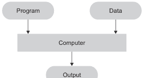

**图 1.1 处理程序**


计算机能够执行复杂而困难的操作，但它们本质上是简单而被动的机器。必须用计算机能理解的语言，精确而明确地告诉它要做什么。这一系列指令称为程序。满足用户需求并符合其规格说明的程序称为软件。实际执行这些指令的物理机器称为硬件。

开发程序的第一阶段是精确定义问题陈述。我们必须非常清楚地说明程序应做什么，以及我们对程序的期望是什么。定义问题后，我们需要选择最合适的算法来解决它。算法是对一个动作的逐步描述，它将问题从起始状态引导至目标状态。算法必须针对其旨在解决的问题非常清晰、明确且高效。编程的艺术在于设计或选择算法，并用编程语言表达它们。开发程序的这一阶段非常重要。之后，如果需要，代码会被测试、调试和修订。

所有计算机语言可分为以下三个基本类别：

- 1. 机器语言
- 2. 汇编语言
- 3. 高级语言

在大多数机器语言中，二进制数字（位 0 和 1）代表一切，即指令、数据和变量。二进制数完全由 0 和 1 组成。用机器语言编写的程序可以被计算机非常快速地执行。这是因为机器指令直接被计算机理解，不需要翻译程序。然而，这些由 0 和 1 序列组成的程序对人类来说难以阅读、编写和解释。

汇编语言相对于机器语言是一大改进。在汇编语言中，每条指令由一个短名称（而非大的二进制数）定义，每个变量由该名称标识。在这种语言中，编程数值操作码被助记符所取代。助记符是我们用来帮助表示数值代码的任何一种心智技巧。用汇编语言编写的程序需要一种称为汇编器的特殊程序，将汇编语言指令翻译成机器语言指令。如今，只有在执行速度是高优先级时，才会使用汇编语言编写程序。

汇编语言更易于理解，因为它为复杂计算和其他过程使用符号名称，从而为程序员节省了大量时间和精力。汇编语言中的错误更容易发现和纠正。然而，汇编级编程有一些缺点。指令因机器而异，因此具有机器依赖性。因此，程序员必须了解特定机器的特性、要求和指令集。

高级语言不依赖于机器，而是面向要解决的问题。这些语言使程序员能够使用英文单词和熟悉的数学符号编写指令。程序员在高级语言中编写的每条指令都被翻译成一组机器语言指令。这被称为一对多翻译。

每种语言被认为最适合解决某一类问题，但不适合解决另一类问题。如今，有超过 200 种高级语言。最常见的一些包括 C、C++、Java、Pascal、FORTRAN 和 COBOL。将高级语言（如 C++）翻译成机器语言的系统程序称为编译器。因此，它是一种特殊的程序，其输入是一个程序，输出是另一个程序。

### 1.2 面向对象编程

传统的结构化编程已被用作算法分解。算法或功能分解将软件视为一个过程。它将软件/程序分解为模块，这些模块代表过程的步骤。这些模块由语言构造实现，例如 Pascal 中的过程、FORTRAN 中的子程序或 C++ 中的函数。基于面向对象编程（OOP-based）的设计与结构化编程设计方法相比，代表了一种根本性的变化。面向对象分解将软件视为一组定义明确的对象，这些对象模拟应用领域中的实体。这些对象相互交互以形成软件系统。功能分解在系统被分解为对象后进行处理。OOP 中的基本概念是对象。面向对象编程用于通过对象模拟现实世界。在我们的现实世界中，从苹果到汽车的一切都是对象，可以从物理和行为两个角度将其彼此区分开来。对象是执行计算并具有局部状态的实体。它也被视为数据和过程（行为）元素的组合。

软件项目的成功往往取决于在数据表示和为处理数据而设计的算法中所做的选择。数据结构的正确选择可以是许多算法设计中的关键点。显然，我们需要适当的方法来描述和处理数据。

数据类型由一组值以及在其上定义的一组基本操作组成。如果程序员可以在不访问且不知晓值和操作实现细节的情况下使用数据类型，则该数据类型称为抽象数据类型（ADT）。

像 C++ 这样的面向对象语言是一种编程范式，它通过将抽象数据类型实现为类，与 ADT 有直接关联。我们将在本书中使用 C++ 作为编程语言。

## 1.3 数据结构简介

计算机科学包括对数据、其表示以及计算机对其处理的研究。因此，研究与数据及其表示相关的术语是必不可少的。如第 1.2 节所述，软件项目的成功往往取决于在数据表示和算法选择中所做的选择，因此我们需要更好的方法来描述和处理数据。数据结构一词指的是数据元素的组织及其之间的相互关系。

数据结构领域对计算机科学和编程的研究非常重要且处于核心地位。数据结构规格说明与其实现之间有着明确的区别。规格说明在编程语言应用之前，而其实现则伴随特定的编程语言。同样，研究这两个过程如何成功完成也非常重要。

数据结构的规格说明需要解释数据结构的功能和整体行为，而数据结构的实现需要在某些编程语言中模拟数据结构。算法、数据和数据结构之间存在密切关系。在本章中，我们将学习数据结构的基本概念、各种类型、编程工具、算法和流程图。

### 1.3.1 数据

数据只不过是一段信息。数据输入、数据操作（或数据处理）和数据输出是计算机的功能。因此，所有作为输入获取、在计算机内部处理或作为输出提供给用户的信息都只不过是数据。它可以是一个数字、一个字符串，或一组许多数字和字符串。

### 原子数据和复合数据

原子数据是我们选择将其视为单个、不可分解实体的数据。例如，整数 1234 可以被视为一个单一的整数值。当然，我们可以将其分解为数字，但分解后的数字将不具有原始整数的相同特征；它们将是 0 到 9 之间的四个单个数字整数。在某些语言中，由于其数值特性，原子数据被称为标量数据。

原子数据的对立面是复合数据。复合数据可以分解为具有意义的子字段。例如，学生记录由 Roll_Number、Name、Branch、Year 等组成。复合数据也被称为结构化数据，可以使用 C++ 中的结构体或类来实现。

### 1.3.2 数据类型

数据类型是指变量可能存储的数据类型。每当我们尝试在某些编程语言中实现任何算法时，都需要变量。变量可以根据该语言提供的功能拥有任何值。数据类型是一个术语，用于指定变量在编程语言中可能持有的数据类型。

### 内置数据类型

一般来说，语言都有其内置数据类型。然而，它们也允许用户使用内置数据类型定义自己的数据类型，称为用户定义数据类型；例如，在 C/C++ 语言中，int、float 和 char 是内置数据类型。使用这些内置数据类型，我们可以通过结构体、联合体和类来设计（定义）自己的数据类型。


## 用户定义的数据类型

假设我们想要维护100名学生的记录，每条记录包含以下字段：学号、学生姓名和学生成绩百分比。然后我们使用如下的C++类：

```cpp
class Student
{
private:
    int roll;
    char name[20];
    float percentage;
public:
    void GetRecord();
    void PrintRecord();
    void SearchRecord();
}
```

类、结构体和联合体是C++中的用户定义数据类型。

### 1.3.3 数据对象

数据对象表示数据值的容器——一个可以存储数据值并稍后检索的位置。数据对象由一组属性来描述，其中最重要的属性之一是其数据类型。这些属性决定了数据对象可能包含的值的数量和类型，也决定了这些值的逻辑组织方式。

数据对象只不过是一组元素，设为D。数据对象'字母表'可以定义为D = {A, B, ..., Z, a, b, ..., z}，数据对象'整数'定义为D = {..., -3, -2, -1, 0, 1, 2, 3, ...}。数据对象集可以是有限的或无限的。

数据对象是数据结构的运行时实例。它是一个或多个数据片段的运行时分组。程序执行期间存在的一些数据对象是程序员定义的，例如变量、常量、数组和文件。程序员通过程序中的声明和语句显式地创建和操作这些数据对象。系统定义的数据对象通常在程序执行期间根据需要自动生成，无需程序员显式指定。

### 1.3.4 数据结构

数据结构是指程序中数据及其对象的表示，即结构化关系的实现。数据结构是将原子数据类型和复合数据类型集合到具有定义关系的集合中。结构是指将数据保持在一起的一组规则。换句话说，如果我们采用一组数据类型并将它们装入结构中，使我们能够定义关联规则，那么我们就可以拥有由其他数据结构组成的数据结构。

简而言之，数据结构是

- 1. 元素的组合，每个元素要么是数据类型，要么是另一个数据结构，以及
- 2. 涉及组合元素的一组关联或关系（结构）。

大多数编程语言支持多种数据结构。此外，现代编程语言允许程序员为应用程序创建新的数据结构。

我们可以如下定义数据结构：

数据结构是一组域D、一个指定域d ∈ D、一组函数F和一组公理A。三元结构(D, F, A)表示具有以下元素的数据结构：

**域(D)** 这是数据可能具有的值的范围。

**函数(F)** 这是数据的操作集。我们必须为数据结构指定一组操作来对其进行操作。

**公理(A)** 这是一组规则，属于F的不同操作可以根据这些规则实际实现。

让我们考虑一个整数数据结构的示例。

这里，数据结构d = Integer

```
Integer
Domain D = {Integer, Boolean}
Set of functions F = {zero, izero, add, increment}
Set of axioms A = {
    ifzero(zero()) → true;
    ifzero(increment(zero())) → false
    add(zero(), x) → x
    add(increment(x), y) = increment(add(x, y))
    equal(increment(x), increment(y)) = equal(x, y)
}
end Integer
```

一般来说，变量的数据类型是变量可能持有的值的集合。ADT是一种数学模型，包含定义了各种操作的数据。ADT的实现细节是隐藏的，这就是为什么它被称为抽象的。为了表示ADT背后的数学模型，我们使用数据结构，它是以不同方式相互关联的变量和数据类型的集合。

### 1.3.5 抽象数据类型

软件工程与计算机科学关系非常密切。软件工程是建立和使用良好的工程方法论以及编写可靠软件的原则。实现这一目标的最重要原则之一是使用抽象。抽象使我们能够通过关注数据和操作的逻辑属性而不是实现细节来组织任务的复杂性。逻辑属性指的是“什么”，实现细节指的是“怎么做”。抽象存在于过程级和数据级。

数据抽象是将数据的逻辑属性与数据表示的细节分开。过程抽象是指将操作的逻辑属性与实现分开。过程抽象和数据抽象密切相关，因为ADT中的操作是过程抽象。ADT既包含过程抽象也包含数据抽象；操作集定义为可能构成值集的任何数据类型。

ADT是指操作集在形式逻辑层面定义，而不受操作细节限制的一种类型。换句话说，ADT是将与数据类型有意义的操作打包在一起的数据声明。我们封装数据及其上的操作，并对用户隐藏它们。简而言之，ADT包括数据声明、操作实现以及数据和操作的封装。

考虑队列的概念。至少有三种数据结构可以支持队列。我们可以使用数组、链表或文件。如果将我们的队列放在ADT中，用户不应意识到我们使用的结构。只要他们能够入队（插入）和出队（检索）数据，我们如何存储数据就不应该有任何区别。

我们意识到隐藏实现的重要性。用户不需要知道数据结构才能使用ADT。对于队列，应用程序不应了解数据结构。对队列中数据的所有引用和操作都必须通过结构的定义接口来处理。允许应用程序直接引用数据结构是许多应用程序中的常见错误，这会阻止ADT完全可移植到其他应用程序。

我们希望一种数据规范方法具有以下特性：

- **抽象** 它应该帮助程序员通过关注数据的逻辑属性而不是实现细节来组织数据，从而允许用户隐藏任务的复杂性。
- **安全** 它应该控制对数据表示的操作，以便避免故障。
- **可修改** 它应该使修改表示相对容易。
- **可重用** 数据结构应该是可供他人重用的产品。

让我们重新定义整数的ADT。

```
Abstract data type Integer
Operations
zero() → int
iszero(int) → boolean
increment(int) → int
add(int, int) → int
equal(int, int) → boolean
Rules/axioms for operations
for all x, y ∈ Integer let
ifzero(zero()) → true;
ifzero(increment(zero())) → false
add(zero(), x) → x
add(increment(x), y) → increment(add(x, y))
equal(increment(x), increment(y)) → equal(x, y)
end Integer
```

这是整数数据结构的示例；在一组整数数据对象上定义了五个基本函数。这些函数如下：

- 1. zero() → int——这是一个不接受输入但生成整数零作为结果的函数。也就是说，其输出为0。
- 2. ifzero(int) → Boolean——该函数接受一个整数输入并检查该数字是否为0。它生成True/False类型的输出，即布尔类型。
- 3. increment(int) → int——该函数读取一个整数并生成其递增值，即（整数 + 1），这也是一个整数。例如，increment(3) → 4
- 4. add(int, int) → int——该函数读取两个整数并将它们相加，生成另一个整数。
- 5. equal(int, int) → Boolean——该函数接受两个整数值并检查它们是否相等。同样，它给出True/False类型的输出。因此其输出为布尔类型。

描述操作规则的公理集如下：

- 1. ifzero(zero()) → true——该公理指出，生成整数零的zero()函数由ifzero()函数进行检查，最终结果为true。
- 2. ifzero(increment(zero())) → false——increment(zero)的值为1，因此ifzero(1)为false。
- 3. add(zero(), x) → x——这意味着0 + x = x。
- 4. add(increment(x), y) → increment(add(x, y))——假设x = 3且y = 5，这意味着add(increment(3), 5) = increment(add(3, 5)) = add(4, 5) = increment(8) = 9。
- 5. equal(increment(x), increment(y)) → equal(x, y)——该公理规定，如果x和y相等，那么x + 1和y + 1也相等。

公理没有指定数据结构的实现形式。这就是为什么ADT是抽象的。ADT也可以定义为变量集合及其操作所需的函数。变量表示包含的信息，而函数定义可以对数据执行的操作。


在OOP中，我们可以从ADT创建一个对象。事实上，C++提供‘class’声明正是为了定义从中创建对象的ADT。创建对象涉及为该对象的变量预留一块内存。在C++中，操作类变量的函数称为成员函数。ADT是定义数据结构的一种方式，使我们知道它做什么，但不知道它如何做。

## 1.4 数据结构的类型

我们将数据结构定义为一种组织数据的方式，它指定

- 1. 一组数据元素，即数据对象；以及
- 2. 一组应用于此数据对象的操作。

这两组构成一个数学结构，可以使用特定的编程语言来实现。数据结构与其实现无关。各种数据结构类型如下：

- 1. 原始和非原始
- 2. 线性和非线性
- 3. 静态和动态
- 4. 持久和短暂
- 5. 顺序访问和直接访问

### 1.4.1 原始和非原始数据结构

原始数据结构定义一组原始元素，这些元素不涉及任何其他元素作为其子部分——例如，为整数和字符定义的数据结构。这些通常是编程语言中的主要或内置数据类型。

非原始数据结构是定义一组派生元素（例如数组）的数据结构。C++中的数组由一组相同类型的元素组成。类和结构是非原始数据结构的其他示例，它们由一组元素组成，这些元素可能属于不同的数据类型以及用于操作的函数。

### 1.4.2 线性和非线性数据结构

数据结构分为线性和非线性。如果数据结构的元素形成一个序列或线性列表，则称为线性数据结构。在线性数据结构中，每个数据元素都有一个唯一的后继元素和前驱元素。在内存中表示线性结构有两种基本方法。一种是通过指针（链接）建立元素之间的关系，称为链表。另一种是使用顺序组织，即数组。

非线性数据结构用于表示元素之间包含层次或网络关系的数据。树和图是非线性数据结构的示例。在非线性数据结构中，每个数据元素可能有多个前驱元素和后继元素。元素不形成任何特定的线性序列。图1.2描绘了线性和非线性数据结构。

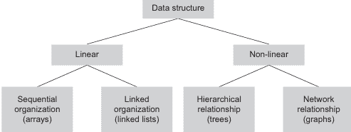

Fig. 1.2 数据结构分类

### 1.4.3 静态和动态数据结构

如果数据结构在程序执行开始之前创建（也称为编译期间），则称为静态数据结构。静态数据结构的变量具有用户指定的名称。数组是一种静态数据结构。

在许多应用程序中，希望能够以所需的最小内存量启动程序，然后根据需要分配额外内存。许多编程语言提供此功能，在C++中，通过new运算符提供。这些函数允许程序员在执行期间分配内存。因此，程序员可以实现动态增长和缩小的数据结构。

在运行时创建的数据结构称为动态数据结构。此类型的变量并不总是通过用户定义的名称引用。这些变量通过指针间接使用其地址进行访问。

当使用动态内存管理和指针实现时，链表是一种动态数据结构，而数组是一种静态数据结构。非线性数据结构通常以与链表相同的方式实现。因此，树和图可以实现为动态数据结构。

### 1.4.4 持久和短暂数据结构

数据结构包含一组操作和一组待处理的数据。处理数据的操作可能会修改数据。这可能会创建两个版本的数据结构，即最近修改的（也称为已更新的）数据结构和先前版本，在对其执行任何操作之前可以保存先前版本。某些语言（如ML）具有内置数据类型，例如列表。此数据类型具有关联操作——追加和反转。这些操作保留数据结构列表的两个副本，作为最近版本和先前版本。

支持对最近版本和先前版本进行操作的数据结构称为*持久数据结构*。如果任何版本都可以访问但只有最近版本可以更新，则持久数据结构是部分持久的；如果任何版本都可以访问和更新，则是完全持久的。

短暂数据结构是仅支持对最近版本进行操作的数据结构。短暂数据结构与持久数据结构之间的区别，本质上是函数式（也称为无副作用）和传统命令式（也称为有副作用）编程范式之间的区别。函数式数据结构是持久的，而命令式数据结构是短暂的。

在传统命令式语言中，数据结构是短暂的，因为向链表插入会改变列表并丢失旧版本。在函数式语言中，数据结构是持久的，因为向列表插入元素会产生一个新列表，而旧版本仍然可用。此外，可以实现一个栈，使得压入操作产生一个新栈，同时保留旧栈。语言ML同时支持持久数据结构和短暂数据结构。

### 1.4.5 顺序访问和直接访问数据结构

此分类是相对于数据结构关联的访问操作而言的。*顺序访问*意味着要访问第$n^{th}$个元素，必须先访问前面的$(n-1)$个数据元素。链表是一种顺序访问数据结构。*直接访问*意味着可以访问任何元素而无需访问其前驱或后继元素；我们可以直接访问第$n^{th}$个元素。数组是直接访问数据结构的一个示例。

## 1.5 算法简介

我们将计算机定义为数据处理器或黑盒。充当黑盒的计算机接受输入（数据和程序）并生成输出。程序是一组指令，告诉计算机如何处理数据。这些指令使用计算机语言，即，程序是用计算机语言编写的一组指令。

算法以九世纪波斯数学家Abu Jafar Mohammed bin Musa al-Khwarizmi命名，简单来说是执行某项任务的一组规则，可以手动执行，也通常在机器上执行。任何软件的实际性能取决于

- 1. 所选的算法和
- 2. 各实现层的适用性和效率

因此，良好的算法设计对所有软件系统的性能至关重要。此外，算法研究能深入了解问题的基本性质。算法研究还能深入了解可能的解决技术，这些技术独立于编程语言、编程范式、计算机硬件或任何其他实现方面。

程序员应首先以逐步的方式解决问题，然后尝试找到解决问题的适当指令或一系列指令。这种逐步解决方案称为*算法*。算法独立于计算机系统和编程语言。

每个算法包括以下步骤

- 1. 输入，
- 2. 处理，以及
- 3. 输出。

### 1.5.1 算法的特性

如第1.5节所定义，算法简单来说是执行某项任务的一组规则，可以手动执行，也通常在机器上执行。这组规则是计算机程序背后的思想。这种思想独立于实现。无论程序是用Pascal编写并在纽约的Cray上运行，用BASIC编写并在加德满都的Macintosh上运行，还是用Fortran-90编写并在印度的Param 10000上运行，算法都保持不变！

算法必须解决一个一般性的、指定的问题。算法问题通过描述其必须处理的输入实例集以及输出必须具备的期望属性来指定。

让我们重新定义算法一词。

*算法*是一个明确定义的计算过程，它将输入转换为输出，从而实现所需的输入-输出关系。计算问题是所需输入-输出关系的规范。问题的一个实例是计算问题解决方案所需的所有输入。正确的算法对于每个输入实例都会停止并给出正确的输出。我们可以说该算法解决了问题。

更详细地说，算法是解决问题的有限且确定的过程。有限性很重要。确定性也很重要。我们不能接受涉及做出灵感猜测的算法方法，例如为积分找到巧妙的替换。

因此，算法是一组有限且有序的*明确*和*有效*的步骤，遵循这些步骤通过接受*零个或多个输入量*并生成*至少一个输出*来完成特定任务。

以下是算法的特性：

- **输入** 算法提供零个或多个外部量作为输入。
- **输出** 算法必须产生一个结果，即输出。


**明确步骤** 算法中的每个步骤都必须清晰且无歧义。这有助于遵循步骤的人或计算机采取明确的行动。

**有限性** 算法必须停止。因此，它必须具有有限数量的步骤。

**有效性** 每条指令都必须足够基本，以便轻松执行。

简而言之，算法是一组有序的、有限的、明确且有效的步骤，它产生结果并终止。

## 1.5.2 算法

算法是计算机科学的一个领域，定义为对 _算法的研究_。算法的总体目标是理解算法的复杂性。这项研究包括算法的设计和分析。

当我们着手解决问题时，可能有多种算法可供选择。在这种情况下，决定使用哪一种非常重要。根据我们的优先事项和可用设备的限制，我们可能希望选择耗时最少、占用存储最少、最容易编程等等的算法。答案可能取决于许多因素，例如涉及的数量、问题的呈现方式，或可用计算设备的速度和存储容量。

可能没有任何可用算法完全合适，因此我们必须设计自己的新算法。算法是一门科学，它让我们评估各种外部因素对可用算法的影响，以便我们可以选择最适合我们特定情况的算法；它也是告诉我们如何设计新算法的科学。

算法包括以下内容：

- **如何设计算法** 设计算法是一门永远无法完全自动化的艺术。通过研究各种技术，即设计策略，设计新的和有用的算法变得更加容易。
- **如何验证算法** 一旦算法被设计出来，就有必要证明它对所有可能的合法输入都能计算出正确答案。用于验证的方法包括反证法和数学归纳法。
- **如何分析算法** 算法分析是指确定算法需要多少计算时间和存储空间的任务。

## 1.5.3 算法设计工具：伪代码和流程图

用于算法表示的两种流行工具如下：

- 1. 伪代码
- 2. 流程图

让我们详细研究每一种。

## 1.6 伪代码

算法可以用英语、德语、法语等任何自然语言编写。定义算法的常用工具之一是伪代码。伪代码是算法所需代码的类英语表示。它部分是英语，部分是计算机语言结构代码。结构代码只不过是编程语言的语法结构（略有修改的格式）。例如，某些语言结构，如数组或指针，在英语中不使用，因此它们从编程语言中借用。

### 1.6.1 伪代码符号

与流程图相比，伪代码是对解决方案的精确描述。为了获得相对于问题定义的解决方案的完整描述，算法标题中应包括前置-后置条件和返回值详细信息。此外，还应清楚查看所用变量和目的的信息。为了帮助任何人一目了然地获取所有这些信息，伪代码使用各种符号，如标题、目的、前置-后置条件、返回、变量、语句编号和子算法。让我们讨论每个的细节。

### 1.6.2 算法标题

标题包括算法名称、参数以及前置和后置条件列表。仅通过阅读标题而非完整算法来了解算法，这些信息很重要。因此，标题信息必须足够完整，以向程序员传达使用算法所需知道的一切。标题使伪代码可读。

在算法 1.1 中，有两个参数，即数组 A 和数组中元素的总数，也就是大小 N。参数可以通过引用（ref）或按值（val）调用。类型包含在标识符后的尖括号中。该算法用于对大小为 N 的数组 A 进行排序。

```
ALGORITHM 1.1
---------------------------------------
Algorithm sort(ref A<integer>, val N<integer>)
Pre	 array A to be sorted
Post	 sorted array A
Return None
1. if(N < 1) goto step (4)
2. M = N - 1
3. For I = 1 to M do
   For J = I + 1 to N do
   begin
   if(A[I] > A[J])
   then
   begin
   T = A(I)
   A(I) = A(J)
   A(J) = T
   end
   end if
   end
4. stop
```

### 1.6.3 目的

目的是对算法所做工作的简要描述。它应尽可能简短，描述一般算法处理过程，但不应描述所有处理过程。例如，在算法 1.1 中，目的只是告诉该算法对整数数组进行排序，而不需要说明数组已排序以及结果存储在哪里。算法 1.2 在数组中搜索一个元素。

### 算法 1.2

```
Algorithm search (val list<array>, val X<integer>)
Pre list containing data array to be searched and
argument containing data to be located
Post None
Return Location
1. Let list be the array and X be the element to be searched
2. For I = 1 to N do begin
if(List(I) = X)
then
Return I
end if
end
end
3. Return -1
4. stop
```

### 1.6.4 条件和返回语句

前置条件说明参数的先决条件（如果有）。例如，在集合运算的算法中，前置条件可能说明输入应该是一组没有重复元素的元素。有时，没有前置条件，在这种情况下，我们仍然使用语句 Nothing 列出前置条件，如下所示。

前置条件 无

如果有多个输入参数，则应为每个参数显示前置条件。
例如，简单的数组搜索算法 1.2 具有以下标题：

```
algorithm search (val list<array>, val argument<integer>)
```

在数组中搜索特定项目并返回索引位置。

前置条件：list 包含要搜索的数据数组，argument 包含要在列表中定位的数据

后置条件：无

返回：如果找到则返回位置，否则返回 -1 表示元素未找到

在此搜索中，两个参数按值传递。前置条件指定两个输入参数 list 和 argument 必须已初始化。如果使用二分搜索，前置条件还将说明数组数据必须是有序的。

后置条件标识所采取的任何操作以及任何输出参数的状态。

在算法 1.1 中，后置条件是包含排序数据的数组。如果返回一个值，它将由返回条件标识。

### 1.6.5 语句编号

算法中的语句按顺序编号。对于条件或无条件跳转以及迭代语句，编号有助于唯一标识语句。可以使用任何标签系统（如十进制或罗马数字，甚至字母）来标记语句。如果使用十进制表示法，则迭代结构中的语句可以编号为 4.1、4.2 等等。这种表示法有助于正确缩进算法。

```
4 while(i < 10) do
    begin
        4.1 x = x * y
        4.2 i = i + 1
    end
```

### 1.6.6 变量

算法需要变量。我们不需要定义算法中使用的每个变量。使用有意义的变量名是受欢迎的，因为变量名指示了数据的上下文。建议使用匈牙利命名法进行变量命名。建议使用描述性和有意义的变量名，以确保正确理解含义。

算法中使用的变量名在将相应算法编码为特定语言时可以继续使用。这些有意义的变量使代码更易于理解、调试和修改。建议遵循一些经验法则：

- 1. 最好使用描述性变量名，而不是单字符名称。通常，我们使用 x、y、z、a 或 b 以及 i 或 j 作为循环、矩阵和数组索引的索引变量。例如，不要将 i 和 j 用作二维数组的索引变量，建议使用 row 和 column 作为索引变量。在搜索算法中，要搜索的元素的建议变量是 target，而不是 x。


对于天气信息表，City 和 Temperature 将分别是更好的行索引和列索引变量。

- 2. 建议避免使用短形式和通用名称。例如，使用 ListofColors 而不是 lcol，或使用 NumberofStudents 而不是 nostud。原因是短形式不一定表达其预期含义。常用的通用名称有 index、count、number、sum、total、row、column 等。这些变量在程序的各个模块中使用，可能有许多实例。为通用名称添加合适的限定词，有助于更好地阅读、调试或修改代码。

- 3. 预期使用变量名，以便指示变量的数据类型。例如，fAverageMarks、iNumberofColors、bAvailability 分别用于 float、integer 和 Boolean 数据。

### 1.6.7 语句结构

开发算法时使用三种语句结构。目标是算法应由较少的结构（例如三种）组合而成，如下所示：

- 1. 顺序
- 2. 判断
- 3. 重复

仅使用这些结构，就能使算法易于理解、调试和修改。

### 顺序

算法是一系列指令，可以是简单指令（输入、输出或赋值），也可以是另外两种结构之一。图 1.3 展示了这种顺序结构的示例。算法 1.3 计算圆的面积。

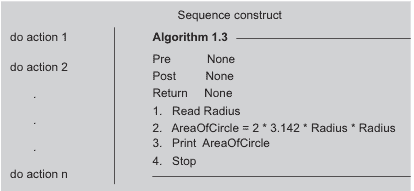

### 判断

有些问题不能仅靠一系列简单指令来解决。有时，我们需要测试条件。如果测试结果为真，则遵循一系列指令；如果为假，则遵循另一系列指令。这称为判断或选择结构（图 1.4）。

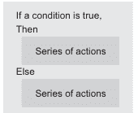

图 1.4 判断结构

### 示例 1.1 比较两个数并打印其中的最大值。

解答 比较两个数的算法列于算法 1.4 中。

```
ALGORITHM 1.4
Pre None
Post None
Return None
1. Read two numbers Num1 and Num2
2. If Num1 > Num2
   Then Print Num1
   Else Print Num2
3. Stop
```

### 重复

在某些问题中，我们需要重复一组指令。我们可以为此使用重复结构。图 1.5 展示了一个重复结构及其计算前 N 个数之和 ΣN 的示例（算法 1.5）。

### 1.6.8 子算法

我们学习了三种结构——顺序、判断和迭代——用于开发可解问题的算法。可解问题是指具有可以用算法形式描述的解决方案的问题。

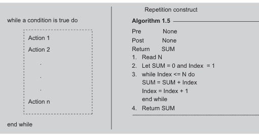

图 1.5 重复结构

在结构化编程中，问题的解决方案以较小的模块形式描述。这种模块化设计将算法分解为称为 _子算法_ 的较小单元。这些单元在编程语言中有不同的名称，例如 _函数_、_子程序_、_过程_、_方法_ 和 _模块_。

算法中模块化设计的目标是使复杂且冗长的算法易于阅读、编写、验证和调试。每个子算法又可以细分为子算法，这种细分过程可以持续进行，直到每个步骤都变得有效。

### 示例 1.2 编写算法计算以下内容：

P = n!/((n - r)!)

解答 算法 1.6 计算从 n 个元素中排列任意 r 个元素的可能方式数量。

```
ALGORITHM 1.6
Pre None
Post None
Return Result
1. Read n and r
2. Let
   (a) A = FACT(n) and
   (b) B = FACT(n - r)
3. Result = A / B
4. Print Result
5. Stop
```

这里 FACT 是用于计算数字阶乘的子算法，如下所示：

n! = n x (n - 1) x (n - 2) x ... x 1

### 子算法 FACT

```
1.Read n
2.Let Result = 1
3.while( not equal to 1) do
   Result = Result x n
   n = n - 1
 end while
4.Return Result
```

请注意，子算法使算法易读且简洁。易读的算法是指一眼就能让读者了解整体计算过程的算法。简洁的算法是没有冗余代码的算法。您一定注意到，在这个算法中，阶乘计算需要进行两次。子算法 FACT 避免了代码冗余，使算法变得简洁。

## 1.7 数据、数据结构与算法之间的关系

数据结构与算法分析之间存在密切关系。事实上，数据结构和算法应被视为一个整体；没有对方，任何一方都没有意义。让我们考虑在目录中查找某人电话号码的示例。我们查找某人并获取其电话号码所遵循的过程，在很大程度上取决于电话号码和姓名在目录中的排列方式。让我们考虑在目录中组织数据（电话号码和姓名）的两种方式。

- 1. 数据以随机方式组织。然后，若要按姓名查找某人，必须从目录中的第一个姓名开始线性查找直到最后一个姓名。没有其他选择。

- 2. 如果数据按姓名排序（按字母顺序升序排列）来组织，那么查找会容易得多。不必线性搜索所有记录，可以在特定字母的特定区域进行搜索，类似于使用字典。

由于数据处于有序状态，二分查找和典型的目录查找方法都适用。因此，当我们意识到可以随意组织数据时，我们的算法构想就成为可能。我们可以说，数据结构（以及数据结构之间的相互关系）与处理数据的操作（算法）之间存在着强烈的关系。事实上，我们处理数据的方式取决于我们组织数据的方式。

## 1.8 数据结构的实现

数据结构是将原子数据类型和复合数据类型聚合为一个集合，并定义它们之间关系的结构。如第 1.3.4 节所定义，数据结构 D 是一个三元组，即 D = (D, F, A)，其中 D 是数据对象的集合，F 是函数的集合，A 是实现函数的规则集合。

```
D = (0, ±1, ±2, ±3, ...)
F = (+, -, *, /, %)
A = (a set of binary arithmetic rules to perform addition, subtraction, division, multiplication, and module operations)
```

公理集合 A 定义了 F 对 D 进行操作的语义。数据结构 D 的实现是从 D 到其他数据结构集合 E 的映射。该映射指定了 D 中的每个数据对象 d 如何由 E 中的对象表示。此外，它要求 D 中的每个函数都必须使用实现数据结构 E 的函数来编写。因此，我们可以说整数由位串表示，布尔值由 0 和 1 表示，数组由内存中的一组顺序位置表示。我们还定义了抽象数据类型一词，它是一种数据结构，其中规则（A——公理集合）不暗示一种表示形式。

因此，另一种看待数据结构实现的方式是，它是一个细化抽象数据类型（ADT）的过程，直到所有操作都能有效地表达，以便它们以直接可执行函数的形式定义。

因此，数据结构的实现可以分为两个阶段：规范和实现。这种任务划分很有用，因为它有助于控制整个过程的复杂性。

### 阶段 I：规范

在第一阶段，应设计数据结构，以便我们知道它做什么，而不一定是它如何做。

### 阶段 II：实现

在此阶段，我们根据如何操作数据的描述定义所有函数。这可以通过算法来完成，以便轻松理解操作的细节，并且读者可以借助任何编程语言轻松有效地实现它们。此阶段可以使用任一设计工具，即算法或流程图。我们已经了解了作为设计工具的算法；现在让我们来了解流程图。


## 1.9 流程图

一个非常有效的工具，用于展示程序的逻辑流程，就是流程图。流程图是算法的图形表示。它通过提供一幅图来隐藏算法的所有细节；它展示了算法如何从头到尾流动。在编程环境中，它可以用于设计完整的程序，也可以仅设计程序的一部分。

流程图的主要目的是展示算法的设计。同时，它使程序员摆脱编程语言的语法和细节，从而能够专注于待解决问题的细节。这与另一种编程设计工具——伪代码形成对比，伪代码提供文本设计方案。两种工具各有优势，但流程图拥有其他工具所缺乏的图形表现力。图 1.6 是一个流程图，描述了读取、相加、打印三个数字并打印结果的过程。

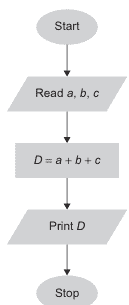

**图 1.6 添加三个数字的流程图**

## 1.10 算法分析

算法在很大程度上取决于数据的组织方式。对于给定问题，可以有多种方式来组织数据和/或编写算法。难点在于决定哪种算法是最好的。我们可以比较一种算法与另一种算法，并选择最好的一种。为了进行比较，我们需要分析算法。分析涉及衡量算法的性能。性能按以下参数进行衡量：

- 1. *程序员时间复杂度*——极少被考虑，因为它只需支付一次
- 2. *时间复杂度*——算法执行预期任务所需的时间量
- 3. *空间复杂度*——执行任务所需的内存量。

根据算法所需时间和空间的相对量来分类算法，并将时间和空间需求的增长指定为输入大小的函数，这非常方便。

### 1.10.1 算法复杂度

算法按时间和空间复杂度进行衡量。算法的*时间复杂度*是衡量执行给定数量输入的算法所需时间的指标，并按其相对于标准函数的增长率进行衡量。

空间复杂度与时间复杂度类似。算法的空间复杂度是衡量算法所需存储量的指标。有可能设计出使用更多空间但更少时间，或更少空间但更多时间的算法。

通常，计算机科学家有兴趣最小化算法的时间复杂度。存储经济性与计算机速度之间的权衡是决定关注时间复杂度的主要因素。过去 25 年来，内存成本以指数速率下降，而中央处理器时间的成本并未以该速率下降。瓶颈是执行时间。因此，计算机科学家关注算法的执行时间。

算法可以由计时函数 T(n) 来表征。T(n) 是衡量执行带有给定 n 个数据值的算法所需时间的指标。例如，排序操作的计时函数指定了对 n 个数据值进行排序所需的时间。求解线性方程组算法的计时函数指定了解 n 个线性方程所需的时间。

算法 O(n^2)，读作“oh of n squared”，表示其计时函数的增长速度不会超过其处理的数据值数量的平方。让我们进一步了解这两种算法度量。

### 1.10.2 空间复杂度

空间复杂度是程序执行期间所需的计算机内存量，作为输入大小的函数。空间复杂度测量（即算法的空间需求）可以在两个不同的时间进行：

- 1. 编译时间
- 2. 运行时间

### 编译时间空间复杂度

编译时间空间复杂度定义为程序在编译时的存储需求。

此存储需求可以在编译期间计算。程序在编译时所需的存储可以通过使用声明语句对每个变量的存储大小求和来确定。例如，计算数字 n 阶乘的非递归函数的空间复杂度取决于数字 n 本身。

空间复杂度 = 编译时所需的空间

这包括执行开始前的内存需求。

### 运行时空间复杂度

如果程序是递归的，或使用动态变量或动态数据结构，则需要在运行时确定空间复杂度。一般来说，这种动态存储大小取决于程序中使用的一些参数。很难准确估计内存需求，因为它还取决于编译器的效率。内存需求是程序空间、数据空间和栈空间的总和。

**程序空间** 这是程序本身占用的内存。

**数据空间** 这是常量和变量等数据成员占用的内存。

**栈空间** 这是在调用另一个函数时保存函数运行时环境所需的栈内存。由于它取决于运行时调用栈（可能取决于程序的数据集），因此无法准确估计。这种内存空间对递归函数至关重要。

### 1.10.3 时间复杂度

时间复杂度 T(P) 是程序 P 所花费的时间，即其编译时间和执行时间之和。这取决于系统。计算它的另一种方法是统计算法步骤的数量。算法步骤是程序中在语法或语义上有意义的片段。我们可以通过以下两种方式之一确定程序解决特定问题实例所需的步骤数：

- 1. 向程序中引入一个新变量 `count`。这是一个初始值为 0 的全局变量。在程序的适当位置引入递增 count 值的语句。这样做是为了确保每次执行原程序中的语句时，count 都会按该语句的步骤数递增。我们通过统计步骤数来衡量算法的运行时间。
- 2. 手动计算每条语句将被执行的次数。语句被执行的次数即其 _频次计数_。获取所有语句的频次计数之和。这个和就是解决给定问题所需的步骤数。

### 最佳、最坏和平均情况

算法的最佳情况复杂度是按大小为 n 的任何实例所采取的最少步骤数定义的函数。

算法的最坏情况复杂度是按大小为 n 的任何实例所采取的最多步骤数定义的函数。

算法的平均情况复杂度是按大小为 n 的任何实例所采取的平均步骤数定义的函数。

这些复杂度中的每一个都定义了一个数值函数——时间与大小的关系。

### 1.10.4 计算算法的时间复杂度

算法或程序的总时间是通过算法或程序中每条可执行语句所花时间的总和来计算的。每条语句所需的时间取决于以下因素：

- 1. 执行一次所需的时间
- 2. 语句被执行的次数

这两个参数的乘积给出了该特定语句所需的时间。计算所有可执行语句的执行时间。所有执行时间的总和就是该算法或程序所需的总时间。

一般来说，当我们对所有语句的频次计数求和时，会得到一个多项式。在分析中，我们关心的是算法的数量级，也就是说，我们只关心那些频次计数最高的语句。

### 1.10.5 大 O 表示法

鉴于当今计算机的速度，我们不太关心算法效率的精确测量，而更关心其一般数量级。如果两种算法的分析显示一种执行 15 次迭代而另一种执行 25 次迭代，那么它们都非常快，以至于我们无法看出差异。另一方面，如果一种迭代 15 次而另一种迭代 1500 次，我们就应该关注了。

我们已经表明，处理 n 个数据元素的函数中执行的语句数量是元素数量的函数，表示为 f(n)。虽然为函数推导的方程可能很复杂，但方程中的主导因素通常决定了结果的数量级。因此，我们不需要确定复杂的效率度量，而只需确定决定数量级的因素。这个因素就是大 O，即“数量级上的”，表示为 O(n)，也就是 n 的数量级。

效率的简化称为大 O 分析。例如，如果一个算法是二次的，我们会说它的效率是 O(n^2) 或 n 平方的数量级。

大 O 表示法可以通过以下步骤从 f(n) 推导出来：

- 1. 在每一项中，将该项的系数设为 1。
- 2. 保留函数中最大的项并丢弃其他项。这些项从低到高排序如下：

```
log n ... n ... n log n ... n^2 ... n^3 ... n^k ... 2^n ... n!
```

例如，

- 1. 要计算以下内容的大 O 表示法：

```
f(n) = n x ((n + 1) / 2) = 1/2 n^2 + 1/2 n
```

我们首先移除所有系数。这给出了

```
n^2 + n
```

之后，移除较小的因子，得到 n^2


which, in big-O notation, is stated as

O(f(n)) = O(n²)

- 2. 考虑另一个示例，让我们来看看多项式表达式

f(n) = aₖnᵏ + aₖ₋₁nᵏ⁻¹ + ⋯ + a₂n² + a₁n + a₀

我们首先按如下方式消除所有系数：

f(n) = nᵏ + nᵏ⁻¹ + ⋯ + n² + n + 1

表达式中最大的项是第一项，因此我们可以说该多项式表达式的阶为

O(f(n)) = O(nᵏ)

任何效率度量都假设正在考虑足够大的样本。如果你只处理10个元素，所需时间不到一秒，那么两种算法之间不会有显著差异。另一方面，随着被处理元素数量的增长，算法之间的差异可能非常惊人，例如，当n为10,000时。回到为什么我们应该关注效率的问题，假设你可以用三种方式解决一个问题：一种是线性方法，另一种是线性对数方法，第三种是二次方法。我们应该能够在众多可能的算法中分析并选择一种。

## 1.11 从问题到程序

人们注意到，程序员将大部分时间花在理解要解决什么问题上。最初，大多数问题都没有简单、精确的规格说明。相反，存在某些问题，例如创建“美食”食谱或维护世界和平，可能无法用计算机解决方案来表述。即使我们觉得问题可以在计算机上解决，通常在几个问题参数上也有相当大的余地。通常，只有通过实验才能找到这些参数的合理值。

如果问题的某些方面可以用正式模型来表达，那么通常这样做是有益的，因为一旦问题被形式化，我们就可以用精确模型来寻找解决方案，并确定是否已有程序可以解决该问题。即使没有现成程序，我们至少可以发现关于该模型的已知内容，并利用模型的属性来帮助构建良好的解决方案。我们现在将考虑程序开发的一种系统方法（或阶段）。软件工程是强调这种软件开发系统方法的领域。让我们现在讨论软件工程，它对初学者开发的小型简单程序以及一组程序员开发的复杂软件都很重要。

## 1.12 软件工程

软件工程是建立和使用良好的工程方法和原则，以获得在实际机器上运行的可靠软件。

软件工程中的一个基本概念是软件开发生命周期（SDLC）。软件像许多其他产品一样，经历一系列重复阶段的循环。软件生命周期中的开发过程大致涉及四个阶段：分析、设计、实现和测试。图1.7显示了这些阶段作为开发过程的一部分。

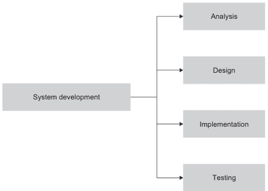

图1.7 系统开发阶段

### 1.12.1 分析阶段

开发过程从分析阶段开始；系统分析师定义需求，以指定拟议系统要完成什么。需求通常以用户能理解的术语来陈述。分析阶段有四个步骤：定义用户、定义需求、定义需求规格、定义方法。

- **定义用户** 软件包可能是为通用用户或特定用户设计的。例如，会计软件包可能是为任何公司创建的。另一方面，定制银行软件包可能是为特定银行创建的。必须明确定义软件包的用户。

- **定义需求** 在确定用户后，分析师明确定义需求。用户或用户的代表明确定义他/她对软件包的期望。

- **定义需求规格** 基于用户的需求，分析师可以准确定义系统的需求。例如，如果软件包要在每月末为每位员工打印支票，则需要明确定义和研究应实施什么级别的安全性和准确性。因此，必须研究待开发系统的所有需求级别。

- **定义方法** 最后，在需求以清晰术语定义后，分析师可以选择适当的方法来满足这些需求。

### 1.12.2 设计阶段

设计阶段定义系统将如何完成分析阶段中定义的内容。在设计阶段，确定系统，并完成文件或数据库的设计。

- **模块化** 今天，设计阶段使用一种非常成熟的原则，称为模块化。将整个软件包分成小模块。每个模块都经过设计和测试，并通过主程序与其他模块链接。

- **工具** 设计阶段使用多种工具，最常见的是结构图。结构图显示如何将软件包分解为逻辑步骤；每个步骤是一个独立的模块。结构图还显示所有部分（模块）之间的交互。

### 1.12.3 实现阶段

在 *实现阶段*，我们创建实际程序。

- **工具** 此阶段使用多种工具来在实际编写代码之前显示程序的逻辑流。一种仍然流行的工具是流程图。流程图使用标准图形符号来表示数据通过模块的逻辑流。程序员使用的第二种工具是伪代码。伪代码的语言部分是英语，部分是逻辑，它以精确的算法细节描述程序要做什么。这要求步骤以足够的细节定义，以便可以轻松地转换为计算机程序。

- 编码 在制作流程图、伪代码或两者之后，程序员实际上会为项目编写特定语言的代码。语言的选择基于该语言对特定应用程序的效率。

### 1.12.4 测试阶段

一旦程序编写完成，就必须进行测试。测试阶段可能是程序开发中非常乏味且耗时的部分。程序员完全负责测试整个系统，即测试以确保所有程序都能正常协同工作。有两种测试类型——黑盒测试和白盒测试。工程师和用户进行的系统测试是黑盒测试。白盒测试是程序员的责任。

### 1.12.5 验证阶段

程序验证是证明程序按预期运行的过程。对于更简单、更小的程序，验证通常包括尝试几个示例用例，以查看运行代码的结果是否符合我们的预期。然而，这种方法会在程序中留下某些未检测到的错误，因此被避免。同样，不建议在运行代码可用后才验证程序，因为检测到的缺陷难以修复。据说“即使验证也必须经过验证”。这意味着，除了系统之外，准备的测试也必须经过验证。此外，每种软件的质量都必须经过验证。

## 回顾

- 计算机是一种可编程的数据处理机器，接受输入、处理输入的指令（程序），并生成所需的输出。数据和程序存储在计算机内存中。程序是用计算机语言编写的。

- 编程的艺术包括设计或选择算法，并用编程语言表达它们。算法是将问题从其起始状态引导至目标状态的动作的逐步描述。

- 定义算法的常用工具之一是伪代码。伪代码是算法所需代码的类英语表示。它部分是英语，部分是结构化代码。

- 显示程序逻辑流的非常有效的工具是流程图。流程图是算法的图形表示。它通过给出整体图来隐藏算法的所有细节，即，它显示算法如何从开始到结束流动。

- 数据结构表示一组具有特定关系的数据项。软件项目的成功往往取决于在数据表示和为……设计的算法中所做的选择。


处理数据。对数据结构的恰当选择是许多算法设计中的关键点。

- 软件工程是建立和使用良好的工程方法论以及编写可靠软件的原则。在实现这一目标的最重要原则之一是使用抽象。抽象使我们能够通过关注数据和操作的逻辑属性而非实现细节来组织任务的复杂性。逻辑属性指的是“什么”，而实现细节指的是“怎么做”。抽象存在于过程级和数据级。

- 数据结构是一种组织数据的方式，它指定了一组数据元素，即数据对象，以及应用于该数据对象的一组操作。这两组集合构成了一个数学结构，可以使用特定的编程语言来实现。数据结构与其实现无关。各种数据结构类型如下：

- 原始类型和非原始类型
- 线性和非线性
- 静态和动态
- 持久和短暂
- 顺序和直接访问

- 数据的结构化与算法分析之间存在着密切的关系。事实上，应将数据结构和算法视为一个整体，没有对方，任何一方都没有意义。

- 算法在很大程度上依赖于数据的组织。对于给定问题，可能存在多种数据和/或算法的组织方式。困难在于决定哪种算法是最好的。我们可以比较算法并选择最好的一种。为了进行比较，我们需要分析算法。分析涉及从时间和空间复杂度的角度衡量算法的性能。

## 关键术语

- **抽象数据类型** 数据及其上的操作被封装并对用户隐藏。抽象数据类型是与对该数据类型有意义的操作一起打包的数据声明。它包括数据的声明、操作的实现以及数据和操作的封装。
- **算法** 逐步求解的方法称为算法。算法独立于计算机系统和编程语言。
- **汇编器** 将汇编语言代码翻译成机器语言的软件称为汇编器。
- **编译器** 将高级语言代码翻译成机器语言的软件称为编译器。
- **数据** 数据无非是一段信息。数据输入、数据操作（或数据处理）和数据输出是计算机的主题。
- **数据对象** 数据对象代表数据值的容器——一个可以存储数据值并稍后从中检索的地方。数据对象是数据结构的运行时实例。
- **数据结构** 数据结构是指程序中数据及其对象的表示，即结构化关系的实现。数据结构是一组定义域 D、一个指定的定义域 d ∈ D、一组函数 F 和一组公理 A。三元组结构 (D, F, A) 表示数据结构，通常表示为 d。
- **数据类型** 数据类型是一个术语，用于指定变量在编程语言中可能持有的数据类型。
- **流程图** 算法的图形表示称为流程图。
- **非线性数据结构** 在非线性数据结构中，每个数据元素可能有一个以上的前驱和后继。元素不形成任何特定的线性序列。
- **线性数据结构** 如果数据结构的元素形成一个序列或线性列表，则称为线性数据结构。在线性数据结构中，每个数据元素都有一个唯一的后继和一个唯一的前驱。
- **程序** 一组指令称为程序。
- **伪代码** 伪代码是部分英语和部分编程语言，用于编写算法。
- **软件工程** 软件工程是建立和使用良好的工程方法和原则，以获得在实际机器上运行的可靠软件。软件工程是强调软件开发系统方法的领域。

## 练习

### 选择题

- 1. 信息的基本单位是
- (a) 字节
- (b) 位
- (c) 块
- (d) 扇区

- 2. 判断给定 n 变量布尔函数是否输出 1 的算法的阶是
- (a) 常数
- (b) 线性
- (c) 对数
- (d) 指数

- 3. 软件工程主要涉及
- (a) 可靠软件
- (b) 成本效益软件
- (c) 可靠且成本效益的软件
- (d) 以上都不是

- 4. 算法的图形表示称为
- (a) 流程图
- (b) 结构图
- (c) 伪代码
- (d) 算法

- 5. 类似英语的代码表示称为
- (a) 流程图
- (b) 结构图
- (c) 伪代码
- (d) 算法

- 6. 子算法也称为
- (a) 函数
- (b) 子程序
- (c) 模块
- (d) 以上全部

- 7. 按值排列数据的基本算法称为
- (a) 查询
- (b) 排序
- (c) 搜索
- (d) 递归

- 8. 定义用户的需求、要求和方法是以下哪个阶段的一部分
- (a) 分析阶段
- (b) 设计阶段
- (c) 实现阶段
- (d) 测试阶段

- 9. 在系统开发过程中，流程图是以下哪个阶段使用的工具
- (a) 分析阶段
- (b) 设计阶段
- (c) 实现阶段
- (d) 测试阶段

- 10. 在系统开发过程中，伪代码是以下哪个阶段使用的工具
- (a) 分析阶段
- (b) 设计阶段
- (c) 实现阶段
- (d) 测试阶段

### 复习题

- 1. 什么是编程？什么是编程语言，它们如何分类？
- 2. 什么是面向对象编程？
- 3. 定义数据、数据类型、数据结构和抽象数据类型这些术语。
- 4. 数据结构有哪些类型？
- 5. 用示例说明在问题求解过程中数据结构与算法之间的关系。
- 6. 算法的形式定义是什么？编写算法的基本属性和性能度量。
- 7. 伪代码与算法有何关系？流程图与算法有何关系？
- 8. 编写计算前 N 个整数之和的伪代码。为其绘制流程图。
- 9. 为在 N 个数中找到最小数的算法绘制流程图。
- 10. 为在 N 个数中找到最大数的算法绘制流程图。
- 11. 什么是软件工程？什么是软件开发生命周期？

### 选择题答案

1. (b) 2. (d) 3. (c) 4. (a) 5. (d) 6. (d) 7. (b) 8. (a) 9. (b) 10. (b)

## 2 使用数组的线性数据结构

### 目标

读者完成本章后，将能够理解以下内容：

- 数据的顺序组织
- 线性数据结构及其使用数组形式的顺序表示的实现
- 数组的特性
- 有序列表及其表示
- 数组在表示和操作多项式、字符串和稀疏矩阵方面的高效使用

数据可以以线性或非线性形式组织。在线性（或顺序）组织中，数据的所有元素都可以按特定序列排列，并且每个元素在序列中都有一个唯一的后继（和/或前驱）。当每个元素可能有一个或多个后继（或前驱）时，它被称为非线性数据结构。线性列表是一种线性数据结构。线性数据结构可以使用数组和链表来实现。在本章中，我们将学习使用数组实现线性数据结构。几乎所有编程语言都支持数组的概念。这是一种非常常见且简单的顺序数据结构化手段。这就是为什么线性数据结构值得引起高度重视。本章涵盖使用数组的线性数据结构及其实现、特性和应用。

### 2.1 顺序组织

我们已经学习过，组织数据有多种方式（第 1 章）。数据组织在很大程度上影响编程逻辑。因此，我们选择数据结构和算法，使得整体程序在空间和时间复杂度方面证明是高效的。

顾名思义，顺序组织允许以固定距离存储数据。如果第 i 个元素存储在位置 X，那么下一个顺序（i + 1）个元素是


存储在位置 X + C 处，其中 C 是一个常数。线性数组、线性栈和线性队列是顺序组织的一些示例。图 2.1 显示了四个元素 11、34、25 和 9 存储在从地址 L 开始的顺序组织中，其中 C = 1。

顺序组织的一大优势是可以在常数时间内直接或随机访问列表中的任何数据元素。由于顺序组织使用连续内存位置来存储数据，因此访问列表中任何元素的数据访问时间保持不变，与数据列表的总长度或大小无关。在顺序组织中执行元素的中间插入或删除时，我们需要执行数据移位以保持组织的一致性和完整性。因此，中间插入和删除在时间和空间复杂性方面变得昂贵得多。

| 地址 | 元素 |
|---|---|
| L | 11 |
| L + 1 | 34 |
| L + 2 | 25 |
| L + 3 | 9 |

图 2.1 顺序位置上的元素

## 2.2 使用顺序组织的线性数据结构：数组

要在计算机内存中以顺序方式将一组数据存储在一起，数组可以是可能的数据结构之一。数组使我们能够在连续内存位置中组织多个元素；因此，它也被称为结构化或复合数据类型。唯一的限制是我们希望存储的所有元素必须是相同的数据类型。它可以被视为一个带有多个隔间的盒子，每个隔间都能容纳一个数据项。数组支持通过指定数组名称及其索引作为数据项的位置（下标中的序列号）来直接访问这些数据项中的任何一个。

数组是所有数据结构中最通用、最易于使用的。作为数据结构，数组被定义为一组 (index, value) 对，使得每个索引都关联一个值。

```
index—indicates the location of an element in an array
value—indicates the actual value of that data element
```

索引允许直接寻址（或访问）数组中的任何元素。大多数时候，数组是通过使用连续或相邻的内存位置来实现的（图 2.2）。然而，在固定距离处，它不一定是通过使用相距固定距离的内存位置来实现的。这在操作系统内部处理；对于用户来说，它是在连续位置上按顺序排列的数据。

数组是同构数据元素的有限有序集合，可直接访问其任何元素。数组可以以其各种形式使用。一维数组是数组的最简单形式。定义中的每个词都有特定含义：

- **有限** 数组中的元素数量是有限或受限的。
- **有序集合** 数组中所有元素的排列非常具体，即每个元素在数组中都有特定的排名。
- **同构** 数组的所有元素都应为相同的数据类型。

让我们看看如何在 C++ 中声明数组。

```cpp
int Array_A[20];
```

该语句将分配内存空间以存储 20 个整数元素，并将数组命名为 Array_A。

```cpp
char Name[20];
```

同样，该语句将创建一个名为 Name 的数组，可在其中存储 20 个字符数据类型元素。

与数组相关的常见术语如下：

### 数组的大小
数组中将存储的最大元素数即为该数组的大小。它也是该数组的长度。数组是静态数据结构，因为一旦数组的大小被定义，编译后就无法更改。对于数组 Name，大小为 20。

### 基址
数组的基址是存储数组第一个元素的内存位置。它在程序执行时确定。该基址的值在每次程序执行时都会变化，因为它是在运行时确定的。即使程序员也无法确定或定义它。

### 数组的数据类型
数组的数据类型指示存储在该数组中的元素的数据类型。对于数组 Name，数据类型为 char。

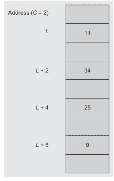

图 2.2 相距固定距离的数组元素

### 索引
用户或程序员可以通过使用 Name[0]、Name[1]、...、Name[N-1] 等下标来访问数组的元素。这个下标称为元素的索引。它指示数组中每个元素相对于其第一个元素的相对位置。通常，数组也被称为下标变量。

### 索引范围
如果 N 是数组的大小，那么在 C++ 中，索引范围是 0 – (N – 1)（而对于 Pascal 等语言，它可以是某个整数，例如下界 (LB) 到上界 (UB)，如 2 到 n + 1 或 –3 到 n – 4）。范围取决于语言。

数组有助于存储大量信息，所有信息都使用相同的名称和不同的索引。它们提供对这些元素的直接访问。数组适用于固定大小的数据项。图 2.3 声明了一个名为 Array_A、包含 100 个整数的数组。编译器通常为每个整数分配 2 字节内存。最终，该数组总共需要 200 字节内存。第二条语句将数值 456 存储到数组的第三个元素中，即 Array_A[2]。

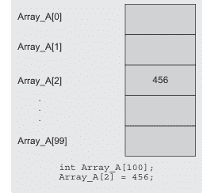

每个元素的存储量取决于数组的数据类型。在 C++ 中，不同数据类型的内存需求如下：

1. 每个字符每个元素 8 位，
2. 每个整数变量每个元素 16 位，以及
3. 每个浮点数每个元素 32 位。

一种数据类型是泛型数据类型，其中定义了操作，但未定义被操作项目的类型，即定义了操作集但未定义值集。数组是 C/C++ 中的内置泛型数据类型。

### 2.3 作为抽象数据类型的数组

如第 2.2 节所定义，数组是一组索引和值的对。对于每个索引，都存在一个关联的数组元素。要将数组定义为抽象数据类型（ADT），我们必须定义可对其执行的最基本操作或函数。数组的基本操作包括创建数组、存储元素、访问元素和遍历数组。

函数 create() 生成一个新的空数组。Access() 以数组和索引作为输入，并返回相应的值或错误。Store() 用于输入新的索引-值对。ADT 定义第 6 行给出的公理读作：“检索第 j 个项目，其中 x 已经存储在 Array_A 的索引 i 处，等效于检查 i 和 j 是否相等，如果是，则返回 x；否则，在剩余数组 Array_A 中搜索第 j 个值。” 该公理最初由 J. McCarthy 给出。请注意，公理与任何表示方案无关。此外，i 和 j 不一定必须是整数，但我们假设它们是整数，以便可以设计 equal() 函数。

如果将索引值限制为整数，那么在假设常规随机访问内存的前提下，我们可以实现 store() 和 access()，使它们以常数时间运行。如果将索引解释为 n 维的，(i_p, i_p ..., i_n)，那么 J. McCarthy 的前一个公理定义了 n 维数组。

让我们指定一个 ADT 数组，其中提供要执行的操作规范。

```
ADT array(index, value)
1. declare create() → array
2. access(array, index) → value
3. store(array, index, value) → array
4. for all Array_A ∈ array, x ∈ value, and i, j ∈ index let
5. access(create, i) = error
6. access(store(Array_A, i, x), j) = x if equal(i, j)
7. else access(Array_A, j)
8. end
end array
```

正式地说，ADT 是域、操作和公理（或规则）的集合。让我们逐一讨论它们。

### 域
域是任何数组可以用作索引或值的预期值集合。我们可以说，数组的域是一组固定的、同构的元素，可以是原子的或结构化的。限制是所有元素都应为同构。数组使用一组索引或下标值，这些值与正整数值一一对应。在 C++ 中，索引 0 用于第一个元素，索引 1 用于第二个元素，依此类推，直到 N – 1，适用于大小为 N 的数组。

### 操作
如 ADT 所示，数组的三个基本操作描述如下：

1. create() → array—此操作创建一个新的空数组。每当创建新数组时，它最初是空的。
2. access(array, index) → value—此函数以数组和索引作为输入并访问该位置的数据元素。当数组新建时，此操作必须指示错误，因为最初每个数组默认都是空的。


- store(array, index, value) → array—此操作用于在数组的指定索引位置存储一个值，并将更新后的数组作为输出。

## 公理

以下是构成 ADT 的公理：

- access(create, i) = error—这是第一个公理，用于解释 access() 操作的工作原理。如果数组是新创建的，则最初为空。因此，如果我们尝试访问第 i 个位置的元素，这将是一个错误的操作。

- access(store(ArrayA, i, x), j) = x if equal (i, j) else access(ArrayA, j) —第二个公理指出，在 ArrayA 的索引 i 处已存储 x 的情况下，访问索引 j 处的元素有以下两种情况之一：(a) 如果 i = j，则访问的元素就是 x 本身。(b) 否则，该操作等同于从 ArrayA 访问索引 j 处的元素。

通常，数组存储在连续内存分配中，如 C、C++ 和 Java 所采用的情况。ADT 未对此进行规定。让我们了解数组的更多细节，例如其内存表示以及用于便于直接访问的地址计算。

### 2.4 内存表示与地址计算

计算机内存可以被视为一长串位，这些位被分组为字节和/或字。每个位都可以引用到一个位置，以避免与机器无关的细节，即内存是否采用一个字节、两个字节或 n 个字节的字进行结构化。此外，寻址方案因计算机而异，例如字节可寻址或字可寻址。编译期间，会为数组分配适当数量的位置。内存分配机制在很大程度上取决于语言。无论机器和语言依赖性如何，当实际分配空间时，整个内存块的位置由第一个位置的基地址引用。其余元素按固定距离依次存储，例如由常量 C 表示。因此，如果第 i 个元素映射到地址为 x 的内存位置，那么第 (i + 1) 个元素将映射到地址为 (x + C) 的内存位置，如图 2.4 所示。

这里，C 取决于元素的大小，即每个元素所需的位置数量，还取决于这些位置的寻址方式。

第 i 个元素的地址按以下公式计算：

```
(Base address) + (Offset of i-th element from base address)
```

这里，基地址是数组存储起始处的第一个元素的地址。在图 2.4 中，基地址为 x，偏移量计算如下：

```
Offset of i-th element = (Number of elements before i-th element) x (Size of each element)
```

```
Address of A[i] = Base + i x Size of element
```

假设元素的大小为一个内存位置，内存表示如图 2.4 所示。

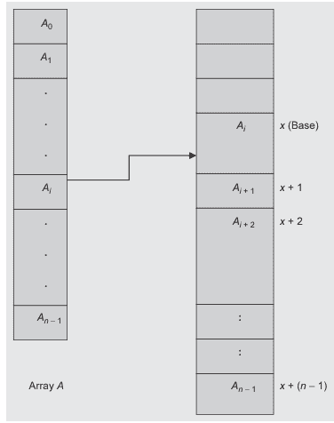

图 2.4 内存表示

大多数语言使用基地址加偏移量进行寻址。这种寻址方式有助于以 O(1) 的界定时间直接访问元素。

简而言之，Array_A [N] 的实现如下：

- Array_A 是对象/结构的名称，与内存中的基地址（起始地址）相关联。
- [N] 表示法指定从开头（偏移量）开始的数组元素数量，起始值为零。
- 第 $i^{th}$ 个元素的地址随后计算为 base + $i \times$ (元素大小)，其中元素大小取决于数据类型。

图 2.5 显示了六个实数数组的索引、地址和值。

| 索引[] | 地址 | 值 |
|---|---|---|
| 0 | 6e80 | 11.56 |
| 1 | 6e84 | 34.00 |
| 2 | 6e88 | 25.65 |
| 3 | 6e8c | 09.43 |
| 4 | 6e90 | -67.55 |
| 5 | 6e94 | 35.12 |

图 2.5 内存地址和实数数组

数组的所有元素在任何表达式中引用之前都必须正确初始化。需要注意的是，数组及其大小大多是静态定义的，因此在执行时无法更改大小。

### 2.5 类 ARRAY

数组 ADT 可支持多种操作，例如遍历、排序、搜索、插入、删除、合并和块移动。其中一些操作在程序代码 2.1 中有详细说明。

```
PROGRAM CODE 2.1
class Array
{
private:
    int MaxSize;
    int A[20];
    int Size;
public:
    Array() // constructor
    {
        MaxSize = 20;
        Size = 0;
    }
    void Read_Array();
    void Display(); // Traverse_Forward()
    void Traverse_Backward();
    void Insert(int Location, int Element);
    void Delete(int Location);
    int Search(int Element);
};

void Array :: Read_Array()
{
 int i, N;
 cout << "Enter size of array";
 cin >> N;
 if(N > MaxSize)
 {
 cout << "Array of this size cannot be created";
 cout << "Maximum size is" << MaxSize;
 return;
 }
 else
 {
 for(i = 0; i < N; i++)
 {
 cin >> A[i];
 }
 Size = N;
 }
}
void Array :: Display()
{
 int i;
 for(i = 0; i < Size; i++)
 cout << A[i] << "\t";
 cout << endl;
}
void Array :: Traverse_Backward()
{
 int i;
 for(i = Size - 1; i >= 0; i--)
 cout << A[i] << "\t";
 cout << endl;
}
int Array :: Search(int Element)
{
int i;
for(i = 0; i < Size - 1; i++)
{
if(Element == A[i])
return(i);
}
return(-1);
}
```

### 2.5.1 向数组中插入元素

insert() 操作将元素插入数组的指定位置。insert() 操作涉及大量数据移动。要在大小为 N 的数组的第 i 个位置插入元素，原本位于 i、i + 1、i + 2、...、N – 1 位置的所有元素将分别移动到 i + 1、i + 2、i + 3、...、N，使得每个元素向右移动一个位置。所有数据移动必须在实际插入之前完成。此外，插入前必须在第 i 个位置为元素腾出空间，然后将元素放置在那里。

请考虑以下数组：

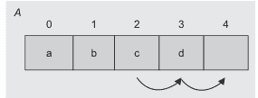

要在索引 = 2（即位置 3）处插入 'z'，需通过数据移动在位置 3 腾出空间。

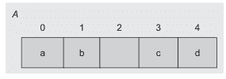

随后在位置 3 插入 'z'。

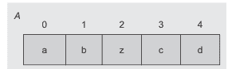

如果在插入新元素之前数组已满，则插入后数组的最后一个元素将因数组溢出而丢失。现在，请考虑以下数组 A：

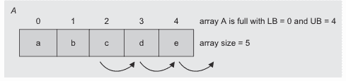

要在位置 3 插入 'z'，需通过数据移动在第 3 个位置腾出空间。

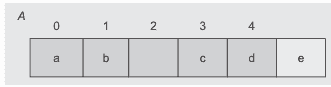

随后在位置 3 插入 'z'。

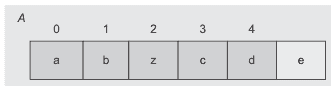

当元素 'e' 移动到索引 5 时，由于越过了 UB，'e' 变得不可访问，因此元素 'e' 可能超出数组 A 的范围。为处理此类错误，应进行适当检查，如果需要，应创建一个更大的新数组（当新数组的大小是原数组两倍时，称为数组倍增），将元素复制到其中，然后重命名数组。

数据移动可使用以下函数执行：

```
void Array :: Insert(int Location, int Element)
{
    int i;
    if(Size >= MaxSize)
    {
        cout << "Sorry, Array Overflow";
        return;
    }
    for(i = Size - 1; i >= Location - 1; i--)
    {
        A[i + 1] = A[i]; // shifting element to right by
        1 position
    }
    A[Location - 1] = Element;
    Size = Size + 1;
}
```

### 2.5.2 删除元素

delete() 操作从数组中删除指定元素。元素的删除通过覆盖该元素来实现。执行一次删除操作后，一个位置变为空，因此应将删除元素之后的所有元素向前移动一个位置，以填充被删除元素的空位。简而言之，删除可以通过简单地覆盖指定位置来处理。

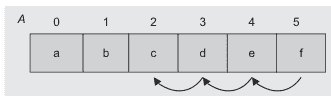

从第 3 个位置（即索引 = 2）删除 'c'。

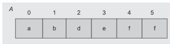


删除可以使用以下函数执行：

```
void Array :: Delete(int Location)
{
    int i;
    for(i = Location; i < Size; i++)
    {
        A[i - 1] = A[i];
        // shifting elements to the left by 1 position
    }
    A[Size - 1] = 0;
    // Store 0 at the last location to mark it empty
    Size = Size - 1;
}

void main()
{
    Array A;
    A.Read_Array();
    A.Display(); // Traverse_Forward()
    A.Traverse_Backward();
    A.Insert(3, 66); // insert at position 3
    A.Display();
    cout << endl;
    A.Delete(3); // delete 4th element
    A.Display();
    cout << endl;
    cout << A.Search(66);
    cout << A.Search(3);
}
```

我们已经学习了数组的基本操作，例如读取数组和遍历数组，以及插入元素和删除元素等常见操作。插入和删除操作需要在数组内移动数据。

程序代码 2.1 中定义了数组及其操作。要定义用于操作整数数据的浮点数组，需要在类的数据成员声明中将 `int A[]` 改为 `float A[]`。每当数组元素的数据类型发生变化时，都可以通过使用文本编辑器编辑代码然后重新编译来完成此操作。C++ 具有一种称为模板（也称为参数化类型）的特性。模板是一个可以实例化为任何数据类型的变量。此数据类型可以是内置类型或用户定义类型。

## 2.6 使用模板的数组

程序代码 2.2 是一个使用模板 T 的数组类，可以非常轻松地用于 int、float 或任何用户定义数据类型的数组。

程序代码 2.1 中定义的数组类可以使用 C++ 模板重写，如程序代码 2.2 所示。

```
PROGRAM CODE 2.2
template <class T>
class Array
{
 private:
  T * A;
  int Size;
 public:
  Array( int size = 20 ); // default constructor
  Array( int ArraySize ); // user-defined size
  void Read_Array();
  void Display();
  void Traverse_Backward();
  void Insert( int Location, const T&Element );
  void Delete( int Location );
  int Search( const T&Element );
 };

template <class T>
Array <T> :: Array( int ArraySize ) : Size( ArraySize )
{
  A = new T[Size];
 }

template <class T>
void Array <T> :: Read_Array()
{
  // code to read members of the array here
 }
```

其他函数可以以与程序代码 2.1 相似的方式定义。

程序代码 2.2 包含数组的模板类定义及其少数几个函数的实现。函数的定义方式与程序代码 2.1 相似；即，我们将 int 替换为 T 作为数组成员的数据类型。在所有成员函数头中，Array<>() 现在被替换为 Array <T> :: 。以下语句分别将模板类 Array<>() 实例化为 int 和 float。因此，P 是 int 类型的数组，Q 是 float 类型的数组。

```
Array <int> P;
Array <float> Q;
```

同样，我们也可以拥有任何用户定义数据类型的数组。

### 2.7 多维数组

迄今为止我们使用的数组是一维数组。大多数时候，数据以多维形式组织。在这种情况下，一维数组证明是不够的，我们需要二维数组、三维数组或 n 维数组。

### 2.7.1 二维数组

一个维度为 m × n 的二维数组 a 是 m × n 个元素的集合，其中每个元素由一对索引 [i, j] 标识，通常 1 <= i <= m 且 1 <= j <= n。对于 C/C++ 语言，此范围为 0 <= i < m 和 0 <= j < n。二维数组有 m 行和 n 列。图 2.6 显示了大小为 100 × 9 的二维数组 Student 的图形表示。

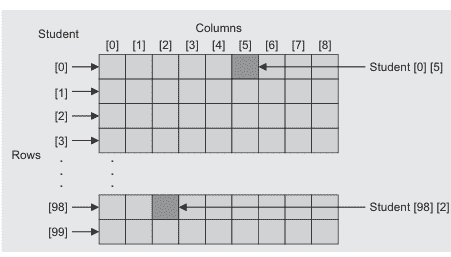

**图 2.6 二维数组**

二维数组的最佳示例是最流行的数学实体，即矩阵。

### 二维数组的内存表示

让我们考虑一个维度为 m × n 的二维数组 A。虽然数组是多维的，但它通常在内存中作为一维数组存储。多维数组在内存中表示为 m × n 个连续内存位置的序列。多维数组的元素可以按以下方式存储在内存中：

- 行主序表示
- 列主序表示

图 2.7 显示了大小为 m × n 的矩阵 A。

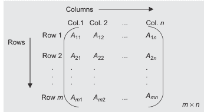

**图 2.7 大小为 m × n 的矩阵 A**

为了理解矩阵表示，让我们以大小为 3 × 4 的二维数组 M 为例（图 2.8）。

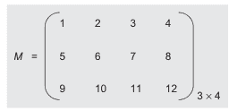

**图 2.8 二维数组 M**

图 2.8 中的矩阵 M 有 12 个成员，可以通过行和列索引访问，例如其第二行第三列的元素是 7。

### 行主序表示

在行主序表示（图 2.9）中，矩阵 M 的元素按行存储，即第 0 行、第 1 行、第 2 行、第 3 行等元素，一直到第 m 行。

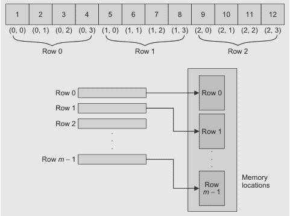

**图 2.9 行主序排列**

大小为 m × n 的矩阵中第 i 行第 j 列元素的地址可以按以下方式计算：

```
Address of (A[i][j]) = Base address + Offset
= Base address + (Number of rows placed before i-th row
x Size of row) + (Number of elements
placed before j-th element in i-th row) x Size of element
```

这里，行的大小实际上是列数 n。基址是 A[0][0] 的地址。

```
Address of A[i][j] = Base + (i x n x Size of element) + (j x Size of element)
```

由于行索引从 0 开始，索引 i 表示此处第 i 行之前的行数，j 同理。当元素大小 = 1 时，地址为

```
Address of A[i][j] = Base + (i x n) + j
```

通常，

```
Address of A[i][j] = ((i - LB1) x (UB2 - LB2 + 1) x size) + ((j - LB2) x size)
```

这里，第 i 行之前的行数 = (i - LB1)，且 LB1 是第一维的下界。

行大小 = (行中的元素数) × (元素大小)

行中的元素数 = (UB2 - LB2 + 1)

其中 UB2 和 LB2 分别是第二维的上界和下界。对于 C/C++/Java 中的数组，LB = 0 且 UB = N – 1。

### 列主序表示

在列主序表示中，二维数组 A 的 m × n 个元素被存储为单行列。元素在内存中作为序列存储：首先是第 0 列的元素，然后是第 1 列的元素，依此类推，直到第 n – 1 列的元素。

例如，考虑图 2.8 中的矩阵 M。元素的列主序排列如图 2.10 所示。

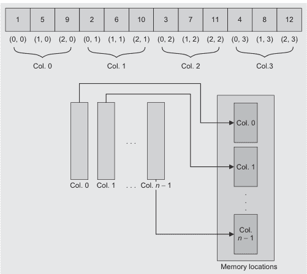

**图 2.10 列主序排列**

A[i][j] 的地址按以下方式计算：

```
Address of (A[i][j]) = Base address + Offset
= Base address + (Number of columns placed before j-th column
x size of column) + (Size of element
placed before in i-th element in i-th row) x Size of element
```

这里，列的大小是行数，即 m。如果基址是 A[0][0] 的地址，则

```
Address of A[i][j] = Base + (j x m x Size of element) + (i x Size of element)
```

当元素大小 = 1 时，地址为

```
Address of A[i][j] for column-major arrangement = Base + (j x m) + i
```

通常，对于列主序排列，第 i 行第 j 列元素的地址为

```
Address of (A[i][j]) = ((j – LB2) x (UB1 – LB1 + 1) x size) + ((i – LB1) x size)
```

对于 C/C++/Java 中的数组，对于 n 维数组，LB = 0 且 UB = n – 1。示例 2.1 显示了给定整数数组的行主序和列主序表示的地址计算。

## 示例 2.1

考虑 C++ 中的整数数组 int A[3][4]。如果基址为 1050，求数组按行主序和列主序表示时元素 A[2][3] 的地址。

### 解答

对于 C++，索引的 LB 为 0，且 m = 3、n = 4、Base = 1050。让我们使用 2.7.1 节中推导的地址计算公式计算元素 A[2][3] 的地址。

### 行主序表示：

```
Address of A[2][3] = Base + (i x n) + j
= 1050 + (2 x 4) + 3
= 1061
```

图 2.11 显示了元素 A[2][3] 的行主序表示。


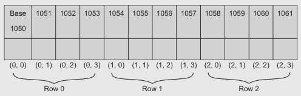

图 2.11 A[2][3] 的行主序表示

列主序表示：

```
Address of A[2][3] = Base + (j x m) + i
                   = 1050 + (3 x 3) + 2
                   = 1050 + 11
                   = 1061
```

图 2.12 表示元素 A[2][3] 的列主序表示。

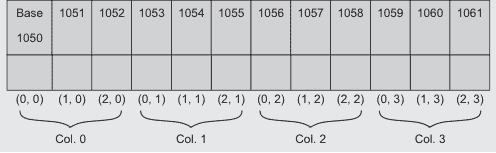

图 2.12 A[2][3] 的列主序表示

这里，该元素的地址相同，因为它是最后一行和最后一列的最后一个成员。

让我们计算 A[1][3] 的地址。对于行主序，A[1][3] 的地址 = 1050 + 1 x 4 + 3 = 1057；对于列主序，A[1][3] 的地址 = 1050 + 3 x 3 + 1 = 1060。

## 2.7.2 n维数组

一个 n 维 m1 x m2 x m3 x ... x mn 数组 A 是 m1 x m2 x m3 x ... x mn 个元素的集合，其中每个元素由一组 n 个整数（如 k1, k2, ..., kn）指定，这些整数称为下标，其中 0 ≤ k1 ≤ m1 - 1, 0 ≤ k2 ≤ m2 - 1, ..., 0 ≤ kn ≤ mn - 1。数组 A 中下标为 k1, k2, ..., kn 的元素表示为 A[k1][k2]...[kn]。

考虑三维数组 A[2][3][4]。数组 A 中共有 2 x 3 x 4 = 24 个元素。其行主序排列如图 2.13 所示。

| 内存地址 | 数组元素 | |
|---|---|---|
| Base | A[0][0][0] | $m_1 = 2, m_2 = 3, m_3 = 4$ |
| Base + 1 | A[0][0][1] | |
| Base + 2 | A[0][0][2] | |
| Base + 3 | A[0][0][3] | |
| Base + 4 | A[0][1][0] | Base + $m_3 \times 1$ |
| Base + 5 | A[0][1][1] | |
| Base + 6 | A[0][1][2] | |
| Base + 7 | A[0][1][3] | |
| Base + 8 | A[0][2][0] | Base + $m_3 \times 2$ |
| Base + 9 | A[0][2][1] | |
| Base + 10 | A[0][2][2] | |
| Base + 11 | A[0][2][3] | |
| Base + 12 | A[1][0][0] | Base + $m_3 \times 3$ |
| Base + 13 | A[1][0][1] | |
| Base + 14 | A[1][0][2] | |
| Base + 15 | A[1][0][3] | |
| Base + 16 | A[1][1][0] | Base + $m_3 \times 3 + m_2$ |
| Base + 17 | A[1][1][1] | |
| Base + 18 | A[1][1][2] | |
| Base + 19 | A[1][1][3] | |
| Base + 20 | A[1][2][0] | |
| Base + 21 | A[1][2][1] | |
| Base + 22 | A[1][2][2] | |
| Base + 23 | A[1][2][3] | |

图 2.13 具有行主序内存表示的三维数组

具有行主序表示的四维数组 A[2][3][4][2] 将按图 2.14 所示存储在内存中。

| 内存地址 | 数组元素 |
|---|---|
| Base | A[0][0][0][0] |
| Base + 1 | A[0][0][0][1] |
| Base + 2 | A[0][0][0][2] |
| Base + 3 | A[0][0][0][3] |
| Base + 4 | A[0][0][1][0] |
| Base + 5 | A[0][0][1][1] |
| Base + 6 | A[0][0][1][2] |
| Base + 7 | A[0][0][1][3] |
| Base + 8 | A[0][0][2][0] |
| Base + 9 | A[0][0][2][1] |
| Base + 10 | A[0][0][2][2] |
| Base + 11 | A[0][0][2][3] |
| Base + 12 | A[0][1][0][0] |
| Base + 13 | A[0][1][0][1] |
| Base + 14 | A[0][1][0][2] |
| Base + 15 | A[0][1][0][3] |
| Base + 16 | A[0][1][1][0] |
| Base + 17 | A[0][1][1][1] |
| Base + 18 | A[0][1][1][2] |
| Base + 19 | A[0][1][1][3] |
| Base + 20 | A[0][1][2][0] |
| Base + 21 | A[0][1][2][1] |
| Base + 22 | A[0][1][2][2] |
| Base + 23 | A[0][1][2][3] |
| Base + 24 | A[1][0][0][0] |
| Base + 25 | A[1][0][0][1] |
| Base + 26 | A[1][0][1][0] |
| Base + 27 | A[1][0][1][1] |
| Base + 28 | A[1][0][2][0] |
| Base + 29 | A[1][0][2][1] |
| Base + 30 | A[1][0][3][0] |
| Base + 31 | A[1][0][3][1] |
| Base + 32 | A[1][1][0][0] |
| Base + 33 | A[1][1][0][1] |
| Base + 34 | A[1][1][1][0] |
| Base + 35 | A[1][1][1][1] |
| Base + 36 | A[1][1][2][0] |
| Base + 37 | A[1][1][2][1] |
| Base + 38 | A[1][1][3][0] |
| Base + 39 | A[1][1][3][1] |
| Base + 40 | A[1][2][0][0] |
| Base + 41 | A[1][2][0][1] |
| Base + 42 | A[1][2][1][0] |
| Base + 43 | A[1][2][1][1] |
| Base + 44 | A[1][2][2][0] |
| Base + 45 | A[1][2][2][1] |
| Base + 46 | A[1][2][3][0] |
| Base + 47 | A[1][2][3][1] |

图 2.14 具有行主序内存表示的四维数组

请注意，数组索引按递增顺序排列，因此行主序排列也称为字典序。

## 多维数组的地址计算

对于多维数组的顺序单维行主序表示，让我们尝试获取 n 维数组 A 中任意元素 A[i1][i2][i3]...[in] 的地址。让我们考虑数组 A[2][3][4][2]。如果元素 A[0][0][0][0] 存储在地址 0，则元素 A[0][0][0][1] 位于地址 1；元素 A[0][0][1][0] 位于地址 2；元素 A[0][0][1][1] 位于地址 3，元素 A[1][2][3][1] 位于地址 4，假设每个元素占一个位置。为了推导多维数组的公式，让我们先看看一维（1D）、二维（2D）和三维（3D）数组及其地址计算，然后我们可以将其推广到 n 维数组。

### 一维数组的地址计算

设 A[m1] 为一维数组。设 A[0] 存储在地址 Base = X。现在，假设每个位置一个元素，A[1] 的地址为 X + 1。任意元素 A[i] 的地址由 X + i 给出，A[m1 - 1] 的地址为 X + m1 - 1。如图 2.15 所示。

| A[0] | A[1] | A[2] | ... | A[i] | ... | A[m1 - 1] |
|---|---|---|---|---|---|---|
| X | X + 1 | X + 2 | ... | X + i | ... | X + (m1 - 1) |

图 2.15 一维数组

### 二维数组的地址计算

现在，考虑一个二维数组 A[m1][m2]，它有 m1 行，即 Row1, Row2 ... Row(m1 - 1)，每行包含 m2 个元素（因为有 m2 列，如图 2.16 所示）。

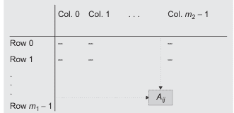

图 2.16 二维数组

现在，设 A[0][0] 存储在地址 X；则 A[0][1] 将存储在 X + 1。A[0][i] 位于 X + i，依此类推，直到 A[0][m2 - 1] 位于 X + (m2 - 1)。现在 A[i][0] 的地址将为 X + (i x m2)。

一般来说，A[i][j] 的地址为 X + (i x m2) + j（如图 2.17 所示）。

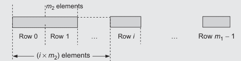

### 三维数组的地址计算

图 2.18 显示了一个三维数组 A[m1][m2][m3]。该数组被解释为 m1 个二维数组，每个二维数组的维度为 m2 x m3。

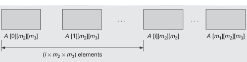

A[i][0][0] 的地址为 X + (i x m2 x m3)。因此，A[i][j][k] 的地址计算如下

```
Addr of A[i][j][k] = X + i x m2 x m3 + j x m3 + k
```

通过推广这个表达式，我们得到 n 维数组 A[m1][m2][m3]...[mn] 中 A[i1][i2][i3]...[in] 的地址。

将 A[0][0][0]...[0] 的地址视为 X，则 A[i][0][0]...[0] 的地址 = X + (i1 x m2 x m3 x ... x mn)，A[i1][i2]...[0] 的地址 = X + (i1 x m2 x m3 x ... x mn) + (i2 x m3 x m4 x ... x mn)。

以类似方式继续，A[i1][i2][i3]...[in] 的地址将为

```
Address of A[i1][i2][i3]...[in]
= X + (i1 x m2 x m3 x ... x mn) + (i2 x m3 x m4 x ... x mn)
+ (i3 x m3 x m4 x ... x mn) + (i4 x m4 x m5 x ... x mn) + ... + in
```

= X + \sum_{j=1}^n j \times A_j, where A_j = \prod_{j=1}^n m_k \quad 1 < j < n \text{ and } A_n = 1

同样，我们可以推导列主序的公式。

### 2.8 有序列表的概念

有序列表是最常见且使用最频繁的数据对象。有序列表的线性元素按照特定的顺序或序列相互关联。以下是一些有序列表的示例。

- 小于或等于 15 的奇数 = { 1, 3, 5, 7, 9, 11, 13, 15 }
- 月份 = { 一月, 二月, 三月, 四月, 五月, 六月, 七月, 八月, 九月, 十月, 十一月, 十二月 }
- 彩虹颜色 = { 紫色, 靛蓝色, 蓝色, 绿色, 黄色, 橙色, 红色 }

可以对有序列表执行许多基本操作。以下列表列出了这些操作：

- 查找列表的长度。
- 从左到右或从右到左遍历列表。
- 访问列表中的第 i 个元素。
- 更新（覆盖）第 i 个位置的值。
- 在第 i 个位置插入一个元素。
- 删除第 i 个位置的元素。

数组是可用于表示有序列表的最常见数据结构。在有序列表中，列表成员遵循某个特定序列。我们需要选择最合适的数据结构来高效执行这些操作。组织它们的最佳方式是在数组中。设 L 为列表；L = {a0, a1, a2, ..., an-1}，包含 n 个元素。如果我们将此列表存储在数组中，例如 list[n]，则可以将第 i 个元素存储在列表的第 i 个位置（索引）中。此表示将按顺序将 a0 存储在 list[0]，a1 存储在 list[1]，依此类推，将 ai 和 ai+1 存储在第 i 个和 (i+1) 个位置。

有序列表 L 的数组形式表示如图 2.19 所示。

| list[0] | list[1] | list[2] | ... | list[n - 1] |
|---|---|---|---|---|
| a0 | a1 | a2 | ... | an - 1 |


这种表示在检索和修改操作方面都非常高效。从第 i 个数组位置检索第 i 个元素只需常数时间，因为计算机可以


可以随机访问其内存中的任何字。类似于随机访问，可以使用受控下标变量向任何方向遍历列表。插入和删除操作将需要数据移动。

### 2.9 单变量多项式

单变量多项式 A(x) 可以写成

$a_nx^n + a_{n-1}x^{n-1} + a_{n-2}x^{n-2} + ..... a_1x + a_0$ 其中 $a_n \neq 0$ 且 $A(x)$ 的次数为 $n$。

该多项式是形式为 C.x^e 的项的和，其中 C 是系数，e 是指数，x 是变量。多项式是有序列表的一个示例。当我们将多项式视为 ADT 时，基本操作如下：

- 1. 创建多项式
- 2. 两个多项式相加
- 3. 两个多项式相减
- 4. 两个多项式相乘
- 5. 多项式求值

在程序代码 2.3 中，我们尚未定义用于表示带有系数和指数的多项式的数据成员。我们已定义用于操作多项式的函数原型。要定义确定多项式合适数据结构的数据成员，我们有多种选择。对于指数和系数，可以使用两个独立的一维数组、一个二维数组、一个结构数组等等。让我们分析其中几种。

```
PROGRAM CODE 2.3
ADT Polynomial
{
private:
// data members here
public:
void Read_Poly();
double Evaluate(double value);
Polynomial Add_Poly(Polynomial B);
Polynomial Mult_Poly(Polynomial B);
};
```

### 2.9.1 使用数组的表示

次数为 n 的多项式表示为系数的有序列表，可以使用大小为 n + 2 的数组存储。即，n + 1 个位置用于存储 n + 1 个项的系数，一个位置用于存储多项式的次数。或者，我们也可以通过将每个项与索引映射来存储它们，使得第 \(i^{th}\) 项位于数组的 \((n-i)^{th}\) 位置。我们按指数的降序存储多项式。多项式的次数是多项式中的最高指数。对于次数为 \(n\) 的多项式，我们需要一个大小为 \(n+1\) 的数组，并按以下方式存储多项式：

对于项 \(a_i x^i\)，让我们将其系数 \(a_i\) 存储在数组的 \([n-i]^{th}\) 索引处，即将指数为 \(i\) 的项的系数存储在 \([n-i]^{th}\) 索引处。

Poly[n-i] = \(a_i\) for \(i=0\) to \(n\)

如图 2.20 所示。

| Poly[0] | Poly[1] | Poly[2] | Poly[3] | ... | Poly[n-2] | Poly[n-1] |
|---|---|---|---|---|---|---|
| \(a_n\) | \(a_{n-1}\) | \(a_{n-2}\) | \(a_{n-3}\) | ... | \(a_1\) | \(a_0\) |


```
int degree; float Poly[Max + 1];
```

此处，degree <= Max

这种表示对于 store() 和 retrieve() 等操作非常高效，因为它需要常数时间 O(1)。加法、减法、乘法等常规算法可以非常高效地用于这种表示。

当多项式不是稀疏多项式时，这种表示在时间和空间上都很高效，例如次数为 3 的多项式 P(x)，其中 P(x) = 3x^3 + x^2 - 2x + 5（图 2.21）。

| 索引 i | 0 | 1 | 2 | 3 | ... | N-1 |
|---|---|---|---|---|---|---|
| 系数 | 3 | 1 | -2 | 5 | ... | 0 |

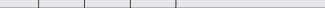

图 2.22 显示了一个次数为 8 的多项式。

| 索引 i | 0 | 1 | 2 | 3 | 4 | 5 | 6 | 7 | 8 |
|---|---|---|---|---|---|---|---|---|---|
| 系数 | 11 | 0 | 5 | 1 | 2 | 0 | -3 | 1 | 10 |

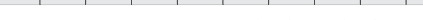

然而，当多项式是稀疏多项式时，例如 n = 100 次的 A(x) = x^99 + 78，则 101 个位置中只有两个会被使用，如图 2.23 所示。

| 索引 i | 0 | 1 | 2 | 3 | ... | 99 |
|---|---|---|---|---|---|---|
| 系数 | 1 | 0 | 0 | 0 | ... | 78 |

图 2.23 次数为 99 的多项式—P(x) = x^99 + 78

在这种情况下，最好将多项式存储为系数和指数的对。我们可以为每个使用两个不同的数组，或者使用一个带有两个成员的结构作为系数和指数的两个数组，或者使用一个由两个数据成员系数和指数组成的结构数组。让我们采用带有两个数据成员系数和指数的结构及其数组。

### 2.9.2 结构数组形式的多项式

在程序代码 2.4 中，系数和指数在结构中绑定在一起以形成一个多项式项，然后使用十个这样的结构的数组来表示多项式。

```
PROGRAM CODE 2.4
const int MaxSize = 100;
typedef struct
{
    float coefficient;
    int exponent;
} polynomial_term;

class Polynomial
{
    private:
        polynomial_term Poly[MaxSize];
        int Total_Terms;
    public:
        Polynomial() { Total_Terms = 0;}
        void Read_Poly();
        void Display_Poly();
        double Evaluate(double value);
        Polynomial Add_Poly(Polynomial B);
        Polynomial Mult_Poly(Polynomial B);
};
```

图 2.24 描绘了这样的多项式。

| 索引 i | 0 | 1 | 2 | 3 | ... | N - 1 |
|---|---|---|---|---|---|---|
| 系数 | 3 | 1 | -2 | 5 | ... | |
| 指数 | 3 | 2 | 1 | 0 | ... | |

图 2.24 多项式表示—P(x) = 3x^3 + x^2 - 2x + 5

### 2.9.3 多项式求值

多项式求值是代入 x 的值并计算结果。对于 x = 2，多项式 P(x) = 3x^3 + x^2 + 2x + 5 的结果为 3 (2)^3 + (2)^2 - (2)(2) + 5 = 29。程序代码 2.5 提供了给定 x 值的多项式求值实现细节。提供了用于读取和打印多项式的函数。

```
PROGRAM CODE 2.5

double Polynomial :: Evaluate(double Value)
{
   int i = 0;
   double result = 0;
   while (i <= Total_Terms)
   {
      Result+=Poly[i].Coef*pow(val,Poly[i].Exp);
      // pow() is the exponential function to compute x^y
      i++;
   }
   return result;
}

void Polynomial :: Read_Poly()
{
   int i;
   cout << "Let us read the polynomial now" << endl;
   cout << "Enter total number of terms in polynomial";
   cin >> Total_Terms;
   for(i = 0; i <= Total_Terms; i++)
   {
      cout << "Enter Exponent of" << i << "Term";
      cin >> Poly[i].Exp;
      cout << "Enter Coefficient of " << i+1 << "Term";
      cin >> Poly[i].Coef;
   }
}

void Polynomial :: Display_Poly()
{
int i;
for(i = 0; i <= Total_Terms; i++)
cout << Poly[i].Coef << "x^" << Poly[i].Exp << "+";
cout << "\\b" << endl;
}

void main()
{
Polynomial A;
double answer;
A.Read_Poly();
answer = A.Evaluate(69.45);
// Let 69.45 be the value of x
}
```

### 2.9.4 多项式加法

设有两个多项式 A 和 B

A = 4x^6 + 8x^5 + 5x^3 + x^2 + 4x
B = 3x^7 + x^3 - 2x + 5

则，

C = A + B = 4x^9 + 3x^7 + 8x^6 + 6x^3 + x^2 + 2x + 5

要得到结果多项式 C，需将多项式 A 和 B 相加。此处，我们假设两个多项式按其指数的降序排列。

让我们回顾一下添加两个多项式的过程。设 i、j 和 k 为三个索引，分别用于跟踪正在处理的多项式 A、B 和 C 的当前项。最初，它跟踪第一项。主要步骤可列为：

- 1. 如果多项式 A 和 B 的两个项的指数相等，则相加系数，并将新项存储在结果多项式 C 中，并推进 i、j 和 k 以跟踪下一项。
- 2. 如果 A 中由 i 指示的项的指数小于 B 中由 j 指定的当前项的指数，则将由 j 指向的 B 的当前项复制到多项式 c 中由 k 指向的位置。指针 j 和 k 推进到下一项。
- 3. 如果 b 中由 j 指向的项的指数小于 a 中由 i 指向的当前项的指数，则将由 i 指向的 a 的当前项复制到多项式 c 中由 k 指向的位置。推进指针 i 和 k 到下一项。

每次生成新项时，相应地设置其系数和指数字段。然后将结果项附加到多项式 c 的末尾。多项式 c 的当前项由 k 指示。

图 2.25 显示了使用二维数组和索引表示多项式 a、b 和 c 的图形表示。

| 索引 i | 0 | 1 | 2 | 3 | 4 |
|---|---|---|---|---|---|
| 系数 | 4 | 8 | 5 | 1 | 4 |
| 指数 | 9 | 6 | 3 | 2 | 0 |

| 索引 j | 0 | 1 | 2 | 3 |
|---|---|---|---|---|
| 系数 | 3 | 1 | -2 | 5 |
| 指数 | 7 | 3 | 1 | 0 |

| 索引 k | 0 | 1 | 2 | 3 | 4 | 5 | 6 |
|---|---|---|---|---|---|---|---|
| 系数 | 4 | 3 | 8 | 6 | 1 | 2 | 5 |
| 指数 | 9 | 7 | 6 | 3 | 2 | 1 | 0 |

图 2.25 在二维数组中存储多项式（a）P(x) = 4x^9 + 8x^6 + 5x^3 + x^2 + 4x（b）P(x) = 3x^7 + x^3 - 2x + 5（c）P(x) = 4x^9 + 3x^7 + 8x^6 + 6x^3 + x^2 + 2x + 5


多项式加法涉及的步骤在算法 2.1 中有说明。

## 算法 2.1

```
1. Read two polynomials say A and B
2. Let M and N denote total terms in A and B respectively.
3. Here, C is resultant polynomial.
4. Let i = j = k = 0
5. while ( i < M and j < N) do
   begin   // repeat till one of the polynomials is copied
   if(A[i].Exp = B[j].Exp)
   begin
   C[k].Coef = A[i].Coef + B[j].Coef
   C[k].Exp = A[i].Exp;
   i = i + 1; j = j + 1; k = k + 1
   end
   else
   if(A[i].Exp > B[j].Exp)
   begin
   C[k].Coef = A[i].Coef;
   C[k].Exp = A[i].Exp;
   i = i + 1
   k = k + 1
   end
   else
   begin
   C[k].Coef = B[j].Coef;
   C[k].Exp = B[j].Exp;
   j = j + 1
   k = k + 1
   end
   end
6. while(i < M) do
   begin   // copy remaining terms
   C[k].Coef = A[i].Coef;
   C[k].Exp = A[i].Exp;
   i = i + 1
   k = k + 1
   end
7. While ( j < N) do
   begin   // copy remaining terms
   C[k].Coef = B[j].Coef;
   C[k].Exp = B[j].Exp;
   j = j + 1
   k = k + 1
   end
8. stop
```

程序代码 2.6 是基于算法 2.1 的多项式加法函数。

## 程序代码 2.6

```
Polynomial Polynomial :: Add_Poly(Polynomial B)
{
    int i = j = k = 0;
    Polynomial C;
    while (i < A.Total_Terms && j < B.Total_Terms)
    {
        if(A.Poly[i].Exp == B.Poly[j].Exp)
        {
            C.Poly[k].Coef = A.Poly[i].Coef + B.Poly[j].Coef
            C.Poly[k].Exp = A.Poly[i].Exp;
            i++; j++; k++;
        }
        else if(A.Poly[i].Exp > B.Poly[j].Exp)
        {
            C.Poly[k].Coef = A.Poly[i].Coef;
            C.Poly[k].Exp = A.Poly[i].Exp;
            i++; k++;
        }
        else
        {
            C.Poly[k].Coef = B.Poly[j].Coef;
            C.Poly[k].Exp = B.Poly[j].Exp;
            j++; k++;
        }
    } // end of while
    while(i < A.Total_Terms)
    {
        C.Poly[k].Coef = A.Poly[i].Coef;
        C.Poly[k].Exp = A.Poly[i].Exp;
        i++; k++;
    }
    while(j < B.Total_Terms)
    {
        C.Poly[k].Coef = B.Poly[j].Coef;
        C.Poly[k].Exp = B.Poly[j].Exp;
        j++; k++;
    }
    C.Total_Terms = k - 1;
    return C;
} // end of function
```

```
void main()
{
    Polynomial A, B, C;
    double answer;
    A.Read_Poly();
    B.Read_Poly();
    .
    .
    .
    C = A.Add_Poly(B);
}
```

## 2.9.5 多项式乘法

设 A = 4x^4 + 3x^5 + 5x^3 + 1 和 B = 3x^4 + x^2 - 2x 为要相乘的两个多项式，结果多项式为 c。让我们回顾一下笔算法。多项式 A 乘以 B 的每一项。如果 B 有 n 项，则得到 n 个部分积。最后，我们将所有这些部分积相加以得到结果多项式 c。

该方法生成的每个部分积长度为 m，其中 m 是多项式 A 的长度。生成并存储 n 个这样的部分积，最后将它们相加以得到结果多项式。这里，m 和 n 取决于输入。让我们设计一种更好的方法，不需要生成、存储然后添加所有部分积。更好的解决方案是选取多项式 B 的一项，将其与多项式 A 的每一项相乘。B 的一项和 A 的一项相乘时会产生一个结果项。该项可以立即添加到结果多项式 c 中，并重复此过程。

要将结果项添加到多项式 c 中，将结果项与结果多项式 c 的每一项进行比较。然后将新项插入多项式 c 的适当位置。如果找到指数相等的新项，则将该项相加，否则将其插入结果多项式的适当位置。此过程对 B 的每一项与 A 的每一项重复。主要步骤简要列出如下：

- 1. 设 A 和 B 为两个多项式。
- 2. 设 A 中的项数为 M，B 中的项数为 N。
- 3. 设 c 为要计算的结果多项式，c = A × B。
- 4. 设多项式 A 的第 i 项为 tBi。对于多项式 B 的每一项 tBi，重复步骤 5 到 7，其中 i = 1 到 N。
- 5. 设多项式 A 的第 j 项为 tAj。对于多项式 A 的每一项 tAj，重复步骤 6 和 7，其中 j = 1 到 M。
- 6. 将 tAj 和 tBi 相乘。设新项为 tck = tAj × tBi。

7. 将 tc k 与多项式 c 的每一项进行比较。如果找到指数相等的项，则将新项 tc k 添加到多项式 c 的该项中，否则为术语 tc k 搜索适当位置并将其插入多项式 c 中。

8. 停止。

设 A = 4x^9 + 3x^5 + 5x^3 + 1，B = 3x^6 + x^2，c 为结果多项式。最初，c 是一个空多项式。

1. 我们将 A 的每一项与 B 的第一项相乘。首先，将 4x^9 与 3x^6 相乘，结果为 12x^15。目前，c 为空，因此其中没有指数为 15 的项；因此，我们将其插入多项式 c 中：

c = 12x^15

现在，继续将 3x^6 与 3x^6 相乘，得到的结果是 9x^12。多项式 c 中没有指数为 12 的项，因此我们将其插入多项式 c 的适当位置。现在，多项式 c 为

c = 12x^15 + 9x^12 + 15x^9 + 3x^6

2. 现在，将 A 的每一项与 B 的第二项相乘。首先，将 4x^9 与 x^2 相乘，结果为 4x^11。c 中没有指数为 11 的项，我们将其插入多项式 c 的适当位置。因此，我们得到多项式 c 为

c = 12x^15 + 9x^12 + 4x^11 + 15x^9 + 3x^6

继续将 3x^6 与 x^2 相乘，结果为 3x^8。多项式 c 中没有指数为 8 的项，因此我们将其添加到适当位置。现在，多项式 c 为

c = 12x^15 + 9x^12 + 4x^11 + 15x^9 + 3x^8 + 3x^6

现在让我们将 5x^3 与 x^2 相乘，得到 5x^5。c 中没有指数为 5 的项，因此我们将其插入多项式 c 的适当位置。现在，

c = 12x^15 + 9x^12 + 4x^11 + 15x^9 + 3x^8 + 3x^6 + 5x^5

现在让我们将 A 的项 1 与 x^2 相乘；我们得到 x^2。c 中没有指数为 2 的项，因此我们将其插入多项式 c 的适当位置。因此，

c = 12x^15 + 9x^12 + 4x^11 + 15x^9 + 3x^8 + 3x^6 + 5x^5 + x^2

这是 A × B 的结果多项式 c。

程序代码 2.7 包含了根据讨论的过程对两个多项式进行乘法的函数。

## 程序代码 2.7

```
Polynomial Polynomial :: Mult_Poly(Polynomial B)
{
 int flag, M, N;
 Polynomial C;
 int NewTerm_exp;
 float NewTerm_coef;
 int i = j = k = 0;
 // i and j are indices indicating the current
 // terms of polynomials A & B respectively
 // k is the index pointing to current position
 // in C where new term is to be added
 int TmpIndex;
 // TmpIndex is used to traverse polynomial C for
 // inserting new term at proper location
 M = Total_Terms;
 N = B.Total_Terms;
 while(i < M)
 {
 j = 0;
 while (j < N)
 {
 NewTerm_exp = Poly[i].Exp + B.Poly[j].Exp;
 NewTerm_coef = Poly[i].Coef * B.Poly[j].Coef;
 TmpIndex = 0;
 flag = 0;
 while(TmpIndex < k)
 // Insert NewTerm in Polynomial C
 {
 if(C.Poly[TmpIndex].Exp == NewTerm_exp)
 // search matching exponent
 {
 flag = 1;
 break;
 }
 else if(C.Poly[TmpIndex].Exp < NewTerm_exp)
 break;
 TmpIndex++;
 }
 if(flag) // if found add coefficients
 {
 C.Poly[k].Coef = C.Poly[k].Coef + NewTerm_coef;
 }
 else // else add at last location or in between
 {
 if(TmpIndex == k) // add new term at end
 {
 C.Poly[k].Exp = NewTerm_exp;
 C.Poly[k].Coef = NewTerm_coef;
 k++;
 }
 else
 {
 // insert new term
 for(p = k; p > TmpIndex; p--)
 {
 C.Poly[p].Exp = C.Poly[p-1].Exp;
 C.Poly[p].Coef = C.Poly[p-1].Coef;
 }
 C.Poly[TmpIndex].Exp = NewTerm_exp;
 C.Poly[TmpIndex].Coef = NewTerm_coef;
 k++;
 }
 j++;
 }
 i++;
 }
 return(C);
}
void main()
{
Polynomial A, B, C;
A.Read_poly();
B.Read_Poly();
C = A.Mult_Poly(B);
}
```

### 2.10 用于频数计数的数组

我们可以使用数组来存储特定元素在任何序列中出现的次数。假设我们有一组 100 个非零值，范围在 0 到 9 之间，我们想知道 0 出现了多少次，1 出现了多少次，依此类推，直到 9。


将这些元素放入名为 Numbers 的数组中。现在，我们可以拥有另一个包含 10 个元素的数组，用于显示列表 Numbers 中每个值的频率。

```
void FrequencyCount(int Freq[10], int A[100])
{
   int i;
   for(i = 0; i < 10; i++)
      Freq[i] = 0;
   for(i = 0; i < 100; i++)
      Freq[A[i]]++;
}
```

在图 2.26 中，Frequency[0] 表示 0 在数组 Numbers 中出现了一次，1 出现了 20 次，2 出现了 5 次，依此类推。

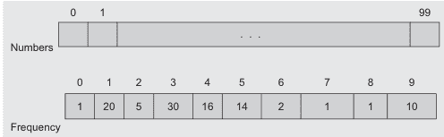

图 2.26 0 到 9 范围内数字的频率统计

此概念将在第 2.11.3 节中用于快速转置。

### 2.11 稀疏矩阵

矩阵是一种非常常用的数学对象。要表示矩阵，我们需要一个二维数组，使用两个不同的索引来引用行和列。用于矩阵操作的表示应该是高效的，以便空间和时间需求尽可能少。

在许多应用中，算法设计的关键方面是空间考量。因此，如果矩阵很大，开发者必须注意矩阵的表示方式。在许多情况下，矩阵的大小非常大，但其中大部分元素都是 0（不重要或无关数据）。只有很小一部分矩阵实际上被使用。这种类型的矩阵称为稀疏矩阵，因为矩阵被数据稀疏地填充，大多数位置是空的或包含无关数据。在这种情况下，必须使用替代表示来表示和存储矩阵，以实现良好的空间利用率。这种表示避免了与 0 相关的操作（0 的加法或乘法）。因此，如果稀疏矩阵使用替代表示而非常规方式存储，则可以实现良好的时间复杂度和高效的存储。

图 2.27 说明了逻辑矩阵 LA 和 LB。

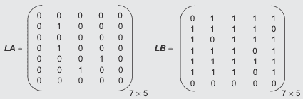

图 2.27 稀疏逻辑矩阵

在图 2.27 中，矩阵 LA 相对于 1 是稀疏的，相对于 0 是稠密的，而 LB 相对于 0 是稀疏的，相对于 1 是稠密的。

对于 m 行 n 列的矩阵，如果 m = n，则该矩阵称为方阵（图 2.28）。

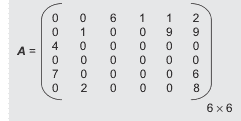

图 2.28 稀疏方阵

图 2.28 中的矩阵 A 有许多 0 项，可以称为稀疏矩阵。没有精确的定义说明何时矩阵是稀疏的，何时不是。在这里，0 可能表示无关数据，或某些实验连续读数或连续位置没有变化。

图 2.29 和 2.30 展示了两种常见的 n 阶稀疏矩阵类型。

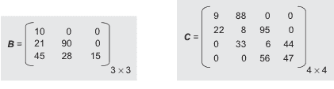

图 2.29 稀疏三角矩阵

图 2.30 稀疏三对角矩阵

在图 2.29 的矩阵中，主对角线以上的所有项都是 0。所有非零项仅出现在主对角线上或下方的矩阵称为三角矩阵。

非零项只能出现在对角线上或对角线上方或下方紧邻元素上的矩阵称为三对角矩阵（图 2.30）。

#### 2.11.1 稀疏矩阵表示

稀疏矩阵需要一种替代形式的表示。在处理大型稀疏矩阵时，我们需要考虑一种替代表示，仅存储非零元素以实现更好的空间利用率。

矩阵的每个元素都由其行和列位置唯一标识。因此，三元组 (i, j, value) 可以轻松表示矩阵的非零元素。

在矩阵的稀疏表示中，有三列。在第一行中，我们始终在列 1、2 和 3 中分别指定行数、列数和非零元素数（No_Of_NonZeroValues）。从第二行开始，我们按三元组 (i, j, value) 存储每个非零元素。因此，在稀疏矩阵中，有三列和 (No_Of_NonZeroValues + 1) 行。通常，为了空间可靠性，3 x (No_Of_NonZeroValues + 1) 应始终小于或等于 m x n，其中 m = 行数，n = 列数。

No_Of_NonZeroValues = 非零元素的数量

简而言之，对于替代表示，我们应有

3 x (No_Of_NonZeroValues + 1) <= m x n

考虑图 2.31(a) 中的矩阵 A。在 42 个元素中，8 个成员是非零的。对于常规表示，我们需要 42 个内存位置来存储矩阵（假设每个元素一个位置），而对于如图 2.31(b) 所示的替代表示，我们需要 (8 + 1) x 3，即 27 个内存位置。

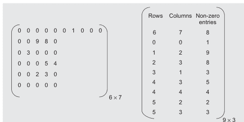

图 2.31 稀疏矩阵表示（a）稀疏矩阵 A（b）稀疏矩阵 A 的替代表示

在有限元分析、图像处理、仿真等应用中，矩阵的大小为 2048 x 2048 或更高。当 m 和 n 是大数且 No_Of_NonZeroValues 远小于它们时，替代表示可以节省大量内存和处理时间。

程序代码 2.8 表示稀疏矩阵的 ADT。

```
PROGRAM CODE 2.8
class Sparse_Matrix
{
    private:
    const int Max = 20;
    int S_Mat[Max][3];
    public:
    void Read_SparseMatrix();
    Sparse_Matrix Simple_Transpose();
    Sparse_Matrix Fast_Transpose();
    Sparse_Matrix Add_SparseMatrix(Sparse_Matrix B);
    Sparse_Matrix Mpy_SparseMatrix(Sparse_Matrix B);
};
```

### 2.11.2 稀疏矩阵加法

除了替代表示，我们还需要为常见的矩阵运算（如加法、减法、转置、逆、乘法和除法）设计合适的算法。让我们讨论其中两种——加法和转置。

设 A 和 B 为两个待加的稀疏矩阵，如图 2.32 所示。

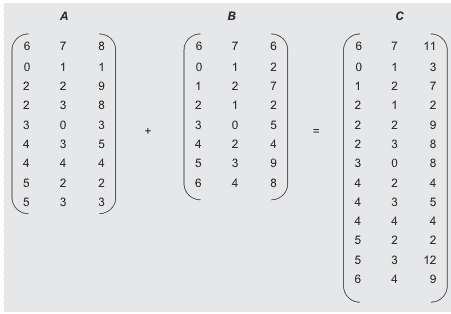

图 2.32 稀疏矩阵加法

只有当两个矩阵的大小相同时，才能相加。设 A_ROW 和 B_ROW 分别为矩阵 A 和 B 的行数。M 和 N 分别是 A 和 B 中非零元素的数量。C 是结果稀疏矩阵。算法 2.2 描述了添加两个稀疏矩阵的过程。

### 算法 2.2

```
1. Let A, B be the matrices to be added and stored in C
2. Let M and N be number of non-zero entries in A and B respectively.
3. Let i, j, and k be the three index variables used for the rows of A, B, and C respectively.
4. Let i = j = k = 1, M = A[0][2], N = B[0][2]
5. C[0][0] = A[0][0]
   C[0][1] = A[0][1]
   C[0][2] = A[0][2]
6. while (i <= M and j <= N) do
   begin
   if (A[i][0] = B[j][0]) //if1
   if (A[i][1] = B[j][1]) //if2
   then
   begin
   C[k][0] = A[i][0]
   C[k][1] = A[i][1]
   C[k][2] = A[i][2] + B[j][2]
   i = i + 1, j = j + 1, k = k + 1
   end
   else if (A[i][1] < B[j][1]) //if3 and else for if2
   then
   begin
   C[k][0] = A[i][0]
   C[k][1] = A[i][1]
   C[k][2] = A[i][2]
   k = k + 1, i = i + 1
   end
   else //else for if3
   begin
   C[k][0] = B[j][0]
   C[k][1] = B[j][1]
   C[k][2] = B[j][2]
   j = j + 1, k = k + 1
   end
   else if (A[i][0] < B[j][0]) //if4 and else for if1
   then
   begin
   C[k][0] = A[i][0]
   C[k][1] = A[i][1]
   C[k][2] = A[i][2]
   k = k + 1, i = i + 1
   end
   else
   begin
   C[k][0] = B[j][0]
   C[k][1] = B[j][1]
   C[k][2] = B[j][2]
   k = k + 1, j = j + 1
   end
end while
7. while(i <= M) do
begin
C[k][0] = A[i][0]
C[k][1] = A[i][1]
C[k][2] = A[i][2]
k = k + 1, i = i + 1
end
8. while(j <= N) do
begin
C[k][0] = B[j][0]
C[k][1] = B[j][1]
C[k][2] = B[j][2]
k = k + 1, j = j + 1
end
9. C[0][2] = k
10. stop
//else for if4
```

程序代码 2.9 包含稀疏矩阵的 ADT 以及根据算法 2.2 进行两个稀疏矩阵相加的函数。

```
PROGRAM CODE 2.9

Sparse_Matrix Sparse_Matrix :: Add_SparseMatrix
(Sparse_Matrix B)
{
Sparse_Matrix C;
int i, j, k, Row1, Row2, Col1, Col2, M1, M2;
Row1 = S_Mat[0][0];
Col1 = S_Mat[0][1];
M1 = S_Mat[0][2];
Row2 = B.S_Mat[0][0];
Col2 = B.S_Mat[0][1];
M2 = B.S_Mat[0][2];
if(Row1 == Row2 && Col1 == Col2)
// checking dimensions if1
{
i = j = k = 1;
C.S_Mat[0][0] = S_Mat[0][0];
C.S_Mat[0][1] = S_Mat[0][1];
```


while(i <= M1 and j <= M2) // while1
{
    if(S_Mat[i][0] == B_S_Mat[j][0]) // if2
    {
        if(S_Mat[i][1] == B_S_Mat[j][1]) // if3
        {
            C_S_Mat[k][0] = S_Mat[i][0];
            C_S_Mat[k][1] = S_Mat[i][1];
            C_S_Mat[k][2] = S_Mat[i][2] + B_S_Mat[j][2];
            i++; j++; k++;
        } // end of if3
        else // else of if3
        {
            if(S_Mat[i][1] < B_S_Mat[j][1]) // if4
            {
                C_S_Mat[k][0] = S_Mat[i][0];
                C_S_Mat[k][1] = S_Mat[i][1];
                C_S_Mat[k][2] = S_Mat[i][2];
                k++; i++;
            } // end of if4
            else // else of if4
            {
                C_S_Mat[k][0] = B_S_Mat[j][0];
                C_S_Mat[k][1] = B_S_Mat[j][1];
                C_S_Mat[k][2] = B_S_Mat[j][2];
                j++; k++;
            } // end of else of if4
        } // end of else of if3
    } // end of if2
    else // else of if2
    {
        if(S_Mat[i][0] < B_S_Mat[j][0]) // if5
        {
            C_S_Mat[k][0] = S_Mat[i][0];
            C_S_Mat[k][1] = S_Mat[i][1];
            C_S_Mat[k][2] = S_Mat[i][2];
            k++; i++;
        } // end of if5
        else // else of if5
        {
            C_S_Mat[k][0] = B_S_Mat[j][0];
            C_S_Mat[k][1] = B_S_Mat[j][1];
            C_S_Mat[k][2] = B_S_Mat[j][2];
            k++; j++;
        } // end of else of if5
    } // end of else of if2
} // end of while1
while(i <= M) // while2
{
    C_S_Mat[k][0] = S_Mat[i][0];
    C_S_Mat[k][1] = S_Mat[i][1];
    C_S_Mat[k][2] = S_Mat[i][2];
    k++; i++;
} // end of while2
while(j <= N) // while3
{
    C_S_Mat[k][0] = B_S_Mat[j][0];
    C_S_Mat[k][1] = B_S_Mat[j][1];
    C_S_Mat[k][2] = B_S_Mat[j][2];
    k++; j++;
} // end of while3
C_S_Mat[0][2] = k;
return C;
} // end of function
} // end of if1 for checking dimensions
else // else of if1
cout << "Sorry, matrices cannot be added because
dimensions don't match.\n";
} // end of function

## 2.11.3 稀疏矩阵的转置

在常规方法中，通过交换行和列，我们得到矩阵的转置，因为位置 [i][j] 和 [j][i] 的元素被互换。

设 m 和 n 为矩阵 A 的行数和列数。矩阵 A 的转置可通过以下代码获得。

```
for(i = 1; i <= m; i++)
for(j = 1; j <= n; j++)
A[j][i] = A[i][j];
```

此技术的时间复杂度为 O(mn)。此外，常规转置（图 2.33(a)）不适用于稀疏矩阵的替代表示。仅通过交换行和列，我们就得到如图 2.33(b) 所示的稀疏矩阵的转置。

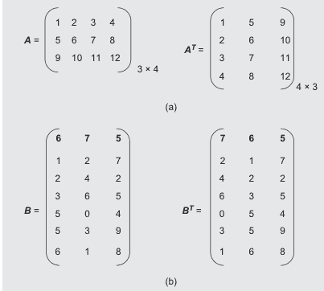

图 2.33 矩阵的转置（a）常规矩阵及其转置（b）稀疏矩阵及其转置

图 2.33(b) 中的矩阵是一个大小为 6 x 7、包含 5 个非零元素的简单稀疏矩阵及其转置。

我们可以注意到 B^T 中的条目未按行和列排序；我们需要进一步排序。进一步排序会增加时间复杂度。让我们学习两种更好的方法——简单转置算法和快速转置算法。

## 简单转置

设 A 为大小为 m x n、包含 T 个非零元素的矩阵，B 为其转置。最简单的方法之一是搜索每一列（列 = 0 到 n - 1），并依次将每一列作为转置矩阵 B 中的一行放置，将互换后的条目作为行、列和值放置（参见第 80 页的图 2.34）。

转置矩阵的步骤在算法 2.3 中描述，相应的程序在程序代码 2.10 中描述。

### 算法 2.3

```
1. Row = A[0][0], Col = A[0][1] and T = A[0][2]
2. B[0][0] = Col, B[0][1] = Row and B[0][2] = T
3. if T = 0 goto step(5)
4. Let i = 1
   for j = 0 to Col-1 do
     for k = 1 to T do
       if(A[k][1] == j)
       begin
         B[i][0] = A[i][1]
         B[i][1] = A[i][0]
         B[i][2] = A[i][2]
         i = i + 1
       end
5. stop
```

```
PROGRAM CODE 2.10
Sparse_Matrix Sparse_Matrix :: Simple_Transpose()
{
  Sparse_Matrix B;
  int Row, Col, i, j, k, T;
  Row = S_Mat[0][0];
  Col = S_Mat[0][1];
  T = S_Mat[0][2];
  if(T == 0) return;
  B_S_Mat[0][0] = Col;
  B_S_Mat[0][1] = Row;
  B_S_Mat[0][2] = T;
  i = 1;
  for(j = 0; j < Col; j++)
  {
    for(k = 1; k <= T; k++)
    {
      if(S_Mat[k][1] == j)
      {
        B_S_Mat[i][0] = S_Mat[i][1];
        B_S_Mat[i][1] = S_Mat[i][0];
        B_S_Mat[i][2] = S_Mat[i][2];
        i++;
      }
    }
  }
  return B;
}
```

在算法 2.3 中，我们首先将矩阵 A 的第一行作为 (m, n, t) 取出，并将其作为 (n, m, t) 存储在矩阵 B 中。在第二列（第 0 列为第一列）中，我们存储了最初表示列的值，现在这些值表示行。此列通过 col = 0 到 n - 1 进行搜索。

例如，在下图的简单转置中，矩阵 A 的当前行最初设置为 0，且没有列为 0 的条目。因此行递增并设置为 1，过程继续；A 中的条目 (2, 1, 21) 存储为矩阵 B 中的 (1, 2, 21)，并且每次都会更新当前行值。下一个条目 (3, 1, 31) 存储为矩阵 B 中的 (1, 3, 31)。此外，条目 (1, 2, 12) 存储为矩阵 B 中的 (2, 1, 12)。同样，它继续搜索每个列值。

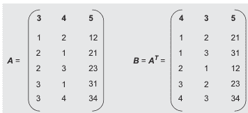

图 2.34 简单转置

算法 2.3 的步骤 4 对每个列重复 τ 次。时间复杂度为 O(nτ)，其中 n 是矩阵 A 的列数，τ 是矩阵中的非零元素个数。

在矩阵中，当所有数据都相关，即所有数据成员都非零时，则 τ = m × n。

现在，时间复杂度将为 O(n · τ) = O(n · mn) = O(mn²)，这比时间复杂度为 O(mn) 的常规转置更差。让我们学习一种更好的转置方法。

## 快速转置

设 A 为大小为 m × n、包含 T 个非零元素的稀疏矩阵。其转置将存储在矩阵 B 中。设 Freq 和 RowStartPos 为两个大小为 n 的一维数组。在 Freq 数组中，存储矩阵 A 中每个列的频数，RowStartPos 将被计算并存储在矩阵 A 中每个行条目要插入到矩阵 B 中的位置。然后，使用 Freq 计算 RowStartPos。相应的算法如算法 2.4 所示。

### 算法 2.4

```
1. Row = A[0][0]
   Col = A[0][1]
   M = A[0][2]
2. B[0][0] = Col
   B[0][1] = Row
   B[0][2] = M
3. if M = 0 then goto step 9
   for i = 0 to Col - 1 do
   Freq[i] = 0 (Here Freq array stores the frequency count of each
   column, initially set to 0)
5. for k = 1 to M do
   Tmp = A[k][1]
   Freq[Tmp] = Freq[Tmp] + 1;
6. RowStartPos[0] = 1 (We shall start storing elements in B matrix
   from 2nd row to B[1] onwards)
7. for j = 1 to Col - 1 do
   RowStartPos[j] = RowStartPos[j - 1] + Freq[j - 1];
   (Here RowStartPos in matrix gives the position to place an
   element in resultant matrix)
8. for i = 1 to M + 1 do
   begin
   k = RowStartPos[A[i][1]]
   B[k][0] = A[i][1]
   B[k][1] = A[i][0]
   B[k][2] = A[i][2]
   RowStartPos[k] = RowStartPos[k] + 1
   end
9. stop
```

此算法将找出每个列中的非零元素个数并将其存储在数组 Freq 中。第二个数组 RowStartPos 用于存储每个列的起始地址，该地址将是相应转置矩阵中的一行。转置矩阵中每个行的起始地址由以下公式给出

RowStartPos[i] = RowStartPos[i - 1] + Freq[i - 1]

其中，

Freq[i - 1] 给出行 [i - 1] 中的非零元素个数
RowStartPos (i - 1) 给出行 (i - 1) 的起始行

如果在转置矩阵中任意行（例如行 3）的起始位置为 5，且行 3 中有 2 个元素，那么行 4 的起始位置将为 5 + 2 = 7。依次地，我们从矩阵 A 中读取列索引，然后从数组 RowStartPos 获取位置，并将该元素存储在矩阵 B 中转置形式的指定位置。图 2.35 对此进行了说明。


| | 0 | 1 | 2 |
|---|---|---|---|
| 0 | 6 | 7 | 8 |
| 1 | 1 | 2 | 17 |
| 2 | 2 | 4 | 12 |
| 3 | 3 | 6 | 50 |
| 4 | 5 | 0 | 49 |
| 5 | 5 | 3 | 92 |
| 6 | 6 | 0 | 38 |
| 7 | 6 | 1 | 11 |
| 8 | 6 | 3 | 15 |

| | |
|---|---|
| 0 | 2 |
| 1 | 1 |
| 2 | 1 |
| 3 | 2 |
| 4 | 1 |
| 5 | 0 |
| 6 | 1 |

| | |
|---|---|
| 0 | 3 |
| 1 | 4 |
| 2 | 5 |
| 3 | 7 |
| 4 | 8 |
| 5 | 8 |
| 6 | 8 |

| | 0 | 1 | 2 |
|---|---|---|---|
| 0 | 7 | 6 | 8 |
| 1 | 0 | 5 | 49 |
| 2 | 0 | 6 | 38 |
| 3 | 1 | 6 | 11 |
| 4 | 2 | 1 | 17 |
| 5 | 3 | 5 | 92 |
| 6 | 3 | 6 | 15 |
| 7 | 4 | 2 | 12 |
| 8 | 6 | 3 | 50 |

Fig. 2.35 快速转置中按行存储列 (a) 输入矩阵 B (b) Freq[] (c) RowStartPos[] (d) B^T

### 快速转置的时间和空间复杂度分析

算法 2.4 中有三个循环，分别执行 n（行数）、τ（非零元素个数）、n - 1 和 τ 次，总体时间复杂度为 O(n + τ)。

在最坏情况下，即当 τ = m × n（非零元素）时，量级变为 O(n + mn) = O(mn)，这与常规二维转置相同。然而，快速转置相关的常数因子相当高。当 τ 相对于其最大值 m × n 足够小时，快速转置运行速度更快。

与简单转置相比，快速转置节省了时间，但需要为两个一维数组 Freq 和 RowStartPos 额外分配空间。程序代码 2.11 实现了稀疏矩阵快速转置。

### 程序代码 2.11

```
Sparse_Matrix Sparse_Matrix::Fast_Transpose()
{
    Sparse_Matrix B;
    int m, n, t, i, j, Freq[], RowStartPos[];
    Row = S_Mat[0][0];
    Col = S_Mat[0][1];
    M = S_Mat[0][2];
    B.S.Mat[0][0] = Col;
    B.S.Mat[0][1] = Row;
    B.S.Mat[0][2] = M;
    if(M == 0) return B;
    else
    {
        for(i = 0; i < Col; i++)
        {
            Freq[i] = 0;
        }
        for(i = 1; i <= t; i++)
        {
            T = A[i][1];
            Freq[T]++;
        }
        RowStartPos[0] = 1;
        for(i = 1; i < n; i++)
        {
            RowStartPos[i] = RowStartPos[i - 1] + Freq[i - 1];
        }
        for(i = 1; i <= M; i++)
        {
            j = A[i][1];
            B[RowStartPos[j]][0] = S_Mat[i][1];
            B[RowStartPos[j]][1] = S_Mat[i][0];
            B[RowStartPos[j]][2] = S_Mat[i][2];
            RowStartPos[j] = RowStartPos[j] + 1;
        }
    }
    return B;
}
```

在此程序中，最初确定每个列中的元素数量。这些实际上将是转置矩阵中的列数。这些信息帮助我们更新数组 RowStartPos，它告诉我们应该从转置数组中的哪个位置开始存储元素，以便它们按行排序。

### 2.12 使用数组进行字符串操作

字符串是最常用的数据对象。它通常由编程语言的字符集构成。假设 S = a1, a2, ..., an。

值 n 是字符串 S 的长度，其中 n >= 0。如果 n = 0，则 S 称为空字符串或空串。可以对字符串执行各种操作：

- 1. 查找字符串长度
- 2. 连接两个字符串
- 3. 复制字符串
- 4. 反转字符串
- 5. 执行字符串比较
- 6. 回文检查
- 7. 识别子字符串。

这些使用数组的操作将在后续章节中详细讨论。

基本上，字符串作为字符序列存储在一维字符数组中，例如 A（图 2.36）。

| | 0 | 1 | 2 | 3 | 4 | 5 | 6 | 7 | 8 | 9 |
|---|---|---|---|---|---|---|---|---|---|---|
| A = | S | T | R | I | N | G | \0 | - | - | - |

Fig. 2.36 数组中存储的字符串

将 'String' 存储在大小为 10 的数组中的简单 C++ 语句如下：

```
char A[10] = "STRING";
```

每个字符串由一个特殊字符终止，即空字符 '\0'。这个空字符指示每个字符串的结束或终止。程序代码 2.12 中的 compare() 函数比较两个字符串以判断它们是否相等。

要比较两个字符串，我们首先检查它们的长度是否相同。如果长度相同，那么字符串相同的可能性就更大。如果长度已预先计算或已知，则需要比较长度，否则这会增加复杂度。然后，我们将字符串 A 的每个字符与字符串 B 进行比较。如果匹配，则字符串相同；否则不同。

### 程序代码 2.12

```
class String
{
  private:
    char Str[];
  public:
    String() {}
    int Length();
    void Concat(String B);
    int Substring(String S);
};

int String::Length()
{
  int length = 0, i;
  for(i = 0; Str[i] != '\0'; i++)
    length++;
  return length;
}

void String::Concat(String B)
{
  int len_A, i, j;
  // To concatenate B to A we need to traverse
  // string A till the end
  for(i = 0; Str[i] != '\0'; i++);
  len_A = i;
  // Let us concatenate B to A now
  for(i = len_A, j = 0; B.Str[j] != '\0'; j++,i++)
  {
    Str[i] = B.Str[j];
  }
  Str[i] = '\0';
}

String String::Copy()
{
  String B;
  int i;
  for(i = 0; Str[i] != '\0'; i++)
  B.Str[i] = Str[i];
  B.Str[i] = '\0'; // Append the termination character
  return B;
}

String String::Copy_Reverse()
{
  int i, l, Len_A, j;
  for(i = 0; Str[i] != '\0'; i++);
  // loop terminates after reaching end of A
  Len_A = l--;
  for(i = l, j = 0; i >= 0; i--, j++)
  B.Str[j] = Str[i];
  B.Str[j] = '\0'; //Append termination character
  return B;
}

void String::Rev_String()
{
  int i, len = 0;
  //exchange i^th and j^th characters till middle position
  char t;
  for(len = 0; Str[len] != '\0'; len++);
  for(i = 0, j = len - 1; i != j; i++, j--)
  {
    t = Str[i]; Str[i] = Str[j]; Str[j] = t;
  }
}

int String::Str_cmp(String A, String B)
{
  int i = 0;
  if (A.Length() != B.Length())
    return 0;
  while (A.Str[i] == B.Str[i] && A.Str[i] != '\0' && B.Str[i] != '\0')
    ++i;
  if(A.Str[i] == '\0' && B.Str[i] == '\0')
    return 1;
  else
    return 0;
}
```

### 回文检查

回文是正向和反向读取都相同的字符串。例如，_madam_ 和 _malayalam_ 是回文（图 2.37）。

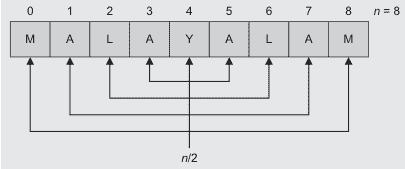

Fig. 2.37 回文检查

要检查字符串是否为回文，有两种方法：

- 1. 我们先求出字符串的逆序，然后将其与原字符串进行比较。如果匹配，则该字符串是回文；否则不是。如果字符串长度为 _n_，此方法需要 _n_ 次比较，并需要一个额外数组来存储逆序字符串。
- 2. 另一种方法不需要 _n_ 次比较，只需 _n_/2 次比较。我们可以将第一个字符与最后一个字符比较。如果匹配，则再将第二个字符与倒数第二个字符比较。继续此过程直到字符串中间。我们可以从两端设置两个索引，并比较直到索引不重叠。字符不匹配表明该字符串不是回文。此方法不需要额外的数据结构。

检查回文的程序在程序代码 2.13 中给出。

### 程序代码 2.13

```
int String::Palindrome_Check()
{
    int i, j, l, flag = 0, k;
    for(l = 0; Str[l] != '\0'; l++); //loop terminates
    l--; k = l/2; //to avoid null char
    for(i = 0; j = l; i < k; i++, j--)
    {
        if(Str[i] == Str[j])
        {
            flag = 1;
            continue;
        }
        else
        {
            flag = 0;
            break;
        }
    }
    if(flag == 1)
        return 0;
    else
        return 1;
}
```

### 子字符串检查

对于子字符串识别，我们将查找字符串 B 在字符串 A 中的出现情况。

例如，

```
A = 'A B C D'
B = 'BC' or 'BCD' and so on
```

有两种可能性：

- 1. 要么 B 是 A 的子字符串，或
- 2. B 不是 A 的子字符串。

程序代码 2.14 检查给定字符串是否为子字符串。

### 程序代码 2.14

```
int String::substring(String B)
{
    int i, j = 0, flag = 0;
    for(i = 0; A.Str[i] != '\0' || B.Str[j] != '\0'; i++)
    {
        if(A.Str[i] == B.Str[j])
        {
            j++;
            flag = 1;
        }
        else
        {
            j = 0;
            flag = 0;
        }
    }
}
```


```
if (flag == 1)
return 1;
else
return 0;
}
```

### 2.13 数组的优缺点

我们已将数组作为一种抽象数据类型及其实现进行了学习，也学习和分析了若干使用数组作为数据结构的应用。下面让我们列出数组作为数据结构的特性、优点和缺点。

### 2.13.1 特性

数组的特性如下：

- 1. 数组是同类型数据元素的有限有序集合。
- 2. 在数组中，相邻元素以固定间隔存储。
- 3. 数组定义为一组键值对——索引和值。
- 4. 数组允许直接访问任何元素。
- 5. 在数组中，中间位置插入和删除元素需要移动数据。
- 6. 数组提供静态分配，这意味着编译时一次性完成的空间分配在运行时无法更改。

### 2.13.2 优点

数组作为数据结构的各种优点如下：

- 1. 数组允许以常数时间 O(1) 进行高效的随机访问。
- 2. 数组最适合存储固定数量的数据，也适合高频数据检索，因为数据可以直接访问。
- 3. 数组是最紧凑的数据结构之一；如果在数组中存储 100 个整数，它只占用 100 个整数所需的空间，不多不少（与链表不同，链表中每个数据元素都有一个额外的链接字段）。
- 4. 数组在搜索、哈希表、矩阵运算和排序等应用中广为人知。
- 5. 只要元素与其位置之间存在直接映射，例如有序列表，数组就是最合适的数据结构。
- 6. 使用数组处理多项式等有序列表效率最高。
- 7. 数组有助于构建多种复杂数据结构（如堆和哈希表）的基础，并可用于表示字符串、栈和队列。

### 2.13.3 缺点

数组的一些缺点如下：

- 1. 数组提供静态内存管理。因此，在执行期间，大小既不能增长也不能缩小。
- 2. 解决该问题的一个方法是，声明某个任意最大大小的数组。这会导致另外两个问题：
  - (a) 将来，如果用户仍需超过此限制，则不可能。
  - (b) 最大值越高，内存浪费越多，因为很多时候，许多位置虽然未使用，但仍为程序分配（保留）。这导致空间利用率低。
- 3. 数组中的静态分配是许多编程语言实现中存在的问题，JAVA 等少数语言除外。
- 4. 当频繁插入或删除数据时，数组效率低下，因为在数组中插入或删除元素需要大量数据移动。
- 5. 因此，数组对于经常需要中间插入和删除操作的应用来说效率低下。
- 6. 由于数组的简单性，一个缺点是可能使用超出有效范围的索引来引用不存在的元素。这被称为 *超出数组边界*。结果是程序使用错误数据。在最坏的情况下，整个系统可能会崩溃。在 C++ 中，强大的语法不幸的是容易出现这种错误。有些语言具有内置的边界检查，不会对数组进行超出允许范围的索引。

### 2.13.4 数组的应用

下面的列表指示了数组最有益的应用场景：

- 1. 虽然数组本身很有用，但它们也构成了堆和哈希表等更复杂数据结构的基础，并可用于表示字符串、栈和队列。
- 2. 所有这些应用都受益于数组的紧凑性和直接访问优势。
- 3. 数组可用于存储二维数据，表示为矩阵并进行矩阵运算。
- 4. 它们还可用于对键进行索引、搜索和排序，我们将在第 9 章和第 10 章中学习相关内容。
- 5. 在某些应用中，对于大多数索引值或大范围索引，数据相同或缺失，此时根本不存储数组即可节省空间。这种应用称为 *稀疏矩阵表示*。它具有一个带整数键的关联数组。有许多专门针对应用的专用数据结构，包括地址转换表和路由表。

## 回顾

- 数据可以以线性或非线性方式组织。在线性或顺序组织中，所有元素都可以按特定序列排列，每个元素在序列中都有一个唯一的后继元素（和/或前驱元素）。
- 线性数据组织可以使用数组实现。数组是一种非常常见且简单的顺序（或线性）数据结构化手段，几乎所有编程语言都支持它。
- 顺序组织允许以固定间隔存储数据。如果第 p 个元素存储在位置 X，则下一个顺序元素（(i+1)th）存储在位置 X + C，其中 C 是常数。
- 数组允许以常数时间（即 O(1)）直接或随机访问列表中的任何数据元素，因为顺序组织使用连续内存位置来存储其数据。无论数据列表的总长度或大小如何，访问列表中任何元素的数据访问时间都保持不变。
- 对于元素的中间插入或删除，我们需要执行数据移位以保持组织的一致性和完整性，这在时间上代价高昂。
- 当数据以多维方式组织时，一维数组证明是不够的，我们需要二维数组、三维数组或多维数组。多维数组是二维数组扩展到三维、四维或更多维度的结果。
- 数组被高效地用于矩阵、多项式和字符串操作。

## 关键术语

- **数组** 数组是同类型数据元素的有限有序集合，可对其任何元素提供直接访问（或随机访问）。
- **线性和非线性数据结构** 在线性（或顺序）组织中，所有元素都可以按特定序列排列，每个元素在序列中都有一个唯一的后继元素（和/或前驱元素）。当每个元素可能有一个或多个后继元素（或前驱元素）时，它被称为非线性数据结构。
- **数组的内存表示** 计算机内存可以被视为一长串分组为字节和/或字的位列表。每个位置都可以简单地称为位置，以避免关于内存是按一字节、两字节还是 n 字节字结构化的机器相关细节。此外，寻址方案（如按字节寻址或按字寻址）各不相同。
- **二维数组的内存表示** 让我们考虑一个 m x n 维度的二维数组 A。虽然数组是多维的，但它通常在内存中作为一维数组存储。多维数组在内存中表示为 m x n 个连续内存位置的序列。多维数组的元素可以按行主序表示或列主序表示存储在内存中。
- **顺序组织** 顺序组织允许以固定间隔存储数据。如果第 p 个元素存储在位置 X，则下一个顺序元素（(i+1)th）存储在位置 X + C，其中 C 是常数。
- **稀疏矩阵** 在许多情况下，矩阵大小非常大，但其中大部分元素是 0（不一定总是 0）。只有很小一部分矩阵实际上被使用。这种类型的矩阵称为稀疏矩阵，因为矩阵被稀疏地填充数据，大多数位置是空的或包含不相关的数据。


## 选择题

1. 数组是一个
(a) 线性数据结构
(b) 非线性数据结构
(c) 复杂数据结构
(d) 以上都不是

2. 以下哪个表达式访问以列优先形式存储的 m x n 矩阵的 (i, j) 第一个元素？
(a) n x (i - 1) + j
(b) m x (j - 1) + i
(c) m x (n - j) + j
(d) n x (m - i) + j

3. 定义一个 n x n 数组 V 如下：
V[i, j] = i - j 对于所有 i, j，其中 1 < i <= n, 1 <= j <= n
数组 V 中元素的和为
(a) 0
(b) n - 1
(c) n^2 - 3n + 2
(d) n^2 (n + 1)/2

4. 数组索引中最小的元素称为其
(a) 下界
(b) 上界
(c) 范围
(d) 提取

5. 从以下选项中选出正确的答案：
(a) 数组声明期间，不分配存储空间
(b) 数组定义先于数组声明
(c) 数组声明先于数组定义
(d) 初始化不能在数组声明期间进行

6. 数组的参数传递机制是
(a) 值传递
(b) 值-结果传递
(c) 引用传递
(d) 以上都不是

7. 如果 n 的值为 3，则语句 a[++n] = n++
(a) 将 3 赋给 a[5]
(b) 将 4 赋给 a[5]
(c) 将 4 赋给 a[4]
(d) 产生不可预测的结果

8. 设 A 为按以下方式声明的二维数组：
array [1..10, 1..15] of integers;
假设每个整数占用一个内存位置，数组按行主序存储，且数组的第一个元素存储在位置 100，则元素 A[i][j] 的地址是多少？
(a) 15i + j + 84
(b) 15j + i + 84
(c) 10i + j + 89
(d) 10j + i + 89

9. 遍历数组意味着
(a) 处理数组中的每个元素
(b) 从数组中删除一个元素
(c) 向数组中插入一个元素
(d) 将两个数组合并为一个数组

10. 当矩阵满足以下条件时，称为稀疏矩阵：
(a) 大多数元素为非零
(b) 大多数元素为零
(c) 其所有元素均为非零
(d) 以上都不是。

## 复习题

1. 你有两个数组 A 和 B，每个包含 10 个整数。编写一个算法，测试数组 A 中的每个元素是否等于数组 B 中对应的元素。

2. 编写一个算法，反转数组的元素，使最后一个元素变为第一个，倒数第二个变为第二个，依此类推。

3. 如果 m x n 矩阵中的某个元素 A[i, j] 既是第 i 行中最小的值，又是第 j 列中最大的值，则称该矩阵有一个鞍点。编写一个 C++ 程序，确定鞍点的位置（如果存在）。你的程序的计算时间复杂度是多少？

4. 编写一个名为 merge_arrays() 的 C++ 函数，它接受两个存储的数组并将它们合并为一个存储的数组。函数头应为

```
void merge_arrays(double *a, double *b, double *c)
```

其中 a 和 b 是指向两个存储数组的指针，c 是指向合并后数组的指针。

5. 修改复习题 4 中的 merge_arrays()，使其消除重复条目。

6. 下三角数组 a 是一个 n x n 数组，其中如果 i < j，则 a[i][j] == 0。这样的数组中非零元素的最大数量是多少？这些元素如何在内存中顺序存储？为访问 a[i][j]（其中 i > j）开发一个算法。以类似的方式定义上三角数组，并对上三角数组做与下三角数组相同的事情。

7. 设 a 和 b 为两个 n x n 下三角数组。说明 n x (n + 1) 数组 c 如何用于包含两个数组的非零元素。c 的哪些元素分别表示元素 a[i][j] 和 b[i][j]？

8. 术语“行主序”和“列主序”是什么意思？

9. 数组 data[15, 25] 按行主序存储在内存中。如果基地址为 500，元素大小为 5，计算元素 data[7, 12] 的地址。

10. 想象 N 个人决定通过围成一个圈并杀死圈中第 M 个人来自杀，随着每个人退出圈子，队伍会重新闭合。找出最后一个死去的人是谁。编写一个 C++ 程序来模拟执行序列。

11. 编写一个 C++ 程序，从整数数组中找出最大值和第二大值。

12. 一组数字的众数是数组中重复次数最多的数字 m。如果多个数字以相同的最大频率重复，则没有众数。编写一个 C++ 程序，接受一组数字并返回众数或指示众数不存在。

13. 编写一个 C++ 程序，从 20 个整数的数组中删除重复元素。

14. 有两个数组 A 和 B。A 包含 25 个元素，而 B 包含 30 个元素。编写一个函数来创建一个数组 C，该数组仅包含 A 和 B 共有的元素。

15. 一个 5 x 5 的幻方包含不同的元素。编写一个 C++ 函数来验证每个单独列元素的和、每个单独行元素的和以及对角线元素的和是否相等。

16. 编写一个 C++ 程序来构建作为数组的稀疏矩阵。编写函数来检查稀疏矩阵是方阵、对角矩阵、下三角矩阵、上三角矩阵还是三对角矩阵。

17. 编写一个 C++ 程序来减去两个作为数组实现的稀疏矩阵。

## 选择题答案

1. (a)
2. (b)
3. (a)
4. (a)
5. (a), (b), (d)
6. (a)
7. (d) 输出取决于编译器。
8. (a)
9. (b)
10. (b)

## 3 栈

### 目标

- 作为数据类型的栈的所有方面，例如
  - 后进先出 (LIFO) 数据访问
  - push, pop, 和其他栈操作
  - 栈的连续实现
- 使用数组实现栈
- 为实际应用选择合适的实现
- 多栈的实现
- 栈在表达式转换、递归、反转数据及其他应用中的使用

栈和队列是特殊的数据结构，其中插入和删除操作仅在特定端执行，而不是在中间或任何其他随机位置。这些是有序列表的特殊情况。如第 2 章所见，数组和链表等线性数据结构允许我们从列表的任何位置插入或删除元素；栈和队列是对这些操作有限制的线性列表。让我们详细讨论这些概念。

### 3.1 栈和队列的概念

栈和队列是两种数据结构，其中插入和删除操作仅在特定端应用。这些是有序列表的特殊情况，也称为受控线性列表。有大量的软件应用程序需要这些受限的数据结构操作。以下是栈和队列通常使用的一些示例：

1. 队列广泛用于维护网络打印机等待打印作业列表的应用程序中。这里，保留了一个可以容纳不同用户所有打印请求的队列。

2. 在程序中处理函数调用时，通常需要限制一端的访问以跟踪返回位置。在这种情况下，我们需要使用栈。我们可以使用栈来跟踪函数调用结束后返回到先前函数的返回地址。

本章将讨论栈，第 4 章将讨论队列。

### 3.2 栈

在日常生活中，我们会遇到许多栈的示例，例如一摞书、一摞盘子或一摞椅子。数据结构 *栈* 与这些实际示例非常相似（图 3.1）。

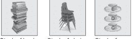

图 3.1 现实世界中的栈示例

考虑桌上的一摞书。我们可以轻松地将一本新书放在栈顶，同样，我们可以轻松地移除最上面的书，而不必移动中间或底部的书。同样，只能访问栈的最顶端元素，而直接访问其他中间位置是不可行的。元素只能从一端添加或移除，称为栈的 *顶*。

数组和链表等线性数据结构允许用户在列表的任何位置插入或删除元素，也就是说，我们可以在开头、结尾或任何中间位置插入或删除元素。

*栈* 被定义为一个受限列表，其中所有插入和删除操作仅在一端进行，即 *顶*。每个栈抽象数据类型（ADT）都有一个数据成员，通常命名为 *top*，它指向栈中的最顶端元素。栈上可以执行两个基本操作：*push* 和 *pop*：向栈中插入元素称为 *push*，从栈中删除元素称为 *pop*。在栈中，我们无法访问顶部位置以外的任何中间位置的数据元素。

给定栈 S = $(a_1, a_2, ..., a_n)$。我们说，由于 $a_1$ 是最底部的元素，$a_n$ 位于栈顶，且元素 $a_{i+1}$ 被认为位于 $a_i$ 的顶部，其中 $1 < i \le n$。

在图 3.2 中，S = (A, B, C)，其中 A 是最底部的元素，C 是最顶部的元素。

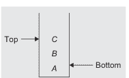

图 3.2 三个字母 A、B 和 C 的栈


### 3.2.1 基本操作

栈的三种基本操作是 push、pop 和 getTop。除此之外，还可以在栈上实现一些其他操作，例如 stack_initialization、stack_empty 和 stack_full。stack_initialization 操作用于为栈的使用做准备，并将其设置为空闲状态。stack_empty 操作仅用于测试栈是否为空。stack_empty 可作为防止尝试从空栈中弹出元素的保障措施。从空栈中弹出元素是一种错误条件。stack_empty 条件也称为栈下溢。在理想条件下，栈应具备无限容量，以便无论栈中已有多少个元素，后续元素始终可以入栈。然而，计算机的内存容量始终是有限的，因此在执行 push 之前我们需要检查 stack_full 条件，因为向已满栈中压入元素也是一种错误条件。这种栈满条件称为栈上溢。

栈的另一种操作是 getTop。它返回栈顶元素，但并不实际弹出它。其他一些栈操作包括遍历栈、统计栈中元素总数以及复制栈。

让我们快速回顾一下所有栈操作：

- 1. Push——在栈顶插入一个元素
- 2. Pop——从栈顶删除一个元素
- 3. getTop——读取（仅读取，不删除）栈顶的一个元素
- 4. Stack_initialization——将栈设置为空状态
- 5. Empty——检查栈是否为空
- 6. Full——检查栈是否已满

### Push

push 操作在栈顶插入一个元素。最近添加的元素始终位于栈顶。在每次 push 之前，我们必须确保是否有空间容纳新元素（图 3.3）。

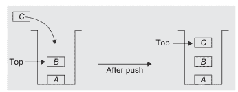

图 3.3 push 操作

当栈上没有空间容纳新元素时，栈被认为已满（图 3.4）。如果在栈已满时执行 push 操作，则认为处于上溢状态，即栈已满时无法添加元素。push 操作会修改栈顶，因为新插入的元素变成最顶层的元素（图 3.3）。

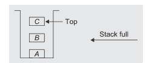

图 3.4 栈满条件（栈容量 = 3）

### Pop

pop 操作从栈顶删除一个元素并将其返回给用户。它修改栈，使下一个元素成为栈顶元素（图 3.5）。

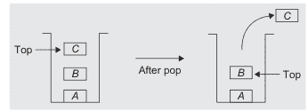

图 3.5 pop 操作

当栈上没有可用元素时，栈被认为为空。如果在栈为空时执行 pop，则认为栈处于下溢状态（图 3.6）。

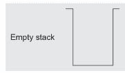

图 3.6 空栈

当栈为空时不应执行 pop 操作，因此在每次 pop 之前，我们必须确保栈不为空。在从栈中删除最后一个元素后，应将栈设置为空状态。

### GetTop

getTop 操作提供关于最顶层元素的信息并返回栈顶的元素。在此操作中，仅返回栈顶元素的副本。因此，栈顶仍指向同一个元素（图 3.7）。

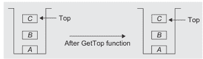

图 3.7 getTop 操作

这是 pop 和 getTop 操作之间的关键区别。getTop 操作不会修改变量 top。如果栈为空，它会发出栈下溢错误。

由于插入和删除操作仅允许在栈的一端进行，因此它以数据存储的逆序检索数据。在图 3.8 中，设 S = {A, B, C}。

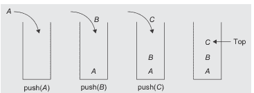

图 3.8 栈和 push 操作

假设操作顺序为 push(A)、push(B)，然后是 push(C)。当我们将这些元素从栈中移除时，它们将按 C、B、然后 A 的顺序移除。如图 3.9 所示。

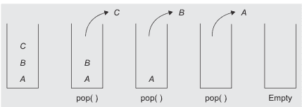

图 3.9 栈和 pop 操作

元素按插入序列的逆序取出。因此，栈通常被称为后进先出（LIFO）或先进后出（FILO）数据结构。

### 3.3 栈抽象数据类型

让我们来看看与栈相关的数据对象、操作和公理。任何同一数据类型的元素集合都可以用作栈的数据对象。“同一数据类型”的意思是栈中的所有元素应具有相同的性质，拥有共同的表示逻辑属性。例如，整数栈、学生姓名栈、员工记录栈以及操作系统进程记录栈。

以下五个函数构成了栈的函数定义：

- 1. Create(S)——创建一个空栈
- 2. Push(i, S)——将元素 i 插入栈 S 并返回修改后的栈
- 3. Pop(S)——从栈 S 中移除最顶层元素并返回修改后的栈
- 4. GetTop(S)——返回栈 S 的最顶层元素
- 5. Is_Empty(S)——如果 S 为空则返回 true，否则返回 false

不过，当我们选择表示栈时，必须能够构建这些操作。在这样做之前，让我们正式描述栈的结构。

```
ADT Stack(element)
1. Declare Create() → stack
2. push(element, stack) → stack
3. pop(stack) → stack
4. getTop(stack) → element
5. Is_Empty(stack) → Boolean;
6. for all S ∈ stack, e ∈ element, Let
7. Is_Empty(Create) = true
8. Is_Empty(push(e, S)) = false
9. pop(Create()) = error
10. pop(push(e, S)) = S
11. getTop(Create()) = error
12. getTop(push(e, S)) = e
13. end
14. end stack
```

第 1 至 5 行声明了五个函数及其定义域和值域。第 6 至 13 行是描述函数之间关系的公理集合。第 10 行和第 12 行很重要，因为它们定义了栈的 LIFO 行为。此描述显示了一个无上限、元素数量无上限的无限栈。当我们使用 C++ 表示此结构时将对此进行讨论。

我们在第 1 章中学习了 ADT 的概念。ADT 栈在第 3.3 节中定义。要在 C++ 中实现 ADT 栈，操作通常作为函数实现以提供数据抽象。使用栈的程序将仅通过这些函数访问栈，而不关心其实现。

## 3.4 使用顺序组织（数组）表示栈

栈可以使用静态数据结构（数组）和动态数据结构（链表）来实现。表示栈的最简单方法是使用一维数组。使用数组实现的栈也称为*连续栈*。

数组用于存储有序元素列表。栈是有序元素集合。因此，使用数组表示栈时，管理栈会非常简单。数组唯一的困难在于其静态内存分配。一旦声明，大小在运行时无法修改。我们已经读到，这会导致空间利用率低下或无法容纳所有可能的数据元素。这是因为我们在编译前将数组声明为任意的最大大小。

图 3.10 显示了使用数组实现栈的方式。

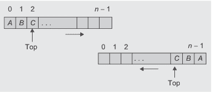

图 3.10 使用数组的栈

设 Stack[n] 为一维数组。当使用数组实现栈时，数组的两侧之一可视为顶部（上方）侧，另一侧视为底部（下方）侧，如图 3.10 所示。

让我们讨论最常用的顶部。元素从第一个位置开始存储在栈中。第一个元素存储在数组 Stack 的第 0 个位置，即 Stack[0]，第二个元素在 Stack[1]，第 i 个元素在 Stack(i - 1)，第 n 个元素在 Stack(n - 1)。数组关联一个整数变量 top，它指向栈中的栈顶元素。当栈为空时，top 的初始值为 -1。它可以从索引 0 存储元素，并且可以增长到最大 n - 1，因为这是使用数组的静态栈。

程序代码 3.1 给出了类 Stack 的定义，并列出了一组基本操作的函数原型。

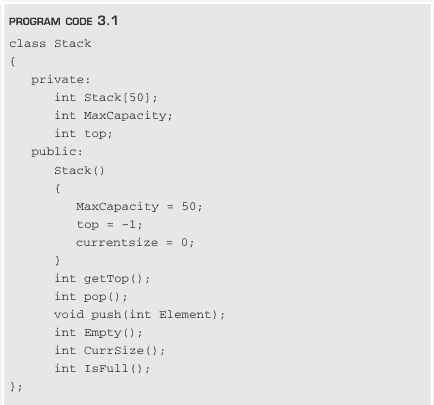

实现 ADT 栈的最简单方法是使用数组。我们使用构造函数将变量 top 初始化为 -1 以表示空栈。底部元素使用第 0 个位置表示，即数组的第一个元素。下一个元素存储在第 1 个位置，依此类推。变量 top 指示栈顶的当前元素。


#### 3.4.1 创建

创建栈时，栈最初为空。栈的实现可以使用数组，也可以使用链表实现。对于数组实现，其大小应预先定义，其实现时间不应超过运行时间。然而，在链表实现的情况下，这一限制得以克服。让我们先看一个简单的栈实现。在本章末尾，我们将学习使用 C++ 特性（如模板和动态数组）的其他更好的基于数组的实现。

对于每个栈，都有一个名为 top 的辅助变量，它指向栈顶元素。因此，这个整数变量保存数组的索引。它也可以实现为指针变量。目前我们将其用作整数变量。尽管我们称其为指向栈顶元素的指针，但它是一个整数索引变量。

构造函数必须初始化栈顶，以表示空栈，初始化为表示空栈顶的值。我们不能将其初始化为 0 到 n – 1 范围内的值之一，因为这些是栈数组的索引。索引 0 到 n – 1 表示将存储栈元素的位置之一。然而，它可以初始化为 0 到 n – 1 之外的任意整数值。每个 push 操作将 top 加 1。这是为了更新 top 以指向新添加的元素。当元素添加到空栈时，top 应设置为 0，因为新元素将存储在 Stack[0] 中。因此，将 top 初始化为 -1 是合适的。这是最合适的初始化，而不是任何其他任意值。

```cpp
int Stack[100];
int top = -1;
```

这些语句创建一个大小为 100 的空栈，用于存储整数值，变量 top 初始化为 -1。

### 3.4.2 判空

Empty 是一个操作，它以栈为参数，检查栈是否为空，并分别返回布尔值 true 或 false。

栈的空状态可以通过将 top 的值与 –1 进行比较来检查，因为 top = –1 表示空栈。

```cpp
if(top == -1)
    return 1;
else
    return 0;
```

### 3.4.3 获取栈顶

getTop 操作检查栈的空状态。如果栈为空，它会报告“栈下溢”错误消息；否则，它返回栈顶元素的副本。这里，top 不会更新，因为元素未从栈中删除；相反，元素仍位于栈顶位置。该元素只是从栈中读取。

因此，其行为可以用以下语句描述：

```cpp
if(top == -1)
    cout << "Stack underflow (empty)" << endl;
else
    return(Stack[top]);
```

### 3.4.4 入栈

push 操作将元素插入最大容量为 MaxCapacity 的栈中。只有在栈未满时，才能插入元素。我们在 ADT 中未讨论过满操作。当数组大小超过（或内存已满，在使用栈的链表表示时可能发生这种情况）时，栈实际上已满。因此，可以通过将 top 与 MaxCapacity - 1 进行比较来验证栈的满状态。如果栈未满，则 top 加 1，并将元素添加到栈顶。简而言之，

```cpp
if(top == MaxCapacity - 1)
    cout << "Stack overflow (full)";
else
{
    top ++;    //increment top by one
    Stack[top] = Element;    //add the element in new top position
}
```

### 3.4.5 出栈

pop 操作删除栈顶元素并返回该元素。仅当栈非空时才执行此操作。如果栈为空，则无法删除。这由 empty() 函数检查。如果栈非空，则返回栈顶元素，并将 top 减 1。

执行方式如下

```cpp
if(top == -1)
    cout << "Stack underflow\n";
else
    return(Stack[top--]);
```

栈满条件表明需要更多存储空间，在许多栈应用中，栈空状态表示处理结束。程序代码 3.2 说明了栈的基本操作。

### 程序代码 3.2

```cpp
class Stack
{
 private:
 int Stack[50];
 int MaxCapacity;
 int top;
 public:
 Stack()
 {
 MaxCapacity = 50;
 top = -1;
 }
 int getTop();
 int pop();
 void push(int Element);
 int Empty();
 int CurrSize();
 int IsFull();
 };
 int Stack :: getTop()
 {
 if(!Empty())
 return(Stack[top]);
 }
 int Stack :: pop()
 {
 if(!Empty())
 return(Stack[top--]);
 }
 int Stack :: Empty()
 {
 if(top == -1)
 return 1;
 else
 return 0;
 }

int Stack :: IsFull()
{
    if(top == MaxCapacity - 1)
        return 1;
    else
        return 0;
}

int Stack :: CurrSize()
{
    return(top + 1);
}

void Stack :: push(int Element)
{
    if(!IsFull())
        Stack[++top] = Element;
}

void main()
{
    Stack S;
    S.pop();
    S.push(1);
    S.push(2);
    cout << S.getTop() << endl;
    cout << S.pop() << endl;
    cout << S.pop() << endl;
}
```

## 3.5 使用模板的栈

程序代码 3.2 中使用数组及其操作的栈定义为操作整数数据。要为浮点数据定义栈，需要在类的数据成员声明中将 `int Stack[]` 更改为 `float Stack[]`。每当数组元素的数据类型变化时，都可以通过使用文本编辑器编辑代码然后重新编译来完成这一点。*模板*是一个可以实例化为任何数据类型的变量。此数据类型可以是内置类型或用户定义类型。程序代码 3.2 使用模板重写为程序代码 3.3。

### 程序代码 3.3

```cpp
template <class T>
class Stack
{
    private:
        T * Stack;      // stack using pointer
        int top;
        int Size;
    public:
        Stack(int StackSize = 20 );   // constructor
        T& getTop();
        T& pop();
        void push(const T& Element);
        bool IsEmpty();
        int CurrSize();
};

template <class T>
Stack <T> :: Stack(int StackSize) : Size(StackSize)
{
    Stack = new T[Size];
    top = -1;
}

template <class T>
T& Stack :: getTop()
{
    if (!IsEmpty())
        return(Stack[top]);
    else
        cout << "Stack is Empty" << endl;
}

template <class T>
T& Stack :: pop()
{
    if (!IsEmpty())
        return(Stack[top--]);
    else
        cout << "Stack is Empty" << endl;
}

bool Stack :: IsEmpty()
{
    if(top == -1)
        return 1;
    else
        return 0;
}

bool Stack :: IsFull()
{
    if(top == Size - 1)
        return 1;
    else
        return 0;
}

int Stack :: CurrSize()
{
    return(top + 1);
}

void Stack :: push(const T & Element)
{
    if(IsFull())
        cout << "Stack is Full" << endl;
    else
        Stack[++top] = Element;
}
```

## 3.6 多栈

通常，数据使用多个栈表示。*连续栈*（使用数组的栈）在需要时为多个栈使用单独的数组。当需要多个栈时，使用连续栈不是一种空间高效的方法，因为栈中的许多位置通常未被使用。解决此问题的高效方法是使用单个数组存储多个栈。图 3.11 显示了使用一个数组的两个栈。


图 3.11 A[0]、...、A[n - 1] 中两个栈的初始配置

可以通过将这些栈顺序映射到 A[0]、...、A[n - 1] 来实现多个栈。如果只实现两个栈，解决方案很简单。第一个栈从 A[0] 向 A[n - 1] 增长，第二个栈从 A[n - 1] 向 A[0] 增长。

这样，我们可以最有效地利用空间，只有当一个栈的栈顶到达另一个栈的栈顶时，栈才会满。

当需要在内存中表示 m 个栈时，会出现困难。我们可以将 A[0]、...、A[n - 1] 分为 m 个段，并将其中一个段分配给 m 个栈中的每一个。如果已知各个栈的预期大小，则可以按比例进行这种初始分段。在没有此类信息的情况下，A[0]、...、A[n - 1] 可以分为相等的段。对于每个栈 i，我们将使用 s[i] 表示 A 中该栈最底层元素位置减一的位置，如图 3.12 所示。


图 3.12 A[0]、...、A[n - 1] 中 m 个栈的初始配置

这里，t[i]，0 <= i <= m - 1 将指向栈 i 的最顶层元素。如果第 i 个栈为空，我们将使用边界条件 s[i] = t[i]。

最初，s[i] = t[i] = (n/m) × (i - 1)，0 <= i <= m - 1。

栈 i 将从 s[i] + 1 增长到 s[i + 1]，直到它赶上第 (i + 1) 个栈。使用此方案，m_push 和 m_pop 程序可以按程序代码 3.4 编写。


```
PROGRAM CODE 3.4
Stack::m_push(int i, char x)
{
    // push x to the i'th stack
    if(t[i] == s(i + 1))
        Stack_full(i);
    else
    {
        t[i] = t[i] + 1;
        A[t[i]] = x;
    }
}

char Stack::m_pop(int i)
{
    // pop topmost element of stack i
    if(t[i] == s(i))
        Stack_empty(i);
    else
    {
        t[i] = t[i] - 1;
        return(A[t[i] + 1]);
    }
}
```

Stack_full() 和 Stack_empty() 是需要根据每种情况所遵循的策略来编写的函数。例如，如果我们允许在数组 A 中仍有可用空间时向栈中添加元素，则以下步骤可能是解决此问题的一种方案：

- 1. 确定最后一个 i < j <= m，使得栈 j 和栈 j + 1 之间有可用空间，即 t[j] <= s[j + 1]。如果存在这样的 j，则可以将栈 i + 1, i + 2, ..., j 向右移动一位（将 A[n] 视为最右侧），并在栈 i 和栈 i + 1 之间创建一个空间。
- 2. 如果步骤 1 中没有这样的 j，则检查栈 i 的左侧。找到最大的 j，使得 1 <= j <= i 且栈 j 和栈 j + 1 之间有空间，即 t[j] < s[j + 1]。如果存在这样的 j，则将栈 j + 1, j + 2, ..., i 向左移动一个空间，在栈 i 和栈 i + 1 之间创建一个可用空间。
- 3. 如果没有满足步骤 1 或 2 条件的这样的 j，则 A 的所有 n 个空间都被利用，没有可用空间。

## 3.7 栈的应用

栈数据结构被广泛应用于各种场景。其中一些如下：

- 1. 将中缀表达式转换为后缀和前缀表达式
- 2. 求值后缀表达式
- 3. 检查格式正确的（嵌套）括号
- 4. 反转字符串
- 5. 处理函数调用
- 6. 计算机程序的语法分析（分析结构）
- 7. 模拟递归
- 8. 在十进制转二进制等计算中
- 9. 在回溯算法中（常用于优化和游戏）

## 3.8 表达式求值与转换

栈最常见的应用是在算术表达式的求值中。算术表达式由*操作数*、*运算符*和*分隔符*组成。当高级编程语言出现时，计算机科学家面临的主要困难之一是生成能够正确求值任何算术表达式的机器语言指令。

诸如下面这样的复杂赋值语句

$X = (A/B + C \times D - F \times G/Q)$

可能有多种含义，即使含义被唯一地定义，生成正确且合理的指令序列仍然很困难。幸运的是，我们今天的解决方案既优雅又简单。直到今天，这种转换仍被认为是编译器编写的主要方面之一。

让我们来看看理解表达式含义的困难。理解表达式含义的第一个问题是决定运算执行的顺序。这要求每种语言都必须唯一地定义这样的顺序。

例如，考虑以下表达式：

$X = a/b \times c - d$

设 $a = 1, b = 2, c = 3, \text{和 } d = 4.$

从这个表达式中可以得出的含义之一可能是

$X = (1/2) \times (3 - 4) = -1/2$

求值同一表达式的另一种方式可能是

```
X = (1/(2 x 3)) - 4 = -23/6
```

为了避免从表达式中得出多种含义，我们必须使用括号来指定运算顺序。例如，

```
X = (a/b) x (c - d)
```

为了固定求值顺序，为每个运算符分配优先级。即使我们用括号编写表达式，我们仍然会询问是先求值 (A/B) 还是先求值 (C – D)。一旦分配了优先级，那么在任何一对括号内，优先级最高的运算符将首先被求值。在求值表达式时，通常使用以下运算优先级：

以下运算符按其优先级降序排列：

- 1. 幂运算 (^), 一元 (+), 一元 (-), 和 ~
- 2. 乘法 (x) 和除法 (/)
- 3. 加法 (+) 和减法 (-)
- 4. 关系运算符 <, <=, =, !=, >=, >
- 5. 逻辑 AND
- 6. 逻辑 OR

可以将一些整数值分配为优先级，如表 3.1 所示。

| 算术、布尔和关系运算符 | 优先级 |
|---|---|
| ^, 一元 +, 一元 -, ~ | 1 |
| x, / | 2 |
| +, - | 3 |
| <, <=, =, !=, >=, > | 4 |
| AND | 5 |
| OR | 6 |

请注意，所有关系运算符具有相同的优先级。幂运算 (^) 和一元运算符（+、– 和 ~）具有最高优先级。当有两个相邻的相同优先级运算符时，又会出现先求值哪一个的问题。例如，表达式 A + B – C 可以有两种理解方式—(A + B) – C 或 A + (B – C)。

这需要决定是从右到左还是从左到右求值表达式。诸如 A + B – C 和 A x B/C 之类的表达式应从左到右求值。然而，表达式 A ^ B ^ C 应从右到左求值，即 A ^ (B ^ C)。例如，要计算 2 ^ 3 ^ 2，我们需要将其表示并求值为 2 ^ (3 ^ 2)。当从左到右求值时，表达式可能被求值为 ((2 ^ 3) ^ 2)，这是错误的！

因此，运算符需要为除指数运算符外的所有表达式决定从左到右的规则。这种求值顺序（从左到右或从右到左）称为结合性。指数运算是右结合的，而所有其他运算符都是左结合的。当我们编写带括号的表达式时，这些规则可以被覆盖。在带括号的表达式中，最内层的带括号表达式首先被求值。

让我们考虑表达式

X = A/B ^ C + D × E – A × C

通过使用优先级和结合性规则，表达式 X 重写为

X = A/(B ^ C) + (D × E) – (A × C)

例如，设 X 为一个中缀表达式：((2 + 3) × 4)/2

我们首先手动求值最内层表达式为 ((5) × 4)/2，接着求值下一个带括号的内层表达式 (20)/2，从而得到结果 10。

仍然存在一个问题：编译器如何接受这样的表达式并生成正确的目标代码。解决方案是将表达式重新加工为一种称为后缀表示法的形式。

### 3.8.1 波兰表示法与表达式转换

波兰数学家 Jan Łukasiewicz 提出了一种称为波兰表示法的表示法，它为表示算术表达式提供了两种替代方案，即后缀表示法和前缀表示法。波兰表示法的基本属性是，运算执行的顺序由表达式中运算符和操作数的位置决定。因此，优势在于在使用波兰表示法编写表达式时不需要括号。编写表达式的常规方式称为中缀，因为二元运算符出现在操作数之间，而一元运算符位于其操作数之前。例如，表达式 ((A + B) × C)/D 是一个中缀表达式。在后缀表示法中，运算符写在其操作数之后，而在前缀表示法中，运算符位于其操作数之前。表 3.2 显示了三种表示法中的一个示例表达式。

### 表 3.2 各种形式的示例表达式——中缀、前缀和后缀

| 中缀 | 前缀 | 后缀 |
|---|---|---|
| (操作数)(运算符)(操作数) | (运算符)(操作数)(操作数) | (操作数)(操作数)(运算符) |
| (A + B) × C | ×+ABC | AB + C× |

在示例 3.1 中，讨论了将表达式转换为其后缀和前缀表示法。

### 示例 3.1

将以下表达式转换为其后缀和前缀表示法：

```
X = A/B ^ C + D x E - A x C
```

### 解答

通过应用优先级和结合性规则，该表达式可以写成以下形式：

```
X = ((A/(B ^ C)) + (D x E) - (A x C))
```

可以对其进行重新加工以得到其等价的后缀和前缀表达式。

```
Postfix: ABC ^ / DE x + AC x -
```

```
Prefix: --+ / A ^ BC x DE x AC
```

### 3.8.2 前缀和后缀表达式的必要性

我们刚刚学习到，使用计算机求值中缀表达式需要编译器进行无歧义的适当代码生成，并且由于运算符的优先级和结合性等各种方面，这很困难。通过将中缀表达式编写或转换为后缀或前缀等替代表示法，可以克服这一问题。后缀和前缀表达式具有许多优势，如下：

- 1. 后缀和前缀表示法克服了中缀表达式中对括号的需求。
- 2. 运算符的优先级不再相关。
- 3. 求值顺序取决于运算符的位置，而不取决于优先级和结合性。
- 4. 表达式求值过程比直接从中缀表示法进行求值要简单得多。

让我们来看看如何求值后缀表达式。

### 3.8.3 后缀表达式求值

后缀表达式可以通过从左到右扫描、将操作数入栈、并使用栈中的正确数量作为操作数来求值运算符，然后再将结果放回栈中来求值。这种求值过程比直接从中缀表示法进行求值要简单得多。此过程将持续进行，直到栈不为空或出现字符 #（表示表达式的结束）。


算法 3.1 列出了求后缀表达式 E 的值所涉及的步骤。

```
ALGORITHM 3.1
1. Let E denote the postfix expression
2. Let Stack denote the stack data structure to be used and let Top = -1
3. while(1) do
   begin
   X = get_next_token(E) // Token is an operator, operand, or delimiter
   if(X = #) (end of expression)
   then return
   if(X is an operand)
   then push(X) onto Stack
   else X is operator)
   begin
   OP1 = pop() from Stack
   OP2 = pop() from Stack
   Tmp = evaluate(OP1, X, OP2)
   push(Tmp) on Stack
   end
   [If X is operator then pop the correct number of operands
   from stack for operator X. Perform the operation and push the
   result, if any, onto the stack.]
   end
4. stop
```

假设 E 的最后一个字符是 '#'。过程 get_next_token 用于从 E 中提取下一个标记。标记可以是操作数、运算符或 #。一维数组 Stack[n] 用作栈。

让我们考虑一个后缀表达式示例 E = AB + C#。现在，让我们按图 3.13 所示，从左到右逐字符扫描此表达式。

此求值过程比中缀表达式的求值过程简单得多。

现在让我们设计一个将中缀表达式转换为后缀表示法的算法。要了解如何设计从中缀到后缀的转换算法，请注意，两种表示法中的操作数出现的顺序相同。让我们也学习如何手动将中缀表达式转换为后缀表达式。

以下是手动将表达式从一种表示法转换为另一种表示法的步骤：

- 1. 首先，对给定的中缀表达式完全加括号。为此使用运算符优先级和结合性规则。
- 2. 现在，移动所有运算符，使它们替换对应的右括号。
- 3. 最后，删除所有括号，即可得到后缀表达式。


## 图 3.13 后缀表达式 AB + C# 的求值

后缀表达式的求值很简单，但现在我们需要将中缀表达式转换为其后缀形式。让我们考虑一个示例 E = A/B ^ C + D x E - A x C。

让我们对其完全加括号，如下所示

E = (((A / B ^ C) + (D x E)) - (A x C))

让我们将所有运算符移动到对应的右括号并替换它们。

E = (((A / B ^ C) + (D x E)) - (A x C))

现在让我们消除所有括号。我们得到了中缀表达式的后缀等价式。

E(后缀) = ABC ^ / DE x + AC x -

此方法也可用于得到等价的前缀表示法，如下所示：

(((A / B ^ C) + (D x E)) - (A x C))

消除括号后，我们现在得到前缀表达式如下

```
E(prefix) = -/+ A ^ BC / DE x AC
```

此过程仅适用于手动转换表达式。让我们尝试制定将中缀转换为后缀（也可用于前缀）的算法。

我们观察到，在中缀和后缀表示法中，操作数的顺序保持不变。转换的输出应为后缀表示法。此后缀表达式具有一个操作数序列，与输入中缀表达式相同。因此，中缀表达式中的操作数在出现时可以立即发送到输出。为了处理运算符，操作数存储在栈中，直到合适的时机，然后出栈（从栈中移除）；接着将它们传递到输出。

例如，设 E 为一个中缀表达式，如下所示

```
E = A + B x C
```

转换后，表达式应产生 ABCx+，即，将它们入栈的序列应如表 3.3 所示。

## 表 3.3 表达式 E = A + B x C 的中缀到后缀转换

| 下一个字符 | 栈 | 输出 |
|---|---|---|
| A | 空 | A |
| + | + | A |
| B | + | AB |

现在，我们需要决定关于运算符 x 的事项。这在表 3.4(a) 中有所说明。

此处请注意，算法必须决定运算符 x 是放在栈顶，还是将运算符 + 出栈。由于运算符 x 具有最高优先级，我们应将其入栈，以便得到表达式 X2 的操作序列，如表 3.4(b) 所示。

## 表 3.4 表达式中 x 运算符的处理与入栈

### (a) x 运算符的处理

| | 中缀 | 后缀 |
|---|---|---|
| 示例 | X1 = (A + B) x C | AB + C x |
| | X2 = A + (B x C) | ABC x + |

## 表 3.4（续）

### (b) × 运算符的入栈

| 下一个字符 | 栈 | 输出 |
|---|---|---|
| A | 空 | A |
| + | + | A |
| B | + | AB |
| × | +× | AB |
| C | +× | ABC |
| #（全部出栈） | +× | ABC ×+ |

此外，当输入耗尽时，我们应输出栈中所有剩余的运算符，以得到后缀表达式 ABC×+。

让我们再考虑一个示例。中缀表达式 A × (B + C) × D 转换后应生成后缀表达式 ABC + × D ×，因此，操作序列应如表 3.5 所示。

## 表 3.5 表达式 A × (B + C) × D 的中缀到后缀转换

| 下一个字符 | 栈 | 输出 |
|---|---|---|
| A | 空 | A |
| × | × | A |
| ( | ×( | A |
| B | ×( | AB |
| + | ×(+ | AB |
| C | ×(+ | ABC |

（续）

此时，出栈对应的左括号，然后删除左右括号；栈内容应如下所示：

## 表 3.5（续）

| 下一个字符 | 栈 | 输出 |
|---|---|---|
| ) | × | ABC+ |
| × | × | ABC+× |
| D | × | ABC+× D |
| 完成 | 空 | ABC+× D× |

从这些示例和讨论中，我们可以说，如果运算符的栈内优先级（ISP）大于即将添加到栈上的传入运算符的优先级，则将运算符从栈中出栈。

考虑中缀表达式 E = A x B + C#。将此表达式转换为其后缀形式的过程如表 3.6 所示。

| 下一个字符 | 栈 | 输出 |
|---|---|---|
| A | 空 | A |
| x | x | A |
| B | x | AB |
| + | x + | ABx |
| C | + | AB x C |
| #（全部出栈） | + | AB x C+ |

现在，让我们考虑中缀表达式 X = A ^ B ^ C

对于其等价的后缀表达式，入栈和出栈操作的序列应如表 3.7 所示。

| 下一个字符 | 栈 | 输出 |
|---|---|---|
| A | 空 | A |
| ^ | ^ | A |
| B | ^ | AB |
| ^ | ^ | |

我们已决定从栈中入栈和出栈运算符的策略。在此示例中，栈顶的运算符和即将入栈的运算符相同。如果应用此规则，则输入为 AB ^ C ^，这是错误的！因此，我们需要添加更多检查。我们必须考虑运算符的结合性，并为二元算术运算符和分隔符准备一个层级方案。当运算符位于栈顶或表达式中（当前标记）时，它们应以不同的优先级处理，如表 3.8 所示。

| 符号 | 栈内优先级（ISP） | 传入优先级（ICP） |
|---|---|---|
| ) | - | - |
| ^ | 3 | 4 |
| */ | 2 | 2 |
| +- | 1 | 1 |
| ( | 0 | 4 |

因此，我们可以说，当从栈中取出运算符时，其 ISP 大于或等于新运算符的 ICP。

因此，每个运算符都应分配两个优先级——传入优先级（ICP）和栈内优先级（ISP）。当运算符位于给定的中缀表达式中时，考虑传入优先级；而 ISP 是运算符位于栈顶时的优先级。在示例 3.1 中，我们观察到，低优先级运算符应在栈中停留更长时间，而高优先级运算符应更早出栈。为了实现这一点，我们需要为运算符分配适当的 ICP 和 ISP。表 3.8 显示了这些值。如果传入运算符与栈内运算符相同，且该运算符为左结合性，则应将栈中的运算符出栈并打印。

例如，考虑中缀表达式 X = A × B × C 和 Y = A/B × C。表达式 X = A × B × C 应产生后缀表达式 AB × C ×，而 Y = A/B × C 应生成后缀表达式 AB/C×。

如果栈顶运算符（栈内运算符）的优先级大于来自表达式的运算符（传入运算符）的优先级，则将传入运算符入栈。

简而言之，在分配 ICP 和 ISP 时，应考虑以下几点：

- 1. 高优先级运算符应分配较高的 ISP 和 ICP 值。
- 2. 对于右结合性运算符，ISP 应低于 ICP。例如，A ^ B ^ C 应生成 ABC^^，这意味着 (A) ^ (B ^ C)。
- 3. 如果 ICP 高于 ISP，则应将运算符入栈。
- 4. 对于左结合性运算符，ISP 和 ICP 应相等。

## 总结

以下是表达式求值所涉及的步骤。

- 1. 为所有运算符分配优先级并定义结合性（左或右）。
- 2. 相应地分配适当的 ICP 和 ISP 值。对于左结合性运算符，分配相等的 ISP 和 ICP。对于右结合性运算符，分配高于 ISP 的 ICP。例如，为 ‘^’ 和右括号 ‘)’ 分配较高的 ICP。
- 3. 从左到右逐字符扫描表达式，直到表达式结束。
- 4. 如果字符是操作数，则显示它。
- 5. 如果字符是运算符，且 ICP > ISP，则将运算符入栈；否则，当 ICP <= ISP 时，出栈运算符并显示它。结束 while 循环，将传入运算符入栈。
- 6. 继续直到表达式结束

表达式可能是三种形式之一——中缀、后缀或前缀。


一种形式的表达式可以转换为另外两种形式。让我们为所有这些转换编写算法。

- 1. 中缀表达式转后缀表达式
- 2. 中缀表达式转前缀表达式
- 3. 前缀表达式转中缀表达式
- 4. 前缀表达式转后缀表达式
- 5. 后缀表达式转中缀表达式
- 6. 后缀表达式转前缀表达式

设 E 为由字符组成的表达式。这里的字符包括运算符、操作数和分隔符。此外，让 '#' 表示表达式结束的字符。

## 中缀转后缀转换

算法 3.2 说明了中缀转后缀转换。

### 算法 3.2

```
1. Scan expression E from left to right, character by character, till character is '#'
   ch = get_next_token(E)
2. while(ch != '#')
   if(ch == ')') then ch = pop()
   while(ch != '(')
   Display ch
   ch = pop()
   end while
   if(ch == operand) display the same
   if(ch == operator) then
   if(ICP > ISP) then push(ch)
   else
   while(ICP <= ISP)
   pop the operator and display it
   end while
   ch = get_next_token(E)
   end while
3. if(ch == '#') then while(!emptystack()) pop and display
4. stop
```

对于该算法，运算符及其各自的 ICP 和 ISP 如表 3.8 所示。示例 3.2 说明了将中缀表达式转换为其后缀形式（函数在程序代码 3.5 中）。

### 示例 3.2

将以下中缀表达式转换为其后缀形式：

```
A ^ B × C – C + D / A(E + F)
```

### 解答

中缀转后缀形式的转换可以如表 3.9 所示。

### 表 3.9 表达式 A ^ B × C – C + D / A / (E + F) 的中缀转后缀转换

| 扫描字符 | 栈内容 | 后缀表达式 |
| :--- | :--- | :--- |
| A | 空 | A |
| ^ | ^ | A |
| B | ^ ^ | AB |
| × | ^ × | AB^ |
| C | ^ × | AB^C |
| - | - | AB^C× |
| C | - | AB^C×C |
| + | + | AB^C×C+ |
| D | + | AB^C×C+D |
| / | +/ | AB^C×C+D |
| A | +/ | AB^C×C+DA |
| / | +/ | AB^C×C+DA/ |
| ( | +/( | AB^C×C+DA/ |
| E | +/( | AB^C×C+DA/E |
| + | +/(+ | AB^C×C+DA/E |
| F | +/(+ | AB^C×C+DA/EF |
| ) | +/ | AB^C×C+DA/EF+ |
| # | 空 | AB^C×C+DA/EF+/ |

## 中缀转前缀转换

将中缀表达式转换为前缀表达式需要两个栈——运算符栈和显示栈。显示栈存储前缀表达式。这种方法在算法 3.3 中讨论。

### 算法 3.3

```
1. Scan expression E, character by character from right to left
   ch = get_next_token(E)
2. while(ch != '#') do
   if(ch is operand) then push(ch) in display Stack
   if (ch = ')') then
   ch = pop() from operator Stack
   while(ch != '(')
   push(ch) in display Stack
   ch = pop()
   end while
   if(ch = operator) then
   if ICP(op) >= ISP(op) then
   push ch in operator Stack
   else
   ch = pop()
   while(ICP < ISP)
   ch = pop() from operator Stack and push 'ch' in
   display Stack
   end while
   ch = get_next_token(E)
   end while
3. if (ch == '#') then
   while(!emptystack(operator))
   ch = pop(operator)
   push ch on display stack
   end while
4. while(!emptystack(display))
   ch = pop(operator)
   display ch
   end while
5. stop
```

### 示例 3.3 将以下中缀表达式转换为其对应的前缀形式：

```
A ^ B × C - C + D / A(E + F)
```

解答 前缀表示法的转换如表 3.10 所示

### 表 3.10 表达式 A ^ B × C - C + D / A(E + F) 的中缀转前缀转换

| 扫描字符 | 栈 | 前缀表达式 |
|---|---|---|
| ) | ) | F |
| F | ) | F |
| + | )+ | F |
| E | )+ | EF |
| ( | 空 | +EF |
| / | / | +EF |
| A | / | A+EF |
| / | // | A+EF |
| D | // | DA+EF |
| + | + | //DA+EF |
| C | + | //DA+EF |
| - | +- | C//DA+EF |
| C | +- | CC//DA+EF |
| × | +-× | CC×//DA+EF |
| B | +-× | BCC×//DA+EF |
| ^ | +-×^ | BCC×//DA+EF |
| A | +-×^ | ABCC×//DA+EF |
| # | 空 | +-×^ABCC×//DA+EF |

## 后缀转中缀转换

算法 3.4 说明了后缀转中缀转换。

### 算法 3.4

- 1. 从左到右逐字符扫描表达式 E
  - ch = get_next_token(E)
- 2. 当(ch != '#') 时执行
  - 如果(ch == operand) 则 push(ch)
  - 如果(ch == operator) 则
    - begin
    - t2 = pop() 并且 t1 = pop()
    - push(strcat('(', t1, ch, t2, ')')

### 程序代码 3.5

```
#include<iostream.h>
#include<conio.h>
#include<string.h>
#define Max 20
//class Stack
class Stack
{
char stack[Max]; // array of characters
int top;
public:
Stack() // constructor to initialize top
{
top = -1;
}
int isempty(); // function to check empty condition
int isfull(); // function to check full condition
void push(char ch); // to push a character into stack
char pop(); // function to pop a character from stack
char gettop(); // function to get the top element of stack
};
int Stack::isempty()
{
if(top == -1)
return 1;
else
return 0;
}
int Stack::isfull()
{
if(top == Max - 1)
return 1;
else
return 0;
}
void Stack::push(char ch)
{
    if(isfull())
    {
        cout << "\nStack full";
    }
    else
    {
        top++;
        stack[top] = ch;
    }
}

char Stack::pop()
{
    char ch;
    if(isempty())
    {
        cout << "\n stack empty \n";
    }
    else
    {
        ch = stack[top];
        top--;
    }
    return(ch);
}

char Stack::getTop()
{
    char ch;
    if(isempty())
    {
        cout << "\n stack empty \n";
    }
    else
    {
        ch = stack[top];
    }
    return(ch);
}

// Function to get in-stack priority
char isp(char ch)
{
    switch(ch)
    {
    case '+':
    case '-':return 1;
    case '*':
    case '/':return 2;
    case '^':return 3;
    case '(':return 0;
    case '#':return -2;
    }
}

// Function to get incoming priority
char icp(char ch)
{
    switch(ch)
    {
        case '+':
        case '-':return 1;
        case '*':
        case '/':return 2;
        case '^':return 3;
        case '(':return 4;
    }
}

void intopost(char infix[20],char postfix[20])
{
    int i = 0;
    char ch, x;
    Stack s;
    s.push('#');
    while(infix[i] != '\0')
    {
        // extract character till end of expression
        ch = infix[i];
        i++;
        if(ch >= 'a' && ch <= 'z') // operand
        {
            cout << ch;
        }
        else // operator
        {
            if(ch == '(')
            {
                while(s.getTop() != '(')
                {
                    x = s.pop();
                    cout << x;
                }
                x = s.pop();
            }
            else
            {
                while(isp(s.getTop()) >= icp(ch))
                {
                    x = s.pop();
                    cout << x;
                }
                s.push(ch);
            }
        }
    }
    while(!s.isempty())
    {
        x = s.pop();
        if(x != '#')
            cout << x;
    }
}

void intopre(char infix[20], char prefix[20])
{
    int i, j;
    char ch, x;
    Stack s;
    s.push('#');
    i = strlen(infix) - 1;
    j = 0;
    while(i >= 0)
    {
        ch = infix[i];
        i--;
        if(ch >= 'a' && ch <= 'z')
        {
            prefix[j] = ch;
            j++;
        }
        else
        {
            if(ch == '(')
            {
                while(s.getTop() != ')')
                {
                    x = s.pop();
                    prefix[j] = x;
                    j++;
                }
                x = s.pop();
            }
            else
            {
                while(isp(s.getTop()) > icp(ch))
                {
                    x = s.pop();
                    prefix[j] = x;
                    j++;
                }
                s.push(ch);
            }
        }
    }
    while(!s.isempty())
    {
        x = s.pop();
        if(x != '#')
        {
            prefix[j] = x;
            j++;
        }
    }
    prefix[j] = '\0';
    strrev(prefix);
}

void main()
{
 char infix[20], postfix[20], prefix[20];
 int choice;
 do
 {
  cout << "\nMenu.................";
  cout << "\n1.Infix to postfix conversion";
  cout << "\n2.Infix to prefix conversion";
  cout << "\n3.Enter your choice:";
  cin >> choice;
  switch(choice)
  {
   case 1:
   cout << "\nEnter the infix expression:";
   cin >> infix;
   cout << "\nPostfix expression is :";
   intopost(infix,postfix);
   break;
   case 2:
   cout << "\nEnter the infix expression:";
   cin >> infix;
   intopre(infix,prefix);
   cout << "\nPrefix expression is:" << prefix;
   break;
  }
 } while(choice < 3);
}
```


```
end
ch = get_next_token(E)
end while
3. if ch = '#', while(!emptystack()) pop and display
4. stop
```

示例 3.4 说明了将后缀表达式转换为其中缀形式的过程。

## 示例 3.4 将以下后缀表达式转换为其中缀形式：

AB ^ C x C - DA/EE+/+

解 给定后缀表达式转换为其中缀形式如表 3.11 所示。

## 表 3.11 表达式 AB ^ C x C - DA/EE+/+ 的后缀转中缀转换

| 扫描字符 | 栈内容 |
|---|---|
| A | A |
| B | AB |
| ^ | A^B |
| C | A^B,C |
| x | A^B x C |
| C | A^B x C,C |
| - | A^B x C-C |
| D | A^B x C-C,D |
| A | A^B x C-C,D,A |
| / | A^B x C-C,D/A |
| E | A^B x C-C,D/A,E |
| E | A^B x C-C,D/A,E,E |
| + | A^B x C-C,D/A,E+E |
| / | A^B x C-C,D/A/E+E |
| + | A^B x C-C+D/A/E+E |

## 后缀转前缀转换

算法 3.5 说明了后缀转前缀转换。

## 算法 3.5

- 1. 从左到右逐字符扫描表达式 E
  ch = get_next_token(E)
- 2. 当 ch != '#' 时循环
  if(ch = operand) then push(ch)
  if(ch = operator) then
begin
    t2 = pop() and t1 = pop()
    push(strcat(ch, t1, t2)
end
  ch = get_next_token(E)
end while
- 3. 如果 ch = '#'，当栈不为空时弹出并显示
- 4. 停止

示例 3.5 说明了将后缀表达式转换为前缀形式的过程。

## 示例 3.5

将以下后缀表达式转换为前缀形式：

```
AB ^ C x C - DA/EE+/+
```

解 给定后缀表达式转换为其中缀形式如表 3.12 所示。

## 表 3.12 表达式 AB ^ C x C - DA/EE+/+ 的后缀转前缀转换

| 扫描字符 | 栈内容 |
|---|---|
| A | A |
| B | AB |
| ^ | ^AB |
| C | ^ABC |
| x | x^ABC |
| C | x^ABC,C |
| - | -x^ABCC |
| D | -x^ABCC,D |
| A | -x^ABCC,D,A |
| / | -x^ABCC,/DA |
| E | -x^ABCC,/DA,E |
| E | -x^ABCC,/DA,E,E |
| + | -x^ABCC,/DA,+EE |
| / | -x^ABCC,//DA+EE |
| + | +-x^ABCC//DA+EE |

## 前缀转中缀转换

算法 3.6 说明了前缀转中缀转换。

## 算法 3.6

- 1. 从右到左逐字符扫描表达式 E
  ch = get_next_token(E)
- 2. 当 ch != '#' 时循环
  if(ch = operand) then push(ch)
  if(ch = operator) then
begin
t2 = pop() and t1 = pop()
push(strcat('(', t1, ch, t2, ')')]
end
  ch = get_next_token(E)
end while
- 3. 如果 ch = '#'，当栈不为空时弹出并显示
- 4. 停止

## 前缀转后缀转换

算法 3.7 说明了前缀转后缀转换。

## 算法 3.7

- 1. 从左到右逐字符扫描表达式 E
  ch = get_next_token(E)
- 2. 当 ch != '#' 时循环
  if(ch = operand) then push(ch)
  if(ch = operator) then
begin
  t2 = pop() and t1 = pop()
  push(strcat(t1, t2, ch))
end
  ch = get_next_token(E)
end while
- 3. 如果 ch = '#'，当栈不为空时弹出并显示
- 4. 停止

后缀转中缀转换的相应程序如程序代码 3.6 所示。

## 程序代码 3.6

```cpp
//postfix to infix conversion
#include<conio.h>
#include<iostream.h>
#include<string.h>
#define Max 20
//definition of class stack
class stack
{
char stack[Max][Max]; //stack of string
int top;
public:
//constructor to initialize top
stack()
{
    top = -1;
}
//function declaration
int isempty();
int isfull();
void push(char str[Max]);
void pop(char str[Max]);
};
//definition of isempty condition
int stack::isempty()
{
    if(top == -1)
    return 1;
    else
    return 0;
}
//definition of isfull condition
int stack::isfull()
{
    if(top == Max - 1)
    return 1;
    else
    return 0;
}
//definition of push function
void stack::push(char str[Max])
{
    if(isfull())
    cout << "\nStack full";
    else
    {
    top++;
    strcpy(stack[top], str);
    }
}
//definition of pop function
void stack::pop(char str[20])
{
    if(isempty())
        cout << "\nStack empty";
    else
    {
        strcpy(str, stack[top]);
        top--;
    }
}
//definition of postfix to infix conversion
void postfixtoinfix()
{
    char postfix[20], infix[20];
    char s1[10], s2[10], s3[10], ch, temp[10];
    int i;
    stack s; //creating of object of class stack
    cout << "\nEnter the postfix expression:";
    cin >> postfix;
    i = 0;
    while(postfix[i] != '\0')
    {
        ch = postfix[i];
        i++;
        s1[0] = ch;
        s1[1] = '\0';
        if(ch >= 'a' && ch <= 'z')
        {
            s.push(s1);
        }
        else
        {
            s.pop(s2);
            s.pop(s3);
            strcpy(temp, "(");
            strcat(temp, s3);
            strcat(temp, s1);
            strcat(temp, s2);
            strcat(temp, ")");
            s.push(temp);
        }
    }
    cout << "\nInfix expression is:" << temp;
}
//definition of postfix to prefix conversion
void postfixtoprefix()
{
    char postfix[20], prefix[20];
    char s1[10], s2[10], s3[10], ch, temp[10];
    int i;
    stack s;       //creating of object of class stack
    cout << "\nEnter the postfix expression:";
    cin >> postfix;
    i = 0;
    while(postfix[i] != '\0')
    {
        ch = postfix[i]; i++;
        s1[0] = ch;
        s1[1] = '\0';
        if(ch >= 'a' && ch <= 'z')
        {
            s.push(s1);
        }
        else
        {
            s.pop(s2);
            s.pop(s3);
            strcpy(temp, s1);
            strcat(temp, s3);
            strcat(temp, s2);
            s.push(temp);
        }
    }
    cout << "\nPrefix expression is:" << temp;
}
//definition of prefix to infix conversion
void prefixtoinfix()
{
    char prefix[20], infix[20];
    char s1[10], s2[10], s3[10], ch, temp[10];
    int i;
    stack s; //creating of object of class stack
    cout << "\nEnter the prefix expression:";
    cin >> prefix;
    for(i = strlen(prefix); i >= 0; i--)
    {
        ch = prefix[i];
        s1[0] = ch;
        s1[1] = '\0';
        if(ch >= 'a' && ch <= 'z')
        {
            s.push(s1);
        }
        else
        {
            s.pop(s2);
            s.pop(s3);
            strcpy(temp, "(");
            strcat(temp, s2);
            strcat(temp, s1);
            strcat(temp, s3);
            strcat(temp, ")");
            s.push(temp);
        }
    }
    cout << "\nInfix expression is:" << temp;
}
//definition of prefix to postfix conversion
void prefixtopostfix()
{
    char prefix[20];
    stack s; //creating of object of class stack
    char s1[10], s2[10], s3[10], ch, temp[10];
    int i;
    cout << "\nEnter the prefix expression:";
    cin >> prefix;
    for(i = strlen(prefix); i >= 0; i--)
    {
        ch = prefix[i];
        s1[0] = ch;
        s1[1] = '\0';
        if(ch >= 'a' && ch <= 'z')
        {
            s.push(s1);
        }
        else
        {
            s.pop(s2);
            s.pop(s3);
            strcpy(temp, s2);
            strcat(temp, s3);
            strcat(temp, s1);
            s.push(temp);
        }
    }
    cout << "\nPostfix expression is:" << temp;
}
//definition of main function
void main()
{
    int choice;
    clrscr();
    do
    {
        cout << "\n.......... menu..........";
        cout << "\n1.postfix to infix.....";
        cout << "\n2.postfix to prefix.....";
        cout << "\n3.prefix to infix.....";
        cout << "\n4.prefix to postfix.....";
        cout << "\n5.exit...............";
        cout << "\n\nEnter your choice";
        cin >> choice;
        switch(choice)
        {
            //function call of functions
            case 1:
            postfixtoinfix();
            break;
            case 2:
            postfixtoprefix();
            break;
            case 3:
            prefixtoinfix();
            break;
            case 4:
            prefixtopostfix();
            break;
            default:
            cout << "\n\nSorry, wrong choice";
        }
    }while(choice < 5);
    getch();
}
```

## 3.9 函数调用的处理

栈在计算机编程中一个自然的应用是函数调用及其终止的处理。程序必须记住调用发生的位置，以便在函数完成后能返回到该位置。假设我们有三个函数，例如 A、B 和 C，以及一个主程序。让主程序调用 A，A 调用 B，B 又依次调用 C。那么，在 C 完成并返回之前，B 就不会完成其工作。同样，主程序是最先开始工作的，但却是最后完成的，要在 A 完成并返回之后的一段时间才能结束。因此，函数主动执行的序列可以概括为 LIFO（后进先出）或 FILO（先进后出）属性，如图 3.14 所示。输出如图 3.15 所示。

从图 3.15 的输出可以观察到，主程序是第一个被调用但最后完成的，而函数 C 是最后一个被调用但最先完成的。因此，为了跟踪返回地址 ra、rb 和 rc，此处所需的唯一数据结构就是栈。


图 3.14 函数调用的处理


## 3.10 用栈反转字符串

假设给定一组元素序列，需要将其反转。可采用多种方法实现此目的，程序员起初通常会建议使用数组的方案。不过，基于栈的方案在概念上更简单。栈的后进先出（LIFO）访问特性保证了反转操作的实现。

假设要反转序列 ABCDEF。使用栈时，只需扫描序列，在遇到每个元素时将其压入栈中，直至到达序列末尾。然后反复弹出栈，将每个弹出的元素发送到输出，直至栈为空。表 3.13 说明了该算法：

### 表 3.13 使用栈反转字符串

| 输入 | 操作 | 栈 | 显示 |
| :--- | :--- | :--- | :--- |
| ABCDEF | 压入 A | A <- 栈顶 | - |
| BCDEF | 压入 B | AB <- 栈顶 | - |
| CDEF | 压入 C | ABC <- 栈顶 | - |
| DEF | 压入 D | ABCD <- 栈顶 | - |
| EF | 压入 E | ABCDE <- 栈顶 | - |
| F | 压入 F | ABCDEF <- 栈顶 | - |
| 结束 | 弹出并显示 | ABCDE <- 栈顶 | F |
| | 弹出并显示 | ABCD <- 栈顶 | FE |
| | 弹出并显示 | ABC <- 栈顶 | FED |
| | 弹出并显示 | AB <- 栈顶 | FEDC |
| | 弹出并显示 | A <- 栈顶 | FEDCB |
| | 弹出并显示 | 栈为空 | FEDCBA |
| | 停止 | | |

读取字符串字符并逆序写入，可以在读取每个字符时将其压入栈中。当字符串读取完毕后，将字符从栈中弹出，它们将以逆序输出。此过程在程序代码 3.7 中有所说明。

```
PROGRAM CODE 3.7

main()
{
   Stack S;   // here Stack is the character stack
   char str[], ch;
   int i;
   ch = str[0];
   i = 1;
   while(ch != '\0')
   {
      S.push(ch);
      ch = str[i++];
   }
   while(!S.Isempty())
   {
      cout << S.pop();
   }
}
```

## 3.11 检查格式正确的括号的正确性

考虑一个包含多组嵌套括号的数学表达式。例如，Z = –(X × ((X + Y/J – 2)) + Y/3)。

为确保括号嵌套正确，需要检查：

- 1. 右括号和左括号的数量相等
- 2. 每个右括号之前都有一个匹配的左括号

诸如 ((X + Y) 或 (X + Y)) 之类的表达式违反条件 1，而诸如 (X + Y) – ( 或 (X + Y))(–A + B) 之类的表达式违反条件 2。

为解决此问题，我们定义表达式中特定点的括号计数为：从左到右扫描表达式到该点时，已遇到的左括号数减去右括号数。若表达式中的括号构成可接受模式，必须满足以下两个条件：

- 1. 表达式中每个点的括号计数均为非负数。
- 2. 表达式末尾的括号计数为 0。

栈也可用于跟踪括号计数。每当遇到左括号时，将其压入栈中；每当遇到右括号时，检查栈。如果栈为空，则该字符串被声明为无效。此外，当到达字符串末尾时，栈必须为空；否则，该字符串被声明为无效。

## 3.12 递归

在 C/C++ 中，函数可以调用自身，即函数的一个语句是对自身的调用。此类函数称为递归函数，可用于以优雅的方式实现递归问题。

使用函数解决递归问题时，问题必须有一个可以用非递归术语表述的终止条件。例如，在阶乘的情况下，我们知道 1! = 1。如果不存在这样的条件，则递归调用将无限期继续，直到计算机崩溃或程序被操作系统终止。

考虑阶乘的递归实现，已知

1! = 1 且 n! = n X (n – 1)！

C++ 中的递归函数由以下语句给出：

```
long int factorial (unsigned int n)
{
   if(n <= 1)
      return(1);
   else
      return(n * factorial(n - 1));
}
```

如我们所见，C++ 函数表示了 n! 的递归数学定义。为了解其工作原理，考虑计算 5!。函数调用将按以下方式进行：

```
factorial(5) = 5 * factorial(4)
             = 5 * (4* factorial (3))
             = 5 * (4 * (3 * factorial (2)))
             = 5 * (4 * (3 * (2 * factorial (1))))
             = 5 * (4 * (3 * (2 * 1)))
             = 5 * (4 * (3 * 2))
             = 5 * (4 * 6)
             = 5 * 24
             = 120
```

由于起始数字不是 1，函数会以值 5 – 1（即 4）调用自身。因此，原始函数调用保持未完成且处于挂起状态，并以值 4 进行第二次 factorial 调用。此过程持续进行，直到进行第五次调用，值为 1。在这种情况下，函数在不再进行递归的情况下终止，并返回所需的 1! 值，即 1。随后，每个挂起的函数调用都会完成，直至原始 factorial (5) 函数调用，该调用将计算结果作为 120 返回。在前面的代码片段中，括号用于显示递归调用如何从左到右进行，而计算则从右到左进行。

打印前 15 个阶乘的程序如下代码所示：

```
#include <iostream>
long int factorial(unsigned int n)
void main(void)
{
    int i;
    for(i = 1; i <= 15; i++)
    cout << "The factorial of" << i << "is =" << factorial(i);
}
```

递归是一种技术，允许我们将问题分解为一个或多个与原始问题形式相似的子问题。就时间和空间复杂度而言，递归程序效率最低。因此，有必要将其转换为迭代程序。为实现此转换，需要使用栈。本内容将在第 4 章中详细讨论。

## 3.13 解析计算机程序

解析是编译的一个特殊阶段。在解析语义表达式时，需要一个解析栈来保存表达式的操作数。栈必须同时保存表达式的值及其类型。表达式值栈的目的是将中缀表达式（如 1 + 2）转换为后缀表达式，其中解析器将所有所需的操作数保存在栈上。然后，通过从栈中弹出正确数量的参数并将单个结果值压回栈来执行该操作。

## 3.14 回溯算法

回溯算法会系统地考虑每个决策的所有可能结果，并且其性能远优于穷举搜索。为探索问题的解空间，可以对解空间执行深度优先遍历。此遍历使用栈数据结构。

## 3.15 将十进制数转换为二进制

要将数字从十进制转换为二进制，只需将数字除以 2，直到商为 0 为止。然后，按逆序使用连续的余数作为二进制表示。例如，要将十进制 35 转换为二进制，我们执行以下计算：

| 除法操作 |
|---|
| 2 | 35 | 1 |
| | 17 | 1 |
| | 8 | 0 |
| | 4 | 0 |
| | 2 | 0 |
| | 1 | 1 |

如果从最后一次除法到第一次除法检查余数，并在过程中将其写下来，你将得到以下序列：100011。

100011<sub>base2</sub> = 35<sub>base10</sub>

除法在每个步骤生成一个一位结果。这些位按逆序生成，即最高有效位先生成，最低有效位在最后生成。因此，结果是实际二进制数的逆序。我们需要某种中间存储来保存结果，并最终将输出作为正确结果发送。如果将生成的每个位存储在栈中，最后将得到正确结果。这是因为栈的工作行为是后进先出（LIFO）。因此，使用栈操作，我们可以编写一个接受非负


以十进制整数作为参数，然后写出其二进制表示。示例如示例 3.6 所示。

## 示例 3.6 将十进制数 254 转换为其二进制等效数。

解：将该数除以 2；然后将所得商再除以 2，依此类推，直到商为 0 为止。在每个除法阶段写下余数（余数为 0 或 1）。一旦不再进行除法，按逆序列出余数值。这就是其二进制等效数。

- 254/2 得 127，余数为 0
- 127/2 得 63，余数为 1
- 63/2 得 31，余数为 1
- 31/2 得 15，余数为 1
- 15/2 得 7，余数为 1
- 7/2 得 3，余数为 1
- 3/2 得 1，余数为 1
- 1/2 得 0，余数为 1

因此，其二进制等效数为 11111110。相应的程序如程序代码 3.8 所示。

```
PROGRAM CODE 3.8
void Dec2Bin(int DecNum)
{
    int count = 0, bit;
    Stack S;
    while(DecNum > 0)
    {
        bit = DecNum % 2;
        S.push(bit);
        DecNum = DecNum/2;
        count++;
    }
    cout << "The binary equivalent of" << DecNum << "is =";
    while(count > 0)
    {
        cout << S.pop();
        count--;
    }
}
```

## 总结

- 栈是一个有序列表，所有插入和删除操作都在一端进行，该端称为栈顶。添加元素称为将元素压入栈中。执行此操作的函数称为 push。从栈中删除元素称为将元素从栈中弹出，执行此操作的函数称为 pop。
- 栈可以使用数组或链表实现。对于数组实现，其大小应预定义，其实现时间也不应超过运行时间。
- 栈在许多应用中被广泛使用，例如递归、表达式转换、括号匹配检查等。栈最常见的应用是在算术表达式求值中。编写表达式的常规方式称为中缀表达式，因为二元运算符出现在操作数之间，而一元运算符位于其操作数之前。
- 波兰数学家 Han Lukasiewicz 提出了一种称为波兰表达式的记法，它提供了两种表示算术表达式的替代方案。这些记法是后缀表达式和前缀表达式。在后缀表达式中，运算符写在其操作数之后；而在前缀表达式中，运算符位于其操作数之前。
- 后缀表达式可以轻松求值。因此，使用栈将中缀表达式转换为后缀表达式。
- 在计算机编程中，函数调用及其终止的处理使用栈。栈用于记住调用发生的位置，以便在函数完成后可以返回该位置。

## 关键术语

- **连续栈** 表示栈的最简单方法是使用一维数组。使用数组实现的栈也称为连续栈。
- **GetTop** getTop() 函数提供关于栈顶元素的信息。它返回栈顶的元素。在此操作中，只返回栈顶元素的副本。因此，栈顶仍指向同一个元素。
- **波兰表达式** 波兰数学家 Han Lukasziewicz 提出了一种称为波兰表达式的记法，它提供了两种表示算术表达式的替代方案。这些记法是后缀表达式和前缀表达式。
- **Pop** pop 操作删除栈顶的元素，并将其返回给用户。pop() 函数修改栈顶，因为当前栈顶元素下方的元素成为新的栈顶元素。
- **Push** push 操作在栈顶插入一个元素。最近添加的元素始终位于栈顶。
- **递归** 递归是一种技术，允许我们将问题分解为一个或多个与原问题形式相似的子问题。
- **栈** 栈是一个有序列表，所有插入和删除操作都在一端进行，该端称为栈顶。

## 选择题

- 1. 对栈执行以下操作序列：push (1), push (2), pop, push (1), push (2), pop, pop, pop, push (2), pop。弹出值的序列是
- (a) 2, 2, 1, 1, 2
- (b) 2, 2, 1, 2, 2
- (c) 2, 1, 2, 2, 1
- (d) 2, 1, 2, 2, 2

- 2. 在使用栈求算术表达式 2 × 3 – (4 + 5) 的等效后缀形式时，以下哪种栈配置是不可能的？


- 3. 栈 A 包含条目 a, b, c（a 在栈顶）。栈 B 为空。从栈 A 弹出的条目可以立即打印，也可以压入栈 B。从栈 B 弹出的条目只能打印。根据此约定，以下 a, b, c 的排列中哪种是不可能的？
- (a) bac
- (b) bca
- (c) cab
- (d) abc

- 4. 以下哪个是中缀表达式的后缀表达式？
- A + B × (C + D) / F + D × E
- (a) AB + CD + *F / D + E*
- (b) ABCD + ×F / + ED +
- (c) A × B + CD / F × D E ++
- (d) A × +BCD / F × D E+–

- 5. +, ×, ^, / 的中缀优先级可能是
- (a) 5, 1, 2, 7
- (b) 7, 5, 2, 1
- (c) 1, 2, 5, 7
- (d) 5, 2, 2, 4

- 6. 表达式 1 × 2 ^ 3 × 4 ^ 5 × 6 求值后的结果是
- (a) 32^30
- (b) 162^30
- (c) 49152
- (d) 173458

- 7. A – B/(C × D^ E) 的前缀形式是
- (a) –^×ABCDE
- (b) –ABCD^DE
- (c) –A/B×C^DE
- (d) –A/BC×^DE

- 8. 以下哪个是前缀表达式的后缀形式？
- × + A B – C D
- (a) A B + C D – ×
- (b) A B C + – ×
- (c) A B + × C D –
- (d) A B + C D – –

- 9. 中缀表达式 (A + B) × (C + D – E) × F 的后缀形式是
- (a) A B + C D + E – F × ×
- (b) A B + C D E + – × F ×
- (c) A B + C D – E + – × ×
- (d) A B C D E F – + – × × ×

- 10. 以下哪项对于高效将中缀表达式转换为后缀形式是必需的？
- (a) 运算符栈
- (b) 操作数栈
- (c) 操作数栈和运算符栈
- (d) 语法树

## 复习题

- 1. 将以下中缀表达式转换为等效的后缀表达式：
- (a) (A – B) × (D/E)
- (b) (A + B ^ D) / (E – F) + G
- (c) A × (B + D)/E - F × (G + H/K)
- (d) (A + B) × ((C ^ (D - E) + F)/G) ^ (H - J)

- 2. 将以下中缀表达式转换为等效的前缀表达式：
- (a) (A - B) × (D/E)
- (b) (A + B ^ D)/(E - F) + G
- (c) A × (B + D)/E - F × (G + H/K)

- 3. 将以下前缀表达式转换为等效的中缀表达式：
- (a) + A - BC
- (b) ++ A - ^ S BCD / + EF × GHI
- (c) - ^ ABC × D × X EFG

- 4. 将以下后缀表达式转换为等效的中缀表达式。
- (a) ABC+
- (b) AB - C + DEF - + $
- (c) ABCDE -+^ × EF×-

- 5. 写简短笔记
- (a) 递归的优缺点
- (b) 多栈
- (c) 中缀表达式求值
- (d) 波兰表达式
- (e) 函数调用中栈的使用

- 6. 栈被称为 FILO 队列，因为第一个压入栈的元素始终是最后一个弹出的元素。使用 push()、pop() 以及你需要的任何其他函数，编写一个程序，从终端读取一行并确定它是否为回文。提示：回文是正向拼写和反向拼写相同的字符串。例如，'Madam, I pop I saw Madam.'
- 7. 用示例解释多栈的概念。多栈的实现有哪些不同方式？

- 8. 什么是 ADT？给出栈的 ADT。

- 9. 在一维数组中表示两个栈，使空间利用率最大。给出 C++ 声明，并给出对所需栈执行 push 和 pop 操作的 C++ 函数。

- 10. 编写 strlen() 的递归版本。递归版本比迭代版本更好还是更差？解释你的答案？

- 11. 编写一个名为 copyStack() 的 C++ 函数，将一个栈的内容复制到另一个栈中。该算法传递两个栈——源栈和目标栈。栈的顺序必须相同。（提示：使用临时栈来保持顺序。）

- 12. 编写一个 C++ 函数来检查两个栈的内容是否相同。

- 选择题答案
- 1. (a)
- 2. (d) 后缀等效表达式是 2 3 x 4 5 + -。使用栈求值时，从左到右逐个字符扫描表达式。如果是运算符，弹出两次，对弹出的条目应用运算符，并将结果压入栈中。如果我们遵循此过程，可以发现选项 (d) 的配置是不可能的。
- 3. (c) 4. (b) 5. (d) 6. (c) 7. (c) 8. (a) 9. (b) 10. (a)


## 4 递归

## 学习目标

本章学习完毕后，读者将能够理解以下内容：

- 递归的威力及其工作原理
- 递归定义问题的基本情况和一般情况的识别
- 迭代解法与递归解法的比较
- 编写、实现、测试和调试递归函数的步骤
- 使用栈实现递归的方法

函数是任何编程语言中最基本、最有用的特性。一组执行逻辑操作的指令（这些操作可能非常复杂且数量众多）可以被组合为函数（也称为 _过程_）。函数可以调用自身或其他函数，而被调用的函数反过来可能会调用调用函数。这个过程称为 _递归_，这样的函数称为 _递归函数_。递归函数使程序更加紧凑且易于阅读。本章介绍了递归的重要方面。

### 4.1 简介

良好的编程实践强调编写可读、易于理解且无错误的程序。函数是实现这一目标最有用的特性。通过指令使用函数名及其参数来调用函数。给定函数的输入输出规范后，调用者只需对其进行调用。这种对函数的看法意味着，它被调用、执行，并（带有或不带结果）返回到调用函数中被调用的位置。当函数直接或间接调用自身时，据说正在进行 _递归调用_。使用递归函数，程序变得紧凑且易于阅读。递归非常强大，因为它使程序员能够轻松表达复杂过程。递归程序用于各种应用，从计算数字的阶乘到与人类智能进行复杂游戏。

让我们考虑计算数字阶乘的一个示例。阶乘是一个数学术语。一个数字（例如 n）的阶乘等于从 1 到 n 的所有整数的乘积。n 的阶乘表示为

n! = 1 x 2 x 3 x ... x n or n! = n x n - 1 x ... x 1 (4.1)

例如，10! = 1 x 2 x 3 x 4 x 5 x 6 x 7 x 8 x 9 x 10。计算数字阶乘最简单的程序是使用带有乘积变量的循环。

算法 4.1 说明了计算 n 阶乘的迭代过程，即 10! = 10 x 9 x 8 x ... x 1。

```
ALGORITHM 4.1
An iterative version of an algorithm to compute the factorial of a number
1. start
2. Let n be the number whose factorial is to be computed and let Factorial = 1
3. while(n > 1) do
   begin
   Factorial = Factorial * n
   n = n - 1
   end
4. stop
```

算法 4.1 中计算 n 阶乘的迭代过程也可以按算法 4.2 所示编写。

```
ALGORITHM 4.2
An iterative version of the algorithm to compute the factorial of a number
1. start
2. Let n be the number whose factorial is to be computed and let Factorial = 1
3. for i = 1 to n do // i can also be initialized to 2
   begin
   Factorial = Factorial * i
   end
4. stop
```

算法 4.1 和 4.2 是计算 n 阶乘的迭代算法。也可以给出阶乘的递归定义。方程 (4.1) 中定义的 n 阶乘的数学函数也可以递归定义为

n! = n x (n - 1)!; where 1! = 1
(4.2)

阶乘的这个递归定义有两个步骤，如下：

- 1. 如果 n = 1，则 n 的阶乘 = 1
- 2. 否则，n 的阶乘 = n x (n - 1) 的阶乘

程序代码 4.1 演示了算法 4.1 的递归代码。

```
PROGRAM CODE 4.1
int Factorial(int n)
{
    if(n == 1) // end condition
        return 1;
    else
        return Factorial(n - 1) * n;
}
```

Factorial() 函数是递归函数的一个示例。在第二个 return 语句中，函数调用自身。创建递归函数时需要记住的重要一点是给出结束条件。在程序代码 4.1 中，当 n 变为 1 时递归停止。在每次函数调用中，n 的值不断减小。然而，当值达到 1 时，函数结束。另一方面，如果 n 的初始值小于 1，该函数将无限运行，这意味着该函数不完美。因此，应将条件 n = 1 改为 n <= 1。让我们按程序代码 4.2 所示重写 Factorial() 函数。

```
PROGRAM CODE 4.2
int Factorial(int n)
{
    if(n <= 1) // end condition
        return 1;
    else
        return Factorial(n - 1) * n;
}
```

程序代码 4.2 利用了这样一个事实：任何整数 n 的阶乘都可以递归定义为 n 与 n - 1 的阶乘的乘积。例如，5! = 5 x 4!

### 4.2 递推关系

递推关系是一个定义明确的数学函数，其中被定义的函数在其自身定义中被应用。我们定义的 n! = n x (n - 1)! 是递推关系的一个示例，其中 1! = 1 作为结束条件。以斐波那契数列为例。斐波那契数列是一串数字

1, 1, 2, 3, 5, 8, 13, 21, 34, 55, ...

数列的前两个数字都是 1，而每个后续数字都是前两个数字之和（我们得到了第 10 个数字 55；它是第 8 个数字 21 和第 9 个数字 34 之和）。让我们定义一个函数 F(n)，返回第 (n + 1) 个斐波那契数。首先，我们按以下函数表示定义基本情况：

```
F(1) = 1 and
F(2) = 1
```

现在，我们考虑其他数字。要得到第 (n + 1) 个斐波那契数，只需将第 n 个和第 (n - 1) 个斐波那契数相加。

```
F(n) = F(n - 1) + F(n - 2) (4.3)
```

这个函数 F 被称为递推关系，因为它根据第 (n - 1) 个和第 (n - 2) 个斐波那契值来计算第 n 个值。可以用递推关系描述的问题在编程中很容易表示为递归函数。

当函数调用自身时，就会发生递归过程。在解决一个或多个同一问题的较小版本可以解决该问题的情况下，递归很有用。计算 3 的 4 次方可以看作是

```
3^4 = 3 x 3^3
```

3 的立方可以定义为

```
3^3 = 3 x 3^2
```

3 的平方是

```
3^2 = 3 x 3
```

最后，

```
3 = 3 x 3^0 = 3 x 1
```

这个计算的递推关系是

```
X^r = X x X^(r-1) (4.4)
```

在这些情况下，问题都被归约为其自身的更小版本。程序代码 4.3 是方程 (4.4) 的递归代码。

```
PROGRAM CODE 4.3

long int Power(int x, int y)
{
    if(y == 0)    // end condition
        return(1);
    else
        return(x * Power(x, y - 1));
        // This is the "recursive call"
}
```

程序代码 4.3 中的结束条件可以是 y = 1；此时返回值将是 x（程序代码 4.6）。相同计算的迭代版本在程序代码 4.4 中演示。

```
PROGRAM CODE 4.4

long int Power(int x, int y)
{
    int result = 1;
    for(int i = 1; i <= y; i++)
        result = result * x;
    return(result);
}
```

### 4.3 递归中栈的使用

我们在第 3 章中学习了栈作为一种数据结构。栈是内存中的一个特殊区域，用于存储临时变量。它遵循 LIFO 原则。要了解递归函数如何使用栈，让我们讨论程序代码 4.2。核心步骤在以下代码中给出：

```
if(n <= 1)
    return 1;
else
    return n * Factorial(n - 1);
```

令 n = 3；即计算 3! 的值，即 3 x 2 x 1 = 6。当函数第一次被调用时，n 的值为 3，因此执行 else 语句。函数知道 n 的值，但不知道 Factorial(n - 1) 的值，因此它将 n（值 = 3）压入栈，并以值 2 第二次调用自身。这一次，`else` 语句再次被执行，`n`（值 = 2）被压入栈，因为函数以值 1 第三次调用自身。现在，`if` 语句被执行，由于 `n` = 1，函数返回 1。既然 `Factorial(1)` 的值现在已知，它通过从栈中弹出最后一个值 2 并将其乘以 1 来恢复其第二次执行。此操作给出了 `Factorial(2)` 的值，因此函数通过从栈中弹出下一个值 3 并将其与阶乘相乘来恢复其第一次执行，得到值 6，函数最终返回该值。

从这个示例中，我们注意到以下几点：

- 1. 程序代码 4.2 中的 `Factorial()` 函数在 `n` = 3 时运行三次，其中它调用自身两次。函数调用自身的次数称为该函数的 `递归深度`。
- 2. 每次函数调用自身时，它都会将一个或多个变量存储在栈上。由于栈持有的内存有限，递归深度高的函数可能会因为内存不可用而崩溃。这种情况称为 `栈溢出`。
- 3. 递归函数通常有（实际上应该有）`终止（或结束）条件`。程序代码 4.2 中的 `Factorial()` 函数在 `n` = 1 时停止调用自身。如果不存在此条件，函数将继续以值 3、2、1、0、-1、-2 等等调用自身。这种递归称为 `无限递归`。
- 4. 所有递归函数都经历两个不同的阶段。第一阶段 `缠绕` 发生在函数调用自身并将值压入栈时。第二阶段 `解绕` 发生在函数从栈中弹出值时，通常在结束条件之后。

### 4.4 递归的变体

根据以下特征，递归函数分为直接、间接、线性、树和尾递归。递归可能有以下任何一种形式：

- 1. 函数调用自身。
- 2. 函数调用另一个函数，而该函数又调用调用者函数。
- 3. 函数调用是构成递归函数调用的同一处理指令的一部分。

以下部分解释了几个与递归相关的更多术语。

**二元递归** 二元递归函数会调用自身两次。斐波那契数的计算、快速排序和归并排序是二元递归的示例。


程序代码 4.5 是二元递归的示例，因为函数 Fib() 调用了自身两次。

```
PROGRAM CODE 4.5

int Fib(n)
{
    if(n == 1 || n == 2)
        return 1;
    else
        return(Fib(n - 1) + Fib(n - 2));
}
```

*n 元递归和排列* 最一般形式的递归是 *n 元递归*，其中 *n* 不是常数，而是函数的某个参数。此类函数在生成组合对象（如排列）时很有用。

### 4.4.1 直接递归

递归是指函数调用自身。当函数直接调用自身时，递归称为 *直接* 递归；当它调用另一个函数，而该函数又调用它时，递归称为 *间接* 递归。我们在程序代码 4.2 中讨论的 Factorial() 函数是直接递归的示例。程序代码 4.6 中的 Power() 函数用于递归计算公式 (4.4) 的值。它是程序代码 4.3 的略作修改的版本。

```
PROGRAM CODE 4.6

int Power(int x, int y)
{
    if(y == 1)
        return x;
    else
        return (x * Power(x, y - 1));
}
```

### 4.4.2 间接递归

如果一个函数调用另一个函数，而该函数又调用它，则该函数称为间接递归。程序代码 4.7 是间接递归的示例，其中函数 Fact() 调用函数 Dummy()，而函数 Dummy() 又调用 Fact()。

```
PROGRAM CODE 4.7
int Fact(int n)
{
 if(n <= 1)
 return 1;
 else
 return (n * Dummy(n - 1));
}

void Dummy(int n)
{
 Fact(n);
}
```

### 4.4.3 尾递归

如果从递归调用返回后没有待执行的操作，则递归函数称为 *尾递归*。尾递归还用于将最后一次递归调用的值作为函数的值返回。尾递归的优势在于，计算期间必须存储的信息量与递归调用次数无关。程序代码 4.2 中的 `Factorial()` 函数是非尾递归函数的示例。程序代码 4.8 中的 `Binary_Search()` 函数是尾递归函数的示例。

```
PROGRAM CODE 4.8
int Binary_Search(int A[], int low, int high, int key)
{
 int mid;
 if(low <= high)
 {
 mid = (low + high)/2;
 if(A[mid] == key)
 return mid;
 else if(key < A[mid])
 return Binary_Search(A, low, mid - 1, key);
 else
 return Binary_Search(A, mid + 1, high, key);
 }
 return -1;
}
```

### 4.4.4 线性递归

根据递归的增长方式，可将其分类为线性或树形。当没有待执行的操作涉及另一次递归调用时，递归函数称为线性递归，例如 Fact() 函数。这是最简单的递归形式，当一个动作具有由一些基本步骤后跟再次执行该动作的简单重复结构时会出现这种情况。程序代码 4.2 中的 Factorial() 函数是线性递归的示例。

### 4.4.5 树形递归

在递归函数中，如果在递归结束后要完成的操作集中存在另一次递归调用，这称为树形递归。树形递归函数的示例包括快速排序和归并排序算法、FibSeries 算法等。

斐波那契函数 FibSeries() 定义如下

```
FibSeries(n) = 0, if n = 0
= 1, if n = 1
= FibSeries(n - 1) + FibSeries(n - 2), otherwise
```

令 n = 5。

```
FibSeries(0) = 0
FibSeries(1) = 1
FibSeries(2) = FibSeries(0) + FibSeries(1) = 1
FibSeries(3) = FibSeries(1) + FibSeries(2) = 2
FibSeries(4) = FibSeries(2) + FibSeries(3) = 3
FibSeries(5) = FibSeries(3) + FibSeries(4) = 5
```

图 4.1 演示了 n = 4 时的此说明。


图 4.1 n = 4 时斐波那契递归函数中的递归调用

## 4.5 递归调用的执行

现在让我们看看递归调用是如何执行的。在每次递归调用时，所有引用参数和局部变量都与函数值和返回地址一起压入栈中。从概念上讲，数据被放置在栈帧中，栈帧被压入系统栈。栈帧包含四个不同的元素：

- 1. 由被调用函数处理的引用参数
- 2. 调用函数中的局部变量
- 3. 返回地址
- 4. 要接收返回值的表达式（如果有）

考虑程序代码 4.2 中 Factorial() 函数的以下两行：

```
if(n <= 1) return 1;
else return n * Factorial(n - 1);
```

假设第一次调用为 Factorial(4)。现在，

- 1. n = 4
  因此，执行语句 2（即递归调用）。
  将 4 压入栈并调用 Factorial(4 - 1)。


- 2. n = 3
  因此，将 3 压入栈并调用 Factorial(2)。


- 3. n = 2
  因此，将 2 压入栈并调用 Factorial(1)。


- 4. n = 1
- 5. 现在执行语句 1，返回 1。
- 6. 现在，弹出栈顶内容后，n = 3。
- 7. 弹出栈顶内容并应用 n = 4 后，表达式为 4 x 3 x 2 x 1 = 24。
- 8. 弹出栈顶内容后，我们知道栈为空，答案为 4! = 24。

在结束条件下，当不再进行递归调用时，将执行以下步骤：

- 1. 如果栈为空，则执行正常返回。
- 2. 否则，弹出栈帧，即取出栈顶上所有参数的值，并将这些值赋给相应的变量。
- 3. 使用返回地址定位调用发生的位置。
- 4. 执行从调用发生的位置（地址）开始的所有语句。
- 5. 转到步骤 1。

## 4.6 递归函数

学生通常将递归视为一种神秘的技术，认为它仅适用于某些非常特殊的问题类，例如计算阶乘或斐波那契系列。这并不正确。实际上，任何使用迭代代码编写的函数都可以转换为递归代码。当然，这并不能保证生成的程序易于理解，但通常，程序会产生紧凑且可读的代码。

让我们看看递归何时是合适的解决方案。一种情况是问题本身是递归定义的。适当的示例可能包括阶乘和二项式系数。

- 1. n! = n x (n - 1)! {如果 n = 1，则 n! = 1}
- 2. (n m) = (n-1 m) + (n-1 m-1)
- 3. Fib(n) = Fib(n - 1) + Fib(n - 2)
- 4. x^y = x x x^(y-1)

递归函数通常简单而优雅，其正确性易于验证。许多数学函数是递归定义的，将其翻译成编程语言通常也很容易。在 Ada、Algol、C、C++、Haskell、Java、Lisp、ML、Modula、Pascal 以及许多其他编程语言中，递归都很自然。使用不当，递归有时会导致低效的函数。递归函数与数学中函数的归纳定义密切相关。要评估算法是否应使用递归编写，我们首先应尝试推导算法的归纳定义。

天然递归的算法，如阶乘、斐波那契或幂，可以实现为迭代代码或递归代码。然而，递归函数通常比其循环等价物更小且更高效。

让我们考虑一个示例。考虑一个基数为 n >= 1 的给定集合。问题是打印集合的所有排列。例如，如果集合为 {1, 2, 3}，则所有排列如下：

{1, 2, 3}、{1, 3, 2}、{2, 1, 3}、{2, 3, 1}、{3, 1, 2} 和 {3, 2, 1}

基数为 n 的集合可能排列的总数为 n!。生成这些排列的最简单方法如下：

令 S = {a, b, c, d}

通过打印以下内容生成每个排列：

- 1. a 后跟集合 {b, c, d} 的排列
- 2. b 后跟集合 {a, c, d} 的排列
- 3. c 后跟集合 {a, b, d} 的排列
- 4. d 后跟集合 {a, b, c} 的排列

在此，‘后跟’短语是引入递归的部分。这种方法意味着，如果我们有一个处理 (n - 1) 元素的算法，就可以解决 n 个元素集合的问题。这些考虑导致了算法 4.3。

## 算法 4.3

```
Perm(A, i, n)
begin
if (i = n) then
print(A) and return
B = A
for j = i to n do
begin
Interchange(A, i, j)
Perm(A, i + 1, n)
A = B
end
end
```

此外，当算法要操作的数据结构本身是递归定义的时，递归也很有用。此类数据结构的示例包括链表和树。递归有价值的另一个例子是当我们使用‘分治’和‘回溯’作为算法设计范式时。分治是一种技术，对于计算 n 个输入的函数，该策略建议将输入拆分为 k 个不同的子集，1 <= k <= n，从而产生 k 个子问题。然后必须求解这些子问题，并


应合并以得到最终解。如果子问题仍然很大，则重新应用该技术。重新应用由递归函数更好地表达。递归是一种技术，允许我们将问题分解为一个或多个与原问题形式相似的子问题。示例包括二分查找、归并排序和快速排序。

### 4.6.1 编写递归代码

编写递归函数的一般方法按以下顺序列出：

- 1. 编写函数头，以便确定函数将做什么以及如何调用它。确定函数或过程将处理的问题大小的某个度量单位。然后，假设任务是编写一个可处理所有大小问题的函数。

- 2. 将问题分解为子问题。明确识别问题的非递归情况。使其尽可能小。函数几乎总是先测试这种非递归情况，也称为*基本情况*或*结束条件*。

- 3. 编写递归调用以求解形式与原问题相似的那些子问题。

- 4. 编写代码以在必要时合并、增强或修改递归调用的结果，以构建所需的返回值或创建所需的副作用。

- 5. 编写结束条件以处理程序递归部分未正确处理的任何情况。

### 4.6.2 汉诺塔：递归示例

使用递归通常可以使一切变得更简单。首先，找出递归数据以及函数自我调用时应改变的问题的基本特征。在汉诺塔解法中，对要移动的最大磁盘进行递归。也就是说，必须编写一个递归函数，该函数将要移动的塔中的最大磁盘作为参数。该函数应采用三个参数，指示塔应从哪个桩移动（source）、应移动到哪个桩（dest），以及最后一个桩（spare），用于临时存储。让我们考虑问题的初始位置，如图 4.2 所示。


我们可以将其分解为三个基本步骤。

- 1. 将磁盘 4 及比它小的磁盘从桩 A（source）移动到桩 C（spare），使用桩 B（dest）作为备用桩。我们使用相同的函数递归地实现这一点。完成此步骤后，所有比磁盘 4 小的磁盘都将位于桩 C 上（图 4.3）。


图 4.3 汉诺塔——步骤 1

- 2. 现在，所有较小的磁盘都在备用桩 C 上，我们可以将磁盘 5 从桩 A 移动到桩 B（图 4.4）。


图 4.4 汉诺塔——步骤 2

- 3. 最后，我们希望将磁盘 4 和较小的磁盘从桩 C 移动到桩 B。我们再次使用相同的函数递归地执行此操作。最后，磁盘 5 和较小的磁盘位于桩 B 上（图 4.5）。


图 4.5 汉诺塔——最终步骤

在算法 4.4 中，在调用者函数中，使用 disk=5、source=A、dest=B 和 spare=C 调用 HTower。

### 算法 4.4

```
HTower(disk, source, dest, spare)
if disk == 0, then
    move disk from source to dest
else
    HTower(disk - 1, source, spare, dest)    // Step 1
    move disk from source to dest            // Step 2
    HTower(disk - 1, spare, dest, source)    // Step 3
end if
```

请注意，伪代码在 disk = 0 时添加了基本情况，即最小的磁盘。在这种情况下，我们不需要担心较小的磁盘，因此可以直接移动磁盘。在其他情况下，我们遵循已为磁盘 5 描述的三步递归函数。

递归调用的树形表示如图 4.6 所示。


图 4.6 汉诺塔——三个磁盘的调用树

根表示对函数的第一次调用。函数调用表示为树中的一个节点。节点 n 的子节点表示 n 所做的函数调用。例如，HTower(2, A, C, B) 和 HTower(2, C, B, A) 是 HTower(3, A, B, C) 的子节点，因为这是 HTower(3, A, B, C) 所做的两个函数调用。叶节点表示基本情况。

### 4.6.3 检查正确性

递归编程中最困难的方面之一是接受递归调用会做正确的事情的过程。以下清单提供了递归工作必须满足的五个条件。如果递归函数满足每个条件，则可以得出结论：递归将正确工作。

- 1. 递归函数必须至少有一个结束条件和一个递归情况。

- 2. 对结束条件的测试必须在递归调用之前执行。

- 3. 必须以这种方式分解问题：递归调用比顶层调用更接近基本情况。此条件实际上并不十分强或充分。仅向结束条件移动是不够的；还必须在有限次递归调用中到达基本情况。

- 4. 递归调用不得跳过基本情况。

- 5. 验证函数的非递归代码是否正常运行。

### 4.6.4 需要记住的事项

进行递归编程时应牢记以下几点：

- 1. 递归函数在其自身定义中调用自身。

- 2. 递归函数必须有非递归终止条件；否则，将发生无限循环。

- 3. 递归虽然易于编码，但往往（并非总是）会占用大量内存。

## 4.7 迭代与递归

递归是一种自顶向下的问题求解方法。它将问题分解为若干部分，或选择一个关键步骤，将其余部分推迟。另一方面，迭代更多是一种自底向上的方法。它从已知条件开始，并由此逐步构建解决方案。很难说非递归版本比递归版本更好，或者反之亦然。然而，少数语言不支持编写递归代码，例如 FORTRAN 或 COBOL。非递归版本更高效，因为大多数编译器中参数传递的开销很大。

### 4.7.1 递归算法的缺点

尽管递归算法有许多优点，但它们也有局限性。如下所示：

- 1. 许多编程语言不支持递归；因此，递归数学函数应使用迭代方法实现。

- 2. 尽管可以使用递归轻松实现数学函数，但这总是以额外的执行时间和内存空间为代价。例如，让我们考虑生成斐波那契数列中六个数字的递归树的情况。已知斐波那契数列的形式为 0, 1, 1, 2, 3, 5, 8, 13, ..., n，其中从第三个数开始，每个数都是前两个数之和。可以注意到，F(n – 2) 被计算两次，F(n – 3) 被计算三次，F(n – 4) 被计算四次。

- 3. 递归函数可以从其内部或外部调用，为了确保正常运行，它必须以某种顺序保存返回地址，以便在返回到调用语句时，返回到正确位置会产生所需结果。

### 4.7.2 迭代方法的缺点

尽管迭代方法有各种优点，但它也有自身的局限性。如下所示：

- 1. 迭代代码不可读，因此不易理解。

- 2. 在迭代技术中，语句循环是必要的，并且需要复杂的逻辑。

- 3. 迭代可能导致冗长的代码。

## 4.8 使用栈模拟递归（消除递归）

无论何处，只要数据对象/过程/关系是递归定义的，通常就很容易以递归方式描述算法。如果编程语言不支持递归或需要非递归代码，则可以将递归代码转换为非递归代码。一旦编写了递归函数并验证了其正确性，就可以为提高效率而删除递归。可以使用以下规则来完成此操作：

- 1. 在递归函数开头插入代码以创建一个空栈。此栈用于保存每次递归调用的参数值、局部变量、函数值和返回地址。

- 2. 将跳转标签附加到第一条可执行语句，例如 label_1。现在，用一组执行以下操作的指令替换每个递归调用：

  - (a) 将所有参数和局部变量的值压入栈中。

  - (b) 创建第 i 个新标签 label_i 并将 i 存储在栈中。此标签的值 i 将用于计算返回地址。该标签按步骤 2(c) 所述放置在程序中。

  - (c) 求此调用的参数（可能是表达式的一部分）的值。将这些值分配给相应的形式参数。

  - (d) 插入无条件分支到函数开头。

  - (e) 将步骤 2(b) 中创建的标签附加到无条件分支后紧随其后的语句。将标签附加到从栈顶检索函数值的语句。然后，以递归程序描述的任何方式使用此值。

- 3. 一旦消除了所有递归调用，就使用以下步骤替换所有返回语句：

  - (a) 如果栈为空，则执行正常返回。

  - (b) 否则，获取所有输出参数（显式或隐式理解为输出或输入类型）的当前值，并将这些值分配给栈顶的相应变量。

  - (c) 现在，插入代码，如果已将返回地址的索引放入栈中，则将其移除。将此地址分配给某个未使用的变量。

  - (d) 从栈中移除所有局部变量和参数的值，并将它们分配给相应的变量。


- (e) 如果这是一个函数，插入指令以求值紧随 `return()` 之后的表达式，并将结果存储在栈顶。
- (f) 使用返回地址标签的索引执行分支到该标签。

如果仔细遵循所有这些规则，就可以将递归转换为迭代代码。
C++ 支持递归，并使用运行时栈来处理。对于每个函数调用，所有实际参数都被压入栈中。这也称为 *激活记录*。此激活记录包含返回值的内存——指向栈中前一个栈帧基址的指针。它包括返回地址，即函数调用完成后要执行的指令的地址。它还包括所有参数和函数所有局部变量的内存。递归的工作原理如前所述。

## 4.9 递归的应用

以下是可以应用递归过程的主要领域：

- 1. 人工智能
- 2. 搜索技术
- 3. 游戏
- 4. 计算语言学和自然语言处理
- 5. 专家系统
- 6. 模式识别和计算机视觉
- 7. 机器人技术

## 回顾

- 一个函数可以调用自身或其他函数，而被调用的函数又可以再次调用调用函数。这样的函数称为递归函数。
- 任何正确的迭代代码都可以转换为其等效的递归代码，反之亦然。
- 与递归相关的基本概念和想法很简单——一个需要求解的函数被视为一个大问题，它通过使用自身来解决一个稍小的问题来解决自身。递推关系容易转换为递归代码。
- 递归的工作原理相当直接。但是，为了更好地理解递归的工作原理并能够熟练使用它，需要练习。获得这一点的最佳方法是编写大量递归函数。
- 递归可用于基于分治的搜索和排序算法，以提高这些操作的效率。
- 对于汉诺塔等大多数问题，递归提供了一种极其优雅的解决方案，易于编码且易于理解。

## 关键术语

**二元递归** 简单的一元递归函数只调用自身一次，而二元递归函数调用自身两次。阶乘是一元函数，而斐波那契是二元递归。

**递推关系** 递推是一个用自身定义的良定义数学函数；它是一个递归定义的数学函数，例如 n! = n x (n – 1)！

**递归深度** 函数调用自身的次数称为该函数的递归深度。

**递归函数** 一个函数可以调用自身或调用其他函数，而被调用的函数又可以调用调用函数。这样的函数称为递归函数。

**直接递归和间接递归** 当递归函数直接调用自身时，称为直接递归；当函数调用另一个函数，而该函数又调用第一个函数时，称为间接递归。

**递归中的栈溢出** 每次函数调用自身时，它会将一个或多个变量存储在栈上。由于栈持有有限的内存，递归深度高的函数可能会因内存不可用而崩溃。这种情况称为栈溢出。

**终止条件** 递归函数通常有，而且事实上应该有一个终止递归调用的条件。这个终止条件称为终止条件。在阶乘函数中，当 n = 1 时，函数返回 1。如果没有这个条件，函数将继续以 3、2、1、0、-1、-2、... 等值调用自身，直到无穷大。这种递归称为无尽递归。

**尾递归** 如果从递归调用返回后没有待执行的操作，则递归函数被称为尾递归；否则称为非尾递归。阶乘函数是非尾递归的示例，而二分查找是尾递归的示例。

**线性递归和树递归** 根据递归增长的方式，它被分类为线性或树形。当没有待执行的操作涉及另一个递归调用时，递归函数被称为线性递归。如果在递归结束后要完成的操作集中有另一个递归调用，则称为树递归。阶乘是线性递归的示例，斐波那契是树递归的示例。

**递归的展开和回缩** 所有递归函数都经历两个不同的阶段。第一阶段，展开，发生在函数调用自身并将值压入栈时。第二阶段，回缩，发生在函数从栈中弹出值时，通常在终止条件之后。

## 练习

## 选择题

- 1. 无限递归发生在
  - (a) 省略了基本情况
  - (b) 永远无法到达基本情况
  - (c) (a) 和 (b) 都是
  - (d) 以上都不是

- 2. 斐波那契函数 Fib(n) = Fib(n – 1) + Fib(n – 2) 是
  - (a) 直接递归的示例
  - (b) 树递归的示例
  - (c) 线性递归的示例
  - (d) (a) 和 (b) 都是

- 3. 任何递归函数都可以转换为等效的非递归函数
  - (a) 总是
  - (b) 从不
  - (c) 有时
  - (d) 如果函数是尾递归

- 4. 以下哪种算法策略会导致固有的递归代码？
  - (a) 贪心范式
  - (b) 分治范式
  - (c) 动态范式
  - (d) (a) 和 (c) 都是

- 5. 递归的优势在于
  - (a) 代码大小较小
  - (b) 时间复杂度较低
  - (c) 空间复杂度较低
  - (d) 以上都不是

- 6. 递归使用的数据结构是
  - (a) 栈
  - (b) 队列
  - (c) 树
  - (d) 以上都不是

- 7. 考虑以下代码：
  ```cpp
  void foo(int n, int sum = 0)
  {
      int k = 0, j = 0;
      if(n == 0) return;
      k = n % 10; j = n/10;
      sum = sum + k;
      foo(j, sum);
      printf("%d,", k);
  }
  int main()
  {
      int a = 2048, sum = 0;
      foo(a, sum);
      printf("%d\n", sum);
  }
  ```
  该程序打印什么？
  - (a) 8, 4, 0, 2, 14
  - (b) 8, 4, 0, 2, 0
  - (c) 2, 0, 4, 8, 14
  - (d) 2, 0, 4, 8, 0

- 8. 考虑以下代码：
  ```cpp
  int f(int n)
  {
      static int i = 1;
      if(n > 5) return n;
      n = n + i;
      i++;
      return(f(n));
  }
  ```
  f(1) 返回的值是多少？
  - (a) 5
  - (b) 6
  - (c) 7
  - (d) 8

- 9. 以下代码是 ______ 递归的示例。
  ```cpp
  funA()
  {
      funB();
  }
  funB()
  {
      funA();
  }
  ```
  - (a) 直接
  - (b) 间接
  - (c) (a) 和 (b) 都是
  - (d) 都不是

- 10. 以下代码是 ______ 递归的示例。
  ```cpp
  funA()
  {
      .
      .
      .
      funA();
      .
      .
      .
  }
  ```
  - (a) 线性
  - (b) 树
  - (c) (a) 和 (b) 都是
  - (d) 都不是

## 复习题

- 1. 编写一个递归算法，用于检查指定字符是否在字符串中。
- 2. 编写一个递归算法，用于统计字符串中指定字符的所有出现次数。
- 3. 编写一个递归算法，用于删除字符串中指定字符的所有出现。
- 4. 编写一个递归算法，用于查找字符串中子字符串的所有出现。
- 5. 编写一个递归算法，用于将整数转换为二进制数。
- 6. 在二分查找中，给定的键与数组的中间元素进行比较。如果匹配，则搜索成功；否则，比较决定搜索是否限制在数组的上半部分或下半部分。编写递归函数 Binary(key, A, n)，其中 n 是数组 A 的大小。
- 7. 用 C++ 编写一个递归函数，用于统计数组中给定整数的出现次数。该函数应有三个参数——一个数组、数组中的元素个数和计数。
- 8. 用 C++ 编写一个递归函数，用于统计给定整数的十进制表示中特定数字的出现次数。例如，如果函数的参数是 8 和 382885，则函数应返回 3，因为 382885 中有三个数字 8。

[提示：请记住，n % 10 将给出 n 除以 10 的余数，而 n/10 将给出 n 除以 10 的整数部分。]

- 9. 用 C++ 编写一个递归函数，用于将字符串中指定字符的每个出现替换为另一个字符。该函数应为 void 函数，并应有三个参数——一个字符串、一个要替换的字符和一个用于替换的字符。
- 10. 用 C++ 编写一个递归函数，用于计算一个数的平方根。
- 11. 用 C++ 编写一个递归函数，通过连续除法将十进制整数转换为基数 r 的表示。
- 12. 用 C++ 编写一个递归函数，以整数作为输入并在屏幕上显示该数字的逆序。
- 13. 函数 F(n, r) 可以递归定义为 F(n - 1, r) + F(n - 1, r - 1)。编写一个递归程序来计算 F(n, r)。
- 14. 使用以下定义，用 C++ 编写一个递归函数。
  - (a) f(a, b) = { 1 if b = 0; a x f(a, b - 1) if b > 0 }
  - (b) f(a, b) = { 1 if b = 0; a x f(a, -b + 1) if b < 0 }
- 15. 编写 C++ 函数，用于递归算法，该算法按逆序打印列表的元素。


## 5 队列

### 学习目标

完成本章学习后，读者将能够理解以下内容：

- 受限线性表——队列
- 队列的数组实现
- 循环队列的实现
- 队列在模拟、作业调度及其他应用中的应用

我们已经学习了线性数据结构，即数组和栈。在数组中，任何位置的元素插入和删除都会引起大量数据移动。另一方面，在栈中，这些操作仅在一端（即栈顶）执行。队列是一种特殊的数据结构，它在一端（称为队尾）执行插入，在另一端（称为队头）执行删除。让我们在本章中讨论队列的概念和运作。

### 5.1 队列的概念

在日常生活中，我们出于各种原因（如购票或进入教育机构）都经历过排队。在所有这些地方，我们都必须在队列中等待自己的轮次以获得服务。

同样，队列是线性表或有序列表的常见示例，数据可以在不同的两端进行插入和删除。插入数据的一端称为队尾，删除数据的一端称为队头。这些限制保证数据按其进入的顺序进行处理。简而言之，队列是一种先进先出（FIFO）或后进后出（LILO）结构。

考虑有序列表 L = {a1, a2, a3, a4, ..., an}。如果我们假设 L 表示一个队列，那么 a1 是队头元素，an 是队尾元素。此外，a1 在 an-1 之后。

让我们邀请一个在售票处排队的顾客队列 Q。

```
Q = {Shweta, Anup, Saurabh, Vishnu, Shivadmika, Alan, Devanarayanan, Anagha}
```

在队列 Q 中，Shweta 位于队头，Anagha 位于队尾。

队列是最常见的数据处理结构之一。它们经常用于大多数系统软件，如操作系统、网络和数据库实现以及其他领域。队列在分时和分布式计算机系统中非常有用，许多分布广泛的用户同时共享系统。每当用户提出请求时，操作系统会将请求添加到等待执行的作业队列末尾。CPU 执行队列头部的作业。

### 5.2 作为抽象数据类型的队列

看图 5.1 中车站的队列。这里，上车的人是位于队头的人。新加入的人将站在队尾。


要将队列实现为抽象数据类型（ADT），我们需要一个合适的数据结构来存储队列中的元素以及对其进行操作的函数。对队列执行的基本操作包括添加和删除元素、遍历队列、检查队列是否已满或为空，以及查找谁在队头、谁在队尾。

队列上的一组最小操作如下：

- 1. create()—创建一个空队列 Q
- 2. add(i, Q)—将元素 i 添加到队列 Q 的队尾，并返回新队列
- 3. delete(Q)—从队列的队头取出一个元素，并返回结果队列
- 4. getFront(Q)—返回位于队列队头位置的元素
- 5. is_empty(Q)—如果队列为空则返回 true；否则返回 false

队列 ADT 的完整规范在算法 5.1 中给出。

```
ALGORITHM 5.1
class queue(element)
declare create() → queue
add(element, queue) → queue
delete(queue) → queue
getFront(queue) → queue
Is_Empty(queue) => Boolean;
For All Q ∈ queue, i ∈ element let
Is_Empty(create()) = true
Is_Empty(add(i,Q)) = false
delete(create()) = error
delete(add(i,Q)) =
if Is_Empty(Q) then create
else add(i, delete(Q))
getFront(create()) = error
getFront(add(i, Q)) =
if Is_Empty(Q) then i
else getFront(Q)
end
end queue
```

由于队列是一种线性数据结构，它可以使用数组或链表实现。对于前者，我们使用静态内存分配；对于后者，我们使用动态内存分配。让我们看看如何使用数组实现队列。

### 5.3 使用数组实现队列

我们已经知道，数组不是频繁插入和删除数据元素的合适数据结构。数组的另一个缺点是它们使用静态内存分配，因此只能存储固定数量的元素。在许多实际应用中，我们会遇到这种情况：由于频繁的插入和删除，数据集的大小不断变化。让我们看看使用数组实现队列的各种操作。

**创建** 此操作应创建一个空队列。这里 max 是定义的最大初始大小。

```
#define max 50
int Queue[max];
int Front = Rear = -1;
```

除了一个一维数组 Queue，我们还需要两个变量 Front 和 Rear。此声明创建一个大小为 max 的空队列。两个变量 Front 和 Rear 被初始化以表示空队列。通常，将 Front 设置为队列实际队头后面一个位置，并将队尾设置为队列中的最后一个元素是合适的。因此，条件 Front = Rear 表示空队列。由于我们的数组索引范围在 0 到 (max – 1) 之间，队头和队尾被初始化为 –1。

**是否为空** 此操作检查队列是否为空。通过比较 Front 和 Rear 的值来确认。如果 Front = Rear，则 Is_Empty 返回 true，否则返回 false。

```
bool Is_Empty()
{
if(Front == Rear)
return 1;
else
return 0;
}
```

**是否已满** 在队列 ADT 的定义中，不包括检查 Queue_Full 条件的函数。当我们采用数组实现时，由于其固定大小，我们需要检查队列是否已满。建议在从队列删除元素之前，必须检查队列是否为空。同样，在插入之前，必须检查队列是否已满。当 Rear 指向数组的最后一个位置时，它表示队列已满，即没有空间容纳更多元素。

```
bool Is_Full()
{
	if(Rear == max - 1)
		return 1;
	else
		return 0;
}
```

**添加** 此操作在队列未满时向队列添加一个元素。由于 Rear 指向队列的最后一个元素，新元素将添加到 (rear + 1) 个位置。

```
void Add(int Element)
{
	if(Is_Full())
		cout << "Error, Queue is full.";
	else
		Queue[++Rear] = Element;
}
```

**删除** 此操作从队列头部删除一个元素，并将 Front 设置为指向下一个元素。Front 可以初始化为比实际队头小一个位置。我们应该先增加 Front 的值，然后再删除元素。

```
int Delete()
{
	if(Is_Empty())
		cout << "Sorry, queue is Empty.";
	else
		return(Queue[++Front]);
}
```

**获取队头** 操作 getFront 返回队头的元素，但与 delete 不同，它不更新 Front 的值。

```
int getFront()
{
	if(Is_Empty())
		cout << "Sorry, queue is Empty.";
	else
	return(Queue[Front + 1]);
}
```

### 程序代码 5.1

```
//Queue ADT
class queue
{
private:
int Rear, Front;
int Queue[50];
int max;
int Size;
public:
queue()
{
Size = 0; max = 50;
Rear = Front = -1 ;
}
int Is_Empty();
int Is_Full();
void Add(int Element);
int Delete();
int getFront();
};
int queue :: Is_Empty()
{
if(Front == Rear)
return 1;
else
return 0;
}
int queue :: Is_Full()
{
if(Rear == max - 1)
return 1;
else
return 0;
}
void queue :: Add(int Element)
{
if(Is_Full())
Queue[++Rear] = Element;
Size++;
}

int queue :: Delete()
{
if(Is_Empty())
{
Size--;
return(Queue[++Front]);
}
}

int queue :: getFront()
{
if(Is_Empty())
return(Queue[Front + 1]);
}
```

使用数组实现队列存在一些缺陷。让我们通过程序代码 5.2 讨论这些缺陷。

### 程序代码 5.2

```
void main(void)
{
queue Q;
Q.Add(11);
Q.Add(12);
Q.Add(13);
cout << Q.Delete() << endl;
Q.Add(14);
cout << Q.Delete() << endl;
cout << Q.Delete() << endl;
cout << Q.Delete() << endl;
cout << Q.Delete() << endl;
Q.Add(15);
Q.Add(16);
cout << Q.Delete() << endl;
}


设 Q 为一个空队列，Front = Rear = -1。令 max = 5。


考虑以下语句：

- 1. Q.Add(11)


- 2. Q.Add(12)


- 3. Q.Add(13)


- 4. A = Q.Delete()

这里，A = Q[++Front] = Q[0] = 11


- 5. Q.Add(14)


- 6. A = Q.Delete()

```
A = Q[++Front] = Q[1] = 12
```


- 7. A = Q.Delete()

```
A = 13
```


- 8. A = Q.Delete()


- 9. A = Q.Delete()

在此我们得到队列空（queue_empty）错误条件，因为 Front = Rear = 3
让我们再执行几条语句。

- 10. Q.Add(15)


- 11. Q.Add(16)

该语句将生成消息 `queue_Full`，因为 `Rear = 4`。如果仔细观察队列是否真的已满，实际上并未满。`Queue_Full` 状态应包含五个元素，而当前队列中只有一个元素。这意味着需要修改实现。

此实现的精确性可以类似于栈的方式来建立。在此设置下，请注意，除非 front 定期追上 rear 且两个指针都重置为零，否则 `Queue_Full` 条件不一定表示队列已满。当 `Queue_Full` 被发出信号时，一个显而易见的做法是将整个队列向左移动，使第一个元素再次位于第 0 个位置并将 `Front` 设置为 -1。这显然不是一个可行的解决方案，因为它耗时且涉及大量数据移动。当队列大小较大时，这变得不切实际。迄今为止我们讨论的队列称为 _线性队列_。解决此问题有两种方案：一种是使用循环队列，另一种是使用链式组织来实现队列。让我们在第 5.4 节讨论循环队列。

## 5.4 循环队列

通过执行几个 `push` 和 `pop` 操作的演示可以得出结论，基于数组的线性队列存在以下某些缺点：

- 1. 线性队列的大小是固定的。因此用户没有灵活性来动态更改队列的大小。
- 2. 任意声明的队列最大大小会导致内存利用率低。例如，队列声明的大小为 1000，但只使用了其中的 20 个。
- 3. 我们需要编写合适的代码来使 front 定期追上 rear 并重置两者。基于数组的线性队列实现会导致 `queue_Full` 状态，即使队列实际上并未满。
- 4. 为避免这种情况，当发出 `Queue_Full` 信号时，我们需要将整个队列回绕到原始起始位置（如果有空位置），使第一个元素位于第 0 个位置并将 `Front` 设置为 -1。这种数据移动是避免此缺点的一种有效方式。

本质上允许队列在到达数组末尾时环绕的技术消除了这些缺点。这种允许队列从末尾环绕到开头的技术称为循环队列。实际上，我们希望插入过程和 rear 能够环绕队列。

因此，通过将数组 Q 实现为循环的，获得了一种更高效的队列表示。在此，当我们继续向队列添加元素并到达数组末尾时，如果第一个插槽为空，则下一个元素将存储在数组的第一个插槽中。假设队列 Q 的大小为 n。现在，如果我们继续在队列中添加元素，可能会到达位置 n - 1。如果不是循环的，即使数组前部有空位置，也无法再添加元素。相反，如果前部有空位置，使用循环队列我们可以在该位置添加元素，而不是发出队列已满的错误或移动数据。

即使 Rear = n - 1，空插槽也将被新传入的元素填充。因此，循环队列允许我们在到达数组末尾后继续添加元素。只有当队列中有 n 个元素时，队列才被认为已满。循环队列的图形表示如图 5.2(a) 和 5.2(b) 所示。


图 5.2 循环队列（a）概念视图（b）物理视图

让我们考虑大小为 n 的队列 Q。我们已经学习了使用数组对线性队列进行的操作。我们还学习了其在 C++ 语言中的相应函数。让我们看看相同的函数是否可用于循环队列。在循环队列中，当 rear 为 n - 1 且要添加新元素时，rear 应设置为 0。最初，front 和 rear 都设置为 -1。front 的值始终比实际 front 小 1。添加和删除元素的函数在程序代码 5.3 中经过少量修改后重写。

## 程序代码 5.3

```cpp
#include<iostream.h>
class CQueue
{
private:
    int Rear, Front;
    int Queue[50];
    int Max;
    int Size;
public:
    CQueue() { Size = 0; Max = 50; Rear = Front = -1;}
    int Empty();
    int Full();
    void Add(int Element);
    int Delete();
    int getFront();
};

int CQueue :: Empty()
{
    if(Front == Rear)
        return 1;
    else
        return 0;
}

int CQueue :: Full()
{
    if(Rear == Front)
        return 1;
    else
        return 0;
}

void CQueue :: Add(int Element)
{
 if(!Full())
 {
 Rear = (Rear + 1) % Max;
 Queue[Rear] = Element;
 Size++;
 }
}

int CQueue :: Delete()
{
 if(!Empty())
 {
 Front = (Front + 1) % Max;
 Size--;
 return(Queue[Front]);
 }
}

int CQueue :: getFront()
{
 int Temp;
 if(!Empty())
 {
 Temp = (Front + 1) % Max;
 return(Queue[Temp]);
 }
}

void main(void)
{
 CQueue Q;
 Q.Add(11);
 Q.Add(12);
 Q.Add(13);
 cout << Q.Delete() << endl;
 Q.Add(14);
 cout << Q.Delete() << endl;
 cout << Q.Delete() << endl;
 cout << Q.Delete() << endl;
 cout << Q.Delete() << endl;
 Q.Add(15);
 Q.Add(16);
 cout << Q.Delete() << endl;
}
```

使用数组实现的循环队列在程序代码 5.3 中提供。让我们通过一个示例来了解其工作原理。考虑 max = 5 且最初 Front = Rear = 0。迭代过程如表 5.1 所示。

表 5.1 循环队列的实现

| 0 | 1 | 2 | 3 | 4 | Front | Rear | 操作 |
|---|---|---|---|---|---|---|---|
| | | | | | 0 | 0 | 队列空 |
| 11 | | | | | 0 | 1 | 插入 11 |
| 11 | 12 | | | | 0 | 2 | 插入 12 |
| 11 | 12 | 13 | | | 0 | 3 | 插入 13 |
| 11 | 12 | 13 | 14 | | 0 | 4 | 插入 14 |
| 11 | 12 | 13 | 14 | | 0 | 4 | 无法插入 15，因为 Q_Full，因为 Rear = (4 + 1)%5 = 0 等于 Front： |
| - | 12 | 13 | 14 | | 1 | 4 | 删除 |
| - | - | 13 | 14 | | 2 | 4 | 删除 |
| - | - | - | 14 | | 3 | 4 | 删除 |
| - | - | - | - | | 4 | 4 | 无法删除，因为 Front = Rear 导致 Q_Empty |

要检查队列满和队列空条件，我们需要检查 Front 和 Rear 的值是否相等。在 C/C++ 等编程语言中，数组索引从 0 变化到 n - 1，因此循环队列中始终有一个位置未被使用。在 Pascal 等语言中情况并非如此。因此，在使用 C/C++ 数组的循环队列中，我们可以存储 n - 1 个元素，其中 n 是声明的数组大小。因此，要存储 n 个元素，我们应声明大小为 n + 1 的数组。

## 5.4.1 使用循环队列的优点

使用循环队列的优点如下：

- 1. 使用循环队列可避免数据移动，因为 front 和 rear 通过 mod() 函数进行修改。mod() 操作将队列环绕回其开头。
- 2. 如果要存储在队列中的元素数量是固定的（即队列大小是特定的），则循环队列具有优势。
- 3. 许多实际应用，如打印机队列、优先级队列和模拟，都使用循环队列。

## 5.5 多队列

如果需要实现更多队列，则需要一种高效的数据结构来处理多个队列。可以在单个数组中利用所有可用空间。当超过两个队列（例如 n 个）按顺序表示时，我们可以

将可用内存 A[size] 划分为 n 个段，并将这些段分配给 n 个队列，每个队列 i 一个，我们将使用 Front[i] 和 Rear[i]。我们将使用条件 Front[i] = Rear[i] 当且仅当第 i 个队列为空，以及条件 Rear[i] = Front[i] 当且仅当第 i 个队列已满。

如果需要五个队列，则可以将数组 A[100] 划分为每部分 20 的相等部分，并初始化每个队列的队首和队尾，即 Front[0] = Rear[0] = 0 且 Front[1] = Rear[1] = 20，其他队列依此类推（图 5.3）。


图 5.3 多队列

在第二个队列中添加元素 5 和 8 后，结果队列如图 5.4 所示。


图 5.4 图 5.3 中添加元素后的队列

## 5.6 双端队列

“deque”一词是双端队列（double-ended queue）的缩写。发音为 'deck'。双端队列定义了一种数据结构，其中元素可以在前端或后端添加或删除，但列表中的其他位置不能进行更改。因此，双端队列既是栈也是队列的推广。它同时支持类栈和类队列的功能。它是一种顺序容器，针对基于索引的快速访问以及在两端高效插入进行了优化。双端队列可以实现为连续双端队列或链式双端队列。图 5.5 显示了双端队列的表示。


图 5.5 双端队列的表示

双端队列 ADT 结合了栈和队列的特性。与栈和队列类似，双端队列仅允许在两端访问元素。然而，双端队列允许从任一端添加和删除元素。我们可以将双端队列支持的操作称为 EnqueueFront、EnqueueRear、DequeueFront 和 DequeueRear。在完成双端队列的正式描述，然后使用动态链式实现对其进行实现后，我们可以用它来实现栈和队列，从而实现显著的代码复用。

以下是与双端队列相关的四个操作：

- 1. EnqueueFront()—在队列前端添加元素
- 2. EnqueueRear()—在队列后端添加元素
- 3. DequeueFront()—从队列前端删除元素
- 4. DequeueRear()—从队列后端删除元素

使用双端队列实现栈时，EnqueueFront 和 DequeueFront 分别用作 push 和 pop 函数。

### **双端队列的应用**

当需要存储的数据必须有序、需要紧凑存储以及数据元素的检索必须快速时，双端队列非常有用。

### **双端队列的变体**

双端队列有两种变体：输入受限双端队列和输出受限双端队列。输出受限双端队列仅允许从一端删除元素，而输入受限双端队列仅允许在一端插入元素。

操作输出受限双端队列的函数可以如下：

```
`DequeFront()(or DequeRear ()), EnqueueFront (), and EnqueueRear ()`
```

操作输入受限双端队列的函数如下：

```
`DequeFront (), DequeRear (), and EnqueueFront ()(or EnqueueRear ())`
```

## 5.7 优先队列

优先队列是有限数量的带优先级元素的集合。优先队列是指可以根据元素的某些基本顺序从任何位置插入或删除元素的队列。元素可以以任何顺序插入优先队列，但当从优先队列中移除元素时，始终是优先级最高的元素。

换句话说，优先队列是一组元素，其中元素根据其优先级存储。元素应被移除的顺序由元素的优先级决定。维护优先队列适用以下规则：

- 1. 优先级较高的元素会在任何优先级较低的元素之前被处理。
- 2. 如果存在优先级相同的元素，则先加入队列的元素将首先被处理。

优先队列用于操作系统中的作业调度实现，其中优先级较高的作业将首先被处理。优先队列的另一个应用是在模拟系统中，其中优先级对应事件时间。以下是优先队列的一些示例：

- 1. 急诊室中的患者列表；每个患者可能会根据其疾病的严重程度被赋予一个排名。
- 2. 多任务操作系统执行的作业列表；每个后台作业都被赋予一个优先级。假设在计算机系统中，作业被分配三个优先级，即 P、Q、R，分别为第一、第二和第三。根据作业的优先级，它被插入到具有相同优先级的其他作业的末尾。请考虑图 5.6 给出的优先队列。


实现优先队列有两种方法。

### **实现方法 1**

第一种情况中的优先队列实现可以可视化为三个独立的队列，每个队列都严格遵循 FIFO 行为，如图 5.7(a)–(c) 所示。在此示例中，作业始终从队列前端移除。第二个队列中的元素仅在第一个队列为空时才会被移除，第三个队列中的元素仅在第二个队列为空时才会被移除，依此类推。


### 优先队列上的操作

以下是对优先队列 PQ 执行的操作列表：

- 1. 将 PQ 初始化为空优先队列。
- 2. 判断 PQ 是否为空。
- 3. 判断 PQ 是否已满。
- 4. 如果 PQ 未满，则将元素 X 插入 PQ。
- 5. 如果 PQ 不为空，则移除优先级最高的元素 X。

### 实现方法 2

优先队列的第二种实现方式是使用队列的结构。如下语句所示：

```
typedef struct
{
 int Data;
 int priority;
}Element;

class PriorityQueue
{
 private:
 Element PQueue[max];
 public:
 // member functions here
}
```

图 5.8 显示了一个优先队列的示例。

| 数据 | 15 | 10 | 3 | 30 | 8 |
|---|---|---|---|---|---|
| 优先级 | 4 | 2 | 2 | 1 | 0 |

图 5.8 优先队列

在插入优先级为 3 的元素 81 后，更新后的队列如图 5.9 所示。

| 数据 | 15 | 81 | 10 | 3 | 30 | 8 |
|---|---|---|---|---|---|---|
| 优先级 | 4 | 3 | 2 | 2 | 1 | 0 |

图 5.9 插入后的优先队列

优先级最高的元素位于前端，优先级最低的元素位于后端。在此，当要添加优先级为 3 的元素 81 时，它被插入到优先级 4 和 2 之间，如图 5.9 所示。当我们想要删除元素时，它表现为普通队列，即首先删除前端（优先级最高）的元素。元素按其优先级降序排列。因此，实现优先队列的两种方式是有序列表和无序列表。

### **有序列表**

有序列表的特征如下：

- 1. 优点—删除容易；元素按优先级存储，因此只需从列表开头删除即可。
- 2. 缺点—插入困难；需要找到插入的适当位置。
- 3. 链表适合这种实现，例如图 5.9 中的列表。

### **无序列表**

无序列表的特征如下：

- 1. 优点—插入容易；只需在列表末尾添加元素即可。
- 2. 缺点—删除困难；需要先找到优先级最高的元素。
- 3. 数组适合这种实现。

### 5.7.1 优先队列的数组实现

与栈和队列一样，优先队列也可以使用数组表示。但是，如果使用数组来存储优先队列的元素，那么向队列插入元素会很容易，但删除元素会很困难。这是因为在向优先队列插入元素时，元素并非按顺序插入。因此，删除优先级最高的元素需要检查整个数组来查找该元素。此外，队列中的元素只能从前端删除。

这个问题没有令人满意的解决方案。但是，如果我们在优先队列中存储元素，效率会更高。数组中的每个元素可以具有以下结构：

```
typedef struct
{
    int Data;
    int priority;
    int order;
}Element;
```

其中，priority 表示元素的优先级，order 表示元素加入队列的顺序。

## 5.8 队列的应用

队列最有用的应用是模拟现实世界的情况，从而可以在不实际观察其发生的情况下，了解在特定情况下现实世界中会发生什么。


队列在分时计算机系统中也非常有用，许多用户同时共享一个系统。每当用户请求系统运行某个特定程序时，操作系统会将请求添加到等待执行的作业队列末尾。现在，当CPU空闲时，它会执行作业队列前面的作业。同样，共享I/O设备也有队列。每个设备维护自己的请求队列。

队列的另一个有用操作是解决涉及搜索非线性状态集合的问题。队列用于使用图的广度优先搜索来查找路径。

## 5.8.1 Josephus Problem

让我们考虑一个可以使用循环队列轻松解决的问题。这个问题被称为约瑟夫问题，它假设一群士兵被不可抗拒的敌军包围。没有增援就没有获胜的希望，且只有一匹马可供逃跑。士兵们围成一个圆圈，并选出一个数字n。还从帽子里抽出一名士兵的名字。从名字被抽出的那名士兵开始，他们顺时针围圈开始计数。当计数达到n时，该士兵被移出圆圈，计数从下一名士兵重新开始。该过程继续进行，每当计数达到n时，就有另一名士兵被移出圆圈。任何被移出圆圈的士兵不再被计数。最后剩下的士兵拿走马并逃跑。问题是，给定数字n、圆圈中士兵的顺序以及开始计数的士兵，需要确定士兵被移出圆圈的顺序以及哪名士兵逃脱。

程序的输入是数字n和一个名字列表，即圆圈的顺时针顺序，从开始计数的士兵开始。最后一行输入包含字符串end，表示输入结束。程序应按士兵被淘汰的顺序打印名字，并打印最终逃脱的士兵的名字。

例如，假设n = 3，有五名士兵，名字分别为A、B、C、D和E。从A开始数三名士兵，C首先被淘汰。然后从D开始，数D、E，然后回到A，A接下来被淘汰。然后数B、D和E（C已被淘汰），最后数B、D和B。现在，D是逃脱的那一名。

显然，一个每个节点代表一名士兵的循环列表是解决这个问题的自然数据结构。可以通过围绕圆圈计数从任意节点到达任何其他节点。为了表示从圆圈中移除一名士兵，从循环列表中删除一个节点。最后，当列表中只剩下一个节点时，结果即确定。该问题的算法如算法5.2所示。

```
ALGORITHM 5.2
1. Let n be the number of members
2. Get the first member
3. Add all members to the queue
4. while (there is more than one member in the queue)
   begin
     count through n - 1 members in the queue;
     print the name of the nth member;
     Remove the nth member from the queue;
   end
5. Print the name of the only member in the list.
```

## 5.8.2 Job Scheduling

在作业调度问题中，给定n个作业的列表。每个作业i都关联一个整数截止时间\(d_i \ge 0\)和一个利润\(p_i \ge 0\)。对于任何作业i，只有在作业在其截止时间内完成时才能获得利润。需要获得一个利润总和最大的可行解。

为了找到最优解和作业的可行性，我们需要找到一个子集J，使得该子集中的每个作业都能在其截止时间前完成。可行解J的值是J中所有作业的利润之和。

找到子集J的步骤如下：

- 1. \(\Sigma p_i \times i \in J\) 是为优化度量选择的目标函数。
- 2. 使用此度量，下一个应包含的作业应该是能增加\(\Sigma p_i \times i \in J\)的作业。
- 3. 从\(J = \emptyset, \Sigma p_i = 0\)，以及\(i \in J\)开始。
- 4. 向J添加一个利润最大的作业。
- 5. 向J添加另一个作业，同时牢记以下条件：
  - (a) 搜索利润次大的作业。
  - (b) 检查该作业与J的并集是否可行。
  - (c) 如果是，转到步骤5并继续；否则转到(d)。
  - (d) 搜索利润次大的作业并转到步骤2。
- 6. 当无法再添加任何作业时终止。

示例5.1展示了一个作业调度算法，该算法可产生优化的高利润解。

> 示例5.1 考虑五个作业，利润（\(P_1, P_2, P_3, P_4, P_5\)）= (20, 15, 10, 5, 1)，允许的最大延迟（\(d_1, d_2, d_3, d_4, d_5\)）= (2, 2, 1, 3, 3)。

这里，可以完成的作业最大数量为

\(\text{Min}(n, \text{maxdelay}(d_j)) = \text{Min}(5, 3) = 3\)

因此，有可能完成3个作业，并且有3个时间单位，如表5.2所示。

### 表5.2 作业调度

| 时间槽 | 利润 | 作业 |
| :--- | :--- | :--- |
| 0–1 | 20 | 1 |
| 1–2 | 15 | 2 |
| 2–3 | 0 | 3无法容纳 |
| 2–3 | 5 | 4 |
| 总利润 = 40 | | |

在第一个时间单位，完成作业1并获得20的利润；在第二个时间单位，完成作业2并获得15的利润。然而，在第三个时间单位，作业3不可用，因此完成作业4并获得5的收益。此外，作业5的截止时间也已过；因此，完成了三个作业1、2和4，总利润为40。

## 5.8.3 Simulation

我们希望模拟的任何过程或情况都被视为一个系统。系统可以定义为一组相互作用以产生某种结果的对象。例如，一个行业是一群人和机器共同工作以生产某种产品。

研究系统行为的一种强大工具是模拟。模拟是形成现实世界场景的抽象模型的过程，以了解修改和引入各种策略对情况的影响。它允许用户在不实际观察其发生的情况下，对真实和拟议的情况进行实验。模拟的主要优势在于它允许在不修改真实解决方案的情况下进行实验。

要模拟一种情况，必须生成系统的模型。此外，为了确定模型的结构，应确定系统的实体、属性和活动。实体代表模拟中感兴趣的对象。属性表示这些实体的特征。活动是导致系统状态变化的过程。事件是在特定时刻发生的活动。系统在任何给定时间的状态由该时间实体的属性和实体之间的关系来指定。模拟程序必须在模拟中安排事件，以便活动按正确的时间顺序发生。

让我们考虑一个例子。假设一个人需要缴纳电话费。有四个服务窗口可以接受账单。一个人可以在任何服务窗口缴纳账单。假设一个人在特定时间(1)进入办公室缴纳账单，交易预计需要一定的时间(2)才能完成。如果服务窗口空闲，该人可以立即缴纳账单并在时间(r1 + r2)离开办公室，花费恰好缴纳账单所需的时间。

如果恰好没有窗口空闲且每个窗口都有排队等候，该人加入最短队列的末尾，并等待直到前面的所有人都缴纳账单并离开队列。此时，该人可以缴纳账单。在这种情况下，该人在账单办公室花费的时间是t2加上在队列中等待的时间。

让我们尝试计算该人在账单办公室花费的平均时间。为此，我们编写一个程序来模拟人的行为。一个人的到达被建模为包含到达时间和缴纳账单预计花费时间的数据输入。

这些数据对按到达时间递增顺序排列。四个服务窗口由四个队列表示。队列中等待的每个人由该队列中的一个节点表示。队列前面的节点表示当前正在窗口接受服务的人。

在这种情况下，一个人是一个实体。每当有人离开或进入账单办公室时，系统的状态可能会改变。因此，我们可以定义五个可以改变系统状态的事件——一个人进入办公室以及一个人离开特定队列的四种情况。

首先发生的事件是第一位顾客的到达。因此，通过读取第一行输入来初始化事件列表。四个服务窗口最初都是空闲的。从事件列表中移除第一个节点并将其放入最短的队列中。当节点位于窗口前面时，一个表示该人离开的节点被添加到事件列表，并读取下一行输入。一个对应下一个人到达的到达节点被放置在事件列表上。一旦从事件列表中移除一个到达节点，就将另一个添加到列表中，因此除非没有更多输入，否则事件列表上始终恰好有一个到达节点。

当从事件列表中移除一个离开节点时，计算离开的人花费的时间并将其加到总计中，并从队列前面移除表示该人的节点。在从队列前面删除一个节点后，该队列中的下一个人成为该窗口首先接受服务的人，并为该人向事件列表添加一个离开节点。

在模拟结束时，当事件列表为空时，将总计除以人数以得到每个人花费的平均时间。

## 5.9 QUEUES USING TEMPLATE

程序代码5.1中的队列使用数组实现，定义为操作整数数据。当我们想要定义浮点数据的队列时，需要在类的数据成员声明中将int Queue[]更改为float Queue[]。每当数组元素的数据类型发生变化时，都可以通过编辑代码来完成，使用


文本编辑器，然后重新编译它。一个 *模板* 是可以实例化为任何数据类型的变量。此数据类型可以是内置类型或用户定义类型。程序代码 5.4 使用模板表示队列。

## 程序代码 5.4

```
template<class T>
class queue : public Queue<T>
{
    private:
        int Front; // 1 counterclockwise from the Front element
        int Rear; // position of the Back element
        int ArrayLength; // queue capacity
        T *Queue; // element array
    public:
        queue(int InitialCapacity = 20);
        ~queue()
        {
            delete[] Queue;
        }
        bool Empty() const
        {
            return Front == Rear;
        }
        int Size() const
        {
            return (Rear - Front + ArrayLength) % ArrayLength;
        }
        T& Front()
        {
            if (Front == Rear)
            {
                cout << "Sorry queue empty" << endl;
            }
            return Queue[(Front + 1) % ArrayLength];
        }
        T& Back()
        {
            // return Rear element
            if (Front == Rear)
            {
                cout << "Sorry queue empty" << endl;
            }
            return Queue[Rear];
        }
        void Delete()
        {
           // remove Front element
           if (Front == Rear)
           {
              cout << "Sorry Queue Empty" << endl;
           }
           else
           {
              Front = (Front + 1) % ArrayLength;
              Queue[Front].~T();
           }
        }
        void Add(const T& Element);
};

template<class T>
queue<T>::queue(int InitialCapacity)
{
   ArrayLength = InitialCapacity;
   Queue = new T[ArrayLength];
   Front = 0;
   Rear = 0;
}

template<class T>
void queue<T>::Add(const T& Element)
{
   if ((Rear + 1) % ArrayLength == Front)
      cout << "Sorry queue is full" << endl;
   else
   {
      Rear = (Rear + 1) % ArrayLength;
      Queue[Rear] = Element;
   }
}

int main(void)
{
   queue<int> Q(10);
   int Data;
   Q.Add(1);
   Q.Add(2);
   Data = Q.Delete();
   cout << Data;
   Q.Add(3);
   Data = Q.Delete();
   cout << Data;
   Q.Add(4);
}
```

使用数组实现的队列有许多缺点，因为数组提供静态声明，因此在运行时更改队列大小方面不够灵活。我们将在第 6 章中讨论使用链表实现队列，这克服了这些缺点。

## 回顾

- 队列是一个有序列表，所有插入都在称为 rear 的一端进行，删除在称为 front 的另一端进行。这些限制保证数据按输入顺序处理。简而言之，队列是先进先出（FIFO）或后进后出（LILO）结构。
- 队列是一种线性数据结构，因为它可以借助数组（使用静态内存分配）或链表（使用动态内存分配）来实现。数组支持数据元素的插入和删除。此外，它使用静态内存分配，因此可以存储固定数量的元素。因此，数组实现不适合频繁的插入和删除。
- 可以通过使用循环数组实现队列来避免这些缺点。在循环队列中，当我们不断向队列添加元素并到达数组末尾时，如果第一个插槽是空闲的，则下一个元素将存储在数组的第一个插槽中。
- 队列有多种变体，例如循环队列、多队列和双端队列。双端队列定义了一种数据结构，其中元素可以在前端或后端添加或删除，但列表中的其他位置无法进行更改。
- 队列用于许多应用，例如模拟、优先队列、作业队列等。优先队列是指我们可以根据元素优先级的某些基本顺序，从任何位置插入或删除元素的队列。

## 关键术语

- **添加** 如果队列未满，此操作在队列的 rear 处添加一个元素。此操作也称为 *入队* 和 *插入*。
- **循环队列** 这种基本上允许队列在到达数组末尾时环绕的技术称为循环队列。
- **删除** 此操作从队列的 front 处删除一个元素并返回它。此操作也称为 *出队*。
- **双端队列** 单词 *双端队列* 是 double-ended queue 的缩写。它发音为 "deck"。双端队列定义了一种数据结构，其中元素可以在前端或后端添加或删除，但列表中的其他位置无法进行更改。因此，双端队列是栈和队列的推广。
- **先进先出** 队列是一种先进先出（FIFO）或后进后出（LILO）结构，用于保证数据按输入顺序处理。
- **多队列** 如果需要实现更多数量的队列，则需要一种高效的数据结构来处理多个队列。可以利用单个数组中的所有可用空间。当两个以上的队列（例如 n 个）按顺序表示时，我们可以将可用内存分为 n 个段，并将这些段分配给 n 个队列，每个队列一个。
- **优先队列** 优先队列是有限数量的带优先级元素的集合。优先队列是指我们可以根据元素的某些基本顺序，从任何位置插入元素或删除元素的队列。元素可以以任何顺序插入优先队列，但当从最高优先级队列中删除元素时，它始终是优先级最高的那个元素。
- **队列** 队列是线性列表或有序列表的常见示例，数据可以在一端（称为 rear）插入，并从另一端（称为 front）删除。

## 练习

### 选择题

- 1. 队列的初始配置为 a, b, c, d（a 在 front 处）。要得到配置 d, c, b, a，至少需要
  - (a) 2 次删除和 3 次添加
  - (b) 3 次删除和 2 次添加
  - (c) 3 次删除和 3 次添加
  - (d) 3 次删除和 4 次添加

- 2. 优先队列用于实现存储字符的栈 S。操作 Push(C) 实现为 insert(Q, C, K)，其中 K 是由实现选择的适当整数键。Pop 实现为 DeleteMin(Q)。对于一系列操作，所选键的顺序为
  - (a) 非递增顺序
  - (b) 非递减顺序
  - (c) 严格递增顺序
  - (d) 严格递减顺序

- 3. 一种线性元素列表，其中删除可以在一端（front）进行，插入只能在另一端进行，称为
  - (a) 队列
  - (b) 栈
  - (c) 树
  - (d) 分支

- 4. 在队列中（其中 Q.rear 和 Q.front 是指向队列两端的指针）
  - (a) 总元素数是固定的
  - (b) 如果 Q.rear > Q.front，则为空
  - (c) 任意时刻的元素数为 (Q.rear - Q.front - 1)
  - (d) 以上都不是

- 5. 队列
  - (a) 可以通过设置普通连续数组来存储元素而创建
  - (b) 可以自动处理删除操作
  - (c) 需要一个指针来处理元素的添加和删除
  - (d) 以上都不是

- 6. 队列的 n 个元素需要使用另一个队列进行反转。为此所需的添加和删除操作次数为
  - (a) 2 × n
  - (b) 4 × n
  - (c) n
  - (d) 该任务无法完成。

- 7. 队列是
  - (a) 一种线性数据结构
  - (b) 一种非线性数据结构
  - (c) (a) 和 (b) 都是
  - (d) 以上都不是

- 8. 新元素添加到队列的那一端称为
  - (a) front
  - (b) rear
  - (c) top
  - (d) bottom

- 9. 从队列中删除元素的那一端称为
  - (a) front
  - (b) rear
  - (c) top
  - (d) bottom

- 10. 队列也称为
  - (a) 后进先出数据结构
  - (b) 先进后出数据结构
  - (c) 先进先出数据结构
  - (d) 后进后出数据结构

使用单个操作进行入队，并使用三个操作序列进行出队。
(b) 使用栈计算以下包含单个数字操作数和算术运算符 + 和 x 的后缀表达式。
52 x 34 + 52 xx +

### 复习问题

- 1. 双端队列是一个列表，其中可以在头部或尾部进行添加和删除。使用存储为循环链表的双端队列，提供一个从双端队列任一端添加和删除节点的算法。

- 2. 什么是循环队列？编写一个 C++ 程序向循环队列中插入元素。编写一个 C++ 函数以逆序打印队列的元素。

- 3. 给定包含 n 个元素的队列 Q 和一个空栈 S。需要将队列转移到栈中，使得队列 front 处的元素位于栈顶，并且所有其他元素的顺序保持不变。展示如何在 O(n) 时间内仅使用常量额外存储空间完成此操作。注意，队列和栈上只能执行的操作是 delete、insert、push 和 pop。不要假设队列或栈的任何实现。

- 4. 假设栈实现除了 push 和 pop 之外，还支持一个 reverse 操作，该操作反转栈中元素的顺序。
  (a) 要使用这样的栈实现实现队列，展示如何实现

- 5. 假设我们希望有两个顺序分配的队列占据单个向量 x[1, 2, ..., n]。两个队列的 front 都是数组 x 的端点，一个队列向下移动，而另一个向上移动。编写一个 C++ 程序向每个队列插入新元素。此外，找出给定时间每个队列中的元素数量。

- 6. 假设循环队列存储在数组中。写出必要的 C++ 语言声明，以定义 50 个不同的循环队列，每个队列具有整数值，最大大小为 100。

- 7. 在数组 A(0, 1, ..., n - 1) 中表示最大大小为 n 的循环队列。假设队列中的每个节点包含一个整数。编写循环队列的 C++ 声明。此外，编写两个 C++ 函数，用于向队列添加元素和从队列中删除元素。

- 8. 编写作业调度方法的算法。

- 9. 求解四个作业，其利润为 (100, 10, 15, 27)，延迟为 (2, 1, 2, 1)。

### 选择题答案

1. (c)  2. (d)  3. (a)  4. (d)  5. (a)  6. (d)  7. (a)  8. (b)  9. (a)
10. (c) 和 (d)


## 6 链表

### 学习目标

阅读本章后，读者将能够理解以下内容：

- 静态数据结构的局限性
- 对能够动态缩小和扩大的数据结构的需求
- 链表作为动态数据结构及其灵活性
- 链表的变体及其应用

到目前为止，我们已经学习了数组以及使用数组实现栈和队列。数组的一个缺点是它是一种静态数据结构，也就是说，数组的最大容量应在编译过程之前已知。因此，我们必须在编译前明确定义其大小。实际上，在程序编译前定义这种静态大小会降低空间利用率。对数据结构大小进行准确预测非常困难。数组的另一个缺点是数组中的元素以固定间隔存储，而中间元素的插入和删除需要大量的数据移动。链表是克服所有这些问题的解决方案。使用动态内存管理的链表遵循这一原则——需要时分配并使用内存，完成后释放（free 或 de-allocate）它。

链表是一种非常有效且高效的动态数据结构，用于线性表。与数组相比，可以更轻松地在任何位置添加或删除项目。程序员不需要担心程序将需要存储多少个数据项。这使程序员能够有效地利用内存，因为它基于供需原则工作。这减少了程序的维护工作，因为程序维护通常包括增加程序容量以处理更大集合的需求。

本章将学习链表、其变体及其优缺点。

### 6.1 简介

数组和链表是线性表的示例。线性表是指每个成员都有唯一后继的表。数组包含间隔固定的连续内存位置，而链表不一定包含连续内存位置。这些数据项可以以分散的方式存储在内存的任何位置。为了维护这些数据项的特定顺序，我们需要维护与后继（和/或前驱）的链接。由于每个节点都与其后继（和/或前驱）链接，因此称为链表。图 6.1 和 6.2 展示了使用链表实现线性表的方式。


### 图 6.1 包含 n 个元素的链表


### 图 6.2 一周中各天的链表

作为编程中的一种数据结构，链表被频繁使用，因为它非常高效。要有效地使用链表，程序员必须非常清楚指针的概念。事实上，频繁使用链表会使程序员非常清楚指针的概念。对链表的研究将向我们介绍其优点和缺点。这项研究让我们认识到时间、空间和代码复杂性问题。链表示例是算法与指针操作的经典结合。现在让我们来学习链表。

### 6.2 链表

链表是一种有序的数据集合，其中每个元素（节点）至少包含两个值：数据和指向其后继（和/或前驱）的链接。使用一个链接字段将每个元素与其后继关联的列表称为单链表（SLL）。在链表中，在向列表添加任何元素之前，必须为该节点分配内存空间。如图 6.3 所示，列表中的每个项目都会链接到下一个项目。


### 图 6.3 链表

链表的每个节点至少包含以下两个元素：

- 1. 存储在列表中的数据成员。
- 2. 指向列表中下一个元素的指针或链接。

列表中的最后一个节点包含一个空指针（或像 –1 这样的合适值）以指示它是列表的末尾或尾部，并通过合适的方式标识第一个节点。随着元素被添加到列表中，节点的内存会动态分配。因此，可以添加到列表中的元素数量仅受可用内存量的限制。为了更好地理解链表概念，让我们考虑示例 6.1 和 6.2。

### 示例 6.1

我们都非常熟悉那个非常有趣的寻宝游戏。在这个游戏中，一名团队成员会得到第一个地点的主要提示。从第一个地点的提示中，参与者会得到第二个提示，依此类推。为了到达最终目标，参与者必须按特定顺序经过每一个地点。即使其中一个地点的顺序错误，参与者也无法获得到达下一个地点的线索，因此，玩家将无法找到宝藏的最终目的地。

### 示例 6.2

假设图书馆有 10 本书，它们形成一个特定的序列。这 10 本有序的书要放在书架上。有两种排列书籍的方法。一种安排是将所有 10 本书放在 10 个连续的空位中（类似于数组）。第二种可能的安排是以分布式方式将书籍放置在可用位置（类似于链表），同时跟踪书籍的各个位置。

令 Books = {book1, book2, book3, ..., book10}

由于书籍形成一个特定的序列，两种安排都必须保持序列。让我们分析这两种安排。表 6.1 显示了第一种安排。

| 书架位置 | S | S + 1 | S + 2 | S + 3 | S + 4 | S + 5 | S + 6 | S + 7 | S + 8 | S + 9 |
|---|---|---|---|---|---|---|---|---|---|---|
| 书号 | 书 1 | 书 2 | 书 3 | 书 4 | 书 5 | 书 6 | 书 7 | 书 8 | 书 9 | 书 10 |

这种安排的要求如下：

- 1. 在书架上，我们需要一个可以容纳所有 10 本书的空位。
- 2. 我们需要知道第一本书的位置。
- 3. 通过将书籍按 book1、book2 等顺序直至 book10 放置在连续的空位中来保持顺序。
- 4. 相对于第一个位置，可以直接引用第 i 个位置，从而访问第 i 本书。简而言之，我们可以直接访问任何第 i 本书。

现在，考虑以下情况。书架上没有足够容纳 10 本书的空位，但有 10 个分散的空位可用。

让我们看看表 6.2 所示的第二种安排。在这里，我们需要书架上有 10 个可用的空位。这 10 个位置可以是分布的，不一定是连续的块。

### 表 6.2 以分布式方式排列的书架和书籍

| 位置 | S | S + 1 | S + 2 | S + 3 | S + 4 | S + 5 | S + 6 | S + 7 |
|---|---|---|---|---|---|---|---|---|
| 书号 | 已占用 | 已占用 | 书 1 | 已占用 | 书 5 | 已占用 | 书 7 | 书 2 |
| 下一本书链接 | | | goto S + 7 | | goto S + 14 | | goto S + 10 | goto S + 11 |
| 位置 | S + 8 | S + 9 | S + 10 | S + 11 | S + 12 | S + 13 | S + 14 | S + 15 |
| 书号 | 已占用 | 书 4 | 书 8 | 书 3 | 书 10 | 书 9 | 书 6 | 空 |
| 下一本书链接 | | goto S + 4 | goto S + 13 | goto S + 9 | Null | goto S + 12 | goto S + 6 | |

这种安排使用以下步骤：

- 1. 让我们使用某种方式来保持序列。让我们将第一本书放在找到的第一个空闲位置。请记住第一本书的位置。让我们将第二本书放在书架上的第二个空位。在第一本书上附加一个标签作为链接，以记住第二本书放在哪里。这个标签包含第二本书的位置 ID。将第三本书放在下一个空位。附加一个标签以链接到第二本书。第二本书的链接存储第三本书的位置 ID，依此类推。

- 2. 只记住第一本书的位置。

- 3. 我们不能直接引用第三本书。只有附加在第二本书上的链接才能指示第三本书在哪里。第二本书的位置可在第一本书的链接中找到。因此，要获取第 i 本书，我们必须按顺序遍历所有书籍：book1、book2，一直到 book(i - 1)。附加在第 (i - 1) 本书上的标签会告诉我们第 i 本书在哪里。


第一种安排类似于数组，是一种顺序组织。第二种安排是链表，是一种链式组织。现在，让我们比较这两种安排。第一种方法需要连续的空空间来容纳10本书，而第二种方法可以将书放在10个空位中的任何一个，这些空位可能连续也可能不连续。因此，即使在第二种方法中没有可用于存放10本书的连续空间，也可以容纳这些书。

在第一种方法中，我们可以直接访问序列中任何第i本书，而在第二种方法中，直到我们按顺序遍历前i本书后，才能找到第(i + 1)本书的位置。在第一种方法中，我们必须预先知道要保存多少本书，以便为其预留空间。然而，在第二种方法中，我们可以将每本新书放在书架上找到的任何空位；无需为其预留位置。

接下来需要考虑的一点是书架空间的利用率。在第一种方法中，如果预先不知道要在连续空间中保存的书籍数量，这会带来两个问题。首先，我们预留一个任意大小的连续块m。通常，m表示最大尺寸。假设要保存的书籍数量为n，且n远小于m。那么，(m - n)个位置将保持未使用。第二个问题是，当书籍数量n大于预留空间m时，我们将无法在连续块中容纳这些书。

接下来的比较方面是关于数据元素的各种操作，例如插入和删除书籍。在第一种方法中，在第i个位置插入一本书需要将(i到n)本书向右移动一位。同样，从书架上取出第i本书会在书籍序列中创建一个空位。因此，我们需要将(i + 1到n)本书向左移动一位。

第二种方法在插入或删除数据元素时不需要移动数据元素。它只需要对书籍的标签（称为链接）进行少量更改。对于要存储的数据元素大小不一的应用程序，即顺序表示，数组是不够的。这导致了一种优雅的解决方案，即链式组织。

## 6.2.1 顺序组织与链式组织的比较

虽然链表在计算中经常被使用，但它们并不容易掌握。然而，它们提供的灵活性和性能值得学习和使用所付出的努力。这里简要描述了顺序组织和链式组织的特点。

**顺序组织** 该组织的特点如下：

- 1. 列表中连续的元素以固定距离存储。
- 2. 它提供静态分配，这意味着，编译器一次完成的空间分配在执行期间无法更改，且大小必须预先知道。
- 3. 由于各个对象以固定距离存储，我们可以随机访问任何元素。
- 4. 在列表中间插入和删除对象需要大量数据移动。
- 5. 对于频繁插入和删除的大对象，它在空间上效率低下。
- 6. 元素不需要知道/存储并保留其后继元素的地址。

## 链式组织

- 1. 元素可以放置在内存中的任何位置。
- 2. 动态分配（大小无需预先知道），即可以在执行期间根据需要进行空间分配。
- 3. 由于对象不是以固定距离放置在连续位置，因此无法随机访问元素。
- 4. 对象的插入和删除不需要任何数据移动。
- 5. 对于频繁插入和删除的大对象，它在空间上是高效的。
- 6. 每个元素通常是数据和链接的集合。至少需要一个链接字段。
- 7. 每个元素在链接字段中保存其后继元素的地址。
- 8. 唯一的负担是，我们需要为每个元素额外分配链接字段的空间。但是，当要存储大对象时，额外空间并不是严重的惩罚。
- 9. 链式组织需要使用指针和动态内存分配。

链表可以使用数组、动态内存管理和指针来实现。第二种实现需要动态内存管理，可以在运行时（即程序执行期间）分配内存。链表通常使用动态内存管理来实现。每个链表都有一个头指针，指向列表的第一个节点和存储数据成员的数据节点。链表可能有头节点、尾指针等等。

## 6.2.2 链表术语

以下术语常用于链表讨论中：

### 头节点

头节点是附加在链表开头的一个特殊节点。这个头节点可能包含关于链表的特殊信息（元数据），如图6.4所示。


图6.4 带头节点的链表

这些特殊信息可能是列表中的节点总数、创建日期、类型等等。头节点可能与数据节点相同，也可能不同。

**数据节点** 列表包含数据节点，用于存储数据成员及其前驱（和/或后继）的链接。

**头指针** 表示列表的变量（或句柄）只是指向列表头节点的指针。链表必须始终至少有一个指针指向列表的第一个节点（头节点）。这个指针是必要的，因为它是访问列表中更多链接的唯一方式。这个指针通常称为*头指针*，因为链表可能包含一个附加在起始位置的虚拟节点，称为*头节点*。

**尾指针** 类似于指向链表第一个节点的头指针，我们可能有一个指向链表最后一个节点的指针，称为*尾指针*。

## 6.2.3 基本操作

以下是作为数据结构的链表相关的基本操作：

- 1. 创建空列表
- 2. 插入节点
- 3. 删除节点
- 4. 遍历列表

基于基本操作的一些更多操作如下：

- 5. 搜索节点
- 6. 更新节点
- 7. 打印节点或列表
- 8. 计算列表长度
- 9. 反转列表
- 10. 使用指针操作对列表进行排序
- 11. 连接两个列表
- 12. 将两个已排序列表合并为第三个已排序列表

此外，通过使用这些操作，还可以将第二个已排序列表合并到第一个已排序列表中，以及更多操作。

## 6.3 链表的实现

在链式组织中，数据元素不一定放置在连续位置。数据元素之间的关系通过链接来实现。与每个数据元素一起，存储下一个元素的地址。因此，每个数据元素与其后继元素之间的关联链接通常被称为*指针*。一般来说，*节点*是数据和链接的集合。*数据*是一个或多个项目的集合。节点中的每个项目称为一个*字段*。字段包含数据项或链接。每个节点必须至少包含一个链接字段。

## 6.3.1 使用数组实现链表

设L为一年月份名称的集合。

L = {Jan, Feb, Mar, Apr, May, Jun, Jul, Aug, Sep, Oct, Nov, Dec}

这里，L是一个有序集合。使用数组的此列表的链式组织如图6.5所示。列表的元素存储在一维数组Data中。元素的存储顺序与集合L中的顺序不同。它们也不存储在连续的位置块中。请注意，数据元素可以存储在数组中的任何位置，顺序任意。

为了维护序列，添加了第二个数组Link。该数组中的值是每个后继元素的值。这里，列表从数组的第10个位置开始。设变量Head表示列表的开始。

L = {Jan, Feb, Mar, Apr, May, Jun, Jul, Aug, Sep, Oct, Nov, Dec}

| 数据 | 索引 | 链接 |
|---|---|---|
| Jun | 1 | 4 |
| Sep | 2 | 7 |
| Feb | 3 | 8 |
| Jul | 4 | 12 |
| | 5 | |
| Dec | 6 | -1 |
| Oct | 7 | 14 |
| Mar | 8 | 9 |
| Apr | 9 | 11 |
| Jan | 10 | 3 |
| May | 11 | 1 |
| Aug | 12 | 2 |
| | 13 | |
| Nov | 14 | 6 |
| | 15 | |

图6.5 使用一维数组实现链表

这里，Head = 10且Data[Head] = Jan。

让我们获取第二个元素。存储第二个元素的位置是Link[Head] = Link[10]。因此，Data[Link[Head]] = Data[Link[10]] = Data[3] = Feb。

让我们通过第二个元素获取第三个数据元素。Data[Link[3]] = Data[8] = Mar，以此类推。


以此类推，我们可以列出序列中的所有成员。最后一个元素的链接值设置为 -1 以表示列表的结束。图 6.6 以不同的方式展示了与图 6.5 相同的表示。


图 6.6 链式组织

未使用的位置被省略，列表按照列表 L 中元素的顺序绘制。

图 6.6 显示，有序列表 L 的第一个元素位于第 10 个位置。第一个元素的链接值为 3。这表示第二个元素位于 Data[3]。第二个元素的链接值为 8。这表示第三个元素位于 Data[8]，以此类推。这里，-1 存储在 link[6] 中，表示列表的结束。

尽管 data 和 link 显示为两个不同的数组，但可以使用一个二维数组来实现，如下所示：

```
int Linked_List[max][2];
```

图 6.7 说明了使用二维数组实现链表的方法，其中 L = {100, 102, 20, 51, 83, 99, 65}，Max = 10，Head = 2。

| 索引 | 数据 | 链接 |
|---|---|---|
| 0 | 20 | 3 |
| 1 | 99 | 7 |
| 2 | 100 | 5 |
| 3 | 51 | 6 |
| 4 | | |
| 5 | 102 | 0 |
| 6 | 83 | 1 |
| 7 | 65 | -1 |
| 8 | | |
| 9 | | |

图 6.7 使用二维数组实现链表

## 6.3.2 使用动态内存管理的链表

我们了解到，与数组不同，链表不需要存储在相邻位置。各个元素可以存储在内存的任何位置。每个数据元素称为一个节点。每个节点至少包含两个字段，即 data 和 link。每个节点都保存指向列表中下一个节点的链接。在运行时（程序执行期间），根据需要，会分配一个节点（即，为新节点分配内存）。换句话说，列表的新节点将动态创建。我们只需记住列表末尾的指针，即指向第一个节点的指针。此外，最后一个节点的 link 字段可以设置为 0 以标记列表的结束。这里的 0 表示 null。因此，链表以逻辑顺序而非物理顺序维护数据元素，换句话说，它将物理视图与逻辑视图分开。

### 空链表

空链表是一个值为 NULL 的头指针。空列表也称为 null 列表。空列表或 null 列表的长度为 0。

在链表中创建和插入节点时，应注意以下事实：

- 1. 节点可能并不实际位于连续位置。
- 2. 节点的位置在程序不同运行期间可能会发生变化。
- 3. 因此，当我们编写操作列表的程序时，除非测试 0（即 null），否则绝不应查找特定地址。

链表的实现需要以下内容：

- 1. 一种为至少具有一个 link 字段的节点分配内存的方法。
- 2. 一种验证分配是否成功的机制。
- 3. 一种根据需要释放已分配节点并将其添加到空闲内存池的机制。

这些任务可以使用 C++ 的动态内存管理函数来执行。要验证内存分配过程，将内存分配函数返回的地址与 NULL 值进行比较。返回非 null 地址表示该过程成功。在 C++ 中，new 和 delete 是用于此目的的运算符。

## 6.4 动态内存管理

许多语言允许程序员在运行时指定数组的大小。此类语言在执行期间具有计算和分配程序中变量所需内存空间的能力。在运行时分配内存的过程称为动态内存分配。让我们来看看图 6.8 所示的内存分配过程。


程序指令以及全局和静态变量存储在称为*永久存储区*的区域中，而局部变量存储在另一个称为*栈*的区域中。这两个区域之间分配的内存空间在程序执行期间可用于动态分配。这个空闲内存区域称为*堆*。程序执行时，由于函数和块中局部变量的创建和删除，堆的大小会不断变化。因此，在动态分配过程中可能会遇到内存溢出。在这种情况下，如第 6.4.1 节所讨论的内存分配函数在无法找到足够的请求内存时会返回一个空指针。

## 6.4.1 C++ 中使用 new 和 delete 运算符的动态内存管理

主内存中一个称为*堆*的特殊区域保留给动态变量。程序创建的任何新动态变量都会在堆中消耗一些内存。堆是一个内存池，*new* 运算符从中分配内存。使用 *new* 运算符从系统堆分配的内存使用 *delete* 运算符释放。C++ 使程序员能够控制程序中内存的分配和释放。用户可以为任何内置或用户定义的数据结构动态分配和释放内存。

### *new* 运算符

*new* 运算符创建指定类型的新动态对象，并返回指向该新对象的指针（如果无法创建所需对象，则返回 0）。在标准 C++ 中，使用动态内存管理的程序应包含标准头文件 `<new>`，该头文件提供对运算符 *new* 标准版本的访问。请考虑以下声明和语句：

```
MyType *ptr;
ptr = new MyType;
```

这些语句创建适当大小的类型 *MyType* 的新动态对象，并返回运算符 *new* 右侧指定的类型的指针，即 *MyType*。

### 语法

```
Pointer_Type_Variable = new Data_Type;
```

请注意，*new* 可用于动态分配任何原始类型（如 *int* 或 *double*）或类类型，如下所示：

- 1. int *Number;
- 2. Time *timeptr; timeptr = new Time;

```
3. Date *B_Date_Ptr, *Today;
B_Date_Ptr = new Date(20, 1, 1969);
Today = new Date(20, 1, 2005);
```

在示例 3 中，Date 是一个类。如果类型是带有构造函数的类，则会为新创建的动态变量调用默认构造函数。可以通过调用适当的构造函数来进行初始化。如果程序创建了太多动态变量，将耗尽堆中的所有内存。如果发生这种情况，对 new 的任何额外调用都将失败。因此，我们应始终检查对 new 运算符的调用是否成功。使用早期的 C++ 编译器时，如果堆中的所有内存都已用完且 new 无法创建所请求的动态变量，则它将返回一个名为 Null 的特殊指针。

### 空指针

Null 是一个特殊的常量指针值，用于为原本没有值的指针变量赋值。它可以赋给任何类型的指针变量。在早期编译器中，用户需要检查 new 的操作是否成功。较新的编译器不需要此类检查。当前编译器会抛出异常 std::bad_alloc，程序会自动中止并显示错误消息。代码中无需进行显式检查。用户可以 '捕获' 该异常。

### *delete* 运算符

创建的对象会一直存在，直到被显式删除，或者直到函数/程序运行结束。要销毁动态分配的变量/对象并释放其占用的空间，使用 delete 运算符。

```
delete ptr;
```

delete 运算符消除动态变量并返回其在堆中占用的内存。该内存现在可以重新用于创建新的动态变量。调用 delete 后，指针变量（如 ptr）的值未定义（除非动态变量是数组）。这些未定义的指针变量称为悬垂指针。避免悬垂指针的一种方法是将任何此类变量设置为 null。

```
delete[] pointer_variable;
```

该语句将删除 pointer_variable 指向的整个数组。方括号告诉 C++ 正在消除一个动态数组变量，因此系统会检查数组的大小并删除相应数量的索引变量。

```
double * DoubleArrayPtr;
DoubleArrayPtr = new double[array_size];
```

我们可以使用 delete 释放动态数组。

```
delete[] DoubleArrayPtr;
```


与其他运算符类似，new 和 delete 运算符可以被重载。程序代码 6.1 演示了动态变量、new 和 delete 运算符以及指针。

```
PROGRAM CODE 6.1

#include<iostream.h>
int main()
{
 int *ptr1, *ptr2;
 ptr1 = new int;
 *ptr1 = 52;
 cout << "*ptr1 = " << *ptr1 << endl;
 cout << "*ptr2 = " << *ptr2 << endl;
 *ptr2 = 63;
 cout << "*ptr1 = " << *ptr1 << endl;
 cout << "*ptr2 = " << *ptr2 << endl;
 ptr1 = new int;
 *ptr1 = 98;
 cout << "*ptr1 = " << *ptr1 << endl;
 cout << "*ptr2 = " << *ptr2 << endl;
 return 0;
}
Output:
*ptr1 = 52
*ptr2 = Garbage
*ptr1 = 52
*ptr2 = 63
*ptr1 = 98
*ptr2 = 63
```

## 6.5 链表抽象数据类型

虽然链表可以以多种方式实现，但最灵活的实现是使用指针。要在 C++ 中实现同样的功能，我们可以将整个链表视为类 List 的一个对象。图 6.9 显示了链表的抽象表示。


图 6.9 链表的抽象表示

每个链表都必须有一个特殊的外部链接（或指针），例如 Head。我们称之为外部链接，因为它不存储在列表中。我们现在将扩展抽象表示法以显示外部链接。图 6.10 说明了带有外部链接 Head 的列表。


图 6.10 带有头指针的链表

为了表示这个链表（图 6.10），我们将其视为类 LList 的一个对象，其定义如下：

```
class LList
{
 private:
  Node *Head;
 public:
  LList();
  ~LList();
  :
  :      } member functions here
  :
};
```

LList 类只有一个数据成员，即 Head 指针，它指向列表的第一个节点，用于访问列表。包括构造函数和析构函数在内的成员函数用于处理列表。请注意，Head 是私有的，而所有其他成员函数都是公有的。这是因为列表中的特定节点可以通过指针被外部对象访问；通过将 Head 声明为私有，使节点对外部对象不可访问，从而不会真正破坏信息隐藏原则。程序代码 6.2 对此进行了说明。

```
PROGRAM CODE 6.2
class LList
{
 private:
  Node *Head;
  Node *Tail;    // optional data members
  int  Size;
 public:
  LList()
  {
      Head = Tail = Null;
      Size = 0;
  }
  void Create();
  void Traverse();
  void Insert( int data, position);
  void Append(int data);
  void Delete(int position);
  void Reverse();
};
```

### 6.5.1 节点的数据结构

每个节点都有数据字段和链接字段。数据字段保存数据元素，链接字段存储其后继节点（和/或前驱节点，如果有的话）的地址。由于链接是指向其后继节点的指针，它应该是一个指针变量，用于保存其后继节点的地址。后继节点与节点本身的类型相同。因此，每个节点都有一个成员，指向与自身类型相同的节点。由于每个节点是两个（或多个）不同数据类型的数据元素的组合，它们使用数据类型对象在逻辑上进行分组。节点的链接字段是一个指针，引用与自身类型相同的节点。因此，我们需要一个自引用对象。

节点数据结构的声明如下：

```
class Node
{
public:
    int data;
    Node *link;
};
```

```
class List
{
private:
    Node *Head;
public:
    . . . member functions here
}
};
```

在这里，在类中，语句 Node *link 定义了节点的链接字段。在这里，Node 是指针变量 link 的数据类型。

考虑以下代码片段：

```
class Node
{
public:
    int data;
    Node *link;
} *first, A;
first = &A;
A.data = 10;
A.link = Null;
```


现在，语句

```
cout << first->data;
```

将打印输出 10。

我们讨论了链表的节点结构。现在让我们讨论链表上的各种操作，如程序代码 6.3 所示。

```
PROGRAM CODE 6.3
class Node
{
    public :
        int data;
        Node *link;
};

class Llist
{
    private:
        Node *Head,*Tail;
        void Recursive_Traverse(Node *tmp)
        {
            if(tmp == Null)
            return;
            cout << tmp->data << "\t";
            Recursive_Traverse(tmp->link);
        }

    public:
        Llist()
        {
            Head = Null;
        }
        void Create();
        void Display();
        Node* GetNode();
        void Append(Node* NewNode);
        void Insert_at_Pos(Node *NewNode, int position);
        void R_Traverse()
        {
            Recursive_Traverse(Head);
            cout << endl;
        }
        void DeleteNode(int del_position);
};

void Llist :: ~Llist()
{
    Node *Temp;
    while(Head != Null)
    {
        Temp = Head;
        Head = Head->link;
        delete Temp;
    }
}

void Llist :: Create()
{
    char ans;
    Node *NewNode;
    while(1)
    {
        cout << "Any more nodes to be added (Y/N)*";
        cin >> ans;
        if(ans == 'n') break;
        NewNode = GetNode();
        Append(NewNode);
    }
}

void Llist :: Append(Node* NewNode)
{
    if(Head == Null)
    {
        Head = NewNode;
        Tail = NewNode;
    }
    else
    {
        Tail->link = NewNode;
	Tail = NewNode;
    }
}

Node* Llist :: GetNode()
{
	Node *Newnode;
	Newnode = new Node;
	cin >> Newnode->data;
	Newnode->link = Null;
	return(Newnode);
}

void Llist :: Display()
{
	Node *temp = Head;
	if(temp == Null)
	cout << "Empty List";
	else
	{
	while(temp != Null)
	{
	cout << temp->data << "\t";
	temp = temp->link;
	}
	}
	cout << endl;
}

void main()
{
	Llist L1;
	L1.Create();
	L1.Display();
}
```

### 6.5.2 插入节点

根据列表类型或用户需求，插入可以在列表的开头、中间或末尾进行。如果列表是有序列表，插入不应影响顺序，这可能需要将数据插入到适当位置以保持顺序。关于在哪里插入节点的信息可以通过搜索列表、获取位置，然后插入来决定。

请注意，本章所有图中显示的符号 ⊥ 表示表示 null 的列表结束标记。我们将在整本书中使用相同的表示法。

### 在中间位置插入节点

假设要在第一个位置以外的某个位置插入一个节点。让 Prev 指向要在其后插入 NewNode 节点的节点。

我们需要以下两个步骤：

```
NewNode->link = Prev->link;
Prev->link = NewNode;
```

节点 NewNode 将插入到 Prev 及其后继节点之间。完成此操作所需的链接操作如图 6.11 所示，用虚线表示。


图 6.11 插入节点的链接操作

执行链接操作的步骤如下：

- NewNode 是要在 Prev 之后插入的节点。Prev 的后继节点现在将成为 NewNode 的后继节点。目前，Prev->link 保存指向 Prev 后继节点的指针。设置 NewNode 的链接字段，使 Prev 的后继节点成为 NewNode 的后继节点。

```
NewNode->link = Prev->link;
```

换句话说，NewNode 成为原先 Prev 为其前驱的节点的前驱，因为 NewNode 将放置在 Prev 及其后继节点之间（图 6.12）。


图 6.12 插入节点的链接操作（步骤 1）

- 现在，让我们使 NewNode 成为 Prev 的后继节点。这可以通过将 Prev 的链接字段设置为 NewNode 来实现（图 6.13）。

```
Prev->link = NewNode;
```


图 6.13 插入节点的链接操作（步骤 2）

### 在第一个位置插入节点

让我们考虑一种情况，即要在第一个位置插入节点。根据讨论的在中间位置插入节点的步骤，我们需要 Prev，它是指向要在其后添加 NewNode 的节点的指针。要在第一个位置插入节点，不存在 Prev 节点。

在第一个位置添加节点所需的链接操作如图 6.14 所示，用虚线表示。


图 6.14 在第一个位置插入节点的链接操作

Head 是指向列表起始节点的指针变量。在第一个位置插入 NewNode 应该使 Head 指向 NewNode，此外，当前位于第一个位置的节点应成为列表的第二个节点。因此，NewNode 的链接字段应设置为指向当前第一个节点，即由指针 First 指向的节点。

在链表开头插入 NewNode 的以下两个步骤。

```
NewNode->link = Head;
Head = NewNode;
```

图 6.15 显示要插入列表的 NewNode。


### 步骤 1

此步骤在图 6.16 中有所示。

```
NewNode->link = Head;
```


### 步骤 2

此步骤在图 6.17 中有所示。

```
Head = NewNode;
```


### 在末尾插入节点

在列表中间插入节点的步骤也适用于在列表末尾插入节点。由于要在最后一个节点之后插入该节点，Prev 是指向最后一个节点的指针。设要插入的节点为 NewNode，如图 6.18 所示。


- 1. NewNode->link = Prev->link

由于 Prev 是最后一个节点，Prev->link = Null。因此，如果已知 Prev 是最后一个节点（如图 6.19 所示），此步骤可替换为语句 NewNode->link = Null。


图 6.19 在列表末尾插入节点（步骤 1）

- 2. Prev->link = NewNode;

这将使节点 NewNode 成为 Prev 的后继节点。如图 6.20 所示。


图 6.20 在列表末尾插入节点（步骤 2）

这将把节点 NewNode 插入到最后一个位置，即使节点 NewNode 成为列表的最后一个节点。

### 通用插入例程

让我们编写一个单一的插入例程，用于在列表中任何随机位置插入一个节点。假设已知要插入节点的位置 i。我们遍历列表直到第 (i – 1) 个节点，以便在第 i 个位置插入新节点。现在，设第 (i – 1) 个节点为由指针 Prev 引用的前驱节点。当已知要插入新节点的前一个或后一个节点（而不是位置）时，该函数可以相应地进行修改。在这种情况下，可以先搜索合适的位置，然后插入节点。程序代码 6.4 对此进行了说明。

```
PROGRAM CODE 6.4
void List :: Insert_at_Pos (Node *NewNode, int position)
{
    Node *temp = Head;
    int count = 1, flag = 1;
    if(position == 1) // inserting at first position
    {
        NewNode->link = temp;
        Head = NewNode; // update head
    }
    else
    {
        while(count != position - 1)
        {
            temp = temp->link;
            if(temp == Null)
            {
                flag = 0; break;
            }
            count++;
        }
        if(flag == 1)
        {
            NewNode->link = temp->link;
            temp->link = NewNode;
        }
        else
            cout << "Position not found" << endl;
    }
}
void main()
{
    int pos;
    Node *NewNode;
    List L1; // L1 is object of list.
    L1.Create();
    L1.Display();
    NewNode = L1.GetNode();
    cout << "Enter position where node is to be inserted"
    << endl;
    cin >> pos;
    L1.Insert_at_Pos(NewNode, pos);
    L1.Display();
}
```

程序代码 6.4 演示了在链表中指定位置插入节点所涉及的步骤。可以编写类似的函数，在指定节点之前或之后插入节点。

## 6.5.3 链表遍历

链表遍历是基本操作，其中列表中的所有元素被依次逐个处理。处理可能涉及检索、搜索、排序、计算长度等等。链表遍历需要一个循环算法（算法 6.1）。要遍历链表，必须从第一个节点开始。我们可以通过指针变量 Head 访问第一个节点。一旦访问了第一个节点，通过其链接字段，可以访问第二个节点；通过第二个节点的链接字段，可以访问第三个节点，依此类推，因为每个节点都指向其后继节点，直到最后一个节点。

- 算法 6.1
- 1. 获取第一个节点的地址，将其称为 current；current = Head.
- 2. 如果 current 为 Null，转到步骤 6。
- 3. 处理当前节点（current 指向的节点）的数据字段。这里，处理可能包括打印数据、更新等等
- 4. 移动到下一个节点-current = current->link（现在 current 应该指向下一个节点。下一个节点的地址在 current 的链接字段中。因此，将 current 设置为 current 的链接字段）
- 5. 转到步骤 2
- 6. 停止

### 非递归方法

链表遍历的非递归函数如程序代码 6.5 所示。

```
PROGRAM CODE 6.5
void Llist :: Traverse()
{ // just displaying the list members
Node *temp = Head;
if(temp == Null)
cout << "Empty List";
else
{
while(temp != Null)
{
cout << temp->data << "\t";
temp = temp->link;
}
}
cout << endl;
}
```

该函数可以被任何函数调用。通过添加几条语句，同一函数也可用于打印、搜索、更新和计算长度。

这里，数据元素不一定只有一个。节点可能包含多个数据元素。让我们以图形方式查看列表 L 的输出。

L = {21, 22, 23}

- 1. Current = Head


- 2. 执行语句 1 后


- 3. 由于 current != Null，执行语句 3、4 和 5。


- 4.


- 5.


现在 Current = Null 为真，while 循环条件为假；因此停止。

| 输出 |
|---|
| 21 |
| 21 22 |
| 21 22 23 |

### 递归遍历方法

程序代码 6.6 是遍历链表的递归代码。

```
PROGRAM CODE 6.6
class List
{
private:
    Node *Head, *Tail;
    void Recursive_Traverse(Node *tmp)
    {
        //Recursive traversal code
        if(tmp == Null)
            return;
        cout << tmp->data << " \t";
        Recursive_Traverse(tmp->link);
    }
public:
    void Create();
    void Display();
    void R_Traverse()
    {
        Recursive_Traverse(Head);
        //call to recursive traversal
        cout << endl;
    }
};
void main()
{
    List L1;
    L1.Create();
    L1.R_Traverse();
}
Output:
21 22 23
```

让我们更改程序代码 6.6 中递归遍历函数最后两条语句的顺序。

```
void List :: Recursive_Traverse(Node *tmp)
{
    if(tmp == Null)
        return;
    Recursive_Traverse(tmp->link);
    cout << tmp->data << " \t";
}
```

现在输出会是什么？会是 21 22 23 还是 23 22 21？请自行验证。

## 6.5.4 删除节点

列表中可能存在需要删除的节点。线性列表经常需要插入和删除节点。链表是为此目的最合适的数据结构。我们讨论了如何在列表中插入节点。让我们学习如何从列表中删除节点。

假设要删除的节点包含数据 x。我们需要以下步骤来删除它。设 x = 13，并由指针 Curr 指向它。要删除此节点，所需的链接操作如图 6.21 用虚线所示。


图 6.21 删除节点的链接操作

要删除节点 Curr，我们需要修改 Curr 与其前驱节点之间的链接，以及 Curr 与其后继节点之间的链接。

我们需要按图 6.21 所示修改它们。Prev 当前指向 Curr 作为其后继节点。由于 Curr 将被删除，应修改 Prev 的链接，使其指向 Curr 的后继节点。这使得 Curr 的后继节点成为 Prev 的后继节点。这样就从链表中删除了节点 Curr。

请注意，我们需要既知道要删除节点的地址，也知道其前驱节点，以便修改链接从而删除该节点。

这可以通过算法 6.2 所示的以下步骤实现。

### 算法 6.2

- 1. 将 Curr 和 Prev 都设置为 Head。
- 2. 遍历列表并搜索要删除的节点。
- 3. 使 Curr 指向要删除的节点，Prev 为其前驱节点。
- 4. 修改 Prev 的链接字段，使其跳过 Curr 并指向其下一个节点。Prev->link = Curr->link
- 5. 释放为节点 Curr 分配的内存。
- 6. 停止

要删除的节点可以位于任何位置。它可能是第一个、中间或最后一个节点。

### 删除第一个节点

删除第一个节点也称为删除头节点。如果要删除第一个位置的节点，则需要修改指向第一个节点的指针（也称为头指针），即 Head。


删除第一个节点需要图 6.22 中虚线所示的链接操作。


图 6.22 删除第一个节点的链接操作

我们还应使用 delete 运算符释放第一个节点。因此，这可以分两步完成：

1. 在修改 Head 之前，将另一个指针设置为指向第一个节点（Head 是指向第一个节点的指针）。将 Head 设置为指向第二个节点。这可以通过以下语句完成：
   ```
   Curr = Head;
   Head = Head->link;
   ```

2. 现在，释放为第一个节点分配的内存。
   ```
   delete Curr;
   ```

这两条语句将删除第一个节点，Head 将指向第二个节点，因此第二个节点变成第一个节点。随后，为第一个节点分配的内存被释放。

### 删除中间节点

令 curr 指向要删除的节点，prev 为 curr 的前驱节点。然后，以下语句将删除节点 curr。
```
prev->link = curr->link;
delete curr;
```

这两条语句也将删除列表的最后一个节点。让我们编写一个函数来删除可能位于任何位置的节点（程序代码 6.7）。

```
PROGRAM CODE 6.7
void List::DeleteNode(int pos)
{
   int count = 1, flag = 1;
   Node *curr, *temp;
   temp = Head;
   if(pos == 1)
   {
       Head = Head->link;
       delete temp;
   }
   else
   {
       while(count != pos - 1)
       {
           temp = temp->link;
           if(temp == null)
           {
               flag = 0; break;
           }
           count++;
       }
       if(flag == 1)
       {
           curr = temp->link;
           temp->link = curr->link;
           delete curr;
       }
       else
           cout << "Position not found" << endl;
   }
}

void main()
{
   int pos, del_position;
   List L1; // L1 is object of list.
   L1.Create();
   L1.Display();
   cout << "Enter position of the node to be deleted" << endl;
   cin >> del_position;
   L1.DeleteNode(del_position);
   L1.R_Traverse();
}
```

## 6.6 链表变体

链表的基本思想是许多有用变体的起点。链表有一些变体。在以下部分中，我们将探讨其中几种，它们已被证明是计算机科学家和软件工程师的重要工具。

### 6.6.1 头指针和头节点

链表必须始终至少有一个指针指向列表的第一个节点。这个指针是必须的，因为否则我们无法访问链表。这个指针常被称为头指针，因为链表可能包含一个附加在起始位置的虚拟节点，称为头节点。头节点是附加在链表前面的特殊节点。这个头节点可能在数据字段中包含特殊信息。该信息可能是列表中节点的总数。

请注意，头节点可能与链表的节点类型相同，也可能具有不同的数据类型，其中包含一些特殊（附加）字段。带有头节点的链表称为头链表。

图 6.23 是一个头链表，其中头节点的数据类型与列表中其他节点相同。


图 6.23 头链表

在这里，头节点的数据字段存储 4，这表示链表前面包含 4 条记录。例如，假设有一个应用程序，其中列表中的项目数经常被计算。通常，我们需要遍历整个列表来计算长度。但是，如果当前长度维护在头节点中，则可以轻松访问该信息。图 6.24 有一个特殊的头节点，其数据类型与列表中其他节点不同。


图 6.24 头节点与其他节点不同的头链表

在这个列表中，头节点有一些特殊字段，例如 length、city、department、year 等等。这样的节点将有一个指向链表节点的 link 字段，如程序代码 6.8 所示。

```
PROGRAM CODE 6.8
class Head_Node
{
public:
    int count;
    char City[15];
    char Dept[30];
    int Est_Year;
    ..
    ..
    Node *link;
    // header node links to first node of the list
};
class Node
{
public:
    char emp_name[20];
    Node *link;
    // every node links to its successor of the same type
};
```

最流行的约定是，无论是否存在头节点，都将指向列表第一个节点的指针称为头指针。

### 6.6.2 链表类型

我们学习过，在链表中，每个节点必须至少有一个链接字段。因此，每个节点提供关于其在列表中的前驱和/或后继的信息。它还可能知道前一个节点在内存中的位置。因此，链表大致可分为以下几类：

1. 单向链表
2. 双向链表

我们迄今讨论的列表和操作只有一个指向其后继的链接，称为单向链表。

### 单向链表

每个节点只有一个链接字段，用于提供列表中下一个节点位置信息的链表称为单向链表（SLL）。它不知道前一个节点在内存中的位置。在 SLL 中，我们只能单向遍历。除非从第一个节点重新遍历列表，否则无法从第 (i + 1) 个节点到达第 i 个节点（图 6.25）。


图 6.25 单向链表

通常 SLL 简称为链表。

### 双向链表

在双向链表（DLL）中，每个节点有两个链接字段，分别存储关于下一个节点和前一个节点的信息。因此，每个节点既知道其后继也知道其前驱。在 DLL 中，从每个节点开始，列表可以双向遍历（图 6.26）。


图 6.26 双向链表

SLL 和 DLL 都可能包含头节点，也可能不包含。带有头节点的在标题中明确称为 header-SLL 和 header-DLL。它们也被称为带头节点的单向链表和带头节点的双向链表。

### 6.6.3 线性链表和循环链表

基于遍历方法的链表的另一种分类如下：

1. 线性链表
2. 循环链表

### 线性链表

我们迄今看到的链表称为线性链表。这种链表的所有元素都可以通过从列表的第一个节点开始遍历来访问。

### 循环链表

虽然线性链表是一种有用且流行的数据结构，但它有一些缺点。例如，考虑一个 SLL。给定一个指向线性列表中某个节点的指针 A，我们无法到达任何位于 A 所指向节点之前的节点。可以通过做一个小改变来克服这个缺点。这个改变不需要任何额外的数据结构。在线性列表中，最后一个节点的链接字段设置为 `null` 以标记列表的末尾。最后一个节点的这个链接字段可以设置为指向第一个节点，而不是 `null`。这样的链表称为循环链表（图 6.27）。


图 6.27 循环链表

在这样的列表中，从任何节点都可以到达列表中的任何其他节点。循环列表可以是单向循环或双向循环列表，也可以有或没有头节点。循环列表有许多应用。我们将在后续主题中学习这些内容。线性列表也称为非循环列表或接地列表。线性列表的最后一个节点的链接字段设置为 `null`。它使用电子电路中使用的“接地”符号进行图形表示。让我们讨论 DLL 及其操作。

## 6.7 双向链表

在 SLL 中，每个节点提供关于下一个节点位置的信息。它不知道前一个节点的位置。例如，如果我们当前在列表中的第 i 个节点，那么要访问第 (i-1) 个节点或第 (i-2) 个节点，我们必须从第一个节点开始遍历列表。此外，仅给定一个指向第 i 个节点的指针，无法删除第 i 个节点。同样，仅给定一个指向第 i 个节点的指针，也无法在第 i 个节点之前插入一个节点（还有其他不需要链接操作的方法，例如使用数据交换）。为了处理这些困难，我们可以使用 DLL，其中每个节点包含两个链接，一个指向其前驱，另一个指向其后继（图 6.28）。


图 6.28 四个节点的双向链表

DLL 的每个节点通常有三个字段，但必须至少有两个链接字段（图 6.29）。


### 图 6.29 双向链表的节点结构

程序代码 6.9 显示了双向链表节点的类。

```cpp
PROGRAM CODE 6.9
class DLL_Node
{
    public:
    int Data;
    DLL_Node *Prev, *Next;
    DLL_Node()
    {
        Prev = Next = Null;
    }
};
```

双向链表可以是线性的或循环的，也可以包含头节点，也可以不包含。双向链表也称为双向列表。

## 6.7.1 双向链表的创建

双向链表的创建过程与单向链表相同，如程序代码 6.10 所示。唯一的区别是每个节点必须同时链接到其前驱和后继。

```cpp
PROGRAM CODE 6.10
class DLL_Node
{
    public:
    int Data;
    DLL_Node *Prev, *Next;
    DLL_Node()
    {
        Prev = Next = Null;
    }
};

class DList
{
private:
    DLL_Node *Head, *Tail;
public:
    DList()
    {
        Head = Tail = Null;
    }

    void Create();
    DLL_Node* GetNode();
    void Append(DLL_Node* NewNode);
    void Traverse();
    void DeleteNode(int val);
    void Delete_Pos(int pos);
    void Insert_Before(int val);
    void Insert_After(int val);
    void Insert_Pos(DLL_Node *NewNode, int pos);
};

DLL_Node* DList::GetNode()
{
    DLL_Node *NewNode;
    NewNode = new DLL_Node;
    cout << "Enter Data";
    cin >> NewNode->Data;
    NewNode->Next = NewNode->Prev = Null;
    return(NewNode);
}

void DList::Append(DLL_Node* NewNode)
{
    if(Head == Null)
    {
        Head = NewNode;
        Tail = NewNode;
    }
    else
    {
        Tail->Next = NewNode; //Attach to last node
        NewNode->Prev = Tail;
        Tail = NewNode;
    }
}

void DList::Create()
{
    char ans;
    DLL_Node *NewNode;
    while(1)
    {
        cout << "Any more nodes to be added (Y/N)";
        cin >> ans;
        if(ans == 'n') break;
        NewNode = GetNode();
        Append(NewNode);
    }
}

void DList::Traverse()
{
    DLL_Node *Curr;
    Curr = Head;
    if(Curr == Null)
        cout << "The list is empty \n";
    else
    {
        while(Curr != Null)
        {
            cout << Curr->Data << "\t";
            Curr = Curr->Next;
        }
        cout << endl;
    }
}

void main()
{
    DList L2;
    L2.Create();
    L2.Traverse();
}
```

## 6.7.2 从双向链表中删除节点

从双向链表中删除节点时，需要将被删除节点的前驱（如果有）指向被删除节点的后继。此外，后继（如果有）也应设置为指向前驱节点，如图 6.30 所示。


### 图 6.30 双向链表中的节点删除（a）删除节点时修改的链接（b）释放被删除节点的内存（c）节点重新排列（d）节点删除后

此过程涉及的核心步骤如下：

```cpp
(curr->Prev)->Next = curr->Next;
(curr->Next)->Prev = curr->Prev;
delete curr;
```

相同的 C++ 代码如程序代码 6.11 所示。

```cpp
PROGRAM CODE 6.11
void DList::DeleteNode(int val)
{
    DLL_Node *curr, *temp;
    curr = Head;
    while(curr != Null)
    {
        if(curr->Data == val)
        break;
        // curr is pointing to the node to be deleted
        curr = curr->Next;
    }
    if(curr != Null)
    {
        if(curr == Head) // delete first node
        {
            Head = Head->Next;
            Head->Prev = Null;
            delete curr;
        }
        else
        {
            if(temp == Tail) // delete last node
            {
                Tail = temp->Prev;
                (temp->Prev)->Next = Null;
                delete temp;
            }
            else
            {
                (curr->Prev)->Next = curr->Next;
                (curr->Next)->Prev = curr->Prev;
                delete curr;
            }
        }
        if(Head == Null)
        {
            Tail = Null;
        }
    }
    else
        cout << "Node to be deleted is not found \n";
}

void DList::Delete_Pos(int pos)
{
    DLL_Node *temp = Head;
    if(pos == 1) // delete header node
    {
        Head = Head->Next;
        Head->Prev = Null;
        delete temp;
    }
    else
    {
        while(count != pos)
        {
            temp = temp->Next;
            if(temp != Null)
            count++;
            else
            break;
        }
        if(count == pos)
        {
            if(temp == Tail) // delete last node
            {
                Tail = temp->Prev;
                (temp->Prev)->Next = Null;
                delete temp;
            }
            else
            {
                (temp->Prev)->Next = temp->Next;
                (temp->Next)->Prev = temp->Prev;
                delete temp;
            }
        }
        else
        cout << "The node to be deleted is not found" << endl;
    }
}

void main()
{
    int count = 1;
    if(Head != Null)
    {
        int val, pos;
        DList L2;
        L2.Create();
        L2.Traverse();
        cout << "Enter Node Data to be deleted-->";
        cin >> val;
        L2.DeleteNode(val);
        L2.Traverse();
        cout << "Enter Node position to be deleted-->";
        cin >> pos;
        L2.Delete_Pos(pos);
        L2.Traverse();
    }
}
```

## 6.7.3 在双向链表中插入节点

现在，让我们讨论在双向链表中插入节点。要插入一个节点，假设为 Current，我们需要修改四个链接，因为每个节点都指向其前驱和后继。假设节点 Current 要插入在两个节点（假设为 node1 和 node2）之间。我们需要修改以下链接：

node1-->Next, node2-->Prev, Current-->Prev, 和 Current-->Next

当 Current 节点插入在 node1 和 node2 之间时，node1 的后继节点发生变化。因此，我们需要修改 node1-->Next。对于节点 node2，其前驱发生变化。因此，我们需要修改 node2-->Prev，如图 6.31 所示。


### 图 6.31 插入节点 current

Current 是要插入的新节点。我们需要通过设置 Current-->Prev 和 Current-->Next 链接来设置其前驱和后继。

插入 Current 后，修改后的链接应如图 6.32 所示。


### 图 6.32 在双向链表中插入节点的链接修改

因此，要修改链接，语句如下：

- 1. 要修改 node1->Next，我们使用操作 node1->Next = Current；
- 2. 要修改 node2->Prev，我们使用操作 node2->Prev = Current；
- 3. 要设置 curr->Next，我们使用操作 Current->Next = node2；
- 4. 要设置 curr->Prev，我们使用操作 Current->Prev = node1；

简而言之，在 node1 和 node2 之间插入节点的语句如下：

```cpp
node1->Next = Current;
node2->Prev = Current;
Current->Next = node2;
Current->Prev = node1;
```

这些语句与图 6.32 相关，其中我们假设节点要插入在 node1 和 node2 之间。

虽然新节点要插入在 node1 和 node2 之间，但我们只需了解 node1。node2 是 node1 的后继，可以通过 node1->Next 访问。实际上，只要知道插入位置的前一个或后一个节点，就可以在双向链表中插入节点。

让我们考虑在已知某个节点的前或后插入节点的情况，假设在 node2 之前插入。那么，四条语句可以是

```cpp
(node2->Prev)->Next = Current;
Current->Prev = node2->Prev;
Current->Next = node2;
node2->Prev = Current;
```

简而言之，只要知道插入位置的前一个或后一个节点，就可以在双向链表的任何位置插入节点。该函数可以通过传入插入位置的前一个或后一个节点，或插入位置来编写。其中一个参数将是要插入的节点。让我们看看如何在第一个位置插入节点。我们已知双向链表的指针，即 Head。

我们需要按图 6.33 所示修改链接。


### 图 6.33 在第一个节点之前插入节点

这由以下语句表示：

```cpp
Current->Next = Head;
Head->Prev = Current;
Head = Current;
Current->Prev = Null;
```

## 6.7.4 双向链表的遍历

给定双向链表的指针；遍历与单向链表相同。双向链表相对于单向链表的优势在于，给定指向列表中任意节点的指针 P，在单向链表中只能向一个（正向）方向遍历，而在双向链表中可以向两个（正向和反向）方向遍历。同样，如果我们有一个循环双向链表，它有更多优势。它有助于保持遍历过程是无休止的。程序代码 6.12 显示了双向链表的遍历。

```cpp
PROGRAM CODE 6.12
void DList::Insert_Pos(DLL_Node* NewNode, int pos)
{
    DLL_Node *temp = Head;
    int count = 1;
    if(Head == Null)
        Head = Tail = NewNode;
```


void DList :: Insert_Pos(DLL_Node* NewNode, int pos)
{
 DLL_Node *temp = Head;
 int count = 1;
 if(Head == NULL)
 Head = Tail = NewNode;
 else if(pos == 1) // insert before head
 {
 NewNode->Next = Head;
 Head->Prev = NewNode;
 Head = NewNode;
 }
 else
 {
 while(count != pos)
 {
 temp = temp->Next;
 if(temp != NULL)
 count++;
 else
 break;
 }
 if(count == pos)
 {
 (temp->Prev)->Next = NewNode;
 NewNode->Prev = temp->Prev;
 temp->Prev = NewNode;
 }
 else
 cout << "The node position is not found" << endl;
 }
}

## 6.8 循环链表

目前为止我们所见的链表被称为线性链表。此类链表的所有元素都可以通过首先设置一个指向列表中第一个节点的指针，然后遍历整个列表来访问。虽然线性链表是一种有用的数据结构，但它也存在一些缺点。例如，考虑一个 SLL。给定一个指向 SLL 中某个节点的指针 Current，我们无法到达任何位于 Current 节点之前的节点（DLL 的情况并非如此，因为 DLL 有两个链接，一个指向前驱，一个指向后继）。可以通过做一个小改动来克服这一缺点，且该改动无需任何额外的数据结构。在单向线性列表中，最后一个节点的链接字段被设置为 NULL。与之相反，将列表中第一个节点的地址存储在该链接字段中。这一改动将使最后一个节点指向列表的第一个节点。这样的链表被称为 *循环链表*，如图 6.34 所示。


图 6.34 循环链表

在这样的列表中，从任意节点都可以到达列表中的任何其他节点。我们无需从第一个节点重新开始遍历列表。循环链表在许多应用中被使用。循环链表用于跟踪内存中的空闲空间（未使用的节点）。在循环列表中，遍历可以从 *当前节点* 继续。这有助于我们使遍历过程持续不断。循环列表的两个主要应用是时间片轮转和内存管理。

我们可以拥有循环 SLL 或 DLL。这两种方案都是可能的。同样，循环链表可以有头节点，也可以没有头节点。

### 6.8.1 单向循环链表

让我们考虑一个没有头节点的 SLL，如图 6.35 所示。


图 6.35 单向循环链表

在单向循环列表中，指针 head 指向列表的第一个节点。从最后一个节点，我们可以访问第一个节点。请记住，我们无法通过头节点访问最后一个节点；我们只能访问第一个节点。我们需要遍历整个列表才能到达最后一个节点。一个优雅的解决方案是将指针 *Head* 设置为指向最后一个节点，而不是第一个节点。如图 6.36 所示。


图 6.36 单向循环链表

现在，通过 `Head` 我们可以访问最后一个节点，它还（`Head->next`）给出了第一个节点的地址。

### 6.8.2 带头节点的循环链表

考虑一个列表中只有一个节点的循环列表（图 6.37）。


图 6.37 带有两个节点的单向循环链表

带有单个节点的循环列表在检查遍历结束时存在问题，如

```
(while(x->link != Head));
```

这将进入无限循环。

因此，我们可以使用带头节点的循环链表，如图 6.38 所示。


图 6.38 带头节点的单向循环链表

图 6.38 中绘制的带头节点的循环列表可以重新绘制为图 6.39 所示。


图 6.39 带头节点的单向循环链表–表示法 2

假设我们想在列表前面插入一个新节点。我们必须更改最后一个节点的链接字段。此外，我们必须遍历整个列表才能到达最后一个节点，因为最后一个节点的链接字段也需要更新。因此，如果头指针指向最后一个节点而不是头节点（即列表的第一个节点），则会更方便。

如果带头指针的单向循环链表如图 6.40 所示，那么节点可以轻松地在列表前面和后面插入。


该过程在前插和后插操作上都具有常数时间复杂度。

### 6.8.3 双向循环链表

在双向循环链表中，最后一个节点的 next 链接被设置为列表的第一个节点，第一个节点的 previous 链接被设置为列表的最后一个节点。这样可以直接从第一个节点访问最后一个节点（图 6.41）。


图 6.41 表示没有头节点的双向循环链表。图 6.42 是带头节点的双向循环链表。头节点可以存储列表的一些相关信息。


循环链表上的操作——插入、删除、创建和遍历——遵循与线性列表相同的方法，只有少数变化。我们可以将带头节点的循环列表重新绘制为图 6.43 所示。


## 6.9 多项式操作

我们已经学习了使用数组表示多项式及其运算。现在让我们学习使用链表表示单变量多项式。符号多项式的操作是列表处理的一个良好应用。设我们想要用链表表示的多项式为 A(x)。它展开为，

A(x) = k_1x^m + ... + k_{m-1}x^2 + k_m x^1

其中 k_i 是一个非零数，其指数为 m，且 m > m-1 > ... > 2 > 1 >= 0。链表的一个节点将表示每一项。一个节点将有 3 个字段，分别表示一项的系数和指数以及指向下一项的指针（图 6.44）。

| 系数 | 指数 | 链接 |
|---|---|---|

图 6.44 多项式节点

例如，多项式 A = 6x^7 + 3x^5 + 4x^3 + 12 将按图 6.45 所示存储。


多项式 B = 8x^5 + 9x^4 - 2x^2 - 10 将按图 6.46 所示存储。


多项式创建函数可以编写如下。这里，由于多项式存储在 SLL 中，创建过程与我们之前学习的链表相同。区别在于，我们之前使用的数据字段是单个整数数据字段，而在这里，我们有两个数据字段和一个链接字段。这两个数据字段是多项式每一项的指数和系数。程序代码 6.13 展示了多项式的创建。

```
PROGRAM CODE 6.13
class PolyNode
{
public:
    int coef;
    int exp;
    PolyNode *link;
};

class Poly
{
private:
    PolyNode *Head, *Tail;
public:
    Poly() { Head = Tail = NULL; } // constructor
    void Create();
    PolyNode *GetNode();
    void Append(PolyNode* NewNode);
    void Display();
    Poly PolyMult(Poly A);
    Poly PolyAdd(Poly A);
    void Insert(PolyNode*);
    int Evaluate(int val );
};

void Poly :: Create()
{
    char ans;
    PolyNode *NewNode;
    while(1)
    {
        cout << "Any term to be added? (Y/N)\n";
        cin >> ans;
        if(ans == 'N' || ans == 'n')
            break;
        NewNode = GetNode();
        if(Head == NULL)
        {
            Head = NewNode;
            Tail = NewNode;
        }
        else
            Append(NewNode);
    }
}

void Poly :: Append(PolyNode* NewNode)
{
    if(Tail == NULL)
        Head = Tail = NewNode;
    else
    {
        Tail->link = NewNode;
        Tail = NewNode;
    }
}

PolyNode* Poly :: GetNode()
{
    PolyNode *NewNode;
    NewNode = new PolyNode;
    if(NewNode == NULL)
    {
        cout << "Error in memory allocation \n";
        // exit(0);
    }
    cout << "Enter coefficient and exponent";
    cin >> NewNode->coef;
    cin >> NewNode->exp;
    NewNode->link = NULL;
    return(NewNode);
}
```

### 6.9.1 多项式求值

SLL 的遍历函数可以经过少量修改用于多项式求值。给定 x 的值，我们需要按程序代码 6.14 所示求解多项式。

```
PROGRAM CODE 6.14
int Poly :: Evaluate(int val)
{
    int j, result = 0, Power;
    PolyNode *tmp = Head;
    while(tmp != NULL)
    {
    Power = 1;
    for(j = 1; j <= tmp->exp; j++)
    Power = Power * val;
    result += (tmp->coef) * Power;
    tmp = tmp->link;
    }
    return result;
}
```


## 6.9.2 多项式加法

设两个多项式 A 和 B 为

```
A = 4x^0 + 3x^6 + 5x^2 + 1
B = 3x^6 + x^2 - 2x
```

多项式 A 和 B 相加得到多项式 C。这里假设两个多项式存储在按指数降序排列的链表中。

两个多项式 A 和 B 存储在两个链表中，指针 ptr1 和 ptr2 分别指向各多项式的第一个节点。要相加这两个多项式，让我们使用笔算法。让我们使用这两个指针 ptr1 和 ptr2 沿着 A 和 B 的各项移动。

### 笔算法

如果两项的指数相等，则将它们的系数相加，并为结果多项式 C 创建一个新项。如果 A 中当前项的指数小于 B 中当前项的指数，则复制 B 中的项并将其附加到 C。指针 ptr2 移动到下一项。如果 A 中当前项的指数大于 B 中当前项的指数，则对 A 采取类似操作。

每次生成新节点时，其指数和系数字段会相应设置，并将结果项附加到结果多项式 C 的末尾。对于多项式 C，我们有 ptr3 沿着结果多项式 C 移动。它始终指向新追加的项，即指向 C 的最后一项。这样可以避免每次附加节点时遍历列表 C。将节点附加到多项式与在列表末尾插入节点相同。只有在添加第一个节点时，才会执行适当的步骤来初始化 ptr3。

将项 NewTerm 附加到多项式（例如 C）的算法如下，使用指针 ptr3：

- 1. if(c_ptr = NULL)
   则 c_ptr = NewTerm;
   否则
   c_ptr->link = NewTerm;
   c_ptr = NewTerm;
- 2. 停止

### 多项式加法算法

以下是将两个多项式 A 和 B 相加得到多项式 C 的步骤。

- 1. 设 A_ptr 和 B_ptr 分别为指向多项式 A 和 B 的指针
- 2. 设 C_ptr = Null，为指向 C 的指针
- 3. while(A_ptr != Null and B_ptr != Null)
   begin
   分配节点，例如 NewTerm

   ```
   NewTerm->link = Null
   if(A_ptr->exponent = B_ptr->exponent)
   then
   begin
   NewTerm->exponent = A_ptr->exponent
   NewTerm->coefficient = A_ptr->coefficient + B_ptr->coefficient
   A_ptr = A_ptr->link
   B_ptr = B_ptr->link
   end
   else if(A_ptr->exponent > B_ptr->exponent)
   begin
   NewTerm->exponent = A_ptr->exponent
   NewTerm->coefficient = A_ptr->coefficient
   A_ptr = A_ptr->link
   end
   else
   begin
   NewTerm->exponent = B_ptr->exponent
   NewTerm->coefficient = B_ptr->coefficient
   B_ptr = B_ptr->link
   end
   attach NewTerm to C
   ```
- 4. while(A_ptr != Null)
   begin
   分配新节点
   NewTerm->link = Null
   NewTerm->exponent = A_ptr->exponent
   NewTerm->coefficient = A_ptr->coefficient
   A_ptr = A_ptr->link
   将 NewTerm 附加到 C
   end
- 5. while(B_ptr != Null)
   begin
   分配新节点
   NewTerm->link = Null
   NewTerm->exponent = B_ptr->exponent
   NewTerm->coefficient = B_ptr->coefficient
   B_ptr = B_ptr->link
   将 NewTerm 附加到 C
   end
- 6. 停止

程序代码 6.15 说明了多项式加法的代码。

```
PROGRAM CODE 6.15
poly Poly :: PolyAdd(Poly F2)
{
  PolyNode *Aptr = Head;
  PolyNode *Bptr = P2.Head;
  Poly C;
  PolyNode *NewTerm;
  while(Aptr != Null && Bptr != Null)
  {
      NewTerm = new PolyNode;
      NewTerm->link = Null;
      if(Aptr->exp == Bptr->exp)
      {
          NewTerm->coef = Aptr->coef + Bptr->coef;
          NewTerm->exp = Aptr->exp;
          C.Append(NewTerm);
          Aptr = Aptr->link;
          Bptr = Bptr->link;
      }
      else if(Aptr->exp > Bptr->exp)
      {
          NewTerm->coef = Aptr->coef;
          NewTerm->exp = Aptr->exp;
          C.Append(NewTerm);
          Aptr = Aptr->link;
      }
      else
      {
          NewTerm->coef = Bptr->coef;
          NewTerm->exp = Bptr->exp;
          C.Append(NewTerm);
          Bptr = Bptr->link;
      }
  } // end of while
  while(Aptr != Null)
  {
      NewTerm = new PolyNode;
      NewTerm->link = Null;
      NewTerm->coef = Aptr->coef;
      NewTerm->exp = Aptr->exp;
      C.Append(NewTerm);
      Aptr = Aptr->link;
  }
  while(Bptr != Null)
  {
      NewTerm = new PolyNode;
      NewTerm->link = Null;
      NewTerm->coef = Bptr->coef;
      NewTerm->exp = Bptr->exp;
      C.Append(NewTerm);
      Bptr = Bptr->link;
  }
  return C;
}
```

## 6.9.3 多项式乘法

设 A = 4x^9 + 3x^6 + 5x^3 + 1 和 B = 3x^6 + x^2 - 2x 为要相乘的两个多项式，结果多项式为 C。让我们重温一下笔算法。多项式 A 乘以 B 的每一项。如果 B 有 n 项，则得到 n 个部分积。最后，将所有这些部分积相加得到结果。

该方法生成的每个部分积长度为 m，其中 m 是多项式 A 的长度。生成、存储这样的 n 个部分积，最后将它们相加得到结果多项式。这里，m 和 n 取决于输入。让我们设计一种更好的方法，不需要生成、存储然后添加所有部分积。因此，更好的解决方案是从多项式 B 中取出一项，将其与多项式 A 的每一项相乘。B 的一项和 A 的一项相乘得到一个结果项。该项可以立即添加到结果多项式 C 中，并重复此过程。

要将残余项添加到多项式 C，需将其与结果多项式 C 的每一项比较，以在多项式 C 的适当位置插入新项。如果找到指数相等的新项，则将该项相加，否则将其插入到结果多项式的适当位置。此过程对 B 的每一项与 A 的每一项重复。主要步骤可列为以下：

- 1. 设 A 和 B 为两个多项式。
- 2. 设 A 中的项数为 M，B 中的项数为 N。
- 3. 设 C 为要计算的结果多项式，即 C = A x B
- 4. 设多项式 B 的第 i 项为 tB_i。对于多项式 B 的每一项 tB_i，重复步骤 5 到 7，其中 i = 1 到 N。
- 5. 设多项式 A 的第 j 项为 tA_j。对于多项式 A 的每一项 tA_j，重复步骤 6 到 7，其中 j = 1 到 M。
- 6. 将 tA_j 和 tB_i 相乘。设新项为 tC_ij = tA_j x tB_i。
- 7. 将 tC_ij 与多项式 C 的每一项比较。如果找到指数相等的项，则将新项 tC_ij 添加到多项式 C 的该项中，否则搜索项 tC_ij 的适当位置并将其插入到多项式 C 中。
- 8. 停止。

程序代码 6.16 显示了两个多项式的乘法。

```
PROGRAM CODE 6.16

poly Poly :: PolyMult(Poly P2)
{
    PolyNode *Aptr = Head;
    PolyNode *Bptr = P2.Head;
    Poly C;
    PolyNode *NewTerm;
    while(Bptr != NULL)
    {
        Aptr = Head;
        while(Aptr != NULL)
        {
            NewTerm = new PolyNode;
            NewTerm->link = Null;
            NewTerm->coef = Aptr->coef * Bptr->coef;
            NewTerm->exp = Aptr->exp + Bptr->exp;
            C.Insert(NewTerm);
            Aptr = Aptr->link;
            cout << "\n C \n";
            C.Display();
        }
        Bptr = Bptr->link;
    }
    return C;
}

void Poly :: Insert(PolyNode *NewTerm)
{
    PolyNode *prev = Head, *Curr = Head;
    if(Head == Null)     // if 1
        Head = Tail = NewTerm;
    else
    {
        Curr = Head;
        while(Curr != Null)
        {
            if(Curr->exp == NewTerm->exp)    //if 2
            {
                Curr->coef += NewTerm->coef;
                break;
            }    else    // else2
            {
                if(Curr->exp < NewTerm->exp)    //if 3
                {
                    if(Curr == Head)    // if 4
                    {
                        NewTerm->link = Head;
                        Head = NewTerm;
                        break;
                    }
                    else    // else 4
                    {
                        prev->link = NewTerm;
                        NewTerm->link = Curr;
                        break;
                    }
                }    // end if 3
            }    // end else 2
            prev = Curr;
            Curr = Curr->link;
        }    // end of while
        if(Curr == Null)    // add at end
        {
            prev->link = NewTerm;
            Tail = NewTerm;
        }    // end of else
}    // end of function

void main()
{
    Poly P1, P2, P3;
    P1.Create();
    P1.Display();
    P2.Create();
    P2.Display();
    P3 = P1.PolyMult(P2);
    P3.Display();
    getch();
}
```


## 6.10 使用链表表示稀疏矩阵

我们已经学习了使用数组表示稀疏矩阵，这是一种顺序分配方案。顺序表示稀疏矩阵可以加快矩阵操作的执行速度，并且比链式分配方案更节省存储。然而，它有许多缺点。元素的插入和删除需要移动许多其他元素。在频繁插入和删除的应用中，可以采用链式表示。表示每个矩阵元素需要如图 6.47 所示的基本节点结构。

| 行链接 | 列链接 | |
|---|---|---|
| 值 | 行 | 列 |

图 6.47 链式稀疏矩阵的节点结构

value、row 和 column 字段分别包含一个矩阵元素的值、行索引和列索引。row_link 和 column_link 字段是指向包含行和列矩阵元素的循环列表中下一个元素的指针。

在这里，row_link 指向同一行中的下一个节点，column_link 指向同一列中的下一个节点。原理是所有节点（特别是在同一行或同一列中）彼此循环链接；每行和每列包含一个头节点。因此，对于 m x n 阶的稀疏矩阵，我们需要维护所有行的 m 个头节点和所有列的 n 个头节点，再加上一个额外的节点，即头节点。

每行和每列使用头节点，以便可以实现更高效的插入和删除算法。每列的头节点在列字段中包含 0，每行的头节点在行字段中包含 0。在任何编程语言的实现中，0 可以替换为任何其他合适的值，例如 -1。头节点是一个额外的头节点，指向稀疏矩阵的起始地址。

### 头节点

- 1. 行字段包含行数。
- 2. 列字段包含非零元素的总数。
- 3. 行链接字段包含指向第一行头节点的指针。
- 4. 列链接字段包含指向第一列头节点的指针。

我们可能拥有指针数组 A Column[] 和 A Row[]，它们分别包含指向每列和每行头节点的指针。在图 6.48 中，既显示了指向行和列第一个头节点的头节点，也显示了数组指针。头节点可以提供指向行和列头节点链表的指针，但这是通过顺序遍历实现的。然而，指针数组 A Column 和 A Row 可以直接访问每个行头节点和列头节点。进一步的元素访问显然将通过顺序遍历。因此，我们可以同时或分别实现 A Row/A Column 和头节点。


图 6.48 多链式稀疏矩阵

## 6.11 链式栈

在第 3 章中，我们使用数组实现了栈。然而，数组实现有一些局限性。其中一个局限性是这样的栈不能动态增长或缩小。可以通过使用链式实现来克服这一缺点。我们已经学习了线性表的链表实现。让我们研究同一链表，对节点的添加和删除施加限制，以将其用作栈。使用链表实现的栈也称为链式栈。

栈的每个元素将表示为列表的一个节点。节点的添加和删除仅在一端进行。第一个节点被视为栈顶，并由名为 top 的指针指向。最后一个节点是栈底，其链接字段设置为 Null。空栈将有 top = Null。按顺序（X 在顶部）包含元素 (X, Y, Z) 的链式栈可表示为图 6.49 所示。


图 6.49 元素 (X, Y, Z) 的链式栈

图 6.49 显示了包含三个元素 (X, Y, Z) 的栈 S 的图形表示。在这里，top 是指向栈顶元素的指针。X 在栈顶，Z 在栈底。SLL 适合使用链式组织实现栈，因为我们只在列表的一端进行操作。

### 6.11.1.1 链式栈的类

列表结构的节点在程序代码 6.17 中定义。

```
PROGRAM CODE 6.17
class Stack_Node
{
    public:
    int data;
    Stack_Node *link;
};

class Stack
{
    private:
    Stack_Node *Top;
    int Size;
    int IsEmpty();
    public:
    Stack()
    {
    Top = Null;
    Size = 0;
    }
    int GetTop();
    int Pop();
    void Push( int Element);
    int CurrSize();
};
```

在这里，栈的数据字段可以是任何数据类型，例如 int、char、float、struct 等。链接字段是指向其下方（下一个）节点的指针。top 在这里用作与栈数据结构相关联的变量。与数组实现类似，可以通过初始化 top 来创建空栈。这将保存一个节点的地址。它是一个指针，而不是像连续栈中的整数。因此，为了表示空栈，Top 被初始化为 Null。每个节点的插入和删除都将仅在指针变量 Top 所指向的一端进行。图 6.50 表示在链式栈中插入数据，考虑以下指令序列：

```
S.Create(), S.Push(Z), S.Push(Y), S.Pop(), S.Push(X)
1. Create S
Top = Null
2. S.Push(Z)
3. S.Push(Y)
4. S.Pop()
5. S.Push(X)
```

图 6.50 链式栈中数据的插入

在这里，栈在 Top 处增长和缩小。让我们看看使用链表实现栈所需的函数。

### 6.11.2 链式栈的操作

每个节点的内存是在堆上动态分配的。因此，当压入一个元素时，会为其创建一个节点；当弹出一个元素时，其节点会被释放（使用 delete）。唯一的区别是，链式栈的容量通常大于连续栈，因为链式栈直到动态内存耗尽才会满。程序代码 6.18 显示了链式栈的操作。图 6.51 显示了链式栈的逻辑视图。

### 程序代码 6.18

```
class Stack_Node
{
    public:
    int data;
    Stack_Node *link;
};

class Stack
{
    private:
    Stack_Node *Top;
    int Size;
    int IsEmpty();
    public:
    Stack()
    {
    Top = Null;
    Size = 0;
    }
    int GetTop();
    int Pop();
    void Push(int Element);
    int CurrSize();
};

int Stack :: IsEmpty()
{
    if(Top == Null)
    return 1;
    else
    return 0;
}

int Stack :: GetTop()
{
    if(!IsEmpty())
    return(Top->data);
}
```


图 6.51 链式栈的逻辑视图

```
void Stack :: Push(int value)
{
 Stack_Node* NewNode;
 NewNode = new Stack_Node;
 NewNode->data = value;
 NewNode->link = Null;
 NewNode->link = Top;
 Top = NewNode;
}

int Stack :: Pop()
{
 Stack_Node* tmp = Top;
 int data = Top->data;
 if(IsEmpty())
 {
 Top = Top->link;
 delete tmp;
 return(data);
 }
}
```

我们已经设计了栈操作的函数，其中栈使用链式组织实现。Top 被初始化为 Null 以指示空栈。`Push()` 函数动态创建一个新节点。创建新节点后，指针变量 `Top` 应该指向栈中新添加的节点。

```
void main()
{
 Stack S;
 S.Push(5);
 S.Push(6);
 cout << S.GetTop()<<endl;
 cout << S.Pop()<<endl;
 S.Push(7);
 cout << S.Pop()<<endl;
 cout << S.Pop()<<endl;
}
```

```
Output
6
6
7
5
```

## 6.12 链式队列

在第 5 章中，我们学习了如何使用顺序组织表示队列。如果我们有固定大小的循环队列，这种表示是高效的。然而，使用数组实现队列有许多缺点。固定大小不给用户灵活性来动态超过最大大小。声明任意最大大小会导致内存利用率低。此外，主要缺点是 front 和 rear 的更新。为了上述实现的正确性，有必要且频繁地将队列向左移动。这里有一个使用链表解决这个问题的好方法。我们需要两个指针，front 和 rear。图 6.52 显示了一个易于处理的链式队列。


请注意，节点的方向链接是为了方便节点的插入和删除。可以轻松在 rear 处添加节点，并从 front 处删除节点。节点结构之一可以如程序代码 6.19 所示。

### 程序代码 6.19

```
class Student
{
public:
    int Roll_No;
    char Name[30];
    int Year;
    char Branch[8];
    Student *link;
};
class Queue
{
    Student *front, *rear;
public:
    Queue()
    {
        front = rear = Null;
    }
};
```


让我们考虑以下用于研究链式队列及其操作的节点结构：

```
class QNode
{
 public:
 int data;
 QNode *link;
};
class Queue
{
 QNode *Front, *Rear;
 int IsEmpty();
 public:
 Queue()
 {
 Front = Rear = Null;
 }
 void Add( int Element);
 int Delete();
 int FrontElement();
 ~Queue();
};
```

```
int Queue :: IsEmpty()
{
 if(Front == Null)
 return 1;
 else
 return 0;
}
```

队列元素使用类 QNode 声明。每个节点包含数据声明和指向队列中下一个元素的链接指针。此声明创建一个空队列，并将指针 front 和 rear 初始化为 Null。在此，front 始终指向队列的第一个节点，rear 指向队列的最后一个节点。队列空条件仅通过将 front 与 Null 进行比较来检查。如果队列为空，函数 IsEmpty() 返回 1（即 true），否则返回 0（即 false）。

```
int Queue :: IsEmpty()
{
 if(Front == Null)
 return 1;
 else
 return 0;
}
```

FrontElement() 返回队列 front 处的数据元素。在此，front 未被更新。FrontElement() 仅读取 front 处的内容。

```
int Queue :: GetFront()
{
    if(!IsEmpty())
        return(Front->data);
}
```

请注意，如果 NewNode 是添加到空队列中的节点，那么除了 rear 外，front 也应设置为指向新添加的节点，该节点位于队列的 front。因此，front 和 rear 都可能被更新。程序代码 6.20 展示了向链式队列添加元素的过程。

```
void Queue :: Add(int x)
{
    QNode *NewNode;
    NewNode = new QNode;
    NewNode->data = x;
    NewNode->link = Null;
    // if the new is a node getting added in empty queue
    // then front should be set so as to point to new
    if(Rear == Null)
    {
        Front = NewNode;
        Rear = NewNode;
    }
    else
    {
        Rear->link = NewNode;
        Rear = NewNode;
    }
}
```

Delete() 函数首先验证队列中是否有任何数据元素。如果有元素，Delete() 将获取并返回队列 front 处的数据给调用函数。然后，front 被设置为指向新的队列 front 节点，该节点位于被删除节点的下一个位置。如果正在删除最后一个节点，则被删除节点的下一个指针保证为 null。请注意，如果当前节点删除导致队列变为空状态，那么除了 front 外，rear 也应设置为 Null。

```
int Queue :: Delete()
{
int temp;
QNode *current = Null;
if(!IsEmpty())
{
temp = Front->data;
current = Front;
Front = Front->link;
delete current;
if(Front == Null)
{
Rear = Null;
return(temp);
}
}
```

```
int Queue :: FrontElement()
{
if(!IsEmpty())
return(Front->data);
}
```

```
void main()
{
Queue Q;
Q.Add(11);
Q.Add(12);
Q.Add(13);
cout << Q.Delete() << endl;
Q.Add(14);
cout << Q.Delete() << endl;
cout << Q.Delete() << endl;
cout << Q.Delete() << endl;
Q.Add(15);
Q.Add(16);
cout << Q.Delete() << endl;
cout << Q.Delete() << endl;
}
```

```
Output
11
12
// due to FrontElement
12
13
14
15
16
```

### 6.12.2.1 清除链式队列

程序代码 6.21 中的以下函数遍历整个队列，并释放为每个节点分配的内存。此任务由析构函数处理。

```
void Queue :: ~Queue()
{
    QNode *temp;
    while(Front != Null)
    {
        temp = Front;
        Front = Front->link;
        delete temp;
    }
    Front = Rear = Null;
}
```

链式队列可能将队列上的第一个节点作为头节点，其中数据字段可能保存一些相关信息。在这样的列表中，第一个节点，即头节点，在 Delete() 操作期间被忽略（即跳过）。同样，Add() 函数和队列空条件将相应更改。

## 6.13 广义链表

我们已定义并表示了线性表，其中包含一系列数据元素，所有元素都具有相同的数据类型。在本主题中，我们将进一步扩展列表的概念。我们将研究广义列表，它可以是列表的列表。

广义列表被递归地定义为其成员可以是单个数据元素或其他广义列表的列表。广义列表是最灵活、最有用的结构。我们可以使用这样的列表来表示几乎所有的数据结构。此外，广义列表为多种编程语言（如 LISP）提供了关键数据结构。其他语言（如 T 和 Miranda）将广义列表及其操作作为内置功能。广义列表在许多语言和环境中的广泛采用证明了此类列表在许多应用中的价值。

### 6.13.1 定义

广义列表是零个或多个数据元素或广义列表的线性列表（非索引）。换句话说，广义列表是 n ≥ 0 个元素 α1, α2, ..., αp 的有限序列，我们将其写为列表 A = (α1, α2, ..., αk)，其中 αi 要么是原子，要么是列表。其中 1 ≤ i ≤ n 的 αp 元素若不是原子，则称为列表的子列表。此处 A 是广义列表的名称，n 是其长度。

因此，广义列表可能由多个组件组成，其中一些是数据元素（原子），另一些是广义列表。

让我们使用与广义列表相关的常用术语 Head 和 Tail。这些术语指广义列表的部分，即 Head 是广义列表中的第一个组件，Tail 是移除第一个组件后的列表。如果 n > 1，则 a1 是列表的头，而 (a2, ..., an) 是列表的尾。

- A = () 空（或 null）列表。
- B = (a, (b, c), d) 三个元素的列表——第一个元素是 a，第二个元素是列表 (b, c)，第三个元素是 d。
- C = (B, B, A) 长度为 3 的列表，第一个和第二个元素为列表 B，第三个元素为列表 A，后者是一个空列表。
- D = (a, b, D) 长度为 3 的列表，它是递归的，因为它将自身作为元素之一。它也可以写为 D = (a, b, (a, b, (a, b, ...)))...

在示例 2 中，A 是由三个组件组成的列表。第一个组件是原子，第二个组件是由两个原子组成的列表，第三个组件是原子 d。

可视化广义列表的更好方法之一是使用头节点。在此方法中，每个广义列表都有一个标记为 Head 的头节点。图 6.53 显示了列表 B 的图形表示。


图 6.53 B = (a, (b, c), d) 的表示

在示例 3 中，列表 C 有三个组件：第一个组件是列表 B，第二个组件又是列表 B，第三个组件是列表 A。这可以如图 6.54 所示以图形方式查看。


图 6.54 C = (B, B, A) 的表示

示例 4 中的列表 D 可以如图 6.55 所示查看。


图 6.55 D = (a, b, D) 的表示

这些案例按实现复杂度的顺序代表了广义列表的类别。列表可能属于以下类别之一：

- 无共享引用的列表——一个列表的组件不是任何其他列表的成员。在示例 2 中，B 是无共享引用的列表。
- 有共享引用的列表——一个列表的组件可以是另一个列表的成员。列表的逻辑解释导致以下两个类别：(a) 静态解释——预期被引用列表的当前状态。被引用列表被复制到引用列表中。(b) 动态解释——预期列表本身。被引用列表的任何未来更改都应反映在引用列表中。
- 递归列表——递归列表是直接或间接引用自身的列表。此处 D 是递归列表。

此处，被引用列表是另一个列表的成员，而引用列表是正在创建的列表。

### 6.13.2 应用

广义列表是最灵活的数据结构，可用于几乎每个线性或非线性数据结构。让我们使用广义列表来表示集合和多项式，以了解为什么广义列表被称为至高无上的数据结构。为简单起见，我们将学习无共享引用和无递归列表的广义列表实现。此类列表的成员不是共享引用，也就是说，列表的成员不会引用其他列表，且列表不会包含直接或间接引用自身的成员。此类列表的流行实现使用带有头节点的链表，如图 6.56–6.58 所示。让我们考虑三个列表 L1、L2 和 L3，分别为 L1 = (a, b, c, d)、L2 = (a, b), (c,d,d), e)、L3 = (a, (b(b), c)。使用头节点的这些列表的图形表示分别如图 6.56-6.58 所示。


图 6.56 带头节点的广义链表，用于 L1 = (a, b, c, d)


这里，L1有四个成员，都是原子；L2也有四个成员，但其中两个是列表；L3有三个成员，其中一个是列表，而该列表又包含列表作为其成员。图形表示非常清楚地揭示了这一点。现在，我们需要反映这种数据类型并实现广义链表的代码。我们需要清楚地区分成员是原子还是列表。在广义列表的链式表示中，每个节点的字段为以下之一：

- 1. Data and nLink—数据字段存储数据，nLink字段指向下一个成员节点，该节点可以是原子或列表，或者
- 2. 头结点，包含两个链接dLink和nLink，其中dLink用于引用列表成员的第一个节点（该节点可以是原子或列表），nLink引用下一个成员节点（该节点可以是原子或列表）（Fig. 6.59）。


一般来说，这表明nLink是存储表示成员的下一个节点地址的字段，该成员可以是原子或列表的头结点。每个节点的第一个字段要么是数据，要么在头结点的情况下是dLink。因此，我们需要清楚地区分第一个字段。一种解决方案是添加一个额外字段，例如tag，以指示第一个字段是数据还是dLink，从而清楚地区分数据和头结点（Fig. 6.60）。

| Tag | 数据/dLink | nLink |
|---|---|---|
| 1 | 数据 | |
| 0 | dLink | |

这里，当tag = 1时，表示第二个字段是数据，Tag = 0表示它是头结点，其中第二个字段存储列表成员第一个节点的地址。

此外，我们注意到第二个字段在任何时刻要么存储数据，要么存储dLink，但不会同时存储两者。这两者是不同的数据类型。因此，共享内存位置将是高效的。这导致使用编程语言中的union（也称为变体记录）。节点结构现在可以定义为Program Code 6.22所示。

```
PROGRAM CODE 6.22
class GNode
{
int Tag;
union
{
<data type> Data;
GNode *dLink;
};
GNode * nLink;
};
class GLL
{
private:
GNode * Head;
public:
GLL() { Head = Null; }
void InsertNode();
void PrintGLL();
};
```

让我们现在看看如何使用广义链表来高效表示多元多项式和集合。

### 6.13.3 使用广义链表表示多项式

我们已经学习了使用链表表示和操作单变量多项式。在实践中，我们通常需要处理多个变量的多项式。考虑以下包含三个变量x、y和z的多项式P。考虑x和y的两变量多项式Q。

$Q(x, y) = 5x^4y^3 + 6x^5y + 3xy^2 + xy$

现在，类似于单变量多项式，我们可以将这个多项式Q(x,y)表示为带有四个字段的顺序组织：系数、Exp_X、Exp_Y和nLink，如Fig. 6.61所示。

| 系数 | Exp_X | Exp_Y | nLink |
|---|---|---|---|
| | | | |

Fig. 6.61 两变量多项式

同样，对于P(x, y, z) = 9x^8y^2z + 4x^4y^3z^3 + x^6y^2z^4 + 8x^2y^3z + 7x^4y^2z + 4xyz + 3xz，我们可以将这个多项式P(x, y, z)表示为带有五个字段的顺序组织：系数、Exp_X、Exp_Y、Exp_Z和nLink，如Fig. 6.62所示。

| 系数 | Exp_X | Exp_Y | Exp_Z | nLink |
|---|---|---|---|---|
| | | | | |

Fig. 6.62 三变量多项式

然而，这种表示意味着不同变量数量的多项式需要不同数量的字段。这些节点的大小将取决于变量的数量而有所不同。这种表示会导致两个、三个或更多变量的多项式存储管理的复杂性。我们需要设计一种高效的多元多项式表示方法。一个优雅的解决方案是采用固定大小节点的广义列表，它可以表示任何数量变量的多项式。让我们看看如何实现这一点。

考虑以下多项式：

$P(x,y,z) = 5x^8y^2z^3 + 6x^7y^2z^3 + 8x^3y^2z^2 + 3x^5y^2z^3 + 8x^3y^2z + 2y^2z$

这个多项式可以重写为

$((5x^6 + 6x^7)y^4 + (3x^8y^2)z^2 + ((3x^5 + 8x^3)y^3 + 2y^2)z$

我们可以将这样的多项式写成单变量多项式，其每个项节点如Fig. 6.63所示。

| Tag | 系数或dLink | 变量 | 指数 | nLink |
|---|---|---|---|---|
| | | | | |

Fig. 6.63 将多元多项式表示为单变量多项式

例如，项9z^2将如Fig. 6.64所示表示。

| Tag = 1 | 9 | z | 2 | nLink |
|---|---|---|---|---|

Fig. 6.64 表示项9z^2

项(2y^3 + 3x^2)z^2将如Fig. 6.65所示表示。


Fig. 6.65 表示项(2y^3 +3x^2)z^2

我们注意到，对于具有10项的z多项式，所有节点的第三个字段都将设置为z，适用于所有项节点。我们能否避免为多项式的所有项存储z？这是可能的，通过仅使用头结点存储一次。对于头结点，使用字段Tag、nLink和dLink，其余两个字段未使用，可用于存储变量。

现在，节点结构变为Fig. 6.66所示。

| Tag = 0/1/2 | 变量、系数或dLink | 指数 | nLink |
|---|---|---|---|
| | | | |

Fig. 6.66 将多元多项式表示为单变量多项式

将多元多项式表示为单变量多项式，其系数要么是常数，要么是另一个多项式，现在可以使用具有这种节点结构的链表非常好地存储。

例如，三变量多项式P(x,y,z)可以先提取变量z，然后提取第二个变量y来表示。

```
Let P(x, y, z) be 5x^3y^4z^2 + 6x^7y^4z^2 + 3x^5y^2z^3 + 3x^5y^2z^2 + 8x^3y^2z^2 + 6y^2z
```

这个多项式可以重写为

```
(5x^3y + 6x^7y^4 + 3x^5y^2)z^2 + (3x^5y^3 + 8x^3y^3)z^2 + 6y^2z
```

通过观察P(x, y, z)，我们可以注意到变量z有两项，Bz^1 + Cz^2 + Dz^n，其中B、C和D本身是x和y变量的多项式。

现在，多项式可以进一步重写为

```
((5x^9 + 6x^7)y^4 + (3x^5y + 8x^3)y^2)z^2 + ((6x^4y^2)z).
```

现在，C(x, y)、B(x, y)和D(x, y)的形式为Ey_1^m + ... + Fy^n，其中E和F是x的多项式。继续这样做，我们看到每个多项式都由一个变量加上系数和指数对组成，而系数本身也可以是一个多项式。

每个节点将是三种之一——头结点（Fig. 6.67）、带有常数系数的数据节点（Fig. 6.68）以及系数是多项式的数据节点（Fig. 6.69）。这些可以图形地表示如下：

| Tag | 变量 | | nLink |
|---|---|---|---|
| 0 | z | nil | |

| Tag | 系数 | 指数 | nLink |
|---|---|---|---|
| 1 | 12 | 3 | |

| Tag | dLink | 指数 | nLink |
|---|---|---|---|
| 2 | | 4 | |

因此，无论多项式中包含多少个变量，都可以使用节点来表示。这在Program Code 6.23中给出：

```
PROGRAM CODE 6.23
class GLLPolyNode
{
int Tag;
union
{
    char variable;
    float coefficient;
    GLLPolyNode *dLink;
};
int exponent;
GLLPolyNode *nLink;
};
class GLLPoly
{
private:
    GLLPolyNode *Head;
public:
    GLLPoly() { Head = Null; }
    void InsertNode();
    void PrintGLL();
};
```

图形上，这可以如Fig. 6.70所示查看。这里，dLink是下行链接，nLink是下一链接。

| Tag 0/1/2 | 变量 | 指数 | nLink |
|---|---|---|---|
| | 系数 | | |
| | dLink | | |

Fig. 6.70 多项式的GLL节点

以下是一些示例来说明这一概念：

- 1. P(x,y) = 9x^3y^2 + 6xy^2 + y + x^2
- 这个两变量多项式可以重写为
- P = y^2(9x^3 + 6x) + y + x^2y^0

这在Figs 6.71(a)和(b)中表示。

- 2. Q = 8x^3y^3z^3 + 3x^3y^2z^3 + y^2z^3 + xy^2z^3 + 8x + 9y
- 这可以重写为z^3(x(8y^3 + 3y^2) + z^3(y^2(1 + x)) + 8x^0y^0 + 9x^0y^0.

Q的图形表示如Fig. 6.72所示。

> 请注意，仅为了方便显示节点的三个字段，未使用的字段被省略。


图 6.71 多项式表示 (a) 9x^2y^2 + 6xy^2 + y + x^2 的 GLL (b) 带有三个字段的 GLL，省略未使用的字段


图 6.72 8x^3y^2z^2 + 3x^3y^2z^2 + y^2z^2 + xy^2z^2 + 8x + 9y 的 GLL

## 6.13.4 使用广义链表表示集合

设 A 为一个集合，A = {a, b, {c, d, { }}, {e,f}, g}。这里，A 由原子或集合元素组成。因此，我们需要一个 GLL 节点来指示集合的成员是原子还是集合。广义列表可以使用如图 6.73 所示的节点结构表示。

| 标记 | 数据/下链 | 下一链 |
|---|---|---|

图 6.73 使用节点结构的广义列表表示

这里，如果成员是原子，则标记字段设置为 0；如果是另一个列表，则设置为 1。相应地，第二个字段分别表示数据或下行链接。

图 6.74 显示了以下集合的 GLL 表示：

- B = (a, b, c), d)
- C = (B, B, ())
- D = (a, D)

图 6.75 显示了集合 A = { {a, b}, {{c, d}, e} } 的 GLL 表示。


图 6.74 B、C 和 D 的 GLL 表示


图 6.75 集合 A 的 GLL 表示

集合 X = {L, M, {N, {O, P}}, {Q, {R, {S, T}}, A, {B, C}} } 使用广义链表在图 6.76 中以图形方式表示。


图 6.76 集合 X 的 GLL

我们已使用广义链表表示了多项式和集合。让我们编写遍历和打印广义链表的函数。

## 打印广义链表

程序代码 6.24 给出了打印 GLL 的代码。

```
PROGRAM CODE 6.24
void GLL :: PrintGLL()
{
    Stack S;
    GLLNode *curr = Null;
    S.Push(Head);
    curr = Head;
    while(1)
    {
        if(curr == Null)
        {
            if (!S.IsEmpty())
            {
                curr = S.Pop();
                if(curr->tag == 1)
                    cout << curr->data;
                curr = curr->mlink;
            }
            else if(curr->link != Null)
            {
                S.push(curr->mlink);
                curr = curr->link;
            }
        } //end if
    } //end while
} // end print
```

## 6.14 关于链表的更多内容

可对 SLL 的遍历函数进行少量修改，用于多项式求值。给定 x 的值，我们需要如程序代码 6.14 所示对多项式求值。

## 6.14.1 复制链表

考虑程序代码 6.25 中所示的 Copy_List() 函数，它接受一个列表并返回该列表的完整副本。一个指针可以以常规方式遍历原始列表。另外两个指针可以跟踪新列表：一个头指针和一个尾指针，后者始终指向新列表中的最后一个节点。第一个节点作为特殊情况处理，然后以标准方式对其他节点使用尾指针。

```
PROGRAM CODE 6.25
Node *List :: CopyList()
{
 Node *current = Head;
 Node *newList = Null;
 Node *Tail = Null;
 while(current != Null)
 {
 if(newList == Null)
 {
 newList = new Node;
 newList->Data = current->Data;
 newList->link = Null;
 Tail = newList;
 }
 else
 {
 Tail->link = new Node;
 Tail = Tail->link;
 Tail->Data = current->Data;
 Tail->link = Null;
 }
 current = current->link;
 }
 return(newList);
}
```

## 6.14.2 计算链表长度

程序代码 6.26 中的 Length() 函数接受一个链表并计算列表中的元素数量。

Length() 是一个简单的列表函数，但它演示了几个概念，这些概念将在更复杂的列表函数中使用。

```
PROGRAM CODE 6.26
int Llist :: Length()
{
    Node *current = Head;
    int count = 0;
    while(current != Null)
    {
        count++;
        current = current->link;
    }
    return count;
}
```

### 调用 Length()

程序代码 6.27 是调用 Length() 的典型代码。它首先调用 create() 来创建列表并将头指针存储在局部变量中。然后它在列表上调用 Length() 并将 int 结果捕获在局部变量中。

```
PROGRAM CODE 6.27
void LengthTest()
{
    Llist myList;
    myList.Create();
    int len = myList.Length();
}
```

## 6.14.3 不使用临时存储反转单链表

程序代码 6.28 说明了不使用临时存储反转单链表的过程。

```
PROGRAM CODE 6.28
void Llist :: Reverse()
{
    Node *curr, *prev, *next;
    prev = Head;
    curr = Head->link;
    prev->link = Null;
    while(curr != Null)
    {
        next = curr->link;
        curr->link = prev;
        prev = curr;
        curr = next;
    }
    Head = prev;
}
```

## 6.14.4 连接两个链表

程序代码 6.29 说明了两个链表的连接。

```
PROGRAM CODE 6.29
void Llist :: concatenate(Llist A)
{
    Node *X, *Y;
    X = Head;
    Y = A.Head;
    while(X->link != Null)
    {
        X = X->link;
    }
    X->link = Y;
    Head = X;
}
//A call to concatenate:
{
    Llist L1, L2;
    L1.Create(); L2.Create();
    L1.Concatenate(L2);
}
```

这里，X 和 Y 被连接，X 是指向结果列表第一个节点的指针。

## 6.14.5 擦除链表

程序代码 6.30 说明了擦除链表并将所有节点返回到内存空闲池的过程。

```
PROGRAM CODE 6.30
void Llist :: ~Llist()
{
    Node *temp;
    while(Head != Null)
    {
        temp = Head;
        Head = Head->link;
        delete temp;
    }
}
```

## 6.15 链表应用——垃圾回收

内存只是一个字数组。经过一系列内存分配和释放后，可用堆空间中会散布着空闲内存块。为了能够重用此内存，内存分配器通常会通过在块本身中写入指向下一个空闲块的指针，将释放的块链接在一起形成空闲列表。外部空闲列表指针指向空闲列表中的第一个块。当请求新的内存块时，分配器通常会扫描空闲列表，寻找合适大小的空闲块，并将其从空闲列表中删除（围绕已删除块重新链接空闲列表）。

操作系统的一个组件是内存管理模块。该模块维护一个由未使用内存单元组成的列表。此列表通常需要执行诸如 `insert`、`delete` 和 `search`（遍历）等操作。以链式组织实现的此类列表称为 *可用空间列表*、*空闲存储列表* 或 *空闲池*。

假设程序释放了某个内存块。可用空间可用于未来使用。一种方法是将块添加到空闲池中。为了良好的内存利用率，操作系统会定期收集所有空闲块并将其插入空闲池。任何执行此收集的技术都称为 *垃圾回收*。垃圾回收通常分为两个阶段。首先，进程遍历所有列表，标记当前正在使用的单元。在第二阶段，进程遍历内存，收集所有未标记的块并将其插入空闲池。通常，当发生溢出或下溢时进行垃圾回收。此外，当 CPU 空闲时，垃圾回收开始。请注意，垃圾回收对程序员不可见。

*溢出* 有时，要将新数据节点插入数据结构，但没有可用空间，即空闲池为空。此情况称为 *溢出*。

**下溢** 这指的是程序员想要从空列表中删除节点的情况。垃圾回收最合适的数据结构是循环双链表。它允许搜索过程作为无限遍历列表过程，因为它是循环的；双链表允许双向遍历。

## 回顾

- 线性表是每个元素都有唯一前驱和唯一后继的列表。线性表分为两类，即一般表和受限表。一般表是指数据可以在列表中的任何位置插入或删除，而在受限表中，有一些限制。线性表可以使用数组和指针实现。使用指针和动态内存分配的实现称为链表。链表是一种非常有效且高效的动态数据结构。与数组相比，可以在任何位置更轻松地添加或删除项目。链表是有用的数据结构，特别是当您需要在列表中自动分配和释放空间时。基本操作包括创建列表、遍历列表、插入和删除节点。链表有两种变体，即 SLL 和 DLL。两种链表都可以是循环列表。链表可以带头节点，也可以不带头节点。头节点用于存储关于列表的一些信息，以便无需遍历即可访问。信息可以是列表中的节点总数，以及任何其他信息。链表是使用最广泛的数据结构。它有许多应用，例如进程队列、打印队列、垃圾回收等。

## 关键术语

- **循环链表** 最后一个节点的链接字段设置为指向第一个节点而非 `null` 的链表称为循环链表。
- **删除运算符** 要销毁动态分配的变量/对象并释放对象的空间，使用运算符 `delete`。
- **双链表** 在双链表中，每个节点都有两个链接字段，用于存储关于下一个节点和前一个节点的信息。因此，每个节点都知道其后继和前驱。在双链表中，可以从每个节点双向遍历列表。
- **动态内存分配** 在运行时分配内存的过程称为动态内存分配。
- **广义列表** 广义列表递归定义为其成员可以是单个数据元素或其他广义列表的列表。广义列表是零个或多个数据元素或广义列表的线性列表（非索引）。换句话说，广义列表是 n >= 0 个元素 alpha_1, alpha_2 ... alpha_n 的有限序列，我们将其写为列表 A = (alpha_1, alpha_2, ... alpha_n)，其中 alpha_i 要么是原子，要么是列表。alpha_i 中 1 <= i <= n 的元素，如果不是原子，则称为列表的子列表。


**线性链表** 目前为止我们看到的链表称为线性链表。这种链表的所有元素都可以通过从列表的第一个节点开始遍历列表来访问。

**链表** 链表是一种有序的数据集合，其中每个元素包含至少两个值：数据和指向其后继节点（和/或前驱节点）的链接。

**链式栈和队列** 使用链表实现的栈称为链式栈，使用链表实现的队列称为链式队列。

**new 运算符** new 运算符创建指定类型的新动态对象，并返回指向该新对象的指针。

**Null** Null 是一种特殊的常量指针值，用于为原本没有值的指针变量赋值。Null 可以赋给任何类型的指针变量。

**单链表** 每个节点只有一个链接字段（用于提供列表中下一个节点位置的信息）的链表称为单链表。

## EXERCISES

### Multiple choice questions

- 1. 两个列表的连接需要在 O(1) 时间内完成。应该使用以下哪种列表实现？
  - (a) 单链表
  - (b) 双链表
  - (c) 循环双链表
  - (d) 列表的数组实现

- 2. 以下哪种操作由双链表执行的效率高于线性链表？
  - (a) 删除位置已知的节点
  - (b) 在未排序的位置中搜索给定项目
  - (c) 在给定位置的节点之后插入节点
  - (d) 遍历列表以处理每个节点

- 3. 考虑包含 n 个元素的链表。在某个指针指向的元素之后插入一个元素需要多少时间？
  - (a) O(1)
  - (b) O(log2 n)
  - (c) O(n)
  - (d) O(n log n)

- 4. 在链表中，元素的逻辑顺序
  - (a) 与其物理排列相同
  - (b) 由其物理排列决定
  - (c) 无法从其物理排列中确定
  - (d) 以上都不是

- 5. 链表中的下溢条件可能在尝试时发生
  - (a) 在没有可用空间时插入新节点
  - (b) 删除列表中不存在的节点
  - (c) 删除空列表中的节点
  - (d) 以上都不是

- 6. 链表中的上溢条件可能在尝试时发生
  - (a) 在空闲空间池为空时创建节点
  - (b) 在空闲空间池为空时遍历节点
  - (c) 在链表为空时创建节点
  - (d) 以上都不是

- 7. 链表中删除节点涉及跟踪节点的地址
  - (a) 紧随要删除的节点之后的节点
  - (b) 紧挨着要删除的节点之前的节点
  - (c) 要删除的节点
  - (d) 以上都不是

- 8. 链表的头节点是位于...的特殊节点
  - (a) 链表末尾
  - (b) 链表中间
  - (c) 链表开头
  - (d) 以上都不是

- 9. 最后一个节点指向头节点的带头节点链表称为
  - (a) 接地头表
  - (b) 循环头表
  - (c) 一般头表
  - (d) 以上都不是

- 10. 需要在包含 n 个节点的单链表末尾插入一个节点。此插入操作需要遍历多少个节点？
  - (a) 1
  - (b) n/2
  - (c) n
  - (d) 以上都不是

### Review questions

- 1. 数组中的元素与链表中的元素有何不同？
- 2. 链表中节点的字段有哪些？
- 3. 链表中指针字段的作用是什么？
- 4. 如何指向链表中的第一个节点？
- 5. 什么是单链表？
- 6. 在大多数编程语言中，数组是一种静态数据结构。定义数组时，大小是固定的。这种限制会带来什么问题？
- 7. 链表是一种动态数据结构。链表的大小可以动态更改（在程序执行期间）。这一特性对程序员有什么好处？
- 8. 你认为以下不同情况下哪种操作更容易？请证明你的答案。
  - (a) 向数组添加元素，或向链表添加元素
  - (b) 从数组删除元素，或从链表删除元素
  - (c) 访问数组中的元素，或访问链表中的元素
  - (d) 对数组中的元素排序，或对链表中的元素排序
- 9. 什么是链表？它是如何表示的？
- 10. 什么是动态内存分配？它如何帮助构建复杂程序？
- 11. 函数 malloc 和 calloc 的主要区别是什么？
- 12. 为什么链表被称为动态数据结构？与数组相比，使用链表有哪些优势？
- 13. 描述不同类型的链表。
- 14. 使用 GLL 表示以下多项式。
  - (a) x^3(y^3(3z^4 - yz^2 - z) - y(z^2 + z) - xyz
  - (b) x^10y^2z + x^4y^2z + 2yz
  - (c) -3y^2z^4 + xz^2y - xyz + zy^3
- 15. 编写一个 C++ 程序，包含以下列表（单链表、双链表、偶数链表、带或不带头节点的循环链表）的函数：
  - (a) 计算长度、反转列表、逆序打印、插入/删除节点、搜索节点、打印列表、创建有序列表、连接两个列表。
  - (b) 求解一元多项式的值。
  - (c) 计算两个多项式的加法、减法和乘法。
  - (d) 读取并打印稀疏矩阵。
  - (e) 存储字符串并计算长度、从特定字符反转字符串、搜索并替换子串、插入/删除字符、搜索字符；在不使用另一个列表的情况下对字符串排序、连接两个字符串、比较两个字符串。
  - (f) 计算二进制数的 1 的补码和 2 的补码。
  - (g) 加两个二进制数。
  - (h) 一天的预约安排：通过获取一天的开始时间和结束时间来设置边界。显示空闲时段。请求新预约。检查有效性并插入。删除取消的预约。显示一天的所有预约。
  - (i) 一个 move() 函数，用于在链表中将节点向前移动 n 个位置。
  - (j) 使用指针操作对列表排序。
  - (k) 将两个有序列表合并到第三个列表中。
  - (l) 将第二个有序列表合并到第一个有序列表中。
  - (m) 创建有序列表并在其中插入元素。
  - (n) 检查存储的字符串是否为回文。
  - (o) 创建两个列表来存储两个集合。计算它们的交集、并集、差集和对称差。计算集合的幂集。

- 16. 编写一个程序，读取 10 个人的姓名、年龄和薪水，并将它们维护在按姓名排序的链表中。

- 17. 有两个链表 A 和 B，包含以下数据：
  - A: 3, 7, 10, 15, 16, 9, 22, 17, 32
  - B: 16, 2, 9, 13, 37, 8, 10, 1, 28

  编写一个程序来创建
  - (a) 一个仅包含链表 A 和 B 中共同元素的链表 C
  - (b) 一个包含 A 和 B 的所有元素且确保元素不重复的链表 D

- 18. 一个链表包含一些正数和一些负数。使用此链表，编写一个程序来创建另外两个链表，一个包含所有正数，另一个包含所有负数。

- 19. 编写一个 C++ 程序，接受使用链表实现的列表，遍历它，并返回键值最小的节点中的数据。

- 20. 编写一个 C++ 程序，遍历使用链表实现的列表并删除键为负数的节点之后的节点。

- 21. 创建两个链表来表示以下多项式：
  - (a) 3x^2y + 9xy^3 + 15xy + 3y
  - (b) 13x^3y^2 + 7x^2y + 22xy + 9y^3

  编写一个 add() 函数来添加这些多项式并打印结果链表。

### Answers to multiple choice questions

1. (c) 2. (a) 3. (a) 4. (c) 5. (c) 6. (a) 7. (b) 8. (c) 9. (b)
10. (d)


## 7 树

### 目标

完成本章后，读者将能够理解以下内容：

- 使用树进行数据的层次化表示
- 二叉搜索树（BSTs），允许按键快速检索和中序遍历
- 将树用作灵活的数据结构来解决各种问题

在计算机科学中，树是一种广泛使用的数据结构，它通过一组链接节点模拟树形结构。树在计算机编程中被广泛使用。它们可用于提高数据库搜索时间（二叉搜索树、AVL 树、红黑树）、游戏编程（极小极大树、决策树、路径查找树）、3D 图形编程（二叉树、四叉树、八叉树）、算术脚本语言（算术优先级二叉树）、数据压缩（Huffman 树），甚至文件系统（b-trie、稀疏索引树、trie 树）。让我们在本章中了解树。

### 7.1 简介

让我们首先回顾数据结构的线性和非线性分类。如果数据结构的元素形成一个序列或线性列表，则称为*线性*。在线性数据结构中，每个数据元素都有一个唯一的后继和一个唯一的前驱。在内存中表示线性结构有两种基本方法。一种是通过指针（链接）建立元素之间的关系，称为*链表*。另一种是使用顺序组织，即数组。非线性数据结构用于表示元素之间包含层次或网络关系的数据。树和图是非线性数据结构的示例。在非线性数据结构中，每个数据元素可能有多个前驱和后继。元素不形成任何特定的线性序列。非线性数据结构能够表达比线性数据结构更复杂的关系。一般来说，无论何时需要保留数据之间的层次关系，都会使用树。此类结构的著名示例包括家谱、组织中的职位层次结构等。*树*，一种非线性数据结构，是许多应用中维护和操作数据的一种手段。请考虑以下示例：


图 7.1 文件夹和子文件夹组织

计算机系统的操作系统将文件组织成目录和子目录。目录也称为文件夹。操作系统使用树结构（如图 7.1 所示）来组织文件夹和文件。

文件夹包含其他文件夹（子文件夹）和文件。这可以视为图 7.1 中绘制的树。请注意，此处的根是桌面。树的常见用途包括以下内容：

- 1. 操作层次数据
- 2. 使信息易于搜索
- 3. 操作排序后的数据列表

树是一种称为有向无环图的图。因此，让我们先讨论与树相关的基本术语。

#### 7.1.1 基本术语

我们应该首先了解一般图，因为树可以被视为受限图。图 G 由一个非空集合 V、一个集合 E 以及从集合 E 到集合 V 的映射组成。在这里，V 是节点集合，也称为顶点，E 是图的边集。对于有限图，V 和 E 是有限的。我们可以将它们表示为 G = (V, E)。

#### 相邻节点

如果边 e ∈ E 与一对节点 (a, b) 相关联，其中 a, b ∈ V，则称边 e 连接或联结节点 a 和 b。任何通过边连接的两个节点都称为相邻节点。

#### 有向图和无向图

在图 G(V, E) 中，从一个节点指向另一个节点的边称为有向边，而没有特定方向的边称为无向边。每条边都是有向的图称为有向图或有向图（digraph）。每条边都是无向的图称为无向图。如果图中有些边是有向的，有些是无向的，则该图称为混合图。仅显示单行街道的城市地图是有向图的示例，其中交叉路口是顶点，边是街道。仅显示双向街道的地图是无向图的示例，而显示所有单行和双向街道的地图是混合图的示例。

让 \( (V, E) \) 为一个图，并让 \( e \in E \) 成为与有序节点对 \( (a, b) \) 相关联的有向边。那么，边 \( e \) 被称为在节点 \( a \) 处的发起或起始边，并在节点 \( b \) 处终止或结束。节点 \( a \) 和 \( b \) 也分别称为边 \( e \) 的初始节点和终端节点。连接节点 \( a \) 和 \( b \) 的边 \( e \in E \)（无论是有向还是无向）被认为分别与节点 \( a \) 和 \( b \) 相关联。图中连接某个节点自身的边称为环。请注意，此环与程序中的循环不同。环的方向没有意义。

#### 平行边和多重图


图 7.2(a) 中给出的图中，任何一对节点之间只有一条边。在有向边中，节点对之间方向相反的两条可能边被视为不同的边。在某些有向图和无向图中，可能存在多条与同一对节点（例如 \( a \) 和 \( b \)）相关联的边。


在图 7.2(b) 中，边 \( e_1, e_2 \) 和 \( e_3 \) 与顶点 \( a \) 和 \( b \) 相关联。此类边称为*平行边*。在这里，\( e_1, e_2 \) 和 \( e_3 \) 是三条平行边。此外，\( e_5 \) 和 \( e_6 \) 是两条平行边。任何包含平行边的图称为*多重图*。另一方面，没有平行边的图称为*简单图*。

图 7.2 按边分类（a）简单图（b）多重图

#### 加权图

给每条边分配权重的图称为*加权图*。权重也可以分配给顶点。城市区域和街道的图可以根据其交通密度分配权重。区域和连接道路的图可以分配权重，使得城市之间的距离分配给边，区域人口分配给顶点。

#### 空图和孤立顶点

在图中，不与任何其他节点相邻的节点称为*孤立节点*。仅包含孤立节点的图称为*空图*。因此，在空图中，边集是空集。

设 \( V \) 为学生集合，\( E \) 为（如果两名学生共享书籍，则存在与两名学生相关联的边）。设 \( V = \{a, b, c\} \)。如果 \( a, b \) 和 \( c \) 中没有两名学生共享书籍，则图 \( G = \{V, E\} \) 如图 7.3(a) 所示。


图 7.3 按节点分类（a）空图（b）带孤立顶点的图

在这里，G 是空图，a、b 和 c 是孤立顶点。在图 7.3(b) 中，V = {a, b, c, d, e} 且 E = {(a, b), (a, c), (b, c), (c, d), (b, d)}，e 是孤立顶点。

#### 顶点度

在有向图中，对于任何节点 V，以 V 为初始节点的边的数量称为节点 V 的出度。换句话说，从一个节点发出的边的数量是其出度，而指向它的边的数量是其入度。入度和出度之和是节点（顶点）的总度。在无向图中，节点的总度或度是与该节点相关联的边的数量。孤立顶点的总度为零。图 7.4 中顶点 a 的度为 3，而顶点 x 的度为 1。对于图 7.2(a) 中的顶点 1，入度为 2，出度为 2。

#### 路径和回路

设 G = (V, E) 为一个简单图。考虑 G 的一条边序列，使得序列中任何边的终端节点是序列中下一条边（如果有的话）的初始节点（图 7.4）。


图 7.4 图 D

在这里，G = (V, E)，V = {a, b, c, d}，E = {e1, e2, e3, e4, e5, e6, e7}。

此类序列的示例由 {e1, e2, e3, e4, e5} 给出。

序列 {e1, e2, e4, e5} 也可以写为 {a, b, c, d, b}。

此外，{e6, e2, e1, e3, e4, e2, e3} 是另一个序列。请注意，序列中出现的不一定所有边和节点都不同。此外，对于给定的图，以任意顺序编写的任意节点集（例如 {a, f, b}）都不符合要求的序列。事实上，序列中出现的每个节点必须与其在序列中紧邻其前后的节点相邻，第一个节点和最后一个节点除外。

请考虑图 7.5 中的图。


图 7.5 带自环的图


图中边的一个序列，若序列中任意边的终端节点是该序列中（如有）紧接着出现的边的初始节点，则该序列定义了图的一条路径。路径中出现的边的数量称为路径的*长度*。

图 7.5 中图的示例路径如下：

- P₁ = {(2, 4)}，也写作 {e₂}
- P₂ = {(2, 3), (3, 1), (1, 4)}，也写作 {e₅, e₆, e₇}
- P₃ = {e₁, e₄, e₄, e₃, e₁, e₅} 或 {(1, 2), (2, 4), (4, 3), (3, 2), (2, 1), (1, 4)}

如果一条路径中没有边被遍历超过一次，则称为*简单路径*（或边简单路径）。如果一条路径中没有顶点被遍历（访问）超过一次，则称为*初等路径*（或节点简单路径）。例如，{e₁, e₂, e₄, e₆, e₃} 是一条简单路径，但不是初等路径，因为顶点 1 被遍历（访问）了两次。

起点和终点相同的路径称为*环*（回路）。如果每个节点只被遍历一次（起点除外），则该环为初等环；如果环中的每条边只被遍历一次，则该环为简单环。例如，以下是图 7.5 中图的环：

- C₁ = {(2, 2)}，也表示为 {e₇}
- C₂ = {(1, 2), (2, 4), (4, 1)}，也表示为 {1, 2, 4, 1} 或 {e₁, e₂, e₃}
- C₃ = {e₃, e₂, e₅, e₆} 或 {3, 2, 4, 1, 3}

在此，既是简单环又是初等环的环 {e₁, e₂, e₃} 也被称为*闭合路径*。

## 连通性

如果且仅当任意两个顶点之间都存在一条路径时，图被称为连通图。一些示例如图 7.6(a) 和 (b) 所示。

图 7.6(a) 中绘制的图 G = (V, E)，其中 V = {a, b, c, d, e}，是一个非连通图。它包含两个连通分量。连通图只有一个连通分量。图 7.6(b) 中所示的图是一个连通图。


图 7.6 连通性 (a) 具有两个连通分量的图 (b) 具有一个连通分量的连通图

## 无环图

不含任何环的简单图称为*无环图*。此类图不含任何回路。

## 树

无环图类被称为树。

让我们现在讨论一种称为树的重要图类及其相关术语。

树在描述涉及层次结构的任何结构方面很有用。此类结构的常见例子包括家谱、组织中职位的层次结构等等。

## 森林和树

森林是不含环的图，连通的森林是树。例如，图 7.7 显示了一个具有三个分量的森林，每个分量都是一棵树。


图 7.7 具有三棵树的森林

请注意，树和森林都是简单图。以下术语属于树。

**有向树** 无环有向图是有向树。

**根** 有向树有一个称为根的节点，其入度为零，而所有其他节点的入度均为 1。

**终端节点（叶节点）** 在有向树中，任何出度为零的节点都是终端节点。终端节点也称为叶节点（或外部节点）。

**分支节点（内部节点）** 所有其他出度不为零的节点称为分支节点。

**节点层级** 任何节点的层级是其从根开始的路径长度。有向树的层级为零，而任何节点的层级等于其到根的距离。到根的距离是到达根所需遍历的边数。

## 7.1.2 一般树

树 T 递归定义如下：

- 1. 零项的集合是一棵树，称为空树（或空树）。
- 2. 如果 T1, T2, ..., Tn 是 n 棵树（n > 0）且 R 是一个节点，那么包含 R 和树 T1, T2, ... Tn 的集合 T 是一棵树。在 T 中，R 称为 T 的根，T1, T2, ... Tn 称为子树。

图 7.8(a) 中的树是空树，因为没有节点。图 7.8(b) 中的树只有一个节点，即根。图 7.8(c) 中的树有 16 个节点。根节点有四个子树。这些子树的根称为根的子节点。树中有 16 个节点，因此有 15 个非空子树。没有子树的节点称为终端节点，或者更常见地称为叶节点。图 7.8(c) 中的树有 10 个叶节点。


**图 7.8** 树的度 (a) 空树—度未定义 (b) 单节点树—度 0 (c) 高度为 3 的树—度 4

节点的度是它拥有的子树数量。因此，图 7.8(c) 中节点的度范围从零到四。按定义，每个叶节点的度为零。树的度是树中节点的最大度。由于图 7.8(a) 中的每个叶节点都没有节点，因此不存在节点的最大度，树的度未定义。图 7.8(b) 中的树度为零，图 7.8(c) 中的树度为四。

由于家庭关系可以建模为树，我们常将树（或子树）的根称为父节点，子树的根称为子节点。因此，同一父节点的子节点称为兄弟节点。

父节点与其子节点之间关系的优势在于，一条有向边（或简称边）从父节点延伸到其子节点。因此，边连接根与每个子树的根。例如，在图 7.8(c) 中，一条边从根 b 延伸到节点 c、d、e 和 f 中的每一个。同样，边从 e 延伸到 i，从 d 延伸到 g。无向边在父节点和子节点之间双向延伸。因此，无向边也将从 i 延伸到 e，从 g 延伸到 d。有向路径（或简称路径）是有向边 e1, e2, ..., ep 的序列，其中一条边的末端节点作为下一条边的起始节点。无向路径是无向边的类似序列。

例如，在图 7.8(c) 中，一条包含三条边的路径从根开始，经过节点 f、k 和 p。同样，从 h 开始并包含节点 e、b 和 d 的路径是一条无向路径。在本章以及第 8 章和第 9 章中，edge 指从父节点到其子节点的有向边。遵循家庭层次结构的类比，如果存在从一个节点到另一个节点的路径，通常会说第一个节点是第二个节点的祖先，第二个节点是第一个节点的后代。

路径的长度是它包含的边数（比路径上的节点数少一）。节点的深度或层级是节点的长度，即从根到该节点的有向路径的长度。树的高度是从根到最低层级节点的路径长度。换句话说，树的高度是树中的最大路径长度。因此，树根的层级为零，根的每个子节点的层级为一。等价地，树的高度是树中任何节点的最大层级编号。

对树中的节点进行对称排序（或列表）有三种常见方式：先序、中序和后序。对于每种排序，空树对应空列表，单节点树对应单节点列表。对于多于一个节点的树，以下陈述成立：

- 1. 先序列表包含根，后跟从左到右的根的子树节点的先序列表。
- 2. 中序列表包含最左侧子树的中序列表、根，以及从左到右的每个其他子树的中序列表。
- 3. 后序列表包含从左到右的根的子树的后序列表，后跟根。

图 7.9 显示了一棵树，其节点用数字而非字母标记。


以下是使用图 7.9 中示例树的术语复习列表。


### 子树
标记为 2、3 和 4 的节点是标记为 1 的节点的子树（子节点）的根。标记为 5、6 和 7 的节点是标记为 3 的节点的子树（子节点）的根。标记为 8 的节点是标记为 4 的节点的子树（子节点）的根。标记为 9 和 10 的节点是标记为 8 的节点的子树（子节点）的根。

### 叶子节点
标记为 2、5、6、7、9 和 10 的节点是终端节点或叶子节点。

### 度
标记为 1 和 3 的节点度为 3。标记为 8 的节点度为 2。标记为 4 的节点度为 1。所有叶子节点的度均为 0。树的度为 3，因为任何节点的最大度为 3。

### 层级
层级编号出现在树的右侧。根节点的层级为 0，标记为 2、3 和 4 的节点的层级为 1，标记为 5、6、7 和 8 的节点的层级为 2，标记为 9 和 10 的节点的层级为 3。

### 亲属关系
标记为 1 的节点是标记为 2、3 和 4 的节点的父节点。标记为 3 的节点是标记为 5、6 和 7 的节点的父节点。标记为 4 的节点是标记为 8 的节点的父节点，而标记为 8 的节点又是标记为 9 和 10 的节点的父节点。标记为 2、3 和 4 的节点是兄弟节点，类似于标记为 9 和 10 的节点。请注意，标记为 8 的节点不是标记为 5、6 和 7 的节点的兄弟节点。

### 路径和路径长度
从所有父节点到子节点都存在路径。从根节点到每个叶子节点都存在唯一路径，如图 7.9 所示。由于任何子路径也是路径，因此所有路径均已表示。如下一页所示：

| 路径 | 长度 |
| --- | --- |
| 1 → 2 | 1 |
| 1 → 3 → 5 | 2 |
| 1 → 3 → 6 | 2 |
| 1 → 3 → 7 | 2 |
| 1 → 4 → 8 → 9 | 3 |
| 1 → 4 → 8 → 10 | 3 |

### 高度和深度
树的高度为 3，即最大层级。标记为 2、3 和 4 的节点的深度为 1。标记为 5、6、7 和 8 的节点的深度为 2。标记为 9 和 10 的节点的深度为 3，与树的高度相同。最低层级节点的深度始终与树的高度相同。

### 遍历顺序
节点的先序、中序和后序遍历顺序如下所示：

- 1 → 2 → 3 → 5 → 6 → 7 → 4 → 8 → 9 → 10（先序）
- 2 → 1 → 5 → 3 → 6 → 7 → 9 → 8 → 10 → 4（中序）
- 2 → 5 → 6 → 7 → 3 → 9 → 10 → 8 → 4 → 1（后序）

我们将在第 7.7 节中学习这些遍历顺序。

## 7.1.3 一般树的表示

我们可以使用顺序组织或链式组织来表示树。如果希望使用广义链表，则节点必须根据分支数量拥有不同数量的字段。然而，对于节点大小固定的数据，使用算法更简单。

| 数据 | 链接 1 | 链接 2 | ... | 链接 n |

对于固定大小，我们可以使用带有数据和指针字段的节点，如同广义链表中一样。

| 标记 0/1 | 数据 | 链接（下一个） |
| | 链接（向下） | |

图 7.10 显示了一棵示例树。


图 7.10 示例树

该树的列表表示如图 7.11 所示。


图 7.11 列表表示

## 7.2 树的类型

在本节中，我们将学习一些重要的树类型。

- 1. 自由树
- 2. 有根树
- 3. 有序树
- 4. 正则树
- 5. 二叉树
- 6. 完全树
- 7. 位置树

### 自由树
自由树是一个连通的无环图。它是一个无向图。它没有指定的根节点。由于它是连通的，可以通过唯一路径从任意节点到达任何其他节点。图 7.12 中的树是自由树的一个示例。


### 有根树
与自由树不同，有根树是一个有向图，其中一个节点被指定为根节点，其入度为零，而对于所有其他节点，入度为一（图 7.13）。


### 有序树
在许多应用中，特定层级上节点的相对顺序具有一定的意义。可以通过将某个节点称为第一个节点、另一个节点称为第二个节点，依此类推，来轻松对某一层级的节点施加顺序。这种顺序可以从左到右进行（图 7.14）。就像每个层级上的节点一样，我们也可以为边指定顺序。如果在有向树中，对每个层级上的节点顺序进行了规定，那么这样的树称为有序树。


### 正则树
每个分支节点的出度相同的树称为正则树。如果在有向树中，每个节点的出度小于或等于 m，则该树称为 m 叉树。如果每个节点的出度恰好等于 m（分支节点）或零（叶子节点），则该树称为正则 m 叉树。

### 二叉树
二叉树是 m 叉树的一种特殊形式。由于二叉树很重要，它在计算机科学的各种应用中被频繁使用。我们已经定义了 m 叉树（一般树）。当 m = 2 时，二叉树是 m 叉位置树。在二叉树中，没有节点拥有超过两个子节点。

## 完全树

具有 n 个节点且深度为 k 的二叉树，当且仅当其节点与深度为 k 的满树中编号从 1 到 n 的节点对应时，才是完全树。

高度为 h 的二叉树，当且仅当满足以下条件之一时，才是完全树：

- 1. 它是空的。
- 2. 其左子树是高度为 h-1 的完全树，且其右子树是高度为 h-2 的满树。
- 3. 其左子树是高度为 h-1 的满树，且其右子树是高度为 h-1 的完全树。

如果二叉树的高度为 h 且拥有 (2^(h+1) - 1) 个节点，则它是满树。

## 满二叉树

如果二叉树在所有层级上都包含尽可能多的节点，则它是满二叉树。图 7.15 显示了一棵高度为 2 的满二叉树。

在满二叉树中，每个节点要么有两个子节点，要么没有子节点。高度为 h 的满二叉树的节点总数为 2^(h+1) - 1（根节点位于第 0 层）。

可以通过将每个层级的节点数相加来计算，如下方程所示：

```
2^0 + 2^1 + 2^2 + ... + 2^h = 2^(h+1) - 1
```

图 7.15 有 2^(1+1) - 1 = 8 - 1 = 7 个节点。


图 7.15 满二叉树

## 完全二叉树

如果二叉树除最后一层外的所有层级都拥有尽可能多的节点，且最后一层的所有节点都尽可能靠左排列，则它是完全二叉树。在完全二叉树中，所有叶子节点都位于最后一层和倒数第二层，且各层级从左到右填充。

图 7.16 是一棵完全二叉树。


图 7.16 完全二叉树

优先队列和堆排序等应用使用完全二叉树。

## 左偏二叉树

如果树中每个节点都缺少右子树，则称其为左偏树（图 7.17）。如果树中每个节点都缺少左子树，则称其为右偏树（图 7.18）。


图 7.17 左偏树

图 7.18 右偏树

## 严格二叉树

如果二叉树中每个非终端节点都包含非空的左子树和右子树，则这样的树称为严格二叉树。在图 7.19 中，非终端节点 D 和 E 都有左子树和右子树。这样的表达式树被称为严格二叉树。


图 7.19 严格二叉树


图 7.20 扩展二叉树

## 扩展二叉树

每个节点要么有零个子节点，要么有两个子节点的二叉树 T 称为扩展二叉树。拥有两个子节点的节点称为内部节点，拥有零个子节点的节点称为外部节点。可以通过添加节点将树转换为扩展树（图 7.20）。

## 位置树

位置树，也称为后缀树，是表示字符串 S 的后缀的树，这种表示有助于更快地执行字符串操作。这样的树的边缘用字符串标记，使得 S 的每个后缀都对应从树根到叶子节点的唯一路径。空间和时间需求与 S 的长度成线性关系。构建后，可以快速执行多种操作，例如在 S 中定位子串、在允许一定数量错误的情况下定位子串、定位正则表达式模式的匹配项等等。

### 7.3 二叉树

最常用的树类之一是二叉树。二叉树的度为二，每个节点最多有两个子节点。这使得树的实现更加容易。此外，二叉树有广泛的应用。我们将在本节中学习这些内容。


## 定义 二叉树

- 1. 是一棵空树，或
- 2. 由一个称为根的节点和两个子节点（左子树和右子树）组成，每个子节点本身也是一棵二叉树。

该定义是递归的，因为我们用二叉树本身来定义二叉树。二叉树的所有内部节点本身都是更小二叉树的根（图 7.21）。

![img/a99ec79093c067f0bed8f1086197950e_305_0.png]

图 7.21 二叉树

让我们考虑图 7.22 中的两棵不同的二叉树。

![img/a99ec79093c067f0bed8f1086197950e_305_1.png]

图 7.22 两棵二叉树

该定义表明，每个非空节点都有两个子节点，其中任意一个可以为空。这里 A 的右子节点和 B 的左子节点是空树（由阴影方框表示）。通常，二叉树中的空树不会显示出来。

## 7.3.1 二叉树的性质

树是一个连通无环图。从许多方面来看，树是最简单的非平凡类型的图。它具有几个良好的性质，例如任意两个顶点之间存在唯一路径。以下定理列出了树的一些简单性质：

设 T 为一棵树。则以下性质成立：

- 1. 任意两个顶点之间存在唯一路径。
- 2. 顶点的数量比树中的边数多 1。
- 3. 具有两个或更多顶点的树至少有两个叶子。

让我们参考图 7.23 来证明这些性质。

![img/a99ec79093c067f0bed8f1086197950e_306_0.png]

图 7.23 二叉树 (a) 样例 1 (b) 样例 2

### 性质 1

性质 1 源自树的定义。由于树是连通图，任意两个顶点之间至少存在一条路径。然而，如果一对顶点之间存在两条或更多路径，那么图中就会存在回路，因此该图不能是一棵树。

### 性质 2

性质 2 可以使用数学归纳法来证明。设存在一棵树 T，其边的总数为 e，顶点的总数为 v。

### 归纳步骤

只有一个顶点的树不包含边，只有两个顶点的树有一条边。

### 归纳假设

让我们考虑 T 中存在一条边 {a, b}，使得移除边 {a, b} 将 T 分成两个不相交的树 T1 和 T2，其中 T1 包含顶点 a 以及所有在 T 中到 a 的路径不包含边 {a, b} 的顶点，T2 包含顶点 b 以及所有到 b 的路径不包含边 {a, b} 的顶点。

由于 T1 和 T2 的顶点数最多为 v - 1，根据假设可得：

```
for T1 => e1 = v1 - 1 and
for T2 => e2 = v2 - 1,
```

其中 e1 和 e2 分别是 T1 和 T2 中的边数，v1 和 v2 分别是 T1 和 T2 中的顶点数。

因此 e1 + e2 = v1 + v2 - 2

由于 \( e = e_1 + e_2 + 1 \) 且 \( v = v_1 + v_2 \)，我们得到 \( e = v - 1 \)，如下图所示：

![img/a99ec79093c067f0bed8f1086197950e_307_0.png]

### 性质 3

性质 3 由性质 2 得出，即任何图中顶点度数之和等于 2e，在树中等于 2v - 2。由于具有多个顶点的树不能有孤立顶点，因此树中必须至少有两个入度为 1 的顶点。

### 其他性质

- 1. 二叉树中第 \( i \) 层的最大节点数为 \( 2^{i-1} \)，其中 \( i \ge 1 \)。
- 2. 二叉树中深度 \( d \) 的最大节点数为 \( 2^{d-1} \)，其中 \( d \ge 1 \)。

让我们使用归纳法来证明这些性质。假设根是第 1 层唯一的节点。

因此，最大节点数为 \( 2^{i-1} \)，即 \( 2^{1-1} = 2^0 = 1 \)。

根据归纳假设，设 \( i \) 为任何大于 1 的任意正整数。那么，第 \( i - 1 \) 层的最大节点数为 \( 2^{i-2} \)。

因此，已证明第 \( i \) 层的最大节点数为 \( 2^{i-1} \)。

注意：如果假设根在第 0 层，则表达式为 \( 2^i \)。

由于二叉树中每个节点的最大度数为 2，第 \( i \) 层的最大节点数为 \( 2^{i-1} \)。

二叉树中深度 \( d \) 的最大节点数由以下公式给出：

\( \sum_{i=1}^{d} (\text{第 } i \text{ 层的最大节点数}) = \sum_{i=1}^{d} 2^{i-1} \)

### 叶子节点数与度-2 节点数之间的关系

在任何非空树 T 中，如果有 \( n_0 \) 个叶子节点和 \( n_2 \) 个度为 2 的节点，则

\( n_0 = n_2 + 1 \)

设 \( n_1 \) 为度为 1 的节点数，\( n \) 为节点总数。

由于 T 中所有节点的度数最多为 2，则

\( n = n_0 + n_1 + n_2 \) (7.1)

如果分支数为 B，则 n = B + 1。对于二叉树，所有分支都源自度为 1 或 2 的节点。因此，

```
B = n₁ + 2 n₂
So, n = B + 1
B = n₁ + 2 × n₂ + 1
(7.2)
```

用式 (7.1) 减去式 (7.2) 得

```
n₀ = n₂ + 1
```

### 具有 n 个节点且有 n + 1 个外部节点的二叉树

以只有一个节点（即根）的树为基础情况，它有两个外部节点或空链接。因此，如果 n = 1，则外部节点数为 n + 1，即 2。
从这个基础情况来看，如果有 n 个内部节点，其中左子树有 L 个节点，则右子树有 n – L – 1 个内部节点（1 个用于根）。
根据归纳假设，左子树的外部节点数为 L + 1。右子树的外部节点数为 (n – L – 1) + 1 = n – L。因此，外部节点总数为 L + 1 + n – L = n + 1。

## 7.4 二叉树抽象数据类型

我们已经定义了二叉树。现在让我们将其定义为抽象数据类型（ADT），其中包括一组处理它的操作。

```
ADT btree
1. Declare create() → btree
2. maketree(btree, element, btree) → btree
3. isEmpty(btree) → boolean
4. leftchild(btree) → btree
5. rightchild(btree) → btree
6. data(btree) → element
7. for all l, r ∈ tree, e ∈ element, Let
8. isEmpty(create()) = true
9. isEmpty(maketree(l, e, r)) = false
10. leftchild(create()) = error
11. rightchild(create()) = error
12. leftchild(maketree(l, e, r)) = l
13. rightchild(maketree(l, e, r)) = r
14. data(maketree(l, e, r)) = e
15. end
end btree
```

第 1 到 6 行声明了六个函数及其定义域和值域。第 7 到 14 行是描述函数之间关系的公理集合。

create() 操作创建一棵空二叉树；isEmpty() 操作检查 btree 是否为空，并分别返回布尔值 true 或 false；leftChild(btree) 和 rightChild(btree) 分别返回左子树和右子树；data(btree) 返回数据元素。程序代码 7.1 给出了处理树 ADT 的操作的类定义。

```
PROGRAM CODE 7.1
class TreeNode
{
    public:
    char Data;
    TreeNode *LChild;
    TreeNode *RChild;
};

class BinaryTree
{
    private:
    TreeNode *Root;
    public:
    BinaryTree() {Root = NULL};
    // constructor creates an empty tree
    TreeNode * GetNode();
    void InsertNode( TreeNode* );
    void DeleteNode( TreeNode* );
};
```

### 二叉树上的操作

二叉树的基本操作可列为以下内容：

- 1. 创建——创建一棵空二叉树，'root' 指向该树
- 2. 遍历——访问二叉树中的所有节点
- 3. 删除——从非空二叉树中删除一个节点
- 4. 插入——将一个节点插入现有的（可能为空）二叉树中
- 5. 合并——合并两棵二叉树
- 6. 复制——复制一棵二叉树
- 7. 比较——比较两棵二叉树
- 8. 查找二叉树的副本或镜像

## 7.5 二叉树的实现

在本节中，我们将研究二叉树的基本实现，并讨论其支持各种操作的能力。二叉树的实现应表示父节点及其左子节点和右子节点之间的层次关系。我们已经学习了链表和数组等基本数据结构。现在，我们将这些概念扩展到二叉树结构。我们将更多地强调链式实现，因为由于以下两个主要原因，它比相应的顺序结构更流行：

- 1. 二叉树在链式存储中具有自然的实现方式。
- 2. 链式结构对于插入和删除操作更方便。

让我们研究这两种实现。

### 7.5.1 二叉树的数组实现

使用数组表示树的一种方法是按层存储节点，从包含根的第 0 层开始。这种表示要求对节点进行顺序编号，先编号第 0 层的节点，然后是第 1 层的节点，依此类推。

我们已经定义了完全树。高度为 h 的完全二叉树包含 (2^(h+1) - 1) 个节点。节点可以存储在一维数组 tree 中，节点编号位于位置 tree(i)。为此需要大小为 2^(h+1) - 1 的数组。

根节点存储在数组的第一个内存位置，作为第一个元素。以下规则可用于确定树中任何第 i 个节点的位置：对于索引为 i 的任意节点，0 <= i <= n - 1，

- 1. Parent(i) = floor((i - 1)/2) 如果 i != 0；如果 i = 0，则它是没有父节点的根。
- 2. Lchild(i) = 2 * i + 1 如果 2i + 1 <= n - 1；如果 2i >= n，则 i 没有左子节点。
- 3. Rchild(i) = 2i + 2 如果 2i + 2 <= n - 1；如果 (2i + 1) >= n，则 i 没有右子节点。

让我们考虑图 7.24 中的完全二叉树。

![img/a99ec79093c067f0bed8f1086197950e_310_0.png]

图 7.24 完全二叉树

使用数组表示图 7.24 中的二叉树如下：

| 0 | 1 | 2 | 3 | 4 | 5 | 6 | 7 | 8 |
|---|---|---|---|---|---|---|---|---|
| A | B | E | C | D | F | G | - | - |

让我们再考虑一个示例，如图 7.25 所示。


图 7.25 含 11 个节点的树

现在，图 7.25 中树的数组表示如下：

| | A | B | C | D | E | - | - | F | G | H | I | - | - | - | - | ... |
|---|---|---|---|---|---|---|---|---|---|---|---|---|---|---|---|---|
| 0 | 1 | 2 | 3 | 4 | 5 | 6 | 7 | 8 | 9 | 10 | 11 | 12 | 13 | 14 | ... | 19 |

让我们再考虑一个如图 7.26 所示的偏斜树示例。


图 7.26 偏斜树示例

该树的数组表示如下：

| 0 | 1 | 2 | 3 | 4 | 5 | 6 | 7 | 8 | 9 | 10 | 11 | 12 | 13 | 14 | 15 | ... | 19 |
|---|---|---|---|---|---|---|---|---|---|---|---|---|---|---|---|---|---|
| A | B | - | C | - | - | - | D | - | - | - | - | - | - | - | E | ... | - |

使用数组表示二叉树似乎是最简单的。当然，它可以用于所有二叉树。然而，这种表示方法存在某些缺点。在大多数表示中，会有大量未使用的空间。对于完全二叉树，这种表示似乎很好，因为数组中节点之间没有浪费空间。当然，由于我们通常声明一个任意最大限制的数组，空间会被浪费。从示例中可以看出，对于偏斜树，然而，数组中只有一半以下被使用，更多空间未被使用。在最坏情况下，深度为 k 的偏斜树将需要 2^(k+1) - 1 个数组位置，且只占用其中很少一部分。

此外，尽管该表示对于完全二叉树似乎很好，但对于许多其他二叉树并不实用。此外，该表示具有顺序表示的缺点，这些缺点已有讨论。顺序表示的一个主要缺点是，在发生节点插入或删除时，可能需要移动许多节点的数据。这里，需要移动节点以反映这些节点层级编号的变化。

## 优点

使用数组表示二叉树的各种优点如下：

- 1. 可以通过计算索引从任意节点访问任何其他节点。
- 2. 这里，数据存储时没有指向其后继节点或前驱节点的指针。
- 3. 在无法进行动态内存分配的编程语言中（例如 BASIC、FORTRAN），数组表示是存储树的唯一手段。

## 缺点

使用数组表示二叉树时的各种缺点如下：

- 1. 除了满二叉树外，大多数数组条目可能为空。
- 2. 它仅允许静态表示。数组大小在执行期间无法更改。
- 3. 使用这种表示向其中插入新节点或从中删除节点效率低下，因为它需要在数组中上下移动大量数据，这需要过多的处理时间。

## 7.5.2 二叉树的链式实现

二叉树在链式存储中有自然的实现。在链式组织中，我们希望所有节点都动态分配。因此，我们需要每个节点都包含数据字段和链接字段。二叉树的每个节点都有左子树和右子树。每个节点将有三个字段——Lchild、Data 和 Rchild。该节点在图示中如图 7.27 所示。


图 7.27 树节点

节点不提供关于父节点的信息。然而，它对于大多数应用仍然足够。如果需要，可以包含第四个父字段。图 7.28 中的二叉树将具有如图 7.29 所示的链式表示。树的根存储在树的数据成员 root 中。该数据成员提供访问树的指针。

这里，Lchild 或 Rchild 字段中存储的 0（零）表示相应的子节点不存在。让我们再考虑一个如图 7.29 所示的示例。

在此节点结构中，Lchild 和 Rchild 是两个链接字段，用于存储节点左子节点和右子节点的地址；data 是节点的信息内容。使用这种表示，如果我们知道根节点的地址，则可以使用它访问任何其他节点。

二叉树的每个节点（作为某个子树的根）都有左子树和右子树，可以通过指针按如下方式访问。


程序代码 7.1 描述了二叉树的抽象数据类型（ADT）。程序代码 7.2 是二叉树的一个类，展示了 ADT 的规范。这些函数的实现将在即将到来的主题中介绍。

```
PROGRAM CODE 7.2
class TreeNode
{
public:
char Data;
TreeNode *Lchild;
TreeNode *Rchild;
};

class BinaryTree
{
private:
TreeNode *Root;
public:
BinaryTree() { Root = NULL; } // constructor
// int BTree_Equal(BinaryTree, BinaryTree);
TreeNode *GetNode();
void InsertNode(TreeNode*);
void DeleteNode(TreeNode*);
void Postorder(TreeNode*);
void Inorder(TreeNode*);
void Preorder(TreeNode*);
TreeNode *TreeCopy();
void Mirror();
int TreeHeight(TreeNode*);
int CountLeaf(TreeNode*);
int CountNode(TreeNode*);
void BFS_Tree();
void DFS_Tree();
TreeNode *Create_BTree_InandPre_Traversal(char preorder[max], char inorder[max]);
void Postorder_Non_Recursive(void);
void Inorder_Non_Recursive();
void Preorder_Non_Recursive();
int BTree_Equal(BinaryTree, BinaryTree);
TreeNode *TreeCopy(TreeNode*);
void Mirror(TreeNode*);
};
```

使用此链式表示的声明，二叉树表示可以在逻辑上如图 7.30 所示。物理表示显示节点的内存分配。


图 7.30 树及其视图（a）二叉树（b）物理视图（c）逻辑视图

### 优点

通过链式表示表示二叉树的优点如下：

- 1. 顺序表示的缺点在此表示中得以克服。我们可能事先知道树的深度，也可能不知道。此外，对于不平衡树，内存不会被浪费。
- 2. 此表示中插入和删除操作更高效。
- 3. 它适用于动态数据。

### 缺点

通过链式表示表示二叉树的缺点如下：

- 1. 此表示中无法直接访问任何节点。必须从根节点遍历才能到达特定节点。
- 2. 与顺序表示相比，每个节点所需的内存更多。这是由于节点中的两个链接字段（二叉树的左子节点和右子节点）。
- 3. 不支持动态内存管理的编程语言不适用于此表示。

## 7.6 二叉树中节点的插入

insert() 操作在二叉树的任何位置插入一个新节点。要插入的节点可以是分支节点或叶节点。分支节点插入通常基于某些标准，这些标准通常在二叉树的特殊形式的上下文中。

让我们研究一种常用的将节点作为叶节点插入的情况。

插入过程是一个两步过程。

- 1. 搜索要插入其子节点的节点。这是某个层级 i 的节点，要在层级 i + 1 插入一个节点作为其左子节点或右子节点。这是要在其后进行插入的节点。
- 2. 将新节点链接到将成为其父节点的节点，即 Lchild 或 Rchild。

如图 7.31 所示。


图 7.31 将节点 G 插入为节点 F 的 Rchild

## 7.7 二叉树遍历

遍历是一种常用操作。树的遍历是指通过父节点和子节点之间的连接逐个访问树的节点，这也称为遍历树（walking the tree），该动作称为树的遍历（walk of the tree）。遍历意味着访问每个


二叉树的节点。在树上经常执行许多操作，例如搜索节点、打印某些信息、插入节点、删除节点等等。所有此类操作都需要遍历树。

此操作用于访问每个节点（恰好一次）。对树的完整遍历会按照某种线性顺序访问树的节点。这种线性顺序可能很熟悉且有用。例如，如果二叉树包含一个算术表达式，那么其遍历可能会以中缀、后缀或前缀表示法给出该表达式。

存在多种遍历方法。为了系统地进行遍历，最好以相同的方式访问每个节点（从根节点开始）及其两个子树。也就是说，遍历时，我们需要以相同的方式对待每个节点及其子树。如果我们让 L、D 和 R 分别代表向左移动、数据和向右移动（如图 7.32 所示），当节点向左时，则存在六种可能的组合——LDR、LRD、DLR、DRL、RLD 和 RDL。


图 7.32 子树的组成部分

考虑图 7.33 所示的二叉树。这棵树表示一棵二叉树。我们在第 3 章中已经学习了表达式树的所有表示法及其相互转换。


图 7.33 表示算术表达式的二叉树

让我们来看看这六种遍历各自的结果。

| 遍历 | 结果 |
| :--- | :--- |
| LDR: | 5-6+3x8/4 |
| LRD: | 56-384/x+ |
| DLR: | +-56x3/84 |
| DRL: | +x/483-65 |
| RDL: | 4/8x3-6-5 |
| RLD: | 48/3x65-+ |

我们可以注意到，DLR 与 RLD、LDR 与 RDL、LRD 与 DRL 互为镜像对称。如果我们采用先左后右的遍历约定，那么只有三种遍历，即 LDR、LRD 和 DLR 是基本的。这些分别被称为中序遍历、后序遍历和前序遍历，因为这些遍历与算术表达式的中缀、后缀和前缀形式之间存在自然的对应关系。

## 7.7.1 前序遍历

在这种遍历中，首先访问根节点，然后以前序遍历左子树，接着以前序遍历右子树。树的特性使得树遍历可以自然地以递归方式实现。可以按以下步骤定义：

### 前序（DLR）算法

- 1. 访问根节点，假设为 D。
- 2. 以前序遍历该节点的左子树。
- 3. 以前序遍历该节点的右子树。

让我们考虑图 7.34 中的树。

对图 7.34 中的树进行前序遍历，访问节点的序列为：A B D E G C F。对于表达式树，前序遍历会产生前缀表达式（图 7.35）。


前序遍历的说法是：“访问一个节点，向左遍历，并继续移动。当无法继续时，向右移动并重新开始或回退，直到你可以向右移动并停止”。Preorder() 函数可以编写为递归和非递归两种形式。

```
void BinaryTree :: Preorder(TreeNode*)
{
if (Root != Null)
{
cout << Root->Data;
Preorder(Root->Lchild);
Preorder(Root->Rchild);
}
}
```


让我们考虑图 7.36 中的树。这棵树包含一个算术表达式，其中包含二元运算符加（+）、乘（x）、除（/）、幂（^）以及变量 A、B、C、D 和 E。


图 7.36 表达式的二叉树

它给出前缀表达式 +x/^A ^BCDE。前序遍历也称为深度优先遍历。

## 7.7.2 中序遍历

在这种遍历中，首先以中序遍历左子树，然后访问根节点，接着以中序遍历右子树。可以按以下方式定义：

### 中序（LDR）算法

- 1. 以中序遍历根节点的左子树。
- 2. 访问根节点。
- 3. 以中序遍历根节点的右子树。

让我们考虑图 7.34 中的二叉树。对树进行中序遍历，按以下序列访问节点。

**中序序列：D B E G A F C** 对图 7.35 中的树（它是一棵表达式树）进行中序表达式遍历，会产生中序表达式 A x B + D，而对图 7.36 则会产生中序表达式 ((A / B ^ C) x D) + E。

Inorder() 函数只需沿树向下向左移动，直到无法继续为止。接下来，访问该节点，向右移动一个节点，然后继续。如果无法移动，则向右移动一个节点并继续。如果无法向右移动，则回退一个节点并继续。中序遍历也称为对称遍历。此遍历可以编写为如下递归函数：

```
void BinaryTree :: Inorder(TreeNode*)
{
if (Root != Null)
{
Inorder(Root->Lchild);
cout << Root->Data;
Inorder(Root->Rchild);
}
}
```


## 7.7.3 后序遍历

在这种遍历中，首先以后序遍历左子树，然后以后序遍历右子树，最后访问根节点。定义如下：

### 后序（LRD）算法

- 1. 以后序遍历根节点的左子节点（子树）。
- 2. 以后序遍历根节点的右子节点（子树）。
- 3. 访问根节点。

让我们考虑图 7.34 中的二叉树。后序遍历产生以下序列：

**后序序列：D G E B F C A** 对于图 7.35 中的表达式树，后序遍历产生如下后缀表达式：
= A x B x D +

对于图 7.36 中的树，后序遍历产生的后缀表达式为 ABCx// DxE+。后序遍历的说法是：“向左遍历并继续。当无法继续时，向右移动并重新开始或回退，直到你可以向右移动并访问该节点。”

```
void BinaryTree :: Postorder(TreeNode*)
{
    if (Root != Null)
    {
        Postorder(Root->LChild);
        Postorder(Root->RChild);
        cout << Root->Data;
    }
}
```


## 7.7.4 遍历的非递归实现

我们已经定义了递归遍历。它们易于阅读和理解。但是，像编译器这样的语言转换器在执行时会承担负担。让我们采用这些算法的另一种非递归方法。让我们使用栈来编写非递归实现。在这里，在左或右遍历时，当左或右节点是另一棵子树的根节点时，需要将当前节点入栈以便进一步遍历。

### 非递归前序算法

- 1. Tmp = Root
- 2. while (stack not empty) do
-     begin
-     if (Tmp is not null) then
-     begin
-     visit(Tmp->data)
-     Push(Tmp->LChild)

```
Tmp = Tmp->Lchild
else if (stack is empty)
then exit
else
Tmp = Pop()
Tmp = Tmp->Rchild
end
end
3. stop
```

非递归前序算法的 C++ 实现如程序代码 7.3 所示。

```
PROGRAM CODE 7.3
void BinaryTree :: Preorder_Non_Recursive()
{
TreeNode *Tmp = Root;
stack S;
while(1)
{
while(Tmp != Null)
// traverse left till left is null and push
{
S.Push(Tmp);
cout << Tmp->Data;
Tmp = Tmp->Lchild;
}
if(S.IsEmpty()) return;
// if stack is not empty then pop one and go to right
Tmp = S.Pop();
Tmp = Tmp->Rchild;
// if stack is empty stop the process
}
}
```

我们需要栈和队列来进行树操作，例如深度优先和广度优先遍历。程序代码 7.4 使用了这两种数据结构：

```
PROGRAM CODE 7.4
class stack
{
public:
TreeNode *stk[max];
int data, top;
stack *S;
public:
stack()
{
    top = -1;
}
int IsEmpty()
{
    if(top == -1)
        return 1;
    else
        return 0;
}
void Push(TreeNode *x)
{
    stk[top++] = x;
}
TreeNode *Pop()
{
    TreeNode *x;
    x = stk[top--];
    return(x);
}
};
class stack1
{
public:
    char stk1[max];
    int data, top;
public:
    stack1()
    {
        top = -1;
    }
    int IsEmpty1()
    {
        if(top == -1)
            return 1;
        else
            return 0;
    }
```


```cpp
void Push1(char x)
{
    stk1[top++] = x;
}
char Pop1()
{
    char x;
    x = stk1[top--];
    return(x);
}

class queue
{
    TreeNode *que[max];
    int data, rear, front;
public:
    queue()
    {
        rear = front = -1;
    }
    int Empty()
    {
        if(rear == front)
            return 1;
        else
            return 0;
    }
    int Full()
    {
        if(rear == max)
            return 1;
        else
            return 0;
    }
    void Add(TreeNode *x)
    {
        if(Full())
            cout << "\n Queue Overflow";
        else
            que[++rear] = x;
    }
    TreeNode *Del()
{
    TreeNode *x;
    if(Empty())
    {
        cout << "\nQueue is empty";
        //return -1;
    }
    else
    {
        x = que[front++];
        return(x);
    }
}
```

## 非递归中序遍历算法

算法 7.1 用于二叉树的非递归中序遍历。

- 算法 7.1
- 1. Tmp = Root
- 2. while(1) do
  - begin
    - while(Tmp != Null) then
    - Begin
      - push(Tmp)
      - Tmp = Tmp->lchild
    - end
    - if(栈为空) then exit
    - Tmp = Pop()
    - visit(Tmp->data)
    - Tmp = Tmp->Rchild
  - end while
- 3. Stop

算法 7.1 的 C++ 实现如程序代码 7.5 所示。

```
PROGRAM CODE 7.5
void BinaryTree :: Inorder_Non_Recursive()
{
    TreeNode *Tmp;
    stack S;
    Tmp = Root;
    while(1)
{
while(Tmp != Null)
{
S.Push(Tmp);
Tmp = Tmp->LChild;
}
if(S.IsEmpty())
return;
//if stack is not empty then pop one and go to
right
Tmp = S.Pop();
cout << Tmp->Data;
Tmp = Tmp->RChild;
}
}
```

## 非递归后序遍历算法

算法 7.2 用于二叉树的非递归后序遍历。与之前的算法相比，在后序遍历中，从左子树和右子树返回时需要执行 Pop 操作。

## 算法 7.2

- 1. 从左子树返回时，执行以下操作：
  - (a) Tmp = Pop
  - (b) Tmp = Tmp->RChild.
- 2. 从右子树返回时，执行以下操作：
  - (a) Tmp = Pop
  - (b) 打印 Tmp->data（即，如有需要，访问并处理该节点）
  - (c) Tmp = Pop

因此，我们需要区分从左子树和右子树返回的操作。让我们使用存储状态的栈：'L' 表示左，'R' 表示右。为了在从右子树返回时执行额外的 Pop 操作，我们需要将 Tmp 赋值为 Null。程序代码 7.6 演示了这一点。

```
PROGRAM CODE 7.6
void BinaryTree :: Postorder_Non_Recursive(void)
{
TreeNode * Tmp = Root;
stack S;
stack1 S1;
char flag;
// stack S stores the node and S1 stores the flag 'L' or 'R'
while(1)
{
    while(Tmp != Null)
    {
    // traverse tree left till not Null
    S.Push(Tmp);
    S1.Push('L');
    // push node in S and 'L' in S1
    Tmp = Tmp->Lchild;
    }
    if(S.IsEmpty())
    return;
    else
    {
    Tmp = S.Pop();
    // pop node
    flag = S1.Pop();
    if(flag == 'R')
    {
    // if flag is 'R' display data
    cout << Tmp->Data;
    Tmp = Null;
    }
    else // if flag is 'L'
    {
    S.Push( Tmp);
    // push Tmp with flag 'R'
    S1.Push('R');
    Tmp = Tmp->Rchild;
    // move to right
    }
    }
}
```

## 7.7.5 从遍历构造二叉树

有时，如果已知遍历序列，我们需要构造一棵二叉树。仅从单一遍历无法构造出唯一的二叉树。然而，如果已知两种遍历，则可以唯一地绘制出对应的树。让我们探讨这些可能性，然后制定相应的算法。

构造的基本原则如下：

- 1. 如果给定先序遍历，则第一个节点是根节点。如果给定后序遍历，则最后一个节点是根节点。
- 2. 一旦确定根节点，就可以识别根节点的所有左子树和右子树中的所有节点。
- 3. 相同的技术可以重复应用以构造子树。

我们可以得出结论，对于二叉树，构造和遍历是必不可少的，其中一种应该是中序遍历，另一种应该是先序或后序遍历。或者，对于给定的先序和后序遍历，无法唯一地得到二叉树。

请参考示例 7.1 中的以下遍历序列。

## 示例 7.1 使用以下两种遍历构造一棵二叉树：

中序：DBHEAIFCJG
先序：ABDEHCFIJG

解 从先序遍历可以看出，A 是根节点。此外，在中序遍历中，A 左侧的所有节点属于左子树，A 右侧的所有节点属于右子树（图 7.37）。


图 7.37 由中序和先序遍历构造的二叉树（a）以 A 为根的两棵子树，来自两种遍历（b）重复应用（c）最终二叉树

示例 7.2 展示了从中序和后序遍历序列构造二叉树。

## 示例 7.2 从其中序和后序遍历构造一棵二叉树。

中序：1 2 3 4 5 6 7 8 9
后序：1 3 5 4 2 8 7 9 6

解 由于 6 是后序遍历中最后访问的节点，因此 6 是根节点（图 7.38）。构造的最终二叉树如图 7.39 所示。


使用中序和先序遍历，可以构造一棵二叉树。程序代码 7.7 是其实现。

```
PROGRAM CODE 7.7
// code to construct tree using preorder and inorder
// sequences
class TreeNode
{
public:
    char Data;
    TreeNode *Lchild, *RChild;
};
//Function to create a tree using preorder and inorder
//sequences
TreeNode *BinaryTree :: Create_Btree_InandPre_Traversal
(char preorder[max], char inorder[max])
{
    //to store divided inorder and preorder sequence
    char in1[max], in2[max], pre1[max], pre2[max];
TreeNode *Tmp;
int i,j,k;
if(strlen(preorder) == 0)
    return Null;
Tmp = new TreeNode;
Tmp->Data = preorder[0];
//following code is for dividing inorder sequence
for(i = 0;inorder[i] != preorder[0]; i++)
    in1[i] = inorder[i];
in1[i] = '\0';
i++;
k = 0;
for(j = i; inorder[j] != '\0'; j++)
    in2[k++] = inorder[j];
in2[k] = '\0';
cout << " in " << in1 << " " << in2;
//following code is for dividing preorder sequence
i = j = 0;k = 1;
for(k = 1; preorder[k] != '\0'; k++)
    if(strchr(in1,preorder[k]) != Null)
    // strchr function used to check char is
    present in string or not
    pre1[i++]=preorder[k];
    else
    pre2[j++]=preorder[k];
}
pre1[i]='\0';
pre2[j]='\0';
Tmp->Lchild = Create_Btree_InandPre_Traversal
(pre1,in1);
Tmp->Rchild = Create_Btree_InandPre_Traversal
(pre2,in2);
return Tmp;
}
```

## 7.7.6 广度优先和深度优先遍历

如前所述，我们知道树的遍历意味着访问树的节点。在节点访问其子节点之前被访问的遍历称为广度优先遍历；在子节点先于父节点被访问的遍历称为深度优先遍历。

## 深度优先遍历

在父节点之前访问（操作）子节点的遍历称为深度优先遍历。我们已经见过几种遍历树中元素的方法。例如，请看图 7.40 中的树。

先序遍历将按以下顺序访问元素：j, f, a, d, h, k, z。

这种遍历称为深度优先遍历，因为它在探索兄弟节点之前试图深入树中。例如，遍历在访问 f 的兄弟节点 k（及 k 的任何后代）之前，会访问 f 的所有后代（即不断深入）。

另外两种遍历顺序是中序和后序。中序遍历将给出以下序列：a, d, f, h, j, k, z。后序遍历将给出以下序列：d, a, h, f, z, k, j。这些遍历也优先尝试深入。

例如，中序遍历在探索 a 的兄弟节点 h 之前访问 a 和 d。同样，它在探索 j 的右子树（即 k, z）之前，访问 f 的所有左子树（即 a, d, f, h）。后序遍历也是如此。它在探索右子树的任何部分（即 z, k）之前，访问 j 的所有左子树（即 d, a, h, f）。

让我们看看如何使用栈非递归地实现它。程序代码 7.8 是使用栈的非递归深度优先遍历的实现。


```
void BinaryTree :: DFS_Tree()
{
 stack S;
 TreeNode *Tmp=Root;
 do
 {
 cout << Tmp->Data;
 if(Tmp->Rchild != Null)
 S.Push(Tmp->Rchild);
 if(Tmp->Lchild != Null)
 S.Push(Tmp->Lchild);
 if(S.IsEmpty())
 break;
 Tmp = S.Pop();
 } while(1);
}
```


## 广度优先遍历

深度优先不是遍历树中元素的唯一方式。另一种方式是逐层遍历（图 7.41）。例如，每个元素都存在于树的某个层级（或深度）中。


因此，如果我们想要逐层（以及从左到右，如常）访问元素，我们将从第 0 层的 j 开始，然后进入第 1 层的 f 和 k，接着进入第 2 层的 a、h 和 z，最后进入第 3 层的 d。

这种逐层遍历被称为广度优先遍历，因为在深入之前，我们先探索给定层级的宽度，即树的完整宽度。有人可能会问，为什么我们要按宽度遍历树。嗯，有很多理由。

## 军官树

假设你有一棵表示某些指挥结构的树，如图 7.42 所示。


这棵树旨在表示谁负责较低军衔的军官。例如，X 先生直接负责 Y 先生和 Z 先生。同一军衔的人在树中处于同一层级。然而，为了区分同一军衔的人，经验更丰富的在左边，经验较少的在右边（即，经验从左到右）。指挥链追踪路径的一种方式是按广度优先顺序列出树中的军官。这将给出以下结果：

顶层的 X 先生，比如经理；然后是他的下属，比如部门主管：Y 先生和 Z 先生，以及他们的下属 A 先生、B 先生、C 先生、D 先生和 E 先生。

在这种情况下，按广度优先遍历树更有意义，因为我们希望从最高层级开始按职位打印结果。如我们所见，树遍历首先使用栈作为辅助数据结构深入树中。相反，如果我们要实现树的广度优先遍历，我们将需要队列作为辅助数据结构。让我们考虑图 7.43 中绘制的树。


当我们位于元素 f 时，那是唯一可以访问其两个直接子节点 a 和 h 的时候。因此，当我们位于 f 时，我们需要一个存储其子节点的数据结构。显然，f 必须在它们之前进入数据结构，因为我们在处于 f 的父节点时会将 f 放入。因此，如果我们在子节点之前将父节点放入数据结构，我们需要选择能给我们所需顺序的数据结构。队列将给我们想要的顺序！队列强制执行先进先出（FIFO）顺序，我们必须在处理子孙之前先处理父节点。

非递归广度优先遍历在程序代码 7.9 中使用队列实现。

```
void BinaryTree :: BFS_Tree()
{
    queue Q;
    TreeNode *Tmp = Root;
    do
    {
        cout << Tmp->Data;
        if((Tmp->Lchild) != Null)
            Q.Add(Tmp->Lchild);
        if(Tmp->Rchild != Null)
            Q.Add(Tmp->Rchild);
        if(Q.Empty())
            break;
        Tmp = Q.Del();
    } while(1);
}
```

## 7.8 其他树操作

使用遍历作为基本操作，可以在树上执行许多其他操作，例如查找树的高度、计算节点总数、叶子节点等等。让我们研究其中一些操作。

### 7.8.1 计算节点

CountNode() 是返回链式二叉树中节点总数的函数。

```
int BinaryTree :: CountNode(TreeNode *Root)
{
    if(Root == Null)
        return 0;
    else
        return(1 + CountNode(Root->Rchild) + CountNode(Root->Lchild));
}
```

### 7.8.2 计算叶子节点

CountLeaf() 操作计算链式二叉树中叶子节点的总数。叶子节点是没有左子或右子的节点。

```
int BinaryTree :: CountLeaf(TreeNode *Root)
{
    if(Root == Null)
        return 0;
    else if((Root->Lchild == Null) && (Root->Rchild == Null))
        return(1);
    else
        return(CountLeaf(Root->Lchild) + CountLeaf(Root->Rchild));
}
```

### 7.8.3 计算二叉树高度

TreeHeight() 操作计算链式二叉树的高度。树的高度是树中的最大路径长度。我们可以通过深度优先遍历树来获取路径长度。让我们假设空树的高度为 0，只有一个节点的树的高度为 1。

```
int BinaryTree :: TreeHeight(TreeNode *Root)
{
    int heightL, heightR;
    if(Root == Null)
        return 0;
    if(Root->Lchild == Null && Root->Rchild == Null)
        return 0;
    heightL = TreeHeight(Root->Lchild);
    heightR = TreeHeight(Root->Rchild);
    if(heightR > heightL)
        return(heightR + 1);
    return(heightL + 1);
}
```

### 7.8.4 获取二叉树的镜像、副本或树互换

Mirror() 操作查找树的镜像，它将交换链式二叉树中所有左子树和右子树。

```
void BinaryTree :: Mirror(TreeNode *Root)
{
    TreeNode *Tmp;
    if(Root != Null)
    {
        Tmp = Root->Lchild;
        Root->Lchild = Root->Rchild;
        Root->Rchild = Tmp;
        Mirror(Root->Lchild);
        Mirror(Root->Rchild);
    }
}
```

### 7.8.5 复制二叉树

TreeCopy() 操作复制链式二叉树。该函数应分配必要的节点并将相应内容复制到其中。

```
TreeNode *BinaryTree :: TreeCopy()
{
    TreeNode *Tmp;
    if(Root == Null)
        return Null;
    Tmp = new TreeNode;
    Tmp->LChild = TreeCopy(Root->LChild);
    Tmp->RChild = TreeCopy(Root->RChild);
    Tmp->Data = Root->Data;
    return Tmp;
}
```

### 7.8.6 相等性测试

BTree_Equal() 操作检查两棵二叉树是否相等。如果两棵树具有相同的拓扑结构，并且所有对应节点都相等，则称它们相等。相同的拓扑结构是指第一棵树中的每个分支都按相同顺序对应第二棵树中的一个分支，反之亦然。

```
int BinaryTree :: BTree_Equal(BinaryTree T1 , BinaryTree T2)
{
    if(Root == Null && T2.Root == Null)
        return 1;
    return (Root->Data == T2.Root->Data) &&
           BTree_Equal(Root->LChild, T2.Root->LChild) &&
           BTree_Equal(Root->RChild, T2.Root->RChild);
}
```

## 7.9 将一般树转换为二叉树

一般树是指每个节点可以有 n 个出度（n ≥ 0）的树。每个节点可能有许多应用，例如图表、谱系、网络等。在本节中，我们将研究每棵一般树都可以表示为二叉树。从树的表示研究中可以看出，二叉树的表示比一般树的表示更容易。

二叉树是任何节点的最大度为二的树。任何一般树都可以使用以下算法表示为二叉树：

- 1. 一般树的所有节点都将是二叉树的节点。
- 2. 一般树的根 T 是二叉树的根。
- 3. 要获得二叉树，我们使用节点之间的一种关系，该关系可以具有以下两个特征：
  - (a) 第一个或最左侧的子-父关系
  - (b) 节点-下一个右侧兄弟关系

使用以下步骤从 T 获得 T'：

- 1. 将每个节点连接（插入一个箭头从）到其右侧兄弟（如果存在）。
- 2. 断开（从）每个节点与（到）除了最左侧子节点之外的所有节点的连接（移除箭头）。

示例 7.3 和 7.4 演示了将一般树转换为二叉树。

### 示例 7.3 将图 7.44 中的一般树转换为其对应的二叉树。

解 在此树中，2 的最左侧子节点是 3，2 的下一个右侧子节点是 4。通过连接每个节点的所有兄弟节点（图 7.45）并删除节点到其子节点的所有链接（除了到其最左侧子节点的链接），得到与该树对应的二叉树。得到的二叉树如图 7.46 所示。


图 7.44 一般树


图 7.45 步骤 1


图 7.46 图 7.44 中树的二叉树

### 示例 7.4 将图 7.47 中的一般树转换为其对应的二叉树。


图 7.47 一般树


解答 图 7.47 的二叉树表示如图 7.48 所示。


这棵二叉树也可以按更常见的格式绘制，如图 7.49 所示。


请注意，如果树中子节点的顺序不重要（无序树），那么节点的任何子节点都可以是其最左子节点，任何兄弟节点都可以是其下一个右兄弟节点。为确定性起见，我们根据树的绘制方式选择节点。二叉树的节点结构如图 7.50 所示。

| 数据 | 子节点 | 兄弟节点 |
| --- | --- | --- |

此外，请注意，从生成的二叉树到原始 n 叉树的转换是可逆的。也就是说，给定一般树的二叉树表示，我们可以重新创建一般树。左节点是其父节点的最左子节点。右节点是其父节点的一个兄弟节点。示例 7.5 说明了将给定树转换为二叉树的过程。

### 示例 7.5 将图 7.51 中的以下树转换为二叉树。


**解答** 让我们连接兄弟节点，并删除父节点到子节点的所有指针，除了指向第一个子节点的指针，如图 7.52 所示。现在每个子节点都变成左子节点，每个兄弟节点都变成右子节点，生成的树是一棵二叉树，如图 7.53 所示。


## 7.10 二叉搜索树

我们知道，与 O(log2 n) 次查找的二分查找相比，O(n) 次查找的顺序查找较慢。如果列表是存储在连续顺序存储中的有序列表，则二分查找更快。虽然列表已存储，但如果存储在链表中，二分查找无法工作，因为它不支持直接访问。然而，当我们需要频繁对列表进行更改，即插入新条目或删除旧条目时，使用连续顺序列表比使用链表要慢得多，因为 insert() 和 delete() 操作需要数据移动。另一方面，在链式组织中，插入和删除只需进行少量指针操作。如果是这样，我们就可以找到一种有序列表的实现，既能快速查找（如二分查找），又能快速插入或删除元素（如链表）。二叉树为这个问题提供了一个极好的解决方案。

- 1. 我们可以将有序列表的条目作为二叉树的节点。我们将看到，可以在 O(log n) 步骤中搜索目标键，并且可以在 O(log2 n) 时间内插入和删除键。
- 2. 二叉搜索树（BST）是一棵具有以下属性的二叉树：节点中的值大于其左子树中任何节点的值，且小于其右子树中任何节点的值。
- 3. 只要树相对平衡，该属性就能保证快速的搜索时间。

BST 被分类为静态树和动态树。静态树是一种 BST，其中节点的值集合事先已知且永不更改。动态树是一种 BST，其中树中的值可能随时间变化。我们将研究构建和平衡这些搜索树的方法，以保证树保持平衡，从而使搜索时间最小。

### **二叉搜索树**

BST 是一棵二叉树，要么为空，要么每个节点包含一个键并满足以下条件：

- 1. 节点的左子节点中的键（如果存在）小于其父节点中的键。
- 2. 节点的右子节点中的键（如果存在）大于其父节点中的键。
- 3. 节点的左子树和右子树又是 BST。

该定义确保 BST 中没有两个条目可以具有相同的键。可以修改定义以允许具有相同键的条目，但这样做会使算法更加复杂。我们假设所有键都是唯一的。

图 7.54 表示两棵 BST。


图 7.54 二叉搜索树

以下是在 BST 上常执行的操作：

- 1. 搜索键
- 2. 插入键
- 3. 删除键
- 4. 遍历树

程序代码 7.10 演示了 BST 的类，展示了节点结构和用于操作的函数原型。

```
PROGRAM CODE 7.10
class TreeNode
{
    <data type> Key;
    TreeNode *lChild, *rChild;
};

class BSTree
{
    private:
    TreeNode *Root;
    public:
    BSTree() {Root = Null;}       // constructor
    void InsertNode(int Key);
    void DeleteNode(int Key);
    void Search(int Key);
    bool IsEmpty();
};
```

### 7.10.1 插入节点

要将新节点插入 BST，键应保持适当顺序，以便生成的树满足 BST 的定义。

让我们考虑按给定顺序将键 Esha、Beena、Deepa、Gilda、Amit、Geeta 和 Chetan 插入最初为空的树中，如图 7.55 所示。

如果树为空，则第一个条目 Esha 插入后成为根节点，如图 7.55(a) 所示。由于 Beena 小于 Esha，插入进入 Esha 的左子树，其余键亦然。如果树不为空，则必须将键与根节点中的键进行比较。Insert() 函数可以用递归或非递归方式编写。


图 7.55 BST 中的插入 (a) 插入 Esha (b) 插入 Beena (c) 插入 Deepa (d) 插入 Gilda (e) 插入 Amit (f) 插入 Geeta (g) 插入 Chetan

BST 的抽象数据类型（ADT）在程序代码 7.10 中给出。插入节点的函数代码列在程序代码 7.11 中。

```
void BSTree :: Insert(int Key)
{
    TreeNode *Tmp, *NewNode;
    NewNode = new TreeNode;
    NewNode->Key = Key;
    NewNode->lChild = NewNode->rChild = Null;
    if(Root == Null)
    {
        Root = NewNode;
        return;
    }
    Tmp = Root;
    while(Tmp != Null)
    {
        if(Tmp->Key < Key)
        {
            if(Tmp->rChild == Null)
            {
                Tmp->rChild = NewNode;
                return;
            }
            Tmp = Tmp->rChild;
        }
        else
        {
            if(Tmp->lChild == Null)
            {
                Tmp->lChild = NewNode;
                return;
            }
            Tmp = Tmp->lChild;
        }
    }
}
```

最初，树为空。树通过 Insert() 函数构建。示例 7.6 展示了从给定元素集构建 BST 的过程。

### 示例 7.6 从以下元素集构建 BST——100、50、200、300、20、150、70、180、120、30——并以中序、后序和前序遍历构建的树。

解答 BST 通过以下步骤构建：

### 步骤 1：插入 100

最初，Root = NULL。现在让我们插入 100。


### 步骤 2：插入 50

由于它小于根节点，即 100，且其左子节点为 NULL，我们将其插入为根节点的左子节点。


### 步骤 3：插入 200

由于它大于根节点，即 100，且其右子节点为 NULL，我们将其插入为根节点的右子节点。


### 步骤 4：插入 300

由于它大于根节点，即 100，我们向右移动到 200。它大于 200，且其右子节点为 NULL，因此我们将其插入为 200 的右子节点。


### 步骤 5：插入 20


### 步骤 6：插入 150


### 步骤 7：插入 70


### 步骤 8：插入 180


### 步骤 9：插入 120


### 步骤 10：插入 30


以中序、后序和前序遍历构建的树，并显示数字序列。

```
Preorder: 100 50 20 30 70 200 150 120 180 300
Inorder: 20 30 50 70 100 120 150 180 200 300
Postorder: 30 20 70 50 120 180 150 300 200 100
```

请注意，BST 的中序遍历生成升序排列的数据。

### 7.10.2 搜索键

要搜索目标键，我们首先将其与树根节点中的键进行比较。如果相同，则算法结束。如果小于根节点中的键，则在左子树中搜索目标键，否则在右子树中搜索。例如，让我们在图 7.56 中搜索键 'Saurabh'。


图 7.56 二叉搜索树

我们首先将 'Saurabh' 与根节点的键 'Jyoti' 进行比较。由于 'Saurabh' 在字母顺序中排在 'Jyoti' 之后，我们移动到右侧，并将其与键 'Rekha' 进行比较。由于 'Saurabh' 排在 'Rekha' 之后，我们再次移动到右侧并与 'Teena' 比较。由于 'Saurabh' 排在 'Teena' 之前，我们移动到左侧。

现在的问题是确定搜索的终止条件是什么。解决方案是：如果找到键，函数成功结束。否则，我们继续搜索，直到遇到空子树。

程序代码 7.12 展示了 search() 函数的实现，包括非递归和递归两种实现。

```
PROGRAM CODE 7.12
TreeNode *BSTree::Search(int Key)
{
    TreeNode *Tmp = Root;
    while(Tmp)
    {
        if(Tmp->Data == Key)
            return Tmp;
        else if (Tmp->Data < Key)
            Tmp = Tmp->Lchild;
        else
            Tmp = Tmp->Rchild;
    }
    return Null;
}
```

```
class BSTree
{
private:
    TreeNode *Root;
    TreeNode* BSTree::Rec_Search(TreeNode *root,
    int key);
public:
    BSTree() { Root = Null; } // constructor
    void InsertNode(int Key);
    void DeleteNode(int key);
    void Search(int Key);
    bool IsEmpty();
    TreeNode* BSTree::Recursive_Search(int key)
    {
        Rec_Search(Root, Key);
    }
};
TreeNode *BSTree::Rec_Search(TreeNode *root, int key)
{
    if(root == Null)
        return(root);
    else
    {
        if(root->Data < Key)
            root = Rec_Search(root->LChild);
        else if(root->Data > Key)
            root = Rec_Search(root->RChild);
    }
}
```

该程序代码中给出了带有递归函数的类。

## 7.10.3 删除节点

删除节点是最常执行的操作之一。设 T 为一棵二叉搜索树，X 为要从 T 中删除的键为 K 的节点（如果存在于树中）。设 Y 为 X 的父节点。从二叉搜索树中删除节点时存在三种情况。让我们逐一考虑：

- 1. X 是叶子节点。
- 2. X 只有一个子节点。
- 3. X 同时拥有两个子节点。

情况 1：删除叶子节点。如果要删除的节点（设为 X）是叶子节点，则过程很简单。我们需要将要删除节点的父节点（设为 Y）的子节点链接改为 `NULL`，释放要删除节点所占用的内存，然后返回。请参考图 7.57 所示的树。这里，5 是要删除的节点。


删除数据为 5 的节点后，二叉搜索树变为图 7.58 所示。


情况 2(a)：没有右子树的节点。如果要删除的节点只有一个子节点链接，即右子节点或左子节点为 `NULL` 且只有一个子树，过程仍然很简单。如果没有右子树，则只需将要删除节点的左子树链接到其父节点并释放其内存。如果 X 表示要删除的节点，Y 是其父节点且 X 作为左子节点，则我们需要设置 Y->Lchild = X->Lchild 并释放内存。如果 X 表示要删除的节点，Y 是其父节点且 X 作为右子节点，则我们需要设置 Y->Rchild = X->Lchild 并释放内存。设要删除的节点数据分别为 16 和 8，结果树分别如图 7.59(a) 和 (b) 所示。

情况 2(b)：没有左子树的节点。如果没有左子树，则只需将要删除节点的右子树链接到其父节点并释放其内存。如果 X 表示要删除的节点，Y 是其父节点且 X 作为左子节点，则我们需要设置 Y->Lchild = X->Rchild 并释放内存。如果 X 表示要删除的节点，Y 是其父节点且 X 作为右子节点，则我们需要设置 Y->Rchild = X->Rchild 并释放内存。设要删除的节点数据分别为 5 和 12，结果树分别如图 7.59(c) 和 (d) 所示。


图 7.59 删除无左子树或右子树的节点后的结果树（a）删除 16（b）删除 8（c）删除 5（d）删除 12

情况 3：同时拥有两个子树的节点。考虑要删除的节点同时拥有右子树和左子树的情况。这个问题比之前的情况更难。问题是：删除节点的父节点应该链接到哪个子树，其他子树该如何处理，剩余子树应该链接到哪里。一种解决方案是将右子树附加到删除节点的位置，然后将左子树附加到右子树上的适当节点。这在图 7.60 中以图示形式展示。


图 7.60 删除同时拥有两个子树的节点（a）删除 x（b）删除 16（c）删除后的结果树

从 T 中删除 X 的另一种方法是：先删除节点 X 的中序后继节点（设为 Z），然后用节点 Z 中的数据内容替换节点 X 中的数据内容（Z 是节点 X 的后继节点）。中序后继是指在 T 的中序遍历中排在节点 X 之后的节点。

让我们考虑图 7.61，并设要删除的节点为数据为 12 的节点。


图 7.61 删除数据为 12 的节点

在这个过程中，我们实际上是在尽可能保持二叉树的属性和结构。在删除同时拥有两个子树的节点时，我们尝试搜索最合适的节点来放置在被删除节点的位置。有两种替代方案可以实现这一点：

- 1. 可以在被删除节点的左子树中搜索最大数据，并用它替换被删除节点。
- 2. 可以在被删除节点的右子树中搜索最小数据，并用它替换被删除节点。

程序代码 7.13 包含了 delete() 函数的实现，涵盖了所有情况，例如要删除的节点是叶子节点、节点只有一个子节点或节点同时拥有两个子节点。

```
PROGRAM CODE 7.13

// function to delete a node from BST
TreeNode *BSTree::del(int deldata)
{
    int found = 0;
    int flag;
    TreeNode *temp = Root, *parent, *x;
    if(Root == Null)
    {
        cout << endl << "\t BST is empty";
        return Null;
    }
    else
    {
        parent = temp;
        //Search a BST node to be deleted & its parent
        while(temp != Null)
        {
            if(temp->Data == deldata)
            {
                break; // found
            }
            if(deldata < temp->Data)
            {
                parent = temp;
                temp = temp->LChild;
            }
            else
            {
                parent = temp;
                temp = temp->RChild;
            }
        } // end of search
        if(temp == Null)
            return(Null);
        else
        {
            //case of BST node having right children
            if(temp->RChild != Null)
            {
                //find leftmost of right BST node
                //cout << "\n Temp is having right child";
                parent = temp;
                x = temp->RChild;
                while(x->LChild != Null)
                {
                    parent = x;
                    x = x->LChild;
                }
                temp->Data = x->Data;
                temp = x;
            }
            //case of BST node being a leaf Node
            if(temp->LChild == Null && temp->RChild == Null)
            {
                //cout << "\n Leaf node";
                if(temp != Root)
                {
                    if(parent->LChild == temp)
                        parent->LChild = Null;
                    else
                        parent->RChild = Null;
                }
                else
                    Root = Null;
                delete temp;
                return(Root);
            }
            else if(temp->LChild != Null && temp->RChild == Null)
            //case of BST node having left children
            {
                //cout << "\n only left";
                if(temp != Root)
                {
                    if(parent->LChild == temp)
                        parent->LChild = temp->LChild;
                    else
                        parent->RChild = temp->LChild;
                }
                else
                    Root = temp->LChild;
                delete temp;
                return(Root);
            }
        }
    }
}
```

## 7.10.4 二叉树和二叉搜索树

我们已经学习了二叉树和二叉搜索树。二叉搜索树是二叉树的一种特殊情况。对两者的比较得出以下要点：

- 1. 它们都是度为二的树，即每个节点最多有两个子节点。这使得两者的实现都很简单。
- 2. 二叉搜索树是一种二叉树，具有这样的属性：节点中的值大于其左子树中任何节点的值，且小于其右子树中任何节点的值。


- 3. 二叉搜索树（BST）在树相对平衡的前提下能保证快速搜索时间，而对于二叉树，搜索速度相对较慢。

请参考图 7.62 中所示的二叉树和 BST。


图 7.62 二叉树和二叉搜索树

在这些树中，如果需要搜索数据为 7 的节点，两棵树的搜索次数不同：二叉树需要 5 次比较，而 BST 需要 2 次比较。

给定一个无重复值的二叉树，可以从该二叉树构建一棵 BST。过程很简单：可以遍历二叉树，通过将每个节点插入最初为空的 BST 来为其构建 BST。

## 7.11 线索化二叉树

我们已经学习了二叉树的链式实现以及插入节点、删除节点和遍历树等基本操作。有两个关键观察：首先，对于所有叶子节点和只有一个子节点的节点，其 Lchild 和/或 Rchild 字段被设置为 NULL。第二个观察涉及遍历过程。遍历函数使用栈来存储那些处理尚未完成的节点的信息。对于非递归遍历，使用用户定义的栈；对于递归遍历，使用内部栈。处理需要额外的时间，但存储栈需要额外的空间。当树的规模较大时，这并不是一个明显的问题。

为了解决这个问题，我们可以修改节点结构，使其保存树中其他节点的信息，例如父节点、兄弟节点等。A.J. Perlis 和 C. Thornton 提出将所有 NULL 链接替换为称为线索的指针。带有线索的树称为线索化二叉树（TBT）。请注意，线索和树指针都是指向树中节点的指针。区别在于，线索不是树的结构指针。可以移除线索，但树本身不会改变。树指针是连接并维持树结构的指针。线索利用空指针浪费的空间来提高处理效率。其中一个应用是使用这些空指针来加快遍历速度。在左空指针中，我们存储指向该节点中序后继节点的指针。这样，我们就可以在不使用递归的情况下，从左到右和从右到左遍历树。

虽然有优势，但我们需要区分线索和指针。在图 7.63 的图形表示中，我们将线索绘制为虚线，将非线索绘制为实线。


图 7.63 线索和指针的表示

然而，在实际实现中，即在树的内存表示中，我们需要区分线索和指针。

让我们使用两个额外字段——lbit 和 rbit 来区分线索和指针。

让我们还使用一个函数 IsThread()，如果指针是线索则返回 true，如果它是指向树中子节点的常规指针则返回 false。

- lbit(node) = 1 如果 Left(node) 是线索
- = 0 如果 Left(node) 是子节点指针
- rbit(node) = 1 如果 Right(node) 是线索
- = 0 如果 Right(node) 是子节点指针

```
class TBTNode
{
boolean Lbit, Rbit;
<Datatype> Data;
TBTNode *Left, *Right;
};
```

让我们考虑一棵树以及分别如图 7.64(a) 和 (b) 所示的带有线索的树。


图 7.64 线索化二叉树（a）树（b）对应的线索化二叉树

在图 7.64 中，请注意两个线索 Left(4) 和 Right(7) 悬而未决。为了避免这种悬空指针，我们使用一个额外节点，即所有线索化树的头节点。树 T 是头节点的左子树。空树如图 7.65 所示。


图 7.65 空线索化二叉树

图 7.64 中的树已绘制其 TBT。如图 7.65 所示的 TBT 中，两个线索（即数据为 4 的节点的左线索和数据为 7 的节点的右线索）悬而未决，因为它们未被赋值。为了避免这种情况，在树中添加了一个头节点。图 7.64 中的树可以重新绘制如图 7.66 所示。


图 7.66 图 7.64 中 TBT 的内存表示

这里，1（true）表示它是线索，0（false）表示它不是线索，而是指向子树的指针。

### 7.11.1.1 线索化二叉树

构建线索化树时，首先构建一棵标准二叉树。然后，遍历树，将空的右指针更改为指向其后继节点，以构建中序 TBT。令 succ(N) 为返回节点 N 的中序后继节点的函数。令 pred(N) 为节点 N 的中序前驱节点的函数。N 的后继节点是中序遍历树时会在 N 之后打印的节点。N 的前驱节点是中序遍历树时会紧随其前的节点。因此，对于中序 TBT，如果 Right(N) 为 Null，则将其替换为 succ(N)；如果 Left(N) 为 Null，则将其替换为 pred(N)。在图 7.66 中，8 的中序后继节点是 2，因此 8 的右子节点被设为指向 2 的线索，且 rbit 字段设为 1。

如果给定一棵二叉树，自然会想到如何设置线索使树成为线索化树。线索化二叉树是一个有趣的问题。第一个想法可能是找到每个空指针并插入适当的线索。然而，当我们到达空指针时，无法确定适当的线索是什么。正确的方法是基于选取任意非叶子（分支）节点并设置指向它的线索。节点 A 的后继节点和前驱节点定义如下：

- 1. 后继节点——A 右子树中最左侧的节点
- 2. 前驱节点——A 左子树中最右侧的节点

算法必须逐层遍历树，在处理每个节点时设置所有应指向该节点的线索。因此，包含线索的节点被处理前，每个线索都已设置。事实上，如果节点是叶子节点，则根本不需要处理。

让我们使用队列按层遍历树。我们需要使用辅助数据结构遍历树一次以进行线索化，之后可以在不使用栈等任何辅助数据结构的情况下遍历树。在将线索插入正在处理的节点后，其子节点会入队。在预处理期间，必须将指向头节点的线索作为左线索插入树中最左侧的节点，并将指向头节点的线索作为右线索插入树中最右侧的节点。

事实上，有三种线索化二叉树的方法，分别对应中序、前序和后序遍历。

- 1. 对应中序遍历的 TBT 称为中序线索化。
- 2. 对应前序遍历的 TBT 称为前序线索化。
- 3. 对应后序遍历的 TBT 称为后序线索化。

构建 TBT 还有一种广泛使用的方法。在这种方法中，线索是在构建二叉树的同时创建的。程序代码 7.14 是演示此方法的 C++ 代码。

```
PROGRAM CODE 7.14
// function to create inorder threaded binary search tree
void ThreadedBinaryTree::create()
{
    char ans;
    int flag;
    TBTNode *node, *temp;
    Head = new TBTNode;     // create head
    Head->Left = Head;
    Head->Right = Head;
    Head->Rbit = Head->Lbit = 1;
    // create root node for TBST
    Root = new TBTNode;
    cout << "\n Enter data for root";
    cin >> Root->data;
    Root->Left = Head;
    Root->Right = Head;
    // attach root to left of Head
    Head->Left = Root;
    // make left thread bit of root 0
    Root->Lbit = Root->Rbit = 0;
    do
    {
        // create new node for a tree
        node = new TBTNode;
        cout << "\n Enter data";
        cin >> node->data;
        node->Lbit = node->Rbit = 1;
        temp = Root;
        while
        {
            if(node->data < temp->data)
            {
                if(temp->Lbit == 1)
                {
                    // check leaf node and attach
                    {
                    node->Left = temp->Left;
                    node->Right = temp;
                    // attach to left of temp
                    temp->Lbit = 0;


temp->Left = node;
break;
}
else
temp = temp->Left;
}
else
{
if(temp->Rbit == 1) // is thread?
{
node->Left = temp;
node->Right = temp->Right;
// Attaching node to right of temp
temp->Right = node;
temp->Rbit = 0;
break;
}
else
temp = temp->Right;
}
} // end of while
cout << "Do you want to add more?";
cin >> ans;
}
while(ans == 'y'||ans == 'Y');
} // end of create

### 示例运行

- 1. 插入根数据 50 (图 7.67)。


### 图 7.67 插入根 50

- 2. 附加数据为 30 的节点 (图 7.68)。


### 图 7.68 插入 30

将 temp 副本的左侧附加到 temp 节点的左侧，以使节点的右子节点为 temp。

- 3. 附加数据为 60 的节点 (图 7.69)。


### 图 7.69 插入 60

将 temp 的右侧复制到节点的右侧，以使节点的左侧为 temp。将节点附加到 temp 的右侧，使 Rbit 为 0。

- 4. 附加数据为 55 的节点 (图 7.70)。

将 temp 的左侧复制到节点的左侧。将节点的右侧设为 temp。然后，将节点附加到 temp 的左侧。将 temp 的 Lbit 设为 0。


### 图 7.70 插入 55

创建 TBT 的函数实现见程序代码 7.15。

```
PROGRAM CODE 7.15
//Function to create a tree as per user choice
void TBTree::create()
{
    TBTNode *temp,*prev;
    char ch,x;
    Root = Null;
    do
    {
        temp = new TBTNode;
        temp->left = temp->right = head;
        temp->lbit = temp->rbit = 0;
        cout << "\nEnter the char data:";
        cin >> temp->data;
        if(Root == Null)
        {
            Root = temp;
            head->left = Root;
            head->rbit = 1;
        }
        else
        {
            prev = Root;
            while(prev != Null)
            {
                cout << "Left child or Right child of (l/r): "
                     << prev->data << " . ";
                cin >> x;
                if(x == 'l' || x == 'L')
                {
                    if(prev->lbit == 0)
                    {
                        temp->left = prev->left;
                        prev->left = temp;
                        prev->lbit = 1;
                        temp->right = prev;
                        break;
                    }
                    else
                        prev = prev->left;
                }
                else
                {
                    if(x == 'r' || x == 'R')
                    {
                        if(prev->rbit == 0)
                        {
                            temp->right = prev->right;
                            prev->right = temp;
                            prev->rbit = 1;
                            temp->left = prev;
                            break;
                        }
                        else
                            prev = prev->right;
                    }
                }
            }
            cout << "Do you want to Add more?";
            cin >> ch;
        }
    }
    while(ch == 'y' || ch == 'Y');
}
```

## 7.11.2 右线索化二叉树

在右线索化二叉树中，每个空链接都被替换为指向该节点在中序遍历下后继节点的特殊链接，称为右线索。右线索将帮助我们自由地进行中序遍历，因为我们只需遵循普通链接或线索即可找到下一个要访问的节点。当我们将每个空左链接替换为指向该节点在中序遍历下前驱节点（左子节点）的特殊链接时，结果就是完全的 TBT。

## 7.11.3 中序遍历

可以意识到，在中序线索化二叉树中进行中序遍历非常容易。但是，其他遍历稍微困难一些。如果已知二叉树的先序或后序线索化，则可以高效地获得相应的遍历。

TBT 的中序遍历代码列于程序代码 7.16 中。

```
PROGRAM CODE 7.16
// Traverse a threaded tree in inorder
void TBTree::inorder( )
{
    TBTNode *temp;
    temp = Root;
    int flag = 0;
    if(Root == Null)
    {
        cout << "\nTree not present";
    }
    else
    {
        while(temp != head)
        {
            if(temp->lbit == 1 && flag == 0)
            // go to left till Lbit is 1(till child)
            {
                temp = temp->left;
            }
            else
            {
                cout << temp->data << " "; // display data
                if(temp->rbit == 1) // go to right by child
                {
                    temp = temp->right;
                    flag = 0;
                }
                else // go to right by thread
                {
                    temp = temp->right;
                    flag = 1;
                }
            }
        }
    }
}
```

请注意，此遍历不使用栈，而对于非线索化二叉树，我们需要栈作为中间数据结构。

对于具有 n 个节点的二叉树，计算时间为 O(n)。

**中序线索化二叉树的中序遍历示例** 图 7.71 显示了一个 TBT，其中序遍历序列为—Megha、Amit、Arvind、Varsha、Abolee、Heman、Saurabh。


### 图 7.71 TBT 的中序遍历

## 7.11.4 先序遍历

这些线索也简化了先序和后序遍历的算法。程序代码 7.17 是 TBT 先序遍历的 C++ 例程。

```
PROGRAM CODE 7.17
// Traverse a threaded tree in preorder
void TBTree :: preorder()
{
    TBTNode *temp;
    int flag = 0;
    temp = Root;
    while(temp != head)
    {
        if(flag == 0) cout << temp->data << " ";
        if(temp->lbit == 1 && flag == 0) // go left till lbit is 1
        {
            temp = temp->left;
        }
        else if(temp->rbit == 1) // go to right by child
        {
            temp = temp->right;
            flag = 0;
        }
        else // go to right by thread
        {
            temp = temp->right;
            flag = 1;
        }
    } //End of function
}
```

## 7.11.5 在节点右侧插入

考虑图 7.72(a) 和 (b)。我们希望在两个线索化树中都将节点 t 插入到节点 s 的右侧。


### 图 7.72 在 TBT 中插入节点 (a) 插入节点 D (b) 插入节点 H

## 7.11.6 删除节点

考虑图 7.73。我们希望从 TBT 中删除标记为 D 的节点。


### 图 7.73 从 TBT 中删除节点

## 7.11.7 优缺点

与非线索化二叉树相比，TBT 有一些优点和缺点。如下所示：

- 1. TBT 的遍历非常直接。不需要递归或栈。一旦我们定位到最左节点，就循环沿着线索到下一个节点。当我们找到空线索时，遍历完成。

- 2. 在任何节点处，都可以定位该节点的后继和前驱。对于非线索化二叉树，这项任务既耗时又困难。此外，还需要栈来完成相同的任务。

- 3. 线索通常指向上方，而链接指向下方。因此，在线索化树中，我们可以向两个方向遍历，并且节点实际上是循环链接的。因此，可以从任何节点到达任何其他节点。

- 4. 向线索化树中插入和删除操作耗时，因为需要操作链接和线索。

## 7.12 二叉树的应用

除了搜索之外，二叉树还有大量应用。本节讨论的应用包括游戏、表达式树、用于编码的 Huffman 树以及决策树。

### 7.12.1 表达式树

存储或表示算术表达式的二叉树称为*表达式树*。表达式树的叶子是*操作数*。操作数可以是变量或常数。分支节点（内部节点）表示运算符。二叉树是算术表达式最合适的结构，因为它包含二元或一元运算符。表达式 E 的表达式树如图 7.74 所示。

令 $E = ((A \times B) + (C - D))(C - E)$


### 图 7.74 表达式 $E = ((A \times B) + (C - D))(C - E)$ 的表达式树

我们已经学习过，波兰表示法在编译过程中非常有用。二叉树与前缀和后缀表示法中的表达式之间存在密切关系。


在如图 7.74 所示的表达式树中，中缀表达式通过将节点表示为运算符来表示，左子树和右子树分别是该运算符的左操作数和右操作数。

如果我们以先序遍历这棵树，则按以下顺序访问节点：/ + × AB – CD – CE，这是中缀表达式的前缀形式。另一方面，如果我们以后序遍历这棵树，则按以下顺序访问节点：AB × CD – E – I，这是中缀表示法的后缀等价形式。

示例 7.7 表示给定中缀表示法的后缀等价形式。

## 示例 7.7 将 AB + D × EFAD × / + C + 表示为表达式树。

解 图 7.75 以树的形式表示给定的表达式。


图 7.75 E = AB + D × EFAD × / + C + 的表达式树

## 表达式树的构建

我们已经学习了表达式的二叉树表示。让我们学习当给定中缀表达式时如何构建一棵树。首先，将中缀表达式转换为后缀表达式。使用算法 7.3 构建表达式树。

## 算法 7.3
（从左到右扫描后缀表达式。）

- 1. 从表达式 E 中获取一个标记。
- 2. 为其创建一个节点，称为 curr。
- 3. 如果（符号是操作数）则
  (a) 将节点 curr 压入栈中。
- 4. 否则如果（符号是运算符）则
  (a) T2 = pop()
      T1 = pop()
      这里 T1 和 T2 分别是指向运算符左子树和右子树的指针。
  (b) 将 T1 附加到 curr 的左侧，T2 附加到 curr 的右侧。
  (c) 形成一棵树，其根为运算符，T1 和 T2 分别为左子节点和右子节点。
  (d) 将附加了左子树和右子树的节点 curr 压入栈中。
- 5. 重复步骤 1–4 直到表达式结束。
- 6. 从栈中弹出节点 curr，它是指向表达式树根的指针。

示例 7.8 显示了为给定表达式 E 构建表达式树的步骤。

## 示例 7.8 将 E = (a + b x c)/d 表示为表达式树。

解 让我们考虑表达式 E = (a + b x c)/d

后缀表达式 = abc x+ d/

执行以下操作步骤：

- 1. 操作数 a、b、c 将通过为每个操作数形成一个单节点树，并将指向每个操作数的指针压入栈中来压入栈（图 7.76）。


图 7.76 步骤 1

- 2. 当遇到运算符 x 时，弹出栈顶的两个指针。形成一棵以 x 为根、两个弹出的指针作为子节点的树。将指向根的指针压入栈中（图 7.77）。


- 3. 遇到运算符 + 后，执行与步骤 2 相同的过程（图 7.78）。


- 4. 遇到操作数 d 时，将其作为指向单节点树的指针压入（图 7.79）。


- 5. 遇到运算符 / 后，遵循与步骤 2 相同的过程（图 7.80）。


- 6. 表达式处理完毕后，弹出栈。这将返回指向表达式树根的指针。

## 7.12.2 决策树

在实际中，有许多应用程序使用树来存储数据以便快速检索，最有用的应用是决策制定。这些应用程序连同树作为一种数据结构，通常要求在树上添加一些额外结构。考虑一棵示例树，即二叉搜索树（BST）。在 BST 中，左子树或右子树中的数据与节点中的数据有特定关系（例如大于或小于该数据）。

我们可以使用树以所需顺序排列各种决策的结果。我们可以用树的形式表示这些操作，称为决策树。

决策树是一种以树形式表示的分类器，其中每个节点要么是分支节点，要么是叶节点。在这里，叶节点表示示例的目标属性（类）的值，而分支节点是决策节点，表示要执行的某个测试，并基于单个属性值做出决策，针对测试的每个可能结果有一个分支和子树。决策树可用于分类，方法是从树的根开始，遍历树直到到达提供实例分类的叶节点。决策树训练是获取分类知识的典型归纳方法。

例如，考虑 C 程序的执行。程序的初始部分包含预处理器指令，后跟全局变量和函数（包括 main 函数）。最初，操作系统需要加载代码和常量，初始化变量（如果有），读取输入数据，并打印所需信息。这些操作的顺序取决于编写的代码。通常，大多数程序涉及的不仅仅是简单的输入和输出语句。程序包括使用 if 或 case 语句的条件语句。它还可能包括无条件循环（for 循环）或条件循环（while 和 repeat 循环）。

在这种情况下，程序执行流取决于对变量和表达式值进行测试的结果。例如，在 if 语句中测试布尔表达式后，程序可能执行其后的语句或相应 else 语句中的语句。同样，在检查 while 条件后，程序可能重复循环内的代码，或继续执行循环后的代码。

我们可以通过决策树来可视化程序可能执行的这些不同方式。C 程序的执行从对 main() 函数的调用开始，或者我们可以用程序启动时一直运行直到第一个条件语句的代码来表示决策树的根。然而，在第一个条件语句处，程序根据条件的值执行一个代码段或另一个代码段。在这种情况下，可以为程序代码遵循的每个代码选项在决策树的根下绘制一个子节点。对于 if 语句，根有两个子节点——一个在布尔表达式为真时执行 then 子句，另一个在表达式为假时。对于 case 语句，代码识别的每个不同情况都绘制一个不同的子节点，因为每种情况都遵循不同的路径。图 7.81 说明了所有这些情况。


图 7.80 表示 Pascal 语言的伪结构。在图中，对于 while 循环，循环体可能执行 0、1、2、3 或更多次，之后程序执行继续执行 while 语句后的代码。相反，执行流首先测试退出条件，然后要么退出循环，要么第一次启动循环体。如果循环第一次执行，那么执行第二次到达退出条件，要么退出循环，要么第二次继续循环。循环内的工作继续，直到系统测试退出条件并确定循环不应继续。在跟踪程序执行时，我们将每个单独的决策添加到一般决策树中的另一个分支中。

该示例展示了决策树在演示和测试程序或代码片段中可能遵循的所有可能执行路径方面的实用性。决策树不仅提供演示代码执行的机制，还提供检查一般算法如何工作的结构。考虑在有序列表中搜索元素的示例。我们可以使用决策树来演示在列表中搜索成员的工作原理。要对有序列表应用二分查找，需要进行各种比较来决定进一步搜索哪组元素，或者是否终止搜索。在 BST 中，当元素最初与根进行比较时，如果搜索成功，则过程终止。如果元素小于根，则在左子树中搜索，否则在右子树中搜索。

决策树的优点如下：

- 1. 决策树最适合从当前状态列出所有可能的决策。
- 2. 它们适合分类，无需进行大量计算。

决策树广泛用于专家系统。尽管决策树似乎非常有用，但它们存在一些缺点，例如：

- 1. 决策树在类别较多的分类问题中容易出错
- 2. 对于复杂问题，它们在计算上可能代价高昂。

## 7.12.3 哈夫曼编码

二叉树最重要的应用之一是在通信中。考虑传输英文文本的示例。我们需要用 0 和 1 的序列来表示此文本。要以二进制表示由英文字母组成的消息，我们将每个字母表示为二进制形式，即作为 0 和 1 的序列。每个字母必须用唯一的二进制代码表示。我们需要为字母表中的每个字母分配长度为 5 的代码，因为 2^4 < 26 < 2^5。现在要发送消息，只需传输包含消息中字母序列的长 0 和 1 字符串即可。在接收端，接收到的消息将被分成长度为 5 的序列，并识别出相应的消息。


让我们假设要发送一串1000个字母的序列。现在，要传输的总比特数将是1000 x 5，因为我们用5位表示每个字母。在这1000个字母中，字母a、i、r、e、t和n出现的次数最多。

观察发现，字母表中的字母使用频率并不均匀。例如，字母e和t的使用频率高于x和z。因此，我们可以用较短的序列表示使用频率较高的字母，用较长的序列表示使用频率较低的字母，从而减少字符串的总长度。在本例中，如果a、i、r、e、t和n被分配到长度为2的序列中，并且假设它们在1000个字母的序列中各出现了100次。现在，长度将按以下因素减少：


这种编码称为变长编码。尽管变长编码减少了要传输的序列的总长度，但一个有趣的问题出现了。当我们用不同长度的序列表示字母时，接收端如何将一长串0和1无歧义地划分为对应字母的序列，这是一个问题。让我们举个例子。让我们用序列00表示字母‘a’，用01表示字母‘n’，用0001表示字母‘t’。假设我们要传输两个字母的文本‘an’，通过传输序列0001。现在，在接收端，很难确定传输的序列是‘an’还是‘t’。这是因为00是代码0001的前缀。我们必须为字母分配可变序列，使得没有一个代码是另一个代码的前缀。

如果一组序列中没有一个序列是该组中另一个序列的前缀，则该组序列称为前缀代码。例如，集合{000, 001, 01, 10, 11}是前缀代码，而集合{1, 00, 000, 0001}则不是。因此，我们必须使用前缀代码来表示字母表中的字母。如果我们用前缀代码中的序列表示字母表中的字母，则总是可以将接收到的字符串无歧义地划分为表示消息中字母的序列。二叉树最有用的应用之一是为给定的二叉树生成前缀代码。我们给每个分支节点发出的两条边标记为0和1。对每个叶子，分配一个代码，该代码是从根到该叶子的路径上边的标签序列（图7.82）。


### 图7.82 前缀代码

将接收到的0和1序列始终可以划分为属于前缀代码的序列。从二叉树的根开始，我们将根据接收序列中的比特在树中追踪一条向下的路径。在分支节点处，如果在接收序列中遇到0，我们将沿标记为0的边前进；如果遇到1，我们将沿标记为1的边前进。当向下路径到达叶子时，表示已检测到前缀代码。对于下一个序列，我们应返回树的根。这一过程明确保证了变长代码（即前缀代码）没有歧义。

现在的问题是构建一棵二叉树。假设我们给定一组权重w1, w2, ..., wn。让我们假设w1 ≤ w2 ≤ ... ≤ wn。一棵具有n个叶子的二叉树，其叶子被分配权重w1, w2, ..., wn，称为权重w1, w2, ..., wn的二叉树。我们的目标是为权重较高的叶子分配较小的代码，因为这里的权重表示出现频率。分配给叶子节点的比特序列长度是该节点的路径长度。因此，我们希望权重较高的叶子节点具有较短的路径长度。

设树T的权重表示为w(T)。权重为w1, w2, ..., wn的二叉树的权重由以下公式给出：

w(T) = \sum_{i=1}^n w_i L(w_i)，其中

L(w_i) = 权重为w_i的节点的路径长度。

如果权重为w1, w2, ..., wn的二叉树的权重最小，则称为最优二叉树。因此，我们的目标是构建一棵使w(T)最小的树。

D.A. Huffman给出了一种非常优雅的构建最优二叉树的过程。假设我们想要为权重w1, w2, ..., wn构建一棵最优树。设a为树中路径长度最大的分支节点。假设分配给a的子节点的权重为wi和wj。因此，l(wi) >= l(wj)，且l(wi) >= l(wk)。此外，由于树是最优的，我们应有l(wp) <= l(wi)，且l(wq) <= l(wj)。

### 哈夫曼算法

算法如下：

- 1. 将数据按频率权重升序排列成一行。每个字符都是树的叶子节点。
- 2. 找到两个组合权重最小的节点并将它们连接形成第三个节点。这将形成一棵新的两层树。新第三个节点的权重是两个节点的权重之和。
- 3. 重复步骤2，直到每一层的所有节点都合并成一棵单一的树。

## 7.12.4 游戏树

树最令人兴奋的应用之一是在井字棋、国际象棋、nim、跳棋、围棋等游戏中。我们将以井字棋为例来解释树的这一应用。

游戏从空白棋盘开始，每次玩家都要从给定的棋盘位置中尝试最佳走法。每个玩家最初被分配一个符号，即'X'或'O'。根据棋盘位置，用户需要决定该位置对玩家来说看起来有多好。为了实现，我们需要计算一个值，比如说WinValue，获胜位置的WinValue当然会有最大可能值，而失败位置则有最小值。这种WinValue计算的一个示例可能是某个玩家可用的行、列和对角线数量与对手游戏伙伴可用的数量之差。这里我们可以省略值9和-9，因为它们分别代表获胜和失败位置的值。在计算此值时，我们无需进一步搜索当前位置可能产生的其他可能棋盘位置，因为它只是估计一个静止的棋盘位置。我们可以在实现此游戏时编写一个函数来计算并返回WinValue。让我们将这样的函数命名为ComputeWinValue()。考虑所有可能的位置，可以构建一棵可能由每个可能走法产生的可能棋盘位置的树，称为游戏树。

现在，给定一个棋盘位置，我们需要确定下一步最佳走法，为此我们需要考虑所有可能的走法以及走法后的各自结果位置。对于玩家来说，最佳走法是产生具有最高WinValue的棋盘位置的走法。仔细观察得出结论，然而，这种计算并不总能得出最佳走法。图7.83显示了一个示例位置以及符号为X的玩家从当前位置可以进行的五种可能走法。


图7.83 示例游戏树及每种可能走法的WinValues

现在，如果我们使用`ComputeWinValue()`函数计算五个结果位置的`WinValue`，我们将得到如图7.83所示的值。其中，四种走法产生相同的最大`WinValue`。可以注意到，第四个位置的走法肯定会导致标记符号为X的玩家获胜，而其他三种走法会导致符号为0的对手获胜。

这表明，产生最小`WinValue`的走法优于产生较高`WinValue`的走法。因此，静态`ComputeWinValue()`函数不足以猜测游戏结果。因此，我们需要修改此函数。对于井字棋等简单游戏，我们可以有这样的函数，但通常，国际象棋等游戏对于静态函数来说太复杂，无法确定最佳可能走法的计算。

预测和下棋的最佳方法是提前看几步，以便对下一步走法做出显著更好的选择。让变量`LookAhead`成为需要考虑的未来走法的数量。考虑所有可能的位置，可以构建一棵可能由每个可能走法产生的可能棋盘位置的树，如图7.84所示，该图显示了考虑2级提前量的井字棋游戏树。


图7.84 井字棋游戏树


这里树的高度是节点的最大层数，它表示游戏的前瞻层次。让我们用‘+’符号（加号）表示必须开始游戏的玩家，用‘-’符号（减号）表示其对手。现在我们需要从根位置计算‘+’的最佳移动。树的其余节点可以被指定为‘+’节点或‘-’节点，这取决于哪个玩家必须从该节点的位置移动。图7.84中的每个节点都被标记为‘+’节点或‘-’节点，这取决于哪个玩家必须从该节点的位置移动。考虑这样一种情况：一个‘+’节点的所有子节点的游戏位置都已针对玩家‘+’进行了评估。那么显然，‘+’应该选择能够通向最大WinValue的移动。因此，对玩家‘+’而言，‘+’节点的值是其子节点值的最大值。另一方面，一旦‘+’移动，‘-’将选择导致其子节点值最小的移动。对于符号为0的玩家，图7.85显示了最佳可能的移动。


图7.85 显示符号为0的玩家最佳移动的游戏树

注意，‘+’和‘-’的指定取决于正在计算的是哪一方的移动。从给定位置出发，玩家的最佳移动可以通过首先构建游戏树，并将静态ComputeWinValue()函数应用于叶节点来确定。游戏树的每个节点必须包含棋盘的表示，以及指示该节点是‘+’节点还是‘-’节点的标识。

## 回顾

- 非线性数据结构是指每个数据元素可能有多个前驱和多个后继的结构。元素不形成任何特定的线性序列。

树和图是非线性数据结构的两个示例。非线性数据结构能够表达比线性数据结构更复杂的关系。

- 树，一种非线性数据结构，是在许多应用中维护和操作数据的一种手段。无论何时需要保留数据之间的层次关系，都会使用树。

- 二叉树是树的一种特殊形式。它在计算机科学的各种应用中很重要且经常使用。二叉树的度为二，每个节点最多有两个子节点。这使得树的实现更加容易。二叉树的实现应表示父节点与其左子节点和右子节点之间的层次关系。

- 二叉树在链式存储中具有自然的实现。在链式组织中，我们希望所有节点都动态分配。因此，我们需要每个节点都带有数据字段和链接字段。二叉树的每个节点都有左子树和右子树。每个节点将有三个字段：Lchild、Data和Rchild。

- 二叉树的操作包括插入节点、删除节点和遍历树。遍历意味着访问二叉树的每个节点。有各种遍历方法。为了系统性遍历，最好以相同的方式访问每个节点（从根开始）及其两个子树。

- 设L表示左子树，R表示右子树，D表示节点数据。三种基本遍历是：LDR、LRD和DLR。这些分别被称为中序遍历、后序遍历和前序遍历，因为这些遍历与算术表达式的中缀、后缀和前缀顺序之间存在自然对应关系。此外，在子节点被访问之前先访问节点的遍历称为广度优先遍历；在父节点之前先访问子节点的遍历称为深度优先遍历。

- 二叉搜索树是一种二叉树，其特性是：节点中的值大于其左子树中任何节点的值，且小于其右子树中任何节点的值。只要树相对平衡，该特性就能保证快速的搜索时间。

- 树的关键应用包括：表达式树、游戏、Huffman编码和决策树。

## 关键术语

- **二叉搜索树** 二叉搜索树（BST）是一种二叉树，要么为空，要么每个节点包含一个键并满足以下条件：
  - 1. 节点左子节点中的键（如果存在）小于其父节点中的键。
  - 2. 节点右子节点中的键（如果存在）大于其父节点中的键。
  - 3. 该节点的左子树和右子树又是BST。

- **二叉树** 二叉树的度为二，每个节点最多有两个子节点。二叉树要么是：空树；要么由一个称为根的节点和两个子节点（左和右）组成，它们各自又是二叉树。

- **广度优先和深度优先遍历** 在子节点被访问之前先访问节点的遍历称为广度优先遍历；在父节点之前先访问子节点的遍历称为深度优先遍历。

- **决策树** 决策树是一种树结构形式的分类器，其中每个节点要么是：
  叶节点——表示示例的目标属性（类）的值；或决策节点——指定对单个属性值进行某些测试，针对测试的每个可能结果有一个分支和子树。

- **表达式树** 存储或表示算术表达式的二叉树称为表达式树。表达式树的叶子是操作数。操作数可以是变量或常数。分支节点（内部节点）表示运算符。

- **中序遍历** 在这种遍历中，首先按中序访问左子树，然后是根，最后按中序访问右子树。

- **非线性数据结构** 非线性数据结构用于表示元素之间包含层次或网络关系的数据。树和图是非线性数据结构的示例。

- **前序遍历** 在这种遍历中，首先访问根，然后按前序访问左子树，最后按前序访问右子树。

- **线索二叉树** A.J. Perlis 和 C. Thornton 建议将二叉树中的所有空链接替换为称为线索的指针。带有线索的树称为线索二叉树。

- **树遍历** 树遍历是指通过父子节点之间的连接逐个访问树的节点；它也被称为遍历树，该动作称为树的遍历。

- **树** 树，一种非线性数据结构，是在许多应用中维护和操作数据的一种手段。非线性数据结构能够表达比线性数据结构更复杂的关系。无环图的一类被称为树。树在描述任何涉及层次结构的结构时都很有用。

## 练习

### 选择题

- 1. 考虑以下树：
  如果后序遍历给出(ab - cd +)，则节点1、2、3、4、5、6的标签将是
  - (a) + -, x, a, b, c, d
  - (b) a, - b, + x, c, d
  - (c) a, b, c, d, -, x, +
  - (d) -, a, b, +, x, c, d


- 2. 逐个读取一组整数，并构建一棵BST。接下来，遍历树并打印整数。哪种遍历会按输入的原始顺序打印结果？
  - (a) 前序遍历
  - (b) 后序遍历
  - (c) 中序遍历
  - (d) 以上都不是

- 3. 二叉树T有n个叶节点。T中度为2的节点数量是
  - (a) log2 n
  - (b) n - 1
  - (c) n
  - (d) 2n

- 4. 哪种树是从数据库访问数据最高效的？
  - (a) BST
  - (b) B树
  - (c) OBST
  - (d) AVL树

- 5. 一个每个非叶节点都有非空左子树和右子树的二叉树称为严格二叉树。这样一棵有10个叶子的树
  - (a) 节点数不能超过19个。


(b) 恰好有 19 个节点。
(c) 恰好有 17 个节点。
(d) 节点数不能超过 17 个。

- 6. 具有 $n$ 个节点的完全二叉树的深度是
- (a) $\log_2(n+1)-1$
- (b) $\log_2 n$
- (c) $\log_2(n-1)+1$
- (d) $\log_2 n + 1$

- 7. 下列哪种遍历技术按升序列出二叉搜索树（BST）的节点？
- (a) 后序遍历
- (b) 中序遍历
- (c) 前序遍历
- (d) a、b、c 都是

- 8. 一棵二叉树的高度为 5。它最少可以有多少个节点？
- (a) 31
- (b) 15
- (c) 5
- (d) 1

- 9. 通过插入中序序列 50, 15, 62, 5, 20, 58, 91, 3, 8, 37, 60, 24 生成一棵二叉树。左子树和右子树的节点数分别是
- (a) (4, 7)
- (b) (7, 4)
- (c) (8, 3)
- (d) (3, 8)

- 10. 一棵 BST 包含值 1, 2, 3, 4, 5, 6, 7, 8。对树进行前序遍历并打印值。有效输出是
- (a) 53124786
- (b) 53126487
- (c) 53241678
- (d) 53124768

- 11. 在______遍历中，右子树最后被处理。
- (a) 前序遍历
- (b) 中序遍历
- (c) 后序遍历
- (d) (a) 或 (b)

## 复习问题


- 1. 考虑下图中的二叉树。
   
- (a) 二叉树表示什么结构？
- (b) 给出删除键为 5 的节点的不同步骤，以保持结构不变。
- (c) 用伪代码概述从这样一棵具有 $n$ 个节点的二叉树中删除任意节点的过程，以保持结构。你的过程的最坏情况时间复杂度是多少？

- 2. 用数学归纳法证明，对于任何每个非叶节点都有 2 个后代的二叉树，树中叶节点的数量比非叶节点的数量多 1 个。

- 3. 3-ary 树是每个内部节点恰好有 3 个子节点的树。用归纳法证明，具有 $n$ 个内部节点的 3-ary 树中叶节点的数量是 $2(n-1)+3$。

- 4. 一棵有 12 个节点的根树，其节点按前序编号为 1 到 12。当以后序遍历树时，访问节点的顺序为：3, 5, 4, 2, 7, 8, 10, 11, 12, 9, 1。根据此信息重建原始树，即找到每个节点的父节点。以图示形式展示树。

- 5. 有多少棵具有 3 个节点的二叉树，其后序遍历序列为 A, B, C？画出所有这些二叉树。

- 6. 大小平衡二叉树是指对于每个节点，其左子树和右子树的节点数之差最多为 1 的二叉树。节点到根的距离是从根到该节点的路径长度。二叉树的高度是叶节点到根的最大距离。

- 7. 设 A 为一个 n×n 矩阵，其中每行和每列的元素都按升序排列。画出一个决策树，用最少的比较次数找出第一、第二和第三小的元素。

- 8. 在二叉树中，满节点定义为有 2 个子节点的节点。利用二叉树高度上的归纳法证明，满节点数加 1 等于叶节点数。

- 9. (a) 画出由插入具有以下键的记录得到的 BST（初始为空）

EASYQUESTION

- (b) 从构建的 BST 中删除键 Q。

- 10. 编写一个 C++ 递归函数，创建二叉树的镜像。

- 11. 什么是 BST？编写一个递归 C++ 函数在给定的 BST 中搜索元素。编写相同功能的非递归版本。

- 12. 编写一个非递归 C++ 函数，以前序遍历包含整数的二叉树。

- 13. 编写一个 C++ 函数，用于将节点插入 BST。

- 14. 编写一个 C++ 函数，以中序遍历 TBT。

- 15. 使用指针表示二叉树，并编写一个函数逐层遍历并指向树的节点。

- 16. 使用指针表示二叉树，并编写一个函数以中序遍历给定树。

- 17. 给定二叉树节点的以下中序和后序序列，画出对应的二叉树。展示步骤。(a) 中序：1 3 5 6 4 2 7 (b) 后序：6 5 4 3 7 2 1

- 18. 从给定的遍历序列构造二叉树。(a) 中序：D B F E A G C L J H K (b) 后序：D F E B G L J K H C A

- 19. 编写二叉树非递归后序和中序遍历的 C++ 伪代码。

- 20. 列出将普通树转换为二叉树的步骤。将以下普通树转换为二叉树。


- 21. 使用以下图示解释二叉树的数组表示，并说明并解释这种表示的局限性。


- 22. 编写从 BST 中删除节点的伪代码。用 10 个节点的 BST 模拟你的算法并展示删除过程。特别是，展示内部节点的删除，而不仅仅是叶节点。

- 23. 编写一个 C++ 函数来查找以下内容：(a) 给定二叉树的高度 (b) 二叉树的宽度（广度）

## 选择题答案

1. (a) 后序遍历得到 4, 5, 2, 6, 7, 3, 1。将其与 a, b, -, c, d, x, + 进行比较，我们得到节点 1, 2, 3, 4, 5, 6, 7 的标签分别为 +, -, x, a, b, c, d。
2. (d) 3. (b) 4. (c) 5. (b) 具有 n 个叶节点的正则（严格）二叉树必须有 (2n – 1) 个节点。6. (a) 7. (b) 8. (c) 9. (b) 10. (d) 11. (d)

## 8 图

## 目标

读者完成本章后将能够理解以下内容：

- 图作为最重要的非线性数据结构之一
- 建模各种图的表示
- 一些有用的图算法

在制图学、社会学、化学、地理学、数学、电气工程和计算机科学等许多应用领域中，我们通常需要一种反映对象之间任意关系的表示。建模这种关系的最强大、最自然的解决方案之一是图。有许多具体的实际问题，例如电路、柯尼斯堡桥问题和即刻疯狂，都已使用图进行了简化和求解。

非线性数据结构用于表示元素之间包含网络或层次关系的数据。图是最重要的非线性数据结构之一。在非线性数据结构中，每个数据元素可能有多个前驱和后继。元素不形成任何特定的线性序列。本章将学习图的各种表示以及处理它们的重要算法。

## 8.1 简介

柯尼斯堡七桥问题是一个古老的经典问题。它由伟大的瑞士数学家莱昂哈德·欧勒于 1736 年创造性地解决，奠定了图论的基础。另一个例子是即刻疯狂。它是一个由四个立方体组成的谜题，每个立方体的四个面都涂有四种不同颜色之一——红色、蓝色、白色或绿色。问题是将立方体一个叠在另一个上面，使得无论从正面、背面、左面还是右面看立方体，都能看到所有四种颜色。由于可能有 331,776 种不同的堆叠组合，手动或通过试错法求解是不切实际的。然而，使用图可以在几分钟内发现解决方案！

有许多这样的问题可以使用图来表示和求解。为具体问题找到抽象数学模型可能是一项困难的任务，可能需要技能和经验。图的现实世界应用包括通信网络、电路分析、活动网络、语言学等等。

## 8.2 图抽象数据类型

图作为非线性数据结构，表示数据元素之间的关系，具有多个前驱和/或后继。图 G 是节点（顶点）和连接一对节点的弧（边）的集合。两个顶点之间的边表示它们之间的关系。对于有限图，V 和 E 是有限的。我们可以将图表示为 G = (V, E)。

让我们定义图 ADT。我们需要指定顶点集和边集。基本操作包括创建图、插入和删除顶点、插入和删除边、遍历图以及其他一些操作。图是顶点和边的集合 {V, E}，可以声明如下：

```
graph
create() → Graph
insert_vertex(Graph, v) → Graph
delete_vertex(Graph, v) → Graph
insert_edge(Graph, u, v) → Graph
delete_edge(Graph, u, v) → Graph
is_empty(Graph) → Boolean;
end graph
```

这些是存储和处理图所需的基本操作。

### 创建

创建操作为图的处理提供了适当的框架。create() 函数用于创建一个空图。空图的 V 和 E 都是空集。空图的顶点和边的总数为零。然而，在实现时，我们应该让 V 为非空集，E 为空集，因为数学符号通常要求顶点集非空。

### 插入顶点

插入顶点操作将新顶点插入图中并返回修改后的图。添加顶点时，它是孤立的，因为它不通过边与图中的任何顶点连接。如果添加的顶点与图中的一个（或多个）顶点相关，则应插入相应的边。

图 8.1(a) 显示了一个图 G(V, E)，其中 V = {a, b, c} 且 E = {(a, b), (a, c), (b, c)}，以及插入节点 d 后的结果图。结果图 G 如图 8.1(b) 所示。它显示了插入的顶点，结果 V = {a, b, c, d}。我们可以通过添加边来显示与其他顶点的邻接关系。因此，现在 E 将为 E = {(a, b), (a, c), (b, c), (b, d)}，如图 8.1(c) 所示。


### Delete Vertex

删除顶点操作会删除一个顶点以及与该顶点关联的所有边，并返回修改后的图。

图 8.2(a) 显示了一个图 G(V, E)，其中 V = {a, b, c, d}，E = {(a, b), (a, c), (b, c), (b, d)}，删除节点 c 后的结果图如图 8.2(b) 所示，其中 V = {a, b, d}，E = {(a, b), (b, d)}。


### Insert Edge

插入边操作在两个顶点之间添加一条关联边。在无向图中，添加边时需要指定两个顶点 u 和 v；而在有向图中，除了顶点外，还需知道起始顶点和结束顶点。

图 8.3(a) 显示了一个图 G(V, E)，其中 V = {a, b, c, d}，E = {(a, b), (a, c), (b, c), (b, d)}，插入边 (c, d) 后的结果图如图 8.3(b) 所示，其中 V = {a, b, c, d}，E = {(a, b), (a, c), (b, c), (b, d), (c, d)}。


### Delete Edge

删除边操作从图中移除一条边。设图 G 为 G(V, E)。现在，从 G 中删除边 (u, v) 会删除顶点 u 和 v 之间的关联边，并保留关联顶点 u 和 v。

图 8.4(a) 显示了一个图 G(V, E)，其中 V = {a, b, c, d}，E = {(a, b), (a, c), (b, c), (b, d)}。删除边 (b, d) 后的结果图如图 8.4(b) 所示，其中 V = {a, b, c, d}，E = {(a, b), (a, c), (b, c)}。


### Is_empty

is_empty 操作检查图是否为空，如果为空则返回 true，否则返回 false。空图是指集合 V 为空集的图。

这些是图的基本操作，还包括获取顶点或边的相邻节点集合以及遍历图等少数操作。检查顶点之间的邻接关系意味着验证它们之间的关系，该关系通过合适的数据结构来维护。

图遍历也称为在图中搜索。它意味着系统地通过边并访问图的顶点。图搜索算法可以帮助列出所有顶点、检查连通性以及发现图的结构。我们将在第 8.4 节讨论遍历。

## 8.3 图的表示

我们需要存储两个集合 V 和 E 来表示图。这里 V 是顶点集合，E 是关联边集合。这两个集合基本上表示顶点及其之间的邻接关系。图的两种标准表示如下：

- 1. 邻接矩阵（顺序表示）和
- 2. 邻接表（链式表示）

使用这两种表示，图可以通过邻接矩阵、邻接表或邻接多重表来实现。让我们逐一研究。

### 8.3.1 邻接矩阵

邻接矩阵是一个方形二维数组，图中的每个顶点对应一行和一列。如果顶点 i 和顶点 j 之间存在关联边，则第 i 行第 j 列的元素为 1，否则为 0。如果图是带权图，则元素 1 将被权重替换。这是表示图边最常见和最简单的表示之一；程序可以非常高效地访问此信息。

对于图 G = (V, E)，假设 V = {1, 2, ..., n}。G 的邻接矩阵是一个二维 n × n 布尔矩阵 A，可表示为
A[i][j] = { 1 如果存在边 <i, j>
          0 如果边 <i, j> 不存在 }

邻接矩阵 A 的自然实现如下：当且仅当顶点 i 与顶点 j 邻接时，A[i][j] 为 1（或 true）。如果图是无向图，则
A[i][j] = A[j][i] = 1

如果图是有向图，则存储在 A[i][j] 中的 1 表示从 i 到 j 的边存在，并不表示从 j 到 i 的边是否存在于图中。

图 8.5 中的图 G1、G2 和 G3 使用图 8.6 中的邻接矩阵表示，其中 G2 是有向图。

图 8.5 图 $G_1$、$G_2$ 和 $G_3$

| | A | B | C | D |
|---|---|---|---|---|
| A | 0 | 1 | 0 | 1 |
| B | 1 | 0 | 1 | 0 |
| C | 0 | 1 | 0 | 1 |
| D | 1 | 0 | 1 | 0 |

| | 1 | 2 | 3 |
|---|---|---|---|
| 1 | 0 | 0 | 1 |
| 2 | 1 | 0 | 1 |
| 3 | 0 | 0 | 0 |

| | 1 | 2 | 3 | 4 | 5 | 6 | 7 |
|---|---|---|---|---|---|---|---|
| 1 | 0 | 1 | 1 | 0 | 0 | 0 | 0 |
| 2 | 1 | 0 | 1 | 1 | 1 | 0 | 0 |
| 3 | 1 | 1 | 0 | 0 | 0 | 1 | 1 |
| 4 | 0 | 1 | 0 | 0 | 1 | 0 | 0 |
| 5 | 0 | 1 | 0 | 1 | 0 | 0 | 0 |
| 6 | 0 | 0 | 1 | 0 | 0 | 0 | 1 |
| 7 | 0 | 0 | 1 | 0 | 0 | 1 | 0 |

图 8.6 图 8.5 中 $G_1$、$G_2$ 和 $G_3$ 的邻接矩阵

对于带权图，矩阵 $A$ 表示为

```
A[i][j] = { weight if the edge <i, j> exists
            0   if there exists no edge <i, j> }
```

这里，weight 是与图边关联的标签。例如，图 8.7(a) 和 (b) 分别显示了带权图及其关联邻接矩阵。


| | 1 | 2 | 3 | 4 | 5 |
|---|---|---|---|---|---|
| 1 | 0 | 9 | 0 | 0 | 0 |
| 2 | 4 | 0 | 0 | 8 | 15 |
| 3 | 0 | 17 | 0 | 0 | 0 |
| 4 | 7 | 0 | 2 | 0 | 0 |
| 5 | 3 | 0 | 12 | 5 | 0 |


| | 1 | 2 | 3 | 4 |
|---|---|---|---|---|
| 1 | 0 | 8 | 14 | 6 |
| 2 | 8 | 0 | 7 | 11 |
| 3 | 14 | 7 | 0 | 4 |
| 4 | 6 | 11 | 4 | 0 |

图 8.7 邻接矩阵 (a) 有向带权图及其邻接矩阵 (b) 无向带权图及其邻接矩阵

我们可以注意到，无向图的邻接矩阵是对称的，而有向图的邻接矩阵不一定是对称的。

程序代码 8.1 显示了使用邻接矩阵进行图实现的类定义，包含一些基本函数。

```
PROGRAM CODE 8.1
class Graph
{
private:
    int Adj_Matrix[Max_Vertex]; // Adjacency matrix
    int Vertex; // Number of vertices
    int Edge; // Number of edges
public:
    Graph(); // Constructor
    bool IsEmpty();
    void Insert_Edge(int u, int v);
    void Insert_Vertex(int u);
    void Delete_Edge(int u, int v);
    void Delete_Vertex(int u);
};
```

程序代码 8.1 描述了一个类及其成员函数，用于表示邻接矩阵形式的图。在邻接矩阵表示中，访问元素所需的时间与 V 和 E 的大小无关。使用邻接矩阵表示图所需的空间为 n^2 个位置，其中 |V|=n。当图是无向图时，我们只需存储上三角或下三角矩阵，因为矩阵是对称的，这减少了所需空间。

由于我们使用邻接矩阵表示图的边，可以执行边查询。例如，要确定顶点 i 和 j 之间是否存在关联边，只需在常数时间 O(1) 内检查 Adj_Matrix[i][j]。我们可能需要获取与特定顶点（例如 i）相邻的所有顶点。查找所有相邻顶点需要在 O(n) 时间内搜索完整的第 i 行。

大多数算法需要处理几乎所有边，还需要检查图是否连通。此类查询会检查邻接矩阵中几乎所有条目。因此，我们需要检查 n^2 个条目。如果省略对角线条目，（n^2 – n）个矩阵条目需要在 O(n^2) 时间内检查（因为在没有自环的图中，对角线条目为 0）。

当图是稀疏图时，大多数顶点只有少数邻居，即与其相邻的顶点很少。考虑图 8.7 中的图。在该图的邻接矩阵中，非常少的条目是非零的。当我们需要特定顶点（例如 i）的相邻顶点列表时，尽管非常少的条目是非零的，我们仍需遍历完整的第 i 行。相反，如果为每个顶点维护一个列表，仅列出与其相邻的顶点，那么当我们需要处理几乎所有边时，可以在 O(e + n) 时间内实现快速检索。这里 e 是图中的边数，且图是稀疏的，即 e << (n^2/2)。这种为每个顶点包含其所有相邻顶点列表的结构称为邻接表。让我们了解更多关于邻接表的信息。

### 8.3.2 邻接表

在这种表示中，邻接表的 n 行表示为 n 个链表，每个顶点一个列表。顶点 i 的邻接表是与其相邻的所有顶点列表。实现这一点的一种方法是使用指针数组，每个顶点一个。例如，我们可以用数组 Head 表示图 G，其中 Head[i] 是指向顶点 i 邻接表的指针。对于列表，列表的每个节点至少有两个字段：vertex 和 link。vertex 字段包含顶点 ID，link 字段存储指向


存储与 i 相邻的另一个顶点的下一个节点。图 8.8(b) 显示了图 8.8(a) 中有向图的邻接表表示。


图 8.8 邻接表表示 (a) 图 G1 (b) G1 的邻接表

程序代码 8.2 列出了图的邻接表表示所需节点的类。

```
PROGRAM CODE 8.2
// Class for the node of the weighted graph
#define max 10
class GraphNode
{
    public:
    int vertex;
    int weight;
    // optional for weight associated with edge
    GraphNode* next;
    GraphNode()
    {
    vertex = 0;
    weight = 0;
    // optional for weight associated with edge
    next = null;
    }
};
class Graph // class for storing graph as adjacency list
{
    GraphNode* headnodes[max];
    // headnodes list for connected vertices.
    int n;
    int visited[max];
public:
    Graph();
    // Constructor to initialize all headnodes to null.
};
Graph :: Graph()
{
    for(int i = 0; i < max; i++)
    headnodes[i] = null;
}
```

图 8.8(a) 中的图是一个有向图。如果图是加权图，可以在列表的节点结构中添加一个权重字段。图 8.9(a) 和 (b) 显示了加权有向图的邻接表表示。


**图 8.9 加权图的邻接表 (a) 加权图** G₂ **(b) 邻接表** G₂

在这里，每个节点有三个字段——第一个显示相邻节点，第二个显示与边相关的权重，第三个显示指向下一个节点的链接。

有向图的邻接表表示所需的存储量与顶点数加边数之和成正比。当边数远少于顶点数时（即 e << n²/2），常使用此表示。对于具有 n 个顶点和 e 条边的无向图，此表示需要 2e 个列表节点。有向图和无向图都需要 n 个头节点。

由于我们使用邻接表表示顶点之间的边，可以执行边查询。例如，要确定顶点 i 和 j 之间是否存在边，可以在 O(m) 时间内搜索与顶点 i 相邻的完整 m 个节点列表（其中 m < n）。在最坏情况下，当顶点 i 与其余所有 n - 1 个顶点相邻时，搜索时间为 O(n)，而在邻接矩阵表示中，搜索时间为 O(1)。

在无向图中，求任何顶点的度（即计算与其相邻的顶点总数），可以通过在 O(n) 时间内计算其邻接表中的节点数来确定。此外，当需要处理所有边时，G 的总边可以在 O(n + e) 时间内处理。

对于有向图，任何顶点 i 的出度可以通过计算其邻接表中的节点数来确定。要计算顶点 i 的入度，需要遍历其他每个顶点的邻接表以确认是否存在指向 i 的边。换句话说，需要在所有其他顶点的邻接表中搜索顶点 i。这是一项繁琐的任务；因此，最好在邻接表之外再维护一组称为逆邻接表的列表。顶点 i 的逆邻接表是 i 相邻的所有顶点 j 的列表。逆邻接表可用于计算顶点的入度。我们将在 8.3.4 节中学习逆邻接表。

### 程序代码 8.3

```
// Class for the node of the graph class GraphNode
class GraphNode
{
public:
int vertex; // The adjacent node
GraphNode* next;
GraphNode()
{
vertex = 0;
next = null;
}
}
// class for storing graph as adjacency list
class Graph
{
// List of headnodes containing list of connected
// vertices
GraphNode* headnodes[max];
int n;
int visited[max];
public:
Graph(); // Constructor to initialize all
headnodes to null
void create(); // To create graph
// To initialize the visited array to false
void initialize_visited();
void BFS(int v); // Breadth-first search
void DFS(int v); // Depth-First Search
int examine_n() const { return n; }
// Return value of n.
};
Graph :: Graph()
{
for(int i = 0; i < max; i++)
headnodes[i] = null;
}
// Function to create a graph
void Graph :: create()
{
// Method to create a Graph represented by adjacency
list
GraphNode *curr,*prev;
int n1, i, j, vertex, done = false;
cout << endl << "Enter the no. of vertices :- ";
cin >> n;
for(i = 0; i < n; i++)
{
if(!(headnodes[i] = new GraphNode)) // Allocate
memory for new node
{
cout << endl << "Insufficient memory";
exit(0);
}
headnodes[i]->vertex = i + 1;
cout << endl << "Enter the no. of vertices connected to " << (i+1) << ":-";
cin >> n1;
prev = headnodes[i];
for(j = 0; j < n1; j++)
{
if(!(curr = new GraphNode))
{
cout << endl << "Insufficient memory.";
exit(0);
}
done = false;
{
cout << endl << "Enter vertex no. of connected vertex :";
cin >> vertex;
if(vertex > n && vertex < 1)
{
cout << endl << "Vertex out of range";
cout << endl << "Valid range :- 1 - " << n;
}
else
{
curr->vertex = vertex;
prev->next = curr;
prev = curr; // Next node
done = true;
}
}
while(!done);
}
if(n1 == 0)
prev->next = null;
}
return;
}
```

## 8.3.3 邻接多重表

在无向图的邻接表表示中，每条边 (v_r, v_s) 由两个条目表示，一个在 v_r 的列表上，另一个在 v_s 的列表上。对于图 8.9 中的图 G_1，连接顶点 1 和 2 的边被表示了两次，分别在顶点 1 和 2 的列表中。在最小生成树计算等应用中，如果处理某条边一次，则必须将其标记为已处理。为了避免再次处理该边，需要找到该边的其他条目并将其标记为已处理。这会增加时间复杂度，应予以避免。如果将邻接表维护为多重表，使得节点在多个列表中共享，就可以实现这一点。对于每条边，将恰好有一个节点，但该节点将位于两个列表中，即它所关联的两个节点各自的邻接表中。此类列表的节点结构可以表示如下：

| 访问标记 | V1 | V2 | V1 的链接 1 | V2 的链接 2 |
|---|---|---|---|---|

在这里，访问标记是一个一位标记字段，指示边是否已被检查。处理边时，该标记会相应地设置。可以注意到，此存储要求与普通邻接表相同，除了标记字段。图 8.10 显示了图 G1 的邻接多重表；


对于图 8.10，列表如下：

- 顶点 1: N1 -> N2 -> N3
- 顶点 2: N1 -> N4 -> N5
- 顶点 3: N2 -> N4
- 顶点 4: N3 -> N5

有时，当图是加权图时，图的边会被赋予权重。此权重信息可以使用邻接矩阵表示，也可以通过在节点中包含一个额外字段来显示。

## 8.3.4 逆邻接表

逆邻接表是一组列表，为每个顶点包含一个列表。每个列表包含与其表示的顶点相邻的每个顶点的一个节点。图 8.11(b) 表示图 8.11(a) 中图 G2 的逆邻接表。


## 8.3.5 顺序表示与链式表示的比较

邻接矩阵表示无论边数如何，都需要一个 n×n 的矩阵来容纳 n 个顶点。从渐进角度来看，它需要更多内存。如果图是稀疏的，许多条目为空。然而，由于它提供直接访问，适用于许多应用。

图的链式表示（邻接表）在图稀疏时具有空间复杂度优势，但不提供直接访问。邻接表的可能缺点是不允许直接访问，因此，我们无法快速确定任意两个顶点之间是否存在边。

当图稀疏时，边数 |E| 远小于 V²。通常偏好邻接表表示，因为它提供了一种紧凑的表示方式。对于稠密图，可能偏好邻接矩阵表示，因为 |E| 接近 V²，并且当我们也希望快速访问诸如任意两个顶点之间是否存在边、每条边关联的权重等信息时。

尽管列表表示在渐进效率上与矩阵表示相当，但当图较小时，偏好矩阵的简单性。此外，对于加权图，图节点中需要一个额外字段，而对于矩阵表示，可以使用相同的矩阵。考虑到所有这些方面，图的矩阵表示比所有其他形式都更强大。

## 8.4 图遍历

为了解决许多使用图建模的问题，我们需要以一种称为图遍历的系统方式访问所有顶点和边。我们将学习两种类型——深度优先遍历和广度优先遍历。图遍历通常用于在图中搜索顶点或边；因此，它也被称为搜索技术。因此，深度优先和广度优先遍历分别广为人知为深度优先搜索（DFS）和广度优先搜索（BFS）。

### 8.4.1 深度优先搜索

在 DFS 中，正如名称所示，从图中当前访问的顶点出发，只要可能，我们就继续深入搜索。所有顶点都通过在处理相邻顶点之前处理一个顶点及其后代来访问。此过程可以用递归或非递归方式编写。对于递归代码，将使用内部堆栈；对于非递归代码，将使用堆栈。

深度优先搜索的工作方式是选择 G 的一个顶点 v 作为起始顶点；v 被标记为已访问。然后，使用 DFS 递归搜索与 v 相邻的每个未访问顶点。一旦从 v 可达的所有顶点都已访问，对 v 的搜索即完成。如果仍有未访问的顶点，则选择一个未访问顶点作为新的起始顶点，然后重复该过程，直到 G 的所有顶点都被标记为已访问。


对于非递归实现，每当我们到达一个节点时，都应将其（顶点或节点地址）压入栈中。然后我们弹出顶点，处理它，并将其所有相邻顶点压入栈中。假设我们有一个有向图 G，其中所有顶点最初都标记为未访问。在图中，我们可以通过不同路径多次到达同一顶点。因此，为了确保每个顶点只被访问一次，我们在每次处理顶点时将其标记为已访问。让我们使用一个名为 visited 的数组来实现此目的。最初，所有顶点都标记为未访问。将 visited[i] 标记为 0 表示顶点 i 未访问。每当我们将顶点 j 压入栈时，我们通过将其 visited[j] 设置为 1 来标记其为已访问。

DFS 的递归算法可概括如算法 8.1 所示。算法 8.1 展示了图的 DFS 的递归工作过程。

```
ALGORITHM 8.1
1. for v = 1 to n do
   visited[v] = 0 (unvisited)
2. i = 1 (Let us start at vertex 1)
3. DepthFirstSearch(i)
   begin
   visited[i] = 1
   for each vertex j adjacent to i do
   if (visited[j] = 0) then
   DepthFirstSearch(j)
   end
4. stop
```

当我们需要展示其等效的非递归代码时，需要使用栈。非递归 DFS 可以通过使用栈来实现，用于压入当前访问顶点的所有未访问相邻顶点，并弹出栈以找到下一个未访问顶点。

请考虑图 8.12(a) 中的图及其在图 8.12(b) 中的邻接表。


图 8.12 遍历示例图 (a) 图 G (b) G 的邻接表表示

让我们从顶点 1 开始遍历。遍历顺序将是 1, 2, 4, 8, 5, 6, 3, 7。另一种可能的遍历可能是 1, 3, 7, 8, 6, 5, 2, 4。对于邻接表表示，DFS 所需的时间为 O(n + e)，对于邻接矩阵表示，则为 O(n^2)。程序代码 8.4 是 C++ 中 DFS 遍历的实现，其中图存储为邻接矩阵。

```
PROGRAM CODE 8.4
// Depth-first search using adjacency matrix
void Graph :: DepthFirstSearch(int i)
{
    int k;
    for(k = 0; k < Vertex; k++)
        visited[k] = 0;
    visited[i] = 1;
    for(k = 0; k < Vertex; k++)
    {
        if(Adj_Matrix[i][k] && !visited[k])
        {
            cout << i + 1;
            DepthFirstSearch(i);
        }
    }
}
// Function for Depth-first search using adjacency list representation
void Graph :: DFS(int v)
{
    GraphNode *curr;
    int w;
    curr = headnodes[v];
    cout << "\t" << curr->vertex;
    visited[v] = true;
    curr = curr ->next;
    while(curr != null)
    {
        // For each vertex adjacent to v
        if(!visited[w = (curr->vertex - 1)])
            DFS(w);
        curr = curr->next;
    }
    return;
}
```

无向图的深度优先搜索的工作方式与有向图类似，如算法 8.2 所示。起始顶点 i 被标记为已访问。接下来，选择与 i 相邻的一个未访问顶点 j，并从 j 启动 DFS。当到达一个顶点 i，使得其所有相邻顶点都已被访问时，搜索将返回到最后访问的顶点，该顶点有一个未访问的相邻顶点 j，然后从 j 初始化 DFS。当从任何已访问顶点都无法到达未访问顶点时，搜索终止。如果图 G 由其邻接表表示，则可以通过跟随顶点 i 的列表中的链链条轻松搜索从 i 的相邻顶点 j。

```
ALGORITHM 8.2
1. Let us start search at vertex j
2. Push j onto stack
3. Mark all vertices as unvisited
   for i = 1 to n do
   visited[i] = 0
4. while(not empty (stack)) do
   begin
   v = pop(stack)
   if (not visited(v))
   begin
   visited[v] = 1
   push all adjacent vertices of v onto stack
   end
   end
5. stop
```

现在让我们考虑图 8.13 中的图。


图 8.13 示例图

让我们使用使用栈的非递归算法遍历图。让 1 为起始顶点。请注意，栈最初为空。

- 1. 最初，V = 已访问顶点集合 = \(\phi\)。将 1 压入栈中。
- 2. 由于栈不为空，vertex = pop()；我们得到 1。由于 1 未被访问，将其标记为已访问。


现在 V = {1}。将 1 的所有相邻顶点压入栈中。由于栈不为空，vertex = pop()；我们得到 2。


- 3. 由于 2 未被访问，将其标记为已访问，现在 V = {1, 2}。然后，将 2 的所有相邻顶点压入栈中。


- 4. 由于栈不为空，vertex = pop()；我们得到 3。由于 3 未被访问，将其标记为已访问。现在 V = {1, 2, 3}。然后，将 3 的所有相邻顶点压入栈中。


- 5. 由于栈不为空，vertex = pop()；我们得到 6。由于 6 未被访问，将其标记为已访问。现在 V = {1, 2, 3, 6}。然后，将 6 的所有相邻顶点压入栈中。


- 6. 由于栈不为空，vertex = pop()；我们得到 3。由于 3 已被访问，再次弹出 vertex = pop()；然后我们得到 5。由于 5 未被访问，将其标记为已访问。现在 V = {1, 2, 3, 6, 5}。将所有相邻顶点压入栈中。


- 7. 由于栈不为空，vertex = pop()；我们得到 7，它未被访问。因此，V = {1, 2, 3, 6, 5, 7}；我们现在将 7 的所有相邻顶点压入栈中。


- 8. 由于栈不为空，`vertex = pop();` 我们得到 8，它未被访问。因此，`V = {1, 2, 3, 6, 5, 7, 8}`。将 8 的所有相邻顶点压入栈中。


- 9. 由于栈不为空，`vertex = pop() = 7`，它已被访问；`vertex = pop() = 9`，它未被访问。因此，`V = {1, 2, 3, 6, 5, 7, 8, 9}`。将 9 的所有相邻顶点压入栈中。


- 10. 由于栈不为空，`vertex = pop() = 8`，它已被访问；因此再次 `vertex = pop() = 4`，它未被访问。因此，`V = {1, 2, 3, 6, 5, 7, 8, 9, 4}`。将 4 的所有相邻顶点压入栈中。


- 11. 栈不为空。因此以下操作产生结果：

```
vertex = pop() we get 7, visited
vertex = pop() we get 1, visited
vertex = pop() we get 5, visited
vertex = pop() we get 1, visited
vertex = pop() we get 2, visited
vertex = pop() we get 1, visited
vertex = pop() we get 5, visited
vertex = pop() we get 4, visited
```

- 12. 栈现在为空。因此，我们停止。
集合 `V = {1, 2, 3, 6, 5, 7, 8, 9, 4}` 表示它们被访问的顺序。
因此，图（图 8.13）的 DFS 给出序列为 1, 2, 3, 6, 5, 7, 8, 9 和 4。
这在图 8.14 中显示。


图 8.14 中每个顶点的标签是遍历的访问序列。图的 DFS 大致类似于有序树的前序遍历。要查找当前顶点的相邻顶点，我们使用存储要遍历的图的数据结构。这可能是图使用的合适数据结构之一，例如邻接矩阵或邻接表。它们被压入栈中然后弹出的顺序取决于图的存储。因此，具有两个不同邻接表的同一图可能生成两个 DFS 序列，特别是当图是无向图时。图 8.15 给出了一个示例图。


如果邻接表如图 8.16 所示，则 DFS 给出以下序列，其中起始顶点为 1。


如果同一图的邻接表如图 8.17 所示，则 DFS 序列将为 1, 4, 3, 2，其中起始顶点为 1，以及 4, 1, 2, 3，其中起始顶点为 4。


## 8.4.2 广度优先搜索

访问顶点的另一种系统方法是广度优先搜索（BFS）。BFS 与 DFS 的不同之处在于，在访问起始顶点 i 并将其标记为已访问后，会访问所有与 i 相邻的未访问顶点。接下来，访问这些顶点相邻的未访问顶点，以此类推，直到遍历完整个图。这种方法被称为“广度优先”，因为从我们访问的顶点 i 出发，通过接下来访问所有与 i 相邻的顶点，尽可能广泛地进行搜索。例如，图 8.13 中图的 BFS 会按以下顺序访问节点：1、2、3、4、5、6、7 和 8。

此搜索算法使用队列来存储图中每一层的顶点，在访问时即时存储。然后按顺序从队列中取出这些顶点，即先进先出（FIFO），并访问它们的相邻顶点，直到所有顶点都被访问。当队列为空时，算法终止。BFS 的工作过程如算法 8.3 所示。该算法将布尔数组 visited[] 初始化为 0（false），即将每个顶点标记为未访问。

```
ALGORITHM 8.3
Breadth-first search (vertex j)
1. Let us start search at vertex j
   Mark all vertices as unvisited
   for i = 1 to n do
       visited[i] = 0
2. Mark j as visited
   visited[j] = 1
3. Add j in queue
4. while not queue empty do
   begin
       i = delete from queue
       for all vertices j adjacent to i do
           begin
               if(not visited[j] = 1)
               Add j in queue
               visited[j] = 1
           end
       end
   end
6. stop
```

在算法 8.3 的步骤 5 中，while 循环执行 n 次。这里，n 是顶点的数量，每个顶点只插入队列一次。如果使用邻接表表示，则相邻节点在 for 循环中计算。for 循环执行 e 次。因此，对于邻接表示，BFS 需要 O(n + e) 时间，对于邻接矩阵表示，需要 O(n^2) 时间。

在程序代码 8.5 中，我们使用队列 Q 作为遍历的数据结构。

### 程序代码 8.5

```cpp
// Breadth-first traversal using adjacency matrix
void Graph :: BreadthFirstSearch(int i)
{
	int k, visited[max];
	queue Q;
	for(k = 1; k <= n; k++)
		visited[k] = 0;
	visited[i] = 1;
	Q.Add(i);
	while(!Q.IsEmpty())
	{
		j = Q.Delete();
		for(k = 1; k <= n; k++)
		{
			if(Adj_Matrix [j,k] && !visited[k])
			{
				Q.Add(k);
				visited[k] = 1;
			}
		}
	}
}
// Function for breadth-first search
void Graph :: BFS(int v)
{
	Queue q;
	GraphNode* curr;
	visited[v] = true;
	cout << "\t" << headnodes[v]->vertex;
	q.addq(headnodes[v]);
	while(!q.emptyq())
	{
		curr = q.deleteq();
		curr = curr->next;
		while(curr != null)
		{
			if(!visited[curr->vertex - 1])
			{
				q.addq(headnodes[curr->vertex - 1]);
				cout << "\t" << curr->vertex;
			}
		}
	}
}
visited[curr->vertex - 1] = true;
}
curr = curr->next;
}
return;
}
```

这里，`add()` 和 `delete()` 分别是用于向队列添加和删除元素的成员函数。让我们再次考虑图 8.13 中的图，用于 BFS。让我们使用一个使用队列的非递归算法来遍历图。设 1 为起始顶点。最初，队列为空，已访问顶点的初始集合 V = \(\phi\)。

- 1. 将 1 添加到队列。将 1 标记为已访问。V = {1}。


- 2. 由于队列不为空，vertex = 从队列中 delete()，我们得到 1。将 1 的所有未访问相邻顶点添加到队列。此外，将它们标记为已访问。现在，V = {1, 2, 5, 4}。


- 3. 由于队列不为空，vertex = delete()，我们得到 2。将 2 的所有相邻未访问顶点添加到队列并将其标记为已访问。现在 V = {1, 2, 5, 4, 3}。


- 4. 由于队列不为空，vertex = 从队列中 delete()，我们得到 5。现在，将 5 的所有相邻未访问顶点添加到队列并将其标记为已访问。

现在，V = {1, 2, 5, 4, 3, 7}。


- 5. 由于队列不为空，vertex = 从队列中 delete()，我们得到 4。现在，将 4 的所有相邻未访问顶点添加到队列。顶点 1 和 7 与 4 相邻，因此已被访问。现在我们从队列中得到的下一个元素是 3。现在，我们将 3 的所有未访问顶点添加到队列，使 V = {1, 2, 5, 4, 3, 7, 6}。


- 6. 由于队列不为空，vertex = delete()，我们得到 7。将 7 的所有相邻未访问顶点添加到队列并将其标记为已访问。现在，V = {1, 2, 5, 4, 3, 7, 6, 8}。


- 7. 由于队列不为空，vertex = delete()，我们得到 6。然后，将 6 的所有未访问相邻顶点添加到队列并将其标记为已访问。现在 V = {1, 2, 5, 4, 3, 7, 6, 8}。


- 8. 由于队列不为空，vertex = delete()，我们得到 8。将其相邻未访问顶点添加到队列并将其标记为已访问。V = {1, 2, 5, 4, 3, 7, 6, 8, 9}。


- 9. 由于队列不为空，vertex = delete() = 9。
- 此处，请注意 9 没有未访问的相邻顶点。
- 10. 由于队列为空，我们停止。
- BFS 访问顶点的顺序是 1、2、5、4、3、7、6、8、9
- 这在图 8.18 中表示。


## 8.5 生成树

树是一个没有环的连通图。生成树是 G 的一个子图，包含 G 的所有顶点并且是一棵树。加权图 G 的最小生成树是 G 的生成树，其边权之和最小。

一个图可以有多个最小生成树。图 8.19 显示了一个图、其一棵生成树和一棵最小生成树。


最小生成树在许多应用中很有用，例如查找连接一组计算机、房屋或城市所需的最少电线长度。最小生成树在所有可能的生成树中最小化总长度。

我们希望高效地计算最小生成树。理论上，我们可以枚举加权图的所有生成树，然后简单地选择权重最小的树。但是，如果图比较复杂，这不是一种容易且高效的获取方式。在本节中，我们将研究 20 世纪 50 年代由 J.B. Kruskal 和 R.C. Prim 发现的两种最有效的方法。这两种算法都是贪心算法，通过在每个阶段添加一条边并做出下一条边的最佳选择来生成最小生成树。用于计算图的最小生成树的这两种流行方法是

- 1. Prim 算法
- 2. Kruskal 算法

在讨论这些算法之前，让我们先了解连通分量。

### 8.5.1 连通分量

如果图中每对顶点之间至少有一条路径，则无向图是连通的。图的连通分量是一个极大连通子图，即连通分量中的每个顶点都可以从该分量中的顶点到达。

考虑图 8.20 中的图 G1。


在这个无向图中，只有一个连通分量，即图 G1 本身。

如果从图 G1 中删除边 e1 和 e3，我们得到一个具有两个连通分量的图 G2：({V1, V2, V3}, {E1, E2, E5}) 和 ({V4}, Ø)。这在图 8.21 中表示。


### 8.5.2 Prim 算法

任何连通图的所有顶点都包含在图 G 的最小代价生成树中。Prim 算法从一个顶点开始，一次添加一个顶点（及其关联边）来增长树的其余部分。该算法通过迭代添加边来构建一棵树，直到获得最小生成树，即当所有节点


已添加。在每次迭代中，添加一条下一条最小权重边，该边将新顶点加入树中，前提是添加该边不会形成环。设 G = (V, E) 为原始图。设 T 为生成树。T = (A, B)，其中 A 和 B 初始为空集。让我们从 v 中选择任意顶点 i 并将其加入集合 A。现在 A = {i}。在每一步中，Prim 算法寻找最短的可能边 <u, v>，使得 u ∈ A 且 v ∈ V - A。然后它将 v 加入 A，使 A = A U {v}，并将边 <u, v> 加入 B。这样一来，B 中的边在任何时刻都构成 A 中顶点的最小生成树。只要 A ≠ V，我们就继续这样做。为了说明该算法，让我们考虑图 8.22 中的图。


让我们选择节点 1 作为起始节点。表 8.1 显示所选最小权重边和顶点集合 A。

| 步骤编号 | 边 <u, v> | 集合 A |
| :--- | :--- | :--- |
| 初始 | – | {1} |
| 1 | <1, 2> | {1, 2} |
| 2 | <2, 3> | {1, 2, 3} |
| 3 | <1, 4> | {1, 2, 3, 4} |
| 4 | <4, 5> | {1, 2, 3, 4, 5} |
| 5 | <4, 7> | {1, 2, 3, 4, 5, 7} |
| 6 | <7, 6> | {1, 2, 3, 4, 5, 7, 6} |

当算法停止时，B 包含所选边 B = {<1, 2>, <2, 3>, <1, 4>, <4, 5>, <4, 7>, <7, 6>}。生成的生成树如图 8.23 所示，权重为 177。


### 算法 8.4

```
1. Let G = (V, E) and T = (A, B)
   A = φ and B = φ
2. Let i ∈ V, i is a start vertex
3. A = A ∪ {i}
4. while A ≠ V do
   begin
   find edge <u,v> ∈ E of minimum length
   such that u ∈ A and v ∈ V – A
   A = A ∪ {v} and
   B = B ∪ {<u,v>}
   end
5. stop
```

为了在任何编程语言（例如 C++）中获得简单的实现，假设 G 的顶点编号从 1 到 n，因此 v = {1, 2, ..., n}。让矩阵 M 给出每条边的长度，如果边 <i, j> ∉ E，则 L[i][j] = ∞，即边 <i, j> 不存在。让我们使用两个数组——Nearest [i] 和 Min_Dist [i]。设 T = (A, B) 为最小生成树，其中初始 A 和 B 为空。对于每个顶点 i ∈ V – A，数组 Nearest [i] 给出 A 中离 i 最近的顶点。同样，对于每个顶点 i ∈ V – A，数组 Min_Dist [i] 给出 i 到该最近顶点的距离。对于顶点 i ∈ A，我们设置 Min_Dist [i] = –1。这样一来，我们可以判断顶点是否在 A 中。集合 A 任意初始化为 {1}。

考虑图 8.24 中的图。


图 8.24 示例图

使用 Prim 算法，我们通过以下步骤为该图获得生成树：

- 1. 设 f 为起始顶点。

在顶点 e、b、g 和 j 中，顶点 b 是最近的，边为 <f, b>，权重为 10。


```
w(f, e) = 40
w(f, b) = 10 <- min
w(f, g) = 30
w(f, j) = 20
```

- 2. 在与 b 和 f 相邻的顶点中，顶点 a 是最近的，边为 <b, a>，权重为 20。


  - w(b, a) = 20 <- min
  - w(b, c) = 30
  - w(b, e) = 40
  - w(f, g) = 30
  - w(f, j) = 20

- 3. 同样，与 a、b 和 f 中任意一个相邻的最近顶点是 j，边为 <f, j>，权重为 20。


  - w(a, e) = 30
  - w(b, c) = 30
  - w(f, c) = 40
  - w(f, g) = 30
  - w(f, j) = 20 <- min

- 4. 同样，下一条添加的边是 <a, e>，权重为 30。


  - w(a, e) = 30 <- min
  - w(b, c) = 30
  - w(f, c) = 40
  - w(f, g) = 30
  - w(j, i) = 30
  - w(j, k) = 30

- 5. 选定的边 = <j, i>，权重为 30。


  - w(b, c) = 30
  - w(f, e) = 40
  - w(f, g) = 30
  - w(j, i) = 30 <- min
  - w(j, k) = 30
  - w(e, i) = 40
  - w(e, f) = 40

- 6. 选定的边 = <f, g>，权重为 30。


  - w(b, c) = 30
  - w(f, c) = 40
  - w(f, g) = 30 <- min
  - w(j, g) = 30
  - w(j, k) = 30
  - w(e, i) = 40
  - w(e, f) = 40

- 7. 选定的边 = <g, k>，权重为 10。


  - w(b, c) = 30
  - w(f, e) = 40
  - w(j, k) = 30
  - w(e, i) = 40
  - w(f, j) = 40
  - w(g, c) = 20
  - w(g, k) = 10 <- min
  - w(g, h) = 30

- 8. 选定的边 = <k, l>，权重为 10。


  - w(b, c) = 30
  - w(f, e) = 40
  - w(j, k) = 30
  - w(e, i) = 40
  - w(f, j) = 40
  - w(g, c) = 20
  - w(g, h) = 30
  - w(k, l) = 10 <- min

- 9. 选定的边 = <g, c>，权重为 20。


  - w(b, c) = 30
  - w(f, e) = 40
  - w(j, k) = 30
  - w(e, i) = 40
  - w(f, j) = 40
  - w(g, c) = 20 <- min
  - w(g, h) = 30
  - w(l, h) = 30

- 10. 选定的边 = <c, d>，权重为 10。


  - w(b, c) = 30
  - w(f, e) = 40
  - w(j, k) = 30
  - w(e, i) = 40
  - w(f, j) = 40
  - w(g, h) = 30
  - w(l, h) = 30
  - w(c, d) = 10 <- min

- 11. 最后选定的边 = <g, k>，权重为 30。

当所有顶点都已添加时，算法结束。生成的生成树如图 8.25 所示，总权重为 220。


图 8.25 图 8.24 中图的最小代价生成树

## 8.5.3 Kruskal 算法

我们学习了 Prim 算法来寻找最小生成树。为图 G 构建最小生成树的另一种方法是从图 T = (V', E' = ∅) 开始，该图包含 G 的 n 个顶点且没有边。因此，每个顶点本身就是一个连通分量。在 Prim 算法中，我们从一个连通分量开始，添加一个顶点以获得一个没有环的连通分量，最终得到一个连通分量。在这里，我们从 n 个连通分量开始；每一步，连通分量的数量减少一，最终得到一个连通分量。这里，n 表示图中顶点的总数。

我们从所有顶点开始；因此每个顶点本身就是一个连通分量。随着算法的推进，我们通过检查 E 中的边，向 T = (V', E' = ∅) 添加一条边。如果该边连接两个不同连通分量中的两个顶点，则我们将该边添加到 T。换句话说，只有当该边在 T 中不形成环时，才添加边。如果一条边连接两个不同连通分量的两个顶点，我们将其添加到 T。因此，这两个连通分量现在形成一个分量，连通分量的总数减一。如果它形成一个环，即该边连接同一分量中的两个顶点，则我们丢弃该边。在算法结束时，只剩下一个连通分量，因此 T 则是 G 中所有顶点的最小生成树。为了构建更大的分量，我们按关联权重的递增顺序检查 G 的边。

为了说明该方法，请考虑图 8.26 中的图。


图 8.26 示例图

让我们按权重递增顺序排列边：<1, 2>、<2, 3>、<4, 5>、<6, 7>、<1, 4>、<2, 5>、<4, 7>、<3, 5>、<2, 4>、<1, 3>、<6, 5>、<7, > 和 <5, 6>，权重分别为 11、20、33、33、40、40、40、50、61、80、72 和 81。边的逐步选择和添加如表 8.2 所示。

### 表 8.2 图 8.26 中图的生成树构建

| 步骤编号 | 考虑的边 | 操作 | 连通分量 |
|---|---|---|---|
| 初始 | - | - | (1) (2) (3) (4) (5) (6) (7) |
| 1 | <1, 2> | 添加 | (1 2) (3) (4) (5) (6) (7) |
| 2 | <2, 3> | 添加 | (1 2 3) (4) (5) (6) (7) |
| 3 | <4, 5> | 添加 | (1 2 3) (4 5) (6) (7) |
| 4 | <6, 7> | 添加 | (1 2 3) (4 5) (6 7) |
| 5 | <1, 4> | 添加 | (1 2 3 4 5) (6 7) |
| 6 | <2, 5> | 拒绝 | (1 2 3 4 5) (6 7) |
| 7 | <4, 7> | 添加 | (1 2 3 4 5 6 7) |

当算法停止时，T 包含所选边 <1, 2>、<2, 3>、<4, 5>、<6, 7>、<1, 4> 和 <4, 7>。这个最小生成树的权重为 177，如图 8.22 所示。算法 8.5 简要说明了这些步骤。

### 算法 8.5

```
1. Let G = (V, E) and T = (A, B)
2. A = V and B = \(\phi\), |A| = n and |B| = 0
3. while(|B| < n - 1) do
   begin
     find edge <u,v> of minimum length and add to B
     only if addition of edge <u,v> does not complete a cycle in T
   end
   end
4. stop
```

图 T 初始包含 G 的顶点但没有边。在每次迭代中，我们向 T 添加一条权重最小且不会在 T 中完成环的边 <u, v>。当 T 获得 (n - 1) 条边时，算法停止。为了实现该算法，我们需要处理包含每个连通分量顶点的若干集合。需要执行两个操作：

- 1. Member(x) 告诉我们顶点 x 属于哪个连通分量。
- 2. Merge(u, v) 用于合并两个连通分量 u 和 v。

让我们通过在算法 8.6 中详细说明这些步骤来重写算法 8.5。

### 算法 8.6

```
1. Sort E in increasing order of weights
2. Let G = (V, E) and T = (A, B), A = V and E = Null set
   And let n = length (V)
```


- 3. 初始化 n 个集合，每个集合包含 v 的一个不同元素
- 4. while(|B| < n - 1) do
   begin
   e = <u,v> 尚未考虑的最短边
   U = Member(u)
   V = Member(v)
   if(U != V)
   {
   Merge(U,V)
   Union(B,u,v)
   }
   end
- 5. T 是最小生成树
- 6. 停止

在算法 8.6 的步骤 4 中，当要将权重最小的边 <u,v> 添加到现有树中时，函数 Member() 检查 u 和 v 所属的连通分量。如果它们属于两个不同的连通分量，则添加该边，因为这不会形成环。如果它们属于同一个连通分量，则添加该边将形成一个环。


考虑如图 8.27 所示的图

让我们使用克鲁斯卡尔算法。

- 步骤 1：选择权重最小的边，边 = <c, d>。
- 所选边的权重 = 10。
- 由于将边添加到现有树中不会形成环，因此添加该边。


- 步骤 2：选取权重为 10 的边 <k, l>。


- 步骤 3：选取权重为 10 的边 <b, f>。


- 步骤 4：选取权重为 20 的边 <g, k>。


- 步骤 5：选取权重为 20 的边 <a, b>。


- 步骤 6：选取权重为 20 的边 <f, j>。


- 步骤 7：选取权重为 30 的边 <c, g>。


- 步骤 8：选取权重为 30 的边 <j, k>。


- 步骤 9：选取权重为 30 的边 <g, h>。


- 步骤 10：选取权重为 30 的边 <i, j>。


图 8.28 是一棵权重为 220 的生成树。


图 8.28 图 8.27 中图的生成树

### 8.5.4 双连通分量

图的深度优先搜索遍历是解决各种问题的最重要技术之一，在 8.4.1 节中有所描述。DFS 可用于查找无向图的连通分量。还有几个非平凡的图算法问题需要考虑。

考虑一个模拟通信网络问题的图。我们希望网络在任何节点故障下都能保持鲁棒。即使某个节点失败，剩余网络也应保持连通。如果满足此条件，则称该图为双连通图。

通常，我们需要测试给定的无向图是否为双连通图。双连通分量是图 G = (V, E) 的极大双连通子图。边和非分离顶点恰好属于一个分量，而分离顶点属于至少两个分量。双连通分量不包含分离顶点或边。分离顶点或边是指其删除会使 G 断开的顶点或边。在任意两个顶点之间，至少存在两条不相交的路径，且 G 有一个包含它们的简单环。任何连通图都可以分解为一个由双连通分量组成的树，称为该图的块树。块在称为切顶点或关节点的共享顶点处相互连接。具体来说，切顶点是指任何顶点，其删除会增加连通分量的数量。在图 8.29 中，分离边 e1 位于 A 和 B 之间，分离顶点是 E。


图 8.29 带有双连通分量的示例图

### 8.5.5 不相交集合操作

在最小生成树计算算法中，我们使用了两个重要的集合操作。类似地，有许多算法使用了不相交集合数据结构。这种数据结构跟踪一组被划分为若干不相交子集的元素。并查集算法是对这种数据结构执行两个有用操作（即 find 和 union）的算法。

**查找** 这是对元素的成员资格检查。它确定特定元素所在的集合，也有助于确定两个元素是否在同一集合中。

**合并** 此操作将两个集合合并或合并为一个单一集合。

这两个操作由不相交集合数据结构支持。因此，它也称为并查集数据结构或合并-查找集。

## 8.6 最短路径算法

加权图是指给边赋予值的图，路径的长度是路径中边的权重之和。我们令 w(i, j) 表示边 (i, j) 的权重。在加权图中，我们通常需要找到最短路径。两个给定顶点之间的最短路径是长度最小的路径。该问题可以由贪心算法之一解决，由 Edsger W. Dijkstra 提出，通常称为 Dijkstra 算法。

考虑一个有向图 G = (A, B)。每条边都有非负长度。其中一个节点是源顶点。假设我们要确定从 a 到目标顶点 z 的最短路径。让我们使用两组顶点，已访问和未访问。令 V 表示已访问顶点的集合，包含已被选择的顶点，且 V 中每个顶点从源点的最小距离已知。集合 U 包含所有其他顶点，其从源点的最小距离尚未知晓。

让数组 Dist 保存最短距离的长度，数组 Path 保存源点与每个顶点之间的最短路径。在每一步中，Dist[i] 显示 a 与 i 之间的最短距离，Path[i] 显示 a 与 i 之间的最短路径。该算法的基本思想是在每次迭代中确定从 i 到某个顶点的最小成本并将其称为 j，将 j 标记为已访问，然后重新计算从 i 通过 j 到每个未访问顶点的成本。

最初，a 是 v 中唯一的顶点。在每一步中，我们将另一个顶点添加到 v，该顶点从 a 的最短路径已确定。数组 Dist[] 的初始化方法是：如果从 a 到 i 的边存在，则将 Dist[i] 设置为该边的权重，否则设置为 ∞。为了确定每一步向 v 添加哪个顶点，我们应用选择标准：选择 Dist 中记录距离最小的顶点 j，且 j 不是已访问顶点。当将 j 添加到 v（已访问顶点集合）时，我们必须通过检查每个不在 v 中的顶点 k 来更新 Dist 的条目，看通过 j 然后直接到 k 的路径是否比 k 之前记录的距离更短。也就是说，如果后者值较小，则用 Dist[j] + 从 j 到 k 的边的权重替换 Dist[k]。这里，j 是当前选定的顶点。令 k 为距离被更新的顶点。如果距离被更新，则路径也被更新。然后，path[k] 变为 j 的路径后跟 k。

简而言之，

```
if Dist[k] > (Dist[j] + weight<j,k>) then
    Dist[k] = Dist[j] + w<j,k>
and
Path[k] = Path[j] U (k)
```

算法 8.7 用于计算从源顶点到目标顶点的最短路径。

- 算法 8.7
- 1. 设 G = (A, B)，其中 A = 顶点集
- 2. 最初，设 V = {a} 和 U = A - {a}
- 3. 设 U 为未访问顶点，V 为已访问顶点
- 4. 对于每个顶点 t ∈ A，设 Dist[t] = w(a, t)
- 5. 选择 U 中 Dist[x] 值最小的顶点。令 x 表示该顶点。
- 6. 如果 x 是我们希望从 a 到达的顶点，则转到 9。否则，设 V = V + (x) 和 U = U - (x)
- 7. 对于 A 中的每个顶点 t，根据 V 计算 Dist[t]，即，
     Dist[t] = min(Dist[t], Dist[x] + w (x,t))
- 8. 重复步骤 5、6 和 7
- 9. 停止

让我们考虑图 8.30 中的图，并使用此算法计算 a 与所有其他顶点之间的最短路径。


图 8.30 有向加权图


- 1. 初始步骤

集合 V = {a}，其中 a 是源顶点

而 U = {b, c, d, e} 是未访问顶点的集合。

Dist[] = { -, 5, 3, ∞, 2}。该数组也可以写成

| | b | c | d | e |
|---|---|---|---|---|
| 距离 | 5 | 3 | ∞ | 2 |

该 Dist[] 数组表示 a 与其他顶点之间当前的最短距离。

Path = {∅, ab, ac, ∅, ∅}

- 2. 现在，到顶点 e 的距离最短，因此 e 被添加到集合 V。

我们得到 V = {a, e}；现在让我们更新 Dist 数组。

| | b | c | d | e |
|---|---|---|---|---|
| 距离 | 5 | 3 | 6 | 2 |

当前选定顶点 e 与 d 之间边的权重为 4，且从 a 到 e 的距离为 2；因此 a 到 d 的距离变为 6，因为它小于 ∞。因此，顶点 d 的路径也通过当前选定顶点（即 e）的路径进行更新。

Path = {∅, ab, ac, aed, ae}

- 3. 现在，在未访问顶点中，到顶点 c 的距离最短。因此，c 是当前选定顶点，被加入 V。

因此 V = {a, e, c}。现在让我们更新 Dist 数组。

| | b | c | d | e |
|---|---|---|---|---|
| 距离 | 4 | 3 | 5 | 2 |

这里，源点 a 到 b 和 d 的最短距离更新如下，

```
Dist[b] = min[5, Dist[c] + w(c, b)]
= min[5, 3 + 1]
= 4
```

和

```
Dist[d] = min{6, Dist[c] + w(c, d)}
= min {6, 3 + 2}
= 5
```

由于 b 和 d 的最短距离已更新，它们各自的路径也按以下表达式更新：

Path = {∅, acb, ac, acd, ae}

路径向量也可以如下所示：

| | b | c | d | e |
|---|---|---|---|---|
| 路径 | acb | ac | acd | ae |

- 4. 现在 b 是具有最短距离且未访问的顶点。

因此，V = {a, e, c, b}

| | b | c | d | e |
|---|---|---|---|---|
| 距离 | 4 | 3 | 5 | 2 |

这里，没有最短距离被更新。因此，路径也保持不变。

| | b | c | d | e |
|---|---|---|---|---|
| 路径 | acb | ac | acd | ae |

- 5. 现在 d 是下一个选定顶点，最终距离和路径向量与所述相同。因此，a 与 {b, c, d, e} 之间的最短距离分别为 {4, 3, 5, 2}。此外，a 与 {b, c, d, e} 之间的最短路径分别为 {acb, ac, acd, ae}。

在最后两步中，将顶点 b 和 d 添加到 V 得到如图 8.31 所示的路径和距离。


图 8.31 最短路径和距离

要在 C++ 中实现此算法，让我们使用邻接矩阵实现，因为它便于随机访问图中所有顶点。此外，通过在矩阵中存储权重，我们可以使用矩阵来表示权重和邻接关系。我们将在对应边不存在的位置放置一个特殊的大值 9999（用于表示 >>）（程序代码 8.6）。

```
PROGRAM CODE 8.6

// Shortest distance using Dijkstra's algorithm

#include <iostream.h>
#include <conio.h>
#define infinite 9999
class graph
{
 int Graph[20][20];
 // Adjacency Matrix int No_of_Vertices;
 public:
 void Accept();
 void Display();
 int Calc_Shortest_Dist();
};

void graph :: Accept()
{
 int i,j;
 cout << "Enter no of vertex";
 cin >> No_of_Vertices;
 for(i = 1; i<= No_of_Vertices; i++)
 {
 for(j = 1; j<= No_of_Vertices; j++)
 {
 Graph[i][j] = infinite;
 }
 for(i = 1; i<= No_of_Vertices; i++)
 {
    for(j = i + 1; j<= No_of_Vertices; j++)
    {
        cout << "\n Please enter weight from to :";
        cin >> Graph[i][j];
        Graph[j][i] = Graph[i][j];
    }
 }
}

void graph :: Display()
{
    int i,j;
    cout << "Graphs Adjacency Matrix is\n";
    for(i = 1; i<= No_of_Vertices; i++)
    {
        for(j = 1; j<= No_of_Vertices; j++)
        {
            cout << "\t" << Graph[i][j];
        }
        cout << "\n";
    }
}

int graph :: Calc_Shortest_Dist()
{
    int cost, curr, src, cost1 = 0, desti, start, new1,
    i, k = 1, temp;
    int visited[20], dist[20];
    cout << " \nEnter the source";
    cin >> src;
    cout << " \nEnter the destination";
    cin >> desti;
    for(i = 0; i<= No_of_Vertices; i++)
    {
        visited[i] = 0;
        dist[i] = infinite;
    }
    visited[src] = 1;
    dist[src] = 0;
    curr = src;
    cout << "\nPath is" << src;
    while(curr != desti)
    {
        cost = infinite;
        start = dist[curr];
        for(i = 1; i<= No_of_Vertices; i++)
        {
            if(visited[i] == 0)
            {
                new1 = start + Graph[curr][i];
                if(new1 < dist[i])
                {
                    dist[i] = new1;
                    if(dist[i] < cost)
                    {
                        cost = dist[i];
                        temp = i;
                    }
                }
            }
        }
        curr = temp;
        visited[curr] = 1;
        cout << "\nCurrent node is" << curr;
        // cost1 = cost1 + cost;
    }
    return cost1;
}

void main()
{
    clrscr();
    graph G;
    int Shortest_Distance;
    G.Accept();
    G.Display();
    Shortest_Distance = G.Calc_Shortest_Dist();
    cout << "\ndistance is" << Shortest_Distance;
    getch();
}
```

## 回顾

- 图是最重要的非线性数据结构之一。图是关系的一种表示。顶点表示元素，边表示关系。换句话说，图是节点（顶点）和连接节点对的弧（边）的集合。两个顶点之间的边表示它们之间的关系。
- 图分为有向图和无向图。在无向图中，边是两个顶点的集合，顺序无关紧要；而在有向图中，边是有序对。
- 图可以使用数组或链表表示法实现。邻接表是一种数据结构，通过为每个顶点保存邻接顶点列表来表示图。邻接矩阵是一种数据结构，将图表示为布尔矩阵，其中 0 表示无边，1 表示有边。
- 图有两种标准遍历方式——深度优先和广度优先。
- 最小生成树是包含图中所有顶点的树，其边的总权重最小。计算最小生成树常用的两种算法是 Prim 算法和 Kruskal 算法。
- 双连通分量是一个极大子图。双连通图的分量在建模健壮通信网络方面很有用。
- 不相交集是一种数据结构，用于跟踪被划分为若干不相交子集的元素集合。对其执行诸如“并”和“查找”等操作，分别用于将两个集合合并为一个以及确定给定集合的位置。
- Dijkstra 算法是图中另一种常用算法，用于查找图中两个顶点之间的最短路径。

## 关键术语

- **邻接表** 在邻接表中，邻接表的 n 行表示为 n 个链表，每个顶点一个列表。我们可以用数组 Head 表示 G，其中 Head[i] 是指向顶点 i 的邻接表的指针。列表的每个节点至少有两个字段：vertex 和 link。vertex 字段包含顶点 id，link 字段存储指向存储与 i 相邻的另一个顶点的下一个节点的指针。
- **邻接矩阵** 使用矩阵的顺序表示法表示的图称为邻接矩阵。
- **邻接多重表** 多重表是节点可能在多个其他列表中共享的列表。对于每条边，不是两个节点，而是恰好一个节点，但该节点会出现在两个列表中，即它所关联的两个节点各自的邻接表中。
- **双连通分量** 双连通分量是图 G = (V, E) 的不含分离顶点或边的极大双连通子图。
- **广度优先搜索 (BFS)** 在 BFS 中，访问起始顶点 i 并将其标记为已访问后，访问所有与 i 相邻的未访问顶点。接着，访问与这些顶点相邻的未访问顶点，依此类推，直到遍历完整个图。
- **连通分量** 如果存在至少一条路径连接，则无向图是连通的。


图中每对顶点都是一个极大连通子图，也就是说，连通分量中的每个顶点都可以从该分量中的顶点到达。

### 深度优先搜索（DFS）

DFS。它从图 G 的顶点 v 作为起始顶点开始，并将 v 标记为已访问。然后，使用 DFS 递归搜索与 v 相邻的每个未访问顶点。一旦从 v 可到达的所有顶点都已被访问，v 的搜索即完成。如果仍有未访问的顶点，则选择一个未访问顶点作为新的起始顶点，然后重复该过程，直到 G 的所有顶点都被标记为已访问。

### 并查集

这是一种数据结构，用于跟踪划分为若干个不相交子集的元素集合。

### 图遍历

以系统的方式访问所有顶点和边称为图遍历。最常见的两种遍历是深度优先遍历和广度优先遍历。

### 图

图 G 是一种离散结构，由节点（顶点）和连接节点的线（边）组成。对于有限图，V 和 E 是有限的。我们可以将图表示为 G = (V, E)。

### 逆邻接表

逆邻接表是一组列表，每个顶点只包含一个列表。每个列表包含与其表示的顶点相邻的每个顶点的一个节点。

### 生成树

树是一种无环的连通图。生成树是 G 的一个子图，包含 G 的所有顶点且本身是一棵树。加权图 G 的最小生成树是 G 的生成树，其边权之和最小。

## 练习

### 选择题

- 1. 考虑一个无向无权图 G。从节点 r 开始进行广度优先遍历。设 d(r, u) 和 d(r, v) 分别为从 r 到 u 和 v 的最短路径长度。在 G 中。如果在广度优先遍历中 u 在 v 之前被访问，以下哪个陈述是正确的？
- (a) d(r, u) < d(r, v)
- (b) d(r, u) > d(r, v)
- (c) d(r, u) ≤ d(r, v)
- (d) 以上都不是

- 2. Kruskal 算法用于求解具有 n 个顶点和 m 条边的加权图 G 的最小生成树，其时间复杂度为
- (a) O(n²)
- (b) O(mn)
- (c) O(m + n)
- (d) O(m log n)
- (e) O(m²)

- 3. 考虑一个具有 n 个顶点和 n 条边的简单连通图 G（n > 2）。那么，以下哪个陈述是正确的？
- (a) G 没有环
- (b) 从 G 中删除任意一条边后得到的图不连通
- (c) G 至少有一个环
- (d) 从 G 中删除任意两条边后得到的图不连通
- (e) 以上都不是

- 4. 以下哪个陈述是错误的？
- (a) 最优二叉搜索树的构造可以使用动态规划高效地进行。
- (b) BFS 不能用于查找图的连通分量。
- (c) 二叉树的前序和后序遍历不能唯一构造。
- (d) DFS 可以用于查找图的连通分量。

- 5. 最多有 3 个节点的不同简单图的数量是
- (a) 15
- (b) 10
- (c) 7
- (d) 9

- 6. 设 G 是一个具有 100 个顶点的图，编号为 1 到 100。两个顶点 i 和 j 当且仅当 |i - j| = 8 或 |i - j| = 12 时相邻。G 中连通分量的数量是
- (a) 8
- (b) 4
- (c) 12
- (d) 25

- 7. 以下图的关节点数量是
- (a) 0
- (b) 1
- (c) 2
- (d) 3

- 8. 设 G 是一个无向图。考虑 G 的一次 DFS，并设 T 为得到的 DFS 树。设 u 是 G 中的一个顶点，v 是第一个新的（未访问）顶点。在遍历中使用 u 之后，以下哪个陈述总是正确的？
- (a) {u, v} 必须是 G 中的一条边，且 u 是 T 中 u 的后代。
- (b) {u, v} 必须是 G 中的一条边，且 v 是 T 中 u 的后代。
- (c) 如果 {u, v} 不是 G 中的一条边，那么 u 是 T 中的一个叶子。
- (d) 如果 {u, v} 不是 G 中的一条边，那么 u 和 v 在 T 中必须有相同的父节点。

- 9. 以下哪对是最合适的匹配？
X: 深度优先搜索 1: 堆
Y: 广度优先搜索 2: 队列
Z: 排序 3: 栈
- (a) X-1, Y-2, Z-3
- (b) X-3, Y-1, Z-2
- (c) X-3, Y-2, Z-1
- (d) X-2, Y-3, Z-1

- 10. 设 G 是一个具有不同边权的无向连通图。设 emax 为权重最大的边，emin 为权重最小的边。以下哪个陈述是错误的？
- (a) G 的每个最小生成树都必须包含 emin
- (b) 如果 emax 在某个最小生成树中，那么删除它必须使 G 不连通
- (c) 没有最小生成树包含 emax
- (d) G 具有唯一的最小生成树

## 复习题

1. 给出以下图的邻接表表示。


2. 建议一种适合加权图邻接表表示的节点结构。使用建议的节点结构，给出以下加权图的邻接表。


3. 为以下邻接表绘制图。


4. 计算以下图中顶点 $a$ 和 $z$ 之间的最短路径和距离。


5. 对于以下图，计算顶点 $a$ 和 $h$ 之间的最短路径和距离。


6. 对于以下图，给出深度优先和广度优先遍历的结果。


7. 考虑图 $G$ 的以下规范：
$V(G) = \{1, 2, 3, 4\}$
$E(G) = \{(1, 2), (1, 3), (3, 3), (3, 4), (4, 1)\}$

- (a) 绘制无向图的图形。
- (b) 绘制其邻接矩阵。

8. 编写图的 DFS 的非递归伪代码算法。

9. 使用 Kruskal 算法从以下图构建最小生成树（逐步）。


10. 为第 9 题中的图构建邻接矩阵和邻接表。

11. 使用 Prim 算法为第 9 题中的图构建最小生成树。

12. 为以下内容编写伪 C++ 算法：

- (a) BFS
- (b) DFS
- (c) Kruskal 算法
- (d) Prim 算法
- (e) Dijkstra 算法

13. 证明如果无向有限图至少有两个顶点，则其所有顶点不能都有不同的度数。

14. 对于任何固定的 $n$，在顶点集 $\{0, 1, ..., n-1\}$ 上给出了一个完全无向加权图 $G$。如果
- (a) 边 $(u, v)$ 的权重为 $|u - v|$
- (b) 边 $(u, v)$ 的权重为 $u + v$
则绘制 $G$ 的最小生成树。

15. 对于以下图中的图：


- (a) 给出深度优先遍历。
- (b) 给出广度优先遍历。
- (c) 绘制三棵生成树。
- (d) 给出邻接矩阵表示。
- (e) 给出邻接表表示。
- (f) 求最小生成树。
- (g) 求 A 与所有其他顶点之间的最短路径和距离。

16. 解释连通分量、双连通分量、块树和切顶等术语。

17 描述并查集操作 union 和 find。为这些操作编写算法。

### 选择题答案

1. (c) 2. (c) 3. (c) 4. (b) 5. (a) 6. (a) 7. (d) 8. (b) 9. (c)
10. (c)

## 9 搜索和排序

### 目标

完成本章后，读者将能够理解以下内容：

- 基本搜索和排序算法
- 关于时间和空间复杂度的算法
- 适合实际应用的适当算法

计算机科学中最常见且耗时的任务之一是从海量数据中检索目标信息，这需要搜索。搜索是在对象列表中查找目标位置的过程。两种基本搜索技术如下：

- 1. 顺序搜索
- 2. 二分搜索

存在某些组织数据的方式，使搜索过程更高效。如果数据保持在适当顺序中，搜索会容易得多。排序是按特定顺序组织数据的过程，以帮助更高效地检索数据。

在本章中，我们将学习搜索和排序方法。我们还将从时间复杂度的角度分析算法。

### 9.1 搜索

定位目标数据的过程称为搜索。假设你正在尝试从电话簿中查找朋友的电话号码。电话簿可以被视为一个表或文件，它是记录的集合。每条记录有一个或多个字段，例如姓名、地址和电话号码。用于区分记录的字段称为键。在搜索时，我们需要找到包含目标键及其信息的记录。当我们想到电话簿时，搜索通常是按姓名进行的。但是，当我们尝试定位与给定电话号码对应的记录时，键将是电话号码。


如果给定一个地址，需要定位人的姓名和电话号码，那么该人的地址将是关键字。

如果关键字是唯一的并且能唯一确定一条记录，则称为*主键*。例如，电话号码是一个主键。由于记录的任何字段都可作为特定应用程序的关键字，因此关键字不一定总是唯一。例如，如果我们使用“姓名”作为电话簿的关键字，可能会有一个或多个同名人士。此外，目录的有序组织使搜索更容易、更快。

我们可以使用两种线性数据结构之一——数组和链表——来存储数据。搜索技术可能会根据数据组织而有所不同。数据可以存储在二级存储或永久存储区域中。如果搜索应用于位于二级存储（硬盘）上的表，则称为*外部搜索*，而对位于主存储（主内存）中的表进行搜索称为*内部搜索*，其速度快于外部搜索。

搜索算法接受两个参数——要搜索的目标值和要搜索的列表。搜索算法在列表中搜索目标值，直到找到目标键或得出未找到的结论。

搜索算法最流行的应用之一是在记录集合中添加一条记录。在添加过程中，按键搜索记录，如果不存在，则将其插入集合中。这种搜索记录并在未找到时插入的技术称为*搜索和插入算法*。

## 9.2 搜索技术

根据扫描数据以搜索特定记录的方式，搜索技术分类如下：

- 1. 顺序搜索
- 2. 二分搜索
- 3. 斐波那契搜索
- 4. 索引顺序搜索
- 5. 哈希搜索

搜索算法的性能可以通过查找给定值所需的比较次数来计算。我们将以数组为例研究这些算法。对于顺序搜索，相同的概念也适用于在链表和文件中搜索数据。

### 9.2.1 顺序搜索

最简单的搜索技术是顺序搜索。当记录存储时未考虑任何顺序，或者存储介质缺乏任何类型的直接访问设施时，必须使用这种技术。例如，磁带和链表是顺序存储介质，其中数据可能有序也可能无序。存储记录集合有两种方式，即顺序和非顺序。暂时假设我们有一个顺序文件 F，并且希望检索具有特定键值 k 的记录。如果 F 有 n 个具有键值 k 的记录，例如 i = 1 到 n，那么执行检索的一种方法是按其排列顺序检查键值，直到找到正确的记录。这种搜索称为顺序搜索，因为记录从第一个到最后一个被依次检查。

因此，顺序搜索从第一个可用记录开始，反复移动到下一个可用记录，直到找到目标键或得出未找到的结论。顺序搜索也称为线性搜索。

算法 9.1 描述了顺序搜索涉及的步骤。

- 算法 9.1
- 1. 设置 i = 0，flag = 0
- 2. 比较 key[i] 和 target
  if(key[i] = target)
  设置 flag = 1，location = i 并转到步骤 5
- 3. 移动到下一个数据元素
  i = i + 1
- 4. 如果 i < n，转到步骤 2
- 5. 如果 flag = 1，则
  返回 i 作为找到目标的位置
  否则
  报告为‘目标未找到’
- 6. 停止

图 9.1 显示了一个顺序无序数据示例，并跟踪了对目标数据 89 的搜索。

| 索引 | 0 | 1 | 2 | 3 | 4 | 5 | 6 | 7 | 8 |
|---|---|---|---|---|---|---|---|---|---|
| 元素 | 23 | 12 | 9 | 10 | 11 | 89 | 78 | 66 | 88 |

图 9.1 对目标数据 89 进行顺序搜索

最初，i = 0，要搜索的目标元素是 89。在每次遍历中，目标 89 与第 i 个位置的元素进行比较，直到找到它或索引 i 超过大小。在 i = 5 时，搜索成功。

顺序搜索的算法 9.1 在 C++ 中的实现如程序代码 9.1 所示。

```cpp
int SeqSearch (int A[max], int key, int n)
{
    int i, flag = 0, position;
    for(i = 0; i < n; i++)
    {
        if(key == A[i])
        {
            position = i;
            flag = 1;
            break;
        }
    }
    if(flag == 1) // if found return position
        return(position);
    else // return -1 if not found
        return(-1);
}
```

函数 SeqSearch() 定义了三个参数——要搜索的元素、要在其中搜索元素的数组 a 以及数组中元素的总数。如果找到元素，函数 SeqSearch() 返回元素的位置；如果未找到元素，则返回 -1。

让我们计算顺序搜索搜索目标数据所需的时间。为此，我们必须计算键比较的次数。一般来说，对于任何搜索算法，计算复杂度是通过考虑所做的比较次数来计算的。

比较次数取决于目标数据在搜索列表中的存储位置。如果目标数据位于第一个位置，只需一次比较即可找到。如果目标数据在第二个位置，则需要两次比较。同样，如果目标数据在第 i 个位置，则需要 i 次比较；如果在第 n 个位置，则需要 n 次比较。由于比较总次数取决于目标数据的位置，让我们计算算法的平均复杂度。平均复杂度是目标数据每个位置的比较次数之和除以 n，如下所示：

Average number of comparisons = (1 + 2 + 3 + ... + n)/n
= (Σn)/n
= ((n(n + 1))/2) × 1/n
= (n + 1)/2

因此，在成功搜索的情况下，顺序搜索方法进行的平均比较次数为 (n + 1)/2。不成功的搜索由 n 次比较给出。比较次数为 n，复杂度表示为 O(n)。

最坏情况复杂度为 n，这意味着目标数据元素位于第 n 个位置，因此需要 n 次比较。最佳情况为 1，因为目标数据元素位于第一个位置，只需一次比较。当数据以无序方式存储，并且无法直接访问数据元素时，顺序搜索是合适的。例如，要搜索存储在磁带上的数据记录，必须从第一个位置顺序搜索到第 n 个位置。使用链表实现的线性列表无法直接访问任何第 i 个元素（i = 1 除外）。我们需要搜索整个列表才能检索目标数据。因此，如果数据未排序且存储不提供对数据的直接访问，则使用顺序搜索。

### 顺序搜索的优缺点

以下列表详细说明了顺序搜索的优缺点：

### 优点

- 1. 一种简单易行的方法
- 2. 对小列表高效
- 3. 适用于无序数据
- 4. 适用于不支持直接访问数据的存储结构，例如磁带、链表等。
- 5. 最佳情况为一次比较，最坏情况为 n 次比较，平均情况为 (n + 1)/2 次比较
- 6. 时间复杂度为 n 的阶，表示为 O(n)。

### 缺点

- 1. 对大数据效率极低
- 2. 在有序数据的情况下，其他搜索技术（如二分搜索）被发现更合适。

### 顺序搜索的变体

顺序搜索的时间复杂度为 O(n)；这意味着最佳情况下一次比较，最坏情况下 n 次比较，平均情况下 (n + 1)/2 次比较。算法从第一个位置开始，搜索一直持续到最后一个元素。我们可以做一些更改，从而导致顺序搜索算法的几种变体。有三种这样的变体：

- 1. 哨兵搜索
- 2. 概率搜索
- 3. 有序列表搜索


哨兵搜索 我们注意到，在算法9.1的步骤2–4中，有两次比较——一次是针对要搜索的元素（键），另一次是针对数组的末尾。算法在找到目标或比较完最后一个元素时结束。可以通过将目标放在列表末尾作为额外条目来修改算法，以消除列表末尾测试。列表末尾的这个额外条目称为哨兵。现在，我们不需要在循环内测试列表末尾条件，只需在循环完成后检查是找到了实际目标还是哨兵。此修改避免了循环内一次随n变化的比较。唯一需要注意的是不要将哨兵条目视为数据成员。

算法9.2描述了哨兵搜索涉及的步骤。

- 算法 9.2
- 1. 设置 i = 0
- 2. list[n] = target（添加哨兵）
- 3. 比较 key[i] 和 target
  - if(key[i] = target)
  - 设置 location = i 并转到步骤 6
- 4. 移动到下一个数据元素
  - i = i + 1
- 5. 转到步骤 3
- 6. if(location < n) 则
  - 返回 location 作为目标的位置
- 7. 否则
  - 报告为‘目标未找到’并返回 -1
- 8. 停止

算法9.2的C++实现如程序代码9.2所示。

```
PROGRAM CODE 9.2
int SeqSearch_sentinel (int A[max], int key, int n)
{
 int i, position;
 A[n] = key; // place target at end of the list
 while(key != A[i])
 {
 i = i + 1;
 }
 // if found at sentinel then return position
 if(i < n)
 return(i);
 else // return -1 if not found
 return(-1);
}
```

概率搜索 在概率搜索中，更可能的元素放在数组开头，不太可能的元素放在数组末尾。

有序列表搜索 当元素有序时，首选二分查找（在9.2.2节中讨论）。但是，当数据有序且规模较小时，带有小改动的顺序搜索优于二分查找。此外，当数据有序但存储在链表等数据结构中时，首选修改后的顺序搜索。在搜索有序列表时，无需一直搜索到列表末尾才知道目标元素不在列表中。在升序有序列表中搜索时，一旦遇到大于或等于目标的元素，搜索即停止。我们也可以添加哨兵以避免列表末尾测试。

## 9.2.2 二分查找

如前所述，顺序搜索不适用于较大的列表。最坏情况下需要n次比较。当数据有序时，我们有更好的方法。让我们考虑一个孩子们玩的典型游戏。你被要求猜朋友想的1到100之间的数字。你需要通过向他提最少数量的问题来猜测。当然，你不能直接问他数字是什么。最简单的方法是开始问他：“是1吗？”如果答案是“否”，则问：“是2吗？”按整数升序继续此过程，直到得到“是”的答案。

如果朋友想的数字是99呢？显然，这种方法效率不高。解决这个问题的办法是问他一个问题：“是50吗？”如果不是，接下来要问的问题是：“它大于50吗？”如果答案是“是”，则要搜索的范围是51到100，即之前范围的一半。如果答案是“否”，范围是1到49，同样是原范围的一半。你可以继续这样做，直到猜中数字。毫无疑问，第二种方法平均减少了提问的总次数。

这种方法称为二分查找，因为我们每次将要搜索的列表分成两个列表，并且只在其中一个列表中进行搜索。假设列表按升序排序。在二分查找算法中，要搜索特定元素，首先将其与中间位置的元素进行比较，如果找到，则搜索成功；否则，如果中间位置的值大于目标，搜索将在列表的前半部分继续；否则，将在列表的后半部分搜索目标。对列表的一半重复相同的过程，直到列表大小减为1。

算法9.3描述了这种搜索背后的逻辑。

```
ALGORITHM 9.3
1. Let n be size of the list
   Let target be the element to be searched
   Let flag = 0, low = 0, high = n-1
2. if low <= high, then
      middle = (low + high)/2
else goto step (5)
3. if(key[middle] = target)
   (Position = middle, flag = 1)
   Goto step (5)
   else if(key[middle] > target) then
       high = middle - 1
   else
       low = middle + 1
4. Goto step(2)
5. if flag = 1
   report as target element found at location 'position'
   else
   report that element is not found in the list
6. stop
```

二分查找算法的有效性在于其对要搜索列表的不断折半。对于50,000个键的有序列表，最坏情况下的效率仅为16次访问。可以注意到，随着列表变大，效率的显著提升变得明显。我们可以用计算器检查50,000需要折半多少次才能减为1。使用顺序搜索需要平均等待两分钟的同一列表，使用二分查找时将获得几乎即时的响应。用更精确的代数术语来说，折半方法产生的最坏情况搜索效率为log₂ n。

演示算法9.3实现的非递归C++代码给于程序代码9.3中，同一算法的递归代码给于程序代码9.4中。

```
PROGRAM CODE 9.3
int Binary_Search_non_recursive(int A[], int n, int key)
{
int low = 0, high = n-1,mid;
while (low <= high)
{ // iterate while low <= high
mid = (low + high)/2; // calculate
mid = (low + high)/2;
if(A[mid] == key)
return mid; // return position (mid)
else if(key<A[mid])
// not found; look in upper half of list
high = mid - 1;
else
low = mid + 1; // look in lower half
}
return -1; // return "not found"
}
```

虽然这是一种更直接的实现，但它使用了不必要的栈空间，并且在大多数系统上要慢得多。此外，这种递归形式称为尾递归，是最浪费的递归形式。递归是一种强大的工具，必须谨慎使用。如果从递归调用返回时没有待执行的操作，则递归函数称为尾递归。尾递归还用于将最后一次递归调用的值作为函数的值返回。它有利之处在于计算期间必须存储的信息量与递归调用次数无关。

程序代码9.4是演示二分查找算法9.3实现的递归C++代码。

```
// Function binary search (recursive)
int Binary_Search(int A[],int low,int high,int key)
{
int mid;
if(low <= high)
{
mid = (low + high)/2;
if(A[mid] == key)
return mid;
else if(key < A[mid])
return Binary_Search(A, low, mid - 1, key);
else
return Binary_Search(A,mid + 1,high, key);
}
return -1;
}
```

## 时间复杂度分析

二分查找的时间复杂度为O(log(n))，因为它在每一步都将列表大小减半。与线性搜索相比，这是巨大的改进；对于包含1000万个条目的列表，线性搜索在最坏情况下需要1000万次键比较，而二分查找只需要大约24次比较。

时间复杂度可以写成如下递推关系式

T(n) = { T(1), n = 1
         T(n/2) + c, n > 1 }

求解递推关系最流行且最简单的方法是反复对右侧的每个函数T出现进行替换，直到所有此类出现都消失。

因此，T(n) = T(n/2) + c = T(n/2^2) + 2c（第2次替换后）
= T(n/2^3) + 3c（第3次替换后）
.
.
.
= T(n/2^i) + ic（第i次替换后）
.
.
.
= T(2^k/2^k) + kc（k步后）
= T(1)
其中 2^k = n，k = log₂ n
T(n) = O(log₂ n)

虽然二分查找很好，但可以使用斐波那契搜索再稍微改进一下。

## 二分查找的优缺点

以下是二分查找的优缺点：

- 优点
- 1. 适用于有序数据
- 2. 对大列表高效
- 3. 适用于支持直接数据访问的存储结构
- 4. 时间复杂度为O(log₂(n))

- 缺点
- 1. 不适用于无序数据
- 2. 不适用于不支持直接数据访问的存储结构，例如磁带和链表
- 3. 对小列表效率低下

## 9.2.3 斐波那契搜索

我们都了解斐波那契数。它有许多多样的应用，从估计连续繁殖中的细胞数量到树枝上的叶子数量。斐波那契数列的前两项是0和1，每一项都是前两项之和。斐波那契数为0, 1, 1, 2, 3, 5, 8, 13, 21, 34, ...，其中n ≥ 2时F_n = F_{n-1} + F_{n-2}，且F_0 = 0，F_1 = 1。

斐波那契搜索对二分查找算法做了小幅修改。搜索时不是将索引减半，而是从中减去一个斐波那契数。要减去的斐波那契数随列表大小减小而减小。

斐波那契搜索通过将目标与F_k位置的元素进行比较来开始搜索。这里，F_k ≥ n且F_{k-1} < n。斐波那契搜索的工作方式类似于二分查找，但有一些修改。在二分查找中，我们有low、high和mid位置用于


the sub-list. 这里，我们有 mid = n - F_{k-1} + 1, F1 = F_{k-2}, 和 F2 = F_{k-3}. 要搜索的目标与 A[mid] 进行比较。mid 的计算如下：

Case 1 如果相等则搜索终止；

Case 2 如果目标更大且 F1 为 1，则搜索以未成功终止；否则，搜索在列表右侧继续，low、high 和 mid 的新值为

```
mid = mid + F2; F1 = F1 - F2; and F2 = F2 - F1
```

Case 3 如果目标更小且 F2 为 0，则搜索以未成功终止；否则，搜索在列表左侧继续，low、high 和 mid 的新值为

```
mid = mid - F2; F1 = F1 - F2 and F2 = F2 - F1
```

搜索通过在列表中搜索 mid 左侧或 mid 右侧继续。算法 9.4 解释了这种搜索技术的工作原理。

### ALGORITHM 9.4

- 1. 设置 k = m
- 2. 如果 k = 0，完成并显示消息“未找到”，然后转到 6
- 3. 如果 item = A[F_{k-1}]，打印“找到”并转到 6
- 4. 如果 (item < A[F_{k-1}])，丢弃位置 F_{k-1} + 1 到 n 的条目，设置 k = k - 1，并转到 2
- 5. 如果 item > A[F_{k-1}]，丢弃位置 1 到 F_{k-1} 的条目，将剩余条目重新编号为 1 到 F_{k-2}，设置 k = k - 2，并转到 2
- 6. 停止

程序代码 9.5 实现了算法 9.4。

### PROGRAM CODE 9.5

```
// Function to find nth Fibonacci number
int fibo(int n)
{
if(n == 0 || n == 1)
return 1;
else
return(fibo(n - 1) + fibo(n - 2));
}

// Function for Fibonacci search
int Fibonacci_Search(int A[], int n, int key)
{
int f1, f2, t, mid, j, f;
j = 1;
while(fibo(j) <= n)
{ //find fibo(j) such that fibo(j) >= n
    j++;
}
f = fibo(j);
f1 = fibo(j - 2); //find lower Fibonacci numbers
f2 = fibo(j - 3);
mid = n - f1 + 1;
while(key != A[mid]) // if not found
{
    if(mid < 0 || key > A[mid])
    {
        //look in lower half
        if(f1 == 1)
            return -1;
        mid = mid + f2; //decrease Fibonacci numbers
        f1 = f1 - f2;
        f2 = f2 - f1;
    }
    else
    {
        //look in upper half
        if(f2 == 0) //if not found return -1
            return -1;
        mid = mid - f2; //decrease Fibonacci numbers
        t = f1 - f2; //this time, decrease more
        f1 = f2; //for smaller list
        f2 = t;
    }
}
return mid;
}
```

示例 9.1 说明在给定列表中使用斐波那契搜索。

### EXAMPLE 9.1 使用斐波那契搜索在列表 {6, 14, 23, 36, 55, 67, 76, 78, 81, 89} 中搜索 81，其中 n = 10。

### 解

步骤 1：计算 $F_k$ 使得 $F_k \ge 10$

fibo(7) = 13，大于 10。因此，k = 7。

步骤 2：计算 mid、$F_1$ 和 $F_2$ 的初始值。

现在，$F_1 = \text{fibo}(7 - 2) = \text{fibo}(5) = 5$
$F_2 = \text{fibo}(7 - 3) = \text{fibo}(4) = 3$
mid = $10 - F_1 + 1 = 10 - 5 + 1 = 6$

步骤 3：让我们通过在 A[mid] 处比较来搜索目标。现在，
(a) 比较 A[mid]，即 76，和要搜索的数字，即 78，它们不相等。
(b) 78 > A[mid]，且 F1 不是 1；因此，让我们计算 mid、F1 和 F2。
(c) mid = mid + F2 = 6 + 3 = 9，且 F1 = 2，F2 = 1。
步骤 4：再次，78 不等于 A[9] 且更小。因此，让我们按如下方式搜索下半部分：
mid = mid − F2 = 9 − 1 = 8，F1 = 1，且 F2 = 1
步骤 5：现在，比较 78 和 A[mid]，它们相等；因此，搜索停止。
搜索通过在第二次迭代中将目标定位在第八位置来成功终止。

### 斐波那契搜索的时间复杂度

当我们为斐波那契数求解递推关系 Fn = Fn−1 + Fn−2 时，我们得到
解为 Fn = (1/sqrt(5)) × (((1 + sqrt(5))/2)n + ((1 − sqrt(5))/2)n)]。对于大 n，
项 ((1 − sqrt(5))/2) 趋于零。因此 Fn 被 ((1 − sqrt(5))/2)n 界定。因此，
Fn ≤ n × log[(1 + sqrt(5))/2]。比较次数的数量级为 n，时间复杂度为 O(log(n))。

因此，斐波那契搜索的算法是 O(log(n)) 算法。考虑一个例子，
其中对于 10 个数字的列表，10 个数字中的每个元素都要搜索一次。
对于未成功的搜索，算法总共需要 13 次搜索。在二分查找中，
比较次数将是 40，而对于斐波那契搜索，将是 41。
由于这是一个小规模示例，二分查找会更好，但在较大的实例中，
情况可能相反。

斐波那契搜索对于大列表比二分查找更高效。然而，对于小列表，它效率低下。

### 优点

- 1. 对于较大的列表比二分查找更快
- 2. 适用于已排序列表

### 缺点

- 1. 对于较小的列表效率低下

## 9.2.4 索引顺序搜索

索引顺序搜索适用于顺序文件。带有关联索引的顺序文件就像书籍关联的索引一样。文件索引是一种数据结构，类似于键及其位置或与键关联的记录位置引用的列表。我们讨论了在文件或表中顺序搜索记录的缺点。索引文件可以用来有效地克服与顺序文件相关的问题并加快键搜索。最简单的索引结构是单级结构：一个文件，其记录是键和指针的对，其中指针是数据文件中具有给定键的记录的位置。只有数据记录的一个子集，沿数据文件均匀分布，被索引以标记数据记录的间隔。

键搜索然后按以下方式进行：将搜索键与索引进行比较以找到搜索之前的最高索引键，并从当前记录开始执行线性搜索，直到搜索键匹配或直到到达下一个索引条目所指向的记录。尽管这种搜索需要双重文件访问（索引 + 数据），但与顺序文件相比，访问时间的减少是显著的。

考虑表 9.1 中的数据文件。

| 记录位置 | 员工编号 | 姓名 | 职业 |
|---|---|---|---|
| 1 | 100 | Saurabh | 开发者 |
| 2 | 500 | Abolee | 项目负责人 |
| 3 | 300 | Shweta | 开发者 |
| 4 | 200 | Vaishali | 项目负责人 |
| 5 | 400 | Santosh | 开发者 |

其对应的索引文件在表 9.2 中给出。

| 员工编号（键） | 记录位置 |
|---|---|
| 100 | 1 |
| 200 | 4 |
| 300 | 3 |
| 400 | 5 |
| 500 | 2 |

从这个索引文件中搜索记录涉及以下问题：

- 1. 索引文件是有序的，因此可以使用二分查找方法进行搜索。
- 2. 如果在索引中找到目标元素，则搜索成功。
- 3. 记录位置用于从数据文件访问该记录的详细信息。

例如，考虑对包含 1000 条记录的文件进行简单线性搜索的情况。使用顺序组织，平均需要 500 次目标元素比较（假设搜索目标元素在数据中均匀分布）。然而，使用带有 100 个条目的均匀间隔索引，索引文件中的比较次数减少到 50 次，数据文件中为 50 次 -> 操作次数减少了 5:1。

这种方法显然可以分层扩展。索引本身就是一个顺序文件，可以反过来由第二级索引进行索引，从而更充分地利用搜索的分层分解来减少访问时间。显然，如果索引的层叠推得太远，就会达到这样一个点：索引的优势因增加的存储成本和索引访问时间而受到阻碍。考虑程序代码 9.6，它说明了索引顺序搜索。

### PROGRAM CODE 9.6

```
void createIndex(int index[],int isize,int A[],int asize)
{
    int i, j;
    for(i = 0, j = 0; i < asize; i+=8, j++)
    {
        index[j] = A[i];
    }
    index[j] = A[asize - 1];
}

int indexSeqSearch(int val, int index[], int isize, int A[],
                   int asize)
{
    int i = 0, j = 0, pos = 0;
    int high = 0, low = 0;
    if(val > index[isize - 1] && val < index[0])
        return -1;
    while(i < isize)
    {
        if(val == index[i])
        {
            pos = 8 * i;      // here 8 is the step size
            return pos;
        }
        if(val < index[i])
        {
            low = 8 * (i - 1);
            high = 8 * i;
            break;
        }
        else
        {
            low = 8 * i;
            high = 8 * (i + 1);
        }
        i++;
    }
    printf("\n low = %d, high = %d", low, high);
    while(low < high)
    // search in array from index low to high
```


```cpp
{
if(val == A[low])
    return low;
else
    low++;
}
return -1;
}
```

```cpp
int main()
{
    int A[max] = {8,20,26,38,90,105,206,221,229,287,309,312,
    340,367,483,492,502,551,618,641,698,711,764,796};
    int index[(max/8) + 1] = {0};
    int position;
    int key, i, choice;
    int opt = 0, pos = 0;
    cout << "Enter number to be searched : ";
    cin >> key;
    createIndex(index, (max/8) + 1, &A[0], max);
    pos = indexSeqSearch(key, index, (max/8) + 1, A, max);
    if(pos != -1)
    {
        cout << "found at position" << pos;
    }
    else
        cout << "not found";
    return 0;
}
```

```
/**********Output***************************************************************/
Enter number to be searched: 20
low = 0, high = 8
20 found at position 1

Enter number to be searched: 711
low = 16, high = 24
711 found at position 21

Enter number to be searched: 200
low = 0, high = 8
200 not found
***************************************************************/
```

## 9.2.5 哈希搜索

哈希表是一种数据结构，它使用哈希函数将键（例如，学生 ID、图书入库编号）映射到其关联的值（例如，学生姓名、电话号码、图书详情等）。因此，哈希表实现了关联数组。哈希函数用于将键转换为数组元素的索引，相应的值将在该位置查找。使用哈希表组织的数据使搜索非常高效。

考虑以下示例。假设我们要在文件中存储六条记录，每条记录的键是一个人的姓名。可以通过取姓名首字符的 ASCII 表示中的地址来对键进行哈希。表 9.3 的大小为 26，即字母表中每个字母一个槽位。

假设这些人的姓名为 Deepa、Alka、Beena、Govind、Ekta 和 Zinat。

### 表 9.3 在哈希表中存储记录

| 索引 | 符号 |
| :--- | :--- |
| 0 | Alka |
| 1 | Beena |
| 2 | |
| 3 | |
| 4 | Deepa |
| 5 | Ekta |
| 6 | Govind |
| ... | ... |
| 25 | Zinat |

哈希是一种方法，通过使用称为 _哈希函数_ 的合适数学函数直接计算表的索引。哈希函数作用于要存储在符号表中的名称或要从符号表中检索其属性的名称。如果 _h_ 是哈希函数且 _A_ 是一个名称，那么 _h(A)_ 给出表的索引，_A_ 及其属性可以存储在该位置。如果 _A_ 已经存储在表中，那么 _h(A)_ 给出表的索引，可以从该位置检索 _A_ 的属性。

因此，哈希表似乎是实现符号表的最佳选择，但哈希存在一个问题，即冲突。_哈希冲突_ 发生在两个标识符被映射到相同的哈希值时。这是因为哈希函数定义了从有效标识符集合到用作表索引的整数集合的映射。

哈希表在语言翻译过程中被广泛使用。当由汇编器或编译器使用时，它被称为符号表。符号表只不过是一组 (名称, 值) 对，其中值表示与名称关联的属性集合。

因此，在实现哈希表时，应提供合适的冲突处理机制，在发生冲突时将被激活。所有这些技术的计算复杂度与 \( n \) 成正比，其中 \( n \) 是数据元素的数量。因此，这些搜索技术也称为 *与数量相关的搜索技术*。

搜索和排序是在大量信息上最常执行的两项非常重要的操作。我们学习了各种搜索记录的算法，并注意到，以某种适当顺序组织的信息要容易找得多。例如，如果我们想在电话簿中查找某个姓名，而该电话簿中的姓名是任意乱序的，我们可能不得不按顺序浏览整个电话簿才能找到该姓名。同样，考虑在图书馆中查找一本书可能会带来的麻烦，图书馆里的书被随意放置，没有任何顺序。我们可以想象，如果这些书被分配了特定位置并按特定顺序上架，会有多方便。一般来说，在业务数据处理应用程序中执行排序，以便更高效地检索信息。让我们来看看排序及其相关方法的更多细节。有关哈希表的更多细节在第 11 章中介绍。

## 9.3 排序

计算机科学中的基本问题之一是对项目列表进行排序。这个问题有许多解决方案，通常称为 *排序算法*。一些排序算法简单且迭代，例如冒泡排序。而像快速排序这样的算法则极其复杂，但能产生极快的结果。

*排序* 是按照表中每条记录的键值对记录进行排列的操作，也可以定义为将无序元素集合转换为有序元素集合的过程。

表或文件是记录 \( r[1], r[2], ..., r[n] \) 的有序序列，每条记录包含一个键 \( k[1], k[2], ..., k[n] \)。这个键通常是整个记录的一个字段。如果 \( i < j \) 意味着在键的某种顺序中 \( k[i] \) 在 \( k[j] \) 之前，则称该表按键排序。

### 9.3.1 排序类型

排序算法分为两类：内部排序和外部排序。如果所有要排序的记录都保存在主内存中，可以使用内部排序进行排序。但是，如果要排序的记录数量很大，则必须将它们保存在辅助存储上的外部文件中。必须使用外部排序对其进行排序。

### 内部排序

在排序过程中仅使用主内存的任何排序算法都称为 *内部排序算法*。这假设对所有数据成员具有高速随机访问。本章中描述的所有方法都假设所有数据都存储在计算机的高速主内存中，因此都是内部排序技术，归并排序除外。内部排序比外部排序快。各种内部排序技术如下：

- 1. 冒泡排序
- 2. 插入排序
- 3. 选择排序
- 4. 快速排序
- 5. 堆排序
- 6. 希尔排序
- 7. 桶排序
- 8. 基数排序
- 9. 文件排序
- 10. 归并排序

### 外部排序

在排序过程中使用外部内存（如磁带或磁盘）的任何排序算法都称为 _外部排序算法_。_归并排序_ 使用外部内存。请注意，其他算法可能会从磁带读取初始值或将排序后的值写入磁盘，但这并不是在排序过程中使用外部内存。

将要描述的大多数方法都涉及表中记录的移动。例如，考虑图 9.2(a)，其中显示了一个包含四条记录的表。图 9.2(b) 显示了一个排序后的表，它是将图 9.2(a) 中的表按数值键的递增顺序排序后得到的。


图 9.2 表中记录的移动 (a) 排序前 (b) 排序后

在这种情况下，实际记录在表中从一个位置移动到另一个位置。

### 图 9.3 使用指针进行排序

在某些应用程序中，记录可能非常长，移动实际数据的代价很高。减少记录移动的一种方法是使用指针的辅助表，每个指针指向要排序的表中的一条记录。然后，我们可以移动这些指针，而不是移动实际记录。例如，考虑图 9.3，它包含一个要排序的表并展示了使用指针进行排序。


左侧的表是初始指针表。这些指针在排序过程中进行调整，以生成原始表右侧的最终指针表。我们可以注意到，表中的实际记录没有被移动。在接下来描述算法时，我们假设正在移动实际记录，并且只对键进行排序。

### 9.3.2 排序的一般概念

现在让我们讨论一些与排序相关的通用术语。

### 排序顺序

数据可以按升序或降序排列。数据的组织顺序（无论是升序还是降序）称为 *排序顺序*。例如，学生在考试中获得的分数百分比按降序组织以决定排名，而电话簿中的名称则按字母顺序按升序组织。

### 排序稳定性

如果在排序方法结束时，相同元素出现的相对顺序与原始未排序集合中的顺序相同，则该排序方法被称为稳定。在排序过程中，必须注意特殊情况——当两个或多个记录具有相同的键时，在存在重复键的情况下保留记录的顺序非常重要。如果排序算法为所有具有重复键的记录保留顺序，则称该排序算法是稳定的；这意味着，如果对于所有记录 i 和 j，k[i] 等于 k[j]，并且 r[i] 在未排序表中位于 r[j] 之前，那么 r[i] 在排序后的表中也位于 r[j] 之前。冒泡排序、选择排序和插入排序是稳定的排序方法。示例 9.2 说明了稳定和不稳定排序方法的示例。


示例 9.2 考虑以下待按降序排序的未排序分数序列。使用稳定排序和不稳定排序方法对该序列进行排序。

| 姓名 | Uma | Saurabh | Sanika | Kasturi | Ashish | Harsha | Lelo |
|---|---|---|---|---|---|---|---|
| 分数 | 80 | 90 | 93 | 95 | 83 | 90 | 83 |

解答 稳定排序方法将序列排序为

| 姓名 | Kasturi | Sanika | Saurabh | Harsha | Ashish | Lelo | Uma |
|---|---|---|---|---|---|---|---|
| 分数 | 95 | 93 | 90 | 90 | 83 | 83 | 80 |

而不稳定排序方法可能将同一序列排序为

| 姓名 | Kasturi | Sanika | Harsha | Saurabh | Lelo | Ashish | Uma |
|---|---|---|---|---|---|---|---|
| 分数 | 95 | 93 | 90 | 90 | 83 | 83 | 80 |

## 排序效率

每种排序方法可根据运行程序所需的时间量和程序所需的空间量进行分析。运行程序所需的时间与关键比较次数以及记录移动或指向记录的指针移动次数成正比。

排序效率是衡量排序相对效率的指标。它通常是对排序数据所需的比较次数和数据移动次数的估计。我们将在第 9.3.3–9.3.12 节讨论各种排序算法。在分析我们的排序方法时，我们将专注于排序算法的这些方面。我们将从冒泡排序、选择排序和插入排序等简单方法开始，然后过渡到快速排序、希尔排序和桶排序等更复杂、更高效的方法。

## 排序趟

在排序过程中，数据会被遍历多次。每次数据遍历称为一次排序趟。根据算法不同，排序趟可能遍历整个列表，也可能只遍历列表的一部分。此外，排序趟的特征是将一个或多个元素放置在已排序列表中。

## 9.3.3 冒泡排序

冒泡排序是目前使用中最古老、最简单的排序方法。不幸的是，它也是最慢的。冒泡排序通过比较列表中每个项目与其相邻项目，并在需要时交换它们来工作。算法重复此过程，直到遍历整个列表而无需交换任何项目为止（换句话说，所有项目都按正确顺序排列）。这会导致较大的值“冒泡”到列表末尾，而较小的值“下沉”到列表开头。简而言之，冒泡排序之所以得名，是因为最小的数据项会冒泡到已排序数组的顶部。图 9.4 通过展示每次趟数中数字及其移动情况来演示冒泡技术。


图 9.4 冒泡排序 (a) 第 1 趟 (i = 1) (b) 第 2 趟 (i = 2) (c) 第 (n - 1) 趟后的结果排序数组 (i = 5)

算法 9.5 描绘了冒泡排序背后的逻辑。

```
ALGORITHM 9.5
1. Let A be the array to be sorted
2. for i = 1 to n - 1
   for j = 0 to n - 1
   begin
   if A[j] > A[j+1] then
   Swap A[j] with A[j + 1] as follows
   temp = A[j]
   A[j] = A[j+1]
   A[j + 1] = temp
   end
end
3. stop
```

图 9.5 使用大小为 7 的数组演示了冒泡排序。

| 76 | 67 | 36 | 55 | 23 | 14 | 06 |
|---|---|---|---|---|---|---|

| 数组 | 76 | 67 | 36 | 55 | 23 | 14 | 6 |
| :--- | :--- | :--- | :--- | :--- | :--- | :--- | :--- |
| 第 1 趟 | 步骤 1 | 67 | 76 | 36 | 55 | 23 | 14 | 6 |
| | 步骤 2 | 67 | 36 | 76 | 55 | 23 | 14 | 6 |
| | 步骤 3 | 67 | 36 | 55 | 76 | 23 | 14 | 6 |
| | 步骤 4 | 67 | 36 | 55 | 23 | 76 | 14 | 6 |
| | 步骤 5 | 67 | 36 | 55 | 23 | 14 | 76 | 6 |
| | 步骤 6 | 67 | 36 | 55 | 23 | 14 | 6 | 76 |
| 第 2 趟 | 步骤 1 | 36 | 67 | 55 | 23 | 14 | 6 | 76 |
| | 步骤 2 | 36 | 55 | 67 | 23 | 14 | 6 | 76 |
| | 步骤 3 | 36 | 55 | 23 | 67 | 14 | 6 | 76 |
| | 步骤 4 | 36 | 55 | 23 | 14 | 67 | 6 | 76 |
| | 步骤 5 | 36 | 55 | 23 | 14 | 6 | 67 | 76 |
| 第 3 趟 | 步骤 1 | 36 | 55 | 23 | 14 | 6 | 67 | 76 |
| | 步骤 2 | 36 | 23 | 55 | 14 | 6 | 67 | 76 |
| | 步骤 3 | 36 | 23 | 14 | 55 | 6 | 67 | 76 |
| | 步骤 4 | 36 | 23 | 14 | 6 | 55 | 67 | 76 |
| 第 4 趟 | 步骤 1 | 23 | 36 | 14 | 6 | 55 | 67 | 76 |
| | 步骤 2 | 23 | 14 | 36 | 6 | 55 | 67 | 76 |
| | 步骤 3 | 23 | 14 | 6 | 36 | 55 | 67 | 76 |
| 第 5 趟 | 步骤 1 | 14 | 23 | 6 | 36 | 55 | 67 | 76 |
| | 步骤 2 | 14 | 6 | 23 | 36 | 55 | 67 | 76 |
| 第 6 趟 | 步骤 1 | 6 | 14 | 23 | 36 | 55 | 67 | 76 |
| 最终排序数组 | 6 | 14 | 23 | 36 | 55 | 67 | 76 |

图 9.5 冒泡排序示例 (a) 初始数组 (b) 带趟数的最终排序数组

程序代码 9.7 说明了冒泡排序函数。

```
// function for bubble sort for array A having n elements
void bubblesort(int A[max], int n)
{
    int i, j, temp;
    for(i = 1; i < n; i++)        // number of passes
    {
        for(j = 0; j < n - i; j++)  // j varies from 0 to
        // n - 1
        {
            if (A[j] > A[j + 1] )  // compare two successive
            // numbers
            {
                temp = A[j];       // swap A[j] with A[j + 1]
                A[j] = A[j + 1];
                A[j + 1] = temp;
            }
        }
    }
}
```

对于降序排序，只需更改程序代码 9.7 中的比较条件。

```
if(A[j] < A[j + 1])  // change as <
{
    temp = A[j];       // swap A[j] with A[j + 1]
    A[j] = A[j + 1];
    A[j + 1] = temp;
}
```

### 冒泡排序分析

该算法首先比较数组的第一个项目与下一个项目，并在必要时交换它们。经过 n – 1 次比较后，总共 n 个项目中的最大值会下降到数组底部，即第 n 个位置。然后对数组中剩余的 n – 1 个项目重复此过程。对于 n 个数据项，该方法需要 n(n – 1)/2 次比较，平均交换次数约为其一半。因此，冒泡排序在大型排序任务中效率非常低。

此例程的分析有些困难。如果在数组已排序时不停止迭代，则分析很简单。

每次迭代进行的比较次数如下：
第一次迭代 (n - 1) 次比较，第二次迭代 (n - 2) 次比较，
...，最后一次迭代一次比较

总计为

(n - 1) + (n - 2) + (n - 3) + ... + 1 = n(n - 1)/2

因此，比较总数为 n(n - 1)/2，即 O(n^2)。
因此，各种情况的时间复杂度如下：

- 1. 平均情况复杂度 = O(n^2)
- 2. 最佳情况复杂度 = O(n^2)
- 3. 最坏情况复杂度 = O(n^2)

## 9.3.4 插入排序

插入排序正如其名称所示——它将每个项目插入到最终列表中的适当位置。这种最简单的实现需要两个列表结构：源列表和插入已排序项目的列表。

让我们考虑一个列表 L = [3, 6, 9, 14]。给定这个已排序列表，我们需要在其中插入一个新元素 5。常用过程包括以下步骤：

- 1. 比较新元素 5 和最后一个元素 14
- 2. 将 14 右移以得到 3, 6, 9, , 14
- 3. 将 9 右移以得到 3, 6, , 9, 14
- 4. 将 6 右移以得到 3, , 6, 9, 14
- 5. 插入 5 以得到 3, 5, 6, 9, 14

这些步骤可以编码为以下代码片段：

```
// insert t into a[0..i - 1]
int j;
// Let X be the element to be inserted
// shift elements from the last member to right by one position
// till you get a smaller one
for(j = i - 1; j >= 0 && X < a[j]; j--)
{
a[j + 1] = a[j];
}
// Insert t at j + 1 location
a[j + 1] = X;
```

对列表中的每个元素执行这些步骤时，需考虑另一个列表并从其中的一个元素开始进行排序。然后可以反复使用在已排序列表中插入元素的步骤来生成排序后的列表。让我们考虑以下数字列表：L = [7, 3, 5, 6, 1]。排序此列表需要以下步骤。

- 1. 从 7 开始并插入 3 => 3, 7
- 2. 插入 5 => 3, 5, 7


- 3. 插入 6 => 3, 5, 6, 7
- 4. 插入 1 => 1, 3, 5, 6, 7

实现此操作所需的代码如下

```
for(int i = 1; i < n; i++)
{ // insert a[i] into a[0:i - 1]
  // code to insert comes here
}
```

在添加我们已经构建的插入代码后，生成的代码将是

```
for(int i = 1; i < n; i++)
{ // insert a[i] into a[0:i - 1]
  int t = a[i];
  int j;
  for(j = i - 1; j >= 0 && t < a[j]; j--)
    a[j + 1] = a[j];
  a[j + 1] = t;
}
```

为节省内存，大多数实现使用一种原地排序，其工作原理是将当前项移动到已排序项之后，并反复与前一项交换，直到其就位。插入排序的主要思想是在第 i 趟中将第 i 个元素插入到 A(1)、A(2)、...、A(i) 的正确位置中。算法 9.6 列出了插入排序的步骤。

### 算法 9.6

- 1. 设置 J = 2，其中 J 是整数
- 2. 检查 list (J) < list (J - 1)；如果是，则交换它们；设置 J = J - 1 并重复步骤 (2)，直到 J = 1
- 3. 设置 J = 3, 4, 5, ... , N 并继续执行步骤 (2)

示例 9.3 中的以下步骤本质上定义了插入排序，用于将包含 N 个元素的数组列表按升序排序：

### 示例 9.3

考虑给定的未排序数组。使用插入排序将此数组按升序排序。

解答 趟 1：认为第一个列表已排序，并将第二个数字 67 插入到第一个列表中。

| | 已排序数组 | 未排序数组 |
|---|---|---|
| 元素 | 76 | 67 36 55 23 14 6 |
| 索引 | 0 | 1 2 3 4 5 6 |

趟 2：将数字 36 插入到第一个列表中。

| | 已排序数组 | 未排序数组 |
|---|---|---|
| 元素 | 67 76 | 36 55 23 14 6 |
| 索引 | 0 1 | 2 3 4 5 6 |

趟 3：将数字 55 插入到第一个列表中。

| | 已排序数组 | 未排序数组 |
|---|---|---|
| 元素 | 36 67 76 | 55 23 14 6 |
| 索引 | 0 1 2 | 3 4 5 6 |

趟 4：将数字 23 插入到第一个列表中。

| | 已排序数组 | 未排序数组 |
|---|---|---|
| 元素 | 36 55 67 76 | 23 14 6 |
| 索引 | 0 1 2 3 | 4 5 6 |

趟 5：将数字 14 插入到第一个列表中。

| | 已排序数组 | 未排序数组 |
|---|---|---|
| 元素 | 23 36 55 67 76 | 14 6 |
| 索引 | 0 1 2 3 4 | 5 6 |

趟 6：将数字 6 插入到第一个列表中。

| | 已排序数组 | 未排序数组 |
|---|---|---|
| 元素 | 14 23 36 55 67 76 | 6 |
| 索引 | 0 1 2 3 4 5 | 6 |

最终排序后的数组为

| 元素 | 6 | 14 | 23 | 36 | 55 | 67 | 76 |
|---|---|---|---|---|---|---|---|
| 索引 | 0 | 1 | 2 | 3 | 4 | 5 | 6 |

程序代码 9.8 定义了 InsertionSort() 函数。

```
PROGRAM CODE 9.8
void InsertionSort(int A[], int n)
{
    int i, j, element;
    for(i = 1; i < n; i++)
    {
        element = A[i];
        // insert i-th element in 0 to i - 1 array
        j = i;
        while((j > 0) && (A[j - 1] > element))
        //compare if A[j - 1] > element
        {
            A[j] = A[j - 1]; // shift elements
            j = j - 1;
        }
        A[j] = element; // place element at j-th position
    }
}
```

### 插入排序分析

尽管插入排序几乎总是优于冒泡排序，但两种方法所需的时间大约相同，即与 n^2 成正比，其中 n 是数组中的数据项数量。

比较的总次数如下：
(n - 1) + (n - 2) + ... + 1 = (n - 1) x n/2

即 O(n^2)。

如果数据最初已排序，则每趟只进行一次比较，因此排序时间复杂度为 O(n)。两种方法所需的交换次数平均为 (n^2)/4，最坏情况下约为 (n^2)/2。

当数据已部分有序时，插入排序通常比冒泡排序耗时更少。如果数组已接近有序，插入排序效率极高。示例 9.4 提供了插入排序的图形表示。

### 示例 9.4 图 9.6 是插入排序的一个示例。


图 9.6 插入排序

## 9.3.5 选择排序

选择排序算法一次构造一个元素的有序序列，通过按顺序将元素添加到有序序列中。在每一步中，要添加到有序序列的下一个元素从剩余元素中选出。

由于元素是按顺序添加到有序序列中的，因此它们总是在一端添加。这使得选择排序与插入排序不同。在插入排序中，元素是以任意顺序添加到有序序列中的。因此，每个后续元素插入到有序序列中的位置是任意的。

选择排序和插入排序都对数组进行原地排序。

此方法分两步对一组未排序元素进行排序。第一步，在结构中找到最小元素。第二步，将最小元素与第一个位置的元素交换。然后，找到下一个最小元素并与第二个位置的元素交换。重复这些步骤，直到所有元素都排列到正确位置。

程序代码 9.9 对此进行了说明。

```
PROGRAM CODE 9.9
void SelectionSort(int A[], int n)
{
    int i, j;
    int minpos, temp;
    for(i = 0; i < n - 1; i++)
    {
        minpos = i;
        for(j = i + 1; j < n; j++)
        {
            //find the position of min element as minpos from
            //i + 1 to n - 1
            if(A[j] < A[minpos])
                minpos = j;
        }
        if(minpos != i)
        {
            temp = A[i];
            // swap the ith element and minpos element
            A[i] = A[minpos];
            A[minpos] = temp;
        }
    }
}
```

请查看以下未排序整数数组。表 9.4 显示了选择排序的工作过程，包括每趟后的结果数组，并指示每趟后索引变量 i 和 minpos 的更新值。

| | 原始未排序数组 |
|---|---|
| 元素 | 76 | 67 | 36 | 55 | 23 | 14 | 6 |
| 索引 | 0 | 1 | 2 | 3 | 4 | 5 | 6 |

### 表 9.4 选择排序

| | 0 | 1 | 2 | 3 | 4 | 5 | 6 | i | minpos |
|---|---|---|---|---|---|---|---|---|---|
| | 76 | 67 | 36 | 55 | 23 | 14 | 6 | 0 | 6 |
| 趟 1 | 6 | 67 | 36 | 55 | 23 | 14 | 76 | 1 | 5 |
| 趟 2 | 6 | 14 | 36 | 55 | 23 | 67 | 76 | 2 | 4 |
| 趟 3 | 6 | 14 | 23 | 55 | 36 | 67 | 76 | 3 | 4 |
| 趟 4 | 6 | 14 | 23 | 36 | 55 | 67 | 76 | 4 | 4 |
| 趟 5 | 6 | 14 | 23 | 36 | 55 | 67 | 76 | 5 | 5 |
| 已排序数组 | 6 | 14 | 23 | 36 | 55 | 67 | 76 | | |

同样可以逆序进行以排列元素。也就是说，首先在结构中找到最大元素。第二步，将最大元素与最后一个位置的元素交换。然后，找到下一个最大元素并与倒数第二个位置的元素交换，依此类推。让我们再看一个关于选择排序工作原理的示例。

### 示例 9.5 图 9.7 显示了一个未排序数组及其排序过程，包括每趟后的结果数组。


图 9.7 选择排序示例运行

### 选择排序分析

在程序代码 9.9 中，我们可以注意到有两个循环，一个嵌套在另一个之中。在第一趟中，进行 (n - 1) 次比较。在第二趟中，进行 (n - 2) 次比较。一般来说，对于第 i 趟，需要 (n - i) 次比较。比较的总次数如下：

```
(n - 1) + (n - 2) + ... + 1 = n(n-1)/2
```

因此，选择排序的比较次数与 n^2 成正比，即为 O(n^2)。不同情况如下：

- 平均情况：O(n^2) 最佳情况：O(n^2) 最坏情况：O(n^2)

所需的最大交换次数为 (n - 1)，因为每趟最多需要一次交换。然而，实际交换次数取决于原始表的排序，因为如果最小键已在其正确位置，算法则不进行任何交换。

选择排序和插入排序比冒泡排序更高效。推荐对列表使用选择排序。当记录较大时，键较简单，因为选择排序所需的交换次数少于插入排序，但比较次数多于插入排序。如果记录较小且键难以比较，则推荐使用插入排序。

## 9.3.6 快速排序

快速排序基于分治策略。这种排序技术最初选择一个称为枢轴的元素，该元素位于待排序列表的中间附近，然后移动两侧的项目，使得枢轴一侧的元素较小，另一侧较大。现在，枢轴相对于有序序列位于正确位置。选择枢轴和安排枢轴两侧元素这两个步骤现在递归地应用于列表的两半，直到列表大小减为一。

因此，快速排序是一种原地、基于分治、大量递归的排序技术。这种技术减少了不必要的交换，并一次将元素移动很远的距离。

选择枢轴有多种策略。流行的方法是将第一个元素视为枢轴。

因此，递归算法包含四个步骤：

- 1. 如果数组大小为 1，则立即返回。
- 2. 从数组中选取一个元素作为“枢轴”（通常是列表中最左侧的元素）。
- 3. 将数组分区为两部分——一部分包含小于枢轴的元素，另一部分包含大于枢轴的元素，通过从两端遍历并在需要时执行交换来实现。
- 4. 递归地对两个分区重复该算法。


让我们考虑一个例子。设待排序的数字列表为 {13, 11, 14, 11, 15, 19, 12, 16, 15, 18, 19}。现在，第一个元素 13 成为基准。我们需要将 13 放置在合适的位置，使其左侧的所有元素都比它小，右侧的所有元素都比它大。

| A | 13 | 11 | 14 | 11 | 15 | 19 | 12 | 16 | 15 | 13 | 15 | 18 | 19 |
|---|---|---|---|---|---|---|---|---|---|---|---|---|---|

最初，数组以其第一个元素 A[pivot] = 13 为基准进行划分。

| 0 | 1 | 2 | 3 | 4 | 5 | 6 | 7 | 8 | 9 | 10 | 11 | 12 |
|---|---|---|---|---|---|---|---|---|---|---|---|---|
| 13 | 11 | 14 | 11 | 15 | 19 | 12 | 16 | 15 | 13 | 15 | 18 | 19 |

让我们先找出比基准（即 13）大的元素。此外，让我们找出最后一个不大于基准的元素。这些元素位于位置 2 和 9。让我们交换这两个元素。

| 13 | 11 | 14 | 11 | 15 | 19 | 12 | 16 | 15 | 13 | 15 | 18 | 19 |
|---|---|---|---|---|---|---|---|---|---|---|---|---|
| 13 | 11 | 13 | 11 | 15 | 19 | 12 | 16 | 15 | 14 | 15 | 18 | 19 |

让我们再次从两个方向开始扫描。

| 13 | 11 | 13 | 11 | 15 | 19 | 12 | 16 | 15 | 14 | 15 | 18 | 19 |
|---|---|---|---|---|---|---|---|---|---|---|---|---|

要交换元素 12 和 15 以得到以下序列：

| 13 | 11 | 13 | 11 | 12 | 19 | 15 | 16 | 15 | 14 | 15 | 18 | 19 |
|---|---|---|---|---|---|---|---|---|---|---|---|---|

让我们重复步骤以得到以下序列：

| 13 | 11 | 13 | 11 | 12 | 19 | 15 | 16 | 15 | 14 | 15 | 18 | 19 |
|---|---|---|---|---|---|---|---|---|---|---|---|---|

此时，下界和上界已交叉。因此，让我们现在将基准与元素 12 进行交换。


此时，我们得到两个分区，如下序列所示：


对基准左右两侧的每个子列表递归应用类似步骤，我们得到，


这是最终的排序数组。

算法 9.7 假设有一个待排序的数组 A，其位置从 A[Low] 到 A[High]。

### ALGORITHM 9.7

```
Repeat process till low < high
1. Select pivot = A[Low], pivot location P = low
2. i = low and j = high;
3. Increment index i till A[i] >= pivot
4. Decrement index j till A[j] <= pivot
5. Swap A[i] with A[j]
6. Repeat steps 4, 5, 6 till i < j
7. if i < j
   Swap A[P] with A[j]
8. call Quicksort(low, j - 1)
9. call Quicksort(j + 1, high)
10. Stop
```

通过该过程的前七个步骤，小于键值的元素被放置在左侧，大于键值的元素被放置在键值的右侧。

### 基准的选择

我们可以选择列表中的任何条目作为基准。选择第一个条目作为基准很流行，但往往是一个糟糕的选择。如果列表已经排序，那么将没有比作为基准选择的第一个元素更小的元素，因此其中一个子列表将为空。

因此，我们选择列表中心附近的元素作为基准，希望我们的选择能将列表定位成大约一半的元素在基准的每一侧。选择中心附近的基准也是任意的，因此，它不一定总是将列表分成两半。选择基准的一个好方法是使用随机数生成器在快速排序的每次激活中选择下一个基准的位置。快速排序在程序代码 9.10 中有示例。

```
PROGRAM CODE 9.10
#define max 20
void read(int A[max], int n)
{
    int i;
    for(i = 0; i < n; i++)
        cin >> A[i];
}

void display(int A[max], int n)
{
    int i;
    for(i = 0; i < n; i++)
        cout << A[i];
}

void swap(int *x, int *y)
{
    int temp;
    temp = *x;
    *x = *y;
    *y = temp;
}

void qsort(int A[], int low, int high)
{
    int k;
    if(low < high)
    {
        k = partition(A, low, high);
        qsort(A, low, k - 1);
        qsort(A, k + 1, high);
    }
}
```

}
int partition(int A[],int low, int high)
{
 int pivot, i, j;
 pivot = A[low];
 j = high + 1; i = low;
 do
 {
 i++;
 while(A[i] < pivot && low <= high)
 do
 j--;
 }while(pivot < A[j]);
 if(i < j)
 swap(A[i],A[j]);
 }while(i < j);
 A[low] = A[j];
 A[j] = pivot;
 return j;
}

```
main()
{
 int A[max], n;
 int i, choice;
 cout << "Enter number of numbers: ";
 cin >> n;
 cout << "Enter numbers: ";
 read(A, n);
 qsort(A, 0, n - 1);
 cout << "Sorted array is: ";
 display(A, n);
}
```

```
/********************************Output********************************
Enter number of numbers: 7
Enter numbers: 10 5 23 67 20 30 60
Sorted array is: 5 10 20 23 30 60 67
**************************************************************/
```

## 快速排序分析

现在，让我们看看快速排序的效率。在第一趟中，数组中的每个元素都与基准进行比较，因此有 n 次比较。然后将数组分成两部分，每部分大小为 (n/2)。我们假设每次将数组大约分成一半。对于这些子数组中的每一个，进行 (n/2) 次比较并形成四个大小为 (n/4) 的子数组。因此，在每一级，子数组的数量翻倍。如果每次将数组大约分成一半，则需要 log n 次划分。因此，快速排序的平均时间复杂度为 O(nlog n)。

如果原始数组已排序且选择 array[left] 作为基准，则快速排序的时间复杂度变为 O(n^2)。因此，当我们选择 array[left] 作为基准时，排序对于完全未排序的文件效果最好，对于完全排序的文件效果最差。对于近乎排序的数组，应选择随机元素作为基准值。假设左子列表和右子列表的大小均为 n/2，则排序它们所需的时间如下：

T(n) = c x n + 2 x T(n/2)

其中 c 是常数，T(n/2) 是排序大小为 n/2 的列表所需的时间。

同样，排序大小为 n/2 的列表所需的时间等于将关键元素放置在大小为 n/2 的列表中的适当位置所需的时间与排序左右子列表（每个假设大小为 n/4）所需的时间 T(n/2) 之和。这采用以下形式：

T(n/2) = c x n/2 + 2 x T(n/4)

其中 T(n/4) 是排序大小为 n/4 的列表所需的时间。

T(n/4) = c x n/4 + 2 x T(n/8)

此过程继续，最终我们得到 T(1) = 1。

- T(n) = c x n + 2(c x n/2 + 2T(n/4)) = 2T(n/4)
- T(n) = c x n + c x n + 4T(n/4)) = 2 x c x n + 9T(n/9) = 2 x c x n + 9(c x (n/9)) + 2T(n/8))
- T(n) = 2 x c x n + c x n + 8T(n/8) = 3 x c x n + 8T(n/8)
- T(n) = (logn) x c x n + nT(n/logn) = (logn) x c x n + nT(1) = n x (logn) x c
- T(n) = n logn

快速排序算法的平均复杂度为 O(nlogn)。然而，最坏情况时间复杂度为 O(n^2)。

## 9.3.7 堆排序

堆排序是最快的排序算法之一，其速度可与快速排序和归并排序相媲美。堆排序的优点在于它不使用递归，并且对任何数据顺序都高效。堆排序没有最坏情况。我们将在第 12 章详细讨论堆排序。堆排序是一种排序技术，即使在最坏情况下，也能以 O(nlog 2(n)) 次比较和条目移动对长度为 n 的列表进行排序。

因此，它在最坏情况界限上优于快速排序；对于列表，它优于归并排序，因为除了正在排序的列表外，它只需要少量且恒定的空间。构建堆排序的步骤如下：

- 1. 构建堆树。
- 2. 开始执行删除堆操作，将每个删除的元素存储在堆数组的末尾。

执行步骤 2 后，元素的顺序将与堆树中的顺序相反。因此，如果我们希望元素按升序排序，则需要按降序构建堆树——最大元素将具有最高优先级。请注意，我们只使用一个数组，对其不同部分进行不同处理：

- 1. 构建堆树时，数组的一部分将被视为堆，其余部分将是原始数组。
- 2. 排序时，数组的一部分将是堆，其余部分将是排序后的数组。

算法 9.8 提供了使用堆排序数据所遵循的步骤。

### ALGORITHM 9.8

```
ALGORITHM 9.8
1. Build a heap tree with a given set of data
2. Delete root node from heap
   Rebuild the heap after deletion
   Place the deleted node in the output
3. Continue with step 2 until the heap tree is empty
```

程序代码 9.11 用 C++ 说明了算法 9.8。

```
PROGRAM CODE 9.11
// reheapup operation is required when a new value is
inserted at the i^th location
void reheapdown(int a[], int n, int i)
{
    int temp, j;
    while(2 * i + 1 < n)
    {
        j = 2 * i + 1;        // j index shows the left child of
                              the node
        if(j + 1 < n && a[j + 1] > a[j])
            // finding max from left and right child
            j = j + 1;
        if(a[i] > a[j]) break;
        // if root > children then break
}
```


```cpp
else
{
    // swap a[i] with a[j]
    temp = a[i];
    a[i] = a[j];
    a[j] = temp;
    i = j;
} // end of while
}
```

```cpp
void Heap_Sort (int a[], int n)
{
    // create heap
    int i, temp;
    for(i = (n - 1)/2; i >= 0; i--)
    reheapdown(a, n, i);
    // delete first value and swap it with last
    while(n > 0)
    {
        //swap first and last element
        temp = a[0];
        a[0] = a[n - 1];
        a[n - 1] = temp;
        n--; // decrement count
        reheapdown(a, n, 0);
    }
}
```

```cpp
void main()
{
    int a[10], n, i;
    cout << "Enter N";
    cin >> n;
    cout << "Enter the elements";
    for(i = 0; i < n; i++)
        cin >> a[i];
    Heap_Sort(a, n);
    cout << "The sorted elements are";
    for(i = 0; i < n; i++)
        cout << a[i];
}
/****************************************** Output ********************************************/
Enter N: 12
Enter the elements: 44 33 11 55 77 90 40
60 99 22 88 66
The sorted elements are 11 22 33 40 44 55 60 66
77 88 90 99
******************************************/
```

在函数 reheapdown(a,n,0) 的 while 循环的每一遍中，位置 i 会加倍；因此，遍数不能超过 log(n/i)。因此，计算时间为 O(logn/i) 的量级。

构建堆时，reheapdown 过程被调用 n/2 次。因此，迭代的总次数如下：

```
log(n) + log(n/2) + ... + log(n/n/2)
= \sum_{i=1}^{n/2} log(n/i)
= n/2log(n) - log(n/2)
```

这实际上是 n 的某个常数倍。

如果我们分析处理阶段，即使在最坏情况下，大小为 i 的堆也需要 O(log2 i) 次比较和交换。

因此，平均所需的比较和交换次数为

```
\sum_{i=2}^n log_2 i + \frac{1}{2} \sum_{i=2}^n log_2 i
```

这等于 (n - 1) log n。最坏情况与平均情况非常接近，在这种情况下，比较和交换的次数由以下表达式给出：

```
2(n-1) log_2 n \left( \sum_{i=2}^n log_2 i + \sum_{i=2}^n log_2 i \right)
```

因此，堆排序肯定是 O(nlog n)。

堆排序的时间复杂度分析如下：

- 1. 最佳情况：O(nlogn)
- 2. 平均情况：O(nlogn)
- 3. 最坏情况：O(nlogn)

### 9.3.8 希尔排序

希尔排序使用的技术（以其发明者 Donald Shell 命名）很有趣。该算法易于编程，运行速度相当快。然而，其分析非常困难。希尔排序是一种排序算法，是插入排序的改进版本。它重复使用插入排序。

在这种技术中，固定距离处的元素进行比较。随后，在下一遍中，该距离减小某个值，并再次进行比较。这个固定距离称为间距（gap）。算法从初始间距为 n/2 开始，其中 n 是待排序元素的总数。随后，在下一遍中，间距修改为 n/4、n/8，依此类推，直到变为 1。当间距为 1 时，它就变成了普通的插入排序（程序代码 9.12）。

```
PROGRAM CODE 9.12

void shell_sort(int A[], int n)
{
    int temp, gap, i;
    int swapped;
    gap = n/2;
    do
    {
        do
        {
            swapped = 0;
            for(i = 0; i < n - gap; i++)
            if(A[i] > A[i + gap])
            {
                temp = A[i];
                A[i] = A[i + gap];
                A[i + gap] = temp;
                swapped = 1;
            }
        } while(swapped == 1);
    } while((gap = gap/2) >= 1);
}
```

图 9.8 说明了使用希尔排序的示例运行。


图 9.8 希尔排序示例运行

希尔排序的时间复杂度介于 O(nlog²n) 和 O(n¹·⁵) 之间。

### 9.3.9 桶排序

桶排序可能是最简单的分布排序算法。在桶排序中，最初选择固定数量的桶。例如，假设我们正在对区间 [0, m - 1] 中的整数集合的元素进行排序。桶排序使用 m 个桶或计数器。第 i 个计数器/桶跟踪列表中第 i 个元素的出现次数。图 9.9 说明了当 m = 9 时的操作方法。


图 9.9 桶排序

在图 9.9 中，假设桶为 {0, 1, ..., 9}。因此，需要 10 个计数器来跟踪 0 的个数、1 的个数，依此类推直到 9。只需遍历数据一次，即可统计每个元素的频率（计数表示元素出现的次数）。一旦确定了计数，就可以轻松获得排序序列。在这里，每个桶不需要再次排序，因为相等的数字位于同一个桶中。虽然这种技术看起来非常简单，但所需桶的数量取决于待排序列表的大小。程序代码 9.13 说明了 BucketSort() 函数。

```
PROGRAM CODE 9.13
void BucketSort(int A[], int n)
{
    int i, j;
    int bucket[max];
    //counters/ buckets can store numbers maximum 20
    for(i = 0; i < max; i++)
        bucket[i] = 0;
    for(j = 0; j < n; j++)
    {
        ++bucket[A[j]];
        // counting number for each bucket
    }
    for(i = 0, j = 0; i < max; i++)
        for(;bucket[i] > 0; --bucket[i])
            { A[j] = i; j++; }
}
/**************************************** Output ********************************************/
Enter number of numbers: 7
Enter numbers value < 20: 12 15 07 05 12 09 07
bucket[12]=1
bucket[15]=1
bucket[7]=1
bucket[5]=1
bucket[12]=2
bucket[9]=1
bucket[7]=2
Sorted array is 5 7 7 9 12 12 15
**************************************************************/
```

### 9.3.10 基数排序

基数排序是桶排序的推广，分三个步骤进行：

- 1. 将所有元素分配到 m 个桶中。这里 m 是一个合适的整数，例如，对基数为 10 的十进制数进行排序时，我们取 10 个桶，编号为 0、1、2、...、9。对字符串进行排序时，可能需要 26 个桶，依此类推。
- 2. 分别对每个桶进行排序。
- 3. 最后，合并所有桶。

要对每个桶进行排序，可以使用其他任何排序技术，或递归使用基数排序。要递归使用基数排序，需要根据待排序数字的范围进行多遍处理。对单个数字进行排序，只需一遍，这在 9.3.9 节中讨论过。对两位数字（即 00 到 99 之间的数字）进行排序，需要两遍；对于 0 到 999 的范围，需要三遍，依此类推。

让我们考虑一组待排序的两位数字。在第一遍中，我们将使用最高有效位（MSD）将数字分配到 0 到 9 的桶中。现在，在桶 0 中，我们有所有 MSD 为 0 的数字，所有 MSD 为 1 的数字都在桶 1 中，依此类推。在第二遍中，每个桶中的数字将根据第二个最高有效位进行排序。将桶合并以得到排序后的列表。

让我们考虑一组待排序的数字 {07, 10, 99, 02, 80, 14, 25, 63, 88, 33, 11, 72, 68, 39, 21, 50}。表 9.5 说明了使用基数排序对该列表的示例运行。

表 9.5 基数排序示例运行

| 桶 | 数字 |
|---|---|
| 0 | 02, 07 |
| 1 | 10, 11, 14 |
| 2 | 21, 25 |
| 3 | 39, 33 |
| 4 | |
| 5 | 50 |
| 6 | 68, 63 |
| 7 | 72 |
| 8 | 80, 88 |
| 9 | 99 |

| 桶 | 基于第二个有效位的桶 | 数字 |
|---|---|---|
| 0 | 2 | 02 |
| | 7 | 07 |
| 1 | 0 | 10 |
| | 1 | 11 |
| | 4 | 14 |
| 2 | 1 | 21 |
| | 5 | 25 |
| 3 | 3 | 33 |
| | 9 | 39 |
| 4 | | |
| 5 | 0 | 50 |
| 6 | 3 | 63 |
| | 8 | 68 |
| 7 | 2 | 72 |
| 8 | 0 | 80 |
| | 8 | 88 |
| 9 | 9 | 99 |

桶排序所需的空间量取决于桶的存储方式。如果每个桶都由一组顺序位置（例如，数组）组成，那么每个桶都必须分配足够的空间来容纳可能属于一个桶的最大元素数量，即 n。随着桶数量的增加，算法的速度会提高，但使用的空间量也会增加。链表会更好，它需要 n 个元素的空间，加上每个桶的链接和列表头。程序代码 9.14 说明了这一点。

```
#define max 20
void radixsort(int A[max], int n)
{
 int i, j, temp;
 int bucket[10][15];
 int count[10], digit, k, p, x, nopass, maxval;
 maxval = A[0];
```


```
for(i = 0; i < n; i++)
    if(maxval < A[i]) maxval = A[i];
    nopass = 0;
    while(maxval != 0)
    {
        maxval = maxval/10;
        nopass++;
    }
    p = 0;
    do
    {
        x = 1;
        for(i = 0; i < 10; i++) count[i] = 0;
        for(i = 0; i < n; i++)
        {
            digit = (A[i]/x) % 10;
            bucket[digit][count[digit]] = A[i];
            // setting up bucket
            count[digit]++;
        }
        k = 0;
        for(i = 0; i < 10; i++)
        {
            if(count[i] != 0)
            {
                for(j = 0; j < count[i]; j++)
                A[k++] = bucket[i][j];
            }
        }
        cout << " *Pass" << p;
        display(A, n);
        x = x * 10;
        p++;
    }while(p < nopass);
}
```

## 9.3.11 文件排序

目前为止讨论的排序算法使用数组来存储和处理驻留在内存中待排序的数据。由于体积庞大，诸如大型公司所有员工的主文件之类的大文件，通常必须存在外部存储设备上。这些联机存储设备，如磁带和磁盘，在访问存储数据时涉及特定的软件和硬件考量。

解决方案之一是仅将大文件的部分载入主内存并对其进行排序。能够驻留在主内存中的文件部分称为一个块。排序后的块可以发回外部存储介质，并读入下一个块。最后，部分排序的块必须合并成一个完全排序的文件。

由于二级存储设备的特性，将一块数据项载入主内存所需的时间比处理它更长。例如，将读写头定位到磁盘的适当磁道需要时间，磁盘旋转以将正确的块带到读写头下需要更多时间。与辅助存储设备进行的一次平均输入/输出操作（不计内存中的处理时间）可能需要 200 毫秒。当我们为外部介质上的文件设计排序算法时，必须考虑这种时间延迟。

有许多算法用于在计算机主内存之外执行排序。在众多外部排序方法中，多相排序在速度和资源利用方面效率更高。然而，它更复杂，因此在某些情况下，其他算法可能更适用。在实践中，内部排序始终是这些排序方法的补充。因此，每个磁带上的若干条记录会被读入主内存，使用内部排序进行排序，然后输出到磁带，而不是像最初那样一次一条记录。让我们学习归并排序方法。归并排序技术通常用于外部排序，也适用于内部排序。

## 9.3.12 归并排序

外部排序中最常用的算法是归并排序。合并是将两个或多个排序文件合并为第三个排序文件的过程。我们可以使用合并两个排序列表的技术。分治法是一种通用的算法设计范式，用于归并排序。归并排序对包含 n 个元素的输入序列 S 进行排序分为三个步骤：

- 1. 分解——将 S 分成两个序列 S1 和 S2，每个序列约有 n/2 个元素
- 2. 递归——递归地对 S1 和 S2 进行排序
- 3. 合并——将 S1 和 S2 合并为一个排序序列

一个文件（或子文件）被分成两个文件 f1 和 f2。然后逐对比较这两个文件的记录并将其合并。这是通过将它们写入两个单独的新文件 M1 和 M2 来完成的。未配对的元素只是简单地重写到新文件中。M1 和 M2 中的记录现在被分块，每个块包含两条记录。两个块（即四条记录），一个来自 M1，一个来自 M2，被合并并写回原始文件 f1 和 f2。f1 和 f2 中每个块的长度现在增加到四；合并过程再次应用，新文件写入 M1 和 M2。该过程持续进行，直到两个文件 f1 或 f2 中的一个为空。归并排序是一种分治算法。注意，函数 mergesort() 会递归调用自身。算法 9.9 是基于讨论的步骤推导出来的。

### 算法 9.9

```
List mergesort(List L, int n)
{
    if(n == 1)
        return(L);
    else
    {
        split L into two halves L1 and L2;
        return(merge(mergesort(L1, n/2), (mergesort(L2, n/2))
    }
}
```

### 时间复杂度

设 T(n) 为归并排序在大小为 n 的输入列表上的运行时间。则，

```
T(n) = C1 (if n = 1), where C1 is a constant and
T(n) = 2T(n/2) + C2n
```

这里，2T(n/2) 对应两次递归调用，C2n 是合并两个排序列表的代价。现在，使用代换方法，

```
T(n) = 2T(n/2) + C2n
```

如果对于某个 k，n = 2^k，可以证明经过 k 步后

```
T(n) = 2^kT(n/2^k) + C2 C2^k
```

因此，对于 n = 2^k

```
T(n) = n log2 n
```

也就是说，T(n) = O(n log n)

让我们针对两个数组实现合并技术，而不是处理文件。让我们编写一个例程，它接受两个排序数组 A 和 B，分别包含 n1 和 n2 个元素，并将它们合并到第三个包含 n3 个元素的数组 C 中。这里，数组 A 从 low 到 mid，数组 B 从 mid + 1 到 high，数组 C 给出了 A 和 B 的合并。如程序代码 9.15 所示。

### 程序代码 9.15

```
void merge (int A[], int low, int high, int mid)
{
    int i, j, k, C[max];
    i = low;    // index for first part
    j = mid + 1; // index for second part
    k = 0; // index for array C
    while(i <= mid && j <= high)
    // merge arrays A & B in array C
    {
    if(A[i] < A[j])
    C[k] = A[i++];
    else
    C[k] = A[j++];
    k++;
    }
    while(i <= mid)
    C[k++] = A[i++];
    while(j <= high)
    C[k++] = A[j++];
    for(i = low, j = 0; i < high; i++, j++)
    // copy array C contents back to array A
    {
    A[i] = C[j];
    }
}

void MergeSort(int A[], int low, int high)
{
    int mid;
    if(low < high)
    {
        mid = (low + high)/2;
        MergeSort(A, low, mid);
        MergeSort(A, mid + 1, high);
        merge(A, low, high, mid);
    }
}
```

当如程序代码 9.15 所述将归并排序用于文件时，每次合并操作需要读写两个文件，两者平均长度均为约 n/2 条记录。因此，一次合并中读取或写入的块总数约为 2nc，其中 c 是块中的记录数。整个操作访问的块数为 O(n(log n)/c)，这相当于对整个原始文件进行 O(log n) 次遍历。这比前面算法所需的 O(n) 次遍历有了相当大的改进。

## 9.4 多路归并与多相归并

我们在 9.3.11 节中已经学习了外部排序。它大致分为以下三个步骤：

- 1. 将数据分割成适合主内存的小集。
- 2. 现在使用常规排序算法对每个子集进行排序。
- 3. 最后合并这些所谓的运行段，得到一个完整的排序数据集。

这种合并过程显然可以一次应用于多个运行段，称为 k 向合并或多路归并。复杂的多路归并算法包括多相归并。

一种不平衡的 k 向合并，通过将清空的输入文件或设备重复用作输出设备之一来减少所需的输出文件数量，称为多相归并。当每个输出文件中的输出运行段数量不同时，这种方法效率最高。将运行段创建和运行段合并的计算结合起来，我们发现总体复杂度为 O(n log_r n)。这种重复合并称为多相合并。多相归并非常适合对大文件进行排序和合并。打开两对输入和输出文件作为文件流。每次迭代结束时，输入文件被删除；输出文件被关闭并重新打开为输入文件。使用文件流可以对无法加载到计算机主内存中的文件进行排序和合并。这是一种合并方法，其中键保存在多个备份存储或文件中。项目从源文件合并到另一个文件。只要其中一个源文件耗尽，它就会立即成为来自未耗尽和早先目标文件的合并操作的目标。当只剩下一个文件时，过程停止。

### 9.4.1 普通归并排序与多相排序的比较

通常，归并排序将项目分割成排序运行段，然后递归地将每个运行段合并成更大的运行段。当只剩下一个运行段时，它被称为排序结果。普通归并排序可以使用四个工作文件，组织成一对输入文件和一对输出文件。每次迭代读取两个输入文件。两个输入文件的奇数编号运行段合并到第一个输出文件，偶数编号运行段合并到第二个输出文件。当输入耗尽时，新的输出文件用作下一次迭代的输入。每次迭代运行段数量减少 2 倍。每次迭代都会发生相同级别/阶段的合并——在迭代期间，文件要么被完全读取，要么被完全写入。

如果四个文件位于四个独立的磁带驱动器上，普通归并排序会提供一些有趣的细节。在第一次迭代中，只使用一个输入驱动器，另一个输入文件为空。在后续迭代中，每个输入驱动器以半速运行，而一个输出驱动器以全速运行，第二个输出驱动器空闲等待下一个运行段。当使用六个磁带驱动器时，情况更糟，其中至少有两个处于空闲状态。如果能让空闲驱动器得到更多利用，那将是理想的。


## 完美三文件多相归并排序

从多相归并的结束条件出发，逆向推导是最容易的。每次迭代开始时，有两个输入文件和一个输出文件。迭代结束时，一个输入文件被完全消耗，并成为下一次迭代的输出文件。当前的输出文件将成为下一次迭代的输入文件。剩余的文件（三文件情况中只有一个）仅被部分消耗，它们剩余的归并段将作为下一次迭代的输入。

```
File 1 (out):                 <1 run> *      (sorted file)
File 2 (in: ...) | <1 run> *   -->   ... <1 run> | *   (consumed)
File 3 (in: ) | <1 run> *      ... <1 run> | *   (consumed)
```

这里，
- ... 表示已经读取的可能归并段
- | 标记文件的读取指针
- * 标记文件结束

在上一次迭代中，我们从文件1和文件2读取。在文件1变空之前，从两个文件中各归并一个归并段。请注意，文件2并未被完全消耗；它还剩下一个归并段以匹配最终归并。

```
File 1 (in: ...) | <1 run> *      ... <1 run> | *
File 2 (in: ) | <2 run> *   -->   <1 run> | <1 run> *
File 3 (out):                     <1 run> *
```

再往前推迭代一次，在文件3变空之前，从文件1和文件3中各归并两个归并段。

```
File 1 (in: ) | <3 run> *      ... <2 run> | <1 run> *
File 2 (out):                  -->   <2 run> *
File 3 (in: ...) | <2 run> *   ... <2 run> | *
```

移动到上一次迭代，在文件2变空之前，从文件2和文件3中各归并三个归并段。

```
File 1 (out):                  <3 run> *
File 2 (in: ...) | <3 run> *   -->   ... <3 run> | *
File 3 (in: ) | <5 run> *      <3 run> | <2 run> *
```

再往前推，在文件1变空之前，从文件1和文件2中各归并五个归并段。

```
File 1 (in: ...) | <5 run> *   ... <5 run> | *
File 2 (in: ) | <8 run> *   -->   <5 run> | <3 run> *
File 3 (out):                  <5 run> *
```

逆向推导时归并的归并段数量——1、2、3、5、……——揭示了斐波那契数列。为了使一切正常工作，待排序的初始文件必须被分配到正确的输入文件中，并且每个输出文件上必须有正确数量的归并段。在示例中，这意味着一个包含13个归并段的输入文件将向文件1写入5个归并段，向文件2写入8个归并段。

在实践中，输入文件可能没有斐波那契数量的归并段（在读取文件之前不会知道这一点）。解决方法是用虚拟归并段填充输入文件，以获得所需的斐波那契数列。

作为比较，普通归并排序使用4个文件在4趟中合并16个归并段。多相归并仅使用3个文件在5趟中合并13个归并段。或者，多相归并使用4个文件在4趟中合并17个归并段（序列：1、1、1、3、5、9、17、31、57、……）。

普通归并排序中的一次迭代（或趟）涉及读取和写入整个文件。多相排序中的一次迭代不读取或写入整个文件，因此典型的多相迭代所需时间少于归并排序的一次迭代。

## 两阶段多路归并排序

两阶段多路归并排序背后的基本思想很简单，描述如下：

- 阶段1：重复以下步骤，直到所有数据项都被访问一次。
  - 1. 将主内存中指定区域R填满尽可能多的数据项。
  - 2. 使用内部排序对R中的数据项进行排序。
  - 3. 将排序后的数据项写回磁盘上的新块，从而得到原始数据项的排序“子列表”。

- 阶段2：完成以下步骤后，将生成一个排序文件。
  - 1. 从阶段1的每个子列表中读取一个块到主内存缓冲区；此外，预留一个输出缓冲区。
  - 2. 通过根据需要重复以下步骤，将子列表合并为一个排序文件。
  - 3. 通过反复从排序子列表的缓冲区中选择最小（或最大，取决于排序顺序）的剩余数据项来填充输出缓冲区。如果子列表缓冲区中的所有项目都已检查，则为该子列表读取下一个块（如果没有这样的块，则不再检查关联的缓冲区）。
  - 4. 将输出缓冲区写入磁盘，并重新初始化缓冲区以用于下一个输出块。

## 9.5 所有排序方法的比较

表9.6对本章讨论的排序方法进行了比较和评论。

## 表9.6 排序技术比较

| 排序方法 | 简要技术 | 最佳情况 | 最坏情况 | 内存需求 | 是否稳定？ | 优点 | 缺点 |
| :--- | :--- | :--- | :--- | :--- | :--- | :--- | :--- |
| 冒泡排序 | 反复遍历待排序列表，比较每对相邻项，如果顺序错误则交换它们 | O(n²) | O(n²) | 无需额外空间 | 是 | 1. 一种简单易行的方法 2. 对小列表（n > 100）高效 | 对大数据高度低效 |
| 选择排序 | 在列表中找到最小值，然后将其与第一个位置的值交换。对列表的其余部分（从第二个位置开始）重复这些步骤，每次推进一位 | O(n²) | O(n²) | 无需额外空间 | 否 | 1. 推荐用于小文件 2. 适用于部分排序的数据 | 对大列表低效 |
| 插入排序 | 插入排序的每次重复都从输入数据中移除一个元素，并将其插入到已排序列表的正确位置，直到没有输入元素剩余。从输入中移除哪个元素的选择是任意的，可以使用几乎任何算法来做出 | O(n) | O(n²) | 无需额外空间 | 是 | 1. 相对简单且易于实现 2. 适用于近乎排序的数据 | 对大列表低效 |

## 表9.6（续）

| 快速排序 | 从列表中选取一个元素，称为基准。重新排序列表，使得所有值小于基准的元素都位于基准之前，而所有值大于基准的元素都位于基准之后（相等的值可以任意放置）。分区后，基准位于其最终位置。这称为分区操作。递归地对较小元素的子列表和较大元素的子列表进行排序。 | O(nlog2n) | O(n^2) | 无需额外空间 | 否 | 1. 极快 2. 天然递归 | 算法非常复杂 |
| 希尔排序 | 它是插入排序的一种推广，利用了插入排序对近乎排序的输入高效工作这一事实。它通过允许比较和交换相距较远的元素来改进插入排序。希尔排序的最后一步是普通的插入排序，但到那时，数据数组保证已近乎排序 | O(n^1.5) | O(nlog2n) | 无需额外空间 | 否 | 1. 对小数组比快速排序更快 2. 其速度和简单性使其在实践中是一个不错的选择 | 对足够大的数组较慢 |

## 表9.6（续）

| 排序方法 | 简要技术 | 最佳情况 | 最坏情况 | 内存需求 | 是否稳定？ | 优点 | 缺点 |
|---|---|---|---|---|---|---|---|
| 基数排序（最高位优先） | 通过处理各个数位并比较共享相同有效位的各个数位，将数字放置在适当位置。 | O(n) | O(n) | 需要与n成比例的额外空间 | 是 | 1. 基数排序非常简单且快速 2. 原地、递归，是数字或字母字符串最快的排序算法之一 | 基数排序也可能比其他排序算法占用更多空间，因为除了将被排序的数组外，还需要为每个可能的数字或字母建立一个子列表 |
| 归并排序 | 如果列表长度为0或1，则它已经排序。否则，算法将未排序列表分成两个大约一半大小的子列表。然后，它通过重新应用归并排序递归地对每个子列表进行排序，并将两个子列表合并回一个排序列表。 | O(nlog2 n) | O(nlog2 n) | 需要与n成比例的额外空间 | 是 | 1. 适用于外部文件排序 2. 可应用于任何大小的文件 | 1. 它需要的内存是堆排序的两倍，因为使用了第二个数组来存储排序列表。 2. 它是递归的，这可能使其成为在内存有限的机器上运行的应用程序的不良选择 |
| 堆排序 | 堆排序首先从数据集构建一个堆，然后移除最大项并将其放置在部分排序数组的末尾。移除最大项后，它重建堆，移除剩余的最大项，并将其放置在部分排序数组末尾的下一个空位。重复此过程，直到堆中没有剩余项且排序数组已满 | O(nlog2 n) | O(nlog2 n) | 无需额外空间 | 否 | 1. 有利之处在于它不使用递归，且堆排序对任何数据顺序的速度都一样快。也就是说，基本上不存在最坏情况。 2. 堆对小表和更改不频繁的表效果良好 | 对大多数大表效果不佳 |


## RECAPITULATION

- 搜索意味着在列表中定位目标元素：基本上有两种搜索技术：顺序搜索（也称为线性搜索）和二分搜索。当列表未排序时使用顺序搜索，当列表已排序时优先使用二分搜索。

- 线性搜索的变体包括哨兵搜索和概率搜索。在哨兵搜索中，通过将目标放在列表末尾来避免检查列表末尾。概率搜索通过将最可能的元素放在列表开头来对列表进行排序。

- 在二分搜索中，首先在列表中间搜索目标。由于列表已排序（升序或降序），如果在中间未找到目标，则在上半部分或下半部分搜索。如果列表是升序且目标小于中间元素，则在上半部分搜索，否则使用二分搜索在下半部分搜索目标。

- 线性搜索的时间复杂度为 O(n)，而二分搜索的时间复杂度为 O(log n)。

- 在哈希搜索中，目标键通过算法计算转换为地址。用于此转换的函数称为哈希函数。有不同的哈希函数：取模、数字提取、中间平方、折叠。

- 排序意味着将元素按特定顺序排列。排序技术大致分为内部排序和外部排序。在内部排序中，排序期间，所有待排序数据都保存在主存储器中。在外部排序中，待排序数据也保存在主存储器中，而不适合主存储器的数据保存在辅助存储器中。内部和外部排序方法在不同应用中都有其相对效率。

- 如果相等的目标在输出中保持其相对输入顺序，则该排序方法称为稳定排序方法。

- 内部排序技术大致分为插入、选择和交换。插入排序包括插入排序和希尔排序。选择排序方法包括选择排序和堆排序。堆排序是选择排序的改进版本。冒泡排序和快速排序是两种交换技术。

- 快速排序更快，并且能相当高效地处理异构数据数组。希尔排序比冒泡排序、选择排序和插入排序更高效。

- 无法装入主内存的较大文件的排序最好通过外部排序技术（如归并排序）来完成。

- 多相归并和多路归并是外部排序技术中使用的两种排序方法。

## KEY TERMS

**二分搜索** 在二分搜索算法中，要搜索特定元素，首先将其与中间位置的元素进行比较，如果找到，则搜索成功。但是，如果中间位置的值大于目标，搜索将在列表的前半部分继续，否则目标将在列表的后半部分搜索。相同的过程对列表的一半重复，直到列表缩减为大小为一的列表。

**外部排序** 在排序期间使用外部内存（如磁带或磁盘）的任何排序算法都称为外部排序算法。归并排序用于外部排序。

**内部排序** 在排序期间专用主内存的任何排序算法都称为内部排序算法。

**线性搜索** 搜索从第一条可用记录开始，反复进行到下一条可用记录，直到找到目标键或得出未找到的结论。这种搜索称为顺序搜索，也称为线性搜索。

**多路归并** 这指的是将多于两个已排序的数据流合并为单个已排序的数据流。

**趟数** 在排序过程中，数据会被遍历多次。每次数据遍历称为一次排序趟。

**多相归并** 这是一种非平衡的 k 向归并，通过将清空的输入文件或设备重用为输出设备之一来减少所需的输出文件数量。

**搜索** 定位目标数据的过程称为搜索。

**排序效率** 排序效率是衡量排序相对效率的指标。它通常是对排序数据所需的比较次数和数据移动次数的估计。

**排序顺序** 数据可以按升序或降序排列。数据的组织顺序，即升序或降序，称为排序顺序。

**排序稳定性** 如果在方法结束时，相同元素出现的顺序与原始未排序集合中的顺序相同，则该排序方法被认为是稳定的。

**排序** 排序是根据每条记录的键值安排表中记录的操作，或者排序是将无序元素集合转换为有序元素集合的过程。

## EXERCISES

### Multiple choice questions

- 1. 使用冒泡排序将数字 8, 22, 7, 9, 31, 19, 5, 13 按升序排序所需的交换次数是
  (a) 11
  (b) 12
  (c) 13
  (d) 14

- 2. 给定两个大小分别为 m 和 n 的已排序列表，归并排序算法在最坏情况下所需的比较次数将是
  (a) mn
  (b) max(m, n)
  (c) min(m, n)
  (d) m + n - 1

- 3. 二分搜索在包含 10 个项目的已排序数组上的平均成功搜索时间是
  (a) 2.6
  (b) 2.7
  (c) 2.8
  (d) 2.9

- 4. 以下哪种排序算法的最坏情况运行时间为 O(n^2)？
  (a) 插入排序
  (b) 归并排序
  (c) 快速排序
  (d) 冒泡排序

- 5. 从以下选项中选择正确的陈述：
  注：多个陈述可能正确。
  (a) 如果待排序项目数量非常大，则使用内部排序
  (b) 如果待排序项目数量非常大，则使用外部排序
  (c) 外部排序需要辅助存储
  (d) 内部排序需要辅助存储

- 6. 保证具有相同主键的记录在排序列表中的顺序与原始未排序列表中相同的排序技术被称为
  (a) 稳定的
  (b) 一致的
  (c) 外部的
  (d) 线性的

- 7. 想要检查给定项目集是否已排序。如果已按排序顺序排列，以下哪种排序方法效率最高？
  (a) 冒泡排序
  (b) 选择排序
  (c) 插入排序
  (d) 归并排序

- 8. 归并排序算法在合并两个长度为 2 的已排序列表时执行的平均比较次数是
  (a) 8/3
  (b) 8/5
  (c) 11/7
  (d) 11/6

- 9. 如果交换次数是唯一的效率衡量标准，以下哪种排序方法最好？
  (a) 冒泡排序
  (b) 选择排序
  (c) 插入排序
  (d) 快速排序

- 10. 作为维护工作的一部分，你被委托在每天结束时将书架上的图书按适当顺序重新排列。理想的选择将是
  (a) 冒泡排序
  (b) 插入排序
  (c) 选择排序
  (d) 堆排序

### Review questions

- 1. 有一个按升序排列的整数列表（无重复）。编写一个函数，读取一个数字并在列表中搜索该数字。如果数字不存在，该函数将在其适当位置添加该数字。从该数字的位置开始按降序打印扫描后的列表。

- 2. 编写归并排序算法。给出算法的时间复杂度。对以下数据列表展示算法的逐步执行过程：
  (a) 10, 20, 45, 27, 15, 7, 28, 59, 61, 33
  (b) 10, -5, 0, 20, -15, 50, 40, -20, 30
  (c) 25, 57, 48, 37, 12, 92, 86, 33
  (d) 26, 5, 37, 1, 61, 11, 59, 15, 48, 19
  说明快速排序在平均情况和最佳情况下的时间复杂度。

- 3. 编写整数归并排序的伪 C++ 算法。给出最佳情况和最坏情况输入所需的比较次数，并附示例。

- 4. 编写整数快速排序的伪 C++ 算法。

- 5. 结合合适的示例讨论任意三种排序技术。就计算时间而言，给出每种技术的最佳情况和最坏情况。

- 6. 结合每种类型的合适示例讨论内部排序和外部排序。

- 7. 编写一个算法来实现选择排序，并附合适示例。

- 8. 搜索算法的目的是什么？

- 9. 搜索的两种主要类型是什么？它们有何不同？

- 10. 使用选择排序算法，手动对以下列表进行排序，并展示每趟的工作过程：7, 23, 31, 40, 56, 78, 9, 2。

- 11. 使用冒泡排序算法，手动对以下列表进行排序，并展示每趟的工作过程：7, 23, 31, 40, 56, 78, 9, 2。

- 12. 列表包含以下元素：7, 23, 31, 40, 56, 78, 9, 2。使用二分搜索算法，跟踪查找 88 所遵循的步骤。

- 13. 跟踪快速排序在对以下数组进行排序过程中执行的一系列递归调用：3, 1, 4, 5, 9, 2, 6, 10, 7, 8。

- 14. 描述当输入已排序时快速排序算法的行为。这将如何


如果我们选择中点作为枢轴值，而不是第一个元素，结果会不同吗？

- 15. 对于冒泡排序，给出平均情况和最佳情况的时间复杂度。证明你的答案。

- 16. 在存储和时间复杂度方面，哪种排序算法的性能最好？证明你的答案。

- 17. 重复归并被称为多相归并。评论。

- 18. 列出应使用多相归并的情况。

- 19. 阐述多路归并的优势。

## 选择题答案

- 1. (d)

- 2. (d) 每次比较将一个元素放入最终存储数组中。因此，在最坏情况下，需要 m + n – 1 次比较。

- 3. (d) 对于 10 个项目 i1, i2, ... i10，要匹配 i5，所需的比较次数为 1；对于 i2，为 2；对于 i3，为 2；对于 i4，为 3，以此类推。因此，平均值为 (1 + 2 + 2) + (3 + 3 + 3 + 3) + (4 + 4 + 4 + 4)/10，即 2.9。

- 4. (b)

- 5. (a), (b)

- 6. (a)

- 7. (c)

- 8. (a) 归并排序将两个给定的有序列表合并为一个有序列表。对于本题，设最终有序顺序为 a, b, c, d。这两个列表（每个长度为 2）应属于以下三类之一：(i) a, b 和 c, d (ii) a, c 和 b, d (iii) a, d 和 b, c。每种情况所需的比较次数分别为 2, 3, 3。因此，平均比较次数为 (2 + 3 + 3)/3 = 8/3。这里有一种更好的求解方法：设列表 L1 包含项目 a, c，列表 L2 包含项目 b, d。下面的树描述了不同的可能情况——a 和 b 表示 a 与 b 进行比较。如果 a 更小，则边将标记为 a。圆圈内的数字（位于叶节点旁边）是到达该节点所需的比较次数。


- 9. (b)

- 10. (b)

## 10 搜索树

### 目标

读者完成本章后，将能够理解以下内容：

- 二叉搜索树的变体——静态和动态

- 构建每种类型树以确保其保持平衡的方法

我们在第 7 章中讨论了非线性数据结构——树，以及其最流行的变体之一——搜索树。二叉搜索树（BST）是计算机科学中最重要的数据结构之一，广泛用于在一组有序数据中搜索目标。BST 广泛用于从数据库、查找表和存储字典中检索数据。它是最高效的搜索技术，其时间复杂度与集合大小的对数成正比。关于 BST 构造，存在两种情况。第一种情况是一组键及其被搜索的概率，这些信息事先已知。第二种情况是事先无法获取关于键的信息，且键是动态出现的。这两种情况导致了以下两种搜索树：

- 1. 静态 BST——一旦构建，不允许更新其结构。换句话说，静态 BST 是一种离线算法，该算法预先知道访问序列。

- 2. 动态 BST——在访问序列过程中会发生变化的树。我们假设动态 BST 是一种在线算法，该算法没有关于序列的事先信息。

本章将学习这两种 BST 以及符号表的概念。

### 10.1 符号表

当编译器和汇编器扫描程序时，必须检查每个标识符以确定它是否为关键字。关于编程语言中关键字的这些信息存储在符号表中。考虑以下 C++ 语句：

```
int limit;
```

当编译器处理此语句时，它将识别 `int` 是关键字，`limit` 是标识符。然而，一个问题是编译器如何将它们分类为关键字和用户定义的标识符。为了将 `int` 识别为关键字，编译器提供了一个关键字表。为了更快地搜索关键字列表，符号表被用作一种高效的数据结构。

符号表是一种“键控表”，它存储 <键, 信息> 对，没有额外的逻辑结构。对符号表执行的操作如下：

- 1. 将 <键, 信息> 对插入集合中。

- 2. 通过指定键来删除 <键, 信息> 对。

- 3. 搜索特定键。

- 4. 检索与键关联的信息。

当编译器存储可以通过某个唯一键值检索的信息时，这意味着我们正在使用键控表。包含我们想要用来检索信息的值的字段是键字段。当键控表用于编译器和汇编器中，其中键（符号）是程序员的标识符，信息是汇编器分配给该标识符的位置时，这些键控表称为符号表。

### 10.1.1 符号表的表示

实现键控表有两种不同的技术，即符号表和树表。

### 静态树表

当符号事先已知且不允许插入和删除时，这种结构称为静态树表。这种表的一个示例是编译器中的保留字表。程序中每个标识符出现时都会搜索此表一次。如果标识符不在保留字表中，则会在另一个表中搜索它。当我们知道键及其被搜索的可能频率时，可以通过构建最优二叉搜索树（OBST）来优化搜索时间。键与其使用历史相关联，这被称为其出现概率。搜索有四种选择：

- 1. 静态树表可以存储为有序顺序列表，并可使用二分查找（O(log2 n)）来搜索符号。

- 2. 可以使用平衡 BST 来查找概率相等的符号。

- 3. 具有 O(1) 搜索时间的哈希表可以用于存储符号表。

- 4. 当不同符号以不同概率被搜索时，使用 OBST。

### 动态树表

当符号事先未知，而是随到随插入、不需要时删除时，使用动态树表。动态键控表是即时构建的表。键与其使用历史无关。动态构建的平衡 BST 是最佳选择。

现在让我们详细了解每种树。

### 10.2 最优二叉搜索树

在研究 OBST 之前，让我们回顾一下 BST。BST 是计算机科学中最重要的数据结构之一。当使用数组存储有序数据时，我们使用非常高效的搜索技术，即二分查找。然而，其插入和删除算法效率低下，因为它们需要在数组中移动数据。另一种选择是使用链表存储有序数据，虽然它提供了高效的插入和删除算法，但其顺序搜索算法效率低下。因此，BST 是剩下的唯一数据结构，它不仅拥有高效的搜索算法，还拥有高效的插入和删除算法。

BST 可以定义为具有以下属性的基于键的树：

- 1. 每个元素都有一个键，且没有两个元素具有相同的键（即，键是唯一的）。

- 2. 左子树中的键（如果有）小于根中的键。

- 3. 右子树中的键（如果有）大于根中的键。

- 4. 每个子树本身都是一个 BST。

BST 存在一些需要克服的问题。考虑图 10.1 中所示的 BST。


图 10.1 示例二叉搜索树

中序遍历产生 10, 20, 22, 25, 27, 30, 35。对于同一组键，根据其到达顺序，可以构建另外两棵搜索树，如图 10.2 所示。


图 10.2 键 (25, 10, 35, 27, 35, 22, 20) 的示例二叉搜索树 (a) 示例 1 (b) 示例 2

请注意，图 10.2(a) 中左侧二叉搜索树在树中查找目标最多需要四次比较，而查找右侧树（图 10.2b）中的目标最多需要五次比较。可以说，第一个二叉搜索树的平均行为优于第二个。

当目标位于根节点（层级 0）时，只需一次比较；如果目标位于层级 1，则需要两次比较，以此类推。由于搜索循环中的比较次数（即迭代次数）决定了搜索成本，因此成本应最小，即最优。因此，静态二叉搜索树的最优性准则可以表述为：在给定访问序列下最小化二叉搜索树的成本。该成本可定义如下：

```
Cost(T) = \sum_{i=1}^{n} l(a_i) \qquad (10.1)
```

此处，节点总数为 n，l(a) 是第 i 个键 a 的长度。

此处，我们假设所有键以相等的概率被搜索。然而，在现实中，键的搜索概率各不相同，构建树时应予以考虑，以便搜索频率较高的键所需时间少于搜索频率较低的键。这可以通过将搜索频率较高的键节点放置得比搜索频率较低的节点更靠近根节点来实现，从而减少平均搜索的总次数。当一个节点的路径长度小于其他节点时，即认为该节点更靠近根节点。

简而言之，树的成本是根据其节点的搜索概率和路径长度计算的。因此，

Cost(T) = \(\sum_{i=1}^n W_i \times L_i\) (10.2)

where,
\(W_i\) = 频率或概率（也称为第 \(i^{th}\) 个节点的权重）
\(L_i\) = 从根节点（视为层级 0）计算的特定节点的层级

假设有四个键 {P, Q, R, S}，其搜索概率分别为 0.1、0.2、0.4 和 0.3。共有 14 种可能的二叉搜索树。其中几种如图 10.3 所示。


图 10.3 键 (P, Q, R, S) 的三个示例二叉搜索树

现在，我们需要找出这 14 棵树中哪一棵是最优的。一种方法是构建所有可能的二叉搜索树。然而，随着键数（n）的增加，搜索树的总数也会增加。因此，对于较大的 n，这种方法不切实际。另一种方法是使用通用算法。

考虑键 \(k_1, k_2, ..., k_n\)，其中 \(k_1 < k_2 < k_3 < ... < k_n\)。对键 \(k_i\) 的每次成功搜索的概率为 \(p(i)\)。此外，对于键 \(x\) 的每次不成功搜索，其失败概率为 \(q(i)\)，其中 \(0 \le i \le n\)，且 \(k_i < x < k_{i+1}\)。我们可以为每个叶节点添加一个虚拟子节点。

对于图 10.4 中的二叉搜索树，所有键都表示内部节点；所有成功搜索都将始终在内部节点结束；所有方形都表示外部节点，即虚拟节点；所有不成功搜索都将在某个外部节点结束。如果有 n 个键，则有 n + 1 个外部节点。因此，所有不属于二叉搜索树一部分的键都属于 (n + 1) 个等价类 \(E_i\) 中的一个，其中 \(0 \le i \le n\)。类 \(E_0\) 包含所有键 \(m < k_1\)。类 \(E_1\) 包含所有满足 \(k_1 < m < k_2\) 的键 \(m\)。一般来说，类 \(E_i\) 包含所有满足 \(k_i < m < k_{i+1}\) 的键 \(m\)。因此，如果不成功搜索在层级 \(l\) 的节点 \(E_i\) 处结束，则意味着已经执行了 \(l - 1\) 次比较。因此，该节点的成本为 \(q(i) \times (\text{level}(E_i) - 1)\)。同样，在层级 \(l\) 的键 \(k_i\) 处结束的每次成功搜索的成本为 \(p(i) \times \text{level}(k_i)\)。

因此，二叉搜索树的成本如下所示：

\(\sum_{1 \le i \le n} p(i) \times level(k_i) + \sum_{0 \le i \le n} q(i) \times level(E_i) - 1\) (10.3)

方程 (10.3) 定义了二叉搜索树的成本，以成功和不成功搜索的概率以及节点的层级为参数。现在，让我们定义一个最优二叉搜索树（OBST）。我们需要一个成本最优的二叉搜索树。OBST 是成本最小的二叉搜索树。让我们通过示例 10.1 来了解如何构建它。

### 示例 10.1

给定键 = {while, do, if}，所有 i 的概率 p(i) = q(i) = 1/7。计算所有可能二叉搜索树的成本并找出 OBST。

解 给定键的五种可能二叉搜索树如图 10.4 所示。


图 10.4 键 (do, while, if) 的二叉搜索树 (a) BST1 (b) BST2 (c) BST3 (d) BST 4 (e) BST 5

让我们计算每个二叉搜索树的成本。
对于图 10.4(a),

Cost = \sum_{1 \le i \le 3} p(i) \times level(k_i) + \sum_{0 \le i \le 3} q(i) \times level(E_i) - 1 = A + B
A = \sum_{1 \le i \le 3} p(i) \times level(k_i) = p_1 \times level(k_1) + p_2 \times level(k_2) + p_3 \times level(k_3)
= 1/7(2 + 2 + 1)
= 5/7
B = \sum_{0 \le i \le 3} q(i) \times (level(E_i) - 1) = q_0 \times (level(E_0) - 1) + q_1 \times (level(E_1) - 1)
+ q_2 \times (level(E_2) - 1) + q_3 \times (level(E_3) - 1)
= 1/7(2 + 2 + 2 + 2)
= 8/7

因此，成本 = (5/7) + (8/7) = 13/7

对于图 10.4(b)，总成本 = A + B

where A = \sum_{1 \le i \le 3} p(i) \times level(k_i) = \frac{1}{7}(1 + 2 + 3)
= 6/7

B = \sum_{0 \le i \le 3} q(i) \times level(E_i) = \frac{1}{7}(3 + 3 + 2 + 1)
= 9/7

因此，成本 = (6/7) + (9/7) = 15/7

同样，对于图 10.4(c)-(e)，每棵树的成本 = 15/7。

图 10.4(a) 中树的成本最小；因此，它是 OBST。

实际上，我们无法使用这种方法来找出 OBST，因为我们需要绘制所有可能的二叉搜索树，然后找出所有二叉搜索树的成本。随着键数的增加，二叉搜索树的数量也会增加。可以使用动态规划方法来构建 OBST，方法是考虑给定键集的成功和不成功搜索的概率。

我们使用以下三个公式逐步构建 OBST：

w(i, j) = p(j) + q(j) + w(i, j - 1)
c(i, j) = min_{i < a \le j} \{c(i, a - 1) + c(a, j)\} + w(i, j)
r(i, j) = a

- w(i, j) 是节点 (i, j) 的权重
- c(i, j) 是节点 (i, j) 的成本
- c(i, a - 1) 是左子树的成本
- c(a, j) 是右子树的成本
- r(i, j) 是树的根

动态规划方法可以用于逐步构建 OBST，其中最优性原理应在每个步骤中成立。假设有 n 个键 {k1, k2, ..., kn}，其中 k1 < k2 < k3 < ... < kn。因此，在某个步骤中，如果 kg 是树的根，则生成的树如图 10.5 所示。


由于这是一棵二叉搜索树，左子树 l 包含键 k1, k2, ..., kg-1 以及外部节点 E0r, E1r ..., Eg-1r。因此，使用方程 (10.3)，左子树 l 的成本为

```
Cost(l) = \sum_{1 \le i \le (a-1)} p(i) \times \text{level}(k_i) + \sum_{0 \le i \le (a-1)} q(i) \times \text{level}(E_i) - 1   (10.4)
```

同样，使用方程 (10.3) 的右子树成本为

```
Cost(r) = \sum_{(a+1) \le i \le n} p(i) \times \text{level}(k_i) + \sum_{a \le i \le n} q(i) \times \text{level}(E_i) - 1   (10.5)
```

因此，图 10.5 中树的成本是节点 $k_a$ 的概率、左子树 $l$ 的成本、右子树 $r$ 的成本、0 到 $a - 1$ 的节点权重以及 $a$ 到 $n$ 的节点权重之和。用符号表示，可以如下说明：

```
p(a) + cost(l) + cost(r) + w(0, a - 1) + w(a, n) (10.6)
```

Cost(l) 和 cost(r) 是在考虑其根位于层级 1 的情况下确定的。如果 cost(l) 最小且 cost(r) 也最小，则方程 (10.6) 的成本也最小，因此我们可以得出结论：图 10.4(a) 中的树是最优的。

设 $(c_{i, j})$ 表示拥有键 $k_{a+1}, ..., k_j$ 和外部节点 $E_a, ..., E_j$ 的 OBST $t_{ij}$ 的成本。因此，对于图 10.5 中 OBST 的左子树 $l$，$cost(l) = c(0, a - 1)$；对于其右子树 $r$，$cost(r) = c(a, n)$。

因此，

```
p(a) + c(0, a - 1) + c(a, n) + w(0, a - 1) + w(a, n) (10.7)
```

方程 (10.4) 给出了从 $k_0$ 到 $k_n$ 的节点组成的树的成本。一般来说，我们可以写出一个方程，给出从 $k_i$ 到 $k_j$ 的节点组成的子树的成本，如下所示：

```
p(a) + c(i, a - 1) + c(a, j) + w(i, a - 1) + w(a, j) (10.8)
```

显然，方程 (10.7) 只有在选择合适的 $a$ 时才能给出最小成本。因此，我们需要对不同的 $a$ 值求解方程 (10.6)，然后选择最小值。因此，我们可以将方程 (10.7) 推广，得到以下方程：

```
c(i, j) = \min_{i < a \le j} [c(i, a - 1) + c(a, j) + w(i, a - 1) + p(a) + w(a, j)] (10.9)
```

寻找 OBST 的步骤如下：

1. 我们首先考虑所有不成功的概率，因为树中最初没有节点。对于 $0 \le i \le n$，$c(i, i) = 0$、$r(i, i) = 0$ 和 $w(i, i) = q(i)$，其中 $n$ 是键的数量。

2. 计算 $j - i = 1$ 时的 $c(i, j)$，即我们正在构建层级 1 的节点。此外，计算 $w(i, j) = p(j) + q(j) + w(i, j - 1)$，根 $r(i, j)$ 是使 $c(i, j)$ 最小的 $a$ 值。

```
c(i, j) = \min_{i < a \le j} [c(i, a - 1) + c(a, j) + w(i, j)]
```

3. 计算 $j - i = 2$ 时的 $c(i, j)$。此外，计算 $w(i, j)$ 和 $r(i, j)$，如上一步所示。

4. 继续此过程，直到 $j - i = n$。此处，$w(0, n)$、$c(0, n)$ 和 $r(0, n)$ 分别表示 OBST 的权重、成本和根。


- 5. 最后，我们可以构建一个根为 \( r_{0n} = a \) 的OBST，这意味着键 \( k_a \) 是根。

一般来说，设 \( r_{ij} \) 是OBST中的任意节点，其值为 \( a \)。那么，其左节点是 \( r_{i,a-1} \)，右节点是 \( r_{a,j} \)。如图 10.6 所示。


## 图 10.6 OBST

利用此方法，我们可以构建一棵树，直到所有节点都得到 \( r_{ij} = 0 \)，这些即为树的外部节点。

构建OBST的动态规划算法的初始代价表如图 10.7 所示。


## 图 10.7 OBST的初始代价表

计算 C[i][j] 所需的值在图 10.7 中已用阴影标出。它们是第 i 行中第 j 列左侧的值，以及第 j 列中第 i 行下方的值。

考虑一个具有以下结构的OBST树节点：

```
class leaf
{
char name[10];
} leaf[max];
```

程序代码 10.1 实现了使用 C++ 构建 OBST 并计算其代价的逻辑。

## 程序代码 10.1

```cpp
#include <stdio.h>
#define max 20
int i, j, k, n, min, r[max][max];
float p[max], q[max], w[max][max], c[max][max];
void OBST();
void print(int, int);
void print_tab();
main()
{
    cout << "\n Enter no. of leaves in tree:";
    cin >> n;
    cout << "\n Enter leaf label";
    for(i = 1; i <= n; i++)
        cin >> leaf[i].name;
    cout << "\n Enter the probability of successful search:";
    for(i = 1; i <= n; i++)
    {
        cout << "p[" << i << "]";
        cin >> p[i];
    }
    cout << "\n Enter the probability of unsuccessful search: ";
    for(i = 0; i <= n; i++)
    {
        cout << "q[" << i << "]";
        cin >> q[i];
    }
    cout << "\ninput:\nLeaf(" << n << ")";
    for(i = 1; i <= n; i++)
    {
        cout << "Leaf(" << i << ").name";
        cout << "\np(1:" << n << ")";
    }
    for(i = 1; i <= n; i++)
    {
        cout << "p[" << i << "]";
        cout << "\nq(0:" << n << ")=";
    }
    for(i = 0; i <= n; i++)
    {
        cout << "\t" << q[i];
        OBST();
        print_tab();
        print(0, n);
    }
}

void OBST()
{
    for(i = 0; i < n; i++)
    {
        r[i][i] = c[i][i] = 0; w[i][i] = q[i];
        w[i][i + 1] = p[i + 1] + q[i + 1] + w[i][i];
        c[i][i + 1] = w[i][i + 1];
        r[i][i + 1] = i + 1;
    }
    c[n][n] = 0.0; r[n][n] = 0.0; w[n][n] = q[n];
    for(i = 2; i <= n; i++)
    {
        for(j = 0; j <= n - i; j++)
        {
            w[j][j + i] = w[j][j + i - 1] + p[j + i] + q[j + i];
            c[j][j + i] = 999;
            for(k = j + 1; k < j + i; k++)
                if(c[j][j + i] > c[j][k - 1] + c[k][j + i])
                {
                    c[j][j + i] = c[j][k - 1] + c[k][j + i];
                    r[j][j + i] = k;
                }
            c[j][j+i] += w[j][j+i];
        }
    }
}

void print(int l, int rr)
{
    if(l >= rr) return;
    if(r[l][r[l][rr] - 1] == 0)
        cout << "\nleft child of " << leaf[r[l][rr]].name << "\t" << leaf[r[l][rr] - 1].name;
    if (r[r[l][rr]][rr] == 0)
        cout << "\nright child of " << leaf[r[l][rr]].name << "\t" << leaf[r[l][rr]][rr].name;
    print(l, r[l][rr] - 1);
    print(r[l][rr], rr);
}

void print_tab()
{
    cout << "\noutput:\n";
    cout << "----------------------------------------";
    cout << "\n";
    for(i = 0; i < n; i++)
        cout << "w" << i << i << "=" << w[i][i] << "\n";
    for(i = 0; i < n; i++)
        cout << "c" << i << i << "=" << c[i][i] << "\n";
    for(i = 0; i < n; i++)
        cout << "r" << i << i << "=" << r[i][i] << "\n";
    cout << "----------------------------------------\n";
    k = 1;
    while(k <= n)
    {
        for(i = 0, j = i + k; i < n, j <= n; i++, j++)
            cout << "w" << i << j << "=" << w[i][j] << "\n";
        for(i = 0, j = i + k; i < n, j <= n; i++, j++)
            cout << "c" << i << j << "=" << c[i][j] << "\n";
        for(i = 0, j = i + k; i < n, j <= n; i++, j++)
            cout << "R" << i << j << "=" << r[i][j] << "\n";
        cout << "----------------------------------------\n";
        k++;
    }
    cout << "\nOBST:c[0][n]=" << c[0][n] << " w[0][n]=" << w[0][n] << " leaf[" << r[0][n] << "].name";
    cout << "\nOBST:c[0][" << n << "] = " << c[0][n] << " w[0][" << n << "] = " << w[0][n] << " r[0][" << n << "] = " << leaf[r[0][n]].name;
}
```

程序代码 10.1 是我们刚才讨论的动态方法实现 OBST 构建的代码。让我们通过示例 10.2 来看看它的工作原理。

## 示例 10.2 使用动态规划为 n = 4 和键 (k1 < k2 < k3 < k4) = (do, if, int, while) 查找一个 OBST，已知 p(1:4) = (3, 3, 1, 1) 和 q(0:4) = (2, 3, 1, 1, 1)。

## 解答

### 步骤 1 最初，对于 0 <= i <= 4，有 c(i, i) = 0，r(i, i) = 0，且 w(i, i) = q(i)。因此，w(0, 0) = 2，w(1, 1) = 3，w(2, 2) = w(3, 3) = w(4, 4) = 1。如表 10.1 所示。

| | 0 | 1 | 2 | 3 | 4 | 初始值 |
|---|---|---|---|---|---|---|
| 0 | w<sub>00</sub> = 2<br>c<sub>00</sub> = 0<br>r<sub>00</sub> = 0 | w<sub>11</sub> = 3<br>c<sub>11</sub> = 0<br>r<sub>11</sub> = 0 | w<sub>22</sub> = 1<br>c<sub>22</sub> = 0<br>r<sub>22</sub> = 0 | w<sub>33</sub> = 1<br>c<sub>33</sub> = 0<br>r<sub>33</sub> = 0 | w<sub>44</sub> = 1<br>c<sub>44</sub> = 0<br>r<sub>44</sub> = 0 | <- |
| 1 | | | | | | |
| 2 | | | | | | |
| 3 | | | | | | |
| 4 | | | | | | |

### 步骤 2：w(i, j) = p(j) + q(j) + w(i, j - 1)

```
c(i, j) = min
i < a <= j [c(i, a - 1) + c(a, j) + w(i, j)]
r = (i, j) = value of a which minimizes c(i, j)
Let us compute c(i, j) for j - i = 1
w(0, 1) = p(1) + q(1) + w(0, 0)
= 3 + 3 + 2 = 8
c(0, 1) = w(0, 1) + min[c(0, 0) + c(1, 1)] for a = 1
= 8 + [0 + 0] = 8
r(0, 1) = 1
w(1, 2) = p(2) + q(2) + w(1, 1) = 3 + 1 + 3 = 7
c(1, 2) = w(1, 2) + min[c(1, 1) + c(2, 2)] = 7 + [0 + 0] = 7 for a = 2
```

r(1, 2) = 2
w(2, 3) = p(3) + q(3) + w(2, 2) = 1 + 1 + 1 = 3
c(2, 3) = w(2, 3) + min[c(2, 2) + c(3, 3)] = 3 + [0 + 0] = 3 for a = 3
r(2, 3) = 3
w(3, 4) = p(4) + q(4) + w(3, 3) = 1 + 1 + 1 = 3
c(3, 4) = w(3, 4) + min[c(3, 3) + c(4, 4)] = 3 + [0 + 0] = 3
r(3, 4) = 4

此计算如表 10.2 所示。

## 表 10.2 步骤 2 之后示例 10.2 的 OBST 计算

| | 1 | 2 | 3 | 4 |
|---|---|---|---|---|
| 0 | w<sub>00</sub> = 2<br>c<sub>00</sub> = 0<br>r<sub>00</sub> = 0 | w<sub>11</sub> = 3<br>c<sub>11</sub> = 0<br>r<sub>11</sub> = 0 | w<sub>22</sub> = 1<br>c<sub>22</sub> = 0<br>r<sub>22</sub> = 0 | w<sub>33</sub> = 1<br>c<sub>33</sub> = 0<br>r<sub>33</sub> = 0 |
| 1 | w<sub>01</sub> = 8<br>c<sub>01</sub> = 8<br>r<sub>01</sub> = 1 | w<sub>12</sub> = 7<br>c<sub>12</sub> = 7<br>r<sub>12</sub> = 2 | w<sub>23</sub> = 3<br>c<sub>23</sub> = 3<br>r<sub>23</sub> = 3 | w<sub>34</sub> = 3<br>c<sub>34</sub> = 3<br>r<sub>34</sub> = 4 |
| 2 | | | | 这里 j - i = 1，即，在计算 c<sub>ij</sub> 时，a 只取了一个值，即 j。 |
| 3 | | | | |
| 4 | | | | |

### 步骤 3：计算 j - i = 2 时的 c(i, j)

w(0, 2) = p(2) + q(2) + w(0, 1)
= 3 + 1 + 8 = 12
c(0, 2) = w(0, 2) + min[c(0, 0) + c(1, 2) for a = 1,
c(0, 1) + c(2, 2) for a = 2]
= 12 + min[0 + 7, 8 + 0]
= 12 + 7 = 19
r(0, 2) = 1
w(1, 3) = p(3) + q(3) + w(1, 2) = 1 + 1 + 7 = 9
c(1, 3) = w(1, 3) + min[c(1, 1) + c(2, 3) for a = 2,
c(1, 2) + c(3, 3) for a = 3]
= 9 + min[0 + 3, 7 + 0]
= 9 + 3 = 12
r(1, 3) = 2
w(2, 4) = p(4) + q(4) + w(2, 3) = 1 + 1 + 3 = 5

c(2, 4) = w(2, 4) + min[c(2, 2) + c(3, 4) for a = 3 , c(2, 3) + c(4, 4)]
for a = 4
= 5 + min[0 + 3, 3 + 0]
= 5 + 3 = 8
r(2, 4) = 3

## 表 10.3 步骤 3 之后示例 10.2 的 OBST 计算

| | 0 | 1 | 2 | 3 | 4 |
|---|---|---|---|---|---|
| 0 | w<sub>00</sub> = 2<br>c<sub>00</sub> = 0<br>r<sub>00</sub> = 0 | w<sub>11</sub> = 3<br>c<sub>11</sub> = 0<br>r<sub>11</sub> = 0 | w<sub>22</sub> = 1<br>c<sub>22</sub> = 0<br>r<sub>22</sub> = 0 | w<sub>33</sub> = 1<br>c<sub>33</sub> = 0<br>r<sub>33</sub> = 0 | w<sub>44</sub> = 1<br>c<sub>44</sub> = 0<br>r<sub>44</sub> = 0 |
| 1 | w<sub>01</sub> = 8<br>c<sub>01</sub> = 8<br>r<sub>01</sub> = 1 | w<sub>12</sub> = 7<br>c<sub>12</sub> = 7<br>r<sub>12</sub> = 2 | w<sub>23</sub> = 3<br>c<sub>23</sub> = 3<br>r<sub>23</sub> = 3 | w<sub>34</sub> = 3<br>c<sub>34</sub> = 3<br>r<sub>34</sub> = 4 | |
| 2 | w<sub>02</sub> = 12<br>c<sub>02</sub> = 19<br>r<sub>02</sub> = 1 | w<sub>13</sub> = 9<br>c<sub>13</sub> = 12<br>r<sub>13</sub> = 2 | w<sub>24</sub> = 5<br>c<sub>24</sub> = 8<br>r<sub>24</sub> = 3 | 这里，j - i = 2，<br>即，在<br>计算 C<sub>ij</sub> 时取了两个<br>值。 | |
| 3 | | | | | |
| 4 | | | | | |

### 步骤 4：计算 j - i = 3 时的 c(i, j)

w(0, 3) = p(3) + q(3) + w(0, 2) = 1 + 1 + 12 = 14
c(0, 3) = w(0, 3) + min[c(0, 0) + c(1, 3) for a = 1, c(0, 1) +
c(2, 3) for a = 2, c(0, 2) + c(3, 4) for a = 3]
= 14 + min[0 + 12, 8 + 3, 19 + 3]
= 14 + min[12, 11, 22]
= 14 + 11 = 25
r(0, 3) = 2

w(1, 4) = p(4) + q(4) + w(1, 3) = 1 + 1 + 9 = 11
c(1, 4) = w(1, 4) + min[c(1, 1) + c(2, 4) for a = 2, c(1, 2) +
c(3, 4) for a = 3, c(1, 3) + c(4, 4) for a = 4]
= 11 + min[0 + 8, 7 + 3, 12 + 0]
= 11 + min[8, 10, 12]
= 11 + 8 = 19
r(1, 4) = 2

此计算如表 10.4 所示。


**表 10.4 示例 10.2 在步骤 4 后的 OBST 计算**

| | 0 | 1 | 2 | 3 | 4 |
|---|---|---|---|---|---|
| 0 | w₀₀ = 2<br>c₀₀ = 0<br>r₀₀ = 0 | w₁₁ = 3<br>c₁₁ = 0<br>r₁₁ = 0 | w₂₂ = 1<br>c₂₂ = 0<br>r₂₂ = 0 | w₃₃ = 1<br>c₃₃ = 0<br>r₃₃ = 0 | w₄₄ = 1<br>c₄₄ = 0<br>r₄₄ = 0 |
| 1 | w₀₁ = 8<br>c₀₁ = 8<br>r₀₁ = 1 | w₁₂ = 7<br>c₁₂ = 7<br>r₁₂ = 2 | w₂₃ = 3<br>c₂₃ = 3<br>r₂₃ = 3 | w₃₄ = 3<br>c₃₄ = 3<br>r₃₄ = 4 | |
| 2 | w₀₂ = 12<br>c₀₂ = 19<br>r₀₂ = 1 | w₁₃ = 9<br>c₁₃ = 12<br>r₁₃ = 2 | w₂₄ = 5<br>c₂₄ = 8<br>r₂₄ = 3 | | |
| 3 | w₀₃ = 14<br>c₀₃ = 25<br>r₀₃ = 2 | w₁₄ = 11<br>c₁₄ = 19<br>r₁₄ = 2 | 这里 j - i = 3，<br>也就是说，在计算 c 时，<br>a 取了三个<br>值。 | | |
| 4 | | | | | |

步骤 5：计算 j - i = 4 时的 c(i, j)
w(0, 4) = p(4) + q(4) + w(0, 3) = 1 + 1 + 14 = 16
c(0, 4) = w(0, 4) + min[c(0, 0) + c(1, 4) for a = 1, c(0, 1) + c(2, 4) for a = 2,
c(0, 2) + c(3, 4) for a = 3, c(0, 3) + c(4, 4) for a = 4]
= 16 + min[0 + 19, 8 + 8, 19 + 3, 25 + 0]
= 16 + min[19, 16, 22, 25]
= 16 + 16 = 32
r(0, 4) = 2

所有这些计算都在表 10.5 中显示。

**表 10.5 示例 10.2 在步骤 5 后的 OBST 计算**

| | 0 | 1 | 2 | 3 | 4 |
|---|---|---|---|---|---|
| 0 | w₀₀ = 2<br>c₀₀ = 0<br>r₀₀ = 0 | w₁₁ = 3<br>c₁₁ = 0<br>r₁₁ = 0 | w₂₂ = 1<br>c₂₂ = 0<br>r₂₂ = 0 | w₃₃ = 1<br>c₃₃ = 0<br>r₃₃ = 0 | w₄₄ = 1<br>c₄₄ = 0<br>r₄₄ = 0 |
| 1 | w₀₁ = 8<br>c₀₁ = 8<br>r₀₁ = 1 | w₁₂ = 7<br>c₁₂ = 7<br>r₁₂ = 2 | w₂₃ = 3<br>c₂₃ = 3<br>r₂₃ = 3 | w₃₄ = 3<br>c₃₄ = 3<br>r₃₄ = 4 | |
| 2 | w₀₂ = 12<br>c₀₂ = 19<br>r₀₂ = 1 | w₁₃ = 9<br>c₁₃ = 12<br>r₁₃ = 2 | w₂₄ = 5<br>c₂₄ = 8<br>r₂₄ = 3 | | |
| 3 | w₀₃ = 14<br>c₀₃ = 25<br>r₀₃ = 2 | w₁₄ = 11<br>c₁₄ = 19<br>r₁₄ = 2 | | | |
| 4 | w₀₄ = 16<br>c₀₄ = 32<br>r₀₄ = 2 | | | | |

在最后一步，我们得到了 w₀₄ = 16、c₀₄ = 32、r₀₄ = 2，这表示对于给定的键 = (do, if, int, while)，一个 OBST 具有权重 16、代价 32 和根 k₂ = if。

在表 10.5 中，行 i 和列 j 分别显示 w(i, i+j)、c(i, i+j) 和 r(i, i+j) 的结果。计算按行逐行进行。

r 值如图 10.8 所示。


**图 10.8** 树和 r 值

让我们根据这些 r 值的计算，构建如图 10.9 所示的 OBST。


**图 10.9** 示例 10.2 的 OBST

现在让我们通过动态方法在示例 10.3 中看另一个 OBST 构建示例。

### 示例 10.3 使用动态规划方法为 n = 4、keys = (count, float, if, while) 查找一个 OBST。给定 p(1) = 1/20、p(2) = 1/5、p(3) = 1/10、p(4) = 1/20、q(0) = 1/5、q(1) = 1/10、q(2) = 1/5、q(3) = 1/20 和 q(4) = 1/20，计算 0 <= i <= j <= 4 时的 w(i, j)、r(i, j) 和 c(i, j)。使用 r(i, j) 构建一个 OBST。

**解答**

p(1:4) = (1/20, 1/5, 1/10, 1/20) = (0.05, 0.2, 0.1, 0.05)

q(0:4) = (1/5, 1/10, 1/5, 1/20, 1/20) = (0.2, 0.1, 0.2, 0.05, 0.05)

- **步骤 1：** 对于 0 <= i <= 4，c(i, i) = 0、r(i, i) = 0 且 w(i, i) = q(i)
  
  因此，w₀₀ = 0.2、w₁₁ = 0.1、w₂₂ = 0.2、w₃₃ = 0.05、w₄₄ = 0.05。

- **步骤 2：** w(i, j) = q(i) + p(j) + w(i, j - 1)
  
  c(i, j) = min_{i < a <= j} [c(i, a - 1) + c(a, j) + w(i, j)]
  
  r(i, j) = 使 c(i, j) 最小化的 a 的值
  
  计算 j - i = 1 时的 c(i, j)。
  w(0, 1) = p(1) + q(1) + w(0, 0)
  = 0.05 + 0.1 + 0.2 = 0.35
  c(0, 1) = w(0, 1) + min[c(0, 0) + c(1, 1)]
  = 0.35 + [0 + 0] = 0.35
  r(0, 1) = 1
  w(1, 2) = p(2) + q(2) + w(1, 1) = 0.2 + 0.2 + 0.1 = 0.5
  c(1, 2) = w(1, 2) + min[c(1, 1) + c(2, 2)] = 0.5 + [0 + 0] = 0.5
  r(1, 2) = 2
  w(2, 3) = p(3) + q(3) + w(2, 2) = 0.1 + 0.05 + 0.2 = 0.35
  c(2, 3) = w(2, 3) + min[c(2, 2) + c(3, 3)] = 0.35 + [0 + 0] = 0.35
  r(2, 3) = 3
  w(3, 4) = p(4) + q(4) + w(3, 3) = 0.05 + 0.05 + 0.05 = 0.15
  c(3, 4) = w(3, 4) + min[c(3, 3) + c(4, 4)] = 0.15 + [0 + 0] = 0.15
  r(3, 4) = 4

- **步骤 3：** 计算 j - i = 2 时的 c(i, j)。
```
w(0, 2) = p(2) + q(2) + w(0, 1)
= 0.2 + 0.2 + 0.35 = 0.75
c(0, 2) = w(0, 2) + min[c(0, 0) + c(1, 2), c(0, 1) + c(2, 2)]
= 0.75 + min[0 + 0.5, 0.35 + 0]
= 0.75 + 0.35 = 1.10
r(0, 2) = 2
w(1, 3) = p(3) + q(3) + w(1, 2) = 0.1 + 0.05 + 0.5 = 0.65
c(1, 3) = w(1, 3) + min[c(1, 1) + c(2, 3), c(1, 2) + c(3, 3)]
= 0.65 + min[0 + 0.35, 0.5 + 0]
= 0.65 + 0.35 = 1.00
r(1, 3) = 2
w(2, 4) = p(4) + q(4) + w(2, 3) = 0.05 + 0.05 + 0.35 = 0.45
c(2, 4) = w(2, 4) + min[c(2, 2) + c(3, 4), c(2, 3) + c(4, 4)]
= 0.45 + min[0 + 0.15, 0.35 + 0]
= 0.45 + 0.15 = 0.60
r(2, 4) = 3
```

- **步骤 4：** 计算 j - i = 3 时的 c(i, j)。
```
w(0, 3) = p(3) + q(3) + w(0, 2)
= 0.1 + 0.05 + 0.75 = 0.90
c(0, 3) = w(0, 3) + min[c(0, 0) + c(1, 3), c(0, 1) + c(2, 3), c(0, 2) + c(3, 3)]
= 0.9 + min[0 + 1, 0.35 + 0.35, 1.1 + 0]
= 0.9 + 0.7 = 1.6
r(0, 3) = 2
w(1, 4) = p(4) + q(4) + w(1, 3) = 0.05 + 0.05 + 0.65 = 0.75
c(1, 4) = w(1, 4) + min[c(1, 1) + c(2, 4), c(1, 2) + c(3, 4), c(1, 3) + c(4, 4)]
= 0.75 + min[0 + 0.6, 0.5 + 0.15, 1 + 0]
= 0.75 + min[0.6, 0.65, 1]
= 0.75 + 0.6 = 1.35
r(1, 4) = 2
```

- **步骤 5：** 计算 j - i = 4 时的 c(i, j)。
```
w(0, 4) = p(4) + q(4) + w(0, 3) = 0.05 + 0.05 + 0.9 = 1.00
c(0, 4) = w(0, 4) + min[c(0, 0) + c(1, 4), c(0, 1) + c(2, 4), c(0, 2) + c(3, 4),
c(0, 3) + c(4, 4)]
= 1 + min[0 + 1.35, 0.35 + 0.6, 1.1 + 0.15, 1.6 + 0]
= 1 + min[1.35, 0.95, 1.25, 1.6]
= 1 + 0.95 = 1.95
r(0, 4) = 2
```

因此，对于键 (k1, k2, k3, k4) = (count, float, if, while)，一个 OBST 具有权重 w₀₄ = 1、代价 c₀₄ = 1.95 和根 r₀₄ = 2。
这些计算可以写成表 10.6 所示的表格形式。

**表 10.6 示例 10.3 的 OBST 计算**

| | 0 | 1 | 2 | 3 | 4 |
|---|---|---|---|---|---|
| 0 | w₀₀ = 0.2<br>c₀₀ = 0<br>r₀₀ = 0 | w₁₁ = 0.1<br>c₁₁ = 0<br>r₁₁ = 0 | w₂₂ = 0.2<br>c₂₂ = 0<br>r₂₂ = 0 | w₃₃ = 0.05<br>c₃₃ = 0<br>r₃₃ = 0 | w₄₄ = 0.05<br>c₄₄ = 0<br>r₄₄ = 0 |
| 1 | w₀₁ = 0.35<br>c₀₁ = 0.35<br>r₀₁ = 1 | w₁₂ = 0.5<br>c₁₂ = 0.5<br>r₁₂ = 2 | w₂₃ = 0.35<br>c₂₃ = 0.35<br>r₂₃ = 3 | w₃₄ = 0.15<br>c₃₄ = 0.15<br>r₃₄ = 4 | |
| 2 | w₀₂ = 0.75<br>c₀₂ = 1.1<br>r₀₂ = 2 | w₁₃ = 0.65<br>c₁₃ = 1<br>r₁₃ = 2 | w₂₄ = 0.45<br>c₂₄ = 0.6<br>r₂₄ = 3 | | |
| 3 | w₀₃ = 0.9<br>c₀₃ = 1.6<br>r₀₃ = 2 | w₁₄ = 0.75<br>c₁₄ = 1.35<br>r₁₄ = 2 | | | |
| 4 | w₀₄ = 1<br>c₀₄ = 1.95<br>r₀₄ = 2 | | | | |

图 10.10 显示了计算出的 r 值。


**图 10.10** 键和 r 值

图 10.11 是基于这些 r 值为示例 10.3 得到的 OBST。


**图 10.11** 示例 10.3 的 OBST

## 10.3 AVL 树（高度平衡树）

在许多应用中，插入和删除操作频繁发生且无可预测的顺序。有时，通过始终保持树的平衡来优化搜索时间很重要。由此产生的 BST 称为 AVL 树。它由两位俄罗斯数学家 G. M. Adelson-Velskii 和 E. M. Landis 于 1962 年描述。

AVL 树是一种 BST，其中根的左子树和右子树的高度最多相差 1，且左子树和右子树又是 AVL 树。正式定义如下：

**定义：** 空树是高度平衡的，如果 T 是一棵非空二叉树，T_L 和 T_R 分别为其左子树和右子树，并具有以下属性：

- 1. T_L 和 T_R 是高度平衡的。
- 2. -1 <= |h_L - h_R| <= 1，其中 h_L 和 h_R 分别是 T_L 和 T_R 的高度。

在具有 n 个节点的 AVL 树中，搜索、插入和删除操作都可以在 O(log n) 时间内完成，即使在最坏情况下也是如此。为了保持树的高度平衡，我们需要在每次插入或删除后找出树中每个节点的平衡因子。

二叉树中节点 T 的平衡因子 BF(T) 为 h_L - h_R，其中 h_L 和 h_R 分别是 T 的左子树和右子树的高度。对于 AVL 树中的任何节点 T，BF(T) 等于 -1、0 或 1。

例如，考虑图 10.12 所示的 BST。

```
BF(Fri) = 0
BF(Mon) = +1
BF(Sun) = +2
```

因为 BF(Sun) = +2，树不再是高度平衡的，应该重新构建。


图 10.12 不平衡的 BST

如果从平衡树中插入或删除一个节点，则它可能变得不平衡。因此，为了重新平衡它，可以按适当顺序更改某些节点的位置。这可以通过执行节点旋转来实现。例如，考虑图 10.13 中的 BST。


图 10.13 通过向右旋转平衡树 (a) 不平衡树 (b) 平衡树

同样，旋转也可以向左执行，如图 10.14 所示。


图 10.14 通过向左旋转平衡树 (a) 不平衡树 (b) 平衡树

设 X 为插入的节点，A 为插入后 BF = ±2 的不平衡节点。是否应向左或向右旋转取决于具体场景。不平衡树可通过以下四种方式之一进行平衡：(a) 左-左 (LL) (b) 右-右 (RR) (c) 左-右 (LR) (d) 右-左 (RL)。

## 案例 1：LL（左-左）

考虑图 10.15 中的二叉搜索树。请注意，绘制为正方形的节点表示子树。


图 10.15 案例 LL：由于在节点左侧的左侧插入导致不平衡 (a) 由于 BL 高度增加导致的不平衡树 (b) 平衡树

假设图 10.15 中的节点 A 在 X 被插入到 A 的左侧的左侧（即 A 左子树的左子树中）时变得不平衡，那么应使用图 10.15 中的旋转规则进行平衡。

如图 10.15 所示，B_L 位于 A 左子节点的左侧。当 B_L 的高度增加时，节点 A 变得不平衡。为重新平衡树，节点 B 成为子树的根节点。由于这是一棵二叉搜索树，且在重新平衡的树中 B_L < B，B_L 仍然是 B 的左子节点。由于 B < A，节点 A 成为 B 的右子节点。由于 A > A_R，A_R 仍然是 A 的右子节点。现在的问题是将 B_R 放在哪里。因为 B_R > B，它将被放置在 B 的右侧。然而，B_R < A，因此它将被放置在 A 的左侧。因此，B_R 成为 A 的左子节点。因此，在图 10.15 中，围绕节点 B 对 A 执行右旋转。

## 案例 2：RR（右-右）

当 X 被插入到 A 的右侧的右侧（即 A 右子树的右子树中）时，应使用图 10.16 中的旋转规则进行平衡。


图 10.16 案例 RR：由于在节点右侧的右侧插入导致不平衡 (a) 由于 B_R 高度增加导致的不平衡树 (b) 平衡树

如图 10.16 所示，B_R 位于 A 右子节点的右侧。当 B_R 的高度增加时，节点 B 变得不平衡。为重新平衡树，节点 B 被设为树的根节点。由于这是一棵二叉搜索树，且在重新平衡的树中 B_R > B，B_R 仍然是 B 的右子节点。由于在重新平衡的树中 A < B，A 成为 B 的左子节点。由于 A_L < A，A_L 仍然是 A 的左侧子节点。现在的问题是将 B_L 放在哪里。因为 B_L < B，它将位于 B 的左侧。由于 B_L > A，它将位于 A 的右侧，且 B_L 成为 A 的右子节点。换句话说，B_L 因此小于 B 且大于 A。因此，它应插入在 B 的左侧和 A 的右侧。因此，在图 10.16 中，围绕 B 对 A 执行左旋转。

## 案例 3：LR（左-右）

当 X 被插入到 A 的左侧的右侧（即 A 右子树的左子树中）时，应使用图 10.17 中的旋转规则进行平衡。

在图 10.17 中，案例 LR 使用三种不同的场景进行描述。场景 1 描述了一棵简化的树，其中 A 没有右子节点，B 没有左子节点，C 没有


图 10.17 案例 LR：由于在节点左侧的右侧插入导致不平衡 (a) LR 旋转 (b) 场景 2——插入新节点后的 LR 旋转 (c) 场景 3

子节点。节点 A 由于 C 被插入到 A 左子节点的右侧而变得不平衡。为重新平衡树，C 成为子树的根节点。由于 C < A，A 成为 C 的右子节点。由于 B < C，B 仍然是 C 的左子节点，因此在子树中保持其位置。

在场景 2 中，节点 A 由于 CL 高度增加而变得不平衡。图 10.17(c) 描绘了节点 A 如何由于 CR 高度增加而变得不平衡。对于这两种情况，解决方案相同。在重新平衡的树中，节点 C 成为子树的根节点。由于 C < A < CR，A 成为 C 的右子节点，且 AR 仍然是 A 的右子节点。此外，由于 B_L < B < C，B 成为 C 的左子节点，且 BL 仍然是 B 的左子节点。至此，子树如图 10.18 所示。


现在的问题是将 CL 和 CR 放在哪里。由于 CL < C，它将被放置在 C 的左侧。由于 CL > B，它成为 B 的右子节点。同样，CR > C，因此它将被插入到 C 的右侧。由于 CR < A，它成为 A 的左子节点。

总结案例 LR，节点 C 成为重新平衡子树的根节点。由于 CL < C 且 B < C，它们被放置在 C 的左侧。由于 CR > C 且 A > C，它们被放置在 C 的右侧。

## 案例 4：RL（右-左）

当 X 被插入到 A 的右侧的左侧（即 A 左子树的右子树中）时，应使用图 10.19 中的旋转规则进行平衡。

在图 10.19 中，案例 RL 使用三种不同的场景进行描述。在场景 1 中，假设 A 没有左子节点，B 没有右子节点，且 C 没有子节点。因此，图 10.19(a) 看起来简化。在此，节点 A 由于节点 C 的插入而变得不平衡。为重新平衡，节点 C 成为子树的根节点。由于 A < C，A 成为 C 的左子节点，并在重新平衡的树中保持相同位置。

图 10.19(b) 描绘了节点 A 如何由于 CL 高度增加而变得不平衡。在图 10.19(c) 中，场景 3 描绘了节点 A 如何由于 CR 高度增加而变得不平衡。在场景 2 和 3 中，解决方案相同。为重新平衡子树，节点 C 成为子树的根节点。由于 AL < A < C，AL 仍然是 A 的左子节点，且 A 成为 C 的左子节点。由于 C < B < BR，BR 仍然是 B 的右子节点，且 B 成为 C 的右子节点。至此，子树如图 10.20 所示。

现在的问题是将 CL 和 CR 放在哪里。由于 CL < C，它将被插入到 C 的左侧。由于 CL > A，它成为 A 的右子节点。由于 CR > C，CR 成为 C 的右子节点。然而，CR < B；因此，它成为 B 的左子节点。

总结案例 RL，节点 C 成为重新平衡子树的根节点。由于 A < C 且 CL < C，它们被放置在 C 的左侧。此外，B > C 且 CR > C；因此，它们被放置在 C 的右侧。


图 10.19 案例 RL：由于在节点右侧的左侧插入导致不平衡 (a) 场景 1 (b) 场景 2 (c) 场景 3


让我们看一个示例，以说明在示例 10.4 中维护高度平衡二叉搜索树所涉及的过程。

## 示例 10.4

考虑计算机工程课程中学习的一系列科目。假设插入按以下顺序进行：MP, MBS, MMT, NCP, AI, ACA, OOCS, DC, DS, OOP, OOMD

解答：插入步骤及简要说明列出并如下所示。

- (a) 插入 MP。


- (b) 插入 MBS。


- (c) 插入 MMT。在二叉搜索树中，MMT 被放置在 MP 的左侧的右侧，且 MP 变得不平衡。因此进行 LR 旋转以重新平衡。


- (d) 插入 NCP。


- (e) 插入 AI。


- (f) 插入 ACA。ACA 被放置在 MBS 的左侧的左侧，且 MBS 变得不平衡。因此使用 LL 旋转重新平衡它。


LL


- (g) 插入 OOCS。OOCS 被放置在 MP 的右侧的右侧，且现在 MP 变得不平衡。因此使用 RR 旋转重新平衡。


- (h) 插入 DC。


- (i) 插入 DS。DS 被放置在 MBS 左侧的右侧，导致 MBS 不平衡。因此使用 LR 旋转进行重新平衡。


- (j) 插入 OOP。


- (k) 插入 OOMD。OOMD 被放置在 OOCS 右侧的左侧，导致 OOCS 不平衡。因此使用 RL 旋转进行重新平衡。


## 10.3.1 AVL 技术的实现

示例 10.4 演示了平衡 BST 的工作过程。让我们为其编写一个算法。一般来说，树中的一个节点存储数据以及指向左孩子和右孩子的指针。在 AVL 树中，每个节点存储这三个字段。为了简化工作，我们可以在每个节点中存储其子树的高度。因此，我们将定义每个 AVL 树节点具有四个字段。

考虑具有以下结构的 AVL 树节点：

```
class AVLNode
{
    KeyType key;
```

```
AVLNode *Left, *Right;
 int height;
 };
```

假设 getNode( ) 是一个函数，它为新的 AVLNode 分配内存，初始化所有字段，并返回指向它的指针。

设 height( n ) 为一个函数，返回根为 n 的子树的高度，如果为 null 则返回 –1。设 balancefactor( n ) 为一个函数，返回其树中节点 n 的平衡因子。请注意，在示例 10.3 中我们考虑了以下情况：当节点 n 的平衡因子为 +2 时，由于左子树高度增加导致树不平衡，且只有两种可能性，即 LL 或 LR。当节点 n 的平衡因子为 –2 时，由于右子树高度增加导致树不平衡，且只有两种可能性，即 RR 或 RL。

让我们编写一个 insert( ) 函数，它将给定键插入 AVL 树的适当位置，并在需要时使用四种旋转之一（LL、RR、LR、RL）重新平衡树。这在程序代码 10.2 中有所说明。

### 程序代码 10.2

```
AVLNode *AVLNode :: insert(int NewKey, AVLNode *root)
{
    AVLNode *NewNode;
    int lh, rh;
    root->height = height(root);
    if(root == null)
    {
        NewNode = new AVLNode;
        NewNode->key = NewKey;
        NewNode->left = null;
        NewNode->right = null;
        root = NewNode;
    }
    else
    {
        if(NewKey < root->key)
        {
            root->left = insert(NewKey,root->left);
            if(balancefactor(root) == 2)
            {
            // Tree is unbalanced due to increase
```

```
// in height of left subtree
if(NewKey < root->left->key)
{
    cout << "\n LL rotation \n";
    root = LL(root);
}
else
{
    cout << "\n LR rotation \n";
    root = LR(root);
}
}
else if(NewKey > root->key)
{
    root->right = insert(NewKey, root->right);
    if(balancefactor(root) == -2)
    {
        // Tree is unbalanced due to increase
        // in height of right subtree
        if(NewKey > root->right->key)
        {
            cout << "\n RR rotation \n";
            root = RR(root);
        }
        else
        {
            cout << "\n RL rotation \n";
            root = RL(root);
        }
    }
}
else
    cout << "Duplicate key";
// After insertion, modify field height of the root
root->height = height(root);
return root;
}
```

我们现在了解四条旋转规则。让我们为情况 1：LL 编写代码。考虑图 10.21 中的场景，其中程序代码 10.3 模拟其操作。


图 10.21 情况 LL 的场景

### 程序代码 10.3

```
// rotation: Left
AVLNode *AVLNode :: Left (AVLNode *A)
//function is called with unbalanced node as a parameter
{
    AVLNode *B;
    B = A->right;
    A->right = B->left;
    B->left = A;
    A->height = height (A);
    B->height = height (B);
    return B; // Set new root to B
}

// Rotation : Right
AVLNode *AVLNode ::Right (AVLNode *A)
{
    AVLNode *B;
    B = A->left;
    A->left = B->right;
    B->right = A;
    A->height = height (A);
    B->height = height (B);
```

```
return B; // Set new root to B
}
// Case 1 of rotation : LL
AVLNode *AVLNode :: LL(AVLNode *root)
{
root = Right(root);
return root;
}
// Case 2 of rotation : RR
AVLNode *AVLNode :: RR(AVLNode *root)
{
root = Left(root);
return root;
}
```

同样，可以为情况 2 编写函数 RR( )。程序代码 10.3 显示了 RR 的模拟。现在，考虑情况 3：LR（图 10.22a）和情况 4：RL（图 10.22b）。


图 10.22 情况 (a) LR (b) RL 的场景

我们使用函数 LL() 和 RR() 来编写 LR() 和 RL() 函数，如程序代码 10.4 所示。

```
// Case 3 of rotation:LR
AVLNode *AVLNode :: LR(AVLNode *root)
{
    root->left = Left(root->left);
    root = Right(root);
    return root;
}

// Case 4 of rotation : RL
AVLNode *AVLNode :: RL(AVLNode *root)
{
    root->right = Right(root->right);
    root = Left(root);
    return root;
}
```

同样，可以为情况 4 编写函数 RL()。程序代码 10.4 描绘了其模拟。

## 10.3.2 AVL 树中的插入和删除

AVL 树中的插入和删除操作与 BST 相同，随后进行旋转以纠正结果树中的不平衡。在插入的情况下，一次旋转就足够了。在删除的情况下，从第一个不一致点向上到根节点，最多需要 O(logn) 次旋转。

图 10.23 演示了在给定 AVL 树中删除一个节点。原始树如图 10.23(a) 所示。图 10.23(b) 显示了删除节点 4 后的树。请注意，在图 10.23(c) 中，节点 3 的不平衡意味着围绕节点 2 进行 LL 旋转，图 10.23(d) 中节点 5 的不平衡意味着围绕节点 8 进行 RR 旋转。

程序代码 10.5 说明了从 AVL 树中删除元素的函数。

示例 10.5–10.7 说明了为不同数据集构建 AVL 树。


### 图 10.23 AVL 树中删除一个节点 (a) 原始树 (b) 删除 4 后 (c) 围绕节点 2 的 LL 旋转 (d) 围绕节点 8 的 RR 旋转

### 程序代码 10.5

```
//Function to delete an element from AVL tree
AVLNode *AVLNode :: del(AVLNode *root,int dval)
{
    AVLNode *temp;
    if (root != null)
    {
        if (dval < root->key)
        {
            root->left = del(root->left,dval);
            if(balancefactor(root) == -2)
            {
                if(balancefactor(root->right) <= 0)
```

```
{
    cout << "\n RR rotation \n";
    root = RR(root);
    }
    else
    {
        cout << "\n RL rotation \n";
        root = RL(root);
        }
    }
}
else if(dval > root->key)
{
    root->right = del(root->right, dval);
    if(balancefactor(root) == 2)
    {
    if(balancefactor(root->left) >= 0)
    {
        cout << "\n LL rotation \n";
        root = LL(root);
    }
    else
    {
        cout << "\n LR rotation \n";
        root = LR(root);
        }
    }
}
else
{
    if(root->right == null)      // No right tree
    return(root->left);
    else
    {
    // find leftmost of right
    // temp = root->right;
    while(temp->left != null)
    {
    temp = temp->left;
    root->key = temp->key;
    temp->right = del(root->right, temp->key);
    if(balancefactor(root) == 2)
    {
    if(balancefactor(root->left) >= 0)
```

```
root = LL(root);
else
root = LR(root);
}
}
else
return null;
// Update height of root node
root->height = height(root);
return(root);
}
```

## 示例 10.5 为以下数据构建一个 AVL 树：
30, 31, 32, 23, 22, 28, 24, 29, 26, 27, 34, 36

解答 让我们求解并在每次插入时显示平衡因子和执行的旋转类型（如果有）。表 10.7 通过这里所述的步骤演示了相同内容。

### 表 10.7 示例 10.5 的 AVL 树构建

| 已插入数据 | 插入后的 AVL 树 (BF) | 执行的旋转 | 重新平衡后的 AVL 树 |
|---|---|---|---|
| 30 | 30 (BF 0) | | 无需重新平衡 |
| 31 | 30 -> 31 (BF -1, 0) | | 无需重新平衡 |
| 32 | 30 -> 31 -> 32 (BF -2, -1, 0) | RR | 31 (根) -> 30, 32 |
| 23 | 31 -> 30 -> 23 (BF 1, 1, 0) | | 无需重新平衡 |


### 表 10.7（续）

| 插入的数据 | 插入 BF 后的 AVL 树 | 执行的旋转 | 重新平衡后的 AVL 树 |
|---|---|---|---|
| 22 | 树形图：根节点 31 (BF 2)，左子节点 23 (BF 1) 带有左子节点 22。右子节点 32。节点 30 (BF 2) 在虚线框内。 | LL | 树形图：根节点 31 (BF 1)。左子节点 23 (BF 0) 带有子节点 22 和 30。右子节点 32 (BF 0)。 |
| 28 | 树形图：根节点 31 (BF 2)。左子节点 23 (BF -1) 带有左子节点 22 和右子节点 30 (BF 1)，其中包含 28。右子节点 32。 | LR | 树形图：根节点 30 (BF 0)。左子节点 23 (BF 0) 带有子节点 22 和 28。右子节点 31 (BF -1) 带有右子节点 32。 |
| 24 | 树形图：根节点 31 (-1)。左子节点 23 (-1) 带有子节点 22 和 28（其中包含 24）。右子节点 31 (-1) 带有子节点 32。 | 无需平衡 | |
| 29 | 树形图：根节点 31 (1)。左子节点 23 (-1) 带有子节点 22 和 28（其中包含 24、29）。右子节点 31 (-1) 带有子节点 32。 | 无需平衡 | |
| 26 | [树形图] | RL | [树形图] |
| 27 | [树形图] | LR | [树形图] |
| 34 | [树形图] | RR | [树形图] |
| 36 | [树形图] | RR | [树形图] |

## 示例 10.6 为以下数据构建 AVL 树：
STA, ADD, LDA, MOV, JMP, TRIM, XCHG, MVI, DIV, NOP, IN, JNZ

解答 图 10.24 演示了为给定序列构建 AVL 树所涉及的步骤。

### 1. 插入 STA


### 2. 插入 ADD


### 3. 插入 LDA


### 4. 插入 MOV


### 5. 插入 JMP


### 6. 插入 TRIM


### 7. 插入 XCHG


### 8. 插入 MVI


### 9. 插入 DIV


### 10. 插入 NOP


### 11. 插入 IN


### 12. 插入 JNZ


图 10.24（续）（k）键 = IN （l）键 = JNZ

## 示例 10.7 为键集 {50, 55, 60, 15, 10, 40, 20, 45, 30, 70, 80} 构建 AVL 树。

解答 图 10.25 演示了为给定键集构建 AVL 树的过程。

### 1. 插入 (50, 55, 和 60) 后：


### 2. 插入 (15, 10, 40, 20, 45, 和 30) 后：


RL


RR

### 3. 插入 70 和 80 后：


图 10.25 示例 10.7 的 AVL 树构建

## 回顾

- 搜索树在算法设计中至关重要。
- 始终希望保持树中每个节点的搜索时间最小。
- OBST 维护所有节点的最优平均搜索时间。
- 在 AVL 树中，插入每个节点后，会检查树是否平衡。如果不平衡，会立即重新平衡。
- AVL 树的重新平衡通过以下四种旋转之一执行：LL、RR、LR、RL。
- AVL 树通过确保左右子树中所有节点的高度差最多为 1 来工作，这确保了树不会太深。
- 编译器使用哈希表来跟踪源代码中声明的变量，该表称为符号表。
- 由于插入导致的 AVL 树不平衡可通过单次旋转消除。但是，由于删除导致的不平衡可能需要多个步骤才能平衡。

## 关键术语

AVL 树 AVL 树是一种 BST，其中根节点的左右子树高度差最多为 1。此外，根节点的左右子树也是 AVL 树。

键表 键表是一种非常有用的数据结构。它们存储 <键, 信息> 对，没有额外的逻辑结构。

OBST 最优二叉搜索树是一种所有键的平均搜索时间为最优值的二叉搜索树。

符号表 当编译器和汇编器扫描程序时，必须检查每个标识符以确定它是否为关键字。关于编程语言中关键字和标识符的这些信息存储在一个称为符号表的表中。

## 练习

### 选择题

- 1. 以下哪项是正确的？
- (a) 搜索 AVL 树的代价为 O(logn)，而 BST 为 O(n)。
- (b) 搜索 AVL 树的代价为 O(logn)，而完全二叉树为 O(logn)。
- (c) 搜索 BST 的代价为 O(logn)，而 AVL 树为 O(n)。
- (d) 搜索 AVL 树的代价为 O(logn)，而 BST 为 O(n)

- 2. 在以下 AVL 树中，结构需要平衡，因此我们需要旋转它
- (a) 顺时针
- (b) 逆时针
- (c) 两个方向
- (d) 以上都不是


- 3. 七个节点的 AVL 树最大高度是多少？
- 注：假设单节点树的高度为 0。

- (a) 2
- (b) 3
- (c) 4
- (d) 5

- 4. n 个节点的 AVL 树最坏情况高度是
- (a) 1.44log(n + 2)
- (b) 2.44log(n + 2)
- (c) 3.44log(n + 2)
- (d) 1.44log(n + 2)

- 5. 向 AVL 树插入节点的时间复杂度是多少？
- (a) O(n)
- (b) O(logn)
- (c) n
- (d) n²

- 6. 以下哪项是 OBST 的正确属性？
- (a) 节点的左子树仅包含键小于该节点键的节点。
- (b) 节点的右子树仅包含键大于该节点键的节点。
- (c) 左右子树也必须是 BST。
- (d) 以上全部

- 7. 计算给定 OBST 的代价，


- (c) 16/7
- (d) 12/7

### 复习问题

1. 一种大小平衡二叉树，其中对于每个节点，左右子树的节点数之差最多为 1。节点距离根节点的距离是从根节点到该节点的路径长度。二叉树的高度是叶节点距离根节点的最大距离。
(a) 通过对 h 进行归纳法证明，高度为 h 的大小平衡二叉树至少包含 2^h 个节点。
(b) 在高度 h <= 1 的固定平衡二叉树中，有多少个节点距离根节点 h - 1？

- 我们需要考虑
- (a) 内部节点的成功搜索。
- (b) 内部节点的不成功搜索。
- (c) 内部节点的成功搜索和外部节点的不成功搜索。
- (d) 外部节点的不成功搜索。

2. (a) 在二叉树中，满节点定义为具有两个子节点的节点。使用二叉树高度上的归纳法证明，满节点数加一等于叶节点数。
(b) 将以下元素按顺序插入最初为空的最小堆中，绘制得到的最小堆：7, 6, 5, 4, 2, 3, 1。显示删除堆根节点后的结果。

- 8. OBST 的时间复杂度是多少？
- (a) O(n!)
- (b) O(nlogn)
- (c) O(logn)
- (d) O(n^2)

- 9. OBST 是以下哪项的示例？
- (a) 静态符号表
- (b) 动态符号表
- (c) 以上全部
- (d) 以上都不是

3. 考虑以下数组，绘制该数组表示的堆。


10. 计算给定 OBST 的总代价，如果成功搜索的概率为 (p1, p2, p3) = (1/7, 1/7, 1/7)，不成功搜索的概率为 (q0, q1, q2, q3) = (1/7, 1/7, 1/7, 1/7)

4. 什么是 OBST？推导计算 OBST 中每个节点代价和权重的各种方程。为 OBST 算法编写伪 C++ 代码。


5. 将以下数字插入 AVL 树，并在每个阶段显示所需的变换：50, 60, 108, 8, 0, 48, 32, 40。在整个过程中显示每个节点的 BF。

- (a) 2
- (b) 15/7

6. 比较 OBST 与 AVL 树。

7. 给出 AVL 树中四种可能旋转类型的每种一个示例。


## 选择题答案

- 1. (a) 2. (b) 3. (b) 4. (a) 5. (b) 6. (d)
- 7. (c) 最优二叉搜索树（BST）的期望代价为

\(\sum_{i=1}^{n} P_i \times \text{level}(a_j) + \sum_{i=0}^{n} Q_i \times (\text{level}(E_i) - 1)\)

其中，

内部节点：成功查找，Pi

外部节点：不成功查找，Qi

### 8. (a) 最优二叉搜索树（OBST）的构建

```
for i = 0 to n do
    w[i, i] = qi
    c[i, i] = 0
    r[i, i] = 0
for length = 1 to n do
    for i = 0 to n - length do
        j = i + length
        w[i, j] = w[i, j-1] + pj + qj
        m = value of k (with i < k <= j) which minimizes (c[i, k-1] + c[k, j])
        c[i, j] = w[i, j] + c[i, k-1] + c[k, j]
        r[i, j] = m
        Leftson(r_{i,j}) = r_{i, n-1}
        Rightson(r_{i,j}) = r_{m, j}
```

该算法的时间复杂度为 O(n^3)。

- 9. (a) 10. (b) 求 OBST 代价的公式如下：

\(\sum_{i=1}^{n} P_i \times \text{level}(a_j) + \sum_{i=0}^{n} Q_i \times (\text{level}(E_i) - 1)\)

```
Hence, cost(tree) = [(1/7 x 1) + (2 x 1/7 + 2 x 1/7)] + [1/7 x (3 - 1) + 1/7 x (3 - 1) + 1/7 x (3 - 1) +
1/7 x (3 - 1)]
= 5/7 + 8/7
= 13/7
```

## 11 哈希

### 学习目标

本章学习完毕后，读者将能够理解以下内容：

- 使用基于键支持极快检索的哈希技术
- 影响哈希性能的因素
- 冲突解决策略

计算机科学中最频繁且耗时的任务之一，是在大量数据中查找特定的数据记录。期望是在平均常数时间内检索数据。查找是使用键在对象列表中定位目标位置的过程。键是数据记录中的一个字段或多个字段的组合。它用于唯一标识记录，并管理其访问和使用。

我们在第 9 章中讨论了查找技术。在顺序查找和二分查找以及斐波那契查找中，都需要执行多次操作来定位目标数据。这些操作包括计算搜索索引、将目标与该索引处的记录进行比较，以及如果未找到则再次修改索引。在理想情况下，我们希望目标能在一次或更少尝试中被搜索到。实现这一点的方法是，我们应当知道（或能够获得）记录存储的地址。哈希是一种借助键，通过使用称为哈希函数的合适数学函数直接计算记录地址的方法。哈希表是一种基于数组的结构，用于存储 <键, 信息> 对。在本章中，我们将学习哈希、哈希函数及其他相关方面。

### 11.1 简介

对于许多应用程序，我们希望在一次访问或常数平均时间内检索目标。哈希是借助算术函数，使用键来查找数据应存储的地址或定位数据的过程。这种方法的一个应用是语言翻译器，例如汇编器和编译器。编译器将程序中使用的所有变量保存在符号表中，其中键是与语言中的标识符对应的任意字符串。对符号表执行的操作即字典操作。哈希表是实现它的一种有效数据结构。存在许多此类应用。为了更好地理解，让我们考虑数组实现。该概念可以轻松扩展到文件等其他结构。

考虑一个拥有多个系所的学院示例。有一个中央图书馆，每个系所还有一个系所图书馆。假设我们想要为系所图书馆制作一张书籍表，使用其唯一识别号（例如 Accession No（Acc_No））作为键。系所图书馆书籍集合是中央图书馆书籍集合的子集，而中央图书馆书籍集合足够大。由于数据量足够大，Acc_No 的范围是 0000001 到 9999999；共有 10<sup>7</sup>（可能减一，因为我们可能省略 0000000）个可能值。假设系所图书馆有 20,000 本书。让我们使用数组来存储书籍记录，并将其称为 Array_Book[]。由于这些书来自中央图书馆，其 Acc_No 的数量大于存储区域的大小。

使用一次尝试访问书籍的一种方法是将 Acc_No 的书存储在 Array_Book[] 的 (Acc_No)<sup>th</sup> 位置，这需要一个大小为 1,000,000 的数组。与其使用大小为 1,000,000 的数组，不如使用仅大小为 20,000 的数组，并使用函数 f(x) 将域 [0, ..., 9,999,999] 中的数字映射到范围 [0, ..., 19,999]。图 11.1 展示了这种映射。


**图 11.1 哈希函数**

函数 f(x) 将获取 Acc_No 并返回书籍记录在数组中应存储的索引，称为哈希函数。现在，每本系所图书的地址（即名为 Array_Book 的表中的索引）在存储和检索时都会计算。哈希的这一概念如图 11.2 所示。

哈希函数将键转换为地址。哈希是一种用于存储和检索与其关联信息的技术，该技术利用键本身的单个字符或数字。


**图 11.2 哈希概念**

生成的地址用作存储和检索记录的基础，该地址称为记录的主地址。要在哈希表中存储记录，需对要存储记录的键应用哈希函数，返回哈希表范围内的索引。然后将该项存储在表中的该索引位置。要从哈希表中检索项，则遵循用于存储记录的相同方案。

哈希类似于索引，因为它涉及将键与相对记录地址关联。然而，它在以下两个重要方面与索引不同：

- 使用哈希时，生成的地址看起来是随机的——键与相应记录的位置之间没有明显的联系，尽管键用于确定记录的位置。出于此原因，哈希有时被称为随机化。

- 使用哈希时，两个不同的键可能被转换为相同的地址，因此两条记录可能被发送到文件中的同一位置。当这种情况发生时，称为冲突，必须找到某种方法来处理它。导致相同主地址的两条或多条记录称为同义词。

### 11.2 关键术语与问题

然而，当哈希函数对两个不同的键返回相同值时，会出现问题。为了处理两条记录需要哈希到同一地址的情况，我们可以实现一种表结构，以便在相同索引位置容纳两个或多个成员。但是，如果第三个键哈希到相同的索引值会怎样？在讨论此类问题之前，让我们先了解一些与哈希和哈希表相关的术语：

**哈希表。** 哈希表是大小为 Max 的数组 [0 到 Max - 1]。

**哈希函数** 哈希函数是将范围 [0 到 Max - 1] 中的键映射的函数，其结果用作哈希表中的索引（或地址），用于存储和检索记录。定义哈希函数的另一种方式是将键转换为地址的函数。哈希函数生成的地址称为 _主地址_。所有主地址都指向内存中称为 _主区_ 的特定区域。

**桶** 桶是哈希表中可以存储多条记录的索引位置。表 11.1 和 11.2 分别展示了大小为 1 和大小为 2 的桶。当相同的索引被映射时

| 索引 | 大小为 1 的桶 |
|---|---|
| 0 | Alka |
| 1 | Bindu |
| 2 | |
| 3 | Deven |
| 4 | Ekta |
| 5 | |
| 6 | Govind |
| ... | ... |
| 13 | Monika |
| ... | ... |
| 18 | Sharmila |
| ... | ... |
| 25 | Zinat |


当使用两个键时，两条记录都存储在同一个桶中。假设桶的大小相等。

考虑以下示例。假设我们要存储5条记录，每条记录的键为人名。键可以通过取名字首字符的ASCII表示中的地址来进行哈希。表的大小为26，即每个字母对应一个桶，大小为2（表11.2(a)）或大小为3（表11.2(b)）。

**表 11.2(a) 桶大小为2的表**

| 索引 | | |
| :--- | :--- | :--- |
| 0 | Alka | Abhay |
| 1 | Bindu | Babali |
| 2 | | |
| 3 | Deepa | Deven |
| 4 | Ekta | Esha |
| 5 | | |
| 6 | Govind | Gopal |
| : | : | : |
| 13 | Monika | Meera |
| : | : | : |
| 18 | Sharmila | Sindhu |
| : | : | : |
| 25 | Zinat | Ziya |

**表 11.2(b) 桶大小为3的表**

| 索引 | | | |
| :--- | :--- | :--- | :--- |
| 0 | Alka | Abhay | Asmita |
| 1 | Bindu | Babali | Bhanu |
| 2 | | | |
| 3 | Deepa | Deven | Deepak |
| 4 | Ekta | Esha | Eshwar |
| 5 | | | |
| 6 | Govind | Gopal | Gautam |
| : | : | : | : |
| 13 | Monika | Meera | Manisha |
| : | : | : | : |
| 18 | Sharmila | Sindhu | Shilpi |
| : | : | : | : |
| 25 | Zinat | Ziya | Zeba |

**探测** 每次地址计算和成功检查的操作称为*探测*。

**冲突** 两个键哈希到同一地址的结果称为冲突。

**同义词** 哈希到同一地址的键称为同义词。

**溢出** 许多键哈希到同一地址且桶中没有空间的结果称为溢出。当桶大小为1时，冲突和溢出是同义词。

**开放或外部哈希** 当我们允许记录存储在潜在无限空间中时，称为*开放或外部哈希*。

**封闭或内部哈希** 当我们使用固定空间进行存储，最终限制要存储的记录数量时，称为*封闭或内部哈希*。

**哈希函数** 哈希函数是一个算术函数，它将键转换为用于存储和检索记录的地址。

**完美哈希函数** 将不同键转换为不同地址的哈希函数称为*完美哈希函数*。哈希函数的价值取决于它避免冲突的效果如何。

**加载密度** 最大存储容量，即可以容纳的最大记录数，称为*加载密度*。

**满表** 满表是指所有位置都被占用的表。由于哈希函数的特性，总会有空位置，事实上，哈希函数不应允许表填充超过75%。

**负载因子** 负载因子是表中存储的记录数除以表的最大容量，以百分比表示。

**再哈希** 再哈希与封闭哈希有关。当我们尝试将带有Key1的记录存储在桶位置Hash(Key1)并发现它已持有一条记录时，即发生冲突。为处理冲突，我们使用一种策略在桶表中选择一系列备用位置Hash1(Key1)、Hash2(Key1)等，以放置带有Key1的记录。这称为*再哈希*。

**哈希中的问题** 在发生冲突时，有两个主要问题需要考虑：

- 1. 我们需要一个良好的哈希函数来尽量减少冲突次数。
- 2. 我们需要一种高效的冲突解决策略，以便存储或定位同义词。

让我们分别在第11.3节和第11.4节中了解这两个问题及解决技术。

## 11.3 哈希函数

要在哈希表中存储一条记录，将哈希函数应用于要存储记录的键，返回哈希表范围内的一个索引。如果该索引位置为空，则记录存储在该位置。使用直接寻址时，键为K的记录存储在槽K中。使用哈希时，该记录存储在位置Hash(K)中，其中Hash(K)是该函数。哈希函数Hash(K)用于计算键K的槽。让我们讨论设计良好哈希函数的一些问题，并研究其创建方案。

### 11.3.1 良好的哈希函数

哈希的平均性能取决于哈希函数如何将键集分布到各个槽中。一个假设是，任何给定的记录都有同等可能性哈希到任何槽中，与是否有其他记录已被哈希到该槽无关。这个假设称为*简单均匀哈希*。良好的哈希函数是满足此假设的函数。

如果键'Key'在我们的集合中出现的概率为P(Key)，并且对于哈希表中的M个槽，均匀哈希函数Hash(Key)应确保对于$0 \le \text{Key} \le M-1$，$\Sigma P(\text{Key}) = 1$，它们都以1/M的概率等可能。哈希函数应确保它们被哈希到不同的位置。

有时，这很容易确保。例如，如果键在[0 .. r]中随机分布，有0到M-1个位置，那么Hash(Key) = floor((M × Key)/r)将提供均匀哈希。

### 良好哈希函数的特点

- 1. 从键生成的地址均匀且随机分布。
- 2. 键值的微小变化会导致记录地址的大幅变化，以均匀分布记录（具有相似键的记录）。
- 3. 哈希函数必须尽量减少冲突的发生。

有许多实现哈希函数的方法，让我们讨论其中几种。

### 11.3.2 除法散列法

哈希函数的一个要求特性是生成的索引必须在表索引范围内。哈希函数的一个简单选择是使用模除运算，表示为MOD（C/C++中的%运算符）。MOD函数返回第一个参数除以第二个参数的余数。结果为负数仅当第一个参数为负数时，且参数必须为整数。该函数返回一个整数。如果任何参数为NULL，结果为NULL。

```
Hash(Key) = Key % M
```

将键除以某个数M，并将余数用作哈希地址。该函数给出0到(M-1)范围内的桶地址，因此哈希表的大小至少应为M。M的选择至关重要。使用此方法时，我们通常避免某些M值。长度为2的幂的二进制键通常被避免。M的良好选择是它应为大于20的质数。

### 11.3.3 乘法散列法

另一种在许多应用中广泛使用的哈希函数是乘法散列法。乘法散列法的工作原理如下：

- 1. 将键'Key'乘以0 < A < 1范围内的常数A，并提取Key × A的小数部分。
- 2. 然后将此值乘以M并取结果的向下取整。

```
Hash(Key) = ⌊M × ((Key × A) MOD 1)⌋,
```

其中Key × A MOD 1是Key × A的小数部分，即Key × A – ⌊Key × A⌋，A的一个常用值为(sqrt(5) – 1)/2 = 0.6180339887。

乘法散列法的一个优点是M的值不关键。我们通常选择M = 2^p，其中p为某个整数，因为这样我们可以在任何编程语言中轻松实现该函数，如下：

- 1. 选择\( M = 2^p \)。
- 2. 将Key的\(\omega\)位乘以floor \( (A \times 2\omega) \)以获得一个\( 2\omega \)位乘积。
- 3. 提取该乘积下半部分的\( p \)个最高有效位作为地址。

请注意，我们使用的floor和ceil函数是几乎所有编程语言库中常用的数学函数。这些函数分别将实数映射到最大的前一个整数或最小的后一个整数。更准确地说，floor(x) = \( \lfloor x \rfloor \)是不大于x的最大整数，ceil(x) = \( \lceil x \rceil \)是不小于x的最小整数。

### 11.3.4 提取法

当使用键的一部分进行地址计算时，该技术称为提取法。在数字提取中，从键中选择并提取几个数字，并将其用作地址。例如，如果图书登记号为六位数，而我们需要3位地址，则可以选择奇数位数字——第一位、第三位和第五位——这些可以用作哈希表的地址。

| 键 | 哈希地址 |
|---|---|
| 345678 | 357 |
| 234137 | 243 |
| 952671 | 927 |

例如，表11.3显示了使用数字提取的键及其相应的哈希地址。另一种方法是提取前两位和最后一位或两位数字。例如，对于键345678，如果提取前两位和最后两位，地址为3478；如果提取前两位和最后一位，地址为348。

如果仔细选择键的部分，只要剩余部分不能充分区分键，它就足以用于哈希。

### 11.3.5 中间平方哈希法

中间平方哈希法建议取键的平方，并提取平方后键的中间数字作为地址。困难在于键较大时。由于整个键参与地址计算，如果键较大，则很难存储其平方，因为不应超过存储限制。因此，当键的大小小于或等于4位数时使用中间平方法。例如，表11.4显示了键及其哈希地址。如果键是字符串，则需要预处理以生成一个数字。

| 键 | 平方 | 哈希地址 |
|---|---|---|
| 2341 | 5480281 | 802 |
| 1671 | 2792241 | 922 |


存储较大数字平方的困难可以通过使用键的较少位数（而不是整个键）来平方来克服。如果键很大，我们可以选择键的一部分并对其平方。例如，表 11.5 给出了键及其前三位数字的平方及其哈希地址。

表 11.5 使用较少位数的平方的键和地址

| 键 | 平方 | 哈希地址 |
|---|---|---|
| 234137 | 234 x 234 = 54756 | 475 |
| 567187 | 567 x 567 = 321489 | 148 |

### 11.3.6 折叠技术

在此技术中，键被细分为子部分，这些子部分被组合或折叠，然后组合形成地址。对于带有数字的键，我们可以将数字细分为三部分，将它们相加，并使用结果作为地址。这里键的子部分的大小与地址的大小相同。有两种折叠方法：

- 1. 折叠移位—键值被分成几个与地址大小相同的部分。左、右和中间部分相加。
- 2. 折叠边界—键值被分成与地址大小相同的部分。左和右部分在它们之间的固定边界上折叠，中间部分。

例如，如果键是 987654321，则理解为左 987 中间 654 右 321

对于折叠移位，和为 987 + 654 + 321 = 1962。现在丢弃数字 1，地址为 962。对于折叠边界，各部分的逆序之和为 789 + 456 + 123 = 1368。丢弃数字 1，地址为 368。

### 11.3.7 旋转

当键是串行时，它们仅在最后一位数字上有所不同，这会导致同义词的产生。旋转键将最大限度地减少此问题。此方法与其他方法一起使用。在这里，键向右旋转一位数字，然后使用折叠技术来避免同义词。例如，设键为 120605，旋转后得到 512060。然后使用任何其他哈希函数计算地址。

### 11.3.8 通用哈希

有时会故意执行错误操作，例如选择 N 个键，它们都哈希到同一个槽，导致平均检索时间为 O(n)。任何固定哈希函数对此类最坏情况行为都无能为力。改善情况的唯一有效方法是以与实际要存储的键无关的方式随机选择哈希函数。这种方法称为通用哈希，无论选择什么键，平均性能都很好。

通用哈希的主要思想是在运行时从精心设计的函数集中随机选择哈希函数。由于随机化，算法在每次执行时可能表现不同；即使对于相同的输入也是如此。这种方法保证了良好的平均情况性能，无论提供什么键作为输入。

## 11.4 冲突解决策略

没有哈希函数是完美的。如果 Hash(Key1) = Hash(Key2)，则 Key1 和 Key2 是同义词，如果桶大小为 1，则说发生了冲突。因此，我们必须将记录 Key2 存储在其他位置。使用几种冲突解决策略之一，搜索存储包含 Key2 的记录的桶。冲突解决策略如下：

- 1. 开放寻址
  - (a) 线性探测
  - (b) 二次探测
  - (c) 双重哈希
  - (d) 键偏移
- 2. 链式存储（或链表）
- 3. 桶哈希（推迟冲突但不防止冲突）

为避免冲突需要注意的最重要因素是表大小和哈希函数的选择。众所周知，没有哈希函数是完美的，表大小也有限制。让我们学习一些解决此冲突的技术。

### 11.4.1 开放寻址

在开放寻址中，当发生冲突时，通过查找主地址以外的可用空位置来解决。如果 Hash(Key) 不为空，则按以下序列探测位置，直到找到空位置。当到达表尾时，搜索会绕回到开头，并继续搜索直到当前冲突位置。

```
N(Hash(Key) + C(1)), N(Hash(Key) + C(2)), ..., N(Hash(Key) + C(i)), ... (11.1)
```

这里 N 是归一化函数，Hash(Key) 是哈希函数，C(i) 是第 i 次探测的冲突解决（或探测）函数。当生成的索引超出范围时，需要归一化函数。常用的归一化函数是 MOD。

闭散列表使用开放寻址。在开放寻址中，所有记录都存储在哈希表本身中，也可以说是在包含所有主地址的主区域中解决。在链式存储中，冲突通过将它们存储在称为溢出区域的单独区域来解决。

在开放寻址中，当发生冲突时，会搜索表以查找空位置来存储同义词。每个表项要么包含记录，要么为空。在搜索记录时，我们会系统地检查表槽，直到找到所需记录或明确记录不在表中。

在开放寻址中，为了存储记录，我们会依次检查或探测哈希表，直到找到空槽。通常使用三种技术来计算开放寻址所需的探测序列——线性探测、二次探测和再哈希。

### 线性探测

一种通过将项目放置在占用位置后的下一个空位来解决冲突的哈希表称为线性探测。此策略会查找下一个空闲位置，直到找到为止。我们可以用于从下一个位置进行线性探测的函数如下：

```
(Hash(x) + C(i)) MOD Max
(11.2)
```

由于在等式 (11.1) 中线性探测的 C(i) = i，函数变为

```
(Hash(x)+i) MOD Max
```

最初 i = 1，如果位置不为空，则变为 2、3、4，等等，直到找到空位置。当发生冲突或在哈希表范围内找到空位置之前，我们只需将当前地址加 1。或者，我们也可以加 2、减 2 或加 4 等等。这里 Max 是表大小或大于表大小的最近质数。使用 MOD 会将线性探测包装回表开头，如果到达表尾。

设 Max 为 100，考虑表 11.6。

设 Key1 为 1044，它现在哈希到位置 44，我们将其保存在此位置。现在设 Key2 为 3544，它也映射到地址 44，由于表位置 44 已被占用，因此发生冲突。这里 1044 和 3544 是同义词。现在需要检查 HashTable[45]、HashTable[46] 等位置，直到找到空闲位置。位置 45 被发现为空，键 3544 存储在那里。

线性探测易于实现，同义词存储在更靠近主地址的位置，从而实现更快的搜索。当许多同义词聚集在主地址周围时，这称为主聚集。高度聚集会增加定位数据所需的探测次数，从而增加平均搜索时间。虽然线性探测易于实现，但它倾向于形成同义词簇，导致次级聚集。当数据在哈希表中广泛分布并在整个表中形成簇时，会发生次级聚集。

| 索引 | 键 |
|---|---|
| 0 | |
| 1 | |
| 2 | ... |
| ... | ... |
| 44 | 1044 |
| ... | 3544 |
| 98 | |
| 99 | ... |

线性探测可以使用以下方法：

- 1. 替换—如果槽已被键占用，则有两种可能性，即要么是主地址（冲突），要么是位置被某个键占用。如果键的实际地址不同，那么具有该槽地址的新键被放置在该位置，而具有其他地址的键被放置在下一个空位置。
  - 例如，在大小为 100 的哈希表中，假设 Key1 = 127 存储在地址 25，而新键 Key2 = 1325 要存储。Key2 (1325 MOD 100) 的地址是 25。现在由于位置 25 被 Key1 占用，替换策略将 Key2 放置在位置 25，并为 Key1 = 127 搜索空位置。
- 2. 非替换—当要将某些数据存储在哈希表中时，如果槽已被键占用，则会为新记录搜索另一个空位置。当位置被占用时有两种可能性——要么是它的主地址，要么不是。在这两种情况下，非替换策略都会为要存储的键搜索空位置。

示例 11.1 对线性探测提供了更好的了解。

> 示例 11.1 将以下数据存储到大小为 10、桶大小为 1 的哈希表中。使用线性探测进行冲突解决。
> 12, 01, 04, 03, 07, 08, 10, 02, 05, 14

假设桶从 0 到 9，桶大小 = 1，使用哈希函数 key % 10。

**解** 让我们同时使用替换和非替换两种技术，如下：

**带替换的线性探测** 对于带替换的线性探测，当发生冲突时，如果位置被一个主地址不是该位置的记录占用，则它被替换，当前记录存储在那里。表 11.7 演示了所有操作。

表 11.7 MOD 作为哈希函数和带替换的线性探测

| 桶 | 初始为空 | 插入 12 | 插入 01 | 插入 04 | 插入 03 | 插入 07 | 插入 08 | 插入 10 | 插入 02 | 插入 05 | 插入 14 |
|---|---|---|---|---|---|---|---|---|---|---|---|
| 0 | | | | | | | | 10 | 10 | 10 | 10 |
| 1 | | 01 | 01 | 01 | 01 | 01 | 01 | 01 | 01 | 01 | 01 |
| 2 | | 12 | 12 | 12 | 12 | 12 | 12 | 12 | 12 | 12 | 12 |
| 3 | | | | | 03 | 03 | 03 | 03 | 03 | 03 | 03 |
| 4 | | | | 04 | 04 | 04 | 04 | 04 | 04 | 04 | 04 |
| 5 | | | | | | | | | 02 | 05 | 05 |
| 6 | | | | | | | | | | 02 | 02 |
| 7 | | | | | | 07 | 07 | 07 | 07 | 07 | 07 |
| 8 | | | | | | | 08 | 08 | 08 | 08 | 08 |
| 9 | | | | | | | | | | | 14 |


当要存储键 02 时，它被哈希到地址 2。然而，该位置已被 12 占用。由于 2 是 12 的主地址，它本身就驻留在那里，我们为键 02 寻找下一个空位置进行线性探测。位置 5 被发现为空，02 被存储在那里。

当要存储键 05 时，它映射到位置 5 并被键 02 填充。位置 5 不是 02 的主地址，因此它被替换。键 05 存储在位置 5，我们再次为 02 探测下一个空位置并将其存储在位置 6。

### 不带替换的线性探测

当发生冲突时，对于不带替换的线性探测，如果位置被占用，则线性探测下一个空位置以存储同义词。表 11.8 显示了不带替换的线性探测。

表 11.8 以 MOD 为哈希函数并不带替换的线性探测

| 桶 | 初始为空 | 插入 12 | 插入 01 | 插入 04 | 插入 03 | 插入 07 | 插入 08 | 插入 10 | 插入 02 | 插入 10 | 插入 14 |
| :--- | :--- | :--- | :--- | :--- | :--- | :--- | :--- | :--- | :--- | :--- | :--- |
| 0 | | | | | | | | 10 | 10 | 10 | 10 |
| 1 | | 01 | 01 | 01 | 01 | 01 | 01 | 01 | 01 | 01 | 01 |
| 2 | | 12 | 12 | 12 | 12 | 12 | 12 | 12 | 12 | 12 | 12 |
| 3 | | | | | 03 | 03 | 03 | 03 | 03 | 03 | 03 |
| 4 | | | | 04 | 04 | 04 | 04 | 04 | 04 | 04 | 04 |
| 5 | | | | | | | | | 02 | 02 | 02 |
| 6 | | | | | | | | | | 05 | 05 |
| 7 | | | | | | 07 | 07 | 07 | 07 | 07 | 07 |
| 8 | | | | | | | 08 | 08 | 08 | 08 | 08 |
| 9 | | | | | | | | | | | 14 |

程序代码 11.1 定义了一个使用不带替换的线性探测插入记录的函数。

```
PROGRAM CODE 11.1

//hash function to get position
int hash(int key)
{
    return (key % MAX);
}

//function for inserting a record using linear probe
int linear_prob(int Hashtable[], int key)
{
    int pos, i;
    pos = hash(key);
    if(Hashtable[pos] == 0)    // empty slot
    {
        Hashtable[pos] = key;
        return pos;
    }
    else // slot is not empty
    {
        for(i = pos + 1; i % MAX != pos; i++)
        {
            if(Hashtable[i] == 0)
            {
                Hashtable[i] = key;
                return i;
            }
        }
    }
    // Table overflow
    return -1;
}
```

## 二次探测

在二次探测中，我们将偏移量作为冲突探测次数的平方添加。在二次探测中，空位置通过以下公式搜索：

(Hash(Key) + r²) MOD Max，其中 i 介于 1 和 (Max – 1)/2 之间（11.3）

这里如果 Max 是形式为 (4 × 整数 + 3) 的质数，二次探测覆盖表中的所有桶。

二次探测的效果远优于线性探测，但为了充分利用哈希表，对 i 和 Max 的值有约束，以便地址位于表边界内。此外，如果两个键具有相同的初始探测位置，则它们的序列相同。类似于线性探测，初始探测决定整个序列，因此使用了最大不同探测序列。由于添加的偏移量不是 1，二次探测减缓了主聚类的增长。

程序代码 11.2 描绘了此逻辑。

```
PROGRAM CODE 11.2
//hash function to get position
int hash(int key)
{
    return (key % MAX);
}

//function for inserting record using linear probe
int quadratic_prob(int Hashtable[], int key)
{
    int pos, i;
    pos = hash(key);
    for(i = 0; i % MAX != pos; i++)
    {
        pos = (pos + i * i) % MAX;
        if(Hashtable[pos] == 0) // empty slot
        {
            Hashtable[pos] = key;
            return pos;
        }
    } // Table overflow
    return -1;
}
```

让我们看看示例 11.2 和 11.3，它们分别使用线性探测和二次探测。

### 示例 11.2

假设 Max = 8，键 A、B、C、D 的哈希值分别为 Hash(A) = 3、Hash(B) = 0、Hash(C) = 4 和 Hash(D) = 3。使用线性探测进行冲突解决。

*解* 线性探测是最简单的策略，其中 Hash(Key) = Hash(Key + i) MOD Max。

假设我们希望插入 D 并发现桶 3 已经填满，那么我们将按顺序尝试桶 4、5、6、7、0、1 和 2。我们发现桶 5 为空并存储 D。

| 0 | B |
|---|---|
| 1 | |
| 2 | |
| 3 | A |
| 4 | C |
| 5 | D |
| 6 | |
| 7 | |

### 示例 11.3

考虑键 22、17、32、16、5 和 24。设 Max = 7。让我们使用二次探测来处理同义词。

*解* 设哈希函数为 (Key MOD Max)；对于二次探测，(Hash(Key) + i^2) MOD Max。

存储 22、17、32、5 和 7 后，表如表 11.9 左列所示。

表 11.9 键和二次探测

| 索引 | 键 | | 索引 | 键 |
|---|---|---|---|---|
| 0 | | | 0 | 24 |
| 1 | 22 | | 1 | 22 |
| 2 | 16 | 插入 24 → | 2 | 16 |
| 3 | 17 | | 3 | 17 |
| 4 | 32 | | 4 | 32 |
| 5 | 5 | | 5 | 5 |
| 6 | | | 6 | |

我们可以看到，在插入 24 时，我们得到的地址是

```
Hash(24) = 24 MOD 7
         = 3
```

还要注意，位置 3 已经被占用。

我们现在可以采用二次函数，如下

```
[Hash(24) + (1^2) MOD 7]
= (24 MOD 7) + 1 MOD 7
= (3 + 1) MOD 7 = 4 which is not occupied.
```

```
因此，Hash(24) + (2^2) MOD 7
= (3 + 4) MOD 7 = 0
```

该位置为空，因此将 24 存储在那里。

## 双重哈希

双重哈希使用两个哈希函数，一个用于访问键的主地址，另一个用于解决冲突。探测序列生成如下：

```
(Hash1(Key), (Hash1(Key) + i x Hash2(Key)), .... i = 1, 2, 3, 4, ...
```

生成的地址对 Max 取模。示例 11.4 说明了双重哈希概念。

### 示例 11.4

设哈希函数为 Key % 10，Max = 10，键为 12、01、18、56、79、49。执行双重哈希。

解 表 11.10 演示了使用双重哈希的所有插入和冲突处理。

| | 初始为空 | 插入 12 | 插入 01 | 插入 18 | 插入 56 | 插入 79 | 插入 49 |
|---|---|---|---|---|---|---|---|
| 0 | | | | | | | |
| 1 | | 01 | 01 | 01 | 01 | 01 | 01 |
| 2 | | 12 | 12 | 12 | 12 | 12 | 12 |
| 3 | | | | | | | |
| 4 | | | | | | | |
| 5 | | | | | | | 49 |
| 6 | | | | | 56 | 56 | 56 |
| 7 | | | | | | | |
| 8 | | | | 18 | 18 | 18 | 18 |
| 9 | | | | | | 79 | 79 |

在插入 49 时，发现哈希位置 9 已被键 79 占用，因此让我们使用 Hash2(Key) = R – (Key MOD R)，其中 R 是一个小质数，甚至小于表大小。让我们使用 R = 7。

要插入 49，使用 Hash1(Key) = 49 % 10，我们得到 9，它已经被占用，因此我们按以下方式使用 Hash2：

```
Hash2(49) = 7 – (49 % 7) = 7 – 0 = 7
```

因此，通过双重哈希，

```
Hash(49) = [Hash1(49) + Hash2(49)] % 10
= (9 + 7) % 10
= 6 and location 6 is not empty, so let us recompute again.
```

```
Hash(49) = [Hash1(49) + 2 x Hash2(49)] % 10
= 9 + 2 x 7
= 25 % 10
= 5 and is empty, so store key 49 there.
```

示例 11.5 说明了各种开放寻址类型。

### 示例 11.5

给定输入 (4371, 1323, 6173, 4199, 4344, 9699, 1889) 和哈希函数 Key % 10，显示以下结果：

- 1. 使用线性探测的开放寻址
- 2. 使用二次探测的开放寻址
- 3. 使用双重哈希 h2(x) = 7 – (x MOD 7) 的开放寻址

**解** 结果如下：

### 1. 使用线性探测的开放寻址

这些键使用线性探测插入，如表 11.11 所示

| | 初始为空 | 插入 4371 | 插入 1323 | 插入 6173 | 插入 4199 | 插入 4344 | 插入 9699 | 插入 1889 |
|---|---|---|---|---|---|---|---|---|
| 0 | | | | | | | 9699 | 9699 |
| 1 | | 4371 | 4371 | 4371 | 4371 | 4371 | 4371 | 4371 |
| 2 | | | | | | | | 1889 |
| 3 | | | 1323 | 1323 | 1323 | 1323 | 1323 | 1323 |
| 4 | | | | 6173 | 6173 | 6173 | 6173 | 6173 |
| 5 | | | | | | 4344 | 4344 | 4344 |
| 6 | | | | | | | | |
| 7 | | | | | | | | |
| 8 | | | | | | | | |
| 9 | | | | | 4199 | 4199 | 4199 | 4199 |

使用线性探测时，在插入 9699 和 1889 时，由于哈希位置不为空，键分别存储在循环探测的下一个空位置，位置为 0 和 2。

### 2. 使用二次探测的开放寻址

现在让我们使用二次探测插入这些键，如表 11.12 所示。

| | 初始为空 | 插入 4371 | 插入 1323 | 插入 6173 | 插入 4199 | 插入 4344 | 插入 9699 | 插入 1889 |
|---|---|---|---|---|---|---|---|---|
| 0 | | | | | | | 9699 | 9699 |
| 1 | | 4371 | 4371 | 4371 | 4371 | 4371 | 4371 | 4371 |
| 2 | | | | | | | | |
| 3 | | | 1323 | 1323 | 1323 | 1323 | 1323 | 1323 |
| 4 | | | | 6173 | 6173 | 6173 | 6173 | 6173 |
| 5 | | | | | | 4344 | 4344 | 4344 |
| 6 | | | | | | | | |
| 7 | | | | | | | | |
| 8 | | | | | | | | 1889 |
| 9 | | | | | 4199 | 4199 | 4199 | 4199 |

对于 6173，哈希地址 6173 % 10 为 3，且不为空，因此使用二次探测我们得到地址如下：Hash(6173) = (6173 + 1^2) % 10 = 4，并且由于它是


为空，键 6173 存储于此。现在在插入 4344 时，位置 4 不为空，因此二次探测生成的地址为 Hash(4344 + 1^2) % 10 = 5，该位置为空，所以存储 4344。对于键 9699，地址为 Hash(9699 + 1^2) % 10 = 0，该位置为空，因此将其存储于此。在插入 1889 时，地址 Hash(1889 + 1^2) % 10 = 0 不为空，因此再次探测。地址 Hash(1889 + 2^2) % 10 = 3 不为空，因此再次探测。地址 Hash(1889 + 3^2) % 10 = 8 为空，因此在位置 8 存储 1889。

### 3. 使用双哈希函数的开放定址法

表 11.13 显示了使用双哈希的开放定址法在插入每个键后的哈希表状态。

| | 初始为空 | 插入 4371 | 插入 1323 | 插入 6173 | 插入 4199 | 插入 4344 | 插入 9699 | 插入 1889 |
|---|---|---|---|---|---|---|---|---|
| 0 | | | | | | | | 1889 |
| 1 | | 4371 | 4371 | 4371 | 4371 | 4371 | 4371 | 4371 |
| 2 | | | | | | | 9699 | 9699 |
| 3 | | | 1323 | 1323 | 1323 | 1323 | 1323 | 1323 |
| 4 | | | | 6173 | 6173 | 6173 | 6173 | 6173 |
| 5 | | | | | | | | |
| 6 | | | | | | | | |
| 7 | | | | | | 4344 | 4344 | 4344 |
| 8 | | | | | | | | |
| 9 | | | | | 4199 | 4199 | 4199 | 4199 |

在插入 6173 时，地址为 Hash1(6173) = 6173 % 10 = 3，且 3 不为空。让我们使用双哈希。因此地址如下：

```
Hash(6173) = [Hash1(6173) + Hash2(6173)] % 10
= 3 + ( R - 6173 % R ) ( let R be 7)
= 3 + (7 - 6) = 4
```

由于 4 为空，我们在位置 4 存储 6173。

现在让我们存储 4344。地址 4344 % 10 = 4，由于位置 4 不为空，我们使用双哈希并得到 Hash(4344) = 7。现在对于 9699，双哈希生成地址 2，由于该位置为空，我们将其存储于此。对于键 1889，双哈希生成地址 0，由于该位置为空，我们在位置 0 存储 1889。

## 重哈希

如果表已满，使用带二次探测的开放定址法进行插入可能会失败，或者耗时过长。解决此问题的方法是构建一个大约是原来两倍大小的新表，扫描整个原始哈希表，计算每条记录的新哈希值，并将它们插入新表中。例如，如果初始表的大小为 7，哈希函数为 key % 7，则情况如表 11.14 所示。由于表的填充度超过 70%，将创建一个新表（表 11.15）并将值插入新表中。新表的大小为 17，即 7 的两倍（14）的下一个质数。重哈希代价很高，因为其运行时间为 O(N)。

| | |
|---|---|
| 插入 7, 15, 3, 74, 73 | |
| 0 | 7 |
| 1 | 15 |
| 2 | |
| 3 | 73 |
| 4 | 74 |
| 5 | |
| 6 | 13 |

| | |
|---|---|
| 0 | |
| 1 | |
| 2 | |
| 3 | |
| 4 | |
| 5 | 73 |
| 6 | 74 |
| 7 | 7 |
| 8 | |
| 9 | |
| 10 | |
| 11 | |
| 12 | |
| 13 | 13 |
| 14 | |
| 15 | 15 |
| 16 | |

### 11.4.2 链地址法

我们已讨论用于计算探测序列（以重定位同义词）的三种技术，即线性探测、二次探测和重哈希。当然，我们可以将链表存储在哈希表内部，即存储在未使用的哈希表槽位中。用于处理同义词的技术是链地址法；它将哈希到同一地址的所有记录链接在一起。与重定位同义词不同，会创建一个同义词链表，其头节点是同义词的主地址。在第 6 章中，我们讨论了在数组中实现链表。然而，我们需要处理指针以形成同义词链。需要额外内存来存储指针。

在图 11.3 中，一个 Max = 10 的哈希表中，键 322 和 262 都探测到地址 2。一个链，即链表，存储特定主地址的所有项目（主地址是哈希表内部的一个地址）。


图 11.3 链地址法示例

让我们比较重哈希和链地址法（表 11.16）。

表 11.16 链地址法与重哈希的比较

| 链地址法 | 重哈希 |
|---|---|
| 可以处理无限数量的同义词。 | 可以处理有限但较好的同义词数量。 |
| 需要支付的额外成本是多个链表的开销。 | 表大小加倍，但无需维护额外的链接字段。 |
| 通过链进行顺序搜索耗时更长。 | 与链地址法相比，搜索速度更快。 |

程序代码 11.3 说明了链地址法。

```
PROGRAM CODE 11.3
#define MAX 10
class node
{
 public:
  int key;
  struct node *next;
};
Node *hashtable[MAX];

void init()
{
 int i;
 for(i = 0; i < MAX; i++)
 {
 hashtable[i] = null;
 }
}

int hash(int key)
{
 return(key % 10);
}

void insert(int k)
{
 int pos;
 Node *Curr, *Temp;
 Curr = new node;
 Curr->key = k;
 Curr->next = null;
 pos = hash(Curr->key);
 if(hashtable[pos] == null)
 hashtable[pos] = Curr;
 else
 {
 // goto last node and attach
 Temp = hashtable[pos];
 while(Temp->next != null)
 Temp = Temp->next;
 // attach
 Temp->next = Curr;
 }
}

void display()
{
 Node *Curr;
 for(i = 0; i < 10; i++)
 {
 Curr = hashtable[i];
 while(Curr != null)
 {
    cout << Curr->key << "\t";
    Curr = Curr->next;
 }
 }
}

void search(int x)
{
    Node *Curr;
    pos = hash(x);
    Curr = hashtable[pos];
    while(Curr != null && Curr->key != x)
    {
        cout << Curr->key << "\t";
        Curr = Curr->next;
    }
    if(Curr == null)
    cout << "\n Not Found";
    else
    cout << "\n Key Found";
}
```

## 11.5 哈希表溢出

即使哈希算法（函数）非常好，冲突仍可能发生。如前所述，哈希到同一桶中的标识符称为同义词。

当新标识符被映射或哈希到一个已满的桶中时，即发生溢出。当桶大小为一时，冲突和溢出同时发生。因此，任何哈希程序都必须包含处理无法放入其主地址的记录的方法。有多种技术用于处理记录溢出。

### 11.5.1 用于溢出处理的开放定址法

我们将学习两种处理溢出的方法——开放定址法和链地址法。在开放定址法中，我们假设哈希表是一个数组。当新标识符被哈希到一个已满的桶中时，我们需要为该标识符找到另一个桶。最简单的解决方案是通过线性探测或线性开放定址法找到最近的未填充桶。

当使用线性开放定址法处理溢出时，哈希表中对标识符 I 的搜索过程如下：

- 1. 计算 Hash(I)
- 2. 检查标识符位置
- 按顺序检查 Table[Hash(I)]、Table[Hash(I) + 1]、...、Table[Hash(I) + i]，直到：
- (a) 如果 Table[Hash(I) + j] = I，则
  - 在这种情况下，找到了 I。
- (b) 如果 Table[Hash(I) + j] 为 NULL，则 I 不在表中。
- (c) 如果返回到起始位置 Hash(I)，则表已满且 I 不在表中。

线性开放定址法的一个问题是它倾向于创建标识符簇。此外，随着更多标识符的输入，这些簇倾向于合并，导致大簇。一种延缓簇增长的替代方法是使用一系列哈希函数 h1、h2、...、hm。此方法称为重哈希。按顺序检查桶 h(i)，1 <= i <= m。

### 11.5.2 通过链地址法处理溢出

线性探测及其变体效率低下，因为查找标识符涉及与具有不同哈希值的标识符进行比较。请考虑图 11.4 所示的哈希表。

| 0 | 1 | 2 | 3 | 4 | 5 | 6 | 7 | 8 | 9 | 10 | 11 | ... | 25 |
|---|---|---|---|---|---|---|---|---|---|---|---|---|---|
| A | A2 | A4 | D | A3 | A4 | GA | G | ZA | E | | L | ... | Z |

图 11.4 链地址法

在上述包含 25 个桶的哈希表中，每个桶一个槽位，查找标识符 Z4 涉及与 Table[0] 到 Table[7] 的桶进行比较，尽管这些桶中的任何标识符都未与 Table[25] 发生冲突，因此不可能是 Z4。如果我们维护标识符列表，每个桶一个列表，每个列表包含该桶的所有同义词，则可以节省许多比较。如果这样做，搜索涉及计算哈希地址 Hash(I) 并仅检查 Hash(I) 列表中的那些标识符。由于这些列表的大小事先未知，维护它们的最佳方式是作为链式链表。在每个槽位中，需要额外空间来存储链接。每个链都有一个头节点。然而，头节点通常比其他节点小得多，因为它只需保留一个链接。由于列表是随机访问的，头节点应按顺序排列。我们假设它们编号为 0 到 n - 1，如果哈希函数 Hash(I) 的范围是 0 到 n - 1。

图 11.4 中的哈希表可以使用哈希链表示为图 11.5 中的哈希表。


图 11.5 哈希链

要将新标识符 $I$ 插入链中，必须首先验证它当前不在链中。然后，如果不存在，$I$ 将被插入链中的任何位置。

## 11.6 可扩展哈希

如果线性探测或分离链接用于冲突处理，那么在发生冲突时，需要检查多个块来搜索键，当表满时，应使用昂贵的再哈希。为了快速搜索和减少磁盘访问，使用可扩展哈希。它是一种哈希系统，将哈希视为位字符串，并使用前缀树进行桶查找。

例如，假设哈希函数 Hash(Key) 返回一个二进制数。

每个字符串的前 $i$ 位将用作索引，以确定它们在哈希表中的位置。此外，$i$ 是最小的数，使得所有键的前 $i$ 位都不同。

将使用的键如下：

- h(key1) = 100101
- h(key2) = 011110
- h(key3) = 110110

让我们假设对于这个特定示例，桶大小为 1。第一个要插入的两个键 key1 和 key2 可以通过最高有效位区分，并将按如下方式插入表中：


当 key3 被哈希到表中时，用一位来区分所有三个键是不够的（因为 key3 和 key1 的最左边位相同）。此外，由于桶大小为 1，表会溢出。因为比较前两个最高有效位会给每个键一个唯一位置，目录大小将加倍，如下所示：

因此，现在 key1 和 key3 通过前两个最左边的位具有唯一位置。由于 key2 在表的上半部分，00 和 01 都指向它，因为没有其他以 0 开头的键可供比较。


树的根包含由数据前两位确定的四个指针。每个叶子最多有 4 条记录。D 将由根使用的位数表示，这称为目录。

## 11.7 字典

集合是不同元素的无序集合。每个元素都有一个称为键的字段，通常是唯一的。唯一性要求有时会被绕过，称为多重集或袋。多重集是其成员不一定不同的集合。对集合或多重集执行的最常见操作是在组中搜索、插入和删除元素。字典是一种用于高效实现这些操作的数据结构。实现字典的最简单方法是使用数组。数组在搜索元素方面很高效，而插入和删除不易执行。熟练的实现必须平衡搜索效率与其他两种操作。实现字典的其他复杂方法是使用哈希和平衡搜索树。

典型的字典包括以下操作：

- 空—检查字典是否为空
- 大小—确定字典大小
- 插入—向字典插入一对
- 搜索—搜索具有指定键的对
- 删除—删除具有指定键的对

## 11.8 跳表

平衡树是用于搜索的最流行的数据结构之一。平衡树的一种变体是跳表。跳表是一种概率数据结构，已成为许多基于搜索的应用程序的首选方法，取代了平衡树。

跳表以链表形式存储排序后的数据。这些项目存储为链表的层次结构，其中每个链表链接项目越来越稀疏的子序列。这些补充链表使得项目搜索与平衡二叉搜索树一样高效。由于较稀疏链表的每个链接在一步中跳过完整列表中的许多项目，因此该列表称为 *跳表*。这些前向链接是基于元素搜索的概率添加的。因此，插入、搜索和删除操作在对数预期时间内执行。链接也可以以非概率方式添加。跳表算法与平衡树具有相同的渐近预期时间界限，并且更简单、更快、使用更少的空间。图 11.6 显示了跳表的图示表示。


## 11.9 哈希与跳表的比较

以下是哈希和跳表之间的相似点和差异列表：

- 哈希表是项目的简单数组；哈希算法从数据项的键计算索引，并使用该索引将数据放入数组中。哈希表是表示字典的一种替代方法。它是一种简单且易于实现的流行数据结构。
- 跳表是一种带有指针层的链表，用于快速跳过大量元素，然后下降到下一层。此过程一直持续到底层，即实际列表。跳表是功能强大且灵活的有趣数据结构。
- 跳表是实现字典抽象数据类型的一种方法，它存储一组项目并允许我们添加、删除和搜索项目。虽然哈希表更流行，但跳表提高了插入和删除操作的性能。
- 跳表上搜索和删除操作的预期性能为 O(logn)；然而，最坏情况性能为 Θ(n)。哈希表在许多应用程序中使用。在理想情况下，哈希表搜索、插入或删除需要 Θ(1)。
- 哈希表存在许多问题，例如哈希函数的选择、溢出处理以及哈希表的大小（即桶数量）。

## 回顾

- 许多应用程序需要仅支持插入、成员搜索和删除的动态集合操作。键控表是实现它们的有效数据结构。
- 哈希是实现键控表的绝佳技术。哈希表是一种基于数组的结构，用于存储 <key, information> 对。
- 哈希表用于以常数平均时间实现插入和搜索。要将项目存储在哈希表中，将哈希函数应用于要存储项目的键，返回哈希表范围内的索引。
- 哈希是一种用于存储和检索与键本身的单个字符或数字相关的信息的技术。
- 然而，当哈希函数应用于两个不同的键时返回相同的值（称为冲突）时，会出现问题。但是，有各种冲突解决技术来克服这些问题。
- 字典和跳表分别是用于以数组和链表形式存储数据的数据结构类型。但是，跳表更高效，因此是对给定数据集执行搜索操作的首选选项，因为与其他技术相比，它更简单、更快且使用更少的空间。

## 关键术语

- **桶** 哈希表中存储固定数量条目的索引位置。
- **冲突** 两个键哈希到同一桶（索引位置）的结果。
- **字典** 字典是一种数据结构，可以高效地在组中对集合或多重集执行搜索、插入和删除元素等操作。
- **哈希函数** 要将项目存储在哈希表中，将哈希函数应用于要存储项目的键，返回哈希表范围内的索引。
- **哈希** 哈希是一种用于存储和检索与键本身的单个字符或数字相关的信息的技术。哈希是实现键控表的绝佳技术。
- **哈希表** 哈希表是一种基于数组的结构，用于存储 <key, information> 对。换句话说，可以说哈希表是存储键及其相关信息的表。
- **溢出** 当多个键具有相同的索引且桶中没有空间时，我们说发生了溢出。
- **跳表** 跳表是平衡树的一种变体，用于最高效地执行搜索操作。
- **同义词** 哈希到同一桶的键称为同义词。


## 选择题

- 1. 一个具有 10 个桶、每个桶一个槽位的哈希表如图所示。符号 S1 到 S7 最初使用带线性探测的哈希函数插入。搜索一个不存在的项所需的最大比较次数是
  - (a) 4
  - (b) 5
  - (c) 6
  - (d) 3

- 2. 一个定义为 f(key) = key MOD 7、并使用线性探测的哈希函数 f，用于将键 37、38、72、48、98、11、56 插入到从 0 到 6 索引的表中。11 将存储在位置
  - (a) 3
  - (b) 4
  - (c) 5
  - (d) 6

- 3. 一段文本由字符 a、b、c、d、e 组成，其概率分别为 0.12、0.4、0.15、0.08 和 0.25。最优编码将给出的平均长度为
  - (a) 2.15
  - (b) 3.01
  - (c) 2.3
  - (d) 1.78

- 4. 如果负载因子，带线性探测的哈希平均搜索时间将更小
  - (a) 远小于 1
  - (b) 等于 1
  - (c) 远大于 1
  - (d) 以上都不是

- 5. 一个哈希表最多可存储 10 条记录。目前，位置 1、3、4、7、8、9、10 中有记录。新记录进入位置 2 的概率，使用通过线性探测解决冲突的哈希函数是
  - (a) 0.1
  - (b) 0.6
  - (c) 0.2
  - (d) 0.5

- 6. 一个哈希表有 100 条记录的空间。在表填充 10% 之前发生冲突的概率是多少？
  - (a) 0.45
  - (b) 0.5
  - (c) 0.3
  - (d) 0.34

## 复习题

- 1. 什么是哈希？什么是哈希函数？至少举出两个哈希函数的例子。讨论良好哈希函数的特性。哈希过程中如何进行同义词解决？

- 2. 以下同义词解决方法的优缺点是什么？
  - (a) 溢出文件
  - (b) 开放寻址方法

- 3. 定义：
  - (a) 键
  - (b) 哈希函数
  - (c) 同义词

- 4. 编写用于同义词解决技术的带替换的链式算法。

- 5. 讨论 MOD 作为哈希函数。

- 6. 描述哈希表中的溢出处理技术。

- 7. 使用模除法和线性探测，将以下键存储在具有 19 条记录的数组中。发生了多少次冲突？所有键插入后列表的密度是多少？
224562 137456 214562
140145 214575 162145
144467 199645 234534

- 8. 使用链表方法处理冲突，重复复习题 7。将这些结果与前一题获得的结果进行比较。

- 9. 解释字典一词。列出适合实现字典的数据结构。

- 10. 跳表在哪些方面是实现字典更合适的数据结构？

- 11. 比较跳表和哈希。

## 选择题答案

- 1. (b) 它将比最大簇的大小多 1（这里是 4）。这是因为假设一个搜索键哈希到桶 8。通过线性探测，下一个搜索位置是桶 9，然后是 0，然后是 1。如果所有这些都导致混乱，我们尝试在桶 2 并停止，因为它是空的。当然，如果在搜索前执行了删除，此逻辑将不起作用。

| $S_7$ | $S_1$ | $S_4$ | $S_2$ | $S_6$ | | | | $S_8$ | $S_3$ |
|---|---|---|---|---|---|---|---|---|---|
| 0 | 1 | 2 | 3 | 4 | 5 | 6 | 7 | 8 | 9 |

- 2. (c)

- 3. (a) 使用 Huffman 编码，a 是 1111，b 是 0，c 是 110，d 是 1110，e 是 10。
  平均代码长度 = (4 x 0.12) + (1 x 0.4) + (3 x 0.15) + (4 x 0.08) + (2 x 0.25) = 2.15

- 4. (a) 负载因子是当前存在的记录数与可以存在的记录总数之比。如果负载因子较小，则空闲空间更多。因此，冲突概率较小。所以搜索时间较少。

- 5. (b) 如果新记录哈希到六个位置 7、8、9、10、1 或 2 中的一个，该位置将接收新记录。概率为 6/10，因为 10 是可能位置的总数。

- 6. (a)

## 12 堆

### 目标

完成本章后，读者将能够理解以下内容：

- 一种称为堆的专门树形数据结构
- 堆在优先队列等应用中的高效使用
- 使用数组实现堆
- 更多应用，例如选择问题和事件模拟

我们在第 7 章学习了二叉搜索树（BST）。在实践中，BST 很少用于排序数据。如果数据量固定且不需要在收集所有数据之前进行排序，则可以将数据放入数组并使用快速排序算法进行排序。另一方面，当数据必须同时插入和排序时，有一种数据结构在实践中比 BST 工作更高效，称为堆。

### 12.1 基本概念

堆是具有以下属性的二叉树：

- 它是一棵完全二叉树，即树的每一层都完全填满，除了底层，底层从左到右填充。
- 它满足堆序属性，即每个节点的键值大于或等于其子节点的键值，或者每个节点的键值小于或等于其子节点的键值。

图 12.1 中的所有二叉树都是堆，而图 12.2 中的二叉树则不是。

图 12.2(a) 中违反了第二个条件，因为子节点 80 的内容大于其父节点 70。图 12.2(b) 中违反了第一个条件，因为在第 2 层，30 有右子节点但没有左子节点，即这一层应该从左到右填充。


图 12.1 示例堆（a）高度为三的堆（b）高度为二的堆（c）高度为一的堆


图 12.2 不是堆的二叉树（a）示例 1（b）示例 2

### 12.1.1 最小堆和最大堆

本节讨论两种堆，即最小堆和最大堆。

### 最小堆

图 12.3 所示的结构称为最小堆。

在最小堆中，每个节点的键值小于或等于其子节点的键值。此外，从根到叶子的每条路径都应按升序排序。图 12.4 是最小堆的示例。


图 12.3 最小堆结构

图 12.4 最小堆示例

### 最大堆

最大堆是指节点的键值大于或等于其子节点的键值。一般来说，当单独使用“堆”一词时，它指的是如图 12.5 所示的最大堆。

此外，从根到叶子的每条路径都应按降序排序。图 12.6 是最大堆的示例。


正式地说，二叉堆树必须满足两个属性：

- 结构属性
- 堆序属性

让我们详细讨论这些属性。

### 结构属性

该属性由以下列表描述：

- 如果二叉树的高度为 h 且有 $2^{h+1} - 1$ 个节点，则它是完全二叉树。
- 高度为 h 的二叉树是完全二叉树，当且仅当
  - (a) 它是空的，或
  - (b) 其左子树是高度为 h - 1 的完全二叉树且其右子树是高度为 h - 2 的完全填充二叉树，或
  - (c) 其左子树是高度为 h - 1 的完全填充二叉树且其右子树是高度为 h - 1 的完全二叉树。
- 当完全树从左侧填充时
  - (a) 所有叶子都在
    - (i) 同一层或
    - (ii) 两个相邻层
  - (b) 最低层的所有节点都尽可能靠左

### 堆序属性

该属性由以下内容描述：

- 二叉树具有堆属性，当且仅当
  - (a) 它是空的，或
  - (b) 根中的键大于任一子节点，且两棵子树都具有堆属性


## 12.2 堆的实现

使用数组实现堆是一项简单的任务。我们只需从上到下给堆中的节点编号，从左到右给每一层的节点编号，并将第 i 个节点存储在数组的第 i 个位置中。树的根存储在索引 0 处，其左子节点在索引 1 处，其右子节点在索引 2 处，依此类推。

例如，请参考图 12.7。

图 12.8 显示了堆的相应数组表示。


| 数据 | 9 | 8 | 4 | 6 | 2 | 3 | | |
|---|---|---|---|---|---|---|---|---|
| 索引 | 0 | 1 | 2 | 3 | 4 | 5 | 6 | 7 |

图 12.8 图 12.7 中堆的数组表示

在此数组中，

- 1. 索引 i 处节点的父节点位于索引 (i - 1)/2 处
- 2. 索引 i 处节点的左子节点位于索引 2 * i + 1 处
- 3. 索引 i 处节点的右子节点位于索引 2 * i + 2 处

例如，在图 12.8 中，

- 1. 值为 8 的节点位于第 1 个位置。
- 2. 其父节点位于 (1 - 1)/2，即第 0 个位置（值为 9）。
- 3. 其左子节点位于 2 * 1 + 1，即第 3 个位置（值为 6）。
- 4. 其右子节点位于 2 * 1 + 2，即第 4 个位置（值为 2）。

让我们考虑图 12.9 中以逻辑形式表示的堆树。


图 12.9 中堆树的物理表示如图 12.10 所示。我们使用数组表示树，如图 12.10 所示，采用上述规则。

## 12.3 作为抽象数据类型的堆

堆是一棵完全二叉树，满足堆序属性，即每个节点的键值大于或等于其子节点的键值（或每个节点的键值小于或等于其子节点的键值）。堆上的基本操作包括插入、删除、最大堆和最小堆。

- 堆 ADT
- 1. Create()-->堆
- 2. Insert(堆, 数据)-->堆
- 3. DeleteMaxVal(堆)-->堆
- 4. ReHeapDown(堆, 子节点)-->堆
- 5. ReHeapUp(堆, 根)-->堆
- 结束

此 ADT 的 C++ 类声明如下：

```
class HeapNode
{
    int A[max];
    int n;    //No. of elements heap contains
};

class Heap
{
    private:
        HeapNode *Root;
        void ReHeapUp(int i);
        void ReHeapDown(int i);
    public:
        Heap()
        {
            for(int i = 0; i < max; i++)
                A[i] = 0;
        }
        void Create();
        void Insert(int i);
        void DeleteMaxVal();
};
```

### 12.3.1 堆上的操作

堆上的基本操作列表如下：

- 1. Create—创建一个根指向的空堆
- 2. Insert—将元素插入堆中
- 3. Delete—从堆中删除最大（或最小）元素
- 4. ReheapUp—当使用 insert() 函数时重建堆
- 5. ReheapDown—当使用 delete() 函数时重建堆

通常不会遍历、搜索或打印堆。要实现插入和删除操作，我们需要另外两个操作：reheapUp 和 reheapDown。高级操作包括 merge，用于合并两个堆。

### ReheapUp

如果我们有一个包含 n 个元素的近似完全二叉树，前 n – 1 个元素满足堆的序属性，但最后一个元素不满足。也就是说，如果没有最后一个元素，该结构就是一个堆。reheapUp 操作通过将最后一个元素向上提升树，直到该元素在树中到达合适位置，从而修复结构使其成为堆。这种重构可以在图 12.11 中以图形方式查看。


图 12.11 ReheapUp 操作

我们可以注意到，在图 12.11 中，堆中的最后一个节点顺序不正确。重堆后，它位于正确位置，堆已扩展一个节点。

由于堆是完全或近似完全树，节点必须放置在最后一层叶子的最左侧空位，如图 12.11 所示。如果新节点的键大于其父节点，则通过交换子节点和父节点的键及数据，将其向上提升树。数据通过反复交换子节点–父节点的键和数据，最终移动到堆中的正确位置。简而言之，reheapUp 通过将最后一个元素向上提升树，直到它到达堆中的正确位置，来修复损坏的堆。


图 12.12 一般堆结构

图 12.12 显示了一般堆结构。

让我们考虑一个示例。图 12.13 显示了在添加 36 后不是堆的树。


图 12.13 一棵树，不是堆

在此，36 大于其父节点 23；因此，它是一个无效堆。我们因此交换 36 和 23，并调用 reheapUp 来测试其在堆中的当前位置。我们得到如图 12.14 所示的树。


图 12.14 36 向上移动

再次，36 大于其父节点 32。因此，我们再次交换数据，并发现当调用 reheapUp 时，节点被放置在正确位置，因此操作停止。我们得到如图 12.15 所示的堆。


图 12.15 36 向上移动后的堆

让我们通过程序代码 12.1 中给出的 C++ 代码来查看此过程。

### 程序代码 12.1

```
// ReheapUp operation is required when a new value is
// inserted at the i-th location
void Heap::ReheapUp(int i)
{
    int temp;
    while(i > 0 && a[i] > a[(i - 1)/2])
    {
        // swap a[i] with its parent, i.e., [(i - 1)/2]th element
        temp = a[i]; a[i] = a[(i - 1)/2]; a[(i - 1)/2] = temp;
        i = i/2;
    }
}

// Following is the function code for inserting a number
// into heap.
void Heap::Insert(int x)
{
    // new element x is inserted at last position of an array
    a[n] = x;
    // reheap operation is called after inserting new value
    ReheapUp(n);
}
```

### ReheapDown

当我们有一个近似完全二叉树，除了根位置外满足堆序属性时，我们需要 reheapDown 操作。当从树中删除根时，会出现这种情况，留下两个不相连的堆。要纠正这种情况，我们将最后一个树节点的数据移动到根。显然，此类操作会破坏树的堆属性。要恢复堆，我们需要一个操作，将根向下沉降，直到满足堆序属性，因此 reheapDown 操作开始发挥作用。图 12.16 显示了一个 reheapDown 操作。


让我们考虑如图 12.17 所示的损坏堆。


图 12.17 原始树，不是堆

在此，根 21 小于其子树。我们检查它们并选择较大的一个与根交换，根现在是 43。

进行交换后，如图 12.18 所示，我们检查 21 是否小于其键。


图 12.18 根 21 向右下移

再次，我们将 21 与较大的子树 41 交换，得到如图 12.19 所示的树。


图 12.19 21 再次向下移动，得到一个堆

从图 12.19 可以看出，我们已到达叶子，现在可以停止。让我们看看如何使用 C++ 在程序代码 12.2 中实现此功能。

### 程序代码 12.2

```
// ReheapDown operation is required when deleting an
// element from top location
void Heap::ReHeapDown(int i)
{
    int temp;
    while(2 * i < n)
    {
        j = 2 * i + 1;
        // j index shows the left child of the node
        if(j + 1 < n && a[j + 1] > a[j])
        // finding max from left and right child
        j = j + 1;
        if(a[i] > a[j]) break;
        // if root > children then break
        else
        {
            // swap a[i] with a[j]
            temp = a[i];
            a[i] = a[j];
            a[j] = temp;
            i = j;
        }
    } // end of while
}
// Following is the code for function for deleting
// maximum value from heap.
void Heap::Delete_MaxVal()
{
    int temp;
    // swap 0th element with last value of an array
    temp = a[0];
    a[0] = a[n - 1];
    a[n - 1] = temp;
    // reheapdown operation is called to delete max
    // value from first location
    ReHeapDown(0);
}
```


## 插入

如果数组中有空位，可以将节点插入到已构建的堆中。要插入节点，我们需要在数组中查找第一个空叶子节点。它位于树中最后一个节点之后。要插入节点，我们将新数据移动到第一个空叶子节点并执行 reheapUp。让我们考虑如图 12.20 所示的已构建堆。


图 12.20 示例堆

图 12.20 中的堆包含七个元素。假设要插入元素 87。最初，87 存储在堆的第一个空叶子节点，即最后一个空位置。因此，我们对其进行堆化以将元素存储在正确位置。生成的堆如图 12.21 所示。


图 12.21 插入 87 后的堆

## 删除

从堆中删除节点时，最常见且最有意义的逻辑是删除根节点。这样堆就没有根节点了。为了重建堆，我们将最后一个堆节点的数据移动到根节点并执行 reheapDown。让我们考虑如图 12.22 所示的堆树。堆顶部的数据由删除操作返回。


| 80 | 69 | 34 | 58 | 10 | 25 | 21 | 47 | ... | |
|---|---|---|---|---|---|---|---|---|---|

图 12.22 示例堆

执行图 12.22 中堆的删除操作时，它返回根节点的元素 80。在删除操作中，47（最后一个节点值）被放置在根节点值处。现在，再次执行 reheapDown 以重建堆。重建后的堆如图 12.23 所示。


图 12.23 删除 80 后重建的堆

## 创建堆

未排序的键按顺序逐个取出并添加到堆中。随着每个键的添加，堆的大小会增长。第 $i^{th}$ 个键（$k_i$）被添加到大小为 $i-1$ 的现有堆中，从而得到大小为 $i$ 的堆。最初，节点以满足近似完全约束的方式放置在大小为 $i-1$ 的堆中。然后，将 $k_i$ 的值与其父节点的键值进行比较。如果 $k_i$ 更大，则交换新添加节点及其父节点的内容。此过程持续进行，直到 $k_i$ 位于根节点，或者父节点的键值不小于 $k_i$。最终树是大小为 $i$ 的堆。

假设堆存储在数组中，树的关系不是由链接字段物理表示的。相反，它们隐含在我们在数组中存储它们的方式中。我们按层、从左到右将二叉树存储在数组中。例如，图 12.24 显示了一棵二叉树。

图 12.25 显示了其对应的数组表示。

| [0] | 30 |
|---|---|
| [1] | 25 |
| [2] | 40 |
| [3] | 20 |
| [4] | 28 |
| [5] | 35 |
| [6] | 45 |


图 12.24 二叉树

图 12.25 图 12.24 的数组表示

根节点存储在 heap[0]，最后一个节点存储在 heap[maxnodes]，其中 maxnodes 是堆中的节点数。我们可以注意到，对于任何节点 heap[i]，其两个子节点位于 heap[i * 2 + 1] 和 heap[i * 2 + 2]。如果我们想知道任何节点[k] 的父节点，可以在 node[(k - 1)/2] 处获取它。

现在，让我们编写如算法 12.1 所示的算法，通过向大小为 i – 1（其中 i ≥ 1）的堆添加一个键来创建大小为 i 的堆。

### 算法 12.1

```
s = i;
/* find the parent node of i in the array * /
parent = (s – 1)/2;
key[s] = newkey;
while(s > 0 && key[parent] <= key[s])
{
/* interchange parent and child * /
temp = key[parent];
key[parent] = key[s];
key[s] = temp;
/* advance one level up in the tree * /
s = parent;
parent = (s – 1)/2;
}
```

每次向堆中添加新键时都会调用此算法。

例如，考虑以下未排序的键列表。

- 8, 20, 9, 4, 15, 10, 7, 22, 3, 12

图 12.26(a)-(j) 显示了使用此键列表构建堆的过程。


图 12.26 构建堆（a）堆大小 1（b）堆大小 2（c）堆大小 3（d）堆大小 4（e）堆大小 5（f）堆大小 6（g）堆大小 7（h）堆大小 8（i）堆大小 9（j）堆大小 10

让我们看看如何通过 C++ 在程序代码 12.3 中创建一个一次插入一个元素的函数。

```
PROGRAM CODE 12.3

void Heap :: Create()
{
    int i, data;
    cout << "\n Enter number of elements : ";
    cin >> n;
    cout << "\n Enter data :";
    for(i = 0; i < n; i++)
    {
        cin >> data;
        insert(data);
    }
}
```

还有一种线性时间复杂度的堆创建方法。创建步骤如下：

- 1. 将整个数据元素集合组织为存储在从 0 到 n–1 索引的数组中的二叉树，其中对于索引 i 处的任何节点，其两个子节点（如果存在）将存储在索引 2 × i + 1 和 2 × i + 2 处。
- 2. 将二叉树分为两部分：顶部部分（数据元素保持原始顺序）和底部部分（数据元素处于堆顺序，其中每个节点的顺序高于其子节点，如果有的话）。
- 3. 从数组的一半开始底部部分，该部分仅包含叶子节点。当然，它处于堆顺序，因为叶子节点没有子节点。
- 4. 将顶部部分的最后一个节点移动到底部部分，将其顺序与其子节点进行比较，如果其顺序低于任何子节点，则将其位置与最高顺序子节点交换。重复比较和交换，以确保在添加此新节点后，底部部分再次处于堆顺序。
- 5. 重复步骤 4，直到顶部部分为空。此时，底部部分成为一个完整的堆树。

| 数组 | 44 | 33 | 11 | 55 | 77 | 90 | 40 | 60 | 99 | 22 | 88 | 66 |
|---|---|---|---|---|---|---|---|---|---|---|---|---|
| 索引 | 0 | 1 | 2 | 3 | 4 | 5 | 6 | 7 | 8 | 9 | 10 | 11 |

构建堆的步骤如图 12.27 所示。


图 12.27 为数组 (44, 33, 11, 55, 77, 90, 40, 60, 99, 22, 88, 66) 构建堆的步骤

构建堆后，其数组将如下所示：

99 88 90 60 77 66 40 33 55 22 44 11

其 C++ 代码实现如下：

```
void Heap :: CreateHeap()
{
// Create heap
int i;
for(i = (n - 1)/2; i >= 0; i--)
reheapdown(i);
}
```

## 12.4 堆的应用

堆通常用于以下操作：

- 1. 选择问题
- 2. 调度和优先级（优先队列）
- 3. 排序

让我们详细讨论它们。

### 选择问题

对于确定第 k 个元素的问题，我们可以创建堆并从中删除 k – 1 个元素，使所需元素留在根节点。因此，第 k 个元素的选择将非常容易，因为它是堆的根节点。为此，我们可以使用堆创建和堆删除操作轻松实现选择问题的算法。该问题也可以使用优先队列在 O(nlogn) 时间内解决。

### 调度和优先级（优先队列）

堆通常定义为一次只删除最大元素（即根节点）。这使得堆在调度和优先级方面很有用。事实上，堆的两个主要用途之一是作为优先队列，它帮助系统决定下一步做什么。

实现和编程这种结构不像使用普通二叉搜索树（BST）那样困难，因为堆的紧凑性和完整性使我们可以方便地用数组表示堆。在 0 索引数组中，第一个元素的索引为 0；索引 n 处的节点的父节点位于 (n – 1)/2，向下取整。在此使用堆的主要优势是它们快速、高效且所需存储空间最小。

堆实现的优先队列应用包括以下内容：

- 1. CPU 调度
- 2. I/O 调度
- 3. 进程调度


## 排序

除了作为优先队列之外，堆还有一个重要用途，即堆排序。堆排序是最快的排序算法之一，其速度可与快速排序和归并排序算法相媲美。堆排序的优点在于它不使用递归，并且对任何数据顺序都高效。在堆排序的情况下不存在最坏情况。让我们详细讨论堆排序。

## 12.5 堆排序

构建堆排序的步骤如下：

- 1. 构建堆树。
- 2. 开始执行 deleteHeap 操作，将每个删除的元素存储在堆数组的末尾。

执行步骤 2 后，元素的顺序将与堆树中的顺序相反。因此，如果我们希望元素按升序排列，则需要按降序构建堆树——最大的元素将具有最高优先级。请注意，我们只使用一个数组，对其各个部分采用不同的处理方式。

- 1. 构建堆树时，数组的一部分将被视为堆，其余部分将是原始数组。
- 2. 排序时，数组的一部分将是堆，其余部分将是已排序数组。

以数组 13, 17, 11, 6, 6, 15, 8 为例来说明堆排序。使用此示例，让我们说明堆排序的两个步骤。

**构建堆树** 给定的数组表示为一棵完全树，但未排序。


以下步骤说明通过执行 deleteHeap 操作直到堆为空来进行排序。

**删除顶部元素 17** 以下步骤说明删除元素 17。

步骤 1. 将 17 存储在临时位置。顶部会出现一个空位，如下图所示。


步骤 2: 将 17 与堆的最后一个元素交换。由于 8 将在堆中进行调整，其单元格不再属于堆。相反，它成为已排序数组中的一个单元格。


步骤 3: 将空位向下下沉（8 小于 15，因此不能插入到之前的空位中）。


步骤 4: 再次下沉（由于 8 小于 13，同样不能插入到之前的空位中）。


现在，8 可以插入到空位中。


### 删除顶部元素 15

以下步骤说明删除顶部元素 15。

步骤 1: 将 15 存储在临时位置。顶部会出现一个空位。


步骤 2: 将 15 与堆的最后一个元素交换。由于 8 将在堆中进行调整，其单元格不再属于堆。相反，它成为已排序数组中的一个单元格。


步骤 3: 将空位向下下沉，因为 8 小于 13。


步骤 4: 这是下沉后的堆表示。


| 13 | 8 | 11 | 6 | 15 | 17 |
|---|---|---|---|---|---|

### 删除顶部元素 13

以下步骤说明删除元素 13。

步骤 1: 将 13 存储在临时位置。顶部会出现一个空位。


| | 8 | 11 | 6 | 15 | 17 |
|---|---|---|---|---|---|

| 13 |
|---|

步骤 2: 将 13 与堆的最后一个元素交换。由于 6 将在堆中进行调整，其单元格不再属于堆。相反，它成为已排序数组中的一个单元格。


| | 8 | 11 | 13 | 15 | 17 |
|---|---|---|---|---|---|

| 6 |
|---|

步骤 3: 将空位向下下沉，因为 6 小于 11。


步骤 4: 下沉后堆的样子如下。


### 删除顶部元素 11

以下步骤说明删除顶部元素 11。

步骤 1: 将 11 存储在临时位置。顶部会出现一个空位。


步骤 2: 将 11 与堆的最后一个元素交换。由于 6 将在堆中进行调整，其单元格不再属于堆。相反，它成为已排序数组中的一个单元格。


步骤 3: 将空位向下下沉，因为 6 小于 8。


步骤 4: 下沉后堆的样子如下。


### 删除顶部元素 8

以下步骤说明删除顶部元素 8。

步骤 1: 将 8 存储在临时位置。顶部会出现一个空位。


步骤 2: 将 8 与堆的最后一个元素交换。由于 6 将在堆中进行调整，其单元格不再属于堆。相反，它成为已排序数组中的一个单元格。


步骤 3: 下沉后堆的样子如下。


### 删除顶部元素 6

以下步骤说明删除顶部元素 6。

步骤 1: 将 6 存储在临时位置。顶部会出现一个空位。


### 堆为空

现在，堆为空，因此我们停止并最终得到已排序数组。


## 12.6 二项式树和堆

二项式堆是二项式树的集合。我们将在 12.6.1 节和 12.6.2 节中更详细地讨论二项式树和堆。

### 12.6.1 二项式树

二项式树是递归定义的有序树。图 12.28 显示了二项式树。


图 12.28 二项式树 (a) 二项式树 Bk 的递归定义 (b) 二项式树 B0 到 B3


图 12.28 二项式树 (c) 观察二项式树 \( B_k \) 的另一种方式

如图 12.28(a) 所示，二项式树 \( B_0 \) 由一个单节点组成。

对于二项式树 \( B_k \)，

- 1. 有 \( 2^k \) 个节点
- 2. 树的高度为 \( k \)
- 3. 深度 \( i \) 处恰好有 \( \binom{k}{i} \) 个节点，其中 \( i = 0, 1, ..., k \)
- 4. 根的度为 \( k \)，大于任何其他节点的度；此外，如果从左到右将根的子节点编号为 \( k-1, k-2, ..., 0 \)，则子节点 \( i \) 是一棵子树的根

请始终记住，n 节点二项式树中任何节点的最大度为 \( \log n \)。

### 12.6.2 二项式堆

二项式堆 \( H \) 是一组满足以下二项式堆属性的二项式树。

- 1. \( H \) 中的每个二项式树都遵循最小堆属性。我们说每个这样的树都是最小堆有序。
- 2. 对于任何非负整数 \( k \)，\( H \) 中最多只有一棵二项式树，其根的度为 \( k \)。

图 12.29 显示了一个二项式堆 \( H \) 的示例。

从图 12.29 可以清楚地看出，堆由三棵二项式树 \( B_0, B_1, B_2 \) 和 \( B_3 \) 组成。由于每个二项式树都是最小堆有序，任何节点的键值都小于其父节点的键值。还显示了根列表，它是按度数递增顺序排列的根的链表。


图 12.29 具有 13 个节点的二项式堆

### 12.6.3 二项式堆的表示

如图 12.30 所示，二项式堆的节点可以用五元组表示。

- **父节点** 指向父节点
- **键值** 键值，即数据
- **度** 每个节点的度，即它拥有的子节点数量
- **子节点** 指向其任意子节点（大多指向其最左侧子节点）
- **兄弟节点** 指向一个兄弟节点，即用于维护兄弟节点的单循环列表。

| 父节点 | 键值 | 度 | 子节点 | 兄弟节点 |
|---|---|---|---|---|

图 12.30 二项式堆节点的表示

如图 12.31 所示，二项式树的根组织成一个链表，我们称其为根列表。


图 12.31 使用五元组节点表示图 12.29 的二项式堆


双项堆 H 通过字段 head[H] 访问，该字段只是指向 H 的根列表中第一个根的指针。

### 12.6.4 双项堆的操作

双项堆有多种操作，如下所示：

- 1. CreateBHeap—创建一个空双项堆，即简单地分配并返回一个对象 H，其中 head[H] = null。
- 2. FindMinimumKey—返回 n 个节点的双项堆 H 中具有最小键的节点的指针。
- 3. UnioningTwoBHeap—取两个双项堆的并集。
- 4. InsertNode—将一个节点插入双项堆 H。
- 5. ExtractMinimumKeyNode—从双项堆 H 中提取具有最小键的节点，并返回提取节点的指针。
- 6. DecreaseKey—将双项堆 H 中某个节点的键减小到新值 k。
- 7. DeleteKey—从双项堆 H 中删除指定的键。

## 12.7 斐波那契堆

与双项堆类似，斐波那契堆是一组最小堆有序树。斐波那契堆中的树不限制为双项树。图 12.32 显示了一个由 5 棵最小堆有序树和 15 个节点组成的斐波那契堆示例。


图 12.32 斐波那契堆示例

实心双线表示根列表。指向堆中最小节点的 min[H] 包含最小键。如果斐波那契堆为空，则 min[H] 为 null。与双项堆（有序）不同，斐波那契堆中的树是有根但无序的。

### 12.7.1 斐波那契堆的表示

斐波那契堆可以使用斐波那契堆节点来表示。此类节点的表示如图 12.33 所示。

| 字段 | 描述 |
|-------|-------------|
| Parent | 指向父节点 |
| Key | 键值，即数据 |
| Degree | 每个节点的度，即它拥有的子节点数量 |
| Child | 指向其任意子节点（通常指向其最左侧子节点） |
| Mark | 布尔值字段，指示该节点自上次被设为另一节点子节点以来是否失去过子节点。新创建的节点未标记（即默认值为 false） |
| Left | 指向左兄弟节点，即用于维护兄弟节点的双向循环列表 |
| Right | 指向右兄弟节点，即用于维护兄弟节点的双向循环列表 |


图 12.33 斐波那契堆节点的表示

斐波那契堆中所有树的根通过 left 和 right 指针链接在一起，形成一个称为斐波那契堆根列表的循环双向链接列表（图 12.34）。


图 12.34 使用七元组节点表示图 12.32 的双项堆

### 12.7.2 斐波那契堆的操作

斐波那契堆有多种操作，如下所示：

- 1. CreateFHeap—创建一个空斐波那契堆，即简单地分配并返回一个对象 H，其中 min[H]=null
- 2. FindMinimumKey—返回 min[H]，即 n 个节点的斐波那契堆 H 中具有最小键的节点的指针
- 3. UnitingTwoFHeap—取两个斐波那契堆的并集
- 4. InsertNode—将一个节点插入斐波那契堆 H
- 5. ExtractMinimumKeyNode—从斐波那契堆 H 中提取具有最小键的节点，并返回提取节点的指针
- 6. DecreaseKey—将斐波那契堆 H 中某个节点的键减小到新值 k。
- 7. DeleteKey—从斐波那契堆 H 中删除指定的键。

## 回顾

- 一个完全或近乎完全的二叉树，其中每个节点大于或等于其子节点，且每个子树都满足此属性，称为堆。
- 堆的基本操作包括插入、删除、reheapUp 和 reheapDown。
- 堆可以使用数组实现，因为它是完全二叉树。很容易维护节点与其子节点之间的固定关系。
- 在堆的众多应用中，关键的有优先队列、排序和选择。
- 优先队列通过维护元素与列表中其他成员的关系，使用堆来实现。
- 一种流行的排序技术是堆排序，它使用堆。
- 堆广泛用于每个阶段都要选取最大元素进行处理的应用，这被称为选择问题。

## 关键术语

- **从堆中删除** 如果键是根值，则可以从堆中删除该键。删除后，无根堆通过 reheapDown 操作进行修复。最后一个节点的键被放置在根位置，然后 reheapDown 操作将其放置到合适的位置。
- **堆** 堆是一个完全二叉树（或近乎完全二叉树），其中节点的键大于其整个子树中的键。每个子树也是一个堆。
- **插入到堆中** 可以将新键插入堆中。最初，通过在数组中定位第一个空叶子位置来插入新键，reheapUp 操作将其放置在堆中的合适位置。
- **ReheapDown** 当键被下推到堆中时，reheapDown 操作确保它小于其子节点（可能有一个或多个），如果是，则将其与较大的键交换。
- **ReheapUp** 使用 reheapUp 操作修复损坏的堆，方法是将最后一个元素沿树上浮，直到它到达堆中的正确位置。

## 选择题

1. 对于给定的堆的数组表示，以下哪项表示最小堆？
(i) 0 2 4 7 5 5 6
(ii) 5 7 8 6 9 9 10

(a) 仅 (i)
(b) 仅 (ii)
(c) (i) 和 (ii) 都表示
(d) 都不是

2. 以下插入序列的最大堆的数组表示将是什么？
40, 80, 35, 90, 45, 50, 70

(a) 90 80 70 40 45 35 50
(b) 90 80 70 45 40 35 50
(c) 90 70 80 40 45 35 50
(d) 90 70 80 45 40 35 50

3. 如果将 100 添加到堆数组 40, 80, 35, 90, 45, 50, 70 中，新的数组表示将是什么？

(a) 90 80 70 40 45 35 50 100
(b) 100 90 70 40 45 35 50 40
(c) 100 90 80 70 40 45 35 50
(d) 100 80 90 70 40 45 35 50

4. 大小为 h 的堆中元素的最小和最大数量是多少？

(a) 2(h - 1), (2h + 1) - 1
(b) 2h, (2h + 1) - 1
(c) 2(h - 1), (2h) - 1
(d) (2h - 1), (2h + 1) - 1

5. 堆的什么特性使它们能够使用部分填充的数组高效实现？

(a) 堆是二叉搜索树。
(b) 堆是完全二叉树。
(c) 堆是满二叉树。
(d) 堆仅包含整数数据。

6. 如果按以下顺序插入元素：45, 26, 84, 63, 27, 94, 47，堆的左子树和右子树中的元素数量将是多少？

(a) (3, 3)
(b) (2, 4)

(c) (4, 3)
(d) (4, 2)

7. 对于以下堆，相应的数组表示将是什么？


(a) a b c d f g
(b) a b c e f d g
(c) a b d e f g
(d) a b c d f g

（提示：执行广度优先遍历。）

8. 优先队列实现为最大堆。最初，它有五个元素。堆的层序遍历如下。
10, 8, 5, 3, 2
按顺序将两个新元素 1 和 7 插入堆中。插入元素后堆的层序遍历为：

(a) 10, 8, 7, 5, 3, 2, 1
(b) 10, 8, 7, 2, 3, 1, 5
(c) 10, 8, 7, 1, 2, 3, 5
(d) 10, 8, 7, 3, 2, 1, 5

9. 在具有 n 个元素且最小元素位于根的堆中，第 7 小的元素可以在以下时间内找到：

(a) (nlogn)
(b) (n)
(c) (logn)
(d) (1)

10. 需要一种数据结构来存储一组整数，使得以下每个操作都可以在 (logn) 时间内完成，其中 n 是集合中的元素数量。

(i) 删除最小元素
(ii) 如果元素不已经存在于集合中，则插入一个元素
以下哪种数据结构可用于此目的？
(a) 可以使用堆，但不能使用平衡 BST。
(b) 可以使用平衡 BST，但不能使用堆。
(c) 平衡 BST 和堆都不能使用。
(d) 平衡 BST 和堆都不能使用。

## 复习问题

1. 以下哪些序列是堆？
(a) 42 35 37 20 14 18 7 10
(b) 42 35 18 20 14 30 3 10
(c) 20 20 20 20 20 20

2. 显示在调用删除算法三次后，以下堆中将删除哪个项目：
50 30 40 20 10 25 35 10 5

3. 显示将 33、22 和 8 添加到以下堆后的结果堆：
50 30 40 20 10 35 10 5

4. 显示给定键的二叉堆的逐步创建过程：
11, 19, 17, 5, 80, 14, 1, 10, 23, 34, 22

5. 编写一个函数以在二叉堆中插入一个节点。给出一个示例。
(a) 显示堆的数组实现
(b) 对堆应用删除操作。删除后修复堆
(c) 将 38 插入以下堆。插入后修复堆。


(d) 使用删除操作，删除根 40 并用根处的最后一个值 10 替换，然后对以下树进行 reheapDown。


(c) 将 38 插入以下堆。插入后修复堆。


6. 定义最大堆。为最大堆上的以下操作编写伪 C++ 代码。说明每个操作的时间复杂度。
(a) 在最大堆中插入一个元素
(b) 从最大堆中删除最大元素

7. 编写一个算法来获取 n 个元素并执行以下操作：
(a) 将它们逐个插入堆中。
(b) 在线性时间内构建堆。

8. 编写伪 C++ 代码，将给定的完全二叉树转换为最小堆。分析算法的计算时间。

9. 显示将 10, 1, 12, 1, 14, 6, 5, 8, 15, 3, 9, 7, 4, 11, 13, 2 逐个插入到最初为空的二叉堆中的结果。


- 10. 创建问题9的堆后，从堆中删除元素8。如何修复堆？
- 11. 编写C++代码实现二项堆及其操作。
- 12. 编写C++代码实现斐波那契堆及其操作。
- 13. 比较二项堆和斐波那契堆。
- 14. 使用以下数据创建优先队列。第一个数字是优先级，字母是数据：3-A 5-B 3-C 2-D 1-E 2-F 3-G 2-H 2-I 2-J
- 15. 显示优先队列 11, 19, 17, 5, 7, 80, 14, 1, 10, 23, 34, 22 在从队列中删除项目后的内容。
- 16. 显示优先队列 11, 19, 17, 5, 7, 80, 14, 1, 10, 23, 34, 22 在从中删除三个元素后的内容。
- 17. 编写用于构建最小堆的reheapUp伪C++代码。
- 18. 编写用于创建最小堆的reheapDown伪C++代码。

## 多项选择题答案

- 1. (a)
- 2. (a)
- 3. (b)


4. (c) 已知：高度为n(h)时的最小节点数 = 1 高度为n(h - 1)时的节点数 = (2h - 1) - 1 因此，该高度的最小节点数 = 前两个方程之和 = (2h - 1) - 1 + 1 = 2h - 1 该高度的最大节点数 = 2h - 1。因此，选项为3。

5. (d) 按定义。为了做出猜测，现实生活中的桥梁连接两个部分。因此，移除它应该将它们分开。

6. (a) 最终堆将为


无需构造树。最简单的方法是：共有七个节点，即左右子树共有六个节点。对于堆来说，很明显划分必须是3-3，因为堆是完全二叉树。

- 7. (d)
- 8. (d)
- 9. (d)

当n很大时，查找第7小元素所需的比较次数与堆的高度（log n）无关。可以在常数时间内找到。因此，答案是选项(d)。

- 10. (c)

## 13 索引和多路树

### 目标

- 索引技术
- B树，对外部信息检索问题非常有价值
- 一种称为trie的树类，与表查找共享一些属性
- 树在许多搜索技术中的重要用途

计算机科学的一个重要领域是信息检索。信息检索应用（即数据库）可能包含多种数据结构，并使用大型随机访问文件在线维护。这些文件根据用户查询生成的索引项来搜索所请求的信息。信息检索系统（尤其是自动化图书馆系统）面临的问题之一是创建良好的索引方案。本章将学习索引方案。

### 13.1 简介

文件是记录的集合，每个记具有一个或多个字段。用于区分记录的字段称为键。文件组织描述了记录在文件中存储的方式。文件组织涉及在外部存储介质上表示数据记录。这种表示的选择取决于文件运行的环境，例如实时、批处理、简单查询、单键或多键。当只有一个键时，记录可以按此键存储，并顺序存储在磁带或磁盘上。这会产生一个顺序有序文件。这种组织适用于批量检索和更新模式下的文件，当批量事务数量足够大，使处理成本效益显著时。当键的数量多于一个或需要实时响应时，顺序组织不足。在一般情况下，可能需要维护多个索引。在这些情况下，文件组织分解为两个方面：

- 索引集合的目录
- 记录的物理组织的文件组织

存在许多替代文件组织，每种都适用于特定情况。文件组织是记录在物理存储上的组织方式。其中一种组织是顺序（有序和无序）。在此一般框架下，处理查询或更新请求将分两步进行：

1. 将询问索引以确定要搜索的物理文件部分。
2. 将搜索这些物理文件部分。

根据所维护的索引类型，第二阶段可能仅涉及访问满足查询的记录，也可能涉及检索不相关的记录。

让我们学习索引和不同的索引方案。

### 13.2 索引

最流行的索引之一是书籍索引。书籍索引是一个包含主题（键）列表和可找到该主题的页码（引用字段）的表。

索引（无论是书籍还是计算机内存中的数据文件索引）都基于键和引用字段等基本概念。书籍索引提供了一种快速查找主题的方法。想象一本没有良好索引的书。那么，我们只有一种解决方案，即顺序扫描整本书来查找特定主题。一般来说，索引是一种快速查找事物的方法。

在书中搜索某些主题是一个无法通过第9章（搜索和排序）中学习的方法解决的问题。将书中所有单词按字母顺序重新排列当然会使查找任何特定术语更容易，但显然会对书籍的意义产生灾难性影响。尽管这个书籍示例（其中书中的单词被称为固定记录）很荒谬，但它清楚地强调了索引作为概念工具的力量和重要性。索引基于间接寻址工作。索引让我们在不重新排列文件的情况下对文件施加顺序。

索引的另一个应用示例是图书馆。要按特定作者、标题或主题查找书籍，可以使用卡片目录。卡片目录实际上是一组三个索引，每个索引使用不同的键字段，并且都使用相同的目录编号作为引用字段。索引的另一个用途是为文件提供多个访问路径。索引的优势在于它提供对变长记录的键访问。

### 13.2.1 索引技术

目录是索引的集合。它可能为每个键包含一个索引，或者仅为某些键包含一个索引。如果索引为每个记录包含一个条目，则称为稠密索引。如果索引仅为某些记录包含一个条目，则称为非稠密索引。在某些情况下，所有索引可能集成到一个大索引中。

索引是形式为（键值，地址）的对的集合。例如，考虑表13.1中的员工文件示例数据。

| 记录 | 员工号 | 姓名 | 职业 | 磁盘地址 |
|---|---|---|---|---|
| A | 100 | Saurabh | 开发者 | P1 |
| B | 500 | Abolee | 项目负责人 | P2 |
| C | 300 | Anagha | 开发者 | P3 |
| D | 200 | Abhijeet | 项目负责人 | P4 |
| E | 400 | Devnarayanan | 开发者 | P5 |

假设P1、P2、P3、P4、P5是存储这些记录的磁盘地址。将‘员工号’作为键。那么，索引将包含条目((100, P1)、(500, P2)、(300, P3)、(200, P4)和(400, P5)。这是一个稠密索引，因为键对所有记录都是唯一的，并且每个记录都有一个条目。如果将‘职业’作为键，那么索引将是(开发者，q1)、(项目负责人，q2)，其中q1是存储所有开发者地址列表（即P1、P3和P5）的磁盘地址，q2是存储所有项目负责人地址列表（即P2和P4）的磁盘地址。这也是一个稠密索引。

索引也可以作为键值—地址1、地址2、...、地址n来维护。但是，如果与每个键关联的记录数量不同，则会导致可变大小节点和复杂的存储管理。

索引上的不同操作包括搜索键、修改索引中的某个条目、插入新条目以及从索引中删除条目。索引太大，必须在外部存储上维护。让我们看看一些索引技术。

#### 圆柱面索引

这是最简单的索引组织类型。它仅适用于顺序有序文件的主键索引。在顺序有序文件中，记录的物理顺序按键（称为主键）排序。如果‘员工号’是主键，则表13.1中的员工文件不是顺序有序的，因为该字段未排序。顺序有序文件可以存储在磁带或磁盘上。磁盘内存有许多表面，每个表面有磁道。柱面j由所有表面上的磁道j组成。因此，磁盘内存的顺序解释可以按以下方式进行。首先访问柱面1上的所有磁道，然后是柱面2，依此类推。读写磁头一次移动一个柱面。如图13.1所示。


圆柱面索引由圆柱索引和若干表面索引组成。如果文件需要 1 到 C 个圆柱，则圆柱索引中有 C 个条目。每个圆柱中都有一个对应最大键值的条目。每个圆柱都有一个表面索引。如果磁盘有 S 个可用表面，则每个表面索引有 S 个条目。表面索引条目的总数为 C x S。例如，考虑表 13.2。

| 员工编号 | 员工姓名 | 圆柱 | 表面 |
|---|---|---|---|
| 1 | Abolee | 1 | 1 |
| 2 | Anand | 1 | 1 |
| 3 | Amit | 1 | 2 |
| 4 | Amol | 1 | 2 |
| 5 | Rohit | 2 | 1 |
| 6 | Santosh | 2 | 1 |
| 7 | Saurabh | 2 | 2 |
| 8 | Shila | 2 | 2 |

假设每个磁道有两个表面和两条记录。文件按字段 'Emp. name' 顺序组织。相应的圆柱索引如表 13.3 所示。

| 圆柱 | 最高键值 |
|---|---|
| 1 | Amol |
| 2 | Shila |

圆柱 1 的表面索引是表面最高键值：Anand, Amol。圆柱 2 的表面索引是表面最高键值：Santosh, Shila。

查找具有特定键值 K 的记录的方法如下。首先，将键圆柱索引读入内存。通常，它有几百个条目，因此可以放在一个磁道上。搜索圆柱索引以确定所需的圆柱号，然后，对于该圆柱，将其表面索引读入内存并搜索磁道。接着，读入该磁道并搜索键。例如，如果我们搜索键为 'Rohit' 的记录，则圆柱索引表明该记录要么在圆柱 2 上，要么不在文件中。如果搜索圆柱 2 的表面索引，则显示该记录要么在表面 1 上，要么不在文件中。因此，在第二个磁道 t2 中读取 1 并进行搜索。所需记录在此磁道上找到。因此，获取一条记录的磁盘访问总数为三次——一次用于圆柱索引，一次用于表面索引，一次用于记录磁道。如果磁道大小非常大，则维护一个扇区索引。如果使用多个磁盘来存储文件，则还维护一个磁盘索引。

这种维护文件和索引的方法称为索引顺序访问方法（ISAM）。它是单键文件最简单的文件组织方式，但对多键文件不适用。

## 哈希索引

与哈希索引相关的操作与哈希表的操作相同。这已在第 11 章中详细讨论。

## 13.3 搜索树类型

我们在第 7 章中学习了 BSTs（二叉搜索树）、AVL 树、最优二叉搜索树和堆。这些都是出度为二的二叉树。对于大数据，这些树会增长到很高的高度。为避免这些问题，我们保留 BST 的属性并将出度增加到超过二。在 BST 中，节点为其左子和右子维护两个链接，而在多路搜索树中，每个节点可以为其多个子树维护超过两个链接。此类搜索树有广泛的应用，例如字典、拼写检查和外部文件索引。

### 13.3.1 多路搜索树

二叉搜索树可以直接推广到多路搜索树。多路搜索树是一棵阶为 m 的树，其中每个节点最多有 m 个子节点。这里 m 是一个整数。如果 k <= m 是子节点的数量，则该节点恰好包含 k - 1 个键，这些键将子树中所有键划分为 k 个子集。如果其中某些子集为空，则树中对应的子节点为空。图 13.2 显示了一棵 5 路搜索树。

我们总是希望构建一棵可最大限度减少文件访问次数的多路搜索树。因此，树的高度应尽可能小，例如 B 树和 B+ 树。


### 13.3.2 B 树

当我们要定位和检索存储在磁盘文件中的记录时，外部检索单次访问所需的时间比内部信息检索长一千倍。

在外部搜索中，我们的目标是尽量减少磁盘访问次数，因为每次访问相比内部计算都耗时很长。多路树特别适合外部搜索。

B 树是一种平衡多路树。树的节点包含许多记录或记录键以及指向子节点的指针。

为减少磁盘访问，适用以下几点：

- 高度保持最小。
- 所有叶节点保持在同一层级。
- 除叶节点外的所有节点必须至少具有最小数量的子节点。

### 阶为 m 的 B 树

阶为 m 的 B 树是具有以下属性的多路树：

- 每个内部节点中的键数比其非空子节点数少一个，这些键以搜索树的方式划分子节点中的键。
- 所有叶节点位于同一层级。
- 除根节点外的所有内部节点最多有 m 个非空子节点，且至少有 ⌈m/2⌉ 个非空子节点。
- 根节点要么是叶节点，要么有两个到 m 个子节点。
- 叶节点包含不超过 m – 1 个键。

其节点结构如图 13.3 所示。


图 13.3 中所示阶为 5 的 B 树如图 13.4 所示。


阶为 m 且高度为 h 的 B 树中的最大项目数如表 13.4 所示。

| 层级 | 键数 |
|---|---|
| 根 | $m - 1$ |
| 第 1 级 | $m(m - 1)$ |
| 第 2 级 | $m^2(m - 1)$ |
| $\vdots$ | |
| 第 h 级 | $m^h(m - 1)$ |

因此，项目总数为

$(1 + m + m^2 + m^3 + ... + m^h)(m - 1) = [(m^{h+1} - 1) / (m - 1)](m - 1) = m^{h+1} - 1 \quad (13.1)$

当 m = 5 且 h = 2 时，公式 (13.1) 给出 $5^3 - 1 = 124$。


图 13.5 5 路 B 树的节点结构

让我们看看如何使用程序代码 13.1 中的 C++ 代码来实现这一点。

```
PROGRAM CODE 13.1
#define max 4
#define min 2
// Maximum number of keys in a node is m - 1,
// therefore max_keys = m - 1 = 5 - 1 = 4
// Minimum number of keys in a node is [m/2] - 1,
// therefore min_keys = [m/2] - 1
// = [5/2] - 1 = 2
class btnode
{
    public:
    int count;
    int data[max + 1];
    btnode *child[max + 1];
};

class btree
{
    int push_down(int, btnode*, int*, btnode**);
    void pushin(int, btnode*, btnode*, int);
    void split_node(int, btnode*, btnode*, int, int*,
    btnode**);
    void del_node(int, btnode*);
    void remove_key(btnode*, int);
    void successor(btnode*, int);
    void restore(btnode*, int);
    void move_right(btnode*, int);
    void move_left(btnode*, int);
    void combine_nodes(btnode*, int);
    int search_node(int, btnode*, int*);
    btnode* search(int, btnode*, int*);
public:
    btnode* root;
    void display();
    btnode* del(int, btnode*);
    void pre_rec(btnode*);
    btnode* insert(int, btnode*);
};
```

### 使用 B 树的原因

B 树被广泛使用的原因如下：

- 当搜索表存储在磁盘上且每次磁盘传输的成本很高时，该成本在很大程度上不取决于传输的数据量，尤其是在传输连续项目时。考虑阶为 101 的 B 树的情况。我们可以在一次磁盘读取操作中传输每个节点。
- 阶为 101 且高度为 3 的 B 树可以容纳 101^4 – 1 个项目（约 1 亿个），任何项目都可以通过三次磁盘读取来访问（假设我们将根保存在内存中）。
- 当需要平衡树且如果取 m = 3，则得到一棵 '2–3 树'，其中非叶节点有两个或三个子节点（即一个或两个键）。
- B 树始终是平衡的（因为所有叶节点都在同一层级），因此 2-3 树是一种良好的平衡树类型。

### B 树上的操作

以下是在 B 树上执行的操作。

### 搜索节点

函数 search_node() 确定新键是否在当前节点中，如果不在，则找出应该搜索哪个子节点。这在程序代码 13.2 中有所描述。

```
PROGRAM CODE 13.2
/* Search_node() searches a new key in the current node.
If found returns its position in the current node, else
returns child which should be searched next */
int btree :: search_node(int newkey, btnode *curr, int
*pos)
{
if(newkey < curr->data[1])
{
*pos = 0;
return 0;
}
}
```


```
else
{
    *pos = curr->count;
    while((newkey < curr->data[*pos]) && (*pos > 1))
    (*pos)--;
    if(newkey == curr->data[*pos])
    return 1;
    else
    return 0;
}
```

**在B树中搜索** 在程序代码13.3中，`search()`函数遍历B树。

```
PROGRAM CODE 13.3
btnode * btree :: search(int newkey, btnode *root, int
*pos)
{
    if(!root)
    {
        return null;
    }
    else if(search_node(newkey, root, pos))
    return root;
    else
    return search(newkey, root->child[*pos], pos);
}
```

如果新键存在于其中，则它返回指向该节点的指针以及新键在其中的位置；否则，它返回null。

## 将键插入B树

二叉搜索树在其叶子处生长，但B树在其根处生长。插入的一般方法如下：

- 1. 首先，在树中搜索新键。如果未找到新键，则搜索在叶子处终止。
- 2. 尝试将新键插入叶子。
- 3. 如果叶子节点未满，则将新键添加到其中，插入完成。
- 4. 如果叶子节点已满，则它分裂为同一层上的两个节点，但中位键被发送到树上以插入到父节点中。
- 5. 如果这会导致父节点过大，则将父节点分裂为两个，提升中间键。
- 6. 此策略可能需要一直重复到顶部。
- 7. 如果需要，根被分裂为两个，中间键被提升到新根，使树高一层。

让我们看一个示例，为以下数据构建一棵阶5的B树：78, 21, 14, 11, 97, 85, 74, 63, 45, 27, 20, 16, 19, 52, 30, 21。这在图13.6(a)–(g)中有所说明。首先插入数字78, 21, 14, 11。插入后树如图13.6(a)所示。然后插入97，在21处发生溢出，树按图13.6(b)所示分裂。插入数字85, 74和63，树再次按图13.6(c)所示分裂。图13.6(d)显示插入45, 52和57后的分裂树；图13.6(e)显示插入20, 16和19后的分裂树。最后，按图13.6(f)所示插入52, 30和21，分裂后的最终树如图13.6(g)所示。每个步骤中的溢出通过圈出数字来描绘。


### 图13.6 构建B树 (a) 步骤1 (b) 步骤2 (c) 步骤3 (d) 步骤4 (e) 步骤5 (f) 步骤6 (g) 最终树

在步骤6中，由于溢出，数据42移动到根上方，然后根变为


因此根也溢出并分裂。因此42成为最终B树的根。

在B树的增长中，我们应注意两个重要点。

- 1. 当节点分裂时，它产生两个现在只有一半满的节点。因此，以后的插入可以在不再次分裂的情况下进行。因此，一次分裂为多次简单插入铺平了道路。
- 2. 始终是中位键被向上发送。这改善了树的平衡性，无论键以什么顺序到达。

如图13.7所示，如果当前节点已满，则将其分裂。分裂后，'current'将成为左子节点，medright将成为右子节点，而meddata是中位键。


### 图13.7 分裂B树

函数insert()将newdata插入B树，然后返回根。这在程序代码13.4中所示。

```
PROGRAM CODE 13.4
/* Function to insert newdata in B-tree */
btnode *btree :: insert(int newdata, btnode *root)
{
    int meddata;
    btnode *medright, *newroot;
    if(push_down(newdata, root, &meddata, &medright))
    {
        /* Tree if growing */
        newroot = new btnode;
        newroot->count = 1;
        newroot->data[1] = meddata;
        newroot->child[0] = root;
        newroot->child[1] = medright;
        return newroot;
    }
    return root;
}
```

在程序代码13.5中，push_down()递归地向下移动B树以搜索新数据。newdata被插入到节点'current'所指向的子树中。如果返回true，则子树的高度增加，meddata应重新插入到树中更高的位置，子树medright位于其右侧。

```
PROGRAM CODE 13.5
int btree :: push_down(int newdata, btnode *curr, int *meddata, btnode **medright)
{
    int pos;
    if(curr == null)
    {
        /* cannot insert into empty subtree, so terminate */
        *meddata = newdata;
        *medright = null;
        return 1;
    }
    else
    {
        /* Search the current node */
        if(search_node(newdata, curr, &pos))
cout << "\nError Duplicate Keys Cannot Be
Inserted!!";
if(push_down(newdata, curr->child[pos], meddata,
medright))
{
    if(curr->count < max)
    {
        /* Reinsert median key */
        pushin(*meddata, *medright, curr, pos);
        return 0;
    }
    else
    {
        /* Split node */
        split_node(*meddata, *medright, curr, pos,
meddata, medright);
        return 1;
    }
}
return 0;
}
```

在程序代码13.6中，pushin()将键meddata及其右侧指针medright插入到索引pos处的节点*curr中。

```
PROGRAM CODE 13.6
void btree :: pushin(int meddata, btnode *medright,
btnode *curr, int pos)
{
    int p;
    for(p = curr->count; p > pos; p--)
    {
        /* Shift all the keys and child pointers to the
        right */
        curr->data[p + 1] = curr->data[p];
        curr->child[p + 1] = curr->child[p];
    }
    curr->data[pos + 1] = meddata;
    curr->child[pos + 1] = medright;
    curr->count++;
}
```

## 分裂一个满节点

split_node()函数分裂一个在索引pos处带有数据meddata和子指针medright的满节点*curr，分裂为节点*curr和*newright，并将中位键留在新的中位位置。分裂节点的C++代码在程序代码13.7中提供。

```
PROGRAM CODE 13.7
void btree :: split_node(int meddata, btnode *medright,
btnode *curr, int pos, int *newmedian, btnode *newright)
{
int p, median;
if (pos < min)
median = min;
else
median = min + 1;
/* Create a new node and put it on the right */
/* newright = new btnode;
for(p = median + 1; p <= max; p++)
{
/* Move half the keys */
(*newright)->data[p - median] = curr->data[p];
(*newright)->child[p - median] = curr->child[p];
}
(*newright)->count = max - median;
curr->count = median;
if (pos <= min)
{
pushin(meddata, medright, curr, pos);
}
else
{
pushin(meddata, medright, *newright, pos - median);
}
*newmedian = curr->data[curr->count];
(*newright)->child[0] = curr->child[curr->count];
curr->count--;
}
```

## 从B树中删除

在插入过程中，键总是进入叶子。对于删除，如果我们希望从叶子中删除，则有以下三种可能的方法：

- 1. 如果键已经在叶子节点中，并且删除它不会导致该叶子节点的键数过少，则只需删除要删除的键。
- 2. 如果键*不*在叶子中，那么（根据B树的特性）它的前驱或后继必然是叶子——在这种情况下，我们可以删除该键，并将前驱或后继键提升到非叶子已删除键的位置。
- 3. 如果这两个条件导致叶子节点包含的键数少于最小键数，那么我们必须查看问题叶子紧邻的兄弟节点，如下所列：
- (a) 如果其中一个拥有超过最小键数的键，则我们可以将其一个键提升到父节点，并将父节点的键取入我们缺键的叶子。
- (b) 如果两者都没有超过最小键数的键，那么缺键的叶子或其一个邻居可以与它们的共同父节点合并（提升键的相反操作），新叶子将拥有正确数量的键；如果此步骤导致父节点剩余键数很少，则在需要时我们重复此过程直到根节点。

如果叶子包含超过最小条目数的条目，则可以在不采取进一步操作的情况下删除数据。

考虑图13.8(a)和(b)中的示例。


现在，删除h。


图13.8 示例树 (a) 删除h之前 (b) 删除h之后

如果节点包含最小数量的条目，则查看紧邻彼此且为同一节点子节点的两个叶子。如果其中一个有


如果条目数量超过最小数量，则可以将其中一个移入父节点，并将父节点中的条目移入发生删除的叶节点。

图 13.9 显示了从图 13.8(b) 中删除叶节点 r 时的 B 树。


图 13.9 删除 r 并将 s 移至父节点后的树

图 13.10 显示了删除 p 后的树。


图 13.10 删除 p 后的树，s 向下移动，t 向上移动到父节点

如果相邻叶节点只有最小数量的条目，则可以将两个叶节点和父节点中的中位条目合并为一个新叶节点，该新叶节点将包含不超过允许的最大条目数量。

如有需要，该过程将重复。

从图 13.10 的 B 树中删除叶节点 d。删除和合并过程如图 13.11(a)-(c) 所示。


图 13.11 删除和合并操作（a）删除节点 d（b）合并（c）最终 B 树

这是删除 d 后的最终 B 树。合并过程重复了两次。

让我们看看如何使用 C++ 实现删除操作，如程序代码 13.8 所示。

### PROGRAM CODE 13.8
```
// DeleteBtree() deletes targetkey from the B-tree and
// returns the root
btree *btree :: del(int key, btree *root)
{
    bnode *oldroot;
    del_node(key, root);
    if(root->count == 0)
    {
        oldroot = root;
        root = root->child[0];
        delete oldroot;
    }
    return root;
}
```

在程序代码 13.9 中，del_node() 在 *当前节点* 中搜索目标键。如果找到且该节点是叶节点，则找到该键的直接后继并将其放入当前节点，并删除后继。删除后，该函数检查相应节点中是否仍有足够的条目，如果没有，则按需要移动条目。

```
void btree :: del_node(int key, btnode *curr)
{
    int pos;
    if(!curr)
    {
        cout << "\nTarget Not Found";
        return ;
    }
    else
    {
        if(search_node(key, curr, &pos))
        {
            if(curr->child[pos - 1])
            {
                /* targetkey found, replace data [pos] by
                it successor */
                successor(curr, pos);
                del_node(curr->data[pos], curr->child[pos]);
            }
            else
                remove_key(curr,pos); /* removes key from
                pos of *current */
        }
        else /* Target key not found in the current
        node, search a subtree */
        del_node(key, curr->child[pos]);
        if(curr->child[pos])
        {
            if(curr->child[pos]->count < min)
                restore(curr, pos);
        }
    }
}
```

remove_key() 函数从 *当前节点* 的 pos 位置删除目标键，并将剩余键向前移动一个位置。该操作的实现如程序代码 13.10 所示。

### PROGRAM CODE 13.10
```
void btree :: remove_key (btnode *curr, int pos)
{
int p;
for(p = pos + 1; p <= curr->count; p++)
{
curr->data[p - 1] = curr->data[p];
curr->child[p - 1] = curr->child[p];
}
curr->count--;
}

void btree :: successor (btnode *curr, int pos)
{
btnode *leaf;
leaf = curr->child[pos];
while(leaf->child[0])
leaf = leaf->child[0];
curr->data[pos] = leaf->data[1];
}
```

restore() 函数恢复最小条目数量。它首先搜索左侧兄弟节点以获取一个条目，只有在左侧兄弟节点没有多余条目时才使用右侧兄弟节点。其工作原理如程序代码 13.11 所示，使用了 restore() 函数。

### PROGRAM CODE 13.11
```
void btree :: restore (btnode *curr, int pos)
{
if(pos == 0) /* leftmost key */
{
if(curr->child[1]->count > min)
move_left(curr, 1);
else
combine_nodes(curr, 1);
}
else if(pos == curr->count)
{
if(curr->child[pos - 1]->count > min)
move_right(curr, pos);
else
combine_nodes(curr, pos);
}
else if(curr->child[pos - 1]->count > min)
    move_right(curr, pos);
else if(curr->child[pos + 1]->count > min)
    move_left(curr, pos + 1);
else
    combine_nodes(curr, pos);
}
```

图 13.12 显示了 move_right() 函数的工作原理。


图 13.12 向右移动函数

程序代码 13.12 中的 move_right() 函数将数据从 *当前节点* 移入 child[pos]，然后将 child[pos - 1] 中的最右侧数据移入当前节点。

### PROGRAM CODE 13.12
```
void btree :: move_right (btnode *curr, int pos)
{
    int p;
    btnode *temp;
    /* Set temp to right node of current */
    temp = curr->child[pos];
    for(p = temp->count; p > 0; p--)
    {
        /* Shift all keys in the right node one position
        ahead */
        temp->data[p + 1] = temp->data[p];
        temp->child[p + 1] = temp->child[p];
    }
    temp->child[1] = temp->child[0];
    /* Increase count of right node */
    temp->count++;
    /* Move data from current to first place of right
    node */
    temp->data[1] = curr->data[pos];
    temp = curr->child[pos - 1];
    /* Move last data from left node into current */
    curr->data[pos] = temp->data[temp->count];
    curr->child[pos]->child[0] = temp->child[temp->count];
    /* Decrease count of left node */
    temp->count--;
}
```

同样，我们可以编写程序代码 13.13 中给出的 move_left() 函数，它将数据从 *当前节点* 移入 child[pos - 1]，然后将 child[pos] 中的最左侧条目移入 *当前节点*。

### PROGRAM CODE 13.13
```
void btree :: move_left (btnode *curr, int pos)
{
    int p;
    btnode *temp;
    temp = curr->child[pos - 1];
    /* Increase count of right node */
    /* * Move data from current into last place of left
    node and increase its count */
    temp->count++;
    temp->data[temp->count] = curr->data[pos];
    temp->child[temp->count] = curr->child[pos]->child[0];
    /* Set temp to right node of current */
    temp = curr->child[pos];
    /* * Move data from first place of right node
    into last place of current and decrease count of
    right node */
    curr->data[pos] = temp->data[1];
    temp->child[0] = temp->child[1];
    temp->count--;
    /* Shift all keys in right node one position left */
    for(p = 1; p <= temp->count; p++)
    {
        temp->data[p] = temp->data[p + 1];
        temp->child[p] = temp->child[p + 1];
    }
}
```

图 13.13 说明了节点的合并。


图 13.13 合并节点

程序代码 13.14 详细说明了 combine_nodes() 函数的工作原理。

### PROGRAM CODE 13.14
```
void btree :: combine_nodes (btnode *curr, int pos)
{
    int p;
    btnode *left, *right;
    left = curr->child[pos - 1];
    right = curr->child[pos];
    /* Move data from current into left node and
    increase count of left, decrease count of current
    */
    left->count++;
    left->data[left->count] = curr->data[pos];
    left->child[left->count] = right->child[0];
    /* Copy all data and child pointers from right node
    into node */
    for(p = 1; p <= right->count; p++)
    {
        left->count++;
        left->data[left->count] = right->data[p];
        left->child[left->count] = right->child[p];
    }
    /* Delete the data from current which is moved into
    left node and shift the remaining data one position
    left */
    for(p = pos; p < curr->count; p++)
    {
        curr->data[p] = curr->data[p + 1];
        curr->child[p] = curr->child[p + 1];
    }
    curr->count--;
    delete right;
}
```

该函数将 *当前节点* 中 child[pos - 1] 和 child[pos] 处的相邻节点合并为一个节点。此外，*当前节点* 中 pos 处的数据被移入合并后的节点。

## 作为抽象数据类型的 B 树

我们已学习了 B 树的各种函数实现。作为 ADT 的 B 树在程序代码 13.15 中定义。

### PROGRAM CODE 13.15
```
/*****Implementation of B-tree*****/
#include<iostream.h>
#include<conio.h>
#include<stdio.h>
#include<process.h>
#define max 4
#define min 2
class btree
class qnode
{
    public:
    btnode* data;
    qnode* next;
    qnode(btnode* t) { data = t; next = NULL; }
};
class queue
{
    qnode* front;
    qnode* rear;


public:
    queue() { front = NULL; rear = NULL; }
    void add(btnode* t);
    btnode* remove();
    int isempty() { if(front == NULL) return 1; else return 0; }
};

void queue :: add(btnode* t)
{
    if(front == NULL)
        front = rear = new qnode(t);
    else
        rear = rear->next = new qnode(t);
}

btnode* queue :: remove()
{
    btnode* t;
    if(isempty())
        return 0;
    qnode *x = front;
    t = front->data;
    front = x->next;
    delete x;
    return t;
}

class btnode
{
public:
    int count;
    int data[max + 1];
    btnode *child[max + 1];
};

class btree
{
    int push_down(int, btnode*, int*, btnode**);
    void pushin(int, btnode*, btnode*, int);
    void split_node(int, btnode*, btnode*, int, int*,
                    btnode**);
    void del_node(int, btnode*);
public:
    btnode* root;
    void display();
    btnode* del(int, btnode*);
    void pre_rec(btnode*);
    btnode* insert(int, btnode*);
};

void btree :: display()
{
    queue q;
    btnode* m;
    m = root;
    while(m)
    {
        for(int i = 0; i < m->count; i++)
            cout << m->data[i] << " ";
        for(i = 0; i < 5; i++)
        {
            if(m->child[i])
                q.add(m->child[i]);
        }
        m = q.remove();
        cout << "\n";
    }
}

void btree :: pre_rec(btnode *n)
{
    int i;
    if(n != NULL)
    {
        cout << endl << endl;
        for(i = 1; i <= n->count; i++)
        {
            cout << "\t" << n->data[i];
        }
        for(i = 0; i < n->count; i = i + 2)
        {
            pre_rec(n->child[i]);
            pre_rec(n->child[i + 1]);
        }
        if(n->count % 2 == 0)
        {
            pre_rec(n->child[n->count]);
        }
    }
}

btnode * btree :: del(int key, btnode *root)
{
    btnode *oldroot;
    del_node(key, root);
    if(root->count == 0)
    {
        oldroot = root;
        root = root->child[0];
        delete oldroot;
    }
    return root;
}

void btree :: del_node(int key, btnode *curr)
{
    int pos;
    if(!curr)
    {
        cout << "\nTarget Not Found";
        return;
    }
    else
    {
        if(search_node(key, curr, &pos))
        {
            if(curr->child[pos - 1])
            {
                successor(curr, pos);
                del_node(curr->data[pos], curr->child[pos]);
            }
            else
            {
                remove_key(curr, pos);
            }
        }
        else
        {
            del_node(key, curr->child[pos]);
            if(curr->child[pos])
            {
                if(curr->child[pos]->count < min)
                    restore(curr, pos);
            }
        }
    }
}

void btree :: remove_key(btnode *curr, int pos)
{
    int p;
    for(p = pos + 1; p <= curr->count; p++)
    {
        curr->data[p - 1] = curr->data[p];
        curr->child[p - 1] = curr->child[p];
    }
    curr->count--;
}

void btree :: successor(btnode *curr, int pos)
{
    btnode *leaf;
    leaf = curr->child[pos];
    while(leaf->child[0])
    {
        leaf = leaf->child[0];
        curr->data[pos] = leaf->data[0];
    }
}

void btree :: restore(btnode *curr, int pos)
{
    if(pos == 0)
    {
        if(curr->child[1]->count > min)
            move_left(curr, 1);
        else
            combine_nodes(curr, 1);
    }
    else if(pos == curr->count)
    {
        if((curr->child[pos - 1])->count > min)
        {
            move_right(curr, pos);
        }
        else
        {
            combine_nodes(curr, pos);
        }
    }
    else if((curr->child[pos - 1])->count > min)
        move_right(curr, pos);
    else if(curr->child[pos + 1]->count > min)
        move_left(curr, pos + 1);
    else
        combine_nodes(curr, pos);
}

void btree :: move_right(btnode *curr, int pos)
{
    int p;
    btnode *temp;
    temp = curr->child[pos];
    for(p = curr->count; p > 0; p--)
    {
        temp->data[p + 1] = temp->data[p];
        temp->child[p + 1] = temp->child[p];
    }
    temp->child[1] = temp->child[0];
    temp->count++;
    temp->data[1] = curr->data[pos];
    temp = curr->child[pos - 1];
    curr->data[pos] = temp->data[temp->count];
    curr->child[pos]->child[0] = temp->child[temp->count];
    temp->count--;
}

void btree :: move_left(btnode *curr, int pos)
{
    int p;
    btnode *temp;
    temp = curr->child[pos - 1];
    temp->count++;
    temp->data[temp->count] = curr->data[pos];
    temp->child[temp->count] = curr->child[pos]->child[0];
    temp = curr->child[pos];
    curr->data[pos] = temp->data[1];
    temp->child[0] = temp->child[1];
    temp->count--;
    for(p = 1; p <= temp->count; p++)
    {
        temp->data[p] = temp->data[p + 1];
        temp->child[p] = temp->child[p + 1];
    }
}

void btree :: combine_nodes(btnode *curr, int pos)
{
    int p;
    btnode *left, *right;
    left = curr->child[pos - 1];
    right = curr->child[pos];
    left->count++;
    left->data[left->count] = curr->data[pos];
    left->child[left->count] = right->child[0];
    for(p = 1; p <= right->count; p++)
    {
        left->count++;
        left->data[left->count] = right->data[p];
        left->child[left->count] = right->child[p];
    }
    for(p = pos; p < curr->count; p++)
    {
        curr->data[p] = curr->data[p + 1];
        curr->child[p] = curr->child[p + 1];
    }
    curr->count--;
    delete right;
}

int btree :: search_node(int newkey, btnode *curr, int *pos)
{
    if(newkey < curr->data[1])
    {
        *pos = 0;
        return 0;
    }
    else
    {
        *pos = curr->count;
        while((newkey < curr->data[*pos]) && (*pos > 1))
        {
            (*pos)--;
            if(newkey == curr->data[*pos])
                return 1;
            else
                return 0;
        }
    }
}

btnode * btree :: search(int newkey, btnode *root, int *pos)
{
    if(!root)
    {
        return NULL;
    }
    else if(search_node(newkey, root, pos))
        return root;
    else
        return search(newkey, root->child[*pos], pos);
}

btnode * btree :: insert(int newdata, btnode *root)
{
    int meddata;
    btnode *medright, *newroot;
    if(push_down(newdata, root, &meddata, &medright))
    {
        newroot = new btnode;
        newroot->count = 1;
        newroot->data[1] = meddata;
        newroot->child[0] = root;
        newroot->child[1] = medright;
        return newroot;
    }
    return root;
}

int btree :: push_down(int newdata, btnode *curr, int *meddata, btnode **medright)
{
    int pos;
    if(curr == NULL)
    {
        *meddata = newdata;
        *medright = NULL;
        return 1;
    }
    else
    {
        if(search_node(newdata, curr, &pos))
        {
            cout << "\n\nError Duplicate Keys Cannot Be Inserted!!";
        }
        if(push_down(newdata, curr->child[pos], meddata, medright))
        {
            if(curr->count < max)
            {
                pushin(*meddata, *medright, curr, pos);
                return 0;
            }
            else
            {
                split_node(*meddata, *medright, curr, pos,
                           meddata, medright);
                return 1;
            }
        }
        return 0;
    }
}

void btree :: pushin(int meddata, btnode *medright,
                     btnode *curr, int pos)
{
    int p;
    for(p = curr->count; p > pos; p--)
    {
        curr->data[p + 1] = curr->data[p];
        curr->child[p + 1] = curr->child[p];
    }
    curr->data[pos + 1] = meddata;
    curr->child[pos + 1] = medright;
    curr->count++;
}

void btree :: split_node(int meddata, btnode *medright,
                         btnode *curr, int pos, int *newmedian, btnode *newright)
{
    int p, median;
    if(pos <= min)
        median = min;
    else
    {
        median = min + 1;
    }
    *newright = new btnode;
    for(p = median + 1; p <= max; p++)
    {
        (*newright)->data[p - median] = curr->data[p];
        (*newright)->child[p - median] = curr->child[p];
    }
    (*newright)->count = max - median;
    curr->count = median;
    if(pos <= min)
        pushin(meddata, medright, curr, pos);
    else
    {
        pushin(meddata, medright, *newright, pos - median);
    }
    *newmedian = curr->data[curr->count];
    (*newright)->child[0] = curr->child[curr->count];
    curr->count--;
}


```cpp
void main()
{
 int ch, c, n;
 char ans;
 btree b;
 b.root = NULL;
 clrscr();
 do
 {
  cout << "\n\t\t\t\t>>>>>>B-tree operations main menu<<<<<<<<<<"
  <<"\n\n 1. Insert a key"
  <<"\n\n 2. Display the B-tree"
  <<"\n\n 3. Delete a key"
  <<"\n\n 4. Exit"
  <<"\n\n Enter choice:";
  ch = getche();
  ch = ch - '0';
  switch(ch)
  {
   case 1:
   do
   {
    cout << "\n\n\n Enter data:";
    cin >> n;
    b.root = b.insert(n, b.root);
    cout << "\n\n Do you want to insert more keys?";
    ans = getche();
    if(ans == 'n' || ans == 'N')
     break;
   }while(1);
   getch();
   break;
   case 2:
   b.pre_rec(b.root);
   getch();
   break;
   case 3:
   cout << "\n\n Enter key to be deleted: ";
   cin >> n;
   b.root = b.del(n, b.root);
   getch();
   break;
   case 4:
   exit(0);
   default:
   cout << "\n\tYou Have Entered An Invalid Choice !!!!!!!";
   getch();
   break;
  }
 }while(1);
}

/************************ OUTPUT *************************/
>>>>>>B-tree operations main menu<<<<<<<<<<
1. Insert a key
2. Display the B-Tree
3. Delete a key
4. Exit
Enter choice: 1
Enter data:10
Do you want to insert more keys? y
Enter data: 20
Do you want to insert more keys? y
Enter data: 30
Do you want to insert more keys? n
>>>>>>B-tree operations main menu<<<<<<<<<<
1. Insert a key
2. Display the B-Tree
3. Delete a key
4. Exit
Enter choice: 2

10 20 30
>>>>>>B-tree operations main menu<<<<<<<<<<
1. Insert a key
2. Display the B-Tree
3. Delete a key
4. Exit
Enter choice: 1
Enter data: 40
Do you want to insert more keys? y
Enter data: 50
```


## 13.3.3 B+ 树

B+ 树是内部数据结构。也就是说，节点包含与键关联的任何信息以及键值。B 树的一种变体常用作索引树。B 树结合了 ISAM 和 B 树的特点，如下：

- 1. 在索引树中，内部节点中的指针指向其他索引节点。
- 2. 叶子节点中的指针不是空，而是指向磁盘上存储每个键关联信息的位置。
- 3. 每个键必须出现在叶子节点中。
- 4. 那些键仅出现在树的内部节点中，且叶子节点中的指针指向外部存储的相关信息的 B 树，称为 B+ 树。
- 5. 叶子节点相互连接，形成按顺序排列的键链表。
- 6. 它由两部分组成——索引部分由内部节点组成，序列集由叶子节点组成。
- 7. B+ 树用于存储索引顺序文件组织；序列集中的键值是记录集的键值。

### B+ 树结构

B+ 树的结构可以从以下几点理解：

- 1. B+ 树是一种平衡树，从树根到任意叶子节点的每条路径长度相同。
- 2. 树中每个非叶子节点（内部节点）的子节点数在 \(\lceil n/2 \rceil\) 到 \(n\) 之间，其中 \(n\) 是固定值。
- 3. 指针（Ptr）可以指向文件记录，也可以指向指针桶，从而指向文件记录。
- 4. B+ 树的搜索时间较短，但存在空间浪费的问题。

### B+ 树的节点

B+ 树的典型节点结构如图 13.14 所示，节点具有以下特征：

- 1. 具有 \(q-1\) 个搜索值的 B+ 树内部节点。
- 2. 具有 \(q-1\) 个搜索值和 \(q-1\) 个数据指针的 B+ 树叶子节点。


图 13.14 B+ 树的节点 (a) 具有 q – 1 个搜索值的 B+ 树内部节点 (b) 具有 q – 1 个搜索值和 q – 1 个数据指针的 B+ 树叶子节点

非叶子节点在叶子节点上形成多级稀疏索引。

- 1. 每个叶子节点最多可容纳 \(n-1\) 个值，且至少必须包含 \(\lceil (n-1)/2 \rceil\) 个值。
- 2. 非叶子节点指针指向树节点（叶子节点）。非叶子节点最多可容纳 \(n\) 个指针，且至少必须容纳 \(\lceil n/2 \rceil\) 个指针。

这一看似微小的变化对算法产生了一些重大影响。例如，当节点分裂时，叶子节点和内部节点的处理方式不同。当叶子节点分裂时，中间键的副本会被上移到下一级作为分隔符。当内部（索引）节点分裂时，键本身会被上移以充当分隔符。

### 向 B+ 树插入节点

键值决定记录在 B+ 树中的位置。叶子节点按顺序维护，双向链表（未显示）将每个叶子页面与其兄弟页面连接起来。这个双向链表在页面增长和收缩时加快了数据移动。

向 B+ 树添加记录时，必须考虑三种场景。每种场景会引发不同的操作。

- 1. 如果叶子节点未满且索引（内部）节点未满
  - (a) 将记录放在适当叶子节点的排序位置。
- 2. 如果叶子节点已满且索引节点未满
  - (a) 分裂叶子节点。
  - (b) 将中间键按排序顺序放入索引节点。
  - (c) 左叶子节点包含键低于中间键的记录。
  - (d) 右叶子节点包含键等于或大于中间键的记录。
- 3. 如果叶子节点已满且索引节点已满
  - (a) 分裂叶子节点。
  - (b) 键小于中间键的记录进入左叶子节点。
  - (c) 键大于或等于中间键的记录进入右叶子节点。
  - (d) 分裂索引节点。
  - (e) 键小于中间键的进入左索引节点。
  - (f) 键大于中间键的进入右索引节点。
  - (g) 中间键进入下一级（更高层级）索引。

如果下一级索引节点已满，继续分裂索引节点。

例如，插入 a、d、g、f 和 k 会生成如图 13.15 所示的 B+ 树。


图 13.15 插入操作的表示

来自叶子节点的箭头指向可以找到与键关联信息的位置。

### 从 B+ 树删除节点

B+ 树的删除算法如下：

- 1. 叶子节点的键数不少于最小键数，且内部或索引节点未低于填充因子。
  从叶子页面删除记录。按升序排列键以填补空缺。如果被删除记录的键出现在索引页面中，则使用下一个键替换它。

- 2. 叶子节点的键数少于最小键数，且内部或索引节点未低于填充因子。
  合并叶子页面及其兄弟节点。更改索引页面以反映此变化。

- 3. 叶子节点的键数少于最小键数，且内部或索引节点低于填充因子。
  - (a) 合并叶子页面及其兄弟节点。
  - (b) 调整索引页面以反映此变化。
  - (c) 将索引页面与其兄弟节点合并。

继续合并索引页面，直到达到填充因子正确的页面或到达根页面。

另一个变化是，键仅从叶子节点删除。如果要删除的键也是索引结构的一部分（即出现在内部节点中），它可以保留在索引中，例如，从图 13.16 的树中删除 f 和 j 会得到如图 13.17 所示的 B+ 树。


索引表明，所有小于 f 的键都在左子树中，所有大于或等于 f 的键都在右子树中。同样，所有小于 j 的键都在左子树中，所有大于或等于 j 的键都在右子树中。这仍然成立。

借用和合并也略有不同，因为旧的分隔符键可以被丢弃。

例如，从如图 13.18 所示的 B+ 树中删除 g 会使最左侧节点少一个键。

图 13.19 是借用 h 的结果。


注意 B 树的差异。我们将键从一个兄弟节点旋转到父节点，再到另一个兄弟节点。在这里，被借用的键直接进入兄弟节点，而新的最左侧节点的副本成为父节点中的分隔符。但是，如果我们从左侧借用，被借用键的副本成为分隔符。

如果我们合并，键 h、i 和 j 将进入最左侧节点。如图 13.20 所示。

由于叶子节点中的指针不是空值，我们必须有另一种方式来识别叶子节点。一种方法是在每个节点中设置一个字段，将节点标记为内部节点或叶子节点。另一种方法是继续使用最左侧子指针作为标志，因为我们需要 M - 1 个指针来指向 M - 1 个键的存储位置。按照惯例，我们可以让键右侧的指针指向数据，并在叶子节点中让最左侧指针为空。这种方案在插入时能一致地处理指针，因为递归调用中的新指针被存储在正在插入的分隔键的右侧。


如果我们不使用最左侧指针来判断是否位于叶子节点，可以使用它将所有叶子节点链接在一起。将叶子节点链接在一起使我们可以按顺序处理文件中的项目，以及通过索引随机访问项目。

## B+ 树相对于索引顺序访问方法的优势

B+ 树是一种动态索引结构，能够平滑地适应插入和删除操作。它具有以下优势：

- 1. 它是一棵平衡树。
- 2. 叶子页面不是按顺序分配的。它们通过指针链接在一起（一个双向链表）。

### 13.3.4 字典树

与其使用整个键来搜索树，不如将键视为字符序列（例如字母或数字），并使用这些字符在每一步确定一个多路分支。如果考虑字母键，则构建一棵 26 叉词汇树。在第一层，根据第一个字母选择分支；在树的第二层，根据第二个字母选择分支，依此类推。如果考虑由三个字母 p、q、r 组成、最大长度为 3 的键，则词汇树将是一棵 3 层的 3 叉树；第一层的节点有 3 个指针，第二层的 3 个节点各有 3 个指针。因此，第二层共有 3 × 3 个指针，第三层共有 3 × 3 × 3 个指针。最后，我们在叶子节点中存储实际键。

最长的单词决定了词汇树的高度。因此，词汇树的缺点是，经过几层后，它会变得非常大。一个解决方案是从树中修剪掉所有不通向任何键的分支。得到的树称为字典树（trie，reTRIEval 的缩写，发音为 'try'）。

考虑一个仅由字母 p、q 和 r 组成的单词所描述的字典树。被修剪的分支可以显示为节点中标记有叉号的空指针。除了指向下一层的分支外，每个节点还包含一个指向键的数据指针。图 13.21 显示了一棵字典树。


图 13.21 字典树示例

因此，搜索字典树所需的步骤数与键中的字符数成正比。

### 字典树的声明

在字典树的每个节点中，我们都有指向下一层的指针和一个指向数据的指针。程序代码 13.16 是字典树及其可执行的各种操作的实现。

```
#define maxchar 3 /* Key is formed using 3 letters p,
q, r only */
#define max_key_length 5
class trieNode
{
    public:
        TrieNode *branch[maxchar];
        TrieData *dataptr;
};
typedef char key[max_key_length];
// SearchTrie() searches for the data starting from
// the root.
// If found, returns corresponding dataptr, otherwise
// returns null
TrieNode *SearchTrie(TrieNode *root, Key data)
{
    int p;
    for(p = 0; p < max_key_length && root != null; p++)
    {
        if(data[p]=='\0')
            break;
        /* data found, and root is pointing to the
        node having pointer to data */
        else
            root = root->branch[data[p] - 'p'];
    }
    if(root != null && root->dataptr == null)
        return null;
    return root;
}
```

### 13.3.5 伸展树

在众多平衡二叉树的变体中，也许最引人入胜的是由 Sleator 和 Tarjan 引入的伸展树，它们是自调整的。

伸展树是 BST 的一种形式。伸展树在没有任何显式平衡条件（例如颜色）的情况下维持平衡。相反，每次访问时都会在树中执行涉及旋转的“伸展操作”。在 n 节点树上，每次操作的摊还成本为 O(log n)。伸展树的一个应用简化了动态树。

在摊还分析中，执行一系列数据结构操作所需的时间在所有执行的操作上进行平均。摊还分析可用于表明，如果对一系列操作求平均，则操作的平均成本很小，即使单个操作可能代价高昂。摊还分析与平均情况分析不同，后者不涉及概率；摊还分析保证每个操作在最坏情况下的平均性能。

让我们考虑示例 13.1，以了解索引和搜索树如何帮助高效地实现实际应用。

示例 13.1 考虑一个维护患者记录的医院管理系统。目前正在医院的患者被视为活跃记录，由主治医师和护士持续查询和更新。当患者离开医院时，记录变为被动，但仍偶尔由患者的医生或其他人需要。如果患者后来再次入院，则记录重新变为活跃。使此类记录变为活跃的过程应更快完成。

解决方案 如果我们使用 BST 甚至 AVL 树，则新入院患者的记录将位于远离根节点的叶子位置，访问速度会变慢。相反，我们希望将新插入或频繁访问的记录保持在靠近根节点的位置，而将非活跃记录保存在远离根节点的位置，即叶子位置。但是，我们不希望将树重建为所需的形状。相反，我们需要将树变成一种自调整数据结构，它会自动改变形状，使频繁使用的记录更靠近根节点，并让非活跃记录缓慢向下漂移到叶子节点。这样的树称为伸展树。

伸展树是 BST，它们通过以下方式自调整来实现我们的目标：每次访问树中的节点时，无论是插入还是检索，我们都会对树进行彻底调整，将新访问的节点一直提升到顶部，使其成为修改后的树的根节点。其他节点会根据需要被推开，为这个新根节点腾出空间，且不会将它们推得太远离顶部位置。另一方面，非活跃节点会慢慢被推得离根节点越来越远。

### 13.3.6 红黑树

高度为 h 的 BST 可以在 O(h) 时间内实现任何基本动态集操作。在这里，操作速度快且搜索树的高度较小，但如果高度更高，性能可能不比链表好。红黑树是许多平衡搜索树方案中的一种。为了保证基本动态集操作在最坏情况下需要 O(log n) 时间。

定义：红黑树是一种每个节点额外存储一位（表示其颜色，可以是红色或黑色）的 BST。红黑树由 R. Bayer 发明，当时使用相同的名称“对称二叉 B 树”。Guibas 和 Sedgewick 详细研究了其特性，并引入了红/黑颜色约定。


通过约束从根到叶子的任何路径上节点的着色方式来平衡树；红黑树确保没有这样的路径长度超过其他任何路径的两倍。

## 红黑树的属性

红黑树具有二叉搜索树的所有特性。此外，红黑树具有以下属性。换句话说，如果二叉搜索树满足以下属性，则它是一棵红黑树。

树中的每个节点包含以下字段：颜色、键、左、右、父节点（以及可选字段 秩）。如果节点的子节点或父节点不存在，则节点的相应指针字段包含值 null。

- 1. 每个节点要么是红色，要么是黑色。


- 2. 所有外部节点（叶节点）都是黑色的。

- 3. 树中的秩从零开始，最大秩出现在根节点。两个连续节点的秩最多相差 1。每个叶节点的秩为 0。

- 4. 如果节点是红色的，则其两个子节点都是黑色的。也就是说，不允许连续的红色节点。这意味着每个红色节点后面跟着一个黑色节点；另一方面，黑色节点后面可以跟着黑色节点或红色节点。这意味着从外部节点到根的任何路径上，最多 50% 的节点是红色的。

- 5. 从节点 x 到叶节点的任何路径上（不包括节点 x 本身）的黑色节点数称为节点 x 的黑高，记作 bh(x)。

从根到叶节点的每条简单路径包含相同数量的黑色节点。此外，从节点到其后代叶节点的每条简单路径也包含相同数量的黑色节点。

- 6. 如果黑色节点的秩为 r，则其父节点的秩为 r + 1。


- 7. 如果红色节点的秩为 r，则其父节点的秩也为 r。


## 红黑树示例

图 13.22 是一个具有五层的红黑树示例。我们从底部开始设置秩。


图 13.22 红黑树

## 13.3.7 K维树

K维树（KD-tree）是计算机科学中用于正交范围搜索的数据结构，例如，用于查找落入平面中给定矩形内的点集。给定相关点的 KD-tree，可以在 O(sqrt(n) + k) 时间内找到结果点，其中 n 是点的数量，k 是结果点的数量。

KD-tree 的示例如图 13.23 所示。


图 13.23 KD树（a）输入（b）输出

### 输入描述

设存在 k 维空间中的 n 个点的集合 S。

### 问题

构建一棵树，通过半平面划分空间，使每个点都包含在其自身的区域中。

尽管设计了许多不同的 KD-tree 变体，但其目的始终是将空间层次分解为相对较少的单元，使得没有单元包含过多输入对象。这提供了一种按位置快速访问任何输入对象的方法。我们沿层次结构向下遍历，直到找到包含该对象的单元，然后扫描单元中的少量对象以识别正确的对象。

典型算法通过划分点集来构建 KD-tree。树中的每个节点由一个通过某个维度的平面定义，该平面将点集划分为左/右（或上/下）集合，每个集合包含父节点的一半点。这些子节点再次通过不同维度的平面被划分为相等的两半。划分在 logn 层级后停止，每个点位于其自身的叶单元中。替代的 KD-tree 构建算法增量插入点并划分相应的单元，尽管这样的树可能会变得严重不平衡。

可以使用算法 13.1 构建 KD-tree。

### 算法 13.1

```
Input: A set of points P and depth the current depth
Output: The root of a KD-tree storing P
1. if P contains only one point then
2. return a leaf storing this point
3. else if depth is seven then
4. Split P into two subsets with a vertical line l through the median x-coordinate of the points in P. Let P1 be the set of points to the left and P2 be the set of points to the right. The points exactly on the line belong to P1
5. else
6. Split P into two subsets with a horizontal line l through the median y-coordinate of the points in P. Let P1 be the set of points above l and P2 be the points below l. The points exactly on the line belong to P1
7. V_right = Build Kd-tree(P1, depth + 1)
8. V_left = Build Kd-tree(P2, depth + 1)
9. Create a node V with V_right and V_left as its right and left children, respectively
10. return V
```

该算法可以在 O(nlogn) 时间内运行，并使用 O(n) 存储。

O(nlogn) 的时间约束假设中位数可以在 O(n) 时间内找到。在一般情况下这相当复杂，但在我们的情况中，可以通过预先对 x 和 y 两个方向的所有顶点进行排序来简单实现。排序需要 O(nlogn) 时间，因此不会恶化整体算法的时间复杂度。

## 13.3.8 AA树

我们学习了二叉搜索树。如果 n 个节点的二叉搜索树的高度为 O(logn)，则称其为平衡的。平衡树支持高效操作，因为大多数操作只需遍历一条或两条从根到叶的路径。平衡二叉搜索树有许多实现，包括 AVL 树、红黑树和 AA 树。AA 树是 AVL 树的另一种替代方案。

AA 树是具有以下属性的平衡二叉搜索树：

- 1. 每个节点要么是红色，要么是黑色。
- 2. 根是黑色的。
- 3. 如果节点是红色的，则其两个子节点都是黑色的。
- 4. 从节点到 null 引用的每条路径都有相同数量的黑色节点。
- 5. 左子节点不能是红色的。

图 13.24 是 AA 树的一个示例。


图 13.24 AA树

## AA树的优势

AA 树更具优势，因为它们简化了算法。以下列表说明了优势：

- 1. 它们消除了半数的重构情况。
- 2. 它们通过去除一个烦人的情况来简化删除操作。
  - (a) 如果内部节点只有一个子节点，则该子节点必须是红色子节点。
  - (b) 我们总是可以用右子树中最小的子节点替换一个节点；它要么是叶节点，要么有一个红色子节点。
- 3. AA 树是一种平衡二叉搜索树，支持高效操作，因为大多数操作只需遍历一条或两条从根到叶的路径。

## AA树中表示平衡信息

在 AA 树的每个节点中，我们存储一个层级。层级由以下规则定义：

- 1. 如果节点是叶节点，其层级为 1。
- 2. 如果节点是红色的，其层级是其父节点的层级。
- 3. 如果节点是黑色的，其层级比其父节点的层级少 1。

在这里，层级是指到 null 引用的左链接数量。

## AA树中的链接

水平链接是节点与层级相等的子节点之间的连接。此类水平链接的属性如下：

- 1. 水平链接是右引用。
- 2. 不能有两个连续的水平链接。
- 3. 层级为 2 或更高的节点必须有两个子节点。
- 4. 如果节点没有右水平链接，则其两个子节点处于相同层级。

## 小结

- 二叉搜索树的节点中只存储一个键值条目。多路树的每个节点中存储多个键值，因此每个节点可能有多个子树。
- 使用不同的索引技术在 O(1) 时间内搜索记录。索引是键值和地址的一对。这是一种间接寻址，它在不重新排列文件的情况下对文件施加顺序。
- 索引技术分类为
  - 哈希索引
  - 树索引
    - B树
    - B+树
    - Trie树
- 伸展树是自调整树。

## 关键术语

**文件组织** 文件是记录的集合，每个记录具有一个或多个字段。字段用于使用键来区分记录。文件组织关乎记录在外部存储介质中的文件存储方式。

**索引** 索引是形式为 (键值, 地址) 的对的集合。这是一种间接寻址，它在不重新排列文件的情况下对文件施加顺序。

**KD树** KD树是计算机科学中用于正交范围搜索的数据结构，例如，用于查找落入平面中给定矩形内的点集。

**多路搜索树** 在多路搜索树中，每个节点有 0 到 m 个子树，该节点有 k 个子树（k <= m），带有 k 个指针和 k-1 个值条目。第一个子树中的键值都小于第一个条目中的键；其他子树中的键值都大于或等于其父条目中的键。

**红黑树** 红黑树是一种二叉搜索树，每个节点有一个额外的存储位：其颜色，可以是红色或黑色。

## 练习

## 选择题

- 1. 关于 Trie 树的以下说法哪些是错误的？提示：多个选项可以是正确的。

  - (a) 它在处理可变长度字符串方面很高效。
  - (b) 当数据项数量较少时，它很高效。


(c) 磁盘访问次数不能超过被查找的特定字符串的长度。
(d) 它可以动态且高效地处理插入和删除操作。

- 2. 关于字典树（trie tree）的以下哪些说法是正确的？
- (a) 它是一棵 m 叉树。
- (b) 它是一棵 m 阶查找树。
- (c) 成功的查找应当终止于叶子节点。
- (d) 不成功的查找可能在树结构的任何层级终止。

- 3. 索引包括
- (a) 一个键列表
- (b) 指向主文件的指针
- (c) 既包括 (a) 也包括 (b)
- (d) 以上都不是

- 4. 索引操作
- (a) 使用单个键对文件进行排序
- (b) 使用两个键对文件进行排序
- (c) 为文件建立索引
- (d) 既包括 (b) 也包括 (c)

- 5. 以下哪项是平衡二叉搜索树（balanced BSTs）的实现？
- (a) AVL 树
- (b) 红黑树
- (c) AA 树
- (d) 以上全部

- 6. 在数据库中，B+ 树优于二叉树，因为
- (a) 磁盘容量大于内存容量
- (b) 磁盘访问远慢于内存访问
- (c) 磁盘数据传输速率远小于内存数据传输速率
- (d) 磁盘比内存更可靠

## 复习题

- 1. 什么是 B 树？绘制按以下序列插入数据创建的 3 阶 B 树：
  82, 14, 7, 8, 12, 9, 23, 5, 6, 16, 19, 20, 78

- 2. 为什么需要索引文件？比较线性索引和树形索引组织。什么是静态索引和动态索引？

- 3. 解释构建 5 阶 B 树的步骤，针对以下数据：
  78, 21, 14, 11, 97, 85, 74, 63, 45, 42, 57, 20, 16, 19, 52, 30, 21

- 4. 绘制图表，展示按以下序列到达的键构建 B+ 树过程中的不同阶段：A, Z, B, Y, C, X, D, W, E, V, F, M, R。

- 5. 在问题 4 的每种情况下，展示所有节点的平衡因子，并命名用于平衡的旋转类型。

- 6. 平衡二叉树的变体——伸展树（splay tree）、KD 树和红黑树——有哪些优点？

- 7. 比较 B 树和 B+ 树。

- 8. 为以下函数编写 C++ 代码：
- (a) 在 B 树中查找
- (b) 遍历字典树并按词典顺序打印
- (c) 计算 B 树中的节点数
- (d) 在 B 树中插入和删除

### 选择题答案

1. (a), (c), (d)   2. (a), (c), (d)   3. (c)   4. (c)   5. (a)   6. (b)

## 14 文件（FILES）

### 目标

完成本章后，读者将能够理解以下内容：

- 标准数据组织方法的目的
- 各种文件组织方式，如顺序文件、索引顺序文件和直接访问文件，以及它们在特定应用中的适用性
- 文件组织方式的优缺点

### 14.1 简介

计算机的首要作用是解决问题和数据处理。在任何计算机应用中，基本实体都是数据。数据可以是简单的，也可能具有多个属性。需要根据应用和数据的性质选择合适的数据结构。

数据可以具有一个或多个属性（字段）。例如，实体 Number_of_Students 只能是整型数据类型，而实体 Student 可能具有多个属性或字段，如 Roll_No、Name、DOB、City 和 Sex 来描述它。Student 的每个字段可以是不同的数据类型。在这种情况下，我们需要一种能够容纳不相同数据类型集合的结构，以表示此类复杂实体的一个实例。这个对象称为记录。

保存关于类似数据项信息的记录通常被分组到一个文件中。文件是记录的集合，每个记录由一个或多个字段组成。

例如，文件 Student 可以具有一个或多个记录，字段包括 Roll_No、Name、DOB、City 和 Sex。表 14.1 列出了此记录的字段及其关联的数据类型。

### 表 14.1 学生记录

| 字段 | Roll_No | Name | DOB | City | Sex |
|---|---|---|---|---|---|
| 数据类型 | 整型 | 字符数组 | 字符数组 | 字符数组 | 字符 |

我们已经学习了数组、栈、队列、链表、树和图等各种数据结构的表示和操作。所述的存储表示和数据操作仅适用于驻留在主内存中的数据实体。在许多情况下，要处理的所有信息并不都驻留在主内存中。原因有二。首先，有些大型程序和数据无法方便地放入主内存。其次，往往希望或需要将一个程序运行的信息存储到下一次运行。让我们考虑一个学生信息系统。我们需要数据在程序执行结束后仍然保留。因此，大量数据和归档数据通常作为特殊的数据保存实体——文件——存储在外部存储器中。

每个记录包含描述一个实体的属性。通常，同一实体类型的所有记录通常具有相同的形式。大多数情况下，它们具有相同数量、顺序和长度的相同字段。此类记录称为定长记录。C/C++ 结构体支持这种类型的记录。

长度不一定相同的记录称为变长记录。C/C++ 联合体支持这种类型的记录。变长记录比定长记录少见，因为它们更难处理。它们往往会使存储方案复杂化，并且对于某些结构有时不切实际。当使用变长记录时，我们需要维护每个记录的更多信息。

磁带、软盘和硬盘是二级存储设备的几个示例。当数据组织为文件数据结构时，数据是非易失性的，这意味着数据处理完成后，数据将驻留在存储介质上。

### 14.2 外部存储设备

对于持久存储，大量数据和归档数据通常作为特殊的数据保存实体（即文件）存储在外部存储器中。在学习文件组织和文件操作之前，让我们先讨论保存文件的存储设备。

外部存储设备是可以存储信息或数据并从中检索数据的设备。数据作为非易失性内存驻留在这些设备上。存储和检索操作分别称为写入和读取。与主内存相比，外部存储设备的容量更大，每位存储信息的成本也更低，但速度更慢。

外部存储设备主要用于以下用途：

- 1. 程序执行期间的覆盖或备份
- 2. 存储程序以供将来使用
- 3. 在文件中存储信息

我们将主要集中讨论第三种用途，按使用顺序讨论最常见的外部存储设备，并学习磁带、磁鼓和磁盘驱动器。

### 14.2.1 磁带

磁带由涂有易磁化铁氧体物质的塑料材料制成。磁带的物理外观类似于用于声音录制的磁带。计算机磁带更宽，几千英尺的磁带缠绕在一卷上，信息逐字符地编码在磁带上。若干条沿着磁带长度方向延伸的通道或磁道，每个通道对应于字符二进制编码表示中的每个比特位。通过磁带驱动器读取或写入磁带上的信息。

磁带设备的一个局限是，记录必须按照它们在磁带上驻留的顺序进行处理。因此，访问一个记录需要扫描其前面的所有记录。这种访问形式称为顺序访问。磁带可能是最便宜的外部批量存储形式。一卷磁带可以轻松地放置在磁带驱动器上并从中取下，因此可用于脱机存储和数据。

### 14.2.2 磁鼓

磁鼓是一个直径为 10 到 36 英寸的金属圆柱体，其外表面涂有磁记录材料。鼓的圆柱表面被分为若干条称为磁道的平行带。磁道进一步分为扇区或块，具体取决于鼓的性质。扇区或块是最小的可寻址单元。特定的扇区或块可以直接寻址，也就是说，要访问鼓的某个扇区或块，不需要像顺序磁带那样访问扇区或块 1 到 n – 1。因此，鼓被称为直接访问存储设备。

鼓上的可寻址单元（扇区或块）可快速访问以进行数据传输，不需要像磁带那样扫描无关数据。此外，与磁带不同，鼓不能从其轴或驱动器上取下。因此，鼓设备的最大存储容量仅限于单个鼓的容量。

### 14.2.3 磁盘

磁盘是一种直接访问存储设备，其使用比磁鼓更广泛，主要是因为其成本更低。磁盘设备提供相对较低的访问时间和高速数据传输。磁盘设备有两种类型，即固定磁盘和可交换磁盘。对于这两种类型，磁盘单元或磁盘包由若干个堆叠在主轴上的金属盘片组成。每个盘片的上下表面都涂有提供信息存储介质的铁磁颗粒。

每个盘片的表面被分为称为磁道的同心带。每个磁道进一步分为可寻址单元的扇区（或块）。在磁盘旋转时，读写磁头悬浮在磁盘表面上方或下方。可交换磁盘设备具有可移动的读写磁头。磁头连接到一个


可动手臂形成梳状访问组件。当需要访问特定磁道上的数据时，整个组件会移动，将读/写磁头定位到所需磁道上。虽然在某一时刻，许多磁头可能已就位以进行读/写事务，但数据传输一次只能通过一个磁头进行。

## 14.3 文件组织

文件包含按特定方式排列的信息集合，即记录。文件组织主要指文件系统中数据的逻辑排列方式。为了能够从文件中检索目标记录，最好将其按某种定义的或适当的方式排列。有必要按照特定模式组织数据记录。文件中记录的适当排列方式称为文件组织。

文件中记录的存储方式有多种。文件以字节流的形式呈现给应用程序，并在末尾包含一个EOF（文件结束）标记。用于唯一标识文件中记录的属性或属性值组合称为键。键用于排序和/或检索文件中的记录。主键是可用于标识文件中唯一记录的键之一。非主键称为次键。

### 14.3.1 文件组织方案

文件组织有多种方案。所有这些方案都决定了文件中记录的存储和访问方式。一些文件组织方式如下：

- **顺序文件** 在顺序文件中，记录按其输入顺序存储。这是最简单的数据组织方式。在顺序文件中，记录按键的升序或降序存储。当记录未按有序方式排列时，它们按到达顺序存储；这种组织称为串行组织。

- **直接或随机访问文件** 虽然我们使用键来搜索记录，但仍需知道记录的地址才能直接检索它。支持此类访问的文件组织称为直接或随机文件组织。“随机”一词指的是记录通常不按顺序存储，而是随机化到各个存储位置。因此，要使用键获取记录的地址，键与地址之间必须存在某种关系。对于直接访问文件，记录存储和检索的地址是通过使用“哈希”算法计算得出的。由于我们借助键和哈希函数直接检索记录，而不考虑记录在文件中的位置，因此这种组织称为直接访问文件组织。

- **索引顺序文件** 记录按顺序存储，但会准备一个索引文件以直接访问记录。索引文件包含按记录键排序的记录。记录键唯一标识记录，并确定其相对于其他记录的访问顺序。

- **多索引文件** 在多索引文件中，数据文件与一个或多个逻辑上分离的索引文件相关联。倒排文件和多链表文件是多索引文件的示例。

### 14.3.2 影响文件组织的因素

文件组织描述了记录在文件中存储的一种方式。文件组织的目标是为记录存储、检索和更新提供预定义且高效的手段。

更新过程包括更改记录中某些现有字段、添加新记录或删除某些现有记录。数据检索是通过指定某些或所有键的值来完成的。查询是为检索特定记录而形成的键值组合。一些因素会影响文件组织，同样，文件组织也会影响算法的设计，因为它涉及文件中的记录。

主要影响文件组织的因素如下：

- **存储设备** 文件中数据的排列方式取决于存储设备。磁带适合顺序组织。硬盘等直接访问设备适合随机访问文件组织。

- **查询类型** 根据查询类型，文件组织会受到影响。在简单查询中，指定单个键的值。在范围查询中，指定键的范围。因此，需要相应更改文件组织。

- **键的数量** 文件可能有键，也可能没有。每个键可能包含一个或多个字段。有了键，访问所需记录就变得容易。

- **记录检索/更新模式** 检索或更新模式可以是实时的或批处理的。在实时检索中，任何查询的响应时间都应最小化。在铁路预订系统中，应以最短时间检索特定列车的可用性，而在工资系统中，所有记录均以批处理方式处理。

### 14.3.3 选择文件组织时涉及的因素

选择特定的文件组织取决于数据的性质和应用程序中使用的算法。整体组合应实现良好性能。用于选择文件组织的标准如下：

- **速度** 快速访问单个记录或记录集合

- **操作** 更新的便利性，即记录的添加、修改或删除

- **容量** 存储效率

- **大小** 事务量

- **完整性** 冗余，即确保数据完整性的方法

- **安全性** 必须存在特殊的备份和恢复过程，以防止暴露于精度丢失的风险。

文件应以这种方式组织，使记录始终可用于处理且无延迟。这应与信息的活动性和易变性保持一致。

## 14.4 使用C++的文件

文件处理是编程的重要组成部分。大多数应用程序都有将数据保存到二级存储并再次读取的功能。C++中的文件I/O类简化了此类文件读写操作。

### 14.4.1 文件I/O类

C++的I/O系统包含一组定义文件处理方法的类。它们是ifstream、ofstream和fstream。这些类包含在‘fstream.h’头文件中。

- **ifstream** 此类提供输入操作。

- **ofstream** 此类提供输出操作。

- **fstream** 此类同时提供输入和输出操作。

### 14.4.2 原始函数

从文件读取（或写入）文本有多种方法，但它们都共享以下共同方法。

- 打开文件
- 读取（或写入）数据
- 关闭文件

打开文件 使用ofstream、ifstream或fstream类创建文件流对象以管理流，可使用以下命令完成。创建对象时可以初始化文件名。

- 创建名为ofile的对象并仅为输出打开名为student.dat的文件 `ofstream ofile("student.dat");`
- 创建名为ifile的对象并仅为输入打开名为sports.dat的文件 `ifstream ifile("sports.dat");`
- 创建名为file1的对象并为输入和输出打开名为employee.dat的文件 `fstream file1("employee.dat");`
- 使用open()打开文件

```
ofstream ofile;        // create an object ofile
ofile.open("sports");  // open file "sports" for output
fstream file;          // create object file of fstream class
file.open(filename, mode);
```

文件模式参数如表14.2所示。

**表14.2 文件模式参数**

| 模式 | 含义 |
| :--- | :--- |
| ios::app | 追加到文件末尾 |
| ios::ate | 打开时移至文件末尾 |
| ios::binary | 二进制文件 |
| ios::in | 以读取方式打开文件 |
| ios::nocreate | 如果文件不存在，打开失败 |
| ios::out | 以写入方式打开文件 |

```
file.open("data*", ios::out |
ios::binary);
// Binary file with name data
// is opened in output mode,
// i.e., for writing only
```

从文件读取字符。使用get()函数从流中读取单个字符。

```
file.get(ch);   // read one character from the file and store it to ch
```

向文件写入字符 put()函数将字符写入流。

```
file.put(ch);   // write the character of ch to the file
```

从文件读取二进制数据 read()函数用于从文件读取二进制数据。

```
file.read((char *) &V, sizeof(V));   // Reads value in variable V
                                     // from file
```

考虑以下代码：

```
class item_rec
{
    int id;
    char itemname[20];
};
item_rec item;     // object item
file.read((char *) &item, sizeof(item));   // Reads item record from
                                           // file
```

向文件写入二进制数据 write()函数用于向文件写入二进制数据。

```
file.write((char *) &V, sizeof(V));   // Writes value of V in file
file.write((char *) &item, sizeof(item));   // Writes item record
                                           // to file
```

操作文件指针 seekg()函数将输入(get)指针移动到特定位置。

```
seekg(offset, reference);
```


这里 offset 是字节数，reference 可以是以下之一：

- 1. ios::beg—从文件开头
- 2. ios::end—从文件末尾
- 3. ios::cur—从文件当前位置
- 4. seekp()—将输出（put）指针移动到特定位置
- 5. tellg()—获取 get 位置的当前位置
- 6. tellp()—获取 put 位置的当前位置

## 检查文件结束

eof() 函数用于检查文件结束符（EOF）。

```cpp
if(file.eof())
{
cout << "\n EOF";
}
```

或者我们可以使用以下语句检查 eof：

```cpp
if(file)
{
cout << "\n EOF";
}
```

## 关闭文件

要关闭文件，可以按如下方式使用 close() 函数：

```cpp
file.close();
file.close();
```

C++ 中的文件处理通过程序代码 14.1 演示。

```cpp
PROGRAM CODE 14.1
//Sample program in C++ for file handling
#include<iostream.h>
#include<stdio.h>
#include<stdlib.h>
#include<fstream.h>
#include <string.h>
// class for storing passenger record
class passenger
{
char f_name[15], l_name[15];
int age;
public:
void get_data();
void put_data();
};
// Function for getting passenger data
void passenger :: get_data()
{
cout << endl << "Enter First name : ";
cin >> f_name;
cout << endl << "Enter Last name : ";
cin >> l_name;
cout << endl << "Age : ";
cin >> age;
}

// Function for displaying passenger data
void passenger :: put_data()
{
cout << endl << " \t" << f_name << "\t" << l_name
<< "\t" << age;
}

class PassengerFile
{
private:
char fname[12];
public:
void getfilename()
{
cout << "\n Enter filename : ";
cin >> fname;
}
void create();
void displayall();
};

void PassengerFile :: create()
{
fstream file;
int n, i;
file.open(fname, ios::out | ios::binary);
cout << "\nHow many records do you want to enter?";
cin >> n;
for(i = 0; i < n; i++)
{
p.get_data();
file.write((char*) &p, sizeof(p));
flushall();
}
file.close();
}

void PassengerFile :: displayall()
{
 passenger p; // object for passenger
 fstream file;
 file.open(fname, ios::in);
 if(file.bad())
 cout<<"\nOpening error...";
 else
 {
 cout << "\nid Fname Lname Age \n";
 while(!file.eof())
 {
 file.read((char*) &p, sizeof(p));
 if(!file.eof())
 {
 p.put_data();
 }
 }
 file.close();
 }
}

void main()
{
 PassengerFile pfile;
 pfile.getfilename();
 pfile.create();
 pfile.displayall();
}
```

## 14.4.3 二进制文件和文本文件

C++ 中的文件要么是二进制文件，要么是文本文件。两者的区别在于文件内数据组织的格式。文本文件包含纯 ASCII 字符。它包含文本数据，每条记录末尾标记有‘end_of_line’。这种记录结束标记有助于轻松执行读取和写入等操作。文本文件不能存储图形数据。另一方面，二进制文件由二进制数据组成。它可以以二进制格式存储文本、图形和声音数据。二进制文件不能直接读取。

C++ 使用 fopen(file, mode) 语句打开文件，mode 标识您是以读取、写入还是追加方式打开文件，以及文件是以二进制还是文本模式打开。C++ 通过将文件链接到流来打开文件，因此我们不需要在 open 语句中指定文件是以二进制还是文本模式打开。相反，我们用于读取和/或写入文件的方法决定了我们使用的模式。如果我们使用 '<<' 从文件读取，并使用 '>>' 运算符写入文件，则文件将以二进制模式访问。这在程序代码 14.2 中有示例。

```cpp
PROGRAM CODE 14.2
//Implementation of a simple text file in C++
#include <stdio.h>
#include<conio.h>
#include<iostream.h>
#include<fstream.h>
#include<string.h>
#include<process.h>
fstream fp, fpl; // declaration of file objects
//create a file by entering characters and at end enter #
class myfile
{
 char fname[30];
 public:
 myfile(char tname[30])
 {
 strcpy(fname,tname);
 }
 void create();
 void display();
 void display(char*);
 void count();
 void copy(char*);
};
void myfile :: create()
{
 char ch;
 fp.open(fname, ios::out); /* Open the file in
 write mode */
 cout << "\nEnter the text:\n";
 do
 {
 ch = getchar(); /* read character */
 /* write character in file */
 if(ch != '#')
 fp.write((char *)&ch, sizeof(ch));
 }while(ch != '#');
 fp.close(); // close a file
}

// Display a text file
void myfile :: display()
{
char ch;
fp.open(fname, ios::in); /* Open the file in
read mode */
while(!fp.eof())
{
/* read character from file */
fp.read((char *)&ch, sizeof(ch));
cout << ch; /* display character */
}
fp.close();
}

// Display a text file
void myfile :: display(char tname[30])
{
char ch;
fp.open(tname, ios::in); /* Open the file in
read mode */
while(!fp.eof())
{
/* read character from file */
fp.read((char *)&ch, sizeof(ch));
cout << ch; /* display character */
}
fp.close();
}

/* Function to count the number of lines, words, and
characters */
void myfile :: count()
{
char ch;
int c = 0, w = 0, line = 0;
fp.open(fname, ios::in);
while(!fp.eof())
{
    fp.read((char *)&ch, sizeof(ch));
    c++;
    if(ch == ' ' || ch == '\n' || ch == '\t')
    w++;
    if(ch == '\n')
    line++;
}
fp.close();
printf("\nNo of lines %d \nNo of words %d \nNo of chars %d", line, w, c);
}

// Copy source file to destination file
void myfile :: copy(char dfname[30])
{
    char ch;
    fp.open(fname, ios::in); /* Open source file in
    read mode */
    fp1.open(dfname, ios::out); /* Open
    destination file in write mode */
    while(!fp.eof())
    {
    /* read character from source file */
    fp.read((char *)&ch, sizeof(ch));
    /* write character to destination file */
    fp1.write((char *)&ch, sizeof(ch));
    }
    fp.close();
    fp1.close();
}

void main()
{
    int choice;
    myfile fobj("c:\\vst\\stud.dat");
    char fname[30];
    clrscr();
    do
    {
        printf("\n Menu");
        printf("\n 1. Create");
        printf("\n 2. Display");
        printf("\n 3. Count lines, words, characters");
        printf("\n 4. Copy file");
        printf("\n 5. Exit");
        printf("\nEnter your choice");
        scanf("%d", &choice);
        switch(choice)
        {
        case 1: fobj.create();
        break;
        case 2: fobj.display();
        break;
        case 3: fobj.count();
        break;
        case 4:
        char dfname[30];
        cout << "\nEnter the destination filename : ";
        cin >> dfname;
        fobj.copy(dfname);
        fobj.display(dfname);
        break;
        case 5: exit(0);
        }
    }while(choice < 5);
    getch();
}
```

## 14.5 顺序文件组织

顺序文件按记录输入的顺序存储记录。记录的顺序是固定的。记录存储在物理连续块中，并按块排序。在每个块内，记录是按顺序排列的。新记录始终出现在文件末尾。因此，第一个位置的记录是最旧的记录，文件中的最后一条记录是最近添加的记录。这些文件中的记录只能顺序读取或写入。对于此文件类型，记录长度可以是固定的或可变的。这是顺序文件的一大优势。然而，顺序文件的搜索时间更长，因为记录是从文件开头顺序访问的。顺序文件与磁带存储兼容，如下图所示。

| 记录 1 | 记录 2 | 记录 3 | 记录 4 | 记录 5 | ... | ... | 结束 |
|---|---|---|---|---|---|---|---|

- 1. 这里，如果我们想访问记录 5，则必须从记录 1 到记录 5 顺序访问记录。
- 2. 如果我们想添加一条记录，它将添加到末尾。

重要数据通常在顺序文件中处理，原因是顺序文件中的安全性易于保障。

### 14.5.1 原始操作

顺序文件的原始操作集较小。文件指针或当前指针是指向文件中当前记录的逻辑指针。编程语言支持显式命令来移动文件指针，文件指针也会由原始操作隐式移动。

原始操作是由基本文件系统、语言和操作系统提供的操作。以下是顺序文件组织的原始操作：

- **Open** 此操作打开文件并将文件指针设置为第一条记录。
- **Read-next** 此操作将下一条记录返回给用户。如果没有记录，则将设置 EOF 条件。
- **Close** 此操作关闭文件并终止对文件的访问。
- **Write-next** 文件指针设置为最后一条记录的下一位置，并将此记录写入文件。
- **EOF** 如果发生 EOF 条件，此操作返回 true，否则返回 false。
- **Search** 此操作搜索具有给定键的记录。
- **Update** 当前记录以更新值写入同一位置。

顺序文件中的记录数由（文件大小）/（记录大小）给出。基本文件操作如下讨论：

### 添加

向顺序文件添加记录是一种单操作算法。新记录只是附加到文件末尾。在文件中追加记录需要一次物理写入。此外，许多记录可以收集在缓冲区中，一次可以将一块记录写入文件。添加涉及以下步骤。

- 1. 添加一条记录。
- 2. 以追加模式打开文件。
- 3. 从用户读取一条记录。
- 4. 将一条记录写入文件。
- 5. 关闭文件。


### 搜索

使用键顺序地将每个记录键进行比较，在文件中搜索特定记录。搜索从第一条记录开始，持续到文件末尾（EOF）。搜索涉及以下步骤：

- 1. 以只读模式打开文件。
- 2. 读取要搜索记录的记录键值。
- 3. 从文件中读取下一条记录。
- 4. 如果记录键 = 值，显示记录并转到步骤 7。
- 5. 如果不是 EOF，则转到步骤 3。
- 6. 显示 '记录未找到'。
- 7. 关闭文件。

### 删除

无法以合理方式从顺序文件中删除记录。删除分为两种方式：

- 1. 逻辑删除
- 2. 物理删除

**逻辑删除** 使用磁盘文件时，可以通过将记录标记为已删除来*逻辑删除*记录。这可以通过给记录的某个属性赋予特定值来实现。此方法需要为每条记录维护一个额外字段。算法在操作期间还需要修改和检查标志字段。

另一种方法在*位图文件*中保存活动记录和已删除记录的记录。位图是一个一维数组，其中每个位代表文件中的一条记录。第一位指第一条记录，依此类推。位值 '1' 表示记录处于活动状态，'0' 表示记录已删除。因此，要删除一条记录，需将其在位图文件中的对应位值设置为零。然而，位图数组可以存储在单独的文件中，或存储在同一文件的开头作为一条或多条记录。逻辑删除涉及以下步骤：

- 1. 以读写模式打开文件。
- 2. 读取要删除记录的记录键。
- 3. 从文件中读取下一条记录。
- 4. 如果记录键 = 值
  - (a) 将状态或删除标志更改为 1
  - (b) 将记录写回同一位置
  - (c) 转到步骤 7
- 5. 如果不是 EOF，则转到步骤 3。
- 6. 显示 '记录未找到'。
- 7. 关闭文件。

### 物理删除（打包或重组）

对于记录的物理删除，需要将记录复制到另一个文件中，跳过已删除的记录，并重命名文件。当逻辑删除的记录数量较多时，建议将其物理删除，这称为 _文件重组_。物理删除（打包）涉及以下步骤：

- 1. 以只读模式打开文件。
- 2. 以写入模式打开 '临时' 文件。
- 3. 读取要删除记录的记录键。
- 4. 从文件中读取下一条记录。
- 5. 如果记录键 <> 值，将记录写入临时文件。
- 6. 如果不是 EOF，则转到步骤 4。
- 7. 关闭两个文件。
- 8. 删除原始文件。
- 9. 将临时文件重命名为原始文件。
- 10. 关闭文件。

### 更新（修改）

当通过修改信息更改一个或多个字段时，记录即被更新。更新涉及以下步骤：

- 1. 以写入模式打开文件。
- 2. 读取要修改记录的记录键。
- 3. 读取要修改记录的新属性。
- 4. 如果记录键 = 值，修改记录并转到步骤 7。
- 5. 如果不是 EOF，则转到步骤 4。
- 6. 显示 '记录未找到'。
- 7. 关闭文件。

### 14.5.2 优点

顺序文件组织的主要优点如下：

- 1. 由于其简单性，它可以用于各种媒体，包括磁带和磁盘。
- 2. 它兼容可变长度记录，而大多数其他文件组织不兼容。
- 3. 安全性易于确保。
- 4. 与其他文件组织相比，在命中块比例较高的运行中，顺序文件效率较高，尤其是在批处理时。

### 14.5.3 缺点

使用顺序文件组织的一些缺点如下：

- 1. 在中间位置插入和删除记录会导致大量数据移动。
- 2. 访问任何记录都需要遍历所有前面的记录，这很耗时。因此，搜索记录也需要更多时间。
- 3. 需要不时重组文件。如果逻辑删除的记录太多，则必须重组文件以释放不需要记录占用的空间。

## 14.6 直接访问文件组织

为使直接记录检索尽可能容易和高效而设计的文件称为直接组织文件。这是通过使用键获取记录地址来使用键检索记录来实现的。为此，使用一种称为哈希的合适算法将键转换为地址。

直接访问文件对于立即访问大量信息非常有用。它们常用于访问大型数据库。当关于特定主题的查询到达时，我们计算哪个块包含答案，然后直接读取该块以提供所需信息。随机访问文件是指通过引用记录在文件中所在位置的地址来直接访问记录的文件。

实现此目的的一种方法是使用记录号或主键（作为记录地址的唯一标识）。在此方法中，Record_No 给出记录在文件中的位置。从这个角度看，文件看起来像一个一维数组，其中数组的每个元素是一条记录，下标是记录号。

如果记录号或主键的范围大于文件大小，则很难或根本不可能采用上述策略。这发生在某些应用程序中，其中仅从许多记录中选择（随机）部分记录。例如，从大学的 1000 名学生中，需要管理 100 名计算机科学专业学生的数据。但是，当他们被大学录取时，会获得一个称为注册号的唯一 ID，范围从 1 到 1000。因此，我们不能采用将元素插入到注册号位置的策略来进行直接访问。

为了使文件大小等于记录总数来实现直接访问，使用了另一种技术。在此技术中，将较大范围映射到较小范围。为此，使用一个函数，从较大范围的主键生成自然地址（其范围介于 1 和文件大小之间）。此函数称为 hash_function，例如，MOD (primary key MOD N)。同义词定义为生成与不同键生成的相同地址的键。良好的哈希函数必须尽量减少同义词的产生。我们在第 11 章中讨论了哈希。

设计良好的直接访问文件对随机查询的响应速度比顺序文件快得多。许多应用程序既需要顺序访问文件，也需要随机访问文件。虽然直接文件可以顺序处理，但当顺序文件以适当方式组织时，效率会高得多。

### 14.6.1 基本操作

直接访问文件的基本操作如下：

- **打开** 它打开文件并将文件指针设置为第一条记录。

- **读取下一条** 它将下一条记录返回给用户。如果没有记录，则会设置 EOF（文件末尾）条件。

- **直接读取** 它将文件指针设置到特定位置并为用户获取记录。如果槽为空或超出范围，则会报错。

- **直接写入** 它将文件指针设置到特定位置并将记录写入该位置的文件。如果槽超出范围，则会报错。

- **更新** 当前记录以更新值写回同一位置。

- **关闭** 这将终止对文件的访问。

- **EOF** 如果发生 EOF 条件，则返回 true，否则返回 false。

我们可以使用 fseek() 函数进行直接访问。fseek() 的原型是：

```
int fseek(FILE *fp, long num_bytes, int origin);
```

fseek() 函数设置文件位置指示器。这里 fp 是文件指针。num_bytes 参数指定从 origin 开始的字节数，将成为新的当前位置，origin 可以是表 14.3 中所示的以下值之一。

| Origin | Value | Macro name |
|---|---|---|
| 文件开头 | 0 | seek_set |
| 当前位置 | 1 | seek_cur |
| 文件末尾 | 2 | seek_end |

fseek() 函数在成功时返回 0，在出错时返回非零值。直接访问文件组织的实现示例见程序代码 14.4。

```
PROGRAM CODE 14.3
/* Direct access file. Collision handling to be done
by chaining without replacement for employee data as
empcode, empname */
```


```cpp
#include<iostream.h>
#include<string.h>
#include<conio.h>
#include<fstream.h>
#include<process.h>
#include<math.h>
#define max 15
class employee
{
public:
char name[max];
int empid;
int chain;
int delflag;
};
class hashfile
{
fstream hfile;
public:
hashfile();
int hash(int x) { return x % 10; }
void insert();
void search();
void display();
};
// function to initialize empty file
hashfile :: hashfile()
{
int i;
employee rec2;
fstream iofile;
iofile.open("hfile.dat", ios::out | ios::binary);
strcpy(rec2.name, "\0");
rec2.chain = -1;
rec2.delflag = 0;
for(i = 0; i < 10; i++)
{
rec2.empid = 0;
iofile.write((char*)&rec2, sizeof(rec2));
}
iofile.close();
}
// function to insert a record in hash file
void hashfile :: insert()
{
    int i, flag = 0, pos, cnt = 0;
    long temp, start, size;
    fstream iofile;
    employee inserec, rec3, trec;
    cout << "Enter name";
    cin >> inserec.name;
    cout << "Enter no. of empid";
    cin >> inserec.empid;
    inserec.chain = -1;
    inserec.delflag = 0;
    size = sizeof(inserec);
    pos = hash(inserec.empid);
    iofile.open("hfile.dat", ios::in | ios::out | ios::binary);
    iofile.seekg(0);
    temp = pos * sizeof(inserec);
    iofile.seekg(temp);
    // move to position given by hash function
    flag = 0;
    iofile.read((char*) &rec3, sizeof(rec3));
    if(rec3.empid == 0) // slot is empty
    {
        flag = 1;
        temp = pos * sizeof(rec3);
        iofile.seekp(temp); /* move to position
        given by hash function */
        iofile.write((char*) &inserec, sizeof(inserec));
        return;
    }
    else // slot is not empty
    {
        if(hash(rec3.empid) == hash(inserec.empid))
        {
            while(rec3.chain != -1)
            {
                pos = rec3.chain;
                iofile.seekg(rec3.chain * sizeof(rec3));
                iofile.read((char*) &rec3, sizeof(rec3));
            }
        }
        flag = 2;
    }
    int nextpos = pos;
    trec = rec3;
    while(iofile.read((char*) &rec3, sizeof(rec3)))
    // find next empty position
    {
        if(rec3.empid == 0) // empty slot
        {
            iofile.seekp((nextpos+1) * sizeof(rec3));
            // move to position given by hash function
            iofile.write((char*) &inserec, sizeof(inserec));
            if(flag == 2)
            {
                iofile.seekp(pos * sizeof(rec3));
                trec.chain = nextpos + 1;
                iofile.write ((char*) &trec, sizeof(trec));
            }
            flag = 1;
            break;
        }
        nextpos++;
    }
    if(flag != 1)
    {
        cout << "Error this rec was not inserted";
        cout << "The file is full after this index";
        getch(); return;
    }
    getch();
    iofile.close();
} // end of insert

// function to search a record of hash file
void hashfile :: search()
{
    int pos = 0, t_empid;
    fstream iofile;
    employee rec1;
    cout << "Enter the empid of the record to be searched";
    cin >> t_empid;
    pos = hash(t_empid);
    // get the position of search record
    iofile.open("hfile.dat", ios::in | ios::binary);
    iofile.seekg(0);
    iofile.seekg(pos * sizeof(rec1));
    while(iofile.read((char *)&rec1, sizeof(rec1)))
    // read record at position
    {
        if(rec1.empid == t_empid) // found
        {
            cout << "Name " << rec1.name << " empid " << rec1.empid;
            getch();
            iofile.close();
            return;
        }
        else if(hash(rec1.empid) == pos)
        // if record is stored at position
        {
            if(rec1.chain != -1)
                iofile.seekg(rec1.chain * sizeof(rec1));
            // jump at position of chain
        }
    }
    cout << "error no such rec exist";
    getch();
    iofile.close();
}

void hashfile :: display()
{
    int i = 0;
    employee rec2;
    fstream iofile;
    cout << "\n\nserial\tempid\tname\tchain";
    iofile.open("hfile.dat", ios::in | ios::binary);
    while(iofile.read((char *)&rec2, sizeof(rec2)))
    {
        cout << "\n" << i++;
        cout << "\t" << rec2.empid;
        cout << "\t" << rec2.name;
        cout << "\t" << rec2.chain;
    }
    getch();
    iofile.close();
}

void main()
{
    int ch, pos;
    float flag = 1.1;
    hashfile file1;
    // rec.init();
    clrscr();
    do
    {
        cout << "\n 1.Insert a rec";
        cout << "\n 2.Disp all rec";
        cout << "\n 3.Search a rec";
        cout << "\n 4.Exit";
        cout << "\n Enter choice";
        cin >> ch;
        switch(ch)
        {
            case 1:
                file1.insert();
                break;
            case 2:
                file1.display();
                break;
            case 3:
                file1.search();
                break;
            case 4:
                exit(0);
        }
    }while(ch != 4);
}
```

## 14.7 索引顺序文件组织

数据文件的顺序处理占据了较大比例。但是，通常需要查阅顺序文件仅仅为了满足查询。这种需求可以通过顺序处理整个文件并查找要检索的记录来满足。当文件非常大时，这种方法效率很低，查询可能需要很长时间，应用程序无法承受。一种解决方案是使用索引顺序文件来提高检索目标的速度。

按键序加载但可以通过一个或多个索引直接访问的文件称为索引顺序文件。被索引的顺序数据文件称为索引顺序文件。

索引文件包含按记录键排序的记录。每个记录都包含一个包含记录键的字段。记录键唯一标识记录，并确定相对于其他记录访问它的顺序。索引文件还可以使用替代索引，即允许使用记录的不同逻辑排列来访问文件的记录键。例如，您可以通过员工部门而不是员工编号来访问文件。

当索引文件被顺序读取或写入时，遵循的是键值的顺序。索引是一种数据结构，允许更快地定位文件中的特定记录。索引可以是稀疏的（仅针对某些搜索键值有记录）或稠密的（为每个记录维护索引），例如书籍中的索引。

### 14.7.1 索引类型

索引可能有以下三种类型：

**主索引** 它是按与数据文件相同的方式排序的索引，该数据文件按键顺序排列。索引字段等于此键。

**辅助索引** 这是在数据文件的非排序字段上定义的索引。在这种情况下，索引字段不必包含唯一值。

**聚集索引** 一个数据文件最多可以关联一个主索引和多个辅助索引。在这种组织中，键搜索得到了改进。单级索引结构是最简单的一种，其中记录为键值对的文件包含一个键和一个指针。该指针是数据文件中具有给定键的记录的位置。

键搜索的执行过程如下：将搜索键与索引键进行比较，找到排在搜索键前面的最高索引键，同时从索引键指向的记录开始进行线性搜索，直到匹配搜索键或到达下一个索引条目所指向的记录为止。

索引顺序组织的硬件通常基于磁盘，而不是磁带。记录按主键物理排序，索引给出每个记录的物理位置。记录可以通过索引顺序访问或直接访问。索引存储在文件中，并在打开文件时读入内存。索引也必须进行维护。

### 14.7.2 索引顺序文件的维护

文件结构根据物理存储设备选择。外部存储设备应能够根据键直接访问记录。磁带等设备只能顺序访问所有记录。磁鼓或磁盘支持直接访问。

在主区域中，存储实际数据记录。数据记录作为顺序文件存储。第二个区域是索引区域，其中存储并自动生成索引。索引文件由三个区域组成：

**主存储区域** 这包括一些未使用的空间，以允许对数据进行添加。

**单独的索引或索引** 每个查询首先会引用此索引；它将把查询重定向到保存目标记录的数据文件部分。

**溢出区域** 这是可选的独立溢出区域。

索引顺序文件可能涉及多个索引级别。索引的最低级别是磁道索引，它写在磁道 0，即圆柱的第一个磁道上。磁道索引为索引顺序文件的圆柱中每个主磁道包含两个条目。正常条目由条目关联的主磁道地址和存储在该磁道上的记录键的最高值组成。磁道索引描述了记录在圆柱磁道上的存储方式，圆柱索引指示记录在多个圆柱上的分布情况。在索引顺序文件中，记录按称为主键的键字段排序。为了快速搜索，它由索引支持。索引是键和地址的一对，记录存储在主文件中的该地址。记录数量与主文件的块数相同。

### 14.7.3 索引顺序文件的特点

以下是索引顺序文件的特点：

- 1. 记录按顺序存储，并维护一个单独的索引文件以直接访问记录。
- 2. 记录可以在常数时间内随机访问。
- 3. 磁带不适合索引顺序存储。
- 4. 索引是记录的物理存储地址。
- 5. 当要访问的记录非常少时，索引顺序文件更好。
- 6. 这是一种更快的访问方法。
- 7. 额外的开销是需要维护索引。
- 8. 索引顺序文件在许多应用中广泛使用，例如数字图书馆。


假设员工文件存储为索引顺序文件。条目如图 14.1 所示。


图 14.1 索引顺序文件组织

这种组织比顺序文件慢。对于顺序文件，直接检索的检索和访问时间大于设计良好的直接访问文件。这种文件组织的优势在于，它比其他组织更能更好地处理混合访问应用程序的要求。

## 优点

- 1. 访问任何记录比顺序文件组织更高效。
- 2. 使用这种文件组织可以存储大量数据。

## 缺点

- 1. 通常需要不止一个索引，这占用大量存储空间。

程序代码 14.4 演示了索引顺序文件的实现。

### 程序代码 14.4

```cpp
//Index sequential file (one to one map index)
#include <stdio.h>
#include <conio.h>
#include <iostream.h>
#include <fstream.h>
/* Item record */
struct itemrec
{
    int itemcode;
    char itemname[20];
    float cost;
};
/* Index record */
struct indexrec
{
    int itemcode;
    int position;
    int flag;
};
/* Display the contents of index file */
void displayindexfile()
{
    fstream indexfile;
    struct indexrec index;
    indexfile.open("index.dat", ios::in);
    cout << "\n Index file is \n";
    cout << "\n Itemcode \t Position \t Del Flag";
    while(!indexfile.eof())
    {
        indexfile.read((char*)&index, sizeof(indexrec));
        if(indexfile.eof())
            break;
        if(index.flag == 1)
            cout << endl << index.itemcode <<
            index.position << index.flag;
        else
            cout << "deleted";
            cout << endl << index.itemcode <<
            index.position << index.flag;
    }
}
}
/* Insert a record */
void insertrecord()
{
    struct itemrec item;
    struct indexrec index;
    fstream indexfile, itemfile;
    long position;
    cout << "\n Enter itemcode";
    cin >> item.itemcode;
    cout << "\n Enter itemname";
    cin >> item.itemname;
    cout << "\n Enter cost";
    cin >> item.cost;
    /* Get the position of the new record in item file */
    itemfile.open("item.dat", ios::in);
    itemfile.seekg(ios::end);
    position = itemfile.tellg()/sizeof(item);
    itemfile.close();
    /* Add a record in item file */
    itemfile.open("item.dat", ios::in | ios::out |
            ios::app);
    itemfile.write((char*)&item, sizeof(itemrec));
    itemfile.close();
    /* Add a record in index file */
    indexfile.open("index.dat", ios::in | ios::out |
            ios::app);
    index.itemcode = item.itemcode;
    index.position = position;
    index.flag = 1;
    indexfile.write((char*)&index, sizeof(indexrec));
    indexfile.close();
}

/* Search a record */
void search()
{
    int searchitcode;
    struct itemrec item;
    struct indexrec index;
    fstream indexfile, itemfile;
    long position, found = 0;
    cout << "\n Enter itemcode to be searched";
    cin >> searchitcode;
    indexfile.open("index.dat", ios::in);
    while(!indexfile.eof())
    {
        indexfile.read((char*)&index, sizeof(indexrec));
        if(index.itemcode == searchitcode && index.flag
        == 1)
        {
            found = 1;
            break;
        }
    }
    if(found == 1)
    {
        itemfile.open("item.dat", ios::in);
        /*Take the position from index file and go to
        that record in item file */
        itemfile.seekg((index.position) * sizeof(item));
        itemfile.read((char*)&item, sizeof(item));
        cout << "\n Item Record is";
        cout << "\nItemcode \t Item name \t Cost";
        cout << item.itemcode << item.itemname <<
        item.cost;
        itemfile.close();
    }
    else
        cout << "\n Record not found";
        indexfile.close();
}
/* Delete a record */
void deleterecord()
{
    int searchitcode;
    struct indexrec index;
    fstream indexfile;
    long position,found = 0, c;
    cout << "\n Enter itemcode to be deleted";
    cin >> searchitcode;
    indexfile.open("index.dat", ios::in | ios::out |
    ios::app);
    c = 0;
    while(!indexfile.eof())
    {
        indexfile.read((char*)&index, sizeof(indexrec));
        if(index.itemcode == searchitcode && index.flag
        == 1)
        {
            found = 1;
            break;
        }
        c++;
        }
        if(found == 1)
        {
            indexfile.seekg(c * sizeof(index));
            index.flag = 0; // Make a delete flag 0
            indexfile.write((char*)&index, sizeof(index));
        }
        else
        cout << "\n Record not found";
        indexfile.close();
}

void main()
{
    int choice;
    clrscr();
    do
    {
        cout << "\n 1. Insert \n 2. Search \n 3. Delete a record";
        cout << "\n 4. Display Index file \n 5. Exit";
        cout << "\n Enter your choice : ";
        cin >> choice;
        switch(choice)
        {
        case 1 : insertrecord();
        break;
        case 2 : search();
        break;
        case 3 : deleterecord();
        break;
        case 4 : displayindexfile();
        break;
        }
    }
}
while(choice < 5);
}
```

## 14.8 链接组织

在链接组织中，记录的物理序列与记录的逻辑序列不同。下一个逻辑记录是通过从当前记录跟随链接值获得的。记录根据递增主键链接，因此插入和删除很容易。如果不维护索引，则直接搜索困难，只能进行顺序搜索。

### 14.8.1 多列表文件

为使搜索容易，根据主键和次要键维护多个索引，每个键一个索引。记录可能根据键存在于不同的列表中。请考虑表 14.4 中的办公室员工文件。

| 员工 ID | 职业 | 薪水 | 记录 |
|---|---|---|---|
| 106 | 文员 | 5000 | A |
| 150 | 会计 | 4000 | B |
| 360 | 文员 | 3000 | C |
| 400 | 会计 | 3500 | D |
| 700 | 文员 | 2000 | E |

我们可以在员工 ID 上维护索引。我们可以将员工 ID 分组为 101–300、301–600、601–900 等范围。现在，同一范围内的所有员工 ID 的记录都将链接在一起，如图 14.2 所示。


现在每条记录将包含所有字段的值以及指向组中下一条记录的链接。

我们可以通过在不同键上维护不同索引并允许记录存在于多个列表中，来为文件表示建立多列表结构。假设在职业和薪水字段上维护索引，那么多列表结构将如图 14.3 所示。


图 14.3 链接组织

表 14.5 列出了以下职业和薪水值的员工详细信息和链接：

| 职业索引 | | | 薪水索引 | | |
|---|---|---|---|---|---|
| 值 | 文员 | 会计 | 值 | <= 2000 | <= 4000 | <= 6000 |
| 长度 | 3 | 2 | 长度 | 1 | 3 | 1 |
| 指针 | A | B | 指针 | E | B | A |

表 14.5 员工数据和链接

| 记录 | 员工 ID | 职业 | 薪水 | 职业链接 | 薪水链接 |
|---|---|---|---|---|---|
| A | 106 | 文员 | 5000 | C | - |
| B | 150 | 会计 | 4000 | D | C |
| C | 360 | 文员 | 3000 | E | D |
| D | 400 | 会计 | 3500 | - | - |
| E | 700 | 文员 | 2000 | - | - |

当维护多列表时，索引中也会维护链接长度。当同时搜索两个列表时，可以通过搜索较小的列表来减少搜索时间。

列表中记录的逻辑顺序可能重要，也可能不重要，这取决于应用程序。如果薪水索引不是按递增顺序维护的，则插入可以在列表的开头或结尾进行，否则我们必须在链接中找到合适的位置来插入新记录。此外，因为只维护单链接，所以删除很困难。这个问题可以通过维护双链接来解决。但这些


链接需要存储。因此，如果空间很重要，那么替代方案是循环环形结构。

### 14.8.2 循环环

在此结构中，使用双向链接多重列表结构，如图 14.4 所示。每个列表都是带有头节点的循环列表。


图 14.4 双向链接列表示例

“A link”字段用于链接具有相同键值的所有记录。“B link”用于某些记录的后向指针，而对于其他记录则是指向头节点的指针。“S”是“Clerk”列表的头节点。由于这些后向指针，无需回到起点即可轻松删除。索引按多重列表维护。

### 14.8.3 倒排文件

倒排文件和多重列表的概念相似。区别在于，在多重列表中，具有相同键值的记录被链接在一起，链接保存在每个记录中。但在倒排文件中，链接信息保存在索引本身中。

例如，考虑链接组织中使用的同一办公室员工文件。完全倒排文件的索引如图 14.5 所示。

| 员工 ID 索引（递增顺序） | 职业索引 | | |
|---|---|---|---|
| 106 | A | 会计 | B, D |
| 150 | B | 文员 | A, C, E |
| 360 | C | | |
| 400 | D | 薪资索引 | |
| 700 | E | 2000 | E |
| | | 4000 | B, C, D |
| | | 6000 | A |

图 14.5 倒排文件

这些都是稠密索引，包含文件中每条记录的一个条目。但现在由于链接保存在索引中，索引条目变为可变长度，因此索引维护比多重列表更复杂。

倒排过程与倒排列表的信息相关联。通常，通过主键搜索记录。例如，如果员工 ID 是主键，则可以使用员工 ID 搜索记录。但倒排列表提供员工 ID，并且可以通过索引访问特定员工的姓名和其他详细信息。

在倒排文件中，记录分两步访问。首先，搜索索引以获取所需记录列表，然后使用这些列表检索记录。所需的磁盘访问次数等于正在检索的记录数加上处理索引的次数。

在倒排文件中，只有索引结构很重要。记录可以按主键顺序、随机或链接方式组织。如果记录列表不太大，则在处理时可以将其保存在主内存中。当记录检索不需要检索键字段时，倒排文件还可能节省空间。然后可以从记录中删除键字段。倒排文件的主要缺点之一是，被倒排的项目值通常必须同时包含在倒排列表和主文件中。

### 14.8.4 蜂窝分区

为减少文件搜索时间，存储介质可以划分为单元。一个单元可以是整个磁盘或一个柱面。列表被定位在单元内。如果将柱面用作单元，则同一柱面上的所有记录可以在不移动读写磁头的情况下访问。我们将在多个不同柱面上组织的多重列表划分为若干个小列表，这些列表存储在同一柱面上。

例如，考虑表 14.6，这是针对学生-教师数据的带有蜂窝分区的多重列表结构示例。

| 位置 | 主键 | 次要键 | |
|---|---|---|---|
| | 学生 ID | 课程教师 ID | 链接 |
| 1 | 100 | A | 0 |
| 2 | 200 | B | Null |
| 3 | 300 | C | Null |
| 4 | 400 | A | Null |
| 1 | 500 | D | 0 |
| 2 | 600 | B | Null |
| 3 | 700 | A | Null |
| 4 | 800 | D | Null |
| 1 | 900 | E | Null |
| 2 | 1000 | C | Null |
| 3 | 1100 | D | Null |
| 4 | 1200 | A | Null |

当项目值在蜂窝分区中出现一次或多次时，会在次要索引中创建一个条目。表 14.6 中数据的相关次要索引记录如表 14.7 所示。

表 14.7 教师数据和次要索引

| 课程教师 ID | 位置 | 单元号 | 链接长度 |
|---|---|---|---|
| A | 1 | 1 | 2 |
| | 3 | 2 | 1 |
| | 4 | 3 | 1 |
| B | 2 | 1 | 1 |
| | 2 | 2 | 1 |
| C | 3 | 1 | 1 |
| | 2 | 3 | 1 |
| D | 1 | 2 | 2 |
| | 3 | 3 | 1 |
| E | 1 | 3 | 1 |

课程教师 ID 'A' 在每个单元中都有条目，在单元 1 中有两个位置，在单元 2 中有一个位置，在单元 3 中有一个位置。因此，'A' 的条目在次要索引中有三行。课程教师 ID 'E' 仅在单元 3 的位置 1 中有条目，因此在次要索引中，'E' 只有一行。

带有蜂窝分区的多重列表结构主要在单元中驻留大量记录时很有用。如果每个单元中的记录很少，则可以省略链接字段。

长度字段和相对记录位置也可以省略。这种结构的一个示例是表 14.8 中所示的蜂窝串行结构。

另一种结构是蜂窝倒排列表，它表示为二进制矩阵。矩阵的每个元素要么是 0（表示项目不存在），要么是 1（表示项目存在于蜂窝分区中）。该结构如表 14.9 所示。

对于蜂窝多重列表结构，在添加或删除记录或单个次要索引项目时，可能需要更新索引条目。使用蜂窝串行或蜂窝倒排列表时，此类更改很少。蜂窝分区的一大优势是可以同时启动多个读取操作，并且这些操作可以与查询处理重叠。但缺点是，如果每个单元中有许多记录，则访问时间可能较长。

## 回顾

- 数据处理是计算机的核心任务之一。大量数据和归档数据在程序执行结束后仍需保存。此类数据通常作为特殊的数据保存实体（即文件）存储在外部存储器中。
- 磁带、软盘和硬盘是次级存储设备的几个示例。当我们在文件数据结构中组织数据时，数据是非易失性的，这意味着数据处理结束后数据将驻留在存储介质上。
- 文件包含记录。为了能够从文件中检索目标记录，最好以某种定义或适当的方式排列。有必要以特定模式组织数据记录。文件中记录的适当排列称为文件组织。
- 可用的文件组织方案有多种，例如顺序、直接访问和索引顺序组织。所有这些方案都决定了文件中记录的存储和访问方式。
- 在顺序文件中，记录按键的升序或降序存储，并按其到达顺序排序。这种组织称为串行组织。当数据以排序顺序出现时，串行组织变为顺序组织。
- 为了获得更快的访问，记录通过使用键和哈希函数计算地址，在文件中随机组织。支持通过使用键计算地址直接访问记录的文件组织称为直接或随机文件组织。
- 在索引顺序文件中，记录按顺序存储。对于每条记录，其相应地址作为索引保存在索引文件中，以便直接访问记录。
- C++ 通过库函数支持文件操作。

## 关键术语

- **直接访问文件组织** 支持通过使用键计算地址直接访问记录的文件组织称为直接或随机文件组织。
- **文件** 保存有关类似数据项信息的记录通常被分组到一个文件中。文件是记录的集合，每条记录由一个或多个字段组成。
- **文件组织** 文件组织是指文件系统中数据的逻辑排列。可用的文件组织方案有多种，例如顺序、直接访问和索引顺序组织。
- **索引顺序文件组织** 索引文件包含按记录键排序的记录。记录键唯一标识记录，并确定其相对于其他记录的访问顺序。
- **顺序文件组织** 最简单的数据组织方式，顺序文件组织是指记录按其输入的顺序存储，顺序为键的升序或降序。


## 多项选择题

- 1. 假设一个包含 10,000 条记录的文件分布在 100 个块上，即每个块有 100 条记录，并且假设每条记录被访问的可能性相等。在尝试定位特定记录时，我们首先检查索引，该索引被假设位于单个块中。为了定位包含所需记录的块，我们必须检查每个索引条目。所需的计算次数为
  - (a) 1000
  - (b) 110
  - (c) 100
  - (d) 101

- 2. 数据库中有五条记录如下：

| 姓名 | 年龄 | 职业 | 类别 |
|---|---|---|---|
| Rama | 27 | CON | A |
| Abdul | 22 | ENG | A |
| Jennifer | 28 | DOC | B |
| Maya | 32 | SER | D |
| Dev | 24 | MUS | C |

与此关联的索引文件包含值 1、3、2、5 和 4。索引是基于以下哪个字段构建的？
  - (a) 年龄
  - (b) 姓名
  - (c) 职业
  - (d) 类别

- 3. 在块到文件的索引分配方案中，文件的最大可能大小取决于
  - (a) 块的大小和块地址的大小。
  - (b) 用于索引的块数和块的大小。
  - (c) 块的大小、用于索引的块数和块地址的大小。
  - (d) 以上都不是

- 4. 考虑一个包含 16,384 条记录的文件。每条记录长 32 字节，其键字段大小为 6 字节。文件按非键字段排序，文件组织为非计划型。文件存储在块大小为 1024 字节的文件系统中，块指针大小为 10 字节。如果在文件的键字段上构建二级索引，并使用多级索引方案存储二级索引，则多级索引中第一级和第二级块的数量分别为。
  - (a) 8 和 0
  - (b) 128 和 6
  - (c) 256 和 4
  - (d) 512 和 5

- 5. 如果执行以下程序会发生什么？

```
#include "stdio.h"
void main()
{
unsigned char c;
unsigned char *fp;
fp = fopen("test.txt", "r");
while((c = fgetc(fp)) != EOF)
printf("%c", c);
fclose(fp);
getch();
}
```

已知：//test.txt
I am reading file handling in cmagical.blogspot.com
  - (a) 它将打印文件 text.txt 的内容。
  - (b) 它将进入无限循环。
  - (c) 它将不显示任何内容。
  - (d) 错误

- 6. 对于文件活动度高的文件，以下哪种文件组织方法效率最高？
  - (a) 顺序
  - (b) ISAM
  - (c) VSAM
  - (d) B-tree 索引

- 7. 记录访问方法的两种基本类型是
  - (a) 顺序和随机
  - (b) 顺序和索引
  - (c) 直接和立即
  - (d) 联机和实时

- 8. 直接访问存储设备允许哪种文件组织？
  - (a) 仅直接
  - (b) 仅顺序和直接
  - (c) 仅索引和直接
  - (d) 顺序、索引和直接
  - (e) 以上都不是

- 9. 顺序文件组织最适合以下哪种应用？
  - (a) 杂货店结账
  - (b) 银行支票账户
  - (c) 工资单
  - (d) 航空公司预订
  - (e) 以上都不是

- 10. 对于文件活动度高的文件，以下哪种文件组织方法效率最高？
  - (a) 顺序
  - (b) ISAM
  - (c) VSAM
  - (d) B-tree
  - (e) 以上全部

- 11. 直接访问文件的一个缺点是
  - (a) 计算存储地址的延迟
  - (b) 地址位置重复
  - (c) 未使用但可用的存储位置
  - (d) 以上全部

- 12. 电子表格在需要输入相对 ________ 数据但需要 ________ 计算的情况下最有用。
  - (a) 少量；简单
  - (b) 大量；简单
  - (c) 大量；复杂
  - (d) 少量；复杂

## 复习问题：

- 1. 员工记录文件以 'employee no' 作为主键，以 'department code' 和 'designation code' 作为次要键。编写过程代码来回答以下查询——'系统部门中哪些员工的职称级别高于 4 级？'。

- 2. 比较顺序文件组织与直接访问文件组织。为两种组织中的任意一种编写 C 语言原语实现。

- 3. 简要说明：
  - (a) 影响文件组织的因素
  - (b) 索引顺序文件
  - (c) 索引技术

- 4. 比较顺序文件、索引顺序文件和直接访问文件。

- 5. 描述基本的文件组织类型，每种附一个示例。

- 6. 陈述顺序文件的优点、缺点和原语操作。

- 7. 什么是索引文件？用合适的示例解释。比较顺序文件和直接访问文件。

- 8. 简要说明：
  - (a) 倒排文件
  - (b) 蜂窝分区

- 9. 什么是多索引文件？给出合适的示例。

- 多项选择题答案
- 1. (d) 2. (c) 3. (b) 4. (c) 5. (b) 6. (a) 7. (a) 8. (d) 9. (c)
- 10. (a) 11. (a) 12. (d)

## 15 标准模板库

### 目标

完成本章后，读者将能够理解以下内容；

- C++ 中抽象数据类型 (ADT) 的实现及使用理由
- ADT 如何帮助代码复用
- 标准模板库 (STL) 的五个组件
- 如何利用 STL 简化编写应用程序代码的任务

C++ 类为创建数据结构库提供了信息。STL 是标准 C++ 类库的一部分，可用作存储和处理数据的标准方法。在本章中，我们将学习 STL 并了解如何使用它。C++ 类允许以适当隐藏实现细节的方式实现 ADT。让我们讨论如何实现这一点。

### 15.1 抽象数据类型

促进软件项目成功的一个因素是数据表示和为处理数据而设计的算法的选择。数据结构的正确选择可以是许多算法设计中的关键点。显然，我们需要良好的方法来描述、组织和处理数据。

数据类型由一组值以及定义在这些值上的一组基本操作组成。如果程序员可以在不访问且不知道值和操作实现细节的情况下使用数据类型，则该数据类型称为 ADT。

通过实现细节来指定数据结构意味着，如果以后想要更改表示，就必须找到每一段操作数据的代码并确保其符合新定义。避免此问题的最佳方法是确保我们定义的所有数据类型都是 ADT。此外，每个软件专业人员都需要一种满足以下属性的数据指定方式：

**抽象** 每个用户都应该能够在不知道其表示和实现细节的情况下使用它，从而使代码更易于理解和维护。

**安全** 用户应该能够在不访问数据的情况下使用数据。这提供了对数据操作的控制并保持其安全。

**可修改** 数据的表示应该以便于修改的方式进行。

**可复用** 数据和操作与抽象一起封装使代码可复用。这是使用 ADT 的动机。

### 15.1.1 抽象数据类型和数据结构

ADT 术语描述了数据值和操作的综合集合。数据结构术语指的是数据的研究以及如何在程序中表示数据对象，即结构化关系的实现。软件专业人员看待数据结构的方式在过去几年中经历了演变。他们除了考虑这些数据对象在程序中可能的表示方式外，还从数据对象类的抽象属性角度进行实现。取决于观点，数据对象由其类型（对于用户）或其结构（对于实现者）来表征。

数据结构主题现在已被纳入更广泛的 ADT 主题中：即由一组操作定义其逻辑行为的对象类的研究。

研究数据结构的传统模型基于结构实现的特征。例如，栈和队列是受限访问的线性列表。这些数据结构分别可以表示为后进先出 (LIFO) 和先进先出 (FIFO)。然而，这两个 ADT 的用户不关心数据结构和受限访问的复杂性。事实上，用户不关心（也不应该关心）当一个项目存储在栈或队列中时会发生什么；他/她只关心插入到或从栈或队列中删除什么。因此，将数据结构视为 ADT 的概念进行修订，并学习如何使用 C++ 实现它们是至关重要的。

### 15.1.2 创建抽象数据类型

要创建 ADT，我们通过其操作而不是通过其实现来指定数据，也就是说，我们谈论数据能做什么以及如何使用，而不是实现它的代码细节。ADT 的规范描述了可以存储什么数据，即其特征，以及如何使用它，即操作，但不描述它在程序中如何实现。

ADT 规范可能非常正式，用特定语言编写，也可能是英语中的非正式描述。同样，实现可以是特定编程语言（如 C++ 或 Pascal）中的程序，也可以是伪代码描述。


## 15.1.3 栈抽象数据类型

任何相同数据类型的元素集合都可以用作栈的数据对象。“相同数据类型”的意思是栈中所有元素应具有相同的性质，拥有共同的表示逻辑属性。整数栈、学生姓名栈、员工记录栈或操作系统进程记录栈都是栈数据对象的示例。

以下五个函数构成了栈的功能定义：

- 1. create(S)—创建一个空栈。
- 2. push(i, S)—将元素 i 插入栈 s 并返回修改后的栈。
- 3. pop(S)—从栈 s 中移除最顶部的元素并返回修改后的栈。
- 4. getTop(S)—返回栈 s 的最顶部元素。
- 5. is_empty(S)—如果 s 为空则返回 true，否则返回 false。

当我们选择表示栈时，必须能够构建这些操作。不过，在这样做之前，让我们先像算法 15.1 所示那样正式描述栈的结构。

```
ALGORITHM 15.1
ADT stack(element)
1. Declare create() →stack
2. push(element, stack)→stack
3. pop(stack)→stack
4. getTop(stack)→element
5. is_empty(stack)→Boolean;
6. for all S ∈ stack, e ∈ element, Let
7. is_empty(create) = true
8. is_empty(push(e, S)) = false
9. pop(create()) = error
10. pop(push(e, S)) = S
11. getTop(create) = error
12. getTop(push(e, S)) = e
13. end
14. end stack
```

这五个函数及其定义域和值域在第 1 至 5 行中声明。第 6 至 13 行是描述函数之间关系的一组公理。第 10 行和第 12 行很重要，因为它们定义了栈的 LIFO 行为。该定义描述了一个无限栈，因为未指定元素数量的上限。要在 C++ 中实现 ADT 栈，这些操作通常作为函数实现以提供数据抽象。使用栈的程序将仅通过这些函数访问栈，而不关心实现细节。

## 15.2 编程技术概览

让我们简要概述编程技术，也称为*编程范式*。它们如下：

- 1. 非结构化编程
- 2. 过程式编程
- 3. 模块化编程
- 4. 面向对象编程

### 非结构化编程

通常，人们通过编写由一个主程序组成的小型简单程序来开始学习编程。这里的*主程序*是指一系列命令或*语句*，这些命令或语句修改整个程序中全局的数据。我们可以如图 15.1 所示来说明这一点。


图 15.1 非结构化编程

众所周知，当程序变得足够大时，这种编程技术会带来巨大的缺点。例如，如果程序中不同位置需要相同的语句序列，则必须复制该序列。这导致了提取这些序列、为其命名，并提供一种调用和从这些过程返回的技术的想法。

### 过程式编程

通过过程式编程，我们能够将返回的语句序列合并到同一个位置。使用*过程调用*来调用过程。序列处理完成后，控制流程会继续执行调用位置之后的位置（图 15.2）。


图 15.2 过程的执行

引入*参数*以及过程（*子过程*）后，程序现在可以以更结构化且无错误的方式编写。例如，如果一个过程是正确的，那么每次使用它时，它都会产生正确的结果。因此，在出现错误时，我们可以将搜索范围缩小到那些未被证明是正确的地方。

现在，程序可以被视为一系列过程调用。主程序负责将数据传递给各个调用；数据由过程处理，程序结束后，呈现结果数据。因此，数据流可以表示为一个层次图，即一个*树*，


图 15.3 过程式编程

如图 15.3 所示，适用于没有子过程的程序。总而言之，我们现在有一个被分成称为过程的小块的单一程序。为了使通用过程或过程组也能在其他程序中使用，它们必须单独可用。出于这个原因，模块化编程允许将过程分组为模块。

### 模块化编程

通过模块化编程，具有共同功能的过程被分组到单独的模块中。因此，程序不再仅由一个部分组成。它现在被分成几个较小的部分，这些部分通过过程调用相互交互并构成整个程序（图 15.4）。主程序协调对单独模块中过程的调用，并将适当数据作为参数传递。每个模块可以有自己的数据。这允许每个模块管理一个内部状态，该状态由对该模块过程的调用修改。但是，每个模块只有一个状态，并且每个模块在整个程序中最多存在一次。模块化编程存在一些问题，例如显式创建和销毁、数据与操作解耦以及缺乏类型安全。


图 15.4 模块化编程

### 面向对象编程

面向对象编程（OOP）解决了上述的一些问题。与其他技术相反，我们现在有一个相互作用的对象网络，每个对象都维护自己的状态（图 15.5）。考虑多个列表的示例。模块化编程的问题是我们必须显式创建和销毁列表句柄。然后，我们使用模块的过程来修改每个句柄。与此相反，在面向对象编程中，我们将根据需要拥有尽可能多的列表对象。


与调用必须提供正确列表句柄的过程不同，我们将直接向相关的列表对象发送消息。粗略地说，每个对象实现自己的模块，允许多个列表共存。

每个对象负责正确地初始化和销毁自己。因此，不再需要显式调用创建或终止过程。我们将在本节中详细讨论面向对象设计和编程。

图 15.5 面向对象编程

### 面向对象设计

面向对象设计代表了从结构化编程设计方法的根本性变化。传统的结构化编程使用算法分解。算法或功能分解将软件视为一个过程。它将软件/程序分解为表示过程步骤的模块。这些模块由语言构造实现，例如 Pascal 中的过程、FORTRAN 中的子程序或 C 中的函数。

面向对象分解将软件视为一组定义良好的对象，这些对象模拟应用领域中的实体。这些对象相互作用以形成软件系统。功能分解在系统被分解为对象后进行处理。

对象是 OOP 中的一个基本概念，用于通过对象来模拟现实世界。在我们的现实世界中，一切都是对象，可以从物理和行为角度相互区分。现实世界中的对象可以是任何东西，无论是苹果、猴子还是程序。

### 面向对象编程

面向对象编程是一种实现方法，其中

- 1. 对象是基本构建块；
- 2. 每个对象是某种类型（规范或类）的实例；
- 3. 对象可以相互交互；
- 4. 类通过继承关系相互关联。

### 面向对象语言

面向对象语言是指

- 1. 支持对象和分为对象的程序，
- 2. 包含属于某个类的对象，以及
- 3. 支持继承。


## 面向对象编程的基本概念

我们将讨论面向对象编程（OOP）的一些基本概念。

### 对象
对象是面向对象系统中的基本运行实体。编程问题通过对象及其之间通信的性质来分析。每个对象包含数据和用于操作数据的代码。

### 类
面向对象编程将数据（属性）和函数（行为）封装为称为类的包。类是一种用户定义的数据类型。

### 数据抽象与封装
将若干变量和函数组合成一个单一包（例如某个类的对象）称为封装。抽象是指在不包含实现细节的情况下表示基本特征的行为。通常，数据成员被设为私有，仅可被类成员函数访问。这种将数据与程序直接访问隔离的做法称为数据隐藏或信息隐藏。

### 继承
继承是一个类的对象继承另一个类属性的过程。C++ 中的类支持层次分类的概念。

### 可重用性
继承的概念通过在不修改现有类的情况下向其添加新特性来提供可重用性，从而导致一个新类。

### 多态性
多态性是指采取多种形式的能力。多态性是一种机制，通过它我们可以请求对象执行某个操作，而无需确切知道该对象是什么类型，对象将自行确定如何适当处理该请求。

### 动态绑定
绑定是指将过程调用与响应该调用而要执行的代码关联起来。动态绑定是指给定过程调用关联的代码在运行时调用时刻之前都不确定。这与多态性和继承相关联。

### 消息传递
面向对象编程由一组相互通信的对象组成。对象的消息是执行过程的请求，因此会调用接收对象中生成所需结果的函数。消息传递涉及指定对象名称、函数名称（消息）以及要发送的信息。

## 列表抽象数据类型

我们已经学习过抽象数据类型（ADT）。ADT 由一种数据类型和操作该数据的操作组成。从应用程序的角度来看，它也独立于用于实现它的数据结构。用户在使用列表 ADT 时，不知道数据是如何被操作的以及使用了什么数据结构。因此，我们可以使用数组或链表来实现列表。此外，链表可以使用数组或使用指针和动态内存管理来实现。因此，如果我们使用链表实现列表，可以将实现从链表更改为数组，而应用程序不需要更改。为了实现这一点，在 C++ 中，我们使用类模板实现列表 ADT，这允许应用程序员声明数据，同时允许类控制它。该类还封装了所有使用它的函数。让我们看看列表 ADT 的链表实现。图 15.6 是 ADT 列表链表结构的表示。

链表作为 LinkList 类实现，其数据封装在类中。数据将被声明为私有。我们不知道列表中将存储什么类型的应用程序数据。如果我们的链表类要能够存储任何类型的数据，我们必须有一种方法，让用户在编写程序时通过使用模板来定义它们。

类模板是一种泛型类声明，允许用户通过编译器解析的参数提供数据结构。

结构模板可以包含两个项目：数据和链接。链接字段使用节点结构声明，作为指向下一个节点的自引用指针。当程序编译时，数据将映射到程序员声明的类型。让我们看看使用 C++ 的声明，如程序代码 15.1 所示。


```
//Node template declaration
template <class type>
class Node
{
 type data;
 Node *link;
 };
 //Class template
 template <class type>
 class LinkList
 {
 private:
 Node <type>*Head;
 public:
 LinkList(void);
 void Insert(type x);
 void Display();
 };
```

我们已经学习了链表数据结构，作为以存储数据和指向其他节点的链接的节点集合形式存储数据的一种方式。节点可以位于内存中的任何位置，不一定在顺序位置。链接通过在每个节点的链接字段中存储其他节点（下一个或前一个）的地址来建立。

虽然链表可以以多种方式实现，但最灵活的实现是使用指针。要在 C++ 中实现相同功能，我们可以将整个链表视为 LinkList 类的一个对象。单个数据项或链接由 Node 类型的结构表示。

```
class Node
{
 int data;
 ... There could be more data members of the class ...
 Node *link;
 };
```


### 图 15.7 链表的抽象表示


### 图 15.8 带头指针的链表

链表的抽象表示如图 15.7 所示，与节点定义相关，包含两个字段——数据和链接。每个链表都必须有一个特殊的外部链接（或指针），即 Head。我们称之为外部链接，因为它不存储在列表中。

我们现在将扩展抽象表示法以显示外部链接。图 15.8 说明了带有外部链接 Head 的列表。

要表示如图 15.8 所示的链表，我们将链表表示为 LinkList 类的一个对象。类的定义如程序代码 15.2 所示。

```
PROGRAM CODE 15.2
class SLL // Singly linked list
{
private:
 Node *Head;
public:
 SLL(); // Constructor
 ~SLL(); // Destructor
 void Insert(int x);
 void Display():
 :
 : } More member functions here
 :
 :
};
```

LinkList 类只有一个成员数据项，即指向列表第一个节点的 Head 指针。Head 用于访问列表。包括构造函数和析构函数在内的成员函数用于处理列表。请注意，Head 是私有的，所有其他成员函数都是公有的。这是因为列表中的特定节点可以通过指针被外部对象访问。通过将 Head 声明为私有，使节点对外部对象不可访问，从而不会真正损害信息隐藏原则。在程序代码 15.3 中，

- 数组 stk[] 和 top 是私有成员，被隐藏且不能被外部函数访问；
- 方法 push、pop、isFull、isEmpty 是公有的，可以被外部函数访问；
- 该声明满足数据抽象和封装这两个主要特性。

```
PROGRAM CODE 15.3
/*Class of stack using array*/
#define size 20
class stack
{
 int stk[size];
 int top;
public:
 stack() { top = -1; }
 // constructor to initialize top
 int isEmpty()
 {
 if(top == -1) return 1;
 return 0;
 }
 int isFull()
 {
 if(top == size - 1) return 1;
 return 0;
 }
 void push(int element)
 {
 if(isFull())
 cout << "\n Stack Full";
 else
 {
 top++;
 stk[top] = element;
 }
 }
 int pop()
 {
 if(isEmpty())
 cout << "\n Stack is empty";
 else
 return(stk[top--]);
 }
}; // end of class stack
```

我们可以如程序代码 15.4 所示定义栈的对象。

```
PROGRAM CODE 15.4
void main()
{
stack s, s1, s2; // defining 3 objects s, s1,
// s2 of the stack
// calling functions as
s.push(5);    // calling function push and 5 is
                      // pushed into stack s
s.push(8);    // 8 is pushed into stack s
s1.push(10);  // 10 is pushed into stack s1
}
```

## 使用链表实现栈

在第 15.1.3 节中，我们使用数组实现了栈。然而，数组实现有某些局限性。其中一个局限性是栈在程序执行期间无法增长或缩小。可以通过使用链表组织来实现栈来克服这一缺点。使用链表实现的栈也称为 *链栈*。这在程序代码 15.5 中得到说明。

```
PROGRAM CODE 15.5
/*Class of stack using linked list*/
class node
{
    public:
    int Data;
    node *link;
};

class stack
{
    node * top;    // top is pointer
    public:
    stack() { top = NULL; }
    // constructor to initialize top
    int isEmpty()
    {
        if(top == NULL) return 1;
        return 0;
    }
    void push(int element)
    {
        node *curr;
        if(isFull())
        cout << "\n Stack Full";
        else
        {
            curr = new node();
        }
    }
};
```


```
curr->Data = element;
curr->link = NULL;
if(top == NULL)
    top = curr;
else
{
    curr->next = top;
    top->curr;
    // change top as new node
    top=curr;
}
} //end of push
int pop()
{
    node *curr; int element;
    if(isEmpty())
        cout << "\n Stack is empty";
    else
    {
    curr = top;
    element = top->Data;
    top = top->next;
    delete(curr);
    return(element);
    }
} // end of pop
} // end of class stack
```

我们可以以与程序代码 15.6 中之前的栈类相同的方式定义栈类的对象。

```
PROGRAM CODE 15.6
void main()
{
    stack s, s1, s2; // defining 3 objects of stack
    s, s1, s2
    // calling functions same as previous class
    s.push(5); // 5 is pushed in stack s
    s.push(8); // 8 is pushed in stack s
    s1.push(10); // 10 is pushed in stack s1
}
```

在两种实现（使用数组和链表）中，我们可以看到实现可能不同且可以被隐藏。我们也看到，与实现无关，程序代码 15.4 和 15.6 是相同的。

## 用于生成抽象数据类型的类

类是我们定义的一种类型，不同于 int 和 char 等已经为我们定义好的类型。类类型的值是成员变量的一组值。请考虑以下类：

```
class student_account
{
private:
    int BankAccountNo;
    :
    :
public:
    void update();
    double getbalance();
    :
};
```

使用此类的程序员无需关心成员函数是如何实现的。

## 创建抽象数据类型

为了定义一个使其成为抽象数据类型（ADT）的类，我们需要将程序员使用该类型的规范与该类型的实现细节分开。这种分离应该足够彻底，以便如果我们更改类的实现，任何使用该类 ADT 的程序都不需要任何额外更改。因此，必须遵循以下步骤：

- 1. 将所有成员变量设为类的私有成员。
- 2. 将 ADT 的每个基本操作设为公有成员、友元函数、普通函数或重载运算符。将类定义以及函数和运算符原型放在一起。这一组连同注释称为 ADT 的 *接口*。
- 3. 在与类或函数/运算符原型一起给出的注释中，充分说明如何使用每个函数或运算符。
- 4. 使使用 ADT 的程序员无法访问基本操作的实现。实现包括函数定义和重载运算符定义；将它们放在不同的文件中。
- 5. 将上述所有定义放在一个称为 *实现文件* 的单独文件中。该文件必须包含一个 *包含指令*，用于命名接口文件，例如 #include "student.h"。接口文件和实现文件传统上具有相同的名称，但后缀不同。接口文件以 .h 结尾，实现文件以用于包含 C++ 代码的文件相同的后缀结尾。

- 6. 单独编译实现文件。
- 7. 如果我们想在程序中使用 ADT，我们将程序的主体部分、任何其他函数定义和常量声明放在另一个称为应用程序文件的文件中。该文件还包含一个命名接口文件的包含指令，例如 #include "student.h"。
- 8. 我们必须先链接由编译应用程序文件生成的目标代码和由编译实现文件生成的目标代码。在某些系统中，链接可能会自动或半自动完成。

## 15.3 标准模板库

C++ 类为创建数据结构库提供了信息。C++ STL 是容器、适配器、迭代器、函数和算法的集合。STL 是标准 C++ 类库的一部分，可以作为存储和处理数据的标准方法。使用 STL 可以使编写复杂应用程序代码的工作变得容易。C++ 类允许以适当隐藏实现细节的方式实现 ADT。

标准模板库由惠普公司的 Alexander Stepanov 和 Meng Lee 开发。在过去，编译器供应商和许多第三方开发者提供了容器类库来处理数据的存储和处理。然而，现在，标准 C++ 包含其自身的内置容器类库 STL。C++ 类为创建数据结构库提供了出色的机制。STL 包含多种实体。三种最重要的类型如下：

- 1. 容器
- 2. 算法
- 3. 迭代器

STL 允许程序员在程序中直接使用这些类和函数，以提高生产力。

### 15.3.1 容器

容器是一种存储数据的方式，无论数据由 int 和 float 等内置类型组成，还是由类对象组成，即其目的是包含其他对象的容器类。

很多时候，程序员会使用特定类的许多对象。例如，数组。数组可以被视为最基本、最基础的容器之一。数组是最强大的数据结构之一。许多其他数据结构都使用数组作为构建块。如果 STL 使这种数据结构可用，程序员将能够将其作为现成的数据结构使用。

STL 提供七种基本容器以及三种从基本容器派生的容器。此外，我们可以基于这些基本容器创建自己的容器。

使用容器是为了实现效率。我们已经学习并使用了数组作为数据结构，并了解其优缺点。在许多情况下，数组可能很慢；而切换到其他数据结构、实现它然后使用它可能很耗时。使用 STL 更不耗时。STL 提供多种容器。程序员可以根据应用程序的需求选择一种或几种，而无需了解实现细节。表 15.1 列出了一些容器类示例。

表 15.1 容器类列表

| 容器类 | 描述 |
| :--- | :--- |
| Vector | 数组 |
| List | 双向链表 |
| Slist | 单向链表 |
| Queue | 队列结构，即 FIFO 结构 |
| Stack | 栈结构，即 LIFO 结构 |
| Deque | 栈和队列的组合，支持在两端进行插入和删除 |
| Set | 唯一元素的集合 |
| Map | 存储键和数据对 |

容器分为两种类型：

- 1. 序列容器
- 2. 关联容器

### 序列容器

序列容器存储一组元素，可以将其视为一条线，类似于街道上的房屋。每个元素通过其在线上的位置与其他元素相关联。除两端外，每个元素都有一个特定的前驱元素和一个特定的后继元素。这些容器指元素的顺序组织，例如数组中的元素。

序列容器如下：

- 1. 向量
- 2. 列表
- 3. 双端队列

从序列容器派生的容器包括栈、队列和优先队列。要实例化 STL 容器对象，必须包含适当的头文件。然后使用模板格式，将要存储的对象类型作为参数。

例如，

```
deque <int> intDeque; and
list<student> SComp;
```

这里，student 是一个定义的数据类型。容器会处理所有内存分配，用户无需指定。

### 向量

数组数据结构有一定的局限性。由于其静态实现，会导致利用率低下以及运行时无法超过大小的困难。此外，数组大小必须在编译时指定；即在源代码中。通过 STL 提供的向量容器可以克服所有这些困难。模板类描述了一个控制类型 T 的不同长度元素序列的对象。

向量是一种支持随机访问迭代器的序列容器。它针对集合两端的插入和删除进行了优化。在集合中的其他任何位置（例如开头或中间）的插入和删除需要线性时间。存储管理自动处理。它支持任何数据类型，并在添加元素时自动调整大小。

当成员函数必须将受控序列扩展到当前存储容量之外时，就会发生向量重新分配。

表 15.2 向量构造函数、函数和运算符列表

| 函数/构造函数/运算符 | 描述 |
|---|---|
| vector<T> v; | 创建数据类型 T 的空向量 |
| vector<T> v(n); | 创建包含 n 个默认值的向量 |
| vector<T> v(n, e); | 创建包含 n 个 e 副本的向量 |
| v.~vector<T>(); | 销毁所有元素并释放内存 |
| i = v.size(); | 获取元素数量 |
| l = v.capacity(); | 重新分配前的最大元素数量 |
| l = v.max_size(); | 最大元素数量的实现 |
| B = v.empty(); | 如果为空，则为 true。与 v.size() == 0 相同 |
| v.reserve(n); | 在重新分配前将容量设置为 n |
| v = v1; | 将 v1 赋值给 v |
| v[i] = e; | 将第 i 个元素赋值为 e |
| v.at(i) = e; | 在第 i 个位置设置元素 e |
| v.front() = e; | 与 v[0] = e 相同 |
| v.back() = e; | 与 v[v.size() - 1] = e 相同 |
| v.push_back(e); | 将 e 添加到 v 的末尾。如有必要，扩展 v |
| v.pop_back(); | 删除 v 的最后一个元素 |
| v.clear(); | 删除所有元素 |
| iter = v.assign(n, e); | 用 n 个 e 的副本替换现有元素 |


## 表 15.2（续）

| 函数/构造函数/运算符 | 描述 |
| :--- | :--- |
| iter = v.assign(beg, end); | 使用 beg-end 范围内的副本替换现有元素 |
| iter2 = v.insert(iter, e); | 在 iter 位置插入 e 的副本并返回其位置 |
| v.insert(iter, n, e); | 从 iter 位置开始插入 n 个 e 的副本 |
| v.insert(iter, beg, end); | 从 iter 位置开始插入 beg-end 范围内的所有元素 |
| iter2 = v.erase(iter); | 删除 iter 位置的元素并返回下一个元素的位置 |
| iter = v.erase(beg, end); | 删除 beg-end 范围并返回下一个元素的位置 |
| E = v[i]; | 获取第 i 个元素 |
| E = v.at(i); | 获取第 i 个位置的元素 |
| E = v.front(); | 获取第一个元素 |
| E = v.back(); | 获取最后一个元素 |
| iter = v.begin(); | 返回指向第一个元素的迭代器 |
| iter = v.end(); | 返回指向最后一个元素之后的迭代器 |
| riter = v.rbegin(); | 返回指向第一个（逆序）元素的迭代器 |
| riter = v.rend(); | 返回指向最后一个（逆序）元素之后的迭代器 |

程序代码 15.7 展示了整数向量如何使用 STL 和迭代器并对其进行处理。

### 程序代码 15.7

```cpp
// Integer vector using STL
#include <vector>
void main()
{
 const int size = 20;
 vector <int> A(size);
 //Define an iterator for template class vector of int
 vector<int> :: iterator start, end, it;
 // Read int values
 int i, n;
 cout << "\n Enter how many numbers";
 cin >> n;
 for(i = 0; i < n; i++)
 {
     cin >> A[i];
 }
 start = A.begin();    // location of first element
 end = start + n;      // one past the location last
                        // element of A
 cout << "All Numbers \n";
 for(it = start; it != end; it++)
     // Accessing vector elements using iterator
     cout << (*it) << "\t";
 // To remove element at position 2
 A.remove(2);
}
```

**双端队列** *Deque* 是一种容器，可以将其视为栈和队列的组合。栈是一种 LIFO 结构，队列是一种 FIFO 结构。双端队列结合了这些方法，因此我们可以从任一端插入和删除元素，因而被称为 *双端队列*。

表 15.3 列出了与双端队列相关的一些函数，如下：

### 表 15.3 双端队列的函数列表

| 函数 | 描述 |
|---|---|
| at() | 返回对双端队列中指定位置元素的引用 |
| back() | 返回对双端队列最后一个元素的引用 |
| begin() | 返回指向双端队列第一个元素的迭代器 |
| clear() | 清除双端队列的所有元素 |
| deque() | 构造特定大小的双端队列 |
| empty() | 测试双端队列是否为空 |
| end() | 返回指向双端队列最后一个元素之后位置的迭代器 |
| erase() | 从指定位置删除双端队列中的一个元素或一组元素 |
| front() | 返回对双端队列第一个元素的引用 |
| insert() | 在指定位置向双端队列插入一个元素、多个元素或一组元素 |
| pop_back() | 删除双端队列末尾的元素 |
| pop_front() | 删除双端队列开头的元素 |
| push_back() | 在双端队列末尾添加一个元素 |
| push_front() | 在双端队列开头添加一个元素 |
| size() | 返回双端队列中的元素数量 |

使用 STL 实现的整数双端队列如程序代码 15.8 所示。

## 程序代码 15.8

```cpp
// Deque of integer data using STL
#include <deque>
#include <iostream>
using namespace std;
void print_contents(deque);
void main()
{
 int choice;
 char ele;
//create
 deque<char> DQueue;
 do
 {
 cout << "1. Insert at Begin" << endl;
 cout << "2. Insert at End" << endl;
 cout << "3. Delete from Begin" << endl;
 cout << "4. Delete from End" << endl;
 cout << "5. Display" << endl;
 cout << "6. Exit" << endl;
 cout << "Enter Your Choice:";
 cin >> choice;
 switch(choice)
 {
 case 1: cout << "You are inserting at the beginning of queue" << endl;
 cout << "Enter Element:";
 cin >> ele;
 DQueue.insert(DQueue.begin(), ele);
 //print out the contents
 print_contents(DQueue);
 break;
 case 2: cout << "You are inserting at end of queue" << endl;
 cout << "Enter Element:";
 cin >> ele;
 DQueue.insert(DQueue.end(), ele);
 //print out the contents
 print_contents(DQueue);
 break;
 case 3: // erase the begin element
     cout << "Deleting front element:";
     if(!DQueue.empty())
     {
     cout << DQueue.front() << endl;
     DQueue.erase(DQueue.begin());
     }
 //print out the contents
     print_contents(DQueue);
     break;
 case 4: // erase the End element
     cout << "Deleting rear element:";
     if(!DQueue.empty())
     {
     cout << DQueue.back() << endl;
     DQueue.erase(DQueue.end());
     }
 //print out the contents
     print_contents(DQueue);
     break;
 case 5: // print out the contents
     print_contents(DQueue);
     } // end of switch
 }while(choice < 6);

//function to print the contents of deque
void print_contents(deque DQueue)
{
    deque<char>::iterator pdeque;
    cout << "The output is:";
    if(!DQueue.empty())
    {
    for(pdeque = DQueue.begin(); pdeque != DQueue.end(); pdeque++)
    cout << *pdeque << " ";
    cout << endl;
    }
    else
    cout << "DQ is empty";
}
```

## 列表

与数组相关的另一个问题是，中间位置的插入和删除操作需要大量的数据移动。为解决此问题，STL 提供了基于链表思想的 list 容器。列表序列容器支持双向迭代器，可在列表中任何位置进行常数时间的插入和删除操作；但是，它不支持对元素的随机访问。因此，列表专门为顺序访问设计。存储管理由系统自动处理。

列表序列容器是对链表节点进行各种操作的实现。STL 将列表实现为带有头指针和尾指针的通用双向链表（DLL）。此类存储整数的列表实例可用于程序中。只有在程序中包含 #include <list> 时，才能使用类 list。可使用以下指令生成一个新列表：

```
list <data_type> L1;
```

其中 data_type 可以是任何数据类型。如果是用户定义的类型，则还必须包含默认构造函数，以用于初始化新节点。列表容器包含 insert()、empty()、clear()、remove()、reverse() 等多种成员函数。

表 15.4 列出了 STL 中可用的一些函数。

### 表 15.4

| 方法 | 描述 |
| :--- | :--- |
| list() | 创建一个空列表 |
| list(size_type n) | 创建一个包含 n 个元素的列表，元素初始化为默认值 |
| T &back(void) | 返回对列表最后一个元素的引用 |
| T &front(void) | 返回对列表第一个元素的引用 |
| void push_back(const T &value) | 在列表末尾插入一个值 |
| void push_front(const T &value) | 在列表开头插入一个值 |
| void pop_back(void) | 删除列表的最后一个元素 |
| void pop_front(void) | 删除列表的第一个元素 |
| void remove(const T &value) | 删除所有与指定值匹配的元素。比较使用 == 运算符进行 |
| void reverse(void) | 反转列表中元素的顺序 |
| void sort(void) | 使用 < 运算符对列表中包含的条目进行排序 |

表 15.4 列出了用于列表操作的常用函数集。程序代码 15.9 演示了如何使用它们来使用 STL 创建学生列表。

### 程序代码 15.9

```cpp
// List operations using STL
#include <list>
#include <iostream>
using namespace std;
class student
{
private:
int roll;
char name[20];
float marks;
public:
void getdata()
{
cout << "\n Enter roll, name, marks of student:";
cin >> roll >> name >> marks;
}
void displaydata()
{
cout << "\n" << roll << "\t" << name <<
"\t" << marks;
}
int getroll()
{
return roll;
}
};

void main()
{
student s; // object of student
list <student> student_list; // list of students
list <student> :: iterator sptr;
int choice;
int ele;
do
{
cout << "\n Menu \n";
cout << "1. Add" << endl;
cout << "2. Display" << endl;
cout << "3. Delete" << endl;
cout << "4. Insert" << endl;
cout << "5. Exit";
cout << "\nEnter your choice:";
cin >> choice;
switch(choice)
{
case 1:
```


```cpp
cout << "\n Enter student record:\n";
s.getdata();
student_list.push_back(s);
break;
case 2:
cout << "Roll Name Marks" << endl;
if(!student_list.empty())
{
for(sptr = student_list.begin(); sptr != student_list.end(); sptr++)
sptr->displaydata();
}
else
cout << "\n List is empty";
break;
case 3 :
int r;
cout << "\n Enter roll no to be deleted :: ";
cin >> r;
if(!student_list.empty())
{
for(sptr = student_list.begin(); sptr != student_list.end(); sptr++)
{
if(sptr->getroll() == r)
{
cout << "\n Deleting \n";
sptr->displaydata();
student_list.erase(sptr);
break;
}
}
}
else
cout << "\n List is empty";
break;
case 4 :
int br;
cout << "\n Enter record to be inserted : ";
s.getdata();
cout << "\n Enter roll no before which to be inserted : : ";
cin >> br;
if(!student_list.empty())
{
for(sptr = student_list.begin(); sptr != student_list.end(); sptr++)
{
if(sptr->getroll() == br)
{
cout << "\n Inserting \n";
sptr->displaydata();
student_list.insert(sptr, s);
break;
}
}
}
else
cout << "\n List is empty";
}
while(choice < 5);
}
```

Stack 模板类描述了一个控制可变长度元素序列的对象，具有 empty()、size()、top()、push() 和 pop() 函数。这在程序代码 15.10 中有示例。

```cpp
// Stack using STL
#include <stack>
#include <iostream>
using namespace std;
void main()
{
stack <int> stack1;//
int choice;
int ele;
do
{
cout << "1. Push *" << endl;
cout << "2. Pop *" << endl;
cout << "3. Exit" << endl;
cout << "Enter your choice : ";
cin >> choice;
switch(choice)
{
case 1: cout << "Push an Element in Stack" << endl;
cout << "Enter Element:";
cin >> ele;
stack1.push(ele);
break;
case 2: cout << "Pop element from stack" << endl;
if(!stack1.empty())
{
cout << "Top returned" << stack1.top() << endl;
stack1.pop();
}
else
cout << "\n Stack is empty";
break;
} while(choice < 3);
}
```

表 15.5 总结了 STL 序列容器（包括普通 C++ 数组）的特性。

## 表 15.5 容器及其特性列表

| 容器 | 特性 | 优点/缺点 |
|---|---|---|
| C++ 数组（非容器） | 固定大小 | • 快速随机访问<br>• 插入和删除缓慢<br>• 运行时大小不可更改 |
| Vector | 可重定位、可扩展的数组 | • 快速随机访问<br>• 中间插入/删除缓慢<br>• 两端插入/删除快速 |
| List | 双向链表 | • 插入/删除快速<br>• 两端访问快速<br>• 随机访问缓慢 |
| Deque | 类似 vector 但可在两端访问 | • 快速随机访问<br>• 中间插入或删除缓慢<br>• 两端插入或删除快速 |

## 关联容器

关联容器是一组存储对象的集合，允许使用键进行快速检索。在每个容器中，键必须是唯一的。有四个标准关联容器，分为两类：

- 1. 集合
  - (a) Set
  - (b) Multiset
- 2. 映射
  - (a) Map
  - (b) Multimap

关联容器不是顺序的；相反，它使用键来访问数据。键通常是数字或字符串，容器会自动使用键将存储的元素按特定顺序排列。这就像一本普通的英语字典，我们通过按字母顺序搜索来访问数据。集合和映射这两种容器都在树结构中存储数据，提供快速的搜索、插入和删除。Map 容器支持唯一键和双向迭代器。它根据键提供对另一种类型值的快速检索。Multimap 是一个支持重复键和双向迭代器的关联容器。

Set 是一个支持唯一键和双向迭代器的关联容器。与 Map 相比，Set 更简单且更常用。Set 存储包含键的若干项。键是用于对项进行排序的属性。例如，一组书籍可以按唯一 ID 号排序，也可以按作者姓名字母顺序排序。可以通过搜索指定作者姓名的书籍来快速定位所需作者的书籍。

Map 存储对象对：一个键对象和一个值对象。Map 常被用作一种类似于数组的容器，只不过用于访问元素的索引是键对象。

### 15.3.2 算法

算法是处理容器中项的函数。STL 中的算法不是容器类的成员函数，甚至也不是友元函数。它们可以与内置的 C++ 数组或由我们创建的容器类一起使用。头文件 <algorithm> 定义了一组专门用于元素范围的函数。这些算法可分为六组：

- 1. 最小和最大算法
- 2. 数值算法
- 3. 非变异序列算法
- 4. 排序算法
- 5. 有序序列上的集合操作
- 6. 堆操作

例如，假设我们创建一个存储学生成绩的 `int` 类型数组。那么，

```cpp
int marks[6] = {73, 44, 42, 51, 59, 50};
```

我们可以使用 STL `sort()`，如下所示：

```cpp
sort(marks, marks + 6)
```

这里，`marks` 和 `marks + 6` 分别是起始地址和结束地址。

对 vector 进行排序的另一个示例如下：

```cpp
vector<int> m;
// having values 73, 44, 42, 51, 59, 50
sort(m.begin(), m.end());
// Output is 42, 44, 50, 51, 59, 73
sort(m.begin(), m.end(), greater<int>());
// Output is 73, 59, 51, 50, 44, 42
```

对于反转，我们可以使用 reverse 算法，如下所示：

```cpp
vector<int> m;
// vector m having values 73, 44, 42, 51, 59, 50
reverse(m.begin(), m.end());
// vector m changed as 50 59, 51, 42, 44, 73
```

表 15.6 列出了 `<algorithm>` 中的一些函数。

## 表 15.6 STL 中可用的函数及其简要描述列表。

| 函数 | 描述 |
|---|---|
| find() | 在范围中查找值 |
| find_if() | 在范围中查找元素 |
| count() | 计算范围中值的出现次数 |
| equal() | 测试两个范围中的元素是否相等 |
| copy() | 复制元素范围 |
| swap() | 交换两个对象的值 |
| replace() | 替换范围中的值 |
| fill() | 用值填充范围 |
| remove() | 从范围中删除值 |
| reverse() | 反转范围 |
| sort() | 对范围中的元素进行排序 |
| partial_sort() | 对范围中的元素进行部分排序 |
| nth_element() | 对范围中的元素进行排序 |
| binary_search() | 测试值是否存在于有序数组中 |
| merge() | 合并有序范围 |
| min() | 返回两个参数中的较小值 |
| max() | 返回两个参数中的较大值 |
| min_element() | 返回范围中的最小元素 |
| max_element() | 返回范围中的最大元素 |

我们知道算法处理容器中的项。STL 中的算法可以与内置的 C++ 数组或由我们创建的容器类一起使用。程序代码 15.11 演示了其对人员列表进行排序的用法。

```cpp
PROGRAM CODE 15.11
// Sort elements in a sequence
#include <iostream>
#include <algorithm>
#include <vector>
#include <string>
using namespace std;
class person
{
public:
int id;
char first_name[20];
char last_name[20];
long phone;
};
bool operator < (person &a, person &b)
{
// function used to select field for sort
if(strcmp(a.last_name, b.last_name) < 0)
return(1);
return(0);
}
void main()
{
const int vector_size = 20;
vector<person> Per(vector_size);
//Define an iterator for template class vector of
//strings
vector<person> :: iterator start, end, it ;
//Read records
int i, size;
char ans;
i = 0;
cout <<
do
{
cout << "\n Enter person id : ";
cin >> Per[i].id;
cout << "\n Enter person first name : ";
cin >> Per[i].first_name;
cout << "\n Enter person last name : ";
cin >> Per[i].last_name;
cout << "\n Enter phone : ";
cin >> Per[i].phone;
i++;
cout << "More? (y/n)";
cin >> ans;
}
while(ans == 'y' || ans == 'Y');
size = i;
start = Per.begin();
// location of first element of Person
end = Per.end();
// one past the location last element of Person
cout << "Before calling partial_sort\n" << endl ;
// print content of Person
cout << "\n All records of person \n" ;
for(it = start; it != start + i; it++)
cout << (*it).id << " " << (*it).first_name <<
"\t" << (*it).last_name << "\t" << it->phone
<< endl;
// sort elements of person on last name
sort(Per.begin(), Per.begin() + size);
cout << "After calling sort elements of person on last name \n" << endl;
cout << "\n All records of person \n";
for(it = start; it != start + i; it++)
cout << (*it).id << " " << (*it).first_name
<< "\t" << (*it).last_name << "\t" << it->phone << endl;
cout << endl;
}
```

### 15.3.3 迭代器

迭代器是指针类似的实体，用于访问容器中的单个数据项。它们像 C++ 中的常规指针一样工作。它们可以用于在 C++ 中存储和检索对象。它们常用于在容器中按顺序从一个元素移动到下一个元素，这一过程称为 *迭代*。我们可以使用 ++ 运算符递增迭代器，使其指向下一个元素，并使用 * 运算符对其解引用以


获取它们所指向元素的值。在STL中，迭代器由迭代器类的对象表示。

STL定义了五种不同的迭代器：

- 输入迭代器
- 输出迭代器
- 正向迭代器
- 双向迭代器
- 随机访问迭代器

### 输入迭代器

输入迭代器只能用于从输入流中检索值；不能用于存储值。它只能向前移动，逐个检索对象。它不能后退，也不能跳转到任意位置。图15.9更好地阐述了这一概念。


### 输出迭代器

输出迭代器仅用于将值存储到输出流中；不能用于检索值。它只能向前移动，逐个存储对象。它不能后退，也不能跳转。图15.10阐述了这一概念。


### 正向迭代器

正向迭代器既可用于检索值，也可用于存储值。它只能向前移动，逐个访问对象。它不能后退，也不能跳转，也就是说，它不能被设置为容器中间的任意位置。

图15.11描述了正向迭代器。


图15.11 STL正向迭代器

正向迭代器通过其++运算符完成移动。

### 双向迭代器

双向迭代器既可用于检索值，也可用于存储值。双向迭代器既可以向前移动也可以向后移动，因此其++和--运算符都已定义。

与正向、输入和输出迭代器一样，双向迭代器也不能被设置为任意位置。它可以一次移动一个对象，向前或向后移动。图15.12描述了双向迭代器。


图15.12 双向迭代器

### 随机访问迭代器

随机访问迭代器除了可以向前和向后移动外，还可以跳转到任意位置。我们可以将迭代器设置为访问任何位置i。与双向迭代器一样，它可以向两个方向移动（而非跳转）。

输入迭代器指向输入设备（cin或文件）以将顺序数据项读入容器，而输出迭代器指向输出设备（cout或文件）并将容器中的元素写入设备。虽然正向、双向和随机访问迭代器的值可以存储，但输入和输出迭代器的值不能存储。这是有道理的，因为前三种迭代器指向内存位置，而输入和输出迭代器指向I/O设备，其存储的“指针”值没有意义。表15.7定义了这些不同类型迭代器的特征。

表15.7 迭代器特征

| 迭代器类型 | 读/写 | 迭代器可保存 | 方向 | 访问 |
| :--- | :--- | :--- | :--- | :--- |
| 随机访问 | 读和写 | 是 | 向前和向后 | 随机 |
| 双向 | 读和写 | 是 | 向前和向后 | 线性 |
| 正向 | 读和写 | 是 | 仅向前 | 线性 |
| 输入 | 仅读 | 否 | 仅向前 | 线性 |
| 输出 | 仅写 | 否 | 仅向前 | 线性 |

我们可以注意到，迭代器之间存在层次关系。每个正向迭代器也是输入和输出迭代器。每个双向迭代器也是正向迭代器。随机访问迭代器也是双向迭代器。图15.13显示了这五种迭代器之间的层次关系。


图15.13 迭代器之间的层次关系

## 迭代器支持的运算符

每个迭代器根据其类型支持不同的运算符。表15.8显示了每个迭代器支持的运算符。

| 迭代器 | 运算符 |
| :--- | :--- |
| 输入 | *, ->, ++, ==, !=, |
| 输出 | *, ->, ++ |
| 正向 | *, ->, ++, ==, !=, |
| 双向 | *, ->, ++, --, ==, !=, |
| 随机访问 | *, ->, ++, --, ==, !=, [], -, +, -, <, >, <=, >=, [], () |

## 标准模板库的优缺点

STL是一个强健且通用的系统。错误倾向于在编译时而非运行时被捕获。不同的算法和容器提供了一致的接口；与一个容器或算法一起工作的方法，在适当使用时通常也适用于另一个。

STL模板类的复杂性给编译器带来压力，并非所有编译器都能很好地响应。很难找到编译器报告的错误。错误可能被报告为深藏在头文件中，而实际上它们位于用户代码的类中。STL有时可能会生成虚假的编译器警告，这些警告看似无害，可以忽略。

## 15.3.4 函数对象

某些算法可以接受一个称为函数对象的对象作为参数。函数对象封装了一个函数。STL使用此策略将函数传递给算法或容器中的方法，而无需使用传统的函数指针。对用户而言，函数对象很像模板函数。然而，它实际上是一个模板类的对象，该类只有一个成员函数，即重载运算符。在C++中，函数调用运算符()可以像任何其他运算符一样处理；特别是，它可以被重载。它可以返回任何类型并接受任意数量的参数，但与赋值运算符一样，它只能作为成员函数重载。任何包含函数调用运算符定义的对象都称为函数对象。函数对象是一个对象，但它的行为就像一个函数。当函数对象被调用时，其参数成为函数调用运算符的参数。

假设我们想将Roll_No数组按降序而非升序排序。程序代码15.12展示了如何使用greater<int>()函数对象来实现这一点。

```
PROGRAM CODE 15.12
#include<iostream.h>
#include<functional>
#include<algorithm>
int Roll_No[] = {6, 7, 3, 1, 2, 5, 4};
int main()
{
 sort(Roll_No, Roll_No + 7, greater<int>());
 for(int j = 0; j < 7; j++)
 cout << Roll_No[j];
 cout << endl;
 return 0;
}
```

sort()算法通常按升序排序，但使用greater<>()函数对象（即sort()的第三个参数）会反转排序顺序。

得到的输出为7, 6, 5, 4, 3, 2, 1

除了比较运算外，还有用于算术和逻辑运算符的函数对象。用户可以用自定义函数替代函数对象。

## 回顾

- 如果一种数据类型可以在不访问其实现细节且不知晓其实现细节的情况下使用，则称其为抽象数据类型（ADT）。ADT概念最好以面向对象的方式实现。
- STL是标准C++库的一部分，其中包含容器类，为数据的存储和处理提供了出色的机制。STL由三个主要组件组成：容器、算法和迭代器。
- 容器分为两类：顺序容器和关联容器。算法对容器执行操作，如排序、复制和搜索。迭代器类似于指向容器元素的指针，并在算法和容器之间提供连接。

## 关键术语

- **算法** 算法是用于处理容器中项目的函数。STL中的算法可用于内置的C++数组或由我们创建的容器类。

- **容器** 容器类包含其他对象。容器是一种存储数据的方式，无论数据由内置类型（如int和float）或类对象组成。

**迭代器** 迭代器是类似指针的实体，用于访问容器中的单个数据项，并在C++中用于存储和检索对象。

**对象** 对象是执行计算并具有局部状态的实体。它也被视为数据和过程（行为）元素的组合。

**面向对象编程** 面向对象编程（OOP）是一种编程范式，它将数据（属性）和函数（行为）封装到称为类的包中。类是用户定义的数据类型。

**标准模板库** C++ STL是容器、适配器、迭代器、函数和算法的集合。STL是标准C++类库的一部分，可用作存储和处理数据的标准方法。

## 练习

### 选择题

- 1. 缩写STL代表
- (a) 标准工具库
- (b) 标准模板库
- (c) 简单工具库
- (d) 简单模板库

- 2. C++语言是以下内容的集合
- (a) 容器、函数和类
- (b) 容器、函数、迭代器和类
- (c) 容器、函数、迭代器、算法和适配器
- (d) 容器、函数、迭代器、算法和类

- 3. C++ STL容器分为
- (a) 关联容器和简单容器
- (b) 组装容器和顺序容器
- (c) 关联容器和标准容器
- (d) 关联容器和顺序容器

- 4. 对于STL中的算法，以下哪项是正确的？
- (a) 算法是处理容器中项目的函数。
- (b) STL中的算法不是容器类的成员函数，甚至不是友元。
- (c) 算法可用于内置的C++数组或由我们创建的容器类。
- (d) 以上全部

### 复习题

- 1. 使用STL算法将元素列表按升序排序，并使用二分查找搜索元素。
- 2. 使用STL算法“count”计算整数数组中零出现的次数。
- 3. 什么是容器？STL容器有哪些类型？
- 4. 什么是迭代器？定义五种不同类型的迭代器。
- 5. 编写使用STL容器和STL算法的代码，用于以下内容：
- (a) 反转列表
- (b) 使用栈将十进制转换为二进制形式
- (c) 队列操作
- 6. 使用STL，在C++中使用链表实现多项式运算。
- 7. 编写一个程序，创建指定大小的数组，并使用算法fill
- (a) 将其初始化为值-1
- (b) 将下半部分的值设置为99
- 8. 为60名学生进行了一次“数据结构”科目的50分考试。及格分数为总分的40%，即20分。编写一个


编写程序创建指定大小的数组，用于存储班级中60名学生的成绩。使用STL算法‘count’并计算该科目的不及格总人数。

并更新信息。编写一个使用STL中的list来实现相同功能的程序。使用迭代器。

- 9. 需要维护学生俱乐部成员（MemberID、姓名、电话、电子邮件）列表。常见操作包括：添加成员、搜索成员、删除成员，

- 10. 使用STL实现双端队列。使用它来处理提交给打印机的作业成员队列。使用deque来堆叠成员并按LIFO顺序处理它们。

## 选择题答案

- 1. (b)
- 2. (c)
- 3. (d)
- 4. (d)

## 16 算法分析与设计

### 目标

完成本章后，读者将能够理解以下内容：

- 开发和分析算法所需的基本工具
- 计算算法效率的方法
- 在给定问题的众多解决方案中做出明智选择的方法

算法研究是计算机科学的基础。算法可以定义为一组有效且高效地解决特定问题的步骤。算法研究包括学习算法开发工具、各种设计策略以及算法分析。

本章旨在介绍与算法研究相关的这些方面的基础。

### 16.1 简介

我们在第1章中讨论了数据结构、编程语言、算法及其分析。软件开发希望高效利用这些内容。受典型设计方法影响的基本编程风格称为算法策略。算法策略（也称为设计技术或范式）是一种以算法方式解决问题的一般方法。这种方法论适用于计算不同领域的各种问题。

确实，设计算法是一门艺术，可能永远无法完全自动化。我们将学习各种已被证明对开发新算法有用的设计技术。动态规划就是这样一种技术，还有分治法、贪心法和回溯法等。

一种以上的技术可能适用于特定问题，但通常情况下，使用特定方法构建的算法明显优于使用替代技术构建的等效解决方案。因此，设计范式的选择是算法综合的重要特征。

### 16.1.1 算法分析

在计算机科学中，算法是制定问题逐步解决方案的一种方法。它概述了问题的初始条件、处理步骤/序列和最终结果。对于任何特定的问题定义，可能存在多种解决方法。换句话说，一个问题可以有多种算法来解决。如果多种算法为同一问题提供解决方案，那么它们的性能在广泛的性能测量参数上肯定会有所不同。

在实践中，每种算法的性能都是独特的。每种算法解决问题的方式、其先决条件以及最终解决方案的呈现都是独立的。因此，每种算法对问题求解的适用性因应用而异。要衡量每种算法的性能，我们需要分析，并基于适当的分析设计，才能选择高效或更好的算法。因此，算法及其分析的研究在软件开发中起着至关重要的作用。

性能测量参数在第1章中已重点介绍。我们可以根据算法的时间和空间消耗来评估其效率。这些参数是根据算法的渐近复杂度边界来衡量的。让我们在接下来的章节中讨论几种与渐近复杂度相关的基本算法策略。

### 16.1.2 渐近符号（Ω、θ、O）

单个问题可能存在多种解决方案。为了在其中找出最佳方案，我们需要用时间和空间复杂度等因素来量化它们的性能。渐近复杂度有助于我们量化算法的性能。大O、欧米伽（Ω）和西塔（θ）是这种算法分析中使用的渐近符号。

### 大O或Oh

### 定义

函数 f(n) = O(g(n)) 称为“f(n)是g(n)的大O”，当且仅当存在正常数c和N，使得对于所有 n >= N，都有 f(n) <= c * g(n)。

大O正式表示算法时间复杂度的上界，因为它暗示了算法执行所需时间的最大值或上限。

如果算法的时间复杂度表示为 O(g(n))，则表示在所有大小为n的可能数据考虑中，在任何时刻，算法都将消耗 f(n) 时间，这始终小于常数c乘以 g(n)。

让我们以线性搜索为例。如果我们要搜索的元素（设为x）位于最后一个位置或不存在，线性搜索将消耗最长时间。在这种情况下，线性搜索将进行n次比较，其中n是数据大小。因此，在线性搜索的情况下，时间复杂度的上限在最坏情况下为n。这表示为 O(n)。

### 大欧米伽（Ω）

定义 函数 f(n) = Ω(g(n)) 称为“f(n)是g(n)的欧米伽”，当且仅当存在正常数c和N，使得对于所有 n ≥ N，都有 f(n) ≥ c × g(n)。

### 大西塔（Θ）

定义 函数 f(n) = Θ(g(n)) 称为“f(n)是g(n)的西塔”，当且仅当存在正常数c和N，使得对于 n ≥ N，都有 f(n) ≤ c × g(n)。

算法可以是迭代或递归的；可以随机或近似地做出决策；可以以向前或向后的方式传播决策策略。算法策略针对所有这些特性，大致分类如下：

- 1. 分治法
- 2. 贪心法
- 3. 动态规划

算法与设计策略的研究

- 1. 提供适合解决一组多样化问题的模板；
- 2. 可以转换为大多数高级语言提供的常见控制和数据结构；
- 3. 以精确的方式分析算法的时间和空间需求。

### 16.2 分治法

分治法是最流行的算法策略之一。它分两个阶段工作。在第一阶段，问题被分解为规模更小的子问题，直到每个问题都可以轻松求解。在后一个阶段，将所有此类子问题的解决方案汇集在一起以得到最终解决方案。这种方法（尤其是在递归使用时）通常能为那些子问题是原问题较小版本且可以独立求解的问题提供高效的解决方案。

通常，即使子问题规模也相对较大，分治策略也会被重新应用。此外，分治设计产生的子问题与原问题属于同一类型。对于这些情况，再次应用这种设计自然地由递归过程表达。将输入拆分为不同子集的过程将持续进行，直到这些同类型的较小子问题足够小，可以在不再拆分的情况下求解。

### 16.2.1 独特特性与应用

通常，分治策略是以单处理器计算机为设计目标的。然而，它非常适合并行计算，因为每个子问题可以由其自身的处理器同时求解。以下是分治方法的一些独特特性：

- 1. 当数据集可以分解为较小的数据元素子集，并且每个数据集可以独立处理时，分治技术非常合适。


- 2. 在算法本质上具有递归性的情况下很有用。
- 3. 不适用于无法恰当细分的数据元素，以及子任务无法独立处理的情况。

### 16.2.2 一般方法

拥有 n 个输入时，分治策略建议将输入拆分为 k 个不同的子集，1 < k <= n，从而产生 k 个子问题。这 k 个子问题各自独立求解，然后通过适当方法将这些子解合并，以得到整体的解。对每个子问题，分治策略被重新应用，直到子问题足够小，无需进一步细分即可求解。

作为一般方法，设待处理的 n 个输入存储在全局数组 A[1 .. n] 中。设 D_and_C 为一个函数，最初调用为 D_and_C(1, n)。D_and_C(i, j) 求解由输入 A[i .. j] 定义的问题实例。以下步骤阐述了分治策略的一般结构。

- 1. 如果问题 P 的数据规模 n 是基本规模，计算 P(n) 的结果并转到步骤 4。
- 2. 如果问题 P 的数据规模 n 不是基本规模，将问题 P(n) 划分为等价子问题 P(n1)、P(n2)、...、P(nk)，其中 i >= 1。
- 3. 对每个单独的子问题 P(n1)、P(n2)、...、P(nk) 递归应用分治策略。
- 4. 合并所有子问题 P(n1)、P(n2)、...、P(nk) 的结果，得到 P(n) 的最终解。

算法 16.1 说明了分治算法。

```
ALGORITHM 16.1
Algorithm Divide_and_Conquer(A, lower, upper)
1. start
2. if small(lower, upper) then
   return Soln(lower, upper)
3. else Divide A into smaller instances say A1, A2, ... Ak
   for i = 1 to k do
   Apply Divide_and_Conquer to Ai
4. return combine(Divide_and_Conquer(A1)),
   Divide_and_Conquer(A2),
   ...
   Divide_and_Conquer(Ak))
5. stop
```

D_and_C 的计算时间由以下递推关系描述：

T(n) = \begin{cases} g(n), & \text{if } n \text{ is small} \\ T(n_1) + T(n_2) + ... + T(n_k) + f(n), & \text{otherwise} \end{cases}

许多分治算法的复杂度由如下形式的递推关系给出：

```
T(n) = \begin{cases} T(1) & n = 1 \\ aT(n/b) + f(n) & n > 1 \end{cases}
```

其中 a 和 b 是已知常数。我们假设 T(1) 已知，且 n 是 b 的幂（即 n = b^k）。

求解任何此类递推关系的方法之一是代换法。该方法反复对右边（RHS）中每个出现的项和函数 T 进行代换，直到所有此类出现都消失。

### 16.2.3 二分查找

二分查找算法（在第 9 章中讨论）是分治策略的最佳示例。通常，顺序搜索不合适。对于较大的列表，最坏情况下需要 n 次比较。假设要在学生列表中顺序查找朋友 Zeenath 的名字。如果列表未按字母顺序排序，任务就会变得冗长。显然，在目录中进行线性搜索不是一种高效的方法。因此，当数据已排序时，更好的方法是使用二分查找。

此方法被称为二分查找，因为我们将要搜索的列表分成两个列表，并且只在其中一个列表中搜索。假设列表按升序排序。在二分查找算法中，要搜索特定元素，首先将其与中间位置的元素进行比较；如果找到，搜索成功。否则，如果中间位置的值大于目标，搜索将在列表的前半部分继续；否则，将在列表的后半部分恢复。对列表的一半重复相同的过程，直到列表大小减为 1。

二分查找算法的有效性在于其对要搜索列表的不断折半。对于包含 50,000 个键的有序列表，最坏情况下的效率仅为 16 次访问。使用顺序搜索需要平均等待几分钟的同一文件，在使用二分查找策略时将允许几乎即时的响应。用更精确的代数术语来说，折半方法产生的最坏情况搜索效率为 log n。

让我们以一个示例为例，讨论二分查找作为分治策略的示例。设 A 为大小为 n 的数组，其中 n = 8。为了使二分查找有效，数组 A 必须预先排序。

要搜索的元素 = 24

| 低 | 1 | 2 | 3 | 中 | 4 | 5 | 6 | 7 | 高 |
|---|---|---|---|---|---|---|---|---|---|
| A | 1 | 4 | 6 | 8 | 10 | 22 | 24 | 24 | 60 |

mid = (low + high)/2 = 9/2 ≡ 4

检查 A[mid] <= 24
由于 A[4] = 8 小于 24，需要搜索右半部分。
因此现在，low = mid = 4；high = 8。

| | 1 | 2 | 3 | 4 | 5 | 6 | 7 | 8 |
|---|---|---|---|---|---|---|---|---|
| A | 2 | 4 | 6 | 8 | 10 | 22 | 24 | 60 |

mid = (low + high)/2 = 12/2 = 6
检查 A[mid] <= 24
由于 A[6] = 22 小于 24，需要搜索右半部分。
因此现在，low = mid = 6；high = 8。

| | 1 | 2 | 3 | 4 | 5 | 6 | 7 | 8 |
|---|---|---|---|---|---|---|---|---|
| A | 2 | 4 | 6 | 8 | 10 | 22 | 24 | 60 |

mid = (low + high)/2 = 14/2 = 7
检查 A[mid] <= 24
A[7] = 24 等于 24。
由于找到所需元素，停止。
二分查找由算法 16.2 说明。

### 算法 16.2

```
int Binary_Search(int list[], int first, int last, int x)
{
 int mid;
 if (first <= last)
 {
 mid = (first + last)/2;
 if(list[mid] == x)
 return mid;
 else if(x < list[mid])
 return Binary_Search(list, first, mid - 1, x);
 else
 return Binary_Search(list, mid + 1, last, x);
 }
 return -1;
}
```

尽管这是对先前描述的更直接实现，但它使用了不必要的栈空间，并且在大多数系统中要慢得多。此外，这被称为尾递归，是递归中最浪费的形式。递归是一种强大的工具，必须谨慎使用。

二分查找需要 O(log(n))，因为它在每一步都将列表大小减半。与线性搜索相比，这是巨大的改进；对于包含 1000 万个条目的列表，线性搜索需要 1000 万次键比较，而二分查找只需要大约 24 次。

二分查找的时间复杂度可以写成如下递推关系：

```
T(n) = { T(1) if n=1 ; T(n/2) + c if n>1 }
```

求解递推关系最流行且最简单的方法是反复对 RHS 中每个函数 T 的出现进行代换，直到所有此类出现都消失。

因此，T(n) = T(n/2) + c
= T(n/4) + 2c
= T(n/8) + 3c
\(\vdots\)
= T(n/2^k) + kc
\(\vdots\)
= T(n/n) + kc = T(1) + kc
其中
2^k = n；因此，k = log2 n
..
T(n) = T(1) + c log2 n
T(n) = O(log n)。

### 16.2.4 归并排序

归并排序是分治策略的另一个示例。它是外部排序中最常用的技术。最初，归并排序考虑单个元素。在下一步中，它考虑一组两个元素并对其进行排序。第二步结束时，可用大小为 2 的子数组。在下一步中，它考虑两个大小为 2 的子数组并将它们合并。它重复此过程，直到覆盖所有元素或两个子列表中的一个为空。相同的合并概念可以应用于文件合并。

让我们讨论两个数组的归并排序技术实现。算法 16.3 描述了对数组 A 和 B 进行排序的步骤。

```
ALGORITHM 16.3
Algorithm MergeSort(List L, int n)
begin
if(n = 1) then
{ return(L); }
else
Begin
split L into two halves A and B
return(Merge(MergeSort(A, n/2), MergeSort(B, n/2)));
end
end
```

算法 16.4 接受两个已排序的数组 A 和 B，分别包含 n1 和 n2 个元素，并将它们合并到第三个数组 C 中，包含 n1 个元素。

### 算法 16.4

```
Algorithm Merge(A, B, C, n1, n2, n3)
begin
i = j = k = 1;
while(i < n1 and j < n2)
begin
if(A[i] < B[j])
begin
C[k] = A[i]
i = i + 1
end
else
begin
C[k] = B[j]
j = j + 1
end
k = k + 1
end
while(i <= n1)
begin
C[k] = A[i]
i = i + 1
k = k + 1
end
while(j <= n2)
begin
C[k] = B[j]
k = k + 1; j = j + 1;
end
end
```

归并排序算法说明了分治策略的所有方面。当要排序的元素数量大于 1 时，归并排序将列表分为两个子实例，递归求解每个子实例，然后通过调用算法 Merge 将两个已排序的半部分合并以获得解。

设 T = {13, 11, 14, 11, 15, 19, 12, 16, 13, 15, 18, 19}

T 被分为两半，如下所示：

```
A = {13, 11, 14, 11, 15, 19}, B = {12, 16, 13, 15, 18, 19}
```


A 和 B 再次通过分别对每个调用归并排序来递归排序，如下所示：

```
$A = \{11, 11, 13, 14, 15, 19\}, B = \{12, 13, 15, 16, 18, 19\}$
```

现在，一次合并调用得到以下 T：

```
$T = \{11, 11, 12, 13, 13, 14, 15, 15, 16, 18, 19, 19\}$
```

归并排序的时间复杂度为 O(nlogn)。

当归并排序用于如这里所述的文件时，每次合并操作都需要读写两个文件，两个文件的长度都约为 n/2 条记录。因此，一次合并操作中读写的块总数约为 2n/c，其中 c 是一个段中的记录数。整个操作访问的段数为 O(n(log n)/c)，即相当于遍历整个原始文件 O(log n) 次。

## 示例 16.4

假设我们有一个包含以下数据的外部文件：f: (2, 6, 3, 1, 4, 31, 23, 8, 11, 19, 21, 37, 14, 57, 28, 45, 30, 9, 35, 12, 13, 18, 5, 89, 77)。应用归并排序。

### 解答

我们将给定数据分为两个原始文件，如下所示：

```
$f_1$: (2, 6, 3, 1, 4, 31, 23, 8, 11, 19, 21, 37)
```

```
$f_2$: (14, 57, 28, 45, 30, 9, 35, 12, 13, 18, 5, 89, 77)
```

长度为 1 的段的第一趟之后，我们得到

```
$M_1$: ((2, 14), (3, 28), (4, 30), (23, 35), (11, 13), (5, 21))
```

```
$M_2$: ((6, 57), (1, 45), (9, 31), (8, 12), (18, 19), (37, 89), 77)
```

长度为 2 的段的第二趟之后，我们得到

```
$f_1$: ((2, 6, 14, 57), (4, 9, 30, 31), (11, 13, 18, 19))
```

```
$f_2$: ((1, 3, 28, 45), (8, 12, 23, 35), (5, 21, 37, 89), 77)
```

长度为 4 的段的第三趟之后，我们得到

```
$M_1$: ((1, 2, 3, 6, 14, 28, 45, 57), (5, 11, 13, 18, 19, 21, 37, 89))
```

```
$M_2$: ((4, 8, 9, 12, 23, 30, 31, 35), 77)
```

长度为 8 的段的第四趟之后，我们得到

```
$f_1$: (1, 2, 3, 4, 6, 8, 9, 12, 14, 23, 28, 30, 31, 35, 45, 57)
```

```
$f_2$: (5, 11, 13, 18, 19, 21, 37, 77, 89)
```

长度为 16 的块的第五趟之后，我们得到

```
$M_1$: (1, 2, 3, 4, 5, 6, 8, 9, 12, 13, 14, 18, 19, 21, 23, 28, 30, 31, 35, 37, 45, 57, 77, 89)
```

```
$M_2$ is empty.
```

该算法从长度为 1 的段开始描述。长度大得多的段可以存储在主内存中，因此选取方便的更大段可以提高算法效率。例如，如果外部文件有 100,000 条记录，且可存储 1000 条记录的段在主内存中，则整个文件可在七趟内排序完成。每趟中的段可以通过适当的排序方法（如快速排序）进行排序。归并排序的过程通常处理外部文件介质，因此是系统相关的。

## 归并排序分析

归并排序算法具有一个特性，即即使在最坏情况下，其时间复杂度也为 O(nlogn)。如果合并操作的时间与 n 成正比，则归并排序的计算时间由以下递推关系描述：

```
T(n) = \begin{cases} a, & \text{if } n = 1 \\ 2T(n/2) + cn, & \text{if } n > 1 \end{cases}
```

这里，a 和 c 是常数。当 n 是 2 的幂时，n = 2^i。我们可以通过代入法求解此递推关系，如下所示：

```
T(n) = 2T(n/2) + cn = 2[2T(n/4) + cn/2] + cn
= 4T(n/4) + 2cn = 4[2T(n/8) + cn/4] + 2cn
= 8T(n/8) + 3cn = 8[2T(n/16) + cn/8] + 3cn
= 16T(n/16) + 4cn
...
= 2^i T(n/2^i) + icn = 2^{\log n} T(n/2^{\log n}) + n\log n
= nT(1) + cnlogn = an + cnlogn
```

如果 2^i <= n < 2^(i+1)，则 T(n) <= T(2^(i+1))。因此，T(n) = O(nlogn)。

因此，归并排序的时间复杂度即使在最坏情况下也是 O(nlogn)。在归并排序中，每趟最多进行 n 次比较。趟数相当于二叉树的高度。因此，我们可以说归并排序的最坏情况时间复杂度为 O(nlogn)。

## 16.2.5 快速排序

顾名思义，快速排序方法是最快的。它是一种原地、分治、大量递归的排序。算法在理论上简单，但编码并不那么容易。快速排序的目的是将数据项向正确方向移动足够的距离，使其到达数组中的最终位置。因此，该方法减少了不必要的交换，并一次将一个项移动很远的距离。选择数组中间附近的一个枢轴项，然后将两侧的项移动，使得枢轴一侧的数据项小于枢轴，而另一侧的数据项大于枢轴。中间（枢轴）项现在位于其正确位置。然后将该过程递归地应用于数组两侧的两部分，直到所有数字都排序完成。

递归算法包含四个步骤：

- 1. 如果待排序数组中只有一个元素，则立即返回。
- 2. 从数组中选取一个元素作为“枢轴”点。通常使用数组中最左侧的元素。
- 3. 将数组分为两部分——一部分包含小于枢轴的元素，另一部分包含大于枢轴的元素。
- 4. 递归地对原始数组的两半重复该算法。

在快速排序中，给定数组被分为两个子数组，以便排序后的子数组不需要后来合并。这是通过重新排列 A[1:n] 中的元素来实现的，使得对于某个 m（1 <= m <= n），1 到 m 之间的所有 i 以及 m+1 到 n 之间的所有 j 都满足 A[i] < A[j]。因此，A[1:m] 和 A[m + 1:n] 中的元素可以独立排序。不需要合并。

元素的重新排列是通过选取数组 A[] 中的某个元素（例如 t = A[5]），然后对其他元素重新排序来实现的，使得 A[1:n] 中出现在 t 之前的所有元素都小于或等于 t，而出现在 t 之后的所有元素都大于或等于 t。这种重新排列称为分区。

假设 m 表示算法 16.5 中分区的第一个位置，该算法描述了分区过程。

```
ALGORITHM 16.5
Algorithm Partition(A, m, p)
begin
  v = A[m], i = m, j = p
  do
    begin
      // find first element lesser than pivot
      do i = i + 1 while(A(i) <= v);
      // find first element greater than pivot
      do j = j - 1 while(A(j) >= v);
      if i < j exchange(A(i), A(j))
    end
  while(i <= j);
  A(m) = A(j), A(j) = v  // place pivot at its correct position
  return(j);
end
```

算法 16.6 是快速排序算法。

```
ALGORITHM 16.6
Algorithm qsort (p, q)
/* p and q are start and end positions of a partition */
begin
  if(p < q) then
    begin
      j = q + 1
      m = partition (A, p, j) // pivot has taken its correct position
      qsort(p, m - 1) // sort left partition of pivot
      qsort(m + 1, q) // sort right partition of pivot
    end
  end
end
```


## 图 16.1 快速排序

分区算法负责分区。它接受三个参数。第一个参数是包含所有元素的数组 A。第二个参数 m 和第三个参数分别表示要重新排列的分区的起始位置和结束位置。这里，分区的第一个元素 A[m] 被用作枢轴元素 v。任何元素都可以用作枢轴元素，但在实践中，通常使用第一个元素。该算法将重新排列元素 A[m], A[m + 1], ..., A[p]，使得枢轴元素位于位置 j。从位置 m 到 j - 1 的所有元素都小于枢轴元素，即对于所有 m ≤ u < j，都有 A[u] < A[j]。位置 j + 1 到 p 之间的所有元素都大于或等于枢轴元素，即对于所有 j < u ≤ p，都有 A[u] ≥ A[j]。

算法 qsort 将属于数组 A[n] 的元素 A[p], ..., A[q] 按升序排序。数组 A 被定义为全局。当每个分区缩减为大小 1 时，算法停止。这是通过条件 p < q 来检查的。如果条件为真，分区过程继续。快速排序的整个过程可以如图 16.1 所示以图形方式表示，假设使用最左侧元素作为枢轴。

## 示例 16.2 对包含元素 65, 70, 75, 80, 55, 50, 45 的数组 A[9] 应用快速排序。

### 解答

第一次调用将是 qsort(1, 9)，它生成调用 partition (A, 1, 10)。当 partition (A, 1, 10) 开始执行时，枢轴元素 v = A[1] = 65，m = 1，p = 10。i 和 j 的初始值分别为 1 和 10。

partition (A, 1, 10) 执行时的情形类似于以下内容：

| i | j | 1 | 2 | 3 | 4 | 5 | 6 | 7 | 8 | 9 |
|---|---|---|---|---|---|---|---|---|---|---|
| 1 | 10 | 65 | 70 | 75 | 80 | 85 | 60 | 55 | 50 | 45 |
| 2 | 9 | 65 | 45 | 75 | 80 | 85 | 60 | 55 | 50 | 70 |
| 3 | 8 | 65 | 45 | 50 | 80 | 85 | 60 | 55 | 75 | 70 |
| 4 | 7 | 65 | 45 | 50 | 55 | 85 | 60 | 80 | 75 | 70 |
| 5 | 6 | 65 | 45 | 50 | 55 | 60 | 85 | 80 | 75 | 70 |
| 6 | 5 | 60 | 45 | 50 | 55 | 65 | 85 | 80 | 75 | 70 |

Partition(A, 1, 10) 返回位置 5。因此，下一次调用将是 qsort(1, 4)，随后是 qsort(6, 10)。qsort(1, 4) 生成对 Partition(A, 1, 5) 的调用。此过程执行时的情形类似于以下内容：

| i | j | 1 | 2 | 3 | 4 | 5 | 6 | 7 | 8 | 9 |
|---|---|---|---|---|---|---|---|---|---|---|
| 1 | 5 | 60 | 45 | 50 | 55 | 65 | 85 | 80 | 75 | 70 |
| 2 | 5 | | 45 | 50 | 55 | 65 | | | | |
| 3 | 5 | | 45 | 50 | 55 | 65 | | | | |
| 4 | 5 | | 45 | 50 | 55 | 65 | | | | |
| 5 | 4 | 55 | 45 | 50 | 60 | | | | |


Partition(A, 1, 5) 返回位置 4。因此，下一次调用将是 qsort(1, 3)。同样，该过程将持续进行，直到所有分区都减小到大小为一。

## 快速排序分析

现在，让我们讨论快速排序的效率。在第一趟中，数组中的每个元素都与基准值进行比较，因此有 n 次比较。然后将数组分为两部分。（我们假设每次将数组大约分为一半）。对于这些子数组中的每一个，进行 (n/2) 次比较并形成四个大小为 (n/4) 的子数组。因此，在每一层，子数组的数量翻倍。如果每次将数组大约分为一半，则需要 log n 次划分。因此，快速排序的平均阶数为 O(nlogn)。

如果原始数组已排序且选择 array[left] 作为基准值，则快速排序的阶数变为 O(n^2)。因此，当选择 array[left] 作为基准值时，快速排序对完全未排序的文件效果最好，对完全已排序的文件效果最差。对于近乎已排序的数组，会选择一个随机元素作为基准值。

让我们使用另一种方法再次分析这一点。

在分析 qsort(1, n) 时，我们只计算元素比较次数 C(n)，并做出以下假设：

待排序的 n 个元素互不相同，且输入分布使得在调用 Partition(A, m, p) 时，划分元素 v = A[m] 以相等的概率成为 A(m, p - 1) 中第 i 小的元素，1 <= i <= (p - m)。

### 最坏情况

在第一层，只对 n 个元素进行一次划分调用；在第二层，最多对 (n - 1) 个元素进行两次调用，以此类推。

```
C(n) = O(n^2)
```

### 平均情况 C_A(n)

第一次调用划分需要 (n + 1) 次元素比较。划分元素以相等的概率成为数组中第 i 小的元素。

```
C_A = (n + 1) + 1/n sum_{1 <= k <= n} C_A(k - 1) + C_A(n - k)
```

两边乘以 n，得到

```
n C_A(n) = n(n + 1) + sum_{1 <= k <= n} C_A(k - 1) + C_A(n - k)
= n(n + 1) + C_A(0) + C_A(1) + ... + C_A(n - 1) + C_A(n - 1) + C_A(n - 2)
+ ... + C_A(0)
= n(n + 1) + 2 [C_A(0) + C_A(1) + ... + C_A(n - 1)] (16.1)
```

将 n 替换为 n - 1，得到

```
(n - 1) C_A(n - 1) = (n - 1) n + 2 [C_A(0) + C_A(1) + ... + C_A(n - 2)] (16.2)
```

用 Eq. (16.1) 减去 Eq. (16.2)，得到

```
nC_A(n) - (n-1)C_A(n-1) = n(n+1) - n(n-1) + 2C_A(n-1)
nC_A(n) = n^2 + n - n^2 + n + 2C_A(n-1) + (n-1)C_A(n-1)
= 2n + C_A(n-1) (2 + n - 1)
nC_A(n) = 2n + (n+1)C_A(n-1)

C_A(n) / (n+1) = 2 / (n+1) + 1/n C_A(n-1)
n+1 / n+1 = (n+1) / (n+1) + 1/n C_A(n-1)
C_A(n) / (n+1) = 2n + (n+1)C_A(n-1) / (n+1)n
```

对 C_A(n-1)、C_A(n-2)、... 使用 Eq. (16.3)

```
C_A(n) / (n+1) = [C_A(n-1) / n] + 2 / (n+1)
= [nC_A(n-2) + 2n - 2] / [n(n-1)] + 2 / (n+1)
= C_A(n-2) / (n-1) + 2/n + 2/(n+1)

C_A(n) / (n+1) = C_A(n-3) / (n-2) + 2/(n-1) + 2/n + 2/(n+1)

C_A(1) / 2 + 2 \sum_{3<=k<=n+1} 1/k
```

但是，C_A(0) = C_A(1) = 0。

```
= 2 \sum_{3<=k<=n+1} 1/k
= 2 \sum_{3<=k<=n+1} (1/k) \int_1^{n+1} (1/x) dx
= 2(log_e(n+1) - log_e 2)
..
C_A(n) / (n+1) = 2(log_e(n+1) - log_e 2)
= 2(n+1) x [log(n+1) - log_e 2]
= (2n+2) log(n+1) - 2n log_e 2 - 2 log_e 2
= 2n log(n+1) + 2log(n+1) - 2n log_e 2 - 2 log_e 2
= O(nlogn)
```

## 16.2.6 矩阵乘法的 Strassen 算法

两个矩阵的乘法是线性代数和科学计算中最基本的运算之一，并在寻找加速科学计算的方法方面提供了重要关注点。

设 A、B 为两个用于计算矩阵乘积 C = A × B 的方阵。

常规矩阵乘法涉及以下步骤：

```
for(int i = 0; i < m; i++)
    for(int j = 0; j < n; j++)
    {
        C[i][j] = 0.0;
        for(int k = 0; k < p; k++)
            C[i][j] += A[i][k] * B[k][j];
    }
```

常规方法的时间复杂度为 O(n^3)。因此，矩阵乘法的任何加速都可以提高各种数值算法的性能。为了计算矩阵乘积 C = A × B，Strassen 算法对数据进行分区以减少执行的乘法次数。该算法要求 M、N 和 P 为 2 的幂，并通过以下步骤描述：

- 1. 将 A、B 和 C 分为四个相等的部分。

如果矩阵 A 和 B 不是 2n × 2n 类型，我们将用零填充缺失的行和列。我们将 A、B 和 C 分为大小相等的块矩阵，如下所示

A = [A11 A12; A21 A22]; B = [B11 B12; B21 B22]; C = [C11 C12; C21 C22]

- 2. 生成中间矩阵：
  - 1. M1 = (A11 + A22) (B11 + B22)
  - 2. M2 = (A21 + A22) B11
  - 3. M3 = A11 (B12 - B22)
  - 4. M4 = A22 (B21 - B11)
  - 5. M5 = (A11 + A12) B22
  - 6. M6 = (A21 - A11) (B11 + B12)
  - 7. M7 = (A12 - A22) (B21 + B22)

然后使用这些来用 Mk 表示 Cij。这消除了一个矩阵乘法，并将乘法次数减少到七次（每个 Mk 一次乘法），并如步骤 3 所示表示 Cij。

- 3. 现在，使用中间矩阵按如下方式构造结果矩阵 C：

C11 = M1 + M4 - M5 + M7
C12 = M3 + M5
C21 = M2 + M4
C22 = M1 - M2 + M3 + M6

简而言之，我们遵循以下三个步骤：

- 1. 将 A 和 B 分为四分之一矩阵。
- 2. 计算中间矩阵：
  - (a) 如果矩阵大小大于阈值，则使用 Strassen 算法递归地将它们相乘。
  - (b) 否则，使用传统的矩阵乘法算法。
- 3. 使用中间矩阵构造 C。

通过这种构造，我们尚未减少乘法次数。我们仍然需要八次乘法来计算 Cij 矩阵；与使用标准矩阵乘法所需的乘法次数相同。我们将此划分过程迭代 n 次，直到子矩阵退化为数字。

Strassen 算法的实际实现会对较小的子矩阵使用标准矩阵乘法，因为对于这些子矩阵，那些算法更高效。

让我们计算此算法的时间复杂度。标准矩阵乘法大约需要 2N^3（其中 N = 2^n）次算术运算（加法和乘法）；渐近复杂度为 O(N^3)。Strassen 算法所需的加法和乘法次数可以按如下方式计算：

设 f(n) 为 2^n × 2^n 矩阵的运算次数。然后，通过递归应用 Strassen 算法，我们可以看到 T(n) = 7T(n-1) + 4n，其中常数取决于每次应用算法时执行的加法次数。因此，T(n) = (7 + O(1))n，也就是说，使用 Strassen 算法乘以大小为 N = 2^n 的矩阵的渐近复杂度为

```
O([7 + O(1)]^n) = O(N^{log2 7 + O(1)}) ≈ O(N^{2.807})
```

请注意，算术运算次数的减少是以数值稳定性降低为额外代价实现的。

## 16.3 贪心法

贪心法是任何在每个阶段做出局部最优选择的问题求解启发式算法，希望找到最优解。例如，将贪心策略应用于旅行商问题会产生以下算法：“在每个阶段，访问当前城市最近的未访问城市。”一般来说，贪心算法用于优化问题。通常，我们研究性能为指数级的优化问题。对于优化函数具有最佳可能值的可行解，称为最优解。

在贪心法中，我们试图在选择序列中构造一个最优解。在每个选择中，我们做出当时看起来最好的决定。在一个选择中做出的决定不会在以后的选择中更改，因此每个决定都应保证可行性。贪心法可以在每个选择中大大增加反映的总变化量。

贪心法对某些变化系统是最优的。在正常情况下，要找到解需要所有组合，而这样的组合很多；在这种情况下，贪心算法减少了组合爆炸。

### 16.3.1 一般贪心法

贪心算法表明，可以设计一个分阶段工作的算法，每次考虑一个输入。在每个阶段，根据特定输入是否为最优解来做出决定。

满足给定约束的任何输入子集称为可行解。最大化或最小化给定目标的可行解称为最优解。通常有一种明显的方法来确定可行解，但不一定能确定最优解。

如前所述，该方法每次考虑一个输入，并根据特定输入是否为最优解，在每个阶段做出决定。这是通过按照某些选择程序确定的顺序考虑输入来完成的。如果将下一个输入纳入部分构造的最优解会导致不可行解，则不将此输入添加到部分解中。否则，将其添加。选择程序本身基于优化度量。我们需要找到一个最大化或最小化给定目标函数的可行解。该度量可以是目标函数。

在算法 16.7 中，该函数从数组 a[] 中选择一个输入并将其删除。所选值赋给 x。feasible() 是一个布尔值函数，用于确定 x 是否可以包含在解向量中。union() 函数将 x 与解结合并更新目标函数。Greedy() 函数描述了贪心算法在选择特定问题并正确实现 select()、feasible() 和 union() 函数后的基本形式。

```
ALGORITHM 16.7
Algorithm Greedy(a, n)
{ a[1:n] contains n inputs }
begin
solution = nil
for i = 1 to n do
begin
x = select(a)
if feasible(solution, x) then
solution = union(solution, x)
end
return solution
end
```


## 贪心策略的要素

要决定一个问题是否可以使用贪心策略来解决，应考虑以下要素：

- 1. 贪心选择性质
- 2. 最优子结构

### 贪心选择性质

如果一个问题可以通过做出局部最优的贪心选择来得到全局最优解，则称该问题具有贪心选择性质。也就是说，我们做出当时看起来最好的选择，而不考虑子问题的结果。

当动态规划在每一步做出选择时，它会考虑子问题的解。因此，它采用自底向上的方法，从较小的子问题推进到较大的子问题。然而，当贪心算法在每一步做出选择时，它使用当时看起来最好的选择，然后解决问题。因此，它从不依赖于未来的解。因此，它以自顶向下的方式进行，并将每个问题实例减小为一个更小的问题。通过快速做出贪心选择，通常可以设计出高效的算法。这可以通过使用合适的数据结构或对输入进行预处理来实现。

最优子结构的概念在第 16.4.2 节中解释。

## 16.3.2 背包问题

给定 $n$ 个对象和一个背包或袋子。每个对象都有一个正重量 $w_i$ 和一个正利润 $p_i$，其中 $i = 1$ 到 $n$。背包的最大容量为 $M$。我们的目标是装满背包，使利润最大化，同时满足背包携带的总重量不超过 $M$ 的约束。我们假设对象可以部分取走，即取走总重量的某个分数 $x_j$。在这种情况下，对象 $i$ 对总重量贡献 $x_i w_i$，对利润贡献 $x_i p_i$。因此，我们的目标是装满背包，使得

\(\sum_{i=1}^{n} x_i p_i\) 是 \(S_{maximum}\)，且满足 \(\sum_{i=1}^{n} x_i w_i \le M\)

其中 \(0 \le x \le 1\)

我们将使用贪心算法来解决这个问题。在控制抽象方面，可行解是满足这些约束的解。

在最优解中，\(\sum_{i=1}^{n} x_i w_i = M\) 且 \(\sum_{i=1}^{n} x_i p_i\) 最大。

由于我们正在处理贪心算法，我们的策略将是按某个合适的顺序选择每个对象，尽可能多地放入选定的对象，并在背包装满时停止。这在算法 16.8 中得到说明。

```
ALGORITHM 16.8
Knapsack-Greedy(w[], p[], M)
begin
weight = 0, profit = 0
while(weight <= M) do
begin
i = object with highest profit
if (weight + w[i] <= M) then
begin
x[i] = 1
weight = weight + w[i]
end
else
begin
x[i] = (M - weight)/w[i]
weight = M
end
end
end
```

### 示例 16.3

为一个背包问题求最优解，对象数量 n = 5，背包最大容量 M = 100，利润 P = {20, 30, 66, 40, 60}，重量 W = {10, 20, 30, 40, 50}。

### 解

情况 1：让我们按利润递减顺序选择对象。我们首先选择重量为 30 的对象 3，然后选择重量为 50 的对象 5。现在，总重量 = 30 + 50 = 80。因此，我们需要用对象 4 的部分重量来填充背包，其计算公式为

最大允许重量 - 当前重量 / 对象 4 的重量 = (100 - 80) / 40 = 20 / 40 = 1 / 2

因此，背包的总重量 = 30 + 50 + (40/2) = 100。在这里，我们使用了完整的对象 3 和 5，以及对象 4 的一半分数。因此，总利润 = 对象 5 的利润 + 对象 3 的利润 + 对象 4 的一半利润 = 60 + 66 + (40/2) = 146。因此，如果按利润选择对象，总利润为 146。

情况 2：让我们按重量递增顺序选择对象。首先，我们选择重量为 10 的对象 1，然后选择重量为 20 的对象 2，接着是重量为 30 的对象 3，最后是重量为 40 的对象 4。因此，总重量 = 10 + 20 + 30 + 40 = 100。所有对象都作为整体使用。因此，总利润等于所有对象利润之和。

因此，总利润 = 20 + 30 + 66 + 40 = 156。

因此，如果按重量选择对象，总利润为 156。情况 3：让我们按这样的顺序选择对象，即每单位重量利润最大的对象优先使用。给定对象的利润/重量比计算如下：

利润/重量比 = {20/10, 30/20, 66/30, 40/40, 60/50} = {2, 3/2, 2.2, 1, 6/5} = {2, 1.5, 2.2, 1, 1.2}

由于对象 3 每单位重量的利润最大，因此首先选择它，其重量为 30。然后，选择重量为 10 的对象 1。接着，选择重量为 20 的对象 2。总重量 = 30 + 10 + 20 = 60。现在，部分选择重量为 50 的对象 5。因此，选择的对象 5 的分数等于

\frac{\text{Maximum allowed weight - Current weight}}{\text{Weight of object 5}} = \frac{100 - 60}{50} = \frac{40}{50} = \frac{4}{5}

因此，总重量 = 30 + 10 + 20 + 50 x (4/5) = 100。在这里，对象 3、1、2 作为整体使用，对象 5 的 4/5 被使用。因此，总利润 = 66 + 20 + 30 + 60 x (4/5) = 164。因此，如果按每单位利润顺序选择对象，总利润为 164。

### 结论

如果我们观察三种情况的利润，情况 3 给出了最大利润。这种情况实际上使用了背包贪心算法。因此，得到的解肯定是最优的。

### 示例 16.4

为背包实例求最优解，对象数量 n = 7，背包最大容量 M = 15，利润 (P1, P2, ..., P7) = (10, 5, 15, 7, 6, 18, 3)，重量 (w1, w2, ..., w7) = (2, 3, 5, 7, 1, 4, 1)。

解 使用背包贪心算法，我们可以直接选择对象，使得每单位重量利润最大的对象被使用。

Profit/unit = \left( \frac{10}{2}, \frac{5}{3}, \frac{15}{7}, \frac{7}{5}, \frac{6}{1}, \frac{18}{4}, \frac{3}{1} \right) = (5, 1.67, 3, 1, 6, 4.5, 3)

因此，对象 5 和对象 1 的利润/单位分别为 6 和 5，被作为整体选择。接下来利润/单位比最高的对象是对象 6，它被作为分数选择。

## 16.4 动态规划

动态规划已发展成为计算机科学中算法设计的主要范式。然而，它的名称对许多人来说是个谜。该名称由 理查德·贝尔曼 于 1957 年创造，用于描述一种最优控制问题。该名称最初描述的是问题，而不是解决方案的技术。这种编程表示「一系列选择」，类似于电台的编程。单词 dynamic 传达了这样的思想：这些选择可能取决于当前状态，而不是事先决定。一个听众打电话点歌的广播节目可以说是动态编程的，与通常的格式形成对比，在通常格式中，歌曲的选择在节目开始前就已决定。贝尔曼 描述了一种解决动态规划问题的方法，这已成为许多计算机算法的灵感来源。这种方法的主要特点是，它用多项式时间计算取代了指数时间计算。这仍然是动态规划算法的常见特征。

在我们迄今学习的所有算法中，实现准确性比实现效率更容易。在优化问题中，我们感兴趣的是找到最大化或最小化相同函数的解。在为优化问题设计算法时，我们必须设计一个能给出尽可能最佳解的算法。

贪心算法在每一步都做出最佳的局部决策，偶尔会产生全局最优解，但我们需要证明这一点。动态规划是一种通过排序部分结果来高效计算递推关系的技术。动态规划算法存储小子问题的结果或解。随后，它使用这些存储的解而不是重新计算它们来解决较大的子问题。因此，动态规划特别适合于递归算法会重复解决许多子问题的问题。

我们将介绍动态规划算法的一个特征描述，它为大量看似截然不同的已发布算法提供了一个统一的框架。这个框架允许将递归解转换为动态规划算法，并提供一种分析其复杂性的方法。

### 16.4.1 动态规划的一般方法

动态规划是一种算法设计方法，当问题的解可以被视为一系列决策的结果时可以使用。类似于贪心方法，对于许多问题，不可能仅根据局部信息以逐步决策的方式做出决策，使得所做的决策序列是最优的。解决此类问题的一种方法是尝试所有可能的决策序列。我们可以枚举所有决策序列，然后选择最佳的。动态规划通过避免枚举那些不可能是最优的决策序列，大大减少了枚举量。在动态规划中，最优决策序列是通过明确引用最优性原理得到的。

开发动态规划算法的四个步骤如下：

- 1. 描述最优解的结构。
- 2. 递归定义最优解的值。
- 3. 以自底向上的方式计算最优解的值。这也可以使用递归方法完成。
- 4. 利用计算结果，从计算信息中构建最优解。

通用问题结构如下：

```
$$t_n = \begin{cases} \text{constant value,} & \text{if trivial (}p\text{)} \\ \text{combine } f(p_1), f(p_2), \dots, f(p_n), & \text{otherwise} \end{cases}$$
```


## 16.4.2 动态规划的要素

动态规划解包含以下三个组成部分：

- 1. 将答案表述为递推关系或递归算法。
- 2. 证明你的递推不同实例的数量受多项式界限。
- 3. 指定递推的求值顺序。

要判断一个问题是否可以使用动态规划方法求解，应考虑动态规划的以下三个要素：

- 1. 最优子结构
- 2. 重叠子问题
- 3. 备忘录法

### 最优子结构

如果一个问题的最优解中包含其子问题的最优解，则称该问题具有最优子结构。这也意味着动态规划（和贪心方法）可能适用。由于问题的最优解是由其子问题的最优解构建而成，因此这一要求是必要的。

动态规划算法的执行时间取决于两个因素的乘积：子问题的总数以及针对每个子问题所考虑的选择数量。

动态规划以自底向上的方式使用最优子结构。它首先找到子问题的最优解。当子问题求解完成后，再找到问题的最优解。

### 重叠子问题

当递归算法反复重访同一问题时，称该优化问题具有重叠子问题。这对动态规划有利。它只求解每个子问题一次，并将答案存储在表中。在需要时，该答案可以在常数时间内查找。这与分治策略相反，分治策略在递归的每一步都会生成一个新问题。

### 备忘录法

一般来说，动态规划为所有子问题的解维护一个表。然而，它使用与递归算法相似的控制结构。在备忘录递归算法中，表中为每个子问题的解维护一个条目。最初，所有条目都包含一个特殊值，表示该条目尚未使用。对于首次遇到的每个子问题，其解会被计算并存储在表中。下次遇到该子问题时，会查找其条目并使用该值。这可以使用哈希实现。

## 16.4.3 最优性原理

最优性原理指出，一个最优决策序列具有如下性质：无论初始状态和决策如何，剩余的决策都必须构成相对于第一个决策所产生状态的最优决策序列。

### 贪心方法与动态规划的区别

贪心方法与动态规划的本质区别在于，贪心方法只生成一个决策序列。而在动态规划中，可能会生成许多决策序列。但是，如果最优性原理成立，则包含次优子序列的序列不会被生成。人们可能会觉得，在这种方法中，必须查看所有可能的决策序列才能使用动态规划获得最优决策序列。事实并非如此，因为由于使用了最优性原理，包含次优子序列的决策序列不会被考虑。尽管不同决策序列的总数是指数级的，但动态规划算法通常具有多项式复杂度。可以生成指数级数量的决策，因为如果要做出的 n 个决策中每个都有 d 种选择，那么就有 d^n 个可能的决策序列。

动态规划方法的另一个重要特征是，子问题的最优解会被保留，以避免重新计算它们的值。使用这些表格化的值，使得将递归方程转换为迭代算法变得自然而然。大多数动态规划算法通常以这种方式表达。

以下是动态规划的独特特征：

- 1. 问题的解被视为一系列决策的结果。
- 2. 它避免枚举某些不可能为最优的决策序列。
- 3. 最优决策序列是通过明确引用最优性原理得出的。
- 4. 与贪心方法（仅生成一个决策序列）不同，在动态规划中，可能会生成许多决策序列。但是，包含次优序列的序列不可能是最优的，因此不会被生成。
- 5. 动态规划有两种方法。设 (x_1, x_2, ..., x_n) 为变量。(a) 前向方法：决策 x_1 是根据 x_1, ..., x_n 的最优决策序列做出的。(b) 后向方法：决策 x_1 是根据 x_1, x_2, ..., x_{i-1} 的最优决策序列做出的。
- 6. 动态规划是解决具有重叠子问题的问题的一种技术。通常，这些子问题源于一个递推关系，该关系将给定问题的解与其同类型的更小子问题的解联系起来。
- 7. 动态规划不建议反复求解重叠子问题，而是建议只求解每个较小子问题一次，并将结果记录在表中，从而可以得到原问题的解。
- 8. 动态规划应用于优化问题要求该问题满足最优性原理——其任何实例的最优解必须由其子实例的最优解组成。

## 16.4.4 动态规划的局限性

动态规划可以应用于任何遵循最优性原理的问题。这意味着，部分解可以根据部分解之后的状态（而不是部分解本身）得到最优扩展。例如，在决定是否通过替换、插入或删除来扩展近似字符串匹配时，我们不需要知道所执行操作的确切序列。事实上，可能存在多个不同的编辑序列，它们在模式 P 的前 p 个字符和字符串 T 的前 t 个字符上达到代价 C。未来的决策将基于先前决策的后果，而不是实际决策本身。

对于实际操作（而非仅操作代价）重要的问题，不满足最优性原理。考虑一种编辑距离形式，其中不允许以特定顺序使用操作组合。

使用动态规划最大的局限性是必须跟踪的部分解的数量。对于此处讨论的所有示例，部分解可以通过指定输入中的停止位置来完全描述。这是因为所处理的所有组合对象（字符串、数值序列和多边形）在其元素上都有隐式定义的顺序。如果不完全改变问题，就无法打乱此顺序。一旦顺序固定，可能的停止位置或状态相对较少，因此可以获得高效算法。然而，如果对象没有牢固的顺序，我们将有指数级数量的可能部分解，这需要不可行的内存量。

## 16.4.5 背包问题

给定 n 个对象和一个背包。对象 i 具有重量 w_i，背包具有容量 M。如果 x_i = 1，则对象 i 被放入背包，并获得利润 p_i x_i。如果 x_i = 0，则对象不被加入背包，因此不获得任何利润。目标是获得一个背包填充方案，使总利润最大化。由于容量为 M，我们要求所有选定对象的总重量最多为 M。这可以正式表述如下：

Maximize \( \sum_{1 \le i \le n} p_i x_i \) subject to \( \sum_{1 \le i \le n} w_i x_i \le M \) and \( x_i = 0 \) or 1, where \( 1 \le i \le n \)

可行解是满足这些方程的任意集合 (x_1, x_2, ..., x_n)，而最优解是使 \( \sum p_i x_i \) 最大的可行解。

设 y_1, y_2, ..., y_n 分别为 x_1, x_2, ..., x_n 的最优 0/1 值序列。如果 y_1 = 0，则 y_2, y_3, ..., y_n 必须构成问题 knapsack(2, n, M) 的最优序列。如果不是，则 y_1, y_2, ..., y_n 不是 knapsack(1, n, M) 的最优序列。


如果 $y_1 = 1$，那么 $y_2, y_3, ..., y_n$ 必须是问题 knapsack(2, n, $M - w_1$) 的最优序列。如果不是，那么存在另一个 0/1 序列 $z_2, z_3, ..., z_n$，使得

$$
\sum_{2 \le i \le n} w_i z_i \le M - w_1
$$

和

$$
\sum_{2 \le i \le n} P_i z_i > \sum_{2 \le i \le n} P_i y_i
$$

因此，$y_1, z_2, z_3, ..., z_n$ 是 $\sum w_k x_k$ 的一个序列，其值更大。

在动态规划中，背包问题的最优序列可以采用前向或后向方法来制定。令 $x_1, x_2, ..., x_n$ 为需要做出一系列决策的变量。在前向方法中，决策 $x_i$ 的制定是基于 $x_{i+1}, ..., x_n$ 的最优决策序列。在后向方法中，决策 $x_i$ 的制定是基于 $x_1, ..., x_{i-1}$ 的最优决策序列。在前向方法中，我们展望决策序列 $x_i, x_{i+1}, ..., x_n$，而在后向制定中，我们回顾决策序列 $x_1, x_2, ..., x_n$。

对于满足 $0 \le y \le M$ 的整数 $y$，$f(y)$ 是一个递增函数。

$$
y_1 < y_2 < ... < y_k \text{ 使得 }
$$
$$
f(y_1) < f(y_2) < ... < f(y_k)
$$
$$
f(y) = -\infty \text{ 当 } y < y_1
$$
$$
f(y) = f(y_i) \text{ 当 } y \ge y_i
$$

我们使用有序集合

$$
S = \{(p_j, w_j) \mid 1 \le j \le k\}
$$

其中 $p_j = f(y_j)$ 且 $w_j = y_j$。

以下步骤用于利用动态规划前向方法求解所有背包问题：

- 1. 初始 $S^0 = \{(0, 0)\}$
- 2. $S^i_1 = \{(p + p_{i+1}, w + w_{i+1}) \mid (p, w) \in S^i\}$
  也就是说，要获得 $S^{i+1}$，我们要么包含 $x_{i+1}$，要么不包含 $x_{i+1}$。
  - (a) 如果 $x_{i+1} = 0$（不包含），则状态为 $S^i$。
  - (b) 如果 $x_{i+1} = 1$（包含），则通过将 $(p_{i+1}, w_{i+1})$ 加到 $S^i$ 中的每个状态上得到结果状态。
- 3. $S^{i+1}$ 可以通过合并和清除 $S^i$ 和 $S^i_1$ 中的状态来计算，使用支配规则——如果 $S^{i+1}$ 包含两对 $(p_a, w_a)$ 和 $(p_b, w_b)$，其中 $p_a \le p_b$ 且 $w_a \ge w_b$，则 $(p_a, w_a)$ 被 $(p_b, w_b)$ 支配。因此，对 $(p_a, w_a)$ 被丢弃。这样一来，被支配的元组被清除。我们还可以清除所有 $w > M$ 的对 $(p, w)$，因为背包容量为 $M$。
- 4. 重复步骤 2 和 3，直到得到 $S^n$。
- 5. $f_n(M) = S^n$。利用此，我们可以找到 knapsack(1, n, M) 的解。
- 6. 如果 $S^n$ 中的最后一对是 $(p, w)$，则
  - (a) 如果 $(p, w) \in S^{n-1}$，则设置 $x_n = 0$；
  - (b) 如果 $(p, w) \notin S^{n-1}$，则设置 $x_n = 1$，并计算 $p = p - p_n$ 和 $w = w - w_n$。
- 7. 对 $x_n, x_{n-1}, ..., x_1$ 重复步骤 6。

让我们基于这个概念求解几个示例。

## 示例 16.5
为以下背包实例生成集合 $S^i, 0 \le i \le 3$：$n = 3, (w_1, w_2, w_3) = (2, 3, 4), (p_1, p_2, p_3) = (1, 2, 5)$，且 $M = 6$。此外，找出一个最优解。

### 解

$S^0 = \{(0, 0)\}$
$S^0_1$ 是通过将 $(p_1, w_1) = (1, 2)$ 加到 $S^0$ 中的每对上得到的。
$S^0_1 = \{(1, 2)\}$
$S^1$ 是通过合并和清除 $S^0$ 和 $S^0_1$ 得到的。
$S^1 = \{(0, 0), (1, 2)\}$
$S^1_1$ 是通过将 $(p_2, w_2) = (2, 3)$ 加到 $S^1$ 中的每对上得到的。
$S^1_1 = \{(2, 3), (3, 5)\}$
$S^2$ 是通过合并和清除 $S^1$ 和 $S^1_1$ 得到的。
$S^2 = \{(0, 0), (1, 2), (2, 3), (3, 5)\}$
$S^2_1$ 是通过将 $(p_3, w_3) = (5, 4)$ 加到 $S^2$ 中的每对上得到的。
$S^2_1 = \{(5, 4), (6, 6), (7, 8), (8, 9)\}$
$S^3$ 是通过合并和清除 $S^2$ 和 $S^2_1$ 得到的。
$S^3 = \{(0, 0), (1, 2), (2, 3), (5, 4), (6, 6)\}$

这里，对 (3, 5) 根据支配规则被清除。此外，对 (7, 8) 和 (8, 9) 因为 $w > M$ 而被清除。

$S^3$ 中的最后一对是 $(p, w) = (6, 6) \in S^3$；因此，$x_3 = 1$。然而，$(p_3, w_3) = (5, 4)$。因此，$(p, w) = (6 - 5, 6 - 4) = (1, 2)$。因为 $(1, 2) \in S^2$ 且 $(1, 2) \in S^1$，设置 $x_2 = 0$。因为 $(1, 2) \in S^2$，设置 $x_1 = 1$。因此，给定背包问题的一个最优解是 $(x_1, x_2, x_3) = (1, 0, 1)$。

## 示例 16.6
为以下背包实例生成集合 $S^i, 0 \le i \le 4$：$n = 4; (w_1, w_2, w_3, w_4) = (10, 15, 6, 9); (p_1, p_2, p_3, p_4) = (2, 5, 8, 1)$；且 $M = 30$。

### 解

$S^0 = \{(0, 0)\}$
通过将 $(p_1, w_1) = (2, 10)$ 加到 $S^0$ 中的每对上，我们得到
$S^0_1 = \{(2, 10)\}$

通过合并和清除 $S^0$ 和 $S^0_1$，我们得到
$S^1 = \{(0, 0), (2, 10)\}$
通过将 $(p_2, w_2) = (5, 15)$ 加到 $S^1$ 中的每对上，我们得到
$S^1_1 = \{(5, 15), (7, 25)\}$

通过合并和清除 $S^1$ 和 $S^1_1$，我们得到
$S^2 = \{(0, 0), (2, 10), (5, 15), (7, 25)\}$
通过将 $(p_3, w_3) = (8, 6)$ 加到 $S^2$ 中的每对上，我们得到
$S^2_1 = \{(8, 6), (10, 16), (13, 21), (15, 31)\}$

通过合并和清除 $S^2$ 和 $S^2_1$，我们得到
$S^3 = \{(0, 0), (8, 6), (10, 16), (13, 21), (15, 31)\}$

这里，对 (2, 10)、(5, 15)、(7, 25) 根据支配规则被清除。

通过将 $(p_4, w_4) = (1, 9)$ 加到 $S^3$ 中的每对上，我们得到
$S^3_1 = \{(1, 9), (9, 15), (11, 25), (14, 30), (16, 40)\}$

通过合并和清除 $S^3$ 和 $S^3_1$，我们得到
$S^4 = \{(0, 0), (8, 6), (9, 15), (10, 16), (13, 21), (14, 30), (15, 31), (16, 40)\}$

这里，我们需要消除对 (10, 16)、(13, 21) 和 (15, 31)。当 $M = 30$ 时，搜索值为 30 的元组，我们在 $S^4$ 中得到 $(14, 30)$，所以 $x_4 = 1$。同样，我们得到 $x_3 = 1$，$x_2 = 1$，并且由于 $((5 - 5), (15 - 15)) = (0, 0)$，我们得到 $x_1 = 0$。因此最优解是 $(x_1, x_2, x_3, x_4) = (0, 1, 1, 1)$。

## 示例 16.7
为以下背包实例生成集合 $S^i$ 并找出最优解：$n = 6, (p_1, p_2, p_3, p_4, p_5, p_6) = (w_1, w_2, w_3, w_4, w_5, w_6) = (100, 50, 20, 10, 7, 3)$，且 $M = 165$。

### 解

这里，对所有 $i$ 都有 $p_i = w_i$；因此，每对 $(p, w) = p$。

$S^0 = \{0\}$
$S^0_1 = \{100\}$
$S^1 = \{0, 100\}$
$S^1_1 = \{50, 150\}$
$S^2 = \{0, 50, 100, 150\}$
$S^2_1 = \{20, 70, 120, 170\}$

这里，170 被清除，因为 $170 > M$。

$S^3 = \{0, 20, 50, 70, 100, 120, 150\}$
$S^3_1 = \{10, 30, 60, 80, 110, 130, 160\}$
$S^4 = \{0, 10, 20, 30, 50, 60, 70, 80, 100, 110, 120, 130, 150, 160\}$

$S^4_1 = \{7, 17, 27, 37, 57, 67, 77, 87, 107, 117, 127, 137, 157, 167\}$

$S^5 = \{0, 7, 10, 17, 20, 27, 30, 37, 50, 57, 60, 67, 70, 77, 80, 87, 100, 107, 110, 117, 120, 127, 130, 137, 150, 157, 160\}$

$S^5_1 = \{3, 10, 13, 20, 23, 30, 33, 40, 53, 60, 63, 70, 73, 80, 83, 90, 103, 110, 113, 120, 123, 130, 133, 140, 153, 160, 163\}$

$S^6 = \{0, 3, 7, 10, 13, 17, 20, 23, 27, 33, 37, 40, 50, 53, 57, 60, 63, 67, 70, 73, 77, 80, 83, 87, 90, 100, 103, 107, 110, 113, 117, 120, 123, 127, 130, 133, 137, 140, 150, 153, 157, 160, 163\}$

$F_6(165)$ 的值可以从 $S^6$ 中确定。$S^6$ 中的最后一个元组是 $p = w = 163 \in S^6$。因此，$x_6 = 1$。然而，$p_6 = w_6 = 3$。因此，$p - p_6 = 163 - 3 = 160 \in S^5$ 且 $160 \in S^4$。因此，$x_5 = 0$。现在，$160 \in S^4$；因此，$x_4 = 1$。然而，$p_4 = 10$；因此，$p - p_4 = 160 - 10 = 150 \in S^3$ 且 $150 \in S^3$；因此，$x_3 = 0$。然而，$150 \in S^1$；因此，$x_2 = 1$。这里，$p_2 = 50$。因此，$p - p_2 = 150 - 50 = 100 \in S^1$ 且 $100 \in S^0$；因此，$x_1 = 1$。因此，最优解是

$(x_1, x_2, x_3, x_4, x_5, x_6) = (1, 1, 0, 1, 0, 1)$

让我们编写一个名为 DKnapSack 的函数，它接受四个输入参数——用于利润的数组 p[1:n]、用于重量的数组 w[1:n]、对象数量 n 以及背包最大容量 M。如算法 16.9 所示。

```
ALGORITHM 16.9
Algorithm DKnapSack (p, w, n, M)
begin
  S^0 = {(0, 0)}
  for i = 0 to n - 1
  begin
    S^i_1 = {(p, w) | for all (x, y) ∈ S^i, compute (p, w) = (x + p_{i+1}, y + w_{i+1})}
    S^{i+1} = MergeAndPurge(S^i, S^i_1)
  end
  Let (p_*, w_*) be the last pair in S^n.
  Trace back for x_n, x_{n-1}, ..., x_1
  if (p, w) ∈ S^{i-1} then
    x_i = 0
  else
    x_i = 1
    p = p - p_i
    w = w - w_i
  Trace back for (x_{n-1}, ..., x_1)
end
end
```

算法的复杂度取决于 $S^i$ 和 $S^i_1$ 的表示方式。


## 16.5 模式匹配

模式匹配是在给定字符串（文本）中查找特定字符串（模式）是否存在的过程。让我们考虑一个字符串 s 为 'prospect'、模式 p 为 'spe' 的示例。这里，模式 p 存在于字符串 s 中，而模式 'spt' 不存在于字符串 s 中。有许多应用需要用到这个概念，例如在手机通讯录中搜索姓名，或在网页上搜索包含特定模式文本的文档。其中一些应用如下：

- 1. 数据库搜索
- 2. 搜索引擎
- 3. 文本编辑器
- 4. 入侵检测
- 5. 自然语言处理
- 6. 数字图像中的特征检测

从简单的方法开始，存在大量流行的字符串模式搜索技术。最流行的有以下几种：

- 1. 暴力法
- 2. 博耶-摩尔 算法
- 3. 克努斯-莫里斯-普拉特 算法
- 4. 拉宾-卡普 算法
- 5. 文本分区 算法
- 6. 半数值 算法

在学习这些流行技术之前，让我们先回顾几个与字符串模式搜索相关的初步概念。

**字符串** 字符串是从一组字符或字母表中选取的有限符号序列（图 16.2）。字母表是一组字符或符号。

| | 0 | 1 | 2 | 3 | 4 | 5 | 6 | 7 | 8 |
|---|---|---|---|---|---|---|---|---|---|
| S | a | l | g | o | r | i | t | h | m |

图 16.2 一个字符串示例

**子串** 字符串的子串或子序列是字符串中符号的一个子集，其中元素的顺序被保留。

**后缀** S 的后缀是子串 S[i ... m - 1]，其中 i 在 0 到 m - 1 之间。例如，让我们考虑字符串 S = algorithm。
S 的可能后缀如下：
algorithm, lgorithm, gorithm, orithm, rithm, ithm, thm, hm, m

**前缀** 前缀是附加在单词开头的一个字母或一组字母，用于部分指示其含义。例如，如图 16.3 所示，考察字符串 S。

| | 0 | 1 | 2 | 3 | 4 | 5 | 6 | 7 | 8 |
|---|---|---|---|---|---|---|---|---|---|
| S | a | l | g | o | r | i | t | h | m |

图 16.3 一个字符串示例

S 的前缀是子串 S[0, ... i]，其中 i 在 0 到 m - 1 之间。
S 的所有可能前缀列如下：
algorithm, algorith, algorit, algori, algor, algo, alg, al, a

### 16.5.1 暴力法

这是一种基于将模式与字符串逐字符比较的简单直接的方法。设模式 P 为长度为 m 的字符串，要在文本 T 中搜索，T 是长度为 n 的完整字符串（或段落）。在暴力法中，模式的第一个字符与文本的第一个字符进行比较，如果成功，则用第二个字符重复该过程，以此类推。如果遇到不匹配，则将模式向后滑动一个字符并再次尝试。当找到匹配时，返回其起始位置。

该方法涉及的步骤如下：

- 1. 将模式 P 调整到文本开头。
- 2. 从左到右开始移动，将模式的字符与文本中对应的字符进行比较。
- 3. 继续执行步骤 2，直到成功（模式的所有字符都匹配）或失败（检测到不匹配）。

让我们考虑字符串 T 如下：

```
T[0..n - 1] =
T = s a n j i v a n i
0           8
```

其中模式 P[0..m - 1] 由以下给出：

```
P = i v a
0       2
```

现在让我们开始搜索。

**尝试 1** 这里，字符不匹配。尝试从 T[1] 开始将 P[0] 与之比较再试一次。T[0] 与 P[0] 进行了比较。

```
T = s a n j i v a n i
0 1 2 3 4 5 6 7 8

P = i v a
0   2
```

**尝试 2** 让我们将 T[1] 与 P[0] 比较，字符不匹配；让我们尝试从 T[1] 开始将 P[0] 与之比较再试一次。


尝试 3 让我们将 T[2] 与 P[0] 比较。这里也一样，字符不匹配。


尝试 4 现在，T[3] 与 P[0] 进行比较。


同样，未找到匹配。

尝试 5 现在，让我们将 T[4] 与 P[0] 比较，字符匹配。


由于找到第一个字符匹配，T[5] 与 P[1] 进行比较，这里找到了匹配。


接下来，T[6] 与 P[2] 进行比较。继续直到文本字符串的位置 8。


算法 16.10 说明了这种方法。

```
ALGORITHM 16.10
1. Let T be text and P be pattern with size n and m, respectively
2. for i = 0 to n - m
   begin
     j = 0;
     while (j < m and T[i + j] = P[j])
     begin
       j = j + 1
     end
     if (j = m) Print "Match found at position i", goto 4
   end
3. print "No match found"
4. end
```

这是一种简单直接的方法，时间复杂度为 O(mn)。

### 16.5.2 博耶-摩尔 算法

暴力法效率低下，尤其是在字母表较大（用于形成字符串的符号数量更多，如自然语言）且模式长度较长时。该方法基于这样的逻辑：为了将模式定位为子串，有必要检查文本中的每个字符。为了降低暴力法的时间复杂度，研究人员 Boyer 和 Moore 开发了一种高效的模式匹配算法。在 Boyer–Moore 方法中，不是一次向右滑动一个字符，而是以更长的步长向右滑动。

该算法从最右字符开始，从右到左扫描模式的字符。如果与最右模式符号比较的文本符号在模式中根本不出现，则可以将模式向右移动 m 个位置（其中 m 为模式长度）。

在这种方法中，关键是利用失败匹配尝试中获得的信息来决定下一步该做什么。这是通过使用预先计算的表来完成的。对于长度为 n 的文本 T 和长度为 m 的模式 P，该算法检查是否在 T 的某个特定位置成功匹配了 P，并逆向进行。因此，如果我们正在检查是否从 T[i] 开始有匹配，我们首先检查 P[m - 1] 是否匹配 T[i + m - 1]，以此类推。

采用这种逆向方法的原因是，在尝试匹配失败时能取得更大进展。例如，假设我们正在尝试在输入 T = 'MrsKaleSanjivani' 的位置 i 匹配模式 P = 'Sanj'。然而，在 T[i + 4] 处，我们发现字符 'r'。字符 'r' 在 'Sanj' 中根本不出现，因此我们可以跳过并从 T[i + 5] 开始查找匹配，因为我们知道 'k' 阻止了任何更早的匹配发生。

让我们考虑一个示例。

```
T = BEHIND EVERY SUCCESSFUL MAN THERE IS A WOMAN
P = WOMAN
```

现在，B 和 W 之间的比较发现了不匹配，因此将模式向右移动五个位置，因为 B 在模式中不出现。

如果在每次尝试中，首先比较的文本符号都不出现在模式中，则 Boyer-Moore 算法达到最佳情况。该算法需要 O(n/m)。

### 16.5.3 克努斯-莫里斯-普拉特 算法

我们已经学习了在字符串中搜索模式的两种方法。研究人员 Knuth、Morris 和 Pratt 为字符串匹配问题提出了一种线性时间算法。在这种方法中，通过避免与 T 中先前已与要匹配的模式 P 的某个元素进行过比较的字符进行比较，从而实现 O(n) 的匹配时间，以避免回溯。


在学习算法之前，让我们讨论其组件。

### 前缀函数 π

模式的前缀函数 π 包含了关于模式如何与其移位匹配的知识。将使用此信息来避免模式 P 的不必要移位，从而避免在文本 T 上进行回溯。


## KMP 匹配器

KMP 匹配器在文本 T 中查找模式 P 的出现，并返回找到出现位置后 P 的移动次数，输入为 T、P 和前缀函数 π。

计算前缀函数 π 的伪代码如算法 16.11 所示。

```
ALGORITHM 16.11
1. start
2. Compute length of pattern m = length[P]
3. Initially, let π[i] = 0 and k = 0
4. for i = 2 to m
   while(k > 0 and P[k + 1] != P[i]) do
   Begin
   k = π[k]
   if P[k + 1] = P[i]
   then k = k + 1
   π[i] = k
   end
5. return π
```

让我们考虑以下模式 P 计算 π 的示例（图 16.4）：

```
P = a b a b c a c a
```

KMP 匹配器以模式 P、文本 T 和前缀函数 π 作为输入，在 T 中查找 P 的匹配项。算法 16.12 中的伪代码计算 KMP 算法的匹配部分。

```
ALGORITHM 16.12
Algorithm KMP matcher
1. start
2. let n denote length of text T
3. Compute n = length[T] and m <- length[P]
4. π = compute prefix function(P)
5. for i = 1 to n do
   while j > 0 and P[j + 1] != T[i] do
   Begin
   j = π[j]
   if P[j + 1] = T[i]
   then j = j + 1
   if j = m
   then print "Pattern occurs with shift i - m"
   j = π[j]
   end
6. stop
```


图 16.4 计算 π 的示例

请注意，KMP 会查找文本 T 中模式 P 的每一次出现，因此 KMP 不会终止；相反，它会搜索 T 的其余部分以查找 P 的更多出现。

让我们考虑以下文本 T 和模式 P：

文本 T =

| b | a | c | b | a | b | a | b | a | b | a | c | a | a |

模式 P =

| a | b | a | b | a | c | a |

让我们执行 KMP 算法来查找 P 是否出现在字符串 S 中，如果是，则查找其出现次数。

对于 P，前缀函数 π 之前已计算，如下所示：

| Q | 1 | 2 | 3 | 4 | 5 | 6 | 7 |
|---|---|---|---|---|---|---|---|
| P | a | b | a | b | a | c | a |
| π | 0 | 0 | 1 | 2 | 3 | 1 | 1 |

初始时，n = S 的大小 = 15

m = P 的大小 = 7

### 步骤 1：i = 1, q = 0

现在，将 P[1] 与 S[1] 进行比较。

我们注意到 P[1] 与 S[1] 不匹配。

因此，让我们将 P 向右移动一位。


### 步骤 2：现在，i = 2, q = 0

将 P[1] 与 S[2] 比较，我们看到匹配；P 未移动。


### 步骤 3：当前，i = 3, q = 1。将 P[2] 与 S[3] 比较，我们注意到 P[2] 与 S[3] 不匹配。


现在，回溯 P 并比较 P[1] 和 S[3]。

### 步骤 4：这里，i = 4, q = 0；将 P[1] 与 S[4] 比较，我们注意到 P[1] 与 S[4] 不匹配。

| S | b | a | c | b | a | a | b | a | b | a | b | a | c | a | a | b |
|---|---|---|---|---|---|---|---|---|---|---|---|---|---|---|---|---|
| P | | | | a | b | a | b | a | c | a | | | | | | | |

### 步骤 5：当前，i = 5, q = 0；将 P[1] 与 S[5] 比较，我们注意到 P[1] 与 S[5] 匹配。

| S | b | a | c | b | a | b | a | b | a | b | a | b | a | c | a | a | b |
|---|---|---|---|---|---|---|---|---|---|---|---|---|---|---|---|---|
| P | | | | | a | b | a | b | a | c | a | | | | | | | |

### 步骤 6：对于 i = 6, q = 1，我们比较 P[2] 与 S[6]。我们看到 P[2] 与 S[6] 匹配。

| S | b | a | c | b | a | b | b | a | b | a | b | a | b | a | c | a | a | b |
|---|---|---|---|---|---|---|---|---|---|---|---|---|---|---|---|---|---|---|
| P | | | | | | a | b | a | b | a | c | a | | | | | | | |

### 步骤 7：对于 i = 7, q = 2，我们比较 P[3] 与 S[7]，我们看到 P[3] 与 S[7] 匹配。

| S | b | a | c | b | a | b | a | b | a | b | a | b | a | c | a | a | b |
|---|---|---|---|---|---|---|---|---|---|---|---|---|---|---|---|---|---|
| P | | | | | | | a | b | a | b | a | c | a | | | | | | |

### 步骤 8：当 i = 8, q = 3 时，比较 P[4] 和 S[8] 时，结果是 P[4] 与 S[9] 匹配。

```
S b a c b a b a b a b a c a a b
              ↑
P   a b a b a c a
```

### 步骤 9：对于 i = 9, q = 4，我们比较 P[5] 与 S[9]，可以看到 P[5] 与 S[9] 匹配。

```
S b a c b a b a b a ↑ b a c a a b
              ↑
P   a b a b a c a
```

### 步骤 10：当 i = 10, q = 5 时，我们比较 P[6] 与 S[10]，可以看到它们不匹配。

```
S b a c b a b a b a ↑ b a c a a b
              ↑
P   a b a b a c a
```

现在，让我们回溯 P 并比较 P[4] 与 S[10]，因为不匹配后 q = π[5] = 3。

### 步骤 11：当 i = 11, q = 4 时，我们看到 P[5] 与 S[11] 匹配。

```
S b a c b a b a b a ↑ b a c a a b
              ↑
P   a b a b a c a
```

### 步骤 12：对于 i = 12 和 q = 5，P[6] 与 S[12] 匹配。

```
S b a c b a b a b a b a ↑ c a a b
              ↑
P   a b a b a c a
```

### 步骤 13：当 i = 13 和 q = 6 时，P[7] 与 S[13] 匹配。


这里，我们注意到模式 P 已在 S 中找到。找到匹配所发生的总移动次数为 i - m = 13 - 7 = 6 次移动。

让我们计算此算法的时间复杂度。我们可以看到 compute_prefix_function() 使用从步骤 4 到步骤 10 的 for 循环并运行 m 次。步骤 1-3 需要常数时间。因此，compute_prefix_function() 的运行时间为 Θ(m)。在 KMP 匹配器中，从步骤 5 开始的 for 循环运行 n 次，即与字符串 S 的长度一样长。由于步骤 1-4 需要常数时间，运行时间由这个 for 循环主导。因此，匹配函数的运行时间为 Θ(n)。

## 16.6 字典树

我们已经讨论了在文本中高效搜索模式的算法。现在让我们了解一种紧凑的数据结构，它表示一组字符串（例如文本中的所有单词），称为字典树。字典树是一种基于树的数据结构，用于存储字符串以加快模式匹配。字典树有助于以与模式长度成正比的时间进行模式匹配。字典树可用于执行信息检索的前缀查询。前缀查询搜索给定字符串与字典树中某个字符串的前缀匹配的最长前缀。图 16.5 显示了查询搜索中使用的示例文本。该文本的字典树如图 16.6 所示。

```
see a book? sell stock!
see a bush! stop!
bid stock! buy book!
stock sell? buy book!
```

图 16.5 查询搜索的示例文本


图 16.6 字典树示例

确实，预处理模式可以加快模式匹配查询。预处理后，模式的处理时间与模式长度成正比。然后，Boyer–Moore 算法以与文本长度成正比的时间搜索任意英文文本。当文本足够大、内容固定且被频繁搜索时，建议预处理文本而不是模式，以执行与模式长度成正比时间的模式匹配查询。

字典树有多种类型，列表如下：

- 标准字典树
- 压缩字典树
- 后缀字典树

### 16.6.1 标准字典树

我们已经看到，字典树是一种基于树的数据结构，用于存储字符串以加快模式匹配。为了以与模式长度成正比的时间进行模式匹配，字典树已被证明是最佳解决方案之一。在字典树的变体中，标准字典树是最流行且最简单的方法。

一组字符串 S 的标准字典树是一个有序树，满足以下条件：

- 除根节点外，每个节点都标记有一个字符；
- 节点的子节点按字母顺序排列；
- 从外部节点到根节点的路径生成 S 中的字符串。

例如，考虑图 16.7 中针对字符串集合 S = { bush, boil, bid, book, buy, sell, stock, stop } 的标准字典树


图 16.7 标准字典树示例

标准字典树使用 O(n) 空间。操作（查找、插入、删除）每个都需要 O(dm) 时间，其中 n = S 中字符串的总大小


m = 操作的字符串参数的大小
d = 字母表大小

另一个示例如图 16.8 所示。


图 16.8 标准前缀树的另一个示例

### 16.6.2 压缩前缀树

与标准前缀树类似，压缩前缀树（图 16.9）是一种基于树的数据结构，用于存储字符串，以使模式匹配速度大大加快。这是一种针对模式匹配的优化方法，特别适用于时间是更关键因素的应用。压缩前缀树的独特特征如下：

- 1. 压缩前缀树（或 Patricia 前缀树）的内部节点度数至少为 2。
- 2. 它是通过压缩标准前缀树中冗余节点链获得的。


图 16.9 压缩前缀树

### 16.6.3 后缀前缀树

后缀前缀树是文本所有后缀的压缩前缀树。这是一种压缩前缀树，因此拥有压缩前缀树的所有特性，并因包含文本的所有后缀而使搜索更加强大和高效。让我们考虑图 16.10 中的示例。


## 回顾

- 算法用作解决现实世界问题的设计工具。
- 渐近符号帮助我们定义时间复杂度的下界和上界。
- 常用的算法策略包括分治法、贪心法和动态规划，每种策略都有一组独特的特征。
- 控制抽象是一种过程，它反映了基于所述策略的实际问题的样子。
- 动态规划是一种算法设计方法，当问题的解可以被视为一系列决策的结果时，可以使用该方法。
- 模式匹配可以定义为从给定字符串（文本）中查找特定字符串（模式）是否存在的过程。
- 前缀树是一种用于存储字符串以加快模式匹配的基于树的数据结构。前缀树的模式匹配时间与模式长度成正比。

## 关键术语

**渐近分析** 在计算机科学中，算法分析考虑算法应用于非常大的数据集时的性能。渐近复杂度帮助我们量化算法的性能指标。

**分治法** 这是一种算法设计范式，其中问题被分解为两个或多个相同类型的子问题，然后独立求解。这些解随后被组合以提供父问题的解。

**动态规划** 动态规划非常适合那些递归算法会重复求解许多子问题的问题。动态规划算法存储小子问题的结果或解。随后，它使用这些存储的解而不是重新计算它们来求解更大的子问题。

**贪心法** 贪心法定义为一种算法范式，它遵循在每个阶段做出局部最优选择的问题求解启发式，希望找到最优解。

**模式匹配** 它是从给定字符串（文本）中查找特定字符串（模式）是否存在的过程。

**前缀树** 前缀树是一种用于存储字符串以加快模式匹配的基于树的数据结构。它的模式匹配时间与模式长度成正比。它在信息检索中执行前缀查询时很有用。

## 练习

### 选择题

- 1. 快速排序算法使用以下哪种算法设计技术？
- (a) 动态规划
- (b) 回溯法
- (c) 分治法
- (d) 贪心法

- 2. 归并排序使用
- (a) 三角化
- (b) 快速排序
- (c) n 皇后问题
- (d) 启发式

- 3. 动态规划基于以下原则
- (a) 最优性
- (b) 启发式
- (c) 规律性
- (d) 以上都不是

- 4. 以下哪种策略的复杂度函数通常以递推关系的形式出现？
- (a) 动态
- (b) 分治法
- (c) (a) 和 (b) 都是
- (d) 以上都不是

- 5. 三分查找的时间复杂度是
- (a) log n
- (b) log2 3
- (c) log3 n

- 6. 时间复杂度是
- (a) 程序所需的空间
- (b) 运行程序所需的机器时间量
- (c) 程序员编写程序所需的时间
- (d) 以上都是

- 7. 最坏情况复杂度是（例如，规模为 n）
- (a) 由所采取的最大步数定义的函数
- (b) 由所采取的平均步数定义的函数
- (c) 由所采取的最小步数定义的函数
- (d) 以上都是

- 8. 最好情况复杂度（例如，规模为 n）是
- (a) 由所采取的最大步数定义的函数
- (b) 由所采取的平均步数定义的函数
- (c) 由所采取的最小步数定义的函数
- (d) 以上都是

### 复习题

- 1. 什么是算法？写出算法的基本属性和性能度量。

- 2. 解释贪心和动态规划算法策略的特征和用途。

- 3. 什么是大 O 表示法？按增长值排列以下函数：\(N, \sqrt{N}, N^2, NlogN, N \log_2 N, N^2, 2^N\)

- 4. 编写二分查找的 C 程序并计算其时间复杂度。

- 5. 编写三分查找的 C 程序并计算其时间复杂度。

- 6. 你所说的最好情况、平均情况和最坏情况以及最坏情况时间复杂度是什么意思？给出合适的示例。

- 7. 找出以下程序的频度计数：
  (a) for(i = 1; i <= n; i++)
      for(j = 1; j <= i; j++)
          x = x + 1;
  (b) i = 1;
      while(i <= n)
      {
          x = x + 1;
          i = i + 1;
      }

- 8. 找出以下程序的频度计数：
  (a) for(i = 1; i <= n; i++)
      for(j = 1; j <= n; j++)
          a = a + 2;
  (b) i = 1;
      do {
          x = x + 2;
          i++;
      } while(i <= n);
  (c) for i = 1 to n do
      for j = i + 1 to n do
          for k = j + 1 to n do
              x = x + 1;
  (d) i = 1
      do
      {
          x++;
          if(i == 10)
              break;
          i++;
      } while(i <= n);

- 9. 为以下算法策略编写控制抽象：
  (a) 分治法
  (b) 贪心法
  (c) 动态规划

- 10. 比较贪心策略和动态策略。

- 11. 给出分治法是最合适算法策略的典型应用。

- 12. 分别描述以下各项的独特特征、控制抽象和示例：
  (a) 分治法
  (b) 动态规划
  (c) 贪心法

- 13. 编写快速排序算法。从时间复杂度角度分析该算法。

- 选择题答案
- 1. (c) 2. (c) 3. (a) 4. (c) 5. (a) 6. (b) 7. (a) 8. (c)

## 本书特色

- **目标**
- 完成本章后，读者将能够理解以下内容：
- • 递归的力量及其工作原理
- • 识别递归定义问题的基本情况和一般情况
- • 迭代解与递归解的比较
- • 研究基本情况和调试递归函数的重要性
- • 使用栈实现递归的方法

**目标**

每章开头都列出了读者预期从该章学习的主题列表。

**算法**

所有章节都包含大量算法来支持理论概念。每个算法都以逐步的方式描绘，并附有其功能和意义的描述。

```
**ALGORITHM 4.2**
An iterative version of the algorithm to compute the factorial of a number.
1. start
2. Let n be the number whose factorial is to be computed and let Factorial = 1
3. for I = 1 to n do begin Factorial = Factorial * I end end
4. stop
```

**程序代码 4.1**

```cpp
int Factorial(int n)
{
if(n == 1) // end condition
return 1;
else
return Factorial(n - 1) * n;
}
```

**程序代码**

大量 C++ 程序代码提供了概念的实现。在必要的地方提供了注释，从而使代码自解释且易于理解。

**流程图**

在需要的地方提供了流程图。它们为读者提供了算法和概念的逐步清晰表示。


## 插图

提供了400多幅标注清晰的插图，以帮助更清晰地理解概念。

## 回顾

每章末尾的关键主题摘要有助于读者复习本章解释的所有重要概念。它以要点形式提供，以便快速掌握所学概念。

- 函数可以调用自身或其他函数，而被调用的函数反过来又可以再次调用调用函数。这样的函数称为递归函数。
- 任何正确的迭代代码都可以转换为其等效的递归代码，反之亦然。
- 递归涉及的基本概念和想法很简单——需要解决的函数被视为一个大问题，它通过使用自身来解决自身。

- **二元递归** 简单的一元递归函数调用自身一次，而二元递归函数调用自身两次。阶乘是一元函数，而斐波那契是二元递归。

- **递归深度** 函数调用自身的次数称为该函数的递归深度。

## 关键术语

所有章节都为读者提供关键术语及其定义的必要复习。

## 选择题

选择题用于测试读者在阅读章节后获得的理论知识。这些问题的答案在每章末尾提供。

- 1. 无限递归发生在
   (a) 省略了基本情况
   (b) 永远无法到达基本情况
   (c) (a) 和 (b) 都是
   (d) 以上都不是

- 2. Fib(n) = Fib(n - 1) + Fib(n - 2) 是
   (a) 直接递归
   (b) 树递归
   的示例

- 1. 编写一个递归算法，以检查指定字符是否在字符串中。
- 2. 编写一个递归算法，以统计字符串中指定字符的所有出现次数。
- 3. 编写一个递归算法，以删除字符串中指定字符的所有出现。

## 复习题

每章末尾的大量复习题测试读者的概念知识，并帮助他们跳出思维定势。

## 附录 C++ 编程概览

实现抽象数据类型（ADT）最合适的语言是面向对象的 C++，因为它将它们实现为类。我们在第一章中已经讨论过 ADT；现在让我们重温 ADT 的概念。

### A.1 抽象数据类型

数据类型由一组值以及定义在这些值上的一组基本操作组成。如果程序员可以在不访问它且不知道值和操作实现细节的情况下使用它，则该数据类型称为抽象数据类型。

通过实现细节来指定数据结构意味着，如果程序员想要更改数据类型的表示，他/她将不得不找到每一段操作数据的代码并确保其与新定义相符。避免此问题的最佳方法是确保所有定义的数据类型都是 ADT。

ADT 表达了一种包含所有数据值和操作的集合。数据结构一词意味着数据的研究，并指程序中数据对象的表示，即结构化关系的实现。

软件专业人士对数据结构的概念在过去几年中经历了演变。数据结构不仅基于数据对象类的抽象属性进行实现，还基于这些数据对象在程序中可能的表示方式。根据这一观点，数据对象由其类型（对于用户）或其结构（对于实现者）来表征。

因此，数据结构的研究现在通常被称为 ADT 的研究，它涵盖了对一组操作定义其逻辑行为的对象类的研究。

研究数据结构的传统模型基于结构实现的特征。例如，考虑栈和队列的示例，它们是受限访问的线性列表。栈和队列的属性可以分别表示为后进先出（LIFO）和先进先出（FIFO）。然而，这两个 ADT 的用户不关心数据在数据结构中处理的位置或受限访问。事实上，用户不关心（也不应该关心）当项目存储在栈或队列中时会发生什么，只关心插入了什么或删除了什么。因此，将数据结构作为 ADT 来学习是至关重要的。

现在让我们讨论如何使用 C++ 实现 ADT。

### A.2 C++ 简介

为了克服 C 语言的一些缺陷，AT&T 贝尔实验室的 Bjarne Stroustrup 在 20 世纪 80 年代初开发了 C++。Stroustrup 设计 C++ 是为了成为 C 的更好版本。C 的大部分是 C++ 的子集，因此大多数 C 程序也是 C++ 程序。因此，C++ 也被称为带类的 C。然而，与 C 不同，C++ 支持面向对象编程（OOP）范式。

#### A.2.1 C++ 示例程序

典型的 C++ 代码使用两种文件——头文件和源文件。头文件带有 '.h' 扩展名。它们允许程序员将源代码的某些部分分离到可重用的文件中。这些文件通常包含类、子程序、变量和其他标识符的前置声明。来自多个源文件的标准化标识符声明可以放在一个头文件中，程序随后可以在需要头文件内容时包含这些文件。这样的一个头文件是 <iostream>，它代表输入/输出流，如程序代码 A.1 所示。头文件 iostream 为 C++ 程序提供基本的输入和输出服务。它使用对象 cin、cout、cerr 和 clog 分别向标准流输入、输出、错误和日志发送数据及从中接收数据。

```
PROGRAM CODE A.1
//A sample C++ program
#include<iostream.h>
int main()
{
    float Base, Height, Area;
    cout << "Enter Base:";
    cin >> Base;
    cout << "Enter Height:";
    cin >> Height;
    Area = (Base * Height)/2;
    cout << "Area of Triangle = ";
    cout << Area;
    return;
}
Output:
Enter Base: 7
Enter Height: 6
Area of Triangle = 21
```

在程序开头，包含了一个头文件 `<iostream.h>`，它是系统定义的。这些头文件也可以是用户定义的。源文件用于存储 C++ 源代码。使用的后缀通常是 ‘.cpp’，具体取决于所使用的编译器。

#### A.2.2 C++ 语句和运算符

C++ 中语句的语法和语义与 C 中使用的相似。此外，C++ 运算符与 C 中的运算符相同，除了 new 和 delete 运算符。另一个区别是 C++ 使用左移 << 和右移 >> 运算符。然而，一个重要的区别是 C++ 允许运算符重载，即运算符可以根据操作数的类型具有不同的功能。

#### A.2.3 C++ 中的注释

在编码阶段，程序员通常对代码的目标和结果非常清楚。但是，当其他人尝试理解或修改代码，或者程序员在很长一段时间后返回程序时，可能会相当令人困惑和不清楚。注释是一种文本，用于为将来参考注释代码，编译器会忽略它但对程序员有用。在 C++ 中，程序员可以使用以下两种类型的注释：

- 1. 块注释—用于将多行作为注释
   /* block of statements
      ...
   */
- 2. 行注释—用于单行注释
   // Comment line here

#### A.2.4 C++ 中的输入/输出

在 C++ 中执行 I/O 时，必须包含系统定义的头文件 `iostream.h`。关键字 `cout` 用于将数据输出到标准输出设备，每个打印实体之间由 << 运算符分隔。输出的条目在标准输出设备上从左到右打印。左移运算符 << 在 C++ 中被重载。它也称为输出运算符或插入运算符。它可以用于显示任何类型的数据。程序代码 A.2 说明了 C++ 中 iostream 的使用。


char MyName[];
cout << "a:" << a << endl;
cout << "b:" << b << endl;
cout << "Your name please:";
cin >> MyName;
cout << "Welcome dear " << MyName << " to the world of C++!";
}
Output:
a: 110
b: 0.11
Your name please: Saurabh
Welcome dear Saurabh to the world of C++!

关键字 cin 用于 C++ 中的输入。运算符 >> 用于分隔正在输入或输出的变量。空白字符用于分隔标准输入设备上对应不同变量的项目。C++ 为此目的重载了右移运算符 >>。它也称为输入运算符或提取运算符。程序代码 A.3 使用 cin 和 cout 从用户处接受两个整数，然后显示这两个输入数字的和。

```
//A sample C++ program for illustrating cin and cout
#include<iostream.h>
main()
{
int a, b;
cout << "Enter values of a & b:";
cin >> a >> b;
cout << a << " + " << b << " = " << a + b;
}
Output:
Enter values of a & b: 5 6
5 + 6 = 11
```

C++ 中 I/O 的一个优点是它是无格式的，也就是说，程序员不需要使用格式符号来指定正在输入或输出的项目的类型和顺序。与其他 C++ 运算符类似，I/O 运算符也可以被重载。

## A.3 C++ 中的函数

C++ 中有两种函数，即普通函数和成员函数。成员函数是与特定 C++ 类相关联的函数。这两种函数在所有特征上都相似，除了它们的作用域。

函数由函数名、参数列表（输入）、返回类型（输出）和函数体（实现函数的代码）组成。在程序代码 A.4 中，Max 是函数名，float a 和 float b 是参数列表，其中 float 是返回类型，{ 和 } 之间的语句构成函数体。同样，Square() 是一个以 int a 为参数、int 为返回类型的函数。这里，SayHello() 是另一个没有参数且不返回任何值的函数，因此其返回类型是 void。

```
PROGRAM CODE A.4
// A sample C++ program-function
void SayHello()
{
cout << "Hello, welcome to the world of C with classes";
}
int Square(int a)
{
return a * a;
}
float max(float a, float b)
{
if(a > b)
return a;
else
return b;
}
void main()
{
int x, y, z;
SayHello();
cout << endl;
cout << "Enter number";
cin >> x;
cout << "Square of " << x << " is " << Square(x);
cout << "\nEnter two integers";
cin >> y >> z;
cout << "Maximum between " << y << " and " << z << " is " << max(y, z);
}
Output:
Hello, welcome to the world of C with classes
Enter number 5
Square of 5 is 25
Enter two integers 9 4
Maximum between 9 and 4 is 9
```

C++ 中的所有函数都返回一个值。如果函数不打算返回任何内容，我们使用 void 来表示其返回类型。值通过使用 return 语句从函数返回。return 语句必须返回与函数返回类型相同类型的值，或者应将其转换为所需类型。当遇到 return 语句时，函数终止。通过提供实际参数来调用函数。一些示例如下：

- 对函数 max(55.23, 76.89) 的调用返回 76.89。
- 对函数 Square(5) 的调用返回 25。
- 对函数 SayHello 的调用显示消息“Hello, welcome to the world of C with classes”。

### A.3.1 内联函数

内联函数是通过在函数定义中添加关键字 inline 来声明的，如程序代码 A.5 所示。函数 PrintLine() 是一个内联函数，而函数 PrintLine(int n, char ch) 不是。

```
PROGRAM CODE A.5
// A sample C++ program-inline function
inline void PrintLine()
{
    cout << "---------";
    cout << endl;
}
void PrintLine(int n, char ch)
{
    for(i = 1; i <= n; i++)
        cout << ch;
    cout << endl;
}
// calling function
void main()
{
    PrintLine();
    PrintLine(10, 'S');
}
Output:
---------
SSSSSSSSSS
```

inline 关键字指示编译器，对内联函数 PrintLine() 的任何调用都必须由被调用函数的函数体替换。这消除了程序执行时执行函数调用和复制参数的开销。当成员函数在类定义内定义时，如程序代码 A.6 所示，它会自动成为内联函数。

inline 和 const 关键字的目的是避免使用 #define 等预处理器指令。该预处理器指令传统上用于执行宏替换。宏与函数类似，区别在于函数被调用而宏被替换。过度使用预处理器指令会使调试器和分析器（用于调试）等编程工具难以高效使用。

使用内联函数对于较短的代码是有益的。但是，由于内联函数调用被函数定义替换，这种展开会导致冗长函数的代码更大。在某些情况下，当函数是递归的或包含静态变量或循环、switch 或 goto 语句时，编译器可能会忽略将函数设为内联的要求。

```
PROGRAM CODE A.6
// A sample C++ program-inline function
#include<iostream.h>
class ABC
{
    int a, b, c;
public:
    void GetData()
    {
        cin >> a >> b >> c;
    }
};
void ABC :: ShowData()
{
    cout << a << "\t" << b << "\t" << c;
}
```

这里，ShowData() 是一个成员函数，其代码写在类定义之外。函数 GetData() 在类定义内部定义，因此被视为内联函数。如果用户希望在类外部定义函数，但仍希望将其设为内联函数，可以通过显式指示编译器来实现，如程序代码 A.7 所示。

```
PROGRAM CODE A.7

// A sample C++ program with inline function outside class
#include<iostream.h>
class ABC
{
    int a, b, c;
    public:
        void GetData()
        {
            cin >> a >> b >> c;
        }
};

inline void ABC :: ShowData()
{
    cout << a << "\t"<< b << "\t" << c;
}
```

我们已经讨论过，内联函数调用会被其代码替换，类似于宏展开。但是，内联函数与宏之间有一个主要区别。让我们考虑程序代码 A.8 中的代码。

```
PROGRAM CODE A.8

// A sample C++ program with macro and inline function
#include<iostream.h>
#define Square1(x) x * x
inline int Square2(int x)
{
    return x * x;
}
int main()
{
    cout << "\n Using macro" << Square1(5 + 5);
    cout << "\n Using inline function" << Square2(5 + 5);
}
Output:
Using macro 30
Using inline function 100
```

如果我们观察代码的输出，我们会发现预期的输出是由内联函数正确提供的，而不是由宏提供的。这一差异使得内联函数远优于宏。

## A.4 C++ 类和抽象数据类型

C++ 中的类是 C 语言 struct 表示法的自然演进。C++ 也有结构体的概念。C++ 中结构体和类的唯一区别是，默认情况下，类的成员是私有的，而结构体的成员是公有的。面向对象编程将数据（属性）和函数（行为）封装为称为类的包。

### A.4.1 类

类是一种用户定义的数据类型，其变量是对象。它使用关键字 class 创建。类类似于蓝图。根据蓝图，建造者可以建造一座或多座房屋。同样，根据类，程序员可以创建一个或多个对象。一个类可以被多次重用以创建同一类的许多对象。类使程序员能够建模具有某些属性（数据成员）和行为（操作）的对象。程序代码 A.9 给出了一个示例类定义。

```
// A sample C++ class definition
class Time
{
 private:
 int Hour;
 int Minute;
 int Second;
 public:
 Time();
 void SetTime(int, int, int);
 void DisplayTime();
};


类规格说明由两部分组成——类声明和类成员函数的定义。类声明描述其成员的类型和作用域。类声明的一般形式如下：

```
class class_name
{
private:
    data members & member functions
protected:
    data members & member functions
public:
    data members & member functions
    .
    .
    .
}object_list;
```

这里，object_list 是可选的。访问说明符可以是 public、private 或 protected。默认情况下，访问说明符为 private。私有数据和函数只能由同一类的其他成员函数访问，而公有数据和函数可以由程序的其他部分访问。protected 访问说明符仅在类被继承时才需要。类声明将数据和代码组合在一个包中。这种代码和数据的绑定称为封装，它使两者免受外部干扰和滥用。

作为类元素的变量称为数据成员或成员变量，而在类中声明的函数称为成员函数。成员函数可以访问其所属类的所有元素。通过将数据成员设为私有来实现数据隐藏。

请注意，Program Code A.9 中类 Time 列出的成员函数是函数原型。类定义通常只包含其成员函数的原型。成员函数的定义可以在其他地方定义。

当成员函数在类声明之外定义时，定义必须包含类名，因为可能有两个或多个类具有同名的成员函数。成员函数的定义与常规函数定义类似，只有少许不同。

## 作用域解析运算符 (::)

(::) 运算符称为作用域解析运算符，其作用与点运算符相似。点运算符和作用域解析运算符都用于指示哪个函数是哪个类的成员。然而，作用域解析运算符与类名一起使用，而点运算符与对象（即类变量）一起使用。作用域解析运算符由两个冒号表示，中间没有空格。作用域解析运算符前面的类名通常称为类型限定符，因为它将函数名指定（限定）为某一特定类型。

```
Return type class_name :: functionname (parameter list)
{
function body statement
}
```

```
PROGRAM CODE A.10

/* A sample C++ program with member function definition
outside the class */
class Time
{
    int Hour;
    int Minute;
    int Second;
    Time();
    void SetTime(int, int, int);
    void DisplayTime();
};

void Time :: SetTime()
{
    cin >> Hour;
    cin >> Minute;
    cin >> Second;
}

void Time :: DisplayTime()
{
    cout << Hour << ":" << Minute << ":" << Second;
}
```

在 Program Code A.10 中，定义了成员函数 SetTime()。请注意，这里在未提供对象和点运算符的情况下使用了数据成员 Hour、Minute 和 Second。SetTime() 的定义适用于所有类型为 Time 的对象，但此时由于对象名称未知，因此未给出。

让我们考虑以下代码片段：

```
Time Now;
Now.SetTime();
```

输入为 10 10 10 时，时间将被设置为 10:10:10。

函数定义中的所有成员名都特化为调用类的名称。因此，此函数调用等效于以下内容（前提是所有三个成员变量都是公有的）：

```
void main()
{
    Time Now;
    cin >> Now.Hour >> Now.Minute >> Now.Second;
    Now.DisplayTime();
}
```

## A.4.2 类成员：公有和私有

请考虑 Program Code A.11。在这里，类定义 class Time 具有一个新功能，旨在确保使用此类的任何程序员都无法直接引用其任何成员变量。请注意，该类包含关键字 private。此行之后列出的所有成员变量名都是私有成员，即它们不能在程序中直接访问，除非在成员函数的定义内。如果您尝试在程序的 main() 函数中访问这些成员中的任何一个，编译器将生成错误消息。

```
PROGRAM CODE A.11

// A sample C++ program with Time as a class
class Time
{
private:
    int Hour;
    int Minute;
    int Second;
public:
    Time();
    void SetTime(int, int, int);
    void DisplayTime();
};

Time BirthTime;
BirthTime.Hour = 6; // illegal
BirthTime.Second = 45; // illegal
BirthTime.SetTime(10, 10, 10); // legal
```

对这些私有变量（或成员函数）的任何引用都是非法的，除非在成员函数的定义中。让我们考虑 Program Code A.12 中所示的另一个类定义。

```
PROGRAM CODE A.12

// A sample C++ program with Time as a class
class Time
{
private:
    int Hour, Minute, Second;
    void SetTime(int, int, int);
public:
    Time();
    void UpdateTime();
};
Time BirthTime;
BirthTime.SetTime(10, 10, 10); // illegal as SetTime is private
```

请注意，在此类定义中，函数 SetTime() 被声明为类 Time 的私有函数。也可以将成员函数设为私有。与私有成员变量类似，私有成员函数可以在任何其他成员函数的定义中使用，但不能在其他地方使用，例如 main() 函数中。

```
void Time :: UpdateTime()
{
    SetTime(2, 30, 45); // valid
}
```

```
void main()
{
    Time BirthTime;
    BirthTime::SetTime(2, 30, 45); // illegal
    BirthTime::UpdateTime(); // valid
}
```

关键字 public 用于指示公有成员，其方式与 private 用于指示私有成员相同。例如，请考虑以下类定义：

```
class SampleClass
{
    public:
        void AAA();
        int aa;
    private:
        void BBB();
        char bb;
    public:
        double CCC();
        double cc;
};
```

公有成员可以在程序的主体或任何函数的定义中使用，甚至包括非成员函数。在类定义中，可以出现任意数量的 public 和 private 标签。

每次遇到 public: 标签时，成员列表会从私有更改为公有。

每次遇到 private: 标签时，标签后面的成员列表将成为私有成员。

让我们考虑以下类 Date。

```
class Date
{
    int Day, Month, Year;
    void DisplayDate();
    void SetDate();
};
```

此类中的所有成员默认均为私有。因此，以下函数 main() 中的语句是非法的。

```
Date Today;
Today::DisplayDate(); // illegal
Today.Day = 3; // illegal
Today::Month = 3; // illegal
```

默认情况下，类的成员是私有的，因此最好始终明确将每组成员标记为公有或私有。公有和私有成员的概念可以通过图 A.1 中的图形表示更好地理解。


图 A.1 访问说明符

## A.4.3 对象

定义类后，可以像声明任何其他类型的变量一样声明对象（即类类型的变量）。对象是类的实例。它具有物理存在。

```
Time BirthTime;
Date Today, Birthday;
```

这些声明创建了类型为 Time 的变量 BirthTime 和两个类型为 Date 的变量 Today 和 Birthday。在 C++ 中，这些类变量称为对象。声明类时不分配存储空间。仅在声明类的对象时才分配存储空间。

## A.5 静态类成员

类的函数和数据成员都可以设为静态。让我们详细讨论每种情况。

### A.5.1 静态数据成员

当成员变量的声明前加有关键字 static 时，编译器理解该变量只有一个副本，并且类的所有对象共享该变量。静态变量的特性列表如下：

- 1. 对于静态变量，该变量只有一个副本，并且类的所有对象共享该变量。与常规数据成员不同，不会为每个对象创建静态成员变量的单独副本。
- 2. 所有静态变量在创建第一个对象时初始化为零。
- 3. 当在类中声明静态数据成员时，不会为其分配存储空间。它需要在类外部全局定义，只有此时才会为其分配内存用于存储。
- 4. 尽管静态变量仅在类内可见，但其生命周期贯穿整个程序。

请考虑 Program Code A.13，其中包含一个网站类，该类具有一个静态成员变量，用于跟踪网站的访问者数量以及其他成员

```
PROGRAM CODE A.13
// Demonstrating static variables
class Website
{
    private:
    ...
    public:
    Website() // constructor
    {
        No_of_Visitors++;
    }
    static int No_of_Visitors;
};
// define static variables
int Website :: No_of_Visitors;
void main()
{
    Website V1, V2;
    ...
}
```


静态变量可以通过使用对象或使用类名和作用域解析运算符来访问。通过使用静态成员变量，可以消除对全局变量的需求。由于静态变量与类本身而不是类对象相关联，它们也称为类变量。

### A.5.2 静态成员函数

与成员变量类似，成员函数也可以声明为静态。成员函数声明为静态有一些限制，列表如下：

- 1. 它们可以访问同一类的静态成员。
- 2. 它们没有‘this’指针。
- 3. 不能同时存在同一函数的静态版本和非静态版本。
- 4. 可以使用类名调用，格式为 class_name::function_name。

程序代码 A.14 演示了静态成员函数的用法。对于某特定公司，其所有销售员的记录按姓名、城市、总销售额等进行维护。该公司在德里、科钦、阿科拉和纳西克设有分支机构。程序读取其 n 名销售员的信息，并计算每个城市的销售额以及总销售额。

```cpp
// Sample program with static member function
#include <iostream.h>
#include <conio.h>
#include <string.h>
class sale
{
static int Delhi_Sale, Cochin_Sale, Akola_Sale,
Nashik_Sale;
static int Total_Sale_Amount;
char name[10], city[10];
int sale_amt;
public:
void get_data()
{
cout << "\nEnter name, city, & sale amount for a salesman:";
cin >> name;
cin >> city;
cin >> sale_amt;
}
void display_data()
{
cout << "\n" << name << city << sale_amt;
}
void add_saleamt()
{
    int x;
    x = strcmp(city, "Delhi");
    if(x == 0)
    {
        Delhi_Sale = Delhi_Sale + sale_amt;
    }
    x = strcmp(city, "Nashik");
    if(x == 0)
    {
        Nashik_Sale = Nashik_Sale + sale_amt;
    }
    x = strcmp(city, "Cochin");
    if(x == 0)
    {
        Cochin_Sale = Cochin_Sale + sale_amt;
    }
    x = strcmp(city, "Akola");
    if(x == 0)
    {
        Akola_Sale = Akola_Sale + sale_amt;
    }
    Total_Sale_Amount = Akola_Sale + Cochin_Sale + Delhi_Sale + Nashik_Sale;
}
// static member function
static void display_saleamt()
{
    cout << "\n Total sale amount in Akola = " << Akola_Sale;
    cout << "\n Total sale amount in Delhi = " << Delhi_Sale;
    cout << "\n Total sale amount in Cochin = " << Cochin_Sale;
    cout << "\n Total sale amount in Nashik = " << Nashik_Sale;
    cout << "\n Total sale amount of a company in all cities = ";
    cout << Total_Sale_Amount;
}
}; // end of class
//define static variables
int sale::Delhi_Sale, Cochin_Sale, Akola_Sale, Nashik_Sale;
int sale::Total_Sale_Amount;
void main()
{
    ...
    sale::display_saleamt();
} // end of main
```

请注意，由于静态变量在其类的任何对象之前创建，静态成员函数的基本用途是在实际创建任何对象之前初始化私有静态数据。

## A.6 作为函数参数的对象

与其他参数类似，对象可以传递给函数。它们可以按值传递或按引用传递。以下各节将更详细地解释这一概念。

### A.6.1 将对象传递给函数

如果函数按按值调用方式调用，则函数参数通过拷贝构造函数被复制到栈中。对于较大的对象，这会影响性能。因此，对象通常按引用传递。这可以避免昂贵的复制，并允许其他函数使用与调用函数相同的对象。

### A.6.2 从函数返回对象

函数可以向调用者返回一个对象。程序代码 A.15 将两个复数相加。

```cpp
// Adding two complex numbers
#include <iostream.h>
#include <conio.h>
class complex
{
 int Real, Imag;
 public:
 void GetNo(int a, int b)
 {
 Real = a;
 Imag = b;
 }
 void GetNo()
 {
 cout << "\n Please Input Real = " << Real;
 cout << "\n Please Input Imaginary = " << Imag;
 }
 complex AddNo(complex C2)
 {
 complex C3;
 C3.Real = Real + C2.Real;
 C3.Imag = Imag + C2.Imag;
 return(C3);
 }
 void DisplayNo()
 {
 cout << Real << "+i" << Imag;
 cout << endl;
 }
}; // end of class

void main()
{
complex C1, C2, C3;
C1.GetNo(10, 20);
C2.GetNo(30, 40);
C3 = C1.AddNo(C2);
C1.DisplayNo();
C2.DisplayNo();
cout << "\n Sum of these two numbers is ";
C3.DisplayNo();
}
Output:
10 + i20
30 + i40
Sum of these two numbers is 40 + i60
```

### A.6.3 对象数组

与任何其他变量类似，可以创建对象数组。程序代码 A.16 演示了对象数组的用法。

```cpp
// Array of objects
#include <iostream.h>
class sample
{
int a;
public:
void GetA()
{
    cout << "\n Enter a = ";
    cin >> a;
}
void PutA()
{
    cout << "\n\t" << a;
}
}; // end of class

void main()
{
    sample S[5];
    int i;
    for(i = 0; i < 5; i++)
    {
        S[i].GetA();
    }
    cout << "\n You entered the following values: ";
    for(i = 0; i < 5; i++)
        S[i].PutA();
}

Output:
Enter a = 1
Enter a = 2
Enter a = 3
Enter a = 4
Enter a = 5
You entered the following values: 1 2 3 4 5
```

### A.6.4 对象指针

类的公共成员可以通过点（.）运算符访问。类的成员可以通过指向类的指针访问。使用指向对象的指针访问类成员时，我们使用箭头（->）运算符而不是点（.）运算符，如程序代码 A.17 所示。

```cpp
// Pointer to class
#include <iostream.h>
class student
{
 int RollNo;
 char Name[];
 public:
 void Getdata()
 {
 cout << "\n Enter RollNo = ";
 cin >> RollNo;
 cout << "\n Enter Name = ";
 cin >> Name;
 }
 void Putdata()
 {
 cout << "\nRollNo = ";
 cout << RollNo;
 cout << "\n Name = ";
 cout << Name;
 }
}; // end of class

void main()
{
student S1, *p;
p = &S1;
p->Getdata(); // This is the same as S1.Getdata()
p->Putdata(); // This is the same as S1.Putdata()
}
```

## A.7 "this" 指针

调用成员函数时，会自动传递一个隐式参数，即指向调用该函数的对象的指针。这样的指针称为“this”指针。程序代码 A.18 使用了此指针。

```cpp
// Use of 'this' pointer
#include <iostream.h>
class sample
{
int a;
float b;
char c;
public:
void Getdata()
{
    cout << "\n Enter integer value = ";
    cin >> a;
    cout << "\n Enter float value = ";
    cin >> b;
    cout << "\n Enter a character = ";
    cin >> c;
}
void Putdata()
{
    cout << "\n Integer = " << a;
    cout << "\n Float = " << b;
    cout << "\n Character = " << c;
}
}; // end of class

void main()
{
    sample S1;
    S1.Getdata();
    cout << "You have entered the following" << endl;
    S1.Putdata();
}

/* Here, 'this' pointer points to the object 'S1';
'this->a' refers to object S1's copy of 'a'. So the
functions get_data() and display_data() can be written
as follows */

void Getdata1()
{
    cout << "Enter int, float, char values = ";
    cin >> this->a;
    cin >> this->b;
    cin >> this->c;
}
void Displaydata2()
{
    cout << "Integer = " << this->a;
    cout << "Float = " << this->b;
    cout << "Char = " << this->c;
}
Output:
Enter integer value = 5
Enter float value = 7.8
Enter a character = g
You have entered the following data:
Integer = 5
Float = 7.8
Character = g
```

## A.8 函数重载

函数重载是为两个或多个函数使用相同名称的过程。但是，每个函数应具有不同的参数类型或不同的参数个数。通过这种差异，编译器知道在任何给定情况下应调用哪个函数。程序代码 A.19 说明了重载函数的用法。

```cpp
// To add two integers or two float numbers
#include <iostream.h>
void main()
{
    int inNum1 = 5, inNum2 = 6;
    float fNum1 = 5.5, fNum2 = 6.7;
    void AddNo(int, int);
    void AddNo(float, float);
    AddNo(inNum1, inNum2); // calls version 1
    AddNo(fNum1, fNum2); // calls version 2
}

void AddNo(int i1, int i2) // version 1
{
    cout << "Addition of integers = " << (i1 + i2);
}

void AddNo(float f1, float f2) // version2
{
    cout << "Addition of float nos = " << (f1 + f2);
}
```


### A.8.1 多态的类型

多态是OOP的重要特性之一。多态分为两种类型——编译时多态和运行时多态。编译时多态通过函数重载和运算符重载实现，而运行时多态通过虚函数实现。

## A.9 构造函数和析构函数

让我们讨论构造函数、析构函数和重载。

### A.9.1 构造函数

构造函数是在定义对象时用于初始化对象的方法。请考虑以下类定义：

```cpp
class Car
{
 int mirror;
 int colour;
 public:
 Car() // constructor
 {
 mirror = 0; // no mirrors
 colour = 0; // colour 0 means a white colour car
 cout << "A car is created\n";
 }
};
```

在这里，函数 Car() 是构造函数。

构造函数与类名相同。它们没有返回值。但是，与其他函数类似，它们可以接受参数。例如，我们可能希望将汽车初始化为默认值 (0, 0) 以外的坐标。因此，我们在类中定义一个接受两个整数参数的第二个构造函数，如下所示：

```cpp
class Car
{
 int mirror, colour;
 public:
 Car()
 {
 mirror = colour = 0;
 }
 Car(const int M, const int C) // Parameterized constructor
 {
 mirror = M;
 colour = C;
 }
 void setMirror(const int M);
 void setColour(const int C);
 int getMirror() {return mirror;}
 int getColour(){return colour;}
};
```

因此，构造函数可以以这种方式重载。当我们定义其类的对象时，构造函数会被隐式调用：

```
Point WhiteCar; calls Car::Car()
Point RedCar(2, 3); calls Car::Car(const int, const int)
```

要通过将一个对象的属性复制到新创建的对象来从另一个 Point 创建一个 Point，需要妥善处理复制过程。让我们考虑以下代码中的类 Point。在类 Point 中，我们添加了第三个构造函数，用于将值从一个对象复制到新创建的对象。

```cpp
class Point
{
int _x, _y;
public:
Point()
{
_x = _y = 0;
}
Point(const int x, const int y)
{
_x = x;
_y = y;
}
Point(const Point & from) // Copy constructor
{
_x = from._x;
_y = from._y;
}
void setX(const int val);
void setY(const int val);
int getX() { return _x; }
int getY() { return _y; }
};
```

第三个构造函数将类 Point 的对象的常量引用作为参数，并分配 _x 和 _y，即提供对象的相应值。

这种类型的构造函数很重要，被称为拷贝构造函数。强烈建议每个类都包含这样的构造函数，即使它像示例中那样简单。拷贝构造函数在以下情况中被调用：

```
Point Apoint; calls Point::Point()
Point Bpoint(apoint); calls Point::Point(const Point &)
Point Cpoint = Apoint; calls Point::Point(const Point &)
```

编写拷贝构造函数的语法如下：

```cpp
classname(const classname & obj)
{
... 
}
```

在这里，obj 是对象的引用，用于初始化另一个对象。对于全局对象和静态对象，构造函数只被调用一次。对于局部对象，每次遇到对象声明时都会调用构造函数。借助构造函数，ADT 实现的要求之一（即定义时初始化）得以满足。我们仍然需要一种机制，在对象失效时（例如，因为离开其作用域）自动销毁对象。因此，定义了析构函数。

### A.9.2 析构函数

考虑用于链表的类 `List`。列表中的元素会动态追加和删除。构造函数有助于创建初始空列表。但是，当我们离开列表对象定义的作用域时，必须确保释放已分配的内存。因此，我们定义了一种称为 `destructor` 的特殊方法，它在每个对象销毁时被调用一次。

当对象离开其定义作用域或被显式销毁时，对象销毁就会发生。后者发生在我们动态分配对象并在不再需要时释放它时。析构函数的声明与构造函数类似。因此，它们也使用类名，但前面加上波浪号 (~)。

```cpp
class Point
{
    int _x, _y;
public:
    Point()
    {
        _x = _y = 0;
    }
    Point(const int x, const int y)
    {
        _x = x;
        _y = y;
    }
    Point(const Point & from)
    {
        _x = from._x;
        _y = from._y;
    }
// destructor definition
    ~Point() { /* Nothing to do!*/ }
    void setX(const int val);
    void setY(const int val);
    int getX() { return _x; }
    int getY() { return _y; }
}; // end of class declaration
void main(void)
{
    Point appoint; // constructor Point::Point()
    // called automatically.
}; // here destructor for appoint is called automatically
```

析构函数没有参数，定义一个甚至是不合适的。由于它们在销毁时被隐式调用，用户无需指定实际参数。析构函数是构造函数的补充。局部对象在进入相应块时创建，在退出块时销毁。因此，对象的相应构造函数在块入口处被调用，析构函数在块退出处被调用。全局对象在程序终止时销毁。因此，它们的析构函数在程序终止时自动调用。

### A.9.3 带默认参数的构造函数

C++ 允许函数在调用该函数时未指定对应参数的情况下，为参数分配默认值。程序代码 A.20 展示了一个带参数的构造函数。

```
PROGRAM CODE A.20

// Constructor with parameters
class Initialize
{
int A;
public:
Initialize(int A = 10) // constructor
{
cout << A;
}
main()
{
Initialize(); // displays default 10
Initialize(5); // displays specified 5
}
}

Output:
10
5
```

所有带有默认值的参数必须出现在不带默认值的参数的右侧，如下所示：

```
Initialize(int A = 10, int B); // incorrect
Initialize(int B, int A = 10); // correct
```

程序代码 A.21 是一个计算立方体体积的示例。

```
PROGRAM CODE A.21
// To find volume of a cube
#include<iostream.h>
class cube
{
    int x, y, z;
    public:
    cube(int i = 0, int j = 0, int k = 0)
    {
        x = i;
        y = j;
        z = k;
    }
    int volume()
    {
        int volume;
        volume = x * y * z;
        return volume;
    }
}

int main()
{
    cube A(2, 3, 4); cube B;
    cout << A.volume() << endl;
    cout << B.volume() << endl;
    return 0;
}

Output:
24
0
```

编写带默认参数的构造函数是有利的。对于类 Cube，如果默认情况下不编写构造函数，则需要定义两个构造函数：一个用于对象 A 的带参数构造函数，另一个用于对象 B 的无参数构造函数。

## A.10 继承

继承是面向对象语言的关键特性之一。可重用性通过继承实现，即我们不必创建一个与已有类相似的新类，而是可以复用现有类。从现有类派生新类的机制称为继承。

我们可以定义一个包含一组项目共有特征的通用类。这个类称为超类或基类。派生类继承基类的一些或所有特征。超类可以被其他类继承，这些类可以向其添加自己的独特特征。这些类称为子类或派生类。派生类的语法如下：

```
class derived class name: access right Base class name
{
    ...
}
```

在类定义中，短语‘继承自’被冒号取代。例如，让我们使用已有的类 Point 设计一个 3D 点的类。访问权限也称为可见性模式。可见性模式是可选的，如果存在，可以是 public 或 private。可见性模式指定基类的特征是私有派生还是公有派生。

```cpp
class Point3D:public Point
{
    int _z;
    public:
    Point3D()
    {
        setX(0);
        setY(0);
        _z = 0;
    }
    Point3D(const int x, const int y, const int z)
    {
        setX(x);
        setY(y);
        _z = z;
    }
    ~Point3D() { /* Nothing to do */ }
    int getZ(){return _z;}
    void setZ(const int val){_z = val;}
};
```

### A.10.1 继承的类型

在定义中，关键字 public 用于类定义的第一行作为其签名。这是必要的，因为 C++ 区分两种继承类型：public 和 private。默认情况下，类是相互私有派生的。我们需要明确指示编译器使用 public 继承。

继承类型会影响对基类元素的访问权限。使用 public 继承时，基类中声明为 private 的所有内容在子类中仍保持 private。同样，public 的内容仍保持 public。使用 private 继承时，特征会有很大不同，如表 A.1 所示。


### 表 A.1 访问权限和继承

| 基类元素的访问权限 | Private | Public | Protected |
|---|---|---|---|
| Private | 不可访问 | 不可访问 | 不可访问 |
| Protected | Private | Protected | Protected |
| Public | Private | Public | Protected |

在表 A.1 中，最左侧一列列出了类元素可能的访问权限。它还包含第三种类型，即 protected。protected 访问权限用于在子类中可直接使用但从外部不可访问的元素。换句话说，我们可以说 protected 元素的访问权限介于 private 和 public 元素之间，因此它们可以在以相应类为根的类层次结构中使用。

第一、第二和第三列分别显示了当子类使用 private、public 和 protected 访问继承时，基类元素的结果访问权限。

## A.10.2 多重继承

如前所述，C++ 允许一个类从多个基类派生。可以通过在逗号分隔的列表中指定基类，轻松地从多个类派生，如下所示。

```
class Son:public Mother, public Father
{
    public:
        Father(...);
        Mother(...);
        Father(...)
        {
            ...
        }
    ~Son()(...)
};
```

## A.11 抽象类

抽象类是指无法创建对象的类。它仅被设计和用作基类。抽象类的定义方式与普通类相似。然而，其中一些成员函数被指定为必须由子类定义。我们只需提及其签名（包括返回类型、名称和参数），但在函数体中不做任何说明。这通过在方法签名后附加 ‘= 0’ 来表示。

```
class Baseclass
{
    ...
    public:
    ...
    virtual void MemberFunction() = 0; // Pure virtual function
};
```

此类定义将强制每个需要创建对象的派生类定义方法 MemberFunction()。这些方法声明也称为纯方法。

### A.11.1.1 纯虚函数

纯虚函数是在基类中没有定义的虚函数。程序代码 A.22 对此进行了说明。


```
void main()
{
    BaseClass *p, b;
    DerivedClass1 d1;
    DerivedClass2 d2;
    p = &b;
    b->VirFunc();
    // access Base class's virtual function
    p = &d1;
    p->VirFunc();
    // access derived class1's virtual function
    p = &d2;
    p->VirFunc();
    // As derived class2 does not have VirFunc()
    // It will therefore access the derived class1's
    //VirFunc()
}
Output:
From Base class virtual function named VirFunc()
From Derived class1's virtual function named VirFunc()
From Derived class1's virtual function named VirFunc()
```

如程序代码 A.22 所示，当虚函数未被派生类重新定义时，将使用基类中定义的版本。在许多情况下，基类中可能没有虚函数的有意义定义，或者所有派生类都会重写虚函数。

为处理这两种情况，C++ 支持纯虚函数。纯虚函数是在基类中没有定义的函数。

```
virtual type func_name(parameter_list) = 0;
```

当虚函数被设为纯虚函数时，任何派生类都必须提供其自身定义；否则会导致编译时错误。程序代码 A.23 说明了纯虚函数。

```
PROGRAM CODE A.23
// To draw different shapes
class shape
{
    public:
    virtual void Draw() = 0;
};
class line:public shape
{
 int x1, y1, x2, y2;
 public:
 void Draw()
 {
 x1 = 10;
 y1 = 10;
 x2 = 100;
 y2 = 100;
 line (x1, y1, x2, y2);
 }
 };

class circle:public shape
{
 int x1, y1, r;
 public:
 void Draw()
 {
 x1 = 100;
 y1 = 100;
 r = 50;
 circle(x1, y1, r);
 }
 };

class rectangle:public shape
{
 int x1, y1, x2, y2;
 public:
 void Draw()
 {
 x1 = 100;
 y1 = 100;
 x2 = 200;
 y2 = 200;
 rectangle(x1, y1, x2, y2);
 }
 };

void main()
{
 shape *p;
 line L;
 circle C;
 rectangle R;
 int gd = detect, gm;
 initgraph(&gd, &gm, " ");
 p = &L;
 p->Draw(); // draws a line
 p = &C;
 p->Draw(); // draws a circle
 p = &R;
 p->Draw(); // draws a rectangle
}
```

在程序代码 A.23 中，由于每个派生类都应实现其自身的 Draw()，因此它应为纯虚函数。纯方法也必须声明为虚函数，因为我们只希望使用派生类的对象。定义纯方法的类称为抽象类。

## A.12 运算符重载

为数据类型的运算符赋予特殊含义的机制称为运算符重载。它有助于为运算符分配额外任务，并指定其在应用该运算符的类中的含义。运算符重载的一般语法如下：

```
return type class name::operator op(arguments list)
{
...
};
```

这里，op 是被重载的运算符，前面带有关键字 operator，而 operator op 是函数名。

让我们考虑复数的抽象数据类型 Complex，如下所示：

```
class Complex
{
double Real, Imag;
public:
Complex()
{
Real = 0.0;
Imag = 0.0;
}
Complex(const double real, const double imag)
{
Real = real;
Imag = imag;
}
Complex Add(const Complex op);
Complex Mul(const Complex op);
...
};
```

现在可以通过调用函数 Add() 来添加两个复数，如下所示：

```
Complex A(1.0, 2.0), B(3.5, 1.2), C;
C= A.Add(B);
```

这里，我们添加两个复数 A 和 B 并将和赋给 C。此表达式也可以写得类似于整数或实数加法，即 C = A + B。C++ 也允许此表达式。在 C++ 中，我们可以为新创建的类型重载几乎所有运算符。例如，我们可以为类 Complex 定义 ‘+’ 运算符，如下所示：

```
class Complex
{
...
public:
...
Complex operator + (const Complex &op) // member of a class
{
    double real = Real + op.Real;
    double imag = Imag + op.Imag;
    return(Complex(real, imag));
}
...
};
```

在这种情况下，我们将运算符 ‘+’ 作为类 Complex 的成员。现在允许形式为 C = A + B 的表达式。这里，此语句被翻译为

```
C = A.operator + (B);
```

因此，二元运算符 ‘+’ 只需要一个参数。第一个参数由调用对象（在此例中为 A）隐式提供。但是，运算符调用也可以解释为常规函数调用，如下所示：

```
C = operator + (A, B);
```

在这种情况下，重载的运算符不是类的成员。相反，它在类外部定义为普通重载函数。例如，我们可以如下定义 ‘+’ 运算符：

```
class Complex
{
...
public:
...
double real() {return Real;}
double imag() { return Imag; }
};
Complex operator + (Complex &op1, Complex &op2)
{
    double real = op1.Real() + op2.Real();
    double imag = op1.Imag() + op2.Imag();
    return(Complex(real, imag));
}
```

在这种情况下，我们必须为实部和虚部定义访问方法，因为运算符在类作用域之外定义。但是，运算符与类关系密切，允许运算符访问私有成员是合理的。这可以通过将其声明为类 Complex 的友元来实现。

### A.12.1 比较函数重写和重载

让我们比较函数重写与重载。在函数重写中，重新定义的虚函数的原型必须与基类中指定的原型完全匹配，而在函数重载中，原型必须在参数数量或类型上有所不同。

在函数重写中，如果在重新定义虚函数时更改原型，则 C++ 编译器会将该函数视为重载，其虚函数特性将丢失。

- 虚函数必须是其所属类的非静态成员。
- 虚函数不能是友元。构造函数不能是虚函数，但析构函数可以是虚函数。

## A.13 友元函数

友元函数可用于重载二元运算符，而非成员函数。我们可以将函数或类定义为类的友元，以允许它们直接访问其私有数据成员。例如，在 A.12 节中，我们希望 '+' 运算符的非成员函数能够访问类 Complex 的私有数据成员 Real 和 Imag。因此，我们将运算符 '+' 声明为类 Complex 的友元。

```
class Complex
{
    ...
    public:
    ...
    friend Complex operator +
    {
    const Complex &,
```


const Complex &
} );

Complex operator + (const Complex &op1, const Complex &op2)
{
    double Real = op1.Real + op2.Real;
    double Imag = op1.Imag + op2.Imag;
    return(Complex(Real, Imag));
}

使用友元函数进行运算符重载的唯一变化是它们没有 'this' 指针。它们不能直接访问类成员。它们通过作为参数传递给它们的对象来访问类成员。它们可以在类的 public 或 private 部分声明，而不会产生任何后果。

## A.14 泛型编程：模板

整数栈通常定义如下：

```
class Intstack
{
    int Top;
    int Data[20];
    public:
    Intstack()
    {
        Top = -1;
    }
    void Push(int);
    int TopElement();
    void Pop();
} S1, S2;
```

此类可用作创建对象的蓝图，这些对象是整数栈，例如 S1 和 S2。该类具有私有数据成员，例如 Top 和 Data，以及用于操作的成员函数。当我们需要创建一个存储实数的栈时，需要按如下定义一个单独的类：

```
class Floatstack
{
    int Top;
    float Data[20];
    public:
    Floatstack()
    {
        Top = -1;
    }
    void Push(float);
    float TopElement();
    void Pop();
} S3, S4;
```

在这里，S3 和 S4 是用于存储实数的栈。为了避免定义两个仅在处理的数据类型上有所不同的相似栈，使用了模板。当我们需要对不同的数据类型执行相同的操作时，可以使用函数模板。模板是 C++ 最强大的特性，它能够实现软件复用。模板有助于定义泛型函数和类。它们允许用户将数据类型指定为参数。

使用模板，可以将 Intstack 和 Floatstack 两个类定义为一个单一的类，如下所示：

```
template <class T>
class stack
{
    int Top;
    T Data[20];
    public:
    stack()
    {
        Top = -1;
    }
    void Push(T);
    T TopElement();
    void Pop();
};
```

```
stack <int> S1, S2; // integer stacks
stack <float> S3, S4; // float stacks
```

## 致谢

我要感谢在整个项目过程中以各种方式鼓励和帮助我的许多人，具体包括我的家人、我的姐姐 Megha 和 Arvindji jai、我的同事、朋友和学生。

首先，我要感谢 Gajanan Kharate 博士、Shrish Sane 博士、Vaishali Pawar、Vaishali Tidke、Seema Gondhalekar、Swati Bhavsar、Alpana Borse、Snehal Umare 以及我所有的同事。特别感谢 Mahesh Sanghvi 先生为使本项目取得成功所付出的不懈努力。没有他，本书就不会有今天的成就。

我一直得到尊敬的 Balasahebwagh、Narendrabhau、Kishorbhau、Laxmanbhau 和 Kunal Darabe 的持续支持和激励。我感谢他们给予的所有启发。

我的丈夫 Hemant 就在我开始写这本书之前就鼓励我。他那富有感染力的热情和慷慨精神，以及孩子们 Abolee 和 Saurabh 始终面带笑容的面容，使参与这个项目成为一种愉快的经历。最后，我要感谢我的父母、姐妹、兄弟以及所有其他家庭成员，让写书的经历变得难忘。

最后但同样重要的是，如果我不感谢印度牛津大学出版社的编辑团队，我的致谢就不完整，他们在整个手稿开发过程中支持了我。

Varsha H. Patil 博士

## 索引

| 索引术语 | 链接 |
| --- | --- |
| A | |
| AA 树 | 634 635 636 |
| 摘要 | 6 7 8 21<br>188 207 296 678<br>686 |
| 抽象数据类型 (ADT) | 1 3 7 21<br>30 36 89 95<br>99 169 297 373<br>552 560 612 677-679<br>683 690 |
| 邻接表 | 375 378 379-381 383<br>384-388 391 392 415 |
| 邻接矩阵 | 375 376-378 380 384<br>385 387 391 412<br>415 |
| 邻接多重表 | 375 383 384 415 |
| ADT | 1 3 7 21<br>30 36 89 95<br>99 169 297 373<br>552 560 612 677<br>679 683 690 |
| ADT 数组 | 37 |
| 算法 | 2 3 4 11-32<br>64 70 93 256<br>289 296 306 312<br>322 361 371 398 |
| 算法（续） | 408 421 573 626 634 642 655 677 704 |
| 算法学 | 13 |
| 算法策略 | 714 715 716 |
| 算法分析 | 13 20 22 30 756 |
| 数组 | 5 9 10 33-37 46 203 243-245 249 298 299 399 421 448 467 481 551 639 688 698 704 |
| 基 | 35 38 39 49 53 142 161 297 |
| 数组的数据类型 | 35 |
| 直接访问 | 9 11 30 34-36 38 89 91 95 197 199 251 304 325 385 421 638 640 641 655 663 683 |
| 索引 | 34-36 59 63 89 102 163 164 170 180 300 422 436 528 589 |
| 索引范围 | 36 |
| 数组大小 | 35 41 |
| 值 | 34 35 37 38 69 84 89 |
| 渐近记号 | 715 756 |
| 大 O | 25 26 715 758 |
| omega | 715 716 |
| theta | 715 |
| 原子数据 | 4 |
| AVL 树 | 280 500 509 510<br>514 515 517-520 522<br>523 593 631 635 |
| B | |
| 双连通分量 | 407 416 |
| 合并-查找集 | 408 |
| 并查集数据结构 | 408 |
| | 16 20 154 159 |
| 二分查找 | 165 280 325 326<br>361 376 424-428 475<br>718 |
| 二叉搜索树 (BST) | 280 325 326 333<br>340 367 479 481<br>552 556 593 598 |
| 二叉树 | 280 290 292-308 539<br>556 567 593 723 |
| 二叉树遍历 | 304 |
| 中序 | 280 307 312 315<br>318 332 344 481 |
| 后序 | 308 313 315 318<br>352 367 |
| 先序 | 306 307 315 318<br>391 |
| 二项式堆 | 579-583 |
| 二项式树 | 579-582 |
| Boyer-Moore 算法 | 743 747 748 |
| 广度优先搜索 (BFS) | 385 386 416 |
| 广度优先遍历 | 309 317 319 385<br>585 |
| 暴力法 | 743 746 747 |
| B+ 树 | 593 624-628 637 |
| B 树 | 589 594 597 598<br>600 624 631 |
| 冒泡排序 | 433 437-443 447 472<br>475 |
| 桶排序 | 438 440 461 463<br>464 |
| C | |
| 蜂窝分区 | 672 |
| 循环链表 | 216 226 227 237-241<br>276 |
| 非循环或基点链表 | 227 |
| 双向列表 | 228 |
| 循环队列 | 168 176 177 180<br>186 192 256 |
| 类 | 5 292 361 483<br>643 677 682 691<br>704 706 711 |
| 冲突解决策略 | 527 535 |
| 链地址法 | 535 545 546 548<br>550 657 |
| 双重哈希 | 535 541 542 544 |
| 线性探测 | 535-540 542-545 548-550 |
| 不置换的线性探测 | 538 |
| 置换的线性探测 | 537 |
| 冲突解决策略（续） | |
| 开放寻址法 | 535 536 542 544<br>548 549 |
| 使用双重哈希函数的开放寻址法 | 545 |
| 使用线性探测的开放寻址法 | 543 544 |
| 使用二次探测的开放寻址法 | 543 544 |
| 二次探测 | 535 539-545 |
| 再哈希 | 531 536 544-549 550 |
| 列优先存储 | 48 50-52 91 |
| 编译器 | 3 24 30 36<br>93 110 112 113<br>162 199 206 308<br>436 479 480 523<br>527 684 691 710 |
| 算法复杂度 | 13 22 23 |
| 复合数据 | 4 5 21 34 |
| 计算机 | 1-9 11 13 23<br>26 38 58 91<br>96 110 141 183<br>224 262 367 372<br>466 481 633 |
| 计算机语言 | 2 |
| 汇编语言 | 2 31 |
| 高级语言 | 2 3 716 |
| 机器语言 | 2 3 31 110 |
| 连通分量 | 284 397 398 403<br>407 419 |
| 容器 | 691-693 702 703 710<br>711 |
| 关联容器 | 692 703 711 |
| 序列容器 | 692 712 |
| 连续栈 | 100 107 144 254 |
| 珊瑚环 | 671 |
| 柱面索引 | 591 592 |
| D | |
| 数据 | 1-4 124 132 300<br>391 396 408 414<br>420 546 548 552-553<br>556 564 568 580<br>590 754 |
| 原子 | 4 |
| 复合 | 4 5 21 34 |
| 数据结构 | 1-21 77 166 174<br>192 309 311 319<br>323 399 408 428<br>527 551 624 678<br>691 753 |
| 数据类型 | 1 3 4 21<br>30 35 89 169<br>207 224 253 296<br>373 552 560 612<br>638 677 690 698<br>711 |
| 内置 | 4 5 9 11 |
| 用户定义 | 46 |
| 决策树 | 280 355 359 367<br>370 |
| 删除 | 41 44 90 92<br>93 98 103 206<br>277 458 469 514<br>551 560 566 572<br>576 584 696 699 |


| 索引术语 | 页码 |
| --- | --- |
| 依赖 | 24 36 66 91 247 437 684 723 |
| 深度优先搜索 (DFS) | 382 385 |
| 深度优先遍历 | 142 307 317 318 367 385 416 |
| 双端队列 | 181 182 192 194 693 696 697 702 713 |
|   输入受限 | 182 |
|   输出受限 | 182 |
| 字典 | 20 527 551-553 555 704 |
| 迪杰斯特拉算法 | 408 412 415 |
| 直接访问数据结构 | 11 |
| 直接访问文件组织 | 655 |
| 目录 | 20 420 421 437 439 551 590 718 743 |
| 不相交集操作 | 419 |
| 分治法 | 451 466 716 717 |
| 双向链表 (DLL) | 225-228 231 234 277 583 626 628 671 703 |
| 动态绑定 | 684 |
| 动态 BST | 479 |
| 动态数据结构 | 10 23 |
| 动态内存管理 | 10 195 200 203-205 304 684 |
| 动态规划 | 485 486 488 492 496 714 732 734-739 756 |

## E

| 索引术语 | 页码 |
| --- | --- |
| 空图 | 373 375 |
| 瞬态数据结构 | 10 11 |
| 表达式树 | 292 305-308 355 356 359 367 |
| 可扩展哈希 | 550 |

## F

| 索引术语 | 页码 |
| --- | --- |
| 斐波那契堆 | 582-584 |
| 斐波那契查找 | 429 430 432 527 |
| 斐波那契数列 | 150 470 |
| 文件 | 470 476 589 638 639 641 645 651 663 669 674 |
| 文件组织 | 589 590 636 641 651 655 662 674 |
| 文件排序 | 438 465 |
| 先进先出 (FIFO) | 137 168 192 |
| 先进后出 (FILO) | 99 137 |
| 流程图 | 13 31 |

## G

| 索引术语 | 页码 |
| --- | --- |
| 博弈树 | 364 |
| 垃圾回收 | 275 276 |
| 广义链表 | 260 263 265 270 271 289 |
|   头 | 261 |
|   尾 | 261 |
| 泛型数据类型 | 36 |

| 图 | 9 10 28 186 280-282 368 380 383-397 468 561 639 |
| 无环图 | 284 290 293 |
| 相邻节点 | 281 375 392 612 |
| 分支节点 (内部节点) | 285 290 304 344 355 359 362-364 368 |
| 连通性 | 284 375 |
| 顶点度 | 283 381 |
| 有向图和无向图 | 281 380 415 |
| 有向树 | 285 290 |
| 有限树 | 281 |
| 森林 | 285 |
| 孤立顶点 | 283 295 |
| 节点层 | 285 |
| 空图 | 282 |
| 路径和回路 | 283 |
| 根 | 161 281 285-288 290-293 295-298 300 301 304-308 457 481 639 755 |
| 终端节点 (叶子节点) | 282-286 288 292 |
| 树 | 9 10 158 280 281 285 286 290 292 294 299 396 478 481 483 494 599 624 639 |
| 贪心法 | 731 735-738 756 |

## H

| 索引术语 | 页码 |
| --- | --- |
| 硬件 | 2 12 420 663 |
| 哈希索引 | 593 636 |
| 哈希查找 | 421 436 475 |
| 哈希函数 | 436 475 527-532 534 535 537 541 549 550 553 656 674 |
| 哈希 | 436 527-530 532 534 536 542 551 554 656 |
|   桶 | 462 463 529 530 532 537 548 551 553 559 |
|   封闭哈希或内部哈希 | 530 |
|   冲突 | 436 527 529 530 532 535 536 538 549 551 553 555 |
|   除法散列法 | 532 554 |
|   提取法 | 533 |
|   折叠技术 | 534 |
|   满表 | 531 |
|   哈希函数 | 436 475 527-529 531 532 535 539 551 656 674 |
|   哈希表 | 89 90 436 480 527 529 533 535 537 544 548 549 552 |
|   哈希表溢出 | 548 |
|   负载密度 | 531 |
|   负载因子 | 531 555 |
|   中间平方哈希 | 533 |
|   乘法散列法 | 532 |
|   开放寻址溢出处理 | 548 |
|   开放哈希或外部哈希 | 530 |
| 哈希 (续) | |
|   溢出 | 43 96 97 103 152 165 275 530 535 548 549 551 553 599 663 |
|   链式溢出处理 | 549 |
|   完美哈希函数 | 530 |
|   探测 | 530 535 538-540 545-547 |
|   再哈希 | 531 536 544-546 549 |
|   旋转 | 500-502 504 506 507 509 511 512 514 517 525 534 |
|   同义词 | 529-531 534-536 540 545 549 553 656 |
|   通用哈希 | 534 |
| 哈希表 | 89 90 436 480 523 527 529 531-533 535 539 544 552 553 |
| 堆 | 89 90 204 276 417 438 457 459 |
|   最大堆 | 557 558 560 |
|   最小堆 | 557 560 580 582 |
|   reheapDown | 457-459 560 563 572 584 |
|   reheapUp | 457 560 561 524 584 |
| 堆排序 | 438 456 457 459 474 475 478 573 584 |
| 高度平衡树 | 500 |
| 霍夫曼编码 | 366 |

## I

| 索引术语 | 页码 |
| --- | --- |
| 索引 | 422 429 432 433 436 446 467 527 529 531 552 553 589–591 593 662 704 |
|   稠密 | 591 |
|   非稠密 | 591 |
|   聚集 | 662 |
|   主索引 | 662 663 |
|   次索引 | 662 673 675 |
| 索引顺序查找 | 432 |
| 索引 | 49 90 432 433 529 589–591 593 631 636 662 |
| 索引顺序文件组织 | 662 |
| 中缀到后缀转换 | 120 121 |
| 中缀到前缀转换 | 121 |
| 继承 | 682 683 |
| 插入排序 | 439 440 444 445 447 448 451 460 475 479 |
| 接口 | 7 690 691 710 |
| 逆邻接表 | 381 384 416 |
| 倒排文件 | 671 |

## J

| 索引术语 | 页码 |
| --- | --- |
| 约瑟夫问题 | 186 |

## K

| 索引术语 | 页码 |
| --- | --- |
| K维 (KD) 树 | 633 634 636 |
| 背包问题 | 732 733 738–740 |
| Knuth–Morris–Pratt 算法 | 743 747 |
| 克鲁斯卡尔算法 | 397 402 404 415 419 |

## L

| 索引术语 | 页码 |
| --- | --- |
| 后进先出 (LIFO) | 94 99 100 137 138 142 151 678 679 692 695 713 |
| 后进后出 (LILO) | 168 192 193 |
| 线性数据结构 | 9 10 31 31 34 94 95 170 192 280 366 |
| 线性链表 | 226 227 237 238 278 |
| 线性队列 | 35 176 178 34 |
| 链表 | 7 9 10 89 94 100 102 144 158 170 185 192 194 200 331 545 581 628 686 689 703 |
|   数据节点 | 200 201 264 267 268 685 688 |
|   空链表 | 204 |
|   头节点 | 200 201 |
|   头指针 | 200 201 204 208 221 224 225 236 240 272 284 687 |
|   链接 | 9 199 201 202 221 225 227 234-236 264 280 298 323 341 355 368 388 |
|   链接 (续) | 464 565 552 593 635 636 671 672 686 |
|   节点 | 161 189 197 200 201 204 213 214 221 482 484 487 499 502 510 636 755 |
|   空 | 84 87 196-198 204 206 208 210 216 219 227 238 245 249 252 261 278 324 532 689 |
|   空表 | 204 261 |
|   尾指针 | 200 201 272 |
| 链式队列 | 256-258 278 |
| 链式栈 | 251-253 277 688 |

## M

| 索引术语 | 页码 |
| --- | --- |
| 归并排序 | 152 155 159 440 456 457 466 467 469 471 476 573 720 722 757 |
| 消息传递 | 683 |
| 多维数组 | 47 91 |
| 多重链表文件 | 669 |
| 多栈 | 107 108 146 |
| 多路归并 | 469 471 475 476 |
| 多路搜索树 | 593 |

## N

| 索引术语 | 页码 |
| --- | --- |
| 新运算符 | 119 205 206 278 |
| 悬空指针 | 206 348 |
| 非线性数据结构 | 10 31 31 91 280 366 368 372 415 479 |
| 非易失性 | 639 |

## O

| 索引术语 | 页码 |
| --- | --- |
| 对象 | 3 5 9 21 31 84 181 188 200 205 278 372 420 584 634 638 643 678 682 732 |
| 面向对象编程 (OOP) | 680 681 682 712 |
| 最优二叉搜索树 (OBST) | 480 481 524 593 |

## P

| 索引术语 | 页码 |
| --- | --- |
| 回文 | 83 87 |
| 模式匹配 | 743 747 753-757 |
| 持久化数据结构 | 10 11 |
| 波兰表示法和表达式转换 | 112 |
| 多态性 | 683 |
| 多项式 | 25 26 33 57 58 60 66 91 241 243 247 736 737 |
|   加法 | 62 64 244-246 |
|   求值 | 58 61 243 272 |
|   乘法 | 58 66 247 248 |
| 多相归并 | 469 471 475 476 |
| 后缀到中缀转换 | 128 129 131 |
| 后缀到前缀转换 | 129 130 134 |
| 前缀 | 743 749 |
| 前缀到中缀转换 | 130 131 135 |
| 前缀到后缀转换 | 131 135 |
| 普里姆算法 | 397-399 402 419 |
| 最优性原理 | 736-738 |
| 优先队列 | 180 182-185 188 193 292 556 572 584 584 |
| 伪代码 | 13 14 22 28 29 31 161 369 678 748 |
|   条件和返回语句 | 15 |
|   头部 | 14 200 221 224 226 228 238 260 276 |
|   目的 | 14 15 |
|   语句结构 | 17 |
|   语句编号 | 14 16 |
|   子算法 | 14 18 19 |
|   变量 | 1 4 8 14 16 23 74 151 156 163 165 170 204 206 207 265 268 306 355 523 527 683 690 737 |

## Q

| 索引术语 | 页码 |
| --- | --- |
| 队列 | 7 35 90 94 166 176 177 323 |
| 队列 (续) | 349 387 393 548 556 639 678 692 697 |
|   队头 | 168 169 176 184 192 224 394 612 662 |
|   队尾 | 168 169 176 184 192 224 394 612 |
| 快速排序 | 152 155 159 437 438 440 451 454 457 475 723 726 |

## R

| 索引术语 | 页码 |
| --- | --- |
| 基数排序 | 438 463 474 4 99 164 224 |
| 记录 | 264 370 420 421 432 527 531 638 662 663 738 |
| 递推 | 150 165 429 432 718 720 723 735 |
| 递归 | 94 110 140 141 146 146 152 159 161 164 428 456 573 719 737 |
|   基础用例 | 150 161 |
|   结束条件 | 140 149 150 152 157 159 162 165 469 |


## Index Terms
链接

- 递归（续）
- 无尽递归 152 165
- 递归深度 152 165 318
- 栈溢出 152
- 终止（或结束）条件 152 282
- 展开 152 165
- 绕入 152 165
- 递归调用 140 154 156 165 428
- 递归函数 24 140 144 151 155 157 158 162 165
- 红黑树 280 631 632
- 可重用性 683
- 行优先表示 48 51 52 54 56 91

## S

- 搜索 16 20 40 80 90 186 201 213 218 327 332 338 420 441 590 704 743
- 外部 421 594
- 内部 421
- 搜索和插入算法 421
- 选择排序 438 439 448 450 472 475
- 自引用对象 209
- 顺序访问数据结构 11
- 顺序文件组织 651 662

## Index Terms
## 链接

| 索引术语 | 链接 |
| --- | --- |
| 顺序组织 | 9 10 33 34<br>91 100 199 256<br>265 280 289 433<br>589 642 662 674<br>692 |
| 顺序搜索 | 325 421 422 424<br>432 475 476 481<br>546 669 718 |
| 有序列表搜索 | 424 426 |
| 概率搜索 | 424 426 |
| 哨兵搜索 | 424 425 475 |
| 希尔排序 | 438 440 460 461<br>473 475 |
| 最短路径算法 | 408 |
| 模拟 | 72 168 180 183<br>188 192 513 556 |
| 单链表 (SLL) | 196 226 |
| 跳表 | 552-553 555 |
| 软件 | 2 6 12 26<br>28 94 169 224<br>465 677 678 714 |
| 软件开发生命周期 (SDLC) | 1 27 |
| 软件工程 | 6 26 27 30<br>31 |
| 分析阶段 | 27 28 |
| 设计阶段 | 28 32 |
| 实现阶段 | 28 32 |
| 测试阶段 | 29 31 32 |
| 验证 | 29 |
| 排序 | 20 40 78 90<br>201 218 418 420<br>425 437 438 440 |

## Index Terms
## 链接

| 索引术语 | 链接 |
| :--- | :--- |
| 排序（续） | |
| | 443 450 456 460 |
| | 465 471 590 704 |
| 外部 | 438 466 475 720 |
| 内部 | 437 438 475 |
| 趟数 | 440 442 443 459 |
| | 463 468 476 723 |
| 排序效率 | 458 476 |
| 排序顺序 | 439 476 |
| 排序稳定性 | 439 476 |
| 空间复杂度 | 22 23 30 82 |
| | 385 420 |
| 生成树 | 383 396-398 401 406 |
| | 415 419 |
| 稀疏矩阵 | 70 72 83 90 |
| | 91 250 |
| 加法 | 73 75 |
| 表示 | 72 90 250 |
| 伸展树 | 630 631 636 |
| 方阵 | 71 |
| 栈 | 34 89 90 94 |
| | 95 100 107 109 |
| | 144 176 195 251 |
| | 252 311 639 678 |
| 创建 | 37 102 170 298 |
| | 373 560 |
| 空 | 96-99 102 116 133 |
| | 139 169 679 |
| 获取栈顶 | 96 98 100 102 |
| | 127 253 679 |
| 出栈 | 97 103 |

## Index Terms
## 链接

| 索引术语 | 链接 |
| --- | --- |
| 栈（续） | |
| 入栈 | 96 99 102 103 |
| | 105 386 679 |
| 栈为空 | 96 109 |
| 栈满 | 96 109 |
| 栈初始化 | 96 |
| 栈溢出 | 96 |
| 栈下溢 | 96 |
| 栈顶 | 95 |
| 标准模板库 (STL) | 677 691 710 712 |
| 算法 | 2 11 13 20 |
| | 22 251 397 548 |
| | 552 626 634 635 |
| | 704 |
| 双端队列 | 695 713 |
| 函数对象 | 710 711 |
| 迭代器 | 691 693 697 703 |
| | 706-709 711 |
| 列表 | 7-16 33 224 225 |
| | 415 452 467 637 |
| | 698 |
| 栈 | 11 24 94 95 |
| | 98 356 362 389 |
| | 678 679 689 702 |
| 向量 | 411 693 |
| 静态二叉搜索树 (BST) | 479 482 |
| 静态数据结构 | 35 195 |
| 斯特拉森算法 | 729-731 |
| 字符串 | 4 21 84 87 |
| | 91 139 167 367 |
| | 704 743 |

## Index Terms
## 链接

| 索引术语 | 链接 |
| --- | --- |
| 字符串（续） | |
| 空 | 84 |
| null | 84 |
| 结构化程序设计 | 3 18 682 |
| 后缀 | 293 743 754 756 |
| 符号表 | 436 479 480 524 527 |
| T | |
| 线索化二叉树 (TBT) | 346 348 355 356 360 368 |
| 时间复杂度 | 22-24 70 77 78 80 424 432 461 467 478 479 525 715 |
| 平均情况 | 24 424 451 459 460 535 631 |
| 最佳情况 | 24 424 444 451 460 472 747 |
| 最坏情况 | 24 82 90 380 424 426 427 429 444 447 451 456 457 459 460 631 718 |
| 稀疏矩阵转置 | 77 |
| 快速转置 | 70 73 78 80 82 |
| 简单转置 | 73 78-80 |
| 树 | 9 10 152 155 161 165 280 286 483 500 501 639 680 723 |

| 术语 | 链接 1 | 链接 2 | 链接 3 | 链接 4 |
| :--- | :--- | :--- | :--- | :--- |
| 树（续） | | | | |
| 二叉树 | 280 | 290-292 | 295 | 297 |
| | 370 | 500 | 525 | 556 |
| | 558 | 560 | 567 | 584 |
| | 593 | 723 | | |
| 子节点 | 286-288 | 291-293 | 319 | 324 |
| | 325 | 560 | 565 | 570 |
| | 581 | 584 | 594 | 636 |
| 完全二叉树 | 291 | 298 | 299 | 524 |
| | 563 | 584 | | |
| 完全树 | 290 | 291 | 298 | 558 |
| | 561 | | | |
| 度 | 58 | 59 | 283 | 287 |
| | 286 | 295 | 322 | 381 |
| | 580 | 593 | | |
| 节点深度或层次 | 287 | | | |
| 有向路径 | 286 | 289 | | |
| 空树 | 285-287 | 293 | 295 | 367 |
| | 500 | | | |
| 扩展二叉树 | 293 | | | |
| 亲属关系 | 287 | 288 | | |
| 无根树 | 290 | | | |
| 满二叉树 | 291 | 300 | | |
| 高度 | 286-288 | 291 | 320 | 370 |
| | 500 | 504 | 510 | 523 |
| | 557 | 595 | 723 | |
| 高度和深度 | 288 | | | |
| 叶子 | 286 | 288 | 293 | 355 |
| | 363 | 368 | 370 | 429 |
| | 594 | 597 | 603 | 624 |
| | 631 | | | |
| 左偏二叉树 | 292 | | | |

## Index Terms
## 链接
## 树（续）

- 路径长度 287 408
- 层次 28 30 182 288 291 629 635 636
- 有序树 290 391 579 582 755
- 顺序 287 288
- 父节点 286 288 298 304 317 319 325 335 367 559 562 567 583 604 632
- 路径和路径长度 288
- 正规树 290
- 根 161 281 285 287 288 290 293 297 300 305 307 322 516 551 559 563 580 583 599
- 有根树 290
- 兄弟节点 286 288 318 329 581 583
- 严格二叉树 293 368
- 子树 285-288 297 313 315 337 338 367 500 524 593

- 三角矩阵 71 378
- 三对角矩阵 71 93
- Trie树 551 628 629 754 755
  - 压缩 755 756
  - 标准 755 756
  - 后缀 293 755-756

## Index Terms
## 链接

- Trie树 280 628 629 636
- 二维数组 47 48 56 70 91

## 数据结构类型 9 30 554

- 线性和非线性 9 30 91 280
- 持久化和非持久化 9 10 11 30
- 原始和非原始 9 30
- 顺序访问和直接访问 9 30 638
- 静态和动态 9 10 30 479

## V

## 递归变体 152

- 二元递归 152 153 165
- 直接递归 153 165
- 间接递归 153 165
- 线性递归 155 165
- 尾递归 152 154 165 430 719
- 树递归 155 165

## W

- 加权图 282 375 376 380 384 396-398 408 416

