# C 数据结构 (Sie) (Sos)


```
RQXLCRBZDLLLBC
```


## 致特别印度版读者的话

数据结构是计算机科学与工程学科中至关重要的一门学科。它是计算机中以特定方式存储和组织数据的逻辑与数学模型，用于设计和实现高效算法及程序开发。

不同种类的数据结构（如数组、链表、栈、队列等）适用于不同类型的应用。某些特定的数据结构是许多高效算法的重要组成部分，并使管理海量数据成为可能，例如大型数据库和互联网索引服务。例如，B树特别适合用于数据库的实现，而编译器实现通常使用哈希表来查找标识符。

如今，C、C++和Java等多种编程语言被用于实现数据结构的概念，其中C语言仍然是全球程序员的首选语言。本书在每一章中都使用C语言提供算法和伪代码的实现，从而使读者更容易理解理论。文中包含的选择题旨在帮助学生练习所学概念。因此，我们希望本书能成为初学者优秀的自学和考试准备材料。

## 主要特点

- 使用C编程语言演示与数据结构概念相关的算法和过程的实现
- 对重要主题提供简化的呈现——数组、递归、链表、队列、树、图、排序和搜索方法、哈希
- 数组、字符串、链表、栈和队列的ADT表示
- 对算法复杂度表示法、使用数组和链表表示多项式、动态内存管理、约瑟夫问题、链表和队列操作、栈、队列和树的应用、生成树、AVL树、m路树、B树、B+树、红黑树、排序算法、哈希表等提供恰当的讨论
- 出色的教学特性：
  - 180个解答示例
  - 86个C程序
  - 175个解答问题
  - 160个补充问题（未解答）
  - 100个编程问题
  - 135道选择题

## 章节亮点

第1章概述了数据结构，并讨论了数据结构的分类、抽象数据类型（ADT）、算法复杂度，而第2章则涵盖了数学和算法表示法、控制结构、子算法、变量和数据类型。

第3章讨论了字符串处理、字符串操作以及作为ADT的字符串。本章还讨论了单词或文本处理。

第4章解释了数组、记录和指针。本章涵盖了作为ADT的数组、存储表示、使用数组表示多项式、多项式加法、动态内存管理指针、记录和矩阵等主题。

第5章关于链表。它包括作为ADT的链表、使用链表的操作、带头链表、双向链表、循环链表、垃圾压缩、约瑟夫问题及其解、使用链表表示和操作多项式以及伙伴系统（简要介绍）。

第6章讨论了栈、队列和递归及其应用。本章涉及栈和队列的数组、链表和ADT表示、使用栈的波兰表示法、队列操作、循环队列、双端队列、优先队列、迷宫问题、队列模拟、数据分类以及十进制到二进制的转换。

第7章关于二叉树。它提供了关于二叉树遍历、线索二叉树、二叉搜索树、平衡二叉树、AVL搜索树、m路搜索树、B树、B+树、红黑树以及树的应用（表达式树；游戏树）的信息。

第8章介绍了图及其应用的概念。这里涵盖了生成树、最小生成树算法——Prim算法和Kruskal算法、有向图和双连通图。

最后，第9章讨论了希尔排序、K路归并排序、平衡归并排序、多相归并排序、两路归并排序等排序算法，以及搜索和排序中的效率考虑。本章还涵盖了有序和无序文件的合并、排序顺序和排序稳定性、哈希表和哈希函数等主题。

## 沙姆大纲系列的优势

作为一本高效学习指南，沙姆大纲系列帮助你缩短学习时间、提升解题技巧并在考试中发挥个人最佳水平。它们以便捷且简洁的格式提供老师期望你掌握的信息——而不会用不必要的细节让你感到压力过大。你将获得学科的完整概述，并配有大量练习题来测试你的技能。沙姆大纲系列非常适合按自己的节奏进行自学，使你具备理解和回忆所有需要记住的重要事实的能力。

## 致谢

多位专家从繁忙的日程中抽出时间，对本书提供了宝贵的反馈。我们向下一页列出的名字所代表的人士致以诚挚的感谢。

- **Manish Manoria** TRUBA Institute of Engineering and Information Technology, Bhopal, Madhya Pradesh
- **Bhupesh Deka** Infosys Technologies Limited, Bhubaneswar, Orissa
- **L K Sharma** Alwar Institute of Engineering and Technology, Alwar, Rajasthan
- **S R Biradar** Sikkim Manipal Institute of Technology, East Sikkim
- **Rajiv Pandey** Amity University, Lucknow, Uttar Pradesh
- **Mahua Banerjee** Xavier Institute of Social Service, Ranchi, Jharkhand
- **Dilkeshwar Pandey** Academy of Business and Engineering Sciences (ABES), Ghaziabad, Uttar Pradesh
- **R S Prasad** Vishwakarma Institute of Information Technology, Pune, Maharashtra
- **Mayank Aggarwal** Gurukul Kangri Vishwavidyalaya, Haridwar, Uttarakhand
- **Ilango Krishnamurthi** Sri Krishna College of Engineering and Technology, Coimbatore, Tamil Nadu
- **Sanjay Kumar Pandey** United College of Engineering and Research, Allahabad, Uttar Pradesh
- **P Sampath** Bannari Amman Institute of Technology, Erode, Tamil Nadu
- **H N Verma** Sachdeva Institute of Technology, Mathura, Uttar Pradesh
- **D Lakshmi** Dr N G P Institute of Technology, Coimbatore, Tamil Nadu
- **Shashank Dwivedi** United College of Engineering and Research, Allahabad, Uttar Pradesh
- **T Ramesh** National Institute of Technology(NIT), Warangal, Andhra Pradesh
- **Gurpreet Kaur** Indraprastha University, New Delhi
- **G Shobha** R V College of Engineering, Bangalore, Karnataka
- **Prashant Lakkadwala** Chameli Devi Institute of Technology and Management, Indore, Madhya Pradesh
- **Jibi Abraham** MSR Institute of Technology, Bangalore, Karnataka
- **Sameer Bhave** Indore Professional Studies Academy(IPSA), Indore, Madhya Pradesh

## 反馈

有益的建议和建设性的批评始终能大大促进任何事业的发展。我们请求所有读者将宝贵的评论/意见/反馈发送至tmh.csefeedback@gmail.com，以改进本书，并在邮件主题行中注明书名和作者姓名。此外，如发现本书有任何盗版行为，请随时举报。

## 前言

数据结构的研究是计算机科学几乎所有本科和研究生课程中不可或缺的一部分。本教材在呈现更重要的材料时，可用作数据结构正式课程的教科书，也可作为几乎所有当前标准教材的补充。

各章节主要按复杂度递增的顺序组织。**第1章**是材料的介绍和概述，**第2章**介绍了用于呈现和分析我们算法的数学背景和记号。**第3章**关于模式匹配，与正文相对独立且属于切题，因此在初次阅读时可以推迟或省略。**第4至第8章**包含任何数据结构课程的核心材料。具体来说，第4章讨论数组和记录，**第5章**关于链表，**第6章**涵盖栈和队列并包含递归，**第7章**关于二叉树，**第8章**关于图及其应用。尽管排序和搜索在全文中在特定数据结构的上下文中进行讨论（例如，线性数组上的二分查找、使用栈和队列的快速排序、使用二叉树的堆排序），但**第9章**，即最后一章，介绍了归并排序和哈希等额外的排序和搜索算法。

算法以与机器和语言无关的形式呈现。此外，它们主要使用IF-THEN-ELSE和REPEAT-WHILE模块进行控制流，并使用缩进模式以便于阅读和理解。因此，我们的每个算法都可以轻松翻译成几乎任何标准编程语言。

本书采用故意初级的方法来阐述主题，配有大量示例和图表，应能吸引广泛的读者群，并特别适合作为有效的自学指南。每一章都包含定义和原则的清晰陈述，并附有说明性和其他描述性材料。随后是分级的解答题和补充题集。解答题说明和扩展了材料，补充题则对章节材料进行了完整的复习。

我要感谢许多朋友和同事对手稿提出的宝贵建议和关键审阅。我也要向McGraw-Hill沙姆大纲系列的工作人员表示感谢，特别是Jeffrey McCartney，感谢他们的热心合作。最后，我与许多其他作者一起，明确向Donald E. Knuth致敬，他撰写了关于数据结构主题的第一本全面论述，这无疑影响了本书及许多其他相关教材的撰写。

SEYMOUR LIPSCHUTZ


## 第 1 章

## 简介与概述

### 1.1 简介

本章介绍数据结构的主题，并概述本文的内容。将定义基本术语和概念，并提供相关示例。将介绍数据组织和某些数据结构的概述，并讨论应用于这些数据结构的不同操作。最后，我们将介绍算法及其复杂性的概念，并讨论为特定问题选择特定算法和数据结构时可能出现的时间-空间权衡。

### 1.2 基本术语；基本数据组织

数据仅仅是值或值的集合。数据项是指值的单个单元。被划分为子项的数据项称为组项；未被划分的称为基本项。例如，员工的姓名可以分为三个子项——名、中间名首字母和姓，但社会安全号码通常被视为单个项目。

数据集合通常组织为字段、记录和文件的层次结构。为了使这些术语更加精确，我们引入一些额外的术语。

实体是具有某些属性或特征的事物，这些属性或特征可以赋予值。值本身可以是数值或非数值。例如，以下是给定组织中员工实体的可能属性及其对应的值：

| 属性： | 姓名 | 年龄 | 性别 | 社会安全号码 |
|---|---|---|---|---|
| 值： | ROHLAND, GAIL | 34 | F | 134-24-5533 |

具有相似属性（例如，组织中的所有员工）的实体构成实体集。实体集的每个属性都有一个值域，即可以分配给该特定属性的所有可能值的集合。

术语“信息”有时用于指代具有给定属性的数据，换句话说，是有意义的或经过处理的数据。

数据组织为字段、记录和文件的层次结构的方式反映了属性、实体和实体集之间的关系。也就是说，字段是表示实体属性的单个基本信息单元，记录是给定实体的字段值集合，文件是给定实体集中实体的记录集合。

文件中的每个记录可能包含许多字段项，但某个字段中的值可以唯一确定文件中的记录。这样的字段 K 称为主键，该字段中的值 k1、k2、... 称为键或键值。

### 示例 1.1

- (a) 假设一家汽车经销商维护一个库存文件，其中每条记录包含以下数据：

  序列号，类型，年份，价格，配件

  序列号字段可以作为文件的主键，因为每辆汽车都有唯一的序列号。

- (b) 假设一个组织维护一个会员文件，其中每条记录包含以下数据：

  姓名，地址，电话号码，应缴会费

  虽然有四个数据项，但姓名和地址可能是组项。这里姓名字段是主键。请注意，地址和电话号码字段可能不能作为主键，因为一些成员可能属于同一家庭并拥有相同的地址和电话号码。

记录也可以按长度分类。文件可以具有固定长度记录或可变长度记录。在固定长度记录中，所有记录包含相同的数据项，并且每个数据项分配相同的空间。在可变长度记录中，文件记录可能具有不同的长度。例如，学生记录通常具有可变长度，因为不同的学生选修不同数量的课程。通常，可变长度记录具有最小长度和最大长度。

将数据组织为字段、记录和文件的上述方式可能不足以维护和高效处理某些数据集合。出于此原因，数据也被组织为更复杂的结构类型。对这种数据结构的研究（构成本文的主题）包括以下三个步骤：

- 1. 结构的逻辑或数学描述
- 2. 在计算机上实现结构
- 3. 结构的定量分析，包括确定存储结构所需的内存量和处理结构所需的时间。

下一节将向我们介绍其中一些数据结构。

注：数据结构研究中的第二步和第三步取决于数据是存储在（a）计算机的主（主）内存中，还是（b）次级（外部）存储单元中。本文主要介绍第一种情况。这意味着，给定内存位置的地址，访问内存单元内容所需的时间不取决于特定单元或先前访问的单元。第二种情况，称为文件管理或数据库管理，是一个独立的主题，超出了本文的范围。

### 1.3 数据结构

数据可以以多种不同的方式组织；特定数据组织的逻辑或数学模型称为数据结构。特定数据模型的选择取决于两个考虑因素。首先，它在结构上必须足够丰富，以反映现实世界中数据的实际关系。另一方面，结构应足够简单，以便在必要时能有效处理数据。本节将向我们介绍将在本文后面详细讨论的一些数据结构。

### 数据结构的分类

数据结构通常分为原始数据结构和非原始数据结构。整数、实数、字符和布尔值等基本数据类型称为原始数据结构。这些数据类型由不可分割的字符组成，因此也称为简单数据类型。

非原始数据结构的最简单示例是复数的处理。很少有计算机能够对复数进行算术运算。链表、栈、队列、树和图是非原始数据结构的示例。图 1.1 显示了数据结构的分类。

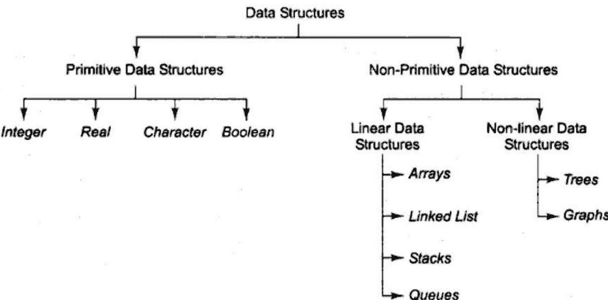

图 1.1 数据结构分类

根据数据的结构和排列，非原始数据结构进一步分为线性和非线性。

如果数据结构的元素形成序列或线性列表，则称为线性数据结构。在线性数据结构中，数据以线性方式排列，尽管它们在内存中的存储方式不必是顺序的。数组、链表、栈和队列是线性数据结构的示例。

相反，如果数据不是按序列排列，则数据结构被称为非线性。因此，数据的插入和删除无法以线性方式进行。树和图是非线性数据结构的示例。

### 数组

最简单的数据结构类型是 *线性*（或 *一维*）数组。所谓 *线性数组*，是指由有限个 $n$ 个相似数据元素组成的列表，分别由一组 $n$ 个连续数引用，通常为 1、2、3、...、$n$。如果为数组选择名称 $A$，则 $A$ 的元素用下标表示法表示

```
$a_1, a_2, a_3, ..., a_n$
```

或用括号表示法

```
$A(1), A(2), A(3), ..., A(N)$
```

或用方括号表示法

```
$A[1], A[2], A[3], ..., A[N]$
```

无论使用哪种表示法，$A[K]$ 中的数字 $K$ 称为 *下标*，$A[K]$ 称为 *下标变量*。

*注：* 当数组名称由多个字母组成或数组名称出现在算法中时，经常使用括号表示法和方括号表示法。使用此表示法时，我们将像上面的 $A$ 和 $N$ 所示，对名称和下标使用普通大写字母。否则，我们可以像上面的 $a$ 和 $n$ 所示，对名称和下标使用斜体的常规下标表示法，对下标使用小写字母。前一种表示法遵循面向计算机的文本的惯例，而后一种表示法遵循印刷数学的惯例。

### 示例 1.2

图 1.2 展示了一个由六名学生姓名组成的线性数组 STUDENT。这里 STUDENT[1] 表示 John Brown，STUDENT[2] 表示 Sandra Gold，依此类推。
线性数组称为一维数组，因为该数组中的每个元素由一个下标引用。*二维数组* 是相似数据元素的集合，其中每个元素由两个下标引用。（此类数组在数学中称为 *矩阵*，在商业应用中称为 *表*。）多维数组的定义类似。数组将在第 4 章中详细介绍。

| | STUDENT |
|---|---|
| 1 | John Brown |
| 2 | Sandra Gold |
| 3 | Tom Jones |
| 4 | June Kelly |
| 5 | Mary Reed |
| 6 | Alan Smith |

图 1.2

### 示例 1.3

一家拥有 28 家门店的连锁店，每家门店有 4 个部门，可能会如图 1.3 所示列出其每周销售额（精确到美元）。此类数据可以使用二维数组存储在计算机中，其中第一个下标表示门店，第二个下标表示部门。如果给数组命名为 SALES，则

```
SALES[1, 1] = 2872, SALES[1, 2] = 805, SALES[1, 3] = 3211, ..., SALES[28, 4] = 982
```


| 商店 \ 部门 | 1 | 2 | 3 | 4 |
|---|---|---|---|---|
| 1 | 2872 | 805 | 3211 | 1560 |
| 2 | 2196 | 1223 | 2525 | 1744 |
| 3 | 3257 | 1017 | 3686 | 1951 |
| ... | ... | ... | ... | ... |
| 28 | 2618 | 931 | 2333 | 982 |

图 1.3

该数组的大小表示为 28 × 4（读作 28 乘 4），因为它包含 28 行（数字的水平行）和 4 列（数字的垂直列）。

## 链表

链表将通过一个示例来介绍。假设一家经纪公司维护一个文件，其中每条记录包含客户姓名及其销售人员，并且假设该文件包含图 1.4 中显示的数据。显然，该文件可以通过这样的表格存储在计算机中，即两列九个姓名。然而，如下文讨论所示，这可能不是存储数据的最有用方式。

| | 客户 | 销售人员 |
|---|---|---|
| 1 | 亚当斯 | 史密斯 |
| 2 | 布朗 | 雷 |
| 3 | 克拉克 | 琼斯 |
| 4 | 德鲁 | 雷 |
| 5 | 埃文斯 | 史密斯 |
| 6 | 法默 | 琼斯 |
| 7 | 盖勒 | 雷 |
| 8 | 希尔 | 史密斯 |
| 9 | 英菲尔德 | 雷 |

图 1.4

存储图 1.4 中数据的另一种方法是为销售人员设置一个单独的数组，并在客户文件中设置一个条目（称为指针），以给出每个客户销售人员的位置。图 1.5 就是这样做的，其中一些指针通过从指针位置到相应销售人员位置的箭头来表示。从实际角度讲，用作指针的整数所需空间小于姓名；因此，这种表示方式节省空间，尤其是当每个销售人员有数百名客户时。

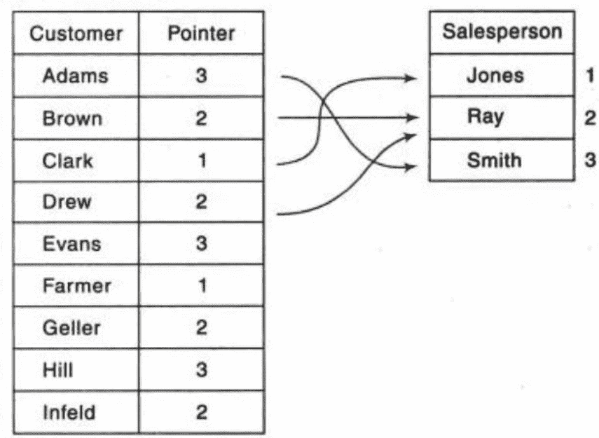

图 1.5

假设公司想要获取特定销售人员的客户列表。使用图 1.5 的数据表示，公司将不得不搜索整个客户文件。简化此类搜索的一种方法是让图 1.5 中的箭头指向相反方向；每个销售人员现在将拥有一组指针，给出其客户的位置，如图 1.6 所示。这种表示的主要缺点是每个销售人员可能有许多指针，并且随着客户的添加和删除，指针集合会发生变化。

| 销售人员 | 指针 |
|---|---|
| 琼斯 | 3, 6 |
| 雷 | 2, 4, 7, 9 |
| 史密斯 | 1, 5, 8 |

图 1.6

图 1.7 显示了存储图 1.4 类型数据的另一种非常流行的方法。在这里，每个销售人员有一个指向其第一个客户的指针，该客户的指针又指向第二个客户，依此类推，销售人员的最后一个客户由 0 表示。图 1.7 用箭头描绘了销售人员 Ray 的这种情况。使用这种表示，可以轻松获得特定销售人员的完整客户列表，并且如第 5 章将看到，可以轻松插入和删除客户。

图 1.7 中数据的表示是链表的一个示例。虽然“指针”和“链接”这两个术语通常互换使用，但我们将尽量在一个列表中的元素指向另一个列表中的元素时使用“指针”术语，并保留“链接”术语用于列表中的元素指向同一列表中元素的情况。

| 客户 | 链接 |
|---|---|
| 亚当斯 | 5 |
| 布朗 | 4 |
| 克拉克 | 6 |
| 德鲁 | 7 |
| 埃文斯 | 8 |
| 法默 | 0 |
| 盖勒 | 9 |
| 希尔 | 0 |
| 英菲尔德 | 0 |

| 销售人员 | 指针 |
|---|---|
| 琼斯 | 3 |
| 雷 | 2 |
| 史密斯 | 1 |

图 1.7

## 树

数据经常包含各元素之间的层次关系。反映这种关系的数据结构称为_根状树图_，或简称_树_。树将在第 7 章中详细定义和讨论。这里我们通过两个示例说明它们的一些基本属性。

### 示例 1.4 记录结构

虽然文件可以通过一个或多个数组来维护，但记录（其中指示组项目和基本项目）最好通过树结构来描述。例如，员工人事记录可能包含以下数据项：

社会安全号码、姓名、地址、年龄、薪水、受赡养人

但是，姓名可能是一个组项目，包含子项目 Last、First 和 MI（中间缩写）。另外，地址可能是一个组项目，包含子项目街道地址和区域地址，其中区域本身可能是一个包含子项目城市、州和邮政编码的组项目。这种层次结构在图 1.8(a) 中描绘。描绘此类树结构的另一种方法是按层级，如图 1.8(b) 所示。

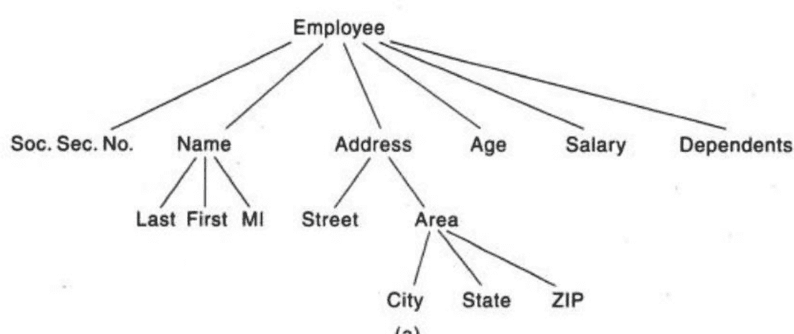

```
01 Employee
  02 Social Security Number
  02 Name
    03 Last
    03 First
    03 Middle Initial
  02 Address
    03 Street
    03 Area
      04 City
      04 State
      04 ZIP
  02 Age
  02 Salary
  02 Dependents
```

图 1.8

### 示例 1.5 代数表达式

考虑代数表达式

$(2x + y)(a - 7b)^3$

使用垂直箭头（↑）表示乘方，使用星号（*）表示乘法，我们可以用图 1.9 中的树来表示该表达式。请注意，图中反映了运算执行的顺序：乘方必须在减法之后进行，树顶部的乘法必须最后执行。

除了数组、链表和树之外，还有我们将学习的其他数据结构。下面简要描述其中一些结构。

- (a) 栈：栈，也称为后进先出（LIFO）系统，是一个线性列表，其中插入和删除只能在一端进行，称为栈顶。该结构的操作类似于弹簧系统上的一叠盘子，如图 1.10(a) 所示。请注意，新盘子只能插入到栈顶，盘子只能从栈顶删除。

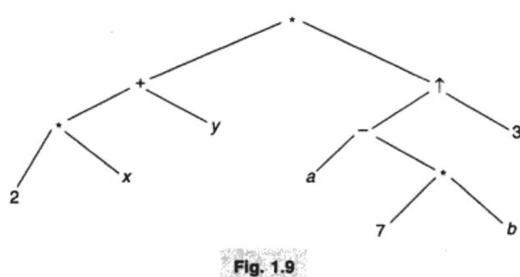

- (b) 队列：队列，也称为先进先出（FIFO）系统，是一个线性列表，其中删除只能在列表的一端进行，即列表的“前端”，而插入只能在列表的另一端进行，即列表的“后端”。该结构的操作方式与公交车站等待上车的人排队非常相似，如图 1.10(b) 所示：排队的第一个人是第一个上车的人。另一个类比是等待通过路口的汽车——排队的第一辆车是第一辆通过的车。

- (c) 图：数据有时包含元素对之间的关系，这种关系不一定是层次性的。例如，假设一家航空公司只在图 1.10(c) 中线条连接的城市之间飞行。反映这种关系的数据结构称为图。图将在第 8 章中正式定义和研究。

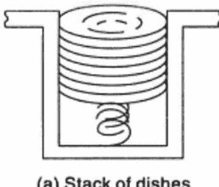

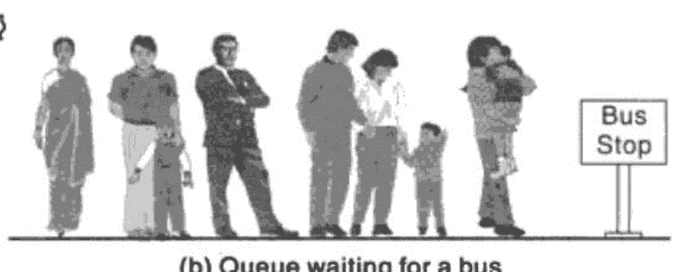

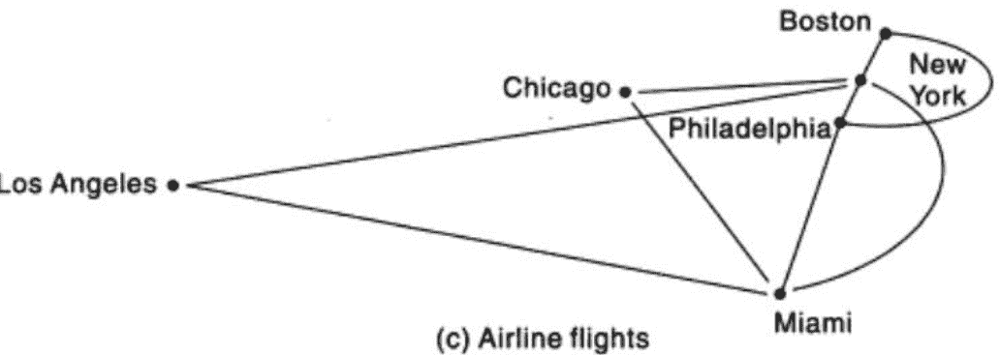

图 1.10

备注：数据结构的元素有许多不同的名称。一些常用的名称有“数据元素”（data element）、“数据项”（data item）、“项集合”（item aggregate）、“记录”（record）、“节点”（node）和“数据对象”（data object）。使用的特定名称取决于数据结构的类型、结构使用的上下文以及使用名称的人。我们将偏好使用“数据元素”术语，但在讨论文件时将使用“记录”术语，在讨论链表、树和图时将使用“节点”术语。

### 1.4 数据结构操作

我们的数据结构中的数据通过某些操作进行处理。事实上，为给定情况选择的特定数据结构很大程度上取决于执行特定操作的频率。本节向读者介绍其中一些最常用的操作。

以下四项操作在本文中起着主要作用：

- 1. 遍历：恰好访问每条记录一次，以便可以处理记录中的某些项目。（这种访问和处理有时称为“访问”记录。）
- 2. 搜索：查找具有给定键值的记录的位置，或查找满足一个或多个条件的所有记录的位置。
- 3. 插入：向结构中添加新记录。
- 4. 删除：从结构中删除记录。

有时在给定情况下可能会使用两个或多个操作；例如，我们可能想要删除具有给定键的记录，这可能意味着我们首先需要搜索记录的位置。

还将考虑以下两项在特殊情况下使用的操作：

- 1. 排序：将记录按某种逻辑顺序排列（例如，按某个 NAME 键的字母顺序，或按某个 NUMBER 键的数值顺序，如社会安全号码或账户号码）
- 2. 合并：将两个不同排序文件中的记录合并为一个排序文件

其他操作，例如复制和连接，将在本文后面讨论。

### 示例 1.6

一个组织包含一个会员文件，其中每条记录包含给定会员的以下数据：
姓名、地址、电话号码、年龄、性别

- (a) 假设组织希望通过邮件宣布一次会议。那么将遍历文件以获取每个会员的姓名和地址。
- (b) 假设有人想查找居住在某个区域的所有会员的姓名。同样，将遍历文件以获取数据。
- (c) 假设有人想获取给定姓名的地址。那么将搜索文件以查找包含该姓名的记录。
- (d) 假设有新人加入组织。那么将插入其记录到文件中。
- (e) 假设一名会员去世。那么将从文件中删除其记录。
- (f) 假设一名会员搬家并有了新地址和电话号码。给定会员的姓名，首先需要在文件中搜索该记录。然后执行“更新”——即，用新数据更改记录中的项目。
- (g) 假设有人想查找年龄在 65 岁或以上的会员人数。同样，将遍历文件，统计此类会员。


### 1.5 抽象数据类型 (ADT)

抽象数据类型（ADT）是指一组数据值及其相关操作，这些操作被准确地指定，与任何特定实现无关。使用ADT，我们知道特定数据类型可以做什么，但它实际如何做是隐藏的。更广义地说，ADT由一组定义组成，允许我们使用函数同时隐藏实现。

抽象数据类型的属性通过以下示例强调。

### 示例 1.7 列表表示

考虑一个由数据项1、2、3、4、5、6、7、8、9组成的列表L，如图1.11(a)所示。我们可以使用四种数据结构中的任何一种来支持L——线性列表、矩阵、树或图，分别如图1.11(b)、(c)和(d)所示。

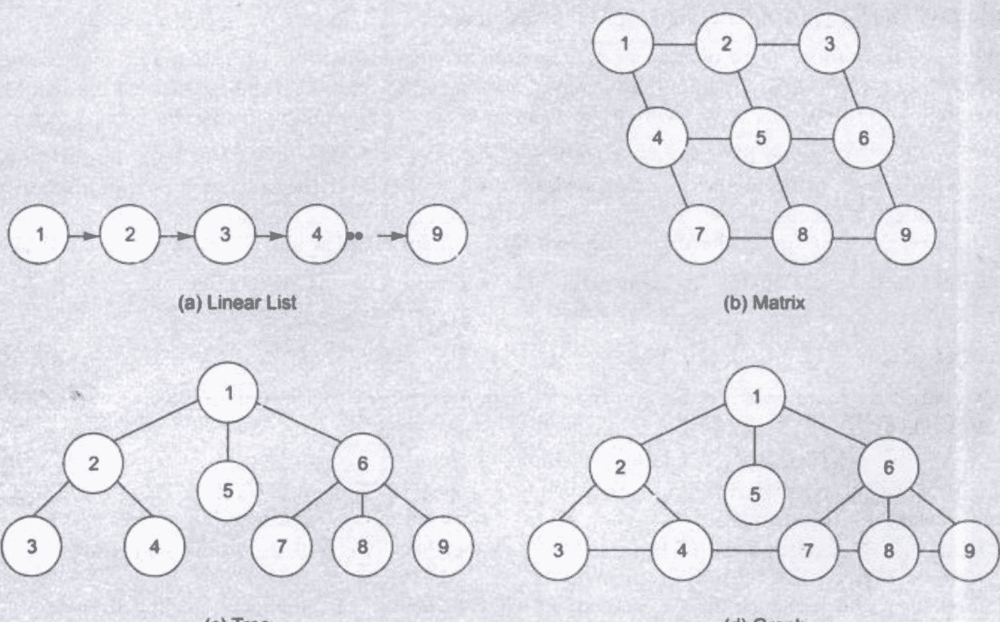

图 1.11 支持列表的数据结构

假设我们将列表放在ADT上。用户不应意识到我们使用的结构，即它是树、图还是其他东西。只要他们能够插入和检索数据，我们如何存储数据就无关紧要。

### 示例 1.8

一家商店维护着客户、销售助理和一天平均交易的列表，如图1.12所示。

假设我们需要编写一个程序，帮助确定为高效服务客户所需的销售助理数量。在这里，我们需要模拟商店中的等待队列。此分析将需要模拟队列。然而，队列在编程语言中通常不可用。因此，即使队列类型可用，我们也需要一些基本的队列操作，例如入队和出队，它们基本上是插入和删除操作，用于模拟。

- 在这种情况下，我们可以做以下事情：
  1. 编写一个模拟队列的程序，或
  2. 编写一个可以解决任何队列问题的队列ADT。

如果我们选择第二个选项，我们仍然需要编写一个程序来模拟商店应用程序。然而，这样做实际上会更简单、更快，因为我们可以专注于应用程序而不是队列。

| | 客户 |
|---|---|
| 1 | 客户 |
| 2 | 客户 |
| 3 | 客户 |

| | 销售助理 |
|---|---|
| 1 | Ray |
| 2 | Reed |
| 3 | Kelly |

图 1.12

因此，抽象数据类型可以进一步定义为与对数据类型有意义的操作一起打包的数据声明。换句话说，我们将数据和对数据的操作封装起来，然后对用户隐藏它们。

用户无需了解数据结构即可使用ADT。考虑示例1.8，应用程序不应了解数据结构。对队列中数据的所有引用和操作必须通过结构中的定义接口来处理。允许应用程序直接引用数据结构是许多实现中的常见错误。这阻止了ADT完全可移植到其他应用程序。

### 抽象数据类型模型

ADT模型的表示如图1.13所示。请注意，ADT模型有两个不同的部分——函数（公共和私有）和数据结构。两者都包含在ADT模型本身内，不属于应用程序的范围。另一方面，数据结构根据需要可用于ADT的所有函数，并且一个函数可以调用任何其他函数来完成其任务。这意味着数据结构和函数在彼此的范围内。

数据通过外部应用程序编程接口输入、访问、修改和删除。该接口只能访问公共函数。对于每个ADT操作，都有一个执行其特定任务的算法。操作名称和参数可供应用程序使用，它们为应用程序提供了唯一的接口。

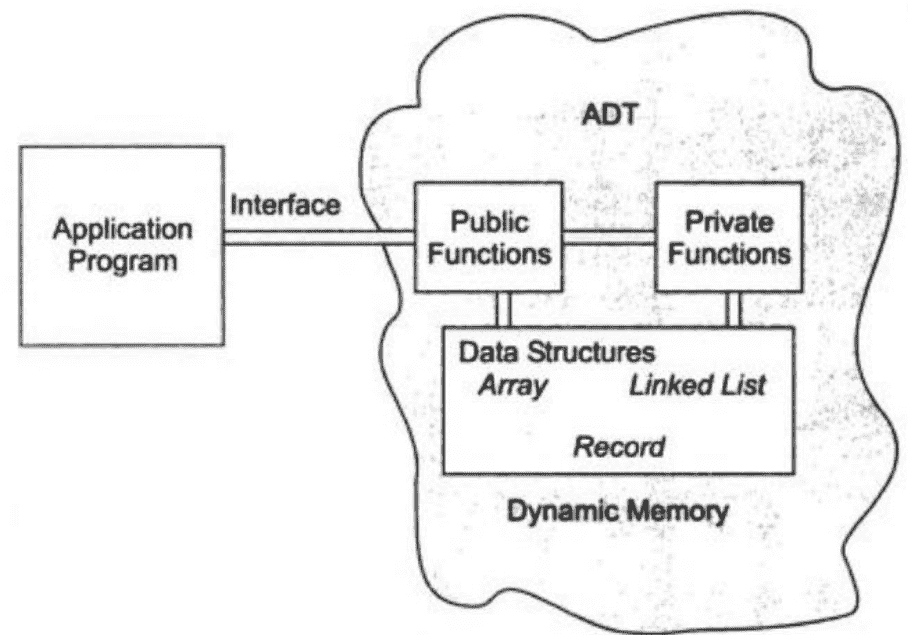

当列表完全由程序控制时，它使用简单结构实现。请注意，仅将结构封装在ADT中是不够的，还需要多个版本的结构能够共存。因此，我们必须对用户隐藏实现，同时能够同时存储不同的数据。

两种基本结构，即数组和链表，可用于实现ADT列表。

### 1.6 算法：复杂度、时空权衡

算法是解决特定问题的一组明确定义的步骤。本文的主要目的之一是为数据处理开发高效算法。算法使用的时间和空间是衡量算法效率的两个主要指标。算法的复杂度是一个函数，它以输入规模为参数给出运行时间和/或空间。（复杂度的概念将在第2章中讨论。）

我们的每个算法都将涉及特定的数据结构。因此，我们可能并不总能使用最高效的算法，因为数据结构的选择取决于许多因素，包括数据类型以及各种数据操作应用的频率。有时，数据结构的选择涉及时空权衡：通过增加存储数据的空间量，可以减少处理数据所需的时间，或者反之亦然。我们用两个例子来说明这些想法。

### 搜索算法

考虑一个会员文件，如示例1.6所示，其中每条记录包含成员姓名和电话号码等数据。假设我们已知某个成员的姓名，想要查找其电话号码。一种方法是线性搜索文件，即应用以下算法：

### 线性搜索

逐条搜索文件中的每条记录，一次一条，直到找到给定的姓名及其对应的电话号码。

首先，很明显，执行算法所需的时间与比较次数成正比。此外，假设文件中的每个名字被选中的可能性相同，可以直观地看出，包含n条记录的文件的平均比较次数等于n/2；也就是说，线性搜索算法的复杂度由C(n) = n/2给出。

如果我们要搜索包含成千上万个姓名的列表（如电话簿），上述算法在实践中是不可能的。但是，如果姓名按字母顺序排序（如电话簿），则可以使用一种称为二分查找的高效算法。该算法在第4章中详细讨论，但我们下面简要描述其一般思想。

### 二分查找

将给定的姓名与列表中间的姓名进行比较；这告诉我们列表的哪一半包含姓名。然后将姓名与正确一半中间的姓名进行比较，以确定列表的哪一部分包含姓名。继续此过程，直到在列表中找到姓名。

可以证明，二分查找算法的复杂度由以下公式给出：

C(n) = log₂ n

例如，在包含25,000个姓名的列表中查找给定姓名，所需的比较次数不会超过15次。

尽管二分查找算法是一种非常高效的算法，但它有一些主要缺点。具体来说，该算法假设可以直接访问列表或子列表中的中间姓名。这意味着列表必须存储在某种类型的数组中。不幸的是，在数组中插入元素需要将元素向下移动，从数组中删除元素需要将元素向上移动。

电话公司通过每年印刷新目录，同时为新电话客户保存单独的临时文件来解决上述问题。也就是说，电话公司每年更新其文件。另一方面，银行可能希望几乎即时地在其文件中插入新客户。因此，线性排序列表可能不是银行的最佳数据结构。

### 时空权衡示例

假设记录文件包含姓名、社会安全号码及其字段中的许多其他信息。按字母顺序对文件进行排序并运行二分查找是查找给定姓名记录的一种非常高效的方法。另一方面，假设我们只知道该人的社会安全号码。那么我们将不得不对记录进行线性搜索，对于非常大量的记录来说，这极其耗时。如何解决此类问题？一种方法是拥有另一个按社会安全号码数值排序的文件。然而，这将使存储数据所需的空间翻倍。另一种方法（如图1.14所示）是将主文件按社会安全号码数值排序，并拥有一个仅包含两列的辅助数组，第一列包含按字母顺序排列的姓名列表，第二列包含指针，指示主文件中相应记录的位置。这是一种经常使用的解决问题的方法，因为额外的空间仅包含两列，对于它提供的额外信息量来说是微乎其微的。

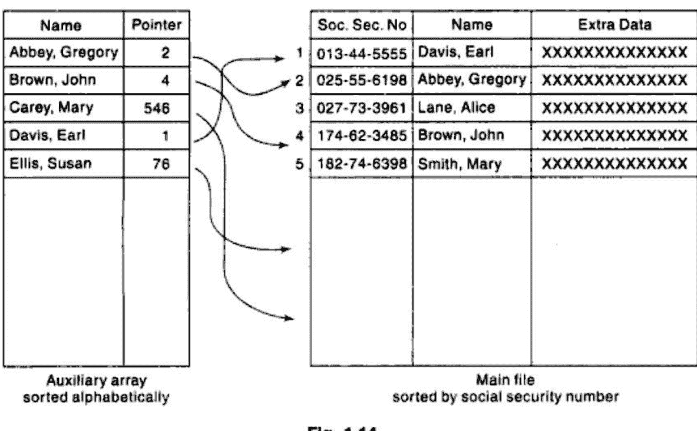


Remark: 假设一个文件按社会安全号码数值排序。当新记录插入文件时，数据必须不断移动到新位置，以保持排序顺序。最大限度减少数据移动的一种简单方法是让社会安全号码充当每条记录的地址。不仅在插入记录时不会移动数据，而且可以即时访问任何记录。然而，这种数据存储方法对于仅几百或可能几千条记录，需要十亿（10^9）个内存位置。显然，这种以空间换时间的权衡不值得花费。另一种方法是定义一个从键值集合 K（社会安全号码）到内存单元地址集合 L 的函数 H。这样的函数 H 称为 *哈希函数*。哈希函数及其属性将在第 9 章中介绍。

## 已解例题

### 基本术语

- 1.1 一位教授保存一份班级名单，包含每位学生的以下数据：
  - 姓名、专业、学号、考试成绩、最终成绩
  - (a) 列出该名单的实体、属性和实体集。
  - (b) 描述字段值、记录和文件。
  - (c) 哪些属性可以作为该名单的主键？

  (a) 每个学生是一个实体，学生的集合是实体集。学生的属性（如姓名、专业等）是属性。

  (b) 字段值是分配给属性的值，即实际的姓名、考试成绩等。每个学生的字段值构成一条记录，所有学生记录的集合构成文件。

  (c) 姓名或学号均可作为主键，因为每个都能唯一确定学生的记录。通常教授使用姓名作为主键，但注册处可能使用学号。

- 1.2 一家医院维护一个患者文件，其中每条记录包含以下数据：
  - 姓名、入院日期、社会安全号码、房间、床号、医生
  - (a) 哪些项目可以作为主键？
  - (b) 哪一对项目可以作为主键？
  - (c) 哪些项目可以是组项目？

  (a) 姓名和社会安全号码可以作为主键。（假设没有两名患者姓名相同。）

  (b) 房间和床号的组合也能唯一确定给定的患者。

  (c) 姓名、入院日期和医生可能是组项目。

- 1.3 以下哪些数据项作为记录中的项目包含时，可能导致可变长度记录：(a) 年龄，(b) 性别，(c) 配偶姓名，(d) 子女姓名，(e) 教育程度。(f) 前雇主？

由于 (d) 和 (f) 可能包含少量或大量项目，它们可能导致可变长度记录。此外，(e) 可能包含许多项目，除非它只询问获得的最高级别。

- 1.4 本教材将仅简要介绍数据库系统。为什么？

“数据库系统”指的是存储在计算机二级存储器中的数据。二级存储器中数据结构的实现和分析与主内存中的非常不同。本教材主要关注主内存中的数据结构，而非二级存储器。

### 数据结构与操作

- 1.5 简要描述 (a) 遍历、(b) 排序和 (c) 搜索。

  (a) 访问并处理每条记录恰好一次

  (b) 将数据按给定顺序排列

  (c) 查找具有给定键或键的记录的位置

- 1.6 简要描述 (a) 插入和 (b) 删除。

  (a) 向数据结构中添加新记录，通常保持特定顺序

  (b) 从数据结构中删除特定记录

- 1.7 考虑图 1.15 中按字母顺序排序的线性数组 NAME。

  (a) 找出 NAME[2]、NAME[4] 和 NAME[7]。

  (b) 假设要将 Davis 插入数组。必须移动多少个姓名到新位置。

  (c) 假设要从数组中删除 Gupta。必须移动多少个姓名到新位置？

  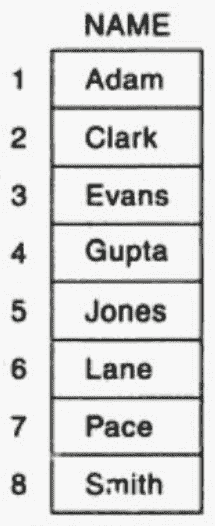

  (a) 此处 NAME[K] 是列表中的第 k 个姓名。因此，
  NAME[2] = Clark, NAME[4] = Gupta, NAME[7] = Pace

  (b) 因为 Davis 将被分配到 NAME[3]，所以 Evans 到 Smith 之间的姓名必须移动。因此移动了六个姓名。

  (c) Jones 到 Smith 之间的姓名必须在数组中上移。因此必须移动四个姓名。

- 1.8 考虑图 1.16 中的线性数组 NAME。图中 FIRST 和 LINK[K] 的值按如下方式确定姓名的线性顺序。FIRST 给出列表中第一个姓名的位置，LINK[K] 给出 NAME[K] 之后的姓名的位置，0 表示列表结束。找出姓名的线性顺序。

| | NAME | LINK |
|---|---|---|
| 1 | Rogers | 7 |
| 2 | Clark | 8 |
| 3 | | |
| 4 | Hansen | 10 |
| 5 | Brooks | 2 |
| 6 | Pitt | 1 |
| 7 | Walker | 0 |
| 8 | Fisher | 4 |
| 9 | | |
| 10 | Leary | 6 |

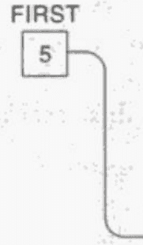

顺序按如下方式获得：
FIRST = 5，因此列表中的第一个姓名是 NAME[5]，即 Brooks。
LINK[5] = 2，因此下一个姓名是 NAME[2]，即 Clark。
LINK[2] = 8，因此下一个姓名是 NAME[8]，即 Fisher。
LINK[8] = 4，因此下一个姓名是 NAME[4]，即 Hansen。
LINK[4] = 10，因此下一个姓名是 NAME[10]，即 Leary。
LINK[10] = 6，因此下一个姓名是 NAME[6]，即 Pitt。
LINK[6] = 1，因此下一个姓名是 NAME[1]，即 Rogers。
LINK[1] = 7，因此下一个姓名是 NAME[7]，即 Walker。
LINK[7] = 0，表示列表结束。
因此姓名的线性顺序为 Brooks、Clark、Fisher、Hansen、Leary、Pitt、Rogers、Walker。请注意，这是姓名的字母顺序。

- 1.9 考虑代数表达式 (7x + y)(5a - b)^3。(a) 按示例 1.5 绘制相应的树图。(b) 找出幂运算的范围。（树中节点 v 的范围是由 v 及其后续节点组成的子树。）

  (a) 使用垂直箭头 (↑) 表示幂运算，使用星号 (*) 表示乘法，以得到图 1.17 中的树。

  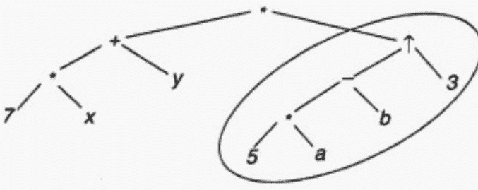

  (b) 幂运算 ↑ 的范围是图中圈出的子树。它对应表达式 (5a − b)³。

- 1.10 以下是通过层级编号给出的树结构，如示例 1.4 所讨论：

  01 Employee 02 Name 02 Number 02 Hours 03 Regular 03 Overtime 02 Rate

  绘制相应的树图。

  树图出现在图 1.18 中。此处每个节点 v 是紧随 v 且层级编号低于 v 的节点的后继节点。

  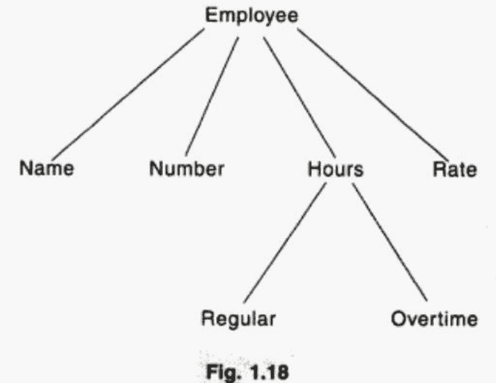

- 1.11 讨论在以下每种情况下，确定元素处理顺序时，栈或队列哪种是合适的结构。

  (a) 批处理计算机程序提交到计算机中心。

  (b) 程序 A 调用子程序 B，子程序 B 调用子程序 C，依此类推。

  (c) 员工有一份合同，要求对雇佣和解雇实行资历制度。

  (a) 队列。除优先情况外，程序按先到先得的原则执行。

  (b) 栈。最后一个子程序先执行，其结果传递给倒数第二个程序，然后执行该程序，依此类推，直到原始调用程序执行完毕。

  (c) 栈。在资历制度中，最后受雇的员工最先被解雇。

- 1.12 一家航空公司的每日航班如图 1.19 所示。CITY 列出城市，ORIG[K] 和 DEST[K] 分别表示航班 NUMBER[K] 的出发城市和目的地。绘制数据的相应有向图。（该图是有向的，因为航班号表示从一个城市到另一个城市的航班，而不是返回航班。）

  图的节点是五个城市。如果从城市 A 到城市 B 有航班，则从 A 画箭头到 B，并在箭头上标注航班号。有向图出现在图 1.20 中。


| 城市 |
|---|
| 亚特兰大 |
| 波士顿 |
| 芝加哥 |
| 迈阿密 |
| 费城 |

| 编号 | 始发地 | 目的地 |
|---|---|---|
| 701 | 2 | 3 |
| 702 | 3 | 2 |
| 705 | 5 | 3 |
| 708 | 3 | 4 |
| 711 | 2 | 5 |
| 712 | 5 | 2 |
| 713 | 5 | 1 |
| 715 | 1 | 4 |
| 717 | 5 | 4 |
| 718 | 4 | 5 |

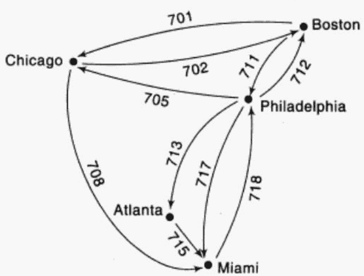

图 1.19

图 1.20

## 复杂度；空间-时间权衡

1.13 简要描述 (a) 算法的复杂度和 (b) 算法的空间-时间权衡的概念。

(a) 算法的复杂度是一个函数 f(n)，用于衡量算法在输入规模 n 方面所使用的时间和/或空间。

(b) 空间-时间权衡是指在数据处理问题的算法解之间做出选择，通过增加存储数据的空间来降低算法解的运行时间，反之亦然。

1.14 假设数据集 S 包含 n 个元素。

(a) 比较线性搜索算法的运行时间 T1 与二分搜索算法的运行时间 T2，当 (i) n = 1000 和 (ii) n = 10 000 时。

(b) 讨论在 S 存储为链表时，在 S 中搜索给定项目的问题。

(a) 回顾（第 1.5 节），线性搜索算法的预期运行时间为 f(n) = n/2，二分搜索算法为 f(n) = log2 n。因此，(i) 当 n = 1000 时，T1 = 500，但 T2 = log2 1000 ≈ 10；(ii) 当 n = 10 000 时，T1 = 5000，但 T2 = log2 10 000 ≈ 14。

(b) 二分搜索算法假设可以直接访问集合 S 中的中间元素。但在链表中无法直接访问中间元素。因此，当 S 存储为链表时，可能不得不使用线性搜索算法。

1.15 考虑图 1.19 中的数据，该数据给出了航空公司的不同航班。讨论存储数据的不同方法，以减少执行以下操作的时间：

(a) 给定航班号，查找航班的始发地和目的地。

(b) 给定城市 A 和城市 B，查找是否存在从 A 到 B 的航班，如果存在，查找其航班号。

(a) 将图 1.19(b) 中的数据存储在数组 ORIG 和 DEST 中，下标为航班号，如图 1.21(a) 所示。
(b) 将图 1.19(b) 中的数据存储在二维数组 FLIGHT 中，其中 FLIGHT[J, K] 包含从 CITY[J] 到 CITY[K] 的航班号，如果没有这样的航班，则包含 0，如图 1.21(b) 所示。

| | 始发地 | 目的地 |
|---|---|---|
| 701 | 2 | 3 |
| 702 | 3 | 2 |
| 703 | 0 | 0 |
| 704 | 0 | 0 |
| 705 | 5 | 3 |
| 706 | 0 | 0 |
| ... | ... | ... |
| 715 | 1 | 4 |
| 716 | 0 | 0 |
| 717 | 5 | 4 |
| 718 | 4 | 5 |

| 航班 | 1 | 2 | 3 | 4 | 5 |
|---|---|---|---|---|---|
| 1 | 0 | 0 | 0 | 715 | 0 |
| 2 | 0 | 0 | 701 | 0 | 711 |
| 3 | 0 | 702 | 0 | 708 | 0 |
| 4 | 0 | 0 | 0 | 0 | 718 |
| 5 | 713 | 712 | 705 | 717 | 0 |

图 1.21

1.16 假设一家航空公司有 s 个航班服务于 n 个城市。讨论图 1.21(a) 和图 1.21(b) 中使用的数据表示方法的缺点。

(a) 假设航班号间隔非常大；即，假设航班数 s 与内存位置数之比非常小，例如约为 0.05。那么额外的存储空间可能不值得花费。

(b) 假设航班数 s 与数组 FLIGHT 中内存位置数 n 之比非常小，即数组 FLIGHT 包含大量零（这样的数组称为稀疏矩阵）。那么额外的存储空间可能不值得花费。

1.17 列出线性数据结构的示例。

数组、链表、栈和队列是线性数据结构的示例。

1.18 定义抽象数据类型。简要解释它

抽象数据类型可以定义为与对该数据类型有意义的操作一起打包的数据声明。换句话说，我们将数据和对数据的操作封装起来，然后对用户隐藏它们。

## 选择题

- 1.1 ______ 是指值的单个单位。
  (a) 组项目 (b) 数据项
  (c) 基本项目 (d) 基础项目

- 1.2 一个 ______ 是具有某些可赋值的属性或特性的事物。
  (a) 字段 (b) 记录
  (c) 实体 (d) 文件

- 1.3 ______ 是给定实体集中实体的记录集合。
  (a) 字段 (b) 记录
  (c) 实体 (d) 文件

- 1.4 ______ 字段中的值唯一确定文件中的记录。
  (a) 主键 (b) 次键
  (c) 键 (d) 指针

- 1.5 在 ______ 长度记录中，文件记录可能包含不同长度。
  (a) 固定 (b) 主
  (c) 可变 (d) 实体

- 1.6 ______ 是特定数据组织的逻辑或数学模型。
  (a) 结构 (b) 变量
  (c) 函数 (d) 数据结构

- 1.7 以下哪项不是原始数据结构？
  (a) 布尔型 (b) 整型
  (c) 数组 (d) 字符型

- 1.8 以下哪项是非线性数据结构？
  (a) 数组 (b) 链表
  (c) 栈 (d) 图

- 1.9 ______ 也称为后进先出（LIFO）系统

- 1.10 ______ 也称为先进先出（FIFO）系统。
  (a) 树 (b) 栈
  (c) 队列 (d) 图

- 1.11 以下哪项操作访问每条记录恰好一次，以便处理某些项目？
  (a) 插入 (b) 删除
  (c) 遍历 (d) 搜索

- 1.12 ______ 是包含一对元素之间关系的数据结构，该关系不一定是层次性的。
  (a) 树 (b) 图
  (c) 数组 (d) 字符串

- 1.13 ______ 涉及将记录按逻辑顺序排列。
  (a) 合并 (b) 排序
  (c) 遍历 (d) 搜索

- 1.14 ______ 是一组数据值及其相关操作，这些操作被准确指定，独立于任何特定实现。
  (a) 栈 (b) 树
  (c) 抽象数据类型 (d) 图

- 1.15 以下哪项操作将两个不同排序文件中的记录合并为一个排序文件？
  (a) 插入 (b) 排序
  (c) 搜索 (d) 合并

## 选择题答案

- 1.1 (b) 1.2 (c) 1.3 (d) 1.4 (a) 1.5 (a) 1.6 (d) 1.7 (c) 1.8 (d)
- 1.9 (d) 1.10 (c) 1.11 (c) 1.12 (b) 1.13 (b) 1.14 (c) 1.15 (d)

## 预备知识

### 2.1 简介

本文的主要特点之一是开发用于创建和处理数据结构的算法。本章通过简单示例，描述了用于呈现算法的格式。我们选定的格式与克努斯在其著名著作《基本算法》中使用的格式类似。尽管我们的格式与语言无关，但算法将结构良好且详细，以便可以轻松翻译为 Pascal、C 等编程语言。事实上，今后全文将使用 C 语言实现算法。

算法可能非常复杂。如果实现更复杂算法的计算机程序被组织成类似图 2.1 的模块层次结构，则这些程序可以更容易理解。在这种组织中，每个程序首先包含一个主模块，该模块对算法进行一般描述；主模块引用某些子模块，子模块包含比主模块更详细的信息；每个子模块可以引用更详细的子模块；以此类推。将程序组织成这样的模块层次结构通常需要使用某些基本流程模式和逻辑结构，这些通常与结构化编程的概念相关联。本章将回顾这些流程模式和逻辑结构。

本章首先简要概述和讨论算法研究和计算机科学中普遍出现的各种数学函数，本章最后讨论算法和程序中可能出现的不同类型的变量。

本章还涵盖了算法复杂度的概念。这一重要的算法度量为我们提供了比较搜索或排序等特定问题的不同算法解决方案的工具。算法及其复杂度的概念不仅对数据结构至关重要，而且对计算机科学的几乎所有领域也至关重要。


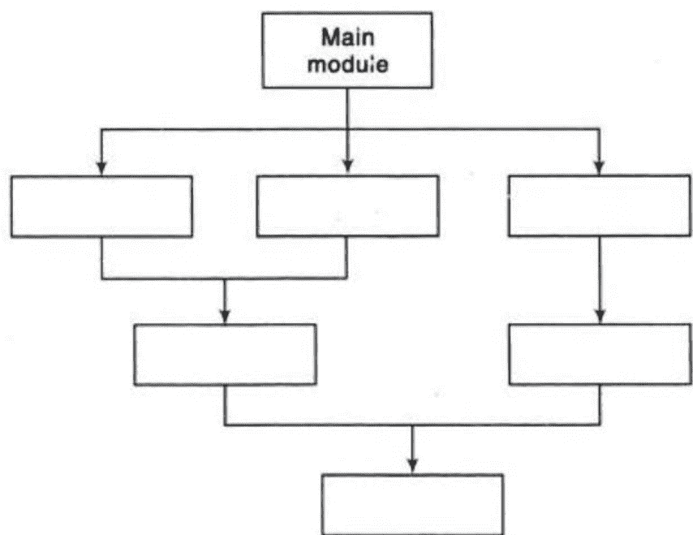

### 图 2.1 模块层次结构

### 2.2 数学符号与函数

本节介绍了在算法分析和计算机科学中经常出现的各种数学函数，以及它们的符号。

### 向下取整与向上取整函数

设 x 为任意实数。那么 x 介于两个整数之间，分别称为 x 的向下取整和向上取整。具体来说，

⌊x⌋，称为 x 的 _向下取整_，表示不超过 x 的最大整数。
⌈x⌉，称为 x 的 _向上取整_，表示不小于 x 的最小整数。
如果 x 本身是整数，则 ⌊x⌋ = ⌈x⌉；否则 ⌊x⌋ + 1 = ⌈x⌉。

**示例 2.1**

⌊3.14⌋ = 3, ⌊√5⌋ = 2, ⌊-8.5⌋ = -9, ⌊7⌋ = 7
⌈3.14⌉ = 4, ⌈√5⌉ = 3, ⌈-8.5⌉ = -8, ⌈7⌉ = 7

### 余数函数；模运算

设 k 为任意整数，M 为正整数。那么
k (mod M)
（读作 k _模_ M）将表示 k 除以 M 的整数余数。更准确地说，
k (mod M) 是满足条件的唯一整数 r，

k = Mq + r \quad \text{其中} \quad 0 \le r < M

当 k 为正数时，只需将 k 除以 M 即可得到余数 r。因此

25 (mod 7) = 4, \quad 25 (mod 5) = 0, \quad 35 (mod 11) = 2, \quad 3 (mod 8) = 3

问题 2.2(b) 展示了在 k 为负数时获得 k (mod M) 的方法。

术语“mod”也用于数学同余关系，该关系表示并定义如下：

a \equiv b (mod M) \quad \text{当且仅当} \quad M \text{整除} b - a

M 称为 *模*，且 a \equiv b (mod M) 读作“a 与 b 关于 M 同余”。同余关系的以下方面经常有用：

0 \equiv M (mod M) \quad \text{和} \quad a \pm M \equiv a (mod M)

*模 M 运算*是指加法、乘法和减法的算术运算，其中算术值被替换为集合中其等价值：

{0, 1, 2, ..., M - 1}

或在集合中

{1, 2, 3, ..., M}

例如，在模 12 运算中，有时称为“时钟”运算，

6 + 9 \equiv 3, \quad 7 \times 5 \equiv 11, \quad 1 - 5 \equiv 8, \quad 2 + 10 \equiv 0 \equiv 12

（使用 0 或 M 取决于应用。）

### 整数与绝对值函数

设 x 为任意实数。x 的 *整数值*，写作 INT(x)，通过删除（截断）数字的小数部分将 x 转换为整数。因此

INT(3.14) = 3, \quad INT (\sqrt{5} ) = 2, \quad INT( -8.5) = -8, \quad INT(7) = 7

观察到，根据 x 是正还是负，INT(x) = \lfloor x \rfloor 或 INT(x) = \lceil x \rceil。

实数 x 的 *绝对值*，写作 ABS(x) 或 |x|，定义为 x 和 -x 中较大者。因此 ABS(0) = 0，并且，对于 x \neq 0，ABS(x) = x 或 ABS(x) = -x，取决于 x 是正还是负。因此

|-15| = 15, \quad |7| = 7, \quad |-3.33| = 3.33, \quad |4.44| = 4.44, \quad |-0.075| = 0.075

我们注意到 |x| = |-x|，并且，对于 x \neq 0，|x| 为正。

### 求和符号；求和

这里我们介绍求和符号 \Sigma（希腊字母西格玛）。考虑一个数列 a_1, a_2, a_3, .... 那么求和

a_1 + a_2 + \cdots + a_n \quad \text{和} \quad a_m + a_{m+1} + \cdots + a_n

将分别用以下符号表示：

\sum_{j=1}^n a_j \quad \text{和} \quad \sum_{j=m}^n a_j

上述表达式中的字母 j 称为哑指标或哑变量。常用作哑变量的其他字母有 i、k、s 和 t。

**示例 2.2**

\sum_{i=1}^{n} a_i b_i = a_1 b_1 + a_2 b_2 + \cdots + a_n b_n

\sum_{j=2}^{5} j^2 = 2^2 + 3^2 + 4^2 + 5^2 = 4 + 9 + 16 + 25 = 54

\sum_{j=1}^{n} j = 1 + 2 + \cdots + n

示例 2.2 中的最后一个求和将出现非常频繁。它的值为 n(n + 1)/2。即，

1 + 2 + 3 + \cdots + n = \frac{n(n+1)}{2}

因此，例如，

1 + 2 + \cdots + 50 = \frac{50(51)}{2} = 1275

### 阶乘函数

从 1 到 n（包含）的正整数乘积用 n!（读作“n 阶乘”）表示。即，

n! = 1 \cdot 2 \cdot 3 \cdots (n-2)(n-1)n

定义 0! = 1 也很方便。

**示例 2.3**

(a) 2! = 1 \cdot 2 = 2; 3! = 1 \cdot 2 \cdot 3 = 6; 4! = 1 \cdot 2 \cdot 3 \cdot 4 = 24

(b) 对于 n > 1，有 n! = n \cdot (n − 1)! 因此
5! = 5 \cdot 4! = 5 \cdot 24 = 120; 6! = 6 \cdot 5! = 6 \cdot 120 = 720

### 排列

n 元素集合的一个排列是将元素按给定顺序排列。例如，由元素 a、b、c 组成的集合的排列如下：

abc, acb, bac, bca, cab, cba

可以证明：n 元素集合有 n! 个排列。因此，4 元素集合有 4! = 24 个排列，5 元素集合有 5! = 120 个排列，依此类推。

### 指数与对数

回顾整数指数的以下定义（其中 m 为正整数）：

```
a^m = a \cdot a \cdots a (m \text{ times}), \quad a^0 = 1, \quad a^{-m} = \frac{1}{a^m}
```

指数被扩展以包含所有有理数，通过为任何有理数 m/n 定义，

```
a^{m/n} = \sqrt[n]{a^m} = (\sqrt[n]{a})^m
```

例如，

```
2^4 = 16, \quad 2^{-4} = \frac{1}{2^4} = \frac{1}{16}, \quad 125^{2/3} = 5^2 = 25
```

事实上，指数被扩展以包含所有实数，通过为任何实数 x 定义，

```
a^x = \lim_{r \to x} a^r \quad \text{where } r \text{ is a rational number}
```

因此，指数函数 f(x) = a^x 对所有实数都有定义。

对数与指数的关系如下。设 b 为正数。任何正数 x 以 b 为底的对数，写作

```
log_b x
```

表示 b 必须提升到的指数才能得到 x。即，

```
y = log_b x \quad \text{and} \quad b^y = x
```

是等价语句。因此，

```
log_2 8 = 3 \text{ since } 2^3 = 8; \quad log_{10} 100 = 2 \text{ since } 10^2 = 100 \\ log_2 64 = 6 \text{ since } 2^6 = 64; \quad log_{10} 0.001 = -3 \text{ since } 10^{-3} = 0.001
```

此外，对于任何底数 b，

```
log_b 1 = 0 \text{ since } b^0 = 1 \\ log_b b = 1 \text{ since } b^1 = b
```

负数的对数和 0 的对数未定义。

也可以将指数函数和对数函数

```
f(x) = b^x \quad \text{and} \quad g(x) = log_b x
```

视为互为逆函数。因此，这两个函数的图像相关。（参见已解决问题 2.5。）

经常，对数使用近似值表示。例如，使用表格或计算器，可得

```
log_{10} 300 = 2.4771 \quad \text{and} \quad log_e 40 = 3.6889
```

作为近似答案。（此处 e = 2.718281 ...。）

以 10 为底的对数（称为常用对数）、以 e 为底的对数（称为自然对数）和以 2 为底的对数（称为二进制对数）具有特殊重要性。某些教材写：

| ln x | 代替 | log_e x |
|---|---|---|
| lg x 或 Log x | 代替 | log_2 x |

这本关于数据结构的教材主要关注二进制对数。因此，

> 除非另有说明，术语 log x 将表示 log_2 x。

经常，我们只需要二进制对数的向下取整或向上取整。这可以通过查看 2 的幂来得到。例如，

```
⌊log_2 100⌋ = 6 since 2^6 = 64, 2^7 = 128
⌈log_2 1000⌉ = 10 since 2^9 = 512 and 2^10 = 1024
```

依此类推。

### 2.3 算法符号

直觉地说，算法是解决特定问题的一系列明确定义的有限分步指令列表。算法的正式定义使用图灵机或其等价物的概念，非常复杂，超出了本教材的范围。本节描述了全书用于呈现算法的格式。这种算法符号最好通过示例来描述。

### 示例 2.4

数组 DATA 中存储着数值。我们想要找到 DATA 最大元素的位置 LOC 和值 MAX。在没有关于 DATA 的其他信息的情况下，解决问题的一种方法如下：

最初令 LOC = 1 且 MAX = DATA[1]。然后将 MAX 与 DATA 中的每个连续元素 DATA[K] 进行比较。如果 DATA[K] 超过 MAX，则更新 LOC 和 MAX，使得 LOC = K 且 MAX = DATA[K]。LOC 和 MAX 中最终出现的值给出了 DATA 最大元素的位置和值。

该算法的正式呈现如下，其流程图出现在图 2.2 中。

```
Algorithm 2.1: (Largest Element in Array) A nonempty array DATA with N numerical values is given. This algorithm finds the location LOC and the value MAX of the largest element of DATA. The variable K is used as a counter.
Step 1. [Initialize.] Set K := 1, LOC := 1 and MAX := DATA[1].
Step 2. [Increment counter.] Set K := K + 1.
Step 3. [Test counter.] If K > N, then:
Write: LOC, MAX, and Exit.
Step 4. [Compare and update.] If MAX < DATA[K], then:
Set LOC := K and MAX := DATA[K].
Step 5. [Repeat loop.] Go to Step 2.
```


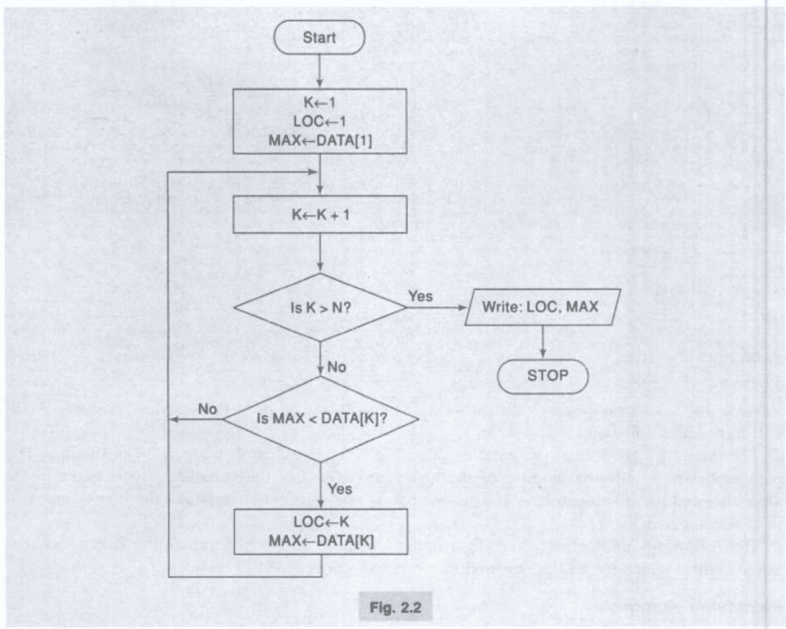

### 图 2.2

### 程序 2.1

```c
/* C implementation of Algorithm 2.1 */
#include <stdio.h>
#include <conio.h>

void main()
{
int DATA[10]={22,65,1,99,32,17,74,49,33,2};
int N, LOC, MAX, K;
N=10;
K=0;
LOC=0;
MAX=DATA[0];
clrscr();

loop:
K=K+1;
if(K==N)
{
printf("LOC = %d, MAX= %d",LOC,MAX);
getch();
exit();
}
if(MAX<DATA[K])
{
LOC=K;
MAX=DATA[K];
}
goto loop;
}
```

输出：
LOC = 3 , MAX= 99

备注：在 C 语言中，数组的索引值从 0 开始，而不是 1。例如，数组 A[10] 的索引值为 0, 1, 2, .... 8, 9。

算法的正式表示格式包含两部分。第一部分是一个段落，说明算法的目的，识别算法中出现的变量，并列出输入数据。算法的第二部分由要执行的步骤列表组成。

以下总结了我们在呈现算法时将使用的某些约定。某些控制结构将在下一节中介绍。

### 标识编号

每个算法都分配一个标识编号，如下所示：算法 4.3 指第 4 章中的第三个算法；算法 P5.3 指第 5 章中已解决问题 5.3 中的算法。请注意，字母“P”表示该算法出现在一个问题中。

### 步骤、控制、退出

除非另有说明，否则算法的步骤依次执行，从步骤 1 开始。可以通过语句“Go to Step n”将控制转移到算法的步骤 n。例如，步骤 5 在算法 2.1 中将控制转回步骤 2。一般来说，通过使用下一节中讨论的某些控制结构，可以实际消除这些 Go to 语句。

```
Set K := 1, LOC := 1 and MAX := DATA[1].
```

然后它们从左到右执行。

当遇到语句
Exit.
时，算法完成。该语句类似于 FORTRAN 和流程图中使用的 STOP 语句。

### 注释

每个步骤可能包含在括号中的注释，指示该步骤的主要目的。注释通常出现在步骤的开头或结尾。

### 变量名

变量名将使用大写字母，如 MAX 和 DATA。用作计数器或下标的单字母变量名在算法中也将大写（例如 K 和 N），尽管在伴随的数学描述和分析中可能对这些相同的变量使用小写（k 和 n）。（回顾第 1 章第 1.3 节中关于 *斜体* 和 *小写* 符号的讨论，在“数组”下。）

### 赋值语句

我们的赋值语句将使用 Pascal 中使用的点等号表示法 :=。例如，

```
MAX := DATA[I]
```

将 DATA[I] 中的值赋给 MAX。在 C 语言中，我们使用等号 = 进行此操作。

### 输入和输出

数据可以通过具有以下形式的 Read 语句输入并赋值给变量：

```
Read: Variables names.
```

同样，放在引号中的消息和变量中的数据可以通过具有以下形式的 Write 或 Print 语句输出：

```
Write: Messages and/or variable names.
```

### 过程

术语“过程”将用于解决特定问题的独立算法模块。对给定问题使用“过程”或“模块”而不是“算法”仅仅是个人偏好的问题。一般来说，术语“算法”将保留用于一般问题的解决。术语“过程”还将用于描述在 Sec. 2.6 中讨论的某种子算法。

### 2.4 控制结构

如果算法及其等效计算机程序主要使用自包含模块和三种类型的逻辑（称为控制流），则更容易理解：

- 1. 序列逻辑，或顺序流
- 2. 选择逻辑，或条件流
- 3. 迭代逻辑，或重复流

下面将分别讨论这三种类型的逻辑，并在每种情况下展示等效流程图。

### 序列逻辑（顺序流）

序列逻辑已经讨论过。除非给出相反的指示，否则模块将以明显的顺序执行。序列可以通过编号步骤明确呈现，也可以通过编写模块的顺序隐式呈现。（参见图 2.3。）大多数处理，即使是复杂问题，通常也将遵循这种基本流程模式。

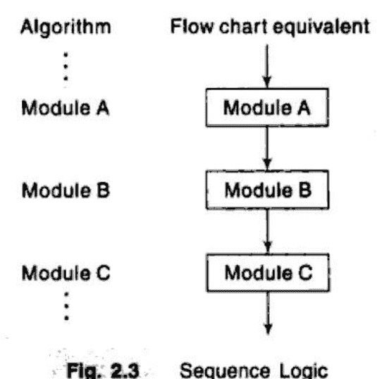

### 选择逻辑（条件流）

选择逻辑使用若干条件，从多个备选模块中选择一个。实现此逻辑的结构称为条件结构或 If 结构。为清晰起见，我们将经常通过以下语句指示此类结构的结束：

> [If 结构结束。]

或某些等效语句。

这些条件结构分为三种类型，将分别讨论。

- 1. 单备选。此结构的形式为

```
If condition, then:
[Module A]
[End of If structure.]
```

此结构的逻辑如图 2.4(a) 所示。如果条件成立，则执行模块 A（可能由一个或多个语句组成）；否则跳过模块 A，控制转移到算法的下一步。

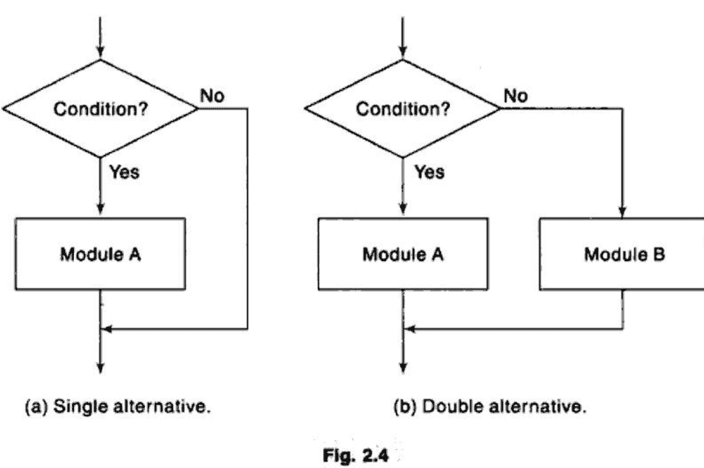

- 2. 双备选。

此结构的形式为
如果条件，则：
[模块 A]
否则：
[模块 B]
[If 结构结束。]

此结构的逻辑如图 2.4(b) 所示。如流程图所示，如果条件成立，则执行模块 A；否则执行模块 B。

- 3. 多备选。

此结构的形式为
如果条件(1)，则：
[模块 A1]
否则如果条件(2)，则：
[模块 A2]
：
否则如果条件(M)，则：
[模块 AM]
否则：
[模块 B]
[If 结构结束。]

此结构的逻辑只允许执行一个模块。具体来说，要么执行第一个成立条件后面的模块，要么执行最终 Else 语句后面的模块。在实践中，很少会有超过三个备选。

### 示例 2.5

二次方程
$ax^2 + bx + c = 0$
（其中 $a \neq 0$）的解由二次公式给出

```
$x = \frac{-b \pm \sqrt{b^2 - 4ac}}{2a}$
```

量 $D = b^2 - 4ac$ 称为方程的 *判别式*。如果 $D$ 为负数，则没有实数解。如果 $D = 0$，则只有一个（重）实数解，$x = -b/2a$。如果 $D$ 为正数，则公式给出两个不同的实数解。以下算法用于求解二次方程。

```
Algorithm 2.2: (Quadratic Equation) This algorithm inputs the coefficients A, B, C of a quadratic equation and outputs the real solutions, if any.
Step 1. Read: A, B, C.
Step 2. Set D := B^2 - 4AC.
Step 3. If D > 0, then:
(a) Set X1 := (-B + \sqrt{D} )/2A and
X2 := (-B - \sqrt{D} )/2A.
(b) Write: X1, X2.
Else if D = 0, then:
(a) Set X := -B/2A.
(b) Write: 'UNIQUE SOLUTION', X.
Else:
Write: 'NO REAL SOLUTIONS'
[End of If structure.]
Step 4. Exit.
```

备注：请注意，算法 2.2 的步骤 3 中有三个互斥条件，取决于 D 是正数、零还是负数。在这种情况下，我们可以按如下方式列出不同情况：

- 步骤 3. 1. 如果 D > 0，则：
- ......
- 2. 如果 D = 0，则：
- ......
- 3. 如果 D < 0，则：
- ......

### 程序 2.2

```c
/* C implementation of Algorithm 2.2*/
#include <stdio.h>
#include <conio.h>
#include <math.h>

void main()
{
int A,B,C,D;
float X,X1,X2;
clrscr();

printf("Enter the values of A, B and C: ");
scanf("%d %d %d",&A,&B,&C);
D=B*B-4*A*C;

if(D>0)
{
X1=((-1)*B+sqrt(D))/2*A;
X2=((-1)*B-sqrt(D))/2*A;
printf("X1= %.2f, X2= %.2f", X1,X2);
}
else if(D==0)
{
X=(-1)*B/2*A;
printf("UNIQUE SOLUTION X=%.2f",X);
}
else
printf("NO REAL SOLUTIONS");
}
```


getch();
}

输出：
输入 A、B 和 C 的值：1
-3
-4
X1= 4.00, X2= -1.00

## 迭代逻辑（重复流程）

第三种逻辑是指涉及循环的两种结构中的任一种。每种类型都以 Repeat 语句开始，后跟一个模块，称为 *循环体*。为了清晰起见，我们将用语句 [End of loop.] 或其等价语句来指示结构的结束。

每种循环结构将分别讨论。

*repeat-for 循环* 使用索引变量（如 K）来控制循环。循环通常采用以下形式：

```
Repeat for K = R to S by T:
[Module]
[End of loop.]
```

该结构的逻辑如图 2.5(a) 所示。这里 R 称为 *初始值*，S 称为 *结束值* 或 *测试值*，T 称为 *增量*。请注意，循环体首先在 K = R 时执行，然后在 K = R + T 时执行，接着在 K = R + 2T 时执行，依此类推。当 K > S 时，循环结束。流程图假设增量 T 为正；如果 T 为负，使得 K 的值减小，则当 K < S 时循环结束。

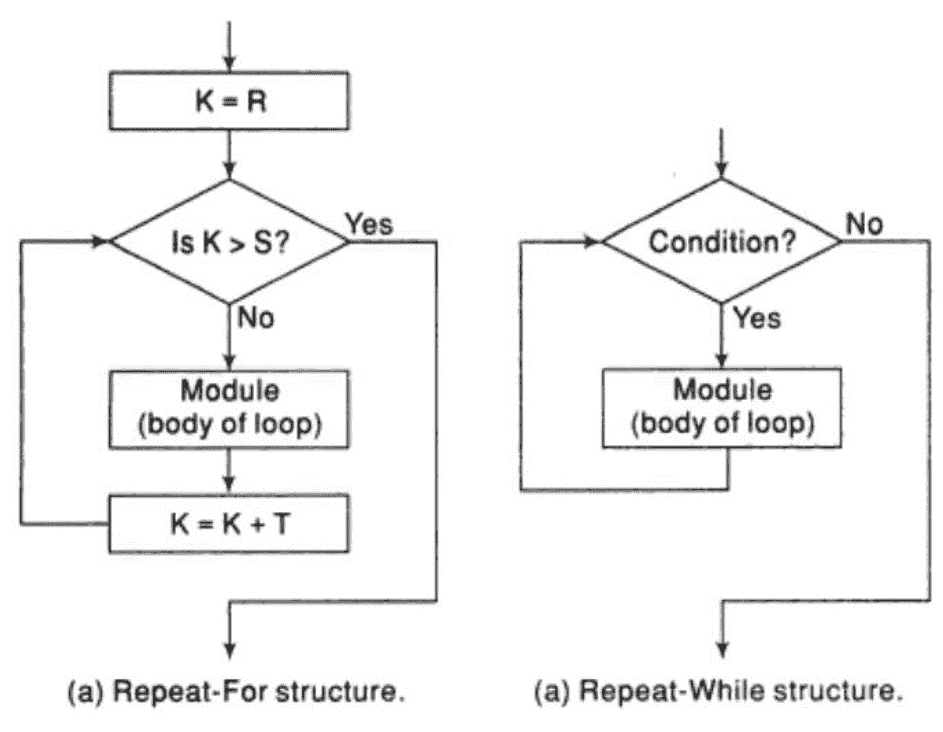

图 2.5

repeat-while 循环使用条件来控制循环。循环通常采用以下形式：Repeat while condition：
[模块]
[循环结束。]

该结构的逻辑如图 2.5(b) 所示。请注意，循环持续进行，直到条件为假。我们强调，结构之前必须有一条语句来初始化控制循环的条件，并且为了使循环最终停止，循环体中必须有一条语句来改变该条件。

### 示例 2.6

算法 2.1 使用 repeat-while 循环重写，而不使用 Go to 语句：

- **算法 2.3：** (数组中最大元素) 给定一个包含 N 个数值的非空数组 DATA，该算法查找 DATA 中最大元素的位置 LOC 和值 MAX。
- 1. [初始化。] 设 K := 1，LOC := 1 和 MAX := DATA[1]。
- 2. 当 K ≤ N 时，重复执行步骤 3 和 4：
- 3. 如果 MAX < DATA[K]，则：
-   设 LOC := K 和 MAX := DATA[K]。
-   [If 结构结束。]
- 4. 设 K := K + 1。
-   [步骤 2 循环结束。]
- 5. 输出：LOC, MAX。
- 6. 退出。

### 程序 2.3

```
/* C implementation of Algorithm 2.3*/
#include <stdio.h>
#include <conio.h>

void main()
{
int DATA[10]={22,65,1,99,32,17,74,49,33,2};
int N, LOC, MAX, K;
N=10;
K=0;
LOC=0;
MAX=DATA[0];
clrscr();

while(K<N)
{
if(MAX<DATA[K])
{
LOC=K;
MAX=DATA[K] ;
}
K=K+1;
}

printf("LOC= %d, MAX= %d",LOC,MAX) ;
getch();
}
```

输出：
LOC = 3, MAX = 99

算法 2.3 表明了我们算法的一些其他属性。通常我们会省略“步骤”一词。我们将尽量使用重复结构代替 Go to 语句。重复语句可以明确指示构成循环体的步骤。“End of loop”语句可以明确指示循环开始的步骤。我们逻辑结构中包含的模块通常会缩进，以便于阅读。这符合结构化编程的常规格式。

任何其他新的记号或约定要么不言自明，要么将在出现时加以解释。

### 2.5 算法的复杂性

算法分析是计算机科学的一项主要任务。为了比较算法，我们必须有一些标准来衡量算法的效率。本节讨论这一重要主题。

假设 M 是一个算法，n 是输入数据的大小。算法 M 使用的时间和空间是衡量 M 效率的两个主要指标。时间通过计算关键操作的次数来衡量——例如，在排序和搜索算法中，是比较的次数。这是因为关键操作的定义使得其他操作的时间远小于或最多与关键操作的时间成正比。空间通过计算算法所需的最大内存来衡量。

算法 M 的复杂性是函数 f(n)，它以输入数据的大小 n 为参数，给出算法的运行时间和/或存储空间需求。通常，算法所需的存储空间仅仅是数据大小 n 的倍数。因此，除非另有说明或暗示，否则术语“复杂性”应指算法的运行时间。

以下示例说明，给出算法运行时间的函数 f(n) 不仅取决于输入数据的大小 n，还取决于特定的数据。

### 示例 2.7

假设我们有一个英文短篇故事 TEXT，并且我们想在 TEXT 中搜索给定的 3 字母单词 W 的第一次出现。如果 W 是 3 字母单词“the”，那么 W 很可能出现在 TEXT 的开头附近，因此 f(n) 会很小。另一方面，如果 W 是 3 字母单词“zoo”，那么 W 可能根本不会出现在 TEXT 中，因此 f(n) 会很大。

上述讨论引出了为特定情况找到复杂性函数 f(n) 的问题。复杂性理论中通常研究的两种情况如下：

- 1. 最坏情况：任何可能输入下 f(n) 的最大值
- 2. 平均情况：f(n) 的期望值

有时我们也会考虑 f(n) 的最小可能值，称为最佳情况。

平均情况分析假设输入数据具有一定的概率分布；这种假设的一个例子是，输入数据集的所有可能排列都同样可能。平均情况还使用概率论中的以下概念。假设数字 n1, n2, ..., nk 分别以概率 p1, p2, ..., pk 出现。那么期望或平均值 E 由以下公式给出

E = n1p1 + n2p2 + ... + nkpk

以下示例说明了这些观点。

### 示例 2.8 线性搜索

假设线性数组 DATA 包含 n 个元素，并且给定了特定的信息项 ITEM。我们要么要在数组 DATA 中找到 ITEM 的位置 LOC，要么发送一些消息（例如 LOC = 0）来指示 ITEM 不在 DATA 中。线性搜索算法通过将 ITEM 与 DATA 中的每个元素逐一比较来解决这个问题。也就是说，我们将 ITEM 与 DATA[1] 比较，然后与 DATA[2] 比较，依此类推，直到找到满足 ITEM = DATA[LOC] 的 LOC。该算法的正式描述如下。

- 算法 2.4：(线性搜索) 给定一个包含 N 个元素的线性数组 DATA 和特定的信息项 ITEM。该算法在数组 DATA 中查找 ITEM 的位置 LOC，或将 LOC 设置为 0。
- 1. [初始化] 设 K := 1 和 LOC := 0。
- 2. 当 LOC = 0 且 K ≤ N 时，重复执行步骤 3 和 4。
- 3. 如果 ITEM = DATA[K]，则：设 LOC := K。
- 4. 设 K := K + 1。[递增计数器。]
- [步骤 2 循环结束。]
- 5. [是否成功？]
- 如果 LOC = 0，则：
- 写出：ITEM 不在数组 DATA 中。
- 否则：
- 写出：LOC 是 ITEM 的位置。
- [If 结构结束。]
- 6. 退出。

### 程序 2.4

```
/* C implementation of Algorithm 2.4*/
#include <stdio.h>
#include <conio.h>

void main()
{
int DATA[10]={22, 65, 1, 99, 32, 17, 74, 49, 33, 2};
int ITEM=17;
int N, LOC, K;
N=10;
K=0;
LOC=-1;
clrscr();
while(LOC==-1 && K<N)
{
 if(ITEM==DATA[K])
 LOC=K;
 K=K+1;
}
if(LOC==-1)
 printf("ITEM is not in the array DATA");
else
 printf("%d is the location of ITEM",LOC);
getch();
}
```

输出：
5 是 ITEM 的位置

搜索算法的复杂性由 ITEM 与 DATA[K] 之间的比较次数 C 给出。我们寻求最坏情况和平均情况下的 C(n)。

### 最坏情况

显然，最坏情况发生在 ITEM 是数组 DATA 中的最后一个元素或根本不在其中时。在这两种情况下，我们有

$C(n) = n$

因此，C(n) = n 是线性搜索算法的最坏情况复杂性。

### 平均情况

这里我们假设 ITEM 确实出现在 DATA 中，并且它出现在数组中任何位置的可能性都相等。因此，比较次数可以是 1, 2, 3, ..., n 中的任何一个数字，每个数字出现的概率均为 p = 1/n。那么

$$C(n) = 1 \cdot \frac{1}{n} + 2 \cdot \frac{1}{n} + ... + n \cdot \frac{1}{n}
= (1 + 2 + ... + n) \cdot \frac{1}{n}
= \frac{n(n+1)}{2} \cdot \frac{1}{n} = \frac{n+1}{2}$$


这与我们的直觉一致，即查找 ITEM 位置所需的平均比较次数大约等于 DATA 列表中元素数量的一半。

Remark: 算法平均情况的复杂度通常比分析最坏情况要复杂得多。此外，人们为平均情况所假设的概率分布可能并不实际适用于真实情况。因此，除非另有说明或暗示，算法的复杂度应指给出输入规模下最坏情况运行时间的函数。这个假设并不过分，因为许多算法的平均情况复杂度与最坏情况成正比。

### 增长率；大 O 表示法

假设 M 是一个算法，且 n 是输入数据的规模。显然，M 的复杂度 f(n) 随 n 的增加而增加。我们通常要考察的是 f(n) 的增长率。这通常通过将 f(n) 与某些标准函数（如

log2 n, n log2 n, n^2, n^3, 2^n

）进行比较来完成。

这些标准函数的增长率在图 2.6 中给出，该图列出了某些 n 值下的近似值。请注意，这些函数按其增长率排序：对数函数 log2 n 增长最慢，指数函数 2^n 增长最快，而多项式函数 n^c 按指数 c 增长。将函数 f(n) 与这些标准函数进行比较的一种方法是使用如下定义的函数 O 表示法：

| n\g(n) | log n | n | n log n | n^2 | n^3 | 2^n |
|---|---|---|---|---|---|---|
| 5 | 3 | 5 | 15 | 25 | 125 | 32 |
| 10 | 4 | 10 | 40 | 100 | 10^3 | 10^3 |
| 100 | 7 | 100 | 700 | 10^4 | 10^6 | 10^30 |
| 1000 | 10 | 10^3 | 10^4 | 10^6 | 10^9 | 10^300 |

图 2.6 标准函数的增长率

假设 f(n) 和 g(n) 是定义在正整数上的函数，且对于几乎所有 n，f(n) 都被 g(n) 的某个倍数所界定。也就是说，假设存在一个正整数 n0 和一个正数 M，使得对于所有 n > n0，都有

```
|f(n)| <= M|g(n)|
```

那么我们可以写

```
f(n) = O(g(n))
```

读作“f(n) 是 g(n) 阶”。对于任何次数为 m 的多项式 P(n)，我们在解答问题 2.10 中表明 P(n) = O(n^m)；例如，

```
8n^3 - 576n^2 + 832n - 248 = O(n^3)
```

我们也可以写

```
f(n) = h(n) + O(g(n))   when   f(n) - h(n) = O(g(n))
```

（这被称为“大 O”表示法，因为 f(n) = o(g(n)) 有完全不同的含义。）

为了说明这种表示法的便利性，我们给出一些著名搜索和排序算法的复杂度：

- (a) 线性搜索：O(n)
- (b) 二分搜索：O(log n)
- (c) 冒泡排序：O(n²)
- (d) 归并排序：O(n log n)

这些结果将在第 9 章（排序与搜索）中讨论。

### 2.6 算法复杂度的其他渐近表示法 Ω、Θ、o

“大 O”表示法为 f(n) 定义了一个上界函数 g(n)，该函数表示算法在输入特征 n 上的时间/空间复杂度。还有其他渐近表示法，如 Ω、Θ、o，它们也用于为函数 f(n) 提供界限。

### Omega 表示法（Ω）

当函数 g(n) 为函数 f(n) 定义一个下界时，使用 Omega 表示法。

### 定义

f(n) = Ω(g(n))（读作 f of n is omega of g of n），当且仅当存在一个正整数 n₀ 和一个正数 M，使得对所有 n ≥ n₀ 都有 |f(n)| ≥ M|g(n)|。

对于 f(n) = 18n + 9，对所有 n 都有 f(n) > 18n，因此 f(n) = Ω(n)。同样，对于 f(n) = 90n² + 18n + 6，当 n ≥ 0 时 f(n) > 90n²，因此 f(n) = Ω(n²)。

对于 f(n) = Ω(g(n))，g(n) 是一个下界函数，可能存在多个这样的函数，但应选择一个尽可能大的关于 n 的函数（使 Ω 的定义成立）作为 g(n)。因此，例如，f(n) = 5n + 1 既可得出 f(n) = Ω(n) 也可得出 f(n) = Ω(1)。然而，我们从不认为后者是正确的，因为 f(n) = Ω(n) 表示满足 Ω 定义的最大可能的关于 n 的函数，因此信息量更大。

### Theta 表示法（Θ）

当函数 f(n) 同时被函数 g(n) 从上方和下方界定时，使用 Theta 表示法。

### 定义

f(n) = Θ(g(n))（读作 f of n is theta of g of n），当且仅当存在两个正常数 c₁ 和 c₂，以及一个正整数 n₀，使得对所有 n ≥ n₀ 都有 c₁|g(n)| ≤ |f(n)| ≤ c₂|g(n)|。

由定义可知，对于所有 n（n ≥ n₀），函数 g(n) 既是 f(n) 的上界也是下界。换句话说，f(n) 满足 f(n) = O(g(n)) 和 f(n) = Ω(g(n))。

对于 f(n) = 18n + 9，由于 f(n) > 18n 且当 n ≥ 1 时 f(n) ≤ 27n，我们分别得到 f(n) = Ω(n) 和 f(n) = O(n)（n ≥ 1）。因此 f(n) = Θ(n)。同样，16n² + 30n – 90 = Θ(n²) 且 7·2ⁿ + 30n = Θ(2ⁿ)。

### Little Oh 表示法（o）

### 定义

f(n) = o(g(n))（读作 f of n is little oh of g of n），当且仅当 f(n) = O(g(n)) 且 f(n) ≠ Ω(g(n))。

对于 f(n) = 18n + 9，我们有 f(n) = O(n²) 但 f(n) ≠ Ω(n²)。因此 f(n) = o(n²)。然而，f(n) ≠ o(n)。

### 2.7 子算法

子算法是一个完整且独立定义的算法模块，由某个主算法或其他子算法使用（或调用）。子算法从源（调用）算法接收称为参数的值；执行计算；然后将结果返回给调用算法。子算法被独立定义，以便它可以被许多不同的算法调用，或在同一算法的不同时间被调用。算法与子算法之间的关系类似于编程语言中主程序与子程序之间的关系。

子算法格式与算法格式的主要区别在于，子算法通常具有如下形式的标题

```
NAME(PAR₁, PAR₂, ..., PARₖ)
```

这里 NAME 是子算法的名称，在调用子算法时使用；PAR₁, PAR₂, ..., PARₖ 是用于在子算法和调用算法之间传输数据的参数。

另一个区别是，子算法将有一个 Return 语句而不是 Exit 语句；这强调当子算法执行完成时，控制权会转移回调用程序。

子算法分为两大类：函数子算法和过程子算法。下面将通过示例考察这两种子算法的相似之处和区别。子算法之间的一个主要区别是，函数子算法只向调用算法返回一个值，而过程子算法可以返回多个值。

### 示例 2.9

以下函数子算法 MEAN 求三个数 A、B 和 C 的平均值 AVE。

```
Function 2.5: MEAN(A, B, C)
1. Set AVE := (A + B + C)/3.
2. Return(AVE).
```

请注意，MEAN 是子算法的名称，A、B 和 C 是参数。Return 语句在括号中包含变量 AVE，其值将返回给调用程序。

子算法 MEAN 的调用方式与函数子程序被调用程序调用的方式相同。例如，假设一个算法包含语句

```
Set TEST := MEAN(T₁, T₂, T₃)
```

其中 T₁、T₂ 和 T₃ 是测试分数。参数值 T₁、T₂ 和 T₃ 传递给子算法中的参数 A、B、C，执行子算法 MEAN，然后将 AVE 的值返回给程序，并在语句中替换 MEAN(T₁, T₂, T₃)。因此，T₁、T₂ 和 T₃ 的平均值被赋给 TEST。

以下 C 程序使用 MEAN 函数计算三个数 A、B 和 C 的平均值 AVE：

### 程序 2.5

```
#include <stdio.h>
#include <conio.h>
void main()
{
int A,B,C;
float MEAN(int,int,int);
clrscr();
printf("Enter the values of A, B and C: ");
scanf("%d %d %d",&A,&B,&C);
printf("The average of %d, %d and %d is: %.2f",A,B,C,MEAN(A,B,C));
getch();
}
float MEAN(int T1,int T2,int T3)
{
float AVE;
AVE=(T1+T2+T3)/3;
return(AVE);
}
Output:
Enter the values of A, B and C: 22
36
8
The average of 22, 36 and 8 is: 22.00
```

### 示例 2.10

以下过程 SWITCH 交换 AAA 和 BBB 的值。
过程 2.6: SWITCH(AAA, BBB)
1. Set TEMP := AAA, AAA := BBB and BBB := TEMP.
2. Return.

该过程通过调用语句调用。例如，调用语句
Call SWITCH(BEG, AUX)
的净效果是交换 BEG 和 AUX 的值。具体来说，当调用过程 SWITCH 时，BEG 和 AUX 的参数分别传递给参数 AAA 和 BBB；执行该过程，交换 AAA 和 BBB 的值；然后将 AAA 和 BBB 的新值分别返回给 BEG 和 AUX。

Remark: 任何函数子算法都可以轻松翻译为等效过程，只需添加一个额外参数，用于将计算值返回给调用算法。例如，Function 2.1 可翻译为过程


## MEAN(A, B, C, AVE)

其中参数 AVE 被赋予 A、B、C 的平均值。然后语句 Call MEAN(T1, T2, T3, TEST) 也具有将 T1、T2 和 T3 的平均值赋给 TEST 的效果。一般来说，我们将使用过程而不是函数子算法。

### 2.8 变量、数据类型

我们任何算法或程序中的每个变量都有一个数据类型，该类型决定了用于存储其值的代码。以下是四种这样的数据类型：

- 1. 字符。此处数据使用某些字符代码（如 EBCDIC 或 ASCII）进行编码。某些字符的 8 位 EBCDIC 代码如图 2.7 所示。单个字符通常存储在一个字节中。
- 2. 实数（或浮点数）。此处数值数据使用数据的指数形式进行编码。
- 3. 整数（或定点数）。此处正整数使用二进制表示进行编码，负整数使用某些二进制变体（如 2 的补码）进行编码。
- 4. 逻辑。此处变量只能取真或假值；因此它可以仅使用一位进行编码，1 表示真，0 表示假。（有时字节 1111 1111 和 0000 0000 可能分别用于真和假。）

我们算法中变量的数据类型不会像计算机程序那样明确说明，而通常由上下文隐含。

## 示例 2.11

假设 32 位内存位置 X 包含以下比特序列：0110 1100 1100 0111 1101 0110 0110 1100

| 字符 | 区域 | 数值 | 十六进制 | 字符 | 区域 | 数值 | 十六进制 | 字符 | 区域 | 数值 | 十六进制 |
|---|---|---|---|---|---|---|---|---|---|---|---|
| A | 1100 | 0001 | C1 | S | 1110 | 0010 | E2 | 空格 | 0100 | 0000 | 40 |
| B | | 0010 | C2 | T | | 0011 | E3 | . | | 1011 | 4B |
| C | | 0011 | C3 | U | | 0100 | E4 | < | | 1100 | 4C |
| D | | 0100 | C4 | V | | 0101 | E5 | ( | | 1101 | 4D |
| E | | 0101 | C5 | W | | 0110 | E6 | + | 0100 | 1110 | 4E |
| F | | 0110 | C6 | X | | 0111 | E7 | & | 0101 | 0000 | 50 |
| G | | 0111 | C7 | Y | | 1000 | E8 | $ | | 1011 | 5B |
| H | | 1000 | C8 | Z | 1110 | 1001 | E9 | * | | 1100 | 5C |
| I | 1100 | 1001 | C9 | | | | | ) | | 1101 | 5D |
| J | 1101 | 0001 | D1 | 0 | 1111 | 0000 | F0 | ; | 0101 | 1110 | 5E |
| K | | 0010 | D2 | 1 | | 0001 | F1 | - | 0110 | 0000 | 60 |
| L | | 0011 | D3 | 2 | | 0010 | F2 | / | | 0001 | 61 |
| M | | 0100 | D4 | 3 | | 0011 | F3 | . | | 1011 | 6B |
| N | | 0101 | D5 | 4 | | 0100 | F4 | % | | 1100 | 6C |
| O | | 0110 | D6 | 5 | | 0101 | F5 | > | | 1110 | 6E |
| P | | 0111 | D7 | 6 | | 0110 | F6 | ? | 0110 | 1111 | 6F |
| Q | | 1000 | D8 | 7 | | 0111 | F7 | : | 0110 | 1010 | 7A |
| R | 1101 | 1001 | D9 | 8 | | 1000 | F8 | # | | 1011 | 7B |
| | | | | 9 | 1111 | 1001 | F9 | @ | | 1100 | 7C |
| | | | | | | | | = | 0111 | 1110 | 7E |

图 2.7 EBCDIC 代码部分

除非知道 X 的数据类型，否则无法知道单元格的内容。
(a) 假设 X 被声明为字符类型且使用 EBCDIC。那么四个字符 %GO% 存储在 X 中。
(b) 假设 X 被声明为其他某些类型，例如整数或实数。那么 X 中存储的是一个整数或实数。

以下 C 程序演示了相同的值如何根据不同的关联数据类型被不同地解释：

## 程序 2.6

```
#include <stdio.h>
#include <conio.h>

void main()
{
char c1='1';
int c2=1;
clrscr();

printf("c1 (char) = %c \\nc1's ASCII value = %d\\nc2 (int) = %d",c1,c1,c2);
getch();
}
```

输出：
c1 (char) = 1
c1's ASCII value = 49
c2 (int) = 1

在上述程序中，变量 c1 将 1 视为字符，而变量 c2 将 1 视为整数。

## 局部变量和全局变量

将计算机程序组织为主程序和各种子程序，从而产生了局部变量和全局变量的概念。通常，每个程序模块包含其自己的变量列表，称为局部变量，只能由给定的程序模块访问。此外，子程序模块可能包含参数，即在子程序及其调用程序之间传输数据的变量。

## 示例 2.12

考虑示例 2.10 中的过程 SWITCH(AAA, BBB)。变量 AAA 和 BBB 是参数；它们用于在过程和调用算法之间传输数据。另一方面，过程中的变量 TEMP 是局部变量。它仅在过程中“生存”；即，其值只能在过程执行期间被访问和更改。事实上，名称 TEMP 可用于任何其他模块中的变量，使用该名称不会干扰过程 SWITCH 的执行。

## 程序 2.7

```c
/* C implementation of the SWITCH procedure */
#include <stdio.h>
#include <conio.h>

int AAA=10;
int BBB=20;
void SWITCH(void);

void main()
{
clrscr();

printf("AAA = %d BBB = %d",AAA,BBB);
SWITCH();
printf("\nAfter calling SWITCH procedure, AAA = %d BBB = %d",AAA,BBB);
getch();
}

void SWITCH(void)
{
int TEMP;
TEMP=AAA;
AAA=BBB;
BBB=TEMP;
return;
}
```

输出：
AAA = 10 BBB = 20
调用 SWITCH 过程后，AAA = 20 BBB = 10

语言设计者意识到，拥有一些可以被计算机程序中某些甚至所有程序模块访问的变量将很方便。可以被所有程序模块访问的变量称为全局变量，可以被某些程序模块访问的变量称为非局部变量。每种编程语言都有自己声明此类变量的语法。例如，FORTRAN 使用 COMMON 语句声明全局变量，而 Pascal 使用作用域规则声明全局和非局部变量。

因此，模块之间相互通信有两种基本方式：

- 1. 直接，通过定义良好的参数
- 2. 间接，通过非局部变量和全局变量

一个模块对另一个模块中变量值的间接更改称为副作用。读者在使用非局部变量和全局变量时应非常小心，因为由副作用引起的错误可能难以检测。

## 已解决的问题

### 数学符号和函数

2.1 求 (a) $\lfloor 7.5 \rfloor, \lfloor -7.5 \rfloor, \lfloor -18 \rfloor, \lfloor \sqrt{30} \rfloor, \lfloor \sqrt[3]{30} \rfloor, \lfloor \pi \rfloor$；和 (b) $\lceil 7.5 \rceil, \lceil -7.5 \rceil, \lceil -18 \rceil, \lceil \sqrt{30} \rceil, \lceil \sqrt[3]{30} \rceil, \lceil \pi \rceil$。

(a) 按定义，$\lfloor x \rfloor$ 表示不超过 $x$ 的最大整数，称为 $x$ 的下取整（floor）。因此，
\(\lfloor 7.5 \rfloor = 7 \quad \lfloor -7.5 \rfloor = -8 \quad \lfloor -18 \rfloor = -18\)
\(\lfloor \sqrt{30} \rfloor = 5 \quad \lfloor \sqrt[3]{30} \rfloor = 3 \quad \lfloor \pi \rfloor = 3\)

(b) 按定义，$\lceil x \rceil$ 表示不小于 $x$ 的最小整数，称为 $x$ 的上取整（ceiling）。因此，
\(\lceil 7.5 \rceil = 8 \quad \lceil -7.5 \rceil = -7 \quad \lceil -18 \rceil = -18\)
\(\lceil \sqrt{30} \rceil = 6 \quad \lceil \sqrt[3]{30} \rceil = 4 \quad \lceil \pi \rceil = 4\)

2.2 (a) 求 $26 \pmod 7, 34 \pmod 8, 2345 \pmod 6, 495 \pmod 11$。
(b) 求 $-26 \pmod 7, -2345 \pmod 6, -371 \pmod 8, -39 \pmod 3$。
(c) 使用模 15 运算，求 $9 + 13, 7 + 11, 4 - 9, 2 - 10$。

(a) 由于 $k$ 为正，只需将 $k$ 除以模数 $M$ 以获得余数 $r$。则 $r = k \pmod M$
因此
\(5 = 26 \pmod 7 \quad 2 = 34 \pmod 8 \quad 5 = 2345 \pmod 6 \quad 0 = 495 \pmod 11\)

(b) 当 $k$ 为负时，将 $|k|$ 除以模数以获得余数 $r'$。则 $k \equiv -r' \pmod M$。因此，当 $r' \neq 0$ 时，$k \pmod M = M - r'$。因此
\(-26 \pmod 7 = 7 - 5 = 2 \quad -371 \pmod 8 = 8 - 3 = 5\)
\(-2345 \pmod 6 = 6 - 5 = 1 \quad -39 \pmod 3 = 0\)

(c) 使用 $a \pm M \equiv a \pmod M$：
\(9 + 13 = 22 \equiv 22 - 15 = 7 \quad 7 + 11 = 18 \equiv 18 - 15 = 3\)
\(4 - 9 = -5 \equiv -5 + 15 = 10 \quad 2 - 10 = -8 \equiv -8 + 15 = 7\)

2.3 列出数字 1、2、3、4 的所有排列。

首先注意，共有 $4! = 24$ 个这样的排列：

- 1234 1243 1324 1342 1423 1432
- 2134 2143 2314 2341 2413 2431
- 3124 3142 3214 3241 3412 3421
- 4123 4132 4213 4231 4312 4321


请注意，第一行包含以 1 开头的六个排列，第二行包含以 2 开头的排列，依此类推。

### 2.4 求：(a) \(2^{-5}, 8^{2/3}, 25^{-3/2}\)；(b) \(\log_2 32, \log_{10} 1000, \log_2 (1/16)\)；(c) \(\lfloor \log_2 1000 \rfloor, \lfloor \log_2 0.01 \rfloor\)。

(a) \(2^{-5} = 1/2^5 = 1/32\)；\(8^{2/3} = (\sqrt[3]{8})^2 = 2^2 = 4\)；\(25^{-3/2} = 1/25^{3/2} = 1/5^3 = 1/125\)。

(b) \(\log_2 32 = 5\)，因为 \(2^5 = 32\)；\(\log_{10} 1000 = 3\)，因为 \(10^3 = 1000\)；\(\log_2(1/16) = -4\)，因为 \(2^{-4} = 1/2^4 = 1/16\)。

(c) \(\lfloor \log_2 1000 \rfloor = 9\)，因为 \(2^9 = 512\) 但 \(2^{10} = 1024\)；\(\lfloor \log_2 0.01 \rfloor = -7\)，因为 \(2^{-7} = 1/128 < 0.01 < 2^{-6} = 1/64\)。

### 2.5 在同一坐标轴上绘制指数函数 \(f(x) = 2^x\)、对数函数 \(g(x) = \log_2 x\) 和线性函数 \(h(x) = x\) 的图像。(a) 描述图像 \(f(x)\) 和 \(g(x)\) 的一个几何性质。(b) 对于任意正数 \(c\)，\(f(c)\)、\(g(c)\) 和 \(h(c)\) 之间有何关系？

图 2.8 展示了这三个函数。

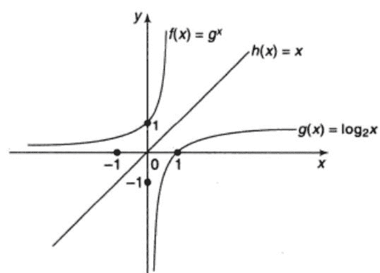

图 2.8

(a) 由于 \(f(x) = 2^x\) 和 \(g(x) = \log_2 x\) 是反函数，它们关于直线 \(y = x\) 对称。

(b) 对于任意正数 \(c\)，有：

\(g(c) < h(c) < f(c)\)

事实上，随着 \(c\) 值的增大，函数之间的垂直距离 \(h(c) - g(c)\) 和 \(f(c) - h(c)\) 也随之增大。此外，与线性函数 \(h(x)\) 相比，对数函数 \(g(x)\) 增长非常缓慢，而与 \(h(x)\) 相比，指数函数 \(f(x)\) 增长非常迅速。

### 算法，复杂度

### 2.6 考虑算法 2.3，该算法用于查找具有 n 个元素的数组 DATA 中最大元素的位置 LOC 和值 MAX。考虑复杂度函数 C(n)，它衡量在第 3 步中 LOC 和 MAX 被更新的次数。（比较次数与 DATA 中元素的顺序无关。）
(a) 描述并求出最坏情况下的 C(n)。
(b) 描述并求出最好情况下的 C(n)。
(c) 假设 DATA 中元素的所有排列都等可能发生，求 n = 3 时平均情况下的 C(n)。

(a) 最坏情况发生在 DATA 的元素按递增顺序排列时，此时每次将 MAX 与 DATA[K] 比较都会强制更新 LOC 和 MAX。在这种情况下，C(n) = n - 1。

(b) 最好情况发生在最大元素首先出现时，因此将 MAX 与 DATA[K] 比较永远不会强制更新 LOC 和 MAX。相应地，在这种情况下，C(n) = 0。

(c) 设 1、2 和 3 分别表示 DATA 中最大、第二大和最小的元素。元素在 DATA 中出现的可能方式共有六种，对应于 1、2、3 的 3! = 6 个排列。对于每个排列 p，设 np 表示在输入为 p 时执行算法所更新 LOC 和 MAX 的次数。以下列出六个排列 p 及其对应的 np 值：

| 排列 p： | 123 | 132 | 213 | 231 | 312 | 321 |
| np 的值： | 0 | 0 | 1 | 1 | 1 | 2 |

假设所有排列 p 等可能发生，

```
C(3) = \frac{0 + 0 + 1 + 1 + 1 + 2}{6} = \frac{5}{6}
```

（对任意 n 求 C(n) 的平均值超出了本文的范围。本题的一个目的是说明在求算法平均情况复杂度时可能出现的困难。）

### 2.7 假设模块 A 执行需要 M 个时间单位，其中 M 是常数。求每个算法的复杂度 C(n)，其中 n 是输入数据的大小，b 是大于 1 的正整数。

### (a) 算法 P2.7A：

1. 对 I = 1 到 N 重复：
2. 对 J = 1 到 N 重复：
3. 对 K = I 到 N 重复：
4. 模块 A。

[第 3 步循环结束。]
[第 2 步循环结束。]
[第 1 步循环结束。]
5. 退出。

### (b) 算法 P2.7B：

1. 设 J := 1。
2. 当 J <= N 时重复执行步骤 3 和 4：
3. 模块 A。
4. 设 J := B x J。
[第 2 步循环结束。]
5. 退出。

请注意，算法中使用 N 表示 n，B 表示 b。

(a) 这里 \( C(n) = \sum_{i=1}^n \sum_{j=1}^n \sum_{k=1}^n M \)

求和中 \( M \) 出现的次数等于三元组 \( (i, j, k) \) 的数量，其中 \( i, j, k \) 是 1 到 \( n\) 之间（包含 1 和 \( n\)）的整数。这样的三元组共有 \( n^3 \) 个。因此

\( C(n) = Mn^3 = O(n^3) \)

(b) 请注意，循环索引 J 的值是 \( b \) 的幂：

\( 1, b, b^2, b^3, b^4, ... \)

因此，模块 A 将被重复恰好 \( T \) 次，其中 \( T \) 是满足以下条件的第一个指数：

\( b^T > n \)

因此，\( T = \lfloor \log_b n \rfloor + 1 \)

相应地，\( C(n) = MT = O(\log_b n) \)

### 2.8 (a) 编写一个过程 FIND(DATA, N, LOC1, LOC2)，用于查找具有 \( n > 1 \) 个元素的数组 DATA 中最大元素的位置 LOC1 和第二大元素的位置 LOC2。

(b) 为什么不让 FIND 同时查找最大元素和第二大元素的值？

(a) 逐个检查 DATA 的元素。在过程执行期间，FIRST 和 SECOND 分别表示已检查元素中的最大值和第二大值。对每个新元素 DATA[K] 按以下方式进行测试。如果

SECOND <= FIRST < DATA[K]

则 FIRST 成为新的第二大元素，DATA[K] 成为新的最大元素。另一方面，如果

SECOND < DATA[K] <= FIRST

则 DATA[K] 成为新的第二大元素。最初，设 FIRST := DATA[1] 和 SECOND := DATA[2]，并检查它们是否顺序正确。过程的正式描述如下：

### 过程 P2.8：FIND(DATA, N, LOC1, LOC2)

1. 设 FIRST := DATA[1]，SECOND := DATA[2]，LOC1 := 1，LOC2 := 2。
2. [FIRST 和 SECOND 最初是否正确？]
如果 FIRST < SECOND，则：
(a) 交换 FIRST 和 SECOND，
(b) 设 LOC1 := 2 和 LOC2 := 1。
[If 结构结束。]
3. 对 K = 3 到 N 重复：
如果 FIRST < DATA[K]，则：
(a) 设 SECOND := FIRST 和 FIRST := DATA[K]。
(b) 设 LOC2 := LOC1 和 LOC1 := K。
否则如果 SECOND < DATA[K]，则：
设 SECOND := DATA[K] 和 LOC2 := K。
[If 结构结束。]
[循环结束。]
4. 返回。

(b) 使用额外参数 FIRST 和 SECOND 将是多余的，因为 LOC1 和 LOC2 自动告诉调用程序，DATA[LOC1] 和 DATA[LOC2] 分别是 DATA 中最大元素和第二大元素的值。

### 程序 2.8

```c
/* C implementation of Procedure P 2.8 */
#include <stdio.h>
#include <conio.h>

int DATA[10]={22,65,1,99,32,17,74,49,33,2};
int N, LOC1, LOC2, FIRST, SECOND;

void main()
{
void FIND(int [],int,int,int);
clrscr();
N=10;
LOC1=-1;
LOC2=-1;

FIND(DATA,N,LOC1,LOC2);
printf("FIRST = %d, LOC1 = %d, SECOND = %d, LOC2 = %d",FIRST,LOC1,SECOND,
LOC2);
getch();
}

void FIND(int LIST[],int LEN,int L1,int L2)
{
int TEMP,K;
FIRST=LIST[0];
SECOND=LIST[1];
L1=0;
L2=1;
if(FIRST<SECOND)
{
TEMP=FIRST;
FIRST=SECOND;
SECOND=TEMP;
L2=0;
L1=1;
}
for(K=2;K<LEN;K++)
{
if(FIRST<LIST[K])
{
SECOND=FIRST;
FIRST=LIST[K];
L2=L1;
L1=K;
}
else if(SECOND<LIST[K])
{
SECOND=LIST[K];
L2=K;
}
}
LOC1=L1;
LOC2=L2;
}
```

输出：
FIRST = 99, LOC1 = 3, SECOND = 74, LOC2 = 6

### 2.9 如果整数 $n > 1$ 的唯一正因数是 1 和 $n$，则称其为 *质数*；否则，$n$ 称为 *合数*。例如，以下是小于 20 的质数：

2, 3, 5, 7, 11, 13, 17, 19

如果 $n > 1$ 不是质数，即 $n$ 是合数，则 $n$ 必须有一个 $k \neq 1$ 的因数，使得 $k \le \sqrt{n}$，换句话说，$k^2 \le n$。

假设我们想找出小于给定数 $m$（例如 30）的所有质数。这可以通过“筛法”来完成，筛法包括以下步骤。首先列出 30 个数：

1, 2, 3, 4, 5, 6, 7, 8, 9, 10, 11, 12, 13, 14, 15
16, 17, 18, 19, 20, 21, 22, 23, 24, 25, 26, 27, 28, 29, 30

从列表中划掉 1 和 2 的倍数，如下所示：

1, 2, 3, 4, 5, 6, 7, 8, 9, 10, 11, 12, 13, 14, 15
16, 17, 18, 19, 20, 21, 22, 23, 24, 25, 26, 27, 28, 29, 30

由于 3 是 2 之后第一个未被消去的数，从列表中划掉 3 的倍数，如下所示：

1, 2, 3, 4, 5, 6, 7, 8, 9, 10, 11, 12, 13, 14, 15
16, 17, 18, 19, 20, 21, 22, 23, 24, 25, 26, 27, 28, 29, 30

由于 5 是 3 之后第一个未被消去的数，从列表中划掉 5 的倍数，如下所示：

1, 2, 3, 4, 5, 6, 7, 8, 9, 10, 11, 12, 13, 14, 15
16, 17, 18, 19, 20, 21, 22, 23, 24, 25, 26, 27, 28, 29, 30

现在，7 是 5 之后第一个未被消去的数，但 $7^2 > 30$。这意味着算法结束，列表中剩下的数就是小于 30 的质数：

2, 3, 5, 7, 11, 13, 17, 19, 23, 29

将筛法转化为算法，以找出小于给定数 $n$ 的所有质数。

首先定义一个数组 A，使得

A[1] = 1, A[2] = 2, A[3] = 3, A[4] = 4, ..., A[N - 1] = N - 1, A[N] = N

我们通过赋值 A[L] = 1 从列表中划掉整数 L。以下过程 CROSSOUT 测试 A[K] 是否等于 1，如果不等于，则设置

A[2K] = 1, A[3K] = 1, A[4K] = 1, ...

也就是说，它从列表中消去 K 的倍数


### 过程 P2.9A: CROSSOUT(A, N, K)

- 1. 如果 A[K] = 1，则：返回。
- 2. 对 L 从 2K 到 N，步长为 K，重复：
    - 设置 A[L] := 1。
    - [循环结束。]
- 3. 返回。

筛法现在可以简单地写成：

### 算法 P2.9B: 该算法打印小于 N 的素数。

- 1. [初始化数组 A。] 对 K 从 1 到 N，重复：
    - 设置 A[K] := K。
- 2. [消去 K 的倍数。] 对 K 从 2 到 √N，重复：
    - 调用 CROSSOUT(A, N, K)。
- 3. [打印素数。] 对 K 从 2 到 N，重复：
    - 如果 A[K] ≠ 1，则：写入：A[K]。
- 4. 退出。

### 程序 2.9

```c
/* C implementation of Algorithm P2.9B*/
#include <stdio.h>
#include <conio.h>
#include <math.h>

int A[100];
void CROSSOUT(int,int);

void main()
{
int K,N;
clrscr();

printf("Enter the value of N: ");
scanf("%d",&N);

A[0]=-1;
for(K=1;K<=N;K++)
A[K]=K;

for(K=2;K<=sqrt(N);K++)
CROSSOUT(N,K);

for(K=2;K<=N;K++)
if(A[K] != 1)
    printf("%d ",A[K]);
getch();
}

void CROSSOUT(int n,int k)
{
int L;
if(A[k]==1)
return;
for(L=2*k;L<=n;L=L+k)
A[L]=1;
return;
}
```

输出：
Enter the value of N: 20
2 3 5 7 11 13 17 19

### 2.10 假设 P(n) = a0 + a1n + a2n^2 + ... + amn^m；也就是说，假设 P(n) 的次数为 m。证明 P(n) = O(n^m)。

令 b0 = |a0|, b1 = |a1|, ..., bm = |am|。那么，对于 n >= 1，
P(n) <= b0 + b1n + b2n^2 + ... + bm n^m
= (b0/n^m + b1/n^(m-1) + ... + bm) n^m
<= (b0 + b1 + ... + bm)n^m = M n^m
其中 M = |a0| + |a1| + ... + |am|。因此 P(n) = O(n^m)。
例如，5x^3 + 3x = O(x^3) 且 x^5 - 4 000 000x^2 = O(x^5)。

### 2.11 假设 T1(n) 和 T2(n) 分别是两个程序片段 P1 和 P2 的时间复杂度，其中 T1(n) = O(f(n)) 且 T2(n) = O(g(n))，那么程序片段 P1 后跟 P2 的时间复杂度是多少？

程序片段 P1 后跟 P2 的时间复杂度由 T1(n) + T2(n) 给出。为了得到 T1(n) + T2(n)，我们有
T1(n) <= c * f(n) 对于某个正数 c 和正整数 n1，使得 n >= n1，且
T2(n) <= d * g(n) 对于某个正数 d 和正整数 n2，使得 n >= n2
令 n0 = max(n1, n2)。那么，
T1(n) + T2(n) <= c * f(n) + d * g(n)，对于 n > n0
（即）T1(n) + T2(n) <= (c + d) max(f(n), g(n)) 对于 n > n0
因此 T1(n) + T2(n) = O(max(f(n), g(n)))。（此结果称为 O 表示法的求和法则）

### 2.12 已知：\( T_1(n) = O(f(n)) \) 和 \( T_2(n) = O(g(n)) \)。求 \( T_1(n) \cdot T_2(n) \)。

\( T_1(n) \le c \cdot f(n) \) 对于某个正数 \( c \) 和正整数 \( n_1 \)，使得 \( n \ge n_1 \) 且 \( T_2(n) \le d \cdot g(n) \) 对于某个正数 \( d \) 和正整数 \( n_2 \) 使得 \( n \ge n_2 \)。
因此，\( T_1(n) \cdot T_2(n) \le c \cdot f(n) \cdot d \cdot g(n) \)
\( \le k \cdot f(n) \cdot g(n) \)

所以 \( T_1(n) \cdot T_2(n) = O(f(n) \cdot g(n)) \)（此结果称为 \( O \) 表示法的乘积法则）

### 变量，数据类型

### 2.13 简要描述局部变量、参数和全局变量之间的区别。

局部变量是只能在特定程序或子程序内访问的变量。参数是用于在子程序及其调用程序之间传递数据的变量。全局变量是计算机程序中所有程序模块都可以访问的变量。每种允许全局变量的编程语言都有自己声明全局变量的语法。

### 2.14 假设 NUM 表示文件中的记录数。描述将 NUM 定义为全局变量的优点。描述一般使用全局变量的缺点。

许多过程将使用某种循环来处理文件中的所有记录。由于 NUM 对所有这些过程都相同，因此将 NUM 声明为全局变量是有利的。一般来说，全局变量和非局部变量可能导致由副作用引起的错误，这些错误可能难以检测。

### 2.15 假设 32 位内存位置 AAA 包含以下比特序列：
0100 1101 1100 0001 1110 1001 0101 1101
确定存储在 AAA 中的数据。

除非知道 AAA 的数据类型，否则无法知道存储在 AAA 中的数据。如果 AAA 是字符变量且使用 EBCDIC 代码存储数据，那么 (AZ) 存储在 AAA 中。如果 AAA 是整数变量，那么具有上述二进制表示的整数存储在 AAA 中。

### 2.16 从数学角度讲，整数也可以被视为实数。给出拥有两种不同数据类型的一些理由。

整数的算术运算（整数使用某种二进制表示存储）比实数的算术运算（实数使用某种指数形式存储）要简单得多。此外，实数算术中出现的某些舍入误差在整数算术中不会出现。

## 补充问题

### 数学符号和函数

### 2.1 求 (a) ⌊3.4⌋, ⌊-3.4⌋, ⌊-7⌋, ⌊√75⌋, ⌊∛75⌋, ⌊e⌋；(b) ⌈3.4⌉, ⌈-3.4⌉, ⌈-7⌉, ⌈√75⌉, ⌈∛75⌉, ⌈e⌉。

### 2.2 (a) 求 48 (mod 5), 48 (mod 7), 1397 (mod 11), 2468 (mod 9)。
(b) 求 -48 (mod 5), -152 (mod 7), -358 (mod 11), -1326 (mod 13)。
(c) 使用模 13 算术，计算
9 + 10, 8 + 12, 3 + 4, 3 - 4, 2 - 7, 5 - 8

### 2.3 求 (a) |3 + 8|, |3 - 8|, |-3 + 8|, |-3 - 8|；(b) 7!, 8!, 14!/12!, 15!/16!

### 2.4 求 (a) 3^-4, 4^(7/2), 27^(-2/3); (b) log2 64, log10 0.001, log2 (1/8); (c) ⌊lg 1 000 000⌋, ⌊lg 0.001⌋.

### 算法，复杂度

### 2.5 考虑复杂度函数 C(n)，它测量算法 2.3 第 3 步中 LOC 被更新的次数。当 n = 4 时，求平均情况下的 C(n)，假设给定四个元素的所有排列都等可能。（与已解问题 2.6 比较。）

### 2.6 考虑过程 P2.8，它找到具有 n > 1 个元素的数组 DATA 中最大元素的位置 LOC1 和第二大元素的位置 LOC2。令 C(n) 表示过程执行期间的比较次数。
(a) 求最佳情况下的 C(n)。
(b) 求最坏情况下的 C(n)。
(c) 当 n = 4 时，求平均情况下的 C(n)，假设 DATA 中给定元素的所有排列都等可能。

### 2.7 重复补充问题 2.6，但现在令 C(n) 表示 FIRST 和 SECOND（或 LOC1 和 LOC2）的值必须被更新的次数。

### 2.8 假设模块 A 的运行时间是常数 M。求每个以下算法的复杂度函数 C(n) 的数量级，C(n) 测量执行时间，其中 n 是输入数据的大小（在算法中用 N 表示）。

(a) 过程 P2.8A:
- 1. 对 I 从 1 到 N，重复：
    - 2. 对 J 从 1 到 I，重复：
        - 3. 对 K 从 1 到 J，重复：
            - 4. 模块 A。
            - [第 3 步循环结束。]
        - [第 2 步循环结束。]
    - [第 1 步循环结束。]
- 5. 退出。

(b) 过程 P2.8B:
- 1. 设置 J := N。
- 2. 当 J > 1 时，重复步骤 3 和 4。
    - 3. 模块 A。
    - 4. 设置 J := J/2。
    - [第 2 步循环结束。]
- 5. 返回。

### 2.9. 求以下程序的复杂度数量级。
fun(n)
{if(n<=2)return (1); else
return (fun(n-1)*fun(n-2));}

## 编程问题

### 2.1 编写一个函数子程序 DIV(J, K)，其中 J 和 K 是正整数，使得如果 J 能整除 K 则 DIV(J, K) = 1，否则 DIV(J, K) = 0。（例如，DIV(3, 15) = 1 但 DIV(3, 16) = 0。）

### 2.2 编写一个使用 DIV(J, K) 的程序，读取一个大于 10 的正整数 N，并确定 N 是否为素数。（提示：如果 (i) DIV(2, N) = 0（即 N 为奇数）且 (ii) 对于所有满足 1 < K^2 <= N 的奇数整数 K，DIV(K, N) = 0，则 N 为素数。）

### 2.3 将过程 P2.8 翻译成 C 程序；即，编写一个程序，找到具有 N > 1 个元素的数组 DATA 中最大元素的位置 LOC1 和第二大元素的位置 LOC2。使用 70, 30, 25, 80, 60, 50, 30, 75, 25, 和 60 测试程序。

### 2.4 将已解问题 2.9 中描述的寻找素数的筛法翻译成 C 程序，以找出小于 N 的素数。使用 (a) N = 1000 和 (b) N = 10 000 测试程序。

### 2.5 令 C 表示使用算法 2.3 在具有 N 个元素的数组 A 中找到最大元素时 LOC 被更新的次数。
(a) 编写一个子程序 COUNT(A, N, C) 来查找 C。
(b) 编写一个过程 P2.27，(i) 将 0 到 1 之间的 N 个随机数读入数组 A，(ii) 使用 COUNT(A, N, C) 来查找 C 的值。
(c) 编写一个程序，重复过程 P2.27 1000 次并求 1000 个 C 的平均值。
(i) 对 N = 3 测试程序，并将结果与已解问题 2.6 中获得的值进行比较。
(ii) 对 N = 4 测试程序，并将结果与补充问题 2.5 中的值进行比较。

### 2.6 为一个算法编写伪代码，该算法接收一个整数，打印该整数的位数和各位数字之和。


## MULTIPLE CHOICE QUESTIONS

2.1 ______ of a set of n elements is an arrangement of the elements in a given order. (a) Combination (b) Permutation (c) Exponent (d) Logarithm

2.2 There are ______ permutations of a set of n elements. (a) n! (b) n (c) n² (d) n+1

2.3 Logarithms to the base 10 are called ______ logarithms. (a) Natural (b) Simple (c) Common (d) Binary

2.4 The first part of an algorithm tells the ______ of the algorithm. (a) Logic (b) Process (c) Purpose (d) Steps

2.5 Each step of an algorithm may contain its ______ in brackets. (a) Purpose (b) Functions (c) Steps (d) Comments

2.6 The term ______ will be used for an independent algorithmic module which solves a particular problem. (a) Program (b) Logic (c) Procedure (d) Name

2.7 ______ logic employs a number of conditions which lead to a selection of one out of several alternative modules. (a) Selection (b) Sequential (c) Iteration (d) Procedural

2.8 A structure is of the form: If condition, then: [Module A] Else: [Module B] [End of if structures]

What is this structure? (a) Multiple Alternative (b) Double Alternative (c) Single Alternative (d) None of the above

2.9 ______ loop uses a condition to control the loop. (a) Repeat-for (b) Repeat (c) Continue (d) Repeat-while

2.10 In complexity theory, ______ case refers to the expected value of f(n). (a) Average (b) Best (c) Worst (d) Good

2.11 O(n^2) is the complexity of which searching and sorting algorithm? (a) Binary search (b) Linear search (c) Merge sort (d) Bubble sort

2.12 The ______ notation is used when the function g(n) defines a lower bound for the function f(n). (a) Omega (b) Big O (c) Theta (d) Little Oh

2.13 Each program module contains its own list of variables called ______ (a) Global (b) Local (c) Search (d) Binary

2.14 ______ function of C is used to allocate a block of memory. (a) malloc() (b) calloc() (c) free (d) realloc()

2.15 Variables that can be accessed by some program modules are called ______ variables. (a) Global (b) Local (c) Search (d) Nonlocal

## ANSWERS TO MULTIPLE CHOICE QUESTIONS

2.1 (b) 2.2 (a) 2.3 (c) 2.4 (b) 2.5 (d) 2.6 (c) 2.7 (a) 2.8 (b) 2.9 (d) 2.10 (a) 2.11 (d) 2.12 (a) 2.13 (b) 2.14 (a) 2.15 (d)

## String Processing

### 3.1 INTRODUCTION

Historically, computers were first used for processing numerical data. Today, computers are frequently used for processing nonnumerical data, called character data. This chapter discusses how such data are stored and processed by the computer.

One of the primary applications of computers today is in the field of word processing. Such processing usually involves some type of pattern matching, as in checking to see if a particular word S appears in a given text T. We discuss this pattern matching problem in detail and, moreover, present two different pattern matching algorithms. The complexity of these algorithms is also investigated.

Computer terminology usually uses the term “string” for a sequence of characters rather than the term “word,” since “word” has another meaning in computer science. For this reason, many texts sometimes use the expression “string processing,” “string manipulation” or “text editing” instead of the expression “word processing.”

The material in this chapter is essentially tangential and independent of the rest of the text. Accordingly, the reader or instructor may choose to omit this chapter on a first reading or cover this chapter at a later time.

### 3.2 BASIC TERMINOLOGY

Each programming language contains a character set that is used to communicate with the computer. This set usually includes the following:

| Category | Characters |
|---|---|
| Alphabet: | A B C D E F G H I J K L M N O P Q R S T U V W X Y Z |
| Digits: | 0 1 2 3 4 5 6 7 8 9 |
| Special characters: | + - / * ( ) , . $ = ' □ |

The set of special characters, which includes the blank space, frequently denoted by $\square$, varies somewhat from one language to another.

A finite sequence S of zero or more characters is called a *string*. The number of characters in a string is called its *length*. The string with zero characters is called the *empty string* or the *null string*. Specific strings will be denoted by enclosing their characters in single quotation marks. The quotation marks will also serve as string delimiters. Hence

```
'THE END'   'TO BE OR NOT TO BE'   '$\square\square$'
```

are strings with lengths 7, 18, 0 and 2, respectively. We emphasize that the blank space is a character and hence contributes to the length of the string. Sometimes the quotation marks may be omitted when the context indicates that the expression is a string.

Let $S_1$ and $S_2$ be strings. The string consisting of the characters of $S_1$ followed by the characters of $S_2$ is called the *concatenation* of $S_1$ and $S_2$; it will be denoted by $S_1//S_2$. For example,

```
'THE' // 'END' = 'THEEND'   but   'THE' // ' $\square$ ' // 'END' = 'THE END'
```

Clearly the length of $S_1//S_2$ is equal to the sum of the lengths of the strings $S_1$ and $S_2$.

A string Y is called a *substring* of a string S if there exist strings X and Z such that

```
S = X//Y//Z
```

If X is an empty string, then Y is called an *initial substring* of S, and if Z is an empty string then Y is called a *terminal substring* of S. For example,

'BE OR NOT'   is a substring of   'TO BE OR NOT TO BE'
'THE'   is an initial substring of   'THE END'

Clearly, if Y is a substring of S, then the length of Y cannot exceed the length of S.

*Remark:* Characters are stored in the computer using either a 6-bit, a 7-bit or an 8-bit code. The unit equal to the number of bits needed to represent a character is called a *byte*. However, unless otherwise stated or implied, a byte usually means 8 bits. A computer which can access an individual byte is called a *byte-addressable machine*.

### 3.3 STORING STRINGS

Generally speaking, strings are stored in three types of structures: (1) fixed-length structures, (2) variable-length structures with fixed maximums and (3) linked structures. We discuss each type of structure separately, giving its advantages and disadvantages.

### Record-Oriented, Fixed-Length Storage

In fixed-length storage each line of print is viewed as a record, where all records have the same length, i.e., where each record accommodates the same number of characters. Since earlier systems used to input on terminals with 80-column images or using 80-column cards, we will assume our records have length 80 unless otherwise stated or implied.

### Example 3.1

Suppose the input consists of the program in Fig. 3.1. Using a record-oriented, fixed-length storage medium, the input data will appear in memory as pictured in Fig. 3.2, where we assume that 200 is the address of the first character of the program.
The main advantages of the above way of storing strings are:

- The ease of accessing data from any given record
- The ease of updating data in any given record (as long as the length of the new data does not exceed the record length)

```
/*PROGRAM PRINTING TWO INTEGERS IN DECREASING ORDER*/
void main ()
{ int J,K;
scanf("%d %d",&J,&K);
if(J>K)
printf("%d %d\n",J,K);
if(J<K)
printf("%d %d\n",K,J);
}
```


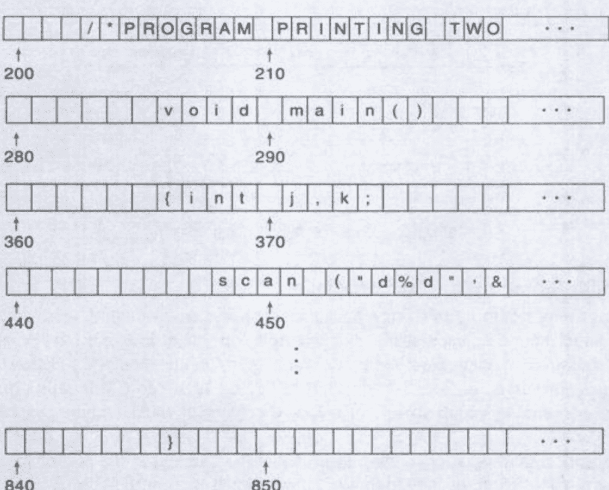

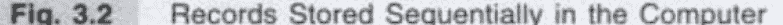

The main disadvantages are:

- Time is wasted reading an entire record if most of the storage consists of inessential blank spaces.
- Certain records may require more space than available.
- When the correction consists of more or fewer characters than the original text, changing a misspelled word requires the entire record to be changed.

Remark: Suppose we wanted to insert a new record in Example 3.1. This would require that all succeeding records be moved to new memory locations. However, this disadvantage can be easily remedied as indicated in Fig. 3.3. That is, one can use a linear array POINT which gives the address of each successive record, so that the records need not be stored in consecutive locations in memory. Accordingly, inserting a new record will require only an updating of the array POINT.

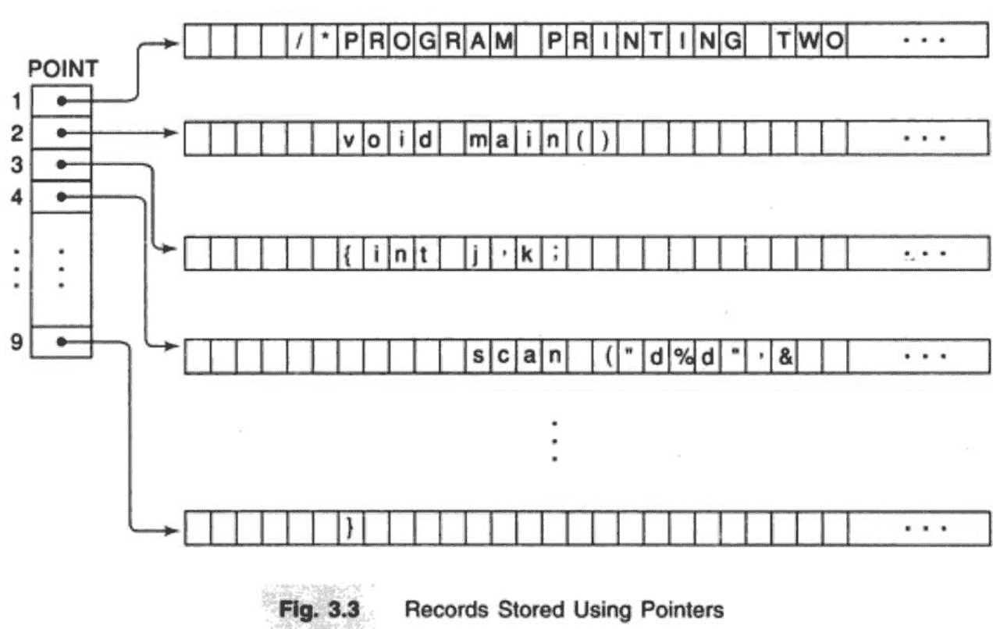

### Variable-Length Storage with Fixed Maximum

Although strings may be stored in fixed-length memory locations as above, there are advantages in knowing the actual length of each string. For example, one then does not have to read the entire record when the string occupies only the beginning part of the memory location. Also, certain string operations (discussed in Sec. 3.4) depend on having such variable-length strings.

The storage of variable-length strings in memory cells with fixed lengths can be done in two general ways:

- One can use a marker, such as two dollar signs ($$), to signal the end of the string.
- One can list the length of the string—as an additional item in the pointer array, for example.


使用图 3.1 中的数据，第一种方法如图 3.4(a) 所示，第二种方法如图 3.4(b) 所示。

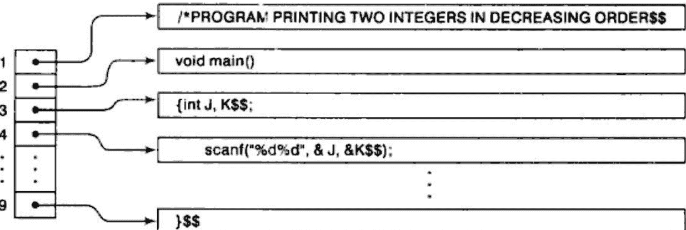

### (a) 带哨兵的记录。

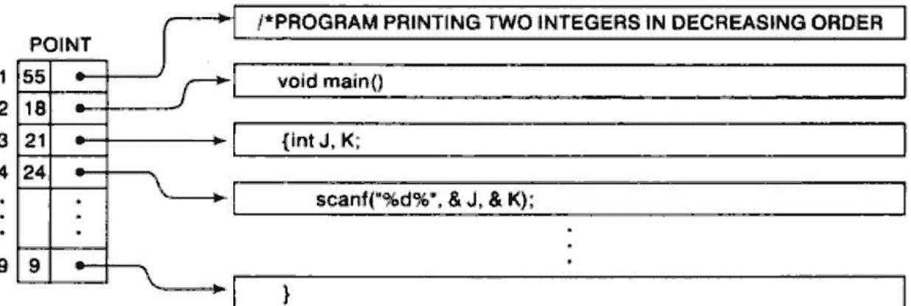

### (b) 长度已列出的记录。

Fig. 3.4

备注：有人可能会想使用某种分隔标记将字符串一个接一个地存储，例如图 3.5(a) 中的两个美元符号 ($$)，或者使用指向字符串位置的指针数组，如图 3.5(b) 所示。这些存储字符串的方法显然可以节省空间，并且在记录相对永久且很少更改时有时会在二级存储器中使用。但是，当字符串及其长度频繁更改时，这种存储方法通常效率低下。

### 链式存储

当今计算机被非常频繁地用于文字处理，即输入、处理和输出印刷材料。因此，计算机必须能够更正和修改印刷材料，这通常意味着在文本中删除、更改和插入单词、短语、句子甚至段落。然而，上面讨论的固定长度内存单元不易用于这些操作。因此，对于大多数大规模文字处理应用程序，字符串是通过链表存储的。此类链表以及其中数据的插入和删除方式将在第 5 章中详细讨论。在这里，我们只看字符串在这些数据结构中出现的方式。

所谓（单向）链表，是指内存单元的线性有序序列，称为节点，其中每个节点包含一个称为链接的项目，该项目指向列表中的下一个节点（即，包含下一个节点的地址）。图 3.6 是此类链表的示意图。

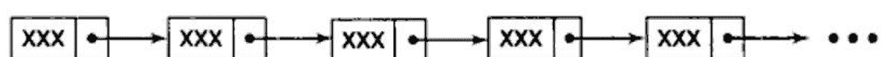

Fig. 3.6 链表

字符串可以存储在链表中，如下所示。每个内存单元分配一个字符或固定数量的字符，单元中包含的链接给出包含字符串中下一个字符或字符组的单元的地址。例如，考虑这句名言：

> 生存还是毁灭，这是一个问题。

图 3.7(a) 显示了每个节点一个字符时字符串在内存中的出现方式，图 3.7(b) 显示了每个节点四个字符时的出现方式。

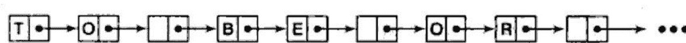

### (a) 每个节点一个字符。

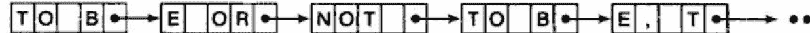

### (b) 每个节点四个字符。

Fig. 3.7

### 3.4 字符数据类型

本节概述了各种编程语言处理字符数据类型的方式。如前一章（第 2.7 节）所述，每种数据类型都有自己的解码内存中比特序列的公式。

### 常量

许多编程语言通过将字符串放在单引号或双引号中来表示字符串常量。例如，'THE END' 和 'TO BE OR NOT TO BE' 是长度分别为 7 和 18 个字符的字符串常量。我们的算法也将以这种方式定义字符常量。

### 变量

每种编程语言都有形成字符变量的自己的规则。然而，此类变量分为三类：静态、半静态和动态。所谓静态字符变量，是指其长度在程序执行前定义且在整个程序运行期间不可更改的变量。所谓半静态字符变量，是指其长度在程序执行期间可能变化，只要长度不超过程序执行前确定的最大值即可。所谓动态字符变量，是指其长度在程序执行期间可以更改的变量。这三类分别对应前一节中讨论的字符串在计算机内存中的存储方式。

### 示例 3.2

在 C 语言中，变量使用字母数字字符声明。变量名中允许的唯一特殊字符是下划线 (_)。此外，变量名必须符合某些规则；例如：

- 变量名必须始终以字母开头
- 变量名不能与系统关键字相同
- 变量名中不允许有空格

以下是 C 语言中字符变量声明的一些示例：

```
char a; //declares a single character variable a
char str[20]; //declares a character array (string) of length 20
```

### 3.5 作为 ADT 的字符串

大多数语言都将字符串作为内置数据类型或标准库，并定义了一组针对该类型的操作。因此，我们实际上无需创建自己的字符串 ADT。但是，如果需要，我们可以实现自己的字符串数据类型。字符串处理应用程序中数据类型的使用不应取决于其实现方式，或者它是内置的还是用户定义的。我们只需要知道字符串上允许哪些操作。

字符串数据类型通常应具有以下操作：

- 返回字符串中的第 n 个字符。
- 将字符串中的第 n 个字符设置为 c。
- 查找字符串的长度。
- 连接两个字符串。
- 复制字符串。
- 删除字符串的一部分。
- 以其他方式修改和比较字符串。

以下是我们可能想要对字符串执行的一组操作。

| 操作 | 描述 |
|---|---|
| GETCHAR(str, n) | 返回字符串中的第 n<sup>th</sup> 个字符 |
| PUTCHAR(str, n, c) | 将字符串中的第 n<sup>th</sup> 个字符设置为 c |
| LENGTH(str) | 返回字符串中的字符数 |
| POS(str1, str2) | 返回 str2 在 str1 中首次出现的位置，如果没有匹配则返回 0 |
| CONCAT(str1, str2) | 返回一个新字符串，由 str1 的字符后跟 str2 的字符组成 |
| SUBSTRING(str1, i, m) | 返回从字符串 str 的位置 i 开始的长度为 m 的子字符串 |
| DELETE(str, i, m) | 从位置 i 开始从 str 中删除 m 个字符 |
| INSERT(str1, str2, i) | 将 str1 更改为在位置 i 插入 str2 的新字符串 |
| COMPARE(str1, str2) | 返回一个整数，指示 str1 是否大于 str2 |

设 S1 为一个字符串。此字符串有多种实现方式，如示例 3.3 所示。

> **示例 3.3**
> 
> 假设 S1 = ‘JANICE’。
> 
> (a) 在这种情况下，由于长度已知，可以将其实现为固定长度数组，其中第一个元素表示字符串的长度，如下所示。
> 
> [6, J, A, N, I, C, E]
> 
> (b) 如果长度未知，可以将其实现为数组，但使用特殊的 ‘NULL’ 字符（由 ‘\0’ 表示）来指示字符串的结束，如下所示。一旦知道字符串长度，就可以为其动态分配内存。
> 
> [J, A, N, I, C, E, \0,.....]
> 
> 第一个实现具有所有固定长度数组实现的缺点。但是，某些操作很高效，例如，查找长度。
> 
> 第二个实现具有动态分配空间的优势；修改字符串也可能更高效，因为我们不需要重新计算大小。

### 3.6 字符串操作

虽然字符串可以简单地被视为字符序列或线性数组，但字符串与其他类型的数组在使用上存在根本区别。具体来说，字符串中连续元素的组（例如单词、短语和句子），称为子字符串，可以本身作为单元。此外，字符串中的基本访问单元通常是这些子字符串，而不是单个字符。

例如，考虑字符串

```
'TO BE OR NOT TO BE'
```

我们可以将字符串视为 18 个字符的序列 T, O, ␣, B, ..., E。但是，子字符串 TO、BE、OR 等有其自身含义。

另一方面，考虑一个由 18 个整数组成的 18 元素线性数组，


4, 8, 6, 15, 9, 5, 4, 13, 8, 5, 11, 9, 9, 13, 7, 10, 6. 11

在这样的数组中，访问的基本单位通常是单个元素。连续元素的组通常没有任何特殊含义。

出于上述原因，已开发出各种字符串操作，这些操作通常不用于其他类型的数组。本节讨论这些面向字符串的操作。下一节展示这些操作在文字处理中的应用。（除非另有说明或暗示，我们假设字符型变量是动态的，其长度可变，由变量使用的上下文决定。）

### 子字符串

从给定字符串中访问子字符串需要三个信息：（1）字符串的名称或字符串本身，（2）子字符串在给定字符串中第一个字符的位置，（3）子字符串的长度或子字符串最后一个字符的位置。我们将此操作称为SUBSTRING。具体地，我们写

```
SUBSTRING(string, initial, length)
```

以表示字符串S从位置K开始且长度为L的子字符串。

### 示例 3.4

(a) 使用上述函数，我们有：

```
SUBSTRING('TO BE OR NOT TO BE', 4, 7) = 'BE OR N'
SUBSTRING('THE END' , 4, 4) = ' END'
```

### 程序 3.1

```
/* Code showing the implementation of SUBSTRING function in C */
#include <stdio.h>
#include <conio.h>

void main()
{
char S[80]=("TO BE OR NOT TO BE");
char *SUBSTR(char*,int,int);
clrscr();

printf("STRING = %s",S);
printf("\n\nSUBSTRING(S,4,7) = %s",SUBSTR(S,4,7));
getch();
}

char *SUBSTR(char *STR,int i,int j)
{
int k,m=0;
char STRRES[80];
for(k=i-1;k<=i+j-1-1;k++)
{
    STRRES[m]=STR[k];
    m=m+1;
}
STRRES[m]='\0';
return(STRRES);
}
```

输出：
STRING = TO BE OR NOT TO BE
SUBSTRING(S, 4, 7) = BE OR N

### 索引

索引，也称为模式匹配，是指查找字符串模式P在给定文本T中首次出现的位置。我们将此操作称为INDEX，并写

```
INDEX(text, pattern)
```

如果模式P在文本T中不出现，则INDEX被赋值为0。参数“text”和“pattern”可以是字符串常量或字符串变量。

### 示例 3.5

(a) 假设T包含文本
'HIS FATHER IS THE PROFESSOR'
那么，
INDEX(T, 'THE')、INDEX(T, 'THEN')和INDEX(T, ' THE')
的值分别为7、0和14。

### 程序 3.2

```
/* Code showing the implementation of INDEX function in C */
#include <stdio.h>
#include <conio.h>
#include <string.h>
void main()
{
char T[80]=("HIS FATHER IS THE PROFESSOR");
int INDEX(char*,char*);
clrscr();
printf("T = %s",T);
printf("\n\nINDEX(T,'THE') = %d",INDEX(T,"THE"));
printf("\n\nINDEX(T,'THEN') = %d",INDEX(T,"THEN"));
printf("\n\nINDEX(T,' THE ') = %d",INDEX(T," THE "));
getch();
}

int INDEX(char *STR1,char *STR2)
{
 int m,n;
 int index,flag;
 for(m=0;m<strlen(STR1);m++)
 {
 index=m;
 flag=1;
 for(n=0;n<strlen(STR2);n++)
 {
 if(STR1[m+n]==STR2[n])
 ;
 else
 {
 flag=0;
 break;
 }
 }
 if(flag==0)
 continue;
 else
 return(index);
 }
 if(m==strlen(STR1))
 return(-1);
}
```

**输出：**
T = HIS FATHER IS THE PROFESSOR

INDEX(T,'THE') = 6

INDEX(T,'THEN') = -1

INDEX(T,' THE ') = 13

备注：由于0是C语言中的有效索引位置，我们使用-1表示模式与文本不匹配的情况。

### 连接

设S1和S2为字符串。回顾（第3.2节），S1和S2的连接，我们用S1//S2表示，是由S1的字符后跟S2的字符组成的字符串。

### 示例 3.6

(a) 假设S1 = 'MARK'且S2 = 'TWAIN'。那么：
S1//S2 = 'MARKTWAIN' 但 S1// ' ' //S2 = 'MARK TWAIN'

(b) 在C语言中，连接使用strcat函数执行，如下所示：
strcat(S1,S2); //Concatenates strings S1 and S2 and stores
the result in S1
strcat()函数是string.h头文件的一部分；因此必须在预处理时包含它。

### 程序 3.3

```
/* Code showing string concatenation in C */
#include <stdio.h>
#include <conio.h>
#include <string.h>

void main()
{
char S1[80]=("MARK");
char S2[80]=("TWAIN");
clrscr();

printf("S1 = %s",S1);
printf("\nS2 = %s",S2);
printf("\nS1//S2 = %s",strcat(S1,S2));
strcpy(S1,"MARK");
printf("\nS1//' '//S2 = %s",strcat(strcat(S1," "),S2));

getch();
}
```

输出：
S1 = MARK
S2 = TWAIN
S1//S2 = MARKTWAIN
S1//' '//S2 = MARK TWAIN

### 长度

字符串中的字符数称为其长度。我们将写

### LENGTH(string)

用于表示给定字符串的长度。

### 示例 3.7

(a) 假设S = 'COMPUTER'。那么：

LENGTH (S) = 8

同样，

LENGTH ('MARC TWAIN') = 10

(b) 在C语言中，字符串长度使用strlen函数确定，如下所示：

```
x = strlen("Sunrise"); //strlen function returns an integer value
7 and assigns it to the variable X
```

与strcat类似，strlen也是string.h的一部分，因此必须在预处理时包含该头文件。

### 程序 3.4

```
/* Code showing the use of strlen () in C */
#include <stdio.h>
#include <conio.h>
#include <string.h>

void main()
{
char S1[80]={"COMPUTER"};
char S2[80]={"MARC"};
clrscr();

printf("Length(%s) = %d",S1,strlen(S1));
printf("\nLength(%s) = %d",S2,strlen(S2));

getch();
}
```

输出：
Length(COMPUTER) = 8
Length(MARC) = 4

### 3.7 文字/文本处理

在早期，计算机处理的字符数据主要由数据项组成，例如姓名和地址。如今，计算机也处理印刷材料，例如信件、文章和报告。正是在这种后一种语境下，我们使用“文字处理”这一术语。

给定一些印刷文本，通常与文字处理相关的操作如下：

- (a) 替换。将文本中的一个字符串替换为另一个字符串。
- (b) 插入。在文本中间插入一个字符串。
- (c) 删除。从文本中删除一个字符串。

上述操作可以通过使用前一节讨论的字符串操作来执行。我们将在下面分别讨论每个操作时展示这一点。这些操作中的许多都内置于大多数编程语言中，或可以轻松定义。

### 插入

假设在给定文本T中，我们想要插入一个字符串S，使S从位置K开始。我们用以下方式表示此操作：

```
INSERT(text, position, string)
```

例如，

```
INSERT ('ABCDEFG', 3, 'XYZ') = 'ABXYZCDEFG'
INSERT ('ABCDEFG', 6, 'XYZ') = 'ABCDEXYZFG'
```

此INSERT函数可以使用前一节定义的字符串操作实现，如下所示：

```
INSERT(T, K, S) = SUBSTRING(T, 1, K – 1) /// SUBSTRING(T, K, LENGTH(T) – K + 1)
```

也就是说，位置K之前的T的初始子字符串（长度为K – 1）与字符串S连接，然后结果与T的其余部分连接，该部分从位置K开始，长度为LENGTH(T) – (K – 1) = Length(T) – K + 1。（我们隐含地假设T是动态变量，且T的大小不会变得过大。）

### 删除

假设在给定文本T中，我们想要删除从位置K开始且长度为L的子字符串。我们用以下方式表示此操作：

```
DELETE(text, position, length)
```

例如，

```
DELETE( ' ABCDEFG ', 4, 2) = ' ABCFG '
DELETE( ' ABCDEFG ', 2, 4) = ' AFG '
```

我们假设如果位置K = 0，则不删除任何内容。因此，

```
DELETE( ' ABCDEFG ', 0, 2) = ' ABCDEFG '
```

这种“零情况”的重要性将在后面体现。

DELETE函数可以使用前一节给出的字符串操作实现，如下所示：

```
DELETE(T, K, L) =
SUBSTRING(T, 1, K – 1)//SUBSTRING(T, K + L, LENGTH(T) – K – L + 1)
```

也就是说，位置K之前的T的初始子字符串与从位置K + L开始的T的终端子字符串连接。初始子字符串的长度为K – 1，终端子字符串的长度为：

LENGTH(T) - (K + L - 1) = LENGTH(T) - K - L + 1

我们还假设当K = 0时，DELETE(T, K, L) = T。

现在假设给定文本T和模式P，我们想要从T中删除模式P的第一个出现。这可以通过使用上述DELETE函数来完成，如下所示：

DELETE(T, INDEX(T, P), LENGTH(P))

也就是说，在文本T中，我们首先计算INDEX(T, P)，即P在T中首次出现的位置，然后计算LENGTH(P)，即P中的字符数。回顾，当INDEX(T, P) = 0时（即，当P不在T中出现时），文本T不发生更改。

- **示例 3.8**

  (a) 假设T = 'ABCDEFG'且P = 'CD'。那么INDEX(T, P) = 3且LENGTH(P) = 2。因此
  
  DELETE ('ABCDEFG', 3, 2) = 'ABEFG'
  
  (b) 假设T = 'ABCDEFG'且P = 'DC'。那么INDEX(T, P) = 0且LENGTH(P) = 2。因此，根据“零情况，”
  
  DELETE('ABCDEFG ', 0, 2) = ' ABCDEFG '
  
  如预期。

假设将文本T和模式P读入计算机后，我们想要删除文本T中模式P的每个出现。这可以通过反复应用

DELETE(T, INDEX(T, P), LENGTH(P))

直到INDEX(T, P) = 0（即，直到P不在T中出现）。完成此任务的算法如下。

- **算法 3.1：** 文本T和模式P在内存中。此算法删除T中P的每个出现。

  1. [查找P的索引。] 设K := INDEX(T, P)。
  2. 当K ≠ 0时重复：
     (a) [从T中删除P。]
         设T := DELETE(T, INDEX(T, P), LENGTH(P))
     (b) [更新索引。] 设K := INDEX(T, P)。
     [循环结束。]
  3. 写出：T。
  4. 退出。

我们强调，每次删除后，T的长度都会减少，因此算法必须停止。然而，循环执行的次数可能超过P在原始文本T中出现的次数，如下一个示例所示。


## 示例 3.9

(a) 假设用数据运行算法 3.1
T = XABYABZ, P = AB
则算法中的循环将执行两次。第一次执行期间，T 中第一个出现的 AB 被删除，结果 T = XYABZ。第二次执行期间，T 中剩余的 AB 被删除，因此 T = XYZ。相应地，输出为 XYZ。

(b) 假设用数据运行算法 3.1
T = XAAABBBY, P = AB
观察到模式 AB 在 T 中只出现一次，但算法中的循环将执行三次。具体来说，从 T 中第一次删除 AB 后，我们得到 T = XAABBY，因此 AB 再次出现在 T 中。从 T 中第二次删除 AB 后，我们看到 T = XABY 且 AB 仍然出现在 T 中。最后，从 T 中第三次删除 AB 后，我们得到 T = XY 且 AB 不再出现在 T 中，因此 INDEX(T, P) = 0。故输出为 XY。

上述示例表明，当文本 T 因删除而发生变化时，可能会出现原本未出现的模式。

## 替换

假设在给定文本 T 中，我们想用模式 P2 替换模式 P1 的第一次出现。我们将用以下方式表示此操作：

```
REPLACE(text, pattern1, pattern2)
```

例如

```
REPLACE('XABYABZ', 'AB', 'C') = 'XCYABZ'
REPLACE('XABYABZ' , 'BA', 'C') = 'XABYABZ'
```

在第二种情况下，模式 BA 未出现，因此没有任何更改。

我们注意到，如果使用前面的 DELETE 和 INSERT 函数，此 REPLACE 函数可以表示为删除后跟插入。具体来说，REPLACE 函数可以通过以下三个步骤执行：

```
K := INDEX(T, P1)
T := DELETE(T, K, LENGTH(P1))
INSERT(T, K, P2)
```

前两个步骤从 T 中删除 P1，第三个步骤在 P1 被删除的位置 K 插入 P2。

假设文本 T 和模式 P、Q 位于计算机内存中。假设我们想用模式 Q 替换 T 中模式 P 的每一次出现。这可以通过反复应用

```
REPLACE(T, P, Q)
```

直到 INDEX(T, P) = 0（即，直到 P 不再出现在 T 中）来实现。执行此操作的算法如下。

- 算法 3.2：文本 T 和模式 P、Q 在内存中。此算法将 T 中 P 的每一次出现替换为 Q。
- 1. [查找 P 的索引。] 设 K := INDEX(T, P)。
- 2. 重复当 K != 0 时：
  - (a) [用 Q 替换 P。] 设 T := REPLACE(T, P, Q)。
  - (b) [更新索引。] 设 K := INDEX(T, P)。
  - [循环结束。]
- 3. 写：T。
- 4. 退出。

警告：虽然此算法看起来非常类似于算法 3.1，但无法保证此算法会终止。此事实在示例 3.10(b) 中得到说明。另一方面，假设 Q 的长度小于 P 的长度。那么每次替换后 T 的长度都会减少。这保证了在 Q 小于 P 的这种特殊情况下，算法必须终止。

## 示例 3.10

(a) 假设用数据运行算法 3.2
T = XABYABZ, P = AB, Q = C

则算法中的循环将执行两次。第一次执行期间，T 中第一个出现的 AB 被替换为 C，得到 T = XCYABZ。第二次执行期间，T 中剩余的 AB 被替换为 C，得到 T = XCYCZ。因此输出为 XCYCZ。

(b) 假设用数据运行算法 3.2
T = XAY, P = A, Q = AB

则算法永远不会终止。其原因是，无论循环执行多少次，P 总是会出现在文本 T 中。具体来说，
第一次循环执行结束时 T = XABY
第二次循环执行结束时 T = XAB²Y
....................................................
第 n 次循环执行结束时 T = XABⁿY

（此处出现无限循环是因为 P 是 Q 的子串。）

以下程序展示了 C 语言中插入、删除和替换算法的实现：

## 程序 3.5

```c
#include <stdio.h>
#include <conio.h>

char* SUBSTR(char*,int,int);
int INDEX(char*,char*);
char* INSERT(char*,int,char*);
char* DELETE(char*,int,int);
char* REPLACE(char*,char*,char*);

void main()
{
char S[80]={"ABCDEFG"};
char R1[80],R2[80],R3[80],R4[80],R5[80],R6[80];
clrscr();

printf("STRING = %s",S);
strcpy(R1,INSERT(S,3,"XYZ"));
strcpy(R2,INSERT(S,6,"XYZ"));
printf("\n\nINSERT('ABCDEFG',3,'XYZ') = %s",R1);
printf("\n\nINSERT('ABCDEFG',6,'XYZ') = %s",R2);
strcpy(R3,DELETE(S,4,2));
strcpy(R4,DELETE(S,2,4));
printf("\n\nDELETE('ABCDEFG',4,2) = %s",R3);
printf("\n\nDELETE('ABCDEFG',2,4) = %s",R4);
strcpy(R5,REPLACE("XABYABZ","AB","C"));
strcpy(R6,REPLACE("XABYABZ","BA","C"));
printf("\n\nREPLACE('XABYABZ','AB','C') = %s",R5);
printf("\n\nREPLACE('XABYABZ','BA','C') = %s",R6);

getch();
}

char* INSERT(char* S1,int K,char*S2)
{
char RESULT[80];
strcpy(RESULT,SUBSTR(S1,1,K-1));
strcat(RESULT,S2);
strcat(RESULT,SUBSTR(S1,K,strlen(S1)-K+1));
return(RESULT);
}

char* DELETE(char* S1,int K,int L)
{
char RESULT[80];
strcpy(RESULT,SUBSTR(S1,1,K-1));
strcat(RESULT,SUBSTR(S1,K+L,strlen(S1)-K-L+1));
return(RESULT);
}

char* REPLACE(char* S1,char* S2,char* S3)
{
int K;
char RES1[80];
char RES2[80];
if(INDEX(S1,S2) != -1)
K=INDEX(S1,S2)+1;
else
return(S1);
strcpy(RES1,DELETE(S1,K,strlen(S2)));
strcpy(RES2,INSERT(RES1,K,S3));
return(RES2);
}

char *SUBSTR(char *STR,int i,int j)
{
int k,m=0;
char STRRES[80];
for(k=i-1;k<=i+j-1-1;k++)
{
STRRES[m]=STR[k];
m=m+1;
}
STRRES[m]='\0';
return(STRRES);
}

int INDEX(char *STR1,char *STR2)
{
int m,n;
int index,flag;
for(m=0;m<strlen(STR1);m++)
{
index=m;
flag=1;
for(n=0;n<strlen(STR2);n++)
{
if(STR1[m+n]==STR2[n])
;
else
{
flag=0;
break;
}
}
if(flag == 0)
continue;
else
return(index);
}
if(m==strlen(STR1))
return(-1);
}
```

Output:
STRING = ABCDEFG
INSERT('ABCDEFG',3,'XYZ') = ABXYZCDEFG
INSERT('ABCDEFG',6,'XYZ') = ABCDEXYZFG
DELETE('ABCDEFG',4,2) = ABCFG
DELETE('ABCDEFG',2,4) = AFG
REPLACE('XABYABZ','AB','C') = XCYABZ
REPLACE('XABYABZ','BA','C') = XABYABZ

### 3.8 模式匹配算法

模式匹配是决定给定字符串模式 P 是否出现在字符串文本 T 中的问题。我们假设 P 的长度不超过 T 的长度。本节讨论两种模式匹配算法。我们还讨论算法的复杂度，以便比较它们的效率。

注：在讨论模式匹配算法时，字符有时用小写字母（a、b、c、...）表示，并可使用指数表示重复；例如，

```
$a^2b^3ab^2$ 表示 $aabbbabb$，$(cd)^3$ 表示 $cdcdcd$
```

此外，空字符串可用 $\Lambda$（希腊字母 lambda）表示，字符串 X 和 Y 的连接可用 X $\cdot$ Y 或简单地 XY 表示。

### 第一种模式匹配算法

第一种模式匹配算法是显而易见的算法：将给定模式 P 与 T 的每个子串从左到右逐一比较，直到找到匹配项。详细来说，设

```
$W_K = SUBSTRING(T, K, LENGTH(P))$
```

也就是说，设 W_K 表示与 P 具有相同长度且从 T 的第 K 个字符开始的子串。首先，我们将 P 与第一个子串 W_1 逐字符比较。如果所有字符都相同，则 P = W_1，因此 P 出现在 T 中，且 INDEX(T, P) = 1。另一方面，假设我们发现 P 的某个字符与 W_1 中对应的字符不同。那么 P != W_1，我们可以立即转到下一个子串 W_2。也就是说，接下来我们将 P 与 W_2 比较。如果 P != W_2，则将 P 与 W_3 比较，以此类推。该过程在以下情况停止：(a) 当我们找到 P 与某个子串 W_K 的匹配，因此 P 出现在 T 中且 INDEX(T, P) = K；或 (b) 当我们耗尽所有 W_K 而没有匹配，因此 P 不出现在 T 中。下标 K 的最大值 MAX 等于 LENGTH(T) - LENGTH(P) + 1。

为了举例说明，假设 P 是一个 4 字符字符串，T 是一个 20 字符字符串，且 P 和 T 在内存中作为每个元素一个字符的线性数组出现。即，

P = P[1]P[2]P[3]P[4] 且 T = T[1]T[2]T[3] ... T[19]T[20]

然后，P 与 T 中的以下每个 4 字符子串进行比较：

W_1 = T[1]T[2]T[3]T[4]，W_2 = T[2]T[3]T[4]T[5]，...，W_17 = T[17]T[18]T[19]T[20]

请注意，T 中有 MAX = 20 - 4 + 1 = 17 个这样的子串。

我们算法的正式表示（其中 P 是 r 字符字符串，T 是 s 字符字符串）如算法 3.3 所示。

请注意，算法 3.3 包含两个循环，一个嵌套在另一个内部。外层循环遍历 T 中的每个连续的 R 字符子串

W_K = T[K]T[K + 1] ... T[K + R - 1]

内层循环将 P 与 W_K 逐字符比较。如果任何字符不匹配，则控制转移到步骤 5，该步骤增加 K 并导致 T 的下一个子串。如果 P 的所有 R 个字符都与某个 W_K 匹配，则 P 出现在 T 中，且 K 是 P 在 T 中的索引。另一方面，如果外层循环完成所有周期，则 P 不出现在 T 中，因此 INDEX = 0。

- 算法 3.3：（模式匹配）P 和 T 是长度分别为 R 和 S 的字符串，并作为每个元素一个字符的数组存储。此算法查找 P 在 T 中的索引。
- 1. [初始化。] 设 K := 1 和 MAX := S - R + 1。
- 2. 当 K <= MAX 时重复步骤 3 至 5：
- 3. 对 L = 1 到 R 重复：[测试 P 的每个字符。] 如果 P[L] != T[K + L - 1]，则：转到步骤 5。[内层循环结束。]
- 4. [成功。] 设 INDEX = K，并退出。
- 5. 设 K := K + 1。[步骤 2 外层循环结束。]
- 6. [失败。] 设 INDEX = 0。
- 7. 退出。


## 程序 3.6

```c
/* C implementation of Algorithm 3.3*/
#include <stdio.h>
#include <conio.h>

void main()
{
char P[80]="bab";
char T[80]="aabbbabb";
int R,S,K,L,MAX,INDEX;
clrscr();

R=strlen(P);
S=strlen(T);
K=0;
MAX=S-R;

while(K<=MAX)
{
for(L=0;L<R;L++)
if(P[L]!=T[K+L])
break;

if(L==R)
{
INDEX=K;
break;
}
else
K=K+1;
}

if(K>MAX)
INDEX=-1;

printf("P = %s",P);
printf("\n\nT = %s",T);

if(INDEX!=-1)
printf("\n\nIndex of P in T is %d",INDEX);
else
printf("\n\nP does not exist in T");

getch();
}
```

**输出：**
P = bab

T = aabbbabb

P 在 T 中的索引为 4

## 示例 3.11

该模式匹配算法的复杂度由模式 P 中的字符与文本 T 中的字符之间的比较次数 C 来衡量。为了求出 C，我们令 Nk 表示在 P 与 WK 比较时，内层循环中进行的比较次数。则

C = N1 + N2 + ... + NL

其中 L 是 P 在 T 中首次出现的位置，或者如果 P 不在 T 中出现，则 L = MAX。下一个示例针对某些特定的 P 和 T 计算 C，其中 LENGTH(P) = 4 且 LENGTH(T) = 20，因此 MAX = 20 - 4 + 1 = 17。

- (a) 假设 P = aaba 且 T = cdcd ... cd = (cd)^10。显然 P 不在 T 中出现。此外，对于 17 个循环中的每一个，Nk = 1，因为 P 的第一个字符与 Wk 不匹配。因此

  C = 1 + 1 + 1 + ... + 1 = 17

- (b) 假设 P = aaba 且 T = ababaaba.... 观察可知 P 是 T 的子串。事实上，P = W5，因此 N5 = 4。另外，将 P 与 W1 = abab 比较，我们看到 N1 = 2，因为首字母匹配；但将 P 与 W2 = baba 比较，我们看到 N2 = 1，因为首字母不匹配。同样，N3 = 2 且 N4 = 1。因此，

  C = 2 + 1 + 2 + 1 + 4 = 10

- (c) 假设 P = aabab 且 T = aa ... a = a^20。这里 P 不在 T 中出现。此外，每个 Wk = aaaa；因此每个 Nk = 4，因为 P 的前三个字符匹配。因此，

  C = 4 + 4 + ... + 4 = 17 \times 4 = 68

一般来说，当 P 是 r 个字符的字符串且 T 是 s 个字符的字符串时，该算法的数据规模为

n = r + s

最坏情况发生在 P 中除了最后一个字符外的每个字符都与每个子串 WK 匹配时，如示例 3.10(c) 所示。在这种情况下，C(n) = r(s - r + 1)。对于固定的 n，我们有 s = n - r，因此

C(n) = r(n - 2r + 1)

C(n) 的最大值出现在 r = (n + 1)/4 时。（参见问题 3.19。）因此，将此 r 值代入 C(n) 的公式得到

C(n) = (n + 1)^2 / 8 = O(n^2)

任何实际情况下平均情况的复杂度取决于通常未知的某些概率。当 P 和 T 的字符从某个有限字母表中随机选择时，平均情况的复杂度仍然不易分析，但平均情况的复杂度仍然是最坏情况的一个因子。因此，我们将陈述如下：该模式匹配算法的复杂度等于 O(n^2)。换句话说，执行该算法所需的时间与 n^2 成正比。（将此结果与第 3.28 页的结果进行比较。）

## 第二个模式匹配算法

第二个模式匹配算法使用一个表，该表由特定的模式 P 推导得出，但与文本 T 无关。为了明确起见，假设 P = aaba。

首先，我们给出表项的原因及其使用方法。假设 T = T_1T_2T_3 ...，其中 T_i 表示 T 的第 i 个字符；并且假设 T 的前两个字符与 P 的前两个字符匹配；即，假设 T = aa.... 那么 T 具有以下三种形式之一：

- (i) T = aab...
- (ii) T = aaa...
- (iii) T = aax

其中 x 是任何不同于 a 或 b 的字符。假设我们读取 T_3 并发现 T_3 = b。然后我们接下来读取 T_4 以查看 T_4 是否等于 a，这将使 P 与 W_1 匹配。另一方面，假设 T_3 = a。那么我们知道 P != W_1；但我们也知道 W_2 = aa....，即子串 W_2 的前两个字符与 P 的前两个字符匹配。因此我们接下来读取 T_4 以查看 T_4 是否等于 b。最后，假设 T_3 = x。那么我们知道 P != W_1，但我们也知道 P != W_2 且 P != W_3，因为 x 不出现在 P 中。因此我们接下来读取 T_4 以查看 T_4 是否等于 a，即查看 W_4 的第一个字符是否与 P 的第一个字符匹配。

上述过程有两个重要点。首先，当我们读取 T_3 时，只需将 T_3 与出现在 P 中的字符进行比较。如果这些字符都不匹配，那么我们处于最后一种情况，即一个不出现在 P 中的字符 x。其次，在读取并检查 T_3 之后，我们接下来读取 T_4；我们不需要在文本 T 中回头再看。

图 3.8(a) 包含我们第二个模式匹配算法中用于模式 P = aaba 的表。（在表和附带图中，模式 P 及其子串 Q 将用斜体大写字母表示。）表的获取方法如下。首先，我们令 Q_i 表示长度为 i 的 P 的初始子串；因此

Q_0 = \Lambda, Q_1 = a, Q_2 = a^2, Q_3 = a^2b, Q_4 = a^2ba = P

（这里 Q_0 = \Lambda 是空字符串。）表的行由 P 的这些初始子串标记，不包括 P 本身。表的列由 a、b 和 x 标记，其中 x 表示不出现在模式 P 中的任何字符。令 f 为表确定的函数；即，令 f(Q_i, t)

| | a | b | x |
|---|---|---|---|
| Q_0 | Q_1 | Q_0 | Q_0 |
| Q_1 | Q_2 | Q_0 | Q_0 |
| Q_2 | Q_2 | Q_3 | Q_0 |
| Q_3 | P | Q_0 | Q_0 |

(a) 模式匹配表

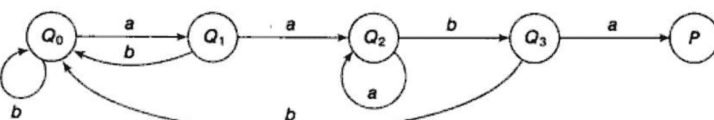

(b) 模式匹配图

图 3.8

表示表中行 Q_i 和列 t（其中 t 是任何字符）处的条目。此条目 f(Q_i, t) 被定义为在字符串 Q_i t（即 Q_i 和 t 的连接）中出现的最大 Q，该 Q 作为终端子串出现。例如，

- a^2 是 Q_2a = a^3 的终端子串的最大 Q，因此 f(Q_2, a) = Q_2
- \Lambda 是 Q_1b = ab 的终端子串的最大 Q，因此 f(Q_1, b) = Q_0
- a 是 Q_0a = a 的终端子串的最大 Q，因此 f(Q_0, a) = Q_1
- \Lambda 是 Q_3x = a^2bx 的终端子串的最大 Q，因此 f(Q_3, x) = Q_0

等等。虽然 Q_1 = a 是 Q_2a = a^3 的终端子串，但我们有 f(Q_2, a) = Q_2，因为 Q_2 也是 Q_2a = a^3 的终端子串，且 Q_2 大于 Q_1。我们注意到对于任何 Q_i，f(Q_i, x) = Q_0，因为 x 不出现在模式 P 中。因此，对应于 x 的列通常从表中省略。

我们的表也可以通过图 3.8(b) 中的带标签有向图来描绘。该图的获取方法如下。首先，图中有与 P 的每个初始子串 Q_i 对应的节点。Q 被称为系统的 *状态*，Q_0 被称为 *初始状态*。其次，图中有与表中每个条目对应的箭头（有向边）。具体来说，如果

```
f(Q_i, t) = Q_j
```

那么有一个由字符 t 标记的箭头从 Q_i 指向 Q_j。例如，f(Q_2, b) = Q_3，因此有一个标记为 b 的箭头从 Q_2 指向 Q_3。为了记号方便，我们省略了所有标记为 x 的箭头，这些箭头必须指向初始状态 Q_0。

我们现在准备好给出模式 P = aaba 的第二个模式匹配算法。（注意，在以下讨论中，算法中出现的所有单字母变量名都将使用大写字母。）令 T = T_1T_2T_3 ... T_N 表示正在搜索模式 P 的 n 个字符的文本。从初始状态 Q_0 开始，并使用文本 T，我们将按如下方式获得一系列状态 S_1, S_2, S_3, ...。我们令 S_1 = Q_0 并读取第一个字符 T_1。从图 3.8 的表或图中，对 (S_1, T_1) 产生第二个状态 S_2；即，f(S_1, T_1) = S_2。我们读取下一个字符 T_2。对 (S_2, T_2) 产生状态 S_3，以此类推。有两种可能性：

1. 某个状态 S_K = P，即所需的模式。在这种情况下，P 确实出现在 T 中，其索引为 K - LENGTH(P)。
2. 没有状态 S_1, S_2, ..., S_{N+1} 等于 P。在这种情况下，P 不出现在 T 中。

我们使用模式 P = aaba，用两个不同的文本来演示该算法。

## 示例 3.12

- (a) 假设 T = aabcaba。从 Q_0 开始，我们使用 T 的字符和图 3.8 中的图（或表）来获得以下状态序列：
  Q_0 \xrightarrow{a} Q_1 \xrightarrow{a} Q_2 \xrightarrow{b} Q_3 \xrightarrow{c} Q_0 \xrightarrow{a} Q_1 \xrightarrow{b} Q_0 \xrightarrow{a} Q_1

  我们没有得到状态 P，因此 P 不出现在 T 中。

- (b) 假设 T = abcaabaca。那么我们获得以下状态序列：
  Q_0 \xrightarrow{a} Q_1 \xrightarrow{b} Q_0 \xrightarrow{c} Q_0 \xrightarrow{a} Q_1 \xrightarrow{a} Q_2 \xrightarrow{b} Q_3 \xrightarrow{a} P

  这里我们将模式 P 作为状态 S_8 获得。因此 P 确实出现在 T 中，其索引为 8 - LENGTH(P) = 4。

我们第二个模式匹配算法的正式陈述如下：


## 算法 3.4：模式匹配

模式 P 的模式匹配表 F(Qi, T) 在内存中，输入是一个 N 字符的字符串 T = T1 T2 ... TN。该算法查找 P 在 T 中的 INDEX。

- 1. [初始化。] 设 K := 1 且 S1 = Q0
- 2. 当 S_K ≠ P 且 K ≤ N 时，重复执行步骤 3 至 5。
- 3. 读取 T_K。
- 4. 设 S_{K+1} := F(S_K, T_K)。[查找下一个状态。]
- 5. 设 K := K + 1。[更新计数器。]
- [第 2 步循环结束。]
- 6. [是否成功？]
- 如果 S_K = P，则：
- INDEX = K - LENGTH(P)。
- 否则：
- INDEX = 0。
- [If 结构结束。]
- 7. 退出

### 程序 3.7

```c
/* C implementation of Algorithm 3.4*/
#include <stdio.h>
#include <conio.h>
char F(char,char);
int state[4][3];

void main()
{
char P[80]={"aaba"};
char T[80]={"abcaabaca"};
int N,K,S,I,INDEX;
clrscr();

state[0][0]=1;
state[0][1]=0;
state[0][2]=0;
state[1][0]=2;
state[1][1]=0;
state[1][2]=0;
state[2][0]=2;
state[2][1]=3;
state[2][2]=0;
state[3][0]=-1;
state[3][1]=0;
state[3][2]=0;
N=strlen(T);
K=0;
S=0;

while(K<N && S!=-1)
{
 if(T[K]=='a')
 I=0;
 if(T[K]=='b')
 I=1;
 if(T[K]=='x')
 I=2;

 S=F(S,I);
 K=K+1;
}

if(S==-1)
 INDEX=K-strlen(P);
else
 INDEX=-1;

printf("P = %s",P);
printf("\n\nT = %s",T);

if(INDEX!=-1)
 printf("\n\nIndex of P in T is %d",INDEX);
else
 printf("\n\nP does not exist in T");

getch();
}

char F(char SK,char TK)
{
 return(state[SK][TK]);
}
```

输出：
P = aaba

T = abcaabaca

P 在 T 中的索引是 3

上述算法的运行时间与第 2 步循环执行次数成正比。最坏情况发生在读取完整个文本 T 时，即循环执行 n = LENGTH(T) 次时。因此，我们可以得出以下结论：该模式匹配算法的复杂度等于 O(n)。

注释：如果存在复杂度等于 O(n^m) 的算法解（其中 m 为某个常数），则组合问题可在多项式时间内求解；如果存在复杂度等于 O(n) 的算法解，则称该问题可在线性时间内求解，其中 n 为数据大小。因此，本节描述的两个模式匹配算法中的第二个可在线性时间内求解。（第一个模式匹配算法可在多项式时间内求解。）

## 已解决的问题

### 术语；字符串存储

- 3.1 设 W 为字符串 ABCD。（a）求 W 的长度。（b）列出 W 的所有子串。（c）列出 W 的所有初始子串。

- (a) W 中字符的数量即为其长度，因此 W 的长度为 4。

- (b) W 的任何字符子序列都是 W 的子串。共有 11 个这样的子串：
- 子串：ABCD, ABC, BCD, AB, BC, CD, A, B, C, D, Λ
- 长度：4 3 2 1 0
- （此处 Λ 表示空字符串。）

- (c) 初始子串为 ABCD, ABC, AB, A, Λ；即空字符串以及所有以 A 开头的子串。

- 3.2 假设一种编程语言至少使用 48 个字符——26 个字母、10 个数字和至少 12 个特殊字符——请给出在计算机内存中表示一个字符所需的最小位数和通常位数。

由于 2^5 < 48 < 2^6，表示 48 个字符至少需要 6 位代码。通常，计算机使用 7 位代码（如 ASCII）或 8 位代码（如 EBCDIC）来表示字符。这样，计算机可以表示和处理更多的特殊字符。

- 3.3 简要描述用于存储字符串的三种结构。

- (a) 定长存储结构。在此结构中，字符串存储在长度相同的内存单元中，通常预留 80 个字符的空间。

- (b) 带固定最大值的变长存储。在此结构中，字符串也存储在长度相同的内存单元中；但是，还知道单元中字符串的实际长度。

- (c) 链表存储。在此结构中，每个单元分为两部分；第一部分存储一个字符（或固定数量的少量字符），第二部分包含存储下一个字符的单元的地址。

### 3.4 假设链接值 0 表示列表结束，求图 3.9 中存储的字符串。

此处字符串存储在每个节点包含 4 个字符的链表结构中。START 的值给出列表中第一个节点的位置：

```
4 | A TH | 2
```

该节点中的链接值给出列表中下一个节点的位置：

```
2 | ING | 7
```

按此方式继续，我们得到以下节点序列：

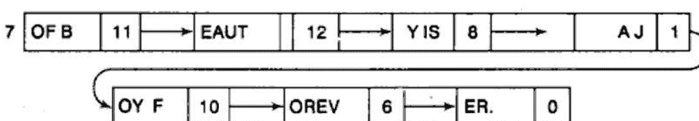

| 起始 | 字符 | 链接 |
|---|---|---|
| 4 | | |
| 1 | OY F | 10 |
| 2 | ING | 7 |
| 3 | | |
| 4 | A TH | 2 |
| 5 | | |
| 6 | ER. | 0 |
| 7 | OF B | 11 |
| 8 | A J | 1 |
| 9 | | |
| 10 | OREV | 6 |
| 11 | EAUT | 12 |
| 12 | Y IS | 8 |

图 3.9

因此，字符串为：

A THING OF BEAUTY IS A JOY FOREVER.

### 3.5 列出使用链式存储存储字符串的（a）优点和（b）缺点。

- (a) 使用链式存储时，可以轻松地插入、删除、连接和重新排列子串。

- (b) 存储链接需要额外的空间。此外，无法直接访问列表中间的字符。

### 3.6 简要说明（a）静态、（b）半静态和（c）动态字符变量的含义。

- (a) 变量的长度在程序执行前定义，并在程序执行期间不可更改。

- (b) 变量的长度在程序执行期间可能会变化，但不能超过程序执行前定义的最大值。

- (c) 变量的长度在程序执行期间可能会变化。

### 3.7 假设 MEMBER 是一个固定长度为 20 的字符变量。假设字符串左对齐存储在内存单元中，右侧用空格填充或截断最右侧的字符。描述 MEMBER（a）如果将 ‘JOHN PAUL JONES’ 赋值给 MEMBER，（b）如果将 ‘ROBERT ANDREW WASHINGTON’ 赋值给 MEMBER。

数据将在 MEMBER 中显示如下：

| J | O | H | N |   | P | A | U | L |   | J | O | N | E | S |   |   |   |
| R | O | B | E | R | T |   | A | N | D | R | E | W |   | W | A | S | H | I | N |

### 字符串操作

在已解决问题 3.8 至 3.11 及 3.13 中，设 S 和 T 为字符变量，使得
S = 'JOHN PAUL JONES'
T = 'A THING OF BEAUTY IS A JOY FOREVER.'

### 3.8 回顾，我们使用 LENGTH(string) 表示字符串的长度。
(a) 在 C 中此函数如何表示？
(b) 求 LENGTH(S) 和 LENGTH(T)。

(a) 在 C 中，可以使用 strlen 库函数来确定字符串的长度，如下所示：

```
strlen(string); // 此函数调用将返回一个等于字符串长度的整数值
```

(b) 假设单词之间只有一个空格字符，
LENGTH(S) = 15   且   LENGTH(T) = 35

### 3.9 回顾，我们使用 SUBSTRING(string, position, length) 表示从给定位置开始且具有给定长度的字符串的子串。确定（a）SUBSTRING(S, 4, 8) 和（b）SUBSTRING(T, 10, 5)。

(a) 从第四个字符开始并记录 8 个字符，我们得到
SUBSTRING(S, 4, 8) = 'N PAUL J'

(b) 同样，
SUBSTRING(T, 10, 5) = 'F BEA'

### 3.10 回顾，我们使用 INDEX(text, pattern) 表示模式在文本中首次出现的位置。如果模式不出现在文本中，则该函数被赋值为 0。确定（a）INDEX(S, 'JO')，（b）INDEX(S, 'JOY')，（c）INDEX(S, ' JO')，（d）INDEX(T, 'A')，（e）INDEX(T, ' A ') 和（f）INDEX(T, 'THE')。

(a) INDEX(S, 'JO') = 1，（b）INDEX(S, 'JOY') = 0，（c）INDEX(S, ' JO') = 10，（d）INDEX(T, 'A') = 1，（e）INDEX(T, ' A ') = 21 且（f）INDEX(T, 'THE') = 0。（回顾，空格用空白字符表示。）

### 3.11 回顾，我们使用 S₁//S₂ 表示字符串 S₁ 和 S₂ 的连接。

- (a) 在 C 中此函数如何表示？
- (b) 求（i）'THE' // 'END' 和（ii）'THE' // ' '//'END'。
- (c) 求（i）SUBSTRING(S, 11, 5)//' '//SUBSTRING(S, 1, 9) 和（ii）SUBSTRING(T, 28, 3)//'GIVEN'。

(a) 在 C 中，字符串连接使用 strcat 库函数执行，如下所示：

```
strcat(S1,S2); // 此函数调用将连接字符串 S1
和 S2 并将结果存储在 S1 中
```

(b) S₁//S₂ 指的是由 S₁ 的字符后跟 S₂ 的字符组成的字符串，因此，（i）THEEND 和（ii）THE END。

(c) （i）JONES, JOHN PAUL 和（ii）FORGIVEN。

### 3.12 回顾，我们使用 INSERT(text, position, string) 表示在给定文本 T 的位置 K 开始插入字符串 S。

- (a) 求（i）INSERT('AAAAA', 1, 'BBB')，（ii）INSERT('AAAAA', 3, 'BBB') 和（iii）INSERT('AAAAA', 6, 'BBB')。

- (b) 假设 T 是文本 'THE STUDENT IS ILL.'。使用 INSERT 更改 T，使其读作：（i）The student is very ill. （ii）The student is ill today. （iii）The student is very ill today.

(a) （i）BBBABAAAA，（ii）AABBBAAA 和（iii）AAAAABBB。

(b) 必要时注意包含空格。（i）INSERT(T, 15, ' VERY')。
(ii) INSERT(T, 19, ' TODAY')。（iii）INSERT(INSERT(T, 19, ' TODAY'), 15, ' VERY') 或 INSERT(INSERT(T, 15, ' VERY'), 24, ' TODAY')。

### 3.13 求

- (a) DELETE('AAABBB', 2, 2) 和 DELETE('JOHN PAUL JONES', 6, 5)

- (b) REPLACE('AAABBB', 'AA', 'BB') 和
- REPLACE('JOHN PAUL JONES', 'PAUL', 'DAVID')

(a) DELETE(T, K, L) 从文本 T 中删除从位置 K 开始且长度为 L 的子串。因此，答案是


ABBB and JOHN JONES

(b) REPLACE(T, P₁, P₂) 在文本 T 中用模式 P₂ 替换模式 P₁ 的第一次出现。因此答案为

BBABBBB and JOHN DAVID JONES

## Word/Text Processing

在已解决问题 3.14 至 3.17 中，S 是存储在线性数组 LINE 中的一个短篇故事，该数组有 n 个元素，使得每个 LINE[K] 是一个存储 80 个字符的静态字符变量，并表示故事的一行。此外，LINE[1]，即第一行，仅包含故事的标题，而 LINE[N]，即最后一行，仅包含作者的姓名。而且，每个段落以 5 个空格开头，除了 LINE[1] 中的标题或 LINE[N] 中的作者姓名外，没有其他缩进。

### 3.14 编写一个过程，统计短篇故事 S 中段落的数量 NUM。从 LINE[2] 开始，到 LINE[N – 1] 结束，统计以 5 个空格开头的行数。过程如下。

- 过程 P3.14: PAR(LINE, N, NUM)
- 1. 设 NUM := 0 和 BLANK := '     '
- 2. [初始化计数器。] 设 K := 2.
- 3. 重复步骤 4 和 5，当 K ≤ N – 1 时。
- 4. [将每行的前 5 个字符与 BLANK 进行比较。]
   如果 SUBSTRING(LINE[K], 1, 5) = BLANK，则：
   设 NUM := NUM + 1.
   [If 结构结束。]
- 5. 设 K := K + 1. [递增计数器。]
   [步骤 3 循环结束。]
- 6. 返回。

```c
/* C implementation of Procedure P3.14 */
#include <stdio.h>
#include <conio.h>
#include <string.h>

char S[10][80]={("This is the story of a boy"),
{"who lived in Delhi"},
{" His name was Rohan"},
{"He was studying engineering"},
{" His favorite subject was DS"},
{"He was good in string handling"}};
int PAR(char[][80],int,int);
char* SUBSTR(char*,int,int);

void main()
{
int NUM,N;
clrscr();

NUM=0;
N=6;

printf("The number of paragraphs in short story S are %d",PAR(S,N,NUM));
getch();
}

int PAR(char S1[][80],int N1,int NUM1)
{
int K;
int i;
char BLANK[6]=("     ");
char TEMP[80];

K=0;
while(K<N1-1)
{
i=0;

while(S1[K][i]!='\0')
{
TEMP[i]=S1[K][i];
i=i+1;
}

if(strcmp(SUBSTR(TEMP,1,5),BLANK)==0)
NUM1=NUM1+1;
K=K+1;
}
return(NUM1);
}

char* SUBSTR(char *STR,int i,int j)
{
int k,m=0;
char STRRES[80];
for(k=i-1;k<=i+j-1-1;k++)
{
STRRES[m]=STR[k];
m=m+1;
}
STRRES[m]='\0';
return(STRRES);
}
```

输出：
短篇故事 S 中的段落数为 2

### 3.15 编写一个过程，统计单词 “the” 在短篇故事 S 中出现的次数 NUM。（我们不计算 “mother” 中的 “the”，并且假设没有句子以单词 “the” 结尾。）

请注意，单词 “the” 可以作为行首的 THE□ 出现，作为行尾的 □THE 出现，或作为行中其他位置的 □THE□ 出现。因此，我们必须对每行检查这三种情况。过程如下。

- 过程 P3.15: COUNT(LINE, N, NUM)
- 1. 设 WORD := "THE" 和 NUM := 0.
- 2. [为三种情况做准备。]
   设 BEG := WORD//'□', END := '□'//WORD 和
   MID := '□' //WORD// '□'.
- 3. 对 K = 1 到 N 重复步骤 4 至 6：
- 4. [第一种情况。] 如果 SUBSTRING(LINE[K], 1, 4) = BEG，则：
   设 NUM := NUM + 1.
- 5. [第二种情况。] 如果 SUBSTRING(LINE[K], 77, 4) = END，则：
   设 NUM := NUM + 1.
- 6. [一般情况。] 对 J = 2 到 76 重复。
   如果 SUBSTRING(LINE[K], J, 5) = MID，则：
   设 NUM := NUM + 1.
   [If 结构结束。]
   [步骤 6 循环结束。]
   [步骤 3 循环结束。]
- 7. 返回。

### 程序 3.9

```c
/* C implementation of Procedure 3.15 */
#include <stdio.h>
#include <conio.h>
#include <string.h>

char S[10][80]={("This is the story of a boy"),
("who lived in Delhi"),
("His name was Rohan"),
("THE Dummy Text: Checking THE use of THE string THE"),
("His favorite subject was DS"),
("He was good in string handling")};
int COUNT(char[][80],int,int);
char* SUBSTR(char*,int,int);

void main()
{
int NUM,N;
clrscr();
NUM=0;
N=6;
printf("The number of instances of WORD in short story S are %d",COUNT(S,N,NUM));
getch();
}

int COUNT(char S1[][80],int N1,int NUM1)
{
int K;
int i,J;
char BEG[10]=("THE ");
char END[10]=(" THE");
char MID[10]=(" THE ");
char TEMP[80];
K=0;
while(K<N1)
{
i=0;
while(S1[K][i]!='\0')
{
TEMP[i]=S1[K][i];
i=i+1;
}
TEMP[i]='\0';
if(strcmp(SUBSTR(TEMP,1,4),BEG)==0)
NUM1=NUM1+1;
if(strcmp(SUBSTR(TEMP,strlen(TEMP)-3,4),END)==0)
NUM1=NUM1+1;
for(J=2;J<strlen(TEMP)-5;J++)
if(strcmp(SUBSTR(TEMP,J,5),MID)==0)
NUM1=NUM1+1;
K=K+1;
}
return(NUM1);
}
char* SUBSTR(char *STR,int i,int j)
{
int k,m=0;
char STRRES[80];
for(k=i-1;k<=i+j-1;k++)
{
STRRES[m]=STR[k];
m=m+1;
}
STRRES[m]='\0';
return(STRRES);
}
```

输出：
短篇故事 S 中 WORD 的实例数为 4

### 3.16 讨论如果要统计任意长度为 R 的单词 W 的出现次数，必须对过程 P3.15 进行哪些更改。

- 有三种基本类型的更改。
- (a) 显然，步骤 1 中的 'THE' 必须更改为 W。
- (b) 由于 W 的长度为 r 而不是 3，必须在步骤 3 至 6 中进行适当更改。
- (c) 还必须考虑 W 后面可能跟有标点符号的可能性，
  例如，
  W,   W;   W.   W?
  因此必须处理超过三种的情况。

### 3.17 概述一个算法，该算法将短篇故事 S 中的第 k 段和第 l 段互换。

该算法归结为两个过程：
过程 A. 找出数组 BEG 和 END 的值，其中
LINE[BEG[K]]   和   LINE[END[K]]
分别包含故事 S 中第 K 段的第一行和最后一行。
过程 B. 使用 BEG[K] 和 END[K] 的值以及 BEG[L] 和
END[L] 的值，互换第 K 段的行块与第 L 段的行块。

## Pattern Matching

### 3.18 对于以下每个模式 P 和文本 T，使用“慢”算法（算法 3.3）找到 T 中 P 的 INDEX 所需的比较次数 C：
(a) P = abc, T = (ab)^5 = ababababab (b) P = abc, T = (ab)^{2n}
(c) P = aaa, T = (abb)^3 = aabbaabbaabb (d) P = aaa, T = abaabbaaabbbaaaabbb

回顾 C = N_1 + N_2 + ... + N_k，其中 N_k 表示在将 P 与 W_K 比较时内循环中进行的比较次数。

(a) 首先注意，有
LENGTH(T) - LENGTH(P) + 1 = 10 - 3 + 1 = 8
个子串 W_K。我们有
C = 2 + 1 + 2 + 1 + 2 + 1 + 2 + 1 = 4(3) = 12
并且 INDEX(T, P) = 0，因为 P 不出现在 T 中。

(b) 有 2n - 3 + 1 = 2(n - 1) 个子词 W_K。我们有
C = 2 + 1 + 2 + 1 + ... + 2 + 1 = (n + 1)(3) = 3n + 3
并且 INDEX(T, P) = 0.

(c) 有 12 - 3 + 1 = 10 个子词 W_K。我们有
C = 3 + 2 + 1 + 1 + 3 + 2 + 1 + 1 + 3 + 2 = 19
并且 INDEX(T, P) = 0.

(d) 我们有
C = 2 + 1 + 3 + 2 + 1 + 1 + 3 = 13
并且 INDEX(T, P) = 7.

### 3.19 假设 P 是一个 r 字符的字符串，T 是一个 s 字符的字符串，并且假设 C(n) 表示将算法 3.3 应用于 P 和 T 时的比较次数。（这里 n = r + s。）
(a) 找出最佳情况下的复杂度 C(n)。
(b) 证明 C(n) 的最大值出现在 r = (n + 1)/4 时。

(a) 最佳情况发生在 P 是 T 的初始子串时，换句话说，当 INDEX(T, P) = 1 时。在这种情况下 C(n) = r。（我们假设 r <= s。）
(b) 根据第 3.7 节的讨论，
C = C(n) = r(n - 2r + 1) = nr - 2r^2 + r
这里 n 是固定的，因此 C = C(n) 可以看作 r 的函数。微积分告诉我们，当 C' = dc/dr = 0 时 C 取得最大值（这里 C' 是 C 对 r 的导数）。使用微积分，我们得到：
C' = n - 4r + 1
令 C' = 0 并求解 r，即可得到所需结果。

### 3.20 考虑模式 P = aaabb。构建用于“快速”或第二个模式匹配算法的表及其对应的标记有向图。

首先列出 P 的初始片段：

$Q_0 = \Lambda, Q_1 = a, Q_2 = a^2, Q_3 = a^3, Q_4 = a^3b, Q_5 = a^3b^2$

对于每个字符 $t$，表中的项 $f(Q_i, t)$ 是作为字符串 $Q_i t$ 的终端子串出现的最大 $Q$。我们计算：

$f(\Lambda, a) = a, \quad f(a, a) = a^2, \quad f(a^2, a) = a^3, \quad f(a^3, a) = a^3, \quad f(a^3b, a) = a$  
$f(\Lambda, b) = \Lambda, \quad f(a, b) = \Lambda, \quad f(a^2, b) = \Lambda, \quad f(a^3, b) = a^3b, \quad f(a^3b, b) = P$

因此所需的表如图 3.10(a) 所示。相应的图如图 3.10(b) 所示，其中每个 $Q$ 对应一个节点，对于表中的每个项 $f(Q_i, t) = Q_j$，有一个从 $Q_i$ 到 $Q_j$ 标记为字符 $t$ 的箭头。

| | a | b |
|---|---|---|
| $Q_0$ | $Q_1$ | $Q_0$ |
| $Q_1$ | $Q_2$ | $Q_0$ |
| $Q_2$ | $Q_3$ | $Q_0$ |
| $Q_3$ | $Q_3$ | $Q_4$ |
| $Q_4$ | $Q_1$ | $P$ |

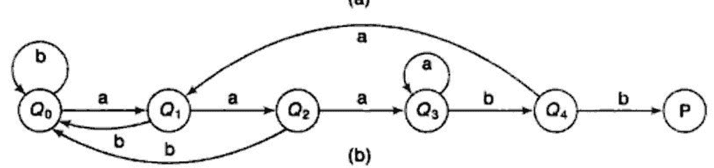

图 3.10

### 3.21 找出第二个模式匹配算法中模式 P = ababab 的表及其对应图。

P 的初始子串为：

$Q_0 = \Lambda, Q_1 = a, Q_2 = ab, Q_3 = aba, Q_4 = abab, Q_5 = ababa, Q_6 = ababab = P$

给出表项的函数 $f$ 如下：

$f(\Lambda, a) = a \quad f(\Lambda, b) = \Lambda$  
$f(a, a) = a \quad f(a, b) = ab$  
$f(ab, a) = aba \quad f(ab, b) = \Lambda$  
$f(aba, a) = a \quad f(aba, b) = abab$  
$f(abab, a) = ababa \quad f(abab, b) = \Lambda$  
$f(ababa, a) = a \quad f(ababa, b) = P$

表如图 3.11(a) 所示，相应的图如图 3.11(b) 所示。


你要么访问了不可查看的页面，要么已达到本书的查看限制。

3.4 Suppose STATE is a character variable with fixed length 12. Describe the contents of STATE after the assignment (a) STATE := 'NEW YORK', (b) STATE := 'SOUTH CAROLINA' and (c) STATE := 'PENNSYLVANIA'.

## 字符串操作

In Supplementary Problems 3.5 to 3.10, let S and T be character variables such that S = 'WE THE PEOPLE' and T = 'OF THE UNITED STATES' Implement the problems using C programs

- 3.5 Find the length of S and T.
- 3.6 Find (a) SUBSTRING(S, 4, 8) and (b) SUBSTRING(T, 10, 5).
- 3.7 Find (a) INDEX(S, 'P'), (b) INDEX(S, 'E'), (c) INDEX(S, 'THE'), (d) INDEX(T, "THE"), (e) INDEX(T, 'THEN') and (f) INDEX(T, "TE").
- 3.8 Using S1//S2 to stand for the concatenation of S1 and S2, find (a) 'NO//EXIT', (b) 'NO//' []' // 'EXIT' and (c) SUBSTRING(S, 4, 10)//[]ARE[] //SUBSTRING(T, 8, 6).
- 3.9 Find (a) DELETE('AAABBB', 3, 3), (b) DELETE('AAABBB', 1, 4), (c) DELETE(S, 1, 3) and (d) DELETE(T, 1, 7).
- 3.10 Find (a) REPLACE('ABABAB', 'B', 'BAB'), (b) REPLACE(S, 'WE', 'ALL') and (c) REPLACE(T, 'THE', 'THESE').
- 3.11 Find (a) INSERT('AAA', 2, 'BBB'), (b) INSERT('ABCDE', 3, 'XYZ') and (c) INSERT('THE BOY', 5, 'BIG[]').
- 3.12 Suppose U is the text 'MARC STUDIES MATHEMATICS'. Use INSERT to change U so that it reads: (a) MARC STUDIES ONLY MATHEMATICS. (b) MARC STUDIES MATHEMATICS AND PHYSICS. (c) MARC STUDIES APPLIED MATHEMATICS.

## 模式匹配

- 3.13 Consider the pattern P = abc. Using the "slow" pattern matching algorithm, Algorithm 3.3, find the number C comparisons to find the INDEX of P in each of the following texts T: (a) a^10, (b) (aba)^10, (c) (cbab)^10, (d) d^10 and (e) d^n where n > 3.
- 3.14 Consider the pattern P = a^5b. Repeat Problem 3.13 with each of the following texts T: (a) a^20, (b) a^n where n > 6; (c) d^20 and (d) d^n where n > 6.
- 3.15 Consider the pattern P = a^3ba. Construct the table and the corresponding labeled directed graph used in the "fast" pattern matching algorithm.
- 3.16 Repeat Problem 3.15 for the pattern P = aba^2b.

## 编程问题

In Programming Problems 3.1 to 3.3, assume the preface of this text is stored in a linear array LINE such that LINE[K] is a static character variable storing 80 characters and represents a line of the preface. Assume that each paragraph begins with 5 blank spaces and there is no other indentation. Also, assume there is a variable NUM which gives the number of lines in the preface.

- 3.1 Write a program which defines a linear array PAR such that PAR[K] contains the location of the Kth paragraph, and which also defines a variable NPAR which contains the number of paragraphs.

- 3.2 Write a program which reads a given WORD and then counts the number C of times WORD occurs in LINE. Test the program using (a) WORD = 'THE' and (b) WORD = 'HENCE'.

- 3.3 Write a program which interchanges the Jth and Kth paragraphs. Test the program using J = 2 and K = 4.

In Programming Problems 3.4 to 3.9, assume the preface of this text is stored in a single character variable TEXT. Assume 5 blank spaces indicates a new paragraph.

- 3.4 Write a program which constructs a linear array PAR such that PAR[K] contains the location of the Kth paragraph in TEXT, and which finds the value of a variable NPAR which contains the number of paragraphs. (Compare with Programming Problem 3.1.)

- 3.5 Write a program which reads a given WORD and then counts the number C of times WORD occurs in TEXT. Test the program using (a) WORD = 'THE' and (b) WORD = 'HENCE'. (Compare with Programming Problem 3.2.)

- 3.6 Write a program which interchanges the Jth and Kth paragraphs in TEXT. Test the program using J = 2 and K = 4. (Compare with Programming Problem 3.3.)

- 3.7 Write a program which reads words WORD1 and WORD2 and then replaces each occurrence of WORD1 in TEXT by WORD2. Test the program using WORD1 = 'HENCE' and WORD2 = 'THUS'

- 3.8 Write a subprogram INST(TEXT, NEW, K) which inserts a string NEW into TEXT beginning at TEXT[K].

- 3.9 Write a subprogram PRINT(TEXT, K) which prints the character string TEXT in lines with at most K characters. No word should be divided in the middle and appear on two lines, so some lines may contain trailing blank spaces. Each paragraph should begin with its own line and be indented using 5 blank spaces. Test the program using (a) K = 800, (b) K = 70 and (c) K = 60.

- 3.10 Write a program to find the distance between two character strings.

- 3.11 Write a program with three short strings, about 6 characters each, and use strcpy to copy one, two, and three into them. Concatenate the three strings into one string and print the result out 10 times.

## 选择题

- 3.1 Computers are used for processing numerical data called ______ data.
- (a) Float (b) Local
- (c) Character (d) Nonlocal

- 3.2 Each programming language contains a ______ set that is used to communicate with the computer.
- (a) Character (b) Integer
- (c) Float (d) Numeric

- 3.3 Finite sequence S of zero or more characters is called ______.
- (a) Array (b) List
- (c) String (d) Block

- 3.4 String with zero characters is called ______ string.
- (a) NULL (b) Binary
- (c) Totalled (d) List

- 3.5 A computer which can access an


你要么访问了不可查看的页面，要么已达到本书的查看限制。

## 数组、记录和指针

### 4.1 引言

Data structures are classified as either linear or nonlinear. A data structure is said to be linear if its elements form a sequence, or, in other words, a linear list. There are two basic ways of representing such linear structures in memory. One way is to have the linear relationship between the elements represented by means of sequential memory locations. These linear structures are called arrays and form the main subject matter of this chapter. The other way is to have the linear relationship between the elements represented by means of pointers or links. These linear structures are called linked lists; they form the main content of Chapter 5. Nonlinear structures such as trees and graphs are treated in later chapters.

The operations one normally performs on any linear structure, whether it be an array or a linked list, include the following:

- (a) Traversal. Processing each element in the list.
- (b) Search. Finding the location of the element with a given value or the record with a given key.
- (c) Insertion. Adding a new element to the list.
- (d) Deletion. Removing an element from the list.
- (e) Sorting. Arranging the elements in some type of order.
- (f) Merging. Combining two lists into a single list.

The particular linear structure that one chooses for a given situation depends on the relative frequency with which one performs these different operations on the structure.

This chapter discusses a very common linear structure called an array. Since arrays are usually easy to traverse, search and sort, they are frequently used to store relatively permanent collections of data. On the other hand, if the size of the structure and the data in the structure are constantly changing, then the array may not be as useful a structure as the linked list, discussed in Chapter 5.


你要么访问了不可查看的页面，要么已达到本书的查看限制。

to begin the index set with 1932 so that

AUTO[K] = number of automobiles sold in the year K

Then LB = 1932 is the lower bound and UB = 1984 is the upper bound of AUTO. By Eq. (4.1),
Length = UB - LB + 1 = 1984 - 1930 + 1 = 55

That is, AUTO contains 55 elements and its index set consists of all integers from 1932 through 1984.

### 程序 4.1

```
/*
Defining Arrays in C*/
#include <stdio.h>
main()
{
int a[10]; //1
for(int i = 0;i<10;i++)
{
a[i]=i;
}
printarray(a);
}
void printarray(int a[])
{
for(int i = 0;i<10;i++)
{
printf("Value in the array %d\n",a[i]);
}
}
```

The above program helps to define an array. Statement 1 defines an array of integers of the size 10, which means you can store 10 integers. When we define the array, the size should be known. Subscripts are used to refer the elements of the array where 0 is considered to be the lowest subscript always and the highest subscript is (size - 1), which is 9 in this case. We can refer to any element as a[0], a[1], a[2], etc.

An array can also be processed using a for loop. The consecutive memory locations of the array are allocated and the element size is the same. We should always keep in mind that among all the operators used the subscript of this array must have the highest precedence.

Each programming language has its own rules for declaring arrays. Each such declaration must give, implicitly or explicitly, three items of information: (1) the name of the array, (2) the data type of the array and (3) the index set of the array.

### 示例 4.2

(a) Suppose DATA is a 6-element linear array containing real values. C language declares such an array as follows:

```
float DATA[6];
```


您要么访问了一个无法查看的页面，要么已达到查看此书的限制。


您要么访问了一个无法查看的页面，要么已达到查看此书的限制。

在每个阶段中，我们可以看到 r 要么减小，要么 y 增加，从而表明该算法是有限的，区域 X 的长度 |X|（即 r + 1 - y）每次都会减小，且“已排序”条件 B < Y < X < R 保持为真。当 X = 0 时，算法终止，因此我们得到已排序的列表。循环执行了 N 次，共有 |B| + |R| 次对 swap 例程的调用。

### 4.4 内存中的线性数组表示

设 LA 为计算机内存中的一个线性数组。回顾，计算机内存仅仅是一系列带地址的位置，如图 4.3 所示。让我们使用如下表示法

LOC(LA[K]) = address of the element LA[K] of the array LA

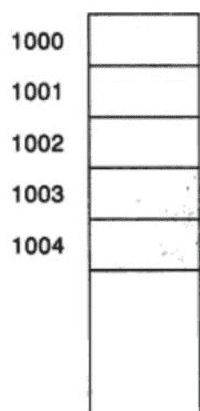

图 4.3 计算机内存

如前所述，LA 的元素存储在连续的内存单元中。因此，计算机不需要跟踪 LA 中每个元素的地址，只需跟踪 LA 中第一个元素的地址，该地址表示为

Base(LA)

并称为 LA 的基地址。使用此地址 Base(LA)，计算机按以下公式计算 LA 中任何元素的地址：

```
LOC (LA[K]) = Base(LA) + w(K – lower bound) (4.2)
```

其中 w 是数组 LA 每个内存单元的字数。请注意，计算 LOC(LA[K]) 所需的时间对于任何 K 值基本相同。此外，给定任何下标 K，可以在不扫描 LA 中任何其他元素的情况下定位并访问 LA[K] 的内容。

## 示例 4.4

考虑示例 4.1(b) 中的数组 AUTO，它记录了从 1932 年到 1984 年每年售出的汽车数量。假设 AUTO 在内存中如图 4.4 所示出现。即，Base(AUTO) = 200，且 AUTO 每个内存单元的 w = 4 个字。那么

LOC(AUTO[1932]) = 200, LOC(AUTO[1933]) = 204, LOC(AUTO[1934]) = 208, ...

可以使用公式 (4.2) 获取年份 K = 1965 的数组元素地址：

LOC(AUTO[1965]) = Base(AUTO) + w(1965 - lower bound)
= 200 + 4(1965 - 1932) = 332

我们再次强调，可以在不扫描数组 AUTO 中任何其他元素的情况下获得此元素的内容。

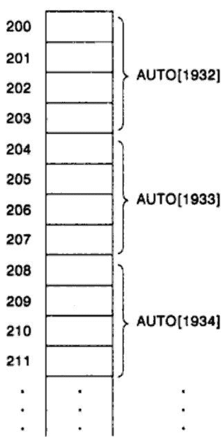

图 4.4

### 程序 4.8

数组的所有元素都有内存地址。在以下程序中，我们可以看到如何打印数组限制值和数组元素地址。

```
#include <stdio.h>
void printarray(int x[]);
main()
{
    int x[15];
    for(int i = 0;i<15;i++)
    {
    x[i]=i;
    }
    printarray(x);
}
void printarray(int x[])
{
    for(int i = 0;i<15;i++)
    {
    printf("Value in the array %d\n",x[i]);
    }
}
void printdetail(int x[])
{
    for(int i = 0;i<15;i++)
    {
    printf("Value in the array %d and address is %16lu\n",x[i],&x[i]);
    }
}
}
```

在上述程序中，函数 ‘printarray’ 用于打印数组 ‘array’ 中每个元素的值。要打印所有元素的值及其地址，则使用 printdetail 函数。

既然已知所有元素都是整数类型，地址之间的差值为 2。

数组中的所有元素都放置在连续的内存空间中。内存地址可以使用占位符 %16lu 或 %p 打印。

备注：如果集合 A 中的任何元素（我们将其称为 A<sub>K</sub>）都可以在与 K 无关的时间内定位和处理，则称该数据元素集合 A 为可索引的。上述讨论表明线性数组是可索引的。这是线性数组的一个非常重要的特性。事实上，下一章将介绍的链表不具备此特性。

### 4.5 遍历线性数组

设 A 为存储在计算机内存中的数据元素集合。假设我们想要打印 A 中每个元素的内容，或者想要统计 A 中具有特定属性的元素数量。这可以通过遍历 A 来完成，即访问并处理（通常称为访问）A 中的每个元素恰好一次。

以下算法遍历线性数组 LA。该算法的简单性源于 LA 是线性结构这一事实。其他线性结构（如链表）也可以轻松遍历。另一方面，非线性结构（如树和图）的遍历要复杂得多。


您要么访问了一个无法查看的页面，要么已达到查看此书的限制。

## 示例 4.5

考虑示例 4.1(b) 中的数组 AUTO，它记录了从 1932 年到 1984 年每年售出的汽车数量。以下各模块（执行给定操作）都涉及遍历 AUTO。

- (a) 找出售出超过 300 辆汽车的年份数 NUM。
  - 1. [初始化步骤。] 设 NUM := 0。
  - 2. 对 K = 1932 到 1984 重复：如果 AUTO[K] > 300，则：设 NUM := NUM + 1。[循环结束。]
  - 3. 返回。

- (b) 打印每一年及该年售出的汽车数量。
  - 1. 对 K = 1932 到 1984 重复：写入：K, AUTO[K]。[循环结束。]
  - 2. 返回。

（请注意，(a) 在遍历数组 AUTO 之前需要对变量 NUM 进行初始化步骤。）

### 4.6 插入和删除

设 A 为计算机内存中的数据元素集合。“插入”是指向集合 A 添加另一个元素的操作，“删除”是指从 A 中移除一个元素的操作。本节讨论当 A 为线性数组时的插入和删除。

在线性数组的“末尾”插入一个元素可以轻松完成，前提是为数组分配的内存空间足够大，能够容纳额外元素。另一方面，假设我们需要在数组中间插入一个元素。那么，平均而言，一半的元素必须向下移动到新位置，以容纳新元素并保持其他元素的顺序。

同样，删除数组“末尾”的一个元素没有困难，但删除数组中间某个位置的元素将要求每个后续元素向上移动一个位置，以“填满”数组。

备注：由于线性数组通常被描绘为向下延伸（如图 4.1 所示），术语“向下”指的是下标较大的位置，而术语“向上”指的是下标较小的位置。

## 示例 4.6

假设 TEST 已被声明为一个 5 元素数组，但仅为 TEST[1]、TEST[2] 和 TEST[3] 记录了数据。如果 X 是下一次测试的值，则只需赋值

```
TEST[4] := X
```

以将 X 添加到列表。同样，如果 Y 是后续测试的值，则我们只需赋值

```
TEST[5] := Y
```

以将 Y 添加到列表。然而，现在我们无法再向列表添加任何新的测试分数。

## 示例 4.7

假设 NAME 是一个 8 元素线性数组，且数组中有五个姓名，如图 4.5(a) 所示。请注意，姓名按字母顺序排列，并假设我们希望始终保持数组中的姓名按字母顺序排列。假设将 Ford 添加到数组中。那么 Johnson、Smith 和 Wagner 各自必须向下移动一个位置，如图 4.5(b) 所示。接下来假设将 Taylor 添加到数组中；那么 Wagner 必须移动，如图 4.5(c) 所示。最后，假设从数组中移除 Davis。那么五个姓名 Ford、Johnson、Smith、Taylor 和 Wagner 各自必须向上移动一个位置，如图 4.5(d) 所示。显然，如果数组中有数千个姓名，这种数据移动将非常昂贵。

### (a)
| | 姓名 |
|---|---|
| 1 | Brown |
| 2 | Davis |
| 3 | Johnson |
| 4 | Smith |
| 5 | Wagner |
| 6 | |
| 7 | |
| 8 | |

### (b)
| | 姓名 |
|---|---|
| 1 | Brown |
| 2 | Davis |
| 3 | Ford |
| 4 | Johnson |
| 5 | Smith |
| 6 | Wagner |
| 7 | |
| 8 | |

### (c)
| | 姓名 |
|---|---|
| 1 | Brown |
| 2 | Davis |
| 3 | Ford |
| 4 | Johnson |
| 5 | Smith |
| 6 | Taylor |
| 7 | Wagner |
| 8 | |

### (d)
| | 姓名 |
|---|---|
| 1 | Brown |
| 2 | Ford |
| 3 | Johnson |
| 4 | Smith |
| 5 | Taylor |
| 6 | Wagner |
| 7 | |
| 8 | |

图 4.5

以下算法将数据元素 ITEM 插入到具有 N 个元素的线性数组 LA 的第 K 个位置。前四个步骤通过将从第 K 个位置开始的每个元素向下移动一个位置，在 LA 中创建空间。我们强调，这些元素按逆序移动——即，先移动 LA[N]，然后是 LA[N – 1]，..., 最后是 LA[K]；否则数据可能会被擦除。（参见已解决问题 4.3）更详细地说，我们首先设置 J := N，然后使用 J 作为计数器，每次执行循环时减小 J，直到 J 达到 K。下一步，步骤 5，将 ITEM 插入到刚刚创建的数组空间中。在退出算法之前，LA 中的元素数量 N 增加 1，以考虑新元素。

```
**Algorithm 4.2:** (Inserting into a Linear Array) INSERT (LA, N, K, ITEM)
Here LA is a linear array with N elements and K is a positive integer such that K ≤ N. This algorithm inserts an element ITEM into the Kth position in LA.
1. [Initialize counter.] Set J := N.
2. Repeat Steps 3 and 4 while J ≥ K.
3. [Move Jth element downward.] Set LA[J + 1] := LA[J].
4. [Decrease counter.] Set J := J – 1.
[End of Step 2 loop.]
5. [Insert element.] Set LA[K] := ITEM.
6. [Reset N.] Set N := N + 1.
7. Exit.
```


以下算法从线性数组 LA 中删除第 K 个元素，并将其赋给变量 ITEM。

### 算法 4.3：（从线性数组中删除）DELETE(LA, N, K, ITEM)

这里 LA 是一个具有 N 个元素的线性数组，K 是满足 K ≤ N 的正整数。该算法从 LA 中删除第 K 个元素。

- 1. 设置 ITEM := LA[K]。
- 2. 对 J = K 到 N - 1 重复：
  - [将第 J + 1 个元素向上移动。] 设置 LA[J] := LA[J + 1]。
  - [循环结束。]
- 3. [重置 LA 中元素的数量 N。] 设置 N := N - 1。
- 4. 退出。

备注：我们强调，如果在一组数据元素中需要进行许多删除和插入操作，那么线性数组可能不是存储数据的最高效方式。

以下 C 程序实现了算法 4.2 和 4.3：

### 程序 4.5

```
#include <stdio.h>
#include <conio.h>
#define UB 10

int array[UB]={21,2,43,14,-5,46,87,8};
int insert_item(int LA[], int N, int k, int item);
int delete_item(int LA[], int N, int k);

void main()
{
int ITEM, LOC;
int i, size=8;
int choice;
clrscr();

printf("Array: ");
for(i=0;i<size;i++)
printf("%d ",array[i]);

printf("\n\nEnter your choice: \n\n1. Insert an element\n2. Delete an element\n ");
scanf("%d",&choice);

if(choice!=1 && choice !=2)
{
printf("\nInvalid Choice");
getch();
```


您要么已进入无法查看的页面，要么已达到查看本书的限制。

```
int j=N;
while(j>=k-1)
{
LA[j+1]=LA[j];
j--;
}
LA[k-1]=item;
return(N+1);
}
```

```
int delete_item(int LA[], int N, int k)
{
int j, item;
item=LA[k-1];
printf("\nItem %d deleted from location %d\n",item,k);
for(j=k-1;j<N-1;j++)
LA[j]=LA[j+1];
return(N-1);
}
```

### 输出（插入）：

数组: 21 2 43 14 -5 46 87 8
请输入您的选择:
1. 插入一个元素
2. 删除一个元素
1
请输入要插入数组的元素: 99
请输入元素 99 要插入的位置: 4
修改后的数组: 21 2 43 99 14 -5 46 87 8

### 输出（删除）

数组: 21 2 43 14 -5 46 87 8
请输入您的选择:
1. 插入一个元素
2. 删除一个元素
2
请输入要删除元素的位置: 6
位置 6 处的元素 46 已删除
修改后的数组: 21 2 43 14 -5 87 8


您要么已进入无法查看的页面，要么已达到查看本书的限制。


您要么已进入无法查看的页面，要么已达到查看本书的限制。


您要么已进入无法查看的页面，要么已达到查看本书的限制。


您要么已进入无法查看的页面，要么已达到查看本书的限制。

备注：一些程序员使用包含 1 位变量 FLAG（或逻辑变量 FLAG）的冒泡排序算法，以指示在某一趟中是否未发生交换。如果在任何一趟之后 FLAG = 0，则列表已排序，无需继续。这可能会减少趟数。然而，使用此类标志时，必须在每一趟中初始化、更改和测试变量 FLAG。因此，仅当列表原本“几乎”已排序时，使用标志才高效。

### 4.8 搜索；线性搜索

设 DATA 为内存中的一组数据元素，并假设给定了特定信息项 ITEM。搜索是指在 DATA 中查找 ITEM 的位置 LOC，或打印一条消息表明 ITEM 未出现在那里的操作。如果 ITEM 确实出现在 DATA 中，则搜索被认为是成功的；否则为不成功。

通常，在对 DATA 中的 ITEM 进行不成功搜索后，可能希望将元素 ITEM 添加到 DATA 中。此时使用搜索和插入算法，而不仅仅是搜索算法；此类搜索和插入算法在问题部分中讨论。

存在多种不同的搜索算法。选择哪种算法通常取决于 DATA 中信息的组织方式。搜索在第 9 章中详细讨论。本节讨论一种称为线性搜索的简单算法，下一节讨论众所周知的二分搜索算法。

搜索算法的复杂度按在包含 n 个元素的 DATA 中查找 ITEM 所需的比较次数 f(n) 来衡量。我们将展示线性搜索是一种线性时间算法，而二分搜索是一种效率高得多的算法，其时间与 log2 n 成正比。另一方面，我们还讨论了仅依赖二分搜索算法的缺点。

### 线性搜索

假设 DATA 是一个具有 n 个元素的线性数组。在没有其他关于 DATA 的信息的情况下，在 DATA 中搜索给定 ITEM 最直观的方法是将 ITEM 与 DATA 中的每个元素逐一比较。也就是说，首先测试 DATA[1] = ITEM 是否成立，然后测试 DATA[2] = ITEM 是否成立，依此类推。这种按顺序遍历 DATA 以定位 ITEM 的方法称为线性搜索或顺序搜索。

为简化问题，我们首先将 ITEM 赋给 DATA[N + 1]，即 DATA 最后一个元素之后的位置。然后结果

LOC = N + 1

其中 LOC 表示 ITEM 在 DATA 中首次出现的位置，表明搜索不成功。此初始赋值的目的是避免反复测试是否已到达数组 DATA 的末尾。这样一来，搜索最终必然会“成功”。

线性搜索的正式描述如算法 4.5 所示。

请注意，步骤 1 保证步骤 3 中的循环必须终止。如果没有步骤 1（参见算法 2.4），则步骤 3 中的 Repeat 语句必须替换为以下语句，该语句涉及两次比较，而非一次：

重复，当 LOC ≤ N 且 DATA[LOC] ≠ ITEM 时：

另一方面，为了使用步骤 1，必须保证有一个未使用的内存


您要么已进入无法查看的页面，要么已达到查看本书的限制。


您要么已进入无法查看的页面，要么已达到查看本书的限制。


您要么已进入无法查看的页面，要么已达到查看本书的限制。


您要么已进入无法查看的页面，要么已达到查看本书的限制。


您要么已进入无法查看的页面，要么已达到查看本书的限制。


您要么已进入无法查看的页面，要么已达到查看本书的限制。

（b）假设 ITEM = 85。ITEM 的二分搜索如图 4.8 所示。BEG、END 和 MID 将具有以下连续值：

- 1. 再次，最初，BEG = 1，END = 13，MID = 7，且 DATA[MID] = 55。
- 2. 由于 85 > 55，BEG 的值更改为 BEG = MID + 1 = 8。因此 MID = INT[(8 + 13)/2] = 10，所以 DATA[MID] = 77
- 3. 由于 85 > 77，BEG 的值更改为 BEG = MID + 1 = 11。因此 MID = INT[(11 + 13)/2] = 12，所以 DATA[MID] = 88
- 4. 由于 85 < 88，END 的值更改为 END = MID - 1 = 11。因此 MID = INT[(11 + 11)/2] = 11，所以 DATA[MID] = 80

（请注意，现在 BEG = END = MID = 11。）

由于 85 > 80，BEG 的值更改为 BEG = MID + 1 = 12。但现在 BEG > END。因此 ITEM 不属于 DATA。

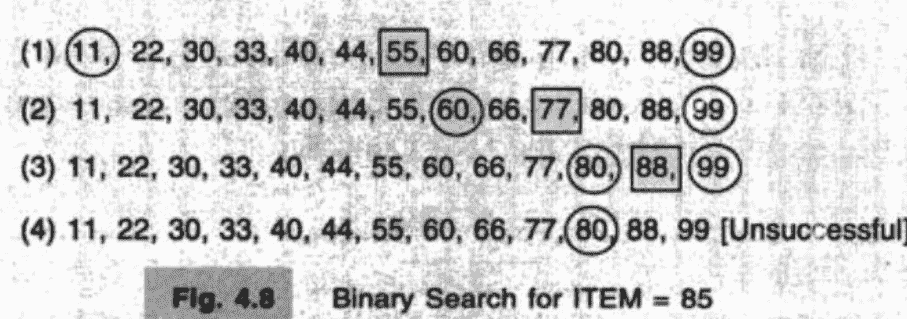

### 二分搜索算法的复杂度

复杂度按在包含 n 个元素的 DATA 中定位 ITEM 所需的比较次数 f(n) 来衡量。请注意，每次比较都将样本大小减半。因此，我们最多需要 f(n) 次比较来定位 ITEM，其中

```
2^{f(n)} > n or equivalently f(n) = \lfloor \log_2 n \rfloor + 1
```

也就是说，最坏情况下的运行时间大约等于 log2 n。还可以证明，平均情况下的运行时间大约等于最坏情况下的运行时间。

### 示例 4.11

假设 DATA 包含 1 000 000 个元素。请注意，2^{10} = 1024 > 1000，因此 2^{20} > 1000^2 = 1 000 000。相应地，使用二分搜索算法，只需大约 20 次比较即可找到包含 1 000 000 个元素的数据数组中某个元素的位置。

### 二分搜索算法的局限性

由于二分搜索算法非常高效（例如，对于初始包含 1 000 000 个元素的列表，它只需要大约 20 次比较），为什么还要使用任何其他搜索算法呢？


### 程序 4.10

```
#include <stdio.h>
#include <conio.h>
void main()
{
int A[6];
int B[6];
int C[6];
int i,flag=0;
clrscr();
for(i=0;i<6;i++)
A[i]=B[i]=0;
A[1]=1;
A[2]=4;
A[5]=-7;
B[0]=-14;
B[1]=10;
B[2]=6;
B[3]=5;
B[4]=3;
printf("Polynomial 1 = ");
for(i=5;i>=0;i--)
{
if(A[i]!=0 && i>0)
{
printf("%d.(x)%d ",A[i],i);
flag=1;
}
if(i>0 && A[i-1]>0 && flag==1)
printf("+ ");
if(A[i]!=0 && i==0)
printf("%d",A[i],i);
}
printf("\n\n");
flag=0;
printf("Polynomial 2 = ");
```

选择第 (i + 1) 条记录可以通过访问 PA[i]，并沿着那里找到的指针定位到数组 A 中第 (i + 1) 条记录开始的条目来完成。A[PA[i]] 是分配给该记录基址的名称。我们应始终确保选择过程先访问 PA，再访问 A，其中每个数组访问都需要固定时间，从而选中第 (i + 1) 条记录。利用 PA 可以使记录遍历变得容易，如下一个程序所示。

```
traverse(A, PA, N)
/* Traverses through the N records stored in A which are pointed to by
indices stored in the pointer array PA */
int A[], PA[], N;
{
int i;
for (i=0; i<N; i++)
process(A, PA, i);
}
```

使用指针数组会导致额外的存储开销，但为变长记录提供了解决方案。存储在数组中的所有这些记录都有相关指针，在违反语言类型约束时也易于使用。

### 指针数组

图 4.20 中的两种空间高效数据结构可以轻松修改，以便对各个组进行索引。这是通过使用一个指针数组（此处为 GROUP）来实现的，该数组包含不同组的位置，或者更具体地说，包含不同组中第一个元素的位置。图 4.21 显示了图 4.20(a) 如何被修改。请注意，GROUP[L] 和 GROUP[L + 1] – 1 分别包含组 L 中的第一个元素和最后一个元素。（请注意，GROUP[5] 指向列表的哨兵，而 GROUP[5] – 1 给出了第 4 组中最后一个元素的位置。）

类似地，第六个新生儿父亲的年龄可以通过编写 Newborn.Father.Age[6] 或简单地 Father.Age[6] 来引用。

（c）考虑示例 4.18 中的记录结构 Student。由于 Student 被声明为包含 20 名学生的文件，所有项目自动变成 20 元素数组。此外，Test 变成二维数组。特别是，第六名学生的第二次测试可以通过编写 Student.Test[6, 2] 或简单地 Test[6,2] 来引用。

下标的顺序对应于限定标识符的顺序。例如，Test[3, 1] 并不指第一名学生的第三次测试，而是指第三名学生的第一次测试。

备注：文本有时使用函数表示法而不是点表示法来表示限定标识符。例如，有人会写 Age(Father(Newborn)) 而不是 Newborn.Father.Age，以及 First(Name(Student[8])) 而不是 Student.Name.First[8]。

请注意，函数表示法中限定标识符的顺序是点表示法顺序的逆序。

### 4.15 内存中的记录表示；并行数组

由于记录可能包含非同构数据，记录的元素不能存储在数组中。C 语言允许借助结构体存储此类非同构数据记录。

### 示例 4.23

考虑示例 4.20 中的记录结构 Newborn。可以通过以下声明在 C 中存储此类记录，该声明定义了一个称为结构体的数据聚合体：

```
struct NEWBORN
{
   char NAME[20];
   char SEX[1];
   struct BIRTHDAY
   {
      int MONTH;
      int DAY;
      int YEAR;
   }B;
   struct FATHER
   {
      char NAME[20];
      int AGE;
```


## 示例 4.26

(a) 假设

\( A = \begin{pmatrix} 1 & -2 & 3 \\ 0 & 4 & 5 \end{pmatrix} \quad \text{和} \quad B = \begin{pmatrix} 3 & 0 & -6 \\ 2 & -3 & 1 \end{pmatrix} \)

则：

\( A + B = \begin{pmatrix} 1+3 & -2+0 & 3+(-6) \\ 0+2 & 4+(-3) & 5+1 \end{pmatrix} = \begin{pmatrix} 4 & -2 & -3 \\ 2 & 1 & 6 \end{pmatrix} \)

\( 3A = \begin{pmatrix} 3 \cdot 1 & 3 \cdot (-2) & 3 \cdot 3 \\ 3 \cdot 0 & 3 \cdot 4 & 3 \cdot 5 \end{pmatrix} = \begin{pmatrix} 3 & -6 & 9 \\ 0 & 12 & 15 \end{pmatrix} \)

(b) 假设 \( U = (1, -3, 4, 5) \), \( V = (2, -3, -6, 0) \) 和 \( W = (3, -5, 2, -1) \)。则：

\( U \cdot V = 1 \cdot 2 + (-3) \cdot (-3) + 4 \cdot (-6) + 5 \cdot 0 = 2 + 9 - 24 + 0 = -13 \)

\( U \cdot W = 1 \cdot 3 + (-3) \cdot (-5) + 4 \cdot 2 + 5 \cdot (-1) = 3 + 15 + 8 - 5 = 21 \)

(c) 假设

\( A = \begin{pmatrix} 1 & 3 \\ 2 & 4 \end{pmatrix} \quad \text{和} \quad B = \begin{pmatrix} 2 & 0 & -4 \\ 3 & 2 & 6 \end{pmatrix} \)

乘积矩阵 \( AB \) 有定义，且是一个 \( 2 \times 3 \) 矩阵。\( AB \) 第一行的元素分别通过将 \( A \) 的第一行与 \( B \) 的每一列相乘得到：

\( \begin{pmatrix} 1 & 3 \\ 2 & 4 \end{pmatrix} \begin{pmatrix} 2 & 0 & -4 \\ 3 & 2 & 6 \end{pmatrix} = \begin{pmatrix} 1 \cdot 2 + 3 \cdot 3 & 1 \cdot 0 + 3 \cdot 2 & 1 \cdot (-4) + 3 \cdot 6 \end{pmatrix} = \begin{pmatrix} 11 & 6 & 14 \end{pmatrix} \)

同样，\( AB \) 第二行的元素分别通过将 \( A \) 的第二行与 \( B \) 的每一列相乘得到：

\( \begin{pmatrix} 1 & 3 \\ 2 & 4 \end{pmatrix} \begin{pmatrix} 2 & 0 & -4 \\ 3 & 2 & 6 \end{pmatrix} = \begin{pmatrix} 11 & 6 & 14 \\ 2 \cdot 2 + 4 \cdot 3 & 2 \cdot 0 + 4 \cdot 2 & 2 \cdot (-4) + 4 \cdot 6 \end{pmatrix} = \begin{pmatrix} 11 & 6 & 14 \\ 16 & 8 & 16 \end{pmatrix} \)

即，

\( AB = \begin{pmatrix} 11 & 6 & 14 \\ 16 & 8 & 16 \end{pmatrix} \)

下面的算法求出存储为二维数组的矩阵 \( A \) 和 \( B \) 的乘积 \( AB \)。（矩阵加法和矩阵标量乘法的算法与向量加法和标量乘法的算法非常相似，留给读者作为练习。）

## 算法 4.8：（矩阵乘法）MATMUL(A, B, C, M, P, N)

设 A 为一个 M × P 矩阵数组，B 为一个 P × N 矩阵数组。该算法将 A 和 B 的乘积存储在一个 M × N 矩阵数组 C 中。

- 1. 对 I = 1 到 M 重复步骤 2 至 4：
- 2. 对 J = 1 到 N 重复步骤 3 和 4：
- 3. a(f - h)
- 4. d(g - e)
- 5. (a + b)h
- 6. (c - a)(e + f)
- 7. (b - d)(g + h)

BASIC 编程语言的某些版本将矩阵操作内置于语言中。具体来说，以下是有效的 BASIC 语句，其中 A 和 B 是维度合适的二维数组，K 是一个标量：

```
MAT C = A + B
MAT D = (K)*A
MAT E = A*B
```

每条语句都以关键字 MAT 开头，表示将执行矩阵操作。因此 C 将是 A 和 B 的矩阵和，D 将是矩阵 A 与标量 K 的标量积，E 将是 A 和 B 的矩阵积。

### 4.17 稀疏矩阵

零项比例相对较高的矩阵称为稀疏矩阵。图 4.26 展示了两种在各种应用中出现的 n 阶方阵稀疏矩阵的一般类型。（有时习惯于像图 4.26 那样省略矩阵中的零块。）第一个矩阵，主对角线以上的所有项均为零，或等价地，非零项只能出现在主对角线上或以下，称为（下）三角矩阵。第二个矩阵，非零项只能出现在对角线上或对角线上方或下方紧邻的元素上，称为三对角矩阵。

在内存中将矩阵表示为二维数组的自然方法可能不适合稀疏矩阵。也就是说，可以通过仅存储可能为非零的项来节省空间。这在下面的示例中针对三角矩阵进行了说明。其他情况将在已解决的问题中讨论。


### 图 5.7

Accordingly, Bond's list of customers, as indicated by the arrows, consists of Grant, Scott, Vito, Katz.

Similarly, Kelly's list consists of Hunter, McBride, Evans and Nelson's list consists of Teller, Jones, Adams, Rogers, Weston.

Hall's list is the null list, since the null pointer 0 appears in POINT[3].

```
PTR=LINK[PTR];
}

PTR=START;
printf("\n\nLIST After Traversal: \n");
while(PTR!=-1)
{
printf("%d\t",LIST[PTR]);
PTR=LINK[PTR];
}
getch();
}

void PROCESS(int P1)
{
LIST[P1]=LIST[P1]*10;
}
```

```
Output:
Initial LIST:
2   55   22   19   5   50   87   79   33   99
29   8

LIST After Traversal:
20   550   220   190   50   500   870   790   330   990
290   80
```

Remark: In the above program, the PROCESS operation multiplies each element in the list with 10.

### Example 5.7

The following procedure finds the number NUM of elements in a linked list.

Procedure: COUNT(INFO, LINK, START, NUM)

- 1. Set NUM := 0. [Initializes counter.]
- 2. Set PTR := START. [Initializes pointer.]
- 3. Repeat Steps 4 and 5 while PTR ≠ NULL.
- 4. Set NUM := NUM + 1. [Increases NUM by 1.]
- 5. Set PTR := LINK[PTR]. [Updates pointer.]
  [End of Step 3 loop.]
- 6. Return.

Observe that the procedure traverses the linked list in order to count the number of elements; hence the procedure is very similar to the above traversing algorithm, Algorithm 5.1. Here, however, we require an initialization step for the variable NUM before traversing the list. In other words, the procedure could have been written as follows:

```
int L;
while(P!=-1)
{
if(I>INFO[P])
P=LINK[P];
else if (I==INFO[P])
{
L=P;
return(L) ;
}
else
{
L=-1;
return(L) ;
}
}
L=-1;
return(L);
}
```

```
Output:
LIST:
2 5 8 19 22 29 33 50
55 79 87 99

Enter the ITEM to be searched: 99

ITEM 99 present at INDEX location 14 in the LIST
```

### 5.6 MEMORY ALLOCATION; GARBAGE COLLECTION

The maintenance of linked lists in memory assumes the possibility of inserting new nodes into the lists and hence requires some mechanism which provides unused memory space for the new nodes. Analogously, some mechanism is required whereby the memory space of deleted nodes becomes available for future use. These matters are discussed in this section, while the general discussion of the inserting and deleting of nodes is postponed until later sections.

Together with the linked lists in memory, a special list is maintained which consists of unused memory cells. This list, which has its own pointer, is called the list of available space or the free-storage list or the free pool.

Suppose our linked lists are implemented by parallel arrays as described in the preceding sections, and suppose insertions and deletions are to be performed on our linked lists. Then the unused memory cells in the arrays will also be linked together to form a linked list using AVAIL as its list pointer variable. (Hence this free-storage list will also be called the AVAIL list.) Such a data structure will frequently be denoted by writing

`LIST(INFO, LINK, START, AVAIL)`

### Garbage Collection

Suppose some memory space becomes reusable because a node is deleted from a list or an entire list is deleted from a program. Clearly, we want the space to be available for future use. One way to bring this about is to immediately reinsert the space into the free-storage list. This is what we will do when we implement linked lists by means of linear arrays. However, this method may be too time-consuming for the operating system of a computer, which may choose an alternative method, as follows.

The operating system of a computer may periodically collect all the deleted space onto the free-storage list. Any technique which does this collection is called garbage collection. Garbage collection usually takes place in two steps. First the computer runs through all lists, tagging those cells which are currently in use, and then the computer runs through the memory, collecting all untagged space onto the free-storage list. The garbage collection may take place when there is only some minimum amount of space or no space at all left in the free-storage list, or when the CPU is idle and has time to do the collection. Generally speaking, the garbage collection is invisible to the programmer. Any further discussion about this topic of garbage collection lies beyond the scope of this text.

### Overflow and Underflow

Sometimes new data are to be inserted into a data structure but there is no available space, i.e., the free-storage list is empty. This situation is usually called overflow. The programmer may handle overflow by printing the message OVERFLOW. In such a case, the programmer may then modify the program by adding space to the underlying arrays. Observe that overflow will occur with our linked lists when AVAIL = NULL and there is an insertion.

Analogously, the term underflow refers to the situation where one wants to delete data from a data structure that is empty. The programmer may handle underflow by printing the message UNDERFLOW. Observe that underflow will occur with our linked lists when START = NULL and there is a deletion.


location of the new node, this step can be implemented by the pair of assignments (in this order) NEW := AVAIL, AVAIL := LINK[AVAIL]

(c) Copying new information into the new node. In other words, INFO[NEW] := ITEM

The schematic diagram of the latter two steps is pictured in Fig. 5.18.

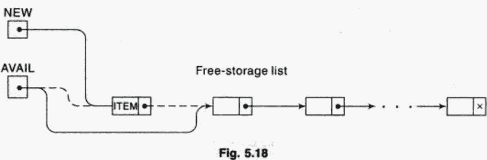

### 在列表开头插入

Suppose our linked list is not necessarily sorted and there is no reason to insert a new node in any special place in the list. Then the easiest place to insert the node is at the beginning of the list. An algorithm that does so follows.

- **算法 5.4:** INSFFIRST(INFO, LINK, START, AVAIL, ITEM)
- 该算法将 ITEM 插入为列表的第一个节点。
- 1. [OVERFLOW]? 如果 AVAIL = NULL，则：写入：OVERFLOW，并退出。
- 2. [从 AVAIL 列表中移除第一个节点。] 设置 NEW := AVAIL 和 AVAIL := LINK[AVAIL]。
- 3. 设置 INFO[NEW] := ITEM。[将新数据复制到新节点]
- 4. 设置 LINK[NEW] := START。[新节点现在指向原始第一个节点。]
- 5. 设置 START := NEW。[更改 START 使其指向新节点。]
- 6. 退出。

步骤 1 至 3 已经讨论过，步骤 2 和 3 的示意图见图 5.18。步骤 4 和 5 的示意图见图 5.19。

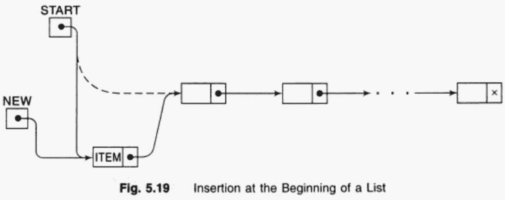

3. SAVE = 5 且 PTR = LINK[5] = 3。

4. 步骤 5 和 6 重复如下：
(a) BED[3] = Dean < Jones，因此 SAVE = 3 且 PTR = LINK[3] = 11。
(b) BED[11] = Fields < Jones，因此 SAVE = 11 且 PTR = LINK[11] = 8。
(c) BED[8] = Green < Jones，因此 SAVE = 8 且 PTR = LINK[8] = 1。
(d) 由于 BED[1] = Kirk > Jones，我们有：
LOC = SAVE = 8 并返回。

(b) INSLOC(BED, LINK, START, AVAIL, LOC, ITEM) [此处 LOC = 8。]
1. 由于 AVAIL ≠ NULL，控制转移到步骤 2。
2. NEW = 10 且 AVAIL = LINK[10] = 2。
3. BED[10] = Jones。
4. 由于 LOC ≠ NULL，我们有：
LINK[10] = LINK[8] = 1 且 LINK[8] = NEW = 10。
5. 退出。

图 5.22 显示了 Jones 添加到患者列表后的数据结构。我们强调，只更改了三个指针，即 AVAIL、LINK[10] 和 LINK[8]。

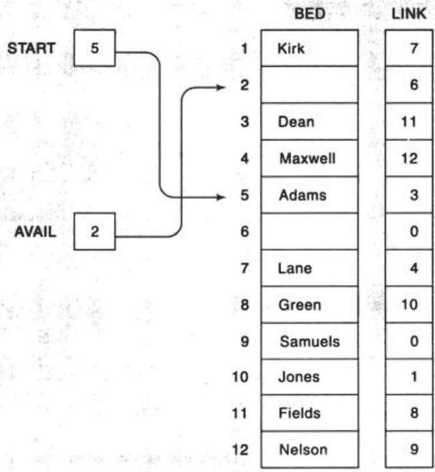

图 5.22

以下是将元素插入有序列表的算法 5.7 的 C 实现：

图 5.23 未考虑到这样一个事实：当从我们的列表中删除节点 N 时，我们会立即将其内存空间返回到 AVAIL 列表。具体来说，为了更易于处理，它将被返回到 AVAIL 列表的开头。因此，此类删除的更精确示意图是图 5.24 中所示的图。请注意，三个指针字段按以下方式更改：

- 1. 节点 A 的下一个指针字段现在指向节点 B，即节点 N 之前指向的位置。
- 2. N 的下一个指针字段现在指向空闲池中的原始第一个节点，即 AVAIL 之前指向的位置。
- 3. AVAIL 现在指向已删除的节点 N。

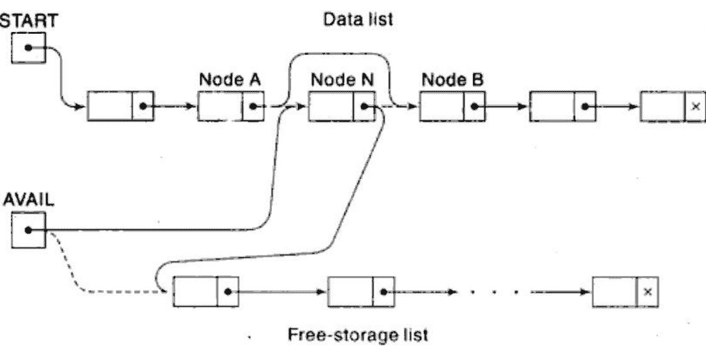

还有两种特殊情况。如果被删除的节点 N 是列表中的第一个节点，则 START 将指向节点 B；如果被删除的节点 N 是列表中的最后一个节点，则节点 A 将包含 NULL 指针。

### 示例 5.16

- (a) 考虑图 5.22，即病房中的患者列表。假设 Green 出院，因此 BED[8] 现在为空。那么，为了维护链表，必须执行指针字段中的以下三个更改：

```
LINK[11] = 10   LINK[8] = 2   AVAIL = 8
```

通过第一个更改，原本在 Green 之前的 Fields 现在指向原本在 Green 之后的 Jones。第二个和第三个更改将新的空床位添加到 AVAIL 列表。我们强调，在进行删除之前，我们必须找到原本指向被删除节点 BED[8] 的节点 BED[11]。

- (b) 考虑图 5.13，即经纪人及其客户的列表。假设 Nelson 的第一个客户 Teller 从客户列表中被删除。那么，为了维护链表，必须执行指针字段中的以下三个更改：

```
POINT[4] = 10   LINK[9] = 11   AVAIL = 9
```

通过第一个更改，Nelson 现在指向他原来的第二个客户 Jones。第二个和第三个更改将新的空节点添加到 AVAIL 列表。

3. 如果 INFO[PTR] = ITEM，则：
   设置 LOC := PTR 和 LOCP := SAVE。
   否则：
   设置 LOC := NULL 和 LOCP := SAVE。
   [If 结构结束。]
4. 退出。

与过程 5.9 相比，请注意此过程的简单性。在这里，我们不必考虑 ITEM 出现在第一个节点时的特殊情况，并且我们可以同时执行控制循环的两个测试。

- (c) 当 LIST 是普通链表时，算法 5.10 删除第一个包含 ITEM 的节点 N。以下是当 LIST 是带头节点的循环链表时的此类算法。

```
Algorithm 5.14: DELLOCHL(INFO, LINK, START, AVAIL, ITEM)
1. [Use Procedure 5.15 to find the location of N and its preceding node.]
   Call FINDBHL(INFO, LINK, START, ITEM, LOC, LOCP).
2. If LOC = NULL, then: Write: ITEM not in list, and Exit.
3. Set LINK[LOCP] := LINK[LOC]. [Deletes node.]
4. [Return deleted node to the AVAIL list.]
   Set LINK[LOC]:= AVAIL and AVAIL:= LOC.
5. Exit.
```

同样，我们不必考虑 ITEM 出现在第一个节点时的特殊情况，就像在算法 5.10 中所做的那样。

备注：文献中有时会出现另外两种链表变体：

- 1. 最后一个节点指回第一个节点而不是包含空指针的链表，称为循环列表
- 2. 在列表开头包含一个特殊头节点并在列表末尾包含一个特殊尾节点的链表

图 5.32 包含这些列表的示意图。

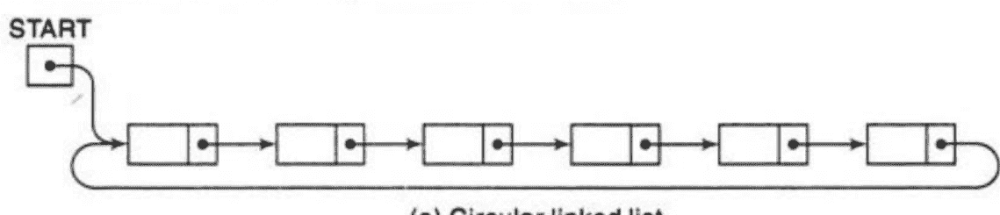

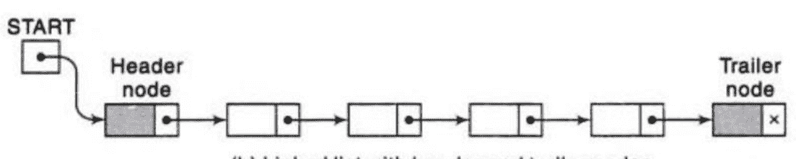

图 5.32


输入要删除的 ITEM：79
修改后的 LIST：
55 22 19 5 50 87 33 99
29 8

### 多项式

带头节点的链表常用于在内存中维护多项式。头结点在此表示法中起着重要作用，因为它是表示零多项式所必需的。多项式的这种表示法将在特定示例的上下文中介绍。

### 示例 5.20

设 p(x) 表示下述一元多项式（包含四个非零项）：
p(x) = 2x^8 - 5x^7 - 3x^2 + 4
那么 p(x) 可以由图 5.35(a) 所示的带头节点链表表示，其中每个节点对应 p(x) 的一个非零项。具体来说，节点的信息部分分为两个字段，分别表示对应项的系数和指数，并且节点按次数递减顺序链接。
请注意，列表指针变量 POLY 指向头结点，其指数字段被赋予一个负数，在此例中为 -1。在此，列表的数组表示法将需要三个线性数组，我们将其命名为 COEF、EXP 和 LINK。这种表示法的一个示例出现在图 5.35(b) 中。

### 使用链表表示多项式

我们可以使用数组或链表来表示多项式。只需存储所有项的系数和指数即可。链表表示法便于执行多项式加法或减法以及多项式乘法等操作。我们还应牢记，在多项式中，并非所有项都一定存在，尤其是高次多项式。请看下面的示例。

8x^13 + 5x^6 + 2x^8 + x^5 + x^10 + 17x

这个 13 次多项式并不包含所有 14 个项（包括常数项）。因此，借助链表结构表示多项式非常容易。在这里，每个节点可以保留有关多项式单个项的信息。所有节点存储三项内容：

- 变量 x
- 指数
- 每一项的系数

无论方程如何，多项式是用 x 还是 y 表示都无关紧要。在对多项式进行操作时，这是一条非常重要的信息，需要牢记。因此，最好定义一个节点结构，其中包含 2 个整数——exp 和 coef。

让我们将这种表示法与存储相同多项式的数组结构进行比较。在

```
int LOCP,LOC;
int START, AVAIL;
int SRCHHL(int);
void FINDBHL(int);
void DELLOCHL(int);
```

```
void main()
{
int PTR,ITEM;
clrscr();
```

```
INFO[0]=22;INFO[2]=5;INFO[3]=19;INFO[5]=87;INFO[7]=29;INFO[8]=79;
INFO[9]=33;INFO[13]=50;INFO[14]=8;INFO[16]=55;INFO[18]=99;
```

```
LINK[0]=3;LINK[1]=17;LINK[2]=13;LINK[3]=2;LINK[4]=12;LINK[5]=8;
LINK[6]=-1;LINK[7]=14;LINK[8]=9;LINK[9]=18;LINK[10]=6;LINK[11]=16;
LINK[12]=10;LINK[13]=5;LINK[14]=11;LINK[15]=1;LINK[17]=19;LINK[18]=7;
LINK[19]=4;
```

```
START=11;
AVAIL=15;
```

```
printf("LIST: \n\n");
PTR=START;
printf("%d\t",INFO[PTR]);
PTR=LINK[PTR];
while(PTR!=START)
{
printf("%d\t",INFO[PTR]);
PTR=LINK[PTR];
}
```

```
printf("\n\nTraversing the LIST and applying PROCESS to each
node..\n\n");
PTR=START;
printf("%d\t",INFO[PTR]*10);
PTR=LINK[PTR];
while(PTR!=START)
{
printf("%d\t",INFO[PTR]*10);
PTR=LINK[PTR];
}
```

```
printf("\n\nEnter the ITEM to be searched: ");
scanf("%d",&ITEM);
```

通常，在给出需要返回的大小为 2k 的节点的地址时，其 (k + 1)th 位会从 1 变为 0 或反之，输出为其伙伴节点的地址。我们可以通过使用标记字段来判断节点是否正在使用。

### 示例 5.26

假设 m 为 6，并且请求大小为 8、16、4 和 6 的节点。我们将看到伙伴系统如何响应。

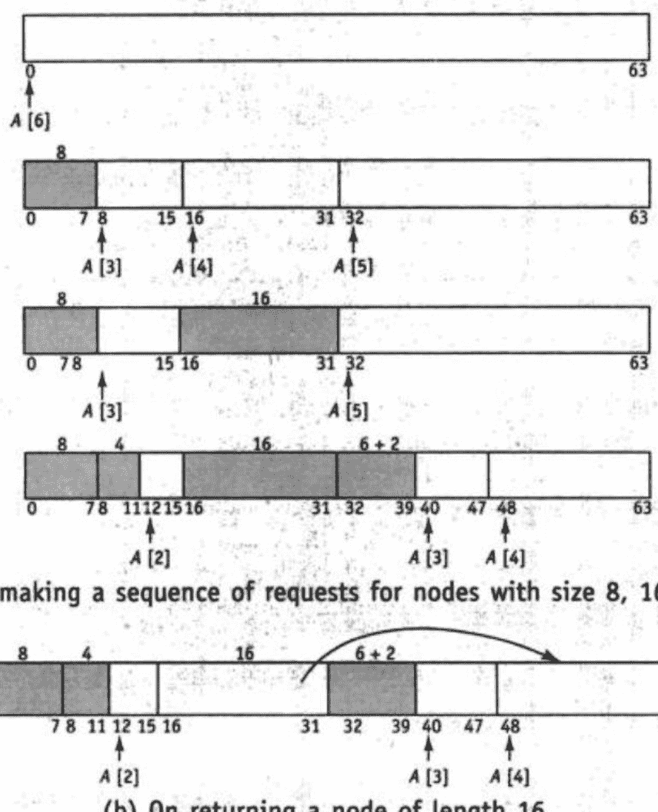

### 图 5.43 内存配置序列

图 5.43(a) 显示了内存配置的序列。如果长度为 16 的节点被返回，配置将变为图 5.43(b) 所示。

A[4] 有两个节点，是列表的头，每个节点长度为 16。被释放的节点长度为 16，起始地址为 16，其伙伴是起始地址为 0 的长度为 16 的节点。它们无法合并，因为该节点不是空闲的。它也无法与起始地址为 12 的长度为 4 的节点合并，因为那不是它的伙伴。

伙伴通常是同一父节点的后继节点。因此我们可以得出结论：[12, 15] 和 [16, 31] 不能被视为伙伴，尽管它们拥有相邻的内存空间。因此，我们也可以说它们无法合并。


### 6.2 栈

栈是元素列表，其中元素只能在一端插入或删除，该端称为栈顶。这意味着，特别是，从栈中删除元素的顺序与元素插入栈的顺序相反。

与栈相关的两个基本操作使用特殊术语：

- (a) “Push”是插入元素到栈中使用的术语。
- (b) “Pop”是从栈中删除元素使用的术语。

我们强调，这些术语仅用于栈，而不用于其他数据结构。

### 示例 6.1

假设以下 6 个元素按顺序压入空栈：
AAA, BBB, CCC, DDD, EEE, FFF

图 6.3 展示了描绘此类栈的三种方式。为记号方便，我们将经常通过以下方式指定栈：
栈: AAA, BBB, CCC, DDD, EEE, FFF

其含义是，最右侧的元素是栈顶元素。我们强调，无论栈以何种方式描述，其底层属性是插入和删除只能在栈顶进行。这意味着在删除 FFF 之前不能删除 EEE，在删除 EEE 和 FFF 之前不能删除 DDD，依此类推。因此，元素只能按照与压入栈的顺序相反的顺序从栈中弹出。

```c
#define MAX 15
#include <stdio.h>
void push(int newstack[], int *top, int val)
{
 if(*top < MAX )
 {
 *top = *top + 1;
 newstack[*top] = val;
 }
 else
 {
 printf("No value can be pushed as stack is full\n");
 exit(0);
 }
}
void pop(int newstack[], int *top, int *val)
{
 if(*top >= 0 )
 {
 *val = newstack[*top];
 *top = *top - 1;
 }
 else
 {
 printf("No value can be popped as a stack is empty\n");
 exit(0);
 }
}
void main()
{
 int newstack[MAX];
 int top = -1;
 int n,val;
 do
 {
 do
 {
 printf("The element to be pushed is\n");
 scanf("%d",&val);
 push(newstack,&top,val);
 printf("To continue enter 1\n");
 scanf("%d",&n);
 } while(n == 1);
 printf("To pop an element enter 1\n");
 scanf("%d",&n);
 while( n == 1)
 {
```
与维护 MAXSTK 变量的需求以及因此在压入操作期间检查链式栈的 OVERFLOW 有关。

### 过程 6.3: PUSH_LINKSTACK(INFO, LINK, TOP, AVAIL, ITEM)

此过程将 ITEM 压入链式栈

- 1. [可用空间？] 如果 AVAIL = NULL，则写入 OVERFLOW 并退出
- 2. [从 AVAIL 列表中移除第一个节点] 设置 NEW := AVAIL 和 AVAIL := LINK[AVAIL]。
- 3. 设置 INFO[NEW] := ITEM [将 ITEM 复制到新节点]
- 4. 设置 LINK[NEW] := TOP [新节点指向栈中的原始顶部节点]
- 5. 设置 TOP = NEW [将 TOP 重置为指向栈顶的新节点]
- 6. 退出。

### 过程 6.4: POP_LINKSTACK(INFO, LINK, TOP, AVAIL, ITEM)

此过程删除链式栈的顶部元素并将其赋值给变量 ITEM

- 1. [栈中有要移除的项目？] 如果 TOP = NULL 则写入：UNDERFLOW 并退出。
- 2. 设置 ITEM := INFO[TOP] [将栈顶元素复制到 ITEM]
- 3. 设置 TEMP := TOP 和 TOP = LINK[TOP] [在 TEMP 中记住 TOP 指针的旧值，并将 TOP 重置为指向栈中的下一个元素]
- 4. [将已删除节点返回到 AVAIL 列表] 设置 LINK[TEMP] = AVAIL 和 AVAIL = TEMP。
- 5. 退出。

然而，TOP = NULL 条件可以保留在 pop 过程中，以防止从空链式栈中删除，AVAIL = NULL 条件可用于检查空闲存储列表中的可用空间。

### 示例 6.4

考虑图 6.7 所示的链式栈，执行以下操作时栈结构的快照如图 6.10 所示：

- (i) 压入 BBB (ii) 弹出 (iii) 弹出 (iv) 压入 MMM

原始链式栈：


被视为成功，其表现为返回 true。如果堆已满，我们通过返回 false 报告 push 失败。随后，由调用函数负责检测并响应溢出。

## 弹出栈（Pop Stack）

栈顶数据由 Pop 栈操作返回。随后在调整计数并将其减 1 后删除并回收该节点，函数返回给调用者。注意下溢的报告方式。在语句 ‘dataOutPtr = NULL’ 中，我们将数据指针设置为 NULL。如果栈为空，则在语句 ‘return dataOutPtr’ 中将数据指针作为 NULL 返回。代码如下所示：

```
Program 6.5

Pop Stack: This function is used to pop an item on top of stack. STACK is a pointer to a stack. The program is used for returning a pointer to the user's data when it is successful. It returns a NULL when there is an underflow.
void* popStack (STACK* newstack)
{
    void* dataOutPtr;
    STACK_NODE* temp;
    if (newstack->count == 0)
        dataOutPtr = NULL;
    else
    {
        temp = newstack->top;
        dataOutPtr = newstack->top->dataPtr;
        newstack->top = newstack->top->link;
        free(temp);
        (newstack->count)--;
    }
    return dataOutPtr;
}
```

在这种情况下，需要两个局部指针——一个用于返回给调用者的数据指针，另一个用于释放已删除的节点。它唯一关注的是确保遵循跟踪最后一个节点何时被删除的过程，从而导致栈为空。没有使用特殊逻辑，只是因为最后一个节点有一个空指针，将其赋值给栈顶即表示栈为空，从而自动创建了一个空栈。

因为空指针为假，而带有地址的指针为真，所以我们不需要单独的成功标志——只需返回由新函数分配地址的指针即可。如果内存分配成功，它包含一个地址，即为真。如果分配失败，它包含一个空指针，即为假。

请注意，访问顶部节点的 link 字段需要两级间接寻址。在从栈中删除节点时，pop stack 会释放其内存。

```
int TOP, AVAIL;
void PUSH(int);
int POP(void);
```

```
void main()
{
int i,num,A,B,RESULT;
clrscr();
```

```
LINK[0]=3;LINK[1]=17;LINK[2]=13;LINK[3]=2;LINK[4]=12;LINK[5]=8;
LINK[6]=11;LINK[7]=14;LINK[8]=9;LINK[9]=18;LINK[10]=6;LINK[11]=16;
LINK[12]=10;LINK[13]=5;LINK[14]=-1;LINK[15]=1;LINK[17]=19;LINK[18]=7;
LINK[19]=4;
```

```
TOP=-1;
AVAIL=15;
printf("Postfix Expression: %s",P);
```

```
strcat(P,")");
i=0;
while(P[i]!=')')
{
if(isdigit(P[i]))
{
num=P[i]-'0';
PUSH(num);
}
```

```
if(P[i]=='+' || P[i]=='-' || P[i]=='*' || P[i]=='/' || P[i]=='^')
{
A=POP();
B=POP();
```

```
if(P[i]=='+')
RESULT=B+A;
```

```
if(P[i]=='-')
RESULT=B-A;
```

```
if(P[i]=='*')
RESULT=B*A;
```

```
if(P[i]=='/')
RESULT=B/A;
```

```
if(P[i]=='^')
RESULT=pow(B,A);
```


<!-- 无内容 -->


<!-- 无内容 -->


<!-- no content -->


<!-- 无内容 -->


你要么访问了不可用的页面，要么已达到查看此书的限制。


你要么访问了不可用的页面，要么已达到查看此书的限制。


你要么访问了不可用的页面，要么已达到查看此书的限制。


你要么访问了不可用的页面，要么已达到查看此书的限制。


你要么访问了不可用的页面，要么已达到查看此书的限制。


你要么访问了不可用的页面，要么已达到查看此书的限制。


你要么访问了不可用的页面，要么已达到查看此书的限制。


你要么访问了不可用的页面，要么已达到查看此书的限制。


你要么访问了不可用的页面，要么已达到查看此书的限制。


你要么访问了不可用的页面，要么已达到查看此书的限制。


你要么访问了不可用的页面，要么已达到查看此书的限制。


你要么访问了不可用的页面，要么已达到查看此书的限制。


你要么访问了不可用的页面，要么已达到查看此书的限制。


你要么访问了不可用的页面，要么已达到查看此书的限制。


你要么访问了不可用的页面，要么已达到查看此书的限制。


你要么访问了不可用的页面，要么已达到查看此书的限制。


你要么访问了不可用的页面，要么已达到查看此书的限制。


你要么访问了不可用的页面，要么已达到查看此书的限制。


你要么访问了不可用的页面，要么已达到查看此书的限制。


你要么访问了不可用的页面，要么已达到查看此书的限制。


你要么访问了不可用的页面，要么已达到查看此书的限制。


你要么访问了不可用的页面，要么已达到查看此书的限制。


你要么访问了不可用的页面，要么已达到查看此书的限制。


你要么访问了不可用的页面，要么已达到查看此书的限制。


你要么访问了不可用的页面，要么已达到查看此书的限制。


你要么访问了不可用的页面，要么已达到查看此书的限制。


你要么访问了不可用的页面，要么已达到查看此书的限制。


你要么访问了不可用的页面，要么已达到查看此书的限制。


你要么访问了不可用的页面，要么已达到查看此书的限制。


你要么访问了不可用的页面，要么已达到查看此书的限制。


你要么访问了不可用的页面，要么已达到查看此书的限制。


你要么访问了不可用的页面，要么已达到查看此书的限制。

The following program demonstrates implementation of Hash function in C using subtraction method as the basis:

### 程序 9.8

```
#include <stdio.h>
#include <conio.h>

void main()
{
    int HASH(int);
    int i;
    clrscr();

    printf("Press any key to generate the Hash Table for Employee Code (keys) 2000-2020 ");
    getch();
    printf("\n\n******HASH TABLE******\n");
    printf("\nKey\tAddress");
    for(i=2000;i<=2020;i++)
        printf("\n%d\t %d",i,HASH(i));

    getch();
}

int HASH(int k)
{
    return(k-2000);
}
```

### 输出：

Press any key to generate the Hash Table for Employee Code (keys) 2000-2020

******HASH TABLE******

| Key | Address |
|---|---|
| 2000 | 0 |
| 2001 | 1 |
| 2002 | 2 |
| 2003 | 3 |
| 2004 | 4 |
| 2005 | 5 |
| 2006 | 6 |
| 2007 | 7 |
| 2008 | 8 |


你要么访问了不可用的页面，要么已达到查看此书的限制。


你要么访问了不可用的页面，要么已达到查看此书的限制。


你要么访问了不可用的页面，要么已达到查看此书的限制。

key \( k \)。效率主要取决于负载因子 \( \lambda \)。具体来说，我们关注以下两个量：

\( S(\lambda) = \text{成功查找的平均探测次数} \)

\( U(\lambda) = \text{不成功查找的平均探测次数} \)

这些量将在我们的冲突处理过程中讨论。

### 冲突解决技术

冲突解决主要有两种方式：

- (i) 开放寻址，基于数组实现。
- (ii) 链地址法，基于链表数组实现。

开放寻址包括：

- 线性探测（线性搜索）
- 二次探测（非线性搜索），以及
- 双重哈希（使用两个哈希函数）。

### (i) 开放寻址：线性探测及其修改

假设要向内存表 \( T \) 添加一个带键 \( k \) 的新记录 \( R \)，但哈希地址 \( H(k) = h \) 的内存位置已被占用。解决冲突的一种自然方法是将 \( R \) 分配给 \( T[h] \) 之后的第一个可用位置。（我们假设具有 \( m \) 个位置的表 \( T \) 是循环的，因此 \( T[1] \) 在 \( T[m] \) 之后。）因此，采用这种冲突处理过程时，我们将通过线性搜索位置 \( T[h] \)、\( T[h+1] \)、\( T[h+2] \) ... 来在表 \( T \) 中查找记录 \( R \)，直到找到 \( R \) 或遇到空位置，后者表示查找不成功。

上述冲突解决方法称为 _线性探测_。成功查找和不成功查找的平均探测次数已知为以下各自量值：

```
\( S(\lambda) = \frac{1}{2}\left(1 + \frac{1}{1-\lambda}\right) \quad \text{and} \quad U(\lambda) = \frac{1}{2}\left(1 + \frac{1}{(1-\lambda)^2}\right) \)
```

（此处 \( \lambda = n/m \) 为负载因子。）

下表总结了各种开放寻址探测序列的特性。

| 探测序列 | 主聚集 | 容量限制 | 大小限制 |
|---|---|---|---|
| 线性探测 | 是 | 无 | 无 |
| 二次探测 | 否 | \(\lambda < \frac{1}{2}\) | M 必须是素数 |
| 双重哈希 | 否 | 无 | M 必须是素数 |


## Index

### A
- a 记录 1.2
- 下标或 4.2
- 绝对值 2.3
- 抽象数据类型
  - (ADT) 1.10
- 阿克曼函数 6.39
- 多项式加法 4.37
- ADJ 8.17
- 邻接表 8.17
- 邻接矩阵 8.5, 8.6
  - 顺序表示
  - 的 8.5
- 邻接矩阵 8.6
- 邻接结构 8.17
  - 链式表示
  - 的 8.17
- 相邻节点 8.1
- ADT 实现的
  - 栈 6.12
  - 弹出栈 6.14
  - 压入栈 6.13
- ADT 模型 1.11
- 矩阵代数 4.55
- 代数表达式 1.7, 7.2
- 算法 1.12
- 算法符号 2.6

- 赋值语句 2.9
- 注释 2.9
- 控制 2.8
- 退出 2.8
- 标识号 2.8
- 输入 2.9
- 输出 2.9
- 过程 2.9
- 步骤 2.8
- 变量名 2.9
- 算法 2.1
- 祖先 7.3
- 队列的应用 6.92
- 数据分类 6.92
- 数据分类
  - 设计 6.97
  - 队列的模拟 6.98
- 参数 2.20
- 算术表达式 6.15
- 模 M 算术 2.3
- 数组索引 4.41
- 数组 1.4
  - 线性数组 1.4
  - 矩阵 1.4
  - 下标 1.4
  - 下标变量 1.4
  - 表 1.4
  - 二维数组 1.4

- 数组是规则的 4.28
- 赋值语句 2.9
- 原子 4.49
- 属性 1.1, 4.49
- 可用空间 5.17
- 可用列表 5.17
- 平均情况 2.16, 2.17
- AVL 搜索树 7.50
  - 左偏 7.51
  - 右偏 7.50

### B
- B+ -树 7.73
  - 删除 7.76
  - 插入 7.74
  - 搜索 7.74
- B-树 7.66
  - 删除 7.69
  - 插入 7.67
  - 搜索 7.67
- 队尾 5.53
- 平衡二叉树 7.49
  - 高度平衡 7.50
  - 权重平衡 7.50
- 平衡归并排序 9.23
- 基地址 4.6
- 基准条件 6.33
- 基值 6.33
- 双连通图 8.5
- 大 O 表示法 2.18
- 二进制对数 2.6
- 二分查找 1.12, 4.19, 9.18
- 二叉搜索树 9.29, 7.38
  - 删除 7.38
  - 插入 7.29
  - 搜索 7.29
- 二叉搜索树 7.28
  - 链表 7.28
  - 有序线性数组 7.28
- 二叉树 7.1, 7.2
  - 祖先 7.3
  - 子节点 7.3
  - 副本 7.2
  - 深度 7.3
  - 后代 7.3
  - 边 7.3
  - 代 7.3
  - 高度 7.3
  - 叶子 7.3
  - 左 7.3
  - 层号 7.3
  - 父节点 7.3
  - 路径 7.3
  - 前驱 7.3
  - 右子节点 7.3
  - 右后代 7.3
  - 兄弟 7.3
  - 相似 7.2
- 位矩阵 8.6
- 布尔矩阵 8.6
  - 路径 8.7
- 边界值 6.26
- 分支 7.3
- 广度优先搜索 8.31
  - 图 8.31
- 兄弟 7.3
- 冒泡排序 4.15, 4.17
  - 复杂度 4.18
- 伙伴系统 5.65
- 字节寻址机器 3.2

### C
- Calloc() 4.47

- 上取整 2.2
- 链接法 9.52
- 字符数据 3.1
- 字符集 3.1
- 子节点 7.3, 7.110
- 循环头列表 5.38
- 循环列表 5.41
- 循环队列 6.67
- 循环链表 5.47
- 闭合 8.2
- 冲突解决 9.49
  - 链接法 9.52
  - 双哈希 9.51
  - 开放定址 9.50
  - 二次探测 9.51
- 列 1.5, 4.30, 4.32
- 列优先顺序 4.30, 4.32
- 常用对数 2.6
- 完全二叉树 7.3
- 完全图 8.2
  - 标记图 8.2
  - 带权图 8.2
- 复杂度 2.15
- 复杂度 3.28, 4.22
- 堆排序的复杂度 7.102
- 插入排序的复杂度
  - 排序 9.9
- 基数排序的复杂度 9.37
- 希尔排序的复杂度
  - 算法 9.33
- 排序算法的复杂度
  - 算法 9.2
- 归并排序算法的复杂度
  - 算法 9.23
- 归并算法的复杂度
  - 算法 9.18
- 快速排序算法的复杂度
  - 算法 6.31
- 选择排序算法的复杂度
  - 算法 9.13
- 连接 3.2, 3.12
- 条件流 2.10
  - 双分支 2.11
  - 多分支 2.11
  - 单分支 2.10
- 常量 3.7
- 控制 2.9

- 复制 5.32
- 环 8.2

### D
- 数据 1.1
- 数据库管理 1.3
- 数据项 1.1
- 数据修改 9.38
  - 指针 9.38
  - 搜索 9.38, 9.39
- 数据结构 1.3
  - 线性 1.3
  - 非线性 1.3
- 数据类型 2.22
  - 字符 2.22
  - 效应 2.24
  - 定点 2.22
  - 浮点 2.22
- 全局变量 2.23
- 整型 2.22
- 局部变量 2.23
- 逻辑型 2.22
- 非局部变量 2.24
- 实型 2.22
- 副作用 2.24
- 十进制转二进制
  - 转换 6.31
- 决策树 9.3
  - 决策 9.3
  - 用于排序 9.3
- 度 8.1
- 节点的度 8.1
- 删除 3.14, 6.53
- 已删除自 5.32
- 删除 1.9
- 删除给定节点后的节点
  - 给定节点 5.35
- 删除具有给定信息项的节点
  - 信息项 5.36
- 删除 3.14, 4.1
- 删除算法 5.34
- 稠密列表 5.2
- 深度 6.37, 7.4
- 深度优先搜索 8.36
- 双端队列 6.78
  - 输入受限 6.78
  - 输出受限 6.78
- 后代 7.3
- 目标 8.18
- 从...中删除 8.23
- 图 8.20
- 在...中插入 8.21
- 在...中搜索 8.21
- 对角线 4.55
- 有向图 8.3
- 有向无环图 8.4
- 有向图 8.3, 8.4
  - 连通 8.4
  - 强连通 8.4
  - 单向连通 8.4
- 有向图 8.3
- 分治法
  - 算法 6.39
- 分治法
  - 算法 6.39
- 除法散列法 9.42
- 双哈希 9.51
- 双旋转 7.54
- 双向链表 5.52
- 虚拟下标 2.4
- 虚拟变量 2.4

### F
- 图 1.8, 8.1, 8.2
  - 完全图 8.2
  - 连通图 8.2
  - 有限图 8.2
  - 无根树 8.2
  - 标记图 8.2
  - 长度 8.2
  - 环 8.2
  - 环 8.2
  - 多重图 8.2
  - 多重边 8.2
  - 树图 8.2
  - 权重 8.2
  - 带权图 8.2
- 贪心算法 8.52
- 接地头列表是 5.38
- 组项目 1.1
- 组项目 1.1
- 增长 2.18

- 阶乘函数 2.4, 6.33
- 父亲 7.3
- 斐波那契数列 6.37
- 字段 1.1, 1.2, 4.49
- FIFO 1.8, 6.1, 6.50
- 文件 1.1, 1.2, 4.49
- 文件管理 1.3
- 首 5.53
- 首个模式匹配
  - 算法 3.20
- 定长记录 1.2
- 定长存储 3.2
- 下取整 2.2
- 流的 2.9
- 折叠散列法 9.42
- FORW 5.53
- 空闲池 5.17
- Free() 4.47
- 空闲- 5.17
- 空闲存储列表 5.17
- 释放空间 4.49
- 队首 1.8, 6.50, 6.51
- 函数子算法 2.20

### E
- 边 7.3, 8.1
- 边列表 8.18
- 基本 1.1
- 基本项目 1.1, 4.49
- 空列表 5.2
- 空字符串 3.2
- 空树 7.1
- 端点 8.1
- 实体 1.1
- 实体集 1.1
- 退出 2.6
- 指数 2.5
- 表达式树 7.112
- 扩展二叉树
  - 树 7.4, 7.103
- 扩展二叉树 7.4
- 扩展 7.4
- 外部节点 7.4, 7.103
- 外部路径 7.103
- 外部路径长度 7.103

### G
- 博弈树 7.113
- 垃圾回收 5.21
- 垃圾压缩 5.22
- 一般多维数组
  - 数组 4.32
- 一般树 7.109
  - 子节点 7.109
  - 森林 7.110
  - 一般树 7.109
  - 节点 7.109
  - 有序树 7.109
  - 父节点 7.109
  - 根 7.109
  - 兄弟 7.109
  - 子树 7.109
  - 后继 7.109
- 代 7.3
  - 深度 7.3
  - 树的高度 7.3
- 全局变量 2.24

### H
- 汉诺塔 6.40
- 哈希地址 9.41
- 哈希函数 9.41
- 哈希函数 9.42
- 哈希表 9.46
- 哈希 9.41
- 哈希 9.41
- 哈希函数 9.41
  - 数字提取法
  - 方法 9.45
  - 除法散列法 9.42
  - 折叠散列法 9.42
  - 中间平方法 9.42
  - 减法散列法 9.43
- 头节点 7.23
- 头节点链表 5.38
- 头节点链表 5.38
- 头列表 5.54
- 头节点 5.38
- 头节点 5.38
- 头节点 7.23
- 堆 7.90, 7.91
  - 删除堆的根 7.94
  - 插入堆 7.91
- 堆排序 7.90
  - 删除堆的根 7.102


- 齐次 4.2
- 霍夫曼算法 7.103, 7.105

### I

- 标识符 4.49
- 标识数 2.8
- 关联矩阵 8.68
- 入度 8.3
- 索引 4.2, 4.28
- 索引集 4.2, 4.28
- 索引 3.10, 4.51
- 中缀表示法 6.15
- 信息 5.4, 7.5
- 初始
  - 点 8.3
  - 初始子串 3.2
- 中序
  - 后继 7.27
  - 线索化 7.24
  - 遍历 7.14
- 插入 1.9
- 在给定节点之后插入 5.27
- 插入到有序链表中 5.27
- 插入 3.14, 4.1
- 插入算法 5.24, 9.18
- 插入排序 9.6
  - 复杂度 9.9
- 插入 9.6
- 整数值 2.3
- 内部节点 7.4, 7.103
- 内部路径长度 7.103
- 孤立节点 8.1
- 项目 1.1
- 迭代逻辑 2.13

### J

- 锯齿状 4.40
- 约瑟夫问题 5.63

### K

- 关键字 1.2
- 关键字值 1.2, 9.1
- 关键字 1.2, 9.1
- 克鲁斯卡尔算法 8.52

### L

- 最大 7.3
- 最后 5.54
- 左 7.3, 7.5
- 左子树 7.1
- 左后继 7.1
- 长度 3.2, 7.103, 8.2
- 层 7.3
- 层号 6.37
- 后进先出 (LIFO) 1.7, 6.1
- 线性数组 1.4, 4.2
- 线性探测 9.50
- 线性搜索 1.12, 4.19
- 线性 1.12
- 线性搜索 2.16, 4.19
- 线性 4.19
- 线性 2.16
- 顺序搜索 4.19
- 链接 5.4
- 链表 5.8
  - 搜索 5.12
- 链域 5.2
- 链表 1.5, 1.6, 5.2, 5.12, 9.38
- 链式表示 7.5
- 链式存储 3.6
- 列表 1.5, 5.1
- 可用空间列表 5.17
- 列表指针变量 5.2
- 小OH表示法 2.20
- LL旋转 7.52
- 负载因子 9.49
- 对数 2.5, 2.6
- 循环 8.2
- 下 4.60
- 下界 4.2, 4.28, 9.3
- LR和RL旋转 7.54

### M

- m路搜索树 7.61
  - 删除 7.64
  - 插入 7.63
  - 搜索 7.63
- Malloc() 4.47
- 矩阵 1.4, 4.27, 4.54
- 矩阵 8.6
  - 邻接矩阵 8.6
- 矩阵 4.27
- 矩阵数组 4.27
- 矩阵乘法 4.56
  - 复杂度 4.59
- 大根堆 7.90
- 内存 1.2
- 内存分配 5.17
- 指针的内存分配 4.48
- 归并排序 9.19
  - 复杂度 9.23
- 归并 1.9, 4.1, 9.14
- 归并 9.14
  - 算法 9.4, 9.15
  - 复杂度 9.18
- 有序和无序文件的归并 9.26
- 有序文件归并 9.26
- 无序文件归并 9.30
- 中间平方法 9.42
- 小根堆 7.90
- 最小化溢出 6.7
- 最小生成树 8.48
- 模运算 2.2
- 模 2.3
- 多维 4.27
- 多维 4.32
- 多维 4.27
- 多维 4.32
- 多重图 8.2
- 重边 8.2

### N

- 自然 2.6
- 邻居 8.17
- 下一个 8.17
- 下一个指针域 5.2
- 节点 7.2, 8.17
- 节点列表 8.17
- 节点 3.6, 5.2, 7.1, 7.109, 8.1
- 非同构数据 4.49
- 非局部变量 2.24
- 非规则矩阵 9.18
- 表示法 6.16
- 空 5.2, 7.57, 5
- 空列表 5.2
- 空指针 5.2
- 空字符串 3.2
- 空树 7.1

### O

- O表示法 2.18
- Omega表示法 2.19
- 一维数组 1.4, 4.27
- 单向列表 5.2
- 图的操作 8.20
  - 删除 8.23
  - 插入 8.21
  - 搜索 8.21
- 双向列表的操作 5.55
  - 删除 5.56
  - 插入 5.56
  - 搜索 5.56
  - 遍历 5.56
- 有序根树 8.4
- 出度 8.3
- 输出受限双端队列 6.78
- 溢出 5.21

### P

- 页 4.32
- 平行 4.52
- 平行数组 4.52, 4.53
- 父节点 7.3
- 偏序 8.40
- 路径 8.2, 8.8
  - 闭合路径 8.2
  - 简单路径 8.2
- 路径长度 7.103
- 路径矩阵 8.8, 8.9
- 模式匹配 3.10, 3.20, 3.23
- 排列 2.4
- 指针 1.5, 4.40
- 指针数组 4.40
- 指针数组表示 4.46
- 指针数组 4.41, 4.42
- 指针 4.40
- 点 8.1
- 波兰表示法 6.15
  - 中缀表示法 6.15
  - 扬·卢卡谢维奇 6.15
  - 表示法 6.16
  - 后缀（或后缀）6.16
  - 前缀表示法 6.16
  - 逆波兰表示法 6.16
  - 波兰表示法 6.15
- 多项式 5.45
- 多相归并排序 9.25
- 弹出 6.2, 6.4
  - 栈 6.5
- 偏序集 8.40
- 偏序集；拓扑排序
  - 偏序 8.40
  - 偏序集 8.40
  - 偏序集 8.40
  - 拓扑排序 8.41
- 后缀 6.16
- 后序 7.9
- 后序遍历 7.16
- 推迟决策 6.3
- 前缀表示法 6.16
- 前序 7.9
- 前序遍历 7.12
- 主键 1.2, 9.1, 9.4
- 质数 2.31
- 普里姆算法 8.55
- 优先级数 6.79
- 优先级队列 6.79
  - 数组表示 6.87
  - 单向列表表示 6.79
- 优先级队列 6.79
- 优先级 6.79
- 探测 9.49
- 探测 9.50
- 过程 2.9, 2.20
- 过程子算法 2.20
- 压入 6.4
  - 栈 6.5
- 压入 6.2
- 下压列表 6.1

### Q

- 二次探测 9.51
- 限定 4.51
- 队列 1.8, 6.1, 6.50
- 作为ADT的队列 6.64
  - 创建队列 6.65
  - 删除 6.66
  - 插入 6.65
- 队列 6.50
  - 头 6.50
  - 实现 6.54
  - 尾 6.50
  - 表示 6.51
- 快速排序 6.25, 6.28
  - 复杂度 6.31
- 快速排序 6.25

### R

- R-1旋转 7.58
- R0旋转 7.57
- R1旋转 7.58
- 基数排序 9.34
  - 复杂度 9.37
- 基数排序 9.34
- 范围 1.1
- 增长率 2.18
- 增长率；大O表示法 2.18
- 可达矩阵 8.8
- 可达 8.3
- 实 2.22
  - 全局 2.23
  - 局部 2.23
- Realloc() 4.47
- 尾 1.8, 6.51
  - 循环数组 6.52
  - 插入 6.53
- 记录 1.1, 1.2, 4.49
- 记录结构 1.6
- 递归 6.33
  - 基准条件 6.33
  - 基准值 6.33
  - 递归过程 6.33
  - 递归定义 6.33
  - 定义良好 6.33
- 递归过程 6.44
- 递归定义 6.33
- 红黑树 7.78
  - 黑高 7.78
  - 删除 7.83
  - 插入 7.79
  - 重新着色 7.79
  - 带重新着色的右旋 7.81
  - 旋转 7.79
  - 搜索 7.79
- 调整堆 7.94
- 余数函数 2.2
- 重复-循环 2.13
- 重复-while循环 2.14
- 重复流 2.13
  - 结束值 2.13
  - 增量 2.13
  - 初始值 2.13
  - 重复-循环 2.13
  - 测试值 2.13
- 替换 3.14, 3.16
- 右 7.5
- 右子节点（或儿子）7.3
- 右子树 7.1
- 右后继 7.1
  - 二叉 7.1
- 根 7.1, 7.5, 8.4
- 根树 8.4
- 根树图 1.6
- 行 1.5, 4.27, 4.32
- 行主序 4.30, 4.32
- RR旋转 7.52

### S

- S(l) 9.50
- 标量积 4.55
- 标量 4.49
- 搜索 4.1, 4.22
- 搜索 1.9, 9.1, 9.38
- 搜索算法 1.12
  - 二分搜索 1.12
  - 线性搜索 1.12
- 有序表搜索 9.39
  - 二分搜索 9.39
  - 索引搜索 9.40
  - 跳跃搜索 9.40
  - 顺序搜索 9.40
- 第二模式匹配算法 3.23
- 选择逻辑 2.10
- 选择排序 9.10
  - 复杂度 9.13
- 选择 9.10
- 半静态字符变量 3.7
- 序列逻辑 2.10
- 顺序流 2.10
- 顺序表示 7.8
- 顺序搜索 4.19
- 希尔排序 9.31
- 最短路径算法 8.14
- 最短路径算法（迪杰斯特拉算法）8.13
- 兄弟节点 7.110
- 兄弟节点 7.3
- 简单
  - 图 8.4
  - 路径 8.2
- 单旋转 7.54
- 儿子 7.3
- 排序
  - 关键字 9.4
  - 顺序 9.6
  - 稳定性 9.6
- 有序数组 9.38
- 排序 1.9, 4.1, 4.15, 9.1
  - 冒泡排序 4.15
- 文件排序 9.4
- 指针排序 9.4
- 源 8.3
- 空间-时间权衡 1.18
- 稀疏矩阵 4.60
- 方阵 4.55
- 栈 1.7, 6.1
- 作为ADT的栈 6.11
- 栈 6.2, 6.3, 6.4
- 开始 5.3
- 状态 8.31
- N的状态 8.31
- 存储列表 5.17
- 存储表示 4.28
  - 列主序 4.29
  - 行主序 4.28
- 字符串 3.2
- 强 8.9
- 强连通 8.4
- 子算法 2.20
- 下标 1.4, 4.2
- 带下标的 1.4
- 下标变量 4.2
- 子串 3.2, 3.8, 3.9
- 子串 3.2
- 子树 7.1
- 后继 7.1, 8.17
- 求和符号 2.3
- 开关 2.21
- 对称矩阵 8.6

### T

- 制表 9.19
- 表 1.4, 4.27
- 终端
  - 节点 7.2
  - 点 8.3
  - 终结子串 3.2
- 文本 3.14
- Theta表示法 2.19
- 线索二叉树 7.27
- 线索树 7.24
- 线索 7.24
- 时间-空间权衡 1.13
- 栈顶 1.7, 6.4
- 栈顶 1.7, 6.2
- 拓扑排序 8.40
- 汉诺塔 6.42
- 汉诺塔 6.39, 6.46
- 传递闭包 8.9
- 遍历 4.1
- 使用栈的遍历算法 7.12
  - 中序遍历 7.14
  - 后序遍历 7.16
  - 前序遍历 7.12
- 遍历 7.9
  - 二叉树 7.9
  - 遍历 7.9
- 遍历 1.9
- 图的遍历 8.31
  - 广度优先搜索 8.31


深度优先搜索 8.36
状态 8.31
遍历二叉树 7.9
中序遍历 7.9
后序遍历 7.9
前序遍历 7.9
树 7.1
null 7.1
树 1.6, 7.4
外部节点 7.4
内部节点 7.4
三角矩阵 4.60
三对角矩阵 4.60
二维数组 1.4, 4.27
双向 5.54
双向带头链表 5.54
从中删除 5.56
头节点 5.54

插入到 5.57
双向链表 5.55
双向链表 5.52, 5.72
双向 5.52
二路归并排序 9.24
U
U(I) 9.50
下溢 5.21
插入到 5.22
下溢 5.21
上界 4.2, 4.28
V
变长 1.2
变长 1.2
变长记录 1.2

变长存储 3.4
变量 2.22, 3.7
类型 2.22
顶点 8.1
访问 4.8
删除 4.10
插入 4.10
线性数组 4.8
遍历 4.8
W
Warshall 算法 8.9
权重 8.2, 8.13
权重矩阵 8.13
带权路径长度 7.104
文字处理 3.13
最坏情况 2.16, 2.17

## SCHAUM'S 大纲系列
高效学习指南

## Schaum's 可助你

- 提升解决问题的能力
- 快速找到答案
- 缩短学习时间
- 考前复习
- 取得优异成绩

## Schaum's Outlines 相关书目

### 计算机

- 数据结构
- C 语言程序设计，第 3 版
- C++ 程序设计，第 2 版
- Java 数据结构，第 2 版
- 计算机体系结构与组成，第 2 版
- 计算机图形学，第 2 版
- 操作系统
- 计算机网络
- 离散数学，第 3 版
- 数据库管理系统

麦格劳希尔高等教育

www.tatamcgraw-hill.com
ISBN 13:978-0-07-070198-4
ISBN 10:0-07-070198-9

