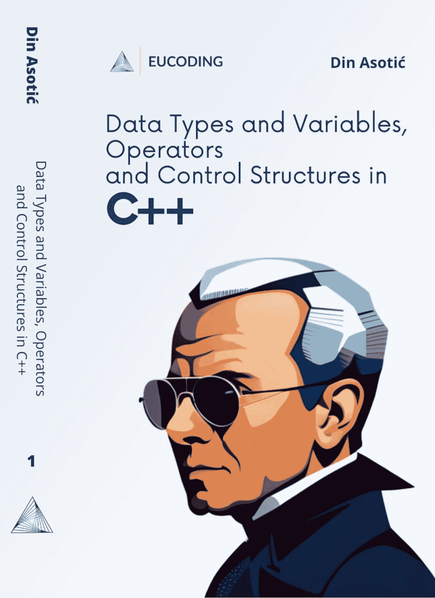

# C++ 数据类型、变量、运算符与控制结构：C++ 编程入门指南



## 作者的信

大家好！

感谢你决定购买这本书。我是 Din，这套 C++ 编程系列的编辑。

对于某些人来说，这将是一段漫长且可能令人力不从心的旅程。我已尽力为这门基础编程语言最重要的概念编写了示例。我最初计划这个合集只有几卷，但考虑到我想对每个单独概念深入探讨的细节，它最终变得有些详尽。

因此，我将尽力根据所讨论字段的简易程度以及它们对你掌握该语言的基础性，将这些材料整理成不同的卷册，以便读者查阅。

如果你刚刚开始学习 `C++`，那么你现在正在读的这本书可能是适合你的选择。在这里，我们将涵盖初学者最重要的概念，尽管在这里也可以找到一些更高级的信息。出于这个原因，我建议在使用这一系列书籍时不要采取线性的学习策略。当然，一如既往，学习这些材料的最好方法是在你的编译器上进行编程实践。在本书中以及该系列的其他书中，你将发现大量的编程示例，这些示例（希望）能够引导你通往独立 `C++` 程序员的之路。

请记住，没有人能知道编程领域的所有知识，这没关系。然而，你愿意与我一起开启这段冒险真正令人鼓舞，这也是我坚持下去并发布新材料的动力。希望有一天，我能和你们中的一些一起构建新事物，让这个世界变得更好。在我们共同构建知识的过程中，我会在每一卷关注你们。

在书末，你会找到每个章节的简要概述。那里也可以找到关键语法和术语。我加入这些是为了让你无需阅读整个章节就能找到必要的语法。希望这对你之后的项目有所帮助。

我的联系方式也在书中。如果你需要关于这本书的任何信息，或者对未来的项目有任何问题，请给我发消息。我会尽快回复。

我写这段话时正值夏天。对于学习或工作来说并没有什么动力，但嘿，如果你能从这个版本中获得任何高质量的信息，那都是值得的。

在进入材料之前，我想建议你不要对自己有过高的期望。这本书以及该系列中的其他书籍都极其详尽。要记住所有的知识是非常困难的。你应该将这本书作为后期的参考点，因为所有内容都将为你整理得很好，方便你轻松找到对你重要的话题的信息。在书的最后，你可以找到一个带有快捷信息的附录，仅包含该主题最重要的语法。

你永远无法知道一切，这没关系。重要的是按照自己的节奏来，结果会有的。

是时候开始了。在我们涵盖 `C++` 中的数据类型和变量概念之前，我们会休息。

# I. 数据类型与变量

## C++ 数据类型与变量简介

在编程世界中，数据类型和变量在存储和处理信息方面起着至关重要的作用。无论你是初学者还是经验丰富的程序员，理解数据类型和变量都是编写高效代码的基础。在 `C++` 语言中，数据类型和变量为组织和处理数据提供了构建块。

数据类型定义了程序中存储和处理的数据性质。每种数据类型都有一组可以表示的特定值，以及一组可以在这些值上执行的操作。`C++` 提供了多种内置数据类型，包括基础类型（如整数、浮点数、字符和布尔值），以及更复杂的类型（如数组、结构体和类）。

另一方面，变量是用于存储特定数据类型值的命名容器。它们作为在程序执行期间访问和处理数据的手段。当你声明变量时，你提供一个名称并指定其数据类型，允许编译器分配必要的内存空间来存放该值。变量在程序的执行过程中可以持有不同的值，这使得它们具有高度灵活性，并且对于创建动态和交互式应用程序至关重要。

处理变量的基本方面之一是为它们赋值。这是通过赋值运算符（`=`）实现的，它将一个值赋予变量。例如，你可以给整数变量赋一个整数值，给字符变量赋一个字符，或将计算结果赋给相应类型的变量。

数据类型和变量对于表达程序的语义和实现数据操作至关重要。它们允许你控制内存使用、确保类型安全并提高代码清晰度。为变量选择合适的数据类型对于高效使用内存和避免意外行为至关重要。

在 `C++` 中，你可以使用类和结构体定义自己的数据类型，允许你创建针对你特定需求的复杂数据结构和对象。此外，`C++` 还提供了类型修饰符，如 `const` 和 `volatile`，允许你进一步完善变量的行为。

理解 `C++` 中的数据类型和变量对于精通该语言和构建健壮的软件应用至关重要。随着你深入编程，你会遇到各种数据类型，并学习如何有效地利用它们来解决问题并实现复杂的算法。

因此，无论你是在进行简单的计算、管理大型数据集，还是设计复杂的软件系统，`C++` 中的数据类型和变量都是你构建代码的基础。掌握这些概念将使你能够释放语言的全部潜力，并应对各种编程挑战。

## 基础变量声明与初始化

这是一个在 `C++` 中声明并初始化整数、双精度浮点数和字符变量的示例程序：

```cpp
#include <iostream>

int main() {
    // 变量声明和初始化
    int myInteger = 42; // 声明名为 myInteger 的整数变量并初始化为 42
    double myDouble = 3.14; // 声明名为 myDouble 的双精度变量并初始化为 3.14
    char myChar = 'A'; // 声明名为 myChar 的字符变量并初始化为 'A'

    // 输出变量的值
    std::cout << "Integer: " << myInteger << std::endl;
    std::cout << "Double: " << myDouble << std::endl;
    std::cout << "Character: " << myChar << std::endl;

    return 0;
}
```

在上面的程序中，我们首先包含必要的头文件 `<iostream>`，它允许我们使用输入输出流操作。`main()` 函数是程序的入口。

要声明并初始化变量，我们遵循语法：`类型变量名 = 值;`。在这个示例中，我们声明并初始化了一个名为 `myInteger` 的整数变量为 `42`，一个名为 `myDouble` 的双精度变量为 `3.14`，以及一个名为 `myChar` 的字符变量为 `'A'`。

在初始化变量后，我们使用来自 `<iostream>` 库的 `std::cout` 对象将它们的值输出到控制台。`<<` 运算符用于连接文本和变量。

最后，`return 0;` 语句表示程序执行成功。

在声明和初始化变量时，为你想要存储的值选择合适的数据类型至关重要。在初始化期间为变量赋值有助于确保它们从有意义的值开始，并避免与未初始化变量相关的潜在问题。

通过声明和初始化变量，你可以在程序中存储和操作不同类型的数据，使其更具动态性并适应各种场景。

## 变量的算术运算

这是一个 `C++` 示例程序，它使用变量执行基础算术运算：

```cpp
#include <iostream>

int main() {
    int a = 10;
    int b = 5;
    int result;

    // 加法
    result = a + b;
    std::cout << "Addition: " << result << std::endl;

    // 减法
    result = a - b;
    std::cout << "Subtraction: " << result << std::endl;

    // 乘法
    result = a * b;
    std::cout << "Multiplication: " << result << std::endl;

    // 除法
    result = a / b;
    std::cout << "Division: " << result << std::endl;

    return 0;
}
```

在此程序中，我们有两个变量 `a` 和 `b`，分别初始化为值 `10` 和 `5`。然后我们执行了四种算术运算：加法、减法、乘法和除法。

运算符优先级决定了操作执行顺序。在 `C++` 中，优先级规则如下（从高到低）：

1. 括号 `()`
2. 一元加 `+` 和一元减 `-`
3. 乘法 `*`、除法 `/` 和取模 `%`
4. 加法 `+` 和减法 `-`

在我们的程序中，我们使用了 `+`、`-`、`*` 和 `/` 运算符，它们的优先级相同。因此，操作从左到右执行。

关于类型提升，`C++` 会在需要执行操作时自动将变量提升为更高类型。例如，如果两个整数进行除法，结果将是一个整数，即使除不尽也是如此。小数部分将被截断。然而，如果操作数中至少有一个是浮点数，结果将是浮点数。

在提供的程序中，由于 `a` 和 `b` 都是整数，除法操作 `result = a / b;` 将执行整数除法，导致 `result` 被赋值为 `2`。

如果你想执行浮点除法并获得更精确的结果，可以将 `a` 和 `b` 声明为浮点变量，如下：

```cpp
double a = 10.0;
double b = 5.0;
```

此更改将导致除法操作执行浮点除法，`result` 将被赋值为 `2.0`。

## 理解类型修饰符

这是一个 `C++` 示例程序，演示了 `signed`、`unsigned`、`long` 和 `short` 等类型修饰符的使用：

```cpp
#include <iostream>

int main() {
    // 有符号修饰符
    signed int signedNumber = -10;
    std::cout << "Signed int: " << signedNumber << std::endl;

    // 无符号修饰符
    unsigned int unsignedNumber = 20;
    std::cout << "Unsigned int: " << unsignedNumber << std::endl;

    // 长修饰符
    long long longNumber = 1000000L;
    std::cout << "Long: " << longNumber << std::endl;

    // 短修饰符
    short shortNumber = -30000;
    std::cout << "Short: " << shortNumber << std::endl;

    return 0;
}
```

在此程序中，我们使用不同的类型修饰符声明了变量：

1. 使用 `signed` 修饰符声明了 `signedNumber`。
2. 使用 `unsigned` 修饰符声明了 `unsignedNumber`。
3. 使用 `long` 修饰符声明了 `longNumber`。
4. 使用 `short` 修饰符声明了 `shortNumber`。

1. `signed` 修饰符用于 `int` 类型，表示有符号整数。
2. `unsigned` 修饰符用于 `int` 类型，表示无符号整数。
3. `long` 修饰符用于 `long long` 类型，表示长整数。
4. `short` 修饰符用于 `int` 类型，表示短整数。

## 探索 Float（浮点数）

这是一个 `C++` 示例程序，演示了 `float` 和 `double` 类型的精度问题：

```cpp
#include <iostream>
#include <iomanip>

int main() {
    float floatNumber = 1.2345678;
    double doubleNumber = 1.23456789012345;

    std::cout << std::fixed << std::setprecision(10);
    std::cout << "Float number: " << floatNumber << std::endl;
    std::cout << "Double number: " << doubleNumber << std::endl;

    return 0;
}
```

在此程序中，我们声明了 `float floatNumber` 和 `double doubleNumber`。我们使用 `std::fixed` 和 `std::setprecision(10)` 设置输出精度。

当你运行此程序时，你会发现 `float` 类型精度有限（约为 7 位），而 `double` 类型提供了更高的精度。

现在，让我们讨论浮点类型的精度和准确性概念：

- **精度（Precision）**：指的是浮点类型能够表示的有效位数。换句话说，它决定了数值与其真实数学值的接近程度。在上面的示例中，`float` 类型精度有限，而 `double` 类型更高。
- **准确性（Accuracy）**：指的是浮点值与其应该代表的值之间的接近程度。它不仅取决于数据类型的精度，还取决于对其执行的算术运算的质量。浮点运算容易产生舍入误差，并在结果中引入微小的不准确性。因此，即使数据类型具有高精度，也应该考虑准确性。

在处理浮点类型时，同时考虑精度和准确性是非常重要的，以确保你的计算是可靠的并适用于特定场景。

## 布尔值与逻辑运算

这是一个 `C++` 示例程序，演示了布尔变量和逻辑运算的使用：

```cpp
#include <iostream>

int main() {
    bool isSunny = true;
    bool isWarm = false;

    // 逻辑与 (&&) 运算
    bool isNiceWeather = isSunny && isWarm;
    std::cout << "Is it nice weather? " << std::boolalpha << isNiceWeather << std::endl;

    // 逻辑或 (||) 运算
    bool isEitherSunnyOrWarm = isSunny || isWarm;
    std::cout << "Is it either sunny or warm? " << std::boolalpha << isEitherSunnyOrWarm << std::endl;

    // 逻辑非 (!) 运算
    bool isNotSunny = !isSunny;
    std::cout << "Is it not sunny? " << std::boolalpha << isNotSunny << std::endl;

    return 0;
}
```

在这个程序中，我们有两个布尔型变量 `isSunny` 和 `isWarm`。在 `C++` 中，值 `true` 代表真，而 `false` 代表假。

该程序演示了三种逻辑操作：

1. 逻辑与（`&&`）：如果 `isSunny` 和 `isWarm` 均为 `true`，则变量 `isNiceWeather` 被赋值为 `true`。否则，它被赋值为 `false`。
2. 逻辑或（`||`）：如果 `isSunny` 或 `isWarm`（或两者）为 `true`，则变量 `isEitherSunnyOrWarm` 被赋值为 `true`。否则，它被赋值为 `false`。
3. 逻辑非（`!`）：变量 `isNotSunny` 被赋值为 `isSunny` 值的反值。如果 `isSunny` 为 `true`，则 `isNotSunny` 为 `false`，反之亦然。

使用 `std::boolalpha` 操纵符可以将布尔值打印为 `true` 或 `false`，而不是 `1` 或 `0`。

当程序运行时，它将根据 `isSunny` 和 `isWarm` 的初始值输出逻辑操作的结果。

## 字符变量与 ASCII

这是一个 `C++` 程序，演示了字符变量与其 ASCII 值之间的关系：

```cpp
#include <iostream>

int main() {
    char character;

    std::cout << "Enter a character: ";
    std::cin >> character;

    std::cout << "Character: " << character << std::endl;
    std::cout << "ASCII value: " << static_cast<int>(character) << std::endl;

    return 0;
}
```

在这个程序中，我们声明了一个类型为 `char` 的变量 `character` 来存储输入的字符。然后，我们使用 `std::cin` 提示用户输入字符。

接下来，我们使用 `std::cout` 和 `<<` 操作符显示输入的字符。为了获取字符的 ASCII 值，我们使用 `static_cast<int>(character)` 表达式，它将 `char` 变量 `character` 转换为整数。

程序随后使用 `std::cout` 和 `<<` 操作符输出该字符的 ASCII 值。

关于 `C++` 中 ASCII 和 Unicode 的表示，这里有一个简短的解释：

1. ASCII（美国信息交换标准代码）是一种字符编码方案，它将字符表示为数字代码。在 ASCII 中，每个字符由一个 7 位二进制数表示，总共允许 128 个唯一字符（从 0 到 127）。
2. 另一方面，Unicode 是一种字符编码标准，旨在涵盖所有文字系统的字符。无论平台、程序或语言如何，它都为每个字符提供一个唯一的数字（码点）。与 ASCII 相比，Unicode 可以表示更大量的字符集。

在 `C++` 中，`char` 类型通常表示单个字符，使用 ASCII 编码。如程序所示，可以通过显式将 `char` 转换为 `int` 来获取字符的 ASCII 值。


要在 C++ 中处理 Unicode 字符，可以使用 `wchar_t` 类型，它代表宽字符。宽字符可以表示更广泛的字符，包括 ASCII 范围之外的字符。此外，C++ 提供了 `<codecvt>` 头文件和相关函数用于在不同的字符编码（包括 Unicode）之间转换。这些特性允许你处理 Unicode 字符并操作包含它们的字符串。

## 创建和使用字符串变量

这是一个 C++ 程序示例，它使用了字符串变量并执行了拼接：

```cpp
#include <iostream>
#include <string>

int main() {
    std::string firstName = "John";
    std::string lastName = "Doe";
    std::string fullName = firstName + " " + lastName;
    std::cout << "Full Name: " << fullName << std::endl;
    return 0;
}
```

在这个程序中，我们包含了 `<iostream>` 和 `<string>` 头文件以访问必要的类和函数。我们声明了两个字符串变量 `firstName` 和 `lastName`，并分别为它们赋值为“John”和“Doe”。然后我们创建了第三个字符串变量 `fullName`，使用 `+` 操作符将 `firstName`、空格和 `lastName` 拼接。最后，我们使用 `std::cout` 输出 `fullName`。

现在让我们讨论 C++ 字符串与 C 风格字符串之间的区别：

1. **空字符终止**：C 风格字符串表示为由空字符（`'\0'`）终止的字符数组。这允许函数确定字符串的结束。相反，C++ 字符串在内部管理它们的长度，因此不需要空终止字符。
2. **动态内存分配**：C 风格字符串需要使用 `malloc()` 或 `new[]` 等函数进行手动内存分配。这一责任由程序员承担，正确管理内存以避免内存泄漏至关重要。C++ 字符串会自动处理内存分配和释放，减轻了程序员显式管理内存的负担。
3. **可变性**：C 风格字符串是可变的，这意味着其内容可以直接被修改。相比之下，C++ 字符串是不可变的，意味着你不能更改它们的单个字符。但是，你可以使用成员函数对 C++ 字符串执行各种操作，如拼接、提取子串和追加。
4. **库支持**：C++ 字符串是标准库的一部分，提供了一系列丰富的处理字符串的函数和操作，例如搜索、排序和字符串处理。C 风格字符串作为纯字符数组，依赖于手动实现或自定义库来实现类似的功能。
5. **类型安全**：C++ 字符串是强类型的，并与 C++ 类型系统集成。它们提供了类型安全，防止了意外将整数或其他不兼容类型赋值给字符串变量的常见错误。C 风格字符串缺乏类型安全，使用不当会导致错误。

总体而言，与 C 风格字符串相比，C++ 字符串为处理字符串提供了更安全、更方便、更高层次的抽象。它们提供了更好的内存管理、丰富的库支持和增强的类型安全，使其成为现代 C++ 编程的首选。

## 变量的作用域与寿命

这是一个 C++ 程序示例，演示了变量的作用域和寿命，包括全局、局部和块作用域变量：

```cpp
#include <iostream>

// 具有全局作用域的全局变量
int globalVariable = 10;

void func() {
    // 具有局部作用域的局部变量
    int localVariable = 20;
    // 块作用域变量
    {
        int blockVariable = 30;
        std::cout << "Inside block: " << blockVariable << std::endl;
    }
    // 在此处访问 blockVariable 将导致编译错误
    // std::cout << "Outside block: " << blockVariable << std::endl;
    std::cout << "Inside function: " << localVariable << std::endl;
}

int main() {
    std::cout << "Global variable: " << globalVariable << std::endl;
    // 在此处访问 localVariable 或 blockVariable 将导致编译错误
    // std::cout << "Local variable: " << localVariable << std::endl;
    // std::cout << "Block variable: " << blockVariable << std::endl;
    func();
    return 0;
}
```

在这个程序中，我们有三种变量：

1. **全局变量**：`globalVariable` 定义在任何函数之外，具有全局作用域。它可以从程序的任何部分（包括函数内部）访问和修改。在示例中，我们在 `main()` 函数中打印它的值。
2. **局部变量**：`localVariable` 定义在 `func()` 函数内部，具有局部作用域。它仅在定义的函数内部可访问。在示例中，我们在 `func()` 函数内部打印它的值。
3. **块作用域变量**：`blockVariable` 定义在 `func()` 函数内部的一个块中。它的作用域仅限于该块。在示例中，我们在块内部打印它的值。

该程序演示了全局作用域的变量可以在程序的任何地方被访问，局部变量只能在声明它们的函数内部访问，而块作用域变量只能在声明它们的块内访问。尝试在作用域之外访问变量将导致编译错误。

## 理解类型转换

这是一个 C++ 示例程序，演示了显式和隐式类型转换，并讨论了自动类型转换的潜在陷阱：

```cpp
#include <iostream>

int main() {
    // 隐式类型转换
    int num1 = 10;
    double num2 = num1;  // 隐式将 int 转换为 double
    std::cout << "Implicit Type Conversion: " << num2 << std::endl;

    // 显式类型转换
    double num3 = 15.75;
    int num4 = static_cast<int>(num3);  // 显式将 double 转换为 int
    std::cout << "Explicit Type Conversion: " << num4 << std::endl;

    // 自动类型转换的潜在陷阱
    int num5 = 10;
    double num6 = 2.5;
    double result1 = num5 / num6;  // 除法过程中的自动类型转换
    std::cout << "Automatic Type Conversion (Division): " << result1 << std::endl;

    int num7 = 5;
    int num8 = 2;
    double result2 = num7 / num8;  // 除法过程中的自动类型转换
    std::cout << "Automatic Type Conversion (Division): " << result2 << std::endl;

    return 0;
}
```

在此程序中，我们展示了隐式和显式类型转换的示例。

1. **隐式类型转换**：当编译器在没有显式转换的情况下自动将一种类型转换为另一种类型时发生。在程序中，当将 `num1` 赋值给 `num2` 时，`num1` 被隐式转换为 `double` 并存储在 `num2` 中。
2. **显式类型转换**：当程序员使用强制转换符显式指定类型转换时发生。在程序中，`num3` 使用 `static_cast<int>(num3)` 语法被显式转换为 `int` 并存储在 `num4` 中。

现在，让我们讨论一下自动类型转换的潜在陷阱：

1. **精度丢失**：自动类型转换可能会导致精度丢失。例如，在除法操作 `num5 / num6` 中，`num5` 和 `num6` 是不同类型（`int` 和 `double`），结果会自动转换为 `double`。然而，如果你希望进行精确的整数除法，这种自动转换可能会产生意外的结果。
2. **意外结果**：自动类型转换有时会导致意外的结果。在除法操作 `num7 / num8` 中，`num7` 和 `num8` 都是整数，但结果会自动转换为 `double`。如果你期望得到整数结果，自动类型转换可能会引起困惑。

为了避免这些陷阱，在操作中意识到涉及的类型并在必要时进行显式转换。使用强制转换符（如 `static_cast`）进行显式转换可以确保转换符合预期，减少意外行为的发生。注意：在程序中进行类型转换和计算时，处理潜在的除零错误以及溢出和下溢等因素。

## 使用常量

C++ 中的常量用于表示执行期间不可修改的值。它们提供了一种定义在程序运行期间保持不变的值的方法。

C++ 有两种声明常量的方法：使用 `const` 关键字和使用 `constexpr` 关键字。

### `const`

`const` 关键字用于声明常量变量。它可以应用于基本类型、用户定义类型和指针。一旦变量声明为 `const`，其值就无法更改。

以下是 C++ 中使用 `const` 变量的示例：

```cpp
#include <iostream>

int main() {
    const int MAX_VALUE = 100;
    const double PI = 3.14159;
    // MAX_VALUE = 200; // 错误：无法修改常量变量
    // PI = 3.14;        // 错误：无法修改常量变量
    std::cout << "Max value: " << MAX_VALUE << std::endl;
    std::cout << "PI: " << PI << std::endl;
    return 0;
}
```

在上述示例中，`MAX_VALUE` 和 `PI` 被声明为 `const` 变量。任何修改这些变量的尝试都将导致编译错误。

### `constexpr`

`constexpr` 关键字用于声明可以在编译时求值的常量表达式。它通常用于常量值在编译时已知的情况，可以使用常量表达式进行计算。

以下是 C++ 中使用 `constexpr` 变量的示例：

```cpp
#include <iostream>
constexpr int factorial(int n) {
    if (n <= 1)
        return 1;
    else
        return n * factorial(n - 1);
}

int main() {
    constexpr int SIZE = 10;
    constexpr int FACTORIAL_5 = factorial(5);
    // SIZE = 20; // 错误：修改 constexpr 变量
    std::cout << "Size: " << SIZE << std::endl;
    std::cout << "Factorial of 5: " << FACTORIAL_5 << std::endl;
    return 0;
}
```

在上述示例中，`SIZE` 被声明为值为 `10` 的 `constexpr` 变量。`FACTORIAL_5` 也声明为 `constexpr` 变量，但其值是通过 `factorial` 函数在编译时计算的。注意，`constexpr` 变量在编译时求值，因此它们可以使用需要常量表达式的上下文，例如数组大小或模板参数。

`const` 和 `constexpr` 变量提供了在 C++ 中定义常量的方法。它们之间的选择取决于常量是在编译时还是运行时已知。

## 创建和使用枚举类型

C++ 中的枚举类型（也称为 `enum`）是一种自定义类型，由一组称为枚举符的命名常量组成。这些枚举符通常用于表示变量可以取的有限值集合。

以下是一个声明并使用枚举类型的示例程序：

```cpp
#include <iostream>
enum Month {
    January,
    February,
    March,
    April,
    May,
    June,
    July,
    August,
    September,
    October,
    November,
    December
};

int main() {
    Month currentMonth = May;
    std::cout << "The current month is: ";
    switch (currentMonth) {
        case January:
            std::cout << "January";
            break;
        case February:
            std::cout << "February";
            break;
        case March:
            std::cout << "March";
            break;
        case April:
            std::cout << "April";
            break;
        case May:
            std::cout << "May";
            break;
        case June:
            std::cout << "June";
            break;
        case July:
            std::cout << "July";
            break;
        case August:
            std::cout << "August";
            break;
        case September:
            std::cout << "September";
            break;
        case October:
            std::cout << "October";
            break;
        case November:
            std::cout << "November";
            break;
        case December:
            std::cout << "December";
            break;
    }
    std::cout << std::endl;
    return 0;
}
```

在此程序中，我们定义了一个代表一年十二月份的枚举 `Month`。每个月份都分配了一个默认的整数值，从 `0`（一月）到 `11`（十二月）。

在 `main()` 函数内部，我们声明了一个类型为 `Month` 的变量 `currentMonth` 并将其赋值为 `May`。然后我们使用 `switch` 语句根据 `currentMonth` 的值打印当前月份的名称。在这种情况下，它将输出“The current month is: May”。

枚举类型在你想限制变量可以取的值时非常有用。它们通过为常量提供有意义的名称提高了代码的可读性，并在向枚举变量分配无效值时，有助于在编译时捕获错误。

枚举（enums）的其他用例包括表示标志位、状态、错误代码、菜单选项，以及任何需要通过名称而非原始数字来标识固定可能值集合的情况。

## 位操作

这里是一个 C++ 示例程序，演示了对整数变量的按位操作：


```cpp
#include <iostream>

int main() {
    int a = 5; // 0101 in binary
    int b = 3; // 0011 in binary
    // Bitwise AND
    int resultAnd = a & b;
    std::cout << "Bitwise AND: " << resultAnd << std::endl; // Output: 1

    // Bitwise OR
    int resultOr = a | b;
    std::cout << "Bitwise OR: " << resultOr << std::endl; // Output: 7

    // Bitwise XOR
    int resultXor = a ^ b;
    std::cout << "Bitwise XOR: " << resultXor << std::endl; // Output: 6

    // Bitwise NOT
    int resultNotA = ~a;
    std::cout << "Bitwise NOT (A): " << resultNotA << std::endl; // Output: -6
    int resultNotB = ~b;
    std::cout << "Bitwise NOT (B): " << resultNotB << std::endl; // Output: -4

    // Left shift
    int leftShifted = a << 2;
    std::cout << "Left Shift: " << leftShifted << std::endl; // Output: 20

    // Right shift
    int rightShifted = a >> 1;
    std::cout << "Right Shift: " << rightShifted << std::endl; // Output: 2

    return 0;
}
```

让我们讨论一下每个按位操作及其用例：

1. 按位与（`&`）：在两个整数之间执行按位与操作，结果是一个整数，当且仅当两个操作数的对应位都为 1 时，结果的对应位才为 1。这种操作通常用于掩码某些位或从位模式中提取特定信息。

2. 按位或（`|`）：在两个整数之间执行按位或操作，结果是一个整数，如果操作数中任意一个对应位为 1，则结果的对应位为 1。它通常用于设置特定位或组合不同的位模式。

3. 按位异或（`^`）：在两个整数之间执行按位异或操作，结果是一个整数，当且仅当两个操作数的对应位不同时，结果的对应位才为 1。它可以用于翻转位或执行条件操作。

4. 按位取反（`~`）：对整数执行按位取反操作，结果是一个新整数，其每一位都经过了翻转（即 0 变为 1，反之亦然）。它通常用于反转位或创建位掩码。

5. 左移（`<<`）：将整数的位向左移动指定的位数。移出的位用 0 填充。这种操作实际上是将整数乘以 2 的移位次数次方。

6. 右移（`>>`）：将整数的位向右移动指定的位数。移出的位可以用 0 填充或符号位填充（对于有符号整数）。这种操作实际上将整数除以 2 的移位次数次方。

这些按位操作在各种场景中都非常有用，例如：

- 在整数表示中操纵单个位或组位。
- 构建高效的数据结构，如位集（bitsets）或位数组。
- 通过执行按位操作代替代价昂贵的算术操作来优化代码。
- 实现依赖于位操作的底层协议或编码方案。

注意的是，按位操作高度依赖于整数的二进制表示，并且对于有符号和无符号类型可能会表现出不同的行为。应该确保预期的语义并避免潜在的陷阱，例如符号整数溢出。

## 理解类型大小

这里有一个打印每个数据类型大小的 C++ 程序：

```cpp
#include <iostream>

int main() {
    std::cout << "Size of char: " << sizeof(char) << " byte(s)" << std::endl;
    std::cout << "Size of short: " << sizeof(short) << " byte(s)" << std::endl;
    std::cout << "Size of int: " << sizeof(int) << " byte(s)" << std::endl;
    std::cout << "Size of long: " << sizeof(long) << " byte(s)" << std::endl;
    std::cout << "Size of long long: " << sizeof(long long) << " byte(s)" << std::endl;

    return 0;
}
```

## 用户输入

在 C++ 中，你可以使用 `std::cin` 对象来接收用户的输入。这里有一个演示如何使用 `std::cin` 获取输入并到变量中的示例程序：

```cpp
#include <iostream>
#include <string>

int main() {
    int num;
    std::string name;
    std::cout << "Enter a number: ";
    std::cin >> num;
    std::cout << "Enter your name: ";
    std::cin >> name;
    std::cout << "You entered the number: " << num << std::endl;
    std::cout << "Your name is: " << name << std::endl;

    return 0;
}
```

让我们逐步代码：

1. 我们包含了 `<iostream>` 头文件，它提供了输入/输出流功能。

2. 在 `main()` 函数中，我们声明了两个变量：`int` 类型的 `num` 和 `std::string` 类型的 `name`。这些变量将存储用户的输入。

3. 我们使用 `std::cout` 显示提示消息，要求用户输入一个数字。

4. 我们使用 `std::cin` 读取用户的输入并将其存储在 `num` 变量中。

5. 接下来，我们显示提示消息，要求用户输入他们的姓名。

6. 再次使用 `std::cin` 读取用户的输入并将其存储在 `name` 变量中。

7. 最后，我们使用 `std::cout` 显示变量 `num` 和 `name` 的值。

请注意 `std::cin` 会读取输入直到遇到空白符，因此如果用户输入一个带有空格的名字，只有第一个单词会被存储在 `name` 变量中。要读取包含空格的行文本，你可以使用 `std::getline` 函数代替 `std::cin`：

```cpp
std::cout << "Enter your name: ";
std::getline(std::cin, name);
```

这样，`std::getline` 将读取整行输入（包括空格），并将其存储在 `name` 变量中。

## 打印变量

在 C++ 中，你可以使用 `<iostream>` 库中的 `std::cout` 对象将变量打印到控制台。`std::cout` 提供了各种格式选项来控制输出。让我们来看一个演示 `std::cout` 不同格式选项的示例程序：

```cpp
#include <iostream>
#include <iomanip> // 某些格式选项需要它

int main() {
  int intValue = 42;
  double doubleValue = 3.14159;
  std::string stringValue = "Hello, World!";
  // 基础打印
  std::cout << "Integer value: " << intValue << std::endl;
  std::cout << "Double value: " << doubleValue << std::endl;
  std::cout << "String value: " << stringValue << std::endl;
  // 格式选项
  std::cout << std::endl;
  // 固定点法，保留 2 位小数
  std::cout << "Double value (fixed): " << std::fixed << std::setprecision(2) << doubleValue << std::endl;
  // 科学计数法，保留 4 位小数
  std::cout << "Double value (scientific): " << std::scientific << std::setprecision(4) << doubleValue << std::endl;
  // 宽度与填充
  std::cout << "Integer value (width): " << std::setw(10) << std::setfill('*') << intValue << std::endl;
  // 重置格式选项
  std::cout.unsetf(std::ios::fixed);
  std::cout.unsetf(std::ios::scientific);
  std::cout << std::setw(0) << std::setfill(' ') << std::endl;
  return 0;
}
```

在此示例中：

- 我们包含了必要的头文件：用于 `std::cout` 和 `std::endl` 的 `<iostream>`，以及用于某些格式选项的 `<iomanip>`。
- 我们声明了三个变量：一个整数 `intValue`、一个双浮点数 `doubleValue` 和一个字符串 `stringValue`。
- 我们使用 `std::cout` 打印变量的值。
- 我们演示了几种格式选项：
  - `std::fixed` 和 `std::setprecision(2)` 将 `doubleValue` 的输出设置为 2 位小数的固定点法。
  - `std::scientific` 和 `std::setprecision(4)` 将 `doubleValue` 的输出设置为 4 位小数的科学计数法。
  - `std::setw(10)` 和 `std::setfill('*')` 将 `intValue` 的输出宽度设置为 10 个字符，并用星号填充额外的空间。
- 我们使用 `std::unsetf()` 重置了格式选项，并重置了宽度和填充选项。

你可以编译并运行此程序以查看这些格式选项的实际效果。输出将根据变量的值而变化。

## 数组声明与初始化

这里有一个演示数组声明和初始化的 C++ 示例程序：

```cpp
#include <iostream>

int main() {
  // 声明并初始化一个整数数组
  int numbers[5] = {1, 2, 3, 4, 5};
  // 打印数组元素
  for (int i = 0; i < 5; ++i) {
    std::cout << numbers[i] << " ";
  }
  std::cout << std::endl;
  return 0;
}
```

在程序中，我们声明了一个名为 `numbers` 的大小为 5 的数组，这意味着它可以存储 5 个整数。我们使用大括号初始化列表 `{1, 2, 3, 4, 5}` 来初始化数组。每个值之间用逗号隔开。

C++ 中的数组是派生数据类型。它们派生自基本数据类型，可以看作是相同数据类型元素的集合。在示例程序中，我们声明了一个整数数组（`int`），但数组也可以为其他数据类型（如 `char`、`float` 甚至用户定义类型）声明。

数组声明由两部分组成：元素的类型和数组的名称。在示例中，类型是 `int`，数组名为 `numbers`。数组的大小在方括号 `[5]` 中指定，表示该数组可以容纳 5 个整数。

数组是零索引的，这意味着数组的第一个元素索引为 0，第二个元素索引为 1，以此以类推。在程序中，我们使用 `for` 循环遍历数组元素并使用 `std::cout` 打印它们。

## 多维数组

在 C++ 中，多维数组是具有一个以上维度的数组。它本质上是一个具有行和列的表格状结构。要声明多维数组，你需要指定每个维度的大小。

这里是一个二维数组的示例：

```cpp
#include <iostream>

int main() {
  int arr[3][4] = {
    {1, 2, 3, 4},
    {5, 6, 7, 8},
    {9, 10, 11, 12}
  };

  // 访问并打印数组元素
  for (int i = 0; i < 3; i++) {
    for (int j = 0; j < 4; j++) {
      std::cout << arr[i][j] << " ";
    }
    std::cout << std::endl;
  }

  return 0;
}
```

在此示例中，我们声明了一个具有 3 行 4 列的二维数组 `arr`。我们使用索引 `arr[i][j]` 为元素赋值。最后，我们使用嵌套循环来访问并打印这些元素。

## 字符数组

这里有一个使用字符数组来存储字符串的 C++ 示例程序：

```cpp
#include <iostream>

int main() {
  // 声明并初始化一个字符数组
  char str[] = "Hello, world!";
  // 打印字符串
  std::cout << str << std::endl;
  return 0;
}
```

在程序中，我们声明了一个字符数组 `str` 并将其初始化为字符串 `"Hello, world!"`。该数组会自动分配足够的内存来存储字符串的字符。数组的大小由字符串的长度加上一个标记字符串结束的空终止符（`\0`）决定。

`std::cout << str` 语句将数组的内容作为字符串打印出来。

现在，让我们讨论一下字符串和字符数组之间的区别。

在 C++ 中，字符串是标准库提供的一种高级抽象（`std::string`），它表示字符序列。它提供了各种成员函数和运算符重载，以便方便地执行字符串操作。字符串可以动态调整大小，比字符数组更灵活。

另一方面，字符数组是一种低级结构，通常表示为空终止的字符序列（`char[]` 或 `char*`）。它是一个固定大小的字符集合，用于存储和处理字符串。字符数组需要手动管理内存，并且缺乏 `std::string` 类提供的内置字符串操作功能。

虽然字符串和字符数组都可以存储字符序列，但字符串提供了更高层次的功能，例如字符串拼接、子字符串提取、搜索等。在 C++ 中，由于与直接操作字符数组相比更具便利性和安全性，在处理字符串时通常倾向于使用字符串。

在提供的示例中，我们使用字符数组来存储和打印字符串。然而，重要的是，在现代 C++ 中，对于大多数字符串操作需求，通常建议使用 `std::string` 代替，因为它可以简化代码并提供额外的安全性和功能。

## 字符串数组

这里是一个 C++ 示例程序，用于存储和打印一个字符串数组：

```cpp
#include <iostream>
#include <string>

int main() {
    const int SIZE = 3;  // 数组的大小
    std::string strings[SIZE];  // 字符串数组
    // 将字符串输入数组
    for (int i = 0; i < SIZE; ++i) {
        std::cout << "Enter string " << i + 1 << ": ";
        std::getline(std::cin, strings[i]);
    }
    // 打印字符串
    std::cout << "Array of strings:\n";
    for (int i = 0; i < SIZE; ++i) {
        std::cout << "String " << i + 1 << ": " << strings[i] << "\n";
    }
    return 0;
}
```

在 C++ 中，字符串数组本质上是字符数组。数组的每个元素都是字符串对象。来自 `<string>` 头文件的 `std::string` 类用于表示 C++ 中的字符串，提供了一种方便且灵活的文本处理方式。

要声明字符串数组，可以使用语法：`std::string arrayName[size];`，其中 `arrayName` 是数组名称，`size` 是你想要在数组中存储的字符串数量。

在提供的示例中，数组 `strings` 使用 `std::string` 类型声明，大小为 3。程序随后使用循环通过 `std::getline` 获取用户输入并将输入到数组的每个元素中。最后，使用另一个循环打印数组中的每个字符串。

注意，在 C++ 中，数组是从零索引的，因此循环计数器 `i` 从 0 开始，到 `SIZE - 1` 结束，以访问数组的所有元素。

切忘记包含必要的头文件 `<iostream>` 和 `<string>`，以便在 C++ 中使用字符串和输入输出功能。

## 创建和使用指针

这里有一个演示 C++ 中指针和内存地址概念的示例程序：


```cpp
#include <iostream>

int main() {
    int value = 42;
    int* pointer = &value; // 声明一个指针，并将 'value' 的内存地址赋值给它
    std::cout << "Value: " << value << std::endl;
    std::cout << "Memory Address: " << pointer << std::endl;
    std::cout << "Dereferenced Value: " << *pointer << std::endl;
    *pointer = 99; // 使用指针间接修改值
    std::cout << "New Value: " << value << std::endl;
    return 0;
}
```

在该程序中，我们声明了一个名为 `value` 的变量并赋值赋值为 42。我们还声明了一个名为 `pointer` 的类型为 `int*`（指向整数的指针）的指针变量。使用地址运算符 `&`，我们将 `value` 的内存地址赋值给指针变量。

为了显示值和内存地址，我们使用带有适当变量和格式说明符的 `std::cout` 语句。`*pointer` 语法用于解引用指针并获取它指向的值。

随后，我们通过给解引用指针 `*pointer` 赋值一个新值 (99) 来间接修改该值。这种修改会影响原始值，因为 `pointer` 持有它的内存地址。

当你运行程序时，你应该能看到以下输出：

```text
Value: 42

Memory Address: 0x7ffeea798a94 (实际地址可能会变化)

Dereferenced Value: 42

New Value: 99
```

此输出表明指针 `pointer` 持有 `value` 的内存地址，通过解引用指针，我们可以访问并修改它指向的值。

指针是 C++ 中强大的工具，因为它们允许你直接操作内存、处理动态分配的内存并高效地通过引用传递参数。理解指针和内存地址对于内存管理、数据结构和底层编程等任务至关重要。

## 指针和数组

这里是一个 C++ 示例程序，演示了如何使用指针来访问和操作数组：

```cpp
#include <iostream>

int main() {
    int arr[5] = {1, 2, 3, 4, 5};
    int* ptr = arr;
    std::cout << "Array elements: ";
    for (int i = 0; i < 5; i++) {
        std::cout << *(ptr + i) << " ";
    }
    std::cout << std::endl;
    *(ptr + 2) = 10;
    std::cout << "Modified element at 2: " << arr[2] << std::endl;
    return 0;
}
```

在该程序中，我们有一个有五个元素的整数数组 `arr`。我们声明了一个指针 `ptr` 并将其赋值为数组的开头。使用指针算术，我们顺序访问元素。

在第一个循环中，我们使用 `*(ptr + i)` 打印元素。然后使用 `*(ptr + 2) = 10` 修改索引为 2 的元素。这演示了如何使用指针直接操作数组元素。

## 动态变量

这里有一个 C++ 示例程序，演示了使用 `new` 和 `delete` 关键字进行动态内存分配和释放：

```cpp
#include <iostream>

int main() {
    // 动态内存分配
    int* dynamicInt = new int; // 为整数分配内存
    *dynamicInt = 10; // 为动态变量赋值
    double* dynamicDouble = new double; // 为双精度浮点数分配内存
    *dynamicDouble = 3.14;
    char* dynamicChar = new char; // 为字符分配内存
    *dynamicChar = 'A';

    // 打印动态变量
    std::cout << "Dynamic Int: " << *dynamicInt << std::endl;
    std::cout << "Dynamic Double: " << *dynamicDouble << std::endl;
    std::cout << "Dynamic Char: " << *dynamicChar << std::endl;

    // 动态内存释放
    delete dynamicInt; // 释放动态 int 
    delete dynamicDouble; // 释放动态 double 
    delete dynamicChar; // 释放动态 char 

    return 0;
}
```

在该程序中，我们使用 `new` 关键字为三种不同类型的变量（`int`、`double` 和 `char`）动态分配内存。我们使用解引用运算符 `*` 为这些动态变量赋值。最后，我们使用 `delete` 释放内存以防止内存泄漏。

在打印值后，我们使用 `delete` 关键字来释放为每个动态变量分配的内存。这是一个释放内存资源并防止内存泄漏的重要步骤。

动态内存分配允许我们创建大小在运行时确定的变量，这与在编译时声明固定大小的变量不同。它使我们能够更灵活、更高效地管理内存，特别是在处理在程序执行过程中大小可能会发生动态变化的数据结构时。

然而，需要注意的是，当使用动态内存分配时，程序员有责任使用 `delete` 释放内存以防止内存泄漏。未能释放动态分配的内存会导致内存泄漏，即内存在不再需要时仍未被释放，从而导致内存使用效率低下。

还值得一提的是，在现代 C++ 中，通常建议使用智能指针（如 `std::unique_ptr` 和 `std::shared_ptr`）或容器类（如 `std::vector`）来管理动态内存的分配和释放，因为它们提供了更安全、更方便的内存管理机制。

## 动态数组

这里有一个 C++ 示例程序，展示了演示了动态数组的创建和用法：

```cpp
#include <iostream>

int main() {
    int size;
    std::cout << "Enter the size of the array: ";
    std::cin >> size;
    // Create a dynamic array
    int* dynamicArray = new int[size];

    // Populate the dynamic array
    for (int i = 0; i < size; i++) {
        dynamicArray[i] = i * 2;
    }

    // Display the dynamic array
    std::cout << "Dynamic Array: ";
    for (int i = 0; i < size; i++) {
        std::cout << dynamicArray[i] << " ";
    }
    std::cout << std::endl;

    // Clean up the dynamic array
    delete[] dynamicArray;

    return 0;
}
```

### 动态数组的优点

1. **可变大小**：动态数组允许你在运行时创建大小指定的数组，这与编译时固定的静态数组不同。当你根据用户输入或其他动态因素分配内存时，这种灵活性非常有用。
2. **内存管理**：动态数组从堆上分配内存，允许更高效的内存管理。你可以根据需要分配和释放内存，这有助于优化内存使用并避免内存浪费。
3. **调整大小能力**：动态数组可以在运行时使用重新分配或创建不同大小的新数组等技术进行调整。这种灵活性允许你根据需要动态调整数组大小，添加或删除元素。

### 动态数组的缺点

1. **手动内存管理**：与静态数组不同，动态数组需要手动内存管理。你需要负责使用 `new` 显式分配内存并使用 `delete[]` 释放内存。如果操作不当，可能会导致内存泄漏或访问已释放的内存，引发未定义行为。
2. **复杂性**：与静态数组相比，动态数组增加了额外的复杂性。你需要处理内存分配、释放和调整大小。这种复杂性使得代码更难以理解、维护和调试。
3. **性能开销**：动态数组涉及从堆上分配内存，与基于栈的静态数组相比通常会产生更多开销。频繁分配/释放内存或频繁调整数组可能会影响性能，特别是在对时间敏感的应用中。
4. **缺乏安全性**：动态数组默认不进行边界检查。如果你访问了分配内存范围之外的元素，可能会导致缓冲区溢出或内存损坏，从而导致未定义行为或崩溃。你需要确保正确的数组边界管理以避免这些问题。

在根据特定用例在动态数组和静态数组之间选择时，仔细考虑这些优缺点是非常重要的。

## 指针的指针

这里有一个 C++ 示例程序，展示了二级指针的用法：

```cpp
#include <iostream>

int main() {
    int number = 10;
    int* pointer1 = &number;
    int** pointer2 = &pointer1;

    std::cout << "Value of number: " << number << std::endl;
    std::cout << "Value of pointer1: " << *pointer1 << std::endl;
    std::cout << "Value of pointer2: " << **pointer2 << std::endl;

    return 0;
}
```

在这个程序中，我们使用二级指针实现了两级间接。以下是发生过程的简要解释：

1. 我们声明了一个整数变量 `number` 并给其赋值为 `10`。
2. 我们声明了一个 `int*` 类型的指针 `pointer1`，并使用地址运算符 `&` 将 `number` 的地址赋给它。
3. 我们声明了另一个 `int**` 类型（指向指针的指针）指针 `pointer2`，并将 `pointer1` 的地址赋给它。
4. 代码行 `**pointer2` 两次引用，得到了 `number` 的值。

### 在什么时候你会使用二级指针？

二级指针用于需要动态管理内存的场景。以下是一些用例：

1. **多维数组的动态分配**：如果你想在运行时创建二维或更高维数组。
2. **实现数据结构**：二级指针经常用于链表、树和图，以动态管理节点。
3. **修改指针值**：二级指针提供了从不同作用域或函数修改指针的方法。

总的来说，二级指针是 C++ 中的一种强大工具，允许多级间接。然而，它们会增加代码的复杂性，因此必须谨慎使用并确保正确的内存管理。

## 变量引用

这里有一个 C++ 示例程序使用了引用并演示了该概念：

```cpp
#include <iostream>

void swap(int& a, int& b) {
    int temp = a;
    a = b;
    b = temp;
}

int main() {
    int num1 = 5;
    int num2 = 10;
    std::cout << "Before swap: num1 = " << num1 << ", num2 = " << num2 << std::endl;

    swap(num1, num2);
    std::cout << "After swap: num1 = " << num1 << ", num2 = " << num2 << std::endl;

    return 0;
}
```

在这个程序中，定义了一个 `swap` 函数来交换整数的值。它接收两个参数 `a` 和 `b`，它们是整数的引用。在函数内部，使用临时变量交换 `a` 和 `b`。

C++ 中的引用与指针相似，但有一些重要的区别：

1. **初始化**：指针可以在不初始化的情况下声明，但引用在声明时必须初始化。一旦引用初始化，无法指向另一个对象。
2. **空属性**：指针可以为空值，表示它们没有引用任何有效对象。引用必须始终引用一个有效对象且不能为空。
3. **语法**：指针使用 `*` 符号声明，而引用使用 `&` 符号声明。
4. **直接访问**：指针可以使用 `*` 运算符解引用来访问它们指向的值。相反，引用不需要解引用。它们可以像普通变量一样直接使用。

使用引用相比指针具有一些优势：

1. **简单性**：引用提供了更简单的语法，且更易使用。它们消除了对显式解引的需要，并可以像普通变量一样处理。
2. **安全性**：引用不能为空，因此没有无意解引用空指针并导致未定义行为的风险。
3. **可读性**：使用引用的代码通常更具可读性和表达力，因为它更清晰地传达了程序员的意图。
4. **函数参数**：引用常被用作函数参数以通过引用方式传递值，从而允许修改原始变量。

然而，指针仍然有其用处：

1. **动态内存**：在使用 `new` 和 `delete` 运算符处理动态内存分配时，指针是必不可少的。
2. **算术操作**：指针可以通过算术操作进行处理，这在某些场景下非常有用。
3. **可选引用**：指针可以被设置为 `null`，表示对象的不存在，而引用始终要求分配一个对象。

总而言之，与指针相比，引用提供了一种更简单、更安全的处理变量的方法。在向函数通过引用传递值，或者当你想避免与指针相关的复杂性和风险时，它们特别有用。

## 字符串操作

C++ 中的字符串库提供了一系列用于处理字符串的函数和操作。它是标准模板库（STL）的一部分，并包含在 `<string>` 头文件中。

这里是一个示例程序，展示了字符串库中一些常用的函数：

```cpp
#include <iostream>
#include <string>

int main() {
    std::string str1 = "Hello";
    std::string str2 = " World!";

    // 拼接
    std::string concatenated = str1 + str2;
    std::cout << "Concatenated string: " << concatenated << std::endl;

    // 长度
    std::cout << "Length of str1: " << str1.length() << std::endl;

    // 访问字符
    char firstChar = str1[0];
    char lastChar = str2.back();
    std::cout << "First character of str1: " << firstChar << std::endl;
    std::cout << "Last character of str2: " << lastChar << std::endl;

    // 子字符串
    std::string substring = concatenated.substr(6, 5);
    std::cout << "Substring: " << substring << std::endl;

    // 查找
    size_t index = concatenated.find("World");
    if (index != std::string::npos) {
        std::cout << "Found 'World' at index: " << index << std::endl;
    }

    // 替换
    concatenated.replace(6, 5, "Universe");
    std::cout << "Replaced string: " << concatenated << std::endl;

    // 比较
    std::string str3 = "Hello";
    std::string str4 = "HELLO";
    if (str1 == str3) {
        std::cout << "str1 and str3 are equal." << std::endl;
    }
    if (str1.compare(str4) == 0) {
        std::cout << "str1 and str4 are equal." << std::endl;
    }
    return 0;
}
```

在这个程序中，我们包含了 `<iostream>` 和 `<string>` 头。我们声明并初始化了两个字符串变量 `str1` 和 `str2`，值分别为“Hello”和 ” World!”。

以下是程序中使用的一些函数和操作：

- **拼接**：使用 `+` 运算符拼接两个字符串，结果为 `concatenated = “Hello World!”`。
- **长度**：`length()` 函数返回字符串的长度。在这种情况下，对于 `str1` 返回 `5`。
- **访问字符**：我们可以使用 `[]` 运算符访问字符串中的单个字符。`str1[0]` 返回第一个字符‘H’，`str2.back()` 返回最后一个字符‘!’。
- **子字符串**：`substr()` 函数允许我们从给定的字符串中提取子字符串。在这种情况下，它从 `concatenated` 中提取子字符串“World”。
- **查找**：`find()` 函数在字符串中搜索子字符串，并返回第一次出现的索引。如果未找到子字符串，则返回 `std::string::npos`。在这种情况下，它在 `concatenated` 中找到子字符串“World”并返回索引 `6`。


**替换**：`replace()` 函数用另一个字符串替换字符串的部分内容。在这种情况下，它将`concatenated`中的子字符串“World”替换为“Universe”。

**比较**：使用`==`运算符和`compare()`函数来比较字符串。`==`运算符检查两个字符串是否相等，`compare()`在字符串相等时返回`0`。在这种情况下，我们比较了`str1`与`str3`以及`str1`与`str4`的相等性。

这些仅仅是 C++ 字符串库提供的几个示例函数。还有许多其他函数可用，允许你高效地操作和处理字符串。

## 结构体声明与使用

这是一个声明并使用结构体的 C++ 程序示例：

```cpp
#include <iostream>
using namespace std;

// 声明结构体
struct Person {
    string name;
    int age;
};

int main() {
    // 创建结构体的实例
    Person person1;
    // 为结构体成员赋值
    person1.name = "John Doe"; 
    person1.age = 25;

    // 显示值
    cout << "Name: " << person1.name << endl;
    cout << "Age: " << person1.age << endl;

    return 0;
}
```

在这个程序中，我们定义了一个结构体`Person`，它具有类型为`string`的`name`和类型为`int`的`age`。在`main()`函数中，我们创建了结构体的实例`person1`并为其赋值。最后，我们通过`cout`显示这些值。

结构体对于组织在一起的数据非常有用。它们可以用于表示程序中的实体。

```cpp
int globalVariable; // 存储在数据段

void foo() {
    int stackVariable; // 存储在栈中
    int* heapVariable = new int; // 存储在堆中
    std::cout << "Address of stackVariable: " << &stackVariable << std::endl;
    std::cout << "Address of heapVariable: " << heapVariable << std::endl;
}

int main() {
    int mainVariable; // 存储在栈中
    std::cout << "Address of globalVariable: " << &globalVariable << std::endl;
    std::cout << "Address of mainVariable: " << &mainVariable << std::endl;
    foo();
    return 0;
}
```

在这个程序中，我们有三种变量：

1. 全局变量：`globalVariable`定义在任何函数之外，使其成为全局变量。它存储在内存的数据段中，在整个程序执行过程中具有固定的地址。

2. 局部变量：`stackVariable`和`mainVariable`分别是在`foo()`函数和`main()`函数内部声明的局部变量。它们存储在栈中。局部变量在函数调用时自动分配，在函数返回时释放内存。

3. 动态分配变量：`heapVariable`是使用`new`关键字创建的动态分配变量。它存储在堆中，堆是用于动态内存分配的内存区域。该变量在内存中保留，直到使用`delete`关键字显式释放。

当你运行程序时，它将打印每个变量的地址。栈变量的地址通常彼此接近，但在后续运行中会有不同，因为它们是动态分配和释放的。全局变量的地址在整个程序执行过程中保持不变。

需要注意的是，变量的实际存储位置可能会受到各种因素的影响，例如编译器优化、内存布局以及特定平台的考虑。这里提供的示例说明了常见场景，但它们可能在所有情况下都不适用。

## 创建和使用联合类型 (Union Types)

这是一个 C++ 示例程序，展示了联合体（union）的声明和用法：

```cpp
#include <iostream>

union MyUnion {
    int intValue;
    float floatValue;
    char charValue;
};

int main() {
    MyUnion myUnion;
    myUnion.intValue = 42;
    std::cout << "Value as integer: " << myUnion.intValue << std::endl;
    myUnion.floatValue = 3.14;
    std::cout << "Value as float: " << myUnion.floatValue << std::endl;
    myUnion.charValue = 'A';
    std::cout << "Value as char: " << myUnion.charValue << std::endl;
    return 0;
}
```

在这个程序中，我们定义了一个名为`MyUnion`的联合体，它包含三个成员：`int`类型的`intValue`、`float`类型的`floatValue`以及`char`类型的`charValue`。联合体允许这些成员共享内存位置。这意味着更改其中一个成员的值将覆盖其他成员的值。

在`main()`函数中，我们声明了一个名为`myUnion`的`MyUnion`实例。我们可以像往常一样使用点运算符（`.`）来访问和修改联合体的成员。然而，一次应该只访问一个成员。

在示例中，我们为联合体的每个成员赋值并打印了不同的值。请注意，在给一个成员赋值后，其他成员的值可能会变得无效或持有意想不到的值。这是因为这些成员共享相同的内存空间。

当你需要在单个内存位置中表示不同类型的数据，但每次只需要访问一个成员时，联合类型就非常有用。联合体的常见用例包括在固定大小的结构中处理不同的数据类型，或实现类型转换。

使用联合体时必须谨慎，并确保对活跃成员进行正确处理。访问非活跃成员可能会导致未定义行为和数据损坏。

## 休息一下

好了，这些信息量很大。好消息是，如果你理解了上一章向你展示的大部分内容，你实际上已经掌握了 C++ 编程的基础概念。

接下来，我们将介绍 C++ 中的运算符。好了，好了，我知道我们在第一章已经提到过它们了，但仍然有非常多内容等着你学习。

运算符显然是 C++ 中所有数学运算的基础。我们通过它们进行计算。没有了它们，我们可能只拿到了一块木头来编程，更不用说我们功能强大的计算机了。

你不觉得人们有时会把现代电脑的力量视为理所应当吗？我们从这些易于获取的机器中获得这么多产出简直不可思议。然而，人们选择用它们来……呃，我不知道他们用它们做什么。可能是一些些没意义的事，比如看搞笑的猫视频。但你不是这样，你买了这本书，这意味着你更喜欢狗，但同时也意味着你愿意用你的电脑做一些惊不起的事情。

例如，你可以创建一个计算器！

# II

# 运算符

## C++ 运算符简介

C++ 之所以成为这样强大的工具，一个基本方面是它对运算符的使用。在本文中，我们将深入探讨 C++ 运算符的世界，理解它们的角色、类型和意义。

C++ 运算符是命令编译器执行特定数学或逻辑计算的符号。这一特性能在被有效使用时，可以简化并加速你的编码过程。本指南旨在帮助你理解和使用 C++ 中的运算符，无论你是初级程序员还是寻求巩固知识的专业人士。

## 理解 C++ 运算符

为了充分利用 C++ 运算符，我们首先需要了解它们是什么以及如何运作。运算符是表示操作数操作的符号。操作数可以是单个变量，也可以是由变量和常量组成的表达式。例如，在`a = b + c;`这样的方程中，`+`和`=`是运算符，而`a`、`b`和`c`是操作数。

## C++ 中不同类型的运算符

C++ 拥有大量的运算符，每种运算符都有独特的功能。我们将讨论几种类型，包括算术、关系、逻辑、位运算、赋值、一元、三元以及特殊运算符。

1. 算术运算符：用于执行基本的数学运算，如加法（`+`）、减法（`-`）、乘法（`*`）、除法（`/`）和取模（`%`）。

2. 关系运算符：这些运算符用于比较两个操作数。它们包括等于（`==`）、不等于（`!=`）、大于（`>`）、小于（`<`）、大于等于（`>=`）和小于等于（`<=`）。

3. 逻辑运算符：用于逻辑运算，这些包括逻辑与（`&&`）、逻辑或（`||`）和逻辑非（`!`）。

4. 位运算符：位运算符对整数的二进制表示进行操作。它们包括位与（`&`）、位或（`|`）、位异或（`^`）、位取反（`~`）、左移（`<<`）和右移（`>>`）。

## 5. 赋值运算符

这些运算符用于为变量赋值。简单的赋值运算符是`=`。其他赋值运算符包括`+=`、`-=`、`*=`、`/=`、`%=`等等。

## 6. 一元运算符

这些运算符对单个操作数操作。C++ 中的一元运算符包括递增（`++`）、递减（`--`）和非（`!`）。

## 7. 三元运算符或条件运算符

该运算符对三个操作数操作。它是`if-else`语句的简写，表示为`?:`。

## 8. 其他运算符

这些包括`sizeof`运算符（它返回操作数的大小）以及逗号运算符（它允许将多个表达式求值为一个语句）。

## C++ 中的运算符优先级和结合性

理解运算符优先级和结合性对于有效使用 C++ 运算符至关重要。运算符优先级定义了当表达式包含多个运算符时运算符求值的顺序。例如，乘法`*`和除法`/`的优先级高于加法`+`和减法`-`。

当两个运算符具有相同优先级时，结合性规则就会生效。它决定了运算符求值的方向。C++ 中的大多数运算符具有从左到右的结合性，赋值运算符和条件运算符除外，它们具有从右到左的结合性。

## C++ 中的运算符重载

C++ 的强大特性是可以重载大多数运算符。运算符重载允许运算符在用户定义的类型（类）上具有用户定义的含义。这为在用户定义的数据结构上实现操作提供了一种自然直观的方法，提高了代码的可读性和可维护性。

理解并掌握运算符的使用是精通 C++ 编程的基础。无论你是执行算术运算、比较值还是处理位，C++ 中的运算符都为你的编程工具箱提供了强大且多功能的工具集。当你深入研究 C++ 时，请记住掌握这些运算符的关键在于实践和应用，所以继续编写代码吧！

## 算术运算符

这是一个使用所有算术运算符的 C++ 程序示例，并解释了它们的功能和优先级：

```cpp
#include <iostream>

int main() {
  int a = 10;
  int b = 5;
  // 加法
  int sum = a + b;
  std::cout << "Addition: " << a << " + " << b << " = " << sum << std::endl;
  // 减法
  int difference = a - b;
  std::cout << "Subtraction: " << a << " - " << b << " = " << difference << std::endl;
  // 乘法
  int product = a * b;
  std::cout << "Multiplication: " << a << " * " << b << " = " << product << std::endl;
  // 除法
  int quotient = a / b;
  std::cout << "Division: " << a << " / " << b << " = " << quotient << std::endl;
  // 取模
  int remainder = a % b;
  std::cout << "Modulus: " << a << " % " << b << " = " << remainder << std::endl;
  // 优先级
  int result = a + b * 2 - 3 / 2 % 2;
  std::cout << "Precedence: " << a << " + " << b << " * 2 - 3 / 2 % 2 = " << result << std::endl;
  return 0;
}
```

算术运算符及其优先级的解释：

1. 加法（`+`）：将运算符两值相加。

2. 减法（`-`）：从左侧的值中减去右侧的值。

3. 乘法（`*`）：将两边的值相乘。

4. 除法（`/`）：将左侧的值除以右侧的值。

5. 取模（`%`）：计算左侧值除以右侧值的余数。

算术运算符的优先级：

1. 乘法（`*`）、除法（`/`）和取模（`%`）：这些运算符优先级最高，在加法减法之前求值。

2. 加法（`+`）和减法（`-`）：这些运算符的优先级低于乘法除法取模，因此在它们之后求值。

在示例程序中，表达式`a + b * 2 - 3 / 2 % 2`展示了运算符优先级。根据优先级规则，乘法和除法的优先级高于加法和减法。因此，先求值`b * 2`和`3 / 2`。然后求值取模运算符`%`。最后执行加法和减法，并将最终值存储在`result`变量中。

## 赋值运算符

这是一个演示 C++ 中所有赋值运算符使用的示例程序，并对它们提供的简写提供了解释：

```cpp
#include <iostream>

int main() {
  int a = 10;
  int b = 5;
  // 赋值运算符 (=)
  int c = a;
  std::cout << "c = " << c << std::endl;
  // 加法赋值运算符 (+=)
  c += b;  // 等于：c = c + b;
  std::cout << "c += " << c << std::endl;
  // 减法赋值运算符 (-=)
  c -= b;  // 等于：c = c - b;
  std::cout << "c -= " << c << std::endl;
  // 乘法赋值运算符 (*=)
  c *= b;  // 等于：c = c * b;
  std::cout << "c *= " << c << std::endl;
  // 除法赋值运算符 (/=)
  c /= b;  // 等于：c = c / b;
  std::cout << "c /= " << c << std::endl;
  // 取模赋值运算符 (%=)
  c %= b;  // 等于：c = c % b;
  std::cout << "c %= " << c << std::endl;
  // 按位与赋值运算符 (&=)
  c &= b;  // 等于：c = c & b;
  std::cout << "c &= " << c << std::endl;
  // 按位或赋值运算符 (|=)
  c |= b;  // 等于：c = c | b;
  std::cout << "c |= " << c << std::endl;
  // 按位异或赋值运算符 (^=)
  c ^= b;  // 等于：c = c ^ b;
  std::cout << "c ^= " << c << std::endl;
  // 左移赋值运算符 (<<=)
  c <<= b; // 等于：c = c << b;
  std::cout << "c <<= " << c << std::endl;
  // 右移赋值运算符 (>>=)
  c >>= b; // 等于：c = c >> b;
  std::cout << "c >>= " << c << std::endl;
  return 0;
}
```

简写运算符的解释：

1. 赋值运算符（`=`）：将右侧的值赋给左侧变量。它是基础赋值运算符。

2. 加法赋值运算符（`+=`）：将右侧的值加到左侧变量并将结果赋给左侧。它是`variable = variable + value`的简写。

3. 减法赋值运算符（`-=`）：从左侧变量中减去右侧的值并将结果赋给左侧。它是`variable = variable - value`的简写。

4. 乘法赋值运算符（`*=`）：将左侧变量乘以右侧的值并将结果赋给左侧。它是`variable = variable * value`的简写。

5. 除法赋值运算符（`/=`）：将左侧变量除以右侧的值结果赋给左侧。它是`variable = variable / value`的简写。

6. 取模赋值运算符（`%=`）：计算左侧变量除以右侧值的余数并赋给左侧。它是`variable = variable % value`的简写。

7. 按位与赋值运算符（`&=`）：对左侧变量和右侧值进行按位与运算并将结果赋给左侧。它是`variable = variable & value`的简写。

8. 按位或赋值运算符（`|=`）：对左侧变量和右侧值进行按位或运算并将结果赋给左侧。它是`variable = variable | value`的简写。

9. 按位异或赋值运算符（`^=`）：对左侧变量和右侧值进行按位异或运算并将结果赋给左侧。它是`variable = variable ^ value`的简写。

10. 左移赋值运算符（`<<=`）：将左侧变量向左移动右侧指定的位数并将结果赋给左侧。它是`variable = variable << value`的简写。

11. 右移赋值运算符（`>>=`）：将左侧变量向右移动右侧指定的位数并将结果赋给左侧。它是`variable = variable >> value`的简写。


9. **按位异或赋值运算符（`^=`）**：在左侧变量与右侧值之间执行按位异或操作。它将结果赋值给左侧变量。它是`variable = variable ^ value`的简写形式。

10. **左移赋值运算符（`<<=`）**：将左侧变量的位向左移动右侧值指定的位数。它将结果赋值给左侧变量。它是`variable = variable << value`的简写形式。

11. **右移赋值运算符（`>>=`）**：将左侧变量的位向右移动右侧值指定的位数。它将结果赋值给左侧变量。它是`variable = variable >> value`的简写形式。

通过使用这些简写运算符，你可以将操作和赋值合并到单个语句中，从而简化代码使其更加简洁。

## 位运算运算符

这是一个 C++ 示例程序，演示了位运算符的使用，并解释了它们如何对整数的二进制表示进行操作：

```cpp
#include <iostream>

using namespace std;

void displayBinary(unsigned int num) {
    if (num > 1) {
        displayBinary(num / 2);
    }
    cout << num % 2;
}

int main() {
    unsigned int a = 10; // 二进制表示: 1010
    unsigned int b = 5;  // 二进制表示: 0101
    // 按位与
    unsigned int resultAnd = a & b;
    cout << "Bitwise AND: ";
    displayBinary(resultAnd);
    cout << endl;

    // 按位或
    unsigned int resultOr = a | b;
    cout << "Bitwise OR: ";
    displayBinary(resultOr);
    cout << endl;

    // 按位异或
    unsigned int resultXor = a ^ b;
    cout << "Bitwise XOR: ";
    displayBinary(resultXor);
    cout << endl;

    // 按位取反
    unsigned int resultNotA = ~a;
    cout << "Bitwise NOT of a: ";
    displayBinary(resultNotA);
    cout << endl;
    unsigned int resultNotB = ~b;
    cout << "Bitwise NOT of b: ";
    displayBinary(resultNotB);
    cout << endl;

    // 左移
    unsigned int resultLeftShift = a << 2;
    cout << "Left shift of a by 2: ";
    displayBinary(resultLeftShift);
    cout << endl;

    // 右移
    unsigned int resultRightShift = a >> 2;
    cout << "Right shift of a by 2: ";
    displayBinary(resultRightShift);
    cout << endl;

    return 0;
}
```

### 解释

- 程序使用了两个无符号整数`a`和`b`来执行位运算。
- `displayBinary`函数是一个递归函数，用于显示数字的二进制表示。
- 按位与（`&`）比较`a`和`b`的对应位。如果两个位都为 1，则将结果的位置为 1；否则置为 0。
- 按位或（`|`）比较`a`和`b`的对应位。如果其中一个位为 1，则将结果的位置为 1；否则置为 0。
- 按位异或（`^`）比较`a`和`b`的对应位。如果两个位不同，则将结果的位置为 1；否则置为 0。
- 按位取反（`~`）反转操作数的位。它将每个 1 变为 0，将每个 0 变为 1。
- 左移（`<<`）将左侧操作数（`a`）的位向左移动，移动的位数由右侧操作数指定。
- 右移（`>>`）将左侧操作数（`a`）的位向右移动，位数由右侧操作数指定。

## 逗号运算符

逗号运算符允许你在单个语句中求值多个表达式。这是一个演示其在 C++ 中使用的示例程序：

```cpp
#include <iostream>

int main() {
    int x = 5, y = 10, z = 15;
    int result = (x += 2, y += 3, z += 4);
    std::cout << "x: " << x << std::endl;
    std::cout << "y: " << y << std::endl;
    std::cout << "z: " << z << std::endl;
    std::cout << "result: " << result << std::endl;
    return 0;
}
```

关于逗号运算符的关键点：

- 逗号运算符从左到右求值表达式。
- 逗号表达式的最终值是最右侧表达式的值。

## 自增和自减运算符

这是一个 C++ 示例程序，演示了自增和自减运算符的使用，以及前缀和后置之间的区别：

```cpp
#include <iostream>

int main() {
    int num = 5;

    // 前缀自增
    int result1 = ++num;
    std::cout << "Prefix increment: " << result1 << std::endl; // 输出: 6

    // 后置自增
    int result2 = num++;
    std::cout << "Postfix increment: " << result2 << std::endl; // 输出: 6 (num 变为 7)

    // 前置自减
    int result3 = --num;
    std::cout << "Prefix decrement: " << result3 << std::endl; // 输出: 6

    // 后置自减
    int result4 = num--;
    std::cout << "Postfix decrement: " << result4 << std::endl; // 输出: 6 (num 变为 5)

    return 0;
}
```

在此程序中，我们初始化了一个为 5 的整数变量`num`。

- **前缀运算符（`++`、`--`）**在表达式使用值之前对变量进行增或自减。在`++num`的情况下，`num`变为 6，然后`result1`被赋值为 6。
- **后置运算符（`++`、`--`）**在表达式使用当前值后对变量进行增或自减。在`num++`的情况下，`result2`被赋值为当前值（6），然后`num`变为 7。

前缀和后置版本的区别在于求值顺序。前缀运算符在值使用之前修改变量，而后置运算符则在值使用之后修改变量。当这些运算符用于更大的表达式或循环时，这种区别会变得尤为明显。

## 逻辑运算符

这是一个 C++ 示例程序，演示了逻辑运算符的使用以及如何通过条件语句控制程序流：

```cpp
#include <iostream>

using namespace std;

int main() {
    int num;
    cout << "Enter a number: ";
    cin >> num;
    // Logical AND operator (&&)
    if (num > 0 && num <= 100) {
        cout << "The number is between 1 and 100." << endl;
    }

    // Logical OR operator (||)
    if (num < 0 || num > 100) {
        cout << "The number is less than 0 or greater than 100." << endl;
    }

    // Logical NOT operator (!)
    bool isPositive = (num > 0);
    if (!isPositive) {
        cout << "The number is not positive." << endl;
    }
    return 0;
}
```

在这个程序中，我们使用了三种不同的逻辑运算符：

1. 逻辑与（`&&`）：条件`num > 0 && num <= 100`使用逻辑与运算符来检查`num`是否大于 0 且小于等于 100。如果两个条件都为真，它将打印指示数字在 1 到 100 之间的消息。
2. 逻辑或（`||`）：条件`num < 0 || num > 100`使用逻辑或运算符来检查`num`是否小于 0 或大于 100。如果其中一个条件为真，它将打印表示该数字小于 0 或大于 100 的消息。
3. 逻辑非（`!`）：我们创建了一个布尔变量`isPositive`来存储条件`num > 0`的结果。然后我们使用逻辑非运算符检查`isPositive`是否为假。如果它为假（即`num`不是正数），它将打印相应的消息。

这些逻辑运算符对于通过条件语句控制程序流至关重要。它们允许我们组合并评估多个条件，以确定程序的行为。通过使用逻辑运算符，我们可以创建复杂的条件并根据这些条件的组合结果做出决策。

## 使用位运算符操作位

这是一个 C++ 示例程序，演示了使用位运算符进行的各种位操作：

```cpp
#include <iostream>

using namespace std;

void displayBinary(unsigned int num) {
    for (int i = 31; i >= 0; i--)
        cout << ((num >> i) & 1);
    cout << endl;
}

int main() {
    unsigned int a = 5; // 00000000000000000000000000000101
    unsigned int b = 3; // 00000000000000000000000000000011
    // Bitwise AND
    unsigned int result = a & b; // 00000000000000000000000000000001
    cout << "Bitwise AND: ";
    displayBinary(result);

    // Bitwise OR
    result = a | b; // 00000000000000000000000000000111
    cout << "Bitwise OR: ";
    displayBinary(result);

    // Bitwise XOR
    result = a ^ b; // 00000000000000000000000000000110
    cout << "Bitwise XOR: ";
    displayBinary(result);

    // Bitwise NOT
    result = ~a; // 11111111111111111111111111111010
    cout << "Bitwise NOT: ";
    displayBinary(result);

    // Bitwise shift
    result = a << 1;
    cout << "Bitwise left shift: ";
    displayBinary(result);

    result = a >> 1;
    cout << "Bitwise right shift: ";
    displayBinary(result);

    return 0;
}
```

此程序演示了各种位运算符：

- 位与（`&`）
- 位或（`|`）
- 位异或（`^`）
- 位取反（`~`）
- 位左移（`<<`）
- 位右移（`>>`）

需要注意的是，使用显式转换时应当谨慎，因为如果处理不当，可能会导致数据丢失或意外行为。确保转换对于特定场景是安全且恰当的始终良好的做法。

## 运算符重载基础

运算符重载是 C++ 中的一项功能，允许你在将运算符应用于用户定义类的对象时重新定义它们的行为。它让你能够对自定义对象使用如`+`、`-`、`*`、`/`等熟悉的运算符语法，使你的代码更加直观且更具表现力。

为了说明运算符重载的概念，让我们创建一个名为`Complex`的简单类来表示复数。我们将重载加法运算符（`+`来来相两个`Complex`对象。

```cpp
#include <iostream>

class Complex {
private:
    double real;
    double imag;
public:
    Complex(double r = 0.0, double i = 0.0) : real(r), imag(i) {}

    Complex operator+(const Complex& other) {
        Complex result;
        result.real = real + other.real;
        result.imag = imag + other.imag;
        return result;
    }

    void display() {
        std::cout << real << " + " << imag << "i" << std::endl;
    }
};

int main() {
    Complex c1(2.0, 3.0);
    Complex c2(4.0, 5.0);
    Complex c3;
    c3 = c1 + c2;
    c3.display();
    return 0;
}
```

在上面的代码中，我们定义了一个类`Complex`，它有两个私有数据成员`real`和`imag`，分别表示复数的实部和虚部。构造函数用默认值 `0.0` 初始化这些成员。

然后，我们使用成员函数`operator+`重载了加法运算符。该函数接收另一个`Complex`对象的常量引用（`other`），并返回一个新的`Complex`对象（`result`），该对象表示两个复数的和。和通过将两个对象对应的实部和虚部相加计算出的。

提供了`display`成员函数用于以“real + imagi”的格式打印复数。

在`main`函数中，我们创建了三个`Complex`对象：`c1`、`c2`和`c3`。我们使用重载的`+`运算符将`c1`和`c2`的和赋值给`c3`。最后，我们显示结果。

C++ 中运算符重载的规则如下：

1. 运算符重载通过定义成员函数或非成员函数（友元函数）来实现，关键字`operator`后跟着要重载的运算符符号。
2. 运算符函数必须是类的非静态成员函数，或者是定义在类外的非成员函数（在这种情况下，它需要在类中声明为`friend`函数）。
3. 对于如`+`、`-`、`*`、`/`等二元运算符，左操作数隐式作为调用对象传递，右操作数显式作为参数传递给运算符函数。
4. 一元运算符（如`++`、`--`等）仅将调用对象作为隐式参数。
5. 重载运算符可以与相同类的其他对象或内置类型一起。
6. 重载运算符函数的返回类型取决于所重载的运算符以及期望的行为。
7. 某些运算符（如赋值（`=`）和函数调用（`()`））有特定的重载规则。它们需要特定的返回类型和签名。

审慎使用运算符重载并遵循通编程约定对于确保代码的清晰性和维护性非常重要。

## 运算符优先级和结合性

这里是一个演示运算符优先级和结合性的 C++ 程序：

```cpp
#include <iostream>

int main() {
    int a = 10, b = 5, c = 2;
    int result1 = a + b * c;  // 乘法 (*) 的优先级高于加法 (+)
    int result2 = (a + b) * c;  // 括号 () 可以用于覆盖默认优先级
    std::cout << "Expression 1: " << a << " + " << b << " * " << c << " = " << result1 << std::endl;
    std::cout << "Expression 2: (" << a << " + " << b << ") * " << c << " = " << result2 << std::endl;
    return 0;
}
```

在上面的程序中，我们有三个变量`a`、`b`和`c`。我们使用这些变量创建两个不同的表达式：

1. `result1 = a + b * c`：此表达式演示了乘法运算符`*`的优先级高于加法运算符`+`。
2. `result2 = (a + b) * c`：此表达式使用括号`()`覆盖了默认优先级。

## 运算符重载

在 C++ 中，你可以重载算术运算符来为操作提供自定义行为。以下是如何为自定义类`MyClass`重载算术运算符的示例：


```cpp
class MyClass {
private:
    int value;
public:
    MyClass(int val) : value(val) {}
    int getValue() const {
        return value;
    }

    // 重载加法运算符 '+'
    MyClass operator+(const MyClass& other) const {
        int result = value + other.value;
        return MyClass(result);
    }

    // 重载减法运算符 '-'
    MyClass operator-(const MyClass& other) const {
        int result = value - other.value;
        return MyClass(result);
    }

    // 重载乘法运算符 '*'
    MyClass operator*(const MyClass& other) const {
        int result = value * other.value;
        return MyClass(result);
    }

    // 重载除法运算符 '/'
    MyClass operator/(const MyClass& other) const {
        int result = value / other.value;
        return MyClass(result);
    }
};
```

在这个示例中，`MyClass` 类有一个类型为 `int` 的私有成员变量 `value`。该类提供了一个初始化 `value` 的构造函数和一个获取函数 `getValue()`。

该类随后定义了加法（`+`）、减法（`-`）、乘法（`*`）和除法（`/`）的重载运算符。每个运算符函数接收另一个 `MyClass` 引用作为参数，并返回一个新的 `MyClass` 对象作为操作的结果。

现在可以使用这些重载运算符对 `MyClass` 对象进行算术运算。例如：

```cpp
int main() {
    MyClass obj1(5);
    MyClass obj2(3);
    MyClass sum = obj1 + obj2;
    MyClass difference = obj1 - obj2;
    MyClass product = obj1 * obj2;
    MyClass quotient = obj1 / obj2;
}
```

```cpp
    // 输出结果
    std::cout << "Sum: " << sum.getValue() << std::endl;
    std::cout << "Difference: " << difference.getValue() << std::endl;
    std::cout << "Product: " << product.getValue() << std::endl;
    std::cout << "Quotient: " << quotient.getValue() << std::endl;
    return 0;
}
```

该程序的输出将是：

```
Sum: 8
Difference: 2
Product: 15
Quotient: 1
```

通过重载这些算术运算符，你可以为 `MyClass` 类型的对象的数学运算定义自定义行为。

## 重载复合赋值运算符

在 C++ 中，复合赋值运算符提供了一种简便方法，用于执行操作并将结果赋值给同一个对象（shortcut way to perform an operation and assign the result to the same object）。这些运算符可以为自定义类进行重载，允许你定义这些运算符在与你的类对象结合使用时的行为。

为了演示这一点，让我们假设我们有一个名为 `CustomNumber` 的自定义类，它表示一个数值。我们想要为该类重载复合赋值运算符 `+=`、`-=`、`*=` 和 `/=`。

这是一个实现示例：

```cpp
#include <iostream>

class CustomNumber {
private:
    int value;
public:
    CustomNumber(int val = 0) : value(val) {}

    // 重载 += 运算符
    CustomNumber& operator+=(const CustomNumber& other) {
        value += other.value;
        return *this;
    }

    // 重载 -= 运算符
    CustomNumber& operator-=(const CustomNumber& other) {
        value -= other.value;
        return *this;
    }

    // 重载 *= 运算符
    CustomNumber& operator*=(const CustomNumber& other) {
        value *= other.value;
        return *this;
    }

    // 重载 /= 运算符
    CustomNumber& operator/=(const CustomNumber& other) {
        if (other.value != 0)
            value /= other.value;
        return *this;
    }

    int getValue() const {
        return value;
    }
};

int main() {
    CustomNumber num1(10);
    CustomNumber num2(5);
    num1 += num2;
    std::cout << "num1 += num2: " << num1.getValue() << std::endl;
    num1 -= num2;
    std::cout << "num1 -= num2: " << num1.getValue() << std::endl;
    num1 *= num2;
    std::cout << "num1 *= num2: " << num1.getValue() << std::endl;
    num1 /= num2;
    std::cout << "num1 /= num2: " << num1.getValue() << std::endl;
    return 0;
}
```

在这个示例中，我们定义了 `CustomNumber` 类，其中包含一个整数成员变量 `value`。然后，我们将复合赋值运算符（`+=`、`-=`、`*=` 和 `/=`）重载为该类的成员函数。

每个重载的运算符都会对 `value` 成员变量和作为参数的 `CustomNumber` 对象的值执行相应的操作。它修改了当前对象的 `value` 成员，并返回 `*this` 的引用，以允许多次操作的链式调用。

在 `main()` 函数中，我们创建了两个 `CustomNumber` 对象 `num1` 和 `num2`，通过执行各种操作并打印结果演示了复合赋值运算符的使用。

通过重载这些复合赋值运算符，我们简化了语法，并使得对自定义类对象执行操作变得更加直观。我们不需要编写单独的函数或使用传统的赋值和算术运算符，可以直接使用复合赋值运算符，类似于整数或浮点数等内置类型。

这允许进行更灵活的操作。

## 重载自增和自减运算符

让我们通过创建一个自定义类并重载自增和自减运算符来开始，这些运算符有前置和后置两种形式。这里有一个示例：

```cpp
#include <iostream>
class Counter {
private:
    int count;
public:
    Counter() : count(0) {}

    // 前置自增
    Counter& operator++() {
        ++count;
        return *this;
    }

    // 后置自增
    Counter operator++(int) {
        Counter temp = *this;
        count++;
        return temp;
    }

    // 前置自减
    Counter& operator--() {
        --count;
        return *this;
    }

    // 后置自减
    Counter operator--(int) {
        Counter temp = *this;
        count--;
        return temp;
    }

    int getCount() const {
        return count;
    }
};

int main() {
    Counter c;
    std::cout << "初始计数: " << c.getCount() << std::endl;
    ++c; // 前置自增
    std::cout << "前置自增: " << c.getCount() << std::endl;
    c++; // 后置自增
    std::cout << "后置自增: " << c.getCount() << std::endl;
    --c; // 前置自减
    std::cout << "前置自减: " << c.getCount() << std::endl;
    c--; // 后置自减
    std::cout << "后置自减: " << c.getCount() << std::endl;
    return 0;
}
```

## 重载输入和输出运算符

在 C++ 中，重载流插入（`<<`）和提取（`>>`）运算符允许你定义自定义类在输入或输出时的格式。

为了演示这一点，让我们考虑一个名为 `Person` 的自定义类，它表示人的姓名和年龄。我们将为该类定义插入和提取运算符。

```cpp
#include <iostream>
#include <string>
class Person {
private:
    std::string name;
    int age;
public:
    Person() : name(""), age(0) {}
    Person(const std::string& n, int a) : name(n), age(a) {}

    // 重载流插入运算符 (<<)
    friend std::ostream& operator<<(std::ostream& os, const Person& person) {
        os << "姓名: " << person.name << ", 年龄: " << person.age;
        return os;
    }

    // 重载流提取运算符 (>>)
    friend std::istream& operator>>(std::istream& is, Person& person) {
        std::cout << "输入姓名: ";
        is >> person.name;
        std::cout << "输入年龄: ";
        is >> person.age;
        return is;
    }
};

int main() {
    Person p1("张三", 25);
    // 使用重载的 << 运算符输出对象
    std::cout << p1 << std::endl;

    Person p2;
    // 使用重载的 >> 运算符输入对象
    std::cin >> p2;
    std::cout << "输入的人员: " << p2 << std::endl;
    return 0;
}
```

```cpp
// 使用重载的 >> 运算符为 Person 对象赋值

std::cin >> p2;

// 使用重载的 << 运算符输出后的 Person 对象
std::cout << p2 << std::endl;

return 0;
}
```

在上面的示例中，我们创建了两个 `Person` 对象：`p1` 和 `p2`。我们使用重载的 `<<` 运算符将 `p1` 的值输出到控制台。然后我们使用重载的 `>>` 运算符从用户处输入 `p2` 的值。最后，我们再次使用重载的 `<<` 运算符将更新后的 `p2` 值输出。

通过重载流插入和提取运算符，我们实现了一种更直观的方法来输入和输出 `Person` 类的对象。它允许我们以类似于使用内置类型的方式使用标准流运算符（`<<` 和 `>>`），使得代码更具可读性且自然。

## 重载 new 和 delete 运算符

这是一个 C++ 示例程序，演示了如何为自定义类重载 `new` 和 `delete` 运算符：

```cpp
#include <iostream>

class MyClass {
public:
    MyClass() {
        std::cout << "Constructor called" << std::endl;
    }
    ~MyClass() {
        std::cout << "Destructor called" << std::endl;
    }
    void* operator new(size_t size) {
        std::cout << "Custom new operator called. Size: " << size << " bytes" << std::endl;
        void* p = ::new MyClass(); // 使用默认的 operator new 分配内存
        return p;
    }
    void operator delete(void* p) {
        std::cout << "Custom delete operator called" << std::endl;
        ::delete p; // 使用默认的 operator delete 释放内存
    }
};

int main() {
    MyClass* obj = new MyClass();
    delete obj;
    return 0;
}
```

在这个示例中，我们有一个名为 `MyClass` 的类，它重载了 `new` 和 `delete` 运算符。程序的原理如下：

- 在 `operator new` 函数中，我们定义了自定义的内存分配行为。当创建 `MyClass` 的新对象时，会调用这个重载函数而不是默认的 `new` 运算符。我们打印一条指示分配内存大小的消息，然后使用默认的 `new` 运算符为对象分配内存。

- 在 `operator delete` 函数中，我们定义了自定义的内存释放行为。当删除 `MyClass` 的对象时，会调用这个重载函数而不是默认的 `delete` 运算符。我们打印一条表示自定义 delete 运算符的消息，然后使用默认的 `delete` 运算符释放内存。

通过重载 `new` 和 `delete` 运算符，你可以控制用户定义类型的内存分配和释放过程。这在许多场景下非常有用：

1. **内存跟踪与调试**：通过重载运算符，可以添加额外的日志来监控内存使用、检测内存泄漏或分析访问模式。

2. **自定义内存管理**：你可以实现自己的内存管理方案，例如使用内存池或自定义分配算法，以适应应用程序的需求。

3. **资源限制**：在某些嵌入式系统或受限环境中，内存使用可能有特定限制。重载运算符允许你强制内存分配策略并处理稀缺性。

4. **性能优化**：通过控制内存分配，可以针对特定用例优化内存使用并提高性能。

重要的是，当你重载 `new` 和 `delete` 运算符时，应该确保行为与默认运算符一致。例如，在 `operator new` 重载中返回指向分配内存的有效指针，而在 `operator delete` 重载中应正确释放内存。否则会导致未定义行为和内存泄漏。

## 重载关系运算符

在 C++ 中，你可以为自定义类重载关系运算符，以实现对用户定义类型的直观比较。重载这些运算符允许你以有意义的方式比较自定义类的对象。以下是一个为自定义类重载关系运算符的示例程序：


```cpp
#include <iostream>

class MyClass {
private:
    int value;

public:
    MyClass(int val) : value(val) {}

    // 重载小于运算符（<）
    bool operator<(const MyClass& other) const {
        return value < other.value;
    }

    // 重载大于运算符（>）
    bool operator>(const MyClass& other) const {
        return value > other.value;
    }

    // 重载小于等于运算符（<=）
    bool operator<=(const MyClass& other) const {
        return value <= other.value;
    }

    // 重载大于等于运算符（>=）
    bool operator>=(const MyClass& other) const {
        return value >= other.value;
    }

    // 重载等于运算符（==）
    bool operator==(const MyClass& other) const {
        return value == other.value;
    }

    // 重载不等于运算符（!=）
    bool operator!=(const MyClass& other) const {
        return value != other.value;
    }
};

int main() {
    MyClass obj1(5);
    MyClass obj2(10);

    if (obj1 < obj2) {
        std::cout << "obj1 is less than obj2";
    }

    if (obj1 > obj2) {
        std::cout << "obj1 is greater than obj2";
    }

    if (obj1 <= obj2) {
        std::cout << "obj1 is less than or equal to obj2";
    }

    if (obj1 >= obj2) {
        std::cout << "obj1 is greater than or equal to obj2";
    }

    if (obj1 == obj2) {
        std::cout << "obj1 is equal to obj2";
    }

    if (obj1 != obj2) {
        std::cout << "obj1 is not equal to obj2";
    }

    return 0;
}
```

在这个示例中，`MyClass` 代表一个有一个成员变量 `value` 的自定义类。我们将关系运算符 `<`、`>=`、`==` 和 `!=` 重载为类的成员函数。每个重载的运算符都接受另一个同类对象的常量引用作为参数。它比较当前对象（`this`）的值与其他对象的值并返回适当的结果。

通过重载这些运算符，我们现在可以直接比较 `MyClass` 类型的对象。处理用户定义类型时，比较变得更加直观并符合我们的预期。请记住，重载关系运算符应当谨慎。比较应该遵循预期行为并保持一致，以避免混淆。

## 重载下标运算符

在 C++ 中，你可以重载下标运算符 `[]`，为用户定义类型提供类似数组的访问。这允许你使用熟悉的索引语法来访问自定义类对象的元素。以下是一个如何重载下标运算符的示例：

```cpp
#include <iostream>

class MyClass {
private:
    int array[5]; // 类中的示例数组

public:
    // 重载下标运算符
    int& operator[](int index) {
        if (index >= 0 && index < 5) {
            return array[index];
        } else {
            // 在此处处理越界访问（例如抛出异常）
            throw std::out_of_range("Array index out of bounds");
        }
    }
};

int main() {
    MyClass obj;

    // 使用重载的下标运算符为数组赋值
    for (int i = 0; i < 5; ++i) {
        obj[i] = i + 1;
    }

    // 使用重载的下标运算符访问并打印值
    for (int i = 0; i < 5; ++i) {
        std::cout << "obj[" << i << "] = " << obj[i] << std::endl;
    }

    return 0;
}
```

在这个示例中，`MyClass` 拥有一个私有数组成员变量 `array`。`operator[]` 函数被重载为 `MyClass` 的成员函数。它接受一个整数索引作为参数，并返回 `array` 中该索引元素的引用。

在 `operator[]` 函数内部，我们执行了边界检查，以确保索引在 `array` 的有效范围内。如果索引有效，我们返回该索引元素的引用；否则，我们抛出一个异常以表示该索引越界。

在 `main()` 函数中，我们创建了一个名为 `obj` 的 `MyClass` 实例。然后，我们使用重载的下标运算符，通过 `obj[i] = value` 语法为数组元素赋值。同样地，我们使用下标运算符通过 `obj[i]` 来访问并打印值。

通过重载数组下标运算符，我们可以为自定义类的元素提供类似于数组的访问方式。这使得我们能够使用熟悉的数组索引语法（`obj[index]`），以一种方便且直观的方式操作和访问元素。

## 重载箭头运算符

在 C++ 中，箭头运算符（`->`）主要用于访问指针所指对象的成员。它是一种结合了指针解引用和成员访问的简写。

要为自定义类重载箭头运算符，我们需要在类定义中定义名为 `operator->()` 的成员函数。该函数应该返回一个指针或一个行为类似于指针的对象。

下面是一个演示如何重载箭头运算符的示例：

```cpp
#include <iostream>

class MyObject {
public:
    void someFunction() {
        std::cout << "Hello from someFunction!" << std::endl;
    }
};

class MyWrapper {
private:
    MyObject* ptr;

public:
    MyWrapper(MyObject* p) : ptr(p) {}

    MyObject* operator->() {
        return ptr;
    }
};

int main() {
    MyObject obj;
    MyWrapper wrapper(&obj);

    wrapper->someFunction();  // 等于：(*wrapper).someFunction();

    return 0;
}
```

在这个示例中，我们有一个拥有成员函数 `someFunction()` 的类 `MyObject`。`MyWrapper` 类充当指向 `MyObject` 指针的包装器。它使用 `operator->()` 成员函数重载了 `->` 运算符，该函数返回指针 `ptr` 本身。

在 `main()` 函数中，我们创建一个 `MyObject` 实例和一个包装了指向 `MyObject` 指针的 `MyWrapper` 对象。通过使用箭头运算符（`wrapper->`），我们可以通过 `MyWrapper` 对象访问 `MyObject` 成员 `someFunction()`。

箭头运算符与指针之间的关系是：箭头运算符允许我们在不显式解引用指针的情况下访问所指对象的成员。它将指针解引用运算符（`*`）和成员访问运算符（`.`）合并为一个运算符（`->`）。当与指针配合时，箭头运算符简化了访问指向对象成员的语法。

## 重载赋值运算符

这是一个在 C++ 中为自定义类重载赋值运算符的示例，以及深拷贝概念解释：

```cpp
#include <iostream>

class MyClass {
private:
    int* data;

public:
    // 构造函数
    MyClass(int value) {
        data = new int;
        *data = value;
    }

    // 拷贝构造函数
    MyClass(const MyClass& other) {
        data = new int;
        *data = *other.data;
    }

    // 赋值运算符重载
    MyClass& operator=(const MyClass& other) {
        if (this == &other) // 自赋值检查
            return *this;

        delete data; // 释放之前的内存
        data = new int;
        *data = *other.data;

        return *this;
    }

    // 析构函数
    ~MyClass() {
        delete data;
    }

    // Getter
    int getData() const {
        return *data;
    }
};

int main() {
    MyClass obj1(10);
    MyClass obj2(20);

    obj2 = obj1; // 调用赋值运算符

    std::cout << "obj1: " << obj1.getData() << std::endl;
    std::cout << "obj2: " << obj2.getData() << std::endl;

    return 0;
}
```

在上述代码中，我们有一个自定义类 `MyClass`，它包含一个动态分配的整数 `data`。为了正确管理动态分配的内存，我们需要在重载赋值运算符时实现深拷贝概念。

深拷贝指的是为动态分配的资源（如指针、数组或对象）创建一个独立的副本，而不是仅仅进行浅拷贝。

在 `operator=` 函数中，我们首先使用 `this == &other` 检查是否为自赋值。如果不是自赋值，我们删除现有的 `data`，分配新内存并从 `other.data` 拷贝值。

## 重载逗号运算符

在 C++ 中，逗号运算符（`,`）允许求值多个表达式。它从左到右求值每个表达式并返回最右边的表达式。

为了演示重载逗号运算符，让我们考虑一个自定义类 `MyClass`。这是一个示例：

```cpp
#include <iostream>

class MyClass {
private:
    int value;

public:
    MyClass(int val) : value(val) {}

    int getValue() const {
        return value;
    }

    // 重载逗号运算符
    MyClass operator,(const MyClass& other) const {
        std::cout << "正在求值逗号运算符" << std::endl;
        return other; // 返回最右边的表达式
    }
};

int main() {
    MyClass obj1(42);
    MyClass obj2(100);
    MyClass obj3(200);

    MyClass result = (obj1, obj2, obj3); // 使用逗号运算符

    std::cout << "结果的值：" << result.getValue() << std::endl;

    return 0;
}
```

在这个示例中，我们定义了类 `MyClass`，它包含一个整数 `value`。然后我们通过成员函数 `operator,` 重载逗号运算符。在重载的运算符内部，我们打印了一条消息表示正在求值逗号运算符，并返回最右边的表达式（`other`）。

在 `main()` 函数中，我们创建了三个 `MyClass` 对象：`obj1`、`obj2` 和 `obj3`。我们使用逗号运算符对这些对象进行序列求值并将结果赋值给变量 `result`。最后，我们打印 `result` 的值。

逗号运算符引入的序列点保证了在求值右侧的操作数 `obj2` 之前，左侧的操作数 `obj1` 已完全求值。同样，`obj2` 在 `obj3` 之前已完全求值。这确保了预期的求值顺序。

请记住，重载逗号运算符相对少见，应该谨慎使用。逗号运算符通常用于更简洁的表达式和循环结构。

## 重载解引用运算符

这是一个 C++ 示例程序，展示了如何为自定义类重载解引用运算符 `*`：

```cpp
#include <iostream>

class MyClass {
private:
    int value;

public:
    MyClass(int val) : value(val) {}

    int getValue() const {
        return value;
    }
};

class MySmartPointer {
private:
    MyClass* ptr;

public:
    MySmartPointer(MyClass* p) : ptr(p) {}

    ~MySmartPointer() {
        delete ptr;
    }

    MyClass& operator*() const {
        return *ptr;
    }
};

int main() {
    MySmartPointer sp(new MyClass(42));

    std::cout << "Dereferenced value: " << (*sp).getValue() << std::endl;

    return 0;
}
```

在这个程序中，我们定义了一个名为 `MyClass` 的自定义类，它有一个成员变量 `value` 和一个用于获取其值的成员函数 `getValue()`。`MySmartPointer` 类是智能指针的简单实现，用于管理 `MyClass` 实例的生命周期。

`MySmartPointer` 类通过 `operator*()` 成员函数重载了解引用运算符 `*`。在该函数内部，我们只需对成员变量 `ptr` 进行解引用，并返回底层 `MyClass` 对象的引用。

在 `main()` 函数中，我们通过将一个动态分配的 `MyClass` 对象传递给构造函数来创建 `MySmartPointer` 实例。然后我们使用重载的 `*` 运算符解引用智能指针并访问 `MyClass` 对象。最后，我们对解引用的对象调用 `getValue()` 函数来获取并打印它的值。

现在，让我们讨论智能指针的概念。

智能指针类似于指针但提供了额外的功能，主要用于自动化内存管理并防止内存泄漏。它们的设计旨在增强处理动态分配对象时的安全性和效率。

在 C++ 中，智能指针通常实现为模板类，并包含在 `<memory>` 头文件中。它们有不同的类型，例如 `std::unique_ptr`、`std::shared_ptr` 和 `std::weak_ptr`，每种都有不同的用途。

- `std::unique_ptr`：这种智能指针代表对动态分配对象的独占所有权。它确保在任何时刻只有一个 `std::unique_ptr` 实例拥有该对象。当拥有对象的 `std::unique_ptr` 超出范围或被显式重置时，它会自动释放关联对象。这通过保证所有对象被正确释放来防止内存泄漏。
- `std::shared_ptr`：这种智能指针代表对动态分配对象的共享所有权。它允许多个 `std::shared_ptr` 实例指向同一个对象。内部维护引用计数，只有当拥有对象的最后一个 `std::shared_ptr` 超出范围或被重置时，对象才会被释放。
- `std::weak_ptr`：这种智能指针与 `std::shared_ptr` 配合使用。它提供对对象的非所有权“弱”引用，不会影响其引用计数。它允许在通过 `std::weak_ptr` 访问对象之前检查对象是否存在，防止使用无效引用。

智能指针通过在资源不再需要时自动释放资源，简化了内存管理。它们消除了显式调用 `new` 和 `delete` 的需求，减少了内存泄漏和内存访问错误的概率。此外，智能指针能够更轻松地共享动态分配的对象，确保在复杂的所有权场景下也能正确释放。

根据你的特定需求和所有权要求选择合适的智能指针类型，对于确保 C++ 程序中高效且内存安全至关重要。

## 重载相等运算符

这是一个 C++ 示例程序，展示了如何为自定义类重载相等运算符 `==`：


```cpp
#include <iostream>

class MyClass {
private:
    int value;

public:
    MyClass(int val) : value(val) {}
    bool operator==(const MyClass& other) const {
        return value == other.value;
    }
};

int main() {
    MyClass obj1(10);
    MyClass obj2(20);
    MyClass obj3(10);
    if (obj1 == obj2) {
        std::cout << "obj1 and obj2 are equal" << std::endl;
    } else {
        std::cout << "obj1 and obj2 are not equal" << std::endl;
    }
    if (obj1 == obj3) {
        std::cout << "obj1 and obj3 are equal" << std::endl;
    }
    return 0;
}
```

在这个程序中，我们定义了一个带有单个成员变量`value`的`MyClass`类。通过定义一个接受另一个`MyClass`常引用的成员函数`operator==`，我们重载了相等运算符`==`。

在`main()`函数中，我们创建了三个`MyClass`对象：`obj1`、`obj2`和`obj3`。我们使用重载的`==`运算符比较这些对象并打印它们是否相等。

现在让我们讨论在创建自定义类型时重载相等运算符的重要性：

1. 一致性：通过重载相等运算符，我们可以为对象提供一种一致的比较方法，类似于整数或字符串等内置类型。
2. 自定义比较：不同的类可能有不同的相等性标准。通过重载相等运算符，我们可以根据特定的属性定义自己的对象比较逻辑。
3. 提高易用性：重载相等运算符使得我们的自定义类使用起来更加直观。用户可以依赖于比较对象的熟悉语法。
4. 与标准算法的兼容性：重载相等运算符可以使用依赖相等比较的标准库算法，如排序、搜索或从容器中删除元素。通过提供良好的相等比较，我们的类可以无缝集成到这些算法中。

总来说，在C++中为自定义类重载相等运算符提供了一致性、自定义、提高易用性以及与标准算法的兼容性。它允许为用户定义类型定义有意义的相等比较。

## 重载调用运算符

在C++中，可以为自定义类重载调用运算符`()`以创建称为函数对象的对象（functor objects）。函数对象是一个像函数的类，允许你像调用函数一样使用该类的对象。

这是一个如何为自定义类重载调用运算符的示例：

```cpp
#include <iostream>

class MyFunctor {
public:
    void operator()(int x) {
        std::cout << "Function call with argument: " << x << std::endl;
    }
};

int main() {
    MyFunctor myFunc;
    myFunc(42); // 像调用函数一样使用对象
    return 0;
}
```

在上面的示例中，我们定义了一个名为`MyFunctor`的类，并使用`void operator()(int x)`语法重载了`()`运算符。在重载的调用运算符内部，我们只需打印参数`x`的值。

在`main()`函数中，我们创建了一个名为`myFunc`的`MyFunctor`实例。我们可以通过编写`myFunc(42)`像调用函数一样使用`myFunc`。这将调用重载的`()`运算符，并在控制台打印消息“Function call with argument: 42”。

函数对象（Functor objects）通常用于需要将类函数的行为作为数据存储的场景中。它们可以被作为参数传递给其他函数、存储在容器中，或者在期望调用对象的算法中用谓词。与普通函数指针相比，使用函数对象的优势在于它们可以存储状态信息并拥有内部成员。

重载函数调用运算符允许你创建灵活且强大的对象，这些对象可以像函数一样被调用，为表示复杂行为提供了一种简洁且表现力的方式。

## 重载不等运算符

在C++中，重载不等运算符`!=`允许你为类对象定义自定义比较逻辑。为了演示这一点，让我们创建一个名为`Person`的简单类，表示一个具有姓名和年龄的人。我们将为该类重载相等运算符和不等运算符。

```cpp
#include <iostream>
#include <string>

class Person {
private:
    std::string name;
    int age;
public:
    Person(const std::string& name, int age)
        : name(name), age(age) {}

    bool operator==(const Person& other) const {
        return name == other.name && age == other.age;
    }

    bool operator!=(const Person& other) const {
        return !(*this == other);
    }
};

int main() {
    Person p1("Alice", 25);
    Person p2("Bob", 30);
    Person p3("Alice", 25);
    if (p1 == p2) {
        std::cout << "p1 and p2 are equal." << std::endl;
    } else {
        std::cout << "p1 and p2 are not equal." << std::endl;
    }
    if (p1 != p3) {
        std::cout << "p1 and p3 are not equal." << std::endl;
    } else {
        std::cout << "p1 and p3 are equal." << std::endl;
    }
    return 0;
}
```

在`Person`类中，我们定义了`operator==`和`operator!=`函数。`operator==`比较两个`Person`对象的姓名和年龄以判断它们是否相等。`operator!=`则简单地通过`!`（逻辑非）运算符对`operator==`的结果取反。

在`main()`函数中，我们创建了三个`Person`对象：`p1`、`p2`和`p3`。然后我们使用重载的运算符来比较这些对象。如果`p1`等于`p2`，我们就打印它们相等；否则，打印它们不相等。同样，我们使用`!=`运算符比较`p1`和`p3`以检查它们是否不相等。

通过同时重载相等和不等运算符，我们为比较自定义类的对象提供了一种方便的方法。不等运算符补充了相等运算符，允许我们检查两个对象是否不等，从而提供了更全面的比较能力。

## 重载类型转换运算符

让我们从创建一个名为`MyClass`的自定义类开始，然后进行重载类型转换运算符。

```cpp
#include <iostream>

class MyClass {
private:
    int value;
public:
    MyClass(int val) : value(val) {}
    // 重载 int 类型的转换运算符
    operator int() const {
        return value;
    }
    // 重载 double 类型的转换运算符
    operator double() const {
        return static_cast<double>(value);
    }
};

int main() {
    MyClass obj(42);
    // 隐式转换为 int
    int intValue = obj;
    std::cout << "intValue: " << intValue << std::endl;
    // 隐式转换为 double
    double doubleValue = obj;
    std::cout << "doubleValue: " << doubleValue << std::endl;
    return 0;
}
```

在`main()`函数中，我们创建了一个名为`obj`的`MyClass`实例。然后我们演示了到`int`和`double`的隐式转换。

## 指针和地址运算符

这是一个演示指针和地址运算符使用的示例：

```cpp
#include <iostream>

int main() {
    int num = 10;
    int* ptr = &num;
    std::cout << "Address of num: " << ptr << std::endl;
    std::cout << "Value of num: " << *ptr << std::endl;
    return 0;
}
```

在这个程序中，我们有一个整数变量`num`被赋值为10。我们声明了一个指针`ptr`并使用`&`运算符赋值了`num`的地址。要打印`num`的地址，我们使用`ptr`。要访问存储在该地址处的值，我们使用`*ptr`。

存储在`ptr`中的内存地址对应的值是10，通过对指针解引用来访问。

获取变量的地址是通过使用`&`运算符跟随变量名完成的。在示例中，`&num`获取`num`的地址，`ptr`存储了该地址。

## 指针和间接运算符

这是一个演示指针和间接运算符使用的示例：

```cpp
#include <iostream>

int main() {
    int num = 10;
    int *ptr;
    ptr = &num;
    std::cout << "Value at memory address " << ptr << ": " << *ptr << std::endl;
    return 0;
}
```

在这个程序中，我们有一个初始化为10的整数变量`num`和指针变量`ptr`。`ptr`变量使用星号`*`定义为整数指针。为了访问特定内存地址的值，我们使用地址运算符`&`将`num`的地址赋值给指针`ptr`。

在`std::cout`语句中，我们使用间接运算符（也称为解引用运算符），由星号`*`表示，来访问`ptr`所指向内存的值。通过对`ptr`进行解引用`*ptr`，我们可以获得该地址存储的值。

这是一个C++示例程序，演示了如何使用关系运算符比较变量：

```cpp
#include <iostream>

using namespace std;

int main() {
    int num1, num2;
    cout << "Enter the first number: ";
    cin >> num1;
    cout << "Enter the second number: ";
    cin >> num2;
    cout << endl;

    // Relational operators
    cout << "Relational Operators:" << endl;
    cout << "num1 < num2 : " << (num1 < num2) << endl;
    cout << "num1 > num2 : " << (num1 > num2) << endl;
    cout << "num1 <= num2: " << (num1 <= num2) << endl;
    cout << "num1 >= num2: " << (num1 >= num2) << endl;
    cout << "num1 == num2: " << (num1 == num2) << endl;
    cout << "num1 != num2: " << (num1 != num2) << endl;
    return 0;
}
```

在此程序中，用户会被提示输入两个数字（`num1`和`num2`）。程序随后使用各种关系运算符来比较这些变量的值。

程序中使用的关系运算符有：

* `<`（小于）：如果`num1`小于`num2`，返回`true`，否则返回`false`。
* `>`（大于）：如果`num1`大于`num2`，返回`true`，否则返回`false`。
* `<=`（小于等于）：如果`num1`小于等于`num2`，返回`true`，否则返回`false`。
* `>=`（大于等于）：如果`num1`大于等于`num2`，返回`true`，否则返回`false`。
* `==`（等于）：如果`num1`等于`num2`，返回`true`，否则返回`false`。
* `!=`（不等于）：如果`num1`不等于`num2`，返回`true`，否则返回`false`。

程序的输出将使用关系运算符显示这些比较的结果。

注意：关系运算符（`<`, `>`, `<=`, `==`和`!=`）根据比较结果返回布尔值（`true`或`false`）。在上面的程序中，该布尔值随后通过`cout`打印到控制台。

## 移位运算符

这是一个C++示例程序，演示了移位运算符的使用，并解释了如何使用它们来实现对2的幂的高效乘法和除法：

```cpp
#include <iostream>

int main() {
    int num = 10;
    // Left shift operator for multiplication
    int result = num << 2;
    std::cout << "Result of left shift (multiplication): " << result << std::endl;

    // Right shift operator for division
    int quotient = num >> 2;
    std::cout << "Result of right shift (division): " << quotient << std::endl;

    return 0;
}
```

在此程序中，我们有一个初始化为值`10`的变量`num`。我们将使用移位运算符来演示对2的幂的乘法和除法。

左移运算符（`<<`）执行二进制左移，实际上是将数字乘以2的右侧操作数的幂次方。在示例中，`num << 2`将`num`的二进制表示向左移动两位，结果为`40`（`10 * 2²`）。

右移运算符（`>>`）执行二进制右移，实际上是将数字除以2的右侧操作数的幂次方。在示例中，`num >> 2`将`num`的二进制表示向右移动两位，结果为`2`（`10 / 2²`）。

使用移位运算符进行对2的幂的乘法和除法是高效的，因为可以作为位操作来实现，这通常比传统的乘法和除法操作快。它之所以有效是因为将数字的二进制表示向左移动相当于乘以2，而向右移动相当于除以2。

## 三元运算符

这是一个C++程序示例，使用三元运算符根据条件在两个值之间进行选择：

```cpp
#include <iostream>

int main() {
    int number;
    std::cout << "Enter a number: ";
    std::cin >> number;
    // Using ternary operator
    std::string result = (number % 2 == 0) ? "even" : "odd";
    std::cout << "The number is " << result << std::endl;
    return 0;
}
```

在此程序中，用户会被提示输入一个数字。三元运算符`(number % 2 == 0) ? "even" : "odd"`用于判断该数字是偶数还是奇数。如果条件`(number % 2 == 0)`为真，则结果为"even"，否则为"odd"。

## 类型转换运算符

这是一个C++示例程序，演示了如何通过隐式和显式转换使用移位运算符：


```cpp
#include <iostream>

class Distance {
private:
    int feet;
    float inches;

public:
    // Constructor
    Distance(int ft = 0, float in = 0) : feet(ft), inches(in) {}

    // Conversion operator for float
    operator float() const {
        float total = feet + inches / 12.0;
        return total;
    }
};

int main() {
    Distance d(5, 10.5);

    // Implicit conversion
    float totalDistance = d;
    std::cout << "Total distance: " << totalDistance << " feet" << std::endl;

    // Explicit conversion
    int intDistance = static_cast<int>(totalDistance);
    std::cout << "Integer distance: " << intDistance << " feet" << std::endl;

    return 0;
}
```

在此示例中，我们有一个表示英尺和英寸距离的`Distance`类。类定义了一个转换运算符`operator float()`，可以将`Distance`对象转换为浮点数。这允许我们隐式地将`Distance`对象转换为浮点数。

在`main()`函数中，我们创建了一个值为 5 英尺 10.5 英寸的`Distance`对象`d`。随后我们将`Distance`对象赋值给浮点数变量`totalDistance`。由于`Distance`类中定义的转换运算符，此赋值触发了隐式类型转换。`totalDistance`变量将保存以尺为单位的总距离。

接下来，我们使用`static_cast`运算符演示显式转换。我们将浮点值`totalDistance`转换为整数值`intDistance`，使用`static_cast<int>(totalDistance)`。这种显式转换允许我们截断小数部分并获得以尺为单位的整数距离。最后，我们在控制台打印总距离和整数距离。

隐式类型转换在编译器检测到兼容类型时自动完成。在这种情况下，`Distance`对象通过转换运算符隐式转换为浮点数。

显式类型转换（也称为强制类型转换）通过类型转换运算符（如`static_cast`）手动执行。它允许程序员指定类型之间的特定转换，这可能导致精度丢失或表示形式的变化。

一元运算符是仅作用于操作数的运算符。在 C++ 中，有几种可用的一元运算符：

1. 递增（`++`）：递增运算符将其操作数的值加 1。
2. 递减（`--`）：递减运算符将其操作数的值减 1。
3. 正号（`+`）：一元加运算符表示恒等操作，表示操作数的值没有变化。
4. 负号（`-`）：一元负运算符对其操作数的值取反，将正值变为负值，反之亦然。
5. 逻辑非（`!`）：逻辑非运算符反转其操作数的逻辑状态。如果操作数为`true`，则它返回`false`；如果操作数为`false`，则它返回`true`。
6. 按位取反（`~`）：按位取反运算符对其操作数进行按位取反，将每个位从 0 翻转为 1，反之亦然。
7. 地址（`&`）：地址运算符返回其操作数的内存地址。

这里有一个演示一元运算符使用的示例程序：

```cpp
#include <iostream>

using namespace std;

int main() {
    int num = 5;
    cout << "Initial value of num: " << num << endl;
    // 递增运算符
    num++;
    cout << "After increment: " << num << endl;

    // 递减运算符
    num--;
    cout << "After decrement: " << num << endl;

    // 一元加运算符
    num = +num;
    cout << "Unary plus: " << num << endl;

    // 一元负运算符
    num = -num;
    cout << "Unary minus: " << num << endl;

    // 逻辑非运算符
    bool flag = true;
    cout << "Logical NOT: " << !flag << endl;

    // 按位取反运算符
    int value = 10;
    cout << "Bitwise NOT: " << ~value << endl;

    // 地址运算符
    int* ptr = &num;
    cout << "Address of num: " << ptr << endl;

    return 0;
}
```

输出：

```
Initial value of num: 5
After increment: 6
After decrement: 5
Unary plus: 5
Unary minus: -5
Logical NOT: 0
Bitwise NOT: -11
Address of num: 0x7ffee5f556d4
```

一元运算符在各种情况下都非常有用。常见的用例包括：

1. 变量递增或递减：一元递增和递减运算符通常用于循环或其他需要通过固定量修改变量值的场景。
2. 改变数值的符号：一元负运算符对于更改数值型变量的符号非常方便。它可以用于将正值转换为负值，反之亦然。
3. 逻辑和按位操作：逻辑非和按位取反等一元运算符对于对变量或表达式执行逻辑和按位操作非常有用。
4. 变量变量的地址：地址运算符用于获取变量的内存地址。它通常用于与指针相关的操作。

这些只是一元运算符在 C++ 中用法的一些示例。它们提供了操纵值并对其执行各种操作的强大工具。

## 理解 volatile 关键字

这里有一个 C++ 示例程序，演示了`volatile`关键字的使用：

```cpp
#include <iostream>
#include <thread>
#include <chrono>

volatile bool flag = false;

void toggleFlag() {
    while (true) {
        flag = !flag;
        std::this_thread::sleep_for(std::chrono::milliseconds(500));
    }
}

int main() {
    std::thread t(toggleFlag);
    while (true) {
        if (flag) {
            std::cout << "Flag is true" << std::endl;
        } else {
            std::cout << "Flag is false" << std::endl;
        }
        std::this_thread::sleep_for(std::chrono::milliseconds(100));
    }
    t.join();
    return 0;
}
```

在这个程序中，我们声明了一个为`volatile bool`的全局变量`flag`。`volatile`关键字用于告知编译器，该变量可能会被编译器未知的外部实体修改，例如中断处理程序或其他线程。它指示编译器不要优化或缓存该变量。

在`toggleFlag`函数中，我们使用循环和 500 毫秒的延迟持续切换`flag`的值。在`main`函数中，我们定期检查`flag`的值并打印相应的消息。`toggleFlag`函数和`main`函数都在独立的线程中执行。

在该程序中使用`volatile`对于确保一个线程中对`flag`的修改能立即对另一个线程可见至关重要。如果没有`volatile`关键字，编译器可能会通过在寄存器中缓存`flag`的值来优化代码，导致`main`线程读取到旧值，无法反映`toggleFlag`线程的更新。

在多线程程序中，当在使用互斥或原子操作等同步机制在线程间共享数据时，`volatile`关键字非常有用。

## 使用 Lambda 表达式

```cpp
#include <iostream>

int main() {
    // 声明并初始化变量
    int x = 5;
    // 定义一个增加数字的 lambda
    auto incrementByX = x {
        return num + x;
    };
    // 使用 lambda 表达式进行增加
    int result = incrementByX(10);
    // 打印结果
    std::cout << "Result: " << result << std::endl;
    return 0;
}
```

在这个示例中，我们定义了一个 lambda 表达式`incrementByX`，它接收一个整数`num`并返回`num`与捕获变量`x`之和。捕获变量`x`在 lambda 表达式内部通过`[x]`进行访问。

C++ 中的 lambda 表达式提供了一种封装小型功能或行为的方法。它们是匿名函数，可以捕获其作用域内的变量。

在这种情况下，lambda 表达式封装了增加固定值（`x`）的功能。通过捕获变量`x`，lambda 表达式能够访问并使用它的值。这允许我们创建一个函数对象`incrementByX`，可以使用捕获的`x`来增加数字。

Lambda 表达式在不需要单独定义为命名函数的小功能场景下特别有用。它们提供了一种联定义功能的简洁方式，提高了代码的可读性并减少了模板代码。

请注意，lambda 表达式是 C++11 及以后引入的特性，请确保你使用的是支持该特性的编译器。

## 使用运算符

这里有一个使用 C++ 新运算符关键字的示例程序：

```cpp
#include <iostream>

int main() {
    int age;
    std::cout << "Enter your age: ";
    std::cin >> age;

    if (age < 18 or age > 65) {
        std::cout << "You are eligible for discounts.\n";
    } else {
        std::cout << "You are not eligible for discounts.\n";
    }

    bool isWeekend = true;
    bool hasMembership = false;
}
```

```cpp
if (isWeekend and not hasMembership) {
    std::cout << "You need a membership to access the club on weekends.\n";
} else {
    std::cout << "You can access the club on weekends.\n";
}
return 0;
}
```

在这个示例中，我们使用了 C++11 引入的`or`、`and`和`not`运算符关键字。这些关键字为编写布尔表达式提供了一种更具读性和表现力的方式。

这些关键字的可读性优势包括：

1. **提高人类可读性**：`or`、`and`和`not`关键字使代码更易读且类似于自然语言，让开发者更容易理解表达式背后的逻辑。
2. **减少认知负担**：通过使用直观的关键字，开发者可以快速掌握表达式的含义，从而减少认知负担并更好地理解代码。
3. **避免混淆**：使用`or`、`and`和`not`等不同的关键字可以减少将它们误认为按位运算符（`|`、`&`、`!`）的可能性，从而减少编程错误。
4. **增强代码维护性**：这些关键字的可读性优势有助于提高代码的可维护性。当其他人甚至甚至是原始开发者在一段时间后重新查看代码时，逻辑变得更容易理解，减少了维护和更新所需的时间和精力。

总的来说，C++11 中运算符关键字的引入显著提高了布尔表达式的可读性，使代码更加自然且易于理解，从而提高了代码质量和可维护性。

## 使用 Sizeof 运算符

这是一个 C++ 示例程序，展示了如何使用`sizeof`运算符来确定各种数据类型的大小：

```cpp
#include <iostream>

int main() {
    std::cout << "Size of char: " << sizeof(char) << " byte(s)" << std::endl;
    std::cout << "Size of int: " << sizeof(int) << " byte(s)" << std::endl;
    std::cout << "Size of float: " << sizeof(float) << " byte(s)" << std::endl;
    std::cout << "Size of double: " << sizeof(double) << " byte(s)" << std::endl;
    std::cout << "Size of bool: " << sizeof(bool) << " byte(s)" << std::endl;
    return 0;
}
```

在此程序中，我们使用`sizeof`运算符来确定各种数据类型的大小。`sizeof`运算符返回为给定数据类型分配的字节数。我们将数据类型作为参数传递给`sizeof`，它返回以字节为单位的大小。上面的程序使用`sizeof`运算符打印`char`、`int`、`float`、`double`和`bool`的大小。输出取决于你所使用的平台和编译器，但在同一台机器上的运行结果通常是一致的。

现在让我们讨论`sizeof`运算符在内存分配中的用法。`sizeof`运算符经常用于在动态内存分配期间计算数据类型的大小。在动态分配内存时（例如使用`new`或`malloc`），你需要指定要分配的字节数。

例如，考虑以下代码段：

```cpp
int* arr = new int[10];
```

在这里，我们为长度大小为 10 的整数数组动态分配内存。在这个示例中没有显式使用`sizeof`运算符，但它在背后起着重要作用。分配内存块的大小是通过元素数量（在这种情况下为 10）乘以每个元素的大小（`sizeof(int)`）确定的。

使用`sizeof`运算符可以确保为所需的数据类型分配正确数量的内存。它消除了硬编码数据类型大小的需求，使代码更具移植性和维护性。通过依赖`sizeof`运算符，你可以确保无论使用什么平台或编译器都能分配正确数量的内存。

记住使用`delete[]`释放动态分配的内存，以便在不再需要时释放：

```cpp
delete[] arr;
```

总结来说，`sizeof`运算符是 C++ 中确定数据类型大小的有用工具。对于在处理动态内存时正确分配内存至关重要，确保了可移植性并避免了大小的硬编码。

## 使用条件运算符

这是一个使用条件运算符进行决策的 C++ 示例程序：

```cpp
#include <iostream>

using namespace std;

int main() {
    int num;
    cout << "Enter a number: ";
    cin >> num;
    // 使用条件运算符检查数字是正数还是负数
    string result = (num >= 0) ? "Positive" : "Negative";
    cout << "The number is " << result << endl;
    return 0;
}
```

在上面的程序中，提示用户输入一个数字。程序使用条件运算符`(num >= 0) ? "Positive" : "Negative"`来判断数字是正数还是负数。如果条件`(num >= 0)`求值为真，则将值`"Positive"`赋值给变量`result`；否则赋值`"Negative"`。

### 条件运算符的优点：

1. **语法简洁**：条件运算符提供了一种表达简单条件的简洁方式。
2. **表现力**：条件运算符允许你在一行中表达条件，使其更容易阅读。
3. **避免重复**：在某些情况下，条件运算符可以帮助避免`if-else`可能出现的重复。

### 条件运算符的缺点：

1. **功能局限**：条件运算符适用于简单条件。如果你有复杂的逻辑，`if-else`语句可能更合适。
2. **可读性降低**：过度使用时，会变得晦涩且难以理解。
3. **缺乏副作用控制**：与`if-else`语句不同，条件运算符不提供作用域。

总结来说，条件运算符是 C++ 中决策的强大工具。它提供了一种简洁且具表现力的赋值方式。然而，对于复杂条件或需要多个操作的情况，`if-else`语句提供了更大的灵活性。

## 使用省略号运算符

在 C++ 中，你可以使用省略号（`...`）创建变长函数，即可以接受任意数量参数的函数。省略号允许你定义一个带有变参数列表的函数。

这是一个使用省略号创建变长函数的示例程序：


```cpp
#include <iostream>
#include <cstdarg>

// 计算变数量整数平均值的变长函数
double calculateAverage(int count, ...)
{
    va_list args; // 用于持有变参数的 va_list
    double sum = 0.0; // 用于存储和的变量

    // 初始化 va_list 指向 'count' 之后的第一个参数
    va_start(args, count);

    // 遍历参数并将其累加到和中
    for (int i = 0; i < count; i++)
    {
        // 从 va_list 提取下一个参数
        int num = va_arg(args, int);
        // 将参数加到和中
        sum += num;
    }

    // 清理 va_list
    va_end(args);

    // 计算并返回平均值
    return sum / count;
}

int main()
{
    double avg1 = calculateAverage(3, 4, 7, 12);
    std::cout << "Average 1: " << avg1 << std::endl;

    double avg2 = calculateAverage(5, 2, 4, 6, 8, 10);

    std::cout << "Average 2: " << avg2 << std::endl;

    return 0;
}
```

在上面的示例中，我们定义了一个名为`calculateAverage`的变变函数。它接受一个整数`count`作为第一个参数，随后跟着由省略号运算符`…`表示的任意数量整数。

在函数内部，我们声明了一个名为`args`的`va_list`，用于存储可变参数。然后我们使用`va_start(args, count)`来初始化`va_list`，使其指向`count`之后的第一个参数。

接下来，我们使用循环通过`va_arg(args, int)`从`va_list`中提取单个参数。该函数从`va_list`中检索指定类型（在本例中为`int`）的下一个参数。我们将每个参数加到`sum`变量中。

在处理完所有参数后，我们调用`va_end(args)`来清理`va_list`。

最后，我们通过将`sum`除以参数数量来计算平均值并返回。

在`main`函数中，我们演示了如何使用不同数量的参数调用`calculateAverage`函数。程序输出计算出的平均值。

请注意，变变函数是非常强大的工具，但它们应谨慎使用，因为如果使用不当，很容易出错。确保你为变变函数提供了足够的信息以正确处理可变参数是非常重要的。

## 使用作用域解析运算符

在 C++ 中，作用域解析运算符（`::`）用于访问全局变量并在类外部定义函数。让我们来看看如何工作的：

### 访问全局变量

```cpp
#include <iostream>

int globalVariable = 10; // 全局变量

int main() {
    int globalVariable = 5; // 同名的局部变量

    std::cout << "Local variable: " << globalVariable << std::endl;
    std::cout << "Global variable: " << ::globalVariable << std::endl;

    return 0;
}
```

在上面的示例中，我们在`main`函数外部声明了一个名为`globalVariable`的全局变量。在`main`函数内部，我们有一个同名的局部变量。为了访问全局变量而不是局部变量，我们使用作用域解析运算符`::`后跟变量名（`::globalVariable`）。

### 在类外部定义函数

```cpp
#include <iostream>

class MyClass {
public:
    void myFunction(); // 类内部函数声明
};

void MyClass::myFunction() {
    std::cout << "This is myFunction() defined outside the class." << std::endl;
}

int main() {
    MyClass obj;
    obj.myFunction();

    return 0;
}
```

在这个示例中，我们定义了一个名为`MyClass`的类并在类内部声明了一个成员函数`myFunction()`。要在类外部定义该函数，我们使用作用域解析运算符`::`后跟类名（`MyClass::myFunction()`）。这允许我们分离函数的声明和定义，使代码结构更有条理。

作用域解析运算符是 C++ 中一个强大的工具，有助于区分局部变量和全局变量，并允许我们在类外部定义函数的同时仍将其与类关联。

## 使用 new 和 delete 运算符

下面是一个 C++ 示例程序，演示了使用`new`和`delete`运算符进行动态内存分配：

```cpp
#include <iostream>

int main() {
    // 使用 new 运算符动态分配一个整数
    int* dynamicInt = new int;
    *dynamicInt = 42;
    std::cout << "Dynamic integer value: " << *dynamicInt << std::endl;

    // 使用 delete 运算符释放内存
    delete dynamicInt;
    dynamicInt = nullptr;

    // 使用 new 运算符动态分配一个整数数组
    int size = 5;
    int* dynamicArray = new int[size];
    std::cout << "Enter " << size << " integers:" << std::endl;
    for (int i = 0; i < size; i++) {
        std::cin >> dynamicArray[i];
    }
    std::cout << "Dynamic array values: ";
    for (int i = 0; i < size; i++) {
        std::cout << dynamicArray[i] << " ";
    }
    std::cout << std::endl;

    // 使用 delete[] 运算符释放内存
    delete[] dynamicArray;
    dynamicArray = nullptr;
    return 0;
}
```

在该程序中，我们首先使用`new`运算符动态分配一个整数。`int* dynamicInt = new int;`、`*dynamicInt = 42;`、`std::cout << "Dynamic integer value: " << *dynamicInt << std::endl;`

我们使用`delete`运算符释放内存：`delete dynamicInt;`、`dynamicInt = nullptr;`

我们使用`new`运算符动态分配一个整数数组：`int size = 5;`、`int* dynamicArray = new int[size];`、`std::cout << "Enter " << size << " integers:" << std::endl;`、`for (int i = 0; i < size; i++) { std::cin >> dynamicArray[i]; }`、`std::cout << "Dynamic array values: ";`、`for (int i = 0; i < size; i++) { std::cout << dynamicArray[i] << " "; }`、`std::cout << std::endl;`

我们使用`delete[]`运算符释放内存：`delete[] dynamicArray;`、`dynamicArray = nullptr;`、`return 0;`

理解并利用 C++ 中的控制结构是创建高效程序的基础。无论你只是刚刚开启编程之旅的新手，还是一个想要提升技能的资深程序员，熟练掌握控制结构都能显著增强你的编码能力。事实上，你对控制结构的理解越深，你的程序就可以变得越复杂且灵活。

## if 语句（If Statement）

这是一个 C++ 示例程序，演示了`if`语句的使用：

```cpp
#include <iostream>

int main() {
    int number;
    std::cout << "Enter a number: ";
    std::cin >> number;
    if (number > 0) {
        std::cout << "The number is positive." << std::endl;
    }
    std::cout << "End of program." << std::endl;
    return 0;
}
```

在这个程序中，我们提示用户输入一个数字并存储在变量`number`中。`if`语句用于对`number`的值进行条件检查。如果值大于 0，则执行`if`块内部的语句。在这种情况下，它将打印“The number is positive.”

如果`if`语句内部的条件为真，则执行`if`语句后面的代码块。否则，如果条件为假，将跳过该代码块，程序将继续执行`if`块之后的下一个语句。

`if`语句允许我们根据某些条件控制程序的执行流。它帮助我们做出决策，并在仅满足特定条件时执行特定的代码块。通过使用`if`语句，我们可以创建根据变量值或表达式结果展现不同行为的程序。

## else 语句（Else Statement）

这是一个 C++ 示例程序，演示了`else`语句结合`if`语句的使用：

```cpp
#include <iostream>

int main() {
    int number;
    std::cout << "Enter a number: ";
    std::cin >> number;
    if (number > 0) {
        std::cout << "The number is positive." << std::endl;
    } else {
        std::cout << "The number is zero or negative." << std::endl;
    }
    return 0;
}
```

在这个程序中，提示用户输入一个数字。程序随后使用`if`语句检查输入的数字是否大于零。如果条件评估为真，它打印“The number is positive.”。否则，如果条件评估为假，它执行`else`块中的代码并打印“The number is zero or negative.”

`else`语句与`if`语句结合使用，用于在`if`语句中的条件为假时指定一组备选的执行语句。它提供了一种在条件不满足时处理“否则”情况的方法。`else`块是可选的，如果条件为假时不需要任何操作，则可以省略。

通过使用`else`语句，你可以在程序中创建分支逻辑。如果满足`if`语句中的条件，则执行`if`块中的代码；否则，执行`else`块中的代码。这允许你根据条件的结果来执行不同的操作。

## else if 语句（Else if Statement）

这是一个使用`else if`语句的 C++ 程序示例：

```cpp
#include <iostream>

int main() {
    int num;
    std::cout << "Enter a number: ";
    std::cin >> num;
    if (num > 0) {
        std::cout << "Number is positive." << std::endl;
    } else if (num < 0) {
        std::cout << "Number is negative." << std::endl;
    } else {
        std::cout << "Number is zero." << std::endl;
    }
    return 0;
}
```

在这个程序中，要求用户输入一个数字。程序随后使用`if-else if-else`结构检查`num`的值。

`else if`语句的工作原理如下：

- `if`语句是第一个被检查的条件。如果`if`语句内部的条件为真（即数字大于零），将执行`if`语句中的代码块，程序将打印“Number is positive.”
- 如果`if`语句中的条件为假，程序将移动下一个条件，即`else if`语句。如果`else if`语句内部的条件为真（即数字小于零），将执行`else if`语句中的代码块，程序将打印“Number is negative.”
- 如果两个条件都为假，程序执行`else`块。

通过使用`else if`语句，你可以创建多个顺序检查的条件。这在你有多个条件时非常有用。

## 嵌套 if 语句（Nested if Statement）

这是一个演示嵌套语句使用的的 C++ 示例程序：

```cpp
#include <iostream>

int main() {
    int x = 5;
    int y = 10;
    if (x > y) {
        std::cout << "greater than y." << std::endl;
    } else {
        if (x < y) {
            std::cout << "less than y." << std::endl;
        } else {
            std::cout << "equal to y." << std::endl;
        }
    }
    return 0;
}
```

在这个程序中，我们有一个嵌套的`if`语句。如果第一个条件为真，程序打印“greater than y.”。如果为假，进入`else`块并检查`x < y`。如果该条件为真，打印“less than y.”。最后，如果两者都为假，则执行“equal to y.”

### 嵌套条件的影响和潜在陷阱

1. **复杂性**：嵌套`if`语句会使代码变得复杂且难以阅读和理解。
2. **代码重复**：如果在多个层级需要检查相同的条件，嵌套可能会导致代码重复。
3. **性能影响**：如果条件计算量很大，嵌套`if`可能会影响性能。
4. **逻辑错误**：编写嵌套条件时容易出错。
5. **替代设计模式**：在某些情况下，嵌套`if`语句可以使用替代模式（如`switch`语句）替换。

为了减轻嵌套条件的陷阱，遵循良好的编程习惯是重要的，例如编写整洁的代码、使用意义明确的名字并在并在考虑替代控制结构。

## switch 语句（Switch Statement）

这是一个演示`switch`语句使用的 C++ 示例程序：

```cpp
#include <iostream>

int main() {
    int choice;
    std::cout << "Enter a number between 1 and 3: ";
    std::cin >> choice;
    switch (choice) {
        case 1:
            std::cout << "You selected option 1." << std::endl;
            break;
        case 2:
            std::cout << "You selected option 2." << std::endl;
            break;
        case 3:
            std::cout << "You selected option 3." << std::endl;
            break;
        default:
            std::cout << "Invalid choice." << std::endl;
            break;
    }
    return 0;
}
```

在该程序中，用户会被提示输入 1 到 3 之间的数字。使用`switch`语句来评估`choice`的值，并根据所选选项执行相应的代码块。如果输入的值与其中一个`case`标签匹配，则执行相应的代码块；否则，将执行`default`分支中的代码。

现在，让我们讨论一下什么情况下使用`switch`语句优于`if-else`链。`switch`语句在以下场景中非常有用：

1. **多个选项**：当你有多个选项与单个表达式进行比较时，与长长的`if-else`链相比，`switch`语句更加简洁且具有可读性。它允许你将相关的分支组合在一起，使代码更易理解。
2. **常量表达式**：`switch`语句与常量表达式配合良好。`switch`语句中的`cases`通常在编译时进行评估，这比在运行时评估`if-else`条件效率更高。如果你有一组固定的可能值，`switch`语句是一个更好的选择。


### 3. 测试单个变量

`switch` 语句设计用于对单个变量与不同的值进行测试。如果你有一个单变量需要与多个情况进行检查，`switch` 语句提供了一种更清晰、结构化的方法。

然而，在某些情况下，`if-else` 链更为合适：

1. **取值范围**：如果你需要检查一个数值范围或复杂条件，`if-else` 链提供了更大的活性。`switch` 语句只能对单个变量进行等性判断，而 `if-else` 条件可以处理更广泛的条件。
2. **非整数值**：C++ 中的 `switch` 语句只能用于整数类型（如整数和字符）或枚举。如果你需要测试涉及浮点数、字符串或其他非整数类型的条件，`if-else` 链是更好的选择。
3. **多个条件**：如果你有多个需要组合评估的条件，`if-else` 链提供了一种更灵活的方法。你可以使用逻辑运算符（`&&`、`||`）来组合条件并表达复杂的逻辑。

总结，当你有一个单变量需要与多个常量值进行比较时，`switch` 语句是合适的；而在处理复杂条件、数值范围或非整数类型时，`if-else` 链则更加灵活。

## 嵌套 `switch` 语句

这是一个使用 C++ 编写的示例程序，展示了嵌套 `switch` 语句的使用：

```cpp
#include <iostream>

int main() {
    int outerChoice, innerChoice;
    std::cout << "Enter outer choice: ";
    std::cin >> outerChoice;
    switch (outerChoice) {
        case 1:
            std::cout << "Outer choice 1 selected.\n";
            std::cout << "Enter inner choice: ";
            std::cin >> innerChoice;
            switch (innerChoice) {
                case 1:
                    std::cout << "Inner choice 1 selected.\n";
                    break;
                case 2:
                    std::cout << "Inner choice 2 selected.\n";
                    break;
                default:
                    std::cout << "Invalid inner choice.\n";
            }
            break;
        case 2:
            std::cout << "Outer choice 2 selected.\n";
            break;
        default:
            std::cout << "Invalid outer choice.\n";
    }
    return 0;
}
```

## 1. 未知次数的迭代

- 当迭代次数无法提前确定时，`while` 循环非常有用。
- 条件在运行时动态评估，允许循环持续运行直到满足特定条件。
- 在示例程序中，循环会一直持续直到 `count` 达到 5。
- 如果条件基于用户输入、文件处理或任何动态因素，循环可以适应不断变化的条件。

确保 `while` 循环内部的条件最终变为 `false` 是非常重要的；否则循环可能会无限运行，导致死循环。通常的做法是在循环的代码块内修改循环控制变量（例如示例中的 `count`），以确保条件最终会变为 `false`。

`while` 循环是一种强大结构，允许你重复执行一段代码块，直到满足特定条件。它们功能多变，常用于无法预知迭代次数的各种编程场景。

## `do-while` 循环

这里有一个使用 `do-while` 循环的 C++ 示例程序：

```cpp
#include <iostream>

int main() {
    int count = 0;
    do {
        std::cout << "Count: " << count << std::endl;
        count++;
    } while (count < 5);
    return 0;
}
```

在该程序中，我们有一个初始化为 0 的变量 `count`。`do-while` 循环至少执行一次代码块，只要条件 `count < 5` 为 `true`，它就会继续循环。在循环内部，打印 `count` 的当前值，然后将其加 1。

该程序的输出将：

```text
Count: 0
Count: 1
Count: 2
Count: 3
Count: 4
```

现在让我们讨论 `while` 循环和 `do-while` 循环之间的区别：

1. **执行顺序**：在 `while` 循环中，首先检查条件，如果为 `true`，则执行代码块。在 `do-while` 循环中，首先执行代码块，然后检查条件。这意味着无论条件如何，`do-while` 循环都会至少执行一次代码块。
2. **终止检查**：由于 `while` 循环在代码块之前检查条件，如果初始条件为 `false`，则代码块可能完全不执行。另一方面，`do-while` 循环保证代码块至少执行一次，因为条件检查发生在代码块之后。
3. **控制流**：在某些场景下，选择 `while` 还是 `do-while` 循环取决于所需的控制流。如果你需要执行一段代码然后检查条件，那么 `do-while` 循环是合适的。如果你想先检查条件再执行代码块，`while` 循环更为合适。
4. **用途**：当你想要根据特定条件重复代码块时，常用 `while` 循环。`do-while` 循环通常用于你想至少执行一次操作，然后根据条件重复该操作。

需要注意的是，`while` 和 `do-while` 循环都是退出控制循环（exit-controlled loops），这意味着条件分别在循环迭代的开始或结束处检查。

## 嵌套循环

这里有一个使用嵌套循环的 C++ 程序示例：

```cpp
#include <iostream>

int main() {
    const int rows = 3;
    const int cols = 4;
    // 嵌套循环用于遍历行和列
    for (int i = 0; i < rows; i++) {
        for (int j = 0; j < cols; j++) {
            std::cout << "Row: " << i << ", Column: " << j << std::endl;
        }
    }
    return 0;
}
```

在该程序中，我们有两个嵌套的 `for` 循环。外层循环负责行，内层循环遍历列。通过组合这些循环，我们可以遍历多维结构。

嵌套循环在处理多维数据（如矩阵或网格）时特别有用。外层循环控制对行的迭代，而内层循环遍历每行内部的列。这种安排允许我们系统地访问多维结构中的每个元素。

此外，嵌套循环还可以处理复杂的重复模式。例如，你可以拥有多个层级的嵌套来处理三维或更高维度的数据。每个额外的嵌套循环都代表了数据结构中的一个额外维度。

嵌套循环也可以用于更复杂的重复模式。例如，你可以在循环内部使用条件语句来控制流。通过结合条件和嵌套循环，你可以实现复杂的算法或遍历数据结构的特定区域。

然而，需要注意的是，过度的嵌套会导致代码更难以阅读和理解。在利用嵌套循环处理复杂重复与保持代码可读性之间取得平衡至关重要。

## 基于范围的 `for` 循环

这里有一个使用基于范围的 `for` 循环的 C++ 示例：

```cpp
#include <iostream>
#include <vector>

int main() {
    std::vector<int> numbers = {1, 2, 3, 4, 5};
    for (int number : numbers) {
        std::cout << number << " ";
    }
    return 0;
}
```

在该程序中，我们有一个名为 `numbers` 的 `std::vector`。基于范围的 `for` 循环遍历集合中的每个元素。

基于范围的 `for` 循环优势如下：

1. **简单**：语法简单直观。消除了显式处理索引的需求，使代码更易读。
2. **清晰**：通过在循环头中声明循环变量（在本例中为 `number`），其作用域限制在循环体内。
3. **可读性**：它更清晰地表达了意图，而不是专注于如何迭代。
4. **避免差一错误**：由于循环直接代表集合的元素，因此不需要担心依赖索引操作时可能发生的差一错误（off-by-one errors）。

总来说，C++ 中基于范围的 `for` 循环简化了遍历过程，使得代码更加简洁易于维护。

## 使用 `break` 控制循环

在 C++ 中，`break` 语句用于提前退出循环，无论循环条件是否满足。当循环内部遇到 `break` 语句时，循环立即终止，程序继续执行后续语句。

这里有一个演示使用 `break` 提前退出循环的示例程序：

```cpp
#include <iostream>

int main() {
    int number;
    // 读取打印数字的循环
    while (true) {
        std::cout << "输入一个数字 (0 退出): ";
        std::cin >> number;
        if (number == 0) {
            std::cout << "退出循环。" << std::endl;
            break; // 如果数字为 0 则退出循环
        }
        std::cout << "你输入了：" << number << std::endl;
    }
    std::cout << "程序结束。" << std::endl;
    return 0;
}
```

当你需要根据某些条件提前终止循环时，`break` 语句非常有用。它提供了一种立即退出循环的方法，而无需等待循环条件变为假。在你想在满足特定条件时停止处理或迭代一组元素的情况下，这会非常有帮助。

需要注意的是，`break` 语句只会终止包含它的最内层循环。如果你有嵌套循环，`break` 语句只会跳出最内层循环。如果你想同时跳出多个嵌套循环，可以使用如标签循环（labeled loops）或标志位（flags）等额外技术。

## 使用 `continue` 控制循环

这里有一个 C++ 示例程序，演示了如何使用 `continue` 语句跳到循环的下次迭代：

```cpp
#include <iostream>

int main() {
    for (int i = 1; i <= 10; i++) {
        if (i % 3 == 0) {
            continue;  // 跳过循环体的剩余部分并进入下一次迭代
        }
        std::cout << i << " ";
    }
    return 0;
}
```

在这个程序中，我们有一个从 `1` 迭代到 `10` 的 `for` 循环。循环内部有一个 `if` 条件，使用取模运算符（`%`）检查当前值 `i` 是否能被 3 整除。如果条件为真，就会遇到 `continue` 语句。

`continue` 语句会导致程序立即跳转到循环的下次迭代，跳过循环体内的任何剩余语句。在这种情况下，当 `i` 能被 3 整除时，`continue` 语句会跳过打印 `i` 值的 `std::cout` 语句。因此，能被 3 整除的数字（3、6 和 9）不会被打印。

该程序的输出为：

```text
1 2 4 5 7 8 10
```

当你想要根据特定条件跳过某些迭代时，`continue` 语句在循环控制中非常有用。它允许你控制循环并在满足某些条件时跳过某些代码块。

通过使用 `continue`，你可以在满足特定条件时避免不必要的计算或操作，从而提高代码效率。它有助于降低代码复杂度，并使代码更易读、简洁。

需要注意的是，`continue` 语句只影响它所处的当前循环。如果你有嵌套循环，`continue` 语句将跳到它所属的最内层循环的下次迭代。

## 使用标签配合 `goto`

这里有一个使用 `goto` 语句的 C++ 示例程序：

```cpp
#include <iostream>

using namespace std;

int main() {
    int num;
    input:
    cout << "输入一个正整数：";
    cin >> num;
    if (num <= 0) {
        cout << "无效数字。请重试。" << endl;
        goto input;
    }
    cout << "你输入的数字是：" << num << endl;
    return 0;
}
```

在这个程序中，`goto` 语句被用于实现一个简单的输入验证循环。如果用户输入非正数，程序将显示错误消息并跳回 `input` 标签，要求用户再次输入。

`goto` 语句允许无条件地跳转到同一函数内的标签语句。然而，使用 `goto` 可能会产生若干影响，并且在现代编程实践中通常会被避免使用：

1. **可读性与可维护性**：使用 `goto` 可能会使代码更难阅读和理解。它会创建复杂的控制流，并使程序逻辑难以追踪，从而导致维护问题。大量使用 `goto` 的程序可能会变得错综复杂难以调试。
2. **面条代码**：使用 `goto` 可能会导致所谓的“面条代码”，即控制流不可预测地跳跃。这使得代码难以推理，并可能引入难以追踪和修复的 bug 和逻辑错误。
3. **结构化编程**：20 世纪 70 年代结构化编程原则的引入导致了循环（`for`、`while`、`do-while`）和条件（`if`、`switch`）等控制结构的发展。与使用 `goto` 控制流相比，这些结构提供了更结构化、更易读的代码，更便于维护和理解。
4. **替代控制结构**：大多数编程语言都提供了可以替代 `goto` 的其他控制结构。这些结构（如循环和条件）旨在提供更结构化和受控的流，使代码更易理解和维护。
5. **代码复用性**：使用 `goto` 会阻碍代码的复用。当代码高度依赖 `goto` 语句时，很难在其他环境中提取和复用代码部分。这会限制代码的模块化并增加代码重复。

虽然在极少数情况下可以适当使用 `goto`，但现代编程语言和实践并不鼓励使用它。相反，应该采用结构化控制流构造和其他编程技术来提高代码质量。

## 使用条件运算符（三元运算符）

这是一个使用三元运算符进行决策的程序示例：

```cpp
#include <iostream>
#include <string>

int main() {
    int number;
    std::cout << "输入一个数字：";
    std::cin >> number;
    std::string result = (number % 2 == 0) ? "even" : "odd";
    std::cout << "该数字是 " << result << std::endl;
    return 0;
}
```

```cpp
enum Day {
  Monday,
  Tuesday,
  Wednesday,
  Thursday,
  Friday,
  Saturday,
  Sunday
};

int main() {
  Day today = Wednesday;
  switch (today) {
    case Monday:
      std::cout << "It's Monday!" << std::endl;
      break;
    case Tuesday:
      std::cout << "It's Tuesday!" << std::endl;
      break;
    case Wednesday:
      std::cout << "It's Wednesday!" << std::endl;
      break;
    case Thursday:
      std::cout << "It's Thursday!" << std::endl;
      break;
    case Friday:
      std::cout << "It's Friday!" << std::endl;
      break;
    case Saturday:
      std::cout << "It's Saturday!" << std::endl;
      break;
    case Sunday:
      std::cout << "It's Sunday!" << std::endl;
      break;
    default:
      std::cout << "Invalid day!" << std::endl;
      break;
  }
  return 0;
}
```

在这个程序中，我们有一个代表星期几的枚举 `Day`。我们将值 `Wednesday` 赋值给变量 `today`。然后使用 `switch` 情况（case）来检查 `today` 的值，并根据该值执行相应的代码块。

现在让我们讨论一下在 `switch` 语句中使用枚举的好处：

1. **可读性**：枚举为一组相关值提供了有意义的名称。在 `switch` 语句中使用时，它们使代码更具可读性且自解释性。与使用原始整数或常量相比，使用枚举有助于传达代码的意图。


2. 类型安全：C++ 中的枚举是强类型的，这意味着它们有自己独特的类型。在 `switch` 语句中使用枚举可以提供类型安全，因为只有有效的枚举值可以被使用。它防止了意外的错误，例如使用不正确或无关的值。

3. 可维护性：如果你需要从一组相关值中添加或删除值，只需要更新枚举声明。`switch` 语句会自动反映这些变化，减少在维护期间引入错误的概率。

4. 编译器警告：带有枚举的 `switch` 语句可以帮助编译器发现缺失或不完整的情况。如果你添加了新的枚举值但忘记在 `switch` 语句中处理它，编译器可以发出警告，提醒你注意这一疏忽。这有助于尽早发现潜在的错误。

总结，在 `switch` 语句中使用枚举增强了代码的可读性，提供了类型安全，提高了可维护性，并有助于在编译期间捕捉潜在错误。

## 使用 Try/Catch 处理错误

这是一个 C++ 示例程序，演示了使用 `try/catch` 块进行异常处理：

```cpp
#include <iostream>

int main() {
    try {
      int dividend, divisor;
      std::cout << "Enter dividend: ";
      std::cin >> dividend;
      std::cout << "Enter divisor: ";
      std::cin >> divisor;
      if (divisor == 0) {
        throw std::runtime_error("Divisor cannot be zero!");
      }
      int quotient = dividend / divisor;
      std::cout << "Quotient: " << quotient << std::endl;
    }
    catch (const std::exception& e) {
      std::cout << "Exception caught: " << e.what() << std::endl;
    }
  return 0;
}
```

在这个程序中，我们正在除以用户输入的两个数字。如果用户输入的除数为 0，则会抛出一个带有相应错误消息的 `std::runtime_error` 异常。`try` 块负责执行可能问题的代码，而 `catch` 块则用于捕获任何发生的异常。

异常提供了一种处理错误和异常情况的机制。与其在每一步都检查错误（这会使代码变得杂乱且难以阅读），我们可以使用异常以集中且结构化的方式处理错误。当发生异常情况（如运行时错误或无效输入）时，可以抛出一个异常。这会中断程序的正常流，并将控制权转移到外层的 `try` 块，由其处理该异常。随后 `catch` 块捕获抛出的异常并执行其中的代码。

异常处理允许我们将错误处理逻辑与常规程序流分离，使代码更具可读性和可维护性。它还允许我们使用多个 `catch` 块来不同的方式处理不同类型的异常，每个块负责一种特定类型的异常。在提供的示例中，如果用户输入的除数为 0，`throw` 语句会抛出一个 `std::runtime_error` 异常。`catch` 块捕获此异常。如果没有异常处理，程序会在遇到错误时突然终止。通过使用异常，我们可以优雅地处理错误，提供信息丰富的错误消息，并采取适当行动从异常情况中恢复，确保程序的稳定性和可靠性。

## 多 Catch 块

在 C++ 中，你可以使用多个 `catch` 块来处理异常类型。每个 `catch` 块都可以设计为捕获特定类型的异常，允许你以不同的方式处理不同类型的异常。这是一个演示此点的示例程序：

```cpp
#include <iostream>

void divideNumbers(int dividend, int divisor) {
  try {
    if (divisor == 0) {
      throw "Division by zero"; // 抛出一个 C 风格的异常
    }
    if (dividend % divisor != 0) {
      throw 1; // 抛出一个整数异常
    }
    int result = dividend / divisor;
    std::cout << "Result: " << result << std::endl;
  }
  catch (const char* errorMessage) {
    std::cout << "Caught exception: " << errorMessage << std::endl;
  }
  catch (int errorValue) {
    std::cout << "Caught exception: Non-zero remainder (" << errorValue << ")" << std::endl;
  }
}

int main() {
  int dividend, divisor;
  std::cout << "Enter dividend: ";
  std::cin >> dividend;
  std::cout << "Enter divisor: ";
  std::cin >> divisor;
  divideNumbers(dividend, divisor);
  return 0;
}
```

在这个程序中，`divideNumbers` 函数尝试除两个数字并处理潜在的异常。

1. 除以零：如果除数为 0，我们抛出一个 C 风格字符串异常 `throw "Division by zero"`。

2. 非零余数：如果除法的余数非零，我们抛出一个整数异常 `throw 1`。

`try` 块包含可能抛出异常的代码，而 `catch` 块处理这些异常。在 `catch` 块中，`catch` 语句指定了它们可以处理的异常类型。在示例中，我们有两个 `catch` 块。第一个 `catch` 块捕获 `const char*` 类型（C 风格字符串）并显示错误消息。第二个 `catch` 块捕获 `int` 类型（整数），并针对非零余数显示特定的错误消息。

通过使用多个 `catch` 块，我们可以分别处理不同类型的异常，并根据发生的特定异常提供定制的错误处理或恢复策略。

注意：通常的做法是在捕获通用类型之前捕获特定异常类型。例如，在捕获通用的基异常类型之前捕获特定的派生异常类型。这确保了异常得到适当处理，并防止了意外的 `catch` 块捕获它们无法处理的异常。

## 抛出异常

这是一个抛出异常的 C++ 程序示例：

```cpp
#include <iostream>
#include <stdexcept>

int divide(int a, int b) {
  if (b == 0) {
    throw std::runtime_error("Division by zero!");
  }
  return a / b;
}

int main() {
  try {
    int result = divide(10, 0);
    std::cout << "Result: " << result << std::endl;
  } catch (const std::exception& e) {
    std::cerr << "Exception caught: " << e.what() << std::endl;
  }
}
```

```cpp
    }

    return 0;
}
```

在该程序中，`divide` 函数接收两个整数作为参数并尝试执行除法操作。如果第二个参数为零，它将抛出一个类型为 `std::runtime_error` 的异常，错误消息为“Division by zero!”。

C++ 中的异常用于处理程序执行过程中发生的异常情况或错误状态。它们提供了一种传递控制权的方法，并将错误信息从异常发生的地方传播到处理异常的地方。

当异常被抛出时，正常的执行流会被中断，程序开始寻找可以捕获并处理该异常的适当异常处理器。这个过程被称为“栈回溯（unwinding the stack）”。异常会通过调用栈向上传播，直到找到合适的 `catch` 块。

在示例程序中，`main` 函数调用了 `divide(10, 0)`，由于除以零导致抛出了异常。程序随后进入 `catch` 块并打印错误信息。

与传统的错误处理机制相比，异常具有多个优势：

1. 错误处理代码分离：异常允许你将错误处理代码与正常的程序逻辑分离。你可以专注于编写程序的主逻辑，并独立处理异常情况。

2. 错误传播：异常可以自动跨多个层函数调用进行传播。你不需要在每个中间层显式地检查错误；可以让异常一直传播直到找到适当的处理器。

3. 栈回溯：当异常发生时，栈会被回溯，局部对象的析构函数会被调用，从而确保资源的妥善清理。

4. 灵活的错误处理：异常可以在程序的各个级别被捕获和处理。你可以拥有多个 `catch` 块来处理不同类型的异常，或根据上下文对异常进行不同的处理。

需要注意的是，在抛出异常时，提供相关且信息丰富的错误消息对于调试和故障排除至关重要，这一点至关重要。

## 自定义异常

这是一个定义并抛出自定义异常的 C++ 程序示例：

```cpp
#include <iostream>
#include <exception>

class MyException : public std::exception {
public:
    virtual const char* what() const noexcept {
        return "Custom Exception: Something went wrong!";
    }
};

int main() {
    try {
        throw MyException();
    } catch (const std::exception& e) {
        std::cout << e.what() << std::endl;
    }
    return 0;
}
```

在该程序中，我们定义了一个名为 `MyException` 的自定义异常，它继承自标准的 `std::exception` 类。`MyException` 类重写了 `what()` 函数以提供自定义的错误消息。

在 `main()` 函数中，我们使用 `throw` 关键字抛出了 `MyException` 实例。随后 `catch` 块捕获该异常并使用 `what()` 函数打印错误消息。

现在让我们讨论使用自定义异常的益处：

1. 改进错误处理：自定义异常允许你定义并抛出特定的异常，准确地表示程序中发生的错误性质或异常状态。这有助于更好地进行错误处理，并允许你为遇到这些异常的用户或开发者提供有意义的错误消息。

2. 模块化和代码组织：通过创建自定义异常，你可以将错误相关的逻辑封装在特定的异常类中。这促进了模块化并改进了代码组织，因为可以为不同的错误场景定义不同的异常，使代码库更易理解和维护。

3. 选择性异常处理：自定义异常实现了选择性异常处理。通过捕获特定的自定义异常，你可以根据程序需求选择对它们进行不同的处理。例如，你可能想根据抛出的异常类型执行不同的操作或显示不同的错误消息。

4. 更好的错误报告：自定义异常可以携带除错误消息之外的额外信息。你可以为自定义异常类添加成员变量和方法，以提供有关错误的更多细节，例如错误代码、时间戳或相关数据。这些额外信息可以在异常发生时辅助故障排除和调试。

5. 与现有异常体系集成：通过从标准异常类（如 `std::exception`）派生自定义异常，可以将它们无缝集成到现有的异常体系中。这允许你使用通用的异常处理机制同时处理标准异常和自定义异常。

总而言之，在 C++ 中使用自定义异常提供了灵活性、更好的错误处理和改进的代码组织，使你的程序变得更加健壮且易于维护。

## Finally 块

在 C++ 中，没有像其他编程语言那样的内置 “finally” 块。然而，你可以结合 `try-catch` 块和 RAII（资源获取即初始化）原则来实现类似的行为。

RAII 原则规定，资源的获取和释放应该与对象的生命周期绑定。利用这一原则可以确保无论是否抛出异常，某些代码都会执行。这是一个示例：

```cpp
#include <iostream>

class FinallyBlockExample {
public:
    FinallyBlockExample() {
        // 资源获取
        std::cout << "Acquiring resource" << std::endl;
    }
    ~FinallyBlockExample() {
        // 资源释放
        std::cout << "Releasing resource" << std::endl;
    }
};

void someFunction() {
    FinallyBlockExample example; // 获取了资源
    try {
        // 可能会抛出异常的代码
        throw std::runtime_error("Some error occurred");
    } catch (const std::exception& e) {
        // 异常处理
        std::cout << "Exception caught: " << e.what() << std::endl;
    }
    // FinallyExample 实例在这里会被析构，
    // 无论是否发生异常都会执行 "Release resource" 代码
}

int main() {
    someFunction();
    return 0;
}
```

在此示例中，`FinallyBlockExample` 类用于获取和释放资源。构造函数负责获取资源，析构函数负责释放资源。在 `someFunction` 函数中，创建了 `FinallyBlockExample` 对象并获取了资源。如果在 `try` 块中抛出异常，它会在 `catch` 块中被捕获。然而，在 `catch` 块之后，`FinallyBlockExample` 对象超出作用域，会被会被析构，确保即使发生异常也会释放资源。

这种方法允许你实现类似于 “finally” 块的功能，将无论如何都需要运行的代码放在对象的析构函数中。

“finally”块或等等机制在需要清理或释放资源的情况下非常有用，例如关闭文件、释放内存或释放锁。通过将资源的获取和释放封装在对象的生命周期内，你可以确保清理代码得以执行。

注意，使用析构函数的 RAII 方法不仅限于处理异常；它还为通用资源管理提供了一种方便且确定的方式，使代码更加健壮且不易发生资源泄漏。

## 早期函数返回

这是一个演示在函数中使用早期返回的 C++ 程序示例：

```cpp
#include <iostream>

bool isPositive(int num) {
    if (num > 0) {
        return true; // 如果 num 是正数则早期返回
    }
}
```

```cpp
    std::cout << "Number is not positive." << std::endl;

    if (num == 0) {
        std::cout << "Number is zero." << std::endl;
    } else {
        std::cout << "Number is negative." << std::endl;
    }

    return false;
}

int main() {
    int number;
    std::cout << "Enter a number: ";
    std::cin >> number;
    if (isPositive(number)) {
        std::cout << "Number is positive." << std::endl;
    }
    return 0;
}
```

在 `isPositive` 函数中，会检查条件 `num > 0`，如果该条件结果为真，函数将立即返回。这被称为提前返回（early return），因为函数在到达末尾之前提前退出了。

当你想要优化函数的执行效率或提高其可读性时，提前返回非常有用。以下是提前返回有益的几种场景：

1. 输入验证：如果函数期望有效的输入但遇到无效数据，它可以提前返回以避免不必要的处理。例如，在一个执行计算的函数中，如果输入参数超出范围或无效，你可以提前返回并避免不必要的计算。

2. 错误处理：在容易出错的场景中，可以使用提前返回来处理异常情况或错误条件。通过提前返回，你可以避免嵌套的条件语句并提高代码的可读性。这可以使错误处理更加明确并减少 Bug 的概率。

3. 优化：有时，你可以识别出允许避免不必要的计算或处理的条件。通过提前返回，你可以跳过这些操作并可能提高代码的性能。

4. 可读性：提前返回可以通过减少条件语句的嵌套来增强代码的可读性。当函数由于不同的条件具有多个退出点时，提前返回可以让控制流更加清晰且易于理解。

然而，审慎使用提前返回非常重要。过度使用或不当使用可能会导致代码更难以追踪和维护。通常建议在提前返回和保持函数结构连贯之间取得平衡。

请记住，代码的可读性和维护性应该被优先考虑，因此在提前返回能让代码更易读、更高效时使用它们，但要避免过度嵌套或复杂的控制流。

## 使用 Exit 退出程序

这是一个 C++ 示例程序，它使用 `exit` 函数来终止程序：


# C++ 标准库中的 `exit` 函数

以下是使用 `exit` 函数的 C++ 示例程序：

```cpp
#include <iostream>
#include <cstdlib>

int main() {
    std::cout << "Before exit" << std::endl;
    std::exit(0);
    std::cout << "After exit" << std::endl; // 这行代码不会被执行

    return 0;
}
```

`exit` 函数是 C 标准库的一部分，用于终止程序并将控制权交还给操作系统。当调用 `exit` 时，程序会立即停止执行。传递给 `exit` 的值被称为退出状态（exit status），它通常用于指示程序执行的成功或失败。

以下是你可能想要使用 `exit` 函数的某些场景：

1. **程序完成**：当程序完成执行且不再需要进一步处理时，可以使用 `exit` 显式地终止它。它确保在程序结束之前执行任何清理工作，例如关闭文件或释放分配的内存。

2. **错误处理**：如果在程序执行过程中发生了不可恢复的错误，可以使用 `exit` 终止程序并提供适当的退出状态以指示错误。这允许调用进程或脚本判断程序的运行并采取适当行动。

3. **异常情况**：在某些情况下，可能由于异常情况或意外行为需要强制终止程序。通过调用 `exit`，你可以立即停止程序执行并向操作系统通信异常状态。

需要注意的是，当调用 `exit` 时，具有自动存储期间对象的 C++ 析构函数不会被调用，而静态析构函数将按照它们构造的反向顺序调用。如果你有任何清理操作或资源管理任务，建议在调用 `exit` 之前处理它们。

总的来说，使用 `exit` 应该谨慎，特别是在可能存在复杂依赖和资源管理的大型程序或库中。通常倾向于使用受控制的程序终止机制，例如从 `main` 函数返回或使用异常，因为它们提供了更结构化且可预测的程序流。

# 带有多个变量的 `for` 循环

这是一个 C++ 示例程序，演示了带有多个控制变量的 `for` 循环的使用：

```cpp
#include <iostream>

int main() {
    int i, j;
    for (i = 0, j = 10; i < 10 && j > 0; i++, j--) {
        std::cout << "i = " << i << ", j = " << j << std::endl;
    }
    return 0;
}
```

在这个程序中，我们有一个带有两个控制变量 `i` 和 `j` 的 `for` 循环。以下是它的工作原理：

1. 我们声明变量 `i` 和 `j` 并用初始值对其初始化（分别为 `0` 和 `10`）。

2. 循环条件 `i < 10 && j > 0` 指定只要 `i` 小于 10 且 `j` 大于 0，循环就会继续。

3. 在每次迭代中，都会执行循环内部的语句，在本例中打印 `i` 和 `j` 的值。

4. 在每次迭代后，使用更新表达式（`i++` 和 `j--`）更新控制变量。

5. 循环持续到条件为假，此时程序退出循环并继续后续代码。

现在我们来讨论在循环中使用多个控制变量的场景：

1. **同步迭代**：有时你可能需要遍历多个序列或数组。拥有多个控制变量允许你独立地跟踪每个序列的进度。例如，如果你有两个代表 x 坐标和 y 坐标的数组，可以使用两个控制变量遍历这两个数组并执行需要对应元素的操作。

2. **嵌套迭代**：在处理嵌套循环时，可能每个循环都需要独立的控制变量来跟踪各自的迭代。这在处理二维数组或执行矩阵操作时很常见。外层循环控制变量通常表示行索引，而内层循环控制变量表示列索引。

3. **复杂循环条件**：多个控制变量有助于创建复杂的循环条件。通过逻辑运算符组合不同变量的条件，你可以定义复杂的循环终止条件。这在某些算法或处理复杂数据结构时有用。

这些只是在循环中使用多个控制变量的一些用例示例。你需要多个控制变量的具体场景取决于你尝试解决的问题以及数据或操作的性质。

# `assert` 宏的使用

在这个示例中，`assert` 宏被用于检查除数不能为零的预设条件。如果该条件为假（即除数为 0），`assert` 宏将导致程序终止并显示错误消息，表明断言失败。

断言对于捕获 bug 很有用，因为它们允许开发者显式地声明对代码的假设。通过在运行时检查这些假设，断言可以帮助早期检测并识别问题。如果断言失败，说明程序员所做的假设无效，凸显了代码中潜在的 bug。

在上面的示例中，如果传递给 `divide` 函数的 `divisor` 参数为 0，断言将失败，程序将带有错误消息并终止。这有助于捕获使用无效输入调用函数时产生的 bug。

断言在开发和测试阶段特别有价值。它们能帮助快速发现 bug，使开发者能够尽早识别并修复问题，从而提高程序的整体可靠性和正确性。然而，需要注意的是，在生产代码中不应将断言作为适当错误处理和输入验证的替代方案。

# 静态 `if`（`if constexpr`）

这是一个 C++ 示例程序，演示了如何使用 `static if`（或 `if constexpr`）进行编译时条件检查：

```cpp
#include <iostream>

template <typename T>
void processValue(T value) {
  if constexpr (std::is_integral_v<T>) {
    std::cout << "正在处理整数值: " << value << std::endl;
  } else if constexpr (std::is_floating_point_v<T>) {
    std::cout << "正在处理浮点值: " << value << std::endl;
  } else {
    std::cout << "正在处理未知值。" << std::endl;
  }
}

int main() {
  processValue(42);
  processValue(3.14);
  processValue("Hello");
  return 0;
}
```

在这个程序中，我们有一个函数 `processValue`，它接受任何类型 `T` 的值作为参数。`static if`（或 `if constexpr`）语句用于根据值的类型执行编译时条件检查。

`std::is_integral_v<T>` 和 `std::is_floating_point_v<T>` 类型特性分别用于判断类型 `T` 是否为整数类型或浮点类型。如果类型是整数，程序会打印一条消息表示正在处理整数值。如果类型是浮点数，它会打印一条表示浮点值的消息。否则，如果类型既不是整数也不是浮点数，它会打印一条未知值的消息。

现在让我们讨论一下编译时条件的用途和优势：

1. **优化**：编译时条件允许编译器根据编译时的已知条件优化代码。它可以消除根据编译时评估不适用代码分支。这导致了更高效、优化的代码。

2. **错误检测与预防**：编译时条件有助于在编译时捕获潜在错误，而不是运行时。通过在编译期间进行检查，你可以识别错误或不支持的类型、值或配置，并提供相应的错误消息或回退机制。

3. **选择性代码生成**：编译时条件允许根据某些条件选择性生成代码。这允许你为特定类型或配置创建专门的代码路径，而无需运行时检查。这可以产生针对特定场景的更专门、更高效的代码。

4. **代码可读性和可维护性**：通过使用编译时条件，你可以根据编译时条件表达不同的代码路径，使代码更具可读性且自解释性。它允许你清晰地表达代码意图，并减少对复杂的运行时检查和分支逻辑的需求。

5. **模板元编程**：编译时条件对于 C++ 中的强大技术——模板元编程至关重要。它允许你使用模板执行复杂的计算、类型转换和编译时决策。编译时条件在启用模板特化以及根据编译时条件启用/禁用某些模板实例化方面起着至关重要的作用。

总体来说，编译时条件提供了一种在编译时执行条件检查和决策的强大机制。它们允许代码优化、错误预防、专门代码路径、提高代码可读性并支持高级元编程技术。

# 处理信号

在 C++ 中，处理信号涉及定义信号处理程序，这些程序负责响应操作系统发出的特定信号。信号可以用多种方式用于进程间通信（IPC）。让我们讨论信号如何用于 IPC，然后提供一个示例程序。

用于进程间通信（IPC）的信号：

1. **进程终止**：如 `SIGTERM` 和 `SIGINT` 等信号可请求终止进程。通过处理这些信号，进程可以在优雅退出之前执行清理操作或通知其他进程。

2. **同步**：信号可以用于同步进程。例如，进程可以向另一个进程发送特定信号，表示它已完成了关键代码段，接收进程可以据此继续。

3. **事件通知**：信号可以用于通知进程特定事件。当事件发生时，进程可以抛出信号，其他进程可以处理该信号以做出反应。这允许进程在无需轮询或忙等的情况下通信。

4. **错误处理**：信号可以用于进程之间的错误通信。例如，遇到错误情况的进程可以向另一个进程发送信号，表示发生了错误并提供相关信息。

```cpp
#include <iostream>
#include <csignal>
#include <cstdlib>

// 信号处理函数
void signalHandler(int signal) {
  if (signal == SIGINT) {
    std::cout << "收到 SIGINT。正在优雅退出。" << std::endl;
    // 在处执行清理操作
    exit(signal); // 终止进程
  }
}

int main() {
  // 注册信号处理程序
  std::signal(SIGINT, signalHandler);

  std::cout << "程序运行中。按 Ctrl+C 终止。" << std::endl;

  // 模拟一个运行中的进程
  while (true) {
    // 执行某些任务
  }

  return 0;
}
```

# 使用 `setjmp` 和 `longjmp` 进行非局部跳转

在 C++ 中，`setjmp` 和 `longjmp` 函数提供了一种非局部跳转机制，允许你从代码的某个跳转到另一部分而不遵循通常的控制流。然而，重要的是这些函数是 C 标准库的一部分，并不是 C++ 特有的。尽管如此，它们可以在 C++ 代码中使用。

这是一个演示使用 `setjmp` 和 `longjmp` 的示例程序：

```cpp
#include <iostream>
#include <csetjmp>

std::jmp_buf jump_buffer;

void foo()
{
    std::cout << "Entering foo()" << std::endl;
    std::longjmp(jump_buffer, 1);
    std::cout << "Exiting foo()" << std::endl;
}

int main()
{
    if (std::setjmp(jump_buffer) == 0)
    {
        std::cout << "First time through" << std::endl;
        foo();
    }
    else
    {
        std::cout << "Jumped back" << std::endl;
    }
    return 0;
}
```

在这个示例中，`setjmp(jump_buffer)` 在代码中设置了一个位置，`longjmp(jump_buffer, 1)` 可以跳回该位置。如果第一次调用 `setjmp`，它会返回 `0` 并继续执行正常的执行流。然而，当 `longjmp` 被调用时，它会导致程序立即跳回 `jmp_buf` 对象指定的位置。

现在，让我们来讨论为什么这些函数存在，以及为什么它们在 C++ 中很少使用。

1. **错误处理**：`setjmp` 和 `longjmp` 的主要用途之一是错误处理，特别是在无法或不希望使用异常的情况下。它们提供了一种处理异常情况的替代机制。然而，在现代 C++ 中，异常是处理错误的推荐方法，因为它们提供了更健壮且表达丰富的错误管理。

2. **复杂的控制流**：非局部跳转（non-local jumps）的另一个用例如管理复杂的控制流。然而，非局部跳转会让代码难以理解和维护。它们可能会导致意外行为，难以推理程序的执行。因此，在 C++ 编程中通常不建议使用它们。

3. **与 C 的兼容性**：C++ 支持 C 标准库，`setjmp` 和 `longjmp` 是其一部分。它们在 C++ 中的存在允许 C 和 C++ 之间的代码互操作。然而，在现代 C++ 代码库中，倾向于使用 C++ 特有的构造，如异常、`RAII`（资源获取初始化）和智能指针来处理错误处理和资源管理。

4. **C++ 中的替代方案**：C++ 提供了更强大、更安全的构造来处理异常情况，如异常、`try-catch` 块和 `RAII`。与 `setjmp` 和 `longjmp` 相比，这些机制提高了代码的可读性、维护性和错误处理能力。

结论是，虽然 `setjmp` 和 `longjmp` 存在于 C++ 中并用于非局部跳转，但它们在现代 C++ 代码库中很少使用。语言提供了更复杂的机制，如异常和 `RAII`，它们提供了更好的控制流管理和错误处理，使得在大多数情况下使用 `setjmp` 和 `longjmp` 变得没有必要。

# `[[noreturn]]` 关键字

在 C++ 中，`[[noreturn]]` 属性用于指示函数不会返回到其调用者。它通常用于执行操作且不期望将控制流返回给调用代码的函数。

这里是一个演示 `[[noreturn]]` 属性使用的示例程序：

```cpp
[[noreturn]] void exitProgram() {
    // 执行一些清理或错误处理任务
    // ...
    std::exit(0); // 终止程序
}

int main() {
    exitProgram();
    std::cout << "This line will not be reached." << std::endl;
    return 0;
}
```

在这个示例中，`exitProgram()` 函数被标记为 `[[noreturn]]`，指示它不会返回。它执行了一些必要的清理或错误处理任务，然后使用 `std::exit()` 终止程序。调用 `exitProgram()` 后，程序流永远不会到达打印“This line will not be reached.”的后续行。

`[[noreturn]]` 属性提供了若干益处：

1. **编译器优化**：将函数标记为 `[[noreturn]]` 允许编译器执行某些优化，例如消除假设控制流将在函数调用之后继续的代码。

2. **代码清晰度和文档**：通过显式声明函数不返回，你可以让代码更具自解释性，让阅读代码的其他人员更容易理解。它作为文档的形式，指示了函数的预期行为。

3. **静态分析工具**：静态分析工具利用 `[[noreturn]]` 属性来检测潜在的 Bug 或死代码。如果标记为 `[[noreturn]]` 的函数无意中返回了，静态分析工具可以发出警告或错误。

谨慎使用 `[[noreturn]]` 并且仅对确实打算不返回的函数使用它是非常重要的。标记可能存在意外路径通向非返回状态的函数可能会误导开发者并阻碍代码维护。在对程序流有清晰理解且能够提供有意义益处（例如改进代码优化和文档）时使用该属性。

注意，`[[noreturn]]` 属性并不由编译器强制执行，这意味着仍然可能调用标记为 `[[noreturn]]` 的函数，并通过 `longjmp` 或类似技术跳出它以继续程序执行。然而，这样做是未定义行为，应该被避免。总而言之，`[[noreturn]]` 是 C++ 中一个实用的属性，用于指示不返回的函数。

# 使用 `goto` 控制循环

这里有一个使用 `goto` 进行控制的 C++ 程序示例：

```cpp
#include <iostream>

int main() {
    int count = 0;
loop:
    count++;
    std::cout << count << std::endl;
    if (count < 10) {
        goto loop;
    }
    return 0;
}
```

在这个程序中，`goto` 语句用于跳回 `loop` 标签。`count` 变量递增直到达到 10。

现在，让我们讨论 C++ 中 `goto` 的风险和潜在用途：

## 使用 `goto` 的风险

1. **代码复杂性**：`goto` 的使用会让代码变得复杂且难以理解，特别是当用于复杂的控制流时。

2. **意外跳转**：误用 `goto` 会导致意外跳转，产生 Bug。

3. **难以跟踪控制流**：当大量使用 `goto` 时，跟踪程序的流变得困难。

## `goto` 的用途

1. **错误处理**：在某些情况下，`goto` 可用于错误处理和资源清理。例如，如果函数发生错误，可以使用 `goto` 跳到公共区域以释放资源。

2. **跳出嵌套循环**：在处理嵌套循环时，`goto` 可以一次跳出多个循环。这在其他控制语句很麻烦的情况下非常有用。

3. **性能优化**：在少数情况下，使用 `goto` 可以通过避免不必要的检查产生更高效的代码。然而，应该谨慎这样做。

需要注意的是，在现代编程实践中通常不建议使用 `goto`。它通常被视为一种代码异味（code smell），并可以用结构化的控制构造（如循环、条件判断和函数）来替代，这些构造使代码更易读、更易维护且不易出错。

# 循环中的 `try`/`catch`

以下是一个演示在循环内部使用 `try-catch` 块的 C++ 程序示例：


## C++ 异常处理详解

### 循环中的异常处理

```cpp
#include <iostream>

int main() {
    int numbers[] = {1, 2, 3, 4, 5};
    int divisor = 0;
    for (int i = 0; i < 5; i++) {
        try {
            int result = numbers[i] / divisor;
            std::cout << "Result: " << result << std::endl;
        } catch (std::exception& e) {
            std::cout << "Exception caught: " << e.what() << std::endl;
        }
    }
    return 0;
}
```

在这个程序中，我们有一个数字数组，并且除数被设置为 0。我们使用`for`循环遍历该数组。在循环内部，我们尝试将每个数字除以该除数。由于除以零是未定义的，当除数为 0 时，将会抛出一个类型为`std::exception`的异常。

`try`块用于封装可能抛出异常的代码，在本例中即为除法操作。如果发生异常，将执行`catch`块。在我们的示例中，`catch`块捕获异常并显示一条指示已捕获异常的消息，以及通过调用`e.what()`获取的异常错误信息。

在循环内部进行异常处理的影响取决于具体的用例和程序设计。以下是一些需要考虑的通用影响：

1. **流程控制**：异常处理可以改变循环的流程控制。当发生异常时，程序将跳转到最近的包含它的`catch`块，从而跳过剩余的循环迭代。这意味着如果在循环内部抛出异常，循环可能无法完成所有的迭代。

2. **对性能的影响**：异常处理会对性能产生影响，特别是当异常频繁发生时。抛出和捕获异常涉及额外的运行时开销。因此，如果循环内部频繁地抛出异常，可能会影响程序的性能。

3. **正确性与错误处理**：异常处理提供了一种优雅地处理错误并维护程序正确性的机制。通过捕获异常，你可以处理循环中的特定错误并采取适当的行动，例如记录错误、显示消息或尝试恢复。

4. **资源管理**：异常处理对于管理循环中的资源非常有用。如果你在循环内部获取了资源（如文件句柄或内存），并且发生了异常，你可以使用`catch`块在退出循环之前正确释放这些资源。

5. **嵌套循环**：在嵌套循环内部使用异常处理时，考虑异常如何传播是至关重要的。在内层循环中抛出的异常将引发堆栈回溯，寻找合适的`catch`块。这意味着外层循环也可能受到异常的影响并提前退出。

在利用异常处理处理错误与确保异常在循环内不过度抛之间取得平衡是非常重要的，因为这可能会影响性能。通常建议在适当且必要的情况下处理异常，以确保正确的错误报告和资源管理。

### 重新抛出异常 (Re-throwing Exceptions)

这是一个 C++ 示例程序，演示了如何在`catch`块中重新抛出捕获到的异常：

```cpp
#include <iostream>

void foo()
{
    try {
        // 可能会抛出异常的代码
        throw std::runtime_error("Exception in foo()");
    }
    catch (const std::exception& e) {
        std::cout << "Caught exception in foo(): " << e.what() << std::endl;
        throw; // 重新抛出捕获的异常
    }
}

int main()
{
    try {
        foo();
    }
    catch (const std::exception& e) {
        std::cout << "Caught exception in main(): " << e.what() << std::endl;
    }
    return 0;
}
```

在这个示例中，`foo()`函数抛出了一个`std::runtime_error`异常。在`foo()`的`catch`块中，我们捕获了异常，然后使用`throw`关键字重新抛出它，而无需指定任何异常对象。这导致异常沿着调用栈向上传递到下一个可用的`catch`块，在本例中是在`main()`函数中。

现在，让我们讨论一下为什么以及何时重新抛出异常：

1. **不同层级的错误处理**：重新抛出异常允许你在调用栈的更高层级处理异常。当当前函数无法完全处理异常，或者异常需要在更合适的上下文中进行处理时，这种方法非常有用。

2. **提供额外信息**：在重新抛出异常时，你可以在异常向上传递调用栈之前向异常中添加更多信息或上下文。这有助于调试并向用户提供更详细的错误信息。

3. **保持异常类型**：重新抛出异常允许你保持异常的原始类型。当不同的`catch`块正在寻找特定的异常类型以进行不同的处理时，这一点非常重要。

4. **选择性异常处理**：通过重新抛出异常，你可以选择在调用栈的不同层次处理特定类型的异常。这让你对异常的处理方式有更多的控制权，并允许你区分不同的错误状况。

需要注意的是，重新抛出异常应该谨慎使用。过于频繁地重新抛出异常或在更高层级没有适当处理的情况下会导致代码设计不佳，并使程序更难理解和调试。通常建议在你有明确理由且存在可以恰当处理异常的更高层级上下文时，再重新抛出异常。

### 捕获所有异常 (Catching All Exceptions)

在 C++ 中，可以通过使用带有省略号`(...)`参数的`catch`块来实现捕获所有异常。省略号充当全捕获处理器，允许你捕获程序执行期间可能发生的任何类型的异常。这里有一个示例：

```cpp
#include <iostream>

int main() {
    try {
        // 可能会抛出的代码
    } catch (...) {
        std::cout << "An exception occurred." << std::endl;
    }
    return 0;
}
```

现在，让我们讨论一下为什么可能想要捕获所有异常：

1. **日志记录与错误处理**：通过捕获所有异常，你可以记录程序中任何意外的错误或异常。这对于调试和诊断问题非常有价值。你可以显示错误消息、将其写入日志文件或采取适当行动来处理错误。

2. **安全性与可靠性**：捕获所有异常可以防止程序在发生异常时突然终止。与其崩溃，你可以提供一种回退机制或优雅退出的策略。这确保了程序即使面对意外异常也能保持稳定状态。

3. **第三方库**：在使用第三方库集成外部组件时，你可能无法控制它们抛出的特定异常类型。在这种情况下，捕获所有异常可以作为安全网，保护你的程序免受意外行为的影响。

需要注意的是，虽然捕获所有异常在某些场景下很有用，但通常建议尽可能捕获特定异常。捕获特定异常允许你以更有针对性且更有意义的方式处理它们，根据抛出的异常类型提供特定的错误处理逻辑。捕获所有异常应该谨慎且小心使用，因为可能会掩盖重要的调试信息，并使更难识别和修复代码中的问题。

### 不带参数的 throw 关键字 (The Throw Keyword Without an Argument)

在 C++ 中，`throw`关键字用于手动抛出异常。当在`catch`块内部不带参数使用，它会重新抛出当前激活的异常，允许外层的`catch`块捕获并处理，或者在找不到合适的`catch`块的情况下终止程序。

这是一个示例程序演示了在`catch`块中使用不带参数的`throw`的用法：

```cpp
#include <iostream>

int main() {
    try {
        try {
            // 抛出异常的代码
            throw 42;
        } catch (int) {
            std::cout << "Inner catch block\n";
        }
    }
}
```

### 嵌套 Try/Catch Blocks

这是一个演示嵌套 try/catch 块的 C++ 程序示例：

```cpp
#include <iostream>

int main() {
    try {
        try {
            throw 42; // 抛 int
        } catch (int n) {
            std::cout << "Caught inner exception: " << n << std::endl;
            throw; // 重新抛出相同的异常
        }
    } catch (int n) {
        std::cout << "Caught outer exception: " << n << std::endl;
    }
    return 0;
}
```

在这个程序中，我们有两个层级的异常处理。内部的 try/catch 块抛出一个值为`42`的整数值，该值随后被捕获并显示。`throw;`语句将相同的异常重新抛给外层的 try/catch 块，并在那里再次被捕获并显示。

嵌套异常处理（如上例所示）的影响如下：

1. **分层异常处理**：嵌套的 try/catch 块允许采用分层的方法处理异常。外层的 try 块可以捕获内部 try 块未捕获或处理的异常。这使得程序的不同层级能够根据特定的上下文和需求处理异常。

2. **选择性异常处理**：通过嵌套 try/catch 块，你可以对每层捕获哪些异常进行更细粒度的控制。内部 try 块可以捕获特定异常并进行相应处理，而外层 try 块可以捕获更通用的异常，或处理内部块未处理的异常。

3. **异常传播**：嵌套 try/catch 块提供了一种沿调用栈传播异常的方法。当异常被重新抛出时（使用`throw;`），它允许外层 try 块处理该异常，或将其进一步传递到程序执行流中更高的级别。当程序的不同部分需要在不同抽象级别处理异常时，这非常有用。

4. **异常清理**：当异常发生并被 catch 块捕获时，catch 块可以在允许异常继续传播之前执行任何清理操作。通过使用嵌套 try/catch 块，你可以在程序的不同层级拥有多个 catch 块，以分层的方式处理异常清理。

需要注意的是，虽然嵌套 try/catch 块在异常处理中提供了灵活性控制，但过度嵌套会使代码难以阅读和维护。通常建议将嵌套级别保持在最低，并使用适当的设计模式来有效处理异常。

### 重新抛出机制

在 C++ 中，`uncaught_exception`函数用于确定程序中是否存在活跃的未处理异常。它返回一个`bool`值，如果存在未处理的异常则返回 true，否则返回 false。

`uncaught_exception`函数通常用于异常处理场景，在这些场景中，你想根据异常是否正在传播来采取特定行动。以下是该函数可以很有用的几个用例和场景：

1. **日志或报告**：当异常发生时，你可能想要记录或报告异常详情。然而，如果异常已经在被抛出或捕获，再次记录或报告同一个异常可能是不恰当的。通过使用`uncaught_exception`，你可以判断是否存在活跃异常并决定是否记录/报告。

2. **嵌套异常处理**：在某些情况下，异常处理代码本身可能会抛出异常。这种情况被称为嵌套异常。

3. **资源清理**：在需要释放资源的场景中（例如关闭文件句柄或释放内存），你可以使用`uncaught_exception`来判断是否是安全的。

需要注意的是，`uncaught_exception`在 C++11 及后续版本中已弃用。原因是它在线程存在时无法正常工作。相反，C++11 引入了`uncaught_exceptions`函数，它返回未捕获异常的数量。

这是一个演示异常处理的简单示例：

```cpp
#include <iostream>

void riskyFunction() {
    if (std::uncaught_exceptions()) {
        std::cout << "Exception in progress. Skipping risky operation." << std::endl;
        return;
    }
    // 执行危险操作
    throw std::runtime_error("Risky operation failed.");
}

int main() {
    try {
        riskyFunction();
    } catch (const std::exception& ex) {
        std::cout << "Caught exception: " << ex.what() << std::endl;
    }
    return 0;
}
```

在这个示例中，`riskyFunction`检查是否存在未捕获的异常。如果异常正在进行中，它将跳过危险操作。在`main`函数中，`riskyFunction`在 try-catch 块内被调用，捕获的异常被显示出来。

### 使用 noexcept 关键字避免异常

这是一个使用`noexcept`关键字来指定不会抛出异常的函数的 C++ 程序示例：

```cpp
#include <iostream>

void performSafeOperation() noexcept {
    // 不抛出异常的函数体
    std::cout << "Performing a safe operation." << std::endl;
}

void performPotentiallyUnsafeOperation() {
    // 可能会抛出异常的函数体
    throw std::runtime_error("An error occurred.");
}

int main() {
    try {
        performSafeOperation();
        performPotentiallyUnsafeOperation();
    } catch (const std::exception& e) {
        std::cout << "Caught exception: " << e.what() << std::endl;
    }
    return 0;
}
```


在这个程序中，我们有两个层级的异常处理。内部的 `try/catch` 块抛出一个值为 `42` 的整数值，该值随后被捕获并显示。`throw;` 语句将相同的异常重新抛给外层的 `try/catch` 块，并在处再次被捕获并显示。

嵌套异常处理（如上例所示）的影响如下：

1. **分层异常处理**：嵌套的 `try/catch` 块允许采用分层的方法处理异常。外层的 `try` 块可以捕获内部 `try` 块未捕获或处理的异常。这使得程序的不同层级能够根据特定的上下文和需求处理异常。
2. **选择性异常处理**：通过嵌套 `try/catch` 块，你可以对每层捕获哪些异常进行更细粒度的控制。内部 `try` 块可以捕获特定异常并进行相应处理，而外层 `try` 块可以捕获更通用的异常，或处理内部块未处理的异常。
3. **异常传播**：嵌套 `try/catch` 块提供了一种沿调用栈传播异常的方法。当异常被重新抛出时（使用 `throw;`），它允许外层 `try` 块处理该异常，或将其进一步传递到程序执行流中更高的级别。当程序的不同部分需要在不同抽象级别处理异常时，这非常有用。
4. **异常清理**：当异常发生并被 `catch` 块捕获时，`catch` 块可以在允许异常继续传播之前执行任何清理操作。通过使用嵌套 `try/catch` 块，你可以在程序的不同层级拥有多个 `catch` 块，以分层的方式处理异常清理。

需要注意的是，虽然嵌套 `try/catch` 块在异常处理中提供了灵活性控制，但过度嵌套会使代码难以阅读和维护。通常建议将嵌套级别保持在最低，并使用适当的设计模式来有效处理异常。

## 重新抛出机制

在 C++ 中，`uncaught_exception` 函数用于确定程序中是否存在活跃的未处理异常。它返回一个 `bool` 值，如果存在未处理的异常则返回 `true`，否则返回 `false`。

`uncaught_exception` 函数通常用于异常处理场景，在这些场景中，你想根据异常是否正在传播来采取特定行动。以下是该函数可以很有几个用例和场景：

1. **日志或报告**：当异常发生时，你可能想要记录或报告异常详情。然而，如果异常已经在被抛出或捕获，再次记录或报告同一个异常可能是不恰当的。通过使用 `uncaught_exception`，你可以判断是否存在活跃异常并决定是否记录/报告。
2. **嵌套异常处理**：在某些情况下，异常处理代码本身可能会抛出异常。这种情况被称为嵌套异常。
3. **资源清理**：在需要释放资源的场景中（例如关闭文件句柄或释放内存），你可以使用 `uncaught_exception` 来判断是否是安全的。

需要注意的是，`uncaught_exception` 在 C++11 及后续版本中已弃用。原因是它在线程存在时无法正常工作。相反，C++11 引入了 `uncaught_exceptions` 函数，它返回未捕获异常的数量。

这是一个演示异常运的简单示例：

```cpp
#include <iostream>

void riskyFunction() {
    if (std::uncaught_exceptions()) {
        std::cout << "Exception in progress. Skipping risky operation." << std::endl;
        return;
    }

    // 执行危险操作
    throw std::runtime_error("Risky operation failed.");
}

int main() {
    try {
        riskyFunction();
    } catch (const std::exception& ex) {
        std::cout << "Caught exception: " << ex.what() << std::endl;
    }

    return 0;
}
```

在这个示例中，`riskyFunction` 检查是否存在未捕获的异常。如果异常正在进行中，它将跳过危险操作。在 `main` 函数中，`riskyFunction` 在 `try-catch` 块内被调用，捕获的异常被显示出来。

## 使用 noexcept 关键字避免异常

这是一个使用 `noexcept` 关键字来指定不会抛出异常的函数的 C++ 程序示例：

```cpp
#include <iostream>

void performSafeOperation() noexcept {
    // 不抛出异常的函数体
    std::cout << "Performing a safe operation." << std::endl;
}

void performPotentiallyUnsafeOperation() {
    // 可能会抛出异常的函数体
    throw std::runtime_error("An error occurred.");
}

int main() {
    try {
        performSafeOperation();
        performPotentiallyUnsafeOperation();
    } catch (const std::exception& e) {
        std::cout << "Caught exception: " << e.what() << std::endl;
    }

    return 0;
}
```

在上面的程序中，我们有两个函数：`performSafeOperation()` 和 `performPotentiallyUnsafeOperation()`。`performSafeOperation()` 函数使用 `noexcept` 关键字声明，表示它不会抛出任何异常。另一方面，`performPotentiallyUnsafeOperation()` 没有使用 `noexcept`，因此它可能会抛出异常。

在 `main()` 函数中，我们在 `try` 块中调用了这两个函数。如果抛出异常，它将在 `catch` 块中被捕获，并显示相应的错误信息。

### 使用 noexcept

现在让我们讨论一下为什么以及何时使用 `noexcept`：

1. **性能优化**：通过使用 `noexcept` 声明函数，你为编译器提供了有价值的信息，说明该函数不会抛出异常。这允许编译器执行某些优化，从而潜在地提高代码的性能。例如，编译器可以省略异常处理代码生成，从而实现更快的执行速度。
2. **合约保证**：在某些情况下，你可能希望对函数实施强异常安全保证。通过使用 `noexcept`，你明确声明了该函数不会抛出任何异常，这使得调用者更容易推断函数的行为，并根据该保证做出相应的决策。
3. **错误处理策略**：在特定场景下，你可能有一种倾向于终止程序而不是传播异常的错误处理策略。通过将函数标记为 `noexcept`，你可以确保异常不会从这些函数逃逸，符合你的错误处理策略。
4. **接口文档**：`noexcept` 标识符可以作为文档的一种，向代码的其他开发人员和维护者明确表示，该函数预计不会从中抛出异常。这有助于提高代码的可理解性和维护性。

需要注意的是，`noexcept` 并不能防止函数体内抛出异常。它只提供了一种保证，即异常不会从该函数逃逸。如果在 `noexcept` 函数内部抛出异常，将调用 `std::terminate()`，导致程序终止。

总而言之，当你想要优化性能、提供强异常安全保证、定义错误处理策略以及改进代码文档和维护性时，请使用 `noexcept` 关键字。

## 构造函数和析构函数中的异常

这是一个 C++ 示例程序，展示了构造函数和析构函数中的异常：

```cpp
#include <iostream>

class MyObject {
public:
    MyObject() {
        std::cout << "Constructing MyObject..." << std::endl;
        throw std::runtime_error("Exception in constructor");
    }

    ~MyObject() {
        std::cout << "Destructing MyObject..." << std::endl;
        throw std::runtime_error("Exception in destructor");
    }
};

int main() {
    try {
        MyObject obj;
    } catch (const std::exception& e) {
        std::cout << "Caught exception: " << e.what() << std::endl;
    }

    return 0;
}
```

在这个程序中，`MyObject` 类有一个会抛出 `std::runtime_error` 异常的构造函数，以及一个同样抛出相同异常的析构函数。在 `main` 函数中，我们创建了一个 `MyObject` 实例，由于构造函数抛出了异常，控制流转移到 `catch` 块，在那里捕获异常并打印错误信息。

现在，让我们讨论一下在构造函数和析构函数中处理异常的挑战：

1. **构造函数异常**：当构造函数中发生异常时，对象尚未完全构造。这意味着对于部分构造的对象将不会调用其析构函数。如果在抛出异常之前已经分配了资源，这可能会导致资源泄漏或状态不一致。在抛出异常之前，确保对任何分配的资源进行适当清理是非常关重要的。
2. **析构函数异常**：在析构函数中抛出异常会带来严峻挑战。如果在栈回溯期间（即在按照构造的反序顺序析构其他对象期间）发生异常，程序将通过调用 `std::terminate` 异常终止。这样做是为了防止级联异常和潜在的内存泄漏。因此，通常建议在析构函数中捕获异常，并记录或优雅地处理它们，而不是重新抛出。
3. **异常安全**：在构造函数和析构函数中处理异常需要仔细注意异常安全。这意味着即使在抛出异常时，对象必须保持一致的状态。回滚构造函数所做的任何更改并释放已获取的资源以防止泄漏。使用适当的 `RAII`（资源获取即初始化）技术（如智能指针和容器）有助于确保异常安全。
4. **适当的错误处理**：构造函数和析构函数应该恰当地处理异常，以便向调用者提供清晰的错误信息，或记录异常以供调试。在这些特殊的成员函数中捕获异常应谨慎行之，确保它们不会隐藏关键错误或导致静默失败。

通过理解这些挑战并遵循异常处理的最佳实践，你可以构建出健壮且可靠的代码，有效地处理构造函数和析构函数中的异常。

## 异常规范

在 C++ 中，异常规范（exception specifications）用于声明函数可能抛出的异常类型。它们在函数声明中使用 `throw` 关键字进行指定。

这里是一个展示异常规范用例的示例程序：

```cpp
#include <iostream>

void throwException(bool throwExc)
{
    if (throwExc)
        throw 42; // 抛出一个整数异常
}

int main()
{
    try {
        throwException(true);
    }
    catch (int ex)
    {
        std::cout << "Caught exception: " << ex << std::endl;
    }

    return 0;
}
```

在上面的示例中，`throwException` 函数具有一个异常规范，说明它可以抛出 `int` 类型的异常。在函数内部，我们使用 `throw` 关键字抛出一个整数异常。在 `main` 函数中，我们捕获异常并打印其值。

现在，让我们讨论为什么异常规范在 C++ 中被废弃。异常规范在 C++ 早期版本中引入，但从 C++11 标准开始已被废弃。废弃异常规范有几个原因：

1. **缺乏强制执行**：异常规范最初旨在作为一种指定函数所抛出异常类型的合约。然而，C++ 编译器并没有执行这些规范，导致它们不可靠。如果函数抛出了意之外的异常类型，将调用 `unexpected()` 函数，而不是按照规范传播异常。
2. **意外后果**：异常规范会对代码产生意外后果。例如，如果一个函数的异常规范没有包含某种异常类型，它将导致调用 `std::unexpected()` 函数，这可能导致程序终止。这种行为是不受欢迎的，并且使得在存在异常时难以推断程序的行为。

## 3. 灵活性与兼容性

异常规范限制了代码的灵活性和演进。如果函数的异常规范发生变化，所有该函数的调用者也需要相应更新。这种紧耦合阻碍了在不破坏现有代码的情况下对异常处理进行修改的能力。相反，C++ 强调使用动态异常规范和运行时检查，从而提供了更大的灵活性兼容性。

C++ 建议使用 `try-catch` 块等异常处理机制，而不是异常规范，并在新标准中引入了更具表达力的特性。现代 C++ 鼓励使用异常处理的最佳实践，例如捕获特定异常类型、使用 `RAII`（资源获取初始化）进行资源管理以及提供有意义的异常信息。

总结来说，由于缺乏强制执行、意外后果以及对代码灵活性和兼容性的影响，异常规范在 C++ 中已被弃用。建议使用 `try-catch` 块等异常处理机制并遵循现代异常处理实践。

## 在 switch 语句中使用枚举类 (Enum Classes)

这是一个在 `switch` 语句中使用 `enum class` 的 C++ 程序示例：

```cpp
#include <iostream>

enum class DayOfWeek {
    Monday,
    Tuesday,
    Wednesday,
    Thursday,
    Friday,
    Saturday,
    Sunday
};

void printDay(DayOfWeek day) {
    switch (day) {
        case DayOfWeek::Monday:
            std::cout << "It's Monday!" << std::endl;
            break;
        case DayOfWeek::Tuesday:
            std::cout << "It's Tuesday!" << std::endl;
            break;
        case DayOfWeek::Wednesday:
            std::cout << "It's Wednesday!" << std::endl;
            break;
        case DayOfWeek::Thursday:
            std::cout << "It's Thursday!" << std::endl;
            break;
        case DayOfWeek::Friday:
            std::cout << "It's Friday!" << std::endl;
            break;
        case DayOfWeek::Saturday:
            std::cout << "It's Saturday!" << std::endl;
            break;
        case DayOfWeek::Sunday:
            std::cout << "It's Sunday!" << std::endl;
            break;
        default:
            std::cout << "Invalid day." << std::endl;
            break;
    }
}

int main() {
    DayOfWeek today = DayOfWeek::Tuesday;
    printDay(today);

    return 0;
}
```


在该程序中，我们定义了一个名为`DayOfWeek`的`enum class`，它包含七个代表每周每一日的可能值。`printDay`函数接收一个`DayOfWeek`参数并使用`switch`语句根据提供的日期打印相应的消息。

现在，让我们讨论`enum classes`的类型安全优势：

1. **作用域命名 (Scoped Naming)**：`enum classes`引入了作用域命名机制，这意味着枚举成员（例如`Monday`、`Tuesday`）是枚举类型的一部分。在上面的示例中，`DayOfWeek::Monday`指`DayOfWeek`枚举中的`Monday`成员。这防止了命名冲突并提高了代码清晰度。
2. **强类型 (Strong Typing)**：`enum classes`提供了强类型，意味着枚举成员有自己独特的类型。在示例中，`DayOfWeek::Monday`的类型是`DayOfWeek`，而不是像传统枚举那样仅仅是整数。这防止了与无关枚举值或整数的意外赋值或比较，增强了类型安全。
3. **编译时检查 (Compile-Time Checks)**：`enum classes`允许编译器执行额外的编译时检查。在`switch`语句中使用`enum class`时，编译器可以检测缺失或重复的`case`标签，并相应生成警告或错误。这有助于在开发过程早期发现潜在的逻辑错误。
4. **显式转换 (Explicit Conversion)**：`enum classes`要求显式转换为整数类型，从而对枚举值的使用方式提供了更好的控制。在示例中，在没有显式类型转换的情况下，无法直接将整数值赋值给`DayOfWeek`变量，这降低了意外赋值的风险并增强了类型安全。

总的来说，在`switch`语句和整个库中使用`enum classes`通过提供更强的类型、更好的作用域、编译时检查和显式转换，提供了更高的类型安全性。这些优势有助于编写出更健壮、更不容易出错的代码。

## 使用带初始化器的 if (If with Initializer)

这是一个演示在 C++ 中使用带初始化器的`if`语句的程序示例：

```cpp
#include <iostream>

int main() {
    if (int x = 5; x > 0) {
        std::cout << "positive." << std::endl;
    } else {
        std::cout << "non-positive." << std::endl;
    }
    return 0;
}
```

在该程序中，`if`语句包含一个初始化器`int x = 5`。你可能想要使用带初始化器的`if`语句有几个原因：

1. **有限的作用域**：在初始化器中声明的变量仅在`if`语句内可见。它不会污染周围的作用域，有助于避免与其他变量的命名冲突。
2. **原地初始化**：通过将初始化和条件结合在一个处，你可以保持相关代码在一起，使其更容易阅读。
3. **避免意外使用未初始化的变量**：在`if`语句内部初始化变量可以确保它在使用时具有有效值。这在简单场景下特别有用。

需要注意的是，此功能仅在 C++17 中。如果你在使用旧版本的编译器，可能需要使用替代方法。

## 使用带初始化器的 switch (Switch with Initializer)

这是一个演示在 C++ 中使用带初始化器的`switch`语句的程序示例：

```cpp
#include <iostream>

int main() {
    int choice = 2;
    switch (int i = choice) {
        case 1:
            std::cout << "You chose 1." << std::endl;
            break;
        case 2:
            std::cout << "You chose 2." << std::endl;
            break;
        case 3:
            std::cout << "You chose 3." << std::endl;
            break;
        default:
            std::cout << "Invalid option." << std::endl;
            break;
    }
    return 0;
}
```

在该代码中，我们使用了 C++17 `switch`语句的初始化器功能。变量`i`在`switch`语句内部声明并用`choice`的值进行初始化。

### 3. 改进代码组织
初始化器功能允许你直接在需要的地方声明并初始化变量，使代码更加简洁易读。这可以增强你代码的整体组织结构，特别是在不同分支需要特定变量的场景下。

### 4. 资源的有效利用
在`switch`语句内部初始化变量有助于改进资源管理。例如，如果你需要创建一个临时对象或为特定用例分配资源，现在可以在`switch`语句的初始化器中执行此操作。这样一来，资源只会在执行相应的`case`时才被分配，从而在其他情况下可能节省内存或其他资源。

总的来说，C++17 中引入的`switch`语句初始化器功能提供了更高的代码可读性、更紧凑的变量作用域以及更好的代码组织，使得代码更具可维护性和高效性。

## 变长模板 (Variadic Templates)

这是一个演示在 C++ 中使用变长模板的示例程序：

```cpp
#include <iostream>

// 递归的基例
void printArgs() {
    std::cout << std::endl;
}

// 用于打印任意数量参数的变长模板函数
template<typename T, typename... Args>
void printArgs(T first, Args... rest) {
    std::cout << first << " ";
    printArgs(rest...); // 递归调用剩余参数
}

int main() {
    printArgs(1, 2, 3, "Hello", 4.5);
    return 0;
}
```

在这个程序中，我们定义了一个名为`printArgs()`的变长模板函数。它接受任意数量、任意类型的参数，并将它们打印到控制台。

`printArgs()`函数是通过递归实现的。基例是当没有剩余参数时，此时它简单地打印一个换行符。变长模板版本的函数处理至少有一个参数的情况。它打印第一个参数，其后跟一个空格，然后使用剩余参数递归调用`printArgs()`。这个过程一直持续，直到所有参数都打印完毕。

C++ 中变长模板的用途非常广泛且强大。一些常见的用例包括：

1. **日志记录与调试**：变长模板可以创建灵活的日志函数，这些函数可以接受任意数量的参数并按所需的格式打印它们。
2. **泛型算法与数据结构**：变长模板允许你定义可以处理不同类型参数的泛型算法和数据结构。例如，你可以创建一个泛型容器类，它可以存储和操作任意数量的不同类型的元素。
3. **类型安全的 printf 类函数**：变长模板可以用于创建`printf`类函数的类型安全版本，其中参数的类型在编译时会被检查。
4. **元组 (Tuple) 和对 (pair) 的实现**：变长模板广泛用于 C++ 标准库中`tuple`和`pair`的实现。
5. **函数包装器**：变长模板可以为具有任意签的函数创建包装器，允许动态分发和函数组合。

总的来说，变长模板为创建可以处理任意数量参数和类型的泛型代码提供了一个灵活且强大的工具。

## 循环中的逗号运算符 (Comma Operator)

这是一个在循环语句中使用逗号运算符的 C++ 程序示例：

```cpp
#include <iostream>

int main() {
    int i, j;
    for (i = 0, j = 10; i < j; i++, j--) {
        std::cout << "i = " << i << ", j = " << j << std::endl;
    }
    return 0;
}
```

在这个程序中，我们有一个`for`循环使用逗号运算符初始化两个变量`i`和`j`，并在循环语句中使用逗号运算符递增`i`并递减`j`。

C++ 中的逗号运算符允许评估多个表达式并用逗号分隔。它从左到右评估表达式，丢弃除右侧表达式以外的所有表达式的值，右侧表达式成为整个逗号表达式的结果。在循环语句中，逗号运算符允许我们在单个语句内执行多个操作。

在`for`循环中，初始化语句`i = 0, j = 10`将`i`和`j`初始化为各自的值。然后，在每次循环迭代之前求值条件`i < j`，如果为真，则执行循环体。在每次迭代之后，求值增量表达式`i++, j--`，其中`i`增加 1，`j`减小 1。

C++ 中的序列点（Sequence points）定义了程序执行中的某些点，在这些点上，之前所有评估的副作用保证已应用，且下一次评估可以发生。逗号运算符在其左操作数的评估和右操作数的评估之间引入了一个序列点。这意味着，左操作数的所有副作用（例如变量的修改）保证在评估右操作数之前已应用。

在给定的程序中，逗号运算符提供的序列点确保递增`i`的副作用（`i++`）在评估右操作数（即递减`j`，`j--`）之前应用。

因此，当程序执行时，只要`i`小于`j`，循环就会迭代，并在每次迭代打印`i`和`j`的值。逗号运算符引入的序列点确保`i`和`j`的更新按正确的顺序发生，保持了预期结果。

### 跳出嵌套循环 (Breaking of Nested Loops)

在 C++ 中，可以使用多种策略跳出嵌套循环。让我们从一个简单的程序开始：

```cpp
#include <iostream>

int main() {
    for (int i = 1; i <= 3; ++i) {
        for (int j = 1; j <= 3; ++j) {
            std::cout << "i = " << i << ", j = " << j << std::endl;
            if (i == 2 && j == 2) {
                // 跳出循环
                goto end;
            }
        }
    }
end:
    std::cout << "Loop broken!" << std::endl;
    return 0;
}
```

在这个示例中，我们有两个嵌套的`for`循环。条件`i == 2 && j == 2`用于检查是否满足跳出循环的条件。当条件为真时，我们使用`goto`跳转到`end`标签，该标签位于嵌套循环之后。

然而，值得注意的是，通常不建议使用`goto`，因为它会让代码更难阅读。更好的替代方案是使用标志变量来控制循环，如下所示：

```cpp
#include <iostream>

int main() {
    bool shouldBreak = false;
    for (int i = 1; i <= 3 && !shouldBreak; ++i) {
        for (int j = 1; j <= 3 && !shouldBreak; ++j) {
            std::cout << "i = " << i << ", j = " << j << std::endl;
            if (i == 2 && j == 2) {
                shouldBreak = true;
            }
        }
    }
    std::cout << "Loop broken!" << std::endl;
    return 0;
}
```

在修订后的版本中，我们引入了一个布尔变量`shouldBreak`来控制循环。只要`shouldBreak`为`false`，循环就会继续。当满足跳出循环的条件时，我们将`shouldBreak`设置为`true`，循环将会终止。

使用标志变量是一种更有结构化的方法，避免了与`goto`语句相关的潜在问题。它也使代码更具可读性且易于维护。

在 C++ 中，要从嵌套循环内部跳到外层循环的下次迭代，可以使用带有标签的`continue`语句。这是一个示例：

```cpp
#include <iostream>

int main() {
    for (int i = 1; i <= 3; ++i) {
        std::cout << "Outer loop iteration: " << i << std::endl;
        for (int j = 1; j <= 3; ++j) {
            if (j == 2) {
                std::cout << "Skipping to the next iteration of the outer loop..." << std::endl;
                continue;  // 跳到外层循环的下次迭代
            }
            std::cout << "Nested loop iteration: " << j << std::endl;
        }
    }
    return 0;
}
```

在这个程序中，我们有一个由变量`i`控制的外层循环和一个由变量`j`控制的嵌套循环。我们希望在`j`等于`2`时跳到外层循环的下一次迭代。

为了实现这一点，我们使用了带有标签的`continue`语句。在这种情况下，我们不需要显式地为外层循环标记，因为不带标签的`continue`语句会自动继续最内层的循环（在本例中即嵌套循环）。然而，如果你有多层嵌套循环并想要跳到特定的外层循环，你就需要为外层循环标记，并在`continue`语句中使用该标签。

当满足条件`j == 2`时，程序将打印出指示其正在跳到外层循环下一次迭代的消息，然后执行`continue`语句。这将导致程序直接跳转到外层循环的下一次迭代，跳过嵌套循环中剩余的代码。

管理复杂的循环控制可能具有挑战性。清晰地理解循环结构以及想要跳过迭代的条件是非常重要的。正确地使用标签循环和`continue`语句可以帮助你控制流程并在嵌套循环中实现预期的行为。

## 迪夫设备 (Duff’s Device)

迪夫设备是一种循环展开技术，以 Tom Duff 命名，他于 1983 年发明了它。这是一种巧妙的优化技术，用于提高循环执行的效率。迪夫设备的核心思想是手动展开循环，允许循环迭代的并行执行。

这是一个演示迪夫设备的 C++ 示例程序：

```cpp
#include <iostream>

void duffsDevice(char* dst, const char* src, int count) {
    int n = (count + 7) / 8;
    switch (count % 8) {
        case 0: do { *dst++ = *src++;
        case 7:      *dst++ = *src++;
        case 6:      *dst++ = *src++;
        case 5:      *dst++ = *src++;
        case 4:      *dst++ = *src++;
        case 3:      *dst++ = *src++;
        case 2:      *dst++ = *src++;
        case 1:      *dst++ = *src++;
                    } while (--n > 0);
    }
}

int main() {
    char source[] = "Hello, Duff's Device!";
    char destination[50];
    duffsDevice(destination, source, 21);
    std::cout << "Result: " << destination << std::endl;
    return 0;
}
```


在这个示例中，`duffsDevice` 函数使用迪夫设备从 `src` 数组将字符拷贝到 `dst` 数组。循环通过 `switch` 语句手动展开，允许执行多次循环迭代。

如迪夫设备所示，循环展开可以带来以下若干影响和益处：

1. **减少循环开销**：循环展开减少了条件检查和自增操作等循环构造的开销，从而提高了性能。通过迪夫设备，循环控制被有效地移动到了循环之外，减少了迭代次数和分支数量。
2. **更好的流水线化**：展开循环允许处理器的指令流水线被更高效地利用。由于分支减少，处理器可以以更顺畅的方式获取和执行指令，最大限地减少停顿。
3. **提高缓存利用率**：展开循环有助于缓存利用率。通过在单次迭代中处理循环迭代，可以将更多数据保留在缓存中，减少缓存缺失并提高内存访问效率。
4. **潜在的向量化机会**：循环展开可以允许编译器对循环进行向量化，利用现代处理器上可用的 SIMD（单指令多数据）指令。这允许多个元素并行执行，进一步增强性能。

值得注意的是，循环展开并不总是能带来性能提升，取决于具体的代码和目标平台，可能会产生负面影响。循环大小、数据依赖关系、内存访问模式和编译器优化等因素都会影响循环展开的有效性。因此，在应用之前进行性能分析和测量是至关重要的。

## 变长数组（VLA）

在 C++ 中，变长数组（`VLAs`）并不是 C++ 标准的一部分。VLAs 在 C99 标准中作为一项特性引入，但并未包含在随后的 C++ 标准中。然而，某些 C++ 编译器作为扩展提供了对 VLAs 的支持。

为了演示 VLA 的用法，这里有一个示例程序：

```cpp
#include <iostream>

int main() {
    int size;

    std::cout << "Enter the size of the array: ";
    std::cin >> size;

    int array[size];

    std::cout << "Enter elements: ";

    for (int i = 0; i < size; ++i) {
        std::cin >> array[i];
    }

    std::cout << "Array elements: ";

    for (int i = 0; i < size; ++i) {
        std::cout << array[i] << " ";
    }

    return 0;
}
```

在这个程序中，用户被提示输入数组的大小。根据输入，声明了一个大小为 `size` 的 VLA `array`。程序读取元素并显示它们。

尽管 VLAs 很方便，但它们存在一些缺点，这也是为什么它们不属于 C++ 标准的原因：

1. **可移植性**：VLAs 在不同编译器之间不可移植。由于它们没有标准化，使用 VLAs 的代码可能无法在所有平台上运行。
2. **栈溢出**：VLAs 通常分配在栈上。如果数组大小太大，会导致栈溢出，引发程序崩溃。

除了 VLAs，C++ 提供了处理动态数组的替代方案：

1. **`std::vector`**：C++ 标准库中的 `std::vector` 类提供了可以动态调整大小的数组。它管理内存并提供了多种操作数组的成员函数。
2. **`new` 和 `delete`**：你可以使用 `new` 运算符动态分配数组内存，并使用 `delete` 释放它。然而，正确管理内存以避免内存泄漏。
3. **`std::array` 或固定大小数组**：如果数组的大小在编译时已知且不会改变，可以使用 `std::array` 或具有常量大小的固定数组。

与 VLAs 相比，这些替代方案为 C++ 处理数组提供了更安全、更可移植的方法。

## 函数 try 块（Function Try Block）

这里是一个使用函数 try 块的 C++ 程序示例：

```cpp
#include <iostream>

void divide(int numerator, int denominator) try {
    if (denominator == 0)
        throw "Division by zero error";
    else
        std::cout << "Result: " << numerator / denominator << std::endl;
} catch (const char* exception) {
    std::cout << "Exception caught: " << exception << std::endl;
}

int main() {
    int a = 10;
    int b = 0;

    try {
        divide(a, b);
    } catch (...) {
        std::cout << "Unhandled exception occurred" << std::endl;
    }

    return 0;
}
```

在这个程序中，`divide` 函数尝试除两个整数 `numerator` 和 `denominator`。如果 `denominator` 为 0，则会抛出一个类型为 `const char*` 的异常，消息为“Division by zero error”。函数 try 块用于捕获该异常并进行适当处理。

`main` 函数在 `try` 块中调用 `divide` 函数并捕获可能发生的任何异常。如果捕获到异常，将显示通用的错误信息。

现在，让我们来讨论一下为什么以及何时使用函数 try 块（function try blocks）。

当你想要捕获由函数构造函数或析构函数抛出的异常时，函数 try 块非常有用。在 C++ 中，构造函数和析构函数没有返回值，因此你不能使用普通的 `try-catch` 块捕获它们抛出的异常。相反，你可以在构造函数或析构中使用函数 try 块来捕获并处理异常。

以下是你可能想要使用函数 try 块的一些场景：

1. **构造函数和析构函数**：如果你的类有一个可能抛出异常的构造函数或析构函数，可以使用函数 try 块在构造或析构内部捕获并处理这些异常。
2. **资源管理**：在处理文件句柄、网络连接或内存分配等资源时，你可能在析构函数中有需要异常处理的清理代码。使用函数 try 块允许你在进一步传播异常之前捕获异常并执行必要的清理操作。
3. **清晰的错误报告**：通过使用函数 try 块，你可以捕获异常并提供特定的错误信息，或针对正在构建或销毁的函数/对象执行额外的操作。这可以导致更清晰、更精确的错误报告。

函数 try 块在日常编程中并不常见。它们通常用于特定情况，即需要在构造函数和析构函数内部进行精确的异常处理和资源管理。在大多数情况下，普通的 `try-catch` 块就足够处理异常。

## 使用 `register` 关键字

在现代 C++ 中，`register` 关键字已被弃用且很少使用。它的目的是向编译器提供提示，说明特定变量应该存储在 CPU 寄存器中以便快速访问。然而，`register` 关键字的实际用途有限，很大程度上已被编译器优化所取代，编译器可以自动确定变量的最优存储位置。

这里是一个演示 `register` 关键字使用的示例程序：

```cpp
#include <iostream>

int main() {
    register int count = 0;

    for (int i = 0; i < 1000000; ++i) {
        count += i;
    }

    std::cout << "Count: " << count << std::endl;

    return 0;
}
```

在这个示例中，`register` 关键字用于指示编译器，如果可能，变量 `count` 应该存储在寄存器中。但重要的是，`register` 关键字只是对编译器的提示，编译器可以自由忽略它。事实上，大多数现代编译器都足够智能，可以根据特定的目标架构和优化设置自动优化寄存器分配。

`register` 关键字在现代 C++ 中被弃用且很少需要，原因有以下几点：

1. **编译器优化**：现代编译器拥有复杂的优化技术，可以自动确定变量的最优存储位置。在优化寄存器分配方面，它们通常比手动使用 `register` 关键字的程序员做得更好。
2. **被编译器忽略**：编译器并不要求遵守 `register` 关键字。它们可以选择忽略它并将变量存储在内存中。这使得它在性能优化方面变得不可靠。
3. **对性能的影响有限**：寄存器分配在特定场景下可以提供性能益处，但与算法改进或代码重构等优化技术相比，其影响通常微乎其微。
4. **代码可读性**：使用 `register` 关键字实际上会使代码可读性降低并更容易出错。它引入了不必要的底层优化级别，可能会模糊代码的意图，并使维护和调试更具挑战。

总的来说，`register` 关键字在现代 C++ 中的弃用和稀少使用主要是由于现代编译器的高级优化能力、它们对寄存器分配做出智能决策的能力，以及对编写简洁可读代码的关注。

## `auto` 关键字

这是一个演示 `auto` 关键字使用的 C++ 示例程序：

```cpp
#include <iostream>

int main() {
    auto number = 42;
    auto message = "Hello, World!";
    auto pi = 3.14;

    std::cout << "Type of 'number': " << typeid(number).name() << std::endl;
    std::cout << "Type of 'message': " << typeid(message).name() << std::endl;
    std::cout << "Type of 'pi': " << typeid(pi).name() << std::endl;

    return 0;
}
```

在这个程序中，我们使用 `auto` 关键字让编译器推导变量 `number`、`message` 和 `pi` 的类型。编译器会分析赋值的值并为这些变量确定合适的类型。

使用 `auto` 类型推导的优势包括：

1. **代码简洁**：使用 `auto` 减少了代码的冗余，特别是在处理复杂类型或长类型名时。它通过避免重复类型声明简化了代码维护。
2. **灵活性**：`auto` 允许变量在编译时适应不同的类型。这在进行泛型编程或实际类型对逻辑至关重要时非常有用。
3. **面向未来**：使用 `auto` 时，如果赋值值的类型发生变化，变量类型会自动调整。

然而，使用 `auto` 时也存在潜在的陷阱：

1. **丢失显式类型信息**：使用 `auto` 会导致代码可读性降低，并更难一眼看出类型。这在大型代码库或与其他开发者协作时可能特别有问题。
2. **存在意外类型推导的风险**：在某些情况下，推出的类型可能不符合程序员的预期。例如，如果给变量赋值一个导致意外类型的值，可能会导致编译错误或运行时问题。
3. **性能影响**：使用 `auto` 可能会涉及类型转换或临时对象的创建。在对性能敏感的场景中，考虑类型推导引入的开销是非常重要的。

## `decay` 关键字

在 C++ 中，`decay` 并不是内置关键字或运算符。然而，“decay”（退化）一术语通常用于某些操作过程中发生的类型转换语境。类型退化（Type decay）是指表达式的类型转换为更简单或更基础的类型。它通常发生在特定场景，例如向函数传递参数或数组到指针退化（array-to-pointer decay）。

1. **函数参数退化**：当将数组作为函数参数时，数组类型会退化为指针类型。例如：

```cpp
void printSize(int arr[]) {
    // arr 从 int[] 退化为 int*

    // sizeof(arr) 将给出指针的大小，而不是数组的大小

    std::cout << "Size of array: " << sizeof(arr) << std::endl;
}

int main() {
    int myArray[5] = {1, 2, 3, 4, 5};

    printSize(myArray);

    return 0;
}
```

在 `printSize` 函数中，参数 `arr` 被声明为 `int arr[]`，但在内部它被处理为 `int*`。`sizeof(arr)` 将给出指针的大小，而不是实际数组的大小。

### 1. 数组退化指针（Array-to-Pointer Decay）

当数组被赋值给指针或在指针操作中使用，它会退化为指向其第一个元素的指针。例如：

```cpp
int main() {
    int myArray[3] = {1, 2, 3};
    int* ptr = myArray;  // myArray 退化为 int*

    // 使用指针算术访问元素

    std::cout << *ptr << std::endl;  // 输出: 1
    std::cout << *(ptr + 1) << std::endl;  // 输出: 2

    return 0;
}
```

在这个示例中，`myArray` 在赋值给变量 `ptr` 时会退化为 `int*`。随后我们可以使用指针算术来访问元素。

尽管 C++ 中并不存在 `decay` 关键字，但该术语用于描述这些类型转换。理解这些退化至关重要，因为它们影响类型在不同上下文中的处理方式，并可能影响函数参数传递、内存分配和指针操作。

### 2. `switch` 语句中的默认标签（Default Label in a Switch Statement）

这是一个使用带有 `default` 标签的 `switch` 语句的 C++ 程序：

```cpp
#include <iostream>

int main() {
    int choice;

    std::cout << "输入 1 到 3 之间的数字：";
    std::cin >> choice;

    switch (choice) {
        case 1:
            std::cout << "你选择了选项 1。\n";
            break;

        case 2:
            std::cout << "你选择了选项 2。\n";
            break;

        case 3:
            std::cout << "你选择了选项 3。\n";
            break;

        default:
            std::cout << "无效选择。请输入 1 到 3 之间的数字。\n";
            break;
    }

    return 0;
}
```

在该程序中，用户被提示输入 1 到 3 之间的数字。然后使用 `switch` 语句对输入进行检查。每个 `case` 对应一个特定的选项，当输入与相应的值匹配时，就会执行该 `case` 内部的代码。

`default` 标签用于处理没有任何指定的 `case` 匹配输入值的情况。当没有其他 `case` 适用时，它充当“兜底选项”。在示例程序中，如果用户输入除 1、2 或 3 以外的值，则将触发 `default` 情况。

`default` 块内部的代码通常包含错误处理或告知用户其输入无效的消息。这允许以平稳的方式处理意外或无效的输入。在 `switch` 语句中包含 `default` 标签是必要的，以确保所有可能的情况都得到处理，即使它们没有被显式定义。

### 3. `main` 函数中的返回语句（The Return Statement in Main）

在 C++ 中，`main` 函数是程序的入口点。它的类型为 `int`，并可以向操作系统返回一个值。`main` 函数的返回值会被操作系统解释为程序的退出状态。

`main` 函数可以返回一个整数值，操作系统将此值解释为程序执行成功或失败的指示。通常，返回 `0` 表示执行成功，而非零值表示错误或异常终止。

这里是一个演示在 `main` 函数中使用 `return` 语句的示例程序：

```cpp
#include <iostream>

int main() {
    std::cout << "这是主函数。" << std::endl;

    // 返回 0 表示执行成功

    return 0;
}
```

在上述示例中，`main` 函数使用 `return` 语句返回了值 `0`。这表示程序执行成功。操作系统随后可以据此解释该返回值。

这里是另一个演示返回非零值以表示错误的示例：

```cpp
#include <iostream>

int main() {
    std::cout << "这是主函数。" << std::endl;

    // 返回非零值表示错误

    return 1;
}
```

在这种情况下，`main` 函数返回了值 `1`。需要注意的是，操作系统随后可以据此解释该返回值。

### 4. `atexit` 函数（The atexit Function）

以下是一个 `atexit` 用法的 C++ 示例：

```cpp
#include <iostream>
#include <cstdlib>

void exitFunction() {
    std::cout << "正在退出" << std::endl;
}

int main() {
    std::cout << "程序启动..." << std::endl;

    // 注册 exitFunction

    if (atexit(exitFunction) != 0) {


```cpp
std::cerr << "注册退出函数失败" << std::endl;

return 1;

}

return 0;

}
```

在该程序中，我们定义了`exitFunction`，它将在程序退出时被调用。我们使用`atexit`在程序退出时注册该函数。

现在，让我们讨论为什么以及何时使用`atexit`：

1. **清理任务**：`atexit`常用于程序退出前执行清理。例如，你可能想要释放动态分配的内存、关闭文件或执行其他清理操作。
2. **跨平台兼容性**：`atexit`是`C`和`C++`标准库的一部分，具有跨平台的移植性。
3. **简单性**：`atexit`使用非常简单。只需注册一次函数，库会自动处理调用。

需要注意的是，`atexit`有一些局限性。例如，不同编译单元之间的函数执行顺序是没有定义的。此外，`atexit`无法捕捉某些类型的程序终止，例如段错误。

总结来说，`atexit`用于注册需要在退出时调用的清理函数。它提供了一种方便且可移植的方法，确保可靠地执行重要的清理任务。

## 5. 使用 For Each 遍历容器 (Looping Over a Container with For Each)

这是一个使用`for each`循环遍历容器的`C++`程序示例：

```cpp
#include <iostream>

#include <vector>

int main() {

    std::vector<int> numbers = {1, 2, 3, 4, 5};

    for (const auto& num : numbers) {

        std::cout << num << " ";

    }

    return 0;

}
```

在该程序中，我们有一个名为`numbers`的`std::vector`，其中包含一组整数。`for each`循环遍历向量中的每个元素，在每次迭代中，当前元素被赋值给变量`num`。循环体随后打印`num`的值并在后跟一个空格。

2. **自动迭代**：循环会自动处理迭代过程，抽象了管理迭代器或索引变量的细节。这减少了差一错误（off-by-one errors）或其他常见的循环相关错误的概率。

3. **只读迭代**：循环变量通常被声明为`const`，这确保了容器元素在循环内部不能被修改。这有助于防止意外修改，并促进更安全的函数式编程。

4. **通用迭代**：“for each”循环可以用于各种容器类型，包括数组、vector、列表（list）、集合（set）、映射（map）以及支持迭代自定义类型。这允许对不同类型的集合使用一致且通用的迭代方法。

5. **易于理解**：通过使用“for each”循环，代码的意图变得更加清晰，因为循环是专门为遍历容器中的每个元素而设计的。这增强了代码的可读性，让其他开发者更容易理解和维护代码库。

总的来说，“for each”循环提供了一种更直观、表达更丰富的容器迭代方式，减少了样板代码并提高了代码的清晰度。当你需要对容器的每个元素执行操作，而不需要显式的索引操作或修改容器本身时，它们变得特别有用。

# 使用迭代器遍历容器

这里有一个`C++`示例程序，演示了如何使用迭代器遍历容器：

```cpp
#include <iostream>

#include <vector>

int main() {

    std::vector<int> numbers = {1, 2, 3, 4, 5};

    // 使用迭代器遍历 vector

    std::vector<int>::iterator it;

    for (it = numbers.begin(); it != numbers.end(); ++it) {

        std::cout << *it << " ";

    }

    std::cout << std::endl;

    return 0;

}
```

在这个示例中，我们有一个名为`numbers`的`std::vector`，其中包含一些整数。我们声明了一个类型为`std::vector<int>::iterator`的迭代器`it`，它是通过对`numbers` vector调用`begin()`获取的。`begin()`函数返回指向容器第一个元素的迭代器。我们还使用`end()`来获取表示容器结束的迭代器（指向最后一个元素之后）。

然后，我们在`for`循环中使用迭代器遍历容器。循环一直持续到迭代器`it`到达容器末尾，我们在每次迭代中通过`++it`增加迭代器。在循环内部，我们使用`*it`访问当前迭代器位置的值并打印它。

现在，让我们讨论一下迭代器的使用以及它们与 for-each 循环的比较：

迭代器提供了一种以通用方式访问和操作容器内元素的方法，而不取决于具体的容器类型。它们允许你遍历容器并执行读取、修改和删除元素等各种操作。

### 迭代器的优点：

1. **灵活性**：迭代器提供了一种灵活访问容器元素的方法。它们允许以正向或反向方向遍历容器、跳过元素或跳转到特定位置。
2. **修改**：迭代器可以用于修改容器中的元素。通过对迭代器进行解引用并赋值新值，可以直接更改元素。
3. **通用性**：迭代器在不同容器类型之间提供了统一的接口。你可以对 vector、list、set、map 等各种容器使用相同的迭代器语法。

另一方面，基于范围的 for 循环（range-based for loop），称为 for-each 循环，是`C++11`引入的一种方便结构，简化了容器的迭代。这里是相同 vector 的示例：

```cpp
for (int num : numbers) {

    std::cout << num << " ";

}

std::cout << std::endl;
```

### for-each 循环的优点：

1. **简单性**：for-each 循环的语法简洁且易读。它会自动处理迭代器的创建、初始化和终止，使代码更具可读性且不易出错。
2. **安全性**：for-each 循环确保你不会越越容器的边界。循环会自动遍历容器的所有元素，而不需要显式的迭代器操作。

比较这两种方法，迭代器对迭代过程提供了更多的灵活性控制。当你需要执行高级操作（如修改或根据特定条件跳过元素）时，它们是合适的。另一方面，for-each 循环提供了一种更简单、更安全的方法来遍历整个容器，而不需要显式的迭代器管理。

值得提到的是，从`C++11`开始，如果你对迭代过程需要更多控制，基于范围的 for 循环也可以配合迭代器使用。例如，你可以使用`auto`代替显式指定迭代器类型：

```cpp
for (auto it = numbers.begin(); it != numbers.end(); ++it) {

    std::cout << *it << " ";

}

std::cout << std::endl;
```

这结合了 for-each 循环的简单性与使用迭代器的灵活性。

# 使用 Goto 创建显式控制流图

这是一个使用`goto`语句创建显式控制流图的 C++ 程序示例：

```cpp
#include <iostream>

int main() {

    int num;

    std::cout << "输入一个数字：" ;

    std::cin >> num;

    if (num > 0)

        goto positive;

    else if (num < 0)

        goto negative;

    else

        goto zero;

positive:

    std::cout << "这是一个正数。" << std::endl;

    goto end;

negative:

    std::cout << "这是一个负数。" << std::endl;

    goto end;

zero:

    std::cout << "这是一个零。" << std::endl;

    goto end;

end:

    std::cout << "程序结束。" << std::endl;

    return 0;

}
```

在这个程序中，`goto`语句根据用户输入跳转到特定的标签（`positive`、`negative`、`zero`、`end`）。

然而，现代编程中通常不建议使用`goto`。原因如下：

1. **复杂性与可读性**：`goto`使用会导致难以理解和推理的代码。随着程序规模和复杂性的增加，`goto`会导致代码难以调试和修改。
2. **结构化编程**：`goto`的使用违反了结构化编程原则，该原则通过循环和条件语句来组织代码和控制流。依赖`goto`会使程序失去有助于理解的结构。
3. **易出错**：`goto`语句可能会引入微妙的 bug 和错误。它们会导致意外的控制流，使得难以判断程序的正确性。特别是当使用`goto`跳过初始化或清理代码时，会导致资源泄漏和未定义行为。

与其使用`goto`，不如采用结构化编程实践，并利用循环、条件语句和函数来实现所需的控制流。这些结构化构造使代码更具可读性、可维护性且易于推理，减少了引入错误的概率。

例如，在给定的程序中，可以将`goto`语句替换为`if-else`语句或`switch`语句，在不牺牲可读性和维护性的情况下实现相同的控制流。

# 重复 switch 语句直到输入有效

这里有一个 C++ 示例程序，它会重复 switch 语句直到接收有效输入，并以后用户的方式处理无效输入：

```cpp
#include <iostream>

int main() {

    char choice;

    do {

        // 显示菜单

        std::cout << "菜单：" << std::endl;

        std::cout << "1. 选项一" << std::endl;

        std::cout << "2. 选项二" << std::endl;

        std::cout << "3. 退出" << std::endl;

        std::cout << "输入你的选择：";

        std::cin >> choice;

        switch (choice) {

            case '1':

                std::cout << "你选择了选项一。" << std::endl;

                break;

            case '2':

                std::cout << "你选择了选项二。" << std::endl;

                break;

            case '3':

                std::cout << "正在退出..." << std::endl;

                return 0;

            default:

                std::cout << "无效的选择，请重试。" << std::endl;

        }

    } while (choice != '3');

    return 0;

}
```

```cpp
std::cout << "1\. Option 1" << std::endl;

std::cout << "2\. Option 2" << std::endl;

std::cout << "3\. Option 3" << std::endl;

std::cout << "Enter your choice (1-3): ";

std::cin >> choice;

// Handle invalid input

if (std::cin.fail()) {

    std::cin.clear(); // Clear the error flag

    std::cin.ignore(std::numeric_limits<std::streamsize>::max(), '\n'); // Discard the invalid input

    std::cout << "Invalid input. Please try again." << std::endl;

    continue; // Go back to the start of the loop

}

// Handle valid input with a switch statement

switch (choice) {

    case '1':

        std::cout << "Option 1 selected." << std::endl;

        break;

    case '2':

        std::cout << "Option 2 selected." << std::endl;

        break;

    case '3':

        std::cout << "Option 3 selected." << std::endl;

        break;

    default:

        std::cout << "Invalid choice. Please try again." << std::endl;

        break;

}

} while (choice != '1' && choice != '2' && choice != '3');

return 0;

}
```

在这个程序中，`do-while`循环会一直运行，直到接收到有效输入（‘1’、‘2’或‘3’）为止。如果输入无效，程序会清除输入流上的错误标记，忽略无效输入，并提示用户重试。

为了以用户友的方式处理无效输入，程序向用户提供了适当的错误信息，指示输入无效并要求他们重试。这有助于引导用户提供有效输入。

需要注意的是，程序假设用户将输入单个字符作为输入。如果你需要处理多个字符的输入或更复杂的验证，则需要相应地修改程序。

# 创建事件循环

这是一个 C++ 简单事件循环的示例：

```cpp
#include <iostream>

int main() {

    bool running = true;

    while (running) {

        // Check for events

        // Handle events

        std::cout << "Event loop iteration\n";

        // Update the GUI

        // Render the GUI

        // Check for a termination condition

        // For example, a button click or window close

        // Modify the "running" variable accordingly

    } return 0;

}
```

在这个示例中，程序进入一个循环，在其中持续检查事件、更新 GUI 并渲染它。循环会一直持续，直到满足终止条件，该条件会修改`running`变量。

事件循环是 GUI（图形用户界面）编程中的基本概念。它使程序能够响应用户输入，例如鼠标点击、键盘事件或窗口操作。事件循环负责检测这些事件并将它们分发给相应的事件处理器或回调函数。事件循环通常遵循“运行循环、处理事件、更新 GUI、渲染 GUI”的模式。它确保用户界面在程序运行期间保持响应性。

事件驱动编程的基础是这样一个想法：程序的大部分时间都在等待事件发生，而不是顺序执行代码。GUI 框架通常提供封装了事件循环功能的库或 API，使开发者能够更容易地创建响应式应用程序。在事件循环内部，可以处理各种事件，例如按钮点击、菜单选择或窗口缩放。当事件发生时，它会触发相应的事件处理器或回调函数，执行必要的操作或更新 GUI。总而言，事件循环构成了 GUI 编程的核心，因为它们促进了用户界面的交互性质。它们允许程序响应用户输入、提供反馈并保持流畅体验。

# 使用循环等待条件

这是一个使用循环等待直到满足特定条件的的 C++ 示例程序：

```cpp
#include <iostream>

#include <chrono>

#include <thread>

bool isConditionMet()

{

    // 此函数在所需条件满足时返回 true

    // 将此替换为你的实际条件

    return false;

}

void waitForCondition()

{

    while (!isConditionMet())

    {

        // 休眠短时间以避免  CPU

        std::this_thread::sleep_for(std::chrono::milliseconds(100));

    }

}

int main()

{

    waitForCondition();

    std::cout << "Condition met!" << std::endl;

    return 0;

}
```


在这个示例中，`waitForCondition` 使用 `while` 循环通过 `isConditionMet` 重复检查条件是否满足。如果条件不满足，程序将使用 `std::this_thread::sleep_for` 休眠短时间（在此情况下为 100 毫秒），这有助于避免过度的 CPU 使用。

现在，让我们讨论一下忙等（busy waiting）的潜在危险以及如何避免它们：

1. **过度使用 CPU**：由于忙等会消耗大量的 CPU 资源，因为循环会不断检查条件。这可能会导致问题，特别是当等待时间很长或条件需要一段时间才能满足时。为了缓解这一点，在循环中引入延迟或休眠期是非常重要的，如示例程序所示。这允许 CPU 在等待期间释放出来处理其他任务。
2. **资源竞争**：当多个线程或进程竞争相同资源时，忙等会导致资源竞争。如果等待的条件涉及共享资源，忙等可能会导致不必要的竞争。在这种情况下，建议使用锁、信号量或条件变量等同步机制来协调线程的等待和信号，确保资源利用。
3. **效率低下**：对于长时间条件，忙等通常不是一种高效的方法。如果预计条件需要长时间才能满足，最好使用事件驱动机制或异步编程模型（如回调或 `futures/promises`）。这些方法允许程序在等待条件满足时继续执行其他任务，而不是浪费 CPU 周期进行检查。

通过考虑这些危险并采用适当的策略（例如引入休眠期、使用同步机制或采用事件驱动模型），你可以避免与忙等相关的陷阱，并开发出更高效程序。

# 使用 `switch` 语句检查多个标记

在 C++ 中，通常反对使用 `switch` 语句检查多个标记，因为这会导致代码难以阅读、理解和维护。如果实现不正确，它可能会出错。相反，建议使用更有结构化的方法，例如使用 `if-else` 语句以及位掩码或 `enums` 等数据结构。

这是一个演示如何使用 `switch` 语句检查多个标记的示例程序：

```cpp
#include <iostream>

int main() {
    int flags = 0;

    // 设置标记
    flags |= 0x01;  // 标记 1
    flags |= 0x04;  // 标记 3

    // 使用 switch 语句检查标记
    switch (flags) {
        case 0x01:
            std::cout << "Flag 1 is set." << std::endl;
            break;

        case 0x02:
            std::cout << "Flag 2 is set." << std::endl;
            break;

        case 0x04:
            std::cout << "Flag 3 is set." << std::endl;
            break;

        case 0x08:
            std::cout << "Flag 4 is set." << std::endl;
            break;

        default:
            std::cout << "No matching flag is set." << std::endl;
            break;
    }

    return 0;
}
```

在这个示例中，标志使用整数值表示，并使用位按或运算符（`|`）组合。`switch` 语句检查 `flags` 变量的值，并根据匹配的 `case` 执行相应的代码块。

然而，由于以下原因，不建议使用 `switch` 语句处理多个标志：

1. **可读性**：随着标志数量的增加，`switch` 语句变得越来越复杂且难以阅读。这使得理解逻辑和维护代码变得困难。
2. **可扩展性**：如果未来增加了更多标志，则需要修改 `switch` 语句以适应新的 `case`。这可能会出错，并且可能需要重写整个 `switch` 块。

与其使用 `switch` 语句，推荐的方法是使用 `if-else` 语句或位掩码（bitmasks）、枚举（`enums`）等数据结构。例如：

```cpp
// Using if-else statements
if (flags & 0x01) {
    std::cout << "Flag 1 is set." << std::endl;
} else if (flags & 0x02) {
    std::cout << "Flag 2 is set." << std::endl;
} else if (flags & 0x04) {
    std::cout << "Flag 3 is set." << std::endl;
} else if (flags & 0x08) {
    std::cout << "Flag 4 is set." << std::endl;
} else {
    std::cout << "No matching flag is set." << std::endl;
}
```

使用 `if-else` 语句提供了更高的灵活性和读性，特别是在处理复杂条件时。

或者，如果标志数量很多，使用位掩码或枚举等数据结构可能更好，这些结构可以提供更有组织、更高效的方法来处理多个标志。

结论，虽然可以使用 `switch` 语句来检查多个标志，但由于其可读性、可维护性和可扩展性较低，通常不建议这样做。相反，推荐使用 `if-else` 语句或位掩码、枚举等数据结构作为更好的替代方案。

# 使用 `switch` 创建状态机

这是一个使用 `switch` 语句实现简单状态机的 C++ 示例程序：

```cpp
#include <iostream>

enum State {
    STATE_A,
    STATE_B,
    STATE_C
};

int main() {
    State currentState = STATE_A;

    while (true) {
        // Perform state-specific actions
        switch (currentState) {
            case STATE_A:
                std::cout << "State A" << std::endl;

                // Transition to next state
                currentState = STATE_B;
                break;

            case STATE_B:
                std::cout << "State B" << std::endl;

                // Transition to next state
                currentState = STATE_C;
                break;

            case STATE_C:
                std::cout << "State C" << std::endl;

                // Transition to next state
                currentState = STATE_A;
                break;
        }
    }

    return 0;
}
```

在这个示例中，我们有三个状态：`STATE_A`、`STATE_B` 和 `STATE_C`。程序从 `STATE_A` 开始，执行特定于状态的操作（打印状态），并根据 `switch` 语句转换到下一个状态。此循环将无限持续。

现在让我们讨论一下在状态机中使用 `switch` 语句的优点和潜在陷阱：

### 优点

1. **可读性**：`switch` 语句提供了一种清晰简洁的方式来表示状态转换。通过检查 `switch` cases 很容易理解程序的流程。
2. **易于实现**：`switch` 语句的实现和维护相对简单。它们提供了一个直接的结构。
3. **效率**：`switch` 语句通常会被编译器进行优化。

### 潜在陷阱

1. **灵活性**：`switch` 语句适用于简单的转换。然而，随着复杂性的增加，它会变得越来越困难。
2. **缺乏模块化**：`switch` 语句倾向于使逻辑耦合。
3. **可扩展性**：添加新状态可能会出错。

为了克服这些陷阱，你可以使用 `if-else` 语句或其他技术，如状态模式（state patterns）或状态机设计。

# `while (true)` 循环

这是一个使用 `while (true)` 循环的 C++ 示例程序：

```cpp
#include <iostream>

int main() {
    while (true) {
        // Inside the loop
        std::cout << "Inside the loop. Press 'q' to exit: ";

        char userInput;
        std::cin >> userInput;

        if (userInput == 'q') {
            // Exit the loop
            break;
        }
    }

    std::cout << "Exited the loop." << std::endl;

    return 0;
}
```

在该程序中，`while (true)` 语句创建一个无限循环，因为条件 `true` 始终为真。循环一直持续到遇到 `break` 语句。无限循环在某些场景下非常有用，当你希望程序持续运行。一些常见用例包括：

1. **基于菜单的程序**：向用户显示菜单并持续运行直到用户选择退出。
2. **事件驱动型程序**：监听事件或输入并做出相应响应。
3. **实时系统**：需要持续监控并响应外部输入的程序。

为了确保无限循环可以退出，你需要在循环内部包含退出条件。在上面的示例中，我们使用 `break` 语句在输入 `q` 时退出。

# `for (;;)` 循环

在 C++ 中，`for (;;)` 循环是一种创建无限循环的常见用法，类似于 `while (true)` 循环。让我为你展示一个演示 `for (;;)` 循环用法的示例程序：

```cpp
#include <iostream>

int main() {
    for (;;) {
        std::cout << "This is an infinite loop." << std::endl;
    }

    return 0;
}
```

在上面的程序中，`for (;;)` 循环将无限持续，因为它缺少条件表达式。它本质上相当于“无限执行循环体”。`std::cout` 语句将重复输出字符串“This is an infinite loop.”直到程序从外部终止。

## 1. 功能等效

`for (;;)` 和 `while (true)` 循环都会创建一个无限循环，该循环持续运行直到使用 `break` 语句显式打破或程序从外部终止。它们具有无限执行循环体的相同效果。

## 2. 语法差异

两者之间的主要区别在于语法。`for (;;)` 循环是 `for` 循环的一种特殊形式，它缺少任何初始化、条件或增量表达式。相反，`while (true)` 循环直接使用 `while` 语句，并将条件设置为 `true`。

那么，你什么时候应该使用哪一个呢？

- `for (;;)` 循环：当你需要显式创建一个无限循环时，通常会使用 `for (;;)` 循环。它强调了创建无限循环的意图，使其更具可读性和自解释性。它通常用于你希望持续执行，直到满足特定条件或发生外部事件的情况。
- `while (true)` 循环：当你需要一个连续循环，但无限循环的意图并不重要或没有被强调时，通常首选 `while (true)` 循环。它经常用于你希望无限循环，直到循环内部满足某些条件，并且可以使用 `break` 语句打破循环。

这两种形式具有相同的目的，因此在它们之间的选择取决于个人偏好以及给定上下文代码的清晰度。

# 循环不变性（Loop Invariants）

我将为你提供一个 C++ 中的循环不变性示例，并解释它以及为什么它对正确性非常重要。

在计算机科学中，循环不变性是在循环每次迭代之前之后都成立条件或属性。它是一个在循环执行期间保持不变的语句。循环不变性对于确保循环的正确性至关重要，用于推理循环的行为和属性。

这里是一个演示循环不变性的 C++ 示例程序：

```cpp
#include <iostream>

int factorial(int n) {
    int result = 1;

    // 循环不变性："result" 包含从 1 到 "i" 的数字阶乘。
    for (int i = 1; i <= n; i++) {
        result *= i;
    }

    return result;
}

int main() {
    int number;

    std::cout << "Enter a number: ";
    std::cin >> number;

    int fact = factorial(number);

    std::cout << "Factorial of " << number << " is " << fact << std::endl;

    return 0;
}
```

在这个程序中，循环不变性是以注释的形式写在循环内部。它表示变量 `result` 在每次迭代中包含从 1 到 `i` 数字的阶乘。循环不变性在第一次迭代之前是真实的，因为 `result` 被初始化为 1。它在每次迭代后也成立，因为我们将 `result` 乘以 `i` 的当前值。

循环不变性对于确保正确性非常重要，因为它们帮助我们推理循环的行为。通过建立在每次迭代中都应该成立的属性，我们可以验证循环是否按预期运行并产生所需的结果。如果违反了循环不变性，则表明循环实现中存在 bug 或错误。

在开发和调试代码时，循环不变性可以作为理解循环行为、识别和修复问题以及对代码的正确性提供信心的宝贵工具。它们有助于程序的验证、优化和维护。

# 循环中前缀增量与后置增量的区别

下面是一个 C++ 示例程序，演示了循环中前缀增量运算符和后置增量运算符的区别：

```cpp
#include <iostream>

int main() {
    int x = 0;

    // 前缀增量
    std::cout << "Prefix increment:\n";

    for (int i = 0; i < 5; ++i) {
        std::cout << "i = " << i << ", x = " << ++x << "\n";
    }

    x = 0; // 重置 x

    // 后置增量
    std::cout << "\nPostfix increment:\n";

    for (int i = 0; i < 5; i++) {
        std::cout << "i = " << i << ", x = " << x++ << "\n";
    }

    return 0;
}
```

输出：

```text
Prefix increment:

i = 0, x = 1
i = 1, x = 2
i = 2, x = 3
i = 3, x = 4
i = 4, x = 5

Postfix increment:

i = 0, x = 0
i = 1, x = 1
i = 2, x = 2
i = 3, x = 3
i = 4, x = 4
```

# 使用 `try/catch` 忽略异常

这里有一个 C++ 示例程序，使用 `try/catch` 来捕获并忽略异常：

```cpp
#include <iostream>

int main() {
    try {
        // 可能会抛出异常的代码
        throw 42; // 示例异常
    } catch (...) {
        // 忽略异常的全捕块
        std::cout << "Exception caught and ignored." << std::endl;
    }

    // 程序其余继续
    std::cout << "Program continues after catching exception." << std::endl;

    return 0;
}
```


在这个程序中，`throw 42`语句生成了一个`int`类型的异常。`catch`块`catch(...)`是一个全捕块，可以捕获任何类型的异常。它只是打印一条消息，表示异常已被捕获并忽略。

现在，让我们讨论一下为什么以及什么时候忽略异常是合适的。

忽略异常通常应该谨慎地、少量地。通常建议妥善处理异常而不是忽略它们。然而，在某些情况下，忽略异常可能是合适的：

1. **无影响的预期异常**：在某些情况下，你可能预期会发生异常，但它对程序的执行没有重大影响。如果你已经采取了必要的措施且程序可以安全继续，那么忽略此类异常是可以的。
2. **清理操作**：在处理清理操作（如关闭句柄或释放资源）时，忽略异常可能有用。如果在清理期间发生异常，可能不需要处理它，因为主要目标是确保正确的清理。
3. **日志和错误报告**：忽略异常可以结合日志和错误报告机制进行。与其完全忽略异常，你可以记录异常详情以便调试，或通知相关人员异常的发生。

需要注意的是，这些情况相对罕见，在大多数情况下，应该妥善处理异常，以确保程序的稳定性和正确性。在不考虑其影响的情况下忽略异常可能会导致意料之外的行为或隐藏的错误。

请记住负责任地使用`try/catch`块，并考虑替代的错误处理策略，例如将异常传递到调用栈上或使用特殊的异常类进行更好的错误识别和处理。

## 使用 `#if` 和 `#endif` 进行条件编译

条件编译是 C++ 中的一项特性，允许你在编译过程中根据某些条件包含或排除特定的代码段。这是通过预处理器指令`#if`、`#endif`以及可选的`#else`和`#elif`实现。

这是一个演示条件编译用法的示例程序：

```cpp
#include <iostream>

#define DEBUG_MODE

int main() {
    #ifdef DEBUG_MODE
        std::cout << "Debug mode is enabled." << std::endl;
    #else
        std::cout << "Debug mode is disabled." << std::endl;
    #endif
    return 0;
}
```

在这个程序中，我们使用`#define`指令定义了宏`DEBUG_MODE`。默认情况下定义了宏`DEBUG_MODE`，表示调试模式启用。在`main`函数内部，我们使用`#ifdef`检查`DEBUG_MODE`是否已定义。如果是，我们就打印一条调试模式已开启的消息；否则，打印调试模式关闭的消息。`#endif`指令标记条件编译块的结束。

现在，让我们讨论为什么以及何时使用条件编译：

1. **平台特定代码**：条件编译通常用于编写在多个平台上运行的代码。不同的平台可能需要不同的实现或代码块。通过使用条件编译，你可以根据编译的目标平台包含或排除特定平台的代码。
2. **调试与测试**：条件编译可以用于在开发期间启用或禁用调试语句或额外的日志。这允许你在不影响最终发布版本的情况下添加调试信息。
3. **功能切换**：条件编译可以用于启用或禁用程序的某些功能。当你想要编译具有不同功能集的代码版本，或者根据需求为不同的客户提供不同的构建时，这非常有用。
4. **性能优化**：在某些情况下，你可能拥有在某些场景下计算开销大或不必要的代码段。可以使用条件编译根据性能考虑来包含或排除这些代码段。

总体而言，条件编译允许你创建灵活且可定制的代码库，可以根据特定需求进行定制，而不会用不必要的分支或条件弄乱代码库。通过允许在编译过程中选择适当的代码路径，有助于提高代码的可维护性、可移植性和性能。

## 结语

你做到了！

我为你感到非常自豪。你读完了这本书中的所有章节，并且从第一次阅读起就完美地理解了一切。或者，如果你没有，也不必担心，因为你可以随时回到这本书回顾你需要的章节。此外，在书的末尾，你可以找到每一章中最重要的信息。

再次，非常感谢你决定阅读这本书，并将其用于你成为 C++ 开发者的道路。我们还有很多内容要介绍。我希望在系列丛下一本书再次见到你，那本书将涵盖 C++ 中的函数。你一定会想看看那本书的；那里会有像这本书一样大量实用的信息。

《C++ 函数》将在你购买这本书的地方出版，本书发布后不久。所以请密切关注。

这是我的狗，Fred。如果它看起来有点奇怪，是因为我的照相机质量很差。非常感谢你购买这本书让我能够喂养它。


如果你能在购买这本书的商店里留下评价，Fred 和我将不胜感激。

你可以通过`dinasotic99@gmail.com`与我个人联系，也可以联系我们的开发团队：`development@eucoding.com`。

如果你对关于本书的主题或通用 C++ 编程有任何额外支持，请随时联系我；我会尽我所能为你提供帮助。

感谢你与我们一直。我希望在 C++ 编程系列的第二卷中见到你！

照片由 Hanny Naibaho 提供于 Unsplash

## 附录

### 变量声明与初始化

- 变量是存储数据值的容器。
- 在 C++ 中，每个变量都有特定的类型，该类型决定了变量内存的大小和布局。
- 语法：`type variable_name = value;`，例如，`int myNum = 5;`

### 变量的算术运算

- 常用运算符：`+`（加法）、`-`（减法）、`*`（乘法）、`/`（除法）、`%`（取模）。
- 示例：`int result = 5 + 3;`

### 理解类型修饰符

- 修饰符位于基本数据类型之前以改变数据的存储方式。
- 常用修饰符：`signed`、`unsigned`、`long`、`short`。
- 示例：`unsigned long int number;`

### 探索 `float` 精度

- `float`是一种浮点数据类型。
- 它用于存储具有精度的小数，但它也有一些局限性。
- `float`的精度只有 6-7 位。

### 布尔值与逻辑运算

- 布尔类型`bool`可以持有两个值之一：`true`或`false`。
- 逻辑运算符：`&&`（逻辑与）、`||`（逻辑或）、`!`（逻辑非）。
- 示例：`bool isCoding = true;`

### 字符变量与 ASCII

- `char`用于存储单个字符。
- C++ 中的字符按照 ASCII 标准存储。
- 例如，“A”的 ASCII 值为 65。`char myGrade = 'A';`

### 创建与使用字符串变量

- `std::string`用于存储字符序列或字符串。
- 包含`<string>`库。
- 示例：`std::string name = "John";`

### 变量的作用域与寿命

- 变量的作用域是可以访问变量的代码区域。
- 主要有两种作用域：局部和全局。
- 变量的生命周期是在程序执行期间内存中存在的时间。

### 理解类型转换

- 将一种数据类型转换为另一种称为类型转换。
- 分为两种：隐式（由编译器执行）、显式（由程序员执行）。
- 显式类型转换的语法：`(type)variable`。例如，`double x = (double)7/2;`将返回 3.5。

### 使用常量

- `const`关键字用于声明常量，其值不可更改。
- 示例：`const int myNum = 15;`

### 创建与使用枚举类型

- `enum`是一种由整数常量组成的自定义类型。
- 示例：`enum colors { red, green, blue };`

### 位运算

- 运算符：`&`（与）、`|`（或）、`^`（异或）、`~`（取反）、`<<`（左移）、`>>`（右移）。
- 用于设置、清除和翻转位。

### 理解类型大小

- `sizeof()`函数用于获取数据类型或变量的大小。
- 示例：`cout << sizeof(int);`

### 用户变量输入

- `cin`用于读取用户输入。
- 示例：`int x; cin >> x;`

### 打印变量

- `cout`用于打印变量。
- 示例：`int x = 5; cout << x;`

### 数组声明与初始化

- 数组用于在变量中存储多个值。
- 示例：`int numbers[5] = {1, 2, 3, 4, 5};`

### 多维数组

- 具有多个维度的数组。
- 示例：`int coordinates[3][2];`

### 字符数组

- 也称为`C-string`。
- 必须以空字符`\0`结尾。
- 示例：`char name[] = "John";`

### 字符串数组

- 字符数组的数组。
- 示例：`char names[][10] = {"John", "Peter"};`

### 创建和使用指针

- 指针是用于存储另一个变量地址的变量。
- `*`用于声明指针，`&`用于获取地址。
- 示例：`int* p = &x;`

### 指针与数组

- 可以通过指针访问数组。
- 示例：`int arr[3] = {1, 2, 3}; int* p = arr;`

### 动态变量

- 动态内存分配使用`new`和`delete`运算符。
- 示例：`int* p = new int;`

### 动态数组

- 动态分配的数组允许在运行时确定大小。
- 示例：`int* arr = new int[10];`

### 二级指针

- 指针可以指向另一个指针。
- 示例：`int** pp;`

### 变量引用

- 引用变量是现有变量的别名。
- 示例：`int& ref = x;`

### 字符串操作

- 使用`<string>`库函数对字符串进行各种操作。
- `length()`、`substring()`、`find()`、`replace()`等。

### 结构声明与使用

- 使用`struct`关键字创建结构体。
- 示例：`struct Student { string name; int age; };`

### 时间处理

- `<ctime>`库可处理日期和时间。
- `time_t`、`struct tm`、`time()`、`localtime()`等。

### 存储类型

- 存储类定义了 C++ 程序中变量和/或函数的作用域（可见性）生命周期。
- `auto`、`register`、`static`、`extern`等。

### 创建和使用联合体

- `union`是一种特殊的数据类型，允许在同一内存位置存储不同类型的数据。
- 它一次只能包含其声明的成员中的一个。
- 示例：`union myUnion { int myInt; char myChar; };`

### 算术运算符

- 包含：`+`（加法）、`-`（减法）、`*`（乘法）、`/`（除法）、`%`（取模）。

### 赋值运算符

- 包含：`=`（赋值）、`+=`（加赋值）、`-=`（减赋值）、`*=`（乘赋值）、`/=`（除赋值）、`%=`（取模赋值）。

### 位运算符

- 包含：`&`（与）、`|`（或）、`^`（异或）、`~`（取反）、`<<`（左移）、`>>`（右移）。

### 逗号运算符

- 允许按顺序求值两个或多个表达式，并返回最后一个表达式的结果。
- 示例：`int a=(b=3, b+2);` // 这里 `a` 的值为 5.

### 递增和递减运算符

- 包含：`++`（递增）和`--`（递减）。
- 可以是前置（`++x`）或后置（`x++`）。

### 逻辑运算符

- 包含：`&&`（逻辑与）、`||`（逻辑或）、`!`（逻辑非）。

### 使用位运算符操作位

- 位运算符用于操作二进制数中的单个位。
- 常见用途包括设置、清除和翻转特定位。

### 运算符强制转换

- 将变量从一种类型转换为另一种类型的方法。
- 语法：`(type)value`。
- 示例：`double x = (double)7/2;` // `x` 的值为 3.5.

### 运算符重载基础

- 允许重新定义运算符配合用户定义类型（类和结构体）的方式。
- 示例：`Vector operator+(const Vector& a, const Vector& b);`

### 运算符优先级和结合性

- 规定涉及多个运算符的表达式求值顺序的规则。
- 示例：乘法/除法的优先级高于加法/减法。

### 重载算术运算符

- 允许用户定义类型（如对象）使用算术运算符。
- 示例：`Vector operator+(const Vector& a, const Vector& b);`

### 重载复合赋值运算符

- 允许用户定义类型使用复合赋值运算符（`+=`、`-=`等）。
- 示例：`Vector& operator+=(const Vector& other);`

### 重载递增和递减运算符

- 允许用户定义类型使用递增（`++`）和递减（`--`）运算符。
- 示例：`Vector& operator++();` // 前置递增

### 重载输入输出运算符

- 允许用户定义类型与`std::cin`和`std::cout`交互。
- 示例：`std::ostream& operator<<(std::ostream& os, const Vector& v);`

### 重载 `new` 和 `delete` 运算符

- 提供了一种控制类对象内存分配和释放的方法。
- 示例：`void* operator new(std::size_t size);`

### 重载关系运算符

- 允许用户定义类型使用关系运算符（`<`、`>`、`<=`、`>=`）。
- 示例：`bool operator<(const Vector& a, const Vector& b);`

### 重载数组下标运算符

- 允许用户定义类型的对象使用下标运算符`[]`。
- 示例：`operator[](int index);`

### 重载箭头运算符

- 允许用户定义类型的对象使用箭头运算符`->`。
- 示例：`operator->();`

### 重载赋值运算符

- 允许用户定义类型使用赋值运算符`=`。
- 示例：`operator=(const Vector& other);`

### 重载逗号运算符

- 允许用户定义类型使用逗号运算符`,`。
- 示例：`operator ,(int index);`

### 重载解引用运算符

- 解引用运算符`*`可以被重载，用于返回地址处的值。
- 示例：`int x = *p;`

### 关系运算符

- 包含：`<`（小于）、`>`（大于）、`<=`（小于等于）、`>=`（大于等于）、`==`（相等）、`!=`（不等）。

### 移位运算符

- 包含：`<<`（左移）、`>>`（右移）。

### 三元运算符

- if-else 语句的简写方式。
- 语法：`condition ? expression_if_true : expression_if_false;`

### 类型转换运算符

- 用于将一种基本数据类型转换为另一种。
- 包含：`static_cast`、`dynamic_cast`、`reinterpret_cast`、`const_cast`。

### 一元运算符

- 对单个操作数产生新值的运算符。
- 包含：一元负（`-`）、一元加（`+`）、逻辑非（`!`）、位取反（`~`）、递增（`++`）、递减（`--`）。

### 理解 `volatile` 关键字

- `volatile`关键字用于告知编译器变量可能会改变。
- 它通常用于多线程或硬件设备访问的变量。

### 使用 Lambda 表达式

- Lambda 表达式可以用作参数的匿名本地函数。
- 语法：`capture -> return_type {body}`

### 运算符关键字

- C++ 中的某些运算符有对应的关键字。
- 示例：`and`对应`&&`、`or`对应`||`、`not`对应`!`。

### 使用 `sizeof` 运算符

- `sizeof()`函数用于获取数据类型或变量的大小。
- 示例：`cout << sizeof(int);`

### 使用条件运算符

- 条件运算符（`? :`）是 if-else 语句的简写方式。

### 使用省略号运算符

- 省略号（`...`）用于在函数参数中表示数量不定的参数。
- 用于变长函数。

### 使用作用域解析运算符

- `::`运算符用于定义函数。
- `::`运算符用于在类外定义函数、在存在同名局部变量时访问全局变量，或访问类的静态变量。

### 使用 `new` 和 `delete` 运算符

- `new`运算符用于动态内存分配，它在程序运行时分配内存。
- `delete`运算符用于释放通过`new`分配的内存。
- 语法：

```cpp
int* ptr = new int; // 为 int 分配内存
delete ptr; // 释放分配的内存
```

- 对于数组，使用`new[]`和`delete[]`。

```cpp
int* arr = new int[10]; // 为包含 10 个 int 的数组分配内存
delete[] arr; // 释放分配的内存
```

### `if` 语句

- 用于根据某些条件做出决策。
- 语法：`if (condition) {statements}`

### `else` 语句

- 配合`if`语句使用，当`if`条件为假时执行。
- 语法：

```cpp
if (condition) {statements}
else {statements}
```

### `else if` 语句

- 如果初始的`if`条件为假，则检查额外的条件。
- 语法：

```cpp
if (condition1) {statements}
else if (condition2) {statements}
else {statements}
```

### 嵌套 `if` 语句

- 另一个`if`或`else if`语句内部的`if`语句。
- 当检查多级条件时有用。

### `switch` 语句

- 用于从多个代码块中选择一个执行。
- 语法：

```cpp
switch (expression) {
    case value1: statements; break;
    case value2: statements; break;
    default: statements;
}
```


```
switch (expression) {

case constant1:

    // 代码

    break;

case constant2:

    // 代码

    break;

// ...

default:

    // 代码

}
```

## 嵌套 Switch 语句

*   另一个`switch`语句内部或`case`块内部的`switch`语句。

## For 循环

*   重复特定次数的代码块。
*   语法：`for (initialization; condition; increment/decrement) {statements}`

## While 循环

*   只要条件为真，就重复执行代码块。
*   语法：`while (condition) {statements}`

## Do-While 循环 

*   与`while`类似，但在执行语句后检查条件。
*   语法：
```cpp
do {statements}

while (condition);
```

## 嵌套循环

*   另一个循环内部的循环。外层循环每执行一次，内层循环都会执行其所有的迭代。

## 基于范围的 For 循环

*   用于遍历范围内（如数组、容器）的元素。
*   语法：`for (declaration : range) {statements}`

## 使用 Break 控制循环

*   `break`语句用于提前停止循环。
*   退出当前循环并将执行转移到紧随循环其后的语句。

## 使用 Continue 控制循环

*   `continue`语句跳过循环的剩余部分，并将控制权移回循环开头进行下一次迭代。

## 使用 Goto 跳到标签

*   `goto`语句将控制权转移到带有标签的语句。
*   由于降低了可读性和维护性，通常不建议使用。

## 使用条件运算符（三元运算符）

*   编写`if-else`语句的简写方式。
*   语法：`condition ? expression_if_true : expression_if_false;`

## 使用枚举的 Switch Case

*   枚举值可以用于`switch case`，以使代码更清晰且更不容易出错。

## 使用 Try/Catch 处理错误

*   `try`块包围可能抛出异常的代码。
*   `catch`块捕获异常并处理它们。
*   语法：
```cpp
try {

    // 代码

}

catch (exception_type e) {

    // 处理异常

}
```

## 多个 Catch 块

*   可以使用多个`catch`块来分别处理不同类型的异常。

## 抛出异常

*   `throw`关键字用于抛出异常。
*   语法：`throw exception;`

## 自定义异常

*   可以创建用户定义的异常类，通常派生自`std::exception`类。

## Finally 块

*   在 Java 等语言中，`finally`是一个在`try-catch`块之后始终执行的块，无论是否发生异常。C++ 不支持`finally`。

## 函数提前返回

*   `return`语句可以结束函数执行，并在到达函数末尾之前将控制权交给调用者。

## 使用 Exit 退出程序

*   可以使用`cstdlib`中的`exit()`函数终止程序执行。

## 多个变量的 For 循环

*   你可以在`for`循环中使用多个循环变量。
*   语法：`for (int a=0, b=0; a<n && b<m; ++a, ++b)`

## Assert 宏

*   `assert`宏用于调试目的。
*   如果其参数表达式为假，它会写入错误消息并终止程序。

## 静态 If (If Constexpr)

*   `if constexpr`是 C++17 的特性，执行编译时检查。
*   它在模板编程中用于丢弃无法实例化的分支。

## 处理信号

*   信号是传递给进程的软件中断。
*   C++ 可以使用`csignal`库中的`signal()`函数处理信号。

## 使用 Setjmp/Longjmp 非局部跳转

*   `setjmp()`和`longjmp()`用于执行非局部跳转。
*   使用`setjmp`会使代码难以理解。

## Noreturn 关键字

*   `[[noreturn]]`是 C++11 属性，表示函数不返回。
*   用于不预期返回的函数。

## 使用 Goto 控制循环

*   在循环中使用`goto`可以允许复杂的控制流，但通常不建议这样做。

## 循环内部的 Try/Catch

*   可以在循环内部使用`try-catch`块处理每次迭代的异常。

## 重新抛出异常

*   在`catch`块中，不带参数的`throw`语句会重新抛出处理的异常。

## 捕获所有异常

*   `catch(...)`块可以捕获所有类型的异常。

## 嵌套 Try/Catch 块

*   `try-catch`块可以嵌套。内部`catch`块捕获异常后，如果可以将其传递给外层的`catch`块。

## Uncaught_Exception 函数

*   `std::uncaught_exception()`是 C++17 之前的函数，用于检查是否存在未捕获的异常。
*   在 C++17 之后使用`std::uncaught_exceptions()`。

## 使用 Noexcept 关键字避免异常

*   `noexcept`关键字指定函数不会异常。
*   用于性能敏感代码和某些资源管理。

## 构造函数和析构函数的异常

*   如果构造函数抛出异常，对象的初始化未完成。
*   如果析构函数抛出异常且未被捕获，程序将终止。析构函数应避免抛出异常。

## 异常规范

*   在 C++11 之前，异常规范`throw(type)`可指定函数可能抛出的异常，但它们已被废弃。

## 在 Switch 语句中使用枚举类

*   可以在 `switch case` 中使用强类型枚举（`enum class`），这可以提高类型安全性和清晰度。

## 使用带有初始化器的 If

*   从 C++17 开始，`if`语句可以包含初始化器。
*   语法：`if (init; condition) {statements}`

## 使用带有初始化器的 Switch

*   从 C++17 开始，`switch`语句也可以包含初始化器。
*   语法：`switch (init; condition) {cases}`

## 变长模板

*   变长模板是以类型安全的方式接收可变参数的模板。

## 循环中的逗号运算符

*   逗号运算符允许在循环的初始化和迭代部分放置多个语句。

*   要跳出嵌套循环，可以考虑使用`goto`语句，或者将循环封装在函数中并`return`。

## 继续外层循环
*   要从内层循环跳转到外层循环的下一次迭代，可以考虑使用`goto`语句，或者将循环封装在函数中并`return`。

## Duff 设备 (Duff’s Device)
*   `Duff’s device`是一种用于手动实现循环展开的优化技术。

## 变长数组 (VLA)
*   `VLAs`是可以在运行时确定长度的数组。
*   标准 C++ 不直接支持，但某些编译器将其作为扩展提供。

## 函数 try 块 (Function Try Block)
*   函数级`try-catch`块可用于捕获函数体以及构造函数初始化列表中抛出的异常。

## 使用 Register 关键字
*   `register`是一个关键字，意在提示编译器将变量存储在 CPU 寄存器中。然而，现代编译器通常会忽略这一提示，并且从 C++17 开始，`register`关键字已弃用。

## Auto 关键字
*   `auto`关键字用于自动类型推导，这在处理复杂类型或提高代码可维护性时非常有用。

## 退化 (Decay)
*   类型`decay`是 C++ 类型系统的一个属性，在某些上下文中，数组和函数类型会自动退化为指针类型。

## Switch 语句中的默认标签
*   `switch`语句中的`default`标签在其他 `case` 都不匹配时作为备选情况。

## Main 中的 return 语句
*   `main()`函数中的`return`语句用于向操作系统指示程序的终止状态。

## Atexit 函数
*   `atexit()`函数注册一个在程序正常终止时被调用的函数。

## 使用 For Each 遍历容器
*   范围 for 循环（`for-each loop`）用于遍历容器中的元素。

## 使用迭代器遍历容器
*   `Iterators`（迭代器）提供了一种顺序访问容器中元素的方法，而无需暴露其底层表示。

## 使用 Goto 创建显式控制流图
*   虽然可行，但通常不建议使用`goto`创建显式控制流图，因为可能会导致“意大利面条代码”。

## 重复 Switch 语句直到接收有效输入
*   要接收到有效输入前重复`switch`语句，可以将`switch`封装在循环中，仅在接收到有效输入时从循环中`break`。

## 创建事件循环
*   事件循环是一种编程结构，用于等待并分发程序中的事件或消息。它通常涉及一个将事件分发给处理程序的`while-true`循环。

## 使用循环等待条件
*   可以使用循环等待某个条件，循环会持续直到条件满足。

## 使用 Switch 语句检查多个标志位
*   虽然可行，但使用`switch`语句检查多个标志位会导致代码变得复杂。使用`if-else`语句或位操作可能是更好的选择。

## 使用 Switch 创建状态机
*   使用`switch`语句创建状态机，其中不同的状态由`case`标签表示，通过更改`switch`变量来执行状态转换。

## While True 循环
*   `while(true)`创建一个无限循环，必须使用`break`、`return`或`exit`来控制。

## For (;;) 循环
*   `for(;;)`同样创建一个无限循环，类似于`while(true)`。

## 循环不变式 (Loop Invariants)
*   `loop invariant`是一个初始为真且在循环每次迭代后仍保持为真的条件。它们对于证明算法的正确性至关重要。

## 循环中前缀和后置自增的区别
*   前缀自增（`++i`）增加`i`的值然后返回`i`，而后置自增（`i++`）增加`i`的值但返回原始值。

## 使用 Try/Catch 忽略异常
*   异常可以捕获并忽略，但这通常是一种坏习惯，因为它可能会隐藏错误。

## 使用 #if 和 #endif 进行条件编译
*   条件编译允许根据编译时评估的条件，在程序中包含或排除代码块。它通常与预处理器指令如`#if`、`#ifdef`、`#ifndef`和`#endif`一起使用。
