# 数据可视化：原理与实践（第2版）


此页故意留空


## 致我的家人

此页故意留空


## 第二版前言

这是《数据可视化：原理与实践》一书的第二版，初版于2008年出版。自首版出版以来，数据可视化领域见证了许多进步和发展。多种技术和方法已从研究领域演变为从业者的工具集。其他技术则通过新的实现或算法得到改进，这些算法利用主流台式机或笔记本电脑中日益增加的计算能力。基于互联网多个方面的不同实现和传播技术变得越来越重要。最后，现有应用领域变得越来越重要，例如信息可视化所涉及的领域，以及多学科交叉处出现的新应用领域。

本书第二版对数据可视化原理与实践提供了修订和完善的视角。书中关于各种可视化技术的章节结构保持不变。自下而上的方法也保持不变，该方法从离散数据的表示开始，继续描述可视化管道，然后介绍针对日益复杂的数据类型（标量、向量、张量、领域建模、图像、体积和非空间数据集）的可视化技术。第二版通过涵盖大量额外的可视化算法和技术，对所呈现的材料进行了修订和扩展，具体如下。第1章将本书置于科学可视化、信息可视化和视觉分析的广泛背景下，同时也与当前可视化文献中的其他书籍相关联。第2章通过列出简单但自包含的OpenGL可视化应用程序的完整元素，完成了从图形到可视化的过渡概述。第3章更详细地介绍了散点数据集的无网格插值。第4章基于具体示例，更详细地描述了良好可视化映射的理想属性。第5章更详细地讨论了颜色映射设计，并介绍了脊线图技术。第6章通过更详细地讨论流对象（包括密集种子流线、迹线、流面、迹面、向量场拓扑和说明性技术），扩展了所讨论的向量可视化技术集合。第7章介绍了用于弥散张量成像(DTI)可视化的组合技术的新示例，并讨论了说明性纤维轨迹渲染和纤维束技术。第8章介绍了点云重建的其他技术，例如非流形分类、Alpha形状、球枢轴、Poisson重建和球体溅射。对于网格细化，讨论了Loop细分算法。第9章介绍了六种额外的高级图像分割算法（主动轮廓、图割、均值漂移、超像素、水平集和密集骨架）。形状分析讨论通过介绍几种用于表面和曲线骨架提取的最新算法而得到进一步完善。第10章介绍了几种新的体积渲染示例。第11章可以说扩展最大，因为它涵盖了几种额外的信息可视化技术（简化边缘束、一般图束、动态图可视化、图表可视化以及对降维技术的扩展处理）。最后，附录已更新，以包含几个重要的软件系统和库。另外，所有章节都经过了彻底修订，以纠正错误并改进阐述，并添加了若干新的相关文献参考。

此外，第二版还配备了在线材料，包括练习、数据集和源代码。这些材料既可用于练习书中描述的技术，也可作为构建数据可视化实践课程的基础。访问本书网站：http://www.cs.rug.nl/svg/DataVisualizationBook。

## 第1章

### 简介

本书面向计算机科学、数学和工程科学专业的本科最后一年或研究生早期阶段的学生。第二类读者是这些领域的从业者，他们希望开发自己的数据可视化应用程序，但没有广泛接触过计算机图形学或可视化课程。本书力求在提供对最广泛使用的数据可视化算法的工作原理及其常见微妙权衡的足够技术和算法理解，同时让读者能够快速轻松地吸收所需信息之间取得有效平衡。我们力求以从简单到复杂的顺序介绍可视化算法，以最大限度地减少获取实施所需知识所需的时间。

数据可视化是一个广泛的领域，位于数学、计算机科学、认知与感知科学和工程学的交叉点上。涵盖每个与可视化共享原理的学科（从信号理论到成像，再从计算机图形学到统计学）本身就至少需要一本单独的书。我们的目标是为该领域提供一个紧凑的介绍，使读者能够了解可视化技术。因此，省略了若干更专业的可视化算法和技术。一方面，我们选择专注于那些在可视化应用中具有广泛适用性、以各种形式出现在大多数实际问题中且不需要专业背景即可理解的技术和方法。另一方面，我们还包含了一些非主流的研究级可视化技术。通过这些方法，我们旨在让读者了解数据可视化的广泛应用，并说明


此类方法可处理的问题范围，并强调可视化与成像或计算机图形学等相关学科之间的紧密联系。

在适用的情况下，强调所介绍的可视化方法之间现有的结构、原理或功能共性。这应有助于读者更好地理解和记住贯穿可视化领域的若干基本原理和设计问题。首先，这些原理使得为某个问题领域或数据类型设计和使用可视化应用程序，比从头学习所需技术要容易得多。其次，这有助于学生理解采样、插值和重构等跨领域原理的本质，以及优化速度、内存消耗和数据表示精度之间的权衡等设计问题。我们相信，通过在实际领域中看到数学和软件设计的具体应用来理解它们的方法，可能会特别受益于数学背景不那么深厚的计算机科学学生。

全书中，我们通过提供用C++编程语言编写的（伪）代码片段来说明算法和软件设计问题。涵盖本书讨论的各种主题的练习（包括数据集和源代码）也作为额外的在线资源提供。（参见第1.5节。）这些资源有助于尝试正文中讨论的各种技术和方法，也有助于组织基于本书开设课程的教学材料。假设读者对C++语言有平均程度的理解，即熟悉语言语法并具备数据结构和面向对象编程的基本知识。尽可能地，示例采用简单的结构化编程来描述。面向对象表示法仅在简化表示法并有助于理解所描述算法时使用。不使用任何特定的软件工具包、库或系统来支持此描述。这一规则只有一个例外：在少数情况下，我们使用OpenGL编程库中存在的一小组概念（例如图形操作和数据类型）来说明一些可视化技术。OpenGL是使用最广泛、最知名且支持最好的图形库之一，学习曲线相当平缓，并提供了一种紧凑简洁的方式来表达广泛的图形操作。跟随本书内容不需要OpenGL知识。但是，提供的代码片段应该允许并鼓励有兴趣实现所介绍的几种技术的读者快速上手。为了快速开始编程OpenGL应用程序以及作为该库的深入参考，我们强烈推荐这些经典著作，即俗称的红宝书[Shneider et al. 03]和蓝宝书[Shneider 04]。

我们决定采用与工具包无关的方式阐述可视化原理和技术，原因有几点。首先，我们相信理解数据可视化算法的主要原理和工作原理不应与学习软件工具包不可避免的特定接口和假设的艰苦过程混在一起。其次，我们不假设所有读者都具备当今高效使用某些可视化软件工具包通常所需的广泛编程知识。最后，不同用户有不同的需求并在不同的环境下工作，因此选择特定的工具包不可避免地会限制阐述的范围。

最后但同样重要的是，设计一个完整的可视化系统涉及许多微妙的决策。在设计复杂的现实世界可视化系统时，此类决策涉及多种约束，例如性能、平台（非）依赖性、可用的编程语言和风格、用户界面工具包、输入/输出数据格式约束、与第三方代码的集成等。尽管这些方面对系统设计的成功很重要，但它们不属于数据可视化的范畴，而属于软件架构、设计和编程。总的来说，我们相信，尽可能独立于工具包选择地呈现数据可视化领域，使本书能够面向更广泛、不那么专业的读者。

### 1.1 可视化的工作原理

可视化的目的是通过交互式图形，对我们感兴趣的某些过程（例如科学模拟或某些现实世界过程）的各个方面获得*洞察*（insight）。可视化有许多定义。遵循Williams et al.，可视化是“人类在形成领域空间心理图像时进行的认知过程。在计算机和信息科学中，更具体地说，是使用图形、图像、动画序列和声音增强来呈现表示系统、事件、过程、对象和概念的大型复杂数据集的数据、结构和动态行为的领域空间的可视化表示”[Williams et al. 95]。

在大多数应用中，从给定过程到最终图像的路径相当复杂，涉及一系列精巧的数据处理操作。然而，最终，可视化过程产生一张或多张图像

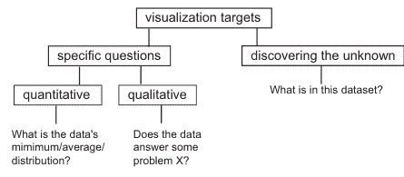

图1.1. 可视化过程针对的问题类型。

这些图像应能够传达对所考虑过程的洞察。在该领域先驱者的话中，可视化是“使用计算机或技术来理解数据或从模拟、计算或测量的结果中提取知识”[McCormick et al. 87]。

可视化与洞察。“洞察”一词在可视化相关学科和文本中使用非常频繁。然而，在这种情况下，洞察究竟意味着什么？可视化可以通过回答几种类型的问题来帮助获得几种类型的洞察（参见图1.1）。在当前语境中，我们使用“洞察”一词来描述从可视化应用程序中获得的两种类型的信息：

- 1. 关于给定问题的具体问题的答案；¹
- 2. 我们之前不知晓的关于给定问题的事实。

具体问题：在第一种情况下，我们对给定现象、过程或数据集有一些具体问题。¹ 在这种情况下，可视化的目的是尽可能好地、尽可能快地回答这些问题。此类问题可以是定量的，例如，“给定一个二维（2D）土地地图，最高点有多高？”在这种情况下，我们感兴趣的是在给定参考尺度上的可测量答案，例如，“最高峰海拔2500米。”可视化应用程序针对的定量问题示例列表包括：

- 数据集中的值的最小值、最大值或异常值是什么，它们出现在哪些数据点上？
- 数据集中值的分布是什么？
- 不同数据集的值是否表现出相关性，相关性程度如何？
- 数据集中的值与给定模型或模式匹配得如何？

定量问题与定性问题。此时，读者可能会问自己，为什么需要可视化来回答诸如数据集的最大值是多少等具体问题，而简单的文本显示就足够了。确实，有许多情况属于这种情况，而基于文本的查询-回答系统等简单工具效果最好。但是，也有许多情况表明，可视化在回答具体的定量问题时效果更好。在这些情况下，问题的答案不是一个单一数字，而是通常是一组数字。例如，虽然问题“给定点x处函数f(x)的值是多少？”可以通过打印值来回答，但问题“给定区间内所有x的f(x)值是多少？”最好通过绘制该区间上f(x)的图来回答。值集的分布、相关性和趋势在以视觉方式描绘时也最容易理解。显然，在某些情况下，使用视觉表示时任务表现更好，而在其他情况下，基于文本的表示更高效。Larkin和Simon [Larkin and Simon 87]早期关于视觉表示对人类任务表现有效性的研究概述了视觉表示可以胜过基于文本表示的两种方式：

- 用（快速）感知推断替代困难的逻辑推断；
- 减少完成任务所需的信息搜索。

尽管不详尽，但他们的研究为使用可视化来理解信息的直观吸引力提供了一些理论基础。2

除了定量问题之外，可视化针对的大量问题具有定性性质，例如，“给定患者的医学扫描，是否存在可能表明临床问题的异常？”对这个问题的典型回答将涉及发现具有特定形状、位置或数据值特征的模式，而人类专家


例如，医生会根据其以往的临床经验将其归类为异常。在这种情况下，鉴于问题定义模糊且输入数据变化大，使用完全自动化的方法来回答这些问题非常困难，甚至不可能。人类专家的决定性输入，由交互式可视化支持，是必不可少的。

### 精确问题与模糊问题

在科学和工程实践中，问题通常介于极其精确和非常模糊之间。可视化对这两类问题都有用。尽管有人认为，精确问题可以通过不需要任何可视化支持的简单类搜索查询来回答，但也有人认为，以可视化方式显示此类查询的答案会使它们更容易理解。此外，可视化支持可以提供问题未明确要求但可能为所研究问题开辟更广阔视野的额外信息。例如，在地图上显示最高峰，既通过数字标明峰的高度，也通过3D高程可视化标明其位置，这不仅显示了绝对高度值，还显示该值与地图平均高度的关系（与整体景观相比有多高，有多少陆地点处于或接近最大高度，等等）。这些信息虽然未被直接要求，但有助于制定后续问题，从而最终帮助用户对手头数据获得更深入的理解。这是术语“insight”的含义之一。

### 发现未知

在第二种情况下，我们可能对手头的流程没有精确的问题。然而，我们有兴趣（字面上）查看或检查该流程提供的信息。有人可能会问，如果我们没有关于数据的具体问题，为什么要查看一些数据？对此有几个原因。首先，我们过去可能有过类似的数据，对于某个特定应用来说很有趣、有帮助或至关重要，我们可能想知道当前数据是否属于同一类。其次，我们可能会觉得，通过检查某一特定数据，我们可以获得产生该数据的过程的信息，而这些信息无法通过其他方式获得。可视化的这一角色与研究人员的视角高度吻合，研究人员有兴趣研究一种现象，以发现新事实并建立意外的关联。这是术语“insight”的第二种含义。

在实践中，这两类问题并非分离，而是服务于两种互补的场景。在第一种场景类型中，有人需要回答若干精确问题，并且对数据类型和应用非常熟悉。此类场景最适合由针对那些精确问题进行微调的可视化来处理。然而，在回答此类问题后，人们可能会发现某些根本问题仍未解决，因为问题过于精确。在这种情况下，转向更具探索性、开放式的可视化场景是一个很好的延续。该场景遵循典型的自底向上模式，从精确查询过渡到更通用的查询。在第二种场景类型中，用户收到一个他大多不熟悉的数据集。在这种情况下，最佳方法是从呈现数据总体概览的探索性可视化开始。在形成总体印象后，用户可以根据在总体视图中发现的特殊性，决定接下来使用哪种更具体、更详细的可视化，从而回答哪个更精确的问题。该场景遵循自顶向下模式，从总体概览过渡到详细调查。在可视化领域，这种调查有时被称为Shneiderman提出的可视化箴言“概览，缩放，按需查看细节”（overview, zoom, and details-on-demand）[Card et al. 99, Bederson and Shneiderman 03]。

最后，可视化数据的重要动力之一是纯粹的好奇心。可视化方法通常从许多异国类型的数据中产生意外且优美的图像。此类图像引人入胜，赏心悦目。经过更详细的检查，它们可以引导研究人员发现关于手头过程和数据集的意外且有价值的事物。

### 示例

图1.2展示了四个可视化示例，每个针对不同类型的问题，并说明了不同的可视化技术。图1.2(a)展示了1960–1990年期间欧洲7月平均温度和降雨数据的可视化。温度以颜色表示（红色表示大值，绿色表示低值）。降雨量通过阴影凸起表示，看起来最高的凸起表示极大值。箭头指示的中央凸起回答了问题“降雨量最高的地区在哪里？”由于该凸起是绿色的，我们看到该地区气温也较温和。地图下半部分的红色浅凸起显示炎热干燥的地区。该可视化将在第5章第5.4.1节中进一步讨论。

图1.2(b)展示了盒子内流体流动的可视化。流体通过后部的入口进入，然后在盒子内流动和旋转，并从前部的出口流出。绘制的管子表示不同流体粒子从入口向出口推进时的路径。管子按流速着色（蓝色表示低速，红色表示高速）。要回答问题“最快流动区域在哪里？”，我们可以寻找红色管子。这张图片还让我们发现一种潜在的未知现象：靠近出口处，流动分裂为两个不同的旋转层，由两个

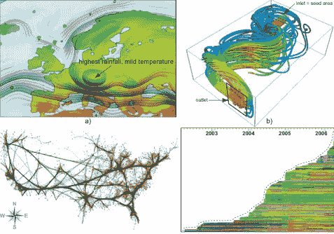

图1.2. 针对不同类型问题的可视化示例。

粗大的螺旋状管束。没有实际描绘流动，这种洞察不容易获得。该可视化将在第6章第6.5.3节中进一步讨论。

图1.2(c)可视化了美国的人口迁移模式。红点表示虚拟地图上的城市位置。之间存在显著人口迁移的城市由黑线连接。接下来，线条被“捆绑”在一起，使得国家各地区之间的粗略人口流动以粗黑色捆绑的形式更加清晰可见。这些捆绑因此解决了问题“主要迁移流在哪里，是什么？”没有可视化表达，这种洞察很难传达。该可视化在第11章第11.4.2节中讨论。

图1.2(d)可视化了2002年至2006年间流行的Mozilla Firefox浏览器开源软件仓库的变化。每条水平像素线代表仓库中的一个文件。文件按创建日期垂直堆叠，较旧的文件在底部，较新的文件在顶部。每个文件像素线被切成若干段，每段代表该文件的不同版本或修订版。版本按将其添加到仓库的软件开发者的身份着色。观察出现的包络线（由虚线曲线显示），我们看到软件随时间以超线性速率增长。假设趋势保持不变，我们可以预测未来几个月软件的大小。另外，我们看到从2004年开始，大多数文件上占主导地位的是绿色。这表明大部分贡献来自单个开发者（由绿色表示），从而回答了问题“哪些是最活跃的开发者？”更一般地说，这种可视化让我们在单个图像中将开发者活动与时间段和特定文件相关联。该可视化在第11章第11.6.3节中讨论。

### 数据可视化的子领域

传统上，数据可视化沿两个主要领域构建：科学可视化和信息可视化。过去几年中，第三个较新的领域——视觉分析——作为前两个领域之间的桥梁以及其扩展出现。下面我们简要概述这些领域。

#### 科学可视化

可视化在上世纪80年代作为一门独立学科出现，这是对计算机数值模拟各种物理过程（如流体流动、热对流或材料变形）所产生的日益庞大的数据量的回应。因此，与其名称相关的属性“科学”在当时反映了可视化解决方案专注于为科学模拟提供洞察。通俗地说，科学可视化（简称scivis）可以描述为“主要关注三维现象（建筑、气象、医学、生物等）的可视化，其重点是对体积、表面、照明源等进行逼真渲染，可能带有动态（时间）组件”[Friendly 08]。科学可视化的一个显著方面是描述具有自然空间嵌入的数据集，即其元素或数据点在空间中具有特定意义位置的数据集。图1.2(a,b)展示了两个科学可视化示例。在图1.2(a)中，点表示2D地图上的地理位置。在图1.2(b)中，点表示3D流体体积中的位置。鉴于这一特点，科学可视化近年来也被称为空间数据可视化。

#### 信息可视化

除了科学可视化涵盖的空间数据之外，还有许多其他数据类型，其数据元素没有规定的


空间位置。简单的例子是关系数据集，例如树、图和网络。虽然此类数据集（与任何其他数据集一样）需要某种空间表示才能绘制在纸张或计算机屏幕上，但空间信息是在可视化构建过程中分配给数据元素的，而不是由数据元素本身给出。这些数据类型，还包括表格、时间序列、文档和软件源代码，构成了一个名为信息可视化（简称 infovis）的独立分支的研究对象。过去十年中，信息社会导致的数字工艺品数量、大小和类型的增加（有时被称为“大数据”），一直是推动信息可视化兴趣增长的特殊催化剂。图 1.2(c) 说明了一种信息可视化技术。所示图形可以来自地理地图，如我们的示例所示，但也可以来自任何关系数据库。

视觉分析：认识到需要将可视化解决方案与数据分析和数据挖掘前端相结合，信息可视化、科学可视化和数据挖掘社区中出现了一门新学科：视觉分析。简而言之，视觉分析的核心目标是提供技术和工具，通过交互式可视界面支持最终用户的分析推理 [Wong and Thomas 04, Thomas and Cook 05, Meyer et al. 12]。虽然目前视觉分析与其源自的更传统的 infovis 和 scivis 领域之间不存在明确界定的边界，但有几个方面使视觉分析区别于其前身。首先，视觉分析关注整个所谓的“理解”过程，该过程从数据获取开始，通过多次重复和改进的可视化场景（其中高度涉及交互，以允许用户探索不同观点或测试和改进不同假设），并以向用户展示他们对所关注底层现象所获得的洞察结束。因此，视觉分析通常以数据分析、数据挖掘和可视化技术与工具的紧密结合为特征。此外，视觉分析通常关注那些规模过大或过于复杂、无法通过单个（静态）图像完全理解的过程或数据集。因此，数据挖掘、多视图以及对数据的交互式和迭代式可视检查是视觉分析不可分割的组成部分。图 1.2(d) 显示了一个视觉分析过程的快照。这里使用的仓库 2D 视图可以被视为经典的 infovis 示例。然而，为了理解或理解所研究软件仓库历史中发生的开发过程，需要应用多种由用户交互式选择的排序和着色选项。

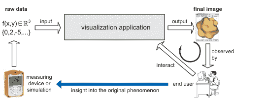

图 1.3. 可视化过程的概念视图。

交互式探索。可视化的另一个基本特征是其交互性。可视化过程很少是静态的。在大多数应用中，需要可视化大量数据，这些数据无法直接在单个屏幕上显示，或者是每个数据点包含大量独立数据值的高维数据集，或者两者兼有。在这种情况下，显示包含所有数据的静态图像是不可能的。而且，即使这是可能的，通常也有多种构建数据到图像映射的方法，用户可能希望尝试这些方法以更好地理解手头的数据。所有这些方面都受益于使用交互式可视化。此类应用程序提供修改多个参数的可能性，范围从视图角度、缩放因子和颜色使用到所使用的可视化方法类型，并观察生成图像中的变化。如果交互式-可视化-观察反馈循环（见图 1.3）执行得足够快，用户实际上会获得“在数据中导航”的感觉，这一特性强烈鼓励和支持探索过程。特别是，交互式可视化是视觉分析中理解循环的关键组成部分。

我们可以从可视化应用程序中期待哪种洞察，又不应该期待什么？我们如何衡量给定图像为某个过程提供了多少洞察？我们如何构建能为特定性质的问题或数据集提供最多洞察的可视化应用程序？要回答这些问题，我们必须首先了解如何构建可视化应用程序、如何表示可视化过程中涉及的各种数据类型、如何设置该过程的各种参数以及如何解释结果。这些是以下章节的主题。

### 1.2 领域定位

由于数据可视化有着悠久的历史，并且可以从多种角度进行教学或研究，因此将本书所涵盖的材料与当前文献中许多其他著名的可视化书籍进行定位非常重要。在不穷尽的情况下，我们下面概述了本书与当前可视化文献中若干高知名度书籍的定位关系。

《交互式数据可视化：基础、技术与应用》。在这本近期著作中，Ward 等人对交互式数据可视化技术进行了广泛概述，重点关注信息可视化、交互和设计指南 [Ward et al. 10]。我们的书的目标和范围也有些不同。[Ward et al. 10] 在很大程度上专注于教授如何设计（新的）可视化应用程序。因此，大量篇幅用于解释构建可视化应用程序背后的设计过程和设计原则。同等篇幅用于阐述交互在设计此类应用程序中的作用及其有效使用。最后，详细描述了可视化应用程序的评估过程。总结来说，[Ward et al. 10] 采用自顶向下的方法，从可视化的目标出发，逐步阐述多种技术和算法的设计、实现和评估细节。相比之下，本书在教学和实践工作流中定位得更早，并采用更自底向上的方法。我们更侧重于空间数据可视化（也称为科学可视化，scivis），而较少关注信息可视化（infovis）。其次，虽然 [Ward et al. 10] 关注任务和用户，并从中引出算法和技术，但我们首先介绍基本数据结构和算法，然后逐步过渡到应用程序。交互和评估在本书中仅被简要提及，因为我们认为这些是更高级的机制，只有在读者对构建可视化应用程序所涉及的基本算法和数据结构有良好理解后才应学习。总体而言，我们认为本书最适合作为数据可视化广泛入门课程的支持，而 [Ward et al. 10] 可用于支持更高级的信息可视化后续课程。

《可视化工具包》。作为极其成功的可视化工具包（VTK）软件库的配套书籍，本书第四版（2006 年）是希望将 VTK 集成到其数据可视化应用程序中的开发人员的标准指南 [Schroeder et al. 06]。VTK 书籍服务于双重目的。一方面，它从算法、可视化过程管道和数据集表示方面介绍了数据可视化的基本原理。另一方面，它展示了所有这些元素如何映射到 VTK 库中的软件实现。VTK 书籍的结构与本书大体相同——计算机图形学入门、数据表示、各种数据类型的基本算法以及图像处理。高级可视化算法、Web 可视化和可视化示例分别在独立章节中讨论。

我们当前书籍的目标和范围与 [Schroeder et al. 06] 不同。首先，我们的目标受众旨在涵盖所有有兴趣使用现有可视化应用程序并设计新应用程序的学生和从业者，无论是否以 VTK 软件为基础。这种方法有优点也有缺点。一方面，使用 VTK 学习数据可视化可以保证设计源代码的统一方式，并提供大量现成可用的已实现算法和数据结构。另一方面，VTK 的学习曲线有时远非平缓——学生应熟悉面向对象编程，更重要的是，在能够设计自己的可视化算法之前，需要投入大量时间学习 VTK 编程接口和惯用法。相比之下，我们较少强调可视化算法和数据结构的代码级实现细节，而是更侧重于这些算法背后的设计原理，采用与实现无关的方式。总体而言，我们认为 [Schroeder et al. 06] 书籍最适合作为我们书籍的技术补充，供有兴趣基于 VTK 工具包开发可视化软件的专业人士使用，也部分适用于需要使用相同工具包完成可视化作业的学生。我们的书与 [Schroeder et al. 06] 可以被视为互补——前者作为可视化理论的入门，后者作为连接理论与算法概念与具体软件实现的实用帮助。

《可视化手册》。在这本书中，Hansen 和 Johnson 接受了展示多种最先进的可视化技术的挑战，主要关注空间数据可视化（scivis）[Hansen and Johnson 05]。本书的结构与我们的书大体相同，包含涵盖标量、向量和张量数据可视化以及几何或领域建模的章节。其他章节涵盖大规模数据可视化、虚拟环境和可视化软件框架。最后，本书涵盖了一组


可视化在多个领域中的感知问题与应用的选定主题。

Hansen 和 Johnson 编辑的这本书在出版时广受好评，被视为对早期版本 VTK 手册 [Schroeder et al. 06] 的必要补充。当前本书致力于补充更侧重实现的 VTK 手册，尽管视角不同。Hansen 和 Johnson 的书面向在可视化和计算机图形学背景方面更高级的读者——通常是具有数据可视化基础知识和广泛数学背景的博士生和专业人士。其重点也更多地放在研究级可视化方法和技术上，这些方法和技术以独立章节的形式呈现，由各可视化子领域的专家撰写，内容涉及新颖算法和/或经典算法的改进。因此，[Hansen and Johnson 05] 是可视化中“选定主题”集合的一个很好的示例。相比之下，我们的书广泛面向入门级学生和从业者，他们可能不熟悉数据可视化，数学背景可能较为有限，并且希望在学习更复杂的主题之前先熟悉经典算法。

信息可视化文献。除上述内容外，可视化领域内还存在若干聚焦于更具体主题的书籍。关于信息可视化，Ware [Ware 04] 和 Spence [Spence 07] 的书籍（均为第二版）详细涵盖了信息可视化领域的理论、方法、技术和应用示例。在同一领域，Card 等人的书籍提供了关于信息可视化技术和应用的早期但非常易读且富有指导性的概述 [Card et al. 99]。相比之下，我们的书将信息可视化专门用一个章节（第 11 章）来介绍。此外，我们在交互技术的使用和感知问题上投入的篇幅较少。造成这一差异的主要原因是，当前本书旨在教导读者使用现有的可视化技术，广泛关注数据可视化本身。相比之下，上述列出的书籍主要侧重于教导受众如何设计新的可视化，更具体地关注信息可视化，并采用基于案例研究的“以示例设计”方法。

在信息可视化文献类别中，Tufte 关于定量信息可视化展示的书籍代表了一个参考点 [Tufte 01]。这本书面向（新）可视化的设计者，既介绍了从可视化视角看图形设计的历史，也介绍了一套良好的设计原则和在设计有效可视化时应考虑的潜在陷阱。尽管重点主要放在统计图形的设计上（可视为信息可视化的一部分），但讨论的设计准则和示例也与科学可视化大体相关。与 Tufte 以图片设计为中心不同，我们的书采用更以数据和算法为中心的方法，更侧重于数据表示和可视化算法细节，而非最终图片的设计。

### 1.3 书籍结构

本书的组织采用自底向上的结构。我们假设读者对计算机图形学原理和技术有最基本的了解，并有兴趣从这一基础出发，努力理解并最终开发可视化方法。我们逐步介绍可视化技术和原理。我们从最简单的技术开始，这些技术只需要最基本的计算机图形学和编程背景。随着书籍的展开，会引入更复杂的数学和算法概念，以帮助读者理解高级可视化技术的工作原理和权衡。每一章通过介绍该主题下的若干可视化方法和算法，来涵盖一个独立的可视化主题。正如章节本身一样，一章中的算法是按难度和特异性递增的顺序介绍的。我们在若干章节的结尾，以一种专门的、研究级别的算法或方法的形式，介绍可视化领域最新进展的精选内容。

- 第 2 章。在第 2 章中，我们以一个简单的示例开始，向读者介绍数据可视化：使用高度图绘制两变量函数的图像。我们利用这个示例介绍数据可视化的几个基本要素，例如采样和数据集概念，并将可视化与计算机图形学相关联。这些概念通过基于 OpenGL 的易于跟随的 C++ 代码片段进行说明。本章还作为 OpenGL 的最小（因此有限）介绍。

- 第 3 章。在第 3 章中，我们通过描述可视化中最常用的数据集类型，继续介绍数据集概念。对于每种数据集类型，我们描述其特定优势以及具体要求。我们使用在第 2 章中介绍的函数高度图可视化作为贯穿示例，来说明所介绍数据集类型之间的各种差异。对于每种数据集类型，我们详细介绍几项基本操作的实现：采样、插值、重建和计算导数。完成本章后，读者应能很好地理解不同数据集类型之间的各种权衡，能够为手头的特定可视化问题选择合适的数据集类型，并理解与在软件中高效实现数据集相关的几个方面。

- 第 4 章。第 4 章介绍可视化管道，即当今构建大多数可视化应用所使用的流行数据驱动架构。本章有两个目标。在概念层面，读者将了解构成可视化过程的各个数据处理阶段：数据获取、数据过滤或丰富、数据映射和渲染。在实现层面，解释了可视化应用的架构，将其视为一组由读写数据集的数据处理算法互连而成的系统。完成本章后，读者应理解构建特定可视化应用所涉及的各个步骤，从概念数据处理阶段一直到以互连算法和数据集为指定的实际高级软件架构。有兴趣实现可视化应用的读者可以使用此处提供的实用信息作为指南，了解如何以功能解耦的计算模块来构建其应用的高级架构。

在本书接下来的七个章节中（第 5 章至第 11 章），我们介绍可视化应用中实践中使用的主要可视化方法和算法。

- 第 5–7 章。接下来的三个章节（第 5、6 和 7 章）按难度递增的顺序讨论可视化实践中最常见的数据类型的可视化方法，即标量、向量和张量。

- 第 8 章。第 8 章介绍域建模技术，这些技术涵盖既操作数据属性又操作其所依赖的底层域采样或网格的可视化技术。特别是，我们讨论域重采样、无网格插值以及从无结构点集构建采样表示的算法。

- 第 9 章。第 9 章概述图像可视化方法，并讨论图像数据的特殊性，即在均匀二维网格上采样的标量。在此，讨论了针对图像数据的特定技术，例如边缘检测、直方图归一化、分割以及形状表示和分析。

- 第 10 章。第 10 章讨论体积可视化技术，这些技术针对在均匀网格上采样的三维标量场。尽管第 9 章和第 10 章中介绍的图像和体积技术可以被视为标量可视化的特定形式，但我们将它们分开讨论，因为图像可视化和体积可视化本身就是广泛的研究和应用领域，已发展出许多适合其特定数据和目标的特定技术。

- 第 11 章。第 11 章将重点从科学数据集的可视化（通常来自在紧致空间域上对连续函数的采样）转向信息可视化，即 infovis。infovis 领域针对文本、表格、数据库表、树和图等更通用数据集的视觉理解。因此，数据集不一定是某些空间域上定义的连续信号采样过程的结果，已开发出许多特定的可视化方法来应对数据抽象程度的提高。考虑到该领域的庞大规模，以及本书对科学数据集可视化的关注，第 11 章仅对 infovis 领域进行了简要介绍。本章突出了科学可视化与信息可视化之间的若干差异，以便让读者了解 infovis 领域面临的特定挑战。讨论了表格、树、静态和动态图、多变量数据以及程序源代码文本的可视化算法。

- 第 12 章。第 12 章总结全书，概述可视化领域的当前发展方向。

- 附录。附录概述了现有的流行可视化软件系统。首先，我们从软件架构角度介绍了不同类型可视化系统的分类（第 A.1 节）。该分类的目的是强调一些影响可视化系统构建的重要选择。接下来，在科学可视化、成像和信息可视化领域介绍了一系列代表性的可视化软件系统（第 A.2–A.5 节）。尽管不详尽，但此概述应为有兴趣的读者提供一个起点，以便进一步搜索最符合特定应用领域给定要求集的现有软件。


读完本书后，读者应当对科学可视化实践中存在的各类数据集的可视化现有技术、每种技术涉及的各种权衡，以及将所介绍技术高效实现为实际软件涉及的主要问题，有良好的印象。进阶读者此时应当能够实现本书讨论的多种可视化算法的功能性（尽管简单）版本。然而，本书并非关于实现可视化算法。对该主题感兴趣的读者应查阅描述可视化软件工具包设计与使用的专业文献 [Schroeder et al. 06, Kitware, Inc. 04]。本书的目的是呈现数据可视化方法的概览，并教导读者了解此类方法设计中涉及的各种权衡，范围从建模问题到可视呈现和软件设计。但最重要的是，如果本书能激发读者进一步学习和探索可视化这个激动人心的世界，我们就认为本书已达到其目标。

### 1.4 Notation

全书中，我们将采用以下记号惯例。标量和位置向量使用*斜体*表示，例如 x, y。方向向量使用**粗体**表示，例如 p, q。连续域，例如 3D 中的曲面，使用花体字母表示，例如 S。离散域，例如包含在网格上采样数据的数据集，使用大写字母表示，例如 S。最后，伪代码和 C++ 代码片段使用计算机字体编写，例如 `printf`。

### 1.5 Online Material

本书配有配套网站：

http://www.cs.ru.nl/svc/DataVisualizationBook

该网站包含练习、进阶示例、项目建议和练习考试题（附答案），以扩展或测试你对本书所涵盖主题的理解。提供了数据集和源代码。

练习包括“探索”可视化，用于说明本书讨论的基本可视化技术。使用提供的 ParaView 脚本和其他数据集，可以更改参数以探索数据的各个方面以及所展示的可视化算法。这些练习易于使用且无需编程。它们可用于个人探索或作为额外的课程材料（例如，教程或实验课）。

更复杂的可视化技术在由代码片段（C 或 C++）组成的进阶示例中进行介绍。这些示例需要编译，并可能需要对代码进行一些更改。它们可以作为实验课的基础，学生在其中修改和/或扩展所展示的可视化算法。

还提供了潜在的考试题目（不含答案）。应请求，将向合格的教师提供答案。

最后，项目提案描述了几个涵盖可视化算法组合的大型项目。每个项目都可以作为与课程结合使用的实践作业的基础，以测试学生设计、实现和演示较大工作量的能力。与进阶示例不同，项目不提供代码片段，并在设计和实现选择方面留出更多自由度。

## Acknowledgments

如果没有大量人员的支持和合作，本书第二版将不可能出版。虽然无法一一致谢所有人，也无法平等地认可所有贡献者的努力，但少数几位名字值得特别表扬。

首先，我要感谢美国加州大学戴维斯分校工学院计算机科学系的 Nelson Max 教授。Max 教授投入了大量时间（和精力），就本书第一版提交了多轮详细的更正和改进建议。没有他的努力，本书第二版将无法达到目前的形式。

其次，我想感谢所有为本书贡献了数据集、图像和源代码的同事。他们的名字太多，无法在此一一列举，因此对其贡献的致谢贯穿本书全文。他们愿意分享研究成果，对于使本书第二版能够涵盖所考虑的广泛数据可视化主题，并特别是用最先进的可视化示例加以说明，是必不可少的。

第三，我要感谢我的编辑、来自 CRC Press 的 Sarah Chow。她亲切且持续的支持、仔细的指导和鼓励对本书第二版的成功完成至关重要。

我也要感谢格罗宁根大学，我目前的雇主，在撰写第二版的整个期间为我管理时间提供了自由。此外，我承认几个组织提供的财政支持（CAPES/BRANETEC 资助 028/2011 和 CNPq 资助 479070/2013-0 及 202535/2011-8，巴西；以及 ANCS 资助 PN-II-RU-TE-2011-3-0249，罗马尼亚）。这种支持对于执行本书中描述的各项研究工作是必不可少的。

最后，但并非最后，我要感谢我的妻子和儿子，在我过去一年半的长时间写作中，他们展现了持续的支持和耐心。没有他们的支持，本书第二版将不可能出版。

## Chapter 2

## From Graphics to Visualization

对于本书的许多读者来说，数据可视化可能是一个新主题。相比之下，计算机图形学技术，或者至少“计算机图形学”这个术语，大多数读者应该都很熟悉。在可视化和图形学应用中，我们都以某些数据作为输入，并最终生成一张反映输入数据多个方面的图片。鉴于这些（以及其他）相似之处，一个自然的问题浮现：可视化与计算机图形学之间有什么区别？我们将在第 4 章详细回答这个问题。目前，专注于可视化与计算机图形学之间的相似之处可能更容易。这将帮助我们回答以下问题：计算机图形学技术在可视化中扮演什么角色？

本章以非正式的方式，并从计算机图形学的角度介绍数据可视化。我们从一个每个读者都应该熟悉的简单问题入手：绘制二元函数 f(x, y) = z 的图像。我们将详细说明此问题的经典解法，即高度图。为此，我们将使用用 C++ 编程语言编写的代码片段。对于图形功能，我们使用流行的 OpenGL 图形库。

这个简单示例具有多种功能。首先，它说明了完整的可视化处理流程，从定义数据到生成数据的渲染图像。我们的简单示例介绍了可视化过程的几个重要概念，例如数据集、采样、映射和渲染。这些概念将用于构建后续章节的结构。其次，我们的示例介绍了图形渲染的基础知识，例如多边形表示、着色、颜色、纹理映射和用户交互。第三，所展示的示例将使读者意识到在构建现实生活中的可视化应用时通常会遇到的各种问题和设计权衡。最后，我们的示例应用说明了数据可视化与计算机图形学之间的紧密联系。读完本章后，读者应当能够仅使用 C++ 编译器和 OpenGL 图形库构建一个简单的可视化示例。这个示例可以作为起点，读者可以在此基础上实现后续章节中讨论的许多更高级的可视化技术。

### 2.1 A Simple Example

我们开始涉足数据可视化领域，从最简单、最常见的可视化问题之一入手：绘制二元实值函数的图像。这个问题在工程、物理、数学和商业等所有领域中都经常遇到。假设我们有一个函数 \( f : D \rightarrow \mathbb{R} \)，定义在两个紧区间 \( X \subset \mathbb{R} \) 和 \( Y \subset \mathbb{R} \) 的笛卡尔积 \( D = X \times Y \) 上，\( f(x, y) = z \)。该函数的图像是三维（3D）曲面 \( S \in \mathbb{R}^3 \)，由坐标为 \( (x, y, z) \) 的点定义。简单来说，可视化函数 \( f\) 即为对所有 \( x \in X \) 和 \( y \in Y \) 的值绘制此曲面。直观上，绘制曲面 \( S \) 可以看作是将二维（2D）矩形区域 \( X \times Y \) 内的每个点 \( (x, y) \) 向上方形变或抬升到 \( xy \) 平面之上的高度 \( z = f(x, y) \)。因此，这种图像也被称为变形图、高度图或高程图。大多数工程和科学软件包都提供用于绘制此类图像的内置函数。

然而，尽管简单，这种可视化也引发了几个问题：我们应如何表示函数 \( f \) 及其变量的定义域 X 和 Y？我们应如何表示要可视化的曲面 \( S \)？需要绘制多少个点？我们应使用哪种图形对象来进行绘制？本质上，所有这些问题都围绕在计算机上表示*连续*数据（例如函数 \( f \)、曲面 \( S \) 和变量定义域 \( X \) 和 \( Y \)）这一问题上。严格来说，要绘制图像，我们应对 \( D \) 中所有点 \( (x, y) \) 执行从 \( (x, y, 0) \) 到 \( (x, y, f(x, y)) \) 的变形。然而，计算机算法只能执行有限次操作。而且，只有有限个


![img/1274306e378c42ed8a0ad5669902d2a1_35_0.png]

**图 2.1.** 使用 \( 30 \times 30 \) 个采样点绘制的函数 \( f(x, y) = e^{-(x^2+y^2)} \) 的高程图。

在计算机屏幕上绘制所需的像素数量。因此，生成高程图的自然方法是绘制与变量域 D 中给定的有限 *采样点* 集 \( \{x_i, y_i\} \) 对应的曲面点 \( (x_i, y_i, f(x_i, y_i)) \)。图 2.1 显示了绘制高程图最常用方法的伪代码。我们使用在 X 方向等距放置的 \( N_x \) 个点以及在 Y 方向等距放置的 \( N_y \) 个点，对函数定义域 \( X \times Y \) 进行采样。图 2.1 显示了在 \( X \times Y = [-1, 1] \times [-1, 1] \) 上定义的高斯函数 \( f(x, y) = e^{-(x^2+y^2)} \) 的高程图，使用了 \( N_x = 30, N_y = 30 \) 个采样点。采样域在高程图下方以红色框绘制。

使用等间距点，按矩形网格规则排列，如清单 2.1 的伪代码所示，是快速创建高程图的简便方法。这对函数域 D 进行了均匀采样，即在所有地方使用相同的采样点密度。除了简单之外，均匀采样还允许我们用一组四边形（或四边形）近似函数的图，即曲面 S，这些四边形由 x 和 y 方向连续的采样点构成，如清单 2.1 所示。这效果很好，因为每个现代图形库都提供快速渲染此类多边形（也称为图形 *图元*）的机制。我们的伪代码使用一个简单的 C++ 类 `Quad` 来封装渲染功能。要绘制一个 Quad，我们首先指定

```
float Xmin, Xmax; //X = [Xmin,Xmax]
float Ymin, Ymax; //Y = [Ymin,Ymax]
int Nx, Ny;
float dx = (Xmax-Xmin)/(Nx-1); //x size of a cell
float dy = (Ymax-Ymin)/(Ny-1); //y size of a cell
float f(float ,float ); //the function to visualize

for (float x=Xmin; x<=Xmax-dx; x+=dx)
for (float y=Ymin; y<=Ymax-dy; y+=dy)
{
Quad q;
q.addPoint (x,y,f(x,y));
q.addPoint (x+dx,y,f(x+dx,y));
q.addPoint (x+dx,y+dy,f(x+dx,y+dy));
q.addPoint (x,y+dy,f(x,y+dy));
q.draw ();
}
```

### 清单 2.1. 绘制高程图。

其四个 3D 顶点使用其 addPoint 方法，然后我们 draw() 它。使用 OpenGL 图形库的 Quad 类实现将在第 2.3 节中介绍。

在我们的可视化中，我们假设可以在其域 D 中的每个所需点上评估要可视化的函数 f。然而，在实践中，这个假设可能过于严格。例如，f 的值可能源于实验数据、测量、模拟或其他数据源，这些数据源在可视化过程中无法评估或评估成本过高。在这种情况下，自然的解决方案是在数据结构中显式存储 f 的值。然后将此数据结构传递给可视化方法。对于我们之前的示例，此数据结构只需要存储 f 在我们规则排列的采样点处的值。为此，我们可以使用一个简单的数据结构：实数矩阵。使用此数据结构作为输入（而不是函数 f）的修改后的可视化方法如清单 2.2 所示。

数据生成，即矩阵数据的构建，与可视化，即清单 2.2 中的算法，现在已明确解耦。这使我们可以将高程图可视化与任何生成额外值矩阵的算法配合使用，如前面所述。矩阵数据与绘制所需的额外信息（即 Xmin、Xmax、Ymin、Ymax、Nx 和 Ny 的值）共同构成了数据可视化中的一个基本概念，称为数据集。数据集表示对某些原始连续量的采样（如我们的函数 f(x,y) 的情况），或某些纯离散量。后者的一个例子是一页文本，可以由一个向量表示，

```
float Xmin, Xmax;
float Ymin, Ymax;
int Nx, Ny;
float dx = (Xmax-Xmin)/(Nx-1); //x size of a cell
float dy = (Ymax-Ymin)/(Ny-1); //y size of a cell
float data[Nx][Ny]; //the dataset to visualize
for(int i=0;i<Nx-1;i++)
for (int j=0;j<Ny-1;j++)
{
float x = Xmin+i*dx, y = Ymin+j*dy;
Quad q;
q.addPoint(x,y,data[i][j]);
q.addPoint(x+dx,y,data[i+1][j]);
q.addPoint(x+dx,y+dy,data[i+1][j+1]);
q.addPoint(x,y+dy,data[i][j+1]);
q.draw();
}
```

### 清单 2.2. 使用采样数据集绘制高程图。

或字符串，即字符，例如 char data[Nx]、电子表格或包含非数值属性（如）的数据库表。这些属性反过来可以表示为类型 T 对象的矩阵 char data[Nx][Ny]，其中 T 模拟属性类型。各种数据类型，例如气象卫星测量或数值模拟计算的温度和压力场；磁共振成像（MRI）和计算机断层扫描（CT）扫描仪获取的 3D 医学图像；以及商业数据库中出现的多维表，均由不同类型的数据集表示。数据集构成了数据可视化中使用的算法的输入和输出，例如我们在简单函数可视化示例中讨论的函数采样和高程图算法。这些方面在第 3 章和第 4 章中详细讨论。

让我们回到我们的高程图。要使用的样本数量，即 Nx 和 Ny，是由用户选择的参数。问题出现了：这些参数的最优值是多少？通过使用更多样本，离散表示（即数据矩阵）的质量，进而可视化的质量，只能提高，在 Nx 和 Ny 趋于无穷大的极限情况下达到连续情况。然而，这对数据集（数据矩阵）提出了越来越高的存储要求，并对可视化方法提出了计算能力要求。另一方面，选择太少的样本会产生快速、低内存但也低质量的可视化。图 2.2 用与之前相同的函数的可视化来说明这一点，这次使用 Nx=10 和 Ny=10 个样本。

![img/1274306e378c42ed8a0ad5669902d2a1_38_0.png]

**图 2.2.** 函数 $f(x, y) = e^{-(x^2+y^2)}$ 的高程图。使用了 $10 \times 10$ 样本的粗网格。

将此图像与前一张（图 2.1）进行比较，我们发现降低采样密度会导致对曲面 S 的更差近似。这一点在靠近中心点 x = y = 0 处尤其明显。基本上，我们的渲染曲面使用由采样点位置和函数值确定的一组四边形来近似连续曲面。这种近似的质量取决于我们的一组渲染四边形所提供的分段双线性近似与原始连续曲面 S 的接近程度。因此，问题是如何选择采样位置，以便在给定的样本数量（即给定的内存和速度约束）下实现良好的近似。答案在信号理论中是众所周知的 [Ambardar 06]：采样密度必须与我们想要近似的原始连续函数的局部频率成正比。在实践中，这意味着在函数高阶导数值较高的区域使用更高的采样密度。

为了强调选择良好采样密度的重要性，让我们现在考虑一个不同的函数

```
$g(x, y) = \sin \left( \frac{1}{x^2 + y^2} \right)$.
```

该函数的变化速度或频率随着我们

![img/1274306e378c42ed8a0ad5669902d2a1_39_0.png]

**图 2.3.** 函数 \(f(x,y) = \sin\left(\frac{1}{x^2+y^2}\right)\) 的高程图，使用 (a) 均匀 \(100 \times 100\) 采样网格和 (b) 自适应采样网格渲染。

接近原点 \(x = y = 0\)。图 2.3(a) 显示了由 100×100 采样网格构建的该函数的高程图。尽管此图的采样点数量大约是图 2.1 中高斯函数所示图的 10 倍，但靠近原点处的结果质量明显很差。有两种解决方案可以缓解此问题。首先，我们可以在网格的所有地方增加采样密度。然而，这会在平滑区域（即远离原点的地方）浪费采样点。

更好的解决方案是使采样密度可变，例如与距原点的距离成反比。图 2.3(b) 显示了非均匀采样密度的结果。尽管我们使用的样本数量与低密度均匀采样方法（图 2.3(a））一样少，但结果在中心区域的质量现在明显高得多。然而，这种质量是有代价的。现在不再可能从函数域范围和样本数量确定采样点位置，因为密度是非均匀的。因此，我们必须在数据集中显式存储采样点位置以及函数样本。

如我们在第 3 章中将看到的，几种类型的数据集允许创建此类非均匀采样网格，它们在采样位置指定的自由度、存储成本和实现复杂性之间提供不同的权衡。

1 为简单起见，我们将忽略函数在点 \(x = y = 0\) 处未定义这一事实。


### 2.2 图形渲染基础

在接下来的章节中，我们将讨论如何实际渲染（或绘制）从采样数据集构建的高度图。为此，我们首先在本节中简要介绍图形渲染的基础知识。计算机图形学是一个广泛的学科，其理论和实践值得作为单独的主题，并在单独的书籍中讨论。在本节中，我们将仅概述简单计算机图形应用中使用的基本技术。幸运的是，这些技术足以说明甚至实现本书中讨论的大部分数据可视化算法，从我们的高度图可视化示例开始。在后续章节中，我们将在介绍需要它们的具体可视化方法时，介绍几种更高级的计算机图形技术，例如透明度和纹理的使用。

渲染方程。图形渲染生成 3D 场景或数据集的计算机图像。此过程的要素包括一个 3D 场景（或一组 3D 对象）、一组光源和一个视点。本质上，该过程可以描述为在给定数据集的每个点上应用渲染方程。对于给定点，渲染方程描述了该点处的入射光、出射光和材质属性之间的关系。一般来说，渲染方程具有复杂的形式 [Foley et al. 95]。求解渲染方程可以计算 3D 场景中每个点的出射光（即照度），给定场景、光源集和视点。

在实践中，使用了多种渲染方程，它们可以以不同程度的真实感近似光照效果。两种已知的近似方法是辐射率方法，它擅长产生柔和阴影 [Foley et al. 95, Sillion 94]，以及光线追踪方法，它擅长模拟光亮表面、镜面反射和精确阴影 [Foley et al. 95, Shirley and Morley 03]。然而，辐射率和光线追踪方法即使对于简单的 3D 场景来说，计算成本也相对较高。其原因是，此类方法使用的渲染方程将给定点的照度与场景中多个（可能是许多）其他点的照度相关联。因此，此类方法也被称为全局光照方法。因此，求解完整场景照度相当于求解每点渲染方程的复杂系统。

更高效的方法是将渲染方程简化为仅将给定场景点的照度直接与光源集相关联。此类方法称为局部光照方法，因为渲染方程为每个场景点局部求解照度。我们将介绍一种局部

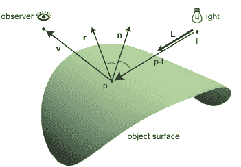

图 2.4. Phong 局部光照模型。

光照方法，该方法由当今大多数可视化系统的渲染后端实现，例如 OpenGL 库。这种方法也称为 Phong 光照方法，它假设要渲染的场景由虚空中的不透明对象组成，并由点状光源照亮。因此，只需计算场景中对象表面点的照度。Phong 光照由方程 (2.1) 描述：

```
I(p, v, L) = C_{amb} + I_l (c_{diff} \max(-L \cdot n, 0) + c_{spec} \max(r \cdot v, 0)^\alpha) . (2.1)
```

这里，p 是我们计算其照度的表面点的位置向量，n 是该点处的表面法线，v 是从 p 到我们观察场景的视点的方向向量，I_l 是光照强度，L 是场景光照亮 p 的方向，r 是反射向量（见图 2.4）：

```
r = L - 2(L \cdot n)n . (2.2)
```

根据光源模型，L 取不同的值。对于放置在场景对象无限远处的光源（也称为方向光），L 只是一个方向向量。对于位于某点 l 的无限小光源，它向各个方向均匀发光（也称为点状光源），L 是方向 p - l 上的单位长度向量。

方程 (2.1) 中的光照模型是三个分量的线性组合：环境光、漫反射光和镜面反射光，其贡献分别由加权系数 c_{amb}、c_{diff} 和 c_{spec} 描述，这些系数的取值范围为 [0, 1]。环境光本质上是一个常数值。这是对当前点处由于间接照明（即场景中所有其他对象反射到当前点的光）而反射的光的粗略估计。漫反射光（也称为兰勃反射）与光照方向 -L 与表面法线 n 之间夹角的余弦成正比，即向量点积 -L · n。这模拟了入射光在表面法线周围各个方向上的均匀散射。漫反射光模拟了类似塑料、哑光表面的外观，且不依赖于视点。最后，镜面反射光（或称镜面光）与反射光方向 r 和视图方向 v 之间夹角的余弦成正比，并提升到镜面反射幂 α。这模拟了入射光在接近完美镜面反射方向 r 的方向上的散射。镜面反射光模拟了光亮或光泽表面（如抛光金属）的外观，且依赖于视点。

到目前为止，光照方程 (2.1) 中尚未引入颜色。该方程描述了给定颜色（或波长）的光与表面之间的相互作用。换句话说，因子 c_amb、c_diff、c_spec 和 I_l 都是颜色的函数。如我们将在下一节 2.3 中看到，颜色可以建模为三个强度 R、G 和 B 的集合，分别对应红、绿、蓝波长。因此，在实践中，方程 (2.1) 被应用三次，因此其每个因子都将有三个值，例如 c_amb^R、c_amb^G、c_amb^B，其他因子亦然。

理想情况下，渲染方程应应用于给定场景中每个对象表面的每个点。然而，如我们将在下一节中看到，仅在少数表面点上评估渲染方程，并使用更快的方法计算中间点的照度，可能更实用和/或更高效。

### 2.3 渲染高度图

使用高度图方法渲染 2.1 节讨论的数据集依赖于我们的 Quad 类，该类绘制由其四个顶点指定的 3D 四边形。我们可以使用 OpenGL 图形库轻松实现此类，遵循 2.2 节中介绍的基本渲染模型。实现如清单 2.3 所示。

```
class Quad
{
public :
    Quad()
    { glBegin(GL_QUADS); }

    void addPoint( float x, float y, float z )
    { glVertex3f( x,y,z ); }

    void draw()
    { glEnd (); }
};
```

#### 清单 2.3. 使用 OpenGL 绘制四边形

平面着色。如 2.2 节所述，OpenGL 在给定表面的部分点上应用渲染方程，并使用得到的照度值来渲染完整表面。OpenGL 提供的最简单、开销最小的渲染模型是平面着色。对于多边形表面，平面着色仅对完整多边形（例如其中心点）应用一次光照模型（方程 (2.1)），然后使用得到的颜色来渲染整个多边形表面。多边形法线可以由 OpenGL 从多边形顶点自动计算。假设多边形是平面表面，因此其法线是常数。这意味着根据方程 (2.1) 得到恒定的着色结果，因此得名“平面着色”。在 OpenGL 中，通过函数调用选择平面着色模式：

```
glShadeModel(GL_FLAT);
```

前一节展示了使用 Quad 类实现的四边形的若干平面着色高度图结果。

为了应用 Phong 光照（方程 (2.1)），我们必须指定环境、漫反射和镜面反射系数 $c_{amb}$、$c_{diff}$ 和 $c_{spec}$。OpenGL 提供了一组丰富的机制来指定这些系数，此处不再详细介绍。控制绘制对象外观的最简单方法是设置其材质颜色。如果我们使用 OpenGL 提供的默认白光，这相当于设置方程 (2.1) 中的漫反射颜色 $c_{diff}$。设置材质颜色通过函数调用完成：

```
glColor3f(r,g,b);
```

颜色由 RGB 模型指定，使用三个范围在 [0,1] 内的浮点值 r、g、b。RGB 颜色模型在 3.6.3 节中详细介绍。请注意，glColor3f 指定的颜色会影响该时刻之后发出的所有绘制原语，直到发出新的颜色规范为止。


因此，要创建图 2.1 所示的高度图，只需在所有四边形绘制之前发出一次 `glColor3f` 调用即可。图中显示的绿色对应于设置 \( r = 0.3 \)，\( g = 0.8 \)，\( b = 0.37 \)。

除了指定对象颜色外，我们还必须指定光照强度和方向，即公式 (2.1) 中的参数 \( I_l \) 和 \( \mathbf{L} \)。在 OpenGL 中，灯光通过多个函数调用来指定。首先，必须通过启用光照机制来设置 OpenGL 以使用 Phong 光照方程。OpenGL 支持多个光源（大多数实现至少提供八个）。下一步是启用其中一个光源，例如第一个。这两项操作通过以下函数调用完成

```
glEnable(GL_LIGHTING);
glEnable(GL_LIGHT0);
```

在启用光照和所需光源后，我们可以指定光照强度模型。如前一节所述，OpenGL 使用三分量光照模型，因此 Phong 光照模型（公式 (2.1)）被应用三次。此外，OpenGL 允许我们分别指定与环境、漫反射和镜面反射材料分量相互作用的光量。综合起来，OpenGL 使用的光照方程如下

\( I^R(p, \mathbf{v}, \mathbf{L}) = I^R_{amb}c^R_{amb} + I^R_{diff}c^R_{diff} \max(-\mathbf{L} \cdot \mathbf{n}, 0) + I^R_{spec}c^R_{spec} \max(\mathbf{r} \cdot \mathbf{v}, 0)^\alpha \,,\)
\( I^G(p, \mathbf{v}, \mathbf{L}) = I^G_{amb}c^G_{amb} + I^G_{diff}c^G_{diff} \max(-\mathbf{L} \cdot \mathbf{n}, 0) + I^G_{spec}c^G_{spec} \max(\mathbf{r} \cdot \mathbf{v}, 0)^\alpha \,,\) (2.3)
\( I^B(p, \mathbf{v}, \mathbf{L}) = I^B_{amb}c^B_{amb} + I^B_{diff}c^B_{diff} \max(-\mathbf{L} \cdot \mathbf{n}, 0) + I^B_{spec}c^B_{spec} \max(\mathbf{r} \cdot \mathbf{v}, 0)^\alpha \,.\)

这里，上标 \( R \)、\( G \) 和 \( B \) 表示颜色分量。三元组 \( (I^R_{amb}, I^G_{amb}, I^B_{amb}) \) 指定与环境材料分量 \( (c^R_{amb}, c^G_{amb}, c^B_{amb}) \) 相互作用的光量（强度），并通过以下函数调用指定

```
glLightfv(GL_LIGHT0, GL_AMBIENT, I);
```

这里，\( I = (I^R_{amb}, I^G_{amb}, I^B_{amb}) \) 是三个浮点值的向量。同样的函数可以用于为所有灯光指定漫反射和镜面反射光强度，只需分别将 `GL_AMBIENT` 替换为 `GL_DIFFUSE` 和 `GL_SPECULAR`，并将 `GL_LIGHT0` 替换为所需的灯光名称即可。

最后，我们必须指定光照的方向和位置（参见第 2.2 节）。这是通过以下函数调用实现的

```
glLightfv(GL_LIGHT0, GL_POSITION, p);
```

这里 \(p = (p_x, p_y, p_z, p_w)\) 是四个浮点值的向量。如果第四个值 \(p_w\) 为零，则光照是方向光，方向为 \(\mathbf{L} = (p_x, p_y, p_z)\)。如果 \(p_w\) 不为零，则光照是点光源，其位置由 \((p_x/p_w, p_y/p_w, p_z/p_w)\) 给出。

然而，这种表面近似的渲染虽然颇具吸引力，但存在几个局限性。可能最显著的一个是“分面”表面外观，这是由于使用平着色四边形进行近似造成的。即使使用相对密集的采样数据集（如图 2.2 中的数据集），这种伪影仍然可见。当使用平着色多边形时，对于任意函数的高度图，要完全消除这种视觉伪影意味着渲染大小为一个像素的多边形。在我们的设置中，这反过来意味着使用极高的采样密度。仅为了给出代价的印象，在 \(640 \times 480\) 像素的屏幕上，这种策略将需要渲染超过十万个多边形，并计算和存储超过十万个采样点的数据集，即几百千字节的内存消耗，所有这些都只是为了一个简单的可视化任务。

#### 平滑着色

我们可以通过使用 _Gouraud 着色_（即平滑着色）的四边形轻松改进这一点。Gouraud 着色假设四边形所代表的表面具有非恒定法线——具体来说，每个四边形顶点可以有一个不同的法向量。这是对真实光滑表面的简单近似，其法线通常会在每个表面点处变化。Gouraud 着色在每个四边形顶点应用光照模型（公式 (2.1)），使用各自的顶点法线，从而产生潜在的四种不同颜色。接下来，所有四边形像素都使用一种称为 _插值_ 的技术，以在着色产生的四个顶点颜色之间平滑变化的颜色进行渲染。插值在第 3 章中有更详细的描述。图 2.5 显示了将 Gouraud 着色应用于与图 2.1 中使用平着色渲染的相同数据集的结果。在 OpenGL 中，平滑着色模式通过以下函数调用选择

```
glShadeModel(GL_SMOOTH);
```

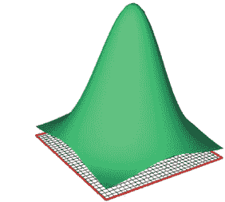

图 2.5. 函数 \(f(x,y) = e^{-(x^2+y^2)}\) 的高度图（Gouraud 着色）。

要执行 Gouraud 着色，我们必须向 Quad 类添加顶点法线信息。这可以通过向该类添加一个额外的方法轻松完成：

```
void Quad::addNormal(float * n)
{
    glNormal3f(n[0], n[1], n[2]);
}
```

该方法为每个四边形顶点指定一个法向量 \(\mathbf{n} = (n_x, n_y, n_z)\)。在 OpenGL 中，指定法向量应在顶点本身之前完成。在我们的情况中，`addNormal()` 应在该顶点的 `addVertex()` 之前立即调用。

下一步是为我们的表面计算实际顶点法线。计算方法取决于表面的指定方式。如果表面是解析指定的，例如由一个函数指定，我们可以按如下进行。从分析中我们知道，\(f\) 的图（即我们的表面）的法向量由以下公式给出

\(\mathbf{n} = \left( -\frac{\partial f}{\partial x}, -\frac{\partial f}{\partial y}, 1 \right).\) (2.4)

向量 \(\mathbf{n}\) 与另一个称为 *梯度* 的重要数学概念相关。给定函数 \(f : \mathbb{R}^2 \to \mathbb{R}\)，\(f\) 的梯度（记为 \(\nabla f\)）是向量

\(\nabla f = \left( \frac{\partial f}{\partial x}, \frac{\partial f}{\partial y} \right).\) (2.5)

```
float f(float, float); //the function to visualize
float* n(float, float); //the normal of f at (x,y)
for (float x=Xmin;x<Xmax-dx;x+=dx)
  for (float y=Ymin;y<Ymax-dy;y+=dy)
  {
    Quad q;
    q.addNormal(n(x,y));
    q.addPoint(f(x,y));
    q.addNormal(n(x+dx,y));
    q.addPoint(f(x+dx,y));
    q.addNormal(n(x+dx,y+dy));
    q.addPoint(f(x+dx,y+dy));
    q.addNormal(n(x,y+dy));
    q.addPoint(f(x,y+dy));
    q.draw();
  }
```

#### 清单 2.4. 绘制 Gouraud 着色高度图

对于具有更多变量的函数，梯度以类似方式定义。直观地说，f 的梯度是一个向量，它在 f 的定义域中的每个点指示 f 在该点具有最高增加率的定义域方向。我们将在以下章节中遇到梯度的众多应用。

在我们的示例中，f(x,y) = e^(-(x^2+y^2))，因此向量 v = (-2xf, -2yf, 1) 与法线方向相同，尽管长度不同。我们可以通过归一化 v 来计算法线 n：

\(\mathbf{n} = \left( \frac{-2xf}{\sqrt{4x^2f^2+4y^2f^2+1}} , \frac{-2yf}{\sqrt{4x^2f^2+4y^2f^2+1}} , \frac{1}{\sqrt{4x^2f^2+4y^2f^2+1}} \right) .\)
(2.6)

我们现在可以使用清单 2.4 中的代码绘制图 2.5 中的 Gouraud 着色高度图。这里，n 是一个函数，用于计算原始函数 f 在给定点 (x,y) 处的法线 n，即实现公式 (2.6)。

#### 计算顶点法线

先前描述的法线计算方法适用于任何我们可以解析计算其偏导数的函数，如公式 (2.4)。然而，如第 2.1 节所讨论，我们的函数可能不是解析指定的，而是作为采样数据集。尽管如此，在实践中，我们可以使用一种称为 _法线平均_ 的简单技术对采样（例如，多边形）数据集进行 Gouraud 着色。对于每个采样点 p_i，用 P_1..P_N 表示所有将 p_i 作为顶点的多边形。我们定义 p_i 处的顶点法线 n_i 为所有将 p_i 作为顶点的多边形法线 n(P_j) 的平均值，其中 p_i 作为


vertex:

$$\mathbf{n}_i = \frac{\sum_{P_j} \mathbf{n}(P_j)}{N}.$$ (2.7)

直观地讲，公式 (2.7) 表示顶点法线 \(\mathbf{n}_i\) 的方向介于共享该顶点的多边形 \(P_j\) 的法线之间。对于我们的高度图示例，通过平均法线向量计算得到的高洛德着色结果与图 2.5 中所示的几乎完全相同，图 2.5 使用解析计算的法线。

然而，有时对多边形法线进行平均并不能产生良好的结果。公式 (2.7) 中的平均使得每个多边形法线 \(\mathbf{n}(P_j)\) 对 \(\mathbf{n}_i\) 都有同等贡献。然而，某些表面在同一邻域内（例如共享同一顶点）可能包含大小差异很大的多边形。在这种情况下，可以通过使多边形对顶点法线（进而对表面的高洛德着色）的影响与多边形大小成正比，来获得更自然的着色效果。这可以通过使用面积加权法线平均来轻松实现，即，

$$\mathbf{n}_i = \frac{\sum_{P_j} A(P_j)\mathbf{n}(P_j)}{\sum_{P_j} A(P_j)}.$$ (2.8)

其中 \(A(P_j)\) 是多边形 \(P_j\) 的面积。

在 3.9.1 节中，我们将进一步阐述法线平均与数据重采样之间的联系。

### 2.4 纹理映射

通过使用一种称为*纹理映射*的技术，可以为渲染的 3D 模型增加额外的真实感。迄今描述的平面着色渲染模式为多边形分配单一颜色。高洛德着色模式为每个多边形像素分配一种颜色，该颜色从多边形顶点颜色线性插值而来。此类技术在传达现实物体中存在的大量小尺寸细节方面有所局限，例如各种材料（如木材、石材、砖块、砂或纺织品）特有的表面粗糙度或纤维结构。纹理映射是一种有效的技术，可以在渲染对象表面模拟此类材料的广泛外观。正如我们将在 6 章和 9 章中看到的，纹理映射是多种可视化技术实现的核心。

为了说明纹理映射的基本原理，让我们看一个简单的示例。图 2.6(a) 显示了一个 2D 纹理——在此情况下，是一个类似棋盘的

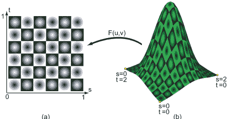

图 2.6. 纹理映射。(a) 纹理图像。(b) 纹理映射对象。

单色图像。图 2.6(b) 显示了将纹理映射到本章前面讨论的高斯高度图 3D 表面上的效果。纹理映射过程如下。首先，想象纹理图像定义在一个 2D 坐标系 (s, t) 中。通常，s 和 t 在 0 到 1 之间取值，并覆盖完整的纹理图像，如图所示。因此，我们可以将单色纹理描述为函数 tex(s, t) : [0, 1] x [0, 1] -> [0, 1]，其中函数值给出每个纹理像素的亮度或明度。接下来，我们为渲染多边形的每个顶点定义两个纹理坐标值 s 和 t。直观地讲，多边形的顶点纹理坐标指定纹理图像的一部分，该部分随后被扭曲以匹配多边形的大小和形状，最后绘制在该多边形上。当多边形被渲染时，其顶点纹理坐标在每个像素处进行插值，类似于高洛德着色执行的颜色插值。随后，像素使用多边形颜色和纹理颜色 tex(s, t) 的组合进行渲染。综上所述，我们可以将整个纹理映射过程视为一个函数 T，它将渲染对象表面的一个像素映射到纹理图像 tex 中的另一个像素。

这里描述并如图 2.6 所示的简单纹理映射功能可以通过以下步骤在 OpenGL 中实现。首先，我们必须定义一个 2D 纹理。最简单的方法是从存储为无符号字符数组的单色图像开始，该图像可以例如从图像文件读取或过程定义。以下代码片段从具有 width × height 像素的图像 image 创建一个 OpenGL 纹理。首先，我们在 OpenGL 中启用纹理映射。参数 GL_TEXTURE_2D 指定我们将使用二维纹理。接下来，我们使用 glTexImage2D OpenGL 函数将 image 的 width × height 字节传输到图形内存并创建相应的 2D 纹理。GL_LUMINANCE 参数指定我们定义一个单色纹理，也称为亮度纹理。glTexParameteri 函数指定如何处理超出范围 [0, 1] 的纹理坐标 s、t，这一特性将在本节后面描述。最后，我们使用 glTexEnvf 函数指定多边形颜色将如何与纹理颜色组合。在这里，我们选择了 GL_MODULATE 模式，它将两个值相乘以产生最终像素颜色。定义纹理后，我们只需将纹理坐标与渲染多边形的顶点关联，OpenGL 将自动执行纹理映射操作。要分配纹理坐标，我们向 Quad 类添加一个新方法。

```
void Quad ::addTexCoords(float s, float t)
{
    glTexCoord2f(s, t);
}
```

要渲染纹理映射的高度图，我们现在只需使用清单 2.6 中的代码片段为每个渲染多边形添加纹理坐标。在此，为了简洁，我们省略了清单 2.4 中存在的 addNormal 调用。在此示例中，纹理坐标与高度图的 x、y 坐标相同，缩放到范围 [0, 2]。由于我们将 GL_REPEAT 指定为 GL_TEXTURE_WRAP_S 和 GL_TEXTURE_WRAP_T OpenGL 参数的值（清单 2.5，第 6–7 行），超出 [0, 1] 的纹理坐标将在此范围内“环绕”。总体而言，这产生了图 2.6(b) 中显示的效果，纹理似乎从 xy 平面投影到高度图表面，并在每个方向上复制两次，从纹理图像中的棋盘方块和纹理高度图中可见。

```
unsigned char* image; //the image data
int width, height; //the image size

glEnable(GL_TEXTURE_2D);
glTexImage2D(GL_TEXTURE_2D, 0, GL_LUMINANCE, width, height,
    0, GL_LUMINANCE, GL_UNSIGNED_BYTE, image);
glTexParameteri(GL_TEXTURE_2D, GL_TEXTURE_WRAP_S, GL_REPEAT);
glTexParameteri(GL_TEXTURE_2D, GL_TEXTURE_WRAP_T, GL_REPEAT);
glTexEnvf(GL_TEXTURE_ENV, GL_TEXTURE_ENV_MODE, GL_MODULATE);
```

#### 清单 2.5. 定义 2D 纹理

```
float f(float, float); //the function to visualize
float sx = (Xmax-Xmin)/2;
float sy = (Ymax-Ymin)/2;

for (float x=Xmin; x<Xmax-dx; x+=dx)
  for (float y=Ymin; y<Ymax-dy; y+=dy)
  {
    Quad q;
    q.addTexture(x/sx, y/sy);
    q.addPoint(x, y, f(x, y));
    q.addTexture((x+dx)/sx, y/sy);
    q.addPoint((x+dx), y, f(x+dx, y));
    q.addTexture((x+dx)/sx, (y+dy)/sy);
    q.addPoint((x+dx), (y+dy), f((x+dx), (y+dy)));
    q.addTexture(x/sx, (y+dy)/sy);
    q.addPoint(x, (y+dy), f(x, (y+dy)));
    q.draw();
  }
```

清单 2.6. 绘制纹理映射的高度图。

通过定义不同的纹理坐标，可以获得多种纹理映射效果，例如以不同方式拉伸、压缩或旋转每个渲染多边形的纹理图像。此处呈现的示例仅简要勾勒纹理映射提供的许多可能性，例如线性（1D）和体积（3D）纹理、抗锯齿纹理渲染、颜色和透明度纹理以及多纹理。此处不可能完整讨论纹理映射的所有可能性。有关更多细节，以及 OpenGL 纹理机制和相关应用程序编程接口 (API) 的完整描述，请参阅 OpenGL 参考和开发文献 [Shreiner et al. 03, Shreiner 04]。

### 2.5 透明度与混合

在迄今讨论的渲染示例中，我们仅使用了完全不透明的形状。在许多情况下，渲染半透明（translucent）形状可以为可视化增加额外价值。例如，在我们的高度图运行示例中，我们可能有兴趣在同一图像中从任何视角同时看到网格域和高度图。我们可以通过先渲染网格图形，然后按先前描述渲染高度图，但使用半透明原元来实现此效果。


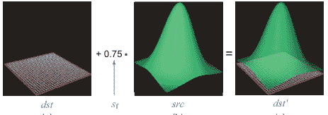

图 2.7。(b) 中的高度图是通过在 (a) 的当前屏幕内容上使用加法混合绘制而成，以获得 (c) 中的半透明图结果。使用了黑色背景。

在 OpenGL 中，可以通过使用一种称为混合的特殊图形模式来实现大量与透明度相关的效果。要使用混合，必须首先使用以下函数调用启用它：

```
glEnable(GL_BLEND);
```

启用混合后，OpenGL 会将每个绘制的图元（如多边形或线条）的像素与绘制位置处的帧缓冲区（显示图像）当前值进行组合。在 OpenGL 术语中，绘制的图元称为源，而图元绘制其上的帧缓冲区称为目标。混合是针对绘制在目标上的每个源像素独立执行的。如果我们将源像素和目标像素的颜色分别表示为 src 和 dst，则目标像素的最终值 dst' 由以下表达式给出：

```
dst' = sf * src + df * dst. (2.9)
```

方程 (2.9) 本质上是源颜色和目标颜色的加权组合，分别使用源权重因子 sf 和目标权重因子 df，两者均为范围 [0, 1] 内的实数。该方程独立应用于每个颜色分量（R、G 和 B）。权重 sf 和 df（也称为混合因子）可以以多种方式指定。在以下内容中，我们展示了如何指定这些因子，以在高度图示例中实现一种简单的透明效果，该效果结合了网格和图的渲染。最终结果如图 2.7(c) 所示。要获得此结果，我们按以下步骤操作。首先，将屏幕清除为黑色。使用黑色而不是通常的白色背景的原因很快就会显而易见。帧缓冲区通过以下一系列 OpenGL 调用清除：

```
glClearColor(0.0, 0.0, 0.0); //specify the clear color
glClear(GL_COLOR_BUFFER_BIT); //clear the frame buffer
```

接下来，我们绘制网格结构。我们不使用任何混合，因为我们希望网格本身完全不透明。结果如图 2.7(a) 所示。最后一步是在此网格上绘制半透明高度图。要绘制的高度图（不带实际透明度）如图 2.7(b) 所示。为此，我们首先启用混合，如前面所述。接下来，我们指定混合因子 $s_f$ 和 $d_f$。通过使用源因子 $s_f < 1$ 来实现半透明图。为了确保在每个像素处，网格和图对象的贡献之和为一，我们使用目标因子 $d_f = 1 - s_f$。这种组合通过以下 OpenGL 代码实现：

```
glBlendFunc(GL_SRC_ALPHA, GL_ONE_MINUS_SRC_ALPHA);
glColor4f(r,g,b,s_f);
```

对于图 2.7(c) 所示的结果，颜色 $r,g,b$ 与第 2.3 节讨论的示例中的值相同，$s_f$ 的值为 0.7。

函数 glBlendFunc 接受两个参数，用于指定源和目标混合因子。这些参数是符号常量，而非混合因子本身，并指定实际混合因子 $s_f$ 和 $d_f$ 将如何计算。这些常量最常用的值如下。常量 GL_ONE 将相应的混合因子值设置为 1。常量 GL_SRC_ALPHA 指定源因子 $s_f$ 将从绘制图元颜色的第四个分量（也称为 alpha 分量）中获取。因此，如果我们接下来使用 glColor4f(r, g, b, s_f) 设置颜色，$s_f$ 将是使用的实际源混合因子。常量 GL_ONE_MINUS_SRC_ALPHA 将相应的混合因子设置为 $1 - s_f$，其中 $s_f$ 是如前面所述的绘制图元的 alpha 值。

这些参数允许我们获得各种透明度效果。使用 glBlendFunc(GL_SRC_ALPHA, GL_ONE) 然后绘制具有所需 alpha 值（通过 glColor4f 设置）的图元，并从黑色帧缓冲区开始，实际上会将图元的颜色按其各自的 alpha 值加权相加。我们可以通过使用 glBlendFunc(GL_ONE, GL_ONE) 来实现相同的效果，即设置 $s_f = d_f = 1$，并通过使用 glColor3f(rs_f, gs_f, bs_f) 在颜色中提取源混合因子。使用 glBlendFunc(GL_SRC_ALPHA, GL_ONE_MINUS_SRC_ALPHA) 实现凸组合

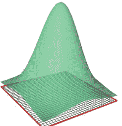

图 2.8。使用白色背景，将高度图半透明地绘制在域网格之上。

```
dst' = s_f * src + (1 - s_f) * dst.
```

OpenGL 会始终将 dst' 的值限制在 1 以内，因此在绘制所有图元时，使用混合因子之和为一是个好主意。如果我们使用方程 (2.10) 中凸组合设置的混合函数，这会自动实现。

最后，还有一个第四个常量 GL_ZERO，它将相应的源或目标混合因子设置为零。因此，调用 glBlendFunc(GL_ONE, GL_ZERO) 函数相当于禁用混合，即源颜色将简单地覆盖目标（帧缓冲区）颜色。

图 2.8 显示了使用相同的透明度值 0.7 在域网格之上绘制的高度图，这次使用白色背景，通过设置 glClearColor(1,1,1,0) 获得。我们将实现此图像的实际 OpenGL 混合代码的构建留给读者作为练习。

除了透明度之外，混合还可用于在可视化应用中获得许多其他有用的图形效果。第 10 章中描述的体积可视化根本依赖于混合来显示体积数据集。混合的另一个用途在第 6.6 节中演示，用于构建动画流纹理以可视化向量场。混合的另一个应用在第 9.4.5 节中描述，用于计算图像数据中的距离场。

### 2.6 观看

迄今所示的所有高度图图像都显示了从空间中某个角度和位置观看的图。要了解如何指定此类观看参数，我们需要了解 OpenGL 如何处理 3D 顶点坐标以创建屏幕上显示的最终图像。此过程有几个步骤或变换，将在下文中描述。

虚拟相机。指定如何观看 3D 场景的第一步是指定我们想要从何处以及向哪个方向观看场景。最简单的想象方式是，假设我们有一台虚拟照相机，想要以特定方式对准场景。在 OpenGL 中，可以通过指定相机的位置（也称为眼睛位置 e）、相机指向的位置（也称为中心位置 c）以及向量 u（指示相机围绕观看方向 c - e 旋转的方式，也称为“上”向量）来指定此类相机。图 2.9 说明了这一点。与观看方向正交的平面（最终图像将出现在其上）也称为视图平面。

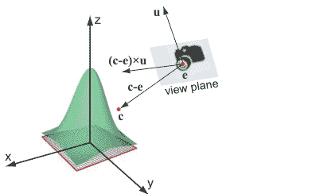

图 2.9。OpenGL 相机的外参。

在 OpenGL 中，可以使用 gluLookAt 函数² 指定相机的眼睛、中心和上向量值：

```
glMatrixMode (GL_MODELVIEW);
glLoadIdentity ();
gluLookAt (ex, ey, ez, cx, cy, cz, ux, uy, uz)
```

前两个函数调用（glMatrixMode 和 glLoadIdentity）确保随后的 gluLookAt 调用将修改 OpenGL 的外部相机参数，而不是内部相机参数（将在下一节中讨论）。外部相机参数在 OpenGL 中也称为模型视图参数，因此命名为 GL_MODELVIEW。上向量 u 不应与观看方向 c - e 平行，否则我们无法明确定义视图平面。一个简单但有效的默认设置是：让 c 等于所观看场景的中心，即所有顶点坐标的平均值；u 等于 3D 空间的 y 轴，即 u = (0, 1, 0)；e 位于距 c 略大于场景边界框大小的位置。所有三个向量 e、c 和 u 都在与要观看的 3D 场景相同的坐标系中给出。这些值也称为外部相机参数，因为它们不指定相机实际如何构建，而仅指定其在 3D 空间中的位置。

投影。在 3D 空间中放置相机后，我们需要指定相机本身如何操作，即其内部参数。沿用实体照相机的类比，该相机将 3D 场景的透视投影捕获到平面上，内部参数给出了我们希望捕获图像的视区的焦距、视野和长宽比（图 2.10）。此视区是视图平面上的一个矩形，其中心位于观看方向线 c - e 上，其轴分别与 u 以及 (c - e) × u 平行。焦距 znear 给出了沿观看方向从眼睛位置 e 到视图平面的距离。比 znear 更靠近 e 的任何对象都不会被相机“看到”。因此，视图平面也称为近裁剪平面，因为它会裁剪（或从观看中移除）其前面的对象。视野 fov 是视区上、下边界与眼睛位置 e 形成的角度。长宽比 aspect 给出了视区水平尺寸与垂直尺寸的比率。最后，值 zfar 给出了沿观看方向从眼睛位置 e 到与视图平面平行且位于其后的

2. 严格来说，gluLookAt 以及接下来讨论的所有以 glu 开头的函数都是图形库实用工具（GLU）库和 OpenGL 的一部分。由于几乎所有提供 OpenGL 的系统也提供 GLU，我们在下文中不做此区分。


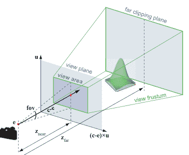

图 2.10 OpenGL 相机的内参。

摄像机“不再看到”任何物体的视平面。该平面也称为远裁剪平面，因为它会裁剪（即从视图中移除）其后方的物体。

鉴于此配置，摄像机将仅渲染位于由视区域及其在远裁剪平面上的相应投影所界定的四棱锥体内的物体。该四棱锥体在图 2.10 中以绿色绘制。在 OpenGL 中，可以通过使用 gluPerspective 函数来指定相机的内参。

```
glMatrixMode(GL_PROJECTION);
glLoadIdentity( );
gluPerspective(fov, aspect, z_near, z_far)
```

前两个函数调用（glMatrixMode 和 glLoadIdentity）确保随后的 gluPerspective 调用会影响相机的内参（即投影参数），而非之前章节中讨论过的外参。gluPerspective 调用的约束是 z_near 和 z_far 均应为正值。此外，通常 z_near < z_far。gluPerspective 实现了上文解释的透视投影。良好的默认值是 fov 等于 45 到 90 度。平行投影（即正交投影）不会

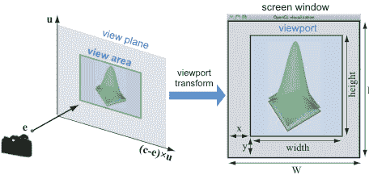

图 2.11 从视平面上的视区域到屏幕区域的 OpenGL 视口变换。

使远离视平面的物体看起来更小（一种也称为 *近景缩短* 的效果）的平行投影，也受 OpenGL 支持，可通过使用 `gluOrtho2D` 函数实现。

```
gluOrtho2D( x_{left} , x_{right} , y_{bottom} , y_{top} )
```

值 $x_{left}$、$x_{right}$、$y_{bottom}$ 和 $y_{top}$ 定义了视平面上视区域矩形四条边的位置，相对于视线方向与此平面的交点。这实际上创建了一个类平行六面体的视图体积，而非四棱锥体。正交投影在可视化应用中的使用频率低于透视投影。当我们希望相等的 3D 距离在视平面上显示为相等的 2D 距离（无近景缩短）时，它们非常有用。

视口。上述投影变换实际上指定了视图四棱锥体内的 3D 对象如何投影到视平面上的 2D 矩形。观看的第三个也是最后一步是将此矩形映射到一个称为 *视口* 的 2D 屏幕区域。这是通过所谓的视口变换实现的。在 OpenGL 中，此变换由 `glViewport` 函数指定。

```
glViewport( x , y , width , height )
```

`glViewport` 的作用是将整个视区域矩形映射到屏幕矩形，该屏幕矩形的左下角由像素坐标 x, y 给出，尺寸为 width 和 height 像素（图 2.11）。该映射是线性的，即视区域实际上被平移，并沿每个屏幕轴均匀拉伸或压缩，以适应屏幕矩形。通常，给定一个 W × H 像素的屏幕窗口，我们希望用绘制的场景填充整个窗口。设置 x = y = 0 且 width = W 和 height = H 会用我们的视区域填充整个窗口。但是，如果宽高比 aspect（例如来自透视投影）不等于 W/H，场景在屏幕上会显得不自然地拉伸或压缩，如图 2.11 中的示例所示。换句话说，从视区域到屏幕窗口的两个屏幕轴的缩放因子不相等。解决此问题的简单方法是将 aspect 设置为 W/H。但是，这会根据屏幕窗口的形状改变视区域的形状，这可能会裁剪掉场景中有趣的部分。更好的方法是计算 width 和 height，使其成为在可用屏幕空间 W × H 内容纳宽高比为 aspect 的最大矩形的值，然后计算 x 和 y，使该矩形在 W × H 屏幕空间内居中。

### 2.7 将所有内容整合在一起

迄今为止，我们已介绍了用于绘制 3D 形状和指定观看参数的 OpenGL 功能。接下来，我们将讨论如何将所有这些部分组合起来，创建一个完整的 OpenGL 应用程序。

此类最小应用程序的结构（如清单 2.7 所示）包含三个主要部分：

- 主函数（main，第 1-10 行）；
- 用于设置观看参数的函数（viewing，第 12-17 行）；
- 用于执行实际绘制的函数（draw，第 19-31 行）。

初始化。主函数负责创建一个屏幕窗口，OpenGL 将在其中绘制我们的场景。为此，我们在此使用图形实用工具包（GLUT），这是一个简单易用的库，在与平台无关的 OpenGL 库和各种所谓的窗口系统（如 Windows、OS X 和 X Windows）之间提供统一接口。3 第一步是初始化 GLUT（清单 2.7，第 3-4 行）。上述第二行告诉 GLUT，我们希望一个使用 RGB 颜色 GLUT_RGB 的屏幕窗口，我们将绘制

```
1 int main(int argc, char ** argv)
2 {
3   glutInit(&argc, argv); //Initialize GLUT library
4   glutInitDisplayMode(GLUT_RGB | GLUT_DOUBLE | GLUT_DEPTH);
5   glutInitWindowSize(800,600); //Specify the initial window size
6   glutCreateWindow("Visualization"); //Create a window with given title
7   glutDisplayFunc(draw); //Specify function to draw scene
8   glutReshapeFunc(viewing); //Specify function to set up viewing
9   glutMainLoop(); //Start the event loop
10 }
11
12 void draw() //Draw the 3D scene
13 {
14   glClear(GL_COLOR_BUFFER_BIT | GL_DEPTH_BUFFER_BIT);
15   //Add here code to draw the 3D scene, see, e.g., Listing 2.4
16   glutSwapBuffers(); //Display the drawn image
17 }
18
19 void viewing(int W,int H) //Set up viewing (see Section 2.6)
20 {
21   glMatrixMode(GL_MODELVIEW); //1. Camera (modelview) transform
22   glLoadIdentity();
23   gluLookAt(e_x,e_y,e_z,c_x,c_y,c_z,u_x,u_y,u_z);
24
25   glMatrixMode(GL_PROJECTION); //2. Projection transform
26   glLoadIdentity();
27   float aspect = float(W)/H;
28   gluPerspective(fov,aspect,near,far);
29
30   glViewport(0,0,W,H); //3. Viewport transform
31 }
```

清单 2.7. OpenGL 应用程序结构。

3D 形状，其中我们希望执行隐藏表面移除（GLUT_DEPTH），并且希望为此窗口使用双缓冲（GLUT_DOUBLE）。隐藏表面移除和双缓冲将在下文解释。第 5 行指定我们即将创建的屏幕窗口的初始大小。第 6 行创建实际窗口。

接下来，我们可以直接添加 OpenGL 代码来设置观看参数并绘制实际场景。此代码分别由我们的 viewing 和 draw 函数提供。但是，在窗口系统中，用户可以操作此类窗口，例如，通过最小化、最大化或调整其大小。在所有这些情况下，我们的应用程序都需要重绘窗口内容。为此，GLUT 使用基于事件的系统，每当发生此类窗口更改时，窗口会自动（重新）绘制。要使此功能正常工作，GLUT 需要知道在窗口大小更改时以及窗口需要重绘时执行哪些代码，即我们的 viewing 和 draw 函数。第 7 行和第 8 行将这两个函数连接到 GLUT。main 的最后一步是第 9 行，它将应用程序控制流交给 GLUT；从现在起，GLUT 将在每次调整窗口大小时自动调用我们的 viewing 函数，并在每次需要重绘窗口时单独调用 draw 函数。

观看。viewing 函数包含执行第 2.6 节中描述的观看变换所需的所有代码。第一步是设置虚拟相机的外参（第 21–23 行）。当然，为了使代码完整，我们需要为定义我们的视点和视线方向的向量 e、c 和 u 指定实际值。第二步是设置投影（第 25–28 行）。为了说明，我们在此使用了保持屏幕窗口与视区域之间相同宽高比的透视投影。与相机外参一样，我们在此需要为视场 fov 以及近平面和远平面位置 near 和 far 指定实际值。第三个也是最后一步是指定视口，在我们的情况中，视口是整个屏幕窗口（第 30 行）。请注意，屏幕窗口的宽度 W 和高度 H 由 GLUT 自动作为参数提供给我们的 viewing 函数。这样，我们的代码就了解此窗口的几何形状，并随后可以调整观看参数（视区域宽高比 aspect 和视口宽度与高度）。

绘制。draw 函数包含绘制实际场景所需的所有代码。GLUT 保证，在窗口几何变化后调用 viewing 函数后，始终会调用此函数。因此，我们的观看参数已正确设置。绘制的第一步（第 14 行）是清除窗口的帧缓冲区（GL_COLOR_BUFFER_BIT）。在同一行中，我们还清除所谓的深度缓冲区（GL_DEPTH_BUFFER_BIT）。深度缓冲区（也称为 z 缓冲区）为窗口的每个像素 (x, y) 保存一个值，该值指示从视平面到覆盖 (x, y) 的任何图元的最接近像素的距离。深度缓冲区允许 OpenGL 按任何顺序绘制图元，并在帧缓冲区中正确“隐藏”远离视平面的图元，由更近的图元遮挡，这很类似于我们在现实中看不到其他物体后面的物体。此过程也称为隐藏表面移除。为此，我们首先需要清除深度缓冲区（第 14 行，GL_DEPTH_BUFFER_BIT），即将其所有像素的值设置为大于视平面与远裁剪平面之间距离的值。

接下来，我们添加所需的场景绘制（第 15 行）。例如，这可以是清单 2.4 中的高度图绘制代码。除了实际的图元绘制外，这里也是设置绘制的各种其他参数的地方，例如光照、纹理和混合。当此代码绘制其各种图元时，


OpenGL 只会将深度缓冲区值大于当前原始体在 \((x, y)\) 处深度的屏幕像素 \((x, y)\) 写入屏幕。

绘制包含数十或数千个原始体的复杂场景并非瞬时过程，即使在现代显卡上也是如此。如果绘制 *直接* 发生在可见窗口表面上，用户可能会注意到一定程度的闪烁，因为原始体被逐步添加到绘图中。为消除此问题，我们使用一种称为 *双缓冲* 的技术。OpenGL 保留两个图像。第一个图像，称为 *屏幕缓冲区*，是当前在窗口中显示的图像。第二个图像，称为 *离屏缓冲区*，是实际绘图发生的区域。当绘图准备就绪时，我们只需让 OpenGL “交换” 屏幕缓冲区和离屏缓冲区，从而一次性显示构建好的图像，进而消除闪烁。此操作由第 16 行中的 `glutSwapBuffers` 调用执行。

改进。使用 OpenGL 构建功能完备的可视化应用程序比前一节所示的基本蓝图更为复杂。需要解决的问题包括多窗口管理、处理键盘和鼠标输入，以及集成按钮和滑块等用户界面元素。此类问题超出了本书的范围。如需更全面地了解构建 OpenGL 应用程序，我们参考 Shirley 和 Marschner 09、Shreiner 等人 03 的著作。一种简单但有效的用户界面工具包，可轻松与 OpenGL 和 GLUT 集成，即 OpenGL 用户界面 C++ 库（GLUI）。4 虽然不如其他用户界面工具包功能强大，但 GLUI 能以可移植且易于学习的方式，向 OpenGL 应用程序添加按钮、滑块、复选框和菜单等用户界面元素。

### 2.8 结论

在本章中，我们介绍了可视化过程的基本结构，以可视化二元实值函数这一简单任务为例。该过程可总结如下（另见图 2.12）：

- 将感兴趣的数据获取到离散数据集中；
- 将此数据集映射到图形原始体；
- 渲染原始体以获得所需图像。

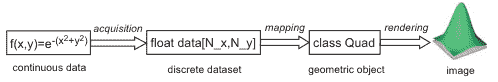

图 2.12. 高度图的可视化过程步骤。

所呈现的示例可以，并且实际上很多时候，被视为纯图形应用程序，而非数据可视化应用程序。然而，如果我们考虑本示例的主要目标，即向用户传达关于定义在二维域上的实值函数的值和变化的洞察，我们就发现了可视化方面。此外，这个简单的示例让我们接触到可视化过程的基本概念和构建模块：数据集、映射、渲染，以及可视化过程或流水线。数据集，即用于存储和表示数据的元素，将在第 3 章中连同其主要操作（采样和插值）进一步讨论。映射，即从抽象数据集生成可查看几何对象的过程，将从第 5 章开始以其各种形式进一步讨论。渲染，即显示几何对象集合的过程，已在本章中讨论过。最后，构成可视化过程的完整操作和概念链在第 4 章中讨论。

本页故意留空

## 第 3 章

## 数据表示

在第 2 章中，我们使用一个简单的应用程序，即使用高度图可视化二元函数，来介绍数据可视化的几个主要概念，例如数据集、采样和渲染。我们的讨论围绕数据集展开，数据集是通过离散表示来近似连续信号的关键概念。

在本章中，我们将扩展关于离散数据表示和近似的讨论。首先，我们详细介绍连续数据采样和重建的概念。我们引入基函数、离散网格和单元，作为从采样数据构建分段连续近似的一种手段。这些概念使用第 2 章中介绍的使用高度图可视化二元函数的简单示例进行说明。接下来，我们介绍可视化实践中常用的各种数据集类型，并详细说明它们各自的优势、局限性和约束。我们还讨论了与高效实现数据集概念相关的几个方面。完成本章后，读者应当很好地理解选择数据集模型所涉及的各种权衡，并能够决定哪种数据集最适合特定的可视化应用程序。

### 3.1 连续数据

#### 3.1.1 什么是连续数据？

可视化的主要目标是生成图片，使用户能够深入了解描述各种现象或过程（包括自然现象和人为控制现象）的数据。示例包括：由于天气条件导致的大气中空气循环；海洋和海水中的水流；由于加热和冷却引起的温差导致建筑物等封闭空间中的空气对流；机械零件在运行应力作用下的变形、静电充电、振动和加热；以及电动机产生的磁场和静电场。

此类现象是用各种物理量来建模的。这些物理量可以直接测量，也可以通过软件模拟计算得出。从数据表示的角度来看，这些物理量可以分为两种根本不同的类别：内在连续数据和内在离散数据。连续量的著名示例包括压力、温度、位置、速度、密度、力、颜色、光强度和电磁辐射。内在离散数据的示例包括超媒体（例如，网页中的文本和图像内容）；软件源代码；各种文档中的纯文本；以及各种数据库记录。

为简洁起见，我们今后将把内在连续数据称为 *连续数据*，把内在离散数据称为 *离散数据*。连续数据通常由计算机以某种有限近似形式进行处理。为避免混淆，我们将此称为 *采样数据*。采样数据也是离散的，因为它们由 *有限* 数据元素集合组成。然而，与我们称之为内在离散数据的情况不同，采样数据始终源自连续量，并且旨在近似该连续量。如第 3.2 节所述，我们总是可以从采样数据回到原始连续数据的连续近似。相比之下，我们称之为内在离散数据的内容在连续世界中没有对应物，例如一页文本。这是连续（或采样）数据与离散数据之间的根本区别。如本书所述，这种差异在设计有效且高效的可视化方法时会导致许多（往往是微妙的）约束和选择。

内在连续数据，无论是以其原始连续表示形式出现，还是由某些采样近似表示，都是数据可视化的一个独立分支的研究对象。该分支传统上称为 *科学可视化*，或 *scivis*。该名称反映了这样一个事实：连续数据通常测量由各种科学和工程学科（如物理学、化学、力学或工程学）研究的物理量。内在离散数据（没有直接对应物）是一个相对较新的可视化分支的研究对象，称为 *信息可视化*，或 *infovis*。本书主要关注 scivis 方法和技术，第 11 章除外，该章对几个主要


inovis topics. Consequently, the remainder of this chapter will discuss solely the representation of continuous and sampled (scivis) data.

### 3.1.2 Mathematical Continuity

Mathematically, continuous data can be modeled as a function

$f : D \to C,$

where \( D \subset \mathbb{R}^d \) is the function domain and \( C \subset \mathbb{R}^c \) is the function codomain, respectively. In a related terminology, \( f \) is called a \( d \)-dimensional, or \( d \)-variate, \( c \)-value function. In other words, if we write \( f(x) = y \), where \( x \in D \) and \( y \in C \), this actually means \( f(x_1, ..., x_d) = (y_1, ..., y_c) \). In visualization applications, \( f \) or its sampled counterpart, introduced in Section 3.2, is sometimes called a field. Mathematically, \( f \) is continuous if for every point \( p \in D \) the following holds:

\(\forall \epsilon > 0, \exists \delta > 0 \text{ such that if } \|x - p\| < \delta, x \in D \text{ then } \|f(x) - f(p)\| < \epsilon. \quad (3.1)\)

This continuity criterion is known as the Cauchy criterion, after the French eighteenth-century mathematician who proposed it, or the \( \epsilon - \delta \) criterion, a name that follows from its formulation.

What does continuity mean in the intuitive sense? In plain terms, a function is continuous if the graph of the function is a connected surface without “holes” or “jumps.” Furthermore, we say that a function \( f \) is continuous of order \( k \) if the function itself and all its derivatives up to and including order \( k \) are also continuous in this sense. This is denoted as \( f \in C^k \). Figure 3.1 illustrates the continuity concept for the case of a one-dimensional function \( f : \mathbb{R} \to \mathbb{R} \), whose graph is displayed in green. The first image (Figure 3.1(a)) shows a function having a discontinuity at the points \( x_0 \). Clearly, if we evaluate the

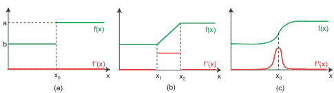

**Figure 3.1.** Function continuity. (a) Discontinuous function. (b) First-order \( C^0 \) continuous function. (c) High-order \( C^k \) continuous function.

jump of $f$ around the point $x_0$, i.e., evaluate $f(x_0 - \delta)$ and $f(x_0 + \delta)$, the jump $|f(x_0 + \delta) - f(x_0 - \delta)|$ will always have the fixed value $b - a$, regardless of how small the value $\delta$ is, i.e., how close we sample the function to the point $x_0$. The derivative $f'(x)$ is shown in red in the figure. Note that $f'(x)$ is not defined for the discontinuity point $x_0$.

Figure 3.1(b) shows a continuous function \( f \in C^0 \). Here, f consists of three linear components. The graph of f shows no holes or jumps, so clearly Equation (3.1) holds. In contrast, its first derivative \( f' \) is of the same type as the function \( f \) shown before in Figure 3.1, i.e., it is discontinuous. However, if we take the three intervals delimited by the two points \( x_1 \) and \( x_2 \) and ignore the points \( x_1 \) and \( x_2 \) themselves, the derivative \( f' \) is continuous for every interval. Functions whose derivatives are continuous on compact intervals as in this example are also called piecewise continuously differentiable, piecewise smooth, or piecewise \( C^\infty \). Such functions will play an important role in approximating sampled data later in Section 3.2. A final example is shown in Figure 3.1(c). Here, both the function and its derivative are continuous, so \( f \in C^k \), where \( k \ge 1 \). Some functions, such as the Gaussian used in Chapter 2, are themselves and all their derivatives continuous. We denote this by \( f \in C^\infty \).

### 3.1.3 Dimensions: Geometry, Topology, and Attributes

The triplet \(\mathcal{D} = (D, C, f)\) defines a continuous dataset. In the following, we shall use the notation \(\mathcal{D}\) to refer to a dataset and the notation D to refer to a domain. The dimension \(d\) of the space \(\mathbb{R}^d\) into which the function domain D is embedded, or contained, is called the geometrical dimension. The dimension \(s \le d\) of the function domain D itself is called the topological dimension of the dataset. Understanding the difference between geometrical and topological dimensions is easiest by means of an example. If D is a plane or curved surface embedded in the usual Euclidean space \(\mathbb{R}^3\), then we have \(s = 2\) and \(d = 3\). If D is a line or curve embedded in the Euclidean space \(\mathbb{R}^3\), then we have \(s = 1\) and \(d = 3\). You can think of the topological dimension as the number of independent variables that we need to represent our domain D. A curved surface in \(\mathbb{R}^3\) can actually be represented by two independent variables, like latitude and longitude for the surface of the Earth. Indeed, we can describe such a surface by an implicit function \(f(x, y, z) = 0\), which actually says that only two of the three variables \(x\), \(y\), and \(z\) vary independently. Similarly, a curve's domain can be described implicitly by two equations f(x,y,z) = 0 and g(x,y,z) = 0, which means that just one of the variables x, y, and z varies independently. A final concept frequently used in describing functions and spaces is the codimension. Given the previous notation, the codimension of an object of topological dimension s and geometrical dimension d is the difference d − s.

1. Informally, we can say that \(f'(x_0)\) is equal to infinity, as it has a finite jump at a point, which can be seen as an infinitely small interval. However, a numerical function (and hence its derivatives, too) is usually defined to take finite values, hence we call \(f\) not differentiable, or discontinuous, in \(x_0\).

To simplify implementation-related aspects, virtually all data-visualization applications fix the geometrical dimension to d = 3. This makes application code simple, uniform, yet sufficiently generic. Hence, the only dimension that actually varies in visualization datasets is the topological dimension s. In practice, s is one, two, or three, which corresponds to the curve, surface, or volumetric datasets, respectively. Since the topological dimension is the only variable one, in practice it is also called the dataset dimension. In the remainder of this book, when we talk about a dataset’s dimension, we mean its topological dimension, and implicitly assume that the geometric dimension is always three. Topological dimension is going to be important when we talk about sampled datasets and grid cells in Section 3.2.

In practice, dataset dimensions model spatial or temporal components. So, one may ask, what if we want to model a time-dependent volumetric dataset? This would require s = 4 dimensions, which would in turn ask for d = 4 geometric dimensions. Most visualization applications do not support such datasets explicitly, since they are relatively infrequent and supporting them would require working with more than three geometrical dimensions. In practice, time-dependent volumetric datasets are often represented as sequences of three-dimensional datasets where the sequence number represents the time dimension.

The function values are usually called dataset attributes. The dimensionality c of the function codomain C is also called the attribute dimension. The attribute dimension c usually ranges from 1 to 4. Attribute types are discussed later in Section 3.6. For the time being, let us assume for the simplicity of the discussion that c = 1, i.e., our function f is a real-valued function.

### 3.2 Sampled Data

Scientific visualization aims at displaying various properties of functions, as introduced in the previous section. However, we do not always avail of data in its continuous, functional, representation. Moreover, several operations on the data—including processing, such as filtering, simplification, denoising, or analysis, and rendering—are not easy, nor efficient, to perform on continuous data representations. For these reasons, the overwhelming majority of visualization methods works with sampled data representations, or sampled datasets. Two operations relate sampled data and continuous data:

- Sampling: Given a continuous dataset, we have to be able to produce sampled data from it.
- Reconstruction: Given a sampled dataset, we have to be able to recover an (approximative) version of the original continuous data.

Sampling and reconstruction are intimately connected operations. The reconstruction operation involves specifying the value of the function between its sample points, using the sample values, using a technique called interpolation. We have seen, in Chapter 2, a simple illustration of sampling and reconstruction for a two-dimensional dataset containing a scalar attribute: the surface representing the graph of a two-variable function. We sampled this dataset using two strategies, i.e., a uniform and a nonuniform sample point density. Next, we reconstructed (and rendered) the surface using a set of quadrilaterals determined by our sample points. This simple example illustrated a correlation between the sample-point density and distribution and the quality of the result of the polygon-based surface rendering. The conclusion was that the reconstruction quality is a function of the amount and distribution of sample points used. In the following, we shall analyze this relationship for the general case of a dataset represented as a d-variate, c-value function.

To be useful in practice, a sampled dataset should comply with several requirements: it should be accurate, minimal, generic, efficient, and simple [Schroeder et al. 06]. By accurate, we mean that one should be able to control the production of a sampled dataset Ds from a continuous one Dc such that Dc can be reconstructed from Ds with an arbitrarily small user-specified error, if desired. By minimal, we mean that Ds contains the least number of sample points needed to ensure a reconstruction with the desired error. As we saw in Chapter 2, minimizing the sample count favors a low memory consumption and high data processing and rendering speed. By generic, we mean that we can easily replace the various data-processing operations we had for the continuous Dc with equivalent counterparts for the sampled Ds. By efficient, we mean that both the reconstruction operation and the data-processing operations we wish to perform on Ds can be done efficiently from an algorithmic point of view. Finally, by simple, we mean that we can design a reasonably simple software implementation of both Ds and the operations we want to perform on it.

Interpolation. Let us first consider the reconstruction of a continuous approximation from the sampled data. We define reconstruction as follows: given a


采样数据集 \(\{p_i, f_i\}\) 由一组 \(N\) 个采样点 \(p_i \in D\) 和采样值 \(f_i \in C\) 组成，我们希望生成一个连续函数 \(\bar{f} : D \to C\) 来近似原始 \(\bar{f}\)。重构函数应在所有采样点处等于原始函数，即，\(\bar{f}(p_i) = f(p_i) = f_i\)。定义满足此属性的重构函数的一种方法是设置

```
\(\bar{f} = \sum_{i=1}^N f_i \phi_i,\) (3.2)
```

其中 \(\phi_i : D \to C\) 称为 *基函数* 或 *插值函数*。换句话说，我们使用给定的一组基函数 \(\phi_j\) 的加权和定义了重构操作，其中权重正是我们的采样值 \(f_i\)。由于我们希望对于所有采样点 \(p_j\) 都有 \(\bar{f}(p_j) = f_j\)，因此得到

```
\(\sum_{i=1}^N f_i \phi_i(p_j) = f_j, \forall j.\) (3.3)
```

方程 (3.3) 对于任何函数 \(f\) 都必须成立。让我们考虑一个函数 \(g\)，它整体为零，除了在 \(p_j\) 处，其中 \(g(p_j) = 1\)。将 \(g\) 的表达式代入方程 (3.3)，我们得到

```
\(\phi_i(p_j) = \begin{cases} 1, & i=j, \\ 0, & i \neq j. \end{cases}\) (3.4)
```

方程 (3.4) 有时被称为基函数的 *正交性*。让我们现在考虑常数函数 \(g(x) = 1\) 对于任何 \(x \in D\)。将 \(g\) 代入方程 (3.3)，我们得到对于所有 \(p_j\) 都有 \(\sum_{i=1}^N \phi_i(p_j) = 1\)，即，所有基函数的和在所有采样点处均为 1。但是，如果我们强制该和在所有点 \(x \in D\) 处均为 1，即，

```
\(\sum_{i=1}^N \phi_i(x) = 1, \forall x \in D,\) (3.5)
```

那么我们就可以在 D 中到处精确重构 \(g\)。方程 (3.5) 中描述的属性称为基函数的 *正态性* 或，在某些其他文本中，称为 *一元划分*。在数据近似实践中使用的大多数基函数既是正交的也是正态的。

网格和单元。要重构采样函数，我们可以使用不同的基函数。这些基函数在重构的连续性阶数（一方面）与函数的复杂度（从而影响方程 (3.3) 的求值效率，另一方面）之间提供了不同的权衡。为了能够解释可用于基函数的不同选择，我们现在必须引入采样网格和网格单元的概念。

网格，有时也称为网状网，是将给定域 D $\subset \mathbb{R}^d$ 划分为一组单元（有时也称为元素），记为 $c_i$。最常用的单元是 $\mathbb{R}$ 中的一组连线（也称为折线）、$\mathbb{R}^2$ 中的多边形、$\mathbb{R}^3$ 中的多面体，等等。此外，单元的并集完全覆盖采样域，即，$\bigcup_i c_i = D$，且单元不重叠，即，\(c_i \cap c_j = \emptyset, \forall i \neq j\)。换句话说，网格是用单元对域 D 进行铺砌。这些单元的顶点通常是采样点 \(p_i \in \mathbb{R}^d\)，尽管这不是必需的，正如我们将看到的。

我们现在可以定义最简单的一组基函数，即 *常数基函数*。对于具有 $N$ 个单元的网格，我们定义基函数 $\phi_i^0$ 如下：

$\phi_i^0(x) = \begin{cases} 1, & x \in c_i, \\ 0, & x \notin c_i. \end{cases} \quad (3.6)$

在方程 (3.6) 中，上标 0 表示我们的基函数是常数的，即零阶连续性。显然，这些基函数既是正交的也是正态的。如果我们现在想象采样点位于网格单元内部，例如，位于单元中心，那么这些基函数通过分段、每单元的常数采样值 $f_i$ 来近似给定函数 $\tilde{f} = \sum_i f_i \phi_i^0$。对于具有等大单元的简单网格，例如第 2 章讨论的均匀采样所创建的网格，这种插值相当于为每个点 $x \in D$ 分配最近单元中心的采样值。出于此原因，分段常数插值也称为 *最近邻插值*。例如，图 3.2 显示了使用常数基函数对第 2 章讨论的高斯函数进行的重构。

常数基函数实现简单，计算成本几乎为零。此外，它们适用于任何单元形状和任何维度。然而，常数基函数对原始函数 $f$ 提供了较差的、类似阶梯的近似 $\tilde{f}$。在每个单元 $i$ 上，$\tilde{f}$ 是分段常数的，等于该单元中的采样值 $f_i$，但在单元边界处存在不连续性，如我们的示例所示（参见图 3.2）。

通过使用高阶基函数，我们可以提供原始函数更好的、更连续的重构。在常数基函数之外，次简单的基函数是 *线性基函数*。然而，要使用这些基函数，我们需要对网格中使用的单元类型做一些假设。让我们考虑一个具有顶点 $(v_1, v_2, v_3, v_4)$ 的单个四边形单元 $c$，其中

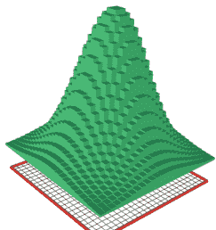

图 3.2. 使用常数基函数重构的高斯函数。

$v_1 = (0, 0), v_2 = (1, 0), v_3 = (1, 1), \text{和 } v_4 = (0, 1).$ 即，以原点为第一个顶点的边长为 1 的轴对齐正方形。我们称其为 $\mathbb{R}^d$ 中的 *参考单元*。在以下内容中，为了区分给定在参考单元 $[0, 1]^d$ 中的坐标与给定在函数域 $\mathrm{D} \subset \mathbb{R}^d$ 中的坐标，我们用 $r_1, \dots, r_d$（当 $d=3$ 时为 $r, s, t$）表示前者，用 $x_1, \dots, x_d$（当 $d=3$ 时为 $x, y, z$）表示后者。参考单元中的坐标也称为 *参考坐标*。对于我们的参考单元，我们现在定义四个局部基函数 $\Phi_1^1, \Phi_2^1, \Phi_3^1$ 和 $\Phi_4^1 : [0, 1]^2 \to \mathbb{R}$ 如下（另见图 3.3）：$^2$

```
\(\begin{aligned} \Phi_1^1(r,s) &= (1-r)(1-s), \\ \Phi_2^1(r,s) &= r(1-s), \\ \Phi_3^1(r,s) &= rs, \\ \Phi_4^1(r,s) &= (1-r)s; \end{aligned}\)
(3.7)
```

我们使用大写字母（例如，\(\Phi\)）表示这些局部基函数，以将它们与全局、网格范围的基函数区分开来，后者用小写字母（例如，\(\phi\)）表示。这些基函数确实既是正交的也是正态的。对于参考单元中的任何点 \((r, s)$，我们现在可以使用这些基函数来定义

$^2$在以下内容中，对于基函数 \(\Phi_i^j\)，上标 \(j\) 表示函数的阶数（0 = 常数，1 = 线性，等等），下标 $i$ 表示该函数对应的单元顶点的索引。

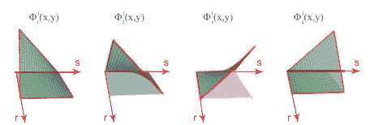

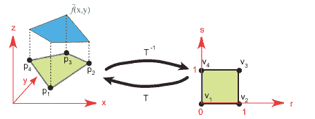

图 3.3. 四边形单元的基函数、插值和坐标变换。


参考基函数。我们这样做：给定具有 $n$ 个顶点 $p_1, \dots, p_n$ 的任意单元类型（在 $\mathbb{R}^3$ 中），我们定义变换 $T$，将参考单元坐标系中的点 $r, s$ 映射到实际单元中的点 $x, y, z$，如下所示：

$(x, y, z) = T(r, s) = \sum_{i=1}^n p_i \Phi_i^t(r, s). \quad (3.8)$

换句话说，$T$ 是给定单元的基函数 $\Phi_i^t$ 的线性组合，在参考单元的所需位置 $r, s$ 处求值，并以世界单元顶点坐标 $p_i$ 为权重。如果 $T$ 将参考单元映射到世界单元，则其逆变换 $T^{-1}$ 将世界单元中的点 $x, y, z$ 映射到参考单元中的点 $r, s$，我们的基函数 $\Phi_i^t$ 就定义在那里。使用 $T^{-1}$，我们可以为四边形单元 c 重写方程 (3.2) 为

$\tilde{f}(x, y, z) = \sum_{i=1}^4 f_i \Phi_i^t(T^{-1}(x, y, z)). \quad (3.9)$

要计算逆变换 $T^{-1}$，我们必须反转方程 (3.8) 给出的表达式。由于此反转取决于实际单元类型，我们将在 3.4 节中详细说明 $T^{-1}$ 的具体表达式。

综上所述。我们现在有了一种方法，可以从任何四边形网格上的样本重构分段 $C^1$ 函数 $\tilde{f}$：对于网格中的每个单元 $c$，我们只需应用方程 (3.9)。我们现在终于可以用一组全局基函数 $\phi$ 来定义我们的分段 $C^1$ 重构，就像我们之前对分段常数重构（方程 (3.6)）所做的那样。给定具有样本点 $p_i$ 和四边形单元 $c_i$ 的网格，我们可以定义我们的网格基函数 $\phi_i^1$ 如下：

$\phi_i^1(x, y, z) = \begin{cases} 0, & \text{if } (x, y, z) \notin cells(p_i), \\ \Phi_i^t(T^{-1}(x, y, z)), & \text{if } (x, y, z) \in c = \{v_1, v_2, v_3, v_4\}, \text{ where } v_j = p_i, \end{cases} \quad (3.10)$

其中 $cells(p_i)$ 表示以 $p_i$ 为顶点的单元。

换句话说，方程 (3.10) 表示，每个与样本点 $p_i$ 对应的基函数 $\phi_i^1$，等于对应单元顶点 $v_j = p_i$ 的变换后的局部基函数 $\Phi_j^t$，适用于所有在以 $p_j$ 为顶点的单元中的点，并且在这些单元之外的所有地方均为零。我们可以验证 $\{\phi_i^1\}$ 是正交且归一的。此外，它们按定义是 $C^1$ 连续的。因此，使用这些基函数对采样数据集（方程 (3.2)）进行重构是分段 $C^1$ 的。对于我们的高度图可视化，使用这些基函数意味着我们用一组

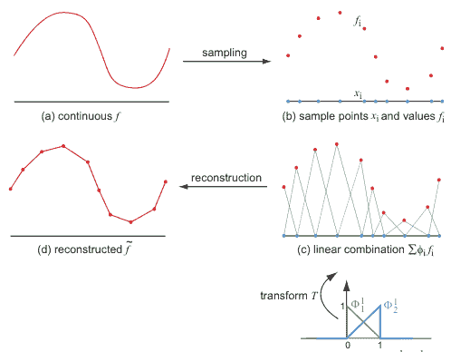

图 3.4. 采样与重构概览。

$C^1$ 曲面元素。因此，2.1 节中显示的所有使用一组四边形渲染我们高度图的可视化，无非是使用 $C^1$ 基函数对函数图曲面进行的重构。幸运的是，在进行渲染时，我们不必自己编程实现此插值。对于线、三角形和四边形等多种单元类型，当今几乎所有渲染引擎（例如 OpenGL）都将高效的插值实现作为渲染原语提供。

完整的采样和重构过程在图 3.4 中以一维信号为例进行了示意图说明。在点 $x_i$ 处对连续信号 $f$ 进行采样，得到一组样本 $f_i$。让我们沿着由线段组成的简单网格组织这些样本——也就是说，每个单元 $(x_i, x_{i+1})$ 包含两个连续样本 $(f_i, f_{i+1})$。执行单元级重构，即将单元样本乘以通过变换 $T$ 从参考基函数 \(\Phi_1^i\) 和 \(\Phi_2^i\) 得到的全局基函数 $\phi_i$，并将结果相加，我们得到重构信号 $\tilde{f}$。

| | 常数几何 | 双线性几何 |
|---|---|---|
| 常数光照 | 阶梯着色 | 平面着色 |
| 双线性光照 | — | Gouraud 着色 |

表 3.1. 几何和光照插值类型的组合。

迄今描述的采样和重构机制不仅可应用于曲面几何，还可应用于更多的数据属性。例如，让我们考虑曲面着色。如第 2 章所介绍，着色可以看作是一个函数 \(s : \mathbb{R}^3 \times \mathbb{R}^3 \to \mathbb{R}\)，给定曲面点位置 \(p \in \mathbb{R}^3\) 和曲面法线 \(\mathbf{n} \in \mathbb{R}^3\)，它产生光强度。我们已经看到，给定一组曲面样本点，如何使用常数或 \(C^1\) 基函数来近似曲面的几何，分别得到阶梯（例如，图 3.2）或多边形（例如，图 2.1）表示。现在的问题是：我们是否可以将相同的重构机制应用于曲面着色？如果可以，权衡是什么？

使用我们的基函数机制，答案现在很简单。对于多边形曲面渲染，如第 2 章所介绍的平面着色，将使用光照方程（方程 (2.1)）在每个多边形中心计算出的强度值 $\tilde{s}$ 赋给所有多边形点。显然，这无非是使用分段基函数（方程 (3.6)）对照明函数 $\tilde{s}$ 进行插值。综上所述，一个平面着色的多边形曲面，例如图 2.1 中的高度图，是对原始连续曲面的重构，几何使用分段双线性插值，照明使用分段常数插值。那么，如第 2 章所介绍的 Gouraud 或平滑着色呢？回想一下，Gouraud 着色使用相应的顶点法线，在每个多边形顶点 \(v_i\) 处计算光照方程（方程 (2.1)）。例如，对于一个四边形，这会产生四个照明值 \(s_i\)。接下来，Gouraud 着色通过使用分段双线性基函数在这些值 \(s_i\) 之间进行插值，在多边形上产生“平滑”的照明。综上所述，一个 Gouraud 着色的多边形曲面，例如图 2.5 中的高度图，是对原始连续曲面的重构，几何和照明都使用分段双线性插值。几何和光照插值类型的各种组合可能性在表 3.1 中总结。请注意，几何使用分段常数插值而照明使用分段双线性插值的组合没有意义，因为插值几何是不连续的。

### 3.3 离散数据集

在前面的章节中，我们已经描述了如何从给定网格的单元顶点处提供的采样数据重构连续函数。简而言之，我们可以说，给定

- 由一组样本点定义的一组单元组成的网格，
- 单元中心或单元顶点处的一些采样值，
- 一组基函数，

我们可以在此网格上定义采样信号的分段连续重构，并以类似于处理样本来源的连续信号的方式使用它（例如，计算其导数或绘制其图形）。

在 3.1 节中，我们为函数 f : D → C 定义了连续数据集为三元组 D = (D, C, f)。在离散情况下，我们用采样网格 ({pᵢ}, {cᵢ}) 替换了函数域 D，并用由网格、样本值 fᵢ 和一组基函数 {Φᵢᵏ} 计算出的分段 k 阶连续重构 f̃ 替换了连续函数 f（方程 (3.2)）。因此，(D, C, f) 的离散（采样）数据集对应项是元组 Dₛ = ({pᵢ}, {cᵢ}, {fᵢ}, {Φᵢᵏ})：网格点、网格单元、样本值和参考基函数。可视化在绝大多数情况下都处理离散数据，因此离散数据集在理论和实践中都是基本工具。在本书余下部分讨论数据集时，我们将始终指本处定义的离散数据集。

在前面的章节中，我们已经展示了如何用其离散对应项 Dₛ 替换连续数据集 D_c。我们已经看到，从数学角度来看，这种替代意味着使用分段 k 阶连续函数 f̃，而不是潜在的更高阶连续函数 f。在本节中，我们将注意力转向离散数据集的实现方面。我们回顾 3.1 节中引入的数据集要求：数据集应当准确、最小、通用、高效且简单。对于离散数据集，这些要求转化为对样本点 pᵢ 的数量和位置、单元 cᵢ 的形状、参考基函数 Φᵢ 的类型以及样本值 fᵢ 的数量和类型的约束。这些约束决定了特定的实现解决方案，如下所示。单元形状连同基函数决定了不同的单元类型。这些将在下一节 3.4 中描述。样本点的数量和位置决定了不同的网格类型。这些将在


第 3.5.1、3.5.2、3.5.3 和 3.5.4 节。最后，样本值 $f_i$ 的数量和类型决定了 *属性类型*。这些在 3.6 节中描述。

### 3.4 单元类型

如 3.2 节所述，网格是单元 $c_i$ 的集合，其顶点为网格采样点 $p_i$。给定在点 $p_i$ 处采样的一些数据，单元用于定义用于在采样点之间插值数据的基函数 $\phi_i$ 的支撑。因此，采样点连接形成单元的方式与我们想要采样的域以及我们想要用于重建的基函数类型有关。

如果我们想用所有单元的并集 $\cup c_i$ 来近似 D，则单元 $c_i$ 的维度 $d$ 必须与采样域 D 的拓扑维度相同。如果 D 是曲线，我们将使用线单元。如果 D 是曲面，我们将使用平面单元，例如多边形。如果 D 是体积（$d=3$），我们必须使用体积单元，例如四面体。此类单元的参考坐标系具有 $d$ 个维度，接下来分别用 $r$、$s$ 和 $t$ 表示。

接下来，我们将介绍数据可视化应用中最常用的单元类型。图 3.5 显示了每种单元类型的单元形状、其顶点 $p_0, \dots, p_n$ 以及参考坐标系 $rst$ 中参考单元的形状。对于每种单元类型，我们还将介绍其支持的线性基函数，以及将实际（世界）单元中的位置 $x, y, z$ 映射到参考单元中位置 $r, s, t$ 的坐标变换 $T^{-1}$。

#### 3.4.1 顶点

我们从维度 $d=0$ 的最简单单元类型开始。该单元本质上与其单个顶点 $c=\{v_1\}$ 相同。根据正态性属性（公式 (3.5)），可知顶点具有一个常数基函数：

\(\Phi_1^0 = 1.\) (3.11)

本质上，顶点单元与采样点本身相同，且不提供任何额外内容。在实践中，人们不区分采样点和顶点单元，因此这些单元更多地被视为一种建模抽象。

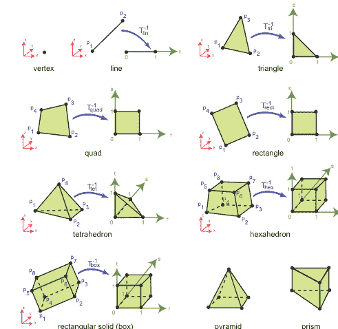

图 3.5. 世界（红色）和参考（绿色）坐标系中的单元类型。

#### 3.4.2 线

下一维度的单元类型是线段，即线。线单元的维度为 \( d = 1 \) 且有两个顶点，即 \( c = \{v_1, v_2\} \)。线单元用于沿任何维度中嵌入的任何类型曲线进行插值，例如平面曲线或空间曲线。线单元允许线性插值。给定由点 \( v_1 = 0, v_2 = 1 \) 定义的参考线单元，两个线性基函数为

\(\Phi_1^1(r) = 1 - r,\)
\(\Phi_2^1(r) = r.\) (3.12)

对于包含在线单元 \( (p_1, p_2) \) 中的点 \( p \)，变换 $T^{-1}$ 简单地是线段 $pp_1$ 长度与单元长度之比，即

\( T_{lin}^{-1}(x, y, z) = \frac{\|p - p_1\|}{\|p_2 - p_1\|}. \) (3.13)

#### 3.4.3 三角形

我们现在进入下一维度，$d=2$。这里，最简单的单元类型是三角形，即 $c = \{v_1, v_2, v_3\}$。三角形可用于沿任何维度中嵌入的任何类型曲面进行插值，例如平面曲面或曲面。我们可以在三角形上进行线性插值。给定由点 $v_1 = (0, 0)$、$v_2 = (1, 0)$、$v_3 = (0, 1)$ 定义的参考三角形单元，三个线性基函数为

\(\Phi_1^t(r, s) = 1 - r - s,\)
\(\Phi_2^t(r, s) = r,\)
\(\Phi_3^t(r, s) = s.\) (3.14)

三角形单元的变换 $T^{-1}$ 比线单元略微复杂一些：

\( T_{tri}^{-1}(x, y, z) = (r, s) = \left( \frac{\|(p - p_1) \times (p_3 - p_1)\|}{\|(p_2 - p_1) \times (p_3 - p_1)\|}, \frac{\|(p - p_1) \times (p_2 - p_1)\|}{\|(p_3 - p_1) \times (p_2 - p_1)\|} \right) \) (3.15)

图 3.6 直观地解释了这一点：取世界坐标中的三角形 $(p_1, p_2, p_3)$，并用 $A_{123}$ 表示其面积。取该三角形内的一点 $p$，并分别考虑三角形 $(p, p_1, p_2)$ 和 $(p, p_1, p_3)$ 的面积 $A_{12}$ 和 $A_{13}$。这些量就是 $p$ 在我们三角形内的所谓重心坐标。现在考虑面积比 $r = A_{13}/A_{123}$ 和 $s = A_{12}/A_{123}$，它们正是公式 3.15 中的表达式。由于 $p$ 保持在初始三角形内，$r$ 和 $s$ 均限制在 $[0, 1]$ 之内。此外，当 $p = p_1$ 时，我们得到 $(r, s) = (0, 0)$；当 $p = p_2$ 时，我们得到 $(r, s) = (1, 0)$；当 $p = p_3$ 时，我们得到 $(r, s) = (0, 1)$。$r$ 和 $s$ 的值正是我们想要的参考单元坐标。

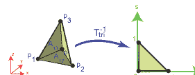

图 3.6. 使用重心坐标解释的坐标变换 $T_{tri}$。

#### 3.4.4 四边形

在二维曲面上进行插值的另一种可能性是使用四边形单元，即四边形。自第 2 章中我们的第一个可视化示例（高度图）以来，我们已经看到了使用四边形来近似曲面的示例。四边形由四个顶点 $c = (v_0, v_1, v_2, v_3)$ 定义，并有四个对应的基函数。参考四边形由点 $v_1 = (0, 0)$、$v_2 = (1, 0)$、$v_3 = (1, 1)$、$v_4 = (0, 1)$ 定义，是一个边长为 1 的轴对齐正方形。在这个参考四边形上，基函数为

\(\Phi_1^1(r,s) = (1-r)(1-s),\)
\(\Phi_2^1(r,s) = r(1-s),\)
\(\Phi_3^1(r,s) = rs,\)
\(\Phi_4^1(r,s) = (1-r)s.\)
(3.16)

在曲面上插值时，是使用四边形还是三角形，这是一个自然的问题。在大多数情况下，答案取决于实现的便利性。与使用双线性基函数的等效四边形相比，在具有线性基函数的三角形上进行的一些操作（例如，计算单元与直线的交点或单元到直线的距离）实现起来相对简单（可能更快）。然而，使用三边形渲染相同的（大型）网格可能比使用四边形更慢，因为大约需要发送两倍的图元到图形引擎。在设计可视化软件时，良好的做法是尽可能少地使用单元类型。对于任何必须在网格中所有单元上工作的数据处理操作（例如，计算导数）也是如此。灵活性与简单性之间的良好折中方案是将四边形单元作为输入数据支持，但在内部将其转换为三角形单元，即通过其两条对角线之一将每个四边形分割为两个三角形。这简化并精简了整体软件设计，因为只需进一步实现三角形操作。

不幸的是，一般四边形单元的变换 $T_{quad}$ 不像三角形单元那样简单。当处理四边形单元的双线性基函数（公式 3.16）时，我们无法反转公式 (3.8)。解决此问题的一个方法是数值求解 $r, s$ 作为 $x, y, z$ 的函数 [Press et al. 02]。

如果我们的实际四边形单元是矩形而非任意四边形，例如在均匀网格或矩形网格中，我们可以做得更好。在这种情况下，变换 $T_{\text{rect}}^{-1}$ 由两个线变换 $T_{\text{lin}}^{-1}$ 组成。给定具有顶点 $p_1, p_2, p_3, p_4$ 的四边形单元，我们有

\( T_{\text{rect}}^{-1}(x, y, z) = (r, s) = \left( \frac{(p - p_1) \cdot (p_2 - p_1)}{\|p_2 - p_1\|^2}, \frac{(p - p_1) \cdot (p_4 - p_1)}{\|p_4 - p_1\|^2} \right). \) (3.17)

#### 3.4.5 四面体

我们现在进入下一维度，$d=3$。这里，最简单的单元类型是四面体，由其四个顶点 $c = (v_1, v_2, v_3, v_4)$ 定义。在由点 $v_1 = (0, 0, 0)$、$v_2 = (1, 0, 0)$、$v_3 = (0, 1, 0)$、$v_4 = (0, 0, 1)$ 定义的参考四面体上，四个线性基函数为

\(\Phi_1(r, s, t) = 1 - r - s - t,\)
\(\Phi_2(r, s, t) = r,\)
\(\Phi_3(r, s, t) = s,\)
\(\Phi_4(r, s, t) = t.\) (3.18)

给定具有顶点 $p_1, p_2, p_3, p_4$ 的四面体单元，我们可以使用为 $T_{\text{tri}}^{-1}$ 概述的重心坐标思想（见 3.4.3 节）来推导变换 $T_{\text{tet}}^{-1}$。具体来说，如果 $T_{\text{tet}}^{-1}(x, y, z) = (r, s, t)$，则点 $p = (x, y, z)$ 的参考坐标 $r$、$s$ 和 $t$ 可以计算为四面体 $(p, p_1, p_3, p_4)$、$(p, p_1, p_2, p_4)$ 和 $(p, p_1, p_2, p_3)$ 的体积与 $(p_1, p_2, p_3, p_4)$ 的体积之比。这给出了参考坐标的以下公式：

\( r = \frac{|(p - p_4) \cdot ((p_1 - p_4) \times (p_3 - p_4))|}{|(p_1 - p_4) \cdot ((p_2 - p_4) \times (p_3 - p_4))|},\)
\( s = \frac{|(p - p_4) \cdot ((p_1 - p_4) \times (p_2 - p_4))|}{|(p_1 - p_4) \cdot ((p_2 - p_4) \times (p_3 - p_4))|},\)
\( t = \frac{|(p - p_3) \cdot ((p_1 - p_3) \times (p_2 - p_3))|}{|(p_4 - p_3) \cdot ((p_2 - p_3) \times (p_1 - p_3))|}.\) (3.19)

一些应用也使用棱锥单元和棱柱单元来离散化体积域（见图 3.5）。为了限制在具体软件实现中需要支持的单元类型数量，棱锥单元和棱柱单元可以分割为四面体单元，类似于我们将四边形单元分割为两个三角形单元的方式。


#### 3.4.6 六面体

下一个 \( d = 3 \) 维单元类型是六面体，或称 hex，由其八个顶点 \( c = (v_1, \dots, v_8) \) 定义。参考六面体是单位边长的轴对齐立方体，\( v_1 \) 位于原点。在此单元上，八个线性基函数为

```
\(\Phi_1^1(r, s, t) = (1 - r)(1 - s)(1 - t),\)
\(\Phi_2^1(r, s, t) = r(1 - s)(1 - t),\)
\(\Phi_3^1(r, s, t) = rs(1 - t),\)
\(\Phi_4^1(r, s, t) = (1 - r)s(1 - t),\)
\(\Phi_5^1(r, s, t) = (1 - r)(1 - s)t,\)
\(\Phi_6^1(r, s, t) = r(1 - s)t,\)
\(\Phi_7^1(r, s, t) = rst,\)
\(\Phi_8^1(r, s, t) = (1 - r)st.\)
```

正如 3D 中的四面体单元类比于 2D 中的三角形单元，hex 单元类比于 quad 单元。因此，使用 hex 单元代替四面体的优缺点，与涉及 quad 和三角形的 2D 讨论类似，解决方案也是如此。我们可以将每个六面体单元分割为六个四面体，然后仅使用四面体作为 3D 单元类型，从而简化软件实现和维护。

与 quad 单元类似，六面体单元的变换 \( T_{box}^{-1} \) 无法解析计算，必须使用数值方法确定。然而，再次与 quad 单元类似，如果我们的实际 hex 单元是矩形立方体，即盒子，也就是说它们的边彼此正交（参见图 3.5），则可以做得更好。这些单元也称为 _盒单元_。在此情况下，\( T_{box}^{-1} \) 可以通过组合三个线单元变换 \( T_{lin}^{-1} \) 的实例来计算，类似于我们对矩形单元所采用的方法（公式 3.17）：

```
\( T_{box}^{-1}(x, y, z) = (r, s, t) \)
\( = \left( \frac{(p - p_1)(p_2 - p_1)}{\|p_2 - p_1\|^2}, \frac{(p - p_1)(p_4 - p_1)}{\|p_4 - p_1\|^2}, \frac{(p - p_1)(p_5 - p_1)}{\|p_5 - p_1\|^2} \right). \)
```

#### 3.4.7 其他单元类型

我们已介绍了 \( d \in [0, 3] \) 维中最常用的单元类型。作为结束语，我们提到，各种作者和软件包有时会提供更多单元类型，例如 2D 中的正方形、像素、三角形条、多边形

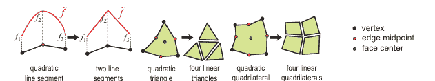

图 3.7. 将二次单元转换为线性单元。

以及 3D 中的立方体和体素。此类单元具有与这里描述的相似的（线性）插值函数和属性。正方形和像素本质上与我们的矩形单元相同，只是它们的边长相等，且像素通常被认为与坐标轴对齐。三角形条 [Shreiner et al. 03, Schroeder et al. 06] 从插值角度来看并不是一种不同的单元类型，只是一种更节省内存的方式来存储共享边的三角形单元序列，因此可以视为实现级别的优化。立方体和体素在 3D 中所起的作用，分别相当于正方形和像素在 2D 中的作用。

最后，让我们提到，迄今为止我们描述的分段常数和线性基函数并非实践中使用的唯一基函数。某些应用使用 _二次_ 单元，之所以如此命名是因为它们可以支持二次基函数。3 二次单元是这里所介绍单元的等价物，但还包含单元边的中点——如图 3.7 中几种单元类型所示的红点。此类单元可以支持二次基函数，并提供分段二次（C2），因此更平滑的数据重建，常用于有限元方法 [Reddy 93] 等数值应用。4 图 3.7（左）显示了沿一维二次单元的二次插值 f_quad，其生成抛物线，以及沿通过分割二次单元得到的相应两个线性单元的等效线性插值 f_lin。

然而，很少有可视化应用原生支持此类单元。在实践中，可视化应用通常通过使用单元边中点和/或单元中心将含二次单元的数据集分割为多个线性单元，将其转换为我们先前描述的单元类型（图 3.7 中展示了几个 1D 和 2D 单元的示例），或者甚至简单地忽略额外的中点及其关联数据。除了增加复杂性之外，二次单元无法由标准 OpenGL 直接渲染，后者仅支持多边形上颜色的线性（Gouraud）插值。尽管像像素着色器这样的较新功能允许简单实现对多边形每个像素执行二次颜色插值，但此类扩展目前尚未被可视化软件广泛支持。

作为一般结论，当您需要实现和维护特定的可视化应用程序时，仅支持严格所需的最少数量的单元类型，而不是所有可能的变体，会简单得多、更快速且出错率更低。通常，只有当新单元类型能让您比软件已支持的单元类型更容易和/或更高效地实现某些特定的可视化或数据处理算法时，才应将其添加到应用程序的数据表示中。

### 3.5 网格类型

既然我们已介绍了单元类型，现在可以描述使用这些单元可以构建的各种网格类型。可视化实践中存在多种网格类型。我们将描述最广泛使用的网格类型：均匀网格、矩形网格、结构化网格和非结构化网格。

#### 3.5.1 均匀网格

我们从最简单的网格类型开始，*均匀网格*。在均匀网格中，域 D 是一个轴对齐盒，例如 d = 1 时为线段，d = 2 时为矩形，d = 3 时为矩形立方体。我们可以将此盒描述为 d 对 ((m1, M1), ..., (md, Md)) 的集合，其中 (mi, Mi) ∈ R²，mi < Mi 是盒在第 i 维上的坐标。在均匀网格上，样本点 pi ∈ D ⊂ Rd 沿域 D 的 d 轴等距分布。如果我们用 δ1, ..., δd ∈ R 表示沿 D 的 d 轴的间距或采样步长，则均匀网格上的样本点可以写为 pi = (m1 + n1δ1, ..., md + ndδd)，其中 n1, ..., nd ∈ N。每个轴上有 Ni = 1 + (Mi − mi)/δi 个样本点。因此，在均匀网格中，样本点由其 d 个整数坐标 n1, ..., nd 描述。这些整数坐标有时也称为 *结构化坐标*。均匀网格的一个简单示例是 2D 像素图像，其中每个像素 pi 由两个整数坐标定位。均匀网格中样本点的强规则性使其实现简单且经济。我们可以按索引的递增顺序，从 \(n_1\) 到 \(n_d\)，唯一地对样本点 \(p_i\) 进行排序，即，

\(i = n_1 + \sum_{k=2}^d \left( n_k \prod_{l=1}^{k-1} N_l \right).\) (3.22)

此编号约定有时也称为 *字典序*，因为它对应于通过连接索引值形成的字符串 \(n_d, n_{d-1}, ..., n_1\) 的字典序（类似字母顺序）排列。如果我们使用此编号约定，则不必为均匀网格存储显式样本点坐标，因为这些坐标可以从网格大小和每个维度的采样数计算得出。因此，存储 \(d\) 维均匀网格相当于存储 \(3d\) 个值。对于每个维度，我们存储 \((m_i, M_i, \delta_i)\)，即空间范围和采样步长。其他方案也是可能的，例如存储空间范围和每个维度的样本点数 \((m_i, M_i, N_i)\)。此外，这种规则的点排序允许我们通过使用点索引来隐式定义网格单元。例如，让我们考虑一个使用盒状单元（即 1D 中的线段、2D 中的四边形和 3D 中的六面体）的 \(d\) 维均匀网格。在这样的网格中，我们可以使用清单 3.1 中的函数来计算索引为 \(c\) 的单元的顶点索引 \(v[]\)。在清单 3.1 中，d 是一个常量，表示网格维度，即，

```
int getCell(int c, int* v)
{
    int C[d], j;
    int P = \prod_{i=1}^{d-1}(N_i - 1);    //stores cell coordinates
    //compute cell coordinates C[0],...,C[d-1]
    for (j = d-1; j >=0; j--)
    {
        C[j] = c / P;
        c  -= C[j] * P;
        P /= C[j] - 1;
    }
    C[0] = c;
    //now go from cell coordinates to vertex coordinates
    for (i[d] = 0; i[0] < 2; i[0]++)
        for (i[1] = 0; i[1] < 2; i[1]++)
            v[i+++] = lex(C[0]+i[0] ..., C[d-1]+i[d-1]);
    return d;
}
```

清单 3.1. 从单元索引计算顶点索引。


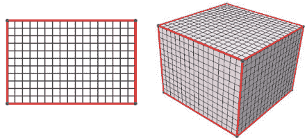

图 3.8. 统一网格。2D 矩形域（左）和 3D 盒域（右）。

d = 1, 2, 或 3。算法的思路很简单。首先，我们从单元索引 c 转换为单元结构化坐标 C[]。接下来，我们从单元结构化坐标转换为顶点结构化坐标。最后，我们从顶点结构化坐标转换为顶点索引。这里，函数 lex(n1,...,nd) 实现公式 (3.22)。但是请注意，单元顶点索引 v[] 的返回顺序与图 3.5 中所示的顺序不同，而是按照顶点结构化坐标的变化顺序排列。其他单元形状（例如 2D 中的三角形和 3D 中的四面体）也可以推导出类似的单元索引到顶点索引的转换。

我们的第一个可视化示例（参见清单 2.1）使用了一个 2D 统一网格来存储要可视化的二元函数的采样值。在代码中，网格由其空间范围 Xmin、Xmax、Ymin 和 Ymax 以及每个维度的采样点数 Nx 和 Ny 定义。

图 3.8 显示了两个统一网格示例，一个用于 2D 矩形域，另一个用于 3D 盒状域。网格边，即顶点中有一个整数坐标等于零的单元边，用红色绘制。网格角，即整数坐标为最小值或最大值（即等于 0 或 Ni）的网格顶点，用绿色绘制。

统一网格的主要优点是其实现简单且存储需求几乎为零。无论其大小如何，存储 d 维网格本身只需 3d 个浮点数值，即仅 12d 字节的内存。5 在网格点上存储实际采样值所需的存储量与采样点数量成正比。例如，为每个采样点存储一个标量值（如我们的高度图可视化中那样），需要 \(\prod_{i=1}^d N_i\) 个浮点数值。但是，这涉及数据属性本身的问题，而非网格问题，如第 3.6 节中进一步所述。

5我们假设在以下内容中，浮点数的大小为四字节，即 32 位。

### 3.5.2 矩形网格

然而简单高效，统一网格的建模能力有限。表示非轴对齐的域形状需要将其放置在轴对齐的边界框中。由于此框是均匀采样的，我们会浪费内存来存储落在域本身之外的采样值。第二章中我们的第一个可视化示例已经说明了第二个问题。为了准确表示具有非均匀变化率的函数（例如绘制函数 \(e^{-(x^2+y^2)}\) 的图像），我们需要在统一网格上使用高采样密度（如图 2.1 所示），或者使用具有非均匀采样密度的网格（如图 2.3(b) 所示）。

矩形网格是朝这个方向迈出的第一步。它们仍然保留统一网格使用的轴对齐、类矩阵的点排序和隐式单元定义（公式 (3.22) 和清单 3.1），但放松了给定轴上等采样距离的约束。相反，矩形网格允许我们为每一行共享每个维度 \(i \in [1, d]\) 中坐标 \(n_i\) 的点定义单独的采样步长 \(\delta_{ij}\)。矩形网格上的采样点可以写为 \(p_i = (x_1, ..., x_d)\)，其中 \(x_i = m_i + \sum_{j=0}^{n_i-1} \delta_{ij}\)。图 3.9 显示了一个矩形网格。

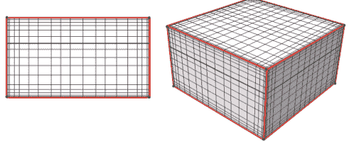

图 3.9. 矩形网格。2D 矩形域（左）和 3D 盒域（右）。

实现矩形网格意味着存储网格原点 \(m_i, N_i\) 以及每个维度的采样计数，与统一网格一样。此外，我们必须存储 \(\delta_{ij}, i \in [1,d], j \in [1,N_i]\) 采样步长。总共，存储需求为 \(2d + \sum_{i=1}^d N_i\) 个值，其中我们假设浮点数和整数在计算机内存中具有相同的存储大小。

图 3.9 显示了两个矩形网格示例。网格边和网格角分别用红色和绿色着色，与第 3.5.1 节中介绍的统一网格一样。这些网格与图 3.8 中显示的统一网格类似，只是沿网格轴的采样点之间的距离 \(\delta_{ij}\) 现在不再相等。2D 矩形网格（参见图 3.9（左））实际上是从 3D 网格（参见图 3.9（右））中提取的一个切片。切片在第 8.1.2 节中详细讨论。

### 3.5.3 结构化网格

然而有用，矩形网格并未消除统一网格固有的两个约束。采样域仍然是一个矩形盒子。采样点密度一次只能沿一个轴更改。例如，对于我们的指数函数高度图可视化，矩形网格不允许我们仅在中心峰区域放置更多采样点，而我们需要在那里放置。要做到这一点，我们需要允许采样点位置的自由放置。

结构化网格正好服务于此目的。它们允许显式放置每个采样点 \(p_i = (x_{i1}, \dots, x_{id})\)。用户可以自由指定所有点的坐标 \(x_{ij}\)。同时，结构化网格保留了采样点的类矩阵排序，这允许从点排序中隐式构建单元。直观地看，结构化网格可以看作是统一网格或矩形网格的自由变形，其中点可以采取任何空间位置，但单元（即网格拓扑）保持不变。实现结构化网格意味着存储所有网格采样点 \(p_i\) 的坐标以及每个维度的点数 \(N_1, \dots, N_d\)。这需要 \(3 \prod_{i=1}^d N_i + d\) 个值的存储空间。

结构化网格可以表示大量形状。图 3.10 显示了几个示例。如图 3.10（左）所示，结构化网格可以表示具有平滑、无角边界的域，例如图像中的圆形域。第二章中介绍的我们熟悉的函数图像表面也最好由结构化网格表示（参见图 3.10（中））。图 3.10（右）显示了一个具有六面体单元的 3D 结构化网格。网格边和网格角分别用红色和绿色绘制，与前几节中讨论的统一网格和矩形网格示例一样。

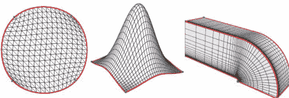

图 3.10. 结构化网格。圆形域（左），曲面（中），3D 体积（右）。结构化网格边和网格角分别用红色和绿色绘制。

### 3.5.4 非结构化网格

结构化网格可以看作是统一网格的变形，其中点的拓扑排序保持不变，但其几何位置允许自由变化。但是，有些形状无法由结构化网格有效建模。例如，考虑一个由中间带有圆形孔的正方形组成的域（参见图 3.11）。我们无法用结构化网格覆盖这个域，因为我们无法将矩形变形为带孔的矩形——这两个形状具有不同的拓扑。8 目前为止描述的所有网格类型的第二个局限性涉及网格单元的指定。对于统一网格、矩形网格或结构化网格，单元是隐式指定的，例如，始终以相同顺序连接网格点。在许多情况下，这可能过于限制。

这些问题通过使用非结构化网格得到解决。非结构化网格是最通用和灵活的网格类型。它们允许我们显式定义采样点和单元。非结构化网格可以建模为采样点 {pi}，i ∈ [0, N] 和单元 {ci = (vi1, ..., vicj)} 的集合。值 vij ∈ [0, N] 称为单元顶点，并引用单元使用的采样点 pvi j。因此，单元是采样点索引的有序列表。此模型允许我们独立于其他单元分别定义每个单元。此外，如果需要，不同类型甚至不同维度的单元可以在同一网格中自由混合。如果单元共享相同的采样点作为其顶点，则可以直接表达。此最后属性在多种上下文中很有用。

8这两个形状由其亏格区分。普通正方形的亏格为 0，而带孔正方形的亏格为 1。


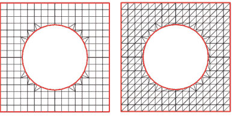

图 3.11. 由中间带有孔的正方形组成的域无法由结构化网格表示。域边界由两个独立的组件构成，用红色绘制。非结构化网格可以轻松建模此类形状，无论是使用 (a) 多种单元类型的组合，例如四边形和三角形，还是 (b) 单一单元类型，例如在此情况下为三角形。

首先，存储索引（通常由整数表示）通常比存储 d 维坐标（例如 d 个浮点值）更便宜。其次，我们可以独立于网格拓扑（即单元定义）来处理网格几何，即样本点 p_i 的位置。

实现非结构化网格意味着首先存储所有网格样本点 p_i 的坐标，与结构化网格一样，然后存储所有单元的所有顶点索引。这些索引通常作为网格样本点列表 [p_i] 中的整数偏移量存储。如果在网格偏移量中使用不同的单元类型，则必须为每个单元存储单元大小（即顶点数量），或者将单元组织在单独的列表中，其中每个列表仅包含给定类型的单元。在实践中，最好使用包含单一单元类型的非结构化网格，因为这些网格更容易实现，并且还可以显著加快应用程序代码。存储非结构化网格的成本取决于所使用的单元类型和实际网格。例如，一个包含 C 个 d 维单元、每个单元有 V 个顶点和 N 个样本点的网格将需要 dN + CV 个值。

图 3.12 显示了几个非结构化网格示例。第一个网格（图 3.12 左侧）显示与图 3.10 中相同的圆形域，但现在是在非结构化网格上采样。域边界用红色绘制。第二个示例（图 3.12 中间）显示了一个更复杂的 2D 域，通过对包含磁共振成像（MRI）的 3D 均匀数据集进行切片得到。

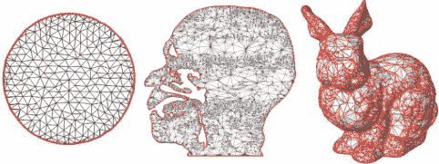

图 3.12. 非结构化网格。圆形（左侧）、头部切片（中间）和 3D 兔子表面（右侧）。

扫描与平面。切片在 8.1.2 节中详细讨论。为了清晰起见，域边界用红色绘制。显然，使用结构化网格对具有如此复杂和不规则边界的域进行采样是困难的，甚至不可能。然而，非结构化网格没有问题来表示这样的域。第三个示例（图 3.12 右侧）显示了一个表示 3D 兔子表面的非结构化网格，网格边缘为了清晰起见用红色绘制。与前一个示例一样，非结构化网格可以毫无问题地表示此类形状。

### 3.6 属性

到目前为止，我们已经描述了离散数据集 $\mathcal{D}_s = (\{p_i\}, \{c_i\}, \{f_i\}, \{\Phi_i^k\})$ 的四个要素中的三个：由样本点 $p_i$ 和单元 $c_i$ 组成的网格，以及参考基函数 $\Phi_i^k$。本节更详细地讨论样本值 $f_i$。

正如我们在数据表示讨论开始时所说，可视化数据可以由某个连续或离散函数建模，其值在域 $\mathbf{C} \in \mathbb{R}^c$ 中。因此，样本值 $f_i$ 是 $c$ 维点。在可视化中，采样数据集的样本值集合通常称为 *属性数据*。属性数据可以由其维度 $c$ 以及所表示数据的语义来表征。这产生了几种 *属性类型*。这些将在以下各节中描述。

#### 3.6.1 标量属性

标量属性是 c = 1 维的。这些由普通实数表示。标量属性可以编码各种物理量，例如温度、浓度、压力或密度，或几何度量，例如长度或高度。后者是我们函数 f : R^2 -> R 的情况，该函数在我们的高度图示例中可视化。

#### 3.6.2 向量属性

向量属性通常是 c = 2 或 c = 3 维的。向量属性可以编码位置、方向、力或标量函数的梯度。通常，向量具有方向和大小，后者也称为长度或范数。如果只有大小相关，那么我们实际上有一个标量属性，而不是向量属性。如果只有方向相关，我们谈论归一化向量，即单位长度向量。当此类向量表示隐函数的归一化梯度时，其图形是 2D 曲线或 3D 表面，这些单位向量也称为法线，如第 2 章所述。一些作者将向量和法线视为两种不同的属性类型。然而，在实践中，从数据表示的角度来看，两者之间没有结构差异。特别是，在大多数可视化软件中，法线也使用与向量相同的分量数量存储，即 2D 曲线法线的 c = 2 和 3D 表面法线的 c = 3，因为这大大简化了数据存储实现。

#### 3.6.3 颜色属性

颜色属性通常是 c = 3 维的，表示计算机屏幕上可显示的颜色。颜色属性的三个分量可以有不同的含义，具体取决于所使用的颜色系统。最常用的颜色系统之一是众所周知的 RGB 系统，其中三个颜色分量指定给定颜色所包含的红色、绿色和蓝色的量或强度。通常，这些分量范围从 0（没有给定分量的量）到 1（分量处于全亮度）。RGB 系统是一种加色系统。也就是说，每种颜色都表示为不同量的“纯”红色、绿色和蓝色颜色的混合。三种颜色的等量决定灰色色调，而其他组合决定各种色调。

RGB 空间。RGB 颜色空间通常表示为一个颜色立方体，一个角在原点，对角相对的角在位置 (1, 1, 1)，边与 R、G 和 B 轴对齐（参见图 3.13(a)）。立方体内的每个点代表一种可显示的颜色。

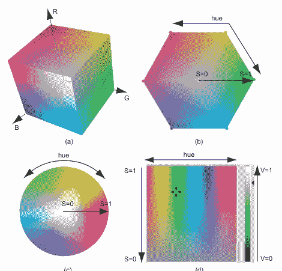

图 3.13. 颜色空间表示。(a) RGB 立方体。(b) RGB 六边形。(c) HSV 颜色轮。(d) HSV 颜色小部件 (Windows)。

立方体连接点 (0, 0, 0) 和 (1, 1, 1) 的主对角线是所有灰度值的轨迹。较亮的颜色位于靠近立方体外表面（在图中可见）的位置，而较暗的颜色位于靠近原点（在图中隐藏）的位置。从实现角度来看，RGB 颜色表示很方便，因为大多数图形软件，例如 OpenGL 和图像存储格式，都以这种方式操作颜色。

然而，在实践中，操作颜色空间的 3D 立方体表示可能很困难。此外，由于我们无法看到 RGB 立方体“内部”，因此仅可视化立方体的外表面可能很方便。如果我们沿主对角线使用正射投影观察立方体，我们会看到一个 2D 六边形，如图 3.13(b) 所示。立方体的角，即原色，显示为小球体。如我们接下来将看到的，这代表所有亮度等于 1 的颜色的空间。此外，RGB 立方体内部的所有其他颜色只是这些颜色的更暗版本。

HSV 空间。另一种流行的颜色表示系统是 HSV 系统，其中三个颜色分量指定给定颜色的色调、饱和度和值。HSV 系统的优点是对人类用户更直观。*色调* 区分不同波长的不同颜色，例如红色、黄色和蓝色。*饱和度* 表示颜色的“纯度”。直观地，这可以看作是色调被白色稀释的程度，或者颜色距离原色有多远。饱和度为 1 对应纯色、未稀释的颜色，而饱和度为 0 对应白色。*值* 表示给定颜色的亮度或光度。值为 0 始终是黑色，而值为 1 是给定系统中可以表示的给定色调和饱和度的最亮颜色。出于这个原因，HSV 系统有时也称为 HSB，其中“B”代表亮度。HSV 颜色空间通常使用 *颜色轮* 表示（参见图 3.13(c)）。颜色轮内的每个点 p 代表一个 HSV 颜色轮，其色调由向量 p − o 与水平轴形成的角度（缩放到 [0, 1] 范围）给出，其中 o 是轮子的中心，其饱和度由同一向量的长度 ||p − o|| 给出。值不是由颜色轮显式表示的。因此，颜色轮显示了给定值的所有可能色调和饱和度。如果将值作为与颜色轮空间正交的维度添加，那么整个 HSV 空间将形成一个圆柱。HSV 颜色轮在颜色排列方面与 RGB 颜色六边形非常相似。与六边形相比，颜色轮的优势在于色调参数映射到平滑变化的视觉属性，即轮子角度。例如，在这两种表示中，恒定饱和度的曲线分别是圆和六边形。

如我们接下来将看到的，HSV 颜色的值（或亮度）分量等于 R、G 和 B 分量的最大值。因此，对于给定值 V ∈ [0, 1]，HSV 颜色轮显示的所有颜色都等同于与整个 RGB 立方体相似但边长为 V 的立方体外表面上的所有点。V = 0.5 的此类等值表面在图 3.14 中显示，位于 RGB 立方体内部。如我们将在 5.3 节中看到的，此类恒定值表面称为 *等值面*。

在实践中，存在许多其他颜色空间的可视化表示。例如，Windows 操作系统中的颜色选择器小部件使用一个


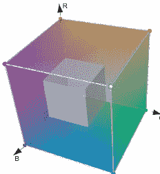

图 3.14. RGB 立方体中表示恒定值 V = 0.5 的颜色的曲面。

不同的颜色表示，如图 3.13(d) 所示。此小部件与 HSV 色轮相似，因为它将色相和饱和度分量映射到一个 2D 表面，在此情况下是正方形而非圆形。值分量显式地表示为彩色正方形右侧的单独颜色条，并显示所有具有由颜色正方形中选定点指定的 H 和 S 分量以及 V ∈ [0,1] 值的颜色。颜色正方形可以被视为沿水平正半轴对色轮进行“裁剪”并将结果形状拉伸为正方形。与色轮将 H 和 S 参数的等变化映射到色轮上不等的位置变化（通过将低 S 分量的颜色压缩到中心周围的相对较小区域）不同，颜色正方形将 HS 空间等距映射到正方形区域。这使用户可能比使用色轮更容易指定低 S 颜色。

##### 在 RGB 和 HSV 之间转换

由于 HSV 颜色规范对最终用户通常更方便，而各种软件需要 RGB 规范，因此了解如何将颜色从 HSV 空间映射到 RGB 空间非常重要。清单 3.2 提供了一个简单的 C++ 函数，用于从 RGB 空间转换到 HSV 空间。在此代码中，RGB 和 HSV 值均表示为三个浮点值的数组，相应的颜色分量按自然数组顺序排列。最大的 RGB 分量给出值，即亮度。

```cpp
void rgb2hsv(float r,float g,float b,
             float& h,float& s,float& v)
{
    float M = max(r,max(g,b));
    float m = min(r,min(g,b));
    float v = d = M-m;
    v = M;        //value = max(r,g,b)
    s = (M>0.000001)? d/M:0;   //saturation
    if (s==0) h = 0;   //achromatic case, hue=0 by convention
    else        //chromatic case
    {
        if (r==M)   h = (g-b)/d;
        else if (g==M) h = 2 + (b-r)/d;
        else        h = 4 + (r-g)/d;
        h /= 6;
        if (h<0) h += 1;
    }
}
```

清单 3.2. 将颜色从 RGB 映射到 HSV 空间。

饱和度表示最小和最大 RGB 分量之间的比率（归一化到 [0,1]），即颜色与灰度值的差异程度。最后，色相给出为中等和最小 RGB 分量之间的差值。当饱和度 S 等于零时会出现一种特殊情况。这对应于灰度，对于灰度，色相 H 无法唯一确定。在这种情况下，按惯例我们设置 H = 0。

清单 3.3 显示了从 HSV 到 RGB 的逆映射实现。代码区分六种情况，分别对应色轮上的 60 度扇区。在每个扇区内，饱和颜色是作为两种原色（例如第一个扇区（H ∈ [0, 1/6]）中的红色和黄色）的线性插值创建的，作为 H 的函数。最终结果是通过作为 S 的函数在饱和颜色和白色之间进行线性插值产生的。

```cpp
void hsv2rgb(float h,float s,float v,
             float& r,float& g,float& b)
{
    int hueCase = (int)(h*6);
    float frac = 6*h-hueCase;
    float lx = v*(1 - s);
    float ly = v*(1 - s*frac);
    float lz = v*(1 - s*(1 - frac));
    switch (hueCase)
    {
        case 0: r=v; g=lz; b=lx; break; // 0<hue<1/6
        case 1: r=ly; g=v; b=lx; break; // 1/6<hue<2/6
        case 2: r=lx; g=v; b=lz; break; // 2/6<hue<3/6
        case 3: r=lx; g=ly; b=v; break; // 3/6<hue<4/6
        case 4: r=lz; g=lx; b=v; break; // 4/6<hue<5/6
        case 5: r=v; g=lx; b=ly; break; // 5/6<hue<1
    }
}
```

清单 3.3. 将颜色从 HSV 映射到 RGB 空间。

从结构上讲，颜色属性也可以被视为向量属性。然而，出于多种原因，颜色在大多数数据可视化软件系统中通常被视为并实现为单独的属性。首先，颜色上的操作与一般向量上的操作相当不同。例如，降低颜色的饱和度、计算其互补色或其灰度值是有意义的，但这些操作在向量数据上没有自然的对应操作。相反，计算两个向量之间的角度是向量属性上更常见的操作，尽管也可以对颜色执行此操作。其次，颜色属性的三个颜色分量通常表示为 [0, 1] 中的正归一化实数值，或者在离散颜色模型的情况下表示为 [0, 255] 中的 8 位整数，而向量分量通常是任意实数。总之，从实现角度来看，将颜色和向量表示为不同的属性类型更自然、更不令人困惑，也更高效。

##### 颜色感知

RGB 和 HSV 颜色空间是表示颜色的简单便捷工具，前者能高效映射到实现，后者则允许用户以简单直观的方式选择颜色。然而，将色相、饱和度和亮度等值解释为人类实际 *感知* 此类颜色属性的方式则是另一回事。以亮度为例。清单 3.2 计算的 HSV 亮度值对于我们感知为“暗”的颜色确实较低，对于我们感知为“亮”的颜色则较高。然而，此值与人类通常认为的给定颜色的亮度并不成正比。例如，在 HSV 模型中，纯蓝色（R = 0, G = 0, B = 1）和纯黄色（R = 1, G = 1, B = 0）具有相同的亮度 V = 1。然而，大多数人会争辩说他们感知纯黄色比纯蓝色更亮。

为了解决此类感知问题，并使颜色空间中表示的颜色差异尽可能接近人类在给定设备上可视化相应颜色时评估的相同颜色的感知差异，已设计了许多其他颜色表示模型或颜色空间。例如，在 sRGB 颜色表示 [ICC 14] 中，颜色的亮度 Y 计算为

Y = 0.21R + 0.72G + 0.07B. (3.23)

直观地，这模拟了人类感知绿色对颜色亮度贡献最大，其次是红色，而蓝色是最不重要的贡献者这一事实。

除了 RGB、HSV 和 sRGB 之外，还存在许多其他颜色空间或颜色表示。颜色表示的理论和实践是一个广泛的主题，超出了本书的范围。有关更多详细信息，我们将感兴趣的读者引向一本关于颜色理论、表示和实践的优秀现场指南 [Stone 03]。

### 3.6.4 张量属性

张量属性是向量和矩阵的高维推广。张量数据最容易通过示例来解释：测量几何对象的曲率。

作为张量的曲率。首先考虑平面曲线 C。对于 C 上的每个点 x0，让我们取一个局部坐标系 xy，使得 x 在曲线上切向，y 在 x0 处垂直于曲线。在此系统中，曲线可以在 x0 附近描述为 y = f(x)，其中 f(x0) = 0。曲率定义为 ∂²f/∂x²(x0)。曲率描述了 C 上的微小运动如何改变曲线的法线，或者曲线在给定点偏离其切线的程度。法线变化越大，曲线与其切线的差异就越大，曲率也就越高。

现在考虑曲面 S（参见图 3.15）。对于 S 上的每个点 x0，取一个局部坐标系 xyz，使得 x 和 y 与曲面相切，z 在 x0 处与曲面法线 n 重合。在 x0 附近，曲面可以描述为 z = f(x, y)，其中 f(x0) = 0。与平面情况类似，曲率描述了沿 S 的微小运动如何导致曲面法线的变化，换句话说，曲面在某个给定点偏离该点切平面的程度。然而，存在一个问题。与曲线上一点周围只能在两个方向上运动（因此可以用单个数字描述）不同，曲面上一点周围的运动可以在无限多个方向上发生，因此无法用单个数字描述。为了解决这个问题，考虑函数 f(x, y) 的梯度 ∇f。变化率


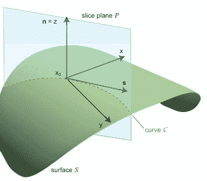

图 3.15. 二维曲面的曲率。

沿某个方向 $\mathbf{s}$ 的 $f$ 的变化率为

$$f(\mathbf{x}_0 + \mathbf{s}) = f(\mathbf{x}_0) + \nabla f(\mathbf{x}_0)\mathbf{s},\quad (3.24)$$

换句话说，我们可以通过以下方式将方向导数 $\partial f / \partial \mathbf{s}$ 与梯度联系起来：

$$\frac{\partial f}{\partial \mathbf{s}} = \nabla f \cdot \mathbf{s}.\quad (3.25)$$

现在考虑在给定方向上表示 *梯度* 的变化率。如果我们现在对方程 3.24 分别对 $x$ 和 $y$ 求导，并使用向量记法将两个得到的表达式组合起来，我们可以得到 $\nabla f = (\partial f / \partial x, \partial f / \partial y)$ 在某个方向 $\mathbf{s}$ 上的变化率可表示为

$$\nabla f(\mathbf{x}_0 + \mathbf{s}) = \nabla f(\mathbf{x}_0) + H(\mathbf{x}_0)\mathbf{s},\quad (3.26)$$

其中 $H$ 是一个 $2 \times 2$ 矩阵，包含 $f(x, y)$ 在 *局部坐标系* 中的二阶偏导数，称为 $f$ 的黑塞矩阵：

$$H = \begin{pmatrix} \frac{\partial^2 f}{\partial x^2} & \frac{\partial^2 f}{\partial x \partial y} \\ \frac{\partial^2 f}{\partial y \partial x} & \frac{\partial^2 f}{\partial y^2} \end{pmatrix}.\quad (3.27)$$

从方程 (3.25-3.27) 中，我们可以轻易得到

$$\frac{\partial^2 f}{\partial s^2}(x_0) = \mathbf{s}^T H \mathbf{s}.$$

这给出了曲面在某点 $x_0$ 沿任何给定方向 $\mathbf{s}$ 的曲率。这个值与曲面与包含向量 $\mathbf{n}$ 和 $\mathbf{s}$ 的平面相交所确定的曲线 $\mathcal{C}$ 的曲率相同（参见图 3.28）也称为 _法向曲率_。然而，要使用方程 (3.28)，每次想要计算某点的曲率时，我们都必须构建局部坐标系。

我们可以按以下方式简化此过程。假设我们的曲面 $\mathcal{S}$ 是以全局坐标而非局部坐标给出的，例如作为隐函数 $f(x, y, z) = 0$。然后，经过一些数学变换后，我们可以表示点 $x_0$ 处曲面法线的变化率为

$$\frac{\partial^2 f}{\partial s^2}(x_0) = \frac{\mathbf{s}^T H \mathbf{s}}{\|\nabla f(x_0)\|}$$

其中 $H$ 是 $f(x, y, z)$ 在 _全局_ 坐标系中的偏导数 $3 \times 3$ 黑塞矩阵：

$$H = \left( \begin{array}{ccc} \frac{\partial^2 f}{\partial x^2} & \frac{\partial^2 f}{\partial x \partial y} & \frac{\partial^2 f}{\partial x \partial z} \\ \frac{\partial^2 f}{\partial y \partial x} & \frac{\partial^2 f}{\partial y^2} & \frac{\partial^2 f}{\partial y \partial z} \\ \frac{\partial^2 f}{\partial z \partial x} & \frac{\partial^2 f}{\partial z \partial y} & \frac{\partial^2 f}{\partial z^2} \end{array} \right).$$

使用方程 (3.30)，我们可以计算以全局坐标给出的曲面的曲率，而无需构建局部坐标系。关于方程 3.29 的推导细节，参见 [Hartmann 99]。

总结来说，我们可以使用平面曲线的二阶导数 $\partial^2 f / \partial x^2$ 来计算其曲率，并使用其偏导数的黑塞矩阵 $H$ 来计算 3D 曲面在给定方向上的曲率。鉴于黑塞矩阵的这一性质，它也被称为给定曲面的 _曲率张量_。

张量、向量和标量。除了曲率，张量还可以描述其他依赖于方向的物理量，例如水的扩散率或材料中的应力和应变。张量由其 _阶_ 来表征。标量是 0 阶张量。向量是 1 阶张量。黑塞曲率张量是一个 2 阶对称张量，因为它由一个对称的 2 阶矩阵表示。一般来说，$k$ 阶张量是 $k$ 维实值数组。

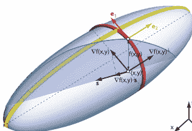

图 3.16. 函数 f(x, y) 的标量值、梯度向量和曲率张量。

表 3.2 总结了两个变量的函数 f(x, y) 的函数值、其梯度及其曲率张量之间的关系。考虑此类函数的高度图，例如图 3.16 中的半椭圆。给定一点 (x, y)，函数本身 f(x, y) 给出该点的图高度。再给定一个方向 s，梯度 ∇f(x, y) 和黑塞张量 H(x, y) 分别可用于获取该方向上图的斜率和曲率。梯度也是 (x, y) 附近斜率最大的方向，最大值为其模。与梯度正交的向量 ∇f(x, y)^⊥ 是斜率最小的方向，最小值为零。同样，对于曲率，我们可以计算曲率分别最大和最小的方向 e1 和 e2，以及最大和最小曲率值 λ1 和 λ2，后者分别是图 3.16 中红色和黄色曲线在 (x, y) 处的曲率。计算这些量的技术称为主成分分析，将在详细介绍张量可视化（第 7.1 节）时讨论。

### 3.6.5 非数值属性

迄今介绍的所有属性类型都是实值的，即某个空间 R^c 中的点。由此产生的问题是，不由

| 量 | 数据 | 斜率 | 曲率 |
|---|---|---|---|
| 值 | f(x, y) | - | - |
| 方向 s 中的值 | - | ∇f(x, y) · s | s^T H(x, y)s |
| 最大方向 | - | ∇f(x, y) | e1 |
| 最大值 | - | ||∇f(x, y)|| | λ1 |
| 最小方向 | - | ∇f(x, y)^⊥ | e2 |
| 最小值 | - | 0 | λ2 |

表 3.2. 函数 f(x, y) 的标量、梯度向量和张量。

实数表示的属性类型是否也可以使用。从纯粹的实现角度来看，答案很简单：我们可以在离散数据集中使用任何数据类型作为属性类型，方法是将数据值（即所需数据类型的实例）存储在网格点上。可能的非数值属性类型示例包括文本、图像、文件名，甚至声音样本。

但是，这样做时，一个关键问题立即浮现：这样的数据集有什么意义？我们将采样（或离散）数据集定义为元组 Ds = ({pi}, {ci}, {fi}, {Φi})，由网格点 pi ∈ D、网格单元 ci、样本值 fi ∈ C 和参考基函数 Φk : D → R 组成。Ds 的主要属性是允许我们根据其样本值 fi ∈ C 重构某个分段 k 阶连续函数 f̃ : D → C。如果我们的属性类型是实值，即 C ⊂ R^n，我们已经看到如何构建基函数来在样本值之间进行插值。当我们使用非数值属性类型时，情况则截然不同。首先，样本值 fi 与实值基函数 Φk 之间的乘法，以及方程 (3.9) 中样本值的加法，应该具有什么含义？例如，字符串与实值的乘法以及两个字符串的加法应该意味着什么？当然，为非数值数据类型定义此类操作始终是可能的，以便可以应用重构方程。然而，更深层次的问题是：通过这种方式重构的内容（即我们的 f̃）与最初采样到 fi 值中的内容（即 f）之间是什么关系？

在许多情况下，对于非数值属性，这种关系很难找到，甚至不存在。相反，如果某个离散数据集中的样本值确实来自连续函数 f 的采样，那么无论属性类型如何，始终可以定义其重构 f̃。在技术上，始终可以将非数值属性存储在离散数据集中，例如在网格点上。然而，这只应被视为出于某些特定目的的实现便利，而不应被视为定义了一个采样数据集。请记住，采样数据集的概念意味着存在


在网格上具有意义的基函数，可以对给定类型的样本值进行插值。如果我们无法对样本值中的属性类型进行插值，那么我们离散数据集中样本点、单元和样本值的语义就不是采样数据集的语义。

如第 3.1 节所述，科学可视化（scivis）是处理采样数据集的数据可视化分支，也是本书的主要主题。纯离散数据集（可能包含点、单元和属性值，但没有基函数）属于信息可视化（infovis）的领域。第 11 章简要介绍了 infovis 技术。

### 3.6.6 属性数据的特性

属性数据的主要目的是允许对采样信息 \(f_i\) 进行重构 \(\tilde{f}\)（参见公式 (3.2)）。属性数据上还可以进行更多操作。一般来说，这些操作可以与人们希望对重构函数 \(\tilde{f}\) 进行的操作相关联。例如，给定一个表示某些向量量的函数 \(\mathbf{v} : \mathrm{D} \rightarrow \mathbb{R}^3\)，以及使用向量属性 \(\mathbf{v}_i\) 计算出的其重构 \(\bar{\mathbf{v}}\)，我们可以通过使用重构 \(\bar{\mathbf{v}}\) 来计算“向量大小”函数 \(f : \mathrm{D} \rightarrow \mathbb{R}_+, f(\mathbf{x}) = \|\mathbf{v}(\mathbf{x})\|\) 的重构 \(\tilde{f}\)。也就是说，我们已将连续函数 \(f\) 上的“向量大小”操作替换为对样本值 \(\mathbf{v}_i\) 的操作。

采样数据集中的属性数据具有以下几个一般特性。

- **完整性。** 首先，属性数据，即样本值 \(f_i\)，必须为数据集 \(\mathcal{D}_s\) 的所有样本点 \(p_i\) 定义。确实，如果某些点 \(p_j\) 处缺少样本，则无法对共享这些点 \(p_j\) 的单元应用公式 (3.2)，即无法在这些单元上重构 \(\tilde{f}\)。然而，在实践中，出于各种原因，我们可能缺少采样域中某些点子集 \(M \subset \{p_i\}\) 上的样本值 \(f_j\)。在这种情况下，有几种可能的解决方案。首先，我们可以将 \(p_j\) 完全从网格中移除，因为这些位置没有数据。然而，这意味着要修复网格，即用不使用 \(p_j\) 但仍表示域 D 的平铺的新单元替换所有原先使用任何 \(p_j\) 的单元（参见第 3.2 节）。当许多点 \(p_j\) 缺少数据时，此操作可能相当复杂，并且还可能将网格类型从均匀、直线或结构化类型更改为更复杂的非结构化网格类型（参见第 3.5.1–3.5.4 节）。第二种解决方案是以某种方式定义 *缺失值* \(f_j\)。最简单的方法是将它们替换为某个特殊的“默认”值，例如零。这样做简单，并且还允许我们在后续可视化中将这些点与常规点区分开来。最后，我们可以使用现有值 \(f_i \notin M\) 通过某些更复杂的插值方案来定义缺失值 \(f_j \in M\)，如第 3.9 节所述。请注意，如果我们的网格携带未定义插值方案的属性数据（参见第 3.6.5 节），则没有要求属性必须在所有样本点上定义，因为公式 (3.2) 不适用。

- 多变量数据。属性数据的第二个特性是，任何单元类型都可以包含任意数量的任意类型的属性，只要这些属性在所有样本点上都已定义，如前面所讨论。确实，第 3.4 节中介绍的所有单元类型都定义了自己的基函数，因此允许按照公式 (3.2) 进行重构。具有多个属性的数据集通常称为多变量数据。如果属性数量很大，此类数据集有时也称为高变量数据。读者可能已经注意到，给定在同一域 D 上定义的 c 个实值数据属性，可以将它们视为一个单一函数 f : D → R^c，也可以视为 c 个分离函数 f_i → R（其中 i ∈ [1..c]）。换句话说，我们可以选择将数据建模为单个 c 值数据集，还是 c 个单值数据集。当然，其他组合也是可能的。对此选择的答案是，将所有具有相关含义的属性视为单个高维属性，并将含义不同的属性分开。例如，考虑一个二维（d = 2）图像数据集，它在 D ⊂ R^2 的每个点上都定义了 RGB 颜色 c = 3。我们可以将其建模为单个函数 f : D → R^3，其中 f 在某点 x 处的值给出该点的颜色 (R, G, B)，即 f(x) = (R, G, B)。或者，我们可以使用三个函数 r : D → R、g : D → R 和 b : D → R，其中每个函数生成一个颜色分量，即 r(x) = R、g(x) = G、b(x) = B。第一种表示更自然，因为颜色分量具有相关含义。此外，对颜色属性的操作必须同时考虑所有颜色分量。

- 节点属性与单元属性。某些数据可视化应用程序将属性数据分类为节点或顶点属性以及单元属性。节点属性定义在网格单元的顶点上，因此它们对应于使用线性或高阶基函数的采样数据集。单元属性定义在网格单元的中心点上，因此它们对应于使用常数基函数的采样数据集。顶点属性可以通过重采样转换为单元属性，反之亦然，如第 3.9.1 节所述。

- 高变量插值。关于高维属性数据的插值，最后必须说几句。从重构公式（参见公式 (3.2)）以及我们所有单元类型的基函数 Φ_i : D → R 的定义（参见第 3.4 节）可以得出，从 c 维属性数据 \( f_i \in \mathbb{R}^c \)（其中 \( c > 1 \)）重构 c 维函数，是通过从 \( f_i \) 的相应分量分别重构其所有 \( c \) 个分量来完成的。这种情况的示例包括重构法线、颜色和向量属性（\( c=3 \)），以及二阶或三阶张量属性（分别为 \( c=4 \) 和 \( c=9 \)）。

  然而，c 个属性分量有时受某些约束或不变量的约束。我们区分以下情况：

  - *法线：* 对于法线属性 \( \mathbf{n} \in \mathbb{R}^3 \)，三个分量 \( \mathbf{n}_x, \mathbf{n}_y, \mathbf{n}_z \) 被约束为生成单位长度法线，即，

    \(\|\mathbf{n}\| = \sqrt{n_x^2 + n_y^2 + n_z^2} \quad (3.31)\)

    取决于基函数的选择，将三个分量 \( \mathbf{n}_x, \mathbf{n}_y, \mathbf{n}_z \) 分别作为标量值进行插值可能 *不* 保留插值法线 \( \mathbf{n} \) 上的单位长度属性。例如，当使用线性基函数 \( \Phi^1 \) 时，这很容易验证。解决此问题有几种方法。最简单的方法是分别插值分量，使用我们喜欢的任何基函数，然后通过归一化在结果上强制执行所需约束，即用 \( \mathbf{n}/\|\mathbf{n}\| \) 替换 \( \mathbf{n} \)。当样本值在网格单元上变化不太剧烈时，这能取得良好结果。然而，对插值结果强制执行约束可能会失败。例如，想象一条线单元 \( (a, b) \)，其端点分配了法线属性 \( \mathbf{n}_a = (-1, 0, 0) \) 和 \( \mathbf{n}_b = (1, 0, 0) \)。在单元中间，使用例如线性基函数插值得到的法线是零向量，无法重新归一化为单位长度。解决此问题的一个答案是将约束 *直接* 表示在数据属性中，而不是在插值后强制执行。对于法线属性类型，这意味着将 3D 法线表示为两个 *独立* 方向，例如，使用两个极坐标 \( \alpha, \beta \)，而不是使用三个 *x, y, z* 坐标，后者通过单位长度约束而 *依赖*。我们现在可以使用所需的基函数插值法线方向 \( \alpha, \beta \)，以获得所需的单位长度法线结果。

  - *向量：* 对于向量属性，会出现类似情况。我们可以使用“默认”解决方案，即将向量 \( \mathbf{v} \) 的三个分量 \( \mathbf{v}_x, \mathbf{v}_y, \mathbf{v}_z \) 分别作为标量属性进行插值。或者，我们可以使用极坐标（两个角度和一个长度分量）表示向量，并插值这些分量。结果，如上述法线属性示例所示，将会不同。然而，与法线不同，法线有一个明确的不变量需要强制执行，这决定了极坐标解决方案优于逐分量插值，而向量属性的情况则更


微妙。在此，一种插值方案相对于另一种方案的适用性取决于矢量数据集所采样的连续数据的 *性质*。了解连续数据的实际变化方式，有助于选择合适的插值方案。

*颜色：* 颜色可以在 RGB 或 HSV 空间中按分量进行插值（或者，就此而言，任何我们选择用来表示颜色的其他空间，例如 sRGB）。与矢量数据一样，在插值颜色时，了解需要保留哪些不变量（如果有的话）非常重要。例如，在 RGB 空间中线性插值纯红和纯绿之间，在插值路径上不会得到黄色，而在 HSV 空间中执行相同操作则会得到黄色。为了可视化这一点，请考虑 RGB 空间中的插值路径是图 3.13(a) 所示颜色立方体中的一条直线。在 HSV 空间中，相同的路径变成了图 3.13(c) 所示颜色轮上的圆弧。因此，所需插值的最佳颜色空间取决于我们希望沿插值路径保持的不变量。

*张量：* 张量属性会出现另一种不同的情况。对张量矩阵的元素进行线性分量插值是最简单、也最常用的解决方案。对于对称张量，这保证了结果值也将是一个对称张量 [Zhukov and Barr 02]。然而，在许多应用中，我们并不直接关心或使用这些张量分量，而是关心特征向量和特征值等派生量（进一步在第 7.1 节中描述）。对张量进行线性分量插值可能会在这些派生量中产生不希望的变化。由于张量可以归约为三个特征向量和三个标量特征值，因此可以使用方向插值，类似于上面概述的基于极坐标的矢量场方案。然而，我们现在面临匹配两组各三个向量的问题，以确定各自的向量将如何沿插值路径旋转或变化。这种匹配并不平凡，错误的匹配决策可能导致错误结果 [Kindlmann et al. 00]。对于在三角网格上采样的二阶对称张量，[Hotz et al. 10] 中介绍了一种基于分量插值和特征向量插值相结合的有效插值策略。

### 3.7 计算采样数据的导数

对于同一多边形表面，Gouraud 阴影通常比平面阴影产生外观更好、更易于理解的结果。由于当今渲染引擎和显卡对平面阴影和 Gouraud 阴影都进行了高度优化，因此在两者之间的选择并非真正关乎性能优化。我们在第 2 章中看到，Gouraud 阴影需要以某种方式在多边形顶点处提供表面法线。此外，我们还了解了如何在数据为连续函数的情况下，使用数据的导数来计算表面法线。在本节中，我们探讨在拥有采样数据集时计算导数的问题。

前一节中提到的采样数据集 $\mathcal{D}_s$ 的一个要求是它应该是通用的，即，我们可以轻松地用对 $\mathcal{D}_s$ 的等效操作来替换其连续对应物 $\mathcal{D}_c$ 可用的各种数据处理操作。我们还看到，计算导数就是这样一种操作。数据的导数对于广泛的处理任务都需要，从 Gouraud 阴影的简单法线计算到更复杂的数据过滤和平滑以及特征检测任务，如第 5 章和第 9 章所述。

当我们仅拥有采样数据集 $\mathcal{D}_s = (p_i, c_i, f_i, \Phi_i)^i$ 时，应如何计算数据导数？由于我们用 $\bar{f}$ 替换了连续信号 $f$，一个合理的选择是计算重构信号 $\bar{f}$ 的导数，并使用它们来代替原始信号 $f$ 的导数。我们知道如何使用给定的一组基函数从 $\mathcal{D}_s$ 重构 $\bar{f}$：$\bar{f} = \sum_{i=1}^N f_i \phi_i$（参见公式 (3.2)）。请记住，$f$ 是一个 $d$ 维函数，即 $f : \mathbf{D} \in \mathbb{R}^d$。我们现在可以计算 $\bar{f}$ 关于其第 $i$ 个变量 $x_i$ 的导数，如下所示：

$$ \frac{\partial \bar{f}}{\partial x_i} = \sum_{j=1}^N f_j \frac{\partial \phi_j}{\partial x_i} $$

这是所使用基函数导数的线性组合。然而，这个表达式不太方便使用，因为在一般网格上实际基函数 $\phi_j$ 相当复杂（参见公式 (3.10)）。我们可以使用参考基函数 $\Phi_j$ 的表达式来简化 $\bar{f}$ 导数的计算，因为在给定网格的给定类型的所有单元上，它们看起来都是一样的。使用公式 (3.9) 和 (3.32)，我们得到

$$ \frac{\partial \bar{f}}{\partial x_i} = \sum_{j=1}^N f_j \frac{\partial \Phi_j}{\partial x_i}(r). $$

我们现在使用链式求导法则并得到

$$ \frac{\partial \Phi}{\partial x_i} = \sum_{j=1}^d \frac{\partial \Phi}{\partial r_j} \frac{\partial r_j}{\partial x_i} $$

以得到

\(\frac{\partial \bar{f}}{\partial x_i} = \sum_{j=1}^N f_j \sum_{k=1}^d \frac{\partial \Phi_j}{\partial r_k} \frac{\partial r_k}{\partial x_i}.\) (3.35)

最后，我们可以将公式 (3.35) 重写为方便且易于记忆的矩阵形式，如下所示：

\(\begin{pmatrix} \frac{\partial \bar{f}}{\partial x_1} \\ \frac{\partial \bar{f}}{\partial x_2} \\ \vdots \\ \frac{\partial \bar{f}}{\partial x_d} \end{pmatrix} = \sum_{j=1}^N f_j \underbrace{\begin{pmatrix} \frac{\partial r_1}{\partial x_1} & \frac{\partial r_1}{\partial x_2} & \dots & \frac{\partial r_1}{\partial x_d} \\ \frac{\partial r_2}{\partial x_1} & \frac{\partial r_2}{\partial x_2} & \dots & \frac{\partial r_2}{\partial x_d} \\ \vdots & \vdots & \ddots & \vdots \\ \frac{\partial r_d}{\partial x_1} & \frac{\partial r_d}{\partial x_2} & \dots & \frac{\partial r_d}{\partial x_d} \end{pmatrix}}_{\text{逆雅可比矩阵 } J^{-1}} \begin{pmatrix} \frac{\partial \Phi_j}{\partial r_1} \\ \frac{\partial \Phi_j}{\partial r_2} \\ \vdots \\ \frac{\partial \Phi_j}{\partial r_d} \end{pmatrix}.\) (3.36)

公式 (3.36) 中的矩阵，包含参考单元坐标 \(r_i\) 相对于全局坐标 \(x_j\) 的导数，称为 *逆雅可比矩阵* \(J^{-1} = (\partial r_i / \partial x_j)_{ij}\)。正如名称所暗示的那样，这个矩阵确实是 *雅可比矩阵* \(J = (\partial x_i / \partial r_j)_{ij}\) 的逆。在第 3.2 节中，我们介绍了一个坐标变换 \(T : [0,1]^d \to \mathbb{R}^d\)，它将参考单元中的点映射到实际单元，即 \(T(r_1, \dots, r_d) = (x_1, \dots, x_d)\)，及其逆 \(T^{-1}(x_1, \dots, x_d) = (r_1, \dots, r_d)\)。第 3.4 节介绍了各种单元类型的 \(T^{-1}\) 的具体形式。使用 \(T^{-1}\)，我们可以将逆雅可比重写为

\(J^{-1} = \left( \frac{\partial T_i^{-1}(x_1, \dots, x_d)}{\partial x_j} \right)_{ij},\) (3.37)

其中 \(T_i^{-1}\) 表示函数 \(T^{-1}\) 的第 \(i\) 个分量。

综合以上内容，我们得到计算采样数据集 \(\bar{f}\) 关于所有坐标 \(x_i\) 的偏导数的公式：

\(\left( \frac{\partial \bar{f}}{\partial x_i} \right)_i = \sum_{k=1}^N f_k \left( \frac{\partial T_k^{-1}}{\partial x_j} \right)_{ij} \left( \frac{\partial \Phi_k}{\partial r_i} \right)_i.\) (3.38)

要在实践中使用公式 (3.38)，我们需要在所需点 \(x\) 处计算参考基函数 \(\Phi_k\) 和坐标变换 \(T^{-1}\) 的导数。对于每种单元类型，我们都有解析表达式或数值方法来计算 \(\Phi_k\) 和 \(T^{-1}\)（参见第 3.4 节），因此该过程很简单。或者，我们可以计算雅可比矩阵而不是其逆，使用参考单元到世界单元坐标变换 \(T\) 而不是 \(T^{-1}\)，然后数值反转 \(J\)，最后应用公式 (3.36)。


我们可以做出另一项重要观察。对于第3.4节中描述的若干单元，例如直线、三角形和四面体，坐标变换 \( T^{-1} \) 是参数 \( x_i \) 的线性函数，因此其导数是常数。因此，\( \vec{f} \) 的导数与我们选择使用的基函数 \( \Phi_k \) 的导数具有相同的阶数。

让我们看看这对使用三角形单元的着色多边形表面示例意味着什么。我们已经看到，这是一个分段线性（阶数1）表面重建。法线是使用表面导数计算的（参见方程（2.4））。因此，该多边形表面的表面法线是分段常数，这正是平着色所做的。换句话说，平着色是该多边形表面在数学上“正确”的着色。

对于均匀和结构化数据集，计算偏导数的方程（3.38）实际上非常简单。例如，考虑一个单元大小为 \( (\delta_1, \dots, \delta_d) \) 的均匀网格，如第3.5.1节所述。对于一个轴对齐的盒状单元，其左下角为 \( (p_1, \dots, p_d) \)，右上角为 \( (p_1 + \delta_1, \dots, p_d + \delta_d) \)，坐标变换为 \( T^{-1}(x) = ((x_1 - p_1)/\delta_1, \dots, (x_d - p_d)/\delta_d) \)。因此，\( T^{-1} \) 的导数为

\(\left( \frac{\partial T_i^{-1}}{\partial x_j} \right)_{ij} = \begin{cases} 1/\delta_i, & i = j, \\ 0, & i \neq j. \end{cases}\) (3.39)

现在让我们考虑某个具体单元及其基函数，例如第4.4.4节中给出的2D四边形及其双线性基函数。通过计算所有四个基函数 \( \Phi_1, \Phi_2, \Phi_3 \text{和 } \Phi_4 \) 的导数 \( \partial \Phi_i / \partial r \) 和 \( \partial \Phi_i / \partial s \)，并将其代入方程（3.39），我们得到给定单元上重构函数 \( \bar{f} \) 的导数 \( \partial \bar{f} / \partial x \) 和 \( \partial \bar{f} / \partial y \) 的表达式

\(\frac{\partial \bar{f}}{\partial x} = (1-s) \frac{f_2 - f_1}{d_1} + s \frac{f_3 - f_4}{d_1}, \quad \frac{\partial \bar{f}}{\partial y} = (1-r) \frac{f_4 - f_1}{d_2} + r \frac{f_3 - f_2}{d_2},\) (3.40)

其中 \( f_1, f_2, f_3 \text{和 } f_4 \) 是与基函数 \( \Phi_1, \Phi_2, \Phi_3 \text{和 } \Phi_4 \) 对应的四个单元顶点处的样本值。换句话说，这意味着给定单元内部 \( \vec{f} \) 的偏导数是通过沿相对单元边缘对 \( \bar{f} \) 的1D导数进行线性插值来计算的。对于直线网格以及六面体单元也可以得到类似的结果。

计算离散数据集的导数是一个微妙的过程。如果数据集有噪声，计算出的导数往往会比原始数据表现出更强的噪声。在解释导数中包含的信息时必须小心。限制这些问题的一个相对简单的方法是预滤波输入数据集以消除高频噪声，使用第8.4节中描述的拉普拉斯平滑等方法。然而，必须意识到平滑可能会连同噪声一起消除数据集中的重要信息。

### 3.8 实现

在本节中，我们介绍数据集概念的一个实现。所提议的实现遵循第3.2节中介绍的数据集的若干要求。首先，它通过定义一个通用Grid接口，允许后续应用程序代码统一处理所有数据集类型，该接口由各种具体网格类型以特定方式实现。其次，它在实现简单性与内存和速度效率之间提供了合理的平衡，使其在实际应用中很有用。我们强调，此实现并非最优实现。可以在速度和智能存储方案方面实现更高的效率，这些方案在处理多个数据集时可最大限度地减少数据重复和复制。对于有兴趣研究数据集概念高效且有效的实现的读者，我们强烈建议研究[Schroeder et al. 06, Kitware, Inc. 04]。然而，详细描述此类数据集实现及其涉及的所有设计问题，超出了本书的范围。

#### 3.8.1 Grid 实现

我们首先定义一个Grid接口，该接口声明所有网格类型应支持的所有操作，如清单3.4所示。

方法numPoints和numCells分别返回网格点和单元的数量。在网格中，点和单元都由唯一的整数标识符（ID）标识。对于均匀、直线和结构化网格，这些ID通常对应于网格元素的字典顺序（参见

```
class Grid
{
  public:
    virtual ~Grid() {}
    virtual int numPoints() = 0;
    virtual int numCells() = 0;
    virtual void getPoint(int, float*) = 0;
    virtual int getCell(int, int*) = 0;
    virtual void findCell(float*) = 0;
    virtual void world2Cell(int*, float*, float*) = 0;
};
```

方程（3.22））。给定一个ID，方法getPoint和getCell返回由传递的ID参数指定的点或单元的点坐标和单元顶点ID。方法findCell返回包含给定世界坐标位置的单元的单元ID，或者如果位置落在网格之外，则返回无效的单元ID，例如-1。最后，方法world2Cell实现从世界坐标到单元参数坐标的逆变换，即第3.4节中描述的变换T^-1。具体来说，world2Cell(c, world, cell)将ID为c的单元的3D世界坐标world映射到3D参数坐标cell。在2D或1D单元的情况下，此方法将忽略额外的坐标。此方法不依赖于实际网格类型，而依赖于单元类型，因此可以在基类中实现。world2Cell方法不检查世界点是否确实包含在给定单元中——这是findCell方法的工作。如果世界点在指定单元中，则生成的参数坐标在[0, 1]范围内。否则，至少一个生成的参数坐标将落在该范围之外。

由于我们将对Grid进行子类化，我们实现一个虚拟析构函数。这确保应用程序代码可以通过引用或指针安全地删除Grid子类——virtual说明符确保调用适当的子类析构函数[Stroustrup 04]。接下来，我们通过对Grid接口进行子类化来实现前几节中描述的不同网格类型。为了简化介绍，我们将只考虑具有四边形单元的2D网格的情况。但是，此处显示的实现可以轻松推广到其他维度和单元类型。出于同样的原因，我们跳过了使用基函数和坐标变换的属性插值的实现。这些可以通过遵循第3.4节和第3.6节中的描述来编程。

均匀网格。清单3.5显示了UniformGrid的实现，它是第3.5.1节中介绍的结构的直接映射。

对于均匀网格，findCell的实现非常简单，因为网格拓扑是规则的。清单3.6为2D均匀网格举例说明了这一点。首先，我们从点的世界坐标计算单元坐标。接下来，我们从单元坐标计算单元ID。

直线网格。现在让我们考虑直线网格。我们可以通过从UniformGrid子类化来简化其实现。我们可以继承大多数方法，除了getPoint()，因为直线网格和均匀网格共享相同的拓扑但不共享相同的几何。

```
class UniformGrid : public Grid
{
public:
    UniformGrid(int n1_, int n2_, float m1_, float m2_,
                float M1, float M2)
        :N1(n1_), N2(n2_), m1(m1_), m2(m2_),
        d1((M1-m1)/(N1-1)), d2((M2-m2)/(N2-1)) {}
    int numPoints()
    { return N1*N2; }
    int numCells()
    { return (N1-1)*(N2-1); }
    void getCell(int i, int j, Cell& p)
    { p[0] = (float)i*d1+m1; p[1]=m2+(i*N1)*d2; }
    int getCellIndex(int i, int* c);
    //see Listing 3.1
    int getDimension1()
    { return N1; }
    int getDimension2()
    { return N2; }

protected:
    int N1,N2; //Number of points along the x- and y-axes
    float m1,m2; //Minimal coordinate values in this grid

private:
    float d1,d2; //Cell sizes in this grid
};
```

清单3.5. 均匀网格实现。

```
int findCell(float* p)
{
    int C[2];
    //compute cell coordinates C[0],C[1]
    C[0] = floor((p[0]-m1)/d1);
    C[1] = floor((p[1]-m2)/d2);
    //test if p is inside the dataset
    if (C[0]<0 || C[0]>=N1-1 || C[1]<0 || C[1]>=N2-1)
        return -1;
    //go from cell coordinates to cell index
    return C[0] + C[1]*N1;
}
```

清单3.6. 为均匀网格实现findCell。


#### Listing 3.7. 直线网格实现。

```cpp
class RectilinearGrid : public UniformGrid
{
public:
    RectilinearGrid(vector<float>* d_, float m1, float m2)
        : UniformGrid(N1,N2,m1,m2,0,0)
    { d[0]=d_[0]; d[1]=d_[1]; }
    void getPoint(int i, float* p)
    { p[0]=m1+d[0][i]%N1; p[1]=m2+d[1][i]/N1; }
private:
    vector<float> d[2]; // Cell dimensions along the x- and y-axes
};
```

在清单 3.7 中，我们将 2D 网格点的 x 坐标和 y 坐标存储在浮点数组 d[0] 和 d[1] 中，这些数组使用标准模板库（STL）类 std::vector<float> 实现。在此及后文中，为简洁起见，我们省略了命名空间限定符 std::。在实际代码中，要么为所有 STL 符号加上该命名空间前缀（例如，编写 std::vector<float>），要么在每个文件中使用这些符号之前指定 using namespace std;。STL 提供了一组通用且富有表现力的编程构建块，例如基本数据容器和算法。使用 STL 实现数据集的各个方面可以大大简化整体实现，并减少代码大小以及内存泄漏等错误的可能性。此外，最近的 STL 实现经过精心优化，针对内存和速度，因此与经典数组相比，使用 STL 容器带来的开销可以忽略不计。

对于直线网格，实现 findCell 也非常简单。首先，我们从点的世界坐标计算单元格坐标，这与均匀网格类似。然而，此过程需要进行两次搜索（针对 2D 网格），以确定目标点落在哪些区间 [d[0][i], d[0][i+1]]（用于 x 轴）和 [d[1][j], d[1][j+1]]（用于 y 轴）中。这些区间可以通过在两个轴上进行线性搜索来找到，其复杂度为 max(O(N1), O(N2))。或者，如果我们显式存储网格坐标向量 (0, d[0][1], ..., sum d[0][i]) 和 (0, d[1][1], ..., sum d[1][j])，则可以改用二分查找，其复杂度为 max(O(log N1), O(log N2))。鉴于其实现相对简单，我们将实际实现留给读者作为练习。

#### 结构化网格

结构化网格与均匀网格和直线网格具有相同的拓扑结构，但与直线网格具有不同的几何结构。因此，我们从 UniformGrid 派生 StructuredGrid 类，如清单 3.8 所示。

#### Listing 3.8. 结构化网格实现。

```cpp
class StructuredGrid : public UniformGrid
{
public:
    StructuredGrid(int N1,int N2, float m1, float m2,
                   float M1, float M2)
    : UniformGrid(N1,N2,m1,m2,M1,M2)
    { points.resize(2*N1*N2); }
    int numPoints() { return points.size(); }
    void getPoint(int i, float *p)
    { p[0]=points[2*i]; p[1]=points[2*i+1]; }
    void setPoint(int i, float* p)
    { points[2*i]=p[0]; points[2*i+1]=p[1]; }
private:
    vector<float> points; //Coordinates for all grid points
};
```

由于结构化网格允许我们独立设置每个点的坐标，我们为此提供了一个 `setPoint` 方法。最后，结构化网格没有可以利用的规则几何结构来实现 `findCell` 方法的快速简单版本。由于顶点坐标可以是任意的，`findCell` 必须执行实际搜索，以确定目标点落在哪个单元格中。遍历所有单元格显然太慢了。一个可接受的解决方案是使用 `spatial search structure`。

几种类型的结构允许快速定位给定点集中到给定候选点的最近点，或 \( N \) 个最近点。此类结构通常将点集的凸壳（或更易于计算的包围盒）分层细分为可快速测试的不相交单元。查找候选点的最近点的方法是从根单元（包含完整点集，即在我们的情况中是完整网格）开始遍历空间细分树，并沿着包含候选点的单元路径，直到到达叶子单元。如果叶子单元包含多个点，则使用简单的线性搜索来确定最近的点。存在多种空间搜索结构。第一个显著示例是 `octrees`，它们使用轴对齐盒作为单元，并将每个单元分割为四个（2D 中）或八个（3D 中）大小相等的较小单元。更高效的示例是 `kd-trees` [Bentley 90, Friedman et al. 77] 和框分解树或 `bd-trees` [Arya et al. 98]。这些也使用轴对齐单元，但现在每个单元被分割为两个子单元。分割方向和分割线（2D 中）或平面（3D 中）由多条规则确定，以最优地平衡树。此外，kd-trees 可以将单元分割为单元的缩小版本和单元外部的空间，这对于高度聚类的点集会创建较浅的树，从而提高搜索时间。

一种非常高效、易于使用的开源空间搜索软件包，提供 kd-trees 和 bd-trees，即用 C++ 编写的 Approximate Near Neighbors (ANN) 包 [Mount 06]。ANN 在超越 3D 的情况下也能高效工作，支持用户可指定的 N 最近邻搜索，安装和调用简单，并且预处理时间和空间与点集大小和维度呈线性关系。另一种提供高效空间搜索结构（如 kd-trees）的开源包是 Gnu Triangulated Surface (GTS) 库 [GTS 13]。图 3.17 分别显示了 2D 点集生成的 kd-tree（左）和 bd-tree（右）。

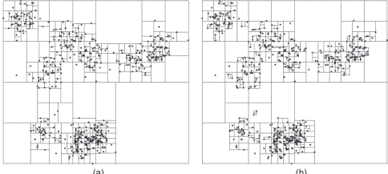

#### 图 3.17. 使用 (a) kd-trees 和 (b) bd-trees 对 2D 点云进行空间细分。

octrees、kd-trees 和 bd-trees 等空间搜索结构最适合用于点集。要使用它们来实现 findCell 操作，我们将完整的网格顶点集插入数据结构中，并搜索与给定候选点最近的顶点。找到该顶点后，我们测试使用该顶点的单元格，以查看哪个单元格实际包含候选点。如果没有单元格包含（这在某些特殊配置中可能发生），我们搜索第二近的顶点并重复该过程，直到找到包含单元格。可以使用的一种额外加速方法基于以下启发式：在实践中，应用程序算法从一组几何上连贯的点开始搜索单元格。换句话说，连续调用 findCell 将返回同一单元格、相邻单元格，或数据集中彼此靠近的其他单元格。我们可以在 findCell 的实现中利用这一点，缓存先前返回的单元格，并在后续调用中首先测试搜索位置是否落在该单元格内。如果是，函数在不进行任何搜索的情况下完成。如果不是，则使用现有的空间搜索结构。

空间搜索结构的一个局限性是，与搜索时间相比，构建它们所需的时间相对较长。对于几何结构固定的网格，这不是问题。如果网格的几何结构变化频繁，相对于搜索次数而言，使用暴力线性搜索而不是空间搜索结构可能更快。

#### 非结构化网格

我们现在将注意力转向非结构化网格。非结构化网格与结构化网格具有相同的几何结构，但具有不同的拓扑结构。然而，我们不能从 StructuredGrid 派生 UnstructuredGrid 类，因为后者也从 UniformGrid 继承了规则拓扑结构。因此，我们直接从 Grid 接口派生 UnstructuredGrid 类，如清单 3.9 所示。

#### Listing 3.9. 非结构化网格实现。

```cpp
class UnstructuredGrid : public Grid
{
    public:
        UnstructuredGrid (int P, int C)
        { points.resize(2*P); cells.resize(3*C); }
    int numCells()
    { return cells.size()/3; }
    int numPoints()
    { return points.size()/2; }
    int getCell(int i, int *c)
    {
        c[0]=cells[3*i]; c[1]=cells[3*i+1];
        c[2]=cells[3*i+2]; return 4;
    }
    void getPoint(int i, float* p)
    { p[0]=points[2*i]; p[1]=points[2*i+1]; }
    void setCell(int i, int* c)
    { cells[3*i]=c[0]; cells[3*i+1]=c[1];
        cells[3*i+2]=c[2]; }
    void setPoint(int i, float* p)
    { points[2*i]=p[0]; points[2*i+1]=p[1]; }
    private:
        vector<int> cells; //Vertex indices for all (triangle) cells
        vector<float> points; //Coordinates for all sample points
};
```


### 3.8.2 属性数据实现

非结构化网格允许我们独立设置构成单元的顶点。为此，我们提供了`setCell`方法。最后，非结构化网格可以使用与结构化网格相同的基于空间搜索结构的`findCell`实现。

既然我们已经有了网格功能，就必须实现数据属性。在第3.2节中，我们讨论了属性数据的两种插值方法：常数和线性。这两种方法都以分段方式工作：你给出给定单元中某点的世界坐标\(x_j\)。基于这些坐标，利用变换\(T^{-1}\)计算参数单元坐标\(r_j\)，并用这些坐标加权计算单元的参考基函数\(\Phi_i\)，权重为单元在其采样点处的属性值\(f_i\)（参见公式(3.9)）。

数据集的理想接口将允许我们在采样域内的任何坐标\(x_i\)处评估其重建函数\(\tilde{f}\)，即将数据集视为真正的（分段）连续函数。但是，由于我们使用分段重建，这意味着需要找到所需点所在的单元，如前所述。这是一项代价高昂的操作，如果我们需要在许多单元上评估\(\tilde{f}\)，可能需要多次执行。幸运的是，许多数据处理算法不需要在纯随机位置评估数据集。在实践中，大多数数据处理算法是按单元逐个工作的，而不是要求在随机位置评估重建函数。

数据属性评估功能可以轻松添加到我们的数据集类中。为此，我们做了一些设计决策。首先，我们将仅支持所有单元类型的分段常数和线性插值。乍一看这可能显得限制较多。然而，在实践中，绝大多数可视化应用程序仅使用这些插值方法，因为它们简单易实现且计算速度快。其次，我们将强制要求所有采样点\(i\)都定义属性值\(f_i\)。如第3.6.6节所述，如果我们考虑在整个域上重建信号，这是一个自然属性。第三，我们必须决定要在数据集中存储第3.6节描述的哪些属性类型，以及每种类型存储多少个。一般来说，我们希望存储用户定义数量的每种类型，并允许用户定义的属性类型。然而，在以下示例实现中，我们将仅包含一个标量属性，并将扩展到多种属性类型的多个实例作为读者的练习。最后，在本节中展示的示例中，我们将自己限制在2D网格上，与本节前面显示的代码示例一样。将这些示例扩展到3D网格是留给读者的一个简单练习。

#### 列表3.10. 标量数据的最近邻插值实现。

```
public :
    float& getC0Scalar(int c)
    { return c0_scalars[c]; }
    float getC0Scalar(int c, float x, float y)
    { return getC0Scalar(c); }

protected :
    vector<float> c0_scalars ;
```

在实践中，我们需要为所有已定义的网格类型提供属性数据。因此，我们将通过向基类Grid添加额外代码来提供属性支持，如下所示。

标量属性。标量属性的分段常数插值使用列表3.10中的简单代码完成。

给定单元索引c，第一个方法getC0Scalar(int)返回相应的单元标量属性。单元属性存储为浮点数向量。第二个方法getC0Scalar(int,float,float)在给定单元索引和该单元内的位置时，执行标量数据的分段常数插值。这基本上相当于返回单元标量值。

对于标量属性的分段线性插值，我们将列表3.11所示的代码添加到Grid类中。第一个方法getC1Scalar(int)返回给定网格顶点采样点处存储的采样值，即实现通常称为顶点数据的功能。与单元数据一样，此函数返回一个引用，因此可以读取和写入顶点标量属性。第二个方法getC1Scalar(int,float*)在给定单元索引c和该单元内的世界坐标位置p（作为2个浮点数的向量给出）时，执行标量数据的分段线性插值，即实现公式(3.9)。在此函数中，MAX_CELL_SIZE常数表示单元中顶点的最大数量，对于所有2D单元为4，对于前面讨论的所有3D单元为8。方法world2cell执行从世界坐标p到参数坐标q的变换。最后，函数Phi模拟所考虑单元的每顶点基函数。

#### 列表3.11. 标量数据的线性插值实现。

```cpp
public:
    float& getC1Scalar(int v)
    { return c1_scalars[v]; }

    float getC1Scalar(int c, float* p)
    {
        int cell[MAX_CELL_SIZE];
        int C = getCell(c, cell);
        float q[2], f=0;
        world2cell(c,p,q);
        for(int i=0;i<C;i++)
            f += getC1Scalar(cell[i])*Phi(i,q[0],q[1]);
        return f;
    }
protected:
    vector<float> c1_scalars ;
```

向量属性。可以为向量数据实现类似的方法。我们接下来以二维向量属性为例进行说明。至于网格类型，将其扩展到更高维度的属性是一个简单的练习。对于具有N个单元的数据集，通常分配一个具有2N个浮点元素的vector<float> c0_vectors，使得单元i的向量v = (vx, vy)存储在容器的位置2i和2i + 1处。以纯面向对象的方式，很诱人考虑通过某个Vector类来操作向量，从而将向量属性存储为vector<Vector> c0_vectors而不是普通浮点数组。然而，大多数可视化应用程序实现不会使用此模型，因为它会显著使代码复杂化。此外，属性上的频繁操作，如迭代、创建和复制属性数组以及读写此类数组的组件，在使用Vector类实例所暗示的额外结构层级时会变慢。

列表3.12中向量数据的最近邻插值实现基本上与标量的最近邻插值（列表3.10）相同。

#### 列表3.12. 向量数据的最近邻插值实现。

```cpp
public:
    float* getC0Vector(int c)
    { return &(c0_vectors[2*c]); }

    float getC0Vector(int c, float x, float y)
    { return getC0Vector(c); }
protected:
    vector<float> c0_vectors ;
```

#### 列表3.13. 向量属性的线性插值实现。

```cpp
public:
float* getC1Vector(int v)
{ return &(c1_vectors[2*v]); }

void getC1Vector(int c, float* p, float* v)
{
    int cell[MAX_CELL_SIZE];
    int C = getCell(c, cell);
    float q[2];
    world2cell(c,p,q);
    v[0] = v[1] = 0;
    for(int i=0;i<C;i++)
    {
        float* vi = getC1Vector(cell[i]);
        v[0] += vi[0]*Phi(i,q[0],q[1]);
        v[1] += vi[1]*Phi(i,q[0],q[1]);
    }
}
protected:
vector<float> c1_vectors;
```

列表3.13显示了向量属性的线性插值实现。与单元顶点属性一样，顶点向量属性最好以分量连续方式存储在浮点数组c1_vectors中。第一个方法getC1Vector(int)返回顶点向量属性第一个分量v_x的指针。第二个方法getC1Vector(int,float*,float*)在单元上执行向量数据的分段线性插值，类似于标量数据的类似getC1Scalar方法，并将插值向量返回到用户提供的浮点数组v中。

存储和插值除标量和向量以外的其他属性类型，如法线、颜色和张量，遵循与上面所示相同的实现模式，因此我们也将其作为（稍微复杂一些的）练习留给感兴趣的读者。

存储多个属性实例。在实际生产代码中，数据集需要支持所有属性类型的多个实例。当数据集需要存储给定类型的可变数量的属性时需要此功能，例如压力和温度标量场。这需要一个接口，用户可以通过该接口指定要使用的某个属性类型的哪个实例。一个简单有效的解决方案是将属性向量存储在


一个可以通过唯一名称寻址的关联数组。使用 STL 时，例如可以对标量属性使用 `map<string, vector<float>>` 来实现这一点。给定一个作为 `string` 的属性名称（例如，“temperature”），`map` 类将返回对存储实际数据的相应 `vector<float>` 的引用，如果不存在该属性，则返回空值。可以为每种属性类型构建类似的关联数组。

### 3.9 高级数据表示

在前面的章节中，我们已了解如何从采样数据集中重建分段常数和分段线性函数，这些数据集表示在具有各种单元类型的网格上，使用常数和线性基函数。对于绝大多数数据可视化应用程序，这些表示已足够。然而，存在需要更高级形式的数据操作和表示的情况。在本节中，首先，我们将描述数据重采样任务，该任务用于在具有不同采样点、单元或基函数的不同类型数据集之间转换信息（第 3.9.1 节）。然后，我们将描述将数据作为一组散点进行插值的过程，以防我们没有单元信息（第 3.9.2 节）。

#### 3.9.1 数据重采样

在第 2 章的高度图可视化示例中，我们看到了从采样数据集重建函数的几个实例。我们对多边形表面本身使用了分段线性插值。我们分别对平面着色使用了分段常数插值，对 Gouraud 着色使用了分段线性插值。最后，我们对表面法线使用了分段常数插值。我们在第 2 章中了解到，为了对表面进行 Gouraud 着色，我们需要多边形顶点处的法线值，即顶点法线。然而，分段常数法线，即多边形法线本身，在多边形顶点处（实际上，在完整的多边形边上）是不连续的，因此我们不能将它们用作顶点法线的近似。我们如何从已知的多边形法线计算顶点法线值？

这个问题的答案由离散数据集上的一个更通用操作提供，称为 _重采样_。考虑源数据集 $\mathcal{D} = (\{p_i\}, \{c_i\}, \{f_i\}, \{\Phi_i\})$ 和目标数据集 $\mathcal{D}' = (\{p'_i\}, \{c'_i\}, \{f'_i\}, \{\Phi'_i\})$，它们都近似同一个连续函数 $f : D \to C$，但源网格 $(\{p_i\}, \{c_i\})$ 与目标网格 $(\{p'_i\}, \{c'_i\})$ 不同。重采样计算

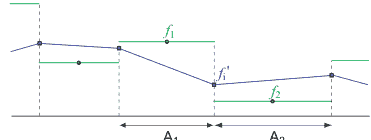

图 3.18. 将单元属性转换为顶点属性。顶点值 \(f'_i\) 等于 \(\frac{A_1 f_1 + A_2 f_2}{A_1 + A_2}\)，即使用顶点 \(i\) 的单元值的面积加权平均值。

values \(f'_i\) of the target dataset as function of the values \(f_i\) of the source dataset. For simplicity, we assume that both datasets use the same set of basis functions \(\Phi_i\), although this is not a strict requirement.

单元到顶点重采样。现在让我们考虑数据可视化中的一个常见重采样操作：将单元属性（\(f_i\)）转换为顶点属性（\(f'_i\)）。单元属性意味着使用常数基函数 \(\Phi_i$，如第 3.2 节所讨论。相比之下，顶点属性意味着使用高阶基函数，例如线性基函数。另一方面，我们希望目标网格单元的采样点（即目标网格顶点）与源网格顶点相同，以便两个网格匹配，如图 3.18 所示的一维网格所示。

A desirable property of resampling a function \(\bar{f}\) is that it should lead to a function \(\bar{f}'\) that is close to \(\bar{f}\) over the whole domain D. Mathematically, this can be expressed as

```
\(\int_{c'_i} (\bar{f}' - \bar{f})^2 ds \approx 0, \quad \forall \text{ cells } c'_i \in \mathcal{D}'.\) (3.41)
```

也就是说，原始函数 \(\bar{f}\) 和重采样函数 \(\bar{f}'\) 在目标网格的所有单元 \(c'_i\) 上的积分相等。使用基函数的正态性属性（参见方程 (3.5)），经过一些计算后，我们得到

```
\(f'_i = \frac{\sum_{c_j \in \text{cells}(p_i)} A(c_j) f_j}{\sum_{c_j \in \text{cells}(p_i)} A(c_j)}, \quad (3.42)\)
```

其中 \(A(c_j)\) 是源网格单元 \(c_j\) 的面积，\(cells(p_i)\) 是所有以点 \(p_i\) 为顶点的单元。换句话说，顶点数据是使用给定顶点的单元中单元数据的面积加权平均值。方程 (3.42) 与第 2.2 节中用于从多边形法线计算 Gouraud 着色顶点法线的方程 (2.8) 相同。

顶点到单元重采样。使用类似的推理，我们可以计算从顶点属性（\(f_i\)）到单元属性（\(f_i\)）的转换公式，如下

```
\( f_i = \frac{\sum_{P_j \in \text{points}(c_i)} f_j^{P_j}}{C}, \quad (3.43) \)
```

其中 points(\(c_i\)) 表示单元 \(c_i\) 的所有顶点点 \(p_j\)，\(C = |\text{points}(c_i)|\) 是单元 \(c_i\) 的顶点数量。换句话说，单元属性是单元顶点属性的平均值。

总之，我们始终可以在单元属性和顶点属性之间进行转换。然而，这并不意味着具有单元属性的数据集与具有顶点属性的数据集相同。如前所述，单元属性意味着使用分段常数插值，而顶点属性意味着更高阶的插值，例如线性插值。例如，从单元到顶点重采样数据会增加假定的连续性。如果我们的原始采样数据确实具有该阶的连续性，则不会出现问题。然而，如果原始数据包含例如零阶不连续性，如跳跃或空洞，则将其重采样到更高连续性的网格也会丢弃可能是数据特征而非采样工艺品的不连续性。第 9.4.7 节给出了这个微妙问题的示例。相比之下，从更高连续性（例如，顶点数据）到更低连续性（例如，单元数据）的重采样副作用较少——总体而言，数据的平滑度在全球范围内降低。

子采样和超采样。数据重采样不仅限于在单元和顶点样本之间转换。另外两种常用的重采样操作是子采样和超采样。子采样是一种减少采样点数量的重采样操作。当我们有兴趣通过使用较小的数据集来优化可视化应用程序的处理速度和内存需求时，超采样很有用。在大多数情况下，子采样的数据集使用与原始数据集相同的基函数，其点实际上是原始数据集点的子集。然而，这不是强制性的。在消除一定数量的采样点后，子采样操作可以选择重新分布剩余点，以便根据先前定义的积分准则获得对原始数据的更好近似。子采样实现可以利用数据集的拓扑。例如，在均匀、直线和结构化网格上，一种常用的子采样技术是沿每个维度保留每 k 个点并丢弃其余点。这种技术称为 *均匀子采样*，实现简单，在原始数据集相对于数据变化被密集采样时非常有效。然而，均匀子采样不对空间数据变化做任何假设，因此可能会丢弃重要特征，例如数据快速变化的区域，连同不太重要的常数区域。鉴于大多数插值函数（例如常数和线性）重建数据的方式，子采样的一个理想属性是在数据快速变化的区域保留大部分样本，并在数据缓慢变化的区域剔除大部分样本。在第 8.4 节中，我们将介绍几种适用于结构化和非结构化数据集的子采样方法。

超采样（也称为 *细化*）是子采样的逆操作。在这里，从现有数据集中创建更多采样点。与子采样类似，超采样的数据集通常包括所有原始数据集点并使用相同的基函数，尽管这不是强制性的。当我们需要在低于数据集采样频率或密度所捕获的细节级别或尺度上操作或创建数据集上的信息时，超采样在多种情况下很有用。在这种情况下，我们通过超采样引入更多点，然后使用这些点来编码所需的详细信息。均匀子采样的对应物是 *均匀超采样*，它在原始数据集的每个单元中引入 k 个点。与子采样类似，高效的超采样实现通常只在数据集中需要进一步添加额外信息的空间区域插入额外点。我们将在第 8.4 节讨论几种超采样方法。

#### 3.9.2 散点插值

到目前为止，我们对采样数据集的定义基于表示数据域铺设的单元网格（参见第 3.2 节）。然而，存在我们希望避免构建或存储此类网格的情况。这种情况发生在你在具有复杂空间分布的某些给定点上测量了一些数据，并且没有显式单元信息将点连接成某个域的铺设时。一个经典示例是 3D 表面扫描，其中使用激光设备测量 3D 对象表面上一组点的位置。对于复杂对象表面，此过程会提供一组散点 3D 点集，也称为 *点云*，带有可选的每点表面法线和表面颜色属性。因此，我们可用的所有数据都是点及其对应的数据值 {p_i, f_i}。


对于扫描示例，数据值 $f_i$ 是扫描设备测量的表面法线和/或颜色。

请记住，数据集的目的是允许从采样表示中重建某些连续信号。在我们的表面扫描示例中，如果给定的只有带有可选法线或颜色数据 $\{f_i\}$ 的点集 $\{p_i\}$，我们如何重建一个光滑表面 $\hat{S}$？回顾重建公式（参见公式 (3.2)），我们需要在采样点 $p_i$ 处定义一些基函数 $\phi_i$。有几种方法可以做到这一点。

#### 从散点构建网格

首先，我们可以从点集构建一个网格。具体做法取决于点样本 $p_i$ 的含义。如果这些点来自某个假设为光滑的 3D 表面的采样，我们可以构建一个带有 2D 单元（例如三角形）的非结构化网格，以 $p_i$ 作为顶点，并尽可能逼近光滑表面。存在多种三角化方法来实现这一点。我们将在 8.3 节中更详细地描述这种方法。一旦有了这个网格，我们就可以使用本章前面描述的常数或线性插值函数。

#### 无网格插值

第二种方法是完全避免构建网格。这有几个优点。从大型复杂的 3D 点云构建非结构化网格可能是一个微妙的过程。对于非常大的数据集，存储网格可能是一个沉重的负担。如 3.5.4 节所述，存储单元信息在最坏情况下可能会使所需内存量翻倍。此外，我们的点集会随时间变化，因为它代表某个移动对象，或者因为我们希望使用编辑、过滤或变形等几何建模操作来处理它。每当点发生变化时，对点集进行三角化以计算网格可能是一项非常昂贵的操作。最后，如果我们有一个代表复杂 3D 表面的大型点集，通过渲染相应的三角化来可视化它可能不是最快的选择。在这种情况下，我们可以通过使用无网格点表示来做得更好。

如何在不依赖显式网格的情况下，从散点集重建一个连续函数？我们需要一组无网格基函数，这些函数应尽可能满足公式 (3.4) 和 (3.5) 中的属性。构建此类函数有几种方法。无网格基函数的一个常用选择是径向基函数，或 RBF。这些是函数 $\Phi : \mathbb{R}^d \to \mathbb{R}_+$，仅依赖于当前点 \(x = (x_1, ..., x_d) \in \mathbb{R}^d\) 与原点之间的距离

$r = \|x\| = \sqrt{\sum_{i=1}^d x_i^2}$ (3.44)

此外，RBF \(\Phi(r)\) 在其原点（\(r = 0\)）处从 1 平滑下降，对于较大的距离 \(r$ 趋近于零值。

在实践中，我们希望将基函数的影响限制在其直接邻域内。这既计算高效，又确保数据点 \(p$ 仅对其直接邻域的插值做出贡献，因此不会不必要地平滑掉远离 \(p$ 的数据点中存在的信息。为此，我们指定一个影响半径 \(R$，或支持半径，超过该半径 \(\Phi$ 等于零。在此设置下，常见的 RBF 是高斯函数

\(\Phi(r) = \begin{cases} e^{-\lambda r^2}, & r < R, \\ 0, & r \ge R. \end{cases}\) (3.45)

公式 (3.45) 中的参数 \(\lambda \ge 0$ 控制径向基函数的衰减速度或形状。设置 \(\lambda = 0$ 会产生常数圆柱形径向函数，这相当于我们用于基于网格的数据集的 \(\lambda = 0$ 基函数。较高的 \(\lambda$ 值会产生衰减更快的函数。对于 \(d = 2$，即在 2D 域中，此类径向基函数的图看起来像第 2 章中介绍的可视化运行示例。除了高斯函数，我们还可以使用其他径向基函数。另一种流行的选择是定义为逆距离函数

\(\Phi(r) = \begin{cases} \frac{1}{1+r^p}, & r < R, \\ 0, & r \ge R. \end{cases}\) (3.46)

在实践中，我们希望为每个采样点 \(p_i$ 使支持半径 \(R$ 可变。半径值 \(R_i$，即用于所有点 \(p_i$ 的 \(R$ 值，控制采样点 \(p_i$ 的影响。较高的 \(R_i$ 值会产生更平滑的重建 \(\hat{S}$，因为在给定点处有更多的 RBF 重叠。然而，这会带来更高的计算成本，并且如前所述，会更多地平滑数据。较低的 \(R_i$ 值会产生不那么平滑的重建，但性能更高。在极限情况下，为所有点设置 \(R_i = 0$ 会产生散点集，其中 \(\hat{S}$ 与采样点位置 \(p_i$ 重合，并在其他所有地方为零。对于均匀采样的点集，我们可以设置 \(R_i = 1/\sqrt{\rho}$，其中 \(\rho$ 是表面点密度，以每表面单位面积的点数来衡量。对于非均匀采样的点集，我们可以将 \(R_i$ 设置为点 \(p_i$ 邻域内的平均点间距。这里的一个简单启发式方法是将 \(R_i$ 设置为从 \(p_i$ 到其第 \(K^{th}$ 最近邻居的距离，适用于较小的 \(K$ 值。这确保任何点 \(p_i$ 将其影响“扩散”得足够远，以覆盖其自身与其 \(K$ 个最近邻居之间的空空间，但不会更远。

使用参考 RBF \(\Phi$ 和每点支持半径值 \(R_i$，我们可以定义全局 RBF \(\phi_i(x) = \Phi(T_i^{-1}(x))$，就像我们对基于网格的插值所做的那样。将世界空间映射到参考 RBF 空间的逆变换 \(T^{-1}$ 只是从当前采样点 \(p_i$ 到原点的平移，以及以 \(R/R_i$ 为因子对距离 \(r$ 进行缩放。

#### 性能问题

一旦我们有了全局 RBF \(\phi_i$，我们就可以像基于网格的方法一样重建我们的表面 \(\tilde{S}$（参见公式 (3.2)）。给定一个点 \(p$，我们只对在 \(p$ 处非零的基函数 \(\phi_k$ 求和。在基于网格的插值中，找到这些基函数是微不足道的，因为它们是与包含 \(p$ 的单元的顶点相关联的函数。在径向基函数的情况下，我们必须找到所有 \(K$ 个最近采样点 \(N = \{p_1, ..., p_j, ..., p_K\}$ 到 \(p$，使得 \(\|p-p_j\| < R_j$，因为只有基函数 \(\phi_j$ 在 \(p$ 处有非零贡献。找到 \(N$ 的一种方法是将所有采样点 \(p_i$ 存储在空间搜索结构中，例如 kd-tree [Bentley 75, Samet 90, Mount 06]。给定下一个点 \(p$，我们搜索 \(p$ 的所有邻居 \(B = \{p_j\}\)，使得 \(\|p-p_j\| < R(p)$，从这些邻居中消除那些 \(\|p-p_j\| > R_j$ 的邻居 \(F = \{p_j|p_j \in B\}$，并使用剩余邻居 \(p_j \in N = B \setminus F$ 的 RBF \(\phi_j$ 来计算公式 (3.2)。这里，\(R(p)$ 是从 \(p$ 到其能够影响 \(p$ 的最远邻居 \(p_j$ 的距离。这可以保守地设置为我们整个点集上 \(R_j$ 的最大值。搜索位于给定距离内的点 \(p$ 的所有邻居也称为 *范围搜索*，与返回 \(p$ 最近的 \(K$ 个点的 \(K$ 最近邻搜索相对。然而，范围搜索的一个技术问题是它产生的最近邻数量 \(K = |B|$ 是每个点可变的，并且对于位于点云密集区域的点可能非常大。一个典型的解决方案是通过将 \(K$ 上界设置为固定值 \(K_{max}$ 来以重建精度换取速度。

空间搜索结构在任何给定位置提供高效的最近邻和范围邻居检索。这种搜索结构的一个良好且可扩展的实现由 Approximate Nearest Neighbor (ANN) 库 [Mount 06] 提供。在某种意义上，这种数据结构扮演着网格的角色，即它让我们找到哪些采样点影响给定的空间区域。遵循这个类比，网格单元等同于点的 \(K$ 个最近邻集合。和使用网格一样，当我们的点集发生变化时，我们必须通过重新插入移动的采样点来更新我们的搜索数据结构。这是一项可以高效完成的操作 [Mount 06, Clarenz et al. 04]。

#### Shepard 插值

具有紧支持的径向基函数是平滑插值散点数据的一种高效有效的方法。然而，


除非对支撑半径值 \( R_i \) 和函数形状参数 \( \lambda \) 设置额外约束，否则这些函数并非按定义正交和归一化，如同在网格上定义的常数和线性基函数那样。这意味着重建 \( \hat{S} \) 可能无法精确插值点 \( p_i \)。\( R_i \) 值过大会产生过高估计的 \( \hat{S} \)，表现为过度平滑的重建。相反，\( R_i \) 值过小会使 \( \hat{S} \) 与样本点 \( p_i \) 拟合良好，但信号 \( \hat{S} \) 可能会呈现特征性的“波浪”外观，这是由于违反了分区一致性属性（参见公式 (3.5)）。对于计算既尊重分区一致性属性又能产生平滑重建的 RBF，我们建议研究本节末尾的参考文献。

一种简单的解决方案，作为正交和归一化基函数的次优替代方案，是将插值结果限制在样本位置 \( p_i \) 的范围内，具体如下。给定某点 \( p \) 的 \( K \) 个最近邻 \( p_1, \dots, p_K \)，其中 \( K \) 是所有点的固定值，我们按如下方式计算 \( \hat{S}(p) \)：

\(\hat{S}(p) = \frac{\sum_{i=1}^K p_i \phi_i(p)}{\sum_{i=1}^K \phi_i(p)}.\) (3.47)

使用逆距离基函数时（参见公式 (3.46)），该方法称为 Shepard 插值方法 [Shepard 68]。Shepard 插值产生的结果与高斯 RBF 方法非常相似。

图 3.19 显示了一个示例。输入数据由一个 2D 散点云组成，标量数据值 \( f_i \) 位于点 \( p_i \) 处。图 3.19(a) 显示了一种朴素的可视化，其中每个点按其数据值着色，使用蓝-绿-红颜色映射。因此，低值点用冷色（蓝色调）呈现；中间值显示为绿色，高值用暖色（橙色、黄色和红色）呈现。图 3.19(a) 对应于对我们的数据点进行的插值 \( \tilde{f} : \mathbb{R}^2 \to \mathbb{R} \)，所有点的半径值均为 \( R_i = 1 \) 像素。如所见，我们可以看到数据点 \( p_i \) 位置的数据值 \( f_i \)，并且还注意到点云具有高度非均匀的密度。彩色点周围的空白空间表明在其他位置实际上没有进行插值。

图 3.19(b–d) 显示了由以下公式计算的 Shepard 插值效果：

\(\tilde{f}(p \in \mathbb{R}^2) = \frac{\sum_{p_i \in N_K(p)} f_i e^{-\lambda \left( \frac{\|p - p_i\|}{R(p)} \right)^2}}{\sum_{p_i \in N_K(p)} e^{-\lambda \left( \frac{\|p - p_i\|}{R(p)} \right)^2}}.\) (3.48)

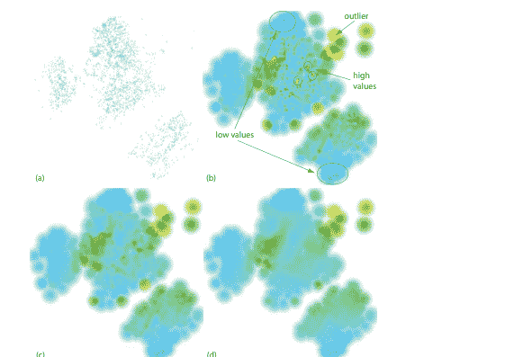

图 3.19. 来自 2D 点云的标量信号的 Shepard 插值。

\(\lambda\) 的值设置为 5，确保高斯 RBF \(\Phi(r)\) 在距离 \(r=1\) 处达到近乎零的值。集合 \(N_{R(p)}\) 包含所有位于当前点 \(p\) 半径 \(R(p)\) 范围内的邻居 \(p_i\)，我们希望在该点处评估 \(\bar{f}\)。\(R(p)\) 设置为 \(p\) 与其最近数据点 \(p_i\) 之间的距离 \(d(p)\) 加上一个小的用户控制因子 \(\epsilon\)，即 \(R(p) = d(p) + \epsilon\)。这样一来，插值 \(\bar{f}(p)\) 仅取决于最接近 \(p\) 的数据点 \(p_i\)，换句话说，它会自适应局部点密度。参数 \(\epsilon\) 允许控制插值中存在的平滑程度。为了获得更多洞察，我们通过将颜色饱和度调制为 \(1 - d(p)/R_{max}\) 的值来可视化距离 \(d(p)\)，其中 \(R_{max}\) 表示我们希望插值 \(\bar{f}\) 的点云最大距离。因此，饱和颜色表示靠近数据点的位置，计算 \(\bar{f}\) 在此处有意义。白色像素表示比任何输入数据点更远于 \(R_{max}\) 的位置，即我们不希望评估 \(\bar{f}\) 的区域。

在图 3.19(b) 中，\(\epsilon\) 设置为相当于几个像素的距离。图中的彩色区域指示我们插值 \(\tilde{f}\) 的空间范围。由于 \(R_{max}\) 大于输入点云中的平均点间距，我们注意到 \(\tilde{f}\) 表现出两个低值区域（图 3.19(b) 中的深蓝色区域）。鉴于 \(\epsilon\) 较小，插值信号 \(\tilde{f}\) 相对不平滑，但同时能够保留小规模细节，如前面提到的高值离群点。图 3.19(c,d) 显示了相同的插值，现在使用越来越大的 \(\epsilon\) 值。结果 \(\tilde{f}\) 变得越来越平滑，但越来越难以捕捉小规模局部离群点。数据点 \(p_i\) 处的值 \(\tilde{f}(p_i)\) 与输入数据值 \(f_i\) 越来越不同，这是由于较大半径值 \(R(p)\) 的平滑效应。例如，左上角离群点（图 3.19(b) 中的橙色）的值在图 3.19 中相对于其邻居变得相对较低。

总结而言，我们可以将数据纯粹表示为携带可选数据属性 \(\{f_i\}\) 的散点集 \(\{p_i\}\)。一些可视化文献将此类表示称为非结构化点数据集。然而，如果数据集的功能是使用公式 (3.2) 的某个变体对其数据样本提供（分段）连续重建，我们还需要指定基函数 \(\Phi_i\) 的选择，以形成完整的数据集 \((p_i, f_i, \Phi_i)\)。在实践中可以使用多种此类函数，例如径向基函数。为了高效地执行重建，需要搜索方法，这些方法返回给定点 \(p\) 邻域内的样本点 \(p_i\)。

散点数据插值和近似是一个广泛的主题。有关此内容的更多信息可以在专门的参考文献中找到，例如 Wendland 最近的著作 [Wendland 06]。有关无网格插值方法的更简短但仍然严谨的数学处理，请参见 [Belytschko et al. 96]。

### 3.10 结论

在本章中，我们介绍了可视化应用中表示数据所涉及的基本问题。在许多情况下，可视化数据是通过对定义在紧致空间域上的连续信号进行采样而产生的。信号样本值、信号域的离散表示以及用于重建信号（分段）连续近似的机制的组合称为数据集。可视化过程中的几乎所有数据处理操作都涉及使用数据集提供的离散表示。因此，拥有通用、高效且准确的方式来表示和操作数据集至关重要。

在实践中，信号域在一个网格中被离散化，该网格包含由样本点定义的一组单元。数据样本（也称为数据属性）存储在这些点上，可以是多种类型。最常用的是允许插值的数值类型：标量、向量、颜色和张量。连同这些单元，还提供用于信号重建的基函数。在实践中最常用的基函数是常数和线性，因为其实现简单且直接得到图形硬件的支持。

几种类型的网格在表示灵活性与存储和计算成本之间提供不同的权衡。在实践中最常用的类型是均匀网格、矩形网格、结构化网格和非结构化网格。最后，还存在无网格插值方法。这些方法从样本点提供信号重建，完全避免构建和存储单元。为了提供这种额外的灵活性，需要特殊的空间搜索数据结构来快速定位邻居点。

可视化数据也可以源于采样连续信号之外的不同来源。文本、图像或关系等数据属性是纯离散的，通常不定义在空间域上。此类数据集构成了信息可视化应用的目标，并在第 11 章中单独描述。

在接下来的章节中，我们将看到本章中描述的各个方面（采样和重建、插值和基函数、网格和单元）将如何体现在不同类型可视化应用的构建中。


## 第 4 章

## 可视化流水线

在第 2 章中，我们展示了可视化应用程序的基本步骤，并为函数图绘制问题勾勒了一种简单的数据表示。在第 3 章中，我们详细描述了如何表示离散采样数据。我们介绍了几种数据集类型，它们在表示灵活性与存储和实现要求之间提供不同的权衡。到此为止，我们应该很好地理解如何表示我们感兴趣的可视化数据。本章的重点是从概念和实践两个角度介绍完整可视化应用程序的结构。

我们先从可视化应用程序结构的概念描述入手进行讨论（第 4.1 节），该节介绍了此类应用程序的四个主要组成部分：数据导入、数据过滤与丰富、数据映射和数据渲染。接下来，我们描述了该概念结构的若干实现注意事项（第 4.2 节）。第 4.3 节讨论了可视化过程中使用的各种算法的分类。最后，我们总结了对可视化应用程序结构的分析（第 4.4 节）。

### 4.1 概念视角

如第 1 章所述，可视化的作用是创建能够传达给定过程各种洞察的图像。该过程在图 1.3 中以概念方式说明。可视化过程由一系列步骤或操作组成，这些步骤或操作处理由正在研究的过程产生的数据，并最终交付所需的图像。

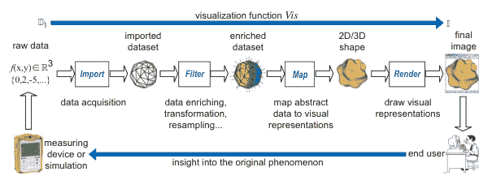

图 4.1. 可视化流水线的功能视图。

在概念和设计层面上，这种在设计可视化时采用的分而治之策略使人们能够管理整个过程的复杂性。在实现层面上，这种策略允许我们通过组装可重用和模块化的数据处理操作来构建可视化，这与软件工程的其他领域类似。鉴于这种模块化分解，可视化过程可以被视为一个由多个阶段组成的流水线，每个阶段由特定的数据转换操作建模。输入数据“流”通过这个流水线，以各种方式被转换，直到生成输出图像。鉴于此模型，可视化过程中发生的数据转换序列通常被称为可视化流水线。

可视化流水线通常有四个阶段：数据导入、数据过滤与丰富、数据映射和数据渲染。这些在图 4.1 中以示意图说明，并将在接下来详细介绍。

为了更好地理解可视化流水线中发生的各种操作，我们可以使用此过程的功能描述。从概念上讲，我们可以将可视化流水线视为一个函数 Vis，它在 D_I（所有可能的原始输入数据类型的集合）和生成的图像集合 I 之间建立映射：

```
Vis : D_I → I. (4.1)
```

通过（交互式地）检查生成的图像，用户应该能够对原始数据获得洞察，并回答关于该数据所捕获的现象的问题。从概念上讲，我们也可以用一个函数 Insight 来建模此过程，它从输出图像映射到输入数据，方向与 Vis 函数相反：

Insight : \(\mathbb{I} \to \mathbb{D}_I\). (4.2)

为简单和简洁起见，我们将 Insight 描述为从图像到原始数据的映射函数。详细来说，Insight 将生成的图像映射到用户关于原始数据的实际问题，这些问题不一定与数据本身一一对应。我们将在 4.1.3 节进一步详细阐述这一点。目前，只需理解获得洞察的过程与可视化流水线本身方向相反即可。

用户将图像与原始问题连接起来的反馈（图 4.1 中底部的蓝色箭头）不仅限于洞察。在可视化监控生成数据的实时过程时，用户可能希望通过更改参数来引导过程沿给定路径进行。提供此类设施的应用程序有效地在可视化输出和应用程序输入之间闭合了回路。如果完整的往返过程在（亚）秒级内执行，用户就可以通过可视化反馈有效地引导手头的过程。这种称为计算引导的过程，由多种可视化软件应用程序实现，例如 SciRUN [SCIRun 07]、CUMULVS [CUMULVS 07, Geist et al. 97] 和 CSE [van Liere et al. 12, van Liere and van Wijk 96]。

显然，并非所有类型的 Vis 函数（如方程 4.1 所勾勒的）对于我们获得对数据集所需方面的洞察或理解的目标都同样相关。此外，对于现实世界的复杂应用场景，我们很可能无法在单个步骤中构建所需的可视化函数。图 4.1 中显示的可视化流水线的各个步骤对应于特定的子函数，每个子函数处理特定的问题。这些子函数的串联或组合产生了所需的可视化 Vis。

图 4.2 展示了涉及用户、可视化应用程序、输入数据以及该应用程序生成的图像和所获得洞察的实际复杂交互的必然简化视图。在建立这些元素之间的定性和定量依赖关系时，还有许多其他因素至关重要，例如用户的实际领域特定知识；通过对相同或不同输入反复执行图 4.1 中描述的可视化过程来积累洞察的方式；以及允许以交互方式调整此过程各种参数的用户交互类型，仅举几例。已提出了不同的可视化工作模型，这些模型以不同的程度和方式融合了这些因素 [Schroeder et al. 06, van Wijk 05]。

在接下来的章节中，我们将详细介绍图 4.1 中展示的可视化流水线的四个步骤，同时讨论其对应函数的理想属性。

#### 4.1.1 导入数据

首先，我们必须能够将输入数据 *导入* 到可视化过程中。从概念上讲，这意味着要找到我们想要调查的原始信息的表示形式，即数据集，无论是连续的还是离散的。从功能角度来看，导入输入数据将可视化过程开始时可用的原始信息 \(\mathbb{D}_I\) 映射到一个数据集 \(\mathcal{D} \in \mathbb{D}\)，例如第 3 章中描述的那些。这里，\(\mathbb{D}\) 表示给定可视化过程支持的所有数据集的集合。如果我们遵循第 3 章给出的数据表示，\(\mathbb{D}\) 由均匀、矩形、结构化和非结构化数据集组成。导入数据可以用函数描述：

```
\(Import : \mathbb{D}_I \rightarrow \mathbb{D}.\) (4.3)
```

实际上，导入数据意味着选择特定的数据集实现，并将原始信息 \(\mathbb{D}_I\) 转换为所选数据集类型 \(\mathcal{D}\) 隐含的表示形式。理想情况下，*导入* 是一对一映射，例如从某些外部存储（如文件或数据库）或实时数据源（如测量设备、扫描仪或模数转换器）读取输入数据。只有当所选数据集类型 \(\mathbb{D}\) 能够直接表示输入数据 \(\mathbb{D}_I\) 时，才能发生直接映射。然而在实践中，数据导入可以隐式地在不同的数据存储格式之间进行转换，将数据从连续域重新采样到离散域，就像我们在第 2.1 节所做的那样，或者从一种分辨率和/或网格类型转换到另一种，如第 3.9.1 节所讨论的。对于在第 2.1 节中介绍的高度图示例，我们的输入数据是一个连续函数 \(f(x, y) \rightarrow \mathbb{R}\)，导入操作涉及在所需数据集（例如常规网格）上对其进行采样。

数据导入过程中所做的选择决定了生成图像的质量，从而决定了可视化的有效性。例如，如果


如果导入的数据不正确、不完整、不确定、质量低下，或者导入方法会丢弃原始数据中的信息，那么在可视化流水线的后续阶段，要想完全恢复数据质量通常非常困难（有时甚至不可能）。出于这个原因，数据导入步骤应尽可能保留可用的输入信息，并对什么重要、什么不重要做出尽可能少的假设。简化或过滤数据等问题应在可视化过程的后续步骤中处理。我们在第2章中说明了这些考虑因素，展示了网格类型和采样密度的选择如何影响高度图的质量。

### 4.1.2 数据过滤与丰富

一旦我们导入了数据，就必须决定其哪些重要方面或特征是我们感兴趣的。在大多数情况下，导入的数据与我们想要深入了解的方面并非一一对应。这是我们选择“原样”导入数据所固有的特性。通常，原始数据并不直接模拟我们问题所针对的方面。如果情况如此，我们根本不需要可视化，因为可以直接查询输入数据并获得所需答案。当我们问题的主题涉及比输入数据直接建模的更复杂的特征时，可视化才有用。因此，我们必须以某种方式将原始数据集提炼为更合适的表示形式，也称为丰富数据集，这些数据集以更适合分析和可视化的形式对我们感兴趣的特征进行编码。这个过程称为数据过滤或数据丰富，因为它执行两项任务。一方面，数据被过滤以提取相关信息。另一方面，数据被丰富为支持特定任务的更高级别信息。在文献中，这两项操作通常不分开讨论，而是合并在可视化流水线的一个阶段中。鉴于此，除非上下文中明确另有规定，否则我们将互换使用“过滤”和“丰富”这两个术语。

数据过滤可以用函数描述为

```
Filter : D -> D.
```

过滤函数的输入（定义域）和输出（陪域）都是数据集，因为过滤函数严格来说是一种数据操作。这与数据导入函数不同，正如我们接下来将看到的，映射和渲染函数也不同。

接下来，我们给出几个需要数据过滤的示例场景。

查看相关内容。通常，我们并不关心完整输入数据集的属性，而只关心与特定任务相关的特定*感兴趣子集*的属性。例如，医学专家只想查看与某些病症相关的特定解剖结构，这些结构是他们从CT或MRI扫描仪等扫描设备获得的整个数据集的一个子集。金融分析师可能希望只关注一小部分感兴趣公司的行为，前提是拥有包含数千家公司股票价格的大量交易所数据。选择感兴趣的子集可以在空间域、属性值域或两者的组合中进行。对于我们的高度图示例，如第3.7节所述，对采样数据集计算导数是一个过滤操作的示例。

处理大数据。数据过滤的另一个原因是输入数据集可能非常大。这使得高效处理变得困难，当用户需要交互式可视化应用程序时，这可能是一个严重问题。与大小相关的一个更根本的问题是可视化应用程序使用的典型计算机屏幕的输出分辨率有限。考虑显示二维彩色图像的简单示例。这是可视化一个2D数据集的一个实例，该数据集每个单元格（或像素）都指定了颜色属性。如果输入数据集超过一定大小，可视化将生成不再适合给定屏幕的输出图像。实践中使用的一种解决方案是*缩放*，即对输入图像进行子采样，只显示捕捉完整数据集整体特征的像素子集。互补的解决方案，*平移*，即在原始分辨率下选择输入图像的一个子集，也可以被视为一种数据过滤形式。

易用性。数据过滤的最后一个原因是*便利性*。用单一的数据表示或数据集类型来描述可视化过程中涉及的整个数据处理操作范围非常困难，如果不是实际上不可能的话。因此，在可视化过程中，数据集通常会从一种形式转换为另一种形式，以便适应我们想要应用的处理操作所需的数据表示。实际上，这意味着要使用具有不同维度、单元、网格、插值函数和属性值的不同类型的数据集。再次考虑我们的高度图示例。如果给定的可视化包仅在三角形单元上提供导数计算，而我们的数据以四边形网格形式提供，我们需要将四边形转换为三角形，才能使用相应的包。

### 4.1.3 映射数据

过滤操作生成一个丰富数据集，该数据集应直接表示特定探索任务的感兴趣特征。一旦我们有了这种表示，就必须将其映射到可视域。我们通过将可视域的元素与丰富数据集中存在的数据元素相关联来做到这一点。可视化过程的这一步称为映射，可以用函数建模为

```
$Map : \mathbb{D} \rightarrow \mathbb{D}_V.$ (4.5)
```

该函数接受一个数据集 $\mathcal{D} \in \mathbb{D}$ 并将其映射到*视觉特征*数据集 $\mathcal{D}_V$。思考视觉特征的最简单方法是将它们想象为可视域 $\mathbb{D}_V$ 的子集，即 $\mathcal{D}_V \in \mathbb{D}_V$。可视域 $\mathbb{D}_V$ 是一个多维空间，其轴或维度是我们感知为准独立视觉属性的元素。这些轴的示例包括形状、位置、大小、颜色、纹理、阴影和运动。显然，有些情况下这些视觉属性并不独立，而是重叠——例如，可以考虑纹理、颜色和阴影。然而，原则保持不变。因此，视觉特征是一个带颜色、阴影、纹理和动画的2D或3D形状。在渲染术语中，视觉特征数据集 $\mathcal{D}_V$ 是一个2D或3D场景，而可视域 $\mathbb{D}_V$ 是所有可能的2D或3D场景的集合。

实际的视觉特征，因此特定应用中使用的实际函数 $Map$ 很大程度上取决于可视化的目的、数据的具体情况，以及最终可视化设计者的偏好。对于我们的高度图示例，映射操作获取表示我们函数的采样数据集，并构建一组表示高度表面的多边形。在此情况下，我们将实际数据集范围*映射*到多边形表面的*xy*坐标，并将数据集点的高度属性指向*z*坐标。多边形表面的3D坐标是编码我们数据集范围和高度标量属性的视觉特征（参见图4.3）。

#### 映射与渲染。

阅读上述映射操作描述时，会产生一个问题：为什么不直接将我们的数据集 $\mathcal{D} \in \mathbb{D}$ 映射到最终图像 $\in \mathbb{I}$，即中间视觉特征数据集 $\mathcal{D}_V$ 有什么用？然而，可视化流水线的这一部分通常分为两个步骤：映射（本节讨论）和渲染（下一节讨论）。这种分割有几个很好的理由，如下：

1. 这种关系早已为人所知。在[Bertin 77]中，*可视化设计*（相当于我们的映射函数）被定义为将输入数据集维度与所谓的*视觉变量*（相当于我们的视觉属性）相关联。


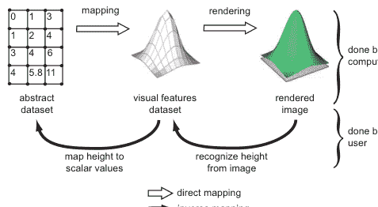

图 4.3. 可视化过程中的直接映射与逆映射。

- 目的：映射编码了关于 *什么* 和 *如何* 可视化的显式设计决策。映射通常将“不可见”数据转换为“可见”表示。相比之下，渲染模拟照亮“可见”3D 场景的物理过程。换句话说，映射指定编码实际数据的那些视觉属性，而渲染指定用户可以根据喜好调整以检查 3D 场景的其余视觉属性。在我们的高度图示例中，图的几何结构编码数据，因此在映射阶段指定。然而，图的颜色、视角和光照参数不编码实际数据，因此用户在检查 3D 场景时可以调整它们。例如，当用户旋转 3D 图以从不同角度查看时，就会发生这种情况。

- 模块化：映射和渲染操作都相当复杂。在实践中，它们由许多具有精巧实现的子步骤组成。分离这两种操作类型（及其实现）模块化了可视化管道，并有利于基于关注点分离和软件复用的简洁设计。特别是，许多图形方法及其实现，例如 3D 渲染库，一旦渲染步骤与映射步骤分离，就可以轻易（重）用于可视化应用程序。其中，这允许给定的可视化管道使用不同的后端渲染器，例如 OpenGL、DirectX 或渲染到文件的格式。

#### 可取的映射属性

数据映射可以说是可视化过程中最具特征的可视化管道步骤。其他管道步骤在很大程度上与其他学科中存在的技术重叠；导入和过滤数据可以很大程度上被视为重采样、投影、限制和各种其他信号处理操作，至少在采样（scivis）数据集的情况下是这样。渲染基本上只不过是应用计算机图形学技术，例如坐标变换、光照、纹理映射和光栅化。相比之下，数据映射针对的是相当特定的可视化任务，即分别使不可见和多维数据可见和低维。为此，数据映射函数 Map 应尝试满足几个可取的属性。

首先，Map 最好是单射。也就是说，要可视化的数据集 D 中不同的值 x1 != x2 应该映射到视觉特征数据集 DV 中不同的视觉属性值 Map(x1) != Map(x2)。这一属性对于设计有效的可视化至关重要。要理解这一点，请考虑用户如何解释可视化应用程序生成的图像。当我们查看此类图像时，我们希望能够对原始数据或其部分做出一些判断。例如，当我们查看函数 z = f(x, y) 的高度图图像时，我们希望能够说出函数定义域中任何点 (x, y) 的高度 z 是多少。换句话说，我们必须能够在脑海中反转将初始数据编码为图像特征的函数 Vis（或该函数的一部分）（参见公式 (4.1)）。为此，我们必须能够反转该函数的一些组件：渲染 Render、映射 Map、过滤 Filter 和数据导入 Import 操作。在实践中，Filter 和 Import 可能不可逆。此外，我们可能不想反转这些步骤，例如，当我们真正感兴趣以获得洞察的元素只有在过滤步骤后才被个体化时。尽管如此，如果 Map 和 Render 可逆，我们可以使用渲染图像对建模我们问题域的丰富数据集 D 做出判断。然而，如果 Map 和 Render 都不可逆，那么查看最终图像时很难对数据做出有区分度的判断。

让我们进一步详细说明反转过程。对于包含易于识别的形状和合适光照及观察参数的 3D 场景，我们的人类视觉系统应该能够反转 Render 函数；也就是说，我们应该能够识别在 2D 图像中渲染的是哪些 3D 视觉特征 $\mathcal{D}_V$。当然，这要求视觉特征数据集 $\mathcal{D}_V$ 被适当地渲染。例如，从不良角度和低光照渲染的 3D 场景将生成一幅图像，我们可能无法识别场景中存在的任何 3D 视觉特征，因此是一幅无法告诉我们任何有洞察力信息的图像。

因此，我们只剩下反转 Map。为此，我们应该能够在脑海中将数据属性值 $x_i \in \mathcal{D}$ 与我们在渲染图像中识别出的视觉特征 $\mathcal{D}_V$ 联系起来。例如，当我们在 3D 函数图上看到一个高程点时，我们应该推断该处函数值较高（参见图 4.3）。同样，当我们在天气热图上看到一个红点时，我们应该推断该处温度较高。如果函数 Map 是单射，我们就能推断该处温度较高。如果函数 Map 是单射，它在其整个值范围上是可逆的，这正是我们想要的。

#### 反转映射

然而，从纯数学角度来看，Map 可逆有时还不够。当我们查看图片时，我们必须知道如何在脑海中进行反转，并且能够做到这一点。为此，我们首先必须知道渲染中使用的视觉属性的意义。也就是说，我们必须知道映射中使用的颜色、形状、位置、纹理和其他视觉属性如何与感兴趣的数据属性相关联。这种知识可以是隐式的，编码在被假设为所有用户都知道的既定惯例中。示例是将某些属性映射到图标方向、形状和大小的可视化，例如天气图使用特殊图标表示风速和风向、日照强度以及降雨类型和强度。其他广泛传播的惯例包括地图的方向，其中北通常位于顶部，以及用于指示这些地图上地貌形式的特定色彩映射，其典型色调包括蓝色（水道和湖泊）、绿色（田野）、浅棕色（中等高度）、深棕色（山脉）和白色（山峰），交通标志也是如此。这种知识也可以明确提供。例如，大多数将数值属性映射到颜色的可视化都会显示一个颜色图例，它显示颜色如何对应值，并有效地帮助用户进行心理上的颜色到值的逆映射。色彩映射将在第 5 章中详细讨论。

图 4.4 说明了上述内容。我们的输入数据集由一个函数 $f : M \subset \mathbb{R}^2 \to \mathbb{R}^2$ 组成，该函数将地理地图 $M$ 上的每个 2D 位置与该位置记录的降雨量和温度相关联。为了可视化此信息，我们绘制实际地图（$f$ 的定义域 $M$）。每个点的颜色表示温度。绘制在地图上的阴影凸起的高度表示降水量。现在假设

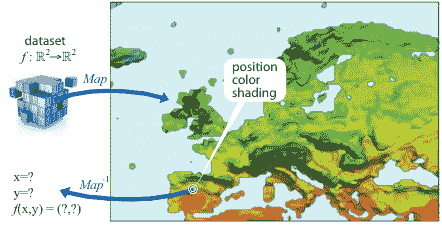

图 4.4. 天气图可视化的逆映射。

用户在此可视化中选择一个点，由图 4.4 中的圆形图标指示：我们可以说关于该点的数据什么？要回答这个问题，我们必须

- 知道所选点在 M 中映射到哪个点。这很容易做到，因为 M 与我们的 2D 可视化空间一一映射；
- 知道颜色如何编码温度，并能够将可视化中的每个色调映射到不同的数值温度值。为此，我们需要一个可逆的色彩映射；
- 知道高度如何编码降雨量，并能够将可视化中的每个灰度映射到不同的降雨量值。

#### 距离保持

许多可视化应用中使用的一种更强且同样有用的属性是，函数 Map 在从数据域映射到视觉域时试图保持距离。也就是说，数据集 D 中任何两个值 x1 和 x2 之间的距离 d(x1, x2) 应该暗示视觉特征数据集 Dv 中 d'(Map(x1), Map(x2)) 的距离。做到这一点的最简单方法是使用两者之间的直接比例关系。当我们有兴趣以视觉方式比较相对值而不是评估绝对属性值时，这很有用。例如，查看我们的 3D 高程图时，我们可以通过在 3D 图中以视觉方式比较各个数据点的高度来判断定义域中各个数据点的相对函数值，即使我们可能对它们的绝对值没有确切概念。在实践中，可视化应用程序通常使用线性映射函数来在某些数值属性值之间进行映射


和一些视觉属性，例如高度、位置、亮度或色相。线性函数相当有效，因为它们是可逆的，易于理解，并且在数据空间和视觉空间之间很好地保持距离。然而，当要映射的距离范围非常大且数据值不均匀地分布在这个范围内，而是聚集在其中的小子范围时，线性函数效果就不佳了。

用于需要测量数据的可视化中的映射函数有时被称为*测量映射* [Lanza and Marinescu 06]。根据测量理论，测量映射函数必须满足*表示条件*，该条件指出这样的映射必须“将实体映射为数字，并将经验关系映射为数值关系，使得经验关系被数值关系所保留并保留数值关系” [Fleeger et al. 05]。

在实践中，许多*映射*函数，严格来说，在其整个范围内都不可逆，并且也不保持距离。例如，图4.4中用于映射降雨值的阴影只能显示少量不同的值，因为我们的视觉系统和用于渲染该图像的图形硬件分别只能区分、显示有限的一组灰色色调。只要引入的偏差不会导致用户从所见内容中得出错误结论，这就不是问题。一如既往，对映射函数有效性的评估只能针对具体的应用领域、任务和用户群体进行。举个简单的例子，一个将标量值转换为色相的颜色映射，对大多数人来说效果完美，但对色盲用户可能效果很差。

**组织层级。** 如前所述，并非所有视觉变量都同样允许相同类型的逆向映射操作。表4.1列出了最常见的视觉变量及其所谓的“组织层级” [Bertin 77]。这些特征描述了人们可以在这样的变量上轻松进行的可视操作类型。按组织层级细节递增的顺序，变量 $v \in \mathbb{D}_V$ 被称为

- *结合性* 如果 $v$ 允许由 $v$ 映射的分类属性在同一图像中独立于其他视觉变量的存在而被感知。例如，“形状”是*结合性*，因为我们可以轻松区分不同的形状，即使它们颜色或位置不同。一个不是*结合性*的变量称为*非结合性*；

- *选择性* 如果 $v$ 允许由 $v$ 映射的分类值（几乎）即时地被感知为与由 $v$ 映射的其他值不同。例如，

| 视觉变量 | 定量 | 序数 | 选择性 | 结合性/非结合性 |
|---|---|---|---|---|
| 位置 | ✓ | ✓ | ✓ | A |
| 大小 | ✓ | ✓ | ✓ | D |
| 亮度 | | ✓ | ✓ | D |
| 纹理 | | ✓ | ✓ | A |
| 颜色（色相） | | ✓ | ✓ | A |
| 方向 | | | ✓ | A |
| 形状 | | | ✓ | A |

表4.1. 视觉变量的组织层级。

“颜色”是*选择性*，因为我们可以轻松地在视觉上选择一组不同颜色对象中的所有红色形状；

- *序数* 如果 $v$ 允许人们预注意地比较由 $v$ 映射的不同值。例如，“大小”是*序数*，因为我们可以轻松看出两个对象是否大小相同，或者一个对象是否比另一个对象更大；
- *定量* 如果 $v$ 允许人们在视觉上计算由 $v$ 映射的不同值之间的比率。例如，“大小”（视为长度，例如）是典型的*定量*变量，因为我们可以轻松判断一个对象比另一个对象长（或短）多少倍。

当然，表4.1中概述的组织层级属性并非理所当然。这些是给定的视觉变量在设计良好的可视化并考虑平均用例和用户的情况下_可能_具有的属性。我们可以清楚地找到这些属性不成立的情况，例如，由于可视化设计不佳、数据集过大、显示设备不佳，或用户未经培训或不专心。这种分类的主要价值在于让设计师意识到视觉变量固有的局限性。例如，因为“大小”通常是定量的，而“颜色”不是，所以对于我们希望在视觉上计算和比较比率的数据属性，最好将该属性映射到大小而不是颜色。

与逆向过程相关的是_数据_和_信息_之间的区别。根据Spence [Spence 07]的讨论，我们指出可视化的主要任务是从_数据_（即记录的数据，例如网格上的信号样本）中推导出_信息_（即导致关于某个问题结论的有用事实）。映射函数应允许从生成的图像中检索信息，而不仅仅是原始数据。

延伸阅读。设计有效的视觉映射是设计有效可视化应用程序成功（或失败）的核心。除了本节涵盖的基本理论之外，许多其他方面有助于成功设计：作为显示介质函数的视觉编码选择；目标用户群体接受的惯例；使用交互机制来促进数据探索；对感知、认知和人类视觉因素的了解；以及驱动整体可视化设计的审美原则。上述主题的更多信息可在多种地方找到。Ward等人最近的书籍对上述所有要点进行了全面且平衡的覆盖，重点关注交互式可视化和以用户为中心的设计 [Ward et al. 10]。Tufte的经典书籍对统计图形设计提供了较低层次但同样重要的视角 [Tufte 01]。Hansen等人《可视化手册》中的第X章提供了关于数据可视化中感知问题的额外见解 [Hansen and Johnson 05]。最后，Bertin的书籍详细讨论了映射函数设计中使用的视觉变量的理想属性，以及如何使用这些属性来编码不同类型的属性 [Bertin 77, Bertin 83]。

### 4.1.4 渲染数据

渲染操作是可视化过程的最后一步。渲染获取由映射操作创建的3D场景，连同用户指定的多个查看参数（如视点和光照），并对其进行渲染以生成所需的图像：

```
Render : \mathbb{D}_V \rightarrow \mathbb{I}.
```

在典型的可视化应用程序中，查看参数被视为渲染操作的一部分。这允许用户交互式地导航和检查给定可视化的渲染结果，通过渲染3D场景而无需重新计算映射操作。确实，如果视点发生变化但映射生成的3D场景保持不变，我们所要做的就是使用新的查看参数重新渲染场景，这是一个相对廉价的操作。

### 4.2 实现视角

将所有内容结合起来，我们可以将可视化流水线描述为具有数据集参数和值的函数的组合。如果我们用 \mathbb{D} 表示所有数据集的空间，则有

```
Vis = F_1 \circ F_2 \circ ... \circ F_n, \quad where \quad F_i : \mathbb{D} \rightarrow \mathbb{D}.
```

各种函数 \( F_i \) 执行数据渲染、映射、过滤和导入，因此在可视化流水线中以其出现的逆序排列。\( F_n \) 的输入是应用程序的原始数据，\( F_i \) 的输出是最终图像。这个模型允许我们将四个阶段中的每一个分解为所需的任意数量的子函数。这有几个目的。首先，从概念上讲，将复杂操作（如过滤）视为一系列简单的类似过滤器的原子操作的组合，每个操作都处理特定任务，这更容易理解。其次，这有利于模块化、可重用的软件设计，并允许我们从一组预定义的功能组件中组装可视化应用程序。在实践中，哪些函数应被视为数据导入、过滤、映射和渲染阶段的一部分并没有明确的界限。不同的可视化应用程序在这里会做出不同的选择。从纯粹的实现角度来看，流水线中使用的所有数据类型（原始数据、采样数据集和图像）都可以被视为数据集，所有流水线操作都可以建模为读取和写入数据集的函数。

可视化应用程序的设计有两个主要部分。首先，我们为给定应用程序的可视化流水线选择正确的数据处理操作，即函数 \( F_i \)（参见公式（4.7））。其次，我们选择正确的数据集实现 \( D_j \in \mathbb{D} \) 来连接流水线函数 \( F_i \)。我们在第3章中概述了如何实现数据集 \( D_j \)。我们现在简要讨论如何实现数据处理操作 \( F_i \)。

数据流设计。如果我们使用面向对象设计，可以将函数 \( F_i \) 实现为具有三个属性的类：

- 它们读取一个或多个输入数据集 \( \mathcal{D}_i^{\text{inp}} \)。
- 它们写入一个或多个输出数据集 \( \mathcal{D}_j^{\text{out}} \)。
- 它们有一个 execute() 操作，根据 \( \mathcal{D}_i^{\text{inp}} \) 计算 \( \mathcal{D}_j^{\text{out}} \)。

让函数 \( F \) 将多个数据集作为输入（参数）和输出（结果）的选择纯粹是出于实际考虑。输入和输出的实际数量、类型和含义取决于函数本身的语义。在实现术语中，具有这些属性的函数 \( F \) 可以建模为具有三个方法的类 F，如清单4.1所示。setInput() 和 getOutput() 方法分别是输入和输出数据集 \( \mathcal{D}_i^{\text{inp}} \) 和 \( \mathcal{D}_j^{\text{out}} \) 的简单访问器。这些由 Grid 子类表示，例如均匀或非结构化数据集，已在第3章中详细介绍。在基本实现中，访问器将简单地将输入和输出数据集的引用存储在 F 的局部 inputs 和 outputs 向量中。


```
class F
{
    public :
        void
        Grid*        setInput ( Grid* , int ) ;
        getOutput ( Grid* , int ) ;
        virtual void execute ( ) =0;
    protected :
        vector<Grid*> inputs ;
        vector<Grid*> outputs ;
};
```

#### 清单 4.1. 可视化操作实现.

class F. 具体的可视化操作将继承清单 4.1 中的抽象类 F，并实现实际的 execute() 操作，该操作将读取输入数据集，执行实际的数据处理操作，并将基类 inputs 和 outputs 容器中存在的相应输出数据集写入。

基于此实现，可视化应用程序可以看作是由函数（或操作）对象 Fi 组成的网络，这些对象通过共享输入和输出 Grid 数据集相互连接。图 4.5 描绘了这样一个由四个函数对象和四个数据集组成的简单应用程序。第一个操作 F1 没有输入，因为它将数据从外部源导入到流水线中。操作 F4 没有输出——我们假设这是生成最终图像的渲染操作。操作可以有多个输入或输出，同一个数据集可以被多个操作读取。同一个数据集被多个操作写入也是可能的，但通常不推荐，因为这会显著增加实现和设计理解的复杂性。

当我们将新的原始数据输入到流水线中时，应用程序应首先执行 F1，然后执行 F2 和 F3（顺序任意，因为它们互不依赖），接着执行 F4。在一般情况下，考虑这样一个图：其节点为操作 Fi，边为操作之间的数据依赖，即，如果 Fi 写入的数据集被 Fj 读取，则存在从 Fi 到 Fj 的有向边。在图 4.5 中，该图包含四个节点 F1 ... F4 和四条边（蓝色绘制）。如果应用程序图是无环图，则执行等同于按照图的拓扑排序顺序调用所有操作 Fi 的 execute() 方法 [Cormen 等人 01]。这确保了只有在所有输入都可用且为最新时，才会执行一个操作。循环应用程序图也可以被支持，但需要更复杂的更新机制，因此在实践中使用较少。此应用模型中操作执行的序列

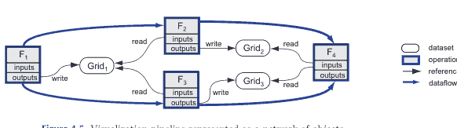

此应用模型遵循从导入操作到最终渲染操作的数据“流”。因此，这种设计通常被称为数据流应用模型。

总之，可视化应用程序可以实现为一个操作对象网络，这些对象以数据集对象作为输入和输出。要执行应用程序，操作按照数据流顺序调用，从数据导入开始，到渲染结束。该模型——尽管在原则上是足够的——需要大量扩展，以便为可视化框架提供可扩展且高效的实现。在最显著的扩展中，我们提到针对数据集和操作对象的引用计数与自动内存管理、确保数据集-操作兼容性的类型化输入和输出、在数据变化时尽量减少执行的操作次数的智能流水线遍历方法、在一台或多台机器上并行化和分布式执行、允许用户在任何所需时刻停止流水线执行的渐进式更新机制，以及针对数据集和应用程序本身的序列化设施。

#### 数据流实现.

多个专业可视化框架实现了这些功能，以及数百种高级数据处理、映射和渲染操作。2 其中，可视化工具包（VTK）脱颖而出，可以说是学术界和工业界最知名、最广泛使用的框架 [Schroeder 等人 06, Kitware, Inc. 04]。VTK 是一个基于先前讨论的数据流应用模型的专业可视化框架。VTK 实现了上述所有高级机制，提供了一大套可视化操作，具有高效的 C++ 实现，并附带针对多种解释型语言（如 Tcl、Java 和 Python）的绑定。VTK 是一个开源产品，这意味着它可以轻松修改并嵌入到不同的开发环境中。

2有关实际可视化软件的更多信息，请参见附录。

因此，VTK 被庞大的开发者社区使用并不断改进。然而，VTK 工具包的极大灵活性、泛型性和效率在复杂性方面付出了代价。学习如何使用 VTK 开发可视化应用程序是一项复杂的任务，需要相当的编程经验和耐心。对于有兴趣探索将 VTK 用于其可视化应用程序的读者，我们推荐几本描述该工具包原理和设计的现有书籍 [Schroeder 等人 06, Kitware, Inc. 04]，以及包含开源 VTK 软件和示例数据集的 Web 资源 [Kitware, Inc. 13]。

相同的架构和设计原则也用于洞察工具包（ITK）[National Library of Medicine 14]。与面向通用数据可视化的 VTK 相比，ITK 专注于图像分割、处理和配准这一更具体的领域。ITK 可以处理多维图像，并提供阈值处理、边缘检测、平滑、去噪、距离计算、分割和配准等算法。ITK 提供与 VTK 相同的包装器概念和开源开发模型，但也共享类似的陡峭、编程密集型学习曲线。

#### 可视数据流编程.

构建可视化应用程序不仅限于编写源代码的程序员。几种更高级的方法提供了更简单、更直观的应用程序构建机制。20 世纪 90 年代流行的开发隐喻是 _视觉应用构建_。该隐喻已由多种可视编程环境或可视应用构建器实现 [AVS, Inc. 06, Walton 04, MeVis Inc. 13, Telea and van Wijk 99]。在这种范式中，最终用户通过组装可视化操作的图标化表示来构建数据流应用程序网络。描述多个模块库中可用操作的图标被拖放到画布工作区，其中它们的输入和输出通过鼠标操作相互连接。环境提供图形用户界面（GUI），让用户交互式控制各种可视化操作的参数，从而实现交互式数据探索的目标。当用户修改此类参数时，环境会触发数据流执行引擎，从受影响的操作开始更新整个应用程序网络，直到在可视化窗口中渲染出新图像。

图 4.6 说明了 VISION 环境中如今熟悉的高度图应用程序的这些概念 [Telea and van Wijk 99]。图 4.7 显示了 MeVisLab 环境中的同一高度图应用程序，这是一个最近的

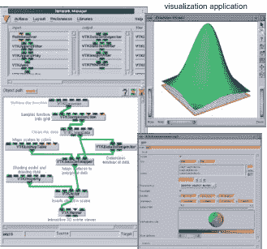

#### 图 4.6. VISION 应用构建器中的高度图应用程序 [Telea and van Wijk 99].

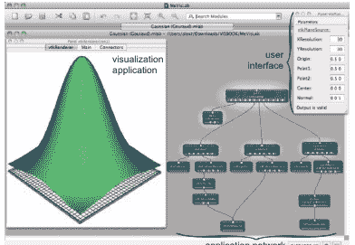

#### 图 4.7. MeVisLab 应用构建器中的高度图应用程序 [MeVis Inc. 13].

功能强大的可视应用构建器 [MeVis Inc. 13]。两种环境都使用 VTK 工具包作为底层实现来提供可视化服务。然而，原始的 VTK 功能被“包装”成可视化表示，从而使其易于使用和学习。

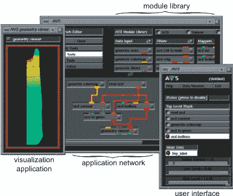

#### 图 4.8. AVS 应用构建器中的可视化应用程序 [AVS, Inc. 06].

图 4.8 显示了 AVS 可视化系统中另一个可视化应用程序的快照 [AVS, Inc. 06]。主要设计元素，即模块库、应用程序数据流网络、用户界面和实际可视化窗口，都很容易识别。还有其他类似的可视应用构建器，例如 VisTrails [Bavoil 等人 05] 和 DeVIDE [Botha 13]。

#### 简化的可视编程.

图 4.9 由 ParaView 环境 [Henderson 04] 说明了一种略有不同的可视应用构建器类型。与 VISION 和 MeVisLab 类似，它们都使用 VTK 库及其底层机制来提供可视化操作的实际实现，ParaView 具有一个更适合初学者的最终用户界面。通过构建具有完全通用图拓扑的应用程序网络的自由


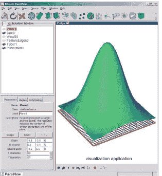

图 4.9. ParaView 应用程序构建器中的高度图应用 [Henderson 04]。

在 ParaView 中，可视化编程（存在于 MeVisLab、AVS 或 VISSION 中）被一种使用常规 GUI 菜单的更简单的应用程序构建过程所取代，该过程更易学习和使用。MayaVi [MayaVi 13] 等其他工具包也采用了以牺牲设计自由度换取使用简便性的类似权衡。

图 4.6、4.7 和 4.9 所示可视化编程环境的主要吸引力在于，它们允许几乎不具备编程技能的用户快速原型化可视化应用程序。然而，此类环境对于生产复杂的可视化应用程序效果较差。许多现实世界的可视化应用程序通常包含数百个操作，包含使用数据流范式难以轻松建模的复杂控制流，并且需要为其用户界面编写复杂的自定义代码。此外，此类应用程序的结构在进入成熟开发阶段后很少发生变化。所有这些因素使可视化编程环境不太适合创建最终应用程序，尽管它们在原型设计阶段仍然非常有效。

### 4.3 算法分类

目前，我们已具备开始学习若干特定可视化技术（也称为 *可视化算法*）所需的所有理论和实践要素。过去 15 年的可视化实践产生了大量可视化算法。如果我们查看任何通用可视化软件系统、库或框架，都会发现数百种此类技术。显然，我们需要一种组织这些技术的方法，以便我们可以轻松地学习和引用它们。分类可视化技术有多种方式。目前使用的大多数现有分类在某种程度上都基于可视化技术作为同一可视化管道一部分时相互交互的方式。任何分类法都基于其元素共享的某些共同点。就可视化算法而言，它们共享输入和输出数据集，通过这些数据集它们在可视化管道中被耦合，如前面本章所述。

可视化技术最直观且最广泛的分类法之一基于这些技术所处理的属性类型。遵循第 3.6 节引入的属性术语，我们谈论 *标量*、*向量* 和 *张量可视化方法*。这些方法分别在第 5、6 和 7 章中讨论。读者可能已经注意到，第 3.6 节将 *颜色* 属性引入为单独的类别。颜色可视化方法本质上要么是我们不单独讨论的渲染方法，要么是我们将在第 9 章单独处理的图像处理方法。最后，非数值属性类型（如文本、图形或一般数据表）由信息可视化（infovis）方法所针对，我们将在第 11 章简要概述这些方法。

与任何分类法一样，有些元素不易归入我们基于属性的可视化方法分类。例如，有些特定的可视化方法处理的是底层采样域表示，而不是属性。我们将这些方法归类为称为 *域建模方法* 的特殊类别。此类方法的示例包括改变采样点位置的网格扭曲技术、将采样域子集提取为单独数据集的切割和选择技术，以及改变用于重建数据的单元和/或基函数的重采样技术。这些方法构成了第 8 章的主题。

还存在其他分类。Schroeder 等人提出了一种 *结构分类*，它按可视化技术更改的数据集成分类型对可视化技术进行分组。他们的分类包括 *几何* 技术（改变采样点的几何形状或位置）、*拓扑* 技术（改变网格单元）、属性技术（仅更改属性）和组合技术（更改数据集的多个成分）[Schroeder et al. 06]。Marcus 等人还提出了另一种分类，即包含以下维度的五维模型 [Marcus et al. 03]:

- 任务：要完成什么任务？
- 受众：用户是谁？
- 目标：要可视化的数据是什么？
- 媒介：渲染（绘图）支持是什么？
- 表示：使用了哪些图形属性（形状、颜色、纹理）？

此分类不仅适用于描述可视化算法，也适用于描述整个可视化应用程序。

除了此处讨论的分类之外，在实践中，几乎每个可视化软件框架都会提出自己的分类，该分类反映了软件界面的某些以用户为中心的方面或某些以实现为导向的方面。然而，我们的实践表明，许多用户自然会以标量、向量、张量和域建模算法的术语来思考（科学）可视化方法。因此，我们将在介绍最广泛使用的可视化技术时使用此分类。

### 4.4 结论

在本章中，我们从概念和实现两个角度描述了可视化过程（或可视化管道）的结构。在本节中，我们将尝试就此过程得出几个结论。

首先，尽管我们的目标是从模块化角度介绍可视化应用程序的结构，其中管道中的每个模块都有明确定义的功能，但实际情况往往与该模型相去甚远。数据导入、过滤、映射和渲染等可视化阶段之间没有明确的分离。尽管如此，可视化管道中的主要分离点发生在抽象数据变得可能可见的时刻，即映射阶段之后。这一特征存在于所有可视化应用程序中。管道的进一步细化，例如区分数据导入和数据过滤，则不太明显。实际应用程序可以以不同的方式分离和结构化管道，具体取决于超出本一般讨论范围的设计和实现考虑因素。

第二个值得关注的点涉及给定可视化管道结构的理想属性。从实现角度来看，组装成管道的元素应满足软件组件的通常要求：模块化、可重用性、简单性、可扩展性、最小性和通用性。与任何软件工程领域一样，满足所有这些要求显然是一项艰巨的任务，并且鉴于可能的可视化操作和数据集范围极其广泛，通常不可能最优地实现。

第三个值得关注的点涉及映射函数的属性。给定可视化的有效性由该函数关键决定。一般来说，映射函数应该是可逆的，以便我们可以通过查看其可视化映射来掌握数据属性，并且是无歧义的，以便我们不会对所看到的内容产生怀疑。然而，设计此类映射函数并没有银弹。构建“良好”的数据到图像映射既是一门科学也是一门艺术。从科学领域来看，我们可以重用采样和信号理论、视觉感知、计算机视觉和认知科学的元素。可视化也是一种工艺或艺术，因为此类选择并不总是确定性的。在这方面，美学对于良好的可视化至关重要，因为其用户必须被吸引去投入精力来研究和使用它。

在其余章节中，我们将介绍本章描述的可视化管道的具体实例，涵盖标量、向量、张量、图像、体积和抽象数据的多种可视化方法。


## Chapter 5

## 标量可视化

可视化标量数据在科学、工程和医学中经常遇到，在日常生活中也是如此。回顾第 3.6 节，标量数据集或标量场表示函数 \( f : \mathcal{D} \rightarrow \mathbb{R} \)，其中 \( \mathcal{D} \) 通常是 \( \mathbb{R}^2 \) 或 \( \mathbb{R}^3 \) 的子集。存在许多标量可视化技术，适用于二维（2D）和三维（3D）数据集。在本章中，我们介绍了一些最流行的标量可视化技术：颜色映射、等值线和高度图。我们从第 5.1 节的颜色映射开始，然后在第 5.2 节讨论有效颜色映射表的设计。在第 5.3 节中，我们讨论二维和三维的等值线。在第 5.4 节中，我们介绍高度图。

### 5.1 颜色映射

颜色映射可能是标量数据最广泛使用的可视化方法。简单来说，颜色映射将每个标量值与一种颜色关联。使用第 4 章介绍的可视化管道术语，颜色映射是一个映射函数 \( m : \mathcal{D} \rightarrow \mathcal{D}_V \)。\( \mathcal{D}_V \) 的几何形状与 \( \mathcal{D} \) 相同，但颜色取决于定义在 \( \mathcal{D} \) 上的标量数据。换句话说，这意味着颜色映射不关心创建特定形状来可视化数据，而是对定义了标量数据的形状进行着色以显示数据值。对于感兴趣域 \( \mathcal{D} \) 中的每个点，颜色映射应用一个函数 \( c : \mathbb{R} \rightarrow Colors \)，该函数为该点分配一种颜色 \( c(s) \in Colors \)，该颜色取决于该点的标量值 \( s \)。

定义这样的标量到颜色函数 c 有几种方法。我们将讨论两种最常见的形式：颜色查找表和传递函数。颜色查找表是实现颜色映射的最简单方法。简单来说，颜色查找表 C，也称为颜色映射表，是颜色映射函数 c 的均匀采样：

$$C = \{c_i\}_{i=1..N}, \quad \text{where} \quad c_i = c \left( \frac{(N-i)f_{min} + i f_{max}}{N} \right). \quad (5.1)$$

在实践中，方程 (5.1) 实现为 N 种颜色 c1, ..., cN 的表，这些颜色与标量数据集值 f 关联，假设 f 在范围 [fmin, fmax] 内。了解标量范围很重要，因为它允许我们构建具有清晰简单含义的颜色映射：颜色映射表中低索引 i 的颜色 ci 表示接近 fmin 的低标量值，而颜色映射表中索引接近 N 的颜色表示接近 fmax 的高标量值。在实践中，fmin 和 fmax 可以通过检查采样的数据集值自动确定，也可以由用户指定。在后一种情况下，处于指定范围 [fmin, fmax] 之外的数据集值将被限制在此范围内，以在给定的颜色映射表中产生有效颜色。当我们能够在可视化之前确定此范围时，将数据集值缩放到其范围效果很好。但是，想象一个应用程序，我们想要可视化时间相关的标量场 f(t)，其中 t 在 [tmin, tmax] 中。典型的解决方案是可视化标量场 f(t) 在 [tmin, tmax] 中连续 t 值的颜色映射值。但是，如果我们在开始可视化之前不知道所有 t 值的 f(t)，我们就无法计算应用方程 (5.1) 的绝对标量范围 [fmin, fmax]。而且，即使这是可能的，我们可能也不想这样做。如果 [tmin, tmax] 中时间步骤 tk 的范围 [fmin(tk), fmax(tk)] 远小于绝对范围 [fmin, fmax]，将 f 归一化到绝对范围将在查看单个帧时显示很少细节。在这种情况下，更好的解决方案可能是为每个时间帧 f(t) 分别归一化标量范围。当然，这也意味着为每个时间帧绘制不同的颜色图例。

除了使用采样的标量到颜色函数到离散查找表之外，如果需要，也可以解析地定义函数 c。由于颜色通常在 RGB 或 HSV（色相-饱和度-明度）颜色系统中表示为三元组，这通常通过定义三个颜色函数 cR : R -> R、cG : R -> R 和 cB : R -> R 来完成，其中 c = (cR, cG, cB)。函数 cR、cG 和 cB 也称为传递函数。有关传递函数的更多内容将在第 9 章和第 10 章中介绍，届时我们将讨论图像和体积可视化。在实践中，当不需要在运行时更改单个颜色时，人们使用预定义的查找表；当调查目标要求动态更改颜色映射函数时，则使用传递函数。

### 5.2 设计有效的颜色映射表

使用颜色映射进行可视化的主要挑战是设计一个 *有效* 的颜色映射表 *C*。但是，颜色映射表 *有效* 是什么意思？就第 4.1.3 节描述的映射操作而言，如果通过查看生成的颜色，我们可以轻松准确地对原始标量数据集（已进行颜色映射）做出陈述，那么颜色映射可视化就是 *有效* 的。不同类型的陈述和分析目标需要不同类型的颜色映射表。这些目标包括以下内容：

- 1. 绝对值：告诉显示数据集中所有点的绝对数据值。
- 2. 值排序：给定显示数据集中的两个点，告诉哪个对应的两个数据值更大。
- 3. 值差异：给定显示数据集中的两个点，告诉这些点的数据值差是多少。
- 4. 选定值：给定特定数据值 _f<sub>interest</sub>_，告诉显示数据中哪些点取相应的值 _f<sub>interest</sub>_。此目标的变体将 _f<sub>interest</sub>_ 替换为数据值的紧凑区间。
- 5. 值变化：告诉显示数据集中给定点的数据值的变化速度，或一阶导数。

显然，上述一些目标比其他目标更难实现。例如，目标 2 仅意味着我们可以告诉一个数据值是否大于（或小于）另一个值，但不能告诉大多少，也不能告诉绝对数据值是什么。目标 3 意味着我们可以告诉两个数据值相距多远，但不能告诉哪个最大、哪个最小，换句话说，数据值是如何排序的。目标 4 意味着我们可以告诉所选值 _f<sub>interest</sub>_ 在数据集中的哪个位置出现，但对具有不同于 _f<sub>interest</sub>_ 的数据值的点几乎不需要或不需要告诉任何事情（除了它们不取这个值）。目标 5 意味着我们可以告诉值在给定点或其周围变化的速度，但不能告诉这些数据值的绝对值。

设计一个在同等程度上实现上述所有目标的颜色映射表是一项非常具有挑战性的任务。因此，颜色映射表设计通常专注于优化上述目标的一个子集，可能以牺牲其他目标为代价。在以下内容中，我们讨论与构建颜色映射表相关的几个重要设计决策，并将它们与上述目标联系起来。

颜色图例。考虑我们的第一目标——可以说是所有目标中最具挑战性的。要实现此目标，我们必须能够在脑海中反转颜色映射函数 c；也就是说，查看可视化域 Dv 中某个点的颜色并告诉其标量值 f。要能够做到这一点，我们必须知道颜色映射函数 c。在实践中，这是通过绘制所谓的颜色图例来实现的。这通常是一个包含我们颜色映射表中所有颜色 ci 的颜色条，并带有指示所有或若干描绘颜色的值 f 的标签。通过查看实际可视化并将其颜色与颜色映射表中标记的颜色进行比较，我们能够推断绘制图像中所需点处描绘数据集的标量值。本节稍后将展示几个颜色图例的示例，参见，例如，图 5.2。

但是，颜色图例机制要成功有一些条件。首先，如第 4.1.3 节所述，颜色映射函数 c 必须是可逆的。这要求函数是双射的，意味着范围 [fmin, fmax] 中的每个标量值都与唯一颜色关联。使用的颜色在观察者眼中必须是唯一的。颜色具有不同的数值（例如 RGB）值是不够的。如果我们想要使用颜色图例将它们映射到标量，我们还必须能够轻松地在视觉上感知它们是不同的。其次，可视化数据集的空间分辨率必须足够高，与标量数据 f 的变化速度相比，以便我们能够在视觉上区分具有不同颜色的单独区域。

颜色图例对于任何需要将颜色映射到与数据相关的量的颜色映射应用都是必需的。请注意，这不仅适用于我们分类法中的目标 1。确实，如果我们想要对数据值的排序进行定量判断（目标 2），则需要颜色图例来告诉颜色是如何相对于数据值的排序进行排序的。如果我们想要比较数据值之间的距离（目标 3），我们需要颜色图例来显示哪些差异是小的，哪些是大的。如果我们想要告诉哪些数据点取给定的感兴趣值（目标 4），我们需要颜色图例来告诉哪种颜色显示感兴趣的值。如果我们想要告诉数据变化的速度（目标 5），并将此任务归约为将标量信号 f 的梯度大小 \(\|\nabla f\|\) 进行颜色映射，那么我们就需要 \(\|\nabla f\|\) 的颜色图例。


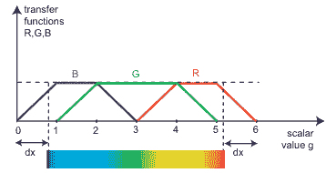

图 5.1. 彩虹色图的构建。

彩虹色图。色图设计也受应用程序或领域特定的惯例和传统的影响。例如，许多工程和天气预报应用程序使用从蓝到红的色图，通常称为 _彩虹_ 色图（参见图 5.1）。这种色图基于以下直觉：蓝色是一种“冷”色，暗示低值，而红色是一种“热”色，暗示高值。我们可以使用三个传递函数 _R_、_G_、_B_（如图 5.1 所示）来构建彩虹色图。彩虹色图由清单 5.1 中的代码构建。这构建了三个梯形传递函数 _R_、_G_ 和 _B_，范围从零到一。这些函数在标量值（水平）轴上的不同位置居中，这决定了从蓝到红的色图结构。这些函数几乎到处都重叠，这使得色图中的色调平滑变化。参数 `dx` ∈ [0, 1] 控制在色图的开头和结尾分别使用多少纯蓝色和纯红色，与仅包含混合色调的色图相比，这能产生更具美感的结果。根据第 3 章讨论的插值理论，这些传递函数可以被视为分段线性基函数，用于在它们对应的原色之间进行插值。

图 5.2(a) 显示了将彩虹色图应用于计算机断层扫描（CT）体数据集的一个 2D 切片上的情况。1 数据值表示组织密度，高值对应硬结构（如骨骼），低值对应软组织（如大脑、皮肤、脂肪和肌肉）。最低数据值对应空气。使用彩虹色图，我们可以相对容易地区分较硬的组织（颜色映射为黄色、橙色和红色）以及空气（颜色映射为深蓝色）。

```
void c(float f ,float& R,float& G,float& B)
{
    const float dx = 0.8;
    f = (f<0) ? 0 : (f>1) ? 1 : f;        //clamp f in [0,1]
    g = (6-2*dx)*f + dx;                  //scale f to [dx, 6 - dx]
    R = max(0,(3 - fabs (g-4) - fabs (g -5))/2);
    G = max(0,(4 - fabs (g-2) - fabs (g -4))/2);
    B = max(0,(3 - fabs (g-1) - fabs (g -2))/2);
}
```

#### 清单 5.1. 彩虹色图构建。

彩虹色图是数据可视化中最广泛使用的色图类型之一，它们被包含在众多可视化应用程序中，并且通常作为默认值提供 [博兰和泰勒 07]。然而，彩虹色图也有几个重要的局限性：

- 焦点：从感知角度来看，暖色可以说比冷色更能吸引注意力。在我们图 5.2(a) 的示例中，这意味着我们的注意力更多地被吸引到高数据值上。如果这些是我们感兴趣的值（目标 4），这可能是可取的。但是，取决于应用程序，这些可能不是我们想要关注的值。

- 亮度：图 5.1 和清单 5.1 中提出的彩虹色图构建方法指出，所有生成的颜色都具有相同的 HSV 亮度，即 R、G 和 B 颜色分量的最大值相同（参见第 3.6.3 节，清单 3.2），除了色图的“尾部”，那里的亮度略有增加，分别略有减少。但是，如第 3.6.3 节、公式 3.23 所解释的，感知亮度和 HSV 亮度远非相同。因此，彩虹色图条目的亮度呈非单调变化。这会导致用户可能更倾向于某些颜色而非其他颜色，以及/或者将某些颜色对比度视为比其他对比度更重要。后者问题可能会对目标 5 造成问题。可以通过调整彩虹色图条目来纠正此问题，使它们使用相同的色调，但具有由公式 3.23 给出的最大亮度。

- 上下文：色调可能具有特定于应用程序的语义。彩虹色图基于以下假设：“暖”色（如黄色和红色）被感知为与较高的数据值相关联，而“冷”色（如蓝色）则暗示较低的值。这一假设基于将彩虹色图解释为热图或温度图。虽然这可能是可视化温度数据集的良好编码，但在例如医疗数据集的情况下，这种关联就更难且更不自然。

- 排序：彩虹色图假设用户可以轻松地将色调从蓝色到绿色到黄色再到红色排序，就像这种色图所使用的那样。虽然可以通过持续使用彩虹色图来学习这种排序，但我们不能假设任何用户都会以这种特定方式排序色调。当此假设不成立时，目标 2 将受到挑战。

- 线性：除了色图可逆性要求之外，可视化应用程序通常还需要满足线性约束。为了解释这一点，假设例如我们使用彩虹色图可视化线性函数 f(x) = x。可视化的结果实际上与图 5.2(a) 底部显示的颜色条相同。可以认为，这种本质上将值映射到色调的色图不是线性的。一些用户感知到，在较高的黄到红范围内，颜色变化“更快”，每个空间单位比在较低的蓝到青范围内更快。因此，线性信号会被用户感知为非线性，可能对目标 3 和 5 产生不良后果。

#### 其他色图设计。

有许多其他色图设计是可能的。图 5.2 显示了五种这样的色图应用于我们的 2D CT 切片，除了已经讨论过的彩虹色图之外。

灰度：图 5.2(b) 显示了一个灰度色图。在这里，我们将数据值 f 线性映射到亮度或灰度值，其中 fmin 对应黑色，fmax 对应白色。大多数医学专家，甚至非专家，都会同意，与使用图 5.2(a) 中的彩虹色图相比，灰度产生的可视化更容易跟踪、更不令人困惑，细节也更容易发现。灰度色图有几个优点。首先，它直接将数据编码为亮度，因此在区分不同色调方面没有问题。其次，色彩排序是自然的（从深到浅），这有助于目标 2。例如，对于医疗可视化，黑到白的色图可能比彩虹色图更有效，因为这些灰度直观地映射到 X 光照片中可见的灰度。最后，在针对一系列显示或打印设备时，渲染灰度图像对颜色再现变异性问题的敏感度较低。然而，从负面来看，区分两个灰度值或解决目标 3，比使用基于色调的色图更困难。一个更微妙的问题是，如果我们要显示的数据集不形成一个 *紧凑* 域（如图 5.2 中的 2D 切片），则会出现问题。此类数据集的示例包括散射的 2D 点云、平行坐标图或节点-链接图形图，例如分别在图 11.32、11.29 和 11.23 中显示的用于信息可视化应用（第 11 章）的图。在这种情况下，我们不能使用灰度色图，或者任何包含非常亮颜色的色图，因为这样的色图会使数据点看起来与背景颜色太相似，从而可能使它们不可见。

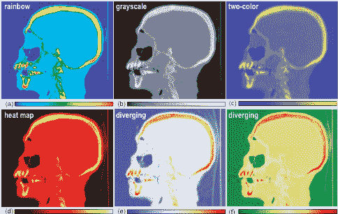

图 5.2. 使用各种色图的标量可视化。

*双色调*：图 5.2(c) 显示了一个 *双色调* 色图。色图条目是通过在两个用户选择的颜色之间进行线性插值得到的，在我们的例子中是蓝色和黄色。双色调色图可以被视为灰度色图的推广，我们在两种颜色之间进行插值，而不是在黑色和白色之间。如果用于插值的两种颜色在感知上差异很大（例如在我们的例子中，它们既在色调上也在感知亮度上有所不同），那么生成的色图允许轻松的颜色排序，并且比彩虹色图产生更感知线性的结果。另外，如果定义此色图的两种颜色都不太亮，那么结果适合用于在白色背景上显示非紧凑数据。


然而，这种颜色映射的一个缺点是，它可能提供的动态范围较小：一般来说，我们能够区分的色调（例如彩虹颜色映射的情况）比同等数量的同一两种色调的混合更多。

图 5.2(c) 中的双色调颜色映射利用其两种定义色的色调和亮度差异来创建更高的动态范围。不过，想象一下在 3D 阴影表面上使用这种颜色映射。在这种情况下，最终可视化中感知到的亮度是模糊的，因为它可能源于颜色映射中存在的颜色的亮度、用于 3D 表面的阴影造成的亮度，或两者的组合。纠正此问题的一个简单方法是使用校正后的等亮度双色调颜色映射，其中所有条目都具有相同的亮度，类似于前面讨论过的亮度校正彩虹颜色映射，例如使用红色和绿色作为端色生成的双色调颜色映射。这种设计的缺点是可单独感知的颜色较少，导致目标 1、4 和 5 面临挑战。

#### 热图

图 5.2(d) 显示了一种通常称为热图（heat map）或加热物体颜色映射的颜色映射。其颜色背后的直觉是，它们代表物体在升高温度值下的颜色，黑色对应低数据值，红橙色调对应中间数据范围，黄白色调对应高数据值 [Borland and Taylor 07, Moreland 09]。与彩虹颜色映射相比，热图使用较少的色调，但添加了亮度作为以直观方式对颜色进行排序的方法。与双色调颜色映射相比，热图使用更多的色调，从而允许区分更多数据值。消除颜色映射的右端（因此，对最高数据值使用黄色而非白色）允许在白色背景上显示非紧凑域时也使用此颜色映射。然而，其对亮度的强烈依赖使得热图不太适合对 3D 阴影表面上的数据进行颜色编码，就像双色调非等亮度颜色映射一样。与灰度图一起，热图是医疗数据可视化的热门选择。

#### 发散型

图 5.2(e,f) 显示了两个最终的颜色映射示例，称为发散型（diverging）或双端标度（double-ended scale）颜色映射。发散型颜色映射是从两个通常为等亮度的色调开始构建的，就像等亮度双色调颜色映射一样。然而，我们不是在端色 $c_{min}$ 和 $c_{max}$ 之间进行插值，而是为位于所考虑数据范围 [$f_{min},f_{max}$] 中间的数据值 $f_{mid} = (f_{min} + f_{max})/2$ 添加第三种颜色 $c_{mid}$，并分别在 $c_{min}$ 与 $c_{mid}$ 之间以及 $c_{mid}$ 与 $c_{max}$ 之间使用两段分段线性插值。此外，$c_{mid}$ 的选择使其亮度明显高于 $c_{min}$ 和 $c_{max}$。在图 5.2(e) 中，我们使用了 $c_{min} = blue, c_{max} = red$ 和 $c_{mid} = white$ 的发散型颜色映射。这可以解释为温度颜色映射，其中平均值（白色）被视为中性，我们希望强调比该值“更冷”分别“更暖”的点。在图 5.2(f) 中，我们使用了 $c_{min} = green, c_{max} = red$ 和 $c_{mid} = brightyellow$ 的发散型颜色映射。由于该颜色映射的最大亮度低于纯白，因此也可以在非紧凑数据域上使用此颜色映射。发散型颜色映射实际上由两个双色调颜色映射组成，分别对应所考虑数据范围的左半部分和右半部分。发散型颜色映射适用于我们希望强调数据值与平均值 $f_{mid}$ 偏差的情况，并且也能有效支持评估数值差异的任务（目标 3）。

#### 斑马颜色映射

在某些应用中，我们希望强调数据的变化而非绝对数据值（我们最初任务分类中的目标 5）。当我们有兴趣检测数据变化最快或保持不变的数据集区域时，这很有用。为了实现这一目标，我们可以简单地在标量数据集 $f$ 的梯度幅值 $\|\nabla f\|$ 上使用图 5.2 中展示的连续颜色映射之一。然而，这种方案涉及我们先前概述的选择“良好”连续颜色映射的所有挑战。此外，我们只能得知数据变化率的绝对值，而无法得知该变化率最大的方向。

另一种解决方案是在标量数据集 $f$ 上使用包含两种或多种感知上非常不同的交替颜色的颜色映射。当数据值变化时，颜色会突变，从而在可视化中产生易于检测的条带状图案。图 5.3 说明了这种设计。在左图中，我们可视化标量函数 $f(x, y) = e^{-10(x^2+y^2)}$，其形状与图 2.1 中显示的高斯函数非常相似。我们现在不使用高度图，而是使用一个将函数值范围 $[0, 1]$ 映射到 30 种不同灰度的灰度颜色映射。结果是一张平滑的图像（参见图 5.3(a)）。虽然我们可以清楚地区分低值（显示为黑色）和高值（显示为浅灰色或白色），但要说明数据在中间数据范围区域内如何变化却很难，因为我们不容易区分相似灰度值的渐变。如果我们改用将相同值范围映射到黑白交替模式的颜色映射，则会得到图 5.3(b) 中显示的类似斑马的结果。细密的条纹表示函数变化速度快的区域，而图像中心和边缘的平坦区域表示变化较慢的区域。我们现在也能更好地看到

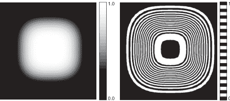

图 5.3. 使用 (a) 亮度颜色映射和 (b) 斑马颜色映射可视化标量函数 \( e^{-10(x^2+y^4)} \)。亮度颜色映射显示绝对值，而斑马颜色映射强调快速值变化。

这些是数据在整个域中具有相似变化率的区域。

#### 插值问题

颜色映射的另一个重要方面是颜色映射设计、标量数据变化速度和域采样频率之间的关系。

图 5.5 通过一个示例来说明这一点——一个球体几何体，其上用彩虹颜色映射可视化了一个周期性正弦函数。网格叠加在可视化之上以强调采样频率。函数的周期性条带结构在图 5.4(a) 中清晰可见，其中球体以 \( 64 \times 64 \) 分辨率采样。然而，当我们降低采样分辨率时，结构开始变得嘈杂（图 5.4(b)，\( 32 \times 32 \) 个样本）。如果分辨率进一步降低，我们会得到一个完全错误的可视化（图 5.4(c)，它向未做准备的用户暗示了与实际函数完全不同的函数。

为了解释问题，请考虑颜色映射实现：首先，颜色映射（公式 5.1）应用于网格顶点 \( p_i \)，每个顶点产生一个颜色属性 \( c(s_i) \)。这里，\( s_i \) 表示存储在顶点 \( p_i \) 处的标量属性值。接下来，表面单元被渲染为彩色多边形，使用多边形渲染机制提供的颜色插值。因此，

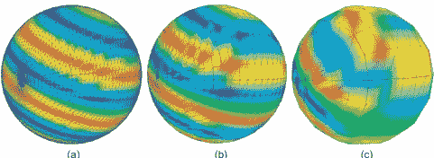

图 5.4. 基于顶点的颜色映射。球体几何体采样点为 (a) \(64 \times 64\) 个点，(b) \(32 \times 32\) 个点，和 (c) \(16 \times 16\) 个点。

生成的像素 \(p\) 的颜色 \(c(p)\) 将是线性组合

\(c(p) = \sum_i c(s_i)\phi_i(p)\) (5.2)

即 \(p\) 所在多边形的顶点颜色的线性组合。这里，\(\phi_i\) 表示用于多边形单元的线性插值函数（参见第 3.2 节）。然而，我们在像素 \(p\) 处真正希望获得的是标量值 \(s_i\) 的插值的颜色映射，即，

\(c(p) = c\left( \sum_i s_i\phi_i(p) \right)\) (5.3)

图 5.4 中看到的问题源于颜色映射（即函数 \(c\)）和插值通常不是可交换运算。例如，假设 \(c\) 由彩虹颜色映射给出，两个标量值 \(s_1\) 和 \(s_2\) 分别对应蓝色和红色，定义在两个顶点 \(p_1\) 和 \(p_2\) 上。对于位于 \(p_1\) 和 \(p_2\) 等距处的点，公式 5.2 计算颜色 \(\frac{c(s_1)+c(s_2)}{2}\)，即红色和蓝色的平均值，也就是紫色。这种颜色是不正确的——它甚至不存在于我们的彩虹颜色映射中。相比之下，公式 5.3 将计算颜色 \(c(\frac{s_1+s_2}{2})\)，即绿色。这是期望的结果，因为绿色确实会在我们的彩虹颜色映射中对值 \(s_1\) 和 \(s_2\) 的平均值进行着色。

由公式 5.2 实现的基于顶点的颜色映射可能是最普遍的一种，因为它简单且即使低端图形硬件也直接支持。然而，正如所见，结果对于数据集是次优的


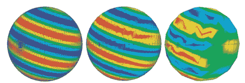

图 5.5. 基于纹理的颜色映射。球体几何分别采样为 (a) 64 × 64 个点、(b) 32 × 32 个点和 (c) 16 × 16 个点。

在数据变化过快的区域。更好的解决方案是实现公式 5.3。为此，我们按以下步骤进行。首先，为每个顶点 $p_i$ 存储值 $\frac{\alpha - d_{min}}{d_{max} - d_{min}}$，即，将我们的标量值归一化到 [0,1] 范围内，作为纹理坐标。接下来，我们渲染用包含颜色映射表的 1D 纹理贴图的表面单元。1D 纹理的工作方式与第 2.4 节中描述的 2D 纹理相同，区别在于它们由单个纹理坐标描述，并存储为 1D 图像，即一组彩色像素向量。

图 5.5 显示了基于纹理的颜色映射的结果。可见，这些结果更好，因为不会生成错误的颜色：生成的图像是我们给定采样信号的分段线性重建的像素级准确渲染。确实，基于纹理的方法对标量值 s 进行插值，然后在每个渲染像素上单独应用颜色映射 c。相比之下，基于顶点的颜色映射仅在顶点处应用颜色映射，然后对映射后的颜色本身进行插值。即使对于稀疏采样的数据集，基于纹理的颜色映射也能产生合理的结果。然而，这种技术需要渲染基于纹理的多边形，该选项可能在低端图形硬件上不可用，或者在我们希望将可用纹理用于其他目的的情况下不可用。

**颜色条带。** 颜色映射表设计中另一个重要方面是颜色数量 N 的选择。选择较小的 N 将不可避免地导致颜色条带效应。任何尝试使用图像处理程序减少彩色图像中颜色数量的计算机用户都熟悉这一现象。图 5.6 演示了简单标量数据集上的颜色条带。标量
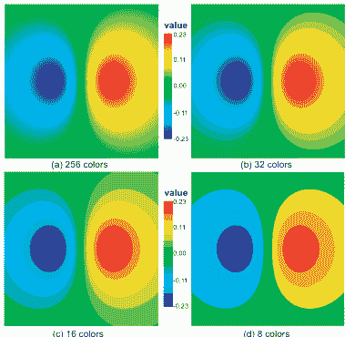

图 5.6. 由查找表中颜色数量少引起的颜色条带。
数据范围在 -0.23 到 0.23 之间。该数据集使用相同的彩虹查找表可视化四次，每次查找表中的颜色数量更少。随着查找表中不同颜色数量的减少，图像和颜色图例中都会出现等宽颜色带。从数学上讲，颜色条带产生的伪影与量化标量信号范围相同。例如，当我们仅使用 32 种颜色来可视化图 5.6(b) 中的数据集时，其效果实际上与先将标量信号量化为 5 位，然后再通过颜色数量较多的颜色映射表进行可视化的效果相同。

当我们可视化连续数据集时，通常不希望出现颜色条带，因为它会在渲染图像中创建不反映输入数据任何离散性的离散视觉伪影。如图 5.6 所示，可以通过增加颜色映射表中的颜色数量并确保颜色映射表中没有陡峭的知觉过渡来避免颜色条带。数据在空间上变化越快，颜色映射表就必须越平滑才能避免颜色条带。典型的标量可视化应用程序会在颜色映射表中使用 64 到 256 种不同的颜色，偏好更多而非更少的颜色。

颜色条带与颜色映射的另一种用途相关——可视化类别数据。考虑一个标量数据集 f，它不取连续域（如 R）中的值，而是取离散值集合 {f_i} 中的值。使用颜色映射可视化 f 时，有两个重要问题。首先，我们希望显示每个数据值的标识，即由数据值 f_i 隐含的类别 i。其次，如果这些值暗示不同的类别，我们无法在 f_i 值之间进行插值。类别数据集在许多应用领域中自然出现——例如，考虑一个地理数据集，其中点被标记为描述其类型的数据值，如道路、房屋、农业用地、森林、山脉和湖泊。然而，类别数据集也可以通过标量数据量化（也称为分箱）从连续数据集中创建。例如，图 5.6(d) 的可视化可以被视为输入包含八个类别的标量数据集，对应于显示的八个数据范围。可视化连续数据集和类别数据集之间的差异分别在第 11.2 节中讨论。

在可视化类别数据集时，如果我们考虑第 5.2 节开头列出的目标，我们通常关注目标 1 和 4（如果我们的类别是有序的，可能还关注目标 2），但不关注目标 3 和 5。此外，不同类别的数量在颜色映射表设计中起着关键作用。因此，已经为类别数据集设计了特定的颜色映射表。ColorBrewer [Brewer and Harrower 13] 是一个出色的在线资源，允许根据数据属性和任务类型选择类别颜色映射表。

其他注意事项。选择最佳颜色映射表还受到以下多个额外因素的影响：

- 几何：在面积相同的表面上显示时，并非所有颜色都被同样强烈地感知。准确感知颜色在很大程度上受邻近区域中显示的颜色影响 [Moreland 09]。在某个空间尺度下，紧密排列的颜色不会被单独感知，而是由人眼融合在一起。当涉及的区域非常小时，这会成为一个问题，例如在对点云（图 11.32）进行颜色映射时。在极端情况下，眼睛甚至无法将单独的颜色作为颜色来区分。虽然这种情况通常是不希望的，但人类视觉有限的分辨能力的一个有用应用是许多设备（如计算机显示器和电视屏幕）使用的 RGB 颜色混合机制。在这里，通过显示紧密排列的小规模点，这些点着有不同强度的主色红、绿、蓝色调，从而生成大量颜色。印刷技术中的抖动过程使用类似的系统。

- 用户群体：虽然大多数用户对包含大量色调的颜色映射表感到满意，但 6% 到 10% 的男性无法正确区分红色和绿色色调 [Stone 03]。在设计关键应用或面向大众使用的应用程序的颜色映射表时，应考虑到这种及其他形式的色盲。

- 介质：颜色映射表使用中的另一个因素是用于展示可视化结果的介质。计算机屏幕（CRT 或 LCD）、印刷材料（哑光或光面）和投影仪在复制和显示颜色方面有着截然不同的方式。很难设计出包含十几种以上颜色的丰富颜色映射表，使其在这些设备上看起来都一样。实践中非常常见的一个错误是使用基于色调的颜色映射表，例如彩虹颜色映射表，并在基于亮度的设备（例如黑白印刷材料）上显示生成的可视化结果。在这种情况下，大量细节会立即消失，例如红色和绿色，它们在计算机屏幕上看起来截然不同，但在黑白打印件的亮度角度来看则无法区分。

- 对比度：如本节所述，颜色映射通过颜色映射表或颜色传递函数从标量值生成颜色值。一组相关技术涉及修改灰度图像的灰度值或彩色图像的颜色，以强调感兴趣的细节。尽管此类技术与颜色映射涉及一些共同的算法和设计元素，但其本质完全不同，因为它们处理的是现有图像的颜色，而不是从标量创建颜色的过程。我们将在图像处理的背景下单独讨论此类技术（参见第 9.3.1 节）。

设计有效的颜色映射表是一项复杂的任务，既是科学也是艺术。这涉及应用领域惯例、典型数据分布、可视化目标、一般感知理论、预期输出设备和用户偏好的知识。没有普遍有效的颜色映射表。对于具体应用，最好的建议是使用该领域或行业中实践所接受的典型颜色映射表。一般来说，关于颜色映射表设计的指南，我们参考可视化感知 [Ware 04]、色彩科学 [Stone 03] 以及信息中的颜色使用


可视化 [Card et al. 99, Bederson and Shneiderman 03]。关于为可视化标量数据设计颜色映射所涉及的各种问题和细节的一个良好起始参考文献是Bergman等人的论文[Bergman et al. 95]，该论文还描述了一种基于规则的机制和工具，用于帮助用户为不同类型的数据集选择有效的颜色映射。关于在科学可视化中使用彩虹、发散、热图和灰度颜色映射的讨论，我们参考[Borland and Taylor 07, Moreland 09]。关于涉及连续和分类属性的颜色映射问题的广泛讨论，请参见Colin Ware关于信息可视化的书籍[Ware 04]。关于超越数据可视化中颜色映射的颜色科学的一般讨论，一个良好的起点是Stone关于数字颜色的书籍[Stone 03]。对于设计具有少量（5–10）种不同颜色的颜色映射，可以使用ColorBrewer工具资源[Brewer and Harrow 13]。除其他功能外，ColorBrewer可以生成针对编码顺序和定性值类型调制并针对不同类型输出（如单色或彩色打印机、投影仪、笔记本电脑和显示器）优化的颜色映射。

### 5.3 等值线

在上一节中，我们描述了如何使用简单的颜色映射技术可视化2D标量场。我们还讨论了颜色映射中使用的颜色过少会导致不希望的颜色带状效应（参见图5.6）。然而，颜色带状效应与一种称为等值线的基本且广泛使用的可视化技术相关。要理解等值线，请思考图5.7(a)中分隔颜色带的尖锐颜色过渡的含义。

例如，考虑黄色和橙色带之间的过渡；即，图中位于分隔这两种颜色的边界上的所有点。从相关的颜色图例可以看出，黄色带中的点具有标量值s低于0.11，而橙色带中的点具有标量值s高于0.11（另见方程（5.1））。因此，位于颜色边界本身上的点具有标量值s = 0.11。请注意，为了使此推理成立，我们必须假设我们的数据集在边界本身的范围上不表现出突然的“跳跃”。这适用于所有表示连续信号采样的数据集。

位于这样的颜色边界上的点，在图5.7(a)中以黑色绘制，称为等值线或等值线（isoline）。正式地，数据集D中的等值线C定义为所有具有相同标量值（即等值s(p) = x）的点p，或

```
C(x) = {p ∈ D|s(p) = x}.
(5.4)
```

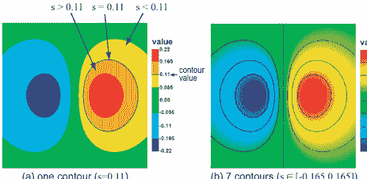

图5.7. 颜色带状效应与等值线之间的关系。

“isoline”这个名称也反映了这一定义，因为在希腊语中，*isos*意为“相同”或“相等”。“contour line”这个名称源于该技术在制图学中的最早应用之一。等值线绘制在地图上，以明确指示所有具有相同海拔的点。请注意，方程（5.4）也可以应用于高于二维的维度。对于3D数据集，等值线是称为*isosurfaces*的2D曲面。本节后面将提供几个isosurfaces的示例。

在图5.7(b)中，我们展示了与图5.7(a)相同的标量数据集，使用相同的彩虹颜色映射进行可视化。然而，这次颜色映射有256个条目，而图5.7(a)中只有八个。这一点从颜色图例本身表现出比图5.7(a)中更平滑的色相变化可见。右侧图像更平滑，这是可取的，因为它帮助我们比左侧图像区分更多细节。然而，如果我们有兴趣轻松快速地区分哪些点具有特定的感兴趣标量值（例如，s = 0.11），这张图像无法进一步帮助我们。在左侧图像上，这项任务很容易完成，因为那里使用的颜色映射在精确位于该值处表现出从深蓝色到青色的清晰色相过渡。我们实际上可以通过在使用丰富颜色映射的颜色映射图像上方绘制所有感兴趣值的等值线，来简单地结合等值线和颜色映射的优势。结果如图5.7(b)所示，我们在[-0.165, 0.165]范围内均匀间距的标量值上绘制了七条等值线。

除了指示数据具有特定值的点之外，等值线还可以告诉我们关于数据变化本身的信息。假设我们有一组标量值在标量域中均匀间距的等值线，例如图5.7(b)。显然，等值线本身在空间域中并非均匀间距。等值线彼此更接近的区域（例如图像中心）表明标量数据具有更高的变化。确实，连续等值线之间的标量距离（恒定）除以相同等值线之间的空间距离（不恒定）正好是标量信号的导数。

等值线属性。等值线具有许多重要属性。考虑图5.8，它显示了使用熟悉的高程图技术的二元函数z = f(x, y)。在函数图上，绘制了三条等值线，分别对应三个不同的值，v0（蓝色）、v1（红色）和v2（黄色）。这些等值线沿垂直（z）轴在xy平面之上平移到其相应的值vi，而不是像图5.7那样绘制在数据集域（xy平面）中。在这种情况下，等值线对应于函数图与水平平面z = vi（i ∈ {0, 1, 2}）的交集。

图5.8中可以注意到等值线的几个属性。首先，等值线可以是封闭曲线，例如黄色等值线，也可以是开放曲线，例如蓝色和红色等值线。等值线永远不会在数据集内部停止——它们要么自闭合，例如黄色等值线，要么在到达数据集边界时停止，例如蓝色和红色等值线。其次，一条等值线永远不会

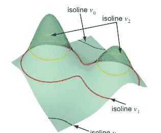

图5.8. 等值线属性。

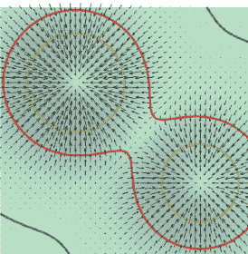

图5.9. 标量场的梯度垂直于场的等值线。

自相交（交叉），也不会与另一个标量值的等值线相交。因此，不同值的等值线彼此“嵌套”，如图5.7所示。这些属性始终适用于第3.1节定义的（分段）连续数据集。换句话说，标量数据在数据集域中相近的点之间没有“跳跃”。最后，考虑图5.9，它显示了与图5.8相同的标量函数及其等值线，这次是沿z轴从上方观察。图像中显示的矢量场显示了标量函数的梯度。此图展示了等值线的一个重要属性，即它们垂直于被等值线化函数的梯度。这一属性并不令人惊讶：函数的梯度是函数最大变化的方向，而等值线是函数值相等的点，因此等值线的切线是函数最小（零）变化的方向。第9.4.7节给出了另一个示例，说明标量场的梯度垂直于其等值线。

计算等值线。给定一个离散的采样数据集D，我们如何计算等值线？由于该数据集定义为携带节点或单元标量数据的单元集合，加上额外的基函数（第2章），因此尝试在相同的离散单元空间中构建等值线是自然的。在接下来介绍的实际构建技术中，我们将使用等值线的一个重要属性。我们

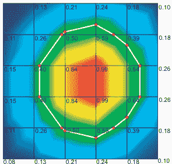

图5.10. 构建标量值v = 0.48的等值线。图中的数字表示网格顶点处的标量值。

在第3.1节中，我们已经看到，使用分段线性基函数对采样数据集进行重建本身也是一个分段线性函数。该函数的图也是分段线性的。作为函数图与水平平面的交集，这样的数据集的等值线因此也是分段线性的。由于等值线具有拓扑维度1，因此它是一条折线。

构建等值线的基本算法非常简单。图5.10中的简单$5 \times 5$单元网格说明了原理，我们在其中构建值$v = 0.48$的等值线。对于数据集中的每个单元$c$，我们测试等值线是否与相应的单元相交，方法如下。对于单元$c$的每条边$e = (p_i, p_j)$，我们测试等值线值$v$是否位于对应于边端点$p_i$和 $p_j$的标量顶点属性$v_i$和 $v_j$之间。如果测试成功，等值线在点处与$e$相交

```
q = \frac{p_i(v_j - v) + p_j(v - v_i)}{v_j - v_i}. \quad (5.5)
```

此结果是通过将$q$表示为$p_i$和 $p_j$的线性插值来获得的，使用与将$v$表示为$v_i$和 $v_j$的线性插值时相同的权重。我们对当前单元的所有边重复上述过程，最后得到等值线与单元的交点集合$S = \{q_i\}$。对于


图 5.11. 四边形单元的等值线歧义（以红色绘制）。等值为 0.37。图中的数字表示单元顶点的标量值。

在图 5.10 的示例数据集中，这些点以紫色绘制。集合 _S_ 至少包含两个点，因为如前面讨论过，等值线不能进入单元而不退出，且最多包含与单元边数一样多的点，因为数据集沿每条单元边进行线性插值，因此每条边上最多有一个交点。接下来，我们必须将这些点连接起来以获得实际的等值线。由于我们知道等值线在单元上是分段线性的，可以使用线段连接这些点。这些线在图 5.10 中以白色绘制。如果 _S_ 正好包含两个点，则没有问题。但是，_S_ 可以包含更多点，如图 5.11 所示的红色标记的四边形单元所示，该单元有四个交点。

在这种情况下，连接四个交点恰好有两种可能性，如图 5.11 中左图和右图所示。请注意，其他连接可能性是无效的，因为它们会导致相交的等值线。第一种可能性（见图 5.11(a)）创建两个独立的等值线环，而第二种可能性（见图 5.11(b)）创建一个单一的等值线环。在实践中，实现可以为每个单元单独选择任一连接可能性。如果对等值线拓扑有额外了解，例如，它必须具有一个连通分量，则可以使用此信息来区分两种连接可能性。当我们使用三角网格时，此类歧义不存在。这可能暗示我们可以通过将所有四边形单元各分割为两个三角形来消除四边形网格中的歧义。然而，歧义现在转移到了四边形分割过程中。例如，图 5.11(a) 中标记单元内部的等值线配置，将在沿对角线从左下顶点到右上顶点分割四边形单元得到的两个三角形时产生。同样，图 5.11(a) 中的配置，将在沿对角线从左上顶点到右下顶点分割四边形单元得到的两个三角形时产生。

现在很明显，等值线提取需要至少将分段线性、C^0 数据集作为输入。这意味着我们无法直接对图像数据进行等值线提取，例如，图像数据实际上是具有分段常数插值的均匀网格，因此代表一个不连续函数。将图像数据集重采样为分段线性数据集可以轻松完成，如第 3.9.1 节所述。但是，请注意，这有隐藏效果，即将数据集上的连续性假设从分段常数更改为分段线性。虽然这在许多情况下不应造成问题，但存在某些情况，此类假设的更改可能导致高度不正确的可视化。第 9.4.7 节讨论了这种情况的一个示例。

需要考虑的最后一个问题是计算等值线的复杂性。如果不对数据集做任何特定假设，那么给定等值的等值线可以穿过数据集中的每个单元。对于每个单元，我们必须测试等值是否与每条单元边相交，如果是，则使用公式 (5.5) 计算精确的交点位置。因此，减少每个单元的操作数量非常重要。实现此目的最流行的方法是 marching squares 方法，它适用于具有四边形单元的 2D 数据集，以及其 marching cubes 变体，它适用于具有六面体单元的 3D 数据集 [Lorensen and Cline 87]。接下来将讨论这些方法。

#### 5.3.1 Marching Squares

marching squares 方法首先确定当前单元相对于等值的拓扑状态。单元的拓扑状态描述了哪些单元边被等值线相交，以及这些交点应如何通过线段连接以生成等值线片段。为了简化描述，我们将说，如果单元顶点 p_i 的标量值 v_i 小于等值 v，则该顶点位于等值内部；如果 v_i 大于 v，则位于等值外部。v_i = v 的情况可以归入内部或外部情况之一。因此，四边形单元具有 2^4 = 16 种不同的拓扑状态。四边形单元的状态可以用一个 4 位整数索引表示，其中每位存储一个顶点的内部/外部状态。此整数可用于索引一个情况表（见图 5.12），该表为每种拓扑状态保存了优化后的代码。优化包括仅对已知对于特定拓扑状态会相交的那些边执行边-等值交点计算（参见公式 (5.5)）。情况表中的状态 0101 和 1010 表示先前为图 5.11 中的示例描述的歧义情况。也就是说，方法实现可以选择创建实线还是虚线。

综上所述，我们得到了清单 5.2 中所示的 marching squares 实现。

marching squares 算法为每个单元构建独立的线段，这些线段存储在非结构化数据集类型中，因为等值线相对于其计算所在的网格没有规则结构。一个有用的后处理步骤是合并来自共享边的相邻网格单元的线段的重合端点。除了减少

```
for each cell ci of the dataset
{
    int index = 0;
    for (each vertex vj of ci)
        store the inside/outside state of vj in bit j of index;
    select the optimized code from the case table using index;
    for (all edges ej of the selected case)
        intersect ej with isovalue v using Equation (5.3);
    construct line segments from these intersections;
}
```

清单 5.2. marching squares 伪代码。

等值线数据集的大小，这还创建了一个可对其进行诸如通过平均从单元数据计算顶点数据（参见第 3.9.1 节）等操作的数据集。

#### 5.3.2 Marching Cubes

marching cubes 算法的运作方式与 marching squares 类似，但接受 3D 标量数据集而非 2D 数据集，并生成 2D 等值面而非 1D 等值线。marching cubes 的开始方式与 marching squares 相同。由于六面体单元有八个顶点，marching cubes 需要处理 $2^8 = 256$ 种不同的拓扑情况。在实践中，通过利用对称性考虑，此数字减少到仅 15 种。$^2$ marching cubes 使用的 15 种不同拓扑状态如图 5.13 所示。

与 marching squares 相比，marching cubes 存在更多歧义情况，即单元的交点可以用多种方式用平面组件连接的情况。marching cubes 的六种歧义情况在图 5.13 中以加粗索引标记。marching cubes 的歧义情况是那些面本身也是 marching squares 歧义情况的单元，即具有两个对角顶点“内部”而另外两个“外部”。我们可以在这些单元中以多种方式构建等值线，如图 5.14 所示。

$^2$同样的约减也可以应用于 marching squares 的 16 种拓扑情况。但是，15 已经是一个较小的数字，因此没有必要进一步减小情况表的大小。

不幸的是，在歧义情况下，我们不能像对待 marching squares 那样为每个单元独立选择要使用的变体。如果这样做，构建的等值面可能会出现人工裂缝的风险。有几种方法可以防止这种情况。首先，我们可以将每个六面体单元替换为五个或六个四面体，并使用 marching tetrahedra 算法而不是 marching cubes。marching tetrahedra 没有歧义情况，就像 marching triangles 一样。其次，基于以下观察，我们仍然可以带有一个小扩展地使用 marching cubes：如前面所述，歧义六面体单元具有（至少）一个歧义四边形面。因此，共享该歧义面的六面体单元邻居也是歧义的。我们可以通过确保为歧义单元及其歧义单元邻居选择的变体以相同的方式求解共享面歧义，从而解决裂缝问题。

从图 5.13 和 5.14 可见，marching cubes 为每个等值面单元生成一组多边形，包括三角形、四边形、五边形和六边形。为求简单，大多数实现会即时将这些多边形三角化，甚至直接从各种情况生成三角形，并将生成的 3D 等值面保存为非结构化数据集。与 marching squares 一样，需要进行后处理遍以合并来自共享面的相邻网格单元的三角形的重合端点。marching cubes 需要的额外步骤是计算等值面法线。这些法线用于平滑着色。法线可以通过法线平均计算，如第 2.3 节所述。或者，由于等值面在每个点处与标量数据梯度正交（见图 5.9 及相关说明），法线可以直接计算为标量数据的归一化梯度。

对 marching cubes 结果的解释必须谨慎进行。图 5.15 显示了一个 MRI 扫描均匀数据集的等值面，该数据集包含 128³ 个体素，用于


图 5.15. 等值面上的铃声伪影。(a) 概览。(b) 细节网格。

图 5.16. 牙齿扫描数据集的两个嵌套等值面。

与皮肤组织相对应的等值。从给定视角来看，等值面呈现出一种“波浪状”图案，在图像中标记的区域内清晰可见。这种图案并非数据的实际特征，而是由在低分辨率均匀网格上对原始信号进行子采样造成的。图 5.15(b) 显示了一个放大视图，其中等值面网格叠加在阴影伪影区域之上。底层 3D 数据集的规则结构与等值面的非结构三角形网格之间的关系清晰可见。用户应熟悉其特定的应用数据，以避免将此类伪影的存在与数据中的实际特征混淆。这一观察也适用于其他伪影，例如表面上的孔洞或小的不连通分量。作为一般规则，大小低于或等于等值面数据集分辨率的大多数等值面细节可能是实际数据，也可能是伪影，应非常谨慎地解读。

我们可以在一个可视化中绘制同一数据集的多个等值面，而不仅仅是一个。图 5.16 显示了牙齿扫描数据集的两个等值面。蓝色不透明等值面对应高等值，表示诸如牙齿上表面存在的牙釉质等硬材料。米色等值面对应较低等值，表示牙齿内部存在的较软牙本质材料。通过使后者等值面半透明，我们可以穿过它并发现第一个不透明等值面，还可以看到其内部表面，该表面对应牙齿神经腔。渲染多个嵌套半透明等值面（对应一组离散等值）的过程可以推广到连续情况，如我们将在第 10 章介绍的体积渲染技术中所见。


图 5.17. 等值面、等值线与切片之间的关系。

等值面和等值线密切相关，如以下示例所示。考虑与图 8.2 中使用的相同的 3D 数据集（包含人头 MRI 扫描，参见第 8.1.2 节）。图 5.17(a) 说明了这样的 3D 数据集。让我们为该数据集构建一个与皮肤组织相对应的等值的等值面（参见图 5.17(d)）。现在考虑同一数据集的一个 2D 切片（图 5.17(b)），在其上我们为皮肤等值构建一个等值线（在图 5.17(c) 中用红色绘制）。最后，让我们使用之前使用的相同切片平面对等值面本身进行切片。结果在图 5.17(e) 中以绿色显示。如果我们比较图 5.17(c) 和 5.17(e)，我们会发现等值线与切片平面和 3D 等值面的交点相同。换句话说，我们可以说切片和等值线操作是可交换的。这一观察很重要，因为它表明 3D 等值面（以及其他类似表面）可以通过组装一组位于一组平行切片平面上的 2D 等值线来构建。如果该集合密集，即切片平面彼此靠近，并且数据集没有过于剧烈的变化，我们可以将等值线上的点与前一个和下一个切片上的等值线中最近的点连接起来，从而构建 3D 等值面。这种技术在多种情况下很有用，例如当我们没有用于等值面提取的原始 3D 体积，但有一组位于连续（近似）平行切片上的 2D 等值线时。

行进算法变体。行进平方和行进立方体算法有许多变体，并且有多种形式。通常，这些变体试图满足多个要求，例如输入数据集类型的通用性、执行速度和获得的等值线质量。对于所有单元类型（如线、三角形和四面体），都存在与行进平方和行进立方体类似的算法。这些算法可以处理所有网格类型，例如结构化和非结构化网格，包括具有混合单元类型的网格，只要所有遇到的单元类型都受支持即可。所有算法变体都生成非结构化网格。如果输入数据集的顶点属性不仅限于用于等值线提取的标量，则可以在等值线顶点的位置插值所有顶点属性，并将其保存到输出等值线数据集中。

等值面也可以使用基于点的技术生成和渲染。基于点的技术利用以下观察：3D 表面可以使用大量（带阴影的）点原元进行渲染。当点密度足够高时，渲染中没有间隙，表面看起来逼真。正如我们所见，由行进立方体从均匀数据集生成的等值面具有准恒定点密度，这使它们非常适合基于点的渲染。在多种图形硬件配置上，点原元的速度可以比多边形原元快得多，并且需要的内存更少。此外，渲染一组密集的点（也称为 *点云*）消除了将多边形原元组装成网格的通常昂贵阶段，消除了重复点，并计算了顶点法线。基于点的技术在第 8.3.2 节中以散点插值的背景下进行了更详细的介绍。

分割立方体算法。使用点云生成和渲染等值面的经典算法是 *分割立方体* [Cline et al. 88]。分割立方体适用于 3D 均匀和直线网格，即具有盒状单元的网格（参见第 3.5 节）。与行进立方体类似，分割立方体遍历数据集的所有单元，并通过将等值与单元顶点值进行比较来检测被给定等值面相交的单元。然而，对于分割立方体，只需检测单元是否至少有一个内部顶点和一个外部顶点即可，这比行进立方体执行的完整位编码更便宜。通过交点测试的单元会被递归细分为一个 $2 \times 2 \times 2$ 的较小单元格网格。单元-等值面交点测试和单元细分会被递归重复，直到单元大小低于最小尺寸。该算法与构建八叉树或类似空间细分结构时使用的算法类似。对于所有生成的单元，分割立方体算法在每个单元中心绘制一个带阴影的点原元。从采样术语来看，我们可以说分割立方体使用常数基函数来近似等值面，而行进立方体使用线性基函数（参见第 3 章）。

对于分割立方体，理想的最小单元大小是屏幕像素的大小，在这种情况下，每个点原元的大小为像素大小，渲染的等值面中没有视觉间隙或其他渲染伪影。然而，这可能代价高昂，因此可以提前停止细分，从而产生较大的单元。在这种情况下，可以使用较大的点原元，例如 splats（参见第 8.3.2 节），以获得无间隙的等值面渲染。为了防止在放大使用分割立方体渲染的等值面时出现视觉间隙，我们可以动态重新计算等值面，即生成更多点原元（较慢但更准确的选项），或者简单地增加点原元大小（速度快，但在查看特写时可能会产生视觉伪影）。

### 5.4 高度图

高度图，也称为 _高程图_ 或 _地毯图_，在第 2.1 节的第一个可视化示例中介绍。给定一个二维表面 \(\mathcal{D}_s \in \mathcal{D}\)（标量数据集 \(\mathcal{D}\) 的一部分），高度图可以通过映射操作描述

\(m : \mathcal{D}_s \rightarrow \mathcal{D}, m(x) = x + s(x)\mathbf{n}(x), \forall x \in \mathcal{D}_s,\) (5.6)

其中 \(s(x)\) 是点 \(x\) 处 \(\mathcal{D}\) 的标量值，\(\mathbf{n}(x)\) 是点 \(x\) 处表面 \(\mathcal{D}_s\) 的法线。换句话说，高度图映射操作会沿表面法线“扭曲”数据集中包含的给定表面 \(\mathcal{D}_s\)，其比例系数与标量值成正比。

在最常见的变体中，高度图会扭曲一个平面表面 \(\mathcal{D}_s\)。这种类型的高度图在本书中多次演示，从第 2 章开始。然而，我们可以从不同的基表面 \(\mathcal{D}_s\) 生成高度图，例如图 5.18 所示的环面。环面表面上的标量数据集值使用从蓝到红的颜色映射显示在


**图 5.18.** (a) 非平面表面。(b) 该表面上的高度图。


图 5.19. (a) 标量数据集的灰度颜色映射。(b) 同一数据集的高度图，强调细粒度数据变化。

图 5.18(a)。图 5.18(b) 显示了这些标量值的高度图，通过沿表面法线方向用标量值扭曲环面表面来实现。在此图中，高度和颜色都对标量值进行编码——换句话说，凸起是红色的，而凹陷是蓝色的。这两个视觉线索相互加强，以传达标量值信息。如果需要，可以使用高度图对两个不同的标量值进行编码，一个编码到图的高度中，另一个编码到图的颜色中。此场景将在下一节 5.4.1 中详细说明。

图 5.19 展示了高度图的另一种用例。左侧图像显示了脑部 CT 切片的 2D 标量图，使用灰度颜色映射显示。该图像类似于图 5.2(a)。在此，标量值对组织密度进行编码，白色对应最坚硬的结构（骨骼），黑色对应空气。由于此处使用了线性标量到灰度颜色映射，不同密度区域之间的高对比度边界易于观察。此外，绝对数据值的较大差异也易于观察——例如，我们可以通过在图像中寻找最亮和最暗的区域，来定位给定扫描中最坚硬和最柔软的组织。然而，小规模数据变化不易看清，因为典型计算机屏幕上灰度颜色映射的动态范围只有 256 个不同的值（8 位亮度，参见第 3.6.3 节）。图 5.19(b) 显示了同一数据集，这次使用高度图显示，从上方可视化，并带有从略微倾斜方向照射的定向光。通过调整渲染 3D 图表表面的材质高光和漫反射属性，我们现在可以更好地强调小规模数据变化。与图 5.19(a) 相反，绝对数据值现在不可见。然而，我们现在可以更好地辨别局部的、相对较小规模的数据变化，这些变化映射到图表的亮度变化。由于阴影差异不依赖于 *绝对*，而是 *相对* 数据变化，低值区域不会像灰度图中那样因被遮蔽（变暗）而受损。

高度图是 *位移* 或 *扭曲* 图的特例。位移图用于可视化矢量数据集，并在第 6.4 节中详细说明。

#### 5.4.1 棱脊图

前几节介绍的高度图、颜色映射和等值线技术，都以不同的方式处理显示标量值的任务，并各有其优势和局限性：

- 高度图易于学习，直观易懂，生成连续图像，并以实际坡度或图表阴影的形式显示数据的局部梯度。然而，从此类图表中提取定量信息可能比较困难——在复杂的高度图中，不容易判断哪个峰值最高。此外，可能会出现 3D 遮挡效果。更改视图参数可以缓解这些问题，但这需要额外的用户交互。

- 颜色映射共享高度图的优势，且不受 3D 遮挡问题的影响。然而，基于颜色数据进行定量判断可能比较困难，需要精心设计的颜色映射，这些映射可能取决于应用程序甚至数据集。

- 等值线图在传达精确定量值方面很有效。然而，此类图表使用起来不够直观。此外，它们不会创建密集的连续图像——输入数据集的所有点都不会显示信息。

结合高度图、等值线图和颜色映射可以缓解每种图表类型的一些，但并非全部问题。此外，组合图表在单个图像中混合了多种图形隐喻（线条、阴影、颜色、3D 渲染）。这意味着我们无法在同一图像中使用这些隐喻来显示其他信息。

*棱脊等值线图* [van Wijk and Telea 01] 提出了一种替代方案。基本思想很简单：考虑由函数 \(f : D \rightarrow \mathbb{R}\) 给出的标量数据集，及其由映射 \(z(x, y) = s f(x, y)\) 给出的高度图，适用于所有点 \((x, y) \in D\)。此处，\(s > 0\) 是图表的缩放因子。图 5.20(a) 显示了一个示例，其中我们从上方观察高度图，沿 \(-z\) 轴方向观看，


图 5.20. (a) 高度图。(b-d) 同一数据集的棱脊高度图变体。

采用标准 Gouraud 阴影渲染。接下来，我们不使用线性映射 \( z = sf \)，而是使用由以下给出的非线性映射：

```
\( z(x, y) = sf(x, y) + sgh \left( \frac{f(x, y) \mod h}{h} \right) \) (5.7)
```

其中 \( g(u) = au(1-u) \) 是一个抛物线函数。对于 \( a = 0.6 \) 的值，得到的棱脊图如图 5.20(b) 所示。直观地看，公式 5.7 的效果是在 \( f \) 范围内大小为 \( h \) 的连续区间上添加高度为 \( a \) 的抛物状凸起。参数 \( a \in [0, 1] \) 设置凸起效果的强度。参数 \( h \) 控制生成带状区域的“厚度”，其功能类似于等值线图中连续等值线之间的距离。

对图 5.20(b) 可以做出两点观察。首先，棱脊图结合了等值线图和高度图的外观。确实，在 \( f \) 为 \( h \) 的倍数的点处出现的尖锐阴影过渡，或称棱脊，在视觉上很突出，并与等值线具有相同的效果。这是因为 \( z（因此其法线，接下来用于阴影）在这些点处是一阶不连续的。此外，公式 5.7 中的函数 \( z \) 在 \( D \) 上是连续的，并且在域 \( D \) 的每个点都显示，从而创建一个密集的


图 5.21. 1 月 (a) 和 7 月 (b) 欧洲的平均降雨量和温度，使用棱脊图可视化。

可视化效果类似于高度图。其次，更有趣的是，此类图表中出现的嵌套垫状形状传达的高度感比经典高度图（图 5.20(a)）强得多。例如，这使我们可以轻松地在视觉上选择属于同一带状区域的图表区域，因此具有相同的标量值（模 h）。

棱脊图还可以扩展为使用等值线层次结构，方法是在公式 5.7 的第二个右侧项中使用两个不同的参数对 (h1, a1) 和 (h2, a2) 的两个实例。图 5.20(c) 说明了这种效果。第二个参数对 (h2, a2) 遵循约束 a2 < a1 和 h1 = kh2（其中 k 为正整数）。直观地看，(h1, a1) 显示可视化标量函数 f 的大区间，并视觉上生成我们称之为主要棱脊的内容。相比之下，(h2, a2) 在 f 的范围内建模更密集的等值线，这些等值线通过视觉上更微妙的过渡来描绘，我们称之为次要棱脊。在图 5.20(c) 中，我们使用了 a1 = 0.5 和 a2 = 0.25，以及 k = 5，即每两个连续主要棱脊之间有 5 个次要棱脊。整体效果类似于在 f 的范围上铺设一把尺子：主要棱脊对应大而突出的刻度（例如厘米），次要棱脊对应较小且不那么突出的刻度（例如毫米）。

棱脊图还可以进一步调整，以强调标量域 D 不同区域之间的嵌套关系，帮助用户查看哪些域区域的值大于其他区域。为此，我们只需将对称抛物线轮廓 g(u) = u(1 - u) 替换为一个非对称轮廓，该轮廓在 u = 0 附近急剧增加，并在 u = 1 附近相对平坦。为了确保公式 5.7 提供的高度 z 的连续性，我们保持约束 g(0) = g(1) = 0。这种非对称轮廓可以通过 g(u) = u(1 - u)^n 获得。


对于整数 $n > 2$ 的值。图 5.20(d) 展示了这种效果。与同一图中的前面图像相比，我们现在对具有相似标量值（模 $h$）的区域嵌套有了更强烈的感知。该图像类似于文恩-欧勒图的结构。正如我们将在后面第 11 章中看到的，这些在图像空间中构建的类似垫子的嵌套结构可用于在不同环境下可视化数据层次结构，而不仅限于标量场。

图 5.21 演示了使用带有两个层级的嵴线图（enridged plots）来可视化多变量标量数据。在这里，我们展示了欧洲在两个时间点（1月和7月）的平均降雨量和温度，数据取自1960-1990年期间，分别使用嵴线图和颜色映射。如所见，颜色映射与嵴线图的阴影结合得相当好，因为我们对前者使用色相（蓝到红）、恒亮度的颜色映射，对后者使用亮度（阴影）。嵴线图的视觉嵌套效果让我们可以轻松找到最高降雨量区域，即图像中突出的“气泡”。对于1月，我们看到这种情况发生在西南斯堪的纳维亚，在那个年份期间的低到中等温度区域。对于7月，降雨气泡出现在阿尔卑斯山脉，位于中等温度区域。我们还看到，1月最冷的地区出现在俄罗斯，降雨量最低的地区，而7月最热的地区出现在地中海，同样位于降雨量最低的区域。

### 5.5 结论

在本章中，我们介绍了若干种可视化标量数据的基本方法：颜色映射、等值线绘制、切片和高度图。颜色映射根据给定域中每个点的标量值分配一种颜色。等值线绘制显示给定二维或三维域中所有具有给定标量值的点。高度图根据标量数据在给定方向上变形标量数据集的域。这些技术适用于任意拓扑的1D、2D和3D数据集。这些技术的主要优点是它们产生直观的结果，绝大多数用户都能轻松理解，并且实现简单。然而，此类技术也存在若干限制。

在标准形式中，颜色映射、等值线绘制和高度图以一维或二维标量数据集作为输入。这可能具有限制性，例如，当我们想要可视化3D标量数据集时。可以使用切片等额外技术来提取较低维度的子集，例如从3D体积中提取2D切片，并使用本章介绍的可视化方法显示它。切片技术在第8章中进一步阐述。然而，在某些其他情况下，我们想要可视化3D数据集中所有（而不仅仅是少数）数据点的标量值。第10章介绍的体积渲染技术是对此需求的回答。

除了这些基本技术之外，还存在许多不同的标量可视化方法。例如，存在针对定义在图像和体积上的标量数据（即分别为具有标量属性的二维和三维均匀网格）的特定方法。这些方法在第9章（图像可视化）和第10章（体积可视化）中进行了更详细的讨论。

3 数据源自IRI/LDEO气候数据库（www.ldeo.columbia.edu）。

## 第6章

## 矢量可视化

矢量数据经常遇到，且与标量数据同样重要。严格来说，矢量是n个标量分量的元组 v = (v1, ..., vn)，vi ∈ R。n维矢量例如描述在 Rn 中的位置、方向、变化率或力。然而，大多数可视化应用处理的是描述二维或三维空间中物理现象的数据。因此，大多数可视化软件将所有矢量定义为具有三个分量。2D矢量被建模为第三个（z）分量等于null的3D矢量。尽管可以为2D矢量提供单独的实现级别支持，但这将大大复杂化可视化软件的结构，导致代码复制，并最终降低性能。

回顾第3.6节，矢量场是函数 f : D → R3，其中 D 通常是 R2 或 R3 的子集。矢量数据集是在离散空间域上对矢量场的采样。在本章中，我们将讨论若干种用于矢量数据集的流行可视化方法：矢量图元、矢量颜色编码、位移图、流线对象、基于纹理的矢量可视化以及矢量场的简化表示。

矢量可视化的一个非常重要的应用领域是计算流体动力学（CFD）。CFD模拟能够预测由多种潜在相互作用的物质或物种组成的可压缩3D流体流在复杂空间几何上的时间相关行为，这些物质具有不同的密度和压力。CFD模拟的解由多个数据集组成，每个数据集对应一个不同的时间步。对于每个时间步，会计算并存储多个属性到解数据集中，例如速度、压力、密度、散度和涡度。由于散度和涡度是理解矢量场结构的基本概念，并且被许多用于矢量数据的可视化方法使用，我们将首先详细阐述这些概念。

我们首先通过描述用于分析矢量场的若干基本数学算子来开始我们的讨论（第6.1节）。接下来，我们介绍矢量图元，这是可视化此类场最简单、最流行的技术之一（第6.2节）。使用标量可视化技术来描绘矢量场的内容在第6.3节中讨论。然后，我们介绍用于可视化矢量数据的位移图技术（第6.4节）。第6.5节介绍流线对象，它们使用积分技术在矢量场中构建路径。第6.6节讨论使用纹理来可视化矢量场。第6.7节讨论用于矢量数据集简化表示的若干策略。第6.8节介绍若干用于矢量场的说明性可视化技术，这些技术为第6.7节讨论的技术提供了一种替代的简化表示机制。最后，第6.9节总结本章。

### 6.1 散度和涡度

散度和涡度是矢量场可视化的重要量，也是其他类型数据集（如网格、图像以及标量场和张量场）的可视化和处理的重要量。

散度。给定矢量场 v : R^3 -> R^3，v = (vx, vy, vz)^1 的散度是标量量

div v = ∂vx/∂x + ∂vy/∂y + ∂vz/∂z. (6.1)

直观地讲，如果 v 是传输质量的流场，div v 表征矢量场中给定点 p 在单位时间内的质量增加或损失。

- p 处的正散度表示质量将从 p 向外扩散。正散度点称为源点（参见图 6.1(b)）。
- p 处的负散度表示质量被吸入 p。负散度点称为汇点（参见图 6.1(c)）。
- p 处的零散度表示质量在传输过程中不扩散也不吸入，即不发生压缩或膨胀。

1矢量场 v 的散度也表示为 ∇ · v。


图 6.1. 二维中的散度和旋度。(a) 散度构造。(b) 源点。(c) 汇点。(d) 转子构造。(e) 高涡度场。

v 在点 p 处的散度的一个等价定义是

\(\text{div } \mathbf{v}(p) = \lim_{\Gamma \to p} \frac{1}{|\Gamma|} \int_{\Gamma} (\mathbf{v} \cdot \mathbf{n}_r) ds.\) (6.2)

这里，\(\Gamma\) 是当前点 p 周围的闭超曲面（2D 矢量场为曲线，3D 矢量场为曲面），\(|\Gamma|\) 是 \(\Gamma\) 所围空间的面积（2D）或体积（3D），\(\mathbf{n}_r\) 是 \(\Gamma\) 的外法线（参见图 6.1(a)）。方程 (6.2) 中的积分计算矢量场通过虚拟边界 \(\Gamma\) 传输的通量。极限 \(\Gamma \to p\) 描述一个围绕当前点 p 收缩的曲线，直到其变得无限短。

图 6.2(a) 使用蓝到红的颜色映射显示了2D流场的散度。矢量场使用箭头图元进行可视化，仅用于说明目的。红色区域表示高正散度，即源点。可以清楚地看到两个这样的源点。蓝色区域表示高负散度，即汇点。在深蓝色区域内，可以看到两个明显的汇点。如果我们将散度和矢量图元可视化相关联，我们就会得到一个从源点出发并最终汇入汇点的流场图像。

涡度。给定矢量场 \(\mathbf{v} : \mathbb{R}^3 \to \mathbb{R}^3\)，v 的涡度，也称为 v 的旋度或转子\(^2\)，是向量量：

\(\text{rot } \mathbf{v} = \left( \frac{\partial v_z}{\partial y} - \frac{\partial v_y}{\partial z}, \frac{\partial v_x}{\partial z} - \frac{\partial v_z}{\partial x}, \frac{\partial v_y}{\partial x} - \frac{\partial v_x}{\partial y} \right).\) (6.3)

v 的涡度 rot v 是一个向量场，它在局部上垂直于 v 的旋转平面，其大小表示 v 绕 rot v 的角旋转速度。因此，涡度向量表征了旋转的速度和方向

2矢量场 v 的旋度也表示为 \(\nabla \times \mathbf{v}\)。


在每个点上给定向量场的旋转。在一些教科书中，旋度也表示为 curl v。在点 p 处 v 的涡度的一个等效定义是使用线积分给出的。如果我们取任何通过 p 的平面 Π，n 是 Π 的法向量，并考虑 p 周围 Π 内的闭曲线 Γ，则 rot v 在 n 上的投影由以下给出

```
(\text{rot } \mathbf{v}(\mathbf{p})) \cdot \mathbf{n} = \lim_{\Gamma \to p} \frac{1}{|\Gamma|} \oint_{\Gamma} \mathbf{v} \cdot d\mathbf{s}. \quad (6.4)
```

其中 ds 是 Γ 上的无穷小有向位移（另见图 6.1(d)）。涡度表明向量场中存在涡旋。涡旋的一个非正式定义是：向量场在局部围绕一个称为 *涡旋中心* 的点环绕的区域。高涡度区域（如图 6.1(e) 所示）表明存在涡旋。高涡度和高散度通常是互补的。例如，图 6.1(e) 中高涡度场的散度为零，图 6.1(b) 和 (c) 中高散度场的涡度也为零。然而，情况并非总是如此：对于围绕一个点螺旋的向量场，即同时快速围绕该点旋转并汇入或发散出该点的向量场，散度和涡度都可以很高。另外，在构建可视化时结合散度和旋度指标时，有必要回顾一下对于任何向量场 v 都有 div rot v = 0。

图 6.2(b) 显示了来自磁流体动力学（MHD）模拟 [Brandenburg 03] 的速度场的涡度绝对值，使用从蓝到红的颜色映射。该场本身使用带箭头的流线管进行可视化，该技术在第 6.5 节中详细介绍。蓝色区域表示低涡度、层流区域。红色区域表示高涡度区域。我们可以看到两种这样的区域。两个小的圆形红点表示局部涡旋，它们也由环绕的流线勾勒出来。几个细长的细红条表示向量场快速改变方向的区域。鉴于形状，这些不是涡旋，而是分隔流向相反区域的分离线。如果有人有兴趣定位这样的高涡度区域，一种合理准确的简单方法是绘制涡度场的高等值线，并选择该等值线内部的数据点。

图 6.3 可视化了更复杂的湍流二维流动的涡度。蓝色和红色分别表示逆时针和顺时针旋转的涡旋。绿色表示低涡度、层流区域。图像清楚地传达了流动的高复杂性。这种现象的典型模式（也称为 *湍流*）是涡旋数量多且旋转方向交替。这种流动在


图 6.2. (a) 二维向量场的散度。(b) 二维向量场的涡度绝对值。

空气动力学和流体动力学的研究中会遇到，并可能表现出高度复杂的模式。理解这些模式是科学可视化的重要持续挑战之一。

#### 流向涡度。

场 $\mathbf{v}$ 的流向涡度 $\Omega$ 是标量，等于 rot $\mathbf{v}$ 沿 $\mathbf{v}$ 本身的投影：

```
$$\Omega = \frac{\mathbf{v} \cdot \text{rot } \mathbf{v}}{\|\mathbf{v}\|}.$$ (6.5)
```

直观地说，$\Omega$ 描述了 $\mathbf{v}$ 围绕自身转动的速度。

#### 螺旋度。

用于表征向量场的另一个量是 *螺旋度*。螺旋度定义为速度向量和涡度向量标量积的一半。直观地说，螺旋度描述了向量表现出类似螺旋桨局部运动的程度。如果流动是无粘性的且密度均匀，则螺旋度是守恒量。螺旋度在天气研究中很有用，用于理解严重对流风暴和龙卷风，因为在强上升气流中，速度向量和涡度向量倾向于对齐，从而产生高螺旋度 [Majda et al. 01]。


图 6.3. 二维流体流动的涡度。注意旋转方向相反的涡旋之间的交替。（图片由 I. Barosan，埃因霍温理工大学，荷兰提供。）

要计算散度、涡度及相关量，我们需要向量场分量的偏导数。在离散数据集上，可以使用第 3.7 节中针对每种网格单元类型给出的公式来近似这些值。然而，与所有离散数据集一样，导数可能对噪声敏感，因此此类计算结果必须谨慎解释。

### 6.2 向量图元

向量图元可能是可视化向量场最简单、最快速且最流行的技术。向量图元映射技术本质上将向量图元（或 *矢量图标*）与向量数据集的每个采样点相关联。图标的各种属性，如位置、方向、朝向、大小和颜色，会进行调整以反映其所代表的向量属性的值。名称 *图元* 在希腊语中意为“符号”，体现了将离散视觉符号与单个向量属性相关联的原则。每个图元都是一个符号，通过其外观传达所表示向量的属性，如方向、朝向和大小。

#### 线图元

该向量图元框架有许多变体。本质上，它们在采样密度（在给定屏幕区域可以显示多少个图元）和编码属性数量（每个图元可以显示多少个属性）之间提出了各种权衡。我们将介绍若干向量图元，从最简单的一种开始：线。线本质上显示一组向量的位置、方向和大小。给定在采样域 $D$ 上定义的向量数据集，我们将每个具有向量属性 $\mathbf{v}(x)$ 的采样点 $x \in D$ 与一条线 $l = (x, x + kv(x))$ 相关联。参数 $k$ 表示用于将向量大小映射到几何域的缩放因子。有向线图元有时也被称为 *刺猬*，因为可视化具有特别尖锐的外观。

图 6.4 显示了在方形域上定义的二维向量场的线图元（或刺猬）可视化。该向量场是之前在


图 6.4. 二维磁流体动力学速度场的刺猬可视化。（数据由德国波恩大学 Martin Rumpf 教授提供。）

图 6.2(b)。原始均匀数据集的分辨率为 256 × 256 个采样点。图像显示了向量场在 x 和 y 两个维度上均匀下采样的刺猬可视化，下采样率分别为 2（见图 6.4(a)）、4（图 6.4(b)）和 8（图 6.4(c)）。在所有这些图像中，线图元与向量场大小成比例缩放，缩放因子 k 与下采样率成正比。在图 6.4(d) 中，向量场以 8 的速率均匀下采样，但所有线图元都缩放到相同长度。图元通过将向量场大小标量场映射到从蓝到红的颜色映射来着色。这样一来，颜色提示增强（或替代）长度提示，以传达关于向量大小的信息。在许多应用中，颜色用于显示与向量场相关的其他标量场，如压力、温度或密度。

观察图 6.4，我们可以做出若干重要观察。首先，很明显，高分辨率向量数据集必须进行下采样才能使用刺猬进行可视化。比较图 6.4(a)、(b) 和 (c)，我们可以认为，与前两幅图像相比，在最后一幅图像中更容易理解向量场，因为线图元更长，因此其方向和朝向更容易辨别。在最后一幅图像（图 6.4(d)）中，方向更容易追踪，因为所有图元都具有相同的、相对较大的尺寸。因此，刺猬可视化的清晰度在很大程度上取决于图元缩放因子。理想情况下，图元应尽可能大，因为较大的图元具有更容易感知的方向，但不能太大，以免与相邻图元相交。如果我们将所有图元缩放到相同大小，如图 6.4(d) 所示，则通过将每个图元缩放到其原点处的平均单元大小，很容易遵守此约束。这消除了杂乱，但消除了使用图元大小（长度）作为向量场大小视觉提示的方法。如果我们缩放图元以反映向量场大小，如图 6.4(a)–(c) 所示，消除杂乱则更成问题。我们仍然可以使用唯一的图元缩放因子 k，使所有图元在局部上都小于单元大小。另一种选择是使用非线性项 kv，例如，其具有受限的最小值和最大值，或与 |v| 具有对数而非线性的变化。这将防止杂乱并保证图元可见性，但会丢失向量大小与图元长度之间的一一对应关系。

#### 圆锥和箭头图元

除了线之外，还可以使用更复杂的形状作为图元。图 6.5 显示了与图 6.4 相同的二维向量场，这次使用 3D 圆锥和箭头图元进行可视化。这样的图元的优点是能够传达有向方向，而线只能传达无向方向。然而，这些图元绘制时占用更多空间，因此会增加


图 6.5. 不同图元类型。(a) 锥体。(b) 箭头。

杂乱或需要低分辨率数据集。箭头和线之间的一个有趣的折中方案是使用 Gouraud 着色线。通过将线图元从图元起点的全颜色（或全不透明度）着色到线条末端的背景颜色（或全透明度），可以在不需要额外屏幕空间的情况下获得类似细箭头的视觉效果。

通过使用更复杂的图元形状，我们可以编码比向量场本身更多的属性。当需要分析不仅仅是单个（向量）场在不同空间区域中的相对行为，还要分析多个标量场和向量场之间的相关性时，需要此功能。此类情况在计算流体动力学（CFD）模拟中经常出现。一个由流速、涡度、散度、材料密度、压力和温度组成的 3D CFD 解，每个数据点提供 3 + 3 + 1 + 1 + 1 + 1 = 10 个属性。为了可视化所有这些信息，我们需要设计一个具有 10 个自由度的图元。此类图元已被设计并用于流体流动的可视化 [van Wulsm et al. 96]，尽管效果有限。

#### 6.2.1 矢量图元讨论

图元的表达能力（即其能编码的属性数量）与图元所需的最小屏幕尺寸之间的权衡，是基于图元的可视化的一个重要特征。为了更好地理解这一点，让我们暂时将其与第 5.1 节讨论的颜色映射可视化进行比较。在这两种情况下，数据属性仅在数据集 $D$ 的离散采样点上可用。然而，颜色映射通常应用于数据集 $D$ 的 _每个点_，无论是通过基于纹理的插值，还是通过多边形渲染机制提供的基于顶点的颜色插值。我们说颜色映射产生 _密集_ 可视化，其中每个像素代表一个（插值的）数据值。相比之下，大多数面向向量数据的基于图元的可视化不能享有这种自由。由于图元占用的空间远大于一个像素，我们无法在给定数据集的每个像素上绘制一个图元。所有基于图元的可视化都共享这种输出的固有差异，即稀疏性。这影响了可视化过程核心的逆图像到数据映射（参见第 4 章）。

2D 中的矢量图元。考虑一个放大的细节，显示 2D 向量场中单个单元上的刺猬图（参见图 6.6）。在第一种情况（参见图 6.6(a)）中，显示单元上的向量场变化相当小。我们可以轻松地 _在脑海中_ 插值显示的箭头图元，并得出结论：向量场具有右上方向和方位，并且在该方向上大小增加。在第二种情况（参见图 6.6(b)）中，情况更成问题。所考虑单元的顶点之间向量场变化很大，因此在这四个向量图元之间进行心理插值并了解场在所考虑表面上的实际行为更加困难。显然，当我们有成百上千个单元处于这种情况时，解释可能会变得非常混乱。

标量（颜色映射）可视化与向量（图元）可视化之间的这一差异可以用采样术语来解释。第 5.1 节讨论的标量颜色映射技术等产生 _分段线性_ 可视化。图元技术产生 _纯离散_ 可视化。在第一种情况下，我们不需要在脑海中对绘制的像素进行插值，因为


图 6.6. 矢量图元的可视化插值。(a) 小数据变化易于插值。(b) 大数据变化会带来更多问题。


图 6.7. (a) 在旋转采样网格上规则子采样的数据集上的矢量图元。(b) 随机采样缓解了子采样伪影。两种可视化均显示 1200 个图元。

图形硬件已为我们完成了这项任务。在第二种情况下，我们仅在采样点（例如，单元顶点）处有视觉指示，因此必须自己进行此插值。当可视化信号平滑变化时，如图 6.6(a) 所示，这项任务相对容易。当情况并非如此时，如图 6.6(b) 所示，我们面临更难的问题。当我们需要在 *方向* 和 *方位* 之间进行插值时，如矢量图元的情况，任务变得更加困难，因为人类视觉系统显然不易完成此操作。

矢量图元可视化的另一个问题是由均匀网格和直线网格中存在的采样点的规则模式引起的。该问题在图 6.4(c) 和 (d) 的中央区域可见。在这些区域，均匀分布的采样点的规则垂直模式削弱了对矢量图元对角方位的感知。此问题对密集可视化的影响要小得多。当子采样网格与原始网格未对齐时，规则子采样问题也存在。图 6.7(a) 显示了与图 6.4 中相同的 2D 向量场的箭头图元可视化，这次在相对于原始数据集网格旋转约 30 度的直线网格上进行子采样。网格线与图元方向之间的不需要的视觉干扰清晰可见。通过使用随机分布（而非规则排列）的点集对数据集进行子采样，可以缓解该问题。图 6.7(b) 对此进行了说明，其中我们使用相同的数据集和子采样率，但使用随机点分布而非规则分布。


图 6.8. 基于图元的 3D 向量场可视化。（数据由德国波恩大学 Martin Rumpf 教授提供。）

3D 中的矢量图元。矢量图元也可用于可视化 3D 向量场。图 6.8 显示了一个 3D 向量数据集的箭头图元可视化，该数据集在均匀网格上采样，包含 128 × 85 × 42 个数据点，描述了一个箱形水槽中水的流动，水槽右上方有一个入口，左下方有一个出口，以及两个障碍物（未在图中绘制），它们导致流动的蜿蜒行为。使用矢量图元以全分辨率可视化此类数据集会产生完全杂乱的结果。将数据集随机子采样到 100,000 个点并使用线图元进行可视化，会产生图 6.8(a) 所示的结果。除了 2D 中图元的已知问题外，3D 图元可视化的一个额外问题在此变得明显：遮挡。较近的图元遮挡较远的图元，这使得理解数据集深处的流动行为相当困难。请注意，使用箭头而非线图元只会增加遮挡问题，因为箭头的屏幕面积大于线条。

我们可以通过将数据集进一步子采样到仅 10,000 个数据点来缓解遮挡问题（参见图 6.8(b)）。然而，数据集现在太稀疏，无法区分局部细节。解决遮挡问题的另一种方法是透明地绘制图元。图 6.8(c) 显示了与图 6.8(a) 相同的可视化，但这次使用透明度为 0.15 的线图元。较近的图元现在造成较少的遮挡，使我们能够更深入地“看到”数据集内部。通过使用单色（而非颜色映射）透明线图元，可以实现一种有趣的视觉效果（参见图 6.8(d)）。在这里，一种颜色（黑色）被混合，因此生成的可视化更易于解释。位于流体流动中心的高速“流核”现在很容易作为深色区域可见。我们将在后面第 10 章讨论体积可视化方法时，更详细地研究用于可视化 3D 数据集的基于透明度的技术。

3D 表面上的矢量图元。除了 2D（平面）表面和 3D 体积外，基于图元的可视化还可用于嵌入体积数据集中的 3D 表面。此技术背后的想法与第 5.1 节为标量场介绍的 3D 表面上的颜色映射技术类似。首先，我们从给定的 3D 数据集中选择一个感兴趣的表面。接下来，我们在表面的采样点上绘制矢量图元。图 6.9 对此进行了说明。感兴趣的表面是向量场本身的速度大小等值面。所选的等值分离出了流核，即速度大小等于整个数据集最大速度约一半的区域。入口和出口的方形形状现在可见。图 6.9(a) 显示了在等值面本身上渲染的等值面和线图元。与之前不同，图元未按速度大小进行颜色映射，因为根据支撑表面的定义，它们都具有相同的长度。图 6.9(b) 显示了先前可视化的一个变体。在这里，未显示支撑表面，这使我们能够看到之前被表面遮盖的所有矢量图元。为了减少遮挡，我们对图元使用 0.3 的透明度。

关于表面上矢量图元可视化的一个重要观察是，向量不必与表面相切。此条件仅适用于一种称为流线面的特殊表面类型，该类型将在第 6.5 节进一步讨论。在这样的表面上进行的图元可视化更易于 under-


图 6.9. 基于符号的3D速度等值面矢量可视化。

stand, since the glyphs tend to stay on the surface, rather than on surfaces on which the field is not tangent, where the glyphs get visually entangled and cause more visual clutter. Summarizing our discussion, the main advantages of glyph-based visualization of vector fields are the simple implementation and intuitive interpretation of glyphs such as arrows. However, as we have seen, these advantages are offset by several problems, such as occlusion, subsampling artifacts, and potentially difficult visual interpolation of directions. The interpretation difficulties caused by these problems can be partially overcome by techniques such as random subsampling, carefully setting glyph lengths, and, in the case of 3D glyph visualizations, by interactively investigating the result by 3D manipulation. In the following sections, we shall present several other visualization techniques for vector fields that try to alleviate these problems.

### 6.3 矢量颜色编码

As we have seen in the previous section, dense visualizations, such as color-mapped surfaces, have several advantages compared to sparse visualizations, such as glyphs. The natural question that arises is whether we can develop dense visualizations for vector fields, similar to the color-mapped surfaces used for scalar fields. One of the simplest techniques to produce such visualizations is vector color coding. Similar to scalar color mapping, vector color coding associates a color with every point of a given surface on which we have defined a vector dataset. The color is used to encode the vector orientation and direction attributes. Vector color coding can be easily understood if we represent colors in the hue-saturation-value (HSV) system introduced in Chapter 2. Colors in the HSV system can be visualized using a so-called _color wheel_, such as the one shown at the right in Figure 6.10. Every distinct hue corresponds to a different angle of the color wheel: red is 0°, magenta is 60°, blue is 120°, cyan is 180°, green is 240°, and yellow is 300°. Saturation is represented as the distance from the wheel center to a given color point. Value is usually represented as a separate one-dimensional “luminance” parameter, since the color wheel can encode only two distinct parameters.

#### 2D表面上的颜色编码。

Vector color coding for 2D vector fields proceeds as follows. Assume we have a color wheel of unit radius and all vectors in the 2D dataset are scaled so that the longest one has unit length. Under these conditions, every vector is represented by the color it points to if we place it at the center of the color wheel. The vector orientation is encoded in the hue and the vector length in the value. The saturation parameter is set to one, i.e., we use only fully saturated colors. The color coding process is applied for every point of the dataset, similarly to the scalar color coding, either via texture or polygon color interpolation (see Section 5.1).

Figure 6.10(a) shows the vector color coding for the same 2D vector dataset as was used in the previous section. Clearly, this image does not suffer from the sampling problems discussed for glyph visualizations, which is a positive element. Low-vector-magnitude regions can be easily detected as dark (low value) areas, whereas high-vector-magnitude regions show up as brightly colored areas. However, in contrast to the intuitive arrow plots, this visualization is highly abstract. The inverse mapping from hue to vector orientation takes quite some time to be learned, so users have to be trained extensively to interpret such images.

Several variations of the basic idea exist. If we are interested only in the vector orientation and not the magnitude, we can set the value component to one, and we obtain the visualization shown in Figure 6.10(b). Here, the orientation patterns of the vector field are easier to distinguish than in Figure 6.10(a), since the image is brighter. Besides the standard color wheel containing all rainbow hues, other color wheels can be used to emphasize on certain orientations, similar to the various colormap manipulations described in Section 5.1 for scalar fields.

Besides the directional color coding, we can also directly encode the vector components \(v_x, v_y, v_z\) into colors. In this setting, a 3D vector field is visualized by three separate scalar color-mapped fields. Although this method is probably the simplest way, from a technical perspective, to produce a visualization of a vector field, it has limited effectiveness. The user must visually correlate the same locations in three color images to get insight into the vector data at that location. Even if the user were able to accurately identify the location of the same spatial point in three different images, mentally performing three separate color-to-scalar mappings independently is a very hard task. Furthermore, it is difficult to imagine the direction of a vector just by looking at three scalar fields representing its components. For a more involved discussion on the reasons to avoid this type of color coding, see Colin Ware's book on information visualization [Ware 04]. All in all, this method is seldom used, except in cases when users are very familiar with the vector field structure and domain shape, e.g., due to a low variability, and want to look for specific outlier-like details.

#### 3D表面上的颜色编码。

Vector color coding can also be applied to 3D surfaces. However, the mapping of a 3D orientation to hues on the color wheel is not as simple as in the 2D case. Although such mappings can be done, for example by using the hue channel to encode the \(x\) and \(y\) vector components and the value channel to encode the \(z\) component, performing the inverse mapping from hue to 3D orientation visually is generally a very challenging task. If we are interested in less than a general mapping, the problem becomes simpler to tackle. For example, let us again consider the 3D fluid flow dataset discussed in the previous section, which we have visualized in Figure 6.9 with a velocity magnitude isosurface. We may be interested in seeing how much the actual flow direction differs from the isosurface normal or, in other words, how far this isosurface is from a stream surface tangent to the flow. For this, we can color-code the angle \(\alpha\) between the surface normal \(\mathbf{n}\) and the vector data \(\mathbf{v}\), which can be computed as

\(\alpha = \arccos \left( \frac{\mathbf{n} \cdot \mathbf{v}}{\|\mathbf{v}\|} \right).\)

The result, shown in Figure 6.11, is a scalar field that can be visualized with color mapping. On top of the colored isosurface, the vector field itself is visualized with semitransparent line glyphs. The large green areas indicate that the vector field is close to tangent to a large percentage of the given surface. The dark blue area in the upper-right part of the image indicates a region where the vector field “exits” the surface. This is the region where the inflow bounces straight against the upper obstacle inside the box (drawn in light gray). In contrast, the red region in the middle of the image indicates a region where the vector field “enters” the surface. In this area, the flow starts being deflected by the lower obstacle in the box.


图 6.11. 矢量场与给定表面切线的颜色编码。矢量与表面法线之间的角度通过彩虹颜色映射进行编码。

Summarizing, vector color coding solves many of the technical problems that glyph plots suffer from. However, its lack of intuitiveness makes it not so popular outside specialized areas.

### 6.4 位移图

Vector glyphs, described in the previous section, can be understood in terms of displaying trajectories. The vector glyph with the origin at some point \(p\) can be seen as the trajectory \(p\) would follow in \(\mathbf{v}(p)\) over a short time interval \(\Delta t\). The vector glyph shows both the start and end points of the trajectory; i.e., \(p\) and \(p + v(p)\Delta t\), respectively. Displacement plots take a different approach by showing only the end points of such trajectories. Given a surface \(S \in D\) inside the domain \(D\) of a vector field, where \(S\) is discretized as a set of sample points \(p_i\), a displacement plot of \(S\) is a new surface \(S'\) given by the set of sample points \(p'_i = p_i + k\mathbf{v}'(p_i)\). (6.7)

In Equation (6.7), \(\mathbf{v}'\) is a vector field that controls the displacement of the surface \(S\) and \(k\) is the displacement factor (analogous to \(\Delta t\)) that controls how pronounced the displacement is.

In the simplest case, we can set \(\mathbf{v}' = \mathbf{v}\), and displace the surface \(S\) in the direction of the actual vector field itself. Figure 6.12 demonstrates the displacement plot technique for the 3D flow dataset introduced in Section 6.2 for two planar surfaces orthogonal to the \(x\)-axis (Figure 6.12(a)) and \(y\)-axis, respectively (Figure 6.12(b)). Both examples use a displacement factor \(k = 20\). In this example, the displacement plots are colored by the vector field component on which the input surface is perpendicular, i.e., \(|\mathbf{v}_x|\) for Figure 6.12(a) and \(|\mathbf{v}_y|\) for Figure 6.12(b). Blue shows the minimal (negative) displacement, red is the maximal (positive) displacement, and green indicates a nondisplaced point with vector value close to zero. The color mapping enhances the information provided by the displaced surface geometry. To ease the interpretation, the visualization is enhanced with semitransparent vector glyphs.

A natural interpretation of a displacement plot is to think of it as being the effect of displacing, or warping, a given surface in the vector field. For this reason, displacement plots are sometimes also called *warped plots*. Displacement plots have the major advantage that they produce a visually continuous result—at least when they are applied on a continuous input surface. However, displacement plots produce a more abstract, less intuitive visualization than simpler methods such as vector glyphs. In Figure 6.12(a), for example, the red areas,


图 6.12. 三维向量场中平面表面的位移图。

沿 x 轴方向向前变形的区域，指示流体流动强烈遵循入口到出口方向的区域（流入口和流出口的位置见图 6.9）。蓝色区域也很有趣，因为这些区域指示与主流方向相反的逆向流动。在这样的区域，可能会出现涡旋等现象。图 6.12(b) 讲述了类似的故事，但现在是从 y 轴的角度。

然而，请注意，此处介绍的位移图技术与第 5.4 节中描述的高度图技术不同。高度图通过沿给定表面的法线方向变形表面来可视化标量场，即，将变形方向设置为 v' = s·n（公式 6.7），其中 n 是表面法线，s 是反映向量场属性的某个标量场。例如，我们可以将 s 设置为 ||v|| 以显示 v 的大小，或者分别设置为 v · n，以显示 v 在与表面 S 正交方向上的大小。相比之下，位移图通过沿向量场本身变形给定表面来可视化向量场，即，不使用表面法线。这在图 6.12(b) 中可见。在这里，前表面在出口区域被变形到盒状流域之外。同样，后表面在入口区域被变形到流域内部。如果我们使用例如速度大小的高度图，这些表面将沿其法线方向变形，这不会导致这样的效果。

#### 参数设置

几个元素控制位移图的质量。首先，公式 (6.7) 中的位移因子 k 必须仔细设置。值过大会使输入表面变形过度，这很容易导致自相交表面。即使不发生自相交，大


图 6.13. 使用盒子和球面构建的位移图。

变形因子过大也会将变形后的表面远远移离其实际位置。这会向用户传递错误的洞察，因为用户会在视觉上将变形后的表面与实际位置 p + kv(p) 联系起来（表面在此处绘制），而不是与表面应描绘的原始位置 p 联系起来。另一方面，值过小则不能充分显示变形效果，以至于在可视化中无法识别，并让用户将其视觉上映射回位移值。就像颜色映射一样，可以应用非线性缩放和钳位技术来控制向量数据到位移值的映射。第二个重要参数是要变形的表面的形状和位置。这些参数实际上控制我们感兴趣的可视化向量场的点集。平面表面通常是位移图的常见选择。由于它们是平坦的，位移值在它们上最容易区分。然而，即使使用平面表面，也需要小心。最坏的情况发生在表面与要可视化的向量场（几乎）相切时。在这种情况下，变形后的表面与原始表面保持在同一平面内，因此使用变形作为向量场视觉提示的实际目标未能实现。此外，这种情况容易导致表面上的自相交多边形。

除了平面，其他几何对象也可用于创建位移图。在图 6.13 中，使用球面（左）和盒面（右）表面创建了两个位移图，两者均按速度大小着色。原始对象预期形状与感知（变形）形状之间的视觉差异作为向量大小的提示。除了表面，如果需要，也可以使用 1D 曲线。一般来说，要变形的对象的选择应与预期的向量场行为和含义相关联。例如，如果我们有一个描述某些机械装配 3D 域中材料变形的力场，可以使用装配本身的表面作为位移图的输入。获得的可视化传达了“自然”含义，即装配的表面正受其作用力的变形。

### 6.5 流对象

向量标志和位移图技术都将样本点的实际位置 p 与其在向量场 v 中的位移位置 p + v Δt 在视觉上相关联。我们可以将向量标志视为在向量场中某些所需位置释放的虚拟粒子在短时间 Δt 内的“轨迹”。同样，位移图可以看作是给定输入表面在短时间 Δt 内的轨迹的终点。因此，自然会产生这样的问题：我们何时可以使用计算时间间隔更长的此类轨迹来可视化给定的向量场。

流对象就是这个问题的答案。流对象不仅仅是单一的可视化技术，更像是一类相关技术，其核心思想是在给定时间间隔内可视化向量场中某些输入对象的轨迹。

#### 6.5.1 流线及其变体

我们将从流对象家族中最简单、可能也是最常用的成员开始探索：流线变体。

在继续之前，我们必须区分时间相关和时间无关的向量场。时间相关向量场 v : D × T 定义在某个空间域 D 和时间间隔 T 上。也就是说，在 D 中相同的空间位置 x 处，向量场 v(x,t) 在 T 中不同时间时刻 t 可以有不同的值。时间无关或稳态向量场 v : D 定义在空间域 D 上，且随时间不改变值。这两种类型的向量场允许不同的可视化，如下所示。

##### 流线

对于时间无关向量场，流线是从给定点 x0 开始且与 v 相切的曲线路径。如果我们将流线建模为参数函数 S_stream(τ) = x(τ)，其中 τ 表示曲线沿线的弧长坐标，则流线服从方程

```
\frac{d\mathbf{x}(\tau)}{d\tau} \times \mathbf{v}(\mathbf{x}(\tau)) = 0 \quad (6.8)
```

这表示位置 x 处的流线点与同一位置处的向量场 v(x) 相切。这也可以用常微分方程表示

```
\(\frac{d\mathbf{x}(\tau)}{d\tau} = \mathbf{v}(\mathbf{x}(\tau)) \tag{6.9}\)
```

初始条件为 x(τ = 0) = x0（流线必须通过给定的种子点 x0），并带有约束 τ ∈ [0, S_max]（流线的长度由 S_max 给出）。如果我们对 τ 积分公式 6.9，我们得到流线

```
\(S_{stream} = \{ \mathbf{x}(\tau), \tau \in [0, S_{max}] \}, \mathbf{x}(\tau) = \mathbf{x}(0) + \int_0^\tau \mathbf{v}(\mathbf{x}(s)) ds,\)

with \(\mathbf{x}(\tau = 0) = \mathbf{x}_0.\) (6.10)
```

流线定义于时间无关向量场。然而，在各种文本中，流线计算提到了时间概念。这指的是上述方程中的参数 τ 和 s，可以将其视为积分时间，不应与时间相关数据集的物理时间混淆。

##### 粒子线

对于时间相关向量场 v(x, t)，可以在向量场中积分几种类型的曲线。最简单的第一种是，通过将物理时间 t 固定或冻结到所需值 t_fixed 并使用公式 (6.10) 来计算流线，以计算粒子在 v(x, t_fixed) 中将遵循的曲线。

第二个选项是计算粒子在时间相关向量场中的实际路径 x(t)，由以下公式给出

```
\(\frac{d\mathbf{x}(t)}{dt} = \mathbf{v}(\mathbf{x}(t), t) \tag{6.11}\)
```

从给定的种子点 x(t0) = x0 开始。这只不过是应用公式 6.9，同时使积分时间 τ 与物理时间 t 同步运行。出现的曲线 S_path = x(t) 称为粒子迹或粒子线。它们描述了粒子在 x0 处释放后在时间相关向量场中随物理时间遵循的实际轨迹。

##### 染料线

对于时间相关向量场，除了粒子线，我们还可以定义另一种类型的曲线。取流域 D 中的一个固定初始点 x0。在考虑的时间间隔 T 上，想象墨水从 x0 连续释放。墨水将在向量场 v(x, t) 中被输移，并产生一个随流动移动的时间相关曲线。这条曲线称为染料线。正式地，


将物理时间 $t$ 处的流纹线表示为时间相关曲线 $S_{streak} = \mathbf{x}(\tau, t)$，其中 $\tau$ 是固定时间 $t$ 沿流纹线的弧长坐标。则有

```
\frac{d\mathbf{x}(\tau, t)}{dt} = \mathbf{v}(\mathbf{x}(\tau, t)) \quad (6.12)
\mathbf{x}(\tau = t, t) = S_{path}(\tau)
\mathbf{x}(0, 0) = \mathbf{x}_0
```

换句话说，流纹线的终点（$\tau = t$ 时）与从相同种子点 $\mathbf{x}_0$ 出发并运行时间 $t$ 的路线的终点重合。

请注意，对于稳态向量场，上述所有概念（流线、路线和流纹线）都是相同的，即它们导出相同的曲线。在以下内容中，我们将专注于稳态流线的计算。因此，为了简化记号，后续所有对“时间”的引用均表示积分时间。

#### 计算流线

对于采样向量数据集，我们必须使用重构方程（方程 (3.2)）给出的 $\mathbf{v}$ 定义来求解方程 (6.10)。对于分段线性基函数，我们记得，这种重构将每个数据集单元上的向量场表示为单元顶点处向量场值的线性组合。对于轮廓（由方程 (5.4) 定义），我们利用了重构的这一属性，将轮廓表示为一组分段线性原始体（线或平面），每个数据集单元一个原始体。然而，我们不能对流线使用相同的每单元构建策略。由于插值向量方向通常在每个单元内发生变化，因此每个单元确定的流线段不是直线。相反，我们将通过离散化积分时间 $t$ 来计算流线。

几种数值方法通过离散化时间 $t$ 并用有限和替代积分，近似求解方程 (6.10)。最简单但也是最不准确的方法是欧拉积分，由以下公式给出：

```
\int_{t=0}^{T} \mathbf{v}(\mathbf{x}(t)) dt \simeq \sum_{i=0}^{N=T/\Delta t} \mathbf{v}(\mathbf{x}_i) \Delta t \quad \text{where } \mathbf{x}_i = \mathbf{x}_{i-1} + \mathbf{v}_{i-1} \Delta t. \quad (6.13)
```

点 $\mathbf{x}_i$ 从种子点 $\mathbf{x}_0$ 开始对流线进行采样。欧拉积分认为向量场 $\mathbf{v}$ 在每个采样点 $\mathbf{x}_i$ 和下一个点 $\mathbf{x}_{i+1}$ 之间在空间上是常数，且等于 $\mathbf{v}(\mathbf{x}_i)$。因此，流线将被近似为一条分段线性曲线，即折线 ($\mathbf{x}_0, \dots, \mathbf{x}_N$)。

图 6.14 展示了流线的第一个示例。在这里，我们在 2D 向量场中追踪 $18 * 9 = 162$ 条流线。种子点由灰色球体指示


图 6.14. 2D 流场中的流线。小灰色球体指示种子点。

图元，在 x 和 y 方向上均匀间距分布，并通过在 18×9 点的网格上对数据集进行规则子采样获得。流线使用从蓝色（低速）到红色（高速）的颜色映射按向量大小着色。所有流线都追踪到相同的最大时间 T，但长度各不相同，因为向量场的速度有很大变化，如流线颜色所示。

Listing 6.1 描述了 2D 向量数据集的流线追踪过程。Listing 6.1 中的代码接受向量数据集 g，并使用积分步长 dt 从给定位置 p0 追踪一条单流线。当流线退出数据集、超过最大长度 maxL 或超过最大时间 maxT 时，追踪停止。流线作为折线保存到非结构化网格 s 中。在此示例中，我们使用欧拉积分和分段线性向量插值，但如果需要，可以使用不同的策略。就成本而言，一个重要因素是使用 Grid::findCell 方法，该方法返回包含给定世界点的单元的 ID。如第 3.8 节所述，在结构化和非结构化网格上，此操作可能非常昂贵，因为它涉及搜索。

在单元内，向量场使用第 3.8 节中描述的 Grid::getCellVector 方法进行插值。为了测试积分是否已退出当前单元，我们使用 Grid::world2cell 方法将世界坐标 p0 转换为参数坐标 q，并检查参数坐标是否超出 [0,1] 范围。在实际生产代码中，查找包含给定位置的单元的操作可以比使用以下方法更高效：

```
void streamline(Grid& g, float* p0, float dt, float maxT,
float maxL, UnstructuredGrid& s)
{
float v[3], p[3], q[3];
int c = g.findCell(p0); //find starting cell
float t = 0, l=0;
int i = 0;
for (; t+=dt, i++,p[0]=p0[0], p[1]=p0[1]) //trace streamline
{
if (c==-1 || t>maxT || l>maxL) //stop criteria reached?
break;
s.setPoint(i, p0); //add streamline point
if (i)
{
s.setCell(i-1, i-1, i); //add streamline cell
l += length(p, p0); //update length
}
g.getCellVector(c, p0, v);
p0[0] += v[0] * dt; //Euler integration
p0[1] += v[1] * dt;
p0[2] += v[2] * dt;
g.world2Cell(c, p0, q); //exit current cell?
if ((q[0]<0 || q[0]>1 || q[1]<0 || q[1]>1))
c = g.findCell(p0); //find newly entered cell
}
}
```

##### 列表 6.1. 流线追踪。

通用 findCell 基于以下启发式：小积分步长可能会将当前点移出当前单元，进入其（直接）邻接单元之一。因此，搜索可以先检查这些邻接单元。setPoint 和 setCell 方法分别向流线数据集添加一个点和一个单元（参见第 3.8 节）。具体来说，流线的第 i 个单元由数据集的点 i 和 i + 1 组成。最后，length 函数计算端点为 p 和 p0 的线段的长度。

##### 参数设置

计算流线时会出现几个技术考虑因素。

##### 准确性

首要关注的是所使用积分方法的准确性。欧拉积分的误差为 \(O(\Delta t^2)\)，这意味着将积分步长 \(\Delta t\) 减半可使积分误差减少四分之一。然而，数值积分有一个令人不快的特性：随着积分时间 \(T\) 的增加，误差会累积，因为沿流线的位置是逐步计算的。这意味着，在实践中，长流线的“尾部”往往会偏离其实际正确位置。可以通过使用高阶方法来提高积分的准确性。欧拉积分的一种常用替代方法是龙格-库塔法。该方法沿流对象在两个采样点 **x**<sub>i</sub> 和 **x**<sub>i+1</sub> 之间，使用平均值 **v**(**x**<sub>i</sub>)+**v**(**x**<sub>i+1</sub>) 来近似向量场 **v**。对于相同的时间步长 \(\Delta t\)，该方法产生的流线比欧拉方法更准确。这使我们能够增加时间步长 \(\Delta t\) 并保持相似的准确性，从而减少计算时间。存在许多其他数值方法来近似方程 (6.10)，在准确性和计算复杂性之间有不同的权衡。有关详细信息，请参阅专业文献 [Press et al. 02]。

相比之下，例如 marching cubes 等方法将误差限制在单元大小之内，因为它们不会在单元之间传播信息。将积分步长 \(\Delta t\) 设置为小值可减少此类误差，但积分耗时更长。

一般来说，找到 \(\Delta t\) 的最优值是一个难题。这些值局部取决于数据集单元大小、向量场大小、向量场变化、所需流线长度和所需计算速度。这里的“局部”是指，在积分过程中调整 \(\Delta t\) 通常比对整条流线使用常数 \(\Delta t\) 更可取。虽然没有设置 \(\Delta t\) 的最优“银弹”，但在这方面有一些提示。使用常数 \(\Delta t\) 相当于对积分时间维度进行均匀采样。对于大小变化的向量场，这显然会产生沿流线间距不规则的采样点 **x**<sub>i</sub>，或者对空间维度进行非均匀采样。这通常是不可取的。即使使用较小的 \(\Delta t\)，大向量场值也会产生大的流线步长 ||**v**|| \(\Delta t\)，这些步长可能会跳过多个数据集单元，从而对向量场进行欠采样。对于快速变化的向量场，这可能会显著改变流线方向，从而产生误导性的可视化结果。缓解此问题的一个简单方法是根据向量场大小局部调整 \(\Delta t\)，使得空间积分步长 ||**v**|| \(\Delta t\) 具有恒定长度。将 \(\Delta t\) 设置为使该长度小于当前单元大小，可确保积分过程中不跳过任何向量样本。在实践中，大约为单元大小三分之一的空间积分步长对大多数向量场都能取得良好效果。

##### 停止准则

第二个问题涉及积分停止准则。最大时间准则（如方程 (6.10) 中所示）相当不直观，因为总流线长度在很大程度上取决于实际向量场值和域的大小。更好的、更直观的停止准则是为流线设置最大长度，例如作为域大小的一个分数。另外，积分


当向量场的模变为零时，过程应停止，因为轨迹在此处结束。在实践中，当向量场的模 \(\|\mathbf{v}\|\) 低于某个小值 \(\epsilon\) 时，人们会停止积分。

##### Geometry

第三个问题涉及流线的几何构造。清单 6.1 中的示例代码在每个积分时间步 \(\Delta t\) 后添加一个流线点。但是，当使用较小的 \(\Delta t\) 值（为了精度）时，这会生成过于密集的采样流线，可能会占用大量存储空间和渲染时间。最优解决方案将使用沿积分路径迄今行进的距离（清单 6.1 中的变量 l）来确定新样本点的添加：给定用户提供的最小距离 \(\Delta l\)，每当 l 从上一个添加点增加了 \(\Delta l\) 时，我们就添加一个新的流线点。这样，时间采样 \(\Delta t\) 和空间采样 \(\Delta l\) 可以独立控制。

##### Streamline seeding

影响流线可视化效果的另一个关键问题是种子点的位置和数量的选择。流线在视觉上传达其轨迹上或附近点的信息。但是，当我们选择种子点时，事先不知道流线会经过数据集的哪些点。设置种子点只能回答“显示从这里开始的轨迹上的所有点”，或“显示该点会被场带到哪里”的问题。这个问题的一个变体是“显示以这里结束的轨迹上的所有点”。这可以通过使用负的 \(\Delta t\) 值轻松实现，即逆向追踪流线。通过同时追踪上游和下游流线，我们可以回答问题的另一个变体，即“显示经过这里的轨迹上的所有点”。使用流线的一种方法是在数据集中密集采样感兴趣区域或“种子区域”的种子点，然后追踪流线直到满足某些停止标准。但是，即使种子区域被密集采样，也不能保证整个数据集会被流线密集覆盖。取决于实际场，数据集中的某些区域甚至可能完全不被流线穿过，因此用户无法从可视化中了解该处的向量场任何信息。相反，其他区域可能被流线过度覆盖，导致视觉遮挡和杂乱。

种子点分布的另一种策略是密集采样整个数据集，而不仅仅是某个给定区域。这种策略的目标是生成回答“用流线显示完整数据集”这一问题的可视化。生成的可视化应具有以下几个属性 [Verma et al. 00]:

- 覆盖率：每个数据集点应与某条流线保持最小（较小）的距离，以便用户对该点附近的场的外观有一些视觉线索。在更宽松的设置中，我们可以要求流线覆盖所有重要流特征。重要特征是指在给定应用程序上下文中，对给定用户有兴趣的向量场的所有特征。虽然这取决于任务，因此难以以唯一方式确保，但这是一个重要的设计原则。我们也可以这样表述：流线应足够密集地采样“特征空间”，以便所有被视为相关特征的项目都反映在可视化中。

- 均匀性：最终图像中流线的密度应限制在某些最小值和最大值之间。这相当于图像平面上的流线采样密度有界。确实，如果在给定区域有太多流线，就会出现杂乱。如果太少，则会出现欠采样，即我们无法判断两条流线之间的场是什么样子。对于 2D 数据集来说，这相对容易确保，因为图像空间与几何（数据集）空间重合。对于 3D 可视化，这更难实现，因为它需要对图像空间中的流线密度进行视图依赖评估，或对体积流线密度进行更严格的界定。

- 连续性：较长的流线优于较短的流线，因为它们产生不那么不连续、更易于解释的可视化。在更微妙的层面上，流线上的视觉连续性与前面提到的一致性标准相关。

与向量标记一样，有几种采样策略可以创建密集的流线可视化。最简单的解决方案是在域中规则或随机地分布种子点，并追踪某个最小长度的流线。这种解决方案提供良好的覆盖率，但很容易导致杂乱。更好的解决方案是追踪一条流线，直到它比用户指定的小距离更接近任何已追踪的流线或自身，从而最大限度地减少杂乱。我们可以将此想法与在数据集欠采样区域迭代插入种子点相结合，从而最大化覆盖率。最后，我们可以丢弃太短的流线，并不断尝试新的种子点，直到流线长度超过所需阈值，从而最大化流线平均长度。基于这些想法，Jobard 和 Lefer 在 [Jobard and Lefer 97] 中提出了一种简单易行且有效的方法，用于创建均匀分布的流线。该方法一次性生成所有流线，但倾向于偏好短流线而不是潜在的更长流线，并且也不保证用流线均匀覆盖计算域，或保证流线密度均匀。Turk 和 Banks 在 [Turk and Banks 96] 中提出了一种相关方法，该方法基于优化基于种子点位置和流线特征的类似能量的质量泛函。该方法已扩展到结构化曲线网格 [Mao et al. 98]。与 Jobard 和 Lefer 的单次遍历方法不同，Turk 和 Banks 的方法从小的流线片段开始，这些片段被迭代合并、缩短、延长，或创建新流线，直到获得所需的均匀覆盖。因此，该方法平均生成的流线比 Jobard 和 Lefer 的方法更长，但实现更复杂，计算速度更慢。[Verma et al. 00] 为 2D 场和 [Ye et al. 05] 为 3D 场提出了用流线采样数据集的方法，这些方法试图覆盖向量场中所有感兴趣的拓扑模式。

与之前的技术相关的另一种用于创建 2D 向量场均匀分布流线的方法是“最远点流线种子”（FPSS）[Mebarki et al. 05]。与 Jobard 和 Lefer 的方法类似，FPSS 迭代添加流线，直到获得所需的密集覆盖。但是，与其对应方法不同，FPSS 从尽可能远离现有流线的位置开始积分新流线。这种启发式方法背后的理由是，此类流线在变得太接近现有流线之前，具有最大的机会达到最大长度，因为它们起始于远离后者的位置。寻找下一个最佳种子的启发式方法是寻找现有流线之间最大空腔或间隙的中心。为此，FPSS 首先计算已添加流线的所有样本点的 Delaunay 三角剖分。3 关键思想是，所有这些三角形中最大外接圆的中心是最大现有空腔中心的良好估计，因此是放置下一个流线种子点的良好估计。FPSS 从计算域边界的细离散化开始，这生成了第一个 Delaunay 三角剖分。在此之后，使用上述空腔中心启发式方法迭代种子流线，并逆向和正向追踪，直到它们比用户指定的控制目标密度的距离更接近任何现有流线。每添加一条新流线后，都会重新计算 Delaunay 三角剖分。为了加速种子查找，三角形按其外接圆半径保存在优先队列中。该方法是

3 Delaunay 三角剖分在第 8.3 节中详细描述。


图 6.15. 使用最远种子点方法的密集二维流线种子生成。

实现简单，可在现代计算机上几秒钟内为大型二维向量场生成密集种子的流线图像。

图 6.15 说明了 FPSS 方法。4 第一幅图像（图 6.15(a)）显示了一个二维向量场，使用放置在均匀网格上的箭头符号进行可视化。图 6.15(b,c) 展示了密集种子方法的两个结果，分别针对两个不同的密度值计算得出。第一个密度值对应于图 6.15(a) 中相邻箭头符号之间的距离。第二个密度值是第一个值的两倍，因此生成的流线数量大约是原来的两倍。可见，该方法能有效地用长流线覆盖数据域，并实现近乎均匀的流线密度。作为额外的显示增强，流线使用渐细效果进行渲染，即靠近其中点处较粗，靠近起点和终点处较细。这实现了用墨水对数据域更具视觉均匀性的覆盖，因为流线中点按构造远离其他流线。

均匀间距的流线种子生成也适用于三维数据集。对于三维体数据集，可以通过直接改编类似的二维方法，在三维世界空间中生成间距均匀的流线。然而，这并不能保证渲染后的流线在屏幕空间中间距均匀，可能导致杂乱、遮挡和难以解读的图像。一种改进方法是在嵌入三维空间的曲面上生成种子，将这些种子回投影到三维空间，并从这些三维种子位置追踪流线。接下来，如果流线的屏幕空间投影间距均匀，则将其选中进行渲染 [Li and Shen 07]。作为种子表面，可以使用切片平面、各种流量（如向量场大小）的等值面，


图 6.16. 三维表面上的密集三维流线种子生成。（图片由 R. Laramee，英国斯旺西大学提供。）

或流表面可用。一个更简单、视觉效果更好的解决方案是完全在图像空间中工作 [Spencer et al. 09]：给定一个三维种子表面 $S_{3D}$，我们将限制在 $S_{3D}$ 上的向量场投影到二维图像平面。接下来，我们将 [Jobard and Lefer 97] 的二维均匀间距流生成方法应用于 $S_{3D}$ 在二维投影 $S_{2D}$ 上的投影向量场。然而，还需要格外小心，防止生成的二维流线在 $S_{2D}$ 上深度到图像平面出现不连续的点处停止，以便流线不会在 $S_{2D}$ 上相近但 $S_{3D}$ 上相距较远的表面部分之间“跳跃”。

图 6.16(a) 显示了 [Spencer et al. 09] 的基于图像的流线布置，用于汽车发动机模拟中冷却夹套表面之上的流场。可见，从所考虑的视角来看，流线呈现（近乎）均匀间距。图 6.16(b) 通过将流线间距和渐细流线的粗细调整为与到图像平面的距离相适应，改进了这一基本思路。因此，图像仍然表现出均匀的墨水密度，类似于 [Mebarki et al. 05]，但流线密度是深度的有效线索。

### 6.5.2 流线管

除了普通线条外，我们还可以使用其他图形形状来可视化积分轨迹。一个流行的选择是流线管。这些可以通过沿先前描述的流线曲线扫描圆形横截面来构建。在每个流线点上，横截面保持与流线切线向量正交。此外，我们可以在流线管的下游端使用一个向量符号来指示向量场方向，而普通流线或流线管并不显示该方向。图 6.17 在我们熟悉的二维 MHD 向量场上演示了这种技术。在两幅图像中，大约 500 个带有向量符号封头的流线管是从一组种子点绘制出来的，这些种子点是通过在两个方向上对域进行规则下采样获得的。两幅图像之间的区别在于我们封管的方式。

在图 6.17(a) 中，流线管在向量场中向前积分，因此封头放置在管子的下游端。在这种情况下，管子从规则（均匀）网格开始，而箭头符号的末端表现出不规则行为，取决于向量场的行为。在图 6.17(b) 中，流线管在向量场中向后积分，因此封头放置在管子的上游端，即种子点本身。管子似乎从不规则网格（后向积分轨迹的终点集合）开始，并带有箭头符号地在规则种子点网格上结束。取决于实际的可视化任务以及用户的审美偏好，一幅图像可能比另一幅略好一些。

流线管的粗细（或半径）参数也可用于传递一些额外信息。例如，我们可以调制管子半径来沿流线管映射标量值，如温度、密度、粘度或


图 6.17. 带有箭头的流线管。该构造可以确保（a）种子点或（b）箭头排列在规则网格上。

压力，还可以是与流动相关的量，如涡度。然而，这种自由度有一些局限性。半径的视觉范围相当小。存在一个下限，由区分过细管子实际半径的困难所决定；还存在一个上限，超过该上限流线管将占用过多空间并（自）相交，就像向量符号一样。通过将管子半径和颜色都作为归一化管长度的函数进行调制，可以获得一种有趣的效果（参见图 6.18）。我们在此使用与第一个流线示例相同的二维流数据集（参见图 6.14）。对于每个通过规则域下采样获得的种子点，我们追踪一条流线管，其半径从某个最大值 Rmax 线性变化到 0，亮度从黑色变化到白色。获得的效果类似于图 6.15 中先前说明的流线渐细效果，类似一组弯曲的箭头符号。亮度和半径视觉线索相互增强，从而传达的洞察力可以说比图 6.14 的普通流线更好。

### 6.5.3 三维数据集中的流线和流线管

在三维数据集中追踪流线时，与二维数据集相比，选择一个能够很好解决覆盖、密度和连续性问题的适当采样策略更为关键。图 6.19 说明了三维流数据集的几种采样策略和参数设置。在所有情况下，我们通过在所有三个维度上以给定速率对均匀数据集（128 × 85 × 42 个点）进行下采样来获得均匀间距的种子点。流线使用从蓝到红的颜色映射，按速度大小进行着色。首先，我们以


(a) 下采样 10 x 10 x 10，不透明度 1


(b) 下采样 3 x 3 x 3，不透明度 1


(c) 下采样 3 x 3 x 3，不透明度 0.1


(d) 下采样 3 x 3 x 3，不透明度 0.3

图 6.19. 三维流数据集中的流线。

速率为 10 x 10 x 10（参见图 6.19(a)），并使用最大流线长度 100，这接近域的长度大小。这避免了杂乱，但创建了稀疏的可视化，在许多区域无法传达洞察。我们可以通过将下采样降低到 3 x 3 x 3 的速率并使用相同的最大长度来改善覆盖（参见图 6.19(b)）。由于流线密度增加，流动结构变得更容易追踪，至少在外部区域是如此。速度大小的相对空间连续性，映射为色相连续性，帮助我们区分连贯的流动模式，例如高速流动内核（绿色）和位于流出处的最大速度区域（红色）。然而，遮挡成为一个问题。我们可以像处理向量符号一样解决遮挡问题，即将流线的透明度降低到 0.1（参见图 6.19(c)）。最后，作为比较，我们使用相同的


图 6.20. 从放置在流入口的种子区域追踪的流管。

3×3×3 降采样率，但现在追踪流线直到达到最大时间 100（参见图 6.19(d)）。在此数据集中，速度大小范围在 0 到 2 之间。然而，如图 6.19(d) 所示，我们现在在低速流动区域获得了许多非常短的流线。这使我们能够更好地可视化流动的高速内核。此图可视为图 6.8(c) 中矢量符号可视化的一般形式：矢量符号实际上是通过单步积分计算的非常短的流线。

作为 3D 对象，流管的额外优势在于提供一些阴影和遮挡线索，这使我们能够比将流线绘制为 1D 曲线更好地确定其在 3D 矢量可视化中的实际相对位置和方向。然而，如图 6.19 已经显示，流管更粗，因此占用更多屏幕空间，从而增加了杂乱程度。

如果我们不希望用流对象对完整域进行密集覆盖，那么为 3D 数据集选择种子区域必须像为 2D 数据集一样谨慎。图 6.20 为已经熟悉的 3D 流数据集说明了这一点。这里，我们在靠近流入口的圆形区域中用 200 个流管进行密集采样。可视化清楚地显示了流动如何在靠近入口处的不可见障碍物上反弹，向各个方向偏转，接着弯曲以避开第二个障碍物，最后通过出口离开域。在最后部分，我们还检测到流动分离为两个对称的扭转模式，两者都被出口吸入。

### 6.5.4 流带

在图 6.20 中，我们看到密集的流管束可以用于了解 3D 矢量场如何围绕其对流方向扭转。需要寻找的视觉线索是相互扭转但彼此保持靠近的流管。我们可以使用一种称为流带的不同可视化技术获得类似的洞察。流带是通过从两个彼此靠近的种子点发射两条流线创建的。由端点位于两条流线上的最短长度线所创建的表面称为流带。如果两条流线彼此保持相对靠近，那么流带围绕其中心曲线的扭转可以衡量矢量场围绕对流方向的扭转。

图 6.21 显示了两个流带示例。两个示例都从我们熟悉的 3D 流数据集的入口区域追踪流带。在左图中，追踪了两条相对较粗的流带。左流带很快进入高涡度区域，如其扭转所示。相比之下，右流带在其最后部分之前保持相对未扭转，在那里它显示出一些中等涡度的证据。两条流带都使用经典的蓝到红色彩图按流向涡度着色。形成每条流带边缘的两条流线用流管可视化。作为额外元素，矢量符号


图 6.21. 3D 流数据集中的流带。(a) 两条粗流带。(b) 20 条细流带。

被添加到每条流带的中心对称曲线上，以显示流动的推进方向。

在右图中，20 条流带从与前一种情况相同的入口区域追踪。在第一部分，流动是层流，因此流带彼此保持连接，形成一个流面，我们将在下一节中看到。这个表面突然被流动与域中位于不可见障碍物的撞击打破。从这个位置，每条流带与其他流带分别演变，完整的流带集被分割为两个主要组件。在最后部分，流带表现出与图 6.20 中流管可视化所示相同的一般扭转模式。

### 6.5.5 流面

我们在上一节中看到，如何在给定曲线上密集播种的流带可以用于可视化该曲线将如何在矢量场中被对流。此技术可以推广以计算所谓的矢量场流面。给定种子曲线 \(\Gamma\)，流面 \(S_\Gamma\) 是包含 \(\Gamma\) 且处处与矢量场相切的表面。根据此定义，流带和流管都可以被视为流面的特例。对于流管，种子曲线是一个小的闭合曲线，例如圆。对于流带，种子曲线是一条短线段。流面具有直观的特性，即矢量场描述的流动始终与表面相切，即不能穿过它。因此，种子曲线与流域边界相交或为闭合曲线的流面可以用于将流场分割为表现出非干扰流动模式的不相交区域。此外，与流线相比，流面的额外优势在于它们是二维对象，在视觉上更容易跟踪。

流面可以通过多种方式构建。一种简单的方法是从种子曲线开始追踪密集播种的流线。接下来，将追踪的流线连接以生成流面。例如，可以通过将表示流线的实际折线的每个顶点与任何其他此类折线的最近顶点连接来完成。另一种方法是按行进距离对流线进行参数化。接下来，连接所有流线上具有相同行进距离值的点。两种方法本质上沿两个方向对流面进行参数化，一个与（被对流的）种子曲线相切，另一个与其法向，沿流动方向。对两个方向进行采样使我们能够将流面构建为四边形网格。

在构建流面时，必须小心正确处理高发散区域，无论是正还是负。在这样的区域，流线彼此不平行。可以通过将要连接的被对流种子曲线点之间的距离与参考值进行比较来检测此类区域。如果实际距离变得太小，流线会汇聚，因此可能希望将其中一些从追踪过程中移除，以防止创建过小的多边形、降低计算成本并提高性能。如果实际距离变得太大，则流线会发散。这种情况在图 6.21 中入口附近短距离处（右上角）很容易看到，那里的流动，因此流带也突然分裂成两个独立的集合。在这种情况下，我们必须决定是否希望将此明确建模为流动分裂事件。如果是，那么发散的邻近流线不应在分裂事件之后进一步连接，以便在流面中产生“撕裂”。请注意，此类流线可以进一步汇聚。在这种情况下，它们将被重新连接，这将导致流面上出现孔洞。如果我们不希望建模此类分裂，则可以沿长度超过参考值的被对流种子曲线段添加额外种子点，以保持高流线密度，并按常规继续生成流面。

图 6.22 显示了一个流面示例，该流面在包含描述发动机燃烧室中气体流动的矢量场的 3D 数据集中追踪。颜色使用彩虹色彩图显示矢量场大小。图 6.22(a) 显示了从沿种子线均匀分布的种子点集合追踪的 100 个流管，以红色显示。如所见，流线既有汇聚区域也有发散区域。图 6.22(b) 显示了从这些流线构建的流面。流面在靠近种子线处开始相对平坦。然而，过一段时间后，表面会出现褶皱，因为由于矢量场的非均匀性，流线彼此不再那么平行。靠近流线的末端，即图的下部，当几个邻近流线高度发散时，流面上会出现分裂。这些分裂，以及由其构建算法强加的流面的规则网格结构，在图 6.22(c) 所示的详细图像中更清晰可见。

一种不同的流面方法，可以避免上述网格构建挑战，即隐式定义流面 [van Wijk 93]。给定 3D 矢量场域 \(\Omega \subset \mathbb{R}^3\)，我们首先在 \(\Omega\) 的边界 \(\partial \Omega\) 上定义一个标量函数 \(f_{\partial \Omega} : \partial \Omega \to \mathbb{R}\)。\(f\) 应该被定义，使得 \(\partial \Omega\) 上的一条或多条等值线对应于我们感兴趣的种子曲线 \(\Gamma\)。接下来，


图 6.22. 3D 向量场中的流管 (a)。对应的流曲面 (b) 以及显示流曲面撕裂的放大表面细节 (c)。

从 $\Omega$ 的离散化中的每个点 $x$ 出发，在向量场中逆向追踪一条流线 $S$。如果 $S$ 在给定时间后于某点 $y$ 处击中 $\partial\Omega$，则将值 $f(y)$ 赋给 $\Omega$ 中沿线的所有点。在 $\Omega$ 的所有点都以此方式访问后，我们得到一个标量场 $f_\Omega : \Omega \rightarrow \mathbb{R}$。接下来，与 $\Gamma$ 对应的所需流曲面可以轻松地作为 $f_\Omega$ 的等值面提取，该等值面对应 $\Gamma$ 在 $\partial\Omega$ 上取的值，例如可使用 marching cubes 算法（第 5.3.2 节）。虽然该方法实现简单，并且一次性为不同的等值提供一组流曲面而非单个曲面，但它无法提取不穿过数据集边界的流曲面。

#### 6.5.6 迹线面

对于时间相关的向量场，迹线面以与流曲面推广流线的相同方式推广了迹线的概念。给定一条种子曲线 $\Gamma$，迹线面 $S_\Gamma$ 是一个包含所有在不同时间点穿过 $\Gamma$ 的无质量粒子的曲面，换句话说，就是起源于 $\Gamma$ 的流体中染料被对流的（时间相关的）轨迹点集。

从概念上讲，迹线面可以采用与流曲面类似的方法计算：从种子曲线 \(\Gamma\) 的密集采样表示出发，在流场中追踪迹线。然后通过连接相邻种子点的流线来构建迹线面，从而生成四边形网格。然而，除了流曲面中已概述的高度发散和/或汇聚流区域带来的额外挑战之外，迹线面还增加了复杂性：随着向量场的变化，表面上的每个采样点都需要在每个时间步进行积分或对流。这在计算上比追踪时间无关向量场的流曲面要要求高得多。此外，由于迹线面的高度动态性，由向量场汇聚或发散引起的采样问题可以发生在表面上的任何点上，而不仅仅是像流曲面那样围绕由追踪流线端点表示的推进前沿。这在生成表示迹线面的网格时需要额外小心。这些挑战使得迹线面的实现流体可视化软件中较少见。


图 6.23. 描述围绕障碍物流体流动的 3D 向量场中的迹线面。（图片由英国斯旺西大学 R. Laramee 提供。）

[McLoughlin et al. 10] 中介绍了一种相对容易实现的算法，用于从一组流线构建迹线面的四边形网格，包括对高度发散和汇聚流区域的鲁棒处理，以生成高质量网格。图 6.23 显示了使用此方法计算的迹线面，该面源于时间相关流中的种子线 \(\Gamma\)。表面使用彩虹色彩图根据速度场大小进行着色。可见，该方法可以处理复杂涌现表面的计算，该表面在流体绕过障碍物时会出现撕裂。

### 6.6 基于纹理的向量可视化

迄今为止，所介绍的大多数向量可视化都使用离散对象，例如向量图元、流线或流曲面。由于其固有特性，离散可视化无法传达给定数据集域中每个点的信息，我们在多次场合中已经看到这一点。这些离散对象之间属性的插值必须由用户通过视觉方式完成。相比之下，颜色图等密集可视化向用户呈现一个（分段）连续信号，可能更容易解释。问题在于如何为向量场做到这一点。

基于纹理的可视化是一种答案。其思想是创建一个纹理信号，在亮度、颗粒度、颜色和图案结构等各种纹理参数中编码向量场的方向和大小。这里的主要挑战是如何在纹理参数中编码向量方向。一个直观且有效的想法是使用纹理颗粒度来实现这一点。自 20 世纪 90 年代初出现以来 [van Wijk 91, Cabral and Leedom 93]，已有多种方法利用这一原理来生成向量场的可视化。

线积分卷积。要理解基本原理，请考虑一个输入纹理 N，它由定义在我们想要可视化的 2D 向量域上的小尺度黑白噪声组成（参见图 6.24）。对于该域中的每个像素 p，我们通过 p 逆向和顺向追踪一条流线 S(p, s)，最大距离为 L。这里，s 对流线进行参数化。接下来，我们将输出纹理 T 在当前位置 p 处的值 T(p) 设置为沿通过 p 的流线 S(p) 测量的输入纹理 N 值的加权和。作为权重函数 k(s) : R -> R+，我们可以使用高斯函数 k(s) = e^-s^2，或其他在原点处为 1 且从原点平滑对称衰减直到在最大距离 L 处达到近零值的函数。

得到的值 T(p) 为

$$T(p) = \frac{\int_{-L}^{L} N(S(p,s))k(s)ds}{\int_{-L}^{L} k(s)ds}.$$ (6.14)


图 6.24. 线积分卷积原理。像素 p 的颜色 T(p) 是通过沿通过 p 的流线 S(p,s) 对噪声纹理 N 的颜色进行积分得到的。沿 s 的红色强度显示了权重函数 k(s) 的大小。

方程 (6.14) 的分母对任意值 L 的权重因子进行归一化。

直观地讲，我们可以将此过程视为沿流线对噪声图像进行模糊或滤波，使用一组与流线对齐的滤波器 k(s)。如第 9 章将看到的，方程 (6.14) 描述的滤波操作可以看作是噪声和滤波函数 N 与 k 的卷积。因此，在可视化领域，此过程也称为线积分卷积（LIC）[Cabral and Leedom 93, Rezk-Salama et al. 99]。

如果对所有像素应用方程 (6.14)，使用长度为几十个像素的流线 L，我们将得到一个纹理 T，其像素颜色沿流线变化很小（由于强烈的模糊），但在相邻流线之间表现出强烈的变化（由于初始噪声的类似强烈变化）。尽管它们可以用于任何向量场，但基于纹理的向量可视化方法主要是在可视化描述流体流动的向量场的背景下开发的。

图 6.25 显示了将上述线积分卷积算法应用于简单合成向量场的结果。5 左图显示了使用的噪声纹理 N。右图显示了积分长度 L 等于域大小 5 倍时得到的 LIC 纹理 T。使用较小的 L 值会生成越来越类似于输入噪声的纹理。使用较大的 L 值会增加感知到的蛇形纹理图案的长度。

除了 LIC 算法之外，还有许多其他算法使用纹理来可视化向量场。其中许多生成与 LIC 方法相似的纹理，


图 6.25. 线积分卷积可视化。（a）输入噪声。（b）得到的 LIC 纹理。

这些纹理沿各种类型的流线（如流线或迹线）保持连贯，并在相邻流线之间表现出高噪声类变化。撇开这一基本原则不谈，特定算法在许多方面有所不同，例如它们可以描绘的向量场类型（静态或时间相关）、所描绘域的维度（平面、嵌入在 3D 中的曲面或体积）、它们生成的是静态还是动画纹理，以及用于创建纹理的实际实现。我们将有兴趣的读者指向关于此主题的综述文章 [Laramee et al. 04]。

#### 6.6.1 IBFV 方法

基于纹理的向量可视化中一个特别有吸引力的算法是基于图像的流可视化方法，即 IBFV [van Wijk 02a]。IBFV 及其变体 [van Wijk 03, Telea and van Wijk 03] 不仅能实时生成静态，还能生成动画流纹理，可以处理从平面 2D 到体积域定义的静态和非静态场，并且实现相当简单。

接下来，我们详细介绍在 2D 平面域上运行的 IBFV 方法，这也是其类中最简单实现的方法。该方法的原理在图 6.26 中概述。要理解 IBFV，请考虑一个时间相关的标量属性 \( I : D \times \mathbb{R}_+ \rightarrow \mathbb{R}_+ \)，例如图像强度，定义在 2D 域上


图 6.26. 基于图像的流可视化（IBFV）原理。

值 \(I(x, t) \to [0, 1]\) 描述了在实时时刻 \(t\)、流域 \(D\) 中给定点 \(x \in D\) 处的属性。属性 \(I\) 在向量场 \(\mathbf{v} : D \times \mathbb{R}_+ \to \mathbb{R}^2\) 中的时间平移由以下公式给出

\(I(x + \mathbf{v}(x,t)\Delta t, t + \Delta t) = I(x,t)\). (6.15)

此过程有时称为 *前向平移*，因为它表明，下游位置 \(x + \mathbf{v}(x,t)\Delta t\) 处的属性 \(I\) 在未来时刻 \(t + \Delta t\) 等于当前时刻 \(t\) 的当前属性 \(I(x, t)\)。相比之下，*后向平移* 将当前时刻 \(t\) 位置 \(x\) 处的属性 \(I\) 表示为先前时刻 \(t - \Delta t\) 上游位置 \(x' = x - \mathbf{v}(x', t - \Delta t)\Delta t\) 处的属性的函数。时间步长 \(\Delta t\) 对时间进行离散化，并允许我们迭代求解方程 (6.15)。如前所述，我们希望平移噪声纹理，以便获得沿路线对比度低、相邻流线间对比度高的图像。然而，如果我们简单地平移初始图像 \(I(x, 0) = N(x)\)，其中 \(N : D \to [0, 1]\) 是类似图 6.26 所示的噪声纹理，则流域中位于同一条路线上的不同点会以不同的方式“覆盖”彼此的属性值 \(I\)，具体取决于我们为不同点求解方程 (6.15) 的顺序。此外，我们还希望解决如何创建动画流纹理的问题。

如果我们向方程 (6.15) 添加一个所谓的 *注入项*，就可以实现这些目标。直观地讲，这一项可以看作是墨水或染料，在空间中的每个点 x 和时间的每个时刻 t 注入流域。结合平移和注入的过程由以下公式描述

I(x + v(x,t)\Delta t, t + \Delta t) = (1 - \alpha)I(x,t) + \alpha N(x + v(x,t)\Delta t, t + \Delta t). (6.16)

这里，N(x,t) 描述了注入的属性，它也是空间和时间的函数。参数 \(\alpha \in [0, 1]\) 控制平移与注入的比例。\(\alpha = 1\) 的值表示没有平移，因此我们的属性 I 简单地等于注入信号 N。\(\alpha = 0\) 的值表示没有注入，即产生纯平移方程 (6.15)。将 \(\alpha\) 设置为 0 和 1 之间的值，会产生既具有局部变化（由于注入的噪声）又沿路线具有一致性（由于平移）的图像。实践中良好的值为 \(\alpha \in [0, 0.2]\)。

仍然存在的问题是注入哪种噪声纹理 N(x,t)。让我们首先考虑一个与时间无关的信号 N(x)。为了实现高空间对比度，相邻像素应具有不同的颜色。我们可以通过将 N 设置为由黑白点组成的随机信号来实现这一点，如图 6.26 所示。点的大小 d 应与速度大小相关联。在实践中，使用 \(d \in [2, 10]\) 像素的点大小可以获得良好的效果。

应用方程 (6.16) 几步会产生如图 6.26 右侧所示的流纹理。然而，我们可以做得比生成静态流图像更好。为此，让我们采用一个与时间相关的噪声纹理 \(N'(x,t)\)，它是从我们原来的静态噪声纹理 N(x) 获得的，如下所示

N'(x,t) = f((t + N(x)) mod 1). (6.17)

这里，\(f : \mathbb{R}_+ \rightarrow [0, 1]\) 是一个周期为 1 的周期函数。直观地讲，方程 (6.17) 表明，与时间相关的纹理 N(x,t) 中每个像素 x 的强度由周期函数 f 控制随时间振荡，但所有像素都有由静态噪声 N(x) 控制的不同（随机）初始相位。图 6.27 为正弦函数 f 的一维与时间相关的噪声信号 N(x,t) 进行了说明。在方程 (6.16) 中使用 N' 而不是 N 会产生一种似乎随流动移动的动画纹理；这种效果特别适合可视化与时间相关的向量场 v(x,t)。静态和与时间相关的 IBFV 方法的实现将在本节后面描述。


图 6.27. 与时间相关的噪声信号设计。红色曲线显示了由随机相位值移位的周期函数 f。灰度条纹的垂直截面给出了给定时刻 t 的噪声纹理 N(x, t)。

### 6.6.2 IBFV 实现

我们已描述了一种通过平移和注入噪声纹理来生成密集流纹理的方法。我们现在将概述一种使用 OpenGL 实现此过程的简单有效方法。有关详细讨论，我们参考原始 IBFV 出版物 [van Wijk 02a]。这里和实现代码（参见清单 6.2）中的所有符号都指代平移-注入方程 (6.15)，它是 IBFV 方法的核心。

该实现总共使用 NOISE+1 个纹理，分别称为 tex[0]、tex[1]、...、tex[NOISE]。前 NOISE 个纹理对噪声信号 N(x, t) 一个周期的时间采样进行编码。我们在此使用 NOISE = 32 个样本，这通常足以捕捉方程 (6.17) 中函数 f 的周期性行为。在以下示例中，我们将 f 设置为一个简单的阶跃函数。也可以使用其他函数，例如指数衰减、锯齿波或正弦波。最后一个纹理 tex[NOISE] 是一个工作缓冲区，用于构建图像 I(x)。完整过程包括清单 6.2 中的初始化步骤（函数 init()），随后是由三个步骤组成的无限循环：平移、噪声注入和工作纹理构建（函数 run()）。

平移本身（参见方程 (6.15））使用 OpenGL 多边形网格实现（函数 advect()）。我们认为二维流域 D 被一组多边形 {Pi}i=1...N 覆盖，这些多边形具有二维顶点坐标 (xij)j=1...n(i) 和 {yij}j=1...n(i)，其中 n(i) 是 Pi 的顶点数量。如果 D 具有矩形形状，我们可以使用等间距顶点的均匀四边形 Pi 网格，在这种情况下 n(i) = 4，∀i。一般来说，我们可以使用非结构化网格，如第 3.5.4 节所讨论。平移是通过绘制一个多边形网格来完成的，其顶点由向量场 v 略微扭曲，并使用工作纹理进行纹理映射。这会沿向量场方向变形或扭曲工作纹理，并将结果保存到帧缓冲区中。

平移之后，噪声注入通过循环混合 tex[0] ... tex[NOISE-1] 中的一个纹理（这些纹理对与时间相关的噪声信号 N(x, y) 进行编码）叠加在扭曲纹理之上来实现（函数 inject()）。这是通过绘制一个覆盖完整帧缓冲区的大四边形（角点为 (0,0)；(1,1)）并使用选定的噪声帧进行纹理映射来完成的。方程 (6.16) 中由因子 \(\alpha\) 控制的凸组合通过启用 OpenGL 的 alpha 混合机制来实现（第 28 行）。\(\alpha\) 值与编码噪声信号 N 的亮度通道（第 62 行）一起编码在纹理的 alpha 通道中（第 63 行）。

噪声注入后，帧缓冲区包含下一个时间步的图像 \(I(x, t + \Delta t)\)，即方程 (6.16) 的左侧。由于我们在下一步中在方程的右侧使用此图像，因此我们将其复制到工作纹理 tex[NOISE]（第 80 行）。接下来，动画循环重复。

参数。最后，让我们讨论一下涉及的各种参数。工作纹理和帧缓冲区的大小均为 ISIZE × ISIZE 像素。噪声纹理通常较小，占用 NSIZE × NSIZE 像素，其中 NSIZE < ISIZE，从而节省了大量内存。鉴于此，OpenGL 既拉伸又复制噪声纹理以覆盖整个帧缓冲区域。拉伸因子 NSPOT 控制可视化中噪声斑点的实际大小。如前所述，良好的值在几个像素的范围内。同样，网格顶点的扭曲 v\(\Delta t\) 应足够小，以免网格多边形过度变形。另一方面，扭曲应足够大，以便平移可见，即至少为几个像素。如果我们不关心可视化流域中速度大小的差异，解决扭曲问题的最简单方法是归一化 v。但是，如果我们允许流域中 |v| 具有变化值，则可以对每个扭曲点分别限制 v\(\Delta t\)。最后，如果我们有兴趣获得与 LIC 方法 [Cabral and Leedom 93] 产生的类似的静态流纹理，而不是动画，则可以使用单个噪声纹理（NOISE = 1）执行主循环的几十次迭代，并在工作纹理中获得所需的图像。

综上所述。清单 6.2 包含不到两页或 100 行以下的代码，并提供了一个几乎完全功能的 IBFV 程序。为简洁起见，我们省略了多边形网格 {P<sub>i</sub>} 的实际 OpenGL 实现以及各种数据缩放和 OpenGL 初始化代码片段。IBFV 方法的实现将在 [van Wijk 02b] 中进一步详细描述。


```cpp
const int ISIZE = 512; //image size
const int NSIZE = 64; //noise texture size
const int NOISE = 32; //how many noise frames
const float NFSPOT = 4; //size of noise spots
const int NSOT = NSIZE/(NFSPOT-NSIZE);
GLuint frame[NOISE+1]; //noise and work textures
int texture = 0; //frame counter

float f(int t) //Periodic function
{ return (t>127)? 1 : 0; }

void advect() //Advect the work texture
{
for(int i=0;i<ISIZE;i++)
{
glBegin(GL_POLYGON);
for(int j=0;j<ISIZE;++j)
{
glTexCoord2f(xij, yij);
glVertex2f(xij + v(xij)*Dt, yij + v(yij)*Dt);
}
glEnd();
}
}

void inject() //Inject noise
{
glEnable(GL_BLEND);
glBindTexture(GL_TEXTURE_2D, tex[frame % NOISE]);
glBegin(GL_QUAD);
glTexCoord2f(0,0); glVertex2f(0,0);
glTexCoord2f(T,0); glVertex2f(1,0);
glTexCoord2f(T,T); glVertex2f(1,1);
glTexCoord2f(0,T); glVertex2f(0,1);
glEnd();
glDisable(GL_BLEND);
}

void init(float alpha)
{
glViewport(0,0,ISIZE,ISIZE); //Select a 1-to-1 mapping of
glMatrixMode(GL_PROJECTION); //the texture to the frame buffer
glLoadIdentity();
glScalef(2.2,1,-1,0);
glEnable(GL_TEXTURE_2D);
glBlendFunc(GL_SRC_ALPHA, GL_ONE_MINUS_SRC_ALPHA);
glGenTextures(NOISE+1, tex);

int phase[NSIZE][NSIZE];
float noise[NSIZE][NSIZE][2];
```

for (int i=0;i<NSIZE;i++) //Make spatial noise
for (int j=0;j<NSIZE;j++)
phase[i][j] = rand() % 256;

for (int k=0;k<NOISE;k++) //Make temporal noise
{
int t = k*256/NOISE;
for (int i=0;i<NSIZE;i++)
for (int j=0;j<NSIZE;j++)
{
noise[i][j][0] = f((t+phase[i][j]) % 256);
noise[i][j][1] = alpha;
}
}
glBindTexture(GL_TEXTURE_2D, tex[k]);
glTexImage2D(GL_TEXTURE_2D, 0, GL_LUMINANCE_ALPHA, NSIZE, NSIZE,
0, GL_LUMINANCE_ALPHA, GL_FLOAT, noise);
}

void run()
{
init(0.10);
for(;; frame++)
{
advect();
inject();
//Copy frame buffer to work texture
glBindTexture(GL_TEXTURE_2D, tex[NOISE]);
glCopyTexImage2D(GL_TEXTURE_2D, 0, GL_RGB, 0, 0, ISIZE, ISIZE, 0);
}
}
```

清单 6.2. 续。

### 6.6.3 IBFV 示例

图 6.28 展示了使用 IBFV 方法可视化的两个二维流场数据集示例。在左图中，生成的流场纹理被编码在亮度通道中，而色调则通过从蓝到红的颜色映射显示矢量大小。在右图中，流场纹理的亮度直接由矢量大小调制，因此亮区域表示高速区域。可以看到，这些 IBFV 动画的静态快照与 LIC 方法的结果（参见图 6.25(b)）具有非常相似的外观。

此示例还说明了基于纹理的可视化的更多可能性。除了灰色噪声纹理本身之外，三个红、绿、蓝色的圆盘状“墨迹源”在流场中被平流。如果我们使用


图 6.28. (a) 使用颜色编码速度大小的基于纹理的可视化。(b) 使用亮度编码速度大小和三个墨迹源的基于纹理的可视化。

IBFV 方法实现可视化，墨迹源的平流操作仅需在绘制噪声纹理后，将其绘制在每一帧之上（清单 6.2 中的步骤 77）。墨迹源的位置在图像中以白色圆圈表示。平流的彩色墨迹留下的痕迹是基于纹理的等效物，相当于在墨迹源处播种的一组密集流线。然而，存在两点差异。从有限点种子集进行流线追踪将产生一组密集但各不相同的、不透明度恒定的几何原语。相比之下，基于纹理的墨迹平流会产生一幅连续且逐渐褪色的图像。

两种方法各有其特定的优势和侧重点。流线常用于精确的工程应用，其中需要准确确定从精确指定的种子位置出发的点的轨迹。墨迹平流有助于了解给定种子区域的流动如何在更大的域中扩散。在高正散度点（参见第 6.1 节）放置不同颜色的墨迹源，并让它们平流直到过程在视觉上收敛，将生成一幅图像，显示流域被分解为多个空间分量，这些分量根据其对应的源以不同颜色着色。分隔这些区域的曲线称为分叉线，是向量场研究中的重要高级概念。

曲面上的 IBFV。基于纹理的可视化并不局限于二维平面域。图 6.29(a) 显示了在三维表面上的基于纹理的可视化。实际表面是本节前面介绍的三维流场数据集的矢量大小等值面（例如，参见图 6.19）。在这个等值面上，我们


图 6.29. 基于图像的流场可视化，用于 (a) 三维表面和 (b) 体数据集。

首先将矢量场投影，然后使用与二维情况相同类型的基于纹理的矢量可视化。在表面上的纹理中添加了阴影，以传达关于对象几何的空间线索。由于这是速度大小的等值面，像我们在二维情况中那样对矢量大小进行颜色编码将是无用的（参见图 6.28）。然而，在实践中，其他可用的标量属性可以通过颜色显示，例如压力、温度、涡度或散度。

三维体积上的 IBFV。最后，我们指出，基于纹理的矢量场可视化也可以应用于体数据集。图 6.29(b) 使用先前为二维图像讨论过的 IBFV 基于纹理方法的三维等效方法（Telea and van Wijk 03）来可视化一个简单的三维螺旋流。与图 6.28(b) 所示的二维可视化类似，使用多个彩色墨迹源来补充灰度噪声。三维 IBFV 方法遵循与二维平面和三维曲面方法类似的平流-注入原则，但存在一些显著差异。首先，生成密集的基于纹理的可视化需要使用三维纹理（其在显卡上的支持仍不如二维纹理广泛）或二维纹理堆栈。其次，平流步骤在 OpenGL 中通过为二维情况绘制变形和贴图的多边形直接支持，但在三维中没有对应物。事实上，目前 OpenGL 中没有三维（体积）绘制原语，这种情况可能还会持续一段时间。在三维中实现平流步骤可以通过将其归约为二维原语渲染的堆栈来完成（Telea and van Wijk 03）。最后，为了能够看到三维密集流场纹理内部，三维情况下的注入步骤通过向灰度噪声添加 alpha（透明度）噪声进行了修改

到灰度噪声中。alpha 噪声扮演着注入到流体积中的“擦除器”的角色，产生稀疏填充的可视化，使人能够看到流域内部（参见图 6.29(b)）。

要可视化三维 IBFV 方法的结果，我们需要渲染生成的纹理体积，该体积包含颜色和 alpha（透明度）值。这可以使用一种称为 *基于纹理的体积渲染* 的可视化技术来完成，该技术将在单独的第 10.4 节中描述。

### 6.7 向量场的简化表示

在前一节中，我们看到了许多用于向量场的可视化技术，从基于种子的方法（如矢量符号和流线）到产生密集表示的方法（如基于纹理的技术）。所有这些方法的有效性很大程度上取决于它们传达对给定数据集所需洞察的能力。在许多应用中，这并不意味着以相同的方式可视化所有数据点。对于应用领域具有重要特征的区域，例如涡旋、速度极值或层流区域之间的分离线，应以不同于不太重要区域的方式进行可视化，以帮助用户在数据集中检测它们的存在。这些区域也称为向量场的 *特征*。

这种对向量场进行选择性可视化的主要原因之一是数据的巨大规模。正如我们在三维场的情况中所见，由于遮挡，密集的可视化可能很难解释。如果简化保留（并强调）感兴趣的特征并移除大量不感兴趣的数据，那么为大型数据集设计使用向量场 *简化* 版本的可视化是有益的。此外，如果我们事先知道这些特征在数据集中的位置，可以在这些位置放置可视化原语，例如矢量符号或流对象，而不是对整个域进行密集采样。存在几种采用这种方法的可视化方法，将在以下各节中描述。

#### 6.7.1 向量场拓扑

考虑图 6.30(a) 中使用 IBFV 技术显示的二维向量场。该向量场是通过合并两个源（红色显示）和两个汇（蓝色显示）的效果合成生成的。类似于图 6.28(b) 所示的应用，我们问自己：二维流域中的哪些区域的流动被汇收集，分别哪些


图 6.30. 基于图像的向量场拓扑可视化。

从源点出发的流动到达的区域是什么？我们可以通过在向量场源点位置手动放置墨水源，并使用 IBFV 显示这些墨水源到达的区域来计算此类区域。图 6.30(b) 说明了这一点。我们可以看到，放置在源点 1 的紫色墨水和放置在源点 2 的黄色墨水如何都沉入两个汇点。但是，这种方法并未完全回答我们的问题。首先，存在一些场区域（显示为白色），没有任何墨水源到达。造成这种情况的一个原因是 IBFV 计算局限于有限图像——也就是说，墨水无法离开计算域并通过不同区域重新进入。另一个原因是，可能存在仅沉入汇点但未被任何源点淹没的区域。我们提出的解决方案的第二个问题是，我们无法区分从给定源点流向两个或多个不同汇点的墨水。换句话说，我们可以显示源点的影响区域，但不能显示汇点的影响区域。

我们可以通过在整个流域手动添加更多墨水源来部分解决这个问题，注意为所有流入同一汇点的点以及所有从同一源点涌出的点使用相同的墨水颜色。图 6.30(c) 显示了此过程的结果。与图 6.30(b) 相比，我们现在可以更好地看到流动的结构或拓扑。我们区分四个区域：

- 紫色点从源点 1 流向汇点 1；
- 红色点从源点 1 流向汇点 2；
- 黄色点从源点 2 流向汇点 1；
- 绿色点从源点 2 流向汇点 2。

在每个此类区域内，流动是 _uniform_ 的，意味着它具有相同的源点和目的地（汇点）。我们还注意到带星号标记点周围有一种特殊的流动结构：这里，四个不同的流动区域交汇，但既没有源点也没有汇点。

拓扑分析。但是，通过手动放置墨水源来计算流域的这种分离区域分解，最好也只是乏味的，并且极易出错。此外，流动区域之间的 _borders_ 未被显式计算。

我们可以通过分析向量流的数学拓扑来获得类似但质量更高的结果，具体如下。考虑由函数 $\mathbf{v} : D \subset \mathbb{R}^2 \rightarrow \mathbb{R}^2$ 定义的向量场。首先，我们检测场中所有所谓的 _critical points_，即向量场幅值 $\|\mathbf{v}\|$ 为零的点。假设向量场是连续的，这些将包括所有源点、汇点以及若干其他点类型，我们将在下文讨论。为了区分不同类型的临界点，我们计算场 $\mathbf{v}$ 的雅可比矩阵，定义为

$$J = \begin{pmatrix} \frac{\partial v_x}{\partial x} & \frac{\partial v_x}{\partial y} \\ \frac{\partial v_y}{\partial x} & \frac{\partial v_y}{\partial y} \end{pmatrix}$$ (6.18)

$J$ 在每个点 $\mathbf{x} \in D$ 处计算。接下来，我们计算 $J$ 的特征值和特征向量。有关特征值和特征向量及其计算方法的详细讨论，请参见第 7.1 节。可以证明，由于 $J$ 不是对称矩阵，其特征值 $\lambda_1$ 和 $\lambda_2$ 不一定是实数。让我们将这些表示为 $\lambda_1 = (Re_1, Im_1)$ 和 $\lambda_2 = (Re_2, Im_2)$，其中 $Re$ 和 $Im$ 分别代表复数的实部和虚部。


图 6.31. 二维向量场的临界点分类。

各自的复数。接着可以证明，向量场具有图 6.31 中所示的六种类型的临界点，这些类型可以根据 \(\lambda_1\) 和 \(\lambda_2\) 的实部和虚部的符号相互区分 [Helman and Hesselink 89, Helman and Hesselink 91]。直观地，我们看到 \(Re\) 的负值描述吸引，而 \(Re\) 的正值描述排斥，而 \(Im\) 的非零值描述旋转。

在对临界点进行分类后，我们现在考虑围绕此类临界点 c 的小空间区域。可以证明，此类区域可以根据穿过该扇区的流线行为，分为三种类型的若干紧凑扇区 \(S_i\)：

- 抛物扇区：\(S_i\) 中的流线一端在 c。
- 椭圆扇区：\(S_i\) 中的流线两端都在 c。
- 双曲扇区：\(S_i\) 中的流线不穿过 c。

分隔此类扇区（或换句话说构成扇区边界）的流线称为分叉线。这些正是图 6.30(c) 中显示的彩色区域的（精确）边界。

接下来的问题是如何实际计算这些分叉线。为此，我们首先观察到鞍点是图 6.31 中所示所有临界点的特例：在鞍点处，恰好有四条分叉线交汇。还可以证明，在鞍点处，分叉线与 J 的两个特征向量相切，并且出射和入射分叉线分别与具有正和负 Re 分量的特征向量相切 [Helman and Hesselink 89]。

因此，从给定的二维场计算分叉线的算法可以通过将鞍点与其他流线端点相连来进行，具体如下：

- 1. 按照图 6.31 计算并分类所有临界点。
- 2. 对于所有鞍点 s，沿其具有正 Re 值的特征向量方向开始追踪两条流线。
- 3. 当流线击中 D 的边界或另一个 ||v|| = 0 的临界点时停止追踪。
- 4. 合并起点和终点相同的曲线。

该算法的输出是一个图，其节点是临界点或流线离开计算域的点，边是相应的分叉线。图 6.30(d) 显示了先前说明的向量场的结果。

然而，上述算法的鲁棒实现需要满足若干前提条件，如下。

插值问题：检测临界点首先需要找到 ||v|| = 0 的位置。但是，向量场 v 通常在离散网格上进行点采样。因此，我们必须使用单元顶点值的插值来找到 v 的幅值消失的精确点。为此，我们可以使用第 3 章中介绍的插值机制。相同的插值机制必须用于估计检测到的临界点处雅可比矩阵 J 的分量（参见第 3.7 节）。

排除临界点：通常会从分叉线计算中排除若干临界点。首先，中心点通常被排除，因为它们不提供向量场拓扑的全局信息，而仅描述小规模局部圆形（涡状）区域。其次，由于我们所有计算都使用插值数据，雅可比矩阵 J（图 6.31）特征值的实部和虚部条件自然会受到数值误差的影响。在实践中，这些条件被放宽，以将 $Re$ 和 $Im$ 与有限大小的非零阈值进行比较。最后，复杂向量场可以生成数百个临界点。将所有这些都纳入拓扑可视化会不必要地使最终结果复杂化。简化此类可视化的简单方法是聚类或合并彼此在小空间距离内的临界点。

边界：任何采样向量场都会有域边界。这对分叉线计算算法提出了两个改进要求。首先，我们需要确保流线追踪在击中此类边界时停止，如标准流线追踪算法（第 6.5.1 节）中所述。其次，在某些数据集中，例如容器中流体流动的计算流体动力学模拟，向量场幅值在边界上将是（接近）零（参见图 6.8 和相关图中的示例）。从分叉线计算的角度来看，这些点不必被视为临界点。

向量场的拓扑可视化是将向量数据集的大小和复杂性减少到其“本质”的非常有效的工具，该本质用由分叉线界定的均匀流动区域来表达。但是，正如我们所见，计算此类简化是一个精细的过程，涉及与采样数据导数数值估计相关的若干挑战。对于三维数据集，分叉线变成了划分流域的曲线和曲面集合，并需要更复杂的计算方法。对于非平凡向量场，此类抽象表示以及理解和使用它们所需的相关数学背景是否比经典的基于字形、流线或基于图像的可视化更有效，这一问题仍然悬而未决。有关向量场拓扑可视化的更多信息，我们将读者引向该领域的若干篇综述论文 [Laramee et al. 07, Pobitzer et al. 11]。

#### 6.7.2 特征检测方法

特征检测方法将向量场减少到一组感兴趣的特征，这些特征由一组参数描述，例如特征类型、位置、范围和强度。特征可以通过类似特征能量的解析函数来定义，在这种情况下，检测方法试图找到最大化该函数的参数组合；或者作为一组示例或模式来定义，在这种情况下，检测方法在这些示例的数据集中搜索最佳匹配。流动可视化中感兴趣的特征之一是涡旋。虽然对我们大多数人来说，涡旋长什么样子相当直观，但要稳健地量化


在实践中，检测到一个涡旋出乎意料地困难。过去15年中，已设计了许多涡旋检测方法 [Banks and Singer 95, Jankun-Kelly et al. 06]。有关本主题的概述，我们将读者指向现有的综述论文 [Post et al. 02, Post et al. 03b]。

虽然特征检测方法可以取得良好的效果，但并非没有问题。首先，很难定义精确的数值标准来检测此类特征。例如，很难精确量化涡旋的存在和/或范围。其次，特征在向量场中出现于不同的空间尺度。在时间相关场中，也存在不同的时间尺度。最后，特征区域与非特征区域之间，或同类或不同类型的多个特征之间，通常没有清晰的空间分隔。

#### 6.7.3 场分解方法

第三类方法由场分解方法构成。此类方法将向量数据集划分为区域内部（区域间）相似性强、区域间相似性弱的区域。此类方法的核心是一个相似度量 f，它定义了两个区域的相似程度。不同的相似度量会导致不同的分解，这些分解模拟不同的最终目标或问题。一种常用的相似度量比较向量数据的方向和幅值。如果向量场在两个区域上具有相同的方向和幅值，则认为这两个区域高度相似，否则不相似。选择度量后，分解方法通常对数据集执行自顶向下分区或自底向上凝聚聚类。在自顶向下的情况下，数据集被递归分割为相似性最低的区域。在自底向上的情况下，我们从每个样本点（或等效小区域）作为不同区域开始，并迭代聚类最相似的区域。两种方法都生成向量数据集的多尺度表示，可以将其视为一棵树，其中最小的区域或数据样本作为叶子，整个数据集作为根。分解方法的一个理想约束是产生空间紧凑的区域，因为这些区域更易于可视化和解释，并且也很好地映射到“自然”的向量场特征概念上。对于自顶向下的方法，可以在分割步骤中添加此约束。对于自底向上的方法，可以在相似度量（非邻近区域具有最小相似性）或合并逻辑（非邻近区域永不合并）中添加此约束。

##### 自顶向下分解

自顶向下分解方法的一个示例是 Heckel 等人 [Heckel et al. 99] 的技术。最初，所有承载向量的数据点都被放置在一个单一簇中。接下来，该簇反复使用加权最佳拟合平面进行细分，以便其两个子簇上的误差度量方差最小化。对于每个簇，代表向量被计算为该簇中向量样本的平均值。给定分割的误差定义为在原始场中追踪的流线与由代表向量给出的简化场之间的差异。该方法生成向量场简化，直接对可视化本身的元素进行编码：“良好”的简化是指产生与原始场接近的流线的简化。

##### 自底向上分解

存在许多自底向上聚类方法，其中许多基于可视化领域之外的离散和连续数据聚类工作 [Jain and Murty 99]。一种简单的自底向上策略是使用贪心方法。我们将区域定义为三元组 \(R = (P(R), \mathbf{v}(R), O(R))\)。这里，\(P(R) = \{p_i\}\) 是区域的样本点集，或支持，从点邻域关系的角度来看是紧凑的。我们可以表示 \(P(R)\) 上的向量场的最简单方法是使用一个单一向量 \(\mathbf{v}(R)\)，其位于 \(P(R)\) 覆盖区域内部的原点 \(O(R)\) 处。我们通过为数据集中的每个点 \(p_j\) 定义一个包含该点及其向量属性且原点位于该点本身的区域 \(R_j = (p_j, \mathbf{v}(p_j), p_j)\) 来开始聚类。接下来，完整的区域集 \(\mathcal{R} = \{R_i\}\) 通过在每一步聚类两个最相似的区域 \(R_a \in \mathcal{R}, R_b \in \mathcal{R}\) 来形成新区域 \(R_{ab}\)，从而迭代简化。这个新区域包含 \(R_a\) 和 \(R_b\) 中所有点的并集以及一个向量 \(\mathbf{v}(R_{ab})\)，该向量应最好地反映 \(R_a\) 和 \(R_b\) 的合并。计算 \(\mathbf{v}(R_{ab})\) 的一种简单方法是将 \(\mathbf{v}(R_a)\) 和 \(\mathbf{v}(R_b)\) 按合并区域中的点数 \(|P(a)|\) 和 \(|P(b)|\) 加权平均。\(\mathbf{v}(R_{ab})\) 的原点 \(O(R_{ab})\) 可以通过类似于 \(\mathbf{v}(R_{ab})\) 的计算方式，即加权平均来计算。这种技术也称为带平均链接的自底向上凝聚聚类，因为簇由单个平均向量表示，并与其他簇进行比较。最后，我们将 \(R_a\) 和 \(R_b\) 设置为 \(R_{ab}\) 的子节点，从而在聚类过程中构建二叉区域树，或树状图。完整算法在清单 6.3 中描述。

从初始 \(\mathcal{R}^1\) 开始，聚类创建区域集 \(\mathcal{R}^1, \dots, \mathcal{R}^F\)，直到达到包含用户指定数量 \(N\) 个区域的最终区域集 \(\mathcal{R}^F\)。

6 Cluster 库提供了一个通用、易于使用且高效的 C 语言自底向上层次凝聚聚类实现，提供不同的链接策略和用户指定的距离度量，可公开获取，网址为 http://bonsai.hgc.jp/~mdehoon/software/ cluster。

##### 清单 6.3. 向量数据的自底向上贪心聚类。

```
initialize the starting region set R^0;
for (int i=0;|R^i|>N;i++)
{
    find R_a in R^i, R_b in R^i so that f(R_a,R_b) = min;
    v(R_ab) = (v(R_a)|P(R_a)| + v(R_b)|P(R_b)|)/(|P(R_a)| + |P(R_b)|);
    O(R_ab) = (O(R_a)|P(R_a)| + O(R_b)|P(R_b)|)/(|P(R_a)| + |P(R_b)|);
    R_ab = (P(R_a) U P(R_b), v(R_ab), O(R_ab));
    R^{i+1} = R^i - {R_a U R_b}; //eliminate R_a and R_b from R^{i+1}
    R^{i+1} = R^{i+1} U {R_ab}; //add the new R_ab to R^{i+1}
    set R_a and R_b as children of R_ab;
}
```

这些区域是若干编码聚类的区域树的根，如前所述。我们可以使用这些树来获取向量场的几种简化表示。简化表示，或 s-rep，是 k 个不相交区域的区域集 R = {R_1, ..., R_k}，其中每个 R_i 是前面描述的不同区域树中的一个节点，并且它们的并集 \(\cup_{l=1}^k R_l\) 覆盖完整的数据集。

有了这样的 s-rep，可以通过显示所有区域的代表向量、在区域原点处播种并由区域边界裁剪的流线，或以不同颜色着色区域本身（最后一种选项主要对 2D 域有效）来生成向量场的可视化。通过控制 N，可以回答“显示带有 N 个弯曲箭头的向量场”这一问题。图 6.32 显示了 2D 和 3D 向量场的此类可视化。使用的相似度量偏好具有相同方向和幅值的向量，这解释了图 6.32(a) 中显示的区域的细长形状。在图 6.32(b) 中，为每个区域绘制了带箭头帽的流管，并使用额外的水平切片平面，该平面带有向量场的斑点噪声可视化，以提供额外的视觉提示。

可以从区域树创建多个 s-rep。最简单的方法是使用聚类期间构建的任何区域集 R^i。然而，选择查看哪个层级 i 并不直观，因为我们不知道 R^i 有多少个区域。构建 s-rep 的其他选项是取区域树中从根开始的用户给定深度的区域，或包含用户指定数量 N 个区域的 s-rep。由于分解保存在区域树中，动态地


图 6.32. 通过自底向上聚类对 (a) 二维场和 (b) 三维场进行简化向量场可视化。

改变分解细节层级及其相关可视化可以实时完成，这鼓励交互式探索。

从重建角度来看，每个区域使用一个代表向量的自底向上聚类方法大致等价于分段常数插值。每个区域支持 P(R_i) 可以被视为向量基函数 phi_i = v(R_i) 的支持，该函数在 P(R_i) 上等于区域的代表向量，在 P(R_i) 之外为零。简化表示的层次 R^*，1 <= i <= F 可以被视为生成常数基 Phi^b = {phi_j^b} 的层次，以在不同细节层级近似我们的向量数据集。从这个角度看，使用流线（而不是显示代表向量）来可视化区域，从聚类近似的角度来看略有误导。但是，如果我们将聚类严格视为一种基于数据变化的流线播种的智能技术，那么我们的方法仍然是合理的。

##### 多尺度分解。

通过使用更复杂的聚类技术，可以进一步完善生成一组基的思路，以在多个细节层级近似给定的向量场。其中一种技术采用了一种名为代数多网格（algebraic multigrid, AMG）的先进数学工具（Griebel et al. 04）。简而言之，该方法的工作原理如下。给定一个具有底层网格的向量数据集，包含 n 个采样点 p_1, ..., p_n，我们定义一个所谓的耦合矩阵 M = {m_ij}_{1<=i,j<=n}。给定两个点 p_i 和 p_j，条目 m_ij 基本上按如下方式对向量值 v(p_i) 和 v(p_j) 之间的相似度量 f 进行编码：

```
m_{ij} = \left\{ \begin{array}{ c c } f(p_i, p_j), & p_i, p_j \text{ are grid neighbors,} \\ 1 - \sum_{k \in \text{neighbors}(i)} m_{ik}, & i = j, \\ 0, & \text{otherwise.} \end{array} \right. \qquad (6.19)
```

直观地看，对称方阵 M 的条目 $m_{ij}$ 可以被视为向量场中网格点的耦合。具有相似向量的相邻点强耦合；具有不相似向量的相邻点弱耦合。非相邻点完全不耦合。对角线条目 $m_{ii}$ 描述了所谓的自耦合，其设置使得一个点与所有其他点的耦合之和为 1。

对于更偏向形式和数学的读者，前面的矩阵 M 描述了使用分段线性基函数的各向异性扩散算子的有限元离散化。让我们详细说明这一点。给定某个域 $D \in \mathbb{R}^n$，方程

```
\partial_t u - \text{div}(A\nabla u) = 0 \qquad (6.20)
```

描述了标量函数 $u : \mathbb{D} \times [0, \infty) \to \mathbb{R}$ 从初始值 $u(t=0)$ 开始随时间扩散。在方程 (6.20) 中，div 表示由方程 (6.1) 定义的散度算子。扩散速度，或扩散系数，在域 D 的不同方向可以有不同值，这一属性称为各向异性，并由张量 A 描述。算子 $\text{div}(A\nabla u)$ 的离散化产生了我们的矩阵 M。在有限元术语中，M 被称为 *刚度矩阵*，这个术语暗示了网格点耦合的隐喻。

矩阵 M 编码了由数据集网格给出的最精细层级上的向量场结构。我们的目标是简化此结构，以便在不同细节层级可视化该场。这可以使用 AMG 技术完成，如 (Griebel et al. 04) 中详细所述。给定矩阵 M，AMG 构建一系列矩阵 $M^0 = M, M^1, \dots, M^k`。每个矩阵 $M^i` 的大小（行数或列数）是前一个矩阵 $M^{i-1}` 大小的分数 s，从矩阵 $M^0` 的大小 S 开始，直到最终矩阵 $M^k`，其大小为 1，即为标量值。因此，该序列有 $k = \log_s S` 个层级。这种大小减小是通过消除涉及弱耦合的矩阵条目并合并涉及相似强耦合的相邻条目来完成的。此过程类似于清单 6.3 中描述的自底向上凝聚聚类。但是，AMG 技术的实际实现相对复杂，因为它们能够在普通 PC 上几分钟内生成数千万个条目的巨型矩阵的高质量聚类。设计一个有效且高效的


图 6.33. AMG 流场分解。(a) 基函数。(b) 区域和基于流线的可视化。

AMG 算法既从数学角度也从实现角度来说都很困难，这一主题由单独的研究领域广泛讨论 [Trottenberg et al. 01, Griebel and Schweitzer 06]。幸运的是，从我们的向量场简化角度来看，我们可以将现有的 AMG 实现作为黑盒使用。

遵循有限元范式，对于 AMG 产生的每个矩阵 $M^t`，我们可以构建一个包含与矩阵大小相同数量的基函数 $\phi_j^t` 的基 $\Phi^t`。在最精细层级，基函数 $\phi_j^t` 正好是由网格单元类型隐含的线性基函数（参见第 3.4 节）。由于简化矩阵包含遵循场结构的耦合，可以证明，在更高简化层级上，基函数 $\phi_j^t` 的形状也遵循向量场。图 6.33(a) 显示了 AMG 聚类多个层级上的几个基函数。函数范围 [0,1] 通过从蓝到红的颜色映射进行映射。向量场分解在图 6.33(b) 中以区域和流管显示。

我们可以用这些基函数以多种方式可视化向量场，如下文所述。给定简化层级 $1 < l < k`，我们可以使用基 $\Phi^l = \{ \phi_i^l \}_i` 来构建多个区域 $R_i^l`。每个区域 $R_i^l` 对应于网格 G 中其基函数 $\phi_i^l` 在 $\Phi^l` 上最大的点：

```
$R_i^l = \{ p \in G | \phi_i^l(p) > \phi_j^l, \forall j \neq i \}.$ (6.21)
```

由于 $\phi_i^l` 在 $R_i^l` 上最大，我们可以说 $R_i^l` 最好地近似了由 $\phi_i^l` 捕获的向量场特征的范围。接下来，我们可以将这些区域可视化为彩色区域，或使用带箭头的流管，类似于图 6.32 中的离散着色可视化。图 6.34 显示了三个不同分解层级上的区域，从左到右从粗到细，用于本章前面其他可视化方法中已熟悉的 MHD 流。


图 6.34. 使用 AMG 技术进行向量场分解。可视化了三个分解层级。

将这些图像与图 6.5 和 6.7 中显示的向量标志可视化进行比较，我们可以看到，这些区域清楚地反映了流场的对称结构、两个大的泪滴形涡旋的存在，以及围绕涡旋并与涡旋反向流动的两个薄层的存在。AMG 分解技术也适用于曲面或体积域。图 6.35(a) 显示了编码地球表面风向和风力的流场的区域分解。图 6.35(b) 描绘了同一流场，使用带箭头的流管叠加在 IBFV 纹理可视化之上进行可视化。


图 6.35. 基于 AMG 的地球表面风向量场简化可视化。

流管按速度大小着色，显示了流场的简化视图，而纹理则显示了同一场的详细、细尺度可视化。

##### 多尺度 IBFV。

使用 AMG 简化结果实现我们目标的第二种方法是可视化基函数 $\phi_l^j` 本身。在这里，我们再次转向第 6.6 节中介绍的基于图像的流可视化（IBFV）技术。回顾一下，IBFV 在给定向量场中平移一个空间噪声信号，其亮度随时间周期性变化，创造出随流动移动的细长、对比鲜明的动画流线效果。原始 IBFV 方法的一个局限性是噪声信号的大小或颗粒感。细小的噪声元素能产生高质量的流动动画，但在传达向量场的粗结构方面受到限制。增大噪声元素的大小并不能解决这个问题，反而会产生强烈的可见伪影，因为噪声信号是在常规类图像网格上采样的。我们实际上需要的是一个与流动相连贯的粗空间尺度上的噪声信号。这就是 AMG 基函数发挥作用的地方。

再次考虑原始细尺度 IBFV 噪声 $N(x, y, t)`，它在 $n \times n` 图像上采样。该图像的每个像素都可以被视为由常数基函数 $\psi_i` 表示，该函数在该像素上为 1，在其他地方为 0。因此，方程 (6.16) 中的噪声项可以重写为

```
$$N(x, y, t) = \sum_{i=1}^{n^2} \psi_i(x, y) f((t + N_i) \mod 1). \quad (6.22)$$
```

这里，$f(t)` 与方程 (6.17) 中的完全相同的周期函数，而 $N_i` 是与 $\psi_i` 对应的第 i 个区域的噪声相位，这相当于方程 (6.17) 中的每像素噪声相位 $N(x)`。一个有趣的观察是，现在基函数 $\psi_i` 类似于对应于输入耦合矩阵 $M^0` 的第一层级上的 AMG 基函数 $\phi_l^0`。我们可以推广这一观察并定义多尺度噪声信号：

```
$$N^j(x, y, t) = \sum_{i=1}^{s_j} \psi_i^j(x, y) p(t + r_i). \quad (6.23)$$
```

这里，我们使用 AMG 分解中任何层级 $1 < j < k` 上的基函数。如图 6.33(a) 所示，这些函数具有遵循向量场的形状，因此像 IBFV 方法那样在场中平移它们，可显著降低类似噪声的视觉伪影的出现。就实现而言，方程 (6.23) 可以高效地用 OpenGL 进行编码

成像操作。基函数 \(v_j^l\) 可以存储为亮度 OpenGL 纹理，与 \(p(t+r_j)\) 的乘法和求和可以轻松映射到各种 OpenGL 混合模式。由于 \(N^l(x,y,t)\) 是周期函数，我们可以预计算一个周期内的几十个样本，将其保存到纹理中，然后在 IBFV 动画期间使用这些样本以获得最大性能。

通过将初始细尺度噪声 \(N(x,y,t)\) 替换为方程 (6.23) 定义的任意多尺度噪声信号 \(N^l(x,y,t)\)，我们得到一种多尺度基于图像的流可视化，即 MIBFV 方法。MIBFV 保留了其前身的所有优点（密集场表示、实时动画、直观表示、简单实现），并添加了一个空间多尺度方面，强调用户选择的尺度 \(k\) 处的向量场特征。图 6.36 显示了细尺度 IBFV（图 6.36(a)）与三个粗尺度 MIBFV（图 6.36(b–d)）之间的差异。MIBFV 还可用于在单个可视化中组合多个尺度。粗尺度 MIBFV 图像显示的细节较少，但比 IBFV 可视化具有更高的对比度，这一元素有助于用户辨别所描绘向量场的全局粗尺度特征。图 6.36(c) 显示了一个 MIBFV 粗尺度上下文可视化，背景中与四个 IBFV 细尺度细节可视化混合，这些细节可视化集中并覆盖了所考虑流场的四个主要涡旋的范围。IBFV 可视化的中心由红点标记，这些红点指示用户选择的感兴趣点。这张图是数据可视化中焦点与上下文技术的典型示例：在焦点区域（通常由用户指定）上显示高细节，周围环绕着显示低细节量的上下文区域。

MIBFV 不如 IBFV 适合可视化时间相关向量场。如果向量场发生变化，我们必须在每个时间步后重新运行 AMG 分解和噪声纹理计算（参见方程 (6.23)）。即使是非常高效的 AMG 实现也需要几秒到几十秒来生成多尺度基函数，因此 MIBFV 无法在时间相关向量场上提供交互式帧率。

使用 AMG 技术生成向量场的简化表示和可视化是一个高级主题，其所需的实现工作量远超计算流线或向量标记。然而，这一主题为向量场可视化的近期可能性提供了良好的洞察，并再次说明了解决这一重大挑战（即从复杂的时间相关向量数据集中获得洞察）所需的数学分析、成像和图形等不同技术的混合。

使用 AMG 方法分解向量场以用于可视化是许多近期技术的典型示例，这些技术可以


图 6.36.（a）IBFV 可视化和（b、c、d）同一字段在三个不同尺度上的多尺度 IBFV 可视化。

用于简化大型向量数据集中存在的海量数据，以创建强调给定向量场最突出元素的可视化。其他几种技术采用类似路径，对向量场中的相似样本点进行聚类或合并，以降低数据复杂度并简化其视觉解释。一组与这里介绍的 AMG 方法密切相关的技术采用基于扩散的向量场聚类 [Preusser and Rumpf 99, Birkle et al. 01]。这些方法从与 IBFV 方法的平移噪声 N(x,y,t) 相似的初始噪声标量值 u(t = 0) 开始，求解由方程 (6.20) 编码的扩散问题。经过一定时间 t 后，小尺度噪声模式会沿向量场方向聚类，同时在正交方向上仍然表现出高噪声类对比度。这些方法创建的向量场可视化与 MIBFV 方法非常相似（图 6.36(b–d)）。

### 6.8 插图式向量场渲染

简化的可视化（如第 6.7 节中介绍的）可以在可视化向量场时减少显示信息的数量和复杂性。如所示，此类技术对于 3D 数据集尤其有价值。然而，如前所述，它们也可能导致最终用户难以理解的抽象图像。更简单的方法（如第 6.5 节中描述的流对象）生成更容易识别的图像，但对于大型数据集可能会受到杂乱和过度绘制的影响。

插图式向量场可视化在上述两个方向之间取得了平衡。一方面，它们使用简单、易于理解的视觉隐喻来描绘向量场。另一方面，它们使用各种渲染效果来简化最终图像的感知复杂性，从而使其更易于掌握。

#### 深度依赖光晕

这种方法之一是深度依赖光晕 [Everts et al. 09]。7 该方法的关键思想很简单（参见图 6.37）：给定一组表示为曲线的流线，该方法创建围绕各个流线的小恒定宽度 \(\Delta\) 的多边形条。这些条与流带（第 6.5.4 节）相似。然而，与带不同，它们使用一种称为广告牌的技术，与观察平面平行定向。此外，它们的深度线性调制，从与可视化流线的深度坐标相等变为略低的值。其效果类似于构建一个沿流线且与观察方向正交的类屋顶形状。此外，这些条使用一维单色纹理进行纹理处理，该纹理将固定基色（黑色）分配给中心（流线位置）周围的窄带 \(\delta\)，并将白色分配给其余部分（参见图 6.37 底部）。在启用标准深度缓冲的情况下渲染这些条时，总体效果是彼此接近于值 \(\delta\) 的条在视觉上合并，并呈现为用基色渲染的单个紧凑形状。然而，在深度上彼此远离 \(\delta\) 的条将显示明显的“光晕”，因为靠近观察者的条会明显遮挡更远的条，并由白色边框勾勒。

图 6.37 底部说明了总体效果：这里渲染了七条条（A–G）。黑色类屋顶形状对应其纹理上的基色区域，灰色线条显示白色纹理区域。条 A–C 在屏幕空间和深度上都彼此接近。因此，它们在屏幕上显示为单个紧凑的黑色片段（图中的 $F_1$）。条 $D–G$ 在屏幕和深度空间上也彼此接近，因此它们也显示为紧凑片段（图中的 $F_2$）。然而，条组 $A–C$ 作为一个整体位于条组 $D–G$ 前面，因此在其周围创建一个白色光晕，从而可以将其与后一组分开。通过标准用户交互更改视角会显著增强分离效果，从而有效地看到位于不同深度的不同流线层。

7 深度依赖光晕的软件实现和示例数据集可于 http://tobias.isenberg.cc/VideosAndDemos/Everts2009DDH 获得。


图 6.37. 用于 3D 向量场可视化的深度依赖光晕。

图 6.37（顶部）说明了两个 3D 向量场数据集的深度依赖光晕。左侧数据集显示图 6.20 中使用的同一向量场。右侧数据集显示由于自然对流而描述房间内气流的向量场。如果我们将此图与例如图 6.20 进行比较，我们会发现深度依赖光晕可以显示大量流线，杂乱程度有限且深度感知良好，即使渲染是单色的。此外，我们在图 6.20 的两幅图中都看到，彼此接近的流线在局部合并为厚黑色“束”，从而创建了渲染的有效图像空间简化和杂乱减少。由于

该方法仅使用两种颜色，与本章迄今描述的大多数方法不同，它可用于为单色打印目标制作高质量插图。基于深度的光晕在张量场可视化中的第二个应用将在第 7.7 节中进一步讨论。

### 6.9 结论

在本章中，我们介绍了多种矢量场可视化方法。鉴于技术种类繁多，以及使用矢量场可视化的众多应用领域在关注点和目标上的差异，很难为这些可视化方法提供简单且统一的分类。从视觉和实现复杂性来看，这些方法从由简单实现支持的简单视觉表示（例如矢量符号）一直到实时动画的多尺度纹理，后者由结合高级数学和图形的复杂实现支持（例如 MIBFV 方法）。近年来，计算和图形处理能力的提升推动了整个新的矢量场可视化技术家族的产生，这些技术利用动画和密集的视觉表示（例如纹理），与使用稀疏几何原语（例如符号、流线和流面）的“经典”矢量场可视化形成对比。

矢量场可视化方法的另一种分类基于数据域的维度。无论是平面还是曲面的二维表面，都允许直接映射到 2D 图形视口，从而简化了可视化问题。相比之下，三维体积矢量场提出了更具挑战性的问题，这是由于可视化原语的固有遮挡所致，尤其是在密集可视化的情况下。当添加时间维度时，问题变得更加具有挑战性。动画是表示时间相关方面的直观手段。

能够直观地跟踪复杂的 3D 流动动画并辨别其中发生的所有感兴趣事件是一项难题。近年来越来越受到关注的用于矢量场简化视觉表示的多尺度方法，是解决数据大小和复杂性问题的有效答案。然而，为描述复杂现象的三维时间相关矢量场创建富有洞察力的可视化的挑战远未穷尽，仍然是活跃的研究领域。

## 第 7 章

## 张量可视化

如第 3.6.4 节所述，张量数据编码了一些随位置和方向变化的空间属性，例如给定点和方向上的三维曲面曲率。大多数可视化应用处理的是二阶对称张量，因此在本章中我们将仅讨论此类张量的可视化。当在全局坐标系中表示时，此类张量是 3 × 3 矩阵。张量数据集中的每个点都携带这样的矩阵作为其属性数据。

张量数据集在不同的应用领域中很常见。三维表面的属性（例如曲率）可以用曲率张量来描述。机械工程中的材料属性（例如三维体积中的应力和应变）由应力张量描述 [Reddy 93]。组织中水的扩散可以是各向同性的，即各个方向的速度相等，也可以是各向异性的，即不同方向的速度不同。例如，在人脑组织中，沿神经纤维方向的扩散更强，而穿过纤维方向的扩散更弱。这些纤维由轴突束组成，也称为白质，因为覆盖其上的髓鞘层具有特征颜色。在组织体积的给定点，扩散可以用 3 × 3 扩散张量矩阵来描述。由于沿纤维方向的扩散更强，通过测量扩散张量并可视化（例如）最强扩散方向，我们可以深入了解人脑中神经纤维的复杂结构。活体组织中水的扩散测量是通过一组称为扩散张量磁共振成像（DT-MRI）的技术完成的。从测量的扩散数据开始构建感兴趣解剖结构可视化的整体过程称为扩散张量成像（DTI），是科学可视化和医学影像学中的活跃研究领域。DTI 技术已被用于各种脑疾病的诊断和分析，以及研究脑结构与功能之间的联系（功能脑解剖学）。

如我们在上一章中所见，可视化 3D 矢量场是一项难题，因为我们需要为每个数据点将三个独立值映射到图形表示上。在张量场的情况下，问题变得更加困难。现在我们需要为每个数据点可视化完整的 3 x 3 矩阵。我们可以尝试使用标量可视化方法（例如等值面或颜色编码的切片平面）将这些矩阵的条目可视化为单独的标量场。然而，这对我们理解张量编码的数据实际上如何随方向变化帮助不大。幸运的是，张量数据具有我们可以利用的内在结构，以产生更有用的可视化。计算这种结构是通过一种称为主成分分析的技术完成的，如下一节所述。

本章结构如下。我们首先在第 7.1 节提供主成分分析的简要概述。该技术用于处理张量矩阵并从中提取可直接用于其可视化的信息，构成许多张量数据处理和可视化算法的基本成分。在第 7.4 节中，我们展示了如何使用第 5 章介绍的简单颜色映射技术来可视化主成分分析的结果。接下来，在第 7.5 节中，我们展示了如何使用张量符号来可视化相同的数据，遵循第 6 章介绍的矢量可视化技术。第 7.6 节和 7.8 节进一步阐述了张量与矢量之间的相似性，介绍了用于张量场的类流线可视化技术。最后，第 7.9 节总结了本章。

### 7.1 主成分分析

为了说明，让我们再次考虑在第 3.6.4 节中介绍的 3D 曲面曲率张量。考虑一个以曲面上一点 x0 为中心的局部坐标系 xyz，其中 z 轴与 x0 处的曲面法线 n 重合，x 轴和 y 轴与曲面在 x0 处相切（参见图 3.15）。在 x0 附近，我们的曲面可以局部描述为某个函数 z = f(x, y)，其中 f(x0) = 0。我们已经表明，可以使用 f 的二阶偏导数的 2×2 黑森矩阵（参见公式 (3.28)），将 x0 处切平面中某个方向 s 上的法向曲率计算为 f 的二阶导数 \(\partial^2 f / \partial s^2\)。对于光滑曲面，当方向向量 \(\mathbf{s}\) 在切平面中围绕当前点旋转时，法向曲率会平滑变化。在许多应用中，我们实际上只关心曲率作为方向 \(\mathbf{s}\) 函数的极值（最小值和最大值）。由于这些方向仅取决于给定点的曲面形状，因此它们对局部坐标系的选择具有不变性。

如何计算这些方向？由于 \(\mathbf{s}\) 是单位方向向量，我们可以将其写为 \(\mathbf{s}^T = (\cos \alpha, \sin \alpha)\)，其中 \(\alpha\) 是 \(\mathbf{s}\) 与局部坐标系 \(x\) 轴之间的角度，上标 \(T\) 表示转置列向量。将其代入公式 (3.28)，我们得到

\(\frac{\partial^2 f}{\partial s^2} = s^T H s = h_{11} \cos^2 \alpha + (h_{12} + h_{21}) \sin \alpha \cos \alpha + h_{22} \sin^2 \alpha, \quad (7.1)\)

其中 \(h_{ij}\) 是对称黑森矩阵 \(H\) 的元素。当该表达式对 \(\alpha\) 的导数为零时，其值最大。这意味着

\(-h_{11} \cos \alpha \sin \alpha - \frac{h_{12} + h_{21}}{2} (\sin^2 \alpha - \cos^2 \alpha) + h_{22} \sin \alpha \cos \alpha = 0. \quad (7.2)\)

很容易证明，公式 (7.2) 等价于方程组

\(\left\{\begin{array}{ c } h_{11} \cos \alpha + h_{12} \sin \alpha = \lambda \cos \alpha, \\ h_{21} \cos \alpha + h_{22} \sin \alpha = \lambda \sin \alpha, \end{array}\right. \quad (7.3)\)

其中 \(\lambda\) 为任意实数值。公式 (7.3) 可以改写为

\(H \mathbf{s} = \lambda \mathbf{s}. \quad (7.4)\)

总结一下，切平面中法向曲率取极值的方向 \(\mathbf{s}\) 是公式 (7.4) 的解。对于 \(2 \times 2\) 矩阵，我们可以解析求解公式 (7.4)，分别得到两组解 \(\lambda_1\) 与 \(\mathbf{s}_1\) 以及 \(\lambda_2\) 与 \(\mathbf{s}_2\)。为此，我们将 \(H \mathbf{s} = \lambda \mathbf{s}\) 改写为 \((H - \lambda I) \mathbf{s} = 0\)，其中 \(I\) 是 \(2 \times 2\) 单位矩阵。根据线性代数，这等价于 \(H - \lambda I\) 的行列式等于零，因为我们要寻找非零解 \(\mathbf{s} \neq 0\)。因此，我们得到

\(\det(H - \lambda I) = 0. \quad (7.5)\)

对于 \(2 \times 2\) 矩阵，公式 (7.5) 可以解析求解，得到两个解 \(\lambda_1\) 和 \(\lambda_2\)，如下所示。对于任意 \(2 \times 2\) 矩阵

\(A = \begin{pmatrix} a_{11} & a_{12} \\ a_{21} & a_{22} \end{pmatrix}, \quad (7.6)\)


图 7.1. 曲面的曲率主方向。

行列式为 det(A) = a_{11}a_{22} - a_{12}a_{21}。使用此行列式定义，方程 (7.5) 变为
det(H - \lambda I) = (h_{11} - \lambda)(h_{22} - \lambda) - h_{12}h_{21} = 0. (7.7)

方程 (7.7) 只不过是关于 \lambda 的二次方程，其解即为我们的特征值 \lambda_1 和 \lambda_2。将这些代入方程 (7.4) 即可立即得到对应的 s_1 和 s_2。

图 7.1 显示了三维曲面曲率张量的主方向。曲面（显示为绿色）在方向 s_1（显示为黄色）处具有最小曲率，在方向 s_2（显示为红色）处具有最大曲率。在所考虑点处与曲面法线 n 正交的切平面中的其他若干方向显示为黑色。沿这些方向，曲面曲率取介于最小值和最大值之间的值。

方程 (7.4) 的解 s_i 称为张量 H 的 *主方向*，或 *特征向量*。张量中编码的量在这些方向上取得极值，等于 \lambda_i。这些值也称为张量的 *特征值*。通过这种技术计算张量的特征值和特征向量称为 *主成分分析*。可以证明，对于 n x n 对称矩阵，主方向互相垂直。因此，这些方向构成一个局部坐标系，其轴是张量编码的量（如我们示例中的曲率）达到极值的方向。

此推理也可以完全同样地应用于 $3 \times 3$ 张量。例如，对于由全局坐标中的隐函数 $f(x, y, z) = 0$ 给出的三维曲面，我们有一个 $3 \times 3$ 偏导数黑森矩阵，如第 3.6.4 节所述（参见方程 (3.30））。该矩阵有三个特征值和三个特征向量，我们通过求解方程 (7.4) 来计算它们。计算方法如下。给定一个 $3 \times 3$ 矩阵 $H = (h_{ij})$，可以证明行列式 $\det(H - \lambda I)$ 由以下给出

```
\(\det(H - \lambda I) = \lambda^3 - J_1 \lambda^2 + J_2 \lambda - J_3,\)
(7.8)
```

其中量 $J_1$、$J_2$ 和 $J_3$ 由以下给出

```
\(J_1 = h_{11} + h_{22} + h_{33},\)
\(J_2 = h_{11}h_{22} + h_{11}h_{33} + h_{22}h_{33} - h_{12}^2 - h_{23}^2 - h_{13}^2,\)
\(J_3 = 2h_{12}h_{23}h_{31} + h_{11}h_{22}h_{33} - h_{11}h_{23}^2 - h_{22}h_{31}^2 - h_{33}h_{12}^2.\)
(7.9)
```

方程 (7.8) 是关于 $\lambda$ 的三次方程，其解是张量 $H$ 的三个特征值 $\lambda_1$、$\lambda_2$ 和 $\lambda_3$。可以使用求解方程 (7.8) 的解析公式来计算它们。在实践中使用的更好方法是雅可比迭代法，它可以对任意尺寸的 $n \times n$ 实对称矩阵数值求解方程 (7.5) [Press et al. 02]。

如果我们将特征值按递减顺序排列 $\lambda_1 > \lambda_2 > \lambda_3$，则对应的特征向量 $\mathbf{e}_1$、$\mathbf{e}_2$ 和 $\mathbf{e}_3$，也称为主特征向量、中特征向量和次特征向量，具有几何意义：对于曲率张量，$\mathbf{e}_1$ 和 $\mathbf{e}_2$ 与给定曲面相切，并给出曲面上最大和最小法向曲率的方向，而 $\mathbf{e}_3$ 等于曲面法线。

但是，如果有几个特征值相等怎么办？对于 $3 \times 3$ 矩阵，有三种情况，如下：

- 1. 如果 $\lambda_1 > \lambda_2 = \lambda_3$，则我们只能确定主特征向量 $\mathbf{e}_1$，而特征向量 $\mathbf{e}_2$ 和 $\mathbf{e}_3$ 可以是任何两个相互正交且也与 $\mathbf{e}_1$ 正交的向量。
- 2. 如果 $\lambda_1 = \lambda_2 > \lambda_3$，则我们只能确定次特征向量 $\mathbf{e}_3$，而特征向量 $\mathbf{e}_1$ 和 $\mathbf{e}_2$ 可以是任何两个相互正交且也与 $\mathbf{e}_3$ 正交的向量。
- 3. 如果 $\lambda_1 = \lambda_2 = \lambda_3$，我们无法确定任何特征向量：任何三个相互正交的向量都满足方程 (7.4)。

直观地讲，当有几个特征值相等时，无法确定张量编码的量的最大或最小变化的优先方向。


(a)
\(\lambda_1 > \lambda_2 > 0\)


(b)
\(\lambda_1 > 0\)
\(\lambda_2 = 0\)


(c)
\(\lambda_1 = \lambda_2 > 0\)


(d)
\(\lambda_1 = \lambda_2 = 0\)

图 7.2. 各种形状曲率张量的主方向。与特征向量相切的横截面按特征值类型着色。红色表示主特征向量方向；黄色表示次特征向量方向。蓝色表示特征值相等、特征向量方向任意的情况。

张量。再次考虑一个描述多个曲面曲率张量的 2 x 2 矩阵（参见图 7.2）。图 7.2(a) 中的椭球面显然具有两个正交的主方向（特征向量），分别对应最大和最小曲率。在这两个方向上，曲率均不为零。圆柱面也具有两个这样的唯一方向（参见图 7.2(b)）。然而，在这种情况下，最小曲率（特征值）为零。确实，沿此方向的横截面是一条直线。然而，对于球面，曲率在所有方向上都有相等（非零）的值，因此特征向量可以是与曲面相切的任何两个正交向量（图 7.2(c)）。平面的情况也是如此，此外，曲率（特征值）在所有方向上也均为零（图 7.2(d)）。3 x 3 张量也会遇到同样的情况。

在以下各节中，我们将描述几种张量数据集的可视化方法。我们从最简单的方法开始，该方法可视化各个

### 7.2 可视化分量

可视化张量数据集的最简单方法是将其视为一组标量数据集。给定一个 3 x 3 张量矩阵 H，我们可以将其九个分量 h_{ij} 各视为一个独立的标量场。图 7.3 显示了从脑扩散张量体数据集中取出的单个 2D 切片的这些分量。1

张量矩阵的每个分量都使用灰度色彩图进行可视化，该色彩图将标量值映射为亮度。请注意，为了图像解释，落在实际组织之外（即对应空气且因此包含噪声张量值）的点已被设置为中性均匀灰色背景。还请注意，由于张量矩阵的对称性，可视化中只有六张不同的图像（即，h_{12} = h_{21}、h_{13} = h_{31} 和 h_{23} = h_{32}）。

一般来说，张量矩阵分量编码了相对于全局坐标系的张量编码量的二阶偏导数。通常，该坐标系的方向与数据变化没有任何深层关系，因此这些单独取出的偏导数相当无意义。例如，在 DT-MRI 数据集的情况下，测得的张量描述了相对于描述患者在扫描仪设备中位置的坐标系中脑组织内水的扩散强度。显然，这个坐标系与要可视化的感兴趣解剖结构的实际方向关系不大。相比之下，可视化特征向量和特征值可以给出我们张量编码量的极端变化的方向和大小，这些方向和大小独立于任何坐标系。如果极端变化对我们的问题有意义，那么可视化这些特征量可以提供帮助。主成分分析（PCA）分析结果的可视化将在下一节中讨论。

### 7.3 可视化标量 PCA 信息

可视化张量矩阵分量的更好替代方案是关注从这些分量派生的具有更直观物理意义的数据。

1 脑数据集由 Gordon Kindlmann（犹他大学科学计算与成像研究所）和 Andrew Alexander（威斯康星大学麦迪逊分校 W. M. Keck 功能脑成像与行为实验室）提供。


图 7.3. DT-MRI 扫描中 $3 \times 3$ 扩散张量的九个标量分量 $h_{ij}$ 的可视化。

扩散率。作为第一个示例，我们将使用对角元素的平均值 $\frac{1}{3}(h_{11} + h_{22} + h_{33})$。可以证明，该量在每一点都等于组织中测得的平均扩散率，即该点所有方向上测得扩散的平均值。²


图 7.4. 矢状面、轴位和冠状面切片上的平均扩散率可视化。右下角的小图像显示了大脑表面及三个切片，用于定位。

图 7.4 使用灰度颜色映射在三个与坐标轴对齐的切片平面上可视化此标量。除了此处可视化的特定标量值外，使用三个正交切片平面快速了解体积数据集是一种流行技术。在医学成像中，这些平面有特殊名称，即分别为矢状面、轴位和冠状面。

²该量也等于特征值的平均值 1/3(λ1 + λ2 + λ3)。

各向异性。通过可视化主成分分析的结果，可以获得更深入的洞察。请回顾，张量的特征向量给出了给定点处张量编码量的极端变化方向，相应的特征值给出了这些极端变化的值。对于扩散数据，特征值可用于描述某点处组织的各向异性程度。在各向同性介质中，所有方向都相同。在我们的特定情况下，这意味着扩散率在点周围所有方向都具有相同的值。各向异性介质在不同方向表现出不同的特性。在我们的情况中，这意味着点周围不同方向的扩散率不同。可视化张量数据集的各向异性可以为将高度各向异性的神经纤维与其余组织分离提供有价值的洞察。

在医学成像中，已提出多种技术来估计扩散张量的各向异性。所有这些技术以某种方式都使用张量数据上的PCA结果。我们将描述一些最著名且最易计算的各向异性度量。

Westin [Westin et al. 97] 提出的第一组度量估计了张量具有线性、平面或球形形状的确定性 $c_l, c_p$ 和 $c_s$。如果张量的特征值为 $\lambda_1 \ge \lambda_2 \ge \lambda_3$，则相应的确定性为

```
$c_l = \frac{\lambda_1 - \lambda_2}{\lambda_1 + \lambda_2 + \lambda_3},$

$c_p = \frac{2(\lambda_2 - \lambda_3)}{\lambda_1 + \lambda_2 + \lambda_3},$

$c_s = \frac{3\lambda_3}{\lambda_1 + \lambda_2 + \lambda_3}.$

(7.10)
```

方程 (7.10) 中张量形状确定性的表达式描述了一个特征值与较小特征值“相差多少”。除以平均扩散率 $\lambda_1 + \lambda_2 + \lambda_3$ 用于归一化估计并获得无量纲数。直观地讲，置信值暗示了扩散在组织中的作用方式。想象在当前点放置一个球形水滴并让其扩散一段时间。其形状在高各向异性方向生长得更快，在其他方向生长得更慢。第 7.5 节描述了一种直接使用此类形状来显示张量特征向量和特征值的可视化方法。目前，使用先前提出的各向异性度量的一种简单方法是直接可视化线性确定性 $c_l$ 标量信号。该度量的高值表示纤维清晰界定的区域。图 7.5(a) 显示了在2D轴位切片上绘制的 $c_l$ 确定性。中间的白色区域勾勒出高度各向异性区域，在解剖学上称为 *胼胝体*，其中包含连接左右大脑半球的高密度神经纤维。灰度值表示低各向异性区域，对应于大脑中的 *灰质* 组织。

另一种常用的各向异性分数测量 [Pierpaoli and Basser 96]，定义为

```
$FA = \sqrt{\frac{3}{2}} \frac{\sqrt{\sum_{i=1}^3 (\lambda_i - \mu)^2}}{\sqrt{\lambda_1^2 + \lambda_2^2 + \lambda_3^2}},$

(7.11)
```

其中 $\mu = \frac{1}{3}(\lambda_1 + \lambda_2 + \lambda_3)$ 是平均扩散率。


(a) $c_l$ 线性估计器   (b) 各向异性分数   (c) 相对各向异性

图 7.5. 扩散张量数据的不同各向异性度量。

图 7.5(b) 显示了与先前讨论的 $c_l$ 确定性相同的数据集和切片的各向异性分数。同样，此图像中胼胝体区域清晰可见。

相关的度量是相对各向异性 [Pierpaoli and Basser 96]，定义为

```
RA = \sqrt{\frac{3}{2}} \frac{\sqrt{\sum_{i=1}^3 (\lambda_i - \mu)^2}}{\lambda_1 + \lambda_2 + \lambda_3}. \quad (7.12)
```

图 7.5(c) 显示了先前数据集的相对各向异性。

总体而言，本节介绍的方法将张量场的可视化简化为一个或多个标量量（如从张量数据PCA分析中计算得出的各向异性）的可视化。这些可以使用第5章介绍的任何标量可视化方法进行检查，例如彩色图、切片平面和等值面。

### 7.4 可视化向量PCA信息

在上一节中，我们了解了如何使用标量可视化方法（如颜色映射）来可视化从张量场PCA分析中计算出的各种各向异性度量。然而，在许多情况下，我们感兴趣的不仅是各向异性的量度，还有这种各向异性发生的方向。

让我们先从较简单的情况开始，即我们只关心张量编码量的最大变化方向。为此，我们可以使用第6章介绍的任何向量可视化方法来可视化主要特征向量场。


图 7.6. 按方向着色的线条图形可视化的主要特征向量。

图 7.6 说明了这一想法的一个应用。在此，我们展示了与图 7.3 中使用的相同DT-MRI数据集上的冠状面主要特征向量的刺猬图。向量在扩散测量精度高于某个置信水平的所有点上均匀播种（类似于图 7.3）。向量着色的色调指示其方向。为此，我们使用以下简单的颜色映射函数：

```
R = |e1 . x|,
G = |e1 . y|,
B = |e1 . z|.
```

使用此函数，沿x轴的特征向量着红色，沿y轴的特征向量着绿色，与数据集坐标系z轴对齐的特征向量着蓝色。图 7.6 右下角的图标说明了颜色映射的方向。该图标应解释为一个带阴影的球体，其中每个点的颜色映射该点处径向向量的方向。亮度表示测量置信水平。亮色向量表示高置信度测量区域，而深色向量表示低置信度（噪声）测量。


图 7.7. 切片平面上主要特征向量方向的颜色编码。

除了刺猬图外，还可以使用第6章描述的其他向量可视化技术。此类中相对流行的技术是简单地对主要特征向量方向进行颜色映射。为此，我们使用方程 (7.13) 对切片平面进行着色。图 7.7 显示了先前讨论的相同脑数据集冠状面上的结果。如第5章所讨论，这种技术的优点是它产生的可视化采样比使用刺猬图时更密集。然而，张量数据集目前仍然具有相对较低的分辨率，通常少于 512³ 个体素，这也会在颜色编码的切片平面中可见。例如，图 7.7 中的切片平面只有 148 x 160 个不同的像素。

然而，尽管有洞察力，一次可视化单个特征向量或特征值可能不够。在许多情况下，感兴趣的是特征值的比率，而不是它们的绝对值。考虑表面曲率示例。对于平面，主要特征值和中等特征值均为零。对于圆柱，主要特征值给出沿其轴线正向的圆形表面横截面之一计算的圆柱曲率，而中等特征值为零，表示圆柱在其轴线方向是平坦的。对于球体，主要特征值和中等特征值相等，但不为零，因为穿过球面上一点的所有正常横截面的曲率都相同。如何


我们能否将某个张量数据集的所有特征值和特征向量一起可视化？多种技术试图回答这个问题，通过借鉴前几章中介绍的标量和向量可视化技术的各种元素。这些技术将在下文介绍。

### 7.5 张量糖状图

下文介绍的可视化张量数据的方法是可视化向量时使用的糖状图概念的推广（参见第6.2节）。我们使用若干个代表性样本点对数据集域进行采样。对于每个样本点，我们构建一个*张量糖状图*，用于编码该点张量的特征值和特征向量。对于\(2 \times 2\)张量数据集，这意味着每个样本点编码两个特征值和两个特征向量。为此，我们构建一个2D椭圆，其半轴沿两个特征向量的方向定向，并按特征值的绝对值进行缩放。对于\(3 \times 3\)张量数据集，我们以类似方式构建一个3D椭球体，用于编码三个特征值和特征向量。在这两种情况下，整体张量糖状图可视化算法都非常简单。在给定样本点执行主成分分析后，我们使用特征值缩放椭球糖状图，使用以特征向量为列的矩阵对其进行旋转，并将其平移到该点。我们对所有想要绘制张量椭球体的样本点重复该过程。

图7.8(a)说明了椭球糖状图可以呈现的形状。\(^3\) 在三角形的顶点处，展示了极端情况，即线性、平面和球形确定性 \(c_l\)、\(c_p\) 和 \(c_s\)（参见公式(7.10））中每一个的最大值均为1，另外两个为0。这些情况分别对应线、圆盘和球体糖状图形状。中间的糖状图形状对应不同的确定性值。请注意，三角形“糖状图空间”可以由 \(c_l\)、\(c_p\) 和 \(c_s\) 参数化，利用 \(c_l + c_p + c_s = 1\) 这一事实，因此我们可以将不同的糖状图形状视为反映不同的确定性值及其对应的特征值比率。

除了椭球体之外，还可以使用几种其他形状来编码张量信息，每种在视觉清晰度和信息表达能力之间提供不同的权衡。例如，我们使用*平行六面体*（有时也称为*长方体*）或*圆柱体*来代替椭球体。图7.8(b,c)显示了此类糖状图在不同确定性或特征值比率下可以呈现的形状。

\(^3\)本节所有图表均由Gordon Kindlmann开发的免费可用Teem软件生成 [Kindlmann 06]。


图7.8. 不同类型的张量糖状图。(a) 椭球体。(b) 长方体。(c) 圆柱体。(d) 超四方体。

图7.9展示了使用各种形状可视化DT-MRI弥散张量数据集的方法。该图显示了胼胝体结构的放大细节（红色糖状图）。糖状图按方向着色，类似于图7.7中使用的刺猬可视化。颜色饱和度使用各向异性分数进行调制。饱和糖状图表示高各向异性区域，而灰色糖状图表示低各向异性区域。与前一节中的刺猬可视化形成对比，后者的种子点分布在一个2D切片上，而这里的张量糖状图则分布在一个3D区域上。从该图可以看出，椭球体提供的光滑糖状图形状比棱角分明的形状（如长方体和圆柱体）提供的图像更不分散注意力。

长方体、椭球体和圆柱体糖状图各有其优缺点。长方体通过其面非常清晰地指示特征向量方向，但因此也无法传达对应于相等特征值的特征向量的方向歧义。圆柱体通过其轴清晰地传达主要特征向量，但会在特征值发生微小变化时突然将其形状


图7.9. 使用(a)椭球体、(b)长方体、(c)圆柱体和(d)超四方体糖状图可视化的DT-MRI数据集放大视图。

旋转90度（参见图7.8(c)中间）。这会在可视化中造成令人困惑的不连续性。椭球体没有这些问题，但其二维投影在从某些角度观察时并不总能传达非歧义的3D方向。为解决此问题，Kindlmann引入了超四方体糖状图 [Kindlmann 04a]。这些糖状图被定义为分别以平面和线性确定性度量 \(c_l\) 和 \(c_p\) 作为函数参数化的超四方体形状 [Kindlmann 04b]。如果我们将超四方体形状表示为隐式函数 \(q(x, y, z) = 0\)，则实际的超四方体糖状图公式变为

```
q(x, y, z) = \left\{ \begin{array}{ll} (y^{2/\alpha} + z^{2/\alpha})^{\alpha/\beta} + x^{2/\beta} - 1 = 0, \text{ if } c_l \ge c_p, \text{ where } \left\{ \begin{array}{l} \alpha = (1 - c_p)^\gamma, \\ \beta = (1 - c_l)^\gamma, \\ \gamma = (1 - c_l)^\gamma, \end{array} \right. \\ (x^{2/\alpha} + y^{2/\alpha})^{\alpha/\beta} + z^{2/\beta} - 1 = 0, \text{ if } c_l < c_p, \text{ where } \left\{ \begin{array}{l} \alpha = (1 - c_l)^\gamma, \\ \beta = (1 - c_p)^\gamma, \\ \gamma = (1 - c_p)^\gamma. \end{array} \right. \end{array} \right. (7.14)
```

图7.8(d)显示了超四方体糖状图在不同确定性值下可以呈现的形状。图7.9(d)展示了在同一图像中使用超四方体糖状图可视化相同张量数据集的方法，该数据集之前已被长方体、圆柱体和椭球体所针对。

实践中使用的另一种张量糖状图是坐标轴系统，由三个向量糖状图组成，分别编码按其对应特征值缩放的三个特征向量。这本质上只不过是使用向量糖状图可视化三个叠加的向量场，如第6章所述。对于2D数据集，这种方法可能更容易解释，因为可以通过将糖状图大小限制在样本点之间的距离来控制糖状图重叠。然而，对于3D数据集，椭球体糖状图通常比坐标轴糖状图效果更好。后者仅由于3D空间重叠就造成了太多混乱，而圆润的凸椭球体形状即使在存在少量重叠时也往往更易于区分。与向量糖状图一样，缩放张量椭球体必须谨慎进行。特征值的范围可能很大，因此直接按其值缩放张量椭球体很容易导致重叠和/或非常细或非常扁平的糖状图。我们可以通过施加最小和最大糖状图大小来解决此问题，就像我们对向量糖状图所做的那样，要么通过钳位，要么通过使用非线性值到大小映射函数。

总的来说，张量糖状图可能是可视化张量数据集的最简单方法之一。然而，由于它们产生的是采样的不连续图像，张量糖状图可视化也存在与向量糖状图相同的问题。也就是说，它们容易出现杂乱，并且空间分辨率有限。此外，在某些数据集（如DT-MRI张量场）中，人们有兴趣特别强调某些结构（如神经纤维），而糖状图无法完成这项任务。在下一节中，我们将描述一种更适合可视化此类结构的方法。

### 7.6 纤维追踪

使用张量糖状图可视化张量场与使用向量糖状图可视化向量场（如第6.2节所述）类似。因此，自然会想知道是否可以为其他向量场可视化技术构建用于可视化张量数据的对应技术。

流线是可视化向量场最有效和最流行的技术之一（参见第6.5节）。问题在于，我们是否（以及如何）可以使用流线来深入了解张量场。为了说明，让我们考虑DT-MRI张量数据集的特定情况。如前文所述


在本章中，各向异性区域（尤其是 \(c_l\) 线性确定度指标值较高的区域）对应于与主特征向量 \(\mathbf{e}_1\) 对齐的神经纤维。如果我们想要可视化此类纤维的位置和方向，自然会想到在各向异性区域追踪该特征向量的方向。为此，我们可以直接使用之前在向量场语境下介绍的流线技术。

纤维追踪的典型方法如下。首先，识别一个种子区域。这是纤维应相交的区域，因此可以通过对第 7.3 节中介绍的各向异性指标之一进行阈值处理来检测。其次，在此区域内密集播种流线，并在主特征向量场 \(\mathbf{e}_1\) 中向前和向后追踪（积分），直到达到所需的停止准则。在实践中，停止准则是多种条件的组合，每种条件描述所得可视化的一个期望特征。这些条件可以包括但不限于：所考虑的各向异性指标的最小值（超过该值后纤维结构变得不那么明显）、最大纤维长度（与向量流线相同）、退出或进入用户指定的预定义感兴趣区域（可描述先前分割的解剖结构），以及与其他已追踪纤维的最大距离（超过该距离后，当前纤维会“偏离”可视化目标的潜在束状结构）。

纤维追踪完成后，可以使用流管技术（参见第 6.5.2 节）进行可视化，以进一步强调其几何形状。与向量可视化一样，构建的管道可以着色以显示相关标量场的值，例如主特征值、各向异性指标或与张量数据一起扫描的其他量。

在 DT-MRI 数据集中追踪纤维的过程非常微妙，通常需要相当多的用户干预，主要发生在定义种子区域的步骤中。为了协助用户完成此过程，已设计了各种集成工具，允许在张量数据集的切片上交互式可视化标量量、计算各向异性指标，以及定义用于播种纤维追踪过程的感兴趣区域。图 7.10 显示了名为 Slicer 的此类工具的快照。4
4 本节中的图像是使用开源 Slicer 2.6 可视化软件生成的，该软件可从国家医学影像计算联盟（NA-MIC）| Slicer 13] 获取，并附带软件本身提供的示例数据集。

在工具快照的下半部分，我们看到三个轴位、矢状位和冠状位切片，显示分数各向异性指标，类似于图 7.5(b)。中间切片以浅蓝色显示了一个基于高各向异性值由用户选定的感兴趣区域。该区域对应于大脑胼胝体结构的矢状位横切面


图 7.10. 使用 Slicer 3D 医疗可视化工具，从胼胝体中用户选定的区域进行纤维追踪。
大脑中胼胝体结构的横切面。图 7.10 的顶部图像再次显示了矢状位切片，以及从感兴趣区域内密集分布的种子点追踪得到的纤维。纤维按分数各向异性指标着色，使用从蓝到红的彩虹色图，并使用流管进行可视化。当 c_l 线性确定度指标低于 0.15 时，纤维结束。

从纤维可视化中移除切片平面后，我们可以更详细地分析所得的纤维结构（参见图 7.11(a）。这里我们注意到，从胼胝体发出并“辐射”到大脑两个半球的纤维呈对称扇形展开。除了这些纤维，我们还注意到许多方向接近水平的纤维，它们对应于胼胝体本身的结构。

#### 焦点与上下文

当纤维追踪与正在探索的脑结构解剖学背景一起显示时，最为有用。图 7.12 说明了这一点。该


图 7.11. (a) 图 7.10 的纤维追踪细节。(b) 基于平均最近点距离的纤维聚类。

两张图像显示了 81 × 106 × 76 个体素的 DT-MRI 扫描的一组纤维追踪的两个不同视图。纤维在胼胝体区域内密集播种。纤维着红色，并使用 Phong 光照模型进行着色，以便更好地理解其在空间中的弯曲位置。为了更好地理解纤维的空间嵌入，添加了三个元素：(a) 显示组织密度的切片平面，使用灰度颜色映射；(b) 相同标量值的等值面，着黄色；以及 (c) 在各向异性超过用户给定最小值的所有纤维点上的椭球张量糖状体


图 7.12. 焦点与上下文 DTI 可视化的两个视图，显示张量椭球体、纤维追踪以及各向异性度量的切片平面和等值面。（图片由 A. Vilanova，代尔夫特理工大学，荷兰提供。）

阈值，按主特征向量的方向着色，使用方向性颜色图，类似于图 7.6 和 7.7 中所示的颜色图。最后，为了减少遮挡但仍显示上下文信息，仅显示位于切片平面后面的数据集部分的等值面。可视化焦点保持在张量糖状体上（显示最高各向异性纤维点），背景是着色的纤维追踪，而这些纤维追踪本身则显示在由切片和等值面提供的更一般的脑解剖背景中。有关此焦点与上下文技术实现的更多详细信息，请参阅 [Peeters et al. 09]。

#### 纤维聚类

尽管此可视化很有用，但它显示了大量不相连的纤维。在实际解剖学中，纤维被分组成包含准平行结构的束。构建模仿此行为的可视化可能很有趣，如 [O’Donnell and Westin 05] 所述。为此，我们首先定义两条纤维的方向相似度如下。给定两个纤维 a 和 b，它们被描述为两个 3D 参数曲线 a = a(t) 和 b = b(t)，其中 t ∈ [0, 1]，我们定义距离

\[
d(a, b) = \frac{1}{2N} \sum_{i=1}^N (\|a(i/N), b\| + \|b(i/N), a\|), \tag{7.15}
\]

即，纤维上 N 个采样点到另一条纤维（最近点）的对称平均距离。在公式 (7.15) 中，表达式 ||p(t), q|| 表示纤维上一点 p(t) 与纤维 q 上所有点之间的最小距离，即 min_{τ∈[0,1]} ||p(t) - q(τ)||。平行且位置接近的纤维会产生较低的距离值。相似度定义为距离的倒数。使用此距离，接下来按距离递增顺序对已追踪的纤维进行聚类，即从最相似到最不相似，直到达到所需的聚类数量。为此，可以使用之前在第 6.7.3 节中为向量场介绍的简单自底向上层次聚合技术。图 7.11(b) 显示了对与图 7.11(a) 中相同的一组已追踪纤维应用此技术。这里，显示了五个用户选定的聚类，每个聚类中的纤维使用不同颜色。我们注意到此可视化中几个结构，它们对应于从胼胝体不同区域发出的纤维。

#### 追踪挑战

虽然与流线追踪相似，但纤维追踪存在许多特定问题。首先，通过当前 DT-MRI 扫描技术获取的张量数据在实践中包含相当大的噪声，并且采样频率会丢失几个细尺度细节。鉴于其大小，相当数量的纤维可能属于此类。相比之下，许多向量


可视化实践中的场来自物理过程的数值模拟，其中不涉及采集噪声。此外，张量并非直接由扫描设备产生，而是通过多个预处理步骤获得，其中主成分分析是最后一步。所有这些步骤都会在数据中引入额外的不准确性，必须予以考虑。举个例子，如果张量矩阵不接近对称，PCA对特征向量的估计可能会失败。即使PCA有效，纤维追踪也需要最大特征值与其他两个特征值之间有强烈的区别，以便可靠地确定纤维方向。例如，在两个或多个纤维束交叉的区域，这种区别是缺失的。

DT-MRI数据集中的纤维追踪是一个活跃的研究领域。正在设计新技术，以更好地、更容易地定义种子区域，以及更可靠的流线停止标准。新的渲染技术，例如带有数据驱动不透明度转移函数的体积渲染，也在开发中，以更好地传达追踪过程中出现的复杂结构。虽然作为术语的纤维追踪主要出现在医学可视化领域，但一旦定义了合适的种子和停止标准，这里介绍的技术可以用于任何张量数据集。

在工具包方面，除了本节前面提到的Slicer [Slicer 13]之外，Diffusion Toolkit [Wang et al. 13]提供了一套强大的实用工具，用于追踪纤维并可视化各种DT-MRI数据集类型的追踪结果。与作为分析和可视化3D切片数据卷的更通用框架的Slicer不同，Diffusion Toolkit专注于DT-MRI数据集，因此为纤维追踪提供了更广泛且更易于使用的选项。

### 7.7 说明性纤维渲染

除了追踪变体之外，第7.6节中描述的所有可视化方法都将实际纤维绘制为流线或流管。虽然这种方法实现简单，并提供了纤维数据的“原始”视图，但它存在几个问题：

- 区域结构：按定义，纤维是一维对象。然而，如第7.3节所示，DTI数据集包含线性各向异性和平面各向异性区域。为了更好地理解DTI张量场的结构，我们希望看到前者区域使用纤维渲染，后者区域渲染为表面。


图 7.13. 纤维数据集的说明性渲染（a）使用Alpha混合（b）、基于各向异性的混合（c）、精灵纹理（d）和依赖深度的光晕（e）。

- 简化：密集种子的纤维数据集可能会变得非常杂乱。这使得难以辨别纤维所暗示的全局结构。与向量场（第6.7节）类似，纤维的简化可视化可能很有用。特别是，有助于理解渲染中纤维相对深度的技术很有用。
- 上下文：纤维存在于体积DTI扫描的上下文中。因此，展示纤维和组织密度的组合可视化可以更深入地了解纤维所暗示的空间分布和连接模式。

接下来，我们将介绍一套简单的分步技术，以解决上述目标。

#### 纤维生成

我们从一个128³体素的DTI体积开始。接下来，我们使用Diffusion Toolkit软件[Wang et al. 13]对该体积进行密集种子并追踪150K条纤维。每条生成的纤维都表示为由有序3D顶点坐标集组成的折线。图7.13(a)显示了生成的纤维，使用方向性颜色映射着色。尽管体积被纤维轨迹密集覆盖，但由于遮挡，我们显然无法在此图像中看到太多结构。

#### Alpha混合

减少遮挡并“看到”纤维体积内部的一个简单步骤是使用加法Alpha混合（第2.5节）。然而，为了获得预期的混合结果，纤维需要按从视角看到的前后顺序进行排序。高效实现这一点的一种简单方法是将所有纤维顶点转换到眼坐标中，即在一个坐标系中，$x$-轴和$y$-轴与屏幕$x$-轴和$y$-轴匹配，$z$-轴与视图向量平行，然后根据其$z$值对它们进行排序。尽管排序必须在CPU上实现，例如，使用标准C++模板库，并且每次更改视图方向时都需要执行，但该解决方案可以在现代PC计算机上为数百万个顶点提供交互式帧率。图7.13(b)显示了Alpha值为0.05的结果。与图7.13(a)中的不透明渲染相比，我们现在能够更好地看到整体和内部纤维结构。

#### 各向异性简化

虽然Alpha混合减少了遮挡并更好地显示了纤维集结构，但它也以*全局*的方式起作用。然而，我们特别关注高各向异性区域。为了强调这些区域，我们接下来通过组合线性和平面各向异性的值来调制绘制纤维点的颜色

$c_a = c_l + c_p = 1 - c_s = \frac{\lambda_1 + \lambda_2 + 2\lambda_3}{\lambda_1 + \lambda_2 + \lambda_3}$ (7.16)

其中$c_l$、$c_p$和$c_s$是由公式7.10给出的线性、平面和球形各向异性度量。图7.13(c)显示了结果，其中我们按方向对$c_a > 0.2$的纤维点进行颜色编码，并将所有其他纤维点显示为灰色。因此，这张图很好地显示了通过线性和/或平面各向异性区域的纤维子集，即将有趣的纤维与不太有趣的纤维分开。请注意，这种在追踪*后*对纤维进行后处理以消除不感兴趣区域的技术，与第7.6节中介绍的技术有所不同，在第7.6节中，我们使用各向异性来选择纤维种子点。区别很微妙，但很重要：使用各向异性来剔除种子点将消除在这些区域种子的整个纤维。使用各向异性在追踪后剔除纤维片段将仅消除通过这些区域的纤维片段。一般来说，第二种选项代表了不那么激进的剔除，因此为有意义的纤维片段在最终可视化中存在提供了更多机会，而无需在所使用的各向异性阈值的选择上非常精确。

#### 说明性渲染

简化生成的纤维数据集渲染的下一步是使用各种现有的流线渲染技术。图7.13(d)显示了第一种选项。在这里，我们在渲染的纤维周围构建类似流管的结构。然而，我们没有使用第6.5.2节中介绍的3D空间流管算法，而是采用不同的方法：我们对所有纤维折线进行密集采样，并使用OpenGL精灵原始体[Shreiner 04]渲染每个生成的顶点，该原始体使用一个小的2D纹理。该纹理编码了球体的着色概况，即中间亮，边缘暗（见图7.13，右上角）。纹理的大小（在图7.13(d)中为10乘10像素）决定了出现管子的表观厚度。与流管相比，这种技术的优点是实现起来简单得多，而且速度也快得多。确实，我们不需要构建围绕每条流线的3D管子的复杂几何体并渲染生成的多边形集，而是只需为每个纤维顶点渲染一个小的2D纹理。与流管相比，唯一的缺点是这种技术在图像空间中工作：如果我们放大，采样点在屏幕空间中会变得更加分散，因此重叠球体纹理的离散性质会变得明显。然而，可以通过确保可视化纤维的采样足够密集来轻松应对这个问题，使得纤维上两个连续顶点之间的屏幕空间距离永远不会超过纹理大小的一半。

纤维轨迹说明性（简化）渲染的第二种选项是使用第6.8节中为向量场流线介绍的依赖深度的光晕方法。由于该方法只需要一组3D折线，可以直接应用于我们的纤维轨迹。图7.13(c)显示了在我们的纤维数据集上的结果。与向量场流线一样，依赖深度的光晕有效地将密集的纤维区域合并为紧凑的黑色区域，但用细白光晕边框分隔具有不同深度的纤维。结合交互式视图操作，这有助于用户感知不同纤维集的相对深度。与图7.13(d)中的基于精灵的可视化相比，依赖深度的光晕有几个微妙的区别。首先，光晕生成单色图像，而精灵生成灰度图像，后者以更直观的方式显示管状纤维结构。然而，光晕比精灵更有效地将相邻纤维合并为紧凑的同色区域，从而产生可以说更简单的可视化。

#### 纤维束化

虽然上面介绍的说明性渲染技术可以改善对纤维集中深度和表观结构的感知，但我们仍有两个问题，即无法轻松地在视觉上区分线性各向异性和平面各向异性区域。这个问题的原因是，尽管使用了密集种子采样，但局部纤维密度不容易由用户控制，而是由流线追踪算法决定。后果是


问题在于，我们无法在视觉上将密集纤维区域归类为 (a) 粗管状纤维束或 (b) 被纤维覆盖的各向异性平面区域。解决这一问题的第一步是从几何上简化纤维集的结构。为此，我们应用如下的聚类算法：给定一组纤维，我们首先通过将所有纤维顶点（或样本点）的位置与一个 3D 单调递减核（例如高斯函数或凸抛物线函数）进行卷积，来估计 3D 纤维密度场 \(\rho : \mathbb{R}^3 \rightarrow \mathbb{R}^+\)。接下来，我们沿密度场归一化梯度 \(\nabla\rho / \|\nabla\rho\|\) 的上游方向平移每个样本点，并重新计算新纤维样本点的密度 \(\rho\)。迭代此过程 10–20 次，可有效地将纤维向其局部密度极大值移动。换句话说，这会创建紧凑的“纤维束”，用于描述局部彼此靠近的纤维组。此处使用的束缚技术本质上与第 11.4.2 节中为简化图数据集可视化而介绍的核密度估计边缘束缚（KDEEB）技术相同。唯一的区别是，对于纤维，我们在 3D 空间中应用束缚过程。图 7.14(a) 显示了使用方向颜色编码渲染的束缚纤维，叠加在渲染为灰色的原始未束缚纤维之上。可见，束缚纤维占用的空间小得多，从而能更好地感知其所暗示的脑连接模式的结构。我们还可以看到，束缚纤维位于未束缚的灰色纤维的局部密度极大值附近。纤维束缚的实现见 [Böttger 等人 14]。

纤维束缚可以与本节前面介绍的渲染技术有效结合。图 7.14(b) 通过使用精灵纹理渲染束缚纤维来生成管状结构，从而说明了这一点。这里，我们使用半径更小的核来估计纤维密度 \(\rho\)。与图 7.14(a) 中的彩色纤维相比可见，束缚物现在表现出更复杂、分支的结构。尽管如此，束缚纤维与未束缚纤维之间的空隙量仍然相当大，这使得可以更好地查看数据集内部。

尽管纤维束缚在减少空间遮挡并从而简化结果可视化方面非常有效，但它存在两个问题。首先，各向异性平面区域（例如连接左右大脑半球的胼胝体区域）被归约为少数几个一维束缚物。这会产生错误的印象（在可视化束缚物时），即该区域由少数几个管状结构组成，而不是一个 2D 表面。其次，更重要的是，束缚实际上改变了纤维的位置。因此，纤维束缚应谨慎解读，因为它们仅说明连接模式，几何意义有限。


图 7.14. 图 7.13(a) 中纤维数据集的束缚可视化。(a) 在原始纤维数据集背景下渲染的各向同性纤维束，以灰色绘制。(b) 渲染为管状的纤维束。(c) 各向异性纤维束缚。(d) 在体积渲染 CT 扫描背景下渲染的纤维束，以灰色绘制。(数据由 T. Isenberg, INRIA, 法国提供。)

为解决上述第一个问题，我们可以按如下方式修改纤维束缚算法。我们不再使用各向同性球形核来估计纤维密度，而是可以使用椭球核，其轴沿 DTI 张量场特征向量的方向定向，并按同一场特征值的倒数进行缩放。不同空间点处使用的核的形状现在将与第 7.5 节中用于可视化 DTI 场的椭球体图元形状一致，区别在于我们的核沿大特征向方向较窄，沿小特征向方向较宽。除此更改外，束缚算法的其余部分保持不变。此修改的效果如下：在线性各向异性区域，纤维会强烈向局部密度中心束缚，但在其切线方向几乎不移动。在各向异性平面区域，纤维会强烈向隐式纤维平面束缚，但几乎不跨越该平面移动。此外，我们使用 $c_l$ 和 $c_p$ 的值（公式 7.10）以不同方式渲染上述两种纤维类型。对于位于线性各向异性区域（$c_l$ 较大）的纤维点，我们使用球形纹理渲染点精灵，与之前用于渲染管状结构的方式相同。对于位于各向异性平面区域（$c_p$ 较大）的纤维点，我们渲染与最小特征值对应的特征向量方向垂直的 2D 四边形，即与两个底层纤维平面相切。图 7.14(c) 显示了结果。在靠近纤维终止的线性各向异性区域中，我们看到管状结构。在各向异性平面区域（如 *胼胝体*），我们实际上看到一种类平面结构。总体而言，效果是在管状区域简化纤维集，但保持平面区域完整。

纤维束缚是为 DTI 场生成简化结构可视化的纤维束的一个有前景的方向。然而，如前所述，一个主要的反对意见是，束缚物不显示实际纤维位置，从而可能传达关于脑结构的错误解剖学见解。由于这一技术系列相当新，需要进一步的现场评估来分析此类可视化的优点和局限性。

纤维的上下文。如前所述，纤维并非存在于真空中，而是连接大脑等解剖结构各部分的结构。因此，通过显示纤维所在的解剖 *上下文* 来增强纤维可视化是自然而然的。图 7.14(d) 说明了这一点。这里，我们将纤维束（显示为蓝白色结构）与同一大脑的 CT 数据集体积渲染（显示为灰色）一起使用 Alpha 混合显示。现在，束缚物更容易放置在空间上下文中，即，我们可以通过将 CT 渲染中可见的结构与显示的纤维束相关联，来确定纤维连接的是哪些实际脑区。此技术的一个附加价值是，通过显示原始、未失真的 CT 扫描数据，束缚引起的几何失真现在得到了部分补偿。

### 7.8 超流线

在上一节中，我们了解了如何使用纤维追踪来可视化张量数据。基本上，纤维追踪的原理是沿张量场的主特征向量分量积分流线，使用由张量数据的其他派生量（例如 DT-MRI 数据集中的各向异性度量）确定的各种停止标准。然而，纤维不可见化张量场中超出主特征向量的方向信息。如第 7.1 节所讨论，此信息很重要，因为它提供了关于张量各向异性如何在空间中变化的方向洞察。相比之下，张量图元确实可视化了此信息，但像其向量对应物一样，缺乏流线的空间连续性。由此产生的问题是，我们是否可以增强流线隐喻来可视化此附加信息，即结合流线和张量图元的优势。

超流线为这个问题提供了答案。其原理非常简单。首先，我们按照第 7.1 节中解释的方法进行主成分分析，将张量场分解为三个特征向量场 $\mathbf{e}_1$ 和三个对应的标量特征值场 \(\lambda_1 \ge \lambda_2 \ge \lambda_3\)。接下来，我们在主特征向量场 $\mathbf{e}_1$ 中构建流管，就像第 7.6 节中描述的纤维追踪方法所做的那样。在这样的流管上的每个点，我们现在希望可视化中等和次要特征向量 $\mathbf{e}_2$ 和 $\mathbf{e}_3$。为此，我们不再使用像纤维追踪中那样的恒定大小和形状的圆形截面，而是使用椭圆截面，其轴沿中等和次要特征向量 $\mathbf{e}_2$ 和 $\mathbf{e}_3$ 的方向定向，并分别由 \(\lambda_2\) 和 \(\lambda_3\) 缩放。

图 7.15 说明了在张量场中在两点 _A_ 和 _B_ 之间追踪的超流线的这一过程。超流线的局部厚度


图 7.15. 超流线构建。超流线起点和终点 _A_ 和 _B_ 处的主、中和次特征向量分别以蓝色、红色和绿色描绘。主特征向量场 $\mathbf{e}_1$ 的流线以虚线绘制。


**图 7.16.** 使用按方向着色的超流线可视化的DT-MRI脑数据集。（图片由 A. Vilanova, TU Delft, 荷兰提供。）

给出张量特征值的绝对值，而特征向量框架则指示其相对值以及沿流线的特征向量框架的方向。圆形横截面表明中等特征值和次要特征值相等。如果我们想显示主要特征值的值，可以将其编码为颜色。

图 7.16 展示了在扩散张量成像（DT-MRI）脑数据集中使用超流线的方法。在数据集的多个位置播种了若干条超流线，遵循第 7.6 节中描述的纤维追踪技术。然而，我们现在不再追踪圆形横截面的流管，而是使用超流线。颜色表示超流线的局部方向，遵循第 7.4 节讨论的技术。当局部各向异性低于某个阈值时，停止追踪超流线。这一点可见于一些超流线以大型漏斗状结构结束的事实。在这些点上，对应于中等和次要特征向量的特征值相对较大，因此各向异性较低，表示纤维结构不那么明显。

这种构造有多种变体。三个特征向量中的任何一个都可用于超流线方向。除了椭圆，其他形状也可用于横截面。例如，我们可以使用一个十字，其臂经过缩放和旋转以表示中等和次要特征向量。总体而言，超流线提供的可视化效果优于张量图元。然而，与标准流线一样，必须选择合适的种子点和超流线长度以恰当覆盖域，这可能是一个精细的过程。此外，缩放横截面必须谨慎进行，以避免过粗的超流线导致遮挡甚至自相交。为此，我们可以使用与向量和张量图元相同的尺寸缩放技术（参见第 6.2 节）。

### 7.9 结论

在本章中，我们介绍了若干可视化张量数据的方法。从包含 2 x 2 或 3 x 3 张量矩阵的 2D 或 3D 数据集出发，每个采样点的张量矩阵通常包含某些量的二阶偏导数，我们使用主成分分析（PCA）来提取张量数据的特征向量和特征值。这些描述了张量所编码量的极端变化方向。这些方向独立于计算张量矩阵中所含偏导数的坐标系。在许多应用中，这些方向具有特定含义，因此它们是可视化的主要输入。

张量数据可以通过将其归约为一个标量或向量场来可视化，然后使用特定的标量或向量可视化技术进行描绘。这些标量或向量场可以是 PCA 分析的直接输出（特征值和特征向量）或派生量，例如各种各向异性度量。或者，可以通过在同一视图中组合显示多个 PCA 结果来可视化张量，例如张量图元或超流线所做的那样。

张量可视化是一个活跃且不断发展的研究领域。已出现许多针对特定应用领域（具有特定问题）的可视化方法，例如 DT-MRI 医疗数据集的临床研究。这些可视化方法通常在单一视图中集成更多数据集（张量信息之外），并为探索数据集提供复杂的用户交互机制，例如选择感兴趣区域、调整颜色传输函数以及控制可视化过程的各种参数。有关这些工具和技术的更多详细信息，我们参考工具本身的文档 [Kindlmann 06, Slicer 13, Schroeder et al. 06, National Library of Medicine 14]。

本页故意留空

## 第 8 章

## 领域建模技术

领域建模技术构成了可视化技术的最后一类。通过领域建模技术，我们指的是对数据集进行的那些修改采样域表示（例如网格）但不修改采样数据的操作。正如我们将看到的，领域建模技术可以修改存储在给定网格上的数据属性的实际值，例如在将数据重采样到不同网格的情况下。然而，这种修改不会改变重建函数，因此数据属性的含义保持不变，尽管其内部表示可能会改变。在本章中，我们将介绍多种不同的建模技术：切割（第 8.1 节）、选择（第 8.2 节）、从散点构建网格（第 8.3 节）以及网格处理技术（第 8.4 节）。

### 8.1 切割

切割方法是领域建模技术，将数据从给定源域映射到目标子域。考虑定义在域 D 上的某个函数 f。给定 D' ∈ D，如何计算 f 在 D' 上的限制？现在假设 D 上的 f 由第 3.3 节描述的采样“源”数据集 Ds = ({pi}, {ci}, {fi}, {Φi}) 表示。用域 D' 切割域 D，本质上意味着将 f 从 D 重采样到 D'。这意味着创建一个新的“目标”数据集 D′s = ({p′i}, {c′i}, {f′i}, {Φ′i})，如第 3.9.1 节所述。目标数据集的网格点 \(\{p'_i\}\)、单元 \(\{c'_i\}\) 和插值函数 \(\{\Phi'_i\}\) 均由用户指定，因为由用户决定在哪里重采样源数据集。属性值 \(\{f'_i\}\) 通过使用公式 (3.2) 在目标数据集的位置 \(p'_i\) 处对源数据集的重建函数 \(\hat{f}\) 进行采样来计算。切割操作具有多个属性。首先，假设目标数据集是源域的子集。更准确地说，我们假设目标数据集的点 \(\{p'_i\}\) 包含在源数据集的单元 \(\{c_i\}\) 中。由于我们在数据集中使用凸单元（参见第 3.4 节），这意味着目标数据集中的所有单元 \(\{c'_i\}\) 也包含在源数据集的单元 \(\{c_i\}\) 中。我们从不尝试在源数据集的采样域之外进行求值，因此得名“切割”。切割的第二个属性是，源数据集和目标数据集的维度，以及相应的插值函数 \(\Phi_i\) 和 \(\Phi'_i\)，不必相同。唯一的限制是目标数据集的维度等于或低于源数据集的维度，以便后者可以是前者的子集。例如，这意味着我们可以用另一个三维（3D）体积、一个二维曲面或一个一维曲线来切割 3D 体积。

然而，切割操作的实现复杂性和效率在很大程度上取决于我们希望如何定义切割数据集。我们将介绍切割操作的一些最广泛使用的变体：提取砖块、切片、使用隐式函数切割以及广义切割。

#### 8.1.1 提取砖块

提取砖块，也称为砖块化或提取感兴趣体积（VOI），是一种切割操作，它生成与源数据集具有相同维度的目标数据集。此外，目标网格点是源网格点的子集，\(\{p'_i\} \in \{p_i\}\)。砖块化利用均匀、结构化和直线网格中采样点的规则结构来高效实现切割操作。回顾第 3.5 节，均匀、结构化和直线网格将其采样点排列在规则的轴对齐晶格中。对于 d 维数据集，我们可以用 d 个整数 \(n_1, \dots, n_d\) 来标识每个采样点，称为结构化坐标。因此，我们可以轻松地将目标域指定为包含在源数据集中的轴对齐“砖块”，由其最小和最大整数坐标 \((m_1, M_1), \dots, (m_d, M_d)\) 定义，其中对于所有 \(i \in [1, d]\) 都有 \(1 < m_i < M_i < n_i\)。这组结构化坐标称为砖块范围。实现砖块化现在非常简单：给定一个数据集


图 8.1. (a) 砖块提取。(b) 标量值高于 50 的单元选择。

若数据集具有均匀、结构化或矩形网格，我们将生成具有相同网格类型的新数据集。在目标数据集中，我们复制所有落在指定砖块范围内的点、单元及其对应的数据属性。需要注意的是，当我们使用这种砖块定义时，提取对象的范围与数据集范围平行，而非与坐标轴平行，且提取的砖块仅包含完整单元。例如，考虑图 3.10 所示的结构化网格情况。

图 8.1(a) 显示了从人头体积磁共振成像（MRI）扫描中提取的砖块。数据集范围由线框显示，砖块表面根据提取砖块各点的标量值进行颜色映射。

### 8.1.2 结构化数据集中的切片

切片是一种与砖块提取非常相似的切割操作。给定均匀、矩形或结构化网格，我们将切片定义为结构化整数坐标 n1, ..., nd 中至少有一个相等的所有网格点。提取切片可视为一种砖块操作，其中砖块范围 (m1, M1), ..., (md, Md) 在 d-1 个维度上等于网格范围，除了切片轴 s，其中 ms = Ms。对 d 维数据集进行切片操作将生成 d-1 维数据集。如第 3 章中所述，我们在那里介绍了数据集的几何和拓扑维度，这意味着切片会创建低维单元，但其顶点是与源数据集相同三维空间中的点。


图 8.2. 与垂直于 x 轴（左）、y 轴（中）和 z 轴（右）的平面进行切片。

源数据集。最常见的切片类型是从体积数据集中提取一组平面单元，即一个切片，因此得名“切片”。与砖块提取一样，切片实现简单：我们按跨越切片的结构化坐标 n_i（i ≠ k）的顺序，遍历切片中的所有样本点。由于源数据集具有均匀、矩形或结构化网格，这些整数坐标直接对应于切片本身上的 d-1 维单元。在目标数据集中，我们保存切片平面上的样本点和 d-1 维单元，以及我们的数据属性。对于单元属性，我们必须创建这些属性，因为我们也创建了单元。我们可以轻松使用第 3.9.1 节中介绍的从点到单元属性转换方法来完成此操作。

切片最常见的用途是从 3D 体积中提取 2D 数据集，然后使用 2D 可视化方法（例如标量数据的颜色映射或等值线，或矢量数据的流线）可视化提取的切片。图 8.2 显示了将此技术应用于与图 8.1 中使用的相同 MRI 扫描均匀数据集的 x、y 和 z 轴垂直的三个切片上的情况。所有三个切片均在数据集各轴的中间取得。在医学成像中，这些方向的切片也称为矢状切片、轴位切片和冠状切片。

如果需要，切片一次可将数据集的维度降低多个维度。例如，通过提取结构化数据集中共享两个整数坐标的所有点，我们将获得与其中一个整数坐标轴平行的曲线。切片也适用于更高维度。例如，从 4D 时间相关体积数据集中提取一个时间步，相当于沿时间轴对数据集进行切片。

### 8.1.3 隐式函数切割

切片是一种强大且广泛使用的可视化技术，尤其是在希望快速浏览大型高维数据集而无需诉诸更慢、更复杂的可视化方法时。然而，如前所述，切片仅限于结构化拓扑数据集。此外，即使对于此类数据集，切片也将提取限制在由数据集整数坐标轴跨越的子集中。

我们可以将切片概念推广到减少数据集拓扑维度的不同子空间，而非结构化数据集中由整数坐标跨越的子空间。实现此目的的一种方法是使用给定的低维域对任意数据集进行切割。指定切割域的一种简单而强大的方法是使用 *隐式函数*。给定某个函数 $\phi : D \rightarrow \mathbb{R}$，其中 D 是源数据集的域。将目标（或切割）域定义为所有满足 $\phi(p) = 0$ 的点 $p \in D$。要切割源数据集，我们现在按以下步骤进行。首先，我们计算一个与源数据集具有相同网格且用于求值 $\phi$ 的标量数据集 $\mathcal{D}_{cut}$。其次，我们计算 $\mathcal{D}_{cut}$ 在值为零处的等值线。如第 5.3 节所述，这将生成一个非结构化网格。该网格是切割域的采样表示。最后，我们使用可用的插值形式之一（例如，常数或线性）在该非结构化网格上重新采样源数据集属性，从而获得所需结果。

使用隐式函数进行切割推广了第 8.1.2 节中介绍的轴对齐切片。确实，如果我们考虑平面 $Ax + By + Cz + D = 0$ 的隐式方程，并使用适当的系数 $A, B, C,$ 和 $D$，我们将立即获得轴对齐切片平面，至少对于均匀和矩形网格而言。通过更改系数，我们可以获得沿任意角度定向的切片平面，且无需额外难度。使用更复杂的表面（如球体、圆柱体、四曲面或椭球体）对 3D 体积进行切割也同样简单。最后，我们现在可以对所有类型的数据集进行切割，包括非结构化数据集。隐式函数切片的额外开销在于隐式函数等值面的计算，而在更简单的均匀数据集切片情况下不需要此计算。

### 8.1.4 广义切割

我们可以通过允许任意定义的目标数据集来推广前几节中介绍的切割技术。我们不使用由结构化坐标或隐式函数定义的目标数据集，而是可以使用任意网格，只要其单元包含在源数据集中。在此情况下，切割操作与前面描述的隐式函数切割过程的最后部分相同。源属性在目标网格顶点的位置（如果目标数据集使用线性插值）或目标网格单元中心（如果目标数据集使用常数插值）处进行插值。

### 8.2 选择

与将源数据集的值投影到目标域的切割相反，*选择*方法根据数据属性从源数据集中提取数据。切割对目标域强制执行各种几何和/或拓扑属性，因为目标网格由用户指定，但无法显式强制执行数据值的任何属性，因为这些值完全由源数据集指定。相比之下，选择明确指定我们感兴趣的数据值，但通常无法强制执行提取数据集域的形状或连接性的特定拓扑和/或几何。

在最一般的情况下，选择仅生成源数据集中满足基于数据的选择准则的一组样本点和/或单元。选择的最简单变体生成一个仅包含其数据值满足选择准则的样本点的域 D'

$D' = \{p \in D | s(p) = \text{true}\}$。 (8.1)

这里，\(s: D \to \mathbb{B}\) 是一个基于点 \(p\) 属性的用户指定选择操作的布尔函数。

选择单元。如果我们希望提取单元，则有多种方法将选择准则应用于单元。如果单元的一个顶点、所有顶点或其中心点满足为点定义的选择准则，则该单元可满足选择准则。单顶点准则会产生更多单元，本质上是选择由全顶点选择准则产生的单元的邻居单元。中心点准则相当于在略有不同的采样网格上应用单点选择准则。如果在输出数据集中选择了单元，我们假设这些单元与输入数据集中的插值函数相同，因为我们只是从输入数据集复制了它们。如果在输出数据集中仅选择了点，我们实际上会创建一个散点数据集（参见第 3.9.2 节）。最后，输出数据集被假设具有与输入数据集相同的插值函数，因为它本质上只是输入点和/或单元的一个子集。


由于选择通常会从输入数据集中产生任意的点和单元子集，因此其输出是一个非结构化网格。实现选择相对简单：取决于我们要选择什么（点或单元），我们遍历输入数据集的所有点或单元，应用选择标准，并将通过标准的元素复制到输出数据集中，包括它们的数据属性。

阈值处理、分割和轮廓提取。可视化应用中使用了多种类型的选择标准。基于标量值与给定目标值 s0 匹配的选择会产生与轮廓提取操作相关的结果，如后文所述。基于标量值大于或等于（或小于或等于）给定阈值 s0 的选择会产生输入数据集的一个（或多个，取决于数据的单调性）紧凑子集，也称为阈值集。此类操作也称为阈值处理或分割。分割的一个变体是将标量值与给定值范围 [smin, smax] 进行比较。分割在第 9 章图像处理算法的上下文中进行了更详细的讨论。除了使用标量值本身外，还可以使用其导数。在标量值表示图像的亮度或强度的情况下，基于导数值选择数据点与边缘检测方法相关（参见第 9.3 节）。可以设计类似的选择方法，使用向量、颜色和张量数据属性，具体取决于手头的数据和应用类型。

最后，让我们提到，选择还可以涉及当前点数据属性之外的其他属性。实现方程 (8.1) 的选择方法本质上是局部方法，因为它们分别处理数据集的每个点或单元。一方面，这很有优势，因为它让我们只需设计不同类型的局部选择函数 s : D → R 即可实现此类方法。此外，此类选择方法可以轻松并行化，因为它们独立处理所有数据点。但是，在某些情况下，我们对具有准全局或全局性质的选择标准感兴趣。这意味着，一方面，选择标准需要一起检查更多点以确定它们是否通过测试。另一方面，选择将把所有这些点作为一个集合输出，而不是分别输出。

此类非局部选择函数可以描述为函数 s : D → D，其中 s(D) = D′ ⊂ D 是应用于域 D 的选择结果。当我们必须强制执行结果域 D′ 的连通性时，就会发生非局部选择操作。例如，考虑操作“从输入域 D 中选择所有连通分量 D′i ⊂ D，其中标量值超过某个阈值 smin 且其大小 |D′i| 超过某个最小大小 τmin”。此操作基本上通过对结果子集施加连通性和最小大小条件来增强基本阈值处理。最小大小连通分量操作的实现将在后文第 9.4 节中描述。

图 8.1(b) 显示了从我们的示例 MRI 数据集中选择所有标量值大于或等于 50 的单元。在这种 MRI 扫描中，数据值对应于不同类型的组织。在我们的例子中，值 50 大致对应皮肤组织，而较大的值对应更致密的组织，例如肌肉或骨骼，因此图像中显示的选择结果。

选择与轮廓提取操作相关（参见第 5.3 节）。确实，选择数据集中数据值等于给定目标值 \(\tau\) 的所有单元，在概念上等同于生成值 \(\tau\) 处轮廓的分段常数近似。换句话说，轮廓由一组单元近似，这使其具有图 8.1(b) 中可见的块状外观。第 5.3 节讨论的 marching squares 和 marching cubes 算法将计算相同的等值面，但使用分段线性近似。换句话说，轮廓由一组平面（3D 中）或线条（2D 中）近似。比较图 8.1(b) 和 5.17(d)，两种近似的质量差异显而易见。

### 8.3 从散点构建网格

在第 3.9.2 节中，我们描述了使用散点插值作为网格的替代方法，以从采样数据重建分段连续函数。当必须处理包含非常大量非结构化点样本（具有相当高的点密度）的数据集时，无网格方法很有吸引力。无网格插值的一种用途是渲染表示为 3D 密集点云的表面。尽管有吸引力，无网格方法也有几个缺点：它们用存储和管理某种邻近样本点的空间搜索结构来换取网格结构和管理，并且使用径向基函数，与分段线性基函数相比计算成本更高。此外，大多数可视化软件包要求数据在可用算法处理之前采用标准数据集类型之一的基于网格的表示（参见第 3.3 节）。直接支持处理和可视化无网格表示中的数据并不常见。在这种情况下，从散点集构建网格是更好的替代方案。

有几种方法可以从散点构建网格。这些方法在它们对样本点来源的原始信号所做的假设、工作维度以及生成的单元类型方面有所不同。我们将介绍几种此类方法。

#### 8.3.1 三角化方法

三角化方法可能是从散点构建网格最常用的方法类别。给定一组点 \(p_i\)（有时也称为站点），三角化方法通过生成一组以样本点 \(p_i\) 为顶点的单元 \(c_i\) 来产生网格 \((p_i, c_i)\)。单元 \(c_i\) 构成点集 \(\{p_i\}\) 的 *凸包* 的铺设。换句话说，三角化方法生成一个网格，该网格采样的域 D 与三角化点集的凸包相同。

Delaunay 三角化。最著名的三角化方法是 *Delaunay* 算法 [de Berg et al. 00]。该方法为一组 2D 点 \(p_i \in \mathbb{R}^2\) 生成三角单元 \(c_i\)，为一组 3D 点 \(p_i \in \mathbb{R}^3\) 生成四面体。点集的 Delaunay 三角化由一组覆盖点集凸包的三角形组成。Delaunay 三角化的一个重要属性是，输入集 \(\{p_i\}\) 中的任何点都不位于三角化中任何三角形的外接圆内。遵守此属性的三角化称为 *符合 Delaunay 三角化*。给定一组在点位置记录了数据值的散点，使用 Delaunay 三角化是在点的凸包上创建数据值 \(C^1\) 分段线性插值的最“自然”方法。为此，我们在 Delaunay 三角化生成的非结构化网格包含的三角形上定义分段线性基函数，并使用这些函数插值顶点数据值，如第 3.3 节所述。图 8.3(a) 显示了包含 600 个点的随机点云的 Delaunay 三角化。中心处的点密度较高，导致该区域创建更小的三角形。图 3.12（中间）显示了 Delaunay 三角化的另一个示例。

Voronoi 图。对于每个 Delaunay 三角化，都存在一个称为 *Voronoi 图* 的相关几何结构。Voronoi 图由一组 2D 中的凸多边形单元和 3D 中的多面体单元组成。Voronoi 单元的顶点是相关 Delaunay 三角化中存在的三角形的外接圆中心。Voronoi 单元的边是包含在垂直于并通过相关 Delaunay 三角化中存在的三角形边中点的直线上的线段。Voronoi 单元的中心是 Delaunay 三角化的顶点，即给定的散点。图 8.3(b) 显示了


图 8.3. (a) 随机点云的 Delaunay 三角剖分和 (b) Voronoi 图。(c) 角度约束和 (d) 面积约束 Delaunay 三角剖分。

与图 8.3(a) 中给出 Delaunay 三角剖分的同一组点集的 Voronoi 图。

Voronoi 图中每个位置 x 都包含在以输入点集 {pi} 中最近点 p 为中心的 Voronoi 单元中。因此，Voronoi 图可用于快速查找给定散点集到给定测试位置 x 的最近点 p。请注意，输入点集凸壳上顶点对应的 Voronoi 单元是无界的，因为它们包含 2D 平面中所有与输入凸壳上每个点最近的点。Voronoi 图是创建在散点处采样的数据值的 C^0 分段常数插值的一种自然方式，其中分段常数基函数的支撑集即为 Voronoi 单元本身。然而，Voronoi 图在实际中不常用于生成分段常数数据近似，因为 Voronoi 单元通常可以是 n 边形多边形，而 Delaunay 三角剖分则是更简单的三角形。

基本技术的变体。基本 Delaunay 三角剖分理念存在多种变体。角度约束三角剖分强制三角形角度位于给定范围 [αmin, αmax] 内。对于许多应用，三角网格的近似质量与三角形形状及其角度直接相关。角度接近 60 度的三角形提供更高的近似质量，因此采用角度约束三角剖分。图 8.3(c) 显示了与图 8.3(a) 相同点集的三角剖分，其中所有角度介于 20 到 140 度之间。为满足此约束，向原始 600 个点（红色）添加了 361 个额外点，即 Steiner 点（黄色）。

面积约束三角剖分强制最大三角形面积，并有助于以用户指定的密度创建给定域的采样，这反过来有助于用最少的样本点表示具有非均匀变化的信号（如第 3 章所述）。图 8.3(d) 显示了先前讨论的同一组点集的面积约束三角剖分。与角度约束类似，最小面积约束强制创建 1272 个额外（Steiner）点。原始点集着色为红色，而额外点着色为黄色。除了角度和面积约束外，还可以使用几何约束。例如，可以强制三角剖分覆盖指定凸多边形或凹多边形的内部区域，其顶点属于输入点集，而不是覆盖输入点集的整个凸壳。这种三角剖分变体在为具有复杂形状和边界的域自动创建非结构化网格方面很有用。

在前面的示例中，我们仅使用了欧氏度量来定义最近点概念，这一概念是构建 Voronoi 图及其对应 Delaunay 三角剖分的基础。如果使用其他度量，可以得到这些图的变体。加法加权欧氏度量，其中每个站点 pi 的距离受某个常数值 wi 的偏置，产生 Johnson-Mehl 图，其单元边为双曲线弧，描述了从一组给定种子站点生长的晶体单元 [Okabe et al. 92]。乘法加权欧氏度量，其中每个站点 pi 的距离乘以某个常数值 wi，产生 Apollonius 图，其单元边为圆弧，用于模拟植物细胞生长、森林地区的树木覆盖以及无线电发射机的最佳接收区域 [Sakamoto and Takagi 88]。基于曼哈顿距离 \(d(P, q) = ||P_x - q_x|| + ||P_y - q_y||\) 的 Voronoi 图用于模拟城市中消防或警察局等站点的覆盖区域，在这些城市中，距离在笛卡尔网格上测量。

实现。Delaunay 三角剖分和 Voronoi 图生成是涉及较广的主题，其细节超出了本书的范围。有关 Delaunay 三角剖分的定义和结果、其受限和符合版本以及三角网格生成的其他方面，请参阅 Bern 和 Eppstein 的优秀综述 [Bern and Eppstein 92]。

为这些网格生成方法实现健壮、高效且可扩展的算法是一项复杂的任务。幸运的是，开源领域提供了多种高质量的 Delaunay 三角剖分和 Voronoi 图计算软件实现，例如 Triangle 网格生成器 [Shewchuk 06, Shewchuk 02]。Triangle 提供了一组丰富的 Delaunay 三角剖分算法，包括符合版本以及面积、角度和几何约束的变体，以及 Voronoi 图的计算，能够在现代 PC 上在几秒钟内以高精度对数十万个输入点进行三角剖分。本节展示的所有示例均使用 Triangle 软件计算。另一种提供 Delaunay 三角剖分和 Voronoi 图操作的高质量开源库是 Gnu 三角曲面库（GTS）[GTS 13]。GTS 库的接口相对比 Triangle 库更复杂。然而，GTS 库提供了许多额外功能，例如曲面上的集合操作、多分辨率曲面表示功能以及用于快速点定位的 kd-tree。

### 8.3.2 表面重建与渲染

散点插值的一个特定用途是渲染由点云采样的 3D 表面。该任务包含两个步骤。首先，我们必须指定给定点云近似的实际表面是什么。其次，我们必须渲染该表面。接下来，我们将简要讨论这两个步骤。

对于点云中的每个点，我们假设拥有三条信息：该点的位置 \(p_i\)、该位置的表面法线 \(\mathbf{n}_i\)，以及该位置表面上相邻点的平均距离 \(R_i\)。问题是：如何构建一个表面 \(\hat{\mathcal{S}}\)，使其充分近似点云所采样的原始表面 \(\mathcal{S}\)？在以下部分中，我们将描述几种实现此目的的方法。

使用径向基函数。我们首先使用 3D 径向基函数（RBF）来构建一个函数 \(\tilde{f} : \mathbb{R}^3 \to \mathbb{R}\)，以实现此目标：

```
\(\tilde{f}(x) = \sum_i \Phi(T_i^{-1}(x)), \forall x \in \mathbb{R}^3,\) (8.2)
```

其中 \(\Phi\) 是 3D 参考 RBF，\(T_i^{-1}\) 是样本点 \(p_i\) 的世界到参考系坐标变换。\(\Phi\) 和 \(T^{-1}\) 以及 RBF 的概念在第 3.9.2 节中有详细说明。

如果我们的基函数 \(\phi_i = \Phi(T_i^{-1}(x))\) 在由 \(\mathcal{S}\) 定义的整个域上满足一致分割属性（参见方程 (3.5)），但在该域之外不满足，则实际表面 \(\mathcal{S}\) 是函数 \(\tilde{f}\) 的等值面 \(\tilde{f}(x) = 1\)。

我们可以通过先计算采样函数 \(\tilde{f}\) 的 3D 体数据集，然后使用 marching cubes 算法（参见第 5.3 节）提取和渲染等值面 \(\tilde{f} = 1\) 来重建表面 \(\mathcal{S}\)。然而，这有几个缺点。首先，我们必须显式计算并可能存储采样 \(\tilde{f}\) 的 3D 数据集。其次，我们必须提取等值面（例如，使用 marching cubes 算法，参见第 5.3 节），并将其存储为单独的 3D 非结构化网格。从计算和内存角度来看，这都很昂贵。第三，我们使用的基函数必须满足一致分割属性。如第 3.9.2 节所讨论的，除非点集中的样本点间距相等或采用了特殊的归一化措施，否则情况并非如此。最后一个问题可以通过定义我们想要其等值面的函数 \(\tilde{f}\) 的不同方式来缓解。最后一个问题是，提取的等值面实际上会给出 *双* 表面表示，因为方程 (8.2) 中的函数 \(\tilde{f}\) 是对称的，即不区分表面的内部和外部。

使用有符号距离函数。前一种方法的改进是使用 *有符号* 距离函数。最早采用此方法的方法之一由 Hoppe 等人 [Hoppe et al. 92] 提出，其工作原理如下。对于点云中的每个点 \(p_i\)，我们计算一个 *切平面* \(\mathcal{T}_i\)，该平面近似 \(p_i\) 邻域内的表面 \(\mathcal{S}\)。平面 \(\mathcal{T}_i\) 由其中心 \(c_i\) 和法线 \(\mathbf{n}_i\) 定义。计算 \(\mathcal{T}_i\) 可以按以下方式进行。对于点集中的每个点 \(p_i\)，我们确定一个邻居集 \(N_i = \{p_j | k R_i \ge \|p_j - p_i\|\}\)，该集合包含 \(p_i\) 的所有邻居，这些邻居距离 \(p_i\) 小于其支撑半径 \(R_i\) 的分数 \(k\)。接下来，我们将 \(\mathcal{T}_i\) 计算为使 \(N_i\) 中点的平方距离之和 \(\sum_{p \in N_i} d(p, \mathcal{T}_i)^2\) 最小的平面。可以证明，中心 \(c_i\) 是 \(N_i\) 中点的质心：

```
\(c_i = \frac{\sum_{p \in N_i} p}{|N_i|},\) (8.3)
```


图 8.4. 散点云（左）和等值面重建（右）。（数据由 H. Hoppe 提供 [Hoppe et al. 92].）

其中，\(|N_i|\) 表示邻居集 \(N_i\) 中的点数，\(\mathcal{T}_i\) 的法线 \(\mathbf{n}_i\) 是点 \(p \in N_i\) 的 \(3 \times 3\) 协方差矩阵对应最小特征值的特征向量：

```
\(A = (a_{jk}) = \begin{pmatrix} a_{11} & a_{12} & a_{13} \\ a_{21} & a_{22} & a_{23} \\ a_{31} & a_{32} & a_{33} \end{pmatrix}\)
```

其元素为

```
\(a_{jk} = \frac{\sum_{p \in N_i} (p^j - c_i^j)(p^k - c_i^k)}{|N_i| - 1}.\)
```

这里，\(p^j\) 表示点 \(p\) 的第 \(j\) 个分量或坐标。矩阵的特征值和特征向量的计算在第 7 章中已讨论。

一旦我们有了切平面 \(\mathcal{T}_i\)，我们就定义一个函数 \(\tilde{f} : \mathbb{R}^3 \to \mathbb{R}_+\)，使得 \(\tilde{f}(x)\) 是给定点 \(x \in \mathbb{R}^3\) 与最接近 \(x\) 的点 \(p_i\) 处的切平面 \(\mathcal{T}_i\) 之间的有向距离：

```
\(\tilde{f}(x) = (x - c_i) \cdot \mathbf{n}_i.\)
```

最后，我们所需的表面 \(\hat{\mathcal{S}}\) 仅仅是前述函数的等值面 \(\tilde{f} = 0\)。图 8.4 说明了使用有向距离函数对表示人体模型头部的 12,772 个点的点云进行的重建过程。


图 8.5. 基于局部三角化的散点网格重建。

#### 局部三角化.

另一类方法通过对散点集进行局部 2D Delaunay 三角化来构建非结构化三角网格（Linsen and Prautzsch 01, Clarenz et al. 04）。这些方法的工作原理如下（另见图 8.5）。首先，如前所述，我们为每个点 \(p_i\) 使用其邻居集 \(N_i\) 计算一个切平面 \(T_i\)。接下来，我们将 \(N_i\) 中的点投影到 \(T_i\) 上，并如前所述在本节中计算这些投影的 2D Delaunay 三角化 \(T_{\text{Tri}}\)。接下来，我们将以 \(p_i\) 为顶点的三角形（即 \(p_i\) 周围的三角扇）添加到网格中。图 8.13 显示了该方法在两个不同点云上的应用。虽然由于该方法分别处理每个点 \(p_i\)，不能保证生成一致的三角网格，但它通常生成没有孔洞或相交三角形等缺陷的网格。此外，与首先描述的基于等值面的方法相比，该方法更节省内存且计算速度更快，因为它不需要先计算体积距离场。对于总共 P 个点的点云和平均邻居集 \(N_i\) 中的 N 个点，我们需要执行 P 次每次 N 个点的 2D Delaunay 三角化。对于大多数点云，N 在 10 到 50 个点之间取值在切平面稳定性与几何噪声消除（需要较大邻域）以及表面特征保留（需要较小邻域）之间取得了良好的折中。

#### 多局部三角化.

上述局部三角化方法假设点云准确逼近一个没有自交的单一表面。然而，情况并非总是如此。取决于其创建过程，点云可能包含离群点噪声，或者不属于实际表面采样的点。如果存在离群点，切平面 \(T_i\) 的估计可能不准确。此外，点云可能采样一组相交表面。在相交区域，我们需要构建多个而非单一的切平面 \(\mathcal{T}_i\)。

如果允许我们的算法容纳通过某一点的多个表面，并同时选择最可能的表面，则可以处理上述两个问题。为此，我们可以按以下步骤进行。给定一个点 \(p_i\)，我们首先如前所述计算其邻居集 \(N_i\)。接下来，我们构建所有连接 \(N_i\) 中点并以 \(p_i\) 为顶点的三角形 \(T = \{t_i\}\)。与之前的三角化方法不同，这不能保证生成位于同一平面上的三角形。接下来，通过对 \(T\) 中具有相似法线的三角形进行分组，找到 \(N_i\) 所近似的表面片段最可能的方向。这可以通过对由三角形法线向量组成的数据集进行简单的自底向上层次凝聚聚类来完成。出现的三角形簇或补片 \(\pi_i\) 表示通过 \(N_i\) 的所有表面。如果在此过程中，点 \(p_i\) 只产生包含少量三角形的小补片 \(\pi_i\)，则将 \(p_i\) 分类为离群点或将其移除。最终，通过使用泛洪填充过程将重叠补片（共享公共三角形）按其方向相似性分组，将较大的补片 \(\pi_i\) 连接成完整的三角化表面 \(S_i\)。

图 8.6 显示了该方法的结果。图 8.6(a) 中的黑点显示了包含许多噪声离群点的输入点云。三角化方法重建的多个表面以半透明显示。


图 8.6. 从噪声点云中分割和重建相交表面。

如可见，该方法可以捕获具有复杂拓扑的表面，例如我们模型所示的外表面和内表面（腔体）。图 8.6(b) 显示了同一输入点云的重建外表面。每种颜色表示该方法找到的不同表面组件。如可见，噪声点被排除在重建之外。图 8.6(c) 显示了肩胛骨（也称为 scapula）的中间点云或表面骨架的重建（有关表面骨架的详细讨论见第 9.4.5 节）。与第一个示例一样，噪声离群点被排除在重建之外，并找到了多个平滑表面组件。因此，这种局部三角化方法不仅可用于表面重建，还可用于点云分割和噪声离群点移除任务。

#### Alpha 形状.

另一种非定向点集的表面重建方法由 *Alpha 形状* [Edelsbrunner et al. 83] 提供。Alpha 形状背后的直觉最好用 Edelsbrunner 的雕刻类比来描述：假设包含我们点集 \(P\) 的 2D 或 3D 空间被冰淇淋填满，我们有一个半径为 \(\alpha\) 的球形勺子，我们首先挖出尽可能多的冰淇淋，而不移除或触碰任何点。生成的形状将由球形片（3D 中）或圆弧（2D 中）组成的边界。与 \(P\) 对应的 Alpha 形状是通过将这些弯曲部分拉直为线段（2D 中）或三角形（3D 中）得到的。

Alpha 形状对表示分支结构的一组点的 *hull* 或包络概念进行了泛化。图 8.7 说明了 2D 点集 \(P\) 的情况。这里，点呈黄色渲染，与我们的“雕刻勺子”到点集 P 的最近位置对应的圆呈蓝色渲染。


图 8.7. 2D 点云的 Alpha 形状。


图 8.8. 3D 点云的 Alpha 形状。

与我们的“雕刻勺子”到点集 P 的最近位置对应的圆呈蓝色渲染。对于 \(\alpha = \infty\) 的值，我们得到图 8.7(a) 中的结果。勺子现在是一个半空间，因此我们无法在 P 的任何凹陷内部进行雕刻。因此，得到的 Alpha 形状等于 P 的凸包。当我们减少圆半径 \(\alpha\) 时，Alpha 形状捕获的越来越浅的凹陷越来越少（图 8.7(b). 然而，如可见，我们无法在形状顶部紧密排列的分支之间进行雕刻。进一步减少 \(\alpha\) 得到图 8.7(c) 中的 Alpha 形状。该形状现在捕获了 P 中可见的大部分凹陷。然而，由 P 暗示的形状感知边界上相距超过 \(\alpha\) 的点也会断开连接，因为圆可以穿过它们到达内部。当 \(\alpha = 0\) 时，点之间的所有空间都可以被雕刻出来，因此相应的 Alpha 形状就是点集 P 本身。

图 8.8 显示了从 3D 扫描仪获得的点云计算出的两个不同 \(\alpha\) 值的两个 Alpha 形状。左图是低 \(\alpha\) 值得到的，对点集给出了良好的表面重建。然而，如放大细节所示，在 \(\alpha\) 球体无法渗透的凹边附近会出现缝合线。右图是高 \(\alpha\) 值得到的，清楚地显示了这些缝合线如何填充点云凹陷的更大部分。

Alpha 形状可以是具有规则采样密度的非定向点云的一种有吸引力且易于使用的表面重建方法。C++ 计算几何算法库（CGAL）[CGAL 13] 提供了强大且易于使用的 2D 和 3D Alpha 形状实现。然而，请注意，点云中的并非所有点都保证包含在


生成的表面（即alpha形状的边界）。这遵循了alpha形状提供的外壳隐喻，alpha形状计算输入点的包络，而不是穿过所有点的表面。特别是，尖锐的凸性或凹性可能会被平滑。另外，对于非均匀点云，选择合适的\(\alpha\)值以生成所需表面可能具有挑战性。然而，对于我们不感兴趣计算逼近点集的*精确*表面，而是感兴趣计算比凸壳更好地捕捉凹性的包络的情况，alpha形状是一个很好的解决方案。此类示例将在11.4.2节中稍后讨论。

#### 球枢轴法

从有向点云重建3D表面的另一种技术是球枢轴法 [Bernardini et al. 99]。该方法的原理很简单：给定一个带有点 \(X = \{x_i\}\) 和法线 \(N = \{n_i\}\) 的有向点云，以及固定半径值 \(\rho\)，我们首先找到一个种子三角形 \(T_{seed}\)，其点位于 \(X\) 中，使得半径为 \(\rho\) 且接触这些点的3D球 \(B_p\) 不包含其他数据点。\(T_{seed}\) 的边被添加到所谓的扩展前沿 \(F\) 中，\(T_{seed}\) 被添加到重建网格 \(M\) 中。接下来，我们围绕每条边 \(e = (p_1, p_2) \in F\) 迭代地枢轴一个球 \(B_p\)，使得 \(B_p\) 接触 \(p_1\) 和 \(p_2\)。如果枢轴球击中另一个点 \(q \in X\)，我们区分三种情况，如下。

- 1. 如果 \(q \notin M\)，我们扩展 \(F\) 和 \(M\) 以包含 \(T' = (p_1, p_2, q)\)，即，从 \(F\) 中移除 \(e\)，并将 \((p_1, q)\) 和 \((p_2, q)\) 添加到 \(F\)，将 \(T'\) 添加到 \(M\)。
- 2. 如果 \(q \in M \setminus F\)，即 \(q\) 是 \(M\) 的内部顶点，我们跳过将 \(T'\) 添加到 \(M\)（否则我们将在 \(q\) 处创建非流形重建），并且 \(e\) 成为 \(M\) 的边界边。
- 3. 如果 \(q \in F\)，我们执行情况 (1) 中的操作，并且还检查 \(F\) 以移除具有相反方向的相同边（如果有）。

如果枢轴球未按上述方式找到任何点 \(q\)，则将 \(e\) 标记为 \(M\) 的边界边。该过程重复执行，直到 \(F\) 为空或仅包含边界边。此时，我们已获得描述紧凑表面分量的连接非结构化网格 \(M\)。此后，我们重复该过程，寻找另一个其顶点不属于 \(M\) 的种子三角形 \(T_{seed}\)。这将重建后续的连接网格分量。当不再找到 \(T_{seed}\) 时，整个重建过程停止。

值得提及的几个技术细节。球枢轴法效率的关键在于找到种子点给定半径内的点。可以使用空间搜索结构（如3.8.1节中所述）高效地完成此操作。使用此类技术，球枢轴法对


Figure 8.9. 球枢轴原理（2D草图）。重建以红色显示。

$N$ 个输入点的复杂度为 \(O(N)\)，这使其对重建大型点云具有吸引力。在重建过程中，法线集合 \(N\) 用于在 \(M\) 中一致地定向相邻三角形。特别是，在情况 1 中，我们拒绝添加其法线与 \(q\) 处点法线形成钝角的三角形 \(T' = (p_1, p_2, q)\)。此外，我们拒绝其法线与任何顶点法线形成钝角的种子三角形 \(T_{seed}\)。这些约束有助于重建表面 \(M\) 最有可能逼近 \((X, N)\) 采样的光滑表面。半径 \(\rho\) 通常设置为 \(X\) 中平均交点距离。然而，对于高度非均匀点云，可能会出现重建伪影（参见图 8.9）：稀疏采样区域将在重建 \(M\) 中产生孔洞，而采样表面曲率高于 \(1/\rho\) 的凹区域将不会包含在重建中。请注意，除了上述问题外，重建在高曲率凸区域或非均匀采样区域中没有问题。这些问题可以通过多次运行球重建，在每条边上，对递增的 \(\rho\) 值（从小 \(\rho\) 值开始）来部分缓解。

图 8.10(a) 显示了使用球枢轴法对图 8.8 中讨论的点云进行的表面重建。由于输入点云的点密度相当均匀，球枢轴法生成的表面质量很高，没有孔洞或人工缝合，并且捕捉了输入点云中存在的细节。图 8.10(b) 显示了一个更具挑战性的案例。在这里，点云包含多个相交流形的采样——具体来说，点云采样了3D盒子的表面骨架（第9.4.8节），在图中以半透明显示。表面骨架由13个相互相交的平面流形组成，沿直线每三个相交一组。


Figure 8.10. 流形（a）和非流形（b）点云的球枢轴重建。

在这里，球枢轴法在这些流形的网格重建之间创建了多个“缝合”和小间隙。这并非意外，因为球枢轴法并非设计用于处理相交流形。此外，球枢轴法在包含噪点法线的区域中，可能会在某些面的一致定向方面出现问题。这会在生成的网格中产生明显的扭曲。尽管球枢轴法有这些局限性，但它仍然是数据可视化中最简单、最快速，因此也是最知名的表面重建算法之一。球枢轴法的C语言实现可在开源网格处理工具 MeshLab [MeshLab 14] 中找到。

#### 泊松重建

我们可以通过多种方式扩展本节前面介绍的使用距离函数从点云重建表面的基本思想。其中一种方法是纳入法线信息，如下所示。给定由点位置 \(x_i\) 和法线 \(\mathbf{n}_i\) 组成的点云 \((x_i, \mathbf{n}_i)\)，重建表面 \(S\) 可以由函数 \(f : \mathbb{R}^3 \rightarrow \mathbb{R}\) 隐式描述，使得 \(f\) 在 \(S\) 内部为1，外部为0。由此可知，\(f\) 在 \(f\) 上的梯度 \(\nabla f\) 等于 \(f\) 的内向法线。因此，重建 \(S\) 相当于寻找一个标量函数 \(f\)，其梯度最好地逼近采样点 \(x_i\) 处的点法线 \(\mathbf{n}_i\)，即，找到 \(f\) 使得

\(\nabla f \simeq \mathbf{n}\) (8.7)

在 \(x_i\) 处。如果对方程 8.7 两边应用散度算子，我们得到

\(\text{div } \nabla f = \Delta f \simeq \text{div } \mathbf{n}\) (8.8)


Figure 8.11. 点云的泊松重建。

其中 \(\Delta f\) 是 \(f\) 的拉普拉斯算子（参见第8.4.4节）。幸运的是，对给定的 \(\mathbf{n}\) 求解方程 8.8 中的 \(f\) 既容易又计算高效。给定解 \(f\)，我们接下来将所需表面 \(S\) 提取为等值面 \(f=\tau\)，其中 \(\tau = \frac{1}{N} \sum_{i=1}^N f(x_i)\) 是所有采样点 \(x_i\) 处 \(f\) 的平均值。有关实现细节（包括C源代码），我们参考 [Kazhdan et al. 06]。

图 8.11 显示了包含128,338个点的有向点云的表面重建。左图显示实际点云。右图显示重建结果。如重建图像所示，泊松方法可以忠实地处理高度非均匀的点采样，例如模型眼睛和耳朵周围的区域。然而，点云包含采样相交流形的点的区域（例如后腿）可能会在重建中被完全跳过。在点云包含大孔洞的区域（例如带边界表面的采样情况）中也会出现问题。在这些区域，泊松方法会用平滑分量人工封闭表面。这无法避免，因为重建表面是通过等值面提取计算的（参见第5.3.2节）。

#### 表面溅射

目前为止介绍的表面重建方法生成的表面都表示为三角网格，无论是通过 marching cubes 算法还是直接对点集进行三角化。然而，有时我们需要一种简单实现且快速（尽管可能不够准确）的方法，直接从散点渲染表面 \(\mathcal{S}\)，而无需执行任何 ex-


图 8.12. 用于表面重建的径向基函数。

隐式表面重建。为了说明如何做到这一点，想象一下 3D 径向函数 \(\phi_i\) 在我们的表面 \(S\) 上的限制 \(\psi_i : \mathbb{R}^2 \to \mathbb{R}\)（参见图 8.12）。3D RBF \(\phi_i\) 在半径为 \(R_i\) 的球面上具有紧支持，因此限制 \(\psi_i\) 也具有紧支持，这些支持是这些球面与表面 \(S\) 的交集。如果我们假设在每个 \(p_i\) 周围半径 \(R_i\) 的邻域内表面近似平坦，那么限制 \(\psi_i\) 实际上是在表面上定义的 2D 径向基函数。

要显示由点集描述的表面 \(S\)，我们可以渲染 2D 径向基函数 \(\psi_i\)。与 3D RBF 类似，2D RBF \(\psi_i\) 是参考 2D 径向基函数（我们将其称为 \(\Psi\)）的变换版本。如果 \(\Phi\) 是 3D 高斯函数，那么 \(\Psi\) 就是 2D 高斯函数，其图形是第 2 章高度图中显示的熟悉形状（例如参见图 2.1）。如果 \(\Phi\) 是 3D 常数 RBF，其支持集\(^2\) 为半径 \(R\) 的球体，那么 \(\Psi\) 就是 2D 常数 RBF，其支持集为半径 \(R\) 的圆盘。要绘制我们的表面 \(S\)，我们需要绘制 \(\psi_i\) 的径向域，这些域只不过是以每个采样点 \(p_i\) 为中心、半径为 \(R_i\) 的圆盘，并且定向在 \(S\) 的局部切平面上，该切平面垂直于 \(p_i\) 处的表面法线 \(\mathbf{n}_i\)。我们可以通过利用现代图形硬件提供的渲染原语来高效地完成此操作。首先，我们在像素网格上定期采样 2D 径向基函数 \(\Phi\)，并将其存储为 2D 透明度纹理 \(T\)，其中值 \(\Phi = 1\) 映射到完全不透明的像素 \(T = 1\)，值 \(\Phi = 0\) 映射到完全透明的像素 \(T = 0\)。纹理 \(T\) 的大小被选定，使得 \(T\) 包围 \(\Phi\) 的半径 \(R\) 的紧支持。

\(^2\)函数的支持集是函数具有非零值的点集。

接下来，我们通过绘制纹理 \(T\)（映射到以采样点 \(p_i\) 为中心、旋转为与表面法线 \(\mathbf{n}\) 正交、并缩放到半径 \(R_i\) 的方形多边形支持上）来实现公式 (8.2) 的二维等效形式。对于常数 RBF，这实际上意味着在每个点 \(p_i\) 处绘制半径为 \(R_i\) 的不透明圆盘。对于高斯 RBF，这将绘制一组不透明度可变的纹理。如公式 (8.2) 所述对这些纹理求和，我们在渲染纹理之前开启加法 Alpha 混合。在这两种情况下，我们可以使用任何所需的光照模型（例如第 2 章中描述的 Phong 模型）来计算用于渲染元素的实际颜色。我们仅在采样点位置 \(p_i\) 处计算表面光照，使用这些位置处可用的表面法线 \(\mathbf{n}_i\)。编码 2D RBF 的纹理 \(T\) 有时被称为 *溅点* 或 *面元*。因此，前述表面重建也称为 *溅点渲染*。我们将在第 11.4.2 节中以不同场景遇到 *溅点渲染*，用于可视化图数据。

除了法线、颜色和半径之外，溅点 还可以编码渲染所需的其他表面信息数据。总而言之，溅点 是 3D 表面的渲染元素，类似于作为 2D 图像渲染元素的像素。如果使用常数 RBF，溅点 是存储为 2D 纹理的完全不透明圆盘。溅点渲染 过程实现简单，实际上不需要混合支持，但容易产生渲染伪影。如果使用高斯 RBF，溅点 是不透明度可变的 2D 纹理。然而，我们必须确保每个渲染像素处 溅点 的不透明度之和正好为一。在非均匀点分布的情况下，此条件默认不成立。如果不强制执行此条件，会导致渲染表面上的像素不透明度低于一，这种伪影表现为表面上半透明的“斑点”。更复杂的 RBF 定义和保证单位分属性的混合机制是可能的 [Ohtake et al. 03]。

图 8.13 展示了两个示例，说明基于点的渲染和从散点进行表面重建。图像下半部分显示的龙 3D 模型，同时使用圆盘 溅点（左侧）和由切平面法构造的具有相同顶点的三角网格（右侧）进行渲染 [Clarenz et al. 04]。显然，这两幅图像非常相似。切平面法产生的结果质量与球轴法相似（将此图像与图 8.10(a) 进行比较）。图 8.13（左上角）中显示的恐龙 3D 模型是使用从散点集重建的三角网格进行渲染的。三角网格的质量以及点集密度在细节图像（图 8.13（右上角））中可见。


图 8.13. 基于点的渲染和从散点进行表面重建。

#### 球体溅点渲染

如前一节所述，表面溅点渲染 需要仔细调整 2D 基函数 \(\phi_i\) 的形状，以确保它们在表面 \(\mathcal{S}\) 上满足单位分属性。在不满足此条件的区域，\(\mathcal{S}\) 中将出现可见的间隙。

一种避免此类问题的替代重建方法是球体溅点渲染。关键思想是使用公式 8.2 计算一个函数 \(\tilde{f}\)，使用图形为半径 \(R_i\) 的球体的 3D 常数 RBF \(\Phi\)，即当 \(\|x\| < R\) 时等于 1，否则等于 0。然后，重建的表面 \(\mathcal{S}\) 是所有 \(\tilde{f} \ge 1\) 的点所形成的体积的边界。然而，为了确保 \(\mathcal{S}\) 通过点云中的所有点 \(p_i\)，我们需要以不同于表面溅点渲染 的方式对基函数 \(\phi_i\) 进行中心化和缩放，换句话说，选择不同的变换 \(T_i\)。

为了解释此问题的解决方案，请注意，我们的目标类似于用球体 \(S_i\) “填充”点 \(p_i\) 之间的空间，使这些球体尽可能大。每个 \(S_i\) 只不过是 \(\phi_i = 1\) 的点集。这些球体的中心 \(q_i\) 和半径 \(R_i\) 则分别给出我们变换 \(T_i\) 的平移分量，


图 8.14. 用于面向点云表面重建的球体溅点渲染。

以及缩放分量。这样的球体也被称为 *最大内切*，因为它们包含（内切）在点云内部但不超出云点范围。因此，每个 \(S_i\) 至少与一点 \(p_i\) 相切。为了使填充类比成立，我们首先必须能够定义点云的“内部”和“外部”。对于面向点云，其中每个 \(p_i\) 都有一个关联法线 \(\mathbf{n}_i\)，最大内切球 \(S_i\)（按定义与 \(p_i\) 相切）被认为在云内部，如果向量 \(p_i - q_i\) 与法线 \(\mathbf{n}_i\) 平行。

幸运的是，这样的最大内切球可以轻松计算：它们的中心 \(q_i\) 构成了面向点云的所谓中间表面或表面骨架（参见公式 9.41）。表面骨架计算在 9.4.8 节中单独讨论。连同球体中心 \(q_i\)，中间表面还提供了这些球体的半径 \(R_i = ||p_i - q_i||\)。

有了球体中心 \(q_i\) 和半径 \(R_i\)，我们现在可以通过渲染这些球体的三角化表示来渲染 \(\mathcal{S}\) 的重建。然而，这种方法计算成本相当高，因为我们需要精细三角化的球体才能获得高质量的重建。一种更高效的方法是渲染此类球体的屏幕空间表示，具体如下。对于每个半径为 \(R_i\) 的骨架点 \(q_i\)，我们构建一个与视图平面对齐的四边形 \(Q_i\)，也称为 *广告牌*。接下来，我们使用一个 \(D \times D\) 纹理将 \(Q_i\) 缩放到 \( (R_i, R_i, 1) \) 进行纹理映射，该纹理的


图 8.15. 用于面向点云表面重建的球体溅射。

texels \( T(u, v) \) 对球体的深度和着色进行编码。此处，\( D \) 设置为较大值，以准确捕捉此类球体的渲染，例如几百个像素。一种对深度和着色进行编码的方法是使用 RGBA 贴图：\( T(u, v) \) 的 RGB 字节将纹理中半径为 1 的半球的高度编码为 \( (u/D, v/D) \)（参见图 8.14 中的插图）。alpha（A）贴图字节编码计算出的球体颜色，例如使用 Phong 着色。接下来，使用隐藏表面消除，将四边形 \( Q_i \) 渲染在其对应的骨骼点 \( q_i \) 处。渲染期间，我们将每个像素的深度设置为其贴图给出的 RGB 颜色值，并加上 \( q_i \) 到视图平面的深度。作为当前像素的着色，我们使用 A（alpha）贴图值。整体效果就像我们在 3D 位置 \( q_i \) 处渲染了半球轮廓或条带。例如，图 8.14 中点 \( q_i \) 和 \( q_j \) 对应的两个条带的渲染结果为绿色轮廓，就像我们有效地渲染了以这些点为中心、半径分别为 \( R_i \) 和 \( R_j \) 的两个球体。

图 8.15 说明了此方法。图 8.15(a) 显示了图 8.6(c) 中先前展示的肩胛骨的多边形渲染。为进行说明，我们考虑从该多边形网格中通过移除所有三角形、保留其顶点 \( p_i \) 并通过平均面法线计算点法线 \( n \) 得到的面向点云 \( \{p_i, n_i\} \)。图 8.15(b) 显示了从该面向点云计算得到的中间点云 \( \{q_i\} \)。原始多边形网格在云周围以半透明方式显示，用于说明目的。图 8.15(c) 显示了使用球体溅射进行的表面重建。结果与原始多边形网格（图 8.15(a)）非常相似。不过，放大后可以看到，重建的表面不过是渲染球体的并集——换句话说，就是使用球形 RBF 的分段常数近似。

该方法产生的结果与我们在 3D 空间中通过溅射体积球体所获得的结果相同。然而，我们完全在屏幕和 Z 缓冲区空间中工作，因此计算成本显著降低——基本上是为具有 N 个点的点云渲染 N 个 2D 贴图屏幕对齐四边形。当视点改变时，溅射会实时重新执行，因此我们实际上获得了 S 的视图依赖重建。球体溅射的另一个吸引人的方面是它以完全非结构化的方式工作——溅射可以按任何所需顺序渲染以产生相同的重建结果。进一步的实现细节见 [Jalba et al. 13]。

从无组织点云进行表面重建是一个先进的领域，每年都会涌现许多新算法。关于该领域算法的理论和实践信息（包括一套全面的软件参考），我们将读者指向 Dey 的书籍 [Dey 06]。[Chang et al. 09] 给出了各种类型点云的最先进表面重建方法的最新综述。

### 8.4 网格处理技术

网格处理技术是同时改变网格几何（网格采样点位置）和拓扑（网格单元）的方法。所谓“网格处理技术”，是指操作网格本身且对网格上采样的数据属性一无所知的技术。此类网格处理技术除在数据可视化外，还广泛应用于数值方法与仿真或计算机图形学应用等许多领域。存在大量的网格处理方法。深入研究所有这些方法本身将是一个独立的学科。然而，由于网格处理对可视化应用很重要，我们将介绍数据可视化中一些最常用的网格处理方法。

#### 8.4.1 几何变换

几何变换是域建模技术，用于改变采样点（或网格点）的位置，但不修改底层基函数、单元或数据属性。这些可能是最简单的网格处理技术。此类变换包括平移、旋转和缩放等仿射操作，也包括收缩、扭曲和弯曲等非仿射操作。这些变换相对简单，因此我们不再详细介绍。

第二种几何变换根据数据属性改变采样点的位置。我们以前以扭曲、高度图和位移图的形式遇到过此类技术，用于标量（参见第 5.4 节）和向量（参见第 6.4 节）的可视化。

第三种几何变换根据网格本身的特征改变采样点的位置。网格平滑技术属于此类。鉴于此类技术的相对重要性和复杂性，我们将在 8.4.4 节中单独介绍。

#### 8.4.2 网格简化

许多可视化应用会产生大型数据集，处理和存储这些数据集需要相当长的时间。通常，人们希望减小这些数据集的大小，同时保留对当前任务重要的数据特征。在本节中，我们将讨论几种方法，这些方法允许我们简化数据集的底层网格。所谓“网格简化”，是指涉及描述嵌入在 3D 中的二维表面的网格的情况，例如等值面或多边形模型。通过减少采样点数量（重采样）来简化 n 维数据集的更一般情况已在第 3.9.1 节中讨论。

我们做出第二个假设。我们将在此考察的简化标准主要是几何性的，即基于网格的形状。但是，此类标准可以调整为包含网格本身上存储的数据属性信息。此技术的一个示例是渐进网格方法 [Hoppe 97, Hoppe 98]，该方法也将在本节后面介绍。

首先，让我们说明一般问题。考虑一个在几何网格 S 上采样的表面 S。如第 2 章和第 3 章所见，近似质量取决于采样率（如果使用均匀采样）。然而，均匀采样在表面曲率低的区域使用了过多的网格点，这些区域可以用较大的单元（即更少的采样点）很好地近似。给定一个密集采样的网格 S，几何网格简化的目标是生成一个表面 S'，其点数少于 S 但仍能对 S 提供良好的近似。通常，S' 的点是 S 的点的一个子集，通过消除相对于所需近似质量过度采样的区域中的点来获得。但是，取决于简化方法，简化模型的点不必是原始点的子集。

存在许多网格简化算法。考虑到其在计算机图形学、数据压缩、网格存储和传输、形状匹配、地形可视化和渲染以及数据可视化中的适用性，该领域非常庞大。因此，在当前背景下，试图全面概述网格简化方法是不切实际的。对感兴趣的读者，我们推荐一些综述论文 [Luebke 01, Garland 99, Heckbert and Garland 97]。接下来，我们将按照 Luebke 给出的分类，简要介绍该领域使用的几种主要技术：三角网格简化、顶点聚类、简化包络和渐进网格 [Luebke 01]。

三角网格简化。简化算法 [Schroeder et al. 92] 最初旨在减少立方体追踪方法（参见第 5.3 节）产生的大量三角形。给定一个三角网格，算法会多次遍历网格顶点，检查每个顶点是否应被移除。如果移除顶点（及其三角形扇形）不会改变网格拓扑，并且生成的表面位于用户指定距离内的未简化表面之内，则移除该顶点。然后对网格中留下的孔洞重新进行三角剖分。简化持续进行，直到满足用户指定的缩减因子和/或某个最大误差标准。简化后的模型包含原始网格顶点的一个子集，这方便重用顶点信息（位置、法线、颜色和最终数据属性）。但是，此约束可能会限制简化精度。简化算法的一个变体也可以处理拓扑变化 [Schroeder 97]。

图 8.16 显示了后一种算法产生的两个网格简化示例。兔子几何模型（参见图 8.16(a)）被简化为初始 36,000 个网格点的 10% 以下，得到图 8.16(b) 中的结果。从网格渲染中可见，简化是自适应工作的。在兔子耳朵周围的高曲率区域保留了更多三角形，如图 8.16(b) 中标记为红色，以保持表面形状。在低曲率区域，例如兔子的背部，简化达到最大程度。图 8.16(c) 显示了来自 CT 扫描的人体骨骼的等值面。输入数据是一个 3D 均匀网格，因此立方体追踪算法生成一个非结构化三角网格，点密度几乎恒定，因为等值面点始终位于输入网格的边缘上（参见第 5.3 节）。等值面被简化为 6536 个点，即原始等值面的 2% 以下。简化后，表面顶点法线通过单元法线平均计算（参见第 2 章），这使我们可以创建与原始质量可比的等值面渲染（参见图 8.16(d)）。


图 8.16. 表面网格的简化。(a) 原始网格，包含 36,000 个点，(b) 简化后的网格，包含 3510 个点。(c) 原始等值面，包含 373,000 个点，(d) 简化后的版本，包含 6536 个点。

顶点聚类。多种算法通过聚类（坍缩）顶点来简化网格。其中一种算法 [Rossignac and Borrel 93] 的工作原理如下。每个顶点都会获得一个重要性值。附着于大多边形的顶点和高曲率顶点比附着于小多边形的顶点和低曲率顶点更重要。接下来，将一个 3D 网格叠加到要简化的网格上。网格单元内的所有顶点都会坍缩到该单元内的一个新聚合顶点位置。顶点被一起坍缩的多边形会变成退化多边形并被移除。

另一种聚类算法，称为浮动单元聚类，其工作原理如下 [Low and Tan 97]。顶点按重要性顺序排序，类似于 Rossignac 和 Borrel [Rossignac and Borrel 93]。一个用户指定大小的单元以最重要的顶点为中心。单元内的所有顶点都会坍缩到最重要的顶点，该顶点成为下一个单元的中心，过程重复进行。可以使用不同的误差度量来重新定位这个最重要的顶点，以确保简化后的网格与原始网格接近 [Garland and Heckbert 97]。

简化包络。给定一个表面，我们构建其 _简化包络_ [Cohen et al. 96]。这些是与原始表面偏移一小段距离 \(\epsilon\) 的表面的两个副本。概念上，简化包络与第 8.3.2 节中描述的距离函数等值面的两个组件相同。然而，我们在这里通过将每个表面顶点沿法向方向分别位移 0.5\(\epsilon\)（外包络）和 -0.5\(\epsilon\)（内包络）来计算包络。构建包络后，会从原始表面中迭代移除顶点和三角形，并重新三角化空洞，这与之前讨论的简化方法类似。只有当简化后的表面保持在包络之间时，简化才会发生，这保证了结果与原始表面的偏差永远不会超过 \(\epsilon\)。然而，这些限制有时会限制简化。实现相当复杂，但幸运的是已公开可用 [Cohen et al. 07]。

渐进网格。渐进网格由一个基础网格和一系列顶点 _分割_ 操作 [Hoppe 97] 组成，基础网格是通过对多边形网格执行一系列边坍缩操作创建的。分割是坍缩的对偶操作，它将一个顶点替换为两个边相连的顶点，从而创建一个额外的顶点和两个额外的三角形。基础网格可以通过分割操作精确转换回原始模型，而模型则可以通过坍缩操作转换为基础网格。中间版本对应于渐进简化。

坍缩（简化）由一个能量函数驱动。不同类型的能量可以建模由网格几何、法线和颜色驱动的简化，也可以建模其他数据属性 [Hoppe 98]。属性分为离散属性，例如材质和纹理 ID，以及标量属性，例如颜色、法线和纹理坐标。所有边都按其对能量的影响程度降序放入优先队列中。通过按此顺序坍缩边来简化网格，直到拓扑约束阻止进一步简化。剩余的边和三角形构成基础网格，（反转的）坍缩操作序列成为分割操作。

正如其名称所示，该方法能够生成高质量的渐进简化网格层次结构。此外，从数据可视化的角度来看，该方法还具有吸引力，因为它可以将简化工作量作为标量和向量数据属性的函数来驱动，而不仅仅是几何网格特征 [Hoppe 99]。

### 8.4.3 网格细化

网格细化是网格简化的相反操作。给定一个近似某个数据集 D 的粗网格 G，细化会生成一个网格 G'，它也近似 D，但比原始网格 G 具有更多的采样点。从采样角度看，相对于原始网格 G，细化后的网格 G' 可以看作是对 D 的超采样。网格细化有多种用途。首先，渲染细化后的网格可以产生比渲染粗网格更高质量的图像，例如，通过减少由双线性 Gouraud 着色引起的条带伪影。网格细化的第二种用途是在应用其他网格操作之前作为预处理步骤。例如，与在粗网格上执行相同操作相比，对细化后的网格进行平滑、变形或自由编辑可以获得更好的结果，因为细化后的网格具有更多的自由度来容纳变化。此外，强拉伸等变形会将均匀采样的网格变为非均匀采样的网格，从而出现采样稀疏的区域。网格细化可以用于将此类网格恢复为密集采样的版本。最后，网格细化可以用于（部分）逆转之前的网格简化操作。

遵循这一采样视角，存在多种网格细化方法。如果数据集 D 表示一个表面，我们可以先使用径向基函数（例如，如前面在本章中解释的那样）从原始网格 G 重建表面，然后以比 G 更密的级别对重建的表面进行采样，以获得细化后的网格 G'。另一种方法直接从 G 到细化后的网格 G'，避免显式重建数据集 D 的成本。在后一类方法中，存在多种变体。对于一种变体，原始网格 G 的点可以是细化后的网格 G' 点的子集。在第二种变体中，G' 的点是从 G 的点获得的，但不一定需要是它们的超集。

Loop 细分。通过向现有采样点添加额外采样点来细化网格是一种简单但有效的方法。这一类中一种简单但有效的方法是 Loop 细分方案 [Loop 87, Stam 98]。对于由非结构三角网格 G 近似的表面 S，该过程如下工作。每个三角形 T ∈ G 通过在 T 的边中点处添加额外顶点，被分割为四个其他三角形。这提供了新网格 G' 的拓扑结构。此外，会重新计算初始网格顶点以及新添加顶点的坐标，以创建一个最能保留原始表面 S 特征的网格 G'。这里，我们区分顶点 v 的四种情况（另见图 8.17）：


图 8.17. Loop 细分情况。

- 新内部顶点：对于添加到边 \( e = (v_1, v_2) \) 中点处的新内部顶点 \( v' \)，其中 \( e \) 不在 \( G \) 的边界上，\( v' \) 通过对 \( v_1 \) 和 \( v_2 \) 的坐标以及与 \( e \) 共享的 \( G \) 中三角形 \( T_A \) 和 \( T_B \) 的两个顶点 \( v_A \) 和 \( v_B \) 进行线性插值来计算，如下所示（另见图 8.17(a)）：

\[
v' = \frac{3}{8}v_1 + \frac{3}{8}v_2 + \frac{1}{8}v_A + \frac{1}{8}v_B.
\] (8.9)

- 现有内部顶点：不在 \( G \) 边界上的现有顶点 \( v \)（图 8.17(b)）会通过对 \( v \) 及其在 \( G \) 中通过三角形边连接的所有 \( n \) 个顶点 \( v_i \) 的位置进行线性插值，移动到新位置 \( v' \)，如下所示：

\[
v' = (1 - n\beta)v + \sum_{i=1}^n \beta v_i.
\] (8.10)

插值因子 \( \beta \) 设置为 \( \frac{3}{8} \)（如果 \( n > 3 \)），以及 \( \frac{3}{16} \)（如果 \( n = 3 \)）。

- 新边界顶点：添加到 \( G \) 的边界边 \( e = (v_1, v_2) \) 上的新顶点 \( v' \)（图 8.17(c)）通过简单地对边的端点求平均来计算：

\[
v' = \frac{1}{2}v_1 + \frac{1}{2}v_2.
\] (8.11)

- 现有边界顶点：最后，位于边界边 \( e = (v_1, v_2) \) 上的现有顶点 \( v \)（图 8.17(d)）通过以下线性插值移动到新位置 \( v' \)：

\[
v' = \frac{1}{8}v_1 + \frac{1}{8}v_2 + \frac{6}{8}v.
\] (8.12)


图 8.18. 细化等值面。(a) 原始网格。(b) 简化网格。(c) 细化网格。放大的插图显示了网格质量。

图 8.18 展示了一个使用 Loop 细分进行网格细化的场景。我们从一个人类结肠的等值面（图 8.18(a)）开始，包含 315,000 个点。如图所示，该等值面由于输入数据在某个早期点使用了某种最近邻近似，表现出明显的阶梯状伪影。我们可以使用更少的数据点来渲染这个等值面，同时获得更好的视觉质量。首先，我们使用本章前面讨论过的消减方法简化表面。简化得到约 13,000 个点，但也降低了表面的视觉质量（见图 8.18(b)）。如果我们对简化后的表面进行 Loop 细分，我们得到一个包含约 52,200 个点且视觉质量明显更好的表面（见图 8.18(c)）。最终结果的点数仅为初始等值面的六分之一，而且可以说质量更好，外观更平滑。

然而，Loop 细分可能会产生次优结果。考虑图 8.19(a) 中的三角网格，包含 16,031 个三角形。该网格高度非均匀，即包含大三角形（表面曲率低的区域）和小三角形（表面高度弯曲，因此具有更多细节的区域）。图 8.19(b) 中的网格显示了应用两步 Loop 细分的结果。该网格包含 16,031 * 4 * 4 = 256,496 个三角形。细分很好地细化了初始网格中的粗糙区域，例如犀牛的侧腹。然而，由于每个三角形都被分割，这在细节区域创建了许多非常小的三角形。这些三角形没有增加额外价值，但使数据集变大，因此存储和渲染的成本更高。这个问题在结肠数据集（图 8.18）中没有出现，因为那里的初始网格是从均匀网格提取的等值面，因此其所有三角形的大小都相对相似。


图 8.19. (a) 非均匀表面网格和 (b) 两步 Loop 细分的结果。

高级细分工具。就像网格简化一样，细化也可以自适应地进行，在表面变化更快的地方插入更多点。作为表面变化的度量，我们可以使用曲率或定义在表面上的任何标量信号。最后，如果在原始表面上定义了数据属性，这些属性可以通过插值转移到细化后的表面。

用于三角网格和四边网格简化与细化的一个非常好的工具是 Yams 库，它用 C 语言实现 [Frey 01]。Yams 可以同时简化和细化表面网格，受限于用户定义的结果单元目标大小，或者根据定义在表面上的用户定义标量信号自适应调整大小。此外，Yams 可以通过移动顶点来优化给定网格，使结果保持靠近输入网格，但生成的三角形接近等边三角形。

另一个选择是 MeshLab 开源软件包 [MeshLab 14]。MeshLab 提供广泛的表面处理技术，包括但不限于网格简化、细化、重网格化、从点云进行表面重建以及网格清理，例如，删除重复顶点、一致地定向法线、非流形面删除。与 Yams 不同，MeshLab 还提供用于编辑网格的可视化和交互式用户界面选项，并支持更广泛的网格格式。

### 8.4.4 网格平滑

网格平滑方法是一类独立的几何变换。网格平滑方法最常用于表示嵌入在 R<sup>3</sup> 中的 2D 曲面的网格，尽管它们也可用于 3D 体积网格或 1D 曲线网格。回顾一下，对于此类网格，我们可以通过在网格点坐标本身上使用重建公式（参见公式 (3.2)），从网格采样点 \(x_i\) 重建一个分段连续曲面 \(\bar{f}\)。网格平滑算法的目标是修改网格采样点的位置，使得由网格重建的曲面 \(\bar{f}\) 变得更平滑。直观地说，平滑曲面是包含大部分钝折痕而非尖锐折痕的曲面。在数学上，这可以用低曲率的曲面来描述（关于表面曲率的讨论见第 3.6.4 节）。当可用网格包含 *几何噪声* 时，网格平滑方法很有用。这可能是由于表面获取的方式，也可能是由于之前对采样表面应用的其他网格处理操作。

一种易于实现的网格平滑方法是 *拉普拉斯平滑*。这种技术的核心是扩散方程

\(\frac{\partial u}{\partial t} - \text{div}(k\nabla u) = 0.\) (8.13)

如果 \(k\) 是常数，该方程可以写成 \(\partial u/\partial t = k\Delta u\)。这里，\(\Delta u\) 称为 \(u\) 的 *拉普拉斯*，因此得名扩散过程。如果 \(u(x, y, z)\) 是一个 3D 标量场，则 \(u\) 的拉普拉斯定义为该场相对变量 \(x\)、\(y\) 和 \(z\) 的二阶偏导数之和，这反过来等于场 \(u\) 的梯度的散度：

\(\Delta u = \text{div} \nabla u = \frac{\partial^2 u}{\partial x^2} + \frac{\partial^2 u}{\partial y^2} + \frac{\partial^2 u}{\partial z^2}.\) (8.14)

将扩散视为平滑是最简单的思考方式。给定 \(t=0\) 时的某个初始信号 \(u_0 : D\)，求解扩散方程（公式 (8.13)）描述了我们信号 \(u_0\) 的平滑过程。时间 \(t\) 扮演平滑强度的角色：较高的 \(t\) 值对应更多的平滑。常数 \(k\) 描述该过程的扩散系数或扩散强度：较高的 \(k\) 值产生更快的平滑。扩散方程的平滑特性用于标量、向量和张量数据集的许多滤波应用。简单来说，平滑会移除数据中的高频、小尺度变化，例如网格中的小尖峰或图像中的噪声颗粒。平滑作为预处理操作很有用，适用于对噪声敏感的数据操作，例如计算导数（参见第 3.7 节）。

特别是，我们可以将平滑应用于表示网格几何坐标的信号。扩散过程沿着平滑网格尖锐特征的方向移动网格顶点。扩散时间 \(t\) 控制平滑量；初始值 \(u(t=0)\) 等于


待平滑的输入网格，而较高的 \(t\) 值会产生强烈平滑的网格。

使用第 3 章中介绍的离散网格上的导数定义，可以证明包含采样点 \(\{p_i\}\) 的网格上公式 (8.13) 的离散形式为

\(p_i^{n+1} = p_i^n + k \sum_{j=1}^N (q_j^n - p_i^n).\) (8.15)

这里，\((q_j)_{j=1...N}\) 表示 \(p_i\) 的邻居，即通过边与 \(p_i\) 连接的网格点。公式 (8.15) 通过迭代求解，上标 \(n\) 表示迭代次数。我们从初始网格点 \(p_i^0\) 开始，应用公式 (8.15) \(n\) 次，得到平滑后的网格点 \(p_i^n\)。直观地说，此过程将每个网格点向其邻近点集的重心 \(b = \frac{1}{N} \sum_{j=1}^N q_j^n\) 移动。图 8.20(a) 以 2D 折线几何的简单情况说明了这一点。平滑过程的效果是使凸点邻域和凹点邻域都变平，如图 8.20(b) 对于 3D 三角网格所示。凸区域（由红点标记）和黄色区域（由黄点标记）在指示点向其邻居的重心移动时都会被压平。此过程会降低物体体积，因此必须避免使用过多的平滑步骤，因为这可能会过度收缩物体。另外，选择过高的扩散系数 \(k\) 可能会导致自相交或其他条件不佳的网格，原因是网格点位移过大。

图 8.21 显示了在显示股骨的等值面上拉普拉斯平滑的实际效果。迭代次数与扩散系数 \(k\) 的组合可用于控制希望从给定数据集中移除的细节尺度。在图 8.21(c) 中，原始表面（图 8.21(a)）的小尺度不规则性


图 8.21. 等值面的拉普拉斯平滑。(a) 原始表面。(b) 表面曲率。(c) 平滑后的表面。(d) 原始表面与平滑表面的对比。

大约在 100 次迭代后被平滑掉。如果应用更多迭代，较大规模的细节将消失，在这种情况下这是不可取的。最后，图 8.21(d) 在 10,000 次迭代后比较了初始对象（绿色，半透明）与平滑后的对象（灰色，不透明），方法是将两个对象在同一图像中重叠渲染。在绿色（凸）区域，平滑后的对象明显小于原始对象，而在灰色（凹）区域则更大。

与其他低通滤波方法一样，拉普拉斯平滑既去除噪声也去除小规模表面细节。一种不希望的效果是，锐利的表面褶皱（例如图 8.21 中股骨横截面的边缘）也会被平滑掉。存在几种可防止这种情况的高级平滑方法。例如，可以使用公式 (8.13) 中的加权扩散。扩散系数 k 设置为与表面曲率成反比，而不是使用常数值。加权扩散的效果是强烈压平小规模噪声，但保留边缘和褶皱等锐利细节。为了使其工作，我们必须使用表面曲率的平滑（例如，低通滤波）版本，以便小规模噪声细节在此信号中不可见。图 8.21(b) 显示了骨骼模型的平滑表面曲率，颜色从蓝色（平坦）到红色（最大曲率）进行编码。通过强制扩散过程在表面边缘方向上强、在边缘方向上弱，可以进一步改善边缘保持效果。执行此类平滑的各向异性技术是一个高级主题，并在专业文献 [Perona and Malik 90, Weickert 98, Bajaj and Xu 03] 中进一步描述。

网格平滑和网格细化方法可以有效结合，以生成高质量网格。实现此目的的一个简单方法是先细化网格，以创建足够的采样点，使平滑可以在小空间尺度上作用，然后执行多个平滑步骤，直到达到所需的表面质量。更高效的实现可以交替进行平滑和细化步骤，并引入网格降采样步骤，所有这些都是为了将点重新分布到表面上的最佳位置，以达到所需的质量。

网格处理是一个广泛的研究课题。多边形网格处理是本章介绍的所有域处理算法的关键组成部分，Botsch 等人在 [Botsch et al. 10] 中对此进行了详细介绍。对于上述所有域处理算法所依赖的基本计算几何算法，一个更通用的资源是 Overmars 等人的书 [de Berg et al. 00]。

### 8.5 结论

网格是可视化数据集的基本元素。它们提供了对被采样信号的紧凑空间域的离散表示。网格在多个方面可能有所不同：单元类型、离散化的规则性以及用于在网格上执行插值的基函数类型。

在本章中，我们介绍了若干用于网格操作和处理的基本方法。由于网格在可视化中用作信号底层域的表示，这些方法被称为域建模技术。切割技术从高维域中提取低维域，例如用表面切片体积，或提取具有相同维度的子域，例如在砖块化的情况下。选择技术基于数据属性从数据集中提取一组单元或点。当我们有兴趣从较大的数据集中提取特定感兴趣的子集时，这些技术很有用。

网格可以使用三角化技术从散点构建。另一种选择是使用无网格技术，例如，使用径向基函数。三角化的优点是生成基于单元的网格，可以进一步被所有基于网格的可视化方法使用。无网格方法不需要通常复杂的三角化步骤，因为它们不显式存储单元，所以需要的内存更少，使用溅射提供快速表面插值（渲染），但承担额外的计算成本。当我们需要连续域表示（例如表面），而我们只有散点集时，可以使用其中任何一种技术。

网格可以通过各种操作进行处理，例如简化、细化和平滑。当网格本身是可视化目标时，这些操作尤其有用，例如当它表示感兴趣的表面（例如由等值线技术生成）时。总之，域建模技术是可视化过程不可或缺的元素，因为网格是数据集不可或缺的组成部分。

本页故意留空

## 第 9 章

## 图像可视化

在本章中，我们概述了若干图像处理技术。图像处理一词是指输入和输出图像的方法。图像处理方法属于计算机图形学最早期的发展。在过去十年中，大量此类方法已被研究并付诸实践。这些方法从简单的滤波操作（用于从数码照片中去除噪声）到复杂的技术（用于从视频序列中提取和操纵二维形状）。鉴于该领域的庞大规模，我们在此仅限于介绍在大量应用中遇到的主流方法，特别是在可视化应用中经常遇到的图像处理方法。

我们首先通过描述图像如何作为数据集来表示（第 9.1 节）来开始对图像处理的概述。接下来，我们描述图像处理在可视化管道中的地位和作用（第 9.2 节）。本章的主要部分详细介绍了若干在数据可视化中经常使用的图像处理算法（第 9.3 节）。接下来，我们描述如何从图像数据中提取和分析更高级别的表示（例如形状）（第 9.4 节）。我们在第 9.5 节的讨论中结束本章。

### 9.1 图像数据表示

2D 图像。什么是图像？如果从实现角度来看，我们会很快注意到，几乎所有计算机图形学应用程序和图形工具包都以多种名称提供一种或多种图像数据表示，例如位图、像素图、纹理，或 RGB 或灰度图像。如果剔除与实现约束相关的各种差异，我们可以说图像是像素的二维数组或矩阵。在绝大多数情况下，像素具有方形形状，即长宽比为 1:1。每个图像像素包含一个或多个标量值。灰度或单色图像每个像素包含一个标量值，而彩色图像通常包含三个这样的标量值，对应于像素颜色的 RGB 或 HSV（色相-饱和度-明度）编码。

根据第 2 章中描述的数据表示概念，图像只不过是一个均匀的二维数据集（参见第 3.5.1 节）。单色图像每个像素包含一个标量属性，指示每个像素的亮度或强度。彩色图像每个像素包含一个颜色属性。在实践中，颜色表示为三个标量属性的三元组，对应于 RGB 或 HSV 颜色编码（参见第 3.6.3 节）。鉴于像素值通常被认为在整个像素表面上是恒定的，我们可以说，根据第 3.2 节，图像使用位于像素中心的亮度或颜色样本的分段常数插值。

然而，在实践中，按照第 3.5.1 节描述的方式使用均匀二维数据集表示图像，与不同软件工具包或图像文件格式提供的各种图像实现之间存在一些重要差异。主要区别在于属性分辨率。如第 3.6 节所述，数据集属性本质上是浮点值，在典型的 32 位计算机架构上占用四个字节。因此，亮度或灰度值将占用四个字节，而表示为三个浮点数的 RGB 颜色占用 12 字节或 96 位。大多数成像工具包和图像格式对图像属性的编码精度低于完整浮点数。通常，图像格式为每个亮度属性分配一个字节，使用完整点编码，或者为全彩色图像中的颜色属性分配三个字节（24 位）。每个属性分配少于完整浮点数的原因是实际的。鉴于一张典型的照片，人类不会感知到由有限属性分辨率引起的微小亮度或颜色离散化错误。然而，当属性分辨率（或每像素位数）降低时，颜色量化错误会对人类眼睛变得明显。

除了全彩色图像外，还存在一类称为索引或基于调色板的图像格式的独立图像格式。这些格式不独立编码每个像素的颜色或亮度属性值。相反，每个像素包含一个指向固定大小颜色调色板的整数索引。如果我们将此索引视为每个像素的标量数据属性，这种机制是


与第 5.1 节详细介绍的标量到颜色映射技术相同，其中调色板扮演着颜色映射的角色。索引图像格式以存储成本换取精度。典型实现会为每个像素存储一个八位索引到 256 色调色板中。与以全彩 RGB 格式存储相同图像相比，这只需要三分之一的内存，但只提供 256 种不同的颜色，而不是 2^24 种不同的颜色。

从数据可视化的角度来看，我们希望将图像视为任何其他科学数据集。这有两个含义。首先，我们使用全浮点分辨率来编码每个图像数据属性，而不是精度较低的 24 位或基于调色板的格式。拥有这种精度至关重要，因为我们希望在不丢失精度的情况下对图像执行多种操作。其次，我们允许图像存储任意数量（和类型）的数据属性。除了亮度或颜色，图像数据集还可以存储向量或张量数据属性。这种灵活性很重要，以便允许在图像数据上进行广泛的处理操作（参见第 9.3 节）。最后，将图像表示为具有浮点属性的均匀数据集，使我们能够直接在图像上使用许多可视化算法，无需任何修改。

高维图像。图像数据集和图像处理操作并不局限于二维。虽然二维（2D）图像仍然是最常见的，但绝大多数图像数据表示和成像算法也已扩展到三维。三维（3D）成像已成为医学科学中不可或缺的工具，尤其是在 CT 和 MRI 数据集的可视化和分析中，因此 3D 成像和数据可视化已成为紧密相关的学科。3D 图像（或体数据）的可视化在第 10 章中单独讨论。

### 9.2 图像处理与可视化

既然我们已经了解到图像可以表示为二维标量属性数据集，那么需要进一步回答的问题是：图像处理在可视化流水线中处于什么位置？

回顾可视化流水线，即为生成有意义的图像而对数据执行的一组操作（参见图 4.1）。完整流水线的输出是一幅图像，通常会显示和分析该图像，以便对可视化数据获得所需的洞察。然而，在某些情况下，我们希望进一步增强此图像，以便更好地理解编码信息。应用于此阶段的操作示例包括对比度增强和颜色调整，这些都是典型的图像处理技术。此类通用操作可以应用于 *任意* 类型的图像，而不论生成它所执行的可视化流水线如何。在此场景中，成像操作（或成像流水线）紧随可视化流水线之后。

然而，图像处理操作也可以应用于可视化流水线的早期阶段。例如，考虑一个在过滤过程的某个阶段生成二维均匀标量属性数据集的应用程序（参见图 4.1）。这可以是，例如，从医学数据集中提取的切片（参见图 5.2）、颜色编码的高度场，或表示向量数据集的二维流纹理（参见图 6.28 和 6.36）。可视化此类结果的直接方法是使用合适的标量到颜色映射将其映射并渲染。然而，可以在此阶段应用成像操作来增强数据，例如，执行图像分割（参见第 9.4.1 节）然后进行形状分析（参见第 9.4 节）。在此场景中，成像流水线被集成作为可视化流水线的一部分。

最后，考虑可视化流水线的输入数据是图像的情况，例如来自医学数据集的二维切片。在此情况下，可视化流水线和成像流水线几乎是相同的。

### 9.3 基本成像算法

在本节中，我们介绍了一些图像处理的基本算法。虽然有许多其他图像处理算法应用于数据可视化的多个领域，但我们根据其广泛适用性和通用性选择了此处包含的算法。正如标题所示，本节的重点是 *基本* 成像算法。由此，我们指的是那些操作二维标量函数 \( f : \mathbb{R}^2 \rightarrow \mathbb{R} \) 的离散化的算法，这些函数在图像上采样，或者在可视化术语中，是均匀标量值二维数据集。因此，此处介绍的算法将具有强烈的信号处理风格。数据在单个样本或 *像素* 的级别上进行操作。在下一节中，将介绍在 *形状* 更高级别上操作图像数据的算法。

我们首先介绍通过应用简单传递函数来增强图像对比度和亮度的基本操作（第 9.3.1 节）。随后介绍同类中一种简单但有用的技术——直方图均衡化（第 9.3.2 节）。接下来，我们介绍通过应用高斯滤波操作来平滑图像的技术（第 9.3.3 节）。我们以另一种基本图像处理操作——边缘检测（第 9.3.4 节）来结束本节。

#### 9.3.1 基本图像处理

在第 5.1 节中，我们介绍了颜色映射技术。如图 5.2 所示的示例所阐明，颜色映射从一组标量值创建灰度值或颜色。将标量映射到灰度值（\( n = 1 \)）或 RGB 颜色（\( n = 3 \)）的传递函数 \( f : \mathbb{R} \rightarrow [0, 1]^n \) 的设计对于生成良好的可视化至关重要。

然而，存在某些情况，我们无法在这样的传递函数中完成所有所需的信息提取和增强。其中一种情况是，当我们无法访问生成待检查数据集的可视化应用程序，也无法访问数据集本身时。唯一可用的数据是一张图像，例如，通过对某个标量数据集进行颜色映射生成的图像。第二种情况是图像本身即为数据集，例如，通过航空摄影获取的地貌信息、通过测量或监控摄像头获取的视频信息，或 X 光摄影。在所有这些情况下，待处理的数据集就是图像本身。我们将介绍几种在可视化实践中广泛使用的基本图像处理操作。此处我们将自身限制在逐个处理每个图像像素且仅影响其灰度值或颜色的操作。此类操作可以用函数 \( f : [0, 1]^n \rightarrow [0, 1]^n \) 来描述，适用于灰度图像（\( n = 1 \)）和颜色（\( n = 3 \)）。这些图像处理操作的表达式与传递函数相似。因此，标量到颜色传递函数与颜色到颜色图像处理函数所能实现的目的和效果之间存在重叠。本节介绍的所有操作既可以作为独立的图像处理工具使用，也可以作为颜色映射过程的一部分使用。

传递函数。最简单且可能也是最常用的图像增强操作是在像素亮度值上应用 *传递函数*。通过使用不同的函数轮廓，可以强调某些灰度值范围或值过渡。图 9.1 说明了这一点。在第一幅图像（图 9.1(a)）中，显示了一张 CT 扫描切片，使用扫描值（反映组织密度）到从黑到白的线性灰度的一对一映射。图像下方的图表（图 9.1(a) 中间）显示了应用于图像亮度的传递函数。连同图表，*图像直方图*以灰色显示。图像的直方图显示，对于每个亮度值，具有该值的图像像素数量。在此直方图中，我们看到两


图 9.1. 图像对比度增强。图像（顶部）、线性直方图（中部）和对数直方图（底部）。(a) 原始图像。(b) 使用非线性传递函数的对比度增强图像。

峰值。最左侧的一个对应于大量显示低强度的近黑色像素。最右侧的一个对应于显示软组织的大量灰度值。与直方图的最大值相比，小规模的直方图变化太小，在此图中不可见。使用直方图 y 轴的对数缩放，较小的直方图变化变得更加可见（参见图 9.1(a) 底部）。

对于原始图像，传递函数是恒等函数 f(x) = x。在此图像中，亮像素表示硬组织，例如骨骼，而暗像素表示软组织，例如脂肪。最暗的像素表示空气，其密度最低。假设现在我们有兴趣强调硬组织，并且不想查看各种软组织之间的差异。我们可以通过使用如图 9.1(b) 图中所示的传递函数来实现这一点。该函数在软组织范围内具有近似零值，然后迅速过渡到接近最大强度 1 的高值，用于对应于硬组织的输入像素强度。结果（图 9.1(b) 顶部）是一幅对比度明显增加的图像，其中骨组织清晰可见。

可以使用不同类型的传递函数来解决不同的问题。高斜率函数增强图像对比度，而低斜率函数衰减它。阶跃函数本质上执行给定范围内亮度像素的选择，如第 9.4.1 节稍后详细介绍。对于彩色图像，传递函数可以分别应用于每个图像分量，无论是 RGB 还是 HSV 系统（参见第 3.6.3 节）。

1 本章中展示的所有图像处理示例（距离变换和骨架除外）均使用免费可用的 GIMP 图像处理工具 [GIMP 14] 进行计算和可视化。

### 9.3.2 直方图均衡化

通过扫描或视频技术获取的图像通常对比度较低，这使得区分单个形状和细节变得困难。几种方法允许我们在保持像素亮度相对顺序的同时增强图像的对比度。最简单的方法是使用线性亮度归一化：给定有效亮度范围 \([L_{min}, L_{max}]\) 的图像，传递函数 \(f(x) = (x - L_{min}) / (L_{max} - L_{min})\) 将亮度归一化，以使用整个 \([0, 1]\) 范围。然而，在许多情况下，图像中只有少数像素具有给定的亮度值。如果此类像素具有最小或最大亮度，它们将决定亮度归一化的结果，但实际上对图像本身的贡献微乎其微。

重新归一化图像亮度的更好方法是使用图像直方图，该直方图在前一节中介绍。*直方图均衡化*方法计算一个传递函数 \(f\)，使得图像 \(I'(x, y) = f(I(x, y))\) 具有近似恒定的直方图。换句话说，直方图均衡化生成一幅图像，其中所有亮度值大约覆盖相同数量的像素。这使得图像更容易可视化，因为我们现在有一个均匀分布的亮度可供观察，例如，与只有少数像素共享某些亮度值（因此几乎不可见）的图像相比。


图 9.2. 直方图均衡化，显示图像（顶部）及其对数直方图（底部）。(a) 原始图像。(b) 直方图均衡化后的图像。

图 9.2 说明了针对实际数据成像和可视化应用的此过程。在此应用中，科学家有兴趣研究水稻植物根系的生长。根系在半透明凝胶中生长，并使用高分辨率数码相机拍摄。结果（参见图 9.2(a)）需要进行分析，以评估各种根系特征，例如分支数量、主分支长度和小分支平均长度。在第 9.4.7 节中，我们将介绍一种从图像中提取植物根系简化表示的方法。对于这种类型的分析，通常要求输入图像具有高对比度。直方图均衡化使我们能够执行这种类型的增强（参见图 9.2）。比较两幅图像的对数刻度直方图（参见图 9.2(a–b) 底部），我们发现，原始图像中局限于狭窄区域的图像亮度（参见图 9.2(a)）在均衡化后几乎均匀地分布在完整的亮度范围 [0,1] 上（参见图 9.2(b)）。仔细观察直方图，我们会发现结果不是一条完美的水平线。这是一种难以避免的效果，是因为我们正在计算离散图像的直方图。

```
int image[NX][NY]; //The input image
void histogram (int image[NX][NY],int h[SIZE])
{
for (int i=0;i<SIZE;i++) h[i]=0;
for (int i=0;i<NX;i++)
for (int j=0;j<NY;j++)
h[image[i][j]]++;
}
void equalize (int input[NX][NY],int output[NX][NY])
{
int h[SIZE]; //The histogram
int f[SIZE]; //The transfer function
histogram (input,h); //Compute the histogram
for (int i=0;i<SIZE;i++) //Compute transfer function
{
f[i]=0;
for (int j=0;j<=i;j++) f[i] += h[j];
f[i] *= SIZE-1;
}
for (int i=0;i<NX;i++) //Apply transfer function
for (int j=0;j<NY;j++)
output[i][j] = f[input[i][j]];
}
```

#### 列表 9.1. 直方图计算和均衡化。

列表 9.1 勾勒了计算图像直方图并使用它进行直方图均衡化的代码。这里，为简单起见，图像表示为大小为 NX × NY 像素的二维整数数组，其中每个像素可以具有 0 ... SIZE - 1 个不同的灰度值。某个输入图像的直方图被计算并存储在整数数组 int h[SIZE] 中。接下来，我们使用此直方图来构建传递函数

$f(x) = (SIZE - 1) \sum_{i=0}^{x} h[i]$ (9.1)

该函数将执行直方图均衡化 [Mylers and Weeks 93]。最后，我们将此函数应用于输入图像的所有像素。

直方图均衡化的另一个用途是在需要比较在略有不同的照明或不同曝光设置下拍摄的相似图像的应用中。通过均衡化图像，直接亮度比较要容易得多。

### 9.3.3 高斯平滑

许多应用使用通过扫描、摄影或视频源获取的图像。在所有这些情况下，图像数据不可避免地包含少量噪声。有几种方法可以表征噪声。例如，考虑一个函数 \( f : \mathbb{R} \to \mathbb{R} \)。噪声可以描述为高振幅的快速变化，或者 \( f \) 的高阶导数具有大值的区域。在信号理论中，噪声由其频率表征。每个周期为 \( T \) 的连续周期函数 \( f(x) \) 都可以写成一组潜在无限的正弦和余弦波的和或叠加，这些波的频率越来越高，振幅或强度越来越小：

```
f(x) = a_0 + \sum_{n=1}^{\infty} a_n \sin(\omega_n x) + \sum_{n=1}^{\infty} b_n \cos(\omega_n x), \quad (9.2)
```

其中各个波分量（\( n \in \mathbb{N} \)）的系数 \( a_n, b_n \) 和频率 \( \omega_n \) 由以下公式定义：

```
\omega_n = n \frac{2\pi}{T}, \quad (9.3)

a_n = \frac{2}{T} \int_0^T f(t) \sin(\omega_n t) dt, \quad (9.4)

b_n = \frac{2}{T} \int_0^T f(t) \cos(\omega_n t) dt. \quad (9.5)
```

方程 (9.2) 也称为函数 \( f \) 的 *傅里叶级数* 展开。对于平滑函数，可以证明，随着 \( n \) 的增加，波的振幅 \( a_n \) 和 \( b_n \) 会减小。此外，在傅里叶级数中使用的项数（更高的 \( n \)）越多，我们对原始函数 \( f \) 的近似就越好。图 9.3 说明了这一点。这里，我们用有限项数的傅里叶级数来近似由递增项后跟递减块组成的方波 \( f(x) \)。显然，使用 \( n = 24 \) 项（红色绘制）的近似比使用较少项（\( n = 10 \)）的近似更接近原始信号（黑色绘制）。然而，在这两种情况下，近似都无法完全遵循原始信号的块状形状。近似误差表现为小规模波纹模式，在信号处理中称为 *振铃伪影*。

观察图 9.3 右侧的图表，我们会发现较高阶的系数 \( a_n \) 和 \( b_n \) 相比第一个系数具有相当小的值。


图 9.3. 方波脉冲信号（黑色绘制）的傅里叶逼近（红色绘制）。\( n = 10 \) 项（上部）和 \( n = 24 \) 项（下部）的逼近。系数 \( a_n \) 和 \( b_n \) 的值在右侧图像中显示。

傅里叶变换。如果信号不是周期性的呢？这样的信号可以被视为具有无限周期 \( T \to \infty \)。这将产生一种傅里叶表示，其中波分量的频率 \( \omega_n \) 极其密集（见方程 (9.3)）。在实践中，这意味着 \( a_n \) 和 \( b_n \) 不再是离散的幅度序列，而将成为 \( \omega \) 的连续函数，例如 \( A(\omega) \) 和 \( B(\omega) \)。这种表示将两个连续实值函数 \( A(\omega) \)、\( B(\omega) \) 与给定的空间函数 \( f(x) \) 关联起来，称为 \( f(x) \) 的傅里叶变换，并可紧凑地表示为单个二值函数 \( F(\omega) = (A(\omega), B(\omega)) \)。在实践中，我们通常处理非周期信号，因此使用傅里叶变换而非傅里叶级数。傅里叶变换是可逆的，即，我们可以使用 \( F(\omega) \) 来计算 \( f(x) \)。最后，对于采样信号，正变换和逆变换都有离散版本 [Ambardar 06]。关于这些高效、免费可用的软件实现，我们将读者引向 [Frigø 14] 中的在线资源。

傅里叶变换是理解和处理信号的一种极其有用的工具。从前一个示例推广，可以证明，小尺度、快速变化的噪声在频率空间中对应于高 \( n \) 值时的非零系数 \( a_n \) 或 \( b_n \)（针对周期信号），或等价地，高 \( \omega \) 值时的高 \( A(\omega) \) 或 \( B(\omega) \)（针对非周期信号）。直观地讲，这可以解释为小尺度噪声对应于具有短周期 \( T \) 的信号，即高频率 \( \omega \) 的信号。

理解这一点后，我们就能了解如何滤除或去除噪声。给定一个信号，去除给定频带 \([\omega_{\min}, \omega_{\max}]\) 内的频率噪声，意味着去除或降低 \(\omega \in [\omega_{\min}, \omega_{\max}]\) 时傅里叶变换的幅度。这可以通过将傅里叶变换分量 \(A, B\) 与合适的传递函数 \(\Phi(\omega) \rightarrow \mathbb{R}\) 相乘来实现，该函数保留要滤除的频带外的值，但衰减频带内的值。给定这样的频率传递函数 \(\Phi\)，对函数 \(f\) 进行滤波可以通过以下算法完成：

- 1. 计算 \(f\) 的傅里叶变换 \(F = (A(\omega), B(\omega))\)。
- 2. 将 \(F\) 与传递函数 \(\Phi\) 相乘，得到新的 \(G = F \cdot \Phi\)。
- 3. 计算逆傅里叶变换 \(G^{-1}\)，得到 \(f\) 的滤波版本。

这种方法称为*频率滤波*，当我们用频率传递函数 \(\Phi(\omega)\) 在频域中拥有所需滤波的简单紧凑表示时，它是有效的。然而，在实践中，以这种方式实现滤波相当昂贵（且复杂），因为这涉及一次直接傅里叶变换和一次逆傅里叶变换，对于包含 \(N\) 个样本的离散数据集，每种变换的复杂度均为 \(N^2 \log N\)。在许多情况下，幸运的是，有一种更简单的方法来执行结果滤波。这种不同的方法基于一种称为*卷积定理*的基本信号处理结果。我们定义两个连续信号 \(f(x)\) 和 \(g(x)\) 的卷积为一个新函数

\((f * g)(x) = \int_{-\infty}^{\infty} f(t)g(x-t)dt.\) (9.6)

对于离散数据集 \(\{f_i\}\) 和 \(\{g_i\}\)，其中 \(0 \le i \le N\)，离散卷积定义类似为

\((f * g)_i = \sum_{k=0}^N f_k g_{N-i+k}.\) (9.7)

用于滤波的卷积。如果我们用 \(F\) 和 \(G\) 分别表示 \(f\) 和 \(g\) 的傅里叶变换，卷积定理指出，卷积 \(f * g\) 的傅里叶变换等于相应傅里叶变换 \(F\) 和 \(G\) 的乘积 \(F \cdot G\)。有了这一结果，我们立即可以看到，滤波操作现在可以通过简单地计算所需输入信号 \(f(x)\) 与滤波函数 \(\phi(x)\) 的卷积 \(f * \phi\) 来更轻松地实现，其中 \(\phi(x)\) 是频率传递函数 \(\Phi(\omega)\) 的逆傅里叶变换。使用卷积来滤波信号的主要优点是，只需从频率传递函数 \(\Phi\) 一次计算滤波函数 \(\phi\)。得到 \(\phi\) 后，我们只需将输入信号 \(f\) 与 \(\phi\) 卷积即可对其进行滤波。

在实践中，可以根据此类滤波函数 $\Phi$ 衰减的频带类型将其分类为

- 低通滤波器：越来越多地衰减高于某个最大频率 $\omega_{\max}$ 的频率；
- 高通滤波器：越来越多地衰减低于某个最大频率 $\omega_{\min}$ 的频率；
- 带通滤波器：衰减某个频带 $[\omega_{\min}, \omega_{\max}]$ 内的频率。

为了去除高频噪声，我们必须使用第一类滤波器。最常用的低通滤波器之一，其频率传递函数为以原点为中心的高斯函数 $\Phi$。可以证明，其逆傅里叶变换 $\phi(x) = F^{-1}(\Phi(\omega))$ 也是一个高斯函数，即

```
$F(e^{-ax^2}) = \sqrt{\frac{\pi}{a}} e^{-\pi^2 \omega^2 / a}.$
(9.8)
```

因此，我们可以通过将输入信号（例如图像）与高斯函数卷积来实现低通滤波，以去除高频噪声伪象。在频率空间中，高斯滤波器的宽度 $a$ 控制平滑程度。使用较高的 $a$ 值会产生缓慢衰减的高斯 $\Phi(\omega)$，即几乎不进行或不进行滤波。使用较低的 $a$ 值会产生急剧衰减的高斯 $\Phi(\omega)$，即进行强滤波。作为一条实用的经验法则，$1/a$ 的值是该滤波去除的噪声特征大小的良好估计。在实践中，高斯 $\phi(x)$ 在超过一定距离 $x$ 后将达到非常低的值。为了效率，我们在该距离处简单地将其阈值设为零，因此限制了用于对其进行离散化的样本数量 $N$（见方程 (9.7)）。我们想要的平滑越多，$\phi$ 衰减就越慢，因此滤波器大小 $N$ 就会越大。图 9.4 说明了使用高斯滤波器对图像进行滤波。左图是通过添加随机噪声人为损坏的。噪声特征的大小约为两个像素。右图显示了使用宽度 $1/a$ 等于 10 像素的高斯滤波器对图像平滑后的结果。显然，添加的噪声已被成功去除，因为其大小小于滤波器宽度。然而，如果我们将滤波后的图像与添加噪声之前的原始图像（见图 9.1（左））进行比较，我们会注意到小尺度细节（例如清晰的图像边缘）也与噪声一起被平滑掉了。

为了在保留图像细节的同时仍去除不需要的噪声，可以使用更高级的滤波器。对先前描述的高斯滤波器的第一种改进是，根据当前点处图像细节数量的估计来调制滤波强度，即方程 (9.8) 中高斯函数的宽度 $a$。这样，包含显著细节的图像区域将被较少滤波，而包含较少细节（因此可能包含更多噪声）的区域将被更多滤波。存在多种估计图像中细节存在的方法。一种广泛使用的方法将细节定义为亮度边缘的存在，如下一节 9.3.4 中所述。对前述选择性滤波的第二种改进是，不仅偏置滤波强度，还偏置其形状，使得沿图像边缘方向的平滑更强，而边缘横向的平滑较弱。这种技术在增强图像边缘的同时，也去除了图像相对平滑部分中的小尺度噪声。这些技术被称为*各向异性图像滤波技术* [Perona and Malik 90]。关于其实现细节，我们参考图像处理的专业文献 [Perona and Malik 90, Weickert 98]。


图 9.4. (a) 带噪声的图像。(b) 使用高斯滤波器滤波后的结果。

#### 9.3.4 边缘检测

边缘是图像中的重要视觉元素。非正式地说，2D 图像中的边缘可以定义为分隔不同亮度区域（对于灰度图像）或不同色调区域（对于彩色图像）的 1D 曲线。在图像中检测边缘是从非结构化图像数据中提取形状过程中的一个重要步骤（见第 9.4 节）。

为了更好地理解检测边缘所涉及的问题，请考虑灰度图像的一维等效情况（见图 9.5）。在这里，我们有一个函数 \(f : \mathbb{R} \to \mathbb{R}_+\)，除了一个窄


图 9.5. 使用图像导数进行边缘检测。图像（顶部）、一阶导数（中部）和二阶导数（底部）。边缘对应于一阶导数的极大值，或者，二阶导数的零交叉。

band of width \(\delta\), which corresponds, in grayscale images, to the region where edges are localized. This region corresponds to an area where the first derivative \(f'\) of the function is maximal. This leads us to the first method of computing edges in images: Given an image \(I\), compute the image gradient \(\nabla I\), which is equivalent to the first derivative, and select the points where the gradient magnitude is maximal. In practice, this is implemented by selecting the points where \(\|\nabla I\|\) exceeds a certain lower threshold:

```
\(\|\nabla I(x, y)\| = \sqrt{\left(\frac{\partial I}{\partial x}\right)^2 + \left(\frac{\partial I}{\partial y}\right)^2}.\)
(9.9)
```

Gradient-based edge detection. Given a discrete image \(I_{ij}\), where \((i,j)\) denote the integer coordinates of a given pixel, we must be able to estimate the gradient magnitude. Naturally, this involves a discrete estimation of the image derivatives. Given that image datasets use piecewise constant interpolation, as explained earlier in this chapter, the partial derivatives at some pixel center \((i, j)\) can be estimated as follows (see Section 3.7):

```
\frac{\partial I}{\partial x}(i, j) = I_{i+1,j} - I_{i,j},
\frac{\partial I}{\partial y}(i, j) = I_{i,j+1} - I_{i,j}.
(9.10)
```

Using the expressions of the partial derivatives from Equation (9.10) and Equation (9.9), we can directly compute an estimation of the gradient magnitude to find edges. Figure 9.6(b) demonstrates the gradient-based edge detector for the rice roots image (Figure 9.6(a)) used to demonstrate the histogram equalization technique in Section 9.3.2. The strength of the edges is mapped to the image luminance: white denotes strong edges, while black denotes no edges.


Figure 9.6. Edge detection. (a) Original image and (b–f) several edge detectors. Edge strength is mapped to image luminance.

In practice, many variations exist of edge detectors that use the first derivative of the image intensity. Several of the most popular first-order derivative image detectors, sometimes also called edge detection operators, are briefly outlined next.

##### Roberts operator.

The Roberts operator computes edges by lower thresholding a variant of the gradient magnitude given by

$$R(i, j) = \sqrt{(I_{i+1,j+1} - I_{i,j})^2 + (I_{i+1,j} - I_{i,j+1})^2}$$.
(9.11)

Essentially, the Roberts operator computes the gradient magnitude estimated for a coordinate system rotated at 45 degrees with respect to the standard $(i, j)$ system. Figure 9.6(c) illustrates the Roberts edge detector. Several variations of the Roberts operator consider the sums of the absolute values of the partial derivatives [Schalkoff 89] or the maximum of these absolute values.

However simple to implement and efficient to compute, the various versions of the Roberts operator can be quite sensitive to small-scale image noise, since they essentially consider only three or four pixels, i.e., two-by-two neighborhoods, when estimating the value of the edge detector for one given pixel. In practice, the effects of small-scale image noise manifest themselves in the edge detection process by having several disconnected, spurious false positives, i.e., pixels that are erroneously detected as being part of edges, or false negatives, i.e., pixels that are part of edges but are not found as such. A general-purpose method for improving the robustness of edge detection, or for that matter of any other image-processing operation involving derivatives, is to remove small-scale noise. This corresponds to removing sharp image variations, i.e., high-frequency image components. This can be done by filtering, or smoothing, the image with a Gaussian filter of small kernel, as explained in Section 9.3.3, prior to the derivative computation. However, as is usually the case, Gaussian smoothing also removes small-scale details, which means thin objects with spatially close edges, such as the thin roots in Figure 9.6, may be discarded.

##### Sobel operator.

A complementary technique for stabilizing edge detection in the presence of noise is to use larger neighborhoods when estimating first-order derivatives. One such technique is known as the Sobel operator [Sobelman 73]. This involves estimating the image partial derivatives as

$$\frac{\partial I}{\partial x}(i, j) = I_{i+1, j-1} + 2I_{i+1, j} + I_{i+1, j+1} - I_{i-1, j-1} - 2I_{i-1, j} - I_{i-1, j+1},$$ 
$$\frac{\partial I}{\partial y}(i, j) = I_{i+1, j+1} + 2I_{i, j+1} + I_{i-1, j+1} - I_{i+1, j-1} - 2I_{i, j-1} - I_{i-1, j-1}.$$ 
(9.12)

Just as for the gradient magnitude detectors, the Sobel edge detector can use either the square root of the partial derivatives estimated using Equations (9.12) or the maximum of their absolute values. The Sobel operator is illustrated in Figure 9.6(d).

##### Prewitt operator.

An alternative detector is the *Prewitt operator* [Prewitt and Mendelsohn 66], which estimates the image partial derivatives as

```
\frac{\partial I}{\partial x}(i,j) = I_{i+1,j-1} + I_{i+1,j} + I_{i+1,j+1} - I_{i-1,j-1} - I_{i-1,j} - I_{i-1,j+1},
\frac{\partial I}{\partial y}(i,j) = I_{i+1,j+1} + I_{i,j+1} + I_{i-1,j+1} - I_{i+1,j-1} - I_{i,j-1} - I_{i-1,j-1}.
(9.13)
```

The Prewitt operator is illustrated in Figure 9.6(e).

However, a problem with most of the edge detectors that use first-order derivatives is the setting of the threshold against which the image gradient magnitude is checked. In most images, edges do not separate regions of equally high luminance differences, or contrasts. Hence, choosing the threshold to use can be quite delicate. If we do set the threshold too high, lower maxima corresponding to weaker edges pass undetected. If we set it too low, we obtain “thick edges” instead of pixel-thin ones. To help choose such thresholds, histogram techniques can be used on the gradient magnitude. Another approach in computing image edges is using higher-order image derivatives, as presented next.

##### Laplacian-based edge detection.

Using higher-order derivatives to detect edges in images has several advantages as compared to finding the maxima of the image gradient magnitude. To illustrate this, consider again Figure 9.5. The bottom image depicts the second derivative $f''$ of the given function. The point of highest variation speed of the function, i.e., maximum of its first derivative, coincides with the point where $f'' = 0$, or the *zero crossing* of the second derivative. Searching for these zero crossings corresponds to finding the center points of the original image edges. In the case of two-dimensional images $I(x, y)$, this corresponds to finding the points where the absolute value of the image Laplacian $|\Delta I(x, y)| = |\frac{\partial^2 I}{\partial x^2} + \frac{\partial^2 I}{\partial y^2}|$ is equal to zero. Notice that, in contrast to the image gradient, which is a vector indicating the direction in which the image luminance has maximal change, the image Laplacian is a scalar value. In practice, finding edges using the image Laplacian is implemented by selecting the points where $|\Delta I(x, y)|$ exceeds a certain lower threshold.

Just as for the gradient estimation, we must compute the image Laplacian given a discrete image. For a one-dimensional signal $f(x)$, the second-order derivative can be discretely approximated by \(\frac{\partial^2 f}{\partial x^2} = f_{i+1} - 2f_i + f_{i-1}\). It can be shown that the Laplacian of a discrete image can be approximated by

\(\Delta I(i, j) = 4I_{i,j} - I_{i+1,j} - I_{i-1,j} - I_{i,j+1} - I_{i,j-1}\) (9.14)

Estimating the image Laplacian involves computing second-order derivatives, which is a more sensitive operation with respect to image noise than computing first-order derivatives. Indeed, the higher order of the derivative that we estimate, the stronger the exacerbation of high frequencies present in the image. However, a robust Laplacian estimation is available, finding edges is easier, since we can now look for its zero crossings. While thresholding the gradient magnitude may skip edge pixels or deliver thick edges, looking for the zero crossings of the Laplacian yields pixel-thin edges. The Laplacian edge detection is illustrated in Figure 9.6(f). If we compare this image to the various first-order derivative edge detectors discussed so far (see Figures 9.6(b–e)), we see that the former yields thin edges.

A last remark concerns the size of the neighborhoods involved in the various edge estimators discussed so far. The Sobel and Prewitt operators use 3 × 3 pixel neighborhoods to estimate first-order image derivatives, which are more stable compared to the 2 × 2 neighborhoods used by the Roberts operator. In terms of signal processing, it can be shown that the Sobel and Prewitt operators correspond to estimating derivatives on smoothed versions of the original image [Jain et al. 95]. In contrast, the Laplace operator uses a 3 × 3 neighborhood too, but this does imply signal smoothing: Estimating second-order derivatives requires larger neighborhoods by definition. If we want to perform additional smoothing when using Laplacian edge estimators, this involves using neighborhoods of a size exceeding 3 × 3. An example is the Marr-Hildreth operator, which is equivalent to computing the Laplacian on an image presmoothed with a Gaussian filter [Jain et al. 95], which uses a 5 × 5 pixel neighborhood. Since Gaussian smoothing eliminates high-frequency information, this type of operator yields more stable edge detection than directly applying the Laplacian.

### 9.4 Shape Representation and Analysis

So far, we have treated images as uniform 2D datasets with scalar, color, and vector data attributes. As we saw in the previous section, this representation suitably supports a wide range of image-processing operations, such as image denoising, filtering, edge detection, and contrast manipulation. However, in many applications, we want to manipulate the information present in images at a higher


比像素更高层次。我们可以通过一个例子来最好地解释这一点。考虑一张包含来自3D体积医学数据集的2D切片的图像，例如图5.2所示的图像。在这样的图像上，我们可以根据标量值来描述和识别感兴趣区域。例如，某些解剖结构共享相同的标量值，或位于特定标量范围内的值。首先，我们可以尝试使用轮廓提取和阈值分割等算法（参见第5.3节和8.2节）从图像数据中提取此类结构或形状。然而，这种场景在两个方面灵活性有限。首先，局部算法（如轮廓提取和阈值分割）无法检测和提取基于复杂非局部定义的形状。其次，某些应用程序需要的形状描述比由选择操作创建的非结构化网格中包含的单元集合要丰富得多。

形状表示与分析是一门研究领域，涉及用于表示、提取和分析形状的模型和方法。该领域位于数字成像、感知、计算机视觉和计算机图形学的交叉点。在我们的讨论中，形状被定义为给定2D图像的一个通常紧凑的子集，在全局上表现出某些属性。典型属性包括形状几何（形状、长宽比、圆度或方正性）、形状拓扑（属、数量和边界突起的分支）以及形状纹理（颜色、亮度、阴影）。形状通常由边界和内部来表征。如果我们将位于形状内部的所有像素视为布尔属性值为true，将位于形状外部的所有像素视为布尔属性值为false，那么我们可以将边界像素定义为那些至少有一个相邻外部像素的内部像素。内部像素和外部像素也分别称为前景像素和背景像素。这种每个像素都具有布尔属性值的图像也称为二值图像。

二值图像可以通过称为体素化的过程从其他表示类型创建，例如闭合多边形网格或隐式函数。给定一个表示图像空间的均匀网格，体素化会根据对应点是否位于给定输入表面的内部或外部，为每个体素分配前景或背景值。由于上述测试可以对所有体素并行执行，因此该过程可以使用图形硬件大规模加速。一种广为人知且易于使用的开源工具，用于使用OpenGL加速生成多边形网格的体素模型，即binvox [Noodrin and Turk 03]。

典型使用形状分析的应用程序流程如图9.7所示。首先，使用扫描或摄影技术获取图像。接下来，应用第9.3节中描述的低级成像操作来去除噪声并为形状提取做好图像准备。


图9.7. 成像与形状分析流程。

在形状提取步骤中，使用形状的各种属性（几何、拓扑、纹理）来从原始2D图像中检测和分离一个或多个形状。最后，对这些形状进行进一步分析以提取高级别的、特定于应用程序的信息。图9.7说明了这一点，用于分析人体剪影的计算机视觉应用程序。从摄像机获取的图像经过端边缘检测操作处理，以分离与投影在暗淡背景上的剪影相对应的尖锐亮度过渡。接下来，分割算法使用这些边缘来提取图像中与这些边缘对应的最大区域（参见第9.4.1节）。最后，提取的区域被归约为一个称为骨架的1D结构，可以进一步分析以检测剪影是否对应于人体形象（参见第9.4.6节）。

形状表示与分析是数据可视化中日益重要的研究领域。鉴于数据集和所表示现象的复杂性以及不断增长的数据量，可视化应用程序越来越被设计为能够将大容量、低级别、非结构化数据集过滤为包含大量信息的小容量数据集。在许多情况下，这种过滤正好对应于在数据中检测和分析模式和形状的过程。例如，在医疗应用中，血管结构从MRI图像中分割出来，进行分析并简化以产生树状表示。在其他应用中，解剖形状从类似图像中自动提取。进一步的形状分类用于检测，例如，这些形状是否健康。在流场可视化中，形状分析可用于检测和分类涡旋结构。

在以下各节中，我们将描述从2D图像中提取和分析形状过程中使用的几种常用技术。

### 9.4.1 基础分割

如第9.4节开头所述，形状分析的首要操作之一是从给定输入图像中提取形状。提取此类形状的第一步是将图像像素分割或分类为属于感兴趣形状的像素（也称为前景像素）和其余像素（也称为背景像素）。

分割与选择操作密切相关，该操作根据属性选择某些数据集点或单元（参见第8.2节）。2 分割可以被视为一种数据集操作，它创建一个新的布尔数据属性，前景像素的值为true，背景像素的值为false。分割标准必须编码特定领域的知识。例如，如果我们知道前景形状具有特定的亮度，我们可以使用亮度阈值或，为了更好的鲁棒性，亮度范围来分割图像。如果我们知道要查找的形状具有特定的色调，可以使用色调。许多其他信息类型可用于分割。边缘检测（参见第9.3.4节）可用于查找前景-背景边界，然后进行泛洪填充操作以识别这些边界包围的像素。除了色调和亮度之外，还可以使用其他属性来区分前景像素和背景像素，例如纹理类型、阴影或定义在同一域上的其他数据集的值。

在本节中，我们将详细介绍基于亮度的分割，这是一种在实践中广泛使用的分割方法。一个重要的问题是如何设置阈值参数以获得准确的分割。在实践中，这是一个非常困难的问题，因为获取的图像中的形状通常具有柔和、模糊的边界以及非均匀的亮度和色调。设置阈值的一个有用工具是图像直方图，在第9.3.2节中介绍。例如，对于灰度图像，直方图显示具有特定亮度的图像像素数量。直方图峰值表明具有相似亮度的像素数量较多，这反过来可以表明图像中存在特定结构。图9.8演示了这一点。第一行显示三张MRI扫描切片的灰度图像，值在0到255之间。中间行显示亮度直方图。底行显示相同的亮度直方图，这次在对数尺度上归一化以强调小值。左图（图9.8(a)顶部）显示原始图像。我们在这里看到大量平均亮度的灰色像素，对应于皮肤和肌肉等软组织。在直方图（图9.8(a)底部）中，这些对应于中间的明显峰值


图9.8. 基于直方图的图像阈值分割。直方图上的红色矩形表示所选值范围。

the image. 选择灰度值在范围[70, 90]内的像素会产生图9.8(b)顶部的图像，该图像显示软组织。选择灰度值高于某个更高阈值（例如180）的像素会产生图9.8(c)顶部的图像，该图像对应于硬（骨）组织。在前面的示例中，我们使用图像直方图作为设置分割阈值的视觉指南。此过程仍然需要大量的试错，远未实现自动化。几种更高级的方法分析直方图，以自动检测从多个角度来看都是最优的分割阈值，例如，熵最小化[Janseng et al. 99, Tobias and Seara 02]。对于我们假设包含两类像素（由亮度区分）的图像，换句话说，其亮度直方图具有两个分离良好的模式或峰值的图像，Otsu阈值方法经常用于分离这两类[Otsu 79, Gonzalez and Woods 02]。该方法遍历所有允许的阈值，并选择将像素（高于或低于阈值）分离为两组且组内方差最小的阈值。有关图像阈值分割的更多信息，请参见Fisher et al. [Fisher et al. 96]。最后，让我们提到，类似的分割方法也用于从三维数据集中提取体积结构。例如，主要由一种组织组成的解剖结构可以通过分析CT或MRI扫描获得的密度值来提取。


### 9.4.2 高级分割

除了在 9.4.1节中介绍的基于简单阈值的图像分割之外，针对 2D 和 3D 图像还开发了许多更高级的分割技术。在本章中，我们概述了几种此类方法。尽管范围有限，本概述介绍了几种基于阈值的分割的替代方案，并概述了这些技术的相对优势和局限性。

为介绍这些方法，让我们考虑医学影像领域中的以下实际问题。黑色素瘤是最致命的皮肤癌形式之一，其发病率在全球范围内不断上升 [Christensen et al. 10]。恶性黑色素细胞病变源于良性 *痣*（更广为人知的是皮肤痣），这是由于一系列生长和环境因素造成的。早期检测可能发展为黑色素瘤的 *痣* 是高效、有效治疗该疾病的关键 [Devita et al. 01]。通常，此过程涉及获取病变的高分辨率皮肤镜皮肤图像，并对获取图像中存在的结构进行手动分析和诊断。这种耗时的过程可以通过计算机工具部分自动化，这些工具 (a) 从周围皮肤组织中准确分割皮肤病变，以及 (b) 分析分割后的图像，将结构分类为良性（因此不需要进一步的手动检查）或潜在恶性（因此需要专家关注）。

要使此类自动化过程成功，第一步分割的准确性和速度至关重要。图 9.9(a) 显示了在常规临床筛查中使用便携式 Handscope 皮肤镜显微镜获取的典型皮肤图像（1936 × 2592 像素）。图 9.9(b) 显示了可用作进一步半自动诊断工具输入的手动分割。制作此分割需要训练有素的医学专家花费几分钟时间。手动和自动分割面临的挑战在于病变轮廓模糊（不精确）、病变区域图像色调和亮度不均匀，以及图像中存在的多根遮挡毛发。图 9.9(c–f) 展示了七种不同的自动图像分割方法在输入图像上产生的结果。这些方法将在下面描述。

#### 蛇模型

从周围图像中划定形状的一种直观方法是构建一个紧密包围形状的封闭轮廓。此类轮廓也称为 *蛇* 或 *活动轮廓*，可按以下方式构建。首先，我们初始化一条 1D 曲线 C，该曲线肯定包围目标形状——例如，通过构建曲线以跟随输入图像的边界。曲线


C 及其随时间的变化以参数形式表示，即作为函数 C(s, t) : [0, 1] × [0, ∞) → R²。参数 s 描述沿曲线的位置。参数 t 描述曲线随时间的演变。这种蛇模型称为显式或参数模型，与稍后在 4.4.2节中描述的隐式或几何模型相对。

接下来，我们通过求解以下方程来移动 C，以最小化定义在输入图像 I 空间范围上的能量泛函 E : R² → R：

\(\frac{\partial C(s,t)}{\partial t} = -\nabla E \cdot \mathbf{n}(s,t).\) (9.15)

这里，n(s,t) 给出了 C 在 (s, t) 处的内法向量。通过对 C 进行离散化，然后按所示迭代移动所有生成的采样点来求解方程 9.15。当 E 达到最小点时运动停止，即当两次连续迭代的蛇位置非常接近时。在平移过程中，需要对蛇进行重采样，以确保 C 的均匀细尺度离散化，而这反过来又是捕捉小尺度细节所必需的。通过沿 n 投影最陡下降 ∇E，我们确保随着曲线收缩，切向运动尽可能小。这反过来又减少了重采样的需求。

能量 E 通常包含一个内部组件，该组件可进一步拆分为多个项，以确保曲线 (a) 足够平滑，(b) 不会过度拉伸，(c) 没有自相交，以及 (d) 其围成的表面面积在给定范围内 [Kass et al. 88]。第二个能量项是外部组件，它将曲线吸引到目标形状边界上出现的边缘或类似特征。对于灰度图像，外部能量可表示为 \(-\|\nabla I\|^2\)。

蛇模型的一个挑战是设计一种外部能量，以吸引远离目标边缘特征的蛇。为实现此目的，可将梯度场 \(-\|\nabla I\|^2\) 扩散到整个图像，从而使每个图像点“看到”其最近的边缘。这种方法称为 *梯度向量流*（GVF）[Xu and Prince 97]，它确保蛇初始化远离分割目标并非关键，并且还使蛇能够跟随边缘图的凹陷，这在我们想要分割非凸形状（如图 9.9 中的情况）时是必需的。另一个有用的步骤是使用高斯滤波器对输入图像进行预处理，以去除小尺度图像噪声，因为此类噪声会产生局部能量极小值，进而不利地影响蛇的收敛。

图 9.9(a) 显示了使用小波变换计算的边缘图应用 GVF 方法的结果 [Parollo et al. 10]。可见，红色蛇轮廓相当准确地捕捉了病变范围。然而，该方法对于同时具有模糊和锐利边缘的图像需要敏感调参。另外，作为预处理的高斯滤波会去除小尺度图像细节，使得得到的分割边界可能过于平滑。最后，如果我们希望在图像中分割 \(N > 1\) 个形状，该方法要求我们事先知道 \(N\)，并且在执行分割前正确初始化每条蛇以包围每个 \(N\) 个形状。

#### 归一化切割

将输入图像划分为 \(N\) 个分段（其中 \(N\) 为已知值）的另一种图像分割方法由 *归一化切割* [Shi and Malik 00] 提供。该方法也以自顶向下的方式工作。图像 \(I\) 被简化为图 \(G = (V, E)\)。对于每个图像像素，我们构建一个图顶点 \(v \in V\)。边 \(e = (u \in V, v \in V) \in E\) 编码了两个像素 \(u, v\) 处于同一边缘分段的可能性，或两个像素的相似性。为建模此关系，我们为每条边 \((u, v)\) 设置一个权重

\(w(u, v) = e^{K\|\mathbf{F}(u) - \mathbf{F}(v)\|^2} \begin{cases} e^{K\|\mathbf{X}(u) - \mathbf{X}(v)\|^2} & \text{if } \|\mathbf{X}(u) - \mathbf{X}(v)\| < r \\ 0 & \text{otherwise.} \end{cases} \quad (9.16)\)

这里，\(\mathbf{X}\) 表示与图节点对应的像素的 2D 位置。\(\mathbf{F}\) 是像素的图像分量，例如灰度图像的强度或彩色图像的 RGB 或 HSV 颜色分量。阈值 \(r\) 通常设置为几个像素，表示仅相互靠近的像素才由边连接。当像素在 2D 空间或特征（强度或颜色）空间中相互远离时，它们的相似性会降低。

构建图 G 后，我们的目标是将其划分或切割为内部高度相似但彼此高度不相似的部分。为衡量将 G 划分为两部分 A、B（使得 \(A \cup B = G, A \cap B = \varnothing\)）且满足上述相似性要求的切割质量，我们使用由以下公式给出的 *归一化切割* 指标：

\(Ncut(A, B) = \frac{\sum_{u \in A, v \in B} w(u, v)}{\sum_{u \in A, v \in V} w(u, v)} + \frac{\sum_{u \in A, v \in B} w(u, v)}{\sum_{u \in B, v \in V} w(u, v)}.\) (9.17)

两项的分子表达了两部分 A 和 B 的相似程度。分母对指标进行归一化，从而防止将与较大部分高度相似的小图部分“切割”下来的情况。通过特征分析方法可以高效地找到使方程 9.17 给出的 Ncut 最小的划分 (A, B)，有关详情请参阅 [Shi and Malik 00]。找到此类切割后，图（因此也是图像）被分成两部分。接下来，该算法可以递归地应用于每个生成的部分，直到生成的部分要么太小，要么达到用户规定的最大 Ncut 值，要么获得了用户给定的分段数 N。

图 9.9(d) 显示了归一化切割方法在我们的皮肤图像上的结果。为比较像素，我们使用了亮度相似性，如背景图像所示。我们注意到，该方法不以任何方式约束分段边界的形状（因此也包括噪声程度），这与蛇模型不同。然而，病变-皮肤边界的模糊性给该方法带来了明显的挑战。我们还看到，该方法对图像中存在的毛发等小尺度细节非常敏感——分段边界会贴合这些细节，而不是穿过它们。最后，调整该方法的参数（在我们的例子中为分段数 N）可以将病变作为一个块与周围皮肤分开，但同时也会过度分割皮肤区域。

当对生成分段的数量、形状和边界平滑度的约束较少，且分段边界能够由像素特征相似度距离清晰反映时，归一化切割是一种有吸引力的方法。此外，当我们希望计算图像的分层自顶向下分割（逐步分割为更小的分段），而不是单级分割时，该方法也很有效。


#### 均值漂移

另一种图像表示由 *均值漂移* 分割方法 [Comaniciu and Meer 02] 提出。给定一个由 $n$ 个像素组成的图像 $I$，每个像素 $(x, y)$ 具有 $d$ 个颜色分量 $c_1, \dots, c_d$，我们将图像视为一个 $d+2$ 维点云 $P = \{(x, y, c_1, \dots, c_d)\}$。接下来，我们估计 $P$ 的密度 $\rho : \mathbb{R}^{d+2} \to \mathbb{R}_+$ 为

```
\(\rho(\mathbf{x} \in \mathbb{R}^{d+2}) = \sum_{i=1}^n k\left(\left\|\frac{\mathbf{x}-\mathbf{x}_i}{h}\right\|^2\right). \quad (9.18)\)
```

也就是说，我们将点位置 $\mathbf{x}_i$ 与一个抛物径向核进行卷积

```
\(k(x) = \begin{cases} 1-x & \text{if } 0 \le x \le 1 \\ 0 & x > 1. \end{cases} \quad (9.19)\)
```

得到密度 $\rho$ 后，我们接下来沿着梯度 $\nabla \rho$ 的方向迭代移动点 $\mathbf{x}_i$，并根据公式 9.18 重新计算密度 $\rho$。重复该过程几十次迭代，可使点 $\mathbf{x}_i$ 有效收敛到其局部密度极大值。最后，我们将均值漂移过程输出的最终点集进行聚类，将彼此间距小于用户指定的小距离的所有点 $\mathbf{x}_i$ 分为一组。每个点簇将代表输入图像 $I$ 的一个分段。由于在均值漂移过程中点的标识不变，我们可以从簇中的点追溯回其在 2D 中的原始位置，并获取空间簇范围。如果需要，颜色空间中的簇值将给出平均分段颜色。

图 9.9(e) 显示了应用于我们皮肤图像的均值漂移分割。分段边界以白色显示。对于每个分段，我们还显示其平均颜色。可见，分段边界非常详细，类似于归一化切割法产生的边界。然而，与归一化切割法一样，穿过低对比度图像区域的边界往往相当任意，因此均值漂移在分段由高对比度边缘分隔的图像时效果更好。这是因为这些点在 $d+2$ 维密度空间中位于多个密度极大值的中间。因此，微小的颜色变化会扰动密度，从而将密度空间中位置接近的点拉入不同的簇。另一个挑战是控制簇的数量。虽然可以通过调整核带宽 $h$ 来实现（较大的核生成较少的簇），但均值漂移算法不规定分段数量，这与例如归一化切割法不同。

对于低维空间（$d+2 \le 3$，例如用于分割灰度 2D 图像），均值漂移可以高效实现，方法是使用 GPU 编程并行评估其最昂贵的组件（即密度估计，公式 9.18）以及相对更便宜的均值漂移本身。此类示例将在 11.4.2 节中介绍，用于通过边缘捆绑进行简化图可视化的任务。

#### 图像森林变换

另一种将输入图像视为图的分割方法是 *图像森林变换*（IFT）方法 [Falcao et al. 04]。该方法首先构建一个图 G = (V, E)，其中每个图像像素是一个节点，像素邻域关系创建边。E 中的边 (u, v) 带有权重 w(u, v)，这些权重编码了它们颜色之间的欧几里得距离。接下来，假设我们可以计算 G 中任何路径 pi 的正代价 f(pi)。我们定义以 V 中节点 v 结尾的最优路径为 G 中所有以 v 结尾的可能路径中代价最小的路径。IFT 然后计算一个最优路径森林，即一组不相交的树，覆盖 G 中的所有节点，使得该森林中的每条路径在上述意义上都是最优的。直观地说，IFT 将 G 分成几个不相交的子集。每个子集有一个根节点（每个森林树的根），使得该子集中的所有节点都比任何其他根更接近该根。

上述通用 IFT 框架可以有效地用于图像分割，具体如下。首先，我们在输入图像 I 中选择几个像素 x_i，并用不同值的标签 L(i) = i 对其进行标记。所有其他像素都标记为 L = 0。接下来，对于由单个像素 x 组成的所有平凡路径，我们使用代价函数

```
f(x) = \begin{cases} 0 & \text{if } L(x) \neq 0 \\ \infty & \text{if } L(x) = 0. \end{cases} (9.20)
```

接下来，将路径 pi = (v_1, ..., v_n) 与一个节点 x 连接以生成路径 pi' = (v_1, ..., v_n, x)，其代价定义为

```
f(pi') = max(f(pi), w(v_n, x)). (9.21)
```

在带有少数标记像素的图像上运行 IFT 将把图像分割成不相交的分段，其像素与标记像素相似。关于 IFT 实现的详细信息（本质上是 Dijkstra 最短路径算法的一种修改形式），我们参考 [Rauber et al. 13]。标记像素也是 IFT 产生的树的根。可以通过为每个未标记像素分配 IFT 输出的其最优路径根的标签来找到分段。直观地说，我们可以将 IFT 操作视为寻找以图像颜色为代价的最小代价路径，这些路径将所有像素与标记像素连接起来。分段边界自然出现在图像颜色差异（由图权重 w 编码）最高的曲线上。鉴于对于 P 个标记像素，IFT 中正好有 P 棵树，我们保证得到正好 P 个分段。

IFT 方法可以通过使用所谓的超像素 [Rauber et al. 13] 进一步加速。这些是包含相似颜色像素的小尺寸图像补丁，并构成输入图像的一个分区。图像可以通过多种方法减少为超像素，例如应用带有小核带宽的均值漂移分割，或对相似颜色的邻域像素执行自底向上的凝聚聚类，直到形成小尺寸簇。使用超像素的优势在于 IFT 的代价显著降低，使得对千像素平方尺寸的图像进行交互式分割成为可能。

图 9.9(f) 显示了 IFT 分割在我们皮肤图像上的结果。要运行此方法，我们需要标记两个像素，一个在皮肤肿瘤内部，一个在外部。结果显示的分段既与手动绘制的分段非常相似（如 GVF 方法的结果），又具有高水平的局部细节（如均值漂移结果）。由于构造原因，因为我们有两个标签，我们总是得到正好两个分段。这些分段总是紧凑的，因为分段中的所有像素都通过连续路径连接到其根。与归一化切割法不同，毛发细节不会产生虚假的分段边界，因为路径代价函数是累积的，因此会惩罚过长的路径。标签分配可能可以自动化。例如，如果我们知道肿瘤总是被正常皮肤包围，我们可以选择一个靠近图像边界的标签，以及第二个远离边界的深色像素标签。

#### 水平集

水平集方法为前面在第 9.4.2 节中描述的参数蛇公式提供了一种高效且有效的替代方案。其思想是用函数 \(\phi : \mathbb{R}^2 \rightarrow \mathbb{R}\) 的零值轨迹，即零水平集，来替代作为函数 C(s,t) 的显式蛇描述。换句话说，\(C(s,t) = \{(x,y) \in \mathbb{R}^2 | \phi(x,y,t) = 0\}\)。如果我们选择 \(\phi\) 使其在 C 外部始终为负、在内部始终为正，则向外指向的曲线法向量为 \(\mathbf{n} = -\nabla \phi / \|\nabla \phi\|\)。基于此，蛇运动方程（公式 9.15）可以重写为

```
\(\frac{\partial \phi}{\partial t} = \|\nabla \phi\| \|\nabla \phi\|.\) (9.22)
```

公式 9.22 也称为水平集演化方程，因为它描述了函数 \(\phi\) 的水平集随时间的演化。求解该偏微分方程，初始条件由函数 \(\phi(x,y,t=0)\) 给出，其零水平集描述初始轮廓 \(C(s,t=0)\)，从而得到蛇朝着所需能量 E 最小化方向的运动。


由方程 9.22 描述的曲线也称为 *隐式*，或 *几何*，*主动轮廓*——与前面描述的参数化或显式主动轮廓相对。隐式主动轮廓具有多种优势：它们可以描述复杂的轮廓形状，包括由多个独立连通分量组成的轮廓。演化过程中的拓扑变化，例如轮廓的出现、消失、合并或分裂，都能透明地捕捉。无需显式轮廓重采样，因为轮廓由 \(\phi\) 的空间采样隐式离散化（通常在均匀网格上完成）。然而，鲁棒且高效地求解方程 9.22 面临几个微妙的挑战，例如数值稳定性以及确保 \(\phi\) 在其演化轮廓外始终为负、内部为正。解决此类挑战是一个高级话题，我们参考 [Li et al. 10]。

图 9.9(g) 显示了使用 [Li et al. 10] 中描述的方法对我们的皮肤图像进行水平集分割的结果。\(^4\) 得到的轮廓与均值漂移和 IFT 创建的轮廓具有相似的细节级别。与 GVF 蛇类似，该方法可能对局部图像边缘敏感，例如由遮挡头发产生的边缘。

水平集方法是非常强大的图像处理工具，其应用远不止于分割。本章后面我们将介绍其他水平集应用，用于高效计算距离变换（第 9.4.5 节）和形状骨架（第 9.4.6 节）。

阈值集。我们介绍的最后一种分割方法使用 *阈值集*。给定灰度图像 \(I : \mathbb{R}^2 \rightarrow \mathbb{R}_+\) 和灰度值 \(\tau > 0\)，我们定义其阈值集

```
\(T_I(\tau) = \{(x, y) \in \mathbb{R}^2 | I(x, y) \ge \tau\}.\) (9.23)
```

也就是说，阈值集 \(T_I(\tau)\) 包含所有灰度值等于或大于 \(\tau\) 的图像像素。按构造，较高 \(\tau\) 值的阈值集因此包含较低 \(\tau\) 值的阈值集。给定一个 8 位灰度图像 \(I\)，阈值集 \(\{T_I(0), \dots, T_I(255)\}\) 表示整个图像的无损编码。确实，我们可以通过按 \(\tau\) 递增顺序绘制所有阈值集 \(T_I(\tau)\)，并用其灰度值 \(\tau\) 为每个阈值集中的像素着色来重建 \(I\)。

我们现在可以将分割建模为有损图像编码问题。给定图像 \(I\) 的阈值集分解，我们首先定义阈值集 \(T_I(\tau)\) 的相关性为 \(I\) 与使用除 \(T_I(\tau)\) 之外的所有阈值集重建的图像 \(\hat{I}\) 之间的差异 \(\|I - \hat{I}\|\)。接着，通过按相关性降序对阈值集进行排序，我们选择最相关的那些。这些将提供 \(I\) 到其最相关或视觉显著分段的隐式分割（van der Zwan et al. 13）。

图 9.9(h) 显示了我们皮肤图像的阈值集分割。在这里，我们选择了三个最相关的分段。最大的分段对应背景或正常皮肤区域。剩下的两个分段为我们提供了皮肤肿瘤的两个分割。浅灰色分段很好地捕捉了肿瘤的外边界，即图 9.9(a) 中的棕色区域。深灰色分段捕捉了肿瘤内部低亮度区域。与前面介绍的大多数方法不同，阈值集分割实现起来相当简单，但对小规模图像噪声相当敏感。例如，我们在图 9.9(h) 中看到，两个肿瘤分段都被位于深色背景上的明亮头发细节所断开。

### 9.4.3 连通分量

在某些应用中，我们必须对构成分割操作结果的像素强制执行多个非局部属性。如果这些像素要表示一个形状，在许多应用中，它们形成一个连通分量是自然的。此外，强制执行这样的额外约束也是可取的，即该分量的面积应高于最小阈值。此约束消除了由于对噪声图像进行阈值处理而出现的小规模虚假分量。

连通分量检测按以下方式进行。首先，如第 9.4.1 节所述，分割操作将图像分为前景像素和背景像素。为简单起见，假设分割为图像数据集创建一个名为 comp 的整数属性，其中背景和前景像素分别由保留值 BACKGROUND 和 FOREGROUND 标记。为了保存下一个要查找的分量的标识符，我们使用一个初始化为零的整数变量 c。接下来，我们扫描图像，例如逐行扫描。当我们找到第一个 FOREGROUND 像素时，我们将其 comp 值及其所有直接和间接 FOREGROUND 邻居的 comp 值设置为 c，递增 c，并重复扫描，直到所有 FOREGROUND 像素都被处理完毕。算法的核心是查找与给定像素直接或间接相邻的所有 FOREGROUND 像素的过程。此操作在计算机图形学中也称为泛洪填充，可以使用存储像素坐标的栈数据结构轻松实现。连通分量算法的代码在清单 9.2 中概述。floodFill 函数假设，如果像素具有 FOREGROUND 值并且是已在考虑中的分量中某个像素的垂直或水平邻居，则它们是连通的，即属于同一分量。

```
const int FOREGROUND = -1;
const int BACKGROUND = -2;
const int NX, NY;
/* image sizes */
void connectedComponents(int comp[NX][NY])
{
    int C = 0;
    for (;;) {
        // process all foreground pixels
        bool cont = true;
        for (int i = 0; i < NX && cont; i++)
            for (int j = 0; j < NY && cont; j++)
                if (comp[i][j] == FOREGROUND)
                {
                    floodFill(comp, i, j, C);
                    C++; cont = false;
                }
        if (cont) break; // all foreground pixels processed
    }
}

void floodFill(int comp[NX][NY], int i, int j, int C)
{
    stack<pair<int,int> > s;
    s.push(make_pair(i, j));
    while (s.size())
    {
        // flood fill from (i, j)
        int i = s.top().first;
        int j = s.top().second;
        s.pop();
        if (comp[i][j] == FOREGROUND) continue;
        comp[i][j] = C;
        s.push(make_pair(i - 1, j));
        s.push(make_pair(i + 1, j));
        s.push(make_pair(i, j - 1));
        s.push(make_pair(i, j + 1));
    }
}
```

这种选择不会将对角相邻的像素识别为连通，而会将它们放在不同的分量中。如果我们希望分量也对角连通，则必须向 floodFill 函数添加四条 push 语句，分别对应当前像素 i,j 的对角邻居 i - 1,j - 1；i - 1,j + 1；i + 1,j - 1；和 i + 1,j + 1。还值得注意的是，可以对清单 9.2 应用多种速度和空间优化，但为简洁起见，此处省略了。例如，


图 9.10. 连通分量。

在 floodFill 中，测试 image[i][j] != FOREGROUND 在将每个新元素压入栈之前比在弹出时执行更高效。这可以显著减小栈的大小。

connectedComponents 函数返回后，数组 comp 中的每个像素都标记有其连通分量的非负标识符或 BACKGROUND 值。图 9.10 显示了图 9.8(c) 中所示分割骨骼结构的连通分量。每个分量由不同的色调颜色编码。我们现在可以轻松区分最大的分量，它标记为红色，对应于颅骨。如果需要，我们现在可以根据大小过滤分量。为此，我们统计每个连通分量中的像素数量，例如，使用图像的扫描线遍历或从属于该分量的第一个像素进行泛洪填充，然后将大小低于所需阈值的分量标记为 BACKGROUND 值。删除小连通分量也称为岛屿删除 [Schroeder et al. 06]。

### 9.4.4 形态学操作

如前一节所示，计算连通分量并最终删除对应于离散化噪声的小分量，是从图像数据中提取形状信息的强大工具。然而，噪声可能产生另一种小尺寸分量删除无法解决的不愉快影响。图 9.11 说明了这一点。在此应用中，科学家有兴趣研究水稻根系的生长。在半透明凝胶中生长的根系被拍摄下来。需要分析结果（图 9.11(a)）以评估各种根系特征，例如分支数量、主分支长度和小分支的平均长度。


图 9.11. 形态学算子。(a) 中的图像在 (b) 中进行分割。(c) 使用膨胀和腐蚀来填充孔洞。(d) 选择最大连通分量。(数据由 R. Peikert, ETH Zürich 提供。)

为实现此目标，我们必须使用图像处理方法提取根的形状。

第一个提取步骤是基于图像亮度的直方图分割（参见第 9.4.1 节）。结果（参见图 9.11(b)）显示许多小的不连通分量，对应于细枝，以及图像上部的两个大圆形分量，对应于果冻中的杂质。直接应用连通分量分析来提取根结构很诱人，但存在问题。分割在根结构中创建了许多小孔洞，这些孔洞既将小枝与主干分开，也将主枝本身碎片化。提取带大小阈值的连通分量将移除许多重要的小分量，产生不连通的根结构，并且还会保留那两个不需要的大圆形结构。

我们可以使用多种形态学图像处理操作来解决这些问题。这些操作涉及所谓的结构元素，或称为足迹。对于 2D 图像，这也是一个 2D 图像。给定结构元素 $e$ 和二值图像 $I$，形态学操作通过将结构元素 $e$ 在 $I$ 的像素上平移来生成新图像 $I'$。生成的图像 $I'$ 是结构元素相对于 $I$ 前景像素位置的函数。

膨胀和腐蚀。存在多种形态学操作。这里我们描述两个最重要的，称为膨胀和腐蚀。膨胀将结构元素在 $I$ 的每个像素 $p$ 上平移。如果在 $p$ 处平移的元素 $T_p(e)$ 与 $I$ 的前景 $F(I)$ 的交集不为空，则将 $p$ 标记为前景；否则 $p$ 保持为背景。因此，使用结构元素 $e$ 对图像 $I$ 进行膨胀包含的前景像素由

$$D_e(I) = \{p \in I | T_p(e) \cap F(I) \neq \varnothing\};$$ (9.24)

当然，结果取决于结构元素 $e$。如果我们希望各向同性地膨胀图像，即在所有方向上均等地膨胀，可以使用半径为 $R$ 的圆盘作为结构元素。然后膨胀将以距离 $R$ 在法向方向上“膨胀” $I$ 前景边界的每个点。净效果是，膨胀增厚细薄的前景区域，并且填充孔洞并关闭大小小于元素尺寸 $R$ 的背景间隙。

腐蚀是膨胀的逆运算，也可以看作是将结构元素 $e$ 在图像 $I$ 的每个像素 $p$ 上平移。如果在 $p$ 处平移的元素 $T_p(e)$ 完全包含在图像前景 $F(I)$ 中，则将 $p$ 标记为前景；否则 $p$ 变为背景。因此，使用结构元素 $e$ 对图像 $I$ 进行腐蚀产生的前景像素由

$$E_e(I) = \{p \in I | T_p(e) \subset F(I)\}.$$ (9.25)

与膨胀一样，常用的腐蚀元素是半径为 $R$ 的圆盘。使用这种元素对图像进行腐蚀的净效果是细化图像前景，移除直径小于 \( R \) 的小连通分量，并且可能在连通分量比 \( R \) 更细的地方将其分成几个部分。

图 9.11(c) 显示了将膨胀和腐蚀应用于图 9.11(b) 中分割的二值图像的效果。首先，使用半径为 \( R = 15 \) 像素的圆盘结构元素进行膨胀，随后使用半径为 \( R = 5 \) 像素的圆盘元素进行腐蚀。接下来，我们移除除最大连通分量外的所有连通分量。膨胀的理想效果是膨胀细根枝，并关闭各分支组件之间的小间隙，产生比分割后碎片化程度低得多的形状。腐蚀的效果是细化被膨胀过度增厚的枝条。经过这些操作后，根结构本质上是一个单一连通分量，并且面积最大。因此，基于大小的连通分量过滤移除了所有剩余的虚假小尺度元素，这些元素由于距离主结构太远而未被膨胀连接到主结构，同时也移除了那两个不需要的大圆形结构。最后，我们得到一个单一连通分量，它很好地捕捉了植物根系的形状（参见图 9.11(d)）。我们将在稍后的第 9.4.7 节讨论如何进一步处理此形状以获取更多信息。

先膨胀后腐蚀的组合称为形态学 *闭运算*，在实践中用于移除二值图像中的小背景孔洞。先腐蚀后膨胀的组合称为形态学 *开运算*，在实践中用于从二值图像中移除小岛屿或前景组件。如同我们的示例所示，这两种操作通常是现实世界应用中更复杂成像流水线的一部分。

### 9.4.5 距离变换

如前一节所述，使用圆盘结构元素“移动”边界的效果，净效果是以距离 \( R \) 沿边界自身的法向方向向外或向内“移动”二值图像的边界。通过沿法向方向移动边界来变形形状的概念，与图像处理中的另一个基本操作密切相关：距离变换。

二值图像 \( I \) 的距离变换 \( DT \) 是一个标量场，它在 \( I \) 的每个像素 \( p \) 处包含到 \( I \) 前景边界的最小距离：

\( DT(p) = \min_{q \in F(I)} \|p - q\|. \) (9.26)

在公式 (9.26) 中可以使用不同的距离度量，例如欧氏距离或曼哈顿距离，或最远点距离，从而产生不同类型的距离变换。在实践中，最常用的度量是欧氏距离。

距离变换可以在比离散二值图像更广泛的背景下考虑。给定任何具有边界 \(\partial\Omega\) 的形状 \(\Omega \subset \mathbb{R}^n\)，\(\Omega\) 的距离变换 \(DT\) 为每个点 \(p \in \mathbb{R}^n\) 分配到 \(\partial\Omega\) 的最小距离。因此，\(\Omega\) 的 \(DT\) 是定义在嵌入于 \(\mathbb{R}^n\) 的域上的标量场：

DT(p) = \min_{q \in \partial\Omega} \|p - q\|. (9.27)

距离变换也可以以带符号的变体计算。带符号距离变换与公式 (9.27) 定义的无符号距离变换相同，但在对象 \(\Omega\) 外部取正值，内部取负值。要计算带符号距离变换，表面 \(\partial\Omega\) 必须是封闭且可定向的。

一个相关量是特征变换 [Cuisenaire 和 Macq 97]。给定形状 \(\Omega\)，特征变换 \(FT\) 将每个点 \(p \in \mathbb{R}^n\) 与到 \(p\) 最近的边界点 \(q \in \partial\Omega\) 的集合关联：

FT(p) = \{q \in \partial\Omega | \|p - q\| = DT(p)\} = \arg \min_{q \in \partial\Omega} \|p - q\|. (9.28)

图 9.12 说明了距离变换。考虑一片叶子的二值图像。形状 \(\Omega\) 显示为灰色，其边界 \(\partial\Omega\) 标记为黑色，背景点为白色（图 9.12(a)）。考虑两个点 \(a\) 和 \(p\)，分别位于叶子形状外部和内部。\(a\) 的特征变换 \(FT(a)\) 是到 \(a\) 最近的边界点 \(b \in \partial\Omega\)。\(p\) 的特征变换 \(FT(p)\) 是到 \(p\) 等距最近的两个边界点 \(\{q_1, q_2\}\) 的集合。\(a\) 和 \(p\) 的距离变换分别是线段 \(ab\) 和 \(pq_1\) 或 \(pq_2\) 的长度。连接一个点与其所有特征点的向量，例如 \(p\) 的 \(p - q_1\) 和 \(p - q_2\)，也称为特征向量。特征向量始终与距离变换的梯度 \(\nabla DT\) 平行，因为两者都指示从边界 \(\partial\Omega\) 到 \(\Omega\) 内部某个给定位置的最短路径。

图 9.12(b) 显示了叶子形状的（无符号）距离变换，使用灰度颜色映射，其中黑色表示最小（零）距离，白色表示到叶子的最大距离。图 9.12(c) 显示相同的距离变换，这次使用彩虹颜色映射进行颜色编码，且仅针对前景图像点。图 9.12(e–h) 显示了图 9.12(e) 中描绘形状的距离变换，该形状代表肩胛骨的 3D 扫描（另见第 8.3.2 节）。计算 3D 距离变换遵循


**图 9.12.** 二维形状（a-c）和三维形状（d-h）的距离变换与特征变换。

与方程 9.27 给出的定义相同。然而，可视化它们更加复杂，因为我们现在有一个 3D 标量场，或者说标量体积。图 9.12(f–h) 展示了我们 3D 距离变换的三个平面切片，分别平行于轴 xy、yz 和 xz，并大致位于物体中部。距离值通过彩虹色图显示，类似于图 9.12(c)。位于切片平面上的物体点用白点表示。如所见，尤其是在图 9.12(h) 中，沿轴对齐切片的 3D 距离变换值不等于位于此类切片中的形状点的 2D 距离变换。图 9.12(e) 以半透明量体的形式展示了整个 3D 距离变换，使用相同的彩虹色图，采用第 10 章第 10.2.6 节稍后讨论的合成量体渲染技术。

#### 距离变换属性

距离变换和特征变换在图形与可视化中有着众多应用。特征变换可用于找到给定空间点的最近点或最近物体，这在将形状放置在包含多个给定物体的空间中时非常有用，例如在路径规划应用中。距离变换与膨胀和腐蚀等形态学操作密切相关。考虑某个值 \(\delta\) 的有符号距离变换的轮廓 \(C(\delta)\)，即点的集合

```
\(C(\delta) = \{p \in \mathbb{R}^n | DT(p) = \delta\}.\) (9.29)
```

对于正值 \(\delta > 0\)，轮廓 \(C\) 对应于以半径为 \(\delta\) 的圆盘结构元素对形状 \(\Omega\) 进行的膨胀。同样，对于负值 \(\delta < 0\)，轮廓 \(C\) 对应于以半径为 \(-\delta\) 的圆盘结构元素对形状 \(\Omega\) 进行的腐蚀。这些轮廓在许多应用中也被称为 *水平集* [Sethian 96]。

图 9.13 说明了水平集的概念。给定图 9.13(a) 中的二进制形状，我们计算其距离变换。图 9.13(b) 展示了距离变换的若干条等值线 \(C_k = \{p | DT(p) = k\delta, k \in \mathbb{N}\}\)，对应于等间距的值 \(0, \delta, k\delta, \dots\)。图 9.13(c) 展示了距离变换的高度图。请注意，图 9.13(b) 中的等值线在 \((x, y)\) 平面上也是等间距的。这是一个重要属性，将在设计高效的距离变换计算方法时加以利用。


**图 9.13.** 二维形状距离变换的水平集。(a) 形状，(b) 水平集，(c) 距离变换的高度图。

当我们希望以一定距离 \(\delta\) 膨胀或收缩几何形状，同时保持其整体外观和长宽比时，计算距离变换的轮廓非常有用（例如参见图 9.13(b)）。距离变换水平集的一个重要属性是，它们自然允许膨胀或收缩后的形状改变拓扑，而无需考虑任何特殊预防措施。相比之下，如果我们执行相同的膨胀或收缩操作，例如，沿法向方向平移形状边界 \(\partial \Omega\) 的采样版本的顶点，就会出现许多问题。首先，对于过大的平移，表面很容易自相交。其次，均匀采样的表面会迅速变成非均匀采样，因为点在凸表面区域分散开，在凹区域变得更近，这会不利地影响表示质量。最后，拓扑变化必须被跟踪并显式处理，这是一个复杂的操作。

距离变换和特征变换也可用于比较形状集。例如，考虑嵌入于 \(\mathbb{R}^n\) 中的两个形状，其边界分别为 \(\partial \Omega_1\) 和 \(\partial \Omega_2\)。为了测量两个边界之间的差异，我们可以使用度量

diff(\partial \Omega_1, \partial \Omega_2) = \frac{\sum_{x \in \partial \Omega_1} DT_1(x)}{\|\partial \Omega_2\|} + \frac{\sum_{x \in \partial \Omega_2} DT_2(x)}{\|\partial \Omega_1\|} \in \mathbb{R}^+. \quad (9.30)

这里，\(DT_1\) 和 \(DT_2\) 分别表示边界 \(\partial \Omega_1\) 和 \(\partial \Omega_2\) 的距离变换。函数 \(diff\) 仅在两个边界相同时为零，即 \(\partial \Omega_1 = \partial \Omega_2\)，并且随着边界差异增大而取越来越大的值。通过边界长度 \(\|\partial \Omega_1\|\) 和 \(\|\partial \Omega_2\|\) 进行归一化，确保差异是尺度不变的，即仅取决于两个边界的相对位置和形状。同样，如果我们有两个边界并希望找到最小距离（即它们最近点之间的距离），可以使用

min(\partial \Omega_1, \partial \Omega_2) = \min_{x \in \partial \Omega_1} DT_1(x) = \min_{x \in \partial \Omega_2} DT_2(x) \in \mathbb{R}^+. \quad (9.31)

找到对应最小距离的最近点 \(x_1 \in \partial \Omega_1\) 和 \(x_2 \in \partial \Omega_2\)，可以通过两个形状的特征变换轻松完成。类似的设计可用于找到形状中离另一个给定形状最远的点。

用于比较两个形状的相关且常用的度量是豪斯多夫距离 [de Berg et al. 00]。给定两个形状 \(\Omega_1\) 和 \(\Omega_2\)，它们之间的豪斯多夫距离 \(d_H\) 定义为

d_H(\Omega_1, \Omega_2) = max \left( \max_{x \in \Omega_1} \min_{y \in \Omega_2} \|x - y\|, \max_{y \in \Omega_2} \min_{x \in \Omega_1} \|x - y\| \right). \quad (9.32)

直观地说，$d_H$ 给出了两个形状 \(\Omega_1\) 和 \(\Omega_2\) 之间的最大距离。使用我们的距离变换，可以轻松计算 \(d_H\) 为

$d_H(\Omega_1, \Omega_2) = \max \left( \max_{x \in \Omega_1} DT_2(x), \max_{y \in \Omega_2} DT_1(y) \right). \quad (9.33)$

直观地说，方程 9.33 中的第一项给出了 \(\Omega_1\) 离 \(\Omega_2\) 最远的点，而第二项给出了 \(\Omega_2\) 离 \(\Omega_1\) 最远的点。与方程 9.30 给出的度量相比，豪斯多夫距离对极值更敏感，即当两个边界即使只有少数几个点彼此远离时，也会产生更高的值。相比之下，方程 9.30 给出的 $diff$ 度量在两个形状之间提供了更平滑、更平均且对异常值不那么敏感的距离。

距离变换和特征变换可以由许多算法计算。然而，在实践中，各种算法之间存在几种通常很微妙的权衡。这些权衡涉及计算信息的类型、网格类型、结果精度、计算速度和内存消耗。我们将接下来描述三种这样的算法。这些算法以二值图像作为输入，例如，通过对灰度或彩色图像进行分割获得。作为输出，它们生成一个浮点图像，包含 $DT(q)$ 的值，例如图 9.12(b) 和 (c) 中可视化的那些值。

#### 暴力实现

计算精确距离变换的最简单方法是遍历所有图像像素，并对每个像素计算其到所有边界像素的最小距离。该算法的代码如清单 9.3 所示。首先，如第 9.4 节开头所述，我们识别所有边界像素，并将其存储在单独的 **边界** 数据结构中以便快速访问。接下来，我们遍历所有图像像素，并计算其到 **边界** 像素的最小距离。

对于具有 $N$ 个像素且前景在其边界上有 $B$ 个像素的图像，暴力方法需要 $O(NB)$ 步骤。然而，在实践中，这种方法太慢，无法用于需要在后续时间中计算大图像距离变换的交互式应用。

#### 使用 OpenGL 的距离变换

一个有趣的方法是利用图形处理单元（GPU）的高并行性，实现先前概述的简单距离变换算法的高效版本。我们将接下来概述使用 OpenGL 实现基于 GPU 的距离变换算法。我们通过构建距离 *溅射* 或 *脚印* 来进行。这是一个大小为 $S^2$ 像素的 2D 正方形亮度纹理，其中 $S$ 是奇数。这


#### 清单 9.3. 暴力距离变换.

```cpp
const int NX, NY;    //image dimensions

void dt(bool image[NX][NY], float dt[NX][NY])
{
  typedef set <pair<int, int> > Boundary;
  Boundary b;
  const int MAXDIST = NX*NY;
  //stores the image boundary

  for (int i = 0; i<NX; i++)
    for (int j = 0; j<NY; j++)    //extract the image boundary
    {
      if (boundary(i, j, image))
        b.insert(make_pair(i, j));
      dt[i][j] = MAXDIST;
    }

  for (Boundary::iterator i=b.begin(); i!=b.end(); i++)
    for (int i = 0; i<NX; i++)    //compute DT of boundary
      for (int j = 0; j<NY; j++)
      {
        int bi = (*i).first;
        int bj = (*i).second;
        float dist=sqrt((bi-i)*(bi-i)+(bj-j)*(bj-j));
        if (dist<dt[i][j]) dt[i][j]=dist;
      }
}

bool boundary(int i, int j, bool image[NX][NY])
//Returns true if (i,j) is a boundary pixel
{
  return image[i][j] && (!image[i-1][j] ||
    !image[i+1][j] || !image[i][j-1] || !image[i][j+1]);
}
```

该纹理中像素 (i, j) 的亮度值等于该像素与纹理中心之间的距离（参见图 9.14(a)）。

有了这个纹理，我们在清单 9.3 的外层循环中遍历所有边界点。在每个点上，我们以该点为中心绘制纹理，使用一种名为 GL_MIN 的特殊 OpenGL 混合操作。OpenGL 中的混合在第 2.5 节中讨论过。可视化中混合的首个应用在第 6.6 节中介绍，用于基于纹理的向量场可视化。在这些先前的示例中，我们使用了由方程 (2.9) 描述的标准 OpenGL 混合，它将绘制的原始图元（或源）与可选混合因子加权后加到帧缓冲区（或目标）中。为了实现我们的距离变换计算，我们现在使用一个不同的混合方程：

dst' = min(dst, src). (9.34)

我们使用以下 OpenGL 调用启用此混合方程：

```
glBlendEquation(GL_MIN);
```

相比之下，默认的 OpenGL 混合（如方程 (2.9) 所述，也称为 *加法混合*）由以下内容指定：

```
glBlendEquation(GL_ADD);
```

当使用 `GL_MIN` 操作启用混合时，图形引擎将保留绘制的溅点与当前帧缓冲区值之间每个像素的最小值。这基本上用单个 OpenGL 函数调用（绘制纹理）实现了清单 9.3 中对图像像素的双重 `for` 循环。图 9.14(b) 显示了用距离纹理对图 9.14(a) 中所示形状轮廓进行溅点处理的结果。我们在帧缓冲区中获得了编码为亮度值的形状距离变换。

GPU 基础距离变换算法的代码在清单 9.4 中概述。入口点是函数 `compute_dt`，它接收存储为 STL `set` 像素集合的对象边界。算法按以下步骤进行。首先，我们在 `make_splat` 函数中构建溅点，并将其存储为名为 `splat` 的 OpenGL 亮度纹理。接下来，我们启用适当的混合模式，并在每个边界点处以该点为中心绘制溅点。生成的距离变换可在帧缓冲区中获得。


图 9.14. 通过纹理溅点计算距离变换。(a) 轮廓及其叠加的距离溅点，(b) 生成的距离变换。

```cpp
struct Pixel { int x,y; };
const int S = 256; //Splat diameter
const int R = S/2; //Splat radius
GLuint splat; //Splat texture name

void make_splat() //Constructs splat texture
{
    float dt[S][S]; //Stores splat before passing
    for (int i=0;i<S;++i) //it to OpenGL
        for (int j=0;j<S;++j)
        {
            float dist = sqrt((i-R)*(i-R)+(j-R)*(j-R));
            if (dist>R) dist=R;
            dt[i][j] = dist/R; //dt must be in range [0..1]
        }

    glEnable(GL_TEXTURE_2D); //We need one texture
    glGenTextures(1,&splat);
    glBindTexture(GL_TEXTURE_2D, splat);
    glTexEnvf(GL_TEXTURE_ENV, GL_TEXTURE_ENV_MODE, GL_REPLACE);
    glTexImage2D(GL_TEXTURE_2D, 0, GL_LUMINANCE, S, S, 0,
                 GL_LUMINANCE, GL_FLOAT, dt);
}

void draw_splat(const Pixel& p) //Draws splat centered at p
{
    glBegin(GL_QUADS);
    glTexCoord2f(0,0); glVertex2f(p.x-R,p.y-R);
    glTexCoord2f(0,1); glVertex2f(p.x-R,p.y+R);
    glTexCoord2f(1,1); glVertex2f(p.x+R,p.y+R);
    glTexCoord2f(1,0); glVertex2f(p.x+R,p.y-R);
    glEnd();
}

void compute_dt(set<Pixel>& boundary) //Computes DT of boundary
{
    make_splat(); //First, make the splat texture
    glEnable(GL_BLEND); //Enable the desired blend mode
    glBlendEquation(GL_MIN);
    glBlendFunc(GL_ONE, GL_ONE);

    for (set<Pixel>::iterator i=boundary.begin();
         i!=boundary.end(); ++i)
    {
        const Pixel& p = *i; //Draw splat centered at every
        draw_splat(p); //boundary pixel p
    }
}
```

对此技术有几点观察。首先，溅点纹理的大小 $S$ 必须足够大，以便能够到达对象内部“最深处”的像素。在最坏情况下，对于边界框包含 $M \times N$ 像素的对象边界，这意味着将 $S$ 设置为 $4 \min(M, N)$。其次，所使用的帧缓冲区必须具有足够高的每像素位深度，以容纳完整的距离范围。与此相关，我们必须使用一种纹理和帧缓冲区像素格式，使我们能够精确编码在距离 $S$ 以内的像素网格上可能出现的所有实数值距离 $0, 1, \sqrt{2}, 2, \sqrt{5}, \dots, S$。这可以使用定点技术和经典 32 位 RGBA 纹理来完成。一种更简单且更优雅的方法是使用 OpenGL 支持的较新浮点纹理格式，结合作为片段程序或像素着色器编写的最小化操作 [GPGPU 14]。有关完整实现细节，我们参考 Strzodka 和 Telea [Strzodka and Telea 04]。

### 快速行进法.

如前所述，距离变换的轮廓或水平集对应于形状边界 $\partial \Omega$ 的逐步膨胀或缩小版本。考虑 $DT$ 的两个连续轮廓 $C(d)$ 和 $C(d + \epsilon)$，其中 $\epsilon > 0$ 为某个小值。按定义，轮廓 $C(d)$ 上点 $p$ 处的梯度 $\nabla DT$ 垂直于 $C(d)$，其长度为 $(DT(q) - DT(p)) / \|q - p\|$。然而，差值 $DT(q) - DT(p)$ 按定义等于距离 $\|q - p\|$，因此梯度 $\nabla DT$ 具有单位模长。可以证明，边界 $\partial \Omega$ 的距离变换 $DT$ 是方程

```
\|\nabla DT\| = 1 \qquad (9.35)
```

的解，初始条件为在 $\partial \Omega$ 上 $DT = 0$。方程 (9.35) 也称为艾可纳尔方程。

求解方程 (9.35) 的一种高效方法是由 Sethian [Sethian 96] 引入的快速行进法。快速行进法基于以下观察。假设我们已计算出所有点直到某个值 $DT_0$ 的距离。剩余点的 $DT > DT_0$ 的距离可以通过仅考虑轮廓 $DT_0$ 上的点来计算。更一般地说，像素的 $DT$ 值仅受具有严格更低 $DT$ 值的像素影响。快速行进法利用这一观察，维护一个包含正在更新的像素（即已知像素的直接邻居）的窄带。该方法将窄带初始化为边界 $\partial \Omega$，然后按严格递增的距离顺序访问所有图像点并更新它们的 $DT$ 值。在此过程中，像素处于以下三种状态之一：


- 已知：DT(p) 已计算（p 在窄带之外）。
- 带中：p 的 DT 正在更新中（p 在窄带内）。
- 未知：p 在窄带内。

该算法维护三种数据结构：距离变换数组 DT；包含正在更新的像素（按递增距离顺序排序）的窄带；以及保存所有像素状态的数组 state。利用这些结构，算法按清单 9.5 中概述的方式进行（另见图 9.15）。首先，初始化窄带、state 和 DT 数据结构。距离变换 DT 在边界和背景上初始化为 0，在前景上初始化为某个大于所考虑网格中任何可能距离的值 MAX_VALUE。之后，将窄带中距离最低的像素 p 的 DT 固定，并将该像素标记为已知。由于该像素已更改状态，我们必须更新其所有仍可更新的（即非已知）邻居，我们将这些邻居收集到集合 nbs 中。现在，我们使用每个此类邻居 n 的自身已知邻居的 DT 值来更新 n。此操作由函数 update 描述，值得特别关注。

如果我们知道像素 n 的（某些）邻居的距离，如何更新像素 n 到某个边界的距离？首先，请注意，n 可能具有已知、带中和未知邻居。由于窄带从前景对象外部向内部推进，且像素按严格递增的到边界距离顺序更新，未知邻居的距离值始终大于点 n 本身，因此不能影响 n 的距离。带中邻居的距离也大于已知邻居，因此 n 的距离首先由已知邻居决定。我们在 update 中仅使用这些值。点 n 可以有一到四个已知邻居。我们将这些邻居分为四个象限，计算 n 的距离


图 9.16. 快速行进法中的距离计算。

由每个象限确定，并将这些可能性中的最小值保留为 n 的 DT 值。一次使用一个象限，我们实际上计算的是 n 到离散前景对象边界的分段线性插值的距离，即，到连接该边界上所有连续相邻像素中心的线段集合的距离。对于许多应用来说，与计算到边界像素中心集合的距离相比，这对二进制图像中捕获的原始形状的距离变换是一个更准确的估计。

函数 update 执行的距离计算如图 9.16 所示。如前所述，红色像素 p 和 q 将分别从标记为蓝色的 Known 像素（即 a 和 b）更新其距离（图 9.16(a)）。p 的距离值显然不超过 a 的距离值加 1，因为 p 比 a 在形状内部“深”一个像素（图 9.16(b)），即，

DT(p) = DT(a) + 1. (9.36)

现在考虑点 q（见图 9.16(c)）。想象以像素 a 和 b 为圆心，半径分别为 DT(a) 和 DT(b) 的两个圆。分别在点 A 和 B 处与这些圆相切的一条直线将是边界的良好局部近似。有两条这样的切线，分别对应图 9.16(c) 和 (d) 中的配置。让我们先考虑图 9.16(c) 中的配置。q 到边界的距离近似为 q 到 AB 的距离，该距离在一个称为 Q 的点上实现。现在构造一个矩形 R = ABq'a'，使得 q ∈ q'a' 且一条与 AB 平行的线段 bb' 满足 q ∈ R。从三角形 bb'a' 中，我们得到 bb' = √(2 - (DT(a) - DT(b))^2) = AB，因为 ab = √2。R 的面积是梯形 bBAa 和 aa'q'b 的面积之和，即，

AB * DT(q) = AB ( (DT(a) + DT(b)) / 2 ) + AB ( (aa' + bq') / 2 ). (9.37)

由于三角形 qa'a 和 bq'q 相等，可得 aa' + bq' = a'q + qq' = a'q' = AB。将此代入公式 (9.37)，得到

DT(q) = (DT(a) + DT(b) + √(2 - (DT(a) - DT(b))^2)) / 2. (9.38)

如果考虑前面描述的两个圆的第二条可能切线，则得到图 9.16(d) 中的配置。遵循与前面类似的推理，得到

DT(q) = (DT(a) + DT(b) - √(2 - (DT(a) - DT(b))^2)) / 2. (9.39)

在实践中，我们计算公式 (9.38) 和 (9.39) 给出的两个距离，并使用超过 DT(a) 和 DT(b) 的两个值中较小的一个作为 DT(q) 的结果。结合所有前面的元素，我们得到清单 9.5 中的函数 `update`。

```
enum State { Known, Band, Unknown };
struct Pixel { int i, j; };
State state[NX][NY];
bool image[NX][NY];
float DT[NX][NY];
Narrowband narrowband;
const float MAXVALUE=NX*NY;
for(int i=0;i<NX;i++) //1. Initialization
    for(int j=0;j<NY;j++)
        if (boundary(image, i, j))
        {
            state[i][j]=Band; DT[i][j]=0;
            narrowband.insert(DT[i][j], Pixel(i, j));
        }
        else if (image[i][j]==FOREGROUND)
        {
            state[i][j]=Unknown; DT[i][j]=MAXVALUE;
        }
```

清单 9.5. 快速行进法算法。

```
else // (image[i][j]==BACKGROUND)
{
    state[i][j]=Known; DT[i][j]=0;
}

while(!narrowband.empty()) // 2. March the narrowband
{
    Pixel p = narrowband.getSmallest();
    state[p.i][p.j] = Known;

    set<Pixel> nbs; // 3. Get non-Known neighbors of p
    for(all Pixels n neighbors of p)
    {
        if (state[n.i][n.j]==Known) continue;
        nbs.insert(n);
        if (state[n.i][n.j]==Band)
        {
            state[n.i][n.j]=Band;
            narrowband.insert(DT[n.i][n.j], n);
        }
    }

    for(all Pixels n in nbs) // 4. Compute DT of neighbors of p
    {
        float d=DT[n.i][n.j];
        d = min(d,update(n.i-1, n.i, n.j, n.j-1));
        d = min(d,update(n.i+1, n.i, n.j, n.j-1));
        d = min(d,update(n.i-1, n.i, n.j, n.j+1));
        d = min(d,update(n.i+1, n.i, n.j, n.j+1));
        if (d!=DT[n.i][n.j])
        {
            reinsert n in narrowband in order of d;
            DT[n.i][n.j] = d;
        }
    }
}

float update(int lr, int i, int j, int tb)
/// 3. Find distance of (i,j) to its neighbors (lr,j) and (i,tb)
{
    Pixel a=(lr,j), b=(i,tb), c=(i,j);
    if (state[lr][j]==Known)
    {
        if (state[i][tb]==Known)
        {
            float D1 = distance from Equation (9.38);
            float D2 = distance from Equation (9.39);
            if (D2>DT[lr][j] && D2>DT[i][tb]) return D2;
            if (D1>DT[lr][j] && D1>DT[i][tb]) return D1;
        }
        return DT[i][j];
    }
}
```

```
else
    return 1+DT[lr][j]; //Equation (9.23)
else
    if (state[i][tb]==Known)
        return 1+DT[i][tb]; //Equation (9.23)
    return DT[i][j];
}
```

#### 清单 9.5. 续。

在计算点 n 的 DT 后，快速行进法的最后一步是按新值 DT(n) 在窄带中重新插入 n。严格来说，如果我们设计窄带的 getSmallest 方法每次都搜索最小距离点，则这不是必需的。然而，这种重复搜索代价高昂，因此按距离升序维持窄带排序（即每当点的距离更新时将其重新插入其中）更为高效。

我们可以轻松按如下方式实现快速行进算法。对于窄带，我们使用 multimap<float, Pixel> STL 容器，它按 DT 递增顺序保持像素排序。因此，getSmallest 方法只需移除第一个元素，这是一个 O(1) 代价的操作。在距离更新时将点重新插入窄带稍微复杂一些。为此，我们需要快速定位点在窄带中的位置。我们可以通过维护一个额外的数据结构 multimap<float, Pixel>::iterator pos[NX][NY] 来高效地做到这一点，即每个像素在窄带中的位置迭代器数组。当像素插入窄带时，我们还将相应的位置迭代器插入该像素的 pos 位置。要将像素 p 重新插入窄带，我们只需从窄带中擦除迭代器 pos[p.i][p.j]，然后用其新的距离值重新插入 p。

前面实现的复杂度为 O(N log B)，适用于具有 N 个前景像素且边界包含 B 个像素的图像。对数因子是在排序后的窄带中（重新）插入元素的代价，这通常在内部使用哈希或树结构完成。显然，此代价可比前一节描述的暴力法低一个数量级以上。使用此实现，当前 PC 计算机可以在随后的时间内计算大图像的 2D 距离变换 [Telea and van Wijk 02, Telea 04, Telea and Vilanova 03]。要计算 3D 距离变换，可以设计类似的实现。主要区别在于 update 函数的设计，它需要考虑八个八分区。3D 距离变换有多种用途，例如计算 3D 形状的简化表示，如曲线骨架，该主题将在本章后面的 9.4.6 节中讨论。

最后，让我们提一下，这里介绍的快速行进法不仅限于计算距离变换。在一般情况下，该方法可以在 n 维中求解形式为

||∇T|| = f, (9.40)

其中 f : R^n → R_+ 是速度函数，边界条件为 T(∂Ω) = 0。该方程描述了形状边界 ∂Ω 在法向速度下的变形或随时间的演化。Eikonal 方程，其解为 ∂Ω 的距离变换，是公式 (9.40) 在单位速度下的特例。通过设置速度函数 f 依赖于空间位置或其他数据属性（例如表面曲率），可以解决大量问题，应用于形状建模、平滑、滤波和计算机视觉。要深入了解此主题以及更详细的数学处理，我们将读者指向 Sethian 的参考书 [Sethian 96]。

### 其他距离变换算法。

暴力法、基于 GPU 的方法和快速行进法并非计算二进制图像距离变换的唯一方法。已开发了许多其他方法。这些方法之间的主要区别涉及以下方面：

- 精度：该方法是否精确？如果不是，其误差是多少？
- 度量：是否支持欧几里得以外的其他距离度量？
- 维度：该方法适用于 2D、3D 还是 nD？
- 速度：该方法的复杂度是多少？
- 简单性：实现该方法有多容易？

基于棋盘格的方法是最早用于计算距离变换的方法之一 [Thiel and Montanvert 92]。它们实现起来相当容易且相对较快，但只能计算近似距离变换。鉴于存在既精确又高效的几种现代方法，这类方法近年来变得不那么有趣了。基于图搜索的方法考虑像素邻域图，并将距离计算实现为此图上的搜索操作 [Lotufo et al. 00]。基于栅格扫描的方法按行和列顺序遍历图像像素并计算距离变换 [Danielsson 80, Mullikin 92]。高效实现将距离计算分解为每个空间维度的一个分量，并


将距离变换实现为多个遍历，每个维度一个遍历 [Meijster et al. 00]。此类方法非常高效，能够在 O(N) 步骤内计算出包含 N 个像素的图像的精确距离变换。此类方法的开源 GPU 实现可以在现代计算机上在几十毫秒内提供数千像素平方图像的距离变换，因此成为任何需要 2D 和 3D 距离场计算的应用的首选方案 [Cao et al. 10b]。

总体而言，与前一节介绍的快速 marching 方法相比，所有这些方法的实现相对更简单。但是，如前所述，快速 marching 方法有一个重要优势，即它允许在域的每个点上以不同的方式指定速度函数，也就是距离度量的梯度。这使得人们可以轻松实现复杂的空间相关和各向异性距离度量，而本节列出的其他方法通常不支持此功能。快速 marching 方法的第二个优势是它按距离递增顺序处理图像像素。这使得人们可以在达到某个最大距离时停止距离计算。其他方法（如光栅扫描类）不支持此功能。

### 9.4.6 骨架化

如前所述，本章前面已经解释过，许多成像应用的目标是分析图像数据中某些形状所表现出的属性。我们已经看到，这一过程的第一步是分割，它将感兴趣形状所包含的像素与其余像素（称为背景）分开。然而，问题依然存在：我们应该如何分析这些像素形成的形状？

在形状分析领域，有许多类别的方法用于表征数字形状。这些方法针对不同的目标：

- 几何分析：分析形状的几何属性，如长宽比、离心率、边界曲率、厚度和伸长率；
- 拓扑分析：分析形状的拓扑属性，如亏格和部分-整体结构；
- 检索：给定一个源形状和一组目标形状，找到最类似于源形状的目标形状；
- 分类：给定多个形状和/或多个形状类别，将形状划分为自相似类别或将形状分布到给定的类别中；
- 匹配：给定两个或多个形状，找到两者之间的几何和/或拓扑对应关系。

为了能够处理形状数据，前几类中的大多数方法首先将给定形状归约为一组（数值）属性，即一个 _形状向量_。该向量给出了与特定应用领域相关的形状属性，这些属性从像素表示中提取。例如，此类简单属性包括形状面积、长宽比、直径和平均边界曲率。然而，此类聚合属性显然不足以表征复杂形状。

_骨架_，也称为 _中轴_，是一种广为人知且历史悠久的形状表示工具。在本节中，我们将描述骨架及其属性；提出一种高效、稳健且易于实现的计算骨架的算法；并给出几个其在数据可视化中有用性的示例。

骨架最初由 Blum [Blum 67] 提出。给定一个 2D 形状 $\Omega$，骨架 $S(\Omega)$ 的原始定义是 $\Omega$ 中那些作为 $\Omega$ 内最大内接圆圆心的点集 \(p \in \Omega\)，即完全包含在 $\Omega$ 内且不被同一集合中更大圆包含的圆。一个等价定义将骨架定义为给定形状至少两个边界点等距点的集合，即，

$$
S(\Omega) = \{p \in \Omega | \exists q, r \in \partial \Omega, q \neq r, \|p-q\| = \|p-r\|\}.\quad (9.41)
$$

请注意，此定义适用于嵌入于任何空间维度中的 $\Omega \in \mathbb{R}^n$ 形状。

图 9.17 显示了几个 2D 形状的骨架示例。这些示例揭示了骨架的几个有用属性。这些属性将在下文中讨论。

#### 居中性

骨架的主要属性是它们相对于形状边界是 _居中_ 的。在 2D 中，骨架在一般情况下由一组曲线组成。非一般情况是圆的骨架，它由一个点组成，即其中心。骨架的居中性很重要。几项研究表明，人类在视觉上将对称性视为最重要的形状属性之一。形状的与对称性相关的属性


图 9.17. 2D 形状的骨架示例。骨架是位于形状封闭边界内部的一维结构。

可以在形状骨架上进行测试，这使得后者成为一种有用的表征工具。例如，长长的、低扭曲的、不间断的骨架分支表明对称的形状组件，例如图 9.17(b) 中叶片的裂片。

#### 结构和拓扑编码

骨架具有强大的描述形状结构的能力。直观地讲，每个骨架分支对应一个形状组件，每个骨架连接点（或多个分支的交点）对应多个形状组件相互连接的一个部分。通过分析 2D 形状的图结构，我们可以对形状的结构做出若干高层次的陈述。例如，通过分析包括分支端点数量、分支交点和骨架图中分支布局在内的元素组合，我们可以推断图 9.17(b) 中的形状具有八个围绕中心径向分布的裂片，它们都在中心处相遇。对手形状和马形状进行类似分析，分别揭示了表征手指数量和马肢数量的信息。

骨架还编码了其形状的拓扑亏格。确实，形状中的每个孔洞都对应骨架图中的一个环。没有孔洞（即亏格为 0）的形状的骨架是一棵树。图 9.17(b) 中具有五个孔洞的形状的骨架是一个具有五个环的图。同样，图 9.17(i) 中具有两个孔洞的形状的骨架是一个具有两个环的图。还要注意，紧凑形状的骨架是紧凑的，即连通的。

#### 几何编码

结合结构和对称性，骨架还编码了形状的几何信息。方程 (9.41) 表明，对于每个骨架点 p，至少存在两个不同的边界点，它们到 p 的距离相等。在 4.4.5 节引入的术语中，这些是 p 的特征点。这些点中任何一点与骨架点 p 之间的距离等于在 p 处计算的形状 Ω 的距离变换 DT 的值。这个距离很好地估计了形状在 p 处的“局部厚度”。小距离表示局部薄形状，例如，如果我们考虑图 9.17(b–d) 中叶片小枝上的任何一点。高值表示物体内部深处的点，例如图 9.17(f–g) 中矩形双 Y 型骨架中央分支上的任何一点。骨架点 p 的大量特征点，或者在 9.4.5 节引入的术语中，在 p 处计算的形状特征变换 FT 的高基数，表明边界上存在圆弧段。例如，图 9.17(a) 中手形状五个骨架分支的每个分支端点都在相应的圆形指尖上拥有大量特征点。请注意，此属性通常适用于分支端点。

组合 {S(Ω), DTs(Ω)}，即形状的骨架加上限制在骨架点上的形状距离变换，称为中轴变换或 MAT。MAT 唯一且完整地编码了一个形状。确实，给定 MAT，我们可以将形状的边界重建为以骨架 S 的所有点 p 为圆心、半径为 DTs(p) 的圆的边界的外壳。在离散设置中，一种易于实现的重建方法可以通过在不同颜色的背景上使用给定颜色绘制具有相应半径的完整圆来实现。

#### 多尺度形状编码

骨架提供了形状边界的多尺度表示。本质上，每个包含自由端点的骨架分支都对应边界上的凸“凸起”，或边界曲率的正局部极大值。如果我们移除这样的终端骨架分支，即不会使骨架树断开连接的分支，并使用 MAT 重建对象，我们将得到一个与原始形状相似但


被移除分支对应的凸起已被替换为圆弧。这是骨架的一个非常重要的属性，因为它允许以受控的方式简化复杂边界。这种机制可用于许多应用，例如分层形状匹配 [Cornea 等人 05]、形状压缩和形状去噪。例如，考虑图 9.17(c) 和 (d) 中的两个相同的叶子。左图显示简化的骨架，而右图显示“完整”骨架，其中每个小边界凸起都会产生一个单独的骨架分支。同样，图 9.17(f) 和 (g) 分别显示带噪声的矩形和精确矩形。如果我们简化带噪声矩形的骨架，如左图所示，我们将获得一个非常平滑的结构，与“干净”矩形的骨架非常相似。因此，我们可以使用这种简化的骨架来描述形状的本质，忽略其小规模细节，或者在忽略小规模噪声的情况下比较或匹配形状。

骨架的这种多尺度表示能力与其广受讨论的弱点之一相关。具体来说，考虑一个边界上带有非常小凸起或凹痕的完美矩形。这种变形会导致出现一个完整的骨架分支，将其与主骨架结构连接起来。无论凸起大小 \(\epsilon\) 多么小，该分支的长度都不会低于一个显著值 \(\delta\)。因此，骨架函数 \(S(\Omega)\) 在柯西意义上是连续的（参见第 3.1 节）。由相对较短的边界细节引起的这种长分支也称为 *连字* 分支 [Costa 和 Cesar 01]。我们将在第 9.4.7 节介绍一种简单有效的方法，使骨架在小边界扰动下具有鲁棒性和连续性。

应用。除了上述形状特征度量之外，2D 骨架在数据可视化中还有几种其他用途。在第 11 章中，我们展示了如何使用骨架在可视化中为各种 2D 形状创建伪 3D 阴影垫（第 11.4.2、11.4.3 和 11.5.7 节）。在同一章中，我们还使用骨架创建大型图的简化可视化（第 11.4.2 节）。

### 9.4.7 二维骨架计算

回顾骨架的定义：骨架是形状中到至少两个边界点距离相等的点的集合（公式 (9.41)）。如果我们拥有形状的特征变换（参见公式 (9.28)），则可以通过简单选择特征变换包含超过两个边界点的那些点来计算骨架。然而，这个想法存在一个实际问题。特征变换和骨架的定义（公式 (9.28) 和 (9.41)）严格来说仅在连续空间中成立。简单地使用相同的


图 9.18. 骨架采样问题。(a) 连续骨架和 (b) 其在偶数像素宽度离散网格上的对应计算结果。离散骨架缺少中央分支（右图中标记为灰色）。

图 9.18 说明了该问题。左图显示连续 $\mathbb{R}^2$ 空间中矩形形状的骨架。右图显示矩形在偶数像素宽度离散像素网格上的采样。使用公式 (9.28) 和 (9.41) 的定义将会丢失中央骨架轴，因为该区域中没有像素到垂直矩形边缘的距离 *相等*。在骨架定义中放宽距离相等标准也不是一个好解决方案。这会使定义过于宽松，从而生成大量虚假的错误骨架点，或不必要地加厚正确的骨架分支。

接下来，我们介绍两类用于计算二进制形状骨架的方法。

使用距离场奇点。按定义，骨架点位于到多个边界点距离相等的位置。考虑二进制形状的距离变换，例如图 9.13 中的高程图所示。到多个边界点距离相等的点按定义是距离变换的 *局部极大值*。这些在视觉上对应于距离变换图的“脊”。检测这些脊等同于寻找形状的骨架。在距离变换的亮度图中，例如图 9.14 所示的图，这些脊对应于局部亮度极大值。


图 9.19. 使用图像处理操作计算骨架。

一类骨架化方法使用图像或信号处理方法来检测这些点。请记住，距离变换是 Eikonal 方程 ||∇DT|| = 1（公式 (9.35)）的解。因此，图 9.14(b) 中所有像素的亮度梯度应为 1，骨架像素除外。要找到这些点，我们可以计算 DT 图像的梯度幅值，然后对其进行阈值处理以找到低梯度幅值点。图 9.19 显示了对图 9.14(b) 中的 DT 图像（用形状本身掩码）应用 Sobel 滤波器，它生成了输入图像中梯度幅值的近似值。结果的解释很简单：图 9.19 中的白色像素对应于非骨架区域，其中 ||∇DT|| 等于 1。白色区域内的黑色像素对应于骨架点，其中 ||∇DT|| 具有低值。

虽然实现简单，但基于距离场奇点的骨架检测存在几个问题。首先，它依赖于计算离散信号的导数，这种操作本质上对噪声敏感。可以通过例如对距离变换信号使用高斯滤波器来稳定此类计算，但这会隐式地移除骨架细节。其次，奇点检测通常是局部操作，其本身无法保证连通的骨架。例如，考虑图 9.19。观察与靠近主臀部分支的马腿相对应的骨架分支部分。我们注意到，这些分支部分不如腿分支的其余部分明显。一般来说，我们注意到，特征向量近乎相反的骨架点检测良好，而特征向量夹角较小的骨架点检测较弱。确实，第一类点位于距离变换的等高脊上，对应于局部直径恒定的形状区域，因此它们具有较低的 DT 梯度值。第二类点位于距离变换的上升或下降脊上，对应于局部直径变化的形状区域，因此它们具有较大的 DT 梯度值。有几种方法可以缓解这些骨架检测问题，例如对检测到的 DT 局部极大值进行显式重连，或将极大值检测与形态学腐蚀算法相结合。有关使用距离变换奇点的骨架检测方法的详细综述，请参见例如 Ge 和 Fitzpatrick [Ge 和 Fitzpatrick 96]。

使用边界坍缩度量。我们接下来介绍一种简单的方法，它规避了上述问题，并能够为任何 2D 二进制形状提供连通且鲁棒的骨架。新方法包含三个步骤，如下所示。在第一步中，我们扩展了第 9.4.5 节中介绍的用于计算距离变换的快速行进法，使其具备计算单点特征变换的能力。这是一种特征变换 FT，遵循公式 (9.27) 的定义，但简化为计算单个最近点，即 |FT(p)| = 1，∀p ∈ Ω。单点特征变换存储在额外的数组 int FT[NX] [NY] 中。假设每个边界像素都有一个唯一的整数 ID，则值 FT[i] [j] 给出形状中给定像素 (i, j) 最近边界像素的 ID。我们约定点 ID 从零开始的连续正整数。除了单点特征变换 FT 之外，我们还存储一个包含 B 个元素的数组 Pixel[B]，其中 B 是边界长度。对于每个边界点 ID，from 给出该点的 2D 位置。

我们首先通过在边界上初始化 from 和 FT 来开始计算单点 FT。接下来，当新像素被添加到窄带时，即在调用 narrowband_insert 之后立即，我们通过将清单 9.6 中的代码添加到清单 9.5 中的快速行进法来计算 FT。基本上，这段代码在窄带推进到域 Ω 内部时，不断传播最近边界点的 ID，该 ID 通过最小化新添加点的已知邻居到边界的距离来找到。现在我们有了单点特征变换，在第二步中，我们通过识别与邻居具有不同特征的点来计算骨架。将点的单个特征与其邻居进行比较，解决了之前解释的像素网格离散化问题（参见图 9.18）。确实，


```
narrowband.insert(DT[n.i][n.j],n);
//Compute one-point feature transform
float dmin = DIST.MAX+DIST.MAX;
for (all Points q neighbors of n)
{
    if (state[q.i][q.j]==Known) continue ;
    Point c = from(FT[q.i][q.j]);
    int d = (c.i-n.i)*(c.i-n.i)+(c.j-n.j)*(c.j-n.j);
    if (d > dmin) continue ;
    dmin=d; FT[n.i][n.j]=FT[c.i][c.j];
}
...
```

#### 清单 9.6. 单点特征变换.

靠近或位于骨架上的像素总是会与其邻居具有不同的特征点。为了防止计算出两像素厚的骨架，我们只考虑右侧和下方邻居 \(n_R, n_L\)（或上方和左侧邻居），而不是所有四个邻居。

骨架计算的第三个也是最后一步是构建形状的多尺度表示。对于骨架像素 \(p\)，我们注意到两个特征 \(f_i, f_j \in \{FT(p), FT(n_R), FT(n_L)\}\) 越远，\(p\) 的位置就越靠近骨架中心。因此，我们可以定义重要性 \(\rho(p)\) 为
\(\rho(p) = \max [\text{dist}(u(FT(n_R)), u(FT(p))), \text{dist}(u(FT(n_L)), u(FT(p)))] , \quad (9.42)\)

其中 \(u: \partial\Omega \to \mathbb{R}_+\) 是弧长边界参数化，\(\text{dist}(a,b) = \min(|a-b|, \frac{|\partial\Omega|}{2})\) 是边界上两点之间的最短距离。从快速前沿代码（参见清单 9.5）、单点特征变换添加（参见清单 9.6）以及骨架检测器和重要性度量 \(\rho\)（公式 (9.42)）开始实现完整的骨架化方法，留给读者作为练习。

公式 (9.42) 中的度量 \(\rho\) 将骨架点的重要性定义为 \(p\) 的两个特征点之间沿边界 \(\partial\Omega\) 的最短距离的最大值。请注意，此重要性度量仅适用于亏格为零的形状；即没有孔的形状。例如，图 9.12(a) 中骨架点 \(p\) 的重要性等于由边界点 \(q_1\) 和 \(q_2\) 界定的上部叶片裂片的长度。如果我们想比较不同对象骨架的重要性，可以通过将 \(\rho\) 除以边界长度的一半 \(|\partial\Omega|/2\) 将其归一化到 \([0, 1]\) 范围内。

此度量也有一个直观的解释。设想一个水平集演化，例如快速前沿法中的窄带运动，它沿着每个初始边界 \(\partial \Omega\) 移动，并随着窄带收缩而逐渐将其坍塌。在每个骨架点，重要性 \(\rho\) 将等于坍塌边界的长度，即原始 \(\partial \Omega\) 在演化过程中收缩到该点的那部分。一个重要事实是，公式 (9.42) 实际上 *并不* 区分骨架点和非骨架点。确实，非骨架点始终会获得重要性 \(\rho = 1\)。从公式 (9.42) 实现重要性度量是骨架化算法的第二步，可以通过遍历所有图像像素一次轻松完成。

前面的重要性度量已知具有若干可取的特性 [Ogniewicz and Kubler 95, Costa and Cesar 01, Telea and van Wijk 02]:

- 单调性：对于骨架为树的亏格为 0 的对象，\(\rho(p)\) 随 \(p\) 从分支端点移动到骨架根而增加。
- 几何编码：对应于短边界片段的骨架分支具有低重要性，即使它们很长（连结带）。

总之，通过快速前沿法实现的骨架重要性提供了一种骨架化工具，完全满足我们之前的所有要求：对形状噪声和离散化分辨率的鲁棒性、连通的像素级精确骨架，以及一个简单直观的几何尺度参数。一旦我们有了重要性，定义简化骨架 \(S(\Omega, \tau)\) 只需对重要性 \(\tau\) 进行阈值处理：

```
\(S(\Omega, \tau) = \{p \in \Omega | \rho(p) \ge \tau\}.\) (9.43)
```

此阈值处理是骨架化流程的第三个也是最后一步，同样通过遍历所有图像像素一次来实现。有关进一步的实现细节，例如针对带孔的形状，在 Costa and Cesar 以及 Telea and van Wijk [Costa and Cesar 01, Telea and van Wijk 02] 中有讨论。

图 9.20 说明了先前所示叶片形状的完整骨架化流程。首先，我们计算边界的单点特征变换。请回顾，该单点特征变换将任何内部点的 ID 分配给最近边界点的 ID。图 9.20(a) 通过对边界点 ID 进行颜色编码来显示这一点，这些 ID 沿边界顺时针且按递增顺序排列，从叶梗尖端（最底部的形状点）开始。图 9.20(b) 显示了重要性场 \(\rho\)。我们现在可以看到，对应于小边界细节的骨架分支是深蓝色的，即不重要，并且随着我们接近骨架


图 9.20. 骨架化算法。(a) 单点特征变换。(b) 由坍塌弧长度量给出的重要性。(c) 简化骨架。

中心，或根（红色）。最终图像，图 9.20(c)，显示与图 9.17(c) 中相同的骨架，即图 9.17(d) 中所示完整骨架的简化版本 S(Ω, τ = 10)。请注意，一般来说，τ 实际可以取的最低值为 2 像素。较低值本质上会在图像中产生接触的骨架分支，这不太有用。最高值 τ = |∂Ω|/2 将骨架简化为单一点，即根。请注意，这与对象内部的最深点不同，至少对于凹形状而言不是这样。

让我们更详细地检查图 9.20(a)。这张图显示，快速前沿过程本质上按距离顺序将边界 ID 传输到对象内部。确实，该场的等值线，即恒定 ID 值的线（因此图像中颜色相同）与距离变换梯度 ∇DT 的流线相同，即 ID 从边界向内传输的线。如前一节所讨论，这些线与边界垂直。图 9.21 演示了这一点，显示了一组等间距 5 个单位的此类等值线，叠加在颜色编码的边界 ID 场上。因此，在这张图中，从每第五个边界像素开始有一条黑色等值线。除此之外，我们还显示了几条距离变换的等值线，在距离值上等间距 5 个单位。我们看到两组等值线互相正交——除了沿着骨架分支（显示为粗黑线）之外。这实际上是将用于提取边界 ID 等值线的 marching squares 算法的假设与数据表示相结合的问题。如前所述且从图 9.20(a) 可见，


图 9.21. 边界 ID 场（与边界正交）和距离变换场（与边界平行）的等值线，等间距 5 个单位。请注意，两组等值线互相正交，除了沿着骨架之外。

边界 ID 场沿骨架具有强零阶不连续性，即来自边界不同部分的 ID 在此相遇。当我们将此数据表示为像素图像时，这不是问题，这等同于基于像素中心采样的分段常数插值（参见第 3.5.1 节）。然而，我们无法实际对这样的数据集进行等值线绘制。如在第 5.3 节中解释，marching square 算法按定义假设要绘制等值线的输入字段在其所有数据单元上至少是 C^0 连续的。要对图像进行等值线绘制，我们必须首先将其从基于单元（C^0）的表示转换为基于顶点（C^1）的表示，如在第 3.9.1 节中解释。然而，除了改变网格类型之外，数据重采样还会悄然改变插值类型和对数据的连续性假设！在我们的情况中，边界 ID 场不被假设为分段线性。净效果是不连续性与快速数据变化被同化。因此，结果是边界 ID 等值线沿着不连续性（骨架）线聚集，这实际上是错误的。在实践中，人们应该意识到这些方面，如果忽略，很容易导致对可视化的误解。然而，除了这个技术方面之外，这张图是经典可视化方法（例如颜色映射和等值线）如何帮助我们理解快速前沿法计算的梯度和距离场等数学数据集的典型示例。


图 9.22. 骨架化示例。(a,b) 水稻植物根系。(c,d) 神经元细胞。

#### 应用

二维骨架在成像和数据可视化中有许多应用。图 9.22(a–b) 展示了二维骨架在水稻根系可视化问题上的一个应用，该问题之前在第 9.4.4 节中介绍过。从分割后的根图像（图 9.22(a)），我们得到如图 9.22(b) 所示的骨架。由于从该结构中提取像素线的 1D 图非常容易，我们可以直接对该数据集进行拓扑和几何测量与分析。图 9.22(c–d) 展示了一个类似示例。在这里，我们可视化神经元细胞的骨架，该细胞以与水稻根系类似的方式从灰度照片中分割出来。对细胞骨架图的分析有助于揭示细胞的多种特性，例如树突的数量和长度，或者将该细胞与数据库中存储的给定参考细胞进行比较。图中两个骨架均使用本节描述的算法生成。此外，第 11.4.2 节展示了二维骨架的另一种应用，即通过边缘捆绑为大型图创建简化的可视化。

### 9.4.8 三维中的骨架计算

如前所述，骨架并不局限于二维。三维骨架也是数据可视化中形状表示的有用工具。

#### 表面骨架

而二维形状 \(\Omega\) 的骨架是一组 1D 曲线，或者在圆盘的退化情况下是一个点，三维形状的所谓 _表面骨架_（遵循方程 (9.41) 给出的定义）是一组相交的流形，或表面片。图 9.23 展示了多个三维形状的表面骨架。我们很容易看出，这些形状的骨架结构比相对可比复杂度的二维对象要复杂得多。当三维形状具有局部圆对称性时，例如管状结构，三维骨架是局部位于形状中心的一维曲线。最后，还存在球体的退化情况，其骨架为一个点。一般来说，骨架的维度比原始形状嵌入的空间低一维。

为大型和复杂的三维形状计算表面骨架相当具有挑战性。一种方法是将第 9.4.7 节中为二维图像引入的边界碰撞度量扩展到三维体素体积 [Reniers et al. 08]。图 9.23(a,b) 展示了用此方法计算的两个表面骨架。尽管该方法可以计算准确、连通且无噪声的表面骨架，但它需要对输入的三维形状进行精细的体积离散化，在计算和内存方面代价高昂。一种更高效的方法是直接从形状边界 \(\partial\Omega\) 的网格离散化中计算表面骨架。为此，我们首先将网格顶点 \(p_i\) 及其顶点法线 \(\mathbf{n}_i\) 视为一个有向点云。接下来，我们在每个 \(p_i\) 处创建一个与其相切的三维球体 \(S_i\)，其圆心 \(q_i = p_i - R_i\mathbf{n}_i\) 位于穿过 \(p_i\) 且方向为 \(\mathbf{n}_i\) 的直线上，距 \(p_i\) 正距离 \(R_i\) 处。我们通过迭代减小 \(R_i\) 来收缩 \(S_i\)，直到 \(S_i\) 除了 \(p_i\) 之外恰好与另一个点云点 \(p'_i\) 相切，且不包含任何其他点云点。此时，\(S_i\) 在点云中最大内接，因此根据定义（方程 9.41），其圆心 \(q_i\) 是表面骨架点的位置。\(S_i\) 与点云的两个接触点 \(p_i\) 和 \(p'_i\) 是骨架 \(q_i\) 的特征点。由于所有点云点 \(p_i\) 都可以独立处理，该方法高度可并行化，并可以在 GPU 上高效实现，在现代显卡上以亚秒级时间生成数百万顶点的网格形状的表面骨架 [Ma et al. 12, Jalba et al. 13]。


图 9.23. 三维形状的骨架。形状呈半透明渲染。

图 9.23(c,d) 展示了上述球体收缩方法计算的两个表面骨架点云。骨架点使用彩虹色图根据边界坍缩重要性着色。我们可以看到，外围骨架区域（深蓝色点）的重要性较低。对这些点进行上限阈值处理，就像二维情况（第 9.4.7 节）一样，可以得到一个干净、无噪声的骨架。

尽管对于高分辨率形状来说计算效率高，但点云骨架表示并不能完全建模三维骨架，如前所述，三维骨架由一组流形而非无组织点组成。要构建这样的流形，我们可以使用第 8.3.2 节中介绍的通用表面重建方法。然而，一种更快且更准确的方法是利用这些点云编码骨架流形的知识。具体来说，对于每个骨架点 \(q_i\)，我们知道其在输入表面 \(\partial\Omega\) 上的最近特征点 \(p_i\) 和 \(p'_i\)。特征向量 \(q_i - p_i\) 和 \(q_i - p'_i\) 与 \(\partial\Omega\) 的距离变换梯度平行，且可以证明在表面骨架外该梯度为无散度。因此，\(\partial\Omega\) 上的小区域通过特征向量投影到表面骨架上的不同区域。给定 \(\partial\Omega\) 的网格离散化，我们可以通过简单地连接所有对应表面点（通过特征向量）落在同一网格单元中的骨架点，来构建表面骨架的网格表示。这实际上通过特征向量场将 \(\partial\Omega\) 的网格“投影”到骨架点云上 [Tela and Jalba 12]。

图 9.23(e,f) 展示了使用上述方法计算的两个表面骨架的网格重建。可见，表面骨架被准确计算，甚至包括其精细细节。与图 9.23(a,b) 所示的基于体素的方法相比，基于网格的表面骨架分辨率要高得多，并且如上所述，所需的计算工作量要少得多。

#### 曲线骨架

然而，为体积形状计算稳健的表面骨架比二维复杂得多。此外，尽管表面骨架可用于对三维形状执行各种操作，例如压缩、匹配和分析，但它们可能不会降低原始形状的复杂性。例如，如果我们观察图 9.23 中所示形状的骨架，甚至可以认为它们的结构比形状本身更复杂。更有趣的方向是将三维形状降维为一维骨架结构。这一方向在实践中证明非常有用。三维形状的一维骨架，也称为曲线骨架，可以直接从体积、基于体素的形状描述中计算，直接绕过更复杂的表面骨架。直观地说，三维形状的曲线骨架可以描述为相对于形状表面局部居中的一维曲线集合。图 9.24 展示了前面在图 9.23 中介绍的三维形状的曲线骨架。显然，曲线骨架的结构比相应的表面骨架简单得多。曲线骨架具有与二维形状骨架相似的拓扑结构，因此可以轻松用于执行各种形状分析操作，例如识别形状部分、比较和匹配不同形状，或研究形状的拓扑。与表面骨架一样，曲线骨架应遵循一组质量要求，才能在实践中有用且有效 [Cornea et al. 07]。


图 9.24. 图 9.23 中所示三维形状的曲线骨架。

曲线骨架在可视化具有细长管状结构的形状时尤其有用。此类形状在 CT 和 MRI 扫描等医学数据集中经常遇到。曲线骨架在可视化中的一个应用是从多张动脉二维图像中提取和分析冠状动脉树 [Chen and Carroll 00]。曲线骨架也已用于虚拟结肠镜检查 [Wan et al. 01]。结肠镜检查在医学实践中用于使用微型摄像机检查人类结肠内部，以寻找可能发展为导致结肠癌的恶性结构的潜在病变或息肉。早期检测和诊断此类结构可以导致早期手术干预，这对患者有益。然而，尽管体内结肠镜检查有效，但它是一种侵入性干预，对患者来说可能非常不舒服。虚拟结肠镜检查是一种非侵入性替代方案。在这里，结肠结构从患者的 CT 扫描中提取，例如使用等值面技术（参见第 5.3 节）。提取后，计算该等值面的曲线骨架。鉴于结肠的管状结构，其曲线骨架本质上是一条单一曲线。此类没有分支点的曲线骨架也称为中心线。这条曲线可以用作虚拟摄像机的路径，帮助专家在等值体内导航，以可视化结肠壁并检测潜在病变、息肉或其他结构。图 9.25 展示了两个此类等值面的中心线。左图

a 为完整起见，必须指出，仅凭结肠的视觉检查不能用于诊断恶性结构的存在或不存在。


图 9.25. 人类结肠等值面的中心线 (a) 在原始位置和 (b) 在展开位置。

(图 9.25(a)) 显示了与人体内该器官原始折叠几何对应的结肠等值面中心线。鉴于结肠形状的相对复杂折叠和扭曲，中心线是指导虚拟导航的有用辅助手段，例如，将摄像机的 3D 位置约束在靠近中心线的位置，并将摄像机方向约束为该中心线的切线方向 [Wan et al. 01]。右侧图像 (图 9.25(b)) 显示了类似的结肠等值面和相应的中心线，这次是从解剖后的展开结肠计算得出的。尽管结肠表面具有包含许多小尺寸皱褶和褶皱的复杂结构，但中心线捕捉了器官的主要结构。

除了提供解剖结构的简化表示外，曲线骨架还可用于编码其他类型的可视化数据集。例如，在流体可视化中，高涡度区域通常对应需要详细研究的感兴趣特征。此类区域可以从流体体积的其余部分中分割出来，例如，使用基于阈值的标准。在许多情况下，这些区域由多个细长的管状结构组成，这些结构在各种点处分裂和/或合并。这种类型的结构可以使用等值面进行可视化，但也非常适合曲线骨架描述。通过将分割的结构简化为其曲线骨架，可以进行多种分析，例如，以识别流体类型以及分裂和合并点的数量和类型。曲线骨架的第二个用途是构建流体的简化可视化。这两类应用在 Reinders et al. [Reinders et al. 99, Reinders et al. 00] 中有详细描述。

如何从三维形状计算一维曲线骨架？与 2D 情况类似，我们希望有一种方法，能够保证计算结构满足若干要求，例如连通性、一个体素的细度以及相对于原始形状的居中性。一个特定的要求是对噪声的鲁棒性。我们希望获得一个简单的一维曲线骨架，由多个连接的、可能是平滑的曲线组成，它能捕捉所考虑形状的主要结构并忽略小尺度表面细节。例如，对于虚拟结肠镜检查应用，我们希望获得一条相对平滑且同时居中的单一曲线，以便可以用它来控制虚拟摄像机的路径。

存在多种计算曲线骨架的方法。实践中最常用的方法可分为四类：细化方法、基于距离场的方法、测地线方法和网格收缩方法。我们将在下文概述每一类。

#### 细化方法

细化方法的步骤如下。首先，计算 3D 形状的二进制表示。给定一个 3D 体积，形状表示为一组前景体素，而落在形状外部的体素被标记为背景。此表示可以作为具有布尔属性的 3D 均匀数据集存储。此类表示可以从例如 CT 或 MRI 扫描中，通过对扫描密度值应用各种基于值的分割方法来计算，类似于第 9.4.1 节中描述的灰度图像过程，或通过对 3D 表面网格表示进行体素化。获得二进制体积后，体素会从前景边界迭代地被移除或标记为背景，这一过程称为细化。直观地，这个过程可以被视为从边界上剥离那些移除后不会改变对象拓扑的体素。此类体素也称为简单点。区分可以移除的简单点和必须保留的点（即曲线骨架点）是通过与一组预计算的模板进行比对来完成的。这些通常是小的 3 x 3 邻域，捕捉前景和背景体素可能出现的所有配置。

通过在迭代细化中使用不同的模板集，可以计算表面骨架和曲线骨架 [Manzanera et al. 99, Palagyi and Kuba 99]。此外，体素可以按距离边界的递增顺序移除，例如，先计算前景体素的距离变换，使用前面在第 9.4.5 节中介绍的方法之一。然而，为了获得更高的速度，多种细化算法不会计算精确的距离变换来驱动移除顺序。例如，*并行*细化算法通过一次性删除一整组此类点来实现高速，例如，通过迭代扫描 3D 体积的一组左右、自下而上、前后扫描 [Manzanera et al. 99, Palagyi and Kuba 99, Vilanova et al. 99]。

细化方法可以生成具有保证连通性和一个体素厚度的 3D 形状的一维曲线骨架，并且可以轻松处理任意类型的形状，从而提供相应具有许多环和分支点的曲线骨架。此外，并行细化方法以牺牲居中性来换取速度。更重要的是，对噪声形状进行细化通常会导致噪声曲线骨架。尽管随后对曲线骨架体素图进行修剪，例如，通过移除靠近分支端点的体素，可以提供噪声较小的结构，但细化方法生成的曲线骨架总体上表现出相当数量的噪声。为了移除此类噪声，可以调整细化方法，使其在最终曲线骨架中仅保留对输入形状的重要组成部分描述有贡献的体素 [Liu et al. 10]。关于曲线骨架计算细化方法的最新概述，我们参考 [Arcelli et al. 11]。尝试细化算法的一个起点是 *thinvox* [Nooruddin and Turk 03]，这是 [Palagyi and Kuba 99] 中描述的细化算法的开源实现。

#### 基于距离场的方法

与采用基于连通性模板的局部方法来定义曲线骨架的细化方法不同，*基于距离场的方法*采用更全局的方法。这些方法计算边界的距离变换（*DT*），并基于 *DT* 的局部极大值或“脊线”来定义曲线骨架，类似于前面在第 9.4.6 节中讨论的从 *DT* 奇异性计算 2D 骨架的方法。或者，可以通过检测距离变换梯度（\(\nabla DT\)）具有高负散度值的点来找到这些脊线 [Siddiqi et al. 02]。然而，使用离散 3D 距离变换检测此类极大值通常会得到一组不连通的点，与 2D 情况一样。此过程对形状边界上存在的小尺度噪声或细节也非常敏感。为了生成连通且无噪声的曲线骨架，可以进一步应用多种策略。首先，提取的（不连通的）*DT* 极大值可以通过一维曲线显式连接，这些曲线在构造上被迫局部沿着 *DT* 脊线并具有所需的平滑度 [Zhou et al. 98, Zhou and Toga 99]。另一种方法是对输入形状进行细化，直到达到曲线骨架位置（*DT* 脊线或 \(\nabla DT\) 的低散度点）。这确保了获得的曲线骨架与输入形状具有相同的拓扑。

另一类基于距离的方法通过计算距离变换梯度，并通过分析梯度的局部变化来查找中心线上和附近的体素，随后重新连接这些体素 [Bitter et al. 00]，从而提取单曲线中心线，即无分支的曲线骨架。最终中心线通过在提取体素的连通集上应用各种基于成本的路径追踪方法来计算。本质上，这类方法可以被视为在三维空间中拟合中心线的曲线模型，使得各种编码曲线相对于形状边界的居中性和局部曲线平滑度的成本函数在全局范围内最小化。此类中心线具有所需的特性，例如，用于虚拟结肠镜检查等医疗应用中的虚拟摄像机路径规划。然而，此类算法无法生成具有多个分支的正确曲线骨架，此类分支出现在具有孔洞的对象中，即属高于零的情况。

#### 测地线方法

第三类曲线骨架方法试图给出曲线骨架的更正式、基于几何的定义。确实，许多前面概述的细化和基于距离场的方法，在其定义中并未显式反映曲线骨架应捕捉的局部圆对称性。此类对称性可以如下捕捉。考虑曲线骨架点 \( p \in \Omega \subset \mathbb{R}^3 \)。由于 \( p \) 是曲线骨架点，根据方程 (9.41) 给出的定义，它也是表面骨架点。因此，存在至少两个不同的特征点 \( f_1 \neq f_2 \in \partial \Omega \)，它们到 \( p \) 的距离相等。我们可以使用这些点来表达局部对称性，要求如果 \( p \) 是曲线骨架点，则存在两条不同的最短路径（或测地线）曲线 \( \gamma_A \neq \gamma_B \subset \partial \Omega \)，它们连接 \( f_1 \) 和 \( f_2 \) 并停留在所考虑形状的表面上，且长度相同，即 \( \|\gamma_A\| = \|\gamma_B\| \)。可以证明，此条件等价于要求 \( p \) 在表面骨架 \( S(\Omega) \) 内局部居中 [Reniers et al. 08]。如图 9.26 所示，基于测地线的准则捕捉了点相对于形状表面的局部居中性。

基于测地线的曲线骨架具有多种优势。它们可以在体素表面上轻松计算，例如，使用 Dijkstra 最短路径算法来查找最短测地线 [Cornea et al. 01]。如果需要，它们也可以使用测地线的分段线性近似来计算多边形表面 [Dey and Sun 06]。由于基于两个不同特征点的存在来定义，这些曲线骨架自然属于表面骨架的一部分。然而，它们的计算涉及在形状表面上追踪测地线并比较其长度，这是一种积分性质的操作，因此相对于形状离散化具有稳定性和鲁棒性，例如，与查找局部


图 9.26. 使用特征点之间的测地线定义曲线骨架。点 \( p \) 在其特征点 \( f_1 \) 和 \( f_2 \) 之间具有两条等长的最短测地线 \(\|\gamma_A\| = \|\gamma_B\|\)（红色和蓝色虚线曲线），因此它位于曲线骨架 \( C \) 上。

距离变换的极值。最后，我们可以使用定义曲线骨架的测地线来计算曲线骨架点的 *重要性*。我们采用与第 9.4.7 节中引入的用于定义二维形状骨架点重要性的折叠边界重要性类似的方法进行处理。具体来说，如果点 \( p \) 属于曲线骨架（如前面解释的基于测地线的准则所定义），我们注意到两条测地线 \(\gamma_A \cup \gamma_B\) 形成一个闭合回路，在属为零的形状情况下，该回路将形状 \(\partial \Omega\) 分为两部分。我们将 \( p \) 的重要性定义为这两部分中较小部分的面积。请注意与方程 (9.42) 给出的用于二维骨架的点 \( p \) 的重要性的类比。与二维骨架一样，我们现在可以通过对重要性度量进行下限阈值处理来移除对应于小表面凸起的虚假曲线骨架分支。曲线骨架的基于面积的重要性度量在图 9.24 中以颜色编码：蓝色点对应于不太重要的曲线骨架部分，而红色点指示最重要的曲线骨架点，对应于形状的“核心。”

网格收缩方法。曲线骨架计算方法的最后一类由 *网格收缩* 方法组成。主要思想是迭代地将输入表面 \(\partial \Omega\) 的网格表示向内移动。这有效地将网格收缩或收敛到其表面骨架。但是，如果在收缩过程中我们还约束其正曲率的最大值，或者等价地在收缩网格表面时最小化网格表面的面积，那么网格将从表面骨架进一步收缩到其曲线骨架。

网格收缩的几个实现要点很重要。首先，收缩方向应尽可能逼近输入表面向其表面骨架收缩的过程。该方向可以使用输入表面 \(\partial \Omega\) 的距离变换梯度 \(\nabla D T\) 来估计，或者等价地，沿着 \(\Omega\) 中点的特征向量方向。然而，这需要对距离变换场进行体积计算，在处理能力和内存方面都相对昂贵，即使使用 GPU 算法也是如此（参见第 9.4.5 节）。另一种选择是沿着网格的局部表面法线方向向内收缩网格。这提供了场 \(\nabla D T\) 的一个良好且快速计算的局部近似。还有一种替代方案是构建表面骨架向其中心，计算为其点的特征向量的平均值 [Telea and Jalba 12]。其次，我们需要将网格从表面骨架进一步收缩到其一维曲线骨架。这可以通过强制收缩表面的面积，或者替代地，体积收缩到零来实现。一种方法是在网格上应用拉普拉斯滤波器，从而移除其高曲率区域 [Au et al. 08]。这一想法被扩展到从点云（除了连通表面网格）中提取曲线骨架 [Cao et al. 10a]。曲线骨架的另一种替代定义是形状 \(\Omega\) 内部的点的轨迹，这些点最小化了平面法线与 \(\partial \Omega\) 法线沿平面-\(\partial \Omega\) 交叉曲线之间的方差 [Tagliasacchi et al. 09]。最后，随着网格的收缩，需要对其重新采样。这有助于加快计算速度，并使计算更加稳健，因为网格单元的大小变得越来越小。网格收缩方法可以高效地为大型和复杂形状计算平滑、高精度的曲线骨架，目前是计算曲线骨架的最佳方法之一。网格收缩方法的最新概述见 [Sobiccki et al. 13]。

曲线骨架比较。鉴于存在许多不同的曲线骨架计算方法，出现了几个问题：哪种方法计算给定形状的“真”曲线骨架？在实践中，应该使用哪种方法来保证连通性、中心性、平滑度和有限噪声等几种理想的曲线骨架属性？

图 9.27 通过展示上述三类方法（细化、距离场和网格收缩）中的八种方法的定性比较来解决这些问题。8 从这个比较中得出的主要观察是，虽然所有计算出的曲线骨架具有相同的总体外观，但在中心性、平滑度、捕获的细节级别和噪声分支的存在方面存在许多明显差异。因此，为特定应用上下文找到计算曲线骨架的“正确”方法，高度取决于每个标准对相应上下文的重要性，因为没有当前方法能够完全且一致地满足所有这些标准。对于第一个问题，答案是迄今尚不存在普遍接受的唯一形式定义。然而，由于大多数现有方法提供相似的曲线骨架，这种统一定义似乎非常可能存在。形式化此定义并展示现有曲线骨架化方法如何近似它，是未来研究的一个有趣且具有挑战性的主题。

8将图 9.24 中由 [Reniers et al. 08] 的测地线方法计算的结果添加到此比较中，涵盖了所有四类方法。


图 9.27. 由八种方法计算的曲线骨架。第一行：网格收缩方法。第二行：基于体素的方法。

### 9.5 结论

图像处理技术是可视化管道的重要且不可或缺的部分。首先，此类技术可用于处理图像数据的可视化应用中，以预处理输入图像，以便提高其对进一步滤波操作的适用性，例如通过去除噪声。图像技术也可用于后处理可视化应用输出的图像，以帮助提高其清晰度，例如通过调整对比度和亮度。最后，图像处理可作为可视化管道中数据丰富组件的一部分，用于从基本图像数据中提取更高级别的信息内容。连通分量检测和骨架化操作属于此类。

图像处理是一个拥有悠久历史的广泛领域。为了更好地概述和理解该领域，建议读者研究该领域的专业文献。Anil Jain 的书 [Jain 98] 提供了一个良好的起点，其中概述了实践中使用的许多成像技术。Gonzalez、Woods 和 Eddins 的两本书系列 [Gonzalez and Woods 02, Gonzalez et al. 04] 提供了以 MATLAB 示例为例的数字图像处理的全面概述。

Kenneth Castleman 的书 [Castleman 96] 提供了一本易于理解的图像处理入门书，不需要太广泛的数学背景。为了以伪代码示例为例并特别关注形状表示和分类的图像处理入门，我们推荐 Costa 和 Cesar 的书 [Costa and Cesar 01]。

最后，让我们简要提及众多可用图像处理工具中的几个。对于最终用户，免费提供的 GIMP 程序提供了大量成像操作，可以通过用户编写的插件扩展 [GIMP 14]。比 GIMP 更灵活且功能更丰富的是 ImageJ 软件工具 [ImageJ 13]，它提供了一套广泛的图像处理操作，从简单的局部滤波器到更高级的分割和形状分析。ImageJ 还通过数百个第三方插件提供了额外的图像处理技术。这提供了 MATLAB 的开源替代方案，作为一种轻松尝试图像处理的方式。对于经验丰富的程序员，可视化工具包 (VTK) [Schroeder et al. 06] 和洞察注册与分割工具包 (ITK) [National Library of Medicine 14] 提供了数百种成像算法，以面向对象库的形式提供，可通过 C++、Python 和 Java 等多种编程语言使用。OpenCV 开源库提供了丰富的图像处理和低级计算几何算法集，面向计算机视觉应用，但也易于在一般上下文中使用 [OpenCV 14]。在商业领域，MATLAB [MathWorks, Inc. 14] 和 Mathematica [Wolfram Research, Inc. 14] 提供了用于交互式图像操作和可视化以及编程成像算法的复杂环境。


本页故意留空

## 第 10 章

## 体积可视化

在第 5 章中，我们介绍了若干可视化标量场的技术。三维（体积）标量场是一种特殊情况，为可视化带来了额外的问题和困难。此类数据集在许多应用领域中很常见。特别是，在医学科学中，有几种生成体积数据集的数据采集过程，例如计算机断层扫描（CT）、磁共振成像（MRI）、正电子发射断层扫描（PET）、单光子发射计算机断层扫描（SPECT）和超声扫描。此类技术可用于记录解剖信息，例如人体各种组织的形状和成分，也可用于记录功能信息，例如活体组织中各种物质的浓度（功能性 MRI）。此外，这些技术可用于记录静态、不随时间变化的扫描，以及揭示人体内动态过程的扫描，例如血液流动或肌肉运动。正如我们所见，此类三维标量场可以使用切片平面和等值面等技术进行可视化。然而，此类技术仅能显示整个标量体积的一个子集，因此存在局限性。

在本章中，我们将介绍一类专门用于体积标量场的可视化技术。在实践中，这些技术有多种名称，例如体积渲染和体积可视化，它们试图生成整个三维标量体积的图像，这与仅可视化数据子集的切片平面和等值面等技术不同。可视化整个体积能带来额外的洞察，并让用户发现迄今所介绍技术难以实现的数据方面。然而，体积可视化技术面临着额外的困难，例如如何将整个三维数据集显示在二维图像平面上，以及如何对包含数百万个样本的数据集高效地执行此操作。

我们首先通过探讨体积可视化技术的必要性（第 10.1 节）来展开论述。接下来，我们介绍体积可视化技术的基础知识（第 10.2 节）。接下来的两个部分详细介绍了体积可视化技术的两大主要类别，即图像序技术（第 10.3 节）和对象序技术（第 10.4 节）。第 10.5 节讨论了体积可视化技术，与使用多边形几何体的对应技术相对。最后，第 10.6 节总结了本章。

### 10.1 动机

让我们再次考虑可视化三维标量数据集的任务。为进行说明，我们考虑与用于创建图 8.1 和 8.2 中可视化效果相同的数据集。这是一个人头的 CT 扫描，存储为分辨率为 128^3 体素的均匀网格。每个体素包含 0..255 范围内的标量值。低值表示软组织，例如皮肤，而高值表示硬组织，例如骨骼。图 10.1 说明了在第 5 章中讨论的三种标量可视化方法，应用于此数据集。首先，我们将数据集的边界可视化为颜色映射表面（参见图 10.1(a)）。显然，此可视化效果不太有用，因为它没有揭示体积内包含的任何结构。第二种选择是使用颜色映射切片平面对体积进行切片，将数据集维度从 3 降至 2（参见图 10.1(b)）。此图像显示所考虑的二维切片平面上的详细信息，但忽略了体积中的所有其他点。最后，我们可以为某个感兴趣的标量值提取等值面（参见图 10.1(c)）。这揭示了一个有趣的结构，在此例中为皮肤表面，它对应于所选的等值，但同样忽略了具有其他值的所有体积点。

本质上，图 10.1 中说明的所有三种方法都通过显示嵌入三维体积中的特定二维表面，将数据维度从 3D 降至 2D：分别是数据集边界（图 10.1(a)）、所有具有相同 y 坐标的点（图 10.1(b)）以及所有具有标量值 65 的点（图 10.1(c)）。如果我们想关注体积中的二维结构，事先知道该结构是什么，并能将该结构映射到采样点坐标和/或值上的某个特定条件，那么此类可视化很有用。然而，在许多情况下，我们不知道想要提取和检查哪个二维子集，或者我们感兴趣的结构根本无法简化为二维表面。在这种情况下，体积可视化技术是一个很好的选择。


图 10.1. 可视化三维标量数据集。(a) 表面图。(b) 切片平面。(c) 等值面。

为介绍体积可视化的概念，让我们考虑迄今所介绍的两种技术的示例：等值面和切片平面。图 10.2 显示了头部 CT 扫描数据集的两个等值面，分别对应皮肤（等值 = 65）和骨骼（等值 = 127）材料。等值面使用不同颜色进行渲染。此外，皮肤等值面具有高透明度，而骨骼等值面具有低透明度。与图 10.1(c) 相比，此可视化显示了更多信息，即两个结构（皮肤和骨骼）在空间中的位置，而非单个结构（皮肤）。我们可以通过为其他解剖结构对应的其他标量值添加更多等值面来推广此想法，每个等值面都有不同的颜色和透明度。

作为第二个示例，我们可以通过在同一图像中可视化多个半透明切片平面来推广切片平面技术。图 10.3 说明了这一想法。在图 10.3(a) 中，渲染了 30 个颜色映射切片，它们与 y 轴正交，并沿 y 轴等距分布。每个切片的透明度约为 1/30，其中 0 表示完全透明，1 表示完全不透明。在由半透明切片混合创建的半透明结构中间，我们看到一个呈现人头形状的结构浮现出来。图 10.3(b) 说明了半透明切片技术的第二种变体。在此处，渲染了 30 个切片，这次它们与观察方向正交，并沿观察方向等距分布。此可视化使用灰度颜色映射。我们看到从切片混合中浮现出类似的结构，其中白色的量度反映了沿观察方向每个像素处的材料密度。


等值 = 65
等值 = 127

图 10.2. 由两个等值面组成的可视化。

图 10.3 中显示的两个示例是体积渲染技术的粗略近似。尽管此类可视化质量肯定太低，无法在实践中使用，但它们说明了体积渲染技术背后的主要思想。在下一节中，我们将看到如何扩展和完善混合半透明彩色结构的想法，以创建三维标量数据集的有洞察力的可视化。


图 10.3. 使用 (a) 体积对齐切片和 (b) 观察方向对齐切片对标量体积进行可视化。


图 10.4. 体积可视化的概念原理。

### 10.2 体积可视化基础

体积渲染背后的基本思想很简单：创建一个二维图像，在每个像素处反映沿通过该像素且与观察方向平行的射线方向上，给定三维数据集内的标量数据。体积可视化的主要威力在于选择一个函数，该函数将沿此类射线的体素对应的一整套标量值映射到生成的二维图像中的单个像素。对此函数的适当选择使我们能够传达关于体积标量数据集的广泛洞察。

图 10.4 说明了概念原理。考虑观察平面上的矩形图像区域 $I$ 以及定义在体积域 $D$ 上的标量信号 $s : D \to \mathbb{R}$。为简化起见，我们先假设 $D$ 是一个由等大立方体体素组成的均匀数据集。对于图像 $I$ 的每个像素 $p$，我们追踪一条垂直于图像平面的射线 $\mathbf{r}$，它将分别在点 $q_0$ 和 $q_1$ 处与体积 $D$ 相交。像素 $p$ 的值 $I(p)$ 将是沿射线 $\mathbf{r}$ 在 $q_0$ 和 $q_1$ 之间的数据值的一个函数。我们可以通过将射线点 $q$ 在 $q_0$ 和 $q_1$ 之间的位置参数化为 $q(t) = (1 - \frac{t}{T})q_0 + \frac{t}{T}q_1$（其中 $t \in [0, T]$）来表达这一点，其中 $T = \|q_1 - q_0\|$ 是包含在 $D$ 中的射线段的长度。因此，参数 $t$ 指示沿射线到射线在 $D$ 中的“入口”点 $q_0$ 的距离。我们用 $s(t)$ 表示这些点的标量值 $s(q(t))$。将所有内容综合起来，我们可以将图像像素 $p$ 的值表示为

$I(p) = F(s : [0, T] \to \mathbb{R})$ (10.1)


在方程 10.1 中，$F : \mathcal{F} \times \mathbb{R}_+ \rightarrow \mathbb{R}^3$ 即所谓的 *射线函数*。作为输入，$F$ 具有一个定义在 $[0, T]$ 上的标量值函数 $s \in \mathcal{F}$，其中 $\mathcal{F}$ 是标量函数 $s : \mathbb{R}_+ \rightarrow \mathbb{R}$ 的空间，$T$ 为射线段的长度。作为输出，$F$ 生成一种颜色。换句话说，$F$ 从对应于像素 $p$ 的射线 $\mathbf{r}$ 沿线的标量值合成像素 $p$ 的 RGB 颜色。不同类型的射线函数实现了不同的可视化场景，侧重于体数据集的各个方面。实践中常遇到的若干射线函数将在后续章节中讨论。

### 10.2.1 分类

每个射线函数的核心都有一种共同机制，它将射线沿线每个点 $q(t)$ 的信息映射为颜色和不透明度（RGBA）值。这种机制称为 *传输函数*，与我们在第 5 章讨论标量到颜色映射技术时引入的同名概念相同。最常用的传输函数将标量值映射为颜色和不透明度。因此，我们可以用 $f : \mathbb{R} \rightarrow [0, 1]^4$ 表示一个传输函数，或者用其四个分量 $f_R, f_G, f_B$ 和 $f_\alpha$ 表示，每个分量取值在 $[0, 1]$ 区间内。

传输函数 $f$ 在体积渲染中用于将所需的标量值或值范围与颜色和不透明度相关联。射线函数 $F$ 用于结合射线沿线的标量值，并应用传输函数 $f$，为每条射线生成一个 RGBA 值。由于这些值通常对应于数据集中的不同材料，选择合适的传输函数使我们能够创建不同材料外观不同的可视化。请注意，同一射线函数 $F$ 可以（且通常）与不同的传输函数 $f$ 一起使用。确实，虽然传输函数指定单个标量值如何映射为单个颜色，但射线函数指定给定射线沿线的所有信息如何映射为单个像素颜色。基于标量值设计和应用传输函数以在视觉上分离不同类型材料的过程称为 *分类*。选择合适的传输函数、射线函数和其他可视化参数以创建良好的分类是一项困难的过程，对于获得有效的可视化至关重要。

虽然最常见的体积传输函数将材料密度或标量值映射为颜色和不透明度，但对体数据进行分类的其他可能性很多。例如，可以使用记录的标量场的梯度来区分不同类型的组织 [Levoy 88]。使用梯度本质上等同于对体数据执行边缘检测操作。当我们想关注数据的急剧变化（即不同材料之间的边界）并忽略（大型）近似常数值的同质区域时，这很有用。对于在同一体积上记录了多个标量场的数据集，可以使用不同字段的值或其梯度的组合。例如，一些应用使用不透明度传输函数，该函数是标量不透明度函数和标量梯度不透明度函数的乘积。

分类也可以作为体可视化之前的独立预处理步骤进行。在这种情况下，分类阶段的输出是一个标量体数据集 \( t : D \rightarrow \mathbb{R} \)，它在每个体素中将组织类型编码为标量值 \( c \)。第 8.2 节中讨论的生成编码选定体素的二进制信号的选择技术是分类的一个简单示例。除了标量值之外，还可以使用许多其他信息来源来执行分类，例如基于位置信息区分组织。当可用时，传输函数可以使用这种预分类体积将分类信息映射为视觉外观。

在以下章节中，我们将介绍体可视化中一些最常用的射线函数。同时，我们将详细说明用于基于标量值对材料进行分类的传输函数的构建。

### 10.2.2 最大强度投影函数

体积渲染中使用的最简单的射线函数之一是 _最大强度投影_ (_MIP_)。对于像素 \( p \)，MIP 函数首先计算 \( p \) 的射线 \( \mathbf{r} \) 沿线的最大标量值，然后通过所选的传输函数 \( f \) 将该值映射为像素 \( p \) 的颜色。使用参数化射线表示法，我们可以将 MIP 射线函数表示为

\( I(p) = f \left( \max_{t \in [0, T]} s(t) \right). \quad (10.2) \)

MIP 函数的第二种变体计算射线沿线的最大不透明度，而不是最大标量值。为此，使用不透明度传输函数 \( f_\alpha \) 计算射线沿线所有点的不透明度。射线像素最终将采用具有最大不透明度的射线点的颜色。换句话说，

\( I(p) = f(s_m), \quad f_\alpha(s_m) = \max_{t \in [0, T]} f_\alpha(s(t)). \quad (10.3) \)

如果我们希望在渲染中强调给定材料的存在，则 MIP 函数的这种变体很有用。为此，我们可以设计一种针对该材料取最大值的不透明度函数 \( f_\alpha \)，并配合相应的颜色传输


图 10.5. 最大强度投影渲染。

函数 \(f_R, f_G, f_B\)。通过这种设计，感兴趣的材料将以所选颜色出现在渲染中，即使其标量值不一定是最大的。MIP 函数的第三种变体将当前像素分配为沿视线射线计算的所有像素强度（亮度）的最大值。该函数强调“最亮”的像素。

如方程 (10.2) 所示，MIP 函数首先将整条射线沿线的标量值归约为单个（最大）值，然后将传输函数 \(f\) 应用于该值。MIP 射线函数有助于从体数据中提取高强度结构。MIP 的一个典型用途是从医学 MRI 数据集中提取血管结构，例如在血管造影应用中。但是，MIP 渲染的体积无法传达深度信息。换句话说，我们看到射线沿线的最大强度是多少，但不知道该值出现在射线上的什么位置（深度）。图 10.5 显示了人头 CT 数据集的两个体积渲染图像。在这里，所使用的传输函数将与标量值成比例的灰度值相关联，其中白色对应最低标量值（空气），黑色对应最高值（硬骨）。左图比右图更容易解释，因为它是从一个角度拍摄的，该角度下缺乏深度信息不那么令人困扰。在实践中，用于补偿 MIP 图像中缺乏深度信息的一种解决方案是动画化视点并可视化从几个角度拍摄的整个 MIP 渲染序列，这些角度的值相近。


图 10.6. 平均强度渲染。

### 10.2.3 平均强度函数

第二个简单的射线函数是平均强度。与最大强度投影类似，我们计算给定射线沿线的平均强度或标量值，然后使用所需的传输函数将该值映射为颜色。我们可以将此函数表示为

```
I(p) = f\left(\frac{\int_{t=0}^{T} s(t)dt}{T}\right). \quad (10.4)
```

与 MIP 函数不同，平均强度函数显示射线沿线的平均标量值，而不是最大值的存在。图 10.6 显示了使用平均强度射线函数对图 10.5 中数据集的渲染。如果我们进一步省略方程 10.4 中除以 T 的操作，我们将得到一个显示射线沿线标量值精确累积的射线函数。这会产生与所考虑数据集的 X 射线图像类似的体积渲染。

### 10.2.4 距离到值函数

第三个考虑的射线函数是距离到值。给定一个固定标量值 \(\sigma\)，该函数为每个像素计算沿视线射线的距离


到标量值至少为 \(\sigma\) 的第一个点，并通过传输函数将此距离映射

\[
I(p) = f \left( \min_{t \in [0, T], s(t) \ge \sigma} t \right). \tag{10.5}
\]

该函数有助于揭示从当前观察方向看，体数据集中某个值 \(\sigma\) 被超过的最小深度。请注意，与之前的射线函数不同，现在的重点是满足某个标量值的 *位置*（深度），而不是标量值本身。

### 10.2.5 Isosurface Function

射线函数也可用于构建熟悉的等值面结构。为了构建给定标量值 \(\sigma\) 的等值面，我们必须检测沿射线是否存在至少一个值为 \(\sigma\) 的点。如果找到这样的点，则射线的像素将获得与等值 \(\sigma\) 对应的颜色。否则，像素将被分配“背景”颜色 \(I_0\)。这由射线函数表示

\[
I(p) = \begin{cases} f(\sigma), & \exists t \in [0, T], s(t) = \sigma, \\ I_0, & \text{otherwise.} \end{cases} \tag{10.6}
\]

如果直接应用此射线函数，我们只能得到由两种颜色组成的“二值”图像，即 \(f(\sigma)\) 和 \(I_0\)，这相当于使用环境颜色 \(f(\sigma)\) 渲染所需的等值面但没有任何阴影。当然，这种可视化不直接有用。在实践中，等值面射线函数在与体积着色结合时才变得有用，该主题将在第 10.2.7 节中进一步描述。

图 10.7 显示了使用多种方法计算的牙齿体数据集的等值面。特别是，我们看到使用 marching cubes 方法（图 10.7(a)）计算的等值面和等值面射线函数（图 10.7(b)）非常相似。

### 10.2.6 Compositing Function

之前的射线函数可以被视为一种更通用的射线函数（称为 *合成函数*）的特例。为了解释合成函数，我们将考虑一个简单的体积照明模型。在此模型中，我们假设沿射线 \(\mathbf{r}(p)\) 的每个像素 \(q(t)\) 向所有方向均匀发射光线，其强度等于其颜色 \(c(t)\)。¹ 此外，我们假设发射的光线在穿过数据体内部材料时会被衰减。


Figure 10.7. 不同的等值面技术。(a) Marching cubes。(b) 等值面射线函数，软件射线投射。(c) 图形硬件射线投射。(d–f) 使用盒状不透明度函数的合成，不同的积分步长。

考虑视线射线 r(p)，我们用 C(u, t) 表示从位置 q(t) 发射并到达位置 q(u) 的光量。在此记法中，因此 c(t) = C(t, t)。从 t 发射并到达视平面的光量即为 C(0, t)。

因此，给定像素 p 的颜色 H(p) 是沿射线 r(p) 上与像素 p 对应的所有点 q(t) 的贡献 C(0, t) 的叠加：

\[
H(p) = \int_{t=0}^{T} C(0, t) dt. \tag{10.7}
\]

为了从公式 10.7 计算 H(p)，我们需要计算 q(t) 对像素 p 的贡献 C(0, t)。让我们考虑在位置 t 处发射的光线如何传播到达视平面。


Figure 10.8. 体积照明模型：沿视线在位置 t 处发射的颜色 c(t) 会被位于 t 和视平面之间的点 u 的值 τ(u) 衰减，从而产生 c(t) 对视平面的贡献 C(0, t)。

考虑我们视线沿线上位置 u 处的一点。然后我们可以表示从位置 u 到附近位置 u - Δu 的在位置 t > u 处发射的光的强度减少为

\[
C(u - \Delta u, t) = C(u, t) - C(u, t)\tau(u)\Delta u. \tag{10.8}
\]

这里，τ(u) ≥ 0 是衰减因子，描述了从位置 t 出发到达位置 u 的光（即 C(u, t)）在到达位置 u - Δu 之前在位置 u 处被吸收的情况（另见图 10.8）。在此设置中，衰减也可以从材料不透明度的角度来考虑。我们可以将上述方程改写为

\[
\frac{dC(u, t)}{C(u, t)} = \tau(u)du. \tag{10.9}
\]

通过沿视线从 u = 0 到当前点位置 u = t 对公式 (10.9) 进行积分，我们得到点 q(t) 对最终像素颜色 H(p) 的贡献 C(0, t) 为：

\[
C(0, t) = c(t)e^{-\int_0^t \tau(u)du}. \tag{10.10}
\]

直观地，公式 (10.10) 表明，一个点在视平面上的贡献随从视平面到该点的衰减积分（累积值）呈指数下降。如果我们现在将公式 (10.10) 中的 C(0, t) 代入贡献的叠加（公式 (10.7)），我们得到一个积分照明模型：

\[
H(p) = \int_{t=0}^T c(t)e^{-\int_0^t \tau(u)du}dt. \tag{10.11}
\]

公式 (10.11) 实现的照明模型忽略了光散射或阴影等几种效果。尽管如此，该模型能够生成体数据集的高质量图像。实现前面照明模型的射线函数称为合成函数，因为它叠加或合成了给定射线沿线所有体素的强度。与之前介绍的射线函数一样，合成射线函数的颜色 c 和衰减 τ 是基于射线沿线的标量值 s(t) 使用传输函数计算的。

传输函数。在评估合成射线函数时，有几种选择可用。与其他射线函数一样，颜色和不透明度（衰减）传输函数控制材料分类过程。与其他射线函数不同，合成射线函数在射线沿线的每个点应用传输函数，然后组合它们的颜色和不透明度结果。使用适当的传输函数，这允许射线沿线的多种材料在最终渲染图像中可见。

图 10.9(a) 显示了一个合成射线函数的第一个示例，用于体渲染头部数据集。² 在这里，我们设计传输函数以强调三种类型的组织。按材料密度或标量值排序，这些是皮肤和软组织、软骨（存在于头骨组织中）和硬骨（存在于牙齿中）。我们使用高不透明度值来强调这三种组织对应的密度范围，如传输函数 fA 所示（见图 10.9(b)）。对于其余的密度范围，即肌肉等软组织，以及介于软骨和硬骨值之间的硬组织，我们使用低不透明度值。除此之外，我们设计颜色传输函数 fR、fG 和 fB，使皮肤呈深棕色、软骨呈浅黄色、硬骨呈亮白色，如图 10.9(b) 中的颜色条所示。

设计适当的颜色和不透明度传输函数对于基于标量值的有效材料分类至关重要。这里可以做出几个观察。首先，在大多数情况下，体扫描数据集中不同组织之间没有硬边界，而是一个（狭窄的）过渡区域，一种组织平滑地变为另一种。因此，用于视觉分离不同组织的传输和不透明函数也应该在过渡区域具有平滑变化，而不是突兀的阶梯式跳跃（见图 10.9(b)）。这种设计还有助于在噪声、粗糙采样的数据集中减少视觉伪影的数量。


Figure 10.9. (a) 头部数据集的体渲染。(b) 使用的传输函数强调了皮肤、软骨和硬骨。

积分问题。第二个选择涉及评估公式 (10.11) 给出的渲染积分。一种准确但较慢的方法是按前到后顺序沿射线采样来评估积分（见第 10.3 节）。另一种方法是在图形硬件中使用纹理多边形的后到前混合来近似渲染积分（见第 10.4 节）。在这两种情况下，体积采样策略的选择对于获得高质量渲染至关重要。最后，让我们注意到，之前描述的几种射线函数可以被视为合成射线函数的特殊情况，尽管这并不意味着它们在实践中是使用合成函数实现的。例如，等值面射线函数将在所有地方使用零衰减 \(\tau = 0\) 和零发射 \(c(t) = 0\)，除了等值 \(t_0\) 之外。这就是图 10.7(d–f) 中的等值面的计算方式。结果显然与 marching cubes 计算的几何等值面（见图 10.7(a)）以及使用等值面射线函数计算的等值面（见图 10.7(b)）非常相似。


图 10.10. (a) 流场速度幅值的体积渲染和 (b) 对应的传输函数。

示例。请注意，体积渲染也可以应用于包含材料密度值的扫描数据集之外的其他数据集。图 10.10 说明了这一点。在图 10.10(a) 中，我们可视化了第 6 章中几个可视化示例所使用的 3D 流场的速度幅值标量场（例如，图 6.8）。用于将标量范围 $[0, s_{max}]$ 分别映射到颜色和不透明度的传输函数 $f_R, f_G, f_B,$ 和 $f_A$ 如图 10.10(b) 所示。不透明度函数的值相当低，从而创建了半透明可视化，使我们能够区分更深层嵌套、高可见性的流动结构。使用这些函数，透明的红色区域表示低速点，而不透明的冷色（绿色和蓝色）区域表示高速流动核心。将此结果与图 6.9 中显示的可视化进行比较，其中流动核心使用等值面显示。

虽然任何标量场的体积渲染都是可能的，如图 10.10 所示，但其结果有时比对密度场中编码的解剖结构进行体积渲染更难以解释。造成这种情况有两个原因。首先，CT 和 MRI 数据集显示的结构，由于其自身性质，在使用适当的颜色和/或不透明度传输函数时，通常比任意体积标量场更容易解释。其次，某些体积数据集，例如图 10.10 中的速度幅值场，在不同标量值的区域之间没有自然边界。相比之下，在 MRI 和 CT 数据集中，具有不同密度的不同组织会创建这种分隔。

### 10.2.7 体积着色

如前所述，着色是一个重要的附加线索，可以显著提高体积渲染的质量。例如，在等值面的情况下（参见第 10.2.5 节），着色是一个不可或缺的元素。着色可以轻松与方程 (10.11) 给出的体积照明积分相结合。与其在体积积分中沿射线直接使用颜色传输函数 $f$ 作用于标量值 $s(t)$ 所提供的颜色 $c(t) = f(s(t))$，不如使用一个照明函数：

$I(t) = c_{amb} + c_{diff}(t) \max(-\mathbf{L} \cdot \mathbf{n}(t), 0) + c_{spec}(t) \max(\mathbf{r} \cdot \mathbf{v}, 0)^\alpha$. (10.12)

这只不过是将 Phong 光照模型（参见方程 (2.11)）应用于射线上当前点 $t$ 处的一个虚拟表面，该表面的法线为 $\mathbf{n}$。这里，$c_{amb}$ 是环境光照因子，对整个体积是恒定的。$c_{diff}(t)$ 和 $c_{spec}(t)$ 分别是漫反射光照因子和镜面光照因子，通常是位置 $t$ 的函数。在简单近似中，我们可以设置 $c_{diff}(t) = c_{spec}(t) = c(t)$。向量 $\mathbf{L}$、$\mathbf{r}$ 和 $\mathbf{v}$ 与原始 Phong 光照模型（方程 (2.11)）中的含义相同。

要应用上述光照模型，我们需要估计表面法线 $\mathbf{n}(t)$。对于体积数据集中的大多数位置，我们实际上无法谈论物理表面的存在。但是，我们可以将这样的表面定义为每个点都存在的等值 $s(t)$ 的等值面。如第 5.3 节所述，函数的梯度垂直于函数的等值线。因此，我们可以通过计算标量信号 $s$ 的梯度向量来估计法线 $\mathbf{n}(t)$：

$\nabla s(t) = \left( \frac{\partial s(t)}{\partial x}, \frac{\partial s(t)}{\partial y}, \frac{\partial s(t)}{\partial z} \right)$ (10.13)

并将结果归一化为单位长度。$s$ 相对于坐标轴 $x, y, z$ 的偏导数可以如第 3.7 节所述，通过插值在体素角上计算的离散偏导数来计算。

虽然这种解决方案是可能的，但在实践中可能会产生噪声结果，因为梯度对采样数据集中的小尺度噪声相当敏感。这会转化为最终着色中的小尺度波状伪影，这些伪影非常令人困扰，尤其是在使用镜面光照时。为了增强梯度估计的鲁棒性，我们可以应用第 9 章中讨论的几种图像处理滤波技术，例如 Sobel 或 Prewitt 算子，或者在梯度估计之前对标量数据集进行预滤波。

图 10.11 说明了体积光照对使用复合射线函数渲染的数据集的影响。传输函数强调了坚硬的


图 10.11. 体积光照。(a) 无光照。(b) 漫反射光照。(c) 镜面光照。

牙釉质（白色，不透明）和较软的牙本质材料（棕色，半透明）。第一张图像（图 10.11(a)）不使用体积光照。虽然我们可以观察牙齿的内部结构，但由于不透明度低，从这张静态图像中很难把握实际的材料分离表面。中间图像（图 10.11(b)）使用体积漫反射光照，由于着色线索，要容易理解得多。右侧图像（图 10.11(c)）使用镜面光照，与中间图像相似。如果我们将未使用光照生成的图 10.9 与使用漫反射和镜面光照组合的图 10.13 进行比较，体积着色的附加价值也很明显。

总体而言，体积可视化技术在所使用的传输函数、着色模型和材料属性方面提供了丰富的可能性。这些使我们能够创建既有洞察力又美观的体积数据集渲染。图 10.12 展示了一系列使用不同体积渲染技术和设置创建的各种数据集的可视化。3 在第一个示例（图 10.12(a)）中，可视化了复杂分子中的电子密度分布。第二个示例（图 10.12(b)）显示了一个发动机缸体。使用适当的不透明度映射将向观众展示发动机结构的内部细节。第三个示例（图 10.12(c)）显示了一棵盆景树。第四个示例（图 10.12(d)）显示了一条鲤鱼，其不透明度传输函数设置为强调骨骼结构。

3 图 10.12 中的数据集来自公共 Volume Library [Roettger 06]。体积可视化软件是 Stefan Roettger 开发的免费可用的 Versatile Volume Viewer [Roettger 08]。


图 10.12. 体积渲染示例。(a) 电子密度。(b) 发动机缸体。(c) 盆景树。(d) 鲤鱼。

### 10.3 图像序技术

实现方程 (10.11) 最直接的方法是沿观察射线采样来评估渲染积分。由于其工作原理，该算法也称为 _体积射线投射_。整个体积渲染算法归纳为一系列嵌套 for 循环，如以下伪代码所示：

```
for(all pixels p in the image plane I)
{
  v = ray perpendicular to I passing through p;
  q0, q1 = intersections of v with the volume;
  H(p) = (0,0,0); //initialize color of pixel p to black
  for (float t=0;t<T;t+=Δt)
g = (1 - \frac{\tau}{q_0}) q_0 + \frac{q_1}{q_0};
H(p) += c(i)\delta e^{-\int_0^\tau \tau(u)du} \Delta t;
}
```

由于该算法一次处理一个图像像素，因此它属于称为图像序或基于图像的技术的更一般类别的方法。第 6 章中讨论的另一种基于图像的技术是基于图像的流可视化（IBFV）方法，它生成矢量场的纹理视图（参见第 6.6 节）。

可以对这里介绍的基本算法应用多种加速策略。内积分 \(\int_0^\tau \tau(u)du\) 可以在外积分评估期间逐步评估，即在从前到后的射线遍历期间。如果我们从后到前评估射线积分，也可以做同样的事情，即从最远到最近的体素对观察平面的贡献进行求和。如果我们使用长度 \(\delta\) 的均匀步长对射线进行离散化，则方程 (10.11) 中的体积积分可以写成

\(H(p) = \sum_{i=1}^N c(i)\delta e^{-\sum_{j=0}^{i-1} \tau(j)\delta} \delta\) (10.14)

通过用内求和中每一项的指数乘积替换内指数项，我们得到

\(H(p) = \sum_{i=1}^N c(i\delta) \left( \prod_{j=0}^{i-1} e^{-\tau(j)\delta} \right) \delta\) (10.15)

这里，\(N = D/\delta\) 是沿射线采样的点数。现在，对于小步长 \(\delta\)，我们可以使用泰勒展开的第一项来近似内求和中的指数项，即对于小值的 \(t\)，\(e^{-\tau} \approx 1 - \tau\)。将其代入方程 (10.15)，我们得到

\(H(p) = \sum_{i=1}^N c(i\delta) \left( \prod_{j=0}^{i-1} (1 - \tau(j)\delta) \right) \delta\) (10.16)

现在让我们记 \(c_i = c(i\delta)\) 和 \(\tau_j = \tau(j)\delta\)。我们得到

\(H(p) = \sum_{i=1}^N c_i \left( \prod_{j=0}^{i-1} (1 - \tau_j) \right)\) (10.17)


我们可以按从后到前的顺序（即，从较高索引到较低索引）计算方程 (10.17)。如果我们用 \(H_i\) 表示由于采样点 \(i..N\) 的贡献而在位置 \(i\) 处累积的颜色，我们会注意到

```
H_N = c_N,
H_{N-1} = c_{N-1} + (1 - \tau_{N-1})H_N,
\vdots
H(p) = H_0 = c_0 + (1 - \tau_0)c_1 + (1 - \tau_0)(1 - \tau_1)c_2 + \dots
(10.18)
```

这些方程表明，我们可以通过沿射线上的每个采样点 \(i\) 对简单表达式进行从后到前的求值，来计算像素的复合射线函数

```
H_i = c_i + (1 - \tau_i)H_{i+1}. (10.19)
```

这只不过是将颜色 \(c_i\) 与不透明度 \(\tau_i\) 相乘后的从后到前混合。确实，它表明采样点 \(i\) 处累积的颜色等于采样点 \(i\) 自身的发射 \(c_i\) 加上点 \(i..N\) 的贡献 \(H_{i+1}\) 乘以点 \(i\) 的透明度 \(1 - \tau_i\)。因此，计算复合射线函数可以被视为 Alpha 混合的一种特例。在第 10.4 节中，我们将展示如何使用图形硬件提供的 Alpha 混合来高效计算方程 (10.19)。

对于前到后的射线遍历，可以推导出与方程 (10.19) 类似的表达式。在此情况下，除了计算采样点 \(0..i\) 上的累积颜色 \(H_i\) 之外，我们还可以计算累积不透明度。一旦累积不透明度达到接近最大值 1 的值，例如 0.95，我们就可以停止在体积中进一步追踪射线，因为更深处的点对最终像素颜色 \(H(p)\) 几乎没有影响。这种策略称为 *早期射线终止*，可以节省大量计算时间，例如，对于包含大量高不透明度体素的数据集。

#### 10.3.1 采样与插值问题

体积渲染图像的质量取决于对方程 (10.14) 中离散化积分求值的准确性。这里涉及两个主要问题：

- 步长 \(\delta\) 的选择；
- 沿射线对颜色 \(c\) 和不透明度 \(\tau\) 进行插值。

如预期，较小的步长 \(\delta\) 能获得更好的结果，但会增加计算时间。更好的策略是将步长与数据变化相关联，即在数据变化快的地方取较小步长，在


图 10.13. 不同积分步长值（以体素为单位）的头部数据集体积渲染。使用了标量值的三线性插值。所使用的颜色和不透明度转移函数显示在图像底部。

近似常数数据区域。由于 c 和 τ 都取决于所使用的转移函数的选择，步长的选择也应考虑这些函数的特性。在实践中，一个良好的起始估计是将 δ 设置为体素大小范围内的值，以确保至少每个体素都对结果有贡献。

由于沿射线的采样点 δ 通常不会与体素中心重合，因此必须进行插值来计算 c_i 和 τ_i。这里最简单的选择是使用最近邻插值，即使用每个采样点 i 最近的体素中心的颜色和不透明度值。这也是计算上最高效的解决方案。如第 3 章所述，最近邻插值会产生不连续信号，这转化为低质量的图像。

更好的解决方案是使用三线性插值。这种方法在相同的采样分辨率下产生更平滑的图像，尽管计算成本略高。图 10.13 显示了头部数据集的体积渲染


(a) \(\delta = 0.1\)

(b) \(\delta = 1.0\)

图 10.14. 两个步长值的头部数据集体积渲染。使用了最近邻插值。

使用复合转移函数对多个步长值 \(\delta\) 进行渲染，并采用三线性插值。对于大于 \(\delta = 1\) 体素的步长，会出现深黄色和红色交替的强烈色带伪影。相比之下，\(\delta = 0.5\) 和 \(\delta = 0.1\) 步长的图像质量几乎相同。

图 10.14 显示了使用相同转移函数对步长 \(\delta = 0.1\) 和 \(\delta = 1.0\) 的头部数据集进行渲染，这次使用了最近邻插值。与使用线性插值的等效渲染（图 10.13(a–b)）相比，这些渲染中的单个体素更加明显。

由于低采样率 \(\delta\) 导致的色带伪影可以通过在计算射线积分时向步长 \(\delta\) 添加一个小的随机抖动因子 \(\Delta\delta\) 来部分缓解。图 10.15 说明了这一点。图 10.13(a) 使用三线性插值创建，使用固定值 \(\delta = 1\) 体素，并表现出与图 10.13(d) 所示类似的色带。图 10.13(b) 使用相同的值，但带有抖动。色带在很大程度上消失。较大的 \(\delta\) 值现在表现为细粒噪声模式。这种模式在存在薄而明显的组织层的区域尤其明显，例如位于皮肤和厚白色头骨骨区域之间的红色软组织层。这种模式中的噪声“块”通常为像素大小，与之前看到的较厚色带形成对比，因为邻近屏幕像素沿射线的采样点现在不再从视图平面放置在等深度的“前沿”上。将 \(\delta\) 降低到 0.2 体素的值，同时保持抖动开启，会产生图 10.13(c) 中的高质量图像。


图 10.15. 用于消除色带伪影的采样抖动。(a) 由 \(\delta = 1\) 引起的色带。(b) 使用抖动缓解的色带，\(\delta = 1\)。(c) 高质量图像，\(\delta = 0.2\)。

#### 10.3.2 分类与插值顺序

如果沿射线使用三线性插值，我们在分类顺序（即颜色和不透明度转移函数的求值与插值）方面有两种选择，如下所示：

- 预分类：先分类，后插值；
- 后分类：先插值，后分类。

一般来说，预分类会产生看起来较粗糙的图像，尤其是对于表现出剧烈变化的颜色和不透明度转移函数。此外，颜色插值有时会产生错误的结果。例如，颜色之间的插值可能会创建在颜色转移函数值域（颜色映射）中从未出现过的颜色。相比之下，后分类会产生更平滑的图像，且仅包含相应颜色映射中的有效颜色。然而，后分类确实会对标量进行插值，这隐含地假设原始信号在体素中心之间是分段连续的。因此，标量插值可能会产生对应不存在材料的值，出现在采样数据集表现出固有不连续性的点上。类似的现象在第 9.4.7 节中针对图像数据进行了讨论（参见图 9.21）。对于平滑变化的数据集和转移函数，预分类和后分类的结果看起来非常相似。

图 10.16 展示了预分类和后分类之间的差异。左图显示的是后分类顺序，这也是大多数应用中常用的顺序。图像看起来相当清晰。右图显示的是相同


图 10.16. (a) 后分类和 (b) 预分类技术的比较。插图显示了大图像中放大的细节区域。

数据集使用预分类策略进行渲染。结果看起来明显更模糊。

### 10.4 物体顺序技术

第二类体积渲染实现是由 *物体顺序* 技术形成的。与图像顺序技术形成对比，图像顺序技术遍历视图平面的所有像素一次，并分别为每个像素计算射线函数，而物体顺序技术遍历每个对象体素一次，并计算其对与该体素相交的射线的图像像素的贡献。因此，虽然图像顺序技术访问每个像素一次，但物体顺序技术会多次访问同一个图像像素，次数取决于为其最终颜色做出贡献的体素数量。

最流行的物体顺序方法之一是使用图形硬件加速的纹理进行体积渲染。这种方法的主要思想很简单：按从后到前的顺序计算复合射线积分，如方程 (10.18) 和 (10.19) 所述，使用图形硬件的高速纹理渲染功能。根据图形硬件支持的实际纹理类型，存在两种方法子类，如下所示。


#### 2D 纹理方法

二维纹理方法仅假设图形硬件支持 2D 纹理。要渲染数据集，二维纹理方法使用一组与观察方向最平行的体积轴正交的平面来切割 3D 体积。这会产生一组平行矩形，通常沿切割轴等距分布。接下来，矩形使用它们从体积中切割出的对应体素进行纹理。每个矩形获得一个 RGBA 纹理，其 RGB 和 A 值分别由颜色和不透明度转换函数 c 和 \(\tau\) 应用于切割体素的标量值而给出。最后，在启用 Alpha 混合的情况下，按从后到前的顺序渲染纹理矩形。要复合成合成方程 (10.19)，我们将在 OpenGL 中使用加法混合，混合函数为 glBlendFunc(GL_ONE, GL_ONE,MINUS_SRC,ALPHA)。OpenGL 加法混合已在 6.6 节中在 IBFV 方法的实现部分进行了更详细的讨论。另外，请注意，这里概述的使用 2D 纹理的体积渲染技术已被 3D IBFV 方法用于创建 6.6 节中讨论的 3D 流场的密集可视化（例如，参见图 6.29）。

使用 2D 纹理进行体积渲染实现起来非常简单，如前面的伪代码所示；比前一节讨论的从前到后的基于软件的射线投射快得多；并且仅需要图形硬件支持 2D 纹理，这在大多数当前显卡上都可用。然而，此方法也有几个局限性。最明显的是图像质量受观察角度影响。确实，当我们改变观察点时，观察平面间的距离会发生变化，从当我们平行于体积轴之一观察时达到的最小值 \(\delta\)，到当我们沿体积对角线观察时的最大值 \(\delta\sqrt{3}\)。这个距离等同于 10.3 节中描述的软件射线投射方法使用的采样步长。为了防止此距离进一步增加（这会导致可视化质量下降），一旦与观察方向最平行的轴发生变化，体积就会重新切割。这限制了质量下降，但也在重新切割发生时造成明显的性能下降，因为需要从体积数据重新创建一组新的 2D 纹理并加载到图形内存中。

#### 3D 纹理方法

体积渲染的更好选择是使用 3D 纹理，前提是可用图形硬件支持。在这种情况下，3D 纹理首先使用对整个数据集应用的颜色和不透明度转换函数的结果进行初始化，随后加载到显卡上。接下来，使用一组垂直于观察方向的平面切割 3D 数据集。这会产生一组各种形状的多边形，例如三角形、四边形、五边形和六边形。最后，多边形按从后到前的顺序渲染，使用 3D 纹理进行纹理，并使用与前面为 2D 纹理方法描述的相同方程进行混合。结果在功能上与 2D 纹理方法相同，但质量更高。确实，切割平面现在始终与观察平面平行，并且横跨观察平面以及沿观察（切割）方向的数据插值由纹理硬件完成。3D 纹理方法的第二个优势是，在交互式观察点操作期间不需要重新生成纹理，这显著提高了交互性。

尽管比软件射线投射方法快得多，但这里描述的 2D 和 3D 纹理方法也有一些重要的局限性。首先，可渲染的最大数据集受显卡可用纹理内存限制。例如，带有 256 MB 内存的显卡最多只能容纳一个 512 x 512 x 256 纹素的 3D RGBA 纹理，或者等效的 256 个 512^2 纹素的 2D 纹理，假设每个颜色或不透明度分量占用一个字节。其次，这里概述的直接实现仅支持预分类。后分类也可以实现，但这需要使用更复杂的像素着色器技术，并将标量数据体积加载到显卡上的浮点纹理中。最后，如果我们使用帧缓冲区来累积纹理切片的 Alpha 混合，结果的精度受帧缓冲区精度限制，通常为每个像素每个颜色分量八位。这既限制了可以绘制的切片平面数量，也限制了每个切片上可存储的颜色和 Alpha 值的分辨率。在实践中，这意味着微妙的不透明度和/或颜色变化可能变得几乎不可见。

可以使用现代技术（例如渲染到纹理扩展、像素着色器和 GPU 并行编程）来实现更高的精度。研究此类实现的一个良好起点是 Nvidia 提供的 CUDA 软件开发工具包中包含的开源体积渲染示例代码。这段大约 1000 行 C 语言代码提供了一个完整的图像顺序体积渲染器应用程序。实际的体积渲染器代码少于 200 行。第 9 章中的图 9.12(e) 所示的图像是使用此渲染器创建的。

### 10.5 体积渲染与几何渲染对比

本章讨论的体积渲染技术与前几章讨论的几何（多边形）渲染技术有许多共同点。然而，两者之间也存在许多重要差异。在本节中，我们对这两类技术进行了简要比较。

#### 目的

首先，这两类技术的目的通常非常相似：生成一个体积数据集的图像，以便了解其中的标量值。正如我们所见，在某些情况下，这会导致体积渲染和几何技术以不同方式生成的相同可视化。一个例子是等值面，可以使用多边形行进立方体或使用等值面射线函数的体积射线投射来计算（参见图 10.7）。渲染多个半透明等值面也会创建与使用阶梯式不透明度转换函数的复合射线投射技术生成的图像相似的图像（例如，比较图 5.16 与图 10.11）。然而，如 10.1 节所述，体积技术的主要动机和优势在于它们在最终图像的每个像素中传达了对多个离散数据值以上的洞察。此外，与几何渲染技术始终使用清晰、明确划分的原始图元不同，体积渲染能够生成更柔和的图像，其中数据值相互融合而不表现出清晰的边界。这更适合不同结构之间没有明确分离的数据集。

#### 复杂度

第二个观察涉及这两类技术的复杂度。为此，让我们考虑一种给定的可视化方法，例如计算等值面，使用射线投射实现与行进立方体实现的对比。一般来说，这两种实现都与数据集单元数量呈线性缩放。然而，行进立方体首先将等值面计算为非结构化多边形网格，然后从所需观察点进行渲染。相比之下，射线投射技术通常在观察点改变时需要重新遍历体积。此外，像行进立方体这样的几何技术通常无论屏幕分辨率或渲染窗口中的像素数量如何，都会计算和渲染单一几何体。因此，它们的性能不受窗口大小影响。相比之下，射线投射技术的性能在很大程度上取决于射线数量，即渲染窗口大小。射线投射带来的性能惩罚在使用像素着色器或类似的并行 GPU 实现来评估射线函数的现代实现中往往会降低，即使对于大体积和窗口大小也能实现近乎实时的性能。

#### 混合方法

使用（3D）纹理映射硬件的体积渲染技术介于纯几何方法和纯射线投射方法之间。


它们渲染一堆纹理映射多边形，其性能对渲染窗口大小的依赖程度低于软件射线投射的情况，这是因为图形硬件上对纹理映射多边形的像素渲染操作是并行执行的。因此，3D纹理体积渲染方法在这方面与几何方法相似。然而，它们必须首先计算一个3D纹理体积，并且也依赖于视点，因为每当视点改变时，它们都必须重新计算纹理映射多边形。这些是射线投射方法的典型属性。

### 10.6 结论

在本章中，我们介绍了体积可视化领域。体积可视化，也称为体积图形和体积渲染，涵盖了一组旨在可视化存储为均匀（体素）网格的三维数据集的技术。此类技术主要用于可视化标量数据集。此类数据集在医疗实践中经常出现，并通过各种成像技术获取，例如计算机断层扫描和磁共振成像。然而，体积可视化也已被用于描绘其他类型的数据属性，例如向量和张量，以及超越均匀网格的不同网格类型。

体积图形，如同图像处理一样，是一个有着自身演进的领域。因此，本章不能也不声称提供超过体积可视化实践中所遇到的进展、结果和挑战的简要概述。然而，从数据可视化的角度来看，体积可视化的关键要素很简单：通过使用适当的每体素传递函数将数据属性映射到不透明度和颜色来渲染三维数据集，我们可以比使用切片和等值面等其他技术更好、更全面、更快速地理解复杂的体积结构。然而，情况往往是，体积可视化并非单独使用效果最好，而是与其他技术结合使用。在实践中，体积渲染通常在应用程序中与切片、探测、图形符号和等值面相结合。单独而言，体积渲染图像的有效性在很大程度上取决于用于将单个标量值映射到颜色和不透明度值的传递函数的设计和选择。

有关体积可视化及其应用的更多信息，可以在IEEE Press出版的体积图形研讨会论文集中查找。Chen等人关于体积图形的书籍提供了该领域技术发展的最新概述[Chen et al. 00]。另一本由Lichtenbelt等人撰写的书籍，从从业者的角度对体积渲染进行了实用介绍，还包括支持材料和数据集的软件，以便开始实验[Lichtenbelt et al. 98]。该书可用作通过实践学习体积渲染的实践指南，但也提供了该领域广泛的参考文献编纂列表。对于希望进入医疗可视化领域并专注于体积技术的人来说，Preim和Bartz的最新著作是一本亮点读物[Preim and Bartz 07]。

本页故意留空

## 信息可视化

在本书的前几章中，我们将注意力集中在可视化本质上包含在R^n紧致域上连续量采样的数据集上。我们已经看到，此类数据集出现在许多领域，从工程、计算流体力学和数学到医学和地球科学。研究这些数据类型可视化并针对上述应用领域的领域被称为科学可视化（scivis）。在本章中，我们将讨论另一种更抽象类型的数据的可视化。此类数据的示例范围从通用图和树到数据库表、文本和计算机软件。此类数据的性质，以及其使用的应用领域的性质，为可视化过程产生了额外的，但也不同的要求和约束。

研究此类数据可视化表示的领域被称为信息可视化（infovis）。这个名称常用于将其与scivis领域区分开来。在本章中，我们对infovis方法和技术进行了简要概述。本章的雄心远非对infovis领域进行全面介绍。对于这样的任务，一整本书会更合适。当前介绍的目的是让读者意识到存在大量不直接属于科学可视化关注范围的可视化技术和应用。另一方面，infovis应用及其底层技术的许多目标与scivis领域中的相应目标有有趣的重叠。了解差异和相似之处在哪里，对于更深入、更细致地理解可视化学科非常重要。

在第11.1节中，我们从目标角度对infovis领域进行了简要描述，这作为我们讨论的起点。在第11.2节中，我们从技术角度讨论了scivis和infovis领域之间的相似性和差异性。以下各节详细介绍了infovis应用中常见的几种数据类型和可视化方法。作为示例，使用了几个应用，主要在软件工程领域。我们从第11.3节开始介绍数据库表的可视化。第11.4节继续介绍关系数据的可视化，其中我们查看树、图和图表。第11.5节概述了多变量数据的可视化。第11.6节讨论文本文档的可视化，包括软件源代码。最后，我们在第11.7节结束对信息可视化领域的探讨。

### 11.1 什么是信息可视化？

信息可视化可以说是过去十年中可视化学科增长最快的分支。这种快速且持续的增长在各种使用infovis应用的行业分支中都很明显，从银行、电信和信息技术（IT）领域到大型公司的物流和行政部门。在所有这些情况下，挑战是相同的：各自行业进行的各种活动产生了大量数据。infovis应用试图回答的问题是

我们如何帮助用户理解所有这些抽象数据？

据引自Robert Spence的信息可视化著作[Spence 07]的字典定义，可视化是指“形成对某事物的心理模型或心理图像”。infovis的广义定义是“将可视化应用于抽象数量和关系，以便从数据中获得洞察”[Chi 02]。因此，我们看到scivis和infovis的目标非常相似。

然而，infovis应用试图可视化比scivis应用更广泛（且不同）的数据类型谱，正如我们将在下一节中更详细地看到的那样。scivis应用主要关注所谓的物理数据，这种数据具有固有的空间位置，例如3D容器中的水流（见第6章）或患者肢体的医学扫描（见第10章）。在这种情况下，用户已经对流体容器或肢体的外观有了心理图像。最重要的是，心理图像和物理图像有相当大的重叠——当我们被要求思考给定肢体或流体容器的外观时，我们的心理图像很可能与相应数据集的实际3D渲染非常相似。这大大简化了视觉分析任务。

相比之下，许多infovis应用试图帮助用户形成关于没有固有物理或空间位置的数据的心理图像。信息没有“固有的形状和颜色”[Koike 93]，因此其可视化具有纯粹抽象的特征。信息可视化涵盖视觉推理、可视数据建模、可视编程、可视信息检索和浏览、程序执行可视化、可视语言、可视界面设计和空间推理等领域[Morse et al. 02]。

infovis数据（也称为抽象数据）的示例在信息社会中无处不在：计算机文件系统、数据库、档案文档和股票行情。显然，此类数据没有物理表示。1 因此，infovis必须应对为这些数据寻找适当视觉表示的额外挑战。找到这些表示后，必须以适当的方式向用户呈现，可能是在交互设置中。这三个要素——表示、呈现和交互——构成了infovis应用的基本要素[Spence 07]。

如前几章所示，许多scivis应用的用户具有科学或工程背景。这些用户可以轻松处理数据字段、重采样、等值面和流线等概念。因此，在scivis应用的用户界面中暴露此类元素，并使用三维图形进行可视化本身，是合理且自然的选择。相比之下，infovis应用面向更广泛的受众，通常包括数学或工程培训有限的个人。因此，许多infovis应用的呈现和交互组件的设计应调整为使其适用于目标用户群。这可能对用户交互设计产生多种影响。例如，金融用户非常熟悉数据表和柱状图及饼图。软件开发人员通常在集成开发环境（IDE）中完成大部分工作，其中大部分图形和交互都是二维的。作为一般规则，针对任何特定领域的infovis应用设计应

- 遵循该领域接受的惯例；
- 与该领域的其他专业工具集成。

1 有人可能会争辩说打印文档确实有物理表示。然而，正如我们将在第11.2节中看到的，我们想要理解的是这些文档中的实际信息。


遵循这两条设计原则，可最大限度地提高信息可视化应用被用户接受的机会，同时也能加快学习过程。

与scivis一样，针对infovis应用也出现了不同类型的分类法（taxonomies，或称分类）。在他的著作中，Spence将可视化应用分为：面向物理数据的scivis应用；面向缺乏空间位置的抽象数据的infovis应用；以及介于两者之间、将潜在抽象数据描绘在空间环境中的地理可视化（geovisualization，geovis）应用。Tory和Möller [Tory and Möller 04]提出了一种基于用户如何从数据中建立心智模型的不同分类法。Chi [Chi 00]提出了另一种分类法，根据每种可视化技术固有的数据类型和操作对infovis技术进行分组。

### 11.2 Infovis与Scivis：技术比较

鉴于本书迄今所呈现的材料主要关于scivis，了解infovis与scivis的相似之处及不同之处很有用。在本节中，我们将从数据表示和操作的技术角度比较scivis和infovis。

首先，让我们简要回顾一下关于支撑可视化流水线结构的数据集（dataset）概念的讨论（参见第3章）。数据集是存储应用信息的容器，这些信息将由可视化流水线中的各种算法步骤进行处理，并最终映射为可视化表示（参见第4章）。因此，数据集应准确建模实际应用特定信息的属性，同时便于高效且可扩展的软件实现。

#### 11.2.1 数据集

第3章中描述的数据集模型基于以下若干假设：

- 域是R^n的紧子集，被离散化为一组简单的分段线性原始体，例如1D中的线段、2D中的三角形和3D中的四面体。离散化（由原始体顶点的位置以及描述原始体本身的连接信息组成）存储在网格中。
- 数据由在采样点处取得的某些维度为m的数值量的采样值组成。标量数据维度m = 1，向量数据有 \( m = 2 \) 或 \( m = 3 \)，张量数据有 \( m = 4 \) 或 \( m = 9 \)（对于对称张量，分别为 \( m = 3, m = 6 \)）。采样点通常是原始体顶点或原始体中心，具体取决于所使用的插值类型。


图11.1. (a) scivis和(b) infovis数据集的示例。

- *插值函数*用于从数据样本重建跨越原始体范围的分段连续信号。常数插值和线性插值是最常用的形式。

上述内容在图3.4所描绘的采样与重建过程中进行了总结。

如第3章所述，scivis数据集模型非常适合描述 \( f : \mathbb{R}^n \rightarrow \mathbb{R}^m \) 类型的函数。来自数值模拟以及对空间区域内物理量度量的数据很好地符合此模型。图11.1(a)描绘了一个简单的scivis数据集，其中包含嵌入在 \( \mathbb{R}^3 \) 中的非结构化网格，每个采样点 \( p_i \) 都有一个颜色属性和一个向量属性。第5章至第10章中描述的科学可视化方法旨在为遵循此模型的数据集提供多种获取洞察的方式。

然而，我们可以找到许多不符合、也不易被调整以符合此模型的数据示例。让我们举两个例子。首先考虑本书中存储的信息。它由一段文本组成，在最低层次上可以描述为ASCII字符集中的字符序列。在更高层次的组织中，文本被结构化为单词、句子、段落、小节、章节和章。除了文本信息外，还有图像，可以使用第9章中的数据集模型来描述。除此之外，文本中还有交叉引用，例如指向章节、图形和参考文献的编号。

可视化文本的最简单形式是按本书实际形式和布局进行打印。除了阅读实体书外，文本还可以使用各种电子文档格式（如Adobe的可移植文档格式（PDF）或PostScript）的交互式查看器进行可视化。尽管此类查看器提供的可视化模型对于阅读文档和搜索特定文本模式等任务非常有效，但它不支持用户执行其他任务。其中，以下几点值得提及：

- 获取全局文档结构的概览。
- 在多个详细级别（单词、句子、段落、章节）上识别相似的文本模式。
- 比较两个或多个文本文档并查看其相似性和差异性。
- 获取全局交叉引用结构的洞察。
- 了解图像在文档中的分布情况。
- 观察文档的结构和内容随时间的变化。

作为第二个例子，考虑软件项目开发过程中存储的信息。它由实际的源代码文件组成，这些文件包含通常从高到低级别结构化为一组类、函数和单独语句的程序文本。除了源代码外，还可能存在其他数据项，例如需求、架构和设计图、开发日志文件以及错误跟踪。图11.1(b)描绘了一个包含软件项目信息的简单数据集示例。该数据集包含四个数据元素（或元组）。元组p1和p2描述两个类A和B，第一个用Java编写，第二个用C++编写，分别有300行和500行代码。元组p3和p4描述两个函数foo和bar，第一个有50行，第二个有100行代码，分别。该数据集还包含四个关系，描述类A包含函数foo、类B包含函数bar，以及foo调用bar的事实。这些关系由图11.1(b)中绘制的四个箭头指示。

软件开发人员和项目经理希望在这类信息上完成许多任务，包括以下内容：

- 获取软件项目结构的概览。
- 了解各种软件构建块（如函数、类和包）之间的依赖关系。
- 比较两个软件系统和/或同一系统的两个不同版本的结构。
- 获取各种开发人员编码风格的洞察。
- 获取错误报告和修复与项目结构之间相关性的洞察。

上述任务由信息可视化的一个分支——软件可视化所针对。软件可视化的定义是“使用排版、平面设计、动画和电影制作的技艺，结合现代人机交互和计算机图形学技术，以促进对计算机软件的人类理解和有效使用”[Stasko et al. 98]。根据目标数据的类型，软件可视化可进一步细分为多个领域：程序结构可视化、行为可视化和程序演化可视化[Diehl 07]。我们将在本章余下部分介绍几种软件可视化方法和应用的示例。

与scivis数据集一样，对于前面给出的文本和软件数据类型，也会出现两个问题：

- 我们如何设计一个存储此信息的数据集模型？
- 我们如何设计可视化方法，使我们能够从中获取对该数据的洞察？

此信息无法自然地映射到由采样点网格、数值采样值和插值函数组成的scivis数据集模型。让我们逐一详细说明这些元素。

#### 11.2.2 数据域

scivis数据集的域通常描述在多个位置采样的R^n紧区域。生成的网格结构由采样点和单元组成。单元用于通过插值从单元顶点的采样值重建分段连续信号（参见第3.2节）。相比之下，infovis数据集通常不包含空间信息（采样点），也不


包含具有插值功能的单元格。让我们依次审视这两个属性。

对于书籍内容和软件项目数据示例，我们首先可以观察到，这些数据并不具有固有的空间位置。当然，我们可以尝试将书籍建模为在 3D 中相互堆叠的一组 2D 页面，即将其视为一种三维数据集。这样的网格采样点可能位于书籍中的图形元素位置，例如文本字母和插图。采样数据可以由实际文本字符和图像像素组成。虽然从技术上讲可以将书籍存储在这种数据集格式中，但这会带来的问题多于解决的问题。首先，也是最重要的是，实际书籍的空间 3D 布局在许多情况下与内容及针对该内容的问题关系不大。这样的数据集将代表物理书籍本身，而不是书籍所存储的信息。对于软件项目数据，根本不存在用于描述数据的“自然”空间结构。

正如我们在后续章节中将看到的，某些信息可视化属性类型不支持插值。因此，我们不能像在科学可视化中那样使用单元格进行信号重建。信息可视化中没有与科学可视化数据集中定义的单元格概念和目的直接等价的概念。正如我们将在 11.4 节中稍后看到的，信息可视化数据集中存在一种有些相似的单元格概念，即一组数据元组之间的关系。例如，图 11.1(b) 中显示的调用和包含关系可以被视为连接四个数据点 p1、...、p4 的单元格。尽管这种单元格概念与科学可视化单元格概念表面上相似，但其用途不同。

### 11.2.3 数据属性

存储在网格点上的样本值或属性值描述了数据集所存储的实际数据。科学可视化数据与信息可视化数据之间一个容易察觉的重要区别是，信息可视化数据值的类型比数值更多。在之前的示例中，我们可以注意到文本、语法实体（类和函数）、文本中的交叉引用、软件项目中的调用关系以及错误信息等元素。所有这些数据类型都超出了数值的语义，并且也表现出与数值数据不同的属性。

如第 3 章所讨论，科学可视化数据类型按其维度分为标量、向量和张量数据。对于信息可视化数据，存在多种分类方法。一种分类属性数据类型的方法是基于参数值可能给出的量表类型 [InfoWiki 14]。根据

| 数据类型 | 属性域 | 操作 | 示例 |
| :--- | :--- | :--- | :--- |
| 名义型 | 无序集合 | 比较 (=, ≠) | 文本、引用、语法元素 |
| 序数型 | 有序集合 | 排序 (=, ≠, <, >) | 评级（例如，差、中等、好） |
| 离散型 | 整数 (Z, N) | 整数运算 | 代码行数 |
| 连续型 | 实数 (R) | 实数运算 | 代码度量 |

表 11.1. 信息可视化中的属性数据类型。

根据该分类，属性可以分为*名义型*（也称为*类别型*）、*序数型*、*离散型*和*连续型*。这些属性类型，连同相应属性所取值的域及其支持的操作，在表 11.1 中进行了总结。

属性数据类型的另一种分类将这些分为定性型、定量型和类别型。名义型和序数型属性被称为*定性型*，因为它们不允许加法和乘法等算术运算。正如我们将在 11.2.4 节中接下来看到的，这些操作对于执行属性插值是强制性的。相比之下，离散型和连续型数据类型被称为*定量型*，因为它们允许算术运算，因此也允许插值。最后，当这些属性描述数据项属于某个类别的事实，而不是数量的值时，名义型、序数型和离散型类型被称为*类别型*。

科学可视化属性主要属于最后一类连续型。回想一下，这是因为它们描述的是物理测量或模拟量。信息可视化属性涵盖了整个数据类型谱，因此并不总是支持插值等操作。许多信息可视化数据集的第二个重要属性是，它们并不为每个数据元组定义属性值。在图 11.1 的示例中，只有函数（p3 和 p4）具有“调用”属性，而“包含方法”属性仅存在于类元组（p1 和 p2）中。此外，信息可视化属性对数据集实现提出了不同的要求。如 3.8.2 节所述，科学可视化属性基本上实现为多个浮点数组，每个网格点或单元格一个值。信息可视化数据集可能需要选择不同的存储策略，因为单个属性的大小是可变的（例如，在文本字符串的情况下），并且必须处理缺失值。

属性数据类型的另一种分类提出了八种类型：线性型、平面型、体积型、时间型、多维型、树型、网络型和工作区型 [Shneiderman 96, Card et al. 99]。这种分类结合了科学可视化和信息可视化的属性类型及特征，因为属性的空间性（例如，线性型、平面型、体积型、时间型和多维型）及其关系性（例如，树型、网络型和工作区型）均存在。除了这八种数据类型外，信息可视化应用程序可能提供的七种交互功能也被命名：概览、缩放、过滤、按需详情、关联、历史记录和提取。这些功能可以与可视化管道的主要步骤相关联：过滤、映射和渲染。这两个维度（数据类型和交互类型）创建了一个可能性矩阵，可视化应用程序可以在其中定位其功能。

我们在此讨论的信息可视化数据类型的最后一种分类是值和关系。之前列出的所有数据类型示例（引用除外）都属于值类别。值类型在数据类型本身中包含其信息。关系类型在两个或多个数据值之间的关联或关系中包含信息。正如我们将在本章后面看到的，关系数据对可视化提出了特殊的挑战。

### 11.2.4 插值

如前所述多次，科学可视化数据集中使用的连续属性支持插值。例如，我们可以轻松地在图 11.11(a) 的四边形单元上对顶点 p1、...、p4 的颜色或法线属性进行插值。然而，考虑对图 11.1(b) 中显示的软件数据集的任何属性进行插值是没有意义的，即类名和函数名（文本）、编程语言（名义型）、调用和包含关系（关系型）以及代码行数（离散型）。对于前三个属性，这一说法显而易见。对于整数值的代码行数属性，从技术上讲可以进行插值。然而，这意义不大，因为函数和类数据元组不是连续空间的一部分。出于这个原因，我们可以称信息可视化数据本质上是离散的，这与科学可视化数据形成对比，后者由原本连续量的样本组成。

这一区别非常重要。连同缺乏固有的空间位置，这影响了信息可视化数据可视化方法的设计方式，正如我们将在接下来看到的。

表 11.2 总结了科学可视化数据集与信息可视化数据集之间的差异。这些差异勾勒出“通用”信息可视化数据集的图景，它与关系数据库或实体-关系图中使用的数据模型非常相似。数据由若干个可变长度的元组组成，每个元组包含多个数据元素。这些元素除了数值类型外，几乎可以是任何类型。元组之间参与各种关系。数据集的“结构”正是由关系连接的元组构成的类图网络。


| | 科学可视化 | 信息可视化 |
|---|---|---|
| 数据域 | 空间 \(\subset \mathbb{R}^n\) | 抽象，非空间 |
| 属性类型 | 数值 \(\subset \mathbb{R}^n\) | 任何数据类型 |
| 数据点 | 域上的属性样本 | 无空间位置的属性元组 |
| 单元格 | 支持插值 | 描述关系 |
| 插值 | 分段连续 | 可能不存在 |

表 11.2. 科学可视化和信息可视化中数据集概念的比较。

在科学可视化（scivis）数据集中，这种结构相对固定，即由均匀网格、直线网格、结构化网格和非结构化网格（第 3.5 节）组成，通常仅编码空间和采样密度信息。相比之下，信息可视化（infovis）数据集可以具有非常复杂的类网络关系结构，这些结构编码了广泛的领域特定语义。如果考虑所有先前的事实，我们可以得出结论：信息可视化数据集对有效且高效的实现构成了相当大的挑战。

简化论述，由于信息可视化“样本点”基本上是一个数据元组，这意味着从技术上讲，我们可以将任何信息可视化数据集表示为一个表，其行是数据元组，列是各元组的数据属性。这确实是可行的。任何类型的信息可视化数据集，包括树、图和文本，都可以以这种方式表示。该数据模型被多个信息可视化应用程序使用，例如著名的 ManyEyes 可视化门户 [Viegas et al. 07] 和多个软件可视化应用程序 [Reniers et al. 14]。尽管这种表格模型简单且通用，但它并不总是表示某些数据集（例如关系数据）的最有效方式，正如我们将在下一节中看到的那样。

在实践中，存在许多应用程序，其中科学可视化和信息可视化数据集紧密混合。例如，固有的空间领域可以同时承载定量（实值）和定性（标称）属性，例如带有高度信息和地点名称、路标以及其他离散注释的地图。相反，科学可视化属性可以完全与其空间上下文解耦，例如包含物理测量值表但没有测量位置的数据库。需要记住的本节讨论的重要内容是区分信息可视化和科学可视化数据集的特征，因为这些特征影响可视化方法的选择和设计。

如第 4 章所讨论，可视化应用程序被结构化为处理数据集的数据采集、数据过滤和丰富、映射以及渲染算法的流水线。这种结构在信息可视化应用程序中也很常见，深入了解数据、事实发现和假设确认等主要目标也共同存在于科学可视化和信息可视化应用程序中。然而，信息可视化流水线的映射阶段比科学可视化流水线中的相同步骤承担着相对更困难的任务。如我们所回忆，此步骤将通用数据集转换为通常为二维或三维的空间表示，然后将其馈送到渲染步骤（第 4.1.3 节）。如前所述，信息可视化数据通常没有固有的空间位置。因此，映射步骤必须应对为抽象高维数据创建合适空间表示所带来的额外难度。许多信息可视化方法的有效性在很大程度上取决于映射步骤中所做的设计选择，正如我们将在下一节中看到的那样。

在以下各节中，我们将介绍若干可视化方法，适用于几种属于上述通用信息可视化类别的数据集类型：数据库表、树、图和文本。

### 11.3 表格可视化

信息可视化数据的第一种类型是表格。大多数读者应该已经熟悉不同应用领域中的数据表。例如，考虑一个数据库。它通常由一组表组成，每个表都是行和列的二维数组。每个列通常描述一个单独的属性，该属性在每一行上都有实例化。表格单元格可以包含第 11.2.3 节讨论的所有属性类型。实际数据库通常将属性分类为数值、文本、日期和时间以及对其他数据库单元格的引用。数据库通常通过交互式前端进行管理，这些前端允许用户在表上执行查询和编辑操作，并以文本单元格值的二维网格形式绘制表格内容。对数据库内容的实际数据查询和修改使用专用数据库语言表达。其中，结构化查询语言（SQL）是最流行的语言之一 [Chamberlin and Boyce 74, SQL 14]，并由大量正在使用的数据库管理系统（DBMS）实现，包括商业系统（如 Oracle 和 Microsoft SQL Server）和开源系统（如 PostgreSQL 和 MySQL）。

打印内容。可视化数据表的最简单方法是打印其内容。虽然这允许详细检查实际表格值，但这种方法有几个局限性。首先，打印一次不能显示几十行以上的行和列。图 11.2 显示了一个表格

| id | 类别 | 名称 | 日期 | 时间 | 开盘 | 最高 | 最低 | 收盘 |
|---|---|---|---|---|---|---|---|---|
| 636 | ... | SIF1 | 2004-12-23 | 13:00 | 0.800000 | 0.800000 | 0.800000 | 0.800000 |
| 637 | ... | SIF1 | 2004-12-23 | 14:00 | 0.800000 | 0.800000 | 0.800000 | 0.800000 |
| 638 | ... | SIF1 | 2004-12-23 | 15:00 | 0.795000 | 0.795000 | 0.795000 | 0.795000 |
| 639 | ... | SIF1 | 2004-12-24 | 10:00 | 0.780000 | 0.780000 | 0.780000 | 0.780000 |
| 640 | ... | SIF1 | 2004-12-24 | 11:00 | 0.780000 | 0.780000 | 0.780000 | 0.780000 |
| 641 | ... | SIF1 | 2004-12-24 | 12:00 | 0.780000 | 0.780000 | 0.780000 | 0.780000 |
| 642 | ... | SIF1 | 2004-12-24 | 13:00 | 0.780000 | 0.780000 | 0.780000 | 0.780000 |
| 643 | ... | SIF1 | 2004-12-24 | 14:00 | 0.780000 | 0.780000 | 0.780000 | 0.780000 |
| 644 | ... | SIF1 | 2004-12-24 | 15:00 | 0.780000 | 0.780000 | 0.780000 | 0.780000 |
| 645 | ... | SIF1 | 2005-01-03 | 10:00 | 0.790000 | 0.790000 | 0.790000 | 0.790000 |
| 646 | ... | SIF1 | 2005-01-03 | 11:00 | 0.790000 | 0.790000 | 0.790000 | 0.790000 |
| 647 | ... | SIF1 | 2005-01-03 | 12:00 | 0.790000 | 0.790000 | 0.790000 | 0.790000 |
| 648 | ... | SIF1 | 2005-01-03 | 13:00 | 0.790000 | 0.790000 | 0.790000 | 0.790000 |
| 649 | ... | SIF1 | 2005-01-03 | 14:00 | 0.790000 | 0.790000 | 0.790000 | 0.790000 |
| 650 | ... | SIF1 | 2005-01-03 | 15:00 | 0.790000 | 0.790000 | 0.790000 | 0.790000 |
| 651 | ... | SIF1 | 2005-01-04 | 10:00 | 0.790000 | 0.790000 | 0.790000 | 0.790000 |
| 652 | ... | SIF1 | 2005-01-04 | 11:00 | 0.790000 | 0.790000 | 0.790000 | 0.790000 |
| 653 | ... | SIF1 | 2005-01-04 | 12:00 | 0.790000 | 0.790000 | 0.790000 | 0.790000 |
| 654 | ... | SIF1 | 2005-01-04 | 13:00 | 0.790000 | 0.790000 | 0.790000 | 0.790000 |
| 655 | ... | SIF1 | 2005-01-04 | 14:00 | 0.790000 | 0.790000 | 0.790000 | 0.790000 |
| 656 | ... | SIF1 | 2005-01-04 | 15:00 | 0.790000 | 0.790000 | 0.790000 | 0.790000 |
| 657 | ... | SIF1 | 2005-01-05 | 10:00 | 0.790000 | 0.790000 | 0.790000 | 0.790000 |
| 658 | ... | SIF1 | 2005-01-05 | 11:00 | 0.790000 | 0.790000 | 0.790000 | 0.790000 |
| 659 | ... | SIF1 | 2005-01-05 | 12:00 | 0.790000 | 0.790000 | 0.790000 | 0.790000 |
| 660 | ... | SIF1 | 2005-01-05 | 13:00 | 0.790000 | 0.790000 | 0.790000 | 0.790000 |
| 661 | ... | SIF1 | 2005-01-05 | 14:00 | 0.790000 | 0.790000 | 0.790000 | 0.790000 |
| 662 | ... | SIF1 | 2005-01-05 | 15:00 | 0.790000 | 0.790000 | 0.790000 | 0.790000 |
| 663 | ... | SIF1 | 2005-01-06 | 10:00 | 0.790000 | 0.790000 | 0.790000 | 0.790000 |
| 664 | ... | SIF1 | 2005-01-06 | 11:00 | 0.790000 | 0.790000 | 0.790000 | 0.790000 |
| 665 | ... | SIF1 | 2005-01-06 | 12:00 | 0.790000 | 0.790000 | 0.790000 | 0.790000 |
| 666 | ... | SIF1 | 2005-01-06 | 13:00 | 0.790000 | 0.790000 | 0.790000 | 0.790000 |
| 667 | ... | SIF1 | 2005-01-06 | 14:00 | 0.790000 | 0.790000 | 0.790000 | 0.790000 |
| 668 | ... | SIF1 | 2005-01-06 | 15:00 | 0.790000 | 0.790000 | 0.790000 | 0.790000 |
| 669 | ... | SIF1 | 2005-01-07 | 10:00 | 0.790000 | 0.790000 | 0.790000 | 0.790000 |
| 670 | ... | SIF1 | 2005-01-07 | 11:00 | 0.790000 | 0.790000 | 0.790000 | 0.790000 |

图 11.2. 包含证券交易数据的数据库表的文本可视化。

包含证券交易数据。2 每个表格行包含特定时间段内某股票交易的记录信息。这些信息在三年期间（2003 年至 2005 年）内，每个交易日的多个时间间隔中保存，涵盖几百只交易股票。每个表格行从左到右依次包含：数据库中相应行的整数 ID、股票所在的行业类别和股票名称、记录股票价值的日期和时间、记录间隔开始和结束时的值（分别为开盘和收盘），以及股票在相应间隔内达到的最高和最低值。表格可视化可以滚动以查看所有数据行，在此情况下超过 45,000 行。

股票经纪人有兴趣分析这些数据，以找出各种记录项目（如股价、时期和公司）之间的趋势、异常值和相关性。可以清楚地看出，前述可视化无法在很大程度上协助此类任务。问题之一是数据的呈现方式不支持所考虑的任务。例如，表格行不是按支持任何任务的顺序列出的，而是按其在数据库中出现的顺序列出的。


可以对该可视化进行若干简单改进，使其更加有效。第一种改进是按属性值对列进行排序。这有助于通过检查排序后列的开头和结尾来找出属性的范围。可以通过这种方式回答简单的查询，例如“监控期间是什么？”或“监控的最早和最新日内交易时刻是什么？”按名称列排序还允许我们通过滚动到该名称，快速定位与特定感兴趣股票对应的数据行。虽然有用，但简单排序不直接支持诸如“显示特定股票价格随时间的变化”等任务。我们可以使用三次排序操作来完成此任务。首先，按名称对表格行进行排序，这将同一股票对应的记录（行）分组在一起。接下来，按日期对同名行组进行排序。最后，按时间对第二次排序操作创建的同日期行组进行排序。这三次排序操作创建了一个表格可视化，按名称，然后按日期和时间列出股票。现在，跟踪单一股票（例如SNP）的价格随时间的变化要容易得多（参见图11.3）。

图11.3除了多重排序技术外，还展示了另外三种增强功能。第一种增强功能帮助我们查看数据集中有多少个日内样本。为此，我们使用交替颜色（浅蓝色和白色）绘制表格单元格的背景，这些颜色在属于不同日期的行组之间变化。现在我们可以轻松看出，大多数交易日有四个或五个日内样本。这种视觉提示的第二种用途是便于关注第一个和最后一个日内样本，这对于评估一天的盈亏非常重要，也可以用来比较一天的收盘价与下一天的开盘价。

值映射。第二种增强功能帮助我们跟踪单元格值的变化，而无需读取它们。为此，我们将每个单元格的背景与显示实际单元格值的彩色条形图混合。条形长度在每个整个列上进行归一化：短条表示小值，而整个单元格长度的条表示相应列中的最大值。图11.3中，日期、时间和高价列使用条形图呈现。条形图帮助我们发现几个有趣的事实。首先，我们注意到日期列条形图中有一个跳跃。仔细检查单元格中的文本后，我们发现从2004年1月16日到同年7月29日，记录的数据存在空白。时间列显示出不同的、类似锯齿的演变模式。该模式表明，对于所考虑的数据，日内样本在相同的开始时间（11:00）和结束时间（15:00）之间相对均匀分布。但是，我们也发现了一个异常值：在2004年7月29日，即七个月


图11.3. 使用多重排序、演变图标、条形图和相同值（日期）行提示增强的表格可视化。

信息空白，只有14:00和15:00两个样本。最后，高价列条形图显示两条由突发跳跃分隔的平直线。这表明相应系列的走势在监控期间没有显著变化，但在我们缺乏信息的空白期间出现了重大上涨。

第三种增强功能帮助我们跟踪监控间隔内的走势变化。为此，我们在开盘列中显示小图标（或称字形），以指示该列值与收盘列值之间的差异。绿色向上箭头表示走势上涨，红色向下箭头表示走势下降，蓝色等号图标表示走势不变。这些字形本质上是走势导数符号的指示器。

采样问题。迄今讨论的基于文本的表格可视化的另一个问题是其可扩展性有限。虽然我们可以垂直和水平滚动表格，但这无法提供整个数据的概览。此外，滚动拥有数万行或更多行的表格非常麻烦。为了解决这个问题，我们通过缩小表格可视化来降低表格显示的细节级别。该技术最初由Rao等人作为表格透镜[Rao and Card 94]引入。当文本大小变得太小无法阅读时，我们将不再显示文本、相同值行提示和演变图标，而仅显示条形图。这使我们能够将表格可视化“缩小”，直到每行由一条单一的水平像素线呈现。

图11.4展示了使用表格透镜技术可视化的超过45,000行的完整股票数据集，按行业类别、股票名称和采样时间排序。为了在高度不足1000像素的显示窗口中显示这么多行，每列中的条形图需要以大约45比1的比例进行下采样。请注意，这与下采样实际单元格值不同。如第11.2.4节所述，对定性和分类属性进行插值（因此也包括下采样）可能具有挑战性。然而，条形图将这些属性映射到数值，可以轻松重新采样。此图中的条形图使用了不同的颜色映射。类别列（名义类型）使用不同的棕色色调来显示数据集中存在的四个行业类别，由四种不同的条形大小表示（第一个，银行，宽度为零）。垂直条形大小表示按监控股票计算的行业相对大小。日期列（离散类型）使用亮度颜色映射，其中深色表示监控期间的早期日期，亮色表示晚期日期。开盘价列（连续类型）使用如今熟悉的蓝到红彩虹颜色映射。从图11.4中，我们立即看到BRD股票的开盘价最高且呈上升趋势。在银行同一行业类别中，还有一只股票TLV，其开盘价要低得多且相当恒定。只有另一家另一行业类别的公司在非常短的时间内才达到与BRD可比的走势水平，如开盘列中途处的狭窄暖色尖峰所示。

前面的可视化最大化了信息密度。所有像素都用于传达单独的数据片段，因此无需使用缩放和平移等交互式导航技术，即可在单个屏幕上实现大型数据集的概览。此类可视化通常称为密集像素显示或空间填充显示。我们将在本章后面进一步介绍密集像素显示技术。


图11.4. 表格透镜技术使我们能够创建大型表格的概览，并显示上下文信息。

表格透镜技术可以将概览可视化与类似于图11.3所示的详细文本上下文信息相结合。为此，我们在行范围内某个位置的给定焦点点周围显示少数几行的详细信息。其效果类似于在概览可视化上方放置一个透镜。通过交互式移动焦点点（例如使用鼠标），我们可以在整体图像的任何位置获取详细信息。这是广泛使用的焦点与上下文可视化原则的一个很好示例。

### 11.4 关系可视化

如第11.2.1节所述，关系数据是信息可视化的一种重要数据类型。广义地说，关系是两个或多个项目之间的关联。关系数据与值数据根本不同，因为信息不在于单个数据值，而在于几个这样的值以某种方式关联或相关。

关系数据集在许多应用领域中无处不在。示例多种多样，包括网络中相互通信的计算机、万维网中相互引用的网页、地图上由道路连接的城市、物流网络中连接的供应商和客户，以及软件系统架构中相互依赖的软件组件。鉴于关系数据集的广泛存在，已设计了许多方法来可视化此类数据集。在本节中，我们将重点介绍实践中经常遇到的几种关系数据集的可视化：树、图以及文恩-欧拉图。

#### 11.4.1 树可视化

树是一种特定类型的关系数据。形式上，树T = (N, E)定义为节点集合N = {ni}（也称为顶点）和边集合E = {ei}，其中每条边ei = (nj, nk)是节点nj ∈ N和nk ∈ N的一对。树的一个基本属性是，树中任意两个节点之间存在唯一路径，该路径定义为由边连接的节点集合。简单来说，树是一个连接节点的网络，其中没有循环。

在实践中，定义树中边的节点对是有序的，以编码特定于应用程序的语义。在这种情况下，对于边ei = (nj, nk)，第一个节点（nj）称为nk的父节点，第二个节点（nk）称为nj的子节点。因此，树可以被视为父节点和子节点的层次结构。在此模型中，父节点可以有任意数量的子节点，但子节点只能有一个父节点。鉴于树中所有节点都连接，我们推断出树中有一个没有父节点的单一节点。该节点称为树根，表示树所编码层次结构的顶层。对称地，树中有几个没有子节点的节点。这些节点称为叶子，表示树所编码层次结构的最底层。最后，根的深度是连接叶子到根的最长路径（节点数）的长度。

如前所述，树编码不同类型的层次关系。其中一种关系是包含，其中父节点被视为子节点的容器。包含树层次结构的示例包括计算机文件系统


（文件夹中的文件）、软件源代码的结构（类中的函数中的语句中的文件）以及商店的逻辑地图（储藏室中的货架中的箱子中的产品）。另一种层级关系是*从属关系*，其中父节点被视为其子节点的控制者。从属树层级的示例包括组织结构（员工、经理、高管）、机械装配的控制结构（连接到控制器的驱动部件）或房屋中的电气网络（设备、电源插座、中央电表）。

我们如何可视化树形数据集？由于树是实体-关系结构（由边连接的节点）的一个特殊示例，答案意味着我们必须可视化节点和边。除了可视化结构外，我们还应提供方法来可视化可能与节点和边都相关的其他数据属性。在以下内容中，我们介绍了两种可视化树的不同方法：节点-链接图和树图。

##### 节点-链接可视化

*节点-链接*可视化，也称为*球棍*可视化，可能是可视化树形数据结构最广泛使用的方法。正如其名称所示，此方法将树节点映射为通常为圆形的图元，并将边映射为连接相关节点的线条或曲线状形状。树的节点-链接显示也称为节点链接图。这种表示为节点和边都留出了两个主要的自由度：

- 图元的位置；
- 图元的外观（形状、颜色、纹理、光照、标注）。

对于这两个自由度都有许多选择。然而，一种常用的策略是仅为节点图元分配位置，将边绘制为直线，并调制节点和边的外观以反映其各种属性的值。采用此策略，可以将树绘制问题解耦为一个几何放置步骤（为节点分配坐标），随后是一个映射步骤（为已放置的节点图元分配外观）。

几何放置步骤通常称为*布局*。有许多要求使树布局有效。这些包括但不限于以下内容：

- 节点和边理想情况下不应重叠，或重叠量应最小化。
- 边不应不必要地长，或者在使用曲线边时，不应不必要地弯曲。
- 布局的长宽比应平衡，即不应偏离1太远。
- 层级根到叶子的树结构应从可视化中轻松辨别。
- 给定树（或不同但相关的树）的各种子树的相对结构、大小和深度应易于比较。
- 布局应可扩展，无论是生成的可视化的清晰度，还是创建它所需的计算资源。

由于可以以多种方式满足这些及其他相关要求，因此已经开发了许多树布局算法。有关树绘制问题和实现细节的全面讨论，我们参考Di Battista et al.的书[Di Battista et al. 99]。有关树布局美学的讨论，请参见Bloesch [Bloesch 93]。

为了了解在计算图的布局时可以做出的不同选择，我们将为理解文件层次结构的问题说明这些选择。我们考虑的示例是开源FFmpeg软件视频编解码器[Bellard 06]的分发。该分发包含嵌套五层深的42个文件夹中的785个文件。包含多种文件类型：源代码、视频、音频、二进制（库和目标代码）、图像、超文本和纯文本文档。

##### 根树布局

图11.5显示了一种最常用的树布局，称为*根树布局*。在此，同一父节点的所有子节点都具有相同的y坐标。它们在x轴上的位置用于反映某种顺序。此处使用的是文件在其包含文件夹的列表中出现的顺序。此外，子节点在x轴上的放置方式是使给定父节点的整个子树的水平范围相对于父节点的x坐标居中。节点的外观反映了多个属性。节点图元和颜色显示层次结构中的文件级别：根节点为绿色方形，一级文件夹为蓝色环，二级文件夹为黄色球体，其余文件夹和文件为红色方形。节点图元大小反映相应文件或文件夹的大小。然而，这些大小从最小的几十个字节到超过


图11.5. 使用根树可视化的FFmpeg软件分发的文件层次结构。

根文件夹的一百兆字节。将图元大小直接与文件大小成比例会使大多数文件在将根图元大小缩放以适应图像时几乎不可见。为防止这种情况，我们将最小图元大小下限限制为最大（根）图元大小的1/20。这使较小的文件图元可见，但其大小不再精确反映其对应文件的大小。另外，我们显示分发中一些最大文件夹的文件夹名称。最后，边被绘制为直线，其颜色插值其两个节点的颜色，使用与Gouraud着色中描述的相同技术（参见第2章）。这种技术使颜色从一个节点平滑地变化到另一个节点，从而创建过渡不那么尖锐的可视化。另一个优点是，一些非常小的节点（可能根本不可见）会将其颜色传递给相对较长的边，从而在最终图像中使其存在可见。

图11.5中的可视化显示了FFmpeg软件分发的几个方面。我们看到FFmpeg根目录有七个子目录。其中，`tests`的大小最大（最大图元）。此布局最好的特点之一是它将层次结构级别映射到不同的平行水平层。这使我们可以轻松看到，例如，整个分发有五层深。由父节点及其子节点组成的三角形“扇形”的水平宽度显示了每个文件夹的大小（以文件数量计）。例如，我们看到libavcodec在其内部拥有最多数量的文件（最大子树绘制）。此布局的另一个有用属性是它反映了层次结构的“平衡”，即整个结构中文件数量和子树深度的分布。观察图11.5，我们断言此文件层次结构平衡良好。确实，在显示的子树中没有极端的深度或文件数量变化。

前面的布局对于相对平衡的树效果很好。然而，“胖”树（父节点有许多子节点且层级很少）或每个父节点只有少量子节点的非常深的树可能会产生长宽比不佳的布局。调整连续层之间的距离以及同一层中连续子节点之间的距离可以部分缓解此问题。

##### 径向树布局

使用图11.6所示的所谓径向树布局，可以获得对文件层次结构的类似评估。在此，根放置在图像中心，其子节点分布在


图11.6. 与图11.5相同文件层次结构的径向树布局。

4. 图11.5、11.6、11.7和11.8中的树可视化是使用Tulip开源图可视化软件[Auber 07]创建的。


沿以根为中心的圆按顺时针顺序排列。较深层级的节点布置在相应更宽的圆上。图11.5中使用的(x, y)坐标系现在被极坐标\(\rho, \alpha\)坐标系所取代，因此得名*径向*。径向布局的优势在于它始终保持一对一的宽高比，因为整个图像总能放入一个圆中。此外，与之前的布局相比，树中较深层级相对分配了更多空间。如果我们比较`tests`文件夹叶节点分配的空间（在图11.5和11.6中以红色绘制），这一点很明显。相比之下，树的上层级别分配的空间较少。当这些节点需要更多空间来绘制时，这可能会造成问题，就像我们示例的第一层级那样，其节点带有大图标并且还显示文本注释。

##### 气泡树布局

图11.7展示了一种不同的布局，它使用圆形节点放置的想法。与径向布局不同，在径向布局中，子树占据整个布局的一个扇形区域；而在这种新布局中，子树始终占据以子树根节点为中心的整个圆。整个布局可以看作是将圆放置在其他更大的圆内，因此整个布局被称为气泡布局或气球布局 [Boardman 00, Grivet et al. 04]。与根布局和径向布局相比，气泡布局提供了更好的子树视觉分离。此外，这种布局也保持了径向布局紧凑的宽高比。与之前两种布局的区别在于，边缘现在长度差异很大——子节点较少的子树将有更短的边缘，因为它们的气泡半径较小。这使得子树的视觉大小比根布局和径向布局更强烈地反映其子节点数量。


图11.7. 与图11.5相同的文件层次结构的气泡树布局。

##### 锥形树布局

与气泡布局相关的树布局是*锥形*布局（参见图11.8）。在这里，节点按三维排列，而不是像迄今讨论的三种布局那样按二维排列。与在气泡布局中子树在圆内布置不同，现在子树被布置为一个圆锥，子树根节点位于锥顶 [Robertson et al. 91]。锥形布局的优势在于，从最佳角度观看时，其2D渲染可能比其他布局更紧凑。此外，在围绕锥形布局交互式旋转视点时，不同子树的视觉分离可能更容易。尽管如此，锥形布局继承了大多数离散实体3D可视化的典型问题：遮挡、在交互式观看过程中在3D空间中“迷失”的可能性，以及透视投影缩短造成的潜在混淆。


图11.8. 与图11.5相同的文件层次结构的锥形树布局。

总而言之，树的节点-链接可视化是深入了解树关系数据集结构和属性的强大工具。其主要吸引力在于计算简单高效，并且对大多数用户来说既熟悉又直观。后者是一个极其重要的优势，应该加以利用，而其他几种用于可视化抽象数据的信息可视化技术并不具备这一优势。

##### 树图

然而，尽管直观，树的节点-链接可视化有一个严重的局限性：它们占用相当大的空间。当想要可视化拥有数万个或更多节点的树时，这变得至关重要。虽然从技术上讲可以计算和渲染这种布局，但它仅仅占用了太多的屏幕或纸张空间，以至于在实际中无法有效显示。可视化从业者经常说，这种布局“浪费”了节点和边缘图形之间的空白空间。当要可视化的数据量增加而屏幕空间保持不变时，人们经常将屏幕空间称为渲染“房地产”，必须节省使用。

树图是一种用于树结构的不同布局，它使用显示空间中几乎每个像素来传递信息 [Johnson and Shneiderman 91]。树图布局背后的基本思想很简单：每个子树由一个矩形表示，该矩形被分割成与其子节点对应的较小矩形。基本的树图布局算法很简单。给定一个与树根对应的起始矩形，沿最短矩形边（垂直或水平）绘制线条，将其切分成与子节点数量相同数量的较小矩形。切割线的确切位置决定了子矩形的相对大小，这些大小可用于传递标量节点属性。对于每个子节点，递归重复切割过程，随着深入一层，将切割方向从垂直切换到水平或反之。完整的结果是一系列嵌套矩形，描绘了树的叶节点。这种算法被称为切片-骰子树图布局 [Shneiderman 92]。

在此布局中，中间（非叶）节点不会显式显示。如果希望为这些节点分配屏幕空间，例如，以显示某些属性，可以通过使每个子节点稍微变小来实现。这将在子节点及其父节点之间创建一个边框，该边框可用于通过颜色或注释显示父节点信息，以及/或通过例如鼠标点击来选择这些父节点。然而，这种解决方案会显著减少深层树中可用于绘制叶节点的区域。


图11.9. 与图11.5相同的文件层次结构的树图布局。颜色指示文件类型；矩形面积指示文件大小。

图11.9显示了与前一节讨论的相同文件层次结构的树图可视化。⁵在这里，矩形大小映射到文件大小，矩形颜色指示文件类型。矩形带有黑色边框，以便允许同色邻居的视觉分离。与前一节中针对相同数据显示的节点-链接可视化相比，这种可视化更加紧凑。此外，矩形的嵌套传达了强烈的包含暗示，这正是我们想要编码的关系类型。然而，这种可视化有两个问题。首先，矩形的宽高比可能远离1。细长的矩形效果不好，因为它们在视觉上难以分离。更严重的是，鉴于像素显示器的有限分辨率和文件大小的广泛范围，一些细矩形将具有亚像素宽度或高度，这会使它们仅显示为边框，即呈现完全黑色。这种现象在图11.9下方中间的大黑色矩形中清晰可见，该矩形实际上表示一个包含亚像素细矩形的文件夹。第二个问题是，可视化中显示为矩形的文件在文件夹内的实际分布不容易看到。虽然我们有时可以通过观察垂直和水平黑线模式的变化来猜测文件夹边框出现在哪里，但这并不容易。在某些情况下，例如所有叶节点（文件）大小相等的文件层次结构中，树图布局会产生一个均匀网格，使得检测实际文件夹结构变得不可能。

⁵图11.9和图11.10是使用免费可用的文件系统可视化工具Sequoia View [van Wijk 06]制作的。开源的WinDirStat可视化工具 [Schneider and Seifert 06] 实现了类似功能。

##### 方形化树图

宽高比和非叶节点可见性问题都通过图11.10所示的树图布局变体得到解决。让我们先考虑布局。将子树根节点的矩形分割为与其子节点对应的较小矩形，其大小反映子节点大小，这一原则保持不变。然而，我们现在不再使用简单的水平-垂直交替切割，而是采用一种更复杂的技术，试图创建宽高比接近1的单元格。这种技术的实现，称为*方形化树图布局*，由Bruls et al. [Bruls et al. 00]详细描述，感兴趣的读者可以轻松重新实现。为了获得良好的宽高比，方形化布局牺牲了子矩形的顺序，这些顺序现在不再反映树中子节点的实际顺序。此外，如果我们更改渲染目标的宽高比，方形化布局中矩形的顺序可能会发生显著变化。存在几种其他树图布局，例如有序树图和量子树图 [Bederson et al. 02] 以及聚类树图 [Wattenberg 99]，它们在叶节点顺序、叶矩形宽高比以及更改目标渲染区域时的布局稳定性方面提供了多种权衡。这些算法的实现，以及关于树图演进和使用的教育性历史，可在线查阅 [Shneiderman 06]。树图布局的进一步推广在 [Vliegen et al. 06, Telea 06, Baudel and Broeksema 12] 中介绍。

##### 垫状树图

图11.10所示树可视化中存在的第二个设计元素是使用阴影来反映层次结构。由于只有树叶被显式渲染，我们将使用其表面来显示关于其在树中位置的结构信息。图11.10显示了一组凸起的“凸块。”鉴于其外观，这些凸块在文献中被称为*带阴影的垫子* [van Wijk and van de Wetering 99]。如果我们仔细观察，会注意到这些凸块出现在多个层级：每个与树叶对应的树图矩形都显示一个小规模的凸块。然而，在阴影信号中，或者更准确地说，在阴影的亮度不连续处，也能看到较大的凸块。例如，如果我们看左上角


图 11.10. 使用方形化布局和阴影垫子渲染的改进树图可视化。

在图像的角落，我们可以看到紫色的小规模垫子似乎被分组为两个大小大致相同的大垫子。这些大垫子实际上对应于树的非叶节点。使用阴影垫子，可以在不占用额外屏幕空间的情况下显示树层次结构的多个层级，方法是利用已分配给显示叶节点的屏幕空间。要显式地可视化非叶节点，我们可以使用交互：对于鼠标光标下的节点 n，我们通过在其节点周围绘制轮廓来突出显示从 n 到树根的路径。使用不同的轮廓颜色，例如图 11.10 中的红色、橙色和黄色，可以轻松评估叶节点在树中的深度。使用额外的交互，例如鼠标滚轮，允许我们实现一个简单的机制来沿突出显示的路径选择非叶节点。与为所有节点绘制边框相比，此解决方案仅按需显示父节点信息，但更节省空间，尤其是对于深层树。

要理解阴影垫子的构造，请考虑图 11.11(b) 中的一维树图可视化，它显示了图 11.11(a) 中的树。该树及其对应的树图具有


图 11.11. (a) 树结构通过 (b) 垫子树图进行可视化。(b) 中的粗黑线指示实际的垫子表面。相同的颜色用于在节点-链接树图、树图和垫子剖面中指示相同的节点。

三个层级，其节点从上到下分别以蓝色、绿色和红色色调着色。对于每个树图单元，无论它对应的是叶节点还是非叶节点，我们都构建一个剖面，其形状是一个凸抛物函数，在单元边界处为零，在单元中心处达到最大值。遵循 van Wijk 和 van de Wetering [van Wijk and van de Wetering 99] 提出的模型，一维单元 C = [x1, x2] 的抛物剖面表达式由以下给出

```
$$h(x) = \frac{4k}{x_2 - x_1} (x - x_1)(x_2 - x).$$ (11.1)
```

这里，参数 k 决定了抛物剖面的陡峭程度，即其高度与宽度 x2 - x1 之间的比率。在图 11.11(b) 中，所考虑树中每个节点的剖面都用虚线绘制。

在为每个树图单元定义垫子剖面后，我们将所有剖面相加并定义一个表面 H(x)，如图 11.11(b) 中的黑色粗剖面所示，它是虚线剖面的总和。通过从图 11.11(b) 指示的方向照亮此表面来渲染，即可得到图 11.10 的一维等效图。如果我们现在为树中更深层的节点使用越来越平的垫子，我们将得到一张图像，其中照明不连续性的大小（与相邻凸起之间“山谷”的深度成正比）反映了相应节点在树中的深度。为了实现此效果，我们让垫子形状参数 k 随所考虑节点在树中的深度 d 而减小，例如，通过设置 k = f^d K，其中 f \in [0, 1] 是平整因子，K \in [0, 1] 是顶层最大垫子的陡峭程度。

阴影垫子构造对于二维情况也类似进行。垫子剖面现在是抛物面而不是曲线。阴影垫子树图方法的完整且易于复制的实现由 van Wijk 和 van de Wetering [van Wijk and van de Wetering 99] 详细说明。鼓励读者遵循此参考实现该算法。

关于阴影垫子树图可视化的几点考虑值得关注。首先，再次概述该方法的高可扩展性。在 n 乘 n 像素的计算机屏幕上，可以渲染带有约 (n/2)^2 个叶节点的单色调树图。在这里，我们认为叶单元至少需要 2 x 2 像素才能可见地显示抛物阴影剖面，该剖面需要在两个方向上显示照明变化。渲染更小的树图单元可能很危险，因为如果单个单元剖面不可见，相邻的最小尺寸单元的大簇可能会显示为单个大单元。然而，即使有此限制，阴影垫子树图也能轻松在典型计算机屏幕上显示拥有超过十万个叶节点的树。正如第 11.3 节讨论的表格透镜技术一样，这种可视化也是密集像素显示或空间填充方法的一个实例。Stasko et al. [Stasko et al. 00] 提供了用于显示层次结构的多种空间填充技术的评估。

第二个观察涉及所使用的定向光源的角度。如果我们将光源设置为正好从上方照射，即正交于树图支撑平面，垫子表面将获得最大照明，这有助于我们区分小规模细节。然而，这也会在所有单元上创建一个对称的零阶连续阴影剖面。这使得识别单元分隔边缘的重要性变得更加困难，因为亮度信号不表现出强烈的不连续性。如果光向量从垂直方向稍微倾斜，垫子表面的某些部分将完全处于黑暗中，而其相邻垫子将具有最大照明。因此，亮度信号将在这些单元边界处表现出零阶不连续性，这使得它们在视觉上更容易把握。然而，一个缺点是留在黑暗中的表面部分的细节将不可见。

如已解释，色调可以与阴影结合，以便在显示树结构的同时展示树节点属性。然而，在使用色调调制垫子阴影时必须小心。深色调，例如图 11.10 中用于对象文件的蓝色，会减少用于显示结构的亮度范围，这可能使小规模细节难以辨别。可以通过使用更明亮的色调来缓解此问题。高光照明（参见第 2.2 节）也可以增加补充的视觉对比度，代价是使用更大的垫子以容纳高光的大小。

从实现角度来看，阴影垫子与基于纹理的可视化方法（参见第 6.6 节）类似，因为它们不生成经过渲染步骤的多边形原元，而是直接创建


图 11.12. 使用树图渲染的市场地图 [SmartMoney 13]。

最终的 2D 图像。阴影垫子的原始实现 [van Wijk and van de Wetering 99] 通过在树图图像的每个像素上应用 Phong 照明（参见公式 (2.1)），使用从总和剖面中解析计算的法线，在软件中渲染垫子树图。此方法对中等大小的树图图像效果良好，但无法以交互速率渲染全屏图像。当需要此功能时，例如在用户需要更改各种可视化参数并快速重新生成树图渲染的应用程序中，可以使用像素着色器技术在图形硬件中计算阴影垫子。

我们以另一个示例结束对树图的讨论。图 11.12 显示了 SmartMoney 提供的非常成功的市场地图工具 [SmartMoney 13] 的一个快照。此图像显示了一个描述股票交易所在一年期间演变的树图。树图有两个层级：行业部门和公司。叶矩形（公司）的大小代表市值，即股价乘以流通在外股份数量。颜色显示股价变


在一年期间，如图像下方的颜色图所示。灰色矩形表示没有可用数据的公司。最后，“N”字形表示有财务相关新闻的公司。通过寻找大的亮绿色或亮红色矩形，可以轻松找到强劲的市场变动者。

与先前讨论的文件系统可视化不同，市场地图树图使用与 squarified 布局 [Wattenberg 99] 具有类似属性的布局，但没有用于传达层次的阴影垫。相反，绘制边框以在视觉上隔离节点，其中边框宽度传达节点层级。这些设计选择之所以成立，是因为层次中只有两个级别，完整的叶节点（公司）集合不超过几百个，并且整个可视化旨在作为网络浏览器中的轻量级 Java 插件运行。提供了多种交互机制，允许用户搜索感兴趣的公司、显示注释，并控制颜色映射和显示数据的选择，所有这些都为可视化分析股票市场提供了一个简单但有效的工具。

#### 11.4.2 图可视化

图是最通用的关系数据类型。形式上，图 G = (N, E) 定义为节点集合 N = {nᵢ} 和边集合 E = {eᵢ}，其中每条边 eᵢ = (nⱼ, nₖ) 是节点 nⱼ ∈ N 和 nₖ ∈ N 的一对。与树不同，图可以包含环。与树类似，图中边的节点对可以是有序的，也可以是无序的。包含有序边的图称为有向图，而边的节点对无序的图称为无向图。图论中的一个重要概念是图具有的连通分量的数量。非正式地，连通分量定义为一组节点和相应的边，使得集合中任何两个节点都通过一条路径连接。

根据图的类型和大小，不同的可视化方法最为适用。在以下内容中，我们概述一些可视化图的最流行方法。

层次图可视化。图可视化的第一类方法与第 11.4.1 节中讨论的树的节点-链接可视化非常相似。算法的主要结构相同。首先，为给定图计算布局，受到与树中描述的相同类型约束的约束。其次，使用适用于节点和边的字形绘制已布局的图，这些字形可以选择性地编码额外的数据属性。

本节讨论的图布局可以视为图 11.5 中所示根树布局的推广。相似之处在于两种布局都利用了层次的概念。对于树，这一概念是固有的，而对于图则情况不同。然而，存在一些图，其节点通过其实际语义自然地以层次方式结构化。对于这些图，节点被分组为层，由整数标识，使得有向图边始终从较低层的节点指向较高层的节点。本质上，此类图与树相同，但允许节点有多个父节点和多个根节点，即最低层中的节点。此类层次图的一个示例是面向对象软件中的类继承图。虽然某些语言（如 Java）只允许单继承，在这种情况下继承图是一棵树，但存在允许类具有多个父节点（也称为 *base classes*）的语言，例如 C++。在这种情况下，继承图是一个层次图。

此类层次图可以通过两步算法 [Sugiyama et al. 81] 进行布局。简而言之，算法的工作方式如下。首先，为节点分配与其层号成比例的 y 坐标。这使得同一层中的节点位于相同高度（y 坐标）。接下来，从根层开始，对每一层中的节点进行排列，以最小化层之间的边交叉数，也称为 *edge crossings*。由于交叉最小化问题计算开销大，在实践中使用多种启发式方法，通过有限次数的排列获得良好结果 [Gansner et al. 93]。

显然，并非所有图都具有如这里所述的内在层次语义。尽管如此，这里描述的层次图布局算法可以用于任何图，只要我们能够为其节点分配有意义的层次层。在为节点分配层时，可以应用不同的方法，从而创建具有相应布局属性的不同层次。示例包括最大层宽方法，它计算的层次保证其层具有最大节点数 [Coffman and Graham 72]，从而保证有界布局宽度；最长路径排名，它使用最少数量的层，从而保证最小布局高度 [AGD 06]；以及深度优先搜索方法，它从用户提供的根节点集合计算层次。此类方法超出了本书的范围，因此我们将感兴趣的读者引向专业文献 [Di Battista et al. 99, Sugiyama et al. 81, Gansner et al. 93, AGD 06]。然而，我们应强调，尽管我们可以将层信息与任何图关联，从而使用层次布局来可视化它，但生成的图像可能不具洞察力，甚至可能具有误导性。确实，层次布局强烈传达分层感，这应反映某些应用语义。对于这种分层不自然的图，其他布局方法可能表现更好（参见第 11.4.2 节）。

从布局角度来看，树与层次图之间的一个重要区别是，对于后者，边可以连接位于非连续层上的节点。在这种情况下，像我们对树所做的那样将边绘制为直线是不切实际的，因为这会产生太多的边交叉。更好的解决方案是使用平滑曲线（如样条线）绘制边。具体做法如下。对于连接位于非连续层 Li 和 Lj 上的节点的每条边 e = (m, n)，在 Li 和 Lj 之间的每个层上插入一个虚拟节点，并用一组边（路径）替换原始边，该路径通过中间虚拟节点连接节点 m 和 n。接下来，仅最小化连续层之间的边交叉，因为这些是我们现在拥有的唯一边。最后，通过中间虚拟节点从节点 m 构建到节点 n 的样条线或另一条平滑曲线。此曲线用作边字形以映射原始边 e。现在丢弃虚拟节点，不进行可视化，因为它们仅用于构建样条线。

图 11.13 显示了层次图布局的第一个示例。所示图说明了 UNIX 操作系统的演化。⁶ 垂直轴大致指示时间线，早期的 UNIX 版本位于顶部，最新版本位于底部。边方向指示相同的演化模式。十二个水平层大致对应原始“5th Edition” UNIX 所经历的演化步骤或阶段的数量。这张图使用开源 GraphViz 绘图软件 [GraphViz 14] 中的 dot 工具从有向图描述生成，直观地揭示了 UNIX 系统的 47 个版本从演化角度如何相互关联。从单个初始版本开始，经过两个演化步骤后，至少出现了七个版本。然而，我们看到版本扩散保持在可控范围内，因为最新演化层上只有四个版本（FreeBSD、NetBSD、OpenBSD 和 System V.4）。我们还注意到，样条线用于映射连接非连续层上节点的边。

图 11.14 显示了一个更复杂的示例。在以下内容中，我们将描述此示例以及基于此可视化的一个可能调查场景。节点描绘了由两个子系统（主程序和应用程序库）组成的 C 程序的函数。边方向从上到

⁶ UNIX 演化数据是 GraphViz 图可视化软件 [GraphViz 14] 的一部分。


图 11.13. UNIX 操作系统的演变，以层次图形式展示。

底部，并指示调用方函数（顶部）与被调用函数（底部）之间的关系。此类图在软件工程中称为调用图，是理解大型软件源代码库结构的有用工具。让我们更详细地审视这张图。程序入口点，即 main() 函数，被着色为青色，并放置在顶部，因为它是此调用图的唯一根节点。我们立即看到的一个事实是程序的两层结构：函数明确分为包含在主程序中的函数和属于应用程序库的函数。请注意，这种视觉分离并非由层次布局有意构建。布局实际上显示，软件确实被清晰地分为主子系统和库子系统。这是我们使用调用图可视化发现的关于软件的一个事实。为了进一步了解主程序实际使用哪些库函数以及由谁调用，我们将两个子系统节点之间运行的调用边着色为红色。我们现在看到，主子系统中只有六个函数在


图 11.14. 使用层次图布局可视化的程序调用图。请注意主程序与库子系统之间的分离。

主子系统中调用库。这是良好设计的第二个迹象。如果我们想要替换或删除库，只需修改这五个函数。

我们可以通过在图可视化中编码额外属性来了解更多关于软件的事实。例如，我们将执行基于文本的输出操作（例如在屏幕上显示文本）的函数着色为蓝色。我们在主子系统中找到两个这样的函数，在库中找到五个（显示在图的底部）。最后这五个函数中的三个被库本身大量使用，如众多指向相应节点的黑色边所示，也被主子系统大量使用，如从主子系统运行到这些节点的红色边所示。经过对源代码的更仔细检查，我们发现这些蓝色节点对应于文本打印函数，库大量使用这些函数来显示警告和错误消息。如果需要，通过从蓝色节点沿边回溯到其调用方，我们可以发现库的哪些部分生成此类消息。最后，我们将包含指向自身边的节点着色为紫色。库子系统中只有一个这样的节点，表明这是一个递归函数。

然而，图 11.14 也显示了层次图布局的一个局限性。边虽然经过精心使用样条曲线布置以尽量减少交叉，但仍然相当纠缠，难以相互区分。一般来说，尽管这里描述的层次图布局在技术上可扩展到大型图，但当包含数百条以上边时，生成的可视化很容易变得难以阅读。一般来说，解决这个问题相当困难。在实践中，存在两类方法。首先，可以修改图以消除对当前问题兴趣不大的边，或将相关边分组，直到边数减少到可由可用布局令人满意地处理的程度。然而，这种解决方案意味着，我们预先知道如何在不丢失重要信息的情况下简化图。

##### 正交布局。

层次图布局的另一种变体在图 11.15。7 此图所示的图描绘了软件系统的结构。节点表示软件组件，在此情况下为模块（黄色绘制）和函数（蓝色绘制）。该图有两种关系，即边。包含边描述父组件中子组件的嵌套。依赖边描述通信组件之间的功能依赖。节点绘制为矩形图形。包含关系通过绘制包含的

7此图使用 aiSee 软件可视化工具生成 [Absleht 07]。


图 11.15. 软件系统中的包含和依赖关系，使用带正交边路由的层次图布局可视化。

子组件图形绘制在容器（父）组件图形内部。依赖关系通过显式绘制连接相关组件的图边来表示。边末端绘制的小点指示边方向（很像箭头，但占用空间更小），从依赖组件指向其依赖的组件。布局的主要组织遵循图 11.13 和 11.14 中使用的分层层次原则。布局努力将依赖节点放置在其依赖节点的顶部。然而，与图 11.14 相比，主要有两点不同。与迄今使用的直线和样条曲线相反，此布局对依赖边使用正交路由。这创造的模式可以说更易于跟随，而且视觉上也更悦目。第二个元素是在整个布局中使用不同级别的细节。中间一行模块已展开以显示包含的函数节点（蓝色绘制）的详细信息。所有其他组件节点均不显示包含详细信息进行绘制。在用于生成此图像的实际 aiSee 可视化工具中，用户可以通过单击其图形交互式选择要获取详细信息的节点，布局会重新计算以展开相应节点。

##### 层次边缘捆绑。

在显示大型层次图时，减少视觉复杂性的另一种方法是视觉上分组或捆绑彼此视觉上接近的边，从而减少视觉杂乱，而无需显式丢弃信息。让我们用理解复杂调用图的同一问题来说明此方法。如图 11.14 所示，可视化软件系统中函数调用与系统分层之间的关系很有用。分层描述了源代码元素以层次方式相互包含的方式。面向对象系统中的典型分层有三个级别：方法（函数）、类和文件。我们希望扩展图 11.14 的可视化，以显示所有层之间的调用关系。

我们现在有一个图，包含三种类型的节点，即方法、类和文件，以及两种类型的关系，即调用和包含。Holten [Holten 06] 描述的拟议方法如图 11.16 所示。首先，我们将所有图节点布置在三个同心圆上。内圈显示函数，中圈显示类，外圈显示文件。每个节点显示为一个圆环扇区。扇区沿三个圆环的相对位置指示包含。例如，在图 11.16(a) 的左下区域，绿色的方法都包含在一个浅蓝色的类中，而该类又包含在黄色的文件中。此布局称为柱状图 [Kruskal and Landwehr 83]。

节点布置完成后，调用关系的布局随即进行。每个调用边使用样条曲线进行布置，其起点和终点是调用方


并称为内环节点。样条曲线的控制点是使用方法、类和文件节点以及包含关系的放射状树布局（未在图 11.16 中显示）构建的。该方法的净效果是，从同一类中的方法发出并指向另一类中方法的边会随着远离该类对应的圆形扇区而“捆绑”在一起。当调用边连接两个不同文件中的方法时，更高级别也会发生同样的捆绑。最后，边沿边使用双色方案插值绘制，一种颜色代表调用者，另一种颜色代表被调用方法。例如，在图 11.16(a) 中，蓝色表示调用者，红色表示被调用方法。我们鼓励读者从 Holten [Holten 06] 学习布局的设计细节，并将此方法作为练习实现。分层边捆绑（HEB）布局的现成实现也可在 Visualization Toolkit 类库 [Schroeder et al. 06] 中找到。

图 11.16 所示的可视化使我们能够发现软件系统结构的几个方面。第一个系统（图 11.16(a)）有五个文件，大致对应不同的子系统。如果我们查看中央区域，可以轻松识别这些文件之间的四个主要调用捆绑。这些对应于各自子系统之间的“强”交互。例如，考虑从黄色子系统（左下）到橙色子系统（右上）的紧密捆绑。该捆绑表明黄色子系统调用橙色子系统。更准确地说，黄色子系统中的大多数方法调用橙色子系统中的紫色类。相比之下，大型深绿色子系统（右下）表现出许多对自身的调用，如局部化的曲线边所示。最后，图像左上部分的黄色文件和大型（无色）文件的边大多为蓝色，这表明它们是调用子系统，可能包含应用程序逻辑而非库代码。橙色子系统仅通过红色边与其余部分连接，这表明这是被调用（库）代码。如果我们检查其标签，确实会发现名为“Libraries/Database”。

使用 HEB 技术可视化的第二个系统（图 11.16(b)）讲述了一个截然不同的故事。该系统具有可比的方法、类和文件层次结构，大小与第一个系统大致相同。然而，我们看到的清晰界定的调用捆绑要少得多。这表明该软件系统的模块化结构要差得多，或者说在软件开发行话中称为“意大利面条代码”。8 这里使用了不同的边着色方案：蓝色表示虚函数调用，绿色表示普通（静态解析）函数调用。边方向通过亮度编码：亮色表示调用者，暗色表示被调用者。尽管调用结构相当复杂，但我们看到虚方法调用（蓝色曲线）比普通调用（绿色）少得多。此外，我们注意到指向橙色类的虚调用高度集中。这表明这是一个在整个系统中被大量使用的接口类。

##### 基于图像的边捆绑

尽管在显示整个节点组之间的关系方面很有用，但分层边捆绑对于大型图表来说可能难以解释。考虑图 11.17(a) 中的示例。该层次结构显示了用 C# 编程语言编写的软件系统的结构（程序集、类、方法和字段），使用冰柱图节点的颜色映射。该图包含三种类型的边：调用（方法 m1 调用方法 m2）、字段使用（方法 m 使用数据字段 f）和类型使用（字段 f 是类类型 c）。从图 11.17(a) 中，我们立即看到子系统 A 通过图像中箭头指示的粗捆绑连接到子系统 B，该捆绑包含类型使用和调用关系的混合。然而，使这一洞察成为可能的紧密边捆绑也阻止了我们将发现细化到更精细的级别。例如，我们无法看到 A 的哪些部分与 B 的哪些部分相关。换句话说，我们无法在更精细的级别上解释捆绑 A - B。交互式边刷选和选择可以解决这个问题，但代价是增加用户的工作量。

为解决此问题，可以使用简化的边捆绑可视化。图 11.17(b) 显示了此类可视化。在这里，相同类型且彼此靠近的边被渲染为单个粗厚、带阴影的管道。我们现在立即看到，A - B 捆绑中的红色（类型使用）边由一个蓝色捆绑组成，该蓝色捆绑连接子系统 A 的左部分 A1 到子系统 B 的左部分 B1，以及一个红色捆绑，该红色捆绑连接相同子系统的右部分 A2 和 B2。因此，“使用类型”依赖 A - B 可以拆分为连接不相交节点组的两个关系组。例如，如果我们想通过将子系统 A 和 B 拆分为更小的组件来重构它们，这一洞察很有用。

图 11.17(b) 中的简化捆绑可视化可以通过使用基于图像的方法 [Telea and Ersoy 10] 轻松生成。给定图 G = (V, E)，我们首先根据其所谓的边兼容性对边进行分组或聚类。边兼容性 comp : E x E -> R+ 可以作为多个参数的混合来计算，包括边端节点的位置、方向相似性和属性相似性。因此，在我们的情况中，兼容边位于同一捆绑中并具有相同的边类型。基于 comp，


图 11.17. 软件系统的调用和依赖图（a）。同一图的基于图像的简化边捆绑可视化（b）。

接下来，我们使用之前为向量场分解（第 6.7.3 节）介绍的自下而上凝聚法对边进行层次聚类。对于每个新出现的聚类，我们接下来计算其边的距离变换 \(DT : \mathbb{R}^2 \rightarrow \mathbb{R}_+\)（第 9.4.5 节）。在小值 \(\epsilon > 0\) 处对 \(DT\) 进行阈值处理，可提供围绕聚类中所有边的、距离为 \(\epsilon\) 像素的外壳 \(H\)。或者，可以使用第 8.3.2 节中描述的 alpha 形状方法计算 \(H\)，以边的密集点采样作为输入。最后，我们用亮度剖面对每个外壳进行着色，该剖面在边缘处较暗，在中心处较亮。为了获得此类剖面，我们计算 \(H\) 的骨架 \(S\)，并将像素 \(\mathbf{x} \in H\) 的亮度 \(I(\mathbf{x})\) 设置为

```
\(I(\mathbf{x}) = \left[ \frac{1}{2} \left( \min \left( \frac{DT_{\partial H}(\mathbf{x})}{DT_S(\mathbf{x})}, 1 \right) + \max \left( 1 - \frac{DT_S(\mathbf{x})}{DT_{\partial H}(\mathbf{x})}, 0 \right) \right) \right]^k\) (11.2)
```

这里，\(DT_{\partial H}\) 是外壳 \(H\) 边界的距离变换，\(DT_S\) 是外壳骨架 \(S\) 的距离变换。公式 11.2 具有特殊的性质，即它可以生成一个 \(C^2\) 信号，该信号在给定曲线（\(\partial H\)）上为零，在包含在第一条曲线内的另一条曲线（\(S\)）上为一，而与两条曲线的形状、相对位置和大小无关。值 \(k\) 控制着色剖面的平滑度。值 \(k \simeq 0.5\) 创建类似于带阴影管道的效果。顺便说一句，让我们指出，公式 11.2 是第 11.4.1 节中之前介绍的带阴影垫子从矩形形状到任意（凸或凹）轮廓的推广。因此，此技术可以直接用于为任何类型的封闭 2D 轮廓创建带阴影垫子。我们将在以后使用此类垫子来在第 11.4.3 节中可视化 Venn-Euler 图。

上面介绍的简化捆绑可视化，就像之前在第 6.6.1 节中介绍的基于图像的流可视化（IBFV）方法以及本章后面将介绍的图形溅射方法（第 11.4.2 节）一样，纯粹在图像空间中工作。因此，它可以使用加速的 GPU 技术高效且易于实现，以交互帧率提供大型图表的简化捆绑可视化。我们还注意到，此技术可用于任何类型的捆绑图（分层或非分层），因为它只需要一组表示捆绑图边位置的 2D 曲线作为输入。我们将在接下来的第 11.4.2 节中看到，此方法的组件也可以用于高效且简单地构建捆绑图布局本身。

##### 力导向布局

在前面的章节中，我们展示了如何为形成层次结构的关系数据构建布局，例如树和分层图。然而，如在第 11.4.2 节中已经指出，在许多应用中，人们面临着可视化不形成自然层次结构的通用图的问题。对于此类图，不同类的布局可能产生更好的结果。这些布局称为力导向布局或弹簧嵌入器，将在本节中描述。

力导向布局背后的主要思想可以表述为一个优化问题，如下所示。给定图 G = (N, E)，我们定义一个所谓的能量函数 E，它用一个正数来衡量 G 的布局质量。能量值越低，布局质量越高。能量函数 E 应该设计为衡量我们感兴趣的各种质量参数。另一方面，能量函数应取决于我们布局的可控参数，例如节点和边的形状及位置。一旦我们有了合适的能量函数，就使用某种优化算法将其最小化。得到的参数就是我们想要的布局。

这个通用框架可以以多种方式具体化。需要做出几个决定，包括以下内容：

- 1. 如何衡量布局的质量；
- 2. 布局的哪些元素我们参数化；
- 3. 如何高效且有效地最小化能量函数。


这些决策之间存在多种相互关系。我们只应测量那些可由参数化布局元素影响的布局质量属性。如第11.4.2节所述，良好的布局应具有较少的边缘交叉和边缘弯曲、较少的节点重叠、倾向于短边，并具有平衡的宽高比。更微妙、因此也更难以测量和约束的质量考量是，布局应反映图的对称性和结构。最后，尽管我们可能能够设计一个测量所有质量属性的能量函数，但找到使该函数取得最小值的参数值可能非常昂贵且困难。

为说明前述技术，我们将使用一个简单的能量函数，尽管简单，但在实践中仍能产生良好的图布局 [Fruchterman and Reingold 91]。该能量函数试图强制执行两个质量标准：

- 连接的图节点应彼此靠近；
- 任何两个不同的节点不应过于接近。

描述模拟这些质量标准的能量函数的一种简单方法是使用物理类比。想象图中的每个节点都是带电粒子，每条边都是弹性弹簧。因此，由边连接的节点会对彼此施加吸引力。这模拟了边应较短的质量约束。此外，所有节点都会相互施加排斥力，无论它们是否相连。这模拟了第二个质量标准，即节点不应重叠。

我们现在需要为吸引力和排斥力选择显式表达式。有许多选择可供使用，有些基于物理动机，另一些则遵循在实践中能产生良好结果的启发式方法。获得高质量布局的一种流行模型是使用以下力：

```
$$
\mathbf{F}_a(n_i, n_j) = \frac{\|p_i - p_j\|}{k}(p_j - p_i),
$$
$$
\mathbf{F}_r(n_i, n_j) = -\frac{k^2}{\|p_i - p_j\|}(p_j - p_i),
$$ (11.3)
```

其中 $\mathbf{F}_a$ 是吸引力，$\mathbf{F}_r$ 是两个图节点 $n_i$ 和 $n_j$ 之间的排斥力，$p_i$ 和 $p_j$ 是这些节点的位置，$k$ 是一个常数。遵循 Fruchterman 和 Reingold，我们将 $k$ 设置为 $\sqrt{\frac{A}{N}}$，其中 $A$ 是我们希望进行布局的区域，$N$ 是图节点的数量 [Fruchterman and Reingold 91]。

力的另一个模型如下 [Eades 84]:

```
$$
\mathbf{F}_a(n_i, n_j) = k \log(\|p_i - p_j\|)\frac{p_i - p_j}{\|p_i - p_j\|},
$$
$$
\mathbf{F}_r(n_i, n_j) = -\frac{k}{\|p_i - p_j\|}(p_j - p_i).
$$ (11.4)
```

对作用于节点的力进行建模的另一种不同方法是首先定义一个能量模型 [Kamada and Kawai 89]:

```
$$\mathcal{E} = \frac{1}{2} \sum_{i=1}^{N-1} \sum_{j=i+1}^{N} \left( \frac{\|p_i - p_j\| - d_{ij}}{d_{ij}} \right)^2$$ (11.5)
```

其中 \(d_{ij}\) 是连接 \(n_i\) 和 \(n_j\) 的图中最短路径的长度（以边数计量）。⁹ 计算所有 \(d_{ij}\) 值可以使用 Floyd-Warshall 算法 [Cormen et al. 01]。本质上，这个能量模型表明，良好的布局（对应于最小能量 \(\mathcal{E}\)）使得连接节点之间的几何距离与图中的距离成正比。根据经典力学，我们知道力等于势能的梯度，\(\mathbf{F} = -\nabla \mathcal{E}\)。可以计算等于能量梯度 \(-\nabla \mathcal{E}\) 的力，以最小化能量 \(\mathcal{E}\)，方法是沿力的方向迭代移动节点，直到 \(\mathcal{E}\) 不再减小为止。关于此最小化的详细信息，我们参考 [Kamada and Kawai 89]。

在所有先前的模型中，节点对之间的吸引力（或相应的能量项）可以乘以一个边权重因子，该因子模拟相应关系的强度。如果某些关系需要比其他关系更强调地可视化，这很有用。在弹性弹簧隐喻中，这相当于使用刚度不同的弹簧。

给定一个力模型，我们可以通过沿作用于每个节点的合力方向移动每个节点来最小化能量，即沿能量减少最多的方向移动。这个方向与连接到该节点的所有边对应的吸引力之和，以及该节点与图中所有其他节点之间的排斥力之和重合。完整的力导向布局算法的伪代码在清单11.1中给出。

该算法的输入是一个包含 \(N\) 个节点和 \(E\) 条边的图，每条边 \(edge\) 连接两个节点，分别表示为 \(edge.first\) 和 \(edge.second\)。算法的输出是 \(N\) 个节点位置 \(p_i\) 的集合。

力导向布局算法有三个阶段。首先，我们根据方程（11.3）或（11.4）给出的模型之一，计算每个节点的排斥力 \(\mathbf{F}_r\)。接下来，我们沿每条边添加吸引力 \(\mathbf{F}_a\)。最后，我们使用合成的力 \(\mathbf{f}_i\) 移动节点位置 \(p_i\)。我们将任何节点的最大移动量限制为给定常数 \(\delta\)，设置为布局应适应的绘图大小的一小部分。这限制了极端移动（例如，由彼此非常接近的节点之间的高排斥力引起），从而使布局过程更加稳定。

##### 清单11.1. 力导向图布局算法。

```
for(int i = 0; i < N; i++)       //Initialize layout
    p_i = random position;       //Initial maximal allowed move
    float t = t_0;
for (int i = 1; i < ITER; i++)   //Do the layout
{
    for(int i = 0; i < N; i++)   //Compute repulsive forces F_r
    {
        f_i = 0;
        for (int j = 0; j < N; j++)
            if (j != i)
                f_i += F_r(i, j);
    }
    for (int edge = 0; edge < E; edge++) //Compute attractive forces F_a
    {
        int i = edge.first;      //Get first node of edge
        int j = edge.second;     //Get second node of edge
        f_i = F_a(i, j);
        f_i += F_a(i, j);
    }
    for(int i = 0; i < N; i++)   //Move the nodes by applying forces
    {
        p_i += t / ||f_i|| min (\delta, ||f_i||);
    }
    t = t \Delta t;              //Reduce maximal allowed move t
}
```

在每次完整的位置更新迭代后，我们按因子 \(\Delta t\) 减小任何节点允许移动的最大量 \(t\)。参数 \(t\) 有时被称为布局算法的*温度*，因为它的减小决定了节点运动的减少，这类似于物理学中温度控制的小尺度粒子布朗运动。\(t\) 的一个良好起始值 \(t_0\) 是一个小分数，例如布局应适应的绘图空间大小的十分之一。\(t\) 的一个良好减小因子是当前移动的一小分数 \(\Delta t\)，例如其十分之一。这些启发式方法逐渐限制节点的运动，从而有利于布局的收敛。整个节点移动过程重复 ITER 次迭代，之后力应该很小，因此能量 E 应接近其最小值。在实践中，几十到几百次迭代应该能为大多数图提供良好的结果 [GraphViz 14]。

##### 图11.18. 使用力导向布局可视化的C++程序调用图。


图11.18显示了一个约1000行代码的C++程序的调用图，使用力导向布局可视化。10 图节点描绘函数，使用球形图元绘制，并着色以指示函数类型，方式与图11.14类似。暖色显示五个核心应用程序类的方法；绿色表示字符串处理类的方法；蓝色表示标准模板库（STL）容器类的方法，例如树、映射和集合 [Plaugher et al. 00]；白色表示其他函数，例如标准C库中的函数。程序入口点（main()）函数由略大的青色球形图元显示。边缘使用Gouraud着色线条绘制，类似于图11.5，从深色（调用者）到白色（被调用者）。

在这张图中可见多个方面。可以说，我们看到的最显著元素是三个相似颜色的节点簇，分别对应核心功能（暖色）、容器（蓝色）和字符串函数（绿色）。这些指示-

10 布局由 neato 程序计算，该程序是免费可用的 GraphViz 软件的一部分 [GraphViz 14]。


大致地，通过调用关系将系统分解为功能紧密相关的组。一种解读布局的方式是：系统核心使用字符串函数，而字符串函数又使用消费者函数。然而，核心并不直接使用容器函数，因为暖色簇与蓝色簇之间没有边。图像左侧可见一个包含灰色节点的第四个簇。由于该簇仅通过一个标记为 A 的绿色（字符串函数）节点与系统其余部分连接（如图 11.18 所示），因此该簇中的函数很可能实现了函数 A 的功能。主函数出人意料地布局在核心子系统中心附近。这表明该函数调用（因而强烈依赖）许多其他核心函数。最后，端点为同一节点的边（如图 11.18 中标记为 E 的边）需要以特殊方式绘制，因为它们不连接两个不同的空间位置。通常的做法是将此类边绘制为从节点出发并最终回到该节点的小环路。

使用此可视化，我们可以快速将系统核心与其余函数隔离开来，以便进一步详细分析，例如，通过选择相应节点并在单独的视图中对其进行缩放。

尽管如此，此可视化也勾勒出力导向布局的一些局限性。力导向布局试图通过数值最小化能量函数来实现若干审美标准，例如节点间反映其连接性的距离。基于 Listing 11.1 中的伪代码的力导向算法无法保证始终找到能量函数的全局最小值，因为它通过在每一步寻找最陡峭的能量下降来工作。该算法可能停在远离全局最小值的局部能量最小值处。在实践中，使用多种启发式方法来解决此问题并加速最小化过程。此类启发式方法的一个良好示例由图嵌入算法（GEM）[Frick et al. 94] 给出。GEM 添加了一种辅助力，将节点拉向其重心，从而加速布局收敛。第二个补充是一组启发式方法，用于检测最小化是否在振荡或旋转图的部分，这表明可能存在局部最小值阻塞。为了摆脱此类情况，会向图节点添加随机抖动。此类启发式方法有助于能量最小化过程，但缺点是它们在布局中引入了非确定性：对图进行微小更改，甚至在同一图上运行相同的布局算法，都可能导致不同的可视化结果。

从计算角度来看，力导向布局比第 11.4.2 节讨论的分层布局计算要求更高。在实践中，许多力导向算法无法为边数超过几千的稠密图生成良好的布局，或者计算此类布局需要数分钟甚至更长时间。多尺度布局方法在一定程度上解决了此问题：先布局一个简化图，然后使用此布局作为骨架来构建整个图的布局 [Harel and Koren 00, Koren et al. 03]。此类方法可以显著加速布局，但其质量高度依赖于用于简化图的启发式方法，以及实际图结构与这些启发式方法的匹配程度。如第 11.2.4 节所述，关系属性不允许插值。因此，必须找到一种不同于例如在空间网格上采样的信号的方式来简化或子采样图。

谈到布局质量，必须注意，即使找到了所用能量函数的全局最小值，也不保证能生成易于理解的可视化。力导向布局的一个典型问题是高度互连的节点簇，例如图 11.18 中讨论的那些簇。力导向布局能够分离簇本身，但无法清晰展示簇内节点之间的连接方式。经验法则是，如果相关图确实具有清晰结构，良好的布局算法通常会产生视觉上结构化的布局，但对稠密连接图的布局效果有限。

对于同一图，力导向布局与分层边束布局（第 11.4.2 节）相比如何？图 11.19 通过比较使用 SolidSX 可视化工具计算的边束布局与使用 Tulip 可视化工具 [Auber 07] 计算的同一图的力导向布局来说明这一点。图像 (a,b) 显示了著名 Mozilla Firefox 浏览器的 *ibklayout* 插件的调用图（11817 个函数节点，21167 条调用边），其中静态调用边着红色，虚拟调用着青色。


图 11.19. Firefox 插件的调用图：*ibklayout* (a,b) 和 *libembed* (c,d)，分别使用边束布局 (a,c) 和力导向布局 (b,d) 可视化。


图 11.20. 使用 GEM 力导向布局可视化的 VTK 类库中的继承关系。特化子树以蓝色轮廓标出，并由相应的子树根类标记。

对于此图大小，节点-链接布局（图 11.19(b））显然无法理清调用并生成可读图像。相比之下，边束布局（图 11.19(a））由于边束和边聚合，相对容易阅读。例如，我们看到几乎所有虚拟调用都指向单个文件 nsCOMPtr.h 中的少数几个函数，该文件在图像左上角以黑色轮廓标出。在节点-链接布局中，虚拟调用仅表现为一个蓝色斑点。图像 (c,d) 比较了两种布局用于更小的 libembed Mozilla 插件调用图（677 个函数节点，396 条调用边）。在此规模下，两种布局表现均相当好。例如，我们可以在两幅图像中看到，该插件仅包含一个虚拟函数（图像中用圆圈和箭头标记），被调用七次（七条青色边连接到该节点）。

如果我们使用力导向算法来布局高度结构化的图（例如树）会怎样？图 11.20 显示了流行可视化工具包（VTK）库 [Schroeder et al. 06] 中 Common 子系统的继承关系树。VTK 是一个使用 C++ 编写且几乎完全使用单继承的类库，因此其类之间的继承关系形成树结构。图 11.20 中显示的力导向布局（使用免费可用的 GEM 力导向布局软件 GEM 07 生成）与径向布局（如图 11.6 所示）惊人地相似。力导向布局的树中规律性较少，例如，距离根相同距离的节点并不完全放置在以根为中心的圆上，如径向布局的情况。尽管如此，生成的图像清晰且易于理解。我们立即在图像中心定位到类 `vtkObject`，它是层次根。接下来，我们发现 `vtkObject` 被特化为若干子层次结构，图中以相应特化类的名称（`vtkDataSet`、`vtkCell` 等）标记。这些类实际上是接口，在其对应树中更深处实现。我们还看到，从中心到布局边缘的距离对于各个叶节点变化不大，这是设计良好、成熟的类层次结构的标志。最后，扇出（即每个子树的大小）指示特化类的数量。例如，我们看到 `vtkCell` 类具有大量特化。

多视图。让我们重新考虑可视化分层（软件）系统中依赖关系的问题。我们在第 11.4.2 节中了解了如何使用带有嵌套节点图形的分层图布局来表示包含关系、使用正交边路由来表示依赖关系，以及使用径向布局表示层次结构、使用束状样条线表示依赖关系来实现这一点。我们也可以使用力导向布局获得类似的洞察。图 11.21 演示了该方法。与先前的可视化不同，我们现在有三个不同的视图，由三个相应的子窗口描绘。

底部视图使用根树布局显示软件系统的层次结构。对于此系统，我们希望可视化多个子系统之间的调用关系。在此示例中，用户通过直接鼠标交互在底部视图中选择了两个子树，它们对应两个子系统。所选子树以红色呈现。对于此选择，左上角视图显示调用和层次关系。对于每个节点（系统），其内容（子系统）以自下而上的方式使用力导向布局进行布局，即从叶节点向上，考虑相应子系统之间的调用关系。节点的大小设置为其子节点布局的边界框。没有依赖关系的叶节点单独以紧凑的网格状模式布局，以节省空间。调用关系如图 11.18 所示呈现，即使用连接相应节点的线条。


图 11.21. 使用树布局和力导向布局相结合的方式可视化的软件系统中的层次和调用关系。底部视图显示整个系统层次结构，其中已选中两个感兴趣的子系统（以红色呈现）。左上角视图使用力导向布局显示所选子系统中的调用和层次关系。右上角视图显示后者的简化视图，其中已过滤掉几个调用关系。图像之间的箭头显示创建和检查可视化的顺序。

与图 11.16 通过相关同心圆展示包含关系不同，我们现在通过节点的嵌套来展示同样的内容。此布局与图 11.15 中描绘的布局非常相似，主要有两点不同。与图 11.15 中的布局在垂直轴上使用层次节点排列和正交边路由不同，我们在此使用弹簧嵌入器来排列节点，并使用直线来绘制边。

将图 11.21 中的右上角视图与图 11.15 进行比较很有意思。尽管图 11.15 显示了一个更大的图，但我们可以认为，这种可视化比图 11.21 中的更容易跟踪。一个重要原因是，图 11.15 中节点和边都具有高度结构化的正交对齐模式排序，而相比之下，图 11.21（右上角）中的力导向布局提供的放置结构较少。此外，图 11.15 中的布局在边和节点之间没有重叠，而边的交叉总是发生在直角处。相比之下，图 11.21（右上角）中的力导向布局对边与节点或边与其他边的交叉没有任何限制。

由于存在大量调用关系，图 11.21 中的左上角图像很难理解。有帮助的第二步是过滤关系，仅保留连接兄弟节点的关系，即同一父节点的直接子节点。这产生了图 11.21 右上角的可视化，更容易跟踪。

前面的可视化说明了在显示关系数据集时实践中使用的几种常见设计决策。首先，使用多个视图来显示多个方面。视图是相关的，或者说是链接的，这意味着一个视图（底部视图）中的选择决定了在其他视图（顶部视图）中显示的内容变化。通过在所有三个视图中为相同的节点类型使用相同的颜色来加强相关性。视图在不同的详细级别上工作。底部视图作为整个数据集的概览，而顶部视图是逐步简化的详细视图。最后，数据集中的两种关系类型使用简单技术进行映射：包含关系显示为垂直树层（概览）或嵌套框（详细视图），而关联关系（调用）显示为节点之间的线条（详细视图）。这种可视化可以说比图 11.16 中所示的更不紧凑，并且需要额外的交互。另一方面，树布局、框嵌套和框之间的线条（节点-链接隐喻）比捆绑样条线和径向布局对更广泛的用户群体来说更熟悉且更被接受。与可视化设计中始终如此一样，没有明确的答案，但优化任务是一个设计问题。

##### 图溅射

虽然它们使用不同的布局，前面各节中描述的树和图可视化都共享相同的视觉表示：节点字形由代表边的一维曲线连接。正如我们所见，这种可视化通常具有有限的可扩展性。确实，在有限大小的绘图表面上，眼睛很难有效地解释包含几百个以上此类元素的图纸。

使可视化可扩展可以从两个主要方向入手。首先，我们可以简化要可视化的数据，使得给定某种映射技术，它能产生可理解的图像。其次，我们可以保持输入数据不变，但设计可视化细节层次技术，例如缩放，以简化映射过程产生的图像。在第一种情况下，我们需要一种方法来简化或子采样应用程序数据本身。在第二种情况下，我们需要一种方法来简化或子采样映射后的图像。

对于许多 scivis 应用程序，数据和映射图像都表现出连续属性，因为它们实际上代表定义在二维或三维空间上的平滑信号。这允许在映射阶段之前和之后使用各种信号采样策略。对于使用节点-链接可视化显示的图数据，情况则不同。首先，对关系数据集（如图）进行子采样的过程通常比（例如）对图像进行子采样更复杂且更依赖于应用程序。鉴于此，我们在此不讨论图简化方法，而是将读者引向该领域的专业文献 [Tutte 01, Di Battista et al. 99]。其次，前面各节中讨论的节点-链接图绘制本质上是离散的。显示图像中的点要么属于节点或边字形，要么不属于。仅仅缩小图形渲染只对相对简单的图和较小的缩放因子效果良好。当缩小大型图形渲染时，杂乱反而可能增加而不是减少，使得缩小后的视图更难以理解。

然而，布局所在的空间是图绘制过程中具有连续属性的一个元素。由于此类空间中的距离是连续量，只要我们能确保节点和边的映射形状也具有相同的连续性属性，缩放技术就应该效果良好。

创建图数据视觉连续映射问题的一个解决方案是 *graph-splatting* 技术 [van Liere and de Leeuw 03]。描述这种技术的最简单方法是通过图像处理的类比。考虑一个由线条（前景）和空白区域（背景）组成的离散二维线条图。如果我们对此图应用高斯滤波器，我们将得到一个连续、平滑的图像，其中前景和背景之间的尖锐过渡变得模糊（参见第 9.3.3 节）。模糊的粗边现在变成了二维形状。给定足够的模糊量，我们现在可以逐渐缩小图像，并看到节点和边逐渐消失。

如果我们假设使用一种将强相关节点放置在彼此附近的图布局，我们可以进一步完善这一想法。我们首先计算所需的布局，并为每个节点 \(i \in [1..n]\) 获得一个 2D 位置 \(p_i \in \mathbb{R}^2\)。接下来，让我们假设每个点 \(i\) 都有一个标量 *importance* 属性值 \(f_i \in \mathbb{R}\)。我们现在可以通过求和高斯径向基函数（RBF）\(\Phi_i(p) = e^{-k\|p-p_i\|^2}\) 来计算连续信号 \(f(p)\)，这些函数以节点位置 \(p_i\) 为中心，并由节点重要性 \(f_i\) 缩放：

\(f(p) = \sum_{i=1}^{n} f_i \Phi_i(p).\) (11.6)

这产生了一个连续的 2D 标量信号 f(p)，它反映了二维空间中图节点的密度，并按节点重要性加权。节点重要性可以选择以反映底层图中感兴趣的数据，或者在所有节点同样重要时设置为 1。在点密度高或重要点高的区域附近，该信号将很高。在远离高点密度或重要点的区域，信号较低。图溅射技术与第 3.9.2 节中描述的使用高斯 RBF 的散点插值技术以及使用有限支持径向基函数从点云重建表面（参见第 8.3.2 节）非常相似。然而，有一些区别。对于大型图，良好的布局试图将高度互连的节点簇彼此分开，以强调图结构。因此，分层信号 f(p) 表现出强烈的变化，当可视化时，这让用户检测此类簇的位置和紧凑性。相比之下，用于表面重建的良好点分布接近均匀密度值，当进行等值面处理时，它提供表面本身。确实，请注意，方程 (11.6) 中的 RBF 并未归一化以遵守分区统一属性，就像我们在散点插值中所做的那样（参见方程 (3.47)）。

从图布局计算密度信号后，我们可以使用第 5 章中讨论的任何标量可视化技术来显示它。

图 11.22 说明了使用图溅射来可视化软件系统模块之间的依赖关系。第一幅图（图 11.22(a)）显示了使用 GEM 布局软件（GEM 07）生成的依赖图的经典力导向布局。边颜色强调依赖关系的方向，方向是从一个模块（黑色）到它依赖的其他模块（亮绿色）。节点颜色显示模块具有的依赖数量，使用彩虹色图。蓝色节点具有少量依赖，而红色节点在系统中具有最多的依赖。由于关系数量高，这种可视化相当复杂。图 11.22(b) 显示了应用于此数据集的图溅射，使用彩虹色图进行可视化。在这里，节点重要性（方程 (11.6) 中的 f_i）等于各自节点的依赖数量。因此，红色表示模块的紧密簇或具有许多依赖的模块。三个“热点”已标记为它们包含的代表模块的名称：Main、GUI 和 Reader。这些是所考虑系统的高级组件，由强连接的模块或具有许多依赖的模块组成。在实际应用中，当用户用鼠标扫过渲染的图溅射时，此类信息可以交互式显示。这种技术称为刷选，是 scivis 和 infovis 应用程序中常用的设计元素。


图 11.22. 通过 (a) 力导向布局和 (b) 图溅射可视化的软件依赖图。溅射密度由依赖模块数量缩放。(b) 中的暖色强调高级系统模块。节点与 (a) 所示布局位置相同，以白点表示。

可与图溅射结合使用的其他探索场景还包括：可以显示等值线，以明确勾勒可视化图中的“热点”区域。可将图属性推导出的不同权重与高斯溅射结合使用，以强调数据中的不同模式。图溅射除可与力导向布局外的其他布局一起使用外，还需注意的是，图溅射的实用性与底层图布局将相关节点分组到空间分离簇中的能力高度相关。如果布局无法分离此类组（例如，由于高度互连的图），或者如果生成的组没有清晰的语义，那么生成的图溅射图像的实用性将有限。

##### 一般图边缘捆绑

除图溅射外，我们还可以使用边缘捆绑（本节前面为层次图介绍过）来生成一般图的简化可视化。一般图的总体思路与图 11.16 所示类似：给定一般图 \(G = (V, E)\) 的输入节点-链接图 \(D_{up} \in \mathcal{D}\)，生成同一图的捆绑图 \(D_{bundled} \in \mathcal{D}\)，其中节点位置保持不变，但被认为兼容的边在 \(D_{bundled}\) 中被绘制在空间上靠近的位置。边缘兼容性 \(comp : E \times E \rightarrow \mathbb{R}^+\) 此前已为简化束缚可视化定义（第 11.4.2 节）。边缘距离 \(\delta : E \times E \rightarrow \mathbb{R}^+\) 通常计算为边 \(e_i\) 上的点到另一条边 \(e_j\) 的最小距离的对称和，并按边长度归一化

\[
\delta(e_i, e_j) = \frac{1}{2} \left( \frac{\int_{x_i \in e_i} \min_{x_j \in e_j} ||x_i - x_j|| ds}{\int_{x_i \in e_i} ds} + \frac{\int_{x_j \in e_j} \min_{x_i \in e_i} ||x_j - x_i|| ds}{\int_{x_j \in e_j} ds} \right)
\] (11.7)

由于节点位置固定，捆绑自然需要弯曲边缘图，以便在 \(D_{bundled}\) 中使它们靠近。同时，捆绑应保持一定的边缘平滑度，以生成视觉上易于跟随的图。因此，总体而言，捆绑可以视为一个函数 \(B : \mathcal{D} \rightarrow \mathcal{D}\)，它作用于图的绘图 \(D_{inp} \in \mathcal{D}\)，并在 \(comp\) 和固定节点位置施加的约束下，尝试最小化 \(\delta\)。

过去十年中，已为一般图设计了多种捆绑算法。下面我们将介绍其中几种。这些算法在图 11.23 中针对两个图进行了说明。*迁移* 图包含 9780 条边和 1715 个节点。节点是美国的城市，边缘编码城市之间的迁移流。图 11.23(d) 显示了该图的未捆绑视图。*航空公司* 图包含 17275 条边和 34550 个节点。$^{11}$ 图 11.23(a) 显示了该图的未捆绑视图。每条边都是飞机在法国领空的实际飞行路径，由航空交通管制部门记录。边缘在总共 330K 个采样点上进行采样。我们包含此数据集是为了表明，边缘捆绑除了可应用于直线图外，还可应用于路径集。

##### FDEB

力导向边缘捆绑（FDEB）是第一种此类方法 [Holten and van Wijk 09]。图 11.23(f) 显示了使用 FDEB 对我们的 *迁移* 图进行的捆绑。FDEB 使用与弹簧嵌入器（第 11.4.2 节）类似的模型：首先，\(D_{inp}\) 中的边 \(e_i\) 通过子采样离散化为折线 \(\{e_i^j\}\)，通常每条边使用几十个采样点 \(e_i^j\)。接下来，采样点在力场中迭代移动，该力场由边上相邻点之间以及不同边上彼此靠近的点之间的类似弹簧的吸引力组成。为了改善结果 \(D_{bundled}\) 的视觉质量，使用边缘兼容性措施来限制长度差异很大和/或以大角度交叉的边的捆绑。FDEB 实现简单，$^{12}$ 但其复杂度为 \(O(KE^2)\)，其中 \(E\) 为边数，\(K\) 为每条边的采样点数。

$^{11}$数据由 Christophe Hurter, ENAC/图卢兹大学, 法国提供。$^{12}$Gephi 开源图可视化工具包 [Gephi 14] 中提供了一个实现。


图 11.23. 一般图捆绑示例。图像 (a) 和 (d) 显示未捆绑的图。

这使得其在拥有数万条边和数十万个采样点的图上的应用不切实际。

##### GBEB

与 FDEB 提出的自组织自下而上的方法相反，基于几何的边缘捆绑（GBEB）采用自上而下的方法 [Cui et al. 08]。首先，计算包含 $D_{inp}$ 中所有边的切向量的方向场。其次，对该场进行聚类，以将 $D_{inp}$ 覆盖的空间分解为包含相似方向边的区域。接下来，创建一个控制图，其中的边是将分解区域切割为两个大致相等部分且与每个区域的主方向正交的直线。第三，找到控制图边与 $D_{inp}$ 中原始边之间的交点。接下来，使用 K-means 对这些点进行聚类，并将其用作控制点来路由创建边缘束的平滑曲线。图 11.23(h) 显示了使用 GBEB 对我们的 *迁移* 图进行的捆绑。

##### WR

与 GBEB 类似，蜿蜒道路（WR）方法也采用自上而下、基于几何的捆绑策略 [Lambert et al. 10]。主要思路如下。首先，计算节点位置的 Voronoi 图（参见第 8.3.1 节）。其次，使用上述图上的 Dijkstra 最短路径算法，计算 $D_{inp}$ 中由边连接的节点之间的所有最短路径 [Cornem et al. 01]。为了促进束的形成，接下来降低图中边的权重，以反映通过每条边的最短路径数量。第二次最短路径算法调用使用这些权重来路由 $D_{inp}$ 的边。直观上，该过程可以被视为沿地图描绘路径，倾向于优先选择常用道路（高速公路）而非不常用道路。多项 GPU 优化使 WR 能够在拥有数千条边的图中以近乎交互的时间运行。图 11.23(i) 显示了使用 WR 对我们的 *迁移* 图进行的捆绑。

##### SBEB

与所有先前的方法不同，基于骨架的边缘捆绑（SBEB）通过完全在图像空间中工作来构建边缘束 [Ersoy et al. 11]。SBEB 首先将 $D_{inp}$ 中与所需兼容性 $comp$ 相似的边分组为簇，并为每个边簇计算其周围外壳。为此，我们可以使用与基于图像的边缘束（第 11.4.2 节）相同的方法。SBEB 的关键观察如下：兼容边集的束应位于其视觉外壳中心附近。然而，这个中心无非是外壳的骨架或中轴。因此，SBEB 使用第 9.4.7 节描述的方法计算这些骨架，并沿边缘向骨架的最短路径吸引边缘。迭代密度计算、阈值处理、骨架化和边缘吸引步骤，即可得到所需的边缘束。图 11.23(b,e) 显示了 SBEB 捆绑的两个示例，每个簇的边缘着色不同。

##### KDEEB

SBEB 的基于图像的方法由核密度估计边缘捆绑（KDEEB）方法 [Hurter et al. 12] 进一步发展。图 11.23(c) 显示了使用 KDEEB 对我们的 *航空公司* 图进行的捆绑。与 SBEB 类似，计算输入边的密度图。接下来，边缘采样点 ad-


沿该密度图归一化梯度的上游方向平移。密度计算和平移过程迭代进行，直到形成边束。这一过程本质上就是前面为图像分割介绍的均值漂移聚类算法（第 9.4.2 节），只不过应用于图绘制 $D_{imp}$。KDEEB 的边密度图梯度在方向和功能上与 FDEB 中邻近点的吸引力合力相似。同样，该梯度也与边界轮廓距离变换的梯度相似，其指向 SBEB 使用的轮廓骨架。然而，KDEEB 的关键优势在于计算效率。整个方法基于图像工作，不需要任何边聚类等预处理，因此可以在 GPU 上非常高效地实现。KDEEB 的复杂度为 $O(KE)$，其中 $E$ 为边数，$K$ 为每条边的采样点数。目前，KDEEB 是最快的通用图边束方法之一，能够在现代 GPU 上在亚秒时间内对数万条边和数十万个采样点的图进行边束。

##### 比较边束算法：

从图 11.23 可见，不同的边束算法在相同的输入数据集上可能产生截然不同的结果。一般而言，GBEB 和 SBEB 创建的边束强调分支结构，但也更多地扭曲和转折，因此更难以视觉跟随。FDEB 创建非常平滑的边束；然而，其分支结构可能难以看清。KDEEB 创建的边束外观和感觉介于上述两个极端之间。

比较不同边束算法的质量很难。主要原因是没有与应用无关的标准来客观量化这种质量。在一个极端，我们可以测量诸如边曲率（不应过高）、束缚绘图中墨迹与空白的比率（良好的边束应使其较低（Gansner and Koren [97]）），或边密度图的锐度 [Hurter et al. 12]。然而，这些值仅测量绘图的低级、局部属性。经典的直线质量标准，如边交叉最小化 [Di Battista et al. 99]，也不适用于束缚图，因为边束本身就倾向于这种交叉。在另一个极端，我们可以进行用户评估，以评估束缚绘图解决给定任务的有效性。然而，此类实验高度依赖于任务、数据集和受试者的选择，且难以推广。

##### 可视化动态图。

迄今在第 11.4.2 节中介绍的图可视化针对的是静态图 $G = (V, E)$，其节点 $V$ 和边 $E$ 随时间不变。然而，许多应用会产生时间相关的图。例如，考虑前面讨论过的软件层次结构-依赖图，如图 11.16 所示。随着软件项目随时间演变，其层次结构和依赖关系很可能会发生变化。可视化此类图的变化有助于向软件维护人员展示，例如，其软件系统的模块化是改善还是恶化，以及哪些子系统受此类变化影响最大和/或最小。作为第二个示例，考虑图 11.23 所示的航空图。航空航班随时间动态变化，因此此类图不是静态的。可视化此类变化可以帮助空中交通管制员了解不同时间、不同地理区域的交通负载如何变化，从而协助其航班规划流程。

##### 动态图的类型：

时间相关（或动态）图 $G(t) = (V(t), E(t))$ 可进一步分类为流图和序列图 [Nguyen et al. 12, Hurter et al. 13]。流图本质上是节点 $v \in V$ 和边 $e \in E$ 均具有生存区间 $[t_{start}, t_{end}]$（其中 $t_{end} > t_{start}$）的图，它们在此期间存在。时间可以沿连续的实值时间轴建模，或者以较弱的形式，沿任何有序集合建模。对于任何给定时刻 $t$，图 $G(t)$ 包含在 $t$ 时存活的所有节点和边。直观地，我们可以将此模型视为节点和边以连续或流式方式出现和消失。在我们之前的示例中，时间相关的航空图是流图。序列图是图的有序集合 $G = \{G^i = (V^i, E^i), 1 \le i \le N\}$，通常捕获系统结构的 $N$ 个快照或关键帧。在我们之前的示例中，$N$ 个不同版本、修订版或软件系统的层次结构-依赖图构成一个序列图。与流图不同，在序列图中，我们需要显式地关联关键帧之间的节点和边。这是通过所谓的节点和边对应函数 $c_{node}: V \to V$ 和 $c_{edge}: E \to E$ 完成的。给定两个（通常是连续的）关键帧 $G^a$ 和 $G^b$，$c_{node}(v \in V^a)$ 给出与 $v \in V^a$ 在逻辑上对应的节点 $v \in V^b$，如果不存在这样的节点，则给出空集。边对应通过边对应函数 $c_{edge}$ 以类似方式建模。

##### 在线 vs. 离线绘图：

流图和序列图都可以被视为对分析或可视化是否完全可用。在前一种情况下，作用于图的技术可以在实际可视化开始前完全分析整个数据集。这大大有助于优化各种视觉属性，例如节点或边的位置，正如我们将看到的。此类技术也称为离线技术。在后一种情况下，单个图节点或边（对于流图）或关键帧（对于序列图）会“即时”提供给可视化，并且必须在绘制的图像中容纳。当在给定时刻并非所有数据都可用时，此场景很重要。此类技术也称为在线技术。在线技术通常要复杂得多，因为它们无法为图数据集接下来会发生什么变化做准备。

Several methods exist for the visualization of both streaming and sequence graphs, as follows.

流图和序列图的可视化有多种方法，如下。

##### Visualizing small numbers of keyframes:

##### 可视化少量关键帧：

Arguably the easiest task is to show changes between just two keyframes in a sequence graph. Given two such keyframes $G'$ and $G''$, let us first assume that $G$ is a tree rather than a general graph. In this case, we can start by showing the node correspondence relation $c_{node}(u \in V', v \in V'')$, as follows (Figure 11.24(a)). First, we draw both hierarchies of the graphs $G'$ and $G''$ using two horizontal icicle plots. These plots are identical to the ones used for the hierarchically bundled edges presented earlier in this section, with the difference that the plots are now linear rather than circular. Next, we connect nodes $u \in V'$ and $v = c_{node}(u) \in V''$ which are linked by correspondence relations. Next, we bundle the correspondence edges using the hierarchical edge bundle (HEB) technique. Compared to the application of

可以说，最容易的任务是显示序列图中仅两个关键帧之间的变化。给定两个这样的关键帧 $G'$ 和 $G''$，我们首先假设 $G$ 是树而非一般图。在此情况下，我们可以先显示节点对应关系 $c_{node}(u \in V', v \in V'')$，如下所示（图 11.24(a)）。首先，使用两个水平冰柱图绘制图 $G'$ 和 $G''$ 的两个层次结构。这些图与本节前面介绍的用于层次边束的图相同，区别在于现在图是线性的而非圆形的。接下来，连接由对应关系关联的节点 $u \in V'$ 和 $v = c_{node}(u) \in V''$。接下来，使用层次边束（HEB）技术对对应边进行边束。与将 HEB 应用于


图 11.24. 可视化序列层次结构中的两个关键帧（a）和六个关键帧（b）。

HEB to the call graphs in Figure 11.16, we now however have edges between all hierarchy levels than only between leaf nodes. To visualize such edges better, we replace the simple curve drawing used in Figure 11.16 by drawing shaded tubes that encompass the extents of the two connected nodes $u$ and $v$. This technique is similar to the one shown in Figure 11.17 for the simplified visualization of HEB graphs. Drawing the tubes in nesting order of their connected nodes ensures that thinner tubes are drawn atop of tubes for their parent nodes, and thus are better visible.

将 HEB 应用于图 11.16 中的调用图时，我们现在的边位于所有层次之间，而不仅仅是叶节点之间。为了更好地可视化此类边，我们用带阴影的管子替换图 11.16 中使用的简单曲线绘制，这些管子涵盖两个连接节点 $u$ 和 $v$ 的范围。此技术与图 11.17 中所示用于 HEB 图简化可视化的技术相似。按连接节点的嵌套顺序绘制管子，可确保较细的管子绘制在其父节点管子之上，因此更加可见。

Figure 11.24(a) illustrates the node correspondence visualization for two graphs obtained from dynamic program analysis. The two hardwares in this case describe two call stacks recorded by executing a given software system twice. Children of a node $v$ are thus functions called by the function $v$. Sibling nodes in the two icicle plots are ordered from left to right as based on their call start $t_{start}$, and scaled based on their lifetime, or call duration $[t_{start}, t_{end}]$. Node correspondences $c_{node}$ indicate function calls that are similar, given a user-supplied similarity criterion [Trümper et al. 13]. Besides the existence of node correspondences, we can use color to show an additional correspondence attribute. For instance, in this example color is used to show the correspondence strength, or amount of similarity between the corresponding nodes, using a rainbow color colormap. The image can be interpreted as follows: Asymmetries in the tubes' layout indicate subsets of similar nodes which are located in different parts of the two compared graphs. Missing tubes indicate nodes in one graph which do not have a correspondence in the other graph. Finally, color indicates the correspondence strength. If we combine the inherent space-filling property of icicle plots with drawing only tubes which connect nodes whose spatial extent has a minimal visible size of a few pixels, this technique scales well for graphs of tens of thousands of nodes. The same technique can be also applied to the more general task of comparing two hierarchies [Holten and van Wijk 08].

图 11.24(a) 说明了通过动态程序分析获得的两个图的节点对应可视化。在此情况下，两个层次结构描述了执行给定软件系统两次所记录的两个调用堆栈。因此，节点 $v$ 的子节点是由函数 $v$ 调用的函数。两个冰柱图中的兄弟节点按其调用开始时间 $t_{start}$ 从左到右排序，并根据其生存期或调用持续时间 $[t_{start}, t_{end}]$ 进行缩放。节点对应 $c_{node}$ 指示在用户提供的相似性标准 [Trümper et al. 13] 下相似的函数调用。除了节点对应的存在之外，我们还可以使用颜色来显示额外的对应属性。例如，在此示例中，颜色用于显示对应强度，即对应节点之间的相似程度，使用彩虹色彩映射。图像的解读如下：管子布局中的不对称性指示位于两个比较图不同部分的相似节点子集。缺失的管子指示一个图中没有在另一个图中有对应的节点。最后，颜色指示对应强度。如果我们将冰柱图固有的空间填充属性与仅绘制连接空间范围具有最小可见尺寸（几个像素）的节点的管子相结合，则此技术可很好地扩展到数万个节点的图。相同的技术也可应用于比较两个层次结构这一更一般任务 [Holten and van Wijk 08]。

The technique illustrated can be extended to compare a small number of trees $G'$. Figure 11.24(b) illustrates this for the comparison of six revisions of a given source code file. For each keyframe $G'$, the hierarchy consists of the syntax tree of the code in revision $i$. Nodes are thus code elements such as classes, functions, statements, and symbols. Trees are now drawn as vertical icicle plots, with nodes ordered based on their actual position in the source code. Node correspondences indicate highly similar code fragments across the analyzed revisions. Correspondence tubes are colored to indicate the similarity amount. In contrast to Figure 11.24(a), gray is used here to indicate identical code fragments. Correspondences between similar, but not identical, code fragments are indicated by tubes colored to encode the type of syntactic construct. As such, in

说明的技术可扩展到比较少量树 $G'$。图 11.24(b) 说明了这一点，用于比较给定源代码文件的六个修订版。对于每个关键帧 $G'$，层次结构由修订版 $i$ 中的代码语法树组成。因此，节点是类、函数、语句和符号等代码元素。树现在绘制为垂直冰柱图，节点根据其在源代码中的实际位置排序。节点对应指示分析的修订版之间高度相似的代码片段。对应管子着色以指示相似程度。与图 11.24(a) 不同，此处使用灰色指示相同的代码片段。相似但不相同的代码片段之间的对应通过着色以编码语法结构类型的管子来指示。因此，在


与图 11.24(a) 中的第一个示例形成对比，该示例的可视化侧重于 *相似* 子树，我们现在突出 *不同* 子树，从而突出动态树中的变化：水平灰色管表示未更改的代码。对角彩色管表示在内容和文件中的位置方面都已更改的代码。

上述技术有效地将输入图的时间维度“投影”到一个空间维度（图 11.24(a,b) 中的垂直轴或水平屏幕轴）。因此，整个图数据集被可视化在单个图像中。这种方法被称为 *小多图* 技术。小多图显示可以有效地用于可视化其他类型的动态数据集，更一般地说，用于比较有序序列中的多个数据关键帧 [Tufte 01]。但是，小多图的可扩展性受可用屏幕空间限制，大约为 10-20 个关键帧，因此得名。

*使用动画：* 显示动态图的另一种方法是使用 *动画* 来编码时间维度。一般思路很简单：给定一个动态流图或序列图，生成一个可视化，其中变化量（以颜色、大小、位置或类似视觉元素为准）与底层图数据中的变化量成正比。由于眼睛会被视觉变化吸引，这有助于发现数据变化。

图 11.25 介绍了一种用于可视化大型动态层次图的简单图动画技术。底层序列图捕获了 Wicket 开源软件系统 14 个修订版中的软件层次结构和调用关系。节点对应关系 $c^{node}$ 基于节点的完全限定名。换句话说，如果两个节点在图 $G^t$ 和 $G^{t+1}$ 中具有相同的名称和同名父节点，则节点 $n^t$ 与节点 $n^{t+1}$ 相同。边对应关系基于其端节点的对应关系。也就是说，如果调用边 $e^{t+1}$ 链接的节点（在 $G^{t+1}$ 中）与 $e^t$ 在 $G^t$ 中链接的节点相同，则 $e^{t+1}$ 与边 $e^t$ 相同。

在构建实际动画之前，会构建一个所谓的 *并图* $G_U$。该图包含序列中所有关键帧 $G^t$ 中存在的所有节点，以及它们的层次关系。接下来，$G_U$ 使用现在熟悉的圆形柱状图技术绘制。接下来，每个关键帧 $G^t$ 中的调用关系 $E^t$ 被捆绑为图像 $B^t$，每个关键帧一个。然后，动画通过线性插值构建，将捆绑关键帧 $B^t$ 与其前一个和下一个关键帧 $B^{t-1}$ 和 $B^{t+1}$ 相连接。对于每个捆绑边 $e^t \in B^t$ 和两个这样的关键帧 $B^t$ 和 $B^{t+1}$，我们区分三种情况：


图 11.25. 从用于可视化动态层次调用图的图动画中移除的八帧。

- 如果 \( c_{edge}(e^i) = e^{i+1} \)，即 \( e^i \) 在 \( B^{i+1} 中有一个对应边 \( e^{i+1} \)，我们将 \( e^i \) 作为动画时间 \( t \) 的函数线性插值到 \( e^{i+1} \)，并将 \( e^i \) 着色为蓝色。
- 如果 \( c_{edge}(e^i) = \varnothing \)，即 \( e^i \) 在 \( B^{i+1} 中没有对应边，我们将 \( e^i \) 的位置线性插值到连接其端点的直线上，将 \( e^i \) 着色为绿色，并将 \( e^i \) 的不透明度从 1（完全不透明）线性插值到 0（完全透明）。
- 如果 \( c(e^{i+1}) \neq e^i, \forall e^{i-1} \in E^{i-1} \)，即 \( e^i \) 在 \( B^{i-1} 中没有对应边，我们将 \( e^i \) 从连接其端点的直线线性插值到实际曲线 \( e^i \)，将 \( e^i \) 着色为红色，并将 \( e^i \) 的不透明度从 0 线性插值到 1。

上述过程有效地创建了一个不断变化的捆绑图像 \( B(t) \)，它在单独的关键帧捆绑 \( B^i \) 之间进行插值。最终动画是通过对时间参数 \( t \) 进行密集采样来绘制 \( B(t) \) 创建的。可选地，用户可以交互式地控制 \( t \) 以转到特定时刻，或重播动画。有关完整详细信息，我们参考 [Hurter et al. 12]。图 11.25 显示了生成的动画中的八个快照，这些快照取自我们考虑的软件系统修订版 1.4.17 和 1.4.19 之间的八个时间点。当前动画时间 \( t \) 在快照下方的修订时间线上用红色标记。在前四个图像（图 11.25 顶行）中，我们看到在标记为 A 和 B 的两个子系统之间出现了一个粗红色捆绑。这，以及第四个图像中存在的粗蓝色捆绑，表明与修订版 1.4.17 相比，在修订版 1.4.18 中添加了许多调用关系。当我们超过修订版 1.4.18 时，我们在底部四个图像中看到一个粗绿色捆绑，它连接相同的子系统 A 和 B 并逐渐消失。这表明，在 1.4.18 中添加调用的同时，许多连接 A 和 B 的现有调用也在同一修订版中被移除了。结合上述两点洞察，我们得出结论：修订版 1.4.18 是软件演进中的一个重大重构步骤。

接下来，上述图动画技术的几个设计要点值得讨论。

- 使用静态并图 G_U 来布局动态边 E' 的端点，保证了图数据中未更改的边在相同的端点位置之间绘制。这意味着，通过构造，可视化中不变的捆绑代表图数据中一组不变的边。如果我们不使用并图，可能会出现节点或边的移动，这些移动不会编码实际数据变化，而仅仅是所使用的节点布局算法的不稳定性。

- 正如静态图捆绑简化静态图的可视化并强调其主要连接模式一样，在捆绑关键帧之间进行插值简化了可视化变化的结构，并使大型动态图的可视化成为可能。虽然捆绑聚合了小规模变化，但图结构的重大变化很容易发现和跟踪。

- 对在前一个或下一个关键帧中没有对应关系的边进行捆绑和解捆绑，会吸引人们对动态图中边创建和移除等事件的注意。颜色和透明度被用作额外的视觉提示来加强此类事件。在我们的情况中，蓝色表示现有边，而红色和绿色分别表示新出现和消失的边。

- 动画通过构造在时间上是分段线性的。动画对象的位置或可见性中没有突然跳跃。这有助于对生成的动画进行视觉跟踪和解释。

- 边插值技术在给定时刻只需要一对关键帧即可工作，因此可以被视为一种在线可视化方法。但是，计算柱状图所需的并图 $G_U$ 需要预先拥有所有关键帧（在动态层次结构的情况下），因此是一种离线技术。

上述技术可以创建大型序列图的有效动画，一旦我们有适用于关键帧的静态图捆绑算法，它就很容易实现。但是，对于流图，我们无法应用这种方法。确实，对于流图 $G(t)$，理论上有与边创建和移除时刻 $t_{start}$ 和 $t_{end}$ 的数量一样多的独立关键帧。对于大型图，可能有数百万个这样的时刻。从技术上讲，我们可以通过简单地选择 $N$ 个时间点 $t_i, 1 \le i \le N$ 并设置 $G' = G(t_i)$ 来将 $G(t)$ 减少为序列 $G'$。但是，以最佳方式选择采样时刻 $t_i$ 以使关键帧 $G'$ 真正捕获 $G(t)$ 的动态，通常是一个非常复杂的问题。

对于流图，更好的方法是直接从 $G(t)$ 创建动画。为此，请考虑本节前面讨论的任何以 *迭代* 方式工作的通用图捆绑算法，例如 FDEEB、SBEER 或 KDEEB。接下来的关键思想是让物理时间 $t$ 和图捆绑迭代并行运行。换句话说，随着 $t$ 的推进，捆绑过程连续运行，并在任何时刻 $t$ 上对当时存活的所有边起作用。因此，存活时间较长的边会捆绑得更紧，并以简化的方式可视化。仅存活短时间的边会捆绑较少，并因此作为持久捆绑结构之上的异常值出现。

原则上，任何迭代捆绑算法都可以用于流图，但每次图发生变化时代价较小的算法显然更合适。FDEEB 和 KDEEB 是此类算法的良好示例。对于 FDEEB，当边被添加到图中或从图中移除时，我们基本上不需要支付任何代价。基于 FDEEB 的流图可视化在 [Nguyen et al. 12] 中介绍。但是，如前所述，FDEEB 对大型图来说相当慢，因此无法即时创建交互式动画。KDEEB 更适合此类用例。当边被添加或移除时，我们只需继续添加（或移除）其对用于捆绑边的密度图的贡献。过程的其余部分保持不变。给定


因此，KDEEB的动态扩展可以被视为一种完全在线的可视化技术。由于KDEEB每秒可以执行数百次捆绑迭代，这意味着它可以用于生成流式图的实时捆绑动画 [Hurter et al. 13]。

可视化大型动态图是信息可视化中一个具有挑战性且日益重要的领域。然而，与静态图相比，动态图可视化方法的有效性与效率与图数据集的大小和复杂性之间的差距在这里更加明显。Burch et al.在一系列论文中提出了几种创新的视觉隐喻，用于显示层次结构、关联边和数据属性的变化 [Burch and Diehl 08, Burch et al. 10, Greilich et al. 09]。对于使用节点-链接隐喻绘制的图的动态布局技术框架，一个良好的起始参考是 [Frishman and Tal 08]。

#### 11.4.3 图表可视化

考虑一组元素 _E_ = {_e<sub>i</sub>_}。在此集合之上，假设我们定义了几个子集 _S<sub>j</sub>_ = {_e<sub>i</sub>_<sup>j</sup>} ⊂ _E_。此外，假设集合 _E_ 已经有一种可视化方式，它将其元素 _e<sub>i</sub>_ 映射到特定的空间位置，并关联特定的绘图隐喻，例如形状、颜色和大小。我们如何直观地在给定的 _E_ 可视化之上显示子集 _S<sub>j</sub>_？更准确地说，我们如何构建所有 _S<sub>j</sub>_ 的可视化，以便

- 1. 给定一个子集 _S<sub>j</sub>_，我们可以轻松判断其元素 _e<sub>i</sub>_<sup>j</sup> 是 _E_ 中所有元素 _e<sub>i</sub>_ 的哪些；
- 2. 给定 _E_ 中的一个元素 _e<sub>i</sub>_，我们可以轻松判断哪些子集 _S<sub>j</sub>_ 包含 _e<sub>i</sub>_；
- 3. 我们在不修改为 _E_ 提出的底层可视化的前提下，完成上述两项任务？

本质上，我们面临的问题是在给定的集合 _E_ 可视化之上绘制所谓的文-欧勒图（Venn-Euler diagrams）。文-欧勒图通常由一组闭合轮廓 _C<sub>j</sub>_ 组成，使得子集 _S<sub>j</sub>_ 中元素的所有可视化表示都可以轻松地被视为位于 _C<sub>j</sub>_ 内。此外，轮廓 _C<sub>j</sub>_ 的绘制应有助于识别给定元素 _e<sub>i</sub>_ ∈ _E_ 所属的所有子集 _S<sub>j</sub>_。

这个问题有几种解决方案。首先也是最简单的，如果子集数量较少，我们可以为每个子集中的元素 _e<sub>i</sub>_ 使用不同的颜色进行着色。这解决了上面提到的任务（1）——所有具有相同颜色的元素都属于同一个子集。然而，无法回答给定元素属于哪些子集 \( S_j \)，或者说上面的问题（2），因为我们不能同时用多种颜色给一个元素着色。第二种解决方案是在我们给定的 \( E \) 可视化之上绘制轮廓 \( C_j \)，使得（a）每个轮廓 \( C_j \) 精确包含 \( S_j \) 中的元素，（b）我们可以轻松地将轮廓彼此分开，从而判断哪些轮廓包含给定元素 \( e_i \)。

构建此类轮廓有多种技术。最简单的一种是为每个子集 \( S_j \) 中的所有元素 \( e_i^t \in S_j \) 计算一个距离场 \( DT_j \)。这可以通过计算站点 \( e_i^t \) 的可视化表示的距离变换来直接完成（第 9.4.5 节）。如果我们随后在一个小正值上对 \( DT_j \) 进行阈值处理，则得到的轮廓正是我们所寻找的形状 \( C_j \)。图 11.26(d) 说明了这种技术，适用于使用 3D 弹簧嵌入器 [Sprenger et al. 00] 布局的图中五个元素子集。每个轮廓 $C_j$ 都绘制为其生成的场 $DT_j$ 的半透明等值面。按构造，距离变换轮廓是平滑的，并且保证包围其所有站点。然而，此类轮廓不保证是 *紧凑*：给定一个集合 $S_j$，我们无法强制生成的距离变换轮廓 $C_j$ 由单个连通分量组成。如果绘制了更多组件，用户可能会感到困惑。

[Byelas and Telea 06] 中提出的技术采用了不同的方法。类似于用于图像分割的参数化蛇形技术（第 9.4.2 节），我们现在为每个子集 $S_j$ 构建一个单独的、显式的、连通的轮廓 $C_j$。每个轮廓 $C_j$ 初始化为 $S_j$ 中元素的凸包，这保证了它包围所有这些元素。接下来，每个 $C_j$ 通过沿轮廓法线向内移动其采样点进行迭代收缩，直到它们接近任何元素 $\epsilon_i^t \in S_j$。为了确保轮廓平滑，在每次收缩迭代后对轮廓应用额外的拉普拉斯平滑。图 11.26(a) 和 (b) 显示了一组此类轮廓，绘制在统一建模语言（UML）软件架构图之上。第一幅图（图 11.26(a)）是手绘图，其中轮廓由用户按照子集 $S_j$ 的规范手动绘制。第二幅图（图 11.26(b)）显示了上述方法计算的轮廓。可见，这两组轮廓在空间位置、大小以及整体外观和感觉方面非常相似。此外，计算出的轮廓按构造保证是紧凑的（与 [Sprenger et al. 00] 中提出的隐式表面轮廓不同），并且还包含其对应子集 $S_j$ 中的所有元素。然而，当向一组 36 名图表用户（在我们的情况中是软件工程师）展示这两幅图时，几乎所有用户都更喜欢手绘图，解释说它具有更自然的“手绘流畅感”或轮廓的平滑性。这强调了美学方面是可视化设计的重要组成部分。

图表可视化可以通过显示属性值进一步增强。考虑一个元素 $\epsilon_i^t \in S_j$ 对其所属的每个 $S_j$ 都有一个数据值 $v_i^t$。例如，如果元素 $\epsilon_i^t$ 是给定系统中的软件工件，而子集 $S_j$ 指示参与软件系统某一特定方面的元素（例如，$S_1$ 是所有经过测试的元素，$S_2$ 是所有可移植的元素，等等），那么值 $v_i^t$ 表示 $\epsilon_i^t$ 满足子集 $S_j$ 标准的程度（例如，$v_i^t$ 是测试量，$v_i^t$ 是可移植程度，在我们的示例中）。我们接下来希望在我们的文-欧勒图之上可视化值 $v_i^t$。此可视化的主要目标是查看给定属性 $v_i^t$，$\forall i$ 如何在给定子集 $S_j$ 上变化，以及值 $v_i^t$，$\forall j$ 如何对给定元素 $\epsilon_i$ 进行相关性分析。


图 11.26. 关系数据集之上的图表可视化。

图 11.26(c) 显示了上述属性可视化的一个解决方案。这里使用了三种图形元素，如下所示。首先，在轮廓 $C_j$ 之上绘制阴影垫，以进一步强调其空间范围和重叠。为此，可以使用在第 11.4.2 节中为基于图像的边缘捆绑介绍的通用垫技术。其次，每个轮廓 $C_j$ 的空间范围通过使用独特的透明度纹理进行纹理化，例如各种方向的条纹或点。纹理图案大约分为 50% 完全不透明和 50% 完全透明的像素。由于透明度纹理设计造成的“编织”效应，在给定空间位置（例如元素 $e_i^A$ 的位置）重叠的所有纹理都可见。查看元素上重叠的图案，可以让我们判断该元素属于哪些子集，而无需视觉搜索包围该元素的轮廓。例如，在图 11.26(c) 中，我们看到元素 $e_A$ 属于 $S_3$ 和 $S_6$（因为它被两条对角交叉的填充图案包围），而 $e_B$ 属于 $S_2$ 和 $S_3$（因为它被一条对角图案穿过一条水平图案包围）。最后，每个纹理轮廓 $C_j$ 使用在 $C_j$ 范围内插值的属性值 $v_j^t$ 进行颜色编码。纹理颜色插值使我们能够直观地跟踪给定属性 $v_j^t$ 如何在给定子集 $S_j$ 上变化，以及值 $v_j^t$ 在给定元素 $e_i$ 处如何不同。例如，在图 11.26(c) 中，我们看到 $e_A$ 具有较大的属性值 $v_A^3$ 和 $v_A^6$，因为围绕它的交叉条纹都是红色。相比之下，$e_B$ 对 $e_B^2$ 具有较大的值（红色对角条纹），但对 $e_B^6$ 具有较小的值（蓝色水平条纹）。

### 11.5 多变量数据可视化

考虑一组 $N$ 个数据点 $D = \{p_i\}, 1 \le i \le N$，其中每个点 $p_i$ 都有一个 $K$ 维属性向量 $(a_i^1, \dots a_i^K) \in A^K$，每个属性定义在某个域 $A$ 上。这样的数据集称为*多变量*，因为它每个数据点有多个变量或属性（在我们的示例中为 $K$）。我们希望可视化数据集 $D$，使数据中的相关性、异常值、聚类和趋势变得可见。下面我们将描述几类解决此任务的技术。

#### 11.5.1 平行坐标图

从概念上讲，分析一组 $K$ 维点的位置分布和相关性的一般问题可以拆分为 $K$ 个问题，即分析 $K$ 组一维值的分布和相关性。


图 11.27. (a) 表格可视化与 (b) 平行坐标图的示意描述。在两个图中，$K$ 维点 $p_j$ 均以蓝色显示。

每个这样的集合 $D^i = \{a_1^i, ..., a_N^i\}$ 由我们所有 $N$ 个数据点的第 $i$ 个属性（$1 \le i \le K$）构成。允许我们进行此类调查的一种技术是 *平行坐标图*，或 PCP [Inselberg and Dimsdale 90, Wegman 90]。此技术将在下文中描述。

为更易理解平行坐标图的工作原理，让我们考虑一个示例。我们有一个包含约 $N = 400$ 个数据点的数据集。每个数据点通过 $K = 7$ 个属性描述一辆汽车：每加仑英里数（MPG）、气缸数、马力、重量、加速度、制造年份和产地（欧洲、美国或日本）。所有属性均为实数，除了产地属性（为名义型）和气缸数（为整数）。

这些数据元组可以看作是 $K = 7$ 维空间中的数据点。由于我们无法直接渲染七维，因此必须找到方法将此空间映射到二维或三维。一种方法是将包含 $N$ 个数据值的 $K$ 个集合 $D^i$ 视为数据表的 $K$ 列（图 11.27(a)）。每个点 $p_j$ 现在是一行表格。此类可视化已在第 11.3 节中描述。与表格可视化类似，平行坐标也将每个集合 $D^i$ 映射为单独的垂直轴（图 11.27(b)）。然而，虽然表格将点 $p_j$ 绘制为水平行，但平行坐标将每个点映射为一条折线，该折线连接垂直轴上的点，其纵坐标（$y$ 值）等于点属性 $a_j^i$。直观地，我们可以将平行坐标图视为通过垂直方向扭曲数据表的行来生成，以反映数据值。


图 11.28. 显示约 400 辆汽车六个属性（每加仑英里数、气缸数、马力、重量、加速度和制造年份）的平行坐标图。图中选中的汽车显示为红色折线，各属性值以标签形式显示。

图 11.28 说明了汽车数据集的平行图技术。14 共有六个轴，分别对应前六个数据属性。每个轴单独缩放以显示其属性值的完整范围。尽管不同轴的范围不同，但这并未降低平行坐标图的实用性，因为它显示的是属性值分布的相关性，而非绝对值。每条折线代表数据集中数百辆汽车中的一辆不同汽车。折线使用加法混合（见第 2.5 节）以一定透明度绘制。这样，被许多线条覆盖的区域，即数据相关的区域，在图中会显得更暗。红色线条及其关联标签显示鼠标指针下汽车记录的详细信息：一辆 1978 年制造、重 3410 lbs 的六缸车辆。"origin" 属性仅显示为选定的数据点，而不显示为所有数据点的单独轴，因为它是序数类型。对于图中选中的汽车，其值为 "Japan"。

14 本节中的可视化是使用 parvis 开源软件创建的。该软件和示例数据集可从 [Lederman 12] 获得。

此可视化已揭示多个事实。相互平行的线条簇表示相似的数据点。沿某个轴分布广泛的线条表明该数据属性变化较大。例如，我们很快可以看到，大多数汽车有 4、6 或 8 个气缸，只有极少数有 3 或 5 个气缸。气缸数与 MPG 评级之间存在强烈的负相关性，这很容易理解。从“气缸”轴到“马力”轴（紧邻其右侧）的线条扇出相当明显。这表明气缸数并不决定马力值。从“马力”到“重量”的线条大多平行，表明这两个属性之间存在强烈的正比关系。最后，从最右侧的“年份”轴出现的类似线条束表明，每年生产的汽车数量相似，且涵盖所有加速度类别。

为前述基础可视化添加交互功能可进一步支持我们的查询。使用刷选（在轴上用鼠标点击并拖动），我们可以选择属性值范围。图 11.29 显示了选择“低加速度”属性范围后的可视化。落在所选范围内的所有数据点对应的折线均以红色绘制。这表明，加速度低的汽车也是最重的，拥有强大的发动机，相当耗油（低 MPG），大多产自所考虑时期的早期年份（1970 年），并且全部拥有最大气缸数（8）。这些可能是卡车或货车。我们还发现一个异常值，由所选


图 11.29. 使用刷选选择低加速度汽车。选中的汽车显示为红色。进一步突出显示了一个有趣的异常值。

粗红线及标签。这是一辆加速度低的汽车，生产较晚（1978 年），相当轻便且动力较低，有六个气缸，MPG 为平均值。

可在平行坐标的基本概念之上构建许多额外的交互和视觉增强功能，以进一步支持调查任务。图 11.30 说明了几种可能性。在此，与先前示例相比，几个轴（“气缸”、“马力”和“重量”）的方向已被互换。这减少了线条交叉的数量，因为呈负相关的轴在方向互换后变为正相关。第二个增强是在轴上叠加直方图，以显示若干固定值范围区间内的数据点数量。本图为每个轴使用 10 个区间。直方图显示了所有属性值沿每个轴的分布情况，而连接它们的线条则显示不同范围之间的高相关性。例如，我们看到大多数汽车有四个气缸，而其中大多数具有低马力、低重量和高 MPG。“年份”轴的直方图显示，该数据集中每个制造年份的条目数量大致相同。原则上，通过查看连接到轴上某个范围的线条数量也可以发现此类结果，但直方图显示使其更容易且更准确。

对上述基本设计已提出多种扩展。层次聚类和显示技术有助于在使用平行坐标可视化大型数据集时减少杂乱 [Fua et al. 99]。可以添加各种刷选机制，以帮助选择比简单轴范围选择可能的更复杂的模式 [Hauser et al. 02]。平行坐标图可以与其他技术集成，例如散点图和统计分析工具，以便结合不同的探索任务 [Ward 94]。关于此主题的早期调查载于 [Inselberg 98]。有关更多详细信息，我们将读者引向一本关于平行坐标图变体及其多种应用的全面近期著作 [Inselberg 09]。

尽管有用，平行坐标图也有其局限性。对于具有许多属性的大型复杂数据集，它们可能生成难以理解的杂乱图像。轴的顺序也非常重要。在（直接）相邻的轴之间比在相距较远的轴之间更容易发现相关性。在实践中，这意味着需要大量交互（如刷选、轴互换和重新排序）才能理解复杂的数据集。最后，对于许多用户来说，平行坐标是抽象且新颖的，可能需要一定的培训。

### 11.5.2 降维

再次考虑我们的多变量数据集，它由一组数据点 \(D = \{p_i\}_{1 \le i \le N}\) 组成，其中每个点 \(p_i = (a_i^1, \dots, a_i^K)\) 位于某个 \(K\) 维空间 \(A^K\) 中。实践中经常出现的一项任务是可视化数据集 \(D\) 的 *结构*。其子任务包括：找出具有相似属性值的点；找出相似点的组或簇；找出哪些点属于哪个组；以及为点组赋予含义。

为此，我们通过构建一个所谓的投影函数来进行：
\(P : A^K \rightarrow \mathbb{R}^k\) (11.8)

与可视化原始数据集 \(D \subset A^K\) 相比，我们现在将每个点 \(p_i \in D\) 映射到其投影 \(P(p_i) \in \mathbb{R}^k\)，通常 \(k \in \{2, 3\}\)。换句话说，我们将可视化 \(K\) 维点云的（复杂）问题替换为可视化二维或三维点云的（更简单）问题。后者可以例如通过使用 2D 或 3D 散点图来实现，这很容易构建。对于这样的点云，可以使用图谱平铺（见第 11.4.2 节）。如果我们有兴趣找到紧凑的点群，图谱平铺尤其有效。

然而，为了能够使用生成的低维点云来完成本节前面列出的任务，投影点的相对位置和距离应以某种方式反映相应的距离和


原始 $K$ 维点的位置。为此，投影函数 $P$ 应遵循多个约束。最常见的此类约束是

- 距离保持：给定 $D$ 中的两个点 $p_1$ 和 $p_2$，它们在 $\mathbb{R}^K$ 中的投影之间的距离 $\|P(p_1) - P(p_2)\|$ 理想上应与原始点在 $A^K$ 中的距离 $\|p_1 - p_2\|$ 成正比。如果发生这种情况，那么当我们找到视觉上接近的投影时，可以推断这些对应于 $A^K$ 中 *相似* 的点。这有效地支持了所谓的 *查询示例* 任务 [Faloutsos and Lin 95]。

- 邻域保持：给定 $D$ 中的一个点 $p$，$\mathbb{R}^K$ 中 $P(p)$ 的邻居 $P(p_k)$ 理想上应与 $A^K$ 中 $p$ 的邻居 $p_i$ 相同。如果发生这种情况，那么当我们找到一组接近的投影时，可以推断它们对应于 $A^K$ 中的一组相似点。

为了更好地量化上述保持条件，我们定义了所谓的 *应力函数*

$$\sigma = \sqrt{\frac{\sum_{i,j} (\|p_i - p_j\| - \|P(p_i) - P(p_j)\|)^2}{\sum_{i,j} \|p_i - p_j\|^2}}$$ (11.9)

针对数据集 $D$ 中所有点对 $1 \le i \le N, 1 \le j \le N$。$\sigma$ 是一个全局值，用于衡量投影的放置在平均程度上保持距离的效果。较低的应力值表明 $P$ 已成功保留了高维空间中的相对距离。较高的应力值表明距离保留效果较差。但是，请注意，$\sigma$ 仅是这种保留的 *全局* 指示：取决于所使用的实际算法，某些点对的距离可能比其他点对保留得更好。

为了最小化应力函数 $\sigma$ 而计算投影 $P$ 的技术统称为 *降维方法*。此类方法在实现上有所不同，具体取决于它们用于计算 $P$ 的信息类型，如下所示。

#### 11.5.3 多维标度

第一类降维方法不假设我们知道 $A^K$ 中点 $p_i$ 的实际坐标。相反，我们只知道这些点之间的 $N \times N$ 方阵 $M = \{d_{ij}\}_{1 \le i \le N, 1 \le j \le N}$ 的距离。这里，$d_{ij} \in \mathbb{R}_+$ 给出了 $K$ 维点 $p_i$ 和 $p_j$ 之间的距离或不相似性。当然，如果我们可以访问实际点坐标，则可以立即计算此类距离，如下所示

\( d_{ij} = \|p_i - p_j\| = \sqrt{\sum_{i=1}^K \delta(a'_i, a'_j)^2.} \) (11.10)

这里，函数 \(\delta: A \times A \rightarrow \mathbb{R}_+\) 给出了两个属性值之间的（一维）距离。对于数值属性，\(\delta\) 是差值，而 $d$ 变为 $\mathbb{R}^K$ 中的欧几里得距离。对于非数值属性，我们必须设计一个反映当前问题感兴趣相似性的距离 $\delta$。例如，如果属性是分类的，则可以使用距离

\(\delta(a \in A, a' \in A) = \left\{ \begin{array}{ll} 0 & \text{if } a = a' \\ 1 & \text{otherwise.} \end{array} \right.\) (11.11)

但是，存在我们只知道点间距离 \(d_{ij}\) 而不知道实际点坐标的情况。在极端情况下，我们甚至可能不知道空间 \(A^K\) 或其维度 $K$。在这种情况下，应力 $\sigma$（公式 11.9）变为

\(\sigma = \sqrt{\frac{\sum_{i,j} (d_{ij} - \|P(p_i) - P(p_j)\|)^2}{\sum_{i,j} d_{ij}^2}},\) (11.12)

通过直接最小化公式 11.12 给出的 $\sigma$ 来计算投影 $P$ 的方法称为 *多维标度*（MDS）方法 [Borg and Groenen 97, Cox and Cox 01, Mead 92]。仅根据距离 $d_{ij}$ 将 $k$ 维坐标分配给未知 $K$ 维空间中的点的过程也称为 *嵌入*，因为我们将未知空间 $A^K$ 中的点“嵌入”到已知的 $k$ 维空间中。MDS 名称反映了计算的一个重要属性：低维 $k$ 中数据点之间的距离应为原始（未知）高维中相同点之间距离的“缩放”版本。在理想情况下，我们希望两个距离彼此成正比。即使 MDS 方法不强制两个空间之间的距离存在严格的比例关系，只要距离高度相关，它们也很有用。

多维标度可以以多种方式计算。一种简单但计算效率不高的方法是使用力导向布局。考虑一个图，其中每个数据点 $i$ 是一个节点，每个距离关系 $d_{ij}$ 是相应节点 $i$ 和 $j$ 之间的边。边的刚度设置为与其节点之间的距离 $d_{ij}$ 成反比。对该图执行力导向布局（第 11.4.2 节）将使点


图 11.31. 仅使用点对距离在 FastMap 中计算投影坐标。

在高维空间中高度相似的点在 $k$ 维布局空间中彼此靠近。在实践中，必须对这一基本思想进行多种改进，以使其可用。不会创建对应于非常高距离值的边，因为这些对布局的影响可忽略不计。将边数从理论最大值 $N^2$ 减少，换句话说，将距离矩阵 $M$ 近似为稀疏矩阵，也会显著加快布局过程。此外，可以使用比基本力导向方法更复杂的布局和更复杂的距离函数，以更好地反映计算的 $k$ 维布局中的高维距离 [Williams and Munzner 04]。

FastMap [Faloutsos and Lin 95] 采用了不同的方法：这个简单但有效的算法仅使用 \(N \times N\) 距离矩阵 $M$ 构建一个 $k$ 维点集。FastMap 的主要思想很简单：

- 1. 选择最大化 $d_{ij}$ 的点 $p_i$ 和 $p_j$。
- 2. 将所有点 $p_l$ 投影到直线 $\mathbf{v} = p_j - p_i$ 上，以在 $k$ 维空间中找到一个坐标。
- 3. 递归地在正交于 $\mathbf{v}$ 的平面上对 $p_i$ 的投影应用 FastMap，以找到其余的 $k-1$ 个坐标。

FastMap 的关键在于这样一个观察：要找到 $p_l$ 沿直线 $\mathbf{v}$ 的坐标 $x_l$，我们只需要知道点 $p_i, p_j$ 和 $p_l$ 之间的距离（图 11.31），使用著名的“余弦定理”定理

\(x_l = \frac{d_{il}^2 + d_{ij}^2 - d_{lj}^2}{2d_{ij}}.\) (11.13)

FastMap 易于实现且计算效率高：对于要投影到 $k$ 维的 $N$ 个 $K$ 维点，其复杂度为 $O(kN)$。但是，与本节末尾提到的其他较新的 MDS 方法相比，FastMap 实现的应力成本最小化效果较差。有关更多详细信息，我们参考 Faloutsos 和 Lin 的易读论文 [Faloutsos and Lin 95]。FastMap 的实现也现成可用。

除了力导向布局和 FastMap 之外，还存在许多其他 MDS 算法。谱分解技术沿着距离矩阵具有最大特征值的特征向量投影点 [Torgerson 65]。已经设计了 LLE [Roweis and Saul 00] 和 Isomap [Tenenbaum et al. 00, de Silva and Tenenbaum 03] 等高效方法，使用专门针对解决稀疏特征问题的数值方法。Isomap 是传统 MDS 技术的一个有趣扩展，旨在捕捉数据集中的非线性关系。为此，Isomap 将输入的点对距离替换为点之间测地距离的近似值，该近似值由在 K 维空间中连接邻接点并以原始距离为权重创建的图上的最短路径给出。$k$ 维坐标通过传统 MDS 方法计算，对前一步的距离关系进行特征值计算。Landmark MDS [de Silva and Tenenbaum 03] 和 Pivot MDS [Brandes and Pich 07] 通过对一小部分代表点应用经典 MDS 并通过局部插值投影其余点，进一步实现了加速。MetricMap 通过尝试在一步中完成整个投影来改进 FastMap [Wang et al. 99]。我们将更倾向于数学的读者参考 Platt 的论文，该论文展示了如何将 FastMap、MetricMap 和 Landmark MDS 统一在单一数学框架中 [Platt 05]。

#### 11.5.4 基于投影的降维

如降维方法简介中所讨论，除了使用点对距离矩阵外，我们还可以使用原始高维点坐标（如果可用）。与 MDS 方法相比，关键区别在于我们现在假设知道我们所有点的 $K$ 维坐标 $p_i = (a_i^1, ..., a_i^K)$。我们称使用此类信息的方法为基于投影的降维方法。

这种方法之一使用所谓的 Karhunen-Loève 变换 [Fukunaga 90]，其工作原理如下：

- 1. 计算 $N$ 个 $K$ 维点 $p_i$ 的协方差矩阵 $C$（有关其定义，请参见第 8.3.2 节）。


- 2. 计算 \( C \) 的前 \( k \) 个最大特征值 \( \lambda_i \) 对应的特征向量 \( e_i \)。

- 3. 按如下方式计算投影 \( P(p_i) = (q_i^1, \dots, q_i^k) \)

  \( q_i^l = e_l \cdot p_i, \text{ for all } 1 \le l \le k. \) (11.14)

上述计算背后的直觉很简单：\( C \) 最大特征值对应的特征向量指示了在 \( K \) 维空间中，我们的点 \( p_i \) 分布最分散的方向。因此，如果我们沿这些方向投影数据来构建低维投影 \( P(p_i) \)，我们就能保留点间距离中编码的最多信息。换句话说，投影图的第一轴将显示数据方差最大的方向（在 \( \mathbb{R}^K \) 中），投影图的第二轴显示数据方差第二大的方向（在 \( \mathbb{R}^K \) 中），以此类推。

该机制存在几个局限性。首先，它是一个 *全局* 操作。特征向量（或投影方向）是根据整个数据集确定并用于整个数据集的，因此无法考虑那些具有不同最大变化方向的点子集。其次，我们 *完全失去* 数据点沿最后 \( K-k \) 个特征向量的所有变化，这些特征向量未用于投影。在实践中，上述两个方面意味着特征向量投影无法准确表示分布在拓扑维度大于 \( k \) 的超曲面上的点集（有关拓扑维度的定义，请参见第 3.1.3 节）。

上述概述的降维技术与线性代数中广为人知的 *奇异值分解（SVD）* 技术密切相关。[Golub and van Loan 89]。

### 11.5.5 高级降维技术

除了上述提到的方法之外，还存在许多更复杂的降维技术。这些方法试图优化 *可扩展性*（能够投影或嵌入包含数百万个点的大型数据集）与 *准确性*（能够保留距离和/或邻域）之间的平衡。下面我们简要介绍几种此类方法。其目的是为感兴趣的读者提供相关文献指引，以及可直接在实践中使用的实现。

- 1. 最小二乘投影（LSP）：最小二乘投影 [Paulovich et al. 08] 使用基于力的方案，首先定位输入点的一个子集，称为控制点。控制点邻域内的其余点使用局部拉普拉斯类算子进行定位。总体而言，LSP 创建了一个大型线性系统，在局部特征定义方面很强。LSP 在从 K 维空间到投影空间保留邻域方面非常精确。

- 2. 部分线性多维投影（PLMP）：用户驱动的控制点选择和计算性能都是 LSP 的问题。因此，出现了一系列基于 LSP 一般思想（先选择控制点，再映射其余点）的后继方法，以解决这些问题。其中，部分线性多维投影（PLMP）[Paulovich et al. 10] 通过首先利用最初力放置的控制点构建控制点的线性映射，来解决大型数据集的计算可扩展性问题。接下来，该线性映射用于通过特征点矩阵与线性映射矩阵的简单快速矩阵乘法来定位其余点。

- 3. 局部仿射多维投影（LAMP）：为了让用户对最终布局有更多控制，局部仿射多维投影（LAMP）[Joia et al. 11] 在对控制点进行初始映射的基础上，提供了对映射矩阵的用户控制重新定义。LAMP 也通过定义控制点来工作，这些控制点用于构建一组正交仿射映射，每个待投影点对应一个。LAMP 在维度数（K）与点数（N）之间存在限制。此外，LAMP 无法直接处理距离关系，即，它需要访问点坐标。然而，LAMP 是一种非常快速的投影方法，且不会牺牲例如 LSP 达到的精度。

实现：实现高效且准确的降维技术非常具有挑战性。幸运的是，存在几种开源实现。其中，我们提到了基于 Java 的 Projection Explorer (PEx) [Paulovich et al. 07] 和 VisPipeLine [Paiva et al. 11] 框架。这两种系统都提供多种优化的投影算法，既可处理距离矩阵，也可直接处理高维点坐标，并辅以多种可视化选项，用于交互式投影探索。同样重要的是，最终用户可以轻松应用提供的投影工具，而无需深入其数学或实现细节。这些工具以及各种用于计算和探索高维数据的相关软件均可在线获取。16


图 11.32. 探索投影与高维属性值之间的关系。不同的属性在每个图像中映射为颜色。

### 11.5.6 解释投影

尽管降维技术对于使高维数据在 2D 或 3D 中可视化很有用，但它们本身并不是理解给定数据集的完整解决方案。本节概述了与理解投影图相关的各种挑战。所采用的视角是最终用户的视角，该用户需要知道如何使用前面介绍的降维方法，从这样的数据集中有效地获得洞察。

为了说明这一点，请考虑图 11.32(a) 中的 2D 散点图。该图显示了 N = 2100 个点，来自一个 K = 18 维的数据集，该数据集已使用 LAMP 投影到 2D。17 每个点描述了从七种不同类型的自然户外图像（天空、树叶、砖墙、小路、草地、水泥和窗户）中随机选择的小图像块。每个块已被减少为 18 个自动计算的属性，用于描述统计图像属性，例如对比度、平均色相、平均饱和度、平均亮度和边缘数量。除此之外，还有一个其他属性（未用于投影）描述每个块所属图像的类别或类型。该属性由用户手动分配，有七个值，因为有七种图像类型 [Frank and Asuncion 13]。

图 11.32(a) 中的基本散点图显示了三个大点群。为了进一步解释这些群，我们需要能够回答以下类型的问题：

- 1. 如何读取图表？这些群意味着什么？组内点（如果有）典型的属性和属性值组合是什么？

- 2. 投影及其随之形成的群是否有精确含义，还是部分由投影算法的局限性决定？

为了回答第一类问题，一种方法是使用标准的红到蓝（彩虹）颜色映射，一次显示所有投影中一个给定属性的值（图 11.32(b–d)）。在图 11.32(b) 中，我们首先映射类属性。我们看到，右下角的群几乎完全是橙色，左侧的群几乎完全是深蓝色。这表明这些群中的点从类属性的角度来看是一致的——换句话说，这些群中的一个群的点具有相同的图像类。这使用户能够轻松地从类角度解释这些群所包含的数据类型。相比之下，中间的大群显示了五种不同颜色的混合，表明它包含五个不同类别的点，这些点无法被投影分离（到不同的群）。由于类属性未用于投影，这是一个有价值的发现——这意味着用于投影数据的属性 1..18 与类属性高度相关。我们接下来进一步探索，以了解哪些属性 1..18 确实决定了不同群的形成。在图 11.32(c) 中，我们按属性 18 的值为点着色。我们看到，左侧群是唯一具有该属性高值（红点）的群。因此，左侧群，和


其类别值，可以用属性 18 的高值来解释。接下来，当按属性 0 的值对投影进行着色时（图 11.32(d)），我们看到颜色沿着东北（蓝色）到西南（红色）的模式分布在所有组中。因此，我们推断属性 18，尽管在投影点的位置中有所体现，但并不能解释感知到的点群。

上述解释投影的方法在属性数量不太多时（K 值较小）效果相当不错。我们还可以通过将更多属性映射到单个图像中（例如，使用点颜色、形状和大小）来减少显示所有属性所需的图像数量。然而，对于较大的 K 值，该方法既繁琐，又依赖用户的视觉记忆来关联投影上的属性值。然而，要解决的核心问题在一般情况下本质上是困难的，不存在简单且可扩展的解决方案：我们需要在模糊定义的空间区域（即各组）上显示潜在大量属性的标识和值。同样重要的是，我们事先不知道哪些属性或属性值很重要，因此在最坏的情况下，用户需要遍历所有属性。

投影的第二个问题是，R^K 中点的空间位置没有直接的含义。相比之下，考虑散点图：其坐标轴对任何用户来说都非常容易解释，因为它们与原始 K 维数据集的 k 个维度一一映射。然而，在我们的投影中，屏幕坐标轴并没有这样明确的含义，实际上是原始 K 维属性的混合。其次，我们无法为坐标轴的方向赋予统一的含义，例如，我们不能直接说数值从左到右和/或从下到上增加，就像经典散点图或 2D 函数图中那样。最后，我们无法轻易用原始 K 维空间的单位来解释投影距离——换句话说，我们无法说明屏幕空间单位在映射属性的单位中意味着什么。这些因素使得降维投影的解释在“说明相对点相似性”这项任务之外变得具有挑战性。

为缓解此类问题，可以使用解释性可视化机制。这些机制用信息标注 2D 或 3D 投影图，使用户能够将 k ∈ {2,3} 维的映射还原回原始 K 维 [Broeksema et al. 13]。图 11.33 说明了几种此类技术。显示的数据包含 20640 个 9 维点。每个点代表 1990 年加利福尼亚人口普查记录的一个家庭。属性描述了家庭的各种测量参数，如图 11.33 中绘制的标签所示。对于投影，我们在此使用了 LAMP。与图 11.32 相反，目标空间具有 k = 3 个维度，因此我们得到一个 3D 点云。接下来将描述解释机制。


图 11.33. 高维到低维轴映射的解释性可视化。（图片由 Danilo Coimbra，ICMC，圣保罗大学，巴西提供。）

#### 属性轴

第一种解释机制由 K 个所谓的属性轴组成。这些是绘制在散点图之上的一个维曲线。每条曲线的构造如下：

- 1. 我们首先从输入数据集 D 计算投影 P；在此，我们可以选择任何所需的投影类型。
- 2. 对于每个属性 ai，1 <= i <= K，在 AK 中均匀采样从 D 中 ai 的最小值到最大值的直线，使用 S = 100 个点（或类似的大值）；将得到的点集记为 ai = {a1^i, ..., aS^i}。
- 3. 使用步骤 1 中计算的 P 将点集 ai 中的所有点进行投影；将得到的 k 维点集记为 ai。
- 4. 计算每个点集 \(\tilde{\mathbf{a}}_i\) 首末点连线向量与垂直于屏幕表面的 \(z\)-轴之间的角度 \(\alpha_i\)。我们可以使用向量点积来计算，即 \(\alpha_i = \frac{(\tilde{\mathbf{a}}^n - \tilde{\mathbf{a}}_1) \cdot \mathbf{z}}{\|\tilde{\mathbf{a}}^n - \tilde{\mathbf{a}}_1\|}\)。
- 5. 将得到的点集 \(\tilde{\mathbf{a}}_i\) 作为标准折线绘制在散点图之上，使用透明度等于 \(1 - |\alpha_i|\) 的 alpha 混合。
- 6. 用用户选择的轴 \(\tilde{\mathbf{a}}_i\) 在采样点 \(a_j^i, 1 \le j \le S\) 处的属性值对其进行着色。

图 11.33 显示了结果。属性轴传达了六条重要洞察，帮助我们理解散点图的含义，如下：

- 方向：轴的方向指示其属性在点云中变化最大的方向。在我们的示例中，我们看到 *经度* 和 *纬度* 属性主要在水平平面上变化，而 *房屋中位数价值* 沿垂直方向变化。

- 可见性：轴的不透明度值指示相应轴在 *3D 图* 中是否与屏幕平面平行。与屏幕平面平行的轴，例如 *经度*、*纬度*、*中位收入* 和 *房屋中位数价值*，对应于其方差可以从给定视角在我们的 3D 图中读取的属性。透明的轴，因此不与屏幕平面平行，对应于其方差无法从给定视角在我们的图中看到的属性。这有助于用户理解图表可以显示和不能显示的内容。例如，用户不应尝试推理图 11.33 中 *#rooms* 属性的方差，因为从所选视角来看，该轴根本不可见。

- 长度：轴的长度值指示相应属性在图中可见的方差有多大。因此，长轴表示在投影中具有较大方差的属性，而短轴表示方差较小的属性。例如，在我们的图中，我们看到 *房屋中位数价值* 具有最大的方差。请注意，长度是 \(A^k\) 中实际数据方差与所选投影 \(P\) 的有效性的组合。换句话说，短轴可能意味着相应属性的方差较低，或者 \(P\) 在生成的投影中“压缩”了该属性的范围。

- 角度：两个轴之间的角度指示其属性的相关性。大角度，例如 *纬度* 和 *经度* 之间，表明这两个属性在数据集中不相关。小角度，例如 *中位收入* 和 *房屋中位数价值* 之间，表明这两个属性强相关。

- 方向：对于颜色映射轴，颜色梯度指示其属性如何从低值变化到高值。在图 11.33 中，我们为显示最大方差的轴 *房屋中位数价值* 使用了彩虹色图。我们现在看到，低房屋价值对应于图底部的点，而高房屋价值映射到图顶部的点。因此，我们可以将垂直图轴解释为主要编码房屋中位数价值。

- 曲率：轴的曲率指示底层投影 P 的线性程度。在图 11.33 中，所有轴都是直线，这表明 P 是线性投影。然而，并非所有投影都是线性的。对于非线性投影，轴的曲率有助于用户阅读图表，即沿着属性表现出最大方差的（弯曲）方向进行跟随。

#### 轴图例

典型最终用户难以理解降维图，因为此类图的 x 轴和 y 轴没有明确、清晰的含义，就像经典 2D 散点图或函数图那样。轴图例缓解了此问题。图 11.33 显示了三个此类图例：x 轴图例、y 轴图例和 z 轴图例。前两个图例解释了我们应如何读取 x 和 y 屏幕轴，如下。每个图例由一个条形图组成，该条形图为输入数据集中的每个九个属性各有一个条形。轴 i 的 x 图例条形基于投影轴 âi 与屏幕轴之间的绝对角度 |αi| 进行缩放。y 和 z 图例的计算方式类似。对于每个图例，条形由其对应属性的名称标记，并按长度从左到右递减排序。

轴图例有效地向我们展示了每个屏幕轴描绘的原始属性的混合。在我们的示例中，我们看到 y 轴主要编码 *房屋中位数价值*，并在较小程度上编码 *中位收入*。这一信息也体现在这两个属性的属性轴是平行的事实中。然而，x 轴图例更清晰地向我们显示，其余属性对屏幕 y 轴没有显著贡献。相比之下，x 轴主要编码 *纬度* 和 *经度* 两个属性，而其余属性则很少。当我们交互式地更改 3D 散点图的视角时，轴图例也会交互式更新。这有效地


帮助用户理解给定视图中 $x$- 和 $y$- 轴的含义，相对于原始 $K$-维变量。

柱状图下方的小红绿图标指示了属性相对于屏幕轴变化的 *方向*。绿色图标表示相应属性沿相应屏幕轴方向增加。红色图标表示属性沿该屏幕轴方向减少。查看这些图标，我们可以看到 *房屋中位收入* 沿 $y$-轴增加（这证实了之前使用沿同一轴的颜色映射获得的发现）。然而，我们还看到 *经度* 沿 $z$-轴增加，而 *纬度* 沿同一轴减少——这两项发现迄今为止我们无法获得。

图 11.33 右上角显示的 *z 轴图例* 显示了我们在 3D 散点图当前视图中看不到的信息量。在这里，条形长度显示属性沿 $z$-轴的分布程度。由于 $z$-轴与屏幕平面正交，沿其方向的变化从当前视角永远不可见。在我们的示例中，我们看到 *家庭数*、 *人口*、 *#rooms* 和 *#bedrooms* 在 $z$-轴上映射良好——因此无法在当前 2D 视图中看到。

结合上述机制，我们现在可以按如下方式读取图 11.33 中的图表：

- 研究的数据集显示两个不同地理位置的住房记录有两个大集群（散点图中的两个峰值）。
- 两个位置的房屋中位收入分布相似。
- 对于整个数据集，中位收入和房屋价值相关性良好。
- 数据中最大的变化发生在房屋中位收入，其次是地理位置。

解释性可视化通过添加信息，显著丰富了用于显示投影数据集的简单散点图，这些信息让用户能够从降维的 $k$-维图表空间映射回原始 $K$-维数据空间。有关此类可视化构建的更多细节见 [Brooksema et al. 13, Oeltze et al. 07]。然而，随着降维方法数量和复杂性的增长，使降维图表易于使用并被大众广泛接受的挑战仍然悬而未决。

### 11.5.7 评估投影质量

如前一节开头所述，降维图表的有效性取决于两个因素：最终低维图表的可解释性，以及投影本身的质量。在上一节中，我们展示了解释性可视化如何解决前一个方面。在本节中，我们重点介绍如何评估投影质量，重点关注邻域保留和群组解释。

给定如方程 11.8 定义的相关投影 P，以下问题相关：

- 1. 错误邻居：对于点 \( p_i \in D \) 及其 2D 投影 \( P(p_i) \in \mathbb{R}^k \)，邻域保留的一个必要条件是，所有靠近 \( P(p_i) \) 的点 \( P(p_j) \in \mathbb{R}^k \) 应该是与 \( p_i \) 在 \( A^K \) 中靠近的点 \( p_j \) 的投影。否则，即我们有一个靠近 \( P(p_i) \) 的投影 \( P(p_j) \)，而 \( p_j \) 与 \( p_i \) 不靠近，我们将错误地从 2D 投影中推断 \( p_j \) 与 \( p_i \) 靠近。我们称点 \( j \) 为点 \( i \) 的 *错误邻居*。我们如何直观地找到错误邻居？

- 2. 缺失邻居：邻域保留的第二个必要条件是，所有在 \( A^K \) 中与 \( p_i \) 靠近的点 \( p_j \)，其投影在 \( \mathbb{R}^k \) 中靠近 \( P(p_i) \)。否则，即我们有一个与 $p_i$ 靠近但其投影不靠近 \( P(p_i) \) 的点 \( p_j \)，那么我们将低估与点 \( i \) 相似的点集。我们称这样的点 \( j \) 为点 \( i \) 的 *缺失邻居*。我们如何直观地找到缺失邻居？

- 3. 错误和缺失群组成员：投影可视化中的一项重要任务是帮助用户找到相似点的群组，例如图 11.32 中讨论的示例。对于群组，点级的错误和缺失邻居问题分别推广为错误和缺失群组成员问题。也就是说，给定一个 *视觉群组* \( \Gamma \)，即一组紧密投影的点，我们想要找出位于 \( \Gamma \) 中的所有点是否在属性相似性方面确实属于该群组（无错误成员）。其次，我们想要找出所有在属性方面与群组元素相似的点是否确实投影在 \( \Gamma \) 中（无缺失成员）。我们如何直观地找到错误和缺失成员？

- 4. 比较投影：给定同一数据集 \( D \) 的两个投影 \( P_1 \) 和 \( P_2 \)，哪个投影更好地保留距离和邻域？

应力函数 $\sigma$（方程 11.9）仅为整个投影提供一个聚合的单一标量值。然而，上述问题需要更精细的答案。为解决这些问题，我们可以使用几种可视化方法，如下所示。

*聚合点级误差：* 首先，我们定义点 $i$ 相对于点 $j \neq i$ 的投影误差为

$$e_{ij} = \frac{\|P(p_i) - P(p_j)\|}{\max_{i,j}(\|P(p_i) - P(p_j)\|)} - \frac{d_{ij}}{\max_{i,j} d_{ij}}.$$ (11.15)

这里，$d_{ij} = \|p_i - p_j\|$ 是 $A^K$ 中点 $i$ 和点 $j$ 之间的距离（方程 11.10）。显然，$e_{ij}$ 可以对仅使用距离矩阵 $M$ 的 MDS 方法，以及可以访问 $K$-维点坐标的基于投影的方法进行估计。我们看到 $e_{ij} \in [-1, 1]$。负误差表示投影过近的点（因此为错误邻居）。正误差表示投影过远的点（因此为缺失邻居）。零值表示在 $A^K$ 中最优近似距离的投影。

接下来，我们定义点 $i$ 的聚合误差为

$$e_i^{aggr} = \sum_{j \neq i} |e_{ij}|.$$ (11.16)

对于给定点 $i$，$e_i^{aggr}$ 给出了该点相对于所有其他点的投影误差。因此，$e^{aggr}$ 的低值显示那些投影可以与大多数其他投影可靠比较（以评估相似性）的点。这些也是所谓的代表点或控制点的良好候选者，用于多级投影方法（Faloutsos and Lin 95, Pekalska et al. 99, Chalmers 96, Paulovich et al. 08）。$e^{aggr}$ 的大值显示相对于大多数其他点位置不佳的点。这些是手动投影优化的良好候选者 [Silva et al. 12, Paulovich et al. 11]。

图 11.34(a) 显示了图 11.32 中所示 Segmentation 数据集的 LAMP 投影的聚合误差，使用彩虹色映射。这里，$e_{ij} \in [-0.67, 0.35]$。我们没有仅在点位置显示 $e_i$，而是在此使用 Shepard 插值在点之间构建连续信号（方程 3.47）。优势在于可视化图像表现出较低频率且也是空间填充的，因此与可视化颜色编码的点云相比，它使我们能够更容易地直观定位异常值。图像显示聚合误差在整个投影上相对平滑分布，并且图像中几乎任何显著区域的误差都不是零（深蓝色）。


图 11.34. 可视化聚合投影误差 (a)、错误邻居 (b)，以及使用颜色映射 (c,d) 和边缘束 (e,f) 显示的缺失邻居。图像 (e–f) 中的标记表示选定点。

靠近图表边框的蓝色区域显示，这里的点相对于图表中间的点位置相对较好。我们还定位了一些小红点（图像中用圆圈标记）。这些是高误差区域，表明


与*大多数*其他点相比，相应的少数几点投影较差。总结来说，图 11.34(a) 在更高详细程度上解释了聚合应力值 \(\sigma\) 的分布。

##### 错误邻居

然而，尽管聚合错误视图对于评估错误分布以及找出投影较差与较好的点很有用，但它并不能告诉我们错误的性质，即错误是由错误邻居、缺失邻居还是两者共同引起的。接下来我们考虑错误邻居。为可视化这些邻居，我们按以下步骤进行。首先，我们对投影点创建 Delaunay 三角剖分（有关算法的详细信息，参见第 5.3.1 节）。这给出了每个投影点在所有方向上的最近邻，即该点最重要的错误邻居候选项。接下来，我们用值

\(e_{ij}^{false} = [\min(e_{ij}, 0)].\)

为连接点 \(i\) 和 \(j\) 的每个三角形边着色。

也就是说，我们只考虑由错误邻居引起的错误。最后，我们渲染生成的图像，并与高斯滤波器进行卷积，以使着色的像素细三角形边变厚，并使整体图像更平滑，从而更容易进行视觉检查。

图 11.34(b) 显示了生成的可视化结果。三角剖分边显示了点的直接邻居，它们的颜色显示该点及其邻居是否存在错误邻居关系（红色边）或不存在（蓝色边）。我们注意到图像中有一个总体趋势——边从投影边界的蓝色过渡到内部的暖色。这表明投影在低密度区域（边界）有更多自由度来准确放置点，但在高密度区域（内部）会“压缩”距离，这些区域几乎没有空间来最优地放置点。直观地看，这种现象类似于一种从投影边界向其内部越来越大的压力。我们还看到一些红色的离群点。图 11.34(b) 中的放大细节显示了其中一个。红色的星状图案显示中心点与其所有邻居放置得太近。然而，当查看邻居本身时，我们发现它们相对于所有后续邻居都放置得很好，*除了*中心点。因此，我们得出结论，星形中心是错误邻居。

##### 缺失邻居

除了错误邻居，投影错误（及随后的误解）也可能由缺失邻居引起。然而，使用类似于上述聚合错误或错误邻居的空间填充方法来可视化这一点并不那么直接。确实，投影点的缺失邻居可以在投影中的任何位置，并且按定义远离该点。因此，为了定位此类邻居，我们需要可视化远离投影点之间的多对多关系。

处理此任务的第一种方法限制了问题的范围：给定一个单个投影点 $P(p_i)$，显示所有其他投影点中哪些是 $P(p_i)$ 的缺失邻居。为此，我们可以按以下步骤进行。首先，我们允许用户通过可视化中的直接刷选来选择 $P(p_i)$。接下来，我们计算错误

```
$e_i^{missing} = \max_{j \neq i} (e_{ij}, 0).$ (11.18)
```

接下来，我们使用与上述聚合错误相同的 Shepard 插值技术来可视化信号 $e^{missing}$。

图 11.34(c,d) 显示了两个选定点的生成可视化结果，一个靠近中心点组的上边界，另一个位于左点组的左边界。在两种情况下，缺失邻居可视化显示一幅图像，其中颜色从选定点周围的深蓝色平滑变化到远离该点的暖色边缘。蓝色表示绝大多数点没有被投影得太远离选定点。暖色显示投影边界上且远离选定点的点被放置得太远离该点。其原因在于投影方法的隐式约束，即需要紧密排列点（以避免缺失邻居），但也需要在相邻点之间留出一定空间（以避免错误邻居）。

图 11.34(e,f) 显示了显示缺失邻居的第二种更明确的方法。对于选定点 $P(p_{sel})$，我们构建一个图 $G = (V, E)$，其节点是所有投影点 $P(p_i)$，边将 $P(p_{sel})$ 与所有 $P(p_i)$ 链接。值 $e_{ij}$ 作为边权重添加。接下来，我们使用通用图边捆绑算法（如第 11.4.2 节中介绍的算法）绘制 $G$。最后，我们使用彩虹色图根据权重为边着色，根据相同权重对其进行排序，并按此顺序绘制它们，透明度等于相同权重。可视化的背景显示错误 $e^{missing}$，使用灰度色图绘制，以免干扰边捆绑颜色。生成的图像有效地将用户从选定点“指向”其缺失邻居。捆绑的颜色和透明度突出了选定点最重要的缺失邻居。我们现在比图 11.34(c,d) 更明确地看到，中心簇中选定点的缺失邻居“扇形”延伸到左簇的左边界，而左簇中选定点的缺失邻居扇形延伸到中心簇的顶部。

##### 组成员

为了能够推理错误或缺失的组成员，我们首先必须定义什么是组。简单来说，组 $\Gamma$ 是一组


图 11.35. 在投影中可视化两个组的缺失组邻居。

投影，用户将其视为“属于一起”。实际上，这意味着 \(\Gamma\) 中的所有点彼此之间的距离显著小于与组外点的距离；\(\Gamma\) 具有最小尺寸（我们不想考虑仅包含少数点的非常小的组）；并且组形成一个紧凑的可视形状，在可视化中作为与周围形状分离的形状而突出。显然，基于这些条件检测组在很大程度上是一个启发式过程。可以通过混合技术找到此类组，例如对投影的空间密度信号进行上限阈值处理 [Ester et al. 96]、投影聚类 [Comaniciu and Meer 02] 或手动交互式选择点。

一旦选择了组，我们可以按以下方式显示实际组。首先，我们使用例如第 11.4.2 节中为图形溅射解释的核密度估计方法，计算组中所有点的密度图。接下来，我们对该密度进行阈值处理以获得组的边界。最后，我们可以用给定颜色渲染位于组内的图像点，或者构建一个亮度剖面，使用前面为基于图像的边捆绑（第 11.4.2 节）描述的通用阴影垫技术来强调组边界。该技术在图 11.35 中针对三个组的选择进行了说明。该技术的附加值在于，我们只修改最终图像的亮度通道，因此可以使用线条来显示其他数据。

接下来，为了显示缺失的组成员，我们计算一个标量信号 \(e_{\Gamma}^{missing}\)，它给出组 \(\Gamma\) 中所有点在每个点处的缺失组成员数量

```
\(e_{\Gamma}^{missing}(P(p_i)) = \left\{ \begin{array}{ll} || \min_{P(p_j) \in \Gamma} \epsilon(e_{ij}) || & \text{if } P(p_i) \notin \Gamma \\ 0 & \text{otherwise} \end{array} \right. \quad (11.19)\)
```

图 11.35(a,b) 显示了右下组和左组的标量场 \(e_i^{missing}\) 的可视化结果。每个组中的点呈现为红色圆圈。在标量可视化之上，我们还使用本节前面描述的边捆绑技术显示缺失邻居——唯一的区别是，我们现在从组中的*所有*点构建边到所有其他点，而不是从单个选定点构建。图 11.35(a) 中的彩色图像总体呈蓝色。这意味着，从底部组的角度来看，作为一个整体，没有点被投影得太远。换句话说，底部组没有缺失成员。同一图像中的边捆绑加强了这一观点——它们仅显示底部组到其他组的极少连接。这与投影传达的直觉相符，即底部组与其他组在空间上相当分离。对于左组，情况则不同。首先，图 11.35(b) 中的彩色图像显示指向中心组的几个热点。这些点表明，从左组作为一个整体来看，某些点被放置得太远。同一图像中显示的边捆绑加强了这一观点。我们现在看到从左组到中心组有相当多的连接，这表明中心组中的几个点本应放置得更靠近左组。

##### 比较投影

上述技术使我们能够评估应用于给定多变量数据集的给定投影 \(P\) 的质量。然而，在实践中，用户可能难以从可用的投影技术的广泛调色板中选择最佳投影来可视化给定数据集。不同的投影，甚至使用相同的投影算法但不同的参数，可能导致显著不同的结果，从而产生对数据的不同洞察。

为了探讨这个问题，我们可以使用引入的技术来比较不同的投影 \(P_i\)。图 11.36 通过比较 *Segmentation* 数据集的四种不同投影来说明这一点。从该图中可以获得几个洞察。首先，也是最重要的是，我们看到所考虑的四种投影的 2D 投影的精确嵌入并不相同。其次，我们看到所有投影的聚合错误（图 11.36，顶行）都非常相似。此外，所有投影中，从投影边界到其中心的聚合错误的增加趋势都可见。尽管聚合错误的精确空间分布不相同，但这里没有显著差异可以让我们声称一种投影优于其他投影。对于错误邻居可视化（图 11.36，中间行）也可以得出相同的观察。缺失邻居图（图 11.36，底行）的构建方式与图 11.34(c,f) 中显示的略有不同。在这里，而不是


图 11.36. LAMP、LSP、PLMP 和 [Pekalska et al. 99] 投影在 *分割* 数据集上的比较。颜色映射已归一化，因此相同的颜色表示所有投影中具有相同的误差值。图片由 Rafael Martins 和 Rosane Minghim，ICMC，巴西圣保罗大学提供。

显示给定用户选择点的所有缺失邻居，我们针对所有点展示 5% 最重要的缺失邻居，以误差 \(e_{missing}\)（公式 11.18）为准。缺失邻居图讲述了一个不同的故事。通过观察描绘束的大小和颜色，我们发现 LSP 和 Pekalska 比 PLMP 拥有更多重要的缺失邻居，而 LAMP 的缺失邻居最少。在所有情况下，我们都能看到连接投影点集边界的束。这证实，所有这些投影都专注于近点的准确放置，而对远点的放置关注较少。我们还发现，缺失邻居在数据上的分布不同：对于 LAMP，没有束连接到右下角的点组。这表明该组中的所有点与所有其他点都不相似。相比之下，LSP、PLMP 和 Pekalska 都有连接到该组的束。这表明这些投影将该组放置得离剩余点太远。

本节展示的可视化表明，降维技术虽然是展示大型多变量数据集中相似性和相关性的强大工具，但是复杂工具，其使用需要谨慎和专业知识：首先，投影的抽象性质需要额外的解释努力。其次，任何投影在实践中都会在生成的可视化中产生近似误差。最后，不同的投影技术或参数设置会对同一输入数据集生成不同的可视化。用户在解释降维可视化以对其输入数据集得出结论之前，应了解所有这些方面。

### 11.6 文本可视化

如第 11.2.3 节所述，文本是信息可视化数据集中的重要属性。问题是：我们如何可视化文本？为了详细回答这个问题，让我们先考虑文本文档中包含的信息类型。这些信息可以结构化为三类：内容、结构和元数据。*内容* 描述文本本身包含的信息。理解这些信息的典型方式对阅读这些行的读者来说显而易见：文本内容可以通过阅读来理解。在下一级，*结构* 表征文本如何被组织成多个抽象层次，例如段落、章节、章或文档集合的元素。书的目录可以被视为文档结构的基本可视化形式。然而，要深入了解大型文档集，需要超越纯阅读的不同可视化方法，因为现在的任务是理解文档组织而非其细微内容。最后，*元数据* 描述与文本相关但不包含在文本本身中的所有类型的信息。通常，元数据存储关于文档本身的信息，而不是关于文档内容的信息。元数据包括交叉引用、关键字和索引，以及文档作者、出版商和出版日期的信息。针对元数据的可视化方法应提供对元数据本身的洞察，也应提供将元数据与文档内容和结构相关联的方式。

文本可视化的另一个维度涉及数据的 *来源*。所有类型的文本相关信息（内容、结构和元数据）可以已经存在于要可视化的文档中，也可以使用各种文本分析方法计算出来，以支持某项任务。例如，文档检索系统（如 Google 搜索工具内部使用的引擎）分析文档以生成用于分类和索引的信息。此过程属于可视化管道中的数据丰富步骤（参见第 4.1.2 节）。文本分析是一个极其广泛的主题，包括从神经网络和统计分析到词法、句法和语义分析以及自然语言处理的各种技术。

与其他可视化应用一样，文本可视化方法应具有可扩展性。高效的文本可视化技术应帮助用户在比阅读整个文档所需时间更短的时间内，理解文本文档的结构和内容，并找到特定细节。

已经设计了几种可视化方法，以应对快速、可扩展和灵活地深入了解文本文档的任务。这些可视化既取决于文档类型（例如，叙事文本或软件源代码），也取决于任务类型（例如，获得结构概览、比较多个文档或同一文档的多个版本，或回答精确的特定于应用程序的问题）。在以下各节中，我们将举例说明在实践中遇到的几种文本可视化方法。

#### 11.6.1 基于内容的可视化

可视化文本文档的一种自然方式是使用文档的“自然”布局显示其内容，该布局用于阅读和打印文档。除了文档内容外，还可以显示其结构和元数据。由于可视化的主要目标是文档内容，我们将这些方法称为基于内容的可视化。

图 11.37 说明了此类技术如何在 Adobe Acrobat 文档管理系统 [Adobe Systems Incorporated 07] 中用于查看本书的电子 PDF 版本。此图中可见的几种设计元素常用于文本可视化工具。主视图以全细节显示文档内容（文本和图像）（a）。此处的焦点级别是单页。焦点页面的文档上下文（由相邻页面组成）通过一组缩略图（b）显示，这些缩略图基本上是实际页面渲染的缩小版本。焦点页面的缩略图以红色轮廓显示。这种上下文和焦点可视化让用户既能看到焦点页面的所有细节，又能通过缩略图检查焦点信息的上下文。文档中的导航既可以线性进行（例如，滚动主视图或缩略图视图），也可以随机访问方式进行（例如，在显示所有缩略图的概览中单击感兴趣的页面）。


图 11.37. 在 Adobe Acrobat 系统中可视化本书的电子（PDF）版本。强调了四个设计元素。（a）文档的详细内容。（b）页面级概览。（c）文档结构。（d）注释元数据。

结构视图（c）显示文档的层级树状结构，包含多个包含层级：页面、段落和图像、嵌入对象、文本行，直至单个字符。此视图基本上是 PDF 文档中所有语法元素的浏览器，有助于回答关于这些元素的几个技术问题。最后，注释视图（d）可用于在文档上创建和显示用户注释。图 11.37 中显示了两个此类注释：用户绘制的图形红色标记和标记为蓝色的已删除文本片段，两者都带有显示注释评论、作者和日期的侧边框。注释视图允许创建和可视化支持协作文档创建和审阅等任务的元数据。

此处描述的文本可视化的主要优势在于其简单性。所有视图都使用简单且熟悉的二维布局和映射技术，例如以全尺寸或缩小尺寸直接渲染文档页面，以及树浏览器隐喻。颜色的语义也非常直观。这些颜色要么代表文档中的实际数据，要么代表用户选择 in


标注过程。结合简单的导航和交互，这些技术可以被广泛的用户快速学习和使用。

### 11.6.2 可视化程序代码

除纯叙事文本外，还存在许多其他类型的文本文档。信息可视化中的一个重要示例是源代码，由人类编写，但本质上是供计算机工具读取和解释的。源代码是软件行业的基本资产。“我们的文明运行在软件之上，”C++ 的创建者 Bjarne Stroustrup 说道，C++ 是当今最广泛使用的编程语言 [Stroustrup 04]。因此，高效理解源代码是软件工程中的一个重要问题。现代系统的规模按代码行数（LoC）衡量，日益庞大。新的软件组件和库每天都在创建并分发使用，而旧组件则在不断修改。新的编程语言和方法论不断涌现，因此软件系统通常使用这些语言和方法的组合编写。开发人员团队的组成也在动态变化，新人加入现有项目，熟悉软件的人员离开。鉴于这种情况，软件开发中投入的大部分精力用于理解源代码，这并不奇怪。过去 20 年的研究，从 Standish 到 Corbi，表明理解软件代码占据了开发工作量的一半以上 [Standish 84, Corbi 99]。

鉴于源代码在软件行业中的高度重要性和复杂性，自然会考虑可视化如何帮助其理解。源代码具有几个特定属性，包括以下内容：

- **Exact**：源代码采用编程语言编写，这些语言具有严格定义的语法和明确的语义。
- **Large-scale**：现代软件系统的源代码规模从数万行到数百万行代码不等。
- **Relational**：源代码包含多种关系，例如变量类型、类的成员和父类、包的依赖关系、服务的客户端以及模块的接口。
- **Hierarchical**：源代码包含多种层次结构，例如包-文件-类-方法-语句层次结构或数据结构的层次结构。
- **Heavily attributed**：源代码实体具有许多表达其语义的属性，例如接口成员的访问权限、装饰特定语句的注释以及函数签名。

可视化软件源代码处于软件可视化和文档可视化的交叉点。一方面，此类可视化的目标由软件工程上下文定义。另一方面，源代码通常由人类作为文本文档编写和维护。因此，考虑使用代码文本的实际布局来可视化源代码是合理的。但是，显示文本本身无法扩展到几百行以上的代码。如果有人有兴趣发现和关联分布在数万行或更多代码的大型代码库中的事实，我们需要一种能够同时显示所有这些代码的可视化。

这可以通过使用表格透镜（参见第 11.3.3 节）和文档缩略图（参见第 11.6.1 节）可视化中相同的文本映射方法来实现。其原理是“缩小”并将每行代码减为一行像素，同时保持相同的行布局。这样，我们就可以在单个屏幕上显示包含数万行代码的多个文件。此时缩放级别太小，无法显示实际的程序文本。相反，可以对像素行进行着色，以描绘源代码的各种感兴趣属性。

图 11.38 显示了基于前一模型的 C 源代码可视化。该可视化使用 SeeSoft 构建，SeeSoft 是最早使用将文本行映射到像素行技术的工具之一 [Eick et al. 92]。图像显示了几十个文件，总计超过五千行代码。颜色显示每行的代码年龄：红色表示最近修改的行，而蓝色表示长期未更改的行。这种可视化显示了关于代码库的几个事实。首先，我们可以了解项目中所有文件的相对大小。其次，我们可以快速定位长期未更改的稳定代码片段，以及最近更改的代码。让我们进一步做出一个合理的假设：近乎同时更改的代码片段包含相关功能。通过关联此类片段，我们可以了解横切关注点在整个代码库中的分布情况。

图 11.39 展示了使用相同的技术来获取关于 C++ 源代码的另一种洞察。与图 11.38 所示的可视化一样，原始源代码的布局以缩小的方式使用。但是，现在不是将每行代码映射到一行像素，而是将目标语言（C++）的语法结构映射到其几何轮廓。该过程如下。用户选择若干感兴趣的语法结构，例如函数、方法、类、宏、包含指令和条件


图 11.38. 使用 SeeSoft 工具可视化 C 源代码。颜色显示代码年龄。红色描绘最近修改的代码，而蓝色显示长期未更改的代码。前面的较小窗口以实际源代码文本的形式显示焦点区域的详细信息。

语句和跳转语句，并为它们分配自定义颜色。对于源代码中存在的每个此类结构，都会计算其轮廓。这与在文本编辑器中选择相应结构所包含的文本时所看到的形状相同。接下来，每个轮廓都使用用于描绘树形图（参见第 11.4.1 节）的阴影垫的泛化进行渲染，并使用相应语法结构的颜色进行着色。

图 11.39 中可视化的源代码是 VTK 类库 [Schroeder et al. 06] 的一部分。每一列描绘一个单独的文件。在此示例中，最左侧的列显示一个源文件，而其他列显示该文件包含的所有头文件。使用此技术，我们可以发现几个事实。阴影垫的视觉嵌套结合垫的颜色，显示了语法结构的嵌套。例如，在最左侧文件的下半部分，我们检测到一个复杂的代码片段，它由条件（青色）和迭代（浅紫色）结构组成，嵌套在方法（黄色）内部多层深。头文件（除最左侧列外的所有列）具有不同的组成。在每个头文件中，我们注意到开头有一个类似的注释块（绿色），后跟一个大的类声明（橙色）。在此声明之后，存在几个短方法（黄色）。更仔细的检查


图 11.39. 使用阴影垫可视化 C++ 源代码。颜色显示所选结构类型的出现情况。垫的亮度轮廓强调了结构的语法嵌套。

揭示这些是前一个类的内联方法。类声明中包含的大量绿色行表明头文件有丰富的注释。我们在类声明中看不到高大的阴影垫，这表明在这样的类作用域内没有声明复杂的内联方法或嵌套类。最后，可能指示不良编码风格的结构（例如 C 宏）被着色为红色。这让我们看到，在所考虑的代码中很少有宏，除了第三个头文件（即从左数第四列）的类声明中集中了一个相对较大的宏块。

此处讨论的源代码可视化，连同表格透镜和垫树形图技术，都是密集像素显示方法的一个实例。


以这种方式显示源代码的主要优势在于该方法具有高度的可扩展性，并且通过使用原始代码布局提供了直观性。然而，与第11.4.2节中讨论的基于图的源代码可视化相比，代码元素之间的依赖关系等关系并未明确显示。在实践中，结合用于显示代码细节的密集像素显示和用于显示关系信息的基于图的方法，可以是理解源代码这一目标的一种高效解决方案。

### 11.6.3 可视化演进文档

文本文档并非不可更改。文档会不断发生变化，无论是由团队中的个人还是由自动化计算机工具进行修改。深入了解文本文档的*演化*有时与理解该文档最新版本所包含的信息同样重要，甚至更为重要。再次考虑软件项目中所有源代码文件所代表的文本文档集合的示例。这些文档通常以文件夹中的文件形式以层次结构组织。对于中型或大型项目，有数千个文件包含数百万行代码，由数十名程序员在多年期间不断修改。

对于这样的代码库，在软件行业的实际应用中会出现几个问题：

- 我们如何了解整体结构？
- 我们如何查看特定文档所经历的更改？
- 我们如何查看谁更改了什么？
- 我们如何查看不同文档之间的更改是否相关或如何相关？
- 我们如何查看所执行的更改是否存在趋势，以及该趋势是积极还是消极？

这些问题是典型的信息可视化问题。它们无法通过单一的精确查询来回答，即使可能，答案也包含如此丰富的信息，以至于证明了可视化展示的必要性。高效且准确地回答此类问题对软件行业至关重要。软件作为四种维护活动的一部分进行修改：完善性（改进产品）、纠正性（删除错误）、预防性（更改以防止预见的问题）和自适应性（更改环境，例如移植到另一个平台）。在过去三十年中，维护成本已从仅占总软件开发成本的30%稳步增加到超过80% [Pfleeger et al. 05]。在维护成本中，至少有一半用于理解软件代码库的过程 [Standish 84, Corbi 99]。

软件演化可视化方法是回答这些问题和问题的一种越来越流行的答案。这些方法的主要目标是在可视化展示中捕捉软件随时间演化所经历的变化动态。鉴于其动态特性，考虑将软件演化可视化为源代码内容、结构和元数据的动画是很诱人的。然而，即使是小型项目也包含如此多的数据元素和变化，以至于动画变得过于复杂，难以跟踪。传达演化动态的更有效方法是将时间轴映射到空间维度，以便可以使用适当的布局绘制演化图表。

我们如何可视化软件项目的演化？首先，我们必须根据要实现的任务和目标，对演化单位做出几个选择。例如，在软件项目中，这些单位可以从特定的代码行、函数或文件，一直到整个项目的完整文件集。在选择演化单位后，我们必须定义我们认为的变化是什么。例如，如果我们感兴趣的单位是文件，那么每当编辑操作修改其内容时，我们可以说它已更改。然而，这可能会产生大量变化事件，其中并非所有事件都同样重要。如果我们对高级别修改感兴趣，例如从代码中删除错误或添加新功能，那么只有文件内容修改的一个子集会被视为实际的变化事件。接下来，我们必须决定如何衡量变化。这里有几种可能性，从布尔度量（文件是否已更改）到连续变化度量（文件的某个百分比值已更改）。除了行或文件级别，我们还可以衡量软件不同方面的变化，例如结构、面向对象设计质量或可维护性。为此，我们必须首先将这些方面映射为称为软件度量的可测量量 [Lanza and Marinescu 06]，然后测量度量的变化。同样，这里的正确选择由手头的任务决定。

在确定变化单位、变化定义和变化度量后，必须设计实际的可视化。这里的挑战是找到变化单位和变化值的最佳视觉映射，以有效且可扩展地传达对软件演化问题的洞察。就像前面各节讨论的其他信息可视化案例一样，一个好的


图 11.40. VTK 软件项目演化的可视化。文件显示为按文件类型着色的水平像素条。文件条按其在目录中出现的顺序堆叠在垂直轴上。黄点表示文件修改事件。

答案是对任务和用户群的理解、直观且可扩展的视觉表示，以及简单但有效的用户交互的结合。

图 11.40 展示了可视化软件演化的一种可能性。该可视化描绘了 VTK 代码库 [Schroeder et al. 06] 从 1994 年到 2001 年期间的演化。代码库包含超过 27000 个文件，由 41 名开发者（也称为 _作者_）修改。可视化的原始数据是通过使用免费可用的可视化工具 CVSGrab [Voinca 12] 分析包含 VTK 代码项目的并发版本系统（CVS）软件仓库获得的。图 11.40 中的可视化具有简单的结构。使用二维布局，其中 _x_-轴表示代码发生变化的时间，_y_-轴表示项目中的文件。代码库中的每个文件都映射到一条水平像素线，并分为若干段。这些像素条可以沿 _y_-轴以多种顺序堆叠。在图 11.40 中，顺序遵循代码库的深度优先遍历。因此，沿 _y_-轴相近的像素条对应于在目录路径方面距离较小的文件。

给定文件条的每个段代表两个连续修改之间的文件，或者在软件仓库术语中称为文件版本。每个文件条或每个段的颜色显示其各自文件或文件版本的属性。在图 11.40 中，每个文件条都着色以显示其类型，如图像下方的颜色图例中由文件扩展名指示。分隔连续文件段的像素着色为黄色。这些像素指示文件修改事件在时间的位置，或者在软件仓库术语中称为提交事件。在主视图的左侧，一个度量条显示项目活动，按每个文件的修改次数计量，使用彩虹色图进行编码。主视图顶部显示了一个不同的度量条，使用尺子隐喻显示 1994–2001 年的时间轴，以及所谓的发布日期，即新软件版本向公众提供的日期。通过在连续发布之间的间隔上渲染不同色调的阴影垫来显示发布。

分析项目结构。这张图片告诉我们关于 VTK 代码库演化和组成的几个事实。观察颜色，我们看到 VTK 代码库大约由 40% 的 Python 文件、40% 的 C 和 C++ 源文件、15% 的 C/C++ 头文件以及少量其他类型的文件组成。我们还看到两个大型紧凑的 Python 文件组，它们几乎在同一时刻提交，并且沿 y 轴相近。更仔细的检查显示，这些是 Python 示例，在据推测离线开发后批量提交到仓库。观察图像顶部的水平发布条，我们发现在 1996 年之前没有进行系统发布，尽管仓库自 1994 年以来就显示出活动。1996 年之后的发布频率显示每年至少有一个发布，没有明显的增加或减少趋势，这表明项目和开发过程是稳定的。1996 年的发布也与仓库中首次引入大量 Python 代码同时发生。观察垂直活动条和提交黄点，我们注意到 Python 文件是修改最少的文件之一，尽管它们数量众多。相比之下，C 和 C++ 源文件显示出高活动性，这表明存在强烈的维护活动。

分析活动。图 11.41 显示了一个不同的可视化场景。在这里，文件按活动递减顺序沿 y 轴排序，垂直活动度量条中的颜色也说明了这一点。每个文件版本都着色以显示将该版本提交到仓库的作者的 ID，即谁负责相应的文件更改。这种颜色映射让我们快速发现谁是最活跃的作者。相应的作者


图 11.41. VTK 软件项目中作者贡献的可视化。文件版本按修改它们的作者着色。文件条纹按活动程度递减顺序在垂直轴上堆叠，最修改的文件显示在顶部。

在图片下方的颜色图例中列出。我们发现作者与项目结构和演进之间存在相关性。在监测期间的头三分之一时间里，直到第一个版本发布后大约一年，schroede（紫色）显然是主要贡献者。他的活动逐渐与 marlink（橙色）的活动交错。从项目的下半年开始，尤其是在时间轴的最后三分之一期间，will 和 lorenesen（绿色）也成为重要贡献者。垂直颜色模式，例如归因于 hoffman（蓝色）的模式，表明同一人在同一时间执行的项目范围更改。这些是重要代码重构或代码美化活动的典型迹象，例如更改所有源文件中包含的版权声明。

考虑到 VTK 工具包的三位主要作者威尔·施罗德、肯·马丁和比尔·洛伦森的名字，审视这些发现很有意思。

#### 分析增长

图 11.42 展示了另一种类型的分析。这里，所考虑的软件仓库包含一个由 32 名开发者在 2007–2013 年期间维护的工业项目。该仓库包含 27678 个文件，其中 9925 个文件使用 C# 编写，这是该项目的主要开发语言。文件现在按创建日期垂直排序，最旧的文件放在图 11.42(a) 的底部，最新的文件放在顶部。出现的包络曲线显示指数增长。假设这一趋势持续，这表明在不久的将来可能面临维护挑战，并需要额外的维护人力。文件修订按作者 ID 着色，类似于图 11.41。图 11.42(b) 显示了更改的汇总视图。在所考虑的时间段的每个月，一个直方图显示所有作者提交到仓库的文件修订的相对数量。直方图段按作者 ID 着色。所有直方图都进行了缩放，使其各自的高度允许比较所有月份的文件提交总数。

生成的可视化显示了一系列随时间演变的可变宽度带，每个作者一条带。某一时间点带集的总厚度表示活动强度。例如，我们在 2010 年和 2012 年末月份看到两个峰值，表明高活动期。作者带的相对厚度表示该作者不断变化的贡献量。我们看到，“浅蓝色”在整个持续时间内对整体项目有显著贡献。自 2010 年末以来，第二位重要作者出现——由粗粉色带表示。通过查看图 11.42(a) 中的颜色可以获得相同的洞察。然而，汇总可视化更紧凑、更有效地显示了这些信息。

在一组时间点上对基于直方图的度量进行汇总显示，是展示分布随时间演变的一种流行技术。同一种技术，称为主题河流，在不同的上下文中用于显示一组文档中感兴趣话题随时间的演变 [Havre et al. 02]。

#### 可视化质量度量

软件维护利益相关者提出的一个直接问题是：除了使用图 11.42 中的可视化发现的代码大小增加之外，是否还有更多因素表明潜在的维护问题。回答这一问题的一种方法是研究其他度量的动态。图 11.43 显示了两个这样的度量——源代码文件的平均大小（以代码行数计，(a)）和 C# 方法的平均复杂度，使用著名的软件工程圈复杂度度量 [Lanza and Marinescu 06] 进行测量（(b)）。由于这些是时间简单标量函数，我们使用经典柱状图来显示它们，展示这些度量随时间的演变。对于每个图表，我们还显示一个直方图（在插图中），显示文件修订的数量，


图 11.42. 软件仓库中增长和作者贡献的可视化。

在整个项目持续时间内，具有特定的代码大小和复杂度值。这是通过将这些度量的范围划分为等大小区间来完成的。每个区间都用彩虹色图显示一个颜色编码的图标。对于每个区间，我们显示一个水平条，指示在该区间内采用度量值的文件修订数量。

图 11.43(a) 显示，平均文件大小在项目持续时间内并没有急剧增加，而是在每个文件约 100 行代码左右波动。同样，图 11.43(b) 显示，方法的平均复杂度稳定在 2 左右，并且实际上呈下降趋势。文件大小和代码复杂度直方图都显示，文件数量和平均方法复杂度随文件大小分别单调递减。将这些发现与图 11.42 的发现相关联，我们可以得出结论：尽管代码量随时间增加，但维护单个代码组件（如函数和文件）的平均难度保持不变。因此，维护工作量的增加很可能来自新添加的文件，而不是来自


图 11.43. 代码质量度量随时间演变的可视化。

现有文件。这种情况比总体代码大小以及平均代码片段的大小和复杂度都增加的情况要好，后者的情况下，维护工作量将随着平均代码片段质量的恶化而同步增加。

尽管之前的发现并不详尽，但它们很好地说明了可视化的力量。获取之前描述的关于两个展示仓库演进的洞察，每个仓库花费不到十分钟，并且涉及研究两张图像，无需复杂的用户交互或参数设置。使用经典方法（例如通过基于文本的 Web 客户端（如 ViewVC [ViewVC 07] 或 Tortoise [TortoiseSVN 07]）浏览仓库）来获得对相同仓库的类似洞察，显然需要花费显著更长的时间。关于可视分析在快速发现大型数据集中有趣事实方面的有效性的这些观察，也适用于表格透镜可视化（参见第 11.3 节）、市场地图和文件系统树图可视化（参见第 11.4.1 节）以及密集像素源代码可视化（参见第 1.6.2 节）。专注于关系数据的可视化（如前面描述的各种图和树布局）可以说效果较差。它们需要更多时间来配置和解释结果，且可扩展性较差。总而言之，这再次概括了高效且有效地可视化关系数据的难度，这是信息可视化的重大挑战之一。

### 11.7 结论

在本章中，我们对信息可视化（或称 infovis）领域进行了简洁且固有局限的初步探讨。鉴于现代社会数据源的爆炸式增长，infovis 是一个迅速发展的领域，应用和技术几乎每天都在涌现。infovis 从科学可视化继承了相同的主要目标，即向用户提供对复杂数据的洞察。然而，infovis 领域面临许多特定挑战：使抽象数据可见的任务、高维性的挑战、包括文本和关系等不可插值类型在内的更丰富的属性集，以及与信息空间进行有效交互机制的探索。最后但同样重要的是，许多 infovis 应用的最终用户并非拥有正式数学训练的工程师或科学家，而是需要以直观、易于理解的方式获得洞察，并希望针对其领域特定问题获得快速且清晰的答案的个人。

如前所述，infovis 是一个极其庞大的领域，本章只能对其发展进行狭义的概述。关于信息可视化主题有几本好书，涵盖了从更侧重人类感知和认知的理论著作到概述几种信息可视化应用类型的更实用书籍。

为了开始探索信息可视化的各个方面和应用，Card、Shneiderman 和 Mackinlay 的著作 [Card et al. 99] 是必读之作。本书呈现了一系列文章，讨论了 infovis 在各种应用领域中具体使用的许多方面，还概述了 infovis 探索过程和应用程序的主要设计元素。

另一本同样有用的参考书是 Colin Ware 关于 infovis 应用设计感知的著作 [Ware 04]。在这本书中，讨论了人类通过结构、颜色、形状和其他视觉属性感知信息的方式相关的许多问题。在设计 infovis 应用程序时，这些材料可以在选择正确的视觉编码和交互技术的过程中提供很大帮助。

Robert Spence 该领域的一本近期著作也致力于教授如何设计有效的信息可视化应用程序 [Spence 07]。为了帮助读者理解影响 infovis 应用程序有效性的各种（往往微妙）问题，文本中讨论了大量应用程序，并附带了一些展示这些应用程序实际运行的视频。本书特别适合作为本科生和


硕士水平的课程涵盖广泛的研究方向，因为它只要求最低限度的数学背景。

为设计良好的信息可视化图形显示提供指南和示例，我们参考了Tufte [Tufte 90, Tufte 97, Tufte 01]、Bertin [Bertin 83]和Cleveland [Cleveland 85]的经典著作。这些书籍包含大量信息，特别是图形设计要素，infovis和scivis领域的从业者可以直接使用这些要素来设计有效的可视化。与该领域相关的一个有趣元素是Mackinlay关于可视化自动化设计的工作 [Mackinlay 86]。

在图形布局和绘制的技术主题方面，一个全面的入门点是Di Battista et al. [Di Battista et al. 99]的经典著作。本书涵盖了大量图形绘制技术的理论与实现。从更实际的角度来看，由Jünger和Mutzel编辑的书籍 [Jünger and Mutzel 03] 对图形布局和图形绘制软件工具进行了全面回顾，是该领域从业者权衡使用众多图形绘制软件系统的利弊时的良好指南。Herman et al. [Herman et al. 00] 从信息可视化角度对图形可视化技术进行了综述。

要了解图形绘制领域的广泛研究，最好的方法之一是浏览图形绘制国际研讨会（International Symposium of Graph Drawing）的论文集，自1992年以来，这些论文集一直由Springer的计算机科学讲义丛书（Lecture Notes in Computer Science）出版。

软件可视化是信息可视化中发展最快、最多样化的分支之一。对于有兴趣探索软件可视化领域的读者来说，Diehl [Diehl 04]的著作是一个良好的入门点，书中概述了软件可视化中几种成熟的技术，例如源代码可视化、算法动画以及图在软件可视化中的应用。在最近出版的第二本书 [Diehl 07] 中，Diehl 通过介绍新兴主题（如软件系统行为和演化的可视化）进一步探索了软件可视化领域。本书全面概述了当前软件可视化的最新技术。

最后一点：与科学可视化一样，学习和理解infovis背后的理论和技术的最佳方法是将其应用起来，首先作为众多可用软件工具的用户，然后作为现有或新技术的开发者。只有将批判性最终用户和专注的应用开发者的角色结合起来的这条路径，才能让人充分理解可视化中实际问题、挑战以及“有效解决方案”这一短语的真正含义。

## 第 12 章

## 结论

我们已到达数据可视化领域探索的终点。在前十一章中，我们介绍了设计可视化方法和应用所涉及的若干最重要的理论与实践要素。正如我们所见，设计一个高效且有效的数据可视化应用是一个复杂的过程。该过程包括表示感兴趣的数据、处理数据以提取解决当前问题所需的相关信息、设计将此信息映射到可视化表示的方法、渲染该表示，并将所有这些功能整合到一个易于使用的应用程序中。

可视化是一个高度动态的领域。随着当前应用程序生成的数据集的复杂性、多样性和规模不断增加，新的方法和工具每年以高速涌现，以提供更有效、更高效的方式来理解此类数据集。随着这些方法和工具的成熟并为公众所更好地了解，它们被应用于越来越广泛的应用领域，并最终进入成熟的商业产品。如果我们查看可视化的不同子领域，例如科学可视化、医学可视化、信息可视化和软件可视化（仅举本书中讨论的那些），我们会看到许多演化趋势和模式。

*科学可视化。* 科学可视化（scivis）可以说是数据可视化最古老、最成熟的分支。它基于坚实的数学基础，其根源在于工程和物理学中的实验，并且在许多类型的应用中受益于广泛的现场测试。scivis作为一个领域在其发展过程中所依托的复杂仿真应用，触发了高度可扩展的数据操作和渲染技术的发展。为回应新类型数据（例如由弥散张量成像（DTI）扫描技术产生的数据）的生成，不断涌现出新的scivis方法和技术。还存在一些旧问题，例如时间依赖的三维流场可视化，这些问题尚未被认为已完全解决。虽然新的scivis方法不断涌现，但可以公平地说，有关标量、向量和张量场可视化的大量技术已被设计和测试，达到可直接在实践中高效应用的满意水平。这体现在大量稳定且成熟的scivis软件系统中，包括商业和开源系统（参见附录）。有关科学可视化最新进展的更多信息，我们建议读者查阅几本提供该领域最新技术更专业概述的可用书籍 [Nielson et al. 06, Post et al. 03a, Hansen and Johnson 05]，以及IEEE可视化会议论文集。

*信息可视化。* 信息可视化（infovis）呈现出略有不同的景象。infovis是一个较新的领域，大约只有scivis年龄的一半。尽管过去15年见证了infovis的许多发展，但仍有几个未解决的问题。可以认为，从某种意义上说，infovis比scivis更广泛，因为它处理结构和属性类型更多样化的数据。由于这种多样性，infovis数据不容易像scivis那样适应统一的数学框架。infovis应用程序也比scivis应用程序更加多样，面向更广泛的公众，超越了工程和科学受众。但是，infovis最困难和最具挑战性的方面可能是需要将本质上抽象的多维数据实体可视化，以便有效地将洞察传达给用户。许多用于可视数据表示和交互的技术已在infovis应用中被广泛接受和使用，例如树和图布局、树状图、散点图和平行坐标图，以及焦点+上下文导航技术。与此同时，我们见证了该领域不断涌现出用于可视数据表示和交互的新技术。鉴于对理解多维抽象数据集的兴趣和需求不断增长，我们预计未来几年将创建和完善许多其他技术。有关更多信息，我们参考IEEE Infovis会议论文集。

*协同与挑战。* 科学可视化和信息可视化并非同一领域中两个分离并行发展的明确分支。近年来，越来越多的研究人员有兴趣将infovis技术和原则应用于针对scivis数据的应用设计中。在需要可视化多维数据集，或者实际空间数据分布不如理解数据值本身之间的关系重要的情况下，许多infovis技术在scivis环境下变得有趣。此外，最初在infovis环境下开展的关于感知问题的研究（例如使用颜色、形状和纹理来传达数据，或用于大型信息空间的交互技术），在设计有效的scivis应用环境下也立即相关。相反，scivis技术也已应用于infovis应用环境中。一个示例是基于代数多网格 [Harel and Koren 00, Koren et al. 03] 等数值技术的非常大图的多层布局方法，这些方法最初是为加速典型科学模拟中偏微分方程的数值求解器而开发的 [Trottenberg et al. 01, Griebel and Schweitzer 06]。我们预见，两个可视化领域之间将出现越来越多的交叉融合，这是由来自多学科应用的越来越复杂、抽象和大型数据集的可视化表示和导航需求所驱动的。

然而，尽管可视化领域取得了所有进展，或者也许正是因为各种可视化技术和应用的快速泛滥，也存在信号表明，此类发展需要谨慎推进，且不能忘记可视化领域的主要目标和宗旨。2004年，该领域的一位先驱在一篇题为《可视化的死亡——它能在没有客户的情况下生存吗？》[Lorensen 04]的论文中发出了强烈信号。标题非常清楚地传达了主要信息：可视化学科需要专注于为该领域客户提出的具体问题提供解决方案。这需要详细了解客户的各种具体情况，例如需要解决的问题、接受的工作方式，以及需要集成以产生完整、可用解决方案的可视化范围之外的互补技术。如果没有来自客户的这种紧密且动态的反馈，可视化可能会成为现实世界中影响力减弱的学术学科。类似的反思出现在软件工程环境中使用的可视化实际有效性的背景下 [Reiss 05]。

*前进之路。* 鉴于上述信息，可视化的良好路径是什么？另一位先驱对此问题提出了若干答案。


在该领域，在他的近期论文“可视化的价值” [van Wijk 05] 中。1 我们下面尝试总结上述信息中概述的主要要点。

1 同一作者在 IEEE 可视化 2013 会议的压轴演示中对此信息进行了更新，可在线查看 http://vimeo.com/80334651。

### 效率与有效性

越来越多的人承认，该领域提供者（研究人员）和消费者（用户）之间存在日益扩大的差距。遵循经济模型，如果一种可视化方法、技术或工具是有效的，即它回答了具体问题或帮助解决给定用户的具体问题，并且是高效的，即它以有限的资源使用量（包括但不限于计算能力、设备成本和用户花费的时间）来做到这一点，那么它就被认为是有用的。虽然这不是直接的答案，但这为评估可视化技术或工具（无论是现有的还是新开发的）以及由该工具或技术生成的图像的价值提供了一套指导原则。如果使用该技术或工具会导致做出可证明节省成本和/或带来利润增加的决策，那么相应的技术或工具就是有用的。

### 衡量价值

由于可视化需要既有效又高效，我们需要有方法来衡量这一点。这意味着我们必须了解若干要素。首先，最重要的是，我们必须能够定性地，也能够定量地描述要解决的问题或要回答的问题。这涉及拥有大量领域特定知识，或与领域专家合作 [Lørensen 04, van Wijk 05]。其次，我们必须能够量化使用某些可视化方法的成本。测量涉及的实际计算资源相对容易，可以通过使用涉及处理器速度、内存和吞吐量的各种基准来完成。测量获得一定洞察力所需的用户努力更加困难，只有通过进行广泛的用户研究才能可靠地完成。无论多么困难和耗时，在可视化过程的所有环节（需求收集、方法设计、测试、验证和具体使用）中进行此类用户研究的需求，越来越被视为良好可视化设计的强制性组成部分。然而，进行用户研究并不能保证成功。设计真正有意义的用户研究是困难的、耗时的和昂贵的。其次，典型的用户研究只衡量可视化应用程序的某些方面，例如给定可视化技术的相对效率或有效性。衡量在给定工作流中嵌入可视化解决方案的端到端效率或有效性，需要进行耗时数年或更长时间的纵向研究。到目前为止，衡量给定可视化技术成功的可能最佳（间接）方法是统计有多少用户或应用程序开发者采用了相应的技术。这里最近的显著例子，仅举几例，包括树状图（第 11.4.1 节）和捆绑边布局（第 11.4.2 节）。

### 集成

只有在为用户开发和部署，并与用户一起开发和部署时，可视化才能被接受。一方面，这需要与领域专家和最终用户合作，设计和验证所提议的技术和工具。另一方面，此类可视化技术和工具很少单独工作。将可视化方法（无论是用于展示还是探索需求）与用于自动化分析（如数据和模式挖掘）的互补方法集成，比单独使用任何一种方法能提供强得多的解决方案。这种情况在新兴的视觉分析领域的最新发展中得到了体现，该领域主张结合可视化和数据挖掘技术进行综合问题求解 [Thomas and Cook 05]。隐含地，视觉分析承认这样一个事实：纯粹的可视化应用程序本身并不是解决涉及复杂过程和工作流以及大型数据集的一组复杂问题的方案。相反，可视化可以被视为将数据分析操作和技术结合在一起的粘合剂，形成易于使用、可扩展且富有洞察力的最终解决方案。程序理解社区 [Koschke 03] 等也发出了相同的信号。

### 探索者与实践者

应用经过验证的可视化解决方案与设计新解决方案之间存在微妙但至关重要的区别。本书主要关注前者：给定一个其结构捕获了已理解问题的数据集，我们关注如何以最佳方式描绘数据，以便最终用户掌握实际测量背后的现象。然而，现有数据集（及其相关问题和用户类型）的空间几乎每天都在增长。因此，一个开放的挑战是如何将为现有问题和案例获得的设计和实现知识转移到新出现的问题上。这是一条棘手且充满挑战的道路，因为新旧之间的相似性有时可能是真实的，但有时也可能是表面的。找出现有工具和技术可以直接应用的地方、需要调整的地方，以及需要根本性的新“定制点”解决方案的地方，可能是设计成功可视化的最大挑战之一。为应对这一挑战，Munzner 的四层方法提供了一个起点 [Munzner 09]：(a) 用问题领域的术语表征任务和数据；(b) 将前者抽象为操作和数据类型（很像在设计软件应用程序时）；(c) 设计视觉编码和交互技术，分别映射数据和任务；以及 (d) 设计高效且可扩展地实现前面技术的算法。

### 专家与通才

可视化应用程序的最终用户是谁？不幸的是，即使对于相同的任务、问题和数据集，这个问题也很少容易回答。用户可以从了解（其影响的）专业人士（例如，数据插值、多维和数据近似，如第 3 章所述）到可能对其业务领域有深入理解但（非常）有限的数学或计算机科学背景的专业人士不等。显然，为这两类用户设计有效的可视化应该采取不同的路径。然而，在某种程度上，我们（以及用户自己）应该承认，我们试图通过可视化来处理的当前问题和数据集本质上是复杂的。因此，如果我们真正希望这些工具能为我们提供数据集所捕获的洞察力，那么掌握可视化工具复杂性所需的一定量的培训就无法避免。第 11.5 节讨论的多变量可视化就是显著的例子。决定为这种培训支付的代价是否值得，是上述价值与价格评估的第一步的一部分。

最后，我们通过重复引言第 1.3 节中的陈述来结束：可视化是一个动态、不断发展的领域，位于设计、技术、科学和艺术的交叉点。如果我们通过本书所呈现的材料，唤起了读者进一步探索这个激动人心领域的兴趣、品味和能力，无论是通过研究现有文献，还是，首先也是最重要的是，通过尝试使用和设计可视化方法和工具来解决具体的现有和即将出现的问题，我们就认为我们的目标已经实现。

## 附录

### 可视化软件

在第 4.3 节中介绍的可视化五维分类模型中，一个重要元素是媒介，即进行渲染的绘图画布类型。有许多早期可视化的示例使用纸张作为媒介 [Spence 07]。现代建筑蓝图也可以被视为使用印刷媒介的可视化。然而，本书中描述的绝大多数可视化应用程序有一个共同点：它们使用计算机屏幕作为媒介。

从多个角度来看，使用计算机进行数据可视化是一种自然的选择。首先，许多可视化场景本质上就是探索性的。这使得交互式可视化工具成为此类情况的最佳工具。其次，要可视化的数据集通常以电子形式存在。第三，大量数据或动态变化的数据集再次使基于计算机的可视化工具成为自然的选择。

在本附录中，我们概述了有关可视化软件的若干问题。首先，我们讨论如何从架构角度对可视化软件进行分类（第 A.1 节）。接下来，我们提供了一份几个代表性可视化系统的列表，用于科学、成像和信息可视化数据，以说明从业者可用的各种系统类型。

#### A.1 可视化系统的分类法

可视化软件工具是创建成功可视化的核心。除了提供的功能外，此类系统还必须涵盖若干非-


为了发挥作用，功能性需求。后一组中的相关属性包括以下内容：

- Efficiency: 软件应能快速生成可视化。对于某些应用，这可能意味着几分钟，而对于其他应用（例如交互式应用），则可能意味着不到一秒。

- Scalability: 软件应能在给定的性能和资源限制内处理大型数据集。

- Ease of use: 软件应为其目标用户群提供易于学习和使用的界面。

- Customizability: 软件应允许以一种简单有效的方式为特定任务、场景、问题或数据集进行定制。

- Availability: 软件应在特定条件下（例如，许可证和平台）对其目标用户群可用。

现代可视化应用程序是包含数万行甚至数十万行代码的复杂软件系统，这些代码按多个层组织。就这种分层应用架构而言，用户可以扮演不同的角色。一种这样的分类识别出三种角色：最终用户、应用设计者和组件开发者 [Ribarsky et al. 94]。最终用户是可视化应用程序的最终消费者，他们使用它来获取对给定数据集的洞察，通常通过支持特定领域任务的定制用户界面来实现。此类应用程序也称为交钥匙系统。应用设计者为最终用户构建交钥匙系统，通常通过组装一组预制软件组件并提供所需的配置和用户界面元素来实现。最后，组件开发者编写实现可视化算法和数据集的软件组件，并将这些组件作为现成的可视化软件包或库提供给应用设计者。

从这个角度来看，可视化软件可以分为三类：库、应用框架和交钥匙系统。库提供应用程序编程接口（API），其中包含构成可视化应用程序基本构建块的数据类型和操作，例如第3章中介绍的那些。在光谱的另一端，交钥匙系统提供为支持特定任务而设计的定制用户界面、预设和配置。应用框架介于这两个极端之间。它们将一组固定的特定领域规则、操作和函数编码为骨干，开放的一组组件可以添加到该骨干上。组件使用骨干进行交互，并以比裸库更高级别、更紧凑的方式提供功能。存在多种将组件添加到框架并将其组合在一起的机制。一种流行的设计隐喻以可视、图标化的形式向应用设计者展示组件。应用程序通过交互式组装这些图标化组件表示来构建。这使得非程序员可以在不编程的情况下快速轻松地构建新应用程序原型。第4章中图4.6、4.9和4.8所示的AVS、ParaView和VISSION应用程序是应用框架的示例。

在接下来的章节中，我们将介绍几种在实践中使用的可视化软件系统示例。我们没有采用将库、框架和交钥匙系统作为架构分类法，而是选择了以领域为中心的分类法，分为三类：通用科学可视化系统（第A.2节）、医学和成像系统（第A.3节）以及信息可视化系统（第A.5节）。考虑到该领域的规模以及新软件产生的快速速度，此处介绍的系统列表绝非详尽无遗，选择也有限。然而，我们相信，这份列表可以作为感兴趣的读者查找特定可视化软件工具或组件的有用起点。

### A.2 科学可视化软件

本节列出的系统属于通用科学可视化软件类别。此类系统的主要目标是可视化定义为各种类型的二维和三维网格的数据集，这些数据集具有标量和矢量属性，例如由科学模拟或数据采集过程创建的数据集。主要目标应用领域是工程、力学（无论是研究还是工业）以及天气和地球科学。但是，一些系统还支持医学成像、张量可视化和信息可视化。

#### 可视化工具包（VTK）

- 类型：类库（使用C++编写）
- 可用性：开源
- 地址：http://www.kitware.com/vtk/

描述：VTK是一组使用C++编写的类库。类主要分为两类：数据集和算法。数据集类范围从低级容器（如列表和数组）到功能齐全的均匀网格、直线网格、结构化网格和非结构化网格。几百个算法类提供网格操作、切片、插值、等值线、流线、图像处理、多边形和体积渲染，以及用于图和表数据集的信息可视化技术。VTK可以说是目前领先的数据可视化库之一。

用途：应用程序通过将数据集和算法类实例组装成管道来构建。这可以通过原生编译的C++ API，或其在Python、Java、Tcl以及最近的.NET等解释型语言中的封装来完成。基本的VTK构建块提供广泛的功能。然而，构建一个完整的可视化应用程序，更不用说用自己的算法扩展VTK，都需要相当的编程工作量以及对VTK API及其编程范式的了解。

#### MeVisLab

- 类型：交钥匙系统/应用框架
- 可用性：受限开源（使用C++编写）
- 地址：www.mevislab.de/

描述：MeVisLab系统可用作处理和可视化科学数据集的最终用户工具。其主要操作模式与AVS/Express、IRIS Explorer和SCIrun（下文描述）非常相似。可视编辑器允许从多个应用特定库中可用的现有组件网中组装数据流网络。组件参数可以通过定制的GUI或在可用的2D和3D查看器中直接交互来控制。MeVisLab的主要优势之一是可用组件数量庞大，这些组件由核心软件本身、第三方社区开发者提供，还包括在单个框架中集成VTK、ITK和Open Inventor可视化及图形库。因此，MeVisLab的功能广泛涵盖科学可视化、体积/医学可视化和图像处理。多个组件（例如体积处理和体积渲染）受益于优化的GPU实现。

用途：MeVisLab主要作为最终用户系统运行。其应用设计自由度略小于AVS/Express或IRIS Explorer等系统，但高于ParaView或MayaVi。精心设计的用户界面和全面的文档使该系统易于学习和使用，特别适用于教育、快速数据探索或演示场景。模块可以通过插件机制添加，并由开源社区积极贡献。MeVisLab主要有两种许可证类型。免费许可证为研究和学术目的提供不受限制的使用，但功能集受限。付费许可证进一步分为面向非营利组织的全功能变体和面向商业用途的全功能变体。

#### AVS/Express

- 类型：应用框架
- 可用性：商业
- 地址：www.avs.com/solutions/express/

描述：AVS/Express是一个用于开发高端科学可视化解决方案的应用框架。AVS/Express提供了800多个可视化构建块（算法），涵盖多种网格上的标量、矢量和张量可视化，与VTK类似。AVS/Express的多个扩展支持并行处理和高端虚拟现实可视化。一些扩展还针对信息可视化（OpenViz工具包）、运营工业监控（PowerViz工具包）和科学演示图形（GSharpe工具包）。图4.8展示了AVS工具运行时的快照。

用途：应用程序通过将预制组件组装成管道来构建，这与VTK范式有些相似。这可以通过在C或C++中以编程方式完成，也可以通过点击式可视应用设计器以交互方式完成。可视编辑器允许快速应用原型设计、用户界面构建和应用程序控制。例如，AVS/Express组件的粒度不如VTK类细。

#### IRIS Explorer

- 类型：应用框架
- 可用性：商业
- 地址：http://www.nag.co.uk/welcome_iec.asp

描述：IRIS Explorer是一个用于开发高端科学可视化解决方案的应用框架。其用户群和理念与AVS/Express非常相似。提供的可视化功能涵盖生命科学、化学、医学成像、地质学、金融建模和航空航天工程等多种应用领域。IRIS Explorer在几个主要软件组件之上构建其多功能性，例如众所周知的Open Inventor 3D和ImageVision


图形库和数值算法集团（NAG）数值库。IRIS Explorer 特别吸引那些希望将数值模拟代码与可视化设施相结合的用户。

**利用：** IRIS Explorer 提供一个基于数据流应用架构的可视化应用构建器，很像 AVS/Express。模块可以用 C、C++ 和 FORTRAN 开发，也可以使用一种名为 SHAPE 的专有脚本语言开发，该语言提供了一种更简单的方式来操作复杂的 n 维数据集。接下来，模块在所谓的“映射”中以可视方式组装，这些映射本质上是数据流网络。

#### SCIRun

- 类型：应用程序框架
- 可用性：开源
- 地址：http://software.sci.utah.edu/scirun.html
- 描述：SCIRun 是为创建科学可视化应用程序而开发的应用程序框架。SCIRun 在目标和范围上与 AVS/Express 非常相似。它提供了一组用于科学数据可视化的模块，这些模块可以按照数据流应用架构连接成所谓的网络。SCIRun 已被用于构建多个领域的可视化应用程序，例如有限元数值模拟、（生物）医学成像和计算引导。

**利用：** 与 AVS/Express 类似，SCIRun 允许通过编辑数据流网络或以编程方式来可视化构建应用程序。构建完成后，应用程序可以打包成所谓的 PowerApps。这些是带有自定义用户界面的数据流网络，可构建为便于特定探索场景的即用型应用程序。不同领域有多种此类 PowerApps 可用，例如分割（Seg3D）、张量可视化（BioTensor）、体积可视化（BioImage）和有限元问题（BioFEM）。总的来说，SCIRun 是一个成熟的环境，涵盖了科学可视化框架用户的大部分需求和要求。

#### ParaView

- 类型：即用型系统/应用程序框架
- 可用性：开源
- 地址：http://www.paraview.org/
- 描述：ParaView 系统可用作最终用户工具，用于可视化科学数据集。提供了数据过滤、选择、映射和渲染的主要操作，例如切片、等值面、流线和交互式查看。ParaView 提供了一个直观且简单的图形用户界面，允许用户既可以对可视化应用程序进行原型设计，也可以交互式设置其各种参数。ParaView 构建在 VTK 类库之上。用户界面层使用 Tcl/Tk 脚本语言编写。本书中使用的大多数插图都是使用 ParaView 创建的，除非文本中另有说明。

**利用：** ParaView 主要作为最终用户系统运行。与 AVS/Express 等系统相比，应用程序设计的自由度要小得多，但也更容易学习。ParaView 是学习科学可视化基础知识的绝佳系统，无需成为程序员。用户界面中仅公开了核心 VTK 功能。但是，开发人员可以使用 Tcl、C++ 和 XML 包装器的混合物向 ParaView 用户界面添加新模块。

#### MayaVi

- 类型：即用型系统/应用程序框架
- 可用性：开源
- 地址：http://mayavi.sourceforge.net/

**描述：** MayaVi 系统是一个用于可视化科学数据集的最终用户工具。其架构、提供的功能和目标用户群与 ParaView 非常相似。MayaVi 也是作为构建在 VTK 类库之上的交互式前端构建的。然而，与 ParaView 相反，MayaVi 使用 Python 作为脚本（解释型）语言，将用户界面函数绑定到编译的 C++ 库。

**利用：** MayaVi 主要作为最终用户系统运行，与 ParaView 类似。用户界面结构不同。与通过用户界面本身相比，更多地强调在用户提示符下编写 Python 命令来执行操作。用户界面暴露了大量 VTK 实现细节，且相对比 ParaView 的界面更低级。总体而言，尽管 MayaVi 和 ParaView 在意图上非常相似，但我们认为 ParaView 比 MayaVi 更容易学习和使用，也更成熟。

### A.3 成像软件

在本节中，我们列出了一些成像软件系统。所谓“成像”，是指与操作和可视化 2D 和 3D 图像数据集相关的多种功能。此类数据集在医疗实践中经常出现，作为各种扫描技术的输出，例如计算机断层扫描（CT）和磁共振成像（MRI）。图像数据集可以包含标量、向量和张量数据。成像操作涵盖广泛的任务，例如基本数据处理和操作、基本图像处理、图像分割和配准、形状识别、图像可视化和体积渲染。正如本附录中列出的其他类型的软件系统一样，不可能涵盖此类系统的所有方面和变体，因此我们将自己限制在一小部分代表性系统中。

#### The Insight Toolkit (ITK)

- 类型：类库（使用 C++ 编写）
- 可用性：开源
- 地址：http://www.itk.org/
- 描述：ITK 是一组使用 C++ 编写的类库。ITK 工具包针对的主要功能分为三类：图像处理、分割和配准。因此，ITK 不提供可视化（渲染）和用户界面设施。但是，ITK 可以与其他工具包（例如 VTK）结合，以构建完整的可视化应用程序。

**利用：** ITK 的软件结构与 VTK 有许多相似之处，这并不奇怪，因为许多共同的组织和人员共同参与了这两个工具包的开发。ITK 附带大量以书籍、课程、在线材料、示例和演示形式提供的文档。此外，几个基于 ITK 构建的医学成像应用程序的源代码可从 ITK 网站下载。然而，就像它的“老前辈”VTK 一样，使用 ITK 构建成像应用程序需要付出不小的努力，因为工具包 API 的庞大规模和复杂性。

#### 3D Slicer

- 类型：即用型系统/应用程序框架
- 可用性：开源
- 地址：http://www.slicer.org/
- 描述：3D Slicer 是一个免费可用的开源应用程序框架，用于医疗数据的可视化、配准、分割和定量分析。3D Slicer 支持多种任务，范围从体积 CT 和 MRI 数据集的调查和分割，到为更复杂的应用提供基本机制，例如在手术室中引导活检和开颅手术以及诊断可视化。3D Slicer 可以处理标量、向量和张量数据属性。特别是，支持多种可视化弥散张量图像的功能，例如主成分分析、张量颜色编码、张量图元和高超流线。3D Slicer 得到大量组织的支持，并用于大量研究项目，以及医疗实践中的临床研究和实际应用。第 7.6 节展示了使用 3D Slicer 工具创建的几幅图像。

**利用：** 3D Slicer 具有一种架构，由最终用户前端和管理一组应用程序库的框架组成。前端提供用户界面和基于鼠标的数据直接操作，例如拾取、探测和交互式流线种子放置。应用程序框架允许添加新插件以提供自定义开发的功能。3D Slicer 架构的设计旨在便于添加各种插件，范围从独立二进制文件（可执行文件和共享库）到基于 VTK 和 ITK 工具包的模块，甚至包括 shell、Tcl 和 Python 脚本。虽然这使得学习 3D Slicer 的软件架构比 VTK 或 ITK 等其他工具包更复杂，但它也使 3D Slicer 在与广泛的第三方软件组件进行接口时更加灵活。

#### Teem

- 类型：即用型/库
- 可用性：开源（使用 C 编写）
- 地址：http://teem.sourceforge.net/

描述：Teem 是一组协调的库，用于表示、处理和可视化科学栅格数据。Teem 提供支持对 n 维属性的 n 维栅格数据（均匀网格）进行广泛操作的函数。Teem 的函数作为一组独立可执行文件提供，其设计很像 UNIX 过滤器，由命令行选项参数化。Teem 的通用数据模型，连同以多个过滤器为基础的操作模块化分解，允许轻松且紧凑地指定图像卷上的许多复杂操作。Teem 提供的基本操作集包括卷积、切片、重采样、插值、统计、张量的主成分分析、颜色映射、体积渲染和张量图元可视化。第 7.5 节展示了使用 Teem 软件创建的几幅图像。


利用：数据处理和可视化任务通常编写为 shell 脚本，通过串联 Teem 基本过滤器来构建和执行数据流管道。这是使用 Teem 生成可视化最简单、最快速的方法。如果需要，Teem 也可以作为提供 API 的库来使用。Teem 不是面向最终用户的软件。因此，它不提供完整可视化应用中存在的用户界面或交互功能。然而，其通用、模块化且连贯的 API 设计允许在此基础上构建此类应用。例如，SCIRun 和 3D Slicer 应用集成了 Teem 的功能，以提供高级成像能力。

#### ImageJ

- 类型：开箱即用
- 可用性：开源（使用 Java 编写）
- 地址：http://rsbweb.nih.gov/ij/
- 描述：ImageJ 是一款专为轻松处理 2D 图像而设计的应用程序。受经典 2D 图像处理程序的启发，ImageJ 提供了一套广泛的基本图像处理操作，例如对比度增强、平滑、锐化、去噪、边缘检测；高级图像处理，例如分割和操作 2D 图像堆栈、图像序列或同一图像的独立通道；以及计算各种图像统计量和测量值，例如直方图和图像校准。ImageJ 使用 Java 编写，针对高效处理大图像进行了优化，并使用多线程。

利用：在典型的最终用户模式下，ImageJ 通过 GUI 和一系列直接选择和操作工具提供其处理功能。基本功能可通过相对易于使用的 Java 接口插件进行扩展。因此，为 ImageJ 开发了数百个第三方插件，用于通用图像处理，也用于各种显微镜、生物学和医学图像的专业操作。基本操作可以使用内置脚本语言组合成所谓的宏。鉴于可用插件集丰富，ImageJ 是 2D 图像处理中 MATLAB 的一个非常有竞争力的替代方案。

#### Binvox

- 类型：开箱即用实用工具
- 可用性：开源（使用 C/C++ 编写）
- 地址：http://www.cs.princeton.edu/~min/binvox

描述：Binvox 是一组命令行实用工具，用于将 3D 多边形网格转换为体积格式。该工具集的主要实用工具是 `binvox`，这是一个用于将多种格式（例如立体光刻 (STL)、斯坦福多边形文件格式 (PLY)、对象文件格式 (OFF)、虚拟现实建模语言 (VRML) 和绘图交换格式 (DXF)）中的多边形网格转换为 3D 二进制均匀体素体积的程序。转换对于封闭定向网格效果最佳。输出体积有多种格式可用，例如原始二进制、VTK、可遗传图像处理格式 (HIPF) 和模仿智能读取组装 (MIRA)。除了体素化之外，该工具包还提供一个从二进制体积中提取曲线骨架的工具（`thinvox`）和一个在多种流行网格格式之间转换的工具（`meshoox`）。虽然网格转换功能不如 MeshLab 等相关软件提供的功能强大，但体素化器 `binvox` 提供了一种非常易于使用、健壮且实现高效的方式，可将广泛的 3D 网格转换为最大 1024^3 体素的二进制体积。

利用：binvox 作为一组命令行、UNIX 风格的实用工具提供，用于读取、处理和写入网格和体素文件。命令行选项简单，易于学习和使用。因此，这些工具可以轻松集成到第三方可视化应用程序或管道中。该工具包的源代码非常紧凑、与平台无关且易于阅读。这允许人们在需要时轻松添加额外的输入或输出格式，并/或将其集成到更复杂的应用程序中。

#### OpenVDB

- 类型：类库
- 可用性：开源（使用 C++ 编写）
- 地址：http://www.openvdb.org/

描述：OpenVDB（Open Volumes with Dynamic Topology，具有动态拓扑的开放体积）是一个类库，支持对非常大的体素体积进行高效表示和操作。OpenVDB 专为处理非常高分辨率的稀疏体积而设计，提供了一套复杂的数据存储、索引和操作操作，允许处理数千个体素立方或更多的 3D 体素体积。提供了用于从各种网格和点云格式创建体积、从第三方文件格式读取体素体积，以及通过水平集操作、计算实体几何 (CSG) 操作、数学形态学以及表面平移和跟踪来处理体积的操作。除此之外，还提供了用于过程式组合体积以及在体积上计算各种微分量（散度、拉普拉斯算子、旋度和距离变换）的操作。结果可以导出为体素、点云和网格表示。还包括对处理时间相关体积的支持，这允许编码各种需要体积域表示的物理模拟。

利用：OpenVDB 的主要操作模式与上述 VTK 类似：用户编写预期的体积处理场景，如同调用 OpenVDB 类提供所需功能的 C++ 程序。结果可以通过 OpenVDB 本身提供的多个查看器组件进行可视化，或导出为各种点云文件格式。与 VTK 类似，这在构建专用场景时提供了很大的自由度，但也需要非平凡的学习曲线。虽然 OpenVDB 当前的重点是提供构建面向最终用户的体积处理应用程序所需的较低级基础设施（重点在于体积模拟，而较少关注交互式体积可视化和探索），但 OpenVDB 的发展可以说将使其更易于用于更通用的体积处理和体积可视化任务。

### A.4 网格处理软件

在本节中，我们概述了几种处理网格一般任务的软件系统。在“网格”称谓下，我们包括所有由顶点通过各种单元类型连接而成的空间域的离散表示。遵循第 3 章中引入的域建模术语，我们在此考虑处理 2D 曲面（网格处理工具）、无组织点集和均匀采样 3D 体积（体素处理工具）的离散表示的软件工具。鉴于此类工具种类繁多，此处的重点在于实现网格处理中存在的一整套典型操作（如重采样、重建和滤波）的工具，而不是专注于较窄操作集和/或网格类型的更专业工具。

#### MeshLab

- 类型：开箱即用系统
- 可用性：开源（使用 C 和 C++ 编写）
- 地址：http://meshlab.sourceforge.net/
- 描述：MeshLab 是一个通用的开箱即用系统，用于 3D 多边形网格的分析、处理和可视化。数据可以从多种格式的网格文件中导入（例如斯坦福 (PLY)、3D Studio (3DS)、Alias/Wavefront (OBJ)、OFF、X3D 和 VRML）。既可以处理包含顶点和单元数据的网格，也可以处理没有连接信息的无组织点云。MeshLab 包含大量处理操作，包括但不限于网格清理、修复、简化、细化、平滑和整形，以及计算质量指标。对于点云，提供了多种用于法线估计、表面重建、滤波和配准的算法。MeshLab 通过插件机制不断扩展最新的研究级算法。这使得 MeshLab 成为应用和/或比较最新网格处理算法的最佳起点之一。但是，鉴于此类算法发展迅速，MeshLab 中包含的并非所有算法都具有完全优化或完全健壮的实现。此外，还需要一定量的文献研究和培训才能理解所包含算法的各种参数。

利用：MeshLab 的使用方式很像传统的图像编辑器。从文件加载网格数据后，用户可以在即时模式下应用任何提供的算法，在内置查看器中检查结果，并在需要时重复该过程。MeshLab 不提供计算管道的概念，例如在 MayaVi 或 ParaView 等可视化工具中所见。然而，这种操作模式非常适合许多网格处理场景的高度交互性，用户希望在决定如何以及在哪里（在网格上）应用下一步，以及该步骤应该是什么之前，仔细检查每个处理步骤的结果。最终结果可以保存为多种网格文件格式，与绝大多数网格处理或数据可视化软件工具兼容。

#### PCL

- 类型：类库
- 可用性：开源（使用 C++ 编写）
- 地址：http://pointclouds.org
- 描述：PCL（点云库）是一个专门用于点云数据集的获取、处理和可视化的类库。其核心重点是支持与典型计算机视觉用例相关的点云操作，例如分析使用 3D 扫描设备（如激光扫描仪或距离相机）获取的点云，并从中提取信息。但是，PCL 组件在数据可视化的背景下，对于对（大型）点云进行各种操作也非常有用，例如点云清理和滤波、法线估计、空间搜索、配准、分割、表面重建，


和可视化。与上面描述的MeshLab类似，PCL包含大量近期的研究级算法，这使其成为有兴趣测试和/或比较此类算法的研究人员或从业者的宝贵资源。PCL在设计时考虑了可扩展性，其大多数组件可以高效处理包含数百万个数据点的点云。

用途：PCL是一个类库，这意味着其用户需要使用提供的API来编程其应用程序。尽管这些API非常灵活，但学习PCL的曲线较陡。广泛使用非平凡的C++特性和设计模式，以及依赖细粒度组件的设计，使其仅适合熟练的C++程序员，例如Boost C++库。由于其文档采用的呈现角度比典型类库更偏向数学化，PCL开发者应至少熟悉主要的计算几何概念和术语。

#### CGAL

- 类型：类库
- 可用性：开源（使用C++编写）
- 地址：http://www.cgal.org
- 描述：CGAL（计算几何算法库）是一个类库，包含一组广泛的算法，专门用于处理点云以及多边形和体积网格。例如，与MeshLab不同，CGAL专注于提供较低级别的功能，或构建块，可用于开发需要处理网格的应用程序。包含的组件涵盖几乎所有知名的计算几何算法，从简单的空间搜索和交点计算、2D和3D中的Delaunay和Voronoi图构造、alpha形状、表面重建，到复杂的多边形和多面体分解、网格细化和表面参数化。该库的设计广泛使用高级C++特性，如模板和traits。这使得可以多方面参数化提供的算法，例如选择工作空间、插值类型或要使用的数值近似。CGAL附带高质量文档和大量示例集，并由庞大的社区积极维护和使用。因此，它可以说是需要非平凡计算几何功能的应用程序开发者的首选工具。
- 用途：PCL的主要操作模式与VTK（如上所述）类似：用户将预期的点云处理场景编写为调用PCL类提供所需功能的C++程序。结果可以通过PCL本身提供的多个查看器组件进行可视化，或导出为各种点云文件格式。与VTK类似，这在定制专用场景方面提供了很大的自由度，但也需要非平凡的学习曲线。

### A.5 信息可视化软件

与科学可视化系统相比，信息可视化系统种类更繁多。此类别中可与AVS/Express、SCIRun或IRIS Explorer等框架相比的“通用”系统较少。一个原因可以说是信息可视化系统的应用领域、数据类型和最终用户群体多样性更高。因此，接下来介绍的信息可视化系统选择，甚至比我们对科学可视化系统的选择更不声称是详尽的。此选择考虑的领域是图和树、多变量数据以及表格数据。

#### Infovis工具包（IVTK）

- 类型：类库/应用程序框架
- 可用性：开源（使用Java编写）
- 地址：http://ivtk.sourceforge.net/
- 描述：IVTK是一个通用工具包，用于开发信息可视化最终用户应用程序和组件。IVTK以一组Java类库的形式提供，实现了多种核心infovis方法，例如散点图、时间序列、平行坐标、矩阵图以及多种图和树布局。
- 用途：使用IVTK和VTK开发应用程序非常相似。两者都是类库，因此构建应用程序需要以编程方式组合必要的数据集和可视化算法实例。IVTK的一个特点是它使用通用数据集模型。所有数据集（包括关系型数据集）都表示为表格。IVTK为这些表格提供了内存和访问时间方面的高效表示。然而，与VTK一样，使用IVTK构建功能完整的最终用户应用程序需要大量工作和对工具包设计的理解。此外，与VTK相比，IVTK是一个相对较新且开发较少的工具包，仅为受支持数据类型（例如树和图布局）中存在的许多infovis算法提供少量基本版本。

#### Prefuse

- 类型：类库/应用程序框架
- 可用性：开源（使用Java编写）
- 地址：http://prefuse.org/
- 描述：Prefuse是一个构建信息可视化应用程序的工具包，与IVTK非常相似。该工具包以一组Java类库的形式提供，支持表示信息可视化中使用的主要数据集类型，例如树、图和表。除此之外，还提供了一些用于构建infovis应用程序的基本算法，例如图和树布局、图元、动态查询、刷选、搜索、数据库连接和动画。
- 用途：Prefuse既是类库也是应用程序框架。功能和数据表示以类的形式提供。编程交互、多视图之间的关联以及应用程序执行通过框架服务提供。在这方面，prefuse与VTK和IVTK工具包相似。然而，两个工具包的架构和内部机制有很大不同。VTK应用程序结构类似于数据流管道。在prefuse中，重点更多地放在通过动作和事件连接数据和处理项目上。总的来说，prefuse是通过原型设计开始尝试信息可视化概念和算法的一个良好起点。然而，该工具包尚未拥有广泛的已实现算法集，这与IVTK类似。此外，已实现算法的可扩展性和效率尚无法处理真正大规模的数据集。

#### GraphViz

- 类型：库和即用型系统
- 可用性：开源（使用C编写）
- 地址：http://www.graphviz.org/
- 描述：GraphViz是一个用于计算和显示图布局的高质量库。GraphViz实现了多种流行的图布局算法，例如根状树和放射状树、分层有向无环图布局以及力导向布局。除了布局之外，GraphViz还提供对图节点和边的映射和渲染的高级控制，包括注释、样条边和嵌套图。一组广泛的选项允许指定布局和映射的最精细细节。其鲁棒性、可扩展性、使用简便性和可用性使GraphViz成为布局图和快速生成高质量图可视化的最知名工具包之一。使用GraphViz软件创建的多个图可视化示例在第11.4.2节中显示。
- 用途：GraphViz结构为一组独立的可执行文件。这些可执行文件以各种格式读取和写入图规范文件。这些可执行文件可以轻松用作即用型系统来加载、布局和绘制图。除此之外，GraphViz还提供一个API，允许更灵活地访问布局功能。这允许将GraphViz作为其他应用程序的布局库来使用。

#### Tulip

- 类型：库和即用型系统
- 可用性：开源（使用Java编写）
- 地址：http://www.tulip-software.org/
- 描述：Tulip是一个用于操作和可视化大型图的框架。Tulip系统的核心是一种高效的数据表示，允许操作包含超过一百万个元素的图。Tulip框架包含一个核心库和一个最终用户可视化工具。该库提供图数据表示和所谓的算法。算法包括多个布局引擎（根状、放射状和气泡树、树状图以及力导向）和渲染引擎，允许按图数据属性参数化节点和边图元。除此之外，还提供了多种图数据操作算法，例如编辑、聚类、分解以及计算图统计信息。使用Tulip系统创建的多个树可视化示例在第11.4.1节中显示。
- 用途：Tulip既可以作为C++类库使用，也可以作为即用型系统使用。在第一种情况下，开发者在核心Tulip图数据和算法类之上构建其应用程序。在第二种情况下，最终用户可以使用Tulip可视化前端以多种方式交互式地导入、导航、编辑、布局和渲染图。Tulip前端的功能虽然不涵盖核心库的所有函数，但足够丰富和可定制，允许将此应用程序用于实际应用中复杂图的功能齐全的查看器。类似于ParaView和MayaVi，Tulip前端可以通过插件机制进行定制，以加载在核心库之上开发的额外功能。

#### Gephi

- 类型：库和即用型系统
- 可用性：开源（使用C++编写）


地址：http://gephi.org/

描述：Gephi 是一个用于中型到大型图可视分析的框架。在功能和使用模式方面，Gephi 与 Tulip 非常相似。然而，Gephi 针对的是略有不同的用户群体，并且更侧重于易于学习和使用，而非计算可扩展性、细粒度 API 和算法可定制性。因此，Gephi 提供了更多插件，用于从各种文件格式和实时数据源导入静态和动态图，以及用于交互式图探索的小部件。然而，Tulip 提供了更多研究级的图布局和分析算法。此外，Tulip 可扩展到比 Gephi 在交互式帧率下能处理的更大的图。

使用：Gephi 既可以作为一组 Java 类库使用，也可以作为开箱即用系统使用。在第一种情况下，开发人员在核心 Gephi API（图、布局、属性、统计、导入、导出、工具、过滤器和生成器）之上构建其应用程序。在第二种情况下，最终用户可以使用 Gephi 可视前端以多种方式交互式地导入、导航、编辑、布局和渲染图。Gephi 前端与 Tulip 中的对应物非常相似（尽管更易于学习，但稍微不够灵活）。前端可以直接用于生成各种图和网络可视化及可视分析应用程序。与 ParaView、MayaVi 和 Tulip 类似，Gephi 可以通过插件机制进行定制，以加载在其核心 API 之上开发的其他功能。

#### ManyEyes

- 类型：基于 Web 的前端

- 可用性：作为 Web 应用程序在线提供

- 地址：http://www-958.ibm.com/

描述：ManyEyes 是一个 Web 前端，用于一组信息可视化技术，以交互式探索中等规模的信息可视化数据集（Viegas et al. [07]。提供的可视化隐喻包括树图、节点-链接图和树布局、条形图和折线图、散点图、时间轴、标签云以及带数据注释的地理地图。每个可视化提供一些自定义选项，例如参数化节点-链接布局或树图中元素的大小、颜色、注释和形状，或指定用于创建 2D 散点图或条形图的表格列。自定义选项可以由用户显式指定，也可以链接以反映数据属性的值。创建的可视化在线显示，并可以通过标准 Web 浏览器进行探索。除配置可视化参数外，交互功能还包括交互式缩放、平移和刷选，以揭示数据值。提供的可视化故意比 Tulip 或 Prefuse 等工具包提供的等效可视化更简单。然而，其内置的默认值和预设使其适合可视化各种数据集。此外，数据模型保持非常简单：所有数据集基本上是文本文档或二维数据表。虽然这在建模复杂关系数据集方面可能提供较少的自由度，但它允许从生成数据集到创建实际可视化的路径非常短、易于学习且容错。

使用：与大多数在用户机器上作为本地应用程序运行的其他工具包不同，ManyEyes 提供了一种基于 Web 的模型：用户以简单的、通常是基于文本的表格模型格式化其数据集，并将生成的数据文件上传到 ManyEyes 网站。接下来，可以从上传的数据集在线创建可视化，既可以由上传数据的用户创建，也可以由其他用户创建。这种模式允许轻松共享数据集、构建的可视化以及从这些可视化生成的洞察——因此得名该应用程序。这种模式的主要优势是任何用户都可以轻松地从表格数据创建（简单的）可视化，无需安装任何软件，并且所有软件开发和维护工作都位于网站提供方。缺点包括需要按照 ManyEyes 要求的模板格式化数据；必须共享可能机密的数据；以及依赖“云端”的第三方服务。

#### Treemap

- 类型：开箱即用系统

- 可用性：非营利用途开源（使用 Java 编写）

- 地址：http://www.cs.umd.edu/hcil/treemap/

描述：Treemap 是一个可定制的开箱即用系统，用于使用树图布局可视化大型多变量数据集。Treemap 实现了多种布局算法（切片和骰子、方形化和条带），并允许参数化映射过程中的多个元素，例如由底层树的数据属性参数化树图节点的大小、颜色、边框和标签。多种交互式导航和过滤机制支持广泛的基于结构和属性的用户查询。Treemap 还允许使用一种称为灵活层次结构的机制动态地从数据构建树层次结构。给定一组多变量数据点，可以通过根据数据属性上的不同用户定义标准逐次对点进行分组，逐级构建树。

使用：Treemap 作为开箱即用系统提供，可以通过其用户界面进行定制。Treemap 接受多种数据格式作为输入。此外，Treemap 可以配置为监控随时间动态变化的“实时”数据。其许多选项可以作为预设（称为功能集）保存，从而无需编程即可进行相对容易的定制。总的来说，Treemap 作为可定制的开箱即用系统相当易于使用，但一个重要的局限是它无法通过 API 作为库使用，例如，用于开发第三方应用程序。

#### XmdvTool

- 类型：开箱即用系统

- 可用性：开源（使用 C/C++ 编写）

- 地址：http://davis.wpi.edu/xmdv/

描述：XmdvTool 是一个通用可视化工具，用于交互式探索多变量数据集。因此，XmdvTool 实现了多种可视化方法：散点图、星形图、平行坐标和维度堆叠。这些可视化方法有“平面”和层次两种变体。平面变体分别可视化所有数据点。层次变体首先根据在数据属性上定义的某些相似度量将数据点分组到树中。接下来，表示数据簇的树节点使用颜色和阴影进行可视化，以映射不同的簇属性。XmdvTool 使用 C++ 实现，使用 OpenGL 进行图形处理，使用 Tcl/Tk 处理用户界面功能。

使用：XmdvTool 作为开箱即用系统提供，可以直接用于可视化多种不同格式的多变量数据。用户界面相对容易学习。XmdvTool 的一个强大功能是提供许多交互机制，允许在屏幕、数据和结构空间中进行多种刷选；缩放和平移（显示扭曲技术）；以及轴（维度）的遮罩和重新排序。所有这些机制使 XmdvTool 成为一个多功能工具，可以相对容易地用于初步了解给定的多变量数据集。然而，与 Treemap 一样，XmdvTool 的功能无法作为 API 或库使用，这使得其在某些情况下的适用性受到限制。

## 参考文献

- [AbsInt 07] AbsInt。“aiSee：图可视化。”在线可用（http://www.absint.com/aisee/），2007。
- [Adobe Systems Incorporated 07] Adobe Systems Incorporated。“Adobe Acrobat 系列。”在线可用（http://www.adobe.com/products/acrobat/），2007。
- [AGD 06] AGD。“AGD：图绘制算法库。”在线可用（http://www.ads.tuwien.ac.at/AGD/），2006。
- [Ambardar 06] A. Ambardar. 数字信号处理：现代导论。多伦多：Thomson Engineering，2006。
- [Arcelli et al. 11] C. Arcelli, G. S. di Baja, 和 L. Serino。“体素图像中的距离驱动骨架化。”IEEE TPAMI 33:4 (2011)，709–720。
- [Arya et al. 98] S. Arya, D. M. Mount, N. S. Netanyahu, R. Silverman, 和 A. Wu。“近似最近邻搜索的最优算法。”ACM 期刊 45:6 (1998)，891–923。
- [Au et al. 08] O. Au, C. Tai, H. Chu, D. Cohen-Or, 和 T. Lee。“通过网格收缩进行骨架提取。”ACM TOG (ACM SIGGRAPH 论文集) 27:3 (2008)，441–449。在线可用（http://visgraph.cse.ust.hk/projects/skeleton）。
- [Auber 07] D. Auber。“Tulip 图可视化软件系统。”在线可用（http://www.tulip-software.org/），2007。
- [AVS, Inc. 06] AVS, Inc. AVS/Express 开发者参考。沃尔瑟姆，马萨诸塞州：Advanced Visual Systems, Inc.，2006。
- [Bajaj and Xu 03] C. Bajaj 和 G. Xu。“曲面及曲面上函数的各向异性扩散。”ACM 图形学汇刊 (TOG) 22:1 (2003)，4–32。
- [Banks and Singer 95] D. C. Banks 和 B. A. Singer。“可视化非稳态流的预测-校正技术。”IEEE 可视化与计算机图形学事务 1:2 (1995)，151–163。


- [Baudel and Brooksema 12] T. Baudel and B. Brooksema. "捕获序列空间填充布局的设计空间." IEEE TVCG 18:12 (2012), 2593-2602.

- [Bavoil et al. 05] L. Bavoil, S. P. Callahan, P. J. Crossno, J. Freire, C. E. Scheidegger, C. T. Silva, and H. T. Vo. "VisTrails: 实现交互式多视图可视化." In Proc. IEEE Visualization, pp. 135-142, 2005. http://www.vistrails.org.

- [Bederson and Shneiderman 03] B. Bederson and B. Shneiderman. 信息可视化的技艺：阅读与反思. San Francisco, CA: Morgan Kaufmann, 2003.

- [Bederson et al. 02] B. Bederson, B. Shneiderman, and M. Wattenberg. "有序与量子树图：有效利用2D空间显示层次结构." ACM Transactions of Graphics 21:4 (2002), 833-854.

- [Bellard 06] F. Bellard. "FFmpeg多媒体系统." 可在线查阅 (http://ffmpeg.mplayerhq.hu/), 2006.

- [Belytschko et al. 96] T. Belytschko, Y. Krongauz, D. Organ, M. Fleming, and P. Krysl. "无网格方法：概述与最新进展." Computer Methods in Applied Mechanics and Engineering 139:1 (1996), 3-47.

- [Bentley 75] J. L. Bentley. "用于联想搜索的多维二叉搜索树." Comm. of the ACM 18:9 (1975), 509-517.

- [Bentley 90] J. L. Bentley. "用于半确定点集的K-d树." In Proc. 6th Ann. ACM Symposium on Computational Geometry, pp. 187-197. New York: ACM Press, 1990.

- [Bergman et al. 95] L. D. Bergman, B. E. Rogowitz, and L. A. Treinish. "一种用于辅助颜色映射选择的基于规则的工具." In Proc. IEEE Visualization, pp. 118-125. Los Alamitos, CA: IEEE Press, 1995.

- [Bern and Eppstein 92] M. Bern and D. Eppstein. "网格生成与最优三角剖分." In Computing and Euclidean Geometry, pp. 23-90. River Edge, NJ: World Scientific, 1992.

- [Bernardini et al. 99] F. Bernardini, J. Mittleman, H. Rushmeier, C. Silva, and G. Taubin. "用于表面重建的球轴算法." IEEE TVCG 5:4 (1999), 349-359.

- [Bertin 77] J. Bertin. 信息的图形与图形处理. Paris: Flammarion, 1977.

- [Bertin 83] J. Bertin. 图形符号学. Madison, WI: University of Wisconsin Press, 1983.

- [Bitter et al. 00] I. Bitter, M. Sato, M. Bender, K. T. McDonnell, A. Kaufman, and M. Wan. "CEASAR：一种平滑、准确且鲁棒的中心线提取算法." In Proc. IEEE Visualization, pp. 45-52. Los Alamitos, CA: IEEE Press, 2000.

- [Bloesch 93] A. Bloesch. "广义树的美学布局." Software - Practice and Experience 23:8 (1993), 817-827.

- [Blum 67] H. Blum. "提取形状新描述子的变换." In Models for the Perception of Speech and Visual Form, pp. 362-380. Cambridge, MA: MIT Press, 1967.

- [Boardman 00] R. Boardman. "气泡树：层次化信息结构的可视化." In Proc. ACM CHI, pp. 315-316. New York: ACM Press, 2000.

- [Borg and Groenen 97] I. Borg and P. J. F. Groenen. 现代多维标度：理论与应用. New York: Springer, 1997.

- [Borland and Taylor 07] D. Borland and R. M. Taylor. "彩虹色图（仍然）被认为是有害的." IEEE Computer Graphics and Applications 27:2 (2007), 14-17.

- [Botha 13] C. P. Botha. "DeVIDE可视化框架." 可在线查阅 (http://www.eg.its.tudelft.nl/Projects/DeVIDE), 2013.

- [Botsch et al. 10] M. Botsch, L. Kobbelt, M. Pauly, P. Alliez, and B. Levy. 多边形网格处理. Natick, MA: A K Peters, Ltd., 2010.

- [Böttger et al. 14] J. Böttger, A. Schäfer, G. Lohmann, A. Villringer, and D. Margulies. "用于脑功能连接可视化的三维均值漂移边缘捆绑." IEEE TVCG 20:3 (2014), 471-480.

- [Brandenburg 03] A. Brandenburg. "天体物理MHD与湍流的计算方面." In Advances in Nonlinear Dynamics, edited by A. Ferriz-Mas and M. Núñez, pp. 269-337. Boca Raton, FL: Taylor and Francis Group, 2003.

- [Brandes and Pich 07] U. Brandes and C. Pich. "用于大数据渐进式多维标度的特征求解器方法." In Graph Drawing: 14th International Symposium, GD 2006, Karlsruhe, Germany, September 18-20, 2006, Revised Papers, number 4372 in Lecture Notes in Computer Science, pp. 42-53. Berlin: Springer, 2007.

- [Brewer and Harrower 13] C. Brewer and M. Harrower. "ColorBrewer." 可在线查阅 (http://www.colorbrewer.org/), 2013.

- [Brooksema et al. 13] B. Brooksema, T. Baudel, A. C. Telea, and P. Crisafull. "决策探索实验室：决策管理的可视分析解决方案." IEEE TVCG 19:12 (2013), 1972-1981.

- [Bruls et al. 00] M. Bruls, K. Huizing, and J. J. van Wijk. "方形化树图." In Proc. VisSym, pp. 33-42. Berlin: Springer, 2000.

- [Burch and Diehl 08] M. Burch and S. Diehl. "TimeRadarTrees：可视化动态复合有向图." Computer Graphics Forum 27:3 (2008), 823-830.

- [Burch et al. 10] M. Burch, M. Fritz, F. Beck, and S. Diehl. "TimeSpiderTrees：动态复合有向图的新颖视觉隐喻." In Proceedings of the International Symposium on Visual Languages and Human-Centric Computing, pp. 168-175. Los Alamitos, CA: IEEE Press, 2010.

- [Bürkle et al. 01] D. Bürkle, T. Preusser, and M. Rumpf. "时间相关流可视化中的传输与扩散." In Proc. IEEE Visualization, pp. 61-68. Los Alamitos, CA: IEEE Press, 2001.

- [Byelas and Telea 06] H. Byelas and A. Telea. "软件架构图中感兴趣区域的可视化." In Proceedings of the 2006 ACM Symposium on Software Visualization, pp. 105-114. New York: ACM Press, 2006.

- [Cabral and Leedom 93] B. Cabral and L. C. Leedom. "使用线积分卷积成像向量场." In Proceedings of SIGGRAPH 93, Computer Graphics Proceedings, Annual Conference Series, pp. 263-270. New York: ACM Press, 1993.

- [Cao et al. 10a] J. Cao, A. Tagliasacchi, M. Olson, H. Zhang, and Z. Su. "基于拉普拉斯收缩的点云骨架." In Proceedings of International Conference on Shape Modeling and Applications (SMI), pp. 187-197. Los Alamitos, CA: IEEE Press, 2010.

- [Cao et al. 10b] T. Cao, K. Tang, A. Mohamed, and T. Tan. "使用GPU计算精确距离变换的并行带状算法." In Proc. ACM SIGGRAPH Symp. on Interactive 3D Graphics and Games, pp. 134-141, 2010. 可在线查阅 (http://www.comp.nus.edu.sg/~tants/pba.html).

- [Card et al. 99] S. Card, J. Mackinlay, and B. Shneiderman. 信息可视化精选：使用视觉思考. San Francisco, CA: Morgan Kaufmann, 1999.

- [Castleman 96] K. R. Castleman. 数字图像处理. Englewood Cliffs, NJ: Prentice Hall, 1996.

- [CGAL 13] CGAL. "CGAL - 计算几何算法库." 可在线查阅 (http://www.cgal.org/), 2013.

- [Chalmers 96] M. Chalmers. "用于可视化高维数据的线性迭代时间布局算法." In Proc. IEEE Visualization, pp. 127-131. Los Alamitos, CA: IEEE Press, 1996.

- [Chamberlin and Boyce 74] D. D. Chamberlin and R. F. Boyce. "SEQUEL：一种结构化英语查询语言." In Proc. International Conference on Management of Data (ACM SIGFIDET) Workshop on Data Description, Access and Control, pp. 249-264. New York: ACM Press, 1974.

- [Chang et al. 09] M.-C. Chang, F. Leymarie, and B. Kimia. "通过变换中间支架从点云重建表面." CVIU 113:11 (2009), 1130-1146.

- [Chen and Carroll 00] S. J. Chen and S. D. Carroll. "为优化血管造影可视化而进行的冠状动脉树3D重建." IEEE Transactions on Medical Imaging 19:4 (2000), 318-356.

- [Chen et al. 00] M. Chen, A. E. Kaufman, and R. Yagel. 体积图形学. New York: Springer, 2000.

- [Chi 00] E. H. Chi. "使用数据状态参考模型的可视化技术分类法." In Proc. IEEE InfoVis, pp. 69-75. Los Alamitos, CA: IEEE Press, 2000.

- [Chi 02] E. H. Chi. 信息可视化框架. Human-Computer Interaction Series, Amsterdam: Elsevier, 2002.

- [Christensen et al. 10] J. H. Christensen, M. B. T. Soerensen, Z. Linghui, S. Chen, and M. O. Jensen. "用于区分恶性黑色素瘤和良性色素性皮肤病变的预诊断数字成像预测模型." Skin Research and Technology 16:1 (2010), 98-108.

- [Clarenz et al. 04] U. Clarenz, M. Rumpf, and A. Telea. "使用有限元的点集表面处理方法." Computers and Graphics 28:6 (2004), 851-868.

- [Cleveland 85] W. S. Cleveland. 图表数据的要素. Monterey, CA: Wadsworth Advanced Books and Software, 1985.

- [Cline et al. 88] H. E. Cline, W. E. Lorensen, S. Ludke, C. R. Crawford, and B. C. Teeter. "三维断层扫描构建的两种算法." Medical Physics 15:3 (1988), 320-327.

- [Coffman and Graham 72] E. G. Coffman and R. L. Graham. "双处理器系统的最优调度." Acta Informatica 1:3 (1972), 200-213.

- [Cohen et al. 96] J. Cohen, A. Varshney, D. Manocha, G. Turk, H. Weber, P. Agarwal, F. Brooks, and W. Wright. "简化包络." In Proceedings of SIGGRAPH 96, Computer Graphics Proceedings, Annual Conference Series, pp. 119-128. Reading, MA: Addison Wesley, 1996.

- [Cohen et al. 07] J. Cohen, A. Varshney, and G. Turk. "简化包络软件." 可在线查阅 (http://www.cs.unc.edu/~geom/envelope/html), 2007.

- [Comaniciu and Meer 02] D. Comaniciu and P. Meer. "均值漂移：一种面向特征空间分析的稳健方法." IEEE TPAMI 24:5 (2002), 603-619.

- [Corbi 99] T. A. Corbi. "程序理解：90年代的挑战." IBM Systems Journal 28:2 (1999), 294-306.

- [Cormen et al. 01] T. H. Cormen, C. E. Leiserson, R. L. Rivest, and C. Stein. 算法导论，第二版. Cambridge, MA: MIT Press, 2001.

- [Cornea et al. 05] N. D. Cornea, D. Cornea, M. F. Demirci, D. Silver, A. Shokoufandeh, and S. Dickinson. "使用曲线骨架多对多匹配的3D对象检索." In Proc. Shape Modeling and Applications (SMI'05), pp. 368-373. New York: ACM Press, 2005.

- [Cornea et al. 07] N. D. Cornea, D. Silver, and P. Min. "曲线骨架属性、应用与算法." IEEE TVCG 13:3 (2007), 87-95.

- [Costa and Cesar 01] L. Costa and R. Cesar. 形状分析与分类. Boca Raton, FL: CRC Press, 2001.

- [Cox and Cox 01] T. F. Cox and M. A. A. Cox. 多维标度. Boca Raton, FL: CRC Press, 2001.

- [Cui et al. 08] W. Cui, H. Zhou, H. Qu, P. Wong, and X. Li. "基于几何的图可视化边缘聚类." IEEE TVCG 14:6 (2008), 1277-1284.

- [Cuisenaire and Macq 97] O. Cuisenaire and B. Macq. "区域生长欧氏距离变换的应用：各向异性与骨架." In Proc. ICIP, pp. 200-203. Washington, D.C.: IEEE Computer Society, 1997.


- [CUMULVS 07] CUMULVS. "CUMULVS可视化系统." 在线可用 (http://www.csm.ornl.gov/c/cumulvs.html), 2007.

- [Danielsson 80] P. E. Danielsson. "欧氏距离映射." 计算机图形学与图像处理 14:3 (1980), 227–248.

- [de Berg et al. 00] M. de Berg, M. van Kreveld, M. Overmars, and O. Schwarzkopf. 计算几何：算法与应用，第二版. Berlin: Springer-Verlag, 2000.

- [de Silva and Tenenbaum 03] V. de Silva and J. B. Tenenbaum. "非线性降维中的全局与局部方法." 载于《神经信息处理系统进展》15, pp. 705–712. Cambridge, MA: MIT Press, 2003.

- [Devita et al. 01] V. T. Devita, S. Hellman, and S. A. Rosenberg. 癌症：肿瘤学原理与实践. Alphen aan den Rijn, The Netherlands: Lippincott Williams & Wilkins / Wolters Kluwer, 2001.

- [Dey and Sun 06] T. K. Dey and J. Sun. "利用中位测地函数定义与计算曲线骨架." 载于《几何处理研讨会论文集》, pp. 123–132. Aire-la-Ville, Switzerland: Eurographics Association, 2006.

- [Dey 06] T. K. Dey. 曲线与曲面重建：带有数学分析的算法. 《应用与计算数学剑桥专著》, Cambridge, UK: Cambridge University Press, 2006.

- [Di Battista et al. 99] G. Di Battista, P. Eades, R. Tamassia, and I. G. Tollis. 图绘制：图可视化算法. Englewood Cliffs, NJ: Prentice Hall, 1999.

- [Diehl 04] S. Diehl. 软件可视化：国际研讨会，德国达格斯塔尔城堡，2001年5月20–25日，计算机科学讲义2269. New York: Springer, 2004.

- [Diehl 07] S. Diehl. 软件可视化：可视化软件的结构、行为与演化. New York: Springer, 2007.

- [Eades 84] P. Eades. "图绘制的启发式." Congressus Numerantium 42 (1984), 149–160.

- [Edelsbrunner et al. 83] H. Edelsbrunner, D. Kirkpatrick, and R. Seidel. "平面点集形状论." IEEE信息理论汇刊 29:4 (1983), 551–559.

- [Eick et al. 92] S. G. Eick, J. L. Steffen, and E. E. Sumner. "Seesoft——面向行软件统计可视化工具." IEEE软件工程汇刊 18:11 (1992), 957–968.

- [Engel 02] K. Engel. "利用灵活消费级图形硬件进行交互式高质量体积渲染." 载于《Eurographics 现状（STAR）报告》, pp. 9–16. New York: ACM Press, 2002. 另请参见 http://www.via.uni-stuttgart.de/~engel/pre-integrated 上提供的软件.

- [Ersoy et al. 11] O. Ersoy, C. Hurter, F. Paulovich, G. Cantareiro, and A. Telea. "基于骨架的图可视化边捆绑." _IEEE可视化与计算机图形学汇刊_ 17:2 (2011), 2364–2373.

- [Ester et al. 96] M. Ester, H. P. Kriegel, J. Sander, and X. Xu. "在带噪声的大型空间数据库中发现聚类的基于密度的算法." 载于 _KDD会议论文集_, pp. 226–231. Menlo Park, CA: AAAI Press, 1996.

- [Falçao et al. 04] A. X. Falçao, J. Stolfi, and R. A. Lotufo. "图像森林变换：理论、算法与应用." _IEEE模式分析与机器智能汇刊_ 26:1 (2004), 19–29.

- [Faloutsos and Lin 95] C. Faloutsos and K. Lin. "FastMap：传统和多媒体数据集索引、数据挖掘与可视化的快速算法." _ACM SIGMOD记录_ 2:2 (1995), 163–174.

- [Fisher et al. 96] R. Fisher, S. Perkins, A. Walker, and E. Wolfart. _超媒体图像处理参考_. New York: J. Wiley and Sons, 1996.

- [Foley et al. 95] J. D. Foley, A. van Dam, S. K. Feiner, and J. F. Hughes. _计算机图形学：C语言原理与实践_, 第二版. Reading, MA: Addison-Wesley Professional, 1995.

- [Frank and Asuncion 13] A. Frank and A. Asuncion. "UCI机器学习库.", 2013. 在线可用 (http://www.ics.uci.edu/~mlearn).

- [Frey 01] P. Frey. "Yams：一种完全自动的自适应各向同性表面重网格化过程." 技术报告 0525, INRIA, 2001. 在线可用 (http://www.ann.jussieu.fr/frey/software.html).

- [Frick et al. 94] A. Frick, A. Ludwig, and H. Mehldau. "无向图的快速自适应布局算法." 载于 _图绘制会议论文集_, pp. 388–403. New York: Springer, 1994.

- [Friedman et al. 77] J. H. Friedman, J. L. Bentley, and R. A. Finkel. "在对数预期时间内查找最佳匹配的算法." _ACM数学软件汇刊_ 3:3 (1977), 209–226.

- [Friendly 08] M. Friendly. "专题制图学、统计图形与数据可视化历史上的里程碑." 在线可用 (http://www.math.yorku.ca/SCS/Gallery/milestone/milestone.pdf), 2008.

- [Frigo 14] M. Frigo. "快速傅里叶变换C软件库." 在线可用 (http://www.fftw.org/), 2014.

- [Frishman and Tal 08] Y. Frishman and A. Tal. "在线动态图绘制." _IEEE可视化与计算机图形学汇刊_ 14:4 (2008), 727–740.

- [Fruchterman and Reingold 91] T. M. J. Fruchterman and E. M. Reingold. "基于力导向布局的图绘制." _软件——实践与经验_ 21:11 (1991), 1129–1164.

- [Fua et al. 99] Y. Fua, Y. Fua, M. O. Ward, and E. A. Rundensteiner. "用于可视化大型多变量数据集的分层平行坐标." 载于 _IEEE可视化会议论文集_, pp. 43–50. Los Alamitos, CA: IEEE Press, 1999.

- [Fukunaga 90] K. Fukunaga. *统计模式识别导论*, 第二版. San Diego, CA: Academic Press, 1990.

- [Gansner and Koren 07] E. R. Gansner and Y. Koren. "改进的圆形布局." 载于 *图绘制会议论文集*, pp. 386–398. Berlin: Springer Verlag, 2007.

- [Gansner et al. 93] E. R. Gansner, E. Koutsofios, S. C. North, and K. P. Vo. "有向图绘制技术." *IEEE软件工程汇刊* 19:3 (1993), 214–230.

- [Garland and Heckbert 97] M. Garland and P. Heckbert. "使用四元误差度量的简化." 载于 *SIGGRAPH 97, 计算机图形学论文集, 年度会议系列*, pp. 209–216. Reading, MA: Addison Wesley, 1997.

- [Garland 99] M. Garland. "多分辨率建模：调查与未来机遇." 载于 *Eurographics '99 现状（STAR）报告*. Aire-la-Ville, Switzerland: Eurographics Association, 1999.

- [Ge and Fitzpatrick 96] Yaorong Ge and J. Michael Fitzpatrick. "关于从离散欧氏距离图生成骨架." *IEEE模式分析与机器智能汇刊* 18:11 (1996), 1055–1066.

- [Geist et al. 97] G. A. Geist, J. A. Kohl, and P. M. Papadopoulos. "CUMULVS：为并行应用提供容错、可视化与控制." *高性能计算应用国际期刊* 11:3 (1997), 224–236.

- [GEM 07] GEM. "图嵌入器（GEM）软件." 在线可用 (http://ftp.info.uni-karlsruhe.de/pub/papers/frick/gem1.0a.tar.gz), 2007.

- [Gephi 14] Gephi. "一个开放的图可视化平台." 在线可用 (http://gephi.org), 2014.

- [GIMP 14] GIMP. "GIMP——GNU图像处理程序." 在线可用 (http://www.gimp.org/), 2014.

- [Golub and van Loan 89] G. H. Golub and C. F. van Loan. *矩阵计算*, 第二版. Baltimore, MD: Johns Hopkins Univ. Press, 1989.

- [Gonzalez and Woods 02] R. C. Gonzalez and R. E. Woods. *数字图像处理*, 第二版. Englewood Cliffs, NJ: Prentice Hall, 2002.

- [Gonzalez et al. 04] R. C. Gonzalez, R. E. Woods, and S. L. Eddins. *使用MATLAB的数字图像处理*. Englewood Cliffs, NJ: Prentice Hall, 2004.

- [GPGPU 14] GPGPU. "使用图形硬件的通用计算." 在线可用 (http://www.gpgpu.org/), 2014.

- [Graph Viz 14] Graph Viz. "Graph Viz图可视化软件." 在线可用 (http://www.graphviz.org/), 2014.

- [Greilich et al. 09] M. Greilich, M. Burch, and S. Diehl. "使用TimeArcTrees可视化复合有向图的演化." *计算机图形学论坛* 28:3 (2009), 975–982.

- [Griebel and Schweitzer 06] M. Griebel and M. A. Schweitzer. *偏微分方程无网格方法*. New York: Springer, 2006.

- [Griebel et al. 04] M. Griebel, T. Preusser, M. Rumpf, M. A. Schweitzer, and A. Telea. "通过代数多网格进行流场聚类." 载于 IEEE 可视化会议论文集, pp. 35–42. Los Alamitos, CA: IEEE Press, 2004.

- [Grivet et al. 04] S. Grivet, D. Auber, J. P. Domenger, and G. Melançon. "气泡树绘制算法." 载于国际计算机视觉与图形会议（ICCVG）论文集, pp. 633–641. Berlin: Springer, 2004.

- [GTS 13] GTS. "GNU三角曲面库." 在线可用 (http://gts.sourceforge.net/), 2013.

- [Hansen and Johnson 05] C. Hansen and C. J. Johnson. 可视化手册. Amsterdam: Elsevier, 2005.

- [Harel and Koren 00] D. Harel and Y. Koren. "绘制大型图的快速多尺度方法." 载于第8届国际图绘制研讨会（GD00）论文集, pp. 183–196. Berlin: Springer, 2000.

- [Hartmann 99] E. Hartmann. "关于由法形式定义的曲线与曲面曲率." 计算机辅助几何设计 16 (1999), 355–376.

- [Hauser et al. 02] H. Hauser, F. Ledermann, and H. Doleisch. "扩展平行坐标的角度刷选." 载于 IEEE 可视化会议论文集, pp. 127–135. Los Alamitos, CA: IEEE Press, 2002.

- [Havre et al. 02] S. Havre, E. Hetzler, P. Whitney, and L. Nowell. "ThemeRiver：可视化大型文档集中的主题变化." IEEE可视化与计算机图形学汇刊 8:1 (2002), 9–20.

- [Heckbert and Garland 97] P. Heckbert and M. Garland. "多边形曲面简化算法综述." 载于 SIGGRAPH’97 多分辨率曲面建模课程笔记. New York: ACM Press, 1997.

- [Heckel et al. 99] B. Heckel, G. H. Weber, B. Hamann, and K. I. Joy. "向量场层次结构构建." 载于 IEEE 可视化会议论文集, pp. 19–25. Los Alamitos, CA: IEEE Press, 1999.

- [Helman and Hesselink 89] J. L. Helman and L. Hesselink. "流体流数据集中向量场拓扑的表示与显示." IEEE计算机 22:9 (1989), 27–36.

- [Helman and Hesselink 91] J. L. Helman and L. Hesselink. "流体流中向量场拓扑可视化." IEEE计算机图形学与应用 11:3 (1991), 36–46.

- [Henderson 04] A. Henderson. ParaView指南. Clifton Park, NY: Kitware, Inc., 2004.

- [Herman et al. 00] I. Herman, G. Melançon, and M. S. Marshall. "信息可视化中的图可视化与导航：一项综述." IEEE可视化与计算机图形汇刊 6:1 (2000), 24–43.

- [Holten and van Wijk 08] D. Holten and J. J. van Wijk. "层次化组织数据的可视化比较." 计算机图形学论坛 27:3 (2008), 759–766.


- [Holten and van Wijk 09] D. Holten and J. J. van Wijk. 「基于力导向的图可视化边缘捆绑。」计算机图形学论坛 28:3 (2009), 670–677.

- [Holten 06] D. H. R. Holten. 「基于层级的边捆绑：层级数据中邻接关系的可视化。」IEEE 可视化与计算机图形学期刊 (InfoVis 2006 论文集) 12:5 (2006), 741–748.

- [Hoppe et al. 92] H. Hoppe, T. DeRose, T. Duchamp, J. McDonald, and W. Stuetzle. 「来自无组织点的表面重建。」ACM SIGGRAPH 论文集 26:2 (1992), 71–78.

- [Hoppe 97] H. Hoppe. 「面向视图的渐进网格细化。」在 SIGGRAPH 97 论文集，计算机图形学论文集，年度会议系列，第 189–198 页。马萨诸塞州雷丁：艾迪生-韦斯利，1997.

- [Hoppe 98] H. Hoppe. 「渐进网格的高效实现。」计算机与图形学 22:1 (1998), 27–36.

- [Hoppe 99] H. Hoppe. 「用于带外观属性网格简化的新四元度量。」在 IEEE 可视化会议论文集中，第 59–66 页。加利福尼亚州洛斯阿拉米托斯：IEEE 出版社，1999.

- [Hotz et al. 10] I. Hotz, J. Sreevalsan-Nair, H. Hagen, and B. Hamann. 「基于特征向量和特征值插值的张量场重建。」在 H. Hagen 编辑的《科学可视化：高级概念》第 1 卷中，第 110–123 页。德国达格斯图尔：达格斯图尔 - 莱布尼茨信息学中心，2010.

- [Hurter et al. 12] C. Hurter, O. Ersoy, and A. Telea. 「基于核密度估计的图捆绑。」计算机图形学论坛 31:3 (2012), 435–443.

- [Hurter et al. 13] C. Hurter, O. Ersoy, and A. Telea. 「大型流图和序列图的平滑捆绑。」在 PacificVis 论文集中，第 41–48 页。加利福尼亚州洛斯阿拉米托斯：IEEE 出版社，2013.

- [ICC 14] ICC. 「国际色彩联盟。」在线可用 (http://www.color.org), 2014.

- [ImageJ 13] ImageJ. 「ImageJ 图像处理软件。」在线可用 (http://rsbweb.nih.gov/ij/), 2013.

- [InfoWiki 14] InfoWiki. 「信息可视化社区平台。」在线可用 (http://www.infovis-wiki.net/), 2014.

- [Inselberg and Dimsdale 90] A. Inselberg and B. Dimsdale. 「平行坐标：可视化多维几何的工具。」在 IEEE 可视化会议论文集中，第 361–378 页。加利福尼亚州洛斯阿拉米托斯：IEEE 出版社，1990.

- [Inselberg 98] A. Inselberg. 「平行坐标综述。」在《数学可视化》中，第 167–179 页。纽约：Springer，1998.

- [Inselberg 09] A. Inselberg. 平行坐标——可视化多维几何及其应用。纽约：Springer，2009.

- [Jain and Murty 99] A. K. Jain and M. N. Murty. 「数据聚类：综述。」ACM 计算机调查 31:3 (1999), 264–323.

- [Jain et al. 95] R. Jain, R. Kasturi, and B. G. Schunck. 机器视觉。纽约：McGraw-Hill，1995.

- [Jain 89] A. Jain. 数字图像处理基础。新泽西州恩格尔伍德克利夫斯：Prentice Hall，1989.

- [Jalba et al. 13] A. Jalba, J. Kustra, and A. Telea. 「GPU 上大型 3D 模型的表面与曲线骨架化。」IEEE TPAMI 35:6 (2013), 1495–1508.

- [Jankun-Kelly et al. 06] M. Jankun-Kelly, M. Jiang, D. Thompson, and R. Machiraju. 「面向实际工程应用的涡旋可视化。」IEEE 可视化与计算机图形学期刊 12:5 (2006), 957–964.

- [Jansing et al. 99] E. D. Jansing, T. A. Albert, and D. L. Chenoweth. 「二维熵分割。」模式识别快报 20:3 (1999), 329–336.

- [Jobard and Lefer 97] B. Jobard and W. Lefer. 「创建任意密度的均匀间距流线。」在 EG 科学计算可视化研讨会论文集中，第 43–56 页。纽约：Springer，1997.

- [Johnson and Shneiderman 91] B. Johnson and B. Shneiderman. 「树图：可视化层级信息结构的空间填充方法。」在 IEEE InfoVis 论文集中，第 284–291 页。加利福尼亚州洛斯阿拉米托斯：IEEE 出版社，1991.

- [Joia et al. 11] P. Joia, D. Coimbra, J. A. Cuminato, F. V. Paulovich, and L. G. Nonato. 「局部仿射多维投影。」IEEE TVCG 17:12 (2011), 2563–2571.

- [Jünger and Mutzel 03] M. Jünger and P. Mutzel. 图绘制软件。纽约：Springer，2003.

- [Kamada and Kawai 89] T. Kamada and S. Kawai. 「绘制一般无向图的算法。」信息处理快报 31:1 (1989), 7–15.

- [Kass et al. 88] M. Kass, A. Witkin, and D. Terzopoulos. 「蛇：主动轮廓模型。」国际计算机视觉杂志 1:4 (1988), 321–331.

- [Kazhdan et al. 06] M. Kazhdan, M. Bolitho, and H. Hoppe. 「泊松表面重建。」在几何处理研讨会 (SGP) 论文集中，第 61–70 页，2006. http://www.cs.jhu.edu/~misha/Code/PoissonRecon/Version4.51.

- [Kindlmann et al. 00] G. Kindlmann, D. Weinstein, and D. Hart. 「扩散张量场直接体积渲染策略。」IEEE TVCG 6:2 (2000), 124–138.

- [Kindlmann 04a] G. Kindlmann. 「超四元张量图形。」在 EG/IEEE 可视化研讨会 (VisSym’04) 论文集中，第 147–154 页。瑞士艾尔拉维尔：欧洲图形学协会，2004.

- [Kindlmann 04b] Gordon Kindlmann. 「扩散张量场的可视化与分析。」博士论文，犹他大学计算机学院，2004.

- [Kindlmann 06] G. Kindlmann. 「Teem 张量可视化软件包。」在线可用 (http://teem.sourceforge.net/), 2006.

- [Kitware, Inc. 04] Kitware, Inc. VTK 用户指南。纽约州克利夫顿公园：Kitware, Inc.，2004.

- [Kitware, Inc. 13] Kitware, Inc. 「VTK 主页。」在线可用 (http://www.kitware.com/vtk). 2013.

- [Koike 93] H. Koike. 「软件可视化中另一空间维度的作用。」ACM 信息系统期刊 11:3 (1993), 266–286.

- [Koren et al. 03] Y. Koren, L. Carmel, and D. Harel. 「基于代数多网格优化的巨型图绘制。」多尺度建模与仿真 1:4 (2003), 645–673.

- [Koschke 03] R. Koschke. 「软件维护、逆向工程和重构中的软件可视化：研究综述。」软件维护与演进期刊 15:2 (2003), 87–109.

- [Kruskal and Landwehr 83] J. B. Kruskal and J. M. Landwehr. 「冰柱图：层级聚类的更好展示。」JSTOR 37:2 (1983), 162–168.

- [Lambert et al. 10] A. Lambert, R. Bourqui, and D. Auber. 「蜿蜒道路：将边缘路由到捆绑中。」计算机图形学论坛 29:3 (2010), 432–439.

- [Lanza and Marinescu 06] M. Lanza and R. Marinescu. 面向对象度量实践。纽约：Springer，2006.

- [Laramee et al. 04] R. S. Laramee, H. Hauser, H. Doleisch, B. Vrolijk, F. H. Post, and D. Weiskopf. 「流可视化的现状：基于密度和纹理的技术。」计算机图形学论坛 23:2 (2004), 203–221.

- [Laramee et al. 07] R. S. Laramee, H. Hauser, L. Zhao, and F. Post. 「基于拓扑的流可视化——现状。」在《基于拓扑的可视化方法》中，由 H. Hauser, H. Hagen, 和 H. Theisel 编辑，第 1–19 页。柏林：Springer，2007.

- [Larkin and Simon 87] J. Larkin and H. Simon. 「为什么图表（有时）抵得上一万句话。」认知科学 11 (1987), 65–99.

- [Lederman 12] F. Lederman. 「Parvis 平行坐标可视化。」在线可用 (http://home.subnet.at/io/mv/parvis/), 2012.

- [Levoy 88] Marc Levoy. 「基于体数据的表面显示。」IEEE 计算机图形学与应用 8:3 (1988), 29–37.

- [Li and Shen 07] L. Li and H.-W. Shen. 「基于图像的流线生成与渲染。」IEEE TVCG 13:3 (2007), 630–640.

- [Li et al. 10] C. Li, C. Xu, C. Gui, and M. D. Fox. 「距离正则化水平集演化及其在图像分割中的应用。」IEEE TPAMI 19:12 (2010), 3243–3254.

- [Lichtenbelt et al. 98] B. Lichtenbelt, R. Crane, and S. Naqvi. 体积渲染导论。新泽西州上萨德尔河：Prentice Hall - Hewlett-Packard Professional Books，1998.

- [Linsen and Prautzsch 01] L. Linsen and H. Prautzsch. 「局部与全局三角剖分。」在 Eurographics 论文集中，第 201–208 页。瑞士艾尔拉维尔：欧洲图形学协会，2001.


- [刘等人 10] L. Liu, E. Chambers, D. Letscher, 和 T. Ju. 《基于细胞复合体的简单且鲁棒的细化算法》*计算机图形学论坛* 29:7 (2010), 2253–2260.

- [Loop 87] C. T. Loop. 《基于三角形的平滑细分曲面》犹他大学数学系硕士论文，1987年。可在线查阅 (http://research.microsoft.com/en-us/um/people/coopr/thesis.pdf).

- [洛伦森和克莱因 87] W. E. Lorensen 和 H. E. Cline. 《行进立方体：一种高分辨率3D表面构建算法》*SIGGRAPH ’87 论文集，计算机图形学* 21:4 (1987), 163–169.

- [洛伦森 04] B. Lorensen. 《论可视化的终结》收录于 *NIH/NSF 可视化研究挑战全面研讨会论文集*。洛斯阿拉米托斯，CA：IEEE 出版社，2004年.

- [Lotufu 等人 00] R. A. Lotufu, A. X. Falcão, 和 F. Zampirolli. 《基于图搜索算法的快速欧氏距离变换》收录于 *SIGGRAPH 论文集*，第 269–275 页。华盛顿特区：IEEE 计算机学会，2000年.

- [Low 和 Tan 97] K. L. Low 和 T.S. Tan. 《基于顶点聚类的模型简化》收录于 *ACM 交互式3D图形研讨会论文集*，第 75–82 页。纽约：ACM 出版社，1997年.

- [Luebke 01] D. Luebke. 《多边形简化算法开发者调查》*IEEE 计算机图形学与应用* 21:3 (2001), 24–35.

- [Ma 等人 12] J. Ma, S. Bae, 和 S. Choi. 《基于最近邻和法向场的3D中轴点表示》*可视化计算机* 28:1 (2012), 7–19.

- [Mackinlay 86] J. D. Mackinlay. 《关系信息图形化呈现设计的自动化》*ACM 图形学事务* 5:2 (1986), 110–141.

- [Majda 等人 01] A. J. Majda, A. L. Bertozzi, 和 D. G. Crighton. *涡量与不可压缩流*。剑桥，英国：剑桥大学出版社，2001年.

- [Manzanera 等人 99] A. Manzanera, T. Bernard, F. Preteux, 和 B. Longuet. 《基于简洁3D细化算法的中轴面》收录于 *ICCV 99 论文集*，第 337–343 页。洛斯阿拉米托斯，CA：IEEE 出版社，1999年.

- [Mao 等人 98] X. Mao, Y. Hatana, H. Higasida, 和 A. Imamiya. 《曲线网格表面上的图像引导流线布置》收录于 *IEEE 可视化论文集*，第 135–142 页。洛斯阿拉米托斯，CA：IEEE 出版社，1998年.

- [Marcus 等人 03] A. Marcus, L. Feng, 和 J. I. Maletic. 《软件可视化的3D表示》收录于 *ACM SoftVis 论文集*，第 27–36 页。纽约：ACM 出版社，2003年.

- [Martins 等人 14] R. Martins, D. Coimbra, R. Minghim, 和 A. Telea. 《参数化投影降维质量的可视分析》*计算机与图形学* 41 (2014), 26–42.

- [MathWorks 公司 14] MathWorks, Inc. 《MATLAB》。可在线查阅 (http://www.mathworks.com/products/matlab)，2014年.

- [MayaVi 13] MayaVi. 《MayaVi 可视化系统》。可在线查阅 (http://mayavi.sourceforge.net)，2013年.

- [McCormick 等人 87] B. H. McCormick, T. A. DeFanti, 和 M. D. Brown. 《科学计算中的可视化》计算机图形学 21:6.

- [McLoughlin 等人 10] T. McLoughlin, R. S. Laramee, 和 E. Zhang. 《在3D非稳态向量场中构建条纹条纹》收录于 *第26届春季计算机图形学会议 (SCCG) 论文集*，第 25–32 页。纽约：ACM 出版社，2010年。补充伪代码可在 http://cs.swan.ac.uk/~cstony/research/streaksurfaces/mcloughlin10streakssupplementary.pdf 获取.

- [McLoughlin 和 Blythe 99] T. McLoughlin 和 D. Blythe. 《使用 OpenGL 的高级图形编程技术》收录于 *SIGGRAPH ’99 课程笔记*。纽约：ACM 出版社，1999年。可在线查阅 (http://www.opengl.org/resources/code samples/sig99/).

- [Mead 92] A. Mead. 《多维标度方法发展综述》统计学家 33 (1992), 27–35.

- [Mebarik 等人 05] A. Mebarki, P. Alliez, 和 O. Devillers. 《用于高效流线布置的最远点种子》收录于 *IEEE 可视化论文集*，第 479–486 页。洛斯阿拉米托斯，CA：IEEE 计算机学会出版社，2005年.

- [Meijster 等人 00] A. Meijster, J. Roerdink, 和 W. Hesselink. 《线性时间计算距离变换的通用算法》收录于 *数学形态学及其在图像和信号处理中的应用*，第 331–340 页。多德雷赫特：克卢威尔，2000年.

- [MeshLab 14] MeshLab. 《MeshLab 网格处理工具》。可在线查阅 (http://meshlab.sourceforge.net)，2014年.

- [MeVisLab 13] MeVis 公司. 《MeVisLab 可视化框架》。可在线查阅 (http://www.mevislab.de)，2013年.

- [Meyer 等人 12] J. Meyer, J. Thomas, S. Diehl, B. Fisher, D. Keim, D. Laidlaw, S. Miksch, K. Mueller, W. Ribarsky, B. Preim, 和 A. Ynnerman. 《从可视化到视觉推理》收录于 *科学可视化：高级概念 (Dagstuhl 后续系列)*，第 227–245 页。德国瓦登：莱布尼茨信息学中心 / Dagstuhl 出版社，2012年.

- [Moreland 09] K. Moreland. 《科学可视化的发散色图》收录于 *第5届国际可视计算进步研讨会论文集*，第 92–103 页。柏林：Springer，2009年.

- [Morse 等人 02] E. Morse, M. Lewis, 和 K. A. Olsen. 《可视信息检索方法论测试：文本、图标、图形和“弹簧”显示的比较分析案例研究》美国信息科学与技术学会杂志 53:1 (2002), 28–40.

- [Mount 06] D. M. Mount. 《ANN 编程手册》。可在线查阅 (http://www.cs.umd.edu/~mount/ANN/Files/1.1/ANNmanual_1.1.pdf)，2006年.

- [Mullikin 92] J. Mullikin. 《二维和三维中的向量距离变换》CVGIP：图形模型与图像处理 54:6 (1992), 526–535.

- [Munzner 09] T. Munzner. 《可视化设计与验证的嵌套模型》IEEE TVCG 15:6 (2009), 921–928.

- [Myler 和 Weeks 93] H. R. Myler 和 A. R. Weeks. 《C 语言计算机成像配方》。恩格尔伍德克利夫斯，NJ：Prentice Hall，1993年.

- [美国国家医学图书馆 14] 美国国家医学图书馆. 《洞察分割和注册工具包 (ITK)》。可在线查阅 (http://www.itk.org)，2014年.

- [Nguyen 等人 12] Q. Nguyen, P. Eades, 和 S.-H. Hong. 《StreamEB：流边捆绑》收录于 *图形绘制：第20届国际研讨会，GD 2012，美国华盛顿州雷德蒙德，2012年9月19–21日，修改精选论文，LNCS 7704*，第 324–332 页。柏林：Springer，2012年.

- [Nielson 等人 06] G. M. Nielson, G.-P. Bonneau, 和 T. Ertl. 《科学可视化：从数据中提取知识的可视化》。纽约：Springer，2006年.

- [Nooruddin 和 Turk 03] F. Nooruddin 和 G. Turk. 《使用体积技术的多边形模型简化与修复》IEEE TVCG 9:2 (2003), 191–205. http://www.cs.princeton.edu/~min/binvox.

- [O’Donnell 和 Westin 05] L. O’Donnell 和 C.-F. Westin. 《人群中的白质束聚类与对应关系》收录于 *医学图像计算和计算机辅助干预 (MICCAI’05) 论文集，LNCS 3749*。柏林：Springer-Verlag，2005年.

- [Oeltze 等人 07] S. Oeltze, H. Doleisch, H. Hauser, P. Muigg, 和 B. Preim. 《灌注数据的交互式可视分析》IEEE TVCG 13:6 (2007), 1392–1399.

- [Ogniewicz 和 Kubler 95] R. L. Ogniewicz 和 O. Kubler. 《分层 Voronoi 骨架》模式识别 28:3 (1995), 343–359.

- [Ohtake 等人 03] Y. Ohtake, A. Belyaev, M. Alexa, G. Turk, 和 H. P. Seidel. 《多级一元划分隐式》SIGGRAPH 03 论文集，图形学事务 22 (2003), 463–470.

- [Okabe 等人 92] A. Okabe, B. Boots, 和 K. Sugihara. *空间镶嵌：Voronoi 图的概念与应用*。奇切斯特，英国：John Wiley & Sons，1992年.

- [OpenCV 14] OpenCV. 《OpenCV 计算机视觉库》。可在线查阅 (http://opencvlibrary.sourceforge.net/)，2014年.

- [Otsu 79] N. Otsu. 《基于灰度直方图的阈值选择方法》IEEE 系统、人与控制论事务 9:1 (1979), 62–66.

- [Paiva 等人 11] J. G. Paiva, L. Floriani, H. Pedrini, G. P. Telles, 和 R. Minghim. 《改进的相似性树及其在可视数据分类中的应用》IEEE TVCG 17:12 (2011), 2459–2468. http://infoserver.icmc.usp.br/infovis2/Tools.

- [Palagyi 和 Kuba 99] K. Palagyi 和 A. Kuba. 《使用 8 次子迭代的方向性 3D 细化》收录于 *DGCI 99 论文集，计算机科学讲义 1568*，第 325–333 页。伦敦：Springer-Verlag，1999年.


- [Parolin et al. 10] A. Parolin, E. Herzer, and C. Jung. "通过皮肤镜图像分析实现黑色素瘤半自动诊断." In Proc. SIBGRAPI, pp. 71–78. Los Alamitos, CA: IEEE Press, 2010.

- [Paulovich et al. 07] F. V. Paulovich, M. C. F. de Oliveira, and R. Minghim. "投影探索者：一种用于基于投影的多维可视化的灵活工具." In Proc. 20th Brazilian Symp. on Computer Graphics and Image Processing (SIBGRAPI), pp. 27–36. Los Alamitos, CA: IEEE Press, 2007. http://infoserver.lad.icmc.usp.br/infovis/2/Px.

- [Paulovich et al. 08] F. V. Paulovich, L. G. Nonato, R. Minghim, and H. Levkowitz. "最小二乘投影：一种快速高精度多维投影技术及其在文档映射中的应用." IEEE TVCG 14:3 (2008), 564–575.

- [Paulovich et al. 10] F. V. Paulovich, C. Silva, and L. G. Nonato. "用于投影海量数据集的两阶段映射." IEEE TVCG 16 (2010), 1281–1290.

- [Paulovich et al. 11] F. Paulovich, D. Elser, J. Poco, C. Botha, R. Minghim, and L. G. Nonato. "用于交互式数据探索和组织的基于分段拉普拉斯的投影." Computer Graphics Forum 30:3 (2011), 1091–1100.

- [Peeters et al. 09] T. Peeters, A. Vilanova, and B. ter Haar Romenij. "心脏交互式纤维结构可视化." Computer Graphics Forum 28:8 (2009), 2140–2150.

- [Pekalska et al. 99] E. Pekalska, D. de Ridder, R. Duin, and M. Kraaijveld. "推广Sammon映射的新方法及其在算法加速中的应用." In Proceedings of the 5th Annual Conference of the Advanced School for Computing and Imaging (ASCI), pp. 221–228. Delft, NL: ASCI Press, 1999.

- [Perona and Malik 90] P. Perona and J. Malik. "使用各向异性扩散的尺度空间与边缘检测." IEEE Transactions on Pattern Analysis and Machine Intelligence 12:7 (1990), 629–639.

- [Pfleeger et al. 05] S. L. Pfleeger, C. Verhoef, and J. C. van Vliet. "大规模软件演化分析." Journal of Software Maintenance 17:1 (2005), 1–2.

- [Pierpaoli and Basser 96] C. Pierpaoli and P. J. Basser. "迈向扩散各向异性的定量评估." Magnetic Resonance in Medicine 36:6 (1996), 893–906.

- [Platt 05] J. C. Platt. "FastMap、MetricMap和地标MDS都是Nyström算法." In Proc. 10th Intl. Workshop on Artificial Intelligence and Statistics, pp. 261–268. Society for Artificial Intelligence and Statistics, 2005.

- [Plauger et al. 00] P. J. Plauger, A. Stepanov, M. Lee, and D. R. Musser. C++标准模板库. Englewood Cliffs, NJ: Prentice Hall PTR, 2000.

- [Pobitzer et al. 11] A. Pobitzer, R. Peikert, R. Fuchs, B. Schindler, A. Kuhn, H. Theisel, K. Matkovic, and H. Hauser. "非稳态流拓扑基础可视化的研究现状." Computer Graphics Forum 30:6 (2011), 1789–1811.

- [Post et al. 02] F. H. Post, B. Vrolijk, H. Hauser, R. S. Laramee, and H. Doleisch. "流场特征提取与可视化." In EUROGRAPHICS 2002 State of the Art Reports, pp. 69–100. Aire-la-Ville, Switzerland: Eurographics Association, 2002.

- [Post et al. 03a] F. H. Post, G.-P. Bonneau, and G. M. Nielson. 数据可视化：研究现状. New York: Springer, 2003.

- [Post et al. 03b] F. H. Post, B. Vrolijk, H. Hauser, R. S. Laramee, and H. Doleisch. "流动可视化研究现状：特征提取与跟踪." Computer Graphics Forum 22:4 (2003), 775–792.

- [Preim and Bartz 07] B. Preim and D. Bartz. 医学可视化：理论、算法与应用. San Francisco, CA: Morgan Kaufmann, 2007.

- [Press et al. 02] W. H. Press, S. A. Teukolsky, W. T. Vetterling, and B. P. Flannery. C++数值算法（第二版）. Cambridge, UK: Cambridge University Press, 2002.

- [Preusser and Rumpf 99] T. Preusser and M. Rumpf. "流动可视化中的各向异性非线性扩散." In Proc. IEEE Visualization, pp. 323–332. Los Alamitos, CA: IEEE Press, 1999.

- [Prewitt and Mendelsohn 66] J. M. S. Prewitt and M. L. Mendelsohn. "细胞图像分析." Annals of the New York Academy of Science 128:3 (1966), 1035–1053.

- [Rao and Card 94] R. Rao and S. K. Card. "表格透镜：在交互式聚焦+上下文可视化中合并表格信息的图形与符号表示." In Proc. ACM Conference on Human Factors in Computing Systems (CHI), pp. 318–322. New York: ACM Press, 1994.

- [Rauber et al. 13] P. E. Rauber, A. X. Falcão, T. V. Spina, and P. J. de Rezende. "基于超像素图的图像森林变换交互分割." In Proc. SIGGRAPH, pp. 133–140. Los Alamitos, CA: IEEE Press, 2013.

- [Reddy 93] J. N. Reddy. 有限元法导论（第二版）. New York: McGraw-Hill, 1993.

- [Reinders et al. 99] F. Reinders, F. H. Post, and H. J. W. Spoelder. "基于属性的特征跟踪." In Proc. Data Visualization (VisSym'99), pp. 63–72. New York: Springer, 1999.

- [Reinders et al. 00] F. Reinders, M. Jacobson, and F. Post. "用于特征形状描述的骨架图生成." In Proc. Data Visualization (VisSym'00), pp. 73–82. Aire-la-Ville, Switzerland: Eurographics Association, 2000.

- [Reis 05] S. P. Reis. "软件可视化的悖论." In Proc. 3rd Intl. Workshop on Visualizing Software for Understanding and Analysis (VISSOFT'05), pp. 59–63. Los Alamitos, CA: IEEE Press, 2005.

- [Reinders et al. 08] D. Reinders, J. J. van Wijk, and A. Telea. "使用全局重要度计算属0对象的多尺度骨架." IEEE TVCG 14:2 (2008), 355–368.

- [Reniers et al. 14] D. Reniers, L. Voinea, O. Ersoy, and A. Telea. "Solid*工具集：用于程序结构和度量理解的软件可视分析——从研究原型到产品." Science of Computer Programming 79:1 (2014), 224–240.

- [Rezk-Salama et al. 99] C. Rezk-Salama, P. Hastreiter, T. Christian, and T. Ertl. "基于3D纹理映射的体积线积分卷积交互式探索." In: Proc. IEEE Visualization, edited by David Ebert, Markus Gross, and Bernd Hamann, pp. 235–240. Los Alamitos, CA: IEEE Press, 1999.

- [Ribarsky et al. 94] W. Ribarsky, B. Brown, T. Myerson, R. Feldmann, S. Smith, and L. Treinish. "面向对象、数据流可视化系统——一种范式转变." In Scientific Visualization: Advances and Challenges, pp. 251–263. New York: Academic Press, 1994.

- [Robertson et al. 91] G. Robertson, J. D. Mackinlay, and S. K. Card. "圆锥树：层次信息的动画3D可视化." In Proc. ACM Conference on Human Factors in Computing Systems (CHI), pp. 189–194. New York: ACM Press, 1991.

- [Roettger 06] S. Roettger. "体积库." 可在线查阅 (http://www9.informatik.uni-erlangen.de/External/volib/), 2006.

- [Roettger 08] S. Roettger. "V³：多功能体积查看器." 可在线查阅 (http://www.stereofx.org/volume.html), 2008.

- [Rossignac and Borrell 93] J. Rossignac and P. Borrel. "用于渲染复杂场景的多分辨率3D近似." In Geometric Modeling in Computer Graphics, pp. 455–465. New York: Springer, 1993.

- [Roweis and Saul 00] S. T. Roweis and L. K. Saul. "基于局部线性嵌入的非线性降维." Science 290:5500 (2000), 2323–2326.

- [Sakamoto and Takagi 88] M. Sakamoto and M. Takagi. "加权Voronoi镶嵌的模式." Science on Form 3:2 (1988), 103–111.

- [Samet 90] H. Samet. 空间数据结构的设计与分析. Reading, MA: Addison-Wesley, 1990.

- [Schalkoff 89] R. Schalkoff. 数字图像处理与计算机视觉. New York: John Wiley & Sons, 1989.

- [Schneider and Seifert 06] O. Schneider and B. Seifert. "WinDiStat——Windows目录统计." 可在线查阅 (http://windirstat.info/), 2006.

- [Schroeder et al. 92] W. Schroeder, J. Zarge, and W. Lorensen. "三角网格简化." Proc. SIGGRAPH 92:Computer Graphics 26:2 (1992), 65–70.

- [Schroeder et al. 06] W. Schroeder, K. Martin, and B. Lorensen. 可视化工具包：一种面向对象的3D图形方法（第四版）. Clifton Park, NY: Kitware, Inc., 2006.

- [Schroeder 97] W. Schroeder. "一种拓扑修改的渐进式简化算法." In: Proc. IEEE Visualization, pp. 205–212. Los Alamitos, CA: IEEE Press, 1997.


- [SCIRun 07] SCIRun. “SCIRun：一个科学计算问题求解环境，科学计算与成像研究所（SCI）。” 在线可用 (http://software.sci.utah.edu/scirun/html), 2007.

- [Sethian 96] J. A. Sethian. 水平集方法：在几何、流体力学、计算机视觉和材料科学中演化界面. 剑桥，英国：剑桥大学出版社, 1996.

- [Shepard 68] D. Shepard. “用于不规则间距数据的二维插值函数.” 在《第23届ACM国际会议论文集》中, 第517–724页. 纽约：ACM出版社, 1968.

- [Shewchuk 02] J. R. Shewchuk. “用于三角网格生成的德劳内细化算法.” 计算几何：理论与应用 22:1–3 (2002), 21–74.

- [Shewchuk 06] J. R. Shewchuk. “三角形项目主页.” 在线可用 (http://www.cs.cmu.edu/~quake/triangle.html), 2006.

- [Shi and Malik 00] J. Shi and J. Malik. “归一化割与图像分割.” IEEE TPAMI 22:8 (2000), 888–905.

- [Shirley and Marschner 09] P. Shirley and S. Marschner. 计算机图形学基础，第三版. 纳蒂克，马萨诸塞州：A K Peters, Ltd., 2009.

- [Shirley and Morley 03] P. Shirley and R. K. Morley. 逼真光线追踪，第二版. 纳蒂克，马萨诸塞州：A K Peters, Ltd., 2003.

- [Shneiderman 92] B. Shneiderman. “基于树图的树可视化：二维空间填充方法.” ACM Transactions on Graphics 11:1 (1992), 92–99.

- [Shneiderman 96] B. Shneiderman. “眼睛拥有一切：面向信息可视化的任务按数据类型分类法.” 在《IEEE可视化语言研讨会论文集》中, 第336–343页. 洛斯阿拉米托斯，加利福尼亚州：IEEE出版社, 1996.

- [Shneiderman 06] B. Shneiderman. “用于空间受限层次结构可视化的树图.” 在线可用 (http://www.cs.umd.edu/hcil/treemap-history/index.shtml), 2006.

- [Shreiner et al. 03] D. Shreiner, M. Woo, J. Neider, and T. Davis. OpenGL编程指南：学习OpenGL的官方指南. 里丁，马萨诸塞州：Addison-Wesley Professional, 2003.

- [Shreiner 04] D. Shreiner. OpenGL参考手册. 里丁，马萨诸塞州：Addison-Wesley Professional, 2004.

- [Siddiqi et al. 02] K. Siddiqi, S. Bouix, A. Tannenbaum, and S. Zucker. “汉密尔顿-雅各比骨架.” IJCV 48:3 (2002), 215–231.

- [Sillion 94] F. Sillion. 放射性与全局光照. 旧金山，加利福尼亚州：Morgan Kaufmann Inc., 1994.

- [Silva et al. 12] C. Silva, F. Paulovich, and L. G. Nonato. “以用户为中心的多维投影技术.” Comput. Sci. Eng. 14:4 (2012), 74–81.

- [Slicer 13] Slicer. “3D Slicer.” 在线可用 (http://www.slicer.org/), 2013.

- [SmartMoney 13] SmartMoney. “市场地图.” 在线可用 (http://www.smartmoney.com/market/), 2013.

- [Sobel and Feldman 73] I. Sobel and G. Feldman. “用于图像处理的3×3各向同性梯度算子.” 在 R. Duda 和 P. Hart 编辑的《模式分类与场景分析》中, 第271–273页. 纽约：John Wiley & Sons, 1973.

- [Sobiecki et al. 13] A. Sobiecki, H. Yasan, A. Jalba, and A. Telea. “基于收缩的曲线骨架化方法的定性比较.” 在《ISMM论文集》中, 第425–439页. 柏林：Springer, 2013.

- [Spence 07] R. Spence. 信息可视化：交互设计，第二版. 埃格伍德克利夫斯，新泽西州：Prentice Hall, 2007.

- [Spencer et al. 09] B. Spencer, R. S. Laramee, G. Chen, and E. Zhang. “面上均匀间距流线：一种基于图像的方法.” Computer Graphics Forum 28:6 (2009), 1618–1631.

- [Sprenger et al. 00] T. Sprenger, R. Brunella, and M. Gross. “H-BLOB：一种使用隐式曲面的分层可视化聚类方法.” 在《IEEE可视化会议论文集》中, 第162–170页. 洛斯阿拉米托斯，加利福尼亚州：IEEE出版社, 2000.

- [SQL 14] “SQL数据库参考资料.” 在线可用 (http://www.sql.org/), 2014.

- [Stam 98] J. Stam. “在任意参数值下对Catmull-Clark细分曲面的精确求值.” 在《ACM SIGGRAPH论文集》中, 第395–404页. 纽约：ACM出版社, 1998.

- [Standish 84] T. A. Standish. “关于软件复用的论文.” IEEE Transactions on Software Engineering 10:5 (1984), 494–497.

- [Stasko et al. 98] J. T. Stasko, J. Domingue, M. H. Brown, and B. A. Price. 软件可视化：作为多媒体体验的编程. 剑桥，马萨诸塞州：MIT Press, 1998.

- [Stasko et al. 00] J. Stasko, R. Catrambone, M. Guzdial, and K. McDonald. “用于描绘层次结构的空间填充信息可视化评估.” International Journal of Human-Computer Studies 53:5 (2000), 663–694.

- [Stone 03] Maureen Stone. 数字色彩野外指南. 纳蒂克，马萨诸塞州：A K Peters, Ltd., 2003.

- [Stroustrup 04] B. Stroustrup. C++程序设计语言，第三版. 里丁，马萨诸塞州：Addison-Wesley, 2004.

- [Strzodka and Telea 04] R. Strzodka and A. Telea. “图形硬件中的广义距离变换与骨架.” 在《EG/IEEE Vissym论文集》中, 第221–230页. 洛斯阿拉米托斯，加利福尼亚州：IEEE出版社, 2004.

- [Sugiyama et al. 81] K. Sugiyama, S. Tagawa, and M. Toda. “层次系统可视理解方法.” IEEE Trans. Syst. Man Cybern. 11:2 (1981), 109–125.

- [Tagliasacchi et al. 09] A. Tagliasacchi, H. Zhang, and D. Cohen-Or. “从不完整点云中提取曲线骨架.” 在《ACM SIGGRAPH 2009论文集》中, 第541–550页. 纽约：ACM出版社, 2009.

- [Telea and Ersoy 10] A. Telea and O. Ersoy. “基于图像的边缘束：大型图的简化可视化.” Computer Graphics Forum 29.3 (2010): 543–551.

- [Telea and Jalba 12] A. Telea and A. Jalba. “从3D形状的中间表面计算曲线骨架.” 在《计算机图形学理论与实践（TPCG）论文集》中, 第56–74页. 瑞士埃尔拉维尔：Eurographics, 2012.

- [Telea and van Wijk 99] A. Telea and J. J. van Wijk. “VISSION：一种面向对象的数据流系统，用于仿真与可视化.” 在《VisSym’99论文集》中, 第309–318页. 纽约：Springer, 1999.

- [Telea and van Wijk 02] A. Telea and J. J. van Wijk. “一种用于计算骨架和中心线的增强快速行进法.” 在《数据可视化（VisSym’99）论文集》中, 第251–258页. 纽约：Springer, 2002.

- [Telea and van Wijk 03] A. Telea and J. J. van Wijk. “3D IBFV：硬件加速的3D流场可视化.” 在《IEEE可视化会议论文集》中, 第31–38页. 洛斯阿拉米托斯，加利福尼亚州：IEEE出版社, 2003.

- [Telea and Vilanova 03] A. Telea and A. Vilanova. “一种用于中心线提取的鲁棒水平集算法.” 在《数据可视化（VisSym’03）论文集》中, 第185–194页. 瑞士埃尔拉维尔：欧洲图形学协会, 2003.

- [Telea 04] A. Telea. “一种基于快速行进法的图像修复技术.” Journal of Graphics Tools 9:1 (2004): 23–34.

- [Telea 06] A. Telea. “结合扩展表透镜和树图技术可视化表格数据.” 在《EuroVis论文集》中, 第51–58页. 洛斯阿拉米托斯，加利福尼亚州：IEEE出版社, 2006.

- [Tenenbaum et al. 00] J. B. Tenenbaum, V. de Silva, and J. C. Langford. “非线性降维的全局几何框架.” Science 290:5500 (2000): 2319–2323.

- [Thiel and Montanevert 92] E. Thiel and A. Montanevert. “倒角掩模：离散距离函数、几何性质与优化.” 在《ICPR论文集》中, 第244–247页. 洛斯阿拉米托斯，加利福尼亚州：IEEE出版社, 1992.

- [Thomas and Cook 05] J. A. Thomas and K. A. Cook, 编者. 照亮道路：视觉分析研究与开发议程. 洛斯阿拉米托斯，加利福尼亚州：IEEE出版社, 2005.

- [Tobias and Sara 02] O. J. Tobias and R. Seara. “使用模糊集的直方图阈值图像分割.” IEEE Transactions on Image Processing 11:12 (2002): 1457–1465.

- [Torgeson 65] W. S. Torgeson. “相似性的多维标度法.” Psychometrika 30 (1965): 379–393.

- [TortoiseSVN 07] TortoiseSVN. “TortoiseSVN.” 在线可用 (http://tortoisesvn.tigris.org/), 2007.

- [Tory and Möller 04] M. Tory and T. Möller. “重新思考可视化：一种高级分类法.” 在《IEEE InfoVis论文集》中, 第151-158页. 洛斯阿拉米托斯，加利福尼亚州：IEEE出版社, 2004.

- [Trottenberg et al. 01] U. Trottenberg, C. Oosterlee, and A. Schüller. 多网格：基础、并行性与自适应性. 阿姆斯特丹：Elsevier, 2001.

- [Trumper et al. 13] J. Trumper, A. Tekla, and J. Döllner. “执行痕迹的多尺度可视化比较.” 在《程序理解国际会议（ICPC）论文集》中, 第53-62页. 洛斯阿拉米托斯，加利福尼亚州：IEEE出版社, 2013.

- [Tufte 90] E. R. Tufte. 信息的视觉呈现. 切希尔，康涅狄格州：图形出版社, 1990.

- [Tufte 97] E. R. Tufte. 视觉解释. 切希尔，康涅狄格州：图形出版社, 1997.

- [Tufte 01] E. R. Tufte. 定量信息的视觉呈现，第二版. 切希尔，康涅狄格州：图形出版社, 2001.

- [Turk and Banks 96] G. Turk and D. Banks. “图像引导的流线布置.” 在《SIGGRAPH 96，计算机图形学论文集，年度会议系列》中, 第453-460页. 里丁，马萨诸塞州：Addison Wesley, 1996.

- [Tutte 01] W. T. Tutte. 图论. 剑桥，英国：剑桥大学出版社, 2001.

- [van der Zwam et al. 13] M. van der Zwam, Y. Meiburg, and A. Telea. “一种用于图像分析的稠密中间描述符.” 在《VISAPP论文集》中, 第133-140页. 洛斯阿拉米托斯，加利福尼亚州：IEEE出版社, 2013.

- [van Lier and de Leeuw 03] R. van Lier and W. de Leeuw. “Graphsplatting：将图可视化为连续场.” IEEE Transactions on Visualization and Computer Graphics 9:2 (2003), 206-212.

- [van Lier and van Wijk 96] R. van Lier and J. J. van Wijk. “CSE：一种用于计算引导的模块化架构.” 在《EG科学可视化研讨会论文集》中, 第257-266页. 柏林：Springer, 1996.

- [van Lier et al. 12] R. van Lier, J. Mulder, K. Sharoudi, and J. van Wijk. “计算引导环境.” 在线可用 (http://www.cwi.nl/projects/cse/cse.html), 2012.

- [van Walsum et al. 96] T. van Walsum, F. H. Post, D. Silver, and F. J. Post. “特征提取与图标可视化.” IEEE TVCG 2:2 (1996), 111-119.

- [van Wijk and Telea 01] J. J. van Wijk and A. Telea. “丰富的等值线图.” 在《可视化’01会议论文集》中, 第69-74页. 华盛顿特区：IEEE计算机学会, 2001.

- [van Wijk and van de Wetering 99] J. J. van Wijk and H. van de Wetering. “垫状树图：层次信息的可视化.” 在《IEEE InfoVis论文集》中, 第73-78页. 洛斯阿拉米托斯，加利福尼亚州：IEEE出版社, 1999.

- [van Wijk 91] J. J. van Wijk. “用于数据可视化的点噪声纹理合成.” 在《ACM SIGGRAPH论文集》中, 第309-318页. 纽约：ACM出版社, 1991.

- [van Wijk 93] J. J. van Wijk. “隐式流曲面.” 在《IEEE可视化会议论文集》中, 第245-252页. 洛斯阿拉米托斯，加利福尼亚州：IEEE出版社, 1993.


[van Wijk 02a] J. J. van Wijk. “基于图像的流场可视化.” SIGGRAPH '02 论文集, 图形学汇刊 21:3 (2002), 745–754.

[van Wijk 02b] J. J. van Wijk. “基于图像的流场可视化 – 补充材料.” SIGGRAPH 21:3 (2002), http://www.win.tue.nl/~vanwijk/ibfv.

[van Wijk 03] J. J. van Wijk. “面向曲面的基于图像的流场可视化.” 在 IEEE 可视化会议论文集中, 第 17–24 页. 洛斯阿拉米托斯, 加利福尼亚州: IEEE 出版社, 2003.

[van Wijk 05] J. J. van Wijk. “可视化的价值.” 在 IEEE 可视化会议论文集中, 第 79–86 页. 洛斯阿拉米托斯, 加利福尼亚州: IEEE 出版社, 2005.

[van Wijk 06] J. J. van Wijk. “SequoiaView 文件系统可视化工具.” 在线可用 (http://www.win.tue.nl/sequoiaview/), 2006.

[Verma et al. 00] V. Verma, D. Kao, 和 A. Pang. “流向引导的流线种子点策略.” 在 IEEE 可视化会议论文集中, 第 163–170 页. 洛斯阿拉米托斯, 加利福尼亚州: IEEE 出版社, 2000.

[Viegas et al. 07] F. Viegas, M. Wattenberg, F. van Ham, 和 J. Kriss. “ManyEyes: 面向互联网规模的可视化网站.” IEEE TVCG 13:6 (2007), 1121–1128.

[ViewVC 07] ViewVC. “ViewVC CVS 仓库浏览器.” 在线可用 (http://www.viewvc.org/), 2007.

[Vilanova et al. 99] A. Vilanova, A. König, 和 E. Gröller. “VirtuEn: 虚拟内窥镜系统.” 机器图形学与视觉 8:3 (1999), 469–487.

[Vliegen et al. 06] R. Vliegen, J. J. van Wijk, 和 E. J. van der Linden. “使用广义树图可视化业务数据.” IEEE TVCG 12:5 (2006), 789–796.

[Voinea 12] L. Voinea. “CVSGrab 软件演进可视化系统.” 在线可用 (http://www.cvs.rug.nl/svg/SoftVis/VCN), 2012.

[Walton 04] J. P. Walton. “NAG 的 IRIS Explorer.” 在《可视化手册》中, C. R. Johnson 和 C. D. Hansen 编. 纽约: 学术出版社, 2004.

[Wan et al. 01] M. Wan, F. Dachille, 和 A. Kaufman. “基于距离场的虚拟导航骨架.” 在 IEEE 可视化会议论文集中, 第 239–246 页. 洛斯阿拉米托斯, 加利福尼亚州: IEEE 出版社, 2001.

[Wang et al. 99] J. T.-L. Wang, X. Wang, K.-I. Lin, D. Shasha, B. A. Shapiro, 和 K. Zhang. “用于数据挖掘和聚类的一类距离映射算法的评估.” 在 ACM KDD 会议论文集中, 第 307–311 页. 纽约: ACM 出版社, 1999.

[Wang et al. 13] R. Wang, V. J. Weeden, 和 A. A. Martins. “扩散工具包和 TrackVis 软件工具集.” 在线可用 (http://trackvis.org/), 2013.

[Ward et al. 10] M. O. Ward, G. Grinstein, 和 D. Keim. 《交互式数据可视化：基础、技术与应用》. 纳蒂克, 马萨诸塞州: A K Peters, 2010.

[Ward 94] M. O. Ward. “XmdvTool: 集成多种多变量数据可视化方法.” 在 IEEE 可视化会议论文集中, 第 17–21 页. 洛斯阿拉米托斯, 加利福尼亚州: IEEE 出版社, 1994.

[Ware 04] C. Ware. 《信息可视化：面向设计的感知》 (第二版). 旧金山, 加利福尼亚州: Morgan Kaufmann, 2004.

[Wattenberg 99] M. Wattenberg. “股市可视化.” 在人机交互计算系统会议 (CHI) — 扩展摘要论文集中, 第 188–189 页. 纽约: ACM 出版社, 1999.

[Wegman 90] E. J. Wegman. “使用平行坐标进行高维数据分析.” 美国统计学会杂志 411:85 (1990), 664–675.

[Weickert 98] J. Weickert. 《图像处理中的各向异性扩散》. 斯图加特: Teubner-Verlag, 1998.

[Wendland 06] H. Wendland. 《散点数据逼近》. 剑桥, 英国: 剑桥大学出版社, 2006.

[Westin et al. 97] C. F. Westin, S. Peled, H. Gudbjartsson, R. Kikinis, 和 F. A. Jolesz. “基于张量基分析的 MRI 几何扩散度量.” 在 ISMRM 第五届年会论文集中, 第 1742 页. 伯克利, 加利福尼亚州: 医学磁共振国际学会, 1997.

[Williams and Munzner 04] M. Williams 和 T. Munzner. “可控、渐进式多维标度.” 在 IEEE InfoVis 会议论文集中, 第 57–64 页. 洛斯阿拉米托斯, 加利福尼亚州: IEEE 出版社, 2004.

[Williams et al. 95] J. G. Williams, K. M. Sochats, 和 E. Morse. “可视化.” 信息科学与技术年鉴 (ARIST) 30 (1995), 161–207.

[Wolfram Research, Inc. 14] Wolfram Research, Inc. “Wolfram Mathematica.” 在线可用 (http://www.wolfram.com/products/mathematica/index.html), 2014.

[Wong and Thomas 04] P. C. Wong 和 J. Thomas. “可视分析.” IEEE 计算机图形学与应用 24:5 (2004), 20–21.

[Xu and Prince 97] C. Xu 和 J. Prince. “梯度向量流：Snakes 的一种新外力.” 在 IEEE CVPR 会议论文集中, 第 66–71 页. 洛斯阿拉米托斯, 加利福尼亚州: IEEE 出版社, 1997.

[Ye et al. 05] X. Ye, D. Kao, 和 A. Pang. “3D 流线种子点策略.” 在 IEEE 可视化会议论文集中, 第 471–478 页. 洛斯阿拉米托斯, 加利福尼亚州: IEEE 出版社, 2005.

[Zhou and Toga 99] Y. Zhou 和 A. W. Toga. “体积对象的高效骨架化.” 可视化与计算机图形学汇刊 5:3 (1999), 210–225.

[Zhou et al. 98] Y. Zhou, A. Kaufman, 和 A. W. Toga. “基于近似最小距离场的三维骨架与中心线生成.” 可视化计算机 14:7 (1998), 303–314.

[Zhukov and Barr 02] L. Zhukov 和 A. H. Barr. “定向张量重建：从扩散张量 MRI 追踪神经通路.” 在 IEEE 可视化 2002 论文集中, 第 387–394 页. 洛斯阿拉米托斯, 加利福尼亚州: IEEE 出版社, 2002.

### 数据可视化
原理与实践
第二版
ALEXANDRU C. TELEA

### 关于第一版的赞誉

> > ... 既适合大学级计算机图书馆，也适合课堂作业，该书对该领域及其各种可视化技术提供了基本介绍。... 这是任何在计算机图形学或数据可视化技术方面基础扎实的高级大学级馆藏的优秀参考书。
> —中西部书评

设计一个完整的可视化系统涉及许多微妙的决策。在设计复杂的现实世界可视化系统时，此类决策涉及多种类型的约束，例如性能、平台独立性、可用的编程语言和风格、用户界面工具包、输入/输出数据格式约束、与第三方代码的集成等。

聚焦于跨领域适用性最广的技术和方法，《数据可视化：原理与实践》第二版对各种可视化技术提供了精简的介绍。本书展示了数据可视化的广泛应用，说明了此类方法可以解决的问题范围，并强调了可视化与成像和计算机图形学等相关学科之间的紧密联系。它涵盖了数据可视化的广泛子主题：数据表示；标量、向量、张量和体数据的可视化；图像处理和领域建模技术；以及信息可视化。

### 第二版的新增内容

- 更多可视化算法和技术
- 用于扩散张量成像 (DTI) 可视化、示意性纤维束渲染和纤维束技术的组合技术新示例
- 更多点云重建技术
- 更多高级图像分割算法
- 几种重要的软件系统和库

全书通过使用 C++ 编程语言编写的 (伪)代码片段，阐释了算法和软件设计问题。涵盖书中讨论主题的练习，以及数据集和源代码，也作为额外的在线资源提供。

