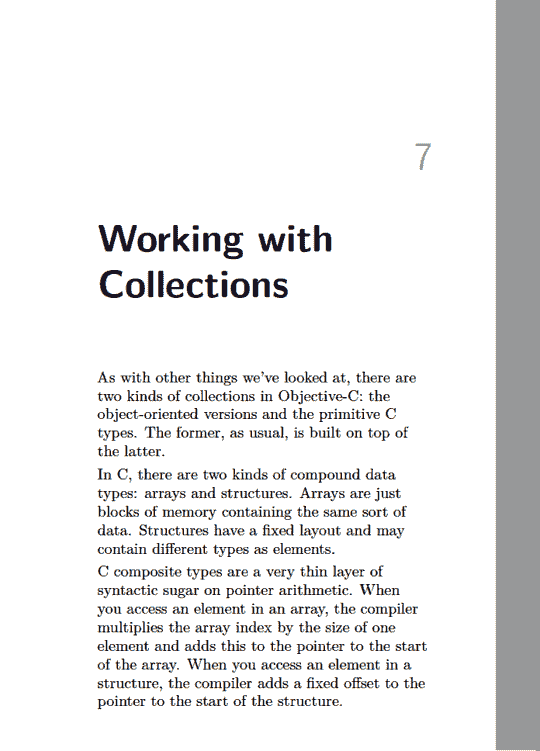
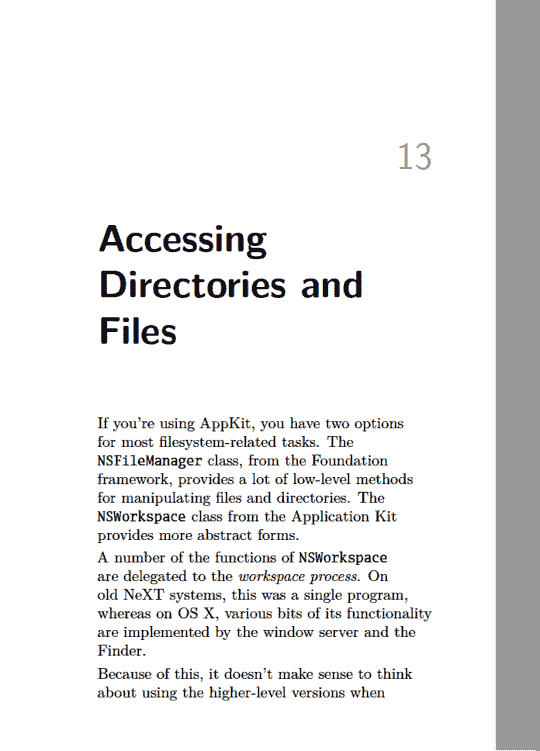
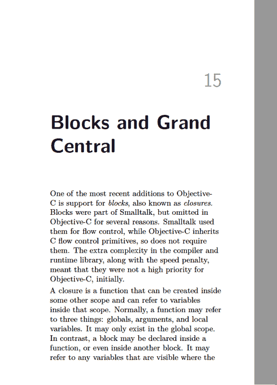
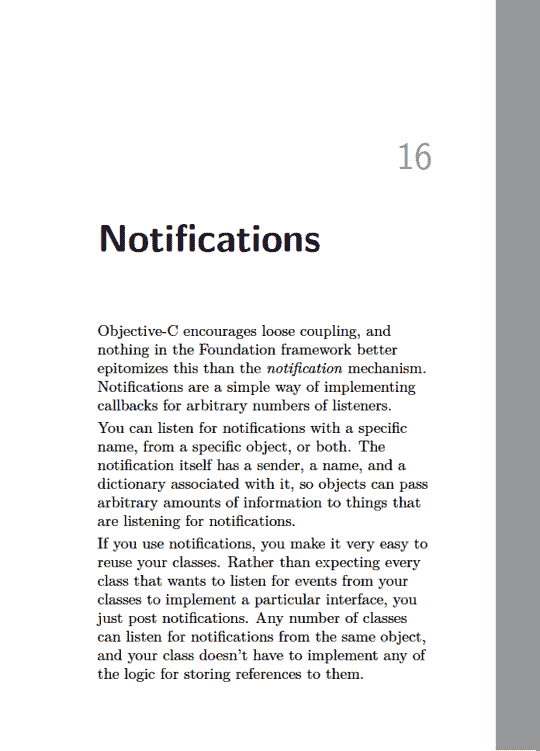
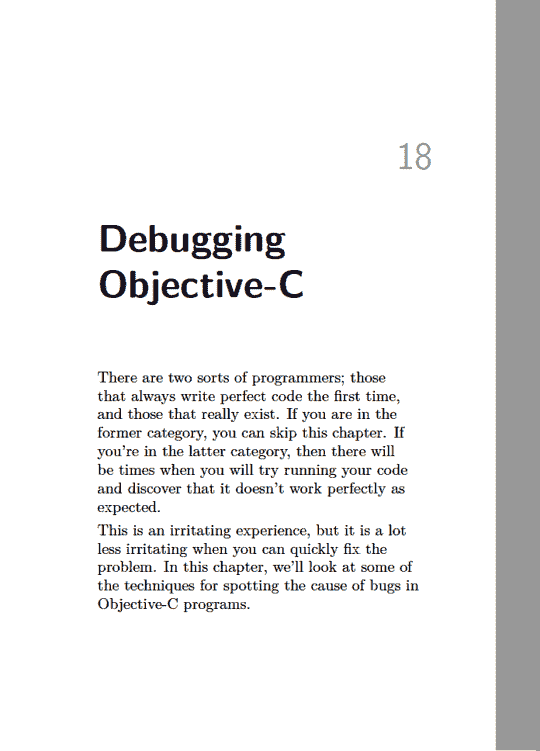
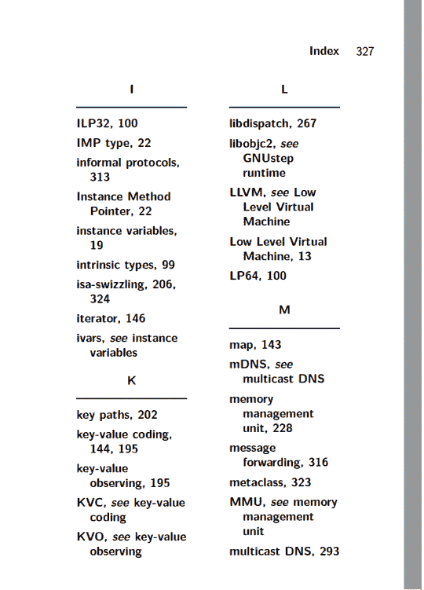
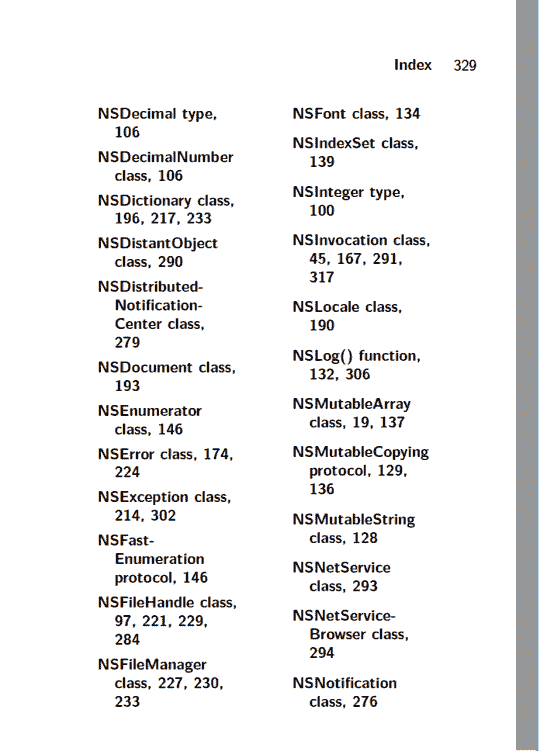
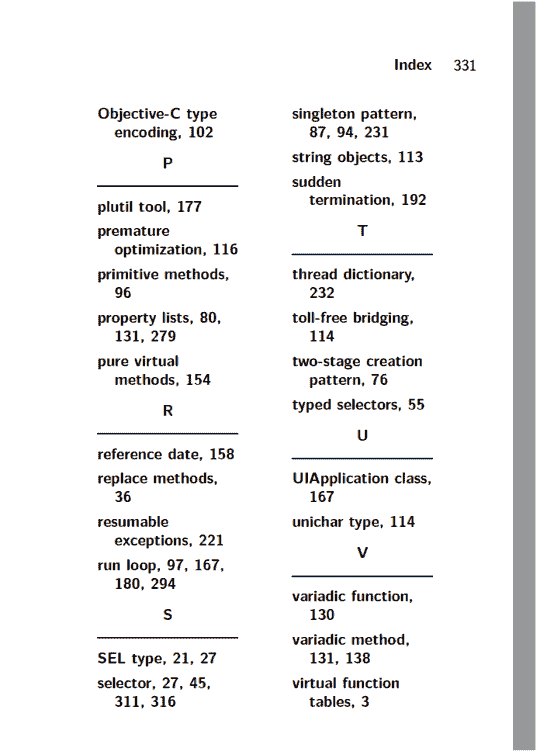

# David Chisnall Objective C 常用句手册 Pearson 2011


制造商和销售商用于区分其产品而使用的许多标识均声称为商标。当这些标识出现在书中且出版商知晓该标识拥有商标声明时，这些标识将以首字母大写或全大写的形式打印。

作者和出版商在编写本书时付出了努力，但不对任何形式的明示或隐含保证，也不对错误或遗漏承担责任。对于与使用本文包含的信息或程序有关或由此引起的任何间接或后果性损害，不承担任何责任。

对于批量购买或特种销售，出版社对本书提供优惠的折扣，这可能包括电子版本和/或针对您的业务、培训目标、营销重点和品牌兴趣的定制封面和内容。欲了解更多信息，请联系：美国企业与政府销售

(800) 382-3419

corpsales@pearsontechgroup.com

美国以外的销售，请联系：国际销售

international@pearson.com

访问我们的网站：informit.com/aw *美国国会图书馆出版目录数据已存档。*

Copyright © 2011 Pearson Education, Inc.

保留所有权利。印于美国。本出版物受版权保护，在进行任何禁止的复制、存储在检索系统中或以以任何形式或手段（电子、机械、复印、录音或类似手段）传输之前，必须获得出版商的许可。有关许可的信息，请信至：Pearson Education, Inc

Rights and Contracts Department

501 Boylston Street, Suite 900

Boston, MA 02116

Fax (617) 671-3447

ISBN-13: 978-0-321-74362-6

ISBN-10: 0-321-74362-8

本文在印第安纳州克劳福德斯维尔 RR Donnelly 公司使用再生纸在美国印制。

2011 年 2 月首次印制

总编辑：Mark Taub
执行编辑：Kristy Hart
校对员：Charlotte Kughen
封面设计：Gary Adair
策划编辑：Mark Taber
项目编辑：Anne Goebel
协调员：Gloria Schurick
文字编辑：Vanessa Evans
编辑：Bart Reed
Michael Thurston


# 索引 (325)
(ix)

*此页特意留*

**关于作者**

David Chisnall 是一位自由职业作家和顾问。

在读博士学位期间，他共同发了 Étoilé 项目，该项目旨在基于 GNUstep（OpenStep 和 Cocoa API 的开源实现）开发一个开源桌面环境。他是 GNUstep 的活跃贡献者，也是 GNUstep Objective-C 2 运行时库以及 Clang 编译器中相关支持的原始作者和维护者。

获得博士学位后，David 在学术界躲避了一段时间，研究编程语言的历史。当他发现校园外也有同样的海景且不需要处理那么多文件时，他终于逃离开了。他偶尔会参与涉及动态语言语义建模的项目。


David 对 Objective-C 非常熟悉，他不仅参与过使用该语言的项目，还参与过该语言本身的实现。他还曾在 Objective-C 运行时之上实现过其他语言，包括 Smalltalk 的方言和 JavaScript，这使得可以在所有这些语言之间进行混合代码编写而无需任何桥接。

在不写代码或编程时，David 喜欢跳阿根廷探戈和古巴萨舞，打羽毛球和极限飞盘，以及烹饪。

## 致谢

在写这本书关于 Objective-C 的书时，我应该感谢的第一个人是 Nicolas Roard。

在我开始博士学位左右买了第一台 Mac，当时我计划用它来写 `Java` 代码，因为不想学习一种专有语言。当我开始博士学习时，发现自己正和 Nicolas 一起工作，他是一个活跃的 `GNUstep` 贡献者。他服我说 Objective-C 和 `Cocoa` 不仅仅适用于 Mac，而且它们两者都非常值得学习。他是完全正确的：Objective-C 是一门非常优雅的语言，而配套的框架让开发变得异常简单。

下一个要感谢的是 Fred Kiefer。Fred 是 `GNUstep` 实现 `AppKit` 框架的维护者。他对本书进行了极其详尽（读作：吹毛求疵）的技术审查，发现了几处地方解释得不够理想。如果你喜欢这本书，那么 Fred 应该拥有其中的很大功劳。

最后，我需要感谢其他参与将这本书从我的文本编辑器送到你手中的每个人，特别是最初向我提议这个想法的 Mark Taber。

## 我们想听听你的声音

作为本书的读者，*你*是我们最重要的批评家和评论员。我们重视你的意见，并想知道我们做得好的地方、哪些可以做得更好、你希望我们出版哪些领域的内容，以及任何其他愿意分享给我们的智慧建议。

你可以通过电子邮件或直接写信给我，告诉你对这本书的喜欢或不喜欢的地方——以及我们可以做些什么来让我们的书籍更强大。

*请注意，我无法帮助你解决与本书主题相关的技术问题，而且由于收到的邮件量很大，我可能无法回复每一条信息。*

邮件：
`mark.taber@pearson.com`

邮寄：
Mark Taber
副出版商
Addison Wesley Publishing
800 East 96th Street
Indianapolis, IN 46240 USA

## 读者服务

访问我们的网站并在 `informit.com/aw` 注册本书，以便方便获取该书可能提供的任何更新、下载或勘误。

## 引言

Blaise Pascal 曾写道：“我没有时间写一封短信，所以我写了一封长信。”这本短语手册不到 350（小）页，是我写过的最短的书，试图将我想说的所有内容都塞进这么短的一卷书中是一项挑战。

当 Mark Taber 最初建议我写一本《Objective-C 短语手册》时，我不确定它会是什么样子的。自然语言的短语手册是一系列短习语列表，供那些发现自己需要快速一句话的人使用。编程语言的短语手册应该承担类似的角色。

本书并不是语言参考书。Apple 在 `http://developer.apple.com` 网站上提供了 Objective-C 语言的胜任参考资料。这不是一份详细的教程；与我的另一本 Objective-C 书籍*Cocoa Programming Developer’s Handbook* 不同，你在这里找不到作为代码示例的完整程序。相反，你将看到非常短的 Objective-C 习语示例，希望你可以将它们应用在广泛的地方。

生活中最令人沮丧的事情之一就是发现书中的代码示例实际上无法运行。书中有两种代码列表。白色背景上的代码旨在说明一个简单的要点。这些代码可能依赖于某些隐含的上下文，不应被视为可运行、可用的示例。

你在书中能找到的大部分代码都在灰色背景上。在每一个此类示例的底部，你会找到该列表取自的文件名。你可以从 InformIT 网站上的书籍页面下载这些内容：`http://www.informit.com/title/0321743628`

## 关于排版的说明

本书是用 `Vim` 编写的，并使用了语义化标记。从这里开始会生成三个不同的版本。其中两个是使用 `pdflatex` 创建的。

如果你正在阅读打印版或 PDF 版本，你就能看到其中之一。两者唯一的区别是打印版包含了裁剪标记，以便打印机修边页面。

第三个版本是 XHTML，用于 ePub 版。它是使用 `EtoileText` 框架创建的，该框架首先将 LaTeX 风格的标记解析为树结构，然后执行一些转换以处理交叉引用和索引，最后生成 XHTML。执行此操作的代码全部用 Objective-C 编写。

如果你两个版本都能访问，你可能会发现 ePub 版中的代码列表看起来更好一点。这是因为 `EtoileText` 使用另一个 Étoilé 框架 `SourceCodeKit` 进行语法高亮。这使用了 `Clang`（一种现代 Objective-C 编译器）的一部分来标记代码列表。这意味着代码范围被标注了完全相同的语义类型。你可以在 Étoilé 子版本库中找到执行此操作的代码：`http://svn.gna.org/viewcvs/etoile/trunk/Etoile/`

# 第一章：Objective-C 哲学

vtable 被暴露给开发者。与 C++ 不同（vtable 是私有的），Objective-C 允许你检查并修改一切。

在旧的运行时中，Objective-C 类由 C 结构表示。你可以直接修改它们，或者创建新的并向运行时注册。

## 理解对象模型

Objective-C 拥有类似于 Smalltalk 的对象模型。如果你来自 Java，你会发现这非常容易理解。如果你来自 Simula 系语言（如 C++），你可能会觉得有点困难。


Simula 没有使用“面向对象”这一术语，但许多在 Smalltalk 之后出现的 Simula 类语言都采用了这一术语，这导致了一些混淆。这类家族的语言，例如 `C++`，使用 `virtual function tables (vtables)` 来来实现表面上相似的功能。

Simula 风格的对象包含一个指向其 `vtable` 的指针，如果有超类，则指向 `vtables`。当你调用一个虚函数时，编译器会在 `vtable` 中创建一个偏移量，然后调用该偏移量处的函数。

这种差异的副作用之一是，Objective-C 和 `C++` 中的指针指针转换具有截然不同的语义。在 Objective-C 中，当你将指针从一种对象类型转换为另一种对象类型时，不会生成任何代码。这种转换只是对编译器的类型检查器的一个提示。

然而，在 `C++` 中，指针转换会执行一些指针运算，使得传递转换后指针的代码能够找到正确位置的 `vtable`。这意味着在 Objective-C 中，你可以将任何对象类型转换为任何其他对象类型，而在 `C++` 中，你需要使用一种特殊的转换。

这种区别非常重要。在 Objective-C 中，影响方法查找的唯一因素是对象的类型。在 `C++` 和其他 Simula 家族语言中，查找还会受到编译器认为的对象类型的影响。

## 两个类型系统的故事

让初学者 Objective-C 的人感到困惑的问题之一是它有两套类型系统。如果你将原始实现视为一个预处理器，这就说得通了。

Objective-C 预处理器会执行类似于 `Strongtalk` 的类型检查，然后由 `C` 编译器执行 `C` 类型检查。

### C 即 Objective-C

`C` 拥有一个结构化类型系统。基本数据类型的类型等效性基于两个类型是否具有相同的表示。复杂类型永远不会被视为等价。

Objective-C 增加了一个代数类型系统。对象的类型由其签名定义：即它声称将响应的消息。你可以隐式地将一个 Objective-C 对象转换为其超类，因为保证它会响应超类理解的所有消息。

你可以显式地将对象转换为其他类型。例如，你可以将一个字典对象转换为数组对象。只要你之后只向它发送字典和数组都能理解的消息，这就能运行。

Objective-C 最重要的特征之一是它是 `C` 的纯超集。你可以将 `C` 视为嵌入在 Objective-C 中用于低级任务的特定领域语言，并将 Smalltalk 的子集视为嵌入在 Objective-C 中用于高级任务的特定领域语言。

使用纯 `C` 解决问题并没有错。许多人在学习 Objective-C 时犯的错误之一是，为了优化考虑静态类型信息，就假设他们必须停止使用 `C`。对于很多事情，`C` 的解决方案才是正确的。

**注意：**

Objective-C 还有一个姐妹语言 `Objective-C++`，它与 `C++` 的关系就像 Objective-C 与 `C` 的关系一样。`Objective-C++` 是 `C++` 的纯超集，允许你在 Objective-C 对象中调用 `C++` 代码，反之亦然。由于它们拥有完全不同的对象模型，你不能用 `C++` 继承一个 Objective-C 类，反之亦然；但你可以将 Objective-C 对象的指针作为 `C++` 对象的字段，并将 `C++` 对象的指针作为 Objective-C 对象的实例变量。

你可以在 Cocoa 框架中看到这一点。

并不是所有内容都是对象。如果你请求字符串中的字符范围，你将使用 `NSRange` 结构。这是一个 `C` 结构——而不是 Objective-C 对象——包含一个位置和一个长度。点、矩形以及其他许多东西以类似的方式表示。如果这些是对象，那么你将消耗更多的内存，使操作变慢，并且并不能真正获得任何灵活性。

面向对象的英格尔测试（Ingalls test）认为，你应该能够创建一种新整数，并将其用于在屏幕上定位窗口。Objective-C 未通过这一测试，但这在现实世界中并不是一个非常有用的例子，因为在大多数情况下，设计新类型的整数会破坏许多期望整数具有标准行为的代码。

在 Objective-C 中，在不需要动态行为的情况下，你不必使用动态行为（如后期绑定和多态）。

## 语言与库

对于非常动态的语言，很难在语言和库之间划定界限。在 Smalltalk 中，语言中没有等同于 `if` 语句。标准库定义了 `True` 和 `False` 单例类，它们响应 `-ifTrue:` 消息，并接受闭包作为参数。所有复杂的流控制结构（如循环或枚举）都是基于此实现的。

Objective-C 继承了 `C` 的流控制，但所有的动态行为都由运行时库提供。这与 `C` 或 `C++` 不同。你可以编译一个独立的 `C` 或 `C++` 二进制文件，它不调用 `libc` 或 `libstdc++` 中的任何函数。然而，每一个不是纯 `C` 程序的 Objective-C 程序都必须链接 `libobjc` 才能工作。

该库传统上提供三个类：一个简单的根类、一个常量字符串类和一个协议类。其中第一个提供的功能在 `C++`、Java 和类似环境中是语言的一部分。另外两个可能是由编译器生成的类。

大多数时候，你不会使用这些类中的任何一个。过去几年编写的大多数 Objective-C 代码使用 OpenStep Foundation 框架实现。OpenStep 是 NeXT 和 Sun 联合制定的规范，旨在为跨平台应用开发提供现代面向对象的框架。NeXT 在其 OPENSTEP 操作系统和 Windows 上实现了它，而 Sun 在 Solaris 上提供了实现。不久后，GNU 项目发布了第三种实现：GNUstep。

OpenStep 定义了两个框架：Foundation Kit 和 Application Kit，通常简称为 Foundation 和 AppKit。Foundation Kit 提供了应用程序所需的核心功能，如集合类、运行循环、通知传递、OS 抽象等。Application Kit 构建在其之上，为构建图形化应用程序提供额外支持。Apple 在几年后购买了 NeXT 并将 OpenStep 环境重命名为 Yellow Box，作为开发环境发布在 Rhapsody 和 Windows 上。随着 OS X 的发布，它再次被命名，这次称为 Cocoa。

## Objective-C 的历史

GNU 项目仍在活跃开发，但现在跟踪 Apple 对 OpenStep 规范的增强，以及核心规范。这意味着 Foundation 框架几乎可以在任何地方使用，尽管 GNUstep 实现中缺少一些最新的类和方法。

你可以将 Foundation 框架视为 Objective-C 的标准库。它为非易易程序提供了许多功能。若干 Objective-C 2 特性是专门为与 Foundation 配合而设计的。


你可以在不使用 Foundation 的情况下使用它们，但前提是你实现了等效的内容。

## Objective-C 的历史

“面向对象”一词由 Alan Kay 在 20 世纪 60 年代提出，Smalltalk 是他和其他人为了演示这种编程风格而创建的语言。Smalltalk 开发于 70 年代，其最广泛使用的版本于 1980 年发布。

。

然而，Smalltalk 运行非常慢。为了正确运行它，你需要一台强大的计算机，例如 Xerox Alto，它拥有 512KB 的内存，并且理想情况下至少配备一个 `2MHz` 的处理器。

Brad Cox 喜欢 Smalltalk 的理念，但他希望有一种他可以在人们负担得起的计算机上使用的语言。他的想法是将 Smalltalk（一种鼓励封装、松耦合和代码复用的高级语言）与 C 语言结合。而 C 语言正处于光谱的另一端，几乎没有封装，没有动态分发，但它有一个巨大的优势：它非常快。

C 语言高度基于 PDP-11 指令集。一个非常初级的 C 编译器就能产生相当快的代码。这在今天也是如此。诸如 `LLVM`、`XLC` 和 `ICC` 等编译器在优化上投入了大量精力，但几乎不做任何优化的 `PCC` 仍然能产生相当快的代码。

Brad Cox 和 Tom Love 于 1986 年创立了 StepStone，销售一种基于 Brad 早期“面向对象预编译程序”的产品。这个产品就是 Objective-C，它是一个预处理器和一个小型的 `Objective-C runtime library`。该预处理器生成 C 代码，你可以使用对应平台的 C 编译器对其进行编译。直到 2010 年，我仍遇到过一家在商业产品中使用 StepStone 编译器的公司。

1988 年，NeXT 购买了 StepStone 代码的许可，并直接买下了 Objective-C 的商标。随后，NeXT 将预处理器重写为 `GNU Compiler Collection`（`GCC`）的前端。经过一些法律斗争后，自由软件基金迫使他们发布了这些代码，但他们保留了运行时库的私有性。

GNU 项目随后编写了运行时库的替代品，但进行了一些更改。

其中之一是，GNU 运行时中的选择器（selectors）关联了一个类型。在 NeXT（以及 Apple）平台上，选择器只是字符串。

这意味着 GNU 运行时可以在运行时捕获由于程序员错误导致的某些堆栈损坏，而这些错误在 NeXT 运行时是不可见的。

另一个更改在于消息发送的实现方式。当你使用 NeXT 运行时发送消息时，编译器会将消息发送转换为对 `objc_msgSend()` 函数的调用。它会查找该方法然后调用它。

遗憾的是，无法在 C 中实现这个函数。它必须为每个平台以及该平台上的每种调用约定用汇编语言编写。GNU 的解决方案是用 `objc_msg_lookup()` 函数来替换它，该函数返回一个函数的指针。这虽然稍微慢一点，但意味着相同的代码可以在所有平台上运行。

Objective-C 从此之后没有发生太大变化。

NeXT 在 1997 年被 Apple 收购，Objective-C 被采用为其新操作系统 Rhapsody 上 Yellow Box 的主要开发语言。这些后来分别被重命名为 Cocoa 和 OS X。2003 年，Apple 在语言中添加了一些类似 Java 的异常处理原语。

下一组升级出现在 2007 年，Apple 引入了 Objective-C 2。这对老牌 Objective-C 程序员来说稍显困惑，因为之前的版本——即 NeXT 发布的那个——是 Objective-C 4。幸运的是，“`2` 紧跟在 `4` 后面”的想法并没有出现在 Cocoa 的任何排序代码中。

Objective-C 2 增加了一些语法糖。它提供了一种新的枚举方式、一种自动合成访问器的方法（synthesizing accessor methods），并引入了垃圾回收。Objective-C 2 与其说更像是一个营销术语，而不是一种真正的语言。你找不到用于选择它的编译器开关。某些功能（如非易碎实例变量，*non-fragile instance variables*）仅在某些运行时可用。其他功能（如垃圾回收）在 iPhone 上不可用。

声明属性和快速枚举是唯一处处运行（包括非 Apple 平台）的 Objective-C 2 特。

## 跨平台支持

强制 NeXT 将 GCC 的 Objective-C 前端作为自由软件发布，对于自由软件基金来说是一次公关上的胜利。遗憾的是，从长期跨平台支持的角度来看这并不理想。NeXT 发布的代码非常糟糕，在过去的十年里，很大程度上被 GCC 团队忽略了。

GCC 对 NeXT 时代的 Objective-C 有中等程度的支持，也支持新的异常处理关键字。GNUstep 项目提供了 Foundation 和 AppKit 框架的实现，这些是 NeXT 和 Mac 开发的核心。

2007 年，Apple 开始开发一种新编译器。

`Clang` 是用于 C 家族语言（C、Objective-C 和 C++）的 `Low Level Virtual Machine (LLVM)` 的前端。它比 GCC 模块化程度得多，并被设计用于代码补全、语法高亮和静态分析，而不仅仅是编译。Clang 在不同层级使用的代码之间有清晰的分离，并将特定的运行时代码隔离到单独的类中。

编译器只是 Objective-C 实现的一半。另一半是运行时库。GNU 运行时是使用 GCC 开发的，并没有实现 Objective-C 2 所需的函数。为了解决这个问题，我在 Étoilé 项目中编写了一个框架，实现了大部分缺失的功能，并实现了 Apple 在 OS X 中引入的公共运行时 API。

这个框架现在是 GNUstep 的一部分。另一个版本的 Objective-C 运行时副本是与 GNUstep 合并的，被称为 `GNUstep runtime` 或 `libobjc`。

通过 Clang 配合 GNUstep 提供的运行时，你可以获得对大多数 Objective-C 2 功能的支持，包括非易碎实例变量。这意味着你可以在 Windows、Linux、BSD、Solaris 等系统上使用它。至少有人在 QNX 上测试过它，它也可能在 Symbian 上运行。

如果你使用 GCC 版本的运行时配合 GNUstep 中的 Objective-C 框架，你可以获得某些功能，例如快速枚举和声明属性，但无法获得新 ABI 的任何优势。

## 编译 Objective-C 程序

如果你熟悉如何使用这些编译器中的一种编译 C 或 C++，你就会发现编译 Objective-C 非常熟悉。如果你只是在命令行指定一个源文件，编译器将尝试将其编译并链接为可执行文件。在大多数情况下，这是行不通的。Objective-C 程序需要其他库。在 X 上，编译器驱动程序支持一个额外选项；


`-framework`，指定一个包含头文件和共享库的框架包。这既是链接器选项，也是预处理器选项。

书中的示例都使用了 `Foundation` 框架。在其他平台上，这通常由 GNUstep Base 库实现。

这些平台通常不支持 `-framework` 选项。`gnustep-config` 工具提供了一个替代方案。它会打印编译 Objective-C 以及链接基础（`Foundation`）或 GUI（`AppKit`）库所需的编译器选项。

与 C 和 C++ 一样，你可以指定 `-c` 只编译文件而不进行链接，并使用 `-o` 指定输出的名称。如果你正在编译多个文件，你可能想用比从命令行运行 `clang` 编译器更高级一点的方法。

在 OS X 上，你可能会使用 `XCode` IDE。这让你能够创建具有许多不同模板类型的项目。如果你需要在其他平台上编译这些项目，你可以在 GNUstep 仓库中找到一个名为 `pbxbuild` 的工具，它可以用来编译它们。

如果你在其他某些平台上工作，可以使用 `GNUstep Make` 进行构建。这在 OS X 上同样有效，因此无论你选择哪种方案，都不应该出现构建系统引起的移植性问题。

## 第 1 章：Objective-C 哲学

# 第 2 章：Objective-C 入门

旨在用于与 C 库配合使用，而不是作为一种独立语言。现在，大多数 Objective-C 代码都使用基于 NeXT Foundation 框架的内容——可以是 Apple 的 `Foundation`、GNUstep Base 库或 `libFoundation`——作为标准库。这提供了诸如引用计数内存管理、标准数据结构、转发机制等功能。

你认为属于 Objective-C 语言的大部分内容实际上是由 `Foundation` 框架提供的。在没有 Foundation 的情况下使用 Objective-C 是可能的，但人们这样做是为了证明他们可以做到，而不是因为这实际上是一个明智的选择。

## 声明 Objective-C 类型

```objc
NSMutableArray *mutableArray = [NSMutableArray new];
NSArray *array = mutableArray;
NSObject *object = array;
id obj = mutableArray;
mutableArray = (NSMutableArray*)object;
mutableArray = obj;
```
*来自: cast.m*

Objective-C 正如其名，在 C 的基础上增加了对象。具体来说，对象遵循 Smalltalk 模型，即类的实例。对象始终分配在堆上，因此始终通过指针引用。

在 Objective-C 的早期实现中（这些实现从 Objective-C 生成纯 C 代码），类被转换为描述对象布局的结构定义。你仍然可以在 GCC 错误信息中看到这种做法的遗留，它偶尔会将对象称为“结构体（structures）”。

在 C 中，你需要显式的类型转换将任何结构体指针转换为其他类型的结构体指针。这一规则在 Objective-C 中被稍微放宽。任何对象的布局都由根类中的实例变量 `(ivars)` 定义，然后由层次结构中每个后续类中的实例变量定义。子类只能添加新的实例变量，而不能删除或重排父类中的变量。这意味着，从内存布局的角度来看，将指向一个类实例的指针转换为指向另一个类实例的指针总是安全的。

从面向对象的类型系统的角度来看，这也是安全的；任何子类都将响应父类响应的所有消息。

Objective-C 中的对象指针通过类名识别，后面跟一个星号，就像 C 语言中的结构体指针一样，但不需要 `struct` 关键字。你始终可以隐式地将指向一个类实例的指针转换为其父类实例的指针。

这对于间接父类也有效。例如，`NSMutableArray` 是 `NSArray` 的子类，而 `NSArray` 是 `NSObject` 的子类。你可以将 `NSMutableArray` 转换为 `NSArray` 或 `NSObject`。然而，反方向的转换需要显式转换。

Objective-C 还引入了一种新的指针类型：`id`。在类型转换规则方面，它大致比比 `void*`。你可以隐式地将任何对象指针转换为 `id`，也可以隐式地将 `id` 转换为任何对象指针类型。

如果你习惯于无类型语言（如 Smalltalk、Ruby 或 Python），那么专门只使用 `id` 类型可能很很有诱惑力。这在大多数情况下是安全的，尽管有一个例外。Objective-C 使用消息名称进行查找，而不包含任何类型信息。这意味着你可以声明两个同名（在不同类中）但类型不同的方法。

当编译器生成一个消息发送指令时，它使用接收者的类型来确定栈帧的布局。当在任何地方都只有一个以该名称声明的方法时，就不需要类型信息。

如果你想从对象外部访问实例变量，也需要静态类型，但这样做通常被认为是不良风格。虽然不需要指定静态类型信息，但通常是一个好主意。除了刚才提到的情况外，它不会影响代码生成，但它会被编译器的语义分析阶段使用。这有助于在编译时捕捉一些错误。

例如，如果你尝试将一个对象添加到 `NSArray` 实例，编译器会警告你该对象不响应相关消息。这让你检查是否真的想用 `NSMutableArray`，或者是否需要为数组创建一个可变副本。

**注意：**

在 C++ 中，通常使用 `const` 关键字来描述对象为不可变。在 Objective-C 中，`const` 实际上是没用的。它指定对象的实例变量可能被修改，但很少这样做。它不会改变可以发送给对象的消息，因此声明为 `const` 的对象仍然是变的。

在大多数需要区分可变和不可变实例的情况下，Objective-C 程序员使用*可变子类模式*，即一个不可变类有一个可变的子类。你可以隐式地将可变版本转换为不可变，但无法让不可变实例变为可变。

`Class` 类型与 `id` 相似，但它可以引用类。在 Objective-C 中，类也是对象，因此你始终可以用 `id` 代替 `Class`，就像你可以用 `id` 代替特定的对象类型一样。

另外两个类型在标准 Objective-C 头文件中定义。`SEL` 类型用于选择器（selectors），我们将在本章稍后部分讨论。最后一个是 IMP，全称为*实例方法指针 (Instance Method Pointer)*。这种类型指向 Objective-C 方法的指针。大多数情况下，你根本不需要这种类型。它只用于 Objective-C 的某些非常动态的功能以及优化。我们将在第 19 章查看你可能用到它的地方。

## 发送消息

```objc
[anObject autorelease];
[anObject addObject: anotherObject];
[anObject setObject: anotherObject forKey: aThirdObject];
```
*来自: exampleMessages.m*

Objective-C 对 C 最重要的改进是发送消息。正如我在上章提到的，消息是一种高级的流控制结构。


这段 Objective-C 代码往往会让那些来自 `C++` 和 `Java` 等语言的人士感到畏惧，因为它的语法直接源自 Smalltalk，对于更熟悉 `C` 语法的人来说看起来非常陌生。这是刻意为之。在 `C` 中，没有任何东西的行为与 Objective-C 的消息发送（message send）相同，也没有内置定义，因此头文件是可选的。

## 发送消息 (Sending Messages)

因此，拥有新语法强调了你同时也拥有了新语义这一事实。记得 Tom Love 描述过，它是一种混合语言，在纯 `C` 部分和“对象领域（object land）”之间有清晰的语法分离，后者具有类 Smalltalk 的语法，并伴随类 Smalltalk 的语义。

最简单的消息发送不接受任何参数。这方面的例子可能是发送给数组的 `-count` 消息。注意消息名称前的减号。这是 Objective-C 文档中使用的约定，用于表示发送给实例的消息。

加号用于表示发送给类的消息，例如 `+new` 或 `+arrayWithObject:`。

```objc
size = [anArray count];
```

这段代码段获取数组中的元素个数并将其存储在变量 `size` 中。在 `C++` 或 `Java` 等语言中，对应的写法如下：

```objc
size = anArray.size();
```

如果 `anArray` 是一个 `C` 结构体且 `size` 字段是一个函数指针，那么在 Objective-C 中也会使用相同的语法。由于这与向对象发送消息的含义完全不同，设计者认为使用相同的语法会引起混淆。

接受一个参数的消息看起来非常相似。如果你想向 Objective-C 数组添加一个对象，你会使用类似这样的代码：

```objc
[anArray addObject: anObject];
```

当消息有多个一个参数时，情况开始变得有些不同。与 Smalltalk 一样，每个参数都有独立的名称，因此你会在特定索引处插入对象，如下：

```objc
[anArray insertObject: anObject atIndex: anIndex];
```

当你理解了基础语法后，这使得 Objective-C 代码非常易读，因为每条消息都会告诉你每个参数的用途。如果你在文档中遇到这条消息，它的写法应该是这样的：

`-insertObject:atIndex:`。你可以从两个冒号看出它接受两个参数，并从两个冒号之前的文本看出这些参数应该是什么。和之前一样，减号表示这是发送给实例的消息。

如果你向一个没有实现该方法的对象发送消息，则会使用一系列回退方法。在默认实现中，这些方法中的最后一个将抛出一个异常（你可以在运行时捕获并处理它）。你也可以在发送消息之前询问对象它是否知道如何处理它。我们将在第 19 章查看如何这样做。

在 Objective-C 中，像 Smalltalk 一样，类也是对象。你可以向它们发送消息，就像向对象发送消息一样。这样做时，你使用类的名作为接收者。

**注意：**

如果你向 `nil`（定义为 `(id)0` 的常量）发送消息，不会得到错误。相反，你会得到返回一个 `0` 值。这非常有用，因为你可以对之前消息发送的结果发送字符串消息，如果其中一个在中间返回了 `nil`，那么剩下的仍然可以工作。这消除了 Objective-C 代码中许多对 `NULL` 进行测试的需求。

向 `nil` 发送返回结构体的消息的行为是未定义的。如果你在 `SPARC` 上的用 `GCC` 编译的代码中执行此操作，你的程序将由于非法指令信号崩溃。在 `OS X` 上，结构体将填充随机值，就像栈上未初始化的结构体一样。

在向对象发送返回结构体的消息之前，你应该始终小心检查该对象是否为 `nil`。

向类发送消息的最常见目的是创建该类的实例。

在 Objective-C 中，类负责创建它们自己的实例。在 `C++` 或 `Java` 中没有类似的 `new` 关键字。最接近的等价物是 `+new` 消息，你可以将其发送给类。例如，你可以这样创建一个新的可变数组：

```objc
id anArray = [NSMutableArray new];
```

尽管这看起来非常相似，但语言对这条消息的作用不做任何保证。某些类可能会创建子类的实例，而某些类可能会返回一个单例实例。仅根据约定，它才会给你一个接收者的新实例。

## 理解选择器 (Understanding Selectors)

```objc
SEL new = @selector(new);
SEL set = @selector(setObject:forKey:);
```
*源自：selector.m*

在 `C` 中，你通过名称引用函数。函数名也可以用作指向该函数的指针。当你将 `C` 代码编译为汇编代码时，函数变成一个标签，可以通过调用指令或指令序列到达。

Objective-C 的流控制更具动态性。

你可以获取方法的指针，但大多数情况下，你希望向对象发送一个特定的消息，而不是调用一个特定的方法。

如果你调用一个特定的方法，你必须绝对确定接收者确实是你预期的那个类。

在 `C` 中，你经常将函数指针作为其他函数的参数。被调用的函数将调用传递给它的那个函数。这的一个常见例子是 `C` 标准库中的 `qsort()` 函数。排序数组，使用函数来定义项目之间的顺序。

在 Objective-C 中，你可能通过发送 `-compare:` 消息来比较对象，而不是使用函数指针。

消息的名称被称为选择器（selector）。它是消息名称的抽象表示，具有 `SEL` 类型。你可以使用 `@selector()` 指令创建选择器。它接收消息名称的常量字符串并将其转换为该消息的选择器。

你可以使用选择器通过名称调用方法，我们将在第 19 章看到。Foundation 框架中的许多方法接受选择器作为参数。它们的用法与接受函数指针的 `C` 函数类似，用于延迟执行、回调、集合排序等。

## 类声明 (Declaring Classes)

当你创建一个新类时，你需要做两件事：描述它的公共接口并编写它的私有实现。你需要三个 Objective-C 关键字：`@interface`、`@implementation` 和 `@end`。

注意所有新的 Objective-C 关键字都以 `@` 符号开头。这是因为该符号在 `C` 标识符中是不允许的。与 `C++` 相比，后者引入了 `class` 等标识符，这会破坏任何使用 `class` 作为变量名的 `C` 代码。

Objective-C 继承了 `C` 的编译模型，编译器期望单个文件，而分离通过预处理器合并多个文件来实现。按照约定，Objective-C 类的接口放在扩展名为 `.h` 的头文件中，而实现部分放在 `.m` 文件中。没有人记得为什么选择 `.m`。


由于头文件是由预处理器插入到编译单元的，在 Objective-C 编译器看到它们之前就已经处理了，因此这种分离并不是强制执行的。C++ 和 C 中的不透明数据类型也是如此。

Objective-C 的一个稍微意外的方面是，实例变量（Java 和 C++ 称为“字段”）被声明为接口的一部分，而不是实现部分。这是由于 Objective-C 早期版本实现方式的一种产物。

每个对象都被转换为一个 C 结构体，其第一个字段是指向该类的指针。为了生成这个结构体，编译器需要能够看到所有父类的所有实例变量。这种方法的一个遗憾的副作用是：修改类的布局意味着你必须重新编译它的所有子类。

现在，有了非脆弱性 ABI（non-fragile ABI），你可以从子类中隐藏私有实例变量。对它们的每次引用都通过一个间接层。偏移量现在是一个变量，而不是编译时常量。

默认情况下，Objective-C 实例变量受保护的，这意味着它们只能由该类或其子类访问。如果你为它们加上 `@private` 前缀，它们只对该类可用；如果加上 `@public`，它们可以在任何地方访问。这非常罕见。对访问权限的运行时检查很少，并且有一些机制可以绕过访问控制，因此通常将所有内容保持受保护，仅在私有类中将实例变量设公共。

**注意：**
Apple 的非脆弱性 ABI 限制了 ivar 偏移变量的可见性，如果你尝试从不同的编译单元访问私有实例变量，将产生硬错误。仍然可以通过使用运行时内省（runtime introspection）访问私有实例变量，而这种保护在其他运行时环境中是不可用的。

### 声明类

类接口的基本结构包含三个部分。第一部分是新类在层次结构中位置的定义：

`@interface ClassName : Superclass <protocols>` 类名紧随 `@interface` 关键字之后。接着是一个冒号，然后是父类的名称。可以设计新的根类，但要正确地做到非常复杂，因此大多数时候你只需要使用 `NSObject` 或 `NSProxy` 作为你的父类。

之后，你可能可选地在角括号中指定一个由逗号分隔的协议列表。Objective-C 中的协议类似于 Java 中的接口（interfaces）。它们定义了对象必须实现的方法列表。

接下来是实例变量列表。它遵循与在 C 中定义结构体相同的语法。一个只包含实例变量没有方法的简单类定义看起来如下：

```objc
@interface NoMethods : NSObject
{
    int integer;
    NSObject *object;
    float floatingPoint;
}
@end
```

在 C 结构体定义中任何有效的在这里都是有效的。如果你使用 Objective-C++，你还可以添加指向 C++ 对象的指针以及具有简单构造函数（trivial constructor）的 C++ 对象。

最后，你列出类所实现的公共方法。与其为此凭空编造，让我们来看一些真实的方法声明：

`+ (id)new;`
`- (void)appendString:(NSString*)aString;` 第一个方法声明前的加号表示这是一个附加到类上的方法。你可以向类发送一个 `+new` 消息，它将还给你一个对象指针。`id` 类型是 Objective-C 引入的一种新类型，大致与 C 中的 `void*` 类型相似，但被限制为指向 Objective-C 对象。

注意，返回类型和参数的类型与类型转换使用相同的语法。这突显了消息发送（message sends）与 C 函数调用之间的另一个重要区别。该方法被编译为 C 函数，在调用它之前，指针会被转换为这些类型。

类定义的实现部分要简单得多。它以 `@implementation` 指令开始，包含了类所有方法的定义，如下：

```objc
@implementation NewClass
+ (int)classVersion
{
    return 2;
}
- (void)log
{
    fprintf(stderr, "log message received");
}
@end
```

需要注意的一个重要点是，你不需要声明类所实现的所有方法。在类接口中未声明的方法被认为是私有的。调用它们将产生编译时警告，并且类的未来版本可能会完全停止对它们做出响应。

### 使用协议

与类一样，Objective-C 中的协议也是对象。协议的行为是 Apple 在现代运行时（runtime）更改的内容之一。以前，协议通过名称识别，如果两个协议具有相同的名称，则它们被认为是等价的。这意味着，如果你在不同的库中声明了两个同名的协议，你无法判断对象实现了其中哪一个。更重要的是，你无法查找协议并查看它需要哪些方法。

在 Objective-C 2 中，协议现在是唯一的。你现在可以通过名称获取协议并检查它。这在旧模型中有时可行，但它取决于编译器是否已经输出了它的完整定义。你可以使用 `@protocol()` 关键字获取协议的引用。这样做的主要目的是测试协议的遵循情况。

```objc
if (![delegate conformsToProtocol:@protocol(DelegateProtocol)])
{
    testIndividualMethods = NO;
}
```

你可能在一个设置代理的方法中使用类似这样的代码段。如果代理符合该协议，则保证它实现了该协议中的所有方法，因此你不需要测试每一个。如果它符合，你可能需要在发送每条消息之前对其进行测试。

协议为你提供了编译时和运行时的类型检查。你可以通过在类型名称后加上角括号来要求对象符合某个协议。以下是一些示例：

`id <NSCopying> a;`
`id <NSObject,NSCopying> b;`
`NSObject<NSCopying> *c;`

在这里，你可以将任何实现 `NSCopying` 协议的对象赋值给 `a`。赋值给 `b` 的对象还必须实现 `NSObject` 协议，任何继承自 `NSObject` 的对象都会自动实现它。最后，`c` 必须是 `NSObject` 的子类并实现 `NSCopying` 协议。

如果你将一个对象赋值给要求它符合某个未在其声明遵循列表中协议的变量，编译器将生成警告而不是错误。这不是一个硬错误，因为它可能实现了该协议所需的方法，尽管它没有声明遵循该协议。

### 为类添加方法

```objc
@interface NSObject (Logging)
- (void)log;
@end

@implementation NSObject (Logging)
- (void)log
{
    NSLog("%@", self);
}
@end
```

*来自：logging.m*

Objective-C 与 C++ 或 Java 等语言之间的最大区别之一是**分类**（categories）的概念。这些在 Smalltalk 中存在，但是作为为了文档将方法分组的一种。在 Objective-C 中，它们允许你为类添加方法，即使你没有源代码。


分类（category）的定义结构与类的定义相似。分类不能更改类的实例变量，也不能更改其父类，因此 `@interface` 指令中的这些部分被省略了。在类名后的方括号中会添加分类名。在前面的代码中，你可以看到一个简单的分类接口和实现，它为 `NSObject` 添加了一个 `-log` 方法。然后你可以向任何对象发送 `-log` 消息，并将其输出到控制台。

注意，分类的接口和实现都是可选的。指定一个没有对应实现的分类接口可能是很有用的。如果你只想替换对象中的某些方法，那么指定一个没有接口的实现也是很有用的。

在分类中声明的方法将替换在类中声明的同名方法。这种顺序是有保证的，因此如果发生冲突，分类将始终具有优先级。如果两个分类定义了同一种方法，则被使用的哪一个是未定义的。

分类的一个文档记录较少详尽的特性之一是，它们允许你为类添加协议遵循（protocol conformance）。在 Foundation 框架中，各种集合没有共同的父类，也没有实现共同的协议。

在 EtoileFoundation 框架中，我们为它们都添加了分类，使它们遵循 `ETCollection` 协议。这让我们在需要某些集合但不在乎具体类型的地方可以使用该协议。

`collection.m` 示例展示了此特性的（非常）简化的版本。`Collection` 协议被添加到 `NSSet` 和 `NSArray` 类中。如果你向这两个类的任一实例发送 `-conformsToProtocol:` 消息，并以 `@protocol(Collection)` 作为参数，它将返回 `YES`。

分类有一个特殊情况，即你声明一个没有名称的分类接口。这被称为*类扩展*（class extension）。与其他分类不同（其他分类应该伴随一个指定分类名的独立 `@implementation` 指令），在类扩展中声明的方法预计出现在类的主 `@implementation` 指令中。你可以用它来前向声明私有方法。

使用最新的 Objective-C 编译器，你还可以在类扩展内部声明实例变量。为了使之生效，你需要在编译时指定 `-fobjc-nonfragile-abi2` 标志。

### 为类添加方法

```objc
@protocol Collection
- (BOOL)isEmpty;
@end

@interface NSArray (Collection) <Collection>
@end

@interface NSSet (Collection) <Collection>
@end

@implementation NSArray (Collection)
- (BOOL)isEmpty
{
    return [self count] == 0;
}
@end

@implementation NSSet (Collection)
- (BOOL)isEmpty
{
    return [self count] == 0;
}
@end
```
*自: collection.m*

### 使用非正式协议

```objc
@interface NSObject (InformalProtocol)
- (id)doSomething;
@end

// 仅限 Objective-C 2:
@protocol InformalProtocol
@optional
- (id)doSomething;
@end
```
*自: informalProtocol.m*

通常情况下，你想定义一组希望让类实现的方法，但这些方法是可选的。这在代理（delegates）中特别常见，在向代理发送消息之前，你会测试该代理是否实现了给定的方法。

在 Objective-C 2 中，协议可以包含声明为可选的方法，但在那之前，使用分类来实现非正式协议是常见做法。如果你为 `NSObject` 创建了一个分类接口，但没有为其提供接口定义，那么编译器将假设每个 `NSObject` 子类都响应接口中声明的消息，因此当你向对象发送其中任何一个消息时，它不会生成警告。

当然，并不是每个对象真的都会实现这些方法，因此你需要在发送消息之前，确保使用 `-respondsToSelector:` 来测试对象是否真的实现了它。

### 通过声明属性合成方法

Objective-C 2 的重大新增之一是声明属性（declared properties）。这些属性允许你定义访问器（accessor）语义的某些方面，如果你不需要任何特殊处理，则可以自动合成（synthesize）相关方法。

属性还引入了一些新语法。它们是通过消息发送（message sends）实现的。本章开头的示例将同时创建 `-integer` 和 `-setInteger:` 方法。你可以像调用其他方法一样调用它们，但也可以使用点符号，如下：

```objc
obj.integer = 12;
int i = obj.integer;
obj.integer += 42;
```

最后一种情况最有用。将其扩展为传统的 Objective-C 消息语法看起来如下：

```objc
[obj setInteger: [obj integer] + 42];
```

```objc
@interface Integer : NSObject
@property (nonatomic,assign) int integer;
@end

@implementation Integer
@synthesize integer;
@end
```
*自: synth.m*

“property”一词在 Smalltalk 中指代任何可以通过访问器操作的实例变量。在稍旧的 Objective-C 文档中，它以类似的方式使用。指定声明属性而不仅仅是属性，有助于减少这种歧义。

属性声明包含两个部分：接口和实现。接口定义了属性的名称和类型（正如你预期的那样），但它也定义了一些高级语义。属性默认是原子的（atomic）。这会产生一些开销，因此你可能可能想在你创建的大多数属性中指定 `nonatomic`。访问器方法的原子性并不能让对象线程安全，在线程之间共享对象时，使用某些高级别的锁几乎总是更好的选择。

考虑 `nonatomic.m` 示例。它声明了一个原子属性。然后你在代码中使用单次递增操作。你认为这是一个原子的递增，但事实并非如此。这个语句展开为两个消息发送之间的一个递增。

```objc
@interface NotReallyAtomic : NSObject
@property int a;
@end

int add(NotReallyAtomic *obj)
{
    obj.a += 1;
}
```
*自: nonatomic.m*

在属性的上下文中，原子的全部意思是在不使用垃圾回收的情况下，设置和获取方法都会尝试获取同一个锁，这样当你在一个线程中设置而在另一个线程中获取它时，对象就不会被意外释放。在垃圾回收模式下，对于非对象属性，`nonatomic` 没有意义。

属性可以是读写（readwrite）或只读（readonly），表示支持对其赋值。如果你定义了一个读写属性且没有使用垃圾回收，你还需要定义设置器的语义。

设置器的行为有三种选项：`assign`、`retain` 和 `copy`。第一个选项通常只用于代理，因为保留它们会创建循环引用。后两个选项仅适用于 Objective-C 对象。对于所有原始 C 类型，`assign` 是唯一的选项。


读写属性，但仅在公共接口中设为可读。类扩展（Class extensions）提供了实现此点的机制。如果你在主接口中声明属性为只读，但在类扩展中将其重新声明为读写，那么主 `@implementation` 中的 `@synthesize` 指令将创建 setter 和 getter。

然而，在类扩展不可见的任何地方尝试使用 setter 都会导致编译器错误。

选项（option），其原因希望是显而易见的：非对象的内容不会响应 `-retain` 或 `-copy` 消息。

这其中一个例外是使用 `__attribute__((NSObject))` 声明的 C 指针类型。该属性告诉编译器该 C 类型实际上是一个 Objective-C 对象。Core Foundation 对象和 blocks（参见“使用闭包”章节）是此种情况常见示例。它们被暴露在可能被 C 程序包含的头文件中，因此它们没有显式地暴露 Objective-C 类型，但在 Objective-C 中可以作为 Objective-C 对象使用。

使用另外两个选项中的哪一个，通常取决于属性的类型。如果它没有实现 `NSCopying` 协议，那么 `retain` 是你唯一的选择。如果它实现了，你应该决定属性的别名（aliasing）是否会破坏你的代码。如果是，使用 `copy`；否则，使用 `retain`。

对于响应 `-copyWithZone:` 消息返回 `self` 的不可变对象，这些是等价的。

一旦你声明了属性接口，必须提供实现。属性只是定义访问器方法的一种方式。上例中的属性 `a` 通过 `-a` 和 `-setA:` 方法实现。第一个返回属性的值，第二个将其设置为新值。

**注意：**

点符号语法（dot syntax）是 Apple 对 Objective-C 所做的最受争议的更改之一。它通过重用结构体访问器语法来发送消息，违反了 Objective-C 的核心原则之一——新语义应该始终使用新语法。点符号语法对于隐藏糟糕的设计也十分有用；它鼓励了非常间接的引用，而这违反了迪梅特法则（Law of Demeter）。

你可以自己实现这些方法。你可能也可以从父类继承它们。如果是此类情况，编译器可能无法看到它们并生成警告。你可以通过为该属性提供一条 `@dynamic` 行来抑制这种警告。这告诉编译器这些方法确实存在，将在运行时解析。

或者，你可以使用 `@synthesize` 告诉编译器为你生成访问器方法。合成的属性方法引用与属性同名的实例变量。这些方法调用一个运行时库函数，参数为实例变量的偏移量和指示属性类型的某些标志位。

在旧的 Objective-C ABI 中，所有实例变量都需要在 `@interface` 描述中声明，以便编译器将它们转换为 C 结构体。在非脆弱 ABI（non-fragile ABI）中，情况并非如此。`@synthesize` 指令可以创建不属于类公共接口的新实例变量。

**理解 self, _cmd, super**

```
id method(**id self, SEL _cmd, ...);
```
*来自：object.m*

每个 Objective-C 方法都被编译为一个函数。它包含两个隐藏参数：`self` 和 `_cmd`。其中第一个非常显而易见：它是消息的接收者。如果是实例消息，`self` 将是该类的实例。如果是类消息，它将是类本身。

在 C++ 中，`this` 关键字几乎等同于 Objective-C 中的 `self`，但有一个关键区别：`self` 不是关键字。它是一个参数名称。在 C++ 中赋值给 `this` 会导致错误。在 Objective-C 中给 `self` 赋值是被允许的。

第二个隐藏参数是消息的选择器（selector）。这对于转发等功能的正常工作是必不可少的。当你向一个对象不知道如何处理的对象发送消息时，它将构造一个封装消息的 `NSInvocation` 对象，然后将其传递给 `-forwardInvocation:`。

由于这两个隐藏参数都不是关键字，你可以在方法之外将它们都作为标识符使用，尽管 C 规范预留了以下划线开头的标识符用于实现，因此最好不要使用 `_cmd`。标准的作用域规则适用，因此你也可以在方法内部声明一个名为 `self` 的变量，并让它隐藏作为参数传递的版本。如果你这样做，编译器会生成警告，因为这是一件愚蠢的事，但在语义上是有效的。

`super` 伪变量要复杂得多。它只在作为消息的接收者使用时才有效。它会生成一个消息发送，其中 `self` 是接收者，但方法会在父类中查找而不是当前类。这就是你调用已重写方法的方法。

向 `super` 发送消息使用不同的方法查找函数，该函数接受指向 `objc_super` 结构的指针作为参数。该结构包含了目标类和目标对象。

父类在编译时就已经固定。当你编译一个 Objective-C 类时，所有向 `super` 的消息都将在类接口中定义为父类的类上查找。

对于大多数代码，这并不重要，但如果你在使用运行时函数为类添加方法，这是你需要记住的。如果你附加到新类上的方法向 `super` 发送消息，它将发送到错误的类。

同样注意的是，在带有 GNU 运行时的分类（categories）中，向父类的消息实现方式不同。类实现与类结构在同一个编译单元中，因为类结构是由编译器从 `@implementation` 上下文中代码生成的。只需通过查找即可找到父类指针。

在分类中，类结构是不可用的。它必须在运行时查找。这使得从方法发送的父类消息变慢。Apple 运行时通过让链接器解析外部类引用来解决这个问题。

动态查找是为了支持类替换，一种在运行时替换另一个定义的技术。在现代 Apple 运行时，类替换不再被支持。每个类都导出其结构作为公共符号，因此链接器将在加载时解析类指针。

**理解 isa 指针**

```
typedef struct objc_object *id;

struct objc_object
{
    id isa;
};
```

在 C++ 中，类就是结构。你可以将一个 C 结构子类 C++ 类。当你对 C++ 类调用方法时，你实际上是在调用一个带有混淆名的 C 函数，并将结构体指针作为第一个（隐藏）参数。

在 Objective-C 中，结构和类非常不同。在引入非脆弱 ABI 之前，你可以在结构体定义中使用 `@defs` 关键字来创建一个具有


与类的布局相同，但你不能在类和结构之间互换使用。

对象和结构之间的区别在于，你可以向类发送消息。这是因为结构中的第一个实例变量是指向类结构的指针。按照惯例，这个实例变量被称为 `isa`，就像“这个对象是一个 . . .”（this object is a. . .）。如果你定义了一个新的根类，必须记住添加这个实例变量。

与 `self` 和 `_cmd` 隐藏参数一样，`isa` 指针只是另一个实例变量；它不是关键字。将此与 C++ 中调用虚拟方法进行对比。一个具有虚拟方法的 C++ 对象包含一个指向 `vtable`（虚函数表）的（隐藏）指针。这是一个函数指针的数组。当你调用该方法时，编译器会引用 `vtable` 指针并在正确的偏移量处调用函数。

你无法使用 `vtable` 来获取关于对象的任何信息，而且它的布局是目标平台 ABI 定义的一部分，而不是语言的一部分。`isa` 指针则完全不同。它是一个显式的实例变量，因此像像其他实例变量一样被访问。它指向一个 `Class`，该 `Class` 是由 Objective-C 运行时头文件提供的 `typedef`，并根据运行时定义为不透明类型或指向公共 C 结构的指针。

如果未提供定义，`Clang` 将其视为内置类型。

## 理解 isa 指针

在类结构精确布局为私有的运行时中，你仍然可以找到用于检查它的函数。这些函数可以告诉你实例变量的偏移量、方法和属性的名称及类型签名、父类等。

你可以查看其他对象上的 `isa` 指针。`id` 类型被定义为 C 结构（无访问控制），其中仅包含指向类的指针，因此你可以像读取结构中的任何其他字段一样读取它。强烈不建议这样做。

Objective-C 对象可能会转发消息，你持有的对象指针可能是一个代理（proxy）。如果你想获取另一个对象的类，应该向它发送 `-class` 消息。这种方法速度较慢，但在存在代理时它不会断开。

你可以通过向对象发送 `-isProxy` 消息来测试该对象是否为代理，但如果你反正要发送一条消息了，不如直接发送一条消息来获取类。

# 第 2 章：Objective-C 入门

### 类初始化

```objc
@implementation Init

+ (**void**)load
{
    NSLog(@"+load called"* );
}

+ (**void**)initialize
{
    NSLog(@"+initialize called"* );
}

- (**id**)init
{
    NSLog(@"-init called"* );
    return self;
}

@end

int main(**void**)
{
    [NSAutoreleasePool new];
    NSLog(@ *"main() entered"* );
    id init = [[Init alloc] init];
    init = [[Init alloc] init];
    return 0;
}
```
*来自：classInit.m* 在 C++ 中，你可以通过将赋值赋值给全局或静态变量来执行静态初始化。在 C 中，你可以使用扩展，例如 GCC 的 `__attribute__((constructor))` 来相同的结果。这两者都会导致特定的函数在 `main()` 函数之前被调用。很难正确使用这些特性。它们的调用顺序是未定义的。Objective-C 有等效的方法。当类在运行时注册时，类的 `+load` 方法会被调用，且在 `main()` 函数之前。

从此方法发送任意消息是不安全的。类本身、其所有父类以及常量字符串类都保证已加载。其他类可能已经加载，但无法保证，即使它对你有效，如果加载顺序发生微变化，它也可能失效。

更安全的替代方案是 `+initialize` 方法。在向类发送第一条消息时由运行时自动调用。通常，第一条消息可能是类似 `+alloc` 的用于创建类实例，但它也可能是请求类名或单例实例的消息。

`+initialize` 方法允许你对类所需的项进行懒初始化。它不会在 `main()` 函数之前被调用，因此所有内容都已加载，进程处于一个定义良好的状态。

如果你实现了这两个方法，你可以看到执行顺序。首先，在类一加载时就会调用 `+load` 方法。当运行时加载器完成后，它会调用 `main()` 函数。当你向类发送消息时，会调用 `+initialize` 方法，然后是你实际调的方法，最后你可以向返回的实例发送 `-init` 消息。

```
a.out[2690:903] +load called
a.out[2690:903] main() entered
a.out[2690:903] +initialize called
a.out[2690:903] -init called
```
*输出自 classInit.m* 注意，`+initialize` 方法只被调用一次。当你第二次向类发送消息时，它将直接被传递。该调用是线程安全的。如果你从不同的线程向同一个类发送消息，其中一个将阻塞，直到另一个完成。

## 读取类型编码（Type Encodings）

```objc
typedef struct _s {
    int i;
    float f;
    NSArray *a;
    char *str;
    unsigned short shorts[5];
} s;

int main(**void**)
{
    const char *encoding = @encode(s);
    printf("Encoding: %s\n", encoding);
    return 0;
}
```
*来自：type.m* Objective-C 的大部分依赖于运行时内省。Objective-C 对象可以通过消息进行内省，但 C 类型并非如此。为了这一点，Objective-C 定义了一种将 C 类型编码为字符串的方法。每个基本类型都编码为单个字符。例如，`int` 编码为 `"i"`，而 `unsigned long long` 编码为 `"Q"`。大写字母表示无符号、小写字母表示符号的约定适用于所有整数。这些类型编码可以包含任意复杂的 C 类型，正如 type.m 示例的输出所示。

```
Encoding: {_s=if@*[5S]}
```
*输出自 type.m* 示例给出了包含基本 C 类型、对象和 C 数组的结构类型编码。类型编码是由编译器响应 `@encode()` 指令生成的，其用法与 `sizeof()` 类似，接收类型作为参数并返回类型编码。结构本身由一对括号表示。内部是结构的名称，后面跟着等号，以及每个元素的类型编码。接下来的四个字符显示前四个字段的类型编码。这里要注意两点：第一，Objective-C 对象都编码为 `"@"`，无论其静态类型信息如何。第二，`char*` 被编码为 `*`。所有其他指针都编码为 `^` 后跟指向类型，但 C 字符串有特殊处理。编码的剩余部分是数组。它位于方括号中，元素数量后跟着单个元素的类型。


选择器（Selectors）用于在消息传递中查找方法的名称。在 GNU Objective-C 中，选择器还包含了消息参数类型的编码。这使得函数可以检查调用它们时是否使用了正确的参数类型，这对于分布式对象以及其他少数情况非常有用。

当你访问方法或实例变量时，你将获得类型编码。这非常有用。在 `EtoileSerialize` 框架中，我使用这些信息来遍历实例变量的类型编码并自动对它们进行序列化。

# 第 2 章：Objective-C 入门

## 使用闭包（Closures）

```objc
int(^getCounter)(void)(void)
{
    __block int counter;
    int(^block)(void) = ^(void) { return counter++; };
    return _Block_copy(block);
}

int main(void)
{
    int(^block)(void) = getCounter();
    block(); block();
    NSCAssert(block() == 2, @"Block counted incorrectly");
    int(^block2)(void) = getCounter();
    block2(); block2();
    NSCAssert(block2() == 2, @"Block didn’t start from 0");
    return 0;
}
```
*来源：block.m*

苹果在 10.6 中为 C 语言引入了 *blocks*。虽然这些是 C 语言的扩展，但它们通常与 Objective-C 配合使用。

Blocks 是*闭包（closures）*。这个名字源于 Smalltalk，`BlockClosure` 类封装了闭包。创建 blocks 的语法相当丑。它基于 C 语言的函数指针语法，但用插入符号 `^` 替换了星号。

Blocks 的用法几乎和函数指针完全一样。你可以像调用函数一样调用它们，但不能将它们强制转换为函数指针，因为它们有不同的调用约定。

就像方法一样，block 有一个隐藏的参数。

在示例中，`getCounter()` 函数返回一个实现计数器的新 block。

每当你调用这个 block 时，它返回的值比上一次调用大一。这之所以有效，是因为在创建 block 的作用域内声明 `counter` 变量使用了 `__block` 修饰符。

block 引用的栈上任何变量都会被复制到堆上并进行引用计数。

当你调用 `_Block_copy()` 时，如果 block 在栈上，它本身会被复制到堆上；如果不在栈上，则其引用计数加一。

示例中 `getCounter()` 函数返回的每个 block 都有 `counter` 变量的拷贝，因为它是一个自动（栈）变量，因此后续对函数的调用都会创建一个新版本。

在 `Foundation` 框架的最新版本中，你会发现有很多接受 block 作为参数的方法。例如，你可以使用 block 作为参数来遍历数组。

Blocks 并没有给 C 语言增加任何表达能力。一个 block 只是隐藏在单个结构体中的函数指针和数据指针，编译器中还有一些额外逻辑用于在调用函数时将数据指针作为隐藏参数插入到函数中。

这并不意味着 blocks 是没用的。归根结底，Objective-C 也是如此；它并没有让你能做任何在 C 中无法做的事，它只是添加了一些语法糖，让某些事情变得更简单。

就像 Objective-C 对象一样，blocks 拥有 `isa` 指针并可以发送消息。它们是私有抽象类 `NSBlock` 的实例，该类实现了 `NSCopying` 协议。

blocks 大多数类似于对象的行为都没有文档记录。你可以将它们存储在 Objective-C 集合中，但不要依赖它们理解任何特定消息的能力。在最新版本的 `Clang` 中，blocks 还支持内省，将其类型暴露为 Objective-C 类型编码。

我们将在第 15 章详细查看 blocks。

# 第 3 章：内存管理

## 留存（Retaining）与释放（Releasing）

```objc
NSArray *anArray = [NSArray array];
anArray = [[NSArray alloc] init];
[anArray release];
```
*来源：retainRelease.m*

每个继承自 `NSObject` 的对象都有一个相关的引用计数。当这个引用计数达到 0 时，它会被销毁。使用 `+alloc` 或任何相关方法（如 `+new` 或 `+allocWithZone:`）创建的对象，其引用计数从 1 开始。

为了控制对象的引用计数，你向它发送 `-retain` 和 `-release` 消息。正如它们的名称所示，当你想要保留对某个对象的引用或想要释放现有的引用时，应该使用这些消息。`-retain` 消息增加对象的引用计数，而 `-release` 消息递减它。

你也可以向对象发送 `-retainCount` 消息来确定其当前的引用计数。人们很想用它来优化，并在当你确定一个对象只有一个引用时调用某些特殊情况。这是一个非常糟糕的主意。正如名称所示，该方法告诉你是对该对象留存引用的数量，而不是引用的总数。在创建指向对象的指针时，不刻意向对象发送 `-retain` 消息是常见的。

### 赋值给实例变量

```objc
- (void)setStringValue:(NSString*)aString
{
    id tmp = [aString retain];
    string = tmp;
}
```
*来源：ivar.m*

以这种方式使用引用计数时，有几点需要注意。考虑以下简单的 setter 方法：

```objc
- (void)setStringValue:(NSString*)aString
{
    [string release];
    string = [aString retain];
}
```
*来源：ivar.m*

这看起来很合理。你释放旧值，然后留存新值并赋值。大多数情况下这样做是有效的，但在少数情况下不会，而且这调试起来会很困惑。如果 `aString` 和 `string` 的值相同会怎样？在这种情况下，你向同一个对象发送 `-release` 消息，然后是 `-retain` 消息。如果有其他代码持有该对象的引用，它仍然有效；但如果没有，第一条消息会导致对象被销毁，第二条消息将发送无效指针。

更正确的实现应该是先留存新对象，正如本节开头所示。注意你应该赋值 `-retain` 消息的结果，因为某些对象在你留存它们时会返回另一个对象。这种情况很少见，但偶尔会发生。

最后，这个方法不是线程安全的。如果你需要线程安全的 setter 方法，你需要先留存新值，对结果和实例变量执行原子交换操作，然后释放旧值。

然而，通常情况下，对支持这种细粒度并发的代码进行推理是不可能的，而且它引发的缓存抖动会抵消并行带来的性能收益，因此这是一个极糟糕的主意。如果你真的需要它，使用声明属性来自动合成访问器比自己尝试写要好。

## 避免引用循环（Retain Cycles）

```objc
- (void)setDelegate:(id)aDelegate
{
    delegate = aDelegate;
}
```
*来源：ivar.m*

纯引用计数的问题是它无法检测循环。如果两个对象互相留存引用，那么它们都永远不会被释放。通常情况下，这不是一个主要问题。

Objective-C 数据结构往往是无环的，但在某些常见情况下循环不可避免的。最常见的是*代理模式（delegation pattern）*。在这种模式中，一个对象通常实现某些机制并将策略委托给另一个对象。大多数 AppKit 都是这样工作的。


代理（delegate）需要指向对象的引用，而对象也需要指向代理的引用。这立即创建了一个循环。解决这个问题的常见做法是：对象不保留（retain）它们的代理。如果你将一个对象作为参数传递给 `-setDelegate:` 方法，你需要确保有其他对象持有它的引用，否则它会被过早删除。

# 第 3 章：内存管理

## 自动释放池 (Autorelease Pools)

```c
id returnObject(void)
{
    return [[NSObject new] autorelease];
}

int main(void)
{
    NSAutoreleasePool *pool = [NSAutoreleasePool new];
    id object = returnObject();
    [object retain];
    [pool drain];
    // 对象在此失效。
    [object release];
    return 0;
}
```
*来源：`autorelease.m`*

除了循环之外，引用计数最大的问题是，在某些段时间内，没有任何对象真正拥有某个特定的引用。在 C 语言中，由调用者还是被调用者负责分配内存是一个问题。

在像 `sprintf()` 这样的函数中，由调用者分配空间。遗憾的是，调用者并不知道具体需要多少空间，因此增加了 `snprintf()` 变体，让被调用者知道可用空间。

这仍然可能导致问题，因此增加了 `asprintf()` 版本，让被调用者分配空间。

如果是由被调用者分配空间，谁来负责释放它？推测是调用者，但因为调用者并没有创建它，任何检查 `malloc()` 和 `free()` 调用是否平衡的工具都无法检测到内存泄漏。

在 Objective-C 中，这个问题更为常见。许多方法可能会返回临时对象。如果你返回的是一个临时对象，它需要被释放；但如果你返回的是指向实例变量的指针，则不需要。你可以先保留（retain）这样的指针，但随后你需要记得释放（release）从方法返回的每一个对象。这很快就会变得非常疲惫。

这个问题的解决方案是“自动释放池”（autorelease pool）。当你向一个对象发送 `-autorelease` 消息时，它会被添加到当前活跃的 `NSAutoreleasePool` 实例。当该实例被销毁时，添加到其中的每个对象都会收到一个 `-release` 消息。

`-autorelease` 消息是一个延迟的 `-release` 消息。当你不再需要对某个对象的引用但其他地方可能还需要时，向它发送该消息。

如果你正在使用 `NSRunLoop`，自动释放会在每次运行循环迭代开始时创建，并在结束时销毁。这意味着在当前迭代结束之前，没有任何临时对象会被销毁。如果你正在进行创建大量临时对象的操作，你可能想要创建一个新的自动释放池，如下：

```objc
id pool = [NSAutoreleasePool new];
[anObject doSomethingThatCreatesLotsOfObjects];
[pool drain];
```

注意，在销毁自动释放池时，你向它发送的是 `-drain` 消息而不是 `-release` 消息。这是因为当你处于垃圾回收模式时，Objective-C 运行时会忽略 `-release` 消息。在这种模式下，`-drain` 消息会为收集器提供提示，但不会销毁池。

## 使用带自动释放的构造函数

```objc
+(id)object
{
    return [[[self alloc] init] autorelease];
}
```
*来源：`namedConstructor.m`*

我在上一节中提到，使用 `+alloc` 创建的对象引用计数为 1。事实上，所有对象的初始引用计数都是 1，但使用具名构造函数（如 `+stringWithFormat:` 或 `+array`）创建的对象也会被自动释放（autoreleased）。

如果你通过这些机制之一创建了对象，如果你想保留它，就必须向它发送 `-retain` 消息。如果你不这样做，它将在稍后自动释放池销毁时被收集。

这是一个在你自己的类中需要遵守的重要惯例。如果有人使用具名构造函数创建了你某个类的实例，他会期望不需要手动释放它。一个典型的具名构造函数看起来就像本节开始的那个。

请注意，由于这是一个类方法，`self` 对象将是该类本身。通过向 `self` 发送 `+alloc` 消息而不是向类名，此方法可以自动处理子类。

## 访问器中的自动释放对象

```objc
-(NSString*)stringValue
{
    return [[string retain] autorelease];
}
```
*来源：`ivar.m`*

在在 Foundation 中实现的引用计数存在另一个常见问题，即你通常不会保留那些仅在栈上引用的对象。假设你有如下代码：

```objc
NSString *oldString = [anObject stringValue];
[anObject setStringValue: newString];
```

如果 `-setStringValue:` 方法按照我之前建议的那样实现，这段代码将会崩溃，因为当你设置新的字符串值时，由 `oldString` 引用的对象会被删除。这是一个问题。有两种可能的解决方案，都涉及到自动释放池。一种是在设置新值时对旧值进行自动释放；另一种是本节开头 `stringValue` 方法的。

这确保了字符串不会因为发送给对象的任何操作而被意外销毁。另一个常见的惯例是用 `-copy` 代替 `-retain`。如果它是可变的，`-copy` 将等同于 `-retain`。

## 支持自动垃圾回收

从 OS X 10.5 开始，Apple 在 Objective-C 中引入了自动垃圾回收。这可以让程序员的工作变得轻松，但在大多数情况下它会带来性能损失。Apple 的收集器使用大量内存来跟踪活动引用，因此在 iPhone 上不可用。它不支持旧版本的 OS X，且对 GNUstep 支持有限，因此如果你想编写可移植代码，应该避免使用垃圾回收。

如果你在垃圾回收模式下编译代码，所有的 `-retain`、`-release` 和 `-autorelease` 消息将被忽略。编译器会自动为每次堆赋值插入运行时函数的调用。代码必须在垃圾回收支持下编译才能使用垃圾收集器。在编译垃圾回收时你有两个选项。如果你使用 `-fobjc-gc-only` 标志编译，代码将仅支持垃圾回收。

```bash
$ gcc -c -framework Cocoa -fobjc-gc-only collected.m
$ gcc -c -framework Cocoa -fobjc-gc collected.m
```

```c
/* 写屏障（Write barriers）。
由编译器使用。
*/
OBJC_GC_EXPORT id objc_assign_strongCast(id val, id *dest);
OBJC_GC_EXPORT id objc_assign_global(id val, id *dest);
OBJC_GC_EXPORT id objc_assign_ivar(id value, id dest, ptrdiff_t offset);
OBJC_GC_EXPORT void *objc_memmove_collectable(void *dst, const void *src, size_t size);
OBJC_GC_EXPORT id objc_read_weak(id *location);
```


```objc
OBJC_GC_EXPORT id objc_assign_weak(id value, id *location);
```
*源自 `objc-auto.h`*

使用 `-fobjc-gc` 标志，代码将同时支持引用计数和自动垃圾回收。这在你编译框架（framework）时非常有用。你仍然必须记得在正确的位置添加 `-retain` 和 `-release` 调用，但你框架的用户可以在开启或不开启回收的情况下使用它。

## 与 C 语言互操作

在垃圾回收模式下，并不是所有内存都会扫描。任何通过 `malloc()` 分配的内存对垃圾回收器都是不可见的。如果你将一个对象指针作为 `void*` 参数传递给 C 函数，而该函数随后将其存储在 `malloc()` 分配的内存中，它将对收集器变得不可见，并且即使仍有指向它的引用，它也可能被释放。

## 使用弱引用

通常，你在执行此操作之前会向对象发送一个 `-retain` 消息，但在垃圾回收模式下这是不起作用的。相反，你必须使用 `CFRetain()` 函数。这会增加对象的引用计数，无论垃圾收集器是否正在运行。

收集器只有在对象的保留计数为零且在追踪内存中找不到任何指向它的引用时，才会释放这些对象。

当你完成了一个位于收集器范围之外的引用后，你需要调用 `CFRelease()`。遗憾的是，这并不是你需要使用这些函数的唯一情况。

在某些情况下，当你将对象作为回调函数的参数传递时，也需要使用它们。

```objc
@interface WeakDelegate : NSObject
{
    __weak id delegate;
}
@property __weak id delegate;
@end

@implementation WeakDelegate
    @synthesize delegate;
@end
```
*源自 `gc.m`*

Apple 垃圾回收实现中最棒的特性之一就是存在*置零弱引用（zeroing weak references）*。在垃圾回收出现之前的 Objective-C 文档中，未被保留的指针通常被称为“弱（weak）”。这些引用被允许持续到对象生命周期之外。遗憾的是，没有自动的方法可以判断它们是否仍然有效。

**注意：**
引用计数环境中的弱引用（例如引用代理的引用）通常用于消除循环引用。在追踪环境中不需要这些引用，因此你可以对指向代理的指针以及任何可能出现循环引用的地方使用强引用。

如果你在垃圾回收模式下声明一个 `__weak` 对象指针，你将获得一个置零弱引用。垃圾收集器在判断对象是否仍然存活时不会计算它。如果指向对象的所有引用都是弱引用，它就可以被销毁。之后，读取弱引用将返回 `nil`。

弱引用最常用于与通知（notifications）等场景。你会对对象保留一个弱引用，只要它在其他地方被引用，你就继续向它发送消息，然后稍后可以让它自动被清理。

## 分配扫描内存

Cocoa 现在自带了一些可以让你存储弱引用的集合。旧版本的 Foundation 框架提供了 `NSMapTable` 和 `NSHashTable` 作为透明的 C 类型，并配有一组用于 C 函数来使用它们。这些接口仍然可用，但从 10.5 版本开始，Apple 将这两个 C 类型转换为了类。

`NSMapTable` 类型是 `NSDictionary` 的通用形式，可以存储任何指针大小的类型同时作为键和值。

通过垃圾回收，你还可以使用此类来存储指向强或弱对象指针的映射。这对于像 `NSNotificationCenter` 这样的工具非常有用，以便对象在仍注册接收通知时可以被收集，并在发生这种情况时可以自动从通知中心中移除。

```objc
id *buffer = NSAllocateCollectable(
    10 * sizeof(id),
    NSScannedOption);
```
*源自 `gc.m`*

如果你使用 `malloc()` 分配内存，它对垃圾回收器是不可见的。如果你想要（例如）一个包含对象的 C 数组，这就会成为问题。我们已经考虑过这种问题的一种解决方案。你可以对正要存储的对象调用 `CFRetain()`，对旧值调用 `CFRelease()`，然后交换它们的位置。这并不理想，尽管它能够行得通。

另一个选项是从垃圾回收器分配一块内存区域。`NSAllocateCollectable()` 函数与 `malloc()` 类似，但有两个重要的区别。

1. 第一点是它返回的内存是受垃圾回收的。没有对应的 `NSFreeCollectable()` 函数。当指向缓冲区的最后一个指针消失时，该缓冲区将被收集。

**注意：**
Apple 收集器不支持内部引用（interior references），因此你必须确保保留一个指向该区域起始位置的指针。指向缓冲区中间位置的指针不会阻止它被释放。

2. 第二点区别是该函数的第二个参数定义了你想要的内存类型。如果你打算将缓冲区用于存储 C 类型，只需在此处传递 零即可。如果你传递了 `NSScannedOption`，返回的缓冲区将被扫描，作为可能的对象指针位置，以及由 `NSAllocateCollectable()` 返回的其他内存区域的指针。

## 支持两阶段创建

```objc
NSMutableString *buffer = [[NSMutableString alloc] init];
NSMutableArray *array = [[NSMutableArray alloc] initWith
```
*源自 `allocInit.m`*

你已经见过的模式之一是*两阶段创建（two-stage creation）*。在传统的、、非 NeXT 时代的 Objective-C 中，你通过向类发送 `+new` 消息来创建一个对象。当你实现一个新类时，你会重写 `+new` 以调用父类的实现，然后执行该类的初始化。NeXT 改变了这一点，将对象的创建和初始化分为两个不同的方法。`+new` 方法仍然有效，但它现在是向类发送 `+alloc` 消息并向返回的对象发送 `-init` 消息。

`+alloc` 方法本身默认调用 `+allocZone:`。它接收一个 `NSZone` 作为参数。这是一个封装了分配区域的透明类型。这在 NeXT 系统上被大量使用，以有效利用这些机器极其有限的内存。它在 OS X 上运行并不理想，而且并不是所有类都支持它，因此在许多现代 Objective-C 代码中是一个遗留特性。

当你创建一个新类时，重写 `-init` 方法或提供一个新的指定方法。

**注意：**
你仍然可以在 GCC 中发现一些旧创建方式的痕迹。当 `+new` 用于创建对象时，通常创建一个新实例并赋值给类方法中的 `self`。GCC 中有一些代码支持这一点，允许从类方法访问实例变量。该功能在很久以前就被废弃了，所以现在当你尝试这样做时会收到警告。

重写 `+alloc` 是非常罕见的。有时人们这样做是为了实现类级池或强制单例，但这并不寻常。如果你正在实现一个单例类，你可以重写 `+alloc` 以返回一个已存在的实例。我们将在本章后面介绍这一点。

## 拷贝对象

```objc
@interface Pair : NSObject <NSCopying>
@property (nonatomic, retain) id first, second;
@end

@implementation Pair
    @synthesize first, second;
    - (id)copyWithZone:(NSZone*)aZone {
        Pair *new = [**self**->isa allocWithZone: aZone];
        new.first = first;
        new.second = second;
        return;
    }
@end
```


```
return new;
```

14

}

15

`@end`

*From: copy.m*

`Foundation` 框架包含一个名为 `NSCopyObject()` 的函数。逻辑上你可能会认为它会拷贝一个对象，你几乎是对的。它创建一个与原始对象相同类的新对象，然后使用类似 `memcpy()` 的方法将实例变量拷贝过去。

对于实例变量仅包含基础 C 类型的对象，这种方法运行良好，但对于其他对象效果并不佳。对象指针在拷贝时需要向它们发送 `-retain` 消息。

C 指针可能需要对其进行一些其他处理，特别是当它们是从某个其他库返回的不透明类型时。

在没有关于对象之间具体关系信息的情况下，`copy` 函数无法自动创建真正的拷贝。某些

## 拷贝对象

79

对象甚至不应该支持拷贝。例如，你期望一个封装了套接字（socket）的对象的拷贝语义是什么？你会得到两个封装了同一个套接字的对象吗？

唯一真正知道如何拷贝对象的是对象本身。如果该对象实现了 `NSCopying` 协议，你可以向它发送 `-copyWithZone:` 消息来获取拷贝。该方法接受 `NSZone` 作为参数。

如今大多数代码并不会使用 `NSZone`。`NSObject` 提供了一个 `-copy` 方法，它只是以默认区域作为参数调用 `-copyWithZone:`。尽管你可能总是调用 `-copy`，但你应该实现

`-copyWithZone:`。

该方法通常开始于向接收者的 `isa` 指针发送 `+allocWithZone:` 消息，这会创建一个新实例。它可能会调用初始化方法，也可能自己填充实例变量。

# 注意：

如果你继承自一个实现了 `NSCopying` 协议的父类，那么在你的 `-copyWithZone:` 实现中，你应该向 `super` 发送 `-copyWithZone:` 消息，然后只拷贝子类添加的实例变量。

由 `-copy`（或 `-copyWithZone:`）返回的对象，处理方式应该与由 `+alloc`（或 `+allocWithZone:`）返回的对象相同。它的初始引用计数为 1，因此你必须记住在某处向它发送 `-release` 或 `-autorelease` 消息，以避免内存泄漏。

## 归档对象

55

```
void roundTripWithArchiver(id object, Class coder, Class decoder)
{
    NSData *data = [coder archivedDataWithRootObject: object];
    id copy = [decoder unarchiveObjectWithData: data];
    NSCAssert(data, @"Archiving failed");
    NSCAssert(copy, @"Unarchiving failed");
    NSCAssert([object integer] == [copy integer]), @"Integer wasn’t copied correctly");
    NSCAssert([[object string] isEqual: [copy string]], @"String wasn’t copied correctly");
}
```

*From: archive.m*

通常，你可能程序状态的某些部分比单次调用更持久。你可以在属性列表（property lists）中存储一些纯数据对象类型，正如我们在第 7 章中看到的，但存储任意对象呢？

你可以以某种自定义（或公共）格式写入数据，然后从这些数据重新创建对象。然而，仅仅为了让几个对象持久化就定义新的文件格式，这比大多数程序员愿意付出的精力要多。

幸运的是，Foundation 在 `NSCoding` 协议中提供了答案。它定义了两个方法：`-initWithCoder:` 和 `-encodeWithCoder:`。许多标准类都实现了这个协议，你自己实现也相对容易。

作为参数传递给这些对象是一个 `coder`。这是一个封装了某些数据表示的类。在旧系统上，这通常是 `NSArchiver`，但在较新的系统上，它通常是 `NSKeyedArchiver`。

旧的 `NSArchiver` 接口仅允许你写入流（带类型的）值。然而，键归档（keyed archives）支持存储更像字典的内容。它们允许你存储键值对，然后以不同的顺序将它们读。

支持归档有两个部分。

你的对象必须能够将自己写入归档文件，并且必须能够将自己读回来。

在 `-encodeWithCoder:` 方法中，你必须将对象的所有状态写入 coder 中。

这并不意味着对象的所有实例变量。某些对象的实例变量仅用于缓存可以从其他地方重构的信息。通常，在唤醒后重构这些信息比存储它们要好。

同时支持键值和非键值编码器是一个好主意。通常，非键值归档器

82

第 4 章：常见的 Objective-C 模式 34

```
void encodeWithCoder:(NSCoder*)aCoder
{
    if ([aCoder allowsKeyedCoding])
    {
        [aCoder encodeInt:integer forKey: @"integer"];
        [aCoder encodeObject:string forKey: @"string"];
    }
    else
    {
        [aCoder encodeValueOfObjCType:@encode(int) at: &integer];
        [aCoder encodeObject:string];
    }
}
```

*From: archive.m*

-被用于瞬态编码（例如，通过网络传输），而键值编码器用于持久化数据。

键值归档器具有更方便的方法来归档基础类型。你可以发送诸如 `encodeInt:forKey:` 的消息。旧式的归档器只有一个方法用于存储基础类型，该方法接受 Objective-C 类型和变量的指针。

相应的加载方法可能有点复杂。归档器存储了版本，因此如果对应旧版本，它应该检查版本并不同的处理归档。

如果父类遵循 `NSCoding` 协议，你必须要调用这两个方法的父类实现。如果父类没有遵循，但拥有你想要持久化的状态，那么你负责归档这些状态以及子类的实例变量。

归档对象 83

```
-id initWithCoder:(NSCoder*)aCoder
{
    if ([aCoder versionForClassName:[self className]] != 0)
    {
        [self release];
        return nil;
    }
    if ([aCoder allowsKeyedCoding])
    {
        integer = [aCoder decodeIntForKey:@"integer"];
        string = [aCoder decodeObjectForKey:@"string"];
    }
    else
    {
        integer = [aCoder decodeValueOfObjCType:@encode(int) at: &integer];
        string = [aCoder decodeObject];
    }
    string = [string retain];
    return self;
}
```

*From: archive.m*

当你更改对象的实例变量布局时，向 `self` 发送 `+setVersion:` 消息。

指定的初始化器 84

第 4 章：常见的 Objective-C 模式

```
- (id)initWithSelectorName:(NSString*)aSel arguments:(NSArray*)args
{
    if (nil == (self = [super init]))
    { return nil; }
    selector = [aSel copy];
    arguments = [args mutableCopy];
    return self;
}

- (id)initWithSelectorName:(NSString*)aSel
{
    return [self initWithSelectorName:aSel arguments:nil];
}

- (id)init
{
    return [self initWithSelectorName:nil];
}
```

*From: designatedInit.m*


它不执行任何操作，只是返回 `self`。这意味着，在 `NSObject` 的直接子类中，可能会避免向 `super` 发送 `-init` 消息。这通常被认为是一种坏习惯，因为 `NSObject` 的分类（category）可能会将此方法替换为一个实际执行操作的方法。

并不是所有类都将 `-init` 作为指定初始化器。按照惯例，参数最多的初始化器就是指定初始化器。所有其他初始化方法都会调用这一个。

这种方法使得子类化变得简单得多。

许多类为初始化提供了许多简便方法。如果你必须在每个子类中重写所有这些方法，你最终将产生大量没有额外价值的代码。

如果父类使用指定初始化器模式，你只需要重写一个初始化器。

本节中的示例取自 `LanguageKit` 中的 `LKMessageSend` 类。这是一个表示消息发送操作的抽象语法树节点。父类的指定初始化器是 `-init`，因此该类在其自己的指定初始化器中调用了 `-init`。该类重写了 `-init`，但重写后的版本调用了该类的指定初始化器。

如果你是该类的子类，你只需要重写 `-initWithSelectorName:arguments:` 方法，而且只有当你添加需要初始化的实例变量时才需要这样做。向你的类发送 `-init` 消息的人将获得一个已初始化的实例。

### 强制单例模式

```objc
@implementation Singleton

static Singleton *sharedInstance;

+ (void)initialize
{
    if ([Singleton class] == self)
    {
        sharedInstance = [self new];
    }
}

+ (Singleton*)sharedInstance
{
    return sharedInstance;
}

+ (id)allocWithZone: (NSZone*)aZone
{
    if (sharedInstance && [Singleton class] == self)
    {
        [NSException raise: NSGenericException format:@"May not create more than one instance of singleton."];
    }
    return [super allocWithZone: aZone];
}

@end
```
*来自：singleton.m*

单例是全局对象的面向对象版本。单例类只有一个实例。Objective-C 中有很多此类，但它们都遵循相同的通用模式。

本节开头的示例是一个骨架类，它只允许创建自身的实例。这遵循了在响应 `+sharedInstance` 消息时返回单例实例的惯例。许多单例类会在消息名称中使用类名来代替 `Instance`。

例如，在 AppKit 应用中获取共享应用程序对象，你会向 `NSApplication` 发送 `+sharedApplication` 消息。该类是单例的一个特例，因为它将其共享实例存储在全局变量 `NSApp` 中。如果应用程序已经启动，你可以直接使用该变量，从而避免发送消息来获取应用程序对象。

单例最常见的错误是在创建过程中引入了竞态条件。这个特定的单例将自己的实例存储在一个私有变量中。在 `+sharedInstance` 方法中创建它是有诱惑力的。

这对于单线程应用程序运行良好良好，但对于多线程应用程序呢？

如果你从两个线程同时发送 `+sharedInstance` 消息，会发生什么？两者都可能测试变量，发现它尚未被创建，然后创建它。为了解决这个问题，你可以使用锁。

一个更简单的解决方案是在 `+initialize` 方法中创建实例。该方法在运行时第一次向该类发送消息时被调用。确保该方法在其他线程向类投递任何消息之前完成，是运行时的责任。

**注意：** Apple 文档建议在 `+sharedInstance` 方法中使用 `@synchronized(self)` 来创建单例。那种方法比本节建议的方法要慢得多，并且需要更多代码，因此没有什么推荐的。

你不需要在单例中重写 `+allocWithZone:`，但如果你重写了，它会提供一点额外的运行时检查。如果你在单例实例创建后尝试分配该类的新实例，示例代码将抛出异常。

注意 `+allocWithZone:` 和 `+initialize` 方法中的测试。这些测试对于子类化是必要的。如果有人创建你的单例对象的子类，你不希望他们会抛出异常。单例的子类化非常复杂，如果你不想支持它，可以跳过这个额外的测试。

### 委托

Objective-C 不支持多继承。这并不是一个巨大的局限，因为要用好多继承非常困难，但在某些问题上，它似乎是自然的解决方案。

*委托模式*（delegation pattern）背后的思想与继承和原型模式类似：你允许一个对象定义另一个对象行为的子集。你不会在 Foundation 框架中看到这个，但在 AppKit 或 UIKit 中非常常见。每个用户界面对象都使用委托来允许你定义响应用户界面事件时发生什么。几种模式与委托有关，它们都与一个通用规则相关：你应该优先考虑组合而非继承。

#### 提供外壳（Façades）

```objc
@interface Control : View
{
    id cell;
}
@end

@implementation Control

- (id)selectedCell
{
    return cell;
}

- (BOOL)isEnabled
{
    return [[self selectedCell] isEnabled];
}

- (void)setEnabled:(BOOL)flag
{
    [[self selectedCell] setEnabled:flag];
    [self setNeedsDisplay:YES];
}

@end
```
*来自：facade.m*

委托的一个非常常见的用途是*外壳模式*（façade pattern）。它用公共接口封装了一个或多个私有内部对象。这在 Objective-C 中被广泛用于提供类似多继承的功能，即一个对象结合了多个对象的行为，并将部分功能委托给每一个对象。

AppKit 中的 `NSControl` 层次结构是这里的很好的例子。该层次结构中的类继承自 `NSView`，并将行为委托给 `NSCell` 子类。`NSView` 提供了图形上下文、事件处理和与视图层次结构交互的功能。单元则提供了绘图的功能。本节顶部的示例是 `NSControl` 的（非常）简化版本。

当你在 OS X 上点击按钮时，你通常点击的是 `NSButton` 的实例，它是 `NSControl` 的子类，使用 `NSButtonCell` 进行实现。作为程序员，你可以几乎互换地使用控件，也可以复用它们包含的单元。例如，如果你在表格或大纲视图看到按钮，它是用 `NSButtonCell` 绘制的，而不是用 `NSButton`。


在第 19 章中，我们将如何使用 Objective-C 的转发机制来快速方便地实现这种外观模式（faade）。通过直接调用包装对象或多个对象的方法来实现它们也是可能的，而且很常见。

这种方法比多继承要灵活得多，因为它允许同一个类与许多不同的代理配合使用。

在 C++ 中，将使用模板类来实现相同的效果。它们有不同的优势。Objective-C 版本生成的代码要少得多，这意味着更好的指令缓存利用率。而 C++ 版本则在编译时让某些类别的优化（主要是内联）变得更容易。

## 创建类簇 (Class Clusters)

```objc
static Pair *placeHolder;

+ (void*)initialize
{
    if ([Pair class] == self)
    {
        placeHolder = [self alloc];
    }
}

+ (id)allocWithZone: (NSZone*)aZone
{
    if ([Pair class] == self)
    {
        if (nil == placeHolder)
        {
            placeHolder = [super allocWithZone: aZone];
        }
        return placeHolder;
    }
    return [super allocWithZone: aZone];
}

- (Pair*)initWithFloat: (float)a float: (float)b
{
    return [[FloatPair alloc] initWithFloat: a float: b];
}

- (Pair*)initWithInt: (int)a int: (int)b
{
    return [[IntPair alloc] initWithInt: a int: b];
}
```
*来自 classCluster.m*

类簇（Class clusters）在 Objective-C 中非常常见。很多 Foundation 类都是类簇，你可能会发现实现一些自己的很有用。

第 4 章：Objective-C 常用模式

类簇是一个隐藏了具体子类的*抽象父类*。这在 Objective-C 中比其他语言更容易实现，因为没有创建对象的关键字。当你向一个类发送消息请求新实例时，该类可能会返回它自己的实例，但也返回某个子类的实例。

如果你使用 `+arrayWithObjects:` 创建 `NSArray`，你可能会得到一个包装简单数组的子类。如果你使用 `+arrayWithArray:`，你可能会得到一个引用另一个数组的。

另一个很好的例子是 `NSNumber`。它包装了一个单一原始值。你可以用两个实例变量来实现这一点：所有可能的类型的联合，并说明哪一个。这将浪费大量空间并变得相当复杂。简单的解决方案是为你支持的每个类型实现不同的子类。

大多数类簇提供命名的构造函数，例如 `+numberWithFloat:`，创建正确子类的实例。如果你通过 `+alloc` 创建它们，通常会得到一个占位类。

示例是 `Pair` 类。它没有声明任何实例变量，并且从被直接使用。如果你向该类发送 `+alloc` 消息，你会得到一个*单例*实例。当你发送初始化消息时，你会得到两个子类之一的。

```objc
@implementation IntPair

- (Pair*)initWithInt: (int)a int: (int)b
{
    first = a;
    second = b;
    return self;
}

- (NSString*)description
{
    return [NSString stringWithFormat:@"(%d, %d)", first, second];
}

- (float)firstFloat { return (float)first; }
- (float)secondFloat { return (float)second; }
- (int)firstInt { return first; }
- (int)secondInt { return second; }

@end
```
*来自 classCluster.m*

这些具体子类都非常简单。它们都声明了两个实例变量：一个是 `int`，另一个是 `float`。它们各提供一个仅从父类调用的初始化器，然后覆盖这些方法。

此示例在父类中没有提供实用的方法。在实际实现中，你可能会在父类中实现比较或算术方法。或者，它们可能会在单独分类中提供。

第 4 章：Objective-C 常用模式

类簇隐藏了实现的所有细节。你可以更改子类的任何方面，而不需要修改甚至重新编译使用它们的代码。

这是为什么 Objective-C 中的代码复用比 C++ 等语言常见的原因之一。在 Objective-C 中很容易产生具有公共接口和私有实现的代码，而不依赖实现的任何方面。

## 使用运行循环 (Run Loops)

定义大多数复杂的 Objective-C 程序结构的设计模式是*运行循环*。通常情况下，运行循环等待来自一个或多个事件源的数据，然后响应它们执行代码，给了一种*事件驱动模型*。

Foundation 框架在 `NSRunLoop` 类中提供了运行循环。如果你正在编写应用程序，通常会为你创建一个该实例。你也可以在命令行工具中显式地创建一个。

应用程序中的主运行循环监听来自窗口服务器的事件，对应于按键、鼠标移动、触摸事件等。其他各种类隐式地向运行循环添加事件源。我们在第 8 章将看到的 `NSTimer` 类为运行循环添加了定时器事件源，例如允许你在特定时间执行某些操作。

第 16 章涵盖的通知机制允许你通过运行循环传递程序内任意事件的通知，你还可以使用 `NSFileHandle` 注册文件描述符活动。运行循环本身与内存管理有关。每个运行循环迭代都有自己的释放池（autorelease pool）。这意味着在运行循环迭代期间发送释放消息的对象将在迭代结束时销毁（除非在其他地方被保留）。由于这一点，以及运行循环用于传递来自用户输入的事件，将单个运行循环迭代中的工作量尽可能保持是一个好主意。

在大多数程序中，你不需要直接与运行循环交互。它在后台运行，而其他类提供了更方便的接口。

```objc
[[NSRunLoop currentRunLoop] run];
```
*来自 timer.m*

第 5 章：数字

而在 Java 中，它被显式定义为“32 位有符号补码整数”。除了原始类型外，C 还支持通过 `typedef` 关键字为现有类型定义新名称。此最常见的原因是规范没有对任何标准类型要求特定的大小，只需每个类型至少与前一个一样大。特别是，目前部署的平台上 `int` 分别为 16、32 位和 64 位，所以你不能依赖它们的任何特定大小。

OS X 支持 ILP32 和 LP64 模式。这种缩写用于描述 C 的


类型具有不同的尺寸。`ILP32` 意味着 `int`、`long` 和指针都是 32 位。`LP64` 意味着 `long` 和指针是 64 位数值，并且隐式地，其他值较小。

相比之下，Microsoft Windows 在 64 位架构上是一个 `LLP64` 平台；`int` 和 `long` 保持为 32 位，只有指针和 `long long` 是 64 位。如果你假设可以安全地将指针强制转换为 `long`，就会导致一个问题——这种操作在包括 Win32 在内的世界范围内几乎每个平台上都是可行的，但在 Win64 平台上却行上行不通。

将指针转换为整数是一个严重的问题。`long long` 类型至少是 64 位，因此在任何当前平台上，它都保证足够大以存储任何指针；但在任何 32 位或 16 位的平台上，它可能太大了。

## 在集合中存储数字

C99 引入了 `intptr_t` 类型定义，它的恰好等于指针的大小。Apple 引入了等效类型：`NSInteger`。它在整个 Cocoa 框架中被使用，且始终与指针一样。还有一个无符号版本，`NSNumber`。

在 GUI 代码中，你经常会遇到 `CGFloat` 或 `NSFloat`。它们之间是等价的。它们的大小都是指针，使得它们在 32 位平台上是 `float`，在 64 位平台上是 `double`。

```
NSMutableArray *array = [NSMutableArray array];
[array addObject: [NSNumber numberWithInt: 12]];
```
*来自: numberInArray.m*

所有的标准 Objective-C 集合类都允许你存储对象，但你通常也想在它们中存储原始类型。解决此问题的方案是*装箱（boxing）*——将原始类型封装在一个对象中。

`NSValue` 类层次用于此类。`NSValue` 是一个用于封装单个原始值的类。该类非常通用，是*类簇（class cluster）*的一个示例。当你创建一个 `NSValue` 实例时，你将得到某个专门用于存储不同数据的子类。如果你在 `NSValue` 中存储一个指针，你不希望该实例占用的空间像包含 `NSRect`（一个包含四个 `NSFloat` 的 C 结构）那样大。

`NSValue` 的一个具体子类 特别重要：`NSNumber`。该类旨在封装单个数值，并可以从任何 C 标准整数类型初始化。

这两个类的类的指定的构造函数都是 `+valueWithBytes:objCType`。第一个参数是指向某些值的指针，第二个参数是该类型的*Objective-C 类型编码（Objective-C type encoding）*。类型编码是表示特定类型的字符串。它们在 Objective-C 的内省中被大量使用；你可以获取类中任何方法或实例变量的类型（作为类型编码字符串），然后对其进行解析以获取相关的编译时类型。

你可以使用 `@encode()` 指令获取任何类型的类型编码。这类似于 C 语言中的 `sizeof()`，但它返回的不是整数形式的大小，而是将类型编码作为 C 字符串返回。在处理类型编码时，一个非常方便的技巧是使用 GCC 扩展 `typeof()`。它返回表达式的类型。你可以将它与 `@encode()` 结合，如下：

```
NSValue *value = [NSValue valueWithBytes: &aPrimitive objCType: @encode(typeof(aPrimitive))];
```
这段代码片段将返回一个封装了 `aPrimitive` 的 `NSValue`，无论原始类型的类型如何都能工作。你可以将其封装在宏中，但如果这样做，请注意不要传递带有副作用的表达式。

注意，你必须传递一个指向原始值的指针。此方法将使用类型编码来确定原始类型有多大，然后进行拷贝。

更多时候，你将使用其他构造函数之一。例如，如果你想从一个整数创建一个 `NSNumber` 实例，你可以这样做：

```
NSNumber *twelve = [NSNumber numberWithInt: 12];
```

生成的对象随后可以添加到集合中。与 `NSValue` 不同，`NSNumber` 实例是有序的，因此你可以对包含 `NSNumber` 实例的集合进行排序。

```
NSArray *a = [NSArray arrayWithObjects:
    [NSNumber numberWithUnsignedLongLong: ULLONG_MAX],
    [NSNumber numberWithInt: -2],
    [NSNumber numberWithFloat: 300.057],
    [NSNumber numberWithInt: 1],
    [NSNumber numberWithDouble: 200.0123],
    [NSNumber numberWithLongLong: LLONG_MIN],
    nil];

NSArray *sorted = [a sortedArrayUsingSelector: @selector(compare:)];
NSLog(@"%@" , sorted);
```
*来自: numberArray.m*

`numberArray.m` 示例将一组 `NSNumber` 实例存储在数组中，然后使用 `-compare:` 选择器对其进行排序。正如你从输出所示，无论数字是如何创建的，排序都是强制性的。

```
2010-03-15 14:50:48.166 a.out[51465:903] (
"-9223372036854775808",
"-2",
"1",
"200.0123",
"300.057",
"12",
"42"
)
```
*来自 numberArray 的输出

## 执行小数运算

C 语言提供了两种处理数字的方法：整数和浮点值。浮点值由两个部分组成：尾数和指数。它们的值是 2 的幂乘以尾数。

浮点值的问题在于它们是二进制的。这意味着它们的精度是用二进制位定义的，这并不总是你想要的。例如对于金融应用程序，你可能需要精确到四位小数。这使用浮点值是不可能的；像 0.1 这样的值无法用任何有限二进制表示。二进制数是 2 的幂之和，而小数数是 10 的幂之和。对于分数值，小数点后的数字表示一半、四分之一、八分之一等。如果你尝试通过加 2 的幂来创建 0.1，你永远无法成功，尽管你越来越接近。当你尝试通过加 10 的幂来创建三分之一时，也是如此（三分之一再加上百分之一，再加上千分之一）。

一种解决方案是使用定点运算。

与其存储美元，你可能会存储分。你必须记住对你的值进行归一化，并且受整数范围的限制。Objective-C 提供了另一种选择：小数浮点类型。

`NSDecimal` 类型是一个表示小数值的 C 结构。奇怪的是，没有创建这些结构的 C API。你必须创建一个 `NSDecimalNumber` 实例然后向它发送 `-decimalValue` 消息。

你会有两种运算选择。

`NSDecimalNumber` 实例是不可变的。你可以根据运算创建新的实例——例如，通过向 `one` 发送 `decimalNumberByAdding:` 消息。

或者，你可以使用 C API，它直接修改结构的值。

```
NSDecimalNumber *one = [NSDecimalNumber numberWithString:@"1"];
NSDecimalNumber *fortyTwo = [NSDecimalNumber numberWithString:@"42"];
NSDecimal sum = [one decimalValue];
NSDecimal temp = [fortyTwo decimalValue];
NSDecimalAdd(&sum, &sum, &temp);
NSDecimalNumber *result = [NSDecimalNumber numberWithDecimal:sum];
```
*来自: decimal.m*


[content]

如果你只需要执行一次算术运算并将结果存储在对象中，那么第一个选项更为简单。如果你需要执行多个步骤，那么使用 `C` API 会更快。因为这些操作会修改结构，因此不需要你为每个中间步骤创建一个新对象。

**注意：**

`C1X` 规范包含了小数类型，某些编译器支持作为扩展的这些类型。`NSDecimal` 类型与这些类型不兼容。在大多数平台上，这并不重要。如果你的目标平台是像 IBM 的 `POWER6` 这种具有小数算术硬件的设备，那么直接使用小数类型会更好。

这两种方法都不特别快。小数以数字数组的形式表示，在两个数字归一化之后，会对这些数字进行成对操作。你可以预期其性能与软件浮点数实现相似——可能稍微差一点点，因为 `NSDecimal` 并没有被广泛使用，因此没有投入大量的精力进行优化。

`NSDecimalNumber` 是 `NSNumber` 的子类，因此在下一节中我们将会看到的所有将 `NSNumber` 转换为字符串的方法都能如预期工作。你也可以使用访问这些数字对象的标准方法将它们转换为 `C` 原始类型，但这些方法可能会截断或近似小数值。

### 字符串与数字之间的转换

```objectivec
int answer = [@"42" intValue];
NSString *answerString =
[NSString stringWithFormat: @"%d" , answer];
NSNumber *boxedAnswer =
[NSNumber numberWithInt: answer];
NSAssert([answerString isEqualToString:
[boxedAnswer stringValue]],
@"Both strings should be the same" );
```
*来源：`strtonum.m`*

在数字和字符串之间转换有多种方法。许多表示简单数据的对象都有如 `-intValue` 的方法，用于返回接收者的整数表示。

`NSString` 在这一家族中有几个方法。

如果你有一个包含数值的字符串，你可以向它发送 `-doubleValue`、`-floatValue`、`-intValue` 或 `-longLongValue` 消息将其转换为这些类型中的任意一种。在 64-bit 安全的 `Foundation` 版本中，你还可以向它发送 `-integerValue` 消息。这将返回一个 `NSInteger`。

反向操作（从整数获取字符串）也有几种方法。我们在第 6 节介绍其中一种：`NSString` 上的 `+stringWithFormat:` 方法允许你从任何原始 `C` 类型构建字符串，就像你使用 `sprintf()` 构建 `C` 字符串一样。

如果你已经有一个 `NSNumber` 实例中的数字，有两种方法可以获取字符串，其中一种方法是另一种方法的封装。`-descriptionWithLocale:` 方法返回一个根据指定的语言环境（locale）格式化数字生成的字符串。

事实上，这本身并没有执行转换。它向一个新的 `NSString` 发送了 `-initWithFormat:locale:` 消息。格式化字符串取决于数字的类型：例如，double 类型将使用 `@"%0.16g"` 格式字符串进行转换。该格式会使用最多 16 位有效数字，并在需要时使用指数。

的小数点分隔符取决于语言环境。

如果你向 `NSNumber` 发送 `-stringValue` 消息，这等同于发送一个以 `nil` 为参数的 `-descriptionWithLocale:` 消息。这使用了*规范语言环境*（canonical locale），意味着不进行任何本地化，因此结果在任何平台上都是相同的。

### 从字符串中读取数字

```objectivec
NSScanner *parser = [NSScanner scannerWithString: @"1 plus 2"];
int operands[2];
NSString *operation;
[parser setCharactersToBeSkipped:[NSCharacterSet whitespaceCharacterSet]];
[parser scanInt: operands];
[parser scanCharactersFromSet:[NSCharacterSet letterCharacterSet] intoString: &operation];
[parser scanInt: operands+1];
```
*来源：`scanner.m`*

任何 `C` 程序员首先学会使用的两个函数之一就是 `printf()` 和 `scanf()`。它们非常、非常相似——一个几乎是另一个的反反——而且它们让你能够构建格式化字符串并从中解析数据。

我们已经看到 `NSString` 有一个类似于 `sprintf()` 的对应物，所以你可以从格式化字符串和变量构建字符串，但 Objective-C 中等价于 `sscanf()` 的是什么？

在给定字符串的情况下，我们如何从中解析值呢？

答案就在 `NSScanner` 类中。这个类是一个非常强大的分词器类。你创建一个附加到字符串的 `NSScanner` 实例，然后一个接一个地从中扫描值。

你发送给扫描器的消息具有相同的格式。它们接收一个变量指针并返回一个 `BOOL`，表示执行是否成功。扫描器在字符串中存储当前的扫描索引，并且仅在扫描成功时增加它，因此你可以尝试以不同的方式解析后续字符。你也可以很方便地使用 `NSScanner` 实现预读和回溯。如果你向它发送 `-scanLocation` 消息，它返回字符串中的当前索引。然后你可以尝试扫描几项内容，遇到错误后通过向它发送 `-setScanLocation:` 消息来回溯，重置旧索引。

`NSScanner` 最强大的方法之一是 `-scanCharactersFromSet:intoString:`。它从当前点开始读取字符串，直到遇到一个指定集中不存在的字符。正如我们在第 6 节将看到的，你可以使用任何任意集合构造 `NSCharacterSet` 实例，或者使用标准集合之一。

本节开头的示例从字符串中读取了一个数字、一个单词，然后是另一个数字。数字是使用内置的 `-scanInt:` 方法读取的，但单词稍微复杂。它使用了一个 `NSCharacterSet`，在本例中是所有字母的集合。

这不是示例中使用的唯一 `NSCharacterSet`。该扫描器还配置为跳过空白。发送给扫描器的 `setCharactersToBeSkipped:` 消息告诉它忽略作为参数的集合中的任何字符。传递空白字符集告诉它跳过调用之间发生的任何空白。

如果在扫描器开始扫描的位置存在该集合中的字符，它将跳过它们。在解析令牌时，它不会跳过这些字符，因此字符串中的“1 2”会被读取为两个独立的数字，而不是 12。

### 创建常量字符串

```objectivec
const char *cstring ="C string";
NSString *objcstring = @ @"Objective-C string";
CFStringRef cfstring = CFSTR( *"Core Foundation string"* );
```
*来源：`constantStrings.m`*

在 OS X 上，Objective-C 字符串与 Core Foundation (CF) 字符串之间是无缝桥接（toll-free bridged）。

常量 CF 字符串的表示方式与 GNU 运行时 Objective-C 字符串相似，但有几点不同。它们的 isa 指针被设置为 Core Foundation 框架中存在的外部引用，因此它们不需要 Objective-C 运行时或 Foundation 框架。

[/content]


为了能够工作而进行链接。它们 true 有一个 `flags` 字段，允许其内部表示可以是 UTF-8 或 UTF-16，取决于哪种格式对其内容更有效。

常量 Objective-C 字符串通过在常量 C 字符串字面量前加上 `@` 符号来创建，例如 `@*"string"`。你也可以在 C 和 Objective-C 代码中使用 `CFSTR()` 宏来创建常量 Core Foundation 字符串。

该宏会调用编译器内置函数，该函数生成一个常量字符串对象。

## 比较字符串

```objc
NSString *twelve = @*"12";
NSString *twelveFromInt = [NSString stringWithFormat: @"%d", 12];
NSNumber *numberTwelve = [NSNumber numberWithInt: 12];

if ([twelve isEqualToString: twelveFromInt])
    NSLog(@*"Both strings are equal");

if (twelve == twelveFromInt)
    NSLog(@*"Both strings are identical");

if (twelve == @*"12")
    NSLog(@*"Constant strings are identical");

if ([twelve isEqual: numberTwelve])
    NSLog(@*"String is equal to number");
```
*来自：CompareStrings.m*

比较字符串是否相等最简单最直接的方法是使用 C 比较运算符 `==`。遗憾的是，它有时确实有效，这可能会导致一些微妙的错误。它测试的是两个对象是否**完全相同**（identical），而不是是否相等（equal）。它测试的是它们是否是同一个对象，而不是具有相等值的对象。

比较两个指针比比较两个字符串快得多，甚至比发送消息还要快。在某些情况下，先尝试指针比较可能会更快。指针比较的结果是让你知道这两个字符串是相同的，或者它们可能是相同的。它永远不会告诉你它们绝对是不同的。如果你频繁比较相同的字符串，这可以使代码更快，但这通常是*过早优化*的例子。

如果你想测试两个字符串是否相等，你应该使用 `-isEqualToString:` 方法。

请注意，该方法期望参数是另一个 Objective-C 字符串。你可以通过向它们发送 `-isEqual:` 消息来比较任何两个 Objective-C 对象，但哪些其他对象被认为是等等的，取决于接收者的决定。

在节节开的示例中，编译器通常会合并常量字符串，使得 `twelve` 和字面量 `@*"12"` 成为同一个对象。这并不是保证的，但编译器没有充分理由不这样做。

字符串与 `NSNumber` 实例之间的比较更有趣。你可能认为这会比较字符串与向数字发送 `-stringValue` 消息的结果，但事实并非如此。

这很重要，因为相等性必须具有交换律。如果 `[a isEqual: b]` 为真，那么很多代码都会假设 `[b isEqual: a]`。这在集合类中尤为如此。例如，如果你向 `NSMutableSet` 插入两个对象，而相等性在一个方向上成立但在另一个方向不成立，那么结果是未定义的。

通常，当你想要比较字符串——或者确切地说，任何对象——时，你不仅想知道它们是否相等，还想它们的顺序。对于字符串来说，这里开始变得有点复杂了。给定两个数字，它们之间有一个唯一的规范排序。而对于字符串，有几种定义良好的强序关系。“etoile”、“Étoilé” 和 “Etoile” 应该按什么顺序排列？

如果你正在进行不区分大小写的比较，第一个和最后一个将具有相同的排名。带重音的字母是紧跟在不带重音的变体之前之后，还是在所有不带重音的字母之前之后，取决于你的区域设置（locale）。当你有一份文件列表时，如果将“file10”排在“file2”之前，用户可能会感到恼火，尽管这是这两个文件名的字典顺序。

对于仅基于字符值的简单比较，你可以使用 `-compare:` 方法。这和所有其他比较结果一样，会返回一个 `NSComparisonResult`，这是一个带有三个可能值的枚举类型：`NSOrderedAscending`、`NSOrderedSame` 和 `NSOrderedDescending`。如果你在向用户展示数据，应该使用 `-localizedCompare:`。这将根据为用户所选语言定义的规则返回两个字符串的排序结果。

这两者都是对这个通用比较方法的封装：

```objc
- (NSComparisonResult)
compare:(NSString*)aString
options:(NSStringCompareOptions)mask
range:(NSRange)range
locale:(id)locale;
```

这允许你指定一组选项，例如用于将 10 排在 9 之后的 `NSNumericSearch`，以及用于忽略大小写的 `NSCaseInsensitiveSearch`。将范围作为第三参数允许你将比较限制在接收者的某个子字符串上，传递区域设置则允许你指定非 ASCII 字符的排序规则。值得注意的是，通常将 `nil` 作为区域设置意味着使用当前区域设置或*规范区域设置*。在这种情况下，传递 `nil` 意味着使用规范区域设置对字符值进行数值比较。

## 逐字符处理字符串

```objc
for (NSUInteger i=0 ; i<[aString length] ; i++)
{
    unichar c = [aString characterAtIndex: i];
    // 处理 c
}
```
*来自：stringIterateSlow.m*

`NSString` 类是一个类簇（class cluster）。它是一个抽象类，当你创建一个它的实例时，你得到的是某个私有子类的实例。

任何 `NSString` 子类都必须实现两个原始方法：`-length` 和 `-characterAtIndex:`。第一个返回长度，第二个返回字符串中特定索引处的字符。

如果你需要对字符串中的每个字符进行操作，可以在简单的循环中遍历它，并反复调用此方法。这非常低效，因为每个字符都需要发送消息。这比访问 C 字符串要开销得多。这个版本对每个字符都会发送 `-length` 消息，而只有在迭代过程中长度可能会变化时才需要这样做。

另一种替代方案是获取 C 字符串并对其处理。例如，你可以向字符串发送 `-UTF8String` 消息然后处理返回的 C 字符串。虽然听起来合理，但记住字符串可能很大并且可能不是以 UTF-8 存储，因此对象可能需要将其内部表示转换为 UTF-8，分配内存存储，之后由自动释放池（或垃圾回收器）清理这些内存。

访问字符串字符最高的方法是 `-getCharacters:range:`。Objective-C 中以 `get` 开头的方法通常接收调用者分配的一些空间并将数据返回其中。在这种情况下，第一个参数是一个指向 unichar 缓冲区的指针，它必须足够存储请求的字符。

下一个示例使用此机制计算源文件中的分号数量。首先将源代码加载到字符串中，然后每次获取十个字符。注意这种双循环结构。外层循环获取字符块，然后内层循环遍历块。当你使用*快速枚举*（fast enumeration）遍历集合时，编译器会生成相同的结构。

这每十个字符需要一次消息发送。你可以通过增加缓冲区的大小，用额外的空间换取更高的速度。注意此缓冲区是分配在栈上的。这很快，但你应该...

```objc
int semicolons = 0;
NSUInteger length = [str length];
NSRange range = { 0, 10 };
while (range.location < length)
{
    // ... 实现
}
```


```c
unichar buffer[10];

if (range.location + range.length > length) {
    range.length = length - range.location;
}

[str getCharacters: buffer range: range];
range.location += 10;

for (unsigned i=0 ; i<range.length ; i++) {
    unichar c = buffer[i];
    if (c == *';*) {
        semicolons++;
    }
}
printf("Source file contained %d semicolons\n", semicolons);
```
*来自: StringIterate.m*

务必确保正确设置了 `range`。否则，你可能会在应用程序中引入一些安全漏洞。

记住，字符串对象隐藏了它们的编码。无论字符串内部如何存储，这段代码都能工作。如果它是 7 位 ASCII 或 UTF-8，将大多数字符转换为 `UTF-16` 会非常快。如果是像 Mac Roman 这样的格式，可能稍微慢一点，但仍然非常快。

# 第 6 章：处理字符串

## 转换字符串编码

```objc
NSString *str = [NSString stringWithUTF8String:*"some text in a C string"*];
const char *utf16 = [str cStringUsingEncoding:NSUTF16StringEncoding];
const char *utf32 = [str cStringUsingEncoding:NSUTF32StringEncoding];
const char *macRoman = [str cStringUsingEncoding:NSMacOSRomanStringEncoding];
```
*来自: encodings.m*

在 OpenStep 中，`NSString` 上最常用的方法是 `-cString` 和 `+stringWithCString:`。它们在 C 字符串和 Objective-C 字符串之间进行转换。这些方法的问题在于 C 字符串是不感知编码的。

C 字符串是一个字节数组。你可以在其中存储任何你喜欢的字符数据。对其进行的所有操作都是外部定义的，因此对字符编码的认知是外于字符串的。这与 Objective-C 字符串的工作方式完全相反。

当你将 C 字符串转换为 Objective-C 字符串或反之时，它必须知道 C 字符串的编码是什么。C 标准库函数通过检查环境变量来确定应该是什么。遗憾的是，这会导致各种问题。如果你从套接字或文件中读取某些数据，然后使用这些函数从其构造 Objective-C 字符串，你得到的是用户选择的文本编码，而不是创建文件的人所选择的编码。

这些方法现在都已弃用，取而代之的是接受显式编码参数的方法。需要记住的一点是，任何多字节编码的默认值都是大端，这在 Objective-C 流行的 Motorola 68000 系列和 RISC 工作站上是有意义的，但在小端 x86 处理器上就没那么合理了。

在使用某些拉丁字母变体的国家，最常见的文本编码是 `UTF-8`。这允许你用单个字节表示任何 ASCII 字符，并用两个字节表示大多数其他常见字符。`NSString` 提供了获取和设置 UTF-8 编码数据的便利方法：`-UTF8String` 和 `+stringWithUTF8String:`。在大多数代码中，每当你与 C 字符串进行转换时，可以使用这些方法。

要从其他编码的 C 字符串创建字符串对象，你需要使用 `+stringWithCString:encoding:` 方法。如果你在使用表意文字，`UTF-8` 的效率会相当。

该方法的第一个参数是 C 字符串，第二个是表示编码的枚举类型成员。如果数据来自旧版 Mac，你可能想使用 `NSMacOSRomanStringEncoding`，这是 Mac OS 支持 Unicode 之前的默认编码。如果你需要与旧的 Windows 系统进行交互，`NSWindowsCP1252StringEncoding` 是你在世界上大部分地方需要的编码。较新的 Windows 系统将使用 `UTF16`，但它们更倾向于小端版本 `NSUTF16LittleEndianStringEncoding`。

如果你以特定的编码存储字符串数据，你通常会使用 `NSData` 实例而不是指针。这是一个非常简单的类，它封装了一个内存区域：一个指针和一个大小。由于它是一个对象，你可以对其进行内省，使用引用计数来处理销毁，并将其存储在集合中。在许多情况下，这比直接使用指针更方便。

## 修剪字符串

```objc
NSString *str = @"*a String with leading spaces*";
str = [str stringByTrimmingCharactersInSet:[NSCharacterSet whitespaceCharacterSet]];
str = [str substringFromIndex: 2];
NSCAssert([str isEqualToString:@"String with leading spaces"], @"Trimming failed");
```
*来自: trim.m*

通常，当你有一个字符串时，你想要修剪两端，移除固定数量的字符或来自特定集合的字符。第二种情况的常见示例是移除字符串开头和结尾的空白。Objective-C 字符串对象支持许多为此的方法。如果你只是想从字符串的开头或结尾的字符，`NSString` 的 `-substringWithRange:` 方法是最有用的。这将创建一个引用字符串中数据的字符串对象。然而，当你在可变字符串上调用它时，它必须复制字符。

要从特定集合中移除字符，你需要理解 `NSCharacterSet`。正如其名所示，该类封装了一个字符集。你可以从字符串创建这些集合，但也有预定义的代表定义集合的集合。该类的使用方式与 C 语言中的 `ctype.h` 函数类似。你可以向它发送 `-characterIsMember:` 消息来测试单个字符是否是集合的成员。例如，调用 C 库函数 `ispunct()` 等同于向通过 `+punctuationCharacterSet` 获取的对象发送 `-characterIsMember:` 消息。Objective-C 的版本更冗长，但更通用。字符集对象可以很容易在代码中传递。

## 分割字符串

```objc
NSString *str = @"A String with\twords and spaces";
NSArray *wordsWithTab = [str componentsSeparatedByString:@" "];
NSArray *words = [str componentsSeparatedByCharactersInSet:[NSCharacterSet whitespaceCharacterSet]];
```
*来自: split.m*

在 Objective-C 中分割字符串的方法种。第一种是显而易见的：只需遍历字符直到找到方便的分割位置，然后使用 `-substringWithRange:` 创建新标记。这在通用情况下有效，但对于这种本轻而易举的事情来说，费了太多精力。

在 C 语言中，你可以使用 `strsep()` 函数或已弃用的 `strtok()` 函数在特定集合中的字符出现的任何地方分割字符串。`NSString` 的 `-componentsSeparatedByCharactersInSet:` 方法工作方式完全相同，尽管它接受的是 `NSCharacterSet` 参数而不是字符串。你可以通过使用 `+characterSetWithCharactersInString:` 构建字符集，使该方法的行为得像 `strtok_r()`。`NSString` 方法返回一个包含子字符串的 `NSArray`。这与 C 函数的作用完全相同；每当有两个相邻的分割符时，你会得到空字符串。

或者，你可以根据特定子字符串的出现来分割字符串。当分割符由多个字符组成时，这非常有用。


# 第 6 章：处理字符串

## 拷贝字符串

```objc
NSString *staticString = @ *"a string"* ;
NSString *constantString = [staticString copy];
NSString *stringAlias = [constantString retain];
NSMutableString *mutableString = [stringAlias mutableCopy];
NSMutableString *mutableStringAlias = [mutableString retain];
```
*来源：stringcopy.m*

`C++` 往往比预期的要慢很多的地方之一就是在处理字符串时。在任何具有纯手动内存管理的环境中，人们往往倾向于对对象进行防御性拷贝（defensive copy），以保持清晰的所有权规则。

在 Objective-C 中，这种情况并不常见，相反，更多代码深受相反的问题：在应该使用拷贝（copies）的地方保留了可变对象的引用（retaining references）。当你向一个 `NSString` 发送 `-copy` 消息时，它的效果与发送 `-retain` 相同。

你可能会奇怪，为什么我们要有两个功能相同的方法？答案很简单：`NSMutableString` 是 `NSString` 的子类。如果你向一个 `NSMutableString` 发送 `-retain` 消息，你会增加它的引用计数。如果你发送 `-copy` 消息，你会得到一个新对象。情况甚至更加复杂，因为某些 `NSMutableString` 的具体子类支持“写时拷贝”（copy-on-write）行为，因此你会获得两个引用相同数据的对象，并且只有在你修改其中一个对象时，才会生成真正的拷贝。

由于 `NSMutableString` 是 `NSString` 的子类，你可以将指向 `NSMutableString` 的指针传递到任何期望 `NSString` 指针的地方。如果你期望一个不可变字符串但收到了一个变字符串，那么无论是拷贝该对象还是仅为它创建另一个引用都并不重要。相反，如果你收到一个可变字符串，你就不应该只保留它的引用，否则可能会导致它在稍后被修改。

重要的一点是，向任何 `NSString` 的子类发送 `-copy` 消息将始终返回一个不可变字符串。如果你想要一个可变字符串，必须使用 `-mutableCopy`。

**注意：**

如果你是从 Java 转过来的，请记住 `NSString` 大约等同于 Java 的 `String` 类，而 `NSMutableString` 大约等同于 Java 的 `StringBuffer` 类。

Objective-C 没有等同于 `final` 关键字，因此 `NSString` 可能——而且确实有——子类，你可以在任何可以使用不可变字符串的地方使用可变字符串。

这种模式在 `Foundation` 框架的多个地方都可以找到。大多数具有不可变父类和可变子类的类都会实现 `NSMutableCopying` 协议。

向它们的可变或不可变实例发送 `-mutableCopying` 消息，将为你返回一个可变子类的实例。

## 从模板创建字符串

```objc
int a = 12;
float b = 42.0;
const char *cString = *"words"* ;
id object = [NSObject new];
NSString *string = [NSString stringWithFormat:@ *"%d, %f, %s, %*", a, b, cString, object];
```
*来源：formatstring1.m*

如果你有 `C` 语言背景，学到的第一个函数之一可能是 `printf()`。这是一个*可变函数*（variadic function），它接受一个*格式字符串*（format string）作为第一个参数。格式字符串的内容随后定义了其他参数的类型。

Objective-C 作为 `C` 的后代，继承了格式字符串的概念。Objective-C 的格式字符串几乎与 `C` 的格式字符串完全一样，但有一个额外：`%@` 格式说明符表示匹配的参数是一个对象。

对象应该知道如何描述自己。每个对象都应该响应 `-description` 消息，该消息返回一个描述该对象的 `NSString`。许多类从 `NSObject` 继承了这一点，后者只返回类名和对象在内存中的地址。其他类提供了更方便的方法。例如，集合类会将其内容以 NeXT 风格的*属性列表*（property lists）的形式输出。

**注意：**

`GNU 调试器 (gdb)` 对 `-description` 方法具有某些内置支持。当你对对象使用 `print-object` 命令（可以缩写为 `po`）时，它会调用对象的 `-description` 方法。执行此操作时要小心，因为它会在调试的进程中运行一些代码，这些代码可能也包含 bug。然而，当它正常工作时，非常有帮助。我们将在第 18 章中详细讨论调试。

你可以使用行为类似于 `asprintf()` 的*可变方法*从格式字符串创建 Objective-C 字符串对象。第一个参数是一个包含某些格式说明符的 Objective-C 字符串，其余参数是用于替换格式说明符的变量。`formatstring.m` 示例展示了如何将格式字符串用于 `NSString`。

```objc
int main(int argc, char **argv)
{
    [NSAutoreleasePool new];
    NSMutableString *str = [NSMutableString stringWithFormat:@ *"%d arguments: "* argc];
    for (int i=0 ; i<argc ; i++)
    {
        [str appendFormat:@ *"%s ", argv[i]];
    }
    NSLog(@"%@" , str);
    return 0;
}
```
*来源：formatstring.m*

此示例从传递给执行文件的参数构建一个字符串，然后将其写入标准错误。注意，我们需要在程序的开头创建一个 `NSAutoreleasePool`。使用格式字符串会创建一些临时对象，这些对象是自动释放的（autoreleased）。如果你没有自动释放池，将收到一个警告，说这些对象泄漏了。在这个微不足道的程序中，它们反正会泄漏；由于操作系统会在进程退出时回收内存，所以没必要让自动释放池来收回它们。

此示例首先根据传递给程序的参数创建一个可变字符串。然后遍历剩余参数，将每个参数（作为 C 字符串）追加到字符串中。最后，将结果传递给 `NSLog()`。

`NSLog()` 函数也使用格式字符串。直接将 `str` 作为第一个参数是很有诱惑力的。这运行良好良好，直到有人使用带有百分号的字符串作为此程序的参数。这时，函数将查看第二个参数并尝试解释它。不幸的是，并没有第二个参数，因此它将从寄存器读取一个随机值。如果它将其解释为某种数字，问题不大。如果它将其解释为指针（指向 C 字符串或 Objective-C 对象），几乎会崩溃。通过传递 `%@`，我们告诉 `NSLog()` 只有一个参数，且它是一个对象。

## 存储富文本

```objc
NSDictionary *keyword = [[NSDictionary dictionaryWithObject:@ *"keyword*" forKey:@ *"type"* ] retain];
NSMutableAttributedString *program = [NSMutableAttributedString new];
NSAttributedString *fragment = [[NSAttributedString alloc] initWithString:@ *"int*" attributes:keyword];
[program appendAttributedString:fragment];
```
*来源：richText.m*

字符串只是字符列表。在显示字符串之前，你通常需要其他属性。这些属性描述了字体、大小、对齐方式和下划线样式等。

如果你正在编写处理结构化文本的内容——例如 HTML 或另一种形式的语义标记（如 DocBook），那么这些属性可能可能是一级标题或有序列表。

Foundation 提供了一个类，用于为字符串分配任意属性。`NSAttributedString` 类允许你为属性字符串的范围附加字典。

这些字典可以包含你想要的任何任意信息，包括语义标记。


AppKit 使用该类并为字典定义了几个键，用于提供呈现标记。你可以用它将一个 `NSFont` 实例附加到文本范围，并让 AppKit 的文本系统以指定的字体显示该范围的文本。

示例以属性字符串（attributed string）的形式构建了一个程序片段，并为定义关键字定义了属性。你随后可能会有一个转换器，它接收该属性字符串并生成一个使用呈现属性以便在文本视图中显示的字符串，或者生成另一个从该标记生成 HTML 的字符串。

记住这一点很重要：

`NSAttributedString` 是通用的。你可以使用它将任何想要定义的属性附加到字符串的范围上。



136

# 第 7 章：使用集合

Objective-C 集合是高级别的构造结构。每个 Objective-C 集合与 Objective-C 添加的许多其他扩展一样，都是一个对象。你通过向它们发送消息与它们进行通信。

Foundation 框架包含了许多集合类，用于存储有序和无序数据，以及映射或索引集合。Objective-C 中的大多数集合类存储对象。与 C++ STL 集合不同（后者需要对其可能包含的类型进行精细处理），Objective-C 集合是异质的。它们可以存储任何类型的 Objective-C 对象。

大多数 Objective-C 集合（如字符串）使用*可变子类模式*（mutable subclass pattern*），其中父类实现不可变集合的行为，而子类提供一个可变版本。

所有遵循此模式的类都实现了 `NSMutableCopying` 协议，这意味着你可以向集合发送 `-mutableCopy` 消息并获得一个可变的副本，即使原始集合不是可变的。

大多数集合也是*类簇*（class clusters*）。当你创建一个集合时，你会得到一个某个私有子类。公共类通常是抽象的。用户友好的方法都是基于少数几个原始方法实现的。如果你创建了自己的子类，你将需要自己实现这些方法。

## 使用数组

137

```
NSArray *array = [NSArray arrayWithObjects: 7
@ *"array"* , @ *"containing"* , @ *"string"* , @ *"objects"* , nil];
8
NSMutableArray *mutable = [array mutableCopy]; 9
[mutable sortUsingSelector:@selector(localizedCompare:)];
10
[mutable addObject:[NSNumber numberWithInteger: 12]];
11
[mutable removeAllObjects];
```
*来自: nsarray.m*

除了 C 数组外，Foundation 还提供了 `NSArray` 类及其可变子类 `NSMutableArray`。它们实现了一种抽象数据类型，该类型从零开始的连续范围内的整数映射到对象。

在内部，它可能由 C 数组、跳表（skip lists）或其他数据结构实现，取决于它是如何创建的。

例如，如果你通过追加两个不可变数组创建一个数组，可能会得到一个复合数组，它内部不存储任何内容，而只是访问这两个数组。或者你可能会得到一个全新的数组，这取决于实现相关 `NSArray` 子类的开发者认为在该特定情况下哪种更高效。

创建 Objective-C 数组最简单的方法是使用 `+arrayWithObjects:` 方法，该方法由 `NSArray` 和 `NSMutableArray` 共同实现。这是另一个*变变方法*（variadic method*）的例子，它接受对象列表作为参数，并使用 `nil` 来表示列表的结束。当你使用变量作为此方法的参数时，必须确保没有一个变量是 `nil`，否则数组将将其视为参数列表的结束并忽略后面的值。

**注意：**

大多数 Objective-C 集合均不允许你存储 `nil` 作为值。如果你需要表示空值而不是值的缺失，你可以使用 `NSNull` 类。它提供了一个单例对象，可以通过 `[NSNull null]` 进行访问。

数组是*类簇*。`NSArray` 中的两个原始方法是 `-objectAtIndex` 和 `-count`。所有其他方法都是基于这两个方法实现的。当然，某些具体的子类会实现更高效的版本，但如果你想创建一个新的 `NSArray` 子类，并且希望父类中的其他方法有效，你就必须实现这两个方法。

子类化 `NSMutableArray` 稍微困难；它又增加了六个原始方法。但在大多数情况下，你会使用数组而不是对其进行子类化。你可以使用 `-addObject:` 将对象插入可变数组（这将其添加到末尾），或使用 `-insertObject:atIndex:` 将其插入指定的索引处。后者会将数组中所有后续对象向后移动一位以腾出空间。要替换对象，请使用 `-replaceObjectAtIndex:withObject:`。

## 操作索引

139

```
NSMutableIndexSet *indexSet = [NSMutableIndexSet indexSetWithIndex: 1]; 15
[indexSet addIndexesInRange:NSMakeRange(5, 20)]; 17
[array removeObjectsAtIndexes:indexSet];
```
*来自: indexset.m*

数组通过整数索引。通常情况下，你想要对数组中的一组值执行某些操作。一种名为 `NSIndexSet` 的特殊类用于存储索引组。在内部，它存储一个范围集合，因此可能非常密集。

索引集合的一个非常常见的用途是在枚举数组时收集一组索引，然后在最后删除它们。在枚举集合时从集合中删除对象是一个坏主意，在大多数情况下会抛出异常。

如果你将想要删除的每个索引都添加到索引集中，就可以在完成枚举后一次性删除它们。涉及索引集合的操作通常比涉及单个索引的操作更高效。这在相对简单的实现中是真实的，因为你需要的消息发送更少。你还可以避免某些边界检查。数组上的每次操作都会进行边界检查，以确保不会超出数组末尾。使用索引集，接收者只需要比较索引集中的单个元素。

与其他集合一样，索引集分为可变和不可变版本。大多数情况下，你会使用可变版本。

你通过添加和删除单个索引（`NSInteger`）或范围来操作它。你可以用索引集存储任何内容的索引，但它们与 `NSArray` 配合最为有效，后者有多个设计用于接收索引集的方法。如果你只想处理数组中的任意子集，通常可以使用它们作为创建子数组的替代方案。

## 存储无序对象组

141

```
NSArray *array = [NSArray arrayWithObjects: 7
@ *"set"* , @ *"object"* , @ *"containing"* , 8
@ *"seven"* , @ *"objects"* , @ *"not"* , 9
@ *"eight"* , @ *"objects"* , nil]; 10
NSSet *set = [NSSet setWithArray: array]; 11
NSMutableSet *mSet = [set mutableCopy]; 12
NSCountedSet *cSet = [NSCountedSet setWithArray: array]; 13
```
*来自: nsset.m*

如果你想存储没有顺序的对象集合，可以使用 `NSSet` 及其可变子类。这模拟了数学集合，所以重复插入同一个对象只会存储其一个副本。

`NSSet` 如何确定对象之间的相等性是非常复杂的。相等性不等同于恒等性；它不会存储同一个对象的两个副本，也不会存储两个值相同的对象。它通过向其中一个对象发送以另一个对象为参数的 `-isEqual:` 消息来确定两个对象是否相等。


实现 `NSSet` 最简单的方法是将每个新对象与每个现有对象都进行比较。然而，这种方法会非常缓慢，所幸运的是 `NSSet` 并不是这样工作的。

相反，它使用了 `-hash` 方法。每个对象都应该实现此方法并返回一个整数哈希值。

如果两个对象相等，它们必须具有相同的哈希值。像 `NSSet` 这样的集合根据对象的哈希值将其放入桶（buckets）中。在测试一个对象是否已经在集合中时，它只需要测试具有相同哈希值的对象。

因此，一个良好的哈希算法对于这些集合类的性能至关重要。

幸运的是，作为这类集合中最常用的对象，`NSString` 已经有了良好的哈希实现。

这种方法的一个小问题是，对象在位于集合中时不能改变其哈希值。对于可变对象，在不破坏其他某些规则的情况下是不可能强制执行点的。因此，在对象存储在集合期间不要修改它们是很重要的。

另一种类型的集合是 `NSCountedSet`，它是 `NSMutableSet` 的子类，支持多次添加同一个对象。这为 `NSMutableSet` 增加了一个方法 `-countForObject:`，它返回特定对象被添加到集合的次数。

**注意：**

在 Java 以及其他一些语言中，计数集合被称为 `bag`（袋）。

值得注意的是，由于 `NSCountedSet` 是 `NSSet` 的子类，它的某些方法被设计为允许 `NSCountedSet` 实例替代 `NSSet` 实例。如果你向本节开头示例创建的任何集合发送 `-count` 消息，你将得到相同的值。如果你遍历任何集合，将得到七个对象。你只有通过向集合发送 `-countForObject:` 消息，才能判断一个对象是否在计数集合中出现过多次。

## 创建字典

```objc
NSMutableDictionary *dict = [NSMutableDictionary dictionaryWithObjectsAndKeys: @ *"one", @ *"1", @ *"two", @ *"2", nil];
[dict setObject: @ *"three"* forKey: @ *"3" ];
```
*源自：dictionary.m*

字典（通常称为 `map` 或关联数组）提供了一个由其他对象作为索引的对象集合。最常见的情况是字典通过字符串进行索引。这并不是唯一的选择，但对可用作字典键的类有一些限制。

字典与集合类似，适用相同的约束。用作键的对象必须实现 `-hash` 和 `-isEqual:` 方法，当它们相等时，在比较时返回 `YES` 和相同的哈希值。只要它们在集合中，哈希值就不能改变。

此外，键必须实现 `NSCopying` 协议。当你向字典添加一个键值对时，值会被保留（retained），但键会被复制（copied）。这样做是为了防止键被意外修改。

如果你传递一个不可变对象（如 `NSString`），其效果与保留它相同。如果你传递一个 `NSMutableString`，那么字典将使用一个不可变的副本。

最后，值得记住，只有使用字符串作为键的字典才能配合*键值编码*（key-value coding）工作（见第 11 章）。在同一个字典中使用不同类作为键时，你也应该非常小心，确保在传递其他类的实例时，它们的比较方法能返回正确的值。

你在字典上会用的最常用方法是 `-objectForKey:`，它返回与给定键关联的对象，如果没有为该键设置对象，则返回 `nil`。对于可变字典，你通常会使用 `-setObject:forKey:` 方法来设置字典中的键值对。

## 遍历集合

```objc
NSLog(@ *"The Objective-C 1 way:" );
NSEnumerator *e=[a objectEnumerator];
for (id obj=[e nextObject]; nil!=obj ; obj=[e nextObject])
{
    [obj print];
}
NSLog(@ *"Fast enumeration:" );
for (id obj in a)
{
    [obj print];
}
NSLog(@ *"Using blocks:" );
[a enumerateObjectsUsingBlock:^(id obj, NSUInteger idx, BOOL *stop)
{
    [obj print];
}];
NSLog(@ *"Avoiding enumeration:" );
[a makeObjectsPerformSelector:@selector(print)];
```
*源自：enum.m*

你对集合执行的最常见任务之一是遍历集合中的每个元素并进行一些处理。在 Objective-C 中有很多种方法实现这一点。由于这是一项非常常见的任务，新的实现方法不断被添加。

对于数组，你可以遍历从 0 到 `[array count]` 的每一个索引并发送 `-objectAtIndex:` 消息。这是非常低的。遍历集合的传统方法是使用枚举器（enumeration）；即 `NSEnumerator` 子类的实例。

**注意：**

如果你是来自 Java，在脑海中将 `iterator` 一词替换为 `enumerator`，你会发现你熟悉的大部分模式仍然有效。你可以通过向集合发送 `-objectEnumerator` 消息来获取它的枚举器。这个对象非常简单。它只响应两条消息，而你可能只需要使用一个：`-nextObject`。它返回集合中的下一个对象，如果你已经遍历了该集合包含的所有对象，则返回 `nil`。

通过 Objective-C 2，Apple 引入了*快速遍历*（fast enumeration）。你可以将其用于任何实现了 `NSFastEnumeration` 协议的集合。该协议定义了一个通过一次发送获取多个对象的方法。具体数量由调用者和接收者定义。编译器分配一个缓冲区并将指针传递给接收者。接收者可以将某些对象拷贝到缓冲区中，或者如果它内部存储为 C 数组，则返回内部存储的指针。

该协议中的方法被一个新的控制结构 `for in` 循环使用。当你使用这种结构时，编译器会产生两个嵌套循环。在外层循环中，它将调用快速遍历方法，从集合中获取几个对象。在内层循环中，它将遍历这个 C 数组。

在没有编译器支持的情况下也可以快速遍历。GNUstep 中的 `GSFastEnumeration.h` 头文件提供了 `FOR_IN` 和 `END_FOR_IN` 宏，它们展开后产生编译器用于 `for in` 循环相同的代码。这些宏非常复杂，因此最好不要尝试自己调用快速遍历方法。

通过 OS X 10.6，Apple 引入了另一种遍历集合的新方法：使用 block。block 是 C 语言的一种新扩展，但设计初衷是为了与 Objective-C 紧密协作工作。像 Objective-C 对象一样，block 有一个 `isa` 指针。它指向一个实现了 `NSObject` 协议的私有类，因此可以在集合中存储 block。它们还支持使用 Objective-C 类型编码进行内省，尽管这种支持在 OS X 的公共接口中尚未完全开放。

大多数集合类现在都实现了使用 block 进行遍历的方法。使用这些方法可能非常方便，尽管它确实限制了代码的可移植性。你可以通过 block 执行并发遍历，通过向 `-enumerateObjectsWithOptions:usingBlock:` 等方法的第一个参数传递 `NSEnumerationConcurrent`。通常只有当 block 在每个元素上的执行耗时较长，这种方法才可能带来性能收益。


每个集合类都有不同的通过块（block）进行枚举的方法方法。数组的版本接收对象的索引作为参数，字典的版本同时接收键（key）和值（value），以此此类推。这些方法会比其他替代方案慢，因为它们需要为每个对象调用一次块（这与调用函数的开销相同），但它们可能变得更加方便。

在某些情况下，你可以完全避免枚举。例如，`NSArray` 实现了一个 `-makeObjectsPerformSelector` 方法，以及另一个接收对象作为第二个参数的版本。如果你在枚举时所做的只是向每个对象发送消息，那么你可以使用这些方法来代替创建循环。

## 在集合中查找对象

```objc
NSArray *array = [NSArray arrayWithObjects: 7
@"a"* , @*"group"* , @*"of"* , 8
@"string"* , @*"objects"* , nil];
NSSet *set = [NSSet setWithArray: array];
NSUInteger i = [array indexOfObjectIdenticalTo: @"group"* ];
if (NSNotFound == i)
    i = [array indexOfObject: @"group"* ];
NSString *original = [set member: @"string"* ];
```
`NSArray` 和 `NSSet` 都实现了 `-containsObject:` 方法，如果集合包含一个与参数相等的对象，该方法将返回 `YES`。这使用了我们之前在集合类中介绍过的等等性概念：如果向一个对象发送以另一个对象为参数的 `-isEqual:` 消息并返回 `YES`，则认为这两个对象是等等的。

在数组中，你可能想知道对象的确切位置，而不仅仅是它是否存在。有两个方法可以告诉你这一点：`-indexOfObject:` 和 `-indexOfObjectIdenticalTo:`。后者使用指针比较来确定等等性。

这些方法在数组中都是慢的。它们都都需要线性搜索，而且大多数方法都需要向每个对象发送消息。通常情况下，你只应该在小型数组或不频繁调用的代码路径中使用它们。如果你需要频繁执行这种反向映射，最好使用字典或类似结构来存储这种反向关系。

对于集合（sets），性能情况有所不同。由于集合根据哈希值（hash）将对象存储在桶（buckets）中，集合可以快速排除许多不同的对象。

显然，由于集合是无序的，因此没有查找对象索引的集合方法。然而，有一个方法可以查找与某个对象相等的存储对象。

`NSSet` 上的 `-member:` 方法返回与参数相等的存储对象。这对于确保对象的唯一性非常有用。

`unique.m` 示例显示了一个从 C 字符串构造唯一常量字符串对象的方法。如果你两次向此方法传递同一个 C 字符串，你将每次都获得返回相同的 `NSString` 实例。

注意，此函数不是线程安全的。在测试字符串是否在集合中以及在它不在时添加新字符串之间，存在一个潜在的竞态条件。该方法的线程安全版本需要你在调用 `-member:` 后获取锁，再次发送此消息，最后在添加新对象后释放锁。

如果你正在创建一个新的不可变类，你可能希望在你的构造函数中实现类似的内容。这将在构造时牺牲一些速度来换取内存使用，但这意味着你始终可以使用指针比较来确定等等性，这在某些情况下整体上可能是一个巨大的速度优势。

```objc
static NSMutableSet *unique_strings;

NSString *uniqueString(const char** *str)
{
    NSString *new = [[NSString alloc] initWithUTF8String: str];
    NSString *old = [unique_strings member: new];
    if (nil != old)
    {
        [new release];
        return old;
    }
    [unique_strings addObject: new];
    return new;
}
```
*来自: unique.m*

## 集合的类化

所有的标准集合都是*类簇（class clusters）。这意味着为它们创建一个新的子类并非易事。父类是抽象的，而具体的子类是私有的（所以你不能对其进行类化）。

每个集合文档都说明了你必须在子类中实现的方法。这样做最简单的方法是通过委托：只需让一个与你正在类化的集合类型相同的对象作为实例变量。`typedArray.m` 示例使用了这种方法。

`TypedArray` 类是 `NSMutableArray` 的子类。该类中的实例变量 `realArray` 是 `NSMutableArray`。它在类的指定初始化器中创建，就像任何其他创建 `NSMutableArray` 的代码一样，它实际上会得到该类的一个具体子类的实例。另一个实例变量是 `Class` 类型。

```objc
- (NSUInteger)count
{
    return [realArray count];
}

- (id)objectAtIndex: (NSUInteger)anIndex
{
    return [realArray objectAtIndex: anIndex];
}
```
*来自: checkedArray.m*

与是异构的标准数组类不同，这个版本要求你插入的每个对象都必须是传递给初始化器的类的实例（或其子类）。如果你尝试插入其他对象，此版本将静默失败，但你可以轻松地修改为抛出异常。

该类中的许多方法是简单易懂的。例如，`-removeObjectAtIndex:` 方法只是向封装的数组传递相同的消息。其他方法，例如 `-insertObject:atIndex:`，则会进行类型检查，然后调用实际数组。

此示例实现了 `NSMutableArray` 中的所有原始方法。这意味着在 `NSArray` 或 `NSMutableArray` 上声明的所有其他方法都能正常工作。

```objc
- (id)initWithType:(Class)aClass
{
    if (nil == [super init])
    {
        return nil;
    }
    type = aClass;
    realArray = [NSMutableArray new];
    return self;
}

- (void)insertObject:(id)anObject atIndex:(NSUInteger)anIndex
{
    if (![anObject isKindOfClass: type])
    {
        return;
    }
    [realArray insertObject: anObject atIndex: anIndex];
}

- (void)removeObjectAtIndex:(NSUInteger)idx
{
    [realArray removeObjectAtIndex: idx];
}

- (void)dealloc
{
    [realArray release];
    [super dealloc];
}
```
*来自: checkedArray.m*

**注意：** 在 C++ 中，原始方法是父类中的纯虚方法，编译器会阻止你直接实例化父类，或实例化任何没有实现这些方法的子类。在 Objective-C 中没有相应的机制。

类化的另一个更常见的原因是你想为底层表示实现一个不同的数据结构。例如，如果你将从数组的一一端插入对象，然后从另一端移除它们，你可能想使用一个可调整大小的环形缓冲区（resizable ring buffer）作为你的数组实现。

如果是这种情况，你仍然应该重写相同的方法，但这次要用你自己的存储机制实现来替换它们。然后你可以在任何可以使用父类的地方使用你的子类——包括将其传递给其他库——但将使用你自己的存储。


绝对时间。绝对时间的定义相当困难。时区甚至不同的日历等因素使得定义绝对时间变得相对困难。`Foundation` 框架中许多与时间、日期相关的代码都是为了解决这个问题而设计的。

### 获取当前日期

```
NSDate *now = [NSDate date];
now = [NSDate dateWithTimeIntervalSince1970: time(NULL)];
```
*自：`date.m`*

`NSDate` 类封装了一个绝对时间值。它被存储为两个部分组成。其中一个是一个定义良好的固定点：基元日期（epoch date）。另一个是自该基元日期的时间间隔。

`NSDate` 支持两个标准的基元日期，它们都是根据格列日历定义的。一个是 UNIX Epoch，即 1970 年 1 月 1 日。这个基元日期是在最早的 `UNIX` 系统中定义的，后来被纳入 `ISO C` 标准。C 语言的 `time()` 函数将返回自该日期以来的秒数。

另一个基元时间作为 OpenStep 规范的一部分定义的，被称为“参考日期”（reference date）。这个定义稍微不那么任意：它是当前千年的开始，即 2001 年 1 月 1 日。

`NSDate` 的意义在于让你无需知道正在使用哪一个参考日期。你可以使用 `-compare:` 或任何相关方法来比较两个日期，而忽略它们内部使用的何种基元。

如果你使用 `+alloc/-init` 或 `+date` 创建一个新日期，它将被设置为当前时间。日期是可变对象，但通常情况下将它们视作不可变对象更好。

修改日期的方法只有一个：

- `-addTimeInterval:`。该方法在 `OS X 10.6` 中已被弃用，并且在旧代码中可能会导致问题，因为许多人倾向于忘记可以修改日期并直接保留它们，而不是复制它们。

第 8 章：日期与时间

### 将日期转换为显示格式

```
NSDate *now = [NSDate date];
NSCalendar *cal = [NSCalendar currentCalendar];
unsigned int components = NSYearCalendarUnit;
NSInteger year = [[cal components: components fromDate: now] year];
NSString *date = [NSDateFormatter localizedStringFromDate: now dateStyle: NSDateFormatterLongStyle timeStyle: NSDateFormatterNoStyle];
```
*自：`calendar.m`*

`NSDate` 存储的是绝对时间，但如果你向用户展示自 `1970-01-01` 或 `2001-01-01` 以来的秒数，他们可能会反对。除非，当然，你的目标群体是机器人。

西方大部分地区在过去几百年的某个时间点统一采用了格列日历历。最早的采用者（据推他们经历了所有的 Bug）包括 1582 年的西班牙、葡萄牙和意大利。最晚的是中国，在 1929 年。

这为本地化带来了一些严重的问题。如果你有一个代表 UNIX 基元之前 120 年的日期，你该如何显示它？在格列日历历中它是 1850 年 1 月 1 日，但如果你的用户所在的地区是一个在该日期之后才采用格列日历历的国家，会发生什么呢？

一个具体的例子是俄罗斯的十月革命，它发生在 1917 年 11 月 7 日。如果你向俄罗斯用户展示这个日期，它将是不正确的，因为那时俄罗斯仍在使用儒略历，这就是为什么他们将发生在 11 月的事业称为“十月革命”。

其他地区可能完全不使用格列日历历。大多数拥有电脑的人可能对格列日历历有一定经验，但强迫你的用户自己进行转换并不是一个好主意。

**注意：**

`NSCalendarDate` 是旧版 OpenStep 表示用于显示日期的方式。该类现在已被弃用。与存储抽象时间的 `NSDate` 不同，`NSCalendarDate` 存储的是格列日历历中的日期。

在将日期转换为显示格式时，你可能需要使用两个类中的一个。如果你需要获取特定日历中日期的各个组成部分，你需要使用 `NSCalendar` 类。如果你想生成一个字符串值，应该使用 `NSDateFormatter`。

`NSCalendar` 类封装了一个日历，这是一种在绝对时间与包含数字年份、月份等的分段时间段之间进行映射的方法。你使用这个类从一个 `NSDate` 创建一个 `NSDateComponents` 对象。`NSDateComponents` 对象封装了相对于特定日历的日期组成部分。

日期组成部分对象并不存储它所所属的日历，因此没有定义的方法来比较两个日期组成部分对象。这是刻意设计的。如果你在比较日期，应该使用 `NSDate` 对象比较绝对时间，并仅在显示时进行本地化。这是相对于 `NSCalendarDate` 的重大变化，后者是 `NSDate` 的子类，因此定义了比较。

如果你有一个日期组成部分对象，然后可以使用 `NSString` 的 `+stringWithFormat:` 构建一个用于显示的日期。但这是一个坏主意。如果你生成一个像 `1/2/2012` 这样的日期，使用中间字节序（middle-endian）日期格式的美国人将其解释为 1 月 2 日。

`NSDateFormatter` 类为你解决了这个问题。它有一个非常方便的类方法 `+localizedStringFromDate:dateStyle:timeStyle:`，返回一个包含本地化日期和时间的字符串。第二个和第三个参数分别描述日期和时间所需的详细程度。这可以从不显示任何内容、非常简短的描述到带有完整月份的长描述。

### 计算流时间

```
NSDate *start = [NSDate date];
sleep(1);
NSTimeInterval elapsed = 0 - [start timeIntervalSinceNow];
```
*自：`elapsed.m`*

你可以通过向一个日期对象发送 `-timeIntervalSince:` 消息并将另一个作为参数来找到两个日期之间的差异。或者，为了找到一个日期是多久之前的，你可以向它发送 `-timeIntervalSinceNow` 消息。如果日期在过去这将这将出一个负数，因此要找到自通过 `+date` 或 `+new` 创建日期以来流过了多少时间，你应该从零中减去这个值。

这不是计算流时间最快的方法。`gettimeofday()` 系统调用将在结构体中返回系统时间。这避免了创建对象和发送消息的开销，但工作量更大，因为你需要自己处理该结构。该结构在单独的字段中存储秒和微秒，因此减法比比较两个标量值更费力。

### 从字符串解析日期

```
NSDate *isoDate = [NSDate dateWithString:@ *"1982-06-15 06:10:00 +0000"* ];
NSLocale *gb = [[NSLocale alloc] initWithLocaleIdentifier:@ *"en_GB"* ];
NSDateFormatter *formatter = [NSDateFormatter new];
[formatter setLocale:gb];
[formatter setDateStyle:NSDateFormatterShortStyle];
[formatter setTimeStyle:NSDateFormatterNoStyle];
NSDate *britishDate = [formatter dateFromString:@ *"15/06/1982"* ];
```

`NSDate` 类有一个构造函数，允许从 ISO 8601 格式的字符串构建日期。这在你解析用于交换的文件日期时有用，但在处理用户提供的数据时并不那么有用。

如果你想从一个创建一个日期


对于本地化字符串，你需要回到 `NSDateFormatter` 类。该类封装了关于日期格式的一些描述，并可以执行日期和字符串对象之间的双向转换。

当你创建一个日期格式器时，可以将区域设置（locale）设置为显式的区域设置，或者将其保持为用户的当前区域设置。然后，你可以使用该区域的标准时间和日期格式之一，或者通过 `-setDateFormat:` 方法显式地指定一个。该方法接受一个模板字符串作为参数，但在大多数代码中不建议使用，因为它没有考虑到区域设置。

读取日期你还有最后一个选择方案。

如果你想从某些自定义格式中读取日期，可以使用 `NSScanner` 从字符串中读取组件，然后构建一个 `NSDateComponents` 对象并将其传递给 `NSCalendar` 来创建日期。`NSScanner` 在第 5 章中介绍。

## 接收定时器事件

```objective-c
- (void)periodic:(NSTimer*)theTimer
{
    NSLog(@"Timer fired");
}

- (void)start
{
    SEL sel = @selector(periodic:);
    [NSTimer scheduledTimerWithTimeInterval:1
                               target:self
                               selector:sel
                             userInfo:nil
                              repeats:YES];
    [[NSRunLoop currentRunLoop] run];
}
```
*来自：timer.m* 

`NSTimer` 类封装了一个在特定时间产生事件的事件源。这在原理上类似于 `alarm()` 系统调用，尽管你可能同时调度多个定时器。

你几乎总是使用本节开头示例中的方法来构建定时器。该方法会在同一个操作中创建并调度一个新的定时器。

当时间间隔结束时，定时器将触发。随后，它将向一个对象发送一条消息。

定义此消息最简单的方法是在创建定时器时传递一个选择器（selector）、一个目标（target）和一个字典。该选择器必须对应一个接受一个参数的方法：该参数类型为 `NSTimer` 实例。你可以通过向定时器发送 `-userInfo` 消息来获取该字典。

另一个构造函数接受一个 `NSInvocation` 作为参数。这种方法更难使用，但更强大，因为它允许使用带有任何参数的任何消息。

当你这样创建定时器对象时，它会被自动释放（autoreleased），但它会被*运行循环*（run loop）对象保留。你只有在使用 `NSRunLoop` 时才能使用定时器。运行循环对象等待来自内核的事件——例如定时器触发或文件描述符上的数据变为可用——然后响应这些事件发送消息。

如果你正在使用 `AppKit` 或 `UIKit`，你将自动使用运行循环。`NSApplication` 和 `UIApplication` 类都会在内部创建一个运行循环实例。这些类在运行循环中注册，以接收来自显示服务器的用户界面事件的通知，然后将它们传递给窗口等等。

如果你正在编写命令行应用程序或服务器，你仍然可以使用 `NSRunLoop`。它是 Foundation 框架的一部分，但你必须手动创建它并告诉它运行。这非常简单，在上一个示例的 `-start` 方法的最后一行中完成。

## 使用属性列表（Property Lists）

在 OS X 上，Apple 引入了 XML 和二进制属性列表格式。XML 格式非常冗长，但它的优点是它可以被其他兼容 XML 的工具解析，并可以嵌入到其他 XML 文档中。

二进制表示解析速度非常快且非常紧凑，但由于是二进制格式，它不是人类可读的。

其他语言的一些库可以处理属性列表。WindowMaker 中的 `WINGS` 库可以读写它们，NetBSD 包含的库也是如此。Apple 的 Core Foundation 框架以及开源的 `CFLite` 库也可以从 C 代码使用它们。

### 在属性列表中存储集合

#### 列表

```objective-c
NSArray *array = [NSArray arrayWithObjects:@"array", @"containing", @"string", @"objects", nil];
[array writeToFile:@"example.plist" atomically:NO];

NSMutableArray *cycle = [array mutableCopy];
[cycle addObject: cycle];
[cycle writeToFile:@"failure.plist" atomically:NO];
```
*来自：writeplist.m* 

`NSArray` 和 `NSDictionary` 类实现了 `-writeToFile:atomically:` 方法。这些方法让你能够使用默认属性列表格式轻松将集合的内容导出到文件中。

这些方法并不是魔法。只有当集合不包含任何无法存储在属性列表中的类型时，才会生效。

如果你将第二个参数传递为 `YES`，该方法将确保磁盘上的表示始终一致。它会将属性列表写入一个临时文件，并在写入完成后重命名该文件。

运行本节开头的代码将生成一个 `example.plist` 文件，其中包含一个数组作为根元素，内部有四个字符串。

```xml
<?xml version="1.0" encoding="UTF-8" ?>
<!DOCTYPE plist PUBLIC "-//Apple//DTD PLIST 1.0//EN" "http://www.apple.com/DTDs/PropertyList-1.0.dtd">
<plist version="1.0">
<array>
    <string>array</string>
    <string>containing</string>
    <string>string</string>
    <string>objects</string>
</array>
</plist>
```
*来自：example.plist* 

在当前版本的 OS X 中，这种方法将使用 XML 属性列表格式。如你所见，这非常冗长。旧的 OpenStep 属性列表格式数组使用括号，字符串使用双引号，因此尺寸会小于一半。

转换为二进制格式会将文件大小从 294 字节减到 82 字节。

对于如此小的属性列表，空间缩减无关紧要。两种格式都可能放入磁盘上的单个分配单元中，因此它们占据相同的磁盘空间。解析时间对两者来说都是微不足道的。

然而，对于较大的属性列表情况并非如此。例如，Safari 将你的历史存储在二进制属性列表中。目前，我的记录有 15MB。如果我将其转换为 XML 格式，它会变成 34MB。解析开销也会增加，包括 CPU 时间和内存占用。

遗憾的是，集合类不会输出除默认（XML）格式以外的属性列表版本。相反，你必须使用 `NSPropertyListSerialization` 类，我们将在后续章节中讨论。

属性列表格式都是层次化的。它们不支持写入循环数据结构。此示例中的第二个数组包含一个指向自身的指针。将其写入属性列表时的行为是未定义的。在 OS X 上，只有递归指针之前的元素会被存储在文件中。之后的任何对象都会被忽略。

### 从属性列表中读取数据

#### 列表

```objective-c
NSArray *array = [NSArray arrayWithContentsOfFile:@"example.plist"];
NSData *data = [NSData dataWithContentsFile:@"example.plist"];
NSMutableArray *mutable = [NSPropertyListSerialization propertyListFromData:data
                               mutabilityOption:NSPropertyListMutableContainersAndLeaves
                                                     format:NULL
                                               errorDescription:NULL];
NSCAssert([mutable isKindOfClass:[NSMutableArray class]], @"Should have read a mutable array");
[[mutable objectAtIndex: 0] appendString:@"suffix"];
```
*来自：readplist.m*

从属性列表中读取有两种方法。第一种是使用我们刚刚查看过的写入方法的反向方法。支持属性列表序列化的集合类都有一个


`-initWithContentsOfFile:` 初始化器，以及相应的构造函数。

这听起来很容易，但实际上存在一些复杂性。最重要的一点是属性列表（property lists）并不存储任何关于可变性的信息。例如，`NSString` 和 `NSMutableString` 的存储方式是完全相同的。

## 使用属性列表 (Working with Property Lists)

当你读取一个属性列表时，你应该得到什么？如果你通过向 `NSArray` 类发送 `+arrayWithContentsOfFile:` 消息读取数组，你会得到一个不可变数组。如果你向 `NSMutableArray` 发送相同的消息，你将得到一个可变数组。

对于属性列表的外部元素来说这没问题，但数组内部的节点呢？

在这两种情况下，你得到的都将是填充了不可变对象的数组。这可能不是你想要的结果。

如果你想读取可变对象，则需要使用 `NSPropertyListSerialization`。该类处理属性列表的读取和写入，并提供了比各种集合类更精细粒度的控制。

**注意：**

如果你阅读 Apple 最新版本的文档，你会发现我们在 `NSPropertyListSerialization` 上使用的方法被标记为未来弃用。这是因为该方法是在 Apple 开始使用 `error:` 参数的时期引入的，但在他们引入 `NSError` 类之前。遗憾的是，推荐用来替代它的方法尚未提供等的功能。

当你使用该类读取属性列表时，可以传递一个可变性选项作为参数。有三个可能的选项。默认是所有对象都是不可变的。本章开头示例中的选项走向了另一个极端，使所有内容都变为可变。在数组中的其中一个字符串添加后缀演示了这一点。

第三种选项介于两者之间。它让容器对象变为可变，但让其他对象（字符串、数字、日期等）保持不可变。当你想要修改属性列表的结构但不想修改任何叶节点元素时，这种方法非常有用。

以这种方式读取属性列表时，属性列表序列化类会告诉你属性列表的格式。

## 转换属性列表格式

```objectivec
NSString *file = [NSString stringWithUTF8String: argv[1]];
NSData *data = [NSData dataWithContentsOfFile:file];
NSPropertyListFormat fmt;
id plist = [NSPropertyListSerialization propertyListWithData: data
options: 0
format: &fmt
error: NULL];

if (fmt == NSPropertyListBinaryFormat_v1_0)
{
    return 0;
}
data = [NSPropertyListSerialization dataWithPropertyList: plist
format: NSPropertyListBinaryFormat_v1_
options: 0
error: NULL];

[data writeToFile: file atomically: NO];
```
*来自: makebinaryplist.m*

在 OS X 上，你无法写入 OpenStep 格式的属性列表，但仍然可以使用其他两种形式。通常，你应该使用二进制格式存储私有数据，使用 XML 格式存储用户可能想要用其他工具编辑的内容。

这些并不是硬性。属性列表格式的意义你可以在表示之间进行无损转换，因此你可能随处使用二进制格式——因为它更密集且解析更快——并期望用户在想要修改属性列表时对其进行转换。

在使用 `NSPropertyListSerialization` 写入文件时，你可以选择使用哪种格式。该类还很贴心地会在你读取时告诉你当前属性列表的格式。

**注意：**

本节开头示例中使用的方法是随 OS X 10.6 的。如果你使用的是旧版本的 OS X，可以替换我们在上一节中看到的读取方法以及相应的写入方法。

为了效率，将属性列表存储为二进制格式是非常常见的。你的用户随后会决定想在文本编辑器中查看这些文件，因此他们会使用 `plutil` 工具将它们转换为 XML 格式。然后，他们当然会忘记将其转换回来，所以你的程序下次读取它们时就会变慢。

如果你不打算每次程序运行时都修改属性列表，那么在加载时检查格式是否仍为二进制是有的，如果不是则将其重写为该格式。

## 存储用户默认设置 (Storing User Defaults)

```objectivec
NSUserDefaults *def = [NSUserDefaults standardUserDefaults];
id persistentString = [def stringForKey: @ *"example"* ];
NSLog(@"Old value: %@", persistentString);
if (argc > 1)
{
    NSString *new = [NSString stringWithUTF8String: argv[1]];
    [def setObject: new forKey: @ *"example"* ];
    [def synchronize];
}
```
*来自: defaults.m*

用户默认设置系统是属性列表最大的用户之一。如果你查看 `~/Library/Preferences` 目录，你会发现有很多属性列表文件。这些文件存储了当前用户的偏好设置。每个应用程序都有自己的作用域，通常是一个反向 DNS 符号字符串（例如 com.apple.TextEdit）。`NSUserDefaults` 类可以访问该作用域的数据。

默认系统会从各种来源读取数据。最实用的之一是命令行。你可以将键值对作为命令行参数传递给任何 X 应用程序，这在调试时非常有用。

**注意：**

默认系统与 Windows 注册表相当，但有几个重要的区别。两者都支持多层级键（用户、系统和网络），但默认系统向程序员隐藏了这一切。

尽管两者看起来像树形结构，但注册表是一个单一数据库，而默认系统将每个作用域存储在独立文件中。这使得使用第三方工具修改默认设置变得容易，并且意味着扩展性更好，因为你不需要一次性将这些文件读取到内存中。缺点是默认设置的操作不是事务性的。

同时从两个程序修改同一个作用域是未定义的。


默认值有多个来源，它们按照顺序加载并覆盖之前的默认值。

最后一种，也是优先级最高的默认值是参数。指定 `-example` 命令行选项会将默认值中的 `@ *"example"` 键设置为传递给参数的任何内容。

这不会替换持久化值，它只是在程序的这次特定运行中覆盖了该值。

从你可以看到，当我们再次运行程序且不带命令行参数时，将使用两次调用之前的旧值。该值在程序的第三次运行时已提交到磁盘，但在第四次运行中没有被使用，因为一个参数替换了它。在第五次运行中，在没有 `-example` 参数的情况下，它再次可见了。你可以通过 `NSUserDefaults` 显式地查看单个域，但通常很少需要这样做。

如果你正在编写命令行工具，这提供了一种非常方便的解析命令行参数的方法。你可以在默认值系统中存储命令行参数的默认值，并让它们被用户自动覆盖，而无需任何解析代码。

### 存储用户默认值

```
$ ./a.out persistent
a.out[72216:903] Old value: (nil)

$ ./a.out new
a.out[72216:903] Old value: persistent 5

$ ./a.out -example arg store
a.out[72362:903] Old value: arg

$ ./a.out -example arg
a.out[72363:903] Old value: arg

$ ./a.out new
a.out[72363:903] Old value: store

$ plutil -convert xml1 ~/Library/Preferences/a.out.plist
$ cat ~/Library/Preferences/a.out.plist
```

```xml
<?xml version="1.0" encoding="UTF-8" ?>
<!DOCTYPE plist PUBLIC "-//Apple//DTD PLIST 1.0//EN" "http://www.apple.com/DTDs/PropertyList-1.0.dtd" >
<plist version="1.0">
<dict>
  <key>example</key>
  <string>new</string>
</dict>
</plist>
```

*来自：defaults.m*

很多时候，你想在默认值中存储基础基础数据类型以外的内容。一个常见的例子是颜色。如果你允许用户以任何方式自定义界面，你通常希望他们选择的颜色在程序调用之间保持持久化。这很容易；只需在默认值中存储 `NSColor` 对象即可。

```objc
NSUserDefaults *def = [NSUserDefaults standardUserDefaults];
NSData *serialized = [def objectForKey: @ *"color"*];
id favoriteColor = [NSKeyedUnarchiver unarchiveObjectWithData:serialized];

if (nil == favoriteColor) {
    favoriteColor = [NSColor blackColor];
    serialized = [NSKeyedArchiver archivedDataWithRootObject:favoriteColor];
    [def setObject: serialized forKey: @ *"color"];
    [def synchronize];
}
```
*来自：colordefault.m*

### 在用户默认值中存储任意对象

如果属性列表（property lists）以及用户默认值支持 `NSColor` 对象，那么事情就简单了。遗憾的是，它们不支持。不过，你可以在默认值中存储 `NSData` 实例。如果你有某种将对象转换为数据的机制，就可以将其存储在默认值中。

幸运的是，有很多常用对象支持一种通用方式。任何实现 `NSCoding` 协议的对象都可以使用 `NSCoder` 子类进行序列化和反序列化。与属性列表不同，`NSCoder` 机制支持任意对象和循环。

遗憾的是，它要求对象实现 `NSCoding` 协议中的两个方法，因此它并不适用于所有对象。但是，它对很多对象有效，而且复用它在默认值中存储对象是非常轻而易举的。

如果你经常这样做，可以为 `NSUserDefaults` 写一个分类（category），添加 `-colorForKey:` 和 `-setColor:forKey:` 方法。这些方法可以接收 `NSColor` 实例，使用 coder 对其进行序列化，然后恢复它。

如果你想要一个更通用的解决方案，可以添加一个 `-setEncodedObject:forKey:` 方法。该方法将接受 `id<NSCoding>` 作为参数，并使用本章开头示例中的代码进行存储。

如果你想在默认值中存储某些不支持 `NSCoding` 协议的对象，你有两个选择。第一，你可以为它添加 `NSCoding` 支持。这涉及实现 `-encodeWithCoder:` 和 `-initWithCoder:` 方法，你可以在分类中实现这些方法。第二是进行其他类型的转换。很多对象都有 `-stringValue` 和 `-initWithString:` 方法。你只需要在存储之前将它们转换为字符串并存储在默认值中，并在从默认值中读取它们时从字符串创建新对象，即可简单地实现这一点。

### 环境

在 OS X 上，有三种方式访问环境变量。其中两种可以在任何地方工作，而第三种只在某些平台上有效。OS X 像 Windows 一样，将环境作为第三参数传递给 `main()` 函数。这是一个 NULL 结尾的 C 字符串数组。

#### 获取变量

![Getting Variables.png)

```objc
int main(int argc, char **argv, char **envp) {
    // C 方式
    while (*envp) {
        printf("%s\n", *envp);
        envp++;
    }

    // Objective-C 方式
    [NSAutleasePool new];
    NSDictionary *env = [[NSProcessInfo processInfo] environment];
    for (NSString *key in env) {
        NSLog("%@ = %@", key, [env objectForKey: key]);
    }
    return 0;
}
```
*来自：env.m*

```objc
int main(int argc, char **argv) {
    [NSAutleasePool new];
    NSUserDefaults *d = [NSUserDefaults standardUserDefaults];
    NSString *file = [d stringForKey: @ *"file"*];

    if (nil == file) {
        fprintf(stderr, "USAGE: %s {filename}", argv[0]);
        return 1;
    }

    NSLog(@"Using file %@", file);
    return 0;
}
```
*来自：args.m*

标准 C 没有提供在 `main()` 函数之外获取程序参数的方法。GNU C 标准库提供了一些在程序启动后访问它们的扩展，并且在大多数类 Unix 平台上，你可以从 `/proc` 文件系统读取它们，但在 C 代码中没有简便的可移植方法来获取它们。

在 Objective-C 中，你始终可以通过向 `NSProcessInfo` 发送 `-arguments`get 来获取参数。这会返回一个包含所有选项 Objective-C 字符串的 `NSArray`。然后你可以以任何喜欢的方式处理这些参数。


正如我们在上一节中看到的，解析命令行参数的最简单方法是使用 `NSUserDefaults` 中的 `NSArgumentDomain`。

当一个 Objective-C 程序启动时，所有的命令行参数都会读取并插入到一个字典中，该字典由默认系统（defaults system）使用。

这使得提供一组命令行参数以及一组（可配置的）默认值变得非常简单。在使用这种方法时，你永远不会直接与参数交互。相反，你向默认系统请求某个键的值，它会返回一个可能来自持久化存储位置，也可能来自命令行的内容。

在 `EtoileFoundation` 框架中，我们提供了一个 `ETGetOptionsDictionary()` 函数，它封装了标准的 `getopt()` 函数。这提供了一种用 Objective-C 方式来使用 UNIX 风格的命令行参数。如果你正在用 Objective-C 编写 UNIX 风格的工具，可以使用它。否则，最好使用默认系统。

# 第 10 章：环境

## 访问用户的本地区域设置

```objective-c
NSLocale *l = [NSLocale autoupdatingCurrentLocale];
NSString *language = [l objectForKey: NSLocaleIdentifier];
NSString *humanReadableLanguage = [l displayNameForKey: NSLocaleIdentifier value: language];
```
*来自：locale.m*

如果你的程序以任何方式与用户直接交互，你可能在某个时刻想要对其进行本地化。Objective-C 提供了许多丰富的设施来实现这一点。

`NSLocale` 对象封装了一个本地区域设置。获取该类实例有多种种方法。如果你向它发送 `+systemLocale` 消息，你将获得系统的区域设置。

然而，这通常不是你应该使用的。它是当用户的本地区域设置无法正常工作时的回退区域设置。

你可以通过两种方式获取用户当前的本地区域设置。发送 `+currentLocale` 消息会返回一个封装了当前本地设置的 locale 对象。如果用户选择了新的本地设置，系统会发布 `NSCurrentLocaleDidChangeNotification`，你可以为新的本地设置获取一个新的 locale 对象。

或者，你可以向该类发送 `+autoupdatingCurrentLocale` 消息。这返回一个始终代表当前本地设置的 locale 对象，即使它发生了变化也是如此。这可能会稍微引起困惑，因为对该对象使用相同的参数连续调用两次方法可能会返回不同的值。

如果你希望支持在程序运行时更改本地区域设置，那么避免缓存从 locale 对象返回的数据是非常重要的。如果你向用户展示保留在屏幕上的内容，你应该确保监控了这些通知并更新了它们，即使你使用的是自动更新的 locale 对象。

## 支持突然终止

```objective-c
NSProcessInfo *p = [NSProcessInfo processInfo];
[p enableSuddenTermination];
// 执行初始化
[p disableSuddenTermination];
// 执行其他不能在此处
// 中断的操作
modifyFiles();
[p enableSuddenTermination];
```
*来自：suddenDeath.m*

传统上，进程终止有两种选项。进程可以以优雅的方式退出，即到达一个安全的停止点然后调用 `exit()`，或者到达 `main()` 函数中的 `return` 语句。或者，它可以突然退出，即通过接收一个未处理的信号，包括类似段错误（segmentation fault）的信号。

在这两种情况下，内核都会收回它的所有共享资源，但在突然终止的情况下，这些资源中的某些可能处于处于不一致的状态。一个典型的例子是正在修改中的文件。

这在过去是复杂应用程序（如文字处理器）中的一个大问题。它们会打开文件进行写入，开始修改，然后崩溃，导致文件处于一种很难恢复内容的状态。

你可以通过使用大多数 Foundation 对象上的原子写入设施来避免这一点，这些设施会将内容写入临时文件然后将其重命名，因此写入操作要么完全成功，要么完全失败——甚至不会部分成功。

从 OS X 10.6 开始，Apple 引入了突然终止（sudden termination）机制。背后的理论是，许多程序在退出时花费大量时间运行对象的析构函数，而这些对象除了释放操作系统将要收回的内存外没有其他影响。通过突然终止，进程可以声明自己没有任何未保存的数据。这样操作系统就可以自由地直接杀死它，而不是请求它优雅退出。

这对于长时间空闲的久运行后台任务特别有用。它们通常会被内核交换到磁盘中。当你要求它们优雅退出时，需要将大量的代码和数据调入内存来处理退出。使用突然终止，交换文件中的页面只需被标记为可重用。

在你的应用程序中支持突然终止非常简单。你可以在 `NSProcessInfo` 上调用两个方法，分别在不能中断的操作的两侧调用。

**注意：** 如果你配合 `NSDocument` 基础设施使用 `AppKit`，则什么都不需要做。当任何文档有未保存的数据时，你的应用程序将被标记为不支持突然终止。

这些方法被称为 `-disableSuddenTermination` 和 `-enableSuddenTermination`，但名称略有误导性。它们并没有实际上地启用和禁用突然终止，而是修改一个计数器。当计数器达到 0 时，应用程序会被标记为可杀死的。

这意味着你可以在不同线程中使用它们或在产生任何问题的情况下进行嵌套。计数器初始设置为一，因此你必须显式地向 process info 对象发送 `-enableSuddenTermination` 消息来启用它。如果你正在创建一个应用程序，可以通过在应用程序包的属性列表（property list）中设置键来避免这一点。

与命令行工具不同，Cocoa 应用程序通常以包（bundles）的形式分发。这些是在图形文件管理器中视为文件的目录。NeXT 曾非常有效地利用它们存储不同操作系统的二进制文件，使得一个文件可以包含 OPENSTEP、Solaris 甚至 Windows 的应用程序。该包包含的内容之一是一个名为 `info.plist` 的属性列表，它描述了应用程序的一些属性，例如类、启动时加载的资源等。突然终止状态就是这些属性之一。

# 第 11 章：键值编码 (KVC)

## 通过键访问值

```objective-c
[object setValue: @"42" forKey: @"integer"];
int value = [[object valueForKey: @"integer"] intValue];
NSCAssert(value == 42, @"值设置并检索成功");
```
*来自：kvc.m*

通过 KVC 操控的对象看起来非常像字典。`NSDictionary` 类本身也是符合 KVC 标准的，尽管在使用它时通常并不使用 KVC 方法。

与符合 KVC 标准的对象交互的最常用方法是 `-valueForKey:` 和 `-setValue:forKey:`。`NSDictionary` 的 `-objectForKey:` 方法在检索值时的行为几乎相同。两个设置方法在 `NSDictionary` 中略有不同。

你首先会注意到，如果你在不可变字典上使用 `-setObject:forKey:`，会得到编译警告。如果你使用

一个键或键路径并且有


使用 `-setValue:forKey:`。该方法由 `NSObject` 实现。当你在不可变字典上调用它时，它会在运行时失败，但在编译时不会有提示。

另一个主要区别是对 `nil` 的使用。如果你在 `-setValue:forKey:` 中将 `nil` 作为值，它将删除该键（key）。如果你对 `-setObject:forKey:` 同样的相同的操作，则会抛出异常。

## 确保 KVC 兼容性

```objc
@interface KeyPublic : NSObject
@end

@implementation KeyPublic
@end

@interface KeyIVar : KeyPublic
{
    int integer;
}
@end

@implementation KeyIVar
@end
```
来自：kvc.m

当你使用 KVC 方法时，你几乎总是会调用 `NSObject` 中的实现。这些实现会尝试确定应该如何访问该属性。

它们首先查找的地方是访问器方法（accessor methods）。按照惯例，Objective-C 类提供 `-property` 和 `-setProperty:` 方法来读取和设置“属性”。如果你的类提供了这些方法，它们就会被调用。KVC 还会查找其他几个方法，例如用于布尔型属性的 `-isProperty`。

```objc
@interface KeyAccessor : KeyIVar
@end

@implementation KeyAccessor
- (int)integer
{
    return integer;
}
- (void)setInteger:(int)aValue
{
    integer = aValue;
}
@end

@interface KeyProperty : KeyPublic
@property int integer;
@end

@implementation KeyProperty
@synthesize integer;
@end
```
来自：kvc.m

如果失败，该类将收到一个 `+accessInstanceVariablesDirectly` 消息。如果返回 `YES`，KVC 方法将寻找与属性名称匹配的实例变量并使用它。`NSObject` 中此方法的实现确实返回 `YES`，所以只有在你想防止 KVC 查找实例变量时才需要重写它。

最后，如果失败，KVC 代码将调用两个回退方法之一，取决于你是在设置还是获取属性。这些方法是 `-valueForUndefinedKey:` 和 `-setValue:forUndefinedKey:`。

```objc
@interface KeyFallback : KeyPublic
{
    NSMutableDictionary *dict;
}
@end

@implementation KeyFallback
- (id)valueForUndefinedKey:(NSString*)aKey
{
    return [dict valueForKey: aKey];
}
- (void)setValue:(id)aValue
forUndefinedKey:(NSString*)aKey
{
    [dict setValue: aValue forKey: aKey];
}
@end
```
来自：kvc.m

这些方法是支持 KVC 的最后机会。如果你实现了它们，对于所有你不直接支持的键，应该调用父类的实现。如果在根类上调用此方法，它将抛出异常，表示你没有妥善地处理该键。

如果你使用声明的属性来合成访问器方法，你将免费获得 KVC 兼容性。`kvc.m` 示例展示了实现同一个 KVC 属性的所有不同方法。这个示例使用了一个公共类和若干私有子类，它们都支持该属性。你可以交替使用所有这些类的实例，至少在存储该键时是这样。重要的是，你可以使用 `KeyIVar` 或 `KeyFallback` 类进行原型设计，以后切换到其他内容。

回退方法在原型设计时特别有用。当你开始工作时，创建一个私有的字典实例变量，并通过 KVC 访问对象上的所有属性。一旦你确定了类真正需要的属性，你就可以用一组访问器替换回退实现，并作为一个独立步骤，将 KVC 调用替换为直接的消息发送。

你可能已经注意到这个示例中的一点点，即 KVC 只处理对象，但实例变量是 `int`。通过某种方式，这仍然有效。这是因为 KVC 执行了*自动装箱 (auto-boxing)*。我们通过将 `@"12"` 作为 `-setValue:forKey:` 的参数来设置此属性。KVC 代码在发现该属性是整数后，向字符串对象发送了 `-intValue` 消息。

在反方向上，它构造了一个封装了原始值的 `NSNumber`。如果实例变量或访问器方法使用对象类型，则这段代码会被跳过。注意，KVC 仅访问运行时类型信息，所有对象类型在类型编码中都被编码为 `"@"`。这意味着你可以使用 KVC 将一个 `NSString` 实例设置为声明为 `NSArray` 的实例变量的值。当你尝试这样做时，KVC 不会生成任何错误，编译器也是如此。然而，接收者在下一次向字符串发送诸如 `-objectAtIndex:` 的消息时将获得一个异常。

如果你正在为对象类型编写 KVC 访问器，你可能想要添加一个断言语句来检查对象是否具有兼容的类。

## 理解键路径 (Key Paths)

到目前，我们查看了单个键的值的获取和设置。这非常有用，但它并不能完全展示 KVC 的灵活性。我们使用 KVC 的大部分工作其实可以在不使用 KVC 的情况下轻松完成。如果你想让一个对象访问另一个对象的特定属性，且不想硬编码，你只需要存储一个选择器（selector）并使用标准的 Objective-C 消息发送机制来调用它。

如果属性存储在那个对象上，这种方法运行良好，但如果你想要一个间接属性怎么办？你可以存储选择器数组，并使用每个选择器来获取中间对象，但那样太麻烦。

通过 KVC，你可以使用*键路径 (key paths)*。这些是使用点分隔的包含键名的字符串。如果你想访问对象的属性的属性，可以使用键路径在单次操作中完成。

注意：访问声明属性的点表示法与 KVC 记法非常相似，很容易混淆两者。这很遗憾，因为它们完全无关。点表示法生成指向访问方法的消息消息。接收键路径的 KVC 方法是更高层的抽象。这是点表示法被广泛讨厌的原因之一。这种相似性遗憾是故意的。在公开发布之前，Apple 员工使用 KVC 术语引用声明的属性，两者应该是密切相关的。

键路径的主要优势是，例如一个通用视图对象只需要存储一个指向模型对象的指针。它不需要指向模型内部各种组件的指针，可以通过键路径访问这些组件。例如，如果你有一个显示人物信息的视图，你可以使用 `@"father"` 和 `@"mother"` 键路径连接家族树中的副本。你随后可以在显示祖父母关系的中使用相同的视图和 `@"father.mother"` 键路径，以此类推。

键路径经常用于*Cocoa 绑定 (Cocoa bindings)*。这些是连接模型与视图的通用控制器类。

```objc
+ (void)observeValueForKeyPath:(NSString*)keyPath
ofObject:(id)object
change:(NSDictionary*)change
context:(void*)context
{
    NSLog(@"%@.%@ 现在是 %@", object, keyPath, [change objectForKey: NSKeyValueChangeNewKey]);
}

+ (void)watchChange
{
    NSMutableDictionary *dict = [NSMutableDictionary new];
    [dict addObserver:self
             forKeyPath:@"aKey"
               options:NSKeyValueObservingOptionNew
                context:NULL];

    [dict setObject:@"set as object" forKey:@"aKey"];

    [dict removeObserver:self forKeyPath:@"aKey"];
}
```
来自：kvo.m


# 第 11 章：键值编码 (Key-Value Coding)

拥有一个统一的机制来设置和获取键用的，但这并不特别。KVC 的真正威力在于 KVO，它允许你监控键的变化。

绑定（bindings）机制利用 KVC 和 KVO，在很多情况下消除了对控制器的需求。当视图想要修改模型时，它使用 `KVC`。当模型发生变化时，视图接收来自 `KVO` 的通知并更新自身以反映变化。这两种密切相关的技术的结合，允许你在对象之间建立紧密的连接，而不会导致它们在设计上的紧密耦合。

注册为 KVO 观察者非常像注册接收通知（见第 16 章），但有几点不同。最重要的区别之一是，KVO 通知始终发送到同一个方法。本节开头示例代码中的第一个方法展示了它应该是什么样的。

在这个示例中，这是一个类方法。大多数时候，你会使用实例方法，但重要的是记住，在 Objective-C 中类也是对象，因此你可以在任何通常会使用对象的地方使用它们。

这个实现非常简单；它只是记录了键的新值。第二个方法展示了如何注册通知。通知方法中的 `change` 参数是一个字典，在当前版本中，它包含了键的新值。它只包含新值是因为我们只请求了它。

## 确保 KVO 兼容性

添加观察者的方法的 `options:` 参数是一个位域。你可以只请求新值、只请求旧值，或者两者都请求。

你还可以请求在变化之前和之后发送通知。

这让你能够轻松执行诸如记录对对象进行的更改等任务，这对于实现撤销（undo）支持非常有帮助。如果你的模型对象符合 KVO 规范，你可以获取每次变化的通知，保存旧值，然后在稍后（使用 `KVC`）将其还原。

这种实现撤销的逻辑可以完全与你的模型对象的实现细节解耦。

```objc
[self setValue:@"42" forKey:@"aKey"];
self.aKey = 12;
[self willChangeValueForKey:@"aKey"];
aKey = 47;
[self didChangeValueForKey:@"aKey"];
```
*来自：kvo2.m*

KVO 和 Objective-C 的其他部分一样，并不是魔法。

如果你使用 `KVC` 访问器设置一个键，那么通知发送给观察者是非常轻而易见的。

如果你直接设置实例变量会发生什么？遗憾的是，答案非常简单：什么都不会发生。

直接设置实例变量只是存储到内存中。没有简单的方法可以自动检测内存中的单个值何时被修改。这意味着你必须在对实例变量的直接访问周围，使用本节开头代码段所示的两个调用将其括起来。

如果需要，这些调用将触发 KVO 通知。注意，如果你调用的是访问器方法，就不需要发送这些消息。这是你在 Objective-C 中发现的后期绑定优势之一。

实现 KVO 的代码相当复杂，并使用了 Objective-C 的一些更高级的功能。当你为某个键注册观察者时，该键的设置方法将被特殊版本替换，该版本将处理通知。

KVO 可能是 Foundation 框架中看起来最像魔法的部分。值得记住，KVO 所做的任何你自己的代码无法做到的。它不依赖于任何未公开的接口、编译器修改或类似的技巧。如果你愿意，可以在自己的代码中实现等效的功能。你可以查看 GNUstep 的实现来看看这是如何实现的。

在 GNUstep 和 OS X 上，KVO 机制都是使用 `isa-swizzling` 实现的。这种技巧是指在对象创建后，将对象的 `isa` 指针切换到指向不同的类。通常，这种技巧与运行时类创建相结合，你插入一个新类作为类层级结构中的叶节点，并让对象的 `isa` 指针指向它。

幸运的是，KVO 等系统作为 Foundation 框架的一部分，其意义在于让你无需确切知道它们是如何工作的，除非你对此特别感兴趣。

然而，KVO（以及其他东西）使用 `isa-swizzling` 实现有一个重要的副作用。这意味着，你不应该依赖于对象的 `isa` 指针指向特定的类，或保持未被修改的状态。

如果你想测试一个对象是否是特定类的实例，请使用 `-isMemberOfClass:` 或 `-isKindOfClass:`。向对象发送 `-class` 消息来获取它的类，而不要仅仅检查 `isa` 指针。

# 第 12 章：处理错误

在 Java 中，你可以通过异常来推迟错误处理。Lisp 和 Smalltalk 允许你在错误发生时检查堆栈，并动态修复给出产生错误输入的代码。

Objective-C 在这方面介于 C 和 Java 之间。某些错误最好在靠近产生原因的地方处理，而另一些错误只能通过报告原因并退出来处理。

### 异常

异常的处理非常困难。当你抛出一个异常时，你需要回溯抛出处和捕获处之间的每一个堆栈帧。有几种方法。在像 Smalltalk 这样具有堆栈自省能力的语言中，这相对容易。异常可以查看每个堆栈帧并执行回溯。

在 Java 和类似语言中，通常通过返回两个来实现。在典型的 Java VM 中，一个寄存器将留用于返回异常对象。在每次调用后，JVM 将检查该寄存器是否为零，如果不是，则跳转到异常处理代码。

这在 Objective-C 中是不可能的，因为你需要能够与 C 交互。抛出异常和捕获异常之间的某些堆栈帧可能是 C，你不能指系统上所有的 C 代码在抛出异常时都被修改为返回另一个值。

另一个选项是类似于微软的结构化异常处理 (SEH)，在进入和退出异常处理块时，会压出一个清理代码地址的链表。当抛出异常时，使用此栈来找到要运行的清理代码，并跳转到堆栈中的正确位置。

这本可以是 Objective-C 的一个选项，但开销很大。它要求你在每次进入和退出异常处理块时运行某些代码，然后在抛出异常时运行更多代码。

不过，C 确实包含了一对可以让你执行类似堆栈回溯的调用。`setjmp()` 调用存储当前的 CPU 寄存器，包括栈和帧指针。`longjmp()` 调用重新加载这些指针。这样做的效果是将栈重置为调用 `setjmp()` 时的状态。这就是传统 Objective-C 异常实现的方式。

正如你可以想象的，这远非理想。它不支持在中间堆栈帧中执行清理操作。如果你的 Objective-C 代码调用了某些 C++ 代码，然后 C++ 代码又调用了 Objective-C 代码，你可以 longjmp() 跳过 C++ 代码，导致其析构函数无法运行。

GNU 运行时获得了 C++ 兼容性


## 错误处理

回到 2004 年的异常处理机制。在该模式下编译的每个函数（无论源语言是什么）都会导出一些 `DWARF` 调试数据，描述栈帧的布局以及如何对其进行回溯（unwind）。这通常被称为*零开销异常处理*，因为它不会对不使用异常处理的代码产生任何运行时开销。如果你在此模式下编译 C 代码，由于额外的回溯信息，二进制文件会稍微大一点，但除非在 C 代码中抛出异常，否则这些额外数据甚至不会被交换到内存中。

有了这种支持，当 Objective-C 异常跨越 C++ 栈帧时，可以在 C++ 中运行清理代码，反之亦然。你还可以使用 GCC 的 `__attribute__((cleanup))` 扩展在 C 中注册清理代码。

Apple 随着 64 位运行时采纳了这一变化。这显著地改变了异常的性能特性。

## 异常的运行时差异

使用 `setjmp()/longjmp()` 异常时，进入异常处理区域是昂贵的（需要保存所有寄存器），但抛出异常非常快。然而，这不安全的，因此文档建议捕获异常后通常应该中止程序。异常被设计用于半优雅的异常终止，除非它们在抛出地的附近被捕获了。

对于零开销异常，进入异常处理块是不花成本的。抛出异常非常昂贵，但是安全的。这意味着你可以在代码中放置 `@try` 块而不会减慢任何速度，并在发生任何异常情况时抛出异常。

如果你需要与 Apple 的 32 位运行时兼容，那么避免异常仍然是一个好主意；如果你频繁使用 `@try` 块，它们将增加大量的开销。

**注意：**
使用旧式异常时，你必须小心为捕获异常后需要访问的任何局部变量指定 `volatile`。如果不这样做，它们可能会恢复到调用 `setjmp()` 时所持的值。

## 抛出和捕获异常

### 异常

```objc
NSArray *array = [NSArray array];

@try
{
    [array objectAtIndex: 0];
}
@catch (NSException *e)
{
    NSLog(@ *"Caught exception %@"* , e);
}
```
*自：exception.m*

旧的 Objective-C 代码可能包含以 `NS_DURING` 开头的块。这些是定义 `setjmp()` 风格异常处理的旧宏。随着较新版本的 Foundation 框架发布，它们在 `NSException.h` 中被定义，以使用新的异常处理关键字。

这些旧宏有几个局限性，即使它们被用作新关键字的包装器。第一，它们只允许捕获 `NSException` 实例。第二，它们没有等同于 `@finally` 的机制（`finally` 运行清理代码然后继续回溯），尽管你可以通过捕获异常然后重新抛出它模拟这种行为。

这些宏使用起来非常不方便。你必须使用 `NS_VALUERETURN` 或 `NS_VOIDRETURN` 从 `NS_DURING` 内部返回，以确保你已经从异常处理栈中移除了清理代码。

```objc
#define NS_DURING
@try {
    #define NS_HANDLER
} @catch (NSException *localException) {
    #define NS_ENDHANDLER
}
#define NS_VALUERETURN(v,t) return (v)
#define NS_VOIDRETURN return
```
*自：NSException.h*

现在，异常处理代码看起来非常像 Java 或 C++。但有一些限制。

抛出 `NSException` 以外的对象可能有效，但这是不受支持的。在 OS X 上，这是因为使用旧版运行时编译时抛出的对象可能仍被旧的 `NS_HANDLER` 宏捕获，该宏期望一个 `NSException` 实例。在 GCC 运行时中（但不是 GNUstep 运行时），可能会抛出一个未在运行时中正确注册的类实例，这会导致回溯库崩溃。完全不支持抛出非对象类型。

抛出异常的最佳方法仍然是向 `NSException` 实例发送 `-raise` 消息。你也可以使用 `@throw` 关键字抛出任意对象，但如果它不起作用不要太惊讶。如果你正在使用 GNU 运行时或现代 Apple 运行时，它可能会生效，但你正在做一些未经过充分测试的操作。

### 使用异常对象

```objc
[NSException raise: NSGenericException format: @ *"This is an example"* ];
```
*自：throwexception.m*

`NSException` 类曾用于实现 `longjmp()` 缓冲区栈，并在需要时跳转到栈顶部的缓冲区。现在，回溯完全由运行时和回溯库完成，但 `NSException` 仍用于封装异常。

异常有三个组成部分：名称、原因和用户信息字典（user info dictionary）。名称是此类类型异常的唯一标识符。这只是一个字符串，但通常使用符号常量（例如 `NSRangeException`），以便你可以在捕获异常时对异常名称进行指针比较。

描述（description）是人性的可读的描述。这通常只用于调试，因此本地化并不重要。你理解发生了什么比你的用户理解更重要。最后，用户信息字典是一个包含某些键值对的 `NSDictionary`。完全取决于抛出异常的代码来决定在其中放入什么，尽管大多数抛出异常的方法都会说明它们会在其中放入什么。

你可以利用此将任意信息传递到捕获异常的地方。因为它是一个字典，通常使用不可变字典（即 `NSDictionary` 而不是 `NSMutableDictionary`），因为捕获代码并不期望能够修改它。在为异常附加字典时，通常使用 `+dictionaryWithValues:` 构造器创建一个一次性的不可变字典。

在最近的 OS X 版本中，异常对象还包含一些对调试有用的额外信息。向它发送 `-callStackAddresses` 消息将给你一个包含 `NSNumber` 的 `NSArray`，这些数字指向栈上所有函数的返回地址。这并不是特别有用，但 OS X 10.6 引入的 `-callStackSymbols` 方法非常有用。它会给你异常创建时栈上所有函数或方法的的名称。

后一种方法被未处理异常处理器（unhandled exception handler）使用，当异常未被捕获时，该处理器会在程序中止前打印栈跟踪。你可能想使用 `NSSetUncaughtExceptionHandler()` 函数用你自己的处理器来替换它。如果你有一个错误报告机制，那么未处理异常的堆栈跟踪将非常有用。

### 使用异常管理内存

```objc
id pool = [NSAutoreleasePool new];
id array = [NSArray new];
@try
{
    throw(array);
}
@catch (id e)
{
    NSLog(@ *"Caught exception %@"* , e);
    e = [e retain];
    [pool drain];
    [e autorelease];
    pool = nil;
    @throw;
}
@finally
{
    [array release];
    [pool drain];
}
```
*自：releaseexcept.m*


异常处理让内存管理变得稍微复杂。如果你在方法中创建了一个新对象并在结束时释放它，你必须考虑到一个事实：异常本质上是伪装过的“非局部跳转”（non-local goto），并且突然有很多种方法可以返回你的方法。每一个函数调用或消息发送都变成了一个潜在的返回路径。

你可以通过在 `@try` 块末尾添加一个 `@finally` 块来轻松地解决这个问题。该块中的代码将始终被执行，无论你是通过到达末尾退出 `@try` 块，还是通过抛出异常退出的。

### Note

在 Java 中，你也可以将异常用作局部跳转，通过抛出异常并在同一方法中捕获它，向虚拟机宣告某条代码路径是非常的。这在 Objective-C 中也是可能的，但效率极低。`@throw()` 语句会调用 `objc_exception_throw()` 函数，该函数会调用一个展开（unwind）库的函数。

这将读取栈帧的 DWARF 数据并调用 Objective-C 的个性函数（personality function）。该函数将读取更多的 DWARF 数据，将异常的类与 catch 块的类进行比较，然后将指令指针设置为 catch 语句的地址。

在 Java 中，虚拟机会将此翻译为到 catch 块的无条件跳转。如果你必须使用这种模式，请在 Objective-C 中使用 C 语言的 `goto` 语句。然而，最好完全避免，寻找一个不忽视结构化编程理念的解决方案。

你可能会异常遇到的另一个问题是重新抛出异常对象。异常对象通常是自动释放（autoreleased）的。这意味着，在手动内存管理下，它们会在当前自动释放池被删除时被删除。这在大多数代码中并不是问题。你最常用的自动释放池在整个运行循环期间持续存在。

然而，有时你会创建自己的自动释放池。如果你在 `@finally` 块中释放了自动释放池（这似乎是显而易见的解决方案），你会遇到一个问题。异常对象会在展开栈帧时被删除，而上一个栈帧可能会在查找异常类型时因引用了悬空指针而崩溃。

为了避免这种情况，你需要确保在删除自动释放池之前保留（retain）异常对象，并在之后再次对其自动释放。这就是为什么抛出除 `NSException` 对象以外的任何对象的坏主意之一。任何遵循 Apple 文档中此类建议的人，最终得到的代码只能正确处理 `NSException` 对象，并过早销毁任何其他对象类型。

要正确实现这一点，你需要一个全捕获语句：一个带有 `id` 类型的 `@catch` 子句。这将捕获所有的 Objective-C 异常。记住，C++ 异常仍然不会在此块中被捕获，所以如果你在使用外部异常进行展开，仍然需要一个 `@finally` 块来处理清理。你可以在 `@catch` 句中将自动释放池的指针设置为 `nil`，以防止其释放两次。

### 传递错误代理 (Passing Error Delegates)

```objc
NSFileManager *fm = [NSFileManager defaultManager];
[fm copyPath: source toPath: destination handler: [ErrorHandler new]];
```
*来自 errordelegate.m*

在 Common Lisp 中，你有*可恢复*（resumable）异常的概念。这与 Objective-C、Java、C++ 等中常见的展开异常（unwinding exceptions）形成对比。可恢复异常不会展开堆栈；它运行异常处理代码然后继续执行。

在 Objective-C 中没有直接的对应物，但你可以通过将*错误代理*（error delegate）作为参数传递给方法来实现结果。`NSFileHandle` 中的旧版 API 就是这样工作的。它们的最后一个参数是一个对象，当操作遇到问题时会向其发送消息。该方法返回一个 `BOOL` 值，指示操作是否应该继续。你可以通过在错误代理没有处理条件时抛出异常，将此与代码中的展开异常结合起来。

我在 LanguageKit 框架中使用了这种模式来报告编译器错误和警告。当编译器遇到错误时，它会调用错误代理中的一个方法。该方法的默认实现只是将消息转储到控制台，但其他实现会转换抽象语法树以移除错误。如果它返回 `YES`，编译器会回溯并重新检查。如果它返回 `NO`，编译器会抛出一个异常，该异常由调用编译器的代码捕获。

通常，在操作过程中任何可能遇到可修复问题的地方，都应该使用这种模式。例如，在加载引用其他其他的文件时可以使用它。如果引用的文件之一缺失，默认选项是终止。然而，错误代理可以提供新的路径，通过使用某些修复的翻译或提示用户来实现。

### 返回错误值 (Returning Error Values)

```objc
- (BOOL)trySomething;
- (id)tryToDoSomethingWithObject: (id)anObject error: (NSError**)e;
```
*来自 errorReturn.m*

### 使用 NSError

在 C 语言中，常见的模式是成功时返回零，返回某些非零值表示错误条件。这在 Objective-C 中不那么流行，但返回一个表示操作是否成功的 `BOOL` 值是相对常见的。大多数时候，这是通过以某种方式变动接收者的方法来实现的。当你调用这类方法时，是为了产生某种变化，而不是获取一个值。这种模式的例子是 `NSStream` 上的 `setProperty:forKey:` 方法。它尝试设置流的属性，如果成功则返回 `YES`。注意，这与 C 语言模式相反，后者在失败时返回 true。

```objc
NSError *error = nil;
NSStringEncoding enc;
NSString *str = [NSString stringContentsOfFile: @"DoesNotExist" usedEncoding:&enc error:&error];
if (nil != error) {
    NSLog(@"Error: %@", [error localizedDescription]);
}
```
*来自 nserror.m*

Apple 在引入 OS X 10.2 时引入的少数方法接受一个 `NSString**` 作为参数。这被用于返回报告错误的第二个值。错误对象看起来与异常对象非常相似。它有一个名称（称为*域*，domain）和一个关联的字典。与异常对象不同，字典有几个预定义的键。这些包括本地化错误描述。你可以在不进行额外处理的情况下将其展示给用户。

错误对象有时还包含一个恢复策略。*恢复者*（recovery attempter）对象可以尝试自动从错误中恢复。对于某些错误这是可能的，但通常当你尝试执行某些可能但不安全的操作时，就会遇到错误。当这种情况发生时，你应该将错误展示给用户，然后调用恢复者。


如果你用过 Common Lisp，这种模式看起来会很像一种临时的可重启异常（restartable exception）。



# 第 13 章：访问目录和文件

工作区进程并不保证存在——例如，在可能通过远程连接运行的命令行工具中或在服务器代码中。

UIKit 框架没有等同于 `NSWorkspace` 的东西。如果你针对 Cocoa Touch，则必须使用底层 API。

## 读取文件

```objc
NSData *copy = [NSData dataWithContentsOfFile: file];
NSData *mapped = [NSData dataWithContentsOfMappedFile: file];
NSData *read = [[NSFileHandle fileHandleForReadingAtPath: file] readDataToEndOfFile];
```*来自 readFile.m*

UNIX 系统通常提供两种访问文件的方法：`read()` 和 `mmap()` 系统调用。大多数其他系统——至少是运行在带有内存管理单元（`MMU`）硬件上的系统——都有这些对等物。前者将字节流从文件拷贝到缓冲区。后者将文件数据映射到内存区域。

Foundation 提供了两个大致对应这些操作的类。`NSData` 类封装了一个包含未类型数据的内存区域。你可以通过各种选项从文件创建该类的实例。

对于小文件，你可以直接使用封装了 `read()` 用的版本，它会将文件数据的副本读取到内存中。对于较大的文件，你可能希望使用 `+dataWithContentsOfMappedFile:`。

后一种方法的优势是它与操作系统的虚拟内存子系统交互得非常好。如果你耗尽了物理内存，你不需要为驱逐包含映射文件数据的页而分配交换空间；你只需要丢弃它们，并在下次访问时将它们读回即可。

如果你处于一个内存非常小且没有虚拟内存的平台，这非常有用。例如，3GS 之前的 iPhone 只有 128MB RAM，且它们一个交换空间也没有。如果你将一个 4MB 的文件读取到内存中，你就用掉了应用程序可用空间的一大块。

相比之下，如果你创建了一个代表文件的映射数据对象，系统将根据需要以 4KB 为块的读取数据，并在不再需要时将其剔出。例如，如果你在创建新对象时耗尽了内存，内核会将映射文件从内存中剔出以释放空间。如果你已经读取了文件，它就无法这样做，因此只会内存溢出并杀死你的应用程序。

如果你一次只想读取文件的一部分，应该使用 `NSFileHandle`。该类封装了一个文件描述符，并实现了 C 标准库支持的相同基本操作的 Objective-C 版本。你可以通过单次操作从文件句柄读取所有数据，但更多时候你将读取下一个可用位段。

你可以通过向文件句柄发送 `-readDataOfLength:` 消息来读取固定大小的数据块。该类中的大多数其他方法对于从文件读取数据并不特别有用；它们用于与套接字交互。我们将在 17 章再次查看此类类。

## 移动和拷贝文件

```objc
NSFileManager *fm = [NSFileManager new];
if (shouldMove) {
    [fm copyItemAtPath: source toPath: destination error: nil];
} else {
    [fm moveItemAtPath: source toPath: destination error: nil];
}
```
*来自 fileCopy.m*

`NSFileManager` 类封装了整个文件系统并允许你对其进行操作。该类向 Objective-C 开发者暴露了与 Apple Finder 和 Windows 资源管理器向用户暴露相似的功能。

在 OS X 10.5 之前，你使用的方法接受一个对象作为最后一个参数。在拷贝或移动操作进行期间，会向该对象发送消息。例如，这些消息会询问在错误后是否继续。

从 10.5 版本开始，Apple 决定大幅更改接口。现在的方法使用我们在第 12 章中讨论过的新错误报告模式，因此最后一个参数是一个指向 `NSError*` 的指针，用于返回错误。消息现在被发送给对象的代理（delegate）。

这意味着你现在必须在单个线程中使用 `NSFileManager`。在 10.5 之前，该类是单例模式的一个用例。缓存 `+defaultManager` 方法的返回值（该方法返回单例实例）在以前是非常常见的做法。现在，如果使用缓存版本的代码可能从不同的线程调用，这样做是不安全的。

如果你正在编写新代码，你应该确保在每次想使用它时都创建一个新的 `NSFileManager` 实例并在之后销毁它，否则你可能会导致消息发送到了错误的代理。如果你不这样做，两个线程可以并发设置单例文件管理器的代理，导致其中一个接收到所有通知，而不是每个都接收它们感兴趣的通知。

**注意：** 这是一个考虑不周的软件设计示例。更好的解决方案是将代理存储在线程字典中（参见第 14 章）。如果你处于对单例类进行类似更改的情况下，请考虑这种方法，或者简单保留额外的参数作为回调。不要要求对现有代码进行侵入性更改以支持你的新接口。

如果你在文件管理器上使用旧的弃用方法，配合单例它是线程安全的。

如果你没有调用任何发送代理的方法，使用单例也是安全的。这很遗憾，这意味着当你拷贝文件时可能需要创建一个新的 `NSFileManager` 实例，即使你已经有了单例实例的指针。

## 获取文件属性

```objc
NSFileManager *fm = [NSFileManager defaultManager];
NSDictionary *attrs = [fm attributesOfItemAtPath: *"fileAttributes.m"* error: NULL];
NSString *fileType = [attrs fileType];
NSNumber *creator = [attrs objectForKey: NSreatorCode];
```
*来自 fileAttributes.m*

`NSFileManager` 类封装了大部分标准的 POSIX 操作函数。在 C 语言中，你通常使用 `stat()` 函数查找文件信息。

该函数接受一个指向结构的指针作为参数，并从中填充文件信息。

这种局限性显而易见：你无法向结构中添加新字段，而不破坏所有使用它的现有代码。`NSFileManager` 版本要灵活得多。

`-attributesOfItemAtPath:error:` 方法返回一个 `NSDictionary`，向字典添加额外的条目而不会破坏二进制兼容是非常简单的。

从这个示例中，我们可以向字典发送 `-fileType` 消息来获取值。该方法是 `NSDictionary` 的，并返回与 `NSFileType` 键对应的字典条目。还有其他类似的字典方法。

在 OS X 上，你拥有比其他 POSIX 平台更多的文件元数据位。

HFS+ 为每个文件存储了者代码（creator code）和类型代码（type code）。这些现在没有那么频繁使用了，但在 Classic MacOS 上，它们被用来代替扩展名来确定打开文件的正确应用程序。

### 操作路径

```objc
NSString *home = @ *"~"* ;
NSString *full = [home stringExpandingTildeInPath];
NSString *users = [full stringByDeletingLastPathComponent];
NSString *file = [users stringByAppendingPathComponent: @ *"users"*];
NSString *fileWithExtension = [file stringByAppendingPathExtension: @ *"db"* ];
```
*来自 path.m*


许多 UNIX 代码通过使用 `sscanf()` 和 `sprintf()` 函数来操作路径。当你尝试将代码移植到 Windows 或 Symbian 等系统时，会导致很多问题，因为这些系统的文件系统布局和路径分隔符是不同的。

OpenStep 从之初就被设计为可以在不同操作系统家族之间具有移植性。`NSString` 类提供了一些用于操作路径的方法。

尽管这些方法操作的是字符串，但它们暴露了一个更抽象的接口。你可以添加或删除路径组件（即路径中的单个条目，文件或目录）。你还可以修改文件扩展名。

在 OS X 上，像任何 UNIX 系统一样，有一个根目录，用单个斜杠 `/` 表示；子目录之间用斜杠分隔；文件扩展名之间用点 `.` 分隔。在 Windows 上，有多个根，路径组件之间用反斜杠分隔，但扩展名仍然使用点。

如果你在 `NSString` 上使用路径操作方法，无论文件系统的约定如何，你的代码都能正常工作。

遗憾的是，`NSMutableString` 没有对应的操作 set。你可以通过使用 `+pathWithComponents:` 和 `-pathComponents` 方法来避免创建大量临时对象的开销，这两个方法分别从路径组件数组构造字符串，以及创建一个路径组件数组。

在处理路径的代码中，没必要过度担心效率。对文件系统进行的几乎任何操作开销都会比创建几个临时对象大得多。

# 第 13 章：访问目录和文件

## 判断文件或目录是否存在

```objc
NSFileManager *fm = [NSFileManager defaultManager];
BOOL isDir;
if ([fm fileExistsAtPath: path isDirectory: &isDir])
{
    if (isDir)
        printf( *"Folder exists\n"* );
    else
        printf( *"File exists\n"* );
}
else
    printf( *"File does not exist\n"* );
```
*来自： fileExists.m*

确定文件是否存在的最简单方法是尝试访问它并检查错误。这种方法并不优雅，尽管它通常是安全的操作方式。如果你想在尝试操作之前向用户提供关于该操作是否可以执行的反馈，你需要一个显式的测试。

`-fileExistsAtPath:isDirectory:` 方法正是此设计的。该方法的名称有点误导性。它测试指定路径是否存在文件或目录，并告诉你它是否是一个目录。

第二个参数是一个指向 `BOOL` 的指针。如果你来自 C 或 C++，这会看起来非常熟悉，但对于来自 Java 等语言的人来说，而此类语言 Objective-C 只支持返回单个值，但此方法需要返回两个结果：对象是否存在以及它是否为目录。实现这种功能有几种方法。一种是定义一个枚举类型，包含“不存在”、“文件存在”和“目录存在”元素。

**注意：** 
不要使用此机制创建临时文件。如果你这样做，在测试文件是否存在和创建文件之间可能会存在潜在的竞态条件。请使用 C 库的 `mkstemp()` 函数。EtoileFoundation 框架有一个该函数的封装器，如果你想留在对象世界，可以使用它。

这本会让所有使用该方法的代码变得更简单，因此目前还不清楚为什么没有这样做。当你意识到你可以将 `NULL` 作为第二个参数传递时，答案就显而易见了。如果你这样做，方法将不再忙于测试路径下的对象是否为目录。这是一个相对小的节省，因此并不清楚这是否是一个明智的设计选择。

## 与包（Bundles）工作

```objc
NSBundle *mainBundle = [NSBundle mainBundle];
NSLog(@ *"%@ links against: %@"* , [mainBundle executablePath], [NSBundle allFrameworks]);
```
*来自： bundles.m*

在 Apple System 7 及更早版本中，文件系统支持两个分支：代码分支和数据分支。数据分支用于存储任意资源。从 Mac OS 8.1 开始，Apple 引入了 HFS+，它支持任意数量的分，使得文件在包含任意数量节点的能力与目录相同。NTFS 具有相同的功能。

OS X 仍然支持资源分支，并在不支持这些分支的文件系统（如 `UFS` 和 `FAT`）上将数据存储在隐藏文件中，但不建议使用这种方法。将包含分支的文件拷贝到其他文件系统是一个问题。如果你用 OS X 将文件拷贝到 `FAT` 磁盘，然后用 Windows 从该磁盘拷贝，你将不会拷贝隐藏文件，因此分支中的数据将会丢失。

同时，NeXT 采取了不同的方向。如果分支让文件变得像目录，为什么不直接使用目录呢？NeXTSTEP 在标准的 UNIX 文件系统之上提供了类似分支的功能，仅仅通过使用目录代替文件来实现。

那些应该被视为文件处理的目录被称为“包”（bundles）。对于原始的低级文件系统操作以及其他操作系统来说，它们看起来就像目录。例如，如果你将 OS X 应用程序包拷贝到 USB 驱动器并在 Windows 上查看它，它就像任何其他目录一样。然而，当你在 Finder 中查看它时，它看起来像单个文件。

在任何 Objective-C 程序中你会使用的两种包是框架（frameworks）和应用程序（applications）。它们都包含可执行代码（程序或共享库）和一组资源。具体的布局取决于系统。GNUstep 使用较旧的 NeXT 风格包布局，而 OS X 使用了稍微简单的布局。你可以很轻松地创建同时具有 GNUstep 和 Cocoa 布局的包，允许 `.app` 包在系统之间移植而无需编译。

你可以向 `NSBundle` 发送 `+mainBundle` 消息获取应用程序的主包。这是一个封装包的类。它跟踪所有动态加载的包。包天生支持本地化。资源存储在不同语言的子目录中，并按需加载。pathForResource:ofType:` 方法将返回包资源目录中指定扩展名的命名资源的本地化版本。你可以在代码中使用此方法获取存储在应用程序包或任何加载包中的本地化资源文件。

**注意：** 命令行工具通常不存储在包中。然而它们仍然有一个主包对象。该对象的路径是主执行文件所在的目录。

如果你的代码在框架中，你可能希望从框架包获取资源。这比从主包获取代码稍微复杂。`+bundleForClass:` 方法将给你包含指定类代码的包。如果你以后可能会将类移动到框架中，那么加载资源时使用此方法是一个好主意。

## 在系统位置查找文件

```objc
NSArray *dirs = NSSearchPathForDirectoriesInDomains(
    NSLibraryDirectory,
    NSAllDomainsMask,
    YES
);
```
*来自 frameworkLoader.m*

在 OS X 上，文件系统布局非常明确。你可能会硬编码路径并期望其工作。如果你将代码移植到其他平台，你会发现问题变得非常严重。


这是 OpenStep 程序员经常遇到的问题之一。例如，在 Solaris、OPENSTEP 和 Windows NT 之间迁移代码需要为每个平台更改许多硬编码的路径。

在 Apple 收购 NeXT 后，他们发布了新版本的 OPENSTEP，其中包含一个 `MacOS` 兼容层和一个名为 Rhapsody 的新用户界面。它使用了与 OPENSTEP 相同的 NeXT 文件系统层级，根目录下的 `/NeXT` 文件夹包含了该层级结构中非类 UNIX 的部分。

通过 Rhapsody DR2，Apple 对目录布局进行了一些重大更改，并引入了现在 OS X 用户熟悉的布局。为了方便操作，并支持 Windows 上的 YellowBox (Cocoa)（该产品在不久后被停用），他们引入了 `NSSearchPathForDirectoriesInDomains()` 函数。

该函数返回一个特定用途的目录数组。当你调用此函数时，第一个参数描述了你想要的目录类型。这可能是应用程序目录、库目录等。第二个参数是 `filesystem domain*`。

OS X 与 OPENSTEP 一样，将文件系统层级划分为若干域，这些域的内容大致相同，但用途不同。这些域是有顺序的，因此你应该优先使用高优先级域中的文件。四个域如下：

*   **User**：该域位于用户主目录下。这里的文件对用户是私有的，并且完全由用户控制。
*   **Local**：包含本地文件的域。在 OS X 上，这包括 `/Library` 目录，该目录可能会被本地系统管理员修改。
*   **Network**：在该域中看到任何内容非常罕见。你在独立机器或异构网络中的机器上不会看到它。它用于由网络管理员控制的目录。
*   **System**：最后一个域包含系统文件。通常情况下，你不应该向该域中的任何位置写入内容，尽管你可以从中读取。你所做的任何修改可能会在用户下次更新系统时被撤销。

并不是每个类型的目录都存在于每个域。例如，系统域中没有文档目录，如果存在那里也没有意义。

最后一个参数告诉函数是否要展开路径中的波浪号（tildes）。你几乎总是会在这里传递 `YES`。

`frameworkLoader.m` 示例展示了在本章中过的几个内容。此示例加载了一个命名的框架。由于框架是包（bundles），你可以使用 `NSBundle` 来加载它们。此示例首先获取系统中所有 `Library` 目录的列表。然后按顺序检查这些目录，以测试每个目录中是否存在一个名为该框架且扩展名为 `.framework` 的目录。

如果存在名称正确的对象，示例程序会告诉 `NSBundle` 加载它。你可以使用这段代码在运行时延迟加载框架，而不是显式地链接到它们。

或者，你可以修改代码，在库目录中查找你应用程序的插件目录，在这种情况下，你应该查找 `NSApplicationSupportDirectory`。如果你以包的形式构建插件，将以完全相同的方式加载它们。

```objc
NSArray *dirs =
NSSearchPathForDirectoriesInDomains(
    NSLibraryDirectory,
    NSAllDomainsMask,
    YES);

for (NSString *dir in dirs)
{
    NSString *f =
    [[[dir stringByAppendingPathComponent:@"*Frameworks"]
    stringByAppendingPathComponent:framework]
    stringByAppendingPathExtension:@"*framework"];
    // 检查框架是否存在并是一个目录。
    BOOL isDir = NO;
    if ([fm fileExistsAtPath: f isDirectory: &isDir] && isDir)
    {
        NSBundle *bundle = [NSBundle bundleWithPath: f];
        if ([bundle load])
        {
            NSLog(@"Loaded bundle %@", f);
            return YES;
        }
    }
}
```
*来自：frameworkLoader.m*

## 创建线程

```objc
-(void)processInNewThread
{
    SEL sel = @selector(process:);
    [NSThread detachNewThreadSelector:sel
                             toTarget:self
                             withObject:nil];
}
```
*来自：thread.m*

Objective-C 中的线程被封装在 `NSThread` 对象中。这些对象封装了 POSIX 线程并提供了一些便利方法。从 10.5 版本开始，创建新线程有两种方法。传统的方法类似于创建 POSIX 线程的标准方式，而第二种方法旨在让 Java 程序员感到更熟悉。

当你创建一个新的 POSIX 线程时，你会在新线程中调用一个带有 `void*` 参数的函数。当你使用 `NSThread` 创建新线程时，你执行类似的操作，向一个对象发送消息，并将另一个对象作为参数。

更像 Java 的创建新线程的方法是派生 `NSThread` 子类并重写 `main` 方法。你可以创建线程的实例并向它发送 `-start` 消息来启动。

```objc
double oldPriority = [NSThread threadPriority];
[NSThread setPriority:0];
[[NSThread mainThread] setPriority:1];
```
*来自：threadPriority.m*

`NSThread` 实现了作为类方法和实例方法的 `threadPriority` 和 `setPriority` 方法。当发送给类时，它们控制当前线程的优先级。当发送给实例时，它们控制由该对象封装的线程的优先级。

线程的优先级决定了它将获得多少 CPU 时间以及在访问 CPU 之间需要等待多久。通过用于控制线程优先级的低级 POSIX API，你还可以设置调度策略。执行这些操作的函数都是 POSIX 实时扩展的一部分，该扩展还提供了信号队列等功能。这些功能尚未通过 Objective-C API 暴露。

使用此 API 设置的优先级是 0 到 1 之间的双精度浮点值。这些值将被缩放为调度器理解的某些整数范围，因此你应该记住微小的差异会被舍入。

POSIX 规范为线程定义了两种*竞争范围*（contention scopes）。线程的优先级定义了是否允许其获得 CPU 时间的基础值，该值根据它已经拥有了多少以及距离上次拥有多久进行缩放。竞争范围决定了哪些线程竞争 CPU 时间。在系统竞争范围范围内，线程与系统中的所有其他线程竞争。在进程竞争范围范围内，它仅与同一进程的线程竞争。

OS X 仅实现了系统范围，这意味着高优先级线程会抢夺其他进程中线程的处理器。


以较低的优先级处理进程。如果你设置线程优先级大于 0.5，请记住这会对系统的其他部分产生不利影响。

这仍然不会导致完全的饥饿。在 OS X 10.6 中，对于纯粹的 CPU 密集型任务，最高线程优先级获得的 CPU 时间比最低优先级分配的略多一倍。大多数任务会涉及一些等待从磁盘读取的时间。

处于阻塞状态的线程无论其优先级如何，都不会消耗 CPU 时间。

OS X 上的调度策略与传统的 UNIX 模型相反，在传统模型中，只有超级用户才能提高进程的优先级。

有趣的是，在 OS X 的最新版本中，线程优先级对线程获取 CPU 时间多少的影响实际上比其所属进程的优先级更大。这意味着，虽然你不能提高进程的优先级，但可以通过提高进程中所有线程的优先级来实现相同的效果。

防止普通用户增加进程优先级的原始设计，是为了防止一个用户获取不公平的 CPU 时间。

OS X 系统倾向于单用户机器，因此这个问题并不严重，但你仍然可以从同一用户拥有的更重要的任务中夺处理器时间。例如，实时视频捕获对性能非常敏感，如果你的程序决定设置足够高的优先级，导致捕获应用程序丢帧，用户可能会非常恼怒。

设置线程优先级时要考虑考虑。通常情况下，你只应该使用 0 到 0.5 之间的范围。只有在绝对没有其他选择的情况下，才将线程优先级设置为高于默认水平。

不要仅仅你正在执行某些 CPU 密集型操作并希望它运行快就这样做。

## 同步线程

```objc
static NSLock *lock;
static NSMutableArray *messages;

void recordLogMessage(NSString *msg)
{
    [lock lock];
    @try
    {
        [messages addObject: msg];
        NSLog(@ *"%@"*, msg);
    }
    @finally
    {
        [lock unlock];
    }
}
```
*来自：lock.m*

你可以通过多种方式同步两个线程。执行此类同步的类都遵循 `NSLocking` 协议。该协议定义了两个方法：`-lock` 和 `-unlock`。

最简单的锁类是 `NSLock`，它实现了`互斥锁 (mutex)`。一次只能有一个线程锁定它，因此向它发送 `-lock` 消息会导致任何其他向该对象发送 `-lock` 消息的线程被阻塞，直到你发送相应的 `-unlock` 消息。

这对于保护较短的临界区域有用。对于较长的临界区域，`NSRecursiveLock` 通常更有用。如果你在同一个线程中向 `NSLock` 发送两个 `-lock` 消息，就会死锁。你可以向 `NSRecursiveLock` 发送任意数量的 `-lock` 消息，只要发送相同数量的 `-unlock` 消息即可。对于可能从已获取锁的代码以及未获取锁的代码中调用的方法非常有用。

传统上，这些类的问题在于它们与异常处理的集成得不好。如果你获取了锁然后调用了抛出异常的内容，你就会遇到问题。锁将永远不会释放。

当 Apple 引入新的异常处理关键字时，它们引入了 `@synchronized`。它会在任意对象上锁定，并确保在抛出异常时释放锁。

通常来说，使用这个关键字是一个坏主意。虽然它让生活变得简单了一些，而且 Java 程序员对其很熟悉，但其实现非常低效。它需要将锁与对象关联，而且即使在并不理想的情况下，它总是使用递归锁。

你可以通过确保在 `@finally` 块中发送 `-unlock` 消息来实现相同的效果。如果你确定所有调用的方法或函数都不会抛出异常，可以跳过 `@try` 和 `@finally` 块，但在 GNU 和现代 Apple 运行时中，它们没有任何运行时开销。

## 存储线程特定数据

```objc
NSMutableDictionary *threadDict = [[NSThread currentThread] threadDictionary];
[threadDict setObject: @ *"default"* forKey: @ *"NewKey"* ];
```
*来自：threadDict.m*

一旦你有了线程，你通常想为线程私有地存储一些数据。Cocoa 中的一个例子是当前图形上下文，它必须对任何绘图代码可用，但不能在线程之间共享。

通常，你使用 `pthread_set_specific()` 函数来实现这一点，它存储一个与当前线程关联的指针。这通常通过在寄存器中存储内存区域的地址，并使用该区域起始的固定偏移量处理每个位线程特定数据来实现。这意味着你需要在每个线程中为每个线程本地指针留出空间，即使你只将其中一个设置为非 NULL 值。

如果 Cocoa 这样存储图形上下文，那么每个线程都需要一个字的空间，尽管大多数程序只在一个或可能两个线程中需要有效的图形上下文。

此问题的解决方案是线程字典（thread dictionary）。这是一个与线程关联的变变字典。你每个线程只需要一个字来存储它，但你可以在其中存储任意数量的对象。通过向当前线程发送 `-threadDictionary` 消息可以访问线程字典。当线程退出时，字典会被销毁。因为字典会保留它们的参数，这意味着任何仅从线程引用的对象将在析构函数运行后被释放。线程在退出之前会发布 `NSThreadWillExitNotification`，所以如果你想运行某些清理代码可以观察它。

注意：
在大多数平台上，你可以使用 `__thread` 关键字，这是一个 GCC 扩展，将变量存储在线程本地存储中。Darwin 加载器不支持线程局部，因此在 OS X 上这是不可行的。这可能会很快改变，因为 C 和 C++ 标准的后续版本都有类似的功能。

线程字典提供了一种在嵌套栈帧之间传递参数的好方法。有时你想设置一些半全局状态，该状态在方法持续期间有效并被该范围内的所有方法访问。经典的 Cocoa 例子是图形上下文对象，它在视图层次结构的根部设置，然后由嵌套调用修改和使用。在 LanguageKit 中，我使用相同的模式允许 AST 节点访问编译器对象。在两种情况下，缺乏紧耦合意味着同一个对象的同一个方法可以在两个线程中调用，且上下文不同。

### 等待条件

```objc
- (**void**)addToQueue
{
    [condition lock];
    queueSize++;
    [condition signal];
    [condition unlock];
}

- (**void**)main
{
    **while** (1)
    {
        **id** pool = [NSAutleasePool new];
        [condition lock];
        **while** (queueSize == 0)
        {
            [condition wait];
        }
        queueSize--;
        [condition unlock];
        NSLog(@ *"处理了队列数据"* );
        [pool release];
    }
}
```
*来自：condition.m*

经常，你想让一个线程睡眠并在另一个线程执行某些操作时唤醒它。POSIX 线程 API 提供了条件变量（condition variables）来实现这一点。条件变量与互斥锁（mutex）配对使用。


当等待条件变量时，你首先获取互斥锁，然后原子地释放它并在条件变量上睡眠。当条件变量被信号时，你会被唤醒并原子地重新获取互斥锁。你可以将条件变量视为在线程之间传递互斥锁的一种。

OpenStep 规范包含一个封装了这种底层原的类：`NSConditionLock`。与 POSIX 版本不同（后者在每次调用时都需要与互斥锁关联），该类包含它自己的互斥锁并实现了 `NSLocking` 协议。

这意味着你可以将条件锁当作锁来使用，尽管这样做会浪费资源。除了锁之外，条件锁还关联了一个整数变量，表示该条件。当你在条件锁上睡眠时，可以指定一个值。只有当条件锁被赋予该值信号时，你的线程才会被唤醒。

当你要等待的条件是一个整数值时，条件锁非常方便，但在其他情况下则不那么方便。通常，你希望线程在对象进入特定状态时被唤醒。使用低级 POSIX 函数实现这一点非常容易，因为它们要求你自己测试条件，但使用 `NSConditionLock` 则没那么容易。

为了解决这个问题，Apple 引入了 `NSCondition` 类。它是 POSIX 互斥锁和条件变量的简单封装。你可以锁定它，在睡眠时释放锁，然后在另一个线程中对其它发送信号来唤醒它。

### 等待条件

当从 `NSCondition` 睡眠并唤醒后，条件对象将处于锁定状态。你必须测试你的条件，然后要么解锁条件对象，要么返回睡眠。

在几乎所有使用条件变量的场景中，你都使用相同的模式。

通常，它们允许你在线程之间建立生产者-消费者关系。消费者线程需要睡眠，直到有数据等待它。生产者线程在有数据可供其使用时需要唤醒消费者线程。

本节开头的示例展示了类中的两个方法。`-addToQueue` 方法预期从生产者线程调用，而 `-main` 方法实现了消费者线程。

消费者线程的代码显示了线程对象的几个重要特征。它没有使用 `NSRunLoop`，而是实现了自己的运行循环（run loop），这是一个无限循环，并在每次迭代中显式地创建和销毁自动释放池（autorelease pool）。在每次迭代中，它首先锁定条件，如果没有数据在等待，则释放锁并睡眠。

生产者线程随后可以获取锁并信号条件。当这种情况发生时，消费者线程将在锁可用时立即准备唤醒。生产者通过释放锁允许了这一点。消费者线程随后获取下一段数据进行处理并释放锁。在这个示例中，增加和减少一个共享变量被用作向共享数据结构添加某些数据的代理。

**注意：** 从条件变量唤醒线程所需的操作序列开销相当大，因此如果可能，最好避免这样做。对于两个线程之间的通信，我通常倾向于使用无锁环形缓冲区（lockless ring buffer），它在空闲一段时间后切换到锁定模式。

Apple 的 Grand Central Dispatch（中央调度调度）内部实现了这种模型，因此你可以直接使用，而无需自己编写环形缓冲区代码。



### 将变量绑定到 Block

```c
int (^add)(int, int) =
^(int a, int b)
{
    return a + b;
};
```
*来自：blockScope.m*

你可以将函数视为 block 的一种特例。从概念上讲，函数是一个在全局作用域内声明的 block。它们的实现方式略有不同，但在这种情况下差异非常小。

因此，block 最简单的情况等同于函数。它接收一些参数，产生一些输出，并且不引用其自身作用域之外的任何内容。本节开头的片段显示了这种 block 的示例。该声明位于全局作用域，看起来像是非常冗余的函数声明形式。

下一类 block 引用其声明处函数作用域内的内容。你可以在 `blockScope.m` 的其余部分看到这种 block。这个 block 引用了两个变量。`counter` 是静态变量，这意味着它存储在程序镜像映射的内存中，就像全局变量一样。block 中对它的引用工作将与对任何其他静态或全局变量的引用相同；只存在一个副本。

**注意：** 虽然暴露给程序员的 block 只有一种类型，但在实现中有两种。你可以通过检查 `isa` 指针来确定你拥有的是哪种 block，尽管公共 API 并不保证这一点，且可能会在不通知的情况下发生更改。

如果你创建一个不引用其参数或全局变量之外的任何内容的 block，那么该 block 是静态分配的，每当在概念上创建它时，你都会得到同一个对象的指针。如果你创建一个引用栈上内容的 block，那么 block 运行时会在每次创建它时在堆上创建它的新副本。

另一个变量 `c` 是局部变量。它在 `getCounter()` 函数中分配在栈上。当该函数返回时，该变量被销毁。block 仍然存在，但它引用的是该变量的副本。这意味着 block 内部的 `c` 始终包含它创建时的值。你可以从输出中看到它是如何工作的。

```c
int (*getCounter())(void) {
    static int counter;
    int c = counter;
    void (*block)(void) = ^(void) {
        printf("current: %d ", counter);
        printf("old: %d\n", c);
    };
    counter++;
    return _Block_copy(block);
}

int main(void) {
    void (*block)(void) = getCounter();
    block();
    void (*block2)(void) = getCounter();
    block2(); block2();
    block(); block2();
    return 0;
}
```
*blockScope.m 的输出：*
```
current: 1 old: 0
current: 1 old: 0
current: 2 old: 1
current: 2 old: 1
current: 2 old: 0
```

传统的闭包（closure）引用的是封装作用域中的真实变量，而不是副本。通过对变量使用 `__block` 修符可以获得这种行为。这种实现非常复杂。变量从栈移动到堆内存中的引用计数块中。这意味着对它的任何引用将引用同一个变量。`blockCapture.m` 示例演示了这一点，该函数创建了两个关联的计数器。

```c
typedef int (*counter_t)(void);

void linkedCounters(counter_t *a, counter_t *b) {
    __block int c = 0;
    *a = ^(void) { return c++; };
    *b = ^(void) { return ++c; };
    *a = _Block_copy(*a);
    *b = _Block_copy(*b);
    c++;
}

int main(void) {
    counter_t pre, post;
    linkedCounters(&post, &pre);
    printf("%d %d, %d, %d\n", pre(), post(), pre(), post());
    return 0;
}
```
*来自：blockCapture.m 的输出：*
```
1 1, 2, 2
```

这两个计数器都引用内存中的同一个变量：一个返回它后增加；另一个增加它后返回。

当


# 第 15 章：Blocks 与 Grand Central

当你运行这个程序时，你会发现调用其中一个块会影响下一次调用另一个块时的返回值。

1
2 2, 4, 4

*来自：`blockCapture.m` 的输出*

当你再次调用 `linkedCounters()` 函数时，你将获得一组新的块，它们引用一个新的计数器变量。注意 `static` 和 `__block` 存储限定符之间的区别。它们都有相似的效果，即将变量从栈上移出，并允许它的生存时间比函数更长，但它们的工作方式非常不同。

当你将变量声明为 `static` 时，对它的每一个引用都将指向同一块内存。当你将变量声明为 `__block` 时，来自同一作用域的每个引用都将指向同一块内存，但每当你进入声明该变量的作用域时，你都会获得一个新副本。

## 使用 Blocks 管理内存

```c
__block int counter;
int(*block)(void*) = ^void(*) { return counter++; };
block = [block retain];
_Block_release(block);
```
*来自：`blockMemory.m`*

Cocoa 的内存管理传统上使用引用计数。块的工作方式也是如此。有两个函数控制块的引用计数。`_Block_copy()` 函数增加它的引用计数，而 `_Block_release()` 函数减少引用计数。

第一个函数是 `_Block_retain()`，为了显式地表示返回的块可能不是作为参数传递的块。在某些情况下，块可能被分配在栈上，然后在被复制时被复制到堆上。

在 Objective-C 中，你也可以向块发送 `-retain`、`-release` 和 `-autorelease` 消息，就像向任何其他对象发送一样。事实上，你可以向块发送任何想要的消息，但它们只对少数几个有响应。如果你向块发送任何消息，编译器不会给出警告，但你将得到运行时异常。

被块引用的变量的内存管理可能更难理解。`blockRetain.m` 示例展示了两个都引用对象的块。第一个获取了对象指针的拷贝，第二个由于 `__block` 存储限定符而获取了共享引用。

当你留存带有对象指针拷贝的块时，该对象也会隐式地、自动地被留存。注意这只发生一次。当你第二次留存该块时，并不会。当块被销毁时，对象会被释放。

```objc
id a = [@ *"a"* mutableCopy];
__block id b = [@ *"b"* mutableCopy];
unsigned long(*refCountA)() = ^() { return [a retainCount]; };
unsigned long(*refCountB)() = ^() { return [b retainCount]; };
printf("%ld %ld\n", refCountA(), refCountB());
refCountA = _Block_copy(refCountA);
refCountB = _Block_copy(refCountB);
printf("%ld %ld\n", refCountA(), refCountB());
[refCountA release]; [refCountB release];
printf("%ld %ld\n", [a retainCount], [b retainCount]);
```
*来自：`blockRetain.m`*

1 1 1
2 2 1
3 1 1152921504606846975
*来自：`blockRetain.m` 的输出*

第二个块的情况并非如此。该块已被释放，因此向它发送消息将产生未定义行为。在这次特定的运行中，它从随机内存位置返回了一些数据。它也可能导致崩溃。

确保对象在在一个或多个块持续存在期间保持有效是你的责任。要正确做到这一点非常困难，因为块与对象不同，没有注册清理代码的方法。

## 在后台执行操作

当块引用其他指针时，这也是一个问题。即使指针没有 `__block` 存储限定符，它所引用的内存也不会被复制。这意味着你必须像跟踪 C 中的任何其他内存一样跟踪它，而且增加的复杂性在于，包含该引用的块可能会持续很长时间。

```c
dispatch_queue_t q = dispatch_get_global_queue(0,0);
__block int count;
dispatch_async(q, ^(void){ count++; });
sleep(1);
NSCAssert(count == 1, @"Counter incremented in background");
```
*来自：`libdispatch.m`*

如果你在 OS X 10.6 上使用 Cocoa 或在 FreeBSD 上使用 GNUstep，那么你可以选择使用 `libdispatch`（由 Apple 命名为 Grand Central Dispatch）进行并发处理。该库由 Apple 编写，并在 Apache 2 许可证下发布。如果你使用 `libdispatch`，你不需要手动管理线程，而是管理工作队列。

工作队列执行代码单元。有两种队列：并发队列和 FIFO（先进先出）。并发队列将按照它们添加的顺序开始执行单元，但它们可能会以任意顺序完成，并且可能有任意数量单元同时运行。FIFO 队列将等待每个单元完成后才启动下一个。

线程之间的上下文切换是相对昂贵的，因为需要保存当前状态并恢复它，但也有一些不显见的成本。不同的线程可能同时访问不同的数据位，因此切换线程会导致大量的缓存和 TLB 缺失。

使用的最佳线程数由核心数决定。如果你有更多核心，你可以在不增加线程数的情况下增加并发性。

## 创建自定义队列

Grand Central 并不依赖于块，但它与块结合使用会方便得多。在最简单的情况下，你只需将块推入工作队列并在它们在后台执行。这就是本节开头的示例所做的。它获取普通优先级队列的句柄并将其推入一个块。

```objc
dispatch_queue_t q = dispatch_queue_create(@"Example",0);
__block int count;
dispatch_async(q, ^(void){ count++; });
dispatch_async(q, ^(void){ count++; });
dispatch_async(q, ^(void){ printf("%d\n", count); });
```
*来自：`libdispatchFIFO.m`*

Grand Central 默认创建了三个并发队列。这些队列在三个优先级级别注册：低、默认和高。每个队列上并发运行的任务数量取决于系统负载和可用的 CPU 核心。你可以通过 `dispatch_get_global_queue()` 函数获取这些队列的句柄。

创建新的并发队列是没有意义的。

还有一个特殊的队列，旨在在主线程上运行。


你可以通过 `dispatch_get_main_queue()` 获取此队列的引用。该队列在 OS X 10.6 上用于实现运行循环（run loop）。

这是一个 FIFO（先入先出）队列，你可能希望创建类似的队列。FIFO 队列类似于轻量级线程。它按顺序执行，一次执行一个块。线程与队列之间的关系是变化的。取决于各种因素，你的所有队列最终可能在不同的线程上并发运行，也可能全部在单个 OS 线程上执行。

你通过调用 `dispatch_queue_create()` 创建一个新的 FIFO 队列。当你有一系列需要按定义顺序执行、但与程序其余部分大部分相互独立的任务时，这种方法非常有用。

这有助于减少对显式同步的需求。

本章开头的示例向一个新队列推送了**创建自定义工作队列** 271 三三个递增计数器的块（block）以及一个将其最终值打印到屏幕的块。

这些块之间都是相关的；以错误的顺序执行它们将是一个非常糟糕的主意。通过这种方法，它们彼此之间的执行顺序是有保证的，但对于程序的其余部分则不保证。这意味着除非你计划从队列外部访问计数器，否则你不需要为计数器变量添加任何锁。



# 第 16 章：通知

## 请求通知

```objective
- (**void**)notify: (NSNotification*)note
{
    NSLog(@ *"Received %@" , note);
}

- (**void**)registerListener
{
    NSNotificationCenter *nc = [NSNotificationCenter defaultCenter];
    [nc addObserver:self
                 selector:@selector(notify:)
                     name: @ *"Example"*
                  object: nil];
}

- (**void**)dealloc
{
    NSNotificationCenter *nc = [NSNotificationCenter defaultCenter];
    [nc removeObserver:self];
    [super dealloc];
}
```
*来自：notify.m*

为了监听通知，你需要为你的线程向 `NSNotificationCenter` 对象注册这些感兴趣。这是通知的路由点。

当通知被发布时，它会被发送到通知中心，然后通知中心将其转发给所有感兴趣的相关方。

大多数情况下，你会使用默认通知中心。可以为不同的用途创建不同的通知中心，但最常见的是使用标准中心。这通过向 `NSNotificationCenter` 发送 `+defaultCenter` 消息来获取。

要注册通知，你随后向中心发送 `-addObserver:selector:name:object:` 消息。注意此消息中的 `selector` 参数。单个对象可以在不同的方法上接收不同的通知。这非常有用，因为这意味着你不需要测试收到了什么种类的通知，并且可以将不同的事件处理器整洁地分离到不同的方法中。

在注册观察者时，对象或通知名称可以为 `nil`。这允许你注册以接收由特定对象发送的所有消息，或者接收某种特定类型的所有通知（无论其发送者是谁）。

这些功能对调试比任何其他事情都更有用。例如，你可以写一个日志切面（aspect），监听所有特定类型的通知并记录发送者。

监听通知时需要记住的一点重要点是，通知中心不会保留（retain）你的对象。如果你的对象在销毁时仍注册了接收通知，那么当下一次发送其中一个通知时，你的程序将会崩溃。

为了避免这种情况，请确保在你的 `-dealloc` 方法中向通知中心发送 `-removeObserver:` 消息。如果你忘记了这一点，崩溃将不会明显。你会在回溯（back trace）中看到很多奇怪的东西，包括通知中心。

## 发送通知

```objective
NSNotificationCenter *nc = [NSNotificationCenter defaultCenter];
[nc postNotificationName: @ *"Example"*
                      object: @ *"sender"*
                     userInfo: nil];
```
*来自：notify.m*

发布通知比注册监听它们要简单得多。发布通知对象的标准方法是构造一个 `NSNotification` 对象然后发送它。

在实践中，我认为我从未见过执行这种操作的代码。通知中心有一些便利方法，可以在单次操作中构造并发布通知。

发送通知最常见的方法是 `-postNotificationName:object:userInfo:` 方法。还有一个该方法的简化版本，它省略了 `userInfo:` 参数，并且等同于将 `nil` 传递给最后一个参数。

注意对象——通知的发送者——是作为参数指定的。这意味着你可能发送声称来自另一个对象的通知。这意味着例如，C 代码可以代表其他对象发送通知。

## 队列通知

```objective
NSNotificationQueue *nq = [NSNotificationQueue defaultQueue];
NSNotification *note = [NSNotification notificationWithName: @ *"Example*"
                               object: @ *"sender"*];
[nq enqueueNotification: note postingStyle: NSPostWhenIdle];
[[NSRunLoop currentLoop] run];
```
*来自：notify.m*

有时，你的代码可能会产生大量通知，或者产生不需要立即处理的通知。`NSNotificationQueue` 类解决了这两个问题。

通知队列既可以延迟交付通知，也可以将其合并（coalesce）。与 `NSNotificationCenter` 不同，队列没有构造通知的便利方法，你必须自己这样做。然后使用三种发布样式之一发布通知。

在这个示例中，通知的交付被推迟，直到运行循环中没有其他事件为止。定时器和文件描述符上的数据就绪具有更高优先级。或者，你可以在下一次运行循环迭代或立即发布。

如果你发送大量相同类型的通知，那么缓存通知对象是一个好主意。反复将相同对象传递给通知队列是非常廉价的，它可以自动发送一次通知。

如果你使用较长的方法队列通知，参数之一是 `coalesceMask`，它决定了如何合并通知。你可以合并具有相同名称的通知、具有相同发送者的通知，或者兼者。

合并在配合 `NSPostWhenIdle` 发布样式时最有用。当你的代码忙碌时，你可以多次发送相同的通知，当没有其他事件需要处理时，通知队列将只发布一个副本。这对于触发某些低优先级记录工作的代码是非常理想的。

## 应用间发送通知

```objective
[c addObserver:self
         selector:@selector(newCopyStarted:)
             name:ProcessDidStart
            object:nil
suspensionBehavior:NSNotificationSuspensionBehaviorHold];
```
*来自：distributedNotify.m*

通知提供的松耦合非常有用，以至于它在 Foundation 框架内得到了扩展，为应用程序之间的通信提供了一种（简单的）机制。`NSDistributedNotificationCenter` 类是 `NSNotificationCenter` 的子类，用于向其他应用程序广播通知。


# 通知 (Notifications)

此扩展需要进行一些更改。普通的通知关联有一个发送者（sender），它是一个指向某些对象的指针。在具有另一个地址空间的进程中，指向对象的指针并不特别有用，因此分布式通知使用字符串作为发送者。这可以是你喜欢的任何内容，但通常是应用程序名称。

通知可以关联字典。在应用程序内部，这些字典可以包含任何对象，但在广播时，它们被限制为可以存储在*属性列表*（property lists）中的对象（见第 9 章）。

**注意：**

在 OS X 上，只有一种类型的分布式通知中心，将通知发送给与发送者具有相同用户 ID 的运行应用程序。GNUstep 提供了另外两种：一个用于与计算机上所有应用程序通信（无论用户是谁），另一个用于在局域网内广播通知。

分布式通知的递送语义也有些不同。当你发布一个（普通）通知时，它是同步交付的。发送对象已经拥有了 CPU 的控制权。其方法的栈帧位于栈的顶端，它可以自由地将程序流委托给通知中心，然后由通知中心将其委托给通知监听器。

对于分布式通知，情况并非如此。你不能在中途中断另一个进程正在执行的操作，因此你必须等待到一个合适的点。

分布式通知通过与运行循环（run loop）交互来处理这个问题。要接收分布式通知，你必须使用 `NSRunLoop`。`distributedNotify.m` 示例是一个简单的程序，每当它的新实例启动时，就会写入一条日志消息。

该类的 `-init` 方法完成了所有的实际工作。首先，它为分布式通知注册了一个观察者。该对象为 `nil`，因此它将从任何发送者接收此通知。然后它构建通知。用户信息 字典包含一个键值对，用于存储进程 ID。

发布通知后，它启动了运行循环。程序将处于阻塞状态，直到某些运行循环事件发生。此程序中只有一个事件定义了处理器，因此它所能做的仅仅是（嗯，你可以这样做；信号正是这样做的，但你从信号处理程序中可以做的事情是非常有限的）。

## 在应用程序之间发送通知

```objc
- (id)init
{
    NSDistributedNotificationCenter *c = [NSDistributedNotificationCenter defaultCenter];
    [c addObserver:self
             selector:@selector(newCopyStarted:)
                 name:ProcessDidStart
               object:nil
    suspensionBehavior:NSNotificationSuspensionBehaviorHold];
    NSProcessInfo *pinfo = [NSProcessInfo processInfo];
    NSNumber *pid = [NSNumber numberWithInt:[pinfo processIdentifier]];
    NSDictionary *userInfo = [NSDictionary dictionaryWithObject:pid
                                 key:@"pid"];
    [c postNotificationName:ProcessDidStart
                          object:[pinfo processName]
                       userInfo:userInfo
                         options:0];
    [[NSRunLoop currentRunLoop] run];
}
```
*来自：`distributedNotify.m`*

每当发布 `ProcessDidStart` 通知时，就会接收到 `-newCopyStarted:` 消息，这只会在运行此程序的另一个副本时发生。

如果你编译并运行此示例，你会发现它收到了它自己的通知，因此它会告诉你它已经启动。如果你运行另一个副本，你将从每个运行的实例收到一条日志消息，告诉你关于那个新实例的信息。

这是一个非常基础的示例，但很容易使用分布式通知来处理更复杂的事件。例如，我在 XMPPKit 中使用它们，在用户更改在线状态时通知所有运行中的应用程序。其他程序监听此变化，并将新的状态消息推送到微博客站点。

# 网络访问 (Network Access)

## 封装 C 语言 Sockets

```objc
return [[[NSFileHandle alloc] initWithFileDescriptor:s closeOnDealloc:YES] autorelease];
```
*来自：`NSFileHandle+Socket.m`*

我们在第 13 章中简要查看了 `NSFileHandle` 类，我提到过它封装了一个文件描述符。socket API 是基于 UNIX 的“万物皆文件（即使在不合逻辑时也是如此）”模型设计的，因此 socket 也是文件描述符。你可以对读取和写入 socket 使用与对任何其他文件描述符使用时相同的函数调用。

你你也可以使用 `NSFileHandle` 来封装 socket。这允许你使用低级 API 按照你的精确规格创建 socket，然后使用更抽象的方式与创建的 socket 交互。如果你需要使用低级 socket API 中任何高层 API 无法方便暴露的部分，那么这是你可以使用的唯一解决方案。在其他情况下，它通常是最方便的。

将你的 socket 封装在文件描述符对象中最大的优势是你可以轻松地将其与运行循环集成。这让你能够很容易地编写事件驱动的 socket 代码。

**注意：**

记住，Objective-C 的目标是让 C 语言程序员的生活更轻松。不要为了使用而使用 Objective-C API，只有当它们比 C API 在解决你的特定问题时更有意义时才使用它们。使用仅仅是 C API 简易封装的 Objective-C API 会增加开销和复杂性，但不会让你的代码更易于维护。如果你在创建 `NSFileHandle` 时将 `YES` 作为 `closeOnDealloc:` 参数传递，那么当对象被释放时，文件描述符将被关闭。

如果你向你的对象发送一个 `-waitForDataInBackgroundAndNotify` 消息，它会被添加到运行循环轮询的文件描述符列表中。在下一次运行循环迭代中，如果有数据在等待，`NSFileHandle` 对象将发布一个通知。如果你为此通知注册了处理器，你就可以读取新数据。

该方法的文档具有某种误导性。它声称该方法将创建另一个线程。事实上，在 OS X 上，运行循环使用 `kqueue()` API，而 GNUstep 可能使用 `poll()` 或 `select()`。在 OS X 10.6 上，这是使用 *Grand Central Dispatch*（并发调度）来实现发布通知的，但核心功能是相同的。

最后一个优势是你不再需要考虑缓冲区（buffer）了。当你从 socket 读取数据时，你通常需要分配缓冲区并将其指针传递给 `read()` 或 `recv()` 系统调用。通过文件描述符对象，你读取的是 `NSData` 实例。如果你编写大量的字符串，你可能考虑为 `NSFileHandle` 添加一个分类，提供 `-writeUTF8String:` 和 `-readUTF8String` 方法，或者你的协议使用的编码的等效方法，以便能够直接获取和发送字符串。

## 连接服务器 (Connecting to Servers)

```objc
NSInputStream *in;
NSOutputStream *out;
NSHost *host = [NSHost hostWithName:@"example.com"];
[NSStream getStreamsToHost:host port:80 inputStream:&in outputStream:&out];
[in open];
```
*来自：`nsstream.m`*


Objective-C 提供了一组类似于 Java 的流类用于网络通信，以及底层的 UNIX 接口。遗憾的是，这些流版本并没有特别好用。它们没有提供一种整洁的方式来添加压缩之类的过滤器，或者在连接中间进行加密协商，而许多现代协议都有此类需求。

然而，最令人困扰的局限性是它们并不容易支持 SRV 记录。这些是 DNS 记录，用于发布服务到端口的映射，以及主机名到 IP 地址的映射。它们被 DNS-SD 使用，但由于 IP 地址的短缺，它们在公用互联网的层级 DNS 中变得越来越常见。

如果你在 OS X 上使用 POSIX 的 `getaddrinfo()` 函数查找服务器地址，你只需要提供一个主机名和服务名。系统随后会将这些内容映射到任何支持的协议的网络地址和端口号。

当你构造一个 `NSStream` 时，必须将端口号指定为整数。这意味着对于任何使用 DNS SRV 记录的服务，它都将失败。然而，如果你使用 `getaddrinfo()` 然后将生成的 socket 封装在 `NSFileHandle` 中，它就能正常工作。

在 EtoileFoundation 中，我们为 `NSFileHandle` 提供了一个分类，允许你直接从主机名和协议名创建文件句柄，并对该调用进行了封装。

```c
hints.ai_family = PF_UNSPEC;
hints.ai_socktype = SOCK_STREAM;
// 请求一个流地址。
error = getaddrinfo(server, service, &hints, & res0);
if (error) { return nil; }

int s = -1;
for (struct addrinfo *res = res0; res != NULL && s < 0; res = res->ai_next)
{
    s = socket(res->ai_family, res->ai_socktype, res->ai_protocol);
    // 如果 socket 失败，尝试下一个地址
    if (s < 0) { continue; }

    // 如果连接失败，尝试下一个地址
    if (connect(s, res->ai_addr, res->ai_addrlen) < 0)
    {
        close(s);
        s = -1;
        continue;
    }
}
freeaddrinfo(res0);
```
*来自 NSFileHandle+Socket.m*

该分类在 `NSFileHandle+Socket.m` 示例显示。当你调用 `getaddrinfo()` 时，你将服务器和服务类型作为 C 字符串以及一组指示你想要的 socket 类型的提示提供。你会得到一个 `addrinfo` 结构体数组，其中包含构造连接 socket 所需的信息。这些结构按照解析器认为最佳的顺序排列，因此你通常会尝试每一个，直到找到可以工作的那个。如果你同时拥有 IPv6 和 v4 连接性，那么只要有指向两者的 DNS 条目，这段代码将尝试两者。

```objectivec
NSMutableDictionary *object = [NSMutableDictionary new];
NSConnection *conn = [NSConnection new];
[conn setRootObject: object];
if ([conn registerName: @"sharedDict"])
{
    [[NSRunLoop currentRunLoop] run];
}
```
*来自 doPublish.m*

Objective-C 最强大且最未被使用的部分之一是分布式对象系统。如果你向一个对象发送消息，而该对象不知道如何处理该消息，它将接收一个 `-forwardInvocation:` 消息，其中一个对象将消息作为参数封装。

就像 Objective-C 中的其他一切一样，你可以对这个对象进行内省。它会告诉你选择器（selector）、参数数量，以及所有参数的类型和值。

Foundation 框架包含一个 `NSDistanceObject` 类，它利用了这一点。远端对象是一个代理，将消息转发给远程对象。远程对象可能在不同的进程中，甚至在不同的计算机上。

如果你将对象作为参数传递给远端对象的消息，那么这些对象可能会被复制，或者在远端创建一个远程代理来回传消息。

使用分布式对象非常简单。任何使用它们的程序都包含两个部分：客户端和服务器。服务器向其他进程提供对象，而客户端连接到服务器并访问它们。

默认情况下，对象仅在本地机器上共享。为了跨网络上共享它们，你必须在注册对象时使用 `NSSocketPortNameServer`。

```objectivec
NSMutableDictionary *object = (id)[NSConnection rootProxyForConnectionWithRegisteredName:@"sharedDict" host: nil];
NSLog(@"Object: %@", object);
[object setObject: @"aValue" forKey: @"aKey"];
NSLog(@"Object: %@", object);
```
*来自 doAccess.m*

### 在网络上共享对象

本章开头的示例显示了一个使用 `NSMutableDictionary` 的简单程序。注意系统为分布式对象添加了 `NSRunLoop`。本章开头的示例显示了一个使用 `NSMutableDictionary` 的简单程序。注意系统添加...

```objectivec
NSProcessInfo *pi = [NSProcessInfo processInfo];
NSString *name = [NSString stringWithFormat:@"%/%@", [pi hostName()]];
NSNetService *service = [[NSNetService alloc] initWithDomain:@"" type:name port:23];
[service publish];

NSNetServiceBrowser *sb = [NSServiceBrowser new];];
[ setDelegateDelegate:self

sb searchForServices:: inDomain:@""];
```
*来自 netservice.m*

### 寻找网络节点

多年来，有很多协议被用于在本地网络上寻找服务。NetBIOS 和 AppleTalk 在 90 年代中期以前在本地网络上很常见，直到它们开始被 TCP/IP 取代。TCP/IP 协议栈并不包含此类功能。它最接近的方法是广播地址。如果你向广播地址发送数据包，它将发送到本地分段的每个人。这有很多问题：它只在本地分段有效，在交换网络上效率低下，而且是一种非常底层的方法。

IETF 的 ZeroConf 工作组提出了*多播 DNS (mDNS)* 作为此问题的解决方案。DNS 是一种可扩展的发布映射的方式。它最常用于从主机名到 IP 地址的映射，但也用于电话号码、地理位置信息以及许多其他内容。

通过 mDNS，单个计算机可以在 .local 域发布 DNS 记录。这随后被作为*DNS 服务发现* (DNS-SD) 的基础，该标准描述了如何在 DNS 上发布任意服务。你也可以在传统的层级 DNS 中使用此标准，但它与 mDNS 使用时最为有效。

这两个标准的结合通常被称为 *Bonjour*，并通过 `NSNetService` 类暴露给 Objective-C。这允许应用程序发布 DNS-SD 记录并查找特定服务的所有记录。

许多应用程序在 OS X 上使用此功能。Safari 使用它共享书签；iChat 使用它寻找无服务器消息的联系人；iTunes 使用它共享音乐；系统使用它来寻找共享文件夹和打印机。如果你正在编写任何类型的网络应用程序，你可能会发现使用 NSNetService 向节点发布广告很有帮助。

当你发布服务时，必须指定一个唯一的名称。如果你正在使用分布式...


对象（objects），我们将在在本章末尾介绍它们，然后你可以将其作为你所提供的对象的名称，并忽略 Bonjour 系统与 DNS 相关的底层实现。对于其他内容，你发布的端口通常更有用，而名称将是你向用户展示的标识。

你使用 `NSNetServiceBrowser` 类来搜索同等节点。这个类的正确用法稍微有点棘手。发布服务是同步的；你向你的 `NSNetService` 实例发送一个 `-publish` 消息，服务就会发布。搜索是异步的，并且需要活跃的 `run loop`（运行循环）。

当你向浏览器发送搜索消息时，它会传输一个 DNS 请求。这可能需要一段时间才能收到响应，而你可能不想在搜索时阻止用户进行任何操作，因此该方法会立即返回。

当收到响应时，该类将向其代理（delegate）发送带有带有 `NSNetService` 实例的消息，描述它找到的每个服务器。它将继续监听，直到你向它发送 `-stop` 消息。

在很多情况下，你永远不会发送这条消息。你可以让浏览器在进程的生命周期内在后台运行，每当局域网出现新节点时，你都会收到通知。然后你可以触发用户界面的更新，显示 **正在寻找网络节点** 以及新节点。这就是像 iTunes 这样的程序，当新的共享播放列表在网络上出现时，将其添加到库中。



# 第 18 章：Objective-C 调试

## 检查对象

```objc
@interface DebugObject : NSObject
@end

@implementation DebugObject

- (NSString*)description
{
return @"Not a very helpful message";
}

@end

void debug(id anObject) {}
```
*来自: description.m*

在大多数情况下，当你调试 Objective-C 程序时，你会使用 `GNU 调试器` (`GDB`)，它对 Objective-C 有一些内置支持。如果你正在使用 XCode，那么你实际上是通过图形化界面使用 `GDB`。你可以从 Run（运行）菜单访问命令行界面。这通常有用，因为 XCode 只为调试器最常用的功能提供了 GUI，而没有涵盖所有功能。

GDB 有两个特性使其非常适合 Objective-C。第一个是它带有一个简单的 Objective-C 解析器和解释器，因此你可以在调试器中编写 Objective-C 表达式并以这种方式检查变量。第二个是 `print-object` 命令。

此命令打印一个对象。它是通过向对象发送 `-description` 消息来实现的，该消息返回一个描述该对象的 `NSString`。这意味着它只对有效对象有效。如果你尝试对过早释放或内存已损坏的对象使用此命令，调试器将要么崩溃，要么捕获到段错误信号。

```bash
$ gdb ./a.out
(gdb) break debug
Breakpoint 1 at 0x100000e4d: file description.m, line 10.
(gdb) r
Starting program: a.out
Breakpoint 1, debug (anObject=0x100111bc0) at description.m:10
void debug(id anObject) {}
(gdb) print anObject
$1 = (id) 0x100111bc0
(gdb) print-object anObject
Not a very helpful message
(gdb) print-object [NSObject new]
<NSObject: 0x100111c30>
(gdb) print-object [anObject class]
DebugObject
(gdb) print-object [anObject className]
DebugObject
(gdb) print-object anObject->isa
DebugObject
```
*输出自: description.m*

该方法在 `NSObject` 中的默认实现只是打印类名和地址。其他标准对象以不同的方式实现它。例如，集合类（Collection classes）以属性列表格式打印它们内容。这个示例返回了一个非常没有用的消息，但在你的代码中，你应该尝试提供更有帮助的信息。

## 识别内存问题

```objc
id pool = [NSAutoreleasePool new];
NSMutableString *str = [NSMutableString stringWithString: @"example"];
[pool drain];

pool = [NSAutoreleasePool new];
NSSet *set = [NSSet setWithObject: str];
```
*来自: prematureDealloc.m*

Objective-C 中常见的问题之一是过早释放（premature deallocation）。如果你在某处漏掉了 `-retain` 消息，你会在不增加引用计数的情况下持有一个指针。如果其他东西持有它的引用，或者它被自动释放（autoreleased），那么这个指针可能会有效很长时间，然后突然变得无效。

当指针失效时，你通常会在带有 Mac 运行时的 `objc_msgSend()` 中或带有 GNU 运行时的 `objc_msg_lookup()` 中得到崩溃。这是因为运行时尝试查找处理消息的方法，但类指针现在指向了无效内容。

在调试器中，你可以通过向上移动堆栈（stack）直到找到消息接收者（message receiver），从而很容易地找到被释放的对象。你还可以使用 `NSZombie` 类。当设置了环境变量 `NSZombieEnable` 时，对象不会被释放。相反地，它们的类将被设置为 `NSZombie`，每当向其发送消息时，该类只会记录一条消息。

```bash
$ gcc -framework Cocoa -g prematureDealloc.m && ./a.out
Segmentation fault
$ gdb ./a.out
(gdb) r
Starting program: a.out
Program received signal EXC_ACCESS, Could not access memory.
Reason: KERN_INVALID_ADDRESS at address: 0x0000007a0000010
0x00007fff829611c in objc_msgSend ()
(gdb) up 6
*#6 0x00000010 in main () at prematureDealloc.m:9
NSSet *set = [NSSet setWithObject: str];
(gdb) print-object str
Program received signal EXC_BAD_ACCESS, Could not access memory.
(gdb) print *str
$2 = {
<NSString> = {
<NSObject> = {
isa = 0x7a00000
},}, < fields>}, <No data fields>}
(gdb) print-object str->isa
Cannot access memory at 0x7a00000
(gdb) quit
$ NSZombieEnabled=YES ./a.out
a.out[39571:903] *** -[CFString **hash**]: message sent to deallocated instance 0x100112f0
```
找到被释放的对象当然，这只是问题的一部分。你还需要弄清楚它为什么被过早释放。通常，你可以通过查看相关的源文件并检查所有的 `-retain` 和 `-release` 消息来快速完成。clang 的静态分析部分（可能）会自动完成此操作。如果无效，尝试重写类的 `-retain` 和 `-release` 方法，在调试器中为这些方法设置断点，并查看哪里真正发生了释放。

## 监控异常

```objc
int throw(void) {
[NSException raise: @"ExampleException" format: @"Watch this"];
}
```
*来自: throw.m*

如果你阅读 `NSException` 的文档，你会在 `-raise` 方法中看到：所有其他抛出异常的方法都会调用此方法，因此在调试异常时在这里设置断点。这在 OS X 10.5 之前有效，并且在 GNUstep 上仍然有效。遗憾的是，在新版本不再成立，这使得编写一个改变抛异常行为的分类需要更多精力。

现在，OS X Foundation 的各个抛异常部分直接使用 `@throw`。这是一个微小的语法糖，它调用 `objc_exception_throw()` 函数。该函数随后调用回溯库（unwinding library）代码来运行所有 `@finally` 块中的代码，并找到异常的正确处理程序。

```bash
(gdb) break [NSException raise]
Breakpoint 1 at 0x51eb851eb1414
(gdb) r
Starting program: a.out
2010-03-11 14:52:54.519 a.out[39782:a0f] ***
Terminating app due to uncaught exception ’
```


ExampleException’, reason: ’看这里’

6

terminate called after throwing an instance of ’NSException’

7

Program received signal `SIGABRT`, Aborted.

8

0x00007fff81c3afe6 in `__kill ()`

9

(gdb) break `objc_exception_throw` 10

Breakpoint 2 at 0x7fff829660da

11

(gdb) r

12

Starting program: a.out

13
Breakpoint 2, 0x00007fff829660da in `objc_exception_throw ()`

14

(gdb) bt

15
*#0*
16
*0x00007fff829660da in `objc_exception_throw ()*`
17
*#1*
18
*0x00007fff81fd0267 in +[NSException raise:format:arguments:] ()*`
19
*#2*
20
*0x00007fff81fd01f4 in +[NSException raise:format:] ()*`
21
*#3*
22
*0x0000000100000ea9 in `throw ()` at throw.m:5*`
23
*#4*
24
*0x0000000100000eca in `main ()` at throw.m:12*`

*Output from: throw.m*

如果你在 `objc_exception_throw()` 上设置了断点，那么你将

304

第 18 章：**调试 Objective-C**

捕获所有异常，无论它们是如何被抛出的。这也会捕获像 `@throw *"string" ;` 这样的内容，虽然在 OS X 上并没有官方支持，但仍然可以工作。

### 断言预期

3

@interface IgnoreAsserts : NSAssertionHandler 4

@end

5

@implementation IgnoreAsserts 6

- (**void**)handleFailureInFunction: (NSString*) functionName

7
file: (NSString*)fileName

8
lineNumber: (NSInteger)line

9
description: (NSString *)format, ...

10
{
11
NSLog(@ *"Ignoring assert on line %d of %@() in %@"* , line, functionName, fileName); 12
}

13

@end

15

int main(**void**)

16
{
[NSAutoreleasePool new];

17
[[[NSThread currentThread] threadDictionary]
18
setObject: [[IgnoreAsserts new] autorelease]
19
forKey: NSAssertionHandlerKey];

21
NSCAssert(1 == 2, @ *"This might not be true"* ); 22

return 0;
}

*From: assert.m*

在 C 代码中，标准库提供了 `assert()` 宏，当谓词参数求为假时，它会记录消息并调用 `abort()`。Objective-C 版本稍微有用一点。

断言预期 305

Foundation 提供了两个宏：`NSAssert()` 和 `NSCAssert()`。如果你在使用 C99（你应该这样做），那么这些是变长的，否则你将使用变体，如 `NSAssert1()`，它们接收固定数量的参数。`NSAssert()` 引用 `self`，因此只能在 Objective-C 方法体中使用。`NSCAssert()` 可以在 C 函数中使用。

与 C 变体不同，当断言为假时它们不会中止。相反，它们会向每个线程的断言处理器对象发送消息。该对象默认是 `NSAssertionHandler` 的实例，并在遇到断言时会抛出 `NSInternalConsistencyException`。你可以捕获它并恢复，但大多数情况下它会到达栈顶并导致程序中止。

如果你想要其他行为，可以创建 `NSAssertionHandler` 自己的子类，并重写其中一个或两个断言处理方法。这个示例忽略了 C 函数中的断言，仅在遇到它们时记录一条消息。

1

$ ./a.out

2

a.out[40031:903] Ignoring assert on line 21 of main in $@
*Output from: assert.m*

想要覆盖这一点是非常不寻常的，但 306 处有一些你可能这样做的充分理由。

最明显的理由之一是错误报告。当遇到断言时，意味着你的程序发生了非常糟糕的错误。你可能想要收集一些导致这种情况的情况的信息并将其上传到错误跟踪系统，而不是直接崩溃。

你可以通过定义 `NS_BLOCK_ASSERTS` 宏来禁用断言。这通常只在性能关键型代码中值得这样做。通常，浪费一点 CPU 时间比在未定义状态下继续运行要好。

### 记录调试消息

7

- (**void**)log

8
{
NSLog(@ *"%s:%d:%s (%@) Log message"* , __FILE__, __LINE__, __PRETTY_FUNCTION__, self**); 10
}

*From: nslog.m*

我们已经在很多代码中使用了 `NSLog()` 函数。当你在终端中运行应用程序时，传递给 `NSLog()` 的消息将进入标准错误流。在 OS X 上，图形化应用程序中的 `NSLog()` 将消息发送到系统控制台。在 Microsoft 上，图形化应用程序中的 `NSLog()` 将消息发送到系统控制台。记录调试消息 307

注意：`NSLog()` 函数提供了一组编译器定义的宏：`__FILE__` 是源文件，`__LINE__` 是当前行号，`__PRETTY_FUNCTION__` 是包含方法名的字符串。

```objc
- (**void**)log
{
NSLog(@ *"%s:%d:%s (%@) Log message"* , __FILE__, __LINE__, __PRETTY_FUNCTION__, self**);
}
```

```objc
NSLog(@Ignoring assert on line %d of %@() in %@"* , line, functionName);
```

19 **Objective-C Runtime**

Objective-C 方法是通过间接层调用的 C 函数。具体实现方式在不同的运行时有所不同。在 NeXT 和 Apple 运行时，简单的消息发送通过 `objc_msgSend()` 函数实现。不幸的是这不是你需要的唯一函数。在 Darwin/x86 上，对象指针返回在 `eax` 寄存器中。如果返回浮点，它返回在浮点寄存器中。如果返回结构体，在调用者中分配并作为隐藏参数传递。你必须调用 `objc_msgSend_sret()` 或 `objc_msgSend_fpret()`。这相当混乱，意味着你需要了解调用约定。

在 GNU 运行时，这要简单得多。没有 `objc_msgSend()` 函数。相反，你调用 `objc_msgSend()` 然后调用返回的函数指针，将其转换为正确的类型。在运行时之间可移植的最简单方法是在 `NSObject` 上使用 `-methodForSelector:`。它返回指向实现方法的指针，然后你可以调用它。它接收两个隐藏参数；接收者和选择器。这几乎足够通过名称调用方法了。缺失的部分是将字符串转换为选择器的机制。`NSSelectorFromString()` 函数正是如此。它接受一个 `NSString` 作为参数并返回一个选择器。你可以将其传递给 `-methodForSelector:`，作为返回函数的第二个参数。

### 按名称发送消息

5

id obj = [NSObject new];

6

SEL sel = NSSelectorFromString(@ *"release"* );

7

IMP release = [obj methodForSelector: sel]; 8

release(obj, sel);

*From: methodByName.m*

当你使用键值编码时，你是在接地使用运行时函数来查找方法和实例变量。它跟踪所有的类和协议元数据，并向程序员暴露这些内容。

### 按名称查找类

6

Class nsview = NSClassFromString(@ *"NSView"* );

7

if (Nil == nsview)

8

{
NSLog(@ *"Not linked against AppKit"* ); 10
}

11

else

{

13
id view = [nsview new];

14
NSLog(@ *"View: %@"* , view); 15
}

*From: weakClass.m*


运行时（runtime）的职责之一是存储所有加载类的表。你可以枚举这个表，逐一查看每个类，也可以使用它通过类名查找类。

后者在实现 `weak class references`（弱类引用）时特别别有用。现代 Apple 运行时直接支持这种功能，但该支持尚未通过语言暴露出来，因此目前并不特别有用。弱类引用的设计思想是：你可以选择性使用某个类。

例如，你可能会在一个框架中编写一些代码，该框架使用了 `Foundation` 类，并且如果你链接了 `AppKit`，就可以使用 `AppKit` 类。这样，该框架就可以任何具有 `Foundation` 实现的地方运行，但在可用 `AppKit` 特性时，它会利用 `AppKit` 的功能。你也可以使用这种机制来避免对第三方框架的依赖。

### 测试对象是否理解某个方法 313

1
```bash
$ gcc -framework Foundation -g -std=c99 weakClass.m && ./a.out
```

2
```
a.out[53194:903] Not linked against AppKit 3
```

3
```bash
$ gcc -framework Cocoa -g -std=c99 weakClass.m && ./a.out
```

4
```
a.out[53184:903] View: <NSView: 0x1001163b0> *Output from: weakClass.m*
```

注意当此示例链接 `Cocoa`（它链接了 `AppKit` 和 `Foundation`）与仅链接 `Foundation` 时输出的差异。如果 `NSView` 类存在，它会创建一个实例。如果不存在，它只会记录一条消息。

你也可以将此机制用于必须与框架旧版本向后兼容的代码。如果你使用这种机制查找新类，你会得到一个 `Nil` 值，你可以在可以在类不存在时处理该值。

### 测试对象是否理解某个方法

12
```objc
SEL sel = @selector(delegateMethod:);
if ([delegate respondsToSelector: sel])
{
    [delegate delegateMethod: self];
}
```
*来自: respondsToSelector.m*

Objective-C 代码倾向于使用非正式的（informal）`protocols`（协议）。这些是代理可以选择性实现的一组消息。

当你编写使用这些协议的代码时，需要在发送消息之前测试该类是否真的实现了该方法。

**注意：**

这并不完全正确。你只需要在 `@try` 块中发送消息，并在它不理解该方法时捕获抛出的异常。然而，考虑到抛出异常的代价，这并不是推荐的方法。

幸运的是，做到这一点非常简单。`NSObject` 实现了一个 `-respondsToSelector:` 方法，用于测试接收者是否可以处理带有给定 selector 的消息。

该方法不仅由 `NSObject` 实现，还是 `NSObject` 协议的一部分。其他根类也会实现它。这对于转发（forwarding）来说非常重要。

该方法在 `NSObject` 中调用了 `class_respondsToSelector()` 运行时函数。在其他类中，实现方式是不同的。

如果你直接使用运行时函数，你的代码将会非常脆弱。大多数时候，你想知道的是要发送消息的对象是否能处理该消息，而不是它是否有一个处理该消息的方法。这些在某些语言（如 C++）中是相同的，但在 Objective-C 中，它们是完全不同的概念。

### 转发消息 315

当你向代理发送 `-respondsToSelector:` 消息时，它会测试真实对象是否有对应该 selector 的方法。被代理封装的对象可能是另一个代理，它将进一步转发该请求。

你也可以通过向类发送 `-conformsToProtocol:` 消息来测试协议遵循性。注意，这仅测试了该类是否被声明采纳了该协议。类可以采纳协议但不实现它们的所有方法（尽管它们不应该这样做），但更常见的情况是类可以实现协议中的所有方法，而不显式地遵循该协议。

### 转发消息 3

```objc
@interface Facade : NSObject
{
    id delegate;
}
@end

@implementation Facade
- (id)forwardingTargetForSelector:(SEL)aSel
{
    return delegate;
}
- (void)forwardInvocation: (NSInvocation*)anInv
{
    [anInv invokeWithTarget: delegate];
}
@end
```
*来自: forward.m*

Objective-C 中的消息旨在类似于 Smalltalk 消息，而不是 C 函数。它们是后期绑定的并且是可以被内省的。在最底层，它们使用 C 函数实现，但这是一个实现细节。你可以假装消息是可以在其他对象之间传递、被内省、然后由方法处理的对象。

当你向一个对象发送一个在该对象上没有对应方法的消息时，对象仍有一些方法可以处理它。这些方法在 Objective-C 的发展过程中已经发生了很大变化。

在旧的 Objective-C 代码中，会调用对象的 `-forward::` 方法。这是一个变长方法，要求接收者知道栈帧的结构。NeXT 用 `-forwardInvocation:` 替换了它。

在 10.5 版本中，Apple 引入了一种新的、更快的转发机制。如果你的对象实现了 `-forwardingTargetForSelector:`，它将会在带有缺失方法的 selector 时被调用。

**注意：** GNU 运行时使用的两阶段消息发送机制不支持这种机制，旧版本的 Apple 运行时也是。如果你使用它，最好提供一个使用 `-forwardInvocation:` 的回退方案。如果你使用的是较新的 Apple 运行时或非脆弱 ABI 的 GNU 运行时，你将获得速度优势。如果不是，代码仍然可以运行，只是很慢。

`-forwardInvocation:` 机制非常灵活，但性能不好。创建对象和解构栈帧的代价是普通发送的数百倍，这意味着你不应该在任何对性能敏感的地方使用它。

`-methodSignatureForSelector:` 方法返回一个代表与消息相关的调用帧的对象。`NSInvocation` 类在创建消息的对象时会使用它。

### 查找类 9

```objc
int classCount = objc_getClassList(NULL, 0);
Class *classList = calloc(classCount, sizeof(Class));
objc_getClassList(classList, classCount);
for (int i=0 ; i<classCount ; i++)
{
    [classes addObject:NSStringFromClass(classList[i])];
}
free(classList);
[classes sortUsingSelector:@selector(compare:)];
```
*来自: classTree.m*

查找 Objective-C 类有两种。如果你知道名称，可以直接使用 `NSClassFromString()` 函数。它接收一个字符串对象作为参数并返回该类，如果没有注册同名的类则返回 `Nil`。

如果你不知道类的名称，那么你需要采取不同的方法。在某些情况下，你可能想知道某个类但并不知道它的名称。例如，如果你有一个插件架构，你可能允许用户指定要加载的 bundle，然后想要收集特定类的所有子类，或者遵循给定协议的所有类。


## 检查类

注意：

在测试类是否符合协议一致性时，最好使用运行时函数，而不是向它们发送 `+conformsToProtocol:` 消息。许多类使用 `+initialize` 进行懒初始化，即使你实际上没有使用该类，向它们发送消息也会导致这段代码被运行。

`objc_getClassList()` 函数将给你一个类数组。它接受两个指针作为参数，一个是用于返回类的数组，另一个是缓冲区的大小。如果你用 `NULL` 作为第一个参数调用它，它将不会返回任何类，但它会让你知道共有多少个类。

一旦你有了这个数组，你就可以对它进行迭代并检查这些类。在这个示例中，我只是将类名存储在一个数组中并对其进行排序。在接下来的节中，你将看到如何获取类名并打印每个类的实例变量和方法。

如果你正在寻找符合特定协议的类，那么你应该改用 `class_conformsToProtocol()` 函数。

这会告诉你该类是否符合指定的协议。如果符合，你就可以将其添加到已加载的插件列表中。

# 第 19 章：Objective-C 运行时

## 检查类

```objc
const char *name = [className UTF8String]; 
printf("%s\n\tIvars:\n", name); 
Class cls = NSClassFromString(className); 
unsigned int ivarCount;
Ivar *ivars = class_copyIvarList(cls, &ivarCount); 
for (unsigned int i=0 ; i<ivarCount ; i++) 
{
    printf("\t\t%s\n", ivar_getName(ivars[i]));
}
free(ivars);
unsigned int methodCount;
Method *methods = class_copyMethodList(cls, &methodCount);
printf("%s\n\tMethods:\n", name);
for (unsigned int i=0 ; i<methodCount ; i++) 
{
    printf("\t\t%s\n", sel_getName(method_getName(methods[i])));
}
```
源自：*classTree.m*

一旦你获得了类的指针（通过枚举所有类、向对象发送 `-class` 消息或使用 `NSClassFromString()`），你就可以检查它。类结构包含了大量关于 Objective-C 类的信息，所有这些信息对程序员都是可见的。

在旧的运行时，`Class` 是 `struct objc_class` 的 `typedef`，它定义在一个头头文件中。在更现代的系统中，`Class` 是一个不透明类型，你应该通过一组公共函数与它交互。这使得随着时间演进 ABI 变得更容易。类结构的布局可以通过修改编译器和运行时更改，而无需更改任何其他代码。

`classTree.m` 示例打印了系统中所有类的实例变量和方法。你可以访问更多的元数据。例如，实例变量存储了它们的类型以及相对于对象起始位置的偏移。这些信息用于 KVC 的实现。当你为一个键设置值且允许 KVC 直接访问实例变量时，它会首先找到一个名称匹配的实例变量。然后它会找到类型并确定是否需要对对象进行解箱。最后，它会将 `ivar` 偏移量加上对象指针，然后在该地址执行赋值。

它对访问器方法（accessor methods）执行类似的操作。

方法存储了它们的名称、类型和方法指针。类型信息非常重要，因为它允许其他代码构建调用帧。通过检查访问器方法的类型，KVC 代码可以将方法指针强制转换为正确的类型然后调用它，从而设置或获取特定的属性。

在较新的运行时，还存储了针对声明属性的元数据。你对类设置的几乎任何内容都可以通过调用运行时函数进行检查。你唯一做不到的是获取单个方法的源代码。

## 创建新类

```objc
#include <objc/runtime.h>

id fakeDealloc(id self, SEL _cmd, ...)
{
    NSLog("%@ sent a -dealloc message", self);
}

void makeIndestructible(id obj)
{
    Class new = objc_allocateClassPair(obj->isa, "Fake", 0);
    class_addMethod(new, @selector(dealloc), fakeDealloc, "v@:");
    objc_registerClassPair(new);
    obj->isa = new;
}
```
源自：*newClass.m*

在运行时创建新类是非常罕见的，但它确实为非常动态的行为或优化提供了很多机会。我们已经看过了 Foundation 框架中实现这一点部分。关键在于创建新类来拦截访问器调用。

在运行时创建类最重要的一点是，编译器所做的一切都不是魔法。创建一个新类涉及三个步骤：首先你分配一个类对，然后你添加方法、实例变量，最后向运行时注册该类对。

注意：在测试类是否符合协议一致性时，最好使用运行时函数，而不是向它们发送 `+conformsToProtocol:` 消息。许多类使用 `+initialize` 进行懒初始化，即使你实际上没有使用该类，向它们发送消息也会导致这段代码被运行。

`objc_getClassList()` 函数将给你一个类数组。它接受两个指针作为参数，一个是用于返回类的数组，另一个是缓冲区的大小。如果你用 `NULL` 作为第一个参数调用它，它将不会返回任何类，但它会让你知道共有多少个类。

一旦你有了这个数组，你就可以对它进行迭代并检查这些类。在这个示例中，我只是将类名存储在一个数组中并对其进行排序。在接下来的节中，你将看到如何获取类名并打印每个类的实例变量和方法。

如果你正在寻找符合特定协议的类，那么你应该改用 `class_conformsToProtocol()` 函数。

这会告诉你该类是否符合指定的协议。如果符合，你就可以将其添加到已加载的插件列表中。

一旦你获得了类的指针（通过枚举所有类、向对象发送 `-class` 消息或使用 `NSClassFromString()`），你就可以检查它。类结构包含了大量关于 Objective-C 类的信息，所有这些信息对程序员都是可见的。

在旧的运行时，`Class` 是 `struct objc_class` 的 `typedef`，它定义在一个头文件中。在更现代的系统中，`Class` 是一个不透明类型，你应该通过一组公共函数与它交互。这使得随着时间演进 ABI 变得更容易。类结构的布局可以通过修改编译器和运行时更改，而无需更改任何其他代码。

`classTree.m`示例打印了系统中所有类的实例变量和方法。你可以访问更多的元数据。例如，实例变量存储了它们的类型以及相对于对象起始位置的偏移。这些信息用于 KVC 的实现。当你为一个键设置值且允许 KVC 直接访问实例变量时，它会首先找到一个名称匹配的实例变量。然后它会找到类型并确定是否需要对对象进行解箱。最后，它会将 `ivar` 偏移量加上对象指针，然后在该地址执行赋值。

它对访问器方法执行类似的操作。

方法存储了它们的名称、类型和方法指针。类型信息非常重要，因为它允许其他代码构建调用帧。通过检查访问器方法的类型，KVC 代码可以将方法指针强制转换为正确的类型然后调用它，从而设置或获取特定的属性。

在较新的运行时，还存储了针对声明属性的元数据。你对类设置的几乎任何内容都可以通过调用运行时函数进行检查。你唯一做不到的是获取单个方法的源代码。

在运行时创建新类是非常罕见的，但它确实为非常动态的行为或优化提供了很多机会。我们已经看过了 Foundation 框架中实现这一点部分。关键在于创建新类来拦截访问器调用。

在运行时创建类最重要的一点是，编译器所做的一切都不是魔法。创建一个新类涉及三个步骤：首先你分配一个类对，然后你添加方法、实例变量，最后向运行时注册该类对。

注意：类对（class pair）这个术语可能会让人困惑。对象是类的实例，而类是元类（metaclass）的实例。实例方法附加在类上，而类方法附加在元类上。


## D
- 发现, 293
- 垃圾回收, 12
- DNS-SD, *参见* `DNS` 服务发现

## G
- GCC, *参见* `GNU` 编译器

## E
- 集合
- GDB, *参见* `GNU` 错误代理, 221 调试器
- 错误域, 224
- `gdb`, *参见* `GNU` 调试器
- 错误恢复尝试, 224

## GNU
- GNU 编译器集, 10
- 事件驱动编程, 97
- GNU 调试器, 131, 298 异常, 210
- GNUstep runtime, 13, 89, 317
- `gnustep-config` 工具, 15

## F
- 快速枚举, 120, 146

## G 
- Grand Central Dispatch, 286
- 外观模式 (façade pattern), 91



328

## Index
- 可变子类
- `NSCalendar` 类, 模式, 21, 136, 161, 166
- `mutex`, *参见* `mutual` 互斥锁, 251
- `NSCAssert()` 宏, 305
- `NSCharacterSet` 类, 111, 125
- `NSCoder` 类, 183

## N
- `NSCoding` 协议, 81, 183
- `nonatomic`, 41
- `NSComparisonResult` 类型, 273
- `NSApplication` 类, 117, 167
- `NSConditionLock`
- `NSArchiver` 类, 81
- `NSControl` 类, 91
- `NSArray` 类, 20
- `NSCopying` 协议, 79, 143
- `NSAssert()` 宏, 305
- `NSCountedSet` 类, 142
- `NSAssertionHandler` 类, 305
- `NSData` 类, 124, 228
- `NSAttributedString`
- `NSDate` 类, 158, 134
- `NSDateComponents` 类, 162, 166
- `NSAutoreleasePool` 类, 65, 131
- `NSBundle` 类, 239, 243
- `NSDateFormatter` 类, 161, 165



330

## Index
- `NSNotificationQueue` 类, 277
- `NSSet` 类, 141, 287
- `NSStream` 类, 223
- `NSNull` 类, 138
- `NSString` 类, 119, 142, 234
- `NSNumber` 类, 94, 102, 200
- `NSTask` 类, 187
- `NSObject` 类, 20
- `NSThread` 类, 30, 34, 60, 84, 246, 131, 197
- `NSTimeInterval` 类型, 157
- `NSObject` 调试支持, 299
- `NSTimer` 类, 97, 166
- `NSObject` 协议, 314
- `NSUserDefaults`
- `NSProcessInfo` 类, 178, 189
- `NSValue` 类, 101
- `NSPropertyListSerialization`
- `NSView` 类, 91
- `NSWorkspace` 类, 172, 174, 177
- `NSZombie` 类, 300
- `NSProxy` 类, 34
- `NSZone` 类型, 76
- `NSRecursiveLock` 类, 251
- `NSRunLoop` 类, 65, 97, 167, 257, 280, 291

## O
- Objective-C
- `NSScanner` 类, 110, 166
- runtime 库, 10, 309



332

## Index
- `vtables`, *参见* `virtual` 函数表

## X
- `XCode`, 16, 298

## W
- `weak` 类引用, 312

## Z
- 零成本异常处理, 212
- 工作区进程, 置零弱引用, 227
- 引用, 72

