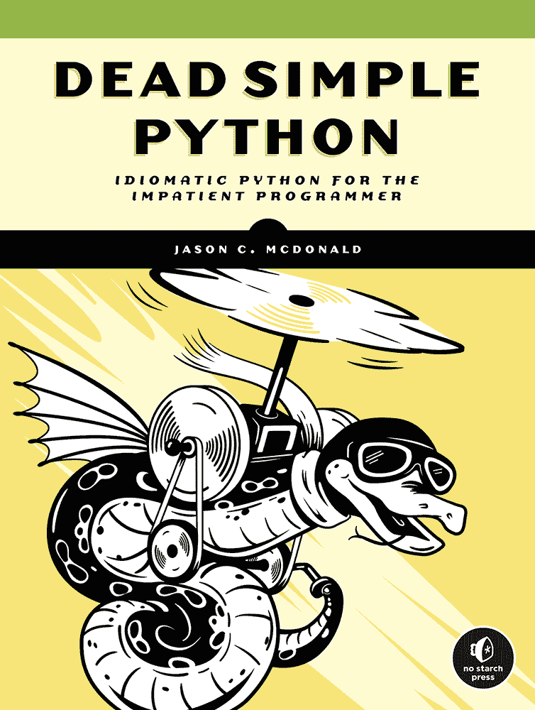
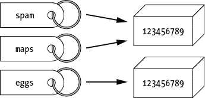
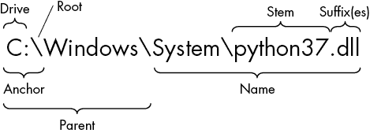
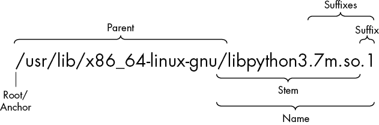
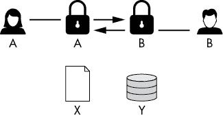

# 极简 Python：急躁程序员的地道 Python 编程




# 页码

1. iii  
2. iv  
3. v  
4. vii  
5. xxv  
6. xxvi  
7. xxvii  
8. xviii  
9. xxix  
10. xxx  
11. xxxi  
12. xxxii  
13. xxxiii  
14. xxxiv  
15. 1  
16. 3  
17. 4  
18. 5  
19. 6  
20. 7  
21. 8  
22. 9  
23. 10  
24. 11  
25. 13  
26. 14  
27. 15  
28. 16  
29. 17  
30. 18  
31. 19  
32. 20  
33. 21  
34. 22  
35. 23  
36. 24  
37. 25  
38. 26  
39. 27  
40. 28  
41. 29  
42. 30  
43. 31  
44. 32  
45. 33  
46. 34  
47. 35  
48. 36  
49. 37  
50. 39  
51. 40  
52. 41  
53. 42  
54. 43  
55. 44  
56. 45  
57. 46  
58. 47  
59. 48  
60. 49  
61. 50  
62. 51  
63. 52  
64. 53  
65. 54  
66. 55  
67. 56  
68. 57  
69. 58  
70. 59  
71. 60  
72. 61  
73. 62  
74. 63  
75. 64  
76. 65  
77. 66  
78. 67  
79. 68  
80. 69  
81. 70  
82. 71  
83. 73  
84. 74  
85. 75  
86. 76  
87. 77  
88. 78  
89. 79  
90. 80  
91. 81  
92. 82  
93. 83  
94. 84  
95. 85  
96. 86  
97. 87  
98. 88  
99. 89  
100. 90  
101. 91  
102. 93  
103. 95  
104. 96  
105. 97  
106. 98  
107. 99  
108. 100  
109. 101  
110. 102  
111. 103  
112. 104  
113. 105  
114. 106  
115. 107  
116. 108  
117. 109  
118. 110  
119. 111  
120. 112  
121. 113  
122. 114  
123. 115  
124. 116  
125. 117  
126. 118  
127. 119  
128. 120  
129. 121  
130. 122  
131. 123  
132. 124  
133. 125  
134. 126  
135. 127  
136. 128  
137. 129  
138. 130  
139. 131  
140. 132  
141. 133  
142. 134  
143. 135  
144. 136  
145. 137  
146. 138  
147. 139  
148. 140  
149. 141  
150. 142  
151. 143  
152. 144  
153. 145  
154. 146  
155. 147  
156. 149  
157. 150  
158. 151  
159. 152  
160. 153  
161. 154  
162. 155  
163. 156  
164. 157  
165. 158  
166. 159  
167. 160  
168. 161  
169. 162  
170. 163  
171. 164  
172. 165  
173. 166  
174. 167  
175. 168  
176. 169  
177. 170  
178. 171  
179. 172  
180. 173  
181. 174  
182. 175  
183. 176  
184. 177  
185. 178  
186. 179  
187. 180  
188. 181  
189. 182  
190. 183  
191. 184  
192. 185  
193. 186  
194. 187  
195. 188  
196. 189  
197. 190  
198. 191  
199. 192  
200. 193  
201. 194  
202. 195  
203. 196  
204. 197  
205. 198  
206. 199  
207. 200  
208. 201  
209. 202  
210. 203  
211. 204  
212. 205  
213. 206  
214. 207  
215. 208  
216. 209  
217. 210  
218. 211  
219. 213  
220. 214  
221. 215  
222. 216  
223. 217  
224. 218  
225. 219  
226. 220  
227. 221  
228. 222  
229. 223  
230. 224  
231. 225  
232. 226  
233. 227  
234. 228  
235. 229  
236. 230  
237. 231  
238. 232  
239. 233  
240. 234  
241. 235  
242. 236  
243. 237  
244. 238  
245. 239  
246. 240  
247. 241  
248. 242  
249. 243  
250. 244  
251. 245  
252. 246  
253. 247  
254. 248  
255. 249  
256. 250  
257. 251  
258. 252  
259. 253  
260. 254  
261. 255  
262. 256  
263. 257  
264. 258  
265. 259  
266. 260  
267. 261  
268. 262  
269. 263  
270. 264  
271. 265  
272. 266  
273. 267  
274. 268  
275. 269  
276. 270  
277. 271  
278. 272  
279. 273  
280. 274  
281. 275  
282. 276  
283. 277  
284. 278  
285. 279  
286. 280  
287. 281  
288. 282  
289. 283  
290. 284  
291. 285  
292. 286  
293. 287  
294. 296  
295. 297  
296. 298  
297. 299  
298. 300  
299. 301  
300. 302  
301. 303  
302. 304  
303. 305  
304. 306  
305. 307  
306. 308  
307. 309  
308. 310  
309. 311  
310. 312  
311. 313  
312. 314  
313. 315  
314. 316  
315. 317  
316. 318  
317. 319  
318. 320  
319. 321  
320. 322  
321. 323  
322. 324  
323. 325  
324. 326  
325. 327  
326. 328  
327. 329  
328. 330  
329. 331  
330. 332  
331. 333  
332. 334  
333. 335  
334. 337  
335. 338  
336. 339  
337. 340  
338. 341  
339. 342  
340. 343  
341. 344  
342. 345  
343. 346  
344. 347  
345. 348  
346. 349  
347. 350  
348. 351  
349. 352  
350. 353  
351. 354  
352. 355  
353. 356  
354. 357  
355. 358  
356. 359  
357. 360  
358. 361  
359. 362  
360. 363  
361. 364  
362. 365  
363. 366  
364. 367  
365. 368  
366. 369  
367. 370  
368. 371  
369. 372  
370. 373  
371. 374  
372. 375  
373. 376  
374. 377  
375. 378  
376. 379  
377. 381  
378. 382  
379. 383  
380. 384  
381. 385  
382. 386  
383. 387  
384. 388  
385. 389  
386. 390  
387. 391  
388. 392  
389. 393  
390. 394  
391. 395  
392. 396  
393. 397  
394. 398  
395. 399  
396. 400  
397. 401  
398. 403  
399. 404  
400. 405  
401. 406  
402. 407  
403. 408  
404. 409  
405. 410  
406. 411  
407. 412  
408. 413  
409. 414  
410. 415  
411. 416  
412. 417  
413. 418  
414. 419  
415. 420  
416. 421  
417. 422  
418. 423  
419. 425  
420. 426  
421. 427  
422. 428  
423. 429  
424. 430  
425. 431  
426. 432  
427. 433  
428. 434  
429. 435  
430. 436  
431. 437  
432. 438  
433. 439  
434. 440  
435. 441  
436. 442  
437. 443  
438. 444  
439. 445  
440. 446  
441. 447  
442. 448  
443. 449  
444. 450  
445. 451  
446. 452  
447. 453  
448. 454  
449. 455  
450. 456  
451. 457  
452. 458  
453. 459  
454. 460  
455. 461  
456. 462  
457. 463  
458. 464  
459. 465  
460. 466  
461. 467  
462. 468  
463. 469  
464. 470  
465. 471  
466. 472  
467. 473  
468. 474  
469. 475  
470. 476  
471. 477  
472. 478  
473. 479  
474. 480  
475. 481  
476. 482  
477. 483  
478. 484  
479. 485  
480. 486  
481. 487  
482. 488  
483. 489  
484. 490  
485. 491  
486. 492  
487. 493  
488. 494  
489. 495  
490. 496  
491. 497  
492. 498  
493. 499  
494. 500  
495. 501  
496. 502  
497. 503  
498. 504  
499. 505  
500. 506  
501. 507  
502. 508  
503. 509  
504. 511  
505. 513  
506. 514  
507. 515  
508. 516  
509. 517  
510. 518  
511. 519  
512. 520  
513. 521  
514. 522  
515. 523  
516. 524  
517. 525  
518. 526  
519. 527  
520. 528  
521. 529  
522. 530  
523. 531  
524. 532  
525. 533  
526. 534  
527. 535  
528. 536  

# 极简 Python

**Dead Simple Python**: 为不耐烦的程序员准备的地道 Python / Jason C. McDonald.

## 书籍信息

- **作者**: McDonald, Jason C., 1992-
- **标题**: Dead simple Python : idiomatic Python for the impatient programmer / Jason C. McDonald.
- **出版**: 旧金山，加州 : No Starch Press, Inc., [2023]
- **描述**: 包含索引。

## 标识符

- **LCCN**: `2022018822` (纸质) | `2022018823` (电子版)
- **ISBN 13**: `9781718500921` (纸质) | `9781718500938` (电子版)

## 主题与分类

- **主题 (LCSH)**: Python (计算机语言) | 计算机编程。
- **分类 (LCC)**: `QA76.73.P98 M397 2023` (纸质) | `QA76.73.P98` (电子版)
- **分类 (DDC)**: `005.13/3--dc23/eng/20220616`

## 联系方式

- **出版社**: No Starch Press, Inc.
- **地址**: 245 8th Street, San Francisco, CA 94103
- **电话**: `1.415.863.9900`
- **网站**: `www.nostarch.com`
- **咨询**: 关于分销、批量销售或翻译的信息，请直接通过 `info@nostarch.com` 联系 No Starch Press, Inc.。

## 制作团队

- **制作经理**: William Pollock
- **开发编辑**: Frances Saux
- **制作编辑**: Rachel Monaghan
- **封面与内设计**: Octopod Studios
- **封面插画**: Gina Redman
- **技术评审**: Steven Bingler 同 Daniel Foerster, Ryan Palo, Denis Pobedrya, 及 Simon de Vger
- **校对**: Doug McNair 同 Anne McDonald
- **排版**: Ashley McKevitt, Happenstance Type-O-Rama
- **编校**: JoAnne Burek
- **索引**: James M. Fraleigh

No Starch Press 以及 No Starch Press 标志是 No Starch Press, Inc. 的注册商标。此处提到的其他产品和公司名称可能是其各自所有者的商标。我们并非在每次出现商标名称时都使用商标符号，而是仅以编辑的方式使用这些名称，并为了商标所有者的利益，无侵犯商标的意图。

书中的信息按“原样”提供，不提供任何保证。虽然在准备本作品时已采取了一切预防，但作者或 No Starch Press, Inc. 对因书中包含的信息直接或间接导致或据称导致的任何损失或损害，对任何个人或实体不承担任何责任。

深切怀念 Chris “Fox” Frasier。

对你来说，它将永远是“lern u a snek”。

## 关于作者

`Jason C. McDonald` 是一位软件开发者、演讲者以及虚构和非虚构作品的作者。白天，他担任软件工程师。晚上，他是 MousePaw Media (`https://mousepawmedia.com/`) 的创始人，这是一家开源软件公司，他在那里培训软件开发实习生。你通常可以在当地的咖啡馆找到他。

## 关于技术审核员

`Steven Bingler` 是马萨诸塞州波士顿的软件工程师，拥有电气工程硕士学位。他是一位丰富的技术审核员，在空余时间喜欢自行车、抱岩和寻找新的美食地点。

`Denis Pobedrya` 在 Libera.IRC 网络上以 `deniska` 闻名，他熟悉 `Python` 数据模型中一些较为晦涩的领域。他自封为全才士，从事多份工作（包括仓库管理）。他目前是某市场服务的 Python 后端开发人员。

`Ryan Palo` 是一位从机械工程师转行的软件开发人员，在 Flashpoint 编写 Python 代码。他拥有计算机科学（智能系统）硕士学位。他喜欢通过任何可能的方式分享他对物理、数学、写作和代码的热爱，主要是通过他的博客 `https://www.assertnotmagic.com/`。你通常可以在家里找到他、妻子、女儿、猫、狗、各种 Linux 设备以及大约多出的八把尤克里里。

对于 `Daniel Foerster` 来说，*Dead Simple Python* 的技术编辑是一份友谊激情的结晶。他很幸运在青少年时期遇到了 Python，从那以后就再也没有遇到过任何如此契合他大脑的语言。在多年领导 Python 开发并参与工作场及以外的编程教学后，Daniel 将职业重心转向了教学法。


`Simon de Vlieger` 在某些圈子里以 `supakeen` 闻名，是 Python IRC 社区的资深成员。他是一位高级程序员，对 Python、`C` 和实验性语言感兴趣，并对软件安全有偏。他在 AVR 以及其他微型嵌入式芯片上游刃有余。他就于 Red Hat，目前致力于以一种理性且可重复的方式构建 Linux。

## 前言

“*极其简单*（Dead simple）的并发？真的吗？”

这是我第一次听到这本书时的反应。总来说，Python 是一门奇妙的语言，比大多数语言更容易理解，但编程世界中的许多（甚至是大部分）事情仍然绝非“极其简单”。

但随后 Jason 解释了他在撰写一本带有这两个词标题的书时的想法。这种“极其简单”并不是指它是一本用过度简化的术语介绍 Python 的低幼化书籍。相反，它的“极其简单”是指人们读完后会说：“这个话题初看起来很难理解，但现在你解释了它，对我来说变得非常直观了。”在学习和教授通用编程（特别是 Python）30 年后，可以说这是任何形式教学的绝对最佳目标：将概念呈现得如此清晰，以至于即使是复杂的话题，其运作方式似乎也是理所当然的。

但这并不是 *Dead Simple Python* 唯一心勃勃的地方。这里呈现的材料量同样令人印象深刻。这本书涵盖了编写实用代码的人可能需要的 Python 几乎每一个方面。这包括从变量、数据结构和循环的基础知识，是的，还包括并发和并行等内容。当我翻阅这本书时，每一章的完整性和详尽细节都给我留下了深刻的印象。

那么，这本书真的让并发（以及其他所有事情）看起来极其简单吗？在经历了多年的教学和写作后，我知道我无法为任何人回答这个问题，但我可以肯定，这些示例引人入胜且深思熟虑，解释清晰且易于理解，涵盖范围非常出色。这是一个非常难以比拟的组合。

Naomi Ceder

## 致谢

你听过一句话：“养一个孩子需要一村庄。”同样，写一本书也需要一个村庄。在 *Dead Simple Python* 的情况下，涉及到好几个村庄！

Python 社区，特别是住在 Libera.Chat IRC 的 `#python` 频道的人，从我写出第一个 Python “Hello, world”起就一直支持、告知并挑战我。我关于这门语言的大部分知识都可以追溯到聊天室里那些可爱的极客们。感谢他们从诞生到整个过程中为 *Dead Simple Python* 提供的所有反馈和见解。

我深感谢 Forem 和 DEV 社区 (`https://dev.to/`) 对我文章的热情接待，尤其是作为本书基础的 *Dead Simple Python* 文章系列。特别感谢 DEV 的联合创始人 Ben Halpern 和 Jess Lee 以及社区经理 Michael Tharrington，他们鼓励并推广了我的写作。如果没有我在该平台上获得的关注和积极反馈，我从未考虑过将它写成书。

最后，也是最重要的一点，我要感谢那些我最亲近的人，感谢他们无尽的支持。我的母亲 Anne McDonald，她提供了宝贵的编辑和创意反馈，教会了我所有关于写作的知识，并从第一天起就一直鼓励我的梦想。感谢我好朋友 Daniel Harrington 的支持，他是我是刘易斯式的托尔金。*Muchas gracias a mi hermanito mayor* Jaime López (Tacoder)，混沌与塔可之王。感谢 Bojan Miletić，我那痴迷独角兽的兄弟以及 *The Bug Hunters Café* 节目的共同主持人，感谢他无限的热情和支持。深爱并感谢我爱的阿姨兼自封最大的粉丝 Jane McArthur，以及我的作乱伙档 Chris “Fox” Frasier——我疯狂地想念他们。

## 引言


Python 是一种独特的语言。作为一名软件开发者，我逐渐开始欣赏它的特性。编写良好的 Python 程序具有某种艺术美。每当我发现解决某个问题的最符合“Python 味”（Pythonic）的解决方案时，回过头来会惊讶自己竟然会觉得其他答案也可以。

遗憾的是，多年来，我一直受限于一种本能欲望，想用我熟悉的其他语言的视角来看 Python。尽管我能读也会写 Python，但我无法看出某些实践的“显而易见”。这就像试图只用翻译字典来学习西班牙语。我可以写 Python，但我并不能真正用 Python 来*思考*。这种语言的本质特征被我忽略了。

当我开始真正理解 Python——用它来思考时，我在这种语言中发现了新的乐趣。解决方案变得显而易见。设计成了一种享受，而不是一个谜团。

当一个新手开始接触 Python 时，他们几乎没有偏见。他们没有“母语”会阻碍他们对这种语言的学习。但对于一个将 Python 作为第二或第三语言的成熟开发者来说，这种过渡在某些方面要艰难得多。他们不仅必须学习新知识，在许多方面，他们必须*忘记*旧的知识。

《极简 Python》（Dead Simple Python）就是这段旅程指南。

### 这本书是给谁看的？

如果你已经熟悉另一种编程语言，现在想第一次学习 Python，且不想费力于面向初者的课程，那么这本书就是为你准备的。我将特别关注处理问题的“Python 范”方式，并对底层通用编程概念提供最少且有针对性的解释。

如果你是一名中级 Python 开发者，你也会发现这本书很有用。虽然我自己已经使用 Python 多多年，但其中某些主题直到最近才让我真正“开窍”。这本书提供了我过去曾希望能得到的解释。

如果你还不知道编程，不要绝望。有数百本优秀的书籍和资源可以让你学习 Python 作为第一门编程语言。我特别推荐 Eric Matthes 编写的第二版《Python 速入门实战》（Python Crash Course, No Starch Press, 2019）或 Al Sweigart 编写的第二版《Python 自动化无聊任务》（Automate the Boring Stuff with Python, No Starch Press, 2019）。之后，你可以回到这本书来巩固和扩展你新学的知识。

### “简单”意味着什么？

这里讨论的话题初看可能一点都不简单。你可能会想，一本这么厚的书到底能有多简单！

当我给这本书命名为《极简 Python》时，我描述的是对话题的回顾视角，而不是前瞻性的视角。人们应该意识到，任何值得学习的话题在刚接触时都会感到不可逾越。同样，任何对得上现有软件开发者的解释，都应该具有足够的深度，以至于完全排除它在前瞻性“简单”标签的可能性。

相反，我的目标是以这种方式拆解每个话题，以至于在章节结束时，读者不由得觉得这个概念是完全显而易见的。无论话题最初看起来多么复杂，读者最终都会留有印象：它实际上是“极简单的”（dead simple），到那时他们就可以确信自己正在像一个原生 Python 开发者一样思考了。

为了达到这种程度的理解，我通常从拆解话题的最低级、最显式的形式开始。一旦建立了基础，我就会一层一层地添加，最终达到最常用的隐式、惯用形式。通过这种方式，我希望帮助读者对这种语言的每个特性的工作原理和实现方式建立起扎实、舒适的理解。

### 这本书里有什么？

《极简 Python》共分为五部分。与许多面向初者的课程不同，我假设你想要尽快开始编写生产级代码（而不仅仅是过度简单的教程示例）。我的方法要求你做一些初始工作，但这种投入是丰厚的，因为它确保了你可以更方便地将新知识应用于真实项目。

第一部分，“Python 环境”（第 1-4 章）稳固地建立了你在 Python 世界中的地位：它的哲学、工具、基础语法和项目布局。这将为编写真实的、实质的代码提供坚实的基础。

第二部分，“核心结构”（第 5-8 章）探索了 Python 的基本结构元素——变量、`functions`、`classes` 和 `exceptions`，并教你如何充分利用它们的潜力。

第三部分，“数据与流”（第 9-12 章）涵盖了控制执行流和操作数据的许多独特方式。它讨论了数据结构、循环、迭代、生成器、协程、文件和二进制数据。

第四部分，“高级概念”（第 13-17 章）开启了可以让你的代码更强大的高级策略，包括继承、内省和并发。它涉及了大多数人一略而过的“可怕”的话题。

第五部分，“代码之外”（第 18-20 章）教你如何测试、调试和部署真实项目。

最后，第 21 章提供了你今后 Python 开发之旅可以采取的许多方向的概述。

#### 书中不包含什么

由于这本书针对现有的编程人员，我们不会重述许多通用理论。读者应该已经（从语言无关的角度）知道 `variables` 和 `functions` 是什么，`classes` 和对象之间的区别是什么等等。在最多的情况下，我会简要定义那些并非无处不在的概念。

我对话题的讨论远非详尽。我更多地关注“为什么”和“如何”，从而提供一个坚实的基础。鼓励读者通过额外的独立阅读来扩展知识，因此会将库函数的完整列表留给文档。标准库中的许多流行功能，如随机数和 `datetime` 操作，在示例中使用时仅附带了简要解释。

为了控制本书的范围，我也不会涵盖大多数第三方工具和库。我经常被要求讨论 Python 默认工具的流行替代方案，但这些替代方案像季节一样轮流行，我将主要遵循通用默认值。也有少数例外，但只有当第三方工具在生态系统中变得极其普及，甚至超过了标准库时。

通常情况下，当某个第三方工具或库具有特别价值时，我会引导读者查阅其官方文档或网站。

`Dead Simple Python` 更多像是一份引导性指南，而不是桌面参考手册。我建议从这里、从开头开始，按照顺序阅读每个章节。无论你是该语言的新手，还是已经尝试使用了一段时间但总觉得没有真正“精通”，你都会发现这种方法将填补许多你从未察觉到的知识空白。

然而，如果你知道某个你`现在`需要更好地理解的特定主题，可以直接跳到对应处理该主题的章节。大多数章节都是独立编写的，但我始终假设你已经阅读并理解了前序章节的内容。

##### 关于词汇

几乎任何 Python 书或在线文章都会使用借用自其他语言的词汇，比如 `element`（元素）、`body`（主体）和 `variable`（变量）等词。虽然这通常被认为是有益的，可以将 Python 概念与读者的现有知识联系起来但我但我借用此类词汇最终是适得其反的。试图主要通过其他语言来理解 Python 会让很多编写清晰、地道（idiomatic）代码的尝试变得失败。此外，如果习惯了使用错误的词汇，你会发现官方文档读起来极其困难。

因此，我决定固执地遵循官方词汇，即使大多数社区成员认为近似的同义词是可以接受的。这可能是市售书中少数持有这一场的书籍之一，但我认为这很重要。要成为一个“本地人”，你必须学会说当地方言！

##### 理论回顾

根据你已经熟悉的语言，你的理论知识储备中可能存在某些空白。例如，如果你是一个 Haskell 开发者，你可能熟悉面向对象编程；如果你是一个 C++ 开发者，你可能不熟悉纯函数式编程。

为了弥补这些空白，我偶尔提供 `Theory Recaps`（理论回顾），对与某些编程范式和模式相关的本质理论和最佳实践进行简要概述。这样，如果你已经熟悉某个特定概念，就可以跳过理论回顾，直接进入 Python 特有的内容。

##### 客观还是主观偏见？

在技术书籍中排除个人观点几乎是不可能的，尤其是像我这本这样关注地道实践的书籍，但我喜欢认为我已尽力保持了客观。

`Dead Simple Python` 并不是我对 Python 的个人见解，而是 Python 社区集体智慧的结晶。我已经不是开始写这本书时的那个开发者了。由于投入这本书的两年研究、实验和激烈辩论，我自己的开发实践已经发生了巨大的变化。

尽管如此，让所有人一直满意是不可能的。有时，我会在文中特意记录某些未达成满意结论的争论。即使是我认为已经定论的问题，也可能引发某些 Python 开发者的剧烈负面反应；事实上，在我没有更好地理解它们之前，其中一些问题也曾引起我的剧烈反应。

我建议你带着开放的心态阅读这本书，即使你认为自己对编程甚至对 Python 本身相当熟悉。我努力解释了书中所有建议背后的理由，我鼓励你在面对`任何`有效的建议时，至少预预到会有同等程度的推论支持。

##### 示例

我仔细构建了书中的大部分示例，以展示我正在讨论的任何主题的现实（尽管是简化的）用用例。在很多情况下，我会刻意增加示例的复杂度，以突出教程经常忽略的问题和意外。我努力指出所有示例变得有些复杂的地方，但你应该知道，对于任何与即时主题无关的内容，我可能会过度简化或以其他方式绕过。

这种方法通常也比你在教程中习惯的示例更长，因此章节看起来可能比实际内容更长。不要被页数击馁；一次处理一个章节。

书中的所有示例都可以运行，或者至少是可预测地失败，除非另有说明。我始终遵循 Python 风格规范。我强烈建议你自己亲自重打每个示例并进行实验。

我努力将旨在保存到文件中的 Python 代码段标记为可运行示例的一部分。会给出文件名，并对部分进行编号如 `:1`、`:2` 等。当某个章节被修订时，我会在章节后面加上一个字母，因此章节 `:2b` 将是章节 `:2a` 的修订；修订内容本身用**粗体**显示。

书中几乎所有的示例都可以在书籍的官方 GitHub 仓库找到：`https://github.com/codemouse92/DeadSimplePython`。

##### 关于项目

有人问我我为什么不提供一个可以在书中一起完成的综合项目，但答案相当简单：我假设你来到这里可能是因为你已经有一些想要用 Python 处理的项目了。与其分散你的注意力，我将专注于以一种你可以应用到工作的方式来呈现材料。

如果你脑中`没有`项目，现在可能是开始一个项目的好时机！思考一个你个人希望有解决方案（或更好的解决方案）的问题，然后构建那个解决方案。选择问题中的一个小部分并从那里开始。创建一个完美的第一个项目没有魔术公式，除非让它成为你个人会用到的东西。不要担心在第一次尝试时让它变得完美，甚至做得好。这个行业有一句真理：“你总是会丢掉第一个。”不要害怕第一次构建错了！这本书将为你提供工具，让你回头去纠正它。

当然，如果某个项目对你来说完全不切实际，那么通过练习示例也没问题。

Python 是由荷兰程序员 Guido van Rossum 于 1991 年开发的编程语言。这个名字并非指经常用作吉祥物的蛇，而是指的是《蒙提派森的飞行马戏团》（Monty Python’s Flying Circus）（单这一个事实就能让你了解该语言背后的思维）。它最初只是圣诞假期期间的一个业爱好项目，如今已变成当今最受欢迎的计算机语言之一。

从技术角度来看，Python 被认为是一种高级、通用语言，完全支持过程化、面向对象和函数式编程范式等。

Python 粉丝们会迅速指出其著名的可读性和简单性，这让人们初次接触时产生这种语言是“神奇的”的感受。这也给新学者带来了一条并无大益的建议：“Python 很容易；它只不过是伪代码而已！”

这并不完全正确。不要被它天生的可读性误导了：Python 是美且独特的，并受到许多其他语言的影响，但它往往与其中任何一种语言都没有什么相似之处。要真正精通它，必须将其作为一个整体来看，而不是与其他语言进行强对比。这正是这本书要做的。

但最重要的是，Python 是一种理念。它是一群多样化的极客的集体创造，他们团结仅仅是因为对构建一个优秀编程语言的大胆渴望。当你真正理解了 Python 时，它会改变你的整个视角。你成为了更大事物的一部分；一个已经产生生命的东西。

正如 Guido van Rossum 在著名的国王日演讲中所说：

> 我认为最重要的理念是，Python 是在互联网上开发的，完全开放，由一群充满热情和主人翁意识的志愿者（但不是爱好者！）开发的。

### 误言：Python 不是什么

关于 Python 有很多误言，其中许多导致人们在某些应用中避开这种语言，甚至完全放弃。

#### 误言 #1：Python 仅仅是一种脚本语言

我认为“脚本语言”是讨论编程语言时使用的最具误导性的术语之一。它意味着这种语言不适合编写“真实”软件（见误言 #5）。

Python 是`图灵完备`，这意味着你可以在 Python 中实现任何编程语言，然后能够执行用该语言编写的任何程序。

换句话说，任何编程语言能做的，Python 都能做。是否容易、甚至建议这样做，取决于你尝试做什么。

#### 误言 #2：Python 很慢

很容易假设像 Python 这样的高级或解释型语言自然比像 `C` 这样的编译型或低级语言慢。事实上，这取决于语言的实现以及如何使用它。在书中，我们将涵盖几个与提高 Python 代码性能相关的概念。

Python 语言解释器的默认实现 `CPython` 是用 `C` 编写的，它确实比原生机器代码慢。然而，有各种库和技术——以及该语言的其他实现，包括 `PyPy`——它们的整体性能好得多（见第 21 章），甚至接近原生机器代码的速度。

话虽如此，你应该理解性能实际上是如何影响你的项目的。在大多数情况下，Python 的速度足够快，可以作为应用开发、数据分析、科学计算、游戏开发、Web 开发的良好选择，以此类推。CPython 固有的性能缺陷通常只在你处理需要极高性能的非常特定的场景时才会成为问题。即便如此，也有方法可以绕过这些瓶颈。对于大多数项目来说，Python 的基准性能绰绰有余。

#### 误言 #3：Python 不能被编译

Python 是一种`解释型语言`，这意味着代码在运行时由语言的`解释器`进行读取、解释和执行。运行用 Python 编写的项目的终端通常需要安装 Python 解释器。

这与我喜欢的`汇编语言`不同，如 `C`、`C++` 或 `FORTRAN`。在这些语言中，编译的最终结果是机器代码，可以直接在任何兼容的计算机上执行，而不需要在该机器上额外的程序（或以某种方式与代码一起）。

许多开发者认为这意味着 Python 不能编译（汇编）为机器代码，这似乎是一个显而见的结论。事实上，将 Python 编译为机器代码是可能的，尽管这很少需要也很少这样做。

如果你想走这条路，有几个选项。在 UNIX 上，内置的 `Freeze` 工具将 Python 字节码转译为 `C` 数组，然后将这些 `C` 代码汇编为机器代码。然而，这并没有产生真正的汇编 Python 代码，因为在后台仍必须调用 Python 解释器。Freeze 仅适用于 UNIX 系统。`cx_Freeze` 工具以及 Windows 上的 `py2exe` 执行与 Freeze 类似的操作。


# 编译与误言

要真正将 Python 编译为机器代码，你必须使用一种中间语言。`Nuitka` 可将 Python 代码转译为 `C` 和 `C++`，然后将其汇编为机器代码。你也可以用 `VOC` 将 Python 转译为 `Java`。`Cython` 也允许将特殊形式的 Python 转译为 `C`，尽管它主要面向用 `C` 编写 Python 扩展。

## 误言 #4：Python 在后台会被编译

Python 解释器将代码转换为`字节码`，然后执行它。解释器包含一个`虚拟机`，它执行 Python 字节码的方式类似于 CPU 执行机器代码的方式。有时，出于性能考虑，解释器会提前进行字节码的转换，生成包含字节码的 `.pyc` 文件。虽然这在词语意义上是“编译”，但编译为字节码与编译为机器代码之间存在关键区别：字节码仍然通过解释器运行，而机器代码可以直接执行，不需要额外的程序。（从技术上讲，编译机器代码被称为汇编，尽管这种区别经常被忽视。）

在实践中，大多数 Python 项目以源代码或至少是字节码的形式发布，这需要在用户的机器上安装 Python 解释器。在某些情况下，标准执行文件更优，例如为了终端用户的安装方便或闭源项目。对于这些情况，存在 `PyInstaller` 和 `cx_Freeze` 等工具。它们并没有编译代码，而是将 Python 源码或字节码与解释器打包在一起执行（见第 18 章）。

## 误言 #5：Python 不适合大型项目

我听过一些开发者说：“Python 只有当整个项目都在一个文件中时才有用。”这种格言部分基于对拥有多个文件的 Python 项目结构混乱的误解。这确实呈现出趋势，但由于有太少开发者知道如何正确组织 Python 项目。

事实上，Python 的项目结构比 `C++` 和 `Java` 简单得多。一旦开发者理解了包、模块和导入系统的概念（见第 4 章），处理多个代码文件就轻而易举。这种误言的另一个原因与 Python 是动态类型有关，而不是像 `Java` 或 `C++` 那样的静态类型，某些人认为这使得重构变得困难。一旦开发者学会了如何配合 Python 的类型系统而不是违背它，情况就不必如此（见第 5 章）。

# Python 2 与 Python 3

在多年里，Python 存在两个主要版本。从 2001 年开始，`Python 2` 是标准，这意味着大多数关于 Python 的书籍和文章都是为这个版本编写的。最后一个发布版本是 Python 2.7。

当前版本是 `Python 3`，在开发期间被称为 `Python 3000` 或 `Py3k`。从 2008 年发布到 2019 年，我们一直处于这两个版本之间的某种过渡期；许多现有的代码和包是用 `Python 2` 编写的，而对于不需要旧版支持的新项目，`Python 3` 变得越来越受到推荐。当时存在许多可以编写在两个版本中运行的代码技巧和工具，这缓解了许多现有项目的过渡压力。

在最近几年中，特别是自 `Python 3.5` 发布以来，我们开始完全摒弃 `Python 2`。大多数主流库都正式支持 `Python 3`，对旧版本的支持不再是首要任务。

截至 2020 年 1 月 1 日，`Python 2` 已正式退役，`Python 3` 成为正式标准。由于目前 `Python 4` 仅仅只是一个模糊的传闻，可以说 `Python 3` 在未来多年内将一直与我们同行。

遗憾的是，许多软件开发团队在将代码库从 `Python 2` 迁移到 `Python 3` 方面进展缓慢（有时是不可避免的）。这导致许多项目处于悬而状态。如果你在专业领域使用 `Python`，那么很有可能需要帮助将某些代码迁移到 `Python 3`。`Python` 的标准库包含一个名为 `2to3` 的工具，它可以帮助自动化这一过程。通过此工具运行代码是很好的第一步，但你仍然需要手动更新代码，以使用 `Python 3` 提供的某些新模式和工具。

# 定义“Python 化”（Pythonic）代码

在 Python 开发者中，你会听到很多关于 `Pythonic` 代码及其具体构成要素的讨论。从广义上说，能够利用语言特性的习惯代码（idiomatic code）被认为是 Pythonic 的。

遗憾的是，这在很大程度上取决于解释。因此，`Python` 最佳实践的话题一直是社区中激烈争论的常见来源。不要对此感到惊讶。通过定期处理我们自己的规范和标准，我们在这个过程中不断改进它们，并加深对它们的理解。

我们对讨论 `Python` 最佳实践的倾向源于我们的哲学——“只有一种方法”（There’s Only One Way To Do It, TOOWTDI），这个短语是由 `PythonLabs` 在 2000 年提出的，作为对 `Perl` 社区格言“有多种方法”（There’s More Than One Way To Do It, TMTOWTDI）的幽默回应。尽管这些社区之间存在历史性的敌，但这些哲学并不是严格对立的。

Python 开发者正确地假设对于任何特定问题都存在某种唯一的、可量化的“最佳”解决方案。我们的任务是找出那个解决方案，但我们也知道自己往往无法完全达到目标。通过不断的讨论、辩论和实验，我们完善自己的方法，以追求理论上的最佳解决方案。

同样，`Perl` 社区理解到往往无法明确地达到那个最佳解决方案，因此他们强调实验而非遵守严格标准，努力发现不断更好的解决方案。

归结底，目标是相同的：最终为问题定义最可能的解决方案。只是侧重点不同。

在书中，我将重点关注广泛接受的 Pythonic 代码编写方式。然而，我不声称自己是最终权威。我在 `Python` 社区的同事们总会为这些讨论提供很多补充。我从没有不从他们那里学到新东西！

# Python 之禅（Zen of Python）

1999 年，官方 Python 邮件列表开始了一场讨论，关于需要为该语言编写某种正式的指导原则。社区的著名成员 Tim Peters 开玩笑地列出一份包含 19 条原则的诗意总结作为大纲，并将第 20 个位置留给 `Guido van Rossum` 来完成（但他从未这样做）。

社区其他成员很快抓住了这一总结，认为其是对 Python 哲学的极佳概述，并全盘采纳为《Python 之禅》（The Zen of Python）。全文由 Python 发布为 `PEP 20`。

> 优美优于丑陋。

> 显式优于隐式。

> 简单优于复杂。

> 复杂优于晦涩。

> 扁平优于嵌套。

> 稀疏优于稠密。

> 可读性很重要。

> 特殊情况并不特殊到可以打破规则。

> 尽管实用性胜过纯洁。

> 错误永远不应该静地跳过。

> 除非被显式忽略。

> 面对模糊时，拒绝猜测的诱惑。

> 应该有一种——且最好只有一种——明显的方法来做。

> 尽管除非你是荷兰人，否则这种方法起初并不明显。

> 现在优于从不。

> 尽管从从不往往优于“现在”。

> 如果实现难以解释，那么这就是一个坏主意。

> 如果实现容易解释，那么可能是一个好主意。

> 命名空间是一个极棒的主意——让我们多用用它们！

这同样取决于解释，一些人认为 Tim Peters 在写《Python 之禅》时是在开玩笑。然而，如果说我关于 Python 开发者学到的一点事，那就是“开玩笑”与“严肃”之间的界限如蜘蛛丝般纤细。

无论如何，《Python 之禅》都是讨论 Python 最佳实践的绝佳起点。许多开发者（包括我在内）经常会回溯它。我将在本书中频繁引用它。

# 文档、PEP 与你

《简明 Python》（Dead Simple Python）旨在作为学习旅程的起点而非终点。当你熟悉了语言后，可以查阅官方文档以了解更多特定功能。这些文档可以在 `https://docs.python.org/` 找到。

任何 Python 中的新功能都始于 `Python Enhancement Proposal`（PEP）。每个 PEP 被分配一个唯一的编号并发布在官方索引 `https://python.org/dev/peps/`。一旦提出，PEP 将被考虑、讨论并最终被接受或拒绝。

被接受的 `PEP` 实际上是文档的扩展，因为它们对其定义的特性提供了凝聚且权威的描述。此外，还有一些元 PEP 和信息性 PEP 构成了 Python 社区和语言的骨干。

因此，如果你对 Python 有任何疑问，官方文档和 PEP 索引应该是首选。我将在书中频繁引用它们。

# 谁来决策？

要理解语言如何以及为何演变，了解谁掌握权力很重要。当一个 `PEP` 被提出时，由谁来决定是接受还是拒绝？

Python 是一个由非营利组织 Python 软件基金会拥有的开源项目。与许多其他流行语言不同，Python 与任何营利组织之间均不存在正式关联。

Python 社区是一个来自世界各地的、庞大且多元的群体，他们对这种独特语言的热情凝聚在一起。自从多年前我作为一个完全的新手偶然发现这个社区以来，我从社区以及社区成员那里获得了无法估量的帮助、指导和灵感。我有幸向他人提供同样的回报。如果没有我的 Python 朋友们的持续反馈，这本书就不可能出版！

Python 社区由核心团队管理，并受 `Python Code of Conduct`（Python 代码准则）约束。简而言之，它强调开放、体贴和尊重的行为，总结如下：

> 总的来说，我们对待彼此很好。我们为这个社区贡献，不是因为我们必须，而是因为我们想这样做。如果我们记住这一点，这些准则就会自然而然。

我强烈鼓励任何使用 Python 的开发者加入这个充满活力的社区。参与的最佳方式之一是通过 Libera.Chat IRC 的 `#python` 频道。你可以在 [`python.org/community/`](https://python.org/community/) 找到进入 IRC 的指南。

如果你对 Python 有任何问题（包括在阅读这本书期间的问题），我建议在 IRC 频道中寻求帮助。很有可能，你会在那里找到我以及大多数技术编辑。

在第 21 章，我将讨论 Python 社区的许多方面。

# 追求“唯一的显而路径”

Python 的格言“只有一种解决方法”（There’s Only One Way to Do It）起初可能会让人困惑。解决任何问题都有许多可能的方法。Python 程序员难道只是太迷恋自己的想法了吗？

幸运的是，并不是。这句格言的意义要鼓舞得多，它是每个 Python 开发者都应该理解的。

一些见解来自于 `The Zen of Python`（Python 之禅），其中包含一段相当晦涩的俏话：

> 解决某问题应该有一种——最好只有一种——显而的方法。

> 尽管除非你是荷兰人，否则那种方法起可能并不显而。

Tim Peters 显然指的是语言的创造者 `Guido van Rossum`，他是一位荷兰人。作为语言的创造者，Guido 通常可以直接切中 Python 问题的“最显而的方法”，特别是在该语言的早期。

这种 `obvious way`（显而的方法）是 Python 对“最佳解决方案”的术语——它是良好实践、整洁风格和合理效率的结合，产生了即使是最高级的新手也能理解的优雅代码。

所解决问题的具体细节通常会决定这种“显而的方法”：一种情况可能需要循环，另一种需要递归，而另一种则需要列表推导式。与 `obvious`（显而）一词的通常含义相反，解决方案往往并不容易得出。最佳解决方案只有在`知道它之后` 才是显而易见的；达到它的过程才是棘手之处。我们大多数人并不是 Guido。

然而，对“唯一的显而路径”的 `pursuit` 是 Python 社区的一个定义性特征，它对 `Dead Simple Python` 产生了深远的影响。书中的许多见解源于我和 Python 朋友们之间有时激烈的辩论。因此，我从那些在琐碎技术点经常与我持反对意见且经常相互对立的同事中，手动挑选了我的技术编辑小组。

最终被采纳为解决问题“正确方法”的，通常是因为其技术价值而被接受的，而不是因为 Python 开发者之间某些志同道合的偏见（他们是我有幸工作过的最严谨的人之一）。这种逻辑方法溢到了我们的每一次其他对话中（这导致了一些非常惊人且启发性的学术辩论）。

新情况经常出现。在任何 Python 开发者的职业生涯中，永远不会出现一个编码变得真正“容易”的时刻。每个项目中都会出现需要仔细考虑（且通常需要辩论）的情况。开发者必须尝试用他们看来最显而的方法来解决问题，然后将解决方案提交给同行进行评审。

书中的方法在很多情况下根据我的观点是最显而易见的。大多数方法已得到我的同事的认可，但我不敢断言我在 Python 的意义上完全是“荷兰式的”。如果你发现自己正在 Python 社区中辩论技术，请不要把这本书甩在任何人脸上作为你的解决方案是最好的证据！寻找显而易见解决方案的技能不是可以教的；相反，它只能通过实践来学习。

# 总结

尽管多年年来流传着许多神话，Python 是一门多功能且技术上可靠的语言，能够处理你抛给它的几乎任何问题。无论你是编写自动化、处理海量数据集、构建原生用户应用程序、实现机器学习，还是编写 Web 应用程序和 API，它都是一个可靠的选择。最重要的是，Python 有一个充满活力、多元且乐于助人的社区作为支持。

那么，成功的关键就是编写充分利用语言优势和特征的 Python 代码。目标不仅仅是编写可以运行的代码，而是编写外观优雅且行为优雅的代码。书的其余部分将教你如何准确做到这一点。

# 2: 你的工作台


开发环境是决定你在某门语言中效率的一个主要因素。与其满足于简陋的默认 shell，你将想要构建一个对得起任何生产级项目的开发环境。

一个良好的 Python 开发环境通常由语言解释器、`pip` 包管理器、`virtual environment`（虚拟环境）、面向 Python 的代码编辑器以及一个或多个用于检查代码错误和问题的 `static analyzers`（静态分析器）组成。我将在本章中讨论这些每项。我还将介绍 Python 中常见的风格规范，并以对常用集成开发环境（IDE）的引导结束本章。

# 安装 Python

在进行任何操作之前，你必须安装 Python 本身，以及一些关键工具。正如你在第 1 章所知，Python 是一种解释型语言，因此你需要安装它的 `interpreter`（解释器）。你还必须安装 `pip`，包管理器，以便你可以安装 Python 工具和库。设置的具体步骤取决于你的平台，但我在这里涵盖了主要平台。

在书中，我使用的是 Python 3.9，这是写作时的最新版本。如果你在之后的日期阅读此书，请使用最新的稳定版 Python。在命令行运行的任何显而命令中，你只需替换版本号即可。

这只是安装的快速指南。有关完整的、涵盖更多情况和高级选项的官方说明，请 [`docs.python.org/using/`](https://docs.python.org/using/)

## 在 Windows 上安装

在 Windows 上，Python 通常不会默认安装，因此你需要自己从 [`python.org/downloads/windows/`](https://python.org/downloads/windows/) 下载它并运行安装程序。在安装程序的第一个屏幕上，务必勾选 **Install the launcher for all users**（为所有用户安装启动器）和 **Add Python to PATH**（将 Python 添加到路径）复框。

```
sudo port install python38 py38-pip
sudo port select --set python python38
sudo port select --set pip py38-pip
```

或者，这里有使用 Homebrew 一步安装 Python 和 pip 的命令：

```
brew install python
```

请仅使用上述两种方法中的其中一种。

## 在 Linux 上安装

如果你运行的是 Linux 操作系统，那么很有可能系统默认安装了 Python（`python3`），尽管你需要的其他工具可能还没有。（尽管如此，为了稳妥起见，我还是向你演示如何安装 Python。）

要在 Ubuntu、Debian 或相关系统上安装 Python 和 pip，请运行此命令：

```
sudo apt install python3 python3-pip python3-venv
```

在 Fedora、RHEL 或 CentOS 上，你可以运行以下命令：

```
sudo dnf python3 python3-pip
```

在 Arch Linux 上，运行此命令：

```
sudo pacman -S python python-pip
```

对于其他发行版，你可能需要自己搜索 Python 3 和 pip 包。

## 从源码安装

如果你运行的是类 Unix 系统，并且你的系统软件包中要么 Python 3 版本过旧，要么根本没有包管理器，那么你可以从源码编译 Python。这是我通常安装最新版本 Python 的方式。

### 安装依赖项

在 macOS 上，安装 Python 的构建依赖项时涉及到一些相对复杂的考虑因素。你应该查阅 [`devguide.python.org/setup/#macos-and-os-x`](https://devguide.python.org/setup/#macos-and-os-x) 文档。

在大多数 Linux 系统上，你需要确保已安装 Python 依赖的几个库的开发文件。安装这些文件的最佳方法取决于你的系统，具体取决于你使用哪种包管理器。

如果你使用的是 APT 包管理器的 Linux 发行版——例如 Ubuntu、Pop!_OS、Debian 或 Linux Mint——你应该在“软件源”或“软件与更新”设置中勾选启用“源代码”作为软件源，或者确保你的 `sources.list` 文件中包含了它。（具体方法取决于你的系统，且该主题超出了本书的范围。）

然后，运行以下命令：

```
sudo apt-get update
sudo apt-get build-dep python3.9
```


如果你收到消息 `Unable to find a source package for python3.9`，请将 `9` 改为较低（或更高）的数字直到找到可用的版本。`Python 3` 的依赖项在不同小版本之间并没有太大变化。

如果你的 Linux 发行版使用 `DNF` 包管理器（例如你运行的是现代版本的 Fedora、RHEL 或 CentOS），请运行以下命令：

```
sudo dnf install dnf-plugins-core
sudo dnf builddep python3
```

如果你运行的是使用 `yum` 包管理器的旧版 Fedora 或 RHEL，请运行以下命令：

```
sudo yum install yum-utils
sudo yum-builddep python3
```

如果你运行的是 SUSE Linux，你将需要逐一个安装依赖项，包括所需的库。表 2-1 列出了这些依赖项。如果你运行在另一个基于 Unix 的系统上，这个列表将很有帮助，尽管你可能需要更改包名或从源码构建依赖项。

| automake | intltool | netcfg |
| fdupes | libbz2-devel | openssl-devel |
| gcc | libexpat-devel | pkgconfig |
| gcc-c++ | libffi-devel | readline-devel |
| gcc-fortran | libnsl-devel | sqlite-devel |
| gdbm-devel | lzma-devel | xz |
| gettext-tools | make | zlib-devel |
| gmp-devel | ncurses-devel |  |

表 2-1: 根据 SUSE Linux 的 Python 3 构建依赖项

## 下载并编译 Python

你可以从 [`www.python.org/downloads/source/`](https://www.python.org/downloads/source/) 下载 Gzipped 源码 tar 包（Python 源码的压缩文件 `*.tgz*`）。我通常喜欢将这个 tar 包文件移动到一个专门存放 Python 源码 tar 包的目录，尤其是因为我倾向于同时拥有多个版本的 Python。在该目录内，使用 `tar -xzvf Python-3.x.x.tgz` 解压（解压缩）该文件，替换为你下载的 tar 包名称。

接下来，在解压后的目录下运行以下命令，确保每个命令在运行下一个命令之前执行成功：

```
./configure --enable-optimizations
make
make altinstall
```

这应该为正常使用配置 Python，确保它在当前环境中不会遇到任何错误，然后将其安装在任何现有的 Python 安装*旁边*。

一旦安装完成，你就可以立即使用 Python。

## 认识解释器

现在你已经安装了解释器，可以运行 Python 脚本和项目了。

### 交互式会话

解释器的*交互式会话*允许你实时输入运行代码并查看结果。你可以可以通过命令在命令行启动交互式会话：

```
python3
```

虽然上述命令在 Windows 上也应该有效（与其他任何系统一样），但 Python 文档建议在 Windows 上使用以下替代方案：

```
py.exe -3
```

为了保持系统无关性，我在后续将使用 `python3`。

当你启动解释器时，你应该看到类似如下的内容：

```
Python 3.10.2 (default, [GCC 11.4.0]) on linux
Type "help", "credits", "exit" for more information.
>
```

在 `>` 后输入任何想要的代码，解释器都会立即运行。你甚至可以输入多行语句，如条件语句，解释器会知道还有后续行输入。你会看到三个点（`...`）提示符：

```
> spam = True
> if spam:
...     print("Spam...")
```

要退出交互式会话，运行此命令：

```
> exit()
```

`virtual environment`（虚拟环境）是一个沙箱，你可以在其中安装特定项目所需的 Python 软件包，而无需担心这些包与其他项目（或你的系统）的包发生冲突。你为每个项目创建不同的小型沙箱，并仅其中安装你需要的包。一切都将保持井井有序。你永远不会真正更改系统中安装的 Python 软件包，因此你避免了破坏与你的项目无关的重要内容。

你甚至可以创建与特定项目无关的虚拟环境。例如，我有一个专门的虚拟环境用于在 Python `3.10` 中运行随机代码文件，并配有一套我用于查找问题的特定工具。

### 创建虚拟环境

每个虚拟环境都存在于专用目录中。按照惯，我们将此文件夹命名为 `env` 或 `venv`。

对于每个项目，我通常喜欢在项目文件夹内部创建一个专用虚拟环境。Python 提供了一个名为 `venv` 的工具来实现这一点。

如果你使用 `Git` 或或其他`version control system`（版本控制系统）来跟踪代码更改，还有一个额外的设置步骤，我稍后会提到。

要在当前工作目录下创建一个名为 `venv` 的虚拟环境，请在命令行中运行以下命令：

```
python3 -m ❶ venv ❷ venv
```

第一个 `venv` ❶ 是创建虚拟环境的命令，而第二个 `venv` ❷ 是虚拟环境所需的所需的路径。在这种情况下，`venv` 只是一个相对路径，会在当前工作目录下创建一个 `venv/` 目录。然而，你也可以使用绝对路径，并可以随心命名它。例如，你可以在 UNIX 系统的 `/opt` 目录下创建一个名为 `myvirtualenv` 的虚拟环境，如下：

```
python3 -m venv /opt/myvirtualenv
```

注意，我在这里指定了 `python3`，尽管可以使用任何我想使用的 Python 版本来运行它，例如 `python3.9 -m venv venv`。

如果你使用的是比 Python `3.3` 更旧的版本，请确保已安装了系统的 `virtualenv` 包，然后使用此命令：

```
virtualenv -p python3 venv
```

现在，如果你查看你的工作目录，你会发现 `venv/` 目录已经被创建。

### 激活虚拟环境

要使用你的虚拟环境，你需要激活它。

在类 UNIX 系统上，运行此命令：

```
$ source venv/bin/activate
```

在 Windows 上，运行此命令：

```
> venv\Scripts\activate.bat
```

或者，如果你在 Windows 上使用 `PowerShell`，运行此命令：

```
> venv\Scripts\activate.ps1
```

某些 PowerShell 用户必须先运行 `set-executionpolicy RemoteSigned`，虚拟环境才能在 Windows PowerShell 中工作。如果你遇到困难，请尝试这样做。

像魔法一样，你现在正在使用你的虚拟环境！你应该会在命令行提示符的开头看到 `(venv)`（而不是末尾），这表示你正在使用一个名为 `venv` 的虚拟环境。

在虚拟环境内部，你仍然可以访问你在虚拟环境外使用的系统中所有文件，但你的环境 `paths`（路径）将被虚拟环境覆盖。从实践上来说，你在虚拟环境中安装的任何包都只在其中可用，除非显式指定，否则无法从 `venv` 访问系统级包。

如果你想让虚拟环境也能看到系统级包，可以使用特殊的标记，该标记必须在首次创建虚拟环境时设置。在虚拟环境创建后，你无法更改此设置。

```
python3 -m venv --system-site-packages venv
```

### 离开虚拟环境

要离开虚拟环境回到现实……呃，*咳*，回到系统，你需要一个简单的命令。

UNIX 用户们，准备好了吗？只需运行：

```
$ deactivate
```

真的就这样。Windows PowerShell 用户也适用。

在 Windows 命令行上情况会稍微复杂一点：

```
> venv\Scripts\deactivate.bat
```

仍然非常简单。记住，和激活时一样，如果你给虚拟环境命名了其他名称，你将需要相应地更改该行中的 `venv`。

## 介绍 pip

我们大多数人对 Python 的包系统抱有很高的期望。Python 的包管理器是 `pip`，它通常让包的安装变得非常轻而易举，尤其是在虚拟环境中。

### 系统级包

记住，对于任何 Python 开发工作，你几乎应该始终在虚拟环境中工作。这将确保你始终为工作使用正确的包，而不会可能搞乱计算机上其他程序可用的包（以及相应的版本）。如果你绝对、确定地想在系统级 Python 环境中安装包，你也可以使用 `pip` 这样做。首先，确保你*不是*在虚拟环境中工作，然后使用这个：

```
python3 -m pip command
```

将 `command` 替换为你的 pip 命令，我将在下来的文中介绍。

### 安装包

要安装包，请运行 `pip install package`。例如，在激活的虚拟环境中安装 `PySide6`，你将使用：

```
pip install PySide6
```

如果你想安装某个东西的特定版本，请后面添加两个等号（`==`），然后是所需的版本号（无空格）：

```
pip install PySide6==6.1.2
```

补充：你甚至可以使用像 `>=` 这样的运算符表示“至少此版本”。这些被称为 *requirement specifiers*（需求规范符）。

```
pip install PySide6>=6.1.2
```

如果你在类 UNIX 系统上，你可能需要使用 `pip install "PySide6>=6.1.2"`，因为 `>` 在 shell 中另一种含义。

### requirements.txt

通过为你的项目编写 `requirements.txt` 文件，你可以为你自己他人节省更多时间。该文件列出了项目所需的包。

要创建此文件，请每行列出 pip 包的名称以及它的版本（如果需要）。例如，我的其中一个项目的 `requirements.txt` 文件如下：

```
PySide2>=5.11.1
appdirs
```

列表 2-1：*requirements.txt*

现在，任何人都可以通过此命令一次性安装所有包：

```
pip install -r requirements.txt
```

我将在第 18 章重新 *requirements.txt*，那时我将介绍打包和发布。

### 升级包

你也可以用 pip 更新已安装的包。例如，要更新 `PySide6` 的最新版本，运行：

```
pip install --upgrade PySide6
```

如果你有一个 `requirements.txt` 文件，你也可以一次升级所有需要的包：

```
pip install --upgrade -r requirements.txt
```

### 删除包

你可以使用此命令删除包：

```
pip uninstall package
```

将 `package` 替换为包名。

这里有一个小插曲。安装一个包还会安装它所需的任何其他包，我们称之为 *dependencies*（依赖项）。卸载包不会删除它的依赖项，因此你可能需要自己逐一删除它们。这可能会变得复杂，因为多个包可能共享依赖项，因此你可能会破坏另一个包。

## 查找包 (Packages)

太好了，现在你就可以安装、升级和删除东西了。但你如何知道 `pip` 有哪些包可用呢？

有两种方法可以发现。第一种是使用 `pip` 本身运行搜索。假设你想找一个用于网络爬虫的包。运行这条命令：

```bash
pip search web scraping
```

这将给你带来一大堆结果供你筛选，但在你完全忘记某个包的名字时，这非常有帮助。

如果你想找一些更具浏览性且信息更丰富的内容，[`pypi.org/`](https://pypi.org/%20) 是官方的 Python 包索引（PyPI）。

## 关于 pip 的警告

除非你对完全的技术影响具有专业知识，否则在 UNIX 类系统上，**绝不要**使用 `sudo pip`！它可能会对你的系统安装造成许多糟糕的影响——这些影响是系统软件包管理器无法修复的——导致如果你决定使用它，你将在系统的整个生命周期内感到后悔。

通常，当有人认为他们需要使用 `sudo pip` 时，他们实际上应该使用 `python3 -m pip` 或 `pip install --user` 将包安装到本地用户目录。大多数其他问题可以通过虚拟环境解决。除非你是一个完全理解自己在做什么以及如何撤销的专家，否则**永远**不要使用 `sudo pip`！

## 虚拟环境与 Git

在使用虚拟环境和版本控制系统（VCS，如 `Git`）时工作可能是复杂的。虚拟环境目录内包含了你用 `pip` 安装的**实际包**。这些包会让你的 VCS 仓库充斥着巨大的、不需要的文件，而且你并不能将一个虚拟环境文件夹从一台电脑复制到另一台电脑并期望它正常工作。

因此，你**不想**在 VCS 中跟踪这些文件。有两种解决方案：

1. 仅在仓库之外创建虚拟环境。

2. 在 VCS 中取消对虚拟环境目录的跟踪。

这两个规则都有支持的论点，但你应该使用哪一个实际上取决于你的项目、环境和特定需求。

如果你正在使用 `Git`，在仓库的根目录下创建或编辑一个名为 `.gitignore` 的文件。在其中某处添加此行：

```
venv/
```

列表 2-2：`.gitignore`

如果你为虚拟环境使用了不同的名称，请更改该行以匹配。如果你正在使用不同的 VCS（如 `Subversion` 或 `Mercurial`），请检查文档如何忽略像 `venv` 这样的目录。

按照惯，每个克隆你仓库的开发者都会构建他们自己的虚拟环境，可能会使用你提供的那个 `requirements.txt` 文件。

即使你计划将虚拟环境放在仓库之外，使用 `.gitignore` 文件也是好的，这可以作为一种额外的保险。最佳 VCS 实践是手动挑选要提交的文件，但错误在所难免。由于 `venv` 是虚拟环境目录最常用的名称之一，将其添加到 `.gitignore` 中至少有助于防止一些意外提交。如果你的团队对虚拟环境有其他标准名称，你可能考虑将它们也加进去。

## 全套方案 (The Whole Shebang)

许多可能会运行你代码的用户和开发者也会使用虚拟环境。然而，如果你的 Python 文件的第一行是错的，这一切很快就会从分缝处崩溃。

我指的是 `shebang`（解释器路径），它是 Python 文件顶部的特殊命令，通过它你可以让该文件直接可执行：

```python
❶ #!/usr/bin/env python3

print("Hello, world!")
```

列表 2-3：`hello_world.py`

shebang（haSH-BANG 的缩写，或 `#!`）❶ 提供了 Python 解释器的路径。虽然它是可选的，但我强烈建议在代码中包含它，因为这意味着文件可以被标记为可执行并直接运行，如下：

```bash
./hello_world.py
```

这很有帮助，但正如我之前暗示的，人们必须对 shebang 保持小心。shebang 告诉计算机去哪里找到要使用的确切 Python 解释器，因此错误的 shebang 可能会跳出虚拟环境的限制，甚至指向一个未安装的解释器版本。

你可能在现实中见过这种 shebang：

```python
#!/usr/bin/python
```

列表 2-4：`shebang.py:1a`

那行代码非常错误，因为它强制计算机使用一个特定的系统范围内的 Python 副本。再次，这否定了虚拟环境的全部意义。

相反，对于任何仅在 Python 3 中运行的 Python 文件，你应该始终使用这个 shebang：

```python
#!/usr/bin/env python3
```

列表 2-5：`shebang.py:1b`

如果你恰好有一个脚本在 Python 2 和 Python 3 中**都**运行，请改用这个 shebang：

```python
#!/usr/bin/env python
```

列表 2-6：`shebang.py:1c`

关于 shebang 及其处理方式的规则正式列在 `PEP 394`（针对 UNIX 类系统）和 `PEP 397`（针对 Windows 系统）中。无论你为哪种系统开发，了解 UNIX 和 Windows 系统中 shebang 的影响都是有益的。

## 文件编码 (File Encoding)

从 Python 3.1 开始，所有 Python 文件都使用 `UTF-8 编码`，允许解释器使用 Unicode 中的所有字符。（在此版本之前，默认是使用旧的 ASCII 编码。）

如果你需要使用不同的编码，而不是默认的 UTF-8，你需要告诉解释器。

例如，要在 Python 文件中使用 Latin-1 编码，请在顶部添加此行：

```python
# -*- coding: latin-1 -*-
```

如果你指定了其他编码，将 `latin-1` 替换为你需要的内容。

虽然上述是指定编码的惯用方法，但还有两种有效方法。你可以使用这种形式，不带 `-*-`：

```python
# coding: latin-1
```

或者使用这种更符合英语的形式：

```python
# This Python file uses the following encoding: latin-1
```

无论你使用哪种，都必须与所示相同，只需将 `latin-1` 替换为你需要的。因此，推荐使用前两种形式。

要了解更多，请阅读 `PEP 263`，它定义了此功能。

大多数情况下，你会使用默认的 UTF-8 编码；如果你需要其他的，现在知道如何操作了。

## 虚拟环境的小技巧


当你习惯使用虚拟环境和`pip`后，你会学到一些让整个过程变得简单的技巧和工具。这里是一些常用的：

## 在不激活的情况下使用虚拟环境

你可以直接使用虚拟环境的一部分的可执行文件。例如，你可以执行`venv/bin/python`来运行虚拟环境自己的 Python 实例，或执行`venv/bin/pip`来运行它的 pip 实例。效果与你激活虚拟环境一样。例如，假设我的虚拟环境是`venv`，我可以在终端执行这些：

```bash
venv/bin/pip install pylint
venv/bin/python

> import pylint
```

成功了！然而，`import pylint`在系统范围的 Python 交互式 shell 中仍然不起作用（除非你在系统上安装了它）。

### 替代方案

在本书中，我将使用`pip`和`venv`，因为它们是现代 Python 的默认工具。然而，还有其他值得关注的解决方案。

### Pipenv

由于工作流非常不同，我在这里不会介绍 Pipenv。如果你对它感兴趣，我推荐阅读他们出色的文档：[`docs.pipenv.org/`](https://docs.pipenv.org/)。你可以在那里找到完善的设置和使用说明，以及对 Pipenv 提供的优势进行更详细的解释。

### pip-tools

pip 中的许多任务可以通过`pip-tools`简化，包括自动更新、辅助编写`requirements.txt`等工具等。

如果你使用`pip-tools`，应该只在虚拟环境中安装它。它是专门为该用用场景设计的。

更多信息请访问 [`pypi.org/project/pip-tools/`](https://pypi.org/project/pip-tools/)。

### poetry

一些 Python 开发者非常讨厌整个 pip 工作流。其中其中一个开发者创建了`poetry`作为替代的包管理器。我不会在这书中使用它，因为它的行为非常不同，但如果不提一下就太失职了。

你可以在他们的网站上找到更多信息、下载指南（作者不建议使用 pip 安装它）并访问文档：[`python-poetry.org/`](https://python-poetry.org/)。

## PEP 8 简介

与许多将风格决定完全交给社区自行决定的语言不同，Python 确实有一份官方的风格指南，发布为`PEP 8`。虽然指南中的约定主要针对标准库代码，但许多 Python 开发者选择将它们作为准则并严格遵守。

这并不意味着它们是强制性的：如果你有客观理由在项目中遵循不同的风格约定，那是可以的，尽管你应该在合理的范围内一致地应用该风格。

`PEP 8`本身在早期就明确了这一区别：

> 风格指南关于关于一致性。与此风格指南保持一致性很重要。项目内部的一致性更重要。单个模块或函数内部的一致性是最重要的。

> 然而，要清楚何时该保持一致——有时，风格指南的建议并不适用。当有疑问时，请根据你的最佳判断。查看其他示例并决定哪种看起来最好。不要不要于提问！

在实践中，你可能会发现偏离`PEP 8`的理由很少。该风格指南远非无所不。它留下了大量的呼吸空间，同时明确了什么才是良好或糟糕的编码风格。

### 行宽限制之争

`PEP 8`建议行限制为 79 个字符，或者 80 个字符的截断，尽管这个话题存在很多争议。一些 Python 开发者尊重这条规则，而另一些人则倾向于 100 或 120 个字符的截断。该怎么办？

支持更长限制的最常见理由是现代显示器更宽、分辨率更高。80 字符限制一直是过去时代的遗物，对吧？绝对不是！坚持通用行限制有几个理由。例如：

* 必须使用大号字体或缩放界面的视觉受损人士

* 在并排差异（diff）中查看不同提交之间的文件差异

* 同时显示多个文件的分屏编辑器

* 垂直显示器

* 笔记本电脑显示器上的并排窗口，此时编辑器仅有通常空间的一半

* 使用旧显示器的个人，他们负担不起升级到最新的 1080p 巨型显示器

* 在移动设备上查看代码

* 为 No Starch Press 写编程书籍

在所有这些场景中，80 字符限制背后的逻辑变得显而易见：每行没有足够的水平空间放置 120 个或更多字符。软换行（即截断行的剩余部分出现在另一行，且不带行号）确实解决了其中的一些问题。然而，它可能很难阅读，正如许多经常依赖它的人所证。

这并不意味着你必须死板地遵循这 79 字符的最大限制。是有例外的。最重要的是可读性和一致性是目标。许多开发者接受 80/100 规则：80 字符的“软”截断，你在大多数情况下尝试遵守；以及 100 字符的“硬”截断，你将其保留给所有那些低下限会负面影响可读性的情况。

### 制表符还是空格？

啊，是的，这场内战已经让许多友谊变得紧张，许多关系突然结束（好吧，也许只是那一个？）。大多数程序员对这个话题有强烈的感受。

`PEP 8`建议使用空格而非制表符，但技术上讲，它允许两者。重要的是永远不要将两者混合。使用空格或制表符，并在整个项目中始终如一。

如果你确实使用空格，那么关于使用多少个空格存在争论。`PEP 8`也回答了这个问题：每个缩进级别四个空格。任何少于此的都会负面影响代码的可读性，特别是对于视觉障碍或有某些形式阅读障碍的人来说。

顺便说一下，大多数代码编辑器在按下`Tab`时都能自动输入四个空格，因此很少有理由反复按空格键。

## 质量控制：静态分析器

任何程序员工具箱中，实用的工具之一是可靠的静态分析器，它读取你的源代码，寻找潜在问题或偏离标准之处。如果你以前从未用过，现在是改变这一现状了。一种常见的静态分析器被称为`linter`，它检查你的源代码中的常见错误、潜在错误和风格不一致之处。两个最流行的 linter 是`Pylint`和`PyFlakes`。

Python 有许多类型的静态分析器可用，包括静态类型检查如`Mypy`和复杂度分析器如`mccabe`。我将介绍如何安装它们，并讨论如何使用它们。

### Pylint

`Pylint`可能是 Python 中功能最强大的静态分析器。它默认情况下运行良好，并允许你自定义想要它查找和忽略的内容。

你可以通过`pip`安装`Pylint`包，我建议在虚拟环境中执行。安装后，你向`Pylint`传递你想分析的文件，如下：

```
pylint filet.py
```

你也可以分析整个包或模块。（我将在第 4 章定义模块和包。）例如，如果你想让`Pylint`分析当前目录下名为`awesomeproject`的包，你可以运行：

```
pylint awesomeproject
```

`Pylint`将扫描文件并在命令行显示警告和建议。然后，你可以编辑文件进行必要的更改。

例如，考虑以下 Python 文件：

```
def cooking():
    ham = True
    print(eggs)
    return order
```

列表 2-7：`cooking.py:1a*`

将在系统命令行对该文件运行 linter：

```
pylint cooking.py
```

`Pylint`提供了以下反馈：

```
************* Module cooking
cooking.py:1:0: C0111: Missing module docstring (missing-docstring)
cooking.py:1:0: C0111: Missing function docstring (missing-docstring)
cooking.py:3:10: E0602: Undefined variable 'eggs' (undefined-variable)
cooking.py:4:11: E0602: Undefined variable 'order' (undefined-variable)
cooking.py:2:4: W0612: Unused variable 'ham' (unused-variable)

-------------------------------------------------------
你的代码评分为 -22.50/10
```

linter 在我的代码中发现了五个错误：模块和函数都缺少 docstring（参见第 3 章）。我尝试使用`eggs`和`order`变量，但它们都不存在。我还给变量`ham`赋值了一个值，但我从未在任何地方使用过该值。

如果 Pylint 对你认为应该保持原样的某行代码表示不满，你可以告诉静态分析器忽略它并继续运行。你可以通过特殊的注释来实现，注释可以写在问题所在行的内，也可以写在受影响块的顶部。例如：

```
# pylint: disable=missing-docstring

def cooking():  # pylint: disable=missing-docstring
    ham = True
    print(eggs)
    return order
```

列表 2-8：`cooking.py:1b`

通过第一条命令，我告诉 Pylint 不要就模块缺失 docstring（文档字符串）告警；这会影响整个代码块。下一行的行内注释将抑制关于函数缺失 docstring 的警告，而且它只会影响该行。如果我再次运行 linter，我只会看到另外两个 linter 错误：

```
************* Module cooking
cooking.py:5:10: E0602: Undefined variable 'eggs' (undefined-variable)
cooking.py:6:11: E0602: Undefined variable 'order' (undefined-variable)
cooking.py:4:4: W0612: Unused variable 'ham' (unused-variable)

----------------------------------------------------------------------
Your code has been rated at -17.50/10 (previous run: -22.50/10, +5.00)
```

此时，我会修改我的代码并修复其余的这些问题。（不过在这个例子中，我不会这样做。）

你也可以通过在项目根目录下创建一个`pylintrc`文件来控制 Pylint 的全项目行为。执行此操作，请运行以下命令：

```
pylint --generate-rcfile > pylintrc
```

找到该文件；打开它；并进行编辑以开启或关闭不同的警告、忽略文件并定义其他设置。虽然该文档在这方面写得并不尽完美，但你通常可以从该`pylintrc`文件的注释中推断出不同选项的作用。

当你运行 Pylint 时，它会在当前工作目录中查找`pylintrc`（或`.pylintrc`）文件。或者，你也可以在调用 Pylint 时通过向`--rcfile`选项传递文件名来指定 Pylint 读取设置的不同文件名，例如`myrcfile`：

```
pylint --rcfile=myrcfile filetocheck.py
```

一些 Pylint 的常规用户喜欢在主目录下创建`.pylintrc`或`.config/pylintrc`（仅限类 Unix 系统）。如果 Pylint 找不到其他配置文件，它将使用主目录下的那个。

尽管 Pylint 文档远非详尽，但它仍然很有用。你可以在 [`pylint.readthedocs.io/`](https://pylint.readthedocs.io/) 找到它。

### Flake8

`Flake8`工具实际上是三个静态分析器的结合：

* `PyFlakes`是一个 linter，其目的与 Pylint 类似。它的设计目标是运行更快并避免误报（这两者都是对 Pylint 的常见抱怨点）。它还会忽略样式规则，这些规则由下一个工具处理。

* `pycodestyle`是一个样式检查器，帮助确保你编写符合 PEP 8 标准的代码（该工具以前被称为`pep8`，但为了避免与实际样式指南混淆，已重命名）。

* `mccabe`检查代码的 McCabe（或圈复杂度）复杂度。如果你不知道那是什么，不用担心——它的本质目的只是在你的代码结构变得过于复杂时向你报警。

你可以用 pip 安装 Flake8 包，我通常会在虚拟环境中执行。

要扫描文件、模块或包，请在命令行中将其传递给`flake8`。例如，为了扫描我之前的`cooking.py`文件（列表 2-8），我会使用此命令：

```
flake8 cooking.py
```

它会输出以下内容：

```
cooking.py:2:5: F841 local variable 'ham' is assigned to but never used
cooking.py:3:11: F821 undefined name 'eggs'
cooking.py:4:12: F821 undefined name 'order'
```

（你会发现 Flake8 并没有对缺少 docstrings 感到抱怨；这在相应的 linter 中默认是禁用的。）

默认情况下，只运行 PyFlakes 和 pycodestyle。如果你想分析代码的复杂度，还需要传递参数`--max-complexity`，后跟一个数字。任何高于`10`的值都被认为过于复杂，但如果你理解 McCabe 复杂度，可以根据需要更改它。例如，为了检查`cooking.py`文件的复杂度，你可以运行：

```
flake8 --max-complexity 10 cooking.py
```

无论你如何运行 Flake8，你都会得到你代码中所有错误和警告的完整列表。

如果你需要告诉 Flake8 忽略它认为是问题的内容，你使用`# noqa`注释，后跟要忽略的错误代码。此注释应该是内联的，位于错误发生的行。如果你省略了错误代码，那么只写`# noqa`即可。

直接修改文件听起来可能有点冒险，但其实并不会。风格的改变仅仅是风格。它们不会影响代码的实际行为。

## Black

`Black`工具要直观得多：它假设你想要完全遵循`PEP 8`规范，因此它不会用许多选项让你眼目缭乱。

和`autopep8`一样，你通过`pip`安装`black`，尽管它需要 Python 3.6 或更高版本。要用它来格式化文件，只需传递文件名即可：

```
black filetochange.py
```

你可以通过`black --help`查看`Black`少数选项的完整列表。

## 测试框架

测试框架是任何良好开发工作流不可或缺的一部分，但我不会在这一章中详细介绍它们。Python 有三个主要的测试框架选项：`Pytest`、`nose2`和`unittest`，还有一个名为`ward`的极具前景的新项目。所有这些都可以通过`pip`安装。

有效地涵盖这个主题需要更多的知识，因此我将在第 20 章中重新回到它。

## 代码编辑器展示

你已经有了 Python 解释器、虚拟环境、静态分析器以及其他工具。现在你已经准备好编写代码了。

你可以在任何基础文本编辑器中编写 Python，就像你编写几乎任何其他编程语言一样。然而，使用适当的代码编辑器可能会让你编写生产环境级的代码变得更加容易。

在结束本章之前，我想带你浏览几个现有的最流行的 Python 代码编辑器和集成开发环境（`IDEs`）。这只是采样，因为除此之外还有很多选项。**如果你已经知道想用哪种代码编辑器或 IDE，请直接跳到本章的最后一节。**

### IDLE

Python 有它自己的 IDE，称为`IDLE`，它随 Python 的标准发行一起发布。这是一个非常简陋的 IDE，包含两个组件：编辑器和一个交互式 shell 界面。用`IDLE`并不算太差，所以如果你现在不想安装不同的编辑器，可以从这里开始。不过，我建议探索一下其他选项，因为大多数编辑器和 IDE 都拥有`IDLE`缺乏许多有用功能。

### Emacs 和 Vim

你们中的纯主义者和老派黑客会很高兴地知道`Emacs`和`Vim`对 Python 都有出色的支持。设置其中任何一个都不是胆小者能做的事，所以我在这里不会涉及其中任何内容。

如果你已经是其中一种（或两种？）代码编辑器的爱好者，可以在 Real Python 找到这两者的优秀教程。

对于`Emacs`，请看 [`realpython.com/emacs-the-best-python-editor/`](https://realpython.com/emacs-the-best-python-editor/)。

对于`Vim`，请看 [`realpython.com/vim-and-python-a-match-made-in-heaven/`](https://realpython.com/vim-and-python-a-match-made-in-heaven/)。根据 JetBrains 进行的“2021 年开发者生态系统状况”开发者调查，JetBrains 的`PyCharm` IDE 是 Python 编程中最远受欢迎的选项。它提供两个版本：免费的`PyCharm Community Edition`和付费的`PyCharm Professional Edition`。（JetBrains 采取了措施以消除偏差。在此处查看调查：[`www.jetbrains.com/lp/devecosystem-2021/python/`](https://www.jetbrains.com/lp/devecosystem-2021/python/。）

这两个版本都提供一个专用的 Python 代码编辑器，带有自动补全、重构、调试和测试工具。它可以轻松管理和使用虚拟环境，并与你的版本控制软件集成。它甚至可以执行静态分析（使用它自己的工具）。专业版增加了数据、科学开发和 Web 开发的工具。


如果你熟悉其他 JetBrains IDE，如`IntelliJ IDEA`或`CLion`，那么`PyCharm`是一个非常好的入门 Python IDE。它比许多代码编辑器消耗更多的计算机资源，但如果你有一台性能相当不错的机器，这并不是问题。如果你以前没有用过 JetBrains IDE，在投资付费版本之前，先尝试`Community Edition`。

你可以在[https://jetbrains.com/pycharm/](https://jetbrains.com/pycharm/)找到更多信息和下载。

### Visual Studio Code

`Visual Studio Code`拥有出色的 Python 支持。根据 2021 年 JetBrains 的调查，它是第二受欢迎的 Python 代码编辑器。它是免费开源的，并且可以在几乎每个平台上运行。从微软安装官方的 Python 扩展，你就可以开始使用了！

`Visual Studio Code`支持自动补全、重构、调试和虚拟环境切换，以及常规的版本控制集成。它与`Pylint`、`Flake8`和`Mypy`等其他几个流行的静态分析器集成。它甚至适用于最常见的 Python 单元测试工具。

在[`code.visualstudio.com/`](https://code.visualstudio.com/)下载它。

### Sublime Text

`Sublime`是另一个流行的多语言代码编辑器。它因快速和简单受到青睐，并且可以通过扩展和配置文件轻松地自定义。`Sublime Text`可以免费试用，但如果你发现喜欢它并希望继续使用，则需要购买。

`Anaconda`插件将`Sublime Text`转换为一个 Python IDE，功能一全：自动补全、导航、静态分析、自动格式化、测试运行，甚至是文档浏览器。它比某些编辑器需要更多的手动配置。下载 Sublime Text：[`sublimetext.com/`](https://sublimetext.com/)

### Spyder

如果你的重点是科学编程或数据分析，或者你是 MATLAB 的粉丝，那么在`Spyder`中会感到非常自如。这是一个用 Python 编写的免费开源 IDE。

除了常规功能——专用的 Python 编辑器、调试器、静态分析器集成和文档查看之外，`Spyder`还包含完整的代码分析器和变量资源器。存在支持单元测试、自动格式化和编辑 Jupyter notebook 的插件。下载 Spyder：[`spyder-ide.org/`](https://spyder-ide.org/)

### Eclipse + PyDev/LiClipse

`Eclipse`相比新编辑器失去了很多份额，但它拥有一群忠实的用户。尽管它面向 Java、C++、PHP 和 JavaScript 等语言，`Eclipse`也可以通过`PyDev`成为 Python IDE。

如果你已经安装了完全免费的`Eclipse`，你只需要从`Eclipse Marketplace`安装`PyDev`插件即可。下载 Eclipse：[`eclipse.org/ide/`](https://eclipse.org/ide/)。

或者，你可以安装`LiClipse`，它整合了`Eclipse`、`PyDev`以及其他工具。`PyDev`的开发者推荐这种方法，因为它直接支持他们的开发工作。你可以在无许可证的情况下`LiClipse` 30 天，之后你必须购买许可证。从[`liclipse.com/`](https://liclipse.com/)下载 LiClipse。

`PyDev`提供自动补全、重构、对类型提示和静态分析的支持、调试、单元测试集成以及许多功能。你可以在[`pydev.org/`](https://pydev.org/)找到更多关于`PyDev`的信息。

### Eric Python IDE

`Eric`可能是列表中最老的 IDE，但它依然如既往地可靠。它以《蒙提飞行剧团》中的 Eric Idle 命名，`Eric`是一个用 Python 编写的免费开源 IDE。

它提供了编写 Python 可能需要的所有功能：自动补全、调试、重构、静态分析、测试集成、文档工具、虚拟环境管理等等。

你可以在[`eric-ide.python-projects.org/`](https://eric-ide.python-projects.org/)查找有关 Eric 的信息并下载。

## 结语

编写代码涉及不仅仅是代码本身。在配置好开发环境、项目和 IDE 之后，你现在已经准备好专注于让你的代码尽可能完美。

到此时，你应该已经搭建了一个足以任任何生产级项目的 Python 开发工作台。至少，你应该安装了 Python 解释器、`pip`、`venv`、一个或多个静态分析器以及 Python 代码编辑器。

现在，在你的代码编辑器或 IDE 中，创建一个`FiringRange`项目，以便在阅读本书时进行实验。目前，为了确保一切运行正常，你可以在该项目中创建一个 Python 文件，并包含以下内容：

```
#!/usr/bin/env python3

print("Hello, world!")
```

列表 2-11：`hello_world.py`

像这样运行它：

```
python3 hello_world.py
```

你应该看到以下输出：

```
Hello, world!
```

我将在第 4 章介绍 Python 项目的正确结构，但在你的射击场项目中编写和运行单个 Python 文件对于第 3 章来说已经足够了。

如果你对选择的 IDE 还不熟悉，现在请花几分钟熟悉一下它。你特别应该确保自己知道如何导航和运行代码、管理文件、处理虚拟环境、访问交互式控制台以及使用静态分析器。

# 3 语法入门教程


Python 是普通与独特概念的奇组合。在深入研究该语言的细节之前，你必须首先掌握它的基本语法。

在本章中，你将学习在 Python 中遇到的大多数基本语法结构，还将熟悉该语言的基本数学和逻辑特性。

大多数 Python 开发者都会向新手推荐 Python 官方教程，它是对语言结构的极佳介绍。虽然我会在书中深入介绍所有这些概念，但该教程仍然是一个值得阅读的资源：[`docs.python.org/3/tutorial/`](https://docs.python.org/3/tutorial/)。

## Hello, World!

如果没有经典的 Hello World 程序，感觉就不像是对该语言的正式介绍。在 Python 中，它的写法是这样的：

```
print("Hello, world")
```

列表 3-1：`hello_world.py`

这里没什么新奇的。你调用`print()`函数将文本写入控制台，并将一个包裹在引号中的字符串作为参数传递数据。你可以传递任何类型的数据，它都将输出在控制台上。

我还可以通过`input()`函数从控制台获取输入：

```
name = input(❶ "What is your name? ")
print("Hello, " + name)
```

列表 3-2：`hello_input.py`

我使用了`input()`函数并将我的提示作为字符串❶传入。当我运行这段代码时，Python 会使用我在控制台上输入的名称向我问候。

## 语句与表达式

Python 中每一行以换行符结束的代码都是一个“语句”（statement），有时更具体地被称为“简单语句”（simple statement）。与许多受 C 语言启发的语言不同，你不需要在 Python 行尾使用特殊字符。

求值为单个值的代码段被称为“表达式”（expression）。在 Python 中，你可以将表达式放在几乎任何预期值的地方。表达式会被求值为一个值，然后该值被用在语句的对应位置。

例如，在一条语句中，我可以创建一个变量，在另一条语句中，我可以将其内容打印到控制台：

```
message = "Hello, world!"
print(message)
```

列表 3-3：`hello_statements.py:1a`

我将表达式`"Hello, world!"`赋值给`message`，然后将表达式`message`传递给`print()`。

如果你需要将多条语句放在同一行中，可以使用分号（`;`）将它们隔开。为了演示这一点，这里有之前相同的两个语句，但它们被挤在了一行中，并用分号将它们隔开：

```
message = "Hello, world!"; print(message)
```

[/content-break]

列表 3-4：`hello_statements.py:1b`

虽然这是有效代码，但并不建议使用这种技术。Python 哲学非常看重可读性，在同一行上放置多个语句通常会损害可读性。

除非你有特定的理由，否则请坚持每行放置一条语句。

## 空格的重要性

当你查看 Python 源代码示例时，首先跃入眼帘的可能是使用缩进进行嵌套。一个“复合语句”（compound statement）由一个或多个“子句”（clauses）组成，每个子句由一行被称为“头部”（header）的代码和一个被称为“块体”（suite）的代码块组成，后者与头部相关联。

例如，这个程序根据是否指定了`name`打印不同的消息：

```
name = "Jason"
❶if name != "":
    message = "Hello, " + name + "!"
    print(message)
❷print("I am a computer.")
```

列表 3-5：`hello_conditional.py`

我设置了一个带有`if`头部❶的条件，其由两个缩进行组成。这些行仅在条件求值为`True`时才会执行。

未缩进的行❷不属于块体，将会执行。

```
raining = True
hailing = False
if raining:
    if hailing:
       print("NOPE")
    else:
        print("Umbrella.")
```

列表 3-6：`weather_conditional.py`

第一个`print`语句缩进了两次，这就是 Python 知道它属于条件语句的原因。

考虑到空格的重要性，“制表符与空格”之争在 Python 世界相当常见。你会在第 2 章记得，PEP 8 风格指南强调每个缩进层使用四个空格或一个制表符。一致性关键！Python 并不在乎你在每一层缩进中使用两个空格、四个空格甚至是七个空格。你应该在整个项目中只使用一种缩进样式，即使你的情况提供了技术漏洞。不要混合使用制表符和空格。你的 IDE 可能有工具可以帮你处理这一点。

为了简单起见，我在代码示例中使用了 PEP 8 规范的四个空格。虽然我建议你也遵循同样的规范——你甚至可以配置编辑器在每次按下 Tab 键时插入四个空格——如果你对制表符有强偏好，欢迎使用它们。这真的不重要。

## 什么都不做

有时，你需要插入一条完全没有影响的语句。这在你需要在以后编写代码块的地方放置一个语法有效的占位符时特别有用。为了这一目的，Python 提供了`pass`关键字。

例如，我可以使用`pass`关键字作为我`if raining`条件的占位符，直到我能够编写最终的代码：

```
raining = True
if raining:
    pass
```

列表 3-7：`raining_pass.py`

只需记住，`pass`什么都不做。这就是它存在的唯一理由。

## 注释与文档字符串

在 Python 中编写注释，请在行开头使用井号（##在井号到行尾之间的所有内容都是注释，解释器会忽略它们。

```python
# This is a comment
print("Hello, world!")
print("How are you?")❶# This is an inline comment.
# Here's another comment
# And another
# And...you get the idea
```

列表 3-8: `comments.py`

如果你运行此程序，两个`print`语句都会执行。第二个`print`语句中从哈希（#）开始的部分是内联注释❶，会被解释器忽略。所有其他行都是注释。

### 文档字符串 (Docstrings)

官方实际上，Python 没有用于“多行”注释的语法；你只需要对每一行进行注释。有一个特殊的例外：`docstring`。它看起来像这样：

```python
def make_tea():
    """将产生一种类似于茶，
    但并不完全一样的的东西。
    """
    #  ...函数逻辑...
```

列表 3-9: `docstrings.py:1`

我定义了一个（理论上）可以制作茶的函数，并将函数的描述放在 docstring 内部。

Docstrings 的存在是为了为函数、类和模块提供文档，特别是公共部分。按照习惯，它们以三个引号（`"""`）开始并结束，允许字符串自动跨多行。你通常会将 docstrings 放置在它们所定义的对象的顶部内部，例如在上面的函数中。

注释和 docstrings 之间有三个重要的区别：

1. Docstrings 是字符串字面量，会被解释器看到；注释则会被忽略。

2. Docstrings 用于自动生成文档。

3. 通常，只有当 docstrings 出现在它们所定义的模块、函数、类或方法的顶部时，它们才被称为 docstrings。注释可以出现在任何地方。

使用三引号的字符串字面量来编写某种“多行注释”是完全可能的，但并不建议这样做，因为字符串字面量很容易被留在 Python 尝试将其用作值的地方。

简而言之，按预期使用 docstrings，其他所有情况请坚持使用注释。许多 Python IDE 都有切换选取区域注释的快捷键，这可以为你节省大量时间。

我稍可以在代码的后部分访问这些 docstrings。例如，根据之前的示例，我可以这样做：

```python
print(make_tea.__doc__)  # 这始终有效。
help(make_tea)           # 供交互式 shell 使用。
```

列表 3-10: `docstrings.py:2`

Docstrings 有它们自己的风格规范，在 PEP 257 中有详细概述。

## 声明变量

你可能已经注意到，Python 没有用于声明新变量的独立关键字（在这种语言中技术上称为`name`；参见第 5 章）。在这里，我定义了两个变量——`name`和`points`：

```python
name = "Jason"
points = 4571
print(name)   # 显示 "Jason"
print(points) # 显示 4571
points = 42
print(points) # 显示 42
```

列表 3-11: `variables.py`

Python 是`动态类型`（dynamically typed），这意味着值的数据类型是在求值时确定的。这与静态类型语言相反，在静态类型语言中，你初始声明数据类型。（C++ 和 Java 都是静态类型的。）

在 Python 中，你可以通过赋值运算符（`=`）随时给`name`赋值。它会推断数据类型。如果`name`是一个新变量，Python 将创建它；如果`name`已经存在，Python 将更改它的值。这是一个非常直接的系统。

通常来说，对于 Python 变量只有两条规则需要遵循：

1. 在访问变量之前定义它；否则你将得到错误。

2. 即使在替换值，也不要更改你在变量中存储的数据类型。

Python 被认为是一种`强类型语言`（strongly typed language），这意味着你通常不能魔法般地组合不同类型的数据。例如，它不允许你将一个整数和一个字符串相加。相反，`弱类型`（weakly typed）语言允许你对不同数据类型进行几乎任何操作，并且它们会尝试如何实现你要求的操作。（JavaScript 是弱类型的。）在最后两个术语之间存在一个整个光谱，并且关于哪些行为属于哪种名称有许多争论。虽然 Python 显然断不置疑地属于“强类型”营，但它的类型性仍然比某些语言要弱。

然而，Python 是`弱绑定`的（weakly bound），因此可以给现有的变量赋值不同类型的值。虽然这在技术上是允许的，但强烈不建议这样做，因为它可能会产生令人困惑的代码。

### 常数如何？

Python 没有任何正式定义的常量。为了符合 PEP 8，你会使用全大写字母加下划线的名称来表示一个变量旨在被视为常量。这种命名约定有时被幽默地称为“大叫蛇形命名”（screaming snake case），因为全大写（大叫）和下划线（蛇）。例如，名称`INTEREST_RATE`表示你不希望以任何方式重新定义或更改变量。虽然解释器本身不会阻止变量被修改，但如果你这样做，你的 linter（代码检查工具）通常会报错。

## 数学

Python 拥有你在优秀的编程语言中预期的所有数学功能；它对简单和复杂数学的支持是 Python 流行科学编程、数据处理和统计分析的原因之一。

### 认识数字类型

在我介绍操作之前，你应该意识到用于存储数字的三种数据类型。

`整数`（`int`）存储整数。在 Python 中整数是有符号的，且没有最大值。整数默认使用十进制（base-10），但也可以指定二进制（`0b1010`）、八进制（`0o52`）或十六进制（`0x2A`）。


`浮点数`（`float`）存储带有小数部分的数字（例如 `3.141592`）。你也可以使用科学计数法（例如 `2.49e4`）。内部，值作为双精度 IEEE 754 浮点数存储，受该格式的限制。关于浮点运算限制的更多见解，请阅读 David Goldberg 的文章《每个科学家都应该了解浮点运算》：[`docs.oracle.com/cd/E19957-01/806-3568/ncg_goldberg.html`](https://docs.oracle.com/cd/E19957-01/806-3568/ncg_goldberg.html)。

你可以使用`float("nan")`指定无效数字，大于最大可能值的`float("inf")`，小于最小可能值的`float("-inf")`。

注意我将这些特殊值封装在引号中。如果你想在不`import` `math`模块的情况下使用这些值，这是必要的（有关导入的更多信息见第 4 章）。如果你已经导入了`math`模块（见下文“`math`模块”），你可以使用常量`nan`、`inf`等，而不是引号版本。

`复数`（`complex`）可以通过在值后面附加`j`来存储虚数，例如`42j`。你可以将实部与虚部结合起来，使用加法：`24+42j`。

以防你在数学课上错过了，虚数以负一的平方根作为它的因子之一，尽管这个值是完全不可能的；没有值可以乘以自身来得到负一！然而，虚数确实出现在现实世界的数学中。神奇，对吧？

`Decimal`和`Fraction`是用于存储数值数据的两种额外对象类型。`Decimal`存储定点小数，而`Fraction`对分数执行相同的操作。要使用其中任何类型，你都需要先导入它们。

这里有一个使用这两种类型的简单示例：

```python
from decimal import Decimal
from fractions import Fraction

third_fraction = Fraction(1, 3)
third_fixed = Decimal("0.333")
third_float = 1 / 3

print(third_fraction)  # 1/3
print(third_fixed)     # 0.333
print(third_float)     # 0.3333333333333333

third_float = float(third_fraction)
print(third_float)     # 0.3333333333333333

third_float = float(third_fixed)
print(third_float)     # 0.333
```

列表 3-12：`fractions_and_decimals.py`

`float()`函数将`Fraction`和`Decimal`对象转换为浮点数类型。

## 运算符

Python 拥有常用的运算符，还有一些某些开发者可能不熟悉的额外运算符。

这里这段代码将演示数学运算符。我将每个等式封装在`print()`语句中，这样你可以运行代码并查看结果：

```python
print(-42)         # 负数（一元），求值为 -42
print(abs(-42))    # 绝对值，求值为 42
print(40 + 2)      # 加法，求值为 42
print(44 - 2)      # 减法，求值为 42
print(21 * 2)      # 乘法，求值为 42
print(680 / 16)    # 除法，求值为 42.5
print(680 // 16)   # 整除（弃余数），求值为 42
print(1234 % 149)  # 取模，求值为 42
print(7 ** 2)      # 指数，求值为 49
print((9 + 5) * 3) # 括号，求值为 42
```

列表 3-13：`math_operators.py`

一元（单操作数）负运算符会翻转其后任何内容的符号。`abs()`函数在技术上也被视为一元运算符。这里的其他运算符都是二元的，意味着它们接受两个操作数。

```python
foo = 10
foo += 10   # 值现在是 20 (10 + 10)
foo -= 5    # 值现在是 15 (20 – 5)
foo *= 16   # 值现在是 240 (15 * 16)
foo //= 5   # 值现在是 48 (240 // 5)
foo /= 4    # 值现在是 12.0 (48 / 4)
foo **= 2   # 值现在是 144.0 (12.0 ** 2)
foo %= 51   # 值现在是 42.0 (144.0 % 15)
```

列表 3-14：`augmented_assignment_operators.py`

如果你需要在同一组操作数上同时进行整除（`//`）和取模（`%`），Python 提供了`divmod()`函数来高效地执行计算，并以元组的形式返回两个结果。因此，`c = divmod(a, b)`等同于`c = (a // b, a % b)`。

Python 还有位运算符，我将会在下方为那些已经熟悉位运算的读者列出它们。我将在第 12 章之前不会介绍这些概念：

```python
print(9 & 8)    # 位按与，求值为 8
print(9 | 8)    # 位按或，求值为 9
print(9 ^ 8)    # 位按异或，求值为 1
print(~8)       # 一元位按取反（翻转），求值为 -9
print(1 << 3)   # 位按左移，求值为 8
print(8 >> 3)   # 位按右移，求值为 1
```

列表 3-15：`bitwise_operators.py`

## `math`模块

Python 在`math`模块中提供了许多额外的函数，以及五个最常见的数学常数：`pi`、`tau`、`e`、`inf`和`nan`。

```python
import math

print(math.pi)   # PI
print(math.tau)  # TAU
print(math.e)    # 欧拉数
print(math.inf)  # 无无穷
print(math.nan)  # 非数字 (NaN)

infinity_1 = float('inf')
infinity_2 = math.inf 
print(infinity_1 == infinity_2)  # 输出 True
```

列表 3-16：`math_constants.py`

这五个常量都是浮点数，可以直接作为浮点数使用。官方文档提供了`math`模块中所有可用内容的完整列表。

你可能记得高中三角函数中的一个小技巧，你可以根据到物体的距离以及从观察点到物体顶部的角度来计算某物的高度。这是使用 Python 和`math`模块计算的方法：

```python
import math

distance_ft = 65  # 到物体的距离
angle_deg = 74    # 物体顶部角度

# 将角度转换为弧度
angle_rad = math.radians(angle_deg)

# 计算高度
height_ft = distance_ft * math.tan(angle_rad)

print(height_ft)
```

列表 3-17：`calculate_height.py`

## 逻辑

Python 提供了`and`、`or`和`not`用于逻辑操作。这些运算符支持短路求值，这意味着第二个操作数在需要时才会被计算。

## 条件

Python 使用`if`、`elif`和`else`进行条件流。

```python
command = "greet"
if command == "greet":
    print("Hello!")
elif command == "bye":
    print("Goodbye")
else:
    print("Unknown command")
```

列表 3-18：`conditionals.py`

## 比较运算符

Python 拥有如`==`、`!=`、`<`、`>`、`<=`和`>=`等比较运算符。

```python
score = 98
high_score = 100

if score == high_score:
    print("相等")
if score != high_score:
    print("不相等")
if score < high_score:
    print("小于")
if score <= high_score:
    print("小于或等于")
if score > high_score:
    print("大于")
if score >= high_score:
    print("大于或等于")
```

列表 3-19：`comparison_operators.py`

## 布尔值、`None`和身份运算符

Python 提供了`True`和`False`，它们是布尔（`bool`）变量的两个值。它还有一个专门的`None`值（类型为`NoneType`），充当空值的作用。

检查这些值的方法与其他数据类型完全不同。不要使用比较运算符，而是使用身份运算符`is`。

```python
spam = True
eggs = False
potatoes = None

if spam is True:
    print("我们有火腿。")

if spam is not False:
    print("我不喜欢火腿！")

if spam:
    print("火腿、火腿、火腿、火腿...")

if eggs is False:
    print("我们的鸡蛋卖光了。")

if eggs is not True:
    print("没有鸡蛋，但我们有火腿、火腿、火腿、火腿...")

if not eggs:
    print("你想换火腿吗？")

if potatoes is not None:
    print("好吃")

if potatoes is None:
    print("是的，我们没有土豆。")

if eggs is spam:
    print("这行不通。")
```

列表 3-20：`boolean_identity_operators.py`

这段代码虽然有点复杂，但它展示了测试布尔值和检查`None`的多种方法。

你可以通过与`is`运算符比较，测试变量是否被设置为`True`、`False`或`None`。你也可以使用`is not`来反转逻辑。

最常见的情况下，在测试`True`时，你可以直接将变量作为整个条件❶。对于`False`，则用`not`❷反转该条件测试。

请特别注意最后一个条件，它说明了使用`is`运算符的一个重要陷阱❸。它实际上比较的是变量的身份（identity），而不是值（value）。这特别棘手，因为逻辑看起来是通的，但它是一个潜伏的 Bug。这现在对你来说可能没什么意义，但请放心，我将在第 5 章中深入讲解这个概念。

目前，你可以认为这一规则是理所当然的：将`is`用于与`None`直接比较，而对其他所有情况使用普通的比较运算符。在实践中，我们通常说`if spam`或`if not spam`，而不是直接与`True`或`False`比较。

### 真值（Truthiness）

Python 中的大多数表达式和值都可以评估为`True`或`False`值。这通常通过将值本身作为一个表达式来实现，尽管你也可以将其传递给`bool()`函数进行显式转换。

```python
answer = 42

if answer:
    print("Evaluated to True")  # 此行执行

print(bool(answer))             # 输出 True
```

列表 3-21：`truthiness.py`

当一个表达式评估为`True`时，它被视为“真值”（truthy）。当评估为`False`时，它是“假值”（falsey）。`None`常量、表示零的值以及空集合都被视为“假值”，而大多数其他值都是“真值”。

### 逻辑运算符

如果你来自一种逻辑运算符较难记忆的语言，你会发现 Python 让你耳目一新：它直接使用`and`、`or`和`not`关键字！

```python
spam = True
eggs = False

if spam and eggs:        # AND 运算符，评估为 False
    print("I do not like green eggs and spam.")

if spam or eggs:         # OR 运算符，评估为 True
    print("Here's your meal.")

if (not eggs) and spam:  # NOT (and AND) 运算符，评估为 True
    print("But I DON'T LIKE SPAM!")
```

列表 3-22：`logical_operators.py`

在`and`条件下，两个表达式都评估为`True`。在`or`条件下，其中一个（或两者）必须评估为`True`。第三个条件引入了`not`，要求`eggs`均为`False`且`spam`为`True`。

我可以省略第三个条件中的括号，因为`not`的优先级更高，会在`and`之前评估。然而，括号有助于明确我的意图逻辑。

在实践中，你可以使用`not`关键字来反转任何条件表达式，如下：

```python
score = 98
high_score = 100
print(score != high_score)      # 不等于运算符，评估为 True
print(not score == high_score)  # not 运算符，评估为 True
```

列表 3-23：`not_operators.py`

两种比较的作用相同；问题的关键在于可读性。在这种情况下，使用`not`的表达式可读性较差，因为你的眼睛可能会跳过`not`关键字，所以你可能察觉不到代码中发生了什么。使用`!=`运算符的条件因可读性更受欢迎。虽然你可能会发现某些情况下`not`是反转条件逻辑的最佳方法，但请记住 Python 之禅：*可读性非常重要！*

### 海象运算符（The Walrus Operator）

Python 3.8 引入了*赋值表达式*（assignment expressions），它允许你同时为变量赋值并在另一个表达式中使用该变量。这通过所谓的*海象运算符*（`:=`）可以实现。

```python
if (eggs := 7 + 5) == 12:
    print("We have one dozen eggs")

print(eggs)  # 输出 12
```

列表 3-24：`walrus.py`

使用海象运算符时，Python 首先评估左侧的表达式（`7+5`），然后将其赋值给变量`eggs`。为了可读性，赋值表达式被包含在括号中，尽管技术上我可以省略它们。

赋值表达式随后评估为单个值，即`eggs`的值，并用于比较。由于该值是`12`，条件评估为`True`。

赋值表达式有趣之处在于，`eggs`现在是外部作用域中一个有效的变量，因此我可以在条件语句之外打印它的值。

这一特性在许多场景中都可能有用，而不仅仅像上面那样条件表达式中。

赋值表达式和海象运算符定义在 PEP 572 中，该文档还包含了关于何时以及何处使用此特性的深入讨论。该 PEP 提出了两个特别实用的风格规则：

- 如果既可以使用赋值语句（statements）也可以使用赋值表达式，则优先使用语句；它们是意图的清晰声明。
- 如果使用赋值表达式会导致执行顺序产生歧义，则重构为使用语句。

在编写此书时，Python 赋值表达式仍处于起步阶段。

### 省略号（Ellipsis）

一种很少使用的语法是*省略号*：

```python
...
```

这有时会被各种库使用，但并不常见。例如，它用于内置`typing`模块中的类型提示。

## 字符串

在继续之前，你需要了解字符串的一些知识。在这里我将涵盖三种字符串：字符串字面量、原始字符串和格式化字符串。

### 字符串字面量（String Literals）

有多种方法定义*字符串字面量*：

```python
danger = "Cuidado, llamas!"
danger = 'Cuidado, llamas!'
danger = '''Cuidado, llamas!'''
danger = """Cuidado, llamas!"""
```

列表 3-25：`string_literals.py`

你可以使用双引号（`"`）、单引号（`'`）或任意类型的三引号（`"""`）。你可能记得之前三引号很特殊，但我稍后会提到。

PEP 8 对单引号和双引号的使用如下：

> 在 Python 中，单引号字符串和双引号字符串是相同的。此 PEP 未对此给出建议。选择一种规则并坚持下去。但当字符串包含单引号或双引号字符时，使用另一种以避免在字符串中使用反斜杠。这提高了可读性。

当处理如下内容时，关于在字符串内部放置引号的建议非常有用：

```python
quote = "Shout \"Cuidado, llamas!\""
```

列表 3-26：`escaping_quotes.py`

这个版本转义了我想包含在字符串字面量中的双引号。引号前的反斜杠（`\`）意味着我想让字符串包含该*字符*，而不是让 Python 将双引号视为字符串边界。字符串必须始终被匹配的引号包裹。

然而，在这种情况下可以避免使用反斜杠：

```python
quote = 'Shout, "Cuidado, llamas!"'
```

列表 3-27：`escaping_quotes.py`


第二个版本将字面量封装在单引号中，因此双引号将被自动解释为字符串字面量的一部分。那种方法可读性更高。通过单引号包裹字符串，`Python` 会认为双引号是字符串中的字符。

只有当字符串中同时包含两种类型的引号时，你才真正需要用反斜杠来转义单引号或双引号：

```python
question = "What do you mean, \"it's fine\"?"
```

Listing 3-28: `escaping_quotes.py:2a*`

对我个人而言，在这种情况下，我更倾向于使用（并转义）双引号，因为它们不像单引号那样逃避我的注意力。

你也可以选择使用三引号：

```python
question = """What do you mean, "it's fine"?"""
```

Listing 3-29: `escaping_quotes.py:2b*`

记住三引号定义了`multiline string literals`（多行字符串字面量）。换说，我可以用它们来实现：

```python
❶ parrot = """\
This parrot is no more!
He has ceased to be!
He's expired
    and gone to meet his maker!
He's a stiff!
Bereft of life,
    he rests in peace!"""

print(parrot)
```

Listing 3-30: `multiline_string.py`

在三引号中，包括换行符和前空格在内的所有内容都是字面量。如果我`print("parrot")`，它在终端中会完全像这样显示。

唯一的例外是你使用反斜杠（`\`）来转义特定字符时，就像我在开头 ❶ 对换行符做的那样。按照习惯，转义起始三引号后的第一个换行符是为了让代码看起来更整洁。

内置的`textwrap`模块有一些用于多行字符串的函数，包括允许你移除前缩进的工具（`textwrap.dedent`）。

另一种方法，你可以通过将字符串字面量并排写来`concatenate`（拼接/组合）它们，它们之间不需要任何运算符。例如，`spam = "Hello " "world" "!"` 是有效的，结果为字符串`Hello world!`。如果你将赋值表达式括在括号中，甚至可以跨越多行。

### Raw Strings（原始字符串）

`raw strings`（原始字符串）构成了另一种字符串字面量形式，其中反斜杠（`\`）始终被视为字面字符。它们前面带有一个`r`，如本例所示：

```python
print(r"I love backslashes: \ Aren't they cool?")
```

Listing 3-31: `raw_string.py`

反斜杠被视为字面字符，这意味着原始字符串内部没有任何内容可以被转义。该行代码的输出如下：

```
I love backslashes: \ Aren't they cool?
```

这会影响你所使用的引号类型，所以请留心。

对比这两行代码及其输出：

```python
print("A\nB")
print(r"A\nB")
```

Listing 3-32: `raw_or_not.py`

第一个字符串是普通的，因此`\n`被视为普通的转义序列：具体来说，就是换行符。该换行出现在输出中，如下：

```
A
B
```

第二个字符串是原始字符串，因此反斜杠（`\`）本身被视为字面字符。输出将如下：

```
A\nB
```

这对于正则表达式模式特别有用，在模式中，你可能会有很多反斜杠，你希望它们作为`pattern`的一部分，而不是在被`Python`接收之前就被解释掉。`始终对正则表达式模式使用原始字符串。`

### Formatted Strings（格式化字符串）

第三种字符串字面量是`formatted string`（格式化字符串）或`f-string`，它是`Python` 3.6 起的新特性（定义在 PEP 498）。它允许你以非常优雅的方式将变量的值插入字符串中。

如果我想在不使用`f-string`的情况下包含变量的值，代码可能如下：

```python
in_stock = 0
print("This cheese shop has " + str(in_stock) + " types of cheese.")
```

Listing 3-33: `cheese_shop.py:1a*`

`str()`函数将传递给它的值转换为字符串，然后使用`+`运算符将三个字符串`concatenated`（拼接）或组合为一个。

使用`f-strings`，这段代码变得更加优雅。

```python
in_stock = 0
print(f"This cheese shop has {in_stock} types of cheese.")
```

Listing 3-34: `cheese_shop.py:1b*`

你在字符串字面量前面加一个`f`。在内部，你可以通过将变量括在大括号（`{ }`）中来替换它。`f`告诉`Python`解释并评估字符串中任何括在大括号中的表达式。这意味着你并不局限于大括号中的变量。你可以在那里放入几乎任何有效的`Python`代码，包括数学运算、函数调用、条件表达式或你需要的任何内容。

从`Python` 3.8 开始，你甚至可以通过添加末尾的等号（`=`）同时显示表达式`and`它的结果。

```python
print(f"{5+5=}")  # 输出 "5+5=10"
```

Listing 3-35: `expression_fstring.py`

使用`f-strings`时有几点需要注意：

首先，如果你想在字面量大括号中包裹一个表达式，你必须为每个想要显示的大括号使用两个大括号（`{{ }}`）：

```python
answer = 42
print(f"{{answer}}")          # 打印 "{42}"
print(f"{{{{answer}}}}")      # 打印 "{{42}}"
```

Listing 3-36: `literal_braces.py*`

宽度（Width）输出字符串以字符为单位的宽度。这是对齐起作用的地方。

分组（Grouping）一个标志，用于控制数字是否应该用逗号（`,`）或下划线（`_`）分隔千位。如果省略，则不使用分隔符。如果启用，八进制、十六进制和二进制数每四位还会出现下划线分隔符。

精度（Precision）一个点（`.`），后跟一个整数表示小数精度。

类型（Type）一个控制数字显示方法的标志；常用选项包括二进制（`b`）、字符（`c`）、十进制（`d`）、十六进制（`x`）、指数计数法（`e`）、固定点（`f`）和通用（`g`）。更多（参见文档）。

这些有些抽象，这里有一些快速示例：

```
spam = 1234.56789
print(f"{spam:=^+15,.2f}")  # 输出 "===+1,234.57==="

spam = 42
print(f"{spam:#07x}")       # 输出 "0x0002a"

spam = "Hi!"
print(f"{spam:-²⁰}")       # 输出 "--------Hi!---------"
```

列表 3-37：*formatting_strings.py*

关于格式规范的完整细节可以在`Python`官方文档中找到：https://docs.python.org/3/library/string.html#format-string-syntax](https://docs.python.org/3/library/string.html#format-string-syntax)。

另一个有用的参考是[`pyformat.info`](https://pyformat.info)，尽管在写本文时，它只显示了旧`format()`函数语境下的格式规范。你需要自己将它应用于`f-strings`。

### 之前的字符串格式化方法

如果你正在阅读旧的`Python`代码，你可能会遇到两种之前的字符串格式化形式：`%`记法和较新的`format()`。它们都已经被`f-strings`取代，后者具有更优的性能。这是因为它们在代码运行*之前*就被解析并转换成了字节码。

如果你发现自己需要将`format()`调用重写为`f-string`，幸运的是这个过程非常简单。

这里有一个示例。我先开始两个变量：

```
a = 42
b = 64
```

列表 3-38：*format_to_fstring.py:1*

在`f-strings`出现之前，如果我想打印一个包含这两个变量值的消息，我会使用`format()`：

```
print( ❶ "{:#x} and {:#o}".format( ❷ a, b))
```

列表 3-39：*format_to_fstring.py:2a*

在旧格式中，字符串字面量 ❶ 将包含一组大括号，括号内可选地包含格式规范。`format()`函数将在该字符串字面量（或引用它的名称）上被调用。然后，要求值的表达式将按顺序 ❷ 传递给`format()`函数。

那将产生以下输出：

```
0x2a 0o100
```

将其转换为`f-string`就像将表达式按顺序移动到字符串字面量中，然后在字面量前面加一个`f`简单：

```
print(f"{a:#x} and {b:#o}")  # 输出 "0x2a 0o100"
```

列表 3-40：*format_to_fstring.py:2b*

输出与之前相同。可选地，使用`format()`可以引用表达式的索引：

```
print("{0:d}={0:#x} | {1:d}={1:#x}".format(a, b))
```

列表 3-41：*format_to_fstring.py:3a*

它产生此输出：

```
42=0x2a | 64=0x40
```

要将此代码转换为`f-string`，用表达式替换字符串字面量，然后你（再次）通过在前面加`f`将其变为`f-string`：

```
f"{a:d}={a:#x} | {b:d}={b:#x}"
```

列表 3-42：*format_to_fstring.py:3b*

```
从`%`记法转换稍微复杂一点，但大多数`Python`代码都使用`format()`。如果你发现自己需要这样做，[`pyformat.info`](https://pyformat.info)在比较`%`记法和`format()`方面做得非常出色。

### 模板字符串（Template Strings）

`Template`字符串构成了`f-strings`的另一种值得知道的替代方案，因为它仍然满足某些用例，包括用户界面的国际化。我个人觉得模板字符串有一点点是好的可重用性。另一方面，缺点是它们在格式化方面的限制大得多。如果你知道它们是如何运作的，你就有能力判断哪种工具最适合你的情况。

这里有一个用于用户的模板字符串：

```
from string import Template
```

列表 3-43：*template_string.py:1*

要使用模板字符串，我首先必须从`string`模块导入`Template`。然后我创建一个新的`Template`并向它传递一个字符串字面量：

```
s = Template("$greeting, $user!")
```

列表 3-44：*template_string.py:2*

我可以为我的字段命名任何名称，并在每个字段前加一个美元符号（`$`）。最后，我在模板上调用`substitute()`：

```python
print(s.substitute(greeting="Hi", user="Jason"))
```

列表 3-45：*template_string.py:3*

它返回了字符串，在这种情况下它显示：

```
Hi, Jason!
```

使用`+`或`join()`函数进行典型的拼接具有相同的结果，但后者的速度*可能与前者一样快，甚至更快*，特别是当你使用`CPython`以外的其他`Python`实现时。因此，每当你需要拼接字符串且`f-strings`并不适用时，都应该考虑使用`join()`而不是`+`或`+=`运算符。在实践中，`f-strings`是最快的，但`join()`是你的次优选择。

## Functions

`Python`函数是*一等公民*，这意味着它们可以像任何其他对象一样处理。尽管如此，你仍然像在任何其他编程语言中那样调用它们。

这里有一个非常基础的函数示例，它向终端打印一种特定类型的笑话。

我从函数头开始：

```python
def tell_joke(joke_type):
```

Listing 3-50: *joke_function.py:1*

我使用`def`关键字声明函数，后面紧跟函数名。参数在函数名后的括号中命名。整个函数头以冒号（`:`）结束。

在函数头下方，缩进一级的是函数的*代码块*（suite，或主体）：

```python
if joke_type == "funny":
    print("How can you tell an elephant is in your fridge?")
    print("There are footprints in the butter!")
elif joke_type == "lethal":
    print("Wenn ist das Nunstück git und Slotermeyer?")
    print("Ja! Beiherhund das Oder die Flipperwaldt gersput!")
else:
    print("Why did the chicken cross the road?")
    print("To get to the other side!")
```

Listing 3-51: *joke_function.py:2*

你调用函数的方式与大多数语言非常相似：

```python
tell_joke("funny")
```

Listing 3-52: *joke_function.py:3*

我将在第 6 章深入讨论函数及其许多同类函数。

## Classes and Objects

`Python`完全支持面向对象编程。事实上，该语言的设计原则之一就是“一切皆对象”，至少在后台是这样。

类的含义比表面看到的要得多，但目前你只需要对其语法有一个最基本的了解即可。

下面的类包含一个特定类型的笑话并根据需要显示：

```python
class Joke:
```

Listing 3-53: *joke_class.py:1*

我使用`class`关键字、类名以及头部末尾的冒号（`:`）来定义类。

随后是类的代码块，缩进一级：

```python
def __init__(self, joke_type):
    if joke_type == "funny":
        self.question = "How can you tell an elephant is in your fridge?"
        self.answer = "There are footprints in the butter!"
    elif joke_type == "lethal":
        self.question = "Wenn ist das Nunstück git und Slotermeyer?"
        self.answer = "Ja! Beiherhund das Oder die Flipperwaldt gersput!"
    else:
        self.question = "Why did the chicken cross the road?"
        self.answer = "To get to the other side!"
```

Listing 3-54: *joke_class.py:2*

初始化器（与其他 OOP 语言中的构造函数目的类似）是一个成员函数，或*方法*，其名为`__init__()`并且至少有一个参数`self`。

```python
def tell(self):
    print(self.question)
    print(self.answer)
```

Listing 3-55: *joke_class.py:3*

属于类的函数被称为方法，是类代码块的一部分。方法必须接受至少一个参数：`self`。

你可以像这样使用这个类：

```python
lethal_joke = Joke("lethal")
lethal_joke.tell()
```

Listing 3-56: *joke_class.py:4*

你通过将字符串`"lethal"`传递给*初始化器*（即之前的`__init__()`）来创建`Joke`类的新实例。新对象存储在变量`lethal_joke`中。

然后，你使用*运算符*（`.`）调用对象内部的函数`tell()`。注意，你不需要为`self`传递任何参数。当你以此方式调用函数时，这会自动完成。

我将在第 7 章详细讨论类和对象，并在第 13 章进一步讨论。

## Error Handling

`Python`通过`try`复合语句提供了错误和异常处理功能。

例如，如果我想从用户处获取数字，我无法可靠地预测他们会输入什么。尝试将字符串（如`"spam"`）转换为整数会导致错误。如果无法转换用户的`input`，我可以使用错误处理来采取不同的操作。

```python
num_from_user = input("Enter a number: ")

try:
```


```python
num = int(num_from_user)

except ValueError:

    print("You didn't enter a valid number.")

    num = 0

print(f"Your number squared is {num**2}")
```

Listing 3-57: `try_except.py`

我从用户处获取一个字符串，然后在 `try` 子句中尝试用 `int()` 将其转换为整数。如果不是有效的数字，将抛出 `ValueError`。

## 元组和列表

Python 中两种常用的内置数据结构被称为*集合*（collections）：元组和列表。

*列表*正如其名称暗示的，是最像数组的集合。例如，这是一个奶酪列表：

```python
cheeses = ["Red Leicester", "Tilsit", "Caerilly"]
```

Listing 3-58: `cheese_list.py:1`

你用方括号包含列表，并用逗号分隔每个项目。你可以使用大多数语言相同的括号语法访问或重新赋值：

```python
print(cheeses[1])  # 输出 "Tilsit"

cheeses[1] = "Cheddar"

print(cheeses[1])  # 输出 "Cheddar"
```

Listing 3-59: `cheese_list.py:2`

*元组*与列表非常相似，但有一些关键区别。首先，元组在创建后不能添加、重新赋值或删除项目。使用括号语法修改元组的内容会导致 `TypeError`。这是因为元组与列表不同，它们*不可变的*，这意味着其内容无法更改（详见第 5 章）。

这是一个元组示例：

```python
answers = ("Sir Lancelot", "To seek the holy grail", 0x00FF)
```

Listing 3-60: `knight_tuple.py:1`

你用括号 `( )` 包含元组字面量，而不是方括号 `[ ]`。尽管如此，你仍然使用括号语法访问单个项目：

```python
print(answers[0])  # 输出 "Sir Lancelot"
```

Listing 3-61: `knight_tuple.py:2`

正如我所说，你不能在创建后更改元组的项目，例如如果你尝试重新赋值第一个项目：

```python
answers[0] = "King Arthur"  # 抛出 TypeError
```

Listing 3-62: `knight_tuple.py:3`

指导原则是使用元组存储不同类型项目的集合（异构集合），并使用列表存储相同类型项目的集合（同构集合）。

## 循环

Python 两种两种基本的循环类型：*while* 和 *for*。

### `while` 循环

`while` 循环可能在其他语言中看起来很熟悉：

```python
n = 0

while n < 10:

    n += 1

    print(n)
```

Listing 3-63: `while_loop.py`

我用 `while` 关键字开始循环，后面跟着要测试的条件，并以冒号（`:`）结束头部。只要该条件的求值为 `True`，循环代码块中的代码就会执行。

当你需要持续运行循环直到满足某些条件时，请使用 `while` 循环。当你不知道在条件满足之前循环会迭代多少次时，这些循环特别有用。

## 循环控制

你可以使用两个关键字手动控制循环。`continue` 关键字会放弃当前迭代并跳转到下一次迭代。`break` 关键字则会完全退出循环。

你可能会这些关键字的一个常见场景是用于运行游戏或用户界面的无限循环。例如，这里有一个非常简单的命令行提示：

```python
while True:

    command = input("Enter command: ")

    if command == "exit":

        break

    elif command == "sing":

        print("La la LAAA")

        continue

    print("Command unknown.")
```

列表 3-64：`loop_control.py`

循环 `while True` 本质上是无限的；因为 `True` 始终为 `True`。这正是我在这里实际想要的行为，因为我想一直迭代，直到用户输入字符串 `"exit"`，在那个点上，我用 `break` 手动结束循环。（顺便说一下，如果你一直在等待 `do-while` 循环，这实际上是重现该行为的方法。）

命令 `"sing"` 有不同的行为，执行后，我希望立即回到顶部并提示用户输入另一个命令，跳过最后一个 `print` 语句。`continue` 关键字正是起作用：立即放弃当前迭代并跳回循环顶部。

### `for` 循环

Python 的 `for` 循环与许多语言中的循环略有不同。它通常用于对范围、列表或其他集合进行迭代。

```python
for i in range(1, 11):

    print(i)
```

列表 3-65：`for_loop.py`

用 `for` 关键字开始循环头。从技术上说，这种循环是一种 `for`-`in`（或“`for`-`each`”）循环，这意味着循环会为给定范围、列表或其他集合中的每个项目迭代一次。这意味着循环需要一些可以迭代的对象——在这种情况下，是一个名为 `range()` 的特殊对象——它遍历一个值的范围并逐个返回每个值。我指定了范围从值 `1` 开始，并在 `11` 之前结束。局部变量 `i` 将引用每次迭代中的当前项目。最后，`in` 关键字位于我要迭代的对象之前——即在本例中 `range()` 之前。

只要还有项目可以迭代，属于循环的代码就会执行——在这种情况下，将打印出当前项目的值。当迭代完最后一个项目时，循环停止。

运行这段代码将打印从 1 到 10 的数字。

这只是循环的冰一角。更多内容请参阅第 9 章。

## 结构模式匹配

多年来，从 C、C++、Java 或 Javascript 等语言转向 Python 的开发者会问 Python 是否有类似于 `switch`/`case` 语句（或 Scala 中的 `match`/`case`、Ruby 中的 `case`/`when` 等）。他们听到如此断言的“没有！”时总是感到失望。Python 曾经只有条件语句。

最后，Python 3.10 通过 PEP 634 获得了结构化模式匹配。这提供了在语法上至少与其他语言的 `switch` 语句相似的条件逻辑。简而言之，你对单个 `subject`（例如一个变量）与一个或多个 `patterns` 进行测试。如果主体匹配模式，就会执行相关的代码块。

## 字面量模式和通配符

在最基本的用法中，你可以将变量与不同的可能值进行比较。这些被称为字面量模式（literal patterns）。例如，可能我想根据用户的 `input` `lunch` `order` 显示不同的消息：

```python
lunch_order = input("What would you like for lunch? ")

match lunch_order:

    case 'pizza':

        print("Pizza time!")

    case 'sandwich':

        print("Here's your sandwich")

    case 'taco':

        print('Taco, taco, TACO, tacotacotaco!')

    case _:

        print("Yummy.")
```

列表 3-66：`pattern_match.py:1a`

`lunch_order` 的值与每个 `case` 比较，直到匹配其中一个。一旦发现匹配，就会执行该 case 的代码块并完成 match 语句；一旦匹配成功，值将不再对额外的模式进行检查。因此，如果用户输入 `"pizza"`，就会显示 `"Pizza time!"` 消息。同样，如果他们输入 `"taco"`，则显示消息 `"Taco, taco, TACO, tacotacotaco!"`。

最后一个 `case` 中的下划线 (`_`) 是通配符，它可以匹配任何值。它作为回退方案（fallback case），并且必须放在最后，因为它会匹配任何内容。

## 或模式

单个 `case` 可以涵盖多个可能的值。实现此点的方法之一使用或模式，其中用竖线字符分隔可能的字面量值：

```python
lunch_order = input("What would you like for lunch? ")

match lunch_order:

    # --snip--

    case 'taco':

        print('Taco, taco, TACO, tacotacotaco!')

    case 'salad' | 'soup':

        print('Eating healthy,?')

    case _:

        print("Yummy.")
```

列表 3-67：`pattern_match.py`

## 捕获模式

模式匹配的一个特别有用的功能是可以捕获主体的一部分。例如，我可以编写一个匹配元组或列表（序列）并只捕获部分的模式：

```python
lunch_order = input("What would you like for lunch? ")

if ' ' in lunch_order:

    lunch_order = lunch_order.split(maxsplit=1)

match lunch_order:

    case (flavor, 'ice cream'):

        print(f"Here's your grown-up {flavor}.")

    # --snip--

    case order:

        print(f"Enjoy your {order}.")
```

列表 3-69：`pattern_match.py:1d`

## 守卫语句

我通过模式匹配演示的最后一个技巧是守卫语句（guard statement），这是一种模式匹配时必须满足的额外条件语句。

与其通过空格拆分字符串，我可以编写一个带有守护语句（guard statement）的模式，在午餐订单中寻找 *ice cream* 这个词。

```python
class Special:

    TODAY = 'lasagna'

lunch_order = input("What would you like for lunch? ")

match lunch_order:

    # --snip--

    case 'salad' | 'soup':

        print('Eating healthy, eh?')

    case ice_cream if 'ice cream' in ice_cream:

        flavor = ice_cream.replace('ice cream', '').strip()

        print(f"Here's your very grown-up {flavor}...lunch.")

    case order:

        print(f"Enjoy your {order}.")
```

列表 3-71：`pattern_match_object.py:1f`

这里的模式将值捕获为 `ice_cream`，但只有在满足守护语句 `if 'ice cream' in ice_cream` 时才会如此。在这种情况下，我使用 `.replace()` 从捕获的值中移除 *ice cream* 单词，只剩下口味名称。我还使用 `.strip()` 移除新字符串开头或结尾的任何空格。最后，我打印我的消息。

### 关于结构化模式匹配的更多

还有许多其他适用于结构化模式匹配的技巧和技术。它们适用于对象（参见第 7 章）、通过映射模式适用于字典（参见第 9 章），甚至支持在其他模式中嵌套模式。

与许多 Python 技术一样，结构化模式匹配感觉像“魔法”，人们强烈想要在任何可能的地方使用它。克制这种冲动！结构化模式匹配对于检查单个主体是否符合多个可能的模式非常有用，但正如你从午餐订单示例中的“ice cream”情况所示，随着主体的可能值变得复杂，它的局限性很快就会显。原则上，如果你不确定在特定情况下是否需要结构化模式匹配，请坚持使用条件语句。

要学习更多内容，请阅读 PEP 636，它是该主题的官方教程，并演示了该语言特性提供的所有功能：[`peps.python.org/pep-0636/`](https://peps.python.org/pep-0636/)。

## 总结

现在你应该对 Python 的语法有了感觉，并对它的核心结构有了基本的熟悉。如果你在这里停止，你可能已经写出至少可以运行的 Python 代码。事实上，许多刚接触该语言的开发者确实在处理大约这么多信息，隐式地带入了他们最熟悉的任何语言的习惯和做法。

有效代码与地道的 Python 风格（Pythonic）代码之间存在本质差异。编写后者是本书的重点。

# 4：项目结构与导入


我发现构建 Python 项目是教授这种语言时最经常被忽视的组件之一。因此，许多开发者搞错了他们的项目结构，在各种常见错误的堆砌中反复挣扎，直到得到一个至少可以运行的东西。

好消息是：你不必成为他们的一员！

在本章中，我将介绍导入语句、模块和包，并将向你展示如何将所有内容整合在一起，而不会抓狂头发。

请注意，我在本章中跳过了项目结构中的一个关键部分：`setup.cfg`，因为它依赖于我们尚未涵盖的概念。没有 `setup.cfg` 或 `setup.py` 文件，你的项目将无法准备好交付给最终用户。在本章中，你将把所有内容都放在开发的正确位置。从那里开始，准备项目分发将是一个简单的过程。我将在第 18 章涵盖 `setup.cfg`、`setup.py` 以及与其他分发相关的项目结构问题。

## 设置仓库

在深入实际项目结构之前，我想谈谈它将如何融入你的*版本控制系统 (VCS)* 中，我建议使用它。在本书的剩余部分，我将假设你使用的是 Git，因为它是最常见的选项。

一旦你创建了仓库并将本地副本克隆到计算机，就可以开始设置你的项目了。至少创建以下文件：

- `README`：对你的项目及其目标的描述
- `LICENSE`：你的项目的许可证
- `.gitignore`：告诉 Git 忽略哪些文件和目录的特殊文件
- 一个以你的项目命名的目录

你的 Python 代码属于一个单独子目录，而不是仓库的根目录。这非常重要，因为你仓库的根目录会被构建文件、打包脚本、文档、虚拟环境以及所有实际上不是源代码部分的东西搞得非常混乱。

例如，在本章中，我将使用我自己的 Python 项目之一：*omission*。

一个 Python 项目由模块和包组成。在下一节中，我将介绍它们是什么以及如何创建它们。

## 模块与包

*模块*（module）是任何 Python (`*.py`) 文件。（这很平淡，不是吗？）

*包*（package），有时称为*普通包*（regular package），目录中的一个或多个模块。该目录必须包含一个名为 `__init__.py` 的文件（可以是空的）。`__init__.py` 文件是重要的！如果没有它，Python 将不知道该目录构成一个包。

你可以让 `__init__.py` 文件为空（它通常是空的），或者你可以用它在包首次导入时运行某些代码。例如，你可能使用 `__init__.py` 选择并重命名某些函数，以便最终用户不需要理解模块的布局（参见后后部分的“控制包导入”章节）。

如果你在包中忘记了 `__init__.py`，它将变成*隐式命名空间包*（implicit namespace package），称为*命名空间包*（namespace package）。它们的行为与普通包不同。两者不可互换！命名空间包允许你将包分发在多个部分，这些部分被称为*片段*（portions）。命名空间包可以做一些很酷的事，但你很少需要它们。如果你需要命名空间包，请参见文档 [`packaging.python.org/guides/namespace-packages/`](https://packaging.python.org/guides/namespace-packages/)。你也可以阅读 PEP 420，它正式定义了这个概念。

在我的项目结构中，*omission* 是包含其他包的包。因此，*omission* 是我的*顶层包*，下面所有的包都是它的子包。一旦你开始导入东西，这个约定将非常重要。

### PEP 8 与命名

你的包和模块需要清晰的名称来识别。咨询 PEP 8 关于命名规范可以揭示这一点：

> 模块名称应为短的全小写。模块名中可以使用下划线来提高可读性。Python 包也应该具有短的全小写名称，尽管不建议使用下划线。

理解模块是通过文件名命名的而包是通过目录名称命名的。因此，这些约定定义了你如何命名目录和代码文件。

重申一遍，文件名应该是全小写的，如果有助于提高可读性可以使用下划线。同样，目录名称应该是全小写的，尽可能不要使用下划线。换句话说 . . .

1. 这样做：`omission/data/data_loader.py`
2. 不要这样做：`omission/Data/DataLoader.py`

### 项目目录结构

涵盖了这些之后，看看我的项目的仓库目录结构：

```text
omission-git/

├── LICENSE.md

├── omission/

│   ├── __init__.py

│   ├── __main__.py

│   ├── app.py

│   ├── common/

│   │   ├── __init__.py
```


```text
│   │   ├── classproperty.py
│   │   ├── constants.py
│   │   └── game_enums.py
│   ├── data/
│   │   ├── __init__.py
│   │   ├── data_loader.py
│   │   ├── game_round_settings.py
│   │   ├── scoreboard.py
│   │   └── settings.py
│   ├── interface/
│   ├── game/
│   │   ├── __init__.py
│   │   ├── content_loader.py
│   │   ├── game_item.py
│   │   ├── game_round.py
│   │   └── timer.py
│   ├── resources/
│   └── tests/
│       ├── __init__.py
│       ├── test_game_item.py
│       ├── test_game_round_settings.py
│       ├── test_scoreboard.py
│       ├── test_settings.py
│       ├── test_test.py
│       └── test_timer.py
├── omission.py
├── pylintrc
├── README.md
└── .gitignore
```

列表 4-1：`omission-git/` 的目录结构

你会发现，我有一个名为`omission`的顶层包，包含四个子包：`common/`、`data/`、`game/`和`tests/`。每个子包都包含一个`__init__.py`文件，这就是将它们标识为包的文件。任何以`.py`结尾的文件都是模块。

我还有一个`resources/`目录，但它只包含游戏音频、图像和其他杂项文件（为了简洁起见在此省略）。`resources/`目录不是一个包，因为它不包含`__init__.py`。

我的顶层包中还有另一个特殊文件：`__main__.py`。当我通过以下命令直接执行我的顶层包时，运行的就是这个文件：

```bash
python3 -m omission
```

稍后我会回到`__main__.py`（参见章节后部分的“包入口点”小节），并解释顶层包外那个孤立的`omission.py`文件。

## `import` 的工作原理

如果你以前写过任何有意义的 Python 代码，你几乎肯定熟悉用于导入模块的`import`语句。例如，要使用它导入正则表达式模块，你只需输入：

```python
import re
```

一旦导入了模块，你就可以访问其中定义的任何变量、函数或类。

当你导入模块时，你实际上是在运行它，这反过来会执行模块中的任何其他`import`语句。如果这些次级（以及后续）导入的模块中存在任何错误或性能开销，它们似乎源于你原本无辜的`import`语句。这意味着 Python 必须能够找到所有这些模块。

例如，作为 Python 标准库一部分的`re.py`模块有自己的几个`import`语句，这些语句会在执行`import re`时运行。这些被导入模块的内容不会自动提供给你导入`re`的文件，但为了让`import re`成功，这些模块文件必须存在。如果由于某种罕见的原因，`enum.py`（另一个 Python 标准库模块）从你的 Python 环境中被删除并且你运行`import re`，它将报错：

```text
Traceback (most recent call last):
  File "weird.py", line 1, in <module>
    import re
  File "re.py", line 122, in <module>
    import enum
ModuleNotFoundError: No module named 'enum'
```

这看起来可能是一个令人困惑的错误信息。我见过有人在错误地疑问为什么找不到外部模块（在本例中为`re`）。还有人想过为什么为什么要导入内部模块（这里是`enum`），因为他们并没有在代码中直接请求过它。

问题在于`re`模块被导入了，而它反过来导入了`enum`模块。然而，由于`enum`模块缺失，导入`re`会因`ModuleNotFoundError`而失败。

请注意，这种场景是虚拟的：在正常情况下，`import enum`和`import re`永远不会失败，因为这两个模块都是 Python 标准库的一部分。但是，这个小例子演示了`import`语句因缺少模块而失败的常见问题。

## `Import` 的要做与不要做

导入有多种方式，但大多数方式应该少用，如果可能永远不要使用。

在接下来的示例中，我将使用一个名为`smart_door.py`的模块，其内容如下：

```python
#!/usr/bin/env python3

def open():
    print("Ahhhhhhhhhhhhhh.")

def close():
    print("Thank you for making a simple door very happy.")
```

列表 4-2：`smart_door.py`

假设我想在另一个 Python 文件中使用此模块（在本例中，它位于同一目录下）。为了运行该模块中定义的函数，我必须先导入`smart_door`模块。最简单的方法如下：

```python
import smart_door

smart_door.open()
smart_door.close()
```

列表 4-3：`use_smart_door.py:1a`

### 从模块导入函数

在我之前的`smart_door`函数调用中，我每次调用都引用了命名空间。当函数只调用几次时，这样做是最好的，但如果你频繁使用函数，每次都使用命名空间会很繁琐。

幸运的是，Python 提供了一种解决办法。为了能够使用`open()`函数而不必不断带上模块名（`smart_door`），我只需要限定名——即函数、类或变量的名称，加上其所属模块或包的完整命名空间（如果有的话）。在`smart_door.py`模块中，我想要的函数限定名就是`open`。因此，我改为导入该函数：

```python
from smart_door import open

open()
```

列表 4-4：`use_smart_door.py:1b`

这引入了一个新问题。在这个示例中，`close()`或`smart_door.close()`无法工作，因为我没有直接导入函数。整个`smart_door`模块仍然被导入命令运行，但只有`open()`函数被实际导入。为了使用`smart_door.close()`，我需要将代码更改为：

```python
from smart_door import open, close

open()
close()
```

列表 4-5：`use_smart_door.py:1c`

这让我可以使用这两个函数，不需要命名空间。

### 屏蔽问题

你可能发现了另一个问题：`open()`已经是 Python 的内置函数了！假设我还需要读取一个名为`data.txt`的文件，它存在于当前目录。如果在从`smart_door`函数导入`open()`之后（参见列表 4-5）尝试这样做，我的程序行为将会非常糟糕：

```python
somefile = open("data.txt", "r")

# ...对文件操作...

somefile.close()
```

列表 4-6：`use_smart_door.py:2`

当我之前使用`open()`时（Listing 4-5），我想要用的是`smart_door.open()`。现在，在同一个文件中，我正尝试调用 Python 的内置`open()`函数来打开一个文本文件进行读取。不幸的是，由于之前的导入，内置的`open()`函数已经被`smart_door.open()`遮蔽（shadowed）了，这意味着后者的存在导致 Python 甚至无法找到前者。这段代码将会失败！

```text
Traceback (most recent call last):
  File "ch4_import2-bad.py", line 9, in <module>
    somefile = open("data.txt", "r")
TypeError: open() takes no arguments (2 given)
```

我之所以得到这个错误，是因为我正尝试使用接受两个参数的内置`open()`函数，但我无意中调用了不接受任何参数的`smart_door.open()`。

对于这类错误，获取真实的错误信息算是较好的失败场景了。想象一下，如果`smart_door.open()`也接受与内置`open()`类似的参数会怎样。根据我的代码逻辑，我可能会在另一个地方遇到错误（可能是因为尝试使用一个尚未打开的文件），或者更糟糕，产生某种技术上有效但逻辑上错误的行为。这种错误由于以极难调试而闻名，所以避免它们是明智之举。

那么，我该如何修复这个问题呢？如果我是`smart_door.py`的作者，我应该直接去修改函数名。无论如何，使用遮蔽 Python 内置函数的函数名被普遍认为是一种坏习惯，除非其目的就是为了遮蔽。然而，假设我不是该模块的作者，我需要另一个解决方案。坦率地说，Python 通过`as`关键字提供了一种方法，允许我为该函数创建一个别名：

```python
from smart_door import open as door_open
from smart_door import close

door_open()
close()
```

列表 4-7：`use_smart_door.py:1d`

在导入时，我使用`as`关键字将`smart_door.open()`重命名为`door_open()`，但仅限于当前文件的上下文。这样，我就可以在需要使用`smart_door.open()`的地方引用`door_open()`。

这使得 Python 的内置`open()`函数未被遮蔽，因此之前用于处理文件的代码（Listing 4-6）可以正常运行。

```python
somefile = open("data.txt", "r")

# ...与文件操作...

somefile.close()
```

## 嵌套包的问题

正如你所见，包可以包含其他包。在我的`omission`项目中，如果我想导入`data_loader.py`模块，可以使用这一行（参考`omission`项目的结构）：

```python
import omission.data.data_loader
```

Python 解释器会寻找`omission`包、其内部的`data`包，以及其内部的`data_loader`模块。`data_loader`模块（仅限该模块）被导入。这是一个很好的结构，一切进展顺利。

然而，在某个点，嵌套包会变成一种痛苦。像`musicapp.player.data.library.song.play()`这样的函数调用不仅看起来很陋，而且难以阅读。正如《Python 之禅》（The Zen of Python）所感叹的：

> 平坦优于嵌套（Flat is better than nested）。

某些包嵌套是可以的，但当你的项目看起来像一套复杂的俄罗斯套娃（Matryoshka dolls）时，你就做错了错了。将你的模块组织成包，但要保持结构合理简单。嵌套两三层包是可以的；如果可以避免，通常不建议深嵌套。

尽管在理想世界中我们永远不会遇到过度嵌套的噩梦，但现实项目并不总是那么整洁。有时，无法避免深层嵌套结构。我需要另一种方法来保持导入语句的正常。幸运的是，导入系统可以处理这个问题：

```python
from musicapp.player.data.library.song import play

play()
```

我只需要在实际的导入语句中处理一次深度嵌套的命名空间。之后，我只需要使用函数名`play()`即可。

或者，如果我想留一点点命名空间，我也可以办到：

```python
from musicapp.player.data.library import song

song.do_thing()
```

我的导入语句已经解决了除了最后一个命名空间`song`之外的所有问题，所以我仍然知道`play()`函数是从哪里来的。

导入系统就是如此美妙地灵活。

## 警惕导入所有内容

很快，你可能会发现自己受诱惑，想要导入模块中的数百个所有函数以节省时间。这是许多开发者偏离正道的时刻：

```python
from smart_door import *
```

这条语句直接导入了模块中的几乎所有内容，但以一个或多个下划线开头的成员除外。这种“导入全部”的模式是一个非常糟糕的主意（Very Bad Idea），因为你不知道导入了哪些内容，也不知道过程中哪些内容会被遮蔽。

当你开始从多个模块导入所有内容时，问题变得更加糟糕：

```python
from smart_door import *
from gzip import *

open()
```

这样做，你可能完全无知地不知道`open()`、`smart_door.open()`和`gzip.open()`都存在。

## 在项目内部进行导入

现在你已经知道了如何组织项目以及如何从包进行导入，我将把它们整合在一起。

回顾我的`omission`项目结构（Listing 4-1）。这是该项目的一个部分：

```text
omission-git/
└── omission/
    ├── __init__.py
    ├── __main__.py
    ├── app.py
    ├── common/
    │   ├── __init__.py
    │   ├── classproperty.py
    │   ├── constants.py
    │   └── game_enums.py
    └── data/
        ├── __init__.py
        ├── data_loader.py
        ├── game_round_settings.py
        ├── scoreboard.py
        └── settings.py
```

列表 4-8：`omission-git/`的目录结构

项目中的任何模块可能都需要从另一个模块导入，无论是在同一个包内还是在项目的其他地方。我将解释如何处理这情况。

### 绝对导入

我在`game_enums.py`模块中定义了一个`GameMode`类，它位于`omission/common`包中。我想在`game_round_settings.py`模块中使用该类，该模块位于`omission/data`包中。我该如何获取它？

由于我将`omission`定义为顶层包并将模块组织成子包，这非常直观。在`game_round_settings.py`中，我将写道：

```python
from omission.common.game_enums import GameMode
```

列表 4-9：`game_round_settings.py:1a`

这一行是绝对导入。它从顶层包`omission`开始，进入`common`包，寻找`game_enums.py`。在该模块内部，它找到名为`GameMode`的内容并将其导入。

你也可以从同一个包或子包中的模块导入内容。这被称为相对导入（relative import）或包内引用（intrapackage reference）。在实践中，包内引用很容易出错。如果某个开发者想将`GameMode`（由`omission/common/game_enums.py`提供）导入到`omission/data/game_round_settings.py`中，他们可能会错误地尝试如下写法：

```python
from common.game_enums import GameMode
```

列表 4-10：`game_round_settings.py:1b`

这会导致失败，让开发者纳闷为什么不起作用。`data`包（`game_round_settings.py`所在的地方）并不知道它的兄弟包，例如`common`。

模块知道自己属于哪个包，而包知道它的父包（如果有的话）。正因如此，相对导入可以从当前包开始搜索，并在项目结构中向上或向下移动。

在`omission/data/game_round_settings.py`中，我可以使用以下导入语句：

```python
from ..common.game_enums import GameMode
```

列表 4-11：`game_round_settings.py:1c`

两个点（`..`）意味着“当前包的直接父包”，在这种情况下，它是`omission`。导入过程向上跳一级，进入`common`并找到`game_enums.py`。

Python 开发者之间对于应该使用绝对导入还是相对导入存在一些意见分歧。个人而言，我倾向于尽可能使用绝对导入，因为我觉得这会让代码可读性得多。你可以自己做决定。唯一重要的因素是结果应该是显而易见的——任何内容的来源都不应该有任何神秘性。

### 从同一个包导入

这里还有一个隐藏的陷阱。在`omission/data/settings.py`中，我有这样一条语句从模块`omission/data/game_round_settings.py`导入一个类：

```python
from omission.data.game_round_settings import GameRoundSettings
```


列表 4-12：`settings.py:1a`

你可能会认为，既然`settings.py`和`game_round_settings.py`都在同一个包`data`中，我应该可以直接使用这个：

```
from game_round_settings import GameRoundSettings
```

列表 4-13：`settings.py:1b`

然而，这不起作用。它将无法定位`game_round_settings.py`模块，因为我正在运行顶层包（`python3 -m omission`），而执行执行包（`omission`）内部任何内容的绝对导入必须从顶层开始。

相反，可以使用相对导入，它看起来比绝对导入简单得多：

```
from .game_round_settings import GameRoundSettings
```

列表 4-14：`settings.py:1c`

在这种情况下，单个点（`.`）意味着“此包”。

如果你习惯典型的 UNIX 文件系统，这可能让你感到熟悉，尽管 Python 将这个概念更进一步了：

1. 一个点（`.`）表示当前包。
2. 点（`..`）带你返回上一层，回到父包。
3. 三点（`...`）带你返回两层，回到父包的父包。
4. 四个点（`....`）带你返回三层。

以此类推。

记住，这些“层”不仅仅是普通的目录；它们是包。如果你在一个不是包的普通目录下有两个不同的包，你无法使用相对导入从一个跳转到另一个。你将需要通过 Python 的搜索路径（search path）来处理这个问题。我将在本章稍后的部分讨论这一点。

## 入口点

到为止，你已经学习了如何创建模块、包和项目，以及如何充分利用导入系统。这个拼图的最后一部分是获得控制包在导入或执行时发生的情况的能力。在导入或执行时首先运行的项目被称为*入口点*（entry points）。

### 模块入口点

当你导入一个 Python 模块或包时，它会被赋予一个特殊的变量`__name__`。它包含了模块或包的*完全限定名称*（fully qualified name），即导入系统看到的名称。例如，模块`omission/common/game_enums.py`的完全限定名称是`omission.common.game_enums`。有一个例外：当模块或包被直接运行时，它的`__name__`会被设置为值`"__main__"`。

为了演示这一点，假设我有一个名为`testpkg`的包，其中包含模块`awesome.py`。它定义了一个函数`greet()`：

```
def greet():
    print("Hello, world!")
```

列表 4-15：`awesome.py:1`

同一个文件的底部还包含一条`print`消息：

```
print("Awesome module was run.")
```

列表 4-16：`awesome.py:2a`

在`testpkg`同一目录下的另一个模块中，我有这个模块（`example.py`），我用`python3 example.py`直接运行它：

```
from testpkg import awesome
print(__name__)          # 输出 "__main__"
print(awesome.__name__)  # 输出 "testpkg.awesome"
```

列表 4-17：`example.py`

如果我在直接运行`example.py`后查看`__name__`变量，我会看到`"__main__"`。`awesome`的`__name__`是`"testpkg.awesome"`。

但如果我想只有在*awesome.py*直接运行时才显示那条消息呢？为了实现这一点，我重写了*awesome.py*如下：

```
if __name__ == "__main__":
    print("Awesome module was run.")
```

列表 4-18：`awesome.py:2b`

如果直接运行*awesome.py*，`__name__`将具有值`"__main__"`，因此打印语句会执行。否则，如果*.py仅被导入，条件将失败。

### 包入口点

注意，我的*omission*项目在顶层包中有一个名为`__main__`的文件。该文件在包被直接执行时会自动运行，但在导入包时永远不会运行。

所以，通过`python3 -m omission`执行*omission*时，Python首先运行`__init__.py`模块（如既常），然后运行它的`__main__.py`模块。否则，如果导入包，则只执行`__init__.py`。

如果你从包中省略了`__main__.py`，则该包无法被直接执行。

当你想更改哪些内容可以导入以及如何使用它们时，包的`__init__.py`文件会非常有用。该文件最常见的用途是简化导入以及控制导入所有内容（`import *`）的行为。

### 简化导入

假设我有一个特别复杂的包`rockets`，它由几十个子包和数百个模块组成。我可以很有地假设，使用该包的许多开发者并不想了解其中大部分功能。他们只想要一点：定义一个火箭然后发射它！与其要求我包包的所有用户都知道这些少数基本功能位于包结构中的什么位置，不如使用`__init__.py`直接暴露这些功能，使得稍后导入时更加方便：

```
from .smallrocket.rocket import SmallRocket
from .largerocket.rocket import LargeRocket
from .launchpad.pad import Launchpad
```

列表 4-20：`__init__.py:1`

这极大地简化了该包的使用。我不再需要记住`SmallRocket`和`Launchpad`类位于`rockets`包结构中的什么位置。我可以直接从顶层包导入并使用它们：

```
from rockets import SmallRocket, Launchpad
pad = Launchpad(SmallRocket())
pad.launch()
```

列表 4-21：`rocket_usage.py`

非常简单，不是吗？尽管如此，如果我需要，实际上没有任何东西*阻止*我以长格式方式（例如`from rockets.smallrocket.rocket import SmallRocket`）来导入。快捷方式虽然在那里，但它是可选的。

由于简单是 Python 哲学中的核心组成部分，它也是包设计的重要组成部分。如果你能预测用户与你的包交互的最常见方式，可以通过向`__init__.py`中添加几行代码来极地简化他们的代码。

### 控制导入所有

默认情况下，导入所有对包不起。你使用`__init__.py`来启用并控制`import *`的行为，尽管这种导入语句通常是不被推荐的。可以通过给`__all__`赋值一个字符串列表来实现，每个字符串都包含要从当前包导入的内容（如包或模块）。

这与之前的技巧（列表 4-20）配合得很好：

```
__all__ = ["SmallRocket", "LargeRocket", "Launchpad"]
```

列表 4-22：`__init__.py:2a`

当 Python 遇到类似`from rockets import *`的行时，来自`__all__`的列表（视为`rockets.__all__`）会被替换星号（`*`）。这对于确定可以在`__all__`中包含什么非常重要：我列表中的每一项在替换`from rockets import *`中的星号时应该是通顺的。

换句话说，我可以将`__init__.py`的最后一行改为如下所示，代码就不会报错：

```
__all__ = ["smallrocket"]
```

列表 4-23：`__init__.py:2b`

这之所以有效，是因为正如你所知道的，`from rockets import smallrocket`这一行是一个有效的导入语句。

另一方面，这个例子*不会*起作用：

```
__all__ = ["smallrocket.rocket"]
```

列表 4-24：`__init__.py:2c`

它失败是因为`from rockets import smallrocket.rocket`逻辑不通。在定义`__all__`时，你必须考虑这一原则。

如果`__init__.py`中没有定义`__all__`，那么`from rockets import *`的行为与`import rockets`相同。

### 程序入口点

如果你已将本章中的所有概念应用到项目结构中，你可以运行`python3 -m yourproject`来启动你的程序。

然而，你（或你的最终用户）可能只想通过双击或直接执行某个单个 Python 文件来运行程序。在其他一切都就绪的情况下，这实现起来非常简单。

为了让我的*omission*项目易于运行，我在*顶层包之外*创建了一个单脚本文件，命名为`omission.py`：

```
from omission.__main__ import main
main()
```

列表 4-25：`omission.py`

我从`omission/__main__.py`导入`main()`函数然后执行该函数。这实际上相当于直接使用`python3 -m omission`执行该包。

创建程序入口点有更好的方法，我将在第 18 章介绍它们，一旦我创建了关重要的`setup.cfg`文件。再次，你目前拥有的对于开发来说已经足够了。

## Python 模块搜索路径

*模块搜索路径*或*导入路径*定义了 Python 查找包和模块的位置以及搜索顺序。当你首次启动 Python 解释器时，模块搜索路径按顺序组装，来自正在执行的模块目录、系统变量`PYTHONPATH`以及所使用的 Python 实例的默认路径。

你可以通过以下命令查看生成的模块搜索路径：

```
import sys
print(sys.path)
```

在我的系统的虚拟环境（在我的情况下为`/home/jason/.venvs/venv310`）中运行该代码将我得到如下输出：

```
['/home/jason/.venvs/venv310', '/usr/lib/python3.10', '/usr/lib/python3.10/site-packages', '/usr/lib/python3.10/dist-packages', '/home/jason/.venvs/venv310/lib/python3.10', '/home/jason/.venvs/venv310/lib/python3.10/site-packages']
```

（注：此部分的输入文本是格式损坏的；我根据路径搜索的上下文提供了逻辑表示。）

## 到底发生了什么

让我们看看当你导入模块时底层到底发生了什么。大多数时候，这些细节并不重要，但偶尔（例如当导入了错误的模块而不是你预期的模块时），技术细节会暴露在表面。了解正在发生的情况百无害。

`import`语句调用内置的`__import__()`函数。

要导入模块，Python 使用两个特殊对象：查找器（finder）和加载器（loader）。在某些情况下，它使用一个导入器（importer）对象，该对象同时充当查找器和加载器的角色。

*查找器*负责定位被导入的模块。有很多地方可以查找模块——它们并不一定是文件——并且存在许多必须处理的特殊情况。Python 有几种类型的查找器来处理这些不同情况，并给每个查找器一个定位给定名称模块的机会。

首先，Python 使用“元路径查找器”（meta path finders），它们存储在`sys.meta_path`列表中。默认情况下，有三个元路径查找器：

*   *内置导入器*（built-in importer）查找并加载内置模块。
*   *冻结导入器*（frozen importer）查找并加载*冻结*模块，即已转换为编译字节码的模块（见第 1 章）。
*   *基于路径的查找器*（path-based finder）在文件系统中查找模块。

这种搜索顺序就是为什么你无法全局隐藏内置模块的原因；内置导入器在基于路径的查找器（path-based finder）之前运行。如果你需要额外的元路径查找器（meta path finder），例如你需要从一个尚未支持的新颖位置导入模块，可以通过将其添加到`sys.meta_path`列表中来作为一个`元钩子`(meta hook）。

基于路径的查找器还有一些值得拆解的复杂性。基于路径的查找器会依次尝试每一个路径入口查找器（path entry finders）。这些路径入口查找器也被称为`路径入口钩子`(path entry hooks），存储在`sys.path_hooks`中。每一个查找器都会搜索`sys.path`或当前包的`__path__`属性指定的导入路径上的每个位置（称为`path`条目）。

如果任何查找器找到了模块，它会返回一个`模块规范`(module spec）对象，其中包含了关于如何加载模块的所有信息。然而，如果所有元路径查找器都返回`None`，你将得到`ModuleNotFoundError`。

一旦找到模块，模块规范就会被交给`加载器`(loader），它负责实际加载模块。

关于加载有很多超出本书范围的细节细节，但一点值得注意的是加载器是如何处理`缓存字节码`(cached bytecode)的。通常，一旦 Python 模块运行过，就会生成一个`.pyc`文件。该文件包含字节码，从那时起就被`缓存`(cached)了。你经常会在项目目录下看到这些`.pyc`文件。加载器在加载缓存字节码之前，总是需要确保它没有过期，这通过两种策略来实现。第一种策略是让字节码也存储源文件最后一次修改的时间戳。在加载模块时，会将源代码的时间戳与此缓存标记进行对比。如果它们不匹配，说明字节码已过期，并将重新编译源码。第二种策略在 Python 3.7 中引入，它改为存储一个`哈希值`(hash)，这是一个从源代码本身通过算法生成的简短且（相对）唯一的值。如果源代码发生变化，哈希值将与缓存字节码中存储的那个不同。包含此哈希值的 Python 字节码文件被恰地称为`基于哈希的 pyc`文件。

无论加载器如何加载模块，它都会将模块对象添加到`sys.modules`中——实际上是在实际加载之前添加的，以防止被加载的模块导入自身时导致导入循环。最后，加载器会将导入的模块对象绑定到导入它的模块中的一个名称上，以便导入的模块可以被引用。（我将在第 5 章介绍名称绑定。）

一旦模块被导入，它就会缓存在`sys.path_importer_cache`中，连同用于导入它的导入器对象一起。这实际上是导入系统检查已导入模块的第一位置，甚至在运行查找器之前，因此在项目中多次导入同一个模块仍然只会经历一次查找和加载过程。

这是对导入系统非常宽泛的概述，但在大多数情况下，这就是你需要知道的所有了。要学习所有错综复杂的细节，你可以阅读官方文档[`docs.python.org/3/reference/import.html`](https://docs.python.org/3/reference/import.html)。

## 总结

在学习这门语言时，Python 的导入系统经常被忽视，这给新用户带了许多困扰。通过理解如何使用和导入模块及包，你将极大地减少你与可行项目之间的障碍。现在付出一点努力，可以节省以后无数小时的困惑和麻烦！

# 第二部分：核心结构

# 5：变量与类型


关于 Python 最具误导性的误解大多围绕着它在变量和数据类型方面的细微差别。与这`一个`主题相关的误解会导致无数令人沮丧的错误，这非常遗憾。Python 处理变量的方式是其力量和多功能性的核心。如果你理解了这一点，其他一切问题都会迎刃而解。

我对这个主题的理解通过 Ned Batchelder 在 PyCon 2015 上那场传奇演讲“关于 Python 名称和值的事实与神话”（Facts and Myths About Python Names and Values）得到了巩。我建议你现在或读完本章后[`youtu.be/_AEJHKGk9ns`](https://youtu.be/_AEJHKGk9ns)查看演讲视频。

## Python 视角下的变量：名称与值

关于 Python 变量的许多神话源于人们试图用`其他语言`来描述这门语言。对于 Python 专家来说，最令人恼的是一句误导性的格言，“Python 没有变量”，这实际上只是某人过度聪明地利用了 Python 语言使用`名称`(name)和`值`(value)而不是`变量`(variable)这一事实。

Python 开发者仍然经常使用`变量`一词，它甚至出现在文档中，因为它是理解整个系统的一部分。然而，为了清晰起见，我在本书其余部分将专门使用 Python 官方术。

Python 使用`名称`(name)来指代传统上所说的变量。名称指向一个值或一个对象，就像你的名称指代你，但并不包含你一样。同一个事物甚至可能有多个名称，就像你可能有一个名字和一个绰号一样。`值`(value)是内存中数据的特定实例。`变量`(variable)是指这两者的结合：一个指向值的名称。

### 赋值

让我们看看当我像这样定义变量时，底层发生了什么：

```python
answer = 42
```

列表 5-1：`simple_assignment.py`

名称`answer`被绑定`(bound)到了值`42`，这意味着它现在可以引用这个值。这种绑定操作被称为`赋值`(assignment)。

当我赋值一个新变量`insight`时会发生什么：

```python
insight = answer
```


列表 5-2：`simple_assignment.py`

名称`insight`并不是指向值`42`的副本，而是指向同一个原始值。这在图 5-1 中所示。


图 5-1：多个名称可以绑定到同一个值。

在内存中，名称`insight`绑定到了`42`，而这个值之前已经绑定到了另一个名称：`answer`。两个名称都可以作为变量使用。更重要的是，当我赋值`insight`时，它指向的是`answer`原本相同的值。名称总是指向值。

在第 3 章中，我介绍了`is`运算符，它比较的是`身份`——名称绑定的特定内存位置。这意味着`is`并不检查名称是否指向相等的值，而是检查它们是否指向内存中的`相同`值。

当你进行赋值时，Python 在后台决定创建新值还是绑定到现有值。程序员对这个决策通常没有多少控制权。

要看到这一点，请在交互式会话中运行此示例而不是文件：

```python
spam = 123456789
maps = spam
eggs = 123456789
```

列表 5-3：(交互式会话)

我给`spam`和`eggs`赋值了相同的值。我还将`maps`绑定到与`spam`相同的值。（如果你没发现，“maps”是“spam”反过来的。难怪 GPS 让人心烦。）

当我用比较运算符(`==`)比较这些名称以检查值是否相等时，这两个表达式都返回`True`，正如预期那样：

```python
print(spam == maps)  # 输出 True
print(spam == eggs)  # 输出 True
```

列表 5-4：(交互式会话)

然而，当我用`is`比较名称的标识时，发生了一些令人惊讶的事情：

```
print(spam is maps)  # 输出 True
print(spam is eggs)  # 输出 False (可能)
```

列表 5-5: (交互式会话):3

名称`spam`和`maps`都绑定到内存中的同一个值，但`eggs`可能绑定到了一个不同但等价的值上。因此，`spam`和`eggs`并不共享同一个标识。这在图 5-2 中所示。



图 5-2：`spam`和`maps`共享一个标识；`eggs`绑定到了一个等价的值，但它并不共享该标识。

这恰说明，换个名字的 spam 仍然是 spam。

Python 并不保证行为完全是这样，它很有可能决定重用一个已有的值。例如：

```
answer = 42
insight = 42
print(answer is insight)  # 输出 True
```

列表 5-6: (交互式会话)

当我将值`42`赋值给`insight`时，Python 决定将该名称绑定到现有值上。现在，`answer`和`insight`刚好绑定到内存中的同一个值，因此它们共享同一个标识。

这就是为什么标识运算符(`is`)可能会具有欺骗性。在很多情况下，`is`看起来运行像比较运算符(`==`)一样。

最后说明一点，内置函数`id()`返回一个整数，代表传递给它的任何对象的标识。这些整数就是`is`运算符所比较的值。如果你对 Python 如何处理名称和值感兴趣，可以尝试玩玩`id()`。

## 数据类型

正如你可能已经注意到的，Python 并不要求你作为程序员为变量声明类型。当我第一次接触 Python 时，我加入了 IRC 上的`#python`频道并直接投入了其中。

“在 Python 中如何声明变量的数据类型？”我问道，带着一个一年级程序员特有的天真。

片刻，我收到了回复，我认为那是我第一次进入奇异编程世界的真正启蒙：“你本身就是一个数据类型。”

房间里的常客们继续解释说 Python 是一种动态类型语言，这意味着我不需要告诉语言要把什么类型的信息放入变量中。相反，Python 会为我决定类型。我甚至不需要使用特殊的“变量声明”关键字。我只需要这样赋值：

```
answer = 42
```

列表 5-7: *types.py:1*

就在那个准确的时刻，Python 成了我最喜欢的语言。

重要的是记住，Python 仍然是一种强类型语言。我在第 3 章中提到了这个概念以及动态类型。Ned Batchelder 在他上述关于 PyCon 2015 关于名称和值的演讲中，非常精彩地总结了 Python 的类型系统：

> 名称有作用域——它们随函数出现而消失——但它们没有类型。值有类型 . . . 但它们没有作用域。

尽管我还没有涉及到作用域，但这应该已经可以理解了。名称绑定到值，只要对这些值还有某些*引用*，它们就存在于内存中。你可以将名称绑定到你想要的任何值，但你对任何特定值能做的操作是受到限制的。

### type() 函数

如果你需要知道一个值的数据类型，可以使用内置的`type()`函数。记住，Python 中的所有内容都是对象，所以这个函数实际上只是返回该值是哪个类的实例：

```
print(type(answer))  # 输出 <class 'int'>
```

列表 5-8: *types.py:2*

这里赋值给`answer`的值是一个整数（`int`）。在某些情况下，你可能想在对某个值进行操作之前检查类型。可以将`type()`函数与`is`运算符结合使用：

```
if type(answer) is int:
    print("yes")
```

列表 5-9: *types.py:3*

在许多需要内省检查的情况下，使用`isinstance()`可能比`type()`好，因为它考虑了子类和继承（见第 13 章）。函数本身返回`True`或`False`，所以我可以在`if`语句中使用它：

```
if isinstance(answer, int):
    print("yes")
```

列表 5-10: *types.py:3b*

老实说，很少需要这种方法。相反，Python 开发者更倾向于动态方法。

## 鸭类型

Python 使用被称为（非正式地）*鸭类型*（duck typing）。这完全不是一个术语；它源于那句古语：

> 如果它看起来像鸭，走起来像鸭，叫起来也像鸭，那么它可能就是鸭。

Python 并不很关心值的数据类型是什么，而是关心该值的*功能*。例如，如果一个对象支持所有的数学运算符和函数，并且它接受浮点数和整数作为操作数，那么它就是鸭。

换句话说，Python 不在乎对象是鸭还是鹅，只要它可以`quack()`。

## 作用域与垃圾收集

*作用域*定义了哪里可以变量。正如我提到的，名称有作用域，而值没有。名称可以是全局的，意味着它定义在模块中；它也可以是局部的，意味着它只在函数内部存在。

### 局部作用域与引用计数器

对于任何特定值，Python 保持着“引用计数”，简单来说就是引用的数量。每当一个值绑定到一个名称时，就会创建一个引用（尽管语言可能有其他创建引用的方式）。当没有更多引用时，值就会被删除。这就是*引用计数器*，它高效地处理大多数垃圾收集场景。

你可以通过一个典型的函数来看它是如何工作的：

```
def spam():
    message = "Spam"
    word = "spam"
    for _ in range(100):
        separator = ", "
        message += separator + word
    message += separator
    message += "spam!"
    return message
```

列表 5-11: *local_scope.py:1*

我创建了一个`spam()`函数，在其中定义了名称`message`、`word`和`separator`。我可以在函数内部访问这些任何名称；这就是它们的局部作用域。`separator`定义在`for`循环内部并不，因为循环没有自己的作用域。我仍然可以在循环之外访问它。

然而，我无法在函数外部访问这些任何名称：

```python
print(message)  # NameError: name 'message' is not defined
```

列表 5-12: *local_scope.py:2*

`message`的值在函数退出时并没有被删除，然而这是由于函数末尾的返回语句（参见 Listing 5-11）以及我在这里对该值的操作：

```
output = spam()
print(output)
```

Listing 5-13: `local_scope.py:3`

我在外部作用域中将`spam()`返回的值绑定到`output`，这意味着该值仍然存在于内存中，并且可以在函数外访问。将该值赋值给`output`会增加该值的引用计数，因此即使`spam()`退出时`message`名称被删除了，该值本身也没有被删除。

### 解释器关闭

当要求 Python 解释器关闭时（例如当 Python 程序终止时），它会进入*解释器关闭阶段*阶段。在此阶段，解释器会经历释放所有分配资源的过程，多次调用垃圾回收器，并触发对象的析构函数。

你可以使用标准库中的`atexit`模块将函数添加到此解释器关闭过程中。这在某些极具技术性的项目中可能是必要的，尽管通常情况下，你并不需要这样做。通过`atexit.register()`添加的函数将按照“后进先出”的方式被调用。然而，请注意，在解释器关闭期间，处理包括标准库在内的模块会变得困难。这就像试图在一栋正在被拆除的建筑里工作：清洁间可能在任何时候消失，且没有任何预警。

### 全局作用域

当一个名称在模块内部但在任何函数、类或推导式之外被定义时，它被认为处于*全局**作用域*中。虽然拥有一些全局作用域名称是可以接受的，但过多的名称通常会导致创建难以调试和维护的代码。因此，你应该在变量定义上谨慎地使用全局作用域名称。通常会有更整洁的解决方案，例如类（参见第 7 章）。

在更局部的作用域（如函数）的语文中正确使用全局作用域名称，需要你提前做考虑。考虑一下如果我想要一个函数能够修改存储高分的全局变量，我会怎么做。首先，我定义全局变量：

```
high_score = 10
```

Listing 5-14: `global_scope.py:1`

我先用错误的方式写这个函数：

```
def score():
    new_score = 465               # 此处是评分逻辑
    if new_score > ❶ high_score:  # 错误：UnboundLocalError
        print("New high score")
      ❷ high_score = new_score
score()
print(high_score)
```

Listing 5-15: `global_scope.py:2`

当我运行这段代码时，Python 报错说我在为局部变量赋值之前就使用了它❶。问题在于，我在`score()`函数的作用域内对名称名`high_score`进行了赋值❷，这会*遮蔽*（shadows）或隐藏全局的`high_score`名称，使其被隐藏在新的局部`high_score`名称之后。我在*函数中的任何地方*创建了局部`high_score`名称这一事实，使得该函数永远无法“看到”全局的`high_score`名称。

为了让它正常工作，我需要声明我将在局部作用域内使用该全局名称，而不是定义一个新的局部名称。我可以通过`global`关键字来实现：

```
def score():
    global high_score
    new_score = 465  # 此处是评分逻辑
    if new_score > high_score:
        print("New high score")
        high_score = new_score
score()
print(high_score)   # 打印 465
```

Listing 5-16: `global_scope.py:3`

在函数中执行任何其他操作之前，我必须指定我正在使用全局`high_score`名称。这意味着在`score()`中任何我为名称`high_score`赋值的地方，函数都会使用全局名称，而不是尝试创建一个新的局部名称。代码现在按预期工作了。

每当你想从局部作用域内部重新绑定全局名称时，都必须先使用`global`关键字。如果你只是访问绑定到全局名称的当前值，则不需要使用`global`关键字。培养这种习惯对你至关重要，因为如果你处理作用域时不，Python 并不总是抛出错误。考虑这个例子：

```
current_score = 0
def score():
    new_score = 465   # 此处是评分逻辑
    current_score = new_score
score()
print(current_score)  # 打印 0
```

Listing 5-17: `global_scope_gotcha.py:1a`

这段代码运行时没有抛出任何错误，但输出是错误的。在`score()`函数的局部作用域中创建了一个新名称`current_score`，并绑定到值`465`。这遮蔽了全局名称`current_score`。当函数终止时，`new_score`和局部的`current_score`都被删除。在此过程中，全局的`current_score`一直保持未动。它仍然绑定到`0`，打印出来的也是它。

再次，为了解决这个问题，我需要使用`global`关键字：

```
current_score = 0
def score():
    global current_score
    new_score = 465  # 此处是评分逻辑
    current_score = new_score
score()
print(current_score)  # 打印 465
```

Listing 5-18: `global_scope_gotcha.py:1b`

### 全局作用域的陷阱

在使用全局作用域时，还有一个主要的陷阱需要考虑。在函数内部修改全局级别的任何名称会导致困惑的行为和意想不到的错误——尤其是当你开始处理多个模块时。在函数中对名称进行初始“声明”是可以接受的。

### nonlocal 关键字

Python 允许嵌套函数。我将推迟到第 6 章讨论这一点。在这里，我主要探索此功能对作用域的影响。考虑以下示例：

```
spam = True
def order():
    eggs = 12
    def cook():
      ❶ nonlocal eggs
        if spam:
            print("Spam!")
        if eggs:
            eggs -= 1
            print("...and eggs.")
    order()
```

Listing 5-19: `nonlocal.py`

每个函数都有自己的作用域。记住，只要函数只是访问绑定到全局名称的值，你就不需要任何特殊操作。然而，尝试对全局名称进行赋值实际上会创建一个新的局部名称。内部函数使用外部函数定义的名称时，行为也是如此，这种作用域被称为*嵌套作用域*或*外层作用域*。为了规避这一点，我指定`eggs`是`nonlocal`，意味着它可以在外层作用域中找到，而不是局部作用域。

`nonlocal`关键字从内层嵌套作用域开始查找，如果没有找到，则移动到上面的外层作用域。它重复此过程，直到找到名称或确定该名称不在全局外层作用域中。

### 作用域解析

Python 搜索名称的规则被称为*作用域解析*。记忆作用域解析顺序的最简单方法是使用缩写 LEGB —— 对于我的同事 Ryan 为我提供了一个方便的记忆助法：“林肯吃格兰特的早餐”：

1.  局部（Local）
2.  外层函数局部（Enclosing，即通过`nonlocal`找到任何内容）
3.  全局（Global）
4.  内置（Built-in）

# 类的奇特之处

类有其处理作用域独特的方式。从技术上讲，类并不直接影响作用域解析顺序。在类内部直接声明的每一个名称都称为*属性*（attribute），它通过类（或对象）名称上的点（`.`）运算符来访问。

为了演示这一点，我定义了一个带有单个属性的类：

```python
class Nutrimatic:
  ❶ output = "Something almost, but not quite, entirely unlike tea."
    def request(self, beverage):
        return ❷ self.output

machine = Nutrimatic()
mug = machine.request("Tea")
print(mug)   # prints "Something almost, but not quite, entirely unlike tea."
print( ❸ machine.output)
print( ❹ Nutrimatic.output)
```

列表 5-20：*class_attributes.py*

这三个打印语句的输出内容完全相同。运行该代码得到的结果如下：

```
Something almost, but not quite, entirely unlike tea.
Something almost, but not quite, entirely unlike tea.
Something almost, but not quite, entirely unlike tea.
```


名称`output`是一个*类属性*❶，属于`Nutrimatic`类。即使在类内部，我也无法仅仅通过`output`来引用它。我必须通过`self.output`❷来访问它，因为`self`指向函数（实例方法）`request()`被调用的类实例。只要对象`machine`或类`Nutrimatic`分别在作用域内，我也可以分别通过`machine.output`❸或`Nutrimatic.output`❹来访问它。所有这些名称都指向完全相同的属性：`output`。特别是在这种情况下，它们之间并没有真正的区别。

## 分代垃圾回收器

在后台，Python 还拥有一个更健壮的*分代垃圾回收器*（generational garbage collector），它可以处理引用计数垃圾回收器无法处理的所有异常情况，例如引用循环（两个值互相引用）。所有这些情况以及垃圾回收器处理它们的方式，远远超出了本书的范围。

在以后，最需要记住的一点是，分代垃圾回收器会产生某些性能开销。因此，避免引用循环有时是值得的。这一点的一种方法是使用`weakref`，它创建一个对值的引用，而不增加该值的引用计数。该功能在`PEP 205`中定义，文档存在于[`docs.python.org/library/weakref.html`](https://docs.python.org/library/weakref.html)。

# 不可变的真理

Python 中的值可以是*不可变的*（immutable），也可以是*可变的*（mutable）。两者的区别在于值是否可以被*原地修改*（modified in place），这意味着它们可以在内存中的原有位置被更改。

*不可变*类型无法被原地修改。例如，整数（`int`）、浮点数（`float`）、字符串（`str`）和元组（`tuple`）都是不可变的。如果你尝试修改一个不可变值，最终会创建一个完全不同的值：

```python
eggs = 12

carton = eggs

print(eggs is carton)  # prints True

eggs += 1

print(eggs is carton)  # prints False

print(eggs)            # prints 13

print(carton)          # prints 12
```

列表 5-21：*immutable_types.py*

最初，`eggs`和`carton`都绑定到同一个值，因此它们共享同一个身份（identity）。当我修改`eggs`时，它被重新绑定到一个新值，因此它不再与`carton`共享相同的身份。你可以看到这两个名称现在指向了不同的值。

另一方面，*可变*类型可以被原地修改。列表就是可变类型的一个示例：

```python
temps = [87, 76, 79]

highs = temps

print(temps is highs)  # prints True

temps += [81]

print(temps is highs)  # prints True

print(highs)           # prints [87, 76, 79, 81]

print(temps)          # prints [87, 76, 79, 81]
```

列表 5-22：*mutable_types.py*

因为列表被别名指向`temps`和`highs`，所以对列表值进行的任何修改❶都可以通过任何一个名称可见。这两个名称都绑定到原始值，正如`is`比较所示。即使在该值被修改后，情况依然如此。

### 赋值传递

对于初学者来说，程序员经常提出的另一个常见问题是：“Python 是按值传递还是按引用传递？”

答案是：“在效果上，两者都不是。”更准确地说，正如 Ned Batchelder 所描述的，Python 是*按赋值传递*（passes by assignment）。

值本身以及绑定到值上的名称都没有移动。相反，每个值通过赋值绑定到参数上。考虑一个简单的函数：

```python
def greet(person):
    print(f"Hello, {person}.")

my_name = "Jason"

greet(my_name)
```

在这里，内存中有一个字符串值`"Jason"`的副本，它绑定到名称`my_name`。当我将`my_name`传递给`greet()`函数——具体说是传递给`person`参数时——这等同于我写了`person = my_name`。

再次，赋值永远不会创建值的副本。名称是绑定到值上的。当你开始处理可变值时，这个赋值的概念就会变得复杂。为了演示这一点，我写了一个寻找最低值的函数：

```python
def find_lowest(temperatures):
    temperatures.sort()
    print(temperatures[0])
```

列表 5-23：*lowest_temp.py*

初看，你可能认为将列表传递给`temperatures`会创建一个副本，但列表是可变的，这意味着值本身可以被修改：

```python
temps = [85, 76, 79, 72, 81]

find_lowest(temps)

print(temps)
```

列表 5-24：*lowest_temp.py*

当我将`temps`传递给`temperatures`参数时，它实际上对列表进行了排序，因此更改在所有其他名称中都是可见的——即`temps`中。当我运行这段代码并得到以下结果时，你可以看到这一点：

```
72

[72, 76, 79, 81, 85]
```

许多令人震惊的 Bug 都源于这种误解。通常情况下，函数不应该产生副作用，这意味着作为参数传递的任何值都不应该被直接修改。为了避免修改原始值，我必须显式地创建一个副本。这是在`find_lowest()`函数中的实现方式：

```python
def find_lowest(temperatures):
    sorted_temps = sorted(temperatures)  # sorted 返回一个新的列表
    print(sorted_temps[0])
```

列表 5-25：*lowest_temp.py*

`sorted()`函数没有副作用；它使用传入列表中的项创建一个新列表。然后它对该新列表进行排序并返回。我将这个新列表绑定到`sorted_temps`。因此，原始列表（绑定到`temps`和`temperatures`）不受影响。

## 集合与引用

所有的集合包括列表都使用了一种巧妙的语义细节，如果你不预料它就会非常麻烦：***单个项是引用。***就像名称绑定到值一样，集合中的项也以相同的方式绑定到值。这种绑定被称为*引用*（reference）。

一个简单的例子是尝试创建一个井字棋。这个第一个版本并不如你预期的那样。

我首先创建棋盘：

```python
board = [["-"] * 3] * 3  # 创建一个棋盘
```

列表 5-26：*tic_tac_toe.py:1a*

我正尝试创建一个二维网格。你可以使用乘法运算符`*`，向集合（如列表）中填充多个项，且所有项都具有相同的重复值，就像我在这里做的那样。我将重复的值括在方括号中，并将其乘以我想要的重复次数。我的网格的一行是通过`["-"] * 3`定义的，这创建了一个包含三个`"-"`字符串的列表。

遗憾的是，这并不会如你预期的那样工作。当我尝试使用乘法来定义数组的第二个维度——即`[["-"] * 3]`列表的三个副本时，问题出现了。当我尝试移动一步时，你可以看到问题的显现：

```python
board[1][0] = "X"  # 移动一步

# 将网格打印到屏幕
for row in board:
    print(f"{row[0]} {row[1]} {row[2]}")
```

列表 5-27：*tic_tac_toe.py:2*

当我在网格上标记一次移动❷时，我希望在网格的某个位置看到该变化，如下：

```
- - -

X - -

- - -
```

相反，我得到了这个糟糕的惊喜：

```
X - -

X - -

X - -
```

简直让人嚎哭和切齿。不知由于何，那一次变化传播到了所有三行。为什么呢？

最初，我创建了一个包含三个`"-"`值作为项的列表❶。由于字符串是不可变的，因此无法在原地进行修改，这种工作方式符合预期。将列表中的第一个项重新绑定为`"X"`不会影响另外两个项。

列表的外部维度由三个列表项组成。由于我定义了*一个*列表并使用了它*三次*，我现在对一个可变值拥有三个*别名*（aliases）！通过其中一个引用（第二行）更改该列表，我正在变异那一个共享的值❷，因此所有三个引用都看到了这个变化。

修复这个问题有几种方法，但所有方法都是通过确保每行都引用一个独立的值来实现，如下所示：

```python
board = [["-"] * 3 for _ in range(3)]
```

列表 5-28：*tic_tac_toe.py:1b*

我只需要更改最初定义游戏网格的方式。现在我使用*列表推导式*（list comprehension）来创建行。简之，这个列表推导式将三次定义一个来自`["-"] * 3`的独立列表值。（列表推导式会变得复杂；它们将在第 10 章详细解释。）现在运行代码将得到预期的行为：

```
- - -

X - -

- - -
```

长而言之，每当你处理集合时，请记住项与其他任何名称没有区别。这里有另一个例子来强调这一点：

```python
scores_team_1 = [100, 95, 120]

scores_team_2 = [45, 30, 10]

scores_team_3 = [200, 35, 190]

scores = (scores_team_1, scores_team_2, scores_team_3)
```

列表 5-29：*team_scores.py:1*

我创建了三个列表，并将每个列表分配一个名称。然后，我将所有三个列表封装进元组`scores`中。你可能记得之前元组不能被直接修改，因为它们是不可变的。同样的规则并不一定适用于元组的项。你不能更改元组本身，但你可以（间接地）修改其项所引用的值：

```python
scores_team_1[0] = 300

print(scores[0])  # 输出 [300, 95, 120]
```

列表 5-30：*team_scores.py:2*

当我变异列表`scores_team_1`时，该变化会出现在元组的第一个项中，因为该项只是一个可变值的别名。

我也可以通过二维下标直接变异`scores`元组中的一个可变列表，如下：

```python
scores[0][0] = 400

print(scores[0])  # 输出 [400, 95, 120]
```

列表 5-31：*team_scores.py:3*

元组并不能为你提供任何关于内容被修改的安全保障。不可变性主要是为了效率，而不是为了保护数据。可变值无论存在于何处或如何被引用，*总是*会是可变的。

上述两个例子中的问题似乎相对容易发现，但当相关代码分散在大文件或多个文件中时，情况就开始变得棘手了。在一个模块中对名称进行变异可能会意外地修改完全不同模块中集合的项，而你可能从未预料到这一点。

### 浅拷贝（Shallow Copy）

有很多方法可以确保你将一个名称绑定到可变值的*拷贝*上，而不是原始值的别名；这些方法中最明确的是使用`copy()`函数。这有时被称为*浅拷贝*（shallow copy），与我稍后介绍的*深拷贝*（deep copy）形成对比。

为了演示这一点，我将创建一个`Taco`类（关于类的更多信息请参见第 7 章），它允许你定义带有各种配料的类，之后添加酱料。这个版本有一个 Bug：

```python
class Taco:
    def __init__(self, toppings):
        self.ingredients = toppings

    def add_sauce(self, sauce):
        self.ingredients.append(sauce)
```

例如，考虑一下在我修改两个 taco 之一之前，尝试为`Taco`对象创建一个副本会发生什么。我的第一次尝试导致了一些非想要的行为。在之前的`Taco`类的基础上（参见 Listing 5-35），我将使用一个 taco 的副本来定义另一个：

```python
default_toppings = ["Lettuce", "Tomato", "Beef"]

mild_taco = Taco(default_toppings)

hot_taco = copy.copy(mild_taco)

hot_taco.add_sauce("Salsa")
```

Listing 5-36：`mutable_tacos.py:2b`

我想创建一个新的 taco（`hot_taco`），它初始与`mild_taco`相同，但添加了`"Salsa"`。我正尝试通过将`mild_taco`的副本绑定到`hot_taco`来实现这一点。

运行修改后的代码（包括 Listing 5-34）会产生以下结果：

```
Hot: ["Lettuce", "Tomato", "Beef", "Salsa"]

Mild: ["Lettuce", "Tomato", "Beef", "Salsa"]

Default: ["Lettuce", "Tomato", "Beef"]
```

我可能并没有意外对`hot_taco`的任何更改会反映在`mild_taco`中，但显然发生了意外的变化。

问题在于，当我对`Taco`对象的值进行复制时，我并没有复制对象*内部*的`self.ingredients`列表。两个`Taco`对象都包含对同一个列表值的引用。

为了解决这个问题，我可以使用*深拷贝*（deep copy）来确保对象内部的任何可变值也被复制。在这种情况下，`Taco`对象的深拷贝将创建一个`Taco`值的副本，以及`Taco`所包含的引用的任何可变值的副本——即`self.ingredients`列表。Listing 5-37 显示了使用深拷贝的相同程序：

```python
default_toppings = ["Lettuce", "Tomato", "Beef"]

mild_taco = Taco(default_toppings)

hot_taco = copy.deepcopy(mild_taco)

hot_taco.add_sauce("Salsa")
```

Listing 5-37：`mutable_tacos.py:2c`

唯一的变化是我使用了`copy.deepcopy()`而不是`copy.copy()`。现在，当我修改`hot_taco`内部的列表时，它不会影响`mild_taco`：

```
Hot: ["Lettuce", "Tomato", "Cheese", "Beef", "Salsa"]

Mild: ["Lettuce", "Tomato", "Cheese", "Beef"]

Default: ["Lettuce", "Tomato", "Cheese", "Beef"]
```

我不知道你们如何，但我开始想吃 taco 了。

复制是解决传递可变对象问题的最通用方法。然而，取决于你正在做什么，可能会有更适合你正在使用的特定集合的方法。例如，许多集合（如列表）具有返回带有某些特定修改的集合副本的函数。当你解决此类可变性问题时，可以从使用拷贝和深拷贝开始。然后，以后你可以将其更换为更特定领域的解决方案。

## 强制类型与转换（Coercion and Conversion）

名称没有类型。因此，Python 不需要类型转换，至少在该术语的通常意义上如此。

让 Python 自己处理转换，例如将整数（`int`）和一个浮点数（`float`）相加，这被称为*强制类型*（coercion）。以下是几个例子：

```python
print(42.5)   # 强制转换为字符串

x = 5 + 1.5   # 强制转换为浮点数 (6.5)

y = 5 + True  # 强制转换为整数 (6)...也被认为是一个坏主意
```

Listing 5-38：`coercion.py`

尽管如此，在某些情况下，你可能需要使用一个值创建一个不同类型的值，例如从整数创建字符串时。*转换*（Conversion）将一种类型的值显式强制转换为另一种类型的过程。

Python 中的每个类型都是类的实例。因此，你想要创建的类型的类只需要拥有一个可以处理你正在转换的值的数据类型的初始化器即可。（这通常是通过鸭子类型实现的。）

更常见的场景之一是将包含数字的字符串转换为数值类型，例如`float`：

```python
life_universe_everything = "42"

answer = float(life_universe_everything)
```

Listing 5-39：`conversion.py:1`

在这里，我从一个字符串值信息开始，它绑定到名称`life_universe_everything`。假设我想对这些数据进行一些复杂的数学分析；为了做到这一点，我必须先将数据转换为浮点数。所需的类型将是`float`类的实例。该特定类有一个初始化器（`__init__()`）接受字符串作为参数，这是我从文档中了解的。

我初始化了一个`float()`对象，传递字符串作为参数，并将结果绑定到名称`answer`。

输出如下：

```text


`<class 'float'>`

`42.0`

```
Listing 5-40: `conversion.py`*
```

## 匈牙利命名法 (Systems Hungarian)

如果你来自 C++ 或 Java 等静态类型语言，你可能可能会在每个变量名上使用表示类型的前缀来“记住”它的类型。

在本节中，我介绍了许多重要的新词。由于在书的剩余部分我将频繁使用这些词汇，因此在这里做一个快速回顾是明智的。

- `alias` (v.) 将一个可变值绑定到多个名称上。在绑定到某个名称的值上执行的变异，在所有绑定到该可变值的名称上都是可见的。
- `assignment` (n.) 将值绑定到名称的行为。赋值永远不会复制数据。
- `bind` (v.) 在名称和值之间创建引用。
- `coercion` (n.) 隐式地将值从一种类型转换为另一种类型的行为（强制转换）。
- `conversion` (n.) 显式地将值从一种类型转换为另一种类型的行为。
- `copy` (v.) 根据与另一个值相同的数据在内存中创建一个新值。
- `data` (n.) 存储在值中的信息。你可能在其他值中存储了任何给定数据的副本。
- `deep copy` (v.) 既将对象拷贝到新值，又将该对象内部引用的值的所有数据都拷贝到新值。
- `identity` (n.) 名称绑定的内存中的特定位置。当两个名称共享同一标识时，它们绑定到内存中的同一个值。
- `immutable` (adj.) 指或关于一个无法就地修改的值。
- `mutable` (adj.) 指或关于一个可以就地修改的值。
- `mutate` (v.) 就地修改变一个值。
- `name` (n.) 对内存中值的引用，在 Python 中通常被认为是“变量”。名称必须始终绑定到一个值上。`名称有作用域，但没有类型。`
- `rebind` (v.) 将已有的名称绑定到不同的值。
- `reference` (n.) 名称和值之间的关联。
- `scope` (n.) 定义名称可以从代码的哪个部分访问的属性，例如从函数内部或模块内部。
- `shallow copy` (v.) 将对象拷贝到新值，但不将该对象内部引用的值的数据拷贝到新值。
- `type` (n.) 定义原始值如何被解释的属性，例如，解释为整数或布尔值。
- `value` (n.) 内存中数据的唯一副本。必须有一个对值的引用，否则该值会被删除。`值有类型，但没有作用域。`
- `variable` (n.) 名称和该名称所引值的组合。
- `weakref` (n.) 不增加值引用计数的引用。

为了帮助我们牢记这些概念，我们通常使用`name`（名称）而不是`variable`（变量）。我们不是在`changing`某些东西，而是`(re)bind a name`或`mutate a value`。赋值永远不复制——它从字面上讲始终是将名称绑定到值上。传递给函数仅仅就是赋值。

顺便说一下，如果你在理解这些概念以及它们在代码中如何运作方面遇到困难，可以尝试`[http://pythontutor.com/]`上的可视化工具。

## 结语

将变量之类的东西视为理所当然很容易的，但通过理解 Python 的独特方法，你可以更好地利用动态类型带来的力量。我必须承认，Python 在某种程度上宠坏了我。当我使用静态类型语言进行工作时，我发现自己非常怀念鸭类型（duck typing）的表达力。

尽管如此，如果你有其他语言的背景，在使用 Python 风格的动态类型时可能需要适应。这就像学习一种新的人类语言：只有通过时间和练习，你才会开始用这种新语言思考。

如果这一切让你感到头晕脑胀，让我重申一下最最重要的原则。名称有作用域，但没有类型。值有类型，但没有作用域。名称可以绑定到任何值，值可以绑定到任意数量的名称。真的非常简单！如果你能记住这些，将受益匪浅。

# 6 函数与 Lambda


函数是编程中是最基础的概念之一，然而 Python 在它们中融入了令人惊讶的灵活性。你可能从第 3 章记得，函数是一等对象，因此它们的处理方式与任何其他对象无异。这一事实结合动态类型的力量，开启了许多可能性。

Python 完全支持`functional programming`（函数式编程），这是一种截然不同的范式，通过这种范式，我们得到了你在网上经常读到的那些“lambdas”，或匿名函数。如果你习惯于 Haskell 或 Scala 等语言，本章的许多概念对你来说将非常熟悉。然而，如果你更习惯面向对象编程（如 Java 或 C++），这可能是你第一次遇到其中的许多概念。

在学习 Python 时，及早深入研究函数式编程是有意义的。在完全不创建单个类的情况下，编写出地道的 Python 代码是完全可能的（详见第 7 章）。相比之下，函数和函数式编程概念构成了该语言许多强大功能的基石。

## Python 函数要素要

我在第 3 章中简要提到了函数。在这些知识的基础上，我将在本章逐步构建一个更复杂的示例。

我将从创建一个具有指定面数的骰子的函数开始：

```python
import random

def roll_dice(sides):

    return random.randint(1, sides)
```

列表 6-1: *dice_roll.py:1a*

我定义了一个名为`roll_dice()`的函数，它接受一个参数`sides`。这个函数被认为是纯函数，因为它没有副作用；它接受一个值作为输入并返回一个值。

`random`模块拥有产生随机数的函数。在这里，我使用`random.randint(1, 20)`来生成一个从`1`到`20`（本例中`sides`的值）之间的闭区间随机数。

这里是我的用法：

```python
print("Roll for initiative...")

player1 = roll_dice(20)

player2 = roll_dice(20)

if player1 >= player2:

    print(f"Player 1 goes first (rolled {player1}).")

else:

    print(f"Player 2 goes first (rolled {player2}).")
```

列表 6-2: *dice_roll.py:2a*

稍后，我调用了该函数并将值`20`作为参数传递进去。第一次调用返回的值绑定到`player1`；第二次调用的返回值绑定到`player2`。

由于我将`roll_dice()`定义为函数，我可以根据需要多次地使用它。如果我想改变它的行为，只需要在定义它的一个地方修改函数，所有的使用处都会受到影响。

假设我想一次性掷多个骰子并以元组形式返回结果。我可以重写`roll_dice()`函数来实现：

```python
import random

def roll_dice(sides, dice):

    return tuple(random.randint(1, sides) for _ in range(dice))
```

列表 6-3: *dice_roll.py:1b*

为了允许掷多个骰子，函数接受了第二个参数`dice`，它代表掷出的骰子数量。第一个参数`sides`仍然代表任何一个骰子的面数。

函数顶部看起来很复杂的代码是一个*生成器表达式*（generator expression），我将在第 10 章介绍。现在，你可以认为我正在为每个骰子生成一个随机数，并将结果封装成元组。

由于我的函数现在在调用时有了第二个参数，我传递了两个参数：

```python
print("Roll for initiative...")

player1, player2 = roll_dice(20, 2)

if player1 >= player2:

    print(f"Player 1 goes first (rolled {player1}).")

else:

    print(f"Player 2 goes first (rolled {player2}).")
```

列表 6-4: *dice_roll.py:2b*

返回的元组可以被`unpacked`解包），这意味着元组中的每个项目都绑定到一个我可以用来访问该值的名称。左侧列出的名称数量（用逗号分隔）与元组中的值数量`必须`匹配才能正常工作，否则 Python 将抛出错误。（关于解包和元组的更多信息，请参阅第 9 章。）

### 递归

当函数调用自身时，就发生了`Recursion`(递归）。当你需要重复函数的整个逻辑，但循环并不适用或显得过于混乱时（如接下来的示例所示），递归就会很有帮助。

例如，回到我的掷骰函数，我可以使用递归来实现相同的结果，而不是我之前使用的那个生成器表达式（尽管在实践中，生成器表达式通常被认为更 Pythonic）。

```python
import random

def roll_dice(sides, dice):

    if dice < 1:

        return ()

    roll = random.randint(1, sides)

    return (roll, ) + roll_dice(sides, dice-1)
```

列表 6-5: `dice_roll_recursive.py:1a`

我将该函数调用的掷结果存储在`roll`中。然后，在递归调用中，我原样传递我的`sides`参数，同时将要掷的`dice`数量减少一个，以考虑到刚刚掷出的骰子。最后，我将该递归函数调用返回的元组与本次函数调用的结果组合，并返回生成的长元组。

用法与之前基本相同：

```python
dice_cup = roll_dice(6, 5)

print(dice_cup)
```

列表 6-6: `dice_roll_recursive.py:2a`

如果你按照从最深递归调用到最外层的顺序打印每个返回的值，你会看到：

```python
()

(2,)

(3, 2)

(6, 3, 2)

(4, 6, 3, 2)

(4, 4, 6, 3, 2)
```

列表 6-7: `roll_dice(6, 5)` 递归调用的返回值

当剩余骰子数量为零或负时，我返回一个空元组，而不是再次递归调用它。如果我不这样做，递归将尝试无限运行。幸运的是，Python 会在某处切断连接并让程序崩溃，而不是让它消耗你计算机的所有内存（正如某些其他编程语言所擅长的那样）。`recursion depth`是指尚未返回的递归函数调用次数，Python 将其限制在约一千。

如果递归深度超过限制，整个程序将停止并抛出错误：

```python
RecursionError: maximum recursion depth exceeded while calling a Python object
```

这就是为什么在用递归时，构建某种停止机制是如此重要。在`roll_dice`函数中，这个停止机制位于函数的顶端：

```python
if dice < 1:

    return ()
```

由于`dice`每次函数调用自身时都会递减，迟晚它会变为零。当它变为零时，它返回一个空元组，而不是产生另一个递归调用。然后，其余递归调用就可以完成运行并返回。

在某些情况下，一千的递归深度可能不够。如果你需要更多，可以覆盖最大值：

```python
import sys

sys.setrecursionlimit(2000)
```

`sys.setrecursionlimit()`函数允许你设置一个新的最大递归深度。在这种情况下，我的新限制是`2000`。这种方法的用处是，一旦你不再需要限制，就可以将其设回默认值，以防止`other`递归调用失控。

## 默认参数值

你可能会想象，我掷单个骰子的频率远高于任何其他选项。目前，我必须手动指定只掷一个 20 面的骰子：

```python
result, = roll_dice(20, 1)
```

我必须手动向`roll_dice`的第二个参数传递`1`，以指定我要掷一个。

顺便说一下，`result`后面的逗号是我从单元素元组中解包值的方法，这意味着元组中唯一的实际值现在绑定到了`result`。（关于解包的更多信息，请参阅第 9 章。）

由于掷单个骰子可能是我对函数最常见的操作，我想让它用起来更方便。可以使用`default argument values`默认参数值）来实现：

```python
import random

def roll_dice(sides, dice=1):

    return tuple(random.randint(1, sides) for _ in range(dice))
```

列表 6-8: `dice_roll.py:1c`

`dice`参数现在有一个默认参数值`1`。因此，每我不指定第二个参数，`dice`就会使用其默认参数值。这使得可以使用简化的函数调用来掷单个六面骰子：

```python
result, = roll_dice(6)
```

如果我确实掷多个骰子，仍然可以传递第二个参数：

```python
player1, player2 = roll_dice(20, 2)
```

当你为参数指定默认参数值时，你就是在定义一个`optional parameter`可选参数。

## 关键字参数

可读性很重要。不幸的是，带有多个参数的函数调用并不总是最易读的代码。`Keyword arguments`关键字参数通过为函数调用中的参数附加标签来解决这个问题。

通过你传递的顺序映射到参数的参数（如之前所有的示例所示）被称为`positional arguments`位置参数。

如果你对之前的`roll_dice()`函数一无所知，并且遇到了下面这行代码，你认为它是用来做什么的？

```python
dice_cup = roll_dice(6, 5)
```

列表 6-12：`dice_roll.py:3a`

你可能会猜想这是在掷多个骰子，也许它在指定这些骰子有多少面——但哪一个代表哪一个呢？是在掷六个五面骰子，还是五个六面骰子？你可以想象一下，如果有更多参数，将会是多么困惑。这就是位置参数的缺点。

正如《Python 之禅》（The Zen of Python）所说：

> 面对模糊性，拒绝猜测的诱惑。

那么，强迫读者去猜测并不是好事。我可以使用`关键字参数`（keyword arguments）来消除模糊性。我完全不需要修改函数定义就可以使用关键字参数。我只需要修改我的函数调用：

```python
dice_cup = roll_dice(sides=6, dice=5)
```

列表 6-13：`dice_roll.py:3b`

这些名称中的每一个都来自于之前`roll_dice`的函数定义，其中我指定了它有两个参数：`sides`和`dice`。在我的函数调用中，我可以通过名称直接为这些参数赋值。现在，每个参数的作用不再有疑问了。指定参数名称，使其与函数定义中的名称匹配，然后直接将想要的值赋给它。此如此。

使用关键字参数时，你甚至不需要按顺序列出它们，只要所有必需参数都接收到了值即可：

```python
dice_cups = roll_dice(dice=5, sides=6)
```

列表 6-14：`dice_roll.py:3c`

当函数中有多个可选参数时，这会更有帮助。考虑一下如果我重写`roll_dice()`，让被掷的骰子默认是六面的：

```python
import random

def roll_dice(sides=6, dice=1):

    return tuple(random.randint(1, sides) for _ in range(dice))
```

列表 6-15：`dice_roll.py:1d`

关键字参数允许你进一步简化函数调用：

```python
dice_cups = roll_dice(dice=5)
```

列表 6-16：`dice_roll.py:3d`

你只向可选参数之一的`dice`传递了一个值。对于另一个参数`sides`，则使用了默认值。不再需要关心`sides`还是`dice`出现在函数参数列表的前面；你只需要使用你想要的，而忽略其他的即可。

混合使用位置参数和关键字参数也是可能的：

```python
dice_cups = roll_dice(6, dice=5)
```


列表 6-17：`dice_roll.py:3e`

在这里，`6`作为位置参数传递给函数定义中的第一个参数`sides`。然后，我将`5`作为关键字参数传递给参数`dice`。

这可能非常有用，特别是当你不想费心为位置参数命名，但又想使用许多可能的可选参数之一时。这里的唯一规则是，在函数调用中，关键字参数必须排在位置参数之后。（另参见本章节后部分的“仅限关键字参数”部分。）

## 关于重载函数

如果你是来自 Java 或 C++ 这种强类型语言的，你可能习惯于编写`重载函数`（overloaded functions），即你可以编写多个同名但参数不同的函数。通常情况下，支持重载的语言中的重载函数提供了一个一致的接口（函数名），同时支持不同类型的参数。

Python 通常不需要重载函数。通过使用动态类型、鸭子类型（duck typing）和可选参数，你可以编写单个函数来处理你想要交给 Python 的所有输入场景。

如果你真的、真的需要重载函数——尽管你可能不需要——你实际上可以使用`单分发函数`（single-dispatch functions）来创建它们。我将在第 15 章介绍这一点。

## 可变参数

有了到目前为止的技能，即使在使用可选参数，你仍然需要预测可能会有多少参数传递给函数。这在大多数情况下没问题，但有时，你完全不知道如何预期。

为了解决这个问题，你的直觉可能是将所有参数封装进单个元组或列表。这在某些情况下可行，但在其他情况下，调用函数时可能会变成一种额外的不便。

更好的解决方案是使用`任意参数列表`（arbitrary arguments lists），也称为`可变参数`（variadic arguments），它会自动将多个参数封装成单个`可变参数`（variadic parameter）或`可变位置参数`（variadic positional parameter）。在掷骰子函数中，我想允许掷多个骰子，其中每个骰子可能有不同的面数：

```python
import random

def roll_dice(*dice):
    return tuple(random.randint(1, d) for d in dice)
```

列表 6-18：`dice_roll_variadic.py:1a`

我通过在参数`dice`前面加上一个星号（`*`）将其变为可变参数。现在，传递给`roll_dice`的所有参数都被封装成一个元组，并绑定到名称`dice`上。

在函数内部，我可以按照通常的方式使用这个元组。在这种情况下，我正在使用生成器表达式（参见第 10 章）来掷`dice`中指定的每个骰子。

可变参数的位置非常重要：它必须位于任何位置参数之后。

这是我的用法：

```
dice_cup = roll_dice(6, 6)
print(dice_cup)

bunch_o_dice = roll_dice(20, 6)
print(bunch_o_dice)
```

列表 6-19：`dice_roll_variadic.py:2`

在两个函数调用中，我都列出了想要掷的骰子。在第一次调用中，我掷五个。在第二个调用中，我掷四个。如果我想使用递归方法，可以通过解包该元组来填充参数列表：

```python
def roll_dice(*dice):
    if dice:
        roll = random.randint(1, dice[0])
        return (roll,) + roll_dice(*dice[1:])
    return ()
```

列表 6-20：`dice_roll_variadic.py:1b`

大部分代码与之前的版本相似。最显著的变化在于递归调用。名称前的星号（`*`）将元组`dice`解包到参数列表中❶。我已经处理了第一个项，因此使用切片语法`[1:]`移除它❷。

### 关键字可变参数

为了捕获未知数量的`关键字参数`，在参数名称前加上两个星号（`**`），使参数变为`关键字可变参数`（keyword variadic parameter）。传递给函数的关键字参数被封装成单个字典对象，从而保留关键字与值之间的关联。它们同样通过在前加上星号来解包。

这在实际应用中并不常见。毕竟，如果你不知道参数是如何命名的，就很难使用它们。

关键字可变参数通常很有用的情况是在盲地将参数传递给另一个函数调用：

```python
def call_something_else(func, *args, **kwargs):
    return func(*args, **kwargs)
```

列表 6-21：`variadic_relay.py:1`

`call_something_else()`函数有一个位置参数`func`，我将在其中传递一个可调用对象，例如另一个函数。第二个参数`args`是用于捕获所有位置参数的可变参数。最后是关键字可变参数`kwargs`，用于捕获任何关键字参数；有时也会使用名称`kw`。记住，其中任何一个为空，代码仍然可以工作。

你可以通过将对象传递给`callable()`函数来检查其是否是可调用的。

`args`和`kwargs`名字惯例分别用于位置变长参数和关键字变长参数。然而，如果你能想到更符合你特定情况的名称，那完全是可以的！

当函数调用可调用对象`func`时，它首先解包所有捕获到的位置参数，然后解包所有的关键字参数。函数代码不需要了解可调用对象的参数列表；相反，在第一个位置参数之后传递给`call_something_else()`的任何且每一个参数都会被盲目地传递下去。

你可以在这里看到实际操作：

```python
def say_hi(name):
    print(f"Hello, {name}!")

call_something_else(say_hi, name="Bob")
```

列表 6-22: `variadic_relay.py:2`

当我运行这段代码时，`call_something_else()`函数将调用`say_hi()`，并将参数`name="Bob"`传递给它。这产生了以下输出：

```
Hello, Bob!
```

这种魔法很快会在编写装饰器时再次发挥作用（参见本章稍后的“装饰器”章节）。

## 仅关键字参数

你可以使用变长参数将你的一些关键字参数转换为仅关键字参数，这些参数是在 PEP 3102 中引入的。这些参数不能作为位置参数传递值，而只能作为关键字参数。这在确保特别长或危险的参数列表以正确方式使用时特别有用，而不是变成一串近乎不可读的位置参数链。

为了演示这一点，我将重写我的`roll_dice()`函数，让它有两个仅关键字参数：

```python
import random

def roll_dice(*, sides=6, dice=1):
    return tuple(random.randint(1, sides) for _ in range(dice))
```

列表 6-23: `dice_roll_keyword_only.py:1`

我使用了未命名的变长参数`*`，它确保列表中随其后的每个参数都只能通过名称访问。如果调用者传递了过多的位置参数（在这种情况下，是*任何*位置参数），将抛出`TypeError`。

这影响了用法，使得我现在只能使用关键字参数：

```python
dice_cup = roll_dice(sides=6, dice=5)
print(dice_cup)
```

列表 6-24: `dice_roll_keyword_only.py:2`

尝试使用位置参数会引发错误：

```python
dice_cup = roll_dice(6, 5)  # 引出 TypeError
print(dice_cup) 
```

列表 6-25: `dice_roll_keyword_only.py:3`

### 仅位置参数

从 Python 3.8（通过 PEP 570）开始，也可以定义仅位置参数。当参数名称没有帮助或可能在未来发生变化时，这非常有用，这意味着任何作为关键字参数使用它的代码在未来可能会崩溃。

你会记得，位置参数必须始终位于参数列表的前部。在列表中放置正斜杠（`/`）会将之前的所有参数指定为仅位置参数：

```python
import random

def roll_dice(dice=1, /, sides=6):
    return tuple(random.randint(1, sides) for _ in range(dice))
```

列表 6-26: `dice_roll_positional_only.py:1`

在这个示例中，参数`dice`仍然有一个默认值`1`，但它现在是仅位置的。另一方面，`sides`可以作为位置参数也可以作为关键字参数。这里是该行为的演示：

```python
roll_dice(4, 20)             # OK; dice=4, sides=20
roll_dice(4)                 # OK; dice=4, sides=6
roll_dice(sides=20)          # OK; dice=1, sides=20
roll_dice(4, sides=20)       # OK; dice=4, sides=20
roll_dice(dice=4)            # TypeError
roll_dice(dice=4, sides=20)  # TypeError
```

列表 6-27: `dice_roll_positional_only.py:2`

前四个示例都能工作，因为仅位置参数`dice`要么作为第一个参数包含，要么完全被省略。任何通过关键字访问`dice`的尝试都会因`TypeError`失败。

### 参数类型：大汇总！

为了确保关于位置参数和关键字参数的一切都很清晰，我将花一点时间通过（诚然是人为构造的）示例来复习：

```python
def func(pos_only=None, /, pos_kw=None, *, kw_only=None):
```

参数`pos_only`是仅位置的，因为它位于正斜杠（`/`）标记之前。如果我有任何仅位置参数，它们必须首先出现在列表里。因为这个参数有默认值，所以它是可选的。然而，如果我想向它传递一个参数，它必须是传递给函数的第一个位置参数；否则，将抛出`TypeError`。

接下来是`pos_kw`参数，它既可以是位置的也可以是关键字的。它位于任何仅位置参数之后，并在正斜杠（`/`）标记之后。

最后，在星号（`*`）标记之后，我有`kw_only`，它是仅关键字参数。在这个示例中，如果我的函数接收超过两个位置参数，将抛出`TypeError`。

## 嵌套函数

有时你可能想在函数*内部*重用一段逻辑，但不想通过创建一个另一个函数来弄乱代码。在这种情况下，你可以在函数内部嵌套函数。

可以使用此来改进`roll_dice()`的递归版本，将掷单个骰子的逻辑变为更具重用性的东西：

```python
import random

def roll_dice(sides=6, dice=1):
    def roll():
        return random.randint(1, sides)
    if dice < 1:
        return ()
    return (roll(), ) + roll_dice(sides, dice-1)
```

列表 6-28: `dice_roll_recursive.py:1b`

在这个示例中，我将掷单个骰子的逻辑移动到了嵌套函数`roll()`中，我可以在`roll_dice()`函数的任何地方调用它。抽象这种逻辑的好处是它可以更容易维护。

用法如下：

```python
dice_cup = roll_dice(sides=6, dice=5)
print(dice_cup)
```

列表 6-29: `dice_roll_recursive.py:2b`

## 闭包

你可以创建一个构建并返回闭包函数，它封装了一个或多个非局部名称。这种模式充当了某种“函数工厂”。

基于骰子示例，我将写一个返回用于掷特定骰子的闭包的函数：

```python
import random

def make_dice_cup(sides=6, dice=1):
    def roll():
        return tuple(random.randint(1, sides) for _ in range(dice))
    return roll
```

列表 6-30: `dice_cup_closure.py:1`

我创建了函数`make_dice_cup()`，它接受`sides`和`dice`的参数。在`make_dice_cup()`内部，我定义了一个嵌套函数`roll()`，它使用了`sides`和`dice`。当嵌套函数被外部函数返回时（没有括号！），它就变成了闭包，因为它封装了`sides`和`dice`。

```python
roll_for_damage = make_dice_cup(sides=8, dice=5)
damage = roll_for_damage()
print(damage)
```

列表 6-31: `dice_cup_closure.py:2`

使用闭包时需要小心，因为你很容易通过它们违反函数式编程的规则。如果闭包具有修改它所捕获的值的能力，它就变成了一种事实上的对象，而且非常难以调试！

## 闭包的递归

上一个闭包示例没有使用骰子掷代码的递归形式，因为虽然可以正确实现这种闭包，但写错反而更容易。

这里有一种最显而易见、却是错误的让该闭包变为递归的方法：

```python
import random

def make_dice_cup(sides=6, dice=1):
    def roll():
        nonlocal dice
        if dice < 1:
            return ()
        die = random.randint(1, sides)
        dice -= 1
        return (die, ) + roll()
    return roll
```

列表 6-32：`dice_cup_closure_recursive.py:1a`

根据你目前了解的名称和作用域的知识，你能预判上述代码的问题所在吗？

闭包问题的线索是`nonlocal`关键字，因为它表明我正在修改或重新绑定一个非局部名称：`dice`。

尝试使用这个闭包将揭示问题：

```python
roll_for_damage = make_dice_cup(sides=8, dice=5)
damage = roll_for_damage()
print(damage)

damage = roll_for_damage()
print(damage)
```

列表 6-33：`dice_cup_closure_recursive.py:2`

该代码产生以下输出（示例）：

```
(1, 3, 4, 3, 7)
()
```

第一次使用闭包`roll_for_damage()`时，一切正常。然而，当函数退出时`dice`并没有重置，因此后续对闭包的所有调用都会发现`dice == 0`。因此，它们只返回`()`。

要写一个递归闭包，你需要在闭包上使用可选参数：

```python
import random

def make_dice_cup(sides=6, dice=1):
    def roll(dice=dice):
        if dice < 1:
            return ()
        die = random.randint(1, sides)
        return (die, ) + roll(dice - 1)
    return roll
```

列表 6-34：`dice_cup_closure_recursive.py:1b`

在这个版本中，我将非局部名称`dice`作为新的局部参数`dice`的默认值。（回想，这只适用于不可变类型。）这种行为完全符合预期，因为它仍然捕获了`sides`和非局部的`dice`，但没有对它们进行重新绑定。

## 有状态的闭包

虽然最好将闭包写成纯函数，但有时创建一个有状态的闭包是有用的——即闭包在调用之间可以保留并可以使用少少的状态。通常情况下，除非没有其他解决方案，否则应避免使用有状态的闭包。

为了演示这一点，我将创建一个限制玩家重掷骰子次数的有状态闭包：

```python
import random

def start_turn(limit, dice=5, sides=6):
    def roll():
        nonlocal limit
        if limit < 1:
            return None
        limit -= 1
        return tuple(random.randint(1, sides) for _ in range(dice))
    return roll
```

列表 6-35：`dice_roll_turns.py:1`

我编写闭包`roll()`是为了让调用者在函数开始返回`None`之前，最多只能重掷`limit`指定次数。通过这种设计，在达到限制后，必须创建一个新的闭包。跟踪玩家可以掷骰子次数的逻辑被抽象到了闭包中。

这个闭包在修改和使用其状态方面非常局限且可预测。以这种方式限制你的闭包很重要，因为调试有状态的闭包可能很困难。无法从闭包外部查看`limit`的当前值；这根本是不可能的。

你可以在用法看到这种可预测的行为：

```python
turn1 = start_turn(limit=3)
```


`while toss := turn1():`

```
print(toss)
```

`turn2 = start_turn(limit=3)`

`while toss := turn2():`

```
print(toss)
```

列表 6-36：`dice_roll_turns.py:2`

运行该代码会产生以下随机输出，其中每回合获得三次掷骰；每次掷骰由一个元组表示：

```
(4, 1, 2, 1, 1)
(4, 2, 3, 1, 5)
(1, 6, 3, 4, 2)
(1, 6, 4, 5, 5)
(2, 1, 4, 5, 3)
(2, 4, 1, 6, 1)
```

在编写整个类（见第 7 章）会引入过多样板代码的情况下，有状态的闭包可能有用。由于我只有一个状态`limit`并且我预测它的使用，这种方法是可以接受的。任何更复杂的情况都会让调试变得极其困难。

正如我之前指出的，当你在闭包中看到`nonlocal`时，应该警惕，因为它指示了状态的存在。有状态的闭包不是函数式的但这是可以接受的。

## Lambda

Lambda 是匿名函数，由单个表达式组成。结构如下：

```
lambda x, y: x + y
```

冒号左侧是参数列表，如果没有参数可以省略。右侧是返回表达式，当 lambda 被调用时进行求值。为了使用 lambda，你必须将其绑定到一个名称。例如，这里有一个相两个数字的 lambda：

```python
add = lambda x, y: x + y
answer = add(20, 22)
print(answer)  # 输出 42
```

列表 6-37：`addition.py`

许多程序员无法想象自己何时需要匿名函数。毕竟，如果你只是要把 lambda 绑定到一个名称，难道不应该直接写函数吗？

为了理解 lambda 有何用，我们先来看没有 lambda 的示例。这段代码代表一个基础文本冒险的角色：

```python
import random

health = 10
xp = 10
```

列表 6-38：`text_adventure_v1.py:1`

我在顶部通过两个全局名称`health`和`xp`来跟踪角色的属性，将在程序中使用它们：

```python
def attempt(action, min_roll, outcome):
    global health, xp
    roll = random.randint(1, 20)
    if roll >= min_roll:
        print(f"{action} 成功了。")
        result = True
    else:
        print(f"{action} 失败了。")
        result = False
    scores = outcome(result)
    health = health + scores[0]
    print(f"生命值现在为 {health}")
    xp = xp + scores[1]
    print(f"经验现在为 {xp}")
    return result
```

列表 6-39：`text_adventure_v1.py:2`

我的`attempt()`函数处理掷骰，使用`outcome`判断玩家的操作成功还是失败，然后相应修改`health`和`xp`变量的值。它根据传递给`outcome`的函数的返回值确定这些值应该如何变化。

需要关注的部分是参数`outcome` —— 根据它在`attempt()`中的用法，它应该是一个接受布尔值并返回代表`health`和`xp`预期变化的整数元组的。

扩展这个示例，我将使用目前构建的内容：

```python
def eat_bread(success):
    if success:
        return (1, 0)
    return (-1, 0)

def fight_ice_weasel(success):
    if success:
        return (0, 10)
    return (-10, 10)

attempt("吃面包", 5, eat_bread)
attempt("与冰雪战斗", 15, fight_ice_weasel)
```

列表 6-40：`text_adventure_v1.py:3a`

每个可能的动作的结果没有固定的模式，因此我必须为每个动作编写函数：在示例中，就是`eat_bread()`和`fight_ice_weasel()`。即使这个例子也有些过于简化了，因为决定结果的代码可能涉及大量的数学计算和随机化。无论如何，由于我需要为每个动作编写独立的结果函数，这段代码将迅速膨胀，导致维护上的噩梦。

（请注意，上面的`if`语句并不是编写该代码最符合 Python 式（Pythonic）的方法；我刻意选择这种结构是为了说明这种逻辑。）

当我尝试执行动作 ❶ 时，我传递了代表动作的字符串、成功所需的最小骰子点以及决定结果的函数。在传递函数时，请记住不要包含末尾的括号。在这里，我想传递函数本身，而不是它返回的值。

这种用法就是 lambda 大派用用场。我可以用`eat_bread()`和`fight_ice_weasel()`函数，加上两次`attempt()`调用，替换为以下内容：

```
attempt("Eating bread", 5,
        lambda success: (1, 0) if success else (-1, 0))
attempt("Fighting ice weasel", 15,
        lambda success: (0, 10) if success else (-10, 10))
```

列表 6-41: *text_adventure_v1.py:3b*

每个第三个参数都是 lambda，它接受一个名为`success`的单一参数，并根据`success`的值返回结果。让我们单独提取第一个 lambda：

```
lambda success: (1, 0) if success else (-1, 0))
```

当调用该 lambda 时，如果`success`的值为`True`，则返回`(1, 0)`。否则，返回`(-1, 0)`。

该 lambda 被传递给`attempt()`函数的`outcome`参数（因此绑定到该参数上），并随后使用单个布尔值参数进行调用。

通过这种方式使用 lambda，我只需要一行代码就能在程序中创建许多不同的可能结果。

记住，lambda 只能包含一个单一返回表达式！这使得 lambda 适用于短小、清晰的逻辑片段，特别是当通过将逻辑保持在另一个函数调用的位置附近来提高代码可读性时。如果你需要更复杂的东西，则需要编写一个正式的函数。

### 作为排序键的 Lambda

lambda 大显用场的场景之一是指定键函数（key function），它是一个可调用对象，用于返回应用于排序的集合或对象的部分。键函数通常被传递给另一个负责以某种方式排序数据的函数。

例如，这里我有一个包含姓和名的元组列表，我想按姓对列表进行排序：

```
people = [
    ("Jason", "McDonald"),
    ("Denis", "Pobedrya"),
    ("Daniel", "Foerster"),
    ("Jaime", "López"),
    ("James", "Beecham")
]
by_last_name = sorted(people, ❶ key=lambda x: x[1])
print(by_last_name)
```

列表 6-42: *sort_names.py*

`sorted()`函数通过`key`参数 ❶（它始终是一个函数或其他可调用对象）将每个项传递给它，然后使用该可调用对象返回的值来确定排序。由于我想按姓（即每个元组的第二个项）进行排序，我让 lambda 返回该项，即`x[1]`。

最终结果是`by_last_name`包含了按姓排序后的列表。

### 装饰器

装饰器允许你通过额外的逻辑层包裹函数来修改函数（或甚至是多个函数）的行为。这改变了函数的行为，而无需你重写函数本身。

为了演示这一点，这里有另一个关于我文字冒险游戏英雄的示例。我想定义多个游戏事件，以不同的方式影响玩家角色的属性，并希望在这些变化发生时显示出来。我将从一个不使用装饰器的实现开始。这段代码只使用了我在书中为止已经涵盖的概念，因此我主要引起你注意一些低效的地方。

我先定义我的全局变量：

```
import random

character = "Sir Bob"
health = 15
xp = 0
```

列表 6-43: *text_adventure_v2.py:1a*

接下来，我为玩家可以采取的每个动作定义函数：

```python
def eat_food(food):
    global health
  ❶ if health <= 0:
        print(f"{character} is too weak.")
        return
    print(f"{character} ate {food}.")
    health += 1
  ❷ print(f"    Health: {health} | XP: {xp}")

def fight_monster(monster, strength):
    global health, xp
  ❸ if health <= 0:
        print(f"{character} is too weak.")
        return
    if random.randint(1, 20) >= strength:
        print(f"{character} defeated {monster}.")
        xp += 10
    else:
        print(f"{character} flees from {monster}.")
        health -= 10
        xp += 5
  ❹ print(f"    Health: {health} | XP: {xp}")
```

列表 6-44: *text_adventure_v2.py:2a* (注：原文标签与内容对齐有误，遵循原文结构)

*根据原文流的修正：*
原文将 `Listing 6-44: text_adventure_v2.py:2a` 放在 `fight_monster` 块之后。我将保持内容流。

```
eat_food("bread")
fight_monster("Imp", 15)
fight_monster("Direwolf", 15)
fight_monster("Minotaur", 19)
```

列表 6-45: *text_adventure_v2.py:3*

这确实可行，但正如我所说，6-44 中的重复代码并不符合 Python 式。你的直觉可能是将公共代码——检查健康和显示统计数据的——提取到它们自己的函数中。然而，你仍然需要在每个角色函数内部调用每一个，而且它们很容易被忽略。此外，每个函数仍然需要在顶部有一个条件语句，以确保在健康值低时不执行代码。

这种在每个函数执行前后运行相同代码的情况，可以通过装饰器完美解决。

在这里，我在文字冒险代码的顶部创建一个装饰器：

```
❶ import functools
... (中间代码)

def character_action(func):
  ❷ @functools.wraps(func)
  ❸ def wrapper(*args, **kwargs):
        if health <= 0:
            print(f"{character} is too weak.")
            return
        result = func(*args, **kwargs)
        print(f"    Health: {health} | XP: {xp}")
        return result
  ❹ return wrapper
```

列表 6-46: *text_adventure_v2.py:1b*

`@functools.wraps(func)` 这一行 ❷ 防止了被包装的可调用对象的标识不被程序的其他部分隐藏。如果没有这一行，包装该可调用对象将破坏外部对等重要函数属性（如`__doc__`（文档字符串）和`__name__`）的访问。这一行本身就是一个装饰器，它确保可调用对象的所有重要属性都由现在包装后的函数保留，从而使其能够以所有通常的方式在函数外部被访问。（要使用那个特殊的装饰器，我必须先导入`functools` ❶。）

在包装器内部，我放置了所有想在每个函数执行之前之后运行的逻辑。在检查`health`之后，我调用了绑定到`func`的函数，并将所有变长参数解包到调用中。我还将将返回值绑定到`result`，这样我就可以在打印统计数据后确保它从装饰器中返回。

与任何闭包一样，外部函数返回内部函数 ❹ 是至关重要的。

现在，我可以使用我写的装饰器并重构我的其他函数了：

```python
@character_action
def eat_food(food):
    global health
    print(f"{character} ate {food}.")
    health += 1

@character_action
def fight_monster(monster, strength):
    global health, xp
    if random.randint(1, 20) >= strength:
        print(f"{character} defeated {monster}.")
        xp += 10
    else:
        print(f"{character} flees from {monster}.")
        health -= 10
        xp += 5
```

列表 6-47: *text_adventure_v2.py:2b*

要对函数应用装饰器，我将想要应用的每个装饰器列在函数定义上方，每行一个。我在每个装饰器名称前加上`@`符号。在我的示例中，我对每个函数只应用了一个装饰器，但你可以使用任意数量的。它们将按顺序应用，每个装饰器都会包装紧随其下方的内容。

由于我将所有检查健康和显示统计数据的重复逻辑从各个函数移出并放入装饰器中，我的代码变得更加简洁且更容易维护。如果你运行代码，它的工作方式与之前一样。

## 类型提示与函数注解

Python 3.5 及更高版本允许你指定*类型提示*（type hints），它们顾名其实义：关于应该传入或返回什么数据类型的*提示*。鉴于 Python 健的动态类型系统，这些并不是严格必要的，但它们可能会带来一些好处。

首先，类型提示有助于文档说明。函数定义现在显示了它想要什么类型的信息，当你的 IDE 在你输入参数时自动显示提示时，这非常有帮助。

其次，类型提示可以帮你更早地发现潜在的错误。像`Mypy`这样的静态类型检查器是为此的主要工具（参见第 2 章）。某些 IDE（如`PyCharm`）在你执行某些奇怪操作（例如向类型提示为整数的对象传递字符串）可能会向你发出警告。

如果你熟悉`Java`和`C++`等静态类型语言，这可能会让你有些兴奋。

然而，请理解，使用类型提示并不是用静态类型取代 Python 的动态类型！

1. 如果你传递了错误的类型，Python 不会引发错误。
2. Python 不尝试将数据转换为指定的类型。
3. Python 实际上会完全忽略这些提示！

类型提示通过*注解*（annotations）指定，这些是 Python 语言允许的额外信息，解释器本身并不会对其进行处理。有两种注解。

*变量注解*指定了名称上的预期类型，如下：

```python
answer: int = 42
```

*函数注解*指定了参数和函数返回的类型提示。在这里，我对早之前的`roll_dice()`函数应用了函数注解：

```python
import random
import typing

def roll_dice(sides: int = 6, dice: int = 1) -> typing.Tuple[int, ...]:
    # --snip--
```

列表 6-48: *dice_roll.py:1e*

这种表示法允许我指定期望的参数和返回值的类型。在这种情况下，两个参数都应该接收整数，因此我在每个名称后面紧跟一个冒号，然后是`int`作为预期数据类型。如果预期类型有默认值，则将其包含在类型提示之后。

我用箭头 (`->`) 和预期类型来表示返回类型。像元组和列表这样的集合在指定类型提示时要稍微复杂一些。从`typing`模块，我可以使用`Tuple[ ]`表示法，这是一种*泛型*（generic type）。这个特定元组的每个值都应该是`int`，但由于我并不确定会返回多少个，所以我指定了`...`来表示“可能更多”。现在，函数被预期返回一个或多个整数，但没有其他类型。

顺便说一下，如果你不知道元组中将返回什么或多少种类型，你可以使用`typing.Tuple[typing.Any, ...]`表示法。

前面的代码示例中的返回类型提示相当长。我可以通过定义*类型别名*（type alias）来缩短它，如下：

```python
import random
import typing

TupleInts = typing.Tuple[int, ...]

def roll_dice(sides: int = 6, dice: int = 1) -> TupleInts:
```


# --snip--

```
列表 6-49：`dice_roll.py:1f`
```

我将 `TupleInts` 定义为 `Tuple[int, ...]` 的类型别名。Python 本身会识别并将其存储在函数的 `__annotations__` 属性中，仅此而已。

如果类型提示与实际用法之间存在任何不匹配，Mypy 会详细列出这些，以便可以修复。

```bash
mypy dice_roll.py
```

## 鸭子类型与类型提示

你可能认为类型提示与鸭子类型不兼容，但多亏 `typing` 模块，两者通常配合得很好。

例如，如果你想要一个接受可迭代类型（参见第 9 章）参数的函数，例如元组或列表，你可以使用 `typing.Iterable`，并将包含类型放在括号内。

```python
def search(within: typing.Iterable[typing.Any]):
```

参数 `within` 被提示为 `typing.Iterable`，`typing.Any` 在括号内。

`typing` 模块包含许多不同的类型，足够写一个章节了。学习更多类型提示的最佳方法是阅读文档：[`docs.python.org/library/typing.html`](https://docs.python.org/library/typing.html)。我还建议查看定义类型提示的 PEP 484 和定义函数注解的 PEP 3107。

## 你应该使用类型提示吗？

类型提示是完全可选的，对于它的意见也有支持也有反对。一些人认为它干扰代码，损害了 Python 通过动态类型获得的自然可读性。另一些人认为它是缓解由于静态类型而可能产生错误的急需工具。

在实践中，你不需要做出全盘“使用或不使用”决定。由于类型提示是可选的，你可以在提高代码可读性和稳定性的情况下使用它，而在不需要的地方跳过。即使在函数内部，你也可以为一个参数定义类型提示，而跳过另一个。

最终，这个决定完全取决于你和你团队。只有你们知道类型提示何时何时会有帮助。总之，量你自己。

由于本书关注的是地道的 Python，因此我将在未来的示例中将不再使用它。

希望你读完这一章后，对 Python 语言中的函数式编程有了新的认识。即使这种范式没有被完全采纳，它的概念和指南也影响着 Pythonic 代码（Python 风格代码）。

在下一章进入面向对象编程时，我仍然会应用函数式概念。我发现，当正确结合时，这些范式之间会产生意想不到的积极相互作用。

# 7 对象与类


对象是许多程序员的立生工具。Python 充分利用了对象，甚至催生了“万物皆对象”这一格言。然而，如果你在任何其他语言中使用过类和对象，Python 的处理方式可能会让你感到惊讶。

面向对象编程（或 `OOP`）是一种将数据及其相应的逻辑组织成对象的范式。如果你熟悉 `Java`、`C++`、`Ruby` 和 `C#` 等语言，那么对这些概念并不陌生。

然而，Python 中的面向对象编程与函数式编程并不是互斥的；事实上，这两种范式配合得非常好。

在本章中，我将涵盖 Python 面向对象编程的核心要点：创建带有属性的类、模块和属性。我将演示如何通过特殊方法添加各种行为，并总结类在哪些情况下最有用。

## 声明类

创建一个新类非常简单。我将创建一个名为 `SecretAgent`（秘密特）的类：

```python
class SecretAgent:
```

列表 7-1：初始化类

在下方，在类声明配套的代码块中，我会添加任何想要包含在对象中的方法。在 Python 中，对象被称为类的 `instance`（实例）。我稍后会详细介绍这一内容。

在 Python 中，万物皆对象，因为所有万物都继承自 `object` 类。在 Python 3 中，这种对 `object` 的继承是隐式的，如列表 7-1 所示。在 Python 2 中，你必须显式地继承 `object`，或者继承另一个继承自 `object` 的类。（我将在第 13 章讲解继承。这里你可以直接假设这一点。）

这里再次是 `SecretAgent` 类的声明，这次是显式继承自 `object`，正如 Python 2 要求的那样：

```python
class SecretAgent(object):
```

列表 7-2：使用显式继承初始化类

列表 7-1 和 7-2 在功能上是相同的。Python 开发者非常讨厌样板代码，即那些广泛重用且几乎或没有修改的代码。这就是为什么 Python 3 增加了如列表 7-1 所示的更短技术。除非你需要支持 Python 2，否则优于使用更短的技术。你会经常遇到这两种方法，因此知道它们在 Python 3 中执行的操作完全相同是非常重要的。

### 初始化器

类通常有一个 `initializer`（初始化器）方法用于定义 `instance attributes`（实例属性）的初始值，这些是存在于每个实例中的成员变量。如果你的实例没有实例属性，那么你不需要定义 `__init__()`。

我希望每个 `SecretAgent` 实例都拥有一个代号和一个秘密列表。这是我的 `SecretAgent` 类的初始化器，它有两个实例属性：

```python
class SecretAgent:
    def __init__(self, codename):
        self.codename = codename
        self._secrets = []
```

列表 7-3：`secret_agent.py:1a`

初始化器必须命名为 `__init__` 才能识别为初始化器，并且必须必须接受一个参数，惯俗称为 `self`。这个 `self` 参数引用了方法正在作用的实例。

在这种情况下，我还接受了第二个参数 `codename`，并将其用作其中一个实例属性的初始值。这个 `self.codename` 属性将是秘密特工的代号。

实例属性是类实例的一部分，因此我必须通过 `self` 上的点（`.`）运算符来访问它们。所有的实例属性都应该在初始化器方法中声明，而不是在其他实例方法中临时创建。因此，我还将 `self._secrets` 定义为一个空列表。这将是该特定秘密特工（实例）所保留的秘密列表。

最后，初始化器绝不能通过 `return` 关键字返回值；如果这样做，调用初始化器将抛出 `TypeError`。但是，如果你确实需要，可以使用单独的 `return` 来显式退出方法。

每当我创建一个新的类实例时，初始化器都会被自动调用。在这里，我创建了三个 `SecretAgent` 实例，并为初始化器的 `codename` 参数提供了参数：

```python
from secret_agent import SecretAgent

mouse = SecretAgent("Mouse")
armadillo = SecretAgent("Armadillo")
fox = SecretAgent("Fox")
```

列表 7-4：`secret_agent_usage.py:1`

在这个模块中，我导入了 `SecretAgent` 类并创建了三个新实例。你会注意到，我不需要向第一个参数 `self` 传递任何内容。这在后台被处理了。相反，我的第一个参数 `"Mouse"` 被传递给了初始化器的第二个参数 `codename`。每个实例也有它们自己的空空 `_secrets` 列表。

### 构造函数

如果你来自 `C++`、`Java` 或类似的语言，你可能期望编写一个 `constructor`（构造函数）——一个构建类实例的函数——或者你可能认为初始化器就等同于构造函数。在 Python 中，初始化器与构造函数并不是互斥的；事实上，Python 3 将典型构造函数的职责分为了初始化器 `__init__()` 和构造函数 `__new__()`。

在 Python 中，构造函数 `__new__()` 负责实际创建实例。当你创建一个新实例时，构造函数先被自动调用，随后是调用初始化器。

你通常不需要定义构造函数；它会自动提供。只有当你需要对过程进行额外的控制时，才会编写构造函数。为了让你熟悉语法，我写了一个非常基础（实际上毫无意义）的构造函数，它可以放在类中：

```python
def __new__(cls, *args, **kwargs):
    return super().__new__(cls, *args, **kwargs)
```

构造函数必须返回创建的类实例。从技术上讲，我可以返回任何内容，但预期的行为是返回一个从 `SecretAgent` 类实例化的实例。为了实现这一点，我在父类上调用 `__new__` 函数，你可能记得（来自列表 7-2） `object`。（我将在第 13 章重新讨论 `super()`。）

在实践中，如果你的构造函数只需要完成这些工作，就省略它吧！如果你没有为它编写任何代码，Python 会自动处理构造函数行为。只有当你需要控制实例化类本身的行为时，才需要编写构造函数。无论如何，这种场景很罕见；完全可能你整个 Python 职业生涯中永远不需要构造函数。

### 终结器

当类实例最终结束其生命周期被垃圾回收器清理时，就会调用 `finalizer`（析构函数）。它的存在仅仅是为了处理你的特定类可能需要的任何技术复杂的清理工作。与构造函数一样，你很少（如果需要的话）需要自己编写这个函数。如果你确实需要了，这一点非常重要：只有当类实例（值）本身被垃圾回收器清理时，才会调用析构函数！

如果仍然存在对该类实例的任何引用，析构函数就不会调用；此外，取决于你所使用的 Python 实现，垃圾回收器可能并不总是在你预期的时刻清理该类实例，甚至根本不清理。

因此，请仅将析构函数用于与垃圾回收类实例直接相关的代码。它绝不应该包含在任何其他情况下都需要运行的代码。

这里有一个相当没用的析构函数，它会在垃圾回收器清理一个 `SecretAgent` 类实例时打印一条消息：

```python
def __del__(self):
    print(f"Agent {self.codename} has been disavowed!")
```

列表 7-5：`secret_agent.py:2`

析构函数的名称始终为 `__del__`，并接受一个参数 `self`。它不能返回任何内容。

为了演示这个析构函数，我将创建一个并手动删除一个实例。使用 `del` 关键字可以删除一个名称，从而解除其与对应值的绑定。考虑到带有该析构方法的 `SecretAgent` 类，我可以创建并删除一个指向类实例的名称：

```python
from secret_agent import SecretAgent

weasel = SecretAgent("Weasel")
del weasel
```

列表 7-6：`secret_agent_disavow.py`

我从 `SecretAgent` 类创建了一个新实例，并将其绑定到名称 `weasel`。然后，我立即使用 `del` 操作符删除了该名称。名称 `weasel` 现在再次未定义。巧合的是，因为没有剩余引用指向该名称绑定的 `SecretAgent` 实例，该实例被垃圾回收器清理，回收器首先调用了析构函数。

因此，运行该代码会显示此输出：

```text
Agent Weasel has been disavowed!
```

注意，`del` 只删除名称而不删除值！如果你有多个名称绑定到同一个值，并且你 `del` 了其中一个名称，那么其他名称及其对应的值将不受影响。换句话说，`del` 不会强制垃圾回收器删除对象。

### 属性

所有属于类或实例的变量都称为 `attributes`（属性）。属于实例本身的属性称为 `instance attributes`（实例属性），有时称为 `member variables`（成员变量）。属于类本身的属性是 `class attributes`（类属性），有时也称为 `class variables`（类变量）。

许多中级 Python 程序员并没有意识到两者之间存在显著差异。我必须承认，在我 Python 开发生涯的前几几年里，我完全错误地使用了它们！

#### 实例属性

`instance attribute` 存在于实例本身；它的值对于该实例是唯一的，其他实例不可用。所有实例属性都应该在类的初始化方法中声明。

回到列表 7-3 中的 `__init__()` 方法，你会发现我有两个实例属性：

```python
class SecretAgent:
    def __init__(self, codename):
        self.codename = codename
        self._secrets = []
```

#### 类属性

`class attribute` 存在于类上，而不是单个实例上。在实践中，这意味着所有相关的类实例实际上“共享”一个类属性，尽管在没有实例的情况下它也会存在。

类属性在类的顶部声明，位于任何方法之外。在这里，我直接在类的体中添加了一个类属性：

```python
class SecretAgent:
    _codeword = ""

    def __init__(self, codename):
        self.codename = codename
        self._secrets = []
```

列表 7-7：`secret_agent.py:1b`

属性 `_codeword` 属于 `SecretAgent` 类。通常，所有类属性都声明在任何方法之前以便于查找，尽管这只是一种约定。重要的部分是它们定义在任何方法之外。

可以像这样访问类属性：

```python
SecretAgent._codeword = "Parmesan"

print(armadillo._codeword)  # 打印 "Parmesan"
print(mouse._codeword)      # 打印 "Parmesan"

mouse._codeword = "Cheese"

print(mouse._codeword)      # 打印 "Cheese"
print(armadillo._codeword)  # 打印 "Parmesan"
```

列表 7-8：`secret_agent_usage.py:2a`

我可以直接通过类，或者通过从该类实例化的任何实例来访问类属性 `_codeword`。如果类属性在类本身上重新绑定或变变 ❶，更改将出现在所有情况中。然而，如果在一个实例上为该名称赋值一个值，它将创建一个同名的实例属性 ❷，这会屏蔽（shadow）该实例上的类属性，而不会影响其他实例。

类属性对于类方法使用的常量值特别有用。在许多情况下，我发现它们比全局变量更实用、更易于维护，特别是在 GUI 编程中。例如，当需要维护一个小部件的共享实例时，我经常使用类属性。

## 作用域与命名约定

如果你来自具有显式作用域的语言，你可能会疑惑为什么我还没有提到它。事实上，Python 没有正式的数据隐藏概念。相反，PEP 8 规定了一种命名约定，用以指示属性是否是安全的（公共的）还是不安全的（私有的）。

虽然我在本节中讨论了大量属性，但这些约定也适用于方法。

### 非公共

通过在名称前加下划线，我声明属性 `_secrets` 旨在是 `nonpublic`（非公共），这意味着它不应该在类外部被修改（或访问）。这更多是通过风格实现的社会约定；我并没有隐藏任何内容。

这对于许多来自 `Java` 等语言的开发者来说可能看起来很危险，但效果很好。正如我的朋友“grym”所说：“如果你知道不应该往烤面包机里插叉子，你就有资格去插叉子。”换句话说，如果客户端忽略了下划线的警告，他们可能知道自己在做什么。（万一他们不知道，他们对后果承担全部责任。）那个在点操作符后面的小划线是在广告：“你真的不应该碰我！”

### 公共

属性 `codename` 不以下划线开头，旨在是 `public`（公共的）。从外部访问或修改该属性是可以的，因为它不会真正影响类的行为。公共属性优于编写普通的 getter/setter 方法对；行为相同，但结果更简洁，模板代码更少。

如果属性需要自定义的 getter 或 setter，一种方法是将属性定义为非公共，并创建一个公共的 `property`，我稍后会回到这里。

### 命名修饰

Python 确实提供了 `name mangling`（名称修饰），它会重写属性或方法名称以防止被派生类（继承类）屏蔽。这提供了一种弱形式的数据隐藏。它也可以作为增加警告级别的额外用途：“不，*真的*，如果你碰了这个属性，会发生可怕的事情！”

要标记用于名称修饰的属性，在名称前加双下划线（`__`），如下：

```python
class Message:
    def __init__(self):
        self.__format = "UTF-8"
```

列表 7-9：`message.py:1`

`__format` 属性会被进行名称修饰（name mangling），因此通过普通方式从外部访问将无法生效：

```python
msg = Message()
print(msg.__format)  # AttributeError
```

列表 7-10：`message.py:2`

这将引发一个 `AttributeError`，因为 `msg` 实例没有一个名为 `__format__` 的属性；该属性的名称被修饰了。请注意，名称修饰不是一种真正的数据隐藏形式！你完全可以访问被名称修饰的属性：

```python
print(msg._Message__format)
```


Listing 7-11: `message.py:3`

名称修饰的模式是可预测的：一个下划线、类名、然后是带有两个前置下划线的属性名。

### 公共、非私有还是名称修饰？

在决定是将属性设为公共还是非私有时，我会问自己一个问题：从外部更改此属性会导致类中出现意想不到或负面的行为吗？如果答案肯定的，我会在属性名前加一个下划线将其变为非私有。如果答案是否定的，我就让属性保持公共。这取决于使用该类的编码员是遵守规则还是承担后果。

至于名称修饰，在实践中，我极少使用这种模式。我只将其保留给以下情况：(a) 我在继承的语境下需要避免命名冲突，或 (b) 外部访问该属性将对类的行为产生极其糟糕的影响，因此增加额外的警告级别是合理的。

始终记住，Python 并没有私有的类作用域。真正的秘密数据应该被妥善加密，而不仅仅是隐藏在你的 API 之后。与 Java 等语言不同，私有类作用域也没有优化方面的收益，因为所有的属性查找都是运行时完成的。

## 方法

没有方法的类就是一无物，方法使得封装成为可能。方法有三种不同的类型：实例方法、类方法和静态方法。

### 实例方法

*实例方法*（Instance methods）是那些平平寻常的方法，它们存在于实例本身。第一个参数惯例命名为 `self`，它提供了访问实例属性的权限。

在这里，我为我的 `SecretAgent` 类添加了一个实例方法：

```python
def remember(self, secret):
    self._secrets.append(secret)
```

Listing 7-12: `secret_agent.py:3`

除了要求的第一个参数外，实例方法还接受第二个参数 `secret`，该参数会被追加到绑定到实例属性 `_secrets` 的列表中。

我使用点操作符在实例上调用此方法：

```python
mouse.remember(("42.864025, -72.568511"))
```

Listing 7-13: `secret_agent_usage.py:2b`

点操作符隐式地将 `mouse` 传递给 `self` 参数，因此我的第一个参数坐标元组（注意额外的一组括号）被传递给了 `remember()` 方法的第二个参数 `secret`。

### 类方法

与类属性一样，*类方法*（Class methods）属于类，而不是属于从该类实例化的实例。这些方法对于处理类属性非常有用。

回到代码列表 7-7，我将 `_codeword` 定义为类属性，这样所有的 `SecretAgent` 实例都能知道口号；这是所有特工应该共有的。我需要一种方法一次通知所有特工新口号，因此我会添加一个类方法 `inform()`，它将修改 `_codeword` 类属性：

```python
@classmethod
def inform(cls, codeword):
    cls._codeword = codeword
```

Listing 7-14: `secret_agent.py:4`

我在类方法之前使用了内置的 `@classmethod` 装饰器。类方法接收类作为其第一个参数，因此第一个参数被命名为 `cls`。像 `_codeword` 这样的类属性是通过传递给 `cls` 的类来访问的。

这种方法的优点之一是，我不需要担心是在类上还是在实例上调用 `inform()`。因为该方法是类的实例，它将始终访问类（`cls`）上的属性，而不是实例（`self`），从而避免意外地在单个实例上覆盖 `_codeword`（参见代码列表 7-8）。

我不打算为此属性包含一个 getter（get）。毕竟，特工必须保守秘密！

要使用此方法，我会像这样调用：

```python
SecretAgent.inform("The goose honks at midnight.")

print(mouse._codeword)  # 输出 "The goose honks at midnight."

fox.inform("The duck quacks at midnight.")

print(mouse._codeword)  # 输出 "The duck quacks at midnight."
```

Listing 7-15: `secret_agent_usage.py:3`

我可以直接在 `SecretAgent` 类上调用 `inform()` 类方法，也可以在任何 `SecretAgent` 实例上调用，例如 `fox`。`inform()` 对类属性 `_codeword` 所的更改会出现在类本身及其所有实例上。

当使用点操作符调用类方法时，类被隐式地传递给 `cls` 参数。该参数名称仍然只是惯例；`@classmethod` 装饰器确保了第一个参数总是类，而不是实例。

类方法的一个非常强大的用途是提供实例化的替代方案。例如，内置整数类提供了 `from_bytes()`，它使用 `bytes` 值来初始化一个新的整数。

### 静态方法

*静态方法*（Static methods）是定义在类中的普通函数，它们既不访问实例属性也不访问类属性。静态方法与函数之间的唯一区别在于它为了命名空间的原因属于类。

编写静态方法的主要原因在于当类提供某些不需要访问属性的功能时。例如，你可能会编写一个静态方法来处理某些对类至关重要的复杂算法。通过将静态方法包含在类中，你表明该算法是类自包含逻辑的一部分，尽管它没有访问任何属性。

我为 `SecretAgent` 类添加了一个静态方法，它处理所有特工无论数据如何都会相同的事情——回答问题：

```python
@staticmethod
def inquire(question):
    print("I know nothing.")
```

Listing 7-16: `secret_agent.py:5`

```python
class SecretAgent:
    _codeword = None

    def __init__(self, codename):
        self.codename = codename
        self._secrets = []

    def __del__(self):
        print(f"Agent {self.codename} has been disavowed!")

    def remember(self, secret):
        self._secrets.append(secret)

    @classmethod
    def inform(cls, codeword):
        cls._codeword = codeword

    @staticmethod
    def inquire(question):
        print("I know nothing.")
```

Listing 7-17: `secret_agent_property.py:1`

接下来，我将添加另一个类方法来加密传递给它的任何消息，使用我我自己设计的加密系统。这个方法与属性（properties）本身无关，但我包含它是为了使示例完整：

```python
@classmethod
def _encrypt(cls, message, *, decrypt=False):
    code = sum(ord(c) for c in cls._codeword)

    if decrypt:
        code = -code

    return ''.join(chr(ord(m) + code) for m in message)
```

Listing 7-18: `Using a property with no getter`

`_encrypt()` 类方法使用 `_codeword` 类属性对字符串 `message` 执行基础的替换密码编码。我使用 `sum()` 来计算 `_codeword` 中每个字符的 Unicode 码点（作为整数）的总和。我将一个字符（字符串）传递给 `ord()` 函数，该函数返回整数形式的 Unicode 码点。这些码点的总和被绑定到 `code`。（这里那个看起来奇怪的循环实际上是一个生成器表达式，我将在第 10 节中介绍。你在这里可以认为它对绑定到 `cls._codeword` 的字符串中的每个字符调用了 `ord()`。）

我使用 `code` 来偏移消息中每个字符的 Unicode 码点。`chr()` 函数返回与给定代码点相关的字符。对于消息中的每个字符，我将当前代码点与 `code` 之和传递给它。（再次，我在这里雇用了生成器表达式。）

### 定义属性

`property` 的行为像一个属性（attribute），但它由三个实例方法组成：`getter`（访问器）、`setter`（设置器）和 `deleter`（删除器）。记住，属性对于类的用户来说看起来是一个普通的属性。访问属性会调用 `getter`，给它赋值会调用 `setter`，而使用 `del` 关键字删除该属性则会调用 `deleter`。

像普通的 getter 或 setter 方法一样，属性可能会访问或修改一个非公有属性、多个属性，甚至完全不访问任何属性。这完全取决于你想要的行为。

在这里，我将为我的 `SecretAgent` 类定义一个名为 `secret` 的属性，它将作为我的实例属性 `_secrets` 的 getter、setter 和 deleter。这种方法将允许我添加逻辑，例如让 setter 在将数据存储在 `_secrets` 属性之前对其对赋值的数据进行加密。

在定义属性本身之前，我需要定义构成该属性的三个函数。从技术上讲，我可以随心所欲命名它们，但惯例是将它们命名为 `getx`、`setx` 或 `delx`，其中 `x` 是属性的。我也将这些方法设为非公有，因为我希望客户端直接使用该属性。

首先是 getter：

```python
def _getsecret(self):
    return self._secrets[-1] if self._secrets else None
```

Listing 7-19: `secret_agent_property.py:3`

getter `_getsecret()` 不接受参数，并应该返回属性的值。在这个示例中，我希望 getter 返回存储在绑定到实例属性 `self._secrets` 的列表中的最后一个项，如果列表为空，则返回 `None`。

接下来是 setter：

```python
def _setsecret(self, value):
    self._secrets.append(self._encrypt(value))
```

Listing 7-20: `secret_agent_property.py:4`

setter `_setsecret()` 接受一个参数，该参数接收在调用中赋值给属性的值（参见 Listing 7-23）。在这种情况下，我假设它是某种字符串，我通过我之前定义的静态方法 `_encode()` 对其进行处理，然后将其存储在列表 `self._secrets` 中。

最后，是 deleter：

```python
def _delsecret(self):
    self._secrets = []
```

Listing 7-21: `secret_agent_property.py:5`

deleter `_delsecret()` 不接受参数且不返回值。当属性被删除时会调用此方法，无论是通过后台垃圾回收器还是显式使用 `del secret`。在这个示例中，当属性被删除时，我希望清除整个秘密列表。

如果你在装饰器被删除时不需要特殊行为，实际上不需要定义 deleter。考虑一下如果你的装饰器调用 `del` 会发生什么，例如当你在删除由属性控制的关联属性时；如果想不起任何，就跳过编写 deleter。

最后，我定义属性本身：

```python
secret = property(fget=_getsecret, fset=_setsecret, fdel=_delsecret)
```

Listing 7-22: `secret_agent_property.py:6`

这是属性本身，通过 `fget`、`fset` 和 `fdel` 关键字定义（尽管你可以作为位置参数传递它们）。属性可以像普通属性一样使用：

```python
mouse = SecretAgent("Mouse")

mouse.inform("Parmesano")

print(mouse.secret)     # prints None

mouse.secret = "12345 Main Street"

print(mouse.secret)     # prints 12345 Main Street

print(mouse._secrets)   # prints ['encrypted_data']

del mouse.secret

print(mouse._secrets)   # prints []
```

Listing 7-23: `secret_agent_property.py:7`

每当我尝试检索属性的值时，就会调用 `getter`。同时，给属性赋值会调用 `setter`。不需要调用 getter 或 setter 方法；我将其视为属性。

秘密的 deleter 会清除 `_secrets` 列表的内容。在删除属性之前，列表包含两个秘密。删除后，列表为空。

没有必要定义属性的所有部分。例如，我不希望 `secret` 属性甚至拥有 getter，因此我可以从类中移除 `_getsecret()`。秘密探工不应分享秘密。

```python
def _setsecret(self, value):
    self._secrets.append(self._encrypt(value))

def _delsecret(self):
    self._secrets = []

secret = property(fset=_setsecret, fdel=_delsecret)
```

Listing 7-24: `A secret property with no getter`

由于我没有向 `fget` 传递参数，而是使用了默认值 `None`。该属性拥有 setter 和 deleter，但没有 getter。

结果是我可以给 `secret` 赋值，但无法访问值：

```python
mouse = SecretAgent("Mouse")

mouse.inform("Parmesano")

mouse.secret = "12345 Main Street"

mouse.secret = "555-1234"

print(mouse.secret)  # AttributeError
```

Listing 7-25: `Using a property with no getter`

创建一个属性非常简单，但我目前为止所展示的实现方法并不真的像 Python 风格（Pythonic），因为我必须依靠方法名称来提醒自己它们是属性的一部分。坦率地说，还有另一种方法。

Python 提供了一种更整洁的方法来定义属性：使用装饰器。这种技术有两种方法。

#### 方法 1：`property()` 和装饰器

第一种方法仍然使用 `property()` 函数，但使用装饰器来标记关联的方法。这种方法的主要优点是增加了可读性，并且主要用于省略 getter（get 器方法）的情况。我可以使用属性名称作为方法名，并依靠装饰器来明确它的角色。

以下是我使用这种方法对 `secret` 属性进行重写的代码：

```python
secret = property()
```

列表 7-26：`secret_agent_property.py:3b`

在这种方法中，我会在编写方法之前先将 `secret` 定义为 `property`。我没有向 `property()` 传递任何参数，因此所有三个函数默认为 `None`。接下来，我添加 getter：

```python
@secret.getter
def secret(self):
    return self._secrets[-1] if self._secrets else None
```

列表 7-27：`secret_agent_property.py:4b`

我的 getter 方法现在必须与属性 `secret` 具有相同的名称。如果不是，在第一次调用 getter 时将抛出 `AttributeError`，而不是在创建类时报错。该方法前面有一个装饰器 `@secret.getter`。这将其指定为该属性的 getter，就像我将它传递给 `property(fget=)` 一样。

这里是 setter（set 器方法）：

```python
@secret.setter
def secret(self, value):
    self._secrets.append(self._encrypt(value))
```

列表 7-28：`secret_agent_property.py:5b`

同样，setter 方法必须与它关联的属性共享名称，并且它的前面标有装饰器 `@secret.setter`。

最后是 deleter（删除器方法）：

```python
@secret.deleter
def secret(self):
    self._secrets = []
```


列表 7-29：`secret_agent_property.py:6b`

与 getter 和 setter 类似，deleter 前面有一个装饰器 `@secret.deleter`。

这个版本可以直接工作，但还有一种更优的技术。

#### 方法 2：不使用 `property()` 的装饰器

使用装饰器声明属性的第二种方法更短，而且是最常用的方法。在定义具有 getter 的属性时，首选这种方法。

如果你已经定义了一个 getter，就不需要显式地创建并分配一个 `property()`。相反，可以将装饰器 `@property` 应用于 getter：

```python
@property
def secret(self):
    return self._secrets[-1] if self._secrets else None

@secret.setter
def secret(self, value):
    self._secrets.append(self._encrypt(value))

@secret.deleter
def secret(self):
    self._secrets = []
```

我在 getter 函数前面放置的是装饰器 `@property`，而不是 `@secret.getter`，这会创建一个与方法名同名的属性。由于这定义了属性 `secret`，我不需要在代码的任何地方写 `secret = property()`。

请记住，这种快捷方法只适用于 getter 方法。setter 和 deleter 必须像以前一样定义。

和以前一样，如果不需要这三个方法中的任何一个，我都可以省略它们。例如，如果我不希望 `secret` 是可读的，我就省略 getter，因此我的完整属性代码看起来如下：

```python
❶ secret = property()

@secret.setter
def secret(self, value):
    self._secrets.append(self._encrypt(value))

@secret.deleter
def secret(self):
    self._secrets = []
```

因为我没有 getter，我必须在开头显式地声明属性 ❶。在这个版本中，`secret` 的赋值和删除像以前一样工作，但访问值会引发 `AttributeError`。

### 何时不使用属性

关于何时使用属性而不是传统的 getter 和 setter 方法，存在一些争议。属性的一个主要缺点是它们隐藏了在赋值时执行了某些计算或处理，而客户端可能并没有预料这一点。如果这种处理特别长或复杂，导致客户端可能需要与 `async` 或线程并发运行它（参见第 16 和 17 章），你无法像并发运行方法那样轻松运行赋值。

你还必须考虑赋值的预期行为。当一个值直接赋值给属性时，你通常期望能从该属性中检索到相同的值。实际上，取决于你如何编写属性，该值在赋值或访问时可能会被转换。在设计类时，你需要考虑这种客户端的预期。

有些派别认为属性应该只用作弃用以前公开或已完全移除的属性的方法。另一些人（如我）发现属性可以用于替代那些相对简单的 getter 和 setter，而这些方法仍然比纯粹赋值和访问涉及更多逻辑。

无论如何，属性是 Python 中非常酷的功能之一，但也非常容易被误用或错用。在你的特定案例中，请仔细考虑属性、公共属性或方法的影响。借此机会咨询其他 Python 开发者的建议，例如在 Libera.Chat IRC 频道 `#python` 中。（不过，如果你想讨论属性的通用立场，请带好头盔。）

### 特殊方法

特殊方法是我 Python 面向对象编程中最喜欢的部分。我现在兴奋得微微颤抖（也可能是我喝了太多咖啡）。特殊方法有时被称为魔法方法，允许你为类添加对任何 Python 运算符或内置命令的支持！

特殊方法也被俗称为 dunder 方法——这是“double underscore”的缩写——因为它们以两个下划线开头并结尾。你已经见过三个特殊方法的例子：`__init__`、`__new__` 和 `__del__`。Python 语言定义了大约一百种特殊方法，大部分记录在 [`docs.python.org/3/reference/datamodel.html`](https://docs.python.org/3/reference/datamodel.html)。我在这里介绍一些最常用的。在后续章节中，我将在合适的时候讨论其他特殊方法。附录 A 也列出了 Python 中所有的特殊方法。

### 环境设置

在本节的示例中，我将使用一个新类 `GlobalCoordinates`，它将以经纬度存储全球坐标。该类的定义如下：

```python
import math

class GlobalCoordinates:

    def __init__(self, *, latitude, longitude):

        self._lat_deg = latitude[0]

        self._lat_min = latitude[1]

        self._lat_sec = latitude[2]

        self._lat_dir = latitude[3]

        self._lon_deg = longitude[0]

        self._lon_min = longitude[1]

        self._lon_sec = longitude[2]

        self._lon_dir = longitude[3]

    @staticmethod

    def degrees_from_decimal(dec, *, lat):

        if lat:

            direction = "S" if dec < 0 else "N"

        else:

            direction = "W" if dec < 0 else "E"

        dec = abs(dec)

        degrees = int(dec)

        dec -= degrees

        minutes = int(dec * 60)

        dec -= minutes / 60

        seconds = round(dec * 3600, 1)

        return (degrees, minutes, seconds, direction)

    @staticmethod

    def decimal_from_degrees(degrees, minutes, seconds, direction):

        dec = degrees + minutes/60 + seconds/3600

        if direction == "S" or direction == "W":

            dec = -dec

        return round(dec, 6)

    @property

    def latitude(self):

        return self.decimal_from_degrees(

            self._lat_deg, self._lat_min, self._lat_sec, self._lat_dir

        )

    @property

    def longitude(self):

        return self.decimal_from_degrees(

            self._lon_deg, self._lon_min, self._lon_sec, self._lon_dir

        )
```

列表 7-30：`global_coordinates.py:1`

根据你目前掌握的知识，你可能已经推推出这里发生了什么。`GlobalCoordinates` 类将纬度和经度转换并存储为度、分、秒的元组，以及一个表示方位方向的字符串字面量。

我选择创建这个特定的类，是因为它的数据非常适合我将要涵盖的某些特殊方法（special methods）。

### 转换方法

表示相同数据的方法有很多，大多数客户端都会期望能够将包含数据的对象转换为任何合理的 Python 原生类型。例如，全球坐标可以表示为字符串或哈希值（hashes）。你应该仔细考虑你的类应该支持转换为哪些数据类型。在这里，我涵盖了一些用于数据转换的特殊方法。

#### 规范字符串表示：`__repr__()`

在编写类时，至少定义 `repr__()` 方法被认为是一种良好实践，它返回规范表示。如果我没有定义 `repr__()` 实例方法，Python 将退回到它的默认行为，而默认行为是没有用的。我将通过 `repr()` 创建一个 `GlobalCoordinates` 实例：

```python
from global_coordinates import GlobalCoordinates

nsp = GlobalCoordinates(latitude=(37, 46, 32, "N"), longitude=(122, 24, 39, "W"))

print(repr(nsp))
```

列表 7-31：`global_coordinates.py:1`

运行该代码将输出如下：

```text
<__main__.GlobalCoordinates object at 0x7f61b0c4>
```

这没什么大用。相反，我将为类定义我的 `repr__()` 方法：

```python
def __repr__(self):

    return (f"<GlobalCoordinates lat={self._lat_deg},{self._lat_min},{self._lat_sec},'{self._lat_dir}' "

            f"lon={self._lon_deg},{self._lon_min},{self._lon_sec},'{self._lon_dir}>")
```

列表 7-32：`global_coordinates.py:2`

现在调用 `repr(nsp)` 将输出如下：

```text
<GlobalCoordinates lat=37,46,32,'N' lon=122,24,39,'W'>
```

#### 人类可读字符串：`__str__()`

`__str__()` 方法与 `repr__()` 的目的相似，不同之处它是为了人类可读。如果你没有定义 `str__()` 实例方法，将使用 `repr__()`。这是我为 `GlobalCoordinates` 定义的 `__str__()` 方法：

```python
def __str__(self):

    return (f"{self._lat_deg}°{self._lat_min}'{self._lat_sec}\"{self._lat_dir} "

            f"{self._lon_deg}°{self._lon_min}'{self._lon_sec}\"{self._lon_dir}")
```

列表 7-33：`global_coordinates.py:3`

调用 `str(nsp)` 返回：

```text
37°46'32"N" 122°24'39"W"
```

#### 唯一标识符（哈希）：`__hash__()`

`__hash__()` 方法通常返回一个整数，允许你在某些集合中使用实例，例如字典的键或集合中的值。自己编写这个方法通常是有帮助的，因为默认行为会导致即使两个实例包含相同的数据，每个实例也有唯一的哈希值。

```python
def __hash__(self):

    return hash((

        self._lat_deg, self._lat_min, self._lat_sec, self._lat_dir,

        self._lon_deg, self._lon_min, self._lon_sec, self._lon_dir

    ))
```

列表 7-34：`global_coordinates.py:4`

#### 其他转换方法

Python 拥有特殊方法可以将实例中的数据转换为其他形式。由你决定定义其中的哪些方法：

- `__bool__()` 应该返回 `True` 或 `False`。如果没有定义它，自动转换为布尔值将检查 `__len__()` 是否返回非零值；否则将始终使用 `True`。
- `__bytes__()` 应该返回一个 `bytes` 对象。
- `__ceil__()` 应该返回一个 `int` 数，通常是将浮点数向上取整到最近的整数。
- `__complex__()` 应该返回一个 `complex` 数值。
- `__float__()` 应该返回一个 `float` 数。
- `__floor__()` 应该返回一个 `int` 数，通常是将浮点数向下取整到最近的整数。
- `__format__()` 应该接受一个表示格式规范的字符串并返回实例的字符串表示。
- `__index__()` 应该返回与 `__int__()` 相同的值，如果你编写了这个方法，则也必须定义 `__int__()`。该方法的存在表示该类应该被视为整数类型；你不需要放弃任何数据即可获取整数值（无损转换）。
- `__int__()` 应该返回一个 `int` 数值。你可以简单地让此函数调用 `__ceil__()`、`__floor__()`、`__round__()` 或 `__trunc__()`。
- `__round__()` 应该返回一个 `int` 数值，通常是将 `float` 数值向上或向下舍五入的结果。
- `__trunc__()` 应该返回一个 `int` 数值，通常是通过丢弃 `float` 数值的小数部分的结果。

你只需要定义对你的类有意义的特殊方法。在我的案例中，这些额外的转换方法对于一对全局坐标来说都不特别适用。

## 比较方法

Python 有六种比较特殊方法，对应于 Python 中的六种比较运算符：`==`、`!=`、`<`、`>`、`<=` 和 `>=`。每种方法按照惯例都返回一个布尔值。

如果调用了其中一个特殊方法但该方法未被定义，类实例将返回特殊值 `NotImplemented`，以通知 Python 比较没有发生。这允许语言决定最佳响应。在与内置类型进行比较的情况下，`NotImplemented` 将被强制转换为布尔值 `False`，以免破坏依赖于这些函数的算法。在大多数其他情况下，将抛出 `TypeError`。

### 等于：`__eq__()`

`__eq__()` 特殊方法由等号运算符（`==`）触发。我将为我的 `GlobalCoordinates` 类定义这个方法：

```python
def __eq__(self, other):

    if not isinstance(other, GlobalCoordinates):

        return NotImplemented

    return (

        self._lat_deg == other._lat_deg

        and self._lat_min == other._lat_min

        and self._lat_sec == other._lat_sec

        and self._lat_dir == other._lat_dir

        and self._lon_deg == other._lon_deg

        and self._lon_min == other._lon_min

        and self._lon_sec == other._lon_sec

        and self._lon_dir == other._lon_dir

    )
```


列表 7-36: `global_coordinates.py:5`

所有比较特殊方法接受两个参数：`self` 和 `other`。它们代表运算符左侧和右侧的操作数，因此 `a == b` 会调用 `a.__eq__(b)`。

在正在进行的示例中，只有两个 `GlobalCoordinates` 类实例之间进行比较才有意义。直接将 `GlobalCoordinates` 实例与整数或浮点数进行比较是不符合逻辑的。因此，这是类型很重要的少数场景之一。我使用 `isinstance()` 来确保 `other` 是 `GlobalCoordinates` 类的实例（或其子类）。如果是，我将构成一个 `GlobalCoordinates` 实例经纬度的实例属性与另一个实例的相同属性进行比较。如果它们都匹配，我返回 `True`。

然而，如果 `other` 是不同类型，则不会发生比较，因此我返回特殊值 `NotImplemented`。

### 不等于：`__ne__()`

`__ne__()` 特殊方法对应于不等于运算符 (`!=`)。如果未定义，调用 `__ne__()` 将委托给 `__eq__()`，仅返回与 `__eq__()` 相反的值。如果这是你预期的，那么没有需要定义 `__ne__()`。

然而，如果你的不等于比较有更复杂的逻辑，那么定义它可能是有意义的。

### 小于大于：`__lt__()` 和 `__gt__()`

特殊方法 `__lt__()` 和 `__gt__()` 分别对应小于 (`<`) 和大于 (`>`) 运算符。这两个特殊方法是相互镜像的，这意味着运算符中的一个可以被另一个替换。表达式 `a < b` 调用 `a.__lt__(b)`，但如果它返回 `NotImplemented`，Python 会自动翻转逻辑并调用 `b.__gt__(a)`。因此，如果你只比较相同类的实例，你通常可以只定义两个特殊方法中的一个：通常是 `__lt__()`。对于 `__le__()` 和 `__ge__()` 也是如此，它们对应于小于等于 (`<=`) 和大于等于 (`>=`)。

但是，要小心这种反射！如果你想支持比较不同类型的对象，你应该定义这对方法中的两个特殊方法。

在我的特定示例中，两个 `GlobalCoordinates` 之间没有明确的小于或大于逻辑，所以我没有定义这四个特殊方法中的任何一个。由于我没有定义它们，对任何它们的调用都会返回 `NotImplemented`。

## 二元运算符支持

特殊方法还允许为你的类添加对二元运算符（具有两个操作数的运算符）的支持。如果任何方法未定义，它们将默认返回 `NotImplemented`，这在表达式上下文中通常会导致错误的异常。

对于 `GlobalCoordinates`，我将通过 `__sub__()` 方法实现减法运算符 (`-`)：

```python
def __sub__(self, other):
    if not isinstance(other, GlobalCoordinates):
        return NotImplemented
    lat_diff = self._lat_deg - other._lat_deg
    lon_diff = self._lon_deg - other._lon_deg
    return (lat_diff, lon_diff)
```

列表 7-37: `global_coordinates.py`

所有二元运算符以及 `divmod()` 都依赖于相同特殊方法，尽管 `divmod()` 没有赋值形式。供参考，表 7-1 列出了所有方法。

| 运算符 | 方法 | 反射方法 | 赋值方法 |
| --- | --- | --- | --- |
| 加法 (`+`) | `__add__()` | `__radd__()` | `__iadd__()` |
| 减法 (`-`) | `__sub__()` | `__rsub__()` | `__isub__()` |
| 乘法 (`*`) | `__mul__()` | `__rmul__()` | `__imul__()` |
| 矩阵乘法 (`@`) | `__matmul__()` | `__rmatmul__()` | `__imatmul__()` |
| 除法 (`/`) | `__truediv__()` | `__rtruediv__()` | `__itruediv__()` |
| 整除 (`//`) | `__floordiv__()` | `__rfloordiv__()` | `__ifloordiv__()` |
| 取模 (`%`) | `__mod__()` | `__mod__()` | `__imod__()` |
| `divmod()` | `__divmod__()` | `__rdivmod__()` | N/A |
| 幂 (`**`) | `__pow__()` | `__rpow__()` | `__ipow__()` |
| 左移 (`<<`) | `__lshift__()` | `__rlshift__()` | `__ilshift__()` |
| 右移 (`>>`) | `__rshift__()` | `__rrshift__()` | `__irshift__()` |
| 逻辑与 (`and`) | `__and__()` | `__rand__()` | `__iand__()` |
| 逻辑或 (`or`) | `__or__()` | `__ror__()` | `__ior__()` |
| 逻辑异或 (`xor`) | `__xor__()` | `__rxor__()` | `__ixor__()` |

表 7-1: 运算符特殊方法

### 一元运算符支持

你也可以为一元运算符添加支持——只有一个操作数的运算符。元运算符特殊方法接受一个参数：`self`。和之前一样，如果没有定义，所有三个方法都默认返回 `NotImplemented`。

在我的 `GlobalCoordinates` 类中，我想重写取反运算符 (`~`)，返回一个 `GlobalCoordinates` 实例，该实例在经度和纬度上都是地球上相反的位置：

```python
def __invert__(self):
    return GlobalCoordinates(
        latitude=self.degrees_from_decimal(-self.latitude, lat=True),
        longitude=self.degrees_from_decimal(-self.longitude, lat=False)
    )
```

列表 7-38: `global_coordinates.py:7`

没什么新内容；我根据取反后的经纬度创建并返回 `GlobalCoordinates` 的新实例。

一元运算符及其特殊方法如下：

1. `__abs__()` 处理绝对值 `abs()` 运算函数。
2. `__invert__()` 处理取反/二进制翻转 `~` 运算符。
3. `__neg__()` 处理负号运算符 `-`。
4. `__pos__()` 处理正号运算符 `+`。

### 使实例可调用

本章我将涵盖的最后一个特殊方法是关于让实例*可调用*的，这意味着实例可以像函数一样被处理。这个特殊方法 `__call__()` 可以接受任意数量的参数并返回任何内容。

为了结束我的示例，我将写一个 `__call__()` 方法，当传入另一个 `GlobalCoordinate` 实例时，它将返回两者之间以度、分、秒为的距离。不过，这是一个相当刻意的例子，没有明显的用途，在现实生活中我不会让 `GlobalCoordinates` 变成可调用的。这仅仅完成了我的示例：

```python
def __call__(self, ❶ other):
    EARTH_RADIUS_KM = 6371
    distance_lat = math.radians(other.latitude - self.latitude)
    distance_lon = math.radians(other.longitude - self.longitude)
    lat = math.radians(self.latitude)
    lon = math.radians(self.longitude)
    a = (
        math.sin(distance_lat / 2)
        * math.sin(distance_lat / 2)
        + math.sin(distance_lon)
        * math.sin(distance_lon / 2)
        * math.cos(lat)
        * math.cos(lon)
    )
    c = 2 * math.atan2(math.sqrt(a), math.sqrt(1-a))
    ❷ return c * EARTH_RADIUS_KM
```

列表 7-39: `global_coordinates.py:8`

记住，`__call__()` 可以写成接受任何任何参数。在我的情况下，我通过 `other` ❶ 接受另一个 `GlobalCoordinate` 类实例。然后，我计算两点之间的公里距离，并将该结果作为浮点数 ❷ 返回。

现在，我可以像使用函数一样使用任何 `GlobalCoordinate` 的类实例：

```python
nostarch = GlobalCoordinates(latitude=(37, 46, 32.6, "N"),
                             longitude=(122, 24, 39.4, "W"))
psf = GlobalCoordinates(latitude=(45, 27, 7.7, "N"),
                        longitude=(122, 47, 30.2 "W"))
distance = nostarch(psf)
print(distance)  # 852.6857266443297
```

列表 7-40: `global_coordinates_usage.py:3`

我定义了两个`GlobalCoordinate`实例，然后通过将一个实例传递给另一个并存储结果来计算它们之间的距离。事实上，No Starch Press 办公室到 Python 软件会的距离大约是 852 公里（529 英里）。

### 更多特殊方法：展望

还有几个特殊方法，但我将在其功能相关的章节中介绍它们。请关注与*迭代器*（第 9 章）、*上下文管理器*（第 11 章）以及*异步*（第 16 章）相关的特殊方法。你也可以参考附录 A 获取特殊方法的完整列表。

## 类装饰器

类支持*装饰器*，就像函数一样。类装饰器包装了类的实例化，允许你以多种方式干预：添加属性、初始化另一个包含被装饰类实例的类，或者在新对象上立即执行某些行为。

为了演示这一点，我需要设置一个相当有信服力的示例。我会创建一个 `CoffeeRecipe` 类，包含特定咖啡店菜单项的配方。我还将创建一个单独的 `CoffeeOrder` 类，它代表一个人的咖啡订单：

```python
class CoffeeOrder:
    def __init__(self, recipe, to_go=False):
        self.recipe = recipe
        self.to_go = to_go

    def brew(self):
        vessel = "in a paper cup" if self.to_go else "in a mug"
        print("Brewing", vessel)

class CoffeeRecipe:
    def __init__(self, parts):
        self.recipe = parts

    def brew(self):
        print("Brewing", self.recipe)

class CoffeeOrder:
    def __init__(self, recipe):
        self.recipe = recipe
        self.to_go = to_go

    def brew(self):
        vessel = "in a paper cup" if self.to_go else "in a mug"
        print("Brewing", vessel)
```

（注：原文文本中关于类装饰器的代码部分存在重复且碎片化的片段，已根据逻辑进行了整理和翻译。）

列表 7-44: `pattern_match_object.py:1a`

在每个模式中，我指定了我期望主体 `order` 应该是的对象——在这种情况下是 `Pizza`——然后列出了该对象的属性及其对应的期望值。例如，如果 `order.first` 是 `"pepperoni"` 且 `order.second` 是 `"mushroom"`，那么我就打印 `"ANSI standard pizza"`。

在第二种情况下，你会发现我甚至不需要为每个属性指定期望值。如果 `order.first` 是 `"pineapple"`，那么无论第二个值是什么，都会显示消息 `"Is this even pizza?"`。（不过，我喜欢在披萨上加菠萝！抱歉，我并不觉得。）

捕获模式在这里也可以派上用场。如果第二种配料是 `"cheese"`，但第一个是其他的，我想将第一个配料捕获为 `first`，这样我就可以在 case 语句中使用该值：

```python
# --snip--
match order:
  # --snip--
    case Pizza(first='pineapple'):
        print("Is this even pizza?")
    case Pizza(first=first, second='cheese'):
        print(f"Very cheesy pizza with {first}.")
```

列表 7-45: `pattern_match_object.py:1b`

在这里，如果 `order.second` 的值是 `"cheese"`，那么 `order.first` 的值会被捕获为 `first`，我将其在消息中。

我还会使用捕获模式在这里创建一个回退情况（fallback case）：

```python
# --snip--
match order:
  # --snip--
    case Pizza(first=first, second='cheese'):
        print(f"Very cheesy pizza with {first}.")
    case Pizza(first=first, second=second):
        print(f"Pizza with {first} and {second}.")
```

列表 7-46: `pattern_match_object.py:1c`

在这里，如果之前的模式都没有匹配，那么我将捕获 `order.first` 和 `order.second`，并使用它们来构造关于披萨的通用消息。

如果你不介意输入属性名称，这种方法效果很好。然而，有时这会显得很多余。例如，如果你有一个表示三维空间中点的 `Point` 类，每次都写出 `x`、`y` 和 `z` 会觉得有些冗燥：

```python
class Point:
    def __init__(self, x, y, z):
        self.x_pos = x
        self.y_pos = y
        self.z_pos = z

point = Point(0, 100, 0)
match point:
    case Point(x_pos=0, y_pos=0, z_pos=0):
        print("You are here.")
    case Point(x_pos=0, y_pos=_, z_pos=0):
        print("Look up!")
```

列表 7-47: `point.py:1a`

对于某些东西来说，那个模式感觉相当长，尤其是当大多数人期望将 3D 空间中的点指定为 `x, y, z` 时。

与其每次写出属性，我可以定义特殊的 `__match_args__` 类属性，它指定了模式的值如何按位置映射到对象的属性：

```python
class Point:
    __match_args__ = ('x_pos', 'y_pos', 'z_pos')
    def __init__(self, x, y, z):
        self.x_pos = x
        self.y_pos = y
        self.z_pos = z

point = Point(0, 123, 0)
match point:
    case Point(0, 0, 0):
        print("You are here.")
    case Point(0, _, 0):
        print("Look up!")
```


# 列表 7-48: `point.py:1b`

我将`__match_args__`定义为字符串元组，代表我想要映射到对象模式匹配中位置值的的属性。也就是说，模式中的第一个位置值映射到`x_pos`，第二个映射到`y_pos`，依此类推。现在，我可以通过省略属性名称来缩短我的模式。

## 函数式遇上面向对象

正如我所提到的，函数式编程和面向对象编程可以结合得非常好。以下是针对方法的函数式编程规则（稍作调整自第 6 章中的函数规则）：

1.  每个方法应该只做一件特定的事情。
2.  方法的实现绝不应影响其他方法，也不应影响程序的其余部分。
3.  避免副作用！方法应该只直接修改属于其类的属性，且仅当该行为是方法目的的预期部分时。
4.  总的来说，方法不应该拥有（或受影响）除其类属性以外的状态。提供相同的输入应该始终产生相同的输出，除非方法的预期行为另有规定。

用另一种方式总结这一切：方法应该拥有的唯一状态是它们的类或实例的属性，且仅当依赖该状态对于方法的目的至关重要时。

在面向对象编程的语文中，不要犹豫使用函数式模式。像对待其他变量一样对待实例。属性应该只由其实例来修改。

花时间为任务选择合适的工具。当你这样做时，你会发现类和对象与模块、函数（以及函数式编程）和集合是互补的。

## 结语

取决于你所处的语言，类和对象可能是你的赖生工具，也可能是你很少使用（甚至根本不用）的东西。在 Python 中，你无法避开对象——毕竟万物都是对象——但你确实可以决定类在代码中扮演什么角色。

无论如何，无论你是遵循更传统的面向对象编程技术，还是于函数式方法，Python 类都提供了一种可靠的数据组织方式。属性（Properties）使得能够编写出与访问普通属性相同的 getter（获取器）和 setter（Setter）。特殊方法（Special methods）甚至让你能够创建与所有 Python 语言功能兼容的全新数据类型。

客观地说，Python 是一门非常有格调（classy）的语言。

# 8 错误与异常


在许多语言中，异常被视为程序员的宿敌以及某种程度失败的标志。这意味着某个地方的某个东西被不当使用了！相反，Python 开发者将异常视为帮助编写更好代码的朋友。

Python 提供了许多熟悉的错误处理工具，但我们使用它们可能与你习惯的方式不同。这些工具可以帮助你做的远不止是收拾局面。你甚至可以说，Python 中的错误处理是“非同常的”（exceptional）。

我将首先演示 Python 中的异常是什么样的，以及如何阅读伴随的消息。我将涵盖捕获异常、处理异常以及抛出异常。然后，我将向你展示如何利用错误控制程序的流程。最后，我将带你了解常见的异常。

## Python 中的异常

如果你对`exceptions`（在 Python 中有时称为`errors`）感到陌生，这里是它的通用定义：

> exception: （计算术）正常处理过程的异常，通常由错误条件引起，可以由程序的其他部分进行处理。（Wiktionary）

让我们从一个看似无害的程序开始：一个猜数字游戏。我只使用了之前章节介绍的概念，看看你是否在我指出之前就能发现这个 bug。

首先，我创建了一个选择随机数的函数，玩家需要尝试猜测：

```python
import random

def generate_puzzle(low=1, high=100):

    print(f"I'm thinking of a number between {low} and {high}...")

    return random.randint(low, high)
```

列表 8-1: `number_guess.py:1`

接下来，我创建一个函数，获取用户的猜测并输出猜测的数字是太高、太低还是正确：

```python
def make_guess(target):

    guess = int(input("Guess: "))

    if guess == target:

        return True

    if guess < target:

        print("Too low.")

    elif guess > target:

        print("Too high.")

    return False
```

列表 8-2: `number_guess.py:2a`

我返回一个布尔值来表示`guess`是否正确。

以下函数负责运行游戏并跟踪玩家剩余多少次机会：

```python
def play(tries=8):

    target = generate_puzzle()

    while tries > 0:

        if make_guess(target):

            print("You win!")

            return

        tries -= 1

        print(f"{tries} tries left.")

    print(f"Game over! The answer was {target}.")
```

列表 8-3: `number_guess.py:3`

当模块被直接执行时，我调用`play()`函数，从而开始游戏：

```python
if __name__ == '__main__':

    play()
```

列表 8-4: `number_guess.py:4`

如果通过正常方式测试这个游戏，一切看起来都符合预期。这是我的第一次游戏过程：

```
I'm thinking of a number between 1 and 100...

Guess: 50

Too low.

7 tries left.

Guess: 75

Too low.

6 tries left.

Guess: 90

Too high.

5 tries left.

Guess: 87

You win!
```

程序员的第一直觉是礼貌地测试。我们对什么会导致代码崩溃有一种下意识的感知，并天生地避开那些可能的错误。然而，如果你进行过任何有意义的测试，你就知道 Stack Overflow 联合创始人 Jeff Atwood 所说的，“对你的代码做残忍的事情”的价值。

或者，正如程序员 Bill Sempf 所说：

> QA 工程师走进酒吧。点了一瓶啤酒。点了 0 瓶啤酒。点了 999999999 瓶啤酒。点了一只蜥蜴。点了 -1 瓶啤酒。点了一个 sfdeljknesv。

因此，对这段代码进行适当测试涉及向它投入它未预期或理解的输入，如下：

```
I'm thinking of a number between 1 and 100...

Guess: Fifty

Traceback (most recent call last):

  File "./number_guess.py", line 35, in <module>

    play()

  File "./number_guess.py", line 25, in play

    if make_guess(target):

  File "./number_guess.py", line 10, in make_guess

    guess = int(input("Guess: "))

ValueError: invalid literal for int() with base 10: 'Fifty'
```

列表 8-5: `number_guess.py`

最近执行的代码始终列在最后！因此，正如我之前提到的，务必从下往上读取回溯（tracebacks）。

## 捕获异常：LBYL vs. EAFP

在许多语言中，常见的做法是在尝试将输入转换为整数之前对其进行测试。这被称为“先自斩后路”（Look Before You Leap, LBYL）哲学。

Python 采用了不同的方法，正式名称为“请求许可更容易更容易”（Easier to Ask Forgiveness than Permission, EAFP）。我们不是防止错误发生，而是接受错误，使用`try`语句来处理异常情况。

我将重写我的`make_guess()`函数以使用错误处理：

```python
def make_guess(target):

    guess = None

    while guess is None:

        try:

            guess = int(input("Guess: "))

        except ValueError:

            print("Enter an integer.")

    if guess == target:

        return True

    if guess < target:

        print("Too low.")

    elif guess > target:

        print("Too high.")

    return False
```

列表 8-6：`number_guess.py:2b`

我最初将`guess`的值设为`None`，这样只要我没有给`guess`分配可用值，就会一直提示用户输入。我使用`None`而不是`0`，因为`0`在技术上仍然是一个有效的整数。

在循环的每次迭代中，在`try`上下文中，我尝试获取用户输入并转换为`int()`。如果该转换失败，`int()`将抛出`ValueError`，正如你之前看到的那样。

如果抛出`ValueError`，那意味着用户输入了某些非数字内容，例如`'Fifty'`或空字符串。我捕获该错误并通过打印错误消息来处理该情况。由于`guess`仍然是`None`，整个循环将重复再次提示输入。

如果`int()`执行成功，则在该代码段中不采取任何操作，我将继续执行函数的其余部分。所谓的“快乐路径”（happy path），即没有错误发生的路径，是高效的。

为了理解为什么 EAFP 方法是首选的错误处理哲学，请将其与 LBYL 策略进行比较。以下是确认字符串仅包含数字的 LBYL 方法：

```python
def make_guess(target):

    guess = None

    while guess is None:

        guess = input()

        if guess.isdigit():

            guess = int(guess)

        else:

            print("Enter an integer.")

            guess = None

    if guess == target:

        return True

    if guess < target:

        print("Too low.")

    elif guess > target:

        print("Too high.")

    return False
```

列表 8-7：`number_guess.py:2c`

虽然这段代码完全有效，但它并不高效。我在*每一个猜测*中都运行了`isdigit()`，无论其是否错误，然后在通过测试后又运行了`int()`转换。因此，在快乐路径上，我处理`guess`中的字符串处理了*两次*，而在错误发生时处理了一次。这与之前使用`try`语句的 EAFP 策略形成对比，在后者我只处理了一次字符串。

有些人会抱怨：“是的，但是错误处理的开销很大！”确实如此，但仅针对异常情况。在 Python 中，成功的`try`通常开销非常小。处理特殊情况的额外代码只在发生错误时运行。如果你代码设计得当，快乐路径应该比异常路径常见得多，如上面的示例所示。

EAFP 方法也更容易思考。你不需要想出测试来预判每可能的错误输入——这在更复杂的现实场景中是一项艰巨的任务——你只需要预判可能的异常，捕获它们并相应地进行处理。尽管如此，要弄清楚需要预期哪些错误有时需要花费一些真正的精力。无论如何，都要做好在此处投入时间的准备。

## 多种异常

`try`语句并不限于单一错误类型。我可以在一个复合语句中处理多种场景。

为了演示这一点，我将创建一个简单的可调用的`AverageCalculator`类，它将接受一个输入列表并使用它们重新计算存储的运行平均值：

```python
class AverageCalculator:

    def __init__(self):

        self.total = 0

        self.count = 0

    def __call__(self, *values):

        if values:

            for value in values:

                self.total += float(value)

                self.count += 1

        return self.total / self.count
```

列表 8-8：`average_calculator.py:1`

在使用此`AverageCalculator`类时可能会发生几种错误，但我倾向于让用户界面代码处理这些错误，以便它们用于显示错误消息。

以下是计算器的基本命令行界面：

```python
average = AverageCalculator()

values = input("Enter scores, separated by spaces:\n    ").split()

try:

    print(f"Average is {average(*values)}")

except ZeroDivisionError:

    print("ERROR: No values provided.")

except (ValueError, UnicodeError):

    print(f"ERROR: All inputs should be numeric.")
```

列表 8-9：`average_calculator.py:2`

调用`average()`时可能三种错误：

1. 用户可能没有传递值，这意味着`total`（`__call__()`中除法的除数）可能为零，引发`ZeroDivisionError`。

2. 一个或多个输入可能无法通过`float()`转换，从而引发`ValueError`。

3. Unicode 编码或解码可能出现问题，引发`UnicodeError`。（实际上，最后一种在这种情况下是完全多余的；我包含它是为了演示这个概念。）

我通过在`try`子句套中调用`average()`并在`except`子句中捕获这三种异常情况。当`ZeroDivisionError`被捕获时，我打印未提供任何值。

我以相同的方式处理`ValueError`和（多余的）`UnicodeError`；通过在`except`后面的元组中指定两者来捕获任何错误——在这种情况下，即打印某些输入不是数字。

为了在一个合理包含的示例中演示这一点，我在这里编写了稍微复杂的代码。在现实世界中，我会将`try`语句放在`__call__()`方法内部。虽然这个示例代码偏离了惯 Python，但它展示了一个更复杂的`try`语句，尽管没有任何真正的错误处理行为（我稍后介绍）。

## 警惕“尿布”反模式

早晚，每个 Python 开发者都会发现一个空的`except`子句可以工作：

```python
try:

    some_scary_function()

except:

    print("发生了错误。继续！")
```

列表 8-10：`diaper_antipattern.py`

在这里，空的`except`允许你一次捕获所有异常。这是 Python 中最隐蔽的反模式之一。它捕获并忽略了字面上每一个可能的异常，无论你是否预料到它。

异常的意义在于提醒你程序现在处于*异常状态*，这意味着它无法沿着普通的、预期的快乐路径继续，而会产生意想不到或灾难性的结果。通过忽略所有错误，你创造了一个完全不知道那些异常状态是什么以及产生原因的局面。你丢弃了宝贵的回溯，并强制程序像什么都没发生过一样继续。

在《How to Make Mistakes in Python》一书中，Mike Pirnat 将称为“尿布模式”（diaper pattern）：

> [所有]实际错误的宝贵上下文都被困在尿布里，永远无法见到阳光或进入你的问题跟踪器。当稍后发生“溢出”异常时，堆栈跟踪指向次级错误发生的地方，而不是`try`块内部实际失败的位置。

更糟糕的是，如果你的程序不再抛出其他异常，但继续尝试在其无效状态下工作，往往会充斥着异行为。

相反，始终要显式捕获特定的异常类型！任何你无法预见的错误可能与某个需要解决的 bug 有关。

如往常一样，《Python 之禅》（Zen of Python）对此有如下观点：

> 错误永远不应该静静地通过。

> 除非被显式忽略。

这种反模式还有另一个可怕的副作用，我可以通过这个简单的按名字问候某人的程序来演示：

```python
def greet():

    name = input("What's your name? ")

    print(f"Hello, {name}.")

while True:

    try:

        greet()

        break

    except:

        print("Error caught")
```

列表 8-11：`no_escape.py:1a`

如果我在 Linux 终端中运行此程序并决定退出，我会按下 Ctrl-C。看看当我恰好这样做时会发生什么：

```
What's your name? ^CError caught
```


`What's your name? ^CError caught`

`What's your name? ^CError caught`

`What's your name?` 

```

噢！我被困住了！问题在于，在 UNIX 终端上通过 Ctrl-C 产生的 `KeyboardInterrupt` 使用了 `except` 语句。它被捕获、“处理”了并完全忽略了。无法逃离这个程序，除非彻底杀死我的终端并手动杀死 Python 进程。（幸运的是在这个例子中，你仍然可以通过输入名称来退出。）

`KeyboardInterrupt` 异常本身并不像错误那样继承自 `Exception` 类。因此，某些（过分）聪明的开发者可能会尝试：

```python

def greet():

    name = input("What's your name? ")

    print(f"Hello, {name}.")

while True:

    try:

        greet()

        break

    except Exception:

        print("Error caught")

```

列表 8-12：`no_escape.py:1b`

我不再捕获 `KeyboardInterrupt` 了，这是一件好事，所以我现在可以用 Ctrl-C 逃出了。遗憾的是，这仍然是“纸尿布反模式”（diaper anti-pattern）的一种形式，正如我之前提到的原因：它捕获了每一个想象到的错误！这种情况唯一可以接受的情况是与日志记录结合，我将在本章稍后讨论这一点。

## 抛出异常 (Raising Exceptions)

你也可以 `raise` 异常来指示代码无法自动恢复的问题发生，例如当有人调用你写的函数时传递了不可用的参数时。有几十种常见的异常供你根据需要抛出（参见本章末尾的“异常列表”）。

为了演示这一点，这里有一个接受包含数字（用空格分隔）的字符串并计算平均值的函数。在这里，我捕获了最常见的错误场景，并提供了一个更有用且相关的错误：

```python

def average(number_string):

    total = 0

    skip = 0

    values = 0

    for n in number_string.split():

        values += 1

      ❶ try:

            total += float(n)

      ❷ except ValueError:

            skip += 1

```

列表 8-13：`average.py:1`

我将提供的字符串拆分为各个由空格分隔的部分，并遍历每个部分。在 `try` 子句 ❶ 中，我尝试将每个部分转换为浮点数并将其加到累加器 `total` 中。如果任何值无法转换为数字，从而抛出 `ValueError` ❷，我标记为跳过了一个项目，并继续。

我继续编写该函数：

```python

 ❸ if skip == values:

        raise ValueError("No valid numbers provided.")

    elif skip:

        print(f"<!> Skipped {skip} invalid values.")

    return total / values

```

列表 8-14：`average.py:2`

一旦我处理完字符串，我会检查我是否跳过了所有的值 ❸。如果是，我将 `raise` 另一个 `ValueError`，将我的错误消息传递给异常的构造函数。否则，如果只跳过了部分值，我将打印一条友好的信息并继续。

抛出异常会*立即*跳出函数，就像 `return` 语句一样。因此，如果没有值（例如如果用户传递了空字符串），我就不需要担心最后的 `return` 语句被执行。

该函数的用法如下：

```python

while True:

    line = input("Enter numbers (space delimited):\n    ")

    avg = average(line)

    print(avg)

```

列表 8-15：`average.py:3a`

我将运行该代码并尝试一些输入：

```

Enter numbers (space delimited):

    4 5 6 7 

5.5

```

第一个输入运行正常，返回我指定的四个数字的平均值。

```

Enter numbers (space delimited):

    four five 6 7

<!> Skipped 2 invalid values.

3.25

```

第二个输入同样有效，跳过了我的两个无效值，并返回另外两个数字的平均值。

```

Enter numbers (space delimited):

    four five six seven

Traceback (most recent call last):

  File "./raiseexception.py", line 25, in <module>

    avg = average(line)

  File "./raiseexception.py", line 16, in average

ValueError: No valid numbers provided.

```

第三个输入导致程序崩溃。回溯显示了 `ValueError` 抛出的位置。

## 使用异常 (Using Exceptions)

像 Python 中的其他东西一样，异常是你可以使用并从中提取信息的对象。

例如，可以使用异常来处理访问值的逻辑，而无需提前知道键是否有效。

作为一个在字典中使用异常的示例，这里有一个允许用户通过姓名查找电子邮件地址的程序。

我首先定义一个包含姓名和电子邮件的字典：

```python

friend_emails = {

    "Anne": "anne@example.com",

    "Brent": "brent@example.com",

    "Dan": "dan@example.com",

    "David": "david@example.com",

    "Fox": "fox@example.com",

    "Jane": "jane@example.com",

    "Kevin": "kevin@example.com",

    "Robert": "robert@example.com"

}

```

列表 8-17：`address_book.py:1`

这是我的查找函数：

```python

def lookup_email(name):

    try:

        return friend_emails[name]

    except KeyError ❶ as e:

        print(f"<No entry for friend {e}>")

```

列表 8-18：`address_book.py:2`

我首先在 `try` 子句中尝试将 `name` 参数作为字典的键。如果键不在字典中，将抛出 `KeyError`，我会捕获它。我通过 `as e` ❶ 捕获该异常，以便以后可以使用异常对象。在 `KeyError` 的情况下，`str(e)` 将返回我刚刚尝试作为字典键的值。

最后，这是使用该函数的代码：

```python

name = input("Enter name to look up: ")

email = lookup_email(name)

print(f"Email: {email}")

```

列表 8-19：`address_book.py:3`

如果我运行此代码并传递一个不在我字典中的姓名，我看到了错误处理的结果：

```

Enter name to look up: Jason

<No entry for friend 'Jason'>

Email: None

```


`KeyError` 的一个特殊之处在于，它的信息完全由错误的键组成。大多数异常都包含其完整的错误信息，其中一种用法是 `logging`，它可以将错误、警告和其他信息消息打印到终端，或保存到文件中以供终端用户检查，以防出现 bug。用户期望程序运行良好且不崩溃，但错误并非总是可以避免的。软件将错误记录到文件或终端是常见操作，这有助于调试程序崩溃和 bug。

为了演示这一点，我将编写一个非常基础的计算器程序，其目的是演示这一概念，而不是深入深究日志工具和实践本身。我将在第 19 章更详细地介绍日志。

## 日志配置

我的计算器程序需要几个对你来说可能陌生的导入：

```

import logging

from operator import add, sub, mul, truediv

import sys

```

列表 8-20：`calculator.py:1`

`logging` 模块包含了 Python 内置的日志工具，我稍后会使用它们。`operator` 模块包含了用于对任意值执行数学操作的优化函数，我将在我的计算器函数中使用它们。第三，`sys` 提供与解释器本身交互的工具；在我的项目中，我稍后会使用它的一个函数来告诉程序退出。

`logging.basicConfig()` 函数允许我配置日志级别，并指定诸如将日志写入哪个文件等：

```

logging.basicConfig(filename='log.txt', level=logging.INFO)

```

列表 8-21：`calculator.py:2`

日志有五个递增的严重级别：`DEBUG`、`INFO`、`WARNING`、`ERROR` 和 `CRITICAL`。通过传递 `level=logging.INFO`，我告诉日志模块记录该级别的所有消息，以及其上面的三个级别（`WARNING`、`ERROR` 和 `CRITICAL`）。这意味着在该设置下，只有标记为 `DEBUG` 的日志消息会被忽略。

通过参数 `filename=log.txt`，我还指定了日志应该写入名为 `log.txt` 的文件中。如果我想将日志打印到控制台，我也可以将其留空。

以下是我实际的 `calculator()` 函数：

```

def calculator(a, b, op):

    a = float(a)

    b = float(b)

    if op == '+':

        return ❶ add(a, b)

    elif op == '-':

        return sub(a, b)

    elif op == '*':

        return mul(a, b)

    elif op == '/':

        return truediv(a, b)

    else:

      ❷ raise NotImplementedError(f"No operator {op}")

```

列表 8-22：`calculator.py:3`

数学运算符函数（如 `add()` ❶）来自于我稍早导入的 `operator` 模块。

根据第 7 章中的*单一职责原则*，`calculator()` 函数在设计上并没有执行错误检查。使用 `calculator()` 函数的代码应该为函数提供正确的参数，自行预判并处理错误，或者带有显式的未处理错误而崩溃（从而表明代码有误）。

这里有一个例外（这并不是一个双关语）。如果用户在 `op` 参数中指定了一个我在 `calculator()` 函数中不支持的运算符，我会抛出 `NotImplementedError` ❷。当请求不存在的功能时，都应该抛出此异常。

## 记录错误

以下是我对 `calculator()` 函数的使用，以及所有的错误处理和日志代码。我将将其分成几个部分并分别讨论：

```

print("""CALCULATOR

使用后置符号。

Ctrl+C 或 Ctrl+D 退出。

""")

❶ while True:

  ❷ try:

        equation = input(" ").split()

        result = calculator(*equation)

        print(result)

```

列表 8-23：`calculator.py:4`

首先，我打印程序名称和一些用户指令。然后，在我的程序循环 ❶ 中，在 `try` ❷ 中，我尝试从用户那里收集输入并传递给 `calculator()` 函数。如果成功，我就打印结果并重新循环。然而，可能会发生许多错误，我在 `except` 子句中处理了它们：

```

 except NotImplementedError as e:

        print("<!> Invalid operator.")

        logging.info(e)

```

列表 8-24：`calculator.py:5`

如果我遇到 `NotImplementedError`（通过 `as e` 将其捕获为可用对象），则意味着传递给 `calculator()` 的 `op=` 参数指定了一个无效运算符。在为用户打印了一些信息后，我通过将错误 `e` 传递给 `logging.info()` 函数来记录此内容（级别为 `INFO`）。这记录了错误消息（你稍后会看到），但它丢弃了回溯（traceback），我不需要向程序的用户显示它，因为问题出在他们的输入。

```

 except ValueError as e:

        print("<!> Expected format: <A> <B> <OP>")

        logging.info(e)

```

列表 8-25：`calculator.py:6`

如果 `float()` 无法将参数 `a` 或 `b` 转换为浮点数，就会抛出 `ValueError`。这可能意味着用户为一个操作数输入了非数字字符，或者指定的运算符不正确。记住，我要求用户使用*后置符号*，这意味着运算符在两个操作数之后。在任何情况下，我都会提醒用户格式，并再次以 `INFO` 级别记录错误：

```

 except TypeError as e:

        print("<!> Wrong number of arguments. Use: <A> <B> <OP>")

        logging.info(e)

```

列表 8-26：`calculator.py:7`

如果用户向 `calculator()` 函数传递了过多或过少的参数，就会抛出 `TypeError`。再次，我以 `INFO` 级别记录此错误并继续：

```

 except ZeroDivisionError as e:

        print("<!> Cannot divide by zero.")

        logging.info(e)

```

列表 8-27：`calculator.py:8`

如果用户尝试除以零，会抛出 `ZeroDivisionError`。处理该错误再次是记录为 `INFO` 并通知用户：

```

 except (KeyboardInterrupt, EOFError):

        print("\nGoodbye.")

        sys.exit(0)

```

列表 8-28：`calculator.py:9`

最后，我使用 `KeyboardInterrupt` 和 `EOFError` 来捕获终端快捷键 Ctrl-C（中断）和 Ctrl-D（文件结束）。无论哪种，我都打印一条友好消息，然后使用 `sys.exit(0)` 正常退出程序。从技术上讲，我可以不对这两个异常，但这会导致退出程序时出现难看的错误信息。这可能会让某些用户认为程序有 bug。

我现在运行这个程序并进行尝试：

```

CALCULATOR

使用后置符号。

Ctrl+C 或 Ctrl+D 退出。

 11 31 +

42.0

 11 + 31

<!> Expected format: <A> <B> <OP>

 11 + 31 + 10

<!> Wrong number of arguments. Use: <A> <B> <OP>

 11 +

<!> Wrong number of arguments. Use: <A> <B> <OP>

 10 0 /

<!> Cannot divide by zero.

 10 40 @

<!> Invalid operator.

 ^C

Goodbye.

```

总而言，这是一个良好的用户体验。我预料的所有错误都得到了捕获和妥善处理，我可以良好退出。

## 查看日志并清理

查看创建的 `log.txt` 文件：

```

INFO:root:could not convert string to float: '+'

INFO:root:calculator() takes 3 positional arguments but 5 were given

INFO:root:calculator() missing 1 required positional argument: 'op'

INFO:root:float division by zero

INFO:root:No operator @
```


列表 8-29：`log.txt`

这里是我运行程序时记录的所有五个错误消息。

在实践中，在生产环境软件中，我永远不会将任何意外错误写入文件，因为这会导致一个巨大且难以维护的文件！因此，我可能会将所有的日志命令改为 `logging.debug()`，以便在 `DEBUG` 级别记录错误消息。这样，如果我在调试期间需要查阅错误，我只需要将日志配置更改为 `logging.basicConfig(filename='log.txt', level=logging.DEBUG)` 即可。发布时我会使用 `INFO` 日志级别，从而抑制 `DEBUG` 消息。这样，最终用户就不会看到臃肿的日志。

### 向上抛（Bubbling Up）

我创建的日志方案中有一个非优化部分：任何意外错误都不会被记录。理想情况下，任何我未预到的异常都应该以 `ERROR` 级别记录，但仍然允许程序崩溃，这样代码就不会尝试在未处理的异常状态下继续运行。

幸运的是，你捕获的任何错误都可以重新抛出，在 Python 术语中被称为“向上抛”（bubbled up）。由于错误在重新抛出后没有被再次捕获，程序将会崩溃。

我将之前的 `try` 语句保持不变（列表 8-23 至 8-28），但在结尾添加了一个 `except` 块：

```
except Exception as e:
    logging.exception(e)
    raise
```

列表 8-30：*calculator.py:10*

`except` 子句是按顺序求值的，这就是为什么这个新子句必须出现在当前 `try` 语句的最后。我不希望这个“全捕获”子句吞掉我特别想要单独处理的异常。

这看起来似乎离“尿布反模式”（diaper anti-pattern）非常危险，但在这里我并没有隐藏错误，而且我只捕获“实际错误”（actual errors）——即任何继承自 `Exception` 的对象。非错误的“异常”如 `StopIteration` 和 `KeyboardInterrupt`（它们没有继承自 `Exception`）不会被这个 `except` 子句捕获。

我使用特殊方法 `logging.exception(e)` 在 `ERROR` 级别记录错误消息以及*连同回溯信息（traceback）*。当用户带有 bug 报告给我日志文件时，我作为开发者需要这个回溯信息来查找并修复 bug。

然后，我使用裸的 `raise` 语句向上抛出错误，它会抛出*最后捕获的*异常❶。（我也可以使用 `raise e`，但在这种情况下，为了代码和回溯的简洁，更倾向于使用 `raise`。）在这里向上抛出错误是*至关重要的*，否则这会变成尿布反模式的案例。

### 异常链（Exception Chaining）

当你捕获一个异常并抛出另一个异常时，你面临丢失原始错误上下文的风险。为了避免这种情况，Python 提供了“异常链”（exception chaining），允许你抛出一个新异常而无需丢弃已经提供的所有有用信息。这一功能是在 Python 3.0 中引入的（通过 PEP 3134）。

我将这一概念应用于一个用于查找著名地标城市和州的程序中。我首先从定义程序的字典开始：

```
cities = {
    "SEATTLE": "WASHINGTON, USA",
    "PORTLAND": "OREGON, USA",
    "BOSTON": "MASSACHUSETTS, USA",
}

landmarks = {
    "SPACE NEEDLE": "SEATTLE",
    "LIBERTY SHIP MEMORIAL": "PORTLAND",
    "ALAMO": "SAN ANTONIO",
}
```

列表 8-31：*landmarks.py:1*

这里是在字典中查找地标及其对应城市的函数：

```
def lookup_landmark(landmark):
    landmark = landmark.upper()
    try:
        city = landmarks[landmark]
        state = cities[city]
    except KeyError as e:
        raise KeyError("Landmark not found.") from e
    print(f"{landmark} is in {city}, {state}")
```

列表 8-32：*landmarks.py:2*

在这个函数中，我尝试在 `landmarks` 字典中查找地标。如果那里没有，就会抛出一个 `KeyError`，我捕获它❶，然后在错误消息中使用更有用的信息重新抛出它❷。当我抛出新异常时，我使用 `from e` 来指定它是由我捕获的异常（`e`）引起的。这确保了回溯信息显示了导致错误的原因：要么未找到城市，要么未找到地标。

以下是该函数的示例用法：

```
lookup_landmark("space needle")
lookup_landmark("alamo")
lookup_landmark("golden gate bridge")
```

列表 8-33：*landmarks.py:3*

我通过查找三个地标来测试 `lookup_landmark()` 函数，其中两个（`"alamo"` 和 `"golden gate bridge"`）将抛出异常，但原因不同。在 Alamo 的情况下，虽然地标在 `landmarks` 字典中，但对应的城市 `"SAN ANTONIO"` 在 `cities` 字典中缺失。在金门大桥的情况下，该地标甚至不在 `landmarks` 字典中。（抱歉，旧金山！）

按编写的代码不会执行到最后一行，因为倒数第二行会抛出异常，正如你在输出中看到的：

```
SPACE NEEDLE is in SEATTLE
Traceback (most recent call):
  File "chaining.py", line 18, in lookup_landmark
    state = cities[city]
KeyError: 'SAN ANTONIO'

During handling of the above exception, another exception occurred:

Traceback (most recent call):
  File "chaining.py", line 25, in <module>
    lookup_landmark("alamo")
  File "chaining.py", line 20, in lookup_landmark
    raise KeyError("Landmark not found.") from e
KeyError: 'Landmark not found.'
```

第一次调用 `lookup_landmark()` 是成功的，如输出所示。第二次调用失败了，抛出了异常。

即使我没有花时间添加 `raise e`，Python 通常也会包含一个我认为非常晦涩且无用的回溯：

所以，尽管你可能不需要显式的异常链，但这是一个良好的习惯。

### Else 和 Finally

到目前为止，我所有的错误处理示例都依赖 `try` 和 `except`，这会导致代码在任何情况下运行，除非我调用了 `return` 或利用 `raise` 语句的行为退出函数。

`try` 语句还有两个可选子句：`else` 在没有异常时运行，而 `finally` 在任何情况下都会运行，但方式出乎意料。

#### Else：“如果一切顺利”

只有当没有 `except` 子句捕获到任何内容时，你才会使用 `else` 子句。

为了演示这一点，我将修改计算数字列表平均值的程序。这次，我希望它始终输出有效的 `float` 值。空字符串的平均值应该是常量 `math.inf`（除以零的结果），而任何非数字值的存在应该产生常量 `math.nan`。

```
import math

def average_string(number_string):
    try:
        numbers = [float(n) for n in number_string.split()]
    except ValueError:
        total = math.nan
        values = 1
```

列表 8-34：*average_string.py:1*

每次调用 `average_string()` 函数时，它首先尝试创建一个 `float` 值列表。如果字符串的任何部分不是数字，就会抛出 `ValueError`。我捕获该异常，将 `math.nan` 赋值给 `total`，并确保 `values` 中有一个 `1`，这将作为后续除法的除数。

如果第一个 `try` 子句没有产生异常，则运行 `else` 子句：

```
else:
    total = sum(numbers)
    values = len(numbers)
```

列表 8-35：*average_string.py:2*

`total` 和 `values` 的计算是基于当前的有效假设：`numbers` 是一个 `float` 值的列表。`else` 子句仅在 `try` 未抛出任何异常时才会运行。

那么，为什么不在 `except ValueError` 子句中直接返回 `math.nan` 呢？那样肯定会更高效一点，但我选择不这样做有两个原因：

1. 这种方法能更好地适应后续的重构；数学计算的其他部分始终会被执行，并且始终产生一个有效结果（除了我在代码下一部分单独处理的除以零的情况外）。

2. 如果我需要在任何地方添加 `finally` 子句，代码的行为仍将符合预期（见下节）。

这里是程序的剩余部分。注意，我使用了一个单独的 `try` 语句来处理尝试除以零的操作：

```
try:
    average = total / values
except ZeroDivisionError:
    average = math.inf
return average

while True:
    number_string = input("Enter space-delimited list of numbers:\n    ")
    print(average_string(number_string))
```

列表 8-36：`average_string.py:3`

我已经处理了代码中所有可能预料的异常路径。测试结果显示，一切行为都符合预期，没有未处理的异常。

```
4 5 6 7
5.5
inf
four five six
nan
```

### Finally：“在一切之后”

无论如何，`finally` 子句总是会被执行的！这一点没有任何例外：即使是 `raise` 或 `return` 也无法阻止 `finally` 子句的执行。这就是 `finally` 不同于 `try` 语句之后普通代码的地方。

正因如此，`finally` 特别适用于任何你需要运行的清理代码，无论结果如何。

这里有一个函数，它可以从文件中读取数字（每行一个）并计算平均值。在这种情况下，如果文件包含非数字数据或找不到文件，我希望抛出异常。

对于这个示例，我将手动打开和关闭文件——尽管在生产环境中，我会使用上下文管理器来代替它（见第 11 章）。

```
def average_file(path):
    file = open(path, 'r')
    try:
        numbers = [float(n) for n in file.readlines()]
```

列表 8-37：`average_file.py:1`

当调用 `average_file()` 函数时，它会尝试打开参数 `path` 指向的文件。如果该文件不存在，`file.open()` 将抛出一个 `FileNotFoundError` 异常，在这种情况下，我允许它原样抛出。

一旦文件被打开，我会尝试对其进行迭代，将其转换为数字列表 ❶。（你现在可以认为这行代码是理所当然的。参见第 10 和 11 章。）

```
except ValueError as e:
    raise ValueError("File contains non-numeric values.") from e
```

列表 8-38：`average_file.py:2`

如果任何值是非数字的，我会捕获 `ValueError`。在这个子句中，我抛出一个链式异常，并带有更具体的描述说明文件出了问题。

否则，如果 `try` 子句没有抛出任何错误，则运行 `else` 子句：

```
else:
    try:
        return sum(numbers) / len(numbers)
    except ZeroDivisionError as e:
        raise ValueError("Empty file.") from e
```

列表 8-39：`average_file.py:3`

该子句尝试计算并返回平均值，但它也包含一个嵌套的 `try` 语句来处理空文件。

在 `except` 或 `else` 子句运行完毕后，`finally` 子句总是会被执行，即使在 `raise` 或 `return` 之后也是！这很重要，因为无论结果如何，文件都需要被关闭：

```
finally:
    print("Closing file.")
    file.close()
```

列表 8-40：`average_file.py:4`

我将用四个文件测试该程序，其中三个是我创建的：一个包含整数的文件 `numbers_good.txt`、一个包含单词的文件 `numbers_bad.txt`、一个空文件 `numbers_empty.txt` 以及一个不存在的文件 `nonexistent.txt`。

让我们逐一检查这四种场景的输出。它们必须分别运行，因为当抛出异常时，程序执行就会停止：

```
print(average_file('numbers_good.txt'))
```

列表 8-41：`average_file.py:5a`

`numbers_good.txt` 文件包含 12 个整数，每行一个。运行该场景后，我得到了以下输出：

```
Closing file.
42.0
```

该函数工作正常；它打开文件并计算了值的平均值。注意 `finally` 子句运行的时机，正如打印出的消息 `Closing file.` 所示。尽管它是在之前定义的 `average_file()` 函数中的 `return` 语句之后运行的，但它出现在函数返回之前。这是一件好事，因为该函数中的 `finally` 子句负责关闭文件。

现在看第二种场景：

```
print(average_file('numbers_bad.txt'))
```

列表 8-42：`average_file.py:5b`

`numbers_bad.txt` 文件包含单词而非数字。由于异常的存在，输出要长得多：

```
Closing file.
Traceback (most recent call last):
  File "tryfinally.py", 20, in <module>
    print(average_file('numbers_bad.txt'))
  File "tryfinally.py", 7, in average_file
    raise ValueError("File contains non-numeric values.") from e
ValueError: File contains non-numeric values.
```

现在是第三种场景：

```
print(average_file('numbers_empty.txt'))
```

列表 8-43：`average_file.py:5c`

`numbers_empty.txt` 文件正如其名，是一个空文件。输出如下：

```
Closing file.
Traceback (most recent call last):
  File "tryfinally.py", 10, in average_file
    return sum(numbers) / len(numbers)
ZeroDivisionError: division by zero

上述异常直接导致了以下异常：

Traceback (most recent call last):
  File "tryfinally.py", 21, in <module>
    print(average_file('numbers_empty.txt'))
  File "tryfinally.py", 12, in average_file
    raise ValueError("Empty file.") from e
ValueError: Empty file.
```

最后是最后一个场景：

```
print(average_file('nonexistent.txt'))
```

列表 8-44：`average_file.py:5d`

这是尝试从一个不存在的文件读取。该场景的输出为：


```text
Traceback (most recent call last):
  File "tryfinally.py", 22, in <module>
    print(average_file('nonexistent.txt'))
  File "tryfinally.py", 2, in average_file
    file = open(path, 'r')
FileNotFoundError: [Errno 2] No such file or directory: 'nonexistent.txt'
```

## 创建异常

Python 拥有大量的异常，它们的用途有详尽的文档。然而，有时你可能需要一些更定制化的内容。

所有错误类型的异常类都继承自`Exception`类，而`Exception`类又继承自`BaseException`类。这种双层层次结构的存在是为了让你能够捕获所有错误异常（正如我之前做的那样），而不会同时响应特殊的非错误异常，例如`KeyboardInterrupt`，它继承自`BaseException`而不是`Exception`。

在创建自定义异常类时，你可以继承你喜欢的任何异常类。然而，要避免继承`BaseException`，因为该类的设计并不是供自定义类直接继承的。有时，最好的办法是继承与你创建的异常目的最接近的异常类（参见下一节）。但是，如果你没有主意，可以继承自`Exception`。

在费力编写自定义异常之前，请考虑一下你为什么想要这样做。我的建议是，确保你的用例至少符合以下三个标准中的两个：

1. 现有的异常都无法有效地描述该错误，即使你提供了自定义消息。
2. 你将抛出或捕获该异常超过一次。
3. 你需要能够捕获这个特定的异常，而不捕获任何类似的内置异常。

如果你的用例无法满足上述标准中的至少两个，那么你可能不需要自定义异常，而是可以使用现有的异常之一。

大多数时候，对自定义异常的需求出现在更复杂的项目中，因此很难创建一个实用的示例。为了演示目的，这里有一个无用、简单且有些愚蠢的自定义异常代码及其用法：

```python
class SillyWalkException(RuntimeError):
    def __init__(self, message="Someone walked silly."):
        super().__init__(message)

def walking():
    raise SillyWalkException("My walk has gotten rather silly.")

try:
    walking()
except SillyWalkException as e:
    print(e)
```

列表 8-45：`silly_walk_exception.py`

我用异常的名称定义了一个新类，并继承了逻辑上合理的最具体的异常类。在这种情况下，我继承了`RuntimeError`，因为我的异常不符合任何其他内置异常的描述。

关于是否有必要为自定义异常编写初始化方法，存在一些争议。我倾向于这样做，因为这提供了一个指定默认错误消息的机会。编写自己的初始化方法还允许你接受并存储用于各种信息的多个参数，而不仅仅是所有`Exception`类都必须有的`message`属性（尽管我在这里没有这样做）。

如果你接受一个字符串作为消息且不想提供默认值，你可以使用这个版本，仅通过类头和文档字符串（`docstring`）来定义自定义异常类：

```python
class SillyWalkException(RuntimeError):
    """Exception for walking silly."""
```

无论如何，自定义异常都可以像任何其他异常一样被抛出和捕获。

## 异常列表

Python 文档提供了所有内置异常及其用处的详尽列表。你可以在[`docs.python.org/library/exceptions.html`](https://docs.python.org/library/exceptions.html)找到这个列表。

然而，由于该文档读起来像是一堆信息 dump，我将简要介绍最常见的异常类。有四个基类，其他异常都继承自这四个类；当你需要捕获整类异常时，通常可以使用这些类：

1. `BaseException`是所有异常的基类。记住不要直接继承它；它的设计并不是为了这样使用的。
2. `Exception`是所有错误类型异常的基类。
3. `ArithmeticError`是与算术相关的错误的基类。
4. `LookupError`是任何与在集合中查找值相关的错误的基类。

接下来，在基异常类之后是具体异常（concrete exceptions），每种异常描述了一种特定类型的错误。到本文写作时，Python 语言中有 35 个具体异常，尽管我只涵盖了其中最常见的几个（其余请参见文档）。后续章节中还会介绍其他几个。所有这些异常都直接继承自`Exception`，另有说明外：

1. `AttributeError`在访问或给不存在的类属性赋值时抛出。
2. `ImportError`当`import`语句无法找到包、模块或模块内的某个名称时抛出。你可能还会遇到子类异常`ModuleNotFoundError`。
3. `IndexError`当索引（下标）超出序列集合（如列表或元组）的范围时抛出。它继承自`LookupError`。
4. `KeyError`当字典中未找到指定的键时抛出。它继承自`LookupError`。
5. `KeyboardInterrupt`当用户按下组合键以中断运行的程序时（例如在类 Unix 系统上的 Ctrl-C）抛出。它继承自`BaseException`而不是`Exception`。
6. `MemoryError`当 Python 内存不足时抛出。然而，你仍然可以采取一些步骤来（可能）修复问题，通常是通过删除内容。
7. `NameError`当在局部或全局作用范围内未找到名称时抛出。这与类属性（参见`AttributeError`）或导入（参见`ImportError`）无关。
8. `OSError`既是一个具体错误，也是许多与操作系统相关的异常的基类，包括`FileNotFoundError`（当无法打开文件时抛出）。我将在后面的章节中探索其中的一些。
9. `OverflowError`当算术运算产生的结果太大而无法表示或存储时抛出。这主要发生在浮点数上。整数永远不会抛出`OverflowError`，因为它们在 Python 中没有大小限制；如果发生类似的情况，它们将抛出`BufferError`。它继承自`ArithmeticError`。
10. `RecursionError`当函数自调用次数过多时（参见第 6 章），无论是直接还是间接地抛出。它继承自`RuntimeError`。
11. `RuntimeError`是对任何不属于其他类别的错误的万能异常。
12. `SyntaxError`如果 Python 代码中存在任何语法错误则抛出。这些错误通常在你运行程序时出现，但你也可以在运行时通过任意执行（参见第 15 章）遇到它们。这还包括子类`IndentationError`和`TabError`。
13. `SystemError`当解释器发生内部错误时抛出。对于这些错误你做不了；请向你所使用的 Python 实现的开发者报告。
14. `SystemExit`当调用`sys.exit()`时抛出。捕获它要小心，因为可能会阻止程序正常退出！它继承自`BaseException`。
15. `TypeError`当操作或函数尝试作用于错误的类型时抛出。如果你的函数不打算处理接收到的特定值类型，这是最适合抛出的异常。
16. `UnboundLocalError`是`NameError`的子类，当你尝试访问尚未赋值的局部名称时抛出。它继承自`NameError`。
17. `ValueError`当操作或函数尝试作用于一个类型正确但值错误的参数时抛出。
18. `ZeroDivisionError`当尝试除以零时抛出，无论是通过真除法（`/`）、地板除法（`//`）、取模（`%`）还是`divmod()`运算符。它继承自`ArithmeticError`。

## 结语

我花了很多时间讨论何时以及如何使用异常和错误处理。这是一个广泛的话题，但语法本身归结为`try`、`except`、`else`、`finally`结构以及`raise`关键字。

# 第三部分：数据与流

# 9：集合与迭代


遍历数组是编程中最基础的算法之一。通常，它是新开发者在写完“Hello, world!”后做的第一件事之一。索引从零开始的原则可能是你在学习编程时遇到的首个范式转变。然而，这里是 Python；这里的循环和容器运行在完全不同的层面上。

在本章中，我将介绍 Python 循环，然后探索 Python 提供的存储和组织数据的各种集合。接下来，我将定义迭代对象（iterables）和迭代器（iterators）的概念，并开始在循环上下文中应用它们。然后，我将提供几种迭代工具的概述。最后，我将实现自己的可迭代类。

拿上一杯你喜欢的饮料，我们开始吧！

## 循环

Python 有两种类型的循环：`while`和`for`。正如你在本章中看到的，它们并不是为了互相替换设计的。相反，每个循环都有独特的用途。

### while 循环

`while`循环是最传统的循环。只要其头部的表达式求值为`True`，循环体就会执行。例如，以下循环会不断提示用户输入有效的数字，直到他们这样做：

```python
number = None
while number is None:
    try:
        number = int(input("Enter a number: "))
    except ValueError:
        print("You must enter a number.")

print(f"You entered {number}")
```

列表 9-1：`get_number.py:1a`

只要`number`的值为`None`，`while`循环就会不断重复。我使用`input()`请求用户输入，并尝试使用`int()`将其转换为整数。然而，如果用户输入的不是有效的整数，将抛出`ValueError`，并且不会为`number`分配新值。因此，循环将重复。

一旦用户输入有效的整数，循环就会退出，并将数字打印到屏幕上。

这是该程序的示例输出：

```
Enter a number: forty
You must enter a number.
Enter a number: 
You must enter a number.
Enter a number: 40
You entered 40
```

如果我想提供一种退出机制而不是输入数字，可以使用`break`关键字来手动退出循环。在这里，我允许用户通过输入`q`而不是数字来退出：

```python
number = None
while number is None:
    try:
        raw = input("Enter a number ('q' to quit): ")
        if raw == 'q':
            break
        number = int(raw)
    except ValueError:
        print("You must enter a number.")

print(f"You entered {number}")
```

列表 9-2：`get_number.py:1b`

我首先获取原始输入并检查字符串值`'q'`。如果我找到了它，就通过`break`手动跳出循环。否则，我像之前一样尝试将输入转换为整数。

这种方法有一个问题，如输出所示：

```
Enter a number ('q' to quit): foo
You must enter a number.
Enter a number ('q' to quit): q
You entered None
```

输出的最后一行不对。我希望程序能够直接退出。

为了修复这个问题，我使用了 Python 循环一个不为人知的特性：`else`子句。当 Python 循环正常结束时，会执行`else`语句；但如果循环通过`break`、`return`或抛出异常被中止，则不会执行。

通过将最后的打印语句移动到循环的`else`子句，我确保它只在输入有效数字时才运行：

```python
number = None
while number is None:
    try:
        raw = input("Enter a number ('q' to quit): ")
        if raw == 'q':
            break
        number = int(raw)
    except ValueError:
        print("You must enter a number.")
else:
    print(f"You entered {number}")
```

列表 9-3：`get_number.py:1c`

运行这段代码展示了新的行为：

```
Enter a number ('q' to quit): q
```

遇到`q`时，循环立即退出，而不执行最后的`print()`语句。

### for 循环

在本章的大部分内容中，我将专注于`for`循环的机制。目前，你只需要理解`for`循环的目的是遍历或迭代值集合即可。

和`while`来说，`for`循环也有一个`else`子句，它只在循环正常结束时执行，而当通过`break`、`return`或抛出异常被手动中止时并不执行。

一个简单的例子目前足够了：

```python
numbers = ["One", "Two", "Three"]

for number in numbers:
    print(number)
else:
    print("We're done!")
```

列表 9-4：`print_list.py`

我定义了一个字符串列表，并赋值给`numbers`。然后，我遍历`numbers`中的每个值并打印。这是输出：

```
One
Two
Three
We're done!
```

在本章的剩余部分中，我将学习如何充分利用迭代。

## 集合

集合是一个包含以某种方式组织的项的容器对象。每个项都绑定到一个值。Python 中有五种基本的集合类型，每种都有变体：`tuple`、`list`、`deque`、`set`和`dict`。

一旦你理解了每个集合的行为，有效地使用集合只需记住它们即可。事实上，大多数 Python 开发者依赖文档。在急用时，你也可以在交互式 shell 中运行`help(collection)`。

### 元组（Tuples）

正如你在第 3 章中所知，元组是一种序列（类数组集合），它是不可变的，这意味着一旦创建，就无法添加、删除或重新排序项。

通常，元组用于异构类型、顺序有序的数据，当你需要将不同但相关的值放在一起时。例如，这是一个包含客户姓名、咖啡订单和尺寸（盎）的元组：

```python
order = ("Jason", "pumpkin spice latte", 12)
```

列表 9-5：`order_tuple.py:1`

你将元组定义为括号内的逗号分隔的值序列。

由于元组的内容是有序的，你可以通过索引（或下标）访问单个项：

```python
print(order[1])  # 打印 "pumpkin spice latte"
```

列表 9-6：`order_tuple.py:2`

如果你需要一个只有一个元素的元组，在项后面留一个尾逗号，如下：

```python
orders = ("pumpkin spice latte",)
```

这主要用于当你的某个函数预期返回元组，但你无法预先知道在该元组中返回多少元素时。

由于元组是不可变的，它们不提供任何添加、更改或删除项目的内置方法。你一次性定义整个元组，然后访问它包含的项。

### 命名元组（Named Tuples）

`collections`模块提供了元组的一种奇怪变体，称为命名元组，它允许你定义一个具有命名字段的类元组集合。和普通元组一样，命名元组是不可变的集合。它的主要用途是为值添加键，同时保留其支持下标的行为。

```python
from collections import namedtuple

CoffeeOrder = namedtuple("CoffeeOrder", ('item', 'addons', 'to_go'))

order = CoffeeOrder('pumpkin spice latte', ('whipped cream',), True)
print(order.item)  # prints 'pumpkin spice latte'
print(order[2])    # prints 'True'
```

列表 9-7：`coffeeorder_namedtuple.py`

我定义了一个类型名称为`CoffeeOrder`的新`namedtuple`，并将其绑定到名称`CoffeeOrder`。我在这个命名元组中命名了三个字段：`item`、`addons`和`to_go`。

接下来，我通过将值传递给`CoffeeOrder`初始化器来创建该命名元组的新实例，并将该实例绑定到`order`。我可以通过字段名或下标访问`order`中的值。

在实践中，大多数 Python 程序员倾向于使用字典或类而不是`namedtuple`，但这三者都有其用武之地。

### 列表（Lists）


`Lists` 是序列集合，它是可变的（mutable），这意味着可以添加、删除和重新排序项目。按照惯例，列表用于同类型、按顺序排列的数据，例如这个虚构的“Uncomment Café”的特餐列表：

```python
specials = ["pumpkin spice latte", "caramel macchiato", "mocha cappuccino"]
```

Listing 9-8: `specials_list.py:1`

你将列表定义为由方括号括起来的逗号分隔的序列。与元组一样，你可以通过方括号指定的索引来访问单个项目：

```python
print(specials[1])      # prints "caramel macchiato"
```

Listing 9-9: `specials_list.py:2`

你可以将列表作为数组、栈或队列。以下是 `list` 上最常用的几个方法：

```python
drink = specials.pop()  # 返回并删除最后一个项目
print(drink)            # prints "mocha cappuccino"
print(specials)         # prints ['pumpkin spice latte', 'caramel macchiato']
```

Listing 9-10: `specials_list.py:3`

我使用 `pop()` 来返回并删除列表中的项目。如果我不给 `pop()` 传递索引，默认会删除最后一个项目。

如果我将索引作为参数传递给 `pop()`，则会删除指定的项目：

```python
drink = specials.pop(1)  # 返回并删除项目 [1]
print(drink)             # prints "caramel macchiato"
print(specials)          # prints ['pumpkin spice latte']
```

Listing 9-11: `specials_list.py:4`

我还可以使用 `append()` 向列表末尾添加新项目：

```python
specials.append("cold brew")  # 在末尾插入项目
print(specials)               # prints ['pumpkin spice latte', 'cold brew']
```

Listing 9-12: `specials_list.py:5`

新项目 `"cold brew"` 被传递给 `append()`，它被添加到列表的末尾。

如果我想在列表的其他地方添加项目，可以使用 `insert()`：

```python
specials.insert(1, "americano")  # 作为项目 [1] 插入
print(specials)                  # prints ['pumpkin spice latte', 'americano', 'cold brew']
```

Listing 9-13: `specials_list.py:6`

第一个参数是目标索引 `1`，新项目 `"americano"` 是第二个参数。

这些是修改列表的三个常用方法。Python 还有更多方法，其中许多都非常有趣。正如我提到的，官方文档是您学习所有可用方法的最佳资源。

### 双端队列（Deques）

`collections` 模块提供了另一个序列 `deque`（读作“deck”），它针对访问第一个和最后一个项目进行了优化。这使得它在对性能特别敏感的情况下，成为作为栈或队列的良好选择。

在这个示例中，我将使用 `deque` 来跟踪在 Uncomment Café 等队的人：

```python
from collections import deque
customers = deque(['Daniel', 'Denis'])
```

Listing 9-14: `customers_deque.py:1`

在从 `collections` 导入 `deque` 后，我创建了一个新的 `deque`，并将其绑定到 `customers`。我将一个包含两个客户的列表作为列表的初始值，尽管我也可以省略它并从一个空的 `deque` 开始。

Simon 进入咖啡馆并排队，因此我使用 `append()` 将他添加到 `deque` 的末尾：

```python
customers.append('Simon')
print(customers)  # prints deque(['Daniel', 'Denis', 'Simon'])
```

Listing 9-15: `customers_deque.py:2`

然后，咖啡师帮助队中的下一个人，所以我使用 `popleft()` 从队的前部（“左侧”）返回并删除了第一个客户 Daniel：

```python
customer = customers.popleft()
print(customer)   # prints 'Daniel'
print(customers)  # prints deque(['Denis', 'Simon'])
```

Listing 9-16: `customers_deque.py:3`

队列中再次有两个人在。James 插到了所有人的前面（真无礼！），因此我使用 `appendleft()` 将他添加到 `deque` 的“左侧”：

```python
customers.appendleft('James')
print(customers)  # prints deque(['James', 'Denis', 'Simon'])
```

### 集合（Sets）

`set` 是一个内置的、可变的、无序的集合，其中的项目是唯一的。它们的工作与 `list` 和 `tuple` 相同，但它们无序的。可哈希对象实现了 `hash__()` 方法。

我将使用 `set` 来运行抽奖，每个客户只能进入一次：

```python
raffle = {'Kyle', 'Denis', 'Jason'}
```

Listing 9-20: `raffle_set.py:1`

我首先将集合定义为花括号括起来、逗号分隔的序列。在这种情况下，我提供了三个值。

随着客户进入，我使用 `add()` 将名称添加到集合中。如果他们的名字已经在集合中，则不会被再次添加：

```python
raffle.add('Daniel')
raffle.add('Denis')
print(raffle)  # prints {'Daniel', 'Denis', 'Jason'}
```

Listing 9-21: `raffle_set.py:2`

`print` 语句显示集合中的当前项目。只需记住集合是无序的，因此项目出现的顺序没有保证。

我可以使用 `discard()` 从集合中移除项目。由于 Simon 之前获得过奖，我会移除他的名字：

```python
raffle.discard('Simon')
print(raffle)  # prints {'Daniel', 'Denis'}
```

Listing 9-22: `raffle_set.py:3`

我也可以使用 `remove()` 来移除值，但如果指定的值不在集合中，会抛出 `KeyError`；`discard()` 则永远不会抛出错误。

最后，我使用 `pop()` 从集合中返回并删除一个任意项目：

```python
winner = raffle.pop()
print(winner)  # prints arbitrary item of set, e.g. 'Denis'
```

Listing 9-23: `raffle_set.py:4`

注意，任意并不意味着随机！`pop()` 方法总是返回并删除集合中第一个位置的项目。由于 `set` 是无序的且 Python 对项目的内部顺序不作任何保证，你不能信任 `set` 来实现可靠的随机性。

### 不变集合（frozenset）

`set` 的不可变孪生是 `frozenset`，它的工作方式非常相似。它们与 `list` 和 `tuple` 的区别相同：一旦创建，`frozenset` 就无法添加或删除项目。

为了演示这一点，我将创建一个 `frozenset` 来存储所有之前的得奖者，并将其作为下一次抽奖的一部分：

```python
raffle = {'Kyle', 'Denis', 'Jason'}
prev_winners = frozenset({'Denis', 'Simon'})
```

Listing 9-24: `raffle_frozenset.py:1`

通过向 `frozenset()` 初始化器传递集合字面量（此处所示）、现有的集合或另一个线性集合来指定 `frozenset`。在我最初定义 `prev_winners` 之后，我无法更改 `frozenset` 的内容——它是不可变的。而普通的集合 `raffle` 仍然可以修改。

`set` 和 `frozenset` 最令人兴奋的特性之一是它们都支持集合数学。你可以使用数学和逻辑运算符寻找并集（`|`）、交集（`&`）、差集（`-`）和对称交集（`^`）。它对于测试一个集合是否是另一个集合的子集（`<` 或 `<=`）或超集（`>` 或 `>=`）也非常有用。文档还列出了其他用于组合和比较此类集合的函数。

在我的示例中，我将使用 `-=` 运算符从 `raffle` 集合中移除所有获奖者（`prev_winners`）：

```python
raffle -= prev_winners  # remove previous winners
print(raffle)           # prints {'Jason', 'Kyle'}
```

Listing 9-25: `raffle_frozenset.py:2`

然后我可以通过 `pop()` 从 `raffle` 中弹出一个任意项目来找到我的获奖者：

```python
winner = raffle.pop()
print(winner)  # prints arbitrary item of set, e.g. 'Kyle'
```

Listing 9-26: `raffle_frozenset.py:3`

凯尔万岁！由于“冻结集合航空公司”，他赢得了一次前往南极的三日一夜之旅。（多穿点，哥们儿。）

## 字典

*字典*（类型为 `dict`）是一种可变集合，它以*键值*对的形式存储数据，而不是线性方式。这种关联的存储方式被称为*映射*（mapping）。键可以是几乎任何类型，只要该类型是可哈希的。最容易记住的是，可哈希类型几乎总是不可变的。

对中的值可以是任何内容。无论字典中的数据量有多少，通过键查找值都非常快。（在其他语言中，这种集合被称为*哈希映射*（hashmap）；在 CPython 中，字典被实现为哈希表。）

我将使用字典来存储“取消咖啡馆”的菜单：

```python
menu = {"drip": 1.95, "cappuccino": 2.95}
```

Listing 9-27: `menu_dict.py:1`

我通过一系列逗号分隔的键值对创建字典，包裹在大括号中，并用冒号（`:`）分隔每对中的键和值。在这种情况下，键是饮料名称的字符串，值是代表价格的浮点数。

我通过方括号（`[ ]`）指定的键访问单个项目：

```python
print(menu["drip"])  # prints 1.95
```

Listing 9-28: `menu_dict.py:2`

如果访问的键不在字典中，将抛出 `KeyError`。

我通过为方括号中指定的键赋值来添加或修改项目。在这里，我将向菜单中添加 `"americano"` 键，价格值为 `2.49`：

```python
menu["americano"] = 2.49
print(menu)  # prints {'drip': 1.95, 'cappuccino': 2.95, 'americano': 2.49}
```

Listing 9-29: `menu_dict.py:3`

出于某种原因，美式咖啡在咖啡馆并不受欢迎，所以我最终通过使用 `del` 运算符对键从字典中删除了它：

```python
del menu["americano"]  # removes "americano" from dictionary
print(menu)            # prints {'drip': 1.95, 'cappuccino': 2.95}
```

Listing 9-30: `menu_dict.py:4`

再次，如果方括号中指定的键不在字典中，将抛出 `KeyError`。

## 检查还是异常？

关于是应该直接使用 `in` 运算符检查字典中的键，还是使用 `try` 语句配合 `KeyError`，这存在一些争论。

这里是使用 `try` 的 EAFP（“请求许可比请求原谅容易”）方法：

```python
menu = {'drip': 1.95, 'cappuccino': 2.95, 'americano': 2.49}

def checkout(order):
    try:
        print(f"Your total is {menu[order]}")
    except KeyError:
        print("That item is not on the menu.")

checkout("drip")  # prints "Your total is 1.95"
checkout("tea")   # prints "That item is not on the menu."
```

Listing 9-31: `checkout_dict_eafp.py`

在 `try` 语句中，我尝试访问字典 `menu` 中与键 `order` 关联的值。如果键无效，将抛出 `KeyError`，我在 `except` 子句中捕获它。我可以采取适当的操作。

这种方法更适用于无效键很少出现的情况。然而，LBYL（“先看后跳”）方法也经常使用：

```python
menu = {'drip': 1.95, 'cappuccino': 2.95, 'americano': 2.49}

if order in menu:
    print(f"Your total is {menu[order]}")
else:
    print("That item is not on the menu.")
```

Listing 9-34: `unpack_customers.py:2a`

有时候，你会看到这个左侧部分包裹在括号中，但在解包像这样的线性集合时，并不需要使用括号。（我将在下一节中演示括号在解包字典时如何使用。）我将要解包的集合放在赋值运算符的右侧。

解包有一个主要的局限性：你必须知道自己要解包多少个值！为了演示这一点，我将使用 `append()` 方法向 `deque` 中添加一个客户：

```python
from collections import deque

customers = deque(['Kyle', 'Simon', 'James'])
customers.append('Daniel')
```

Listing 9-35: `unpack_customers.py:1b`

如果我在左侧指定的名称过多或过少，将抛出 `ValueError`。由于我的 `deque` 包含四个值，尝试将其解包到三个名称将失败：

```python
first, second, third = customers  # raises ValueError
print(first)                      # 永远不会执行
print(second)                     # 永远不会执行
print(third)                      # 永远不会执行
```

Listing 9-36: `unpack_customers.py:2b`

为了修复这个问题，我可以在左侧指定第四个名称。然而，在这个示例中，我想忽略第四个值。我可以通过将其解包到下划线 `_` 来忽略任何项：

```python
first, second, third, _ = customers
print(first)    # prints 'Kyle'
print(second)   # prints 'Simon'
print(third)    # prints 'James'
```

Listing 9-37: `unpack_customers.py:2c`

下划线 `_` 在用名称时，习惯上表示该值应该被忽略。我可以根据需要多次使用下划线，例如当我想忽略集合中的最后两个值时：

```python
first, second, _, _ = customers
print(first)   # prints 'Kyle'
print(second)  # prints 'Simon'
```

Listing 9-38: `unpack_customers.py:2d`

`customers` 中的前两个值将被解包，后两个值将实际上被忽略了。

顺便说一下，如果你需要解包一个只包含一个值的集合，在你解包的名称后留一个逗号：

```python
baristas = ('Jason',)
barista, = baristas
print(barista)  # prints 'Jason'
```

### 星号表达式（Starred Expressions）

如果你不知道集合中还有多少额外的值，可以使用星号表达式来捕获多个解包后的值：

```python
first, second, *rest = customers
print(first)    # prints 'Kyle'
print(second)   # prints 'Simon'
print(rest)     # prints ['James', 'Daniel']
```


# Listing 9-39: `unpack_customers.py:2e`

前两个值被解包到`first`和`second`，其余部分（如果有）被封装到赋值给`rest`的列表中。只要被解包的集合至少有两个值（对应左侧每个非星号名称一个），这种方法就会有效。如果集合中只有两个值，`rest`将是一个空列表。

你可以在解包列表的任何地方使用星号表达式，包括开头。这里有一个示例，我单独解包了`first`和`last`值，并将所有剩余部分封装到名为`middle`的列表中：

```python
first, *middle, last = customers
print(first)    # prints 'Kyle'
print(middle)   # prints ['Simon', 'James']
print(last)     # prints 'Daniel'
```

# Listing 9-40: `unpack_customers.py:3`

你甚至可以使用星号表达式来忽略多个值：

```python
*_, second_to_last, last = customers
print(second_to_last)  # prints 'James'
print(last)            # prints 'Daniel'
```

# Listing 9-41: `unpack_customers.py:4`

通过在下划线前面加上星号，我捕获了多个值但忽略了它们，而不是将它们放入列表中。在这种情况下，我解包了集合中的最后两个值。

每个解包语句只能有一个星号表达式，因为星号表达式是贪婪的——会尽可能地消耗允许的值。Python在评估星号表达式之前会将值解包到所有其他名称中。在同一语句中使用多个星号表达式没有意义，因为无法判断一个在哪里停止另一个从哪里开始。

### 解包字典 (Unpacking Dictionaries)

字典可以像任何其他内置集合类型一样解包。默认情况下，只有键被解包，正如我解包代表咖啡馆菜单的字典所示。

我首先定义字典：

```python
menu = {'drip': 1.95, 'cappuccino': 2.95, 'americano': 2.49}
```

# Listing 9-42: `unpack_menu.py:1`

然后，我解包字典：

```python
a, b, c = menu
print(a)  # prints 'drip'
print(b)  # prints 'cappuccino'
print(c)  # prints 'americano'
```

# Listing 9-43: `unpack_menu.py:2a`

如果我想得到值，则必须使用字典视图进行解包，它提供了对字典键和/或值的访问。

```python
a, b, c = menu
print(a)  # prints 'drip'
print(b)  # prints 'cappuccino'
print(c)  # prints 'americano'
```

```
order = {
    'size': 'venti',
    'notes': 'no whip',
    'drink': 'mocha latte',
    'serve': 'for here'
}

match order:
    case {'size': 'tall', 'serve': 'for here', 'drink': drink}:
        print(f"Filling ceramic mug with {drink}.")
    case {'size': 'grande', 'serve': 'to go', 'drink': drink}:
        print(f"Filling large paper cup with {drink}.")
    case {'size': 'venti', 'serve': 'for here', 'drink': drink}:
        print(f"Filling extra large tumbler with {drink}.")
```

Listing 9-48: `match_coffee_dictionary.py:1a`

映射模式（Mapping patterns）被包裹在大括号中。只有我在模式中指定的键会被检查，而任何其他键都会被忽略。在这个版本中，我检查了`'size'`和`'serve'`键，以及与键`'drink'`关联的值，我将其捕获为`drink`。

如果你运行这个版本的代码与之前的版本相比，你会注意到我漏掉了`'notes'`（例如，`'no whip'`）。为了修复这个问题，我可以通过通配符捕获所有剩余的键，如下所示：

```
order = {
    'size': 'venti',
    'notes': 'no whip',
    'drink': 'mocha latte',
    'serve': 'for here'
}

match order:
    case {'size': 'tall', 'serve': 'for here', **rest}:
        drink = f"{rest['notes']} {rest['drink']}"
        print(f"Filling ceramic mug with {drink}.")
    case {'size': 'grande', 'serve': 'to go', **rest}:
        drink = f"{rest['notes']} {rest['drink']}"
        print(f"Filling large paper cup with {drink}.")
    case {'size': 'venti', 'serve': 'for here', **rest}:
        drink = f"{rest['notes']} {rest['drink']}"
        print(f"Filling extra large tumbler with {drink}.")
```

Listing 9-49: `match_coffee_dictionary.py:1b`

虽然我选择在映射模式中使用通配符来演示捕获，但值得注意的是，我仍然可以在任何`case`内部直接访问主体`order`。在这个特定的示例中，我完全可以像这样写代码：

```
match order:
    case {'size': 'tall', 'serve': 'for here'}:
        drink = f"{order['notes']} {order['drink']}"
        print(f"Filling ceramic mug with {drink}.")
    case {'size': 'grande', 'serve': 'to go'}:
        drink = f"{order['notes']} {order['drink']}"
        print(f"Filling large paper cup with {drink}.")
    case {'size': 'venti', 'serve': 'for here'}:
        drink = f"{order['notes']} {order['drink']}"
        print(f"Filling extra large tumbler with {drink}.")
```

Listing 9-50: `match_coffee_dictionary.py:1c`

和之前一样，每个映射模式中省略的键在模式匹配时都会被忽略。

## 通过索引或键访问

许多集合是可下标的（subscriptable），这意味着可以通过方括号中指定的索引来访问单个项目。你已经在列表中看到过这一点：

```
specials = ["pumpkin spice latte", "caramel macchiato", "mocha cappuccino"]
print(specials[1])  # prints "caramel macchiato"
specials[1] = "drip"
print(specials[1])  # prints "drip"
```

Listing 9-51: `subscript_specials.py:1a`

可下标的集合类实现了特殊方法`__getitem__()`、`__setitem__()`和`__delitem__()`，每个方法都接受一个整数参数。你可以通过直接使用这些特殊方法来观察操作，而不是使用刚才的方括号符号。这段代码在功能上与上面是相同的：

```
specials = ["pumpkin spice latte", "caramel macchiato", "mocha cappuccino"]
print(specials.__getitem__(1))  # prints "caramel macchiato"
specials.__setitem__(1, "drip")
print(specials.__getitem__(1))  # prints "drip"
```

Listing 9-52: `subscript_specials.py:1b`

这些相同的特殊方法由`dict`类实现，不同之处它们接受`key`作为唯一参数。由于字典没有正式的“索引”，因此它们不被视为可下标集合。

## 切片符号

切片符号允许你访问列表或元组中的特定项目或项目范围。在五种基本的集合类型中，只有`tuple`和`list`可以切片。`set`和`dict`都不可下标的，因此切片符号对它们无效。虽然`deque`是可下标的，但由于其实现方式，无法使用切片符号进行切片。

要对列表或元组进行切片，你需要在切片符号周围使用方括号，切片通常由冒号分隔的三个部分组成：

```
[start:stop:step]
```

你想包含在切片中的第一个项目的包含性索引是`start`。你想包含在切片中的最后一个项目的不包含性索引是`stop`。`step`决定了项目之间的间隔。

### 起始与结束

如果你省略`start`索引，切片将从列表开始。如果你省略`stop`索引，切片将到列表结束。如果你省略`step`索引，它默认为1。

```python
orders = ["pumpkin spice latte", "caramel macchiato", "mocha cappuccino"]
print(orders[:2])  # prints "pumpkin spice latte", "caramel macchiato"
print(orders[1:])  # prints "caramel macchiato", "mocha cappuccino"
```

Listing 9-53: `slice_orders.py:1`

通过同时指定`start`和`stop`，你可以获得从`start`到但不包含`stop`的切片。

```python
orders = ["pumpkin spice latte", "caramel macchiato", "mocha cappuccino"]
print(orders[1:3])  # prints "caramel macchiato", "mocha cappuccino"
```

Listing 9-54: `slice_orders.py:2`

如果你提供`step`值，你可以在切片中跳过项目。

```python
orders = ["pumpkin spice latte", "caramel macchiato", "mocha cappuccino"]
print(orders[::2])  # prints "pumpkin spice latte", "mocha cappuccino"
```

Listing 9-55: `slice_orders.py:3`

### 负索引

我也可以使用负数作为索引，这允许我从列表或元组的末尾向前计数。例如，索引`-1`指向列表中的最后一个项目：

```python
print(orders[-1])  # prints 'mocha latte'
```

Listing 9-56: `slice_orders.py:4`

负索引同样适用于切片。例如，如果我想获取列表末的三个订单，可以这样写：

```python
last_three = orders[-3:]
print(last_three)  # prints ['cappuccino', 'americano', 'mocha latte']
```

Listing 9-57: `slice_orders.py:5`

记住，`start`索引必须位于`stop`之前，且默认情况下列表是从左到右遍历的。因此，`start`必须是`-3`（即倒数第三个），而`stop`必须是`-1`；这样最后一个包含在内的索引就是`-2`（即倒数第二个）。

### 步骤

默认情况下，列表按照从第一个到最后一个、从最低索引到最高索引顺序逐个进行遍历。切片表示法的第三部分`step`允许你更改这种行为，以便更好地控制哪些值被包含在切片中，以及它们的包含顺序。

例如，我可以通过将`step`部分设置为`2`，创建一个从第二个订单开始、包含每隔一个咖啡订单的切片：

```
every_other = orders[1::2]
print(every_other)  # 输出 ['drip', 'drip', 'americano']
```

列表 9-60: `slice_orders.py:8`

我从索引`1`处`start`切片。由于我没有指定`stop`索引，切片将持续到列表末尾。`step`参数为`2`告诉Python每隔取一个项目。对于`orders`列表，这意味着切片将由索引为`1`、`3`和`5`的项目组成。

负数`step`参数会反转读取列表或元组的方向。例如，`step`为`-1`且不指定`start`或`stop`将返回整个`orders`列表的反转版本：

```
reverse = orders[::-1]
```

列表 9-61: `slice_orders.py:9`

你会注意到我必须在`-1`前面加两个冒号，以区分没有为`start`或`stop`指定任何值。否则，Python无法得知`-1`是用于第三个参数的。

甚至可以获取[列表 9-60]中切片数据的反转版本，尽管这需要一点技巧。以下是代码：

```
every_other_reverse = orders[-2::-2]
print(every_other_reverse)  # 输出 ['americano', 'drip', 'drip']
```

列表 9-62: `slice_orders.py:10`

`step`为`-2`意味着切片按顺序每隔取一个值。列表是从右向左遍历的。这改变了`start`和`stop`的行为。我从倒数第二个项目（`-2`）`start`，但由于我省略了`stop`值，它指向列表的开头而不是末尾。如果我同时省略`start`和`stop`，我将从最后一个项目开始反向获取每隔一个值。

这种行为极大地影响了用于`start`和`stop`的值，这种误解很容易导致Bug。例如，如果我想以反序获取第三、第四和第五个项目，我的第一次尝试可能如下，但它是行不通：

```
three_to_five_reverse = orders[3:6:-1]  # 错误！返回空列表。
print(three_to_five_reverse)            # 输出 []
```

列表 9-63: `slice_orders.py:11`

负数`step`值意味着我正在以反序遍历列表。记住，`start`必须在`stop`之前被遍历。如果我从末尾到开头遍历列表，我必须反转`start`和`stop`值，如下：

```
three_to_five_reverse = orders[5:2:-1]
print(three_to_five_reverse)  # 输出 ['americano', 'cappuccino', 'drip']
```

列表 9-64: `slice_orders.py:11`

反向移动列表，切片从索引`5`开始，在索引`2`停止（不包含2）。

### 使用切片拷贝

关于切片还需要知道的一是，它们总是返回一个包含选中项目的新列表或元组；原始列表或元组保持原样。这段代码创建了列表的浅拷贝：

```
order_copy = orders[:]
```

列表 9-65: `slice_orders.py:12`

由于既未指定`start`也未指定`stop`，切片包含了所有项目。

### 切片对象

你还可以使用`slice()`初始化器直接创建一个`slice`对象以便复用。

```python
my_slice = slice(3, 5, 2)  # 等同于 [3:5:2]
print(my_slice)
```

`start`、`stop`和（可选的）`step`值作为位置参数传递。实践中，这种方法比普通的切片表示法限制更多，因为无法省略`stop`值。无论如何，我现在可以使用`my_slice`代替切片表示法，如上面的`print()`语句。

### 在自定义对象上切片


如果你想在自己的对象中实现切片，只需要在使对象支持下标操作的方法中接受一个 `slice` 对象作为参数：`__getitem__(self, sliced)`、`__setitem__(self, sliced)` 和 `__delitem__(self, sliced)`。然后，你可以通过 `sliced.start`、`sliced.stop` 和 `sliced.step` 获取切片对象的三个部分。

给出一个很好的例子会非常复杂，所以我就不在这里详细解释了。

### 使用 `islice`

关于切片还需要知道的一点是，它们总是返回一个包含选中项目的新列表或元组；原始列表或元组保持原样。这段代码创建了列表的浅拷贝：

```python
order_copy = orders[:]
```

列表 9-65：`slice_orders.py:12`

由于既未指定 `start` 也未指定 `stop`，切片包含了所有项目。

### 切片对象

你还可以使用 `slice()` 初始化器直接创建一个 `slice` 对象，以便复用。

```python
my_slice = slice(3, 5, 2)  # 等同于 [3:5:2]
print(my_slice)
```

`start`、`stop` 和可选的 `step` 值作为位置参数传递。实践中，这种方法比普通的切片表示法限制更多，因为无法省略 `stop` 值。无论如何，现在可以使用 `my_slice` 代替切片表示法，如上面的 `print()` 语句。

### 在自定义对象上切片

如果你想在自己的对象中实现切片，只需要在使对象支持下标操作的方法中接受一个 `slice` 对象作为参数：`__getitem__(self, sliced)`、`__setitem__(self, sliced)` 和 `__delitem__(self, sliced)`。然后，你可以通过 `sliced.start`、`sliced.stop` 和 `sliced.step` 获取切片对象的三个部分。

给出一个很好的例子会非常复杂，所以我就不在这里详细解释了。

在测试集合是否为空时，你甚至不需要使用 `len()`。如果集合包含内容，它就是“真值”（truthy），意味着它可以被直接求值为 `True`。反之，如果集合为空，它就是“假值”（falsey），意味着它直接求值为 `False`。可以用此来查看咖啡馆现在是否有任何顾客。

```python
customers = []

if customers:  # 如果不空...
    print("There are customers.")
else:
    print("Quiet day.")

print(bool(customers))
```

列表 9-71：`no_customers.py`

因为 `customers` 是空的，它是“假值”，意味着在布尔上下文中它的求值为 `False`，例如当用作条件表达式时。因此，运行上述程序时，将显示以下内容：

```text
Quiet day.
False
```

如果直接将 `customers` 转换为布尔值，它会打印 `False`。

通常，你使用 `len()` 的唯一情况是需要将集合的长度作为独立的数据使用，例如计算一周每天的平均订单量：

```python
orders_per_day = [56, 41, 49, 22, 71, 43, 18]
average_orders = sum(orders_per_day) // len(orders_per_day)
print(average_orders)
```

列表 9-72：`average_orders.py`

`average_orders` 被打印到屏幕上：

```text
42
```

## 迭代（Iteration）

Python 中的所有集合都设计为支持迭代。通过迭代，你可以按需逐个访问项目。迭代模式不仅限于集合，你还可以利用这个概念迭代地生成或处理数据：“按需生成”，而不是一次性全部加载。你将在第 10 章中深入学习这一点。

在开始有效使用迭代之前，必须理解它是如何运行的。然后，你可以用它来访问、排序和处理集合中的项目。

### 可迭代对象（Iterables）和迭代器（Iterators）

Python 最引人注目的特征之一是它的迭代方法，通过两个非常直观的概念来实现：可迭代对象和迭代器。

`iterable`（可迭代对象）是任何其项目或值可以按需逐个访问的对象。例如，列表就是一个可迭代对象；你可以逐个遍历列表中的每个项目。要使一个对象可迭代，它必须有一个关联的迭代器，该迭代器由对象的实例方法 `__iter__()` 返回。

`iterator`（迭代器）是执行实际迭代的对象，为它正在遍历的可迭代对象中的下一个项目提供便捷访问。要成为迭代器，对象需要实现特殊方法 `__next__()`，该方法不接受参数并返回一个值。该方法会移动到它所遍历的可迭代对象中的下一个项目并返回该值。

迭代器还必须实现 `__iter__()` 方法，该方法返回迭代器本身（通常是 `self`）。这种约定是必要的，以便接受可迭代对象的代码也能毫不困难地接受迭代器。

其实就此了！所有集合都是可迭代对象，并且每个集合至少有一个专门的伴侣迭代器类。

我将在本章后半部分实现一个自定义迭代器类。

### 手动使用迭代器

在引入自动迭代之前，了解使用迭代器时背后发生了什么是有帮助的。

为了演示这一点，我将使用一个手动访问并控制的迭代器来遍历列表中的值。我会通过这个示例两次：一次是直接调用特殊方法；另一次让 Python 隐式地调用它们。

我首先定义一个列表，它是一个可迭代对象：

```python
specials = ["pumpkin spice latte", "caramel macchiato", "mocha cappuccino"]
```

列表 9-73：`specials_iteration.py:1`

为了对集合进行迭代，我首先获取一个迭代器：

```python
first_iterator = specials.__iter__()
second_iterator = specials.__iter__()
print(type(first_iterator))
```

列表 9-74：`specials_iteration.py:2`

列表像所有可迭代对象一样，实现了特殊方法 `__iter__()`，它返回该列表的迭代器对象。我在这里获取了两个不同的迭代器，它们都可以独立运行。

当检查 `first_iterator` 的数据类型时，可以看到它是 `list_iterator` 类的实例，输出如下：

```text
<class 'list_iterator'>
```

使用迭代器对象访问列表 `specials` 中的项目：

```python
item = first_iterator.__next__()
print(item)
```

列表 9-75：`specials_iteration.py:3`

对迭代器 `__next__()` 方法的首次调用移动到列表中的第一个项目并返回其值，将其绑定到 `item` 并打印到屏幕，输出如下：

```text
pumpkin spice latte
```

随后的调用将移动并返回第二个项目：

```python
item = first_iterator.__next__()
print(item)
```

列表 9-76：`specials_iteration.py:4`

输出如下：

```text
caramel macchiato
```

每个迭代器单独跟踪其在可迭代对象中的位置。如果在 `second_iterator` 上调用 `__next__()` 方法，它将移动并返回列表中的第一个项目：

```python
item = second_iterator.__next__()
print(item)
```

列表 9-77：`specials_iteration.py:5`

```python
specials = ["pumpkin spice latte", "caramel macchiato", "mocha cappuccino"]

for item in specials:
    print(item)
```

列表 9-82：`specials_iteration_v3.py`

这消除了直接获取迭代器的需要。接下来介绍这种方法。

### 使用 `for` 循环进行迭代

Python 中关于循环和迭代的一条非常有用的规则是：你永远不需要为循环控制引入计数器变量。换句话说，你所熟悉的那些传统循环算法在这里几乎都派不上用场。Python 总是有更好的方法，主要是因为可迭代对象可以直接控制 `for` 循环。

再看一眼 Uncomment 咖啡馆里的那排队的人。对于队列中的每一个人，咖啡师都会点单、制作并送达。以下是实现方法。（为了示例简便，这段代码只是宣布每个订单已就绪。）

```python
customers = ['Newman', 'Daniel', 'Simon', 'James', 'William',
             'Kyle', 'Jason', 'Devin', 'Todd', 'Glen', 'Denis']

for customer in customers:
    # 点单
    # 制作饮料
    print(f"Order for {customer}!")
```

列表 9-83：`iterate_orders_list.py`

遍历 `customers` 列表，它是一个可迭代对象。在每次迭代中，将当前项绑定到 `customer`，这样它在循环体中就像其他变量一样可以工作。

对于列表中的每个项，打印一个字符串来宣布该迭代中 `customer` 的订单。以下是该代码的输出（截断）：

```text
Order for Newman!
Order for Daniel!
Order for Simon!
# --snip--
```

线性集合非常直观。在任何给定项中包含多个值的迭代对象，例如来自 `items()` 字典视图或二维列表的对象，必须区别对待。

为了演示这一点，将 `customers` 重写为元组列表，每个元组包含一个名字和一个咖啡订单。然后，遍历它们并宣布订单：

```python
customers = [
    ('Newman', 'tea'),
    ('Daniel', 'lemongrass tea'),
    ('Simon', 'chai latte'),
    ('James', 'medium roast drip, milk, 2 sugar substitutes'),
    ('William', 'french press'),
    ('Kyle', 'mocha cappuccino'),
    ('Jason', 'pumpkin spice latte'),
    ('Devin', 'double-shot espresso'),
    ('Todd', 'dark roast drip'),
    ('Glen', 'americano, no sugar, heavy cream'),
    ('Denis', 'cold brew')
]

for customer, drink in customers:
    print(f"Making {drink}...")
    print(f"Order for {customer}!")
```

列表 9-84：`iterate_orders_dict.py:1`

在 `for` 循环中，遍历列表 `customers`。在左侧，将列表中的每个元组项解包为两个名字：`customer` 和 `drink`。

以下是结果输出：

```text
Making tea...
Order for Newman!
Making lemongrass tea...
Order for Daniel!
Making chai latte...
Order for Simon!
# --snip--
```

### 在循环中处理集合

循环还允许你对这些数据进行更高级的处理。例如，假设每个人都可以通过 App 提交订单。（毕竟我们是程序员。）

可能想按字母顺序对订单列表进行排序，以便更容易搜索它们。然而，仍然想遵循“先来后到”的原则。因此，不想修改原始的 `customers` 列表，因为它的顺序仍然很重要：

```python
for _, drink in sorted(customers, key=lambda x: x[1]):
    print(f"{drink}")
```

列表 9-85：`iterate_orders_dict.py:2`

`sorted()` 函数返回从传递给它的任何集合中排序后的项列表。默认情况下，它将按项中的第一个值进行升序排序。在这种情况下，第一个项是客户名，但希望根据订购的饮料名称进行排序。通过向 `key=` 命名参数传递一个可调用的键函数来改变这种行为。这个可调用对象（在此例中为 `lambda`）必须接受一个项作为参数，并返回想要用于排序该项的值。在这种情况下，希望按每个元组中的第二个项进行排序，通过 `x[1]` 返回它。在整个过程中，`customers` 保持不变。

还会注意到，在解包列表中使用下划线来忽略每个元组中的第一个值（客户名），因为循环中不需要它。这通常是在 `for` 循环中从小型元组中挑选项的最佳方法。另一方面，如果每个项都是一个包含许多子项的集合，那么将整个项绑定到一个名称，并在循环体中访问所需的内容可能会更好。

运行该代码，得到这部分输出：

```text
americano, no sugar, heavy cream
chai latte
cold brew
# --snip--
```

### 枚举循环

你永远不需要为循环控制引入计数器变量。对于许多习惯于 C 风格循环控制的开发者来说，这将是一个重大的范式转变。你可能会想，如果需要索引该怎么办。

Python 提供了 `enumerate()` 来处理这种情况。使用 `enumerate()` 代替手动索引的额外好处是它适用于所有可迭代对象，即使它们不支持索引。可以使用 `enumerate()` 来查看：

```python
for number, (customer, drink) in enumerate(customers, start=1):
    print(f"#{number}. {customer}: {drink}")
```

列表 9-86：`iterate_orders_dict.py:3`

在这里，`enumerate()` 返回一个元组，其中计数器位于第一个位置，项位于第二个位置。默认情况下，计数从 0 开始，但希望第一个人是 `#1`，所以通过传递 `1` 来覆盖此默认值。

该部分的输出如下：

```text
#1. Newman: tea
#2. lemongrass tea
#3. chai latte
# --snip--
```

### 修改集合

你会注意到一直在使用 `list` 作为队列，而之前使用的是 `deque` 并在服务后移除客户。这样做更好，所以先定义 `customers` 队列：


```python
from collections import deque

customers = deque([
    ('Newman', 'tea'),
    ('Daniel', 'lemongrass tea'),
    ('Simon', 'chai latte'),
    ('James', 'medium roast drip, milk, 2 sugar substitutes'),
    ('William', 'french press'),
    ('Kyle', 'mocha cappuccino'),
    ('Jason', 'pumpkin spice latte'),
    ('Devin', 'double-shot espresso'),
    ('Todd', 'dark roast drip'),
    ('Glen', 'americano, no sugar, heavy cream'),
    ('Denis', 'cold brew')
])
```

列表 9-87：`process_orders.py:1`

结合目前学知识，你可能会想：“啊！我只需要使用`deque`并在每个客户后调用`popleft()`。”然而，如果我尝试这种方法，它是无法运行的：

```python
for customer, drink in customers:
    print(f"Making {drink}...")
    print(f"Order for {customer}!")
    customers.popleft()  # RuntimeError
```

列表 9-88：`process_orders.py:2a`

这里的问题是我在遍历时修改了集合！这可能会混淆迭代器，可能导致各种未定义行为，因此 Python 尝试不允许这样做。在迭代期间尝试修改集合（无论是添加、删除还是重排列项）通常会抛出`RuntimeError`。

解决这个问题有两种方法。第一种是在遍历集合之前创建集合的副本：

```python
for customer, drink in ❶ customers.copy():
    print(f"Making {drink}...")
    print(f"Order for {customer}!")
  ❷ customers.popleft()

print(customers)  # prints deque([])
```

列表 9-89：`process_orders.py:2b`

我不得不使用`copy()`方法，因为`deque`不支持切片语法，而这种语法可以在方括号中使用更简洁的冒号（`[:]`）。由于循环是在集合的副本 ❶ 上进行的，我可以随心所欲地修改原始集合 ❷，尽管这通常不被认为是理想的解决方案。

由于我想一直删除项直到集合为空，我可以使用`while`循环代替`for`循环：

```python
while customers:
  ❶ customer, drink = ❷ customers.popleft()
    print(f"Making {drink}...")
    print(f"Order for {customer}!")
```

列表 9-90：`process_orders.py:2c`

`while`循环会一直迭代，直到集合`customers`的求值为`False`表示其为空。在每次迭代中，我使用`popleft()`来访问下一个项，因为它既会返回该项又将其从集合中移除 ❷。解包操作是在循环体 ❶ 中完成的。

另一方面，如果我想在遍历集合的同时扩展或重新排序其内容，我需要创建一个新的集合。

为了演示这一点，这里有一个相当复杂的例子。对于每种订购的饮料，我都想稍后创建第二份相同的饮料。（我把背后的目的留给你们想象。）在第一次尝试中，我会用错误的方法来实现，这是行不通的。

像往常一样，我先定义列表：

```python
orders = ["pumpkin spice latte", "caramel macchiato", "mocha cappuccino"]
```

在这里，我尝试向正在遍历的列表末尾添加相同的饮料：

```python
for order in orders:
    # ... 执行任何操作 ...
    orders.append(order)  # 创建了死循环！

print(orders)
```

列表 9-91：`double_orders.py:2a`

这个例子特别糟糕，因为与之前的例子不同，当我尝试在循环体内部修改`orders`时，并没有抛出`RuntimeError`。相反，由于`orders`列表末尾总有一个新项，循环会一直运行直到程序耗尽内存并崩溃。真讨厌。

为了修正这个问题，我需要创建一个新列表用于追加：

```python
new_orders = orders[:]
for order in orders:
    # ... 执行任何操作 ...
    new_orders.append(order)
orders = new_orders

print(orders)
```

列表 9-92：`double_orders.py:2b`

我将`new_orders`定义为`orders`的拷贝，使用切片语法创建一个完全相同的副本。然后，我遍历`orders`，但向`new_orders`添加内容。最后，完成后我将`orders`重新绑定到新列表，丢弃旧列表。

## 循环嵌套与替代方案

正如你预期的，你可以嵌套循环。我可能会使用这种方法的情况是举办咖啡品鉴活动，希望每位客人都能品尝每种咖啡。这里有一个程序告诉我给谁提供什么样品。

我首先定义两个列表：一个是样本列表，另一个是客人列表：

```python
samples = ['Costa Rica', 'Kenya', 'Vietnam', 'Brazil']
guests = ['Denis', 'William', 'Todd', 'Daniel', 'Glen']
```

列表 9-93：`tasting_lists.py:1`

现在我同时遍历这两个列表：

```python
for sample in samples:
    for guest in guests:
        print(f"Give sample of {sample} coffee to {guest}.")
```

列表 9-94：`tasting_lists.py:2a`

外层循环遍历`samples`列表。对于`samples`中的每个项，内层循环遍历`guests`列表，给每个人一个样品。

运行该代码会产生以下输出（为了简洁进行了省略）：

```text
Give sample of Costa Rica coffee to Denis.
Give sample of Costa Rica coffee to William.
Give sample of Costa Rica coffee to Todd.
Give sample of Costa Rica coffee to Daniel.
Give sample of Costa Rica coffee to Glen.
Give sample of Kenya coffee to Denis.
Give sample of Kenya coffee to William.
# --省略--
```

在 Python 中，使用嵌套循环很少被认为是最佳解决方案，原因有两个。首先，嵌套本身是 Python 开发者想要避免的，正如《Python 之禅》建议的：

> 扁平优于嵌套（Flat is better than nested）。

嵌套结构的可读性较差且更脆弱，这意味着由于它们依赖于多层缩进，很容易写错。Python 开发者习惯于避免任何不必要的嵌套。一个更扁平（嵌套更少）的可读性方案几乎总是会被首选的。

其次，无法跳出嵌套循环。`continue`和`break`关键字只能控制它们直接所在的循环，而不能控制它们的任何外层或内层循环。有一些“聪明”的方法可以绕过这一点，例如将嵌套循环放在函数中并通过使用`return`语句退出函数。然而，这些黑科技增加了复杂度、嵌套层数或两者兼有，因此不建议这样做。

相反，每当你考虑使用嵌套循环时，请考虑是否有可行的替代方案。在我的例子中，我可以使用功能极其强大的`itertools`模块中的`product()`函数（我稍后会详细介绍）来实现同样的结果：

```python
from itertools import product

for sample, guest in product(samples, guests):
    print(f"Give sample of {sample} coffee to {guest}.")
```

列表 9-95：`tasting_lists.py:2b`

## 迭代工具

Python 有一系列实用的工具用于遍历容器。对于大多数工具，官方文档是你的朋友。我会浏览一些最常用且实用的工具。

### 内置工具

许多迭代工具是语言内置的。这些工具中的每一个都要求传递一个迭代对象。

- `all()`：如果迭代对象中的所有项求值为`True`，则返回`True`。
- `any()`：如果迭代对象中的任何一个项求值为`True`，则返回`True`。
- `enumerate()`（之前见过）是一个迭代器，它为传入的迭代对象中的每个项返回一个元组。元组的第一个值是索引，第二个是项的值。这甚至适用于不支持索引的迭代对象。该工具可选接受`start=`参数，定义作为起始索引的整数值。
- `max()`：返回迭代对象中的最大项。它可选接受一个`key=`参数，通常是一个指定根据集合项哪个部分排序的可调用对象。
- `min()`：与`max()`相同，但它返回迭代对象中的最小项。
- `range()`是一个迭代器，返回从可选起始值（默认`0`）到结束值减 1 的整数序列。可选的第三个参数可以定义步长。`range(3)`迭代产生值`(0,1,2)`，而`range(2,5)`产生值`(2,3,4)`，`range(1,6,2)`产生值`(1,3,5)`。
- `reversed()`：返回一个反向遍历迭代对象的迭代器。
- `sorted()`：返回一个包含迭代对象所有项的列表，且已通过排序。它可选接受一个`key=`参数，其用法与`max()`相同。
- `sum()`：返回迭代对象中所有项的和，前提是所有项都是数值。它可选接受一个`start=`参数，即总和的初始值。

我最后介绍的三个内置迭代器更为复杂，因此我将在接下来的子节中详细介绍它们。

### Filter（过滤）

`filter`迭代器允许你在一个迭代对象中搜索符合特定标准的值。假设我有一个订单列表，我想找出其中有多少订单是需要滴滤咖啡的：

```python
orders = ['cold brew', 'lemongrass tea', 'chai latte', 'medium drip',
          'french press', 'mocha cappuccino', 'pumpkin spice latte',
          'double-shot espresso', 'dark roast drip', 'americano']

drip_orders = ❶ list( ❷ filter( ❸ lambda s: 'drip' in s, ❹ orders))

print(f'There are { ❺ len(drip_orders)} orders for drip coffee.')
```

列表 9-96：`orders_filter.py`

为了创建`filter`实例，我调用它的初始化方法 ❷ 并传入两个参数：用于过滤的可调用对象 ❸ 和被过滤的迭代对象 ❹。在将该列表赋值给`drip_orders`之前，我先将这个`filter`迭代器转换为列表 ❶。

记住，你用于过滤的可调用对象可以是一个函数、一个`lambda`或任何可以被视为函数的东西。无论可调用对象是什么，它都应该返回一个可以评估为布尔值的值，指示传递给它的值是否应该包含在结果中。情况下，该过滤可调用对象将是一个`lambda`，如果字符串`'drip'`出现在传递给它的值的任何位置 ❸，就会返回`True`。由于逻辑简单，使用`lambda`是合理的，但如果我想要更复杂的测试逻辑，我会编写一个正式的函数。`filter`迭代器将包含那些通过`lambda`指定测试的项。

最后，我打印出`drip_orders`中的项数 ❺，即`filter`从`orders`中提取的项数。

这说明，你甚至可以用 Python 制作一个咖啡过滤器！

### Map（映射）

`map`迭代器会将迭代对象中的每个项作为参数传递给可调用对象。然后，它将返回的值作为其自身的当前迭代值传回。

在我的咖啡馆里，我可以定义一个冲泡函数，然后使用`map()`将该函数应用到每个待处理订单上。

我将先定义我的订单列表：

```python
orders = ['cold brew', 'lemongrass tea', 'chai latte', 'medium drip',
          'french press', 'mocha cappuccino', 'pumpkin spice latte',
          'double-shot espresso', 'dark roast drip', 'americano']
```

列表 9-97：`brew_map.py:1`

我还会定义一个处理冲泡的函数：

```python
def brew(order):
    print(f"Making {order}...")
    return order
```

列表 9-98：`brew_map.py:2`

该函数接受一个`order`作为其唯一参数，然后在“制作”完成后返回该相同的订单。

我想对`orders`中的每个项调用`brew()`，并将每个当前订单作为参数传递。为此，我将使用`map()`：

```python
for order in map(brew, orders):
    print(f"One {order} is ready!")
```

列表 9-99：`brew_map.py:3`

在我的`for`循环中，我创建了一个`map`迭代器实例，将`brew()`函数和`orders`集合传递给`map`的初始化器。

对于`orders`中的每个项，都会调用`brew()`函数并将该项作为参数传递。`brew()`返回的值由`map`传回循环，循环将其绑定到`order`，以便在循环体中使用。这个过程不断重复，直到`orders`中的每个项都被迭代完毕。

你也可以对多个迭代对象使用`map()`，将每个迭代对象的当前项用作可调用对象的参数之一。一旦其中一个迭代器用尽了值，`map`就结束了。以下是我如何使用它为多个订单添加费用和小费的：

```python
from operator import add

cost = [5.95, 4.95, 5.45, 3.45, 2.95]
tip = [0.25, 1.00, 2.00, 0.15, 0.00]

for total in map(add, cost, tip):
    print(f'{total:.02f}')
```

列表 9-100：`grand_total_map.py`

我有两个列表：`cost`包含每个订单的价格，`tip`包含每个订单给的小费。在循环中，我创建了一个调用`operator.add()`函数的`map`，将`cost`中的当前项作为第一个参数，将`tip`中的当前项作为第二个参数。两个值之和被返回并绑定到`total`。我打印出`total`值，并将其格式化为显示两位小数。

运行该代码输出如下：

```text
6.20
5.95
7.45
3.60
2.95
```

### Zip（压缩）

`zip`迭代器将多个迭代对象组合在一起。在每次迭代中，它依次获取每个迭代对象的下一个值，并将它们全部打包成一个元组。一旦其中一个迭代对象耗尽，`zip`就会停止。

如果你想创建一个字典，这特别有用：

```python
regulars = ['William', 'Simon', 'Kyle', 'Newman']
usuals = ['french press', 'double-shot espresso', 'mocha cappuccino']

usual_orders = ❶ list(❷ zip( ❸ regulars, ❹ usuals))
```

列表 9-101：`usuals_zip.py`

`zip`迭代器包含五个项。我通过查看以下来演示：

```python
print(usual_orders)  # prints double-shot espresso
```

列表 9-102：`usuals_zip.py`

### Itertools

`itertools`模块包含了许多用于迭代的实用类。很少有开发者能记住所有的类。他们会在需要时查阅文档或使用`help()`命令。

以下是一些亮点。为了简洁起见，我将跳过大部分可选参数：

1. `accumulate`重复执行一个双参数函数，并将每次调用的结果作为下次调用的第一个参数。迭代器中的当前项是第二个参数。默认情况下，它使用`operator.add()`函数。
2. `chain`生成包含传递给它的每个迭代对象的项的列表。`chain([1,2,3], [4,5,6])`将产生`1`、`2`、`3`、`4`、`5`和`6`。


3. `combinations` 生成提供的迭代对象中项的所有可能子序列，每个组合包含指定数量的项。`combinations([1,2,3], 2)` 将产生 `(1, 2)`、`(1, 3)` 和 `(2, 3)`。

4. `dropwhile` 在表达式值为 `True` 时丢弃（跳过）迭代器中的项，然后返回之后的所有项。因此 `dropwhile(lambda n:n!=42, [5,6,42,7,53])` 将产生 `42`、`7` 和 `53`，因为 lambda 在遇到值 `42` 之前返回 `True`。

5. `filterfalse` 与 `filter` 相同，但工作完全相反：可调用对象必须返回 `False` 包含该项。

6. `islice` 对不可索引切片。行为与切片相同，但不支持 `start`、`stop` 或 `step` 的负值。

7. `permutations` 生成提供的迭代对象中项的所有可能排列，每个排列包含指定数量的项。`permutations([1,2,3], 2)` 将产生 `(1, 2)`、`(1, 3)`、`(2, 1)`、`(2, 3)`、`(3, 1)` 和 `(3, 2)`。

8. `product` 生成所提供迭代对象的笛卡尔积。`product([1,2], [3,4])` 将生成 `(1, 3)`、`(1, 4)`、`(2, 3)` 和 `(2, 4)`。

9. `starmap` 的行为类似于 `map`，不同之处在于它将提供的迭代器中的每个项作为星号参数（starred argument）传递。`starmap(func, [(1,2), (3,4)])` 会调用 `func(1,2)` 然后调用 `func(3,4)`。

10. `takewhile` 的行为与 `dropwhile` 完全相反。它从提供的迭代器中获取项，只要提供的谓词求值为 `True`。一旦谓词求值为 `False`，它就会忽略剩余的所有项。

`itertools` 中除了这些，还有其他几个类。请阅读文档以获取更多信息！

## 自定义迭代类

虽然 Python 提供了丰富的集合和其他迭代器，但可能会出现你需要编写自己的（own）迭代类的情况。幸运的是，这并不困难。

通常，你会编写两个类：一个 `iterable`（可迭代对象）和一个对应的 `iterator`（迭代器）。这是关注点分离：可迭代对象负责存储或生成值，而迭代器负责跟踪该迭代对象中的当前位置。这允许你为同一个可迭代对象创建多个独立的迭代器实例。

在某些情况下，让单个类既是可迭代对象又是迭代器是有益的。其中一种情况是可迭代对象的数据是不可重现的，例如通过网络传输的数据。另一种情况是无限迭代器，我将在第 10 章重新讨论。

目前，我将坚持典型的双类方法。这里有一个简单的可迭代类，我可以用它追踪咖啡馆的顾客及其订单详情。（在现实世界中，我可能不会用这样的自定义迭代类来解决问题，但它可以作为一个示例。）

我将从定义用于追踪客户的可迭代类开始：

```python
class CafeQueue:

    def __init__(self):
        self._queue = []
        self._orders = {}
        self._togo = {}
```

代码列表 9-103: `cafequeue.py:1`

该类将三个实例属性：`_queue`，一个包含顾客名字的列表；`_orders`，一个存储客户订单的字典；以及 `_togo`，一个存储顾客是否想要带走订单的字典。

为了使该类变得可迭代，我定义了 `__iter__()` 特殊方法：

```python
 def __iter__(self):
        return CafeQueueIterator(self)
```

代码列表 9-104: `cafequeue.py:2`

`__iter__()` 方法必须返回对应迭代器类的实例。（我稍后会定义这个类。）

为了让这个可迭代类有用，我想在遍历其数据之外，对其进行一些其他操作。`add_customer()` 实例方法允许我添加新顾客：

```python
 def add_customer(self, customer, *orders, to_go=True):
        self._queue.append(customer)
        self._orders[customer] = tuple(orders)
        self._togo[customer] = to_go
```

代码列表 9-105: `cafequeue.py:3`

我将想要使用内置函数 `len()` 来检查队列中有多少位顾客，因此我必须定义 `__len__()` 特殊实例方法：

```python
 def __len__(self):
        return len(self._queue)
```

代码列表 9-106: `cafequeue.py:4`

记住，`len()` 只在我实际上需要处理队列本身的长度时才使用。例如，如果我想在咖啡馆的 LCD 显示屏上显示队列中有多少位顾客，那么该显示器的代码可以使用 `CafeQueue` 对象的 `len()` 来获取该数据。尽管如此，我从不会在循环头中直接作为迭代的一部分使用 `len()`。

最后，我想检查某个特定顾客是否在队列中，因此我定义了 `__contains__()` 特殊方法：

```python
 def __contains__(self, customer):
        return (customer in self._queue)
```

代码列表 9-107: `cafequeue.py:5`

现在我有了 `CafeQueue` 类，可以定义对应的迭代器类，我将其命名为 `CafeQueueIterator`。通常，这两个类会定义在同一个模块中，就像我在这里做的那样。

我将从迭代器的初始化方法开始：

```python
class CafeQueueIterator:

    def __init__(self, ❶ cafe_queue):
        self._cafe = cafe_queue
        self._position = 0
```

代码列表 9-108: `cafequeue.py:6`

这个迭代器类负责跟踪自己在可迭代对象中的位置。初始化方法接收一个参数：与迭代器实例 ❶ 关联的可迭代对象实例。

这就是为什么在可迭代对象的 `__iter__()` 方法中，我可以使用 `return CafeQueueIterator(self)` 这一行（参见代码列表 9-108）。我将可迭代对象实例传递给迭代器初始化方法，在那里被存储为实例属性 `_cafe`。

迭代器类必须定义特殊方法 `__next__()`，它返回可迭代对象中的下一个项：

```python
 def __next__(self):
        try:
            customer = self._cafe._queue[self._position]
      except IndexError:
            raise StopIteration

        orders = self._cafe._orders[customer]
        togo = self._cafe._togo[customer]

        self._position += 1

        return (customer, orders, togo)
```

代码列表 9-109: `cafequeue.py:7`

`__next__()` 方法负责跟踪自己在可迭代对象中的位置。可迭代对象可以是无限的（我将在第 10 章深入讨论），因此没有内置方法停止迭代。在 `__next__()` 中，如果我已经遍历了可迭代对象中的所有项 ❶，我会抛出 `StopIteration` ❷。否则，在从可迭代对象检索当前项后，我必须更新迭代器的位置 ❸，最后返回该项 ❹。

```python
 def __next__(self):
        try:
            customer = self._cafe._queue[self._position]
      except IndexError:
            raise StopIteration

        orders = self._cafe._orders[customer]
        togo = self._cafe._togo[customer]

        self._position += 1

        return (customer, orders, togo)
```

由于每个项包含多个元素，我将数据打包成元组：`(customer, orders, to_go)`。记住，可迭代对象中的每个项将是元组：`(customer, orders, to_go)`，而 `orders` 本身是一个长度未定的元组。特殊方法 `__iter__()` 也必须在迭代器类中定义。由于此实例*是*迭代器，`__iter__()` 只需要返回 `self`。

```python
 def __iter__(self):
        return self
```

代码列表 9-110: `cafequeue.py:8`

现在我已经写好了迭代类（`CafeQueue`）和迭代器（`CafeQueueIterator`），我可以像使用其他集合一样使用它们。我创建一个新的 `CafeQueue` 并为其填充数据：

```python
queue = CafeQueue()
queue.add_customer('Newman', 'tea', 'tea', 'tea', 'tea', to_go=False)
queue.add_customer('James', 'medium roast drip, milk, 2 sugar substitutes')
queue.add_customer('Glen', 'americano, no sugar, heavy cream')
queue.add_customer('Jason', 'pumpkin spice latte', to_go=False)
```

代码列表 9-111: `cafequeue.py:9`

在遍历集合之前，我将使用 `len()` 和 `in` 进行测试：

```python
print(len(queue))       # 输出 4
print('Glen' in queue)  # 输出 True
print('Kyle' in queue)  # 输出 False
```

代码列表 9-112: `cafequeue.py:10`

我想使用这个新迭代器来自动为顾客制作并交付订单。记住，可迭代对象中的每个项将是元组 `(customer, orders, to_go)`，而 `orders` 本身是一个长度未定的元组。虽然在这个例子中它很简单，但你可以想象制作订单理论上可能非常复杂，因此我将使用来自代码列表 9-98 的独立函数 `brew()` 来处理每个订单：

```python
def brew(order):
    print(f"(Making {order}...)")
    return order
```

代码列表 9-113: `cafequeue.py:11`

那里没什么特别的。

那么，这里就是处理 `CafeQueue` 实例的循环：

```
for customer, orders, to_go in queue:
   ❶ for order in orders: brew(order)
    if to_go:
        print(f"Order for {customer}!")
    else:
        print(f"(Takes order to {customer})")
```

列表 9-114: *cafequeue.py:12*

`for` 循环遍历 `queue`，将每个项元组解包为三个名称：`customer`、`orders` 和 `to_go`。

我使用了一个嵌套循环将 `orders` 元组中的每个项传递给 `brew()` 函数 ❶。这个特定的 `for` 循环非常简单，因此我可以将其写成一个平铺语句。

最后，我使用 `to_go` 来决定是宣布订单已准备好，还是将其送送到客户的桌上。

## 总结

迭代简化了处理循环和集合的方法。在实践中，任何类只要定义了返回相应迭代器对象的 `__iter__()` 方法，就可以成为一个可迭代对象。迭代器类负责跟踪其在遍历其对应的可迭代对象时的位置，并且必须拥有一个 `__next__()` 方法来返回可迭代对象中的下一个项。所有的 Python 集合都是可迭代的，该语言提供了许多实用的迭代器类，包括 `itertools` 模块中的许多。

Python 的 `for` 循环专门为处理可迭代对象和迭代器而设计；它在后台处理了对 `__iter__()` 和 `__next__()` 的调用，让你能够专注于你想对每个项做什么。

在我们深入学习下一章之前，现在是去补充咖啡的好时机了，在下一章中，我将介绍无限迭代器（infinite iterators）、生成器（generators）和生成器表达式（generator expressions）等相关概念。（你上去的时候，顺便给我带一杯南瓜香拿铁，嘿？？）

# 10 生成器与列表推导式


在上一章中，我们避开了传统基于索引的循环带来的痛苦。然而，我们还没有完全逃避嵌套循环。

解决方案是使用生成器表达式（generator expressions），它允许你在单条语句中重写整个循环逻辑。你甚至可以用这种方式创建列表，即使用备受喜爱的列表推导式（list comprehensions）。在此之前，我将介绍生成器（generators），它们在许多情况下为自定义可迭代对象类提供了更紧凑的替代方案。你还会遇到生成器经常被掩盖的兄弟——谦逊的简单协程（simple coroutine），它为输入提供了迭代解决方案。

## 惰性求值与急进集合

在本章中涵盖的特性都基于迭代器的原理，并且许多利用了惰性求值（lazy evaluation）的概念，该概念描述了一个迭代器在请求之前不会提供下一个值的过程。这种行为，结合迭代器不在乎其可迭代对象中有多少可能的项这一事实，构成了生成器对象背后的力量。

虽然迭代器是惰性的，但可迭代对象的定义并非如此！当你编写处理大量数据的代码时，理解这种区别至关重要。错误地定义可迭代对象可能会导致你的程序陷入死循环。在某些情况下，你甚至会耗尽所有可用系统内存并引发 `MemoryError`，甚至导致你的机器崩溃。（写这一章时，我的系统崩溃了两次。）

例如，集合字面量（collection literals）是极其“急进的”（eager），因为它们在创建时就会评估其所有的项。程序员 Kyle Keen 通过以下示例演示了这种现象，我为了起见对其进行了略微调整：

```
import time
sleepy = ['no pause', time.sleep(1), time.sleep(2)]
# ...三秒暂停...
print(sleepy[0])  # 输出 'no pause'
```

列表 10-1: *sleepy.py:1a*

Python 在将列表字面量赋值给 `sleepy` 之前会急进地评估列表中的每一个表达式，这意味着它调用了两个 `time.sleep()` 函数。

这种行为意味着，在处理大量数据或特别复杂的表达式时，集合具有成为性能瓶颈的潜力。

因此，你必须仔细选择方法！处理大量数据的最佳方法之一是使用生成器或生成器表达式，我很快就会介绍它们。

### 无限迭代器

惰性求值使得拥有无限迭代器（infinite iterators）成为可能，它们按需提供值，而永远不会被耗尽。这种行为对我在本章中介绍的某些特性非常重要。

`itertools` 模块提供了三个无限迭代器：

* `count()` 从给定的数值 `start` 开始计数，每次增加一个可选的 `step` 值。因此，`count(5, 2)` 将产生值 `5`、`7`、`9`、`11` 等，无限循环。

* `cycle()` 在给定的可迭代对象的每个项之间无限循环。因此，`cycle([1,2,3])` 将产生 `1`、`2`、`3`、`1`、`2`、`3` 等，无限循环。

* `repeat()` 重复给定的值，可以是无限的或最多达到指定的次数。因此，`repeat(42)` 将无限产生值 `42`，而 `repeat(42, 10)` 将产生最多 10 次 `42`。

然而，正如我之前提到的，让无限迭代器实用的行为也让它们变得危险：它们没有刹车！当传递给没有 `break` 语句的 `for` 循环时，循环将变成无限。当使用星表达式（starred expression）解包或用于创建集合时，Python 解释器会死锁甚至导致系统崩溃。请谨慎使用无限迭代器！

## 生成器

迭代器类的一种强大替代方案是生成器函数（generator function），它看起来像普通函数，区别在于使用了 `yield` 关键字。当直接调用生成器函数时，它返回一个迭代器（也称为生成器对象），封装了生成器函数的逻辑。

在每次迭代中，迭代器将运行到 `yield` 处，然后等待下一次 `__next__()` 调用。例如，我可以使用生成器来生成车牌号：


```python
from itertools import product
from string import ascii_uppercase as alphabet

def gen_license_plates():
    for letters in ❶ product(alphabet, repeat=3):
        letters = ❷ "".join(letters)
        if letters == 'GOV':
            continue

      ❸ for numbers in range(1000):
            yield f'{letters} {numbers:03}'
```

列表 10-2：`license_generator.py:1`

使此函数成为生成器的行是 `yield` 语句。每当程序执行到这一行时，该值会被返回，然后生成器会等待下一次 `__next__()` 的调用。当再次调用 `__next__()` 时，生成器将从上次停止的地方继续执行，从而产生并产生下一个值。

我必须调用我的生成器函数来创建我想使用的生成器迭代器，并将其绑定到一个名称：

```python
license_plates = gen_license_plates()
```

列表 10-3：`license_generator.py:2`

现在，名称 `license_plates` 绑定到了 `gen_license_plates()` 创建的生成器迭代器。这是一个带有 `__next__()` 方法的对象。

我可以像对待任何迭代器一样对待 `license_plates`。例如，我将遍历所有可能的车牌，尽管这需要花费很长时间执行：

```python
for plate in license_plates:
    print(plate)
```

列表 10-4：`license_generator.py:3a`

其输出如下所示（已脱敏）：

```text
AAA 000
AAA 001
AAA 002
# --snip--
ZZZ 997
ZZZ 998
ZZZ 999
```

大多数现实场景并不希望一次性获得所有可能的数字。这里有一个更实用的用法：

```python
registrations = {}

def new_registration(owner):
    if owner not in registrations:
        plate = ❶ next(license_plates)
        registrations[owner] = plate
        return plate
    return None
```

列表 10-5：`license_generator.py:3b`

我定义了一个函数 `new_registration()`，它处理所有新车牌注册的逻辑。如果该名称不在系统中，它会从迭代器 `license_plates` ❶ 中获取下一个车牌，并将其存储在 `registrations` 字典中，以给定的 `owner` 为键。然后，为了方便起见，它会返回车牌号。如果名称已经在系统中，它将返回 `None`。

为了让这个示例更有趣，我手动快进了几千个车牌：

```python
# 出于测试目的，快进几个结果。
for _ in range(4441888):
    next(license_plates)
```

列表 10-6：`license_generator.py:4`

现在，我将使用 `new_registration()` 函数：

```python
name = "Jason C. McDonald"
my_plate = new_registration(name)
print(my_plate)
print(registrations[name])
```

列表 10-7：`license_plates.py:5`

我使用 `new_registration()` 函数在这个虚构的 DMV（机车辆管理局）处注册我自己，然后将返回的车牌号存储在 `my_plate` 中并打印出来。我还直接检查了 `registrations` 字典，查看注册到我的车牌号是什么。

该程序的程序的输出如下：

```text
GOW 888
GOW 888
```

## 生成器 vs 迭代器类

回想一下，迭代器类中的 `__next__()` 方法抛出 `StopIteration` 异常来宣布没有更多可迭代的项。生成器不需要显式地抛出该异常；此外，由于 Python 3.5 的引入，它们甚至不允许这样做。当生成器函数终止（无论是通过到达末尾还是显式使用 `return` 语句）时，后台会自动抛出 `StopIteration`。

### 作为迭代器类

为了演示这一点，我将写一个迭代器类，在高速公路上随机产生流量。一旦它运行正常，我将将其重写为生成器函数。

我将首先定义几个可能的列表：

```python
from random import choice

colors = ['red', 'green', 'blue', 'silver', 'white', 'black']
vehicles = ['car', 'truck', 'semi', 'motorcycle', None]
```

列表 10-8：`traffic_generator_class.py:1`

接下来，我为我的迭代器创建一个 `Traffic` 类：

```python
class Traffic:
    def __iter__(self):
        return self
```

列表 10-9：`traffic_generator_class.py:3`

我不需要初始化方法，因为我没有实例属性。我通过定义 `__iter__()` 特殊方法并返回 `self` 使这个类成为可迭代的。

我还需要为这个类定义 `__next__()` 以使其成为一个迭代器：

```python
 def __next__(self):
        vehicle = choice(vehicles)

        if vehicle is None:
            raise StopIteration

        color = choice(colors)

        return f"{color} {vehicle}"
```

列表 10-10：`traffic_generator_class.py:4`

在 `__next__()` 特殊方法中，我使用 `random.choice()` 从全局 `vehicles` 列表中随机选择一个车辆。如果我从该列表中选择了项 `None`，我会抛出 `StopIteration` 异常表示流量流的结束（间隙）。否则，我从全局 `colors` 列表中随机选择一个颜色，然后返回一个包含车辆和颜色的格式化字符串。

我可以如下使用我的 `Traffic` 迭代器：

```python
# 合并到流量
count = 0
for count, vehicle in enumerate(Traffic(), start=1):
    print(f"Wait for {vehicle}...")

print(f"Merged after {count} vehicles!")
```

列表 10-11：`traffic_generator_class.py:5`

这种方法行得通，但迭代器类有很多样板代码。相反，我可以将迭代器写为生成器函数。

### 作为生成器函数

像之前一样，我将重用示例中的列表来定义几个列表：

```python
from random import choice

colors = ['red', 'green', 'blue', 'silver', 'white', 'black']
vehicles = ['car', 'truck', 'semi', 'motorcycle', None]
```

列表 10-12：`traffic_generator.py:1`

现在，我定义 `traffic()` 生成器函数：

```python
def traffic():
    while True:
        vehicle = choice(vehicles)

        if vehicle is None:
            return

        color = choice(colors)
        yield f"{color} {vehicle}"
```

列表 10-13：`traffic_generator.py:2`

我像声明其他函数一样声明这个生成器函数，但我使其持续运行，就像我要 `print()` 每个项一样。由于我不知道会产生多少流量，我想让这个生成器函数无限运行，直到它从 `vehicles` 中选择了 `None` 值。然后，我不再抛出 `StopIteration`，而是通过 `return` 退出函数表示迭代完成。从 Python 3.5 开始，在生成器函数内部抛出 `StopIteration` 将引发 `RuntimeError`。

用法与之前相同，只是我现在迭代的是生成器，而不是迭代器类：

```python
# 合并到流量
count = 0
for count, vehicle in enumerate(traffic(), start=1):
    print(f"Wait for {vehicle}...")

print(f"Merged after {count} vehicles!")
```

列表 10-14：`traffic_generator.py:3`

输出与之前实际上相同（但记住它是随机的）：

```text
Wait for green truck...
Wait for silver semi...
Merged after 2 vehicles!
```

### 关闭生成器

生成器像任何迭代器一样可以是无限的。然而，当你完成迭代器后，应该关闭它，因为让它在程序的剩余时间内空闲在内存中将浪费资源。

为了演示这一点，这里是我重写的无限流量生成器。我首先使用之前示例中编写的列表：

```python
from random import choice

colors = ['red', 'green', 'blue', 'silver', 'white', 'black']
vehicles = ['car', 'truck', 'semi', 'motorcycle', None]
```

列表 10-15：`traffic_infinite_generator.py:1`

这是我重写的流量生成器函数，它与列表 10-13 相同，但我去掉了 `return` 逻辑：

```python
def traffic():
    while True:
        vehicle = choice(vehicles)
        color = choice(colors)
        yield f"{color} {vehicle}"
```

列表 10-16：`traffic_infinite_generator.py:2a`

由于该函数永远无法到达结束且没有 `return` 语句，因此该生成器是一个无限迭代器。

我可以以我想要的方式使用这个生成器。例如，我可以写一个洗车函数，它使用该生成器但限制了清洗车辆的数量：

```python
def car_wash(traffic, limit):
    count = 0
    for vehicle in traffic:
        print(f"Washing {vehicle}.")
        count += 1
        if count >= limit:
            traffic.close()
```

列表 10-17：`traffic_infinite_generator.py:3`

我会将一个 `traffic` 迭代器连同一个绑定到 `limit` 的整数值传递给 `car_wash()` 函数，该值代表可以清洗的车辆数量。该函数遍历流量，洗每每辆车并计数。

一旦达到（或超过）限制，我就不想再继续保留 `traffic` 可迭代对象了，尤其是因为它可能是直接在参数列表中实例化的，所以我关闭了它。这会导致生成器内部抛出 `GeneratorExit` 异常，进而引发 `StopIteration` 异常——从而结束循环，并结束函数。

现在我已经写了生成器和使用它的函数，以下是我将两者结合在一起的方法：

```python
car_wash(traffic(), 10)
```

列表 10-18：`traffic_infinite_generator.py:4a`

从 `traffic()` 生成器函数创建了一个新的迭代器，并直接传递给 `car_wash()` 函数。当函数结束时，它也会关闭该迭代器。现在它可以被垃圾回收器清理。

仍然可以从 `traffic()` 生成器函数创建一个新的迭代器，但旧的迭代器已经耗尽了。

我可以改为创建一个生成器迭代器并在 `car_wash()` 中使用它，最终由它将其关闭：

```python
queue = traffic()
car_wash(queue, 10)
```

列表 10-19：`traffic_infinite_generator.py:4b`

由于 `car_wash()` 函数关闭了迭代器 `queue`，我无法再将其传递给 `next()` 来获取结果，正如我添加了这行错误代码时所示：

```python
next(queue)  # raises StopIteration, since car_wash called close()
```

忽略该错误，运行该代码会产生类似下面的经过处理的输出：

```text
Washing red motorcycle.
Washing red semi.
# --snip--
Washing green semi.
Washing red truck.
```

### 关闭时的行为

与其安静地退出，我可以让生成器在被显式关闭时做其他事情。我通过捕获 `GeneratorExit` 异常来实现这一点：

```python
def traffic():
    while True:
        vehicle = choice(vehicles)
        color = choice(colors)
        try:
            yield f"{color} {vehicle}"
        except GeneratorExit:
            print("No more vehicles.")
            raise
```

列表 10-20：`traffic_infinite_generator.py:2b`

我将 `yield` 语句包裹在 `try` 子句中。当调用 `traffic.close()` 时，生成器等待的 `yield` 语句处会抛出 `GeneratorExit`。我可以捕获这个异常并做任何我想做的事，比如打印一条消息。最重要的是我必须重新抛出 `GeneratorExit`，否则生成器可能无法正常终止。

# 列表 10-24：`traffic_generator_throw.py:4`

运行该代码会产生如下输出：

```text
Washing white car.
Washing red motorcycle.
Skipping green semi...
Washing red truck.
Washing green car.
Washing blue truck.
Washing blue truck.
Skipping white semi...
Washing green truck.
Washing green motorcycle.
Washing black motorcycle.
Washing red truck.
No more vehicles.
```

你可以看到有 10 辆车辆被清洗，并且所有的半挂车都被跳过了。它的运行方式完全符合设计。

正如我所说，这是一个人为构造的示例。可能没有理由让 `generator` 来处理 `ValueError` 异常，因为我本可以在 `car_wash()` 函数中处理它。虽然我无法保证永远不需要 `throw()`，但如果你认为自己需要它，那么你通常忽略了处理该问题的更简单的方法。

### `yield from`

使用生成器时，你并不局限于从当前生成器迭代器中产生数据。通过使用 `yield from`，你可以临时将控制权移交给其他迭代对象、生成器或协程。

在我的交通生成器中，我想增加一小概率生成一个机车帮。我首先写一个专门针对机车帮的生成器。与之前的示例一样，我重用了那些相同的列表：

```python
from random import choice, randint

colors = ['red', 'green', 'blue', 'silver', 'white', 'black']
vehicles = ['car', 'truck', 'semi', 'motorcycle', None]
```

列表 10-25：`traffic_bikers_generator.py:1`

这是我新的 `biker_gang()` 生成器函数：

```python
def biker_gang():
    for _ in range(randint(2, 10)):
        color = ❶ choice(colors)
        yield f"{color} motorcycle"
```

列表 10-26：`traffic_bikers_generator.py:2`

`biker_gang()` 生成器将使用 `random.randint()` 函数在 2 到 10 之间选择一个随机数，并生成相应规模的机车帮。对于帮中的每辆摩托车，都会随机选择一个颜色 ❶ 并产出所选颜色的摩托车 ❷。

要使用它，我在来自列表 10-16 的原始无限 `traffic()` 生成器中添加了三行：


```python
def traffic():
    while True:
        if randint(1, 50) == 50:
          ❶ yield from biker_gang()
          ❷ continue

        vehicle = choice(vehicles)
        color = choice(colors)
        yield f"{color} {vehicle}"
```

# 列表 10-27: `traffic_bikers_generator.py:3`

我使用 `random.randint()` 以 1/50 的概率决定是否生成机车帮。为了生成该帮，我使用 `yield from` 将执行流交给 `biker_gang()` 生成器 ❶。`traffic()` 生成器会在此处暂停，直到 `biker_gang()` 生成器执行完毕，此时，控制权传回此生成器并继续执行。

一旦 `biker_gang()` 完成，我通过 `continue` 跳到无限循环的下一次迭代以生成另一辆车辆 ❷。

`traffic()` 生成器的用法与之前几乎相同：

```python
count = 0
for count, vehicle in enumerate(traffic()):
    print(f"{vehicle}")
    if count == 100:
        break
```

# 列表 10-28: `traffic_bikers_generator.py:4`

运行这段代码将（可能）显示新的机车帮生成逻辑正在生效。以下是一个示例输出（已脱敏）：

```
black motorcycle
green truck
# --snip--
red car
black motorcycle
black motorcycle
blue motorcycle
white motorcycle
green motorcycle
blue motorcycle
white motorcycle
silver semi
# --snip--
blue truck
silver truck
```

你并不局限于将控制权移交给其他生成器。你可以使用 `yield from` 来遍历任何迭代对象，无论是集合、迭代器类还是生成器对象。一旦迭代对象耗尽，控制权就会返回到调用它的生成器。

## 生成器表达式

生成器表达式（generator expression）是一个将生成器的整个逻辑封装在单个表达式中的迭代器。生成器表达式是惰性的，因此你可以用它们来处理大量数据而不会导致程序阻塞。

为了演示如何创建和使用生成器表达式，我将重构之前的车牌号生成器。我将编写一个包含单个 `for` 循环的生成器函数。稍后，我将其转换为生成器表达式。

此循环生成所有由字母 `ABC` 和后续三个数字组成的可能的车牌号：

```python
def license_plates():
    for num in range(1000):
        yield f'ABC {num:03}'
```

# 列表 10-29: `license_plates.py:1a`

迭代对象 `range(1000)` 产生从 `0` 到 `999` 的所有整数。循环遍历这些值，并将每次迭代的当前值赋值给 `num`。在循环内部，我使用 f-string 创建车牌号，使用字符串格式化需要为 `num` 填充前导 `0`，以确保始终有三位数。

我想打印车牌号。由于这是一个迭代器，最好的方法是打印值。由于它是迭代器，我像这样打印值：

```python
for plate in license_plates():
    print(plate)
```

# 列表 10-30: `license_plates.py:2a`

运行此代码将产生如下（已脱敏）：

```
ABC 000
ABC 001
ABC 002
# --snip--
ABC 997
ABC 998
ABC 999
```

由于这个生成器函数非常简单，只包含一个循环，它是生成器表达式的理想用例。我将其重写为如下，使用 f-string 创建车牌号，使用字符串格式化需要为 `num` 填充前导 `0`，以确保始终有三位数。

```python
license_plates = (
    f'ABC {number:03}' 
    for number in range(1000)
)
```

# 列表 10-31: `license_plates.py:1b`

生成器表达式被括号包裹并绑定到名称 `license_plates`。它本质上是一个 `yield`。接下来，我声明循环来打印出所有的值：

```python
for plate in license_plates:
    print(plate)
```

# 列表 10-32: `license_plates.py:2b`

### 生成对象是惰性的

记住，所有的生成对象都是惰性的，无论它们是由生成器函数还是生成器表达式产生的。这意味着生成对象按需产生值，而不是早一刻。

回想列表 10-1 中 Kyle Keen 的急求评估演示。我可以在生成器表达式中复制这种核心逻辑，你可以看到这种惰性评估的工作：

```python
import time
sleepy = (time.sleep(t) for t in range(0, 3))
```

# 列表 10-33: `sleepy.py:1b`

与列表不同——列表的定义本身导致程序在继续之前睡眠了三秒，因为每个项都在被评估——而这段代码立即运行，因为它推迟了在需要时进行评估。

即使当我手动遍历 `sleepy` 的第一个值，也没有延迟：

```python
print("Calling...")
next(sleepy)
print("Done!")
```

# 列表 10-34: `sleepy.py:2`

因为在生成器表达式第一次迭代中调用了 `time.sleep(0)`，`next(sleepy)` 立即返回。后续对 `next(sleepy)` 的调用会导致程序睡眠，但直到我请求它才会发生。

生成器表达式的惰性评估有一个关键异常：最左侧 `for` 语句中的表达式会被立即执行。例如，考虑一下如果你写这样的代码会发生什么：

```python
import time
sleepy = (time.sleep(t) for t in [1, 2, 3, 4, 5])
```

列表 10-35: `sleepy.py:1c`

该版本的生成器表达式并没有具备预期的惰性评估行为，因为 `for` 循环中的列表 `[1, 2, 3, 4, 5]` 在第一次遇到生成器表达式时就会立即求值。这是设计如此，因此循环表达式中的任何错误都将带有回溯（traceback）到生成器表达式的声明处，而不是生成器表达式的第一次 `usage`。然而，由于这里的列表是瞬间求值的，我们实际上并没有看到延迟。

### 带有多个循环的生成器表达式

生成器表达式可以同时支持多个循环，复制嵌套循环的逻辑。按照从外层到内层的顺序列出循环。

我将重写我的车牌生成器表达式以生成所有可能的字母和数字组合，从 `AAA 000` 开始，到 `ZZZ 999` 结束。这里共有 17,576,000 种可能的结果，所以之所以运行很快是因为生成器表达式是惰性的；值在被请求之前不会被创建。

```python
from itertools import product
from string import ascii_uppercase as alphabet

license_plates = (
    f'{ ❶ "".join(letters)} {number:03}'
    for letters in ❷ product(alphabet, repeat=3)
  ❸ for number in range(1000)
)
```

列表 10-36: `license_plates.py:1c`

该生成器表达式包裹在括号中并绑定到 `license_plates`，为了可读性在这里跨了三行。我本可以写成一行，但一旦生成器表达式开始涉及多个循环，最好将其拆分为多行。

在我的生成器表达式中，我使用了两个循环。对于第一个（最外层的）循环，我通过 `itertools.product` ❷ 遍历所有可能的三个字母组合，就像我在列表 10-2 中做的那样。`product` 迭代器在每次迭代时产生一个值元组，在创建格式化字符串时，我必须使用 `"".join()` ❶ 将其拼接成字符串。

对于第二个（内层的）循环，我像之前一样 ❸ 遍历 `000` 到 `999` 之间所有可能的数字。

在每次迭代中，我使用一个 f-string 来生成车牌。

结果是一个绑定到 `license_plates` 的迭代器，它可以惰性地生成所有可能的车牌号。在被请求之前，下一个车牌不会被创建。

我可以像使用生成器对象一样使用 `license_plates` 生成器表达式。它的用法与你在列表 10-5 到列表 10-7 中看到的没有区别：

```python
registrations = {}

def new_registration(owner):
    if owner not in registrations:
        plate = next(license_plates)
        registrations[owner] = plate
        return True
    return False

# 为了测试目的，快速跳过几个结果。
for _ in range(4441888):
    next(license_plates)

name = "Jason C. McDonald"
my_plate = new_registration(name)
print(registrations[name])
```

列表 10-37: `license_plates.py:2c`

该程序的输出如下：

```
GOV 888
```

### 生成器表达式中的条件

正如你可能注意到的，这产生了以字母 `GOV` 开头的车牌。我需要整合列表 10-2 中的条件判断来检查那个预留的字母组合，我接下来将这样做。

我可以为来自列表 10-36 的生成器表达式添加一个条件判断，以包含这个限制：

```python
from itertools import product
from string import ascii_uppercase as alphabet

license_plates = (
    f'{"".join(letters)} {numbers:03}'
    for letters in product(alphabet, repeat=3)
    if letters != ('G', 'O', 'V')
    for numbers in range(1000)
)
```

列表 10-38: `license_plates.py:1d`

我添加了条件：如果元组 `letters` 的值*不是* `('G', 'O', 'V')`，则使用该值。否则，将跳过迭代（隐式的 `continue`）。

这里的顺序很重要！循环和条件是从上到下评估的，就像它们是嵌套的一样。如果我在后面检查 `('G', 'O', 'V')`，那么在数千次独立的迭代中都会隐式地调用 `continue`，但由于它*先于*第二个循环，在 `('G', 'O', 'V')` 时根本不会对数字进行迭代；生成器表达式会在第一个循环上继续。

这种语法起初可能有点难记清头疼。我喜欢将其想象为一个嵌套循环，其中最后的 `yield` 行被拉出来并贴在了前面。用单行编写的等效生成器函数：

```python
def plate_generator():
    for letters in product(alphabet, repeat=3):
        if letters != ('G', 'O', 'V'):
            for number in range(1000):
                yield f'{ "".join(letters)} {number:03}'
```

如果我将其转换回生成器函数逻辑，问题再次变得显而易见：

```python
def divis_by_three():
    for n in range(100):
        yield n if n % 3 == 0  # 语法错误
```

如果没有 `else`，那就不是三元表达式，所以我必须回到普通的 `if` 语句：

```python
def divis_by_three():
    for n in range(100):
        if n % 3 == 0:
            yield n
```

这可以转换回一个有效的生成器表达式：

```python
divis_by_three = (n for n in range(100) if n % 3 == 0)
```

列表 10-43：`divis_by_three.py:1e (与 1a 相同)`

凭记忆记住这一点可能会让人抓狂。我建议你先用生成器函数编写逻辑，然后将其转换为生成器表达式。

### 嵌套生成器表达式

在我使用当前版本的车牌生成器表达式时，有一个低效之处，是我在每次迭代中都在拼接字符串。我在 [c10.xhtml_listing10-38] 中的生成器表达式对每个字母组合拼接一次，而不是对每个字母数字组合拼接一次。此外，在我的条件中，如果我有一个整洁的字符串来处理，而不是由 `product()` 生成元组，代码看起来会更简洁、更易维护。

与生成器函数不同，生成器表达式限于嵌套的单句复合语句，因此只能有一个顶层循环。我可以通过在一个生成器表达式内部嵌套另一个生成器表达式来克服。这实际上等同于编写两个独立的生成器表达式，并让一个使用另一个。

以下是我在车牌生成器代码中使用这种技巧：

```python
from itertools import product
from string import ascii_uppercase as alphabet

license_plates = (
    f'❶ {letters} {numbers:03}'
    for letters in (
        "".join(chars)
        for chars in product(alphabet, repeat=3)
    )
    if letters != 'GOV'
    for numbers in range(1000)
)
```

列表 10-44：`license_plates.py:1e`

内部嵌套生成器表达式处理对 `product()` 结果遍历，将三个字母拼接成单个字符串。在外部生成器表达式中，我遍历内部表达式以获取包含下一个字母组合的字符串。然后，在遍历数字之前，我确保 `letters` 不等于字符串 `'GOV'`。如果是，生成器表达式将跳过该字母组合的迭代。

这种方法提高了我代码的可读性。我不需要在 f-string 内部调用 `join()` 来添加冗余代码，而是可以直接包含 `{letters}` ❶。

虽然这是我迄为止用过的最整洁的车牌生成方法，但我不会在生产环境中使用上述代码，因为可以说我已经达到了生成器表达式在可读性方面的实际极限。当事情变得如此复杂时，你应该直接使用普通的生成器函数。[c10.xhtml_listing10-2] 中的生成器函数比 [c10.xhtml_listing10-44] 中的等效生成器表达式更可读、更易于维护。

### 列表推导式

如果你将生成器表达式放在方括号（`[ ]`）而不是圆括号中，你就创建了一个列表推导式，它使用包含在内的生成器表达式来填充列表。这是生成器表达式最常见可能最受欢迎的用法。

然而，由于我声明了一个可迭代对象，我失去了生成器表达式固有的惰性求。列表推导式是急进的，因为列表定义也是急进的。出于这个原因，我可能永远不会车牌生成器表达式写成列表推导式；它需要几秒钟才能完成，这不会带来良好的用户体验。确保只有在确实需要列表对象时才使用列表推导式：即当你需要将值存储在集合中以便以后处理或使用时。否则，请使用生成器表达式。

为了可读性，列表推导式优于 `filter()`，因为它们更容易编写和调试，看起来更简洁。我可以将第 9 章中的咖啡 `filter()` 示例（列表 9-96）重写为列表推导式：

```python
orders = ['cold brew', 'lemongrass tea', 'chai latte', 'medium drip',
          'french press', 'mocha cappuccino', 'pumpkin spice latte',
          'double-shot espresso', 'dark roast drip', 'americano']

drip_orders = [ ❶ order ❷ for order in orders ❸ if 'drip' in order]

print(f'There are {len(drip_orders)} orders for drip coffee.')
```

列表 10-45：`orders_comprehension.py`

记住，列表推导式只是生成器表达式的一种类型。我遍历可迭代对象 `orders` ❷ 中的每个项目 `order`。如果在当前 `order` 中找到字符串 `'drip'`，我将将该项目添加到 `drip_orders` ❸。除了将其添加到列表外，我不需要对 `order` 做任何其他操作，所以我用一个裸露的 `order` ❶ 引导生成器表达式。

从功能上说，这段代码与之前相同，但这个带有列表推导式的版本要简洁得多。

### 集合推导式

就像你可以通过将生成器表达式放在方括号中来创建列表推导式一样，你也可以将其放在大括号 `{ }` 中来创建一个集合。集合是无序且不包含重复项的。集合推导式的原理与列表推导式相同，区别在于创建的集合类型。


```python
odd_remainders = {100 % divisor for divisor in range(1, 100, 2)}
print(odd_remainders)
```

列表 10-46：`odd_remainders.py`

对于 `1` 到 `99` 之间的每一个整数 `divisor`，我使用模运算符找到 `100` 除以 `divisor` 的余数。运行该代码得到：

```
{0, 1, 2, 3, 5, 6, 7, 8, 9, 10, 11, 13, 14, 15, 16, 17, 18, 19, 21, 22, 23, 25, 26, 27, 29, 30, 31, 33, 35, 37, 39, 41, 43, 45, 47, 49}
```

### 字典推导式

字典推导式的结构与集合推导式几乎相同，但它需要冒号。集合推导式和字典推导式都包含在大括号 `{ }` 中，就像它们集合字面量一样。字典推导式额外使用冒号 `:` 来分隔键值对，这就是它区别于集合推导式的地方。

例如，如果我想要一个 1 到 100 之间的整数作为键并将数字平方作为值的字典推导式，我会这样写：

```python
squares = {n : n ** 2 for n in range(1,101)}
print(squares[2])
print(squares[7])
print(squares[11])
```

列表 10-47：`squares_dictionary_comprehension.py`

冒号左侧的键表达式在右侧的值表达式之前计算。我使用同一个循环来创建键和值。

注意，与列表和集合推导式一样，字典推导式也是急进的。程序将评估字典推导式，直到我使用的 `range()` 可迭代对象耗尽为止。

生成器表达式（Generator expressions）以及不同类型的推导式（comprehension）可能会让人上瘾，部分原因是因为在编写它们时，会觉得自己非常聪明。强大的单行代码（one-liners）总是让程序员感到非常兴奋。我们确实喜欢在代码中表现得巧妙。

然而，我必须警告不要过度使用生成器表达式。正如《Python 之禅》（The Zen of Python）提醒我们的那样：

> 优美胜于丑。
> …
> 简单优于复杂。
> 复杂优于困难。
> …
> 稀疏优于稠密。
> 可读性非常重要。

生成器表达式可以是很美的——但如果使用不当，它们也可能变成晦密且不可读的乱码。列表推导式尤其容易被滥用。我将列出一些列表推导式和生成器表达式不合适的示例。

### 它们会迅速变得不可读

以下示例出现在 `Open edX` 的一项调查中。在原文中，每个列表推导式都只占一行。为了清晰地复现它，同时不让我的排版感到困扰，我冒昧将这三个列表推导式中的每一个都分成了多行。遗憾的是，这并没有带来多大的改善：

```python
primary = [
    c
    for m in status['members']
    if m['stateStr'] == 'PRIMARY'
    for c in rs_config['members']
    if m['name'] == c['host']
    ]

secondary = [
    c
    for m in status['members']
    if m['stateStr'] == 'SECONDARY'
    for c in rs_config['members']
    if m['name'] == c['host']
    ]

hidden = [
    m
    for m in rs_config['members']
    if m['hidden']
    ]
```

你能看出这里发生了什么吗？如果你盯着看一会儿可能就懂，但你为什么要去读它呢？这段代码像泥浆一样模糊，果不其然，它被评为调查中最不可不可读的示例。

列表推导式和生成器表达式是强大的，但它们很容易变得像这样不可读。由于生成器表达式本质上“翻转”了语句的顺序（即循环跟在相关语句之后），因此在这种格式下很难理解逻辑。上面的代码如果放在传统循环的上下文中会更好。

我来自 `Libera.Chat IRC` 的同事“grym”分享了一个更令人作呕的示例，展示了列表推导式是多容易被滥用：

```python
cropids = [self.roidb[inds[i]]['chip_order'][
    self.crop_idx[inds[i]] % len(self.roidb[inds[i]]['chip_order'])]
    for i in range(cur_from, cur_to)
]
```

别问我它是干什么的。我们中没人想弄懂它。光是看到它我的灵魂都在燃烧。

### 它们不能取代循环

由于生成器表达式和推导式如此整洁紧凑，你可能想用巧妙的单行代码来替代普通的 `for` 循环。抵制这种诱惑！生成器表达式适用于创建惰性迭代器（lazy iterators），而列表推导式只应该在确实需要创建一个列表时使用。

理解这一点的最好方法是研究一个示例。假设你正在阅读别人的代码，并遇到了这样的内容：

```python
some_list = getTheDataFromWhereever()
[API.download().process(foo) for foo in some_list]
```

首先引起注意的是的是，虽然列表推导式的本意是创建一个列表值，但这个值并没有被存储在任何地方。每当值这样被隐式丢弃时，都应该是一个该模式被滥用的警告。

其次，你无法一眼看出 `some_list` 中的数据是否正在被直接修改。这是一个不当使用列表推导式的案例，它取代了循环。这在某种程度上是不可读的因为它模糊了代码的行为，并且让调试变得困难。

这是作者本应该使用循环的一个例子，它看起来应该像这样：

```python
some_list = getTheDataFromWhereever()
for foo in some_list:
    API.download().process(foo)
```

在这种形式下，`some_list` 中的值正在被修改并不令人意外，尽管函数具有这种副作用仍然是一个糟糕的习惯。最重要的是，调试变得更容易了。

### 它们可能很难调试

生成器表达式或推导式的本质是让你将所有内容都压缩进一个巨大的语句中。这样做的好处是你可以消除许多中间步骤。缺点是 . . . 你消除了许多中间步骤。

想想典型循环中的调试。你可以使用调试器一次一次地进行单步执行，在过程中观察每个变量的状态。你还可以使用错误处理来处理异常的边缘情况。

这些方法在生成器表达式中都帮不上忙，因为在生成器表达式中，要么全部正常，要么全部失败。你可以尝试通过解析错误和输出来弄清楚你哪里错了，但我向你保证，这是一段令人困惑的体验。

你可以在代码的第一版本中通过避免生成器表达式或列表推导式来避免这种疯狂。用显而易见的方式编写逻辑，使用传统的循环、迭代器工具或普通的生成器（后文会介绍）。一旦你确定它运行正常，*那时且只有那时*你应该将逻辑压缩为生成器表达式，并且*仅当*你可以在不放弃所有错误处理（`try`）的情况下这样做。

### 何时使用生成器表达式

很难为何时使用生成器表达式设定一个硬性规则。一如既往，最重要的因素是可读性。我之前的示例大多将生成器表达式分成了多行，但它们初衷通常是写在一行。如果这样做导致代码难以视觉解析，请重新考虑是否要使用生成器表达式。

## 简单协程

协程（coroutines）是一种特殊的生成器，它按需消耗数据，而不是产生数据，并且会等待接收数据。例如，你可以编写一个协程来维护运行平均温度；你可以定期向协程发送新温度，它会在每次收到新值时立即重新计算平均值。

协程有两种。我在这里涵盖的是*简单协程*。

在本章的剩余部分中，当我提到*协程*时，指的是简单协程。

由于协程是生成器，因此你可以对它们使用 `close()` 和 `throw()`。你可以使用 `yield from` 将控制权交给另一个协程。只有 `next()` 在这里将不起作用，因为你正在发送值，而不是获取这些值；相反，你应该使用 `send()`。

例如，我想以迭代的方式统计特定颜色的车辆数量（来自之前的 `traffic()` 生成器）。这里有一个实现该功能的协程：

```python
from random import choice

def color_counter(color):
    matches = 0
    while True:
      ❶ vehicle = yield
        if color in vehicle:
            matches += 1
        print(f"{matches} so far.")
```

Listing 10-48: *traffic_colors_coroutine.py:1a*

`color_counter()` 协程函数接受一个参数：一个表示被计数的车辆颜色的字符串。该参数会在生成器迭代器创建时被传递。

我希望这个协程在被显式关闭之前一直接收数据，因此我使用了一个无限循环。生成器和协程之间的关键区别在于 `yield` 语句出现的位置。在这里，`yield` 表达式被*赋值*给某些东西——具体来说，赋值给变量 `vehicle` ❶。发送到协程的数据赋值给 `vehicle`，然后我可以通过检查颜色是否匹配并增加匹配车辆的计数来处理它。最后，我打印出当前的计数。

正如我提到的，我将重用之前的那个无限流量生成器来创建数据：

```python
colors = ['red', 'green', 'blue', 'silver', 'white', 'black']
vehicles = ['car', 'truck', 'semi', 'motorcycle']

def traffic():
    while True:
        vehicle = choice(vehicles)
        color = choice(colors)
        yield f"{color} {vehicle}"
```

Listing 10-49: *traffic_colors_coroutine.py:2*

对我的 `color_counter()` 协程的使用方法与生成器差别太大，但有几点关键区别：

```python
counter = color_counter('red')
```

Listing 10-50: *traffic_colors_coroutine.py:3*

在使用协程之前，我必须先从协程函数创建一个协程对象（实际上是一个生成器迭代器）。我将此对象绑定到 `counter`。

我通过使用 `send()` 方法向协程发送数据。然而，在协程接收数据之前，它必须通过向 `send()` 传递 `None` 来进行*初始化 (primed)*：

```python
counter.send(None)  # 初始化 协程
```

Listing 10-51: *traffic_colors_coroutine.py:4a*

初始化会导致协程运行到第一个 `yield` 语句。如果没有初始化，第一次发送的任何值都会丢失，因为是 `yield` 语句接收了发送进的值。

或者，我可以这样初始化：

```python
next(counter)  # 初始化 协程
```

Listing 10-52: *traffic_colors_coroutine.py:4b*

使用哪种方法并不重要。我更倾向于使用 Listing 10-51 中的技术，因为它能清楚地表示我正在初始化一个协程，而不是在处理某个普通的生成器。

初始化之后，我就可以使用这个协程了：

```python
for count, vehicle in enumerate(traffic(), start=1):
    if count < 100:
        counter.send(vehicle)
    else:
        counter.close()
        break
```

Listing 10-53: *traffic_colors_coroutine.py:5a*

我遍历 `traffic()` 生成器，通过 `send()` 方法将每个值发送给协程 `counter`。协程处理数据并打印出红色车辆的当前计数。

在我的循环上下文中，一旦我遍历了百辆车，我就会手动关闭协程并跳出循环。

运行这段代码会产生以下脱敏后的输出：

```
0 so far.
0 so far.
1 so far.
# --snip--
19 so far.
19 so far.
19 so far.
```

### 从协程返回值

在实际项目中，很少有人只想打印结果就完此了。为了让大多数协程变得有用，你需要某种方法来获取产生的数据。

为了通过我的颜色计数器实现这一点，我将修改协程中的一行代码，并删掉不再需要的 `print()` 语句，如下所示：

```python
def color_counter(color):
    matches = 0
    while True:
        vehicle = yield matches
        if color in vehicle:
            matches += 1
```

Listing 10-54: *traffic_colors_coroutine.py:1b*

我将名称 `matches` 放在 `yield` 关键字之后，表示我想产出绑定到该变量的值。因为协程实例实际上是某种特殊的生成器迭代器，它既可以通过 `yield` 语句接收值也可以返回值。在这种情况下，在每次迭代中，一个新值被接收并赋值给 `vehicle`，然后产出 `matches` 的当前值。

用法非常相似；只需要一个简单的更改：

```python
matches = 0
for count, vehicle in enumerate(traffic(), start=1):
    if count < 100:
        counter.send(vehicle)
    else:
        counter.close()
        break

print(f"There were {matches}")
```

Listing 10-55: *traffic_colors_coroutine.py:1b*

生成器和协程使得在迭代代码中使用懒性求成为可能，即仅在需要时才求值。当这些功能被正确使用时，你的代码可以处理大量数据而不会挂起或崩溃。

我将在第 16 章进一步介绍这些许多特性，届时将引入异步编程。

# 11 文本 IO 与上下文管理器

我发现，只有当我开始处理文件时，一个项目才感觉是*真实*的。文本文件是存储数据最常见的方式，它们是在程序运行之间保留状态的关键。

虽然在 Python 中打开文本文件非常简单，但存在许多细微的微妙之处，这些细节通常会被忽视，直到它们给你带来麻烦。许多开发者使用一些奇特异的技巧组合来应付，这些技术看起来有效，但与惯用 Python 的美感和简洁相去甚远。

在本章中，我将分解处理文本文件涉及的两个核心组件：`流（streams）`和`类路径对象（path-like objects）`。我将介绍打开、读取和写入文件的各种方法，讨论如何与文件系统交互，并以对一些常见文件格式的快速浏览作为结束。

## 标准输入与输出

到为止，我们认为 `print()` 和 `input()` 这样的函数是理所当然的。它们几乎是开发者学习某种语言时首先学到的函数，但它们也是真正理解文本输入输出的重要起点。让我们深入观察。

### 重新回顾 `print()`

正如你在整本书中所看到的，`print()` 函数接受一个字符串参数并将其打印在屏幕上。这很简单，但 `print()` 的功能并不仅于此。你可以使用 `print()` 以多种方式快速灵活地输出多个值，正如你在稍后的章节中看到的，你甚至可以用它来写入文件。

### 标准流

为了完全理解 `print()` 的潜力，你必须理解“流”。当你使用 `print()` 时，你将字符串发送到`标准输出流（standard output stream）`，这是操作系统提供的特殊通信通道。标准输出流的行为类似于队列：你将数据（通常是字符串）推入流，这些字符串可以被其他程序或进程（特别是终端）按顺序获取。默认情况下，你的系统会将提供给 `print()` 的所有字符串发送到标准输出流。

你的系统还有一个`标准错误流（standard error stream）`来显示错误消息。正常输出发送到标准输出流，而错误相关的输出发送到标准错误流。

在本书到为止，当我想要打印错误消息时，我使用的是普通的 `print()` 调用，与打印普通消息是一样的：

```python
print("Normal message")
print("Scary error occurred")
```

列表 11-1: *print_error.py:1a*

只要用户只需要在终端中显示错误输出，这种做法就是没问题的。然而，假设用户想用终端将所有程序输出重定向到文件中，这样正常输出进入一个文件，而错误输出进入另一个。这里有一个 bash 示例：

```bash
$ python3 print_error.py > output.txt 2> error.txt
$ cat output.txt
A normal message.
A scary error occurred.
$ cat error.txt
$
```

用户期望 `output.txt` 包含 `Normal message`，而 `error.txt` 包含 `Scary error occurred`。然而，由于 `print()` 默认将消息发送到标准输出流，两个消息都被导出到了 `output.txt`。同时，`error.txt` 是完全空的。

为了将错误文本发送到标准错误流，我必须通过在 `print()` 上使用 `file=` 关键字参数来指定：

```python
import sys
print("Normal message")
print("Scary error occurred", file=sys.stderr)
```

列表 11-2: *print_error.py:1b*


首先导入 `sys` 模块，它让我获得了 `sys.stderr`，即标准错误流的句柄。我在第二个 `print()` 调用中通过指定参数 `file=sys.stderr` 将错误消息发送到标准错误流。普通消息仍然去标准输出，因为默认参数是 `file=sys.stdout`。

修正之前的 shell 会话，用法相同，但你可以看到输出现在发送到了它们预期的地方：

```bash
$ python3 print_error.py > output.txt 2> error.txt
$ cat output.txt
A normal message.
$ cat error.txt
A scary error occurred.
```

普通消息被重定向到文件 `output.txt`，错误消息被重定向到文件 `error.txt`。对于以这种方式使用的命令行程序的输出来说，这是标准的预期行为。

正如参数名 `file=` 所示，`print()` 函数并不限于标准流。事实上，正如你稍后将看到的，它非常适合向文件写入文本。

### 刷新（Flush）

一个需要知道的重要事实是，标准流是作为缓冲区（buffers）实现的：数据可以被推入缓冲区，缓冲区的行为类似于队列。这些数据将留在那里，直到被终端或任何打算显示它的进程或程序获取。在标准输出和标准错误的情况下，文本被推入流缓冲区，当其所有内容都打印到终端时，缓冲区就会被刷新（flushed）。刷新并不总是在你预期的时刻发生。

这是一个简单的进度指示器，正实现了这一点。我将使用 `time.sleep()` 来表示正在进行耗时的过程，例如下载：

```python
import time

print("Downloading", end='')
for n in range(20):
    print('.', end='', flush=True)
    time.sleep(0.1)
print("\nDownload completed!")
```

列表 11-3：`progress_indicator.py`

`print()` 上的 `end=` 关键字防止打印换行符。我稍后会回到这一点。示例中的关键是 `flush=` 关键字参数。如果我省略了它，用户在循环结束之前看不到任何内容，因为缓冲区等待换行符后再写入终端。然而，通过强制刷新缓冲区，终端上的行会在每次迭代时更新。

如果你需要 `print()` 调用默认刷新，可以在调用程序时向 Python 解释器传递 `-u` 标志以无缓冲模式运行 Python，例如 `python3 -u -m mypackage`。

### 打印多个值

`print()` 函数可以接受任意数量参数，每个参数将使用其值的 `__str__()` 特殊方法转换为字符串。这是格式化字符串的一种快速的替代方案。

例如，我想将地址存储在多个部分，然后能够打印整个地址。我初始化这些值：

```python
number = 245
street = "8th Street"
city = "San Francisco"
state = "CA"
zip_code = 94103
```

列表 11-4：`address_print.py:1`

我可以使用格式化字符串将地址组合起来：

```python
print(f"{number} {street} {city} {state} {zip_code}")
```

列表 11-5：`address_print.py:2a`

虽然这种方法可行，但在不使用 f-string 的情况下也可以实现，得到更简单的 `print()` 语句：

```python
print(number, street, city, state, zip_code)
```

列表 11-6：`address_print.py:2b`

`print()` 语句将每个参数转换为字符串，然后将它们拼接在一起，默认情况下每个片段之间有一个空格。无论哪种情况，输出都是相同的：

```text
245 8th Street San Francisco CA 94103
```

这种没有 f-string 的 `print()` 语句的优点在于可读性和效率。由于最终输出无非所有片段通过空格拼接在一起，而且我不需要将整个字符串存储在内存的单个值中，因此使用 f-string 显得多此一举。

这里是 `print()` 函数内置拼接能力的另一个示例。我可以从字典中快速生成一个属性值表格。首先是这个字典：

```python
nearby_properties = {
    "N. Anywhere Ave.":
    {
        123: 156_852,
        124: 157_923,
        126: 163_812,
        127: 144_121,
        128: 166_356,
    },
    "N. Everywhere St.":
    {
        4567: 175_753,
        4568: 166_212,
        4569: 185_123,
    }
}
```

列表 11-7：`market_table_print.py:1`

我想打印一个表格，包含街道、门牌号和格式化的属性值，并用制表符（`\t`）分隔每一列。我将先使用 f-string，这样你就能明白为什么我不使用那种方法：

```python
for street, properties in nearby_properties.items():
    for address, value in properties.items():
        print(f"{street}\t{address}\t${value:,}")
```

列表 11-8：`market_table_print.py:2a`

虽然这种方法产生了预期的输出（我稍后会展示），但 f-string 增加了不必要的复杂性。既然我是用制表符分隔每一列，我完全可以更好地利用 `print()`：

```python
for street, properties in nearby_properties.items():
    for address, value in properties.items():
        print(street, address, f"${value:,}", sep='\t')
```

列表 11-9：`market_table_print.py:2b`

`sep=` 参数允许我定义在每个值之间使用什么字符串。这个 `sep` 字符串默认是一个空格，如列表 11-6 所示，但在这里我使用了制表符（`\t`）作为分隔符。

我更喜欢这种解决方案，因为它更易读。我仍然使用 f-string 来格式化 `value` 以显示所需的逗号分隔符，以免得到像 `$144121` 这样糟糕的输出。绑定到 `street` 和 `address` 的值不需要任何特殊处理。

这是输出结果，两个版本的代码输出都是相同的：

```text
# --snip--
N. Anywhere Ave.        127     $144,121
N. Anywhere Ave.        128     $166,356
N. Everywhere St.       4567    $175,753
# --snip--
```

这种方法的另一个优点是，如果我决定用空格和竖线字符分隔列，我只需要更改 `sep=` 参数即可：

```python
for street, properties in nearby_properties.items():
    for address, value in properties.items():
        print(street, address, f"${value:,}", sep='  |  ')
```

列表 11-10：`market_table_print.py:2c`

如果我使用 f-string，我将需要更改用于每个分隔位置的字符。

这是新的输出：

```text
# --snip--
N. Anywhere Ave.  |  127  |  $144,121
N. Anywhere Ave.  |  128  |  $166,356
N. Everywhere St.  |  4567  |  $175,753
# --snip--
```

`print()` 函数还有一个 `end=` 参数，用于确定附加在输出末尾的内容。默认情况下，这是一个换行符（`\n`），但你可以像修改 `sep=` 一样的方式来更改它。

一种常见的用法是设置 `end=\r`，这将导致下一行打印的内容覆盖上一行。这在状态更新（如进度消息）中特别有用。

### 回顾 `input()`

`input()` 函数允许你从终端接收用户输入，即从标准输入流接收。与 `print()` 不同，`input()` 函数在这里没有额外功能，但今后正式熟悉 `input()` 是很有帮助的。

`input()` 接受的唯一参数是 `prompt`，这是一个可选字符串，它被打印到标准输出而不会在末尾添加换行符。传递给 `prompt=` 的值通常是一个消息，告知用户应该输入什么。此参数可以是任何可以通过其 `__str__` 方法转换为字符串的值。

`context manager`（上下文管理器）是一种类型的对象，当程序执行离开某个代码段或 `context`（上下文）时，会自动处理自身的清理任务。这种上下文是由 Python 的 `with` 语句提供的。（这是 Python 复合语句中的最后一种，此外还有我们熟悉的 `if`、`try` 和 `def` 等老朋友等。）为了真正理解它的工作原理，我将拆解其底层逻辑，并逐步介绍上下文管理器的使用。

在 Listing 11-12 中仍存在一个问题。在目前，这个示例是相当安全的，因为除非我无法打开文件，否则 `house.read()` 不会失败。但在现实中，我在打开文件后要做的事情远比打印文件内容要多。我可能会以任何方式处理数据、将其存储在集合中，或者在其中搜索特定内容。这里有大量产生错误和异常的空间。使用这种方法，如果我成功打开了文件，但在读取或处理该文件时发生了任何异常——例如，如果我尝试将其读取到字典时触发了 `KeyError`——那么 `close()` 方法将永远不会被调用。

为了解决这个问题，我可以将 `close()` 调用封装在 `try` 语句的 `finally` 子句中：

```python
house = open("213AnywhereAve.txt")
try:
    print(house.read())
finally:
    house.close()
```

Listing 11-13：`read_house_open.py:1b`

如果文件 `213AnywhereAve.txt` 不存在，它将抛出 `FileNotFoundError` 异常。如果我成功打开了它，就可以尝试从 `house` 流中 `read()`。我没有捕获任何异常，所以它们会自动从这个 `try` 语句向上抛。由于 `close()` 调用位于 `finally` 子句中，无论是否出错，它都会被调用。

但在实践中，始终记住调用 `close()` 是完全不实际的，更不用说是一件痛苦的事。如果你忘记了，或者程序在你调用 `close()` 之前就终止了，可能会导致各种讨厌的 bug。

幸运的是，所有的流对象都是上下文管理器，因此它们可以使用 `with` 语句进行自我清理，将整个 `try`-`finally` 逻辑（Listing 11-13）封装成单个语句：

```python
with open("213AnywhereAve.txt") as house:
    print(house.read())
```

Listing 11-14：`read_house_open.py:1c`

这打开了 `213AnywhereAve.txt` 文件，将流绑定到 `house`，然后运行从该文件进行读取和打印的代码行。不需要手动调用 `house.close()`，因为 `with` 语句在后台自动处理了这一点。

我稍后会深入探讨 `with` 的机制，但由于它是处理（大多数）流的标准方式，从现在起我将专门使用它。

## 文件模式

`open()` 函数可选性地接受第二个参数：`mode=`，它应该是一个字符串，用于规定应如何打开文件，这反过来定义了可以在流对象上执行的操作——读取、写入等。如果你没有传递 `mode=` 参数，Python 将使用 `mode='r'`，它将以只读模式打开文件。

对于文本文件有八种不同的文件模式（参见 Table 11-1），每种模式的行为略有不同。基础模式如下：

- `r` 打开文件进行读取。
- `w` 打开文件进行写入；它会先截断（删除）文件内容。
- `a` 以追加写入模式打开文件（即写入现有文件的末尾）。
- `x` 创建新文件并以写入模式打开；文件不能已经存在。

添加加（`+`）标志添加读取或写入，取决于模式中缺少哪一个。最重要的用法是 `r+` 模式，它允许你同时对文件进行读写，而不会先擦除内容。

每种模式的行为有时可能会让人出乎意料。Table 11-1 部分基于 industryworker3595112 的一个 Stack Overflow 回答（参见 [`stackoverflow.com/a/30931305/472647/`](https://stackoverflow.com/a/30931305/472647/)），详细列出了各模式的功能。

| 功能 | `r` | `r+` | `w` | `w+` | `a` | `a+` | `x` | `x+` |
| :--- | :--- | :--- | :--- | :--- | :--- | :--- | :--- | :--- |
| 允许读取 | ✓ | ✓ |  | ✓ |  | ✓ |  | ✓ |
| 允许写入 |  | ✓ | ✓ | ✓ | ✓ | ✓ | ✓ | ✓ |
| 可以创建新文件 |  |  | ✓ | ✓ | ✓ | ✓ | ✓ | ✓ |
| 可以打开现有文件 |  | ✓ | ✓ | ✓ | ✓ | ✓ |  |  |
| 先擦除文件 |  |  | ✓ | ✓ |  |  |  |  |
| 允许寻道 |  | ✓ | ✓ | ✓ | ✓ | ✓ | ✓ | ✓ |
| 初始位置在开头 | ✓ | ✓ |  |  |  |  |  |  |
| 初始位置在末尾 |  |  |  |  | ✓ | ✓ |  |  |

## 读取文件

要从文件中读取内容，首先获取流，并以可读模式（`'r'`、`'r+'`、`'w+'`、`'a+'` 或 `'x+'`）打开它。从那里，可以通过四种方式进行读取：`read()`、`readline()`、`readlines()` 或迭代。

在本节的所有示例中，我将从以下文本文件读取：

```text
78 Somewhere Road, Anytown PA

小型 2 室 1 卫的平屋。需要维修。
1981 年建造；原始厨房和电器。
小后院带有一个旧储物室。
建在古代墓地上。
$431,998
```

Listing 11-16：`78SomewhereRd.txt`

### `read()` 方法

可以使用 `read()` 方法如下读取 `78SomewhereRd.txt` 文件的完整内容：

```python
with open('78SomewhereRd.txt', 'r') as house:
    contents = house.read()
    print(type(contents))  # 输出 <class 'str'>
    print(contents)
```

Listing 11-17：`read_house.py:1a`

这一行代码输出以下内容（为了简洁已部分删除）：

```text
'78 Somewhere Road, Anytown PA\nTiny 2 bed, 1 bath # --snip--'
```

（记住，那些字面上的 `\n` 字符之所以出现是因为我打印了原始字符串。正常打印内容会识别换行符并据此创建新行。）

默认情况下，`read()` 会一直读取字符直到遇到文件末尾。你可以通过使用 `size=` 参数来更改这一行为，该参数接受要读取的最大字符数。例如，为了从文件中最多读取 20 个字符（如果先遇到文件末尾，则读取少于此数量），我会如下操作：

```python
with open('78SomewhereRd.txt', 'r') as house:
    print(house.read(20))
```

列表 11-18：`read_house.py:1b`

这将输出以下内容：

```text
78 Somewhere Road, A
```

### `readline()` 方法

`readline()` 方法的行为与 `read()` 完全相同，不同之处在于只读取到并包含换行符（`\n`），而不是只读到文件末尾。我可以用它来读取文件的前两行。和之前一样，我使用 `repr()` 来显示原始字符串，因为为了示例的需要，我想实际看到换行符：

```python
with open('78SomewhereRd.txt', 'r') as house:
    line1 = house.readline()
    line2 = house.readline()
    print(repr(line1))
    print(repr(line2))
```

列表 11-19：`readline_house.py`

`house` 流记录了我在文件中的位置，因此在每次调用 `readline()` 之后，流的位置被设置为下一行的开头。运行这段代码会输出前两行，我将它们作为原始字符串打印，以便可以看到字面上的换行符：

```text
'78 Somewhere Road, Anytown PA\n'
'Tiny 2 bed, 1 bath bungalow.\n'
```

`readline()` 方法也有一个 `size=` 位置参数，它的作用与 `read(size=)` 类似，不同之处是如果 `size` 大于行长度，它将在遇到第一个换行符时停止。

### `readlines()` 方法


我可以使用`readlines()`一次性将文件中所有的行作为字符串列表读取：

```python
with open('78SomewhereRd.txt', 'r') as house:
    lines = house.readlines()
    for line in lines:
        print(line.strip())
```

列表 11-20：`readlines_house.py`

每一行都单独存储在一个字符串中，所有字符串都存储在列表`lines`中。一旦我读取了所有行，我将打印每一行，并通过对字符串对象使用`strip()`方法移除每个字符串末尾的换行符。这会移除任何开头和结尾的空白字符，包括换行符。

运行该代码会输出以下内容：

```
78 Somewhere Road, Anytown PA
Tiny 2-bed, 1-bath bungalow. Needs repairs.
Built in 1981; original kitchen and appliances.
Small backyard with old storage shed.
Built on ancient burial ground.
$431,998
```

`readlines()`方法有一个`hint=`参数，类似于`read()`上的`size=`参数。关键区别在于，`readlines()`总是读取整行。如果`hint=`中指定的字符数少于下一个换行符，`readlines()`仍然会读取到并包含该下一个换行符。

### 使用迭代进行读取

流本身就是迭代器——它们实现了`__iter__()`和`__next__()`特殊方法。这意味着我可以直接对流进行迭代！

```python
with open('78SomewhereRd.txt', 'r') as house:
    for line in house:
        print(line.strip())
```

列表 11-21：`iterate_house.py`

输出与上一个示例相同，但这种迭代方法没有创建“一个在打印后就会丢弃的列表”所带来的额外开销。

如果你只需要读取一次文件，直接对流进行迭代通常是更简洁且（可能）更高效的解决方案。

另一方面，如果你需要在程序执行期间多次访问文件的内容，你几乎总是希望将数据读取到内存中——也就是说从流中读取并存储在典型的 Python 集合或其他值中。从内存中的值读取总是比从文件读取快！

### 流位置

在每次读取和写入操作之后，你在流中的位置都会改变。你可以使用`tell()`和`seek()`方法来处理流位置。

`tell()`方法以正整数的形式返回你的当前流位置，表示从文件开始计算的字符数。

`seek()`方法允许你在流中前后移动，逐个字符移动。在处理文本流时，它接受一个参数：一个表示要移动到的新位置的正整数，由从开头开始的字符数表示。只要流不是以追加模式（`'a'`或`'a+'`）打开，该方法适用于任何流。

最常见的用法是使用`seek(0)`跳到文件开头。为了演示这一点，我会打印出：

```python
with open('78SomewhereRd.txt', 'r') as house:
    for _ in range(3):
        print(house.readline().strip())
        house.seek(0)
```

列表 11-22：`iterate_house.py`

打开文件后，我循环三次。在每次迭代中，打印当前行（使用`strip()`移除换行符），然后将流重置到开头。

输出如下：

```
78 Somewhere Road, Anytown PA
78 Somewhere Road, Anytown PA
78 Somewhere Road, Anytown PA
```

此外，你可以使用`seek(0, 2)`跳到文件的末尾，这意味着从末尾移动`0`个位置（`whence`为`2`）。这样做时，你必须为第一个参数提供`0`，第二个参数提供`2`；其他组合无效。

`seek()`方法还可以跳转到流的其他位置，而不只是开头或结尾。一个简单的演示是在每次读取行之前跳过一个字符：

```python
with open('78SomewhereRd.txt', 'r') as house:
    for n in range(10):
        house.seek(n)
        print(house.readline().strip())
```

列表 11-23：`iterate_house_mangle.py`

我不是向`seek()`传递`0`，而是传递循环计数器`n`。每次迭代我都会打印第一行，但开头少了一个字符：

```
78 Somewhere Road, Anytown PA
8 Somewhere Road, Anytown PA
Somewhere Road, Anytown PA
Somewhere Road, Anytown PA
omewhere Road, Anytown PA
mewhere Road, Anytown PA
where Road, Anytown PA
where Road, Anytown PA
here Road, Anytown PA
ere Road, Anytown PA
```

这是一个有趣的例子，尽管它并不实用。别担心——我将在接下来的示例中以更实用的方式使用`seek()`。

## 写入文件

关于写入流，要记住的第一点是：你始终是在覆盖，而不是插入！这在向文件末尾追加内容时并不重要，但在所有其他情况下，它都会导致混淆和不想要的结果。

在修改文件时，将内容读取到内存中，在内存中修改，然后重新写，以减少因 Bug 导致数据丢失的概率。你可以原地覆盖写入新数据，也可以写入临时文件后再移动到原位置。我将在本章稍后讨论`pathlib`模块时再介绍这种技术。目前，我将直接原地覆盖文件。

有三种方法向流写入数据：`write()`方法、`writelines()`方法以及`print()`函数。在使用这些任何一种方法之前，你必须确保你的流已以可写文件模式打开（除`'r'`以外的任何模式），并了解你当前的流位置！除一种模式外，所有文件模式的初始流位置都在文件开头。例外是追加模式（`'a'`和`'a+'`），它的初始位置在文件末尾。当你从流中读取和写入数据时，该位置会发生变化。

### `write()`方法

`write()`方法从当前流位置开始将给字符串写入文件，并返回一个表示写入文件字符数量的整数。但请记住，它会覆盖从流位置到新数据结束位置之间的任何阻碍数据。为了防止意外丢失数据，请将文件读取到内存中，在内存中修改数据，然后将其写回同一个文件。

`78SomewhereRd.txt`中的那条属性描述并不怎么吸引人。我将写一个程序来改进描述，并将更新后的房产挂牌信息写入文件：

```python
with open('78SomewhereRd.txt', 'r+') as real_estate_listing:
    contents = real_estate_listing.read()
```

Listing 11-24: `improve_real_estate_listing.py:1a`

首先，我以读写模式打开文件。我不是直接通过流修改文件内容，而是将文件数据作为字符串读取到内存中，并绑定到`contents`。我将通过处理这个字符串（通过流本身）来修订描述：

```python
    contents = contents.replace('Tiny', 'Cozy')
    contents = contents.replace('Needs repairs', 'Full of potential')
    contents = contents.replace('Small', 'Compact')
    contents = contents.replace('old storage shed', 'detached workshop')
    contents = contents.replace('Built on ancient burial ground.',
                                'Unique atmosphere.')
```

Listing 11-25: `improve_real_estate_listing.py:2a`

我使用`replace()`字符串方法将不吸引人的词汇和短语替换为更具吸引力的词汇。

一旦我对字符串的新版本表示满意，就可以将其写入文件：

```python
    real_estate_listing.seek(0)
    real_estate_listing.write(contents)
```

Listing 11-26: `improve_real_estate_listing.py:3a`

我使用`real_estate_listing.seek(0)`将位置置于文件开头，因为我想覆盖那里的所有内容。然后，我写入文件的新内容。任何阻碍的旧内容都会被覆盖。

最后一个问题是新内容比旧内容短，因此一些旧数据会悬留在文件末尾。在执行`write()`之后，流位置位于刚刚写入的新数据的末尾，因此我可以通过以下代码清理旧数据的遗留部分：

```python
    real_estate_listing.truncate()
```

Listing 11-27: `improve_real_estate_listing.py:4`

默认情况下，`truncate()`方法会删除从当前流位置到文件末尾的所有内容。它通过将文件截断（或缩短）为指定的字节数来实现，该字节数可以作为参数传递。如果没有显式传递大小，`truncate()`将使用`tell()`方法提供的值，该值对应于当前流位置。

一旦离开`with`语句，流就会被刷新并关闭，确保对文件的更改已写入。

该程序在命令行上没有输出任何内容。如果我打开`78SomewhereRd.txt`文件，我可以看到新的描述：

```
78 Somewhere Road, Anytown PA
Cozy 2-bed, 1-bath bungalow. Full of potential.
Built in 1981; original kitchen and appliances.
Compact backyard with detached workshop.
Unique atmosphere.
$431,998 
```

### `writelines()`方法

正如`readlines()`将文件内容存储为字符串列表一样，`writelines()`将字符串列表写入文件。这就是它所做的全部。`writelines()`方法不会在它提供的列表的每个字符串末尾插入换行符。`write()`和`writelines()`之间的唯一区别在于，后者接受一个字符串列表而不仅仅是单个字符串，并且不返回任何内容。

我可以使用`writelines()`修改文件。在这个示例中，我将`78SomewhereRd.txt`文件恢复到[示例列表 11-16]中的样子。

```python
with open('78SomewhereRd.txt', 'r+') as real_estate_listing:
    contents = real_estate_listing.readlines()
```

Listing 11-28: `improve_real_estate_listing.py:1b`

我像之前一样打开文件`78SomewhereRd.txt`，但这次我使用`real_estate_listing.readlines()`读取内容，它返回一个绑定到名称`contents`的字符串列表。

接下来，我通过修改该字符串列表对描述进行更改。再次，我完全没有在操作流，而是操作字符串列表。

```python
    new_contents = []
    for line in contents:
        line = line.replace('Tiny', 'Cozy')
        line = line.replace('Needs repairs', 'Full of potential')
        line = line.replace('Small', 'Compact')
        line = line.replace('old storage shed', 'detached workshop')
        line = line.replace('Built on ancient burial ground.',
                            'Unique atmosphere.')
        new_contents.append(line)
```

Listing 11-29: `improve_real_estate_listing.py:2b`

我将字符串列表传递给`writelines()`。由于在通过`readlines()`读取时每个字符串末尾保留了换行符，这些换行符也被写入了。

```python
    real_estate_listing.seek(0)
    real_estate_listing.writelines(new_contents)
    real_estate_listing.truncate()
```

Listing 11-30: `improve_real_estate_listing.py:3b-4`

### 使用`print()`写入

你知道`print()`默认使用`sys.stdout`流输出数据，但你可以通过传递一个流来覆盖这一点。一个特定用途是根据条件输出到终端或文件。`print()`的简单格式化功能在某些情况下是`write()`的极佳替代方案。

使用规则与`write()`和`writelines()`相同：必须有一个可写的流，并且必须注意流的位置。

为了演示这一点，我把[示例列表 11-14]产生的房产列表重写文件，而不是标准输出。我将重用[示例列表 11-7]中的`nearby_properties`字典：

```python
nearby_properties = {
    "N. Anywhere Ave.":
    {
        123: 156_852,
        124: 157_923,
        126: 163_812,
        127: 144_121,
        128: 166_356
    },
    "N. Everywhere St.":
    {
        4567: 175_753,
        4568: 166_212,
        4569: 185_123
    }
}
```

Listing 11-31: `print_file_real_estate_listing.py:1`

这是我生成房产列表的修订代码：

```python
with open('listings.txt', 'w') as real_estate_listings:
    for street, properties in nearby_properties.items():
        for address, value in properties.items():
            print(street, address, f"${value:,}",
                  sep='  |  ',
                  file=real_estate_listings)
```

列表 11-32：`print_file_real_estate_listings.py:2`

我以写入模式打开了`listings.txt`文件，因为我希望在这段代码运行时创建或完全替换该文件。遍历`nearby_properties`的循环以及`print()`调用在本质上与之前没有相同。这里的不同在于，我将`real_estate_listings`流传递给了`print()`函数的`file=`参数。

输出与之前相同，但它被写入了`listings.txt`文件而不是打印到终端：

```
# --snip--
N. Anywhere Ave.  |  127  |  $144,121
N. Anywhere Ave.  |  128  |  $166,356
N. Everywhere St. | 4567 |  $175,753
# --snip--
```

## 行分隔符

如果你有任何编写可移植代码的经验，你可能记得在 Windows 操作系统中，行是用回车符和换行符（`\r\n`）共同分隔的，而在 UNIX 系统中仅使用换行符（`\n`）。这种差异在用许多语言处理文件时可能会是一个非常头疼的问题。

另一方面，Python 流在后台抽象了这种差异。当使用`print()`、`write()`或`writelines()`以文本模式向流写入内容时，你只需要使用*通用换行符*——即换行符（`\n`）作为你的行分隔符。Python 将始终替换为适用于系统的行分隔符。

同样，当使用`read()`、`readline()`或`readlines()`从文件读取内容时，你只需要处理换行符作为行分隔符。

## 上下文管理器详情

到本章为止，我每次打开文件时都通过`with`语句使用了上下文管理器，以便以符合惯例的方式确保流在不再需要时立即关闭。

与 Python 的许多复合语句一样，`with`语句利用某些特殊方法来与对象交互。这意味着`with`并不限于流：它可以被用于处理任何需要`try-finally`逻辑的情况。为了演示这一点，我将精确地说明`with`语句是如何与流交互的，然后我将这些知识应用于自定义类。

### 上下文管理器的工作原理


一个对象要成为上下文管理器，它必须实现两个特殊方法：`__enter__()` 和 `__exit__()`。

流实现了这两个方法。`__exit__()` 方法关闭流，从而消除了手动记住关闭流的需要。

`__enter__()` 方法负责在使用上下文管理器之前进行任何设置工作。在流的情况下，这个方法没有做任何有趣的事情，尽管某些上下文管理器类会更多地使用 `__enter__()`，正如你稍后在自定义上下文管理器示例中所看到的。

根据定义上下文管理器的 PEP 343，`with` 复合语句大致等于以下代码：

```
VAR = EXPR
VAR.__enter__()
try:
    BLOCK
finally:
    VAR.__exit__()
```

传递给 `with` 语句的表达式用于初始化一个对象。在该对象上调用 `__enter__()` 方法以执行在对象在使用之前应该完成的任何任务。（再次，在流的情况下，此方法什么都不做。）接下来，`with` 语句的代码块在 `try` 子句的上下文中调用。无论成功还是失败，都会调用 `__exit__()` 方法，通常用于对对象执行任何必要的清理工作。

回想 列表 11-17 中的示例，如果 Python 没有 `with` 语句，我将使用以下代码来确保文件关闭，无论是否有错误：

```
real_estate_listing = open("213AnywhereAve.txt")
try:
    print(real_estate_listing.read())
finally:
    real_estate_listing.close()
```

# 列表 11-33: `read_real_estate_listing_file.py:1a`

因为像 `real_estate_listing` 这样的流是上下文管理器，我可以用如下表示相同的逻辑：

```
real_estate_listing = open("213AnywhereAve.txt")
real_estate_listing.__enter__()
try:
    print(real_estate_listing.read())
finally:
    real_estate_listing.__exit__()
```

# 列表 11-34: `read_real_estate_listing_file.py:1b`

再次，`__enter__()` 什么都不做，但按照惯例它会在上下文管理器上被调用。当我完成工作时，`__exit__()` 方法会关闭流。这个版本感觉更冗长，但由于它使用了上下文管理器的特殊方法，逻辑完全可以在单个 `with` 语句中处理：

```
with open("213AnywhereAve.txt") as real_estate_listing:
    print(real_estate_listing.read())
```

# 列表 11-35: `read_real_estate_listing_file.py:1c`

这要容易记忆和输入。这一切都是通过上下文管理器实现的。

## 使用多个上下文管理器

你可以在 `with` 语句中使用多个上下文管理器，这可以开启各种可能性。例如，假设我想同时打开两个文件，如下：

```
with open('213Anywhere.txt', 'r') as left, open('Somewhere.txt', 'r') as right:
    # 以任意方式使用 left 和 right
```

# 列表 11-36: `multiple_streams.py`

可以用通常的方式使用 `left` 和 `right` 流。当 `with` 语句结束时，两个流都会关闭。

## 实现上下文文协议

*上下文管理协议*是 `__enter__()` 和 `__exit__()` 特殊方法的正式高级术语。任何实现了这两个方法的对象都可以由 `with` 语句管理。它们不限于处理流。记住这些方法只需要实现。如果你不需要其中一个实际执行任何操作，就不在该方法中编写任何功能。

为了演示这一点，我将使用看房示例。在向潜在买家展示房屋之前，你必须解锁门。当你离开时，你再次锁门。这种模式正是上下文管理的本质。

首先，我定义了整个 `House` 类：

```
class House:
    def __init__(self, address, house_key, **rooms):
        self.address = address
        self.__house_key = house_key
        self.__locked = True
        self._rooms = dict()
        for room, desc in rooms.items():
            self._rooms[room.replace("_", " ").lower()] = desc

    def unlock_house(self, house_key):
        if self.__house_key == house_key:
            self.__locked = False
            print("House unlocked.")
        else:
            raise RuntimeError("Wrong key! Could not unlock house.")

    def explore(self, room):
        if self.__locked:
            raise RuntimeError("Cannot explore a locked house.")

        try:
            return f"The {room.lower()} is {self._rooms[room.lower()]}."
        except KeyError as e:
            raise KeyError(f"No room {room}") from e

    def lock_house(self):
        self.__locked = True
        print("House locked!")
```

# 列表 11-37: `house_showing.py:1`

该类完全依赖于之前的章节，因此我在这里不再详细说明实现细节。简而言之，初始化 `House` 对象时需要一个地址、作为房屋钥匙的值以及描述每个房间的关键字参数。你会注意到我的初始化函数会将关键字参数名称中的下划线转换为空格，然后将其存储在 `self._rooms` 字典中。它将房间名称和描述都转换为小写。

此示例的重要部分是 `HouseShowing` 类，我最终将通过在后续 Listing 11-39 和 Listing 11-41 中分别定义 `__enter__()` 和 `__exit__()` 特殊方法，将其编写为上下文管理器。首先，我将定义该类及其构造函数方法：

```
class HouseShowing:

    def __init__(self, house, house_key):
        self.house = house
        self.house_key = house_key
```

Listing 11-38：*house_showing.py:2*

在初始化方法中，我接受了两个参数：一个 `House` 实例和一个用于解锁房屋的密钥值。在接下来的两个部分，我将添加 `__enter__()` 和 `__exit__()` 特殊实例方法，使 `HouseShowing` 成为一个上下文管理器。

### `__enter__()` 方法

在展示 `House` 中的任何房间之前，我必须始终先解锁。如果密钥错误，我就无法进入，因此继续展示也没有意义。由于这种行为应该始终发生在任何对 `House` 实例的其他使用之前，因此它由 `__enter__()` 特殊实例方法处理：

```
 def __enter__(self):
        self.house.unlock_house(self.house_key)
        return self
```

Listing 11-39：*house_showing.py:3*

我尝试使用初始化 `HouseShowing` 时提供的密钥来解锁房屋。注意，我在这里没有进行任何错误处理。始终让源于类类用的错误通过此方法冒泡，这样使用你类的开发者就可以修复他们的代码了。

重要的是，我*必须*从 `__enter__()` 返回实例，以便 `with` 语句能够对其进行操作！

用户应该能够直接操作此对象，而不是必须深入到某个属性。看房的主要目的是看不同的房间，因此我为此写了一个方法：

```
 def show(self, room):
        print(self.house.explore(room))
```

Listing 11-40：*house_showing.py:4*

再次，你会注意到我在这里没有处理来自 `house.explore()` 的任何可能异常，因为它们都与类的使用有关。如果错误源于类的使用方式，那么异常也应该在在使用处进行处理。

### `__exit__()` 方法

当我离开房屋时，无论是是因为参观结束还是因为我没找到阳光房，我总是想锁好门。这种行为由特殊实例方法 `__exit__()` 处理：

```
 def __exit__(self, exc_type, exc_val, exc_tb):
      ❶ if exc_type:
            print("Sorry about that.")
      ❷ self.house.lock_house()
```

Listing 11-41：*house_showing.py:5*

此方法必须接受除 `self` 外的三个参数。如果在 `with` 语句的任何地方抛出异常，这三个参数将描述异常的类型 (`exc_type`)、消息 (`exc_val`) 和回溯追踪 (`exc_tb`)。如果没有异常，这三个参数的值都为 `None`。我在这里使用的参数名是约定俗成的。你可以根据喜意命名它们，但除非你有充分理由更改，否则我建议坚持这些名称。

尽管 `__exit__()` 必须接受这些参数，但你并不需要对它们执行任何操作。如果你在发生某些异常时需要采取不同的关闭或清理操作，它们就是很有用的。在我的情况下，如果发生任何异常 ❶，我会在锁门 ❷ 时向客户致意。在我的特定代码中，我没有使用消息 (`exc_val`) 和回溯追踪 (`exc_tb`) 参数。如果没有异常，我只锁门。

重要的是，`__exit__()` *在抛出或处理错误方面不起任何作用*！它像一个监听器，监听 `with` 语句块中发生的任何异常。在 `__exit__()` 内部，我使用条件语句来处理作为参数传递的异常。我不能就此使用 `try`，因为任何异常永远都不会直接通过 `__exit__()` 冒泡，正如你在 Listing 11-34 中看到的那样。我不应该重新抛出传入的异常，因为 `with` 语句中发生的任何异常都由负责的语句抛出，并应该由调用者处理。再次强调：`__exit__()` 在处理这些异常方面没有作用。`__exit__()` 方法应该处理的唯一异常是那些由自身语句直接引起的异常。

### 使用自定义类

现在我的类是一个上下文管理器了，我可以编写我的使用代码了。我从创建一个 `House` 对象开始：

```
house = House("123 Anywhere Street", house_key=1803,
              living_room="spacious",
              office="bright",
              bedroom="cozy",
              bathroom="small",
              kitchen="modern")
```

Listing 11-42：*house_showing.py:6*

在创建 `House` 实例时，我定义了一个值为 `1803` 的 `house_key`。在接下来的两个部分中，我将添加 `__enter__()` 和 `__exit__()` 特殊实例方法，使 `HouseShowing` 成为上下文管理器。

由于 `house_key` 值错误，`with` 语句甚至没有尝试运行其语句。它遇到了一个异常并放弃了。我将修正传递给 `house_key` 的值：

```
with HouseShowing(house, house_key=1803) as showing:
    showing.show("Living Room")
    showing.show("bedroom")
    showing.show("porch")
```

Listing 11-44：*house_showing.py:7b*

现在，我将能够解锁房屋。在 `with` 语句中，我调用了三次 `show()` 方法。前两个将成功，因为绑定到 `house` 的实例定义了那些房间（见 Listing 11-42），但第三个将失败。查看输出：

`with` 语句在 `HouseShowing` 上调用 `showing.__enter__()`，这反过来调用了 `house.unlock_house()`，如消息 `House unlocked` 所示。然后，在 `with` 语句块中每次调用 `showing.show()` 时，都会打印出所请求房间的描述。

在 Listing 11-44 中，第三次调用 `showing.show()` 请求查看门廊时失败并抛出异常，因为房子没有门廊。相反，调用了 `showing.__exit__()`，异常被传递给它。程序打印道歉信息，然后调用了 `house.lock_house()`。

在这一切之后，会打印异常的堆栈追踪（traceback）。

为了修复代码中的问题，我需要删除查看门廊的请求，并将其替换为确实存在的房间。也许我会看看厨房。

```
with HouseShowing(house, 1803) as showing:
    showing.show("Living Room")
    showing.show("bedroom")
    showing.show("kitchen")
```

Listing 11-45: `house_showing.py:7c`

运行此版本将输出以下：

```
House unlocked.
The living room is spacious.
The bedroom is cozy.
The kitchen is modern.
House locked!
```

这里没有错误。房子被解锁了，请求的房间被显示了，然后房子再次锁定。因为在语句块中没有触发任何异常，所以 `house.__exit__()` 没有打印之前的道歉信息。

## 路径 (Paths)

到目前为止，我一直使用与打开模块位于同一目录下的文件。在实际程序中，文件可能位于系统的任何位置。这远非易事，可能这也是为什么大多数教程都浅浅带过这个话题。我将在这里深入探讨文件路径。

首先，文件路径在所有操作系统上都是不相同的。UNIX 风格的系统（如 macOS 和 Linux）使用 POSIX 文件路径约定，而 Windows 使用的是一套完全不同的方案。其次，你并不总是确定代码运行在哪个目录中，因此相对路径只能带你走一段。第三，你无法对重要目录（如用户主目录）的名称或位置做出假设。简而言之，文件路径很难通用化。

为了解决这些问题，Python 两个模块：`os` 和 `pathlib`。在 Python 3.6 之前，使用 `os` 包及其子模块（`os.path`）是处理文件路径的标准方法。即使现在，这仍然是一种常用方法。`os` 包允许你在代码运行的任何操作系统上进行可移植的操作，但整个包包却充满了复杂性、冗长性以及一些相当棘手的遗留代码。它还被视为某种“杂物篮”，因为它包含了所有为与操作系统交互工作而设计的函数和类。因此，可能很难知道应该使用 `os` 模块中的哪些内容，甚至不知道该如何使用它。

`pathlib` 模块在 Python 3.4 中引入，并在 Python 3.6 中被 `open()` 完全支持。它提供了一种更整洁、组织更好且更可预测的路径处理方式。更重要的是，它取代了 `os.path` 的大部分功能，并清晰地整合了 `os` 以及另一个有用模块 `glob` 提供的许多文件系统功能（允许你遵循 UNIX 规则找到符合特定模式的多个路径）。

为了可维护性、可读性和性能，我建议优先使用 `pathlib`，因此我将在此重点介绍。如果你发现自己正在处理遗留代码，或者需要 `os.path` 中的某些高级函数，请参考 `os.path` 模块的官方文档：`https://docs.python.org/3/library/os.path.html`。

### 路径对象 (Path Objects)

`pathlib` 模块提供了几个表示文件系统路径的相关类。这些被称为类路径（path-like）——从 Python 3.6 开始，它们都继承自 `os.Pathlike` 抽象类——并且它们是文件系统路径的不可变表示。重要的是，路径类对象**不是**基于字符串的；它们是具有独特行为的唯一对象，这些行为基于路径的部分以及这些部分如何组合，因此它们抽象掉了大量的逻辑。

`pathlib` 路径对象的优点之一是它们会根据系统情况在后台静静地处理所有不同的文件系统约定：当前目录（`.`）、父级目录（`..`）、斜杠（`/` 或 `\`）等。

路径类对象有两种类型：纯路径（pure paths）和具体路径（concrete paths）。

### 纯路径 (Pure Paths)


`pure path`表示一个路径并允许你对其进行操作，而不访问底层文件系统。从`PurePath`类实例化对象将根据操作系统在后台自动创建一个`PurePosixPath`或`PureWindowsPath`对象。你通常可以将此交给 Python 来处理，尽管如果你代码中需要特定类型的路径，也可以手动实例化该类型。

```python
from pathlib import PurePath
path = PurePath('../some_file.txt')

with open(path, 'r') as file:
    print(file.read())  # 这是可以的（假设文件存在）

# 如果不存在则创建空文件
path.touch()            # 在纯路径上会失败！
```

Listing 11-46: `relative_path.py:1a`

我可以将`PurePath`传递给`open()`来打开`../some_file.txt`。然而，我无法在路径对象本身上调用`touch()`，这会失败。如果你只打算使用`open()`，你应该使用纯路径。

### 具体路径（Concrete Paths）

`concrete path`提供了与文件系统交互的方法。从`Path`类实例化对象将创建一个`PosixPath`或`WindowsPath`：

```python
from pathlib import Path
path = Path('../some_file.txt')

with open(path, 'r') as file:
    print(file.read())  # 这是可以的（假设文件存在）

# 如果不存在则创建空文件
path.touch()            # 在路径上是可以的！
```

Listing 11-47: `relative_path.py:1b`

这段代码与 Listing 11-46 完全相同，只是我使用的是`Path`而不是`PurePath`。结果是我仍然可以打开路径，但可以使用路径对象上的方法直接与文件系统交互。例如，我可以使用`path.touch()`在`../some_file.txt`创建一个空文件（如果该文件不存在）。

如果你显式将实现耦合到特定的操作系统，请使用类的`Windows`或`Posix`形式；否则，使用`PurePath`或`Path`类。

### 路径的组成（Parts of a Path）

路径类对象由路径类在后台根据操作系统组合的部分组成。路径有两种编写方式：绝对（absolute）和相对（relative）。这两种编写方式在所有的`PurePath`和`Path`对象中都有效。

绝对路径是从文件系统根开始的路径。文件的绝对路径始终从锚点（anchor）开始并以名称（完整文件名）结束。名称由第一个非前导点之前的干（stem，即文件名）以及点之后之后的一个或多个后缀（suffixes）组成。例如，考虑以下虚构路径：

```text
/path/to/file.txt
```

这里的锚点是开头的斜杠（`/`）。名称是`file.txt`，干为`file`，后缀为`.txt`。稍后我将分解几个更复杂的示例。

这些部分可以从路径类对象获取。你可以使用`PurePath.parts()`方法，它返回一个包含部分的元组。否则，你可以作为属性访问特定组件。

这里有一个函数，可以打印传递给它的路径的每个部分。我将先讨论这个函数，然后在接下来的两个章节分别使用它来拆解 Windows 路径和 POSIX 路径。

```python
import pathlib

def path_parts(path):
    print(f"{path}\n")

    print(f"Drive: {path.drive}")
    print(f"Root: {path.root}")
    print(f"Anchor: {path.anchor}\n")

    print(f"Parent: {path.parent}\n")
    for i, parent in enumerate(path.parents):
        print(f"Parents [{i}]: {parent}")

    print(f"Name: {path.name}")
    print(f"Suffix: {path.suffix}")
    for i, suffix in enumerate(path.suffixes):
        print(f"Suffixes [{i}]: {suffix}")
    print(f"Stem: {path.stem}\n")

    print("-------------------\n")
```

Listing 11-48: `path_parts.py:1`

`path.parents`属性是一个可迭代集合。第一项`parents[0]`是直接父目录，与`path.parent`相同。下一项`parents[1]`是`parents[0]`的父目录，依此类推。

`path.suffixes`属性是一个后缀列表，因为某些文件可能有多个后缀，特别是在 POSIX 系统上。这些后缀将从左到右列出，因此`path.suffixes[-1]`始终是最后一个后缀。

现在我有了这个函数，可以运行几个路径通过它来查看各个部分，我将在列表 11-49 和 11-50 中实现。

### Windows 路径的组成

我将从拆解 Windows 上的绝对路径开始。（在这里，你处理的是纯路径（pure path）还是具体路径（concrete path）并不重要；路径本身的结构是相同的。）

我在图 11-1 中拆解了一个 Windows 示例路径的部分。



图 11-1：Windows 绝对路径的组成

Windows 路径中，锚点（anchor）由驱动器（drive）组成，在图 11-1 中为`C:`，以及根目录（root），即`\`。父目录（parent）是指向包含目录的路径——在本例中，为`C:\Windows\System\`。它可以进一步拆分为三个子父目录：`C:\`（也是锚点）、`Windows\`和`System\`。

名称（name）由主干（stem）组成，通常是第一个非前导点之前的文件名（`python37`）；以及后缀（suffix）或多个后缀（suffixes），它们是点之后的文件扩展名（`.dll`）。

我将再次使用我在列表 11-48 中的函数进行拆解：

```python
path_parts(pathlib.PureWindowsPath('C:/Windows/System/python37.dll'))
```

Listing 11-49: `path_parts.py:2a`

你会注意到我使用了正斜杠作为目录分隔符，这在 Windows 路径中通常并不采用。`pathlib`模块允许我在任何系统上的路径中使用正斜杠（`/`）或转义的反斜杠（`\\`），它会在后台处理转换。（记住单反斜杠在 Python 中是转义字符。）正斜杠更容易出现拼写错误，而且使用它们消除了误漏一对反斜杠之一的风险。因此，我建议尽可能尽可能坚持使用正斜杠。

运行该代码将输出路径的所有部分：

```text
C:\Windows\System\python37.dll

Drive: C:
Root: \
Anchor: C:\

Parent: C:\Windows\System

Parents [0]: C:\Windows\System
Parents [1]: C:\Windows
Parents [2]: C:\
Name: python37.dll
Suffix: .dll
Suffixes [0]: .dll
Stem: python37
```

这与我在图 11-1 中概述的部分是一致的。我按顺序获取了每个父目录的绝对路径，从文件的直接父目录`C:\Windows\System`开始。

名称是`python37.dll`，它被分为主干（`python37`）和一个后缀（`.dll`）。

### POSIX 路径的组成

在类 Unix 系统（如 Linux 或 macOS）上，文件系统路径略有不同。它们遵循 POSIX 标准规定的路径约定。



图 11-2：POSIX 绝对路径的组成

在 POSIX 绝对路径中，`root`只包含锚点`anchor`（`/`）。`drive`部分在 POSIX 路径上始终为空，但为了兼容性该属性本身存在。结尾的`name`部分由第一个非前导点之前的`stem`（再次通常是文件名）以及一个或多个`suffixes`（通常组成文件扩展名）组成。

将该路径传递给我的`path_parts()`：

```python
path_parts(pathlib.PurePosixPath('/usr/bin/python3'))
```

Listing 11-50: `path_parts.py:2b`

```text
/usr/bin/python3

Drive: 
Root: /
Anchor: /

Parent: /usr/bin

Parents [0]: /usr/bin
Parents [1]: /usr
Parents [2]: /
Name: python3
Suffix: 
Suffixes: []
Stem: python3
```

`joinpath()`方法将两个或多个路径结合在一起，所有六个`pathlib`类均可用。`PosixPath.home()`返回当前用户主目录的绝对路径。（该方法在`WindowsPath`中也存在，并指向用户目录。）

我将`.bash_history`合并到这个主目录路径下。

我可以像在列表 11-51 中完全相同的方式使用这个新路径。运行修改后的代码会产生相同的输出：

```bash
w3m nostarch.com
```

然而，还有一种更短的方法：`pathlib`类实现了正斜杠运算符（`/`），以便更方便地将路径类对象相互组合，甚至与字符串组合：

```python
from pathlib import PosixPath

path = PosixPath.home() / '.bash_history'
```

列表 11-54：`read_from_path.py:1c`

我将由你来判断这种写法是否比`PosixPath.joinpath()`更加简洁，但我显然倾向于后者。它们在功能上是等价的，因此根据你的具体情况使用任何你觉得更可读的方法即可。

在这段代码中我还可以另一个快捷方法。在类 Unix 系统上，波浪字符（`~`）指的是用户的家目录，因此我可以使用这种约定编写我的整个路径，然后让`pathlib`将其展开为完整的绝对路径：

```python
from pathlib import PosixPath

path = PosixPath('~/.bash_history').expanduser()
```

列表 11-55：`read_from_path.py:1d`

这是目前为止可读性最好的方法，行为与之前相同。

### 相对路径

*相对*路径是从当前位置开始的路径，而不是从文件系统的根目录。路径类对象处理相对路径就像绝对路径一样容易。相对路径基于*当前工作目录*，即用户（或系统）当前运行命令的目录。

这非常有用，例如，如果我有一个 Python 程序`magic_program`，我从命令行调用它并向它传递一个路径。该程序将以字符串的形式接收该路径，并将其解释为`Path`对象。如果我的当前工作目录很长或难以输入，那么必须输入该目录（或其子目录）中文件的绝对路径将非常不便，例如：

```bash
$ magic_program /home/jason/My_Nextcloud/DeadSimplePython/Status.txt
```

这种调用方式太痛苦了！如果我已经在`DeadSimplePython/`目录下，我应该能够传递一个相对路径：

```bash
$ magic_program DeadSimplePython/Status.txt
```

呼！这用起来容易得多。因为有了相对路径，编写这个程序才是可能的。

可以使用`Path.cwd()`命令获取当前工作目录，如下所示：

```python
from pathlib import Path
print(Path.cwd())
```

该代码将按适用于系统的路径格式打印当前工作目录的绝对路径。

任何不以锚（通常为`/`）开头的路径都被视为相对路径。此外，单点（`.`）表示当前目录，双点（`..`）表示上一个或父目录。通过这种方式，你可以以构造绝对路径的方式构建相对路径。例如，如果我想在当前工作目录的父目录下查找`settings.ini`文件，可以这样操作：

```python
from pathlib import Path
path = Path('../settings.ini')
```

该路径可以使用`Path.resolve()`方法转换为绝对路径。它会解析路径中的点操作符（`.`和`..`）以及任何符号链接。其他冗余路径元素，如额外的斜杠或不必要的点操作符（例如`.//dir1/../dir1///dir2`），会被清理。

虽然我可以在代码的后续行中解析路径，但我更倾向于修改该行以原地解析路径。

```python
from pathlib import Path
path = Path('../settings.ini').resolve()
```

现在`path`是指向`settings.ini`的绝对路径。

### 相对于包的路径

早晚，你会想要将非代码资源（如图像或声音）与你的 Python 项目打包在一起，然后从代码中访问它们。你无法确定用户在他们的文件系统中将你的 Python 项目目录放在了哪里；即使你知道它*应该*在哪里，用户或系统也可能移动了它。你需要一种方法来为随你的包分发的非代码资源创建绝对路径。“啊！”你可能会想，“这正是使用相对路径的绝佳时刻！”你错了。

一个常见的掉入的陷阱是假设当前工作目录就是当前或主 Python 模块的位置。*事实并非如此！*当你按照我在第 4 章中描述的那样正确设置项目时，你可以从系统的任何地方运行 Python 模块。你的当前位置就是当前工作目录，所有的路径都将相对于该位置。你需要一种不依赖于当前工作目录来查找资源的方法；换句话说，相对路径行不通。

我将使用第 4 章中的`omission`项目作为示例。这是该项目结构：

```text
omission-git/
├── LICENSE.md
├── omission/
│   ├── __init__.py
│   ├── __main__.py
│   ├── app.py
│   ├── common.py
│   ├── content_loader.py
│   └── interface.py
├── data/
│   ├── audio/
│   ├── content/
│   ├── font/
│   ├── icons/
│   └── content.txt
├── .gitignore
├── pylintrc
├── README.md
├── test_content.py
└── tests/
    └── test.py
```

列表 11-56：*omission*结构

在最初的尝试中，我假设当前工作目录就是`content_loader.py`所在。因此，我使用相对路径打开`content.txt`文件：

```python
from pathlib import Path
path = Path('../content.txt')

with path.open() as file:
    data = file.read()
```

列表 11-57：`content_loader.py:1a`

因为我是从仓库根运行`omission.py`，`omission-git`恰好是我的工作目录，所以这段代码看起来可以工作。

通过打印目录的绝对路径证实了这一点：

```python
print(Path.cwd())  # 输出 '/home/jason/Code/omission-git'
```

“这太简单了，”我想道，“我只需要相对于`omission-git`写路径。”（这就是出现大问题的地方！）我将代码改为相对于`omission-git/`目录的路径：

```python
from pathlib import Path

path = Path('omission/resources/content.txt')

with path.open() as file:
    data = file.read()
```

列表 11-58：`content_loader.py:1b`

现在程序看起来可以工作了——我可以将`path`传递给`open()`并读取内容，没有任何问题。我的所有测试都通过了，我满意地继续了。直到我开始打包时，我发现仍然存在问题。

# 列表 11-59：`content_loader.py:1c`

我将`__file__`属性转换为一个`Path`对象。由于该属性可能返回相对路径，我使用`resolve()`将其转换为绝对路径，这样我就不需要担心当前工作目录了。`path`现在是指向当前模块的绝对路径。为了让接下来的代码能够正常工作，我需要使用绝对路径。

接下来，既然我已经有了这个`content_loader.py`模块的绝对路径，我就可以构建一个*相对于该模块*的、想要的文件路径。由于我的项目目录结构，我需要从顶层包`omission`开始，而不是从该模块所在的`game`子包开始。我通过`path.parents[1]`获取这部分路径，即从父目录再向上跳一级的路径。


最后，我将`omission`包的绝对路径与我想要的文件相对路径相结合。结果是得到了我的`content.txt`文件的绝对路径，无论`omission`包位于文件系统中的哪个位置，或者从哪里执行程序，这个路径都能正常工作。

这种方法适用于大多数实际情况，但要小心`__file__`是一个可选属性。它对于内置模块、静态链接到解释器的 C 模块以及任何在 REPL 中运行的程序都没有定义。为了解决这些问题，可以使用相当健壮的`pkg_resources`模块来实现与`__file__`相同的效果。你可以从[`setuptools.readthedocs.io/en/latest/pkg_resources.html`](https://setuptools.readthedocs.io/en/latest/pkg_resources.html)了解更多信息。

遗憾的是，`__file__`和像`pkg_resources`这样的库与某些打包工具不兼容。与其说是模式的问题，不如说是工具的问题，因为没有人有替代方案！这里没有更优雅的解决方案。在选择打包工具时只需注意这一局限性。

## 路径操作

`pathlib`具体路径对象提供了多种方法，以平台无关的方式执行许多常见的文件操作。其中最方便的方法两个是`Path.read_text()`和`Path.write_text()`，它们提供了一种快速读写整个文本文件的方法，而无需定义单独的流对象或`with`语句。在这种情况下，流对象在`Path`对象内部被创建和管理。前者读取并返回文件的整个内容作为字符串；后者将字符串写入文件，如果文件已存在，则会覆盖它。

表 11-2 概述了`Path`上的其他几种文件操作方法。这些方法中的每一个都可以直接运行在`Path`、`WindowsPath`或`PosixPath`对象上，在下文中称为`path`。

| 文件操作方法 | 功能 |
| :--- | --- |
| `path.mkdir()` | 在`path`处创建一个目录。如果可选的`parents=`参数为`True`，它将创建任何缺失的父目录。 |
| `path.rename("name")` | 将`path`处的项（文件或目录）重命名为`name`。在 Unix 上，如果该路径下存在文件`name`且用户具有正确的权限，它将被替换。 |
| `path.replace("name")` | 将`path`处的项（文件或目录）重命名为`name`。如果路径下存在文件`name`且用户具有正确的权限，它将被替换。 |
| `path.rmdir()` | 删除`path`处的目录。如果目录为空，则会抛出`OSError`。 |
| `path.unlink()` | 删除`path`处的文件。如果文件不存在，则会抛出`FileNotFoundError`。 |
| `path.touch()` | 在`path`处创建一个文件。如果文件已存在且`exist_ok=`参数为`True`，则什么都不会发生；否则如果为`False`，则会抛出`FileExistsError`。 |
| `path.glob()` | 返回`path`处所有匹配模式项的生成器。 |
| `path.iterdir()` | 返回`path`处所有子项的生成器。 |
| `path.symlink_to("target")` | 在`path`处创建一个符号链接。 |
| `path.link_to("target")` | 在`path`处创建一个硬链接。 |

表 11-2: Path 上的文件操作

此外，你可以通过`Path`获取有关文件或目录的信息，如 11-3 所示。

| 信息方法 | 功能 |
| :--- | --- |
| `path.exists()` | 如果`path`存在，则返回`True`。 |
| `path.is_file()` | 如果`path`是文件，则返回`True`。 |
| `path.is_dir()` | 如果`path`是目录，则返回`True`。 |
| `path.is_symlink()` | 如果`path`是符号链接，则返回`True`。 |
| `path.is_absolute()` | 如果`path`是绝对路径，则返回`True`。 |

表 11-3: 方法

## 原地写入文件

正如我在本章前面提到的，`replace()`方法对于防止写入过程中发生文件损坏非常有用。与其直接修改文件，你可以写入一个新文件，然后替换旧文件。为了演示这一点，我们将使用`pathlib`重写示例 11-37 到 39：

```python
from pathlib import Path

path = Path('78SomewhereRd.')

with path.open('r') as real_listing:
    contents = real_listing.read()
    contents = contents.replace('Tiny', 'Cozy')
    contents = contents.replace('Needs repairs', 'Full of')
    contents = contents.replace('Small', 'Compact')
    contents = contents.replace('Built on ancient ground.',
                                'Unique atmosphere.')
```

列表 11-60: `rewrite_using_tmp.py:1`

我从`78SomewhereRd.txt`读取文件，就像之前一样，只是这次我以读模式打开文件，而不是读写模式。完成后，我可以安全地关闭文件。我修改后的数据存储在字符串`contents`中。

现在，我创建一个临时文件并将数据写入该新文件：

```python
tmp_path = path.with_name(path.name + '.tmp')

with tmp_path.open('w') as file:
    file.write(contents)
```

列表 11-61: `rewrite_using_tmp.py:2`

我使用`path.with_name()`创建一个新的`Path`对象，并将名称作为参数。在这种情况下，新名称与旧名称相同，但在末尾添加了`.tmp`。我以写入模式打开该路径，并将`contents`写入其中。

此时，我的原始*78SomewhereRd.txt*和新的*78SomewhereRd.txt.tmp*文件并存存在。我通过将临时文件移动到原始文件的位置来完成覆盖操作。

```python
tmp_path.replace(path)  # 将新文件移动到旧文件的位置
```

列表 11-62: `rewrite_using_tmp.py:3`

该`replace()`方法让操作系统执行替换，而不是由自己执行。这几乎是瞬时完成的操作，与写入文件相比，后者取决于大小可能需要一些时间。现在，我只有修改后的*78SomewhereRd.txt*，临时文件消失了。

这种技术的优势在于，如果我在向文件写入时电脑崩溃了，最坏的结果只是得到一个损坏的`78SomewhereRd.txt.tmp`文件。而我原始的`78SomewhereRd.txt`将保持不变且不受受损。

### os 模块

Python 的`os`模块允许你以一种相对平台无关的方式与操作系统进行交互。在 Python 3.6 之前编写的代码，甚至许多现代代码，仍然使用`os.path`和`os`模块来处理路径。正如我提到的，在大多数情况下，`pathlib`是处理文件系统的更好工具，但`os`仍然有许多用处。对于一些老牌 Python 开发者来说，使用`os`仅仅也是一种习惯。

截至 Python 3.8，`os.path`拥有 12 个函数，且在`pathlib`中没有对应的现有函数。其中一个例子是`os.path.getsize(pathlike)`，它返回`pathlike`处项目的大小（单位为字节）。同时，`os`本身拥有几十个用于与文件系统交互的函数，其方式比`pathlib`更加底层、更具技术性。

幸运的是，自 Python 3.6 以来，`pathlib`和`os`配合得很好。我建议尽可能多使用`pathlib`——它将完全满足大多数用例——当你需要`os`或`os.path`模块的独特功能时，随时引入它们。如果你想了解更多关于这些模块的内容，文档将会帮助：[`docs.python.org/3/library/os.html`](https://docs.python.org/3/library/os.html)。

`os`模块不仅限于处理文件系统，因此它在后面的章节中还会再次出现。

## 文件格式

到目前，我完全是在处理文本文件。这对于存储纯字符串是有效的，但对于更有结构化的数据通常是不够的。在这里我将讨论处理其他文件格式。

在许多情况下，使用现有的标准文件格式会获得更可靠的结果。然而，你始终可以设计自己的格式并为其编写自定义解析器逻辑，只要你愿意投入精力进行设计、测试和维护。

Python 在标准库中提供了几种最常用格式的工具，许多其他格式也可以通过第三方库支持。在这里，将介绍流行的 JSON 格式的使用，然后对其他一些常见格式进行概述。

将 Python 数据转换为存储的格式的过程被称为`序列化`（serialization），反过来则是`反序列化`（deserialization）。

### JSON

JSON，或*JavaScript Object Notation*（JavaScript 对象表示），是 Python 开发者之间最流行的文本文件格式之一。JSON 数据可以以多种方式结构化，最常见的是将 Python 字典的内容存储在文件中。

内置的`json`模块允许你轻松在 JSON 数据与许多内置 Python 数据类型及集合之间转换数据。在 JSON 的情况下，序列化和反序列化并非完美的逆过程，如表 11-4 所示。

| **Python (序列化)** | **JSON (序列化)** | **Python (反序列化)** |
| --- | --- | --- |
| `dict` | object (所有键都是字符串!) | `dict` |
| `list` `tuple` | array | `list` |
| `bool` | boolean | `bool` |
| `str` | string | `str` |
| `int` `int-derived enums` | number (int) | `int` |
| `float` `float-derived enums` | number (real) | `float` |
| `None` | null | `None` |

表 11-4：JSON 序列化与反序列化类型

任何直接派自这些 Python 类型的都可以进行 JSON 序列化，但所有其他对象不能单独序列化为 JSON，必须转换为可以序列化的类型。

要使自定义类支持 JSON 序列化，你需要定义一个子自`json.JSONEncoder`的新对象并重写它的`default()`方法。更多信息请参考：[`docs.python.org/3/library/json.html#json.JSONEncoder`](https://docs.python.org/3/library/json.html#json.JSONEncoder)。

### 写入 JSON

与许多其他文件格式相比，写入 JSON 简单得令人振奋。你使用`json.dump()`函数将数据转换为 JSON 格式并将其写入文件。或者，你可以使用`json.dumps()`创建并将 JSON 代码写入字符串，如果你想稍后再将其写入流中。我将在本示例中演示前一种技术。

我将处理来自列表 11-7 的`nearby_properties`嵌套字典，我想将其写入一个名为`nearby.json`的文件：

```python
import json

nearby_properties = {
    "N. Anywhere Ave.":
    {
        123: 156_852,
        124: 157_923,
        126: 163_812,
        127: 144_121,
        128: 166_356
    },
    "N. Everywhere St.": {
        4567: 175_753,
        4568: 166_212,
        4569: 185_123
    }
}
```

*(注：此处原文代码块似乎存在缩进或内容错乱，已按逻辑对齐翻译)*

```python
import json

nearby_properties = {
    "N. Anywhere Ave.":
    {
        123: 156_852,
        124: 157_923,
        126: 163_812,
        127: 144_121,
        128: 166_356
    },
    "N. Everywhere St.": {
        4567: 175_753,
        4568: 166_212,
        4569: 185_123
    }
}
```

与之前示例的唯一不同之处是使用了`json`模块。

```python
with open('nearby.json', 'w') as jsonfile:
    json.dump(nearby_properties, jsonfile)
```

运行这段代码后，我可以打开`nearby.json`并看到：

```json
{
    "N. Anywhere Ave.": {
        123: 156852,
        124: 157923,
        126: 163812,
        127: 144121,
        128: 166356
    },
    "N. Everywhere St.": {
        4567: 175753,
        4568: 166212,
        4569: 185123
    }
}
```

`json.dumps()`函数的工作方式相同，只是它返回一个 Python 字符串而不是要求流。

```python
json_string = json.dumps(nearby_properties)
```

#### 从 JSON 读取

你可以使用`json.load()`函数将 JSON 文件反序列化为相应的对象，该函数接受源流。如果字符串中有 JSON 代码，我也可以用`json.loads()`进行反序列化。

我将使用`json.load()`从`nearby.json`文件反序列化我的嵌套字典：

```python
import json

with open('nearby.json', 'r') as jsonfile:
    nearby_from_file = json.load(jsonfile)
```

这个字典与我在列表 11-65 中开始的字典有一个重要的区别。我将通过打印每个键和值的字面表示来演示这种差异：

```python
for k1, v1 in nearby_from_file.items():
    print(repr(k1))
    for k2, v2 in v1.items():
        print(f'{k2!r}: {v2!r}')
```

这里的 f-string 在字符串中嵌入了`k2`和`v2`的值，并且`!r`将它们的格式化就像它们运行过`repr()`一样。

内部字典的键值现在是字符串——而不是像原始字典 (列表 11-63) 那样的整数——因为 JSON 对象中的键始终是字符串。这是序列化和反序列化并非逆向操作的完美示例。如果我想回到使用整数作为键，我需要重写这段代码来迭代地处理这种转换。这超出了本章的范围，因此我将这个示例原样保留。

## 其他格式

我可以专门花一整本书来研究 Python 中的文件格式处理（尽管我不认为我的编辑器会同意）。相反，我将快速介绍几种最常见的格式。对于每种格式，你都可以在本章的概念与你正在使用的特定模块或库的文档相结合。

### CSV

最常见的结构化文本格式之一是`CSV`，全称为`comma-separated values`（逗号分隔值）。正如其名，它用逗号分隔单个值。值之间用换行符（`\n`）分隔。

CSV 格式被几乎所有的电子表格和数据库使用，尽管很少以标准化的使用。Excel 导出的 CSV 文件可能与 UNIX 程序导出的文件不同。这些被称为`dialects`（方言）的微妙差异通常会让处理 CSV 变得有些棘。

Python 的标准库包含一个`csv`模块，它不仅可以处理到 CSV 文件的序列化和反序列化，还能抽象 CSV 方言之间的差异。

要了解更多关于`csv`模块的信息，请参 Python 文档：[`docs.python.org/3/library/csv.html#module-csv`](https://docs.python.org/3/library/csv.html#module-csv)。

### INI


`INI` 格式非常适合存储配置文件，特别是设置。它是一种非正式标准，设计为人类可读且易于解析。你在 Windows 和 Unix 系统上都能找到 INI 文件。你几乎遇到过像 `php.ini` 和 `Desktop.ini` 这样的文件——也许你甚至遇到过 `tox.ini`，它被许多 Python 工具（包括 `flake8` 和 `pytest`）使用。发现 `*.conf`、`*.cfg` 甚至 `*.txt` 使用这种 INI 格式的文件也很常见。

Python 的标准库包含 `configparser` 模块用于处理 INI 风格的文件，尽管该模块为多行字符串发明了自身的格式。这使得模块的输出可能与 Python `configparser` 以外的任何内容都不兼容，而且它不支持嵌套节。它无法处理 Windows 注册表风格 INI 文件使用的值类型前缀。

查看 `configparser` 的官方文档以学习如何使用它：[`docs.python.org/3/library/configparser.html#module-configparser`](https://docs.python.org/3/library/configparser.html#module-configparser)。

或者，第三方库 `configobj` 支持嵌套节和标准的多行字符串，以及 `configparser` 缺失的许多其他功能。由该模块创建的文件与其他 INI 解析器兼容，特别是在其他语言中。该库的官方文档可以在 [`configobj.readthedocs.io/en/latest/`](https://configobj.readthedocs.io/en/latest/) 找到。

### XML

`XML` 是一种基于标签、元素和属性概念的结构化标记语言。许多其他文件格式使用 XML 语法，包括 `XHTML`、`SVG`、`RSS` 和大多数办公文档格式（`DOCX` 和 `ODT`）。你可以使用 XML 来设计你自己的文本文件格式。

Python 开发者通常避开 XML 而选择 JSON，原因有两个：`使用的简便性`和`安全性`。相同的结构可以在 JSON 和 XML 中表示，但在 Python 中处理 XML 涉及八个不同的模块。这些模块在 [`docs.python.org/3/library/xml.html`](https://docs.python.org/3/library/xml.html) 中都有详细介绍。在 XML 和 JSON 之间进行选择时，你总是发现后者更容易处理。

XML 还具有许多安全漏洞，每当你反序列化不受信任或未经验验证的数据时，必须考虑这些问题。Python 内置模块特别容易受到某些攻击的影响，因此当安全是一个考虑因素时，文档建议使用 `defusedxml` 和 `defusedexpat` 第三方库。

或者，你可以使用第三方库 `lxml`，它解决了许多此类问题。关于该库的更多信息可以在 [`lxml.de/`](https://lxml.de/) 找到。

### HTML

我怀疑不需要告诉你 `HTML` 是什么，因为它在互联网上无处不在。Python 允许你通过内置的 `html` 模块及其两个子模块：`html.parser` 和 `html.entities` 处理 HTML 文件。这是一个非常深的“兔子洞”（意不意外），所以如果你感兴趣，我将留给你自己探索。文档是一个很好的开始点：[`docs.python.org/3/library/html.html`](https://docs.python.org/3/library/html.html)。

还有一些用于 HTML 的优秀第三方库，包括 `lxml.html`（`lxml` 的一部分）和 `beautifulsoup4`。你可以在 [`www.crummy.com/software/BeautifulSoup/`](https://www.crummy.com/software/BeautifulSoup/) 了解更多关于后者的信息。

### YAML

`YAML` 是 XML 等标记语言的流行替代方案；它的名字是一个递归缩写 `YAML Ain’t Markup Language`。YAML 涵盖了 XML 的许多用例，但语法更简单。

该语言的最新版本 YAML 1.2 实现了 JSON 的所有功能，此外还有自己的语法。这意味着至少在 Python 中，YAML 始终是 JSON 的超集。相比 JSON，YAML 的一个特别优势是支持注释。

第三方库 `PyYAML` 在 Python wiki 上列为唯一尝试遵循 YAML 标准的解析器。关于该库的更多信息可以在 [`pyyaml.org/`](https://pyyaml.org/) 找到。

YAML 确实存在潜在的安全问题——即它可以执行任意 Python 代码。PyYAML 库有一个 `safe_load()` 函数可以缓解这种风险，因此应该用它代替 `load()`。

### TOML

配置文件的另一种选择是 `TOML`，它是 `Tom’s Obvious, Minimal Language`。它是由 Tom Preston-Werner 创建的开放格式。它从 INI 中获得灵感，但实现了正式的规范。

处理 TOML 最流行的第三方库恰恰称为 `toml`。你可以在 [`github.com/uiri/toml/`](https://github.com/uiri/toml/) 了解更多信息。

### ODF

开放文档格式（ODF）是一种基于 XML 的文档格式，由结构化信息推进组织（OASIS）开发和维护。它正在被广泛采用，并日益成为一种无处不在的标准。它被几乎所有现代文字处理软件使用，包括 LibreOffice、Microsoft Word 和 Google Docs。

ODF 的主要用途是处理通常由办公套件处理的数据。也许你正在编写一个语法检查器、电子表格验证器、文字处理器或幻灯片组织器。

用于开放文档格式的最流行的 Python 库之一是 `odfpy`，它由欧洲环境局开发和维护。关于该库的更多信息和文档可以在 [`github.com/eea/odfpy/wiki/`](https://github.com/eea/odfpy/wiki/) 找到。

### RTF

`富文本格式`（Rich Text Format，RTF）是一种支持基本文本格式的流行文档格式。虽然它最初是微软为 Word 开发的专有格式，但由于其简单性和可移植性，它在基础文档中非常常见。尽管该格式已不再处于活跃开发状态，并且已经逐渐被开放文档格式（Open Document Format）取代了地位，但它仍然像以前一样好用。

有几个第三方软件包可以处理富文本格式。适用于 Python 2 最流行的库是 `PyRTF`。针对 Python 3，该库存在两个分支：`PyRTF3` 和 `rtfx`。（在撰写此文时，`PyRTF3` 库已停止维护，尽管它在 `pip` 中仍然可用。）`RTFMaker` 是一个较新的替代方案，目前处于活跃开发中。遗憾的是，这四个库的文档都非常稀少，所以如果你使用其中任何一个库，请做好涉足未知区域的准备。

或者，如果这些库中没有一个符合你的需求，或者你不想在没有文档的情况下工作，富文本格式足够简单，你通过少许研究就可以编写自己的基础解析器。它是一个封闭规范，因此很难找到官方文档，但富文本格式规范的 1.5 版本已在此存档：[`www.biblioscape.com/rtf15_spec.htm`](http://www.biblioscape.com/rtf15_spec.htm)。

## 结语

谁能猜到在 Python 中处理文本文件涉及这么多内容呢？我只是触及了这个话题的冰山一角，其复杂性被存在的大量“五分钟入门教程”所掩盖了。

打开文件非常简单，使用 `with` 语句和 `open()` 函数即可。`pathlib` 模块以与平台无关的方式处理路径，所以你不用再担心斜杠应该向哪个方向倾斜。存在几十个模块（来自标准库和第三方开发者）来处理现实世界上无数的基于文本的文件格式，通常通过几次方法调用即可。当你将所有这些部分组合在一起时，你最终会获得处理文本文件既极其简单又健壮的模式。

在下一章中，我将介绍在 Python 中处理二进制数据的必要技术，特别是在读取和写入二进制文件的背景下。

跨越程序执行的边界并在用户的计算机上创建真实文件，感觉很好，不是吗？

# 12 二进制与序列化


`01100010 01101001 01101110 01100001 01110010 01111001`。这是计算机的语言，黑客的乐趣，也是你背过的那个计算机科学笑话的主题。如果一种编程语言想要有机会获得精英开发者的赞誉，它必须允许处理`二进制`。

对于还没有遇到过二进制的程序员，我将从拆解基础开始，特别是 Python 眼中的二进制，以及表示二进制数据和执行位运算的不同方法。在建立基础之后，我将介绍如何以二进制格式读写文件，并以快速浏览一些最常见的二进制文件格式作为结束。

## 二进制表示法与位运算

对于位操作（bit twiddling）这项技艺的新手，我现在将快速带过。即使你已经知道如何进行位操作，我也建议在接下来的几页中坚持一下，进行复习——也许还有一些小惊喜。

### 数字系统复习

`二进制`是一个只有两个数字的系统——`0` 和 `1`——它们分别对应电路板上门电路的开启和关闭位置。这是所有计算机编程的基础。通常，这种二进制通过 CPU 指令和数据类型被抽象化，以便于人类理解，然后通过各种编程结构进一步转向人类语言。尽管你通常不需要对二进制思考太多，但在某些时刻，直接操作它是解决问题最有效的方法。

在 Python 中，当编写二进制数字字面量时，在它前面加上 `0b` 前缀以区别于普通的十进制（基数）数字。例如，虽然 `11` 的十进制是“十一”，但 `0b11` 是“三”的二进制值。

一个二进制`位`（bit）是一个单数字。一个`字节`（byte）通常由八个位组成，尽管不常见，这可能会变化。在一个字节内部，权值通常从右到左增加，就像十进制一样。你可以通过开启（`1`）或关闭（`0`）不同位置的位组成任何数字。在一个字节中，最右侧的位置值为 `1`，随后的每个位置的值都是前一个值的两倍。每个位置的值在表 12-1 中所示。

| 128 | 64 | 32 | 16 | 8 | 4 | 2 | 1 |
| --- | --- | --- | --- | --- | --- | --- | --- |

表 12-1：位的权值

所以，字节 `0b01011010` 等于 `64 + 16 + 8 + 2`，或 `90`。计算机根据数据类型解释特定的字节——这是由代码决定的，而不是存储在二进制数据中。从低层角度来看，相同的位序列可以表示整数 `90`、ASCII 字符 `'Z'`，或者二进制数据的一部分。

#### 十六进制

`十六进制`是一个有十六个数字的系统——`0-9` 和 `A-F`。它也被称为 16 进制。在 Python 中，编写十六进制字面量时，在它前面加上 `0x` 前缀以区别于十进制。例如，虽然 `10` 是十进制的“十”，但 `0xA` 是“十”的十六进制值。

一个十六进制`半字节`（nibble）是一个数字，代表四个位。一个`字节`由两个半字节组成。这使得用十六进制表示二进制数据简单得多。

你可以使用这个原理将十进制值转换为另一种系统，例如十六进制。例如，如果我想转换十进制值 `2630`，我首先用公式 `⌊log₁₆ 2630⌋` 确定最高位，得到 `2`。然后，我将如表 12-3 所示进行转换。

| 要转换的值 | `2630` | `70` | `6` |
| --- | --- | --- | --- |
| 权值 | `⌊2630 / 16²⌋ = 0xA (10)` | `⌊70 / 16¹⌋ = 0x4` | `⌊6 / 16⁰⌋ = 0x6` |
| 当前十六进制值 | `0xA00` | `0xA40` | `0xA46` |
| 计算剩余值 | `2630 % 16² = 70` | `70 % 16¹ = 6` | `6 % 16⁰ = 0` |

表 12-3：十进制转十六进制

十进制值 `2630` 的十六进制值为 `0xA46`。

十六进制在二进制语言中非常有用，因为你可以用两个数字精确地表示一个字节（8 位）的每一个可能值，从 `0x00`（`0`）到 `0xFF`（`255`）。十六进制是表示二进制的一种更简洁的方式：`0b10101010` 可以写为 `0xAA`。

## 十六进制幽默

十六进制使用拉丁字母的前六个字母作为数字，在开发者中，这产生了一种被称为 `hexspeak`（十六进制语）的传统双关语。诸如 `0xDEADBEEF` 和 `0xC0FFEE` 等十六进制数具有有效的数值且在视觉上易于识别；前者传统上被用于某些古老的 IBM 系统中表示未初始化内存，因为在核心转储（core dump）那大片十六进制墙中，它很容易被发现。

同样，你有时可以在二进制文件中标记特殊数据。这可以使你的二进制文件稍微更易于手动读取和调试，而且，这很有趣！只需注意，普通数据也可能恰好显示为 hexspeak 的形式——例如，一个恰好读作 `0xDEADBEEF` 的普通整数值——所以请谨慎使用。

## 八进制

表示二进制数据的第三种常见数字系统是 `octal`，即 8 进制。八进制字面量以 `0o`（数字 `0` 后跟一个小写字母 `o`）开头。八进制使用数字表示十进制 `0` 到 `7`，但将 `8` 写为 `0o10`。因此，十进制值 `9` 和 `10` 分别是 `0o11` 和 `0o12`。

表 12-4 再次显示了位值表，这次包含了八进制。

| 数字系统 | 位值 |
| --- | --- |
|  | `10000 (n⁴)` | `1000 (n³)` | `100 (n²)` | `10 (n¹)` | `1 (n⁰)` |
| 十进制 | `10⁴ (10000)` | `10³ (1000)` | `10² (100)` | `10¹ (10)` | `10⁰ (1)` |
| 二进制 | `2⁴ (16)` | `2³ (8)` | `2² (4)` | `2¹ (2)` | `2⁰ (1)` |
| 八进制 | `8⁴ (4096)` | `8³ (512)` | `8² (64)` | `8¹ (8)` | `8⁰ (1)` |
| 十六进制 | `16⁴ (65536)` | `16³ (4096)` | `16² (256)` | `16¹ (16)` | `16⁰ (1)` |

表 12-4：各种数字系统中的位值

每个 8 位字节可以用三个八进制数字表示，其中最高值（`0xFF`）为 `0o377`。虽然八进制对字节的映射没有十六进制那样清晰直接，但它在某些情况下仍然有用，因为它比二进制紧凑，但不需要像十六进制那样额外需要六位数。八进制用于 UNIX 文件权限，并简化了某些 UTF-8 字符和某些汇编操作码各个部分的指定。如果你很难想象这些用例，那么你可能不需要八进制。你可能整个职业生涯都不需要它！无论如何，在可能需要它的极少数情况下，了解它是极有帮助的。

## 整数上的数字系统

记住，二进制、八进制、十进制和十六进制都是`数字系统`；也就是说，它们是表示同一个`整数`（whole number）的不同方式。十进制数字 `12` 可以表示为 `0b1100`、`0xc` 或 `0o14`，但在 Python 中将这些任何一个字面量绑定到名称上，存储的仍然是十进制值为 `12` 的整数。

考虑以下：

```python
chapter = 0xc
print(chapter)  # 打印 '12'
```

列表 12-1：`print_integer.py:1a`

默认情况下，打印整数始终显示十进制值。相反，我可以使用为此目的的内置函数之一以另一种数字系统中显示值：`bin()`、`oct()` 或 `hex()`：

```python
chapter = 0xc
print(bin(chapter))  # 打印 '0b1100'
print(hex(chapter))  # 打印 '0xc'
print(oct(chapter))  # 打印 '0o14'
```

列表 12-2：`print_integer.py:1b`

无论如何显示，绑定到 `chapter` 的实际值都保持不变。

## 补码

在大多数计算机的二进制中，负数被表示为正数的`补码`。这种技术比简单地使用一个位来指示正负更受青睐，因为它允许你在字节中存储一个额外的值。

例如，正数 `42` 将是 `0b00101010`。要得到 `-42`，需要对位进行取反并加 1（注：原文此处描述不完整，此处按补码标准逻辑翻译）。

## 小端字节序

表 12-7：以小端字节序存储在内存中的数据

正如 `little-endian`（小端）名称所示，表示数字最小部分的字节存储在最低的内存地址中。

字节序只影响原始数据类型，如整数和浮点数。它不会影响集合，例如字符串，字符串只是单个字符的数组。

尽管小端字节序听起来很困惑，但它让硬件层面的一些微小的技术优化成为可能。大多数现代计算机（包括所有 Intel 和 AMD 处理器）都使用 `little-endian`。

在大多数编程语言中，我们习惯上用 `big-endian`（大端）编写二进制数。当你使用 Python 中的 `bin()` 函数以二进制显示整数时，使用的就是这种字节序。

通常，你唯一需要担心字节序的时候是你的二进制数据要离开程序时，例如将其写入文件或通过网络发送。

### Python 整数与二进制

与大多数编程语言一样，二进制和十六进制字面量在 Python 中都是整数。然而，Python 整数实现背后的一个实现细节渗透到了语言的二进制逻辑中：`整数本质上是无限的`。

在 Python 2 中，`int` 类型固定为 32 位（即四个字节）。Python 2 还有 `long` 类型，其大小不受限制。在 Python 3 中，`long` 类型被采纳为新的 `int`，因此现在所有整数在理论上都是无限大的。


这种行为对二进制有一个关键影响：补码表示本质上必须以无限数量的`1`位开头。这就是为什么 Python 使用了相当不常规的负二进制表示法。没有任何理性的方法可以表示无限个`1`！这意味着你不能直接为负整数输入二进制字面量。相反，你必须在`positive`整数的二进制字面量之前使用取反运算符（`-`），并信任 Python 会处理好。

由于 Python 使用了这种负二进制表示法，数字的负二进制形式与正二进制形式看起来相同。只有当你能看到无限的前导`1`位时，补码表示才是准确的。这在其他地方产生了一个奇怪的后果，稍后你会看到。

## 位运算

你可以使用`bitwise operators`（位运算符）直接处理二进制数据，这些运算符在单个位上执行操作。共有六种位运算符，Python 提供了所有运算符，尽管其中一些的行为与你通常预期的略有不同。

`Bitwise And`（位与）运算符（`&`）产生一个新的二进制值，如果左右操作数的对应位均为`1`，则该位为`1`。例如，`0b1101 & 0b1010`产生`0b1000`，因为只有两个操作数中最左侧的位都是`1`：

```
 0b1101
& 0b1010
= 0b1000
```

`Bitwise Or`（位或）运算符（`|`）产生的值，如果左右操作数之一为`1`（或两者均为`1`），则该位为`1`。例如，`0b1101 | 0b1010`产生`0b1111`，因为四个位中至少在一个操作数中是开启的。

```
 0b1101
| 0b1010
= 0b1111
```

`Bitwise Exclusive Or`（位异或）运算符（`^`），也称为`Bitwise XOR`，如果一个位在其中一个操作数中开启但在另一个未开启，则将其设置为`1`。例如，`0b1101 ^ 0b1010`产生`0b0111`；第一位在两个操作数中都开启，所以这里是关闭的，但另外三个位仅在一个操作数中开启，因此被包含。

```
 0b1101
^ 0b1010
= 0b0111
```

`Bitwise Inversion`（位取反）运算符（`~`），也称为`Bitwise Not`，会翻转给定操作数的每一位，使得`0b0101`变成（大约）`0b1010`。

```
~ 0b0101
= 0b1010
```

然而，由于 Python 中的整数是无限的，新值将具有无限的前导`1`位。因此，`~0b0101`的实际结果实际上是`0b111...1010`。

```
~ 0b000...0101
= 0b111...1010
```

由于无限的`1`很难打印，Python 以负二进制表示法显示结果——在前面加上负号并减去`1`以绕过补码。记住，这种约定允许 Python 将负数显示为正数的负二进制形式。遗憾的是，这使得读取普通位操作的结果变得有些困难。

每当这阻碍你时，你可以打印位掩码形式：

```python
print(bin(~0b0101))           # 输出 '-0b110' (即 -0b0101 - 0b1)
print(bin(~0b0101 & 0b1111))  # 输出 '0b1010' (好得多)
```

列表 12-5：`bitwise_inversion.py`

记住第一个值在`internally`（内部）是正确的。

在 Python 中表示二进制的另一种方法是使用`bytes literal`（字节字面量），它看起来像前面加了`b`的字符串字面量，例如`b"HELLO"`或`b"\xAB\x42"`。这些不是字符串，而是字节序列，每个字节都用 ASCII 字符（例如`0x48`对应`"H"`）或十六进制转义序列（例如`0x42`对应`"\x42"`）表示。与整数对象不同，字节字面量具有你提供的显式大小和隐含字节序。

这里是示例字节字面量，它包含了字符串“HELLO”的二进制等效值：

```
bits = b"HELLO"
```

列表 12-8：`bytes_literal.py:1a`

尽管字节字面量并不完全字符串，但字符串字面量的多数规则仍然适用，但有两个主要例外。首先，字节字面量只能包含 ASCII 字符（值`0x00`到`0xFF`），这部分是因为字节字面量中的每个项目必须恰好是一个字节的大小，另一部分是为了兼容 Python 2 以及其他使用 ASCII 编码的语言。其次，与字符串不同，字节字面量无法通过 f-strings 进行格式化。

在所有 Python 字符串中，你都可以转义序列`'\xhh'`来表示十六进制值为`hh`的字符。与某些语言不同，转义序列必须始终包含两个位的十六进制数字。数字`A`到`F`是大写还是小写并不重要：`'\xAB'`和`'\xab'`被视为相同，尽管 Python 总是输出后者。

例如，如果我知道`"HELLO"`需要的十六进制代码，我可以使用它们来代替部分（或全部）ASCII 字符字面量：

```
bits = b"\x48\x45\x4C\x4C\x4F"
```

列表 12-9：`bytes_literal.py:1b`

当目标值无法用可见字符表示时，也需要这些十六进制字面量，例如`'\x07'`，它在 ASCII 中是非打印的控制代码`BEL`，会发出系统蜂铃声。（是的，假设你没有在终端或系统设置中关闭系统蜂铃，`print('\x07')`确实会发出声音。）

你还可以创建原始字节字面量（raw bytes literals），其中反斜杠字符（`\`）始终被普通字符。由于这一点，原始字节字面量无法解释转义序列，这限制了它们的用处。然而，如果你不需要转义序列并且想要字面反斜杠，那么原始字节字面量偶尔会有用。要定义原始字节字面量，在字符串前加上`rb`或`br`。我在下面演示了这一点：

```
bits_escaped = b"\\A\\B\\C\\D\\E"
bits_raw = br"\A\B\C\D\E"
print(bits_raw)                  # prints b'\\A\\B\\C\\D\\E'
print(bits_escaped == bits_raw)  # prints 'True'
```

列表 12-10：`bytes_literal.py:2`

`bits_escaped`和`bits_raw`的值完全相同，如`print()`语句中的比较所示，但赋值给`bits_raw`的值更容易输入。

## 字节类对象 (Bytes-Like Objects)

如果你需要存储二进制数据，Python 提供了`bytes-like objects`（字节类对象）。与整数不同，这些对象具有固定的大小和*隐含*的字节序。这意味着具有你在提供字节给字节类对象时遵循的字节序；这也意味着你负责显式定义你提供的数据的字节序。当整数的无限性产生干扰时，这很有帮助。与字节字面量不同，字节类对象还提供了许多实用函数。

有一个缺点：位运算符不适用于字节类对象。这听起来可能很奇怪，甚至令人恼火，确切原因很大程度上不清楚。然而，有两个非常合理的理由。

首先，避免与字节序相关的意外行为至关重要。如果你尝试对大于一个字节的大端对象和一个小端对象进行位运算，结果的字节序将变得不明确。你可能会面临获得垃圾输出的风险，这将非常难以调试。

其次，很难预测如何处理对不同长度的字节类对象的位运算。你可以将它们填充到相同长度，但你仍然需要知道字节序才能正确完成。

与其让语言去猜测如何隐式解决这些困难的逻辑片段，字节类对象直接不支持位运算符。在字节类对象上执行位操作的方法有几种，但它们稍微复杂一些。我稍后会回到这一点。

有两种主要的字节类对象：`bytes`（它是不可变的）和`bytearray`（它是可变的）。这两个对象在其他所有方面都是相同的：它们提供与其他任何 Python 序列相同的功能，并提供相同的方法和行为。这两个对象甚至是可以互操作的。

使用`bytes`还是`bytearray`的决定完全取决于你想要一个可变对象还是不可变对象。为了简单起见，我在本节中将主要使用`bytes`对象；对于`bytearray`，代码是一样的。

### 创建 bytes 对象

创建字节类对象有六种方法——不包括默认和拷贝初始化器（后者会创建一个空对象或拷贝另一个 bytes 的值）。

`bytes()`构造函数在接收整数`n`时会创建一个长度为`n`的零字节对象。这可能让人很惊讶，但请记住`bytes`必须有显式的字节序。例如：

```python
bits = bytes(6)
print(bits)  # prints b'\x00\x00\x00\x00\x00\x00'
```

列表 12-11：`init_bytes.py:1a`

你可以通过几种方法从二进制字面量创建 bytes 对象。一种方法是向初始化器传递整数迭代器。然而，迭代器提供的每个整数必须是正且可以用单个字节表示的——即在`0`到`255`之间——否则将抛出`ValueError`。

这里最快的方法是将二进制字面量封装在单元素元组中：

```python
bits = bytes((0b110,))
print(bits)  # prints b'\x06'
```

列表 12-12：`init_bytes.py:1b`

记得必须提供尾随逗号（`,`），否则它会被解释为整数。

实现相同目标的另一种方法是将二进制字面量放在方括号（`[ ]`）中定义列表。由于迭代器中的每个整数都符合单个字节，提供项目的顺序有效地定义了字节序。

另一种初始化 bytes 对象的方法是赋值字节字面量：

```python
bits = b'\x06'
print(bits)  # prints b'\x06'
```

列表 12-13：`init_bytes.py:2a`

在`bytearray`的情况下，你会将该字面量传递给初始化器：

```python
bits = bytearray(b'\x06')
print(bits)  # prints b'\x06'
```

列表 12-14：`init_bytes.py:2b`

没什么意外。

最后，我可以从任何字符串创建 bytes 对象，但我必须显式说明所使用的文本编码：

```python
bits = bytes('☺', encoding='utf-8')
print(bits)  # prints b'\xe2\x98\xba'
```

列表 12-15：`init_bytes.py:3`

我本可以省略`encoding=`参数中的关键字，许多 Python 程序员也会这么做，但我更倾向于显式地写出来。只需知道`bytes('☺', 'utf-8')`是等效的。

### 使用`int.to_bytes()`

在整数和类字节（bytes-like）对象之间转换最简单的方法可能是使用`int.to_bytes()`方法。

如所述，在处理字节时，必须指定字节序（byte order）。所需的字节序通常取决于你的情况，例如你正在处理特定的文件格式。网络始终使用大端字节序。

除此之外，选择在某种程度上是任意的。如果数据仅供我的应用程序使用，我通常会坚持大端，这是我的偏好；如果数据将由系统进程处理，我将采用系统的字节序，我通过以下代码确定它：

```
import sys

print(sys.byteorder)  # 打印 'little'
```

列表 12-16: `int_to_bytes.py`:1

`sys.byteorder`属性以字符串形式提供当前系统的字节序。在我的机器上，与大多数现代计算机一样，该值为字符串`'little'`，表示小端序（little-endian）。

现在，我可以创建我的`bytes`对象：

```
answer = 42
bits = answer.to_bytes( ❶ 4, byteorder=sys.byteorder)
print(bits.hex( ❷ sep=' '))  # 打印 '2a 00 00 00'
```

列表 12-17: `int_to_bytes.py`:2a

我首先将一个整数值绑定到名称`answer`。所有的`int`对象都有一个`to_bytes()`方法用于将值转换为类字节对象。我在`answer`上调用该方法，传递目标类字节对象所需的字节大小（在本例中是任意的 ❶）以及要使用的字节序。我将`bytes`对象绑定到名称`bits`。

最后，为了让输出更具可读性，我以十六进制格式打印`bits`的值，而不是默认的字节字符串，并用空格将各个字节值隔开❷。值`42`只需要一个字节即可表示，而且这个字节（`2a`）出现在左侧，因为我使用的是小端字节序。

当我尝试处理负数时，情况会变得复杂一些。上述方法并不适用于值`-42`：

```
answer = -42
bits = answer.to_bytes(4, byteorder=sys.byteorder)
print(bits.hex(sep=' '))
```

列表 12-18: `int_to_bytes.py`:3a

这段代码在调用`answer.to_bytes()`方法时失败，并报错如下：

```
Traceback (most recent call last):
  File "tofrombytes.py", line 10, in <module>
    bits = answer.to_bytes(4, byteorder=sys.byteorder)
OverflowError: can't convert negative int to unsigned
```

为了解决这个问题，我必须显式地指定该整数是有符号的（`signed`），这意味着正在使用补码来表示负数：

```
answer = -42
bits = answer.to_bytes(4, byteorder=sys.byteorder, signed=True)
print(bits.hex(sep=' '))  # 打印 'd6 ff ff ff'
```

列表 12-19: `int_to_bytes.py`:3b

这个版本如预期运行，你可以从`print`语句的输出中看到。

默认情况下，`signed`参数为`False`以避免意外，许多许多意外源于 Python 只是*假装*使用补码，但实际上它有自己的一套做法。无论如何，在将任何*可能*是负数的转换为整数时，你应该养成将其设置为`True`的习惯。如果整数值为正数，将`signed`设置为`True`不产生任何影响：

```
answer = 42
bits = answer.to_bytes(4, byteorder=sys.byteorder, signed=True)
print(bits.hex(sep=' '))  # 打印 '2a 00 00 00'
```

列表 12-20: `int_to_bytes.py`:2b

### 序列操作

几乎可以在元组（tuple）或列表（list）等序列上执行的操作，都可以在类字节对象上执行。例如，要检查较大的字节对象中是否存在特定的字节序列，可以使用`in`运算符：

```
bits = b'\xaa\xbb\xcc\xdd\xee\xff'
print(b'\xcc\xdd' in bits)  # 打印 'True'
```

列表 12-21: `bytes_in.py`

这里的`in`运算符的作用与它处理字符串时一样。

我在这里不再深入讨论这些操作，因为它们的行为与在`tuple`（对应`bytes`）或`list`（对应`bytearray`）中的完全一致。

### 将字节转换为整数

可以使用`int.from_bytes()`从`bytes`对象创建整数。我首先定义一个要转换的`bytes`对象：

```
import sys

bits = ❶ (-42).to_bytes(4, byteorder=sys.byteorder, signed=True)
```

`sys.byteorder`属性以字符串形式提供当前系统的字节序。在我的机器上，与大多数现代计算机一样，该值为字符串`'little'`，表示小端序。

现在，我可以创建我的`bytes`对象：

```
answer = 42
bits = answer.to_bytes( ❶ 4, byteorder=sys.byteorder)
print(bits.hex( ❷ sep=' '))  # 打印 '2a 00 00 00'
```

### struct

`struct`模块最初是为了允许在 Python 和 C 之间移动数据。它很快被证明是将值转换为*连续*二进制数据的方便方法。现代`struct`模块使用`bytes`来存储这些数据，这些数据是一个接一个的。默认情况下，`struct`会根据 C 编译器预期的精确大小对齐所有值，并填充数据，尽管你可以更改这种对齐方式以使用标准大小。

#### 格式字符串与打包

`struct`的字节序、对齐行为和数据类型由*格式字符串*决定，该字符串必须传递给模块的任何函数，或者传递给`struct.Struct`对象的初始化，后者让你更高效地重用格式字符串。

通常，格式字符串的第一个字符定义了字节序和对齐行为，如表 12-9 所示。

| **字符** | **行为** |
| --- | --- |
| `@` | 使用原生字节序和对齐（默认）。 |
| `=` | 使用原生字节序，但不对齐。 |
| `<` | 小端序，无对齐。 |
| `>` | 大端序，无对齐。 |
| `!` | 网络标准：大端序，无对齐（与`>`相同）。 |

表 12-9: struct 格式字符串字节序标志

| **字符** | **C type** | **Python type** | **标准大小** |
| --- | --- | --- | --- |
| `?` | `_Bool` (C99) | `bool` | 1 |
| `c` | `char` | `bytes(1)` | 1 |
| `b` | `signed char` | `int` | 1 |


## `struct` 格式字符

下表列出了 `struct` 模块支持的格式字符及其含义。这些类型中的大多数都是自言自足的，特别是如果你熟悉 C（或者说 C++）的话。当使用原生对齐时，每个类型的大小取决于系统；否则，`struct` 将使用标准大小。

| 格式字符 | C 类型 | Python 类型 | 标准大小 |
|---------|--------|-------------|---------|
| `B` | `unsigned char` | `int` | 1 |
| `h` | `short` | `int` | 2 |
| `H` | `unsigned short` | `int` | 2 |
| `i` | `int` | `int` | 4 |
| `I` | `unsigned int` | `int` | 4 |
| `l` | `long` | `int` | 4 |
| `L` | `unsigned long` | `int` | 4 |
| `q` | `long long` | `int` | 8 |
| `Q` | `unsigned long long` | `int` | 8 |
| `e` | (IEEE 754 binary16 “半精度”) | `float` | 2 |
| `f` | `float` | `float` | 4 |
| `d` | `double` | `float` | 8 |
| `s` | `char[]` | `bytes` | |
| `p` | `char[]` (Pascal 字符串) | `bytes` | |
| `x` | (填充字节) | 等同于 `bytes(1)` | |

表 12-10：`struct` 格式字符

### 基本用法

如果我想用大端序表示（以及标准大小）按顺序打包两个整数和一个布尔值，我会使用以下格式字符串：

```python
import struct

bits = struct.pack('>ii?', 4, 2, True)
print(bits)  # prints '\x00\x00\x00\x04\x00\x00\x00\x02\x01'
```

列表 12-24：`struct_multiple_values.py:1a`

在这里，我使用了`struct.pack()`函数，并按顺序传递了格式字符串和所有想要打包的值。这创建了一个`bytes`对象。

或者，我可以在类型字符之前加上该类型的指定数量。在这里，我使用`2i`来指定两个相邻的整数值，而不是`ii`。结果与之前相同：

```python
import struct

bits = struct.pack('>2i?', 4, 2, True)
print(bits)  # prints '\x00\x00\x00\x04\x00\x00\x00\x02\x01'
```

列表 12-25：`struct_multiple_values.py:1b`

格式字符`'e'`指的是 2008 年 IEEE 754 标准中引入的半精度浮点数，该文档定义了所有现代计算机所使用的浮点数标准。

填充字节`'x'`正好是一个空字节（`\x00`）。使用`'x'`手动填充你的数据。例如，要在两个整数之间恰好填充三个空字节，我将使用以下代码：

```python
import struct

bits = struct.pack('>i3xi', -4, -2)
print(bits)  # prints '\xff\xff\xff\xfc\x00\x00\x00\xff\xff\xff\xfe'
```

列表 12-26：`struct_ints_padded.py:1`

### 字符串处理

在`struct`中表示字符串有两种方法。通常情况下，你必须对传统字符串（`'s'`）进行空终止处理，这意味着最后一个字符总是`\x00`，用标记结束。格式字符之前的数字是字符串按字符的长度；`'10s'`是一个 10 字符的字符串（即 9 个字符加上一个空终止符字节）。我可以这样打包字符串`"Hi!"`：

```python
import struct

bits = struct.pack('>4s', b"Hi!")
print(bits)  # prints 'Hi!\x00'
```

列表 12-27：`struct_string.py:1`

你会注意到我在字符串前面加上了`b`将其写为字节字面量。`struct.pack()`方法不能直接处理字符串，而必须在格式要求字符串的地方提供一个字节字面量。（稍后，我有一个示例，展示了如何将一个典型的 UTF-8 字符串转换为字节字面量。）

只要你知道字符串的大小，并且数据将只由你的代码读取，你就不需要在这里包含空终止字节。但是，如果你要将数据发送到 Python 之外，养成这个习惯是好的。如果 C 程序尝试处理一个缺少空终止符的字符串，可能会导致非常奇怪的行为。

或者，你可以使用 Pascal 字符串（`'p'`），它以一个表示整数大小的单个字节开头。这种字符串格式不需要空终止。

```python
import struct

bits = struct.pack('>4s', b"Hi!")
print(bits)  # prints 'Hi!\x00'
```

如果你需要反复使用相同的格式字符串，最有效的方法是初始化一个`struct.Struct`对象，它提供了类似于`struct`函数的方法。例如，在这里我想反复地将两个整数和一个浮点数打包成字节（`bytes`）对象，因此我将创建一个`Struct`对象。

```python
import struct

packer = struct.Struct('iif')
```

列表 12-33：`struct_object.py:1`

我创建一个格式字符串为`'iif'`的`Struct`对象，并将其绑定到名称`packer`。`Struct`对象会记住这个格式字符串，并在对对象进行任何`pack()`或`unpack()`调用时使用它。

接下来，我将编写一个生成器，产生一些奇怪的数值数据并将其打包成字节对象：

```python
def number_grinder(n):
    for right in range(1, 100):
        left = right % n
        result = left / right
        yield packer.pack(left, right, result)
```

列表 12-34：`struct_object.py:2`

在这个示例中，我遍历整数 1 到 99 作为除法的`right`操作数，然后将`right`值对传入函数的任意数字`n`的取模结果作为`left`操作数。然后，我对`left`和`right`执行除法，并将结果绑定到`result`。（这种数学运算没有特别的原因；仅仅是为了好玩。）

接下来，我使用`packer.pack()`并传入了操作数和除法结果。`packer`对象使用了我之前传递给其初始化器的格式字符串。

在代码的后续部分中，我从生成器中获取打包好的`struct`数据，并为了示例演示，使用`packer`对象再次解包这些数据：

```python
for bits in number_grinder(5):
    print(*packer.unpack(bits))
```

列表 12-35：`struct_object.py:3`

如果你运行这段代码，你将看到生成器产生的字节对象中被打包的`left`、`right`和`result`值。这当然是一个愚蠢的例子；在现实世界中，我会对这些二进制数据做一些有用的事情，例如将其存储在文件中，而不是仅仅再次解包它。

## 字节类对象上的位运算

正如我之前提到的，包括`bytes`和`bytearray`在内的字节类对象并不直接支持位运算符。虽然这听起来可能令人困扰，但考虑到字节类对象并不知道自己的字节序，这就有其合理性。如果你在一个大端值和一个小端值之间执行位运算，将无法确定结果的字节序。如果说 Python 开发者有一件非常讨厌的事，那就是它产生不明确的行为。

在字节类对象上执行位运算是可能的，但你必须使用两种变通方法之一。

### 通过整数进行位运算

第一种方案是先将字节类对象转换为整数，这解决了字节序问题。Python 中的整数在技术上是无限精度的，因此这种方法可以用于处理不同长度的二进制数据。

在这里，我写了一个函数来处理两个字节类对象之间的位运算：

```python
def bitwise_and(left, right, *, byteorder):
    size = max(len(left), len(right))
```

列表 12-36：`bitwise_via_int.py:1`

我的`bitwise_and()`函数接受三个参数：两个作为位运算操作数的字节类对象（`left`和`right`），以及`byteorder`。你可能记得参数列表中的`*`强制其后的所有参数（即`byteorder`）成为关键字仅参数。我没有为`byteorder`提供默认参数，原因与`bytes`对象没有位运算符的原因相同。如果用户无法显式地提供此参数，函数应该失败，而不是可能产生垃圾输出。

为了在最后一步中将结果转换回`bytes`，我必须知道结果的大小（这应该是传递给它的最大的`bytes`对象的大小），这样我才不会切掉前导或尾随零——或者如果是用于其他位运算，则可能会切掉实际数据！

由于`bytes`是一个序列，它实现了`__len__()`特殊方法。在我的函数中，我获取两个`bytes`参数长度的极大值，并使用该值作为输出的大小。这是我开始写的函数后续部分：

```python
left = int.from_bytes(left, byteorder=byteorder)
right = int.from_bytes(right, byteorder=byteorder)
```

列表 12-37：`bitwise_via_int.py:2`

我通过`int.from_bytes()`方法并利用传递给函数的字节序，将`left`和`right`字节类对象转换为整数。同时，在编写代码时，我假设列表 12-36 中的参数是可变的，否则`bitwise_and()`将有副作用的风险。

请注意，我在这里没有使用`signed=True`！这对位运算结果正确至关重要。否则，位运算的结果将会正确。（此处原文存在逻辑重复，翻译已按原意处理）

我使用这个函数的方式与整数版本非常相似，不同之处是我不需要担心字节序问题。它将使用操作数的隐式字节序。（如前所述，确保字节序相同是你的责任！）

以下是我的函数在 Listing 12-40 中的用法：

```python
bits = b'\xcc\xcc\xcc'   # 0b110011001100110011001100
bitfilter = b'\xaa\xaa'  # 0b1010101010101010

result = bitwise_and(bits, bitfilter)
print(result)            # 打印 "b'\x88\x88'"
```

Listing 12-41: `bitwise_via_iter.py:2`

这种方法有一个显著的局限性：只有当操作数长度相同时，我才能可靠地执行位运算。否则，结果的长度将与最短的操作数对象一样。

处理不同大小的操作数是可能的，但为了这样做，我必须再次知道字节序，以便知道应该在哪一侧进行填充。我和同事 Daniel Foerster 费了大量时间才针对这个问题找到了一个可靠且符合 Python 风格（Pythonic）的解决方案。

以下是来自 Listing 12-40 的迭代版`bitwise_and()`函数的扩展形式，它现在可以处理不同大小的字节类对象：

```python
import itertools

def bitwise_and(left, right, *, byteorder):
    pad_left = itertools.repeat(0, max(len(right) - len(left), 0))
    pad_right = itertools.repeat(0, max(len(left) - len(right), 0))

    if byteorder == 'big':
        left_iter = itertools.chain(pad_left, left)
        right_iter = itertools.chain(pad_right, right)
    elif byteorder == 'little':
        left_iter = itertools.chain(left, pad_left)
        right_iter = itertools.chain(right, pad_right)
    else:
        raise ValueError("byteorder must be either 'little' or 'big'")

    return bytes(l & r for l, r in zip(left_iter, right_iter))
```

Listing 12-42: `bitwise_via_iter.py:1b`

我创建了`pad_left`和`pad_right`，它们分别是用于`left`或`right`操作数填充的可迭代对象。其中每一个都使用`itertools.repeat()`在每次迭代中产生值`0`，直到指定的迭代次数。该限制的计算方法是另一个操作数比我要填充的操作数多多少字节；如果该操作数是两者中较大的，则为零。

接下来，我创建另外两个迭代对象，将位运算每一侧的填充和操作数结合。字节序决定了我结合填充和操作数迭代器的顺序，因为填充必须应用在数值较高的端。

如果向`byteorder`参数传递除了`'big'`或`'little'`以外的任何内容，我会抛出一个`ValueError`。（我在这里抛出的异常及其消息与`int.from_bytes()`在传入无效`byteorder`参数时抛出的相同。）

最后，通过将产生相同字节数量的`left_iter`和`right_iter`迭代对象，我像之前一样在生成器表达式中执行迭代位运算。

这个版本的`bitwise_and()`函数的用法和返回值与基于整数的版本相同：

```python
bits = b'\xcc\xcc\xcc'   # 0b110011001100110011001100
bitfilter = b'\xaa\xaa'  # 0b1010101010101010

result = bitwise_and(bits, bitfilter, byteorder='big')
print(result)            # 打印 "b'\x00\x88\x88'"
```

Listing 12-43: `bitwise_via_iter.py:2b`

再次，迭代方法的优势在于它针对空间复杂度进行了优化。在时间复杂度方面，它比之前的基于整数的方法要慢，因此它应该被留给处理特别大的字节类对象。否则，对于字节类对象的位运算，请坚持使用`int.from_bytes()`和`int.to_bytes()`。

## `memoryview`

当你对字节对象进行切片时，会创建一个被切片数据的副本。通常，这没有负面影响，尤其是当你本来就要赋值这些数据时。然而，当你处理特别大的切片，特别是反复处理时，所有这些拷贝可能会导致严重的性能缓慢。

`memoryview`类通过访问任何实现了缓冲区协议（buffer protocol）对象的原始内存数据来缓解这个问题。缓冲区协议是一组提供并管理对底层内存数组访问的方法。字节类对象符合这一条件，你通常会与`bytes`和`bytearray`一起使用`memoryview`。在二进制对象以外的任何类型中，你可能不会遇到缓冲区协议，尽管`array.array`是例外。

在我完成对`memoryview`的操作后，尽快释放它，通过调用我的`memoryview`对象的`release()`方法来实现。支持缓冲区协议（buffer protocol）的对象知道自己何时正被`memoryview`监控，它们会以各种方式改变行为以防止内存错误。例如，只要有一个指向`bytearray`对象的`memoryview`，该对象就不会进行大小操作。调用`release()`方法始终是安全的；最坏的情况下，它什么都不会做。一旦我释放了`memoryview`，我就无法再次使用它。尝试这样做将抛出`ValueError`。

遗憾的是，我的代码仍然相当不够 Python 风格（un-Pythonic），因为必须给`is_good`赋值并在函数末尾返回该名称。我想对其进行优化。

嗯 . . . 我必须记得在完成对某东西的操作后将其关闭。这当然意味着`memoryview`也是一个我可以在`with`语句使用的上下文管理器。果然，这行得通！我可以结合这种技术来让我的函数更简洁、更符合 Python 风格：

```python
def verify(bits):
    with memoryview(bits) as view:
        for i in range(3, len(view), 5):
            if view[i:i+2] != b'\xff\xff':
                return False
    return True
```

Listing 12-47: `slicing_with_memoryview.py:1c`

这像样了。这段代码的行为与之前的两个版本相同，但读起来更整洁，并且没有对它切出的数据创建副本。其用法和结果与 Listing 12-45 相同。

## 读取和写入二进制文件


正如可以使用流（stream）将字符串写入文件，你也可以使用流将二进制数据写入文件。正如你之后看到的，二进制文件格式相比文本文件格式有几个优势，特别是在文件大小紧凑和处理更快方面。这些技术与第 11 章中的技术几乎相同，但有一个关键区别：流必须以二进制模式打开，而不是默认的文本模式。这会返回一个`BufferedReader`、`BufferedWriter`或`BufferedRandom`对象，取决于你打开时使用的模式（参见第 11 章的表 11-1）。

目前有许多现有的二进制数据存储文件格式，我稍后会讨论，但对于这个示例，我将使用`struct`创建自己的格式。当你自己的项目中需要以特定方式存储非常特定的数据时，有时可能会用到这种方法。设计自己的二进制文件格式可能需要大量的思考和规划，但如果做得好，自定义格式可以像手套一样贴合你的数据。正如你所看到的，`struct`因为其格式字符串特别适用于此类。

## 组织数据

在本节中，我将创建一个基本的类结构来跟踪个人书架。最终，我将能够将此书架数据写入二进制流（包括二进制文件），并从二进制流创建书架。

我将代码拆分为三个文件：`book.py`、`bookshelf.py`和`__main__.py`，它们都在同一个包中。该包还需要包含一个`__init__.py`文件，在 particular 情况下它是空的。所有这些文件将放在一个名为`rw_binary_example/`的目录下，该目录将成为包。

```
rw_binary_example/
├── book.py
├── bookshelf.py
├── __init__.py
├── __main__.py
```

Listing 12-48: rw_binary_example/ 文件结构

### Book 类

我代码中的基本数据单元是`Book`，我将将其写为一个独立的类：

```
import struct

class Book:
    packer = struct.Struct(">64sx64shh")

    def __init__(self, title="", author="", pages=0, pages_read=0):
        self.title = title
        self.author = author
        self.pages = pages
        self.pages_read = pages_read

    def update_progress(self, pages_read):
        self.pages_read = min(pages_read, self.pages)
```

Listing 12-49: book.py

到目前为止，大部分内容看起来都很熟悉了。书有`title`（标题）、`author`（作者）、页数（`pages`）以及一个跟踪已读页数的实例属性（`pages_read`）。我还提供了一个`update_progress()`方法来更新用户目前已读的页数。

这里特别感兴趣的一行是我定义类属性`packer`的那一行。我将此名称绑定到`Struct`对象上，其中我在格式字符串中定义了我的对象的二进制格式。在这里，我使用`Struct`对象而不是直接从`struct`模块调用`pack()`函数。我这样做有两个原因：(1) 这样我使用的二进制格式就有单一的来源；(2) 因为这意味着格式字符串被预编译为 Python 对象，从而可以更高效地复用。

我使用大端（big-endian）字节序，不仅是因为它熟悉，还因为如果我想将这些数据发送到互联网上，我会使用它（尽管我并没有那样做）。如果我必须做出某种决定，比如选择字节序，那我何不尽可能扩大我对数据所能做的可能性呢！

我还会对字符串的大小设置限制。我需要一个可预测的格式，以便以后从二进制数据中读取，而处理大小变化的数据可能会困难。对于我的程序，我设置了 64 字节的大小限制，这对于编码大多数书名和作者应该足够了。我在格式字符串中使用`64s`来表示标题和作者的`struct`字段。我还在每个字段后面都跟了一个填充字节（`x`），这可以保证即使使用了所有 64 个字符，这些字段始终可以被解释为 C 风格的空终止字符串。如果我的数据需要被另一种语言的代码解释，这会减少一个潜在的错误。

我还指定了双字节整数（`2h`）来存储页数和已读页数。这对于两者都应该足够，因为一本超过 32,767 页的书是一个荒谬的想法。（我也可以将这个数字设为无符号，但我并不真的需要那个稍高的值。也许我会在代码的后续版本中发现负值的某个巧妙用途。）如果我尝试将过大的值打包到`struct`字段中，将抛出`struct.error`异常。

现在我有了类和格式字符串，我可以写一个实例方法，将 Listing 12-49 中的类数据二进制化：

```
def serialize(self):
    return self.packer.pack(
        self.title.encode(),
        self.author.encode(),
        self.pages,
        self.pages_read
    )
```

Listing 12-50: book.py

为了使用之前的预编译格式字符串，我在`self.packer`实例上调用`pack()`方法，而不是使用`struct.pack()`。我只需要传递要打包成二进制的数据。

我必须对每个字符串调用`encode()`方法，将它们从 UTF-8 转换为字节字面量。我也可以使用`self.title.encode(encoding='utf-8')`来显式指定编码。如果我使用的是其他 UTF-8 的字符串编码，可能会指定编码。

整数值`self.pages`和`self.pages_read`可以可以直接传递。

`self.packer.pack()`返回一个字节对象，我将其从`serialize`方法返回。

### Bookshelf 类

我的程序将一组`Book`对象存储在`Bookshelf`中，它将仅仅是列表的一个薄层封装：

```python
import struct
from .book import Book

class Bookshelf:
    fileinfo = struct.Struct('>h')
    version = 1

    def __init__(self, *books):
        self.shelf = [*books]

    def __iter__(self):
        return iter(self.shelf)

    def add_books(self, *books):
        self.shelf.extend(books)
```

Listing 12-51: bookshelf.py:1

我从与此模块处于同一包中的`book`模块导入了`Book`类，因此如第一行所示，我使用了相对导入。

`Bookshelf`类初始化了列表`self.shelf`，它将存储作为初始化器参数传递的任何书籍对象。用户还可以通过`add_books()`方法向书架中添加更多书籍。

我通过从`__iter__()`返回列表的迭代器，允许直接对书籍进行迭代，因为这里没有必要重复造轮子。

我可以添加一些其他功能，例如删除或查找特定的书籍，但我想保持简单，专注于将这些数据转换为二进制格式。

这个示例中最重要的是我创建并绑定到`fileinfo`的额外`Struct`。我将用它来存储文件格式 ❶。此外，我还有一个类属性`version`，用于跟踪文件格式版本号。这样一来，如果我以后更改了`.shlf`文件格式，我就可以告诉未来的代码如何读取旧文件和新文件。

我定义了一个方法来将这些数据写入二进制流。你可能还记得第 11 章中提到过文件是以流的形式打开的。我还可以应用这些技术将数据发送到另一个进程或通过网络到另一台机器。

```python
 def write_to_stream(self, stream):
        stream.write(self.fileinfo.pack(self.version))
        for book in self.shelf:
            stream.write(book.serialize())
```

Listing 12-52: bookshelf.py:22

`write_to_stream()`方法接受一个流对象作为参数。我首先将`.shlf`文件格式版本`version`写入二进制流。我的代码稍后可以这个第一个值，确保读取的`.shlf`文件符合预期格式。

接下来，我遍历`self.shelf`列表中的`Book`对象，对每本书籍调用`serialize()`方法，并使用`stream.write()`将返回的字节对象写入流。由于流会自动将其位置移动到我写入二进制文件的最后数据的末尾，因此不需要在任何时候调用`stream.seek()`。

## 写入文件

现在，我可以让我的`Book`和`Bookshelf`类投入工作存储一些数据：

```python
from .bookshelf import Bookshelf
from .book import Book

def write_demo_file():
    # 写入文件

    cheuk_ting_bookshelf = Bookshelf(
        Book("Automate the Boring Stuff with Python", "Al Sweigart", 592, 592),
        Book("Doing Math with Python", "Amit Saha", 264, 100),
        Book("Black Hat Python", "Justin Seitz", 192, 0),
        Book("Serious Python", "Julien Danjou", 240, 200),
        Book("Real-World Python", "Lee Vaughan", 370, 370),
    )
```

Listing 12-53: __main__.py:1

我在模块顶部导入了我的`Book`和`Bookshelf`类。在`write_demo_file()`函数中，我创建了新的`Bookshelf`对象`cheuk_ting_bookshelf`并为其填充了一些数据。Cheuk Ting 的书籍眼味确实不错！

接下来，在同一个`write_file()`方法中，我添加了以下内容以二进制写入模式打开文件：

```python
 with open('mybookshelf.shlf', 'bw') as file:
        cheuk_ting_bookshelf.write_to_stream(file)
```

Listing 12-54: __main__.py:2

你可能还记得第 11 章，在`open()`的模式字符串中包含`b`将以二进制模式打开流，而不是默认的文本模式。我想写入文件，如果文件已存在则覆盖其内容，因此我使用`w`模式。

为了帮助你跟随这个示例，我现在为我的`read_demo_file()`函数创建一个存根函数，稍后再填充：

```python
def read_demo_file():
    """TODO: 编写我."""
```

Listing 12-55: __main__.py:3a

打开文件后，我将它传递给`cheuk_ting_bookshelf`对象的`write_to_stream()`方法。

在`__main__.py`的底部，我包含执行`main()`函数的常规样板代码：

```python
if __name__ == "__main__":
    write_demo_file()
```

Listing 12-56: __main__.py:4a

搞定！运行该包（通过`python3 -m rw_binary_example`）会在我的当前工作目录下创建一个名为`mybookshelf.shlf`的新文件。如果你用能够显示二进制文件的文本编辑器（如 Visual Studio Code）打开该文件，你可能会在一堆奇怪的符号中看到书籍的标题和作者。

我创建了一个包含我数据的二进制文件！（我承认，在让这个示例运行后，我自己忍不住咯笑出了声。）

### 从二进制文件中读取

我创建的`.shlf`文件仅仅是一块二进制数据，没有任何关于如何读取它的信息。为了让我的`.shlf`格式具有任何用，我需要读取它。

```python
 while bits := stream.read(size):
            shelf.add_books(Book.deserialize(bits))

        return shelf
```

Listing 12-61: `bookshelf.py:5`

在循环的头部中，我使用`stream.read(size)`从二进制流中读取下一段数据，并将其绑定到`bits`。在此上下文中，我通过“海象运算符”（walrus operator）使用了“赋值表达式”（assignment expression），因此我可以直接在循环头部中检查`bits`的值。然后，我隐式地检查`bits`是否为空字节字面量（`bytes()`）——只有当`bits`实际上为空时，它的值才为“假值”（falsey），或者在条件判断中隐式求值为`False`——这表明我已到达流的末尾。`bits`的任何其他值，即使是`b'\x00'`，也会导致该表达式求值为`True`。

在此循环体内，我使用`Book.deserialize()`类方法从`bits`中的二进制数据创建一个新的`Book`对象。然后，我将该`Book`对象添加到绑定到`shelf`的`Bookshelf`对象中，该对象在这里被构建。

最后，在循环完成后，我返回`shelf`。

由于我构建`Bookshelf`和`Book`类的方式，读取`.shlf`文件的代码非常优雅。现在我将填充`__main__.py`模块中的`read_demo_file()`函数。

Laís 从她的朋友 Cheuk Ting 那里通过`.shlf`文件接收了一些书籍推荐，因此她需要打开该文件。以下是使用`Bookshelf`类实现此操作的代码：

```python
def read_demo_file():
    with open('mybookshelf.shlf', 'br') as file:
        lais_bookshelf = Bookshelf.from_stream(file)

    for book in lais_bookshelf:
        print(book.title)
```

Listing 12-62: `__main__.py:3b`

我以二进制读取模式（`br`）打开`mybookshelf.shlf`文件。我将`file`流对象传递给`Bookshelf.from_stream()`，然后将生成的`Bookshelf`对象绑定到`lais_bookshelf`。

最后，为了验证一切运行正常，我遍历了`lais_bookshelf`中的每本书并打印标题。

我必须确保调用`read_demo_file()`：

```python
if __name__ == "__main__":
    write_demo_file()
    read_demo_file()
```

Listing 12-63: `__main__.py:4b`

运行该代码将输出以下：

```
Automate the Boring Stuff with Python
Doing Math with Python
Black Hat Python
Serious Python
Real-World Python
```

Laís 的书架现在和 Cheuk Ting 的完全一样了！

我希望 Cheuk Ting 记得在她读完后，也向 Laís 推荐 *Dead Simple Python*。

### 使用二进制流寻道 (Seek with Binary Stream)

在处理流时，如果你只想读取或修改流的一部分而不是遍历或处理整个流，你可以更改流的位置。回顾第 11 章，你可以使用`tell()`和`seek()`方法处理文本流上的位置。你也可以将这些方法应用于二进制流对象（即`BufferedReader`、`BufferedWriter`和`BufferedRandom`），但`seek()`方法具有一些额外功能。

`seek()`方法接受两个参数。第一个是`offset`（偏移量），表示在流中移动的字节数。正偏移值向前移动，负偏移值向后移动。

第二个参数是`whence`（起始依据），它提供了`offset`移动的起始位置。对于文本流，偏移量必须为 0。但这种限制在二进制流上并不存在！

对于二进制流，`whence`有三个可能的值：`0`表示起始，`1`表示当前位置，`2`表示末尾。如果我想从流的末尾向前移动六个字节，我会这样做：

```python
from pathlib import Path
Path('binarybits.dat').write_bytes(b'ABCDEFGHIJKLMNOPQRSTUVWXYZ')

with open('binarybits.dat', 'br') as file:
    file.seek(-6, 2)
```

Listing 12-64: `seek_binary_stream.py:1`

提供`whence=2`意味着我从流的末尾开始寻道，偏移参数`-6`则从那里向回移动六个字节。

同样，如果我想从当前流位置向前移动两个字节，我会使用：


```python
file.seek(2, 1)
```

列表 12-65：`seek_binary_stream.py:2`

`whence` 参数 `1` 表示从当前位置开始寻道，偏移参数 `2` 则从那里向前移动两个字节。

使用 `seek()` 时有一点注意：只有从文件开头开始（`whence` 为默认 `0`）时才使用正偏移量，否则语句将抛出 `OSError`。同样，在使用负偏移量且 `whence=1` 时，注意不要回溯到流的开头。

当从文件末尾开始（`whence=2`）时，始终使用负偏移量。正偏移量不会报错，但即使它是无害的，将位置移动到缓冲区末尾之后写入数据也是没有意义的。

我还提到了几种用于序列化的格式，特别是 `JSON` 和 `CSV`。所有这些格式都是基于文本的，并且旨在供人类可读，这使得它们成为用户应该能够手动修改的文件的极佳候选。人类可读格式还具有前瞻性（`futureproof`），这意味着在这种情况下，如果当前使用的技术或格式规范不再存在，反序列化过程仍然可以进行逆向工程。（而且这种情况发生的频率比你想象的要高！）

与 `binary`（二进制）序列化格式相比，使用人类可读的文本文本格式有几个缺点。首先是尺寸：将非字符串数据表示为字符串几乎总是比使用其原始二进制形式消耗更多内存。与二进制格式相比，文本格式的反序列化速度通常也更慢。这也是为什么二进制格式更适用于 `virtual machine`（虚拟机）设计模式的原因之一，在这种模式中，不同的字节对应不同的行为。包括 Python 在内的大多数解释型语言在内部都使用了这种设计模式的形式。

文本序列化格式的第三个缺点与它的优点之一相同：文件可以被轻易修改。你可能希望防止用户直接编辑特别复杂或脆弱的数据，因为微小的错误就会损坏文件。使用二进制序列化格式是防止文件篡改的一种有效方法。

一个很好的例子是 `Minecraft’s .dat` 文件格式，它以二进制格式包含了序列化的游戏世界数据。（（`Minecraft` 是用 `Java` 编写的这一点无关紧要；序列化的原理与语言无关。）需要注意的是，混淆（obfuscation）并不是一种有效的安全技术。`Minecraft .dat` 文件仍然可以被最终用户编辑，`MCEdit` 等第三方程序证明了这一点。

如果你想保护你的序列化数据，`encryption`（加密）是你唯一的答案。如何应用加密取决于你的情况。

例如，空间模拟器游戏 `Oolite` 使用 `XML` 来序列化玩家数据，以便文件仍然可以被用户读取和编辑，但它包含了文件中数据的哈希字符串，以便游戏可以检测作弊并对游戏性进行微调。

在安全至关重要的应用程序中，序列化数据通常会被完全加密。许多应用程序会以这种方式存储保存的密码，在主密码或密钥后进行加密，以防止数据被拦截。密码必须序列化并存储到磁盘中，程序才能保留它们，但加密确保了其他人无法反序列化这些数据。

简而言之，你对使用基于文本还是二进制序列化的决定完全取决于你的情况。二进制序列化可以提供更小的文件尺寸、更快的反序列化，以及防止最终用户篡改的额外好处。然而，基于二进制的格式不像文本格式那样具有前瞻性，而且它们还会给用户一种对数据不透明的不安感。这些都是它们很少被用于序列化设置的原因。

### 禁止使用的工具：`pickle`、`marshal` 和 `shelve`

`pickle` 是一个常用的内置序列化工具。它以二进制格式存储 Python 对象，这些对象可以保存到文件中，稍后被反序列化（即 `unpickled`）回原来的 Python 对象。听起来很完美，对吧？

文档顶部有一个巨大的红框，大声警告着关于 `pickle` 的安全问题，你可能很想忽视它。“这只是一个计算器应用，”开发者可能会说，“安全性在这里处并不重要。”

然而，这里的安全性与数据本身无关。被 pickle 的数据可以被篡改以执行任意代码，这意味着如果你使用 `pickle` 进行序列化，你的 Python 程序可能会被用来执行任何任何事情（`literally anything`）。如果有人修改了用户机器上的 pickle 数据（这并不难），你无害的 Python 程序一旦反序列化该文件，就会变成恶意软件。

可以通过使用名为 `hmac` 的消息认证模块对数据进行签名来防止文件篡改，但到那时，使用本章中的其他技术以安全的方式序列化数据会更简单直接。反正，pickle 的数据在 Python 之外并没有意义，而自定义的序列化方法 `could` 被制成具有可移植性。

此外，`pickle` 运行速度极其缓慢，并且产生的文件也相当臃肿。甚至在我还没考虑安全性之前，它实际上就是将任何内容序列化到文件中最低效的方法。

Python 中有两个相关的内置工具：`marshal` 和 `shelve`。前者 `marshal` 实际上只打算供 Python 内部使用，因为其故意未记录的规范可能会在不同的 Python 版本之间发生变化。它还存在着与 `pickle` 相同的安全和性能方面的问题，因此不应被视为替代方案。即使它是完美的，它也不再打算供你使用。

`shelve` 模块构建在 `pickle` 之上，应该由于 `pickle` 同样的原因而被弃用。

坦率地说，`pickle`、`marshal` 和 `shelve` 与其他到文件的序列化技术相比没有任何优势。它们就像 `sudo pip`：它们 `appear` 看起来可以工作，直到它们彻底掉链子，到那时，你会以最痛苦的方式发现它们隐藏了多少恶性。

关于这一点，请忽略数无数的教程和误导性的 Stack Overflow 回答。除非你直接在进程之间传输数据，否则请完全遗忘记这些模块的存在，除非是为了警告其他 Python 开发者避开它们。把 `pickle` 留在冰箱里吧。

你可能会奇怪为什么这些模块最初会被包含在标准库中。有几个因素。

首先，`pickle` 确实有一个有效的用途：在运行的进程之间传输数据。这是安全的，因为数据从未被写入文件。速度和尺寸在这里仍然是问题，但正在努力缓解这些问题，因为认为补救 `pickle` 比发明新协议要容易。Python 3.8 发布了 `pickle` 协议的新版本，旨在改进大数据的处理（参见 PEP 574）。我将在第 17 章讨论进程处理时再次提到 `pickle`。

其次，大量依赖这些模块的 Python 代码已经存在。虽然已经有一种提议从标准库中删除许多所谓的“死电池”（对 Python “内置电池”特性的引用），但 `pickle` 因为其在进程处理中的用途而不在列表中。

剩下的只有一种方案：接受 `pickle`、`marshal` 和 `shelve` 有它们的用途，但到文件的序列化并不其中。

### 序列化格式

那么如果 `pickle` 及其朋友们不行了，还有哪些选择？坦率地说，有很多！我列出了一些常见且流行的二进制序列化格式的短列表，但远非详尽。如果你对这些任何文件格式感兴趣，请查阅相关模块或库的官方文档。

#### Property List（属性列表）

`property list`（或 `.plist` 文件）是一种序列化格式，它是为 1980 年的 NeXTSTEP 操作系统创建的，并在后继代 macOS 和 GNUstep 中进一步开发。尽管它主要用于这些平台，但你完全可以在自己的项目中使用属性列表。

属性列表有两种主要形式：二进制和人类可读的 XML 格式。它们都可以使用内置的 `plistlib` 模块进行序列化和反序列化。

Python 属性列表（property lists）的优势之一是它们可以直接序列化大多数基本类型，包括字典，字典经常被用作顶层对象（类似于 JSON）。

要了解更多信息，请阅读官方文档：[`docs.python.org/3/library/plistlib.html`](https://docs.python.org/3/library/plistlib.html)。

#### MessagePack

领先的二进制序列化格式之一是 `MessagePack`，它旨在生成简单、紧凑的序列化输出。它基于 JSON，在大多数情况下，它可以表示相同类型的数据。

官方第三方包 `msgpack` 可以通过 `pip` 安装。更多信息和官方文档可以在 MessagePack 网站找到：[`msgpack.org/`](https://msgpack.org/)。

#### BSON

另一种基于 JSON 的二进制序列化格式被称为 `BSON`（意为“二进制 JSON”）。作为一种二进制格式，`BSON` 的反序列化速度比 JSON 快得多。它通常产生的文件也更小，尽管仍然比 MessagePack 生成的文件大。在某些情况下，`BSON` 文件甚至比同类的 JSON 文件大。`BSON` 还提供了 MessagePack 之外的一些额外类型。

由于 MongoDB 大量使用 `BSON` 格式，Python 的 MongoDB 包 `pymongo` 提供了一个 `bson` 包。如果你不需要整个 `pymongo` 包，该包的分支也可以作为 `bson` 直接使用。你也可以从规范的官方网站了解更多关于 `BSON` 的信息：[`bsonspec.org/`](http://bsonspec.org/)。

#### CBOR

`紧凑二进制对象表示`（Concise Binary Object Representation，简称 `CBOR`）是一种专注于简洁编码的二进制序列化格式。与 `BSON` 和 `MessagePack` 一样，它也基于 JSON 数据模型。与其兄弟格式不同，`CBOR` 由互联网工程任务组在 `RFC 8949` 中正式定义为互联网标准，并被应用于物联网。

通过 `pip` 有几个可以处理 `CBOR` 的包，其中最新的是 `cbor2`。关于该格式的更多信息可以从官方网站获取：[`cbor.io/`](https://cbor.io/)。

#### NetCDF

`网络通用数据格式`（Network Common Data Form，简称 `NetCDF`）是一种主要设计用于处理数组型科学数据的二进制序列化格式。它于 1989 年基于 NASA 的通用数据格式创建，尽管这两种格式已不再兼容。`NetCDF` 仍由 `大气研究联合体`（`UCAR`）维护。

来自 `pip` 的 `netCDF4` 包提供了处理 `NetCDF` 格式的模块。你也可以在 [`www.unidata.ucar.edu/software/netcdf/`](https://www.unidata.ucar.edu/software/netcdf/) 了解更多关于该格式的信息。

#### 层次数据格式

`层次数据格式`（Hierarchial Data Format，简称 `HDF`）是一种旨在存储大量数据的二进制序列化格式。它由非营利性的 HDF Group 开发和维护，广泛应用于科学、工程、金融、数据分析，甚至是创意项目。它在一些主要的 NASA 项目中发挥过核心作用，并被用于制作如《指环王》和《蜘蛛侠 33》等电影。

HDF5 是该格式的最新版本，也是目前推荐的标准。HDF Group 仍然支持并维护 `HDF4`。

存在许多用于处理 `HDF` 的第三方模块。两个领先的选项是 `h5py` 和 `tables`。关于该格式的更多信息可以访问 HDF Group 网站：[`www.hdfgroup.org/`](https://www.hdfgroup.org/)。

#### Protocol Buffers

Google 的 `Protocol Buffers` 是一种日益流行的二进制序列化格式，但我最后才介绍它，是因为它的工作方式与其他格式完全不同。

与大多数具有现有标准规范的格式不同，你需要在特殊的 `.proto` 架构文件中为你的文件定义一个定制的规范。然后，使用 Google 的 proto 编译器将此架构文件编译为你喜欢的语言；在 Python 的情况下，它会生成一个 Python 模块。接着你就可以根据创建的规范使用此生成的模块进行序列化和反序列化。

如果你对此感兴趣，请参考 Google 的官方文档：[`developers.google.com/protocol-buffers/docs/pythontutorial`](https://developers.google.com/protocol-buffers/docs/pythontutorial)。

#### 更多几个

还有许多为特定目的设计的二进制序列化格式，例如气象学中的 `GRIB` 和天文学中的 `FITS`。通常，找到适合你目的的序列化格式的最佳方法是先考虑你的数据、数据应该如何存储，以及在什么情况下需要反序列化。一旦你找到了符合你特定需求的格式，就在 Python 中寻找（或编写）一个模块来处理它。

### 总结

二进制是计算机的语言。它是程序向外部共享数据的可靠方法之一，无论是通过文件（如你在这里看到的）还是跨进程或网络。二进制序列化格式通常比文本格式提供更小的文件和更快的反序列化速度，代价是人类可读性较低。对于任何特定任务，你应该使用文本还是二进制，在很大程度上取决于你的受众：文本是给人类的，二进制是给计算机的。此外，还要考虑给定格式的可用工具及其对你想要编码的数据的适用性。例如，即使用户永远不会与配置文件交互，`.json` 仍然是一个流行的格式，尽管仅仅是因为它易于调试！

如果你纯粹是为了要求在派生类中实现特定的接口，或者为了扩展一个相当复杂的接口而想使用继承，请考虑使用 `abstract base classes`（抽象基类）。我将在第 14 章中回到这个话题。

### 继承的罪状

记住：关于面向对象设计的决策必须基于被封装的数据。记住这条规则将帮助你避开面向对象代码中常见的许多暴行行为。继承有许多误用方式，我在这里将介绍其中几个最恶劣的。

一个主要的继承反模式是 `god class`（全能类），它缺乏单一清晰的职责，而是存储或提供了对大量共享资源的访问。全能类会迅速变得臃肿且不可维护。最好使用类属性来存储任何需要在对象之间进行可变共享的内容。即使是一个全局变量，其反模式程度也比全能类要低。

另一个继承反模式是 `stub class`（存根类），它是一个包含很少或没有数据的类。存根类的出现通常是因为开发者使用继承的动机是基于最小化重复代码，而不是考虑封装的数据。这创建了大量用途不明且几乎无用的对象。防止重复代码有更好的方法，例如使用模块中的普通函数，而不是编写方法或采用组合。方法（以及通用代码）可以通过 mixins 和抽象基类（第 14 章）等技术在类之间共享。

我将在本章稍后介绍 mixins，它们实际上是组合的一种形式，只是它们恰好利用了 Python 的继承机制。它们并不是规则的例外。

导致糟糕继承方案的第三个原因是产生“聪明”代码的这种魔鬼般的渴望。继承是一把看起来很酷的锤子，但不要用它来敲入螺钉。使用组合可以获得更好的架构和更少的 bug。

### Python 中的基础继承

在我深入研究继承的深层机制之前，我想妥善涵盖基础知识。

我将以流行的个人任务管理技术——子弹笔记（bullet journaling）作为示例。在现实生活中，一个 `bullet journal` 是由一个或多个 `collections`（集合）组成的实体书，这些集合是带有标题的项目集——带有项目符号的任务、事件和笔记。不同的用途有不同类型的集合。为了作为 Python 继承的示例，我将编写一些模拟子弹笔记的类。

首先，我将编写一个精简的 `Collection` 类，稍后我会继承它。记住，类的构造应该围绕其数据展开，而不是其行为。为了保持示例简单，我将主要编写存根函数，几乎没有或没有实际的行为。

```python
class Collection:

    def __init__(self, title, page_start, length=1):
        self.title = title
        self.page_start = page_start
        self.page_end = page_start + length – 1
        self.items = []

    def __str__(self):
        return self.title

    def expand(self, by):
        self.page_end += by

    def add_item(self, bullet, note, signifier=None):
        """向月度日志添加一个项目."""
```

列表 13-1：`bullet_journal.py:1`

子弹笔记中的 `Collection` 本身只需要三件事：标题（`self.title`）、页码（`self.page_start` 和 `self.page_end`）以及它的项目（`self.items`）。

我添加了一个 `__str__()` 特殊实例方法，用于在集合转换为字符串时显示标题。实现此方法意味着我可以直接 `print()` 一个 `Collection` 对象。我还提供了两个实例方法：`expand()`，用于为集合添加另一页；以及 `add_item()`，用于向集合添加一个条目。（为了简洁起见，我跳过了该方法的逻辑实现。）

接下来，我将为 `MonthlyLog`（月度日志）编写一个类，它是 `Collection` 的一种特殊类型，用于跟踪整个月份背景下的事件和项目。它仍然必须有一个标题、页码和一组项目。此外，它需要存储事件。因为它扩展了存储的数据，继承非常适合这种情况。

```python
class MonthlyLog(Collection):

    def __init__(self, month, year, page_start, length=2):
        super().__init__(f"{month} {year}", page_start, length)
        self.events = []

    def __str__(self):
        return f"{self.title} (Monthly Log)"

    def add_event(self, event, date=None):
        """为给定日期记录事件（默认为今天）."""
```

列表 13-2：`bullet_journal.py:2`


你可能在第 7 章记得，当实例化派生类时，必须显式调用基类的初始化器。我在这里通过`super().__init__()`这一点。我根据`month`和`year`创建标题，并直接传递了`page_start`和`length`参数。基类初始化器创建了这些实例属性，由于`MonthlyLog`继承自`Collection`，它可以访问这些属性。

我重写了`__str__()`特殊实例方法，这次在集合标题后加上`"(Monthly Log)"`。

我还专门为`MonthlyLog`定义了实例方法`add_event()`，用于记录我存储在`self.events`中的日历视图上的事件。我不会在这里实现这种日历行为，因为

这里是另一个派生类`FutureLog`（未来日志），它继承自`Collection`：

```python
class FutureLog(Collection):

    def __init__(self, start_month):
        super().__init__("Future Log", 1)
        self.months = [start_month]

    def add_item(self, bullet, note, signifier=None, month=None):
        """向未来日志添加一个项目."""
```

列表 13-3：`bullet_journal.py:3`

`FutureLog`类也继承自`Collection`，增加了一个属性`self.months`，这是一个月份列表。我还重写了实例方法`add_item()`，使其除了其他参数外还可以接收`month`。`month`参数是可选的。

我简要提到，就像可以使用`isinstance()`检查对象是否是类的实例一样，我可以使用`issubclass()`检查一个类是否派自另一个类：

```python
print(issubclass(FutureLog, Collection)) # 输出 True
```

这是我的类的非常基本的用法，我创建了一个`FutureLog`、`MonthlyLog`和`Collection`，并为它们添加了一些项目：

```python
log = FutureLog('May 2023')
log.add_item('June 2023', '.', '清理机械键盘')
print(log) # 输出 Future Log

monthly = MonthlyLog('April', '2023', 9)
monthly.add_event('终于学会了 Python 继承！')
monthly.add_item('.', '和 Ben 约了咖啡会议')
print(monthly) # 输出 April 2023 (Monthly Log)

to_read = Collection("Books to Read", 17)
to_read.add_item('.', '清秀的庄园')
print(to_read) # 输出 Books to Read
```

列表 13-4：`bullet_journal.py:4`

在允许多继承的语言中，多继承可能是一个强大的工具，但也带来了许多棘手的挑战。因此，我将讨论 Python 是如何规避这些障碍的，以及仍然存在哪些问题。与普通继承一样，你关于是否使用多继承的决定主要应基于数据，而不仅仅是所需的功能。

### 方法解析顺序（Method Resolution Order）

多继承的一个潜在问题是，当多个基类具有同名的方法时就会发生。假设你有一个类`Calzone`，它同时继承自`Pizza`和`Sandwich`，并且这两个基类都提供了`__str__()`方法。如果我在`Calzone`的实例上调用`__str__()`，Python 必须解析应该调用哪个方法，这意味着它必须决定执行哪个类的`__str__()`方法。语言用于执行此项解析的规则被称为方法解析顺序（method resolution order）。

在本节中，我将解释 Python 如何确定方法解析顺序。要检查特定类的方法解析顺序，请参考该类的`__mro__`属性。

以下是我用于`Calzone`多继承场景的类定义：

```python
class Food:
    def __str__(self):
        return "Yum, what is it?"

class Pizza(Food):
    def __str__(self):
        return "Piiiizzaaaaaa"

class Sandwich(Food):
    def __str__(self):
        return "Mmm, sammich."

class Calzone(Pizza, Sandwich):
    pass
```

列表 13-5：`calzone.py:1`

`Pizza`和`Sandwich`类都派自`Food`类。`Calzone`既被视为`Pizza`的类型，也是`Sandwich`的类型，因此它继承了这两个类。问题是，当这段代码运行时会打印什么？

```python
calzone = Calzone()
print(calzone)  # 会打印什么??
```

列表 13-6：`calzone.py:2`

`Calzone`继承了哪个版本的`__str__()`特殊实例方法？因为`Pizza`和`Sandwich`都派生自`Food`并且都重写了特殊实例方法`__str__()`，所以在调用`Calzone.__str__()`时，Python 必须解决关于使用哪个类的`__str__()`实现的歧义。

上述情况在软件开发中被称为菱继承问题（diamond inheritance problem），有时更具阴森地称为“死亡菱形”（伴随着恐怖的雷声）。它是多继承产生的最棘手的方法解析问题之一。

Python 使用一种简单的方法解决了菱形继承问题：这种技术被称为 C3 方法解析顺序（C3 Method Resolution Order，简称 C3 MRO），或者正式地称为 C3 超类线性化（C3 superclass linearization）（尝试快速说这 10 遍）。Python 在后台自动完成这些。你只需要知道它是如何运作的，就可以利用这一优势。

简而言之，C3 MRO 涉及遵循一组简单的规则生成超类线性化（superclass linearization）——即每个类继承自的基类列表。超类线性化是搜索被调用方法的顺序。

为了演示这一点，这里是第一个类`Food`的线性化列表。在这里的（非 Python）表示法中，`L[Food]`是类`Food`的线性化。

```
L[Food] = Food, object
```

像 Python 中的所有类一样，`Food`继承自无处不在的`object`，因此线性化是`Food, object`。在这个线性化中，`Food`被视为头部（head），这意味着它是线性化列表中的第一个项目，也是下一个被考虑的类。列表的剩余部分被称为尾部（tail）。在这种情况下，尾部只有一个项目：`object`。

`Pizza`类继承自`Food`。为了实现这一点，Python 必须查看`Pizza`直接继承的每个类的线性化，并依次考虑线性化中的每个项目。

在下面的 Python 表示法中，我使用`merge()`来表示我尚未考虑的基类的线性化。等我完成后，`merge()`将为空。每个线性化都封装在大括号（`{ }`）中。每一步中正在考虑的类用斜体表示，在该步骤中刚刚添加到线性化中的类用粗体表示。

使用这种表示法，我可以说明`Pizza`的线性化过程。这里的 C3 MRO 将从左到右遍历头部。在创建`Pizza`的超类线性化时，C3 MRO 并不关心每个类拥有什么方法；它只关心一个类出现在它正在合并的线性化中的什么位置：

```
L[Pizza] = merge(Pizza, {Food, object})
```

Python 首先考虑是否将最左侧的头部——当前类`Pizza`——添加到线性化中：

```
L[Pizza] = merge(Pizza, {Food, object})
```

如果一个头部类不在任何正在合并的线性化的尾部中，它就会被添加到新的线性化中，并从任何其他位置移除。由于`Pizza`没有出现在任何尾部，因此它被添加到线性化中。

接下来，Python 检查新的最左侧头部，它是需要合并的线性化的头部：

```
L[Pizza] = Pizza + merge({Food, object})
```

`Food`类没有出现在任何尾部，因此它被添加到`Pizza`线性化中，并从正在合并的线性化中移除：

```
L[Pizza] = Pizza + Food + merge({object})
```

这意味着`object`是正在合并的线性化的新头部。

```
L[Pizza] = Pizza + Food + merge({object})
```

这只剩下`object`作为每个合并线性化中的头部。

```
L[Pizza] = Pizza + Food + object
```

这是`Calzone`完成后的父类线性化。

换一种说法，线性化过程将始终寻找正在考虑的类的下一个最近祖先，只要该祖先没有被任何尚未考虑的祖先所继承。对于`Calzone`来说，最近的祖先是`Pizza`，它没有被`Sandwich`或`Food`继承。接下来是`Sandwich`类，只有当`Pizza`和`Sandwich`都被考虑进去后，才能添加它们的共同祖先`Food`。

记住这一点，并重新审视列表 13-6 中的歧义问题（重复如下），这里调用的是哪个版本的`__str__()`？

```
calzone = Calzone()
print(calzone)  # 会打印什么呢??
```

为了确定是哪个基类提供了被调用的`__str__()`方法，需要查询`Calzone`的父类线性化。根据方法解析顺序（MRO），Python 将首先检查`Calzone`是否有`__str__()`方法。如果没找到，它将接着检查`Pizza`并找到所需的方法。不出所料，运行这段代码的输出如下：

```
Piiiizzaaaaaa
```

### 确保方法解析顺序的一致性

在使用多继承时，指定基类的顺序至关重要。在这里，我创建一个`PizzaSandwich`类，代表一种用披萨片代替面包的明治：

```
class PizzaSandwich(Sandwich, Pizza):
    pass

class CalzonePizzaSandwich(Calzone, PizzaSandwich):
    pass
```

列表 13-7：`calzone.py:3a`

`PizzaSandwich`类派生自`(Sandwich, Pizza)`。记得`Calzone`继承自`(Pizza, Sandwich)`。`PizzaSandwich`和`Calzone`具有相同的基类，但它们继承的顺序不同。这意味着`PizzaSandwich`的线性化与`Calzone`略有不同：

```
L[PizzaSandwich] = PizzaSandwich + Sandwich + Pizza + Food + object
```

如果我做得过头，在两片披萨之间夹上一个 calzone，我会得到一个`CalzonePizzaSandwich`，它继承自`(Calzone, PizzaSandwich)`。

由于`Calzone`和`PizzaSandwich`以不同的顺序继承相同的基类，当我尝试在`CalzonePizzaSandwich`上解析`__str__()`方法时会发生什么？以下是 C3 MRO 尝试解决的方法。

```
L[CalzonePizzaSandwich] = merge(
    CalzonePizzaSandwich,
    {Calzone, Pizza, Sandwich, Food, object},
    {PizzaSandwich, Sandwich, Pizza, Food, object}
)
```

最左侧的头部`CalzonePizzaSandwich`首先考虑并添加，因为它没有出现在任何尾部（tails）中：

```
L[CalzonePizzaSandwich] = CalzonePizzaSandwich + merge(
    {Calzone, Pizza, Sandwich, Food, object},
    {PizzaSandwich, Sandwich, Pizza, Food, object}
)
```

下一个最左侧的头部`Calzone`被检查并添加：

```
L[CalzonePizzaSandwich] = CalzonePizzaSandwich + Calzone + merge(
    {Pizza, Sandwich, Food, object},
    {PizzaSandwich, Sandwich, Pizza, Food, object}
)
```

接下来，C3 MRO 查看新的最左侧头部`Pizza`。它目前暂时跳过了这个类，因为`Pizza`出现在了其中一个列表的尾部。

接着，它考虑下一个头部`PizzaSandwich`：

```
L[CalzonePizzaSandwich] = CalzonePizzaSandwich + Calzone + merge(
    {Pizza, Sandwich, Food, object},
    {PizzaSandwich, Sandwich, Pizza, Food, object}
)
```

该类可以添加，因为它只是头部。在将`PizzaSandwich`添加到新的线性化并从待合并的线性化列表中移除后，C3 MRO 重新考虑最左侧的头部：

```
L[CalzonePizzaSandwich] = CalzonePizzaSandwich + Calzone + PizzaSandwich + merge(
    {Pizza, Sandwich, Food, object},
    {Sandwich, Pizza, Food, object}
)
```

`Pizza`仍然不符合添加条件，因为它仍在第二个线性化的尾部。下一个列表的头部`Sandwich`被考虑：

```
L[CalzonePizzaSandwich] = CalzonePizzaSandwich + Calzone + PizzaSandwich + merge(
    {Pizza, Sandwich, Food, object},
    {Sandwich, Pizza, Food, object}
)
```

不行！`Sandwich`出现在正在合并的第一个线性化的尾部。Python 在此处无法确定方法解析顺序，因为最后一步中的两个头部`Pizza`和`Sandwich`同样位于另一个线性化的尾部。`CalzonePizzaSandwich`类会导致 Python 抛出以下异常：

```
TypeError: Cannot create a consistent method resolution
```

这种特定情况的解决方法非常简单：我需要交换`PizzaSandwich`上基类的顺序，如下所示：

```
class PizzaSandwich(Pizza, Sandwich):
    pass

class CalzonePizzaSandwich(Calzone, PizzaSandwich):
    pass
```

列表 13-8：`calzone.py:3b`

现在，`CalzonePizzaSandwich`的线性化可以工作了。

多继承的另一个挑战是确保所有基类的初始化方法都被调用，并为每个类传递了正确的参数。默认情况下，如果一个类没有声明自己的初始化方法，Python 将使用方法解析顺序（MRO）来查找。相反，如果派生类声明了初始化方法，它就不会隐式地调用基类的初始化方法；这必须通过显式调用完成。

你的第一个反应可能是使用`super()`来实现这一点。确实，这行得通，但前提是你提前做好了规划！`super()`函数查看的是实例在超类线性化序列中的下一个类（而不是当前类）。如果你没有预料到这一点，可能会导致一些诡异且意外的行为或错误。

为了演示应该如何处理这种情况，我会在前三个类中添加初始化方法：

```python
class Food:
    def __init__(self, ❶ name):
        self.name = name

class Pizza(Food):
    def __init__(self, toppings):
        super().__init__("Pizza")
        self.toppings = toppings

class Sandwich(Food):
    def __init__(self, bread, fillings):
        super().__init__("Sandwich")
        self.bread = bread
        self.fillings = fillings
```

列表 13-10：`make_calzone.py:1a`

因为`Pizza`和`Sandwich`都继承自`Food`，它们需要通过`super().__init__()`调用`Food`的初始化方法并传递所需的参数`name` ❶。一切运行得符合预期。


但`Calzone`就比较复杂了，因为它需要同时在`Pizza`和`Sandwich`上调用`__init__()`。调用`super()`只能访问方法解析顺序中的第一个基类，因此这只会调用`Pizza`的初始化方法：

```python
class Calzone(Pizza, Sandwich):
    def __init__(self, toppings):
        super().__init__(toppings)
        # Sandwich.__init__ 怎么办??

# 使用示例...
pizza = Pizza(toppings="pepperoni")
sandwich = Sandwich(bread="rye", fillings="swiss")
calzone = Calzone("sausage")  # TypeError: __init__() missing 1 required positional argument: 'fillings'
```

列表 13-11：`make_calzone.py:2a`

`Calzone`的方法解析顺序意味着`super().__init__()`会调用`Pizza`的初始化方法。然而，`Pizza.__init__()`中的`super().__init__()`调用（见列表 13-10）现在会尝试调用`Calzone`实例线性化中下一个类的`__init__()`。这意味着`Pizza`的初始化方法现在会调用`Sandwich.__init__()`。遗憾的是，它会传递错误的参数，代码会抛出一个相当困惑的`TypeError`，抱怨缺少参数。

处理多继承初始化最简单的方法似乎是直接并显式地调用`Pizza`和`Sandwich`的初始化方法，如下：

```python
class Calzone(Pizza, Sandwich):
    def __init__(self, toppings):
        Pizza.__init__(self, toppings)
        Sandwich.__init__(self, 'pizza crust', toppings)

# 使用示例...
pizza = Pizza(toppings="pepperoni")
sandwich = Sandwich(bread="rye", fillings="swiss")
calzone = Calzone("sausage")
```

列表 13-12：`make_calzone.py:2b`

这并没有解决问题，因为我在基类中使用`super()`仍然无法很好兼容多继承。此外，如果我更改了基类，甚至只是更改了它们的名称，我也必须重写`Calzone`的初始化方法。

优选的方法仍然使用`super()`，并编写`Sandwich`和`Pizza`的基类使其能够*协作地*工作。这意味着它们的初始化方法（或任何旨在配合`super()`使用的实例方法）既可以独立工作，也可以在多继承的语文中工作。

为了让初始化方法能够协作工作，它们不能对哪个类将通过`super()`调用做出假设。如果我单独初始化`Pizza`，那么`super()`将指向`Food`；但当通过`Calzone`实例从`super()`访问`Pizza.__init__()`时，它将指向`Sandwich`。这完全取决于实例的方法解析顺序（而不是类）。

在这里，我将重写`Pizza`和`Sandwich`，让它们的初始化方法具有协作性：

```python
class Food:
    def __init__(self, name):
        self.name = name

class Pizza(Food):
    def __init__(self, toppings, name="Pizza", **kwargs):
        super().__init__(name=name, **kwargs)
        self.toppings = toppings

class Sandwich(Food):
    def __init__(self, bread, fillings, name="Sandwich", **kwargs):
        super().__init__(name=name, **kwargs)
        self.bread = bread
        self.fillings = fillings
```

列表 13-13：`make_calzone.py:1b`

两个初始化方法都将接受关键字参数，并且必须接受变长参数`**kwargs`中的任何其他未知的关键字参数。这是重要的，因为你无法预先知道通过`super().__init__()`向上传递的所有参数。

每个初始化方法都接收它需要的内容，然后通过`super().__init__()`传递剩余部分。为了使用这些协作初始化方法，`Calzone`类如下：

```python
class Calzone(Pizza, Sandwich):
    def __init__(self, toppings):
        super().__init__(
            toppings=toppings,
            bread='pizza crust',
            fillings=toppings,
            name='Calzone'
        )

# 使用示例...
pizza = Pizza(toppings="pepperoni")
sandwich = Sandwich(bread="rye", fillings="swiss")
calzone = Calzone("sausage")
```

列表 13-14：`make_calzone.py:2c`

我只需要调用一次`super().__init__()`由于方法解析顺序，它将指向`Pizza.__init__()`。`Pizza.__init__()`使用`toppings`关键字参数，然后传递剩余部分。`Sandwich.__init__()`是方法解析顺序中的下一个，它获取`bread`和`fillings`，然后传递给下一个类`Food`。更重要的是，即使我交换`Calzone`继承列表中`Pizza`和`Sandwich`的顺序，这段代码仍然有效。

从这个简单的示例可以看出，设计协作基类需要仔细的规划。

## Mixins（混入）

多继承的一个特殊优势是可以使用混入。*Mixin*是一种特殊的不（甚至是无效的）类，包含了你可能添加到多个类中的功能。

通常，混入用于共享日志、数据库连接、网络、认证等常用方法。每当你需要在多个类之间复用相同的方法时，混入是实现这一点的最佳方法之一。

混入确实使用了继承，但它们是继承决策应基于数据的这一规则的例外。混入本质上依赖于一种利用继承机制的*组合*。Mixin很少拥有自己的属性；相反，它通常依赖于使用它的类对属性和方法的预期。

如果这让你感到有点头疼，这里有一个例子。

假设我们正在创建一个应用程序，它依赖于一个可以随时更新的*实时*设置文件。我们将编写多个需要从该设置文件中获取信息的类。（实际上，示例中我们只写了一个这样的类。你可以想象其他的。）

首先，我创建一个*livesettings.ini*文件，将其放在与我即将编写的模块相同的目录下。这是该*.ini*文件的内容：

```
[MAGIC]
UserName = Jason
MagicNumber = 42
```

Listing 13-15: *livesettings.ini*

接下来是我的混入（mixin），它仅包含处理此设置的功能：

```python
import configparser
from pathlib import Path

class SettingsFileMixin:

    settings_path = Path('livesettings.ini')
    config = configparser.ConfigParser()

    def read_setting(self, key):
        self.config.read(self.settings_path)
        try:
            return self.config[self.settings_section][key]
        except KeyError:
            raise KeyError("Invalid section in settings file.")
```

Listing 13-16: *mixins.py:1*

`SettingsFileMixin`类本身并不是一个完整的类。它缺少一个初始化方法，甚至还引用了一个它并不具备的实例属性`self.settings_section`。这没关系，因为mixin本来就不是打算单独使用的。那个缺失的属性需要由任何使用该mixin的类来提供。

该mix入确实有两个类属性：`settings_path`和`config`。最重要的是，它有一个`read_setting()`方法，用于从`.ini`文件中读取设置。该方法使用`configparser`模块从类属性`settings_path`所指向的`.ini`文件中的特定节（`self.settings_section`）读取并返回由`key`指定设置。如果该节、键（key）甚至文件不存在，该方法将抛出`KeyError`。

这是一个向用户打印问候语的类。我想让这个类从`livesetting.ini`文件获取用户名。为了实现，我将通过继承`SettingsFileMixin`让这个新类使用该mixin：

```python
class Greeter(SettingsFileMixin):

    def __init__(self, greeting):
        self.settings_section = 'MAGIC'
        self.greeting = greeting

    def __str__(self):
        try:
            name = self.read_setting('UserName')
        except KeyError:
            name = "user"
        return f"{self.greeting} {name}!"
```

Listing 13-17: *mixins.py:2*

`Greeter`类在初始化时接收一个字符串作为问候语。在初始化方法中，我定义了`SettingsFileMixin`所依赖的实例属性`self.settings_section`。（在生产环境的mixin中，你应该对该属性的必要性进行说明。）

`__str__()`实例方法使用了mixin中的`self.read_setting()`方法，就像该方法是定义为此类的一部分一样。

如果我添加另一个类，例如处理*livesetting.ini*中`MagicNumber`值的类，这种用处就显而易见了：

```python
class MagicNumberPrinter(SettingsFileMixin):

    def __init__(self, greeting):
        self.settings_section = 'MAGIC'

    def __str__(self):
        try:
            magic_number = self.read_setting('MagicNumber')
        except KeyError:
            magic_number = "unknown"
        return f"The magic number is {magic_number}!"
```

Listing 13-18: *mixins.py:3*

通过继承`SettingsFileMixin`，我可以让任意数量的类从*livesetting.ini*中读取内容。该mixin为我的项目提供了该功能的单一规范来源，因此我对mixin所做的的任何改进或错误修复都会应用到所有使用它的类中。

这是我的`Greeter`类的示例用法：

```python
greeter = Greeter("Salutations,")
for i in range(100000):
    print(greeter)
```

Listing 13-19: *mixins.py:4*

我在循环中运行`print()`语句，以演示实时更改`livesettings.ini`文件的效果。

如果你正结合此本书进行尝试，请在启动模块之前打开`.ini`文件，并将`UserName`修改为你的名字，*但先不要保存更改*。现在运行*mixins.py*模块。一旦它启动，保存对*livesettings.ini*的更改并观察变化：

```python
# --snip--
Salutations, Jason!
Salutations, Jason!
Salutations, Jason!
Salutations, Bob!
Salutations, Bob!
Salutations, Bob!
# --snip--
```

## 结语

*继承*（Inheritance）在Python中并不像在其他语言中那样是一个贬义词。它提供了扩展类和强制接口的机制，从而在原本会导致“意大利面条代码”的情况下产生整洁且结构良好的代码。

多重继承在Python中运行良好，这得益于C3线性化方法解析顺序，它避开了大多数由菱形继承问题引起的问题。这反使得使用mixin为类添加方法成为可能。

尽管有了这些看起来闪闪发、聪明的工具，但重要的是记住，许多形式的继承也容易失控。在采用本章中的任何策略之前，你应该完全确定你想要解决的问题是什么。归根结底，你的目标是创建可读、可维护的代码。虽然继承在使用不当时会损害这一点，但如果使用得当，这些技术可以让你的代码变得更容易阅读和维护。

# 14 元类与 ABC

Python开发者对“万物皆对象”这一信条如如家详。然而，在观察类系统时，这变成了一个悖论：如果万物都是对象，那么类是什么？对这个问题看似深奥的答案开启了另一个强大的工具：抽象基类（abstract base classes）。

在本章中，我将深入元类（metaclasses）、抽象基类以及你如何使用它们来编写可维护的类。

## 元类

类是元类的实例，就像对象是类的实例。更准确地说，每个类都是`type`的实例，而`type`是一个元类。元类允许你覆盖类的创建方式。

延续第13章的类比，就像房子可以根据蓝图建造，蓝图可以根据模板制作。元类就是那个模板。一个模板可以用来生产许多蓝图。

在继续之前，这里有一个免责声明是合适的：你可能在整个职业生涯中都从未直接使用过元类。它们本身几乎肯定不是你正在考虑使用它们来解决的任何问题的解决方案。Tim Peters对这个警告总结得非常到位：

> [元类] 是99%的用户都不应该担心的深层魔法。真正需要它们的人确定自己需要它们，并且不需要解释为什么。

然而，理解元类*确实*有助于理解其他Python特性，包括抽象基类。Django作为一个Python Web框架，在内部也频繁使用元类。与其试图构造出一个看似可信的元类用法，我将坚持最简单的方法来演示它们是如何工作。

### 使用type创建类

你过去可能使用`type()`可调用对象来返回值或对象的类型，如下：

```python
print(type("Hello"))    # 输出 "<class 'str'>"
print(type(123))        # 输出 "<class 'int'>"

class Thing: pass
print(type(Thing))      # 输出 "<class 'type'>"

something = Thing()
print(type(something))  # 输出 "<class '__main__.Thing'>"

print(type(type))       # 输出 "<class 'type'>"
```

Listing 14-1: *types.py*

`type()`可调用对象实际上是一个元类，而不是函数，这意味着它可以像类创建实例一样一样创建类。这是一个从`type()`创建类的示例：

```python
Food = type('Food', (), {})
```

Listing 14-2: *classes_from_type.py:1*

首先，我创建了一个类`Food`。它没有继承任何类，也没有方法或属性。我实际上是在实例化元类（metaclass）。这与下面的代码具有等效性：

```
class Food: pass
```

（在生产代码中，我永远不会定义一个空基类，但在这里这样做是为了演示目的。）接下来，我将再次实例化`type`元类来创建另一个类`Pizza`，它派生自`Food`：

```python
def __init__(obj, toppings):
    obj.toppings = toppings

Pizza = type(❶ 'Pizza', ❷ (Food,), ❸ {'name':'pizza', '__init__':__init__})
```

列表 14-3：`classes_from_type.py:2`

我定义了函数`__init__()`，它将成为 곧接要创建的`Pizza`类的初始化器。我将第一个参数命名为`obj`，因为这目前`实际上`并不是类的成员。


接下来，我通过调用`type()`创建`Pizza`类，并传入了类名❶、基类元组❷以及方法和类属性字典❸。这就是我传递所写的`__init__`函数的地方。

这是上述代码的功能等效实现：

```python
class Pizza(Food):
    name = pizza

    def __init__(self):
        self.toppings = toppings
```

如你所见，创建类的普通语法要可读且实用得多。`type`元类的优势在于，你可以在运行时以某种动态的方式创建类，尽管很少有实际理由要这么做。

使用`class`关键字创建类的熟悉方法实际上只是实例化`type`元类的语法糖。无论通过哪种方式，结果都是相同的，正如这种用法所示：

```python
print(Pizza.name)                     # 'name'是一个类属性
pizza = Pizza(['sausage', 'garlic'])  #像正常一样实例化
print(pizza.toppings)                 # 打印 "['sausage', 'garlic']"
```

列表 14-4：`classes_from_type.py:2`

## 自定义元类

你可以创建一个自定义元类来作为类的蓝图。通过这种方式，元类真正的用处在于修改语言实例化和与类交互的深层内部行为。

元类通常会重写`__new__()`方法，因为这是控制类创建的构造方法。这是一个示例，通过一个诚然毫无意义的元类`Gadget`来实现：

```python
class Gadget(type):

    def __new__(self, name, bases, namespace):
        print(f"Creating a {name} gadget!")
        return super().__new__(self, name, bases, namespace)
```

列表 14-5：`metaclass.py:1`

特殊方法`__new__()`是当你调用`type()`或任何其他元类时（如你在列表 14-2 中看到的那样）在后台调用的方法。这里的`__new__()`方法打印了一条类正在创建的消息，然后调用了来自`type`基元类的`__new__()`方法。语言期望该方法接受四个参数。

这里的第一个参数是`self`。`__new__()`方法被写成元类上的实例方法，因为它应该是该元类任何实例的类方法。如果你觉得很迷惑，请多读几遍并让它深入脑海，记住类是元类的实例。

元类经常实现的另一个特殊方法是`__prepare__()`。它的目的是创建一个字典，用于存储正在创建的类的所有方法和类属性（参见第 15 章）。这是我为`Gadget`元类编写的：

```python
 @classmethod
    def __prepare__(cls, name, bases):
        return {'color': 'white'}
```

列表 14-6：`metaclass.py:2`

`@classmethod`装饰器表示该方法属于元类本身，而不是属于从该元类实例化的类。（如果你的大脑此时开始过热了，我强烈建议去吃一根冰淇淋。）`__prepare__()`方法还必须接受两个参数，习惯上命名为`name`和`bases`。

`__prepare__()`特殊方法返回存储类上所有属性和方法的字典。在这种情况下，我返回了一个已经有值的字典，因此所有从`Gadget`元类创建的类都将拥有一个`color`类属性，值为`'white'`。

否则，我将只返回一个空字典，每个类都可以填充。事实上，在这种情况下，我可以省略`__prepare__()`方法；`type`元类已经通过继承提供了此方法，而且 Python 解释器处理缺失的`__prepare__`方法的方法非常智能。

`Gadget`元类就到这里！

现在，我将使用`Gadget`元类创建一个普通类：

```python
class Thingamajig(metaclass=Gadget):
    def __init__(self, widget):
        self.widget = widget

    def frob(self):
        print(f"Frobbing {self.widget}.")
```

列表 14-7：`metaclass.py:3`

这里有趣的特性是，我在继承列表中通过`metaclass=Gadget`指定了元类。

来自`Gadget`元类的额外行为是存在的，正如这个示例用法所示：

```python
thing = Thingamajig("button")  # 也会打印 "Creating Thingamajig gadget!"
thing.frob()                   # 打印 "Frobbing button."

print(Thingamajig.color)       # 打印 "white"
print(thing.__class__)         # 打印 "<class '__main__.Thingamajig'>"
```

列表 14-8：`metaclass.py:4`

## 鸭类型中的类型预期

元类确实能够实现 Python 中抽象基类这一强大概念。这些类允许你根据行为对类型进行编码化预期。在解释抽象基类之前，我需要先 Python 鸭类型（duck typing）的一些重要原则。

在第 13 章中，我断言在 Python 中，你不需要使用继承就可以编写接受不同类型对象作为参数的函数。Python 鸭子类型（duck typing），这意味着它并不关心对象的`type`，而只期望对象提供所需的接口。在处理鸭子类型时，有三种方法可以确保特定参数具有必要的功能：捕获异常、测试属性或检查特定接口。

### EAFP：捕获异常

在第 8 章中，我介绍了"与其请求许可，不如请求原谅"（Easier to Ask Forgiveness than Permission, EAFP）的哲学，该哲学主张在参数缺少功能时抛出异常。当你自己在代码中提供这些参数时，这种方法是理想的，因为未处理的异常会提醒你代码需要改进的地方。

然而，在任何可能导致未处理的异常逃避检测的地方使用这种技术是不明智的，直到用户尝试以意想不到或未测试过的方式运行程序。这种考虑被称为"快速失败"（`fail-fast`）：处于错误状态的程序应该尽可能早地在调用栈中失败，以减少 bug 逃避检测的机会。

### LBYL：检查属性

对于更复杂或脆弱的代码，遵循"先看路后跳"（Look Before You Leap, LBYL）的哲学可能更好，即在继续之前，先在参数或值上检查所需的功能。这种方法有两种方法。对于依赖对象上一个或两个方法的情况，你可以使用`hasattr()`函数来检查你需要的方法（甚至是属性）。

然而，使用`hasattr()`并不一定像人们希望的那样简单清晰。这里有一个函数示例，它可以乘以传递给它的集合中的每第三个元素：

```
def product_of_thirds(sequence):
    if not ❶ hasattr(sequence, '__iter__'):
        raise ValueError("Argument must be iterable.")

    r = sequence[0]
    for i in sequence[1::3]:
        r *= i
    return r

print(product_of_thirds(range(1, 50)))  # prints '262134882788466688000'
print(product_of_thirds(False))         # raises TypeError
```

列表 14-9：`product_of_thirds.py:1a`

就在我的`product_of_thirds`函数的最开头，我使用`hasattr()`函数检查参数序列是否具有名为`__iter__`的属性❶。这之所以有效，是因为所有方法在技术上都是属性。如果参数没有该名称的属性，我就会抛出一个错误。

然而，这种技术可能会出现微妙的错误。首先，并不是所有可迭代的对象都是可下标的（subscriptable），而列表 14-9 中的代码错误地假设了它是。同时，考虑一下如果我将以下类的实例传递给`product_of_thirds()`，会发生什么：

```
class Nonsense:
    def __init__(self):
        self.__iter__ = self
```

虽然这个例子是人为构造的，但没有什么能阻止开发者以黑客的方式重新利用一个被认为具有其他含义的名字——是的，这种糟糕的事情在真实代码中会发生。结果会导致`hasattr()`测试仍然通过。`hasattr()`函数只检查对象是否具有该名称的*某些* 属性；它并不关心属性的类型或接口。

其次，必须对任何单个函数实际会做什么的假设保持谨慎。基于我在列表 14-9 中的示例，我可能会添加以下逻辑来尝试检查我的序列是否包含可以相互相乘的值：

```
def product_of_thirds(sequence):
    if (
        not hasattr(sequence, '__iter__')
        or not hasattr(sequence, '__getitem__'
    ):
        raise TypeError("Argument must be iterable.")
    elif not hasattr(sequence[0], '__mul__'):
        raise TypeError("Sequence elements must support multiplication.")

    r = sequence[0]
    for i in sequence[1::3]:
        r *= i
    return r

# --snip--

print(product_of_thirds(range(1, 50)))  # prints '262134882788466688000'
print(product_of_thirds("Foobarbaz"))   # raises WRONG TypeError
```

列表 14-10：`product_of_thirds.py:1b`

通过在检查`__iter__()`的同时检查`__getitem__()`，我知道该对象必须是可下标的。

另一个问题是，字符串对象确实实现了`__mul__()`但没有按照预期使用它。尝试运行此版本的代码会在将字符串传递给`product_of_thirds()`时抛出`TypeError`，但错误信息是错误的：

```
TypeError: can't multiply sequence by non-int of type 'str'
```

嗯，那不是我指定的信息。问题在于测试未能识别出函数逻辑——即集合项之间的乘法——在字符串上是毫无意义的。

第三，有时继承本身可能会导致`hasattr()`测试结果出现微妙的错误。例如，如果你想确保一个对象实现了特殊方法`__ge__`（用于`>=`运算符），你可能认为这会起作用：

```python
if not hasattr(some_obj, '__ge__'):
    raise TypeError
```

遗憾的是，对于这个测试，`__ge__`是在基类`object`上实现的，所有类都继承自它，因此这个测试几乎永远不会失败，即使在你预期它失败时也是如此。这一切都是说明，虽然`hasattr()`适用于极其简单的场景，但只要你对对象的类型预期变得复杂，你就需要一种更好的方法在鸭子类型中"先看路后跳"。

### 抽象类

抽象基类（ABC）允许你指定任何继承自 ABC 的类必须实现的接口。如果派生类没有提供预期的接口，实例化将失败。这提供了更稳健的方法来检查对象是否具有特定特征，例如可迭代的或可下标的。在某种意义上，你可以将 ABC 视为一种接口：类同意实现 ABC 指定的方法。

ABC 不能直接实例化；它们只能被另一个类继承。通常，一个 ABC 只定义预期的方法，并将这些方法的实现留给派生类。在某些情况下，ABC 可能会提供某些方法的实现。

你可以使用 ABC 来检查你的对象是否真正实现了接口。这种技术避免了方法在某个远端基类上定义的微妙错误。如果一个 ABC 强制要求`__str__()`，任何继承自该 ABC 的类都将被要求实现`__str__()`，否则我将无法实例化该类。

提醒：Python 的抽象基类概念不应与 C++、Java 或其他面向对象语言中的虚拟和抽象继承进行比较。尽管有一些相似之处，但它们的工作方式从根本上说不同。将它们视为独立的概念。

### 内置 ABC

Python 为迭代器和一些其他常见接口提供了 ABC，但它并不要求你继承某个特定的基类来使你的对象成为迭代器。ABC 与普通继承的区别在于，ABC 很少提供实际功能——相反，继承 ABC 意味着该类必须实现预期的方法。

`collections.abc`和`numbers`模块包含了所有的内置抽象类，还有一些分布在`contextlib`（用于`with`语句）、`selectors`和`asyncio`中。

为了演示 ABC 如何融入 LBYL 策略，我将重写我在列表 14-10 中的示例。我将使用两个 ABC 来确保参数`sequence`具有我的`product_of_thirds()`函数所的接口。

```python
from collections.abc import Sequence
from numbers import Complex

def product_of_thirds(sequence):
    if not isinstance(sequence, Sequence):
        raise TypeError("Argument must be a sequence.")
    if not isinstance(sequence[0], Complex):
        raise TypeError("Sequence elements must support multiplication.")

    r = sequence[0]
    for i in sequence[1::3]:
        r *= i
    return r

print(product_of_thirds(range(1, 50)))  # prints '262134882788466688000'
print(product_of_thirds("Foobarbaz"))   # raises TypeError
```

列表 14-11: `product_of_thirds.py:1c`（等待，这里的`product_of_thirds.py:1c`是一个类路径字符串）

`product_of_thirds()`函数的实现期望参数`sequence`是一个序列（即可迭代对象——否则它无法通过`for`循环工作），并且其元素需要支持乘法。

我使用`isinstance()`来检查预期的接口，以确定给定对象是否是某个类或其子类的实例。我确保`sequence`本身派自`collections.abc.Sequence`，这意味着它实现了`__iter__()`实例方法。

我还检查了序列的第一个元素，以确保它派自`numeric.Complex`，这（除其他因素外）意味着它支持基本的数值运算，包括乘法。虽然字符串实现了特殊方法`__mul__()`，但它*并没有*派自`numeric.Complex`。它无法合理地这样做，因为它不支持预期的其他数学运算符和方法。因此，它在这里未能通过测试，正如我们预期的那样。

### 继承自 ABC（抽象基类）

ABC 对于识别哪些类实现了特定接口非常有帮助，因此考虑你自己的类应该继承哪些 ABC 是有益的，特别是当你正在为其他 Python 开发者编写供其使用的库时。

为了演示这一点，我将重写第 9 节末尾的示例，使用自定义的可迭代类和迭代器类来使用 ABC，从而允许使用`isinstance()`进行接口检查。

首先，我需要从`collections.abc`模块导入几个 ABC。我很快会解释为什么要导入这些 ABC，就在我稍后使用它们的时候。

```python
from collections.abc import Container, Sized, Iterable, Iterator
```

列表 14-12: `cafe_queue_abc.py:1a`

然后，我将修改第 9 节示例中的`CafeQueue`类，使用三个抽象基类，这些类承诺了该类功能的重要组件：


```python
class CafeQueue(Container, Sized, Iterable):

    def __init__(self):
        self._queue = []
        self._orders = {}
        self._togo = {}

    def __iter__(self):
        return CafeQueueIterator(self)

    def __len__(self):
        return len(self._queue)

    def __contains__(self, customer):
        return (customer in self._queue)

    def add_customer(self, customer, *orders, to_go=True):
        self._queue.append(customer)
        self._orders[customer] = tuple(orders)
        self._togo[customer] = to_go
```

列表 14-13: `cafe_queue_abc.py:2a`

我没有对该类的实现做任何更改，但我现在继承了三个不同的 ABC，它们都源自 `collections.abc` 模块。我根据在类上实现的方法选择了这些特定的 ABC。`CafeQueue` 类实现了 `__iter__()` 以支持迭代，因此我继承了 ABC `Iterable`。`Container` ABC 要求实现 `__contains__()`，这使得 `CafeQueue` 能够与 `in` 运算符配合。`Sized` ABC 要求 `__len__()`，这意味着 `CafeQueue` 对象可以配合 `len()` 使用。功能与第 9 节时相同，但现在有种可靠的方法来测试该类是否支持迭代、`in` 和 `len()`。

由于 ABC 在底层使用元类（metaclasses），它们与元类在多重继承方面存在相同的问题。我在这里没有这个问题，因为 `type(Container)`、`type(Sized)` 和 `type(Iterable)` 都是 `abc.ABCMeta` 元类的实例，但我无法同时继承一个使用完全不同元类的 ABC 或类。

我可以通过使用 `Collection` ABC 以一种更简洁、简单的方式实现相同的效果，因为它本身继承自 `Container`、`Sized` 和 `Iterable`。这缩短了导入行：

```python
from collections.abc import Collection, Iterator
```

列表 14-14: `cafe_queue_abc.py:1b`

更重要的是，它清理了 `CafeQueue` 类的继承列表：

```python
class CafeQueue(Collection):

    def __init__(self):
        self._queue = []
        self._orders = {}
        self._togo = {}

    def __iter__(self):
        return CafeQueueIterator(self)

    def __len__(self):
        return len(self._queue)

    def __contains__(self, customer):
        return (customer in self._queue)

    def add_customer(self, customer, *orders, to_go=True):
        self._queue.append(customer)
        self._orders[customer] = tuple(orders)
        self._togo[customer] = to_go
```

列表 14-15: `cafe_queue_abc.py:2b`（等待，这里的 `cafe_queue_abc.py:2b` 是一个类路径字符串）

这个版本与 14-13 中的版本实际上相同。

接下来，我调整第 9 节中的 `CafeQueueIterator` 类以使用 `Iterator`：

```python
class CafeQueueIterator(Iterator):

    def __init__(self, iterable):
        self._iterable = iterable
        self._position = 0

    def __next__(self):
        if self._position >= len(self._iterable):
            raise StopIteration

        customer = self._iterable._queue[self._position]
        orders = self._iterable._orders[customer]
        togo = self._iterable._togo[customer]

        self._position += 1

        return customer, orders, togo

    def __iter__(self):
        return self
```

列表 14-16: `cafe_queue_abc.py:3`（等待，这里的 `cafe_queue_abc.py:3` 是一个类路径字符串）

这是一个修订后的 `CafeQueue` 类用法，用于演示 ABC 的作用：

```python
def serve_customers(queue):
  if not isinstance(queue, Collection):
        raise TypeError("serve_next() requires a collection.")

    if not len(queue):
        print("Queue is empty.")
        return

    def brew(order):
        print(f"(Making {order}...)

    for customer, orders, togo in queue:
        for order in orders: brew(order)
        if togo:
            print(f"Order for {customer}!")
        else:
            print(f"(Takes order to {customer})")

queue = CafeQueue()
queue.add_customer('Raquel', 'double macchiato', to_go=False)
queue.add_customer('Naomi', 'large mocha, skim')
queue.add_customer('Anmol', 'mango lassi')

serve_customers(queue)
```

列表 14-17: `cafe_queue_abc.py:4a`（等待，这里的 `cafe_queue_abc.py:4a` 是一个类路径字符串）

对于我的 `CafeQueue` 示例，将创建一个自定义 ABC（抽象基类）来定义一个客户队列。我的代码的其他部分将期望客户队列具有某些方法和行为，因此我将提前使用 ABC 来规范化这些预期：

```python
from collections.abc import Collection, Iterator
from abc import abstractmethod

class CustomerQueue(Collection):

    @abstractmethod
    def add_customer(self, customer): pass

    @property
    @abstractmethod
    def first(self): pass
```

列表 14-18：`cafe_queue_abc.py:1c`

我让 `CustomerQueue` 类继承自 `Collection`，这样它的派生类必须实现 `__iter__()`、`__len__()` 和 `__contains__()`，从而 `CustomerQueue` 接通过 `Collection` 继承了 `ABC`。然后，我增加了两个额外的抽象方法——`add_customer()` 和属性 `first()`，每个都标记了 `@abstractmethod` 装饰器（该装饰器是从 `abc` 导入的）。任何继承自 `CustomerQueue` 的类都必须实现该属性和这些方法。

在 Python 3.3 之前，如果你想在抽象类中要求某些类型的方法，必须使用 `@abstractproperty`、`@abstractclassmethod` 和 `@abstractstaticmethod` 等特殊装饰器。你仍然能看到这样的代码，但幸运的是不再需要；相反，只要 `@abstractmethod` 是内层装饰器，你就可以可以使用方法装饰器，例如 `@property`。

虽然我可以添加抽象方法要求派生类具有特定的实例方法、类方法、静态方法甚至属性，但我*无法*要求派生类具有特定的实例属性。ABC 的目的是指定*接口*，而不是数据。

在这里我的所有抽象方法都不需要实现，尽管我可以编写默认实现以便通过 `super()` 显式调用。

现在我可以更新我的 `CafeQueue` 类来继承这个新的 `CustomerQueue` ABC：

```python
class CafeQueue(CustomerQueue):

    def __init__(self):
        self._queue = []
        self._orders = {}
        self._togo = {}

    def __iter__(self):
        return CafeQueueIterator(self)

    def __len__(self):
        return len(self._queue)

    def __contains__(self, customer):
        return (customer in self._queue)

    def add_customer(self, customer, *orders, to_go=True):
        self._queue.append(customer)
        self._orders[customer] = tuple(orders)
        self._togo[customer] = to_go

    @property
    def first(self):
        return self._queue[0]
```

列表 14-19：`cafe_queue_abc.py:2c`

我需要添加所需的属性 `first()`，在我的案例中，我用它来查看队中第一个人的名字。如果我不添加这个属性，运行代码将产生如下错误：

```
TypeError: Can't instantiate abstract class CafeQueue with abstract method first
```

由于我已经实现了 `first()`，我就不需要担心该错误的发生。

我还会更新 `serve_customers()` 函数，要求使用 `CustomerQueue` 而不是 `Collection`。我可以在这里这样做，因为 `CustomerQueue` 继承自 `Collection`，所以任何继承自 `CustomerQueue` 的类也将满足 `Collection` 的接口。

```python
def serve_customers(queue):
    if not isinstance(queue, CustomerQueue):
        raise TypeError("serve_next() requires a customer queue.")

    if not len(queue):
        print("Queue is empty.")
        return

    def brew(order):
        print(f"(Making {order}...)")

    for customer, orders, to_go in queue:
        for order in orders: brew(order)
        if to_go:
            print(f"Order for {customer}!")
        else:
            print(f"(Takes order to {customer})")

queue = CafeQueue()
queue.add_customer('Raquel', 'double macchiato', to_go=False)
queue.add_customer('Naomi', 'large mocha, skim')
queue.add_customer('Anmol', 'mango lassi')

print(f"The first person in line is {queue.first}.")
serve_customers(queue)
```

列表 14-20：`cafe_queue_abc.py:4b`

除了测试 `queue` 是否为继承自 `CustomerQueue` 的类的实例外，我在最后还使用了 `queue.first` 属性进行测试。

运行该代码仍然产生预期的输出：

```
The first person in line is Raquel.
(Making double macchiato...)
(Takes order to Raquel)
(Making large mocha, skim...)
Order for Naomi!
(Making mango lassi...)
Order for Anmol!
```

除了能够检查谁在队首外，这里的功能与该示例的之前的版本相比没有变化。和以前一样，在这里使用 ABC 确保了 `CafeQueue` 实现了我代码其他部分依赖的所有功能。如果缺少预期的接口部分，代码将立即失败，而不是在执行中途。

## 虚拟子类 (Virtual Subclasses)

当你开始依赖自定义抽象类时，你可能会遇到一个困境：你可能要求某个参数必须是自定义 ABC 派生类的实例，但你又想以某种方式允许某些预存类的实例也被使用。例如，你可以使用虚拟子类，在不修改源代码的情况下使某个类成为 ABC 的子类。

虚拟子类的一个关键局限性在于，你绕过了接口强制检查，而是报告*你*已经验证它符合接口。

### 设置示例

首先，我将创建一个不使用子类的自定义 ABC 示例，但在子类化方面是有帮助的。假设我正在创建一个与回文相关的超级有用函数库，我想要确保我处理的对象实现了某些方法：具体来说 `__reversed__()`、`__iter__()` 和 `__str__()`。遗憾的是，没有内置的 ABC 支持这些方法且*仅支持*这些方法。

这就是我创建自定义 `Palindromable` ABC 的原因：

```python
from abc import ABC, abstractmethod

class Palindromable(ABC):

    @abstractmethod
    def __reversed__(self): pass

    @abstractmethod
    def __iter__(self): pass

    @abstractmethod
    def __str__(self): pass
```

列表 14-21：`palindrome_check.py:1`

`Palindromable` ABC 类没有扩展其他 ABC，所以我只继承自 `abc.ABC`。通过这个 ABC，我要求了提到的三个方法。

现在我构建了一个特殊的 `LetterPalindrome` 类，将字符串解释为字母回文或句子回文。该类继承自 ABC `Palindromable`：

```python
class LetterPalindrome(Palindromable):

    def __init__(self, string):
        self._raw = string
        self._stripped = ''.join(filter(str.isalpha, string.lower()))

    def __str__(self):
        return self._raw

    def __iter__(self):
        return self._stripped.__iter__()

    def __reversed__(self):
        return reversed(self._stripped)
```

列表 14-22：`palindrome_check.py:2`

`LetterPalindrome` 的初始化器接受一个字符串，剔除任何非字母字符，并将其转换为全小写，从而允许通过反转字符串并与原始字符串比较来检查它是否为回文。

虽然出于空间考虑我省略了它，但我也可以创建一个 `WordPalindrome` 类，它同样接受一个字符串，但它是按单词反转，而不是按字母反转。


我还实现了所有三个必需的方法。请记住，由于 ABC 强制要求实现`__str__()`方法，我必须在这里实现它。尽管基类之一（即`object`）已经实现了`__str__()`，但这并不重要关系；因为`ABC`将其重写为了抽象方法，迫使我重新实现。

下面是我用于检查某个内容是否为回文的函数。该函数不关心回文的形式；只要将迭代对象与其反转后的对象进行逐项比较，它就会返回`True`：

```python
def check_palindrome(sequence):

    if not isinstance(sequence, Palindromable):
        raise TypeError("Cannot check for palindrome on that type.")

    for c, r in zip(sequence, reversed(sequence)):
        if c != r:
            print(f"NON-PALINDROME: {sequence}")
            return False
    print(f"PALINDROME: {sequence}")
    return True
```

Listing 14-23: `palindrome_check.py:3`

在执行任何操作之前，我会检查`sequence`是否是派自`Palindromable`的类的实例。如果是，我会迭代地比较`sequence`及其反转形式中的项，间接依赖于`sequence.__iter__()`和`sequence.__reversed__()`。此外，我会在屏幕上打印结果，间接使用了`sequence.__str__()`。

如果我向此函数传递了任何缺少这三个方法的类实例，这段代码将毫无意义，并且会通过异常实现快速失败（fail-fast）。抽象基类的特殊优势在于，它们有助于安全且有效地利用某种鸭子类型（duck typing）。只要一个类可以以某种方式使用，它就符合 ABC，其他什么都不重要。

我将通过实例化几个`LetterPalindrome`实例并将它们传递给`check_palindrome()`来测试我的回文检查器：

```python
canal = LetterPalindrome("A man, a plan, a canal - Panama!")
print(check_palindrome(canal))   # prints 'True'

bolton = LetterPalindrome("Bolton")
print(check_palindrome(bolton))  # prints ′False'
```

Listing 14-24: `palindrome_check.py:4`

运行该代码的输出符合我的预期：

```text
PALINDROME: A man, a plan, a canal - Panama!
True
NON-PALINDROME: Bolton
False
```

### 使用虚拟子类

由于我的`check_palindrome()`函数期望一个继承自我的`Palindromable` ABC 的类，因此该函数无法在某些内置类（如列表）上工作，而列表本身可以是回文的。相反，尝试将列表传递给`check_palindrome()`会抛出`TypeError`：

```python
print(check_palindrome([1, 2, 3, 2, 1]))  # raises TypeError
```

Listing 14-25: `palindrome_check.py:5a`

代码失败是因为`list`没有派自`Palindromable`。我无法合理地回过头去修改 Python 的`list`类（也不应该尝试）。相反，我可以让`list`成为`Palindromable`的虚拟子类。

实现这一点有两种方法。最简单通过通过`register()`方法向 ABC 注册任何类，如下：

```python
Palindromable.register(list)
print(check_palindrome([1, 2, 3, 2, 1]))  # prints 'True'
```

Listing 14-26: `palindrome_check.py:5b`

修改后的版本现在可以工作了，因为`list`是`Palindromable`的虚拟子类。我并没有改变`list`类使其真正继承自`Palindromable` ABC，而是让 ABC 声称`list`是其派生类之一。

然而，到目前这仅适用于`list`。如果我尝试将元组（tuple）传递给`check_palindrome()`（这本也应该是行的），它同样失败了。当然，我可以像处理`list`那样注册`tuple`，但如果需要将每一个想象中的兼容类都注册为`Palindromable`的虚拟子类，将非常痛苦。

任何内容都可以被视为`Palindromable`的有效虚拟子类，只要它实现了必需的方法并且是有序的（`ordered`，这样元素就可以可靠地反转）并且有限的（`finite`）。深入思考一下，任何有序的类可能也可以通过`__getitem__()`进行索引，而且如果它是有限的，它也会有一个`__len__()`方法。内置 ABC `collections.abc.Sequence`除了`__iter__()`和`__reversed__()`之外，还强制要求这两个方法。

我可以让`Sequence`成为`Palindromable`的虚拟子类，从而使得任何继承自`Sequence`的类也成为`Palindromable`的虚拟子类。我是这样做的：

```python
from collections.abc import Sequence  # 这应该位于文件的顶部

# --snip--

Palindromable.register(Sequence)
print(check_palindrome([1, 2, 3, 2, 1]))  # prints 'True'
```

Listing 14-27: `palindrome_check.py:5c`

现在我可以让`Sequence`成为`Palindromable`的虚拟子类，从而使得任何继承自`Sequence`的类也成为`Palindromable`的虚拟子类。

```python
from abc import ABC, abstractmethod
from collections.abc import Sequence

class Palindromable(ABC):

    @abstractmethod
    def __iter__(self): pass

    @abstractmethod
    def __reversed__(self): pass

    @abstractmethod
    def __str__(self): pass

    @classmethod
    def __subclasshook__(cls, C):
        if issubclass(C, Sequence):
            return True
        return NotImplemented
```

Listing 14-28: `palindrome_check.py:1d`

`__subclasshook__()`类方法的逻辑可以根据需要简单或复杂，在这种情况下它是极其简单的。在任何情况下，`__subclasshook__()`必须在`C`应该是`Palromable`的子类时返回`True`，在它确定不是时返回`False`，否则返回`NotImplemented`。最后一部分非常重要！当`__subclasshook__()`返回`NotImplemented`时，它会导致`__subclasscheck__()`接着检查`C`是否为真正的子类，而不是虚拟子类。如果我在方法末尾返回`False`，将导致我的`LetterPalindrome`类不再被视为`Palromable`的子类。

与大多数特殊方法不同，Python 并不要求我直接实现`__subclasscheck__()`，因为这意味着我必须重新实现所有复杂的子类检查逻辑。

做了此更改，我不再需要将`list`和`Sequence`注册为虚拟子类：

```python
print(check_palindrome([1, 2, 3, 2, 1]))               # prints 'True'
print(check_palindrome((1, 2, 3, 2, 1)))               # prints 'True'

print(check_palindrome('racecar'))                     # prints 'True'
print(check_palindrome('race car'))                    # prints 'False'
print(check_palindrome(LetterPalindrome('race car')))  # prints 'True'

print(check_palindrome({1, 2, 3, 2, 1}))               # raises TypeError
```

Listing 14-29: `palindrome_check.py:5d`

正如你所见，`check_palindrome()`现在适用于`list`、`tuple`和`str`，外还有`LetterPalindrome`。

与此同时，将集合（set）传递给`check_palindrome()`会失败，这是合理的，因为集合是无序的，无法可靠地反转。

这就是`ABCs`中鸭子类型（魅力之处！我能够使用`BYL`策略编写出快速失败（fail-fast）的代码，但不需要指定每一个可能与该代码协作的类。相反，通过创建一个`Palindromable`抽象基类并将`collections.abc.Sequence`作为虚拟子类，我让我的函数能够适用于任何实现了所需接口的类。

## 结语

元类（Metaclasses）是用于实例化类的神秘“蓝图”，就像类是对象的蓝图一样。虽然元类本身很少被直接使用，但它们允许你重写或扩展类的创建方式。

你可以使用抽象基类（或`ABCs`）来强制要求并检查类上的特定接口。

这些内容并不意味着你不应该使用我在第 6 章中提到的类型提示（type hints）。当从用户角度强制执行特定接口时，注解（annotations）对于明确代码的使用方式将非常有用。`ABCs`和子类检查的目的是让代码在无法希望成功的情况下快速失败，特别是当它可能以微妙或不可预测的方式失败时。鸭子类型、继承和类型提示是互补的概念。它们在你的代码中如何交汇取决于你。

# 15 内省与泛型


*内省*（Introspection）是代码在运行时访问其自身相关信息并做出相应响应的能力。作为一种解释型语言，Python 非常擅长内省。通过理解 Python 如何检查对象，你可以发现许多改进和优化代码的模式。

在本章中，我将介绍使内省可能的特殊属性。通过利用这些特殊属性，我将涵盖泛型函数、描述符（descriptors）和槽（slots），我甚至会构建一个（实际上）不可变的类。然后，在讨论代码自运行的话题时，我会提到任意执行的危险。

## 特殊属性

Python 主要通过在使用的不同对象的*特殊属性*（special attributes）中存储重要信息来实现内省。这些特殊属性为 Python 运行时提供了关于名称、项目结构、对象之间的关系等知识。

与特殊方法一样，所有特殊属性都以双下划线（`__`）开头和结尾。

你在前面的章节中已经看到了几个这样的特殊属性，例如特殊属性`__name__`，它包含正在执行的模块的名称，但在入口模块中除外，它的值为`"__main__"`：

```python
if __name__ == "__main__":
    main()
```

还有特殊属性`__file__`，它包含当前模块的绝对路径，并用于查找包中的文件：

```python
from pathlib import Path

path = Path(__file__) / Path("../resources/about.txt")
with path.open() as file:
    about = file.read()
```

在这两种情况下，Python 都能在运行时访问有关项目结构的信息。这就是内省在起作用。

我将在本章中需要时介绍各种特殊属性。为了方便参考，我在附录 A 中列出了 Python 中所有的特殊属性。

## 对象属性访问内部：`__dict__`特殊属性

要编写具有内省能力的代码，你必须理解 Python 如何存储属性的名称和值。每个类和每个对象都有特殊属性`__dict__`的实例，它是一个存储属性和方法的字典。与对象属性访问相关的许多行为取决于哪个字典（类上的字典还是实例上的字典）包含了特定的属性或方法。这实际上比你想象的要复杂得多。

考虑以下定义将`Llama`定义为`Quadruped`的简单类结构：

```python
class Quadruped:
    leg_count = 4

    def __init__(self, species):
        self.species = species

class Llama(Quadruped):
    """一种生活在大大河流中的四足动物."""
    dangerous = True

    def __init__(self):
        self.swimming = False
        super().__init__("llama")

    def warn(self):
        if self.swimming:
            print("Cuidado, llamas!")

    @classmethod
    def feed(cls):
        print("Eats honey with beak.")
```

列表 15-1：*llama.py:1*

这里的`Quadruped`和`Llama`类专门为演示属性访问而设计，因此请忽略此处对良好对象设计的违反。

让我们检查我们创建的实例和两个类的`__dict__`特殊属性，学习 Python 在哪里存储所有内容：

```python
llama = Llama()

from pprint import pprint

print("Instance __dict__:")
pprint(llama.__dict__)

print("\nLlama class __dict__:")
pprint(Llama.__dict__)

print("\nQuadruped class __dict__")
pprint(Quadruped.__dict__)
```

列表 15-2：*llama.py:2a*

我正在使用`pprint`模块和函数来*漂亮打印*（pretty-print）字典，这意味着我在字典的每个键值对单独占一行。漂亮打印对于以更可读的方式显示复杂集合非常有用。这段代码的输出显示了`__dict__`特殊属性的内容：

```text
Instance __dict__:
{ ❶ 'species': 'llama', 'swimming': False}

Llama class __dict__:
mappingproxy({'__doc__': '一种生活在大大河流中的四足动物.',
              '__init__': <function Llama.__init__ at 0x7f10>,
              '__module__': '__main__',
              'dangerous': True,
              'feed': <classmethod object at 0x7f10>,
              'warn': <function Llama.warn at 0x7f10>})

Quadruped class __dict__
mappingproxy({'__doc__': None,
              '__init__': <function Quadruped.__init__ at 0x7f10>,
              '__module__': '__main__',
              '__weakref__': <attribute '__weakref__' of 'Quadruped' objects>,

              'leg_count': 4})
```

你可能会对某些东西的位置感到惊讶。属性`species`和`swimming`在实例中❶，但所有的方法都存储在类中（而不是实例）❷，以及类属性和自定义类方法。`Quadruped.__dict__`存储了`Quadruped`类属性`leg_count`❸。

另一个异常是类的`__dict__`属性实际上是`mappingproxy`类型，这是`types`中的一个特殊类。忽略技术细节，它实际上是字典的只读视图。类的`__dict__`属性是这种`MappingProxy`，但实例的`__dict__`属性只是普通的字典。然而，你无法直接修改类的`__dict__`属性。

最后，虽然在这里不，但类的所有特殊属性和方法都定义在元类的`__dict__`属性中。在大多数情况下（包括此处），你可以通过`pprint(type.__dict__)`这一点。


你可以看到关于任何给定属性或方法的存储位置有一些复杂的规则。虽然我可以通过正确的`__dict__`特殊属性直接访问类属性，但实际上执行该查找并非易事。Python 提供了一种更好的方法。

## 列出属性

有两个函数用于检查任何类或实例的`__dict__`属性：`vars()`和`dir()`。

`vars()`函数打印给定对象或类的`__dict__`属性，如下：

```python
llama = Llama()

from pprint import pprint

print("Instance __dict__:")
pprint(vars(llama))

print("\nLlama class __dict__:")
pprint(vars(Llama))

print("\nQuadruped class __dict__")
pprint(vars(Quadruped))
```

列表 15-3：*llama.py:2b*

这段代码的输出应该与列表 15-2 相同。

在类、对象或函数内部不带任何参数地运行`vars()`，会打印出当前作用域的`__dict__`。在任何对象、函数和类的作用域之外，它会打印一个表示本地符号表的字典。如果你想以字典的形式获取本地或全局符号表，你也可以分别运行`locals()`或`globals()`。请注意，你永远不要尝试使用这些函数返回的字典来修改本地或全局值。

`dir()`内置函数返回一个当前作用域或给定对象或类作用域内所有名称（但不包括值）的列表。默认情况下，`dir()`使用`__dict__`属性编译该列表，它还将包含来自基类的名称。你可以通过编写自己的`__dir__()`方法来覆盖这种行为，如果你通过其他方式修改了类，你可能需要这样做来处理那些实际上不是属性的名称。

在实践中，这四个函数——`vars()`、`locals()`、`globals()`和`dir()`——通常在你在交互式提示符中工作时，或者在调试期间才有用。

## 获取属性

要访问一个属性，例如`leg_count`或`swimming`，我通常会使用点运算符（`.`），如下所示：

```
print(llama.swimming)   # 打印 'False'
print(Llama.leg_count)  # 打印 '4'
```

列表 15-4：`llama.py:3a`

类或对象上的点运算符是内置函数`getattr()`的语法糖。以下是等效函数调用：

```
print(getattr(llama, 'swimming'))   # 打印 'False'
print(getattr(Llama, 'leg_count'))  # 打印 '4'
```

列表 15-5：`llama.py:3b`

在这两种情况下，我都向`getattr()`传递了两个参数：我正在搜索的对象，然后是我要搜索的字符串形式名称。

在后台，`getattr()`函数使用了两个特殊方法：`__getattribute__()`（它处理复杂的查找逻辑）和`__getattr__()`（用户可以选择实现它，以进一步扩展类上`getattr()`函数的行为）。

最终，在实例或类上进行搜索时，分别涉及到`object.__getattribute__()`或`type.__getattribute__()`。即使这个特殊方法被派生类或元类重新实现，该重新实现也必须显式调用`object.__getattribute__()`或`type.__getattribute__()`以避免无限递归。这是是好的，因为正确重新实现`__getattribute__()`的所有行为并非易事。

`__getattribute__()`特殊方法的工作原理是通过搜索实例和类上的`__dict__`对象，遵循方法解析顺序（MRO）。如果它没有找到正在搜索的属性，就会抛出`AttributeError`。从那里，`getattr()`将检查是否定义了特殊方法`__getattr__()`——这是一个特殊的用户定义方法，当`__getattribute__()`失败时，作为属性查找的备选方案。如果定义了`__getattr__()`，`getattr()`会在最后一步调用它。

在这里，我将直接使用`__getattribute__()`：

```
print(object.__getattribute__(llama, 'swimming'))  # 打印 'False'
print(type.__getattribute__(Llama, 'leg_count'))   # 打印 '4'
```

列表 15-6：`llama.py:3c`

对象和元类都有一个`__dict__`特殊属性，用于按名称存储所有其他属性。这就是为什么你可以随意地向对象或类添加属性，即使是从类定义外部也可以。（还有另一种存储属性的替代方法，我稍后会提到。）

这里是`getattr()`函数的一个粗略重新实现，展示了`__getattribute__()`和`__gettattr__()`实际上在属性查找中是如何使用的：

```
llama = Llama()

try:
    print(object.__getattribute__(llama, 'swimming'))
except AttributeError as e:
    try:
        __getattr__ = object.__getattribute__(llama, '__getattr__')
    except AttributeError:
        raise e
    else:
        print(__getattr__(llama, 'swimming'))

try:
    print(type.__getattribute__(Llama, 'leg_count'))
except AttributeError as e:
    try:
        __getattr__ = type.__getattribute__(Llama, '__getattr__')
    except AttributeError:
        raise e
    print(__getattr__(Llama, 'leg_count'))
```

列表 15-7：`llama.py:3d`

虽然这与`getattr()`实际发生的情况并不相同，但它足以让你理解发生了什么。在第一个块中，我正在访问`llama.swimming`，在第二个块中，我正在访问`Llama.leg_count`。在这两种情况下，我都是首先在`try`子句中调用相应的`__getattribute__()`特殊方法。如果引发`AttributeError`，我接着检查是否实现了`__getattr__()`；这也是通过`__getattribute__()`完成的。如果确实存在`__getattr__()`，则调用它执行备用属性检查，但如果它不存在，则再次抛出原始的`AttributeError`。

呼！真是大量的工作。坦率地说，Python 隐藏了这一切。要访问属性，如果知道名称，使用点运算符；如果不知道则使用`getattr()`：

```
print(llama.swimming)   # 打印 'False'
print(Llama.leg_count)  # 打印 '4'
```

列表 15-8：`llama.py:3e`

在设置属性时（无论是通过`setattr()`还是点操作符），请密切注意你是在修改现有的类属性，还是仅仅用实例属性对其进行了遮蔽（shadowing）。正如我们之前见过的，意外的遮蔽会产生各种糟糕的意外。以下是我的意思：

```
setattr(llama, 'dangerous', False)  # 噢，遮蔽了！
print(llama.dangerous)              # 打印 'False$，看起来没问题？
print(Llama.dangerous)              # 打印 'True'，依然危险！！
```

列表 15-13：`llama.py:6a`

在我这里对`setattr()`的调用中，我将键`'dangerous'`添加到实例的特殊属性`llama.__dict__`中，完全忽略了类特殊属性`Llama.__dict__`中也存在的相同键。`print`语句演示了导致的遮蔽。

意外的遮蔽并不是`setattr()`特有的问题，而是存在于任何属性的赋值中：

```
llama.dangerous = False  # 同样的问题
print(llama.dangerous)   # 打印 'False$，看起来没问题？
print(Llama.dangerous)   # 打印 'True'，依然危险！！
```

列表 15-14：`llama.py:6b`

为了确保我不会用实例属性遮蔽类属性，我必须小心只在类上修改类属性，而永远不在实例上修改：

```
Llama.dangerous = False  # 这样更好
print(llama.dangerous)   # 打印 'False$，看起来没问题？
print(Llama.dangerous)   # 打印 'False$，我们现在安全了
```

列表 15-15：`llama.py:6c`

为了控制对象如何处理对其属性的赋值，你可以重新实现`__setattr__()`特殊方法。在这里也需要小心。如果你的`__setattr__()`实现从不修改`__dict__`特殊属性且从不调用`object.__setattr__()`（当处理类属性时为`type.__setattr__()`），那么你的实现实际上可能会*阻止*属性完全工作。

## 删除属性

`delattr()`方法删除属性。它依赖于`__delattr__()`特殊方法，其工作方式与`setattr()`相同，不同之处如果请求的属性不存在，它会返回`AttributeError`。

通常，你会使用`del`运算符来实现此目的，如下：

```
print(llama.larger_than_frogs)  # 打印 'True'
del llama.larger_than_frogs
print(llama.larger_than_frogs)  #  AttributeError
```

列表 15-16：`llama.py:7a`

这与直接调用`delattr()`相同，如下：

```
print(llama.larger_than_frogs)  # 打印 'True'
delattr(llama, 'larger_than_frogs')
print(llama.larger_than_frogs)  # 引发 AttributeError
```

列表 15-17：`llama.py:7b`

`delattr()`函数调用`__delattr__()`的方式与`setattr()`调用`__setattr__()`的相同。如果你想控制属性的删除，可以重新实现`__delattr__()`，尽管在修改此特殊方法时，你应该采取与修改`__setattr__()`相同的谨慎态度。

## 函数属性

如果所有对象都可以拥有属性，如果函数也是对象，那么理理函数也可以拥有属性。事实确实如此，但它们的工作方式不像你想象的那样。

在实践中，你很少需要直接使用函数属性。它们主要用于启用其他模式和技术的工作。这些任务触及了"深度魔法"领域，由此我们发现了元类（第 14 章）。

有趣的是，函数属性最初被添加到 Python 中纯粹是因为它们看起来*应该*存在。无论如何，库本身已经可以滥用`__docstring__`来黑进一种近似函数属性行为的方法了。与此同时，其他开发者正尝试通过创建仅由类属性和一个`__call__()`方法组成的类来近似函数属性，这种技术与带有属性的普通函数相比，具有相当大的性能开销。

因此，Python 开发者推理道："既然他们反正要这样做，我们不如为他们提供一个正式且显而易见的机制。"

### 使用函数属性的错误方法

为了演示函数属性及其陷阱，请考虑以下示例，在示例中，我最初错误地使用了函数属性。这段代码定义了一个乘法函数，它将其操作数之一存储在函数属性中。稍后我会解释为什么这整个技术都是一个坏主意。

在这个示例中，`multiplier()`将参数`n`乘以值`factor`并打印结果：

```python
def multiplier(n):
    factor = 0
    print(n * factor)

❶ multiplier.factor = 3
❷ multiplier(2)             # 打印 0
print(multiplier.factor)  # 打印 3
```

列表 15-18：`function_attribute.py:1a`

在用法中，我错误地尝试通过给函数属性赋值 ❶ 来将`factor`的值改为`3`。如你所示，函数调用的输出是`0`，证明这并没有按预期工作 ❷，因为局部作用域变量仍然是`0`。然而，如果我检查`multiplier.factor`，这个函数属性的值确实是`3`。发生了什么？

问题在于函数属性与局部作用域变量不是回事，而是存在于`multiplier`对象的`__dict__`内部。如果我打印`multiplier.__dict__`，你可以看到它包含了`factor`属性：

```python
def multiplier(n):
    factor = 0
    print(n * factor)

print(multiplier.__dict__)  # 打印 {}
multiplier.factor = 3
print(multiplier.__dict__)  # 打印 {'factor': 3}
```

列表 15-19：`function_attribute.py:1b`

问题是，我无法在函数内部通过名称访问函数属性，正如我尝试在`multiplier()`函数中做的那样。访问函数属性的唯一方法是通过`getattr()`或直接通过点操作符，如下：

```python
def multiplier(n):
    print(n * factor)

print(multiplier.__dict__)  # 打印 {}
multiplier.factor = 3
print(multiplier.__dict__)  # 打印 {'factor': 3}
multiplier(2)               # 打印 6
```

列表 15-20：`function_attribute.py:1c`

现在乘法操作成功了。

但这段代码仍然有另一个技术问题：如果我没有给`multiplier.factor`分配初始值，对`multiplier()`的调用将失败。可以通过让`multiplier()`函数在函数属性未定义时定义一个默认值来修正这个问题。

这是最终的工作版本：

```python
def multiplier(n):
    if not hasattr(multiplier, 'factor'):
        multiplier.factor = 0
    print(n * multiplier.factor)

multiplier(2)               # 打印 0
print(multiplier.__dict__)  # 打印 {'factor': 0}
❶ multiplier.factor = 3
print(multiplier.__dict__)  # 打印 {'factor': 3}
multiplier(2)               # 打印 6
```

列表 15-21：`function_attribute.py:1d`

在`multiplier()`顶部，我检查`factor`函数属性是否已定义。如果没有定义，我将其设置为默认值`0`。然后，通过外部更改函数属性 ❶，我可以改变函数的行为。

然而，正如我从开始所说的，这只是一个演示函数属性如何工作的简单示例。我的用法完全不符合 Python！

### 可变性与函数属性

你会在第 6 章中记得，函数应该是*无状态*的。根据函数的设计目的，人们可以合理地预期`multiplier(2)`每次返回相同的值。这个前提被违反了，因为`multiplier()`将状态存储在其函数属性中。改变`multiplier.factor`会改变`multiplier(2)`的返回值。换句话说，*函数属性是可变对象上的属性*。这是一个等待着让你头车的逻辑错误！请考虑以下简单的示例，其中我尝试更改一个函数的函数属性，结果它在其他地方也发生了改变：

```python
def skit():
    print(skit.actor)

skit.actor = "John Cleese"
skit()    # prints "John Cleese"

sketch = skit
sketch()  # prints "John Cleese"
sketch.actor = "Eric Idle"
sketch()  # prints "Eric Idle"

skit()    # prints "Eric Idle"...yikes!
```

列表 15-22：`bad_function_attribute.py`

当我将`sketch`赋值给`skit`时，我将`sketch`绑定到了与`skit`相同的可变函数对象。当我随后给函数属性`sketch.actor`赋值一个新值时，它等同于给函数属性`skit.actor`赋值；它们是同一个函数对象上的属性。如果你熟悉可变对象带来的麻烦（例如作为参数传递的列表），那么这种行为看起来可能并不令人惊奇，尤其是当它被包含在一个只有十几行的示例中时。然而，想象一下如果这种代码散布在数千行的生产代码库中。这可能会是一个极其难以定位和解决的 Bug。


至于我的 `multiplier()` 函数（Listing 15-21），如果我真的需要以参数以外的方式提供 `factor`，我会将该函数写成闭包。这样，每个可调用对象本身就是无状态的。（关于该主题更多信息请参见第 6 章。）

如果你确实需要函数属性，你应该小心地只以清晰、可预测且易于调试的方式来修改它们。一种可能的用法是使用装饰器为可调用对象预先提供默认值，并在程序执行期间的任何时候都不更改该值。虽然闭包也可以实现类似的结果，但使用装饰器可以将扩展直接放置在函数定义之前。这使得属性可以被检查，而这在闭包参数中是完全无法实现的。

## 描述符（Descriptors）

`Descriptors`（描述符）是具有绑定行为的对象，这意味着它们控制对象如何作为属性被使用。你可以将描述符看作一个属性，它的 `getter`、`setter` 和 `deleter` 方法被封装在一个带有这些方法所操作的数据的类中。

例如，你可以有一个 `Book` 描述符，其中包含书的标题、作者、出版者和出版年份。当描述符作为属性使用时，所有这些信息都可以通过字符串直接赋值，描述符可以从该字符串中解析出信息。

所有方法（包括静态方法和类方法以及 `super()` 函数（在第 13 章中讨论））实际上都是描述符对象。属性在后台也是描述符。属性只在使用它们的类上下文中定义，而描述符可以在类之外定义并被重用。这类似于 `lambdas`（在定义使用处定义）与函数（在与其使用处分离的地方定义）之间的区别。

### 描述符协议（The Descriptor Protocol）

如果一个对象实现了描述符协议中的三个特殊方法中的至少一个：`__get__()`、`__set__()` 或 `__delete__()`，那么它就是一个描述符。如果该对象只实现了 `__get__()`，它就是一个非数据描述符（non-data descriptor），通常在幕后用于方法。如果它还实现了 `__set__()` 和/或 `__delete__()`，它就是一个数据描述符（data descriptor），属性就是它的例子。

这对于 `object.__getattribute__()` 和 `type.__getattribute__()` 使用的查找链（lookup chain）至关重要。查找链决定了 Python 搜索属性的位置以及顺序。数据描述符具有最高优先级，其次是存储在对象 `__dict__` 上的普通属性，然后是非数据描述符，最后是类及其基类上的任何属性。这意味着名为 `foo` 的数据描述符将遮蔽（shadow）甚至阻止同名属性的创建。同样地，名为 `update` 的属性将遮蔽名为 `update()` 的方法（非数据描述符）。

**只读数据描述符**仍然定义了 `__set__()`，但该方法只会抛出 `AttributeError`。这对于描述符在查找链中被视为数据描述符至关重要。

描述符还拥有一个 `__set_name__()` 方法，该方法在描述符绑定到名称时被调用。我将在本节稍后演示这一点。

### 编写描述符类（稍显错误的方法）

虽然可以将类中的一个属性来编写描述符类，但你通常会编写一个独立的描述符类以减少代码重复。如果你想在多个不相关的类中使用该描述符，或者想在同一个实例中拥有同一个描述符的多个实例，这就会很有用。

作为一个示例，我将编写一个存储书籍详情的描述符类。我想从 APA 7 引用格式的字符串中解析出这些细节。这是该描述符类的第一部分。请注意，这段代码中有一个逻辑错误，我稍后会介绍：

```python
import re

class Book:
    pattern = re.compile(r'(.+)\((\d+)\)\. (.+)\. (.+)\..*')

    def __set__(self, instance, value):
        matches = self.pattern.match(value)
        if not matches:
            raise ValueError("书籍数据必须以 APA 7 格式指定.")
        self.author = matches.group(1)
        self.year = matches.group(2)
        self.title = matches.group(3)
        self.publisher = matches.group(4)
```

Listing 15-23: `book_club.py`

这个类是一个数据描述符（而不是非数据描述符），因为它定义了 `__set__()`。当描述符是另一个类的属性时，可以直接给它赋值，并调用 `__set__()` 方法。该方法接受三个参数：`self`、要访问的对象（`instance`）以及被赋值的值（`value`）。

在 `__set__()` 中，我使用一个预编译并存储在类属性中的正则表达式从传递给 `value` 的字符串中提取信息。这些提取出的值存储在实例属性中。如果 `value` 不符合预期，会抛出 `ValueError`。

为了成为描述符，我必须在 `Book` 类中提供一个 `__get__()` 方法：

```python
def __get__(self, instance, owner=None):
        try:
            return f"'{self.title}' by {self.author}"
        except AttributeError:
            return "nothing now"
```

Listing 15-24: `book_club.py`

当作为属性访问描述符时，会调用这个 `__get__()` 方法，返回一个包含书籍标题和作者的新字符串。如果属性尚未定义，我会返回字符串 `"nothing now"`。

`__get__()` 方法必须接受 `self` 和 `instance` 参数，就像 `__set__()` 一样，以及一个可选参数 `owner`，它指定了描述符所属的类。当 `owner` 设置为默认值 `None` 时，所属类被认为与 `type(instance)` 相同。

你会注意到 `Book` 类没有 `__init__()` 方法。虽然描述符类可以根据需要拥有初始化方法，但你不应该像普通类那样用它来初始化实例属性。因为所有使用它的类共享同一个描述符实例，因此所有实例属性也将共享的。事实上，这种意外的行为已经为我正在设计的示例埋留了问题。

### 使用描述符

描述符只有在作为另一个类的属性使用时才会表现出其绑定行为。为了演示这一点，我定义了一个 `BookClub` 类，它将使用 `Book` 描述符类来跟踪俱乐部目前正在读的书：

```python
class BookClub:
    reading = Book()

    def __init__(self, name):
        self.name = name
        self.members = []

    def new_member(self, member):
        self.members.append(member)
        print(
            "===== - - - - - - - - - =====",
            f"Welcome to the {self.name} Book Club, {member}!",
            f"We are reading {self.reading}",
            "===== - - - - - - - - - =====",
            sep='\n'
        )
```

### 列表 15-25：`book_club.py:3a`

我通过将 `Book` 实例绑定到类属性 `reading`，让 `Book` 描述符发挥了作用。我还定义了一个 `new_member()` 方法用于向书俱乐部添加新成员，并用俱乐部当前正在阅读的书籍信息来欢迎他们。

这里有一个重要的细节：**描述符必须是一个类属性！** 否则，所有描述符的行为都将被忽略，赋值操作将仅仅是将属性重新绑定到被赋值的值。如果你考虑到描述符在其他地方出现的地方，这并不令人意外：所有的方法和属性都是在类作用域声明的，而不是作为 `self`（实例属性）上的名称。

鉴于描述符是一个拥有自身属性的类属性，在使用 `BookClub` 类时出现了一个问题。我将通过创建两个新的书俱乐部来演示：`mystery_lovers` 和 `lattes_and_lit`：

```python
mystery_lovers = BookClub("Mystery Lovers")
lattes_and_lit = BookClub("Lattes and Lit")

mystery_lovers.reading = (
    "McDonald, J. C. (2019). "
    "Noah Clue, P.I. AJ Charleson Publishing."
)
lattes_and_lit.reading = (
    "Christie, A. (1926). "
    "The Murder of Roger Ackroyd. William Collins & Sons."
)

print(mystery_lovers.reading)  # 输出 "'The Murder of Roger Ackroyd..."
print(lattes_and_lit.reading)  # 输出 "'The Murder of Roger Ackroyd..."
```

### 列表 15-26：`book_club.py:4`

第一个俱乐部正在读一本由奇怪程序员写的小疑小说，因此我将一个包含相应格式书籍信息的字符串赋值给 `mystery_lovers` 的 `reading` 属性。这次赋值调用了绑定到 `reading` 的 `Book` 数据描述符对象的 `__set__()` 方法。

与此同时，`lattes_and_lit` 俱乐部的成员正在读阿格莎·克里斯蒂经典小说，因此我将相应的书籍信息赋值给 `lattes_and_lit.reading`。

然而，由于 `reading` 是类属性，第二次赋值改变了两个俱乐部正在阅读的内容，正如从 `print()` 语句中看到的。我该如何修复这个问题？

### 正确地编写描述符类

虽然 `reading` 描述符必须是 `BookClub` 上的类属性，但我可以通过在它所在的类实例上存储属性来修改描述符类：

```python
class Book:
    pattern = re.compile(r'(.+)\((\d+)\)\. (.+)\. (.+)\..*')

    def __set__(self, instance, value):
        matches = self.pattern.match(value)
        if not matches:
            raise ValueError("书籍数据必须以 APA 7 格式指定.")
        instance.author = matches.group(1)
        instance.year = matches.group(2)
        instance.title = matches.group(3)
        instance.publisher = matches.group(4)
```

### 列表 15-27：`book_club.py:1b`

`Book` 描述符不应该存储自己的属性，而应该将它们存储在它所属的实例上，通过 `instance` 参数访问。

由于我在实例上定义属性，所以我提供了一个 `__delete__()` 方法，这样通过 `BookClub` 实例上的 `reading` 属性删除 `Book` 描述符就能正常工作：

```python
    def __get__(self, instance, owner=None):
        try:
            return f"'{instance.title}' by {instance.author}"
        except AttributeError:
            return "nothing right now"

    def __delete__(self, instance):
        del instance.author
        del instance.year
        del instance.title
        del instance.publisher
```

### 列表 15-28：`book_club.py:2b`

如果我没有定义这个，在 `reading` 属性上调用 `del` 将抛出异常。

随着描述符的数据安全地存储在相应的所属实例上，我发现之前的用法现在可以按预期工作了：

```python
mystery_lovers = BookClub("Mystery Lovers")
lattes_and_lit = BookClub("Lattes and Lit")

mystery_lovers.reading = (
    "McDonald, J. C. (2019). "
    "Noah Clue, P.I. AJ Charleson Publishing."
)
lattes_and_lit.reading = (
    "Christie, A. (1926). "
    "The Murder of Roger Ackroyd. William Collins & Sons."
)

print(mystery_lovers.reading)  # 输出 "'Noah Clue, P.I...."
print(lattes_and_lit.reading)  # 输出 "'The Murder of Roger Ackroyd..."
```

### 列表 15-29：`book_club.py:4`

这里是 `BookClub` 类的更多用法，演示了对描述符使用 `del` 并添加新成员：

```python
del lattes_and_lit.reading

lattes_and_lit.new_member("Jaime")

lattes_and_lit.reading = (
    "Hillerman, T. (1973). "
    "Dance of Death."
)

lattes_and_lit.new_member("Danny")
```

### 列表 15-30：`book_club.py:5`

我清除了书籍，使得 Lattes and Lit 俱乐部没有阅读任何内容。这调用了 `__del__()` 方法。然后我添加了一个新成员 Danny；`new_member()` 方法会打印当前书籍。

这是该完整输出：

```text
===== - - - - - - - - - =====
Welcome to the Lattes and Lit Book Club, Jaime!
We are reading right now.
===== - - - - - - - - - =====
Welcome to the Lattes and Lit Book Club, Danny!
We are reading 'Dance of Death' by Hillerman, T.
```

### 在同一类中使用描述符

我的设计仍然存在一个问题：描述符在实例上查找 `title`、`author` 等属性，因此同一实例上的多个 `Book` 描述符会修改这些值。

假设一个书俱乐部想要同时追踪当前选择和下一本书：

```python
class BookClub:
    reading = Book()
    reading_next = Book()

    # --省略--
```

### 列表 15-31：`book_club.py:3b`

为了演示，我为 `reading` 和 `reading_next` 描述符分配不同的书籍。逻辑上，这两个描述符应该独立运行，但事实并非如此：

```python
mystery_lovers.reading = (
    "McDonald, J. C. (2019). "
    "Noah Clue, P.I. AJ Charleson Publishing."
)

mystery_lovers.reading_next = (
    "Chesterton, G.K. (1911). The Innocence of Father Brown. "
    "Cassell and Company, Ltd."
)
print(f"Now: {mystery_lovers.reading}")
print(f"Next: {mystery_lovers.reading_next}")
```

### 列表 15-32：`book_club.py:6`

此代码输出如下：

```text
Now: 'The Innocence of Father Brown' by Chesterton, G.K. 
Next: 'The Innocence of Father Brown' by Chesterton, G.K.
```

这是错误的：该俱乐部应该现在正在读 *Noah Clue, P.I.*，之后再读 *The Innocence of Father Brown*。问题在于，`reading` 和 `reading_next` 描述符都将数据存储在 `mystery_lovers` 相同的实例属性中。

为了解决这个问题，我应该通过与其相关的命名空间存储所需的属性，创建如 `reading.author` 和 `reading_next.title` 的名称。这需要描述符具有一些额外的方法，首先：


```python
import re

class Book:
    pattern = re.compile(r'(.+)\((\d+)\)\. (.+)\. (.+)\..*')

    def __set_name__(self, owner, name):
        self.name = name

    def attr(self, attr):
        return f"{self.name}.{attr}"

    def __set__(self, instance, value):
        matches = self.pattern.match(value)
        if not matches:
            raise ValueError("Book data must be specified in APA 7 format.")
        setattr(instance, self.attr('author'), matches.group(1))
        setattr(instance, self.attr('year'), matches.group(2))
        setattr(instance, self.attr('title'), matches.group(3))
        setattr(instance, self.attr('publisher'), matches.group(4))
```

Listing 15-33: `book_club.py:1c`

`__set_name__()` 特殊方法在描述符首次绑定到所有类的名称时被调用。在这种情况下，我使用它来存储描述符绑定的名称。

我定义了另一个方法并选择将其命名为`attr()`，我将描述符名称的命名空间附加到请求名称的开头。结果，在绑定到`reading`的描述符上调用`attr('title')`将返回`reading.title`。

我在整个`__set__()`方法中通过使用`setattr()`函数实现了这种行为，为`instance`上的给定属性赋值。

我必须同样修改`__get__()`和`__delete__()`：

```python
 def __get__(self, instance, owner=None):
        try:
            title = getattr(instance, self.attr('title'))
            author = getattr(instance, self.attr('author'))
        except AttributeError:
            return "nothing right now"
        return f"{title} by {author}"

    def __delete__(self, instance):
        delattr(instance, self.attr('author'))
        delattr(instance, self.attr('year'))
        delattr(instance, self.attr('title'))
        delattr(instance, self.attr('publisher'))
```

Listing 15-34: `book_club.py:2c`

在这里，我使用`getattr()`和`delattr()`分别访问和删除`instance`上由`self.attr()`组合的给定属性。

重新运行 Listing 15-32 中的用法，我得到了如下：

```text
Now: 'Noah Clue, P.I.' by McDonald, J.C. 
Next: 'The Innocence of Father Brown' by Chesterton, G.K.
```

这两个描述符分别存储它们的属性。通过打印`mystery_lovers`对象上所有属性的名称可以确认这一点：

```python
import pprint
pprint.pprint(dir(mystery_lovers))
```

Listing 15-35: `book_club.py:7`

产生了以下结果：

```text
['__class__',
# --snip--
 'reading',
 'reading.author',
 'reading.publisher',
 'reading.title',
 'reading.year',
 'reading_next',
 'reading_next.author',
 'reading_next.publisher',
 'reading_next.title',
 'reading_next.year']
```

## Slots

所有属性都存储并访问字典上，这有一个缺点：字典集合具有显著的性能和内存开销。通常情况下，考虑到这种方法所能实现的灵活性，这是一个合理的权衡。

如果你需要提高类的性能，可以使用`slots`预先声明你需要的属性。在`slot`上访问属性比在字典上访问要快，而且它减少了属性占用的内存。

将你的类切换到使用`slots`而不是实例`__dict__`非常简单，只需添加`__slots__`类属性即可，它是一个由有效属性名称组成的元组。此列表应该包含实例属性的名称，而不是方法或类属性（类属性被存储在类的`__dict__`中）。

例如，这里有一个用于存储化学元素数据的类：

```python
class Element:
    __slots__ = (
        'name',
        'number',
        'symbol',
        'family',
        'iupac_num',
    )
```

Listing 15-36: `element.py:1a`

`__slots__`元组包含五个名称。这些将是`Element`实例上唯一有效的实例属性名称，处理这些属性将比使用`__dict__`更快。注意，没有任何方法必须列列在`__slots__`中；只有实例属性名称需要。此外，slots 永远不能与类中其他地方的名称冲突（稍后会提到两个例外）。

### 将属性名称绑定到值

尽管属性名称在`__slots__`中声明了，但在以通常方式（例如在`__init__()`内部）绑定到值之前，它们并没有值（即使不是`None`）：

```python
 def __init__(self, symbol, number, name, family, numeration):
        self.symbol = symbol.title()
        self.number = number
        self.name = name.lower()
        self.family = family
        self.iupac_num = numeration

    def __str__(self):
        return f"{self.symbol} ({self.number})"
```

虽然你无法创建一个真正不可变的类，但你可以做到足够接近，以至于它技术上是可变的这一事实变得不再重要。考虑不可变对象的核心特性：一旦初始化了它的属性，这些属性就无法通过任何手段进行修改，也不能添加额外的属性。这就是为什么所有不可变对象都是可哈希（hashable）的。模拟不可变类最明显的方法（至少在我看来）且提供最大控制力的方法是使用`slots`实现的。

我想将之前的`Element`类变成一个不可变类，而且是可哈希。为了实现这一点，我需要执行以下操作：

- 将所有属性实现为`__slots__`。
- 通过在`__slots__`中省略`__dict__`来限制添加更多属性。
- 通过在`__slots__`中包含`__weakref__`来允许创建弱引用（这并非严格必要，但在某些用例中足够有用，因此是一种良好的做法）。
- 实现`__setattr__()`和`__delattr__()`以防止修改或删除现有属性。
- 实现`__hash__()`使实例变为可哈希。
- 实现`__eq__()`和`__gt__()`使实例变得可比较。

我将像以前一样开始定义`__slots__`：

```python
class Element:
    __slots__ = (
        'name',
        'number',
        'symbol',
        '__weakref__',
    )

    def __init__(self, symbol, number, name):
        self.symbol = symbol.title()
        self.number = number
        self.name = name.lower()
```

Listing 15-41: `element_immutable.py:1`

如果我想存储关于元素的额外属性，我可以使用字典将`Element`键与某些其他可变对象的实例关联，并将值作为包含剩余的数据。为了简洁起见，我在这里不会这样做。

我将添加用于转换为字符串、哈希以及在`Element`实例之间比较的特殊方法：

```python
    def __repr__(self):
        return f"{self.symbol} ({self.name}): {self.number}"

    def __str__(self):
        return self.symbol

    def __hash__(self):
        return hash(self.symbol)

    def __eq__(self, other):
        return self.symbol == other.symbol

    def __lt__(self, other):
        return self.symbol < other.symbol

    def __le__(self, other):
        return self.symbol <= other.symbol
```

Listing 15-42: `element_immutable.py:2`

在所有这些情况下，我都使用`self.symbol`作为键属性。记住`__eq__()`、`__lt__()`和`__le__()`分别对应于等于（`==`）、小于（`<`）和小于等于（`<=`）运算符。不等于（`!=`）、大于（`>`）和大于等于（`>=`）分别这三者的镜像，因此我通常只需要在每对方法中实现一个特殊方法。

为了让此类类的对象是不可变的，我必须防止对其属性的任何修改。然而，我不能仅仅让`__setattr__()`什么都不做，因为初始赋值也需要它。相反，我编写了这个方法只允许对未初始化的属性进行赋值：

```python
    def __setattr__(self, name, value):
        if hasattr(self, name):
            raise AttributeError(
                f"'{type(self)}' object attribute '{name}' is read-only"
            )
        object.__setattr__(self, name, value)
```

Listing 15-43: `element_immutable.py:3`

如果属性已经存在于实例上，我会抛出一个`AttributeError`。这里的消息设计为与修改任何真正不可变类上的属性时抛出的消息完全匹配。

由于我使用了`slots`，只要在`__slots__`中没有指定`__dict__`，我就不需要担心会添加新属性。

如果属性尚不存在，我使用`object.__setattr__()`将值赋值给该属性。我不能直接调用`setattr()`函数，否则将导致无限递归。

我还必须定义`__delattr__()`以防止删除属性：

```python
    def __delattr__(self, name):
        raise AttributeError(
            f"'{type(self)}' object attribute ′{name}' is read-only"
        )
```

Listing 15-44: `element_immutable.py:4`

`__delattr__()`方法实现起来更简单，因为我永远不想允许从不可变实例中删除属性。因此，对该类的属性使用任何`del`操作都会抛出`AttributeError`。

该类现在表现为不可变，正如用法所示：

```python
oxygen = Element('O', 8, 'oxygen')
iron = Element('Fe', 26, 'iron')

print(oxygen)              # prints O
print(f"{iron!r}")         # prints Fe (Iron): 26

iron.atomic_mass = 55.845  # raises AttributeError
iron.symbol = "Ir"         # raises AttributeError
del iron.symbol            # raises AttributeError
```

Listing 15-45: `element_immutable.py:5`

一些 Python 开发者会乐意指出，可以直接对对象调用`__setattr__()`来绕过`Element`类的不可变性：

```python
object.__setattr__(iron, 'symbol', 'Ir')
```

虽然确实修改了`iron.symbol`属性，但这种糟糕的黑客手段是对该模式的稻草人攻击。Python 及其标准库绝绝不会这样做。

或者，你可以使用由 *dataclasses* 模块提供的`@dataclass(frozen=True)`类装饰器来实现类似的功能。Dataclasses 与普通类有些不同，所以如果你想使用它们，请参见文档[`docs.python.org/3/library/dataclasses.html`](https://docs.python.org/3/library/dataclasses.html)。

## 单分发泛型函数（Single-Dispatch Generic Functions）

到此时，你可能已经习惯了鸭子类型（duck typing）及其对函数设计的影响。然而，每当你需要一个函数对不同类型表现出不同行为时，在 Python 以及大多数语言中，你可以编写泛型函数（generic functions）来适应参数类型。

Python 中泛型函数的实现得益于 *functools* 标准库中的两个装饰器：`@singledispatch`和`@singledispatchmethod`。这两个装饰器都创建一个单分发泛型函数，它可以根据第一个参数的类型（使用`@singledispatch`时）或第一个不是`self`或`cls`的参数的类型（使用`@singledispatchmethod`时）在多个实现之间切换。这是这两个装饰器之间唯一的区别。

作为一个示例，我将扩展之前的`Element`类。我希望能够对`Element`实例之间进行比较，也可以与包含元素符号的字符串或代表元素编号的整数进行比较。与其写一个带有`if`语句检查参数`isinstance()`的大函数，我可以使用单分发泛型函数。

我将首先在`Element`类定义之前添加两个`import`语句，以获取`@singledispatchmethod`和`@overload`装饰器：

```python
from functools import singledispatchmethod
from typing import overload

class Element:
    # --snip--
```

Listing 15-46: `element_generic.py:1`

有三种略有不同的编写单分发（single-dispatch）泛型的方法，我稍后会介绍。这些技术无论你使用`@singledispatch`还是`@singledispatchmethod`均有效，区别在于第二个装饰器允许你将`self`或`cls`作为第一个参数，这也是我在这里使用它的原因。

无论使用哪种技术，都必须先声明`__eq__()`方法。该方法的第一个版本应该是类型最动态的版本，因为它将作为回退方案。

```python
 @singledispatchmethod
    def __eq__(self, other):
        return self.symbol == other.symbol
```

Listing 15-47: `element_generic.py:2`

该方法使用`@singledispatchmethod`装饰器声明，但在其他方面它与普通的`__eq__()`实例方法实现是相同的。

`@singledispatchmethod`装饰器必须是最外层（第一个）装饰器才能与`@classmethod`等其他装饰器配合。`@singledispatch`装饰器通常可以存在装饰器栈的任何位置，但最好确保它位于第一位，以避免意外情况，并且因为一致性会有帮助。

### 使用类型提示注册单分发函数


我上方的单分发`__eq__()`方法仍然接受任何类型。我想根据第一个参数的类型添加相应的版本。其中一种方法是通过自动创建的`@__eq__.register`装饰器来注册它们。在这种情况下，我将创建函数的另外两个版本：一个接受字符串参数的版本，另一个接受整数或浮点数参数的版本：

```python
@__eq__.register
def _(self, other: str):
    return self.symbol == other

@overload
def _(self, other: float):
    ...
@__eq__.register
def _(self, other: int):
    return self.number == other
```

Listing 15-48: `element_generic.py:3`

这些方法中的第一个接受字符串参数。第一个参数（即用于切换的参数）标注了预期类型的类型提示，在第一个用例中该类型是字符串（`str`）。

这里的第二个方法接受整数或浮点数，这是通过`@typing.overload`装饰器实现的。在进行类型提示时，你可以用`@overload`标记一个或多个函数头，以指示它们正在重载后续的同名函数或方法。`Ellipsis`（`...`）用来代替重载方法的方法体，因此它可以共享其下方方法的方法体。未被`@overload`装饰的函数或方法必须紧跟在所有对应的重载版本之后。

每个单分发方法传统上使用下划线（`_`）作为名称，以避免意外的遮蔽。它们相互遮蔽事实并不重要，因为它们正在被包装和注册，因此它们本身不需要绑定到特定的名称上。

当调用`__eq__()`方法时，会检查第一个参数的类型。如果它与任何已注册方法的类型标注匹配，则使用该方法。否则，将调用回退方法（即标记有`@singledispatchmethod`装饰器的方法）。

### 使用显式类型注册单分发函数

你也可以在没有类型提示的情况下实现相同的结果。在这种情况下，我不使用类型提示，而是将第一个非`self`参数的预期类型传递给`register()`装饰器。我将使用这种技术来定义我的`__lt__()`方法：

```python
@singledispatchmethod
def __lt__(self, other):
    return self.symbol < other.symbol

@__lt__.register(str)
def _(self, other):
    return self.symbol < other

@__lt__.register(int)
@__lt__.register(float)
def _(self, other):
    return self.number < other
```

Listing 15-49: `element_generic.py:4`

与一样，第一个版本是最动态的，第二个接受字符串，第三个接受整数或浮点数。

虽然在这个示例中没有体现，但你的单分发函数可以接受任意数量的参数，甚至在不同的函数可以使用不同的参数，但你只能根据第一个参数的数据类型切换方法定义。

### 使用 register() 方法注册单分发函数

注册单分发函数的第三种方法是作为方法调用`register()`而不是装饰器，并直接向其传递任何可调用对象。我将用这种技术处理`__le__()`方法。

```python
@singledispatchmethod
def __le__(self, other):
    return self.symbol <= other.symbol

__le__.register(str, lambda self, other: self.symbol <= other)

__le__.register(int, lambda self, other: self.number <= other)
__le__.register(float, lambda self, other: self.number <= other)
```

Listing 15-50: `element_generic.py:5`

在这种情况下，我先定义泛型单分发方法，然后直接注册用于处理字符串、整数和浮点数的 lambda。我可以传递任何可调用对象来代替该 lambda，无论是之前定义的函数、可调用对象，还是其他接受适当参数的实体。

在这三种技术中，我最喜欢在这些基础运算符方法中使用 lambda，因为它们的样板代码更少。否则，对于更复杂的函数，我倾向于使用类型提示。

## 使用 Element 类

我在这个`Element`类上做了很多工作，使其变为不可变，并允许与字符串和数字进行比较。这些工作的好处体现在表示化学化合物上，我将通过编写`Compound`类来演示这一点：

```python
class Compound:

    def __init__(self, name):
        self.name = name.title()
        self.components = {}

    def add_element(self, element, count):
        try:
            self.components[element] += count
        except KeyError:
            self.components[element] = count

    def __str__(self):
        s = ""
        formula = self.components.copy()
        # Hill 系统
        if 'C' in formula.keys():
            s += f"C{formula['C']}"
            del formula['C']
        if 'H' in formula.keys():
            s += f"H{formula['H']}"
            del formula['H']
        for element, count in sorted(formula.items()):
            s += f"{element}{count if count > 1 else ''}"
        # 将普通数字替换为下标数字
        s = s.translate(str.maketrans("0123456789", "₀₁₂₃₄₅₇₉"))
        return s

    def __repr__(self):
        return f"{self.name}: {self}"
```

Listing 15-51: `element_generic.py:6`

我打赌你可以读完这段代码并理解发生的一切。简而言之，这个类允许我实例化一个化学化合物并向其中添加元素。由于`Element`是可哈希且不可变的，我可以安全地将`Element`实例用作字典键。

因为我可以将`Element`实例与元素符号的字符串或元素数字的整数进行比较，所以我相当容易地实现了输出化合物化学公式的 Hill 系统。

以下是`Compound`类的使用示例：

```python
hydrogen = Element('H', 1, 'hydrogen')
carbon = Element('C', 6, 'carbon')
oxygen = Element('O', 8, 'oxygen')
iron = Element('Fe', 26, 'iron')

rust = Compound("iron oxide")
rust.add_element(oxygen, count=3)
rust.add_element(iron, count=2)
print(f"{rust!r}")     # 输出 'Iron Oxide: Fe₂O₃'

aspirin = Compound("acetylsalicylic acid")
aspirin.add_element(hydrogen, count=8)
aspirin.add_element(oxygen, count=4)
aspirin.add_element(carbon, count=9)
print(f"{aspirin!r}")  # 输出 'Acetylsalicylic Acid: C₉H₈O₄'

water = Compound("water")
water.add_element(hydrogen, count=2)
water.add_element(oxygen, count=1)
print(f"{water!r}")    # 输出 'Water: H₂O'
```

Listing 15-52: `element_generic.py:7`

我定义了四个`Element`对象：`hydrogen`、`carbon`、`oxygen`和`iron`。然后，我用这些对象构建了三个`Compound`实例：`rust`、`aspirin`和`water`。我通过`!r`格式标记使用标准字符串表示（来自`__repr__()`）打印每个`Compound`。

正如你所见，`Compound`类及其用法非常简单且整洁，这都是因为我在设计`Element`时使用了`slots`、`__setattr__()`和单分发泛型函数。

## 任意执行

内省也允许`任意执行`，即字符串可以作为 Python 代码直接执行。为了这一目的，你迟早会遇到一些内置函数，它们可能会吸引你内心的黑客之魂：`eval()`、`compile()`和`exec()`。然而，隐藏的危险正潜伏其中。

这里是一个刻意构造的小版本示例，展示了这种操作如何会变得非常糟糕：

```python
with open('input.dat', 'r') as file:
    nums = [value.strip() for value in file if value]

for num in nums:
    expression = f"{num} // 2 + 2"
    try:
        answer = eval(expression)
    except (NameError, ValueError, TypeError, SyntaxError) as e:
        print(e)
    finally:
        code = "print('The answer is', answer)"
        obj = compile(code, '<string>', mode='exec')
        exec(obj)
```

列表 15-53：*arbitrary.py*

我从文件`input.dat`中读取所有行，我天真地假设它只包含数学表达式。

对于我从`input.dat`读取的每一行，我都组合了一个包含 Python 表达式的字符串，并将其绑定到`expression`。然后，我将该字符串传递给内置函数`eval()`，它将其作为 Python 表达式求值，并转换为一个值，将其绑定到`answer`。

为了演示，我组合了一个包含一行 Python 代码的字符串，并绑定到`code`。我可以通过将字符串传递给内置函数`exec()`来立即作为 Python 代码执行它。相反，我使用`compile()`将其编译为 Python 代码对象，然后使用`exec()`运行该代码对象。这种方法对于单次使用较慢，但对于重复调用的代码更快。再次，我在这里仅是为了演示这种技术。

这里的问题在于，任意执行是一个主要的安全风险，特别是当涉及到来自外部源提供的数据（如文件或用户输入）时。我预计我的`input.dat`看起来像：

```
40
(30 + 7)
9 * 3
0xAA & 0xBB
80
```

列表 15-54：*input.dat:1a*

这些值产生了一些整洁、看起来安全的输出：

```
The answer is 22
The answer is 20
The answer is 15
The answer is 10
The answer is 42
```

这里的危险在于潜在的安全威胁。如果攻击者以某种方式修改`input.dat`使其变成这样，会发生什么？

```
40
(30 + 7)
9 * 3
0xAA & 0xBB
80
exec('import os') or os.system('echo "`whoami` is DOOMED"') == 0 or 1
```

列表 15-55：*input.dat:1b*

如果我在 POSIX 系统（如 Linux）上运行这段代码，会发生什么？

```
The answer is 22
The answer is 20
The answer is 15
The answer is 10
The answer is 42
jason is DOOMED
The answer is True
```

那条`jason is DOOMED`消息应该让你脊背发凉，因为那*不是*来自 print 语句；它是通过直接在操作系统上执行的 shell 命令产生的。这被称为`代码注入攻击`，可能会导致非常严重的安全问题。（我将在第 19 章重新讨论安全问题。）

有很多聪明且晦奥的方法可以将代码注入到传递给`eval()`、`compile()`或`exec()`的字符串中。因此，尽管这些函数看起来可能是编写某些真正天才的 Python 代码的关键，但它们几乎最好被置置。如果你真的、真的需要像`eval()`这样的东西，你几乎应该使用`ast.literal_eval()`，尽管它无法对运算符进行求值（因此，它无法处理我的`input.dat`）。只有极少数高级技术可以安全地使用`eval()`、`compile()`或`exec()`，但这些技术涉及确保这些函数只能接收*信任的*数据，而不是*不可信的*外部数据。

若要了解更多关于`eval()`（依此类推，包括`exec()`）有多危险，请查看 Ned Batchelder 的文章，`Eval really is dangerous:`：[`nedbatchelder.com/blog/201206/eval_really_is_dangerous.html`](https://nedbatchelder.com/blog/201206/eval_really_is_dangerous.html)。评论中的讨论也很有见地。

我一些喜欢聪明的读者可能已经注意到`os.system()`可以执行 shell 命令。这也应该少用（如果用过的话）。请改用`subprocess`模块：[`docs.python.org/3/library/subprocess.html`](https://docs.python.org/3/library/subprocess.html)。

记住，异步不等同于并行。在 Python 中，一种名为`全局解释器锁 (GIL)`的机制确保任何单个 Python 进程都被限制在单个 CPU 核心上，无论系统可用多少核心。由于这个原因，无法通过异步或线程实现并行化。这听起来像是一个设计缺陷，但从`CPython`中消除`GIL`的努力已被证明比想象中更具技术挑战，而且到目前为止的结果性能较差。截至本文写作，这些最显著的努力——Larry Hastings 的 Gilectomy——进展几乎停滞了。`GIL`让 Python 的运行更加平稳。

异步最初在 Python 中是通过第三方库（如`Twisted`）实现的。后来，Python`3.5`添加了用于原生实现异步的语法和功能。这些功能直到 Python`3.7`才变得稳定；因此，许多关于异步的文章和在线讨论已经严重过时了。你获取信息的最佳来源始终是官方文档。我已经尽力保持与 Python`3.10`同步。

Python 通过两个借自 C# 语言的关键字`async`和`await`，以及一种特殊的协程类型，使异步成为可能。（许多其他语言也实现了类似的语法；包括 JavaScript、`Dart`和`Scala`。）异步执行由`event`循环管理和运行，该循环负责多任务处理。Python 在标准库中提供了为此目的`asyncio`模块，我们将在本章的示例中使用它。

值得注意的是，在本文写作时，`asyncio`在基础用法之外的复杂程度令人生而畏，甚至对一些 Python 专家也是如此。因此，我将坚持通用的异步核心概念，并避免在绝对无法避免的情况下更多地解释或使用`asyncio`。你将看到的大部分只是纯粹的异步技术；我会标出异常情况。

当你准备好进一步探讨异步这一主题时，请选择`Trio`或`Curio`库。两者在设计上都非常用户友好。它们的文档非常完备，考虑了初学者，并定期为`asyncio`的开发者提供设计提示。掌握了本章的知识后，你应该能够通过它们的文档学习其中任何一个库。

`Curio`由 Python 和并发专家 David Beazley 开发，目标是让 Python 的异步更易于理解。官方文档可以在 [`curio.readthedocs.io/`](https://curio.readthedocs.io/) 找到。该主页还有许多关于 Python 异步编程的精彩演讲链接，包括几场引导你编写*自己的*异步模块的演讲（尽管你可能永远不需要这样做）。


`Trio` 基于 `Curio`，并进一步促进了该库简单性和易用性的目标。截至本文写作时，它被认为具有某种实验性，但仍然足够稳定，可以在生产环境中使用。Python 开发者最推荐使用 `Trio`。可以在 [`trio.readthedocs.io/en/stable/`](https://trio.readthedocs.io/en/stable/) 找到官方文档。

在本节较之前，我提到了 `Twisted` 库，它在异步被添加到核心语言之前的约 20 年为 Python 添加了异步行为。它使用了一些过时的模式，而不是现代的异步工作流模型，但它仍然是一个活跃且行的库，许多许多场景。许多流行的库在底层使用了它。可以在 [`twistedmatrix.com/`](https://twistedmatrix.com/) 了解更多信息。

`asyncio` 官方文档可以在 [`docs.python.org/3/library/asyncio.html`](https://docs.python.org/3/library/asyncio.html) 找到。我建议在你熟悉通过 `Trio` 或 `Curio` 进行异步编程，以及熟悉线程的类似概念（第 17 章）后，再详细地研究 `asyncio`。你对异步和并发概念及模式的掌握将帮助你理解 `asyncio` 文档。

在这一切之中，请记住，在 Python 中以及整个计算机科学领域，异步仍然处于相对婴儿阶段。异步工作流模型首次出现在 2007 年的 F# 语言中，基于 1999 年左右 `Haskell` 引入的概念以及 20 世纪 90 年代初的若干论文。相比之下，相关的线程概念可以追溯到 20 世纪 60 年代后期。异步中的许多问题还没有明确或成熟的解决方案。谁知道呢——你可能是第一个解决它们的人！

## 示例场景：Collatz

为了充分演示这些概念如何工作，我将创建一个从并发中受益的小程序。由于所涉及问题的复杂性，在本章和下一章中，我将完全关注这一个示例，以便你习惯其工作细节。

我将从一个*同步*的工作版本开始，这样你对我在做什么有一个可靠的理解。这个示例的复杂性将展示并发涉及的一些常见问题。对于涉及这些概念的示例来说，简单性是有效的敌人。

对于这个示例，我将研究数学中一种被称为 `Collatz 猜想` 的奇怪现象，它的原理如下：

1. 从任何正整数 `n` 开始。

2. 如果 `n` 是偶数，序列中的下一项应该是 `n / 2`。

3. 如果 `n` 是奇数，下一项应该是 `3n + 1`。

4. 如果 `n=1`，则停止。

在我的模块顶部，我将定义一个常量 `BOUND` 作为最大起始数字。在常量中数零极易出错，因此我将用 10 的幂来定义 100000：

```python
BOUND = 10**5
```

列表 16-1：*collatz_sync.py*

接下来是寻找单个 Collatz 序列步数的函数：

```python
def collatz(n):
    steps = 0
    while n > 1:
        if n % 2:
            n = n * 3 + 1
        else:
            n = n / 2
        steps += 1
    return steps
```

列表 16-2：*collatz_sync.py*

我还需要另一个函数来跟踪目标序列长度出现的次数：

```python
def length_counter(target):
    count = 0
    for i in range(2, BOUND):
        if collatz(i) == target:
            count += 1
    return count
```

列表 16-3：*collatz_sync.py*

接下来，我创建了一个从用户处获取正整数的函数，我在程序运行期间需要调用它几次：首先是获取指定的科拉兹（Collatz）目标长度，第二次是获取用户猜测有多少个起始值能产生目标长度的科拉兹序列：

```python
def get_input(prompt):
    while True:
        n = input(prompt)
        try:
            n = int(n)
        except ValueError:
            print("Value must be an integer.")
            continue
        if n <= 0:
            print("Value must be positive.")
        else:
            return n
```

列表 16-4：`collatz_sync.py:4`

这个函数现在看起来应该很熟悉了。我通过 `input()` 从用户获取一个字符串，尝试将其转换为整数，并确保该整数不是负数。如果发生任何错误，我会向用户显示一条消息并让他们重试。

将所有内容整合在一起的是主函数：

```python
def main():
    print("Collatz Sequence Counter")

    target = get_input("Collatz sequence length to search for: ")
    print(f"Searching in range 1-{BOUND}...")

    count = length_counter(target)
    guess = get_input("How many times do you think it will appear? ")

    if guess == count:
        print("Exactly right! I'm amazed.")
    elif abs(guess - count) < 100:
        print(f"You're close! It was {count}.")
    else:
        print(f"Nope. It was {count}.")
```

列表 16-5：`collatz_sync.py:5`

我显示程序名称，并要求用户输入要搜索的目标序列长度。我使用 `length_counter()` 执行该序列长度的搜索并将结果绑定到 `count`。接下来，我获取用户的猜测并将其绑定到 `guess`，然后与 `count` 进行比较，给用户提供关于其猜测接近程度反馈。

最后，我需要执行主函数：

```python
if __name__ == "__main__":
    main()
```

列表 16-6：`collatz_sync.py:6`

总来说，我使用的语法和模式你现在应该已经熟悉了。但运行这个模块展示了为什么程序需要一些并发处理：

```
Collatz Sequence Counter
Collatz sequence length to search for: 42
Searching in range 1-100000...
```

在此时，程序会挂起几秒钟，然后继续：

```
How many times do you think it will appear? 456
Nope. It was 782.
```

它可以工作，但感觉并不特别灵敏。此外，如果我将 `BOUND` 的值即使增加一个指数数量级（到 `10**6`），延迟也会急剧增加；在我的系统上，它从 7 秒增加到了 63 秒！

幸好的是，我有多种方法可以这个这个程序感觉更灵敏。在接下来的两个章节中，我将向你们指出这些方法并实现更改。

## 异步

让我们看看异步如何帮助我的科拉兹程序。首先，注意到运行 `length_counter()` 的几秒钟延迟是 **CPU 密集型**（CPU-bound），因为它与 CPU 执行数学运算所需的时间有关。在我在下一章应用并行化之前，这种延迟将一直存在。

但程序中还有另一个延迟源：用户。程序必须等待无限长时间，直到用户输入有效的数字。程序的这部分是 **IO 密集型**（IO-bound），因为它受限于外部内容的响应时间，例如用户输入、网络响应或另一个程序，而不是 CPU 的工作速度。

可以通过在等待用户猜测的同时运行数学计算，提高程序的**感知灵敏度**（perceived responsiveness），即对用户而言的速度。计算本身并不会变得更快，但我的用户可能意识不到这一点：他们将专注于输入猜测，而 Python 正在运行那些繁重的数学计算。

我将使用内置的 `asyncio` 模块处理 Python 中的异步操作，因此我在程序开头导入了它：

```python
import asyncio

BOUND = 10**5
```

列表 16-7：`collatz_async.py:1a`

正如列表 16-1 所示，我在这里定义了 `BOUND` 常量。现在我可以开始重写代码以实现异步化。

### 原生协程

在第 10 章中，我引入了基于生成器的简单协程。简单协程运行直到遇到 `yield` 语句，然后等待通过 `send()` 方法向协程对象发送数据。

我将通过将程序的一些函数转换为**原生协程**（native coroutines）来使我的代码异步化。原生协程也被称为“协程函数”（coroutine functions），它们建立在简单协程的概念之上：它们不需要等待数据的发送，而可以在特定位置暂停和恢复，以实现多任务处理。在本章的剩余部分中，我会交替使用“协程函数”和“原生协程”这两个术语。但注意，当大多数 Python 开发者谈及协程时，他们几乎总是指原生协程。

你通过在定义前面放置 `async` 关键字来声明原生协程。为了实现异步，你只需要在所有定义前加上 `async`，如下所示：

```python
async def some_function():
    # ...
```

调用时，协程返回一个协程对象，这是一种特殊的对象，被称为**等待对象**（awaitable）。这些是可以暂停和恢复的可调用对象。等待对象必须使用 `await` 关键字来调用，其作用类似于 `yield from`。在这里，我使用 `await` 关键字来调用等待对象：

```python
await some_function()
```

还有一个陷阱：`await` 关键字只能在等待对象内部使用。当协程遇到 `await` 时，它会暂停执行，直到等待对象完成。一个函数只有在调用另一个等待对象、执行 IO 密集型任务或专门设计为与其他并发运行时，才应该转换为协程函数。

首先，考虑同步的 `collatz()` 函数：

```python
def collatz(start):
    steps = 0
    n = start
    while n > 1:
        if n % 2:
            n = n * 3 + 1
        else:
            n = n / 2
        steps += 1
    return steps
```

列表 16-8：`collatz_async.py:2`

这个函数总是立即返回，因此它既不需要调用等待对象也不需要与其他并发运行。它可以保持为普通函数。

同时，`length_counter()` 是计算密集且受 CPU 的。我希望它与等待用户输入的代码并发运行，因此它是协程函数的良好候选。我将重写来自列表 16-3 的同步版本：

```python
async def length_counter(target):
    count = 0
    for i in range(2, BOUND):
        if collatz(i) == target:
            count += 1
        await asyncio.sleep(0)
    return count
```

列表 16-9：`collatz_async.py:3`

我通过 `async` 将此函数转换为协程函数，并使用 `await asyncio.sleep(0)` 告诉 Python 协程函数何时暂停并让其他任务工作。如果协程函数没有 `await` 任何内容，它永远不会暂停，这将违背使其协程函数的初衷。（`Trio`、`Curio` 和 `asyncio` 都提供了 `sleep()` 等待对象。）

我还想将 IO 密集型的 `get_input()` 函数转换为协程函数，因为等待用户输入的本质就涉及暂停和恢复的能力。这个协程函数的第一个版本还没有等待任何其他东西；稍后我们会再回到这一点。

```python
async def get_input(prompt):
    while True:
        n = input(prompt)
        try:
            n = int(n)
        except ValueError:
            print("Value must be an integer.")
            continue
        if n <= 0:
            print("Value must be positive.")
        else:
            return n
```

列表 16-10：*collatz_async.py:4a*

`await` 有一个关键的局限：它只能在可等待对象（awaitable）内部调用，例如协程函数内部。我想从 `main()` 中调用 `get_input()`，因此 `main()` 也必须是一个协程函数，正如你在列表 16-11 中看到的那样。

在底层，原生协程的使用方式与简单协程非常相似。由于 `length_counter()` 是一个协程函数，我可以强制它被手动（且同步地）执行，就像我处理一个简单协程一样一样。这只是一个同步运行协程函数的侧面示例：

```
f = length_counter(100)
while True:
    try:
        f.send(None)
    except StopIteration as e:
        print(e)  # 打印 '255'
        break
```

我永远不会在生产中使用这种方法，因为协程函数需要以特殊的方式运行才能有用。

### 任务

现在 `get_input()` 和 `length_counter()` 已经是协程函数了，我必须使用 `await` 关键字来调用它们。有两种不同的调用方式，取决于我希望它们如何运行：直接等待它们，或者将它们调度为任务（tasks）。任务是可以在不阻塞的情况下运行协程函数的特殊对象。

这两种方法都需要将 Collatz 示例中的 `main()` 函数转换为协程函数，所以我将从这一步开始：

```python
async def main():
    print("Collatz Sequence Counter")

    target = await get_input("Collatz sequence length to search for: ")
    print(f"Searching in range 1-{BOUND}")

    length_counter_task = asyncio.create_task(length_counter(target))
    guess_task = asyncio.create_task(
        get_input("How many times do you think it will appear? ")
    )

    count = await length_counter_task
    guess = await guess_task

    if guess == count:
        print("Exactly right! I'm amazed.")
    elif abs(guess-count) < 100:
        print(f"You're close! It was {count}.")
    else:
        print(f"Nope. It was {count}.")
```

列表 16-11：*collatz_async.py:5a*

决定如何调用每个可等待对象需要一些思考。首先，在我做其他事情之前，我需要知道用户想要搜索 Collatz 序列长度。我使用 `await` 关键字调用 `get_input()` 协程函数。这样调用协程函数会在字面上等待用户输入时阻塞程序。这种阻塞在这里是可以接受的，因为在没有初始用户输入的情况下，我们无法进行任何数学计算（或者说，进行任何其他事情）。

一旦获取了输入，我就可以在 `length_counter()` 中开始计算，我希望它与通过另一个 `get_input()` 调用获取用户猜测并发运行。为了实现这一点，我将原生协程调度为任务。始终调度 `Task` 对象而不是直接实例化它。在这里，我使用 `asyncio.create_task()` 来调度任务。

这两个原生协程现在被调度为一旦有空隙就运行，也就是说只要 `main()` 在等待某些内容就会运行。我通过对其中一个任务调用 `await` 放弃了 `main()` 协程函数的执行控制权——目前是哪一个并不重要——从而让另一个任务获得机会。由于两个任务都已调度，它们将轮流执行，直到 `length_counter_task` 返回 `length_counter()` 协程函数返回的值。然后程序将等待另一个任务 `guess_task`，直到它也返回一个值。根据用户输入内容的快慢，`guess_task` 可能在 `length_counter_task` 仍在运行时就已经等待返回值了。

`Trio` 和 `Curio` 库也有任务，就像 `asyncio` 一样，尽管它们的创建方式略有不同。请查阅这些库的文档以获取更多信息。

### 事件循环

到此为止，我似乎陷入了死胡同：协程函数和其他可等待对象必须用 `await` 调用，但只有协程函数可以包含 `await` 关键字。我该如何启动这个程序？


事件循环是异步的核心。它管理可等待对象之间的多任务处理，并提供了调用栈中第一个可等待对象的方法。每个异步模块提供事件循环机制。如果你觉得，甚至可以编写自己的。在这个例子中，我将使用`asyncio`提供的默认事件循环，如下：

```
if __name__ == "__main__":
    loop = ❶ asyncio.get_event_loop()
  ❷ loop.run_until_complete(main())
```

列表 16-12：*collatz_async.py:6a*

我获取了一个事件循环 ❶ 并将其绑定到名称`loop`。由于`loop`有许多控制执行的方法，我使用`loop.run_until_complete()`来调度`main()`。这是启动事件循环的常用方法，并不意外`asyncio`提供了一个更短的方法：

```python
if __name__ == "__main__":
    asyncio.run(main())
```

列表 16-13：*collatz_async.py:6b*

### 让它（真正）异步

无论我如何编写程序的其余部分，`input()`都是一个 IO 型的阻塞函数，它会一直占用进程直到用户输入。它不知道如何轮流。

为了异步获取用户输入，我必须使用类似于`input()`的协程函数。标准库中没有此类函数，但第三方库`aioconsole`提供了`input()`的异步等等函数以及其他函数。我需要将此包安装到我的虚拟环境中。

一旦安装，我导入所需的`ainput`协程函数：

```python
import asyncio
from aioconsole import ainput

BOUND = 10**5
```

列表 16-14：*collatz_async.py:1b*

代码还没有表现出并发性，是因为`get_input()`在列表 16-10 中的这一行，我之前警告过你：

```
 n = input(prompt)
```

运行这段代码，你会注意到一个遗留问题：*collatz_async.py* 这并不实用。

我调整了`get_input()`协程函数以使用`ainput`：

```python
async def get_input(prompt):
    while True:
        n = await ainput(prompt)
        try:
            n = int(n)
        except ValueError:
            print("Value must be an integer.")
            continue
        if n <= 0:
            print("Value must be positive.")
        else:
            return n
```

列表 16-15：*collatz_async.py:4b*

现在，如果我运行该模块，它是异步运行的。如果我花费超过几秒的时间来输入有效的猜测，结果会在我按下回车键后立即打印。相比之下，如果我立即输入有效的猜测，仍然可以观察到 CPU 密集型任务带来的延迟。正如之前提到的，并发只会提高程序的感知响应能力，而不会提高执行速度。

## 调度与异步执行流

当你习惯了普通同步代码的执行流时，异步操作可能需要一点时间来适应。为了强化我介绍的原理，我将拆解整个`collatz_async.py`文件的调用栈。

在执行开始时，我启动了事件循环：

```
asyncio.run(main())
```

这会将`main()`协程函数调度为一个任务，在本节中我将其称为`main`。由于它是唯一被调的任务，事件循环会立即运行它。

接下来，代码在逻辑上执行任何操作之前需要用户输入，因此我`await`协程函数`get_input()`的返回值：

```
 target = await get_input("Collatz sequence length to search for: ")
```

`await`语句导致`main`任务将控制权让给事件循环，以便其他任务运行。协程函数`get_input()`被作为一个事件在后台调度，它运行并返回的值被赋值给`target`。完成后，`main`任务继续执行。

接着，我将`get_input()`协程函数调度为一个任务以获取用户的猜测：

```
 guess_task = asyncio.create_task(
        get_input("How many times do you think it will appear? ")
    )
```

绑定到`guess_task`的任务被调度，但它不会立即开始。`main`任务仍然拥有控制权，并且尚未放弃。

我以同样的方式调度了`length_counter()`协程函数：

```
 length_counter_task = asyncio.create_task(length_counter(target))
```

现在，`length_counter_task`被调度在未来的某个时刻运行。

接下来，此行在`main`任务中执行：

```
 count = await length_counter_task
```

这段代码导致`main`将控制权让给事件循环，因为它会暂停并等待`length_counter_task`有一个返回值。现在事件循环拥有了控制权。

队列中下一个调度的任务是`guess_task`，因此下一个启动它。`get_input()`协程函数运行到下一行：

```
 n = await ainput(prompt)
```

现在，`get_input()`正在等待另一个可等待对象`ainput()`，后者已被调度。控制权交还给事件循环，它随后运行下一个调度的任务`length_counter_task`。`length_counter()`协程函数启动，并在运行到其`await`命令之前将控制权返回给事件循环。

也许用户还没有输入任何内容——毕竟才过了几毫秒——所以事件循环检查了`main`和`guess_task`，它们都仍在等待。事件循环再次检查`length_counter_task`，它在再次暂停之前又做了一些工作。然后，事件循环再次检查`ainput`查看用户是否已经输入了内容。

执行以这种方式继续，直到某个任务完成。请记住，`await`并不是一个*自身*就能将控制权返回给事件循环的魔法关键字。相反，底层某些非平凡的逻辑决定了下一个运行哪个任务，但为了时间和理智考虑，我将在此不再详述。

一旦`length_counter_task`完成并准备好返回值，`main`中的`await`就会被满足，该返回值被赋值给`count`。`main()`协程函数的下一行执行：

```
guess = await guess_task
```

就本例而言，假设`guess_task`尚未完成。`main`任务必须再等一会儿，因此它将控制权交还给事件循环，事件循环现在检查`guess_task`——仍在等待——然后再检查`ainput`。注意，它不再需要检查`length_counter_task`了，因为该任务已完成。

一旦用户输入了内容，`ainput`就有值可以返回。事件循环检查仍在等待的`main`任务，然后允许`guess_task`将其`await`返回的值存储在`n`中并继续执行。`get_input()`协程函数中没有更多`await`语句，所以除了事件循环查看休眠中的`main`任务外，`guess_task`能够返回一个值。随着其`await`被满足且队列中没有其他任务，`main`再次获得优先级并完成执行。

这里有一个重要的规则：并发任务完成的顺序是永远无法保证的！正如你将在下一章看到的，这可能会导致一些有趣的问题。

### 简化代码

可以使用`asyncio.gather()`协程函数代替之前的方法来并发运行两个任务。这完全不会改变我目前程序程序的功能，但它会让代码更整洁：

```
async def main():
    print("Collatz Sequence")

    target = await get_input("Collatz sequence length to search for: ")
    print(f"Searching in {target}")

    guess, count = await asyncio.gather(
        get_input("How many times do you think it will appear? "),
        length_counter(target)
    )

    if guess == count:
        print("Exactly right! I'm amazed.")
    elif abs(guess) < 100:
        print(f"You're close! It was {count}.")
    else:
        print(f"Nope. It was {count}.")
```

列表 16-16：*collatz_async.py:5b*

我按照期望返回值的顺序，将想要运行的可等待对象传递给`asyncio.gather()`。（等等，原文说是“按我希望返回的顺序”，我将遵循逻辑）。虽然`asyncio.gather()`会为传递给它的所有原生协程创建并调度任务，但记住不要依赖任务启动和运行的顺序。协程的返回值被封装成一个列表，然后由`asyncio.gather()`返回。在这种情况下，我将列表中的两个值解包为`guess`和`count`。结果与列表 16-11 相同。

## 异步迭代

迭代器处理异步的方式与函数非常相似：只有标记为`async`的迭代器支持暂停和恢复。默认情况下，循环迭代器是阻塞的，除非在序列中存在显式的`await`。异步的这一特性在 Python 的几个版本中发生了巨大变化，并且直到 3.7 版本才获得了一定的 API 稳定性，因此你发现的代码可能会使用旧的技术。

为了演示这种行为，我将重构我的 Collatz 示例，使用异步迭代类，而不是协程函数。理解这种技术对于这个用例来说过度了。在生产代码中，我会使用简单的原生协程，并将异步迭代类留给更复杂的逻辑。

下面的所有新概念都是 Python 语言的一部分，而不是来自`asyncio`。我简单创建一个`Collatz`类，像之前一样设置边界和起始值：

```python
import asyncio
from aioconsole import ainput

BOUND = 10**5

class Collatz:

    def __init__(self):
        self.start = 2
```

列表 16-17：*collatz_aiter.py:1*

接下来，我将编写一个新的协程函数，包含计算单个 Collatz 序列步数的全部逻辑。这真的不像一个协程函数，因为缺少`yield`，但这种方法对于示例来说非常方便：

```python
 async def count_steps(self, start_value):
        steps = 0
        n = start_value
        while n > 1:
            if n % 2:
                n = n * 3 + 1
            else:
                n = n // 2
            steps += 1
        return steps
```

列表 16-18：*collatz_aiter.py:2*

一个对象要成为一个普通的同步迭代器，需要实现特殊方法`__iter__()`和`__next__()`。同样，要成为一个`异步迭代器`（asynchronous iterator），它必须实现特殊方法`__aiter__()`和`__anext__()`。你可以以相同的方式通过实现`__aiter__()`来定义一个`异步迭代对象`（asynchronous iterable）。

在这里，我定义了让`Collatz`成为异步迭代器所需的两个特殊方法：

```
 def __aiter__(self):
        return self

    async def __anext__(self):
        steps = await self.count_steps(self.start)
        self.start += 1
        if self.start == BOUND:
            raise StopAsyncIteration
        return steps
```

列表 16-19：`collatz_aiter.py:3`

`__aiter__()`方法必须返回一个异步迭代器对象，在这种情况下它就是`self`。你会注意到这个方法没有通过`async`标记为可等待。它必须是直接可调用的。

`__anext__()`特殊方法与`__next__()`有几点不同。首先也是最重要的一点，它被标记为`async`，使其变为可等待。否则，遍历迭代器对象将是阻塞。其次，当没有更多值可以迭代时，我抛出`StopAsyncIteration`而不是普通迭代器中的`StopIteration`。

在我的`__anext__()`协程函数中，我还选择包含一个`await`语句，这允许协程函数在需要时暂停并将控制权交还给事件循环。（在这里，我这样做仅仅是为了证明这是可行的，特别是因为异步迭代器在单个迭代步骤耗时时特别有用。然而，由于这个示例中协程函数的执行时间非常短，我本可以省略它，因为仅仅使用异步迭代器底层就会涉及一个`await`。）

在我的`length_counter()`协程函数中，我必须使用`async for`来遍历异步迭代器：

```
async def length_counter(target):
    count = 0
    async for steps in ❶ Collatz():
        if steps == target:
            count += 1
    return count
```

列表 16-20：`collatz_aiter.py:4`

`async for`复合语句专门用于遍历异步迭代器，在这种情况下这是一个`Collatz`实例 ❶。

如果你想了解这里底层发生了什么，请查看该函数上下文中`async for`循环的等效逻辑：

```
async def length_counter(target):
    count = 0
    iter = Collatz().__aiter__()
    running = True
    while running:
        try:
            steps = await iter.__anext__()
        except StopAsyncIteration:
            running = False
        else:
            if steps == target:
                count += 1
    return count
```

注意在在迭代器上调用`__anext__()`时使用的`await`关键字。`async for`循环会在每次迭代时将控制权交还给事件循环，但如果单次迭代需要很长时间，我需要在`__anext__()`协程函数中使用额外的`await`语句来防止它阻塞。

至于我代码这个版本的其余部分，我重用了列表 16-16 和 16-13。输出和行为与之前相同。

正如我提到的，异步迭代器对于我的 Collatz 示例来说绝对是过性能的。大多数时候，异步迭代器只有在迭代是 IO 阻塞的，或者计算密集到足以支持某种进度指示时，或者可能是为了与另一个 IO 阻塞任务进行并发时，才有用。

## 异步上下文管理器

上下文管理器也必须以特定的方式编写，以便与异步操作配合。异步上下文管理器具有特殊的协程函数`__aenter__()`和`__aexit__()`，而不是普通的`__enter__()`和`__exit__()`特殊方法。通常情况下，只有在你需要在`__aenter__()`或`__aexit__()`中等待某些内容（例如网络连接）时，你才会编写异步上下文管理器。

异步上下文管理器使用`async with`而不是`with`，但其使用方法与其他与普通上下文管理器相同。

## 异步生成器

你还可以创建`异步生成器`（asynchronous generators），它们在所有方面与普通生成器（在第 10 章中讨论）相同，仅在于与异步操作兼容。它们通过 PEP 525 在 Python 3.6 中引入。

用`async def`定义异步生成器，但像普通生成器一样使用`yield`语句。由于这些生成器是异步的，你可以根据需要在其语句体中使用`await`、`async for`和`async with`。当异步生成器被正常调用（不带带`await`）时，它会产生一个`异步生成器迭代器`，你可以像使用异步迭代器一样使用它。

## 其他异步概念

在你的异步工具箱中还有许多工具：锁、池、事件、未来（futures）等。这些概念大部分借用自较旧且文档记录详尽的线程（threading）技术，我将在第 17 章中介绍它。我在本章中跳过这些概念的主要原因是，每个概念的精确用法在不同的异步模块之间有所不同。如果你以前做过任何程度的并发工作，你也会注意到我跳过了一些重要问题，包括竞态条件和死锁。我会在下一章中同样介绍这些问题。


与异步相关的另一个高级概念是你可以了解的 `上下文变量` 或 `contextvars`。它们允许你根据上下文存储不同的值，这意味着不同的任务可以使用相同的变量，但实际上获取的是完全不同的值。如果你想了解更多关于上下文变量的信息，请参阅 https://docs.python.org/3/library/contextvars.html。（类似的线程概念是线程本地存储，我不在书中介绍。）

任何考虑深入异步的人都应该继续阅读下一章，因为在线程和传统并发中遇到的问题也会出现在异步编程中。具体的解决方案随不同的异步库而异，甚至可能需要一些探索。如果你想精通异步，即使你不计划在生产环境线程，也请熟悉线程。

## 总结

并发与异步之间的区别起初可能会令人困惑，所以这里有一个快速回顾。并发通过允许在等待 IO 密集进程时执行其他操作来提高程序的感知响应能力。它不会让你的代码运行更快，因此对于延迟来自代码本身的 CPU 密集过程没有用。

最终，异步依赖于事件循环来管理原生协程和并发任务的执行。Python 标准库包含了用于此目的 `asyncio` 模块，尽管该模块有时被认为非常复杂且晦涩。还有一些更直观的替代方案，特别是 `Trio`。或者，如果你足够勇敢，也可以编写一个适合你特定用途的自定义事件循环。

# 17 多线程与并行


在 Python 异步出现之前，你有两种方法来提高程序的响应能力：`threading` 和 `multiprocessing`。尽管这两个概念通常被认为相关的，甚至在某些语言中是可以互换的，但在 Python 中它们完全不同。

`threading`（线程）是实现并发的一种手段，对于绕过 IO 阻塞任务非常有用，在这种任务中，代码受限于外部速度，例如用户输入、网络或另一个程序。它本身对于绕过 CPU 阻塞任务没有用，因为在这些任务中，处理的规模是代码变慢的原因。

`parallelism`（并行）是一种用于处理 CPU 阻塞任务的技术，通过在不同的 CPU 核心上同时运行不同的任务来实现。`multiprocessing` 是我们在 Python 中实现并行的方式。它是在 Python 2.6 中引入该语言的。

在编写用户界面、调度事件、处理网络以及在代码中执行密集型任务时，并发和并行通常是至关重要的。

并不意外，关于线程和多进程的内容非常多，远超本书所想象的范围。本章将带你掌握 Python 中并发和并行的核心概念。从那里，你可以参考官方文档：[`docs.python.org/3/library/concurrency.html`](https://docs.python.org/3/library/concurrency.html)。我假设你已经读过第 16 章，因为我将重写在该章中介绍的 Collatz 示例。

## Thread

程序中的单条指令序列被称为 `thread of execution`（执行线程），通常简称为 `thread`（线程）。任何没有用并发或多进程编写的 Python 程序都包含在一个线程中。`multithreading`（多线程，通常直接称为 `threading`）通过在同一个 `process`（进程，即运行中的计算机程序实例）中同时运行多个线程来实现并发。

在 Python 中，一个进程内同一时间只能运行一个线程，因此多个线程必须轮流执行。线程也被称为抢占式多任务，因为操作系统正在“preempting”（抢占），即从一个正在运行的线程中夺取控制权并交给另一个线程。这与异步（也称为协作式多任务）形成对比，后者特定任务自愿放弃控制权。

虽然线程由操作系统调解，但你的代码负责启动线程并管理它们共享的数据。这不是一项简单的任务，本章的大部分内容将关注线程间共享数据的困难。

### 并发 vs 并行

尽管它们经常被混淆，并发和并行并不是一回事！根据 Go 语言创始人 Rob Pike 的说法，`concurrency`（并发）是多个任务的组合，而 `parallelism`（并行）涉及同时运行多个任务。并行可以作为并发解决方案的一部分引入，但在你邀请多进程加入之前之前，你应该先理解你代码的并发设计。（我强烈建议观看 Pike 在 Heroku Waza 会议上的演讲“并发不是并行”：[`blog.golang.org/waza-talk/`](https://blog.golang.org/waza-talk/）。）

在许多编程语言中，线程还作为语言和系统架构的副作用实现了并行。这是许多人混淆并发与并行的原因之一。然而，Python 的全局解释器锁（GIL）阻止了这种隐式并行，因为任何 Python 进程都被限制在单个 CPU 核心上运行。

### 基础线程

在 Python 中，`threading`、`concurrent.futures` 和 `queue` 模块提供了处理线程所需的所有类、函数和工具。我将在本章中使用这三者。

要有效使用线程，首先要识别代码中的 IO 密集型任务，并将每个此类任务封装在一个函数调用之后。这种设计将使以后对单个任务进行线程化更容易。

在我第 16 章的 Collatz 示例中，`get_input()` 函数是 IO 密集型的，因为它在等待用户的输入。代码的其他部分不是 IO 密集型的，因此可以同步运行。我想在一个单独的线程上运行 `get_input()`，以便它可以与程序的其余部分并发运行。

如果你正在和我一起写代码，请在代码编辑器中打开 `collatz_sync.py` 的新副本（列表 16-1 至 16-6）。在 Listing 17-1 中，我有 `collatz()` 和 `length_counter()` 方法的原始同步版本。我在顶部导入了 `threading` 模块，因为我将在程序的这个版本中使用该模块的函数：

```python
import threading

BOUND = 10**5

def collatz(n):
    steps = 0
    while n > 1:
        if n % 2:
            n = n * 3 + 1
        else:
            n = n // 2
        steps += 1
    return steps

def length_counter(target):
    count = 0
    for i in range(2, BOUND):
        if collatz(i) == target:
            count += 1
    return count
```

Listing 17-1: *collatz_threaded.py*

简单的解决方案是创建一个某种中心位置，让线程函数可以在那里存储数据，而实现这一点最快速粗暴的方法是使用全局变量：

```python
guess = None

def get_input(prompt):
    global guess
    while True:
        n = input(prompt)
        try:
            n = int(n)
        except ValueError:
            print("Value must be an integer.")
            continue
        if n <= 0:
            print("Value must be positive.")
        else:
            guess = n
            return n
```

Listing 17-2: *collatz_threaded.py*

好吧，是的，那种设计对于这个用例来说非常不 Pythonic，但目前可以接受。然而，这个版本类似于现实世界中一种可以是 Pythonic 的模式：你可能需要允许线程在中心位置（如数据库）中存储数据。

现在是有趣的部分。我需要对函数调用进行化——即 `get_input()`——我想并发执行它：

```python
def main():
    print("Collatz Sequence Counter")

    target = get_input("Collatz sequence length to search for: ")
    print(f"Searching in range 1-{BOUND}...")

    t_guess = threading.Thread(
        target=get_input,
        args=("How many times do you think it will appear? ",)
    )
    t_guess.start()

    count = length_counter(target)

    t_guess.join()

    if guess == count:
        print("Exactly right! I'm amazed.")
    elif abs(guess - count) < 100:
        print(f"You're close! It was {count}.")
    else:
        print(f"Nope. It was {count}.")

if __name__ == "__main__":
    main()
```

Listing 17-3: *collatz_threaded.py*

我希望 `get_input()` 的`第二次`调用（即用户输入猜测的地方）能与 CPU 密集型的 Collatz 计算并发运行。为了实现这种并发，我通过使用 `threading.Thread()` 创建了一个线程。我将要在线程中运行的函数传递给 `Thread()` 的 `target=` 关键字参数。任何必须传递给被线程函数的参数都必须作为元组组传递给 `args=`（注意上面代码中末尾的逗号！）。当线程启动时，它将调用 `get_input()` 并将 `args=` 中指定的参数传递给它。在这种情况下，我对 `get_input()` 的调用开启了线程，并将输入提示消息作为字符串传递给它。

我将创建的线程对象绑定到 `t_guess`，然后通过 `t_guess.start()` 在后台启动它，这样我的代码就可以正常继续，而无需等待 `get_input()` 函数返回。

现在，我可以开始同步调用 `length_counter()` 这一 CPU 密集型步骤。虽然我也可以对它使用线程，但没有意义，因为在 `length_counter()` 返回值之前，我的程序实际上无法做任何其他事情。从性能开销方面来说，线程的创建比异步任务昂贵得多。因此，只有当线程能为程序的性能或感知响应速度提供直接益处时，你才应该创建线程。

一旦 `length_counter()` 完成，在 `get_input()` 线程完成工作将其将其存储在 `guess` 中之前，程序真的无法做更多事情。我使用 `t_guess.join()` 对线程进行 `join`（等待），这意味着代码将等待线程完成工作后继续执行。如果线程已经完成，对 `t_guess.join()` 的调用将立即返回。

从那里开始，程序恢复正常运行。如果你运行这个完整的程序，你会发现它的行为与第 16 章中的异步版本相同：计算在程序等待用户输入猜测时进行。

### 超时 (Timeouts)

注意，程序在等待线程完成工作时会挂起。对于列表 17-3，这是完全安全的，因为在这种情况下，任何延迟都源于用户输入值的速度缓慢。然而，你有理由对这种无限悬保持警惕。如果你的线程由于使用网络连接或其他系统进程而处于 IO 密集型状态，那么意外错误可能会导致线程永远不会返回！你的程序将无限挂起，没有任何解释或错误消息，直到操作系统向你困惑的用户报告：`程序已停止响应`。

为了帮助缓解这个问题，你可以引入一个 `timeout`（超时时间）。它指定了程序放弃等待线程 `join` 的最大时间，之后，程序将无论线程是否完成都继续运行。

为了演示这一点，我将通过程序变得有点不耐烦来骚扰我的 Collatz 游戏用户。（是的，这是一个非常糟糕的游戏设计选择，但比带你重看一遍例子要好，对吧？）

```python
def main():
    # --snip--

    t_guess = threading.Thread(
        target=get_input,
        args=("How many times do you think it will appear? ",),
        daemon=True
    )
    t_guess.start()

    count = length_counter(target)

    t_guess.join(timeout=1.5)
    if t_guess.is_alive():
        print("\n 响应花费的时间太长了!")
        return

    # --snip--

if __name__ == "__main__":
    main()
```

列表 17-4: `collatz_threaded.py:3b`

我将关键字参数 `timeout=1.5` 传递给 `join()`，以指定一旦到达 `join()` 语句，程序应只等待一秒半后继续执行，无论线程是否已完成。实际上，这意味着用户只剩下一秒半的时间来输入答案。

请记住，如果 `join()` 超时，它实际上并不会影响线程。它仍然在后台运行。主程序只是不再等待它了。

为了确定是否发生了超时，我检查线程是否仍然存活（alive）。如果是存活状态，我会向用户抱怨并退出程序。

### 守护进程线程 (Daemonic Threads)

另一个考虑是，退出主线程将**不会**终止其他线程。在列表 17-4 中，如果我在等待 `t_guess` 线程时超时，即使我到达了 return 语句并结束了主执行流，该 `t_guess` 线程也会在后台无限运行。这是一个问题，特别是用户会认为程序已经完全退出。

尽管如此，Python 刻意没有提供杀死线程的明显方法，因为这样做可能会导致一些可怕的后果，包括完全破坏你的程序状态。然而，如果没有方法中止线程，它在报错后将永远挂起，此时输入数据将无济于事。再次，如果挂起的线程是因为网络错误等原因引起的，那么要么你的程序将变得无响应，要么等待的线程在主程序关闭很长时间后仍在后台运行。

为了在这里缓解这个问题，我将线程设置为 `daemonic`（守护进程），这意味着我将其生命周期与进程（主程序）的生命周期绑定。当主线程结束时，所有相关的守护线程也会被杀死。

我在创建线程时通过指定关键字参数 `daemon=True` 将线程定义为守护线程，就像我在列表 17-4 中做的那样。当我退出主程序时，线程会被终止。

### Future (Futures) 与执行器 (Executors)

这种粗糙的通过全局名传递技术是不理想的，因为全局变量容易被遮蔽或意外修改。这得益于 `futures`，它们在其他语言中被称为 promises（承诺）或 delays（延迟）。`future` 是一个在未来某个时刻包含值的对象，但在包含该值之前就可以像普通对象一样传递。

继续我们当前的示例，我导入提供 futures 的 `concurrent.futures` 模块。Futures 还提供了直接创建线程的方法，不再需要 `threading` 模块。

```python
import concurrent.futures

BOUND = 10**5

def collatz(n):
    # --snip--
```

列表 17-5: `collatz_threaded.py:1b`

在这个版本中，我们不需要全局名 `guess` 来存储 `get_input()` 的返回值，只需删除它的它的两行：

```python
def get_input(prompt):
    while True:
        n = input(prompt)
        try:
            n = int(n)
        except ValueError:
            print("值必须是整数.")
            continue
        if n <= 0:
            print("值必须是正数.")
        else:
            return n
```

列表 17-6: `collatz_threaded.py:2b`

该函数现在看起来像同步版本，尽管它仍然可以通过 futures 与线程工作。

在我的主方法中，我使用 `ThreadPoolExecutor` 对象启动线程。这是一个 `executor`（执行器）——创建一个并管理线程的对象：

```python
def main():
    print("Collatz 序列计数器")

    # --snip--

    executor = concurrent.futures.ThreadPoolExecutor()
    future_guess = executor.submit(
        get_input,
        "How many times do you think it will appear? "
    )

    count = length_counter(target)
    guess = future_guess.result()
    executor.shutdown()

    # --snip--

if __name__ == "__main__":
    main()
```

列表 17-7: `collatz_threaded.py:3c`

我创建了一个新的 `ThreadPoolExecutor` 并将其绑定到名称 `executor`。这个名称是线程池和其他执行器的惯用命名。然后，我通过 `executor.submit()` 在该池中创建一个新线程，传递要线程化的函数以及它的所有参数。这与从 `threading.Thread` 对象进行实例化不同，我不需要将参数封装在元组中。


`executor.submit()` 的调用返回一个 future（未来），我将其绑定到名称 `future_guess`。该 future 对象最终将包含 `get_input()` 返回的值，但此时，它仅仅是一个承诺。

从这里开始，我像往常一样继续，通过 `length_counter()` 运行那些密集型计算。

一旦完成，我通过 `future_guess.result()` 获取 future 的最终值。这就像连接线程（join）一样，将会阻塞直到线程返回一个值为。

在执行器管理的所有线程完成后，我需要告诉执行器进行清理工作，我通过 `executor.shutdown()` 实现这一点。调用此方法是安全的，即使在线程完成之前也可以调用，因为它会在所有线程完成后关闭执行器。一旦你对执行器调用了 `shutdown()`，尝试用它启动新线程将抛出 `RuntimeError`。

`with` 语句可以自动关闭执行器，就像它可以自动关闭文件一样。这在你忘记关闭执行器时非常有用。

```python
def main():
    print("Collatz Sequence Counter")

    # --snip--

    with concurrent.futures.ThreadPoolExecutor() as executor:
        future_guess = executor.submit(
            get_input,
            "How many times do you think it will appear? "
        )

        count = length_counter(target)

    guess = future_guess.result()

    # --snip--

if __name__ == "__main__":
    main()
```

列表 17-8：`collatz_threaded.py:3d`

`executor.shutdown()` 的调用在 `with` 语句结束时自动发生。任何应该与线程并发运行的语句都必须位于 `with` 的块（suite）中，因为在所有线程完成之前，主控制流无法离开 `with` 语句。

在这种情况下，我选择在线程池关闭之后（`with` 语句之外）获取 future 的结果。这种顺序并不是严格必要的，但它并无害，因为线程池之前的关闭也意味着线程已完成，所以从 future 中获取结果时不需要等待。

## Future 的超时

future 的 `result()` 方法接受一个 `timeout=` 关键字参数，就像 `Thread` 对象上的 `join()` 方法一样。与 `Thread` 对象不同，你可以通过捕获 `concurrent.futures.TimeoutError` 异常来判断是否发生了超时。然而，这并不像看起来那么简单。虽然你可以让等待超时，但仍然存在停止挂起线程的问题。

这是一个示例，尽管你可能不应该运行它，因为它会永远挂起：

```python
count = length_counter(target)
    try:
        guess = future_guess.result(timeout=1.5)
    except concurrent.futures.TimeoutError:
        print("\nYou took too long to respond!")
        executor.shutdown(wait=False, cancel_futures=True)
        return  # 永远挂起！
    else:
        executor.shutdown()
```

问题在于，执行器并不支持守护线程（daemonic threads），并且在 Python 3.9 中完全不支持它们。执行器还未提供任何取消已运行线程的机制。在处理上面的 `TimeoutError` 时，我取消了任何尚未启动的线程，但一旦线程被执行器启动，除非使用某些糟糕且不可原谅的黑魔法，否则无法从外部停止。

如果执行器启动的线程在某些情况下可能需要中止，你需要提前计划并编写自定义代码让线程在内部处理自己的超时。这说起来做起来难，在 `get_input()` 的情况下，这是非同易事，甚至接近不可能。为了给用户输入创建超时，我必须坚持基于线程的技术。

## 竞态条件（Race Conditions）

竞态条件特别难以检测，因为单行代码可能隐藏了许多步骤。例如，考虑一个看似无大碍的操作：对绑定到全局名称的整数进行增加：

```python
count = 0

def increment():
    global count
    count += 1
```

列表 17-9：`increment.py:1a`

复合加法运算符 `+=` 不是原子的，这意味着它在底层由多条指令组成。你可以通过使用 `dis` 模块反汇编 `increment()` 函数来看这一点：

```python
import dis

count = 0

def increment():
    global count
    count += 1

dis.dis(increment)
```

列表 17-10：`increment.py:1b`

运行 列表 17-10 产生产生输出：

```
 7           0 LOAD_GLOBAL              0 (count)
              2 LOAD_CONST               1 (1)
              4 INPLACE_ADD
              6 STORE_GLOBAL             0 (count)
              8 LOAD_CONST               0 (None)
             10 RETURN_VALUE
```

左侧列的 7 告诉我们这里的字节码对应于 Python 代码中的 7，即 `count += 1`。所有这些 Python 指令除最后两条外，都必须连续执行。但考虑一下如果两个线程同时调用 `increment()` 会发生什么，如表格 17-1 所示：

| **线程 A** | | **线程 B** | |
| --- | --- | --- | --- |
| `0` | ← Read | `0` | *(等待)* |
| `1` | Increment | `0` | *(等待)* |
| `2` | *(等待)* | `0` | Read → | `0` |
| `3` | *(等待)* | `0` | Increment | `0` |
| | | `1` | Write → | `1` |
| | | `1` | *(完成)* | |
| | | `2` | Write → | `2` |

表格 17-1：两个线程的竞态条件模型

### 竞态条件示例

为了可靠地演示竞态条件，我需要创建一个类作为计数器。我将使用这个计数器而不是普通的整数，来在处理哥拉茨计算的不同线程之间存储全局共享状态。再次，这在现实生活中是毫无意义的，但它确保了我们能够为了演示目的可靠地复现竞态条件：

```python
import concurrent.futures
import functools
import time

BOUND = 10**5

class Counter:
    count = 0

    @classmethod
    def increment(cls):
        new = cls.count + 1
        time.sleep(0.1)  # forces the problem
        cls.count = new

    @classmethod
    def get(cls):
        return cls.count

    @classmethod
    def reset(cls):
        cls.count = 0
```

Listing 17-11: `collatz_pool.py:1a`

进程中顺序步骤之间的时间越长（例如在读取数据和更新数据之间），竞态条件发生的概率就越大。通过将该 `time.sleep()` 调用插入到 `increment()` 类方法中，我增加了计算新计数和存储新计数之间的时间间隔，从而在实践上保证了竞态条件的会发生。

现在，我将为这个示例对 `collatz()` 函数进行线程化，并让它接受一个目标数字作为参数。每当函数生成的 Collatz 序列达到目标值数量时，我就增加 `Counter` 的计数而不是返回值：

```python
def collatz(target, n):
    steps = 0
    while n > 1:
        if n % 2:
            n = n * 3 + 1
        else:
            n = n // 2
        steps += 1

    if steps == target:
        Counter.increment()
```

Listing 17-12: `collatz_pool.py:2a`

现在的情况非常容易发生竞态条件。现在，我只需要分发多个线程——我的问题就“活”了！（雷声和邪恶笑声。）

在下一节中，我将对代码进行一些调整，仅仅是为了创建我试图演示的竞态条件。请理解，问题不在于线程技术本身。下一节中的代码是有效的。列表 17-11 和 17-12 中的代码才包含真正的问题，我稍后会回来修复它。

### 使用 ThreadPoolExecutor 创建多个线程

为了演示竞态条件，我将首先移除原始 `length_counter()` 方法中的 `for` 循环，并用 `ThreadPoolExecutor` 替换它。这将允许我为每一个单独 Collatz 序列计算分发新线程：

```python
def length_counter(target):
    Counter.reset()
    with concurrent.futures.ThreadPoolExecutor(max_workers=5) as executor:
        func = functools.partial(collatz, target)
        executor.map(func, range(2, BOUND))
    return Counter.get()
```

Listing 17-13: `collatz_pool.py:3a`

我首先将 `Counter` 重置为 `0`。我在 `with` 语句中定义了一个 `ThreadPoolExecutor`，并指定它可以同时运行最多五个线程（也称为 `workers`）。

对于这个任意示例，我是凭空想出这五个最大工作线程的。你允许的最大工作线程数对程序的性能可能产生重大影响：工作线程太少无法充分提高响应速度，但线程太多会增加开销。在使用线程时，值得进行一些尝试错误以找到平衡点！

我需要向函数 `collatz()` 传递两个参数：目标步数（`target`）和序列起始值（`n`）。目标值从未改变，但每个 `n` 值都来自一个可迭代对象 `range(2, BOUND)`。

`executor.map()` 方法可以迭代地分发多个线程。然而，该方法只能将由迭代对象提供的单个值传递给定的函数。由于我正试图分发接受两个参数的 `collatz()` 函数，我需要另一种方式来处理第一个参数。为了实现这一点，我使用 `functools.partial()` 生成一个可调用对象，`target` 参数实际上被提前传递了。我将此可调用对象绑定到 `func`。

`executor.map()` 方法使用 `range()` 可迭代对象通过 `func` 为剩余的 `collatz()` 参数提供值。每个生成的函数调用都将在单独的工作线程中进行。该程序的其余部分与列表 17-6 和 17-8 相同。

如果你直接运行这段代码，你将看到糟糕的竞态条件在起作用：

```
Collatz Sequence Counter
Collatz sequence length to search for: 123
Searching in range 1-100000...
How many times do you think it will appear? 210
Nope. It was 43.
```

我对 `210` 的猜测应该是完全正确的，但竞态条件干扰得太严重，导致计算结果非常不准确。如果你在你的计算机上运行它或更新 `time.sleep()` 的持续时间，可能会得到完全不同的数字，有时甚至碰巧得到正确的数字。这种不可预测性就是为什么竞态条件如此难以调试的原因。

现在我已经完成了问题的创建，可以开始修复它了。

## Locks

`lock` 可以通过确保一次只有一个线程可以访问共享资源或执行操作来防止竞态条件。任何想要访问资源的线程都必须先锁定它。如果资源已被锁定，线程必须等待直到该锁被释放。

我可以通过添加锁来解决 Collatz 示例中的竞态条件：

```python
import concurrent.futures
import functools
import time

BOUND = 10**5

class Counter:
    count = 0
    _lock = threading.Lock()

    @classmethod
    def increment(cls):
        cls._lock.acquire()
        new = cls.count + 1
        time.sleep(0.1)  # forces the problem
        cls.count = new
        cls._lock.release()
```

Listing 17-14: `collatz_pool.py:1b`

我创建一个新的 `Lock` 对象，在本例中将其绑定到类属性 `_lock`。每当调用 `increment()` 时，线程都会尝试 `acquire`（获取）锁。如果另一个线程拥有锁，任何其他 `acquire()` 调用将挂起，直到该线程释放锁。一旦线程获取锁，它就可以继续。

线程必须在完成资源工作后尽快通过 `release()` 方法释放锁，以便其他线程可以继续。

由于这种需求，锁也是上下文管理器。与其手动在 `Lock` 上调用 `acquire()` 和 `release()`，我可以通过 `with` 隐式处理两者，如下：

```python
# --snip--

    @classmethod
    def increment(cls):
        with cls._lock:
            new = cls.count + 1
            time.sleep(0.1)
            cls.count = new

# --snip--
```

Listing 17-15: `collatz_pool.py:1c`

`with` 语句会自动获取和释放锁。

`Lock` 本身没有任何神奇的特性；它仅仅是一个增强的布尔值。任何线程都可以获取未拥有的 `Lock`，任何线程都可以释放 `Lock`，无论所有者是谁。你必须确保任何可能产生竞态条件的代码都被限制在锁的获取和释放范围内。没有什么能阻止你违反规则，但调试此类违反可能充满危险，或者至少非常令人苦恼。

## Deadlock, Livelock, and Starvation

`deadlock` 情况发生在你的锁的组合状态导致所有线程都在等待，且没有前进办法时。你可以将死锁想象成两辆面对面行驶的汽车互相阻塞，导致无法通过单道桥。

类似的 `livelock` 情况发生在线程不断无限地重复相同的交互，而不是仅仅等待，这同样导致了没有真正的进展。你是否曾和伴侣进行过这样的对话：“你想吃什么？”“我无所谓，你想吃什么？”如果是这样，你就经历过活锁的真实案例。两个线程都在执行涉及等待或推让对方的工作，但哪个线程都没有取得任何进展。

死锁和活锁通常会导致你的程序无响应，且往往没有任何信息或错误提示来解释原因。每当你使用锁（locks）时，都必须格外小心，预测并防止死锁和活锁场景。

为了防止死锁和活锁，必须注意潜在的循环等待条件，即两个或多个线程都在相互等待对方释放资源。由于在代码示例中很难以令人信服的方式描述这些情况，我将在图 17-1 中阐说明一种常见的循环等待条件。



图 17-1：两个进程之间的死锁

线程 A 和 B 都要同时访问共享资源 X 和 Y。线程 A 获取了资源 X 的锁，而线程 B 同时获取了资源 Y 的锁。现在，线程 A 正在等待锁 B，而线程 B 正在等待锁 A。它们死锁了。

解决死锁或活锁的正确方法始终取决于你的具体情况，但你有几个工具可以使用。首先，你可以在锁的 `acquire()` 方法上指定 `timeout=`；如果调用超时，它将返回 `False`。在图 17-1 所示的情况下，如果任一线程遇到此类超时，它就可以释放它持有的任何锁，从而允许另一个线程继续执行。

其次，任何线程都可以释放锁，因此在需要时强制打破死锁。如果线程 A 识别到死锁，它可以释放线程 B 对资源 Y 的锁并继续运行，从而打破死锁。这种方法的困难之处在于，你即使在没有死锁的情况下也可能面临破坏锁的风险，这会产生竞态条件。

锁并不是死锁或活锁场景中的唯一罪魁祸首。`Starvation`（饥饿）发生在线程阻塞等待某个 future（未来）或等待某个线程时，特别是为了获取它需要的某些数据或资源，但该线程或 future 由于某种原因永远没有返回。即使两个或多个 future 或线程最终都在等待对方完成，这种情况也可能发生。


线程甚至可以让自己死锁！如果单个线程尝试在不先释放锁的情况下连续两次获取`Lock`，那么它就会卡在等待自己释放它正在等待的锁上！如果存在出现这种情况的任何风险，你可以使用`threading.RLock`代替`threading.Lock`。使用`RLock`，单个线程可以多次获取同一个锁而不会死锁，且只有获取了锁的线程才能释放它。虽然你必须释放的次数与获取次数相同，但线程无法通过`RLock`直接让自己死锁。

有一个陷阱：由于`RLock`只能由所有线程释放，因此使用`RLock`多线程死锁比使用普通的锁困难得多。

## 使用队列传递消息

你可以通过传递消息来规避竞态条件和死锁的风险，代价是增加内存开销。这比使用`futures`或共享数据源更安全。每当`futures`不适用于你的情况时，你与多个线程交换和汇总数据的默认策略应该是让这些线程传递消息。

你通常通过队列（queue）在线程之间传递消息。一个或多个线程可以将数据推入（push）队列，一个或多个其他线程可以从队列中取出（pull）数据。这比比餐厅的服务员将写好的点单传给厨房。除非消息队列满了或空，否则发送者和接收者都不需要等待对方。

Python 的标准库包含了`queue`模块，它提供了已经实现线程安全和适当锁的集合，从而消除了死锁的风险。或者，你也可以同样地使用`collections.deque`传递消息，因为该集合具有原子操作，如`append()`和`popleft()`，这使得锁变得不再需要。

我将更新我的`collatz_pool.py`示例，通过队列将结果从工作线程传回给主线程，而不是使用共享对象。

```python
import concurrent.futures
import functools
import queue

BOUND = 10**5
```

列表 17-16：`collatz_pool.py:1d`

我导入了`queue`模块并删除了那个讨厌的`Counter`。

接下来，我将调整我的`collatz()`函数，将结果推送到（push）到队列中：

```python
def collatz(results, n):
    steps = 0
    while n > 1:
        if n % 2:
            n = n * 3 + 1
        else:
            n = n // 2
        steps += 1
    results.put(steps)
```

列表 17-17：`collatz_pool.py:2b`

我在`results`参数上接受一个`queue.Queue`对象，并通过`results.put()`向该集合中添加一个项。

我在这里的设计决策是有意为。数据应该只通过队列单向流动，要么输入到工作线程，要么从工作线程输出。大多数涉及队列的设计模式都是对队列为空、非空或满做出反应，而不是对数据的内容做出。如果你尝试创建一个用于移动多种类型数据的队列，极很容易产生饥饿或无限循环的情况。

在这种情况下，运行`collatz()`的工作线程将它们的输出数据推送到队列，而`length_counter()`将从队列中提取这些数据。

这是我使用队列更新的`length_counter()`方法：

```python
def length_counter(target):
    results = queue.Queue()
    with concurrent.futures.ThreadPoolExecutor(max_workers=5) as executor:
        func = functools.partial(collatz, results)
        executor.map(func, range(2, BOUND))
    results = list(results)
    return results.count(target)
```

列表 17-18：`collatz_pool.py:3b`

我创建了队列对象，并以我在列表 17-13 中相同的方式传递给工作线程。工作线程会将每个 Collatz 序列长度添加到队列。

## 多工作线程的 Futures

正如我之前提到的，可以使用`futures`来解决死锁。事实上，这是避免此类多线程死锁的最佳选项。只要你避免多个线程等待对方的`futures`，`futures`死锁风险就很小。

我进一步修改我的死锁示例以实现`futures`。我只需要导入`concurrent.futures`模块即可使用这种技术：

```python
import concurrent.futures

BOUND = 10**5
```

列表 17-19：`collatz_pool.py:1e`

我还可以将我的`collatz()`方法恢复到原始形式，我只返回一个值：

```python
def collatz(n):
    steps = 0
    while n > 1:
        if n % 2:
            n = n * 3 + 1
        else:
            n = n // 2
        steps += 1
    return steps
```

列表 17-20：`collatz_pool.py:2c`

`executor.map()`方法返回一个可迭代的`futures`，我可以用它来收集工作线程的返回值：

```python
def length_counter(target):
    count = 0
    with concurrent.futures.ThreadPoolExecutor(max_workers=5) as executor:
        for result in executor.map(collatz, range(2, BOUND)):
            if result == target:
                count += 1
    return count
```

列表 17-21：`collatz_pool.py:3c`

我遍历`executor.map()`返回的每个值，并统计其中有多少值与目标匹配。`executor.map()`方法本质上是内置`map()`函数的线程无缝替换方案；虽然不能保证输入处理的顺序，但输出顺序是有保证的。在大多数其他技术中，你无法依赖值返回的顺序。

这是所有方法中最简洁的一种，且开销最小。

## 使用多进程实现并行化

从 Python 2.6 开始，通过`multiprocessing`即可实现并行，在这种情况下，并行任务由完全独立的系统进程处理，每个进程都有自己专用的 Python 解释器实例。`multiprocessing`绕过了 Python 全局解释器锁（`GIL`）带来的限制，因为每个进程都有自己的 Python 解释器，因此也有自己的`GIL`。这允许单个 Python 程序利用并行性能力。计算机可以通过将这些多个进程分配到不同的 CPU 核心上来同时运行它们。进程如何在核心之间进行分配是操作系统的职权。

请记住，多进程也有其自身的性能成本，因此仅仅将其添加到代码中并不会自动让一切变快。提高性能需要专门的思考和工作。与线程和异步处理一样，在实现多进程时，你必须仔细考虑代码的设计。你很快就会看到这些原则的运用。

Python 中的多进程结构与线程非常相似。`Process`对象的使用与`Thread`对象完全一样。`multiprocessing`模块还提供了`Queue`和`Event`等类，它们与基于线程的对应类类似，但是专门为多进程设计的。`concurrent.futures`模块提供了`ProcessPoolExecutor`，它的外观和行为与`ThreadPoolExecutor`非常相似，并使得使用`future`变得成为可能。

### 数据序列化（Pickling）

某些 Python 开发者因为一个原因对使用`multiprocessing`望而却畏：它在背后使用了`pickle`。如果你还记得第 12 章，`pickle`作为数据序列化格式极其缓慢且不安全，以至于 Python 程序员像避瘟疫一样回避它，这很有道理。

尽管如此，在多进程的语文中，`pickle`的工作得相当不错。首先，我们不需要担心`pickle`不安全，因为它被用于在你的代码启动并管理的活动进程之间直接传输数据，因此数据被认为是可信的。其次，`pickle`的许多性能问题被并行化带来的切实性能收益所抵消，而且序列化后的数据从未被写入文件，而写入文件本身是一项 CPU 密集型任务。

此外，由于`pickle`在多进程中使用，它仍然在着活跃的维护和改进；Python 3.8 看到了`pickle`协议 5 的实现。通常情况下，在使用多进程时你不需要担心`pickle`；在大多数时候，它只是一个实现细节。

重要的是，数据必须是“`picklable`”（可序列化的），这意味着它必须可以通过`pickle`协议进行序列化，以便在进程之间传递。根据文档，你可以序列化以下数据类型：

1. `None`
2. `True`和`False`
3. 整数
4. 浮点数
5. 复数
6. 字符串
7. 字节类对象
8. 仅包含可序列化对象的元组、列表、集合和字典
9. 全局作用范围内的函数（但不 lambda）
10. 全局作用范围内的类（有额外要求）

要使一个类变为可序列化，其所有的实例属性都必须是可序列化的，并存储在实例`__dict__`属性中。当类被序列化时，方法和类属性以及类`__dict__`属性中的任何其他内容都会被省略。或者，如果类使用了`slots`或其他无法满足此标准，你可以通过实现特殊实例方法`__getstate__()`来使其可序列化，该方法应该返回一个可序列化的对象。通常，这是一个包含序列化属性的字典。如果该方法返回`False`，则将该类标记为不可序列。

你还可以实现特殊实例方法`__setstate__(state)`，它接受一个反序列化的对象，你可以根据需要将其解包到实例属性中。这是一种更耗时的方法，但它是绕过限制的好方法。如果你不定义此方法，系统会自动创建一个，接收一个字典并将其直接分配给实例的`__dict__`属性。

如果你将大量处理可序列化数据，特别是在多线程上下文中，查看`pickle`模块的官方文档可能会帮助：`https://docs.python.org/3/library/pickle.html`。

### 速度考虑与 ProcessPoolExecutor

多进程绕过了`GIL`，允许代码使用多个进程，因此你可能认为它会加速计算 Collatz 序列这种 CPU 密集型活动。让我们测试一下这个想法。

延续上一个示例，可以通过将`ThreadPoolExecutor`切换为`ProcessPoolExecutor`来利用多进程。我可以重用列表 17-19 和 17-20（下文未显示），并修改列表 17-21 如下所示：

```python
def length_counter(target):
    count = 0
    with concurrent.futures.ProcessPoolExecutor() as executor:
        for result in executor.map(collatz, range(2, BOUND)):
            if result == target:
                count += 1
    return count
```

列表 17-22：`collatz_multi.py:3`

我需要做的只是将`ThreadPoolExecutor`替换为`ProcessPoolExecutor`。在这里，我没有在`ProcessPoolExecutor`上指定`max_workers`，因此它默认每个处理器一个工作线程。我恰好在一台 8 核机器上，因此当我运行这段代码时，`ProcessPoolExecutor`的默认`max_workers`值为 8。

然而，如果我运行这个程序，它实际上是最慢的一个！我的计算机有一台 Intel i7 8 核处理器，但它花了整整 21 秒才得到结果。使用`ThreadPoolExecutor`和 future 的版本（列表 17-18）花费了 8 秒，而完全没有对计算线程的版本（列表 17-1）花费了不到 3 秒。

我不想像以前那样，为每次调用`collatz()`都创建一个新的子进程——十万个子进程会对系统资源造成巨大的负担！相反，我将把这些任务分配给四个独立的子进程，每个子进程执行四分之一的工作。我可以通过*分块*（*chunking*）来实现这一点：即定义给单个子进程分配多少工作：

```python
def length_counter(target):
    count = 0
    with concurrent.futures.ProcessPoolExecutor() as executor:
        for result in executor.map(
            collatz,
            range(2, BOUND),
            chunksize=BOUND//4
        ):
            if result == target:
                count += 1
    return count
```

列表 17-23：`collatz_multi.py:3b`

在`executor.map()`方法中，我使用关键字参数`chunksize`来指定大约四分之一的值应发送到每个子进程。

当我运行代码时，我发现这个版本是目前最快的！当`BOUND = 10**5`时，它几乎瞬间完成。如果我将`BOUND`增加到`10**6`，这个版本需要 5 秒，而`collatz_threaded.py`的最终版本则需要 16 秒。我可以尝试分块大小来找到理想值，结果确实是`4`；在这种情况下，任何更大的值都不会让程序运行得比 5 秒更快，而小于`4`的值则更快。

通过仔细应用并行性，我可以绕过 GIL 并加速 CPU 密集型任务。

# 生产者/消费者问题

在并行和并发中，通常将线程或进程分类为提供数据的*生产者*（*producers*）或接收并处理数据的*消费者*（*consumers*）。一个线程或进程可以既是生产者也是消费者。*生产者/消费者问题*是一种常见的情况：一个或多个生产者提供数据，然后由一个或多个消费者进行处理。生产者和消费者独立工作，速度可能不同。生产者产生值可能比消费者处理的速度快，或者消费者处理数据的速度比产生的速度快。挑战在于防止正在处理的数据队列变得过满，以免消费者永远等待下去，因为它们不知道生产者是速度慢还是已经结束了。

我将用 Collatz 示例来模拟生产者/消费者问题，仅仅是为了不需要构建一个全新的示例。我将让一个生产者提供 Collatz 序列的起始值，并让四个消费者并行工作，根据这些起始值生成序列，并确定有多少个序列达到了目标步数。（在实践中，对于 Collatz 示例这样简单的任务，这种模式是大材小用。）

初看之下，这个程序似乎应该很好写：创建一个队列，用起始值填充它，然后在执行器上启动四个子进程从该队列中取出值。在实际操作中，有几个需要解决的问题。

首先，我不能等到生产者产生所有值后才开始处理。如果我尝试一次性将所有值打包进队列，如果将`BOUND`设置为`10**7`，我将面临惊人的 3.8 MiB 内存；生产者/消费者问题的现实案例可能涉及 GB 或 TB 的数据。相反，生产者应该只在队列有空间时才提供更多值。

其次，消费者需要区分“由于值耗尽而队列为空”与“由于生产者正在添加更多值而队列为空”的区别。如果发生错误阻止了值的添加——或者反过来，如果某些因素阻止了消费者处理值——代码应该能够优雅地处理该错误，而不是永远等待某事的发生。同样，当程序准备结束时，每个线程或子进程都应该进行清理工作——例如关闭文件和流——而不是突然中止。

第三，可能是最难实现的一点，生产者和消费者必须是重入的（reentrant）。换句话说，如果消费者在执行过程中暂停，并在第一个消费者恢复之前启动了另一个消费者，那么这两个消费者不应该相互干扰。否则，它们可能会以微妙且意想不到的方式面临死锁（或活锁）的危险。

## 导入模块

完成这个程序我需要很多模块：

```python
import concurrent.futures
import multiprocessing
import queue
import itertools
import signal
import time

BOUND = 10**5
```

列表 17-24：`collatz_producer_consumer.py:1`

和之前一样，`concurrent.futures`模块允许我处理线程和进程。`multiprocessing`模块提供了特定于行的并发类，包括`multiprocessing.Queue`和`multiprocessing.Event`。`queue`模块提供了与`Queue`相关的异常。在我的特定用例中分发消费者时，我还需要`itertools`中的`repeat`。

`signal`模块对你来说可能是新的，它允许我异步监控并响应来自操作系统的进程控制信号。这对于确保我所有的子进程都能安全关闭至关重要。稍后我会回到这一点。

## 监控队列

为了让生产者/消费者模型运行，我需要`multiprocessing`模块中的两个共享对象。`Queue`存储从生产者传递给消费者的数据，`Event`在生产者不再向`Queue`添加数据时发出信号。

```python
in_queue = multiprocessing.Queue(100)
exit_event = multiprocessing.Event()
```

列表 17-25：`collatz_producer_consumer.py:2`


这两个对象使用全局名称，因为与线程不同，分发子进程时无法通过参数传递对象。

`multiprocessing.Queue` 类具有原子性的 `put()` 和 `get()` 方法，类似于 `queue.Queue`，因此它不会产生竞态条件。在这里我向 `Queue` 初始化器传递了参数 `100`，将队列限制为 100。这个最大值是任意的；你应该根据自己的用例进行实验。

`exit_event` 对象是一个事件（`event`），进程可以监控并对它做出的特殊标记。在这种情况下，事件信号生产者将添加更多值，或者程序本身已被中止。`threading` 模块为并发提供了类似的 `Event` 对象。

你很快就会看到它们的用法。

## 子进程清理

清理自身并妥善关闭是每个子进程的职责。当生产者完成数据生产时，消费者需要处理队列中的剩余数据，然后进行清理。同样，如果主程序被中止，必须通知所有子进程以便它们自行关闭。

为了处理这两种情况，我将编写消费者和生产者函数来监控并响应 `exit_event`。

```python
def exit_handler(signum, frame):
    exit_event.set()

signal.signal(signal.SIGINT, exit_handler)
signal.signal(signal.SIGTERM, exit_handler)
```

列表 17-26：`collatz_producer_consumer.py:3`

`exit_handler()` 函数将设置 `exit_event` ❶。稍后，我会编写进程响应 `exit_event` 进行清理和关闭。

我将处理程序附加到我想要监控的两个信号上：`signal.SIGTERM` 在主进程终止时发生 ❷，而 `signal.SIGINT` 在被中断时发生，例如 POSIX 系统上的 Ctrl-C ❸。

### 消费者（Consumers）

这里是我常用的 `collatz()` 函数，以及我的消费者函数：

```python
def collatz(n):
    steps = 0
    while n > 1:
        if n % 2:
            n = n * 3 + 1
        else:
            n = n // 2
        steps += 1
    return steps

def collatz_consumer(target):
    count = 0
    while True:
        if not in_queue.empty():
            try:
                n = in_queue.get( ❶ timeout=1)
            except queue.Empty:
                return count

            if collatz(n) == target:
                count += 1

        if exit_event.is_set():
            return count
```

列表 17-27：`collatz_producer_consumer.py:4`

`collatz_consumer()` 函数接受一个参数：它要查找的 `target`。它会无限循环，直到通过 `return` 语句显式退出。

在每次迭代中，消费者函数都会检查共享队列 `in_queue` 是否包含内容。如果有，函数将尝试通过 `in_queue.get()` 从队列中获取下一个项，这会等待直到队列中有项。我提供了一个一秒的 `timeout` ❶，这对于防止死锁以及为子进程检查并响应事件的机会至关重要。对于我的生产者进程向队列中放入新项来说，一秒钟完全足够。如果 `in_queue.get()` 超时，将抛出 `queue.Empty` 异常，我会立即退出子进程。

如果消费者能够从队列中获取一个值，它将该值传递给 `collatz()`，检查返回值与 `target` 是否匹配，并相应更新 `count`。

最后，我检查 `exit_event` 是否被设置；如果是，我返回 `count`，干净地结束子进程。

### 检查队列是否为空（Checking for an Empty Queue）

如果你查看 `multiprocessing.Queue.empty()` 的文档（列表 17-27 中的 `queue.empty()`）以及类似的方法，会有这句话：

> 由于多线程/多进程的语义，这是不可靠的。

这并不意味着你不能使用 `empty()` 方法。这种“不可靠性”与我在并发工作中已经描述的动态特性有关。当子进程通过 `empty()` 方法确定队列为空时，它可能已经不再为空了，因为生产者正在并行运行。然而，这没关系。如果时机不对，错掉另一次迭代也无大碍。

只有当你依赖 `empty()` 来确保你可以向队列中 `put()` 一个新项时，这种动态特性才会真正变得危险。在子进程甚至到达 `put()` 之前，队列可能就已经满了，即使它是紧随其后的语句。在调用 `get()` 之前检查 `full()` 也是如此。这就是为什么我反转逻辑，检查队列是否为空，同时仍然将 `get()` 语句封装在 `try` 子句中。

### 生产者（Producers）

关于消费者的部分够了。是时候用生产者向队列里放一些值了。Collatz 示例的生产者函数在队列有空位时会将值推入队列：

```python
def range_producer():
    for n in range(2, BOUND):
      ❶ if exit_event.is_set():
            return
        try:
          ❷ in_queue.put(n, timeout=1)
        except queue.Full:
          ❸ exit_event.set()
            return

    while True:
        time.sleep(0.05)
        if in_queue.empty():
            exit_event.set()
            return
```

列表 17-28：`collatz_producer_consumer.py:5`

除了在队列未满时将值推入队列外，生产者函数总是检查 `exit_event` 是否被设置，以便能够尽快干净地退出 ❶。

接下来我尝试使用 `put()` 将一个值放入队列 ❷。在这个特定的示例中，如果操作超过一秒钟，我希望它超时，从而表明消费者以某种方式发生了死锁或崩溃。如果发生超时，将抛出 `queue.Full` 异常，我会设置 `exit_event` ❸ 并结束子进程。请记住，每种情况都有其理想的超时时间，你必须自行确定。超时时间设置长一点比设置太短要好。

如果循环到达末尾而没有发生超时，我不想立即设置 `exit_event`，因为这会导致消费者过早退出，而不处理某些等待中的项。相反，我将无限循环，检查队列是否为空。在这里我可以依靠 `empty()` 方法来告知我消费者何时完成数据处理，因为这是唯一向队列添加内容的生产者。在此处的每次迭代中，我还会睡眠几毫秒，这样生产者在等待时就不会消耗处理能力。一旦队列为空，我就设置 `exit_event`。

### 启动进程（Starting the Processes）

现在我已经写好了生产者和消费者，是时候分发它们了。我将使用 `ProcessPoolExecutor` 生产者和四个消费者：

```python
def length_counter(target):
    with concurrent.futures.ProcessPoolExecutor() as executor:
        ❶ executor.submit(range_producer)
        results = ❷ executor.map(
            collatz_consumer,
          ❸ itertools.repeat(target, 4)
        )

    return ❹ sum(results)
```

列表 17-29：`collatz_producer_consumer.py:6`

我将来自列表 17-28 的生产者函数 `range_producer()` 提交到一个子进程 ❶。

我使用 `executor.map()` 作为分发多个消费者的方便方法 ❷，但我不需要迭代地提供任何数据，这是 `map()` 的用途。由于该函数需要一个迭代对象作为第二个参数，我使用 `itertools.repeat()` 创建一个提供四个 `target` 值的迭代器 ❸。这些值将被映射到四个独立的子进程。

最后，我通过 `results` 收集并求和来自子进程返回的所有计数 ❹。

请注意，这段特定代码的设计并不一定适用于你的生产者/消费者场景。你需要仔细考虑消息和数据是如何传递的、事件是如何设置和检查的，以及子进程（或者说线程）是如何进行自身清理工作的。我强烈建议阅读 Pamela McA'Nulty 写的《我希望他们告诉我关于 Python 多进程处理的那些事》：[`www.cloudcity.io/blog/2019/02/27/things-i-wish-they-told-me-about-multiprocessing-in-python/`](https://www.cloudcity.io/blog/2019/02/27/things-i-wish-they-told-me-about-multiprocessing-in-python/)。

## 使用多进程进行日志记录

多进程中有一部分我选择跳过。通常，在处理多个进程工作时，你会使用一个包含时间戳和进程唯一标识符的日志系统。这对于调试并行化代码非常有帮助，特别是因为大多数其他调试工具无法跨进程工作。日志记录允许你在任何给定时刻查看不同进程的状态，因此你可以判断哪些正在运行，哪些在等待，哪些已经崩溃。我将在第 19 章中介绍日志记录，你可以根据需要进行调整。

## 结语

有很多关于线程和多进程的有用工具，我在这里没有机会全部介绍。现在你已经掌握了 Python 并发和并行的基础知识，我强烈建议你浏览一下我一直在使用的模块的官方文档，以及我跳过的两个模块：

### `concurrent.futures`

[`docs.python.org/3/library/concurrent.futures.html`](https://docs.python.org/3/library/concurrent.futures.html)

### `queue`

[`docs.python.org/3/library/queue.html`](https://docs.python.org/3/library/queue.html)

### `multiprocessing`

[`docs.python.org/3/library/multiprocessing.html`](https://docs.python.org/3/library/multiprocessing.html)

### `sched`

[`docs.python.org/3/library/sched.html`](https://docs.python.org/3/library/sched.html)

### `subprocess`

[`docs.python.org/3/library/subprocess.html`](https://docs.python.org/3/library/subprocess.html)

### `_thread`

[`docs.python.org/3/library/_thread.html`](https://docs.python.org/3/library/_thread.html)

### `threading`

[`docs.python.org/3/library/threading.html`](https://docs.python.org/3/library/threading.html)

还要记住，异步库在线程的几乎所有功能上都有类似的结构和模式，包括锁、事件、线程池和未来对象（futures）。大多数情况下，如果你能用线程，你就能用异步的方式编写。

总而言之，Python 中处理多任务有三种主要方式：异步（第 16 章）、线程和多进程。异步和线程都用于处理 IO 密集型任务，而多进程则用于加速 CPU 密集型任务。

尽管如此，请记住并发和并行并不是万灵妙药！它们可以提高程序的响应速度，至少在多进程的情况下，可以缩短执行时间，但始终以增加复杂性和面临一些非常棘手的 bug 风险为代价。它们需要仔细的计划和代码架构，而且很容易用错。我花了大量时间在 `Collatz` 示例上进行编写、测试、调试和斗争，直到让它们正确运行——比书中任何其他示例花费的时间都要多！即使现在，你可能还会发现我忽略的设计缺陷。

在编写用户界面、调度事件以及在代码中执行劳动密集型任务时，并发和并行是必不可少的。尽管如此，传统的同步代码通常也没有问题。如果你不需要额外的性能，就避免额外的复杂性。

为了进一步理解，你可能想查找其他的并发和并行模式，例如 `subprocess` 模块、像 `celery` 这样的任务队列，甚至是外部操作系统工具如 `xargs -P` 和 `systemd`。这里的内容远超一个章节的容量。请始终针对你的具体情况仔细研究各种选项。

# 第五部分：代码之外

## 第 18 章：打包与发布


世界上最好的代码如果你从不发布，它也毫无意义。一旦你的项目可以运行了，在继续开发之前，你应该想好如何对其进行打包和发布。问题在于，Python 的打包有时感觉像是用湿鱼抽抽自己。

通常，难度不在于打包你自己的代码——那通常足够简单——而是于处理代码的依赖项，特别是非 Python 的依赖项。即使对于经验丰富的程序员来说，发布也可能是一个棘手的问题，部分原因在于 Python 使用场景的多样。尽管如此，如果你理解事物应当是如何运作的，你将拥有良好的基础来克服挫败感并发布可运行的代码。

在本章中，我将拆解打包和发布 Python 项目的要素，首先通过 Python 包索引（PyPI），然后作为可安装的二进制文件。为了实现这一点，我将带你封装我编写的一个实际应用程序：`Timecard`。我设置了 `packaging_example` 分支，其中包含项目本身而不包含任何打包文件，以便你练习。

本章作为通用打包过程的介绍，无论你计划使用什么工具。然而，为了避免迷失在各种工具的丛林中，我将使用流行的 `setuptools` 包来打包 `Timecard`，现代大多数打包模式都源于此。

在过程中，我会提到许多其他常用工具，包括一些第三方替代方案，但我不会对其中大部分进行详细介绍。如果你想了解更多这些工具，我会提供它们官方文档的链接。此外，如果你想更深入地了解打包，最好的资源之一是位于 [`packaging.python.org/`](https://packaging.python.org/) 的社区维护的《Python 打包用户指南》，它涵盖了许多高级主题，例如打包 CPython 二进制扩展。

为了让你对整个打包的想法不那么具有威胁性，我想提到 Python 打包的吉祥物是一只快乐的紫色鸭嘴兽：一种由不同部分组成的奇怪生物，可爱且通常友好，还能产蛋。（最后部分是一个双关语，你可能在本章结束时就能理解这个梗了。）如果你现在对打包感到压力，请去 [`monotreme.club/`](https://monotreme.club/) 沉浸在 Python 打包吉祥物的可爱中。他们还有贴纸。

### 规划你的打包

在开始打包之前，你需要明确你想做什么、为什么做以及怎么做。不幸的是，很少有开发者意识到这种必要性，而是头头脑地开始编写打包脚本，没有任何真正的方向。这些临时的打包方案可能会出现脆弱性、不必要的复杂、系统间缺乏移植性以及依赖项安装不良或缺失的问题。

为了鼓励使用良好的打包工具和实践，许多心意良好的人会为 `setup.py`、`setup.cfg` 或其他用于打包的文件提供模板，并建议复制并修改这些模板。这种做法被称为货物崇拜编程（cargo cult programming），在 Python 打包中被广泛采用，这对项目和生态系统都是害的。由于配置文件是盲目复制的，错误、临时补救和反模式会像携带病毒的兔子一样到处扩散。

打包中的错误并不总是以安装失败或有帮助的错误信息的形式出现。例如，在打包库时的错误可能在该库被用作依赖使用时才显现出来。在这方面，分发尤为棘手，因为许多相关的错误是特定平台的。有时，你能够安装包，但程序会以出人意想不到的方式失败！问题跟踪器中充满了这类工单，其中许多以“无法复现”为由无用地关闭了，也许可能是因为该错误只发生在某一个版本的 Linux 配合某个特定版本的系统库上。

总而言之，不要屈服于货物崇拜编程的诱惑！虽然从经过验证的模板开始是合理的，但目标应该是理解其中的每一行代码。通读文档。确保你没有遗漏模板可能忽略的必要参数，没有使用某些已弃用的选项，甚至没有弄错正确的行顺序。（是的，最后一种确实存在。）

幸运的是，Python 打包权威机构（PyPA）小组为推动社区摆脱这种做法付出了很多努力。PyPA 是一个准官方小组，由 Python 社区成员组成，他们希望让 Python 打包成为更好的体验，成员身份对任何维护项目的人开放。他们详细解释了他们维护的每个打包模板以及《Python 打包用户指南》中每个部分的原因和意义。

#### 关于打包意见的说明

正如你即将发现的，有许多方法可以打包和分发 Python 项目。我将主要关注 PyPA 建议的技巧，但也有许多替代方案。


无论你最终使用何种打包技术，它们都必须产生一个相当可移植、稳定且“开箱即用”的包。你的终端用户应该能够在任何支持的系统上运行一组可预测的步骤并成功运行你的代码。虽然不同平台之间的安装说明存在差异并不罕见，但你希望尽量减少终端用户需要遵循的步骤。步骤越多，出错的机会就越多！保持简单，并尝试尊重每个平台推荐的打包和分发实践。如果你的终端用户在安装你的项目时反复报告问题或困惑，请*修复打包*。

### 确定你的打包目标

最终，任何打包工具的目标都是创建一个单一的*产物*（artifact），通常是一个文件，它可以被安装在终端用户的环境中，无论是个人电脑、服务器、虚拟机还是其他硬件。Python 中有许多方法可以打包项目进行分发。选择正确的方法完全取决于你的项目是什么以及谁将使用它。

在 PyBay2017 大会议上，Mahmoud Hashemi 了一了一个题为“打包梯度”（`https://youtu.be/iLVNWfPWAC8`）的演讲，他在演讲中为 Python 打包生态系统带来了很多清晰的思路。（我绝对推荐观看。）在那场演讲中，他引入了*打包梯度*（packaging gradient）的概念，将 Python 打包和分发的选项可视化为像洋葱一样的层。

### 选项 1：Python 模块

打包梯度最内层是*Python 模块*，它可以独立分发。如果你的整个项目只包含一个 Python 模块（例如某些实用脚本），你可能只需要简单地分发它。然而，正如你现在可能注意到的，当项目涉及多一个模块时，这并不切实际。

遗憾的是，许多 Python 开发者在此处就退缩了，将整个项目压缩成一个压缩文件（可能还带有一个 README 文件），让可怜的终端用户自己去想如何在他们的特定系统上运行该包。不要对你的用户这样做。这并不是一种很好的体验。

### 选项 2：Python 分发包

在你的 Python 之旅到为止，你已经用`pip`安装了许多包。这些包都由*Python 包索引*（PyPI）提供，它是一个 Python 包的在线仓库。PyPI 中的每个包都采用以下两种格式之一或两者：源码分发（source distribution）和构建分发（built distribution）。

*源码分发*（或`sdist`）包含一个或多个封装在压缩存档中的 Python 包，例如一个`.tar.gz`文件。只要你的项目代码完全是 Python 且仅依赖 Python 包，这就是就可以。这是打包梯度的第二层。

打包梯度的第三层是*构建分发*（或`bdist`），它包含了预编译的 Python 字节码，以及包运行所需的二进制文件。构建分发的安装速度比源码分发快，而且它可以包含非 Python 组件。

构建分发被封装为*wheel*（轮子），这是在 PEP 427 中定义的标准格式。*wheel* 这个词指的是一个奶酪轮，这引用了“奶酪店”（cheese shop），即现在 PyPI 的原始代号。在 2012 年采用 wheel 标准之前，Python 非正式地使用另一种名为 *eggs* 的格式，该格式具有许多技术局限性，而 wheel 克服了这些限制。

源码分发以及相关的构建分发在被封装在一起并标记版本后，就被称为*分发包*（distribution package）。

PyPI 可以分发 wheel 和 sdist，因此上传两者都是轻而易举的（因此也是推荐的）。如果你必须选择，请优先考虑 sdist。如果你只上传了*平台 wheel*（针对特定系统构建的 wheel）而省略了 sdist，那么其他系统的用户将无法安装你的包。只发布 wheel 也会在必须审计源代码的情况下（例如在公司内部）漏掉用户。尽管如此，wheel 的安装速度比 sdist 快。只要可以，上传两者。

### 选项 3：应用程序分发

到目前为止只有一个问题：PyPI 旨在面向开发者分发，而不是终端用户。虽然可以在 PyPI 上分发应用程序，但它并不适用于部署到终端用户或生产环境；`pip`太脆弱了，无法保证可靠！

本章的示例项目 Timecard 确实是一个很好的例子。虽然为我的应用程序提供 Python 分发包没有坏处，但如果我告诉他们从`pip`安装，许多终端用户将无所措。我之后需要一个额外的层。

## 项目结构：src 或 src-less

在开始打包过程之前，你必须决定是否使用`src/`目录。目前为止，我书中的所有示例都使用了所谓的 *src-less*（无源）项目结构，即主项目包直接位于仓库中。我在之前的章节中选择这种技术，是因为可以通过`python3 -m packagenamehere`轻松地运行包而无需安装。

另一种项目结构是将你所有的项目模块和脚本放在专门的`src/`目录中。Python 开发者 Ionel Cristian Mărieș 是这种方法的领先倡导者之一，他详细介绍了使用`src/`目录的几个优点，我可以总结如下：

* 它简化了打包脚本的维护。

* 它让你的打包脚本和项目源代码保持清晰分离。

* 它防止了若干常见的打包错误。

* 它防止了你对当前工作目录做出假设。

* 为了测试或运行你的包，你被迫安装你的包（通常是在虚拟环境中）。

最后这一项可能看起来像是一个奇特的益处。避免这种情况正是我起初没有在第 2 章中引入这种技术的原因，因为在当时是不可能妥善引入`setup.cfg`和`setup.py`的。

然而，在生产级开发中，强制自己安装包是非常有益的。它会立即暴露打包中的缺陷、对当前工作目录的假设，以及许多相关问题和反模式。我实际上直到在撰写这本书时才了解到这一点，我深希望自己能早点发现它，因为这本为我省去很多烦恼。

这种方法的另一个益处是，它防止你将打包问题推迟到项目的最后一步。我可以从个人经验告诉你，没有比构建了整个项目后才发现你除了自己的机器外无法在任何地方打包更令人沮丧的！在开发过程中尽可能尽早解决打包问题。

在本书的其余部分，特别是 Timecard 项目中，我将使用`src/`目录方法。即使你不使用专门的`src/`目录，当你想要测试包时，也应该在虚拟环境中安装你的包。

## 使用 setuptools 打包分发包

Python 世界上有很多有趣的打包工具，每种工具都有自己的忠实支持者，因此很容易让人无从下手。当产生疑问时，我建议从`setuptools`开始，它是 Python 打包的事实标准工具。即使你以后决定使用其他的打包工具，`setuptools`的许多概念也被大多数其他打包工具所借用。

`setuptools`库是 Python 标准库包`distutils`的分支。在它的鼎盛时期，`distutils`是官方的标准打包工具（因此被包含在内），但从 Python 3.10 开始，它已被弃用，取而代之的是`setuptools`。

为了将 Timecard 打造成分发包，我将使用`setuptools`和`wheel`模块，后者默认没有安装。确保你环境中的这两者以及`pip`都是最新版本很好。你可以在虚拟环境中通过以下终端命令来实现：

```bash
pip install --upgrade pip setuptools wheel
```

记得在你正在使用的虚拟环境中运行该命令，可以通过先激活虚拟环境，或者直接调用其捕获的`pip`二进制文件（例如`venv/bin/pip`）。

### 项目文件与结构

以下是我将为此项目创建的文件简要概述：

* `README.md`是一个包含项目信息的 Markdown 文件。

* `LICENSE`包含项目许可证。

* `pyproject.toml`指定了构建后端并列出了包的构建需求。

* `setup.cfg`包含分发包的元数据、选项和依赖项。

* `setup.py`曾包含打包指令和依赖；现在它只是在源分发包中将一切结合在一起。

* `MANIFEST.in`列出了所有应该包含在分发包中的非代码文件。

* `requirements.txt`列出了依赖项（其用法与`setup.cfg`不同；通常两者都很有用）。

我将在接下来的章节中介绍这些每一个文件。

此处包含的建议部分基于 PyPA 示例项目的最新版本，你可以在[`github.com/pypa/sampleproject/`](https://github.com/pypa/sampleproject/)查看。其余信息源于 Jeremiah Paige 在 PyCon 2021 上的演讲“Packaging Python in 2021”。PyPA 成员 Bernát Gábor 慷慨地审查了这一章，以确保其时效性。

### 元数据的归属

如今，Python 打包生态系统正在迅速演进，而标准正处于昨天、今天和明天之间一种奇怪的尴尬状态。

从历史上看，你项目的所有元数据——标题、描述等等——都属于一个名为`setup.py`的文件。该文件还包含其他构建指令，例如要安装的依赖项。即使在今天，大多数 Python 项目仍在使用这种约定。

现在的约定是将所有这些数据移动到一个名为`setup.cfg`的文件中，由于它是声明性的（意味着它关注数据而非实现），因此更容易维护。这种技术正是我在此处使用的技巧。`setup.py`文件偶尔仍会发挥作用，但它大多被归类为遗留构建。

在不久的将来，某些打包数据（特别是元数据）将移动到第三个文件：`pyproject.toml`。这将允许项目元数据与所有打包工具使用的选项之间，以及`setup.cfg`中特定的`setuptools`配置之间，实现清晰的分离。截至本文写作的日期，一些 Python 打包工具尚未实现这一新约定，但预计很快就会实现。在此，`pyproject.toml`仍然发挥着指定使用哪些工具的巨大价值的作用。

### README.md 和 LICENSE 文件

每个优秀的项目都应该有一个`README`文件，用于描述项目。如今，这些文件通常写成 Markdown 文件（.md），并由 GitHub、GitLab、Bitbucket 和 Phorge 等版本控制平台进行精美渲染。

在`README`上马虎是一个巨大的打包错误！我喜欢在上面投入一些时间和精力，我至少包含以下内容：

* 项目描述，用于向用户介绍项目

* 作者和贡献者列表

* 基础安装说明

* 基础使用说明，例如如何启动程序

* 技术栈

* 如何贡献代码或报告问题

此外，无论你的代码是否开源，都应该包含一个`LICENSE`文件。对于开源软件，该文件应包含许可证的全文。如果你在为项目选择开源许可证方面需要帮助，请[`choosealicense.com/`](https://choosealicense.com/)和[`tldrlegal.com/`](https://tldrlegal.com/)。否则，请包含版权信息。

如果你愿意，也可以包含 .txt 文件扩展（`LICENSE.txt`）或使用 Markdown（`LICENSE.md`）。

偶尔我可能还会包含`BUILDING.md`或`INSTALL.md`等文件，用于描述构建（用于开发）或安装项目。使用这些取决于你。

### setup.cfg 文件

创建最终用于生产的分发包时，首先创建的文件之一是`setup.cfg`，它位于仓库根目录下。`setup.cfg`文件包含了项目元数据、依赖项和 setuptools 选项，也可能被其他打包工具使用。

获取一个极简的`setup.cfg`模板可能很有诱惑，但我像 Mahmoud Hashemi 一样建议你不要在项目的最后阶段才开始考虑打包。使用`src/`目录会迫使你尽早考虑打包。

一旦你开始着手项目，就创建一个你的`setup.cfg`文件。在本节中，我将详细介绍适用于 Timecard 的配置。这是你打包脚本中最重要的文件，因此我会花很多时间来讲解这一个文件。

如果你想了解这种文件格式，请参阅此处的官方文档：[`setuptools.readthedocs.io/en/latest/userguide/declarative_config.html`](https://setuptools.readthedocs.io/en/latest/userguide/declarative_config.html)。

## 项目元数据

在为 Timecard 编写`setup.cfg`文件时，我将从基础元数据开始。`setup.cfg`文件被分为若干部分（sections），用于了参数所属的工具或选项集。每个部分都用方括号中的部分名称进行标记。例如，所有的元数据都属于`[metadata]`部分：

```
[metadata]
name = timecard-app
```

列表 18-1: *setup.cfg:1*

`setup.cfg`文件中的所有数据都以键值对的形式存在。第一个键是`name`，我传递了字符串值`timecard-app`。注意，我不需要在字符串值周围加引号。（文档概述了`setup.cfg`识别的不同类型，以及它对每个键所期望的类型。）

尽管我的程序叫做 Timecard，但我将分发包命名为“Timecard-App”，以避免与 PyPI 上发布的无关的“Timecard”库产生混淆。这是`pip install`命令中将使用的名称。PyPI 进一步限制了这个名称：它必须只包含 ASCII 字母和数字，尽管你可以在名称中包含点、下划线和连字符，只要它们不在开头或结尾即可。

版本必须是遵循 PEP 440 概述格式的字符串，如下：

```
version = 2.1.0
```

列表 18-2: *setup.cfg:2*

简而言之，它必须由两个或三个由点分隔的整数组成：格式为`major.minor`（`'3.0'`）或`major.minor.micro`（`'3.2.4'`）。我强烈建议采用语义版本化。在这种情况下，Timecard 的版本是主版本（major）`2`，次版本（minor）`0`，以及微版本（或“补丁”）版本 `5`。

如果你需要在版本中指示更多内容，例如发布候选版（release candidate）、beta 版本、后发布（postrelease）或开发版本，可以使用后缀来实现。例如，`'3.1rc2'`表示“3.1，发布候选 2”。有关此规范的更多细节，请参见 PEP 440。

工具如`setuptools-scm`可以为你处理版本号，如果你需要经常更新它们，这非常有帮助：[`pypi.org/project/setuptools-scm/`](https://pypi.org/project/setuptools-scm/)。不过，在本书我将坚持手动方法。

`description`是包的单行描述，我在这里显式输入：

```
description = Track time beautifully.
long_description = file: README.md
long_description_content_type = text/markdown; charset=UTF-8
```

列表 18-3: *setup.cfg:3*

`long_description`是一个大型多行描述，我是直接从`README.md`文件的内容中派生的。`file:`前缀表示我正在从后面的文件中读取。该文件*必须*存在于与`setup.cfg`相同的目录下，因为这里不支持路径。

由于我的 README 是一个 Markdown 文件，我还需要通过`long_description_content_type`关键字参数指示它需要作为带有 UTF-8 编码的 Markdown 进行处理。如果 README 是用 reStructuredText（另一种标记语言）编写，我将使用参数`'text/x-rst'`来指示。否则，如果省略此关键字参数，它将默认为`'text/plain'`。如果你在 PyPI 上查看我的项目（[`pypi.org/project/Timecard-App/`](https://pypi.org/project/Timecard-App/)），你会看到`README.md`被用页面正文。

我还包含了许可证信息。有三种方法可以：通过`license`键的字符串值显式指定、通过`license_file`使用单个文件，或者通过`license_files`使用多个文件。由于我的整个项目只有一个许可证，且它位于`LICENSE`文件中，我将使用第二种方案：

```
license_file = LICENSE
```

列表 18-4: *setup.cfg:4*

接下来，我将包含更多关于项目作者的信息：

```
author = Jason C. McDonald
author_email = codemouse92@outlook.com
url = https://github.com/codemouse92/timecard
project_urls =
    Bug Reports = https://github.com/codemouse92/timecard/issues
    Funding = https://github.com/sponsors/CodeMouse92
    Source = https://github.com/codemouse92/timecard
```

列表 18-5: *setup.cfg:5*

我指定了作者（我自己）以及作者的联系邮箱`author_email`。我还包含了用于获取项目更多信息的`url`。你可以通过向`project_urls`传递字典来可选包含任何其他链接。键是链接名称的字符串，它们将显示在 PyPI 上。值是实际的 URL。

为了方便在 PyPI 上找到我的分发包，我包含了一个空格分隔的关键字列表：

```
keywords = tracking office tool
```

列表 18-6: *setup.cfg:6*

### classifiers

PyPI 使用`classifiers`（分类器），这些是标准字符串，有助于在索引上组织和搜索包。完整的分类器列表可以在[`pypi.org/classifiers/`](https://pypi.org/classifiers/)找到。


我在`setup.cfg`中包含了 Timecard 相关的分类器，如下：

```
classifiers =
    Development Status :: 5 - Production/Stable
    Environment :: X11 Applications :: Qt
    Natural Language :: English
    Operating System :: OS Independent
    Intended Audience :: End Users/Desktop
    Topic :: Office/Business
    License :: OSI Approved :: BSD License
    Programming Language :: Python
    Programming Language :: Python :: 3
    Programming Language :: Python :: 3.6
    Programming Language :: Python :: 3.7
    Programming Language :: Python :: 3.8
    Programming Language :: Python :: 3 :: Only
    Programming Language :: Python :: Implementation :: CPython
```

列表 18-7：`setup.cfg:7`

我在上方以字符串列表的形式包含了项目中所有相关的分类器。你项目的分类器列表可能会不同。浏览 PyPI 的完整分类器列表并找到与你项目相关的分类器。一个通用的规则是对于上述列表中每个类别（分类器中第一个双冒号之前的部分）至少选择一个。（如果你觉得这项任务很压力，可以在准备好分发时跳过此部分。）

### 包含包

现在我需要指定哪些文件属于我的包。这正是我在组织仓库时使用的`src/`目录方法的方便之处。在一个标记为`[options]`的新部分中，我包含了以下键值：

```
[options]

package_dir =
    = src
packages = 
```

列表 18-8：`setup.cfg:8a`

`package_dir`键告知 setuptools 在哪里查找我的所有包。它接受一个*dict*，在`setup.cfg`中表示为缩进的、逗号分隔的键值对列表。

由于我使用了`src/`目录方法，我只需要告诉 setuptools 所有包（以空字符串作为键）都在`src`目录下。这是递归的，因此任何嵌套的包也会被找到。

这个键（key）实际上并没有告诉 setuptools 它将找到*哪些*包。对于那部分，我需要`packages`键。我不需要手动列出我所有的包，而是通过传递值`find:` ❶（注意末尾的冒号！）来告诉 setuptools 使用其特殊的`find_packages()`函数。当你的项目包含多个顶层包时，这种技术会显得特别有帮助。

`find:`函数可以找到指定目录下的所有包，但它必须先知道去哪里查找。我在一个单独的部分中提供了该信息：

```
[options.packages.find]
where = src
```

列表 18-9：`setup.cfg:9`

在`where`键上，我提供了用于搜索包的目录名称，即`src`。

#### 包含数据

包中分发的并非所有内容都是代码。我还需要包含一些非代码文件。回到我的`[options]`部分，我通过如下方式指示 setuptools 将包含一些非代码文件：

```
[options]
package_dir =
    = src
packages = find:
include_package_data = True
```

列表 18-10：`setup.cfg:8b`

在`setup.cfg`中，值`True`和`False`被解释为布尔值，而不是字符串。

指定要包含哪些非代码文件有两种方法。在这个项目中采用的方法是使用`MANIFEST.in`文件列出我想要包含在项目中的所有非代码文件。（稍后会介绍这个文件。）

包含非代码文件的另一种方法（我在这里没有展示）是使用`[options.package_data]`部分。这可以让你对包含和不包含的内容进行更细粒度的控制，但对于普通项目来说，这可能过载了。setuptools 文档提供了一个这种方法的良好示例：[`setuptools.readthedocs.io/en/latest/userguide/declarative_config.html`](https://setuptools.readthedocs.io/en/latest/userguide/declarative_config.html)。

### 依赖

接下来，我将在`[options]`部分定义我的项目依赖项：

```
[options]
package_dir =
    = src
packages = find:
include_package_data = True
python_requires = >=3.6, <4
```

列表 18-11：`setup.cfg:8c`

我可以使用`python_requires`代替包名来指定项目所需的 Python 版本。注意，键和值之间仍然用等号分隔，尽管该值也可能以等号、大于号或小于号开头。类似`python_requires = ==3.8`这样的写法是完全有效的，因为`==3.8`是字符串。

我表示 Timecard 需要 Python 3.6 或更高版本。我假设它不会在理论上的 Python 4 上运行，因为 Python 的主版本发布并不保证向后兼容。

接下来，我将列出我的项目依赖的包：

```
[options]
package_dir =
    = src
packages = find:
include_package_data = True
python_requires = >=3.6, <4
install_requires =
    PySide2>=5.15.0
    appdirs>=1.4.4
```

列表 18-12：`setup.cfg:8d`

`install_requires`键期望一个缩进的值列表。列表中的每个值指定一个 Python 包依赖。Timecard 依赖于`PySide2`库，并使用了该库 5.15.0 版本引入的特性。从技术讲，我可以省略版本仅列出`PySide2`，但通常这是个坏主意。最好测试不同的版本并确定你的代码可以运行的最旧版本。你始终可以设置为当前正在使用的版本并在稍后更改。

我还可以仅针对特定的 Python 版本要求某些包。在这个示例中我不需要这种行为，但如果我想仅为 Python 3.7 及之前的版本安装 PySide2，它看起来是这样：

```
install_requires =
    PySide2>=5.15.0; python_requires <= "3.7"
    appdirs>=1.4.4
```

在我想要限制的依赖项末尾的分号之后，我包含了`python_requires`、一个比较运算符以及带引号的版本。引号是必要的，否则你将得到一个晦涩的`Expected stringEnd`错误。

在实践中，很少有必要只为某些版本的 Python 安装包。

可选地，我可以使用`[options.extras_require]`部分来指定用于某些可选功能的额外包。例如，如果我想允许安装带有测试的此分发包，我需要如下：

```
[options.extras_require]
test =
    pytest
```

列表 18-13：`setup.cfg:10`

当我通过`pip install Timecard-App[test]`安装 Timecard 时，它将同时安装 Timecard 分发包和我在`test`下列出的所有内容。你可以随喜命名这些键，只要使用字母数字和下划线即可。你也可以包含任意数量的键。

#### 添加入口点 (Entry Points)

最后，我需要指定入口点，即用户启动程序的手段。我不需要编写自定义的可执行 Python 脚本，可以让 setuptools 来完成。它甚至会在 Windows 上创建这些`.exe`文件。

入口点定义在`[options.entry_points]`中，如下：

```
[options.entry_points]
gui_scripts =
    Timecard-App = timecard.__main__:main
```

列表 18-14：`setup.cfg:11`

这里有两个键：`gui_scripts`用于启动 GUI，`console_scripts`用于启动命令行版本。每个键的值是一个字符串列表，将特定的函数分配给一个名称。在这种情况下，Timecard 需要一个名为 Timecard-App 的 GUI 脚本，它调用`timecard/__main__`模块中的`main()`函数。

### setup.py 文件

在`setup.cfg`成为标准之前，大多数项目使用`setup.py`来存储元数据和构建指令。所有信息现在由`setup.cfg`提供。`setup.py`文件是一个普通的 Python 模块，因此将其用于打包配置被认为是命令式的——它关注打包如何发生。这与`setup.cfg`以数据为中心（且不易出错）的声明式方法形成了对比。

这种方法的一个困难在于，人们倾向于在配置上变得聪明。各种无关的功能都渗透其中：从文件中提取版本、创建 git 标签、发布到 PyPI 等。这增加了打包过程中引入混淆 bug 的风险，而打包本身已经很难以调试了，并且可能完全阻塞别人的打包工作。这种情况在我身上发生过！

幸运的是，在许多现代项目中，不再需要`setup.py`；可以使用`setup.cfg`代替所有的 setuptools 配置。

然而，如果你的项目需要良好的向后兼容性、使用 C 扩展或需要依赖`setup.py`的工具，你将需要包含以下的`setup.py`文件：

```python
from setuptools import setup
setup()
```

列表 18-15：`setup.py`

该文件仅从`setuptools`模块导入`setup`函数并调用它。在过去，所有的打包数据将作为关键字参数传递给`setup()`，但现在，它们都存储在`setup.cfg`中。

此文件中没有必要写 shebang  own；让构建工具找到它们想要的解释器即可。

### MANIFEST.in 文件

*清单模板* `MANIFEST.in`提供了应该包含在分发包中的所有非代码文件的列表。这些文件可以来自你仓库中的任何地方。

```
include LICENSE *.md
```

列表 18-16：`MANIFEST.in:1`

由于我的设置文件使用了`README.md`和`LICENSE`文件，我必须将它们包含在这里。我可以在`include`指令后列出任意数量的文件，并用空格分隔每个文件。清单模板还支持通配符模式（glob patterns），我可以使用星号（`*`）作为通配符。例如，`*.md`匹配所有 Markdown 文件，因此我仓库根目录下的任何 markdown 文件（包括`README.md`）都会被自动包含。

我还想包含`src/timecard/resources/`和`distribution_resources/`目录下的所有文件：

```
graft src/timecard/resources
graft distribution_resources
```

列表 18-17：`MANIFEST.in:2`

`graft`关键字包含指定目录及其子目录下的所有文件。`distribution_resources/`目录是我存放该项目特定操作系统的安装文件的地方。

还有几个重要的指令，但我在 Timecard 中没有使用它们。这里有一个更复杂的示例，使用了不同的`MANIFEST.in`文件（不属于我的 Timecard 项目）：

```
recursive-include stuff *.ini
graft data
prune data/temp
recursive-exclude data/important *.scary
```

在这个示例中，我添加了`stuff/`目录下所有具有`*.ini`扩展的文件。接下来，我使用`graft`指令包含了整个`data/`目录。随后，`prune`指令返回并排除`data/temp/`子目录中的所有文件。我还排除了`data/important/`中所有具有`*.scary`扩展的文件。被排除的文件不会被删除，但它们会被排除在包之外。

清单模板中行的顺序非常重要。每个随后的指令都会对之前几行编译的文件列表进行增加或减少减法操作。如果你将`prune`指令移动到`graft`指令之前，那么`data/temp/`中的文件将不会被排除！

你的清单模板将由`setuptools`用来编译一个`MANIFEST`文件，该文件包含了分发包中包含的所有非代码文件的完整列表。虽然理论上你可以自己编写这个`MANIFEST`文件（每行一个文件），但强烈不建议这样做，因为弄错`MANIFEST`文件比弄错`MANIFEST.in`文件更容易。请信任`setuptools`会遵循你在清单模板中给给它的指令。

在`MANIFEST.in`中你还可以使用一些其他指令和模式。请查看 [`packaging.python.org/guides/using-manifest-in/`](https://packaging.python.org/guides/using-manifest-in/) 获取更多信息。

### requirements.txt 文件

你可能在第 2 章中还过这个文件。`requirements.txt`文件包含了你的项目依赖的 Python 包列表。这听起来可能像是重复了`setup.cfg`中的`install_requires`，但我通常建议你两者都使用，我稍后会描述原因。

以下是 Timecard 的`requirements.txt`：

```
PySide2 >= 5.11.0
pytest
```

列表 18-18：`requirements.txt`

你可能会奇怪是否有一种方法可以在`setup.cfg`中使用`requirements.txt`的内容，但实际上，将两者分开保持是最好的。在实践中，它们的用途略有不同。

虽然`setup.cfg`中列出的需求包含了安装分发包所需的所有内容，但`requirements.txt`文件最好被认为是重新创建完整开发环境所需的列表——即参与开发你的项目（不仅仅是使用它）所需的所有可选包和开发工具。

在某些情况下，如果你将所有开发依赖都列为可选依赖，你可能会省略`requirements.txt`。然而，使用`requirements.txt`的另一个好处是可以在开发中使用特定版本的库或工具——这被称为“锁定（*pinning*）”——在开发时使用特定版本，同时通过`setup.cfg`为你的用户执行更宽松的版本要求。例如，你的应用程序可能需要`click >= 7.0`，但你正在开发的新版本特别指定使用`click == 8.0.1`。锁定（pinning）主要对应用开发有用。如果你正在开发一个库，最好避免锁定版本，因为你无法对使用你库的用户可能真正需要的包版本做出合理的假设。

拥有`requirements.txt`文件的另一个主要好处是，正如第 2 章中提到的，你可以一步到位地快速安装开发所需的所有内容：

```
pip install -r requirements.txt
```

我仍然建议你将`requirements.txt`保留给项目真正需要的内容，特别是当版本很重要时。你通常不会包含像`black`或`flake8`这样的工具，这些工具可以更换为其他工具而不会破坏任何。有时，我会创建一个单独的`dev-requirements.txt`文件（或者如果你喜欢，用`requirements.dev.txt`），包含我所有的可选开发工具。然后，为了在虚拟环境中设置我的完整环境，我只需要运行：

```
pip install -r requirements.txt -r dev-requirements.txt
```

如果你在你工作的虚拟环境中安装了大量的包，尝试将它们转换为`requirements.txt`文件可能会很痛苦。为了帮助你这一点，你可以使用`pip freeze`命令生成环境中所有安装包的完整列表（带版本）。然后，你可以将内容重定向到文件：

```
venv/bin/pip freeze > requirements.txt
```

如果你在你工作的虚拟环境中安装了大量的包，尝试将它们转换为`requirements.txt`文件可能会很痛苦。为了帮助你这一点，你可以使用`pip freeze`命令生成环境中所有安装包的完整列表（带版本）。然后，你可以将内容重定向到文件：

```
venv/bin/pip freeze > requirements.txt
```

该命令在 Windows、macOS 和 Linux 上均有效，将`venv/`中所有包的列表导出到`requirements.txt`。

### pyproject.toml 文件

`pyproject.toml`文件有几个用途，但最重要的指定用于打包你的项目的*构建系统*，这是 517 和 518 引入的标准。

```toml
[build-system]
requires = ["setuptools>=40.8.0", "wheel"]
build-backend = "setuptools.build_meta"
```

列表 18-19：`pyproject.toml`


`[build-system]` 包含了关于构建分发包所需包的信息：在此例中为 `setuptools` 和 `wheel`。`build-backend` 属性指定了用于构建的方案，在此处为 `setuptools.build_meta`。

`pyproject.toml` 文件也是 Python 工具配置的常用文件之一。许多主流检查器、自动格式化工具和测试工具（尽管并非所有）都支持将配置存储在此文件中。

PEP 518 引入了用于项目配置的 `pyproject.toml` 文件，但它越来越多地用于存储工具配置，从而减少项目中的文件数量。对于向像 Flake8 这样的知名工具添加对 `pyproject.toml` 的支持存在着激烈的争论。这并不简单。如果你真的想让 Flake8 和 `pyproject.toml` 良好地工作，请查看 `Flake9`，它是 Flake8 的一个分支，正实现了这一点。

### 测试设置配置

如果一切都配置正确，你将能够在虚拟环境中安装你的项目。现在，我将使用以下命令进行操作（假设我有一个名为 `venv` 的全新虚拟环境）：

```
venv/bin/pip install .
```

我特别建议第一次尝试时在一个全新的虚拟环境中进行测试。命令末尾的点（`.`）表示当前目录下由 `setup.cfg` 文件详细说明的包。

在安装时请观察输出，并修正任何警告或错误。一旦包安装成功，尝试使用你在 `setup.cfg` 中指定的入口点（entry point）运行你的项目，这些入口应该会被作为可执行文件安装在虚拟环境的 `bin/` 目录下。我会运行以下命令：

```
venv/bin/Timecard-App
```

如果你的项目是一个库而不是应用程序，请在虚拟环境中打开 Python 壳（`venv/bin/python`）并导入该库。

## 故障排除

花时间测试你的项目。一切运行都符合预期吗？大多数打包和分发工具都取决于该实例的正常运行！如果你遇到任何新的 bug 或错误，请回去修复它们。导致问题仅在虚拟环境安装时出现的一些常见原因包括：

- 缺少需要添加到 `setup.cfg` 的依赖项。
- 通过 `MANIFEST.in` 或 `setup.cfg` 文件未正确包含数据文件。
- 代码中关于当前工作目录的错误假设。

一旦你在虚拟环境中安装并运行了你的分发包，就可以进行下一步了！

## 以可编辑模式安装（Installing as Editable）

在某些情况下，以可编辑模式（editable mode）安装项目非常有用，这样虚拟环境将直接使用 `src/` 中的源代码文件。对代码的任何更改将立即反映在测试安装中。

要以可编辑模式安装，请向 `pip` 提供 `-e` 标志，如下：

```
venv/bin/pip install -e .
```

以可编辑模式安装包会让测试和开发变得简单得多，因为你不需要每次都重新安装包。然而，它并不是没有缺点的。可编辑模式会导致虚拟环境找到 `setup.cfg` 中未显式要求的外部包和模块，从而掩盖打包问题。仅使用 `-e` 测试你的代码，不要用它测试打包。

## 构建你的包

一旦你确保 `setup.cfg` 和相关文件配置正确，就是构建你的源码分发包（source distribution）和 wheel 产物了。在项目仓库的根目录下从终端中运行以下命令：

```
python3 -m pip install --upgrade setuptools wheel build
python3 -m build
```

安装命令确保在当前环境中安装并更新了 `setuptools`、`wheel` 和 `build` 到最新版本。

下一个命令根据 `pyproject.toml` 中指定的任何 `build-backend` 进行构建。在这种情况下，项目将使用 `setuptools` 构建，并应用当前目录下 `setup.cfg` 文件中的配置。此命令会构建一个源码分发包（即 `sdist`）以及一个构建好的分发包或 wheel（`built distribution` or `wheel`）。

这两个产物被保存在新创建的 `dist/` 目录：`.tar.gz` 是你的源码分发包，`.whl` 是构建的分发包 wheel。

`build` 还有其他可用命令，你可以在文档中找到：[https://pypa-build.readthedocs.io/en/latest/]。

或者，如果你只使用 `build` 的默认调用方式，可以直接运行 `pyproject-build`。

## 在 pip 上发布（Twine）

从这里开始，你准备好发布你的分发包了！在本节中，我将对 Timecard 执行此操作。

### 上传到 Test PyPI

在将项目上传到官方 PyPI 索引之前，请通过 Test PyPI 再次测试一切，这是一个专门用于测试工具的完全独立的索引。如果你正在进行实验，欢迎使用 Test PyPI。包和用户账户会定期清理，所以即使你留了一团糟的也不要担心。

要上传到索引，你必须先在 [https://test.pypi.org/account/register/] 创建一个账户。如果你以前有一个账户但现在无法使用，请不要担心；作为定期清理的一部分，旧账户会被删除的。你可以安全地创建一个新的。

登录后，进入 **Account settings**（账户设置）并向下滚动到 **API tokens**（API 令牌）。选择 **Add API Token**（添加 API 令牌）。你可以随意为此令牌命名，但如果你正在上传新项目，请确保将 Scope（范围）设置为 **Entire account**（整个账户）。

创建 API 令牌后，在离开页面之前必须保存整个令牌（包括开头的 `pypi-`），因为它将不再再次显示。你将在下一步中需要此令牌。

顺便说，你可以随时从 Account settings 页面删除令牌。当你不再记得令牌或不再需要它时，随时可以这样做。

我将把我的 Timecard-App 分发包上传到 Test PyPI。（你需要尝试上传一个不同名称的包；当你读这里时，Timecard-App 可能已经被占用了。）对于这一步，我使用一个名为 `twine` 的包，我将其安装到我的用户环境中：

```
python3 -m pip install --upgrade twine
```

我使用 `twine` 上传项目目录中的产物：

```
twine upload --repository testpypi dist/*
```

注意我显式指定了正在上传到 `testpypi` 仓库，但 `twine` 默认就会这样做。在提示时，输入用户名 `__token__` 并使用你的 API 密钥作为密码：

```
Enter username: __token__
Enter password: (your API key)
```

仔细观察终端输出是否有任何错误或警告。如果你对项目或打包文件进行任何修正，请务必在重新尝试之前删除 `dist/` 目录并重新构建 `sdist` 和 `wheel`。

如果一切顺利，你将获得一个 URL，可以在 Test PyPI 上看到你的分发包。

### 安装你上传的包

接下来，确保在全新的虚拟环境中从 Test PyPI 安装你的包。现在我将使用我的 Timecard-App 分发包进行。

为了让下一步运行，我需要手动安装包的依赖项。这就是我有一个独立的 `requirements.txt` 文件的原因之一：

```
venv/bin/pip install -r requirements.txt
```

现在我可以安装包本身。由于这是一个很长的命令，我使用了 UNIX 风格的分行，使用反斜杠字符 `\`：

```
venv/bin/pip install \
    --index-url https://test.pypi.org/simple/ \
    --no-deps \
    Timecard-App
```

由于我是从 Test PyPI 安装我的分发包，而不是普通的 PyPI，因此必须显式告诉 `pip` 使用其作为源仓库，我通过 `--index-url` 参数来实现。然而，我不想从 [test.pypi.org](http://test.pypi.org) 安装任何包依赖项——它们可能是缺失的、损坏的、恶意仿制品或其他错误的——所以我传递了 `--no-deps` 标志。最后，我指定要安装 `Timecard-App`。

如果一切顺利，我应该能够在该虚拟环境中调用 `Timecard-App`：

```
venv/bin/Timecard-App
```

我像以前一样测试它，以确保一切运行都符合预期，确实如此！

一旦我确定 `Timecard-App` 已经准备好正式发布，我就可以在 [`pypi.org/`](https://pypi.org/) 重复整个向 PyPI 的上传过程：创建一个用户账户（如有必要）、登录、创建一个 API 密钥，最后使用以下命令进行上传：

```
twine upload dist/*
```

官方 PyPI 是默认目标，因此一旦上传完成，你将获得一个新的 URL：即你的项目在 PyPI 上的地址。恭喜你！你现在可以尽情地分享这个链接了。你已经发布了软件！

## 替代打包工具

如你所见，`pip`、`setuptools`、`wheel` 和 `twine` 如今的表现相当不错，但使用它们涉及很多步骤和细节。还有一些替代工具，你可能会从自学它们中获益。

### Poetry

如果你只想学习这些替代工具中的一种，那就选这一个！

与其使用四个不同的工具，一些 Python 开发者更倾向于使用 `Poetry`，它可以处理从依赖管理到构建和发布你的分发包的所有工作。所有的打包配置（从依赖项到元数据）都包含在 `pyproject.toml` 中。

学习如何使用 Poetry 很容易，因为它拥有非常优秀且简洁的文档，如果你已经对 `setuptools` 熟悉，这些文档会尤为清晰。信息、安装说明和文档可以在 [`python-poetry.org/`](https://python-poetry.org/) 找到。

### Flit

`Flit` 是一个专注于让简单打包场景变得更简单的工具——即通过构建和发布纯 Python 分发包，并将困难的部分留给其他更复杂的工具处理。它使用几个简单的命令来处理构建和发布你的分发包。Flit 的许多理念已经渗透到了其他工具和工作流中。

官方文档是查找更多 Flit 信息的最佳地方：[`flit.readthedocs.io/en/latest/index.html`](https://flit.readthedocs.io/en/latest/index.html)。

## 发布给终端用户

在实现向终端用户分发软件的目标之前，还有一段路要走。通过 `pip` 安装并不是向终端用户分发软件的好方法，原因有两个：首先，大多数用户对 `pip` 一无所知；其次，`pip` 的设计初衷并不是以这种方式部署软件。从 PyPI 安装时可能会出现太多问题，所有这些问题都需要精通 `pip` 的 Python 开发者进行干预。要向非开发者交付软件，你需要一个更健壮的、以用户为中心的解决方案。

Mahmoud Hashemi 描述了向终端用户交付的打包梯度层。我在这里对它们进行了适配：

1. **PEX：** 使用系统级 Python。
2. **Freezers（冻结器）：** 包含 Python。
3. **镜像和容器：** 包含大部分或全部系统依赖项。
4. **虚拟机：** 包含 `kernel`（内核），操作系统的“心脏”。
5. **硬件：** 包含……嗯，包含一切！

让我们深入看看这些选项，并考虑哪种适合 `Timecard`。

### PEX

分发独立产物（不需要从 `pip` 安装的文件）的底层选项是一种称为 PEX 的格式（Python Executable 的缩写）。它允许你将整个虚拟环境打包成一个独立文件，这本质上是一个结构整齐的 `.zip` 文件。该 PEX 文件随后依赖于运行它的系统所提供的 Python 解释器。一旦你有了 PEX，就可以将其分发给任何安装了 Python 的 Mac 或 Linux 用户。

在用法方面，PEX 远非直观。将虚拟环境转换为 PEX 固容易，但实际上要指定一个执行时运行的脚本则需要更多工作。此外，PEX 仅在 Mac 或 Linux 上运行，所以如果你需要在 Windows 上分发，它就不是一个可行的方案。

由于 PEX 面向开发者，它绝对不适合分发 `Timecard`。如果你想了解更多关于 PEX 的信息，请阅读 [`pex.readthedocs.io/`](https://pex.readthedocs.io/) 上的文档。Alex Leonhardt 也写了一篇关于 PEX 的优秀文章（[`medium.com/ovni/pex-python-executables-c0ea39cee7f1`](https://medium.com/ovni/pex-python-executables-c0ea39cee7f1)），比文档更容易读懂。

### Freezers（冻结器）

目前打包和分发 Python 应用最具移植性的方法是使用 `freezer`，它将编译后的 Python 代码、Python 解释器和所有包依赖项封装进单一产物中。某些 `freezer` 还会包含系统依赖项。这一切的好处是，你将在目标系统中获得一个首选格式的可执行文件，代价是产物尺寸的增加（通常增加 2–12 MB）。

这无疑是分发 Python 应用最常见的方式。Dropbox 和 Eve Online 等程序都在使用它。

目前存在许多 `freezer`，但目前常用的三种是 `PyInstaller`、`cx_Freeze` 和 `py2app`。如果你在使用 Qt 5 工具包构建基于 GUI 的应用程序，`fman Build System` 是另一个很好的选择。另一个选项是 `py2exe`，尽管它目前已不再维护。

#### PyInstaller

我个人喜欢的冻结器是 `PyInstaller`。它的特别优势是可以在主要的操作系统上运行。虽然你需要在每个目标环境中单独运行 `PyInstaller`，但你很少需要多次配置。

关于 `PyInstaller` 有很多可以学的，可以在官方文档找到：[`pyinstaller.readthedocs.io/`](https://pyinstaller.readthedocs.io/)。

#### PyOxidizer

新成员是 `PyOxidizer`。它是一个很有前景的跨平台工具，用于将你的项目转换为带有解释器的单一执行文件。它的重点是确保易于打包、分发和安装产品。

完整的文档以及它相对于其他工具的优势，可以在 [`pyoxidizer.readthedocs.io/en/stable/index.html`](https://pyoxidizer.readthedocs.io/en/stable/index.html) 找到。

#### py2app

如果你只想为 macOS 打项目，`py2app` 是一个很好的选择。它根据项目的 `setup.py` 文件工作，并冻成 `.app` 文件。

要了解更多关于 `py2app` 的信息，请查看官方文档 [`py2app.readthedocs.io/en/latest/index.html`](https://py2app.readthedocs.io/en/latest/index.html)。

#### cx_Freeze

另一个选项是 `cx_Freeze`，一个可以在 Windows、Mac 和 Linux 上构建的跨平台工具。它比 `PyInstaller` 老很多，但目前仍然运行良好。如果你在使用 `PyInstaller` 或 `py2app` 时遇到困难，可以尝试这个。

信息和文档可以在 [`cx-freeze.readthedocs.org/`](https://cx-freeze.readthedocs.org/) 找到。

#### fman Build System

`fman` 冻结器要求你以特定的方式设置项目，因此如果你想使用它，从项目开始就使用它将获得最佳结果。否则，你需要根据 `fman Build System` 的需求进行重构。

你可以在 [`build-system.fman.io/`](https://build-system.fman.io/) 找到更多信息、优秀的教程以及完整的文档说明。

## Nuitka

我在第 1 章中提到过，`Nuitka` 编译器允许你将 Python 代码转译 C 和 C++，然后将其组装成机器码。`Nuitka` 实际上是一个独立的实现，其生成的可执行文件速度比 CPython 快两倍。

截至写作之日，`Nuitka` 的功能已达到与 Python 3.8 同等。他们正致力于添加 3.9+ 的特性并进行进一步优化。无论如何，这都是一个值得关注的项目。

如果你想要真正的“编译型” Python 代码，这正是你寻找的工具。更多信息和文档可以在 [`nuitka.net/pages/overview.html`](https://nuitka.net/pages/overview.html) 获取。

## 镜像与容器

到目前为止我涵盖的所有打包方案都受限于一个共同因素：用户机器上安装了哪些系统库。可以包含其中的一些库（如 `PyInstaller` 所示），但这些仍然受限于它们自身的依赖，其中某些依赖是无法打包的。当你开始处理更复杂的应用程序时，这可能会变成一个棘手的解决问题。

在 Linux 上分发时，这个问题变得尤为困难。有如此多的基于 Linux 的操作系统（每个都有多个版本）以及无数软件包组合，要实现“一次构建，到处运行”是一件非常痛苦的事。解决方案在于 `容器`（containers），它们是自包含的环境，带有所有自己的依赖项。系统上可以安装多个应用程序，每个程序都有自己的容器，无论它们是否具有不同甚至冲突的依赖都没有关系。

使用容器的另一个优势是 `沙箱`（sandboxing），它限制了容器化应用程序对系统的访问。这为用户提供了透明度和控制力：他们知道任何容器拥有什么权限，在许多情况下，他们可以控制这些权限。


目前，有四种主要的容器：`Flatpak`、`Snapcraft`、`Appimage` 和 `Docker`。它们各自都有优势。

## Flatpak

`Flatpak` 允许你将应用程序打包作为一个独立的单元，安装在几乎任何 Linux 环境以及 Chrome OS 上。它具有高度的向前兼容性，这意味着你的软件包即使在支持 `Flatpak` 的尚未发布的操作系统版本上也能继续工作。它从严格意义上来说不是容器，但功能类似。尽管如此，已安装的 `Flatpaks` 可以共享它们可能共有的某些依赖项。

我特别喜欢 `Flatpak` 的原因之一是，你可以选择或构建所需的每个依赖项或组件。我知道如果我的 `Flatpak` 在我的机器上运行良好，它在其他人的机器上也能运行。它提供的额外控制程度和可预测性，使得处理 Python 中复杂的打包场景变得更加容易。

`Flatpak` 还有自己的应用商店 `Flathub`，这使得终端用户轻松在他们的 Linux 机器上浏览和安装应用程序。关于 `Flatpak` 的更多信息和完整文档，请访问其官方网站：[`flatpak.org/`](https://flatpak.org/)。

你可以在这里看到如何用 `Flatpak` 打包 Timecard：[`github.com/flathub/com.codemouse92.timecard`](https://github.com/flathub/com.codemouse92.timecard)。

## Snapcraft

`Snapcraft` 格式由 Canonical（Ubuntu 操作系统的背后公司）维护，它将你的应用程序封装进一个带有独立文件系统的专用容器中。它与系统的其余部分进行了沙箱隔离，访问和共享的内容尽可能少。由于其结构，你可以从任何开发环境（包括 Windows 和 macOS）构建 snaps，尽管你无法在这些环境中安装 snaps。`Snapcraft` 也有它自己的关联应用商店 `Snap Store`。

遗憾的是，已安装的 snap 占用空间可能很大，因为除了内核和少数核心依赖项外，它为每个容器都带了所有内容；它不会在 snaps 之间共享依赖项。此外，要为许多用户应用程序运行所需的 snap 提供正确的权限可能也很困难。由于这些和其他批评意见，某些 Linux 环境已经放弃了对 `Snapcraft` 的官方支持。

尽管如此，`Snapcraft` 仍然是一种可行的容器格式，并有一群相当忠实的支持者。你可以在 [`snapcraft.io/`](https://snapcraft.io/) 更多关于该格式的信息并找到完整文档。

## AppImage

`AppImage` 格式提供了自包含的可执行文件，不需要安装任何内容（包括自身）。在许多方面，`AppImage` 的行为类似于 macOS 应用程序。与 `Flatpak` 和 `Snapcraft` 不同，`AppImage` 在目标系统上不需要基础设施，尽管用户可能会选择使用 `appimaged` 来自动将 `AppImages` 注册到系统。

`AppImage` 旨在去中心化，允许你向终端用户提供自己的下载。你甚至可以通过集成 `AppImageUpdate` 为你的软件包发布更新。从技术上讲，`AppImage` 确实有一种应用商店 `AppImageHub`，你可以在那里浏览许多以此格式打包的程序。新应用通过向 GitHub 商店提交拉取请求（pull request）来添加。

`AppImage` 的唯一缺点是你针对计划支持的每一个 Linux 发行版测试你的软件包。你的软件包可以依赖于现有的系统库，事实上，对于一些基础组件（如 `libc`，C 语言标准库，几乎所有程序都会使用），它必须这样做。结果，这可能会导致“在我的机器上运行”的情况，即 `AppImage` 可能隐式依赖于某个系统库，然后在缺少该库的系统中运行时失败。

如果你不介意处理环境，`AppImage` 是将软件分发到任何 Linux 机器的极佳方式，而不需要其他基础设施。更多相关信息可以在 [`appimage.org/`](https://appimage.org/) 获取。

## Docker

在现代软件开发术语中，当人们听到“容器”时，通常第一个想到的就是 `Docker`。它允许你定义自定义环境，携带除内核以外的所有内容。在我涵盖的格式中，它是可以在 Windows 和 macOS 以及 Linux 上运行的。

`Docker` 主要面向服务器部署，而不是用户应用程序，因为在目标机器上它需要大量的配置。一旦 `Docker` 配置完成，启动镜像相对简单。这使其成为分发服务器应用程序的理想选择。

由于 Docker 镜像是一个完全自包含的环境，为你的项目创建一个镜像很容易。你从定义一个 `Dockerfile` 开始，它概述了构建镜像的步骤。你从基础镜像（例如特定操作系统的镜像）开始，安装所有所需的软件包和依赖项。你甚至可以在 `Dockerfile` 的上下文中通过 `pip` 安装。`Docker` 将 `Dockerfile` 转换为镜像，镜像可以上传到类似 `Docker Hub` 的仓库，然后下载到客户端机器。

完整信息和详尽文档可以在 [`www.docker.com/`](https://www.docker.com/) 找到。

## 关于 Linux 原生打包的说明

Linux 用户会注意到，我完全没有触碰原生 Debian 或 Fedora 打包。这些打包格式仍然很有用，但随着像前文提到的那些可移植格式被广泛采用，它们的地位正在逐渐下降。Debian 和 Fedora 打包可能特别困难，而且与可移植格式相比，提供的优势很少，甚至可以说没有优势。

如果这听起来像是在赶潮流，我向你保证，在考虑 `Flatpak`、`Snapcraft` 和 `Appimage` 作为我喜爱的 Debian 包的可行替代方案时，我是最慢的之一。这些新的可移植格式在终端用户体验上略有提升，但重要的是，*开发者*体验要好得多。这三者利用了不同程度的沙箱机制，这种方式类似于虚拟环境，与原生打包格式形成鲜明对比——在原生格式中，你必须担心每个终端用户机器上依赖项的确切版本。此外，可移植打包格式通常与虚拟环境和 PyPI 兼容良好，而原生打包格式很少可以做到，特别是当你完全遵守发行版包仓库的标准和策略时。

如果你想使用 Debian 或 Fedora 打包打包你的 Python 项目，你完全可以这样做。像 `dh-virtualenv` 这样的工具可以提供帮助！尽管如此，如果你的项目有任何重要的依赖项，请做好苦战的准备。在尝试以任何原生打包格式发布你的项目之前，务必确定可移植打包格式是否足够。这是一个只有你才能做出的决定。

## 文档

每个项目都需要文档，是的，这也包括你的项目。如果终端用户不知道如何安装和使用它，世界上最棒的代码也毫无意义！

对于特别较小的项目，一个 `README.md` 可能足够了，只要它能让用户轻松发现即可。对于任何更健壮的项目，你需要更好的解决方案。

Python 文档的历史性答案是内置模块 `pydoc`，但在过去的几年里，它已完全被 `Sphinx` 掩盖了光芒。Python 世界几乎所有的文档，包括 Python 语言的官方文档，都是用 `Sphinx` 构建的。事实上，虽然 `Sphinx` 最初是为 Python 项目构建的，但其强大的功能集和易用性使其在整个编程行业中被广泛采用。

`Sphinx` 使用名为 `reStructuredText`（缩写为 `reST`）的标记语言构建文档。虽然它比 Markdown 稍微复杂且要求严苛，但 `reST` 充满了强大的功能，甚至可以处理最复杂的技术写作。最终结果可以导出为 HTML、PDF、ePUB、Linux man pages 以及许多其他格式。

你项目的文档应该放在项目仓库中一个独立的目录里，通常命名为 `docs/`。如果你在环境中（通常是你的开发虚拟环境）中安装了 `sphinx` 包，你可以运行以下命令来构建基础文件结构和配置：

```bash
venv/bin/sphinx-quickstart
```

你将被引导回答几个问题。对于大多数内容，我建议使用默认值（在每个提示的方括号 `[ ]` 中显示的内容），直到你更了解它们为止。

对于你的大部分文档，你将手动编写 reStructuredText（`*.rst`）文件，并将它们保存在这个 `docs/` 目录中。手写文档是不可替代的！期望用户仅通过 API 文档来学习你的软件，就像通过解释加热元件的电气规格来教别人如何使用烤面包机一样。

同时，在某些项目（特别是库）中，从代码中提取 doc-strings（文档字符串）是有用的。这通过 `Sphinx` 也可以实现，使用它的 `autodoc` 功能。

学习 `Sphinx` 和 `reStructuredText`（包括 `autodoc` 功能）的最佳方式是阅读位于 `https://www.sphinx-doc.org/en/master/usage/quickstart.html` 的官方快速上手指南。该网站还提供了 `Sphinx` 的其余文档。

当你准备发布项目时，你几乎肯定想将你的文档发布到网上。对于开源项目，实现这一点的简单方法之一是在 Read the Docs 上注册一个免费账户。该服务专门支持 `Sphinx` 和 `reStructuredText`，并且可以从你的仓库自动更新文档。欲需更多信息并进行注册，请访问 `https://readthedocs.org/`。

## 总结

当你准备开始一个项目时，考虑一下你想如何处理打包。打包和分发 Python 应用有很多选择，因此留下了使用何种工具的问题。作为你自己项目的开发者，你是唯一能最终为你的情况决定最佳打包方案的人。如果你完全迷失了方向，这里有我个人的观点。

首先，我强烈建议为代码使用 `src/` 目录。这会让其他所有事情都变得简单。然后，设置你的项目，以便你可以通过 `pip` 在虚拟环境中安装它。我个人使用 `setuptools`，虽然 `Poetry` 和 `Flit` 都是非常优秀的选择；使用你更喜欢的即可。

如果你正在为其他 Python 开发者开发一个库或命令行工具，请计划将其发布到 PyPI。如果你的项目是一个终端用户应用程序或命令行程序，我建议使用像 `PyInstaller` 这样的工具将其打包成一个独立的产物。对于 Linux 分发，我也强烈建议创建一个 `Flatpak`。另一方面，如果你正在构建一个服务器应用程序，我建议将其打包成 `Docker` 镜像。

打包梯度的最后一个层级是将你的项目嵌入到硬件中部署。有无数方法可以做到这一点，但比较流行的选项包括像 `Arduino` 和树莓派这样的单板计算机。这是一个深奥的话题，甚至有整本书专门介绍它。在第 21 章，我将为你提供一些资源供进一步学习。

再次强调，这些都是基于我在 Python 打包经验的个人观点。无论如何，记住所有这些工具的存在都有其原因，对我的项目有效的东西可能并不适用于你的项目。

你可以使用 `warning`（警告）来通知用户程序绕过了某个问题，或者提醒开发者你的库在稍后的版本中即将发生破坏性变更（breaking change）。与我们在第 8 章中讨论的异常不同，警告不会导致程序崩溃。对于不影响程序正常功能的问题，这种方式会更好。

此外，警告比 `print` 语句更方便，因为它们默认输出到标准错误流（standard error stream）。在像 `print("My warning message", file=sys.stderr)` 这样的语句中，我必须显式地输出到标准错误流。

Python 提供了一个 `warnings` 模块，带有许多额外的功能和行为。要发出警告，请使用 `warnings.warn()` 函数。例如，这个戏剧性（虽然有点傻）的程序旨在向文件写入一些文本。如果 `thumbs` 的值为 `"pricking"`，我会发出一个警告，表示有邪恶即将降临。

```python
import warnings

thumbs = "pricking"

if thumbs == "pricking":
    warnings.warn("Something wicked this way comes.")

with open('locks.txt', 'w') as file:
    file.write("Whoever knocks")
```

列表 19-1: `basic_warning.py:1a`

运行该模块会输出如下：

```python
basic_warning.py:6: UserWarning: Something wicked this way comes.
  warnings.warn("Something wicked this way comes.")
```

警告通过标准错误流显示在终端上，但重要的是，它并没有导致程序崩溃。文件 `locks.txt` 仍然包含了预期的文本：

```
Whoever knocks
```

列表 19-2: `locks.txt`

### 警告类型

警告有不同的类型，你可以根据需要对每种类型进行不同的处理。例如，如果程序必须绕过用户系统中缺失的文件，你可能应该让用户知道；但你可能不想用代码中奇特语法的警告来扰扰他们；此类警告只有开发者才需要知道。警告类别（Warning categories）允许你以适合项目的方式处理这些不同的情况。

表 19-1 列出了各种类型的警告，它们都继承自 `Warning` 基类。就像你可以创建自定义的 `Exception` 一样，你也可以继承表 19-1 中的任何 `Warning` 子类来创建自己的警告类型。

| **类** | **用法** | **默认忽略** |
| --- | --- | --- |
| `UserWarning` | 当 `warn()` 中未指定类别时的默认警告 | |
| `DeprecationWarning` | 关于弃用特性的警告，面向开发者 | |
| `PendingDeprecationWarning` | 关于未来将弃用的特性警告 | ✓ |
| `FutureWarning` | 关于弃用特性警告，面向用户（在 3.7 之前，这指的是行为的变化） | |
| `SyntaxWarning` | 关于潜在问题语法的警告 | |
| `RuntimeWarning` | 关于运行时行为的警告 | |
| `ImportWarning` | 关于导入模块的警告 | ✓ |
| `UnicodeWarning` | 关于 Unicode 的警告 | |
| `BytesWarning` | 关于字节对象的警告 | |
| `ResourceWarning` | 关于硬件资源使用的警告 | ✓ |

表 19-1: 警告类别

此表对于 Python 3.7 到至少 3.10 是更新的。早版本的 Python 默认忽略不同的警告，这意味着你必须显式启用这些警告才能看到它们。要发出特定类型的警告，请将所需的 `Warning` 类作为 `warn()` 的第二个参数。为了幽默，我将修改之前的示例来发出 `FutureWarning`：

```python
import warnings

thumbs = "pricking"

if thumbs == "pricking":
    warnings.warn("Something wicked this way comes.", FutureWarning)

with open('locks.txt', 'w') as file:
    file.write("Whoever knocks")
```

列表 19-3: `basic_warning.py:1b`

运行该代码会在终端产生如下输出，同时创建一个相同的 `locks.txt` 文件：

```python
basic_warning.py:6: FutureWarning: Something wicked this way comes.
  warnings.warn("Something wicked this way comes.", FutureWarning)
```

### 过滤警告

warnings filter 控制警告显示的方式，可以在运行模块或包时作为参数传递给 Python 解释器。例如，你可以显示一次或多次警告、完全隐藏它，甚至导致程序崩溃（我在下文“将警告转换为异常”部分会解释为什么要这样做）。

警告过滤器由五个可选字段组成，用冒号分隔：

```
action:message:category:module:lineno
```

表 19-2 解释了这些字段的作用。

| `action` | 警告应该如何显示。该字段有六种选项：`default`、`error`、`always`、`module`、`once` 和 `ignore`。（参见表 19-3） |
| `message` | 警告消息必须匹配的正则表达式。 |
| `category` | 要过滤的警告类别。 |
| `module` | 警告发生的模块。 |
| `lineno` | 警告发生的行号。 |

表 19-2: 警告过滤器

你可以省略任何字段，但之间仍需要相应的冒号。如果你指定了 `action` 和 `category` 但省略了 `message`，仍然需要分隔冒号：但注意，对于省略的 `module` 和 `lineno` 字段，我不需要任何尾冒号，因为它们在我指定的最后一个字段之后。

#### 隐藏重复警告

警告被多次触发并不常见，例如当它出现在一个被调用多次的函数中。`action` 字段控制这一点。表 19-3 显示了你可以传递给 `action` 的可能选项。

| `ignore` | 永远不显示警告。 |
| `once` | 整个程序只显示一次警告。 |
| `module` | 每个模块只显示一次警告。 |
| `default` | 每个模块和每个行号显示一次警告。 |
| `always` | 无论发生频率，始终显示警告。 |
| `error` | 将警告转换为异常。 |

表 19-3: 警告过滤器操作选项

例如，如果我只想查看模块中任何特定警告的第一个实例，我会将字符串 `module` 传递给 `action` 字段，如下：

```
python3 -Wmodule basic_warning.py
```


我将警告过滤器传递给标记 `-W`，后面跟着警告过滤器本身（标记和过滤器之间没有空格）。该标记必须出现在要运行的模块之前，因为它是 Python 自身的参数。如果它出现在末尾，它会被错误地传递给 `basic_warning.py` 模块本身。

同样，你也可以使用 `-Wonce` 在整个程序运行期间只打印每个警告的首次出现。

#### 忽略警告

你也可以使用警告过滤器通过 `ignore` 动作向终端用户隐藏一整类警告。假设你不希望用户看到你计划在程序的下一个版本中解决的所有弃用警告：

```bash
python3 -Wignore::DeprecationWarning basic_warning.py
```

`ignore` 动作隐藏警告，而 `category` 字段中的 `DeprecationWarning` 会在 Python 模块运行时只隐藏弃用警告。

使用 `error` 动作，你可以将警告转换为致命异常（fatal exceptions），导致程序崩溃。之所以能够，是因为基类 `Warning` 继承自 `Exception` 类。以下示例了如何在运行特定模块时将所有警告转换为错误：

```python
python3 -Werror basic_warning.py
```

由于过滤器中没有提供其他字段，此 `error` 动作将影响所有警告。这在持续集成系统中可能很有用，因为在系统中如果存在警告，拉取请求（pull request）应该被自动拒绝。

另一个可能将警告抛出异常的原因是确保你的程序没有使用任何弃用代码。你可以通过 `-Werror::DeprecationWarning` 将所有 `DeprecationWarning` 警告转换为错误，然后逐一解决它们，直到程序能够运行。

然而，将错误转换为异常可能会产生负面影响，因为它也会将来自依赖项或标准库的任何警告转换为错误。为了解决这个问题，我需要限制警告过滤器，如下所示：

```python
python3 -Werror:::__main__ basic_warning.py
```

此警告过滤器只会将我直接执行的模块中的警告转换为错误，并将根据默认规则处理来自其他地方任何警告。

要将整个包（例如我的 `timecard` 包）中的警告转换为错误，而不获取来自依赖项和标准库的警告，我会使用以下过滤器：

```python
python3 -Werror:::timecard[.*] basic_warning.py
```

正则表达式 `timecard[.*]` 匹配包含在 `timecard` 包或其任何子包（subpackage）中的模块。

关于警告过滤器的内容远超本章的范围。我建议进一步阅读 [`docs.python.org/3/library/warnings.html`](https://docs.python.org/3/library/warnings.html)。

## 日志记录

在第 8 章中，你学习了如何记录异常，而不仅仅是将它们传递给 `print()`。这种技术有几个优点。它让你控制消息是发送到标准输出还是文件，并让你能够根据严重程度过滤消息。严重性级别按从低到高的排序如下：`DEBUG`、`INFO`、`WARNING`、`ERROR` 和 `CRITICAL`。

我在第 9 章中使用的模式足以带你走到这里，但生产级项目的日志记录需要更多的思考。你必须考虑在什么情况下哪些消息应该是可见的，以及不同类型的消息应该如何记录。关键警告可能需要显示在终端并存储在文件中，而关于正常操作的信息性消息可能会被隐藏，除非用户在提供的“详细”（verbose）模式下运行程序。

为了处理所有日志记录工作，Python 提供了 `logging` 模块，它定义了四个组件：`Logger`、`Handler`、`Filter` 和 `Formatter`。我将逐一分解这些内容。

### Logger 对象

`Logger` 对象处理你的日志消息。它接受作为 `LogRecord` 对象的待记录消息，并根据报告的严重性将它们传递给一个或多个 `Handler` 对象。我稍后会回到严重性和 `Handler`。

一个典型的项目每个模块有一个 `Logger`。永远不要自己实例化这些 `Logger` 对象。相反，你必须通过 `logger.getLogger()` 获取 `Logger` 对象，而不是实例化它们。这确保了永远不会创建多个同名的 logger：

```python
import logging

logger = logging.getLogger(__name__)
```

`__name__` 属性是当前模块的名称，也是其父包（如果有的话）的名称。如果该名称尚不存在 `Logger` 对象，它将在后台被创建。无论何种情况，`Logger` 对象都会绑定到 `logger` 并准备好供使用。

这种模式在大多数情况下都有效。但在包的入口模块中，你必须显式声明 logger 的名称，使用包的名称。在这里使用 `__name__` 属性是不实际的，因为它将始终报告入口模块的名称为 `__main__`。此 logger 应该具有包名，以便它可以作为该包下所有模块的主 logger。所有其他 logger 都会将它们的消息传递给这一个。

为了说明 `Logger` 的用法，我创建一个 `letter_counter` 包，用于确定给定文本段落中最常见的字母。该包将使用日志记录处理警告和信息性消息。这是我的 `__main__.py` 模块的开头：

```python
import pathlib
import argparse
import logging

from letter_counter.common import scrub_string
from letter_counter.letters import most_common_consonant, most_common_vowel

logger = ❶ logging.getLogger('letter_counter')
```

列表 19-4：`letter_counter/__main__.py:1`

我通过向 `logging.getLogger()` 函数显式传递包名 ❶ 来获取 `Logger` 对象，然后将该对象绑定到 `logger`。

此 logger 的名称与包名匹配是非常重要的，这样它可以作为 `letter_counter` 包的主 logger。

我还必须为此包中需要执行日志记录的每个模块和子包获取 `Logger` 对象。在这里，`letter.py` 模块获取了一个 logger：

```python
import logging
from collections import defaultdict

logger = logging.getLogger(__name__)
```

列表 19-5：`letter_counter/letters.py:1`

由于此 `__name__` 表达式解析为 `letter_counter.letters`，列表 19-4 创建的 `letter_counter` logger 自动成为此 logger 的父级。结果是传递给 `letters.py` 的所有消息都会传递给 `letter_counter`。

同样，我为包中的另一个文件 `common.py` 添加了 logger：

```python
import logging

logger = logging.getLogger(__name__)
```

列表 19-6：`letter_counter/common.py:1`

### Handler 对象

`Handler` 负责将 `LogRecord` 对象发送到正确的地方，无论是标准输出、标准错误、文件、网络或其他位置。`logging` 模块包含许多内置的 `Handler` 对象，它们在 [`docs.python.org/3/library/handlers.html`](https://docs.python.org/3/library/handlers.html) 中都有详尽的文档。本章将不会涵盖这些实用的 handler，因此文档非常值得快速阅读。但在大多数情况下，你最终会使用以下之一：

- `StreamHandler` 将日志输出发送到流，特别是标准输出和标准错误流。你可以将期望的输出流传递给 `logging.StreamHandler` 类构造函数；否则默认使用 `sys.stderr`。虽然可以使用此处理器记录到文件，但对于该用例 `FileHandler` 会给你更好的结果。
- `FileHandler` 将日志输出到文件。你必须将目标输出文件的文件名或 `Path` 传递给 `logging.FileHandler` 类构造函数。（许多许多处理滚动和系统日志文件的特殊 `Handler` 类。）
- `SocketHandler` 通过 TCP 将日志输出发送到网络套字。你会将主机和端口作为参数传递给 `logging.handlers.SocketHandler` 类构造函数。
- `SMTPHandler` 通过 SMTP 将日志输出到电子邮件地址。邮件主机、发送者电子邮件地址、接收者电子邮件地址、主题和登录凭据都必须传递给 `logging.handlers.SMTPHandler` 类构造函数。
- `NullHandler` 将日志输出发送到捕获黑星中心的黑洞，再也无法可见或听见。没有任何内容需要传递给 `logging.NullHandler` 类构造函数。

我将继续我的 `letter_counter` 包示例，通过 `logging.StreamHandler()` 将 `letter_counter` 包中的所有 `LogRecord` 对象打印到终端，该处理器会将日志发送到标准输出流或标准错误流。我像如下所示将此处理器添加到我的顶层 `Logger` 对象中：

```python
stream_handler = logging.StreamHandler()
logger.addHandler(stream_handler)
```

列表 19-7：`letter_counter/__main__.py:2`

由于我没有在 `StreamHandler()` 构造函数中指定流，`stream_handler` 将把消息传递到 `sys.stderr` 流。

请注意，我只需要向 `letter_counter` 日志添加 `Handler`。由于 `letter_counter.letters` 和 `letter_counter.common` 的日志是子日志，它们会将它们所有的 `LogRecord` 对象向上传递给父日志。

你可以向任何日志对象附加任意数量的处理器。子日志在采用其自身的处理器的同时，仍然会向其父日志传递其 `LogRecord` 对象中继（relay）对象，除非你将子日志的 `propagate` 属性设置为 `False`：

```python
logger.propagate = False
```

在我的示例中，我不需要向子日志添加任何处理器。我可以让日志将它们的 `LogRecord` 对象传回给父日志，该父日志已附加了一个 `StreamHandler`。

### 使用级别记录日志

我的日志示例仍然不完整，因为它没有包含每条消息的严重级别，这指示了消息的相对重要性。

使用级别记录日志允许你配置日志系统，仅显示处于或高于给定严重级别的消息。例如，在开发期间你可能想看到所有的 `DEBUG` 消息，但最终用户应该只看到 `WARNING` 及以上的消息。

有六个内置的严重级别，如表 19-4 所示。

| 级别 | 数值值 | 用途 |
| --- | --- | --- |
| `CRITICAL` | 50 | 与极其严重、糟糕、不佳、非常糟糕、一切崩溃的情况相关的消息 |
| `ERROR` | 40 | 与可能可以恢复的错误相关的消息（意味着至少没有全部丢失） |
| `WARNING` | 30 | 与尚（不是）错误但可能需要注意的问题相关的消息 |
| `INFO` | 20 | 与实际问题无关的信息性且有用的消息 |
| `DEBUG` | 10 | 仅对开发者感兴趣的消息，特别是在寻找 bug 时 |
| `NOTSET` | 0 | 仅用于指定应该显示所有消息（从不作为消息严重级别使用） |

表 19-4：日志严重级别

在记录日志时为消息分配级别，请使用与消息级别对应的 `Logger` 实例方法，正如我在 `letter_counter/common.py` 的这个函数中所做的那样：

```python
def scrub_string(string):
    string = string.lower()
    string = ''.join(filter(str.isalpha, string))
    logger.debug(f"{len(string)} letters detected.")
    return string
```

列表 19-8：`letter_counter/common.py:2`

此函数将字符串转换为全小写并将其过滤为仅包含字母。此示例的重点部分是 `logger.debug()` 方法调用，它将一个级别为 `DEBUG` 的 `LogRecord` 传递给此模块的 `logger` 对象（列表 19-6）。

同时，在 `letter_counter/letters.py` 中，我需要在某些情况下输出一些 `INFO` 级别的消息：

```python
consonants = 'bcdfghjklmnpqrstvwxyz'
vowels = 'aeiou'

def count_letters(string, letter_set):
    counts = defaultdict(lambda: 0)
    for ch in string:
        if ch in letter_set:
            counts[ch] += 1
    return counts

def most_common_consonant(string):
    if not len(string):
      ❶ logger.info("No consonants in empty string.")
        return ""
    counts = count_letters(string, consonants)
    return max(counts, key=counts.get).upper()

def most_common_vowel(string):
    if not len(string):
      ❷ logger.info("No vowels in empty string.")
        return ""
    counts = count_letters(string, vowels)
    return max(counts, key=counts.get).upper()
```

列表 19-9：`letter_counter/letters.py:1`

这些函数统计给定字符串中元音和辅音的数量，并返回出现频率最高的元音或辅音。这里的重点部分是两次调用 `logger.info()` ❶ ❷。请注意，只有当向 `most_common_consonant()` 或 `most_common_vowel()` 传递空字符串时，才会记录这些消息。

### 控制日志级别

任何给定的 `Logger` 对象都可以使用 `setLevel()` 方法设置为获取特定级别或更高的 `LogRecord` 对象。与添加 `Handler` 对象一样，你只需要在顶层日志上设置级别。虽然如果你觉得合适可以在子日志上设置它，但你只需要在顶层日志上设置级别。

```text
Opening /home/jason/Documents/DeadSimplePython/Code/ch19/zen.txt
Most common vowel: E
Most common consonant: T
```

现在我看到了来自 `letter_counter/__main__.py` 的 `INFO` 级别消息。然而，由于文件存在且为空，我没有看到其他模块的任何 `INFO` 消息。为了看到这些消息，我将传递一个空文件的路径：

```bash
python3 -m letter_counter -v empty.txt
```

输出现在包含了额外的消息：

```text
Opening /home/jason/Documents/DeadSimplePython/Code/ch19/empty.txt
No vowels in empty string.
Most common vowel: 
No consonants in empty string.
Most common consonant: 
```

你会注意到还有一条消息缺失了：来自 `letter_counter/common.py` 的字母计数消息（列表 19-8）。由于它是以 `DEBUG` 级别记录的，当日志器级别设置为 `INFO` 时，它仍然会被忽略。我必须修改代码才能看到它。

作为最后一个测试，我将去掉 `-v` 标志，从而对日志器使用 `WARNING` 级别，并在调用时传递一个无效的文件名：

```bash
python3 -m letter_counter invalid.txt
```

这一次，我看到了以下输出：

```text
File does not exist.
```

在这种情况下，无论我是否向程序传递了 `-v` 标志，输出都将相同，因为 `WARNING` 的优先级高于 `INFO`。

## 过滤器、格式化器与配置

你可以向日志系统添加另外两个组件：`Filter`（过滤器）和 `Formatter`（格式化器）。

`Filter` 对象进一步定义了从哪里获取 `LogRecord` 对象，可以使用 `addFilter()` 方法将其应用于 `Logger` 或 `Handler`。你也可以使用任何可调用对象作为过滤器。


`Formatter`对象负责将`LogRecord`对象转换为字符串。这些通常通过向`logging.Formatter()`函数传递一个特殊的格式字符串来定义。你也可以使用`setFormatter()`方法为`Handler`对象添加单个`Formatter`。

此外还可以使用特殊的配置文件来配置日志器。

关于日志记录的更多信息，我建议阅读 Vinay Sajip 编写的官方`Logging HOWTO`教程，地址为`https://docs.python.org/3/howto/logging.html`，然后是官方文档`https://docs.python.org/3/library/logging.html`。

或者，你也可以使用第三方日志库如`eliot`（`https://eliot.readthedocs.io/`）或`loguru`（`https://github.com/Delgan/loguru`）。这些库有自己的模式和技术，因此你会想要查看它们的文档以了解更多。

## 断言语句 (Assert Statements)

在编码过程中，你可能会意识到某些条件会让你的逻辑变得毫无意义。你可以使用`assert`语句检查这些条件，如果表达式失败，它将抛出`AssertionError`异常。

然而，虽然这些检查在开发或调试期间有用，但在终端用户的正常运行时它们通常是多余的。如果你在调用包或模块时向 Python 解释器传递`-O`标志（代表*optimize*优化），Python 解析器将从代码中移除所有的`assert`语句。

由于此原因，请仅使用`assert`语句检查**你**犯的错误！永远不要用它们进行数据验证，也不要响应用户的错误，因为用户不应该能够禁用数据和输入验证。对于那些场景，请使用异常和警告。

相反，使用断言来帮助你调试代码中特别*脆弱*的区域：即那些对代码进行细微或看似无关的更改都可能产生意想不到副作用的地方。接下来的简单示例将说明`assert`在什么情况下有用，什么情况下无效。

### assert 的正确使用

在示例程序中，我想计算在任何给书架上可以存放多少黑胶片。程序中有一个关键常量：单个黑胶片连封套的厚度：

```
THICKNESS = 0.125  # 必须是正数
```

Listing 19-12: *vinyl_collector.py:1a*

使用常量值此值有助于代码的可维护性。如果我以后需要更新这个厚度——也许因为我进行了一些复杂的统计以找到更精确的平均值——我需要确保我使用的值仍然有效。我预先知道我将在后的数学计算中使用此常量作为除数，这意味着该常量绝对不能为零。它也应该是正数，因为黑胶片的厚度不可能是负数。因此，注释在这里是有一定帮助的……但话又回来，它并不能阻止给常量分配一个荒谬的值！

由于错误的值会导致代码本身出现严重问题，而且该值不是外部来源数据或用户输入，我可以进行断言。在底层，`assert`语句看起来如下：

```
THICKNESS = 0.125
if __debug__:
    if not THICKNESS > 0:
        raise AssertionError("Vinyl must have a positive thickness!")
```

Listing 19-13: *vinyl_collector.py:1b*

`__debug__`常量由解释器定义并默认设置为`True`。如果向解释器传递了`-O`标志，它会被设置为`False`。无法直接给`__debug__`赋值，所以只要没有向解释器传递`-O`，断言就会被评估。在这种情况下，如果`THICKNESS`不大于`0`，我会引发`AssertionError`。

`assert`语句将这些逻辑封装成一行：

```
THICKNESS = 0.125
assert THICKNESS > 0, "Vinyl must have a positive thickness!"
```

Listing 19-14: *vinyl_collector.py:1c*

注意这里没有括号，因为`assert`是关键字，而不是函数。考虑到代码的后续部分使用了`THICKNESS`进行操作，在这里放置`assert`的原因变得更加清晰：

```
def fit_records(width, shelves):
    records_per_shelf = width / THICKNESS
    records = records_per_shelf * shelves
    return int(records)
```

Listing 19-15: *vinyl_collector.py:2*

如果`THICKNESS`为`0`，此函数中的除法将引发`ZeroDivisionError`。该错误可以在调试时引导我的方向，但存在三个问题。首先，实际问题出现在定义`THICKNESS`的地方，那里理论上可能很远。其次，错误只有在调用此函数时才会出现，这意味着如果我在测试期间没有调用此函数，可能会完全错过这个错误。第三，`THICKNESS`的负值会产生荒谬的输出，但数学逻辑仍然有效，所以错误可能会溜过去。

在常量定义旁边放置断言的目的是为了在执行流尽可能早的源头提醒我错误。

### assert 的错误使用

正如我之前提到的，`assert`不应用于数据或输入验证。对于这些，应该使用常规异常和条件。

例如，此函数提示用户输入一个值，然后尝试将其转换为整数。这个第一个版本错误地使用了`assert`来确保数字为正数：

```python
def get_number(prompt):
    while True:
        value = input(prompt)
        try:
            assert value.isnumeric(), "You must enter a whole number"
            value = int(value)
            assert value > 0, "You must enter a positive number."
        except AssertionError as e:
            print(e)
            continue
        value = int(value)
        return value
```

Listing 19-16: *vinyl_collector.py:3a*

你可能已经猜到接下来的走向了，但我会完成程序的剩余部分，这样我们就能看到运行时的问题：

```python
def main():
    width = get_number("What is the bookcase shelf width (in inches)? ")
    print("How many shelves are...")
    shelves_lp = get_number("    12+ inches high? ")
    shelves_78 = get_number("    10-11.5 inches high? ")
    shelves_single = get_number("    7-9.5 inches high? ")

    records_lp = fit_records(width, shelves_lp)
    records_single = fit_records(width, shelves_single)
    records_78 = fit_records(width, shelves_78)

    print(f"You can fit {records_lp} LPs, "
          f"{records_single} singles, and "
          f"{records_78} 78s.")

if __name__ == "__main__":
    main()
```

Listing 19-17: `vinyl_collector.py:4`

如果我正常运行程序，它看起来运行得很好。然而，如果我向解释器传递了`-O`标志，我发现我的输入验证消失了：

```bash
$ python3 -O vinyl_collector.py 
What is the bookcase shelf width (in inches)? -4
How many shelves are...
    12+ inches high? 0
    10-11.5 inches high? 4
    7-9.5 inches high? -4
You can fit 0 LPs, 128 singles, and -128 78s.
```

如果输入验证可以被关闭，那么它就没用。这就是为什么永远不要用`assert`来验证外部数据或用户输入。相反，我使用其他技术，并将`assert`排除在外：

```python
def get_number(prompt):
    while True:
        value = input(prompt)
        try:
            value = int(value)
        except ValueError:
            print("You must enter a whole number.")
            continue

        if value <= 0:
            print("You must enter a positive number.")
            continue

        return value
```

Listing 19-18: `vinyl_collector.py:3b`

现在，即使我带有`-O`标志运行程序，数据验证也会按预期工作。

### 观察 assert 的运行

最终程序只使用`assert`来捕捉赋值给代码中`THICKNESS`常量的荒值，不再用于其他。为了演示，我将`THICKNESS`修改为负值，以触发`assert`语句的报错：

```python
THICKNESS = -0.125  # HACK: this value is now wrong, for test purposes
assert THICKNESS > 0, "Vinyl must have a positive thickness!"
```

Listing 19-19: `vinyl_collector.py:1d`

我以普通方式调用程序：

```bash
python3 vinyl_collector.py
```

输出了预期的`AssertionError`，因为`THICKNESS`的值为负数：

```text
Traceback (most recent call last):
  File "./vinyl_collector.py", line 2, in <module>
    assert THICKNESS > 0, "Vinyl must have a positive thickness!"
AssertionError: Vinyl must have a positive thickness!
```

我可以直接跳转到第 2 行，它紧邻问题源头。我可以修复这个问题，但为了演示，我目前还不会这样做。

如果我转而向解释器传递`-O`，那将开启优化并抑制断言：

```bash
python3 -O vinyl_collector.py
```

尽管`THICKNESS`的值是错误的，程序仍然会尝试运行，就好像`assert`语句根本不存在一样：

```text
What is the bookcase shelf width (in inches)? 1
How many shelves are at least...
    12 inches high? 1
    10 inches high? 2
    7 inches high? 3
You can fit -8 LPs, -24 singles, or -16 78s.
```

输出确实是荒谬的，但我预料到了会有问题，因为我在没有修复断言错误的情况下带上`-O`标志运行了程序。在现实中，你只有当你相当确信程序中没有断言错误时，才应该使用`-O`进行调用；这是一个你只会在`production`（生产环境）而非开发环境中使用的标志。

## inspect 模块

你调试工具箱中的另一个很有用工具是`inspect`模块，它提供了许多函数来返回关于 Python 对象和模块的数据，以及代码和回溯信息。这些数据可以用于记录更有洞察力的调试信息。

作为一个有趣的小插曲，在调试之外，我用`inspect`做过的最喜欢的技巧之一是将 Python 函数的源代码通过网络发送到远程机器。这允许我在那些机器上执行自动化测试，而无需事先安装任何特殊内容。

文档已足以介绍该模块的功能：[`docs.python.org/3/library/inspect.html`](https://docs.python.org/3/library/inspect.html)。

## 使用 pdb

警告、日志和`assert`语句使得大量的调试成为可能。Python 调试器 (`pdb`) 是一个强大的工具，允许你逐行通过代码、检查变量，甚至执行代码。它的工作流与`gdb` (C++) 或`jdb` (Java) 类似。如果你使用 IDE，它可能包含了`pdb`的功能，或者提供了自己的替代方案，例如设置断点。

### 调试示例

学习使用调试器的最好方法是尝试一下。Listing 19-20](#c19-20) 是一个带有 bug 的完整模块。

```python
# <a19-20>
from datetime import time

def get_timetable(train):
    # 假设从服务器获取数据
    return [
        {"station": "target_field", "arrives": time(hour=16, minute=27)},
        {"station": "fridley", "arrives": time(hour=16, minute=41)},
        {"station": "coon_rapids_fridley", "arrives": time(hour=16, minute=50)},
        {"station": "anoka", "arrives": time(hour=16, minute=54)},
        {"station": "ramsey", "arrives": time(hour=16, minute=59)},
        {"station": "elk_river", "arrives": time(hour=17, minute=4)},
        {"station": "big_lake", "arrives": time(hour=17, minute=17)},
    ]

def next_station(now, timetable):
    """返回下一个站的名字"""
    station = None
    for stop in timetable:
        if stop['arrives'] > now:
            station = stop
            break
    station['station'] = station['station'].replace('_', ' ').title()
    return station

def arrives_at(station, timetable):
    for stop in timetable:
        if station == stop['station']:
            return stop

timetable = get_timetable('nstar_northbound')

station = next_station(time(hour=16, minute=43), timetable)
print(f"Next station is {station['station']}.")

stop = arrives_at('coon_rapids_fridley', timetable)
print(f"Arrives at {stop['arrives']}.")
```

Listing 19-20: `train_timetable.py`

该模块模拟获取特定列车的实时数据，可能来自 API 交通数据。然后，它处理这些数据以寻找特定信息。（一个更真实的示例可能会与广泛使用的*通用交通馈规范 (GTFS)* 格式配合；而这个虚的 API 仅提供一个字典列表。）

如果你运行这段代码，它会崩溃并抛出一个异常，这个异常似乎暗示我的代码中存在简单的错误：

```
Traceback (most recent call last):
  File "./train_timetable.py", line 40, in <module>
    stop = arrives_at('coon_rapids_fridley', timetable)
TypeError: 'NoneType' object is not subscriptable
```

“噢，当然，”我可能会对自己说，“我一定是忘了写返回语句了。”但当我检查`arrives_at()`函数时，逻辑上是通顺的。而且，站台 ID`'coon_rapids_fridley'`就在测试数据里！这里发生了一些诡异的事情。

调试器，从左侧登场。

### 启动调试器


你通常想直接在你的代码上运行调试器。一种方法是在运行程序时从命令行调用`pdb`。例如，如果我想在我的`train_timetable.py`模块上调用调试器，可以这样做：

```python
python3 -m pdb train_timetable.py
```

从 Python 3.7 开始，`pdb`模块也可以像解释器一样使用`-m`运行一个包。如果我想在调试器中运行我的`timecard`包，可以这样做：

```python
python3 -m pdb -m timecard
```

无论哪种方式，模块或包都在`pdb` shell 中启动。调试器会立即停止程序，等待命令。

```
> ./train_timetable.py(1)<module>()
-> from datetime import time
(Pdb) 
```

在`(Pdb)`提示符下，我可以输入调试器 shell 命令。我稍后会回来介绍这个调试器 shell 用法。

另一种启动调试器的方法直接在你的代码中设置断点。当你正常运行代码时，它会遇到这个断点并将控制权移给`pdb`。

从 Python 3.7 开始，你可以使用以下内置函数在代码的任何位置设置断点：

```python
breakpoint()
```

在 3.7 之前，你可以通过以下方式实现相同的功能：

```python
import pdb; pdb.set_trace()
```

如果你知道 bug 可能出现在哪里，或者至少知道问题的执行堆栈从哪里开始，断点将为你节省大量时间。如果你在代码中设置了断点，你只需要正常执行程序：

```python
python3 the_module_being_debugged.py
```

此命令会正常启动程序，但一旦遇到断点，Python 解释器就会将执行控制权交给`pdb`。

### 调试器 shell 命令

`pdb`工具有很多你可以在`(Pdb)`提示符下输入的命令，用以控制和监控代码的执行。

在附录 B 中，我记录了最重要的`pdb`命令。这些命令在`https://docs.python.org/3/library/pdb.html`也有详尽的文档，尽管当你寻找特定内容时，该页面可能比较难导航。

虽然我无法演示许多`pdb`命令，但我将带你逐步调试列表 19-20 中的这个特定示例。

### 逐行执行代码

对于这个示例，我将从代码顶部通过直接调用`pdb`开始调试，如下所示：

```python
python3 -m pdb train_timetable.py
```

我将像下面所示使用调试器。我强烈建议你跟着操作。

`pdb`会话从模块顶部开始，但问题在更后的位置。我使用`next`（或`n`）命令移动到我模块用法部分的开头。

```
> ./train_timetable.py(1)<module>()
-> from datetime import time
(Pdb) next
> ./train_timetable.py(4)<module>()
-> def get_timetable(train):
(Pdb) n
> ./train_timetable.py(17)<module>()
-> def next_station(now, timetable):
(Pdb) n
> ./train_timetable.py(28)<module>()
-> def arrives_at(station, timetable):
(Pdb) n
> ./train_timetable.py(34)<module>()
❶ -> timetable = get_timetable('nstar_northbound')
(Pdb) list
 29      for stop in timetable:
 30          if station == stop['station']:
 31              return stop
 32
 33
 34  ->timetable = get_timetable('nstar_northbound')
 35
 36  station = next_station(time(hour=16, minute=43), timetable)
 37  print(f"Next station is {station['station']}.")
 38
 39  stop = arrives_at('coon_rapids_fridley', timetable)
```

当我到达第一次函数调用❶时，我使用`list`（或`l`）命令查看附近的代码。我目前停止在第 34 行，如代码中的`->`所示。

### 设置断点并进入函数

我知道我在第 39 行附近遇到了问题，所以我会在那里设置一个断点：

```
(Pdb) break 39
Breakpoint 1 at ./train_timetable.py:39
(Pdb) continue
Next station is Coon Rapids Fridley.
> ./train_timetable.py(39)<module>()
-> stop = arrives_at('coon_rapids_fridley', timetable)
```

`break 39`命令在第 39 行设置了断点。然后我使用`continue`命令到达该断点，因为它比当前位置靠后。接下来，我使用`step`（或`s`）命令进入`arrives_at()`函数。在检查该代码之前，我使用`args`命令查看传递给函数的值：

```
(Pdb) step
--Call--
> ./train_timetable.py(28)arrives_at()
-> arrives_at(station, timetable):
(Pdb) s
> ./train_timetable.py(29)arrives_at()
-> stop in timetable:
(Pdb) args
❶ station = 'coon_rapids_fridley'
timetable = (
    {'station': 'target_field', 'arrives': datetime.time(16, 27)},
    {'station': 'target_field', 'arrives': datetime.time(16, 27)},
    {'station': 'target_field', 'arrives': datetime.time(16, 27)},
    {'station': 'target_field', 'arrives': datetime.time(16, 27)},
    {'station': 'target_field', 'arrives': datetime.time(16, 27)},
    {'station': 'target_field', 'arrives': datetime.time(16, 27)},
    {'station': 'target_field', 'arrives': datetime.time(16, 27)},
    {'station': 'target_field', 'arrives': datetime.time(16, 27)},
    {'station': 'target_field', 'arrives': datetime.time(16, 27)},
    {'station': 'target_field', 'arrives': datetime.time(16, 27)},
    {'station': 'target_field', 'arrives': datetime.time(16, 27)},
    {'station': 'target_field', 'arrives': datetime.time(16, 27)},
    {'station': 'target_field', 'arrives': datetime.time(16, 27)},
    {'station': 'target_field', 'arrives': datetime.time(16, 27)},
    {'station': 'target_field', 'arrives': datetime.time(16, 27)},
    {'station': 'target_field', 'arrives': datetime.time(16, 27)},
    {'station': 'target_field', 'arrives': datetime.time(16, 27)},
    {'station': 'target_field', 'arrives': datetime.time(16, 27)},
    {'station': 'target_field', 'arrives': datetime.time(16, 27)},
    {'station': 'target_field', 'arrives': datetime.time(16, 27)},
    {'station': 'target_field', 'arrives': datetime.time(16, 27)},
    {'station': 'target_field', 'arrives': datetime.time(16, 27)},
    {'station': 'target_field', 'arrives': datetime.time(16, 27)},
    {'station': 'target_field', 'arrives': datetime.time(16, 27)},
    {'station': 'target_field', 'arrives': datetime.time(16, 27)},
    {'station': 'target_field', 'arrives': datetime.time(16, 27)},
    {'station': 'target_field', 'arrives': datetime.time(16, 27)},
    {'station': 'target_field', 'arrives': datetime.time(16, 27)}
)
```

`Coon_rapids_fridley`的站台 ID 看起来很奇怪❷，这就是`timetable`在某处被修改的一部分。我需要证实我的理论。

### 移动执行堆栈

由于我没有更改站台 ID，我需要知道自己在执行堆栈中的位置。`where`命令向我显示当前的轨迹，它由四个帧组成：

```
(Pdb) where
  /usr/local/lib/python3.9/bdb.py(580)run()
  -> exec(cmd, locals)
  <string>(1)<module>()
  ./train_timetable.py(39)<module>()
-> stop = arrives_at('coon_rapids_fridley', timetable)
  ❶ ./train_timetable.py(29)arrives_at()
-> stop in timetable:
(Pdb) up
> ./train_timetable.py(39)<module>()
-> stop = arrives_at('coon_rapids_fridley', timetable)
```

我目前位于底部的帧，如`>`字符所示。我可以使用`up`命令向上移动帧，这会将焦点切换到这一行：

```python
stop = arrives_at('coon_rapids_fridley', timetable)
```

接下来，我检查附近的代码：

```
(Pdb) l
 34  timetable = get_timetable('nstar_northbound')
 35
 36  station = next_station(time(hour=16, minute=43), timetable)
 37  print(f"Next station is {station['station']}.")
 38
 39 B->stop = arrives_at('coon_rapids_fridley', timetable)
 40  print(f"Arrives at {stop['arrives']}.")
```

我必须在执行栈中回溯，这是`pdb`的酷酷功能之一。有两种方法可以实现这一点：我可以从此处开始使用`restart`命令，然后继续到新的断点；或者可以使用`jump`。由于后者稍微复杂一些，我将在这里展示如何实现它。

使用`jump`的困难之处在于，我无法从最新帧（frame）以外的任何位置进行跳转，而我离该帧差了一层。有几种方法可以解决这个问题。我可以在外部作用域的后续某行设置一个断点，然后继续到那里。我目前的情况足够简单，所以我可以从此处使用`next`命令跳出当前的函数调用：

```
(Pdb) next
> ./train_timetable.py(40)<module>()
-> print(f"Arrives at {stop['arrives']}.")
```

现在我可以进行跳转了。然而，`restart`和`jump`一个重要区别是：前者会重新开始，而后者在保持当前状态不变的情况下执行。这意味着如果我想准确了解正在发生的情况，我需要获取`timetable`的一个新值，而不改变任何其他内容。在这段代码中，最简单的方法是跳转到第 34 行：

```
(Pdb) jump 34
> ./train_timetable.py(36)<module>()
-> timetable = get_timetable('nstar_northbound')
(Pdb) n
> ./train_timetable.py(36)<module>()
-> station = next_station(time(hour=16, minute=43), timetable)
(Pdb) pp timetable
({'arrives': datetime.time(16, 27), 'station': 'target_field'},
 {'arrives': datetime.time(16, 41), 'station': 'fridley'},
 {'arrives': datetime.time(16, 50), 'station': 'coon_rapids_fridley'},
 {'arrives': datetime.time(16, 54), 'station': 'anoka'},
 {'arrives': datetime.time(16, 59), 'station': 'ramsey'},
 {'arrives': datetime.time(17, 4), 'station': 'elk_river'},
 {'arrives': datetime.time(17, 17), 'station': 'big_lake'})
```

跳转完成后，`pdb`保持暂停状态，等待进一步指令。我用`n`运行这一行，然后通过`pp timetable`漂亮化打印来确认`timetable`已恢复到应状态。

### 检查源码

现在，我要看看`timetable`是如何出错的。此时我不需要执行`continue`，因为我已经位于第 36 行，这正是我之前想要检查的地方。我知道`timetable`中的数据正在被修改，所以我使用`source next_station`命令来检查`next_station()`的代码：

```
(Pdb) source next_station
 17  def next_station(now, timetable):
 18      """Return the name of the next station."""
 19      station = None
 20      for stop in timetable:
 21          if stop['arrives'] > now:
 22              station = stop
 23              break
 24      station['station'] = station['station'].replace('_', ' ').title()
 25      return station
(Pdb) b 24
Breakpoint 2 at ./train_timetable.py:24
(Pdb) c
> ./train_timetable.py(22)next_station()
-> station = stop
```

嗯 . . . 第 24 行很有趣，不是吗？那是将所谓的`lower_snake_case`转换为`Title Case`的逻辑。我不想浪费时间去步过那个`for`循环，所以我用`b 24`在可疑行上设置断点，然后用`c`继续执行。

现在我可以检查`station`的变化前后的状态：


```text
(Pdb) p station
{'station': 'coon_rapids_fridley', 'arrives': datetime.time(16, 50)}
(Pdb) n
> ./ch19/train_timetable.py(25)next_station()
-> return station
(Pdb) p station
{'station': 'Coon Rapids Fridley', 'arrives': datetime.time(16, 50)}
(Pdb) pp timetable
({'arrives': datetime.time(16, 27), 'station': 'target_field'},
 {'arrives': datetime.time(16, 41), 'station': 'fridley'},
 {'arrives': datetime.time(16, 50), 'station': 'Coon Rapids Fridley'},
 {'arrives': datetime.time(16, 54), 'station': 'anoka'},
 {'arrives': datetime.time(16, 59), 'station': 'ramsey'},
 {'arrives': datetime.time(17, 4), 'station': 'elk_river'},
 {'arrives': datetime.time(17, 17), 'station': 'big_lake'})
```

啊！当我第一次用`p station`检查`station`时，它是正确的站名。

（注：原文后续存在大量重复段落，已按要求过滤，不再进行重复翻译）

有几种方法可以开始事后调试（postmortem debugging）。最简单的方法是在交互式 Python 壳中启动模块并让它崩溃，然后使用`import pdb; pdb.pm()`调用事后调试器：

```text
$ python3 -i train_timetable.py
Next station is Coon Rapids Fridley.
Traceback (most recent call last):
  File "/home/jason/IBP Nextcloud/Documents/NoStarchPress/DeadSimplePython/Code/ch19/train_timetable.py", line 40, in <module>
    print(f"Arrives at {stop['arrives']}.")
TypeError: 'NoneType' object is not subscriptable
> import pdb; pdb.pm()
> /home/jason/IBP Nextcloud/Documents/NoStarchPress/DeadSimplePython/Code/ch19/train_timetable.py(40)<module>()
-> print(f"Arrives at {stop['arrives']}.")
(Pdb)
```

除了检查之外，我在这里做不了什么，这意味着这种技术在这种特定场景下并不特别有用。尽管如此，我仍然可以检查绑定到`timetable`和`station`名称的值，这可能会给我一些初步见解：

```text
(Pdb) pp timetable
({'arrives': datetime.time(16, 27), 'station': 'target_field'},
 {'arrives': datetime.time(16, 41), 'station': 'fridley'},
 {'arrives': datetime.time(16, 50), 'station': 'Coon Rapids Fridley'},
 {'arrives': datetime.time(16, 54), 'station': 'anoka'},
 {'arrives': datetime.time(16, 59), 'station': 'ramsey'},
 {'arrives': datetime.time(17, 4), 'station': 'elk_river'},
 {'arrives': datetime.time(17, 17), 'station': 'big_lake'})
(Pdb) p station
{'station': 'Coon Rapids Fridley', 'arrives': datetime.time(16, 50)}
```

这与打印语句调试非常相似，至少从故障点来看是这样。从这里我可以确定`timetable`本身可能被意外地修改了，这是一个很有用的见解。从这里开始，我可以以常规调试模式启动模块并遵循这个想法，正如你之前看到我这样做的那样。

## 使用`faulthandler`

如果你用过 C 或 C++，你可能熟悉`未定义行为`（undefined behavior）的概念，或者代码中某种没有正式定义应该如何处理这种情况的情况。具有未定义行为的代码可能会发生任何事情：它可能看起来运行正常，可能因错误失败，甚至可能发生奇怪的事情。

你可能会听到很多 Python 开发者说：“Python 没有未定义行为！”这部分正确。在 Python 自身的语言规范中，没有任何内容被标记为“未定义行为”。所有内容应该要么以定义的方式运行，要么以特定的错误失败。

尽管事实如此，`CPython`（默认解释器）以及许多常见的 Python 扩展和库仍然是用 C 构建的，而未定义行为在 C 中是可能的。如果你在 Python 文档中搜索`undefined`一词，你会发现少数可能未定义行为的高级情况。

当你认为自己正面临未定义行为，特别是`段错误`（segmentation faults）——由于程序尝试访问其没有权限访问的计算机内存而导致的致命系统错误时，`faulthandler`模块是你工具箱中最有用的工具之一。

为了演示这个工具的使用，请考虑以下带有未定义行为的短 Python 代码段：

```python
import ctypes

ctypes.memset(0, 254, 1)
```

列表 19-21：*segfault.py:1a*

这里的未定义行为来自底层的 C 代码：我尝试将地址为`0`（即空指针）的内存设置为值`254`。访问或修改空指针内存的行为是未定义的。虽然可能发生任何事情，但此特定操作几乎会导致段错误：

```text
Segmentation fault (core dumped)
```

在一个简单的两行程序中很容易发现这个问题，但想象一下，如果这个错误发生在一个有数百行代码的大项目中会怎样。

这就是`faulthandler`派上用场的地方。它允许你快速定位代码中包含未定义行为的行。针对项目运行此工作种方法。第一方法是在运行解释器时使用`-X faulthandler`调用它：

```shell
python3 -X faulthandler segfault.py
```

或者，你可以直接在代码中启用`faulthandler`：

```python
import ctypes

import faulthandler; faulthandler.enable()

ctypes.memset(0, 254, 1)
```

列表 19-22：*segfault.py:1b*

由于启用`faulthandler`的行旨在在找到问题后删除，因此将导入语句与`enable()`调用挤在同一行中是可以接受的。

无论你如何启用`faulthandler`，输出基本上是相同的。一旦遇到段错误或类似的致命错误，你将看到一个完整的堆栈跟踪：

```text
Fatal Python error: Segmentation fault

Current thread 0x00007f7af346a280 (most recent call first):
  File "/home/jason/DeadSimplePython/segfault.py", line 5 in <module>
Segmentation fault (core dumped)
```

根据此堆栈跟踪，你可以看到问题位于`segfault.py`的第 5 行（见列表 19-22），其中包含对`ctypes.memset`的无效调用。

## 使用 Bandit 评估程序的安全性

正如我在书中暗示过的，你对使用的模块和库的选择以及使用方式可能会向你的代码引入许多安全方面的风险。虽然你应该努力了解漏洞，但要记住每一个可能的问题是不现实的。幸运的是，你可以利用工具来帮助监控代码的安全。

`Bandit`是一个专注于安全的静态分析器。它通过构建并测试代码的`抽象语法树（AST）`来检查代码的安全问题，AST 是一种表示代码整体结构的树数据结构。你可以从 pip 安装`bandit`包，并按照大多数其他静态分析器的方法使用它。

考虑以下非常小的程序，它包含一个严重的安全问题：

```python
equation = input("Enter an equation: ")
result = eval(equation)
print(f"{equation} = {result}")
```

列表 19-23：*magic_calculator.py:1a*

与其由我自己指出这个安全问题，我会通过`Bandit`运行这个程序，看看它能发现什么问题：

```shell
python3 -m bandit magic_calculator.py
```

这是输出：

```text
[main]  INFO    profile include tests: None
[main]  INFO    profile exclude tests: None
[main]  INFO    cli include tests: None
[main]  INFO    cli exclude tests: None
[main]  INFO    running on Python 3.9.0
[node_visitor]  INFO    Unable to find qualified name for module: super_calculator.py
Run started:2022-05-29 22:25:37.497963
Test results:
Issue: [B322:blacklist] The input method in Python 2 will read from standard input, evaluate, and run the resulting string as python source code. This is similar to, though in many ways worse than, using eval. On Python 2, use raw_input instead. Input is safe in Python 3\. 1
   Severity: High   Confidence: High
   Location: super_calculator.py:1
   More Info: https://bandit.readthedocs.io/en/latest/blacklists/blacklist_calls.html#b322-input
1       equation = input("Enter an equation: ")
2       result = eval(equation)
3       print(f"{equation} = {result}")

--------------------------------------------------
Issue: [B307:blacklist] Use of possibly insecure function - consider using safer ast.literal_eval. 2
   Severity: Medium   Confidence: High
   Location: super_calculator.py:2
   More Info: https://bandit.readthedocs.io/en/latest/blacklists/blacklist_calls.html#b307-eval
1       equation = input("Enter an equation: ")
2       result = eval(equation)
3       print(f"{equation} = {result}")

--------------------------------------------------

Code scanned:
        Total lines of code: 3
        Total lines skipped (#nosec): 0

Run metrics:
        Total issues (by severity):
                Undefined: 0.0
                Low: 0.0
                Medium: 1.0
                High: 1.0
        Total issues (by confidence):
                Undefined: 0.0
                Low: 0.0
                Medium: 0.0
                High: 2.0
Files skipped (0):
```

第一个警告 ❶ 提出`input()`内置函数在 Python 2 中是不安全的。看到这个警告时，开发者可能会想：“哦，Bandit 一定是错了。它在抱怨 Python 2 的问题，而我用的是 Python 3！”事实上，这里并没有错。我假设代码将在 Python 3 中运行，但它可能会意外地被 Python 2 执行，而在 Python 2 中，`input()`确实*是*不安全的。

为了修复这个问题，我需要在模块顶部添加一个 shebang（解释器路径），以确保代码由 Python 3 执行：

```python
#!/usr/bin/env python3

equation = input("Enter an equation: ")
result = eval(equation)
print(f"{equation} = {result}")
```

列表 19-24：*magic_calculator.py:1b*

Bandit 的第二个问题 ❷ 附带了一个建议：切换到`ast.literal_eval()`代替`eval()`，因为后者容易受到代码注入攻击。我将据此进行修改：

```python
#!/bin/env/python3
import ast

equation = input("Enter an equation: ")
result = ast.literal_eval(equation)
print(f"{equation} = {result}")
```

列表 19-25：*magic_calculator.py:1c*

在修改后的代码上重新运行 Bandit 显示不再有更多问题了。你可以在[`bandit.readthedocs.io/en/latest/`](https://bandit.readthedocs.io/en/latest/)找到该工具的完整文档。

安全话题可能会让你觉得与项目无关，但你必须记住，它并不一定与你的程序处理的数据有关！许多安全问题与攻击者将你的代码作为某种通常无关攻击的媒介或工具有关。安全漏洞就像银行金库门上的纱窗。无论它是怎么出现在那里的，打算给谁用，或者它对授权用户有多帮助，都不重要。早晚，会有人为了非法或未经授权的目的滥用它。

## 向 Python 报告 Bug

有时候，你代码中的问题并不是你的错！Python 和所有代码一样，偶尔会出现 bug。一旦你非常确定 bug 不是来自你自己的代码或第三方模块或包，强烈鼓励你向 Python 开发者报告该 bug。

你的第一步应该是检查该 bug 是否已经过报告。在任何问题跟踪器中这都可能很困难，所以对这一步保持耐心。Python 的所有问题都会在[`bugs.python.org/`](https://bugs.python.org/)，因此在那里注册账号是值得的。尝试用不同的词搜索该网站，关注你正在使用的语言部分以及收到的错误信息中的任何关键词。确保省略任何你代码特有的单词，因为它们可能出现在其他的 bug 报告中。另外，不要把以前关闭的 bug 排除在之外。回归（Regression）是会。如果你发现符合你情况的现有 bug，请留下你已有的信息进行评论。

如果你找不到匹配的问题，请开启一个新的 bug 报告。准备好投入时间和精力。

## 总结

当提到 bug 时，最好的防御是良好的进攻。编写代码时善用异常、警告和断言将节省你的调试工作。

当 bug 确实发生时，不要只局限于在代码的每个部分使用`print()`。日志和断言语句对于手动调试和捕捉问题非常有帮助。同时，Python 调试器（`pdb`）是你工具箱中最实用的工具之一，无论你的 IDE 调试器有多华丽，都值得学习。

Python 的默认实现`CPython`以及许多扩展都是用 C 编写的。这意味着未定义行为和其他与 C 相关的 bug 可能进入你的 Python 代码。当这种情况发生时，`faulthandler`是你最好的朋友。

最后，准备好在任何人利用之前检查并解决代码中的安全漏洞。Bandit 帮助你入门，尽管真正的安全测试将超出该工具的范围。


大多数经验丰富的开发者发现，在编码过程中对程序进行测试是最有效的，而不是在完成后再对整个程序进行测试。这种方法让开发者能够灵活地在早期发现并纠正问题，因为此时识别并执行修复要更容易。在本章中，我将遵循这一流程。我将带你完成一个完整（尽管很小）多文件项目的开发，在继续开发之前，为每个部分编写并扩展测试。你将学习如何运行基础单元测试、有条件运行测试以及修复不稳定的测试（`flaky tests`）。此外，你还将学习如何使用固件（`fixtures`）、模拟对象（`mocks`）和参数化（`parametrization`）。我还会涉及测试覆盖率测量、自动化测试、代码基准测试和性能分析。

## TDD 又是什么？

测试的实践不应与 `测试驱动开发 (TDD)` 这一特定方法论混淆，在 `TDD` 中，你在编写代码之前先编写测试，然后编写代码使测试通过。`TDD` 并不是强制，因为你可以在编写代码后立即编写测试，效果同样有效。

如果你已经是 `TDD` 的实践者，我鼓励你在本章中继续应用它，即先编写测试。如果你像我一样倾向于在写测试之前写代码，你也可以坚持原来的做法。重要的是编写测试，而且越早越好。

## 测试框架

Python 中有多个用于运行测试的框架，其中许多框架具有独特的特性和用例。Python 最流行的测试框架是 `pytest`，它是基于 `unittest` 框架的精简替代方案，具有极少的样板代码。如果你不知道该使用哪个框架，选它就没错了。你可以在 [`docs.pytest.org/`](https://docs.pytest.org/) 的官方文档中找到更多信息，并可以通过 `pip` 从 PyPI 安装 `pytest` 软件包。

本章还使用了 `tox`，它能确保你的打包在不同的 Python 环境中正常工作，并在每个环境中自动运行你的测试套件。你可以在 [`tox.readthedocs.io/`](https://tox.readthedocs.io/) 找到 `tox` 的官方文档，并可以通过 `pip` 从 PyPI 安装 `tox` 软件包。

在深入测试之前，我想简要介绍 Python 项目中常用的其他几个测试框架。

Python 的标准库包含了 `unittest`，它有悠久的使用历史。Python 2 同时拥有 `unittest` 和 `unittest2`，后者在 Python 3 中变为了 `unittest`（[`docs.python.org/3/library/unittest.html`](https://docs.python.org/3/library/unittest.html)）。标准库还包含 `doctest`，它允许你在文档字符串（`docstrings`）中编写简单的测试（[`docs.python.org/3/library/doctest.html`](https://docs.python.org/3/library/doctest.html)）。当你需要在不安装任何包的情况下编写测试时，这两者都非常有用。

`unittest` 模块由已停止使用的 `nose` 框架进一步扩展和改进，该框架增加了对插件的支持。随后它又被 `nose2` 取代。然而，`nose2` 在很大程度上被认为是过时的，因此通常最好尽可能将 `nose2` 测试重写为 `pytest` 或另一个现代框架。`pytest` 文档在此处有一个指南：[`docs.pytest.org/en/stable/nose.html`](https://docs.pytest.org/en/stable/nose.html)。

还有一些新的测试库，其中许多应用了创新理念并提供了更简单的接口。其中一个例子是 `Hypothesis`，你只需要通过编写描述代码*应该*做什么的断言，它就能自动发现你可能忽略的边缘情况。更多信息请参阅文档：[`hypothesis.readthedocs.io/`](https://hypothesis.readthedocs.io/)。

我个人最喜欢的测试库是 `Ward`，它的特点是改进了测试组织和更清晰的输出。它也可以与 `Hypothesis` 工作，并且完全兼容异步。你可以在 [`wardpy.com/`](https://wardpy.com/) 学习更多信息。

最后，`RobotFramework` 是一个与许多其他工具集成的测试自动化框架。它更适合难以测试的大型复杂系统，而不是小型紧凑的独立项目。你可以在 [`robotframework.org/`](https://robotframework.org/) 了解更多关于 `RobotFramework` 的信息。

## 示例项目

为了演示真实的 Python 测试，我将构建一个完整的（但很小的）程序，对文件进行校对。该程序将接受文件路径作为输入，然后检查文件中的拼写和语法错误。它将允许用户在建议的修订之间进行选择。修复后的文本将输出到文件。

该项目的完整源代码可以在 GitHub 上找到：[`github.com/codemouse92/textproof`](https://github.com/codemouse92/textproof)。然而，我们将通过在编写程序时进行测试来演示良好的测试习惯，我鼓励你这样做。仓库中的 `example_starter` 分支包含了示例的初始结构和打包脚本。

为了实现拼写和语法检查，我将使用 `LanguageTool` 的免费 API，这是一个开源校对工具和服务（[`langagetool.org/`](https://langagetool.org/)）。除了第三方包 `requests` 和 `click` 以及 `LanguageTool` API 之外，本示例仅使用了你在其他地方学过的功能。

要使用 `LanguageTool` API，你通过 `requests` 发送 `POST` 请求，向其传递文本字符串和必要信息，这些信息将在后台转换为 JSON。`LanguageTool` 服务将返回一个 JSON 对象，其中包含了所有检测到的语法错误和建议。`requests` 模块将将其作为一个 Python 字典返回。

# 列表 20-1: `textproof/` 的项目目录树

`textproof` 包的源代码应该位于 `src/textproof/`。正如我在第 18 章中提到的，使用 `src/` 目录是可选的，但强烈建议这样做。这不仅让打包变得更容易，还简化了测试工具的配置。此外，它迫使你在测试之前直接安装你的包，从而暴露打包中的缺陷以及代码中对当前工作目录的任何错误假设。

在这种结构中，测试本身将放在 `tests/` 目录中。这被称为*离地测试*（`out-of-place testing`）。

我将在这里简要回顾与设置相关的文件，主要重点关注它们对测试配置的影响。关于每个文件的详细解释，请参阅第 18 章。

`LICENSE` 和 `README.md` 相当是不言自明的，因此我在这里不再复现它们。同样，`setup.py` 与第 18 章中的相同，因此在此处省略。

`setup.cfg` 文件大部分内容与第 18 章中 Timecard 项目的文件相同，除了元数据和依赖项。为了节省空间，我省略了元数据：

```
[options]
package_dir =
    = src
packages = find:
include_package_data = True
install_requires =
    requests
    click
python_version = >=3.6, <4

[options.packages.find]
where = src
exclude = tests

[options.extras_require]
test =
    pytest

[options.entry_points]
console_scripts =
    textproof = textproof.__main__:main

[flake8]
max-line-length = 120
```

# 列表 20-2: `setup.cfg:1a`

我在此项目中使用了两个库：用于处理 API 的 `requests` 以及用于创建命令行界面的 `click`。我还使用了 `pytest` 进行测试；稍后我会在这里添加一些工具。

这次我没有非代码数据需要包含在包中，所以我的 `MANIFEST.in` 非常空闲：

```
include LICENSE *.md
```

# 列表 20-3: `MANIFEST.in`

此示例中最有趣的设置相关文件将是 `pyproject.toml`，它最终将存储我使用的某些测试工具的设置。目前，它看起来与第 18 章中的一样：

```
[build-system]
requires = ["setuptools>40.8.0", "wheel"]
build-backend = "setuptools.build_meta"
```

# 列表 20-4: `pyproject.toml:1a`

在列表 20-1 中的项目结构下，我的源代码属于 `src/textproof/`，我的测试属于 `tests/`。

## 测试基础

在第一部分，我将编写一些初始代码和几个基础测试，在完整程序执行之前，我就能运行它们了。

#### 开始示例

我的代码首先需要做的是能够加载文本文件并将其重新保存。我将通过项目中的 `FileIO` 类来实现这一点，我将在处理文件内容时用它存储内容：

```
import pathlib

class FileIO:

    def __init__(self, in_file, out_file=None):
        self.in_file = pathlib.Path(in_file)

        if out_file is None:
            out_file = in_file
        self.out_file = pathlib.Path(out_file)
        self.out_file_tmp = pathlib.Path(out_file + '.tmp')

        self.data = None

    def load(self):
        if not self.data:
            with self.in_file.open('r') as file:
                self.data = file.read()

        return self.data

    def save(self):
        if not self.data:
            raise RuntimeError("Nothing to save.")

        with self.out_file_tmp.open('w') as file:
            file.write(self.data)
        self.out_file_tmp.rename(self.out_file)
```

# 列表 20-5: `src/textproof/fileio.py:1a`

`FileIO` 类的初始化函数接受一个用于读取的文件路径，以及可选的用于回写的路径；如果没有指定 `out_file` 路径，它将写入它读取的同一个文件。`load()` 实例方法将指定的文件读取到 `data` 实例属性中，`save()` 实例方法将数据写入文件。

### 单元测试

到目前为止，我通过*单元测试*来测试代码的各个行为，之所以这样命名是因为每个测试测试单个*单元*，例如函数，或者在本例中，函数中的某个特定条件路径。

在编写更多代码之前，我想测试目前该类的行为。在我的 `tests/` 目录中，我创建了 `test_fileio.py`。在 `pytest` 默认情况下，所有测试模块必须以 `test_` 开头才能被框架识别。如果将将命名为 `tests/fileio.py`，那么这些测试都都不会运行。

每个测试都写成一个包含一个或多个 `assert` 语句的函数：

```
import pathlib
import pytest
from textproof.fileio import FileIO

class TestFileIO:

    def test_in_path(self):
        file = FileIO('tests/to_be.txt')
        assert file.in_file == pathlib.Path('tests/to_be.txt')

    def test_out_path(self):
        file = FileIO('tests/to_be.txt', 'tests/out.txt')
        assert file.out_file == pathlib.Path('tests/out.txt')

    def test_no_out_path(self):
        file = FileIO('tests/to_be.txt')
        assert file.out_file == pathlib.Path('tests/to_be.txt')
```

# 列表 20-6: `tests/test_fileio.py:1a`

由于这些测试属于同一个代码部分，为了组织目的，将它们组合在一个类中是有用的。

前两个测试检查了传递给 `FileIO` 的路径字符串是否被转换为 `pathlib.Path` 对象并分别绑定到 `in_file` 和 `out_file`。第三个测试检查了如果只提供一个路径，该路径将同时用于 `in_file` 和 `out_file`。

良好的测试实践要求每个单元测试一个行为，这就是为什么我写了三个独立的测试，而不是一个检查所有内容的测试。

我没有创建常量来持有我重复的字符串字面量。虽然这违反了 DRY（不要重复）编码原则，但在 Python 测试中通常被认为是良好的做法，这样当被测试函数重新绑定、修改或以其他方式与变量交互时，你的测试就不会有虚假通过的风险。

最后，注意 `pytest` 要求测试函数以 `test_` 开头，要求测试类以 `Test` 开头，就像模块必须以 `test_` 开头一样。如果我把第一个测试命名为 `path()`，它就不会运行。

### 使用 pytest 执行测试

为了运行这些测试，我必须在虚拟环境中安装我的包。在下面的示例中，我已经创建了一个虚拟环境 `venv/`。现在我将通过在项目根运行以下命令来安装包及其可选的测试依赖：

```
venv/bin/pip install -e '.[test]'
```

这将根据 `setup.cfg` 安装本地包，包括测试所需的包——即 `pytest`——这些包是在 `[options.extras_require]` 部分中指定的（请参列表 20-2）。你会注意到我将 `.[test]` 包在单引号中，以防止命令行将这些方括号解释为通配符模式。

我还通过 `-e` 参数以 `editable` 模式安装我的包，这意味着安装直接使用了 `src/textproof/` 中的文件，而不是将它们复制到虚拟环境中。如果我需要通过调试器运行代码，这将非常有用！

要使用 `pytest` 运行我项目的测试，我执行了以下命令：

```
venv/bin/pytest
```

这会自动扫描整个当前目录，寻找任何以 `test_` 开头的模块、任何以 `Test` 开头的类以及任何以 `test_` 开头的函数。当 `pytest` 找到这些测试函数时，它会运行它们并将结果以彩色、详尽的深度信息输出到终端，如下所示（遗憾的是，书中没有颜色）：

```
====================== test session starts ========================
platform linux -- 
rootdir: /home/jason/Code/Repositories/textproof
collected 3 items

tests/test_fileio.py ...                                   [100%]

======================= 3 passed in 0.02s ========================
```

一切全绿且通过了！`pytest` 工具在 `tests/test_fileio.py` 模块中发现了三个测试，并且三个测试都通过了，这由模块名称后的三个点表示。

### 异常测试

测试时的一个重大危险是得到“假阳性结果”（`false positives`），即测试仅因为代码中的错误或逻辑错误而通过了。例如，你是否注意到那些通过的测试中有些地方很怪异？它们都提到了一个名为 `tests/to_be.txt` 的文件，但该文件在项目中并不存在。如果给 `FileIO` 传递不存在的文件路径，它应该抛出 `FileNotFoundError`，而不是静默继续。

我将把这一预期写成测试的形式：

```
 def test_invalid_in_path(self):
        with pytest.raises(FileNotFoundError):
            FileIO('tests/idonotexist.txt')
```

列表 20-7：`tests/test_fileio.py:2a`

为了测试是否抛出了异常，我使用了上下文管理器 `pytest.raises()` 而不是普通的 `assert` 语句。在 `with` 语句的套件中，我运行了应该抛出预期异常的代码。

重新运行 `pytest` 显示测试失败了：


```
====================== test session starts ========================
platform linux -- 
rootdir: /home/jason/Code/Repositories/textproof
collected 4 items

tests/test_fileio.py ...❶  F                                  [100%]

============================ FAILURES ============================
________________ TestFileIO.test_invalid_in_path _________________

self = <tests.test_fileio.TestFileIO object at 0x7f9945d29580>

    def test_invalid_in_path(self):
        with pytest.raises(FileNotFoundError):
>           FileIO('tests/idonotexist.txt')
E       ❷  Failed: DID NOT RAISE <class 'FileNotFoundError'>

tests/test_fileio.py:21: Failed
==================== short test summary info =====================
FAILED tests/test_fileio.py::TestFileIO::test_invalid_in_path
================== 1 failed, 3 passed in 0.03s ===================
```

模块名后的 `F` 表示测试失败 ❶。更多细节跟在 `FAILURES` 头部之后，表示预期的异常没有被抛出 ❷。

记住，在这种情况下，失败是一件好事！这意味着测试检测到了测试预期与代码行为之间的不匹配。

现在，我通过这种方式来修复它，在 `FileIO` 的初始化函数中设置逻辑：

```python
import pathlib

class FileIO:

    def __init__(self, in_file, out_file=None):
        self.in_file = pathlib.Path(in_file)
        if not self.in_file.exists():
            raise FileNotFoundError(f"Invalid file: {self.in_file}")

        if out_file is None:
            self.out_file = self.in_file
        # ... (省略其他代码)
```

列表 20-8：`src/textproof/fileio.py:1`

由于我以 `editable` 模式安装了包，`pytest` 直接使用了这些文件。再次运行 `pytest` 会看到测试通过了。那些熟悉测试实践的读者会发现，只需将参数命名为 `tmp_path`，`pytest` 就会自动为测试提供一个临时目录。

### 测试固件 (Fixtures)

为了让测试更优雅，我可以在测试类中定义 `demo_data`：

```python
import pytest
import pathlib
from textproof.fileio import FileIO

class TestFileIO:

    demo_data = "To be, or not be, that is the question!"

    @pytest.fixture
    def demo_in_file(self, tmp_path):
        test_in_file = pathlib.Path(tmp_path) / 'be.txt'
        with test_in_file.open('w') as file:
            file.write(self.demo_data)
        return str(test_in_file)

    @pytest.fixture
    def demo_out_file(self, tmp_path):
        test_out_file = pathlib.Path(tmp_path) / 'out.txt'
        return str(test_out_file)
```

列表 20-9：`tests/test_fileio.py:1c`

在类中定义`demo_data`属性是为了为固件填充示例数据，只要在测试本身中使用该属性即可。

`demo_in_file()`和`demo_out_file()`函数通过`@pytest.fixture`装饰器变成了固件。这两个固件都有重要的参数。`tmp_path`参数实际上是一个由`pytest`通过依赖注入自动提供的固件。在这种情况下，仅仅将参数命名为`tmp_path`就会让`pytest`为该固件提供固件。

我是这样使用这些固件来编写测试的：

```python
    def test_in_path(self, demo_in_file):
        file = FileIO(demo_in_file)
        assert file.in_file == pathlib.Path(demo_in_file)

    def test_out_path(self, demo_in_file, demo_out_file):
        file = FileIO(demo_in_file, demo_out_file)
        assert file.out_file == pathlib.Path(demo_out_file)

    def test_no_out_path(self, demo_in_file):
        file = FileIO(demo_in_file)
        assert file.in_file == file.out_file
```

列表 20-10：`tests/test_fileio.py:1c` (继续)

和之前一样，fixture（固件）是通过依赖注入添加到测试中的。我只需要添加一个带有 fixture 名称的参数（`demo_in_file`），`pytest` 就会注入该 fixture。在测试上下文中，`demo_in_file` 将指向 fixture 返回或产生（yield）的任何值；在这种情况下，它是 fixture 创建的 demo 文件路径的字符串表示形式。（等一下，“fixture 创建的 demo 文件路径”是这个意思。）

我再次运行`pytest`，发现所有四个测试都通过了。

这里是另外几个单元测试，用于检查我的`FileIO`类的读写逻辑：

```python
    def test_load(self, demo_in_file):
        file = FileIO(demo_in_file)
        file.load()
        assert file.data == self.demo_data

    def test_save(self, demo_in_file, demo_out_file):
        file = FileIO(demo_in_file, demo_out_file)
        file.data = self.demo_data
        file.save()
        with pathlib.Path(demo_out_file).open('r') as check_file:
            assert check_file.read() == self.demo_data

    def test_save__no_load(self, demo_in_file, demo_out_file):
        file = FileIO(demo_in_file, demo_out_file)
        with pytest.raises(RuntimeError):
            file.save()
```

列表 20-11：`tests/test_fileio.py:3`

这里没什么好解释的。我测试了加载文件、保存文件，并确保在加载之前保存会抛出`RuntimeError`。这些在第一次尝试就通过了。

值得注意的是`test_save__no_load`这个名字。一些开发者喜欢使用`test_subject__scenario`的命名规范，使用双下划线将测试主体与测试该主体的场景描述隔离开。

### 继续示例：使用 API

现在我已经构建了基础的文件读取和写入功能，可以添加下一个部分：与 LanguageTool API 通信。这是我在程序中实现的方法：

```python
import requests

def api_query(text):
    lang = "en-US"
    response = requests.post(
        "https://languagetool.org/api/v2/check",
        headers={"Content-Type": "application/json"},
        data={"text": text, "language": lang},
    )
    if response.status_code != 200:
        raise RuntimeError(f"API error: [{response}] {response.text}")

    software = response.json()["software"]
    print(f"{software['name']} v{software['version']}")
    print(response.json()['language']['name'])
    return response.json()["matches"]
```

列表 20-12：`src/textproof/api.py`

我使用`requests`模块向`https://languagetool.org/api/v2/check`的公有 API 端点发送`POST`请求。API 将用 JSON 数据进行响应，`requests`会自动将其转换为 Python 字典并从`requests.post()`返回；我将这个字典绑定到`response`。

我检查`POST`请求的状态码；如果不是`200`，则表示与 API 通信或使用 API 时出现问题，我想抛出一个带有详细信息的`RuntimeError`。

否则，对于成功的响应，我在控制台上打印 API 的名称和版本以供参考，以及我正在检查的语言。最后，我返回 LanguageTool 检测到的错误列表。（我通过在`https://languagetool.org/http-api/swagger-ui/#!/default/post_check`尝试过，已经知道了字典的键和结构。）

这个函数要么有效要么无效，所以我不会直接测试这个函数——尽管有些人可能认为测试它是合理的。我稍后*会*测试它对 API 响应所做的假设。

### 在测试模块之间共享数据

出于两个原因，我的大部分测试需要在没有互联网的情况下运行。首先，我希望即使断开连接或我使用的 API 临时不可用它们也能工作。其次，我不想为了测试代码而发送不必要的 API 请求。相反，我想在大多数测试中使用预定义的本地数据。这意味着我需要所有的测试都能访问这些数据。

我还需要确保我对 API 的假设是正确的，这些假设也是我的代码和测试的基础。这看起来是测试的工作！

在我的`tests/`目录中，我创建了一个特殊的`conftest.py`模块。这个模块*恰好使用这个名字*，被`pytest`用于初始设置并在测试模块之间共享 fixture 等内容。在这里，我定义了想要测试使用的数据：

```python
import pytest

example_text = "He and me went too the stor."

example_output = "He and I went to the store."

example_api_response = [
    {
        'context': {
            'length': 2,
            'offset': 7,
            'text': 'He and me went too the stor.'
        },
        'length': 2,
        'message': 'Did you mean "I"?',
        'offset': 7,
        'replacements': ['I'],
    },
    {
        'context': {
            'length': 7,
            'offset': 15,
            'text': 'He and me went too the stor.'
        },
        'length': 7,
        'message': 'Did you mean "to the"?',
        'offset': 15,
        'replacements': ['to the'],
    },
    {
        'context': {
            'length': 4,
            'offset': 23,
            'text': 'He and me went too the stor.'
        },
        'length': 4,
        'message': 'Possible spelling mistake.',
        'offset': 23,
        'replacements': ['story', 'stop', 'store', 'storm']
    }
]

def pytest_configure(config):
    pytest.example_text = example_text
    pytest.example_output = example_output
    pytest.example_api_response = example_api_response
```

列表 20-13：`tests/conftest.py:1a`

### 波动测试与条件跳过测试

有时，在某些情况下你可能希望跳过测试，而不是让它失败。`pytest`框架提供了一个执行此操作的函数。

例如，我的 API 测试是唯一依赖于可用的互联网连接和 LanguageTool API 可用性的测试。如果我写得不够细心，它很容易变成一个典型的“波动测试”（flaky test），即由于所测试代码缺陷之外的原因意外或偶尔失败的测试。一旦发现波动测试，请立即处理它们，以免让你养成忽略虚假阴性结果习惯。`pytest`文档关于波动测试以及如何缓解它们有一个专门的章节，见`https://docs.pytest.org/en/stable/flaky.html`。

在这种情况下，当公有 API 服务器不可用或出现其他问题时，我需要跳过我的 API 测试。在下面的代码中，我使用`pytest.skip()`函数来实现这一点：

```python
import pytest
import requests

def test_api_layout():
    response = requests.post(
        "https://languagetool.org/api/v2/check",
        headers={"Content-Type": "application/json"},
        data={"text": pytest.example_text, "language": "en-US"},
    )
    if response.status_code != 200:
        pytest.skip("Server unavailable")

    matches = response.json()["matches"]
    for from_api, expected in zip(matches, pytest.example_api_response):
        from_api = set(from_api.keys())
        expected = set(expected.keys())
        assert expected.issubset(from_api)
```

列表 20-14: `tests/test_api.py`

测试的第一部分与我的`textproof.api.api_query()`函数几乎完全相同，因为我发送了一个包含`example_text`的`POST`请求并存储了响应结果。

接下来，如果`response.status_code`是`200`以外的任何值，我想要跳过测试，这通常表明 API 本身存在某种问题。


我使用`pytest.skip()`跳过测试。`pytest`结果将显示该测试被跳过（skipped），而不是指示失败。

如果 API 请求成功，我将遍历代表 API 响应的字典中`["matches"]`键绑定的列表值，同时在`tests/conftest.py`中定义的`pytest.example_api_response`中进行相同的遍历。我为这些列表中的创建一个集合（set），然后确保`pytest.example_api_response`中列出的所有预期键也出现在 API 响应中。

## 高级 Fixture：模拟（Mocking）与参数化（Parametrizing）

测试中挑战性的部分之一是模拟外部输入，例如用户输入或网络响应。模拟（Mocking）允许你临时替换代码部分，使用在测试期间模拟输入或其他场景的版本。

参数化（Parametrizing）将单个测试扩展为多个测试，每个测试具有相同的逻辑但不同的数据。这对于测试代码如何处理不同的输入数据非常有帮助。

### 继续示例：表示一个拼写错误

模拟和参数化对于测试代码如何处理不同的用户输入特别有用。在`textproof`的情况下，我将使用这些概念来测试命令行用户界面，但我必须先构建该界面。

在我的`textproof`程序中，我想将 LanguageTool 发现的单个错误表示为一个对象：

```python
class Typo:
    def __init__(self, typo):
        context = typo["context"]
        self.text = context["text"]
        self.hint_offset = int(context["offset"])
        self.offset = int(typo["offset"])
        self.length = int(typo["length"])
        self.message = typo["message"]
        self.suggestions = typo["replacements"]

    def __str__(self):
        underline = "".join((" " * self.hint_offset, "^" * self.length))
        return "\n".join((self.text, underline, self.message))
```

列表 20-15：`src/textproof/typo.py:1`

在初始化器中，我用来自 API 响应的数据填充实例属性。在`__str__()`特殊实例方法中，我通过显示原始句子、用脱字符符号（`^`）下划线标记拼写错误，然后在下一行描述错误，将错误转换为字符串表示。结果看起来如下：

```text
He and me went too the stor.
       ^^
Did you mean "I"?
```

显示拼写错误是一回事，除非用户能够以某种方式更改它，否则毫无用处。LanguageTool 提供了一些建议，我想允许用户在这些建议之间选择。

这里是获取用户选择的实例方法，其中 LanguageTool 的每个建议修正都从 1 开始编号，`0`表示“跳过”：

```python
 def get_choice(self):
        while True:
            raw = input("Select an option: ")
            try:
                choice = int(raw)
            except ValueError:
                print("Please enter a valid integer.")
                continue

            if choice < 0 or choice > len(self.suggestions):
                print("Invalid choice.")
                continue

            return choice
```

列表 20-16：`src/textproof/typo.py:2`

最后，是显示所有建议的实例方法，它还将调用`get_choice()`并根据用户的选择执行操作：

```python
 def select_fix(self):
        print('')
        print(self)

        for num, suggestion in enumerate(self.suggestions, 1):
            if "shortDescription" in suggestion:
                print(
                    f"{num}: {suggestion['value']} "
                    f"({suggestion['shortDescription']})"
                )
            else:
                print(f"{num}: {suggestion['value']}")
        print("0: (Skip)")

        choice = self.get_choice()
        if choice > 0:
            suggestion = self.suggestions[choice - 1]["value"]
            length_change = len(suggestion) - self.length
            return (suggestion, self.offset, self.length, length_change)
        else:
            return (None, 0, self.length, length_change)
```

列表 20-17：`src/textproof/typo.py:3`

## 参数化

我想测试的第一件事是`Typo`初始化器。参数化允许从同一个函数生成多个测试。

`@pytest.mark.parametrize`装饰器接受两个参数。第一个是传递给参数的名称字符串表示，在这种情况下是`"index"`。第二个参数是传递给参数的可迭代对象。测试本身必须具有相同的名称（此处为`index`），它将接收来自`pytest.example_response`列表的值。

```python
import pytest
from textproof.typo import Typo

class TestTypo:

    @pytest.mark.parametrize("index", range(3))
    def test_create_typo(self, index):
        example_response = pytest.example_response[index]
        typo = Typo(example_response)
        assert typo.offset == example_response['offset']
        assert typo.length == example_response['length']
        assert typo.message == example_response['message']
        assert typo.suggestions == example_response['replacements']
```

列表 20-18：`tests/test_typo.py:1`

如果我用`pytest`运行，我会看到以下内容：

```text
====================== test session starts ========================
platform linux -- Python 3.8.10, pytest-7.1.2, pluggy-1.0.0
rootdir: /home/jason/Code/Repositories/textproof
collected 11 items

tests/test_api.py .                               [  9%]
tests/test_fileio.py .......                               [ 72%]
tests/test_typo.py ...                                     [100%]

======================= 11 passed in 0.58s ========================
```

你会在`tests/test_typo.py`旁边看到三个点，表示运行了三个测试。这些是由参数化生成的`test_create_typo()`的三个场景。

如果其中失败，你会看到传递给参数的值，如下：

```text
FAILED tests/test_typo.py::TestTypo::test_create_typo[1] - ...
```

测试名称后面的`[1]`表示参数化后的值，由此你可以知道问题发生在`index`为`1`的场景中。

## Fixture 的间接参数化

考虑到以后可能要写的其他测试，我不希望每次都去直接访问`pytest.example_api_response`列表中的项，因为这将会是重复的劳动工作。相反，我想要提供一个可以返回部分示例 API 响应的 fixture。我希望这个 fixture 对所有测试都可用，而不仅仅是定义在`tests/test_typo.py`模块中的测试，因此它应该放在`conftest.py`中。

为了让这个新 fixture 工作运行，我需要它与测试的参数化配合。这可以通过间接参数化（indirect parametrization）实现，即参数化的值会被传递给 fixture。

这是我的新 fixture：

```python
@pytest.fixture
def example_response(request):
    return example_api_response[request.param]
```

列表 20-19：`tests/conftest.py:2a`

为了配合参数化，此 fixture必须有一个名为`request`的参数，它与 pytest 的`request`fixture相关。不要将其与我一直用来处理 API 操作的`requests`模块混淆。（你们能看出 pytest 对命名有多么挑剔吗？）这将将被用于接收间接参数化的值；我通过`request.param`访问该值。

我还会添加一个类似的 fixture 来生成`Typo` get：

```python
@pytest.fixture
def example_typo(request):
    from textproof.typo import Typo
    return Typo(example_api_response[request.param])
```

列表 20-20：`tests/conftest.py:3a`

测试和 fixture 是将`import`语句放在模块顶部的规则中的少少数例外。我希望在使用 fixture 时执行导入，并且仅让导入的名称在 fixture 的上下文中可用。这样一来，这些导入就不会泄露到其他 fixture 中，如果我需要从其他不同的 fixture 中导入冲突的名称，这会特别有帮助。

现在我重写我的测试来使用这些 fixture：

```python
import pytest
from textproof.typo import Typo

class TestTypo:

    @pytest.mark.parametrize(
        ("example_typo", "example_response"),
        [(0, 0), (1, 1), (2, 2)],
        indirect=("example_typo", "example_response")
    )
    def test_create_typo(self, example_typo, example_response):
        assert example_typo.offset == example_response['offset']
        assert example_typo.length == example_response['length']
        assert example_typo.message == example_response['message']
        assert example_typo.suggestions == example_response['replacements']
```

列表 20-21：`tests/test_typo.py:1b`

测试本身不需要做太大改变，因为我已经在测试函数的套件中使用了`example_typo`和`example_response`这些名称。（这就像是我提前计划好的一样！）我将新的 fixture `example_typo`和`example_response`添加到测试函数的参数列表中——这些是由特殊的`conftest.py`模块提供的——并且这些名称被本地绑定到这些 fixture 返回的值上。

我需要对 fixture 进行参数化，所以我再次使用了`@pytest.mark.parametrize`装饰器。第一个参数是我正在进行参数化的名称（字符串形式）的元组。第二个参数是元组的可迭代对象，每个元组代表传递给每个名称的值。第三个参数`indirect=`关键字参数，是一个名称的元组（或其他可迭代对象），这些名称实际上引用了将接收值的 fixture。在这种情况下，两个名称都是 fixture，尽管事实并不一定如此。

再次运行 pytest 显示`test_typo.py`中的三个测试都通过了，表明参数化正在正常工作！

## 使用 Monkeypatch 模拟输入

了解`Typo.get_choice()`方法是否正常工作的方法是给它一些用户输入。我不想在每次需要运行测试时都贿赂我四岁的侄女在键盘上敲入一些输入——尽管她会为了零食而工作——我将创建一个模拟（mock）来临时替换 Python 内置的`input()`方法，并为测试提供一些输入。在 pytest 中，模拟是通过一个名为`monkeypatch`的工具实现的。

我将为`conftest.py`添加一个用于猴打补`input()`的 fixture：

```python
@pytest.fixture
def fake_inputs(request, monkeypatch):
    def fake():
        value = iter(request.param)

        def input(_):
            return next(value)

        return input

    monkeypatch.setattr('builtins.input', fake())
```

列表 20-22：`tests/conftest.py:4`

此 fixture 使用另外两个 fixture：`request`和`monkeypatch`。我打算让这个 fixture 通过参数化接收一个可迭代对象。我将使用由`fake()`提供的闭包，在每次后续调用闭包时返回该可迭代对象中的每个值。

然后我通过`monkeypatch.setattr()`用此闭包临时替换内置的`input()`方法。注意，我在这里实际上是在调用`fake()`，因为我想用闭包本身来原地替换`input()`。

注意，我没有从这个 fixture 中返回任何内容！它的唯一目的是在 fixture 的生命周期内模拟`input()`。这里是该测试的版本：

```python
@pytest.mark.parametrize(
        "fake_inputs",
        [1', '20'), ('3')],
        indirect=True
    )
    def test_choice(self, fake_inputs):
        example_response = example_api_response[2]
        example_typo = Typo(example_response)
        assert example_typo.get_choice() == 3
```

列表 20-23：`tests/test_typo.py:2a`

我对`fake_inputs`进行参数化，创建了三个场景。第一个场景应该作为用户输入。第二个场景将提示用户。最后，第三个场景将涉及`fish`和`1.1`。`indirect=True`参数指示应该传递给`fake_inputs`fixture。

我设计这些输入仅用于第三个场景；因此，获取`pytest.example_response[2]`。

## 标记（Marking）

我希望能够使用`example_typo`fixture，而不是在测试中手动访问`example_response`列表，但都为`example_response`fixture参数化相同的值是大材小用了。相反，可以通过标记来传递单个参数，标记是对测试和 fixture 的元数据的应用。（参数化是标记的一种。）


我将使用我自定义的标记`typo_id`来指定场景编号。我希望这个相同的标记能在`example_response`和`example_typo`上生效。这是调整后的`example_response` fixture：

```python
@pytest.fixture
def example_response(request):
    marker = request.node.get_closest_marker("typo_id")
    if marker:
        index = marker.args[0]
    else:
        index = request.param
    return example_api_response[index]
```

列表 20-24：`tests/conftest.2b`

简而言，我尝试获取传递给`typo_id`标记的值，但如果没有提供，则默认使用参数化提供的值。如果通过任何手段都未提供值，将由于尝试访问未定义的`request.param`而抛出`AttributeError`。

既然如此，我将以相同的方式修改`example_typo` fixture：

```python
@pytest.fixture
def example_typo(request):
    marker = request.node.get_closest_marker("typo_id")
    if marker:
        index = marker.args[0]
    else:
        index = request.param

    from textproof.typo import Typo
    return Typo(example_api_response[index])
```

列表 20-25：`tests/conftest.3b`

现在我可以使用标记来重写`test_choice`测试以使用`example_typo` fixture：

```python
@pytest.mark.typo_id(2)
@pytest.mark.parametrize(
    "fake_inputs",
    [('-1', '20', '3'), '3', ('fish', '1.1', '3')],
    indirect=True
)
def test_choice(self, example_typo, fake_inputs):
    assert example_typo.get_choice() == 3
```

列表 20-26：`tests/test_typo.py:2b`

我使用`@pytest.mark.typo_id`装饰器将一个值传递给`typo_id`标记，该值会被`example_typo` fixture使用。

再次运行`pytest`显示这样做是成功的，但出现了一个小插曲：

```text
===================== test session starts ======================
platform linux --
rootdir: /home/jason/Code/Repositories/textproof
collected 14 items

tests/test_api.py .                                      [  7%]
tests/test_fileio.py .......                             [ 57%]
tests/test_typo.py ......                                [100%]

======================= warnings summary =======================
tests/test_typo.py:38
  /home/jason/Code/Repositories/textproof/tests/test_typo.py:38: PytestUnknownMarkWarning: Unknown pytest.mark.typo_id - is this a typo?  You can register custom marks to avoid this warning - for details, see https://docs.pytest.org/en/stable/mark.html
    @pytest.mark.typo_id(2)

-- Docs: https://docs.pytest.org/en/stable/warnings.html
================ 14 passed, 1 warning in 0.89s =================
```

现在出现了一个关于使用未知标记的警告。为了修复这个问题，我需要在`pytest`中注册该标记。我有两种主要方法。第一种是使用名为`pytest.ini`的配置文件；第二种是将设置（使用略不同的语法）添加到`pyproject.toml`中。在这两种方法中，后者更好，因为它允许你将各种 Python 工具的几乎所有的配置设置整合到一个`pyproject.toml`文件中。我将在示例中采用这种方法：

```toml
[build-system]
requires = ["setuptools>40.8.0", "wheel"]
build-backend = "setuptools.build_meta"

[tool.pytest.ini_options]
markers = [
    "typo_id: the example scenario number"
]
```

列表 20-27：`pyproject.toml:1b`

在`[tool.pytest.ini_options]`部分下方，我为`markers`分配了一个包含所有自定义标记名称的字符串列表。冒号后面的字符串部分是标记的可选描述，而不是标记名称的一部分。

或者，我可以在`conftest.py`的`pytest_configure()`函数中注册标记，如下：

```python
def pytest_configure(config):
    pytest.example_text = example_text
    pytest.example_output = example_output
    pytest.example_api_response = example_api_response

    config.addinivalue_line(
        "markers", "typo_id: the example scenario number"
    )
```

不过，我将坚持使用列表 20-27 中的`pyproject.toml`方法。

无论使用哪种方式注册标记，再次运行`pytest`都显示警告已解决。

### 从标准流捕捉

如果我想测试`Typo.select_fix()`，我不仅需要提供输入，还需要验证输出。默认情况下，`pytest`会捕捉发送到标准输出和标准错误流的所有内容，包括`print`语句发送的内容。这就是为什么你不能在测试中直接使用`print()`并在运行时看到输出，除非你在调用`pytest`时使用`-s`参数关闭标准输出和标准错误的捕获。由于`pytest`会捕获输出，因此可以使用`capsys` fixture直接访问这些输出。

在继续之前，我必须向`conftest.py`中添加预期输出：

```python
# --snip--

example_prompts = [
"""
He and me went too the stor.
       ^^
Did you mean "I"?
1: I
0: (Skip)
""",
"""
He and me went too the stor.
               ^^^^^^^
Did you mean "to the"?
1: to the
0: (Skip)
""",
"""
He and me went too the stor.
                       ^^^^
Possible spelling mistake found.
1: story
2: stop
3: store
4: storm
0: (Skip)
"""
]

def pytest_configure(config):
    pytest.example_text = example_text
    pytest.example_output = example_output
    pytest.example_api_response = example_api_response
    pytest.example_prompts = example_prompts
```

列表 20-28：`tests/conftest.py:1b`

我还会添加一个 fixture，通过参数化或`typo_id`标记来访问这些提示：

```python
@pytest.fixture
def example_prompt(request):
    marker = request.node.get_closest_marker("typo_id")
    if marker:
        marker = request.node.get_closest_marker("typo_id")
    else:
        marker = None
    return marker
```

列表 20-29：`tests/conftest.py:1b`（继续）

这里是`Typo.select_fix()`的测试，我间接参数化`input`：

```python
@pytest.mark.typo_id(2)
@pytest.mark.parametrize(
    "fake_inputs",
    [('-1', '20', '3'), '3', ('fish', '1.1', '3')],
    indirect=True
)
def test_choice(self, example_typo, fake_inputs):
    assert example_typo.get_choice() == 3
```

列表 20-30：`tests/test_typo.py:3`

我还会通过参数化或`typo_id`标记添加访问这些提示的 fixture。

列表 20-26：`tests/test_typo.py:2b`

我使用`@pytest.mark.typo_id`装饰器将一个值传递给`typo_id`标记，该值会被`example_typo` fixture使用。

再次运行`pytest`显示这样做是成功的，但出现了一个小插曲：

```text
===================== test session starts ======================
platform linux --
rootdir: /home/jason/Code/Repositories/textproof
collected 14 items

tests/test_api.py .                                      [  7%]
tests/test_fileio.py .......                             [ 57%]
tests/test_typo.py ......                                [100%]

======================= warnings summary =======================
tests/test_typo.py:38
  /home/jason/Code/Repositories/textproof/tests/test_typo.py:38: PytestUnknownMarkWarning: Unknown pytest.mark.typo_id - is this a typo?  You can register custom marks to avoid this warning - for details, see https://docs.pytest.org/en/stable/mark.html
    @pytest.mark.typo_id(2)

-- Docs: https://docs.pytest.org/en/stable/warnings.html
================ 14 passed, 1 warning in 0.89s =================
```

现在出现了一个关于使用未知标记的警告。为了修复这个问题，我需要在`pytest`中注册该标记。我有两种主要方法。第一种是使用名为`pytest.ini`的配置文件；第二种是将设置（使用略不同的语法）添加到`pyproject.toml`中。在这两种方法中，后者更好，因为它允许你将各种 Python 工具的几乎所有的配置设置整合到一个`pyproject.toml`文件中。我将在示例中采用这种方法：

```toml
[build-system]
requires = ["setuptools>40.8.0", "wheel"]
build-backend = "setuptools.build_meta"

[tool.pytest.ini_options]
markers = [
    "typo_id: the example scenario number"
]
```

列表 20-27：`pyproject.toml:1b`

在`[tool.pytest.ini_options]`部分下方，我为`markers`分配了一个包含所有自定义标记名称的字符串列表。冒号后面的字符串部分是标记的可选描述，而不是标记名称的一部分。

或者，我可以在`conftest.py`的`pytest_configure()`函数中注册标记，如下：

```python
def pytest_configure(config):
    pytest.example_text = example_text
    pytest.example_output = example_output
    pytest.example_api_response = example_api_response

    config.addinivalue_line(
        "markers", "typo_id: the example scenario number"
    )
```

不过，我将坚持使用列表 20-27 中的`pyproject.toml`方法。

无论使用哪种方式注册标记，再次运行`pytest`都显示警告已解决。

### 从标准流捕捉

如果我想测试`Typo.select_fix()`，我不仅需要提供输入，还需要验证输出。默认情况下，`pytest`会捕捉发送到标准输出和标准错误流的所有内容，包括`print`语句发送的内容。这就是为什么你不能在测试中直接使用`print()`并在运行时看到输出，除非你在调用`pytest`时使用`-s`参数关闭标准输出和标准错误的捕获。由于`pytest`会捕获输出，因此可以使用`capsys` fixture直接访问这些输出。

在继续之前，我必须向`conftest.py`中添加预期输出：

```python
# --snip--

example_prompts = [
"""
He and me went too the stor.
       ^^
Did you mean "I"?
1: I
0: (Skip)
""",
"""
He and me went too the stor.
               ^^^^^^^
Did you mean "to the"?
1: to the
0: (Skip)
""",
"""
He and me went too the stor.
                       ^^^^
Possible spelling mistake found.
1: story
2: stop
3: store
4: storm
0: (Skip)
"""
]

def pytest_configure(config):
    pytest.example_text = example_text
    pytest.example_output = example_output
    pytest.example_api_response = example_api_response
    pytest.example_prompts = example_prompts
```

列表 20-28：`tests/conftest.py:1b`

我还会添加一个 fixture，通过参数化或`typo_id`标记来访问这些提示：


```python
@pytest.fixture
def example_prompt(request):
    marker = request.node.get_closest_marker("typo_id")
    if marker:
        marker = request.node.get_closest_marker("typo_id")
    else:
        marker = None
    return marker
```

列表 20-29: `tests/conftest.py:1b` (继续)

这里是 `Typo.select_fix()` 的测试，我间接参数化 `input`：

```python
@pytest.mark.typo_id(2)
@pytest.mark.parametrize(
    "fake_inputs",
    [('-1', '20', '3'), '3', ('fish', '1.1', '3')],
    indirect=True
)
def test_choice(self, example_typo, fake_inputs):
    assert example_typo.get_choice() == 3
```

列表 20-30: `tests/test_typo.py:3`

我还会通过参数化或 `typo_id` 标记添加访问这些提示的 fixture。

### GUI 测试

Mocking `input()` 和捕捉标准输出对于命令行应用程序来说很好，但 GUI 应用程序呢？虽然测试用户界面相当复杂，但有很多库可以让它变得简单。

`PyAutoGUI` 是其中一种工具，允许你控制鼠标和键盘。它兼容任何 Python 测试框架，并支持 Windows、macOS 和 Linux（不支持移动端）。更多信息请参见官方文档：[`pyautogui.readthedocs.io/`](https://pyautogui.readthedocs.io/)

如果你正在使用 Qt 框架（`PyQt5`、`PyQt6`、`PySide2` 或 `PySide6`），考虑 `pytest-qt`，它专门为测试 Qt 应用设计。如名所示，它是 `pytest` 框架的一个插件。查看其官方文档。

如果你从事 Web 开发，可能已经熟悉 `Selenium`，这是一个用于测试 Web 应用的浏览器自动化工具。`Selenium` 拥有官方 Python 绑定，可以通过 `pip` 安装为 `selenium`。你可以在 [`www.selenium.dev/`](https://www.selenium.dev/) 了解更多关于 `Selenium` 的信息，或者通过阅读 Baiju Muthuk 编写的非官方书籍 *Selenium with Python*。

### 持续示例：连接 API 到 Typo

在我的程序中，我现在需要连接 API 请求逻辑和 `Typo` 类。我将创建一个 `CheckedText` 类来存储正在编辑的文本，以及其中检测到的拼写错误。

```python
from textproof.typo import Typo
from textproof.api import api_query

class CheckedText:
    def __init__(self, text):
        self.text = text
        self.revised = text
        self.length_change = 0
        self.typos = [Typo(typo) for typo in api_query(text)]

    def __str__(self):
        return self.revised

    def fix_typos(self):
        for typo in self.typos:
            suggestion, offset, length, change = typo.select_fix()
            if not suggestion:
                continue
            offset += self.length_change
            self.revised = "".join(
                (
                    self.revised[:offset],
                    suggestion,
                    self.revised[offset + length:]
                )
            )
            self.length_change += change
```

列表 20-31: `src/textproof/checked_text.py`

我会让你根据已有的知识自己阅读这段逻辑。简而言之，初始化函数通过运行提供的明文字符串到 API 创建了一个 `CheckedText` 对象，并为 API 报告的每个错误初始化 `Typo` 对象。

`fix_typos()` 实例方法会遍历每个 `Typo`，通过 `Typo.select_fix()` 实例方法提示用户对每个错误进行处理。然后，该方法将直接在文本副本中进行选定的修正并绑定到 `self.revised`。在逻辑逻辑中，我必须解决如何处理修正长度与被替换原始文本长度不同的问题，并将其考虑入后续编辑。接下来的测试之一将确认此逻辑的有效。

### 自动使用固件 (Autouse Fixtures)

到目前为止，我的测试除了有一个外都避开了对 API 的使用。我需要开始将 `textproof` 程序中的所有逻辑整合起来，因此我接下来的测试需要对 API 调用进行猴子补丁（`monkeypatch`）。在测试中，我*总是*希望 `textproof.api.api_query()` 的调用返回 `example_api_response`，而不是向公共 API 发送请求。我不希望依靠我那臭名昭著的记忆要在每个可能此类调用的测试中包含该固件。为了解决这个问题，我将创建一个*自动使用固件*，它会自动应用到所有测试。

我向 `conftest.py` 添加了以下固件：

```python
@pytest.fixture(autouse=True)
def fake_api_query(monkeypatch):
    def mock_api_query(_):
        print("FAKING IT")
        return example_api_response

    monkeypatch.setattr('textproof.api.api_query', mock_api_query)
```

列表 20-32: `tests/conftest.py:6a`

传递给 `@pytest.fixture` 装饰器的 `autouse=True` 参数会导致此固件被*所有*测试使用。

在这个固件，我有一个可调用对象，可以以与 `textproof.api.api_query` 相同的调用，接收一个参数（我忽略了它）。可调用对象返回 `example_api_response`。我还向屏幕打印“FAKING IT”，而不是 `textproof.api.api_query()` 打印的公共 API 信息。这通常是不可见的，因为 `pytest` 会捕获所有输出，但如果我使用 `pytest -s` 运行测试，我就可以确认使用的是猴子补丁函数而不是真实函数。

这个固件有一个意料之外的问题：它不会在 `src/textproof/checked_text.py` 模块的上下实际上猴子补丁 `api_query()` 函数。这是因为这一行导入：

```python
from textproof.api import api_query
```

猴子补丁发生在模块执行所有导入*之后*，因此替换 `textproof.api.api_query` 不会遮蔽已经导入到该模块中 `api_query` 的函数。换句话说，`import` 语句将问题函数绑定到了第二个完全限定名：`textproof.checked_text.api_query`。

相反，我需要对函数可能绑定的每个完全限定名进行猴子补丁：

```python
@pytest.fixture(autouse=True)
def fake_api_query(monkeypatch):
    def mock_api_query(_):
        print("FAKING IT")
        return example_api_response

    monkeypatch.setattr('textproof.api.api_query', mock_api_query)
    monkeypatch.setattr('textproof.checked_text.api_query', mock_api_query)
```

列表 20-33: `tests/conftest.py:6b`

如果我在程序的其他地方导入了 `api_query`，我需要向此固件添加任何其他完全限定名。

一旦此固件到位，我就不需要做其他任何事情来使用它。因为它是自动使用固件，项目中的所有测试将自动使用它。现在我可以安全地继续测试 `src/textproof/checked_text.py`，并且知道过程中不会发生任何实际 API 请求：

```python
import pytest
from textproof.checked_text import CheckedText

class TestCheckedText:

    @pytest.fixture
    def example_checked(self, monkeypatch):
        return CheckedText(pytest.example_text)

    def test_checked_text__init(self):
        assert example_checked.text == pytest.example_text
        assert example_checked.revised == pytest.example_text
        assert example_checked.length_change == 0
        assert len(example_checked.typos) == 0
```

```python
#!/usr/bin/env python3

import click
from textproof.fileio import FileIO
from textproof.checked_text import CheckedText

@click.command()
@click.argument('path')
@click.option('--output', default=None, help="the path to write to")
def main(path, output):
    file = FileIO(path, output)
    try:
        file.load()
    except FileNotFoundError:
        print(f"Could not open file {path}")
        return

    check = CheckedText(file.data)
    check.fix_typos()
    file.data = str(check)

    file.save()

if __name__ == "__main__":
    main()
```

Listing 20-36: `src/textproof/__main__.py:1a`

该模块定义了我程序的命令行界面，使用了流行的 `click` 包，它比类似的内置 `argparse` 模块更容易用。在命令行中，我接受一个必填参数 `path`，即我想要从该路径读取文本。可选的 `--output` 标志接受一个路径，描述我想要将修改后的文本写入的位置。

我用这些路径定义了 `FileIO` 对象，读取文本，并从该文本实例化一个 `CheckedText` 对象。正如你记得的，在实例化 `CheckedText` 对象的过程中，会向 LanguageTool 公共 API 发送请求，并返回建议的修改。

对 `check.fix_typos()` 的调用将引导用户查看每个建议，提示他们选择修复方案，该方案将立即应用。修改后的文本将返回给 `FileIO` 对象文件并保存到文件中。

就是这些！现在我可以尝试一下了。首先，我将创建一个包含待修改文本的文件，对于这个例子，我将它直接保存在 `textproof/` 项目目录的根目录下，在 `setup.cfg` 旁边：

```
He and me went too the stor.
We gott three bags of chips for the prty.
the cola was too much so we gott lemon lime insted.
```

Listing 20-37: `fixme.txt`

最后，我将在虚拟环境中这样调用我的 `textproof` 程序：

```
venv/bin/textproof fixme.txt --output fixmeout.txt
```

假设我具有访问 LanguageTool 公共 API 的互联网连接，程序将显示第一个错误并提示我选择一个修复方案。我在这里省略完整的输出，因为它很长，但如果你一直在和我一起构建，我鼓励你亲自尝试该程序。

## 代码覆盖率

当你开始与开发者讨论测试时，你可能会经常听到 `code coverage`（代码覆盖率）这个术语。代码覆盖率指的是项目中你的测试执行的代码行的百分比，或者说 `cover`。良好的代码覆盖率是非常重要的，因为任何未覆盖的代码同样没有经过测试，可能隐藏着错误或其他不良行为。

Python 提供了两个跟踪执行了哪些语句的内置模块：`trace` 和 `ctrace`。大多数 Python 开发者并不直接使用它们，而是使用第三方工具 `coverage.py`（pip 中的 `coverage`），它在后台利用 `trace` 和 `ctrace` 来生成代码覆盖率报告。

现在我来测试我的代码覆盖率。如果你特别地使用 `pytest`，可以使用 `pytest-cov`，这是一个允许你从 `pytest` 调用 `coverage.py` 的插件。我在这里不会使用该插件，以保持此示例尽可能不依赖特定框架。相反，我适配并扩展了开发者 Will Price 的技术（[`www.willprice.dev/2019/01/03/python-code-coverage.html`](https://www.willprice.dev/2019/01/03/python-code-coverage.html)）。

首先，我想在 `setup.cfg` 的测试依赖中添加 `coverage` 包，如下：

```
# --snip--
[options.extras_require]
test =
    pytest
    coverage
# --snip--
```

Listing 20-38: `setup.cfg:1b`

接下来，我将在命令行中执行以下命令，确保包已安装在虚拟环境中：

```
venv/bin/pip install -e '.[test]'
```

无论你是否以编辑模式（使用 `-e`）安装包，代码覆盖率的评估方式都是相同的。

我还需要告诉 `coverage.py` 扫描哪些文件，并告诉它这些文件的任何复制。这对于基于 `src` 的项目配置尤为重要，因为测试可能会运行安装在虚拟环境中的代码。为了告知 `coverage.py` 扫描内容，我在 `pyproject.toml` 文件中添加了两个新部分：

```
[tool.coverage.run]
source = [
    "textproof",
]

[tool.coverage.paths]
source = [
    "src/textproof",
    "**/site-packages/textproof"
]
```

Listing 20-39: `pyproject.toml:2`

在第一个部分 `[tool.coverage.run]` 中，我指定了正在测试的包列表。在第二个部分 `[tool.coverage.paths]` 中，我指出了原始源代码的路径以及在虚拟环境中找到源代码的位置。对于 `coverage.py` 来说，这些路径将被视为等效的。

你可以从官方文档了解更多关于 `coverage.py` 的信息：[`coverage.readthedocs.io/`](https://coverage.readthedocs.io/)。

## 使用 tox 自动化测试

到为止，我一直在一个虚拟环境中进行测试，在我的情况下，它运行的是 `Python 3.9`。我也倾向于认为该虚拟环境仅包含 `setup.cfg` 中显式要求的包，但我可能忘记了某些手动安装的包，或者之前指定为依赖但后来丢弃又忘记卸载的内容。

`tox` 工具是测试系统中一个相当至关的部分，因为它可以实现在多个 Python 版本的干净虚拟环境中自动安装并测试你的包。在本节中，我将演示如何在我的 Timecard 项目中使用该工具。

我应该先在 `setup.cfg` 中添加 `tox`：

```python
# --snip--
[options.extras_require]
test =
    pytest
    coverage
    tox
# --snip--
```

列表 20-40: `setup.cfg:1c`


传统上，`tox` 的所有配置都属于 `tox.ini` 文件。但最近的趋势是转向尽可能使用 `pyproject.toml`。然而，在我写这些文字时，对 `pyproject.toml` 语法的原生支持尚将推出。你需要将 `tox.ini` 文件的内容直接嵌入 `pyproject.toml` 中，如下：

```toml
[tool.tox]
legacy_tox_ini = """
[tox]
isolated_build = True
envlist = py38, py39, py310

[testenv]
deps = pytest
commands = pytest
"""
```

列表 20-41: `pyproject.toml:3`

我原本会保存在 `tox.ini` 中的任何内容现在都属于 `[tool.tox]` 部分下赋值给 `legacy_tox_ini` 的多行字符串。

在 `tox.ini` 风格的数据内部，有两个部分。在 `[tox]` 下，我使用 `isolated_build` 来指定 tox 应该为测试创建全新的、隔离的虚拟环境。`envlist` 字段是我想要测试的 Python 环境的逗号分隔列表。tox 工具支持 Python 2.7 (`py27`)、Python 3.4 (`py34`) 直到最新版本（目前为 `py310`）、Pypy 的最新版本 (`pypy27` 和 `pypy35`) 以及 Jython (`jython`)。（访问第 21 章了解更多关于 Pypy 和 Jython 的信息。）

在 `[testenv]` 部分，我用 `deps` 列出了测试依赖。你会我在这里省略了 `coverage`，因为没有必要在所有这些不同的环境中运行 coverage。我将 `commands` 设置为我调用测试的命令：在这种情况下，它就是 `pytest`。该命令将直接在每个虚拟环境中运行，因此我不需要担心 `venv/bin/` 前缀，实际上那样做也是错误的。

我像通常一样通过以下操作确保在我的主虚拟环境中安装了 tox：

```bash
venv/bin/pip install '.[test]'
```

最后，我可以调用 tox：

```bash
venv/bin/tox
```

运行可能需要几分钟时间。在运行期间，你会注意到 `textproof` 包及其依赖项（但不包括可选的 `[test]` 依赖）正在每个虚拟环境中安装，并且测试正在运行。

在所有程序运行完成后，你将看到一个总结报告：

```
__________________________ summary ___________________________
  py38: commands succeeded
  py39: commands succeeded
  py310: commands succeeded
  congratulations :)
```

我知道我的包安装和测试在 Python 3.8、Python 3.9 和 Python 3.10 上运行良好，因此我有理由相信 `textproof` 可以在其他机器的任何环境中运行。

你可以从官方文档了解更多关于 tox 的信息：[`tox.readthedocs.io/`](https://tox.readthedocs.io/)。

## 基准测试与分析

作为程序员，我们通常对让代码运行更快非常感兴趣。你可能会根据代码做出许多决定，主要基于一种技术会比另一种运行更快的观点。正如我在章节开头提到的，在没有证明之前，所有的性能主张都是神话。

`Benchmarking`（基准测试）是你确定一段代码比另一段代码更快的方法。密切相关的 `profiling`（性能分析）通过定位性能瓶颈和常见的低效之处，寻找现有代码可以优化的区域。

Python 提供了四个对这些任务非常有用的内置工具：`timeit`、`cProfile`、`profile` 和 `tracemalloc`。我将要介绍每一个。

### 使用 timeit 进行基准测试

当你需要快速验证一段代码比另一段代码更快时，`timeit` 是一个极佳的工具。例如，你可能会在网上看到一个声明，称 Python 中的多次赋值比本书中普通单次赋值更快。你可以使用 `timeit` 验证该声明，如下所示：

```python
from timeit import timeit

count = 10_000_000

def multiple_assign():
    x, y, z = 'foo', 'bar', 'baz'

time_multiple_assign = timeit(multiple_assign)

def single_assign():
    x = 'foo'
    y = 'bar'
    z = 'baz'

print("Multiple assignment:", time_multiple_assign)
print("Individual assignment:", timeit(single_assign))
```

列表 20-42: `profiling_with_timeit.py`

Python 提供了两个用于深度代码分析的工具：`cProfile` 和 `profile`。它们者的接口完全相同，但 `cProfile` 是用 C 扩展编写的，从而最小化了开销并绕过了 GIL；而 `profile` 模块完全用 Python 编写的，因此开销要大得多。出于这个原因，我尽可能使用 `cProfile`，只有在 `cProfile` 不可用时才使用 `profile`，例如当我使用替代的 Python 实现时。

与 `timeit` 不同，`cProfile` 和 `profile` 模块感知自身的环境，并可以调用当前命名空间中的任何函数或方法。

你*可以*通过 `cProfile` 或 `profile` 执行基准测试，只需在分开的 `run()` 调用中运行两个竞争性的语句或函数调用即可。然而，`timeit` 通常更适合此目的。我将把 `cProfile` 用于它最擅长的领域：识别潜在的性能瓶颈。

我将从 `textproof` 包的默认入口点对 `main()` 函数调用 `cProfile`，如下所示：

```
# --snip--

if __name__ == "__main__":
    # main()
    import cProfile
    cProfile.run('main()')
```

列表 20-43：`src/textproof/__main__.py:1b`

由于这是临时代码，我直接在这里导入 `cProfile`，而不是在文件顶部。`cProfile` 和 `profile` 提供了相同的方法，包括 `run()`。如果你使用 `profile` 代替 `cProfile`，我示例中的其他所有内容都是一样的。

我向 `profile` 传递一个包含 Python 语句的字符串。在这种情况下，我想通过调用 `main()` 函数来对整个程序进行性能分析。

现在我可以安装并运行我的程序了。我不能使用 `textproof` 提供的常规入口点，因为那将绕过整个 `if __name__` 子句。相反，我需要直接执行该包：

```
venv/bin/pip install -e .
venv/bin/python3 -m textproof fixme.txt --output fixmeout.txt
```

程序将正常启动，我可以与其交互。

在我完成对程序的使用并它退出后，`cProfile`会在终端上显示一份报告。然而，这份报告非常巨大，难以导航，且按名称排序，这并无帮助。我需要按照更有用的内容进行排序，例如，调用次数。

`cProfile.Profile()` 类提供了更多的控制。通常情况下，我可以像这样使用它，尽管针对我的代码有一个特定的关键问题，我稍后会提到：

```
if __name__ == "__main__":
    # main()
    import cProfile, pstats
    pr = cProfile.Profile()
    pr.enable()
    main()
    pr.disable()
    stats = pstats.Stats(pr)
    stats.strip_dirs()
    stats.sort_stats(pstats.SortKey.CUMULATIVE)
    stats.print_stats(10)
```

列表 20-44：`src/textproof/__main__.py:1c`

我创建了一个新的 `cProfile.Profile` 对象并将其绑定到名称 `pr`。我通过 `pr.enable()` 启用它，之后就是我想要分析的代码。完成后，我以相同的方式通过 `pr.disable()` 禁用分析器。

为了对性能分析结果进行排序，我创建了一个 `pstats.Stats()` 对象。我通过 `strip_dirs()` 去掉路径信息，这样我就只看到模块名。然后通过 `sort_stats()` 按每个函数的*累计运行时间*进行排序，这意味着程序运行该函数消耗的总时间。

最后，我使用 `print_stats()` 输出统计信息，指定只查看前 10 行输出，而不是将显示的几百行。我也可以在这里传递一个浮点数，代表要显示的行占的百分比。

从 Python 3.8 开始，`cProfile.Profile` 还是一个上下文管理器，因此我可以使用这种语法代替手动启用和禁用：

```python
if __name__ == "__main__":
    # main()
    import cProfile, pstats
    with cProfile.Profile() as pr:
        main()
    stats = pstats.Stats(pr)
    stats.strip_dirs()
    stats.sort_stats(pstats.SortKey.CUMULATIVE)
    stats.print_stats(10)
```

列表 20-45：`src/textproof/__main__.py:1d`

如果你尝试运行来自列表 20-44 或列表 20-45 的代码，你会发现*没有任何输出*。我在这个问题上花了大约半小时抓腮腮。我终于意识到，因为我为 `main()` 使用了 `@click.command()` 装饰器，Click 导致程序在 `main()` 结束时立即退出，而不是返回这里完成后续工作。这类问题并不是 Click 特有的。在现实应用中，有许多情况会导致程序在不正常从 `main()` 或另一个函数返回的情况下终止。也许用户关闭了窗口或点击了退出按钮。

在这种情况下，可以通过将逻辑直接移到 `main()` 中获得最佳结果：

我直接在命令行中调用 `cProfile`，指定性能分析结果将保存到文件 `profile_out` ❶。然后，我使用 `snakeviz` 打开 `profile_out`，它会在你的默认网络浏览器中打开结果的交互式图表。

你可以在 [`jiffyclub.github.io/snakeviz/`](https://jiffyclub.github.io/snakeviz/) 了解更多关于 SnakeViz 的信息。Python 的性能分析还有很多内容。官方文档很好地演示了如何进行有效的性能分析以及其中涉及的各种因素：[`docs.python.org/3/library/profile.html`](https://docs.python.org/3/library/profile.html)。

### Tracemalloc

如果说 `cProfile` 或 `profile` 为你提供了代码时间复杂度的图景，那么空间复杂度呢？如果你正在使用 CPython，可以使用 `tracemalloc` 来检查系统如何分配内存，并查看代码的哪些部分使用了最多的内存。

考虑到我之前提到的 `cProfile` 提到的操作性问题，该文档足以演示其工作原理了：[`docs.python.org/3/library/tracemalloc.html`](https://docs.python.org/3/library/tracemalloc.html)。

## 总结

测试是任何生产级项目的关键组件。Python 生态系统提供了许多测试代码的工具，以及检查代码覆盖率和在环境中自动化测试的工具。在实践中，让所有这些组件无缝协同工作需要一些努力，尽管使用基于 `src` 的项目结构会有帮助。一旦你的测试系统运行顺畅，就能更容易地持续验证你对代码的每处更改都是朝着正确的方向迈进。

我演示的项目结构也能与*持续集成*工具良好配合，例如 GitHub Actions、Travis CI、CircleCI 和 Jenkins，这些工具会在仓库提交或拉取请求时自动运行测试。

此外，你可以通过使用 `timeit` 进行基准测试、使用 `cProfile` 或 `profile` 进行性能分析，以及通过 `tracemalloc` 检查内存分配来获取代码性能的洞察。

我还有一些非常棒的消息要告诉你：如果你从第 1 章就开始关注我，现在你已经看到、学习并练习了核心语言的几乎每个基本组件、标准库的大部分以及整个 Python 生态系统的很多部分。我们的之旅只剩下最后一站了。

# 21：分道扬扬


你已经到达了编程之旅中的一个重要里程碑：你现在已经懂 Python 了！你已经熟悉了语法和模式，并学会了如何在 Python 语言中构建、设计和交付生产级软件。配备了这些基础知识，你将能够读懂官方文档，甚至参与 Python 开发者之间常见的吹毛求。

然而，了解一种语言与精通一种语言之间存在着深刻的区别。只有通过编写真实世界的代码，你才能真正用 Python 的方式*思考*。如果你在阅读这本书时一直在处理某个实际项目，你可能已经达到了这个里程碑。否则，你的下一步非常简单却又极其复杂：去构建点什么！

“是的，但做什么呢？”你可能会说。“我现在知道 Python 是如何工作的了，但我能用它做什么呢？”

你正处于一个十字路口。从这里开始，你可以向许多方向发展。在本章中，我将指出几条最热门的道路，并为你旅程的下一阶段建议进一步的资源，无论那是什么。最后，我将向你如何加入整个 Python 社区。

## 关于未来

Python 处于不断的开发中。每个版本都带来了新功能，而每个新功能通常始于一个 `PEP`，它可能源于社区中任何地方的对话。从那里开始，`PEP` 可能会经过辩论、调整、重构，并最终被接受或拒绝。

由于软件开发的性质，语言的所有更改并非一帆风顺。当一个包被考虑加入标准库时，它可能会被标记为 `provisional package`（临时包）或 `provisional API`（临时 接口），这意味着它可能会随时更改，而不考虑向后兼容性。文档将根据 `PEP 411` 中列出的规则警告你注意临时包。

有时，当某个功能注定在 Python 的后续版本中发布，但核心开发者希望允许语言用户提前在实际代码中测试预览版本时，该功能会被添加到名为 `__future__` 的特殊模块中。可以从该模块导入即将出现的功能，并像它已经成为语言的一部分一样使用它。截至本文写作日期，`__future__` 中只有一个即将出现的功能：注解的延迟求值（`PEP 563`），这是 Python 3.10 的特性。

如果你想获得关于可能的新功能和语言未来的内部视角，请注册官方论坛 [`discuss.python.org/`](https://discuss.python.org/) 并订阅 `python-dev` 邮件列表 [`mail.python.org/mailman3/lists/python-dev.python.org/`](https://mail.python.org/mailman3/lists/python-dev.python.org/)。

## 从此以后该去何方？

Python 的多功能性是它保持最受欢迎编程语言之一的关键原因。然而，至关重要的是：你无法学习一切，也不应该尝试！编程不像骑自行车。知识一旦获得，必须经常练习否则就会遗忘。

更好的路线是找到你关心的的问题并为它编写解决方案。本节的目的是让你对 Python 常解决的问题类型有一个样例了解。未来掌握在你手中。你将构建什么？

### Python 应用开发

我个人非常喜欢用 Python 构建基于 GUI 的应用程序。无论是为桌面还是移动端开发，Python 都是一种棒的应用开发语言，因为其直观的语法和丰富的框架选择。

即使在这个互联网时代，桌面和移动应用在市场上仍有稳固的。Spotify 和 Dropbox 等服务提供了客户端（都是用 Python 编写的！）以及额外的设备集成。桌面应用程序在许多领域和工作流中仍然是可靠的工具，它们能够充分利用系统资源和硬件，而这在浏览器中可能更具挑战性。

Python 有许多 GUI 框架可用，包括 Tk 框架的绑定 `Tkinter`。它是最容易上手的 GUI 框架之一，但其默认图形样式明显过时。`Tkinter` 包含在 Python 标准库中，尽管某些 Linux 发行版将其作为单独包分发。

另一个流行的 GUI 框架是 `GTK`，这是一个成熟且健壮的框架，在 Linux 上尤为突出。`PyGObject` 是 `GTK3` 和 `GTK4` 的 Python 绑定。

（注：此处根据原文逻辑补充说明，`PySide2`/`PySide6` 是由 Qt 公司维护的官方绑定，而 `PyQt5`/`PyQt6` 是由 Riverbank Computing 维护的。）

`Kivy` 是一个跨越主流桌面和移动操作系统的 GUI 工具包。它特别地为触摸屏设备设计（尽管它支持键盘和鼠标），并且特别适合游戏开发。在本文写作时，将 Kivy 应用打包到 Linux 上仍然非常困难（尚未获得完全支持）。`Kivy` `2.0` 中进行的一些改进在这一方面是有前景的，但我仍然强烈建议你在开始构建 `before` 搞定你的打包方案。


还有非常多其他的 GUI 框架，例如 `wxPython` 和 `Flexx`，但数量太多，无法在此一一列举。你可以在这里找到一个相当具体的列表：[`wiki.python.org/moin/GuiProgramming`](https://wiki.python.org/moin/GuiProgramming)。

如果你不知道从何处开始 GUI 应用，我建议你从 `Qt` 开始。如果你更倾向于引导式的方法，可以查看 Martin Fitzpatrick 写的 *Create GUI Applications with Python & Qt5*。他出版了针对 `PySide2` 和 `PyQt5` 版本的书籍。访问他的网站 [`www.learnpyqt.com/`](https://www.learnpyqt.com/) 获取更多信息，以及教程和示例。

## Python 中的游戏开发

尽管它不像许多游戏引擎那样健壮，但 Python 非常适合进行相当精简的游戏开发。像 *Civilization IV*、*EVE Online*、*Frets on Fire* 和 *Toontown Online* 这样的著名游戏都是用 Python 构建的。根据游戏的不同，你可能可以使用一个通用的 GUI 框架来应对，但为了获得最佳效果，你通常会想要选择一个专门的游戏开发库。

`PyGame` 是最老且最经常引用的 Python 游戏开发库之一。它主要是对 `Simple DirectMedia Layer (SDL2)` 的封装，该层提供了跨平台的硬件访问接口，用于处理图形、声音和设备。它还与其他图形 API 接口，如 `OpenGL`、`Direct3D` 和 `Vulkan`。

除了 `PyGame` 之外，还有更多选择，取决于你想构建什么类型的游戏。`Wasabi2D` 和 `pyglet` 都支持 `OpenGL`，这是大多数主流游戏引擎的基石。`Panda3D` 和 `Ogre` 是创建实时 3D 游戏的两个热门选择。此外还有许多其他库。

无论你想使用哪种游戏开发框架，它的文档都是最好的起点。或者，如果你更偏向于学习曲线平缓且有大量引导示例的方法，可以查看 Al Sweigart 的 *Invent Your Own Computer Games with Python* 第 4 版（No Starch Press, 2016），它将让你熟悉 `PyGame`，更重要的是让你熟悉与游戏开发相关的不同概念。

## Python 中的 Web 开发

Python 在服务端语言方面表现出色，特别是对于快速开发 Web 应用和 API。目前有三个库在该领域备受关注：`Django`、`Flask` 和 `FastAPI`。

`Django` 是“全功能型”的选项。它采用了模型-视图-模板（MVT）架构，并包含了数据库集成、对象关系映射（ORM）以及几乎你构建用 Python 构建 Web 应用或 API 所需要的一切内容。`Django` 被 BitBucket、Instagram、公共广播协会 (PBS) 和 *Washington Times* 等机构使用。要开始 `Django`，请访问他们的网站 [`www.djangoproject.com/`](https://www.djangoproject.com/)。`Django Girls` 还有一个 [`tutorial.djangogirls.org/`](https://tutorial.djangogirls.org/) 特别优秀的教程。

相比之下，`Flask` 是极简主义的选择。它非常轻量级，提供了最基础的框架，并将使用哪些工具和组件的选择留给开发者。`Flask` 社区提供了各种扩展，以添加与 `Django` 同等的功能，所有这些扩展都是单独选择和安装的。`Flask` 强调尽可能将控制权留给开发者。像 Pinterest 和 LinkedIn 这样的网站就是用 `Flask` 构建的。如果你想学习 `Flask`，他们的文档将引导你完成设置、入门以及与框架每个部分工作的整个过程：[`flask.palletsprojects.com/`](https://flask.palletsprojects.com/)。

`FastAPI` 是一个专门针对 Web API 设计的框架。它为性能和稳定性而设计，并完全符合 OpenAPI (Swagger) 和 JSON Schema。访问 [`fastapi.tiangolo.com/`](https://fastapi.tiangolo.com/) 查看文档。

## 客户端 Python

你可能好奇是否可以在浏览器端（客户端）运行 Python。目前有几个 Python 的实现正尝试这样做。这里只是其中几个。

`Brython` 是 *Browser Python* 的缩写，是两个选项中更成熟的。它通过将 Python 转换为 JavaScript 来工作。`Brython` 设计用于与 W3C 文档对象模型 (DOM)get。更多信息和完整可以在 [`www.brython.info/`](https://www.brython.info/) 以及该项目的 GitHub [`github.com/brython-dev/brython`](https://github.com/brython-dev/brython) 上。

`Skulpt` 是一个较新的解决方案；它的目的是在 JavaScript 中完整实现 Python 语言，而不是编译器。在本文写作时，`Skulpt` 仍然缺少许多核心语言功能。更多信息见 [`skulpt.org/`](https://skulpt.org/)。

`Pyodide` 是第三种选择。它是 CPython 到 WebAssembly 和 Emscripten 的移植，并支持许多 C 扩展。更多信息可以在 [`pyodide.org/en/stable/`](https://pyodide.org/en/stable/) 找到。

## Python 中的数据科学

Python 是 *数据科学* 领域领先的语言之一，该领域专注于通过聚合和分析数据获取洞察和信息。数据科学被认为是应用统计学，与计算机科学相关但不同。从数据集中提取信息的任务有时被称为 *数据挖掘*。“大数据”一词指的是处理特别大的数据集。

有一个专门针对数据科学的巨大生态系统，尽管这些工具在软件开发中也有用。

### 数据科学环境

`Jupyter Notebook` 可能是数据科学生态系统中最重要的工具。它是一个完整的交互式开发环境，特别适合数据科学和科学计算，因为它将执行 Python 代码与 Markdown 格式的文本、数学方程、实时图表和其他丰富媒体相结合。*笔记本文档*是单个 Jupyter Notebook 文件，扩展名为 `.ipynb`（代表以前名称的 IPython Notebook）。除了支持 Python 之外，Jupyter 还支持数据科学中另外两种流行的语言，即 `Julia` 和 `R`。你可以在 [`jupyter.org/`](https://jupyter.org/) 更多关于 Jupyter Notebook 及其项目的信息。

`Anaconda` 是一个专门针对数据科学和科学计算的独特 Python 发行版。它预装了超过 250 个常用的数据科学库和工具，包括 Jupyter Notebook。它还自带一个集成开发环境 `Anaconda Navigator` 和一个专门的包管理器 `conda`。除了这些之外，Anaconda 还提供了一项具有免费和付费计划的数据科学型云服务。更多信息可以在 [`anaconda.org/`](https://anaconda.org/) 找到。

### 数据科学包

Python 中用于数据科学的包有数百个，但有几个特别引人注目，其中许多处于领先地位：

1. `Pandas` 被认为是数据处理的必要工具。它提供了 `dataframes`，允许你从数据库、电子表格、表格、CSV 文件等从中选择、合并、重塑和处理数据，类似于 R 语言。更多信息请访问 [`pandas.pydata.org/`](https://pandas.pydata.org/)。
2. `NumPy` 是处理数值计算的领先包，涵盖从数学到统计分析，甚至对列表和数组的高级处理的所有内容。更多信息请访问 [`numpy.org/about`](https://numpy.org/about)。
3. `SciPy`（库）扩展了 `NumPy`，为科学计算提供了额外的数值例程，包括线性代数和数值优化。它是 `SciPy 生态系统`的一部分，还有 `NumPy`、`pandas` 以及此列表中的其他成员。更多信息请访问 [`scipy.org/`](https://scipy.org/)。
4. `Matplotlib` 是用于生成图表、图、图形和其他数据可视化的最流行的库之一。更多信息请访问 [`matplotlib.org/`](https://matplotlib.org/)。
5. `Seaborn` 扩展了 `Matplotlib` 并与 `pandas` 集成，提供更高级的数据可视化工具（带有所有精美的颜色！）。更多信息请访问 [`seaborn.pydata.org/`](https://seaborn.pydata.org/)。
6. `Bokeh` 是另一个流行的可视化库，独立于 `Matplotlib`，允许你创建可以嵌入到网页和 Jupyter notebook 中的交互式数据可视化图。更多信息请访问 [`bokeh.org/`](https://bokeh.org/)。
7. `Dask` 是一个 Python 并行库，专门为处理数据科学及相关领域的主要包构建。它允许你加速执行时间，特别是在处理大型数据集或 CPU 密集型分析时。更多信息请访问 [`dask.org/`](https://dask.org/)。
8. `Kedro` 是一个较新的成员，但它在数据科学中发挥着重要角色：需要一个框架来保持数据流水的可扩展性、易维护性和生产就绪。更多信息请访问 [`kedro.readthedocs.io/`](https://kedro.readthedocs.io/)。

数据科学领域有许多子主题，包括 `地理信息系统 (GIS)` 和 `科学计算` 的许多分支。这些领域通常有自己的常用库和工具。

同样值得一提的是 `Numba`，一个用于 Python 和 `NumPy` 的即时编译（JIT）编译器，允许你将 Python 程序中的特定选择部分编译为机器码。

了解更多 Anaconda 生态系统（包括此处列出的许多库）的一种方法是阅读 Lee Vaughan 写的 *Doing Science with Python*（No Starch Press, 2022）。

## Python 中的机器学习

Python 的另一个热门话题是 `机器学习`，它是人工智能的核心。机器学习是算法根据其提供的数据和反馈，随着时间推移而自动改进的过程。这个过程被称为 `训练`。例如，你的智能手机使用机器学习来在你打字时改进其自动补全建议。你越频繁地使用手机，该算法建议你正在输入的单词的能力就越强。

机器学习通过使用 `神经网络` 工作，神经网络是这种数据结构复制了生物神经网络（例如你现在使用的大脑）的结构和行为。当你将神经网络层层叠加时，你就进入了 `深度学习` 的主题。

神经网络的结构并不特别难以理解，但涉及大量的高级数学，包括线性代数、多元微积分和概率论。如果你对机器学习感兴趣，请花些时间好好理解这些数学知识。不要担心在纸上做数学计算；专注于掌握概念，并让计算机为你进行数字计算。

机器学习通常与数据科学紧密相关。（训练神经网络的数据必须来自某个地方！）因此，你会发现这两个专业领域都使用了许多相同的包。

以下是五个最流行的机器学习包：

1. `TensorFlow` 是今天一些大型机器学习项目背后的 C++ 和 Python 符号数学库，包括 Google Google 的人工智能工作（它正起于那里）。它比许多其他选项更难学习，但它被广泛使用，特别是由于它的速度快。更多信息请访问 [`www.tensorflow.org/`](https://www.tensorflow.org/)。
2. `Keras` 是一个深度学习 API，它扩展了 `TensorFlow`，而且通常被认为更易用。如果你正在寻找一个起点，这是一个极佳的选项。更多信息请访问 [`keras.io/`](https://keras.io/)。
3. `Scikit-learn` 是一个构建在 `NumPy` 之上的更简单的机器学习库。它对于预测性数据分析和其他数据科学应用特别有用。更多信息请访问 [`scikit-learn.org/`](https://scikit-learn.org/)。
4. `PyTorch` 基于 Facebook 的 `Torch` 框架。它独立地提供了你可以从 `NumPy`、`SciPy` 和 `Scikit-learn` 中获得的相同功能。`PyTorch` 提供通过 GPU 的加速，并可以与深度神经网络工作。更多信息请访问 [`pytorch.org/`](https://pytorch.org/)。
5. `Aesera` 是一个仅限 Python 的机器学习库，与 `NumPy` 紧密集成，主要关注涉及的一些数学内容。尽管它可以独立使用，但通常与其他选项（如 `Keras`）一起使用。`Aesara` 是 `Theano` 库的延续。更多信息请访问 [`aesara.readthedocs.io/en/latest/`](https://aesara.readthedocs.io/en/latest/)。

如果你更青睐创客文化（maker culture），那么你会高兴地知道，Python 是目前 `嵌入式开发` 领域增长最快的语言，在该领域中代码直接在它控制的硬件上运行。这意味着你可以将 Python 用于机器人、物联网设备以及许多其他硬件项目。

Python 可以配合 `Raspberry Pi`（树莓派）使用，它预装了 `Thonny` Python IDE。更多信息可以在 [`www.raspberrypi.com/documentation/computers/os.html`](https://www.raspberrypi.com/documentation/computers/os.html) 找到。

可以通过 `pyserial` 使用 Python 编程 `Arduino` 微控制器：[`pythonhosted.org/pyserial/`](https://pythonhosted.org/pyserial/)。

`MicroPython` 是 Python 的独立实现，专门针对嵌入式开发设计。它与 `pyboard` 微控制器配合最好。你可以在 [`micropython.org/`](https://micropython.org/) 了解更多关于 `MicroPython` 和 `pyboard` 的信息。

`CircuitPython` 是另一种 Python 实现。它基于 `MicroPython`，但主要面向 `Adafruit` 微控制器。它也可以用于许多 `Raspberry Pi` 和 `Ardunio` 微控制器，以及许多其他品牌的硬件。特定设备的下载内容以及文档、教程和指南的链接可以在 [`circuitpython.org/`](https://circuitpython.org/) 找到。

## 脚本编程

尽管 Python 有这些庞大且令人印象深刻的用途，但人们很容易忘记，这种语言存在的原因之一是为了便于自动化和脚本编写。存在着无数库，允许 Python 与各种软件、操作系统和硬件进行交互。如果你有一个需要整洁解决方案的重复性任务，那么 Python 很有可能为此提供帮助。

学习如何用 Python 实现自动化的两本优秀书籍是 Lee Vaughan 编写的 *Real-World Python*（No Starch Press, 2020）和 Al Sweigart 编写的第二版 *Automate the Boring Stuff with Python*（No Starch Press, 2019）。

## Python 的多个版本变体

正如你可能已经察觉到的，Python 的默认实现（正式名称为 `CPython`）并不是唯一的实现。还有相当其他实现，其中大多数都有特殊的用途。

我必须先提到一种高度专门的实现 `RPython`，它旨在构建解释型语言。它是 Python 语言的一个受限子集，具有 `即时编译 (JIT) 编译器`，这意味着语言在执行之前会被立即编译为机器码，而不是在执行期间由解释器进行解释。`RPython` 在 [`rpython.readthedocs.io/`](https://rpython.readthedocs.io/) 有详尽的文档。

`PyPy` 是另一种实现，它的特点是比 `CPython` 快得多。它是实现在 `RPython` 之上的，而不是 C。它的速度得益于它是 JIT 编译的而不是被解释的，这使其能够达到与 C++ 或 Java 相当的性能。`PyPy` 的版本总是比 `CPython` 旧几个版本——截至本文写作时，它支持到 Python 3.6——但对于性能有要求的项目来说，这是一个可以接受的折中。此外，由于 `PyPy` 不依赖 C，它通常无法与二进制扩展一起工作，但在 `CFFI` 中某些为此目的构建的扩展除外。

`Stackless Python` 是另外一种奇特的 Python 实现，它提供了一些独特的工具来改进并发和代码结构。`Stackless` 在许多方面都是一个独立的物种，必须作为一个独立的整体来学习。最好的起点是它的 wiki，那里有指向进一步阅读和资源的链接：[`github.com/stackless-dev/stackless/wiki`](https://github.com/stackless-dev/stackless/wiki)。


早些时候我提到了 `Brython`（[`www.brython.info/`](https://www.brython.info/)）、`Skulpt`（[`skulpt.org/`](https://skulpt.org/)）和 `Pyodide`（[`pyodide.org/en/stable/`](https://pyodide.org/en/stable/)），它们是面向 Web 开发的浏览器内 Python 实现。我还提到了 `MicroPython`（[`micropython.org/`](https://micropython.org/)）和 `CircuitPython`（[`circuitpython.org/`](https://circuitpython.org/)），它们是嵌入式开发的实现。

除了这些，还有一些用不同语言构建的 Python 解释器实现。其中最著名的四个是：用 Rust 实现的 `RustPython`；与 .NET 框架紧密集成的 `IronPython` 和 `Python.NET`；以及用 Java 编写以便与 `Java 虚拟机 (JVM)` 集成的 `Jython`。截至本文写作，`RustPython` 支持到 Python 3.9，`Python.NET` 支持到 Python 3.8，而 `IronPython` 仅支持 Python 3.4，`Jython` 仍然保持与 Python 2.7 一致。你可以在 [`rustpython.github.io/`](https://rustpython.github.io/) 了解更多 `RustPython`，在 [`ironpython.net/`](https://ironpython.net/) 了解 `IronPython`，在 [`pythonnet.github.io/`](https://pythonnet.github.io/) 了解 `Python.NET`，在 [`www.jython.org/`](https://www.jython.org/) 了解 `Jython`。

无论你使用哪种实现，请记住官方实现 `CPython` 是所有实现的基准。即使你计划大部分时间都花在另一种实现上，了解如何良好地使用 `CPython` 也是重要的。

## 为 Python 开发

Python 生态系统本身由全球成千上万的开发者维护。有些人编写库来满足特定需求，而另一些人则扩展并改进 Python 在所有不同实现中的语言。

如果你想参与 Python 的开发，拥有其他开发领域的一些经验或兴趣会对你有所帮助，这样你就能理解存在哪些需求以及如何最好地解决它们。很少有开发者起初就致力于开发 Python；相反，他们在意识到自己工作中的某个需求领域后才加入。尽管如此，当你能够为 Python 生态系统做出贡献时，那种感觉非常棒。

### 开发 Python 包和工具

你在书中学到的技术已经让你完全准备好去构建和发布生产级的包、库和开发工具。你可能已经有了一些想法，或者可能仍在思考可以构建些什么。

无论何种情况，我都强烈建议多了解你经常使用的现有工具和包。大多数项目由少数志愿者维护，通常没有报酬，而且问题的出现速度比志愿者解决它们的速度快。在尝试创建一个全新的事物之前，考虑是否可以改进现有的解决方案。贡献开源项目是建立技能和建立新人脉联系的绝佳方式。你的贡献甚至不必是巨大的。无论是对积压的拉请求进行代码审查、修复小 Bug、执行微小的“清理”任务、整理文档还是完善打包，一切都是帮助！

还有许多被遗弃或未受维护的项目，它们需要新的维护者站出来接手。当你采用一个被遗弃的项目时，你就获得了运行的代码库（对于某些“运行”的定义）和现有的用户群。

Python 包索引（PyPI）上几乎所有的包都有指向官方网站、源代码和问题跟踪器的链接。其他包会列出当前维护者的电子邮件地址。当你发现一个经常使用的包时，你应该认真考虑参与其开发和维护。

至于新项目，如果你发现自己为了解决开发工作中的某些问题而构建了一个工具或库，请考虑将其发布给全世界使用！

## 开发 Python 扩展

`Binary extension modules` 二进制扩展模块（通常称为 `extension modules` 或 `extensions`）在 `CPython` 解析器之上添加新功能，并允许你将 `CPython` 与 C 和 C++ 代码集成。

`Wrapper modules` 封装模块通过将 C 库暴露给 Python。`PyGObject` 就是这样一个例子，它封装了 `GTK` C 库以及其他几个库，并让它们对 Python 可用。扩展还可以封装 C++ 和 FORTRAN 库等。

扩展的另一个常见用例是提供对操作系统、硬件或 `CPython` 运行时的低级访问。

`Accelerator modules` 加速模块提供了与纯 Python 模块等效的行为，但它们实际上是用 C 编写的。加速模块的一个特别优势是它们可以编写为绕过 `Global Interpreter Lock` 全局解释器锁，因为它们作为编译后的机器码运行。在扩展可能无法实现的情况下，这些模块应该提供一个纯 Python 回退模块。

开发扩展有多种方法。传统上，你可以在 C 代码中包含 `Python.h` 头文件并从那里开始构建。关于此的细节和文档可以在 [`docs.python.org/3/extending/index.html`](https://docs.python.org/3/extending/index.html) 找到。

然而，直接处理 `Python.h` 不再被认为是最佳方法。除了这种技术非常笨拙且容易出错之外，以此方式构建的扩展在与 `PyPy` 以及其他 Python 实现协作时通常会有很大困难。相反，有许多第三方工具用于构建扩展，它们在使用上要简单且直观得多。

`C Foreign Function Interface`（`CFFI`，C 外部函数接口）是流行的选项之一。与其他一些工具不同，`CFFI` 不需要你学习一种额外的特殊语言。相反，它完全使用 C 和 Python。它同时支持 `CPython` 和 `PyPy`。你可以通过其详细的官方文档了解更多关于 `CFFI` 的信息：[`cffi.readthedocs.io/`](https://cffi.readthedocs.io/)。

`CFFI` 不支持 C++，所以如果你需要 C++ 和 Python 的互操作性，请查看 `cppyy`。官方文档位于 [`cppyy.readthedocs.io/`](https://cppyy.readthedocs.io/)。

`Cython` 是一种独立的编程语言，它是 Python 的超集，并提供对 C 和 C++ 的直接访问。你像对待 C 一样预编译你的 `Cython` 代码。更多信息和官方文档可以在 [`cython.org/`](https://cython.org/) 找到。

`Simplified Wrapper and Interface Generator (SWIG)`（简化封装和接口生成器）是一种用于十多种编程语言互操作性的工具，包括 Python、C、C++、Java、C#、Perl、JavaScript 和 Ruby。它可以创建 Python 二进制扩展。信息、文档和教程可以在其官方网站 [`www.swig.org/`](http://www.swig.org/) 找到。

Python 二进制扩展的开发是一个特别深入的话题，特别是涉及到 C 语言时。Python Packaging Authority 有一份优秀的指南，探讨了二进制扩展开发，特别是从打包的角度：[`packaging.python.org/guides/packaging-binary-extensions/`](https://packaging.python.org/guides/packaging-binary-extensions/)。

## 为 Python 贡献

Python 是一个开源项目，拥有丰富的社区和维护良好的开发流水线。如果你对 Python 充满热情，语言本身总是欢迎新的贡献者！你的贡献可以包括修复错误、测试补丁、实现新功能以及更新文档。即使你没有惊人的 C 编码技能，也有很多事情供你做。如果你想开始为 Python 做出贡献，请阅读位于 [`devguide.python.org/`](https://devguide.python.org/) 的官方 Python 开发者指南。

如果 Java 或 .NET 更符合你的节奏，或者你对 `RPython` 感兴趣，你可以转而为 `Jython`、`RustPython`、`Python.NET`、`IronPython` 或 `PyPy` 贡献。这些都被认为是 Python 生态系统中重要的实现，而且一直有事情可以做。

### 修改语言

由于 Python 是由社区构建的，你可以对 Python 语言或其标准库提出更改。这将涉及你方面的大量工作，以及大量的讨论、外交、辩论和测试。在过程的某个地方，你需要创建一个 `PEP` 来概述你提议的更改以及到目前为止投入的所有讨论。

不要轻率地开始这个过程！即使你的想法对你来说是显而易见的，你可能也低估了其他观点的深度或价值。我们都希望 Python 尽善尽美，这意味着要考虑我们多样化用户群迥异的需求和观点。这就是为什么提议一个 `PEP` 是一项巨大的时间投入。

如果你确定准备好接受挑战，请查看官方指南：语言更改参见 [`devguide.python.org/langchanges/`](https://devguide.python.org/langchanges/)，标准库更改参见 [`devguide.python.org/stdlibchanges/`](https://devguide.python.org/stdlibchanges/)。

### 成为核心开发者

一旦你一段时间以来一直对 `CPython` 做出了持续的高质量贡献，你就可以申请成为 `core developer`（核心开发者），这会带来额外的权力和责任。核心开发者参与领导 Python 的开发，他们对语言方向和提议更改的意见具有很大的分量。

如果你想成为 Python 核心开发者，请从向 `CPython` 提交 `patches`（补丁，由修复错误或实现已批准功能的代码组成）开始。继续这样做，直到核心开发者为你提供提交权限。之后他们将关注你的工作并指导你进行 Python 开发。最终，如果你做得好，可能会获得成为核心开发者的官方机会。

整个过程以及所有的职责和步骤都在 [`devguide.python.org/coredev/`](https://devguide.python.org/coredev/) 的指南中概述，该指南基于 `PEP 13`。

## 参与 Python

无论你去哪里，我强烈建议参与 Python 社区！你从其他 Python 开发者那里学到很多，帮助他人也能让你受益。互联网上有许多官方和非官方社区，包括：

- DEV 社区：[`dev.to/t/python`](https://dev.to/t/python)
- Discord：[`pythondiscord.com/`](https://pythondiscord.com/)
- 论坛（官方）：[`www.python.org/community/forums/`](https://www.python.org/community/forums/)
- Libera.Chat IRC（官方）：[`www.python.org/community/irc/`](https://www.python.org/community/irc/)
- 邮件列表/新闻组（官方）：[`www.python.org/community/lists/`](https://www.python.org/community/lists/)
- Reddit：[`www.reddit.com/r/learnpython/`](https://www.reddit.com/r/learnpython/)
- Slack：[`pyslackers.com/web`](https://pyslackers.com/web)

在列表中的社区中，我最喜欢的是 DEV（本书开始的地方）和 Libera.Chat IRC（我在这里遇到了大多数我的技术编辑）。

### 提问

开发者首次加入社区的主要目的是提问。无论你在哪个平台上，刚开始可能感到畏惧！以下是在 Python 社区中提问和寻求帮助的一些原则。这些准则适用于大多数编程社区，但在 Python 中尤其如此！

首先，你自己进行一些研究和实验。`Read the documentation`。尝试一些可能的解决方案，并记录下哪些方法不可行。我们 Python 社区非常乐意为你提供帮助，但我们也希望看到你付出了努力。

其次，要具体。你提供的信息越详细，我们就越能为你提供帮助。在可能的情况下，请提供我们可以检查和运行的代码、错误信息或错误输出的准确文本、关于你环境的详细信息（操作系统、Python 版本和库版本），以及你对自己实验结果的见解。在提供这些信息时，请务必遵守关于大量粘贴内容的社区规则。许多平台（包括 Libera.Chat IRC）都要求你使用如 `bpaste.net` 这样的粘贴共享工具，而不是直接将大量内容堆到聊天中，因为这会阻塞积压的消息。千万不要直接将多行代码或输出粘贴到聊天中！

第三，做好面对意外反馈方向的准备。如果一个漏洞是因为设计不当、假设错误或不符合惯例的做法而产生的，我们更愿意帮助你修复设计而不是漏洞。我们感兴趣的与其说是 `working` 的代码，不如说是 `idiomatic`（惯用）的代码。你可能会被问到之类的问题：“你的目标是什么？为什么要这样做？有什么理由你不执行 X 吗？”请保持冷静并与我们共同努力。

第四，要礼貌且耐心。我提到的所有在线社区都由志愿者组成，他们无私地投入时间和精力来帮助他人。获得答案可能需要时间。直接在公共空间提出你的问题即可——永远不要“为了问而提问”（ask to ask）或询问某领域的专家，因为只会浪费别人的时间——然后等待别人回复。在 IRC 的情况下，请 `stay logged in`，否则你会错过我们的回复！在任何基于聊天的媒介中，如果你的消息完全被淹没在积压信息中（我是三个或更多桌面屏幕的内容），请冷静地重新发布。在类论坛平台上，请克制“顶帖”（bump）线程的冲动。

当你收到回复时，请彻底阅读并经过思考后回答。在我们尝试找到解决方案的过程中，可能会对你提出更多问题。

### 回答问题

读完 `Dead Simple Python` 后，你现在对 Python 已经非常了解了！因此，你会遇到其他社区成员提出的问题，而你可能能够回答。这是回馈社区以及与其他开发者建立关系的绝佳方式。在这个过程中，你也会学到很多。尽管如此，在开始时可能会感到畏惧。这里有一些建议。

首先，不要害怕犯错。如果你觉得可以回答某个问题，就尽管去尝试吧。这是在社区中回答问题的好处之一：如果你弄错了，通常会有其他人来纠正你。Python 开发者热衷于追求事实上的严谨性！（说真的；你应该看看我从技术编辑那里收到的一些评论。）在最坏的情况下，你会在这次交流中学到一些东西。我向你保证，任何优秀的人都不会因此而看轻你。

其次，回答问题的过程有一半以上是在 `问更多问题`。正如《Python 之禅》（The Zen of Python）所说：“面对模糊时，拒绝猜测的诱惑。”归根结底，你的目标应该是引导提问者找到他们尝试解决的问题的最 Pythonic 解决方案。

第三，保持友善非常重要。唯一被评价的对象是 `code` 和 `practice`，绝不是人。克制发布贬低或打断他人的冲动，无论它们听起来多么聪明或“幽默”。

关于这一点，小心发布“去读文档”之类的告诫。文档有时是臭名昭著的晦涩且难以理解，尤其是对于初学者来说。分享相关页面或章节的链接，或者任何其他有用的资源是可以的，但你 `永远` 不要因为别人没有读过或理解文档或其他材料而羞辱他们。网络搜索结果也是如此——确定哪些关键词是最佳的或哪些结果有用有时真正是一种技巧。无论如何，都要做好准备，以防他们说链接没有解决他们的问题；你可能需要询问更多问题来更好地理解他们困在什么问题上。

### 用户组

在线社区是极佳的资源，但没有什么能比得上面对面的社交和协作！全球有超过 1600 个 Python 用户组，为各种背景和技能水平的开发者提供了交流知识的机会，特别是通过社交聚会、演讲、黑客松（hack sessions）甚至本地会议等活动。

Python 用户组完整列表在官方 Python wiki 上维护：[`wiki.python.org/moin/LocalUserGroups`](https://wiki.python.org/moin/LocalUserGroups)。考虑联系你所在地区的一个。如果你附近没有用户组，你可以考虑自己启动一个！wiki 上也有相关的指南：[`wiki.python.org/moin/StartingYourUsersGroup`](https://wiki.python.org/moin/StartingYourUsersGroup)。

### PyLadies

特别值得注意的是 `PyLadies`，这是一个由 Python 软件基金会组织的团体，专注于支持和指导 Python 社区中的女性开发者。

PyLadies 组织聚会和其他活动，并提供资源。除了国际在线社区外，世界各地还有许多本地 PyLadies 小组。如果你附近没有，也许你可以组织一个。关于 PyLadies 的更多信息可以从 [`pyladies.com/`](https://pyladies.com/) 获得。PyLadies 小组的官方列表维护在此处：[`pyladies.com/locations/`](https://pyladies.com/locations/)。

### 会议

参加会议是学习和成长的绝佳方式，同时也能与更大的社区联系。Python 世界有很多精彩的会议，包括 PyCon US（官方会议）、Pyjamas、SciPy、Python Pizza 和 PyData。许多国家也有 PyCon 版本。


当你想到会议时，首先想到的可能是所有的演讲。演讲无疑是其中的亮点，特别是来自社区中重要人物的主旨演讲，但它们不是全部。`工作坊`（Workshops）提供了上手学习新话题的机会。`闪电演讲`（Lightning talk）也非常有趣：它们允许任何人进行 5 到 10 分钟的演讲，有时甚至是现场即兴的。有些演讲非常有见地，另一些则非常幽默。许多会议还有`sprints`，协作编程环节（类似于黑客松），参与者可以自由加入团队构建或改进代码。

虽然参加会议很有趣，参与其中可能会更加兴奋！如果你想在会议上演讲，请关注`提案征集`（CFP），此时你可以提交演讲或工作坊的提案。如果你是第一次演讲，可以考虑在你的本地 Python 用户组进行演示或进行闪电演讲。你还可以为`sprint`提交项目，这可能是获取新贡献者和用户的同时改进代码的极佳方式。

大多数会议依赖志愿者，因此考虑联系你想要参加的任何会议，看看你可以提供什么帮助。这样你可以遇到很多很棒的人，而且志愿者工作非常有意义。

Python 会议列表列在 Python wiki 上维护：[`www.python.org/community/workshops/`](https://www.python.org/community/workshops/)

# 加入 Python 软件基金会

`Python Software Foundation (PSF)` 是官方管理 Python 语言的非营利组织。他们负责所有的重大决策，并帮助全球社区的增长。

Python 软件基金会是一个开放成员制的组织，意味着任何人都可以免费加入。基础成员只需注册并同意`PSF 行为准则`，这是整个 Python 社区遵循的一系列准则。成员将订阅 Python 软件基金会的通讯报。

有三种特殊类型的成员，他们都有权在`PSF 董事会`选举中投票。`支持成员（Supporting members）`每年向`PSF`捐赠。`管理成员（Managing members）`每月在 Python 社区志愿至少五个小时，包括帮助组织活动和用户组，或在 Python 软件基金会的项目上担任志愿者。`贡献成员（Contributing members）`每月在有助于推进`PSF`任务的免费公开开源项目上志愿至少五个小时。你可以在[`www.python.org/psf/membership/`](https://www.python.org/psf/membership/)了解更多关于 PSF 成员的信息。

# 而路永远延伸 . . .

亲爱的读者，这就是我写到这里的地方。从这里开始，你走向的方向取决于你自己！我确信你的面前还有许多冒险。我带着最后的三条建议，送你迈向彼之外的勇敢边疆。如果你已经写了一段时间代码，你可能已经知道这些事情，但它们总是值得重听。

首先，`单打独行是危险的`。新颖的解决方案从阴影中召唤你，诱惑你偏离经过考验的开发路径。聪明的解决方案会引你离开，偷走你未来的自己和同事的时间与理智。Bug 潜伏在你代码的黑暗角落里，等待着周五的午夜，露出獠牙，伴随着无法解释的日志文件向你扑来。你的 Python 开发者同伴的情谊是抵御这些及更多危险的最可靠的防御！人多力量大。如果没有 Python 社区所有的支持、见解、辩论和鼓励，我永远无法写出《Dead Simple Python》。我们需要彼此才能共同繁荣。

其次，`拥抱犯错误的冒险吧!`！从解决一个 Bug、处理一个困难的问题或犯一个错误中学习到的，永远比你编写或阅读世界上最好的代码所学到的要多。我喜欢我的同事 Wilfrantz Dede 每次开始新任务时的说法：“我要去写些 Bug 了。”错误是学习过程中不可避免的一部分。学会预期它们、拥抱它们、征服它们，并对它们大笑！与同事分享你的编程错误。我向你保证，大多数人会因此更看重你，而不是少，任何轻视你的人只是在掩盖他们自己的严重错误。

第三，最后，`你是一个真正的程序员`。不要再怀疑这一点了！无论你在这个行业呆了多久，你永远有更多需要学习。甚至有的编程了数十年的专家开发者，仍然感到对尚未获得的知识的召唤。

旅程从未真正结束。前方总有一个下一个山顶，又一个弯道，以及又一片广阔的平原！拥抱冒险的每一步。它永远不会过时。

# A

## 特殊属性和方法


本附录是 Python 语言中所有特殊属性和方法的分类列表。如果你正在根据名称查找特定的特殊方法，请查看索引。

完整文档可以在[`docs.python.org/3/reference/datamodel.html`](https://docs.python.org/3/reference/datamodel.html)找到。

### 特殊方法

这些方法在类上声明，用于支持各种 Python 运算符、内置函数和复合语句。除非另有说明，这些通常都被声明为实例方法。

| 方法 | 典型用途 | 调用 |
| --- | --- | --- |
| `obj.__bool__(self)` | 返回布尔值：`True` 或 `False`。 | `bool(obj)`；`if obj: pass` |
| `obj.__int__(self)` | 返回整数。 | `int(obj)` |
| `obj.__trunc__(self)` | 通过截断小数部分返回整数。 | `trunc(obj)` |
| `obj.__floor__(self)` | 通过向下取整返回整数。 | `floor(obj)` |
| `obj.__ceil__(self)` | 通过向上取整返回整数。 | `ceil(obj)` |
| `obj.__index__(self)` | 返回无损转换的整数（不忽略部分数据）。表示`obj`是整数类型。 | `operator.index(obj)` |
| `obj.__float__(self)` | 返回浮点数。 | `float(obj)` |
| `obj.__complex__(self)` | 返回复数。 | `complex(obj)` |
| `obj.__round__(self, ndigits=None)` | 返回舍入到`ndigits`精度的浮点数。如果`ndigits`为`None`，则通过取整返回整数。 | `float(obj)`；`float(obj, ndigits)` |
| `obj.__bytes__(self)` | 返回一个`bytes`对象。 | `bytes(obj)` |
| `obj.__repr__(self)` | 返回标准表示。 | `repr(obj)` |
| `obj.__str__(self)` | 返回字符串。 | `str(obj)` |
| `obj.__format__(self, spec="")` | 返回格式化为`spec`的字符串。 | `format(obj, spec)` |

### 表格 A-1：转换与强制类型

| 方法 | 典型用途 | 调用 |
| --- | --- | --- |
| `obj.__index__(self)` | 返回无损生成的整数。表示对象是整数。 | `operator.index(obj)` |
| `obj.__call__(self)` | 使`obj`可调用。 | `obj()` |
| `obj.__iter__(self)` | 返回对应`obj`的迭代器。 | `iter(obj)` |
| `obj.__next__(self)` | 返回迭代器`obj`的下一个值。 | `next(obj)` |
| `obj.__enter__(self)` | 进入与管理器`obj`相关的上下文。 | `with obj: pass` |
| `obj.__exit__(self)` | 退出与管理器`obj`相关的上下文。 | `with obj: pass` |
| `obj.__len__(self)` | 返回`obj`的长度，例如集合中的项目。 | `len(obj)` |
| `obj.__length_hint__(self)` | 返回`obj`的估计长度（非负整数）。可选。 | `operator.length_hint(obj)` |
| `obj.__getitem__(self, key)` | 返回`obj`中`key`的项。理想情况下，`key`可以传递切片。 | `obj[key]` |
| `obj.__setitem__(self, key, value)` | 将`obj`中`key`的值设置为`value`。 | `obj[key] = value` |
| `obj.__delitem__(self, key)` | 删除`obj`中`key`的值。 | `del obj[key]` |
| `obj.__missing__(self)` | 当字典子类的`key`不在字典时调用。 |  |
| `obj.__reversed__(self)` | 返回一个反向遍历容器的新迭代器。只有当使用`__len__()`和`__getitem__()`反向遍历更快时，才应该提供。 | `reversed(obj)` |
| `obj.__contains__(self, item)` | 检查`obj`是否包含`item`，然后返回布尔值。 | `item in obj` |
| `obj.__hash__(self)` | 返回`obj`的哈希值。 | `hash(obj)` |
| `obj.__get__(self, instance)` | 描述符的 getter。 |  |
| `obj.__set__(self, instance, value)` | 描述符的 setter。 |  |
| `obj.__delete__(self, instance)` | 描述符的删除器。 |  |
| `obj.__set_name__(self, owner, name)` | 描述符的初始化。当所有者类`owner`创建时调用。 |  |
| `obj.__await__(self)` | 使`obj`可等待。返回一个迭代器。 | `await obj` |
| `obj.__aiter__(self)` | 返回一个异步迭代对象。 | `async for i in obj: pass` |
| `obj.__anext__(self)` | 返回一个可等待对象，产生异步迭代器的下一个值。 | `async for i in obj: pass` |
| `obj.__aenter__(self)` | 与`__enter__()`相同，但返回一个可等待对象。 | `async with obj: pass` |
| `obj.__aexit__(self)` | 与`__exit__()`相同，但返回一个可等待对象。 | `async with obj: pass` |

### 表 A-2：能力与特性

| 方法 | 通常用途 | 调用方式 |
| --- | --- | --- |
| `obj.__lt__(self, other)` | 如果`self < other`则返回`True`；否则返回`False`。 | `self < other` |
| `obj.__le__(self, other)` | 如果`self <= other`则返回`True`；否则返回`False`。 | `self <= other` |
| `obj.__eq__(self, other)` | 如果`self == other`则返回`True`；否则返回`False`。 | `self == other` |
| `obj.__ne__(self, other)` | 如果`self != other`则返回`True`；否则返回`False`。 | `self != other` |
| `obj.__gt__(self, other)` | 如果`self > other`则返回`True`；否则返回`False`。 | `self > other` |
| `obj.__ge__(self, other)` | 如果`self >= other`则返回`True`；否则返回`False`。 | `self >= other` |

### 表 A-3：比较操作

| 方法 | 通常用途 | 调用方式 |
| --- | --- | --- |
| `obj.__add__(self, other)` | 返回`obj`和`other`的和，或拼接`obj`和`other`。 | `obj + other`；`operator.add(obj, other)` |
| `obj.__sub__(self, other)` | 返回`obj`和`other`的差。 | `obj – other`；`operator.sub(obj, other)` |
| `obj.__mul_(self, other)` | 返回`obj`和`other`的积。 | `obj * other`；`operator.mul(obj, other)` |
| `obj.__matmul__(self, other)` | 执行`obj`和`other`的矩阵乘法。 | `obj @ other`；`operator.matmul(obj, other)` |
| `obj.__truediv__(self, other)` | 执行`obj`和`other`的真除法。 | `obj / other`；`operator.truediv(obj, other)` |
| `obj.__floordiv__(self, other)` | 执行`obj`和`other`的地板除（整除法）。 | `obj // other`；`operator.floordiv(obj, other)` |
| `obj.__mod__(self, other)` | 返回`obj`除以`other`的余数。 | `obj % other`；`operator.mod(obj, other)` |
| `obj.__divmod__(self, other)` | 同时执行地板除和取模，然后以元组形式返回结果。同于`(obj // other, obj % other)`。 | `divmod(obj, other)` |
| `obj.__pow__(self, other, mod=None)` | 将`obj`提升`other`次方。如果提供了`mod`，结果同于`pow(obj, other) % mod`，但计算更高效。 | `obj ** other`；`pow(obj, other)`；`pow(obj, other, mod)`；`operator.pow(obj, other)` |
| `obj.__neg__(self)` | 否定。 | `-obj`；`operator.neg(obj)` |
| `obj.__pos__(self)` | 通常情况下直接返回`self`。 | `+obj`；`operator.pos(obj, other)` |
| `obj.__abs__(self, other)` | 绝对值。 | `abs(obj)`；`operator.abs(obj, other)` |
| `obj.__radd__(self, other)` | 返回`other`和`obj`的和。只有当`other`不支持该操作时，才会调用反射运算符。 | `other + obj`；`operator.pos(other, obj)` |
| `obj.__rsub__(self, other)` | 返回`other`和`obj`的差。（反射）。 | `other – obj`；`operator.sub(other, obj)` |
| `obj.__rmul__(self, other)` | 返回`other`和`obj`的积。（反射）。 | `other * obj`；`operator.mul(other, obj)` |
| `obj.__rmatmul__(self, other)` | 返回`other`和`obj`的矩阵乘法结果。（反射）。 | `other @ obj`；`operator.matmul(other, obj)` |
| `obj.__rtruediv__(self, other)` | 返回`other`和`obj`的真除法商。（反射）。 | `other / obj`；`operator.truediv(other, obj)` |
| `obj.__rfloordiv__(self, other)` | 返回`other`和`obj`的地板除（整除法）商。（反射）。 | `other // obj`；`operator.floordiv(other, obj)` |
| `obj.__rmod__(self, other)` | 返回`other`除以`obj`的余数。（反射）。 | `other % obj`；`operator.mod(other, obj)` |
| `obj.__divmod__(self, other)` | 同时执行地板除和取模，然后以元组形式返回结果。同于`(other // obj, other % obj)`。 | `divmod(other, obj)` |
| `obj.__rpow__(self, other, mod=None)` | 将`other`提升`obj`次方。如果提供了`mod`，结果同于`pow(other, obj) % mod`，但计算更高效。 | `other ** obj`；`pow(other, obj)`；`pow(other, obj, mod)`；`operator.pow(other, obj)` |


### 表 A-3: 算术运算操作

| 方法 | 通常用途 | 调用方式 |
| --- | --- | --- |
| `obj.__neg__(self)` | 否定。 | `-obj` `operator.neg(obj)` |
| `obj.__pos__(self)` | 通常直接返回 `self`。 | `+obj` `operator.pos(obj, other)` |
| `obj.__abs__(self, other)` | 绝对值。 | `abs(obj)` `operator.abs(obj, other)` |
| `obj.__radd__(self, other)` | 返回 `other` 和 `obj` 的和。只有当 `other` 不支持该操作时，才会调用反射运算符。 | `other + obj` `operator.pos(other, obj)` |
| `obj.__rsub__(self, other)` | 返回 `other` 和 `obj` 的差。（反射）。 | `other – obj` `operator.sub(other, obj)` |
| `obj.__rmul__(self, other)` | 返回 `other` 和 `obj` 的积。（反射）。 | `other * obj` `operator.mul(other, obj)` |
| `obj.__rmatmul__(self, other)` | 返回 `other` 和 `obj` 的矩阵乘法结果。（反射）。 | `other @ obj` `operator.matmul(other, obj)` |
| `obj.__rtruediv__(self, other)` | 返回 `other` 和 `obj` 的真除法商。（反射）。 | `other / obj` `operator.truediv(other, obj)` |
| `obj.__rfloordiv__(self, other)` | 返回 `other` 和 `obj` 的地板除（整除法）商。（反射）。 | `other // obj` `operator.floordiv(other, obj)` |
| `obj.__rmod__(self, other)` | 返回 `other` 除以 `obj` 的余数。（反射）。 | `other % obj` `operator.mod(other, obj)` |
| `obj.__divmod__(self, other)` | 同时执行地板除和取模，然后以元组形式返回结果。同于 `(other // obj, other % obj)`。 | `divmod(other, obj)` |
| `obj.__pow__(self, other, mod=None)` | 将 `other` 提升 `obj` 次方。如果提供了 `mod`，结果同于 `pow(other, obj) % mod`，但计算更高效。 | `other ** obj` `pow(other, obj)` `pow(other, obj, mod)` `operator.pow(other, obj)` |

### 表 A-4: 位运算操作

| 方法 | 通常用途 | 调用方式 |
| --- | --- | --- |
| `obj.__invert__(self)` | `obj` 的按位取反。 | `~obj` `operator.invert(obj)` |
| `obj.__and__(self, other)` | 返回 `obj` 和 `other` 的按位与。 | `obj & other` `operator.and(obj, other)` |
| `obj.__or__(self, other)` | 返回 `obj` 和 `other` 的按位或。 | `obj | other` `operator.or_(obj, other)` |
| `obj.__xor__(self, other)` | 返回 `obj` 和 `other` 的按位异或。 | `obj ^ other` `operator.xor(obj, other)` |
| `obj.__lshift__(self, other)` | 返回 `obj` 和 `other` 的左移结果。 | `obj << other` `operator.lshift(obj, other)` |
| `obj.__rshift__(self, other)` | 返回 `obj` 和 `other` 的右移结果。 | `obj >> other` `operator.rshift(obj, other)` |
| `obj.__iinvert__(self)` | `obj` 的按位取反。 | `~obj` `operator.invert(obj)` |
| `obj.__iand__(self, other)` | 将 `obj` 和 `other` 的按位与结果存储在 `obj` 中。 | `obj &= other` |
| `obj.__ior__(self, other)` | 将 `obj` 和 `other` 的按位或结果存储在 `obj` 中。 | `obj |= other` |
| `obj.__ixor__(self, other)` | 将 `obj` 和 `other` 的按位异或结果存储在 `obj` 中。 | `obj ^= other` |
| `obj.__ilshift__(self, other)` | 将 `obj` 和 `other` 的左移结果存储在 `obj` 中。 | `obj <<= other` |
| `obj.__irshift__(self, other)` | 将 `obj` 和 `other` 的右移结果存储在 `obj` 中。 | `obj >>= other` |
| `obj.__rand__(self)` | `obj` 的按位取反。 | `~obj` `operator.invert(obj)` |


### 表 A-4: 位运算操作符

| 方法 | 描述 | 调用方式 |
| --- | --- | --- |
| `obj.__rand__(self, other)` | 返回 `other` 和 `obj` 的按位与。 | `other & obj` `operator.and(other, obj)` |
| `obj.__ror__(self, other)` | 返回 `other` 和 `obj` 的按位或。 | `other \| obj` `operator.or_(other, obj)` |
| `obj.__rxor__(self, other)` | 返回 `other` 和 `obj` 的按位异或。 | `other ^ obj` `operator.xor(other, obj)` |
| `obj.__rlshift__(self, other)` | 返回 `other` 和 `obj` 的左移结果。 | `other << obj` `operator.lshift(other, obj)` |
| `obj.__rrshift__(self, other)` | 返回 `other` 和 `obj` 的右移结果。 | `other >> obj` `operator.rshift(other, obj)` |
| `obj.__irand__(self, other)` | 将 `other` 和 `obj` 的按位与结果存储在 `other` 中。 | `other &= obj` |
| `obj.__rior__(self, other)` | 将 `other` 和 `obj` 的按位或结果存储在 `other` 中。 | `other \|= obj` |
| `obj.__rixor__(self, other)` | 将 `other` 和 `obj` 的按位异或结果存储在 `other` 中。 | `other ^= obj` |
| `obj.__irlshift__(self, other)` | 将 `other` 和 `obj` 的左移结果存储在 `other` 中。 | `other <<= obj` |
| `obj.__irshift__(self, other)` | 将 `other` 和 `obj` 的右移结果存储在 `other` 中。 | `other >>= obj` |

### 表 A-5: 构造操作

| 方法 | 通常用途 | 调用方式 |
| --- | --- | --- |
| `obj.__new__(cls, ...)` | 返回 `cls` 的新实例。 | `obj = cls()` |
| `obj.__init__(self, ...)` | 对象 `obj` 的初始化器。 | `obj = cls()` |
| `obj.__del__(self)` | 对象 `obj` 的终结器。 | `del obj` # 仅间接 |
| `obj.__import__(self, ...)` | 不要实现！ | |
| `obj.__getattr__(self, name)` | 返回 `obj` 上的属性 `name`。 | `obj.name` |
| `obj.__setattr__(self, name, value)` | 为 `obj` 上的属性 `name` 赋值 `value`。 | `obj.name = value` |
| `obj.__delattr__(self, name)` | 删除 `obj` 上的属性 `name`。 | `del obj.name` |
| `obj.__dir__(self)` | 返回 `obj` 上有效属性的列表。 | `dir(obj)` |
| `@classmethod` `obj.__init_subclass__(cls)` | `cls` 被子类化时调用。无返回值。 | |
| `cls.__instancecheck__(self, instance)` | 如果 `instance` 是 `cls` 的实例或其子类的实例，则返回 `True`；否则返回 `False`。 | `isinstance(instance, cls)` |
| `cls.__subclasscheck__(self, subclass)` | 如果 `subclass` 是 `cls` 的子类或其子类的子类，则返回 `True`；否则返回 `False`。 | `issubclass(instance, subclass)` |
| `@classmethod` `obj.__subclasshook__(cls, subclass)` | 如果 `subclass` 应被视为 `cls` 的子类，则返回 `True`；否则返回 `False`。 | `issubclass(instance, subclass)` |
| `@classmethod` `obj.__class_getitem__(cls, key)` | 返回泛型类 `cls` 的特殊对象。主要用于泛型类型。见 PEP 484 和 PEP 560。 | |
| `meta.__new__(self, name, bases, namespace)` | 返回从元类 `meta` 实例化的新类。 | `cls = meta()` |
| `@classmethod` `meta.__prepare__(cls, name, bases, ...)` | 创建并返回存储正在创建的类的所有方法和类属性的字典。 | |

### 表 A-6: 对象、类和元类

## 特殊属性

这里省略了一些仅对语言内部机制感兴趣或有用的特殊属性。

### 表 A-7: 模块上的特殊属性

| 方法 | 典型用途 |
| --- | --- |
| `__doc__` | 模块的文档字符串。如果没有定义文档字符串，则其值为 `None`。 |
| `__name__` | 模块的名称。 |
| `__loader__` | 加载模块的加载器。用于导入系统。 |
| `__package__` | 包含该模块的包。如果模块本身是一个包，则与 `__name__` 相同。用于导入系统。 |
| `__file__` | 模块文件的路径。在某些情况下可能为 `None`。用于导入系统。 |
| `__path__` | 包的路径。仅在包上定义。用于导入系统。 |
| `__cached__` | 模块编译后的 Python 字节码表示的路径。 |
| `__spec__` | 模块对应的 `ModuleSpec` 对象。这是导入系统使用的技术细节。该对象包含了与模块上其他特殊属性许多相同的数据。 |
| `__builtins__` | 包含所有 Python 内置函数、对象和属性的模块（你不需要导入的所有内容）。 |

### 表 A-8: 函数上的特殊属性

| 方法 | 典型用途 |
| --- | --- |
| `func.__annotations__` | 参数的类型注解字典。键 `'return'` 与返回值的类型注解相关。 |
| `func.__closure__` | 对于所有闭包变量的 `cells` 只读元组，`cells` 是包含指向内存值绑定的特殊对象。 |
| `func.__code__` | 函数编译后代码的字符串表示。（如果你想获取函数代码的字符串表示，请使用 `inspect.getsource()`。） |
| `func.__defaults__` | 包含默认参数的元组。如果没有默认参数，值简单的 `None`。 |
| `func.__dict__` | 包含所有函数属性的字典。 |
| `func.__doc__` | 函数的文档字符串。如果没有定义文档字符串，则其值为 `None`。 |
| `func.__globals__` | 对全局变量字典的只读引用。 |
| `func.__kwdefaults__` | 关键字仅参数的默认参数字典。 |
| `func.__module__` | 定义函数的模块名称，如果不适用则为 `None`。 |
| `func.__name__` | 模块、可调用对象、对象或类的名称。 |
| `func.__qualname__` | 对象的完全限定名称。 |

### 表 A-9: 实例上的特殊属性

| 方法 | 典型用途 |
| --- | --- |
| `obj.__class__` | 实例类。 |
| `obj.__dict__` | 实例属性的字典。 |
| `obj.__doc__` | 实例的文档字符串。 |
| `obj.__module__` | 定义类的模块名称，如果不适用则为 `None`。 |

### 表 A-10: 类上的特殊属性

| 方法 | 典型用途 |
| --- | --- |
| `obj.__class__` | 实例类。 |
| `obj.__dict__` | 实例属性的字典。 |
| `obj.__doc__` | 实例的文档字符串。 |
| `obj.__module__` | 定义类的模块名称，如果不适用则为 `None`。 |

# Python 调试器 (pdb) 命令

Python 调试器 (`pdb`) 工具具有许多可以在 `(Pdb)` 提示符输入的命令，用于控制和监控代码执行。本附录以易用的表格概述了最重要的 `pdb` 命令。

如果你需要更多信息，可以在 [https://docs.python.org/3/library/pdb.html](https://docs.python.org/3/library/pdb.html) 查看详尽的 `pdb` 命令。

| 命令 | 用途 |
| --- | --- |
| `h` `command` `help` `command` | 显示命令帮助。如果省略命令，则列出所有命令。 |
| `q` `quit` | 退出 pdb 会话。 |
| **移动** | |
| `w` `where` | 打印当前位置的堆栈跟踪。 |
| `u` `count` `up` `count` | 堆栈向上移动 `count` 层，默认为一层。 |
| `d` `count` `down` `count` | 堆栈向下移动 `count` 层，默认为一层。 |
| `s` `step` | 执行并进入当前行。 |
| `n` `next` | 执行并跳过当前行。 |
| `r` `return` | 执行当前函数的剩余部分。 |
| `c` `cont` `continue` | 继续执行直到遇到另一个断点。 |
| `unt` `lineno` `until` `lineno` | 继续执行到 `lineno`，或到任何大于当前行的行号。 |
| `j` `lineno` `jump` `lineno` | 在当前行之后，执行 `lineno` 处的代码。你只能在底层帧执行此操作，且在某些情况下无法执行。它的用途之一是临时跳过你认为可能会导致代码错误的部分。 |
| `run` `restart` | 从程序开始重新调试，同时保留选项、断点和历史。这仅在直接调用 pdb 时有效。 |
| **检查内容** | |
| `p` `expression` | 执行 `print(expression)`。 |
| `pp` `expression` | 执行 `pprint(expression)`（使用 `pprint` 进行漂亮打印）。 |
| `whatis` `expression` | 打印 `type(expression)`。 |
| `a` `args` | 打印当前函数的参数列表。 |
| `retval` | 打印当前函数的最后一个返回值。 |
| `display` `expression` | 监控 `expression` 的值，每当调试器在当前帧停止时打印一次。 |
| `undisplay` `expression` | 停止对 `expression` 的监控。如果省略 `expression`，则停止监控所有表达式。 |
| `l` `lineno` `list` `lineno` | 显示第 `lineno` 行附近的 11 行源代码；如果省略 `lineno`，则显示当前行附近的代码。 |
| `l` `from to` `list` `from to` | 显示从行号 `from` 到行号 `to` 的源代码。 |
| `source` `name` | 显示给定代码对象 `object`（如函数、方法、类或模块）的源代码。 |
| **交互** | |
| `!` `statement` | 在当前上下文中执行给定的单行语句，仿佛它是下一行代码一样。 |
| `interact` | 在当前上下文切换到交互式 Python Shell，以便运行额外的代码。 |
| `debug` `code` | 为调试语句 `code` 启动另一个 `pdb` 会话。当你退出该会话时，将返回运行此命令的会话。 |
| **管理断点** | |
| `b` `break` | 列出文件中所有的断点，包括每个断点被触发的次数。 |
| `b` `lineno` `break` `lineno`<br>`b` `file:lineno` `break` `file:lineno` | 在当前文件的第 `lineno` 行设置断点，或者在文件名为 `file` 的文件中第 `lineno` 行设置断点。 |
| `b` `function` `break` `function` | 在函数 `function` 的顶部设置断点。 |
| `tbreak` `where` | 在 `where` 处设置临时断点（语法与 `break` 命令相同）。临时断点在第一次触发时会被移除。 |
| `cl` `clear` | 清除所有断点。在清除所有内容之前会确认。 |
| `cl` `file:lineno` `clear` `file:lineno` | 清除名为 `file` 的文件中 `lineno` 行的断点。 |
| `cl` `number` `clear` `number` | 清除断点 `number`。你可以指定多个由空格分隔的数字来清除多个断点。 |

# 术语表

## A

**抽象基类 (ABC)**

一种指定任何派生类必须实现的接口的类。ABC 本身不能被实例化。（另见 *虚拟子类化*。）

**抽象语法树 (AST)**

一种表示代码整体结构的树形数据结构。被某些静态分析工具（如 Bandit）使用。

**加速模块 (accelerator module)**

一种二进制扩展模块，提供与纯 Python 模块等效的行为，但用 C 语言编写，使其更快并能够绕过全局解释器锁（GIL）。另见 *封装器模块*。）

**别名 (v.)**

将一个可变值绑定到多个名称上。对绑定到某个名称的值执行的修改将对所有绑定到该可变值的名称可见。

**`and`**

一种逻辑运算符，当两个操作数表达式都求值为 `True` 时，该运算符本身的结果为 `True`。（另见 `not`、`or`。）

**注解 (annotation)**

一段有效的语言语法，语言本身会忽略它，但它为程序员或静态分析器提供了额外信息。（另见 *类型提示*。）

**匿名 (anonymous)**

描述任何未定义名称的可调用对象；匿名调用对象仍可以绑定到名称。（另见 *生成器表达式*；*lambda*。）

**任意参数列表 (arbitrary argument list)**

见 *参数，变长参数*。

**任意执行 (arbitrary execution)**

一种允许将字符串直接作为 Python 代码执行的技术。（另见 *代码注入攻击*。）

**参数 (argument)**

传递给可调用对象参数的值。（另见 *关键字参数*；*位置参数*。）

**关键字参数 (argument, keyword)**

根据参数列表中对参数名称的直接映射到参数的参数。（另见 *位置参数*。）

**位置参数 (argument, positional)**

根据其在参数列表中的顺序位置映射到参数的参数。（另见 *关键字参数*。）

**变长参数 (argument, variadic)**

传递给变长参数的参数。（另见 *变长关键字参数*；*参数，变长位置参数*。）

**变长关键字参数 (argument, variadic keyword)**

传递给变长关键字参数的参数。（另见 *变长参数*；*参数，变长关键字参数*。）

**产物 (artifact)**

软件开发的副产品或最终产品，特别是可以安装在终端用户环境中以运行完成程序的产物。

**汇编 (assembling)**

编译为原生机器码的行为。

**`assert`**

用于声明 `assert` 语句的关键字，其表达式必须返回 `True`，否则程序将带有 `AssertionError` 终止。在某些情况下，解释器可能会优化掉断言语句，因此不应将其用于数据或输入验证。

**赋值 (assignment)**

将值绑定到名称的行为。赋值从不复制数据。

**赋值表达式 (assignment expression)**

一种允许你向名称分配值的表达式。特殊运算符 `:=` 被称为海象表达式运算符。

**赋值运算符 (assignment operator)**

`=` 将值分配给名称的运算符。

**`async`**

用于声明协程（`async def`）、异步迭代器（`async for`）或异步上下文管理器（`async with`）的关键字。

**异步 (asynchronous)**

描述任何兼容异步的对象。有异步迭代器、生成器和协程（通常称为原生协程；见 *原生协程*）。

**异步并发**

在单线程内管理并发的形式。

**原子的 (atomic)**

描述单一、不可分割的操作或函数。非原子操作在并发时可能会导致竞态条件。

**属性 (attribute)**

属于类或实例的变量。

**类属性 (attribute, class)**

属于类的属性；其值可以在类和任何实例上访问。

**实例属性 (attribute, instance)**

属于类实例（对象）的属性，无法被其他实例或类本身访问。

**特殊属性 (attribute, special)**

被核心语言特性利用的属性。特殊属性名称始终以双下划线（`__`）开头结尾。

**增强赋值运算符 (augmented assignment operator)**

执行某种操作并将结果分配给左操作数的运算符。


自动使用固件 (autouse fixture)

见*固件，自动使用*。

`await`

调用可等待对象的关键字。

可等待对象 (awaitable)

一种可以暂停和恢复执行的可调用对象。

## B

基类 (base class)

被一个或多个类继承的类。（另见*派生类*。）

bdist

见*构建发行版 (bdist)*。

基准测试 (benchmarking)

一种确定某段代码比其他代码更快的技术。（另见*性能分析*。）

大端 (big-endian)

见*字节序*。

二进制

仅由 0 和 1 组成的二进制制，对应电路板上逻辑门的关闭和开启位置。在 Python 中，二进制字面量（整数）以`0b`为缀。（另见*十六进制*；*八进制*。）

二进制扩展模块 (binary extension module)

一种用 C 语言编写的可导入扩展，在 CPython 解释器之上添加新功能。（另见*加速模块*；*封装模块*。）

绑定 (bind)

在名称和值之间创建引用。

绑定行为 (binding behavior)

对象控制其如何作为属性使用的行为；其获取器、设置器和删除器被封装其中。

位 (bit)

单个二进制位；数字信息的最小单位。

位掩码 (bitmask)

在位运算中使用的、用于过滤掉另一个操作数中不需要的位的二进制值。

位运算 (bitwise operation)

一种在操作数的单个位上工作的低级二进制操作。

`break`

立即退出包含它的循环的语句。（参见`continue`；`for`；`while`。）

断点 (breakpoint)

程序中将控制权交给调试器的地方。

冒泡 (bubble up)

重新抛出一个已捕获的异常。

缓冲区 (buffer)

一种类似于队列的结构，数据推入其中并等待被检索。

缓冲区协议 (buffer protocol)

一组提供并管理对底层内存数组访问的方法。

构建分发 (bdist)

一个包含预编译 Python 字节码以及运行该包所需的任何二进制文件的产物。

字节 (byte)

数字信息的一个单位，通常由八位组成。

`bytearray`

一个不可变的类字节对象。（参见`bytes (object)`。）

字节码 (bytecode)

代表 Python 解释器执行的指令的紧凑代码。Python 源代码被编译为字节码。

字节序 (byte order)

构成较大值的字节出现的顺序。该序列可以是“大端序”（big-endian），即首先表示复合值的最大部分（左侧），或者是“小端序”（little-endian），即首先表示复合值的最小部分。

`bytes (object)`

一个不可变的类字节对象。（参见`bytearray`。）

类字节对象 (bytes-like object)

一个存储固定大小和指定字节序的二进制数据的对象。

字节字面量 (bytes literal)

二进制值的字面量表示。它看起来像是一个前面带有`b`的字符串字面量。

## C

### C3 方法解析顺序 (C3 MRO)

参见*方法解析顺序* (method resolution order)。

C3 超类线性化

参见*超类线性化* (superclass linearization)。

调用 (n.)

对一个可调用对象的执行。

可调用对象 (callable)

任何可以被执行的对象，通常通过输入其名称后跟跟括号来实现；可以在括号中列出零或多个值作为参数传递给可调用对象。

回调 (callback)

传递给函数以便稍后调用的原生协程。

调用栈 (call stack)

导致当前执行语句的调用序列。（参见*回溯* (traceback)。）

驼峰命名 (camel case)

一种命名约定，其中每个单词的首字母大写，其余字母全小写（例如`FishAndChips`）。如果首字母大写，则为大驼峰命名（upper camel case）；否则是驼峰命名（lower camel case）。根据 PEP 8，大驼峰命名用于类名。（参见*大写蛇形命名* (screaming snake case)；*蛇形命名* (snake case)。）

规范字符串表示 (canonical string representation)

值或对象的类的可读表示，通常包含重建该值或对象所需的所有信息。由`repr()`返回。

盲从编程 (cargo cult programming)

一种反模式，指在不理解代码的情况下模仿编程中的动作或结构，希望能获得相关的输出。这在打包中尤为常见。

分块 (chunking)

定义将大型工作集中多少部分交给单个线程或子进程的行为。

类 (class)

一个包含属性（变量）和方法（函数）的复合语句，可以从中创建实例（对象）。参见*属性* (attribute)；*实例* (instance)；*方法* (method)；*对象* (object)。）

类、静态 (class, static)

一个只包含类属性以及类或静态方法，但不打算被实例化的类。这种技术优于单例模式。

分类器 (classifier)

在打包中，一种标准字符串，便于在包索引（尤其是 PyPI）上组织和搜索包。

句 (clause)

复合语句的单个部分；它由一个头部和一个套件组成。

闭包 (closure)

一个返回另一个可调用对象的函数，该对象“捕获”了一个或多个非局部名称。

闭包、有状态的 (closure, stateful)

一种在调用之间保留少量状态的闭包。

`cls`

约定上给类方法的第一个参数的名称，旨在绑定到类本身。

代码覆盖率 (code coverage)

项目中被测试执行（或覆盖）的代码行百分比。

代码注入攻击 (code injection attack)

一种攻击，你的代码被用于在终端用户的机器上执行由第三方编写的代码，通常出于恶意目的。（参见*任意代码执行* (arbitrary execution)。）

强制转换 (coercion)

隐式地将值从一种类型转换为另一种类型。

集合 (collection)

一种以组织方式存储多个值的对象；这是 Python 对“数据结构”的名称。（参见*字典* (dictionary)；*列表* (list)；*集合* (set)；*元组* (tuple)。）

复数 (complex number)

可以存储虚部的数字类型。（参见`Decimal`；*浮点数* (floating-point number)；`Fraction`；*整数* (integer)。）

组合 (composition)

类 A 和 B 之间的关系，使得类 B 包含一个或多个类 A 的实例作为属性。称为“包含”关系。（参见*继承* (inheritance)。）

复合赋值运算符 (compound assignment operator)

参见*增强赋值运算符* (augmented assignment operator) 或*赋值表达式* (assignment expression)。

推导式 (comprehension)

一种直接求值为集合的生成器表达式的形式。（参见*生成器表达式* (generator expression)。）

字典推导式 (comprehension, dictionary)

一种产生字典的生成器表达式的形式。在大括号（`{ }`）中并在生成器表达式的第一部分定义键和值，用冒号（`:`）分隔键和值。

列表推导式 (comprehension, list)

一种产生列表的生成器表达式的形式。在方括号（`[ ]`）中。

集合推导式 (comprehension, set)

一种产生集合的生成器表达式的形式。在大括号（`{ }`）中。

合并 (concatenate)

将两个或多个字符串合并为一个。

并发 (concurrency)

一种单执行线程在多个任务之间切换的技术，从而提高代码的感知响应能力。始终只有一个任务在被处理。（参见*异步* (asynchrony)；*并行* (parallelism)；*多线程* (threading)。）

构造函数 (constructor)

特殊的类方法`__new__()`，它从类创建并返回一个新实例。之后会调用初始化方法。（参见*终结器* (finalizer)；*初始化方法* (initializer)。）

消费者 (consumer)

一个摄取数据并处理它的线程或进程。（参见*生产者* (producer)。）

上下文管理协议 (context management protocol)

一种规定对象必须实现`__enter__()`和`__exit__()`以与`with`语句兼容的协议。

上下文管理器 (context manager)

一种与`with`语句兼容并可以处理自己的设置和清理任务的对象。

上下文变量 (context variables)

根据访问它们的异步任务可以存储不同的值。也称为`contextvars`。

`contextvars`

参见*上下文变量*。

`continue`

立即跳过循环当前迭代的语句。（参见`break`；`for`；`while`。）

转换 (conversion)

显式将值从一种类型转换为另一种类型的行为。

协作多任务 (cooperative multitasking)

参见*异步* (asynchrony)。

复制 (v.)

从另一个值的相同内存创建一个新值。

核心开发者 (core developers)

参与领导 Python 开发的开发者。他们对语言方向和建议更改的意见权重很大。

协程，此处

CPU 密集型 (CPU-bound)

描述执行速度受 CPU 速度限制的任何代码。（参见*IO 密集型* (IO-bound)。）

CPython

用 C 编写的 Python 实现。

当前工作目录 (current working directory)

用户（或系统）运行命令的目录。

## D

守护线程 (daemonic)

描述一种与进程生命周期绑定的线程；当主线程结束时，所有相关的守护线程都会被杀死。

数据 (data)

`Counter`

一种用于计数可哈对象的字典变体。（参见`defaultdict`；`OrderedDict`。）

覆盖率 (coverage)

参见*代码覆盖率*。

CPU 密集型 (CPU-bound)

描述执行速度受 CPU 速度限制的任何代码。（参见*IO 密集型* (IO-bound)。）

CPython

用 C 编写的 Python 实现。


并发 (concurrency)

一种单执行线程在多个任务之间切换的技术，从而提高代码的感知响应能力。始终只有一个任务在被处理。（参见*异步* (asynchrony)；*并行* (parallelism)；*多线程* (threading)。）

构造函数 (constructor)

特殊的类方法`__new__()`，它从类创建并返回一个新实例。之后会调用初始化方法。（参见*终结器* (finalizer)；*初始化方法* (initializer)。）

消费者 (consumer)

一个摄取数据并处理它的线程或进程。（参见*生产者* (producer)。）

上下文管理协议 (context management protocol)

一种规定对象必须实现`__enter__()`和`__exit__()`以与`with`语句兼容的协议。

上下文管理器 (context manager)

一种与`with`语句兼容并可以处理自己的设置和清理任务的对象。

上下文变量 (context variables)

根据访问它们的异步任务可以存储不同的值。也称为`contextvars`。

`contextvars`

参见*上下文* *变量*。

`continue`

立即跳过循环当前迭代的语句。（参见`break`；`for`；`while`。）

转换 (conversion)

显式地将值从一种类型转换为另一种类型的行为。

协作多任务 (cooperative multitasking)

参见*异步* (asynchrony)。

复制 (v.)

从另一个值的相同内存创建一个新值。

核心开发者 (core developers)

参与领导 Python 开发的开发者。他们对语言方向和建议更改的意见权重很大。

协程，原生 (coroutine, native)

一种基于简单协程的可等待协程，但能够被暂停和恢复以用于异步。

协程，简单 (coroutine, simple)

一个按需消耗数据的生成器，而不是（或额外）产生数据。

`Counter`

一种用于计数可哈对象的字典变体。（参见`defaultdict`；`OrderedDict`。）

覆盖率 (coverage)

参见*代码覆盖率*。

CPU 密集型 (CPU-bound)

描述执行速度受 CPU 速度限制的任何代码。（参见*IO 密集型* (IO-bound)。）

CPython

用 C 编写的 Python 实现。

当前工作目录 (current working directory)

用户（或系统）运行命令的目录。

## D

守护线程 (daemonic)

描述一种与进程生命周期绑定的线程；当主线程结束时，所有相关的守护线程都会被杀死。

data

存储在值中的信息。你可能将此类数据的副本存储在其他值中。

### 死锁 (deadlock)

当两个或多个锁的当前组合状态导致所有相关线程都在等待，且无法继续执行时发生的错误情况。（参见`livelock`；`starvation` 饥饿。）

### `Decimal`

一个存储固定点小数而非浮点数的对象，从而表示一个带有小数部分的精确数值。（参见`complex number`；`floating-point number`；`Fraction`；`integer`。）

### 装饰器 (decorator)

一种特殊的可调用对象，它可以“封装”另一个调用对象或类，在不实际更改调用对象套件的情况下修改其行为。通常通过闭包实现。

### 深拷贝 (deep-copy (v.))

将对象复制到一个新值，并将该对象内部引用的所有数据也复制到新值。

### 默认参数值 (default argument value)

当未传递参数时赋给参数的值。在参数列表中定义此值会使该参数变为可选。（参见`parameter, optional`。）

### `defaultdict`

字典的变体，在访问未定义的键时会提供默认值。（参见`Counter`；`OrderedDict`。）

### 延迟 (delay)

参见`future`。

### 双端队列 (deque)

一种可变的、顺序（类数组）集合，针对访问第一个和最后一个元素进行了优化。deque 字面量通过将列表字面量传递给`deque()`初始化器来创建。（参见`dictionary`；`list`；`set`；`tuple`。）

### 派生类 (derived class)

继承或*派生*自另一个类的类。（参见`base class` 基类。）

### 描述符 (descriptor)

一种具有绑定行为的对象。

### 数据型描述符 (descriptor, data)

实现了`__get__()`以及`__set__()`和/或`__delete__()`的描述符。

### 非数据型描述符 (descriptor, non-data)

仅实现`__get__()`的描述符。

### 只读数据型描述符 (descriptor, read-only data)

同时实现`__get__()`和`__set__()`的描述符，但后者会抛出`AttributeError`。

### 描述符协议 (descriptor protocol)

一种协议，规定对象要成为描述符，必须至少实现`__get__()`、`__set__()`和`__delete__()`中的其中一个。

### 反序列化 (deserialization)

将存储的数据转换为 Python 值的过程。（参见`serialization` 序列化。）

### 析构函数 (destructor)

参见`finalizer`。

### `dict`

字典 (`dictionary`) 集合的类型名。

### 字典推导式 (dict comprehension)

参见`comprehension, dictionary`。

### 字典 (dictionary)

一种可变的、无序的键值对集合。键必须是可哈的。字典字面量用逗号分隔（每对用冒号分隔键和值），并包含在大括号（{ }``中。（参见`deque`；`set`；`tuple`。）

### 分发包 (distribution package)

一个打包并版本化源码发行和相关构建发行（如果有）的产物。

### 文档字符串 (docstring)

出现在函数、类或模块顶部（如果有标题，则紧随其下方）的字符串字面量，包含文档信息。

### 鸭类型 (duck typing)

基于对象的功能而非其数据类型来操作对象。

### 双下方法 (dunder method)

参见`method, special` 特殊方法。

## E

### 饿求值 (eager evaluation)

在可迭代对象定义或初始化时，对其中的每个项进行求值的行为。（参见`lazy evaluation` 懒求值。）

### 报错优于许可 (Easier to Ask Forgiveness than Permission (EAFP))

一种编码哲学，通过捕获和利用异常来控制正常的执行流。（参见`Look Before You Leap (LBYL)` 先检查后执行。）

### eggs (鸡蛋)

参见`wheel`。

### `elif`

`if`语句中的子句，只有当所有先前的头部条件失败且其自身的头部条件成功时才会执行。（参见`else`；`if`。）

### `Ellipsis`

一个极少使用的内置值，由三个点（`...`）组成。各种库和模块以不同方式使用它，但核心语言未使用。

### `else`

一种子句：(1) 在`if`语句中，仅当其他子句头部的条件都失败时执行；(2) 在`try`语句中，仅当`try`套件内没有引发任何异常时执行；(3) 在`while`或`for`复合语句中，仅当`while`或`for`头部中的条件失败后执行一次。（参见`elif`；`else`；`finally`；`if`；`try`。）

### 封装 (encapsulation)

类的设计意图：将数据（属性）与用于解释或修改这些数据的函数（方法）关联起来。

### 字节序 (endianness)

参见`byte order` 字节顺序。

### 入口点 (entry point)

导入或执行项目时首先运行的代码。

### 错误 (error)

代表由意外和不当行为导致的程序状态的异常。（参见`exceptional state` 异常状态。）

### 事件循环 (event loop)

异步编程中的循环，用于管理等待对象之间的多任务处理，并提供调用栈中第一个可等待对象的方法。

### `except`

`try`语句中的子句，如果`try`套件内抛出了头部中指定的任何异常，则执行其套件。（参见`else`；`finally`；`try`。）

### 异常 (exception)

代表异常程序状态并存储与状态相关信息的对象。在未处理时，异常是致命的。（参见`error`；`exceptional state` 异常状态；`warning` 警告。）

### 异常状态 (exceptional state)

一种程序状态，大多数情况下，必须更改数据或重定向程序流以允许有效的继续执行。（参见`exception`；`happy path` 健康路径。）

### 异常链 (exception chaining)

将异常与调用栈中的一个或多个之前的异常关联的行为。

### 执行器 (executor)

在多线程中创建并管理线程的对象。

### 表达式 (expression)

求值为单个值的代码段。

### 扩展模块 (extension module)

参见`binary extension` 二进制扩展模块。

## F

### 假值 (falsey)

参见`truthiness` 真值性。

### 字段 (field)

参见`attribute` 属性。

### 类对象 (file-like object)

参见`stream`。

### 文件对象 (file object)

参见`stream`。

### 终结器 (finalizer)

特殊的实例方法`__del__()`，在实例通过`del`删除或被垃圾回收器时调用。（参见`constructor` 构造函数；`initializer`。）

### `finally`

`try`语句中的子句，即使其他子句抛出异常也会执行。（参见`else`；`except`；`try`。）

### 查找器 (finder)

用于定位被导入模块的对象。

### 元路径查找器 (finder, meta path)

一种使用特定策略查找模块的查找器（元路径查找器）。

### 基于路径的查找器 (finder, path-based)

一种在文件系统中查找模块的元路径查找。调用一个或多个查找器。

### 路径项 (finder, path entry)

以特定方式（如搜索压缩文件）在文件系统中查找模块的查找器。

### 一等公民 (first-class citizen)

事物可以被视为对象的标记。函数是 Python 中的一等公民。

### 固定件 (fixture)

用于设置测试可能需要的任何内容的函数或方法，特别是多个测试共享的资源。也可以执行*teardown* 析构工作。

### 自动固定件 (fixture, autouse)

自动应用于所有测试的固定件。

### 闪烁测试 (flaky test)

由于被测试代码的缺陷以外的原因，意外或偶尔失败的测试。

### 浮点数 (float)

参见`floating-point number` 浮点数。

### 浮点数 (floating-point number)

根据 IEEE 754 标准存储带有小数数字。在 Python 中，这些始终以双精度存储。浮点数因无法存储精确值而闻名。（参见`complex number`；`Decimal`；`Fraction`；`integer`。）

### 刷新 (flush (v.))

强制检索缓冲区中的所有数据；通常打印标准输出流或标准错误流的数据。

### `for`

定义循环的复合语句，遍历头部中的可迭代对象并在每次迭代中执行套件，除非显式退出。（参见`while`。）

### 格式规范 (format specification)

一种用于在*格式化字符串*中格式化值的各种标志的微语言。

### 格式化字符串 (formatted string)

一种允许直接在字符串值中插入和格式化表达式及其结果值的字符串字面量。以起始引号前的`f`标记。（参见 *raw string* 原始字符串；*string* 字符串；*string literal* 字符串字面量。）

`Fraction`

一个存储精确分数而非浮点数的对象，从而表示一个精确的分数数值。（另参见`complex number`；`Decimal`；`floating-point number`；`integer`。）

### freeze (动词)

执行将 Python 源代码编译为冻结代码的过程。

### freezer

一种将编译后的 Python 代码、Python 解释器以及所有包依赖项打包成单个构件的工具。

### frozen code (冻结代码)

Python 字节码的 C 数组，并被组装成机器码。冻结代码仍须由 Python 解释器执行。

### `frozenset`

集合（set）的不可变变。

### f-string

参见 *formatted string*（格式化字符串）。

### fully qualified name (完全限定名)

对象（如函数）在导入系统中看到的名称；包括对象所属的包和模块的名称。（另参见`qualified name`。）

### function (函数)

一个带有名称的可调用对象，包含一组语句，并可以可选地接受一个或多个参数。（另参见`callable`。）

### function, member (函数，成员)

参见 *method*（方法）。

### function, pure (纯函数)

一种函数或可调用对象，它：(a) 没有副作用，(b) 不影响其他函数的行为，且 (c) 是可重复且无状态的，使得输入`X`始终产生输出`Y`。

### functional programming (函数式编程)

一种围绕纯函数、无状态函数组织的编程范式。（另参见`object-oriented programming`；`procedural programming` 过程化编程。）

### function annotation (函数注解)

应用在函数上的类型提示。

### future (未来)

一个在未来某个时刻将包含值的对象，但它可以像普通对象一样被传递，甚至在包含该值之前也是。常用于线程和多进程。在其他语言中被称为“promise”（承诺）或“delay”（延迟）。

### fuzzing (模糊测试)

在测试中生成随机输入的行为，以寻找导致代码以意外方式失败的输入。

## G

### garbage collection (垃圾回收)

从内存中移除不需要的对象的过程。

### garbage collector, generational (分代垃圾回收器)

一种处理引用计数垃圾回收器无法处理的所有异常情况的垃圾回收器。（另参见`garbage collector,`；`reference-counting`。）

### garbage collector, reference-counting (引用计数垃圾回收器)

一种在引用计数达到零时移除值的垃圾回收器。（另参见`garbage collector, generational`。）

### generator (生成器)

参见 *generator function*（生成器函数）或 *generator object*（生成器对象）。

### generator expression (生成器表达式)

由单个表达式定义并评估生成器对象的匿名生成器。生成器表达式之于生成器正如 lambda 之于函数。（另参见`comprehension` 推导式。）

### generator function (生成器函数)

包含一个或多个`yield`语句的函数。直接调用时，它产生一个 *generator object*（生成器对象）。

### generator object (生成器对象)

按需产生值的迭代对象。（另参见`comprehension`。）

### generic function (泛函数)

参见 *single-dispatch generic function*（单分发泛函数）。

### generic type (泛型)

一种类型提示，通常指集合，其中集合项类型作为参数传递。

### Global Interpreter Lock (GIL)(全局解释器锁)

CPython 中的一种机制，确保任何单个 Python 进程受限于单个 CPU 核心，无论系统可用多少核心。

### god class (全能类)

一种反模式；一个因具有过多的目的或功能而违反单职责原则的类。容易产生 bug 且难以维护。

## H

### happy path (快乐路径)

一种程序执行流，其中所有数据和条件在逻辑上都是正确有效的，因此不会发生任何错误。（另参见`exceptional state` 异常状态。）

### hashable (可哈希的)

描述一个可以创建哈希值，且该哈希值在对象的生命周期内永远不会改变的对象。必须实现特殊方法`__hash__()`。所有不可变值都是可哈希的，而许多可变类型不是。

### hash value (哈希值)

一个唯一的不可变值（通常是整数），通过某种方式处理对象生成。两个具有相同哈希值的对象通常保证是等值的。某些集合和算法使用哈希值，是因为比较哈希值比比较大多数其他值更快。

### header (十六进制)

一种以冒号 (`:`) 结尾的语句。

### hexadecimal (十六进制)


一种 0 到 9 的进制系统。

### decimal (十进制)

一种包含 A 到 F 的进制系统。

### binary (二进制)

一种 0 和 1 的进制系统。

### octal (八进制)

一种 0 到 7 的进制系统。

### literals (字面量)

一种包含 A 到 F 的进制系统。

### _hooks (钩子标识符)

一个存储在 `sys_hooks` 中的项。

### hook, meta (元标识符)

存储在 `sys.meta` 中的项。

### hook, path (路径标识符)

存储在 `_path` 中的项。

## I

### identity (标识符)

对内存中某个值的引用。

### identity operator (标识符运算符)

参见 `is`。

### `if` (如果)

一个根据条件执行的语句。当所有条件失败时，会执行 `else` 子句。所有不可变值都是*可哈希*的。（另参见 `elif`；`else`。）

### immutable (不可变的)

描述一个在原地不可修改的对象。

### import, absolute (绝对导入)

使用完全限定名的导入语句，从顶层包开始。

### import, relative (相对导入)

使用相对于当前包的限定名的导入语句。

### importer (导入器)

一个既是查找器又是加载器的对象。

### importer, built-in (内置导入器)

查找并加载内置模块的导入器。

### importer, frozen (冻结导入器)

查找并加载冻结模块的导入器。

### `in` (在)

用于检查特定值是否包含任何集合或对象的运算符。

### indirect (间接的)

参见 *parametrization, indirect*。

### infinite iterator (无限迭代器)

直到显式停止才会继续产生值的迭代器。

### infinite loop (无限循环)

没有退出机制的循环；参见 *loop*。

### inheritance (继承)

类 A 和 B 之间的关系，使得类 B 拥有 A 中定义的一个或多个属性或方法，此外在 B 中首次定义或重写。被称为“是”的关系。（另参见 `composition` 组合。）

### initializer (初始化)

特殊实例方法 `__init__()`，在从类创建新实例后立即调用。（另参见 `constructor` 构造函数；`finalizer` 终析。）

### instance (实例)

根据类组织的属性（变量）和方法（函数）的集合，作为单个值存在于内存中。（另参见 `class`；`object`。）

### integer (整数)

整数数字。

### interactive session (交互式会话)

一种通过解释器实时输入并运行代码的控制台。

### interface

类或对象交互的公共方法集。

### interpreted language (解释型语言)

一种源代码或由源代码生成的字节码在客户端机器运行时解释并执行的语言。

### interpreter (解释器)

解释并执行源代码或字节码的程序。

### interpreter shutdown (解释器关闭)

解释器的一个特殊阶段，在此阶段所有分配的资源逐渐释放。

### intra-package reference (包内引用)

参见 *import, relative*。

### introspection (内省)

代码在运行时访问自身信息的能力。

### `is` (是)

比较两个操作数标识的运算符。通常只用于将操作数与 `True`、`False` 或 `None` 进行比较。

### iterable (可迭代对象)

可以通过迭代器遍历的对象；必须通过特殊方法 `__iter__()` 提供迭代器对象。所有*collections*（集合）都是可迭代对象。（另参见 `iteration`；`iterative`；`iterator`。）

### iteration (迭代)

对一组或多个值中的每个值进行操作的过程，这些值要么包含在集合中，要么按需逐个提供。（参见 *iterable*；*iterative*）

### iterative

描述使用迭代的特性。

### iterator

遍历可迭代对象（iterable）的实例；必须实现特殊方法 `__next__()` 并从 `__iter__()` 中返回自身。（参见 *iterable*；*iteration*）

### key function

一个可调用对象，用于返回对象中应用于排序的部分。

### lambda

一个由单个表达式组成的匿名函数，其值被隐式返回。

### lazy evaluation

一种行为，其中可迭代对象中的每个项都是按需评估的，而不是提前评估。（参见 *eager evaluation*）

### LEGB

名称搜索的作用顺序。

### linter

一种静态分析器，用于检查源代码中的常见错误、缺陷和风格问题。

### list

一种可变的（类数组）集合。列表字面量用逗号分隔并括在方括号（`[]`）中。

### list comprehension

一种简洁、优雅的语法，用于在就处显式定义列表。

### little-endian

一种数据顺序，其中低位字节首先存储。（参见 *byte order*）

### livelock

一种类似于 *deadlock* 的错误情况，区别在于线程不断重复相同的交互，而不是仅仅等待其他线程。

### loader

一个使用其模块规范（module spec）加载模块的实例。

### lock

一个确保只有一个任务或进程同时访问共享资源的实例，有助于防止竞态条件。

### Look Before You Leap (LBYL)

一种编码哲学，通过在使用某个值之前对其进行测试来防止错误。（参见 *Easier to Ask Forgiveness than Permission*）

### lookup

决定 Python 在何处以及按什么顺序属性的规则。顺序如下：数据描述符、非数据描述符，最后是类属性。

### loop, infinite

一个没有退出手段的循环。（参见 *infinite*）

### loose coupling

一种模式，其中两个或多个组件仅通过它们的公共接口交互，而不考虑它们的实现。

## M

### magic method

始终以双下划线（`__`）开头和结束的特殊方法。

### marking

测试的应用。（参见 *parametrization*）

### `memoryview`

一个提供对实现缓冲区协议的任何对象的原始内存访问的实例。

### metaclass

用于实例化类的对象。

### meta hook

一种特殊的钩子。（参见 *meta*）

### meta path

通往某个内容的显式定义路径，例如函数。

### method

作为类或实例成员的函数。

### method, class

属于类本身的方法，可以在类或任何实例上调用。可以访问类属性，但不能访问实例属性。（参见 *method, instance*；*method, static*）

### method, dunder

一种特殊方法。（参见 *method, special*）

### method, instance

属于实例的方法，可以访问特定实例的属性。（参见 *method, class*；*method, static*）

### method, magic

实现 Python 语言核心特性的方法，例如加法运算符（`+`）。

### method, static

属于类的方法，但无法访问类属性也无法访问实例属性。（参见 *method, class*；*method, instance*）

### method resolution order

在继承关系中，检查类中以查找方法或属性的顺序。（参见 *superclass*）

### mixin

一种类，其存在纯粹是为了包含你可能想要组合到其他类中的方法和属性。它本身可能是不完整的，甚至是无效的。

### mocking

在测试期间临时将代码部分替换为模拟输入或其他场景的版本的行为。

### module

Python 中的一种组织对象。通常是可执行的，且通常实现为 Python 文件（`.py`）（参见 *package*）

### module search path

定义 Python 在何处查找包和模块以及搜索顺序的目录。

### module spec

包含关于如何加载模块的所有信息的对象。

### multiprocessing

一种通过在不同的独立进程上运行任务来实现 Python 并行的技术。（参见 *concurrency*；*parallelism*；*threading*）

### mutable

描述可以就地修改的值。

### mutate

就地修改值。

## N

### name

由字母、数字和下划线组成的标记，它始终绑定到一个值。在 Python 中通常被认为是“变量”。名称有作用域但没有类型。

### `namedtuple`

具有命名字段的元组。

### name mangling

Python 的一种行为，其中属于类的名称会被重命名，通常是为了防止命名冲突或提供弱形式的数据隐藏。任何以双下划线（`__`）开头的属于类的名称都将进行命名修饰。（参见 *non-public*；*public*）

### namespace

通往某个内容的显式定义路径，例如函数。

### `None`

一个专用值，通用表示缺少值，而不是等同于 `False` 或 `0` 的值。

### `NoneType`

`None` 值的数据类型。

### non-public

一种不打算在包含类之外调用或修改的属性或方法，尽管这种访问仍然是。非公共名称始终以下划线（`_`）开头。（参见 *name mangling*；*public*）

### `not`

一种逻辑运算符，用于反转表达式的布尔结果。与 `is` 运算符（`is not`）配合使用时，它检查两个值是否具有相同的身份。（参见 *and*；*or*)

### number system

一种用数字序列表示数值的系统。例如，十进制（base10）由数字 *0* 到 *9* 组成。（参见 *binary*；*hexadecimal*；*octal*）

## O

### object

类的实例。在 Python 中，格言是“万物皆对象”。

### object-oriented programming

一种围绕类和对象组织的编程范式，通过将数据及其相关逻辑耦合。（参见 *functional programming*）

### obvious

一旦你了解它，任何符合 Python 习惯的解决方案应该有的感觉。

### octal

一种由数字 0 到 7 组成的八进制系统。在 Python 中，八进制字面量以 `0o` 为前缀。（参见 *binary*；*hexadecimal*）

### operator

一个标记（通常是符号），与一个或两个操作数（值）共同组成表达式。Python 中的所有运算符在背后都会调用一个特殊方法。

### operator, binary

接受两个操作数的运算符。

### operator, unary

接受一个操作数的运算符。

### `or`

一种逻辑运算符，当一个或两个操作数表达式评估为 `True` 时，运算符返回 `True`。（参见 *and*；*not* .）

### `OrderedDict`

字典的变体，具有跟踪和管理键值对顺序的额外功能。（参见 *Counter*；*defaultdict*。）

## P

### package

通常指普通包的术语。（参见 *package, regular*）

### package, namespace

一种特殊的包类型，缺少 *__init__.py* 模块，允许你将包分发部分。不应与 *package, regular* 混淆。

### package, regular

一种特殊的模块类型，包含其他模块或包。通常表现为包含 *__init__.py* 模块的目录。

### parallelism

在不同的 CPU 核心上同时执行多个任务的技术。（参见 `concurrency`；`multiprocessing`。）

### parameter（参数）

在函数头部中定义的名称，在调用函数时可以向其传递（赋值）一个值。（参见 `argument`。）

### parameter, keyword-only（仅关键字参数）

仅接受关键字参数的参数。（参见 `parameter, positional-only`。）

### parameter, optional（可选参数）

调用时可以忽略参数的参数。通过在参数列表中定义`default argument value` 将参数设为可选。（参见 `parameter, required`。）

### parameter, positional-only（仅位置参数）

仅接受位置参数的参数。（参见 `parameter, keyword-only`。）

### parameter, required（必需参数）

调用时必须提供参数的参数。（参见 `parameter, optional`。）

### parameter, variadic（变长参数）

参见 `parameter, variadic positional`。

### parameter, variadic keyword（变长关键字参数）

可以接受任意数量关键字参数并将其封装为字典的参数。名称前有两个星号（`**`）。通常命名为 `kwargs`。（参见 `argument, variadic keyword`；`parameter, variadic`。）

### parameter, variadic positional（变长位置参数）

可以接受任意数量位置参数并将其封装为元组的参数。名称前有一个星号（`*`）。通常命名为 `args`。（参见 `argument, variadic`；`parameter, variadic keyword`。）

### parametrization（参数化）

将单个测试扩展为多个测试的过程，每个测试具有相同的逻辑但不同的数据。通过标记（marking）实现。

### parametrization, indirect（间接参数化）

将参数化值传递给具具（fixture）的行为。

```python
pass
```

无作用的关键字。通常用套件的占位符。

### path, absolute（绝对路径）

从文件系统根开始的路径。

### path, concrete（具体路径）

提供与文件系统交互方法的路径类对象。

### path, pure（纯路径）

不访问底层文件系统的路径类对象。

### path, relative（相对路径）

从文件系统中某个非根位置开始的路径。

### path-like object（路径类对象）

代表文件系统路径的对象。继承自抽象类 `os.Pathlike`。

### pdb

参见 `Python Debugger (pdb)`。

### PEP

参见 `Python Enhancement Proposal`。

### PEP 8

Python 风格指南。

### picklable（可序列化的）

描述任何可以被 `pickle` 协议序列化的值。

```python
pickle
```

一种在大多数用例下极其缓慢且不安全的序列化格式，但在多进程处理中仍然有用。

### pin (v.)（固定）

在打包中设置依赖项使用该依赖的特定版本。

### platform wheel

参见 `wheel, platform`。

### polymorphism（多态）

一种具有不同行为和特征的多个类提供共同接口模式。

### portion（部分）

与命名空间包一起分发的较大包的一部分。

### postmortem (v.)（事后遗调试）

在发生致命崩溃后运行调试器。

### pre-emptive multitasking（抢占式多任务）

参见 `threading`。

### priming（预热）

对简单协程进行初始调用的行为，使其运行到第一个 `yield` 语句，以便通过 `send()` 接收值。通过对简单协程调用 `send(None)` 或将简单协程传递给 `next()` 来完成。

### procedural programming（过程编程）

一种围绕控制块组织并关注于控制流的编程范式。（参见 `functional programming`；`object-oriented programming`。）

### process (n.)（进程）

系统上运行的计算机程序的实例。（参见 `multiprocessing`；`subprocess`；`thread`。）

### producer（生产者）

提供数据的线程或进程。（参见 `consumer`。）

### profiling（性能分析）

一种通过识别现有代码中的性能瓶颈和常见低效之处的技术，从而找到代码可以优化的地方。（参见 `benchmarking`。）

### promise（承诺）

参见 `future.`。

### provisional（临时的）

应用于可能随时更改的包或 API，且不考虑向后兼容性。

### property（属性）

属于类实例的名称。在外部表现得像属性，但在内部实现为一个到三个实例方法：getter（获取器）、setter（Setter）和 deleter（删除器）。

### public（公共的）

意图在包含类外部调用或修改的属性或方法。（参见 `non-public`。）

### pure function（纯函数）

参见 `function, pure`。

### PyPA

参见 `Python Packaging Authority (PyPA)`。

### PyPI

参见 `Python Package Index (PyPI)`。

### Python Debugger (pdb)

一个 Python 调试器，工作流与其他命令行调试器类似。

### Python Enhancement Proposal (PEP）（Python 提案）

一份正式建议对 Python 语言相关的官方策略、标准或规范进行添加或修改的文档。

### Pythonic（Python 式）


描述地道的 Python 代码，即良好利用 Python 语法和行为的代码。

## Python Package Index (PyPI)

`Python` 包的在线仓库。

## Python Packaging Authority (PyPA)

一个由 `Python` 社区成员组成的准官方工作组，他们维护项目并希望改进 `Python` 打包体验。

## Python Software Foundation (PSF）（Python 基金会）

官方管理 `Python` 语言的非营利组织。

## Q

### qualified name（限定名）

对象的名称（如函数），如果存在，其前面带有其所在模块和包的完整命名空间。（参见 `fully qualified name`。）

## R

### race condition（竞态条件）

并发或并行中导致 bug 的情况，结果取决于各种任务、线程或进程启动、暂停、恢复和/或结束的顺序。（这种顺序总是不可预测的。） 极难以检测和调试。（参见 `lock`。）

### raw string（原始字符串）

一种字符串字面量，其中反斜杠始终被视为字符而非转义字符。由引号前的 `r` 表示。（参见 `formatted string`;`string`;`string literal`。）

### rebind（绑定）

将现有名称绑定到不同的值。

### recursion（递归）

调用自身的可调用对象；可以作为循环的形式。（参见 `recursion`。）

### recursion depth（递归深度）

自身尚未返回的递归调用次数。

### recursion limit（递归限制）

`Python` 抛出错误之前的递归深度；可以通过 `sys.setrecursion()` 设置。

### reentrant (adj.)（可重入的）

描述执行过程中暂停并再次调用，而不会产生副作用。这在 `concurrency` 和 `parallelism` 中是一个重要概念。

### reference（引用）

名称与值之间的关联。

### reference count（引用计数）

给定值的引用计数。

```
repr
```

参见 `canonical string representation`.

```
return
```

一个立即退出函数的语句，可选地向函数调用者传递关键字后面的值。

## S

### scope（作用域）

名称可以访问的代码结构。（参见 `scope, global`;`scope, local`;`scope, nonlocal`。）

### scope, global（全局作用域）

程序共享的作用域；在模块顶层定义的名称位于全局作用域。

### scope, local（局部作用域）

由函数、lambda 或推导式定义的作用域；在局部作用域定义的名称仅在该作用域内可用。

### scope, nonlocal（非本地作用域）

局部于封闭作用域而非当前作用域。见嵌套函数，其中函数 A 包含函数 B；A 是 B 的非本地作用域。

### scope resolution order（作用域解析顺序）

搜索给定名称的作用域顺序。通过缩写 `LEGB` 记忆：`local`, `enclosing-function local`（即 nonlocal），`global` 和 `built-in`。

### snake case（大写蛇形命名）

使用全大写字母（大）和下划线（蛇）的命名约定；例如 `INTEREST_RATE`。根据 PEP 8，通常用于意为常量的变量。（参见 `camel case`;`snake case`。）

### sdist

参见 `source distribution (sdist)`。

### segmentation fault（段错误）

程序尝试访问其无权限访问的计算机内存而导致的致命系统错误。这是未定义行为的常见结果。

`self`

习惯上赋予实例方法的第一个参数的名称，旨在绑定到实例本身。

### sequence

一种类数组的集合。

### serialization

将数据转换为可存储格式的过程。（另参见 `deserialization`。）

### set

一种可变的、无序的集合，其中所有项保证是唯一的。集合字面量用逗号分隔并包含在大括号（`{ }`）中。（另参见 `deque`；`dictionary`；`frozenset`；`tuple`。）

### set comprehension

参见 `comprehension, set`。

### severity level

发送给 `logger.*` 的消息相对重要性。

### shadow (v.)

用另一个名称遮蔽一个名称；特别是用本地名称遮蔽内置或全局名称，或用实例属性遮蔽类属性。

### shallow copy

参见 `copy`。

### shebang

`Python` 文件顶部的特殊注释，通过它可以使文件变得直接可执行。“haSH-BANG”（`#!`）的缩写，出现在注释的开头。

### side effects

对函数局部作用域之外状态的任何更改。

### simple coroutine

参见 `coroutine, simple`。

### single-dispatch generic function

一种对不同类型的参数表现出不同的函数。

### single-responsibility principle

一种原则，规定函数、类或模块应该有一个清晰且不同的职责。

### singleton

一种设计模式，其中类在任何时候只允许实例化自身的一个版本。在 `Python` 中通常不建议这样做；优先使用静态类。（另参见 `class, static`。）

### slice notation

一种下标形式，通过它可以在指定的范围或模式内迭代多个值。切片符号包含在方括号（`[ ]`）中，由三个整数部分组成：`[start:stop:step]`。这三个部分中的任何一个都可以省略。

### slots

对象上预定义属性的元组，通过特殊类属性 `__slots__` 声明。使用 slots 比默认行为（即属性存储在字典中）速度更快。

### snake case

一种命名规范，通常使用全小写字母并用下划线（蛇形）代替空格（例如 `interest_rate`）。根据 PEP 8，通常用于 `Python` 中的变量和函数名。（另参见 `camel case`；`screaming snake case`。）

### software test fixture

参见 `fixture`。

### source distribution (sdist)

封装在压缩存档中的一个或多个 `Python` 包。

### special attribute

参见 `attribute, special`。

### special method

参见 `method, special`。

### starred expression

一个以星号（`*`）开头的名称，可以向其中解包多个值。

### starvation

一种错误情况，其中线程永久阻塞，等待一个 future 或等待加入某个线程，特别是获取它需要的某些数据或资源。（另参见 `deadlock`；`livelock`。）

### state

存储在可调用对象执行执行之间的数据，通常会影响可调用对象的行为。

### statement

`Python` 中的单个可执行代码单元；类比英语中的句子。（另参见 `expression`；`statement, compound`。）

### statement, compound

一种将额外的语句组织成一个或多个语句并影响执行的结构。

绑定到类型提示（特别是参数化泛型类型）的名称，以便于使用。

类型注解

参见 `type hint`。

类型提示

一种描述与名称、参数或函数返回相关的预期数据类型的注解。仅供某些静态分析器使用；`Python` 语言本身会完全忽略它。

## U

未定义行为

代码中一种对于应该如何处理没有正式定义的情况。（另参见 `segmentation fault`。）

单元测试

验证单个单元行为的测试，例如函数或函数中的条件路径。

解包 (unpack)

将集合或其他迭代器中的每个值分配给多个名称。

## V

值

内存中数据的唯一拷贝。必须有指向该值的引用，否则它将被删除。值有类型但没有作用域。

变量

一个指代名称及其值总和的术语。

变量、成员

参见 `attribute`。

版本控制系统

跟踪源代码和其他文件版本的软件。`Git` 是一个主要的示例。

虚拟环境

一个沙箱环境，其中包含所需包的独立安装。

虚拟子类化

一种技术，在该技术中，ABC（抽象基类）报告某些类为派生类，即使它们实际上不是。

## W

海象猿运算符 (walrus operator)

参见 `assignment expression`。

警告

关于已规避的问题或另一个重要信息的消息。警告默认是非致命的。（另参见 `exception`。）

警告过滤器

传递给 `Python` 解释器的参数，用于控制显示哪些警告以及如何显示。

弱引用

一种不会增加值引用计数的引用。

wheel

`Python` 构建分发的标准格式，定义在 `PEP 237` 中。取代了 `eggs`，后者是一个目标相似但更有限的格式。

wheel、平台

为特定系统构建的 wheel。

`while`

一个定义循环的复合语句；只要头部的条件为真，就会执行语句体，除非显式退出。（另参见 `for`。）

封装模块 (wrapper module)

将 C 库暴露给 `Python` 的二进制扩展模块。（另参见 `accelerator module`。）

## Y

`yield`

一个用于生成器和简单协程的关键字。可以是 (a) 将运算符后表达式的值返回给生成器 `__next__()` 方法的调用者，或 (b) 将通过 `send()` 方法发送给协程的值传递给该运算符之前的赋值运算符。（另参见 `generator`；`yield from`。）

`yield from`

一种将执行控制流从当前生成器传递到此运算符后的迭代器的语句。（另参见 `generator`；`yield`。）

## Z

Python 之禅 (Zen of Python)

`Tim Peters` 的诗，表达了 `Python` 语言的哲学。

# 索引

请注意索引链接到每个术语的大致位置。

## 符号

`!=` 不等于运算符，49

`!a` (ASCII 标记)，58

`!r` (表示标记)，58

`!s` (字符串标记)，58

`"` (单引号)，43, 54

`""` (双引号)，43, 54

`"""` (三引号)，43, 54–55, 57

`#` 运算符

替代形式标记，58

哈希或井井号，42

`#!` (haSH-BANG 或 shebang) 命令，24–25

`$` 字符串表示，61

`%` 运算符

取模，46, 47

字符串表示，59–60

`%`-插值，346

`&` (与/交集）运算符，47, 221, 343–344, 345

`()` (括号）运算符，46

`*` 运算符

乘法，46

星号表达式，226

可变参数，130–131

通配符，327

`**` 运算符

幂，46

关键字可变参数，131

`+` 运算符

加法，46

连接，56, 62

标记，58, 298

`,` (尾随逗号)，126, 217, 226

`-` 运算符

符号（正/负号），58

减法，46, 221

`->` (返回类型)，146

`.` (当前目录)，322

`.` (点）运算符，58, 64, 152

`..` (目录)，84, 322

`...` (省略号)，53, 146

`...` 提示符，18

`/` (正斜杠)运算符

除法，46

路径，318, 321

位置参数，133

`//` (地板除)运算符，46, 47

`:` (冒号)，42, 63, 222, 279

`:=` (赋值表达式/海象猿)运算符，52–53

`;` (分号)，40

`<` 运算符

左标记，58

小于，49

`<=` (小于等于)运算符，49

`<<` (左移)运算符，47, 345

`==` (等于)运算符，49, 97–98

`=` 运算符

对齐标记，58

赋值，44, 47

`>` 运算符

右标记，58

大于，49

`>=` (大于等于)运算符，49

`>>` (右移)运算符，47, 345

`@` 运算符，47, 144

`[]` (方括号)，65–66, 222, 277

`\` (反斜杠)字符，54, 55–56

`\n` (换行),55, 56, 294

`\t` (制表符)，293–294

`\r` (回车)，294

`^` 运算符

中心标记，58

异或或/对称差，47, 221, 344–345

`_` (下划线)字符

作为名称，226, 227

非公共标记，156

作为通配符，68

`__` (命名规范)，157, 167

`{}` (大括号)，57, 61, 220, 222, 278, 279

`|` (或/并)运算符，47, 221, 344, 345

`~` (波浪号)字符

位取反运算符，47, 344–345

在 UNIX 文件夹系统中，321–322

`#0` (前导零标记), 58

## A

`abs()` (绝对值) 函数, 46

`__abs__()` 方法, 174, 641

绝对导入, 83

绝对路径, 316–320, 325

### 抽象基类 (ABCs)

关于, 410–411

内置, 411–412

自定义, 415–417

衍生, 412–415

## 抽象语法树 (AST), 571

`@abstractmethod` 装饰器, 415

## 加速器模块, 629

`accumulate()` (`itertools` 模块) 函数, 252

`acquire()` 方法, 493

`__add__()` 方法, 174, 640

`add()` 方法, 220, 250–251

加法 (`+`) 运算符, 46, 298

`__aenter__()` 方法, 475, 639

## Aesera, 625–626

`__aexit__()` 方法, 475, 639

`aioconsole` 库, 469–470

`__aiter__()` 方法, 473, 639

## 别名与别名

关于, 117

函数名, 80

可变数据类型, 108, 110

带有类型提示的, 146

## 对齐标记, 58

`all()` 函数, 248

Anaconda, 35–36, 624, 625

锚点, 316–317

`__and__()` 方法, 174, 345, 642

`and` 运算符, 51–52

`__anext__()` 方法, 473, 639

注解, 145–147

`__annotations__` 属性, 146, 645

匿名可调用, 652

反模式示例, 86, 131, 150, 190–192, 374, 385

`any()` 函数, 248

`append()` 方法, 218

append 写入, 298

`appendleft()` 方法, 220

AppImage, 538–539

Appium-Client, 602

应用开发, 621–622

任意列表. 参见可变参数

任意执行, 454–456, 652

`argparse`, 554

参数, 123, 652

默认值, 126–128

关键字和位置的, 128–129

可变的, 130–132

算术移位, 345

`ArithmeticError` 类, 209

Arnold, Tim, 626

数组, 219

制品, 652

`as` (别名) 关键字, 80

ASCII 字符, 58, 346

`ascii()` 函数, 61

Sheim, Erik, 486

汇编语言, 5

汇编, 6

`AssertionError`, 556–557

断言 (`assert` 语句), 556–560, 653

赋值, 107–109, 117. 参见绑定

赋值表达式, 44, 47, 52–53, 369–370

`async for` 语句, 474

`async` 关键字, 464, 653

`async with` 语句, 475

异步上下文管理器, 475

异步生成器, 475

异步迭代, 472–475

## 异步

高级概念, 475–476

以及编码安全, 486

在 Collat 中, 465–469

与上下文管理器, 475

与生成器, 475

与迭代, 472–475

在 Python 中, 459–460

调度与执行流, 470–472

对比线程, 478

用法, 463–464

`asyncio` 模块, 460, 468

`atexit` 模块, 102

原子运算符, 488

`AttributeError`, 157, 164, 209

### 属性

关于, 150, 154, 653

检查, 408–410

类, 105–106, 154, 155–156

删除, 433

函数的, 433–436

检查, 426–431

实例, 151, 152, 154–155

范围命名规范, 156–157

设置, 431–433

与结构模式匹配, 177–180

## Atwood, Jeff, 185

复合赋值运算符, 47

自动化开发, 627

autopep8 工具, 33

自动使用 fixture, 603–604, 665

`await` 关键字, 464–465

`__await__()` 方法, 639

可等待, 464

## B

反斜杠 (`\`) 字符, 54, 55–56, 347

Bandit, 571–574

裸露 getter 和 setter, 150


`BaseException`类，207, 209

`__bases__`属性，646

# 基准测试，611, 612–613

# 大数据，623

# 大端字节序，342–343, 349

# `bin()`函数，341, 343

# 二进制扩展模块，629–630

# 二进制表示法，338–343

# 二进制运算符特殊方法，173–174

# 二进制流

## 关于，295

## `BufferedRWPair`流，372

## 改变流位置，371

## 自定义格式示例，364–368

## 模式，298

## 打开，363

## 读取，368–370

# 绑定。*另请参考* 赋值

## 关于，117, 654

## 拷贝，111–114

## 名称与值，97–98

## 引用，109

## 弱绑定，44

# 绑定行为，436, 655

# 位掩码，341

# 位，338

## 位运算

### 在字节对象上，357–361

### 在自定义类上，346

### 运算符，47, 343–346

# 黑盒行为，150

# Black工具，34

# 模板化代码，151

# Bokeh，624

# `bool()`函数，237–238

# `__bool__()`方法，171, 638

# 布尔值，51, 237–238, 345

# 布尔变量，50–51

# `break`语句，67, 214

# 断点，561

# 脆弱的代码，247, 556

# Brython（浏览器 Python），623

# BSON序列化格式，376

# 冒泡，199–200

# buffer协议，361

## `BufferedRWPair`流，372

## `BufferError`，209

## 缓冲区，291–292, 655

# 构建系统`pyproject.toml`，529–530

# 构建发行（bdist），516, 531

# 内置导入器，90

# `__builtins__`，645

# 子弹日志，385–388

# `bytearray`对象，348, 363

# 字节码，6, 91

# `byteorder`属性，349

## bytes

### 定义，338

### 顺序，342–343, 349–350, 352, 656

### `bytes()`方法，348–349

### `__bytes__()`方法，171, 638

## 字节对象

### 关于，347

### 位运算，357–361

### `bytes`与`bytearray`，348

### 创建，348–349

### 与整数转换，349–351

### 与内存消耗，361–363

### 序列操作，351

### 与`struct`模块，352

### 字节字面量，346–347

### `BytesWarning`，545

# C

## C外函数接口（CFFI），629

## C3方法解析顺序（C3 MRO），389–392, 395

## `__cached__`属性，644

## 缓存字节码，91

# 征提案（CFPs），634

## `__call__()`方法，175–176, 638

## 调用栈，186–187

## 可调用实例，175–176

## 可调用对象（callables），131–132, 656

## 回调，465

## 驼峰命名，656

## 规范字符串表示，61, 168–169

## 捕获模式，69–70

## 货运编程，514, 657

## 回车（`\r`），294, 307

## CBOR（简洁二进制对象）格式，376

## `__ceil__()`方法，171, 638

## `chain()`（`itertools`模块），252

## `chr()`函数，161

## 分块，501

# CircuitPython，627

## `__class__`属性，645

## 类属性，105–106, 646

## `__class_getitem__()`方法，644

## 类方法，158–159

## 类。*另请参考* 抽象基类（ABCs）；继承；元类；虚拟子类

### 关于，150

### 基类与派生类，384

### 与位运算，346

### 使用决策，181–182

### 声明，151–154

### 作为不可变对象，447–449

### 与SOLID原则，382–384

### 语法，63–64

# 分类器（PyPI），522–523

## `@classmethod`装饰器，159

## 子句，657

# `click`模块，579–580, 615

## `close()`方法，265, 296, 297

## 关闭生成器，264–266

## `__closure__`属性，645

## 闭包，135–138

# 粗粒锁，487–488

# 代码

## 自动格式化，33–34

## 模板，151

## 脆弱，247, 556

## “死的”，608

## 编辑器，34–36

## 冻结，666

## 安全评估，571–574

## 风格，27–29, 31

## 测试框架，34

## 与线程安全，486–488

## 紧密耦合，120

## `__code__`属性，645

## 代码覆盖率，607–609

- `代码注入`，455

- `强制转换`，114, 117, 658

- `Collatz游戏示例`

  - 使用异步迭代器，472–473

  - 使用协程，465–472

  - 使用未来，483–486, 496–497

  - 使用多进程，500–501

  - 生产者/消费者实现，502–507

  - 使用队列，495–496

  - 竞态条件，489–493

  - 同步版本，461–463

  - `线程`，479–481, 482

## collections（集合）

- 关于，65, 66, 216

- 检查值是否存在，236–237

- `deques`（双端队列），219–220

- `dictionaries`（字典），222–225

- 长度，237–238

- `lists`（列表），218–219

- 以及引用，109–114

- `sets`（集合），220–222

- `subscriptable`（可索引），231

- `tuples`（元组），216–218

- `unpacking`（解包），225–228

- `collections`模块，217, 411

- `combinations()`函数（`itertools`模块），252

- 命令行提示符，18

- 注释，42–43

- 比较方法，171–173

- 比较运算符，49

- `compile()`函数，454–456

- 编译，6

- `__complex__()`方法，171, 638

- 复数（`complex`），45

- 组合，150–151, 181, 384

- 复合语句，1

- 打印中的拼接，292

- 字符串字面量，55

- `strings`（字符串），56, 62

- 具体异常，209–210

- 具体的路径，316

- 并发，458, 478

- `concurrent.futures`模块，483–486, 496–497, 508

- 条件，41, 49, 273。另参见三元表达式

- 配置，634

- `configobj`库，333

- `configparser`模块，332

- 配置文件，332–334

- 常量，44–45, 47–48

- 构造函数，152–153

- 容器，537–539

- `__contains__()`方法，237, 254, 639

- 上下文协议，309–314

- 上下文管理器

  - 关于，296–297

  - 异步，475

  - 操作，308–314

- 上下文变量（`contextvars`），476

- `continue`语句，67

- 控制类，384

- 转换，114–115, 117, 168–171

- `copy()`函数，111

- 拷贝，111–114, 117, 235

- 核心开发者，631, 659

## coroutines（协程）

- 关于，282–283, 287

- 原生，464–466

- 简单，283–286

- `count()`函数（`itertools`模块），258

- `Counter`，224

- `coverage.py`工具，607

- `cProfile`模块，613–617

- CPU密集型任务，463, 497

- `CPython`，5, 627, 628

- `CSV`格式（逗号分隔），332

- `ctrace`模块，607

- 累积运行时，614

- `Curio`库，460, 466, 468

- 当前工作目录，322, 324–325

- `cx_Freeze`，5, 6, 536

- `cycle()`函数（`itertools`模块），258

- `Cython`编译器，5, 630

## D

- 守护线程，482–483, 660

- `Dask`，624

## data（数据）

- 定义，117

- 作为包文件，524

- `picklable`，499

- 数据描述符，437

- 数据隐藏，157

- 数据科学，623–625

## data types（数据类型）

- 二进制转换，353

- 可变与不可变，106–107

- 在Python中的处理，44, 98–100

- 数据验证与断言，558–559

- `dataclasses`，449

- `dataframes`，624

- `deactivate`命令，20

- 死锁，493–494

- 调试。另参见日志；Python调试器（pdb）

  - 以及断言，556–560

  - 示例，561–562

  - 循环与生成器表达式，281–282

  - 以及打包，514–515

  - 工具，560–561

  - 未定义行为，570–571

  - 以及警告，544–548

- `Decimal`数字类型，45–46

- 声明式编程，120

- `decode()`方法，368

## decorators（装饰器）

- 关于，660

- 类，176–177

- 使用定义属性，164–166

- 在函数上，142–145, 436

- 深拷贝（`deepcopy()`），113–114, 117

- `def`关键字，63

- 默认参数值，126–128, 146

- `defaultdict`，224

- `__defaults__`属性，645

- `__del__()`方法，154, 643

- `del`运算符，154, 223

- `delattr()`方法，433

- `__delattr__()`方法，433, 643

- `__delete__()`方法，437, 639

- 删除器（deleters），162–163

- `__delitem__()`方法，231, 235, 639

- 依赖，15–16, 22–23, 524–525, 537–539

- 依赖注入，587

- 依赖倒置原则，383–384

- `DeprecationWarning`，545

- 双端队列（`deque`），219–220, 495

- 描述符

  - 关于，436–437, 661

  - 使用多个，442–444

  - 写入，437–442

- 反序列化。*参见* 序列化

- 设计模式，373, 407–408

- 开发环境。*另见* IDE（集成开发环境）

  - 以及`requirements.txt`文件，528–529

- 方言，332

- 菱形继承问题，389

- 尿内裤反模式（diaper anti-pattern），190–192

- 掷骰程序示例

  - 基础函数，122–123

  - 闭包，135–138

  - 带有默认参数，125–128

  - 使用关键字参数，128–134

  - 使用递归，124–125, 134–135

  - 带有类型提示，145–147

- `__dict__`属性

  - 关于，426–428, 645, 646

  - 列表，428–429

  - 与slots，444–445

- `dict`类型，222

- 字典

  - 关于，222–224

  - 解包，227–228

  - 变体，224–225

  - 字典推导式，279

  - 减法运算符（`-`），221

- `dir()`函数，429

- `__dir__()`方法，429, 643

- 目录。*另见* 路径

  - `dist/*`，531

  - 以及项目结构，74–77

  - `src/*`，517–518, 580

  - 虚拟环境，19, 23–24

- `discard()`方法，221

- `dist/*`目录，531

- 除法运算符（`/`），46

- `divmod()`函数，47

- `__divmod__()`方法，174, 640

- Django，622

- `__doc__`属性，644, 645, 646

- Docker，539

- Docstrings，43, 58, 434, 541, 662

- 文档

  - 项目，540–541

  - Python，9

  - 带有类型提示和注解，145–147

- 点运算符（`.`），64, 105, 152, 429

- 驱动器（在路径名中），318, 319

- `dropwhile()`（`itertools`模块）函数，252

- 鸭类型（duck typing），100, 114, 146–147, 384, 410

- `dump()`（`json`模块）函数，329–330

- `dumps()`（`json`模块）函数，329–330

- 双下线方法（dunder methods）。*参见* 特殊方法

- 动态与静态类型，6, 44, 98–99

- `e`（欧拉数），48

- EAFP（易请求胜于许可）

  - 捕获异常，223, 408

  - 哲学，187–188

  - 可迭代对象，258, 662

- Eclipse，36

- 可编辑包，531

- `Element`类

  - 定义，445–446

  - 函数，449–452

  - 作为不可变的，447–449

  - 使用，452–454

- `elif`语句，49

- 省略号（`...`），53, 146

- `else`子句，41, 49, 202–204, 215–216

- Emacs，34–35

- 嵌入式开发，626–627

- `empty()`方法，505, 506

- 空集，221

- 封装，150, 182, 663

- 闭包作用域，105

- `encode()`方法，365

- `encoding=`关键字，349

- 加密，373–374

- `end=`关键字，292, 294

- 字节序，342–343

- `__enter__()`方法，308–309, 311, 638

- 入口点，85–86, 86–87, 88–89, 525–526

- `enumerate()`可迭代对象，244, 248

- `env/*`目录，19

- `EOFError`，198

- `__eq__()`（等于）方法，170, 172, 640

- 等，49, 97–98, 172

- Eric Python IDE，36

- 错误，663。*另见* 调试；异常

- 转义字符，54, 55–56, 61, 347

# 索引

- `eval()`函数，454–456

- 事件处理函数，504

- 事件循环，459–460, 468

- 示例项目。*参见* Collatz游戏示例；骰子掷程序示例；`Element`类示例；`GlobalCoordinates`类示例；*省略*项目示例；`SecretAgent`类示例；`textproof`项目示例；Timecard打包示例

- `except`语句，187, 189–190, 200

- `Exception`类，207, 209

- 异常状态，190

## 异常

- 关于，184–186

- 冒泡传递，199–200

- 捕获，64–65, 187–190

- 链链，200–202

- 与检查对比，223–224

- 从警告转换，548

- 创建自定义，207–208

- 以及纸尿布反模式，190–192

- 以及字典，223–224

- 使用...提取信息，194–195

- 列表，208–210

- 以及日志，195–199

- 抛出，192–194, 408

- 抛出，266–268

- 以及轨迹回溯，186–187


- `exec()` 函数, 454–456

- 执行器, 484–485

- `exists()` (`path` 模块)方法, 326

- `exit()` 命令, 18

- `__exit__()` 方法, 308–309, 311–312, 638

- 幂 (`**`) 运算符, 46

- 表达式, 40

- 扩展开发, 629–630

## F

- `f` (f-string) 关键字, 56–57

- f-strings (格式化字符串), 56–60

- 快速失败原则, 408

- `False` 和 `True` 值, 51, 237–238, 345

- FastAPI, 623

- `fauller` 模块, 570–571

- `__file__` 属性, 325, 426, 644

- 文件格式, 328–335

- 文件模式, 297–299, 303

- 文件对象。*参见*流

- 文件路径。*参见*路径

- `FileHandler` 对象, 550–551

- `FileNotFoundError`, 204, 209

- 文件。*参见*JSON 文件

- 关闭, 296–297

- 编码系统, 25–26

- 打开, 295–296, 297–299

- Python 代码 (*.py*) 文件, 18, 75

- 读取, 299–302

- 替换, 327–328

- 写入, 303–307

- `filter` 可迭代对象, 249, 277–278

- `Filter` (`logging` 模块) 对象, 555

- `filterfalse()` (`itertools` 模块)函数, 252

- 终结器, 153–154

- `finally` 语句, 204–207

- 查找器对象, 90

- `find_packages()` 函数, 523

- 细粒度锁, 488

- 第一类公民, 62, 119

- Fitzpatrick, Martin, 622

- Fi 具, 586–588, 664–665

- Flake8, 31–33, 530

- `*.flake8` 文件, 32

- 波动性测试, 591

- Flask, 622

- Flatpak, 537–538

- Flit, 34

- `float()` 函数, 46

- `__float__()` 方法, 171, 638

- 浮点数 (`float`), 45, 46, 106, 353, 354, 665

- 地整除 (`//`) 运算符, 46, 47

- `__floor__()` 方法, 171, 638

- `__floordiv__()` 方法, 174, 640

- `flush=` 关键字, 292

- 冲刷, 291–292

- fman Build, 536–537

- Foerster, Daniel, 360

- `for` 循环, 67–68, 215–216, 242–244

- `format()` 函数, 59–60

- `__format__()` 方法, 171, 638

## 格式规范

- 二进制数据转换, 352–353

- f-strings, 58–59

- `Formatter` (`logging` 模块) 对象, 555–556

- `Fraction` 数字类型, 45–46

- Freeze, 5

- freezers, 5, 535–537

- 冻结, 665

- `from_bytes()` 方法, 351

- 冻结导入器, 90

- 冻结模块, 90

- `frozenset`, 221–222

- 函数注解, 145–146

- 函数属性, 433–436

- 函数式编程, 119, 120–122, 180

## 函数

- 别名, 80

- 使用 lambda, 140–141

- 特殊属性列表, 645

- 以及方法, 64

- 嵌套, 104–105, 134–135

- 载载, 129–130

- 传递, 139–140

- 纯函数, 121–122

- 遮蔽, 79–80, 81–82

- 副边, 108

- 单分发泛型函数, 449–452

- 语法, 62–63

`functools` 模块, 143, 144

`__future__()` 模块, 620

未来保护 (futureproofing), 373

未来 (futures), 666. 另参见 `concurrent.futures` 模块

`FutureWarning`, 545

模糊测试 (fuzzing), 605

# G

Gábor, Bernát, 519

游戏开发, 622

垃圾回收 (garbage collection), 100–101, 106, 153–154, 667

`gather()` (`asyncio` 模块) 函数, 472

`__ge__()` 方法, 173, 410, 640

分代垃圾回收 (generational garbage collection), 106

## 器器表达式 (generator expressions)

- 关于, 123, 270–271

- 编码实践, 279–282

- 带有条件, 273–276

- 评估, 271–272

- 与列表推导式的对比, 277–278

- 带有多个循环, 272–273

- 带有嵌套, 276–277

## 生成器函数 (generator functions)

- 关于, 259–261

- 关闭, 264–266

- 与迭代器类的对比, 261–263

- 抛出异常, 266–268

- 以及 `yield from` 语句, 268–270

## 生成器迭代器 (generator iterators), 259–260

`GeneratorExit`, 264, 265–266

## 生成器 (generators)

- 异步, 475

- 作为协程的, 286

- 与生成器表达式的对比, 282

泛型函数 (generic functions)。 参见单分派泛型函数。

泛型类型 (generic types), 146

`__get__()` 方法, 437, 639

`getattr()` 函数, 429

`__getattr()__` 方法, 429–431, 643

`__getattribute()__` 方法, 429–431

`get_event_loop()` 函数, 468

`__getitem__()` 方法, 231, 235, 639

`__getstate__()` 方法, 499

getters, 150, 161–163

Git, 23–24, 74

`.gitignore` 文件, 24, 74

Glassner, Andrew, 626

`glob` 模块, 315

`glob()` (`path` 模块), 326

`glob` 模式, 527

全局锁 (Global Lock (GIL)), 459, 478, 498

`global` 关键字, 103, 105

全局作用域, 100, 102–104, 105

`GlobalCoordinates()` 类, 167–170, 172, 174, 175–176

`__globals__` 属性, 645

`globals()` 函数, 429

神之类 (god classes), 181, 385, 667

Goldberg, David, 45

`graft` 关键字, 527

大于, 49, 172–173

分组标记 (grouping flag), 58

`__gt__()` (大于) 方法, 172–173, 640

GTK GUI 框架, 621

守卫语句 (guard statements), 70–71

GUI 框架, 621–622

# H

快乐路径 (happy paths), 188, 668

硬件 (hardware)

以及嵌入式开发 (embedded development), 626–627

包部署在, 541

has-a 关系 (has-a relationships), 151

`hasattr()` 函数, 408–410, 431

`__hash__()` 方法, 170, 220, 639

哈希值 (hash values), 91, 170, 668

可哈希对象 (hashable objects), 220

Hashemi, Mahmoud, 515, 535

哈希映射 (hashmaps), 222

HDF (层级数据格式 (Hierarchical Data Format)), 376–377

头部 (headers), 41

异构集合 (heterogeneous collections), 66

Hettinger, Raymond, 395

`hex()` 函数, 341

十六进制数 (hexadecimal numbers), 388–340

十六进制术 (hexspeak), 339–340

高性能计算 (high-performance computing (PC)), 497

`hint` 关键字, 301

`home()` (`path` 模块) 方法, 321

同质集合 (homogeneous collections), 66

钩子 (hooks), 90, 668

HTML 格式, 333

人类可读字符串 (human-readable string), 61, 169–170

匈牙命名法 (Hungarian Notation), 15

## I

`__add__()` 方法, 174

`__and__()` 方法, 174, 643

`id()` 函数, 98

身份定义 (identity defined), 17

`is` 运算符, 50

以及值, 97–98

IDE (集成开发环境 (integrated development)), 34–36, 145–146

IDLE, 34

`if` 子句, 41, 49

`__ifordiv__()` 方法, 174, 642

`__ilshift__()` 方法, 174, 643

`__imatmul__()` 方法, 174, 642

不可变对象 (immutable objects)

- 关于, 65–66, 117, 216

- 数据类型 (data types), 106–107

- 将类制作为 (making classes as), 447–449

- `__imod__()` 方法, 174, 642

`import` 命令, 26

`__import__()` 方法, 90, 643

`import` 语句, 77

导入器对象 (importer objects), 90

`ImportError`, 209

`importlib` 模块, 90

导入 (imports)

- 绝对与相对, 83–85

- 控制, 87–88

- 执行, 77

- 显式函数的, 81–82

- 命名空间, 78–79

- 来自嵌套包, 80–81

- 进程, 90–91

- 以及防止预防, 79–80

- `ImportWarning`, 545

- `__imul__()` 方法, 174, 641

- `in` 运算符, 67, 236–237

- 缩进, 29, 41

- `IndentationError`, 210

- `__index__()` 方法, 171, 638

- `IndexError`, 209

- 索引（下标), 217, 231–235

- `inf` (无穷大)常量, 45, 47, 48

- 无限迭代器, 258–259

- 信息安全 (infosec) 领域, 626

### 继承

- *另另* 方法解析顺序；多重继承

- 关于, 151, 382

- 子子日志示例, 385–388

- 以及 slots, 446

- 以及 SOLID 原则, 382–384

- 何时使用, 384–385

### INI 文件格式, 332–333

- `__init__()` 方法, 64, 151–152, 643

- `__init__.py` 文件, 74–75, 76, 86, 87–88

- `__init_subclass__()` 方法, 643

### 初始化器

- 方法, 151–152, 159

- 带多重继承, 396–398

- `input()` 函数, 40, 294–295, 469

### 输入

- 模拟 (mocking), 592, 597–598

- 验证与断言, 558–559

- `insert()` 方法, 219

- `inspect` 模块, 560

- 实例属性, 151–152, 645

- 实例方法, 158

- `__instancecheck()` 方法, 418, 643

### 实例

- 关于, 150, 670

- 可调用, 175–176

- `__int__()` 方法, 171, 638

- 整数 (`int`), 45, 106, 340–341, 343

- 集成环境 (IDEs), 34–36, 145–146

- 集成测试, 605

- 交互式会话, 17–18

### 接口隔离原则, 383

### 接口

- 抽象基类, 410–411

- 在 SOLID 原则中, 382, 383

- 以及虚拟子类, 418

- 解释型语言, 5

- 解释器关闭, 102

- 交集 (`&`) 运算符, 221

- 自省 (introspection), 425, 426, 454, 670

- `__inv()` 方法, 345

- 无效数字 (`nan`), 45

- `__invert__()` 方法, 174, 345, 642

- IO 型任务, 464

- `__ior__()` 方法, 174, 643

- `__ipow__()` 方法, 174, 642

- IronPython, 628

- `__irshift()` 方法, 174, 643

- `is not` 运算符, 51

- `is` 运算符, 50–51, 97–98

- is-a 关系, 151, 382

- `is_absolute()` (`path` 模块) 方法, 326

- `is_dir()` (`path` 模块) 方法, 326

- `is_file()` (`path` 模块) 方法, 326

- `is_symlink()` (`path` 模块) 方法, 326

- `isdigit()` 函数, 188

- `isinstance()` 函数, 99

- `islice()` (`itertools` 模块) 方法, 235–236, 252

- `issubclass()` 方法, 387

- `__isub()` 方法, 173, 174, 641

- `items()` 方法, 228

- `iter()` 函数, 240

- `__iter__()` 方法, 238–239, 255, 638

### 可迭代对象

- 关于, 238

- 自定义类, 253–256

- 工具, 248–252

- 类型提示, 147

### 迭代

- *另另* 可迭代对象

- 关于, 215, 238–239

- 异步, 472–475

- 使用 `for` 循环, 242–243

- 手动, 239–241

- 用于的工具, 248–251

- 迭代器类 vs. 生成器函数, 261–263

### 迭代器

- 生成器迭代器, 259–260

- 无限, 258–259

- 以及懒性求, 257–258

- 作为流, 301–302

- `iterdir()` (`path` 模块) 方法, 326

- `itertools` 模块, 252

- `__itruediv()` 方法, 174, 642

- `__ixor()` 方法, 174, 643

### J

- JetBrains, 35

- `join()` 方法, 62

- `joinpath()` 方法, 321

- JSON (JavaScript Object Notation) 文件, 329–332

- `json` 模块, 329

- Jupyter Notebook, 623

- 即时编译 (JIT) 编译器, 627

- Jython, 628

### K

- Kedro, 624

- Keen, Kyle, 258

- Keras, 625

- 键函数, 147

- 键值对, 222, 228

`kwargs` 参数，131–132, 398

`__kwdefaults__` 属性，645

# L

lambdas，119, 138–141, 145

语言类型系统，44, 98–99

## 语言 (languages)

解释型 vs. 汇编型，5

静态类型 vs. 动态类型，44, 98–99

LanguageTool API，579, 588–589

懒求求，257–258, 270, 271–272, 671

## LBYL (先检查后执行)

条件检查，188, 224, 408–410

哲学，187

`__le__()` 方法，173, 640

前导零标记，58

左移 (`<<`) 运算符，47, 345

## LEGB (作用域解析) 缩写，105

`len()` 函数，237, 254

`__len__()` 方法，254, 358, 639

`__length_hint__()` 方法，639

小于，49, 172–173

`LICENSE` 文件，74, 518, 519–520, 521

LiClipse，36

快速演讲 (lightning talks)，634

行限制，28

行分隔符，307

`link_to()` (`path` 模块) 方法，326


代码检查器（linters），29, 31

## Linux

构建依赖，15–16

以及打包，537, 539–540

Python 和 `pip` 安装器，15

里氏夫替换原则，383

列表（lists）

关于，218–219

可变性，107–108

语法，65

字面量模式，68

字面量，字符串，43, 53–55

小端序，342–343

死锁，493–494

`load()`（`json` 模块）函数，331

`__loader__` 属性，644

`loader` 对象，90, 91

`loads()`（`json` 模块）函数，331

本地作用域，100, 101, 104

`locals()` 函数，429

`Lock` 对象，492–493

锁与锁定，487–488, 492–494。参见全局解释器锁（GIL）

`Logger` 对象，549–550

## 日志（logging）

关于，195, 507–508, 548–549, 556

示例，195–199, 549–555

过滤器，555

格式化器，555–556

日志文件，199

日志级别，196, 549, 552

`logging` 模块

分配日志级别，552–554

配置，196, 199

对象，549–551, 555–556

逻辑移位操作，345

`LogRecord` 对象，549, 550, 553

`long` 整数，343

## 先检查后执行（LBYL）

参见 LBYL（先检查后执行）

查找链，437

`LookupError` 类，209

## 循环（loops）

控制，67

遍历项，244

与生成器表达式的比较，281–282

`for` 循环，67–68, 215–216, 242–244

在遍历项，244–246

嵌套，247–248

编程指南，121

`while` 循环，66, 214–215

松耦合技术，383–384

`__lshift()` 方法，174, 345, 642

`__lt__` 方法，172–173, 640

Lubarsky 的控制昆虫学，543

`lxml` 库，333

## M

机器码汇编，5–6

机器学习/训练，625–626

## macOS

构建依赖，15–16

Python 和 `pip` 安装器，14

魔术方法。参见特殊方法

`__main__` 值，85–86, 426

`__main__.py` 文件，76, 86–87

manifest 模板，527–528

`MANIFEST.in` 文件，518, 527–528

`map` 可迭代对象，250–251

`map()` 方法，491

映射，222

映射模式，229–230

`mappingproxy`，427–428

Marick, Brian，609

Märies, Ionel Cristian，517

标记，598–600, 672

`marshal` 模块，374

`__match_args__` 属性，179–180

`match/case` 语句，68–71

`math` 模块，47–48

数学运算和常量，45–48, 221–222

`__matmul__()` 方法，174, 640

Matplotlib，624

矩阵乘法（`@`）运算符，47

`max()` 函数，248

McA’Nulty, Pamela，507

McCabe 复杂度，31, 32

成员变量。参见实例属性

`MemoryError`，209, 258

`memoryview` 类，361–363

MessagePack 序列化格式，376

元钩子（meta hooks），90

元路径查找器（meta path finders），90

元类（metaclasses）

- 创建自定义，406–408
- 使用 `type()` 创建，404–405

方法解析顺序（method resolution order）

- 以及基类顺序，392–395
- 示例，388–392

方法（methods）。另请参见特殊方法

- 关于，64, 150
- 以及函数式编程，180
- 检查，426–428
- 类型（types），158–160

MicroPython，627

`min()` 函数，248

Minecraft `.dat` 文件，373

`__missing__()` 方法，639

混入类（mixins），399–401

`mkdir()`（`path` 模块）方法，326

模拟输入，592, 597–598

`__mod__()` 方法，174, 640

`mode=` 参数，297–299

就修改，106

`__module__` 属性，645, 646

模块搜索路径，89–91

模块规范对象（module spec objects），91

`ModuleNotFoundError`，77, 91, 209

模块（modules）

- 关于，74–75
- 入口点（entry points），85–86
- 冻结（frozen），90
- 命名规范，75
- 特殊属性上的，644–645
- 更新，518

取模（`%`）运算符，46, 47

猴子补丁（monkeypatching）（`monkeypatch` 工具），597, 604–605

`__mro__` 属性，388, 646

`__mul__()` 方法，174, 640

多行字符串字面量，55

多重继承（multiple inheritance）

- 以及基类顺序，392–395
- 控制解析，395–398
- 以及元类，407
- 方法解析顺序，388–392

乘法（`%`）运算符，46

多进程（multiprocessing）。另请参见生产者/消费者，477, 498–499

- 使用 Collatz 示例，500–501
- 带有日志，507, 508
- 以及 `pickle`，499

`multiprocessing` 模块，498, 503, 505, 508

多集合（multisets），224

多任务（multitasking），458, 459, 478

多线程（multithreading），478

可变对象（mutable objects）

- 关于，117
- 绑定到，109–114
- 数据类型，106–107, 121
- 以及默认值，126–127

可变（mutating）

- 避免，110–111
- 定义的，117
- 影响，104, 106–107
- 在循环中，244–246

Muthukadan, Baiju，602

Mypy，33, 145

## N

`__name__` 属性，85–86, 426, 645, 646

名称修饰（name mangling），156–157, 674

命名元组（`namedtuple`），217–218

`NameError`，101, 209

名称（names）

- 关于，96, 99, 117
- 全局作用域，102–104
- 局部作用域，100, 101

命名空间包（namespace packages），75, 676

命名空间（namespaces），78–79

命名规范（naming conventions）

- 属性作用域，156–157
- 类名，656
- 常量，44
- 包和模块，75
- 以及匈牙利命名法（Hungarian Notation），15–16
- 单元测试，588

`nan`（无效数字），45, 47

`__ne__()`（不等于），172, 640

`__neg__()`（负号），175, 641

负二进制，343, 344–345, 350–351

负数，58, 175, 341

嵌套（nesting）

- 函数，134–135
- 生成器表达式，276–277
- 循环与替代方案，247, 272–273
- 以及作用域，104–105
- 语句，41

NetCDF（网络常用数据）序列化格式，376

神经网络（neural networks），625

`__new__()` 方法，152–153, 406, 643

换行（`\n`），55, 56, 294, 307

`next()` 函数，240–241

`__next__()` 方法，238–241, 254–255, 259–260, 261, 638

非数据描述符（non-data descriptors），437

`None`（空）值，50–51, 127

`NoneType` 类型，675

`nonlocal` 关键字，105

非公共属性（nonpublic attributes），156

`nose2` 模块，578

不等于，49, 172

`not` 关键字，51–52, 237

Notebook 文档（Jupyter），627

`NotImplemented`，197

`NotImplementedError`，197

Nuitka 译器，5, 537

空终止，354

`NullHandler`，551

Numba，625

数字系统（number systems）

- 二进制，338
- 十六进制，338–340
- 整数，340–341
- 进制，340
- 补码表示，341
- 数字类型，45–46
- `numbers` 模块，411

## O

`-O`（优化）标记，556

面向对象编程，120, 149–151, 180

对象。参见可变对象

- 关于，150
- 可调用的，131–132
- 创建，63–64
- 继承，151
- 切片操作，235

`oct()` 函数，341

进制数，340

ODF（开放文档格式）文件格式，334

`odfpy` 库，334

`offset` 关键字，371

*omission* 项目示例

- 目录结构，75–76
- 入点示例，88–89
- 导入示例，80–81, 82–85
- 设置，74

补码（`~`），47

*Oolite*（游戏），373

`open()` 函数，295–296

开开闭原则，382–383

操作符，46–47

优化（`-O`）标记，556

`or` 关键字，51–52

`__or__()` 方法，174, 345, 642

或或模式，69

有序项，217

`OrderedDict`，224

`os` 模块，315, 328

`OSError`，209

`os.system()` 函数，456

离地测试，580

`OverflowError`，210

`@overload` 装饰器，451

重载函数，129–130

覆盖（`\r`），294, 307

## P

`pack()`（`struct` 模块）方法，352, 353–355

`__package__` 属性，644

包管理器。参见包

- 关于，18–19, 74–75
- 贡献于，628–629
- 可编辑的，531
- 入点，86–87
- 查找，23
- 包含文件及额外的，523–524, 525
- 安装，21–22, 531, 533
- 命名规范，75
- 临时的，620
- ，22–23
- 升级，22
- 虚拟环境访问，20, 21

`packaging`

- 产物构建，531
- 分发选项，515–517
- 最终分发，534–540
- 文件和结构，518–530
- 规划，514–515, 517–518
- 在 `pip` 上发布，532–534
- 和相对路径，323–325
- 上的资源，514
- 打包梯度，516, 535
- 打包工具，534。参见 `setuptools` 库
- 填充，354–355, 360–361

Paige, Jeremiah，519

Pandas，624

并行

- 关于，477, 497–498
- 与异步，459
- 与并发，478
- 使用多进程，498–501

参数

- 关于，123, 676–677
- 和赋值，107–109
- 可选与必需，126
- 位置和关键字，132–134
- 类型提示，146–147
- 参数化，592, 594–596, 605

父级目录（`..`），84, 318, 322

括号 `()` 操作符，46, 217

`parents`（`path` 模块）属性，117

`partial()`（`functools` 模块）函数，491

`parts()`（`PurePath` 模块）方法，317

Pascal 字符串，354

`pass` 关键字，42

传递函数，140–141

传递消息，487, 495–496

补丁，631

`__path__` 属性，74, 91, 644

基于路径的查找，90

路径项（path entries），90–91

### `pathlib` 模块

- 关于，315
- 类，315–316
- 操作，320–323, 325–328
- 和路径部分，316–320

### 路径

- 关于，314
- 绝对路径，316–320
- 模块，315
- 对象，315–316
- 相对路径，322–325
- 模式。参见反模式

`glob`，527

单例，407–408

结构匹配，68–71, 177–180, 228–230

虚拟机设计，373

`pdb`。参见 Python 调试器（`pdb`）

`PendingDeprecationWarning`，545

PEP 8（风格指南），27–29, 33–34, 75

PEP 20（Python 之禅），8–9

PEPs（Python 增强建议），9, 630

性能

- 基准测试，611, 612–613
- 与并发，459
- 异常处理，187–189, 223–224
- 感知响应速度，463–464

`permutations()`（`itertools` 模块）函数，252

Peters, Tim，8, 10, 404, 407

PEX（Python 可执行文件），535

`pi` 常量，47

`pickle` 模块，374–375, 499–500

Pike, Rob，478

pinning，528

`pip`

- 关于，21
- `pip freeze` 命令，529
- `pip install` 命令，21–22, 23, 528–529
- `pip uninstall` 命令，22

pip-tools，27

Pipenv 工具，27

Pirnat, Mike，190

`pkg_resources` 模块，325

位值，339

明文文件。参阅文件

platform wheels，516

`*.plist`（属性列表）序列化格式，375

Poetry，27, 534

多态，384

`pop()` 方法，218, 221

`popleft()` 方法，219–220

`__pos__()` 方法，175, 641

位置参数，128–129

仅限位置参数，133–134

POSIX 文件路径，314, 319–320

`PosixPath` 初始化器，320

`__pow__()` 方法，174, 640

PowerShell，19

`pprint`（美化打印）模块，427

精度标记，58

`__prepare__()` 方法，406, 644

Preston-Werner, Tom，334

Price, Will，607

引导，678

`print()` 函数，40, 290–294, 306–307

过程化编程，120

`process` 对象，498

`ProcessPoolExecutor`，498, 500

生产者/消费者问题

- 关于，501–502
- Collatz 程序，502–507

`product()`（`itertools` 模块）函数，248, 252

`profile` 模块，13–17

性能分析，577, 611

程序入口点，88–89

编程领域，620–627

动机，11, 456, 635

范式，120–122, 149

项目。参阅打包

许可，519–520, 521

元数据，519, 522

命名，520–521

设置，74, 77

版本，521

虚拟环境，19

使用，6

`prompt` 关键字，294–295

属性

- 关于，160, 679
- 应用，166–167
- 使用装饰器定义，164–166
- 实例方法，161–164
- `property()` 函数，163, 164–165, 166
- 属性列表（`*.plist`）序列化格式，375

Protocol Buffers（Google），377

临时包，620

`prune` 指令，527

`*.pth` 文件扩展名，89

公有属性，156

纯路径，315–316

`PurePath` 对象，316


- `PureWindowsPath` 初始化器, 320

- `.py` 文件, 18

- py2app, 536

- py2exe 工具, 5

- PyAutoGUI, 602

- `*.pyc` 文件, 6, 91

- PyCharm, 35, 145

- pycodestyle, 31

- PyDev 插件, 36

- pydoc, 540

- `py.exe` 命令, 17

- PyFlakes, 31

- PyGame, 622

- PyGObject, 621

- PyInstaller, 6, 535, 536

- PyLadies, 633

- Pylint, 29–31

    - `pylintrc` 文件, 31

- Pyodide, 623

- PyOxizer, 536

- PyPI. *参阅* Python Index

- `pyproject.toml` 文件, 18, 19, 29–30

- PyPy, 627

- `PyRTF` 库, 334

- pytest

    - 关于, 578

    - 异常测试, 585–586

    - 在执行测试, 584

    - 使用对象命名, 583–584

- pytest-qt, 602

- Python

    - 和 C 语言, 352

    - 贡献, 630–631

    - 为...开发, 628–631

    - 开发, 3–4

    - 文档, 9

    - 治理, 9

    - 实现, 627–628

    - 安装, 14–17

    - 原则与实践, 5–6, 7–9, 10–11, 121

    - 报告漏洞和安全缺陷, 574

    - 运行, 17–18

    - 版本, 6–7, 17

- Python 行为准则, 10

- Python 社区, 10, 631–635

- Python 调试器 (pdb)

    - 关于, 560–561

    - 错误代码示例, 561–562

    - 命令参考, 647–649

    - 示例程序, 561–562

    - 检查与验证, 567–569

    - 移动执行栈, 565–566

    - 事后调试用, 569–570

    - 开始, 562–563

    - 单步执行代码, 563–565

- Python 解释器

    - 关于, 5, 6, 102

指定路径到, 24–25

Python Package Index (PyPI), 23, 516, 522, 629

Python Packaging Authority (PyPA), 515, 630

Python 基金会 (PSF), 9, 634–635

`python3` 命令, 17

pythonfuzz 工具, 605

Pythonic 代码, 7

Python.NET, 628

`PYTHONPATH` 变量, 89

PyTorch, 625

`PyYAML` 库, 334

## Q

Qt GUI 框架, 602, 621

限定名 vs. 未限定名, 70, 79, 666, 680

质量保证 (QA), 577

`__qualname__` 属性, 645, 646

队列 (`queue` 模块), 495–496, 503, 505, 508

引号, 43, 54–55, 57

## R

`r` (原始字符串) 关键字, 55–56

竞态条件, 487, 488–489, 491–492

`__radd__()` 方法, 174, 641

`radians()` (`math` 模块)函数, 48

`radint()` (`random` 模块)函数, 122

`raise` 关键字, 192–193, 200

`__rand__()` 方法, 174, 642

`random` 模块, 122

`range()` 可迭代器, 67, 249

原始字节字面量, 347

原始字符串, 55–56

`raw_input()` 函数, 295

`__rdivmod__()` 方法, 174, 641

`read()` 方法, 296, 299–300, 307

`readable()` 方法, 299

`readline()` 方法, 300–301, 307

`readlines()` 方法, 301, 307

`README` 文件, 74, 518, 519, 521

只读描述符, 337

`read_text()` (`path` 模块)方法, 325

重绑定, 117. 参见递归, 121, 124–125, 134–135, 136

递归深度, 124–125

`RecursionError`, 125, 210

重入性, 488, 502

引用计数垃圾器, 100–101

引用, 109–114, 117

`register()`, 451–452

相对导入, 83–85

相对路径, 322–325

`release()` 方法, 363, 493

`remove()` 方法, 221

`rename()` (`path` 模块)方法, 326

`repeat()` (`itertools` 模块)函数, 258, 507

`replace()` (`path` 模块)方法, 71, 326, 327–328

仓库 (项目), 74, 75–76

`repr()` 函数, 61

`__repr__()` 方法, 168–169, 638

`requests` 模块, 579, 580

`requirements.txt` 文件, 22, 518, 528–529

`resolve()` (`Path` 模块)方法, 323

`ResourceWarning`, 545

reStructuredText (reST), 540–541

`result()` 方法, 486

`return` 语句, 152

`reversed()` 函数, 249

`__reversed__()` 方法, 418, 639

`__rfloord__()` 方法, 174, 641

右移 (`>>`) 运算符, 47, 345

`RLock` 对象, 494

`__rlshift__()` 方法, 174, 642

`__rmatmul__()` 方法, 174, 641

`rmdir()` (`path` 模块)方法, 326

`__rmod__()` 方法, 174, 641

`__rmul__()` 方法, 174, 641

`RobotFramework`, 579

root (路径名称), 318, 319

`__ror__()` 方法, 174, 642

`round()` 函数, 48

`__round__()` 方法, 171, 638

`__rpow__()` 方法, 174, 641

RPython, 627

`__rrshift__()` 方法, 174, 643

`__rshift__()` 方法, 174, 345, 642

`__rsub__()` 方法, 173, 174, 641

RTF (Rich Text Format) 文件格式, 334–335

`RTFMaker` 库, 334

`__rtruediv__()` 方法, 174, 641

`run()` (`asyncio` 模块)函数, 468

`RuntimeError`, 210

`RuntimeWarning`, 545

`run_until_complete()` 函数, 468

RustPython, 628

`__rxor__()` 方法, 174, 642

## S

沙箱, 537

`sched` 模块, 508

科学计数法, 45

Scikit-learn 库, 625

SciPy 库, 624

作用域。参见全局作用域；局部作用域

about, 100, 117, 681

闭包, 105

命名规范, 156–157

解析顺序, 105

大写蛇形命名法, 44–45

脚本（研究领域）, 627

sdist (源码分发), 516, 531

Seaborn, 624

`SecretAgent` 类示例

属性, 155

创建, 151–152, 153, 154

方法, 158–160

属性, 162–166

### 安全

- 以及代码分析, 571–574

- 关于数据, 373–374

- 作为研究领域, 626

- `seek()` 方法, 298, 302–303, 371

- `seekable()` 方法, 299

- 分段错误, 570–571

- Seitz, Justin, 626

- Selenium, 602

- `self` 参数, 64, 152, 682

- Sempf, Bill, 185

- `send()` 方法, 283–285

- `sep=` 关键字, 294

- 序列模式, 228–229

- 序列, 70, 351

### 序列化

- 以及反序列化, 328–332

- 格式, 375–377

- 技术, 373–375

- 集合推导式, 278

- 集合数学, 221–222

- `__set__()` 方法, 437, 639

- `setattr()` 函数, 431–433

- `__setattr__()` 方法, 431–433, 643

- `__setitem__()` 方法, 231, 235, 639

- `setlevel()` 方法, 553

- `__set_name__()` 方法, 437, 443, 639

- `setrecursionlimit()` (`sys` 模块) 函数, 125

- 集合, 220–222

- `__setstate__()` 方法, 499

- set 方法 (setters), 150, 161–163

- `setup()` (`setuptools` 模块) 函数, 526

- `setup.cfg` 文件, 518, 519, 520–526

- `setup.py` 文件, 518, 519

- setuptools 库, 518, 525, 526, 529

- setuptools-scm, 521

- 严重性级别, 196, 549, 552–554

- 遮蔽函数, 79–80, 81–82

- 浅拷贝, 111–113, 117

- 共享状态, 487–488

- shebang (`#!`) 命令, 24–25

- `shelve` 模块, 374

- `shutdown()` 函数, 485

- 副边, 108, 120

- 符号位, 345

- 符号标志, 58

- `signal` 模块, 503

- `signed=` 关键字, 351

- 简单语句, 40

- 简化封装器和接口 (SWIG), 630

- 单分发泛型函数, 449–452

- `@singledispatch` 装饰器, 449–450

- `@singledispatchmethod` 装饰器, 449–450

- 单一原则, 181, 196, 382

- `size=` 关键字, 300, 301

- `size_t(n)` 数据类型, 355

- Skulpt, 623

- `sleep()` 函数, 466

- `slice()` 方法, 235

- 切片表示法, 231–236

- 切片字节对象, 361–363

### 槽 (Slots)

- 关于, 444–445

- 针对不可变类, 447–449

- 使用, 445–446

- `__slots__` 属性, 444–446, 646

- `SMTPHandler`, 551

- 蛇形命名法 (snake case), 683

- Snakeviz, 616–617

- Snap, 538

- `SocketHandler` 对象, 551

- SOLID 原则, 382–384

- `sorted()` 函数, 108, 141, 243–249

- 源分发 (sdist), 516, 531

- 空格与制表符, 28–29, 41–42

- `__spec__` 属性, 645

- 特殊属性, 426, 644–646, 654

- 关于殊方法说明, 167

- 二元运算符支持, 173–174

- 比较, 171–173

- 转换, 168–171

- 按类别列表, 638–644

- 使实例可调用, 175–176

- `NotImplemented` 异常, 197

- 一元运算符支持, 174–175

- Sphinx, 540–541

- 冲刺, 634

- Spyder, 36

- `src/` 目录, 517–518, 580

- `ssize_t(n)` 数据类型, 355

- Stackless Python, 627

- `stderr` (标准错误) 流, 290–291, 297

- `stdin` (标准输入) 流, 297, 469

- `stdout` (标准输出) 流, 290, 297

- `starmap()` (`itertools` 模块) 函数, 252

- 星号表达式, 226–227

- 饥饿, 494

- 有状态的闭包, 137–138

- 语句, 40–42, 53

- 状态, 120, 180, 181, 190, 684

- 静态分析器, 29–33, 571

- 静态类, 181, 657

- 静态方法, 159–160

- 静态与动态类型, 6, 44, 98–99

- `@staticmethod` 装饰器, 160

- `stderr` (标准错误) 流, 290–291, 297

- `stdin` (标准输入) 流, 297, 469

- `stdout` (标准输出) 流, 290, 297

- stem（主干）（路径名中的）, 318, 319

- `StopAsyncIteration`, 474

- `StopIteration`, 200, 240, 261, 264

- `str()` 函数, 56, 61

- `__str__()` 方法, 169–170, 638

- `StreamHandler` 对象, 550, 551, 流. *另参见*文件

- 作为迭代器, 301–302

- 在...的位置, 302–303

- 标准, 290–291, 297

- 类型, 295, 字符串. *另参见*文档字符串

- 字符串拼接, 62

- 转换, 61–62

- 格式化字符串（f-strings）, 56–60

- 不可变性, 106

- 以及打印, 292–294

- 原始字符串, 55–56

- 字符串字面量, 53–55

- 模板字符串, 60–61

- `strip()` 方法, 71

- 强类型语言, 44

- `struct` 模块, 352–357

- 关于, 352–353

- 创建 `Struct` 对象, 356–357

- 打包为二进制, 353–355

- 解包为 Python 值, 355–356

- 结构化模式匹配, 68–71, 177–180, 228–230

- 存根类, 385

- 风格指南, 27–29, 31, 33–34, 75

- `__sub__()` 方法, 173, 174, 640

- `__subclasscheck__()` 方法, 418, 644

- `__subclass__()` 方法, 644

- Sublime Text, 35–36

- 子包, 75

- `subprocess` 模块, 456, 508

- 生产者/消费者问题中的, 503–504, 506

- 以及速度考量, 500–501

- 可索引的集合, 231

- 下标. *另参见*索引, 221

- 减法 (`-`), 46

- `sudo pip` 警告, 23

- 后缀（路径名中的）, 318, 319–320

- `suffixes` 属性（`path` 模块）, 317

- 套件, 41

- `sum()` 函数, 161, 249

- `super()` 函数, 396–398

- 超类线性化, 389–392

- 超集 (`>`), 221

- Svetlana, Andrew, 468

- Sweigart, Al, 622, 627

- `symlink_to()` 方法（`path` 模块）, 326

- 对对称差 (`^`) 运算符, 221

- `SyntaxError`, 210

- `SyntaxWarning`, 545

- `sys` 模块, 291

- `SystemError`, 210

- `SystemExit`, 210

- 匈牙利符号, 115–116

### **T**

- 制表符 (`\t`), 293–294

- `TabError`, 210

- 制表符与空格, 28–29, 41–42

- `takewhile()` 函数（`itertools` 模块）, 252

- `tan()` 函数（`math` 模块）, 48

- `*.tar.gz` 文件, 516, 531

- 任务, 466–468

- `tau` 常数, 47

- 清理任务, 586, 686

- `tell()` 方法, 302

- 模板字符串, 60–61


- TensorFlow 库，625
- 三元表达式，275
- 测试驱动开发（TDD），578
- 测试 PyPI，532，测试。另参见 `textproof` 示例
- 方法，185–186，577–578
- 代码评估，607–609
- 边缘情况，505
- 以及外部资源，592
- 使用固件，586–588
- Fl 性测试，591
- 框架，34，578–579
- GUI 与基于 Web 的应用程序，601–602
- 使用标记，598
- 使用模拟输入，597–598
- 的包，530–531，532，610–611
- 使用参数化，594，595，605
- 项目结构，580–582
- 单元测试，583–584
- 基于文本的序列化，373–374
- 流，295，298
- `TextOWrapper` 对象，296
- `textproof` 示例
- API 通信，588–590
- 捕获输出，600–601
- 命令行界面，606–607
- 连接 API，602–604
- 异常测试，585–586
- 固件，586–588，595–596
- 初始代码，582
- 模拟输入，597–598
- 集成测试示例，605
- 标记，598–600
- 项目文件，580–582
- pytest 安装，584
- 跳过的测试示例，591–592
- `Typo` 初始化，592–595
- 单元测试示例，583–584

与锁，492–494

竞态条件，487，488–492

安全性，486–488

超时，481–482，486

`threading` 模块，478–479，508

`ThreadPoolExecutor` 对象，484，491–492

三点（`...`）提示符，18

`throw()` 方法，266–268

Timecard 打包示例，514，520–523，525–526，532–534

`timeit` 模块，612–613

`timeout=` 关键字，482，486

`TimeoutError`，486

超时，481–482，486，506

Tkinter GUI 框架，621

`to_bytes()` 方法，349–351

TOML（Tom 的直观最小语言）文件格式，334

工具配置，530

TOOWTDI（只有一种实现方式），7，10

顶层包，75

`touch()`（`path` 模块）方法，326

`tox` 工具，578，610–611

`trace` 模块，607

回溯追溯（tracebacks），185–186，186–187

`tracemalloc`，617

尾逗号，126，217，226

训练（机器学习），625

转编译器，5

Trio 库，460，466，468

`True` 和 `False` 值，51，237–238，345

`__tru__()` 方法，174，640

`__trunc__()` 方法，171，638

`truncate()` 方法，305

`try` 子句，64–65，187–188，189

collections 中的元组，216–218

拼接，62

不可变性，106

语法，65–66

解包，123

完全性，4

链式，532

Twisted 库，460

工具，7

补码，341，350–351

类型，117。另见数据类型

类型别名（type aliases），146

`type()` 函数，99–100，404–405

类型提示（type hints），145–147

类型（数字）标记，59

`TypeError`，65，134，152，198，210

`typing` 模块，145–147

一元运算符，46，47，174–175

`UnboundLocalError`，210

无缓冲模式，292

未定义行为，570–571

下划线（`_`）

- 作为名称，226，227
- 作为通配符，68

`UnicodeError`，190

`UnicodeWarning`，545

并集（`|`）集合运算符，221

`unittest` 模块，578

UNIX

- 文件路径，314–315，319–320
- 机器码汇编，5
- Python 安装程序，15–17

`unlink()`（`path` 模块）方法，326

无序集合，220

`unpack()`（`struct` 模块）方法，355–356

从 `bytes` 解包为值，355–356

- deques，225–226
- 字典，227–228
- 带星号的表达式，226–227
- 元组，123，126

`UnsupportedOperation`，299

上传到 PyPI，534

到 PyPI，532–533

用户组，633

`UserWarning`，545

UTF-8 编码，25–26，349

验证与断言，558–559

`ValueError`，65，115，190，198，210

值，96，99，117

强制转换与转换，114–115

垃圾回收，100–101

以及标识性，97–98

局部与全局引用，101

变异，106–107

`values()` 方法，228

Van Rossum, Guido，3，4，8，9，10

变量注解，145–146

变量。另见名称；值

- 关于，96，117
- 声明，44–45
- 在 f-strings 中，56–57
- 100，102–104
- 可变参数，130–132

`vars()` 函数，428–429

Vaughan, Lee，625，627

venv 命令或目录，19

版本控制系统（VCS），19，23–24，74

版本，521，525

Viafore, Patrick，407

Vim，34–35

虚拟环境

- 激活，20
- 创建，19
- 离开，20–21
- 模块搜索路径中的，89–90
- 在不激活的情况下使用，26

`virtualenv` 命令，19

Visual Studio Code，35

VOC 译器，5

`void* (P)` 数据类型，355

## W

海象运算符（`:=`），52–53，369

Ward 框架，579

警告类别，545

警告过滤器，546–548

### warnings（警告）

- 转换为异常，548
- 创建，544–546

弱引用，106，117，446

`__weakref__` 属性，446，646

Web 开发，622–623

wheel 产物（`*.whl`），516，531

`whence` 关键字，302，371

`while` 循环，66，214–215，245–246

空白符，41–42

通配符，68，229–230，527

## Windows（Windows）

- 机器码汇编，5
- 路径，318–319
- Python 安装程序，14

`with` 语句，297，307–309

`with_name()` 方法（`path` 模块），327

字字，355

### worker threads（工作线程）

- 创建，491–492
- 以及队列，495–496

工作坊，634

包装模块，629

包装器，144

`wraps` 函数（`functools` 模块），144

`writable()` 方法，299

`write()` 方法，304–305，307

`writelines()` 方法，305–306，307

`write_text()` 方法（`path` 模块），325

## X

XML 文件格式，333

`__xor__()` 方法，174，345，642

## Y

YAML 文件格式，333–334

`yield from` 语句，268–270

`yield` 语句，259–260，283，285

## Z

Python 之禅，8–9，10，279–280

`ZeroDivisionError`，198，210

`zip` 可迭代对象，251
