# C 深度探索。C 冒险

## C 深度探索：C 语言的冒险之旅

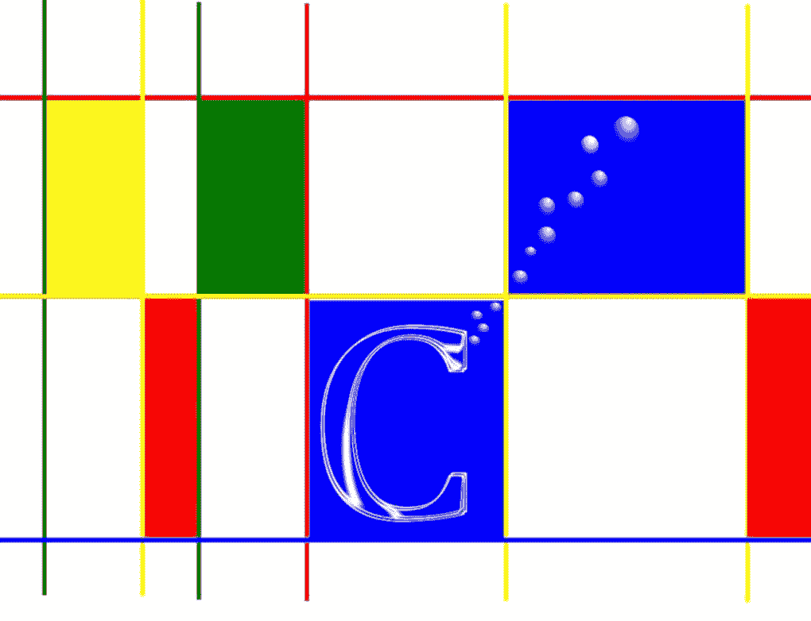

## 前言

C 是一门伟大的语言，拥有漫长的过去，很可能也拥有漫长的未来。原因在于，它在语言生态中占据着独特的利基市场。它是你能达到的最低级别，而不会真正触及汇编语言。如果你想处理其他语言中所有抽象层之下那台机器，C 是首选。唯一的缺点是，大多数关于 C 的书籍和文章都是由那些其实更希望编写其他某种语言的程序员撰写的。结果，你看到的 C 往往被不利于与*现代*高级语言进行比较。也有例外，特别是 Harry Fairhead 关于如何从 C 自身角度理解和使用 C 的两本书。与其说是 Harry 作品的延续，这本书可以被视为伴侣，是对 C 本质的深入探索，并阐述了其独特特征。

为了强调本书各章专注于特定主题的方式，它们被称为“深潜”（dives），这也暗示了对主题的深入考察。希望你在每一章中都能遇到一些你已经知道但会以不同方式看待的事物。你还会读到一些带你进入 C 语言中较少被理解领域的知识，只有当你将 C 视为一种机器无关的汇编语言时，这些知识才有意义。这是了解机器如何工作以及如何影响事物实现方式的绝佳途径。其他语言引入抽象来掩盖这些内部工作原理，虽然这通常是个非常*好*的主意，但如果你意在理解机器或利用机器硬件，这就意义不大。

以这种方式看待 C 需要你在看待数据的方式上发生根本转变。随着语言的发展，它们越来越多地添加了更复杂的数据结构。这些结构允许你使用数据结构而无需担心它们如何实现，或者不同的使用方式如何影响效率。当你用 C 编程时，任何复杂的数据结构都需要你自己来实现，为此你需要理解 C 提供的基本数据类型。

对于 C 来说，关于数据最重要的观念是：一切都是**位模式**，如何解释它们取决于你。选择范围广泛——一组开关位置、正整数、逻辑状态、带符号整数、文本、硬件控制线等。这不是高级语言用户支持的*观点*，他们往往认为 C 缺乏完成完整工作的设施。

这一切意味着，你可以将 C 视为 Java 或 Python 或你愿意使用的任何高级语言的一个*未达标*版本，结果就是对 C 的深深失望。另一方面，如果你将 C 视为一种解决其设计初衷问题的语言，并停止将其与高级语言比较，那么结果不仅是效率，还有优雅。

如果你懂一些 C，请继续阅读，看看你还需要知道什么，才能像其创造者那样看待它。这将揭示，在当今的编程语言中，它作为低层编程的强大且多功能选择，拥有非常特殊的地位。

感谢我不知疲倦的编辑 Sue Gee 和 Kay Ewbank。编程是一门精密的艺术，但英语并不附带内置的 linter。仍然存在的错误（希望很少）都是我的责任。

你可以通过 `mike.james@i-programmer.info` 联系到我

Mike James

2024 年 6 月

---

# 序言

> “C 语言怪诞、有缺陷，却取得了巨大的成功。”
> 
> — Dennis Ritchie

你可以选择很多种编程语言，但 C 语言在语言生态中占据着特殊的位置。大多数语言试图“成长”，占据计算机语言的高层平面，抽象掉底层硬件，引导你走向试图解决的问题的概念层面。相比之下，C 语言则坚守底层，让你可以随心所欲地利用硬件来解决实际问题。在现有的流行语言中，只有 C 提供这种低层支持。话虽如此，大多数高级语言，尤其是 C#、C++ 和 Java，在其基本语法上大量借鉴了 C 语言，这使得 C 对于已有编程经验的开发者来说显得十分熟悉。然而，C 并非只是用不同方式编写的高级语言，也不是那种某天会增加额外抽象以变得更现代化的失败高级语言。C 已经是它所需的样子，能够履行其作为现代、与机器无关的汇编语言的角色。

## 与机器无关的汇编器？

所以 C 不是 Java，不是 C#，也不是 Go 等等。尽管高级语言市场竞争激烈，但如果你想无拘无束地与硬件打交道，真的只有 C 语言。它远非完美，但如果你正在寻找一种工作在汇编器层级的语言，它是你现实中的唯一选择。

并非所有人都认为如此。

即使“C 是一种与机器无关的汇编语言”这一说法也备受争议，而且在某些方面，如今这一说法的真实性已不如从前。也许确实如此，但支持这一观点的理由多于反对的理由。反对者的论据是，C 不再能捕捉现代机器的工作方式。这没错，但与其他语言所应用的抽象相比，C 失去的精确性微乎其微。C 仍然足够贴近机器，以至于你能听到它发出的吱呀声。

## 计算机与执行模型

与当今硬件的功能相比，几年前的计算机非常简单。几年前计算机的基本工作原理是逐条读取指令并依次执行，直到程序完成——单处理器，顺序执行。

另一方面，当今的计算机使用复杂的处理方法来尝试加速。流水线同时处理多条指令，缓存将程序的活跃部分保持在靠近处理器的位置，避免不得不访问缓慢的主存来读取指令。最后，是的，你的指令可能不会按照你编写的顺序被执行。现代计算机是一个多核/多线程、流水线、带缓存接口、乱序执行的处理器。

这不是你父辈的计算机——但这并不重要。

这不重要的原因是，所有这些创新都应该对程序员不可见。例如，缓存内存加速了对主存和的读写，但在大多数情况下你可以忘记它的存在。只有当你开始考虑优化时，如何访问内存以避免缓存未命中才会进入视野——我们都知道关于优化的一句话：

> “我们应该忽略小的效率问题，在大约 97% 的时间里：过早优化是万恶之源。”
> 
> – Donald Knuth

同样，指令重排只有在顺序以不同方式影响硬件时，才会对 C 程序员变得可见。例如，向两个内存位置写入时，通常写入的顺序并不重要，但如果这些内存位置对应于控制某些设备的硬件寄存器，那么顺序可能很重要。同样，大多数时候你可以忽略重排。当涉及到使用多个核心时——是的，你需要更经常地考虑这一点，但我们仍然倾向于以单个执行线程来推理。我们使用锁或其他方法来控制这些交互，这些方法也是 C 编程的一部分，但不是 C 语言本身的一部分。

所有这意味着的是，虽然 C 隐含的执行模型对于现代计算机来说并不准确，但对于大多数事物来说它是足够好的。因此，C 可以被看作是一种机器无关的汇编语言，用于一台实际使用其他技术来更快运行程序的机器。C 仅在核心特性上是机器无关的。为了处理特定机器的具体情况，它通常需要额外的库或编译器扩展。这基本上应该是如此，将这些纳入主语言的尝试主要都失败了。例如，ISO 线程在 C11 中作为语言标准引入——然而，非语言标准的 pthreads 库仍然使用得更广泛。

同样，C11 引入了处理指令顺序的内存模型，但大多数处理器仍然要求你使用自定义库来控制这样的事情。

C 的核心确实使用了一个非常简单但合适的处理器模型。

## 历史

C 语言由 Dennis Ritchie 在贝尔实验室于 1970 年代初创建。该语言是为了让 Ritchie 和 Ken Thompson 能够在一台 PDP 11 小型计算机上创建 Unix 操作系统而发明的。你可以看到，从一开始，C 的目的就是系统编程和与硬件交互。

C 语言并不是凭空出现的——在它之前有很多语言处于相同的领域。其中最成功的是 BCPL（Basic Combined Programming Language，基本组合编程语言），由剑桥大学于 1967 年发明。BCPL 语言因两件事而引人注目——第一是使用 `{}` 来分组代码块，第二是编译器本身是用 BCPL 编写的。

Dennis Ritchie 和 Ken Thompson 将 BCPL 转换为 B 编程语言。这是一种无类型语言，基本上使用机器运行时的本机字大小作为数据或地址。这演变成 C，主要是为了解决 ASCII 文本打包到多字节字中的方式，通过添加一系列数据类型。

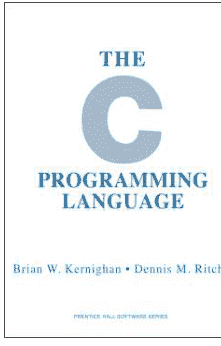

直到 1978 年，Kernighan 和 Ritchie 才出版了 *《The C Programming Language》*（C 程序设计语言）的第一版，这本书很快成为经典，通常简称为“K&R C”。该书简洁的介绍使语言看起来更简单，并鼓励程序员使用它。

C 编译器的传播也使 C 成为一种容易获得的语言，并承诺在机器之间轻松移植。`PCC` 可移植 C 编译器成为*事实上的*标准，直到 1994 年才被 GNU C 编译器取代。编译器的机器相关部分集中在少数几个源文件中，这使得为新的机器创建 C 编译器变得非常快。

C 也在 20 世纪 80 年代的早期微计算机上传播，尽管不像 Basic 那样快。这主要是由于《A Small C Compiler for the 8080s》（适用于 8080 的小型 C 编译器）在当时具有影响力的 Dr. Dobb’s Journal 上发表。这提供了一个用 Small C 编写的完整 C 编译器清单——它是一个自编译编译器。因此，C 几乎在所有机器上都可用，它是用于创建系统程序的语言，这些系统与操作系统接口，甚至修改操作系统。所有流行的操作系统都是，并且仍然是用 C 编写的——除了主要使用 C++ 的 Windows。

## 标准

早在 1980 年代初，人们就清楚地认识到 C 是一种重要语言，需要标准化。在此之前，K&R 中描述的语言充当标准，但到 1982 年，它已经与现实世界中实际使用的语言分道扬镳。编译器添加了原始语言中没有的功能——编译器“增强”至今仍然是一个特点，它们往往会破坏“标准”语言的概念。

美国国家标准学会（ANSI）和国际标准化组织（ISO）都参与了 C 编程语言标准的定义。1989 年，ANSI C 委员会，正式称为 ANSI X3J11 委员会，制定了第一个标准，同一标准于 1990 年经 ISO 批准。因此，我们有 ANSI C 或 `C89` 以及 ISO C 或 `C90`，它们指的是同一种语言。

下一个重要标准是 `C99`，中间有 `C95`，但这主要是对前者的错误修复。如今，我们倾向于将 `C89/90` 视为“经典” C，将 `C99` 视为现代 C。大多数程序员更喜欢 `C99`，因为它引入了两个简单的添加——能够使用以 `//` 开头的单行注释，以及能够在代码中声明变量，特别是在 for 循环中。也就是说，在 `C99` 之前，你不能写 `for(int i=0;`，因为 int 必须在代码外部定义。

下一个标准 `C11` 对语言的作用不大。它引入了不充分的 Unicode 支持，以及标准线程和原子操作，但至今尚未取代 pthreads。`C17` 是一个错误修复，没有引入任何新内容。在撰写本文时（2024 年 5 月），`C17` 是当前标准，尽管它很快将被 `C23` 取代。

目前大多数程序员更喜欢 `C99` 作为他们的标准，因为这是经典特性和现代扩展的最佳组合。即将发布的 `C23` 标准有一些有用的添加，看起来将是第一次对日常 C 编程产生影响的新版本。

## 今天的编译器

今天主导的 C 编译器是 `GCC`，即 GNU 编译器集合的一部分。`GCC` 由 Richard Stallman 于 1987 年首次发布，当时它仅包含一个 C 编译器。自那以后，它已扩展以支持 C++、Go、Rust、Fortran、Ada 和其他语言。它被移植到非常广泛的机器上，通常被认为是标准的 C 编译器。

令人惊讶的是，Windows 缺少 `GCC` 编译器的官方移植版本。也没有微软 C 编译器，因为用于创建 Windows 的编译器，Microsoft Visual C++（`MSVC`），首先是一个 C++ 编译器。这可以用于编译 C 程序，但它遗漏了 C11 标准的一些细节，并且直到最近才赶上 C99。你可以选择忍受 `MSVC`，或者你可以安装 `GCC` 的一个 Windows 移植版本。

`GCC` 唯一的真正竞争者是 `Clang`，它由 Apple 开发，因为无法接受 `GCC` 的许可条款。`Clang` 对实现编译器采取了有趣的方法，一些用户更喜欢它。总的来说，在编译速度方面，它并不比 `GCC` 提供更多优势，而且它产生的代码通常速度不那么快。Linux 内核仍然使用 `GCC` 编译，尽管有努力使其与 `Clang` 兼容。

在大多数情况下，你想使用的编译器是 `GCC` 或为正在使用的硬件修改的 `GCC` 版本。

值得一提的是，现代编译器，特别是 `GCC`，在生成优化代码方面非常出色。我经常决定某些小段代码需要用汇编编写以获得机器的最大优势，结果发现执行相同事情的 C 程序生成的代码竟然是更快的。在检查生成的汇编时，你通常会发现编译器知道你所知道的所有技巧，通常还有几个你不知道的，偶尔还有几个很难理解的。然而，优化有时会过头。请参阅第 16 章关于未定义行为的细节。

## C++

当然，每当讨论 C 时，房间里的大象是 C++。这不是 C 唯一的面向对象扩展，Objective C 是另一个。然而，C++ 是从 C 逐渐演化而来的，其实现只是缓慢地与 C 分离。该衍生语言由 Bjarne Stroustrup 于 1985 年首次发布。起初，它确实是 C 的扩展，在意义上它使用预处理器将 C++ 程序的文本转换为纯 C，然后使用普通的 C 编译器进行编译。

起初，C++ 不过是一个文本处理器，因此与 C 高度兼容。任何 C 指令都是有效的 C++ 指令，而任何 C++ 指令都会被转换为 C。

随着时间推移，C++ 发展出了更多特性，并最终拥有了自己的编译器。随着时间的推移，C++ 和 C 逐渐分道扬镳，如今有很多在 C 中有效但在 C++ 中无效的操作，反之亦然。C 不再是 C++ 的子集。

编写 C 代码时，人们往往会产生一种冲动，认为引入一些 C++ 的特性只是小改动，从而获得其某些优势。问题在于，C++ 已经发展到如此地步，做任何事通常都有不止一种方法，其中一些方法令人困惑，甚至可能比简单的 C 更危险。这个问题严重到至今，Linus Torvalds 仍然不允许 C++ 进入 Linux 内核。

引用他的话：

> *"C++ 是一门糟糕透顶的语言。由于大量次品程序员的使用，它变得更加糟糕，以至于用它生成完全且彻底的垃圾变得极其容易。坦率地说，即使 C 的唯一好处就是能让 C++ 程序员靠边站，这本身就是一个使用 C 的巨大理由。"*

我并不完全同意引文中关于“次品程序员”的部分，但我认为 C++ 确实能把一名相当不错的程序员变成更糟的角色。C++ 的主要问题在于，它并不适合底层任务，而在高层任务上也不如无数其他语言出色。它是底层和高层特性的混乱混合体。如果你需要编写与硬件交互的底层程序，就像 Linus 一样，专注于 C 会是更好的选择。

## 忠于 C

C 语言距离汇编语言仅一层之遥。它更易使用，并且在拥有良好编译器的情况下，速度同样快。因此，尽管有些程序员可能声称否则，C 仍然是一个相当好的、或多或少与机器无关的汇编器。那些声称 C 不是这样的程序员，实际上并没有看清 C 的灵魂。他们看到这门语言缺乏其他语言拥有的抽象，并认为 C 如果有这些抽象会更好。存在一种几乎不可抗拒的压力，推动所有语言朝着理论抽象的巅峰迈进。这就是现代语言往往非常相似的原因。正如 Dennis Ritchie 曾言：

> *"当我读到关于 C 语言发展方向的建议时，我常常会回想过去并感恩，幸好 C 不是在世界各地人群的建议下开发出来的。"*

C 关乎位模式和位的移动。在最抽象的层面上，它关乎整数。甚至有人认为，如果你在使用浮点类型，那你可能不应该使用 C。如果你不想贴近机器，那就选择另一种语言。

重要的一点是，你会读到许多关于 C 应如何使用的权威声明——通常是通过禁止你绝对不能做的事。大多数时候，这些言论是误入歧途的，或者基于那些根本不符合 C 理念的因素。其中许多观点源自 C++ 程序员，他们有着不同的视角和不同的抽象层级。他们常常认为，既然 C 几乎是 C++ 的子集，他们的观点就适用，但事实上，这些观点往往针对的是 C++ 程序员的需求。

## 如何阅读本书

这不是一本入门书或教程，而是一个深入探讨使 C 成为独特语言的重要话题的集合。书中没有要求你遵循特定路径——只需深入那些你想知道的话题即可。有些深入探讨会引用在其他探讨中更详细覆盖的话题。虽然我试图以有序的格式呈现 C 的主题，但一些前向和后向引用是不可避免的，但如果你已经了解一些 C，这不应该成为问题。

本书的目的是揭示 C 的独特方面，并在这样做的过程中，帮助你像 C 最初被设计使用时那样使用 C——作为一门擅长在位模式层面处理数据的底层语言。

# 深入 1：你只需要位

> *"位是我们塑造世界的原材料。"*

如果有一个特征能将 C 程序员与其他程序员区分开来，那就是对位的理解。如果你不理解位，那么你就是某种其他语言的程序员，只是在假装自己是 C 程序员。话虽严厉，但确是事实。大多数关于位模式的讲解都从二进制值开始，然后转向补码，最后有时是浮点数，但这恰恰掩盖了位本身并不是这些事物的事实。让我们从头开始。

## 状态

位是一个双状态系统——位可以是 1 或 0。给这两个状态起什么名字并不重要，真和假也可以，但上和下、开和关等也都可以。计算机以位组的形式工作，这些位组可以作为单一单元被访问和处理。通常位组的大小是 8 位，即一个字节。虽然这并非严格必要，但我们在示例中会使用它，对于不同位数的情况，示例也类似。

字节中的八个位通常具有特定的顺序，并且通常从右侧开始编号：

```
7 6 5 4 3 2 1 0
x x x x x x x x
```

位 0 通常被称为“最低”或“最低有效位”，位 7 被称为“最高”或“最高有效位”。这种术语的来源是将位组视为二进制数。注意，我们需要做出“字节序”（endian）的决定。从哪一端开始编号位是任意的，取决于机器架构，但这种大端（big-endian）编号法几乎是通用的。当我们稍后处理位值系统时，原因将变得显而易见。

字节中的任何一位都可以表示两种状态之一。例如，你可以表示一组八盏灯的状态，每个位位置对应一盏灯的开和关。将位模式存入字节会设定灯的状态，而读取位模式则给出灯的状态——注意在此过程中没有涉及数字。

现在考虑一个房间里有两盏灯的情况，一盏左灯，一盏右灯。现在我们有了四种可能的状态：

```
左灯关 右灯关     0 0
左灯关 右灯开     0 1
左灯开 右灯关     1 0
左灯开 右灯开     1 1
```

因此，如果你有四种状态要表示，我们需要使用两位；八种状态需要三位；16 种状态需要四位，等等。如果你拥有的状态数量不能恰好放入 n 位中，那你只需将一些多余的状态合并。例如：

```
无灯亮     0 0
一盏灯亮   0 1 或 1 0
两盏灯亮   1 1
```

这就是你可能用两位表示三种状态的方法，但也有替代方案。

再次强调，这里没有涉及数字——只有位。

## 指定位模式


有些位模式是外部世界强加给我们的，其中许多是通过字面量（literal）指定的。字面量只是在编译时指定的值，编译器将其转换为指定的位模式。我们如此频繁地使用数值字面量或常量，以至于几乎忽略了它们。

例如：

```c
int a = 42;
```

看起来简单且无害，但编译器读取 `42` 这个字面量，将其转换为位模式 `00101010`，并将其存储在变量 `a` 中。

使用常量指定位模式有很多方式——十进制、八进制、十六进制等。目前所有重要的事情是你要意识到，在 C 中你指定的每个数字都会转换为一种表示，从而产生一个位模式。

下一个问题是数字如何变成位，反之亦然。

## 位值系统

位是我们的原材料，我们无需从数字开始就能发现它们的用处。事实上，数字只是位可以表示的另一种“东西”。然而，与简单的状态不同，表示数字需要更多的组织。如果你了解关于位值系统的一切，可以跳过本节，尽管它指出了一些更数学化的方法所遗漏的事项。

考虑一下你可能会如何记录有多少辆车经过你家门前。你很可能在每辆车经过时做一个标记，以免混淆：

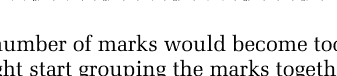

但过一会儿，标记的数量会多到难以应对。在许多情况下，你可能会开始将标记分组——比如一次分五个：

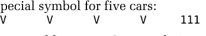

你可能会用一个特殊符号代表五辆车：

V V V V 111

其中 V 代表一组五个 1。恭喜你，你现在发明了罗马数字系统。

随着数量变大，你下一个显而易见的步骤是发明另一个符号来表示更大的分组。例如，X 代表十项，这意味着我们现在可以写：

XX111

来表示 23。我们将忽略罗马人发明简化系统的方法——例如 IX 是 9 的有效表示，因为大数值左侧的小数值是从大数值中减去。

在尝试进行算术运算之前，这并不是表示数字的坏方法，然后你会很快发现其局限性。试着将我昨天看到的车辆数（27）加到今天的数量上：

(XXVII) + (XX111) = (XXVI11XX111) = XXVXXXV = XXXXXV = XXXXX

需要重新整理符号以应对这种情况。

如果你觉得这很繁琐，请尝试减法和乘法。例如，XXVII 乘以 X 是多少？事实证明，将罗马数字转换为十进制表示，进行加法，然后再转换回去更容易。

让我们暂时假设你是一个罗马人，正试图改进这套系统。关键原则是：你使用符号来表示物品的组。因此，1 代表一个物品，而 V 代表五个一组。显然，要表示更大的数字，你需要构建更大的组。为什么不简单地重复你最初那个聪明的想法，用 V 来表示五个一组，但让每个“组”本身就是五个一组呢！这是程序员会想到的那种点子。所以：

V = (11111)

并且

V = (VVVVV)

问题在于，当你遇到一个 V 时，如何判断它是哪一种。更缺乏创造力的做法是发明另一个符号，那样我们就回到了罗马人的老路子上。真正聪明的想法是利用符号在符号组中的位置。这很巧妙，因为你不仅不需要发明新的符号，甚至还可以丢弃你刚刚发明的那个符号。所以你可能记录的是：


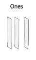

这代表四组五和三组一，即我们在标准记法中的 23。注意，现在你不再需要新符号 V 了。你在按五的组进行计数，但你只需要表示不超过五的数字的符号，因为当你达到五时，只需在下一位记录一个一即可。这个想法太好了，不妨继续下去。为什么不增加另一个位置来计数“五个五”的组，即我们在标准记法中的 25 个物品呢？例如：


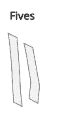

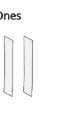

所以我们现在有一个 25、两个 5 和三个 1，总和在我们的记法中为 38。注意，再次强调，我们仍然不需要表示五的符号，也不需要为 25 发明新符号——位值系统（place value system）仅凭我们现有的符号就能正常工作。当你达到四个 5 和四个 1 时，再加一个，就简单地变成了一个 25，并在第三位做一个标记。

你可能不需要表示五的符号，但你确实需要一个新的符号。你需要能够标记一个空位，即标记那里没有 1、5 或 25 的组。你可以直接使用空格，但我们采用了标准的零 `0` 来表示指定大小的组数为零。所以：

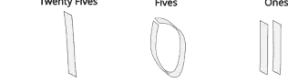

表示一个 25，没有 5 的组，三个 1，即 28。

如果罗马人不再不停地为更大的组发明新符号，他们本可以发明出位值系统。唯一的代价是维护符号的位置并发明零。回报是算术运算变得容易得多，因为你可以依次处理每一位。例如，将昨天看到的汽车数量 (27) 加到今天看到的数量 (23)：

```
1         0         11 +
0         1111      111
= 1       1111      11111
= 1       11111     0
= 11      0         0
```

或者在我们的记法中是 50。注意，加法是一次处理一个“列”，然后将过大的计数移到下一列，即“进位”。

这个思想是可以推广的。如果我们使用 N 的组并采用位值概念，第一位从 `0` 数到 N-1，第二位从 N 数到 N*(N-1)…… 抱歉，原文逻辑应为：第一位表示 0 到 N-1，第二位表示 N 的倍数（即 0 到 N*(N-1) 的范围内以 N 为步长，原文表述 "counts from N to N*(N-1)" 略显含糊，通常指该位权重为 N，范围 0..N-1 对应实际值 0..N*(N-1) 的跨度，但更准确的理解是：第二位有权重 N，取值 0..N-1，代表 0 到 N*(N-1) 的数值贡献... 原文 "the second from N to N*(N-1)" 可能意指第二位代表的数值范围是 N*0 到 N*(N-1)。为了忠实于原文的字面翻译，保持直译但稍作通顺：第二位从 N 数到 N*(N-1)，下一位到 N*N*(N-1)，依此类推。我们永远不需要使用表示 N 的符号，但我们确实需要一个表示零的符号。

我们的标准系统是十进制，我们有十个数字，即符号 `0,1,2,3,4,5,6,7,8` 和 `9`。在这个基数下，每一位从 0 数到 9，即比 10 小 1，并且没有表示 10 的“数字”。如果你使用所有位数，仅使用第一位可以从 0 数到 9，使用第一位和第二位可以到 99，再加上第三位可以到 999，等等。

一种不太熟悉的系统，十六进制或基数 16，工作原理完全相同。在这种情况下，有 16 个符号 `0,1,2,3,4,5,6,7,8,9,A,B,C,D,E,F`，同样也没有表示 16 的符号。第一位从 0 数到 F（即 15），第二位计数 16 的组，从 00 到 F0，即 0 到 240，而 FF 是 255。

## 二进制

“digit”（数字/位）这个词既指手指或脚趾，也指代表数字的符号。我们选择十进制是因为包括拇指在内，我们的手有十个指头，但计算机没有手指，所以如果我们使用位（bits，二进制位），构建它们会更容易。

二进制（基数 2）比十进制好得多的真正原因， simply 是在二进制中，算术运算很简单，且使用逻辑电路实现起来容易得多。如果你想制造一台使用十进制的机械计算器，你需要有十个齿（0 到 9）的齿轮，而对于二进制，齿轮只需要两个齿（0 和 1）！这使得执行算术运算所需的规则比十进制简单得多。

我们刚刚发现的这一点是：如果我们只想要用两个符号来表示数字，那么最好的主意是通过位值系统重复使用它们。因此，一个位（bit），0 或 1，可以计数到 1。这没什么用，但如果我们使用两个位置，第二位代表两个物品，所以 `10` 代表二，并且它与十进制中的十有趣地混淆，让人们可以靠销售印有如下标语的 T 恤赚钱：

> *“这个世界上只有两种人：懂二进制的和不懂的”*

使用三个位置，第三位代表四个物品，第四位代表八个物品，通常第 n 位代表 `$2^{n}$`。请记住 `$2^{0}$` 是 1。

反过来说，第一位告诉你有多少个 1，第二位告诉你有多少组 2，第三位告诉你有多少组 4，等等。

这使得通过一组位（将其解释为二进制位值）来找出所代表的数字变得很容易，就像十进制位值一样——只需将 2 的幂相加即可。

例如：

```
101010 = 1×32+0×16+1×8+0×4+1×2+0×1 = 42
```

值得注意的是，标准 C 语言在 C23 之前没有输入二进制字面量的方式，这对于如此重要的格式来说是一个奇怪的遗漏。一些编译器，例如 GCC，使用 `0b0101010` 来表示二进制，并且这已添加到 C23 中。

从二进制转换为十进制很简单，反过来则稍复杂。你需要从最大的分组开始，查看数字是否包含其中一个。如果是，你就有一个前导 1；如果不是，你就有一个前导 0。接下来，你必须从总数中移除那个组，然后对下一个较小的分组尝试同样的技巧。

对于 16 位值，我们有：

```c
int16_t num = 42;
int bit = 0;
for (int i = 0; i < 17; i++)
{
    bit = num / (1 << (16 - i));
    printf("%d", bit);
    num = num % (1 << (16 - i));
}
```

这通过除以递减的 2 的幂来确定它是需要 1 还是 0，然后将数字缩减为余数。请记住，左移等同于乘以二。

当然，我们不需要用这种显式的方式将十进制数转换为二进制，因为命令：

```c
int16_t num = 42;
```

帮我们要完成了，甚至不需要我们思考。编译器不会在变量中存储十进制 42；相反，它将十进制值转换为二进制并存储在 `num` 中。

所以我们已经拥有存储在 `num` 中的 42 的二进制表示，计算出位会是什么样子是疯狂的，因为我们已经拥有存储在 `num` 中的位！为了看到二进制表示，我们所要做的就是按顺序一位一位地打印出 `num` 的位。使用右移和一个单位掩码，这很容易做到——参见 Dive 5, Bits and More Bits：

```c
int16_t num = 42;
int bit=0;
for (int i = 0; i < 17; i++)
{
    bit = (num >> (16-i)) & 0x01;
    printf("%d", bit);
}
```

如果你对十六进制感到自在，你甚至不需要一次拆分一位：

```c
int16_t num = 42;
printf("%X\n",num);
```

这将显示 `2A`，即 `00101010` 的十六进制。十六进制的美妙之处在于，你可以逐个符号将其转换为二进制，反之亦然。例如，`2` 是 `0010`，`A` 是 `1010`，这就给出了完整的二进制值 `0010 1010`。反过来，你可以每四位一组将任何二进制值转换为十六进制。也就是说 `0010 1010` 是 `2 A`——几乎不需要数学计算。

也就是说，当你将 42 存储在一个变量中时，它会在你什么都没做的情况下被转换为二进制。变量存储的不是十进制值，而是使用二进制表示十进制值的位模式。

## 二进制算术

当然，二进制在 C 语言中如此自然的原因在于大多数计算机使用的硬件是二进制的。部分原因是仅用两种状态（1/0 或 开/关）比使用更多状态更容易构建硬件，但另一个事实是，由于其二进制运算表非常少，二进制算术比任何其他进制更容易实现。对于十进制，我们至少需要学习九张乘法表，而对于二进制，你只需要掌握一张 1 的乘法表。

在现代计算机中，内存存储的是位（bit），因此，如果你想存储一个数字，二进制是显而易选择。更具体地说，算术逻辑单元（ALU）执行的是二进制运算。你给它两个二进制数，如果你想求和，它会自动输出它们的和。

按位值算术（Place value arithmetic）通过在每个位上执行操作，然后根据需要调整相邻位的值（使用进位或借位）来工作。当人类这样做时，由于需要标注进位或借位，过程可能会很混乱，但当计算机以二进制方式执行时，过程简单且规则一致。十进制加法要求你记住一张表，该表给出了任意数字相加的结果。诚然，许多条目是显而易见的——加零和加一加一几乎不需要记忆，且加法是对称的。尽管如此，记住这张表仍是初学者觉得加法困难的原因。与二进制相比——你真的只需要记住 `1+1` 是多少！当你把两个位加在一起时，你会得到一个结果和一个进位到下一位的位：

A + B = R C

0  0  0  0

0  1  1  0

1  0  1  0

1  1  0  1

如果你熟悉逻辑表（你应该熟悉），你会发现 R 是 A 异或 B（A XOR B），C 是 A 与 B（A AND B）。在二进制中，加法就是逻辑运算。

事情并不完全如此简单，因为进位必须加到当前位的左侧位置。我们可以按如下方式使用逻辑运算和移位执行加法：

```
sum = a ^ b;
carry = (a & b) <<1;
```

`sum` 现在包含 `a` 和 `b` 的和，但忽略了任何进位位。变量 `carry` 现在包含所有进位位，处于正确的位置，可以加到 `sum` 上以得到最终答案。

我们可以重复加法以添加进位位：

```
temp = sum ^ carry;
carry=(sum & carry)<<1;
sum = temp;
```

问题在于该操作可能会产生进位，并且必须再次加入：

```
temp = sum ^ carry;
carry=(sum & carry)<<1;
sum = temp
```

这需要重复进行，直到进位为零：

```c
int sum = a ^ b;
int carry = (a & b) << 1;
while (carry > 0)
{
    int temp = sum ^ carry;
    carry = (sum & carry) << 1;
    sum = temp;
}
printf("%d\n", sum);
```

如果你知道硬件加法器是如何工作的，你可能会疑惑硬件中哪一部分相当于 `while` 循环？硬件加法器只是一组逻辑门。在硬件中，循环发生是因为逻辑被给予时间让进位信号传播并稳定到最终答案。

这一切意味着，虽然二进制是描述、解释和谈论位模式的自然方式，但它并非唯一选项，重要的是要记住，二进制数字并不比代表一组灯光的位模式更“真实”。

## 进位溢出（Rollover）

实际硬件在可存储的位数方面有限制。C 语言有一系列不同的变量类型来反映这一事实，每种类型持有给定数量的位，通常是 8、16、32 或 64 位。有许多操作会增加表示结果所需的位数。例如，将 8 位可表示的最大值加 1 需要 9 位来表示，对该值进行一次左移也需要 9 位，等等。

当操作导致数值超出可用位数时会发生什么，是由硬件定义的，但 C11 将无符号整数溢出定义为进位溢出（rollover）或环绕（wrap）。这通过简单地忽略需要额外位的事实来实现。如果你有一个 4 位值 `1111`，并给它加 1，结果是 5 位，`10000`，但通过进位溢出，这会截断为 4 位，`0000`。你可以认为进位溢出只是允许额外的位“从末尾掉落”。

请注意，只要你使用的是标准的 C 编译器，你就可以相当确信无符号整数会进位溢出。做出这种选择的原因是，进位溢出在实践中实际上是很有用的，并且对应于模算术理论。考虑进位溢出如何有用的一个例子是包含 256 个元素的数组。你可以从索引 0 开始向数组存储数据，并在每个数据项存储后递增索引。当数组接近满时，索引被设置为 255。在元素 255 处存储内容会导致索引进位溢出为零，并再次从头开始使用数组。这被称为环形缓冲区（ring buffer），如果你必须处理高速传入的数据并且需要存储最近的值，它非常有用。

进位溢出更重要的应用是实现负数。

## 负数

到目前为止，我们只有正二进制数，显然，我们也需要负数。我们可以像处理十进制数那样发明一个负号，有时确实是这样做的——所谓的“符号大小表示法”（signed magnitude representation）。如果你这样做，计算机的硬件就需要修改，以便它正确地添加负数。有一个更好的解决方案，不需要任何修改或额外硬件。

一个数的负数在加到该数上时会将其减少到零。例如：

```
4 + (-4) = 0
```

事实上，这是正数负数的数学定义。如果两个东西相加为零，那么一个是另一个的负数。但等等！在上一节中我们发现，给用八位表示的 255 加 1 会导致进位溢出到零。也就是说：

```
1 + 255 = 0
```

只要发生进位溢出。这意味着 255 可以被视为 1 的负数，依此类推，254 是 2 的负数，等等。如果我们愿意使用可用范围的一半来表示负数，我们就不需要任何特殊的硬件来进行减法——我们只需加上负数并依靠进位溢出得到正确答案。这被称为“补码表示法”（two's-complement representation），原因很快就会显而易见。

例如，如果我们只有三个位并将范围的一半分配给负数，我们有：

| 位 | 无符号 | 补码 |
| :--- | :--- | :--- |
| 000 | 0 | 0 |
| 001 | 1 | 1 |
| 010 | 2 | 2 |
| 011 | 3 | 3 |
| 100 | 4 | -4 |
| 101 | 5 | -3 |
| 110 | 6 | -2 |
| 111 | 7 | -1 |

请注意，位的操作方式没有区别——这完全是如何解释位的问题。如果你需要一个 C 编程全在于如何解释位的例子，没有比这个更好的了！还要注意，最高有效位（most significant bit）可以用作符号指示器——零表示正数，一表示负数。

例如，将 `011` 加到 `100` 上，答案是 `111`，你不需要知道它是无符号还是补码。如果将这些数视为有符号数，我们有 3 + 4 = 7。如果将这些数视为补码，则我们有 3 + (-4) = -1。这是合理的且正确的，只有解释发生了变化。

为什么这种负数的表示方法被称为“补码”？


在这个系统中，`x` 的负数的定义是 `x+(-x) = 0`，但这只有进位溢出时才成立。在 3 位示例中，你可以看到零的另一种表示是 `1000`，即进位溢出。因此你可以写 `x+(-x) = 1000`，或十进制的 8，这意味着 `-x` 是 `8-x`，如果你检查表格，会发现这是正确的。例如，`-4` 由 `8-4 = 4` 表示。通常，如果你有 `n` 位表示，`-x` 的补码表示为 `$2^{n}$-x`，因此得名“补码”。

补码与逻辑非（logical not，见 dive 5）或一补码（one's-complement）之间存在关系。用文字表述：

```
two's-complement = one's-complement + 1
```

或从 C 运算符的角度：

```
-x = $2^{n}$-x = -x+1
```

只要所有操作都使用 `n` 位并伴有进位溢出。这很有用，因为它可用于计算任何值的补码。

这种机制之所以有效，是因为 `n` 位能表示的最大值是 `2^n-1`，因此无法直接计算 `2^n-x`，因为 `2^n` 数值过大。所以你分两步执行减法：

```
2n - x = (2n - 1 - x) + 1
```

但 `2^n-1` 就是 `n` 个 1，你只需将 `x` 取反即可从该值中减去 `x`（即把所有 0 变为 1，反之亦然）。这是一个简单的非运算，因此我们有：

```
2n - x = (2n - 1 - x) + 1 = -~x + 1
```

很明显，无符号二进制值的回绕对于让补数算术正常工作至关重要，但我们现在有一些新的行为。补数结果可能落在当前使用位数无法表示的范围内。这通常被称为“有符号溢出”。

例如，一个补数 3 位值可以表示从 -3 到 4 的值（注：原文此处逻辑表述为“从 3 到 -4”，这是原文明确写出的范围描述，尽管数学上 3 位补数范围是 -4 到 3，此处严格遵循原文进行翻译，即：可以表示从 3 到 -4 的值，这是其有效范围）。现在考虑 `3 + 1`，在 3 位表示中，该值应该映射到什么？你无法在 3 位补数中表示 4，而你得到的位模式对应 -4，即 `3 + 1 = -4`，这就有点怪了，至少可以说很奇特，两个正数相加却得到一个负数。

在 C 语言的早期，关于负数应该如何表示并没有标准，但 C99 标准采用了补数作为标准。这非常清晰地展示了补数溢出的行为，即使 `3 + 1 = -4` 没有太多意义。问题在于 C99 和 C11 将这种溢出定义为“未定义行为”，这是一个疯狂的决定——尽管它有点奇怪，但它显然是定义明确的。在补数尚未成为标准的时候，这种决定可能还有合理性，但现在它只是一个不必要的危险，参见《深入理解 C 语言》第 16 章 未定义行为。

由于表达式中自动提升的使用，事情比上述描述要复杂一些，这可能会在程序员没有意识的情况下增加使用的位数。这可能会导致与预期不符的结果，因为回绕没有发生在应该发生的地方。更多关于此的内容见《深入理解 C 语言》第 4 章 表达式。目前重要的是，位序列的本质及其解释的任意性是明确的。

## 这些并不是你在找的那些类型

> “这些并不是你在找的那些机器人。”

> 贝恩·欧比王

类型，无论你是爱它还是恨它，都不能忽视它。强类型语言目前主宰着地球，任何建议强静态类型不是好主意的人都会被迅速压制。C 是一种强类型静态语言，但这并不一定意味着你想象的那样。C 中的类型可能不是你想要或期望的类型。话虽如此，C 中类型的概念与其底层意图完美契合。

### 类型的起源

编程中类型的概念既深且浅。

初次接触时它显得浅显，但随着一层层抽象叠加在另一层之上，它变得越来越复杂。在最先进的层面上，类型以柯里-霍华德对应论的形式提供了编程理论，该论将程序与数学证明视为同一事物。这将我们带入通常被标记为范畴论和逻辑学的纯数学领域。

好消息是，C 中的类型处于这个范围更浅的一端，但随着时间的推移，人们一直在努力使其更深，从而更受人尊敬，更像其他编程语言。有一种观点认为，C 需要一个简单的类型解释才能作为工作在比大多数语言更低层面的语言而有效。与其将类型从机器表示数据的方式中抽象出来，不如保持数据类型与表示之间的关联。

C 中类型的根本（但并非唯一）思想仅仅是正在使用的位数是多少以及这些位应如何解释。

如今，这种对类型的解释相当罕见，这也是 C 不同的另一个地方。

### C 中的类型

C 中只有四种基本类型——整型、浮点型、指针和结构体。前两种类型都是关于如何解释位——它们是标量类型。第三种是关于如何引用其他类型，第四种是关于如何组织其他类型。你可能想将数组添加到这个列表中，但数组是对其他类型如此简化的组织，以至于几乎不算数——它基本上是指针类型的一种使用，后续会更多提及。

### 字长

在原始机器层面，只有位——除了位没有其他。这些位通常被组织成称为半字节、字节、字、双字和四字的大块。半字节和字节通常分别是 4 位和 8 位。字的大小因机器而异，但本质上，字是机器操作的位组的默认大小，通常是 16、32 或 64 位，但这些并不是唯一的可能性。过去的机器使用 18、36 和 48 位的字长——这些选择如今很少见，但它们提醒我们字长是相当任意的。

注意，字长依赖于硬件。电子器件、内存、寄存器以及连接它们的总线决定了字长。机器通常不限于使用单一字长，但通常有一个字长比其他字长更适合其架构，这通常是最快且最高效的。

这些字节组很重要，因为它们是机器用来处理数据的单位。你通常可以编写操作字节、字或双字等的指令。例如，你可以将两个字节相加，也可以将两个字相加，等等。在机器层面，会有将两个字节和两个字相加的不同加法指令，你需要判断在特定情况下使用哪一个。

用 C 语言编写代码时，编译器为你完成这项工作，并根据你使用的变量类型选择指令。例如：

```text
char a = 1, b = 2;
char c = a + b;
printf ("%d\n", c);
```

在大多数系统中，`char` 是一个 8 位数据类型，因此编译器生成机器指令以添加两个 8 位字节。如果你写的是：

```text
int a = 1, b = 2;
int c = a + b;
printf ("%d\n", c);
```

那么编译器将选择用于添加两个 32 位字的指令——假设对于该机器，`int` 是一个 32 位类型。

也就是说，C 中类型的根本原因是确定适合数据的数据操作类型。

类型决定运算符如何作用，无论我们如何扩展类型的概念，这始终成立。

你还可以补充说，在 C 中，类型还决定操作涉及的位数数量，但这更显而易见——对于 C 程序员来说……

### 数据表示

与其他试图隐藏其表示数据方式的编程语言不同，数据表示是 C 的重点。更高层级语言的趋势是抽象掉底层位，并鼓励用户以对象的术语思考，而无需知道它们如何工作。

我们看到，在 C 中，位序列及其表示的内容很重要。在其他语言中，位、表示及其限制被隐藏了。例如，JavaScript 仅实现一个数字对象，并在幕后处理整数和浮点数之间的区别。Python 具有无限精度的整数，因此你不需要询问 Python 整数的范围。另一方面，C 坚持要求你知道数据是如何表示的。它有不同大小的整数，甚至有 `unsigned`（无符号）整数，并且期望你知道它们如何工作以及它们如何相互关联。更准确地说，如果你不理解正在使用的数据表示，你会发现编写正确的代码更难。

重要的是要记住，尽管机器和 C 可能提供一系列操作，哪些操作有意义完全取决于当前位被解释代表什么。

这引出了一个有趣的问题：为什么 C 中的一个字节被称为“`char`”（字符）而不是“byte”（字节）？原因是，在早期，`char` 旨在包含足够的位来表示机器需要处理的所有文本字符。由于大多数机器使用 7 位编码的 ASCII，`char` 通常被定义为 8 位，以允许一些额外的字符。注意，从这一出发点就可以清楚地看出，C 希望你对它存储的位有一种解释。你可以将两个 `char` 相加，但在这种情况下，你应该将它们视为 8 位整数。你也可以将所有位设置为 1，这时你最好将它们视为灯的状态。

在所有情况下，我们都取一堆位，并使用运算符将它们与另一堆位组合，问题是：结果的那堆位是否有意义？

# 常见类型

此时你可能会希望 C 语言定义了固定比特数的类型——事实并非如此。过去的问题在于，不同的机器使用不同的架构，因此无法确定是否支持八位字节。结果，`char` 类型被定义为机器能够处理的最小比特块，如今这通常就是八位。

下一等级的大小是“short”（短整型）。你可能认为这将是 16 位，通常确实是如此，但它可能仅仅更大一些。因此，关于 `short` 我们能说的唯一确定事项是，它应该能够容纳至少 16 位。

在 `short` 之后是“int”（整型），这是我们倾向于默认使用的类型。它被定义为至少 16 位，但可能更大。

在 `int` 之后，C 语言变得有点重复。我们有“long”（长整型），它是至少 32 位；还有“long long”（长长整型），它是至少 64 位。

就比特数而言，我们有：

```
char <= short <= int <= long <= long long
```

并且在遥远的未来，我们可能会有“long long long”等等，但目前为止，集合在 `long long` 处停止。

如今，典型系统具有：

- `char` = 8 位

- `short` = 16 位

- `int` = 32 位

- `long` = 32 位

- `long long` = 64 位

除了这些类型外，你还可以在类型后添加“signed”（有符号）或“unsigned”（无符号），以指示你是否想要存储负数。最初，C 语言并未定义有符号类型应如何表示，但现代 C 坚持使用二进制补数形式 – 参见深入讲解 1。

如果你选择有符号，则整数的范围大约一半为负数，一半为正数。如果你选择无符号，则整个范围都为正数。例如，有符号 `int`，或者简称为默认带有“signed”的 `int`，其范围是从 -32,767 到 +32,767，而无符号 `int` 的范围是从 0 到 65,535。你可以看出，如果你使用变量来计数，使用无符号 `int` 可以让你比有符号 `int` 计数更多的事物。这是所有事情都只是关于如何解释比特的问题的另一个例子。

## 浮点数

除了整数外，通常还有三种浮点类型。当然，浮点类型能够存储小数值以及整数。这再次是解释比特的一个例子。`float` 是单精度浮点数，在大多数系统中它是 32 位。请注意，`float` 和 `int` 都只是 32 位的值。区别在于，对于 `int`，比特被解释为简单的二进制数；而对于 `float`，比特被分为两组 – 一组给出指数，另一组给出小数部分。除了 `float` 外，还有 `double`（双精度），它几乎总是 64 位的值。在某些系统中，还有 `long double`，它可以是从 80 位到 128 位的任意值，但这不是一个常见的类型。

关于 C 语言中的浮点类型没有太多可说的，因为它们就像任何语言中的浮点类型一样工作 – 主要原因是几乎所有人都使用 IEEE 754 标准。这意味着在 C 语言中使用浮点类型具有在任何语言中使用它们的所有问题 – 精度丢失以及不像人类那样执行算术运算。

例如：

```c
if(0.2+0.1==0.3){
    printf("correct\n");
} else {
    printf("incorrect!\n");
}
```

显示不正确，这意味着 0.2 加上 0.1 不等于 0.3。这是由于 0.3 无法在二进制中精确表示的结果。

浮点关于数字，而不那么关于比特模式 – 如果你只是在 C 中使用浮点数，那么你可能选错了语言！

# 常见字面量

一个常见需求是将给定的比特模式存储到适当类型的变量中。这是通过使用数值字面量或常量来实现的。编译器读取常量并将其转换为比特模式，然后将其存储在变量中。许多 C 程序员不费心指定常量的类型，但通常这是一个好主意，有时甚至是必不可少的。

有一组后缀可用于指示常量的类型：

- `l` 或 `L` 表示 `long`

- `ll` 或 `LL` 表示 `long long`

- `u` 或 `U` 表示 `unsigned`

对于浮点数，也有 `f` 后缀。

如果没有后缀，常量被看作是 `int`。

在 C99 之前，这些后缀是必要的，但在此之后，常量从它们被分配的对象获取类型，并且通常可以忽略它们。C99 的规则是，常量的类型是从 `int`、`long`、`long long` 列表中第一个足够大以表示它的类型。

你还可以使用十六进制和八进制常量。十六进制常量以 `0X` 开头，八进制常量以 `0` 开头，因此如果你不小心在十进制值前加了一个 0，就容易出错。C23 终于也添加了以 `0b` 开头的二进制常量。

如果你创建一个比特数超过所需比特的常量，那么剩余的比特将被简单地忽略。例如：

```c
char a = 0x010203040;
```

在 `a` 中存储 `0x40`。你可能会看到来自编译器甚至 linter 的警告，但它能工作。

如果常量带有符号，则假设它是一个有符号值，并转换为二进制补数形式。这可以分配给一个无符号变量，比特模式将保持不变，但其值将被解释为正数。例如：

```c
unsigned int a = -1;
```

将 `0xFFFFFFFF` 分配给 `a`，因为这是 `-1` 的二进制补数表示。一个可能会让你困惑的字面量是字符字面量，例如：

```c
unsigned int a = 'C';
```

这是一个对应于该字符 ASCII 码的 `int` 比特模式 – 参见下文。

# 精确类型

无法确切指定变量可以存储的比特数主要是一个小小的烦恼，但有论点认为，明确指定变量的大小和符号性是个好主意。因此，许多程序员定义自己精确的比特大小类型，在 C99 中这被标准化了。

你可以使用类型 `int_n_t` 和 `uint_n_t` 分别表示具有 *n* 位的有符号和无符号整数。*n* 的值通常是 8、16、32 和 64 之一，但请注意，如果系统不支持某种比特大小，那么它简单地省略该定义，你的程序将无法编译。

请注意，`int_n_t` 和 `uint_n_t` 类型在给定系统上几乎总是映射到旧类型说明符，例如：

```c
typedef signed char int8_t;
```

因此，使用精确类型，我们之前的程序将是：

```c
#include <stdio.h>
#include <stdlib.h>
#include <stdint.h>

int main(int argc, char **argv)
{
    int8_t a = 1, b = 2;
    int8_t c = a + b;
    printf("%d\n", c);
}
```

请注意需要额外的头文件。

为了提供更大的灵活性，C99 引入了 `int_least_n_t`，它至少有 *n* 位；以及 `int_fast_n_t`，它是最快的具有至少 *n* 位的比特数。请注意，在两种情况下，你可能获得的存储空间比特数比你指定的更多，这会改变溢出发生的时间。

请注意：

- `char` = `int_least_8_t`

- `short` = `int_least_16_t`

- `int` = `int_least_16_t`

- `long` = `int_least_32_t`

- `long long` = `int_least_64_t`

还有两个偶尔有用的额外类型：

- `int_max_t`：可用的最大整数类型

- `intptr_t`：提供足够比特以容纳指针

`intptr_t` 的唯一用途是你需要将指针转换为整数以查找地址时。在大多数情况下，除非你想要执行算术或逻辑操作（即地址上的整数操作），否则你最好将其转换为 `void*`。

## Char 类型

所有语言都必须提供将比特模式转换为可打印或显示内容的方法，C 语言也不例外。然而，C 语言如你所料，比大多数语言更加底层。它将 `char` 类型作为能够表示机器外设上可显示字符的最小比特集合。这通常只是八位，在大多数情况下，我们可以将 `char` 视为一个字节。按照今天的标准，由于现在几乎普遍使用的 Unicode 需要每个字符或码点 21 位，这使得它已经过时。要存储原始 Unicode，你需要 `char` 是 32 位，但这从未发生过。有一个 `wchar_t` 类型，但其大小从 16 位到 32 位不等，且未提及应使用哪种编码（UTF-16 或 UTF-32）。实际上，如果可能，最好避免使用 `wchar_t` 并改用 UTF-8 – 参见下文。

在不同语言和应用中处理 Unicode 的最常见方式是使用 **UTF-8**，它使用可变数量的字节来表示一个码点。好消息是，对于常用字符，ASCII 码与单字节 UTF-8 是完全相同的。在 C 语言中如何处理 Unicode 是一个复杂的主题，但目前将重点放在标准 ASCII 输出上会更简单一些。

你可能有一个值存储在变量中：

```c
int16_t a = 42;
```

这存储了

```
0000 0000 0010 1010
```

在变量中——即 `$32+8+2$`，总和为 42。为了以人类可读的形式打印这个值，你必须将这个位模式转换为一组代表 ASCII 或 UTF-8 字符 '4' 和 '2' 的字节或字符，它们分别是 `$0\times34$` 和 `$0\times32$`。可以看出，为了转换为 ASCII 数字，我们只需要将 `$0\times04$` 和 `$0\times02$` 的二进制值加上 `$0\times30$`。如果你把这当作一个编程问题来解决，你可能会想出类似这样的代码：

```c
int16_t a=42;
char first= a/10 | 0x30;
char second= a % 10| 0x30;
```

其中 `char` 在这个机器上同样可以使用 `int8_t`。当然，如果值的位数多于两位，你需要以相同的方式继续处理，但这是一般性的思路。一旦你将这两个数字作为 `char` 类型获取，就可以打印它们：

```c
printf("%c%c\n",first,second);
```

这会显示 42。

当然，你可以使用更通用的方法达到相同的结果：

```c
printf("%d\n",a);
```


这个例子的重点并不在于解释 `printf` 格式如何施展魔法，而在于 `printf` 以及 C 语言中发生的许多事情本质上是关于将一种表示形式转换为另一种表示形式。在这种情况下，变量 `a` 被解释为存储了一个二进制值，这个值被转换为两个额外的位模式，它们代表十进制表示中前两个数字的 ASCII 码。

这听起来可能很复杂，但它对应着实际发生的情况，也是你应该思考问题的方式。只有初学者会认为 `printf` 仅仅“打印了 `a` 的内容”。显然，我们需要考虑格式说明符提供了两个方面的信息——变量中的位模式代表什么，以及它应该如何转换为 `char` 数组。例如，“`%d`”说明变量 `a` 中的位模式应被视为代表一个二进制整数，并且需要将其转换为对应其数字的 ASCII 字符的 `char` 数组。

```c
printf("%d\n",a);
```

关键在于，当思考 C 语言在做什么时，你不能忽略位模式是如何被修改和重新解释的。这种对行为的分析在 C 语言中非常典型，而在其他语言中几乎不会发生。

## Printf 与类型

作为位模式解释方式差异的另一个例子，考虑 `printf` 和类似函数中格式说明符的工作方式。`printf` 说明符中有一个鲜为人知且很少使用的功能是长度子说明符，它明确给出大小，即要使用的位数：

| 子说明符 | 类型 |
|---|---|
| `hh` | `signed char` |
| `h` | `short int` |
| `l` | `long int` |
| `ll` | `long long int` |

例如，为了让 `printf` 将 `a` 视为 `unsigned short int`，你会使用：

```c
unsigned short a = -1
printf("%hhu\n",a);
```

这会显示 `65535`，因为没有发生类型提升。唯一的问题是这些长度取决于使用的机器，即 `short int` 可能大于 16 位。有一些宏旨在为精确的位大小提供正确的格式，例如 `int16_t`，但它们往往不能通过简单提供 `d` 或 `u` 作为格式说明符来工作，而是需要提供 `hd` 或 `hu`。

你可能认为它显示 `65535` 是因为 `a` 是 `unsigned short`，但这并非实际情况。变量的类型并不影响显示的内容。例如：

```c
printf("%hhu\n", -1);
```

也显示 `65535`。你可以争论说 -1 默认被视为 `signed int`，但即便如此，`hu` 格式取最后两个字节并将其解释为 `unsigned short`。

由于自动类型提升的存在，`printf` 及其转换的表达式的实际情况比表面看起来更复杂——参见类型转换。

## Unicode

作为类型和位模式工作原理的最后一个例子，考虑 C 语言和 Unicode 的棘手问题。虽然 C 语言没有标准的 Unicode 功能，但 C11 添加了 `uchar.h` 头文件以提供一些基本功能，但它并未得到普遍支持。一个简单得多的解决方案是使用 UTF-8 编码，因为网页、编辑器和显示软件几乎都采用了这种编码。

UTF-8 是一种变长编码，使用最多四个字节来表示一个字符。使用多少字节来编码一个字符由第一个字节的最高有效位指示。

| 字节 1 | 编码长度 |
|---|---|
| `0xxxxxxx` | 一个字节 |
| `110xxxxx` | 两个字节 |
| `1110xxxx` | 三个字节 |
| `11110xxx` | 四个字节 |

所有后续字节的最高有效两位均设置为 10。这意味着你总是可以区分后续字节和起始字节。表中显示为 x 的位携带了关于表示哪个字符的信息。要获取字符代码，你只需提取这些位并将它们拼接起来，得到一个 7、11、16 或 21 位的字符代码。

例如，如果你有字节：

`1110010 10001000 10010001`，即十六进制的 `E2 88 91`

第一个字节以 111 开头，因此这是一个三字节编码。第二个和第三个字节以 10 开头，因此它们确实是后续字节。提取剩余的位得到一个 11 位值：

```
00010 001000 010001
```

这是十六进制的 `2211`，十进制的 `8721`，对应于数学求和符号，即西格玛，`Σ`。

UTF-8 的前 128 个字符与 ASCII 相同，因此如果你使用存储在单个字节中且小于 128 的值，你就拥有了向后兼容的 ASCII 文本。

你可能认为在没有 UTF-8 库的情况下从 C 语言使用 UTF-8 很困难，但你完全可以仅依靠“一切都是位模式”的方法走得很远。你用来创建代码的编辑器很可能符合 UTF-8 标准，因此如果你知道如何在程序中键入扩展字符，你就可以使用 Unicode 字面量。

在 Windows 下，输入 Unicode 取决于你使用的应用程序。一种很好的方法是使用任何可用的应用程序输入该字符，然后将其复制并粘贴到你的程序中。

在 Linux 下，你需要按 `CTRL+SHIFT`，在保持按下这些键的同时输入 `u`。这会显示 `u`，一个带下划线的 `u`。然后你可以输入字符代码（十六进制），完成后按 ENTER。当输入字符代码时，你会看到十六进制显示，只有在你按 ENTER 后才会看到 Unicode 字符。

例如：

```c
#include <stdio.h>
#include <stdlib.h>

int main(int argc, char **argv)
{
  printf("Sum Sigma %s\n", "Σ");
}
```

西格玛是在 Linux 下使用 `CTRL+SHIFT+u 2211 ENTER` 输入的，而在 Windows 下最好复制并粘贴它。如果你运行该程序，你会看到：

`Sum Sigma Σ`

在 Windows 下，你需要通过使用 `chcp 65001` 设置 UTF-8 代码页来更改终端窗口的代码页。

这里重要的并不是 Unicode 配合 UTF-8 勉强可用，而是 UTF-8 只是另一个位模式序列这一理念。C 字符串是字节的序列，通常每个字节都是 ASCII 字符的代码，但在大多数情况下，处理字符串的函数并不关心字节代表什么——它们只是操纵这些字节。

例如：

```c
char myString[] = "Σ";
printf("%s\n", myString);
printf("%d\n", strlen(myString));
char myString2[100] = "Sum Sigma ";
strcat(myString2, myString);
printf("%s\n", myString2);
```

看起来我们将 `myString` 设置为单个字符，但这忽略了一个事实：作为 UTF-8 编码，它需要三个字节 `0xE2`、`0x88` 和 `0x91`。只要发送到接受 UTF-8 编码数据的目的地，该字符串就能完美显示。使用 VS Code 的 Linux 终端支持，但 Windows 终端必须通过选择代码页设置为 UTF-8 模式。C 程序对 UTF-8 一无所知；它只是将三个字符字符串的内容发送到终端进行显示。下一条指令显示字符串的长度，结果确实是 3 而不是 1。接下来我们拼接两个字符串。同样，`strcat` 函数并不关心 `myString` 是否为 UTF-8 编码。对它来说，`myString` 包含三个字符

字符，这些字符会被添加到目标字符串中，整个字符串显示为：

`Sum Sigma $`

这一切能够正常工作，仅仅取决于目标是否接受并理解 UTF-8 编码。请注意，如果你将字符串保存到文件然后重新加载它，——它就能正常工作。

那么什么不能工作呢？

答案显而易见。`strlen` 函数报告的字符串长度是错误的。这里有三个字节，但只有一个 Unicode 字符。类似地，任何修改字符串的尝试都必须接受一个字符是三个字节的事实。你可以看出，你需要修改 `strlen` 和其他面向字符的函数，以考虑 UTF-8 表示法。这并不困难。不幸的是，Unicode 并不像这样简单。简单粗暴的方法假设每个 Unicode 码点就是一个字符——事实并非如此。多个码点可以组合成一个单一的字符，而同一个字符可以对应多个码点。Unicode 使文本处理变得非常困难，因为你不再能假设位模式和字符之间存在简单的一对一关系。事实上，Unicode 使得事情变得如此复杂，以至于编写一个能正确处理所有可能性的程序都很困难。

## 最终思考

其他语言致力于从硬件和表示一切的基础位向完全的数据抽象迈进。C 是少数仍保持数据与表示它的位之间联系的语言之一。如果你在这个层面工作并希望获得最大效率，这很棒。如果不是，那么数据抽象有其优势。显而易见的是，向 C 中引入更多的数据抽象是一个坏主意。我们是 C 程序员 - 我们操作的是位。

# 深入 3

### 类型转换

> “无论我们站在哪里，都会投下阴影。”
>
> E. M. Forster

类型转换是 C 的那些定义性特征之一。其他语言可能会使用“转换”（cast）一词，但它们的意思与 C 中的意思并不完全相同。C 中类型转换的概念直接源于 C 将数据视为位序列的方式。C 中只有两种基本或标量类型：整数类型和浮点数类型。它们之间唯一的实质区别是每种类型能处理的位数。类型转换的发生有时是因为我们需要改变位数，这比听起来要棘手得多。问题在于，我们希望重新调整大小的位序列具有尽可能接近原始意义的含义，但当然，这完全取决于原始含义被认定为什么。

### 类型转换

在面向对象语言中，类型转换被扩展为指改变对象的类型，这通常不涉及对对象本身的修改。C 中的类型转换看起来不修改任何东西，但随后现实和便利性介入，因此发生了变化。还必须说的是，现代 C 默认应用类型转换来帮助你完成任务，但通常最好显式写出类型转换，以确保你的意图清晰。

转换操作仅仅是括号中的一个类型名称。

例如：

```
(int) a;
```

在这个例子中，无论 `a` 的类型是什么，它都被转换为 `int`。

一个更具体的例子：

```
char a = 42;
int b = (int)a;
printf("%d\n",b);
```

这将显示 42，如果它不显示那才会令人惊讶。尽管这看起来很明显，但背后有很多事情在发生。当你将 42 存储在 `a`（一个字节变量）中时，存储的位模式是：

```
0010 1010
```

当你将其转换为 `int` 时，位模式变为

```
0000 0000 0000 0000 0000 0000 0010 1010
```

假设 `int` 是四个字节。这可能看起来是一个小变化，但它确实是一个变化。原始的位模式通过填充零来扩展。当较小的位模式以这种方式扩展时，它被称为“提升”（promotion），尽管术语“上转换”（upcast）也被使用。

当然，有时你想走另一个方向，减少表示中的位数。在这种情况下，你正在使用“降级”（demotion），但这种术语使用不多，“下转换”（downcast）也偶尔会被遇到。

例如：

```
int a = 42;
char b=(char)a;
```

`a` 中的位模式是：

```
0000 0000 0000 0000 0000 0000 0010 1010
```

并在 `b` 中降级为：

```
0010 1010
```

当然，发生的一切都只是因为无法存储在较小变量中的位被忽略。这可能会导致数据丢失，但这具体意味着什么取决于位所代表的内容。例如，如果位被用来记录灯是开还是关的状态，那么降级可能会丢失 24 盏灯的状态。如果你只想操作最重要的八盏灯，这可能是可以的。

就数字而言，降级有一个简单直接的数学表达式。降级到 n 位的结果是对原始值取模 `$2^{n}$`。例如：

```
(char) b = a % 256
```

另一种看待这个问题的方式是，如果你降级到 n 位，那么结果就是你如果在 `$2^{n}$` 处回绕计算时会得到的结果 – 这有时很有用。

# 负数问题

到目前为止，类型转换看起来很简单，因为它所做的只是添加一些零或切断一些位，但由于使用二进制补码（two's-complement）来表示负值，情况稍微复杂了一些。这很常见，以至于我们必须考虑当转换一个有符号值时会发生什么。到目前为止，我们检查过的所有内容都适用于无符号变量或具有正值的有符号变量。只有对于具有负值的有符号变量，事情才变得有趣。

考虑例如：

```
signed char a = -1;
int b = (int)a;
```

八位 -1 的位模式是

`1111 1111`

如果通过添加零将此提升为 32 位，这就变成了：

`0000 0000 0000 0000 0000 0000 1111 1111`

即 255，也就是一个正数值。这不好，因为提升整数不应该改变其含义 - 毕竟，32 位值当然可以表示二进制补码的 -1。

解决方案是在提升有符号值时使用“符号扩展”（sign extend）原则。发生的情况是，如果转换是在有符号值之间进行的，则较小值的最高位被扩展以填充较大值中的新位。

因此，当你执行：

```
signed char a=-1;
int b=(int)a;
```

时，`a` 中的位模式：

通过符号扩展提升为：

`1111 1111 1111 1111 1111 1111 1111 1111`

这是 32 位二进制补码中的 -1。

重要的一点是，转换到更大的有符号值会扩展“符号位”，即最高有效位，无论是零还是一。

# 静态或动态类型转换

请注意，现在我们已经跨越了一条界线。类型转换的原始意图是改变我们如何解释位，而不改变位本身。如果你从有符号转换为无符号，或反之，且位数相同，则在转换过程中没有位发生变化。

例如：

```
signed char myVar1=-1;
unsigned char myVar2= (unsigned char)myVar1;
printf("%hu\n",myVar2);
```

这在 `myVar1` 中存储了 `11111111`，这在二进制补码表示中被解释为 -1。使用类型转换将此赋值给 `unsigned char` 在 `myVar2` 中存储了相同的未修改的位模式，这被解释为 255，一个简单的二进制数。这个例子经常出现，但它表明类型转换只是改变你看待位模式的方式。

只有当我们移动到具有不同位数表示的有符号表示时，我们才打破了原则并修改了位。

例如：

```
signed char myVar1=-1;
unsigned int myVar2= (unsigned int)myVar1;
printf("%u\n",myVar2);
```

现在位模式：

`11111111`

由于符号扩展而扩展为：

`1111 1111 1111 1111 1111 1111 1111 1111`

你可以争辩说，即使是对于正值，添加前导零也是修改位，而且你是正确的，但我们现在有了在类型转换过程中操作位的概念，这严格来说是一个动态类型转换的过程，其中位模式是次要的，而保持其当前含义是主要的 - 这被认为更适合由转换函数处理。

这方面的最佳例子是浮点数类型转换。

## 浮点数

整数类型和浮点类型使用的位模式差异很大，如果强制转换意味着重新解释相同的位模式，那么将一种类型强制转换为另一种类型的想法就显得有些疯狂。例如，浮点数（`float`）使用四个字节来表示符号位、指数和尾数：

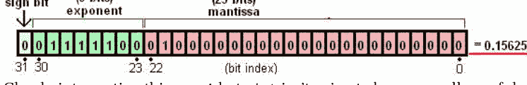

显然，将此解释为 4 字节的 `int` 并不是一个普遍有用的做法。如果你尝试将 `float` 强制转换为 `int`，你会发现实际发生的情况：

```
float myVar1=41.9;
int myVar2=(int)myVar1;
printf("%d\n",myVar2);
```

结果是显示 41 – 浮点数被转换为整数并截断，得到 41。

如果你用 -41.9 试试，你会发现你得到的是 -41。

反过来也是这样工作的：

```
myVar1=(float)42;
printf("%f\n",myVar1);
```

此时 `myVar` 包含 42.0。请注意，有可能尝试将 `float` 或 `double` 强制转换为无法表示该值的 `int`，因为该值太大。这是“未定义行为”，但在实践中，最常见的选项是分配最大的整数值。

最后，由于动态强制转换的结果，没有基本方法可以通过强制转换获取组成浮点数的字节。要了解如何做，我们需要查看类型双关（type punning）和联合体（unions） – 参见第 15 节（Dive 15）。

### 结语

强制转换的概念起初是一种改变位模式解释方式的方法，但它很快不得不屈服于主动转换位模式的诱惑，以便使其在新类型中表示相同的数量。其他语言屈服于这种诱惑，创建了一组类型转换函数来完成这项工作。C 语言确实拥有看似类型转换函数的东西，但它们实际上是算术函数。例如，`round` 函数在将 `float` 四舍五入到整数时，其结果仍然是 `float`。如果你也希望将其转换为 `int`，那么你需要一个强制转换 – 哪怕只是一个隐含的强制转换。

## 第 4 节

# 表达式

> *“我不知道 2000 年的语言会是什么样子，*
>
> *但我知道它将被称为 Fortran。”*
>
> C.A. Hoare, 1982

在任何编程语言中，最重要的概念之一是表达式，C 语言为大多数事物都提供了表达式，知道如何使用它们是有效 C 编程的重要组成部分。可能会让你惊讶的是，曾经有一段时间表达式并不存在 – 它们是被发明出来的。普遍公认的第一个表达式实现是在 1957 年的 Fortran 中。John Backus 和他在 IBM 的团队研究出了如何将表达式编译为机器代码，同样的算法如今也在运行，将 C 表达式编译为机器代码。C.A. Hoare 可能对我们称之为语言的东西搞错了，但每一种现代语言中都有少许 Fortran 的影子。

## 表达式和语句

C 语言中只有两种类型的指令 – 表达式和语句。它们之间简单的区别在于，表达式会评估为一个结果，而语句不会。这两者之间的区别比这暗示的更微妙，但如果返回了一个结果，那么你所拥有的就具备包含在表达式中的能力，即使我们通常不认为这种结构是表达式。


例如，函数调用通常不被称为表达式，但如果它返回一个结果，它就是表达式。语句包括 `for` 循环、`if` 语句等，基本上是 C 的控制结构。在任何情况下，语句都不会评估为任何值，因此永远不是表达式。

### 那么什么是表达式？

这个想法很古老，可以追溯到如何记录算术运算的缓慢发明过程。简单的算术运算只有四个运算符 `+`、`-`、`x` 和 `÷`，分别对应加法、减法、乘法和除法。记录算术过程有多种可能的方式，但最常见的是使用 `infix` 符号（中缀表示法），其中运算符放置在其要操作的值之间。

例如，`2+3` 评估为 `5`，加号运算符 `+` 通过加法组合 `2` 和 `3`。

目前为止一切顺利，但像这样的表达式呢：

`2+3×4`

这意味着什么？

我们可以将其解释为 `2+3` 得到 `5`，然后 `5×4` 是 `20`。这种从左到右的实现表达式是完全有效的，即使它被今天的数学惯例判定为错误，因为在这些惯例中，乘法的优先级高于加法。

正确的实现是先进行乘法，即 `3×4` 得到 `12`，`2+12` 得到正确的结果 `14` 而不是 `20`。在不太可能的情况下，如果你对此不确定，你需要检查你的算术技能，而不是编程，因为这是来自基础数学，而不是 C 语言。

请注意，传统的数学符号很精致，它要求按照书写顺序之外的顺序执行运算。

这就是为什么最初在 Fortran 中实现表达式是一项巨大任务，也是为什么初学者很难学会如何计算甚至稍微复杂的算术的原因。

为了让人类更容易理解，我们发明了诸如 `BODMAS` – 括号、指数/幂、除法/乘法、加法/减法的助记符，以给出运算的优先级。请注意，括号总是最高优先级 – 你必须先评估所有括号再做其他任何事情。这意味着，即使你不知道运算符的优先级，你总是可以使用括号来强制顺序。

例如，

`2+(3×4)`

是默认顺序

而

`(2+3)×4`

是向左替代顺序。

你不必知道我们为什么这样写算术就能使用它，但一旦你注意到它的工作方式，你就忍不住会问为什么？

答案是分配律。

考虑一个表达式：

`3×2+3×4 = 6 + 12 = 18`

这与：

`3×(2+4) = 3×6 = 18`

给出相同的结果

我们注意到我们将 `2` 和 `4` 都乘以 `3`，并且我们选择先做加法，并通过“将乘法移出括号”来节省一次乘法。

`a×(b+c)` 等同于 `a×b+a×c` 被称为乘法的分配律，也是我们倾向于认为乘法比加法具有更高优先级原因。如果情况并非如此，并且我们严格从左到右评估 `3×2+3×4`：

`3×2+3×4 = 6 + 3 × 4 = 9 × 4 = 36`

那么分配律就不会成立。

换句话说，如果你想将：

`a×b + a×c = a×(b+c)`

视为“将 a 拉出到一个括号中”，那么你需要使乘法成为比加法优先级更高的运算。这个概念推广到其他运算符的行为及其分配的优先级。

## C 表达式

C 语言有许多运算符，远远超出了常见的标准运算符。一旦你开始扩展语言所具有的运算符范围，你就必须关注结合性（`associativity`）以及优先级（`precedence`）。

结合性简单来说是相同优先级的运算符被评估的顺序。如果你将注意力限制在简单的算术运算符上，结合性不是一个问题，因为 `(A+B)+C` 与 `A+(B+C)` 相同。

然而，当你继续考虑更通用的运算符时，它确实重要。例如，在 C 中，右移运算符 `A>>B` 将 `A` 向右移动 `B` 位。`(A>>B)>>C`，这意味着将 `A` 向右移动 `B+C` 位，与 `A>>(B>>C)`（将 `A` 向右移动 `B` 右移 `C` 位的结果）并不相同。

为了使此类运算的结果无歧义，C 将每个运算符定义为从左到右或从右到左结合，即右结合或左结合。`>>` 运算符从左到右结合，因为这意味着 `A>>B>>C` 是 `(A>>B)>>C`，这与 `A>>(B+C)` 相同。

C 中的每个运算符都有优先级和结合性，你需要知道这两者才能确定表达式的评估结果。你可以在下一页的表格中看到所有标准 C 运算符。

| 优先级 | 运算符 | 描述 | 结合性 |
| :--- | :--- | :--- | :--- |
| 1 | `++` | 后缀递增 `a++` | 从左到右 |
| | `--` | 后缀递减 `a--` | |
| | `( )` | 函数调用 `a()` | |
| | `[ ]` | 数组下标 `a[b]` | |
| | `.` | 通过引用选择元素 `a.b` | |
| | `->` | 通过指针选择元素 `a->b` | |
| 2 | `++` | 前缀递增 `++a` | 从右到左 |
| | `--` | 前缀递减 `--a` | |
| | `+` | 一元加 `+a` | |
| | `-` | 一元减 `-a` | |
| | `!` | 逻辑非 `!a` | |
| | `~` | 按位非 `~a` | |
| | `(type)` | 类型强制转换 `(int) a` | |
| | `*` | 解引用（间接访问） `*a` | |
| | `&` | 取地址 `&a` | |
| | `sizeof` | 求大小 `sizeof a` | |
| 3 | `*` | 乘法 `a*b` | 从左到右 |
| | `/` | 除法 `a/b` | |
| | `%` | 取模（余数） `a%b` | |
| 4 | `+` | 加法 `a+b` | 从左到右 |
| | `-` | 减法 `a-b` | |
| 5 | `<<` | 按位左移 `a<<b` | 从左到右 |
| | `>>` | 按位右移 `a>>b` | |
| | `<` | 小于 `a<b` | |
| | `<=` | 小于或等于 `a<=b` | 从左到右 |
| | `>` | 大于 `a>b` | |
| | `>=` | 大于或等于 `a>=b` | |
| 6 | `==` | 等于 `a==b` | 从左到右 |
| | `!=` | 不等于 `a!=b` | |
| 7 | `&` | 按位与 `a&b` | 从左到右 |
| 8 | `^` | 按位异或 `a^b` | 从左到右 |
| 9 | `|` | 按位或 `a|b` | 从左到右 |
| 10 | `&&` | 逻辑与 `a&&b` | 从左到右 |
| 11 | `||` | 逻辑或 `a||b` | 从左到右 |
| 12 | `? :` | 三目条件运算符（见后续的 `?:`） | 从右到左 |
| | `=` | 直接赋值 `a=b` | 从右到左 |
| | `+=` | 加法赋值 `a+=b` | |
| | `-=` | 减法赋值 `a-=b` | |
| | `*=` | 乘法赋值 `a*=b` | |
| | `/=` | 除法赋值 `a/=b` | |
| | `%=` | 取模赋值 `a%=b` | |
| | `<<=` | 按位左移赋值 `a<<=b` | |
| | `>>=` | 按位右移赋值 `a>>=b` | |
| | `&=` | 按位与赋值 `a&=b` | |
| | `^=` | 按位异或赋值 `a^=b` | |
| | `|=` | 按位或赋值 `a|=b` | |
| 13 | `,` | 逗号 | 从左到右 |
| 14 | `,` | 逗号 | 从左到右 |

## 编译时与运行时表达式

表达式的重要性在于，在 C 语言中任何可以使用值的地方，都可以使用表达式来获取该值。这就是为什么你可以编写：

```
int a = 2*2;
```

或者

```
int a = 2*b;
```

然而，这两者之间存在一个重要的区别。第一个表达式可以在编译时求值，而第二个表达式不能，因为我们可能根本不知道 `b` 的值。这是一个重要的区别，因为有时需要在编译时确定一个值。例如，如果你在文件级别声明一个数组，那么其大小必须在编译时已知，因为它是在编译时分配的。这意味着像这样的声明：

```
int myarray[2*b];
```

除非它位于函数或代码块内部，否则无法编译。请注意，即使可以从程序中推断出 `b` 的值（例如 `b = 4`），这一事实依然成立。常量表达式不能包含变量、自增或自减运算符或函数调用。

所有其他表达式都在运行时求值，其值在那之前是未知的。

## lvalue 和 rvalue

表达式产生结果，而结果必须存储在某处。赋值涉及两种类型的对象。左侧的对象必须是与某个地址相关联的对象，该地址可以存储结果——这通常被称为 `lvalue`。赋值右侧的对象必须是一个结果，即一个值，也就是可以存储在 `rvalue` 中的东西。这通常被称为 `rvalue`，因此赋值的形式为：

```
lvalue = rvalue
```

这就是该概念的起源，但随着时间推移，它发生了一些演变。现在，`rvalue` 是指没有明确内存位置的东西。例如，`a+b` 是一个表达式，其结果并没有存储在特定的位置。显然，`rvalue` 可以出现在赋值的右侧。在这种扩展意义上，`lvalue` 是指具有明确可识别位置的任何东西。你还可以区分可修改的 `lvalue` 和常量 `lvalue`。在这个意义上，`lvalue` 可以出现在赋值的右侧，但左侧必须是一个可修改的 `lvalue`。

`lvalue` 和 `rvalue` 这两个术语被广泛使用，不仅仅限于赋值语句，它们还经常出现在错误信息中。例如，如果你尝试：

```
&a = b;
```

你通常会看到报告的错误是“`&a` 是一个 `rvalue`”。

## 副作用与序列点

表达式应该只返回一个结果，而不改变程序中的其他任何内容。如果一个表达式导致其他事情发生，则称其具有“副作用”。在其他语言中，唯一的关注点是函数是否有副作用。例如，打印某些内容的函数具有预期的副作用，即打印某些内容。不产生副作用的函数被称为“纯函数”，C 语言中的函数可以是纯函数，但通常它们不是。

令人惊讶的是，在 C 语言中运算符可以具有副作用，因此即使不包含函数，表达式也可以具有副作用。例如，当一元自增运算符 `++` 用作后缀运算符时（如在 `A++` 中），它返回 `A` 的当前值。也就是说，它等同于仅仅写入 `A`，但其副作用是将 `A` 自增。换句话说，如果 `A` 是 `3`，那么执行 `B = A++` 后，`B` 被设置为 `3`，而 `A` 被设置为 `4`。请注意，这与相应的前缀一元运算符 `++A` 截然不同，后者的结果是 `A+1`，其副作用是将 `A` 自增。因此，如果 `A` 是 `3`，那么执行 `B = ++A` 后，`B` 被设置为 `4`，`A` 也被设置为 `4`。

请注意，后缀运算符 `++` 具有最高的优先级，并且从左到右结合，而作为前缀运算符时，其优先级为 `2`，并且从右到左结合。还要注意，`A++` 的含义与 `A+= 1` 相同。

正是运算符的这种惊人丰富性，使得 C 语言对任何愿意花时间掌握它的人极具吸引力。一段时间后，你可以编写如下表达式：

```
C += A++ + B++ + (D=++E) == F
```

这是什么意思？好问题，所以不要编写像这样的表达式。

还要注意，副作用存在一些问题。以下代码：

```
i = i++;
```

是什么意思？

这一切都取决于自增相对于赋值发生的时间。问题是，表达式的副作用导致 `i` 的值被更改了两次，一次通过赋值，另一次通过后缀自增，而且副作用发生的顺序是不明确的。为了解决这个问题，C11 引入了“序列点”的概念，即表达式中的一个点，在该点之前遇到的所有副作用都被强制完成。这为副作用相对于运算符的顺序提供了保证。

任何完整表达式的末尾显然必须是一个序列点。初始化器的末尾也是一个序列点，逗号运算符和表达式中的任何函数调用也是如此。然而，请注意，函数调用的顺序并不总是规定的，而参数求值的顺序从未被规定。

在 `printf` 中每个格式说明符求值后都有一个序列点，以避免你正在求值的表达式以未定义的方式相互作用。

逻辑或 和 逻辑与 运算符，`||` 和 `&&` 是序列点，因为它们与其他运算符的求值方式不同。对于或运算，如果左侧表达式为真，则右侧表达式不会被求值，因为结果已知为真。类似地，对于与运算，如果左侧表达式为假，则右侧表达式不会被求值，因为结果已知为假。这被称为“短路”或“惰性”求值。然而，在这两种情况下，左侧表达式（包括副作用）都在右侧表达式求值之前完全执行。请注意，如果右侧表达式有任何副作用（包括抛出错误），在短路求值时这些副作用将不会发生。

例如，在以下代码中：

```c
int result = a||b++;
```

如果 `a` 为真，则 `b` 不会被自增，而在以下代码中：

```c
int result = a|| b/0;
```

如果 `a` 为真，则不会发生除以零的错误。

出于类似的原因，条件表达式也是一个序列点。第二个或第三个表达式在求值之前，第一个表达式已经完全求值，包括其副作用。也就是说，`a?b:c` 中的 `?` 是一个序列点。

到目前为止，序列点只是告诉你何时可以期望副作用完成，但它们并不能帮助解决以下问题：

```c
i=i++;
```

序列点位于表达式的末尾，但副作用是作为先赋值后自增，还是先自增后赋值发生，仍然不明确。为了解决这个问题，C11 标准还引入了使表达式合法必须满足的两个条件：

> *在前一个序列点和后一个序列点之间，对象在表达式的求值期间其存储值最多只能被修改一次。此外，先前的值只能被访问以确定要存储的值。*

这两个规则使得 `i = i++` 成为未定义行为，因为该变量的值被更改了不止一次。

第二个条件还使得像这样的表达式：

```
array[i]=i++;
```

成为未定义行为，因为即使 `i` 只被修改了一次，其原始值被用来确定结果存储的位置，而不仅仅是结果是什么。

许多程序员发现 C 语言的序列规则难以理解和应用，但这其实不是问题。如果你的代码让你去思考序列点的作用或适用的条件，那么你可能正在编写不应该编写的表达式。

## 自动提升

在理想世界中，你会选择表达式中的类型，并期望表达式以尽可能高效的方式使用这些类型进行求值。然而，硬件的灵活性不足以使这成为一种现实可能性。在所有情况下，硬件都有一个首选的操作类型。关键因素是算术逻辑单元（ALU）中寄存器的宽度。即使是 64 位计算机，处理 32 位数据通常也比处理 64 位值更容易。64 位主要指的是支持 64 位寻址，而非 64 位数据处理。

一般来说，`int` 应该是任何给定机器上算术运算的最佳类型。在大多数现代机器上它是 32 位，但就在不久之前，16 位还是标准。

当你要处理两种比 `int` 小的数据类型时会发生什么？为了提高效率，它们会根据通常的强制转换规则自动提升为 `int`——即无符号类型进行零扩展，有符号类型进行符号扩展。例如：

```c
unsigned char myChar = 255;
int myInt;
myInt = myChar*255;
printf("%d",myInt);
```

在这种情况下，结果 `65025` 会被打印出来，因为尽管算术运算应该会溢出，但在执行计算之前，两个值都被转换成了 `int`。该表达式的求值方式相当于：

```
myInt = ( int ) myChar* ( int ) 255;
```

如果存在比 `int`“更大”的类型，则会隐式执行强制转换，将所有内容提升为表达式中涉及的最大尺寸。顺序如下：

`int < long < long long < float < double < long double`

无符号类型的级别与其对应的有符号类型相同。

`56`

这些被称为“常规算术转换”的规则看起来相当复杂。C99 标准规定如下：

1. *如果两个操作数具有相同的类型，则无需进一步转换。*

2. *否则，如果两个操作数都具有有符号整数类型，或者都具有无符号整数类型，则具有较低整数转换等级类型的操作数将转换为具有较高等级类型的操作数的类型。*

3. *否则，如果具有无符号整数类型的操作数的等级大于或等于另一个操作数类型的等级，则具有有符号整数类型的操作数将转换为具有无符号整数类型的操作数的类型。*

4. *否则，如果具有有符号整数类型的操作数的类型能够表示具有无符号整数类型的操作数类型的所有值，则具有无符号整数类型的操作数将转换为具有有符号整数类型的操作数的类型。*

5. *否则，两个操作数都转换为与具有有符号整数类型的操作数的类型对应的无符号整数类型。*

该规范中最令人担忧的部分是第 3 点，因为将有符号整数转换为相同等级的无符号整数似乎会使算术运算失效。你必须记住，即使将值视为无符号，二进制补码算术运算也能正常工作。

例如：

```c
unsigned int myUnsigned = 1;
int myInt = -1;
myInt = myInt + myUnsigned;
printf("%d \n", myInt);
```

在这种情况下，有符号 `int` 被转换为无符号，这看起来我们将得到答案 `2`，因为负数丢失了。但这并不是其工作方式。有符号 `int` 被转换为具有相同位模式的无符号 `int`。相加时发生溢出（rollover），结果在二进制补码中是相同的。也就是说，它打印 `0`，我们得到了正确答案。

这并不意味着你不能得到错误的答案。例如：

```c
unsigned int myUnsigned = UINT_MAX;
int myInt = 1;
myInt = myInt + myUnsigned;
printf("%d \n", myInt);
```

在这种情况下，你仍然会看到打印出的零，而在这种情况下，这很可能是错误的答案。同样，我们拥有相同的位模式。将 `UINT_MAX` 视为有符号 `int` 时为 `-1`，因此最终结果是零。

要得到正确答案，我们需要显式使用到 `long long` 的强制类型转换：

```c
unsigned int myUnsigned = UINT_MAX;
int myInt = 1;
long long mylong = (long long)myInt + (long long)myUnsigned;
printf("%lld \n", mylong);
```

事实上，我们不需要将 `myInt` 转换为 `long long`，因为规则会将其提升为与 `myUnsigned` 相同的类型。

请注意，这些强制类型转换仅在表达式中执行，包括比较运算符和按位运算符。它们不会在执行赋值运算符时进行。在大多数情况下，涉及混合类型的表达式的结果会给你正确的答案，但如果不确定，请使用显式强制类型转换。

然而，一种常见的惯用法是依赖规则将整数算术转换为浮点算术。例如：

```c
int myInt = 1;
float ans = myInt / 100;
```

得到的答案是 `0`，因为整数除法在结果转换为 `float` 之前执行。但是：

```c
int myInt = 1;
float ans = myInt / 100.0;
```

得到的结果是 `0.01`，因为现在字面量是一个 `float`，因此 `myInt` 会自动转换为 `float`。

## 一些怪异之处


表达式的整体理念非常直观，你几乎肯定不需要导游般地遍历 C 的所有运算符及其交互方式。然而，有一些奇怪且几乎不可能的事情你可能没有注意到。它们都不具备目标明确的优点，但你会在别人的代码中遇到它们。

### 赋值是一个运算符

当你写 `a=b` 时，这就像一个 `a+b` 一样的表达式，其结果是存储在 `b` 中的值或右侧表达式的值。也就是说，`a=b` 取 `a` 和 `b` 并产生结果 `b`。作为副作用，它还将 `a` 设置为存储在 `b` 中的值，这通常是你假设赋值所做的事情！请注意，这意味着 `a` 本身不能是一个表达式。

这有什么优势？

最明显的是，你可以用它来设置多个变量：

```c
a = b = c = 2*2;
```

这将 `a`、`b` 和 `c` 都设置为 4。

你可以在表达式中使用变量，甚至包括正在被赋值的变量：

```c
int b = 3;
a = b = c = 2*b;
```

因为表达式在副作用执行之前就已计算出结果。这将所有变量设置为 **6**。

另一种用途是在计算条件时保存结果。例如：

```c
int a, b = 0;
while( (a = 2*b) < 10) {
    b = b + 1;
}
```

`while` 循环内的赋值将 `a` 设置为 `2*b`，并求值为 `2*b`，然后将其与 **10** 进行比较。在循环结束时，你会发现 `a` 是 **10**，`b` 是 **5**。有人认为这是令人困惑的，但它避免了不得不两次计算表达式。简而言之，你可以测试一个表达式并保存其值。

请注意，所有赋值运算符都按这种方式工作。例如：

```c
int a = 0, b = 0;
b = a += 1;
```

将 `a` 和 `b` 设置为 **1**。

你甚至可以做到：

```c
int a = 1, b = 2;
b += a += 3;
```

这被评估为：`a` 被设置为 `a` 的内容加上 3，赋值返回 **4** 作为其结果。然后 `b` 被设置为 `b` 的内容加上右侧表达式，即 **4**。结果 `a` 被设置为 **4**，`b` 被设置为 **6**。

你可以看到，这与以下内容相同：

```c
b = (a = a + 3);
```

但当然，你无法使用这种形式，因为你不能给 `a+b` 赋值。最好不要使用如此令人困惑的结构。

### 逗号

逗号运算符可能是 C 中最令人困惑的。逗号只有在它是表达式的一部分时才被视为运算符：

```c
expression1, expression2;
```

首先评估 `expression1`，结果被丢弃。然后评估 `expression2`，并将其作为结果返回。这与赋值的工作方式非常相似，但没有副作用。

例如：

```c
int ans = 1 + 2, 3 + 4;
```

这会评估 `1+2` 并忽略结果，然后评估 `3+4` 并将此结果存储在 `ans` 中。

使用逗号的大问题不在于它的功能，而在于弄清楚你需要它做什么。显而易见的答案是，当表达式的副作用比结果更受你关注时，你需要它。

例如：

```c
int ans = i++, a + i;
```

首先对 `i` 进行自增，然后将 `a+i` 存储在 `ans` 中。

你可以给赋值加上逗号，以便为条件设置初始条件。即：

```c
while (setup, (a = expression) < 0);
```

其中 `setup` 是正确评估表达式所需的某些操作。对于一个简单但古怪的例子：

```c
int a = 1, b = 2;
while (printf("%d\n", b), (a = b) < 10) {
    b++;
};
```

在这种情况下，调用了 `printf`，由于 `printf` 是一个函数，因此它也是一个表达式。然后 `b` 被赋值给 `a`，并对 `b` 的值进行测试。

以这种方式编写代码没有意义，`printf` 完全可以放在循环体中。通常你会发现逗号运算符被用于在测试当前状态之前必须调用函数进行初始化的地方。如上所述，这不是推荐的结构，但你会发现它在使用中。

### 三元运算符

三元运算符通常作为 `if ... else` 结构的快捷方式被引入。它很容易理解：

```
(condition) ? TrueExpression : FalseExpression
```

如果条件为真，则表达式评估 `TrueExpression`，否则评估 `FalseExpression`。这可以被视为以下内容的表达式等效形式：

```c
if(condition){
    variable = TrueExpression;
} else {
    variable = FalseExpression;
}
```

但请注意，`if` 语句必须使用变量来分配结果，也就是说，`if` 语句不是一个表达式。这意味着你可以在任何可以使用简单值的地方使用三元运算符。例如：`printf("%d\n", (ans>0) ? ans : -ans);` 即使 `ans` 为负数，也将其作为正数量打印。显然，你无法在三元运算符中包含任何语句，即没有循环或条件语句，但这并不是一个真正的限制，因为你始终可以定义一个包含语句的函数并在表达式中使用它。谨慎使用时，三元运算符可以使程序的逻辑更容易理解。使用过多则会使逻辑无法跟随。

### 双重否定 `!!` 操作

C 处理逻辑运算的方式有点奇怪。任何零值都被视为 False，任何非零值都被视为 True。这是合理的，但如果你使用任何逻辑运算符，结果总是 0 或 1。例如：

```c
int c = 42 || 43;
```

将 `c` 设置为 1。在许多使用相同宽松 True 和 False 定义的语言中，`c` 将被设置为 42 – 仍然是 True 的表示。不同之处在于，C 在逻辑运算中将一般值“归一化”为 0 和 1，而其他语言并不这样做。False/True 的 0/1 表示法在 C99 中随着 `Bool` 数据类型的引入而正式化。头文件 `stdbool.h` 还提供了 `bool` 作为 `_Bool` 的用户友好别名，以及宏 `true` 和 `false`。如果你想在早期版本的 C 中使用 `true` 和 `false`，你可以定义自己的类型和常量：

```c
typedef int bool;
#define TRUE 1
#define FALSE 0
```

请注意，逻辑表达式也使用自动提升。例如：`42 || 43;` 可以被视为：`(int)((int)42 || (int)43);` 现在我们可以检查 `!!myVar` 操作。这只是两次应用 NOT 运算符。第一次它取反变量，如果 `myVar` 非零则产生 0，如果 `myVar` 为零则产生 1。第二次应用取反此结果，因此如果 `myVar` 为零，`!!myVar` 为 0，否则为 1。换句话说，`!!` 将值归一化为 0 或 1，即 false 或 true，有时这很重要。

## 向下递减操作 `-->`

首先要说明的是，并不存在所谓的“向下递减运算符”——这是对两个标准运算符的一种奇怪且容易引起误解的组合使用。例如：

```c
int x = 10;
while (x--> 0)
{
    printf("%d\n", x);
}
```

人们常常富有想象力地将其读作“当 x 递减至零时”，它确实会打印出 0 到 9，但这并非因为使用了向下递减运算符。循环中的条件：`x--> 0` 实际上是 `(x--) > 0`，即先对 `x` 的值进行自减，然后与 0 进行比较。这种错觉归功于 C 语言运算符优先级的规则，允许你省略括号。

## 深入探索 5：比特与更多比特

> *全世界所有的书所包含的信息量，都不超过一座大城市一年内通过视频传播的信息量。*
>
> *并非所有的比特都具有相同的价值。*
>
> – 卡尔·萨根

这一切确实都是关于比特 `bits`，对于 C 语言程序员来说，没有任何东西比特更重要。使用其他语言时，你可以与现实抽象得如此遥远，以至于可以完全忘记比特的存在。当然，你选择 C 语言意味着你并不希望这样做。如果你在编程硬件或与操作系统交互，单个比特往往是你关注的重点，而处理它们就引出了**位操作** `bit manipulation` 这一主题。

### 比特寻址

你可能会认为有一种直接访问比特的方式，但事实并非如此。原因很简单：硬件通常一次访问一组比特。内存被划分为多个存储位置，每个位置对应于特定地址的一组固定数量的比特。也就是说，当你提供一个内存地址时，你指定的是一组比特——地址很少指向某个特定的比特。你当然可以构建一台单比特宽度的计算机，但那样会非常缓慢且不切实际。

出于历史原因，最小可寻址的比特组通常是一个字节 `byte`，即 8 个比特，但再次强调，这在理论上没有必然原因，只是一个便于操作的合理数值。最常见的硬件，如 `x86/64` 和 `ARM`，使用字节寻址，但它们实际上可能会以更大的块来处理内存。常用的术语如下：

- 字节 `byte` = 8 比特
- 字 `word` = 2 字节 = 16 比特
- 双字 `double word` = 4 字节 = 32 比特
- 四字 `quad word` = 8 字节 = 64 比特

但这种用法并不通用，也没有相关标准规定，因此在任何特定情况下都需要自行核实。

关于寻址实际如何工作以及什么是高效的整个讨论，非常依赖于所使用的硬件。内存缓存 `memory cache` 的实现也使情况变得复杂，因为无论当前处于何种寻址模式，通常都会以 8 字节 `双字` 为单位读取和写入内存。换句话说，你可能认为自己在读取或写入一个字节、字或双字，但硬件会为了效率而自行其是，并尽力将此细节隐藏起来。

所有这一切意味着，你无法抽象地推理出读取某些比特最有效的方法可能是哪种。对于哪种方式更快——字节访问、字访问、双字访问还是四字访问——可能没有简单的答案，因为机器的内存架构可能不如所使用的缓存大小和类型重要。例如，在大多数情况下，顺序读取字节比读取在内存中相隔 8 或 16 字节的字节更快。原因是顺序字节通常可以直接从缓存中读取而不需要重新加载，而间隔较大的读取操作可能会在每次操作时触发缓存重新加载。即使这也并不确定，因为它取决于缓存的填充程度以及可用的空闲空间。

如果你关心访问一组字节的速度，唯一确认的方法是运行基准测试 `benchmark`。你无法仅通过考虑寻址模式来推导性能。话虽如此，通常需要将地址对齐到字或双字边界。例如，如果地址从 0 开始，则下一个字节位于地址 1，下一个字位于 2，下一个双字位于 4，下一个四字位于 8；通常情况下，字的起始地址可被 2 整除，双字可被 4 整除，四字可被 8 整除。

### 位运算符

C 语言拥有一组旨在让你执行位操作的运算符。共有四个位运算符：

| 运算符 | 符号 |
| :--- | :--- |
| 与 `AND` | `&` |
| 或 `OR` | `\|` |
| 异或 `XOR`，exclusive or | `^` |
| 非 `NOT` | `~` |

正如预期的那样，`NOT` 运算符具有最高的优先级。注意，还有相应的布尔运算符，`&&`、`||` 和 `!`，它们仅适用于布尔值——零表示假，任何非零值表示真——而不适用于比特模式。

位运算符适用于整数类型。例如：

```c
int a = 0xF0;  
int b = 0xFF;  
int c = ~a & b;  
printf("%X\n", c);
```

这里首先计算 `a` 的按位取反，即 `0x0F`。然后将其与 `b` 进行按位与操作，即 `0x0F & 0xFF`，结果为 `0x0F`。`%X` 格式说明符以十六进制打印数值。你可以使用 `%x` 表示小写十六进制，使用 `%d` 表示十进制。

### 有符号 vs 无符号

现在我们要来到一个微妙且麻烦的点。位运算符仅对无符号值有唯一明确的定义。原因是无符号值在二进制中 representation 是明确且无歧义的，因此操作在比特模式所代表的数值层面上定义良好。

即：

```c
unsigned int value = 5;
```

始终表示为 `0101`，因此：

```c
value | 0x2
```

不仅始终是 `0111`，而且始终代表 +7。

对于有符号值，情况并非如此，仅仅因为负数的表示方式并未固定。最常见的表示方法是补码 `two’s complement`，但在 C23 标准之前，这并非 C 语言标准的一部分，因此对无符号数进行逻辑操作是依赖实现的。C23 标准改变了这一点，使补码成为负数的强制表示方式，但这需要一段时间才能广泛生效。请注意，这并不意味着对有符号值进行逻辑操作是未定义行为 `undefined behavior`——如果是那样，大多数 C 程序将无法正常停止工作。此外，“依赖实现” `implementation-dependent` 有一个相当一致的含义：

> 取代表该值的比特模式，并假定所涉及的一切都是无符号值，执行指定的逻辑操作。

这是处理该问题唯一合理的方式，也是你完全预期的结果。

例如：

```c
signed int value = -5;
```

如果机器使用补码表示，则比特模式为：

```text
11111111111111111111111111111011
```

并且：

```c
value | 0x4
```

将第三位改为 1，即补码中的 -1。

只要你假设有符号值具有特定的表示方式，那么逻辑操作通常就是定义良好的，因为它是在比特模式上按位应用运算符的结果。是表示方式依赖于实现，而不是操作本身。

### 掩码 `Masks`

位操作是访问单个比特的关键。我们通常将其视为设置或清除特定比特，或测试其状态。你可以使用另一个值 `通常称为掩码` 来设置和清除比特，该掩码定义了要更改的比特。从这个意义上说，掩码中的比特充当了你想要操作的比特的地址。例如，如果你只想更改第一个 `最低有效` 比特，则掩码应为 `0x01`。如果你想更改第一和第二比特，掩码应为 `0x03`，依此类推。也就是说，掩码将你要访问的比特置为 1，所有其他比特置为 0。

掩码给出了你要操作的比特的地址，而对那些比特做什么取决于你使用哪种操作将掩码与值结合。例如：

```c
value | mask;
```

返回一个比特模式，其中与掩码中相同的比特被置为 1。注意，掩码未指定的比特 `即掩码中为 0 的比特` 保持其原始值不变。

如果你对掩码执行 OR 操作，会将寻址到的比特置为 1，并保留其他所有比特不变。例如：

```c
int mask = 0x03;
int value = 0xFFF0;
int result = value | mask;
printf("%X\n", result);
```

将 `result` 设置为 `0xFFF3`，即将前两个 `最低有效` 比特置位。

同样地，如果你使用：

```c
value & ~mask;
```

那么掩码中指定的位会被设置为零。

将结果设置为 `0xFFFC`，即清除前两位。

除了设置和清除特定位之外，你可能还希望“翻转”指定的位，即对它们取反，使得如果该位为 1 则变为 0，反之亦然。你可以使用异或 `XOR`，exclusive or 运算符来实现：

```c
value ^ mask
```

这会翻转掩码指定的位。例如：

```c
int mask = 0x03;
int value = 0xFFFF;
int result = value ^ mask;
printf("%X\n",result);
```

将结果设置为 `0xFFFC`，因为它将低两位从 1 变为 0。同样，掩码未指定的位不受影响。

如果你想更新标志位而不是导出一个新的结果，可以使用：

```c
&= 
|= 
^=
```

来直接执行更新。例如：

```c
int value = 0xFFFF;
int value ^= 0x03 ;
printf("%X\n",value);
```

总结一下：

- 创建一个掩码，在你想要更改的每一位的位置上置 1。
- 要设置指定位，将掩码与值进行 OR 运算。
- 要清除指定位，将掩码的 NOT 与值进行 AND 运算。
- 要翻转指定位，将掩码与值进行 XOR 运算。

掩码中为 0 的位不受任何操作的影响。

## 一个用于写入位的函数

让我们将这些操作合并到一个单一的 `bitWrite` 操作中，该操作使用掩码来指定要更改的位，并使用数据值来指定每个位应该被设置为什么。如果你将掩码视为要更改的位的地址，那么这就将数据写入这些位且仅写入这些位。

例如：

```
int mask = 0x03; //011
```

指定前两位应该被修改，并且：

```
int data = 0x02; //010
```

指定第一位应该设置为 0，第二位应该设置为 1。

找出如何做到这一点的关键在于构建两个掩码：一个用于设置需要设置的位，另一个用于清除需要清除的位。

如果某位要被设置，它需要在掩码中为 1，并在数据中为 1，那么用于设置位的掩码是：

```
setmask = mask & data
```

如果某位要被清除，它需要在掩码中为 1，并在数据中为 0，所以用于重置位的掩码是：

```
resetmask = mask & ~data
```

将两者应用到值上即可得到所需结果：

```
(value | setmask) & ~(resetmask) =
(value | (mask & data)) & ~(mask & ~ data)
经过简化后为：
value & ~mask | mask & data
```

利用这一点，很容易创建一个函数来完成这项工作：

```
int bitWrite(int value, int mask, int data)
{
  value = value & ~mask | mask & data;
  return value;
}
```

例如：

```
printf("%b\n", bitWrite(0xFF, 0x0F, 0x05));
```

掩码意味着只有前四位被修改，而数据将它们设置为 0101，结果是 11110101。

你可以使用 `bitWrite` 将任何一组位设置为任何值。

## 读取位

到目前为止，我们专注于写入位，但我们也经常想要读取位模式，方法大致相同，并依赖于掩码。与之前一样，如果你创建一个掩码，其中对应的位设置为 1，以表示你想读取的位，那么：

```
value & mask
```

当且仅当 `mask` 指定的所有位都是 `0` 时返回 `0`。

类似地：

```
~ value & mask
```


当且仅当 `mask` 指定的所有位都是 `1` 时返回 `0`。

通常，你只想测试单个位。例如：

```
int value = 0x1F;
int mask = 0x10;
int result = ~value & mask;
```

测试 `value` 中的第五位，它是 `1`，因此 `result` 是 `0`。

如果你使用以下代码测试第五位是否为 0：

```
int value = 0x1F;
int mask = 0x10;
int result = value & mask;
```

那么结果是非零的，确切地说是 `16`。

如果你想将测试结果转换为布尔值，可以使用逻辑运算符 `!`。例如：

```
!(~value & mask)
```

当且仅当 `value` 中由 `mask` 指定的所有位都是 `1` 时为 `true`，否则为 `false`。

类似地：

```
!(value & mask)
```

当且仅当 `value` 中由 `mask` 指定的所有位都是 `0` 时为 `true`，否则为 `false`。

如果你只是想读取掩码指定的位，只需将其与值进行 AND 运算：

```
value & mask
```

例如，要读取最低四位，可以使用：

```
result = value & 0x0F;
```

## 移位值

读取位时的一个非常常见的要求是将它们移动到组内的合适位置。为此，你需要移位运算符。`<<` 运算符将位模式向左移动，向低位位移入零。因此，例如：

```
int data = 0x0F;
int result = data << 4;
```

将 `data` 中的位模式向左移动四位，因此 `result` 包含 `0xF0`。

不要尝试指定负移位，因为这是未定义行为。

类似地，`>>` 运算符向右移位，但关于移位到新位位置的内容有一个小麻烦。发生什么取决于被移位的值是带符号的还是无符号的。对于无符号值，0 会被移入最高位。对于带符号值，移入的是与该位相同的位。也就是说，如果最高位是 1，那么 1 会被移入空位；如果是 0，则 0 会被移入。

你可以看到，在带符号的情况下，右移位的动机是保持符号。也就是说，移位保持正数为正，负数为负。这种移位通常被称为算术移位，区别于总是移入 0 的逻辑移位。你可以通过将值强制转换为无符号类型来始终强制进行逻辑移位。

注意左移位总是移入 0，但这可能会改变值的符号，因为新位成为符号位。例如：

```
int data = 0x0F;
int result = data >>3;
```

将 `data` 中的位模式向右移动三位，因此 `result` 包含 1，因为 1111 向右移动三位是 0001。

对于整数，向左移位一位等同于将值乘以 2，向右移位一位等同于整数除以 2，但仅适用于正值。例如：

```
int data = 1;
int result = data <<1;
```

在 `result` 中存储 2，并且：

```
int data = 8;
int result = data >>1;
```

在 `result` 中存储 4。

对于负值，情况稍微复杂一些。如果你尝试：

```
int data = 7;
int result = data >>1;
```

那么 `result` 是 3，这与整数除法得到的结果相同，即 3.5 被截断或向下舍入为 3。但是，如果你尝试：

```
int data = -7;
int result = data >>1;
```

你会发现 `result` 是 -4。这不是整数除法的结果，因为截断后会得到 -3。右移位相当于除以 2，但舍入到下一个更小的负整数。这是一个微妙点，经常导致错误。

这种行为的原因是符号位的扩展方式。例如：

```
int data = -1;
int result = data >>1;
```

在 `result` 中存储 -1。原因是初始位模式全为 1，即 32 位全部设置为 1，因此向右移动一位会在高位移入另一个 1。也就是说，-1 等同于 `0xFFFFFFFF`，符号位是 1，所以右移会将 1 移入高位，再次得到 -1。

对比以下情况：

```
unsigned int data = -1;
int result = data >>1;
```

在这种情况下，零会被移入高位，存储在 `result` 中的值是零后面跟着 31 个 1，这是一个等于 2147483647 的正值。注意，-1 在 `data` 中存储为 `0xFFFFFFFF`，但当存储在 `unsigned int` 中时，它被解释为一个正值。移位的结果是 `0x7FFFFFFF`，当分配给带符号 `int` 时是一个正数。这意味着你可以使用右移和左移，或者乘以和除以 2，来几乎做同样的工作，只需小心处理负值。移位比乘法和除法快得多，因为硬件通常支持寄存器中的直接移位操作。

如果你想在带符号值上进行逻辑右移，最简单的实现方式是使用强制转换：

```
int data = -1;
int result = (unsigned int) data >>1;
```

你还可以使用 `<<=` 和 `>>=` 就地移改变量的值。例如：

```
int data = -1;
data <<= 1;
```

将 `data` 中的位模式向左移动一位，并将结果存储在 `data` 中，即向左移动 `data` 一位。

## 显著位

当我们将一组位视为一个位模式时，我们仍然倾向于称之为最高有效位和最低有效位，尽管这些术语实际上只适用于将位模式解释为数字的时候。最高有效位与位值系统中最大的 2 的幂相关，而最低有效位则与最小的幂相关。按照惯例，我们将最高有效位写在最左边，遵循我们书写十进制位值数字的方式：

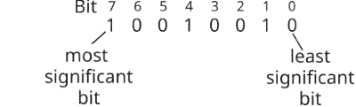

你可以为位模式中的所有位分配一个数字，从最低位开始。你可以使用位位置作为地址吗？可以，因为从位位置 p 生成掩码非常简单：

```
mask = 1 << p
```

如果你想要对应于多个位置的掩码，你可以使用：

```
mask = 1 << p1 | 1 << p2 | 1 << p3 ...
```

这并不是一种常见的需求，但在创建与通常以位位置定义的硬件寄存器相关的代码时，它可能非常有用。

## 字节序

在位操作中经常会出现的一个问题是字节序（Endianism），它与位位置和字节寻址的概念密切相关。当你设计一台计算机时，需要进行选择。如果一个字的各个部分，比如每个字节，都有单独的地址，你是将低位字节存储在低地址（小端序），还是存储在高采地址（大端序）？

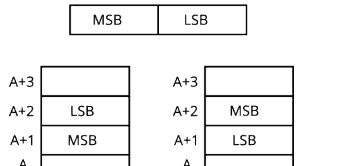

虽然这被表述为一个与整数相关的问题，但它适用于任何被拆分为字节的位模式——你以什么顺序重新组装它们。它也适用于通过任何通信链路发送的字节——最高有效字节是先发送还是后发送？

通常你可以忽略字节序，因为机器会为你处理这个问题。如果你保存一个 16 位整数，它会按照机器使用的顺序保存，当你检索时也会遵守相同的顺序。通常，字节序只有在从外部来源（如硬件、文件或通信链路）逐字节获取字节时才有影响。在程序内部，只有当你别名指针或使用联合体时，字节序才有影响，参见 Dive 15。

例如，考虑一个 2 字节整数并将其别名为一个 2 字节数组。

```
union endian{
    unsigned short myint;
    unsigned char mychar[2];
};
test.myint=0x00FF;
printf("%x\n",test.mychar[0]);
printf("%x\n",test.mychar[1]);
```

联合体将 `myint` 和 `mychar` 别名。然后我们设置 `myint`，使其八个低位全为 1。如果机器是小端序，例如 x86 和 ARM，那么低位字节存储在 `mychar[0]`。如果机器是大端序，例如 Atmel AVR32，低位字节存储在 `mychar[1]`。

例如，创建一个联合体来访问无符号 32 位整数中独立颜色通道 ARGB（Alpha、Red、Green 和 Blue 值）的分量，这是会根据字节序变化的一个例子。由于 A 是最高字节而 B 是最低字节，你可能会期望联合体如下：

```
union Pixel{
    struct {unsigned char a,r,g,b};
    uint32_t value;
};
```

这在大端系统上有效，因为 b 作为最低有效字节在联合体中拥有最高的地址。

然而 x86 和 ARM 是小端序。因此 ARGB 字节以相反的顺序存储，a 在联合体中拥有最低的地址：

```
union Pixel{
    struct {unsigned char b,g,r,a};
    uint32_t value;
};
```

这也是一个数据在大多数互联网协议（如 IPv4、IPv6、UDP、TCP 等）中以大端格式传输时的问题。这意味着，如果你使用的是小端格式机器，在使用几乎任何互联网协议发送 16 位整数时，你需要先发送 `mychar[1]` 再发送 `mychar[0]`。也就是说，变化的是数据发送和接收的顺序，而不是地址本身。

请注意，某些机器同时支持大端和小端，你可以选择使用哪一种。不同的数据格式（例如整数和浮点数）也可以采用不同的顺序。当你使用内存映射设备时，也会遇到哪个字节先行的问题。在这种情况下，仔细阅读数据手册通常可以解决问题。如果你得到奇怪的结果并且正在逐字节处理数据，那么你需要考虑字节序。

## 循环移位

还有另一种形式的移位——左循环或右循环——尽管大多数处理器都有执行这种移位的指令（在一次操作中完成），但由于历史原因，C 语言没有循环移位运算符。

右循环移位将所有位向右移动，并将移出的最低有效位用作新的最高有效位。也就是说，最低位被移到了最高位。你可以看到这是对位的循环移动。

类似地，左循环移位将所有位向左移动，并将最高位移动成为新的最低位。同样，你可以看到这是相反方向对位进行循环移动。循环移位不对应于简单的乘法或除法，它们也不像左右移位那样在隔离位方面有用。它们的用途在于密码学和信号处理。

C 语言可能没有循环移位运算符，但使用左右移位和逻辑运算符来实现循环移位很容易。例如，右循环移位是：

```c
unsigned int data=0xF;
data= data>>1 | data<<31;
```

这个想法很容易理解。首先，我们执行右逻辑移位，使最高位为零。接下来，我们执行 31 次左逻辑移位，将最低有效位移动成为最高有效位。将两者按位或运算得到结果 `0x80000007`。

你可以看到一般原理。如果你想对一个 32 位整数进行 n 位的右循环移位，则使用：

```c
data = data>>n | data<<32-n;
```

类似地，如果你想对一个 32 位值进行 n 位的左循环移位，则使用：

```c
data = data<<n | data>>32-n;
```

注意，n 不能为负数或等于 32，因为这会触发未定义行为。还要注意 `data` 必须是无符号的，以便使用逻辑移位。

据说大多数编译器会检测上述惯用法，并在可能的情况下将指令转换为机器代码循环移位指令。GCC 会进行这种优化，但只有当你确保旋转是正数时才会如此。也就是说：

```c
unsigned int data=0x0F;
data= data>> (unsigned) 1 | data<< (unsigned)31;
```

编译为：

```
ror eax
```

其中 `ror` 是右循环移位指令。如果你省略无符号限定符，该行将编译为等效的右移和左移按位或运算。如果 C 有一个循环移位运算符会更好。

## 位域

位操作有一个替代方案——位域。位域是一种将存储分解为比字节更小单位的方法。你可以通过在字段定义后跟一个冒号和位数来在结构体中定义位域。例如：

```c
struct Bits{
int bit1:1;
int bit2:1;
};
```

创建了一个 `int`，比如说四个字节，但只有前两位被使用。这有点像联合体，但在这种情况下，位域共享这个 `int`。例如：

```c
struct Bits bits;
bits.bit1=1;
bits.bit2=1;
printf("%d\n",bits);
```

如果我们对该结构体进行小改动，你可以看到你可以处理不仅仅单个位的情况：

```c
struct Bits{
int byte:8;
int bit1:1;
int bit2:1;
}bits;
```

这将该 `int` 划分，使得前八个位称为 `byte`，接着是两个单比特字段。现在我们可以写：

```c
bits.bit1=1;
bits.bit2=1;
bits.byte=255;
printf("%d\n",bits);
printf("%d\n",bits.byte);
```

你会发现 `bits` 是 1023，而 `bits.byte` 是 -1。

由于共享的 `int` 是有符号 `int`，所以所有字段（包括单比特字段）也是有符号的：

```c
printf("%d\n",bits.bit1);
```

打印 -1。

标准对于位域 `int` 应解释为有符号还是无符号并不明确。

你可以使用以下方法改变单个字段的解释：

```c
struct Bits{ 
unsigned int byte:8;
int bit1:1;
int bit2:1;
}bits;
```

现在 `bits.byte` 打印 255，但 `bits.bit1` 仍然打印 -1。

你经常可以使用其他类型，而不仅仅是 `int`，但这超出了标准 C 的范围。如果你混合类型，通常使用最大的类型。例如：

```c
struct Bits{ 
unsigned char byte:8;
char bit1:1;
char bit2:1;
}bits;
```

通常为前八个位分配一个 `char`，为接下来的两个位分配另一个 `char`，使结构体的总大小为两个字节。通常最好在结构体内保持所有位域为相同类型。

一般来说，位域不使用填充，但如果你分配的位比 `int` 能表示的更多，则使用第二个 `int`。如果你想强制新分配，使位域对齐到地址边界，你可以包含一个大小为 0 的未命名位域。例如：

```c
struct Bits{ 
unsigned int byte:8;
int :0;
int bit1:1;
int bit2:1;
}bits;
```

分配两个 `ints`，`bits.byte` 占据第一个 `int` 的前八个位，`bits.bit1` 和 `bits.bit2` 位于第二个字节的开头。

你可以对位域形成表达式，任何结果都不会溢出到相邻的位域，即位域是隔离的。例如：

```c
bits.byte = 255;
bits.byte++;
```

导致 `bits.byte` 溢出并被设为零，但 `bits.bit1` 没有改变。


你可以看到，每次减法都会从右边第一个 1 位借位，并将其从 `value` 中移除，而按位与运算则移除了减法产生的低位 0 位——因此循环重复的次数等于位模式中 1 位的数量。

如果你没看明白，试着用其他位模式演练一下，并惊叹于有人发现了这种通用的方法，且提供了一种类计算位数的方法。这是富有创造力的位操作的典型特征。

## 能整除的最大 2 的幂

有时你需要知道能整除某个值的最大的 2 的幂。这简单地等于其二进制表示中第一个 1 之前的零的个数。例如，十进制 112 的二进制是 1110000，因此 $2^4$ = 16 是能整除它的最大的 2 的幂，且 $16 \times 7$ = 112。还要注意，十进制 16 的二进制是 0010000。也就是说，我们要找的 2 的幂只是二进制数中只有一个 1，且位置与原值中第一个 1 相同，即 1110000 $\rightarrow$ 0010000。

你可能注意到，这与统计值中 1 的个数非常相似，只是现在我们要统计第一个 1 之前的 0 的个数。类似 Kernighan 位计数法的技术也能起作用。

如果我们先找到该值的一补数（参见第 2 位），即 `~value`，我们就得到了一个在原始值为 0 的位置为 1 的值。将 1 加到这个值上形成 `~value+1`，进位将穿过所有的 1 位，直到它到达第一个 0 并将其转换为 1。

例如：

`~0111 0000 + 1 = 1000 1111 + 1 = 1001 0000`

如果我们将原始值与结果值进行按位与运算 `value & (~value+1)`，我们就得到了能整除 `value` 的最大 2 的幂。

`1001 0000 & 0111 0000 = 0001 0000`

我们可以简化这个表达式，因为 `(~value+1)` 只是 `value` 的二补数，对于有符号类型来说，这当然就是 `-value`。所以我们有：

能整除 `value` 的最大 2 的幂是 `value & -value`。

## 奇偶校验

如果 1 位的数量是奇数，则奇偶校验为 1；如果是偶数，则为 0。虽然有直接计算奇偶校验的方法，但位计数技巧的修改版本提供了一个很好的方法：

```c
unsigned int value = 4;
unsigned int parity = 1;
while (value)
{
    parity = !parity;
    value = value & (value - 1);
}
```

如果你遵循位计数的例子，这应该显而易见。

## 交换值

通常，如果你想交换两个值，你需要一个第三个变量来持有交换过程中的结果：

```c
int temp = a;
a = b;
b = temp;
```

你可以使用 XOR（异或）在不使用第三个变量的情况下进行交换：

```c
a = a ^ b;
b = b ^ a;
a = a ^ b;
```

如果你试一试，你会发现 `a` 和 `b` 的值已经交换了。理解其工作原理需要稍长时间！

## 无溢出平均值

考虑计算两个整数的平均值。完成这项任务的简单直接方式是：

```c
int average = (a + b) / 2;
```

这有一个问题——即使结果在可用位数内是可表示的，`a+b` 仍然可能溢出。乍一看似乎无事可做，但如果结果可以表示，通常有一种位操作方式可以在没有溢出风险的情况下计算它。

在这种情况下，我们需要注意到加法是一个简单的逻辑运算。如果你将两个值 `a` 和 `b` 相加，和的位是：

```c
a ^ b
```

而进位的位是：

```c
a & b
```

这就是半加器的实现方式。

例如：

| a | 1 | 0 | 1 |

|---|---|---|---|

| b | 0 | 1 | 1 |

| sum | 1 | 1 | 0 |

| carry | 0 | 0 | 1 |

为了得到最终结果，你需要将进位的位加到结果的下一个最高位。即左移并加法：

`110 + (001 << 1)`

得到 `1000`

即：

`a + b = (a ^ b) + ((a & b) << 1)`

因此：

`(a + b) / 2 = ((a ^ b) >> 1) + (a & b)`

这可以在没有溢出风险的情况下计算。

# 第 6 章：优秀但邪恶的 for 循环

> *“我们都知道 Linux 很伟大……它在 5 秒内运行无限循环。”*
> —— Linus Torvalds

如果你需要证明 C 是一种与机器无关的汇编语言，那么看看 `for` 循环吧。它比在其他语言中找到的 `for each` 或 `for in` 循环更底层，但却具有深远的巨大影响。C 的 `for` 循环如此有影响力，以至于它已经进入了 Java、JavaScript、Go 和许多其他高级语言。

C 的 `for` 循环之所以优秀，是因为它允许许多“创造性”的用法，而它之所以邪恶，原因也恰恰在此。更准确地说，它未能捕捉到枚举的基本思想。

## 循环动物园快速指南

在编程的早期，我们创建循环来重复指令。这在很大程度上是临时凑合的，很少有人会从代码面前退后一步去考虑发生了什么。后来，我们可以考虑重复某事这一整体思想，以及实际上有多少种不同类型的循环以及实际上需要多少种。

第一个主要区别在于枚举循环和条件循环。枚举循环只是做某事给定的次数。有时重复的次数由要处理的项目数量隐含决定，例如需要检查的数据结构中项目的数量。纯枚举循环通常写作具有不同抽象层次的 `for` 循环：

```
for i = 1 to 10
for each x in array
for each value in 1 to 10
```

等等。

一些语言甚至有像这样的枚举循环：

```
repeat 10 times
```

尽管这种形式并不特别灵活。

枚举循环的替代方案是条件循环，它重复某事直到满足一个条件。你可以通过问一个简单的区别这两种循环：“在循环开始之前，你是否知道循环将重复多少次？”如果知道循环在开始前将重复 x 次，那么你就有一个枚举循环。即使你确实有一个枚举循环，有时作为条件循环写起来更容易。

## 条件循环

条件循环有几种可能的形式，但常见的一种是：

```
初始设置
测试循环是否应该继续
	循环体
更新测试条件
循环结束
```

例如，使用 C 直接实现这种循环：

```c
int i = 0;                <-- 初始设置
loopStart:
   if (i >= 10)           <-- 测试循环是否应该继续
      goto loopEnd;
   printf("%d\n", i);    <-- 循环体
   i++;                  <-- 更新测试条件
   goto loopStart;
loopEnd:
   printf("end of loop"); <-- 循环结束
```

你可以清楚地看到循环的不同部分以及 `gotos` 如何被用来跳转到代码中的适当位置。不久之前所有的编程都是这样的，这反映了条件循环在汇编语言中的实现方式。今天，我们更喜欢使用高级语言结构，将所有部分捆绑到构造的固定部分中，这样你就不必浪费时间从头构建自己的循环。

## C 的 for 循环

上一节中的条件循环实际上是一个枚举循环，可以更容易地用 Basic 表达为：

```
for i = 0 to 9
   print(i)
next i
```

或者用 Python：

```python
for i in range(0, 10):
   print(i)
```

## C 的通用条件循环

C 语言采取的策略是，将通用条件循环的各个部分进行封装，而不是发明一个真正的枚举循环。C 的 `for` 循环（或者更准确地称为条件循环）如下所示：

```c
for(initial set up; test if loop should continue; update test condition){
    body of loop
}
```

当你编写 C 的 `for` 循环时，编译器会根据表达式构建一个条件循环。例如：

```c
for(i = 0; i < 10; i++){
    printf("%d\n", i);
}
```

等价于之前提到的条件循环：

```c
int i = 0;
loopStart:
    if (i >= 10) goto loopEnd;
    printf("%d\n", i);
    i++;
    goto loopStart;
loopEnd:
    printf("end of loop");
```

其中 `i = 0` 在循环开始前执行，`i < 10` 在循环开始时求值，仅当该条件为真时，循环体才会执行；而 `i++` 在循环结束时、下一次潜在迭代之前执行。请注意，`for` 循环中的条件必须为真，循环才会继续。而在前面的示例条件循环中，条件必须为真循环才会结束，这只是一个细微的差别。

在这种形式下，C 的 `for` 循环作为枚举循环是完全合格的。所有 C 程序员都会学习这种形式作为一种惯用法，并将其读作“`i` 从 0 到 9 重复的循环”。这就好像 C 的 `for` 循环被冻结在了一种受限但有用的形式中：

```c
for(index=startvalue; index=endvalue; index++){
}
```

你唯一需要改变的是 `startvalue` 和 `endvalue`，循环将从 `startvalue` 重复到比 `endvalue` 小 1 的值。在这种形式下，它确实是一个易于使用的枚举循环。从这里开始，大多数 C 程序员学会对其进行微小的变通以获得不同的效果。

例如：

```c
for(index = startvalue; index <= endvalue; index++){
}
```

生成一个从 `startvalue` 运行到（包括）`endvalue` 的枚举循环，而：

```c
for(index = startvalue; index >= endvalue; index--){
}
```

生成一个从 `startvalue` 向下运行到 `endvalue` 的枚举循环（假设 `startvalue > endvalue`），以此类推。

这些惯用法使得 C 的 `for` 循环对于初学者和非初学者来说都是可用的。它是一个与编译后底层汇编语言直接映射的 `for` 循环，因此非常出色。但它也有其阴暗面——它太灵活了。

### While 和 Until

`for` 循环非常通用，但它仅限于将出口点设置在循环的开头。这使得它相当于 `while` 循环。循环的区别在于它们放置出口点的位置，即测试循环结束位置的地方。这是循环领域的另一个区分特征——循环在出口点的数量及其放置位置上有所不同。`While` 循环在开始时测试，而 `until` 循环在结束时测试。

应该很清晰，两者的区别在于：`while` 循环可以在从未执行循环体的情况下退出，但 `until` 循环必须先执行循环体才能进行测试。你可以将其总结为：`while` 循环重复 0 到 *n* 次，而 `until` 循环重复 1 到 *n* 次。换句话说，`until` 循环必须至少执行一次。

C 语言有一个 `while` 循环，但它与 `for` 循环的特定形式完全等价。`while` 循环：

```c
while(condition){
}
```

与以下内容完全相同：

```c
for(;condition;){
}
```

并且，是的，只要有意义，你可以省略 `for` 循环的任何部分。实际上：

```c
for(;;)
```

是一个无限循环，常用于物联网应用和构建更通用的循环。因为没有指定条件，所以它永远不会结束。

C 语言还有一个 `until` 循环，将其转换为 `for` 循环比较困难：

```c
do{
    body of loop
}while(condition);
```

如果这是一个 `until` 循环，为什么它以 `while` 结尾？

答案是，在传统的 `until` 循环中，条件是为了结束循环。在传统的 `while` 循环中，条件是为了继续循环。你可以看出 `until = !while`，因为 `until` 结束循环，而 `while` 继续循环。

所以，尽管 C 的 `until` 循环将其出口点放在末尾，但它使用的是继续的条件——因此使用 `while`。这是由希望复用编译器对 `while` 条件的处理机制（即避免引入 `until(condition)`）而导致的历史偶然。

你可以将其转换为 `for` 循环，但前提是你准备好重复循环体：

```c
body of loop
for(condition){
    body of loop;
}
```

## Break 和 Continue

那么，出口点既不在开头也不在末尾的循环呢？

在 C 这样的语言出现之前，循环可以通过使用 `jmp` 指令跳转到循环外部，从而从循环体的任何位置退出。这并不是一个好主意，因为它依赖于程序员保持代码的简单和清晰。长期以来一直声称你只需要一个 `for` 循环、一个 `while` 循环和一个 `until` 循环——这是正确的。任何可以编写的程序，都可以仅使用这些循环来编写。这是“结构化编程”的原始前提，也是让编程变得更好的第一次尝试。

今天，我们通常不再如此僵化，`break` 和 `continue` 语句是在 C90 中引入的。`break` 语句相当于一个跳转到循环外部的 `goto`，即跳转到循环后的第一条指令。`continue` 语句相当于一个跳转到循环开始的 `goto`，即跳过循环体中剩余的语句。

这两种结构都允许你构建完成部分次数重复的循环。例如：

```c
for(i = 0; i < 10; i++){
    print("before\n");
    if(i == 5) break;
    printf("after\n", i);
}
```

这个循环执行 `before` 5 次，但执行 `after` 4 次，你可以看出在某种意义上它重复循环体四次半。你可以使用以下方式编写一个具有任意数量出口点且出口点位于循环内任何位置的完全通用的循环：

```c
for(;;){
    first part of loop
        if(condition) break;
    second part of loop
        if(condition) break;
    third part of loop
    and so on
}
```

## 查找与修正

如果你在思考 `break` 和 `continue` 语句的用途，那么你可能从未遇到过，或者从未思考过“查找”或“修正”算法。

查找算法就是简单地扫描数组以找到指定值。许多人试图将其实现为枚举循环，因为你知道数组的长度 `n`：

```c
for(i = 0; i < n; i++){
    if(array[i] == target) hit = i;
}
printf("%d\n",hit);
```

问题在于，即使目标位于第一个元素，循环也会重复 `n` 次。你可以使用 `break` 语句来修复这种低效率：

```c
for(i = 0; i < n; i++){
    if(array[i] == target) break;
}
printf("%d\n",i);
```

这会在找到目标时结束循环，但请注意，这依赖于 `i` 的值不因 `break` 的操作而改变。除非你使用 C99 的惯用法在 `for` 语句中声明索引，否则情况如此：

```c
for(int i = 0; i < n; i++){
    if(array[i] == target) break;
}
printf("%d\n",i);
```

这不起作用，因为 `i` 在循环结束时不再存在。也值得提醒读者，`for` 循环是一个块，因此在其中声明的变量只在 `for` 循环执行期间存在，参见 Dive 8。

然而，在这种情况下，使用枚举循环并不真正合理。对于一个真正的枚举循环，你必须在循环开始前知道重复次数。在这种情况下，我们只知道最大重复次数是数组中元素的数量——如果找到目标，循环可能会提前结束。这不是一个枚举循环。这是一个我们已知最大重复次数的条件循环，可以更有表现力地写为：

```c
i = 0;
while (array[i] != target && i<n) {
    i++;
}
```

你甚至可以将此循环写为 C 的 `for` 循环：

```c
for(i = 0; array[i]!= target && i<n; i++){
}
printf("%d\n",i);
```

然而，许多程序员认为，使用复合条件来保持循环运行，比以使用 `break` 为代价误用 `for` 循环更不清晰。

最后，`continue` 是做什么用的？

`continue` 用于“修正”循环。如果你需要扫描数组并挑选出需要“修正”或以某种方式处理的元素，你可能会使用：

```c
for(i = 0; i < n; i++){
    if (array[i]!= fixFlag) continue;
    fix(array[i]);
}
```

如果数组元素需要修正，则进行修正；否则，`continue` 跳过修正，并将循环推进到数组的下一个元素。

这是一个真正的枚举循环，因为我们在循环开始前知道重复次数。然而，我们其实不需要 `continue`，可以改为写：

```c
for(i = 0; i < n; i++){
    if (array[i]== fixFlag) fix(array[i]);
}
```

`continue` 只是提供了一种跳过循环最后部分的方法，而你总是可以用 `if` 语句做到这一点。

## 恶劣的部分

**`for`** 循环是一种灵活的构造，可用于实现 `for` 循环和各种不同的条件循环。因此，它并不是一个简单明了的枚举循环，且容易被严重误用。

由于 **`for`** 循环的每个部分都可以是一个表达式，其可能性是巨大的。例如，你可以使用三个函数来控制循环：

`for(init(); test(); inc()){`

显然，`**init**` 执行初始化，`**test**` 返回一个布尔值以控制循环，而 **`inc`** 在循环末尾求值。在这种形式下，很清楚 **`for`** 循环几乎可以做任何事情，并几乎可以实现任何类型的循环，且退出点位于循环的开头。

在大多数情况下，甚至不需要诉诸于使用函数来引入语句。通常，你只需要使用逗号运算符分隔的表达式即可。例如：


```c
for(i = 1, j = 9; j > 0; i++, j--){
    printf("%d %d ", i, j);
}
```

请注意，我们同时初始化了 `i` 和 `j`，并且每次循环时 `i` 递增，`j` 递减。结果是一个循环，其中 `i` 从 1 运行到 9，`j` 从 9 运行到 1。还有其他更清晰的编写此循环的方式。

## 最后的话

C 语言的 `for` 循环实际上并不是枚举循环，也许它们的名称中不应该包含 “for”。在实践中，它们涵盖了广泛的循环类型，因此从代码清晰度的角度来看，它们是危险的。你会遇到许多坚定的观点，认为这种或那种形式的循环是邪恶的，应该避免，其中一些确实应该避免。然而，重要的是意图的清晰度，不仅限于 for 循环，而是所有代码。如果一个 `for` 循环是你想要表达的内容的良好表达，那么它就是一个好的 `for` 循环，无论别人怎么说。

一种确保这种情况成立的方法，而不必花费太多时间进行评估，是将自我循环限制为仅少数几种变体 - `for(i = 0; i < n; i++)` 是好的。

## 深入 7：进入虚空

> "I'll get me to a place more void."

> 威廉·莎士比亚

你无法避免遇到神秘的 `void` 数据类型。它听起来像是来自科幻小说或电影中的东西，并且与分号一起，构成了 C 程序对初学者令人望而生畏的外观。然而，随着时间流逝，我们习惯了 `void`，最终几乎不注意它。但为什么是 "void"，它确切的意义是什么？

### 为什么是 Void？

据我所知，"void" 作为一种类型的使用是在 Algol 68 中引入的，其语言设计者似乎也喜欢 "voiding" 等相关术语。Wiktionary 对该词的定义如下：

1. 不含任何事物；空的；未被占用或填充的。

2. 没有现任者；未占用的；用于官职等。

3. 没有；缺乏；匮乏。

4. 不产生任何效果；无效的；徒劳的。

5. 无法律效力或效果，无法确认或批准。

6. 不含非物质品质；缺乏心灵或灵魂。

7. 指不返回值的函数或方法。

我猜测，当人们在程序中看到 "void" 时，脑海中首先浮现的是第一个定义，但我实际上认为是第五个定义解释了我们为什么使用它。

原始想法是，C 函数应该不仅定义其参数的类型，还应定义其返回值的类型。因此，你可能会写：

`int sum(int a, int b){...}`

这意味着 `sum` 返回一个 `int`。这允许编译器在编译时检查该函数确实返回一个 `int`。

本质上，如果函数有 `return c;` 指令，且 `c` 被确认为 `int`，那么一切都没问题。

这个想法提出了当函数是一个过程时该怎么办的问题。函数总是返回一个结果。不返回结果的函数更适当地被称为"过程"或"子例程"。其他语言有时为返回结果的函数和不返回结果的过程提供不同的语法。在 C 语言和许多现代语言中，我们只有函数，我们需要一种方式来表明不返回结果。如果你认为：

```c
int sum(int a, int b){...}
```

是一个契约，表明 `sum` 将返回某些内容，在本例中是一个 `int`，那么你可能认为一个不返回任何东西的函数违背了其作为函数的契约，即契约是无效和虚空的。嗯，这是我的理论，它有助于理解为什么 `void` 可能合适。

## C 语言中的 Void

我们现在理解了：

```c
void sum(int a, int b){...}
```

声明一个不返回结果的函数——确实，它不应返回结果。如果 `sum` 返回了结果，你会看到一个编译错误，类似：

```
'void' function returning a value
```

请注意，在 C 语言中，你可以选择忽略任何返回值。发生的情况是，在栈上返回的值只是被丢弃。例如在：

```c
int sum(int a, int b){
    return a+b;
}
sum(1,2);
```

中，你正在丢弃结果，在大多数情况下你甚至不会看到警告，因为这是完全有效的 C 代码。这与返回 `void` 的函数形成对比，后者必须像这样调用。

你可能熟悉使用 `void` 将函数转变为过程，但不接受参数的函数呢？经常看到：

```c
int sum(){
    return 1+2;
}
printf("%d\n",sum());
```

但这主要是错误的。它没有声明一个无参数的函数。它声明了一个具有固定但未知数量参数的函数。

使用那个定义，你仍然可以编写：

```c
printf("%d\n",sum(1,2));
```

并且不会生成任何编译器或运行时错误。当然，在这个声明下，函数无法访问参数，但你可以分离函数的声明和实现：

```c
int sum();
int main(int argc, char **argv)
{
    printf("%d\n",sum(1,2));
}

int sum(int a, int b){
    return a+b;
}
```

在这种情况下，函数在 `main` 程序之后定义。因此需要第一个声明，它声明了一个无参数的函数——只是，当然，它不是。它声明了一个具有任意数量参数的函数，这就是程序为什么有效——你可能会看到来自有帮助的 IDE 或编译器的警告消息。这非常令人困惑，以至于 C99 完全禁止使用 `function()`，你必须使用 `function(void)`。

如果你将前面的程序中的 `int sum();` 替换为 `int sum(void);`，你会看到一个错误消息，因为 `sum` 的定义有参数，而其声明表示它没有参数。

总结：

- 使用 `void function(…)` 来表明函数确定不返回结果。

- 使用 `type function(void)` 来表明函数确定不接受任何参数。

参见深入 13 了解更多。

## Void 表达式

`void` 的一个鲜为人知的用途是创建 `void` 表达式。表达式像函数一样，它们返回结果。通常，如果你想忽略表达式的值，你可以简单地这样做，例如：

```c
2+3;
```

这样的表达式通常称为"语句表达式"。如果你想明确表示表达式正在丢弃其结果，你可以将结果强制转换为 `void`。也就是说，前面的语句表达式等同于：

```c
(void)(2+3);
```

## Void 类型

即使在 Algol 68 的年代，`void` 关键字的含义已经超出了仅仅表示函数不返回值——它变成了一个类型。`void` 不是一个违反规则的类型，如“null and void”中所暗示的，`void` 是一个可以是任何事物的类型。这对试图理解函数中使用的 `void` 的初学者来说有点令人困惑——它的意思是返回 `void` 类型吗？只有当“无”是 `void` 类型时，这不是一个很好的结论。

`void` 是任何类型实际上意味着什么？

你不能声明一个类型为“任何”的变量，因为在 C 语言中至少，所有变量都必须有一个已知的类型，以便编译器可以为它们分配存储。当你使用：

```c
int myVar;
```

时，编译器通常为变量分配四个字节，尽管这取决于机器。如果你编写：

```c
void myVar;
```

编译器会分配什么？

`void` 类型存在唯一合理的意义是我们可以为其分配合理的存储量。解决方案是使用 `void` 指针。如深入 10 中解释的，指针是一个存储另一个数据项地址的变量。指针存储所需的内存量总是相同的，尽管这取决于系统。当然，指针引用的可以是任何东西，所以：

```c
void *myPointer;
```

创建一个可以引用任何内容的指针。

如何最好地思考 `void` 指针？

在最低层面，你可以将 `void` 指针视为引用内存块的起始位置，但这种观点有一个问题。要访问内存块的部分，你需要执行指针算术。例如，要访问块的 $20^{\text{th}}$ 元素，你可能会尝试：

```c
myValue = *(myVoidPointer + 20);
```

这个想法是，存储在 `myVoidPointer` 加上 20 给出的地址处的值将被检索并存储在 `myValue` 中。这里的问题是我们不知道基本分配单元是什么。在其他情况下，指针算术按被引用基本类型的单位进行操作。

例如：

```c
int *myIntPointer;
myValue=*(myIntPointer+20);
```

在这种情况下，加法等价于 $20 \times \text{sizeof(int)}$，我们相当于将内存块视为数组，从而检索该块中存储的第 20 个整数。

那么 `myVoidPointer+20` 意味着什么？

类比来看，它必须是：`myVoidPointer+20 \times \text{sizeof(void)}`

而 $\text{sizeof(void)}$ 唯一合理的值是 0。

这行不通，且从 C99 标准起，禁止进行 `void` 指针运算。早期的标准在此问题上存在混淆。某些实现使用：

```c
sizeof(void)=sizeof(char)
```

这在一定程度上具有实用意义，但如果你想要这种行为，可以直接将指针转换为 `char`：

```c
(char*)myVoidPointer+20
```

因此，不要进行 `void` 指针运算。即使你的编译器允许这样做，它也没有任何意义。

如果不能用 `void` 指针来操作内存，那它有什么用呢？

它唯一的用途是在你不知道数据类型的情况下，或者需要即时改变其类型时，例如在如下代码中：

```c
void *get(void *p, int type, int index)
{
    switch (type)
    {
    case 1:
        return (int *)p + index;
    case 2:
        return (char *)p + index;
    }
    return NULL;
}
```

可以看到，传入指针的类型在运行时通过 `type` 参数解析。如果没有这种方法，你需要为每种类型编写一个 `get` 函数。

请注意，我们利用了任何指针类型都可以转换为 `void` 指针且此过程自动完成的规则。因此，当我们调用：

```c
int array1[] = {0, 1, 2, 3, 4, 5, 6, 7, 8, 9};
int *element = get(array1, 1, 5);
```

时，`int` 类型的 `array1` 会自动提升为 `void`。如果你愿意，也可以显式地进行转换：

```c
int *element = get((void*)array1, 1, 5);
```

简而言之，`void` 指针从不用于处理数据，仅用于在编译时未确定类型时传递数据。

## 最后总结

`void` 是一个有用的构造，但它不仅仅是单一事物。它既指示函数不返回结果，也可用于指定函数不接受参数。作为一种类型，它在处理数据时无用，但在将未知类型的数据传递给函数或在运行时才确定数据类型的其他情况下非常有用。

## 第八部分深入：代码块、栈和局部变量

> *一整个记忆堆叠永远抵不上一点微小的希望。*

>

> Charles M. Schulz

C 是一种块结构语言。它也是使几乎所有其他现代语言成为块结构语言的始作俑者，然而这个概念如今如此熟悉，以至于我们忽略了它的确切含义。我们也几乎忘记了块结构语言为何如此自然。故事的一切都始于函数（或最初称为子程序）的实现方式。

### 返回的需求

所有程序员都熟悉函数（也称为子程序或过程）的概念，但在没有它们的那段时期也是如此。早期计算机没有能力处理这些轻率的东西。你只有足够的内存来以一段连续的代码块形式保存程序。随后程序变得更大，将程序分解为执行特定任务的代码块的需求变得明显，子程序应运而生。子程序的基本需求是能够返回到其调用的地方。

如今，在 C 中，我们将子程序称为“函数”，但其他方面都一样。也就是说，代码可以“调用”函数，期望它完成一项工作，然后带着结果返回。这种“返回”的概念对当今任何程序员来说都显而易见，以至于我们忘记了它必须被发明，并且更重要的是，被实现。

一旦你拥有了一个计算两个数之和的子程序，你就可以反复重用它，每次它都会"返回"到一个正确但不同的位置：

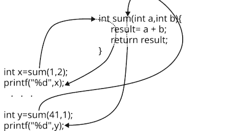

对 `sum` 的函数调用将控制权流带到相同的位置，但返回会将其带回调用后的指令处。在早期，子程序有时使用一个简单的数组来存储调用后指令的返回地址。然后事情变得稍微复杂一些。

函数可以调用其他函数：

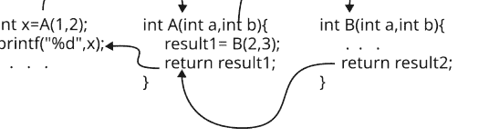

在这种情况下，主程序调用函数 A，函数 A 调用函数 B。当 B 返回时，它回到 A，然后回到主程序。也就是说，函数按 `main → A → B` 的顺序调用，但返回地址的顺序是 `B → A → main`。这种顺序的颠倒是后进先出 (LIFO) 堆栈的典型特征。

例如，考虑 `main` 调用函数 A，A 调用函数 B，B 调用函数 C，C 调用函数 D。即：

`main` ⟶ `A` ⟶ `B` ⟶ `C` ⟶ `D`

发生的事情是，每当调用函数时，每个返回地址都会压入栈中：

`main` → `A` → `B` → `C` → `D`

`push return main` → `push return A` → `push return B` → `push return C`

此时栈中存储的是：

```
push  return C
push  return B
push  return A
push  return main
```

当函数 D 结束时，它从栈顶弹出返回地址，即它返回 C。当 C 结束时，它从新的栈顶弹出其返回地址，即它返回 B

```
push  return B
push  return A
push  return main
```

以此类推。

可以看出，如果我们遵循规则“当调用函数时将返回地址压入栈中，当函数结束时从栈顶弹出返回地址”，一切就能正常工作。

栈遵循函数自然的调用和返回流程。

当这一点被发现后，栈成为实现函数的标准方式。

如今我们使用栈来实现函数，但在此之前，返回地址是以临时方式处理的。通常，使用单个位置来存储返回地址，这导致了一个限制：你只能调用一个不能随后调用其他函数的函数。函数调用被限制在一个深度上。后来增加了额外的返回变量，但你仍然受到可实现函数调用深度的限制，而且它并不是特别高效。

### 自动局部变量

在一段时间内，栈仅用于函数的返回地址。在那些早期阶段，你在函数内创建的任何变量与在“main”程序创建的变量具有相同的地位。也就是说，当你在函数中使用变量时，它变成了一个顶层全局变量，可以从程序的任何位置访问。这使得从函数中获取结果变得容易，但同时也使编程非常容易出错，因为你不能孤立地编写函数——你必须避免使用程序中其他地方使用的变量名。

然后有人注意到可以使用栈来创建自动局限于函数的变量。这种方法在 1950 年代作为 Algol 语言的一部分得到明确阐述，但其他语言采用它花费了更长时间。

这个想法很简单。如果在函数内声明变量，则其存储空间在栈上分配。当函数处于活动状态时，变量是可访问和可用的，我们说它处于“作用域内”。

```c
result=sum(1,2);
printf("%d",result);

int sum(int a, int b){
    int c=a+b;
    return c;
}
```

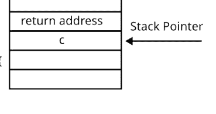

当函数结束时，栈弹出到返回地址，并将其用作返回的目标。在栈上创建的变量不再可访问，因为栈指针已移回其起始位置。

```c
result=sum(1,2);
active line 

int sum(int a, int b){
    int c=a+b;
    return c;
}
```

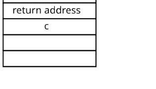

这种方法允许包括 C 在内的语言，使得在函数中声明的变量自动为局部变量。虽然你不常看到它的使用，基本上是因为它实际上不改变什么，但 C 有一个 `auto` 关键字来定义局部变量。你可以写：

```c
int sum(int a, int b){
    auto int c=a+b;
    return c;
}
```

但使用 `auto` 并不改变任何东西。变量 `c` 是一个自动局部变量，因为它在函数内定义。

为了更精确地说明栈的使用方式，我们需要引入一些新的术语，“栈帧”。栈帧是在调用函数时在栈上创建的东西。栈帧的确切格式因机器架构和编译器应用的优化而异。真正重要的是，函数使用的信息存储在其栈上的栈帧中，当函数结束时，栈指针被调整为引用前一个函数的栈帧。

大多数现代语言使用堆栈和栈帧来存储返回地址、所有局部变量以及函数的参数。也就是说，当你调用一个函数时，你提供的参数通常会被压入堆栈，以便被调用的函数检索和使用。同样地，当函数即将结束时，函数的任何结果通常也会被压入堆栈，以便调用该函数的程序能够检索到它。

函数的调用和返回非常适合堆栈的运作方式。

## 无效数据

现在，堆栈在函数调用和返回期间的运作机制已经很清晰了，但其中存在一个潜在问题。例如，如果函数 A 调用函数 B，那么堆栈上就有两个栈帧。如果函数 B 接着调用函数 C，则另一个栈帧会被压入堆栈。如果函数 C 返回，使用其栈帧中存储的返回地址，那么堆栈指针会被设置为函数 B 栈帧的起始位置。

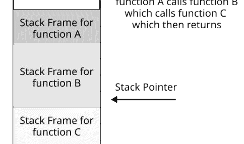

如果你沿着这个思路走下去，你会发现这是一种实现函数的非常自然的方式，包括它们的返回地址和自动局部变量。

请注意，在图中，函数 C 使用过的数据仍然存储在堆栈上，因为通过标准的堆栈操作无法访问它们。这意味着，安排访问函数返回后的局部数据是可能的！

例如：


```c
#include <stdio.h>
#include <stdlib.h>

int *funA(void)
{
    int c = 42;
    return &c;
}

int main(int argc, char **argv)
{
    int *result = funA();
    printf("%d\n", *result);
    return (EXIT_SUCCESS);
}
```

在这个程序中，`funA` 创建了一个局部变量 `c` 并在其中存储了 42。然后它返回 `c` 的地址，主程序使用此地址打印存储在 `c` 中的值。在大多数情况下，这个程序会导致编译器或 IDE 标记出潜在的错误：

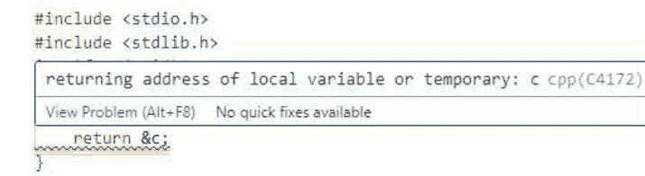

该警告信息是完全正确的，因为 `c` 是一个局部变量，因此仅在函数执行期间“存在”，因此你不应该返回它的地址。然而，如果你运行该程序，很可能会看到打印出 42，因为存储 `c` 值的堆栈尚未发生改变。在某些系统上，你会看到运行时错误，因为堆栈的变化足以导致内存故障。如果在 `funA` 之后、打印 `c` 的值之前调用了另一个函数，那么你很可能会看到堆栈上由该其他函数存储的其他值，而不是 42。

这可能看起来像一个刻意构造的例子，确实如此，但它比你想象的要常见得多，我们将在第 13 章：一等函数中发现这一点。

关键点是，一旦函数返回，你就必须将其所有局部变量以及它存储在堆栈上的所有内容都视为已销毁，即使它们可能会因为其他函数尚未使用这些内存而暂时存在一段时间。

## 代码块

到目前为止，我们一直关注函数，但 C 是一种块结构化语言，而函数只是块的一个例子。基本概念是，块是由花括号包含的一组指令。

`{statement1;statement2; …}`

这通常被称为复合指令，以强调它表现得好像其中包含的指令列表像一个单一的大型指令一样。例如，像 `if` 这样的 C 控制流语句仅针对单条指令定义：

`if(condition) statement;`

并且只有在条件为真时才执行该语句。如果你想执行多条语句，则需要使用块：

`if(condition) {statement1;statement2; ...}`

所有 C 程序员都知道这一点，但块不仅仅是一个复合语句。块在处理堆栈的方式上表现得像一个函数。也就是说，当你进入一个块时，任何新的局部变量都会被添加到栈帧中，而当你离开该块时，它们就会丢失。另一种思考方式是，块就像一个函数，但没有参数和返回值。或者你也可以反过来说 - 函数是一个带有参数和返回值的块。

例如：

```c
int main(int argc, char **argv)
{
    int a = 42;
    {
        int c = 43;
        printf("%d    %d\n", a, c);
    }
    printf("%d\n", a);
    return (EXIT_SUCCESS);
}
```

在这种情况下，块引入了新变量 `c`，并且它只能在块内访问。如果你试图在块外使用 `c`，编译器将发出错误信号，表明你试图使用一个未定义的变量。在 C99 之前，块中的所有声明都必须位于块的开头，但现在它们可以位于任何位置。请注意，`a` 在块内是可访问的，这通常被称为词法作用域或静态作用域。

如果你了解 JavaScript，也请注意 C 不实现变量声明的提升（hoisting）。在 JavaScript 中，所有声明都会移动到块的开头，但在 C 中，变量只有在声明之后才存在。

事情比这要微妙一些。如果变量已经在块外定义，那么块内的任何重新定义都会“遮蔽”原始变量，该变量在块退出之前不可用。

例如：

```c
int main(int argc, char **argv)
{
    int c = 42;
    {
        int c = 43;
        printf("%d\n", c);
    }
    printf("%d\n", c);
    return (EXIT_SUCCESS);
}
```

你会看到先打印 43，然后打印 42，因为 `c` 的两个不同实例依次进入作用域。由于 C 中同名但类型不同的变量被视为同一个变量，所以无论内部变量声明为不同类型都没有关系：

```c
int main(int argc, char **argv)
{
    int c = 42;
    {
        float c = 43;
        printf("%f\n", c);
    }
    printf("%d\n", c);
    return (EXIT_SUCCESS);
}
```

在这种情况下，内部块的 `c` 仍然遮蔽外部块的 `c`，即使它们的类型不同。

请注意，你可以将一个块嵌套在另一个块内部。当你这样做时，在内部块中声明的变量对该内部块来说是局部的，该内部块仍然可以访问在任何包含块中声明的变量。你在块内声明的任何与包含块中变量同名的变量都会遮蔽包含块中的变量，即使它们的类型不同。

为什么块会有用？事实上，你一直在使用它们，也许并没有意识到。例如，如前所述，所有的 C 控制语句都使用复合指令，因此每一个都是一个块：

```c
for(int i = 0; i < 10; i++){
    int c = 0;
    c = c+i;
    printf("%d\n", c);
}
```

在这种情况下，`c` 是局部于该块的，并且无法在 `for` 循环外部访问。此外，如果在 `for` 循环之前已经定义了 `c`，那么在 `for` 循环结束后它保持不变。请注意，`i` 也是局部于该块的，因为 C99 现在允许在代码中进行声明，并且 `for` 被视为位于块内。

所有控制语句 `if`、`switch`、`while`、`for` 和 `do-while` 都具有相同的行为。在花括号内声明的任何变量都是局部于该块的，并且在块退出时超出作用域。

在控制语句内，相对于包含块的变量局部作用域是有用的，因为它允许重用变量名。偶尔，出于同样的原因，在程序中创建一个不属于控制语句的块是有用的。例如，如果你有一段代码出现了问题，你可以通过复制它并将其粘贴回程序中，周围加上花括号来确保它对程序中已经存在的其他变量没有影响，从而以 slight variations 运行它。

### 结语

堆栈的运作方式恰好符合函数的调用和返回，这是令人愉快的。它使得自动局部变量变得简单和自然，这一点非常令人惊讶，如果不利用这一特性，那就如同“马鞭抽到了礼物上”（意为不识抬举）——这就是局部变量之所以表现出当前行为的原因。

C 将这一想法更进一步，允许你声明不是函数的块。这是 C 编程如此自然的一部分，以至于你会很快忘记它的特殊性，而确切地了解正在发生什么意味着你可以发挥创造力。如果你在块上富有创造力，记得包含一些注释来解释你在做什么 – 分享这种创造力。

## 潜水9

### 静态存储

> “直到20世纪20年代，所有人都认为宇宙基本上是静态的，不随时间变化的。”

斯蒂芬·霍金

我们都知道什么是变量，但往往又不太了解。变量最直观的心智模型是一个与名称——标签——相关联的内存位置。你可以把变量想象成一个盒子，你可以把一组比特模式放进去，并通过名称取出来。

考虑一个简单的赋值：

```c
int a = 42;
```

你可以将其想象为创建一个名为 `a` 的盒子，并将 42 的比特模式存储在其中。类似地，在表达式中使用 `a` 会从盒子中检索出比特模式。当然，在实践中，这个“盒子”是一个内存位置，而“标签”是该位置的地址。

有时，了解内存位置在哪里以及它是如何分配的是很重要的。C 语言支持两种众所周知的内存分配方式。我们之前已经遇到过自动变量，参见潜水8，它们分配在栈上，适用于具有块生命周期的变量。显式分配在堆上的变量，参见潜水11，适用于需要生命周期独立于任何块的情况。这就是栈与堆的区别，但变量的实现方式还有其他方法。

其中最重要的一种奇怪地被称为“文件级存储”，也称为“静态存储”。

### 文件级存储

为了理解文件级存储如何工作，我们必须考虑程序是如何编译和运行的。编译器读取 C 代码，并为每条 C 指令输出若干低级机器代码指令。这些指令只是比特模式，它们与数据唯一的区别在于它们是机器代码指令的示例，处理器可以读取并执行它们。

也就是说，程序只是你可以执行的数据。

编译器的输出是一个二进制文件，为了运行程序，加载器只需将文件加载到内存中的正确位置，然后让处理器跳转到第一条指令的地址。

程序文件只是一个加载到内存中的二进制文件这一事实意味着，可以在其中包含数据供程序使用。也就是说，程序内部的内存位置可用于存储数据。通常，编译器安排将数据一起存储在文件的一个区域中，因此我们有了数据块和代码块的概念。根据系统和编译器的不同，单个二进制文件中可能包含多个此类块。

文件级变量存储在当前编译器生成的二进制文件中，并存储于程序内部。因此，它们既不是存储在栈上的自动变量，也不是堆变量。文件级变量通过在块外部，即函数外部声明来定义。这意味着声明位于代码文件的顶部，因此称为“文件级变量”。例如：

```c
#include <stdio.h>
#include <stdlib.h>

int a = 42;

int main(int argc, char **argv)
{
	int b = 314159;
	printf("%d,%d", a, b);
	return 0;
}
```

变量 `a` 在文件级声明，而变量 `b` 是自动局部变量。回忆一下，在 C 语言中，主要的“程序”只是另一个函数，在其中声明的变量是自动的，并存储在栈上。变量 `a` 被编译到程序的数据区，不在栈或堆上分配空间——它是程序文件的一部分。当程序文件加载时，它也进行了初始化。作为程序的一部分，`a` 具有最大的生命周期——它一直存在直到程序终止，它所占用的内存被另一个程序重用。这与变量 `b` 非常相似，`b` 的生命周期与 `main` 函数活动的时间一样长。在单线程程序中，变量 `a` 的生命周期和主函数的生命周期是相同的，因为程序在 `main` 函数结束时结束。在多线程程序中，这不一定成立。

这两个变量之间的一个重大区别是 `a` 在文件的所有位置都是可访问的，即处于作用域内。也就是说，同一文件中的所有代码都可以访问 `a`，而变量 `b` 即使具有与 `a` 相同的生命周期，也只能从 `main` 访问。

例如：

```c
#include <stdio.h>
#include <stdlib.h>

int a = 42;

void myFunction(){
    printf("%d,%d\n", a, b);
}

int main(int argc, char **argv)
{
    int b = 314159;
    printf("%d,%d\n", a, b);
    myFunction();
    return 0;
}
```

这是可行的，`myFunction` 打印了 `a` 的值，但它不会打印 `b` 的值，即使你试图这样做。

另一个区别在于文件级变量的初始化方式。考虑这条指令：

`int a = 42;`

在这种情况下，由于它是一个文件级变量，它在程序文件中分配，并且该数据在文件中设置为 42。当程序加载到内存时，变量中已经存储了 42，不再采取进一步操作。请将其与此对比：

`int b = 314159;`

在这种情况下，该变量是自动变量，因此在调用函数 `main` 时分配在栈上，这意味着随着程序的运行，栈必须设置为 42。

你可以看到，文件级变量的初始化是作为程序加载的一部分免费获得的。有时人们错误地认为这意味着文件级变量更高效，但这并非事实，因为从文件加载比分配和初始化变量更慢。

### 全局变量

文件级变量是全局变量吗？在某种意义上是的，但还有一个重要的限制。文件级变量只能被同一文件中的代码访问。如果你有一个多文件 C 项目，那么其他文件中的代码无法访问特定文件中的文件级变量。

这意味着，对于单文件 C 项目，文件级变量就是全局变量。

那么多文件项目呢？

大多数非平凡的 C 项目使用多个 `.c` 和 `.h` 文件。编译器通常单独编译每个 `.c` 文件（在包含相关的 `.h` 文件后），生成中间 `.o` 文件，然后链接器将这些文件组合在一起。文件中的任何文件级变量在该文件内是全局的，但无法从其他文件访问。这通常是一个有用的功能，可以提供一个全局变量，而无需担心其他文件使用与之冲突的全局变量。如果你想跨文件共享全局变量，你需要使用 `extern` 关键字。

你可以看到，与许多语言不同，C 项目的文件结构控制着各代码之间的共享内容。它们是允许大型项目可管理的隔离单元。用面向对象的术语来说，它们是 C 的封装。参见潜水14，结构和对象。

### 声明和定义

此时，很有必要区分声明变量，即告知编译器变量存在，和定义变量，即让编译器为其分配存储。

如果你使用 `extern` 声明文件级变量，编译器允许其在文件中作为全局变量使用，但不为其分配存储。链接器期望在其中一个链接文件中发现该变量的唯一定义，并在所有使用该变量的文件中填入缺失的地址。

编译器将每个文件或编译单元转换为可能不完整的“对象”文件。已声明但未定义的变量以足以让链接器在定义该变量的另一个文件中定位它的形式包含在对象文件中。由你告诉链接器将哪些文件链接在一起以创建完整的程序。

例如：

```c
// file1.c
int globalvar = 42;
int main(){...
```

由于 `globalvar` 已声明并定义，它可以在 `file1.c` 中使用。要在另一个文件中使用它，我们需要使用 `extern` 仅仅声明变量：

```c
// file2.c
extern int globalvar;
functions that use globalvar
```

`extern` 告知编译器 `globalvar` 在另一个文件中定义，并且它应该将 `file2.c` 编译为 `globalvar` 是一个 `int`，但使用占位符来表示其地址。当两个文件链接以构成完整程序时，`globalvar` 地址的占位符会被替换为在 `file1.c` 编译中分配的 `globalvar` 实际地址。

如果你计划跨多个文件使用全局变量，最佳实践是将 `extern` 声明放在头文件中，并确保包含它的所有需要访问全局变量的文件都包含该头文件。

知道 `extern` 也可以用于明确一个文件中的函数对另一个文件是可访问的也是值得的。我们通常不使用它，因为 `extern` 是函数声明的默认行为。如果你想让一个函数仅在其定义的编译单元内局部可见，请使用 `static` 修饰符，我们接下来就会讨论它。

### static

与文件级变量的概念紧密相关的是 `static` 变量。`static` 变量可以在程序的任何地方声明，它具有与文件级变量相同的生命周期。

也就是说，`static` 变量在程序的整个持续时间都存在。区别在于，`static` 变量具有与其声明位置适当的作用域。也就是说，如果你在函数内部创建了一个 `static` 变量，它在函数执行前就已存在，并在函数退出后继续存在。这听起来像是一个全局变量，但它只能从函数内部访问。这使得 `static` 变量看起来像一个局部变量，但它存活于整个程序的生命周期。

请注意，你可以在 `main` 函数中声明一个 `static` 变量，这看起来很像全局变量，但只有主程序可以直接使用它。你还可以在文件级声明 `static` 变量，在这种情况下，你不能将其作为真正的全局变量使用，因为它限制在当前编译单元，即它声明所在的文件内。

## 静态变量

静态变量通常用于存储在函数调用之间持久存在的状态数据。例如：

```c
#include <stdio.h>
#include <stdlib.h>

void myFunction(){
    static int myVar = 0;
    myVar++;
    printf("%d\n", myVar);
}

int main(int argc, char **argv)
{
    myFunction();
    myFunction();
    myFunction();
    myFunction();
    return 0;
}
```

这里唯一微妙的地方在于：

`static int myVar = 0;`

这一行是被编译器执行的，它的含义是为 `myVar` 保留存储空间（作为程序文件的一部分）并将其初始化为零。通过这种方式，变量的创建和初始化发生在函数被调用之前，因此程序输出的结果将是 1, 2, 3, 4。请注意，`myVar` 在程序的其他任何部分都是不可访问的。

这与自动变量略有不同，自动变量的生命周期和作用域是相关的。在这种情况下，编译器通过拒绝在声明了该静态变量的函数之外进行访问来强制执行这一限制。

您使用静态变量做什么？简单的答案是，它们非常适合在不使用文件级变量或真正的全局变量的情况下存储持久状态。由于返回指向静态变量的指针是安全的，因此数据也可以与程序的其他部分共享。例如，我们可以将前面的函数修改为：

```c
int *myFunction(){
    static int myVar = 0;
    myVar++;
    return &myVar;
}
```

请注意，现在它返回了一个指向静态变量 `myVar` 的指针。

我们可以像这样使用它：

```c
int main(int argc, char **argv)
{
    int *myLocalVar;
    myLocalVar=myFunction();
    printf("%d\n", *myLocalVar);
    *myLocalVar=42;
    myLocalVar=myFunction();
    printf("%d\n", *myLocalVar);
    return 0;
}
```

这是可行的，静态变量会被主程序修改。

这是个好主意吗？

从某种意义上说是安全的，因为该变量分配在固定位置并且始终存在。唯一的缺点是，该函数不是可重入的，即如果另一个线程在它被使用时调用它，静态变量不会被重新分配。将其与只使用自动局部变量并仅在堆上分配其他内存的函数进行比较。这样的函数默认是可重入的。


它可能是安全的，但实现一种能够控制对静态变量访问的方案是困难的。一种可能性是使用访问函数，将状态表示的实现对其客户端隐藏起来。

值得注意的是，没有任何规定来指定静态变量应如何实现。然而，将它们实现为具有受限访问权限的文件级变量非常简单，很难想象编译器会采用其他任何方式。

### 静态变量与堆

如果你了解堆存储（参见第 12 章），你可能会想，既然静态变量比堆存储更容易使用，为什么不优先使用它呢？静态存储的优势在于，其创建和管理过程中不涉及指针。其缺点是你根本无法管理它。

堆存储可以被释放和重新调整大小，而静态存储是固定的。

使用静态存储还会增加程序文件的大小。静态存储和文件级存储最容易通过编译到程序中来实现，这种编码在源文件中的效率因情况而异，但如果你声明了一个 1MByte 的静态数组，你的可执行文件大小可能会增加 1MByte。这也会增加加载你程序所需的时间。

## 第 10 章：指针

> 能力越大，责任越大。
> 
> - 蜘蛛侠

C 语言有指针，你可以随心所欲地使用它们。这允许对计算中最强大的工具进行完全自由和无约束的使用。C 程序员热爱指针并不令人惊讶，如果将他们强制转换为一种对自由性要求较低的语言，他们也会为此感到惋惜。

你可以说，C 语言的核心就是指针。

所有这些都是真的，但善用指针是初学者与大师之间的区别。你也可以说，指针是将 C 视为一种危险语言的最大原因。然而，旨在替代 C 的语言通常需要提供类似指针的东西，通常将其限制在“不安全”代码块中使其变得实用。即使是被认为安全的语言，如 Rust，也必须将指针的使用限制在有限的数据类型范围内，以确保安全性。在 Rust 中，你只能在安全模式下创建树状数据结构，这意味着如果你想创建不是树状的东西，你就必须进入不安全代码。

指针被认为危险是因为它们赋予你访问内存任何部分的能力，可能包括你不拥有的区域。它们足够复杂，使得错误很常见，并且很容易被滥用。

指针都是关于地址的，因此它们是低级编程的核心。

### 地址运算符

从某种意义上说，变量已经是指针了。当你写：

```c
int myVar = 42;
```

`myVar` 关联了一个内存地址，而 42 存储在该位置。

类似地，当你写：

`myTemp = myVar;`

`myVar` 是数据从中检索并存储到 `myTemp` 所指内存位置的地址。因此，无论你将 `myVar` 视为存储 42 还是 42 的地址，取决于你如何看待它。从某种意义上说，变量是一个常量指针。

然而，重要的是要认识到 `myVar` 并不是一个指针，实际上它甚至在编译后的程序中并不是一个明显的实体 – 与 `myVar` 关联的地址并没有存储在任何地方。它只是一个符号名称，用于在你使用该变量时访问数据。

值分配的语义掩盖了地址在事务中起到的作用，在大多数语言中，你无法直接访问与 `myVar` 关联的地址 – 但在 C 中你可以。

地址运算符 `&` 将返回与任何变量关联的地址。这个想法很简单，`&myVar` 返回与 `myVar` 关联的地址，但在这里我们遇到了一个难题。地址就像其他任何数据项一样只是一个位模式，但格式在不同机器之间存在差异。用于地址的位数数量会发生变化，寻址方案也会变化。一些机器具有从 *addressmin* 到 *addressmax* 的线性地址空间，其他机器使用多级寻址，即页或段号后跟从开始的偏移量，等等。然而，在用 C 编程时，你无需深入细节。你可以简单地将 `&myVar` 视为一个简单的地址。

如果你尝试类似这样的事情：

```c
int main(int argc, char **argv)
{
    int myVar;
    int myAddress;
    myAddress=&myVar;
    printf("%d\n",myAddress);
    return 0;
}
```

你会看到一个显示的值，这是 `myVar` 的地址，但你可能也会看到一个警告，其含义是将地址分配给 *int* 不是一个好主意。从地址到 *int* 的自动强制转换使你免于陷入困境，但在大多数情况下，它确实没有多大帮助。你取某物的地址是因为你想访问它，但当地址存储在 *int* 中时，你只能对它进行整数算术运算。

### 指针

我们需要一种新的数据类型。

巧妙之处在于，C 没有引入单一的新数据类型“地址”，而是一个修饰符，即解引用运算符 `*`，它可以应用于任何数据类型以生成引用该类型的地址。这称为间接寻址，生成的数据类型是“指针”或“指向该类型的指针”。例如，`int myVar` 是一个 `int`，而 `int *myPointer` 是一个指向 `int` 的指针，等等。请注意，这比简单地定义一个持有地址的类型更为微妙。

`float *myFloatPointer` 和 `int *myIntPointer` 都将具有相同的位数，本质上是相同的，但编译器会记住第一个是 `float` 的地址（通常为 8 字节），第二个是 `int` 的地址（通常为 4 字节）。

也就是说，指针不仅记录它是一个地址的事实，还记录其所指实体的名义大小和配置。理解这一点很重要，但这仅在编译时是真实的。编译器利用这些信息来确定如何处理指针引用的数据。在运行时，我们只有实体的地址。

请注意，`*` 绑定到变量名而不是类型。也就是说，声明是：

`int (*myIntPointer)`

正因为如此，你可以写成：

`int *myIntPointer, myInt, *myIntPointer2`

等等。将其与类型在强制转换中的写法进行对比：

`(int*) myPointer`

你仍然可以写成：

`(int *) myPointer`

并想象 `*` 仍然绑定到变量。

### 解引用

现在既然我们有了指针类型，我们就可以利用使用地址运算符导出的地址，例如：

```c
int myVar = 42;
int *myIntPointer;
myIntPointer = &myVar;
```

现在我们有了 `myVar` 的地址，并存储在 `myIntPointer` 中。

如果你编写：

`temp = myIntPointer;`

那么该地址会被复制到 `temp` 中。那么，如何获取存储在该地址处的值呢？答案是我们已经在指针声明中见过的解引用运算符 `*`。解引用运算符是取地址运算符的逆运算，因为它访问的是地址所引用的值。例如：

`int myVar = 42;`

`int temp = *&myVar;`

这将把 42 存储在 `temp` 中，因为 `&` 给出 `myVar` 的地址，而 `*` 则给出存储在该地址处的值。当然，这实际上没什么用处。你也可以在赋值的左侧使用解引用运算符：

`int myVar = 42;`

`int *myIntPointer;`

`myIntPointer = &myVar;`

`*myIntPointer = 43;`

这会将 43 存储在 `myVar` 引用的同一位置。现在我们在 C 中有了引用语义——几乎是。

## 生命周期问题

C 语言中指针的存在带来了一个新问题——“释放后使用”（use after free）。这指的是我们现在可以用一种不受系统控制的方式来引用存储区。当你使用自动或静态变量时，其生命周期是这样的：如果在作用域内尝试访问它，那么它存在。一旦有了指针，你可能会犯在变量不再存在之后（即被“释放”之后）使用引用的错误。当我们引入堆的使用时，这个问题会变得更糟——参见 Dive 11——但在当前这个更简单的情况下，它仍然是一个问题。

例如：

```c
#include <stdio.h>
#include <stdlib.h>

int *myFunction(){
	int myVar=42;
	return &myVar;
}

int main(int argc, char **argv)
{
	int *myPointer=myFunction();

	printf("%d\n",*myPointer);
	printf("%d\n",*myPointer);
	return 0;
}
```

在这种情况下，该函数返回一个指向自动变量的指针，该变量当然是在栈上创建的，并且一旦函数返回就会被销毁。主程序接收到的指针拥有该数据曾经占用的栈内存位置地址。结果就是释放后使用。

这正是 Dive 8 中讨论的问题，当时责任被归咎于使用局部变量——实际上，罪魁祸首更多是指针用于返回一个可能不再存在的引用。如 Dive 8 中所述，这个错误最糟糕的部分在于它往往不被察觉，因为存储在栈上的数据在一段时间内不会被覆盖，我们似乎得到了正确的结果。例如，在这种情况下，第一个 `printf` 极有可能显示预期的值 42，但在显示值的过程中，它极有可能将其覆盖，导致第二个 `printf` 显示一个虚假的值。

请注意，如果 `myVar` 被声明为 `static`，这个问题就会消失，参见 Dive 9，因为即使函数返回后变量仍然存在。

C 程序员几乎可以随意操作指针，这种力量要求承担相应的责任。

事实上，你甚至可以创建“分配前使用”错误。例如：

```c
int *myPointer = 4796436;
printf("%d\n",*myPointer);
```

在这种情况下，我们试图通过向指针加载一个 int 地址来访问任意内存位置。这不太可能成功，因为大多数现代硬件都具备防止程序访问其不拥有的内存区域保护机制，但如果你选择一个位于程序地址空间内的地址，它是可以工作的。

这种类型的代码在硬件应用中很常见，因为程序需要访问位于固定内存位置的寄存器。重点是，表面上看这是如此愚蠢，没有任何程序员会做或应该做这样的事，但在特定语境中它却完全合理且正常。认为这是一个严重错误从而禁止这种行为的编译器编写者会让许多 C 程序员感到不满。

## 运算符还是类型？

如果你和我一样，你可能会对解引用运算符也是一个类型指示符感到有些困扰。这两个表达式 `int *myVar;` 和 `int temp = *myVar;` 看起来像是两回事，但如果你以正确的方式查看声明并将 `*` 视为解引用运算符，那就不是了。

当你编写： `int myVar;`

这声明 `myVar` 是一个 `int`。同样地，当你编写： `int *myVar;`

这声明 `*myVar` 是一个 `int`。因此，如果 `*myVar` 是一个 `int`，那么 `myVar`（不带运算符）必须是一个指向 `int` 的指针。这很巧妙，但并不完全行得通。当你编写转换 `(int*)` 时，其意思是转换为指向 `int` 的指针，因为现在 `int*` 似乎作为一个整体单元起作用，表示“指向 int 的指针”。

但正如前面指出的，你可以始终将 `(int *)myVar` 视为与声明相同的方式，即如果 `myVar` 被转换为 `int*`，那么 `*myVar` 必须是一个 `int`。只是没那么巧妙。

### 指针、数组和堆

可以说，指针只有在与堆结合使用时才真正发挥其作用。然而，我们已经看到指针与静态变量一起使用也很有用，并且在我们遇到堆之前，我们需要理解指针如何产生数组。

# Dive 11

## 数组与指针算术

> *真正的程序员从 0 开始计数。*
> 
> 匿名程序员

数组是每个程序员遇到的第一个数据结构。它是基本且重要的，是所有其他试图取代它的数据结构的原型。数组之所以基本，是因为它只是一块内存，几乎没有额外的结构。

### 存储映射函数

大多数 C 程序员都知道数组，但回顾一下其背后的原理是值得的。数组是一组通过索引访问的相同数据类型。在 C 中，允许的唯一索引类型是整数，且存储是连续的——即没有间隙。这是由于数组使用存储映射函数（SMF）实现的方式决定的。

假设你有一个包含五个整数的数组，每个占用四个字节。假设数组中的整数在连续的内存块中排列：

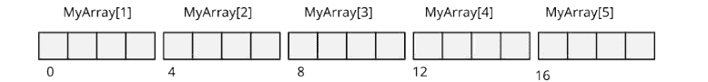

如果每个 `int` 占用四个字节，那么第一个 `int` 存储在 `base`（数组起始地址）处。第二个存储在 `base+4`，第三个存储在 `base+8` 或 `base+2*4`。你可以看到，通常第 `i` 个元素存储在：

```
address = base + (i-1)*4
```

从 `0` 开始计数元素可以得到一点简化：

```
address = base + i*4
```

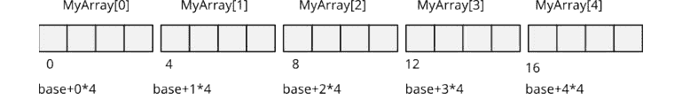

现在元素 `0` 位于 `base`，元素 `1` 位于 `base+4`，以此类推。

是的，这就是程序员从 0 而不是 1 开始计数的原因。

超越简单的 int 数组，你可以看到，通常，如果数组中重复的元素需要 B 个字节来存储，那么数组的 SMF 为：

`address = base + i*B`

同样的思想也适用于多维数组。

例如，具有 n 行和 m 列的二维数组可以使用以下 SMF 实现：

`address = base + i *m *B +j*B`

因为 `m*B` 是单行的大小——这通常被称为“跨度”（stride），因为这是移动到下一行同一元素所必须跳过的数量。

就是这样，这就是数组的全部内容。真正变得更复杂的是当你需要一个比可用内存更大的数组，或者有某些特殊需求需要能够有效地重新组织数组时。大型数组通常被划分为页面，每个页面都能放入内存中。在这种情况下，SMF 被分解为一个给出页号和页内偏移量的表达式。需要重新组织的数组通常实现为链表，这是指针的另一个主要用例。

在 C 中，数组是适合放入内存（即不需要使用辅助存储）的连续存储块。

## 索引表示法

实现数组所需的一切只是一块内存和指向其起始位置的指针。然后，你可以使用存储映射函数来访问任何特定元素。这很容易，但大多数计算机语言，包括 C，都提供一些语法糖使得操作数组成为可能，甚至在你遇到指针之前也是如此。

数组使用以下方式进行声明：

`type name[number];`

这分配了足够的内存来存储 `number` 个指定类型的副本，例如：

`int myArray[10];`

在这种情况下，编译器分配 40Bytes，足以存储 10 个 4Byte 的 `int`。

一旦你分配了一个数组，你就可以使用索引来访问任何元素。要访问第 i 个元素，你编写：

`myArray[i]`

这当然与访问从

`base+i*4`

开始存储的 `int` 完全等价

请注意，由于我们使用的是更简单的存储映射函数（SMF），第一个元素是：

`myArray[0]`

最后一个元素是：

`myArray[9]`

元素数量与最后一个元素的索引之间存在这种不匹配，这确实让初学者感到困扰。初学者常常会错误地认为：

`int myArray[10];`

意味着最后一个元素是 `myArray[10]`。这也是为什么处理整个数组的 for 循环通常被编写为在 *number-1* 处停止，而不是在 *number* 处的原因。为了避免这两种混淆，某些语言（例如 Basic）使用以 1 作为起始值而不是 0 的数组。

## 数组是指针

在其他语言中，数组与你可能使用 SMF 构建的东西之间的区别通常被深藏着，旨在使语言尽可能保持高级特性，但 C 语言并非高级语言。在 C 语言中，我们特意强调数组是一个指针。

在 C 语言中，指令：

`int temp = myArray[0];`

等价于：

`int temp = *myArray;`

代表数组的变量是一个指针，可以使用索引或解引用。事实上，任何指针都可以使用索引。从某种意义上说，不仅每个数组都是指针，而且每个指针都是数组。例如：

`int *myPointer = myArray;`

`myPointer[1] = 42;`

`myPointer` 没有被声明为数组，但你仍然可以使用数组索引语法来访问元素，就好像它是一个数组一样。

请注意，数组并不完全等同于指针。与指针不同，数组名不是一个变量，因此不能被修改。例如：

`myArray = myPointer;`

是非法的。在这个方面，数组更像是指向常量的指针。

数组和指针之间的另一个重要区别在于 `sizeof` 的工作方式。对于数组，`sizeof` 返回数组中元素的数量；而对于指针，`sizeof` 返回指针的大小（通常为四个字节），而不是它指向的元素数量。这种区别是由编译器强加的，因为它在编译时“知道”数组的大小，并相应地调整 `sizeof`。如果你将一个数组传递给函数，那么数组会被当作指针处理——可以说它“退化”为了指针，但实际上发生的事情只是编译器不再跟踪它是一个数组的事实，因此 `sizeof` 返回指针的大小。这些怪癖（idiocrasies）是为了让数组的行为更符合人们的预期而强加上去的。

一些程序员非常坚定地认为数组不是指针。只要你能理解这种观点，就可以安全地认识到，指针和 SMF 是 C 语言数组的基础。

## 指针算术

事实是指针是数组且数组是指针，这导致我们以非常特殊的方式实现指针算术。

让我们问问，以下代码的指针等价物是什么：

```
myPointer[5] = 42;
```

如果 `myPointer` 引用了数组的起始位置，那么利用 SMF 的概念，我们可以看到 `myPointer[5]` 等同于：

```
myPointer + 5*sizeof(int)
```

为了简化，指针算术被定义为：

```
myPointer + 5 = myPointer + 5*sizeof(int)
```

其中编译器负责乘以元素类型的大小。也就是说，一般地：

```
myPointer + i = myPointer + i* sizeof(*myPointer)
```

当你对指针进行加减操作时，算术运算以所引用类型的大小为单位进行。

请注意，你可以对数组名应用指针算术。例如：

```
myArray + 5;
```

与以下代码完全相同：

```
myArray[5];
```

但请记住，`myArray` 的行为更像是一个常量指针，你不能对它进行赋值。

## 指向数组的指针

在 C 语言中，指向类型的指针和指向该类型数组的指针之间存在细微差别。在前一种情况下，指针引用该类型，而指针算术会使引用移动该类型的大小。这使得指针适合实现该类型的数组。


相比之下，考虑指向该类型数组的指针的概念。这是 C89 引入的。此时，该类型的数组是指针引用的基本元素。如果你现在将指针加 1，那么它会前进，不是按类型的大小，而是按数组的大小——因为数组才是元素。

如果你写：

```
int *myPointer;
```

那么 `myPointer` 引用一个整数，给它加 1 会使其移动 `sizeof int` 的距离。这是一种实现 int 数组的方式。

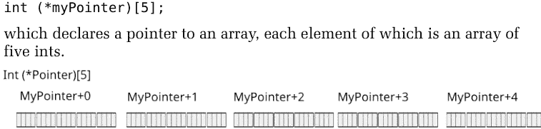

对比以下代码：

```
int (*myPointer) [5];
```

它声明了一个指向数组的指针，其中每个元素都是五个整数的数组。

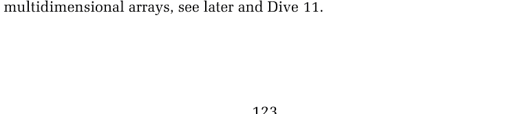

这是一种奇怪的表示法，如果写成以下形式可能会更好：

```
int[5] *myPointer;
```

但实际上并非如此。类型“指向五个整数数组的指针”写作 `int (*) [5]`，这也是你在强制类型转换中使用的形式。

区别在于，现在当你给 `myPointer` 加 1 时，它会移动五个 int 的大小，即 20。请注意，这是创建指向结构体指针的数组等价物，显然它与多维数组有关，稍后见 Dive 11。

## 指针强制类型转换

指针算术的核心在于使用指针实现数组的存储映射函数，在大多数情况下，这正是你所需要的。然而，偶尔你需要访问数据类型的部分而不是整体，为此你需要一个指向数据“内部”而不仅仅是指向其起始位置的指针。

例如，假设你想要访问组成 int 的各个字节。获取指向 int 的指针很容易，但由于它是 int 指针，给它加 1 会使它移动四个字节。如果你只想让它移动一个字节，你需要使用强制类型转换：

```
#include <stdio.h>
#include <stdlib.h>

int main(int argc, char **argv)
{
    int myVar = 0x01020304;
    char *myPointer = (char *)&myVar;
    printf("%d\n", *(myPointer+1));
    return 0;
}
```

通过将地址强制转换为 char 指针，加 1 确实只增加了 1。你可以通过对指针进行强制转换来暂时执行此操作：

```
int *myPointer=&myVar;
printf("%d\n", *(char *)myPointer+1);
```

当然，你实际看到显示的结果取决于字节序——是大端还是小端。对于更复杂的数据结构，内存中的确切布局会有所不同。

## 多维

如果你了解数组，那么你也知道它们具有不同的形状。我们一直在研究的这类数组通常被称为“一维”数组或“向量”，因为它只有一个索引。你可以拥有具有多个索引的数组。二维数组有两个索引，通常被视作为行和列的表格或矩阵。对于三维，我们有一个立方体，超过这个维度后，想象事物变得困难，甚至不可能。

高维数组通常被称为“张量”，但这个名称来源于物理和数学。就编程而言，n 维数组 simply 是一个接受 n 个索引来标识元素的数组。

某些语言有专门用于定义多维数组的语法，但 C 语言只是根据需要多次重新应用基本的数组原则。关键在于，二维数组是一维数组，其中每个元素都是一维数组。如果你想用矩阵的行和列来思考，那么 C 数组是一维的行数组。这通常称为行主序（row-major order），与 Fortran、Octave 等使用的列主序（column-major order）相反。

创建二维数组的语法遵循上述描述：

`int myArray[5][6];`

这创建了一个具有 5 行的数组，每行由 6 个整数的数组组成——即列。

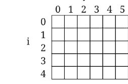

你可以将此视为创建一个一维数组，其中每个元素本身是 6 个整数的数组。

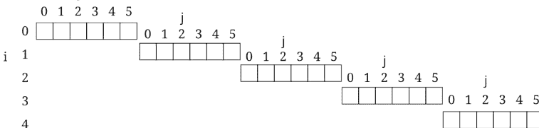

`int myArray[5][6];` 可以被视为 `int[6] myArray[5]`，即五个元素的数组，每个元素都是 `int[6]`。当然，这不是有效的 C 语言代码——这只是想让你对语法的由来有些概念。

访问数组元素也遵循“双索引”模式：

`myArray[i][j]`

指的是第 i 行和第 j 列的元素。再次强调，其形式为数组中第 i 个元素的第 j 个元素。

## 指向指针的指针

数组和指针几乎是一回事，那么对于多维数组会发生什么？对于以下代码的指针等价形式是什么：

```c
myArray[i][j];
```

答案比你想象的稍微复杂一些。在执行以下代码后：

```c
int myArray[5][6];
```

`myArray` 是一个指针，但在这种情况下，它是一个指向包含 6 个整数的数组的指针的指针：

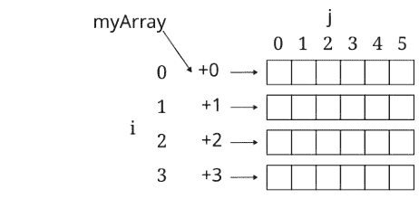

所以现在应该很清楚了：

```c
myArray
```

是一个指向包含 6 个整数的数组的指针，因此：

```c
myArray+1
```

是指向数组第二行的指针，因为指针算术将其移动了 6 个整数的大小（即单个元素的大小），并且通常：

```c
myArray+i
```

是指向数组第 i 行的指针。

由于 `myArray` 是一个指向包含 6 个整数的数组的指针，取消引用（解引用）它会得到这个包含 6 个整数的数组，而这当然是一个指向 `int` 的指针。所以：

```c
*(myArray+1)
```

是一个指向 `int` 的指针，也就是说，它是一个一维数组。

因此：

```c
*(*(myArray+i)+j)
```

是第 i 行中的第 j 个元素。

注意，这一切能正常工作是因为 `myArray` 的类型是 `int (*)[6]`，因为这指定了在执行指针算术时移动到其他行需要加多少。此外，虽然这是一个指向指针的指针，但实际上并没有其他指针参与。只有 `myArray` 指向整个数组的起始位置。诀窍完全基于改变指针的类型以生成不同的指针算术，从而实现对数组维度所需的存储映射函数（SMF）。也就是说，`myArray` 的类型是 `int (*)[6]`，因此 `myArray+i` 实现了 `myArray + i*6*sizeof(int)`，而 `*myArray` 的类型是 `int [6]`，因此 `(*myArray)+j` 实现了 `myArray + j*sizeof(int)`。当将这些组合为 `*(*(myArray+i)+j)` 时，它实现了：

```c
myArray + i*6*sizeof(int) + j*sizeof(int)
```

这是二维数组的 SMF。

无论数组有多少个维度，这个想法都适用。如果数组是三维的：

```c
int myArray[2][3][4]
```

那么 `myArray` 的类型是 `int (*)[3][4]`，即一个由三个元素组成的数组，其中每个元素都是一个包含四个整数的数组。当给 `myArray` 加一进行指针算术时，它会移动三个四整数的大小（即 12 个整数）。接下来我们有 `*myArray`，其类型为 `int (*)[4]`，即一个包含四个整数的数组。给这个加一会使指针移动四个整数的大小，最后 `**myArray` 只是一个指向 `int` 数组的指针。因此，要访问由 i, j, k 指定的元素，我们使用：

```c
*(*(*(myArray+i)+j)+k)
```

虽然很难跟上这些细节，但正如宣传的那样，它是有效的。

最后，请注意，你可以使用以下代码获得指向整个数组起始位置的简单指针：

```c
int *myPointer = (int *) myArray;
```

使用这个指针，你可以实现自己的 SMF，或者将数组作为单维数组访问。一个普遍的原则是，当你将数组转换为指针时，你会得到指向该数组起始位置的指针。

你还可以使用强制类型转换来改变行和列的安排。例如，如果你从一个 5 乘以 6 的矩阵开始，你可以使用以下代码将其转换为一个 3 乘以 10 的矩阵：

```c
int myArray[5][6];
int (*myPointer)[10];
myPointer = (int (*)[10]) myArray;
printf("%d\n", myPointer[1][2]);
```

一旦你意识到整个多维数组技巧就是使用强制类型转换和指针算术来实现 SMF，那么突然之间，一切似乎都变得更加明显了。

## 作为 NULL 终止数组的字符串

字符串是用户界面的生命线，而 C 语言经常因处理字符串做得很糟糕而受到批评。必须承认，字符串并不是 C 语言最好的特性，但它们高效、贴近机器且速度快。

它们之所以如此，仅仅是因为在 C 语言开发时期内存非常紧缺，而文本需要大量内存。现代语言使用更复杂的方式来表示字符串——将额外信息（如包含的字符数）与每个字符串一起存储，并采用不可变字符串。这些方法都无法与 C 字符串的简洁性相提并论。

C 字符串只是一个带有哨兵值标记其末尾的数组。哨兵总是 NULL（即零），因为零不对应任何可显示字符。这是可以安全使用 NULL 作为结束标记的少数场合之一。

NULL 可能是安全的，但没有 NULL 肯定是不安全的。使用 C 字符串的主要危险在于，你可能会遇到一个没有 NULL 终止的字符串，结果你会读取或写入到你不拥有的内存区域。当然，通过良好的设计和编程，你可以避免这类问题，但当你处理作为输入获取的字符串时，你可能会成为攻击的目标，你需要对此进行防御。

字符串是一个 NULL 终止的数组，因此它没什么特别的。然而，C 确实提供了一些额外功能，使字符串操作更加容易。最明显的是字符串字面量可用于初始化 NULL 终止的 char 数组的方式。例如：

```c
char myString[50] = "Hello World";
```

将字符存储在 `myString` 中，并以最终的 NULL 结尾。请注意，在这种情况下，数组长度大于要存储的字符数。

你可以计算字面量中的字符数，并将数组设置为正确的大小，或者让编译器为你做：

```c
char myString[] = "Hello World";
```

由于 `myString` 有一个最终的 `NULL` 元素，它可能比你根据简单字符计数预期的要大 1。

使 `NULL` 终止字符串如此易于操作的原因是，你可以使用 `for` 循环来扫描它们。例如，你可以使用以下代码来查找字符串中有多少个字符：

```c
for(int i=0; myString[i]; i++) count++;
```

注意使用 `myString[i]` 作为停止条件。使用 `NULL` 作为哨兵的另一个好原因是它也被解释为 `false`。这让你了解为什么在 C 的早期，`NULL` 终止字符串被认为是一个好主意。这也说明了为什么它们并不那么完美——你必须扫描整个字符串才能找到其长度，而且如果没有 `NULL` 会发生什么？

你可能不会粗心到写出可能不会终止的循环，但在使用库函数时仍有此类问题。例如，标准函数 `strlen` 返回字符串的长度，看起来挺无辜的，但它使用同种类型的 `for` 循环来扫描字符串并计数。如果没有 `NULL`，循环不会终止，你会越界访问数组的末尾。请注意，`sizeof` 操作符会告诉你容纳字符串的数组的长度，即 `sizeof(string)`。它立即返回，不需要扫描字符串，因此是 100% 安全的。

几乎所有标准的字符串处理函数都有这个缺陷。每个函数都有一个更安全的版本，其名称中间带有“n”。例如：

```c
strnlen(str, size);
```

只要 `str` 的长度小于 `size`，就会返回 `str` 的长度。也就是说，扫描在检查了 `size` 个字符且未找到 NULL 后停止。唯一的问题是这不是一个标准 C 函数。它是一个 Posix 标准，即 Linux/Unix 的一部分。

类似地，函数：

```c
strcpy(dest, src);
```

会将 `src` 中的字符串复制到 `dest`，包括最终的 `NULL`。一个安全的版本是：

```c
strncpy(dest, src, size);
```

如果在 `src` 的前 `size` 个字节中遇到 `NULL` 之前移动了 `size` 个字符，则停止。其行为可能比你想象的稍微危险一点，因为如果 `src` 在其前 `size` 字节中没有 `NULL`，则 `dest` 将不会

以 NULL 结尾。换句话说，`strncpy` 限制了扫描的大小，但并不保证结果是 NULL 结尾的。为了安全起见，你可以通过始终在 `dest[size-1]` 存储一个 NULL 来保护自己。

在实践中，你可以通过始终将操作限制在用于存储字符串的数组大小内，来防止缺乏终止 NULL 的 C 字符串带来的风险。常见的做法是使数组比实际所需大一个字节，并用一个最终的 NULL 进行初始化，作为最后的哨兵措施。

如果不加小心，C 字符串可能是不安全的，许多人通过创建一个包含字符串和 `len` 字段的 `struct` 来采用替代表示法。你通常可以使用安全的字符串函数配合这些结构，方法是分解 `struct` 的各个部分。如果你计划这样做，值得寻找并使用一个改进的 C 字符串库，例如具有 Unicode 支持的 SDS 库或 ICU4C 库。

## 深入 12

### 堆，第三种内存分配

> “事实是一堆砖头和木材。只有成功的理论才能将堆转化成宏伟的大宅”
>
> 艾萨克·阿西莫夫

到目前为止，我们已经看到了两种不同的内存分配类型：文件级和自动级。现在是时候认识堆了，这是 C 程序员可用的最复杂和直接的内存分配形式。在许多方面，高级 C 编程只有当你使用堆时才真正开始，然而堆解决了这么多问题，它使事情变得更简单。要充分利用堆，你必须很好地掌握指针及其用法。

### 堆

通常（但并非总是），计算机的内存被划分为：程序以及所有文件级数据存储在最低部分。然后是栈，它根据需要分配，随着自动变量的创建和销毁而增长和缩小。堆是剩余的可用内存，通常组织为从可用内存顶部开始的一个连续块，可以根据指定大小的块进行分配使用。

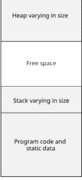

栈的增长和缩小在效率上极高，因为在任何给定时间只使用所需的精确内存量，并且无需执行任何特殊操作来释放之前使用的栈内存。堆并非如此，堆很快就会变成已分配内存和已释放内存的拼凑图样。只要有一块足够大的空闲堆内存来满足当前的内存请求，这就不成问题。为了保持大区域空闲内存的可用，堆必须接受某种形式的垃圾回收。这是操作系统的责任，C 程序员大多可以忽略这一点。

原则上，如果堆中有你请求的空闲内存量，那么它应该作为一个连续的块可用。然而，操作系统管理堆可能会产生后果，偶尔它需要利用 CPU 重新排列堆以合并那些单独来看太小的分散空闲块，这可能会在你的程序中引入减速。在多 CPU 系统中，这问题较小。

注意堆的另一个重大区别在于程序员负责分配和取消分配内存。这通常被解释为使用堆最难的部分。事实上，分配内存通常很容易，而在复杂情况下取消分配则稍显棘手，因为程序的不同部分使用相同的内存块。当你决定释放一个已分配的块时，很难确定该块是否仍被程序的某部分使用。

文件变量、自动变量和堆变量之间的另一个重大区别在于，文件变量和自动变量是自动分配的——你只需声明它们，系统就会使用类型所需的内存量为你创建它们。另一方面，堆变量需要你分配一个足够大的内存块以存储其类型，然后将该类型与块关联，以便轻松使用。

所有这些都依赖于指针的使用，有时甚至需要相当复杂或巧妙的指针用法。

## Malloc 及其相关函数

有一组 C 函数涉及堆的操作。这些利用操作系统提供的功能来管理堆。最著名的是 `malloc`，代表内存分配。它简单地返回指向所需大小内存块的指针：

```c
void *malloc(size_t size);
```

`size` 以字节为单位，如果成功，它返回指向分配内存块开头的 `void` 指针。重要的是要知道内存块未以任何方式初始化，这是许多漏洞利用的基础，你可以用它来发现之前程序存储在内存中的数据。

如果 `malloc` 分配了内存块，`free` 将其释放回堆。`free` 有一些有趣的细节，如果更好地理解，可以防止我们犯内存错误。如果你对一个已经释放的内存指针调用 `free`，结果将是未定义行为。然而，如果你用 NULL 指针调用 `free`，则不执行任何操作。NULL 只是零的替代，但大多数系统将地址零视为无法使用 `malloc` 分配的地址。因此，如果你在释放内存后始终将指针设置为 NULL，就可以将此用作标志，表明内存已被释放，意味着即使程序的某部分尝试第二次释放它也不会出问题——只要它使用相同的指针。

毫无疑问，你只需要 `malloc` 和 `free` 就可以操作堆，但有三种常见的有用扩展可以使生活更轻松。

一个常见需求是创建一个足够大的内存块以存储由相同元素组成的数组。这通常通过以下方式实现：

```c
p = malloc(sizeof(type)*N);
```

其中 N 是元素的数量，但可以写成：

```c
p = calloc(N, sizeof(type));
```

节省非常微小，但 `calloc` 和 `malloc` 之间还有另一个几乎更重要的区别——`calloc` 将返回的内存块清零，而 `malloc` 不会。如果你需要清零的内存块，那么使用以下方法可能值得：

```c
p = calloc(1, sizeof(type));
```

如果你需要改变堆内存块的大小，可以使用：

```c
p = realloc(ptr, size);
```

这会将 `ptr` 引用的块大小更改为指定大小。现有数据不会更改，新的内存位置未初始化。内存块的大小可以增加或减少。如果 `ptr` 为 NULL，则分配一个新块。如果 `ptr` 不为 NULL 且 `size` 为 0，则释放该块。如果为了调整大小而必须移动该块，则释放 `ptr` 引用的原始块，并且 `ptr` 被设置为 NULL。实际上，在 `realloc` 之后始终使用 `p` 而不是 `ptr`。


还有：

```c
p = reallocarray(ptr, N, sizeof(type));
```

其工作方式与 `realloc` 类似，但大小以元素大小和元素数量来指定。除此之外，其工作方式完全相同，特别是额外内存不会被初始化。

### 类型转换

除了以有条理的方式释放内存并确保不要在释放后尝试使用该内存这一棘手问题外，使用堆很容易。

但如何将内存块变成有用的东西？

我们只有一块内存，一块位元，但使用 C 的重复信息是：一切都只是位模式。告诉编译器如何处理位模式的是其类型。因此，我们要做的只是将指针转换为我们想要使用的类型。例如，如果你想在堆上分配一个 `int`，你可以使用：

```c
int *p = (int*) malloc(sizeof(int));
```

现在 `p` 指向内存块的开头，通常是 4 字节，系统会将此视为 `int`。也就是说，你可以编写类似：

```c
*p = 42;
int sum = *p + 42;
```

事实上，只要你记得解引用它，`p` 的行为完全像标准的 `int`——你几乎可以告诉初学者 `*p` 就是变量名！当然存在差异，而且这些差异很重要。

第一个差异是变量的生命周期，即堆内存块的生命周期，由你控制。它从执行 `malloc` 的那一刻起存在，直到你显式调用 `free` 释放该块。注意，引用该块的指针的生命周期遵循通常的规则，这与块的生命周期规则不同。如果是文件级变量，则它存在于整个程序期间。如果是自动变量，则它存在于其声明所在函数的相同时间。这意味着堆内存块可能会变得孤立，没有任何指针引用它。考虑以下函数：

```c
void leak(){
    int *p = (int*) malloc(sizeof(int));
};
```

调用此函数分配了一小块堆内存，但当它终止时，指针被销毁，该块没有引用。这是一种内存泄漏，因为该块永远无法释放，因为程序没有对它的引用。许多其他语言实现垃圾回收算法，寻找孤立的内存块以自动释放它们。这是一个非常耗时的过程，且并不万无一失。

C 语言更喜欢让你管理堆内存的释放——你是 C 的垃圾回收器。

如果指针的生命周期与堆内存块的生命周期相同，那么使用它就没有太大意义，因为自动变量的生命周期也是如此。在实际编程中，创建堆变量的函数通常会将其指针返回给调用程序使用，因此堆变量的生命周期比函数的生命周期更长。

## 动态分配

使用堆的一大优势是，你可以按需申请所需内存。自动变量会在程序运行时分配内存，但分配的大小在编译时就被固定下来——存在一些例外情况，参见下文。

例如，当你声明一个数组时，编译器必须知道该数组的大小。也就是说，在 C89 标准中：

```
int myArray[10];
```

是合法的，而：

```
int myArray[N];
```

则不合法。C99 放宽了这一限制，允许 N 在运行时确定。这就是所谓的“变长数组”（Variable Length Array，简称 VLA）。即使你要求使用 C98 标准，GCC 等编译器也允许使用 VLA。VLA 的思想非常有用，以至于它的影响超出了其最初的范围，尽管 C11 将其标记为可选功能。话虽如此，值得注意的是，微软的 C 编译器并不支持 VLA，如果你想编写可移植代码，最好避免使用它。出于这个原因，Linux 社区花费了大量时间来从代码库中移除 VLA。

那么，如果不用 VLA，该如何创建动态数组呢？答案是使用 `malloc`：

```
int N = 10;
int *myArray = (int*) malloc(sizeof(int)*N);
myArray[0] = 42;
*(myArray+1) = 43;
printf("%d\n", myArray[1]);
```

这分配了一个包含 10 个整型元素的一维数组，可以通过索引或指针算术来使用。一如既往，这块内存保持已分配状态，直到你释放它，而指针 `myArray` 的生命周期按常规确定。

### C89 中的动态多维数组

那多维动态分配数组呢？问题在于，在 C99 之前，没有方法指定维度大小，而这些大小对于计算序列映射函数（SMF）是必需的。在这种情况下，唯一简单的解决方案是直接实现 SMF。正如我们即将发现的，在 C99 及更高版本中，存在更好的解决方案。

例如，对于一个 M 行 N 列的数组：

```
int *myArray = (int *)malloc(sizeof(int) * N * M);
int *p = myArray + (i * N + j);
printf("%d\n", *p);
```

这显示 `myArray[i][j]` 的值，但请注意，在这种情况下索引不起作用，因为编译器不知道数组的“形状”。你无法使用适用于固定大小数组的数组指针转换，因为在 C99 之前，没有方法指定指向给定大小数组的指针——参见下文以及 Dive 11。

你所能做的最佳方案是创建一个指向数组的指针，除了一个维度外，其余维度的大小都固定。之所以如此，是因为对于二维数组，编译器需要知道每行的大小（即 N），以便计算 SMF，但一旦选定了行，指针算术就以 `sizeof(int)` 为单位，你无需知道行数即可计算 SMF。通过查看二维数组的 SMF 就可以看出这一点：

```
address = base + i *N *sizeof(int) +j*sizeof(int)
```

其中 `N*sizeof(int)` 是单行的大小。行数 M 并未被引用，这意味着你可以在不知道 M 的情况下实现 SMF。

例如，如果数组是 `myArray[M,5]`，那么 `myArray` 是指向大小为 5 的一维数组的指针，而 `*myArray` 是指向 `int` 的指针。显然，我们无法通过指针算术来计算 SMF，但 M 并未用于计算中。这意味着我们不需要在动态数组中指定第一个维度：

```
int M = 6;
int (*myArray)[5] = (int (*)[5]) malloc(sizeof(int) * 5 * M);
myArray[1][1] = 42;
```

请注意，在数组声明中只有 N 的值固定为 5，使用的类型是指向大小为 5 的数组的指针（有关指向数组的指针的更多信息，参见 Dive 11）。必须如此，以便允许 `myArray[i][j]` 实现为：

```
*(*myArray+i)+j
```

其中 `myArray+i` 会在指针上添加 `i*5*sizeof(int)`。这段代码允许你动态分配一个等效于以下内容的数组：

```
int myArray[M][5]
```

请注意，虽然你无需固定 M 的大小，但必须确保不要尝试访问 `i>=M` 时的 `myArray[i][j]`。如果这样做，你将越过数组末尾及已分配内存的边界。

### 重新分配

如果你发现正在使用的数组应该更大，你可以简单地重新分配内存块使其变大。如果需要缩小块，同样的技术也适用，但这是一种较少的操作。其原则是使用：

```
p = realloc(ptr, size);
```

其中 `ptr` 指向现有块，`p` 是指向调整大小后块的指针。操作系统会先检查块的末尾是否有足够的空闲内存，如果有，就直接将其添加到现有块中。如果没有，操作系统会搜索足够大的空闲块，并将数据从旧块复制到新块。操作系统也可能尝试对堆进行碎片整理以找到足够大的块。

只要处理的是一维数组，重新分配的概念就很简单。在这种情况下，额外的内存块直接增加了数组的长度。如果处理的是多维数组，情况会更复杂。添加内存很可能会改变你需要使用的 SMF，结果是，即使重新分配没有移动元素，原本位置正确的元素现在可能位于错误的位置。

唯一“安全”的重新分配是增加行数，因为该维度未用于 SMF。例如，要将 `[M][N]` 数组重新分配为 `[M+1][N]`，你只需执行：

```
int *myArray = malloc(sizeof(int) * M * N);
myArray[1][0] = 42;
myArray = realloc(myArray,sizeof(int)* (M+1) * N);
printf("%d\n", myArray[1][0]);
```

它只需如此运行——你会看到显示了 42，并且多出了一行供你使用。但是，如果你尝试：

```
myArray=realloc(myArray, sizeof(int)*M*(N+1));
```

你仍然看到显示 42，但你无法正确访问新列，因为 SMF 仍在以 M 列为基础工作。为了将数组重塑为新结构，假设 N 为 5，你需要使用不同的指针类型：

```
int (*myArray2)[6] = realloc(myArray, sizeof(int)*M*(N+1));
printf("%d\n", myArray2[1][0]);
```

现在我们有了一个包含 6 列的数组，你将不再看到显示 42，因为现在它存储在 `myArray2[0][5]` 中。

当你利用 VLA 时，重塑数组更容易，参见下文，但如果你添加额外的列，始终需要移动元素。

### 变长数组

变长数组（VLA）在 C99 中引入，在 C11 中是可选的，但在 C23 中是强制的。基本上，它是使用 `malloc` 动态数组分配的自动实现，你只需以常规方式声明数组，编译器会处理其余部分。例如，前一节中创建的动态数组可以声明为：

```
int myArray[M][N];
```

生成的数组表现得像标准数组一样，你可以使用索引表示法或指针算术来访问它。

然而，存在一些重要区别。VLA 只能声明为自动变量，其生命周期由此决定。当变量超出作用域时，VLA 被销毁。你不必担心使用 `free`，这是 VLA 声称的优势之一，但也限制了其用途。显然，你无法在编译时初始化 VLA，并且每次重新进入包含它的代码块时，它都会被重新创建（可选地具有不同的大小）。如果你使用 `goto` 或 `switch` 跳转到 VLA 的作用域，它可能未被分配；如果你使用 `longjmp`（参见 Dive 17），则可能丢失数据。

### VLA 类型和动态多维数组

除了允许变长维度外，指向数组的指针类型已扩展，允许运行时表达式。也就是说，在 C99 及更高版本中，你可以编写如下的代码：

```
int (*myArray) [M]
```

其中 M 是在运行时求值的表达式。此前，我们必须为 M 指定常数，以便编译器计算在指针算术中应添加的值。在这种情况下，`myArray+j` 等同于 `myArray+j*M*sizeof(int)`。

这意味着我们现在可以扩展使用 `malloc` 的动态数组分配，以包括在运行时定义的多维数组。例如：

```
int M = 6;
int N = 5;
int (*myArray) [N] = (int (*)[N]) malloc(sizeof(int) * N * M);
myArray[1][1] = 42;
```

请注意，这与之前的示例相同，但现在使用了 N 的值，使得 `(*myArray) [N]` 的类型仅在运行时定义。尽管我们使用的是变长数组类型，但这并不是 VLA——它不会自动释放，我们必须记得释放内存。

### 堆或栈

你可能已经注意到，变长数组（VLA）与**自动**变量具有相同的作用域生命周期。这意味着它们更适合栈存储，而不是堆存储。事实上，大多数 VLA 实现都使用栈而非堆来存储变长数组。

你可以手动在栈上分配内存：

`void *p = alloca(size);`

它返回指向栈上内存块的**void**指针。此函数是标准 C 库的一部分，但不属于任何标准。它依赖于编译器和机器，这些就足以避免使用它。与变长数组一样，它只能用于**自动**变量，但与变长数组不同的是，内存块仅在创建它的函数终止时释放，而不是在指针变量超出作用域时释放。你绝不应尝试使用 `free()` 释放栈内存。

哪一个更好：栈还是堆？

这个问题严重依赖于机器，因此不可能给出唯一答案。在某些体系结构中，栈内存往往供不应求，在这种情况下堆总是更可取。栈内存的自动释放是其最大优势，但使用 `goto` 或 `select` 跳出作用域时会遇到问题。与堆相比，检测栈上的内存分配错误通常更难，引发栈溢出通常会导致程序终止。话虽如此，值得指出的是，如果你在代码块内创建一个固定大小的自动数组，也会出现同样的问题，而这却是常见做法。

归根结底，正是该函数的非标准特性使其使用并非理想选择。

## 深入 13：一等函数

> *我的工作相当理论化。它在递归函数理论领域。特别是关于计算复杂度的函数层次；我卷入实际计算机和编程主要是因为 - 嗯，即使我来到研究生院时也对此感兴趣。*
>
> Dennis Ritchie

C 是一种基于函数构建的语言。不，它不是一种函数式编程语言，那会走得过于遥远。它像之前的语言一样拥有函数，而之前的语言拥有子过程和过程。C 的函数旨在将大型程序分解为小块。在它刚被引入时，C 只是又一种强调“模块化”编程的语言。

如今，C 的函数看起来有点功能不足，因为它们缺乏其他当前语言中找到的动态能力，但这可以被视为一种优势。C 的函数简单且高效，添加高级特性会稀释这种难得的品质。

### C 函数

你可能知道如何创建 C 函数，但我们必须澄清在更深层面正在发生的事情。函数以常规方式声明和定义：

```
returnType name(parameterList) {functionBody}
```

其中 `{functionBody}` 是当函数被调用并提供参数时执行的一段代码。

这是一个简单的模式，每个 C 程序员一开始就会学到。C 函数还有许多显而易见的特性，但通常不会明确说明。

C 函数只能在文件级别创建，并且你通常视为函数名称的变量是一个文件级别变量。也就是说，就同一文件或编译单元中的代码而言，它是全局的。更重要的是，函数是真正的全局变量，默认情况下它们是 `extern`，并且可以被其他编译单元中的代码引用。

这就是 C 库的工作方式，它们定义可由其他文件中的代码使用的函数。如果你想将函数的可见性限制在其编译单元内，请将其标记为 `static`。

所有函数都在文件级别这一事实意味着，你要使用的任何函数都在编译时定义，并且任何函数的生命周期是整个程序的生命周期。

如果你认为这是唯一的可能性，你需要去接触一些其他语言。现代动态语言——C#、Python、JavaScript、Kotlin 甚至 Fortran 90——允许在一个函数内部定义另一个函数。这种嵌套函数对于其被定义的函数来说是局部的，它们可以具有取决于其是否处于作用域内的生命周期。这是闭包等更复杂概念发挥作用的地方。如果嵌套函数在其包含它的函数生命周期之后仍然存在，那么它“捕获”局部变量，并且这些变量对嵌套函数可用。这就是闭包，而变量具体如何可用取决于实现的闭包类型。

其他语言还允许通过代码修改函数——例如 Python 装饰器，而这在发明 C 时被认为是一个非常糟糕的主意。如今，不使用特定机器和编译器的特性，无法在运行时修改 C 函数。

### 部分求值和柯里化

C 对函数的方法使哪些事情变得困难？

最明显的困难（如果不是不可能的话）的事情是部分求值和柯里化。函数的部分求值返回一个固定了一个或多个参数的函数。例如，如果你有函数 `sum(a,b)`，那么部分应用是：

```
add1(b) = sum(1,b);
```

现在 `add1` 是一个总是将 1 加到 b 上的函数。如果你有一个 n 个参数的函数，你可以通过应用 n-m 个参数将其缩减为一个 m 个参数的函数。

柯里化（Currying），这项技术由美国数学家 Haskell Curry 开发并以其命名，类似于部分求值，但它将多参数函数分解为按顺序应用的单参数函数序列：

```
sum(a,b,c) = add(a) (b) (c);
```

这意味着 `sum(a)` 返回一个可以将 b 加到总和的函数，并返回一个可以将 c 加到总和的函数。

你无法在 C 中执行部分应用或柯里化，因为你无法在运行时创建新函数，无法创建嵌套函数，并且不支持闭包。如果你想用 C 进行函数式编程，这是一个问题。你还无法实现面向对象编程，因为你无法创建绑定函数，即方法 – 参见深入 14：结构体和对象。简而言之，你无法取一个函数：

```
myFunction(self, other_parameters)
```

并使用部分应用创建一个方法：

```
myMethod(other_parameters)
```

通过设置 `self` 来引用当前实例：

```
myMethod = myFunction(instance, other_parameters)
```

关键思想是，C 函数具有文件级别作用域，并且默认是外部的，即它们是全局变量。函数的生命周期与整个程序相同，并且只能在编译时定义。不超越 C 标准就无法修改 C 函数。

### 函数优先

C 的函数简单，因此高效，但它们的简单性有代价。C 是一种单遍语言，因为它可以通过对程序文本的单次读取进行编译。这反过来意味着，如果你想使用某些东西，比如函数，它必须在使用前声明。原因很简单。如果你在使用前使用一个函数，编译器对它一无所知，无法检查你的使用是否合理。这意味着在 C 中，你必须在它们被使用之前定义函数，这意味着它们必须以特定顺序出现，并且都在 `main` 函数之前。一些 C 编译器如果你在使用前未声明的情况下遇到函数也能处理。它们通常会警告“隐式”函数声明，但这不是一个好主意。

将函数放在 `main` 之前不是阅读程序的自然而然的方式。通常你不想在到达主程序之前浏览所有函数，然后又要回溯去查找使用的函数。自然的做法是阅读主程序，并查找任何使用的函数。

为了提供更简单的程序布局和结构，C 允许你在变量（包括函数）定义之前声明它们。

声明一个变量只是通知编译器其类型，此时无需进行任何内存分配。

定义变量可以是单独的一步，涉及分配内存并可能将其初始化为某个值。

我们已经知道如何定义函数：

```
returnType FunctionName(type parameter1, type parameter2 ...){
        statements that define the function
}
```

要声明一个函数，我们只需省略函数体，即用花括号括起来的代码块：

```
returnType FunctionName(type parameter1, type parameter2 ...)
```

给参数命名没有意义，因为编译器不会使用它们，所以可以简化为：

```
returnType FunctionName(type, type ...)
```


一些程序员喜欢列出类型的简洁性，另一些人认为提供参数名可以告知读者函数的功能，尤其是当使用注释时。例如：

```
int sum(int, int);
```

定义了 `sum` 函数，它接受两个整数并返回一个整数，但

```
int sum(int a, int b); // returns a+b
```

这在函数简单时有效，但随着复杂度和参数数量的增加，其效果会降低。在大多数情况下，最好在声明中包含简要说明，并将注释留给定义。

一旦你了解如何声明函数，C 程序就可以采用标准形式：

```
function declarations
main(){...}
function definitions
```

为了使其更容易阅读，惯例是将函数声明放入头文件中。

```
#include declarations.h
main(){...}
function definitions
```

实际情况比这稍显复杂，因为函数定义不一定需要在同一个文件/编译单元中。默认情况下，函数声明被假定为 `extern`，即外部的。这意味着如果你声明了一个函数但没有在同一文件中定义它，链接器将在指定的库中寻找该函数。

这意味着默认情况下，你在文件中声明和定义的任何函数都可以从其他文件中使用。从这个意义上说，每个函数默认都是全局的，对整个项目可见。

如果你想将函数限制为“局部”并且在同一文件中定义，请在声明前加上 `static` 前缀：

```
static int sum(int, int);
```

这意味着 `sum` 函数必须在同一文件中定义，并且不能在其他编译单元中使用 – 它是文件内部的。当你想要避免与正在使用的库中的函数发生名称冲突时，在函数声明中使用 `static`。

那么，如果不是函数指针的变量，你需要声明它们吗？

在大多数情况下，你可以用通常的方式声明和定义变量：

```
int myInteger;
```

这会分配所需的内存并告知编译器变量的类型。当然，变量必须在使用之前声明，但声明的位置决定了所需内存的分配位置。唯一一种不定义而只声明变量的情况是将变量声明为 `extern`：

```
extern int myInteger;
```

这告知编译器 `myInteger` 是一个 `int`，但不会为其分配任何存储空间，因为假定这是在另一个编译单元中完成的。也就是说 `myInteger` 是另一个编译单元（文件）中的变量。

你可以声明变量尽可能多次，但你只能定义它一次。

## 函数指针和类型

“一等函数”的概念相对较新，而 C 的函数在被构想出来时还远早于这个问题变得突出。基本思想是一等函数是指在语言中与其他对象相同对待的函数。这里的“对象”可以指简单的东西，如整数或浮点数，也可以指更大的东西，如复杂数据结构的类派生实例。然而，当一个函数是“一等”时的关键特征是能够将其作为参数传递给另一个函数，而 C 从一开始就允许这样做。

函数名是指向函数起始地址的指针。如果你写：

```
printf("Address = %X",&myFunction);
```

或

```
printf("Address = %X",myFunction);
```

你将看到 `myFunction` 的起始地址。换句话说，在处理函数名时 `&` 是可选的。

这意味着你可以使用函数名将函数传递给另一个函数，然后在该函数内部调用它。我们遇到的唯一问题是，函数的类型是什么？要将参数定义为接受特定的函数，我们需要能够定义函数的类型。函数的类型仅仅是指向函数的指针。

这在原理上很简单，但读起来稍显困难：

```
function return type (*function name)(parameter types);
```

因此，例如：

```
int (*myFunction)(int,int);
```

定义了一个返回 `int` 并接受两个 `int` 作为参数的函数。注意，这与通常的函数声明相似：

```
int myFunction(int a, int b);
```

创建函数类型时，如果需要，可以包含参数名。注意，围绕函数名的括号是必要的，因为：

```
int *myFunction(int a, int b)
```

是一个返回指向 `int` 的指针的函数。

为了清楚起见：

```
int (*myFunction)(int,int);
```

定义变量 `myFunction` 为指向函数的指针，该函数接受两个 `int` 并返回一个 `int`。注意，指针的名称不在声明的末尾，通常它是在末尾的 – 这使得阅读此类声明更加困难。

例如：

```
int (*myFunctionPointer) (int,int);
myFunctionPointer=sum;
int result=myFunctionPointer(1,2);
```

由于具有相同的签名，函数指针可以设置为引用函数 `sum`。一旦拥有函数指针，你就可以以正常方式使用它来调用函数。

由于函数类型读起来很复杂，通常最好使用 `typedef` 来定义类型。在这种情况下，提供的名称用作类型的名称：

```
typedef int (*myFnctype) (int,int) ;
myFnctype myFunctionPointer;
myFunctionPointer=sum;
int result3=myFunctionPointer(1,2);
```

注意，由 `typedef` 定义的类型的名称不在语句的末尾，而这通常是你寻找它的地方。然而，函数指针的声明现在更常见，因为变量名在末尾而不是中间。

注意，任何在参数数量和类型以及返回类型方面匹配该类型的函数都可以被认为具有该类型。你甚至可以定义多个相同但名称不同的类型，它们都将被视为相同。

你不能使用原始函数指针来定义函数。也就是说，你不能写：

```
int (*myFunction)(int a,int b)
{
    return a+b;
}
```

你必须定义一个函数，然后将其赋值给函数指针。

### 函数参数和返回类型

你可以将函数指针用作函数参数，从而将函数作为参数传递给另一个函数。

例如：

```
void myFunction(int (*myFuncParm)(int,int)){
    printf("%d\n",myFuncParm(1,2));
}
```

再次注意，参数名 `myFuncParm` 不在类型规格的末尾。

借助 `typedef`，这可以更容易阅读：

```
typedef int (*myFuncType) (int,int);

void myFunction(myFuncType myFunction){
    printf("%d\n",myFunction(1,2));
}
```

将返回类型定义为函数指针很混乱，但由于 C 函数不是动态的，这很少需要。也就是说，函数不能创建并返回一个函数。这意味着返回函数的函数只能返回一个已经存在且在作用域内的函数。

要将函数的返回类型定义为函数，你必须像往常一样在函数定义前面提供类型，但在这种情况下，类型包含函数的名称。

```
return type (*name of function(parameters1)) (parameters2)
```

其中返回的函数类型为：

```
return type (*)(parameters2);
```

并且正在定义的函数为：

```
name of function(parameters1)
```

例如：

```c
int sum(int a, int b){
    return a+b;
}
```

```c
int (*myFunction(void)) (int,int)
{
    return sum;
}
```

```c
int (*summer)(int,int) =myFunction();
printf("%d\n", summer(2,3));
```

在这种情况下，函数名 `myFunction` 包含在类型声明内部，它被定义为一个返回函数指针的函数，该函数指针接收 `int` 和 `int` 参数并返回 `int`。请注意，函数定义中包含了其参数——在本例中为 `void`。如果它接受 `float` 和 `int` 参数，那么声明将是：

```c
int (*myFunction(float,int)) (int,int)
{
    return sum;
}
```

你甚至可以定义一个接收函数并返回函数的函数：

```c
int (*myFunction(int (*f)(int,int)) (int,int)
{
    return f;
}
```

```c
int (*summer)(int,int) =myFunction(sum2);
printf("%d\n", summer(2,3));
```

这看起来（实际上也是）很难阅读，但它是完全合乎逻辑的。如果你定义了一个函数类型，那么相同的声明看起来会简单得多：

```c
typedef int (*myFunctype) (int,int) ;
```

```c
myFunctype1 myFunction(myFunctype f){
    return f;
}
```

并且以相同的方式使用。这种方法的唯一缺点是，对于每个想要用作参数或返回值的函数，你都需要定义一个函数类型。当然，鉴于 C 语言的函数具有静态特性，很难看出你为什么会想要传入一个函数然后再将其返回，但这是可以做到的。

## 参数与实参

我们已经探讨了如何将函数用作参数，但值得更普遍地查看参数的工作方式。

参数就像在函数被调用时初始化的局部变量。例如：

```c
void myFunction(int myParam1, char myParam2){
}
```

调用方式为：

```c
myFunction(42, 'H');
```

可以将其理解为：

```c
void myFunction(int myParam1, char myParam2){
    myParam1 = 42;
    myParam2 = 'H';
}
```

这也非常接近实际发生的事情。当你调用一个函数时，你为每个参数指定的表达式（即实参）会被求值，每个值都会连同返回地址一起压入栈中，然后才调用函数——参见 Dive 8。当函数开始执行时，参数与函数声明的其他局部变量一起位于栈上。这种描述是理想化的，因为许多编译器会尝试通过使前几个参数放入寄存器来优化程序，以提高速度。然而，栈的概念仍然是一个思考事物有用方式。

从这个意义上说，参数表现为预初始化的局部变量。

如果你想通过引用传递内容，你必须传递一个地址。我们都熟悉其中的区别。如果你“按值传递”，那么对参数的任何更改都不会影响传入的变量：

```c
void myFunction3(int a){
    a = 42;
}
int a = 43;
myFunction(a);
```

在函数执行后，调用程序中的 `a` 仍然存储着 43。参数具有相同名称这一事实无关紧要。“按值传递”并不总是需要你将变量用作实参。例如：

```c
myFunction(21*2);
```

这是完全可接受的。最好将实参视为始终是一个被求值并传递给函数的表达式。

传递引用的工作方式完全相同。改变的是你处理参数的方式。例如：

```c
void myFunction(int *a){
    *a = 42;
}
```

现在我们将一个指向 `int` 的指针传递进去，并在赋值中使用解引用运算符，这意味着 42 将被存储在 `a` 引用的位置。现在如果你调用该函数：

```c
myFunction(&a);
```

传递调用程序中 `a` 的地址，那么该函数将改变调用程序中存储的 `a` 的值。因此，C 语言允许“按引用传递”，但它受到批评，因为这是一种非常手动操作，容易引发错误。如果参数要按引用传递，它必须是一个指针，例如 `*a`，并且在函数内部必须被解引用，即你需要使用 `*a`。更重要的是，你需要记住使用地址运算符调用函数，例如 `&a`。如果你不小心遗漏了 `*` 或 `&`，函数将不会按你想象的那样执行。

其他语言自动化了这一过程，例如 C# 使用：

```c
myFunction(byref a)
```

来定义引用参数。当你调用 `myFunction` 时，它自动获取变量的地址并在函数内部自动解引用。这更不容易出错，但灵活性较低。同样的思想是 C++ 对 C 扩展的基础，即按引用传递。在这种情况下，如果你在参数前添加 `&`，它将按引用传递，并且其地址会自动获取并解引用。在 C++ 中，我们之前的例子可以写成：

```c
void myFunction(int &a){
    a=42;
}
myFunction(a);
```

为什么要按引用传递？

这样做只有两个原因。第一个是你想使用参数作为从函数中获取结果的一种方式。例如：

```c
void sum(int a, int b, int *c){
    *c=a+b;
}
```

它通过 `c` 返回求和结果：

```c
int result;
sum(3,4,&result);
```

在这种情况下，你本可以以通常的方式返回结果，但如果你要返回多个项目，则可以使用引用参数。不过，使用结构体可能更好，请参见下文。

第二个原因，是你想要避免必须复制大型数据结构。这就是数组自动按引用传递的原因，因为当以这种方式使用时，数组名会“衰减”为指针。例如：

```c
void myFunction(int *a)
{
    *(a + 2) = 42;
    a[2] = 42;
}
int myArray[5] = {0,1,2,3,4};
myFunction(myArray);
```

对 `a[2]` 的赋值改变了调用程序中的数组。对于初学者来说，唯一的危险是没有注意到数组是指针，因此是按引用传递的。

如果你想按值传递数组怎么办？没有直接的方法来实现这一点，但你可以通过将任何东西包装在结构体中按值传递，例如：

```c
typedef struct{
    int myArray[5];
} arrayType;
```

```c
void myFunction(arrayType array){
    array.myArray[2]=42;
}
arrayType myArray={{0,1,2,3,4}};
myFunction(myArray);
```

如果你尝试这样做，你会发现调用程序中的 `myArray` 没有被该函数更改。这种转换的代价是必须使用 `arrayType` 作为数组的类型，并使用限定名称访问 `myArray` 字段。你还必须在 `arrayType` 中设置数组的大小，这使得重用变得困难。你可以通过将 `array.myArray` 别名为指针来简化函数中的代码：

```c
int  *array2 = array.myArray;
array2[3]=43;
```

你可以在调用函数中以相同方式将 `array.myArray` 别名为标准数组，以使其看起来更像标准数组，但你必须将结构体传递给函数以触发按值传递机制。

## 调用约定

到目前为止，我们采取了简化的观点，认为实参被压入栈中供函数使用，并且返回值也是通过栈传回的。实际上，具体过程如何发生非常重要，这就引出了调用约定（calling convention）的概念，即传递参数值的规则。

简单化的观点认为调用约定不重要，因为你的程序将由使用单一调用约定的编译器编译，而且只要它能正常工作，细节就不太重要。然而在实践中，你的程序需要调用已经在库中提供并编译好的函数。例如，在 Windows 下，你可以调用预编译 `DLL`（动态链接库）中的函数。在 Linux 中，你可以调用共享库或 `.so` 库中定义的函数。即使你不使用库，你也可能希望调用操作系统提供的函数。在这些任何一种情况下，调用代码和被调用者使用相同的调用约定都是非常重要的。

调用约定规定了实参压入栈的顺序，为了提高性能，它们可能规定使用寄存器代替栈的顺序。例如，微软定义了 `fastcall` 约定，其中前两个参数使用 `ECX` 和 `EDX` 寄存器传递，额外的参数从右向左压入栈。当然，许多函数只有一个或两个参数，因此这些函数会更快，因为完全没有使用栈。

通常情况下，你可以忽略调用约定，因为编译器将使用最适合你使用系统的那个。但有时外部代码需要特定的调用约定，这时你需要告诉编译器使用哪个。例如，在 32 位 Windows 系统中，函数使用 `stdcall` 约定，但大多数 C 程序使用 `cdecl` 调用约定。选择特定调用约定的另一个原因是为了优化代码。例如，微软引入了 `vectorcall` 约定，该约定扩展了 `fastcall` 约定，允许在 128 位和 256 位寄存器中传递较大的数据结构，从而显著加速图形操作。

调用约定的概念引出了更大的概念，即应用程序二进制接口（ABI）。这不仅定义了调用约定，还定义了数据在内存中的布局方式，以便预编译的二进制代码可以使用其他预编译的二进制代码。如果 ABI 发生变化，通常所有协同工作的代码都必须重新编译。

## 忽略参数

尽管在第 7 章关于 `void` 的内容中已经提及，但值得重复说明的是：

```c
void function();
```

这并非一个无参数的函数，而是一个具有**未知数量参数**的函数。也就是说，在这样声明之后，你可以定义一个具有任意数量参数（包括没有参数）的函数：

```c
void function(int a, int b) {};
```

若要指定一个函数不接受任何参数，必须使用：

```c
void function(void);
```

在此声明之后，你只能定义一个无参数的函数——任何其它形式都会导致错误。

如果你指定了特定数量的参数，那么在调用函数时必须提供所有这些参数。这就引出了一个问题：当某次调用不需要部分参数时该怎么办？换句话说，如何在 C 语言中实现可选参数？通常的回答是，你必须传入一个值来表明该参数是占位符。最常见的选择是 `NULL`，这看起来合乎逻辑，直到你思考实际传递的值是什么。

例如，假设你有一个函数用于找出三个值中的最大值：

```c
int max(int a, int b, int c) {
    if(a>=b && a>=c) return a;
    if(b>a && b>=c) return b;
    return c;
}
```


那么 `max(-1, -2, -3)` 将返回 `-1`，因为这是其中的最大值。现在假设你想使用 `max` 来求仅两个值的最大值。你可能会想用：

```c
max(-1, -2, NULL);
```

但这会导致 `max` 返回 `0` 而不是 `-1`。原因当然是 `NULL` 只是一个扩展为 `0` 的宏，因此调用实际上是：

```c
max(-1, -2, 0)
```

结果是 `0` 成为最大值。

你可能认为可以通过检测 `c` 是否为 `NULL` 来解决这个问题：

```c
if(c = NULL) ...
```

但这只是排除了将 `c` 设置为有效零值的可能性。（注：原文此处写的是 `if(c = NULL)`，这是赋值而非比较，且逻辑上“排除设置 c 为有效零值”意指如果 c 可以是 0，就不能简单用 0 作为“未使用”的标志，因为 0 本身可能是合法输入值。）

在这种情况下，忽略某个参数的唯一安全方法是将其设置为与 a 或 b 相同的值：

```c
max(-1,-2,-1);
```

返回 `-1` 作为最大值，显然将 `c` 设置为与 `a` 或 `b` 相同的值不会改变结果。

一般来说，忽略参数很困难，因为你需要一个作为哨兵值的数值，且该值在正常使用时必须无效。而伪装的 `NULL`（即 `0`）通常不是一个好的选择。

你通常可以通过包含一个标志参数来避免这个问题，该标志指示是否使用了可选参数：

```c
int max(int a, int b, int c, int number){
    if (number == 2) c = a;
    if (a >= b && a >= c) return a;
    if (b >= a && b >= c) return b;
    return c;
}
```

现在可以安全地将 `c` 设置为 `NULL`：

```c
max(-1,-2,NULL,2);
```

一般来说，安排可选参数需要大量思考。也许唯一的例外是当传递的值是一个地址时：

```c
int max(int *a, int *b, int *c){
    if (*c == NULL){
        if (*a >= *c) return *a;
        else return c;
    }
    if (*a >= *b && *a >= *c) return a;
    if (*b >= *a && *b >= *c) return b;
    return c;
}
```

现在你可以使用 `NULL` 作为指示 `c` 未使用的标记来调用该函数：

```c
max(&x, &y, NULL);
```

因为 `0` 几乎永远不是一个有效的地址。

简而言之，`NULL` 在传递指针时很有用，但对其他类型则不然。

## 可变参数

忽略参数的终极形式可能是**可变参数函数**。“可变”（Variadic）一词源自 “vari”（variable，变量）和 “adic”（表示参数数量）。可变参数函数可以接受可变数量的参数。这听起来不错，但与其他语言所能实现的功能相比，C 语言的实现相当原始。你在大多数 C 编程生涯中其实一直在使用可变参数函数——`printf` 函数就是可变参数的。

要指定一个可变参数函数，只需在参数列表末尾加上三个点，`...`，即省略号。C 标准规定函数必须至少有一个显式参数，这就排除了纯可变参数函数。在使用可变参数函数之前，必须使用 `...` 对其进行声明。调用可变参数函数与调用普通函数无异，但你可以使用任意类型的大量参数，除了前几个常规参数外。

例如：

`int max(int n, ...);`

声明了一个可变参数函数，而：

`int result=max(3,1,2,3);`

则调用它。在这种情况下，第一个参数用于指定可选参数的数量。这并非必要，但这是常见的做法。

要处理可选参数，你必须使用 `stdarg.h` 文件中的一些预定义宏。其原理是，由于参数通过栈传递，因此在函数调用时，栈上压入的参数数量无需受限。可变参数函数可以使用一个宏获取指向栈的指针，并使用另一个宏依次检索每个实参。

宏：

`va_start(args, argN)`

将类型为 `va_list` 的变量 `args` 设置为引用第一个可变参数，该参数位于最后一个固定参数 `argN` 之后的栈上。例如：

`va_list args;`

`va_start(args,n);`

将 `args` 设置为引用第一个可选参数，该参数位于栈上 `n` 参数之后。

宏：

`va_arg(args,type);`

从栈中检索下一个实参。`type` 参数用于指定移动引用的距离，以便引用下一个参数。例如：

`int a=va_arg(args,int);`

检索一个 `int` 类型的实参，如果存在下一个实参，则将 `args` 移动到引用下一个实参的位置。请注意，你可以读取任意数量（多或少）的实参。如果你读取的实参数量超过了指定的数量，则返回内存中对应的数据。

当你完成对栈引用的使用后，可以调用：

`va_end(args);`

以释放指针，但实际中这通常是一个空操作。

如果需要，你可以将 `args` 传递给另一个函数。你还可以获取多个实参指针，并独立使用每个指针来访问实参。你甚至可以忽略全部或部分可选实参。此外，还有一个在 C99 中添加的复制函数，可用于创建指针的副本：

`va_copy(dest, src);`

这允许你标记在实参列表中已到达的位置，并稍后继续。在 C99 之前的版本中，你通常可以通过直接赋值来创建副本。

请注意，认为所有实参都存储在栈上可能是一种简化，因为许多编译器会使用寄存器来存储函数的前几个参数——但这是一个有用的抽象。

使用可变参数函数的一个大问题是整个过程容易出错。你可能弄错实参数量，也可能弄错它们的类型，而编译器不会告诉你存在问题，但你将在处理被破坏的数据。你可以使用两种常规方法来固定参数数量——将数量作为第一个固定参数提供，或使用哨兵值。

例如，要找出可变数量参数中的最大值：

```c
#include <stdio.h>
#include <stdlib.h>
#include <stdarg.h>

int max(int n, ...)
{
    va_list args;
    va_start(args, n);
    int maxvalue=va_arg(args,int);
    int temp;
    for(int i=1;i<n;i++){       
        temp = va_arg(args,int);
        if(maxvalue<temp) maxvalue = temp;
    }
    return maxvalue;
}
```

请注意，这里没有检查 `n` 是否合理，如果 `n` 指定不正确，函数将读取它未设置的内存位置。你可以使用类似以下方式调用此函数：

`printf ("%d\n",max(4,3,4,2,9));`

你可以使用哨兵值来标记参数的结尾，但应该使用什么值呢？

另一种典型方法是 `printf` 采用的方式。格式字符串指定参数和类型。例如，格式字符串 `"%d%d%d"` 指定应提供三个实参，每个都是 `int` 类型：

`printf("%d %d %d", a, b, c);`

请注意，这意味着 `printf` 并不完全安全，因为你可以提供的实参数量少于格式字符串所指定的数量。

## 返回值

正如我们已经发现的，函数可以返回一个值，同样使用栈，并将其用作表达式求值的结果，该值被压入栈中供调用程序使用。这就是“按值调用和返回”。当你调用一个函数时，参数被复制到栈上，返回值也被复制到栈上。

请注意，不返回值的函数，即其返回类型为 `void` 的函数，不一定需要 `return` 语句。同样地，如果函数确实返回一个值，调用程序完全可以忽略它，实质上将其丢弃。不返回值的函数对应于所谓的“过程”或“子程序”。

使用按值传递对内存安全有影响。例如：

```c
typedef struct {
  int myInt;
} myStructType;

myStructType myFunction(void) {
  myStructType myStruct = {42};
  return myStruct;
}
```

*主程序*

```c
...
myStructType myReturnStruct = myFunction();
```

这是完全没问题的，因为 `myStruct` 作为自动变量分配在栈上，当函数结束时，它逐字节复制到新创建的 `myReturnStruct` 中。但是，如果对程序进行小的修改，问题就出现了：

```c
myStructType *myFunction(void)
{
  myStructType myStruct = {42};
  return &myStruct;
}
```

现在我们要返回一个结构体指针，即按引用返回。如果你尝试使用它：

```
myStructType *myReturnStruct = myFunction();
```

那么你将得到一个指向一个局部变量的结构体指针，该变量是在栈上创建的，并且由于函数已经退出，它现在已不再存在。结果通常是运行时错误，但这种错误可能会延迟显现，因为内存可能在一段时间内仍然有效。

关键原则是：

- 永远不要返回指向局部变量的指针。

大多数编译器在尝试这样做时都会发出警告，但初学者常常误解这个警告，因为一切似乎都能正常工作——至少可以维持一段时间。

## 函数与大块数据

如果你不能返回指向局部变量的指针，而按值传递又不够高效，C 函数应该如何返回一个大的数据结构？主要有两种方法——导入或导出。

“导入”方法依赖于调用函数来提供数据结构。例如：

```
void myFunction(int *array, int N){
for(int i=0;i<N;i++){
array[i]=i;
}
}
```

```
int *myArray = (int*) malloc(sizeof(int)*10);
myFunction(myArray,10);
```

`myFunction` 需要一个数组才能工作，并由调用程序提供该数组。

这种方法的缺点是，调用程序必须知道所需数据结构的大小——如果数组被用作从外部世界读取数据的缓冲区，它如何知道 **N = 10** 是合适的呢？其巨大优点是，调用程序负责管理内存，并且非常清楚地知道这一责任。如果数据结构是自动分配（auto）的，这不需要任何额外努力即可发生。如果数据结构是在堆上分配的，则必须在完成后释放它。

“导出”方法留给函数来创建数据结构并返回其指针：

```
int *myFunction(void){
   int *myArray = (int*) malloc(sizeof(int)*10);
   for(int i=0;i<10;i++){
      myArray[i]=i;
   }
   return myArray;
}
int *myArray = myFunction();
```

优点是该函数可以决定需要多大数据结构，但它必须将此信息传回给调用函数。缺点是，该函数的用户可能完全不知道自己有责任释放该数据结构。甚至可能出现函数在每次调用时都返回同一个数据结构的情况，导致多个调用者共同负责该结构的生命周期。在大多数情况下，最好的替代方案是提供一个管理函数来补充 `myFunction`，用于销毁该结构，并且该函数可以被多次调用而不会导致错误。

## 返回多个结果

C 函数只能返回单个值，这可能会带来问题。如果你需要返回多个值，单个返回值似乎可能无法胜任——实际上可以，但这并不直观。

解决此问题的一个非常常见的方法是使用参数来返回结果。我们已经看到，传递指针实际上就是按引用传递，因此函数可以改变调用程序中的值。考虑一个需要返回最大值和最小值的函数。我们可以将其实现为一个带有两个指针参数的函数：

```
void maxmin(int *max, int *min){
   *max = 100;
   *min = 0;
}
int mymax;
int mymin;
maxmin(&mymax,&mymin);
```

一如既往，问题在于记得传入用于存储结果的变量的地址。通常，这类函数会这样组织：“输入”参数列在任何“输出”参数之前。

另一种替代方法，甚至可以说是更好的方法，是使用结构体来封装结果：

```
typedef struct {
    int max;
    int min;
}tuple;

tuple maxmin2(void){
    tuple result;
    result.max=100;
    result.min=0;
    return result;
}
...
tuple result2=maxmin2();
```

这种方法的缺点是，你必须声明一个适合返回结果的结构体，而从作用域范围和为其找到一个合理名称的角度来看，这往往很困难。优点是结果通过 `return` 语句正确返回，使函数更容易理解。

在实践中，你遇到使用“输出”参数的频率将高于使用结构体。原因可能是“输出”参数可以临时引入，而使用结构体需要一些前瞻性和规划。

## 内联函数

函数是组织程序的最佳方式——为每个可识别的任务创建一个函数。有些程序员担心拥有如此多的函数效率低下。开销是调用函数和返回所需的时间。在实践中，这种开销通常远不足以抵消其在程序可维护性上的改进。然而，有时某个函数做的事情如此之少，似乎每次需要时直接编写代码会更好。内联函数为你提供了两全其美的方案，但它们直到 C99 才被引入。

任何标记为 `inline` 的函数，其调用都会被展开，就好像其函数体被写在调用位置一样。然而，事情并不像这样简单。

`inline` 限定符只是给编译器的一个提示，让其内联该函数。如果编译器决定不这样做，而你又没有定义该函数的非内联版本，链接器将报错。为避免这种情况，你可以将函数标记为 `static`。例如：

```
static inline int add(int a, int b){
    return a+b;
}
int main(int argc, char** argv) {
    int c= add(2,3);
    printf("%d \n", c);
    return (EXIT_SUCCESS);
}
```

通常认为，你不需要使用 `inline`，因为现代编译器会优化你的代码，无需你的建议。

## 对 C 函数的考量

如前所述，C 函数快速、高效且简单，对于低级语言来说，这正是你所需要的。但这种简单性意味着，熟悉其他语言的程序员可能会发现缺少某些功能。

C 函数是静态的，因为它们必须在编译时完全定义，并且如果不使用巧妙的、依赖平台的技巧，就无法更改它们。函数名是指向函数起始位置的指针，除非你使用 `static` 关键字将其限制在当前文件中，否则它是一个项目全局变量。这意味着 C 函数的生命周期与整个程序相同。

C 函数只有位置参数 - 不可能使用关键字参数、可选参数、默认值或可选参数。你可以创建接受可变数量参数的函数，但确定正在使用多少个参数及其类型是非常困难的。

由于 C 函数不能在其他函数内定义，即不支持局部函数，因此不支持闭包、偏函数应用或柯里化。

## 第 14 部分

## 结构体与对象

> “面向对象编程是一个非常糟糕的主意，它可能只起源于加利福尼亚。”

> 艾兹赫尔·沃斯·戴克斯特拉

除了数组，结构体是 C 提供的唯一其他复杂数据结构。事实证明，数组和结构体就足以应付大多数情况。在最基本的层面上，结构体是 C 对数据记录的实现，但数据记录也是面向对象编程的起点。这可能会让人惊讶，但在大多数语言中，对象和记录之间的差异确实很小。为了理解 C 的全能结构体方法，让我们从基础开始。

### 结构体

你可能被介绍过结构体（struct，structure 的缩写），它被视为一种允许不同类型元素的数组。例如：

```
struct{
int myfield1;
float myfield2;
} myStruct;
```

这创建了一个具有两个字段的结构体——一个是 `int`，另一个是 `float`。这些字段以类似于数组元素的方式分组到结构中——除了它们的类型不同。当然，你使用熟悉的点符号来访问字段：

```
myStruct.myfield1 = 42;
myStruct.myfield2 = 4.2;
```

此声明是标准形式：

```
type variable;
```

其中 *type* 是完整的结构体定义，*variable* 是类型末尾的名称。

例如：

```c
struct{
    int myfield1;
    float myfield2;
}
```

而变量是 `myStruct`。这种结构体类型形式被称为“匿名结构体”，因为该类型本身除了 `struct` 以外没有其他名称。你可以更进一步，通过赋予该类型一个名称，即标签，来定义它。这允许你复用该类型。例如：

```c
struct myStructType{
    int myfield1;
    float myfield2;
};
struct myStructType myStruct;
```

你可以随意使用 `struct myStructType` 来创建所需数量的该类型的结构体。

该类型的完整名称是 `struct myStructType`，你可以使用 `typedef` 去掉名称中的 `struct` 部分：

```c
typedef struct {
    int myfield1;
    float myfield2;
}myStructType;

myStructType myStruct;
```

现在，匿名结构体被赋予了名称 `myStructType`，并且可以按照标准方式声明任意数量的变量。像这样引入后，C 语言的结构体声明似乎一点也不不合逻辑，而且使用不同的方式声明结构体的原因也很明显。

匿名结构体的主要用途是在其他结构体中声明结构体字段。例如：

```c
struct{
    struct {int a,b;} myStruct1;
    float value;
}myStruct2;

myStruct2.value=4.2;
myStruct2.myStruct1.a=42;
```

还有许多其他结构体惯用法可以使结构体的使用更加紧凑。

### 值语义


与数组不同，结构体应用值语义。这意味着与结构体相关的变量表现得好像该结构体就是它的值。相比之下，与数组相关的变量表现得好像它是一个引用，即指向数组的指针。你不能将一个数组赋值给另一个数组，因为变量仅保存对数组的引用，但你可以将数组赋值给一个指针：

```c
int myArray1[10];
myArray1[0] = 42;
int *myArray2 = myArray1;
myArray2[0] = 43;
```

在这种情况下，更改 `myArray2[0]` 也会更改 `myArray1[0]`，因为只有一个数组被两个变量引用。这就是引用语义的作用。

与此对比的是：

```c
myStructType myStruct1;
myStruct1.myfield1=42;
myStructType myStruct2=myStruct1;
myStruct2.myfield1=43;
```

在这种情况下，`myStruct1` 的内容被复制到新的 `myStruct2` 中。如果你现在更改 `myStruct2`，它对 `myStruct1` 没有影响。这就是值语义的作用。

简而言之，除非你显式使用指针，否则涉及结构体的任何操作通常都会创建结构体所有数据的副本。当你将数组传递给函数时，传递的是一个指针，该函数与调用程序使用同一份数组副本。当你将结构体传递给函数时，会在栈上创建该结构体的副本，供函数独立使用，即它是按值传递的。

更重要的是，结构体是按值返回的。也就是说，如果你在函数中创建一个结构体作为自动变量 `auto`，它会在栈上创建。如果它被返回给调用程序，则其值会被复制到调用程序的栈上，可以安全使用，即使原始结构体被销毁。对于数组则不是这样。有关函数、值和引用的更多信息，请参见 `Dive 13`。

许多程序员会感到惊讶，结构体是值类型，原因很简单：结构体可能很大，复制大量数据并不是非常高效。解决这个问题的方法是使用指向结构体的指针，并传递该指针。随着 C 程序变得更加复杂，使用指向结构体的指针的倾向使得结构体看起来更像引用类型。

## 它只是一块内存

在这一点上，开始将结构体类型视为定义内存块如何划分为子类型的定义是有意义的。例如，当你编写：

```c
struct myStructType{
    int myfield1;
    float myfield2;
};
```

你是在说任何应用此结构体的内存块都将有 `sizeof(int)` 字节的 `int`，后跟 `sizeof(float)` 字节的 `float`。当你创建这样的结构体时，编译器会分配正确数量的内存来存储字段。这意味着结构体必须在编译时具有已知的大小。这在实践上意味着你不能在结构体中使用变长数组 `VLA`，并且你使用的任何类型都必须在编译时完全定义，尽管稍后将介绍如何包含动态数组。

结构体的内存分配取决于声明的位置。如果在文件级别，结构体所需的内存将被编译到程序中。如果在函数内部，则会在栈上分配。你也可以通过简单地分配内存并转换类型来在堆上创建结构体：

```c
struct myStructType *myStruct=
    (struct myStructType *) malloc(sizeof(struct myStructType));
```

所有通常的生命周期规则都适用于结构体。

请注意，指向结构体的指针可以按常规方式使用：

```c
(*myStruct).myfield1 = 42;
```

但你确实需要括号，因为 `.` 运算符的优先级高于 `*` 运算符。为了使这更容易，你也可以使用 `->` 运算符来解引用并访问字段：

```c
myStruct->myfield1 = 42;
```

无需解引用或括号。

## 填充 Padding

唯一棘手的部分是，结构体实际使用的内存块可能比你预期的要大。原因是由于内存访问需要按字边界对齐而产生的“填充”。例如，在 32 位机器上，32 位 `int` 的地址必须是 4 的倍数，因为内存被划分为 4 字节字，可以通过单次读/写访问。

一些机器要求内存访问必须对齐，其他机器允许非对齐访问，但警告这样速度较慢。如果对可选的，一些编译器提供了让你决定是按最小空间打包结构体还是包含填充以确保字段正确对齐以保证速度的机制。所有这些都意味着，你不能简单地假设结构体占用其字段所需的空间量。

对于使用 64 位字的 64 位机器，结构体至少需要 8 字节。

例如：

```c
struct test {
    int i;
    char c;
};
test;
printf("%d \n", sizeof (int));
printf("%d \n", sizeof (char));
printf("%d \n", sizeof (struct test));
```

在基于 64 位 Intel/Arm 处理器的机器上将输出 4、1 和 8。因此，尽管结构体只需要 5 个字节，但实际上它需要 8 个字节，以填充到完整的 64 位字。

请注意，填充添加在末尾或字段之间。C 标准确保不在结构体开头添加填充，这意味着你可以依赖结构体地址是第一个字段地址这一事实，当然，这个第一个地址将位于字边界上。

如果你想将结构体打包以占用最小的内存，则经验法则是按大小顺序分配字段，从最大的开始。

结构体被打包的事实使得许多你认为简单的事情变得更加困难。例如，你不能依赖指针算术来挑选字段，因为除了第一个字段外，填充可能会使字段的起始位置偏离预期。

## 类型双关 Type Punning

除了填充问题外，你可以将结构体视为仅是一块内存，因为你可以将其转换为其他形式。这是“类型双关”的一个例子，其中一种类型的字节被解释为另一种类型的字节。当 C 语言用于底层系统角色时，这是一个非常标准的操作，然而整个主题充满了混淆。一些程序员如此确信类型双关是个坏主意，以至于他们声称永远不应该使用它。事实是，它被大量使用，如果真的要将其移除，许多代码将被迫重写，有些甚至几乎无法以高效的方式实现。

最简单的例子是：一个函数接受一个结构体作为参数，但该结构体在多年的开发中不断被扩展。假设它最初是这样的：

```
struct myStruct{
    int a;
    int b;
};
```

而函数是：

```
void myFunction(struct myStruct *myPointer){
    printf( "%d\n", myPointer->a);
    printf( "%d\n", myPointer->b);
}
```

现在假设后来该结构体被扩展以包含一个新字段，而这个字段对于项目的进一步发展至关重要：

```
struct myStructEx{
    int a;
    int b;
    int c;
};
```

好消息是，新函数可以使用新的结构体，而旧函数可以通过类型转换继续使用新的结构体，就像使用旧的结构体一样：

```
myFunction((struct myStruct *) myPointer);
```

其中 `myPointer` 现在是指向 `myStructEx` 的指针。显然，`myFunction` 并不知道扩展后的结构体，因此只会使用字段 `a` 和 `b`。这是结构体对子类的类比 – `myStructEx` 以与子类从基类派生完全相同的方式从 `myStruct` 派生。转换为“基”结构体是类型双关 `type punning` 的一个例子，其中一块内存被当作不同类型来处理。

你可以通过在派生结构体中包含基结构体，将“继承”想法进一步拓展：

```
struct myStruct
{
        int a;
        int b;
};
struct myStructEx
{
        struct myStruct base;
        int c;
};
```

此时，任何接受 `myStructEx` 的新函数都必须通过 `base` 来引用基结构体，例如：

```
myPointer->base.a;
```

但如果你将 `myStructEx` 转换为 `myStruct`，原始代码仍然有效：

```
(myStruct *)myPointer->a
```

如果你觉得这种情况很少见，而且你不太可能使用或遇到它，那么值得指出的是 CPython 正是基于这种实现类和对象的方式。然而，重要的是要知道，几乎所有的类型双关都违反了严格别名规则 `strict aliasing rule`。该规则基本上规定，一块内存只能由指向兼容类型的指针来引用，详见 `Dive 16`。换句话说，C 语言最常用的高级特性之一，根据最新的 C 标准通常都是非法的。这当然是荒谬的。在任何有意义的地方使用类型双关，如有必要，可以将编译器配置为直接接受它，因为替代方案要糟糕得多。

请注意，当更改结构体类型时，必须小心处理填充 `padding` 可能不同。例如，如果你有一个类似的结构体：

```
struct test1 {
    char c;
    int i;
};
```

并且你用如下方式进行类型双关：

```
struct test2{
    char c[1];
    char i[4];
};
```

那么你就是在假设内存布局是一个字节的 `char`，紧接着是四个字节的 `int`。如果你在 64 位机器上尝试这样做，你会发现 `c[0]` 等同于 `c`，但 `i[4]` 并不能正确表示该整数。原因是该结构体被打包，使得 `int` 从字边界开始。因此，布局是一个字节的 `char`，然后是三个字节的填充，以使 `int` 的四个字节从字边界开始。正确的双关方式是：

```
struct test2{
    char c[4];
    char i[4];
};
```

其中 `c` 对应 `c[0]`，而 `int` 对应 `i[0]` 到 `i[3]`。显然，这是依赖于机器的，没有机器独立的方法来获取组成 `int` 的字节。

## 将结构体作为对象

结构体非常接近对象，因此我们无需做太多改动就能让它们更像对象。对象具有存储数据或函数的字段。这些函数是对象的方法，用于操作对象中的数据。

例如，列表对象可以具有存储数据的字段以及指定方法（如 `sort`）的字段。要使用该方法，你可以这样写：

```python
myObject.sort();
```

你会预期 `sort` 方法在 `myObject` 中的数据上执行排序操作。请注意，非对象版本的实现方式是简单地拥有一个排序函数，它接受待排序的数据作为参数：

```python
sort(myObject)
```

对象导向编程和非对象导向编程之间的唯一区别真的只是从 `sort(myObject)` 切换到 `myObject.sort()` 吗？显然，事情并没有那么简单，但这确实是该思想的重要组成部分。核心思想是 `myObject` 与 `sort` 函数相关联，该函数“知道”如何对其进行排序。

通常，当像 `sort(myObject)` 这样的函数作为对象的一部分实现时，它们被称为方法，区别在于排序函数绑定到了对象上。这种绑定通常通过在函数内部提供一个额外的局部变量来实现，通常称为 `self` 或 `this`，它引用该对象。方法可以使用 `self` 或 `this` 来标识正在调用该函数的对象实例。

在 C 语言中，函数可以拥有引用它们的指针，参见 `Dive 13`，因此它们可以是结构体中的字段。例如：

```c
struct MyClass
{
  int data[10];
  void (*sort)(struct MyClass*);
  void (*display)(struct MyClass*);
};
```

这定义了一个结构体，它有一个 `data` 字段和两个旨在对数据进行排序和显示的函数。其中较难理解的部分是指定函数指针的类型，更多示例请参见 `Dive 13`。

方法被声明为标准函数：

```c
void Sort(struct MyClass *self)
{
    printf("sort called\n");
}
void Display(struct MyClass *self)
{
    for (int i = 0; i < 10; i++)
    {
        printf("%d\n", self->data[i]);
    }
}
```

为了利用这一点，我们需要创建一个类实例：

```c
int main(int argc, char **argv)
{
    struct MyClass myObject = {
        .data = {0,1,2,3,4,5,6,7,8,9},
        .sort = &Sort, 
        .display = &Display
    };
    myObject.sort(&myObject);
    myObject.display(&myObject);
}
```

这设置了一个结构体实例，并对其进行初始化，使其拥有一个待排序的数组和两个执行任务的函数。函数可以以常规方式调用，但请注意它们是普通函数，我们必须将结构体实例的指针作为第一个参数传递。函数无法“推导”出要操作哪个结构体实例，用行话来说，这些函数不会自动绑定到它们操作的对象实例。

在 C 语言中，无法以让函数“知道”它是被哪个结构体调用的方式将函数“附加”到结构体上。要做到这一点，我们需要生成一个新的“绑定”函数，即通过偏应用 `partial application` 生成一个方法，该方法在函数调用中消除 `self` 但自动提供它，参见 `Dive 13` 和偏应用。

虽然可以做到，因为 C 语言处于如此底层，任何事都能实现，但这需要了解函数调用和返回是如何实现的，而且这高度依赖于机器。

我们可以引入一个构造函数，使整个结构看起来更像对象：

```c
struct MyClass *new_MyClass(int data[10])
{
    struct MyClass *instance = malloc(sizeof(struct MyClass));
    memcpy(instance->data, data, sizeof(int) * 10);
    instance->sort = Sort;
    instance->display = Display;
    return instance;
}
```

构造函数允许我们使用数据数组初始化对象，该数据通过 `memcpy` 复制到结构体的 `data` 字段 – 这非常高效。现在我们自然地构造并使用对象：

```c
int main(int argc, char **argv)
{
    int data[10] = {0,1,2,3,4,5,6,7,8,9};
    struct MyClass *myObject = new_MyClass(data);
    myObject->sort(myObject);
    myObject->display(myObject);
}
```

虽然这样更好，但我们仍受到必须重复 `myObject` 参数（由于无法将函数绑定到结构体）的困扰。解决这个问题的最简单方法是使用预处理器扫描程序文本，检测在结构体上调用的函数并将其转换：

```
myObject.function(args) →  myObject.function(&myObject,args)
```

以及：

```
myObject->function(args) → myObject->function(myObject,args)
```

当然，这正是 C++ 最初作为 C 的扩展被实现的方式。文本预处理器将 C++ 扩展转换成了纯标准 C。直到后来，C++ 编译器才成为常态。

有许多方法可以为 C 添加功能使其更易于使用并具备面向对象特性，但在大多数情况下，结构体和指向函数的指针就足够了。

## 结构体末尾的数组

关于结构体的关键点在于，必须知道其大小，这样才能为其存储分配合适的内存块。这意味着结构体中的任何字段都必须具有已知的大小。当你为字符串字段分配内存时，它必须是固定大小的字符串。数组也是同理，你不能在结构体中分配 `VLA` 变长数组。

这全都是事实，但有时候你需要创建一个数组大小可变的结构体。如何做到这一点显而易见。任何分配在结构体末尾的数组都不会影响结构体的布局，因此你可以在不破坏结构体其余部分的情况下随时更改其大小。

最初，被接受的方法是包括一个零长度数组在结构体末尾：

```c
struct test {
  char c;
  int i;
  int myArray[0];
};
```

但在 C99 之后，正确的做法是像下面这样指定一个不完整的数组声明：

```c
struct test {
  char c;
  int i;
  int myArray[];
};
```

为了使用末尾的数组，你只需分配比结构体大小更多的内存，该大小不包含为数组预留的任何空间，而额外增加的字节供数组使用。

```c
struct test *myStruct = malloc(sizeof(test) + sizeof(int[size]));
```

有了这种分配，你现在可以这样写：

```c
myStruct->myArray[i]
```

其中 `$i$` 介于 `$0$` 和 `$size-1$` 之间。

请注意，为你分配扩展结构体所需的内存是你的责任，并确保索引保持在已分配的区域内也是你的责任。

如果将数组包含在结构体末尾的想法看起来像是一个不常见的需求，那么值得指出的是，这个数组只是另一段未提交的内存区域，因此可以将其强制转换为你喜欢的任何东西——包括另一个结构体。像这样使用数组比你想象的更常见，这是一个值得铭记的想法。

## 最后的思考

从许多方面来看，C 语言中的结构体是 C 的核心数据结构，它远不止是其他语言中数据记录的一种实现。它是 C 语言处理位 `bits` 这一理念的核心，因为正是结构体让你能够确定这些位的含义。对于使用 C 语言进行其设计初衷类任务——系统编程和硬件编程的程序员来说，这一点是显而易见的。不幸的是，标准委员会的程序员和编译器编写者并不认同这种观点，他们主要致力于让 C 语言看起来像一门现代语言，并试图使代码优化更容易。这与结构体和类型双关 `type punning` 在底层的吸引力背道而驰，甚至使它们看起来令人不悦且危险。

为了更全面的讨论，请参见第 16 章，该章节涉及未定义行为的丑闻。

# 第 15 章

## 联合体

> “*形式追随功能——这被误解了。形式和功能应该合二为一，结合在精神的联合之中。*”
>
> 弗兰克·劳埃德·赖特


联合体（union）是一种特殊的结构体，基本上专用于类型双关的概念。它在 C 语言中存在本身就是一个强烈的指示，表明类型双关并非一个偶然的特性。

## 联合体基础

联合体的声明方式与结构体相同，但内存只为联合体中最大的字段分配。也就是说，联合体的所有字段共享相同的内存。这听起来可能有些疯狂，直到你注意到它提供了一种使用不同的解释来操作相同位模式的方法。你只需使用适当的字段名，就可以将相同的内存区域视为不同的类型。也就是说，使用联合体允许你在 C 语言中进行相对良好定义的（well-defined）类型双关。

联合体的语法与结构体相同，但你用联合体（union）替换结构体（struct）。例如：

```c
union {
    int I;
    float F;
} myUnion;
```

这会分配四个字节——假设 `sizeof(int)` 和 `sizeof(float)` 都是 4——可用于存储一个 `int` 或一个 `float`。存储哪一个取决于用于访问联合体的字段名，`I` 或 `F`。

现在你可以使用以下代码在联合体中存储一个 `int`：

```c
myUnion.I = 42;
```

或使用以下代码存储一个 `float`：

```c
myUnion.F = 42.0;
```

在前一种情况下，表示 42 的位模式存储在这四个字节中；在后一种情况下，表示 42.0 的位模式存储在相同的四个字节中。当然，没有什么能阻止你存储一个 `int` 然后读回一个 `float`，或者反过来。这就是当你使用联合体时发生类型双关的方式。

原则上，你可以双关任何类型，但 C 语言（不是 C++）中有一条规则规定，只要读取的联合体成员不大于最近写入的成员，读取该成员就是合法的。这是一个完全合理的限制，但即便如此，我也能想出一些（尽管不太可能出现的）在刚写入较小类型时读取较大类型的例子，但它们都非常依赖于机器。这意味着，在大多数情况下，你可以使用联合体类型双关来避免编译器警告信息和潜在的未定义行为。

与结构体和类型双关一样，你必须考虑填充（padding）。让我们重新审视上一章的例子：

```c
struct test1 {
char c;
int i;
};

struct test2{
char c[4];
char i[4];
};

union {
struct test1 myStruct1;
struct test2 myStruct2;
} myUnion;
```

在这种情况下，对于 64 位机器，`struct test1` 被填充，使得 `int i` 位于字边界上，这意味着 `c` 和 `i` 之间有填充的 3 个字节。这意味着这两个结构的联合体 `myUnion` 中，`struct test1.c` 位于 `struct test2.c[0]`，而 `struct test1.i` 位于 `struct test2.i[0]` 到 `struct test2.i[3]` 之间。

## 颜色

为了一个更现实的联合体示例，考虑大多数图形硬件如何在 32 位无符号整数中存储 ARGB（Alpha 透明度, Red 红色, Green 绿色, Blue 蓝色）值。如果你想要访问这四个字节中的每一个，并将所有四个字节视为单个值，那么最好的方法是定义一个联合体：

```c
union Pixel{
struct {unsigned char b,g,r,a};
uint32_t value;
};
```

唯一的复杂之处在于必须改变顺序，以适应 x86 在 32 位字中存储多个字节的方式。注意顺序是依赖于机器的，对于 Intel 和 Arm 处理器来说，对应于“小端序”（little endian）。你可以看到，这个联合体是一个包含四个字节字段和一个 32 位字的结构体。这四个字节字段与 32 位字共享相同的内存块，并且在 64 位机器上不需要填充。

现在你可以声明一个像素并按如下方式使用它：

```c
union Pixel pixel;
pixel.r = 1;
pixel.g = 255;
pixel.b = 128;
pixel.a = 255;
printf("%d\n", pixel.value);
```

你可以看到，你如何访问联合体取决于你指定的字段。如果你指定 `pixel.r`，你就只是处理内存块中的第一个字节。如果你指定 `pixel.value`，你将这四个字节作为单个 int 来处理。无需强制转换，只需使用组成联合体的那些字段，你即可根据类型访问内存。

像素联合体的类型双关版本如下：

```c
struct Pixel{
    unsigned char b,g,r,a;
};
struct Pixel pixel;
pixel.r = 1;
pixel.g = 255;
pixel.b = 128;
pixel.a = 255;
printf("%d\n",(uint32_t)pixel);
```

联合体通常可以代替类型双关，但它通常需要更多的预先规划来对合适联合体的字段进行别名（alias）。由于联合体改变字段命名方式的原因，使用联合体来扩展结构体（如前文所示）要困难得多。

## 类型双关联合体

这是一个鲜为人知的事实，你可以将联合体强制转换为结构体，或者事实上转换为任何东西。为什么不呢？毕竟，联合体只是一个与多种不同类型相关联的内存块。考虑到任何所需的填充，这个内存块足够大，可以容纳这些类型中最大的那个。作为一个内存块，你可以将其强制转换为你想要的任何东西——但这可能没有多大意义。

例如：

```c
union Pixel{
    struct {unsigned char b,g,r,a;};
    int value;
};
union Pixel pixel={1,255,128,255};

char (*color)[4];
color=(char *) &pixel;
```

假设 `int` 为四字节，则该内存块大小为四字节，我们可以使用数组指针 `color` 将其别名为一个数组。对联合体（union）进行别名化遵循与对结构体（struct）进行别名化的相同规则，如果你尝试这个示例，你会发现 `GCC` 会发出警告，指出你在别名字类型不兼容的类型——其结果是未定义行为（undefined behavior），这很遗憾，因为这在逻辑上完全说得通，更多信息请参阅 `Dive 16`。

## 当联合体无法奏效时

话虽如此，联合体并不总是强制类型转换（casting）的合适替代品。例如，如果你正试图在 C 语言中实现面向对象的方法，那么使用类型转换将基类别名为其派生类要比使用联合体自然得多。实际上，你可以争辩说类型转换是完成这项任务的唯一途径。

考虑 `Dive 14` 中给出的示例：

```c
struct myStruct{
  int a;
  int b;
};
void myFunction(struct myStruct *myPointer){
  printf("%d\n", myPointer->a);
  printf("%d\n", myPointer->b);
}
```

如果我们决定将来将该结构体扩展为更大的结构体：

```c
struct myStructEx{
  int a;
  int b;
  int c;
}
```

那么我们仍然可以通过将 `myStructEx` 强制转换为 `myStruct` 来使用原始函数，因为它们就每个结构体第一部分的类型达成一致：

```c
myFunction((struct myStruct *) myPointer);
```

其中 `myPointer` 现在是指向 `myStructEx` 的指针。

现在考虑如何可能使用联合体来实现这一点。你必须首先创建一个包含这两个结构体的联合体：

```c
union myUnion{
  struct myStruct{
    int a;
    int b;
  };
  struct myStructEx{
    int a;
    int b;
    int c;
  };
};
```

我们现在可以创建一个指向 `myUnion` 实例的指针：

```c
union myUnion mytest;
union myUnion *myPointer;
myPointer=&mytest;
```

我们如何调用：

```c
void myFunction(struct myStruct *myPointer)
```

它在原始定义中期望一个指向 `myStruct` 的指针？唯一的方法是将联合体指针强制转换为 `myStruct` 指针：

```c
myFunction((struct myStruct *)myPointer);
```

因此，我们并没有避免使用强制类型转换。唯一的替代方法是重写函数以接受联合体，或者从一开始就设计成这种方式。缺乏这种前瞻性正是强制类型转换方法试图弥补的。强制类型转换方法具有联合体方法所不具备的扩展性。然而，话虽如此，解决这个问题有许多种方法，如果你想发明更多解决方案，故事还远未结束。

### 带标签的联合体

尽管联合体在底层 C 编程中的主要用途是执行类型双关（type punning），但这并不是更通用的程序员认为联合体的用途。许多程序员，特别是那些更熟悉高级语言的程序员，将联合体视为一种节省存储或创建灵活数据结构的方法，通常称为变体（variants）或带标签的联合体（tagged unions）。

例如，假设你有一个名称记录，有时电话号码是字符串，有时是整数。你可以将其存储为：

```c
struct {
  int type;
  union {
    char numstring[10];
    int numint;
  } phone;
} person;
```

注意 `phone` 字段是一个 `char[10]` 和 `int` 的联合体。`type` 字段是指示应使用哪种类型的标签。例如：

```c
person.type = 1;
strcpy(person.phone.numstring, "1234");
person.type = 0;
person.phone.numint = 1234;
```

在尝试访问字段时，你首先需要测试 `type` 字段。

在这个例子中，很明显你应该将电话字段的变体解析为标准格式，但有些情况下这样做没有意义。

如果编译器支持匿名联合体，我们可以去掉看起来不必要的 `phone` 字段：

```c
struct {
    int type;

    union {
      char numstring[10];
      int numint;
    };
} person;
```

现在我们可以写成：

```c
person.type = 1;
strcpy(person.numstring, "1234");
person.type = 0;
person.numint = 1234;
```

`GCC` 支持这种匿名联合体的使用。

## 最后的话

联合体是类型双关的首选方式，主要是因为它们必须显式声明。如果你想要别名字类型，则必须创建一个实现此功能的联合体。如果你使用强制类型转换，则无需提前准备，只需在需要时进行强制转换即可。这使得编译器更难检测你何时使用了别名。

# Dive 16: 未定义行为

> “事实是，未定义的编译器行为绝非好主意。对于严肃的项目而言，更是如此。”
>
> Linus Torvalds

未定义行为是每个 C 程序员都应该意识到的，并且应该采取措施保护自己免受其害。这一切都源于编译器编写者将优化变成了一种游戏的方式。真正的问题实际上早在未定义行为出现并使其恶化之前就已经开始了。

## 过分的优化

你可能认为编译器编写者最高的考量是以不改变程序含义的方式编译程序。遗憾的是，情况似乎已不再如此，优化的目标现在已将编译器推入了发明其对程序应如何执行的理念的领域。

例如，在许多底层程序中，需要浪费一些时间，这显然与优化目标相冲突，因为优化的目标是节省时间而非浪费时间。为了产生一个粗略的时间延迟，通常最简单的方法是引入一个空操作（no-op）循环：

```c
for(int i=0; i<1000; i++) {};
```

如果你正在与硬件交互，并且需要在硬件跟上之前暂停，这通常是被需要的。理论上这永远不应该必要，因为应该始终存在一个状态位，你可以测试以查看硬件是否就绪，但在实践中情况并非总是如此。因此，典型的程序可能有多个空操作循环，在撰写时，`GCC` 甚至在其最低级别的优化下也会自动移除它们。

这合理吗？

我会争辩说不合理，因为没有理智的程序员会意外写出这种类型的空操作循环——这不可能是一个错误。此外，其唯一目的只能是浪费时间，而编译器消除它是违背程序员意图的。

这个问题有两个解决方案——关闭优化或将循环变量标记为 `volatile`：

```c
for(volatile int i=0; i<1000; i++){};
```

这告诉编译器该循环变量是特殊的，因为它可能被“外部”影响修改。例如，如果一个变量对应于独立于程序更新的硬件寄存器——定时器或输入设备，你可能将其标记为 `volatile`。

`volatile` 修饰符具有预期的效果，编译器不再移除该循环，但它还有其他影响。最重要的是 `volatile` 阻止编译器将变量移入寄存器。一种标准的优化是将循环索引从内存位置移入寄存器。该寄存器在循环持续期间被使用，如果变量仍在作用域内，当循环结束时最终值会移回内存。然而，更重要的是，将索引变量标记为 `volatile` 会给出意图的错误印象，除非其他程序员也知道这是一种阻止编译器移除空操作循环的“技巧”。

移除空操作循环是通过死代码消除进行优化的一个例子。问题在于一个程序员的死代码可能是另一个程序员的必要行为。在标准中，死代码被宽松地定义为没有可观察效果的代码，即似乎什么也没做且没有副作用的操作。

问题在于很难弄清楚什么没有可观察效果。给一个变量赋值然后不使用它没有可观察效果，只要它不是一个控制某些东西的基于硬件的寄存器。同样，空操作循环没有可观察效果，除非你包括其运行所需的时间，而时间不在标准制定者的考虑清单上。这清楚地表明他们在为 C 构建标准时心中有一套非常特定的应用集，这与 C 用于底层、面向硬件的代码并不特别契合。

对于许多 C 程序来说，时间很重要，不应该被优化得无影无踪。

当编译器无法预见人类干预的副作用时，死代码移除也可能产生影响。显然，与外部世界的任何明显交互都被识别为“可观察的”，并且永远不会被视为死代码。然而，当中断和陷阱进入视野时，事情就不那么明显了。例如，许多微处理器系统

还可以通过 JTAG 探针获得额外的控制功能。在这种情况下，有时使用无限循环在感兴趣的位置暂停程序是个好主意：

```
while(1);
```

程序的其余部分随后执行，其想法是使用 JTAG 作为硬件调试器来重启并追踪程序。当然，实际发生的情况是优化编译器会移除 `while` 之后的所有代码，因为显然这些代码是不可达的，因此是明确的死代码。

另一个例子是，当异常是可观察到的效果时，死代码仍会被消除。例如：

```
int a; 
int b = 0; 
a/b;
```

本应抛出异常，但在 `GCC` 的默认优化模式下并不会。由于 `a/b` 的结果从未被使用，因此该代码显然是死代码，但它确实有一个副作用，即除以零应当始终抛出异常。如果你将最后一行改为：

```
int c = a/b;
```

那么即使 `c` 从未被使用，异常仍会发生！你可能会说这种愚蠢的程序不值得考虑，但如果你正在编写测试来查看是否抛出异常，你可能会不同意这种看法。即使是最愚蠢的程序有时也有其用途。有趣的是，将 `a` 和 `b` 标记为 `volatile` 会改变情况，但这仅在于 `a` 和 `b` 不会被优化掉，只有 `a/b` 的操作会被移除：

```
volatile int a; 
volatile int b = 0; 
a/b;
```

还有许多其他例子，但这里的要点并不在于抱怨那些与你想要执行的操作背道而驰的编译器和标准，而在于揭示编译器优化并非一个简单概念或过程这一事实。在实践中，通常有众所周知的方法来规避这些问题——要么关闭引发问题的优化，要么确保代码具有可观察的效果。这并不是说程序员没有因为不需要的优化而浪费大量时间——他们因编译器错误和缺陷而浪费的时间远少于因不需要的优化而浪费的时间。例如，如果你以前没见过这种情况，弄清楚为什么一个计时的空操作循环看起来完全不花任何时间，可能需要付出大量努力。

同样重要的是要意识到，尽管偶尔会与程序员的意图发生冲突，但优化编译器是一件好事。我极少能够改进由 `GCC` 生成的汇编语言，而阅读它本身往往也是一种教育。

## 未定义行为

当前的关注点是未定义行为（UB）——它是什么、意味着什么以及如何避免它。然而，正如我们刚刚看到的，在“未定义行为”成为 C 语言的头条新闻之前，我们就已经有了需要处理的“不可观察行为”。在许多方面，两者非常相似，但未定义行为扮演了更加激进的角色。

“未定义行为”是一个用于指定特定操作没有意义或不可预测的术语。其理念是，语言规范拒绝指定将会发生什么，而是留给他人来提供解释。这似乎无害，但随着时间的推移，它已演变成某种怪物。

关于未定义行为概念最初何时出现，存在大量的争论，其中许多涉及标准中逗号的位置和解释。标准并不总是特别清晰。显而易见的是，至少在最初，未定义行为仅用于表示标准未涵盖该情况。从这个意义上说，如果你编写的代码包含未定义行为，那么你的程序就不受标准保护。

未定义行为从合理走向不合理的旅程中的高潮，可能是 1992 年在相当“严肃”的新sgroup `comp.std.c` 上那篇著名的“鼻息恶魔”帖子：

> “*未定义行为 —— 当使用不可移植或有错误的程序构造时的行为……对于标准不施加任何要求。允许的未定义行为范围从完全忽略情况并产生不可预测的结果，到恶魔从你鼻子里飞出。*”

如果你认为这个幽默的评论过于极端，那么在稍早的一些帖子中我们有：

> “*在此时，编译器自由地生成一个格式化你硬盘驱动器的程序。事实上，它很可能应该这么做。*”

如果程序包含未定义行为，那么所有承诺都失效的观点从此开始增长并继续增长。这是程序员领域的爆炸原理（principle of explosion）的等价物。如果你有两个逻辑前提，P 和 !P，并假设它们都为真，那么任何事都可以被证明为真。其推理是：

P 为真，所以无论 Q 是什么，P 或 Q 都为真。但由于 !P 为真，P 或 Q 意味着 Q 为真。因此，如果假设 P 和 !P，任何语句都可以被证明为真。


因此，拒绝只有 `P` 或 `!P` 中一个可以为真的定律，会导致一种逻辑恶魔可以从你鼻子里飞出的局面。

当然，在实践中，爆炸原理的存在是一个论据，表明任何调用它的事物都是无意义的。未定义行为也是如此——利用它会产生无意义的程序语义。然而，我们仍然有一个令人困惑的观念，即未定义行为在某种程度上是有用的，但又是程序员如果想要避免鼻息恶魔就必须识别和消除的东西。这也让你对编译器编写者在他们不欣赏他们试图编译的语言用途时，可能有多脱节有了一个概念。

声明标准未定义特定情况下发生什么，与认为这给你 `carte blanche`（自由裁量权）去做任何你想做的事之间，存在着巨大的差异。似乎发生的情况是，标准委员会发现将某些行为留给程序运行所在的机器去处理更容易，但他们没有将其标记为机器依赖或实现依赖，而是选择将其表示为仅仅在标准之外，然后其余的事情便随之而来。

### 实践中的未定义行为

未定义行为（`UB`）的名声导致许多程序员关注并避免任何被定义为如此的事物。这是一种过度反应，因为许多未定义行为在实践中定义得非常明确，并且在许多情况下是期望的而不是需要避免的。重要的是要意识到，尽管面临鼻息恶魔和磁盘格式化的威胁，这种情况很少发生。

在实践中，未定义行为主要是一种麻烦，就像不考虑可能可观察到的事情的优化一样。实际上，给出的死代码删除的例子中，除以零被列为未定义行为，死代码删除同样可以列为未定义行为。因此，当你编写：

```c
int a;
int b = 0;
int c = a/b;
```

你已经有未定义行为，即使你随后不使用 `c` 并拥有死代码。在实践中，发生的情况不是鼻息恶魔，而是更糟糕的东西——异常。

当然，除以零是你需要防范的——即使它不是未定义行为。通常的做法是使用 `if` 语句：

```c
if (b!=0) c = a/b;
```

或者利用惰性求值：

```c
c = b & a/b;
```

大多数其他未定义行为都以类似的方式处理，只要你编写一个良好的程序来保护其自身免受明显问题的影响，鼻息恶魔就会忽略你。例如，属于这一类别的未定义行为包括：

- 访问数组越界

- 修改字符串字面量

- 解引用/访问空指针

- 在序列点之间两次改变变量

- 向负方向移位

- 访问未初始化的数据

这些和许多其他行为都非常合理且易于处理，但有些更具问题性，有符号溢出和严格别名（`strict aliasing`）最为重要。

### 除以零与未定义行为

值得解释一下 `C99` 中除以零的疯狂地位：

> `C99 6.5.5p5` - `/` 运算符的结果是第一个操作数除以第二个操作数的商；`%` 运算符的结果是余数。在这两种操作中，如果第二个操作数的值为零，则行为未定义。

如果你需要一个清晰的证明表明未定义行为是完全疯狂且不可接受的，这就是它。

你会发现一些程序员辩称 `x/0` 是无穷大，因为当 `x` 和 `y` 为正时，随着 `y` 趋向于 0，`x/y` 会变大。这是真的，但数学家定义如果 `y` 等于 0，则 `x/y` 为未定义。原因是该操作在逻辑上没有意义。例如：`x.0 = 0` 没有唯一解，且 0 是唯一没有乘法逆元的数。

因此，看起来决定除以零是未定义是有道理的——但那是错误的。遇到 `y/0` 是允许编译器编写者想到什么就做什么的观点是无稽之谈。包含 `y/0` 的程序可能是一个错误的程序，但正确的行为是表明该操作是非法的。程序必须报告错误或抛出异常，或者在最一般的情况下执行某种机器相关的操作。

除以零是运行时错误，而不是未定义行为。

## 有符号溢出

尽管 `C23` 标准定义有符号整数使用二进制补码，但它仍然将有符号溢出定义为未定义行为，即使使用二进制补码的任何合理解释都完全定义了对机器算术的解释。

如 `Dive 1` 中已经解释过的，有符号溢出在位层面上定义明确，但在其含义上并非如此。有符号溢出的结果是，通过加一，从最大正值变为最大负值。这违反了算术定律，因为这是 `a + 1 < a` 的一个例子，但这是否足以宣布这是未定义行为？将有符号溢出视为未定义行为也是一个例子，说明了将其设为未定义行为如何提供在其他情况下难以实现的优化机会。

考虑以下代码：

```c
int a = INT_MAX;
if ((a + 1) < a)
    printf("Integer overflow!");
```

这仅仅将最大正整数加一，从而强制发生溢出，但你永远不会看到打印的错误消息。简单的原因是，由于有符号溢出是未定义行为，任何符合标准的程序都不能表现出这种行为，因此根据算术定律，`a + 1` 总是大于 `a`，所以整个 `if` 语句可以作为死代码被移除！这无疑会使程序运行得更快，但如果 `if` 语句的本意实际上是检测溢出，那么这也会使程序变得不正确。例如：

```c
if ((a + 1) < a)
    printf("Integer overflow!");
else
    printf("%d", a + 1);
```

这个程序永远不会捕获溢出错误，因为 `if` 语句被修改为始终执行 `else` 子句。当然，“鼻腔恶魔”（`nasal demons`，指未定义行为可能导致任意结果）意味着任何事情都可能发生，但在实践中，未定义行为并不会被用来惩罚程序员——它被用来“优化”程序。请注意，这种优化导致的最初错误条件，即有符号溢出，正是未定义行为和程序本应防止的情况。在这种情况下，“鼻腔恶魔”可能比简单地删除溢出测试是更好的选择，因为它可能会提醒你注意该条件。那么，如何检测有符号溢出？

整个问题的关键在于，你必须在不引起溢出的情况下检测它，这对于一般的有符号整数表达式来说并不简单。

例如，在计算 `b*c + a*d` 之前，如何检查它不会导致回绕（`rollover`）？这非常困难，因为你必须检查计算的每个阶段是否会导致溢出。

还有一些编译器扩展使此类测试更容易。例如，`GCC` 提供了用于加、减、乘运算的 `_builtin_operation_overflow` 函数，支持不同的整数类型。该函数通过执行无限精度算术来避免有符号溢出，然后检查结果是否可以无位损失地存储在第三个参数中。如果不能，如果计算在指定类型中进行则会发生溢出，函数返回 `true`。使用这些函数并不容易，且它们是特定于编译器的。

你还可以通过使用 `-ftrapv` 选项要求 `GCC` 在有符号溢出发生时生成 `SIGABRT` 信号：

```c
#include <signal.h>
#include <stdio.h>
#include <limits.h>

void signalHandler(int sig) {
    printf("Overflow detected\n");
}

int main(int argc, char **argv)
{
    signal(SIGABRT, &signalHandler);
    int a = INT_MAX;
    int b = a + 1;
}
```

只要使用 `GCC` 的 `-ftrapv` 选项编译，溢出就会被检测到，你将看到溢出消息。

另一种解决方案是通过执行完全相同的无符号算术来避免有符号算术和回绕的问题。请记住，有符号和无符号之间的唯一区别是你如何解释这些位。也就是说，如果你有一组有符号变量，并将它们全部转换为无符号，执行计算，然后将结果转换回有符号，你将得到与执行有符号计算相同的结果。这里唯一可能出现问题的范围是，当你转换回有符号时，编译器可能会决定将一个大于 `INT_MAX` 的正值赋给有符号变量是溢出——没有合理的编译器会这样做。

例如：

```c
int a = INT_MAX;
if ((signed)((unsigned)a + (unsigned)1) < a)
    printf("Integer overflow!");
else
    printf("%d", a + 1);
```

在这种情况下，算术以无符号方式执行，溢出是完全定义的。转换回有符号表明已经发生溢出，即使在使用优化的情况下，我们也能看到相应的消息。

在这种情况下，似乎很清楚，通过将未定义行为设置为有符号溢出所获得的优化并不值得其带来的麻烦。

## 严格别名

这是所有未定义行为中造成麻烦最多的一个，因为它违背了 `C` 语言设计所擅长的那些基本特性。与有符号溢出类似，这是为了一个相当不受欢迎的优化而采用未定义行为的另一个例子。

严格别名仅意味着如果两个指针具有不兼容的类型，则它们不能引用相同的数据。不幸的是，关于哪些类型是兼容的规则很难解释，但大致上来说，兼容类型是那些仅由限定符或符号/无符号区别的类型，以及 `char` 类型与所有类型都兼容。结构体只有在它们的所有字段都兼容时才兼容。

这一切听起来都很抽象——让我们通过一个简单的例子来看看它在实践中是如何工作的。考虑以下函数：

```c
int alias(int *a, float *b)
{
    *a = 0;
    *b = 1.0;
    return *a;
}
```

在这种情况下，两个指针指向不兼容的类型，因此编译器可以假设它们不引用同一事物。既然它们不引用相同的数据，该函数就可以优化为：

```c
int alias(int *a, float *b)
{
    *a = 0;
    *b = 1.0;
    return 0;
}
```

现在考虑如果我们破坏严格别名规则会发生什么：

```c
int main(int argc, char **argv)
{
    int a = 42;
    printf("%d\n", alias(&a, (float *)&a));
    printf("%d\n", a);
}
```

你可以看到，我们将一个 `int` 指针和一个 `float` 指针传递给函数，因此函数中的 `a` 和 `b` 引用了相同的数据。但编译器认为这种情况不会发生这一事实，导致函数返回 0，即使主程序中的 `a` 本应由函数调用设置为 1.0。

有很多例子表明，假设两个不兼容类型的指针不能引用相同数据，会产生非常相似的结果。你可能认为将 `int` 别名为 `float` 没有用，甚至可能完全是错误的，但使用同样不兼容的 `int` 和 `long` 也会产生相同的效果：

```c
long alias(long *a, int *b)
{
    *a = 0;
    *b = 1;
    return *a;
}

int main(int argc, char **argv)
{
    long a = 42;
    printf("%d\n", alias(&a, (int *)&a));
    printf("%d\n", a);
}
```

这应该显示 1 和 1，但在经过优化并使用 `GCC` 编译时，它显示 0 和 1。这种奇怪的结果是因为假设 `*a` 和 `*b` 引用不同的事物，`return *a` 可以被转换为 `return 0;`。

两个赋值都执行了，因此主程序中的 `a` 是 1。当你得知在大多数现代系统中 `int` 和 `long` 都是四字节，因此在一般意义上高度兼容时，这更令人惊讶。

最糟糕的情况是两个具有不兼容字段的 `struct` 也是不兼容的。例如：

```c
typedef struct { int x; } struct1;
typedef struct { short y; short z; } struct2;

long alias(struct1 *a, struct2 *b)
{
    a->x = 0;
    b->y = 1;
    return a->x;
}

int main(int argc, char **argv)
{
    struct1 a;
    a.x = 42;
    printf("%d\n", alias(&a, (struct2 *)&a));
    printf("%d\n", a.x);
}
```

在这种情况下，我们有两个 `struct`，从填充、字节序和总大小的角度来看是兼容的——但字段类型不兼容。简而言之，`struct2` 将 `struct1` 中的 `int` 视为两个 `short`。如果你尝试一下，你会发现函数再次被优化，因为假设 `a` 和 `b` 引用不同的事物，所以 `return a->x` 可以优化为 `return 0`，因此函数返回 0 和 1。请注意，将 `b->y` 设置为 1 也将 `a->x` 设置为 1。

对于这些错误的优化该怎么办？

一种非常普遍的态度是说，程序员应该避免未定义行为，不这样做只会导致构建无效程序。这忽视了指别法（`type punning`）的思想的实用性，尤其是对于结构体。你可以通过使用适当的 `union` 代替指别法来避免其中一些问题，但有时这并不合适。甚至有人建议正确的做法是使用 `memcpy` 创建原始数据类型的位副本到另一块内存区域，并像替代类型一样对待它，希望编译器注意到这种惯用法并将其优化掉！这恰恰揭示了将使 `C` 成为其语言的事物定义为未定义行为的荒谬处境。

如果使用 `GCC`，最好的解决方案是始终使用 `-fno-strict-aliasing` 选项编译你的程序。如果你对所有之前的示例尝试此方法，你会发现它们按程序员的意图工作，而不是按编译器编写者的幻想工作。

最后一句话应留给林纳斯·托瓦兹：

> *“愚蠢的 C 别名规则甚至不值得讨论。它们是个错误。内核并没有使用某种‘离标准 C 很远的 C 方言’。好吧，那就让我们说，最初的 C 设计者比那群胡编乱造、为了让某些类 Fortran 程序跑得更快而制造垃圾的标准制定者更胜任他们的工作。他们也不能加速普通代码；他们只是在很多代码中引入了未定义行为。而且因为某人犯了错，就删除空指针检查，然后将这个小错误变成一个真实且可利用的安全漏洞？这也不太聪明。”*

# 深入 17

异常与长跳转

> *“年轻人知道规则，但老年人知道例外。”*

——老奥利弗·温德尔·霍姆斯

异常是个好主意，但它们通常与比 `C` 更高级的语言相关联。因此，许多 `C` 程序员认为 `C` 不支持异常，即使他们熟悉可用于实现类似异常机制的指令。首先让我们弄清楚什么是异常，以及它与其他大多数控制流构造有何不同。然后让我们看看 `C` 是如何完成这项工作的。

## 异常的概念

关于异常处理的一切，一个很好的例子可以在几乎所有现代语言中找到。例如，`Java`、`JavaScript` 和 `C#` 拥有 `try-catch`，而 `Python` 拥有 `try-except`，它们的工作方式大致相同。在许多语言中，你可以编写类似这样的代码：

```
try:
    代码块
catch:
    错误处理代码
如果出错则处理错误
```

如果代码块中的任何指令因任何原因无法完成，就会引发异常，并且 `catch` 子句会被激活。大多数现代语言都有类似的构造，但语法可能略有不同。

这似乎比以下内容更不复杂：

如果出错则处理错误

但它远不止于此。代码块可能会调用函数，如果其中一个函数中发生错误，我们就会面临该如何处理的问题。典型的 `C` 方法是终止程序并返回错误代码。这特别不利于用户，高级语言实现异常是为了提供一种处理错误的方法。

当然，显而易见的方法是检测错误，并尝试对导致错误的操作进行修改，希望这次能成功。有时这很容易，但通常由于需要回到导致错误的流程起始代码，所以并不容易。例如，考虑一个简单的 `C` 函数：

```c
int divide(int a, int b){
    return a/b;
}
```

如果用导致错误的参数调用它：

```c
int result = divide(1,0);
```

将在 `divide` 函数中导致除以零错误。错误发生在函数内部，但函数无法处理该错误——它只是被给予了 `a` 和 `b`，并且没有方法知道如果 `b` 为 0 该怎么办。为了处理错误，调用该函数的代码必须再次调用它，但使用合理的、不会导致错误的参数。

一般观点是，错误通常发生在某个函数内部，但该函数无法修复错误，因为错误的原因在于调用该函数的代码，或者调用了一个函数然后又调用了该函数的代码，以此类推...

即使可以在本地处理错误，有时最好仍将问题传递回更早的调用函数。例如，如果一个函数尝试通过网络下载文件并超时，那么执行下载的函数可以重试下载。然而，如果超时函数将错误传递回调用函数，那么它可能具有逻辑来决定尝试下载另一个不同的文件。换言之，错误最好在调用链中的哪个位置处理，取决于任务和错误类型。

问题在于，我们需要将控制返回给较早的调用程序，同时清除被调用函数可能已经做过的一切。我们需要回到代码中处理错误的点，状态要仿佛导致错误的操作从未被尝试过。

这就是我们所说的“异常”的含义——一段尝试做某事的代码（通常通过调用函数），如果发生错误（可能是在调用序列的深处），则引发异常，控制传递回处理异常的代码，以便它可以再次尝试。系统状态必须尽可能恢复到函数被调用和错误发生之前的状态。

实现实现异常所需的状态变化的最简单且合乎逻辑的方法是将调用栈“解卷”（`unwind`）到处理错误的代码开始函数调用的那个点。


由于所有函数的局部变量都存储在栈上，这基本上清除了所有被调用函数的痕迹。当然不完全是，因为调整调用栈无法解决函数引起的任何全局副作用。例如，如果函数打印了某些内容，打开了文件或修改了全局变量，那么这些操作不会自动被异常撤销。如果是打印了某些内容，可能无法撤销已做的事情，但通常异常的 `catch` 部分可以通过调整全局变量和关闭文件等执行最终清理。

一旦尽可能清理了所有东西，处理错误的代码就可以再次尝试该操作。当然，如果这再次导致异常，我们也需要做不同的事情，最终我们将不得不放弃并报告错误。理想情况下，代码应请求人工协助以确定下一步做什么，但大多数代码仍然只是发布错误编号并停止。

这个概述给出了异常和异常处理的基础。现代语言通常允许 `catch` 子句定义它们将处理哪些错误，如果它们不能处理特定错误，异常会传递给下一个函数，看看它是否可以处理，以此类推。代码也可以随时引发或抛出异常，通常使用类似以下的命令：

```
raise exception type
```


请注意，异常打破了程序中通常的控制流。这几乎就像有两个控制流图——一个给出事情顺利时的程序路径，另一个给出事情出错时的替代路径。异常可能打破通常的控制流，但它们以非常特定的方式做到这一点，即缓慢地沿函数调用栈向上移动。与函数自然调用和返回一起工作的机制通常被称为“结构化”，与“非结构化”相对，后者暗示任何事情都可能发生。因此，你可以说 `goto` 是非结构化的，而异常是结构化的。

## Setjmp 非局部跳转

在 C 中实现类似异常的错误处理机制的关键是非局部跳转。这就像是加了兴奋剂的 `goto`，但它适合结构化使用。`setjmp` 函数将程序的当前状态存储在一个缓冲区中并返回 0。然后程序可以像往常一样继续，直到使用 `setjmp` 中使用的相同缓冲区调用 `longjmp` 函数时发生。当这种情况发生时，存储的环境被恢复，控制权传回 `setjmp` 函数，但这次它返回第二个 `longjmp` 参数的值，以便你可以用它来告诉这是一个重启。即：

```c
setjmp(buffer);
```

将状态存储在缓冲区（一个 `jmp_buf`）中，并返回 0。

在此之后，程序像往常一样继续，直到遇到：

```c
longjmp(buffer, n);
```

此时环境被恢复，控制权传回 `setjmp`，并返回 `n`。请注意，恢复的环境会清除任何函数调用，即它将栈解卷回 `setjmp` 第一次调用时的状态。请注意，`jmp_buf` 是一个数组，其大小取决于系统——它必须足够大以存储状态。

使用 `setjmp` 和 `longjmp` 相当简单：

```c
#include <stdio.h>
#include <stdlib.h>
#include <setjmp.h>

static jmp_buf jumpBuffer;

int division(int a,int b){
    if(b==0){
        longjmp(jumpBuffer,1);
    }else{
        return a/b;
    }
}

int main(int argc, char *argv[])
{
    if(0==setjmp(jumpBuffer)){
        int result=division(1,0);
    }else{
        printf("divide by zero");
    }
    return 0;
}
```

可以看出，`division` 函数会测试除零错误，并在发生时执行 `longjmp`。主程序只是测试 `setjmp` 的返回值。第一次调用时它返回 0，因此 `if` 子句调用 `division`。这会触发 `longjmp`，导致控制权返回到 `setjmp` 调用，而这次它返回 1，因此 `else` 子句被调用。你可以将 `longjmp` 视为“抛出异常”指令，将 `if` 语句视为 `try-catch` 而不是 `if-else`。

## Try Catch 宏

你可以通过定义一些简单的宏来使这种对应关系明确起来：

```c
#define InitializeException static jmp_buf jumpBuffer
#define raise(E)    longjmp(jumpBuffer,E)
#define try if(0==setjmp(jumpBuffer))
#define catch else
```

使用这些定义，原始示例可以写为：

```c
InitializeException;

int division(int a, int b) {
    if (b==0) {
        raise(1);
    } else {
        return a / b;
    }
}

int main(int argc, char *argv[]) {
    try {
        int result = division(1, 0);
    } catch {
        printf("divide by zero");
    }
    return 0;
}
```

当然，这只是“语法糖”，但这正是其他语言所提供的所有功能。它缺乏一些更复杂的特性。例如，它不允许你测试异常类型，也不允许在 `try-catch` 无法处理时重新抛出异常。

## 处理或重新抛出

在一个程序中跟踪所有的 `setjmp` 指令可能很困难。作为一种替代方案，我们可以扩展上面给出的宏，以便我们可以设置多个 `try-catch` 结构并期望它们被正确解析。进行这项练习的唯一实际成本是，现在 `catch` 子句必须表明它已经处理或重新抛出了异常。

其想法是维护一个 `jmp_bufs` 数组和一个当前索引，该索引表示 `setjmp` 结果的最最新状态。现在当发生 `try` 时，索引增加，系统的状态被存储在数组中。当抛出异常时，`longjmp` 使用当前数组元素作为其缓冲区。如果 `catch` 子句处理了异常，索引必须减少。如果 `catch` 子句重新抛出异常，索引减少并执行 `longjmp`，用它来使我们返回到上一个 `try-catch`。为了开始工作，我们还需要一个初始化函数，它设置一个顶级 `try-catch`，如果在没有其他 `try-catch` 处理异常的情况下中止程序。我们还需要一个全局 `ErrorNo` 变量来存储当前错误编号代码。

```c
#include <stdio.h>
#include <stdlib.h>
#include <setjmp.h>

#define try 			\ 
	ExcepthDepth++; \ 
	ErrorNo=setjmp(jumpBuffer[ExcepthDepth]);\ 
	if (0 ==ErrorNo )

#define catch \ 
	else

	static jmp_buf jumpBuffer[10];
	static int ExcepthDepth = -1;
	static int ErrorNo = 0;

	void InitializeException(void)
	{
		ExcepthDepth++;
		ErrorNo = setjmp(jumpBuffer[ExcepthDepth]);
		if (0 == ErrorNo)
		{
			return;
		} else
		{
			printf("unhandled error %d\n", ErrorNo);
			exit(ErrorNo);
		};
	}

	static void raise(int E)
	{
		longjmp(jumpBuffer[ExcepthDepth], E);
	}

	static void reraise(int E)
	{
		ExcepthDepth--;
		longjmp(jumpBuffer[ExcepthDepth], E);
	}

	static void handled(){
		ExcepthDepth--;
	}
```

```c
int division(int a, int b)
{
	if (b == 0)
	{
		raise(-1);
		return 0;
	}
	else
	{
		return a / b;
	}
}

int main(int argc, char *argv[])
{
	InitializeException();

	try
	{
		int result = division(1, 0);
	}
	catch
	{
		//reraise(ErrorNo);
		handled();
		printf("divide by zero\n");
		printf("depth %d\n", ExceptDepth);
		printf("ErrorNo %d\n", ErrorNo);
	}
	return 0;
}
```

示例主程序处理异常并移除数组中的条目。如果你选择重新抛出异常，则使用之前的 `jmpbuf` 元素，在这种情况下，它将控制权带回 `InitializeException` 并结束程序。如果在调用链中更上层函数中有另一个 `try-catch`，则其 `catch` 子句将以相同的错误编号执行。

这种方法是个好主意吗？可能不是。保持一个返回异常的数组可能是一种脆弱的结构。它可行，但如果以你从未想到的方式使用它会怎样呢？使这种结构健壮是困难的。这并不意味着 `setjmp` 和 `longjmp` 是无用功，但它们在直接且明显有益且没有语法糖的情况下可能是最好的使用方式。

## 限制

关于使用 `longjmp` 有一些细微之处。第一点是，返回到 `setjmp` 时，堆栈被恢复到 `setjmp` 时的状态。这意味着 `setjmp` 之后对局部变量的任何更改都会丢失。这是完全合理的，也是你会期望的。然而，编译器可能会优化代码，使得局部变量被放置在寄存器中。在这种情况下，堆栈的恢复可能不精确。因此，原则上，如果不是在实践中，那么 `setjmp` 调用之后但在 `longjmp` 调用之前修改的局部变量应被视为未定义的。原则上，你可以在定义中使用 `volatile` 关键字使它们定义明确。

在实践中，一个更重要的限制是，因为 `setjmp/longjmp` 是在汇编器中实现的，`setjmp` 只应在少数情况下使用：

- 作为选择或迭代语句的测试表达式（如 `if`、`switch` 或 `while`）。
- 作为出现作为选择或迭代语句的测试表达式的相等或比较运算符的一个操作数。另一个操作数必须是整数常量表达式。
- 作为出现作为选择或迭代语句的测试表达式的单目 `!` 运算符的操作数。
- 本身作为一个表达式语句。

这意味着

```c
state = setjmp(jumpBuffer);
```

是安全的，但类似：

```c
state = setjmp(jumpBuffer[i++])+base;
```

不是。

最后，重要的是当前所在的 `setjmp` 函数在 `longjmp` 执行之前没有返回。原因应该是显而易见的——如果控制不在函数中，堆栈无法恢复到函数中的状态。正如文档所述：

> “如果你 `longjmp` 到一个已在已返回函数中建立的返回点，不可预测且灾难性的事情可能会发生。”

这似乎非常合理。

## Linux 信号

到目前为止，我们使用 `longjmp` 来处理可以通过代码检测到的错误。有些错误不能轻易通过这种方式进行检查，操作系统处理它们。理想情况下，我们希望将操作系统处理的错误转换为异常处理的错误。这使事情复杂化，因为你必须使用不同的方法适用于 Linux 和 Windows。

Linux 可能是更容易处理的，因为它以相对一致的方式实现信号，如 POSIX 标准所定义。如果你需要更多关于 POSIX 如何使用信号实现软件中断的信息，请参阅 Applying C For The IOT With Linux, ISBN: 978-1871962611。Windows 也实现信号，但只是为了与 POSIX 兼容。

还有一个复杂因素。标准没有指定是否应将信号状态作为环境的一部分存储。在某些操作系统中是这样做的，在另一些中则不是。函数：

```c
sigsetjmp(buffer,0);
```

将保存没有信号状态的环境。如果第二个参数不为零，则它将保存信号状态。

如果你使用 `sigsetjmp`，那么你必须使用：

```c
siglongjmp(buffer,value);
```

来重新开始。

考虑如何让除法函数引发信号。如果你使用：

```c
int myDiv(int a, int b) {
    return a / b;
}
```

那么，按照目前的程序，它将只执行默认操作并终止，没有任何信号。

如果我们为 `SIGFPE` 定义一个处理程序，我们可以使用 `siglongjmp` 返回程序并继续：

```c
void signalHandler(int sig)
{
    printf("SIGFPE\n");
    siglongjmp(jumpBuffer, 1);
}
```

## 设置信号处理程序

设置信号处理程序与往常一样，完整的程序如下：

```c
#define _POSIX_C_SOURCE 200809L
#include <stdio.h>
#include <stdlib.h>
#include <signal.h>
#include <setjmp.h>

static jmp_buf jumpBuffer;

int division(int a, int b)
{
    return a / b;
}

void signalHandler(int sig)
{
    printf("SIGFPE\n");
    siglongjmp(jumpBuffer, 1);
}

int main(int argc, char **argv)
{
    sigset_t mask;
    sigfillset(&mask);
    struct sigaction psa = {0};
    psa.sa_handler = signalHandler;
    psa.sa_mask = mask;
    sigaction(SIGFPE, &psa, NULL);

    if (0 == sigsetjmp(jumpBuffer, 0))
    {
        printf("answer %d\n", division(6, 2));
        printf("answer %d\n", division(6, 0));
    }
    else
    {
        printf("can't do it\n");
    }
    printf("program continues\n");
    return (EXIT_SUCCESS);
}
```

任何算术错误都会引发 `SIGFPE` 信号。如果你想看到这个程序正常工作，必须在没有调试器活动的状态下运行它。原因是调试器通常会在程序有机会处理这些致命信号之前自动拦截它们。请尝试从命令行运行它。

### goto 与 longjmp

C 语言拥有 `goto` 指令，乍看之下似乎与 `longjmp` 函数类似，但实际上并非如此。C 语言的 `goto` 只能用于在函数内部将控制权转移到该函数内附加了标签的位置。而 `longjmp` 可用于在函数之间转移控制权，甚至可以是不同的源文件中的函数。由于现代 C 语言拥有足够的控制结构，使得对任意位置进行无控制跳转变得不必要，因此应该永远不需要使用 `goto`。如果没有非常充分的理由而使用它，会造成困惑并降低代码的可读性。在某些情况下，可以考虑将 `goto` 作为一个合理的选择，这些情况恰好也是 `longjmp` 有用的场景。如果出现某些异常事件，通常是错误，那么 `goto` 可能作为一种继续控制流的方式是可接受的，但即使在这种情况下，通常也有更好的方法。

`longjmp` 也可能是令人困惑的源头。`longjmp` 的目标可以被多次设置这一事实意味着如果你使用：

```c
longjmp (jumpBuffer)
```

那么最终到达哪里取决于存储在 `jumpBuffer` 中的内容。一种解决方案是总是使用不同的 `jumpBuffer`，使它们像 `goto` 中的标签一样起作用。例如：

```c
longjmp(startComputation)
longjmp(getUserInput)
```

其中每个 `jumpBuffer` 在相应的位置设置。这似乎是控制 `longjmp` 的非常良好方法。

总结：

- `goto` 很少需要，且总是令人困惑
- `longjmp` 有时需要，但仍可能令人困惑

### 结语

C 语言没有异常处理机制，但 `longjmp` 提供了一种处理运行时错误的合理方式。由于定义 `setjmp` 应存储什么以及 `longjmp` 应恢复什么的困难，它并不完美。这使得使用 `longjmp` 依赖于硬件。即使在一个理想的世界里，使用 `longjmp` 也可能令人困惑。最好谨慎使用 `longjmp`，仅保留在解决实际问题时使用，而不是试图实现一个在整个程序中运行的通用异常处理机制。

还值得提醒我们的是，一位程序员的异常是另一位程序员的条件判断。你通常可以允许异常发生，或者编写代码在其发生之前检测到它。

# 索引

- 地址运算符 ... 114
- Algol 68 ... 89, 92, 97
- 对齐 ... 76, 166
- alloca ... 139
- 分配 ... 132
- ALU ... 56
- 美国国家标准学会 ... 14
- 匿名结构体 ... 164
- 匿名联合 ... 180
- ANSI C ... 14
- 应用程序二进制接口，ABI ... 152
- ARGB ... 73, 176
- 参数 ... 149
- 算术逻辑单元 ... 56
- 算术移位 ... 70
- 数组 ... 32, 118, 119, 120, 128, 163, 165
- 按值数组 ... 151
- 数组索引语法 ... 121
- ASCII ... 33, 36
- 汇编器 ... 11
- 汇编语言 ... 183
- 赋值 ... 58
- 结合性 ... 51
- 自动 ... 98, 117
- 自动提升 ... 56, 61, 63, 64
- 基本组合编程语言，BCPL ... 13
- 大端 ... 72, 73
- 二进制 ... 19, 24
- 二进制算术 ... 26
- 二进制常量 ... 36
- 绑定 ... 170
- 位域 ... 75
- 位操作 ... 77
- 位模式 ... 17, 20
- 位大小类型 ... 36
- 位 ... 19
- 按位运算符 ... 64, 65
- bitWrite ... 68
- 比雅内·斯特鲁斯特鲁普 ... 15
- 块 ... 101, 105
- 块结构化 ... 95
- BODMAS ... 50
- 布尔运算符 ... 64
- 边界 ... 170
- break ... 85, 86
- 按值 ... 149
- 字节 ... 19, 32, 63
- C ... 11
- C A 霍厄 ... 49
- C 库 ... 142
- C# ... 150
- C++ ... 15, 172
- C11 ... 12, 14, 27, 30, 40, 54, 55, 135, 138
- C17 ... 14


- `C23` ... 14, 24, 36, 65, 138
- `C89` ... 14, 123, 135
- `C90` ... 14, 85
- `C95` ... 14
- `C99` ... 14, 30, 36, 37, 57, 86, 93, 101, 103, 135, 136, 138, 156, 160, 173, 186
- `缓存` ... 64
- `按值调用和返回` ... 157
- `调用约定` ... 152
- `calloc` ... 133
- `进位` ... 23
- `强制类型转换` ... 43, 71, 124, 134
- `catch` ... 193, 196
- `cdecl` ... 152
- `char` ... 33, 34, 37, 124
- `Clang` ... 15
- `闭包` ... 142, 161
- `代码块` ... 106
- `逗号运算符` ... 59
- `兼容类型` ... 189
- `编译时` ... 53
- `编译器` ... 106
- `条件循环` ... 82
- `常量指针` ... 114, 121
- `构造器` ... 172
- `continue` ... 85, 87
- `CPython` ... 169
- `花括号` ... 101
- `柯里-霍华德` ... 31
- `柯里化` ... 142, 161
- `数据块` ... 106
- `数据结构` ... 158
- `死代码消除` ... 182
- `释放` ... 132
- `调试器` ... 183
- `衰减为指针` ... 121, 122, 151, 152, 166
- `十进制` ... 20
- `声明` ... 108, 143
- `装饰器` ... 142
- `定义` ... 143
- `定义` ... 108
- `碎片整理` ... 137
- `守护进程` ... 44
- `丹尼斯·里奇` ... 11, 13, 16
- `解引用运算符` ... 115, 116, 118, 121, 150
数字.......................................................................... 23
分配律........................................................................ 50, 51
除以零错误................................................................... 186, 194, 197
除以零........................................................................ 183
双精度浮点数................................................................................... 35
双字................................................................................ 32, 63
向下转型................................................................................... 44
downto 运算符............................................................................ 62
动态链接库...................................................................... 152
动态类型转换................................................................... 46
省略号................................................................................... 155
封装............................................................................... 108
字节序........................................................................................ 19, 73, 124
枚举循环.......................................................................... 81, 87
错误................................................................................... 193
异常................................................................................... 183, 194
表达式............................................................................... 49, 105, 149
外部声明................................................................................... 108, 141, 145
外部链接................................................................................... 144
快速调用................................................................................... 152
文件级存储............................................................................... 105
文件级................................................................................... 141
文件级作用域............................................................................... 143
一等函数........................................................................... 145
标志................................................................................... 154
翻转................................................................................... 67
单精度浮点数................................................................................... 35
浮点类型................................................................................. 35, 32, 47, 58
控制流................................................................................. 96
for 循环................................................................................... 86, 129
Fortran 语言................................................................................... 49, 125, 142
释放内存................................................................................... 133, 139
函数................................................................................... 95, 117
函数名................................................................................... 145
函数指针................................................................................. 146
函数式编程................................................................................. 141
垃圾回收................................................................................. 132
GNU 编译器集合, GCC................................................................................. 15, 180, 181, 183, 188, 190, 191
全局的................................................................................... 108, 109, 144
GNU C................................................................................... 13
goto 语句................................................................................... 138, 196, 204
半加器................................................................................... 79
堆................................................................................... 131, 139, 166
十六进制................................................................................... 20, 25, 65
十六进制常量................................................................................... 36
高维数组................................................................................... 124
ICU4C 库................................................................................... 130
IEEE 754 标准................................................................................... 35
实现................................................................................................................91
隐式函数..................................................................................................143, 146, 147, 149
不兼容的类型.....................................................................................................189
索引..........................................................................................................................120, 121
间接访问.......................................................................................................................115
无限循环.....................................................................................................................183
中缀表示法.....................................................................................................................49
继承.......................................................................................................................168
内联函数..............................................................................................................160, 161
实例......................................................................................................................170, 171
指令重排............................................................................................................12
int 类型........................................................................................................................................................34
整数类型.............................................................................................................................32
内部链接........................................................................................................................................145
国际标准化组织, ISO..........................................................................14, 73
互联网协议.......................................................................................................................73
ISO C........................................................................................................................................................14
JavaScript........................................................................................................................................142
跳转........................................................................................................................................................85


jmp_buf 结构体................................................................................................................................................196

约翰·巴科斯........................................................................................................................................49

JTAG 调试接口....................................................................................................................................................183

K&R C....................................................................................................................................................13

肯·汤普森...............................................................................................................................13

Kotlin....................................................................................................................................................142

最大的 2 的幂次.....................................................................................................................78

后进先出................................................................................................................................96

惰性求值..........................................................................................................................55

词法作用域....................................................................................................................................101

生命周期....................................................................................................................134, 135, 142, 143, 166

LIFO 原则....................................................................................................................................................96

林纳斯·托瓦兹.........................................................................................................................16, 192

字面量................................................................................................................................................20, 35

小端序....................................................................................................................................176

局部的................................................................................................................................................98, 145

锁..................................................................................................................................................12

逻辑右移..................................................................................................................................71

逻辑移位.......................................................................................................................................70

`long` 类型..................................................................................................................................................34

`long double` 类型...........................................................................................................................................35

`long long` 类型..............................................................................................................................................34

`longjmp` 函数..................................................................................................................................138, 196, 204

左值..................................................................................................................................................53

机器码.....................................................................................................................................106

机器无关汇编..................................................................................................................11

`main` 函数....................................................................................................................................................143

`malloc` 函数....................................................................................................................132, 135, 138

掩码................................................................................................................................................25, 66, 69

# 索引

内存泄漏....134

方法....170

Microsoft C 编译器....135

Microsoft Visual C++, MSVC....15

取模....44

模块化的....141

模运算....28

最高有效位....45

鼻魔....184

负数....28

嵌套函数....142

半字节....32

空操作循环....181

非局部跳转....196

`NULL`....128, 153

以 `NULL` 结尾的....129

面向对象的....43

Objective C....15

对象....145, 170

八进制....20

八进制常数....36

Octave....125

单遍语言....143

一补码....29, 78

运算符....51

优化....12, 181, 187

溢出....79

填充....76, 166, 167, 169, 176

偏函数应用....161, 171

部分求值....142

引用传递....150, 159

值传递....149, 151, 157, 165

PCC 可移植 C 编译器....13

PDP 11....13

像素....177

占位符....109

指针....115, 120, 145, 151, 158, 165

指针算术....92

指向指针的指针....126

指向数组的指针....123

指向结构体的指针....165

指针....32, 113, 131, 132, 170

出栈....97

POSIX....202

后缀....54

预处理器....172

爆炸原理....184

`printf`....39, 154

优先级....51

过程....90, 141, 157

提升....44

`pthread`....12

入栈....97

Python....142

双字....32, 63

触发异常....196

`realloc`....133, 137

`reallocarray`....133

引用语义....116, 165

返回....95

返回地址....97

引用返回....158

值返回....165

多重返回....159

理查德·斯托曼....15

环形缓冲区....28

回卷....27, 30

罗马数字....21

旋转....74

行主序....125

运行时间....53

Rust....113, 142

右值....53

作用域....98, 107

哨兵....128, 156

最后手段哨兵....130

序列点....54

集合....67

`setjmp`....196

遮蔽....102

移位....51

短整型....34

副作用....54

SIGABRT....188

`siglongjmp`....202

符号位....45

符号扩展....45

信号状态....202

有符号....34, 70

有符号溢出....186, 187

`sigsetjmp`....202

`sizeof`....93, 121, 129, 133, 166, 175

Small C 编译器....14

栈....97, 98, 101, 131, 139, 149, 165, 166

栈帧....98

栈溢出....139

栈指针....98

语句表达式....91

语句..............................................49

状态................................................20

静态...........................................109, 142, 161

静态作用域.........................................101

静态存储......................................105

`stdarg.h`...........................................155

`stdcall`............................................152

存储映射函数, SMF.............119, 120, 127, 136, 137

严格别名......................................169, 186, 189

跨度...............................................120

字符串...............................................128

结构体...........................................151, 160, 163, 170

结构化的...........................................196

结构化编程...............................85

愚蠢的程序.....................................183

子类化..........................................168

子例程..................................90, 95,141, 157

`switch`.............................................138

语法糖....................................198

标签..................................................164

带标签的联合体.......................................179

张量..............................................124

时间.................................................182

`try-catch`............................................197

二维数组.....................120, 124

二补码..................19, 27, 34, 45, 57, 65, 78, 187

类型.................................................31

类型转换.........................................43

类型双关.................................167, 175, 191

`typedef`............................................146

未定义行为, UB......47, 65, 70, 74, 133, 174, 178, 181, 186

Unicode.........................................37, 130

联合体..............................................175

Unix.................................................13

不可观察行为................................184

不安全代码........................................113

未设置................................................67

无符号..................................34, 65, 70

`until` 循环..................................84, 85

向上转换.......................................44, 94

释放后使用.....................................116

分配前使用.................................117


常规算术转换.........................57

UTF-16.............................................37

UTF-32.............................................37

UTF-8..................................37, 40

UTF-8..................................40

`va_args`......155

`va_copy`......156

`va_end`......156

值语义......165

变量......105

变长数组, VLA......135, 138, 166, 173

变长编码......40

可变参数......154

变体......179

vectorcall......152

`void`......89, 91, 92, 153, 157

void 指针......92

void 指针算术......93

void 类型......92

易失性......182

`wchar_t`......37

`while`......84

`while` 循环......84, 85

字......32, 63

字边界......166

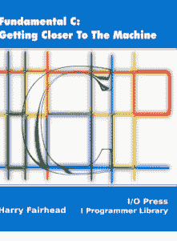

# 基础 C：贴近机器

ISBN: 978-1871962604

如果你想尽快提升对 C 语言的知识水平，那么这本书就是为你准备的。本书从底层程序员的视角探索 C 语言，并紧贴硬件。它涵盖了地址、指针以及使用二进制表示事物的方式，并强调了一个重要观念：一切皆位模式，而其含义是可以变化的。

对于初学者，本书涵盖了在编写 Hello World 程序之前安装 IDE 和 GCC 的内容，然后介绍了任何程序的基本构建模块——变量、赋值与表达式、使用条件和循环控制流程。

在使用 C 编程时，你需要思考数据的表示方式，本书强调了使用类型双关和联合体来修改变量模式处理方式的理念，并探讨了 C 语言中许多书籍都忽略的未定义行为这一主题。

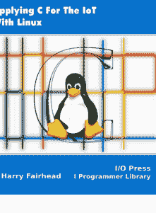

# 在 Linux 物联网中应用 C

ISBN: 978-1871962611

如果你正在使用 C 语言编写针对运行 Linux 的小型单板机（SBC）的底层代码，或者你在 C 语言中编写与硬件交互的代码，那么本书将汇集底层、面向硬件且通常特定于硬件的信息。

它首先探讨了程序如何在用户模式下运行 Linux。在处理硬件时，算术运算不容忽视，因此专门有章节介绍整数、定点和浮点算术。接着，它介绍了伪文件系统、内存映射文件以及套接字作为一种通用的通过网络及类似基础设施进行通信的方式。随后，它探讨了多任务、锁定、使用互斥锁和条件变量以及调度。最后，它以简要介绍如何将汇编语言与 C 语言混合使用作为结尾。

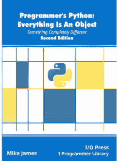

# 程序员 Python：一切皆对象，第二版

ISBN: 978-1871962741

这是“Something Completely Different”系列书籍中的第一本，该系列书籍探讨了 Python 的特殊之处及其与其他编程语言的区别。它解释了 Python 3 在类和对象方面所采取的方法背后的深层逻辑。大致来说，主题涉及与 Python 实现对象方式有关的一切——元类；类；对象；属性；以及 Python 用于使一切得以运行的函数、方法和许多“魔术方法”等其他设施。

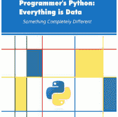

# 程序员 Python：一切皆数据

ISBN: 978-1871962595

秉持相同的理念，本书展示了 Python 如何以独特的 Pythonic 方式处理数据。Python 的数据对象既非常实用又非常可扩展。从被称为大整数的无限精度整数，到选择列表来扮演数组的角色，再到字典作为一种内置数据类型的可用性，本书是你充分利用这些特殊特性所需的资源。

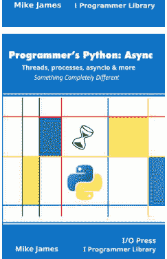

# 程序员 Python：异步

ISBN: 978-1871962595

未使用异步代码的应用程序正在浪费机器的大量潜力。副标题为“线程、进程、`asyncio` 及其他”，本卷内容关于异步编程，这是一件难以做对但非常值得花费精力去钻研的事情，它揭示了 Python 如何以其独特的方式解决这些问题。

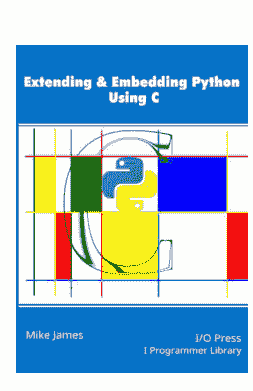

## 使用 C 扩展和嵌入 Python

ISBN: 978-1871962833

为 Python 编写 C 扩展既有趣又有价值！有趣之处在于，将 Python 添加到 C 中赋予了你更多的能力，并让你更深入地理解 Python 的工作原理。了解 Python 的内部机制是值得的，因为它能为你解决其他问题提供新的思路。除了有趣之外，这也是一项宝贵的技能。

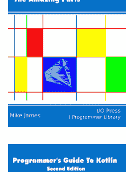

## JavaScript 珍品：精彩绝伦的部分

ISBN: 978-1871962420

这本书是对那些使 JavaScript 区别于其他语言、并使其在拥有令人钦佩的特质方面独具特色的特性的“沉思”。每一颗“珍品”（Jem）都旨在为任何 JavaScript 程序员提供愉快的阅读体验，并以新的视角展示这门语言。这些被称为“珍品”（Jems）。这不是字典里能找到的词，但它的用法与其同音词“Gem”（宝石）在“珍视其美丽与价值的事物”这一含义上是相同的。这里汇集了二十颗关于特性的珍品，这些特性与其他语言的对应特性相比，既有着优势，也有着不足。

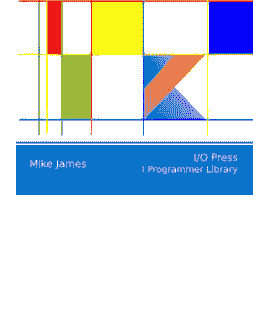

## Kotlin 程序员指南，第二版

ISBN: 978-1871962703

这本书向程序员介绍 Kotlin。你不需要是 Java 或其他语言的专家，但你需要了解编程和使用对象的基础知识。与所有语言一样，Kotlin 也有一些微妙的领域，理解这些机制的工作原理至关重要，而第二版特别关注了这些陷阱，并新增了一个关于协程（Coroutines）的章节，协程可能是 Kotlin 中陷阱最多且文档最少的特性。读完这本书后，一切都将变得清晰且可操作。
