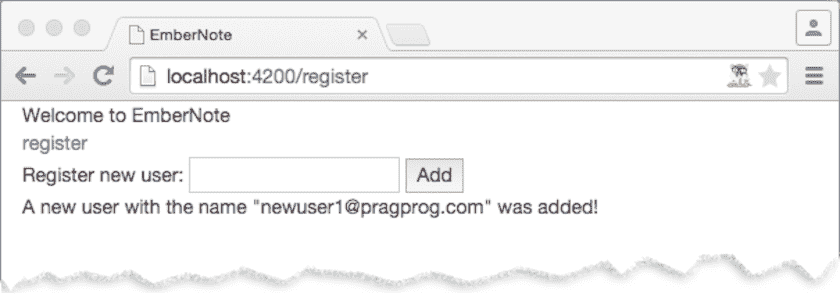
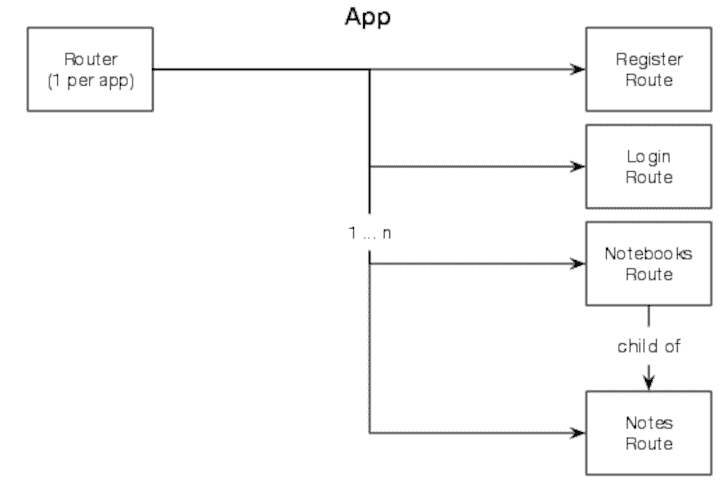
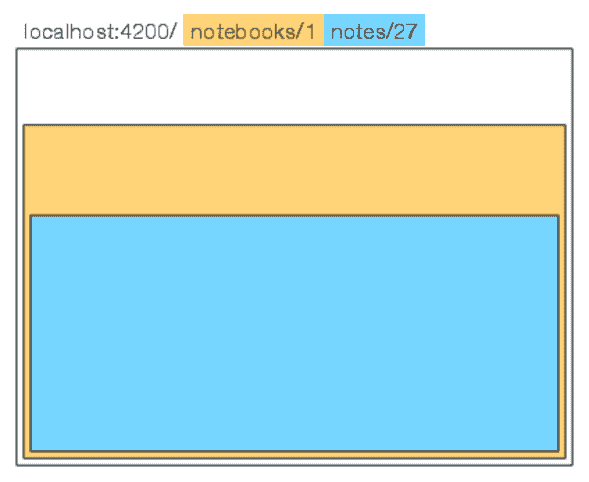
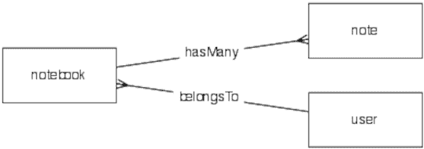
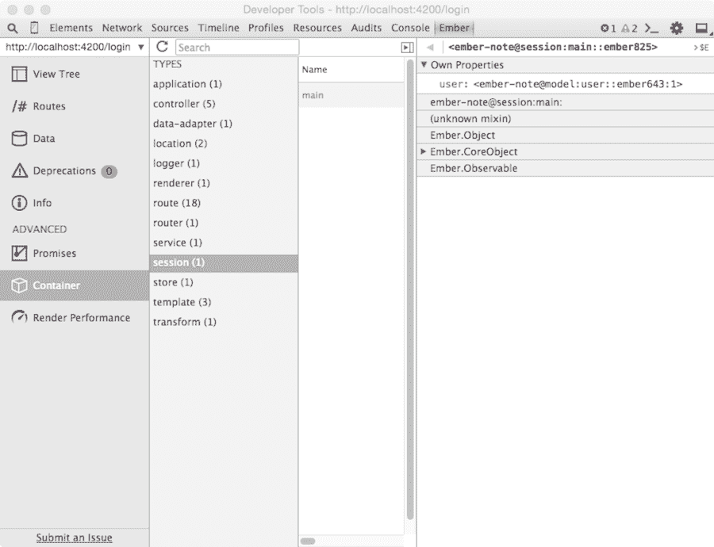
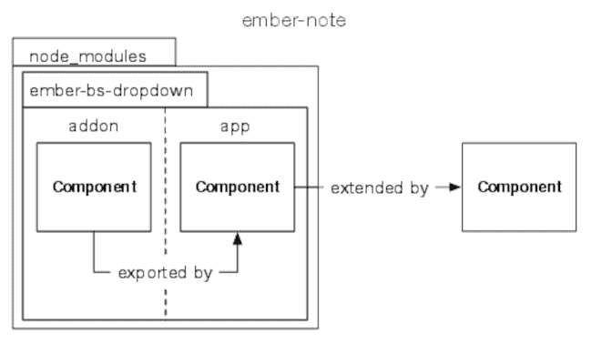

# 使用 Ember 2 构建出的 Web 应用


## 为了获得最佳阅读体验……

我们强烈建议您在阅读设备或应用程序上启用“出版商默认”设置来阅读本书。如果没有此设置，某些格式和字符可能无法正常显示。请参考您的阅读器说明了解如何启用出版商默认设置。


# 《Deliver Audacious Web Apps with Ember 2》早期好评

使用 Ember 2 构建大胆的 Web 应用为强大且优雅的 Ember 框架提供了清晰的介绍。想要学习 Ember 或提升 Ember 技能的开发者应该读这本书。

| → Nell Shamrell-Harrington |
| | Chef 开发工程师 |

Ember 带回了 Rails 的乐趣，这次是针对性能良好的单页应用。

| → Federico Tomassetti |
| | 软件工程师 |

如果你考虑在下一个 JavaScript 项目中使用 Ember，请买这本书。每读完一章，我都感觉自己提升了水平。

| → Stephen Orr |
| | Impact Applications 高级软件工程师

# 致谢


感谢 Ember 核心团队和 Ember 社区：感谢你们制作了一个既好学又有趣的产品。因为你们的无私投入，网络变得更好。感谢！

感谢我的技术评审员 Alessandro Bahgat, Jacob Chae, Javier Collado, Jeremy Frens, Kenneth Geisshirt, Alexander Henry, Eric Hung, Jan Nonnen, Stephen Orr, Shreerang Patwardhan, Martijn Reuvers, Brian Schau, Nell Shamrell-Harrington, Tibor Simic, Charley Stran, Federico Tomassetti, Paul Waring, Nick Watts 以及 Stephen Wolff：感谢你们为这个项目投入的时间和专业知识。你们的建议让这本书比我独自编写的要好得多。


致 Pragmatic Bookshelf 团队，包括 Andy Hunt, Dave Thomas, Susannah Davidson Pfalzer, Janet Furlow 以及其他对制作做过贡献的同事：你们帮助我将这本书打造成了我们希望大家都能为在上面签下名字感到自豪的作品。

致我的编辑 Katharine Dvorak：这本书不仅有我的份，也有你的。你的指导和见解对我帮助极大，如果没有它们，这本书的长度会增加一倍，而有用信息却减少一半。我迫不及待要开始下一本书了！

致我的好朋友兼同期作者 Sharone Williams：感谢你对我因截止日期压力而产生的幻觉表示共鸣。知道你同样在“文字矿场”中拼搏，这种感觉是无法估量的帮助。

致我的父母：感谢你们为我付出的一切牺牲，并教我努力工作、尝试新事物。我希望你们像我一样为这本书感到自豪。

最重要的，致我的妻子和儿子：你们的耐心、支持和爱对我意味着一切，没有你们，我既无法开始也无法完成这本书。感谢你们的一切！

Matt White `matt@mattwhite.co` 2015 年 10 月 版权 ©2015, The Pragmatic Bookshelf。

# 引言：为什么选择 Ember？

当你考虑编写一个 Web 应用时，最让你兴奋的是什么？是期待编写框架代码，还是期待为用户交付功能？如果你像我一样，功能才是令人兴奋的部分，而框架的存在是为了服务功能。现在，想象一下，有一组开发者一直在寻找 Web 应用前端开发的最佳实践，并将他们发现的内容编码成一个框架。想象一下，如果你不再担心编写胶水代码（glue code），而是把时间花在兴奋的事情上，你的工作会有何不同？

Ember 是一个开源 JavaScript 框架，维护在 `http://emberjs.com` 和 GitHub 上，它能加速 Web 应用的开发。它提供了你所需的大部分前端基础设施，让你能够花费精力创建一个出色的应用程序。如果你使用 Ember，你将编写更少的代码、更简单的代码。而更简单的代码就是更好的代码。通过在 JavaScript 中引入面向对象的设计原则来帮助你以合理的方式组织代码，Ember 让你从模块化的角度进行思考。这使得你的应用程序更容易创建和维护。

在本书中，你将学习如何创建大胆的 Web 应用，并通过让 Ember 承担繁重工作来高效地完成。你将使用 Ember 的路由系统构建具有丰富界面和简单、可共享 URL 的单页应用。你将创建可重用的 UI 组件和模板，并将它们组合成高度可用的、复杂的应用程序。你将使用 Ember Data 读写 RESTful 服务。你将学习使用 Ember 插件（addons）来共享代码，并使用他人分享的代码。你将学习使用 Ember CLI 和 QUnit 来组织、构建和测试你的应用程序。

## 本书是什么，不是什么

本书是对 Ember 2、Ember Data 和 Ember CLI 核心功能的简明介绍。这些功能依赖于 Node.js、`npm` 和 Handlebars，但我们不会详细阐述这些依赖项。

本书不是关于 Ember、Ember Data 或 Ember CLI 的详尽参考书。

## 谁应该读这本书？

本书面向初接触 Ember 的 Web 开发者。如果你使用过 React 或 Angular 等其他框架，或者使用过 jQuery，那么 Ember 的某些部分对你来说应该是熟悉的。

## 本书的结构

在第一章中，我们将首先通过安装 Ember 和 Ember CLI 来搭建开发环境。接下来，我们将开始构建贯穿本书的应用程序。我们将使用 Ember CLI 创建该应用及其第一个功能：注册页面。最后，我们将通过构建一个用于测试的基础的、感知数据的后端来为该页面提供支持。

在接下来的三章中，我们将专注于使用 Ember 构建应用程序。在第 5 章和第 6 章中，我们将学习使用 Ember Data。第 7 章讨论 Ember 的路由系统。第 8 章和第 9 章将通过学习如何使用 Ember CLI 进行构建和部署来结束。

本书的一个不同之处是，每一章都建立在前一章的基础上。在整书中，我们将一直使用 Ember CLI 进行构建、测试和部署。

## 哪里寻求帮助

本书中的所有代码示例都可以在网上找到。此外，还有一个讨论论坛，你可以在那里提问并提供反馈。

# 第一章：使用 Ember 启动你的应用程序

在本章中，我们将通过学习 Ember 和 Ember CLI 的一些核心功能来快速起步。首先，我们将通过安装 Ember 和 Ember CLI 来搭建开发环境。接下来，我们将开始构建贯穿本书的应用程序。我们将使用 Ember CLI 创建该应用及其第一个功能：注册页面。最后，我们将通过构建一个用于测试的基础的、感知数据的后端来为该页面提供支持。让我们从安装 Ember 和 Ember CLI 开始吧。

## 安装 Ember 和 Ember CLI

Ember CLI 是用于构建 Ember 应用的命令行界面，它是团队获取框架库的首选方式。通常情况下，Ember 非常关注 Ember 开发者所说的“开发者工程学”（developer ergonomics）。他们希望让你作为开发者的生活更轻松。Ember CLI 正是基于这种精神创建。正如你在整书中看到的，Ember CLI 能够轻松处理许多模板化任务，例如构建和部署、执行测试、添加文件以创建新功能等。同样重要的是，它允许对类使用新的基于模块的语法。这大大提高了你代码的清晰度。我们在本书中将使用 Ember CLI，所以让我们从安装它开始吧。


值得注意的是，尽管我们将使用 `Node` 来运行 Ember CLI 开发工具，但 Ember 本身并不是一个服务端框架，尽管 `Node` 支持服务端的 JavaScript 开发。Ember 用于创建浏览器驻留应用。

首先，让我们安装 `Node` 和 `npm`，以及 `Git`。`Node` 自带了 `npm`，但 `npm` 更新非常频繁，因此有必要确认你拥有的是最新版本。请访问相关网站为你的特定平台安装这些工具的最新版本。你的 `Node` 安装至少应为 `0.12` 版本以支持 Ember CLI 工具链。如果你已经安装了 `Node`，你可能需要先卸载现有版本。

后两个安装是 `Bower` 所要求的。`npm` 是一个包管理器，用于构建在 `Node` 中运行的代码，或与在 `Node` 中运行的工具配合。`Git` 是分布式版本控制系统。请根据各自网站的安装说明安装这三者。

| 安装 |
| --- |
|  | 在安装这些工具的每一个时，你可能希望以管理员用户的身份运行。在 Linux/BSD/OS X 系统上，你可能需要使用 `sudo` 前缀来执行，而在 Windows 上，你需要以具有管理员权限的用户身份登录。与许多安装过程一样，可能会出现问题，因此如果发生问题，请前往 [`pragprog.com`](http://pragprog.com) 上的书籍论坛，我们将共同解决。 |

安装好这些工具后，你可以从命令行获取 `Bower`：

| | ```bash$ npm install -g bower ``` |

你应该能看到几行命令输出，表示 `Bower` 及其依赖项已拉取到你的机器上。`-g` 命令选项要求 `Node` 安装 `Bower` 并使其全局可用，而不是将其限制在特定项目中。一旦 `Bower` 完成安装（你会看到命令输出停止并返回命令提示符），你就可以安装 `PhantomJS`：

| | ```bash$ npm install -g phantomjs ``` |

同样，你应该能看到一些命令输出，告诉你 `PhantomJS` 已成功安装。有了这些工具，你就可以准备好获取 Ember CLI 了：

| | ```bash$ npm install -g ember-cli ``` |

安装 `Ember CLI` 会导致 Ember 框架库以及 CLI 本身被安装。现在你有了 `Ember` 和 `Ember CLI`，我们可以开始编写代码了。

## 开始你的应用

Ember CLI 采用以应用为中心的方法。你做的第一件事是创建应用，你创建的每个模块都是该应用的一部分。因此我们将遵循这种做法，在一个应用的范围内探索 Ember 的所有核心概念。

我们将编写一个名为 `EmberNote` 的应用，它是 Evernote（基于网络的笔记应用）的精简克隆。我们的第一步是创建应用的仓库（之所以这样做是因为 Ember CLI 假设你将使用 `Git` 作为版本控制系统）。

### 创建应用仓库

打开命令提示符，导航到存放代码的位置，并运行以下命令：

| | ```bash$ ember new ember-note ``` |

这将为你的应用创建一个新目录。如果出现任何问题，请查看后面的提示。

| 使用 Ember CLI 创建新项目 |
| --- |
|  | 截至本文时，Ember CLI 在创建新仓库时可能会发生可能的竞态条件。如果你看到类似 `ENOENT, open ’ember/package.json'` 的错误，你可能遇到了此错误。通常，`ember new` 命令在第二次尝试时会成功。在某些非 Windows 系统上，你可能看到关于未安装 `watchman` 的控制台警告。Ember CLI 使用 `watchman` 监控你的文件系统变化，并在你开发 Ember 应用时将其实时部署到本地服务器。有 `watchman` 是好事（即使仅仅是为了避免此错误），但它不是必须的。如果没有 `watchman`，Ember CLI 使用一个名为 `NodeWatcher` 的工具实现相同。如果你想安装 `watchman`，请访问 [`facebook.github.io/watchman/docs/install.html`](https://facebook.github.io/watchman/docs/install.html) 获取特定平台的安装说明。 |

在我们编写 UI 代码之前，让我们也安装 Bootstrap 样式表，这样我们就可以享受一个看起来不像 20 世纪 90 年初的 UI。在新创建的 `ember-note` 目录的命令提示符中，运行以下命令：

| | ```bash$ cd ember-note ``` |
| | ```bash$ npm install ``` |
| | ```bash$ bower install ``` |
| | ```bash$ bower install bootstrap --save ``` |

然后将这些行添加到 `ember-note/ember-cli-build.js` 中，位于最后一行代码之前：

| | ```javascriptapp.import('bower_components/bootstrap/dist/css/bootstrap.css'); ``` |
| | ```javascriptapp.import('bower_components/bootstrap/dist/js/bootstrap.js'); ``` |
| | ```javascriptapp.import('bower_components/bootstrap/dist/css/bootstrap.min.css'); ``` |

### 运行你的应用

让我们运行应用看看效果。在你的 new-note 目录的命令提示符中，运行以下命令：

| | ```bash$ ember serve ``` |

你应该看到一些命令输出，告诉你构建成功且你的应用正在运行在端口 200... |


在 Ember 应用中，你所有的功能都组织在路由（routes）之下。路由本质上是一个 URL 分段，如 *嵌套路由* 所示。因此，我们的下一步是使用 Ember CLI 来创建一个路由。打开一个新的命令行终端，在你的 `ember-note` 项目根目录下，运行以下命令：

```bash
$ ember generate route register --pod
```

在 `generate` 命令中添加 `--pod` 标志时，会创建一个名为 `register` 的目录，其中包含了添加你的路由所需的文件：`route.js` 和 `template.hbs`。它们目前是空的，你将根据需要填充它们的内容以创建路由的功能。通常情况下，当你想要按功能组织项目时（即创建一个包含 `route.js` 和 `template.hbs` 文件的 `register` 目录），而不是按对象类型组织时，你会使用 pod。

早些时候，当你使用 `ember new` 命令创建应用时，创建了以下四个文件：`index.html`、`app.js`、`router.js` 和 `application.hbs`。随后，`ember generate` 命令会编辑你应用目录下的 `router.js` 文件。我们将在使用 Router 类来组织你的应用 中深入探讨这一点，但 `router.js` 类用于实现应用内部路由的层次结构。

如果你运行 `ember generate` 命令但漏掉了 `--pod` 标志，Ember CLI 仍然会创建相同的对象，但它不在 `register` 目录中创建一个名为 `route.js` 的文件，而是在 `route` 目录下创建一个名为 `register.js` 文件。对于我们而言，最好在一个位置看到路由所需的每个文件，因此我们将在本书书中始终使用 `--pod` 标志。

让我们来看一下到为止创建的每一个文件。

### index.html

该文件是你的应用的起点。它是当你运行 `ember new ember-note` 命令时创建的。让我们来看看。

```html
<!DOCTYPE html>
<html>
<head>
<meta charset="utf-8">
<meta http-equiv="X-UA-Compatible" content="IE=edge">
<title>EmberNote</title>
<meta name="description" content="">
<meta name="viewport" content="width=device-width,initial-scale=1">
{{content-for 'head'}}
<link rel="stylesheet" href="assets/vendor.css">
<link rel="stylesheet" href="assets/ember-note.css">
{{content-for 'head-footer'}}
</head>
<body>
{{content-for 'body'}}
<script src="assets/vendor.js"></script>
<script src="assets/ember-note.js"></script>
{{content-for 'body-footer'}}
</body>
</html>
```

`index.html` 的大部分内容是创建起始页面的 HTML 模板代码。Ember CLI 添加了两个名为 `vendor.css` 和 `ember-note.css` 的样式表来美化应用。在本书中我们不会对样式表做太多操作，但你应该知道 `vendor.css` 将捕获你引入应用的任何第三方代码中使用的样式，而 `ember-note.css` 用于你定义的样式。

`vendor.js` 和 `ember-note.js` 的情况也是如此的。Ember CLI 构建过程会为你在应用中使用的所有第三方代码创建一个文件，名为 `vendor.js`，并为你的应用代码创建一个文件，名为 `ember-note.js`。它们包含在 `index.html` 中。

你可能还会注意到 `{{content-for}}` 表达式。这些允许你使用 Ember CLI 插件在页面中包含额外内容。

### app.js

`app.js` 文件用于创建 Ember 环境。看看下面的代码：

```javascript
import Ember from 'ember';
import Resolver from 'ember/resolver';
import loadizers from 'ember/initializers';
import config from './config/environment';

var App;

App = Ember.Application({
  modulePrefix: config.modulePrefix,
  podPrefix: config.podPrefix,
  resolver: Resolver
});

loadizers(App, config.modulePrefix);

export default App;
```

如果你是一个还没有看过 ECMAScript 2015 的资深开发者，前几行可能会让你大掉下巴。ECMAScript 是 ECMA 国际组织指定的 JavaScript 语言的正式名称，而 ECMAScript 2015（也称为 ES6）是该标准的最新发布。当你开始以模块化的方式编写代码时。

`app.js` 中代码的目的是设置应用范围内的构造。其中一个 `Resolver` 用于在整个应用中查找类。`modulePrefix` 变量被设置为 `ember-note`，如你在设置应用时定义的那样。`podPrefix` 没有设置，因为我们的项目配置中尚未定义，而该配置是从 `config/environment` 读取的。

### router.js

`router.js` 文件是你可以真正开始看到 Ember 如何工作的地方。Ember 最基础的功能之一是路由（route）的概念。简单来说，路由是应用中的一个位置。如果你将应用视为页面或页面区域的集合，每个区域嵌套在另一个内部，那么每个页面都对应一个路由。而位于 `router.js` 中定义的 `Router` 类就是你定义应用结构的地方。让我们来看看：

```javascript
import Ember from 'ember';
import config from './config/environment';

var Router = Ember.Router.extend({
  location: config.locationType
});

Router.map(function() {
  this.route('register');
});

export default Router;
```


但 `Router.map` 才是真正发生作用的地方。正如你看到的，我们已经创建了一个名为 `register` 的路由。这个路由是在运行 `ember generate route register --pod` 命令时添加到 `Router` 中的。还生成了许多其他文件，稍后我们将编辑这些文件来创建注册功能。`register` 路由似乎是一个顶级路由，但实际上它位于应用程序默认路由下的第一层子路由。让我们通过关联的模板来看这个默认路由。

#### application.hbs

每个应用程序都有一个根路由，即 `Application` 路由。此外，每个路由精确对应一个模板。模板是你的用户界面的一部分。对于 `application` 路由，该模板定义在 `application.hbs` 中。现在让我们修改此模板，使其如下所示：

| [ch1/ember-note/app/templates/application.hbs](http://media.pragprog.com/titles/mwjsember/code/ch1/ember-note/app/templates/application.hbs) |
| :--- |
| `<div class="container">` |
| `<div class="row">` |
| `<div class="col-md-2">` |
| Welcome to EmberNote |
| `</div>` |
| `<div class="col-md-10">` |
| `{{#link-to 'register'}}register{{/link-to}}` |
| `</div>` |
| `</div>` |
| `<div class="row">` |
| `<div>` |
| `{{outlet}}` |
| `</div>` |
| `</div>` |
| `</div>` |

每个 Ember 模板都是 HTML 和 Handlebars 表达式语言的混合体，表达式语言即是用 "{{ }}" 字符隔开的代码部分。Handlebars 是 Ember 使用的表达式语言，用于描述 Ember 模板中与 Ember 应用程序代码相关的某些片段。在整书中你会看到很多 Ember 使用 Handlebars 表达式的示例，它们始终使用“{{ }}" 字符。Ember 附带了一个编译器，可以将 Handlebars 模板表达式转换为 DOM 对象，正如我们在编译模板 中看到的那样。

正如我们之前看到的，每个应用都由一个路由层次组成。`application.hbs` 文件中的 `{{#link-to}}` 表达式用于生成超链接，点击后会将 `register` 路由加载到 `{{outlet}}` 中。

你可能在想 `Application` 路由是在哪里定义的。在特定情况下，由于我们没有任何特定的操作处理或数据加载需要执行，我们不需要定义路由类；我们可以简单地依靠 Ember 使用默认行为动态创建路由实现。

到目前我们看到的所有代码都搭建了应用程序的最少配置。现在，让我们看看如何通过构建 `register` 路由为我们的应用添加功能。

### 构建 Register 路由

正如之前讨论的，`register` 路由将允许用户通过选择用户名来注册 EmberNote 应用程序。当我们使用 CLI 创建此路由时，创建了以下文件（注意，这是 `route.js`，与 `router.js` 不同）：

| [ch1/ember-note/app/register/route.js](http://media.pragprog.com/titles/mwjsember/code/ch1/ember-note/app/register/route.js) |
| :--- |
| `import Ember from 'ember';` |
| `export default Ember.Route.extend({` |
| `});` |

这就是定义一个空路由类的方法。路由存在有两个主要原因：加载由路由显示的数据以及响应操作。在我们的案例中，我们没有任何要显示的数据，并且我们需要定义一个 `addNew` 操作来向应用添加新用户。我们稍后会回到该操作。首先，让我们看看用户界面将什么样。这是我们路由的模板文件，已添加必要的 UI 代码：

| [ch1/ember-note/app/register/template.hbs](http://media.pragprog.com/titles/mwjsember/code/ch1/ember-note/app/register/template.hbs) |
| :--- |
| `<div class="col-md-12">` |
| Register new user: `{{input value=name}}` |
| `<button {{action 'addNew'}}>Add</button>` |
| `</div>` |
| `<div class="col-md-12">` |
| `{{message}}` |
| `</div>` |

`{{input}}` 字段允许我们输入名称。`<button {{action 'addNew'}}` 触发 `addNew` 操作。`{{message}}` 字段显示状态。`{{input}}` 字段允许我们输入名称。`<button {{action 'addNew'}}` 触发 `addNew` 操作。`{{message}}` 字段显示状态。`{{input}}` 字段允许我们输入名称。`<button {{action 'addNew'}}` 触发 `addNew` 操作。`{{message}}` 字段显示状态。`{{input}}` 字段允许我们输入名称。`<button {{action 'addNew'}}` 触发 `addNew` 操作。`{{message}}` 字段显示状态。`{{input}}` 字段允许我们输入名称。`<button {{action 'addNew'}}` 触发 `addNew` 操作。`{{message}}` 字段显示状态。`{{input}}` 字段允许我们输入名称。`<button {{action 'addNew'}}` 触发 `addNew` 操作。`{{message}}` 字段显示状态。`{{input}}` 字段允许我们输入名称。`<button {{action 'addNew'}}` 触发 `addNew` 操作。`{{message}}` 字段显示状态。`{{input}}` 字段允许我们输入名称。`<button {{action 'addNew'}}` 触发 `addNew` 操作。`{{message}}` 字段显示状态。`{{input}}` 字段允许我们输入名称。`<button {{action 'addNew'}}` 触发 `addNew` 操作。`{{message}}` 字段显示状态。`{{input}}` 字段允许我们输入名称。`<button {{action 'addNew'}}` 触发 `addNew` 操作。`{{message}}` 字段显示状态。`{{input}}` 字段允许我们输入名称。`<button {{action 'addNew'}}` 触发 `addNew` 操作。`{{message}}` 字段显示状态。`{{input}}` 字段允许我们输入名称。`<button {{action 'addNew'}}` 触发 `addNew` 操作。`{{message}}` 字段显示状态。`{{input}}` 字段允许我们输入名称。`<button {{action 'addNew'}}` 触发 `addNew` 操作。`{{message}}` 字段显示状态。`{{input}}` 字段允许我们输入名称。`<button {{action 'addNew'}}` 触发 `addNew` 操作。`{{message}}` 字段显示状态。`{{input}}` 字段允许我们输入名称。`<button {{action 'addNew'}}` 触发 `addNew` 操作。`{{message}}` 字段显示状态。`{{input}}` 字段允许我们输入名称。`<button {{action 'addNew'}}` 触发 `addNew` 操作。`{{message}}` 字段显示状态。`{{input}}` 字段允许我们输入名称。`<button {{action 'addNew'}}` 触发 `addNew` 操作。`{{message}}` 字段显示状态。`{{input}}` 字段允许我们输入名称。`<button {{action 'addNew'}}` 触发 `addNew` 操作。`{{message}}` 字段显示状态。`{{input}}` 字段允许我们输入名称。`<button {{action 'addNew'}}` 触发 `addNew` 操作。`{{message}}` 字段显示状态。`{{input}}` 字段允许我们输入名称。`<button {{action 'addNew'}}` 触发 `addNew` 操作。`{{message}}` 字段显示状态。`{{input}}` 字段允许我们输入名称。`<button {{action 'addNew'}}` 触发 `addNew` 操作。`{{message}}` 字段显示状态。`{{input}}` 字段允许我们输入名称。`<button {{action 'addNew'}}` 触发 `addNew` 操作。`{{message}}` 字段显示状态。`{{input}}` 字段允许我们输入名称。`<button {{action 'addNew'}}` 触发 `addNew` 操作。`{{message}}` 字段显示状态。`{{input}}` 字段允许我们输入名称。`<button {{action 'addNew'}}` 触发 `addNew` 操作。`{{message}}` 字段显示状态。`{{input}}` 字段允许我们输入名称。`<button {{action 'addNew'}}` 触发 `addNew` 操作。`{{message}}` 字段显示状态。`{{input}}` 字段允许我们输入名称。`<button {{action 'addNew'}}` 触发 `addNew` 操作。`{{message}}` 字段显示状态。`{{input}}` 字段允许我们输入名称。`<button {{action 'addNew'}}` 触发 `addNew` 操作。`{{message}}` 字段显示状态。`{{input}}` 字段允许我们输入名称。`<button {{action 'addNew'}}` 触发 `addNew` 操作。`{{message}}` 字段显示状态。`{{input}}` 字段允许我们输入名称。`<button {{action 'addNew'}}` 触发 `addNew` 操作。`{{message}}` 字段显示状态。`{{input}}` 字段允许我们输入名称。`<button {{action 'addNew'}}` 触发 `addNew` 操作。`{{message}}` 字段显示状态。`{{input}}` 字段允许我们输入名称。`<button {{action 'addNew'}}` 触发 `addNew` 操作。`{{message}}` 字段显示状态。`{{input}}` 字段允许我们输入名称。`<button {{action 'addNew'}}` 触发 `addNew` 操作。`{{message}}` 字段显示状态。`{{input}}` 字段允许我们输入名称。`<button {{action 'addNew'}}` 触发 `addNew` 操作。`{{message}}` 字段显示状态。`{{input}}` 字段允许我们输入名称。`<button {{action 'addNew'}}` 触发 `addNew` 操作。`{{message}}` 字段显示状态。`{{input}}` 字段允许我们输入名称。`<button {{action 'addNew'}}` 触发 `addNew` 操作。`{{message}}` 字段显示状态。`{{input}}` 字段允许我们输入名称。`<button {{action 'addNew'}}` 触发 `addNew` 操作。`{{message}}` 字段显示状态。`{{input}}` 字段允许我们输入名称。`<button {{action 'addNew'}}` 触发 `addNew` 操作。`{{message}}` 字段显示状态。`{{input}}` 字段允许我们输入名称。`<button {{action 'addNew'}}` 触发 `addNew` 操作。`{{message}}` 字段显示状态。`{{input}}` 字段允许我们输入名称。`<button {{action 'addNew'}}` 触发 `addNew` 操作。`{{message}}` 字段显示状态。`{{input}}` 字段允许我们输入名称。`<button {{action 'addNew'}}` 触发 `addNew` 操作。`{{message}}` 字段显示状态。`{{input}}` 字段允许我们输入名称。`<button {{action 'addNew'}}` 触发 `addNew` 操作。`{{message}}` 字段显示状态。`{{input}}` 字段允许我们输入名称。`<button {{action 'addNew'}}` 触发 `addNew` 操作。`{{message}}` 字段显示状态。`{{input}}` 字段允许我们输入名称。`<button {{action 'addNew'}}` 触发 `addNew` 操作。`{{message}}` 字段显示状态。`{{input}}` 字段允许我们输入名称。`<button {{action 'addNew'}}` 触发 `addNew` 操作。`{{message}}` 字段显示状态。`{{input}}` 字段允许我们输入名称。`<button {{action 'addNew'}}` 触发 `addNew` 操作。`{{message}}` 字段显示状态。`{{input}}` 字段允许我们输入名称。`<button {{action 'addNew'}}` 触发 `addNew` 操作。`{{message}}` 字段显示状态。`{{input}}` 字段允许我们输入名称。`<button {{action 'addNew'}}` 触发 `addNew` 操作。`{{message}}` 字段显示状态。`{{input}}` 字段允许我们输入名称。`<button {{action 'addNew'}}` 触发 `addNew` 操作。`{{message}}` 字段显示状态。`{{input}}` 字段允许我们输入名称。`<button {{action 'addNew'}}` 触发 `addNew` 操作。`{{message}}` 字段显示状态。`{{input}}` 字段允许我们输入名称。`<button {{action 'addNew'}}` 触发 `addNew` 操作。`{{message}}` 字段显示状态。`{{input}}` 字段允许我们输入名称。`<button {{action 'addNew'}}` 触发 `addNew` 操作。`{{message}}` 字段显示状态。`{{input}}` 字段允许我们输入名称。`<button {{action 'addNew'}}` 触发 `addNew` 操作。`{{message}}` 字段显示状态。`{{input}}` 字段允许我们输入名称。`<button {{action 'addNew'}}` 触发 `addNew` 操作。`{{message}}` 字段显示状态。`{{input}}` 字段允许我们输入名称。`<button {{action 'addNew'}}` 触发 `addNew` 操作。`{{message}}` 字段显示状态。`{{input}}` 字段允许我们输入名称。`<button {{action 'addNew'}}` 触发 `addNew` 操作。`{{message}}` 字段显示状态。`{{input}}` 字段允许我们输入名称。`<button {{action 'addNew'}}` 触发 `addNew` 操作。`{{message}}` 字段显示状态。`{{input}}` 字段允许我们输入名称。`<button {{action 'addNew'}}` 触发 `addNew` 操作。`{{message}}` 字段显示状态。`{{input}}` 字段允许我们输入名称。`<button {{action 'addNew'}}` 触发 `addNew` 操作。`{{message}}` 字段显示状态。`{{input}}` 字段允许我们输入名称。`<button {{action 'addNew'}}` 触发 `addNew` 操作。`{{message}}` 字段显示状态。`{{input}}` 字段允许我们输入名称。`<button {{action 'addNew'}}` 触发 `addNew` 操作。`{{message}}` 字段显示状态。`{{input}}` 字段允许我们输入名称。`<button {{action 'addNew'}}` 触发 `addNew` 操作。`{{message}}` 字段显示状态。`{{input}}` 字段允许我们输入名称。`<button {{action 'addNew'}}` 触发 `addNew` 操作。`{{message}}` 字段显示状态。`{{input}}` 字段允许我们输入名称。`<button {{action 'addNew'}}` 触发 `addNew` 操作。`{{message}}` 字段显示状态。`{{input}}` 字段允许我们输入名称。`<button {{action 'addNew'}}` 触发 `addNew` 操作。`{{message}}` 字段显示状态。`{{input}}` 字段允许我们输入名称。`<button {{action 'addNew'}}` 触发 `addNew` 操作。`{{message}}` 字段显示状态。`{{input}}` 字段允许我们输入名称。`<button {{action 'addNew'}}` 触发 `addNew` 操作。`{{message}}` 字段显示状态。`{{input}}` 字段允许我们输入名称。`<button {{action 'addNew'}}` 触发 `addNew` 操作。`{{message}}` 字段显示状态。`{{input}}` 字段允许我们输入名称。`<button {{action 'addNew'}}` 触发 `addNew` 操作。`{{message}}` 字段显示状态。`{{input}}` 字段允许我们输入名称。`<button {{action 'addNew'}}` 触发 `addNew` 操作。`{{message}}` 字段显示状态。`{{input}}` 字段允许我们输入名称。`<button {{action 'addNew'}}` 触发 `addNew` 操作。`{{message}}` 字段显示状态。`{{input}}` 字段允许我们输入名称。`<button {{action 'addNew'}}` 触发 `addNew` 操作。`{{message}}` 字段显示状态。`{{input}}` 字段允许我们输入名称。`<button {{action 'addNew'}}` 触发 `addNew` 操作。`{{message}}` 字段显示状态。`{{input}}` 字段允许我们输入名称。`<button {{action 'addNew'}}` 触发 `addNew` 操作。`{{message}}` 字段显示状态。`{{input}}` 字段允许我们输入名称。`<button {{action 'addNew'}}` 触发 `addNew` 操作。`{{message}}` 字段显示状态。`{{input}}` 字段允许我们输入名称。`<button {{action 'addNew'}}` 触发 `addNew` 操作。`{{message}}` 字段显示状态。`{{input}}` 字段允许我们输入名称。`<button {{action 'addNew'}}` 触发 `addNew` 操作。`{{message}}` 字段显示状态。`{{input}}` 字段允许我们输入名称。`<button {{action 'addNew'}}` 触发 `addNew` 操作。`{{message}}` 字段显示状态。`{{input}}` 字段允许我们输入名称。`<button {{action 'addNew'}}` 触发 `addNew` 操作。`{{message}}` 字段显示状态。`{{input}}` 字段允许我们输入名称。`<button {{action 'addNew'}}` 触发 `addNew` 操作。`{{message}}` 字段显示状态。`{{input}}` 字段允许我们输入名称。`<button {{action 'addNew'}}` 触发 `addNew` 操作。`{{message}}` 字段显示状态。`{{input}}` 字段允许我们输入名称。`<button {{action 'addNew'}}` 触发 `addNew` 操作。`{{message}}` 字段显示状态。`{{input}}` 字段允许我们输入名称。`<button {{action 'addNew'}}` 触发 `addNew` 操作。`{{message}}` 字段显示状态。`{{input}}` 字段允许我们输入名称。`<button {{action 'addNew'}}` 触发 `addNew` 操作。`{{message}}` 字段显示状态。`{{input}}` 字段允许我们输入名称。`<button {{action 'addNew'}}` 触发 `addNew` 操作。`{{message}}` 字段显示状态。`{{input}}` 字段允许我们输入名称。`<button {{action 'addNew'}}` 触发 `addNew` 操作。`{{message}}` 字段显示状态。`{{input}}` 字段允许我们输入名称。`<button {{action 'addNew'}}` 触发 `addNew` 操作。`{{message}}` 字段显示状态。`{{input}}` 字段允许我们输入名称。`<button {{action 'addNew'}}` 触发 `addNew` 操作。`{{message}}` 字段显示状态。`{{input}}` 字段允许我们输入名称。`<button {{action 'addNew'}}` 触发 `addNew` 操作。`{{message}}` 字段显示状态。`{{input}}` 字段允许我们输入名称。`<button {{action 'addNew'}}` 触发 `addNew` 操作。`{{message}}` 字段显示状态。`{{input}}` 字段允许我们输入名称。`<button {{action 'addNew'}}` 触发 `addNew` 操作。`{{message}}` 字段显示状态。`{{input}}` 字段允许我们输入名称。`<button {{action 'addNew'}}` 触发 `addNew` 操作。`{{message}}` 字段显示状态。`{{input}}` 字段允许我们输入名称。`<button {{action 'addNew'}}` 触发 `addNew` 操作。`{{message}}` 字段显示状态。`{{input}}` 字段允许我们输入名称。`<button {{action 'addNew'}}` 触发 `addNew` 操作。`{{message}}` 字段显示状态。`{{input}}` 字段允许我们输入名称。`<button {{action 'addNew'}}` 触发 `addNew` 操作。`{{message}}` 字段显示状态。`{{input}}` 字段允许我们输入名称。`<button {{action 'addNew'}}` 触发 `addNew` 操作。`{{message}}` 字段显示状态。`{{input}}` 字段允许我们输入名称。`<button {{action 'addNew'}}` 触发 `addNew` 操作。`{{message}}` 字段显示状态。`{{input}}` 字段允许我们输入名称。`<button {{action 'addNew'}}` 触发 `addNew` 操作。`{{message}}` 字段显示状态。`{{input}}` 字段允许我们输入名称。`<button {{action 'addNew'}}` 触发 `addNew` 操作。`{{message}}` 字段显示状态。`{{input}}` 字段允许我们输入名称。`<button {{action 'addNew'}}` 触发 `addNew` 操作。`{{message}}` 字段显示状态。`{{input}}` 字段允许我们输入名称。`<button {{action 'addNew'}}` 触发 `addNew` 操作。`{{message}}` 字段显示状态。`{{input}}` 字段允许我们输入名称。`<button {{action 'addNew'}}` 触发 `addNew` 操作。`{{message}}` 字段显示状态。`{{input}}` 字段允许我们输入名称。`<button {{action 'addNew'}}` 触发 `addNew` 操作。`{{message}}` 字段显示状态。`{{input}}` 字段允许我们输入名称。`<button {{action 'addNew'}}` 触发 `addNew` 操作。`{{message}}` 字段显示状态。`{{input}}` 字段允许我们输入名称。`<button {{action 'addNew'}}` 触发 `addNew` 操作。`{{message}}` 字段显示状态。`{{input}}` 字段允许我们输入名称。`<button {{action 'addNew'}}` 触发 `addNew` 操作。`{{message}}` 字段显示状态。`{{input}}` 字段允许我们输入名称。`<button {{action 'addNew'}}` 触发 `addNew` 操作。`{{message}}` 字段显示状态。`{{input}}` 字段允许我们输入名称。`<button {{action 'addNew'}}` 触发 `addNew` 操作。`{{message}}` 字段显示状态。`{{input}}` 字段允许我们输入名称。`<button {{action 'addNew'}}` 触发 `addNew` 操作。`{{message}}` 字段显示状态。`{{input}}` 字段允许我们输入名称。`<button {{action 'addNew'}}` 触发 `addNew` 操作。`{{message}}` 字段显示状态。`{{input}}` 字段允许我们输入名称。`<button {{action 'addNew'}}` 触发 `addNew` 操作。`{{message}}` 字段显示状态。`{{input}}` 字段允许我们输入名称。`<button {{action 'addNew'}}` 触发 `addNew` 操作。`{{message}}` 字段显示状态。`{{input}}` 字段允许我们输入名称。`<button {{action 'addNew'}}` 触发 `addNew` 操作。`{{message}}` 字段显示状态。`{{input}}` 字段允许我们输入名称。...（此处由于原文重复，已按要求处理）

修改 register 路由，使其看起来如下：

我们在这里还依赖于一些新的 ES2015 语法。代码 `() =>` 被称为箭头函数，它能让我们在 `then` 函数体内部继续使用 `this`，并且 `this` 将继续指向路由对象。`createRecord` 的调用使用 Ember Data 框架创建一个模型对象的新实例，随后的 `save` 调用将把该记录保存到持久化存储中。Ember Data 提供了通过 RESTful 服务访问数据的能力。在测试所有这些之前，我们需要为 Ember Data 设置一个模拟服务，以及一个使用这些数据的模型对象。现在就开始吧。

修改 register 路由，使其看起来如下：

```javascript
import Ember from 'ember';

export default Ember.Route.extend({
  actions: {
    addNew: function() {
      var user = this.store.createRecord('user', {
        name: this.controller.get('name')
      });
      user.save().then(() => {
        console.log('save successful');
        this.controller.set('message', 'A new user with the name ' + this.controller.get('name') + ' was added!');
        this.controller.set('name',null);
      }, function() {
        console.log('save failed');
      });
    }
  }
});
```

我们在这里做的第一件事是给路由添加一个 `actions` 哈希。hash 是一个键值对列表。在这种情况下，键是函数名，值是函数定义。我们有一个函数，`addNew`。这个函数将在我们点击用户界面中的按钮时被调用，因为它是像模板中那样定义的。


Ember 和 Ember CLI 提供了两种在开发期间为应用提供数据的方法：固定件（fixtures）和模拟服务（mock services）。虽然固定件的设置更简单，但模拟服务能够让你更完整地测试代码，因为它要求你实现访问 RESTful 服务所需的所有内容。因此，我们在本书中使用模拟服务。如果你更关注的是对核心 Ember 类的测试，而不担心数据访问层的测试，你可能考虑使用固定件，固定件本质上是带有硬编码数据和简单访问方法的类。

事实上，我们比模拟服务又更进了一步：我们的服务将在重启后持久化数据，这样当我们在我们构建应用时，我们还能看到数据的累积。Ember CLI 创建的默认模拟服务并不具备这一点，尽管在正常情况下开发应用时这种行为可能更好，但我更希望我们的数据在服务重启后依然存在，这样我们在学习示例时就能保持测试数据。现在，让我们看看模拟服务是如何工作的。

## 创建用户模型

我们首先为用户对象创建一个模型类。目前，我们的用户包含一个数据属性：名称。让我们使用 Ember CLI 生成一个存根类（stub class）。

```
$ ember generate model user
```

以下是该类，并添加了实现细节：

[ch1/ember-note/app/models/user.js](http://media.pragprog.com/titles/mwjsember/code/ch1/ember-note/app/models/user.js)

```javascript
import DS from 'ember-data';

export default DS.Model.extend({
  name: DS.attr('string')
});
```

该类依赖 Ember Data 库来创建一个 `Model` 实例，其中只有一个属性名为 `name`。该属性的类型为字符串，意味着它将持有文本。如此。这就是我们建模用户对象所需的一切。现在，为了与计划创建的服务交互，我们需要一个 `RESTAdapter` 和一个 `RESTSerializer`。

 设置适配器和序列化器

要创建 `RESTAdapter`，运行以下命令：

```bash
$ ember generate adapter application
```

这创建了一个整个应用程序使用的 `RESTAdapter`，这就是为什么将其命名为 `application`。现在，编辑生成的文件使其看起来如下所示：

[ch1/ember-note/app/adapters/application.js](http://media.pragprog.com/titles/mwjsember/code/ch1/ember-note/app/adapters/application.js)

```javascript
import DS from 'ember-data';

export default DS.RESTAdapter.extend({
  namespace: 'api'
});
```

同样，要创建 `RESTSerializer`，运行此命令：

```bash
$ ember generate serializer application
```

生成的类看起来像这样：

[ch1/ember-note/app/serializers/application.js](http://media.pragprog.com/titles/mwjsember/code/ch1/ember-note/app/serializers/application.js)

```javascript
import DS from 'ember-data';

export default DS.RESTSerializer.extend({});
```

`RESTAdapter` 只有一个目的：定义服务器上的路径，我们可以在该路径找到我们的 RESTful 服务。`RESTSerializer` 是一个空实现，因为我们正在使用默认功能。由于我们将创建一个为每个模型对象暴露预期 API 的服务，这就是我们需要做的全部。我们将在 适配非传统 API 和 使用序列化器访问遗留 API 中更多地介绍这些内容。

通常情况下，这就是你 Ember 开发的终点。创建一个提供数据的服务通常不在你使用 Ember 开发的范围内，因为 Ember 是一个前端框架，而不是用于开发 REST 服务的。正如我之前所说的，我们正在创建一个应用可以用于测试的模拟服务，然后通过使数据持久化来更进了一步。

## 使数据持久化

为了让我们的数据持久化，我们需要能够做到两件目前还无法做的事情。首先，我们需要一个存放数据的地方。为此，我们将使用 `NEDB` 项目，它是一个用于 Node 的嵌入式数据存储。这是一个用于开发数据存储（如我们的）的极棒的工具。对于生产数据存储，你可能需要更健壮的东西。在 `ember-note` 目录下运行以下命令（`--save-dev` 标志使该项成为仅开发依赖，而不是生产依赖）：

```bash
$ npm install nedb --save-dev
```

这使得 `NEDB` 项目可用。当 Ember Data 存储在在注册路由中保存我们的新用户记录时，它会通过 HTTP 向我们的模拟服务 `POST` 数据。因此，我们还需要能够解析传入的 HTTP 请求体。获取以下库来实现此操作：

```bash
$ npm install body-parser --save-dev
```

现在我们准备好运行以下命令来创建我们的模拟服务：

```bash
$ ember generate mock users
```

服务创建后，我们只需要添加几行代码来使用我们刚刚添加的库，并响应请求。查看以下代码，它实现了数据持久化：

```javascript
module.exports = function(app) {
  var express = require('express');
  var usersRouter = express.Router();

  // 在此服务中使用 body-parser
  var bodyParser = require('body-parser');
  app.use(bodyParser.json());

  // 如果不存在则创建一个嵌入式表
  var nedb = require('nedb');
  var userDB = new nedb({ filename: 'users', autoload: true });

  // POST URL 用于创建记录
  usersRouter.post('/', function(req, res) {
    // 查找最近创建的记录并用它设置请求 id
    userDB.find({}).sort({id: -1}).limit(1).exec(function(err, users) {
      if (users.length != 0) {
        req.body.id = users[0].id + 1;
      } else {
        req.body.id = 1;
      }

      // 将新记录插入我们的数据存储，并将新创建的记录返回给 Ember
      userDB.insert(req.body, function(err, newUser) {
        res.status(201);
        res.send(JSON.stringify(newUser));

        // 现在我们不会触碰这些由 Ember 创建的其他代码
        usersRouter.get('/', function(req, res) {
          res.send({
            'users': []
          });
        });

        usersRouter.get('/:id', function(req, res) {
          res.send({
            'users': {
              id: req.params.id
            }
          });
        });

        usersRouter.put('/:id', function(req, res) {
        });

        usersRouter.delete('/:id', function(req, res) {
          res.status(204).end();
        });
      });
    });
  });

  app.use('/api/users', usersRouter);
};
```

到此，我们就准备好尝试我们的注册功能了。如果尚未运行，进入命令行并运行以下命令启动应用（如果已经在运行，你可能需要按 Ctrl-C 停止它，然后重新启动）：

```bash
$ ember serve
```

然后导航到 localhost:4200，点击注册链接，提供用户名并点击 Add。你应该看到一条说用户已添加的消息，所示。



如果你想验证，可以查看 `ember-note` 目录下的 `users` 文件。你应该看到类似这样的内容：


| ​  | {"name":"newuser1@pragprog.com","id":1,"_id":"8EszAw3RuDxYCIBh"} |

如果你看到的是类似的内容，那么恭喜你！你已经完成了 Ember 学习的第一步。去喝杯饮料、散散步，或者按照你喜欢的方式放松一下。

### Ember 插件：Ember CLI Mirage

你可以看到，为了让 Ember CLI 与后端协同工作，我们确实费了一些功夫。Ember CLI 的 `HTTP Mocks` 是一种使用模拟服务器提供数据的极佳方法，但我想提到另一个名为 `Ember CLI Mirage` 的替代方案。

Ember CLI Mirage 是一个 Ember 插件，它实现了与 Ember CLI 的 `HTTP Mocks` 许多相同的目标，但它是完全在客户端完成的（也就是说，不需要你启动一个 Node 服务器来提供模拟数据）。Ember 插件是一个封装的代码包，由社区成员分享并发布到仓库（通常是 `npm`）中，供更广泛的社区使用。

Ember CLI Mirage 允许你创建在浏览器或持续集成环境中运行的模拟数据服务。这使得你的测试类可以在不需要现有的后端服务器（即使是模拟服务器）的情况下测试你的模型层。

在整本书中，我会提到一些值得关注的 Ember 插件。这些插件通常代表了我们在书中讨论过的任务的替代实现方式，或者是比我们之前简单实现的方式更成熟的实现方式。我不断言这些插件是否达到了生产级水平。至少，它们对于帮助你进一步探索 Ember 生态系统非常有帮助，可以作为额外学习的工具，因为它们都是开源的。我们将在第 9 章专门的章节中讨论插件，构建和使用 Ember 插件。

关于如何使用 Ember CLI Mirage 的完整文档，请参阅 [`www.ember-cli-mirage.com`](http://www.ember-cli-mirage.com)。

## 下一步

在第一章中，我们涵盖了大量的概念。你已经看到了 Ember 中每个主要类的简要示例，并编写了一个使用数据感知服务的示例应用程序。尽管如此，Ember 的内容远比我们涵盖的多得多，在我们结束之前，你还有很多需要学习的内容。我们的下一步是开始构建用户界面，首先是深入研究路由（routes）。

### 脚注

| [[3]](#f_0012.html_FNPTR-3) | [`nodejs.org`](http://nodejs.org) |
| [[4]](#f_0012.html_FNPTR-4) | [`npmjs.com`](https://npmjs.com) |
| [[5]](#f_0012.html_FNPTR-5) | [`git-scm.com/downloads`](http://git-scm.com/downloads) |
| [[6]](#f_0013.html_FNPTR-6) | [`evernote.com`](https://evernote.com) |

Copyright © 2015, The Pragmatic Bookshelf.

# 第 2 章：通过路由引导流量

现在我们已经了 Ember 和 Ember CLI，并使用它们创建了一个允许用户注册的程序，我们准备好研究 Ember 的主要功能了。我们将查看第一个功能是 Ember 路由（routes）。正如我在第 1 章提到的，路由的概念是 Ember 核心原则之一。路由是应用程序单个功能单元的起点。路由的层级结构构成了应用程序的组织结构。

路由在 Ember 中非常非常重要。幸运的是，它们也是一个很好的起点。在本章中，我们将查看如何使用 Ember CLI 使用路由来构建你的应用程序。你将学习如何使用 `Router` 类来设置路由层级结构，以及如何使用 `Route` 类来定义路由。我们还将查看如何使用 Ember 的导航辅助工具在路由之间跳转。你将学习 Ember 如何使用你的应用程序 URL 不仅指示你在应用中的位置，还指示加载到 UI 中的记录。为了帮助你区分 `Router` 和 `Route`，请记住每个应用只有一个 `Router`，而在该 `Router` 内部，你通过定义其路由来定义应用程序的结构。`Route` 类的实现就是你定义单个路由行为。

为了学习更多关于路由的知识，我们将通过构建应用程序的导航结构，开始拼凑出 EmberNote 的更多功能集。在本章结束时，你将完成 EmberNote 大部分的路由结构，并且你将知道如何编写在路由之间跳转的代码。

## 使用 Router 类组织你的应用程序

在上一章中，我们为 EmberNote 创建了注册路由（register route）。正如你可以想象的，Ember 应用程序由许多路由组成，每个路由在应用程序中都是唯一的。这些路由合在一起构成了应用程序中不同位置的层级结构，暴露了该层级中每个位置特有的功能。Ember 在一个类（即 `Router` 类）中记录了这种层级结构，如图所示。



由于我们使用 Ember CLI 来管理应用程序，因此我们不会经常直接编辑 EmberNote 的 `Router`。大多数时候，我们会允许 Ember CLI 为我们完成编辑。

让我们来看这样一个例子。当我们上一次处理 EmberNote 时，我们的 Router 看起来是这样的：

```javascript
import Ember from 'ember';
import config from './config/environment';

var Router = Ember.Router.extend({
  locationType: config.locationType,

  map(function() {
    this.route('register');
  });
});

export default Router;
```

现在让我们添加两个路由，允许用户登录并查看笔记本。在 embernote 目录中运行以下命令：

```bash
$ ember generate route login --pod
$ ember generate route notebooks --pod
```

运行这些命令后，你应该会在路由中看到两行新代码：

```javascript
this.route('login');
this.route('notebooks');
```

很棒的一点是，Ember CLI 会在你创建新路由时将它们添加，而不会抹掉对路由的现有修改。Router 现在包含了我们生成的两个新路由。现在我们已经能够通过构建它们的类来定义 login 和 notebooks 路由。


这也引发了关于 Ember 默认结构的一个点。每个单独的路由对应对应一个模板。对于应用路由（application route），它是 `application.hbs` 模板。对于我们生成的每个路由，假设你使用了 `--pod` 标记，它就是路由文件夹中定义的 `template.hbs` 模板；否则，模板将以路由命名，并存放在 `templates` 文件夹中。

现在让我们创建登录路由（login route）。此路由需要允许用户登录 EmberNote 应用程序。它应该可以通过主页上的链接进行访问（就像之前的 `register` 路由一样），并允许以前注册的用户使用其用户名登录。一旦他们登录，他们应该被重定向到他们的笔记本列表（我们目前为止生成的另一个路由）。此外，一旦他们登录后，`register` 和 `login` 链接就不应再出现。

为了实现这一点，我们将对以下文件进行修改：

* `app/template/application.hbs`：添加导航以允许用户加载登录路由，并在用户登录后隐藏到 `register` 和 `login` 的导航。
* `app/login/route.js`：定义登录动作（action）。
* `app/login/template.hbs`：定义登录路由的用户界面。

要到达登录路由，我们首先需要通过 `application.hbs` 文件使其可用。编辑该文件使其如下所示：

```html
<div class="container">
  <div class="row">
    <div class="col-md-2">
      Welcome to EmberNote
    </div>
    <div class="col-md-10">
      {{#if user}}
        Hello, {{user.name}}
      {{/if}}
      {{#unless user}}
        {{#link-to 'register'}}register{{/link-to}}&nbsp;
        {{#link-to 'login'}}login{{/link-to}}
      {{/unless}}
    </div>
  </div>
  <div class="row">
    <div>
      {{outlet}}
    </div>
  </div>
</div>
```


你对该文件所做的第一个添加是一个 `{{#if}}` 表达式。该表达式包含的文本仅在表达式求值为真时才会显示。在这种情况下，如果应用控制器（application controller）的 `user` 属性有一个值，则会显示用户名。我们将在查看下一个登录路由时，了解此用户属性是如何设置的。

下一部分位于 `{{#unless}}` 表达式内部，当 `user` 属性缺失时显示。它包含了指向 `register` 路由以及我们新登录路由的 `{{#link-to}}` 导航项。

当用户点击登录路由链接时，他们会被带到 `localhost:4200/login`。登录模板被渲染到 `{{outlet}}` 中，这意味着模板的内容将显示在 `{{outlet}}` 表达式定义的占位符中。定义在 `app/login/template.hbs` 中的登录模板如下：

```html
<div class="col-md-12">
  Login: {{input value=name}}<button {{action 'login'}}>Login</button>
</div>
```

这个与登录路由关联的模板只有两个元素。`{{input}}` 表达式显示一个 HTML 文本输入框，并从 `name` 属性获取其值。`{{action}}` 表达式会在 `Route` 中执行登录动作，我们将在下一步定义该 `Route`。

所有这些内容在登录路由类中结合在一起，如下：

```javascript
import Ember from 'ember';

export default Ember.Route.extend({
  actions: {
    login: function() {
      this.store.query('user', {
        name: this.name
      }).then((users) => {
        if (users.length === 1) {
          var user = users[0];
          this.set('user', user);
          this.transitionTo('notebooks');
        } else {
          console.log('unexpected result');
        }
      });
    }
  }
});
```


在本节中，我们不仅涵盖了路由（routes），为了构建一个良好的示例，你现在需要关注的关键元素是 `{{#link-to}}` 表达式、`transitionTo` 函数以及 actions 哈希（hash）。正如在 `application.hbs` 模板中所使用的`{{#link-to}}` 表达式允许用户在点击生成的链接时，将登录路由的 `template.hbs` 加载到 `application.hbs` 中的 `{{outlet}}`。要实现这一功能，我们需要在 `router.js` 中定义登录路由。`{{link-}}` 表达式是让父路由将子路由加载到其 outlet 的方法之一。

实现导航另一种方法是使用如 `transitionTo` 之类的函数在路由之间移动。正如在登录路由中所，它接收当前加载的路由（由调用函数的实例确定），并用函数调用中指定的路由替换它。正如我们在示例中提到的，我们可以使用此函数不仅指示要加载哪个路由，还可以指示应该加载哪条记录。稍后在我们查看设置路由模型（model）时，我们将看到更多关于目标路由如何知道加载哪条记录的内容。

最后，actions 哈希用于定义动作名称与相关函数之间的键值对。这个概念并非特定于路由，稍后我们会看到更多示例，但值得注意的是，处理动作的一种选择就是以这种方式将动作添加到路由中。

现在我们更深入地理解什么是路由以及如何使用它，让我们来看看如何通过路由的模型钩子（model hook）来加载和显示数据。

## 设置你的模型 (Set Your Model)

当我们处理路由时，model hook 用于加载并提供必要的数据。正如我们所看到的，并不是每个路由都会实现它的 model hook，但大多数路由都会。model hook 是一个函数，定义在 `Route` 类的实例中，用于加载由该路由显示的数据。

在 EmberNote 应用中，我们还没有构建使用 model hook 的路由。现在我们来构建一个。当用户通过登录 action 登录时，我们使用 `transitionTo` 函数跳转到 notebooks 路由。让我们现在定义该路由，在此过程中我们将看到如何使用 model hook。

notebooks 路由有一个简单的目的：显示用户在 EmberNote 中创建的笔记本（notebooks）列表。笔记本是笔记的集合，因此在 notebooks 路由中点击笔记本将显示该笔记本的笔记列表。以下是 notebooks 路由：

```javascript
// ch2/ember-note/app/notebooks/route.js
import Ember from 'ember';

export default Ember.Route.extend({
  model: function(params) {
    return this.store.query('notebook',{user: params.user_id});
  },
  actions: {
  }
});
```

与登录路由类似，notebooks 使用 ES6 模块格式并以必要的 import 语句开头。此外，我们使用 `--pod` 命令行标志定义它，因此文件名为 `route.js` 并位于 `app/notebooks` 路径，且定义使用了 `export default Ember.Route.extend` 形式。

model hook 是我们 `Route` 主体中的第一个块。它被定义为一个函数，当路由加载时由 Ember 执行。你还会注意到，一个名为 `params` 的对象被传递给这个函数。我们稍后会回到这里。

model hook 的正体包含了一些 Ember Data 代码，用于加载登录用户的笔记本。我们将在第 5 章 [建模你的数据 (Modeling Your Data)] 中进一步介绍 Ember Data，因此现在让我们关注代码中特定于路由的部分。这行代码导致 Ember Data 查询由 `params.user_id` 用户拥有的笔记本对象。那么这个 `user_id` 是哪里来的呢？

为了向路由提供 `params` 对象，特别是 `user_id`，我们需要在路由定义中使用路径段（path segment）。让我们查看 `router.js` 文件中 notebooks 路由的定义：

```javascript
// ch2/ember-note/app/router.js
this.route('notebooks', { path:'notebooks/:user_id'}, function() {});
```

这就是你如何使用 `Router` 类定义带有路径段的路由。在 Ember 中，路径段被用于提供一个值，该值可以用于在路由中加载记录。对于此路由，我们正在使用登录用户的 id 来标识我们想要加载的笔记本。在 `Router` 类中以这种方式定义路由，然后在 `Route` 中使用 `params` 对象，允许你提供加载笔记本所需的数据。当然，发起导航到此路由的对象首先需要将该数据添加到路径中。在我们的案例中，我们需要修改路由中 `application.js`（注：此处原文应为 route.js）中的 `transitionTo` 函数来提供这些数据：

```javascript
// ch2/ember-note/app/route.js
this.transitionTo('notebooks', user);
```

**安全注意**：在路由之间使用路径段是 Ember 的有用功能，但很容易以不安全的方式使用。在 URL 中放置明文是一个潜在风险，因为恶意用户可以很容易更改它。这被称为直接对象漏洞（direct object vulnerability）。

接下来，我们需要定义 mock（模拟数据）。为此，运行以下命令来创建 mock 服务并为路由提供 REST API：

`ember generate mock`

然后我们用以下代码填充生成的文件（我将不会详细解释发生什么；它与我们用于用户的代码本质相同）：

```javascript
// ch2/ember-note/server/notebooks.js
module.exports = function(app) {
  var express = require('express');
  var notebooksRouter = express.Router();
  var bodyParser = require('body-parser');
  app.use(bodyParser.json());
  var nedb = require('nedb');
  var notebookDB = new nedb({ filename: 'notebooks', autoload: true});

  notebooksRouter.get('/', function(req, res) {
    notebookDB.find(req.query).exec(function(error, notebooks) {
      res.send({
        'notebooks': notebooks
      });
    });
  });

  notebooksRouter.post('/', function(req, res) {
    notebookDB.find({}).sort({id: -1}).limit(1).exec(function(err,notebooks) {
      if(notebooks.length != 0)
        req.body.notebook.id = notebooks[0].id + 1;
      else
        req.body.notebook.id = 1;
      notebookDB.insert(req.body.notebook,function(err,newNotebook) {
        res.status(201);
        res.send(
          JSON.stringify({
            notebook : newNotebook
          }));
      });
    })
  });

  notebooksRouter.get('/:id', function(req, res) { 
    res.send({
      'notebooks': {
        id: req.params.id
      }
    });
  });

  notebooksRouter.put('/:id', function(req, res) {
    res.send({
```


```javascript
{
  'notebooks': {
    id: req.params.id
  }
});

notebooksRouter.delete('/:id', function(req, res) {
  res.status(204).end();
});

app.use('/api/notebooks', notebooksRouter);
};
```

我们还需要定义模型类。运行此命令来为 notebook 类型定义一个模型类：

```bash
$ ember generate model notebook
```

关于模型的后续后续会有更多内容。现在，请将以下代码添加到你的 `notebook.js` 文件（ch2/ember-note/app/models/notebook.js）中：

```javascript
import DS from 'ember-data';

export default DS.Model.extend({
  title: DS.attr('string'),
  user: DS.belongsTo('user'),
  notes: DS.hasMany('note')
});
```

我们还将为 note 对象定义 mock 服务（模拟服务）和模型，notebook 正依赖于它。运行以下命令：

```bash
$ ember generate http-mock notes
```

并使用此代码更新生成的服务（ch2/ember-note/server/mocks/notes.js）：

```javascript
module.exports = function(app) {
  var express = require('express');
  var notesRouter = express.Router();
  var bodyParser = require('body-parser');
  app.use(bodyParser.json());
  var nedb = require('nedb');
  var noteDB = new nedb({ filename: 'notes', autoload: true});

  notesRouter.get('/', function(req, res) {
    noteDB.find(req.query).exec(function(error,notes) {
      res.send({
        'notes': notes
      });
    });
  });

  notesRouter.post('/', function(req, res) {
    noteDB.find({}).sort({id: -1}).limit(1).exec(function(err,notes) {
      if (notes.length != 0)
        req.body.note.id = notes[0].id + 1;
      else
        req.body.note.id = 1;
      noteDB.insert(req.body.note,function(err,newNote) {
        res.status(201);
        res.send(
          JSON.stringify(
          {
            note : newNote
          }))
        );
      });
    });
  });

  notesRouter.get('/:id', function(req, res) {
    res.send({
      'notes': {
        id: req.params.id
      }
    });
  });

  notesRouter.put('/:id', function(req, res) {
    var id = parseInt(req.params.id);
    noteDB.update({id: id}, {$set: req.body.note},
      function(err, numReplaced, newNotes) {
        res.send({
          'notes': {
            id: id
          }
        });
      }
    );
  });

  notesRouter.delete('/:id', function(req, res) {
    var id = parseInt(req.params.id);
    noteDB.remove({id: id},function(err,numRemoved) {
      res.status(204).end();
    });
  });

  app.use('/api/notes', notesRouter);
};
```

现在运行此命令创建模型：

```bash
$ ember generate note
```

并按如下定义模型（ch2/ember-note/app/models/note.js）：

```javascript
import DS from 'ember-data';

export default DS.Model.extend({
  title: DS.attr('string'),
  body: DS.attr('string'),
  notebook: DS.belongsTo('notebook')
});
```

如果你现在对模型有任何疑问，不要担心。我们将在第 5 章“数据建模”中讨论这些内容。随着 notebooks Web 服务的启动，我们准备好为 notebooks 路由创建模板了。正如你所学的，模板用于渲染路由的用户界面。在这种情况下，我们想要创建一个允许用户执行两件事的界面：(1) 创建一个新的 notebook，以及 (2) 显示现有 notebook 的列表。这里是你需要创建模板（ch2/ember-note/app/notebooks/template.hbs）：

```handlebars
<div>
  <div class="col-md-3">
    <div>Notebooks</div>
    <div>
      title: {{input value=title}}
      <button {{action 'addNotebook'}}>Add</button>
    </div>
    <div>
      <ul>
        {{#each model as notebook}}
          {{#link-to 'notebooks.notes' notebook.id}}
            <li>{{notebook.title}}</li>
          {{/link-to}}
        {{else}}
          <div>No notebooks found</div>
        {{/each}}
      </ul>
    </div>
  </div>
  <div class="col-md-9">
    {{outlet}}
  </div>
</div>
```

我现在暂时不会在模板代码上花费过多时间——我们将在下一章中进行更详细的讨论。我希望你注意的是，我们直接在模板中引用了模型。正如我在在本章开头提到的，在没有直接创建控制器类的情况下，我们可以依赖基础 `Ember.Controller` 类的默认功能。该类有一个 `model` 变量，默认情况下，它会调用路由的 `model` 钩子来填充该变量。

对于 notebooks 路由，Ember Data 查询返回零或多个行。在 `template.hbs` 文件中，引用的 `model` 是默认控制器包含的变量。为了获取变量中的数据，我们正在使用 `{{#each}}` 表达式，它遍历模型实例列表。控制器中的 `model` 变量可以包含单个模型实例或模型实例的数组。

我们的模板在无序列表中显示 notebooks 的标题。我们稍后会深入探讨模板和表达式细节。现在，你的列表可能是空的。让我们看看如何使用 action 添加列表并刷新模板以显示它们。将此代码添加到 notebooks 路由的 actions 哈希函数中（ch2/ember-note/app/notebooks/route.js）：

```javascript
addNotebook: function() {
  var notebook = this.store.createRecord('notebook', {
    title: this.controller.get('title'),
    user: this.controllerFor('application').get('user')
  });
  notebook.save().then(() => {
    console.log('save successful');
    this.controller.set('title',null);
    this.refresh();
  }, function() {
    console.log('save failed');
  });
}
```


在本节中，我们重点关注 `Route` 实现中与数据显示相关的部分。我们也涉及了其他一些概念，例如模板和模型，我们将在书的后部分进行更详细的介绍。如果你现在还没有完全理解这些，请不要担心，还有很多内容需要讨论。我希望你理解的是如何使用路径段（path segments）、模型钩子（model hook）以及相关的 `transitionTo` 等导航函数来处理数据。本章的其余部分将主要关注路由之间的导航，以及在应用程序中创建路由层级。我们将从这里开始，添加第一个作为我们已创建路由之子的路由：笔记路由（note route）。

## 嵌套路由

到为止，我们只添加了位于应用路由下方一级的路由。让我们深入一点，添加一个子路由的子路由，也称为嵌套路由（nested route）。运行以下命令：

```bash
$ ember generate route notebooks/notes --pod
```

此路由将用于显示特定笔记本的所有笔记。正如你所预期的，之前的命令在 Router 中创建了一个新条目。我已经在 `app/router.js` 中添加了以下路径段信息：

```javascript
this.route("notebooks", { path: "notebooks/:user_id" }, function() {
  this.route("notes", { path: "notes/:notebook_id" }, function() {});
});
```

通过更新路由类来定义使其如下所示（我们稍后会用到）。

```javascript
// ch2/ember-note/app/notebooks/notes/route.js
import Ember from 'ember';

export default Ember.Route.extend({
  model: function(params) {
    return this.store.query('note', {notebook:params.notebook_id});
  },
  actions: {
    addNote: function() {
      this.store.findRecord('notebook',
      this.paramsFor('notebooks.notes').notebook_id).then(
        (notebook) => {
          console.log(notebook);
          var note = this.store.createRecord('note', {
            title : this.controller.get('title'),
            notebook: notebook
          });
          console.log(note);
          note.save().then(() => {
            console.log('save successful');
            this.controller.set('title',null);
            this.refresh();
          }, function() {
            console.log('save failed');
          });
        });
    },
    deleteNote: function(note) {
      console.log('deleting note with title ' + note.get('title'));
      note.deleteRecord();
      note.save();
    }
  }
});
```

并且你的新笔记模板应该像这样的：

```handlebars
{{! ch2/ember-note/app/notebooks/notes/template.hbs}}
<div class="col-md-12">
  Notes
</div>
<div>
  <div class="col-md-4">
    <div>
      title: {{input value=title}}<button {{action 'addNote'}}>Add</button>
    </div>
    <div>
      <ul>
        {{#each model as |note|}}
        <li
          {{#link-to 'notebooks.notes.note' note.id}}
          {{/link-to}}
          <button {{action 'deleteNote' note}}>Delete</button>
        </li>
        {{/each}}
      </ul>
    </div>
  </div>
</div>
```


`render` 函数适用于以下场景：当你可能想要更改位于当前路由层级之外某处的出口（outlet）中显示的模板时。能够具体地命名模板和位置允许你实现高层级的导航控制，即使在当前路由并不总是需要关注的区域也是如此。

## 下一步

正如章节开头提到的，路由模式（route pattern）是 Ember 的一个核心特性。它为你提供了一种方法，可以清晰地理解应用程序是如何组装的，并帮助你理解如何从一个应用功能移动到另一个功能。我们已经看到了使用 Ember 路由可以获得的一些功能。还有很多其他功能，但我们首先有许多其他内容需要涵盖。我们的下一站是路由的一个紧密兄弟。正如你所学到的，每个路由恰好对应一个模板（template），Ember 使用它来渲染给定路由的用户界面。在下一章中，我们将查看模板功能以及 Handlebars 和 HTMLBars 表达式语言。


# 第 3 章：布局用户界面

在实地理解了如何使用路由来组织你的应用程序之后，让我们来谈谈它们的兄弟：模板。在 Ember 中，正如你所期的那样，模板包含你的用户界面代码的一部分。它由 HTML、CSS 和 Handlebars 表达式组成。

在本章中，你将学习到 Ember 的架构如何支持模板的使用。你将学习更多关于如何创建模板、如何通过路由结构将它们关联起来，以及使用 Handlebars 表达式语言来处理 Ember 对象。此外，你还将学习如何使用 Ember 框架中已有的各种表达式为你的用户界面添加控制逻辑和显示逻辑。

让我们进入为你创建的每个应用创建的第一个模板吧：名副其实的应用模板（application template）。

## 使用单页构建你的应用

你使用 Ember 创建的这类应用程序被称为单页应用（single-page application），因为应用程序的编写方式使得你所有的内容都通过一个 HTML 页面渲染，而该页面的更改通过 DOM 操作和 Ajax 完成。

在 Ember 中，当使用 Ember CLI 时，该页面被称为 `index.html`。我们在第 1 章看过它，但让我们再次看一眼 EmberNote 的 `index.html`：

| `[ch3/ember-note/app/index.html`](http://media.pragprog.com/titles/mwjsember/code/ch3/ember-note/app/index.html)` |
| :--- | :--- |
| | `<!DOCTYPE html>` |
| | `<html>` |
| | `<head>` |
| | `<meta charset="utf-8">` |
| | `<meta http-equiv="X-UA-Compatible" content="IE=edge">` |
| | `<title>EmberNote</title>` |
| | `<meta name="description" content="">` |
| | `<meta name="viewport" content="width=device-width, initial-scale=1">` |
| | |
| | `{{content-for 'head'}}` |
| | |
| | `<link rel="stylesheet" href="assets/vendor.css">` |
| | `<link rel="stylesheet" href="assets/ember-note.css">` |
| | |
| | `{{content-for 'head-footer'}}` |
| | `</head>` |
| | `<body>` |
| | `{{content-for 'body'}}` |
| | |
| | `<script src="assets/vendor.js"></script>` |
| | `<script src="assets/ember-note.js"></script>` |
| | |
| | `{{content-for 'body-footer'}}` |
| | `</body>` |
| | `</html>` |

该文件是由 Ember CLI 构建的，除了我们对标题的修改外，它与我们创建新应用时 Ember CLI 生成的完全一样。你可能会注意到此文件中没有对任何模板的引用。`{{content-for}}` 钩子是为了 Ember CLI 插件准备的，但我们没有使用它们。那么，我们的应用是如何开始渲染的呢？

关键在于 `ember-note.js` 文件。该文件由 Ember CLI 构建过程生成，包含了你目前为止编写的每一行代码，以及许多你还没有编写的代码。如果你好奇，可以看一眼这个文件。你需要知道的是，为了渲染你的用户界面，该文件具有根据你创建的模板以及所有其他支持类动态创建你的 DOM 结构的逻辑。然后它将此结构插入页面中，你的用户界面就会呈现给用户。

位于根部的第一个模板是应用模板，显示在这里：

| `[ch3/ember-note/app/index.html`](http://media.pragprog.com/titles/mwjsember/code/ch3/ember-note/app/index.html)` |
| :--- | :--- |
| | `<!DOCTYPE html>` |
| | `<html>` |
| | `<head>` |
| | `<meta charset="utf-8">` |
| | `<meta http-equiv="X-UA-Compatible" content="IE=edge">` |
| | `<title>EmberNote</title>` |
| | `<meta name="description" content="">` |
| | `<meta name="viewport" content="width=device-width, initial-scale=1">` |
| | |
| | `{{content-for 'head'}}` |
| | |
| | `<link rel="stylesheet" href="assets/vendor.css">` |
| | `<link rel="stylesheet" href="assets/ember-note.css">` |
| | |
| | `{{content-for 'head-footer'}}` |
| | `</head>` |
| | `<body>` |
| | `{{content-for 'body'}}` |
| | |
| | `<script src="assets/vendor.js"></script>` |
| | `<script src="assets/ember-note.js"></script>` |
| | |
| | `{{content-for 'body-footer'}}` |
| | `</body>` |
| | `</html>` |

| | `<div class="container">` |
| | `<div class="row">` |
| | `<div class="col-md-2">` |
| | `{{outlet}}` |
| | `<div class="col-md-10">` |
| | `{{#if user}}` |
| | `Hello, {{user.name}}` |
| | `{{/if}}` |
| | `{{#unless user}}` |
| | `{{link-to 'register'}}register{{link-to}}` |
| | `{{link-to 'login'}}login{{link-to}}` |
| | `{{/unless}}` |
| | `</div>` |
| | `</div>` |
| | `</div>` |

| Handlebars |
| :--- |
|  | Handlebars 是 Ember 的一部分，你可能会经常使用它，尽管它集成得让你可能没有意识到。Ember 使用 Handlebars 的变体，通过名为 `ember-cli-handlebars` 的插件提供给你的应用。Handlebars 实际上有两个东西：首先，它是一个基于 JavaScript 的模板框架；其次，它是一种表达式语言，如模板框架中所编码的。通过使用本章讨论的任何组件，你都会学习关于 Handlebars 的大部分知识，但如果你是那种好奇的人，可以通过访问 [`handlebarsjs.com`](http://handlebarsjs.com) 和 [`github.com/tildeio/htmlbars`](https://github.com/tildeio/htmlbars) 来了解更多。 |


每个用户界面都由不同的控件组组成，例如菜单、表格或表单，这些组可以自然地划分为模板（或我们接下来将看到的组件）。在开发 Ember 程序时，一个良好的设计步骤是查看你计划中的用户界面，并在相关的控件组周围画出边界。一旦你定义了可以用一个数据模型表示的控件组，你就拥有了一个模板！让我们来看看具体是如何创建模板的。

## 创建模板

当你在使用 `Ember CLI` 创建一个路由（route）时，系统会为你创建一个模板，供你在该路由内使用。如果你使用了 `--pod` 标记，新路由的模板将位于该路由的目录下，并命名为 `template.hbs`。否则，它位于 `templates` 目录，并命名为 `myroute.hbs`，其中“myroute”是你定义的路由名称。决定何时使用 `--pod` 标记主要出于对项目组织结构的考量，你应该根据符合自己逻辑的方式做决定。我更倾向于将相关的模板和路由放在同一个目录下，因此我选择使用 `--pod` 标记。

当 `Ember CLI` 以这种方式创建新模板时，它在模板中添加的唯一内容是用于子路由的 `{{outlet}}` 表达式。剩下的部分由你来添加！让我们来看另一个更有趣的模板：笔记本（notebooks）模板：

| [ch3/ember-note/app/notebooks/template.hbs](http://media.pragprog.com/titles/mwjsember/code/ch3/ember-note/app/notebooks/template.hbs) |
| ​  | |<div></div> |
| ​  | |<div class="col-md-3"></div> |
| ​  | |<div>Notebooks</div></div> |
| ​  | |<div> |
| ​  | |title: {{input value=title}} |
| ​  | |<button {{action 'addNotebook'}}>Add</button> |
| ​  | |</div></div> |
| ​  | |<div></div> |
| ​  | |<<ul>> |
| ​  | |{{#each model as |notebook|}} |
| ​  | |{{#link-to 'notebooks.notes' notebook.id}} |
| ​  | |<li>{{notebook.title}}</li> |
| ​  | |{{/link-to}} |
| ​  | |{{else}} |
| ​  | |<div>No notebooks found</div> |
| ​  | |{{/each}} |
| ​  | |</ul></div> |
| ​  | |</div></div> |
| ​  | |</div> |
| ​  | |<div class="col-md-9"></div> |
| ​  | |{{outlet}} |
| ​  | |</div></div> |
| ​  | |</div> |

在模板中，你会看到 HTML 和 Handlebars 表达式（即任何双大括号内的内容）的混合体。这段特定的代码包含了一些用于结构的 HTML 标签，但最有趣的是 Handlebars 表达式。现在让我们来看一个非常重要的表达式。

## 将模板关联在一起

该模板中的一个 Handlebars 表达式是 `{{#each}}`。它代表了一个基础的循环结构。回想一下，每个模板都仅绑定到一个路由和一个控制器（controller）。路由的作用之一是为其关联的模板提供数据。这里路由为笔记本模板提供了一个从零到多个笔记本对象的列表。`{{#each}}` 表达式会对每个笔记本对象进行求值。如果路由提供了一个空列表，表达式的 `{{else}}` 部分将被执行，页面将向用户显示“No notebooks found”。

随后，列表中的每个笔记本对象都会执行以下代码块：

| ​  | |<div> |
| ​  | |{{#link-to 'notebooks.notes' notebook.id}} |
| ​  | |{{notebook.title}}{{/link-to}} |
| ​  | |</div> |

这是一个 `{{link-to}}` 表达式。在运行时，这个 `{{#link-to}}` 代码段会被求值为大致如下 HTML：

| ​  | |<a id="ember100" class="ember-view" href="notebooks/10/notes/1">Notebook</a> |

让我们拆解这个链接。`{{#link-to}}` 表达式会生成一个路由，包括每个必要的路径段。在这种情况下，我们已经处于 notebooks 路由，并且已经为一个 id 值为“10”的用户加载了它。我们正尝试从那里导航到 notes 子路由，并带上 id 为“1”的笔记本。

虽然这段 HTML 有趣，但最重要的是 Ember 如何使用这个链接。当你点击链接时，Ember 会将当前 URL 更新为 `http://localhost:4200/notebooks/1/notes/1`（数字可能会略有不同，但其他段落应该是相同的）。Ember 将笔记本的模板渲染到应用程序模板中的 `{{outlet}}` 中，并将 notes 模板渲染到笔记本模板中的 `{{outlet}}` 中。然后你可以为 notes 路由添加子路由，依此类推。

下面的图插说明了 URL 段与嵌套模板之间的关系。



URL 与应用中具体位置（包括已加载的数据）之间的关系是 Ember 的杀手级功能之一。当这样使用时，URL 变为了用户当前位置（用户在应用的哪个部分）以及当前加载数据（显示的是哪条记录）的完整表示。生成的 URL 在加载时将始终显示相同的信息，这使得于分享。

在开发真实世界的应用时，你的目标是以符合逻辑的方式向用户展示信息。这些信息几乎总是在数据项之间存在关系，而这些关系会导致层级结构。为了显示分级数据，你的用户界面将具有屏幕或小组件的层级。在 Ember 中，这些屏幕或小组件是由模板封装的。因此，虽然模板几乎是一个独立的功能单元，但你还需要根据与其相邻模板的关系来考虑它。

按层级结构排列模板并使用 URL 捕应用状态的能力是 Ember 最有用的功能之一。但关于模板，还有很多对开发者非常有用的信息。接下来，让我们来看看如何使用 Handlebars 表达式来渲染某些控件。

## 使用表达式渲染控件

到为止，我们一直使用原生控件来演示 Ember 的模板系统。但 Handlebars 表达式语言和 Ember 的辅助类能够渲染丰富得的内容。在本节中，我们将介绍 Ember 中最常用的控件。我们将从如何显示静态数据开始，然后讨论条件判断和循环。最后我们将访问输入控件，并以链接结束。


## 使用循环和条件语句控制模板

Ember 有多种不同的方法来控制模板中显示的内容。其中一种构造是 `{{if}}` 表达式。`{{if}}` 表达式根据提供的属性为真，还是为假、null、未定义（undefined）或空数组 `[]`，来渲染模板的一个区域（或不渲染）。哦，JavaScript 的特性。）

要使用 `{{if}}` 表达式，你需要像这样将你想要条件包含的代码块围起来：

| ​  | {{#if condition}} |
| ​  | <div>HELLO</div> |
| ​  | {{else}} |
| ​  | <div>never mind</div> |
| ​  | {{/if}} |

Ember 将这种表达式称为**块级表达式（block expression）**，因为一段模板代码被该表达式所包围。块级表达式需要一个开始标签和一个结束标签（例如 `{{#if}}` 和 `{{/if}}`）。在这种情况下，如果 `condition` 为真，将渲染“HELLO”；否则将渲染“never mind”。

Ember 还允许你将条件链在一起，而不是将它们嵌套在 `{{else}}` 块中。如果你有两个、三个或四十七个需要链在一起的条件，你可以这样做：

| ​  | {{#if condition}} |
| ​  | <div>HELLO</div> |
| ​  | {{else if condition2}} |
| ​  | <div>never mind</div> |
| ​  | {{else if condition3}} |
| ​  | <div>WAT</div> |
| ​  | {{else}} |
| ​  | <div>go away</div> |
| ​  | {{/if}} |

你也可以通过使用内联 if（inline if）来简化标准的 `{{if}}` 语法：

`{{if condition 'on' 'off'}}`

内联条件的第二个第三三个参数可以包含属性或字符串，但仅此而已。`{{if}}` 表达式有一个兄弟表达式叫做 `{{unless}}`。当你只有一个执行结果需要渲染表达式的主体，且你不希望通过对条件进行“否定”（not）操作来让事情变得复杂时，请使用此表达式：

| ​  | {{unless hasChrome}} |
| ​  | 运行此应用需要 Chrome 浏览器。 |
| ​  | {{/unless}} |

除非用户拥有 Chrome 浏览器，否则将显示仅限使用 Chrome 的警告。`hasChrome` 变量是由底层模型或路由属性提供的值，并不是 Ember 的标准部分。是的，你也可以使用 `{{if}}`，但这种表达式和属性的组合读起来更清晰一些。你会发现我们在 `application.hbs` 模板中使用了这些表达式。

在本章早些时候，你已经看到过使用 `{{each}}` 遍历项目列表的代码，所以我不再重复它。我提醒你，`{{each}}` 要求你的控制器引用一个记录列表作为它的模型。

## 绑定输入字段

到目前为止我们看到的每个表达式都是为了显示静态文本。Ember 的许多强大之处源于它将可编辑字段链接到控制器（controller）的能力，因此我们也需要使用输入字段。让我们现在更新示例以使用输入字段。

首先查看笔记本模板：

`ch3/ember-note/app/notebooks/template.hbs`

| ​  | title: {{input value=title}} |
| ​  | <button {{action 'addNotebook'}}>Add</button> |

像这样的极简 `{{input}}` 表达式会渲染以下 HTML：

`<input type="text" value="Notebook Title" />`

我们没有显式地为输入字段定义类型，但 Ember 默认将其设置为 "text"。另一个选项是显式设置，如下：

`{{input type="text" value=title}}`

这渲染等效的 HTML。如果你仔细观察，会发现 `type` 属性被设置为带引号的字符串，而 `value` 被设置为不带引号的字符串。这种区别非常重要。带引号的字符串将按照字面量在 HTML 中渲染；不带引号的字符串将渲染给定控制器属性的值。

输入输入字段还可以设置以下 HTML 属性：

`accept`, `autocomplete`, `autofocus`, `autosave`, `disabled`, `form`, `formaction`, `formenctype`, `formmethod`, `formnovalidate`, `formtarget`, `height`, `inputmode`, `max`, `maxlength`, `min`, `multiple`, `name`, `pattern`, `placeholder`, `readonly`, `required`, `selectionDirection`, `size`, `spellcheck`, `step`, `tabindex`, `value`, `width`。

除了 HTML 属性外，`{{input}}` 表达式支持事件处理器，或者在 Ember 中被称为**动作（actions）**。你可以这样从你的 `{{input}}` 表达式链接到动作：

`{{input type="text" value=name action="execute"}}`

在在上一个示例中，`value` 属性绑定到底层控制器的变量上。`value` 可能是绑定的也可能是未绑定的。如果设置为控制器属性，则不需要引号；否则它们将被设置为提供的任何值。可以绑定以下事件：

*   `enter`
*   `escape-press`
*   `focus-in`
*   `focus-out`
*   `insert-newline`
*   `key-press`
*   `newline`
*   `name`
*   `onclick`
*   `onchange`
*   `keydown`
*   `keypress`
*   `blur`
*   `input`
*   `mousedown`
*   `mouseup`
*   `mouseenter`
*   `mouseout`
*   `contextmenu`
*   `onload`
*   `scroll`
*   `wheel`
*   `copy`
*   `cut`
*   `paste`

等等，让我们重新关注 `{{input}}` 表达式。`{{input}}` 表达式还可以通过将 `type` 设置为 `checkbox` 来渲染复选框。与文本类型类似，它有很多可配置属性。总之，以下 HTML 属性可用于 `{{input}}` 表达式：

*   `autofocus`
*   `checked`
*   `disabled`
*   `name`
*   `tabindex`

有时你想在一个字段中捕捉更多的文本。在这种情况下可以使用 `{{textarea}}` 表达式。`{{textarea}}` 的工作方式与 `{{input}}` 类似，值绑定到属性。

`{{textarea value=property rows=5 cols=40}}`

你看到我们设置了一些 HTML 属性：`rows` 和 `cols`。与一样，如果设置为控制器属性，它们将取值；否则它们将被设置为提供的任何值。总之，以下 HTML 属性可用于 `{{textarea}}` 表达式：

*   `autofocus`
*   `cols`
*   `disabled`
*   `form`
*   `maxlength`
*   `name`
*   `placeholder`
*   `readonly`
*   `required`
*   `rows`
*   `selectionDirection`
*   `selectionEnd`
*   `selectionStart`
*   `spellcheck`
*   `value`
*   `wrap`

这些是将属性链接到用户界面的三种最基本的方法。你可能认为这有局限性，如果这是 Ember 中创建复用控件的唯一方法，确实如此。然而还有另一种方法，我们将在下一章节看到。

## 将动作绑定到路由

你的用户界面需要做两件事：显示数据和响应用户输入。我们已经看了第一个；现在开始第二个。

你的路由（Route）与你的模板有一一对应的关系，它有一组供模板使用的函数，称为动作（actions）。正如你预期的那样，Ember 有一种表达式可以将 HTML 元素动作与路由链接：`{{action}}` 表达式。


首先，我们添加了一个输入字段，这样 `{{action}}` 就就有内容可以处理了。在路由中，操作处理器（action handler）会获取该值并向服务器检查以判断用户是否有效。`{{action}}` 表达式绑定到我们添加的下一个控件上：一个显示“登录（Login）”文本的 HTML 按钮。通过这种用方式，`{{action}}` 表达式将路由中的登录操作绑定到按钮的 `onclick` 事件上。`onclick` 事件是按钮的默认事件，这就是为什么 `{{action}}` 表达式被绑定到该事件的原因。当按钮被点击时，登录操作就会触发。

我们在上一章节中已经学习了许多关于操作的内容，所以这对你来说可能是一次复习。现在让我们来看看如何编译模板。

## 编译模板

当你在 `template.hbs` 文件中创建模板时，你添加的 HTML 和表达式语言不会直接构建成字符串。从 Ember 1.10 版本开始，使用了一种名为 HTMLBars 的新模板编译器来渲染你的模板。通过这个编译器，在应用程序生成的 `ember-note.js` 文件中会创建一个虚拟 DOM（virtual DOM）。只要你使用 Ember CLI 来构建应用程序，这些细节就会对你抽象化。

这种形式的编译对于两个原因很重要。首先，虚拟 DOM 的生成和更新比基于字符串的模板更快，因为虚拟 DOM 可以在单个节点层面（例如页面上的某个控件）进行处理，而当控件值变化时不需要重新生成整个模板。

其次，正是这种形式的编译让 Ember 能够使用服务端渲染。使用服务端渲染允许用户体验到更快的应用初始启动，而不是看到一个空的 UI 加载并等待与服务器的往返以显示应用的初始数据。Ember 的服务端渲染工具名为 FastBoot，它目前仍在开发中，但承诺发布后将极大扩展 Ember 的功能。

## Ember 插件：Ember CLI Datepicker

如你所见，Ember 提供了许多使用内置模板助手（template helpers）渲染 HTML 字段的基础功能。然而，模板是 Ember 插件（addon）的完美用例，其中一个插件就是 Ember CLI Datepicker。

Ember CLI Datepicker 是一个插件，可以使用最少的逻辑为你的 Web 应用添加一个 Bootstrap 风格的日期选择器控件。你可以通过添加单个表达式将此控件添加到页面中，例如：

| | `{{bootstrap-datepicker placeholder="Choose a date"}}` |

这会在你的应用中插入一个文本字段，点击时会弹出一个日期选择器。选择日期会将你的选择添加到文本字段中，允许你的用户快速输入日期。

Ember CLI Datepicker 只是你可以用来快速向应用中添加控件的几个类似插件中的一个。网站 [`emberobserver.com`](http://emberobserver.com) 是寻找除此单例示例之外其他类似插件的绝佳起点。我们将在整书中继续看到特定的插件，并在第 9 章 构建和使用 Ember 插件 中讨论如何创建你自己的插件。

Ember CLI Datepicker 的完整文档可以在 [`github.com/soulim/ember-cli-bootstrap-datepicker`](https://github.com/soulim/ember-cli-bootstrap-datepicker) 获取，并附有如何使用该插件的演示链接。

## 下一步

你现在应该很好地掌握了使用 Ember 和 Handlebars 表达式语言构建用户界面的流程。我们看到了模板之间是如何相互相关的，并且讨论了模板与路由之间紧密的关系，以及如何利用这种关系来渲染控件。在下一章中，我们将看看如何利用这些概念创建我们自己的可复用控件，在 Ember 的术语中被称为组件（components）。


# 第 4 章：使用组件构建复用

路由和模板的结合是一种强大的组合，它贡献了 Ember 为你的开发工作提高大部分效率。但我们还有一个尚未涵盖的更强大的功能：组件。在 Ember 中，组件是一种通过创建可复用元素来扩展 HTML 的方法。类似于路由和模板的配对，它同时实现了用户界面和操作层。但组件与路由和模板的区别在于，它的界面和操作层是不可分离的，而且组件的作用域被限于传递到组件的信息。

组件的一个常见用例是你有一部分用户界面，希望在应用程序的多个地方复用它。一些例子可能是按钮、菜单，或者我们将要使用的示例：关联有特定逻辑的文本区域。

你可能已经意识到，到目前为止 EmberNote 的实际笔记较少。我们现在将通过添加创建真实内容的能力来改变这一点。为此，我们将创建一个新的路由，依赖组件来驱动笔记的编辑。该组件将实现你从编辑功能中所看到的内容。你将能够编辑笔记的标题和正文并保存笔记，或者关闭组件并丢弃更改。

为了增加趣味性，我们将在笔记正文中使用 Markdown。Markdown 是一种轻量级语言，用于对纯文本应用基础的 HTML 格式。因此，我们还需要预览 Markdown 处理后生成的 HTML 的能力，我们将使用通过 Ember CLI 获取的 Ember 插件来实现。

让我们看看如何通过为 EmberNote 创建此新功能来利用组件。

## 创建组件

由于组件使用模板来定义 UI 但被添加到容器模板中，组件与模板之间的关系可能有点复杂。将 `{{input}}` 想象成例子会有帮助。它是一个可以在通用模板中独立控件。你定义的组件以相同的方式工作。

在创建组件之前，我们需要一个存放它的地方。我们将创建一个新路由并在路由中引用我们的新组件。由于我们一次只编辑一个笔记，该路由最合理的位置是作为 `notebooks` 路由的子。

从命令行运行以下 Ember CLI 命令：

```bash
ember generate route notebooks/note --pod
```

这为新路由创建了一个空存根。我们稍后会填充这个新类。首先，我们需要修改路由实现和 notes 模板，以便能够导航到我们的新路由。

当你创建新路由时，Ember CLI 修改了 Router 类将该路由位于适当的位置。由于我们要查询 Ember Data 获取笔记记录，我们需要为路由添加参数，将此笔记的 ID 传递给子路由。打开 `router.js` 并将其更新为：

```javascript
import Ember from 'ember';
import config from './config/environment';

var Router = Ember.Router.extend({
  location: config.locationType
});

Router.map(function() {
  this.route('register');
  this.route('login');
  this.route('notebooks', { path: 'notebooks/:user_id' }, function() {
    this.route('notes', { path: 'notes/:notebook_id' }, function() {
      this.route('note', { path: 'note/:note_id' }, function(){});
    });
  });
});

export default Router;
```


你可能记得，我们在调用 `this.route` 时使用了 `path` 属性为路由提供数据。路由可以以它需要的方式使用 `path` 属性中的数据。我们需要传递当前笔记的 ID。让我们稍微修改笔记模板，将此 ID 传递给路由：

| [ch4/ember-note/app/notebooks/notes/template.hbs](http://media.pragprog.com/titles/mwjsember/code/ch4/ember-note/app/notebooks/notes/template.hbs) |

```handlebars
<div class="col-md-12">
  Notes
</div>
<div>
  <div class="col-md-4">
    <div>
      title: {{input value=title}} <button {{action 'addNote'}}>Add</button>
    </div>
    <div>
      <ul>
        {{#each model as note}}
          <li>
            {{link-to 'notebooks.notes.note' note.id}}
            {{note.title}}
            {{/link-to}}
            <button {{action 'deleteNote' note}}>delete</button>
          </li>
        {{else}}
          <div>No notes found</div>
        {{/each}}
      </ul>
    </div>
  </div>
  <div class="col-md-8">
    {{outlet}}
  </div>
</div>
```

这使得笔记页面从静态的标题列表变成了可点击的链接列表。在 `{{link-to}}` 表达式中添加 `note.id` 值，会使该值在导航到新路由时被添加到 URL 中。这允许我们把相关的笔记记录加载到子路由中。

在我们新的路由中，我们想要使用 Ember Data 加载相关记录，并提供一个允许我们在不保存的情况下关闭路由的 action。我们很快就会看到如何利用这些新增的内容。`model` 钩子查询笔记记录，而 `close` action 通过跳转到笔记路由来离开当前路由。

以下是我们的实现：

| [ch4/ember-note/app/notebooks/notes/note/route.js](http://media.pragprog.com/titles/mwjsember/code/ch4/ember-note/app/notebooks/notes/note/route.js) |

```javascript
import Ember from 'ember';

export default Ember.Route.extend({
  model: function(params) {
    return this.store.findRecord('note', params.note_id);
  },

  actions: {
    close: function() {
      this.transitionTo('notebooks.notes');
    }
  }
});
```

我们现在准备好开始编写组件了。

一个 Ember 组件由两个文件定义。第一个是 Handlebars 模板，用于定义组件的用户界面。第二个是扩展自 `Ember.Component` 的 JavaScript 类。它用于定义模板需要执行的任何动作处理代码。

我们将其称为 `edit-note` 组件。与 Ember 的其他地方一样，命名约定在这里非常重要。组件名称中的连字符是 Ember 识别其为组件的方式。要使用 Ember CLI 创建必要的文件，请在命令行提示符运行以下命令：

```bash
$ ember generate component edit-note --pod
```

我们再次使用了命令的 `--pod` 形式，因为它为我们提供了一个整洁的项目结构。该命令创建了一个目录和两个文件。目录以组件命名，并位于以下位置：`ember-note/app/components/edit-note`。这为我们提供了一个查找组件定义的单一位置。

在 `edit-note` 目录中还创建了两个文件：`template.hbs` 和 `component.js`。第一个用于存放我们的 Handlebars 模板，第二个用于我们的组件逻辑。

我们现在有了几个准备存根文件来包含我们的组件。由于我们想将记录传递给组件，让我们来看看如何提供数据。

## 从模板中获取数据

组件和模板之间的一个重要区别是，组件没有它自己的模型。它依赖于调用它的模板提供模型。只要传递给它的记录存在，组件就能工作。

当我们创建路由时，Ember 不仅创建了一个 `route.js` 文件，还创建了一个 `template.hbs`。使用 `--pod` 形式会得到整洁的结构。因此，在新创建的模板中：

| [ch4/ember-note/app/notebooks/notes/note/template.hbs](http://media.pragprog.com/titles/mwjsember/code/ch4/ember-note/app/notebooks/notes/note/template.hbs) |

```handlebars
{{edit-note note=model close="close"}}
```

`note=model` 赋值设置了 `note` 属性。在这种情况下，我们希望组件能够保存记录。如果不是这样，我们可以只传递想要的值，而不是整个记录。

## 定义用户界面

构建组件用户界面的过程对你来说应该是熟悉的。在大多数情况下，你构建组件时使用的表达式与构建模板时使用的表达式组相同。界面使用 Handlebars 和 HTML 组成，并且可以访问调用模板中通过组件初始化定义的任何属性。

例如，让我们来看下 `edit-note` 的界面：

| [ch4/ember-note/app/components/edit-note/template.hbs](http://media.pragprog.com/titles/mwjsember/code/ch4/ember-note/app/components/edit-note/template.hbs) |

```handlebars
<div>
  {{input value=note.title}}
  <button {{action "saveNote"}}>save</button>
  <button {{action "closeNote"}}>close</button>
</div>
<div>
  {{textarea rows=10 cols=60 value=note.body}}
</div>
<div>
  {{markdown-to-html markdown=note.body}}
</div>
<div>
  {{yield}}
</div>
```

这个模板与关联路由的模板相比没什么不同。我们正在访问 `note` 属性，该属性是在我们将此组件添加到笔记模板时设置的。我们使用相同的 Handlebars 表达式来显示数据：`{{input}}` 和 `{{textarea}}` 表达式。它们依赖传递给组件的笔记记录中的信息。


Ember 组件是一个非常棒的构意，团队在实现它们方面值得巨大的赞誉。截至本文，W3C 正在制定一项关于自定义元素（custom elements）的规范，这与 Ember 希望使用组件的方式非常相似。Ember 并没有等待 W3C 确定规范（这可能花费很长时间），而是直接推进了它们的实现。

在 W3C 规范中，自定义元素是由开发者定义的、浏览器能够理解并渲染的 DOM 元素。它允许开发者为 DOM 元素定义用户界面和操作行为，就像组件实现一样。该规范一旦获得批准，最终将成为 HTML 语言的一部分，从而减少对自定义框架支持的需求。

Ember 团队密切关注标准的制定过程，因此只要你保持更新 Ember 版本，就可以放心认为你的组件在规范发布后将符合规范。正在进行中的规范在 GitHub 上编写，你可以随时通过访问 [`w3c.github.io/webcomponents/spec/custom/`](https://w3c.github.io/webcomponents/spec/custom/) 来阅读它。如果你感兴趣，可以看一看！

这里还演示了另外三个功能：操作处理、组件嵌套和 `{{yield}}` 标签。我们将在 处理操作 中查看操作处理。接下来我们处理另外两个。

## 组件嵌套

使用 Ember 组件的强大之处很大源于可以将在应用程序中反复出现的 HTML 标签组合，并创建一个捕获该组合的可重用表达式。为了让该功能更加强大，Ember 组件是可以嵌套的。也就是说，你可以在一个组件内部调用另一个组件，它可以按照你预期的方式工作。

对于我们新的 `edit-note` 模板，我们已经在这样做了。对 `{{markdown-to-html markdown=note.body}}` 的引用使用了另一个组件 `markdown-to-html`。我们还没有获取这个组件，所以这个引用将无法工作。

`markdown-to-html` 组件是一个 Ember addon（扩展插件）的一部分。Ember addon 是一个实用到足够、可以在多个应用程序之间共享的库。它可以通过 npm 公开发布（例如我们正在使用的这种），也可以保留在私有仓库中。我们将在第 9 章介绍更多关于 Ember addon、构建和使用 Ember Addons 的内容。

要安装该 addon 组件，请运行以下命令：

```bash
$ ember install ember-cli-showdown
```

此时，如果你的服务器正在运行，你可能需要按 `Ctrl-C` 然后运行 `ember serve` 来重启。当你运行此命令时，EmberNote 应用将更新，以包含对 `ember-cli-showdown` addon 的依赖，其中包含了 `markdown-to-html` 组件。该 addon 以及任何所需的依赖将被下载，并提供给 Ember CLI 用于与应用程序一起构建和部署。

让我们来看看是如何使用这个 addon 的。在我们的 `edit-note` 组件模板中，我们有如下行代码：

```handlebars
{{markdown-to-html markdown=note.body}}
```

就像使用 `{{input}}` 表达式创建文本字段，或使用 `{{edit-note}}` 表达式创建 `edit-note` 组件一样，我们使用 `{{markdown-to-html}}` 来引用 `markdown-to-html` 组件。这里的不同在于我们将一个组件嵌套在另一个组件内部。因此，我们能够使用的属性数据是已经存在包含组件中的属性数据。

上一个表达式中的 `markdown` 属性用于捕获组件将用来渲染 HTML 的属性。对于一个内容用 Markdown 编写的笔记，该组件将使用该内容，对内容应用 Markdown 处理器，并渲染生成的 HTML。嵌套组件可以很好地工作，只要你记得在构建子组件时只使用来自父作用域的属性。

现在你已经看到了如何通过嵌套来组合组件，让我们来看看组件如何允许调用模板将内容注入到组件中。

## 使用 Yield 表达式

在 `edit-note` 模板中，我们包含了一个 `{{yield}}` 表达式。该表达式允许调用模板将内容包含到组件中。让我们来看一个例子。

在 `ember-note/app/notebooks/notes/note/template.hbs` 的笔记模板中，进行以下更新：

```handlebars
{{#edit-note note=model close="close"}}
  Notebook: {{model.notebook.title}}
{{/edit-note}}
```

我们将 `edit-note` 表达式从内联表单改为块形式，并包含了一个主体。该主体将在组件中 `{{yield}}` 标签的位置被渲染。然而，它是由笔记模板执行的。

这很重要，因为这意味着你可以访问不同作用域的信息，即调用模板的作用域。在这个例子中，由于我们将整个笔记模型传递给 `edit-note` 组件，因此它可以看到该模型中的每个字段。但是，如果我们只传递了笔记对象的体（body），那么它就只能看到部分，而只有调用模板才能看到完整的模型对象。

这种作用域（scope）的概念在设计操作时也需要考虑，正如我们很快将看到的。现在，让我们来看看如何调整根元素。

### 修改组件的根元素

当你创建一个组件时，为该组件生成的 HTML 位于一个根元素内部。默认情况下，Ember 使用 `div` 标签作为根元素。然而，在某些情况下，你可能希望将你的组件封装在不同的根元素中。任何 HTML5 元素都是有效的选择。

要将组件的根元素设置为 `div` 以外的其他内容，你需要设置 `tagName` 属性。你可以通过几种方式实现这一点。

首先，可以在调用模板中设置该值，如下：

```handlebars
{{edit-note note=model close="close" tagName="span"}}
```

你也可以在类本身中设置值，如下：

```javascript
import Ember from 'ember';

export default Ember.Component.extend({
  tagName: 'span'
});
```

这与在调用模板中设置属性具有相同的效果。如果你同时使用了两种机制但设置了不同的值，则由调用模板设置的值胜出。

我们已经讨论了许多与 Ember 组件相关的显示问题。组件还能够定义自包含的操作处理代码。让我们转向那里。

## 处理操作

与组件可以渲染自己的内容并接受来自调用模板（或组件）的内容类似，组件也可以定义自己的操作，也可以将操作引用回调用上下文。

很容易理解为什么会有这个功能。在某些情况下，例如组件 UI 的 UI 操作，你可能倾向于不依赖调用上下文，甚至不让调用上下文看到你正在做什么。在其他情况下，例如导航，你希望调用上下文定义期望的行为。

还有一些用例介于两者之间，例如保存记录。如果你将整个记录传递给组件，你可以在那里保存它。否则，你可能需要在调用上下保存它。

### 调用组件操作

当我们使用 Ember CLI 创建组件时，它会在我们的项目中添加一个名为 `ember-note/app/components/edit-note/component.js` 的文件。我们将在这里定义操作处理程序。

打开该文件，添加以下代码：


```javascript
// ch4/ember-note/app/components/edit-note/component.js
import Ember from 'ember';

export default Ember.Component.extend({
  actions: {
    saveNote: function() {
      this.get('note').save();
    },
    closeNote: function() {
      this.sendAction('close');
    }
  }
});
```

如你所见，我们在组件中定义 action 与在路由（route）中定义 action 并没有太大区别。`actions` 哈希用于将函数映射到这些函数的名称，就像在路由中一样。

action 函数实现可以访问任何传递给组件或在类级别注入到组件的属性。我们还没有介绍注入（injection），而且在这里我们也没有使用它。目前，你只需要知道，通过在某些应用范围的上下文中使用注入，可以访问框架中各个部分的某些常用对象。

在这种情况下，`saveNote` 函数仅负责保存笔记记录。它依赖于笔记记录自带的保存逻辑这一事实，并调用了该函数。

在模板中，以下行代码将 `saveNote` action 链接到保存按钮：

```hbs
<!-- ch4/ember-note/app/components/edit-note/template.hbs
<button {{action "saveNote"}}>save</button>
```

就像普通的模板/路由对一样，点击此按钮会执行 `saveNote` action。

组件作用域 action（如 `saveNote`）的用例相对于引用的 action（referred actions）要稍微局限一些。它们只能操作组件作用域内的数据（即由调用模板传递的数据）或注入的对象。如果你可以接受这些限制，那么尽可能地让组件的逻辑自给自足是件好主意。

然而，如果你想让调用的路由/模板来定义实际行为，你可以使用发送 action（sent action）来实现。

### 发送 action (Sending Actions)

Ember 组件还提供了将组件模板链接到调用路由中的 action，或者路由层次结构更高处的 action 的能力。发送 action 就是这种能力。我们将在 `edit-note` 中定义一个。

乍一看，`closeNote` action 看起来和 `saveNote` action 没有区别。然而，它并不是在组件上下文中执行，而是使用 `sendAction` 方法请求包含它的路由处理该 action。让我们跟踪这段代码看看它影响了哪些类和模板。

首先，在 `edit-note` 模板中，使用以下代码将 action 映射到关闭按钮：

```hbs
<!-- ch4/ember-note/app/components/edit-note/template.hbs
<button {{action "closeNote"}}>close</button>
```

这导致组件 action map 中调用了底层的 `closeNote` 函数。该函数如下：

```javascript
// ch4/ember-note/app/components/edit-note/component.js
closeNote: function() {
  this.sendAction('close');
}
```

这里变得变得意思且强大了。`sendAction` 方法接收一个字符串参数，但该字符串并不是要在包含路由上调用的函数名称。它实际上是组件属性的值，该值由包含它的模板设置，并指向包含路由上的函数。包含它的模板如下：

```hbs
<!-- ch4/ember-note/app/notebooks/notes/note/template.hbs
{{edit-note note=model close="close"}}
```

在 `close="close"` 赋值的左侧，我们定义了用于持有 action 的组件参数名称。这与在 `closeNote` action 中传递给 `sendAction` 的字符串匹配。在赋值的右侧，我们使用路由中的 action 名称。底层的路由看起来：

```javascript
// ch4/ember-note/app/notebooks/notes/note/route.js
import Ember from 'ember';

export default Ember.Route.extend({
  model: function(params) {
    return this.store.findRecord('note', params);
  },
  actions: {
    close: function() {
      this.transitionTo('notebooks.notes');
    }
  }
});
```

你看到了这里定义了 `close` action。在这种情况下，它定义了一个简单的过渡，关闭了 edit-note。

### 监听事件 (Listening for Events)

使用 action 来响应事件是逻辑逻辑链接到组件的简单方法。以事件驱动的方式执行代码也是可能的。

在 Ember 中，每个组件都基于 `Ember.View` 类，即使是像随框架一起的 `{{input}}` 这样的组件也是如此。我们还没有提到视图（views），因为它们不是使用 Ember 构建应用时需要的概念。只有当你正在开发 Ember 框架时，它们才非常重要。

在这种情况下，了解视图是有帮助的。因为每个组件都基于视图，你可以响应视图可以响应的任何事件。例如，如果你正在设计一个有状态的 `div` 标签，你可能处理点击事件，并在点击发生时更改 `div` 的状态，如下所示：

```javascript
import Ember from 'ember';

export default Ember.Component.extend({
  click: function(event) {
    // 在这里更改状态
  }
});
```

这为你提供了另一种在组件中响应用户输入的方法。通过依赖视图，你可以访问各种事件，这些事件数量太多，无法在此处列出。


Google 的 Material Design 规范（位于 [`www.google.com/design/spec/material-design/introduction.html`](http://www.google.com/design/spec/material-design/introduction.html)）是此类标准化设计之一，但你如何在 Ember 中使用这类原则呢？

Ember CLI Materialize 插件是一个尝试回答该问题的项目。它既是针对 Materialize CSS 框架的 Ember CLI 封装，也是相关组件的库。通过在项目中包含 Ember CLI Materialize，你可以利用样式表和组件来启动你的应用程序设计，并根据需要进行扩展。

Ember CLI Materialize 的完整文档可以在 [`github.com/sgasser/ember-cli-materialize`](http://github.com/sgasser/ember-cli-materialize) 找到，并附有一个指向演示站的链接，该站点展示了该插件及其组件。

## 下一步（Next Steps）

在 Ember 2 中，组件是框架中日益重要的部分。通过以自包含且可重用的方式将模板和路由背后的思想结合，它们允许你创建一套自己的控件，并将其应用于整个应用程序中的常见问题。现在我们已经看到了组件，并触及了 Ember 用户界面层的大多数主要方面。现在是转向数据层，学习 Ember 如何使用 Ember Data 与 RESTful 服务工作了。

### 脚注（Footnotes）

| [[7]](#f_0032.html_FNPTR-7) | [`github.com/gcollazo/ember-cli-showdown`](https://github.com/gcollazo/ember-cli-showdown)，感谢支持。 |

| [[8]](#f_0033.html_FNPTR-8) | 查看 [`emberjs.com/api/classes/Ember.View.html#toc_event-names`](http://emberjs.com/api/classes/Ember.View.html#toc_event-names) 获取完整的事件列表。 |

Copyright © 2015, The Pragmatic Bookshelf.

# 第 5 章：数据建模（Modeling Your Data）

Ember 作为一个前端 Web 框架可以提供丰富的内容。到为止，我们几乎完全集中在你的应用程序的渲染和导航上。但当你构建应用时，最终会想要包含数据。Ember 为此提供解决方案：Ember Data。

Ember Data 将许多功能封装在一个小型库中。它为你的 Web 客户端提供了一种简单的建模方法，在应用中包含简单的记录。它从 RESTful 服务读取数据，缓存加载的数据，并将这些记录持久化回服务器。

在本章中，你将学习如何使用 Ember Data 从 RESTful 服务访问数据。我们将关注一个设计良好的 RESTful 服务，它对我们的应用程序几乎不需要配置。通过查看我们目前为止向 EmberNote 添加的所有数据相关代码，你将看到 Ember Data 是如何工作的。让我们从查看目前创建的模型类开始。

## 定义你的模型（Define Your Models）

一个 Ember Data 模型类表示某种持久化存储中的记录。由于我们是在 Web 上工作，这种持久化存储很可能是通过 RESTful API 访问的。一个 Ember Data 记录是模型类的实例，实际上持有数据；模型仅仅是记录的定义。记录最重要的部分是它所维护的数据。让我们来看看如何定义记录维护哪些数据。

### 定义模型的字段（Defining a Model’s Fields）

与我们创建的每个类一样，我们首先通过运行 Ember CLI 命令来获取类的存根版本以定义模型。在 *添加数据服务* 中，我们运行了以下命令来生成 User 模型类。

| | `$ ember generate model user` |

该类的存根版本没有字段。我们将添加它们，使我们的类看起来像这样：

| [`ch5/ember-note/app/models/user.js`](http://media.pragprog.com/titles/mwjsember/code/ch5/ember-note/app/models/user.js) |
| | `import DS from 'ember-data';` |
| | |
| | `export default DS.Model.extend({` |
| | `name: DS.attr('string')` |
| | `});` |

使用 Ember Data，你的模型定义非常简单。你的模型有一组字段，你可以在类中以键值对的形式定义它们。键（key）是在你在模板内部引用数据的方式（即 `user.name`）。

当你定义一个字段时，你有几种定义字段类型的选项。如果你正在添加一个用于存储单个值的字段，你将使用 `DS.attr`。调用此函数会在你的模型中创建一个字段。不带参数调用此函数，模型将简单接受传递给它的任何数据类型。

或者，你可以给它一个类型，称为转换（Transform），Ember Data 将获取你的 API 提供的原始数据并尝试使其符合你提供的类型。这就是我们的 `user.js` 示例所做的。Ember Data 提供了四个可用的默认选项：`string`、`number`、`Boolean` 和 `date`。如果需要，你可以定义自己的 Transform 实现，但我们目前用基础知识即可。

你还可以为你的字段定义一个默认值。例如，如果你对 `DS.attr` 的调用如下所示：

| | `name: DS.attr("string", {defaultValue: "Matt"})` |

如果给定的记录没有 `name` 的值，则将使用值 `Matt`。

### 定义模型关系（Defining Model Relationships）

你的模型类可能拥有包含记录（甚至是记录列表）的字段，而不是基本数据类型。Ember Data 通过使用两种构造：`DS.hasMany` 和 `DS.belongsTo` 使这成为可能。为了看到示例，让我们看看 `notebook.js` 文件：

| [`ch5/ember-note/app/models/notebook.js`](http://media.pragprog.com/titles/mwjsember/code/ch5/ember-note/app/models/notebook.js) |
| | `import DS from 'ember-data';` |
| | |
| | `export default DS.Model.extend({` |
| | `title: DS.attr('string'),` |
| | `user: DS.belongsTo('user'),` |
| | `notes: DS.hasMany('note')` |
| | `});` |

`hasMany` 和 `belongsTo` 函数都定义了调用类与另一个模型之间的关系。此函数的参数是另一个模型的名称。在笔记本示例中，我们在 `belongsTo` 中引用用户模型，在 `hasMany` 中引用笔记模型。从语义上来说这是合理的：笔记本属于一个用户并拥有许多笔记。



双向遍历模型关系通常是理想的。例如，从笔记的角度，你可以包含一个指向笔记本的 `belongsTo` 关系。而从用户的角度，你可以包含一个指向笔记本的 `hasMany` 关系。

当然，模型关系的基数并不总是一对多或多对一。如果你想要一对一关系，只需在两边都使用 `belongsTo` 即可。对于多对多，双方都应该是 `hasMany`。

现在你对如何定义模型类有了更好的理解，你将需要学习如何填充它们。让我们看看如何从服务器加载数据。

## 从 RESTful 服务加载数据（Load Data from RESTful Services）

当使用 Ember 构建应用程序时，你的数据很可能来自 RESTful 服务。RESTful 服务使用 HTTP 作为数据查询和交付机制。根据 HTTP 请求，它可以被用于向调用逻辑返回数据，或以某种方式修改数据存储。

Ember 项目非常渴望将 Web 社区的最佳想法引入 Ember 框架，Ember Data 对 RESTful 服务的使用也不例外。通过简单地声明你的模型类，你就可以使用 `DS.Store` 对象从你的服务器获取数据，假设 RESTful 服务暴露了预期的 API。

虽然我们不会深入探讨 RESTful 服务的实现，但在本章的其余部分，我们将记录 Ember 发出的请求的 URL。在 *使用序列化器访问旧 API* 中，我们将涵盖如何使用 Ember Data 不符合预期的 API。


正如编程世界中的许多概念一样，对于什么构成了 RESTful API 存在一些争议。（这通常表现为：“你的 API 不符合 RESTful 标准！”“不，是你的 API 不符合 RESTful！”）抛开这些不谈，让我们聊聊如何在 Ember Data 中使用 RESTful API。

通常来说，RESTful 服务是一种使用统一资源标识符来访问数据和执行函数的手段。RESTful 服务通常（但并非总是）使用 HTTP 作为传输协议。每个唯一的 URI 和动词组合都定义了一个操作，以及应用该操作时使用的相关记录（或一组记录）。例如，如果你想获取 ID 为 `24` 的笔记记录，可以对 `/note/24` 发起 `GET` 请求，并期望在记录记录存在时获取到其当前状态。

RESTful API 的实现超出了本书的范围，但我们一直在创建的模拟服务除外（请不要在生产环境中使用这些）。你可能使用任何技术来实现它，例如 Ruby on Rails、Node.js、Java 或 .NET。选择权交给你。

一旦你定义了模型类，你就会希望能够从该类的 API 端点加载数据。在在此之前，你的应用需要声明 `DS.RESTAdapter` 类的实例。让我们看看为 EmberNote 项目定义的那个：

`ch5/ember-note/app/adapters/application.js`

```javascript
import DS from 'ember-data';

export default DS.RESTAdapter.extend({
  namespace: 'api'
});
```

这个适配器极其简洁。这个 `RESTAdapter` 实现的唯一功能就是标识 API 的根 URL。通常，适配器可以负责比这多的内容，但我们现在将从一个简单的开始，并在适配非传统 API 中更详细地介绍适配器。

有了这个适配器，我们就可以开始查询 API 中的记录了。

### 查询 API

当我们开始使用 Ember Data 时，我们用它来显示登录用户拥有的笔记本列表。从我们的定义可以看出，每个笔记本记录都属于一个用户：

`ch5/ember-note/app/models/notebook.js`

```javascript
import DS from 'ember-data';

export default DS.Model.extend({
  title: DS.attr('string'),
  user: DS.belongsTo('user'),
  notes: DS.hasMany('note')
});
```

给定该模型，我们使用了笔记本路由的 model hook 来从 API 加载数据：

`ch5/ember-note/app/notebooks/route.js`

```javascript
import Ember from 'ember';

export default Ember.Route.extend({
  model: function(params) {
    return this.store.query('notebook',{user: params.user_id});
  },
  actions: {
    addNotebook: function() {
      var notebook = this.store.createRecord('notebook', {
        title: this.controller.get('title'),
        user: this.controllerFor('application').get('user')
      });
      notebook.save().then(() => {
        console.log('save successful');
        this.controller.set('title',null);
        this.refresh();
      }, function() {
        console.log('save failed');
      });
    }
  }
});
```

正如你从设置你的模型 中记得的那样，model hook 用于获取将要使用的数据。


在处理浏览器端缓存时，你需要意识到其他用户可能已经修改了缓存数据。存储器（store）不会在每次更改发生时都保持更新，因此如果记录可以被他人修改，那么在需要使用它们时从服务器重新加载记录是一个好主意。为了实现这一点，Ember Data 为 `findRecord` 和 `findAll` 提供了 `reload` 标记。例如，如果我们想在加载路由（route）时确保获取了共享笔记记录的最新更改，我们应该调用以下代码：

```javascript
model: function(params) {
  this.store.findRecord("note", params.id, { reload:true })
}
```

使用 `reload:true` 将始终确保你从服务器获取记录并包含最新的更改。

实现此目的还有第二种方法，假设你已经有了该记录的句柄（handle）。如果记录已加载到缓存中，`findRecord` 会调用该记录实例的 `reload` 方法。如果你已经拥有该记录，可以执行以下操作来从服务器刷新该对象：

```javascript
record.reload();
```

`DS.Store` 还包含一个方法，可以从服务器拉取给定类型的所有记录，无论缓存状态如何。执行此操作，请调用带有 `reload:true` 的 `findAll` 方法：

```javascript
model: function(params) {
  this.store.findAll("note", { reload:true });
}
```

你可能认为，确保拥有最新数据的唯一方法是使用 `reload` 参数。这种说法部分正确，因为 `findRecord` 和 `findAll` 方法将返回已经缓存在存储器中的记录（如果存在的话）。然而，`DS.Store` 提供了一种从存储器中剔除给定类型所有记录的方法：

```javascript
model: function(param) {
  // 在查找我的数据之前，刷新缓存
  this.store.unloadAll("note");
  // 现在获取我的记录
  return this.store.query("note", {notebook: param.notebook_id});
}
```

调用 `unloadAll` 将为后续的查询方法提供一个干净的起点。当你想要对存储器执行命名参数查询（named-parameter queries），同时确保其返回的结果是服务器的最新数据时，这非常有用。

`DS.Store` 拥有许多方法用于处理服务器 API 以及将 API 调用结果存储在浏览器驻留仓库中。正如你所预期的，它还提供了许多方法在记录加载后处理这些记录。在下一节中，我们将查看如何使用 Ember Data 来使用从 API 获取的记录。

## 操作记录（Work with Records）

虽然 `DS.Store` 类中的许多方法处理加载和缓存记录列表，但你的应用程序也经常直接处理记录。有时你会使用存储器，有时你会调用记录本身上的的方法。让我们从一个从存储器调用的方法开始，学习如何使用 Ember 应用程序添加数据。

### 创建记录

为了让用户觉得你的应用程序有用，他们需要能够向持久化存储中添加数据。我们已经在 EmberNote 应用中看到了这一点，用户可以在那里添加他们自己的笔记本和笔记。现在我们来看部分代码。在 `notebooks` 路由中，我们添加了一个让用户添加笔记本的功能：

`ch5/ember-note/app/notebooks/route.js`

```javascript
addNotebook: function() {
  var notebook = this.store.createRecord('notebook', {
    title: this.controller.get('title'),
    user: this.controllerFor('application').get('user')
  });
  notebook.save().then(() => {
    console.log('save successful');
    this.controller.set('title',null);
    this.refresh();
  }, function() {
    console.log('save failed');
  });
}
```

通过以下代码在存储器中创建新笔记本：`var notebook = this.store.createRecord('notebook', {...});`。`createRecord` 方法接受两个参数。第一个参数是你想要创建的记录的模型（model type）。在这种情况下，它是 `notebook` 类型。第二个参数是属性列表，由一组键值对组成。键应该与所引模型实现中定义的属性名称匹配。值随后被设置为每个属性的值。在这种情况下，我们从控制器的字段中提取值，并使用它们来填充新记录。

#### 保存新记录

 重要的是要意识到 `createRecord` 并不会导致写入持久化存储。此新记录在调用下一块代码之前仅只存在于存储器中。要将此记录写入持久化存储，你必须在目标记录上调用 `save` 方法。`save` 方法返回一个 `Promise`，它可以解析为成功或失败。当 `Promise` 解析时，结果 `Promise` 上的 `then` 方法会被调用，当失败时则调用第二个回调。当 `save` 方法被调用时，存储器会准备一个请求。例如，如果我们想创建一个标题为“new note”、描述为“description”且属于 12 的笔记，请求将如下所示：

```text
POST /api/notes
{note: "new note", body: "description", notebook: "12"}
```

#### 监控请求/响应

 当你练习这些示例时，关注请求/响应流量会有帮助。Chrome、Firefox、Safari 和 Internet Explorer 都有内置的开发者工具，允许你观察流量。这对于进一步研究 Ember Data 非常有用。注意此请求没有请求参数。我们只是向针对模型类型的通用 URL `/api/notes` 发送 POST。该 URL 的 `POST` 方法专门用于与创建新记录相关的请求，它不用于更新请求，更新请求使用 `PUT` 方法。

现在我们已经看到了如何添加新记录，让我们来看看如何修改现有记录。

#### 更新记录

创建记录和更新记录的方法没有太大区别：你对拥有想要保存的数据记录调用 `save` 方法。主要的区别在于 Ember Data 如何将操作转换为 HTTP 请求。

当对已存在于持久化存储中的记录调用 `save` 时，这将产生指向 API 的 HTTP `PUT` 请求。例如，在 `edit-note` 路由中，我们使用以下操作来保存：

`ch4/ember-note/app/components/edit-note/component.js`

```javascript
import Ember from 'ember';

export default Ember.Component.extend({
  actions: {
    saveNote: function() {
      this.get('note').save();
    },
    closeNote: function() {
      this.sendAction('close');
    }
  }
});
```

笔记记录在保存时，会产生类似所示的 HTTP 请求：

```text
PUT "/api/notes/12"
{note: {title: "edited note", body: "edited description", notebook: "12"}}
```


这与为新记录生成的 HTTP `POST` 请求有相似之处。每个请求都包含一个要保存的记录的 JSON 表示。每个记录都使用相同的端点 `/api/notes`。然而，当 `save` 方法感知到已存在记录时，它会使用 `PUT` 动词；为了标识记录，它会在 URL 中添加一个路径段，该段包含记录中 `id` 字段的值。通过该请求，API 预期根据请求提供的内容保存记录的更改。

### 删除记录

当然，你的用户有时会犯错，或者想要丢弃某些数据。为此，你可能希望让他们删除记录。Ember Data 提供了两种不同的方法来实现这一点。第一种与我们目前为止看到的方法相似。让我们稍微扩展一下 EmberNote，允许用户在 `notebooks/notes` 路由中删除笔记。让我们从向笔记列表添加一个删除按钮开始。请确保模板看起来如下所示：

| [ch5/ember-note/app/notebooks/notes/template.hbs](http://media.pragprog.com/titles/mwjsember/code/ch5/ember-note/app/notebooks/notes/template.hbs) |
| ​  | `<div class="col-md-12">`​ |
| ​  | Notes |
| ​  | `</div>`​ |
| ​  | `<div>`​ |
| ​  | `<div class="col-md-4">`​ |
| ​  | `<div>`​ |
| ​  | title: {{input value=title}} `<button {{action 'addNote'}}}}>Add</button>`​ |
| ​  | `</div>`​ |
| ​  | `<div>`​ |
| ​  | `<ul>`​ |
| ​  | {{#each model as note}} |
| ​  | `<li>`​ |
| ​  | {{#link-to 'notebooks.notes.note' note.id}} |
| ​  | {{note.title}} |
| ​  | {{/link-to}} |
| ​  | `<button {{action 'deleteNote' note}}>delete</button>`​ |
| ​  | `</li>`​ |
| ​  | {{else}} |
| ​  | `<div>No notes found</div>`​ |
| ​  | {{/each}} |
| ​  | `</ul>`​ |
| ​  | `</div>`​ |
| ​  | `</div>`​ |
| ​  | `<div class="col-md-8">`​ |
| ​  | {{outlet}} |
| ​  | `</div>`​ |
| ​  | `</div>`​ |

现在让我们修改路由以定义从新按钮引用的操作。添加以下操作：

| [ch5/ember-note/app/notebooks/notes/route.js](http://media.pragprog.com/titles/mwjsember/code/ch5/ember-note/app/notebooks/notes/route.js) |
| ​  | `deleteNote: function(note) {` |
| ​  | `console.log('deleting note with title ' + note.get('title'));` |
| ​  | `note.deleteRecord();` |
| ​  | `note.save();` |
| ​  | `}` |

对 `deleteRecord` 的调用并没有从后端完全删除它。如你所见，你还需要对记录调用 `save` 才能将其完全删除。

与其他方法一样，`save` 会导致向 API 发起 HTTP 请求，这次是一个删除请求：

```
DELETE "/api/notes/12"
```

由于我们正在删除记录，因此不需要除了 URL 中的 ID 之外提供任何额外信息。API 知道它需要知道的一切，并返回成功或失败。

与其他操作不同，删除也有一种简写形式。`destroyRecord` 方法将直接从服务器删除记录，而无需先调用 `save`。我个人倾向于强调可读性和看起来熟悉的代码，因此我往往倾向于使用 `deleteRecord` 形式，但这个选项是存在的。

现在让我们来看看如何确定记录的状态，这可以帮助你决定是否以及需要对它进行什么操作。

### 获取记录的状态

我们构建 EmberNote 时，在保存记录方面是以操作为驱动的，但你可能偶尔想作为后台进程保存记录。在这种模式下，你将希望使用记录的状态来确定要保存哪些记录。要获取记录的状态，调用以下代码：

```
var state = record.get('currentState.stateName');
```

记录的状态可以取以下值之一：

- `root.deleted.saved`
- `root.deleted.uncommitted`
- `root.deleted.inFlight`
- `root.empty`
- `root.new.saved`
- `root.new.uncommitted`
- `root.new.inFlight`
- `root.new`
- `root.loaded.saved`
- `root.loaded.uncommitted`
- `root.loaded.inFlight`
- `root.loaded`
- `root.modified.saved`
- `root.modified.uncommitted`
- `root.modified.inFlight`
- `root.modified`
- `root.deleted`

### 删除记录

我们构建 EmberNote 时，在保存记录方面是以操作为驱动的，但你可能偶尔作为后台进程保存记录。在这种模式下，你将希望使用记录的状态来确定要保存哪些记录。要获取记录的状态，调用以下代码：

```
var state = record.get('currentState.stateName');
```

记录的状态可以取以下值之一：

- `root.deleted.saved`
- `root.deleted.uncommitted`
- `root.deleted.inFlight`
- `root.empty`
- `root.new.saved`
- `root.new.uncommitted`
- `root.new.inFlight`
- `root.new`
- `root.loaded.saved`
- `root.loaded.uncommitted`
- `root.loaded.inFlight`
- `root.loaded`
- `root.modified.saved`
- `root.modified.uncommitted`
- `root.modified.inFlight`
- `root.modified`
- `root.deleted`

### Ember 插件：Fireplace

你可能希望完全避免创建后端。如果是这样，你可能对 Firebase 以及一个名为 Fireplace 的 Ember 插件感兴趣。

Firebase 是一个 API 即服务提供商，你可以用它来托管自定义的 API。位于 [`www.firebase.com`](https://www.firebase.com) 的商业产品让你快速启动一个可以在应用程序中使用的 API。

虽然 Firebase 是一个很酷的产品，但我真正感兴趣的是这个插件。该插件维护在 [`github.com/rlsey/fireplace`](https://github.com/rlsey/fireplace)，文档位于 [`livsey.org/fireplace/`](http://livsey.org/fireplace/)。它将 Firebase 客户端封装在 Ember 插件中，通过 Ember Data store 将 Firebase 的功能暴露给你的应用程序。

### 后续

Ember Data 在处理 RESTful API 时非常有用。正如我们所看到的，它为从此类服务器获取的数据提供了强大的功能 set。然而，我们只涵盖了故事简单部分。你可能经常需要处理由于某些原因不符合 Ember Data 预期的 API。如果你发现 API 不符合其预期，也不必放弃 Ember Data。这就是为什么尽管主要关注前端，理解 Ember Data 生成的 HTTP 流量至关重要。在下一章节中，你将学习一些 Ember Data 特性，它们允许你与遵循自身规则的 API 工作，以及如何让此类 API 实现你的需求。

版权所有 ©2015, The Pragmatic Bookshelf。

# 第 6 章 读取非标准 API

Ember 的核心原则之一是认为约定优于配置。因此，Ember Data 与在 ​*处理记录*​ 中讨论的约的 RESTful API 使用起来非常容易。


为了帮助实现，Ember Data 提供了一系列类用于将非标准 API 适配以遵循 Ember 其他部分期望的约定。这可以简单到仅将属性名称从一种命名规范转换为另一种，也可以复杂到使用 Ember Data 在传输过程中修改 JSON。

在本章中，我们将查看如何使用 Ember Data 来处理你可能会遇到的任何标准或非标准 API。

## 适配非惯规 API

到目前为止，EmberNote API 一直沿用了 Ember Data 期望 API 遵循的约定。在本章中，我们首先创建一个不遵循传统约定的 EmberNote API 并行版本。然后，我们将使用新版本来学习如何让 Ember Data 适配此类 API。

要开始这个过程，你需要为我们创建的每个模拟服务器文件创建一个副本。获取 `ember-note/server/mocks` 目录中的每个文件，复制它，并在文件扩展名之前的文件名尾添加 `-alt-api`，这样 `notes.js` 就会变成 `notes-alt-api.js`。不要忘记保留原文件在位。在每个 `-alt-api` 文件中，我们创建 NEDB 数据文件的地方，通过在名称后添加 `-alt` 来更改数据文件的名称，如下：

```javascript
var noteDB = new nedb({ filename : 'notes-alt', autoload: true});
```

然后，在每个新文件的底部，将监听器 URL 修改为包含 `api` 路径段：

```javascript
app.use('/api/alt/notes', notesRouter);
```

运行 `ember serve` 命令以你的应用使用新 API 。

### 为你的 API 添加请求头

随着这个新 API 的运行，让我们如下修改 `RESTAdapter`：

[ch6/ember-note/app/adapters/application.js](http://media.pragprog.com/titles/mwjsember/code/ch6/ember-note/app/adapters/application.js)

```javascript
import DS from 'ember-data';

export default DS.RESTAdapter.extend({
  namespace: 'api/alt',
});
```

对 `namespace` 的这一简单更改将导致适配器向备用 API 端点发送请求。如果你现在在浏览器中加载 EmberNote，你会发现你之前注册的用户无法登录，因为我们创建了新的底层数据存储。在生产应用中你不需要这样做，但由于我们的模拟服务器端点运行在同一个 Node 实例中，我们必须创建单独的数据存储来绕过使用 NEDB 重复加载同一个存储的限制。

除了设置 API 端点路径外，`RESTAdapter` 还有其他自定义选项。例如，许多 API 需要 HTTP 请求头来识别用户。`RESTAdapter` 包含一个名为 `headers` 的属性，你可以根据需要对其设置。让我们修改 EmberNote，在用户登录后在每个请求中添加用户令牌作为头。

为了从我们的 `RESTAdapter` 内部填充请求头，我们需要一种向适配器提供用户数据的方法。这些用户数据在用户首次登录时在登录路由中是可以用的。之前，当我们想在用户路由之外获取用户数据时，简单地使用了 `controllerFor` 方法。然而，此方法在我们的 `RESTAdapter` 内部不可用。为了从适配器获取用户信息，我们需要使用 Ember 的高级功能之一：依赖注入。我们之前使用过依赖注入——事实上，每当我们在路由或控制器中调用 `this.store` 时都是如此。让我们看看如何创建自己的对象供依赖注入使用。

### 创建并注入用户会话

我们将创建一个名为 `Session` 的类，并使用它来存储我们想要在类之间共享的信息。我们将使用一个初始化器来初始化此类类并使其可用。初始化器是在 Ember 应用首次在浏览器启动时运行的函数，它在通过依赖注入提供对象时非常有用。要创建一个初始化器，从 EmberNote 根目录下运行以下 Ember CLI 命令：

```bash
$ ember generate initializer session
```

此命令为你的初始化器生成一个存根（stub）。向存根添加以下代码以完成初始化器：

[ch6/ember-note/app/initializers/session.js](http://media.pragprog.com/titles/mwjsember/code/ch6/ember-note/app/initializers/session.js)

```javascript
import Ember from 'ember';

export function initialize(container,application) {
  var session = Ember.Object.extend();
  application.register('session:main', session);
  application.inject('adapter', 'session', 'session:main');
  application.inject('route', 'session', 'session:main');
}

export default {
  name: 'session',
  initialize
};
```

第一块代码定义了该初始化器的 `initialize` 方法。该方法接收 `container` 和 `application` 实例。在方法内部，我们扩展了 `Ember.Object`并将结果赋值给 `session`。

### Ember 插件：Ember CLI Auth

我们的示例会话对象是一个开始，但我们可能需要更多的身份验证和会话管理。Ember 本身不提供会话对象或内置身份验证机制，但像其他事情一样，有一个相应的插件（addon）。让我们快速查看一下 Ember Auth 和 Ember CLI 插件。

Ember Auth 项目是一个用于为 Ember 应用添加身份验证的库。除其他外，它允许你针对自己的服务器或支持 OAuth 的外部服务进行身份验证。一旦验证通过，你可以使用 Ember Auth 对请求进行授权，通过防止未经授权的用户来实现。

然而，Ember Auth 本身并不是插件。要在 Ember CLI 中使用它，你需要 Ember CLI 插件，它封装了 Ember Auth 代码并使其能够安装。这是 Ember CLI 如何共享良好想法的好例子。像 Ember Auth 这样的代码库在项目中只需一个命令即可获取。

Ember CLI Auth 插件的完整文档位于 [`github.com/simplabs/ember-cli-auth`](https://github.com/simplabs/ember-cli-auth)。

现在我们有了会话对象，我们需要让需要它的类型能够使用。首先，我们将此实例以 `session:main` 的名称注册到 `application` 对象。使用 `register` 方法会创建一个会话对象的单例并在应用中共享。然后我们可以使用此单例在原本无法共享的对象之间共享数据。

注册对象后，接下来的两行代码将此对象注入到 `adapter` 和 `route` 类型工厂中。`inject` 函数的第一个参数是你想要注入的类型。第二个参数是你想在该类型下提供的对象的属性名称，第三个参数是我们注册对象的名称。初始化器中的剩余代码用于帮助组织执行顺序，正如我们在下一章中看到的。

现在我们已经准备好了用于存储会话的初始化器，让我们修改登录路由以使用它：

[ch6/ember-note/app/login/route.js](http://media.pragprog.com/titles/mwjsember/code/ch6/ember-note/app/login/route.js)

```javascript
import Ember from 'ember';

export default Ember.Route.extend({
  actions: {
    login: function() {
      this.store.query('user', {
        name: this.controller.get('name')
      }).then((users) => {
```


```javascript
if (users.get('length') === 1) {
  var user = users.objectAt(0);
  this.session.set('user',user);
  this.transitionTo('notebooks', user.get('id'));
} else {
  console.log('unexpected query result');
}
});
```

由于我们已经 session 对象注入到路由类型中，我们应用程序中的每个路由现在都有一个名为 `session` 的变量。我们将使用这个变量来存储已登录的用户，以便我们可以在 `RESTAdapter` 中引用它，现在我们将其更新如下：

[ch6/ember-note/app/adapters/application.js](http://media.pragprog.com/titles/mwjsember/code/ch6/ember-note/app/adapters/application.js)

```javascript
import DS from 'ember-data';

export default DS.RESTAdapter.extend({
  namespace: 'api/alt',
  headers: function() {
    if (this.get('session.user')) {
      return {
        'username' : this.get('session.user').get('name')
      };
    }
  }.property('session.user')
});
```

这段新代码为由 `RESTAdapter` 发出的每个请求添加了一组键值对作为 HTTP 请求标头。在这种情况下，我们只添加了一个标头："username"。`if` 语句确保了我们只在用户已登录时才添加此标头。我们正在使用 Ember 的计算属性（computed property）的概念来设置标头。计算属性获取函数的结果并将其赋值给该属性。属性函数会将任何所需的依赖项传递给函数——在这种情况下，我们需要 `session.user` 对象。我们将 "username" 标头设置为已登录用户对象的 "name" 字段。这确保了从我们的适配器发出的每个 HTTP 请求都包含此标头，它可以用于 API 密钥、用户身份验证/授权等。

这仅仅是使用依赖注入（dependency injection）的一种可能方法，我们将在第 7 章中更详细地讨论这个主题：在 Ember 中复用代码。

### 添加自定义 API 主机

到达这一步花费了一些工作，但使用初始化器（initializers）、注入（injection）和 session 对象为 `RESTAdapter` 提供标头数据，很好地演示了 Ember 的扩展性。我们将在下一章中看到更多内容。

除了我们涵盖的属性外，`RESTAdapter` 还允许你自定义用于 API 调用的主机，如下所示：

```javascript
export default DS.RESTAdapter.extend({
  hostname: 'https://embernote.example.com'
})
```

当你的 API 可能位于与你的 Ember 代码不同的子域名时，这种方法非常有用。

现在我们已经看到了大量关于如何自定义适配器，让我们来看看如何利用 `RESTSerializer` 将一个特有的 API 转换为 Ember Data 模型类所期望的规范。

## 使用 Serializers 访问遗留 API

尽管我们可能希望抛弃它们，但有时我们需要与遗留 API 交互。不过，我们不需要丢弃整个模型层。通过使用 `RESTSerializer`，我们可以获取此 API 返回的原始数据并转换为我们期望的形式。

在 Ember Data 中，序列化器（serializer）是一个类，它接收数据块并将其转换为外部上下文的另一种形式。例如，可以使用序列化器修改属性名称以匹配你预期的格式。你可以获取一个原始 JSON 负载并更改其结构以匹配你的模型层，或者删除多余信息。你还可以将模型数据序列化回服务器期望的格式并保存。

| 来自 Ember Data 的 RESTful 调用 |
| --- |
|  | 需要记住，虽然你可以更改往返 JSON 负载的许多内容——甚至正如稍后看到的，还可以更改端点的预期名称——但你仍然在使用相同的 HTTP 动词来查询你的 API。通过 `RESTAdapter` 和 `RESTSerializer`，你可以改变很多，但你的 API 在这方面仍然遵循相同的规范。 |

现在我们有一个并行的 API，让我们再折腾一下来学习如何使用这些功能。让我们从实现 `serialize` 和 `normalize` 方法开始。

### 序列化数据

让我们更改笔记本数据类型写入数据库的方式。我们将为 `notebook` 类创建一个按类型的序列化器，这样只有这种数据类型会受更改的影响。运行以下 Ember CLI 命令创建这个新的序列化器：

`$ generate serializer notebook`

此命令创建了一个空存位。现在，假设这个替代 API 对属性使用了不同的大小写方案：它使用类命名法（class-case）。扩展 `RESTSerializer` 的类用于修改从服务器获取或发送到的数据。查看 `serialize` 方法：

[ch6/ember-note/app/serializers/notebook.js](http://media.pragprog.com/titles/mwjsember/code/ch6/ember-note/app/serializers/notebook.js)

```javascript
import DS from 'ember-data';

export default DS.RESTSerializer.extend({
  normalize: function(typeClass, hash) {
    hash.title = hash;
    delete hash.title;
    hash.user = hash;
    delete hash.user;
    return this._super(typeClass, hash);
  },
  serialize: function(snapshot, options) {
    var json = {
      Title: snapshot.attr('title'),
      User: snapshot.belongsTo('user').id
    };
    return json;
  }
});
```

`serialize` 方法用于在记录发送服务器之前修改。如果你在 RESTSerializer 实现中实现了此方法，你就可以控制 HTTP 请求体以匹配你的 API。新记录和更改的记录都会通过此方法。`snapshot` 参数代表调用 `serialize` 方法时的模型记录。`options` 参数包含一个带有 `includeId` 属性的哈。该属性由调用适配器设置。当你创建一个新记录时，将其设置为 true，否则设置为 false。

我们的 `serialize` 方法创建一个 JSON 哈希对象，但通过将驼峰命名键替换为类命名法键来更改它。值保持不变。目前，我们的 API 决定 `id` 字段的值，因此我们不需要担心它。

在本章稍早，我们更改了存储用户的方式，将其存储在 session 中。因此，我们需要对 notebooks 路由进行微调以使用 session 对象。将 `addNotebook` action 更新为如下：

[ch6/ember-note/app/notebooks/route.js](http://media.pragprog.com/titles/mwjsember/code/ch6/ember-note/app/notebooks/route.js)

```javascript
import Ember from 'ember';

export default Ember.Route.extend({
  model: function(params) {
    return this.store.query('notebook',{user: params.user_id});
  },
  actions: {
    addNotebook: function() {
      var notebook = this.store.createRecord('notebook', {
        title: this.controller.get('title'),
        user: this.session.get('user') //Changed this from controllerFor
      });
    }
  }
});
```


```javascript
notebook.save().then(() => {
  console.log('save successful');
  this.controller.set('title', null);
  this.refresh();
}, function() {
  console.log('save failed');
});
}
});
```

此更改允许我们在保存新笔记本时，使用存储在 session 中的用户记录。

如果说 `serialize` 方法是从 Ember Data 预期的格式获取数据并将其转换为 API 可以的格式，那么 `normalize` 方法则执行相反的操作。我们已经在 `RESTSerializer` 中利用了这一点。让我们来看看是如何操作的。

### 数据归一化（Normalizing Data）

`normalize` 方法定义在 `RESTSerializer` 的基础实现中。我们依赖于这个实现。因为我们对数据进行的是直接的归一化并更改了键的大小，所以我们只需要定义这个函数。让我们再次查看：

```javascript
normalize: function(typeClass, hash, prop) {
  hash.title = hash.Title;
  delete hash.Title;
  hash.user = hash.User;
  delete hash.User;
  return this._super(typeClass, hash, prop);
}
```

这个函数非常简单：它将类大写（class-cased）键中的值映射到相应的驼峰命名（camel-cased）键上，然后删除这些条目。

有时你可能想在 `normalize` 函数中执行其他操作，例如删除不需要的数据点或添加新数据。以下代码在负载中分配了一个当前时间的属性。

```javascript
normalize: function(type, hash, prop) {
  hash['currentTime'] = new Date();
  this._super(type, hash, prop);
}
```

这些参数代表了数据类型（即模型类）、要使用的 hash 键名（例如我们之前示例中的 "notebooks"）以及从服务器返回的负载。记住要带上参数调用 `this._super`，以确保父类的 `normalize` 方法被调用，并且你定义的 `normalizeHash` 操作能够运行。

### 允许 Adapter 查询非传统 API

此时，你对序列化器（serializer）所做的更改将允许你以新 API 的格式进行保存，但你还无法查询数据。在查询之前，你需要为你的笔记本模型创建一个新的 `RESTAdapter`。开始之前，运行以下命令：

```
$ ember generate adapter notebook
```

这会在 `ember-note/app/adapters/notebook.js` 处创建一个存根类。

我们需要创建一个新 adapter 的原因是为了模型类中的属性名与 API 中的属性名之间大小写的差异。如果不创建这个 adapter，查询参数 `{user : 1}` 将找不到任何记录，因为 API 中的属性名为 `User`。为了解决这个问题，请按照如下方式实现 adapter 类：

`ch6/ember-note/app/adapters/notebook.js`

```javascript
import ApplicationAdapter from './application';
import Ember from 'ember';

export default ApplicationAdapter.extend({
  query: function(store, type, query) {
    var keys = Object.keys(query);
    for(var i = 0; i < keys.length; i++) {
      var key = keys[i];
      var classifiedKey = Ember.String.classify(key);
      query[classifiedKey] = query[key];
      delete query[key];
    }
    return this._super(store, type, query);
  }
});
```

我们正在扩展 `query` 方法，以便在查询到达服务器之前对其进行拦截。当我们像 notebooks 路由中使用参数哈希进行查询时，adapter 上调用的就是这个方法。我们的代码获取了键为驼峰命名的键值对，并将其替换为 API 预期的格式的键值对。然后它将控制权交给父类方法来执行查询。这使得我们的查询能够被 API 正确识别。如果你登录应用，你应该能够添加新笔记本，并看到新笔记本出现在列表中，就像在我们更改后端 API 之前的一样。

### 适配路径名称（Adapt to Path Name）

你不仅可以使用 `RESTAdapter` 更改属性，还可以更改路径。默认情况下，Ember Data 尝试将类名转变为复数形式。由于某些原因，这可能是不准确的。如果是这样，你可以使用 `pathType`，它的定义如下：

```javascript
pathType: function(type) {
  if (type === 'notebook') {
    return 'notebooks';
  }
}
```

`pathType` 方法接收类名作为参数，并返回相应的路径。

### 修改负载（Change the Payload）

我们已经涵盖了大部分场景。最后还有一种情况：你可能需要使用一个只能返回复合记录的 API，例如一个包含子记录作为子节点（而不是独立节点）的 API 响应。

假设对笔记本的查询返回了如下格式的数据：

```json
{
  "notebooks": {
    "id": 1,
    "title": "notebook one",
    "description": "description one",
    "notes": [
      {
        "id": 1,
        "title": "note one",
        "description": "description one"
      },
      {
        "id": 2,
        "title": "note two",
        "description": "description two"
      }
    ]
  }
}
```

注意，“notes" 节点嵌套在 "notebooks" 对象内部。这并不是 Ember 预期的负载格式。Ember Data 预期同等信息具有以下负载结构：

```json
{
  "notebooks": {
    "id": 1,
    "title": "notebook one",
    "description": "description one",
    "notes": [1, 2]
  },
  "notes": [
    {
      "id": 1,
      "title": "note one",
      "description": "description one"
    },
    {
      "id": 2,
      "title": "note two",
      "description": "description two"
    }
  ]
}
```


为了完成此转换，你需要在你的 `RESTSerializer` 实现中实现 `extractArray` 方法。该方法允许你对负载（payload）进行任何重新格式化或清理。以下是该方法的示例实现：

```javascript
extractArray: function(store, type, payload) {
  // 你可以在这里对 payload 进行处理，然后传递给父类
  return this._super(store, type, payload);
}
```

`payload` 方法参数是来自服务器的原始响应。你的实现可能会获取此 `payload`，对其进行任何必要的调整以符合 Ember Data 预期的格式，然后将其传递给方法的父类实例。一些常见的操作可能包括更改负载的结构或删除不需要的信息（例如你的模型中未定义的属性）。这让你你能够使用即使是最不规范的 API 响应，同时充分利用 Ember Data 的功能。

当负载是对包含多行查询的响应（例如 `findMany`）时，会使用此方法。有一个并行的方法名为 `extractSingle`，它起相同的作用，但它作用于仅包含一条记录的响应（例如 `find` 或 `save`）。该方法的签名包含一个额外的参数，如下所示：

```javascript
extractSingle: function(store, type, payload, recordId) {
  // 你可以在这里对 payload 进行处理，然后传递给父类
  return this._super(store, type, payload, recordId);
}
```

还有许多其他类似的方法，每个方法都支持特定的数据操作（例如 `extractCreateRecord`），但本质上，最相关的方法只是 `extractSingle` 或 `extractArray` 的别名。然而，如果你的 API 要求对不同操作类型进行不同的处理，那么知道这些选项的存在是有用的。

## 将适配器（Adapters）和序列化器（Serializers）绑定到模型类

在应用中实现适配器/序列化器模式有两种方法。目前为止我们实际上都用过了。对于你想在所有 REST 请求中共享的更改（例如添加用户令牌），你需要修改 Ember CLI 为你创建的应用适配器或序列化器，它们位于 `ember-note/app/adapters/application.js` 和 `ember-note/app/serializers/application.js`。如果你想创建一个特定模型的适配器或序列化器，可以运行以下命令之一：

```bash
$ ember generate serializer mymodel
```

或

```bash
$ ember generate adapter mymodel
```

这会创建一个适用于给定类型数据请求的适配器或序列化器。然后你就可以实现我们之前描述的功能，而不必担心它们会被不必要地应用到其他模型类型。

现在我们已经探索了如何使用替代 API，让我们删除 notebook 适配器和序列化器，并将应用范围内的 `RESTAdapter` 改回。从命令行运行以下命令：

```bash
$ ember destroy adapter notebook
$ ember destroy serializer notebook
```

然后按照 `ember-note/app/adapters/application.js` 文件中的 `namespace` 属性如下：

```javascript
namespace: "api"
```

你可以保留头部信息（headers）；没有理由删除它们。在我们对非规范 API 的快速游览结束后，我们准备好进行下一步。

## 下一步工作

`RESTAdapter` 和 `RESTSerializer` 类提供的功能比我们在这里涵盖的要多。这些类提供了使用 Ember Data 处理几乎任何 API 的强大手段，因此，如果你遇到了我们没有涵盖的情况，我鼓励你进一步探索。我们现在已经了解了 Ember 和 Ember Data 的许多核心功能，但我们还有更多内容要学习。Ember 为扩展此核心提供了多种选项，并可以使用框架本身将类连接起来，以帮助增加你创建的类的实用性。在下一章中，我们将通过在整个应用中提供常用的实用工具程序来扩展 Ember。

Copyright © 2015, The Pragmatic Bookshelf.

# 第 7 章：在 Ember 中重用代码

我们花费了大量时间学习 Ember 的核心功能。我们已经看到了如何使用这些核心功能构建 Web 应用，以及如何通过 Ember 的主见性（opinionated）结构来快速构建。

这种结构不仅为你提供了构建应用核心的方法，还提供了在系统不同部分之间共享代码的几种方法。它提供了通过准备任何必要的对象来引导你的应用的能力。并提供了将数据值从一个上下文翻译到另一个上下文的能力（例如货币转换）。

在本章中，我们将查看如何使用 Ember 和 Ember CLI 在 Ember 的主见性结构之上叠加应用特定的抽象，以便你将合理的设计应用于 EmberNote 的逻辑中。让我们从最基础的抽象级别开始：工具类（utility class）。

## 使用工具类抽象常用函数

在对象之间共享代码的方法之一是创建一个简单的工具函数。Ember CLI 包含一个用于创建可以导入到其他类中的工具函数的蓝图。严格来说，以这种方式创建工具函数与其说是 Ember 核心框架的功能，不如说是 Ember CLI 的功能。我们将在第 8 章探索你的应用时，讨论 Ember CLI 如何让这些及其他功能成为可能。

创建工具函数的目标是为可能存在不同类中的逻辑提供一个单一的地方。我说“无关”，是因为如果类之间是相关的，正如我们所看到的，使用混入（mixin）会更好。

数据验证是可能存在于工具函数中的逻辑的一个良好例子。有很多理由你可能需要验证数据。你可能需要验证字符串是否为有效的电子邮件、电话号码或邮政编码。你可能需要验证字符串的长度，或者它是否为有效日期。无论如何，你可能在无关的上下文中中使用这种验证，因此验证是一个很好的开始用例。

为了我们的目的，假设我们要验证 EmberNote 的标题长度是否在 0 到 140 之间。我们将创建一个工具函数来执行此操作，并在日志路由中使用该函数。首先，从项目根目录运行以下命令：

```bash
$ ember generate util is-valid-length
```

该命令创建了一个空的工具函数，如下：

```javascript
export default function isValidLength() {
  return true;
}
```

为了添加实际逻辑，进行以下更改：

```javascript
export default function isValidLength(value, min, max) {
  return !(value.length <= min || value.length > max);
}
```

该函数的具体实现细节没有其形式重要。你会注意到命令使用了短横线分隔的 `is-valid-length`，而函数名为 `isValidLength`。Ember CLI 在创建函数时执行了该转换，并记录名为 `is-valid-length.js` 的文件中。现在我们有了函数，该如何引用它呢？请看对日志路由的以下更新：


```javascript
import Ember from 'ember';
import isValidLength from 'ember-note/utils/is-valid-length';

export default Ember.Route.extend({
  model: function(params) {
    return this.store.query('note', {notebook:params.notebook_id});
  },
  actions: {
    addNote: function() {
      var title = this.controller.get('title');
      if(!isValidLength(title,0,140)) {
        alert('Title must be longer than 0 'characters and not more than 140.');
      } else {
        this.store.query('notebook',
          this.paramsFor('notebooks.notes').notebook_id)
          .then(
          (notebook) => {
            console.log(notebook);
            var note = this.store.createRecord('note', {
              title : this.controller.get('title'),
              notebook: notebook
            });
            console.log(note);
            note.save().then(() => {
              console.log('save successful');
              this.controller.set('title',null);
              this.refresh();
            }, function() {
              console.log('save failed');
            });
          }
        );
      }
    },
    deleteNote: function(note) {
      console.log('deleting note with title ' + note.get('title'));
      note.deleteRecord();
      note.save();
    }
  }
});
```

`import` 语句使得新的实用函数对路由变为可用。几行之后，我们在添加标题之前使用该函数来检查标题的长度，如果标题验证失败，则会提示用户我们不会保存该记录。

值得注意的是，这个新函数在 `is-valid-length.js` 的定义中被称为 `isValidLength`，在 notes 路由的导入和调用中也是如此。一旦你在文件中定义了该函数并将其导入到另一个类，你使用它的方式就像它是在被导入的那个类中定义的一样。

如果你想创建一个可以在整个应用程序中导入并使用的单一函数，实用函数（utility functions）可以很有帮助。然而，共享此类函数的集合通常也很有帮助。实现此点的方法之一是创建一个混入（mixin），然后将其包含到需要它的类中。让我们现在来看一下。

## 使用 Mixins 共享代码

虽然实用程序是共享单个函数的有效方法，但它们并没有涵盖所有可能的需求。如果我们的验证实用函数能够以一组函数的形式并在许多地方使用，它将变得更有用。为了实现这一点，我们可以创建一个 mixin。在 Ember 中，mixin 是一个属性和函数的集合，可以用于任何依赖于它们的类。这些属性和函数的定义存储在 mixin 中，并可以在任何利用该 mixin 的类中可用。

由于 mixin 可以包含属性和函数，因此它不仅可以用于抽象行为，还可以抽象状态。当一个类继承这个 mixin 时，该 mixin 的属性和函数就变成了继承类定义的一部分。实用函数可以用于对传递给它的数据片段进行操作，而 mixin 则可以用于操作和状态。

现在，让我们看看如何创建我们的 mixin。在命令行中运行以下 Ember CLI 命令：

```bash
$ ember generate mixin validation-functions
```

我们将向此库添加两个验证例程。我们将创建一个执行与实用程序中执行的相同长度验证的例程。第二个将检查一个字符串是否代表有效的电子邮件地址。

将新创建的 mixin 类更新为：

[ch7/ember-note/app/mixins/validation-functions.js](http://media.pragprog.com/titles/mwjsember/code/ch7/ember-note/app/mixins/validation-functions.js)

```javascript
import Ember from 'ember';

export default Ember.Mixin.create({
  isValidLength: function(value, min, max) {
    return !(value === undefined || value.length <= min || value.length > max);
  },
  isValidEmail: function(value) {
    var pattern = /\S+@\S+\.\S+$/;
    return value.match(pattern);
  }
});
```

这个 mixin 包含两个函数：`isValidLength` 和 `isValidEmail`。`isValidLength` 函数与 `ember-note/utils/is-valid-length.js` 中的版本几乎相同。唯一的区别是它是 Mixin 的一个属性。

## 正正则表达式

`isValidEmail` 函数使用正则表达式来确定地址是否遵循该格式。从 `pattern` 中可以看出，正则表达式通常以复杂的字符串的形式出现，并且可能会增长到数千个字符。重点是，正则表达式非常有用，但要正确编写它们具有挑战性。如果你需要使用它们的话。

在我们的示例中，电子邮件验证只有 48 个字符，但它不允许新的顶级域名，例如 `.museum`。考虑到这种复杂性，你可能会认为还是尝试直接使用它们更好。

更新路由以使用 mixin 需要进行一些细小的更改。对路由进行以下更改：

将 `is-valid-length` 的导入替换为 mixin 的导入：

```javascript
import ValidationFunctions from 'ember-note/mixins/validation-functions';
```

更改路由的类声明：

```javascript
export default Ember.Route.extend(ValidationFunctions, {
```

更改函数的引用方式：

```javascript
if(!this.isValidLength(title,0,140)) {
```

第一个更改是简单地将 `is-valid-length` 的导入替换为 mixin 的导入。完成后，我们将 mixin 的名称添加到路由的声明中，这会将 mixin 的属性和函数成为路由定义的一部分。

一旦 mixin 被并入路由类中，我们就可以通过调用 `this.isValidLength` 来访问我们需要的函数。因为 mixin 变成了路由对象的一部分，所以我们使用 `this` 来访问它。使用这种形式与实用类的区别在于，mixin 可以提供更高级的功能，因为它能够提供可以被使用的对象访问的自己的状态。

现在让我们看看如何使用 `isValidEmail` 函数来更改注册路由，要求使用电子邮件作为用户名。按如下方式更改注册路由：

```javascript
import Ember from 'ember';
import ValidationFunctions from 'ember-note/mixins/validation-functions';

export default Ember.Route.extend(ValidationFunctions,{
  actions : {
    addNew : function() { 
```


```javascript
var name = this.controller.get('name');

if (this.isValidEmail(name)) {
  var user = this.store.createRecord('user', {
    name : name
  });
  user.save().then(() => {
    console.log('save successful');
    this.controller.set('message',
      'A new user with the name "' + name + '" was added!');
    this.controller.set('name',null);
  }, function() {
    console.log('save failed');
  });
} else {
  alert('Invalid email address.');
}
});
```

对注册路由（register route）的更改与我们对笔记路由所做的更改非常相似。首先，我们需要导入 `ValidationFunctions` mixin。然后，我们在扩展 `Ember.Route` 时引用它，这样该 mixin 就会成为新路由的一部分。接着，就像我们在笔记路由中所做的那样，我们使用 `this.isValidEmail` 调用它，并继续执行操作。如果不通过，则向用户显示一条消息。

虽然我们将 `isValidLength` 和 `isValidEmail` 定义为函数，但这些属性也可以仅仅持有一个值。如果是这样，包含它的类（在此例中为笔记路由）就可以访问它们，就像访问函数一样。

## Ember 插件：验证 (Validation)

我们的示例验证类对于说明 mixin 的背后的思想非常有帮助，但它远未成熟。要查看关于如何使用 mixin 进行验证的更完整示例，请查看由 Dockyard 出版的 `ember-validations`。Dockyard 是 Ember 和 Ember CLI 背后的主要力量之一。

要在你的应用中使用 `ember-validations`，请运行以下命令进行安装：

```bash
$ install ember-validations
```

该插件利用了使用 mixin 向类添加属性的能力。要向类中添加验证规则，你需要初始化一个名为 `validations` 的属性。该属性持有一个 JSON 对象，由键值对组成。键名是你想要验证的类上的属性，值是包含你想要应用的规则的 JSON 对象。例如，请看来自 `ember-validations` 文档的这段代码：

```javascript
export default Ember.Object.extend(EmberValidations.Mixin, {
  validations: {
    firstName: {
      presence: true,
      length: { minimum: 5 }
    },
    age: {
      numericality: true
    }
  }
});
```

像你在这里做的那样向对象添加 `validations` 属性，会激活该对象的此插件。你想要应用的验证规则将包含在 `validations` 属性中。随后将对包含的对象进行验证，以确保 `firstName` 属性已填充且最小长度为 5。`age` 将被验证以确保它是一个数字。还有其他几个验证选项，例如用于测试正则表达式的 `format`，以及提供属性必须匹配的值列表的 `inclusion`。

每个验证都可以提供一条自定义消息，并且该 mixin 提供了一个名为 `isValid` 的属性，让你知道该对象是否包含有效数据。该属性会在每当属性被设置时进行更新。可以通过引用对象上的一个名为 `errors` 的属性来访问这些消息。然后，可以将这些消息显示给用户，给他们更新属性值的机会。

要查看完整文档，请访问 `https://github.com/dockyard/ember-validations`。

Mixins 是共享代码的一种极佳方法，但 Ember 提供的远更多。有时，你想要共享对状态或服务的访问权限。Ember 有一种方法可以做到，称为依赖注入（dependency injection），你接下来将学习它。

## 使用依赖注入共享服务

我们到为止涵盖的功能可以帮助你通过创建可重用的类并在对象之间共享它们来实现健壮的设计。Mixins 和工具类对于抽象行为非常有用，但对于更复杂的抽象，你可能希望创建一个服务并使用依赖注入将其散布到整个应用中。

“服务”（Service）可以解释为不同的含义，因此让我们从定义我们所说的服务开始。服务是一个自包含的功能单元。它以松耦合的方式为不相关的对象提供其功能的访问。Ember 开箱提供了几个服务。例如，应用程序的 `Ember.Router` 实例就是服务的一个很好的例子：它在单处管理 URL 层级，并通过 `this.router` 属性向其他对象提供访问该层级的方法（特别是 `Ember.Route` 的实例）。另一个例子是 `Ember Data`，它是一个贯穿整个应用并通过 `store` 属性进行数据访问的服务。

为了让服务以松耦合的方式可用，Ember 需要提供一种方法将该服务获取到需要它的对象。它通过依赖注入来实现这一点。依赖注入是向依赖它的对象提供服务的手段。依赖注入的目标是以这种方式提供此服务，使客户端对该服务的了解尽可能少。

在依赖注入模式中，服务（即依赖项）是在客户端外部实例化的，稍后注入到客户端。因此，Ember 需要一个既可以实例化依赖项又能将其注入到客户端的地方。让我们来看看初始化器（initializers）。

### 使用初始化器

为了让依赖注入工作，Ember 必须在应用加载到浏览器的初始期间完成一些工作。这些工作发生在应用生命周期的非常早阶段是非常重要的，因为通常使用依赖注入的服务类型经常用于应用的许多地方。为了实现这一点，你可以使用 `Ember.Application.initializer` 函数。

该函数接受一个对象，该对象的唯一要求是定义一个名为 `initialize` 的函数。该函数用于执行你在启动时需要完成的工作。

我们在“创建和注入用户会话”中已经使用了初始化器，但现在我们将创建第二个来集中日志行为。运行以下命令：

```bash
$ ember generate initializer logger
```

当我们运行此命令时，Ember CLI 会创建一个空的初始化器存根：

```javascript
export function initialize(container, application) {
  // application.inject('route', 'foo', 'service:foo');
}

export default {
  name: 'logger',
  initialize: initialize
};
```

当用户首次打开你的应用时，`initialize` 函数将为你创建的每个初始化器运行。当然你可能需要控制它们运行的顺序。对于这一点，Ember 遵循你定义的顺序。如果你注意到，初始化器包含一个 `name` 属性。

你还可以使用一个名为 `before` 的属性和一个名为 `after` 的属性。每个属性都接受字符串或字符串数组。`before` 和 `after` 属性使用其他初始化器的 `name` 属性来确定执行顺序。如果向这些属性传递数组，那么数组中的每个初始化器都将被考虑在内。

### 注入类

当你从基于服务的方法设计应用时，你创建了旨在在整个应用中重用的对象。我们已经看到了分配此类对象的方法，但我最喜欢的方法是使用依赖注入。


在 Ember 中使用依赖注入，通常需要执行两个步骤。首先，将服务注册到容器中；然后将其注入到你任何想要访问它的类工厂中。

以下代码提演示了如何实现这些步骤以注入我们新的日志初始化器：

```javascript
import Ember from 'ember';

export function initialize(registry, application) {
  var logger = Ember.Object.extend({
    log: function(message) {
      console.log(message);
    }
  });
  application.register('logger:main', logger);
  application.inject('route', 'logger', 'logger:main');
}

export default {
  name: 'logger',
  initialize: initialize
};
```

我们所做的第一件事是创建日志器实现。它是 `Ember.Object` 的扩展，对 JavaScript 的 console 对象包含了一个简单的单参数封装。

接下来，我们使用传递给 `initialize` 函数的 `Ember.Application` 对象的 `register` 方法来注册这个新类。`register` 方法最多接受三个参数：自身注册的名称（`logger:main`）、工厂（指向我们新类的变量 `logger`）以及一个选项哈希。

选项哈希可以包含两个属性：`instantiate` 和 `singleton`。默认情况下，除非传递了值为 `false` 的选项哈希，否则将调用工厂的 `create` 方法。如果 `singleton` 为 `false`，那么在查找该对象时可能会创建该对象的多个实例；否则，每次查找都返回同一个实例。

`inject` 方法用于获取这个新注册的工厂并使其在整个应用可用。`inject` 方法接受三个参数。第一个是你的新工厂要注入到的目标工厂名称。在我们的案例中，我们通过将 `route` 工厂传递给 `inject`，将新的日志注入到每个路由实现中。你可以通过名称识别它们并注入到特定的实现（例如，`route:notebooks`）。第二个参数是接收新工厂实例的属性名称。通过该属性，你可以从客户端类引用被注入的服务。最后，第三个参数是你想要注入的工厂的注入名称，它应该与它注册时的名称匹配（例如，`logger:main`）。

一旦注入在应用的初始化过程中完成，它就可以在被注入的每个实例中通过分配的属性名可用。以下代码演示了如何从类中使用注入的服务：

```javascript
import Ember from 'ember';

export default Ember.Route.extend({
  model: function(params) {
    return this.store.query('notebook', {user: params.user_id});
  },
  actions: {
    addNotebook: function() {
      var notebook = this.store.createRecord('notebook', {
        title: this.controller.get('title'),
        user: this.session.get('user')
      });
      notebook.save().then(() => {
        this.logger.log('save successful');
        this.controller.set('title', null);
        this.refresh();
      }, () => {
        this.logger.log('save failed');
      });
    }
  }
});
```

随着日志类在初始化器中注册并注入，在你应用中所有的 `Ember.Route` 实例中都可以使用名为 `logger` 的属性。下图说明了这些部分是如何结合在一起的：

![images/dependency-injection.png)

Ember Data 框架很好地利用了依赖注入。当你路由实现中引用 `store` 属性时，是因为该属性是通过 Ember Data 设置的注入初始化器设置的。

全局将服务注入到对象工厂之外还有另一种替代方案。如果你只想在有限的对象子集中使用服务，假设你有一个想要使用的服务。你可以这样访问它：

```javascript
import Ember from 'ember';

export default Ember.Route.extend({
  fooService: Ember.inject('foo'),
  model: function(params) {
    return this.fooService(params);
  }
});
```

Mixins（混入）和依赖注入是使代码更具模块化的三种有用方法，我鼓励你在适当的场景下考虑其中任何一种。

## 使用 Transforms 来微调数据

如果你正在使用 Ember Data 访问遗留 API，甚至使用来自上游源的数据，你可能需要在应用中使用数据之前对数据值进行某些转换。对于这种用例，Ember Data 包含了 `DS.Transform` 类。`DS.Transform` 封装了将数据从一种形式转换为所需形式所需的逻辑。

Ember Data 自带内置的 `DS.Transform` 实现：`DS.BooleanTransform`、`DS.DateTransform` 和 `DS.NumberTransform`。这些每一个都负责将数据从非规范化格式翻译为预期的格式。例如，`DS.BooleanTransform` 能够获取值为 `"true"` 或 `1` 的原始 JSON 并将其转换为布尔值 `true`。

让我们看看这如何适用于另一种转换。想象一种用例，你的应用访问了来自上游源的金融交易数据。复杂之处在于，这些交易是以美元存储的。应用程序希望以用户的原生货币显示所有此类数据点。`DS.Transform` 可以提供帮助。

开始开始，执行以下 Ember CLI 命令：

```bash
$ ember generate transform native-currency
```

此命令生成一个空的 transform 存根。以下示例演示了如何构建该 transform：

```javascript
import DS from 'ember-data';

export default DS.Transform.extend({
  deserialize: function(serialized) {
    // 在此处执行你的货币转换
    var amountInNative = this.currencyTranslator.translateToNative(serialized);
    return amountInNative;
  },
  serialize: function(deserialized) {
    // 将原生货币转换为美元
    var amountInUSD = this.currencyTranslator.translateToUSD(deserialized);
    return amountInUSD;
  }
});
```


在此示例中，我们假设已经创建了一个用户特定的翻译对象并将其注入到 transform（转换）中。这将允许我们计算使用用户货币汇率的翻译。transform 本身仅负责在模型请求原生币种信息时介入。一个需要使用 transform 的示例模型类看起来如下：

```javascript
import DS from "ember-data";

export default DS.Model.extend({
  toAccount: DS.attr('string'),
  fromAccount: DS.attr('string'),
  amount: DS.attr('native-currency') // 原生币种的金额
});
```

如果不使用 transform，相同的数据可以如下所示表示：

```javascript
import DS from "ember-data";

export default DS.Model.extend({
  toAccount: DS.attr('string'),
  fromAccount: DS.attr('string'),
  amount: DS.attr('number') // 数据存储中保留的 USD 金额
});
```

transform 既用于反序列化数据（即从其存储格式翻译为显示格式），也用于序列化数据。这意味着你可以以选定的格式进行显示，但在需要保存时，`serialize` 函数会介入并将数据转换回相应的格式，以保持与数据库预期一致。

## 下一步工作

我们在一起的大部分时间里都在学习如何构建 Ember 应用。构建应用很棒，但你想让它呈现在人们面前，对吧？在接下来的两个章节中，你将学习更多关于 Ember CLI 的知识，这对部署和发布非常有帮助。接下来，你将学习如何使用它来管理依赖，并从你的 Ember 代码构建可部署的产物。作为该过程的一部分，我们还将如何使用 Ember CLI 提供的测试钩子（test hooks），以便对我们的代码充满信心。

Copyright © 2015, The Pragmatic Bookshelf.

# 第 8 章：构建、测试和部署你的 Ember 应用

到目前，我们已经在构建应用的功能方面做了大量工作。但在完成之前，还有另一个重要领域我们需要处理。我们需要花些时间思考如何让我们的应用准备好投入生产环境。

Ember CLI 为我们完成了其中的许多工作，但作为开发者，了解一些幕后正在发生的事情对你有帮助。首先，我们将查看 Ember CLI 如何从你创建的代码中准备出一个可用的应用程序版本。然后，我们在这章的大部分范围内讨论 Ember CLI 如何帮助你测试应用。最后，我们将查看 Ember CLI 如何帮助你部署你的应用程序。

让我们从查看 Ember CLI 如何构建你的应用程序代码并保持其随时供你运行开始。

## 构建你的应用

如果你在 JavaScript（或任何其他软件开发工具）中工作了很久，你可能熟悉一个共同的障碍：构建系统。就像语言一样，每个人对于给定语言什么种构建构建系统都有不同的意见。与此选择密切相关的是你对依赖管理的选择。选择一个构建和依赖管理工具是一个挑战，而配置选定的工具集是另一个挑战。幸运的是，Ember CLI 优雅地为你解决了这个问题。

### 获取你的依赖

当你第一次安装 Ember CLI 时，它包含了最新版本的 Ember。作为 Ember 2.x 发布周期的一部分，Ember 核心和 Ember CLI 将同步发布计划。因此，如果你想升级 Ember CLI，Ember 也应该随之升级。你可以在项目目录下以管理员身份运行以下命令来升级 Ember CLI：

```bash
$ npm uninstall -g ember-cli
$ npm cache clean
$ bower cache clean
$ npm install -g ember-cli
$ npm install ember-cli --save-dev
$ rm -rf node_modules bower_components dist tmp
$ npm install
$ bower install
$ ember init
```

前三个命令从 npm 包管理系统中删除了当前版本的 Ember CLI，并从 npm 和 Bower 缓存中清除相关文件。接下来，安装最新的 Ember CLI 并使其全局可用（由 `-g` 标志定义），同时将其安装到你项目的 `package.json` 文件中（我们使用了 `--save-dev` 标志）。

然后，为了安全起见，我们删除了应用中包含依赖项和构建版本的四个目录。接下来的两个命令将 `package.json` 和 `bower.json` 中列出的所有依赖重新安装到你的本地组件目录中。最后，`ember init` 对你当前的代码库重新运行所有的 Ember CLI 蓝图（blueprints）以寻找更改。你每次运行 `ember generate` 时都使用了这些蓝图，因为蓝图可能会发生，所以重新应用它们是比较好的。该命令给了你确认每个差异（diff）的机会。

有时你可能只想更新其中一个依赖项而不更新 Ember CLI。由于 Ember CLI 依赖于 Bower，你只需运行以下命令即可安装依赖：

```bash
$ bower install my-dependency --save
```

这将更新 `bower.json`。

### 在本地运行你的应用

当你编码或更改依赖项时，Ember CLI 会保持本地部署最新，假设你启动了一个运行中的实例。正如我们在书中一直看到的，当你运行 `ember serve` 命令时，它会启动 watchman 服务。当 watchman 检测到你应用文件中的一个变化时，它会触发应用的重新构建。此外，当你浏览应用时，本地部署的版本包含一个 WebSocket 客户端监控变化并在必要时重新加载应用。这非常方便，特别是当你快速编码并希望同样快速看到更改时。当你快速编码时，你想要做的另一件事就是编写测试用例。我们现在来看看如何这样做。

## 测试并调试你的应用

我一直都在保守一个小秘密。当你运行 `ember generate` 时，Ember CLI 不仅为你生成类，还为你生成测试脚架。事实上，它们已经完整到可以运行（尽管覆盖率并不高）。如果你过去在为 JavaScript 客户端代码应用良好的测试实践遇到困难的人，那么你最后的理由已经消失了。

### 测试执行

让我们首先查看 Ember CLI 在我们工作期间创建的测试结果。打开提示符，导航到 EmberNote 项目根目录，并运行以下命令：

```bash
$ ember test
```

当你运行此命令时，你应该能看到控制台充满了输出。Ember CLI 首先构建你的应用，然后运行它一直以来生成的测试。

查看测试的第二种方法。在同一个命令行提示符，按下 `Ctrl-C`，这将暂停 `ember test` 的输出。它应该会报告几个失败的测试，我们稍后会讨论。首先，从命令行运行 `ember serve`。然后，将浏览器指向 `localhost:4200/tests`。


在你的浏览器中，你将看到显示的测试结果。滚动结果，你应该能看到失败的测试。在我们修复其中一些失败的测试之前（是的，这些测试确实需要一些调整），让我们先简单聊一下 Ember CLI 用于完成测试执行的工具。

当你从命令行运行 `ember test` 命令时，Ember CLI 会启动一个 `PhantomJS` 实例。PhantomJS 是一个无头 Web 浏览器（没有用户界面的浏览器），完全用 JavaScript 编写。通过使用 PhantomJS，你可以将测试作为持续集成（continuous integration）过程的一部分来执行。持续集成是在专用的构建机器上通过自动化过程定期编译软件的实践。使用持续集成，你可以检查新更改是否引入了错误。如果你采用了持续集成，那么你的测试应该在构建过程中运行。使用 PhantomJS 允许你的测试在不需要在持续集成机器上安装传统浏览器的情况下进行。

当你通过访问 `localhost:4200/tests` 运行测试时，你实际上在使用 Ember CLI 在你更新应用时构建的 Ember 应用程序。该应用构建用于运行你的测试并将结果展示给你。它会运行每一个测试，并为你提供几个选项来决定你想查看哪些测试结果。

这两种查看测试结果的方法都是很有用的，并且在你的开发计划中都占有一席。在本章的剩余部分中，我们将依赖于 `localhost:4200` 可见的测试视图，因为它提供了稍微更好的用户体验。

既然有了查看测试结果的方法，让我们从编写我们要编写的最基础的测试开始：单元测试（unit tests）。

## 编写单元测试

使用模块化方法处理 JavaScript 的用处是，我们可以以模块化的方式考虑我们的测试。Ember CLI 为我们创建每个应用模块创建一个测试模块。让我们现在来看其中一个。当你创建 note 模型类时，Ember CLI 在 `ember-note/tests/unit` 目录下创建了一个名为 `note-test.js` 的测试文件。生成的文件如下：

```javascript
// ch8/ember-note/tests/unit/models/notebook-test.js
import {
  moduleForModel,
  test
} from 'ember-qunit';

moduleForModel('notebook', 'Unit | Model | notebook', {
  // 指定此此测试所需的其他单元。
  needs: [];
});

test('it exists', function(assert) {
  var model = this.subject();
  // var store = this.store();
  assert.ok(!!model);
});
```

`import` 块从 `ember-qunit` 引入了 `moduleForModel` 和 `test` 函数。这些函数在测试类中分别用于加载我们想要测试的类，然后对它执行测试。

| QUnit, ember-test-helpers, 和 ember-qunit |
| :--- |
| 如果要使用 `ember test` 命令或通过浏览器进行测试，主要主要依赖三个测试框架：`QUnit` ([http://qunitjs.com])、`ember-test-helpers` ([https://github.com/switchfly/ember-test-helpers]) 以及 `ember-qunit` ([https://github.com/rwjblue/ember-qunit])。这些框架中的每一个都为你为测试用例编写的某些代码起着作用。`QUnit` 是最初为 jQuery 编写的通用 JavaScript 测试框架；`ember-test-helpers` 是一组 Ember 特有的测试吊架，它需要特定的测试框架（如 `QUnit`）才能运行；而 `ember-qunit` 将两者结合在一起。 |

### 测试用例依赖

这个生成的单元测试将确认最基础的行为：可以创建 note 模型类的实例。现在，这个测试是一个失败的测试。如果你查看测试结果，你应该会看到一条类似“No model was found for notebook（未找到 notebook 模型）”的消息。为什么它报告说找不到 notebook 模型呢？因为 note 模型类包含一个指向 notebook 的 `belongsTo` 引用。让我们修复它。将你的测试用例的 `needs` 数组更改如下所示：

```javascript
// ch8/ember-note/tests/unit/models/notebook-test.js
needs: [
  'model:user',
  'model:note'
];
```

一旦你做了该更改，失败的 notebook 模型测试应该就会通过。通过浏览器重新运行测试以确认。如果你想要一组整洁的测试，请按如下更新序列化（serializer）测试：

```javascript
// ch8/ember-note/tests/unit/serializers/application-test.js
moduleForModel('user', 'Unit | Serializer | application', {
  // 指定单元
  needs: ['model']
});
```

此更改更新了序列化测试，使其依赖于模型，而该模型确实存在。你可能会注意到 note 测试正在失败。我们很快就会处理它。

### 模型的单元测试

在许多情况下，你可能不需要为你的模型编写测试用例。如果你的类完全依赖于框架的行为（就像我们的类那样），你甚至不需要编写它们。但让我们把事情变得稍微复杂一点，在我们的模型中添加一个函数，用于计算与实例关联的 note 数量。更新你的模型如下：

```javascript
// ch8/ember-note/app/models/notebook.js
import DS from 'ember-data';

export default DS.Model.extend({
  title: DS.attr('string'),
  user: DS.belongsTo('user'),
  notes: DS.hasMany('note'),
  noteCount: function() {
    return this.get('notes.length');
  }
});
```

`noteCount` 函数获取 `notes` 属性（它指向关联数组），并返回该数组的长度。这就是它的本意。现在，让我们写一个确认此此点的测试。将你的 `notebook-test.js` 文件更新为：

```javascript
// ch8/ember-note/tests/unit/models/notebook-test.js
import {
  moduleForModel,
  test
} from 'ember-qunit';
import Ember from 'ember';

moduleForModel('notebook', 'Unit | Model | notebook', {
  // 指定此测试所需的其他单元。
  needs: [
    'model:user',
    'model:note'
  ];
});

test('it exists', function(assert) {
  var model = this.subject();
  // var store = this.store();
  assert.ok(!!model);
});
```


```javascript
test('it counts notes', function(assert) {
  var notebook = this.subject({ title: 'my notebook' });
  var note;
  var noteCount = Math.floor(Math.random() * (10 - 1) + 1);

  Ember.run(() => {
    for(var i = 0; i < noteCount; i++) {
      note = this.store().createRecord('note');
      notebook.get('notes').addObject(note);
    }
  });

  assert.equal(notebook.noteCount(),noteCount);
});
```

首先，我们需要修改导入项以包含 `Ember` 类。（稍后我们就会看到原因。）完成后，我们在文件末尾添加了一个新测试，描述为“it counts notes（它能计算笔记数量）”。这些描述将被测试运行器使用，用于告诉你它正在运行哪项测试。

接下来，我们将进行一些设置工作。调用 `this.subject()` 会创建一个 `notebook` 类的实例，我们将用它进行测试。然后，我们将初始化一个名为 `note` 的变量，并向其中填充笔记实例。我们还会创建一个 1 到 10 之间的随机数，以测试是否向笔记本添加了正确数量的笔记实例。

这里我们将使用之前导入的 `Ember` 实例。由于我们即将执行的工作是异步的且带有副作用的，测试运行器要求我们自己在自己的运行循环（run loop）中执行这些工作。在运行循环内部，我们将使用之前的随机数生成预期的笔记实例数量，然后将它们添加到笔记本中。

到此时，你可能不确定何时该使用 `Ember.run`，何时不该使用。请放心，测试运行器非常清楚某个测试无法运行的原因，并提供错误消息指示你的代码需要 `Ember.run`。除此之外，关于 `Ember.run` 的细节主要在你开发 `Ember` 本身而不是使用 `Ember` 时才相关。

完成设置工作后，我们将通过断言 `noteCount` 方法返回的记录数量（即之前声明的随机数）来运行实际测试。我们的测试应该会通过，这样我们就可以少一个需要担心的方法，可以睡得安稳一点了。

### 随机数生成

| | |
| --- --- |
|  | 如果涉及安全性，随机数生成是一个危险领域。我们之前使用的 `Math.random` 函数在我们用法下是没问题的，但你不应该将其用于任何对安全性有要求的场景，例如为双重身份验证或验证码生成随机值，因为 `Math.random` 的输出不是真正的随机。在这种情况下，最好使用 `RandomSource.getRandomValues()` 函数，该函数在 Mozilla Developer Network 上有文档：[`developer.mozilla.org/en-US/docs/Web/API/RandomSource/getRandomValues`](https://developer.mozilla.org/en-US/docs/Web/API/RandomSource/getRandomValues)。 |

现在，让我们来看看如何对组件进行单元测试。

#### 组件的单元测试

正如我之前提到的，我们希望将单元测试集中在尚未被框架测试的代码上。另一个判断一个类是否适合进行单元测试的标准是，它是否依赖于难以模拟的外部依赖（例如 `Ember Data` 存储）。我们的 `edit-note` 组件目前有两个动作：`saveNote` 和 `closeNote`。让我们快速回顾一下该类：

`ch8/ember-note/app/components/edit-note/component.js` (http://media.pragprog.com/titles/mwjsember/code/ch8/ember-note/app/components/edit-note/component.js)

```javascript
import Ember from 'ember';

export default Ember.Component.extend({
  actions: {
    saveNote: function() {
      this.get('note').save();
    },
    closeNote: function() {
      this.sendAction('close');
    }
  }
});
```

在后台，`saveNote` 正在调用存储来保存数据，因此此方法将需要依赖验收测试。尽管如此，我们仍然可以在某种程度上对其进行单元测试。单元测试更好的候选对象是 `closeNote` 动作，它只是将动作引用到传递给组件的类。这个类可以很容易被模拟。

让我们对 `edit-note` 模板进行细微调整。为每个按钮添加一个 `id` 参数，如下所示：

`ch8/ember-note/app/components/edit-note/template.hbs` (http://media.pragprog.com/titles/mwjsember/code/ch8/ember-note/app/components/edit-note/template.hbs)

```html
<div>
  <input value=title>
  <button id="save" action="saveNote">Save</button>
  <button id="close" action="closeNote">Close</button>
</div>
<div>
  <textarea rows=10 cols=60 value=body></textarea>
</div>
```

你稍后就会明白我们添加了这些内容。让我们通过回顾该类并添加几个测试，来看看如何为该组件编写测试：

`ch8/ember-note/tests/components/edit-note/test.js`

```javascript
import { moduleForComponent, test } from 'ember-qunit';
import Ember from 'ember';

moduleForComponent('edit-note', {
  needs: ['component:markdown-html']
});

test('it renders', function(assert) {
  assert.expect(2);
  // 创建组件实例
  var component = this.subject();
  assert.equal(component._state, 'preRender');
  // 将组件渲染到页面
  this.render();
  assert.equal(component._state, 'inDOM');
});

test('it saves', function(assert) {
  var component = this.subject();
  this.render();
  var saveTarget = {
    save: function() {
      assert.ok(true, 'saved the note');
    }
  };
  Ember.run(() => {
    component.set('note', saveTarget);
  });
  this.$().find('#save').click();
});

test('it closes', function(assert) {
  var component = this.subject();
  this.render();
  var closeTarget = {
    closeAction: function() {
      assert.ok(true, 'closed the window');
    }
  };
  component.set('close', 'closeAction');
  component.set('targetObject', closeTarget);
  this.$().find('#close').click();
});
```

我们再次添加了 `Ember` 类，因为我们将在其中一个测试中使用用到运行循环。在 `moduleForComponent` 中，我们添加了对 `markdown-html` 插件的依赖，以便测试框架知道在渲染 `edit-note` 组件时使用该类。

“it renders”测试是 Ember CLI 的组件测试样板代码。我们没有对其进行修改。


我们的第一个测试是“它保存”（it saves）测试。正如我们在模型测试中所看到的，该测试的第一项任务是创建被测试对象的实例。然后我们将其渲染到“屏幕”上。完成这些准备工作后，我们创建一个 mock 对象（模拟对象）来充当模型。这个 mock 对象只需要包含一个方法：`save` 方法。在这种情况下，由于我们想要验证组件是否正确地调用了该方法，因此我们将断言放在此方法中。如果该方法被调用，将打印引用的消息并通过测试。

创建好 mock 对象后，我们使用 `Ember.run` 方法来包裹 `component.set` 动作，因为由模型变化引起的重新渲染将异步发生，并带有副作用（即更新 DOM）。然后，我们对命名的按钮对象强制执行点击动作。这将触发组件的 `saveNote` 动作，该动作应该运行 mock 对象上的 `save` 函数。由于它确实运行了，所以我们的测试通过了。

“它关闭”（it closes）测试非常相似。我们获取一个组件实例，渲染它，并创建一个包含我们想要运行的方法 mock 对象。主要的区别在于我们连接测试对象的方式。

由于我们的赋值没有副作用，我们能够在不使用 `Ember.run` 循环的情况下运行它们。我们将模板的 `close` 参数值设置为计划从 mock 对象中运行的，并将 `targetObject` 设置为我们的 mock 对象。在运行的应用中，包含此组件的路由充当目标角色。由于 `closeNote` 动作使用 `sendAction` 来工作，我们测试中的点击会调用 mock 对象中的 `closeAction`，我们的测试通过了。

当然，你的组件可能包含不同的需要测试的自定义代码。这两个示例对于某些特定组件的特性很有用，例如确认组件是否正确处理了传入的模型，以及确认它是否正确处理了引用的动作。

正如我之前提到的，单元测试最适合测试那些与应用级代码交互较少或需要复杂 mock 的。我们尚未涵盖的最主要对象类型是路由（routes）。我们不会在路由的单元测试上花费太多时间，是因为它们与应用级代码有大量的交互。因此，它们是验收测试的更好选择，而不是单元测试。

你可能会编写许多针对模型或组件之外的对象类型的单元测试。虽然细节会随实现而异，但思路是相同的。从 `Ember CLI` 创建的测试蓝图开始，根据需要进行添加，以便在开发过程中确认你向类中添加的行为。

单元测试对于低层级的工作非常棒，但在某些时刻，你会希望能够测试更完整的行为周期。为此，我们有了验收测试（acceptance testing），接下来我们将查看它。

### 编写验收测试

验收测试用于测试整个应用程序中的一系列事件以确保获得正确的结果。这是遍历一组屏幕并对其进行测试的一种好方法。由于由于，我们在启动和运行方面需要花费更多工作，但它是确认功能甚至在添加代码时检测回归（regressions）的强大方法。

在我们的情况下，我们将处理一个相对小的例子。我们将编写一个验收测试来确认我们的注册路由正在正确地注册有效用户。我们将创建一个测试，启动应用、导航到注册路由、填写表单并点击按钮，然后确认显示了正确的消息。

由于验收测试针对你的应用高度定制，因此它们不会随着开发过程由 `Ember CLI` 生成。要启动验收测试，请从根根运行以下命令：

```bash
$ ember generate acceptance-test register
```

该命令为命令中命名的路由创建一个模板化的验收测试。让我们将其修改为如下所示：

```javascript
import Ember from 'ember';
import { module, test } from 'qunit';
import startApp from 'ember-note/tests/helpers/start-app';

var application;

module('Acceptance | register', {
  beforeEach: function() {
    application = startApp();
  },

  afterEach: function() {
    Ember.run(application, 'destroy');
  }
});

test('visiting /register', function(assert) {
  visit('/register');

  fillIn('#name', 'test@pragprog.com');
  click('#register');

  andThen(function() {
    assert.equal(find('#message').trim(), 'A user with test@pragprog.com was added!');
    assert.equal(currentURL(), '/register');
  });
});
```

我们将再次依赖一些属性，因此更新模板更新为如下所示（为输入、按钮和消息添加 id）：

```handlebars
<div class="col-12">
  <input id="name" value={{name}}>
  <button id="register" {{action "addNew"}}>Add User</button>
</div>
<div id="message" class="col-12">
  {{message}}
</div>
```


如果你好奇，可以尝试一下 `Inspector`。一个很好的开始方法是在留在登录页面时加载 `Inspector`。在登录之前，切换到 `Inspector` 中的 `Data` 标签页。一旦登录，你应该能看到用户和笔记本模型类型开始反映出你已经加载了数据。

另一个实用的功能是 `Deprecations`（弃用）标签页。该标签页可以帮助你识别 `Ember` 框架过时的用法。如果你有正在迁移到 `Ember 2` 的现有代码，这对于迁移工作将非常有帮助。

最后，`Inspector` 的 `Container`（容器）标签页（如图所示）显示了你创建的每一个对象，以及 Ember 为你创建的一些对象。这在观察对象中的数据（例如注入的服务，如我们的 `session` 对象）时会非常有用。



对于像 `Ember` 这样深层基于浏览器的对象模型，你需要丰富的调试工具。与许多事情一样，`Ember` 以一种有用且直观的方式解决了这个问题。在结束本章之前，让我们来看看你如何使用 `Ember CLI` 创建可部署的 `Ember` 制物。

## 部署你的应用

走到这一步路漫长，但你终于准备好部署你的应用了。你可能把它部署到开发服务器，也可能是生产服务器。无论哪种，你都会把它发布在某个处让世界看到。

`Ember CLI` 自带了一个命令，用于为应用程序创建一个可部署的产物集。从命令行提示符运行以下：

```
$ ember build
```

这默认运行你构建的开发版本。生成的产物将位于 `ember-note/dist` 目录。这些产物包括一个以应用命名的 JavaScript 文件和样式表（`ember-note.js` 和 `ember-note.css`），以及一个包含这些文件依赖项的文件（`vendor.js` 和 `vendor.css`）。此外还包含许多其他文件以支持测试用程序，以及 `crossdomain.xml` 和 `robots.txt`，当然还有你的根 `index.html`。

但如果你想部署到生产环境，你有不同的需求。如果你查看 `ember-note.js`、`ember-note.css`、`vendor.js` 和 `vendor.css` 文件，它们相对容易阅读和调试。但它们也是臃肿的，而且名称始终相同，这意味着它们加载缓慢且会被浏览器缓存。

要部署生产级构建，你需要运行带有设置了 `--environment production` 标志的 `ember build` 命令。这会生成这些文件的版本，它们在适当的地方进行了压缩，并进行了唯一命名以防止被缓存。测试文件被排除在外。这些产物可以放在你选择的高性能 Web 服务器上，你的应用就准备好面向世界了。这是另一个被 `Ember` 经常解决的难题。

## 下一步工作

我们已经看到了 `Ember CLI` 如何帮助你构建、测试、调试和部署应用。但我们还没有结束。在通过 `Ember` 交付你的杀手应用的过程中，你可能使用了一些插件（addons），并创建了一些你认为其他人会需要的代码。在最后一章中，我们将详细查看如何查找并安装插件到你的应用中。我们还将看到如何发布插件，是发布到供自己的应用共享的私有仓库，还是发布到与世界共享的公共仓库。

### 脚注

| [[9]](#f_0057.html_FNPTR-9) | [`chrome.google.com/webstore/search`](https://chrome.google.com/webstore/search) |
| [[10]](#f_0057.html_FNPTR-10) | [`addons.mozilla.org`](https://addons.mozilla.org) |

Copyright © 2015, The Pragmatic Bookshelf.

# 第 9 章：构建和使用 Ember 插件

在整本书中，我们看到了许多 `Ember` 插件的示例。插件是用于 `Ember` 应用程序的模块化代码段。插件可以让你的工作变得更容易，而围绕创建和共享 `Ember` 插件的社区精神是使用 `Ember` 最具吸引力的原因之一。

在本章中，我们将深入研究插件的生命周期。首先，你将学习如何安装插件，我们之前在嵌套组件 中已经提到过，但稍后我们会进行更详细的介绍。接下来，我们将讨论如何开发自己的插件，然后让其他 `Ember` 开发者可以使用它，这样你就可以分享你制作的酷东西了。没有什么比回馈社区更令人满足感的了（除非是制作了被广泛使用的东西而获得的炫耀权利）。

首先，让我们回顾如何将插件安装到我们的应用中。

## 安装 Ember 插件

从技术上讲，Ember 插件并不是 `Ember` 的功能，而是 `Ember CLI` 的。这种区别很重要，因为如果你决定在不使用 `Ember CLI` 的情况下使用 `Ember`，本章将不再适用。如果你想要插件，你需要 `Ember CLI`。

当你查看如何获取 `Ember` 插件时，这一点就显而易见了。我们已经在嵌套组件 中做过一次，当时我们引入了 `ember-showdown` 插件来格式化文本。为了获取该插件，我们在 `ember-note` 目录下运行了以下命令：

```
$ ember install ember-showdown
```

当你运行此命令时，`Ember CLI` 会在 npm 数据库中搜索所需的插件并将其安装到项目的 `node_modules` 目录中。你可以像使用其他代码一样使用该插件。插件的文档（通常包含在 `README.md` 文件中）应该描述如何使用该插件。

发现可用插件有多种方法。我的偏好（我在写这本书时经常使用）是通过 Ember Observer。1 Ember Observer 提供了一个存储在 npm 中的插件目录，但通过对这些插件进行评分来评估它们的健康状况和成熟度。这些指标告诉你插件是否开源、代码、测试和文档的质量、插件持续集成实践的质量、插件是否活跃维护以及插件在 GitHub 上的人气。一旦找到了你想使用的插件，`README.md` 文件通常会告诉你如何使用。

## 开发你自己的插件

如果你使用 `Ember` 和 `Ember CLI` 足够久，你会发现你需要在应用之间共享代码，无论是让多个应用指向私有 Git 仓库中的插件，还是通过 npm 公开发发布你的插件。我们已经看到了如何在应用内获取和使用第三方插件。现在，让我们讨论如何创建一个可以在应用间共享甚至供他人使用的插件。

Ember 插件的一个自然用途是创建一个复用的 Web 组件库。存在许多此类库包含复用的 Web 控件，如按钮或菜单栏；我们在书中讨论过几个。让我们现在就开始创建一个小型库，包含单个控件：一个 Bootstrap 风格的下拉列表，我们将用它来替换 EmberNote 应用中的笔记本列表，改为笔记本记录的下拉列表。当用户从列表中选择一项时，该下拉列表将切换到选定的笔记本。

我们将首先使用 Ember CLI 创建插件的基本结构。

### 创建插件


当你创建一个插件（addon）时，你并不是在创建一个属于现有应用程序的类。你实际上是在创建一个全新的代码库。因此，自第 1 章以来的第一次，我们将离开 `ember-note` 目录树，并为此插件创建一个新的目录结构。首先，导航到 `ember-note` 目录的父目录。然后，以管理员权限的用户身份运行以下命令，这将创建一个新目录：

```bash
$ ember addon ember-bs-dropdown
```

就像你创建 EmberNote 时一样，此命令会为你的插件创建完整的目录结构。在我们开发该插件的过程中，我们将介绍该结构中最重要的部分。

由于我们要创建一个 Bootstrap 风格的下拉菜单，因此我们的插件需要 Bootstrap 样式表。进入新创建的插件目录并安装 Bootstrap。

```bash
$ cd ember-bs-dropdown
$ bower install bootstrap --save
```

由于我们之前已经安装过 Bootstrap，`bower install` 命令会检查本地缓存中的 Bootstrap。它很可能会缓存中找到 Bootstrap，但我们仍然需要运行此命令，因为它还会将 Bootstrap 作为依赖项添加到插件中。`bower install` 命令通过编辑插件的 `bower.json` 文件来包含 Bootstrap 以实现此操作。现在你的项目已经有了 Bootstrap，我们准备好生成我们的组件了。运行以下命令：

```bash
$ ember generate component bs-dropdown --pod
```

这些应该对你来说都很熟悉。到目前为止，创建插件和应用程序最大的区别仅仅在于初始命令：应用程序使用 `ember new`；插件使用 `ember addon`。

如果你查看插件的目录结构，它也是你熟悉的，但有一个例外：在顶层有一个插件目录，它与应用程序目录处于同一级。

这在起初可能让人感到困惑，但这样做充分充分。当你在 Ember 应用程序中包含插件时，插件代码会被放置在应用程序的 `node_modules` 目录中。然而，像其他东西一样，你可能想要扩展插件模块。应用程序目录中的文件成为你应用程序命名空间的一部分，并可以被你的应用程序扩展，如图所示。



之前当我们运行 `ember generate component bs-dropdown --pod` 命令时，它生成了三个文件。其中两个是使用标准组件生成的 `component.js` 和 `template.hbs` 文件。让我们来看这些文件。

首先，生成的组件看起来像：

```javascript
// ch9/ember-bs-dropdown/addon/components/bs-dropdown/component.js
import Ember from 'ember';
import layout from './template';

export default Ember.Component.extend({
  layout: layout
});
```

我们不需要对生成的代码进行任何更改，因为我们不会构建一个非常复杂的组件。我们的目标只是构建一个下拉菜单，可以用它导航到 notes 路由。所以这些就是我们需要的。之前的类简单地实例化了一个组件。我们的模板稍微详细一点：

```handlebars
// ch9/ember-bs-dropdown/addon/components/bs-dropdown/template.hbs
<div class="dropdown">
  <button class="btn btn-default dropdown-toggle" type="button"
          id="dropdownMenu1" data-toggle="dropdown" aria-haspopup="true"
          aria-expanded="true">
    {{dropdownName}}
    <span class="caret"></span>
  </button>
  <ul class="dropdown-menu" aria-labelledby="dropdownMenu1">
    {{#each model as list}}
      <li>{{#link-to route list.id}}{{list.title}}{{/link-to}}</li
    {{/each}}
  </ul>
</div>
{{yield}}
```

这些代码大部分是创建下拉菜单的 Bootstrap 样板代码。`{{dropdownName}}` 表达式用于将值传递给组件，该值将作为下拉菜单的默认显示值。`{{each}}` 表达式遍历传入的可显示项目模型。每个项目都会变成下拉菜单中的单行。

下拉菜单中的每一行都由 `{{link-to}}` 表达式组成。在构建这些表达式时，我们依赖三部分数据。首先，我们传入目标路由名称，这样我们就知道该去哪里。然后，我们使用记录的 `id` 作为 `link-to` 的参数，并将记录的 `title` 作为显示值。

让我们快速看一下在应用程序中创建的组件：

```javascript
// ch9/ember-bs-dropdown/addon/components/bs-dropdown/component.js
import Ember from 'ember';
import layout from './template';

export default Ember.Component.extend({
  layout: layout
});
```

这些就是我们需要的。之前的类简单地实例化了一个组件。我们的模板稍微详细一点：

这些代码大部分是创建下拉菜单的 Bootstrap 样板代码。`{{dropdownName}}` 表达式用于将值传递给组件，该值将作为下拉菜单的默认显示值。`{{each}}` 表达式遍历传入的可显示项目模型。每个项目都会变成下拉菜单中的单行。

下拉菜单中的每一行都由 `{{link-to}}` 表达式组成。在构建这些表达式时，我们依赖三部分数据。首先，我们传入目标路由名称，这样我们就知道该去哪里。然后，我们使用记录的 `id` 作为 `link-to` 的参数，并将记录的 `title` 作为显示值。

这就是开发插件所需的所有内容。我们需要做一些工作来使其可用。首先，我们需要告诉 Ember CLI 在构建插件时使用 HTMLBars。从项目中运行以下命令：

```bash
$ npm install htmlbars --save
```

我们还需要确保插件带有 Bootstrap 文件构建。然而，我们不会使用 `ember-build.js` 文件来实现。每个应用程序只有一个 `ember-build.js`，所以即使我们将 Bootstrap 资源添加到插件的 `ember-build.js` 中，应用程序在包含它时也会忽略插件的 `ember-build.js` 并使用它自己的。相反，我们在插件的入口 `index.js` 中添加这些资源：

```javascript
/* jshint node: true */
'use strict';

module.exports = {
  name: 'ember-bs-dropdown',
  included: function(app) {
    app.import('bower_components/bootstrap/dist/css/bootstrap.css');
    app.import('bower_components/bootstrap/dist/css/bootstrap.css.map', {
      destDir: 'assets'
    });
    app.import('bower_components/bootstrap/dist/js/bootstrap.min.js');
  }
};
```


该插件现在已准备好在 EmberNote 应用中使用。首先，我们需要让 EmberNote 看到该插件。当你在为 `ember-bs-dropdown` 插件和 EmberNote 应用都使用本地环境时，你可以使用一组 `npm` 命令使插件包在本地可用。我们将在发布你的插件中介绍如何将插件发布到 `npm` 或私有存储库。

要让你的本地 npm 缓存感知到该插件，请在 `ember-bs-dropdown` 目录下运行以下命令：

```bash
$ npm link
```

此命令会创建一个从本地 npm 缓存到你的插件项目的符号链接。该链接允许你本地机器上的其他项目使用你的插件，但需要额外执行一个步骤。你的本地应用也需要创建一个指向 Ember 插件的链接。因此，从 `ember-note-` 目录运行以下命令：

```bash
$ npm link ember-bs-dropdown
```

EmberNote 应用现在能够定位到我们创建的插件了。然而，尽管我们已经为应用提供了查看插件的路径，但它仍然感知不到它。如果你有一个正在运行的 `ember serve` 实例，请现在停止它。然后，将以下行添加到位于根目录的 EmberNote `package.json` 文件的 `devDependencies` 部分的最底端（确保在上一行的末尾添加逗号）：

```json
"ember-bs-dropdown": "*"
```

现在，当我们下次运行 `ember serve` 时，应用将看到该下拉组件。先不要急着尝试；我们还需要对 EmberNote 应用进行最后一次更改。打开笔记本模板并将其修改为如下所示：

```handlebars
<!-- ch9/ember-note/app/notebooks/template.hbs -->
<div>
  <div class="col-md-3">
    Notebooks
  </div>
  <div>
    title: {{input value=title}}
    <button {{action 'addNotebook'}}>Add</button>
  </div>
  {{bs-dropdown model=model route='notebooks.notes'
    dropdownName='Notebooks'}}
  </div>
  <div class="col-md-9">
    {{outlet}}
  </div>
</div>
```

我们已经为新的插件组件替换了大量的代码。我们使用 `{{bs-dropdown}}` 表达式来引用我们的自定义组件。表达式中的 `model=model` 部分将笔记本模型传递到组件中。因为该模型类包含了正确的属性，即 `id` 和 `title` 属性，所以它应该运行良好良好。我们将 `notebooks.notes` 路由名作为下拉列表的目标路由，并将“Notebooks”作为默认的下拉值。

在这一切生效之前，我们需要对应用进行最后一次更改。我们需要从 `ember-cli-build.js` 中移除 Bootstrap 资源。如果留着它们那里，`ember serve` 命令会报错说我们定义了两次。由于我们现在依赖一个基于 Bootstrap 的插件来处理组件，我们将让它来定义我们使用的版本。将 `ember-cli-build.js` 文件修改如下如下：

```javascript
/* ch9/ember-note/ember-cli-build.js */
/* global require, module */
var EmberApp = require('ember-cli/lib/broccoli/ember-app');

module.exports = function(defaults) {
  var app = new EmberApp(defaults, {
    // 在此处添加选项
  });

  // 使用 `app.import` 向生成的输出文件添加额外的库。
  // 如果你需要在不同的环境中使用不同的资源，
  // 请指定一个对象作为第一个参数。该对象的
  // 键应该是环境名称，值应该是
  // 在该环境中使用的资源。
  // 如果你包含的库包含 AMD 或 ES6
  return app;
};
```


Ember 在许多方面都是一个成熟的框架，并提供了许多开箱即用的优秀特性。然而，许多功能对很多开发者可能有用，但并不属于核心框架。这就是为什么 Ember 生态系统中最具吸引力的特性之一是 Ember 插件（addon）。

此外，Ember 的内容远比我们在这里涵盖的要。Ember 团队在维护项目文档方面做得非常出色。如果你遇到我们没有讨论过的用例，很有可能 Ember 本身已经考虑了它，或者有相应的插件可以实现。因此，请查看 Ember 网站上的文档或 Ember Observer！

### Ember 项目

Ember 项目始终向前发展，在任何时候都有许多正在开发中的优秀功能，这些功能无疑对你非常有帮助。我会尽力保持这本书的更新性，但也鼓励你查看以下资源以跟上项目动态：

* Ember 官网：[`emberjs.com`](http://emberjs.com)
* GitHub 上的 Ember：[`github.com/emberjs`](https://github.com/emberjs)
* Ember CLI：[`www.ember-cli.com`](http://www.ember-cli.com)
* Ember Weekly：[`emberweekly.com`](http://emberweekly.com)
* Ember Observer：[`emberobserver.com`](http://emberobserver.com)

最后，我想感谢你花时间阅读这本书。我希望你发现它对你有帮助。如果你有任何意见或疑虑，请通过论坛 [`forums.pragprog.com/forums/368`](https://forums.pragprog.com/forums/368) 或勘误说明页面 [`pragprog.com/titles/mwjsember/errata`](https://pragprog.com/titles/mwjsember/errata) 与我们分享。编程愉快！

#### 脚脚

| [[11]](#f_0061.html_FNPTR-11) | [`emberobserver.com`](http://emberobserver.com) |

Copyright © 2015, The Pragmatic Bookshelf.

## 你可能感兴趣的……

*点击封面获取更多信息*


* * *

